# 物联网与计算技术新兴趋势论文集：第二届国际物联网与计算技术新兴趋势会议-2023 (ICEICT-2023)，Goel 技术学院


关于 Suman Lata Tripathi、Devendra Agarwal、Anita Pal 和 Yusuf Perwej 被确认为编辑材料作者，以及各章节作者的权利，已根据 1988 年《版权、设计和专利法》第 77 和 78 条获得主张。


## 24.1 对未来研究的启示与建议](#ch24.xhtml#tab24_1)


## 60.1 每个算法的全面概览](#ch60.xhtml#tab60_1)


## 66.4 针对国家的 DDoS 攻击](#ch66.xhtml#tab66_4)


## 68.4 硬度值](#ch68.xhtml#tab68_4)


## 73.5 犯罪数据集的第二次聚类结果](#ch73.xhtml#tab73_5)


第二届物联网与计算技术新兴趋势国际会议 (ICEICT – 2023) 的举办愿景是解决各种问题，以促进未来智能解决方案的创造。预计研究人员将为跨学科合作带来新前景，并获得促进新颖概念的灵感。第二届物联网与计算机技术新兴趋势国际会议 (ICEICT-2023) 是一场在印度勒克纳的格尔尔技术与管理学院（Goel Institute of Technology and Management）举办的创新性活动，其目的是为来自全球的研究人员、学者、技术专家、科学家、工程师、工业界人士和学生提供一个开放的国际论坛，让他们交流创新成果并分享研究结果，这可能引导年轻的研究人员、学者和工业家为全球社会做出贡献。`ICEICT-2023` 会议将于 2024 年 1 月 12 日至 13 日在北方普拉什德邦勒克纳的格尔尔技术与管理学院举行。会议将特色世界级主旨演讲者、专题会议，以及常规/口头论文报告。会议欢迎研究人员、从业者、学者和学生提交论文，内容将涵盖计算机科学与工程领域的多个方向以及相关研究领域。

## 程序委员会


### 首席赞助


`Er. Mahesh Agarwal (Goel)`
格尔尔学院集团院长


`Prof. (Dr.) J.P. Pandey`
校长，A P J 阿杜尔·卡拉姆技术大学

### 赞助人


`Dr. Rishi Asthana`
院长，格尔尔技术与管理学院，勒克纳，印度

### ICEICT-2023 主编


`Prof. (Dr.) Suman Lata Tripathi`
教授，印度法格瓦尔职业大学（Lovely Professional University）


`Dr. Devendra Agarwal`
教授兼院长，格尔尔技术与管理学院，勒克纳，印度

### ICEICT-2023 编辑


`Dr. Anita Pal`
计算机科学系主任，格尔尔技术与管理学院，勒克纳，印度


`Dr. Yusuf Parwej`
计算机科学教授，格尔尔技术与管理学院，勒克纳，印度

### ICEICT-2023 特荣宾


`Prof. (Dr.) Rajeev Srivastava`
印度理工学院-巴拉纳斯印度大学，瓦拉纳西，印度


`Prof. (Dr.) Y. N. Singh`
普拉塔普加尔国立工程学院，印度


`Mr. Dipan Sahu`
助理创新总监，教育部创新处，新德里，印度


`Dr. Dharmendra Singh Yadav`
高级总监（IT），科学家-F，国家信息学中心，新德里，印度


`Dr. Veronika Berdnikova`
坦桑尼亚多多马大学


`Dr. Seethalekshmi K`
研究生与研究院长，A A J AKTU 大学，印度

### ICEICT-2023 主旨演讲员


`Prof. (Dr.) Gaurav Bansal`
美国威斯康星大学，格林湾


`Prof. (Dr.) Celestine Iwendi`
英国博尔顿大学


`Prof. (Dr.) Victor Chang`
英国伯明翰阿斯顿大学


`Prof. (Dr.) Xin-she Yang`
英国伦敦米德塞克斯大学


`Dr. Anup Shukla`
印度理工学院，贾木木，印度

### ICEICT-2023 分会主席


`Dr. Arun Kumar Singh`
坎诺杰国立工程学院，印度


`Dr. Vipin Chandra Pal`
西尔恰国立技术学院，印度


`Dr. Aleem Ali`
秋徒加尔大学，印度


`Dr. Ihtiram Khan`
新德里贾米亚哈姆达德大学，印度


`Dr. Natthan Singh`
勒克纳工程技术学院，印度


`Dr. Bharat Singh`
兰齐国立技术学院，印度

### ICEICT-2023 指导委员会


`Dr. Jyoti Agarwal`
GITM 管理系主任


`Dr. Priyanka Jaiswal`
GITM 电气与电子工程系主任


`Mr. Shiv Kumar Tripathi`
GITM 机械工程系主任


`Mr. Raj Kumar Gupta`
GITM 土系主任


`Mr. Shivam Shukla`
GITM IT 系主任


`Dr. Ahsan Masood`
GITM 电子工程教授


`Dr. Nikhat Akhtar`
GITM 计算机科学教授

### ICEICT-2023 协调员


`Dr. Piyush Pal`
GITM 机械工程教授


`Mr. Peeyush Kumar Pathak`
GITM 计算机科学


`Ms. Namita Srivastava`
GITM 电子工程教授


`Ms. Prachi Yadav`
GITM 计算机科学教授


`Mr. Dileep Kumar Gupta`
GITM 土木工程


`Mr. Kumar Bibhuti Singh`
GITM 计算机科学系院长

# 基于 NLP 的情感分析

`Jaishree Jain` (¹)
印度勒克纳格尔尔工程学院，计算机科学与工程系

`Neeta Sahu` (²)
印度勒克纳格尔尔技术与管理学院

基于自然语言处理（NLP）的情感分析

## 1. 引言

机器可以在没有人类干预的情况下自主地分析人类情感。社交媒体是现代生活的各个方面。Expedia 展示了情感分析的广泛应用和效果。当他们注意到观众不喜欢频道播放的音乐时，他们利用情感分析这一优势。

情感分析涉及计算作者的观点是积极、消极还是中性的。情感分析是数据挖掘的另一种说法。确定情感分析在许多领域至关重要。在商业背景下，理解客户的情绪非常有帮助；在政治背景下，它甚至可以用来预测选举结果。有两种不同的分类方法：词典分类和机器学习分类。

### 1.1 情感分析水平

1. **文档级**：整个文档接受文档级分析。单个特定主题的论文包含在内。客户认为无法在文档级比较两个主题或两个论文。
2. **句级**：句级与主观性分类密切相关。句级情感分析使用了文档级情感分析的所有分类器。
3. **属性级**：让我们以“我的车操控良好，但有点重”作为一个例子。在这种情况下，对汽车重量的观点与操控的观点是相反的。这一竞争性陈述是属性级情感分析的结果。


4. **短语级：** 这者各有优缺点，因为优点体现在主体表达准确意见的地方。然而，存在上下文极性问题，这可能导致结果出现不准确的风险。

5. **特征级：** 产品特性是具有区分性的特征。文档特征级情感分析是研究这些特征以检测情感的科学。

### 1.2 实践中的情感分析

1. **监控市场研究：** 确定哪些新产品进入了市场以及消费者的需求。你可以根据这些分析来调整业务计划。

2. **了解竞争对手：** 观察竞争对手正在发布什么，或者他们向市场投放了哪些产品。根据人们的观点研究竞争对手的策略。

3. **产品分析：** 了解人们在产品发布后的真实想法，或观察你从未见过的反应。你可以通过搜索产品特定特征的术语来快速评估产品评论。

4. **社交媒体监控：** 你可以利用情感分析和关键词搜索，追踪人们对不同观点的态度。

5. **客户评论：** 任何市场或组织最关键的方面都是客户反馈。企业可以通过情感分析快速查看用户对产品的评论，并根据这些评论对产品进行改进。

### 1.3 情感分析的优势

1. 比寻求客户洞察支持成本低。

2. 它是收集客户洞察数据最快的方法。

3. 利用情感分析将实施客户建议变得简单。

4. 发现公司或组织的优缺点将变得简单得多。

5. 消费者反馈将更加可靠。

## 2. 背景

### 2.1 情感检查

如今，社交媒体是最好的通信渠道之一。现在，公司或组织必须能够理解其客户的情绪 (`Govindarajan`) [1] 。情感分析，也被称为意见挖掘，是一种用于评估作者或用户对特定主题的观点积极或消极程度的技术。情感分析是利用自然语言处理技术从文本中提取相关特征和语义，以确定作者的态度，这种态度可以是积极、消极或中性的 (`Aggarwal et al.`) [2] 。由于情感分析根据极性将观点性文章分类为积极或负面——它也可能是中性的——因此数据集的类别范围不仅限于积极或负面、精彩或糟糕、或者同意或不同意。根据 `Aggarwal et al.` 的观点，你可以从 1 到 5 分对强烈不同意、不同意、同意或强烈同意进行评分 [3] 。例如，`Singh et al.` 使用情感分析分析了对美国和欧洲度假胜地的评论，其评分从 1 到 5 不等 [4] 。为了创建一个对应情感值的词汇 (`Pak et al.`)，见接下来的三个更多 [5] 。Yelp 数据集在 (`Ingle et al.`) 中接受了机器学习技术处理 [6] 。

### 2.2 情感分析层级

Twitter 是著名的社交媒体之一，每天产生大量的推文。通过对情感排序 (`Govindarajan et al.`) [7]，这些数据可以用于政府、社会和经济技术。除了整体文档外，情感还在文档级被识别 (`Sahayak`) [8] 。反映文档构成的是许多不确定性和经常引入的术语 (`Kamal et al.`) [9] 。此项研究通过考虑词与句之间的关系来关注情感信息 (`Mukhtar et al.`) [10] 。它需要对依赖词有更深入的理解 (`Nasim et al.`) [11] 。情感分析确定关于特征的方面观点。例如，有两个因素：成本和速度。速度是一个显性组件，因为它在陈述中被提到了，但成本是一个隐性因素。(`Hammad et al.`) 利用观点性词汇与显性特征之间的联系，提出了一种确定某个特征共出现频率的技术 [12] 。

如前所述，学术界在几个领域使用的术语有所不同。在涉及到情绪识别时，极性所起的作用比情感分析的作用更为重要。情感分析更具主观性，但情绪识别更精确。

### 2.3 情绪识别

这些情感影响人们的决策方式并提高我们的沟通能力。从文本中识别情绪是挑战性的，但某些身体行为如心率、手抖和音调可以揭示情绪状态 (`Ahmad et al.`) [13] 。此外，根据 `Senevirathne et al.` 的观点，情绪识别倾向于超越三种心理状态（快乐、悲伤和愤怒），通常达到 6 分或 8 分制 [14] 。情感分析仅作为两项基于深度学习的研究主题，且这两项研究仅检查了二进制情况下的文档级情感分析。`Tusar et al.` 仅使用了三种不同的深度学习模型 [15] 。本研究更深入地探讨了更新的前沿模型，例如胶囊网络和层次注意力混合神经网络，以及更传统的序列模型如 Bi-LSTM、LSTM 和 RNN (`Brummerloh et al.`) [16] 。

## 3. 本的工作

情感分析是一种自然语言处理 (NLP) 技术，用于发现文本中表达的情感信息。它通过确定句子传达的情感或情绪基调来理解说话人的态度或情绪。


它使用了自然语言处理概念。数据集从 Kaggle 获取了 Twitter 数据集。它由四列组成：`id`、`information`、`type` 和 `text`。`type` 列具有上述四种分类。它将用作预测值。所提模型使用了各种机器学习算法分类器。图 1.1 显示了所提模型的架构：

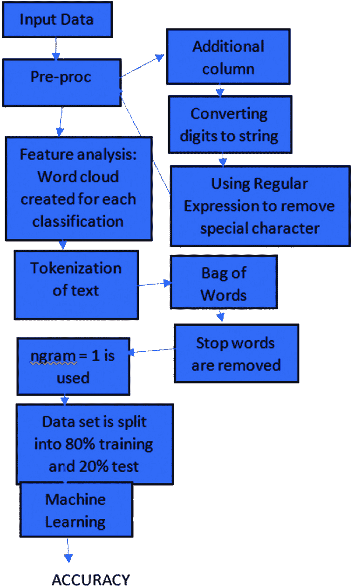

图 1.1 所提架构

1. **输入数据：** 数据集中的总行数为 74682 行。`id` 列包含推文 `id`。`information` 列提供了该推文对应的品牌信息。`type` 列提供了信息敏感性类型，如正面、否定等。`text` 列则由推文组成。

2. **预处理：** 由于数据集包含四列，因此创建了一个名为 `lower` 的额外列。该列用于将 `text` 列的数据预处理为字符串格式，并移除文本中的特殊字符。这种预处理是机器学习算法准确学习数据所必需。

3. **特征分析：** 为了对数据进行特征分析，为每个敏感分类创建了词云。如所述，模型考虑了四种情感：正面、负面、无关和中性。使用词云 Python 库创建了四个词云。特征分析显示，中性推文最多，其次是与负面分类相关的推文。

4. **分词：** 数据集使用了分词技术来查找文本中出现的唯一标识符号。数据集中有超过 3 万个唯一单词。使用 `ngram = 1` 构建了词袋模型。

5. **划分数据集：** 数据集被分为训练数据和测试数据，其中考虑 80% 的训练数据和 20% 的测试数据。

## 4. 结果与分析

实验在配备 Intel i5 处理器、8GB RAM 和 Windows 11 操作系统的平台上进行。使用 Google Colab 执行机器学习算法。模型结果显示，`Logistic Regression` 的准确率为 83.34%，`Decision Tree Classifier` 为 82.25%，`K Neighbors Classifier` 准确率为 85.76%，`Random Forest Classifier` 为 90.98%，而 `Support Vector Classifier` 为 84.01%。最高准确率由 `Random Forest Classifier`。

表 1.1 各种机器学习算法的准确率

| 机器学习分类器 | 准确率 |
| --- | --- |
| Logistic Regression | 83.34 |
| Decision Tree Classifier | 82.25 |
| K Neighbours Classifier | 85.76 |
| Random Forest Classifier | 90.98 |
| Support Vector Classifier | 84.01 |

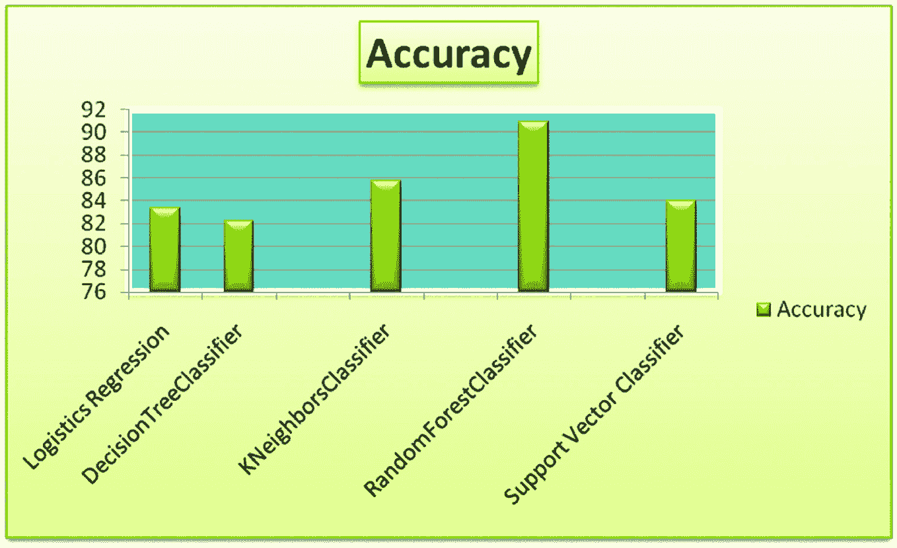

图 1.2 使用各种分类器对 Twitter 推文进行情感分析的结果

## 5. 结论

使用情感分析提取情感的能力对于许多公司甚至个人来说已变得至关重要。情感分析是决策的一个较新但快速发展的领域。自从人们开始在网上分享意见以来，为了各种实用应用，对观点性在线内容分析的需求比以往任何时候都更加巨大。文献在文本情感检测方面有大量的研究。尽管如此，目前的态度可能有很大的改进空间。根据实验分析，`Random Forest Classifier` 在准确率方面优于其他机器学习算法。

## 参考文献

1. Govindarajan, M. (2013). 使用朴素贝叶斯和遗传算法混合方法进行电影评论情感分析。International Journal of Advanced Computer Research, 3(4), 139.

2. Agarwal, A., Xie, B., Vovsha, I., Rambow, O., & Passonneau, R. J. (2011, June). Twitter 数据情感分析。社交媒体语言研讨会论文集 (LSM 2011) (pp. 30-38)。**

3. Agarwal, A., & Sabharwal, J. (2012, December). Twitter 数据的端到端情感分析。社交媒体数据信息提取与实体分析研讨会论文集 (pp. 39-44)。**

4. Singh, V. K., Piryani, R., Uddin, A., & Waila, P. (2013, March). 电影评论情感分析：一种基于方面层级情感分类的新启发式方法。2013 自动化、计算、通信、控制和压缩感知国际多会议 (imac4s) (pp. 712-717)。IEEE。

5. Pak, A., & Paroubek, P. (2010, May). Twitter 作为情感分析和意见挖掘的语料库。LREc (Vol. 10, No. 2010, pp. 1320-1326)。

6. Ingle, A., Kante, A., Samak, S., Kumari, A. (2015). 使用机器学习技术进行情感分析。


ECE 部门，AVN 工程与技术学院，兰加·雷德迪, 海得拉巴, 印度

Rikkala Spoorti^(⁷)

ECE 部门，KG Reddy 工程与技术学院，海得拉巴, 印度

Kuruvenla Kaveri^(⁸)

ECE 部门，KG Reddy 工程与技术学院，海得拉巴, 印度

DOI: [10.1201/9781003535423-2](https://dx.doi.org/10.1201/9781003535423-2)

**摘要：** 针对假币问题，我们有了一个新妙招：紫外光和智能计算机。情况是这样的：真币通常带有只有在紫外光下才会出现的隐藏标记。但伪币在复制这些标记时需要帮助。因此，我们使用特殊的紫外 LED 灯让这些秘密标记显现。当我们将光投射在钞币上时，就像是在揭示一个隐藏的信息。不仅如此，我们还在这种光线下拍摄钞币的照片。然后，智能计算机程序介入了。它们像是拥有细节洞察力的超级侦探。它们分析照片并寻找伪币无法复制的真币图案。这就像是当场抓获假币。为什么这很酷呢？因为它比旧方法更快、更好，就像是拥有一种快速可靠的方法来辨别真伪币，特别是在商店等繁忙的场所。最终，使用紫外光和智能计算机是打击假币的一项天才之举。通过向我们展示隐藏的图案并让计算机进行思考，我们比那些试图破坏我们货币体系的人领先了一步。随着这一理念的扩展，它可能成为保障现金安全的游戏规则改变者。

**关键词：** 假币，紫外 LED，图像处理，深度学习，安全特征

## 1. 引言

全球金融系统继续面临着假币的严峻威胁，因此需要开发有效且可靠的检测技术。所建议的紫外 LED 系统在银行、零售和执法部门等其他领域具有应用场景。通过将紫外 LED 技术集成到检测过程中，银行可以改进其货币验证系统，并在进行现金处理活动时快速识别伪钞。。同样，零售机构可以在销售终端使用配备紫外 LED 的设备来验证钞票，从而迅速降低接受假币的风险。执法机构也可以通过检查查获货币的紫外诱导特征、帮助寻找伪造者并干扰其活动，来利用该技术支持调查。

## 2. 问题陈述

印度的假币在 6.9% 的储备银行和 93.1% 的其他银行中检测到。大多数人需要帮助来识别假钞 [2]。假币使用的面额为 500 和 2000。之前的大多数技术依赖于硬件图像处理技术方法。这些方法的效果较低，且检测假币需要花费更多精力。

```

```

### 2.1 问题界定

```

```

## 3. 文献综述

*论文标题：* 使用图像处理的假币检测系统。作者：D. Raghav, SK Saaj, T Naveen, T Subhash。发表于：Journal of Emerging Technologies，发表年份：2019 年 4 月。

*论文标题：* 关于印度假币的研究。作者：Devid Kumar, Surendra Singh Chauhan。发表于：International Journal of Creative Research，发表年份：2020 年 3 月 3 日。

*论文标题：* 假币识别综述。作者：Sruthy R.。发表于：IRJET，发表年份：2022 年 7 月。

*论文标题：* 使用深度学习的实时假币识别。作者：V. Vijayaraghavan, M. Laavanya。发表于：International Journal of Engineering and Advanced Technology，发表年份：2019 年 12 月。


# 发布年份：2021 年 3 月

过去几年印度日常交易量的增加反映了导致日常生活中货币交易增长的多种因素。本文阐述了如何发现印度伪造钞币、不同类型的卢比的工作原理，并结合图像处理系统进行了详细说明。通过应用`结构相似性指数指标 SSIM`、`自适应直方图均衡化`、`快速离散小波变换 FDWT`、`灰度共生矩阵 GLCM` 以及 `SSIM` 是一种用于确定钞币真伪的机制。为了确定钞票的货币价值，使用了人工神经网络 (`ANNs`)、`GLCM` 以及额外的 `FDWT` [8]。

# 论文标题：基于 `LVQ` 并考虑紫外光的伪造法定货币识别方法，作者：Dewan to Harjun Wibowo, Sri Hartati 和 Aris Budanov，发表于：国际信息发展期刊 (IJID) (11111)，发表年份：2012 年。该研究旨在评估一种基于 `LVQ` 神经网络的检测假纸币的系统。系统的输入图像是一张由 50 卢比纸币制成的舞者的紫外线荧光图像。有关法定货币的数据从传统银行提取。使用 `LVQ` 技术来确定法定货币测试是否为正品。通过视觉编码使用编程语言完成。测试的舞者对象特征测量为 114 × 90 像素，并提取了 `RGBHSI` 作为 `LVQ` 输入。实验结果表明，系统以 100% 的准确率检测出 20 个真实测试案例数据，并以 96% 的准确率检测出 22 个模拟测试案例数据。更改图像信息的亮度以产生模拟案例数据。真实测试案例数据包含 10 张真纸币和 10 张伪钞。模拟案例数据包含 11 张真纸币和 11 张假钞。该方法在以下设置效果良好：`Learning Rate = 0.01` 和 `Max Posh = 10` [9]。

# 论文标题：紫外伪钞货币检测器。作者：Mark Dobbs, Jeffrey Kelsoe, Dwight Haas。发表于：美国专利 Dobbs 等，发表年份：2010 年 5 月 11 日。一种紫外 (UV) 检测器使用紫外光和白光背光来检测和确认放置在内的纸张的真伪。除了检测器外壳，紫外检测器还有一个安装有观察镜的观察室，用于检查纸张。为了在观察玻璃旁的观察室中放入纸张，识别器外壳还带有文档插入槽。检测器外壳 true 一个 `LED` 容器，可以容纳更多的 `LEDS`。这束紫外光照射到观察室、观察镜和纸张，允许识别数据上的紫外激活特征。识别器外壳内部还有一个半透明层和一个 `LED` 组件，它发散漫射的可见白光，该白光可用于检测纸张上的水印 [10]。

## 4. 方法论

### UV LED 的主要特性包括

#### 波长范围
在可见光和 X 射线之间，有一种称为紫外光的波谱。`UV LEDs` 具有在多种紫外波长范围内发射光的能力，这些范围通常分为 `UVA` (315–400 nm)、`UVB` (280-315 nm) 和 `UVC` (100–280 nm)。这些价格点各有不同的应用并对材料产生不同影响。效率和寿命、紧凑尺寸、特殊性、安全性考虑和成本。

#### 在伪造钞票上伪造不可见染料
在假钞上模拟不可见颜色是困难的。真钞上经常涂有不可见安全染料以防止伪造。尽管某些染料在普通日光下是不可见的，但可以使用专用工具发现。由于以下原因，伪造不可见染料是困难的：制造工艺、认证方法、安全措施、紫外光、荧光。


2.3 使用 IoT 技术检测伪造货币 

![2.4 具有重叠光谱的 [13]](images/fig2_4.jpg)
2.4 具有重叠光谱的 13]

#### 荧光的工作原理
荧光过程涉及多个步骤：吸收：荧光水中的吸收 `光子`，使其从低能量状态移动到激发态。激发态：分子在激发态下具有额外能量。当分子回到低能量基态时，会释放可见光子。

#### 串口监视器
对于实时和交互 `Arduino` 项目，串口监视器是一个至关重要的工具。串口监视器提供了 `Arduino` 工作原理的视图，便于调试或监控传感器读取。

#### 硬件和软件组件
`Arduino UNO`、`UV LED`、`直流电源`、`跳线`（公公对公母）、面包板、`470 欧姆电阻`，软件：`Arduino IDE v1`、`Python`。

## 5. 结果与讨论

在钞票检测背景下，对比紫外传感器检测和图像处理检测有助于我们理解它们的优势、局限性和适用场景。以下是紫外 传感器检测与图像处理检测的对比。

### 5.1 工作原理与检测精度

紫外 传感器检测：紫外 传感器测量紫外光的强度，可用作为区分真伪钞的特征。紫外特征（如荧光墨水或线）通常出现在真钞中并发出独特的紫外图案。图像处理检测：图像处理技术涉及分析钞票图像中的视觉特征和图案。这些特征包括水印、安全威胁、微打印或真钞特有的图案。紫外 传感器可以准确测量紫外指数或紫外响应特征的存在。然而，检测所有类型的伪钞需要比紫外检测更多的方法，特别是那些没有紫外特征或更复杂的伪钞。图像处理检测：使用图像处理技术可以发现更多种假钞，因为它们可以分析各种视觉属性。然而，图像处理检测的准确性取决于图像质量、伪钞的复杂性以及所采用的图像处理算法的水平。

### 5.2 实现复杂度

紫外传感器检测：使用 `Arduino` 等平台实现紫外传感器检测相对简单。它涉及将紫外传感器连接到 `Arduino` 板、读取紫外指数或分析紫外响应特征。图像处理检测：图像处理检测可能更复杂且消耗资源。它需要计算机视觉算法、图像预处理、特征提取，可能还需要机器学习技术。这通常涉及使用计算机或更强大的微控制器来执行必要的图像任务。

### 5.3 对环境因素的敏感性以及灵活性与适应性


## UV 传感器检测
UV 传感器易受影响紫外线强度的环境因素影响，例如环境光照条件或其他紫外线源。这些因素可能会影响基于 UV 检测的准确性。

## 图像处理检测
图像处理检测可能会受到图像质量、光照条件、噪声和复杂背景等因素的影响。需要仔细的图像采集、预处理和算法设计来减轻这些因素。

### UV 传感器检测（对比）
当正版钞票上具有紫外线响应安全特征时，UV 传感器检测最为有效。它可能不适用于检测不依赖 UV 特征的复杂伪钞币。

### 图像处理检测（对比）
图像处理检测具有更强的通用性和适应性。它允许分析多个视觉特征，并可以进行更新或修改以适应新的伪造技术或安全特征。

## 总结
总而言之，当正版钞票上具有 UV 特征时，UV 传感器检测简单直接且能提供准确的结果，如图 2.5

图 2.5 紫外线照射下正版钞票上的隐藏标记

## 6. 结论
本项目有效地演示了使用 Arduino 结合 UV LED 和图像处理构建伪钞检测系统。该设备通过集成 UV LED 照明、图像采集和图像处理算法，为识别假钞提供了一种可靠的方法。该技术通过提供自动且准确的假钞方法，解决了一个重大的现实问题。其应用涵盖了许多行业，包括银行、零售店和货币交易机构，在这些行业中识别伪币至关重要。该系统可以使用 UV LED 技术利用紫外光照射钞票，揭示秘密的 UV 响应安全特征，从而将真钞与假钞区分来。控制系统是一个 Arduino 板，这使得协调 UV LED 照明、图像采集和处理算法变得更容易。总体而言，伪钞检测系统是打击假币斗争中的有力武器，增强了现有的安全措施并降低了财务风险。它提供了一种实用有效的解决方案，有助于维护经济系统的可靠性，并保护企业免受假币带来的负面影响。社会上的假钞数量每天都在迅速增加。目前正在利用各种流程来评估一张钞票是原版还是伪币。本研究建议使用卷积神经网络来识别伪造的印度现金。CNN 使用了四种预定义网络，即 Alex Net、Resnet50、Darknet53 和 Google Net，以确认其生成数据集的准确性。结果表明，这四个预配置网络中的每一个在某个标准上表现出色，但在其他标准上有所妥协。未来的数据集验证将采用革命性的 CNN 架构来解决这一问题，通过考虑所有特征产生更优的结果。

## 参考文献
1. https://i0.wp.com/ommcomnews.com/wp-content/uploads/2023/09/Fake Note.jpg?fit=750%2C430&ss1=1（截至 [2024/07/08] 无法访问）
2. Satokar, Harshal. 项目报告。论文。


**摘要：** 在自然灾害或人为灾害发生后，快速高效的救援行动对于拯救生命和最小化对受影响社区的影响至关重要。本文提出了一种基于人工智能的灾后恢复工作新方法，该方法通过利用由现场可门阵列 [FPGA] 控制器驱动的特种自主车辆实现。提出的 `Recovery bot`（恢复机器人）能够在坍塌建筑、碎片覆盖区域和不稳定地形等挑战性且危险环境中进行导航和操作。基于 `FPGA [PYNQ Z2]` 的控制器通过实现传感器数据的实时处理、高效决策和多功能控制策略，在增强机器人能力方面发挥着关键作用。基于 `FPGA [PYNQ Z2]` 的 `Recovery bot` 包含一个工作电压为 `3.3v` 的 `ov7670` 摄像头传感器，其分辨率为 `640x480` VGA，负责捕捉灾区受害者的图像；它还包含一个 `MQ2` 气体传感器，用于检测引发火灾的可燃气体泄漏，传感器的输出连接到 `PYNQ Z2 FPGA` 控制器的 `ADC` 输入端。现在，收集到的数据将进行处理，并传输给救援队。为了引导机器人移动到目标位置，采用了诸如 `A-star algorithm` 等最短路径算法。为了区分受害者和障碍/非受害者碎片，使用了 `CNN algorithm` 进行机器人的精确决策。为了传输收集的数据，我们使用了 `HC-05` 蓝牙模块，该模块通过串口 `UART` 协议与 `FPGA` 通信。凭借 `Recovery bot` 收集和传输的数据，救援队可以迅速为受影响提供服务。

**关键词：** `Recovery bot`、`PYNQ Z2 FPGA controller`、`CNN algorithm`、`Shortest path algorithm`

## 1. 引言

名为 `Post-Disaster Recovery Bot`（灾后恢复机器人）的重要且前沿的技术工具被创建，旨在促进并加速自然或人为灾害后的恢复过程。地震、风暴、洪水和野火等灾难可能会对基础设施、社区和生活方式造成严重破坏。在恢复阶段，恢复正常秩序以及为受影响的人和社区提供援助需要一个计划且有效的策略[[1]]。`Post-Disaster Recovery Bot` 利用现代人工智能和聊天机器人技术，为灾害幸存者、救援提供者和恢复团队提供实时支持和信息。这种人工智能驱动的机器人通过作为知识、方向和协助的主要来源，帮助人们应对复杂的恢复工作。`Post-Disaster Recovery Bot` 的显著属性如下：

*   **信息传播：** 机器人分享有关受影响地区内可用的紧急服务、疏散路线、避难所、医疗设施和其他其他关键资源的当前详细信息。
*   **个性化支持：** 通过与用户进行交互，机器人可以识别用户需求，并对恢复资源（如财政援助、医疗护理、心理支持和住房支持）提供个性化建议。
*   **资源协调：** 通过与相关的救援组织和政府机构建立联系，机器人可以协助协调食物、水、医疗用品和其他必需品的分配和分发。
*   **导航支持：** 机器人可以为流离失所的人提供地图和方向，让他们更容易找到临时住房、医疗服务以及康复过程中其他位置的地点。
*   **情感支持：** 考虑到灾害带来的心理打击，机器人可以通过将用户连接到咨询服务、心理健康资源和应对机制来提供情感支持。
*   **进度监控：** 机器人可以帮助当局和恢复团队监控其活动状态，发现问题区域并更高效地分配资源。
*   **多语言交流：** 机器人的对话能力确保它能够与各种受灾人员联系并提供包容性支持。
*   **数据收集：** 通过分析收到的交互和问题，机器人可以为灾害响应团队提供见性信息，帮助他们决定做什么以及如何改进计划。

## 2. 文献综述

Robin R. Murphy 和 Raymond S. T. Lee 了一了一名为《Rescue Robots for Complex Environments》的论文，讨论了灾难救援机器人领域的挑战和进展，包括无人机、地面机器人和水下机器的使用。Nikolaos Tsiogkas 和 Nikolaos Mavridis 发表了一篇名为《A Review of Disaster Robotics: Concepts and Applications》的论文，对灾难机器人进行了概述，包括分类、挑战以及在各种灾难场景中的潜在应用。T. Balch、R. C. Arkin 和 J. A. Redi 引入了 `RoboCup Rescue Simulation Platform`，这是一个用于测试和开发灾难救援机器人算法的影响力研究平台，名为《The RoboCup Rescue Simulation Platform》。由 Robin R. Murphy 和 Brian J. Gerkey 提出的《Human-Robot Interaction in USAR: Lessons Learned from Field Exercises with Rescue-Robots》发表在《Journal of Field Robotics》上，该文基于实地演练和教训讨论了城市搜索与救援（USAR）环境中人机交互的挑战。Bradley Hayes 和 Robin R. Murphy 研究了《Challenges in Deploying Robots in Post-Disaster Environments: Results from Deployments in a Simulated Suburban Environment》，该文展示了在模拟郊区灾害环境中部署机器人的结果，并讨论了救援机器人面临的挑战。

Satoshi Tadokoro 和 Masaki Ogino 撰写的名为《Disaster Robotics》的论文为灾难救援机器的发展及其在灾难管理中的作用提供了见解。Erion Plaku 和 Stefano Carpin 在其名为《A Review of Robots for Search and Rescue in Urban Environments》的文章中涵盖了机器人在城市搜索与救援任务中的应用，突出了各种机器人系统及其能力。在灾难救援中使用卷积神经网络（`CNNs`）是一个活跃的研究领域，特别是在复杂环境下的目标识别、导航和决策任务中。以下是讨论灾难救援机器人中使用 `CNNs` 的一些研究论文：

Kaiming He、Xiangyu Zhang、Shaoqing Ren 等人提出的名为《Deep Residual Learning for Image Recognition》的论文关注了灾难机器人，介绍了 `ResNet` 架构，该架构被广泛应用于深度学习任务，包括灾难场景中的目标识别。Todd Hester 和 Peter Stone 发表了文章 `Object Recognition for Disaster Response Robots Using Convolutional Neural Networks`，探索了 `CNNs` 在灾害响应机器人背景下的目标识别。它讨论了在现实灾难场景中训练 `CNNs` 面临的挑战和解决方案。Mark Pfeiffer、Maren Bennewitz 和 Wolfram Burgard 发表了名为《CNN-Based Object Detection and Navigation for Autonomous Search and Rescue Robots》的文章，文中讨论了搜索与救援场景中基于 `CNN` 的目标检测和导航方法。它侧重于利用深度学习增强机器人的感知和决策能力。

这些研究论文涵盖了与灾难救援机器人相关的主题，从设计、能力到人机交互和实地部署。

## 3. 机器人的架构模型


“Recce bot”是侦察机器人的缩写，是一种设计用于各种侦察和监控任务的机器人。这些机器人可以通过硬件和软件组件相结合来实现，以有效地实现其目标[4]。以下是此类机器人实现方法的概述。

基于 FPGA 的系统是开发灾后救援机器人的一种非常有前景的方法。FPGA 的高性能、可重构性、低功耗和小型化使其成为实现这些机器人所需的复杂算法和逻辑的理想平台 [5]。该系统具有在灾害后拯救生命和减少财产损失的潜力。图 3.1 所示使用 FPGA 的灾后救援机器人架构图通常由以下组件组成：

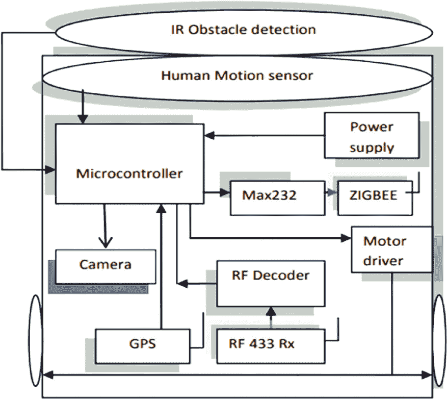

图 3.1 灾后侦察机器人框图

- **传感器**：传感器负责收集机器人周围环境的信息。这些信息可以包括温度、压力、湿度、气体浓度、障碍物检测和受害者检测。
- **FPGA**：FPGA 是机器人的中央处理单元。它负责处理传感器数据、为执行器生成控制信号并实现机器人逻辑。
- **执行器**：执行器负责移动机器人。这包括电机、轮子、履带、手臂和机械爪。
- **电源**：电源为机器人组件提供电能。电源也可以由电池、燃料电池或太阳能电池板取代。
- **通信模块**：通信模块允许机器人与操作员通信。可以通过或无线连接连接。操作员可以使用通信模块向机器人发送指令，接收机器人的状态更新，并查看机器人摄像头的图像。

所提系统的架构图设计为模块化和可扩展。这意味着系统可以很容易地适应不同的灾害场景。例如，可以根据任务的具体需求配备不同的传感器、执行器和通信模块。

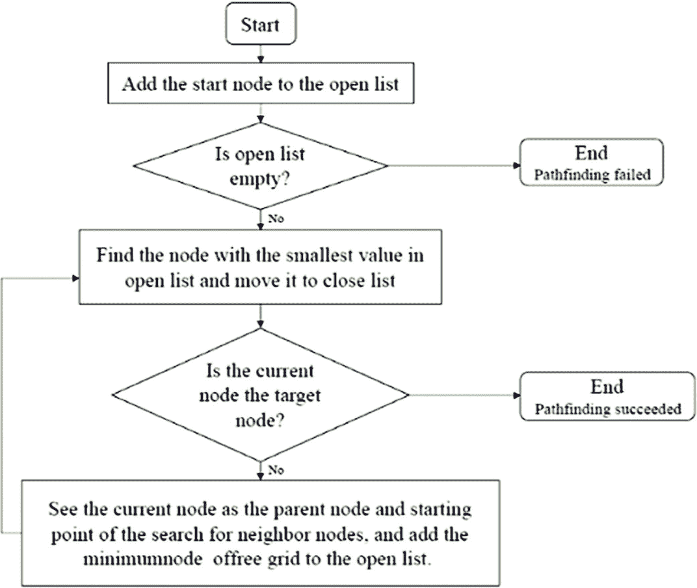

图 3.2 灾后机器人路径寻找的 A* 算法流程图

## 4. 机器人的软件/算法模型

FPGA 以其低延迟和高吞吐量能力闻名，适用于对快速响应至关重要的机器人应用。基于 FPGA 的救援机器人的路径规划和导航通常包含先进的路径规划和导航算法。

算法帮助机器人在复杂的动态灾害环境中导航，以到达受害者或执行特定任务，实现有效且最短的路径导航。其计算复杂度较低。以下步骤提供了 A* 算法的伪代码描述，A* 是一种受欢迎的路径寻找方法，它通过结合 Dijkstra 算法和启发式函数的特征，在图或网格中找到从节点到目标节点的最路径：

```python
function AStar(initial, target):
    openSet = {initial}
    closedSet = {}
    gScore = {initial: 0}
    fScore = {initial: heuristic(initial, target)}
    parentFrom = {}

    while openSet is not empty:
        current = node in openSet with lowest fScore
        if current == target:
            return reconstructPath(parentFrom, current)
        remove current from openSet
        add current to closedSet
        
        for neighbor in getNeighbors(current):
            if neighbor in closedSet:
                continue
            tentative_gScore = gScore[current] + distance(current, neighbor)
            if neighbor not in openSet or tentative_gScore < gScore[neighbor]:
                parentFrom[neighbor] = current
                gScore[neighbor] = tentative_gScore
                fScore[neighbor] = gScore[neighbor] + heuristic(neighbor, target)
                if neighbor not in openSet:
                    add neighbor to openSet
```

### 4.2 用于目标识别的 CNN 算法

在计算机视觉中，卷积神经网络（CNN）是一类深度学习模型，经常用于目标识别。它们改变了该领域并应用于许多场景，包括分割、目标识别和图像分类。CNN 算法的伪代码表示如下：

```python
# 定义超参数
training_rate = 0.01
num_epochs = 10
cluster_size = 32

# 随机初始化权重偏置
initialize_weights_and_bias()

# 主训练循环
for epoch in range(num_epochs):
    for batch in get_mini_batches(training_data, cluster_size):
        # 前向传播
        conv_output = convolution_layer(batch)
        flattened_output = flatten(conv_output)
        fully_connected_output = fully_connected_layer(flattened_output)
        estimated_labels = soft_max(fully_connected_output)
        
        # 计算损失
        loss = calculate_loss(estimated_labels, cluster_labels)
        
        # 反向传播
        gradient = compute_gradient()
        update_weights_and_bias(gradient, training_rate)
        
        # 打印该轮 epoch 的损失
        print("Epoch {} : Loss = {}".format(epoch, loss))

# 训练后，使用模型进行预测
for image in test_data:
    conv_output = convolution_layer(image)
    flattened_output = flatten(conv_output)
    fully_connected_output = fully_connected_layer(flattened_output)
    predicted_label = argmax(softmax(fully_connected_output))
    print("Predicted label:", predicted_label)
```

## 5. 实验与结果

基于 AI 的灾后救援机器人配备了各种传感器来感知其环境。这些传感器收集数据，然后由 FPGA 控制器处理。FPGA 控制器编写了 AI 算法（例如机器学习模型），这些算法通过分析数据来做出决策。CNN 等 AI 算法可以执行诸如识别灾区区域的幸存者、为救援行动规划安全路径，或判断受损结构的稳定性。然后，FPGA 控制器向执行器发送指令。

通过摄像头、传感器或其他成像设备捕视觉数据的过程通过以下技术进行增强：通过调整对比度、亮度减少噪声来提高图像质量。应用滤波器或卷积操作来修改图像以实现特定目的，例如边缘检测或平滑处理。


UI 的一个关键组件是显示来自机器人车载摄像机的实时视频流。操作员依靠这些视频流导航机器人，并从周围环境收集视觉信息，通过 `A**` 算法根据 AI 的决策执行操作。在整个过程中，AI 模型不断适应新数据和变化的环境，随着时间的推移提高其性能。图 3.3 和 3.4 中的原型模型展示了该系统在实际操作中的工作方式，允许开发者和利益相关者在进入全面生产之前对技术进行测试和完善。它是一个旨在协助灾后救援工作的机器人初步版本。

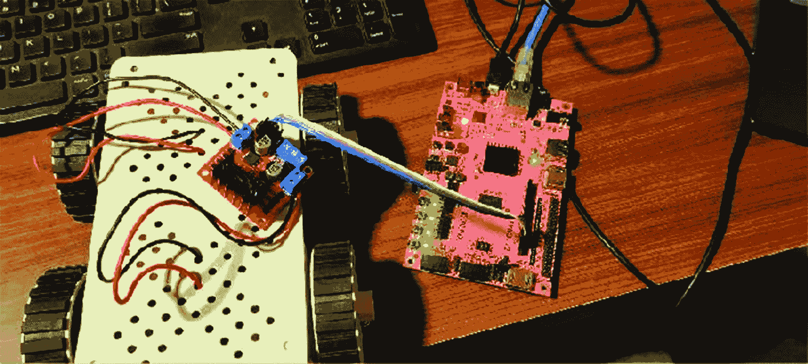

图 3.3 使用 PYNQ Z2 FPGA 控制器的灾后侦察机器人原型模型

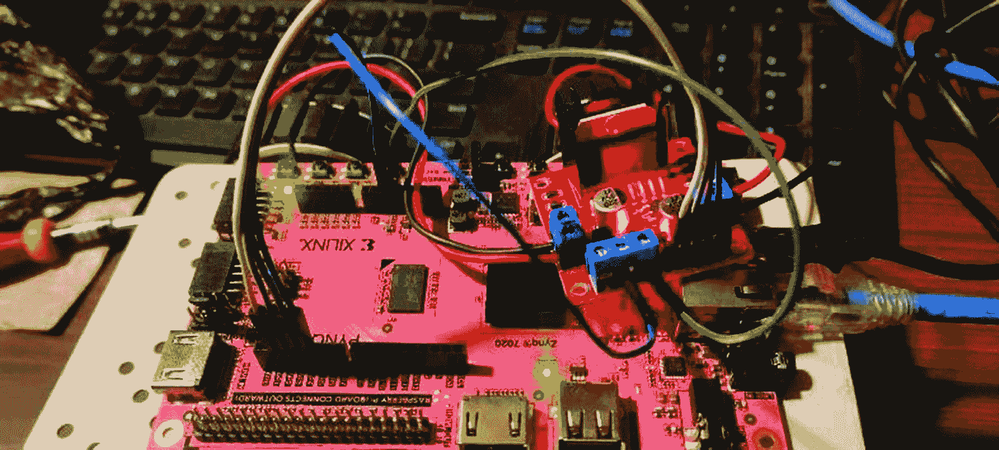

图 3.4 使用 PYNQ Z2 FPGA 控制器的灾后侦察机器人实验装置完成

利用 `PYNQ-Z2` FPGA 控制器的优势，灾后侦察机器人是一种为帮助灾区而创建独特机器人系统。凭借尖端的电子设备和传感器，这种复杂的机器人可以在灾区周围导航、评估损坏，并为急救人员和救援组织收集关键数据。

## 6. 结论

总之，由 `PYNQ-Z2` FPGA 控制器驱动的灾后侦察机器人为灾害响应和恢复提供了一种革命性的方法。这种创意机器人系统结合了尖端技术和人文关怀，旨在减轻灾害对社区和人员的灾难性影响。得益于先进的传感器、自主导航能力和实时通信设施，该机器人在灾区至关重要。它为急救人员提供了必要的协助，帮助他们实现拯救生命和保护社区的目标。机器人通过快速安全地收集有关灾后情况的关键数据，有助于做出更明智的决策，从而缩短了反应时间并降低风险。

## 参考文献

1. Robin R. Murphy, Raymond S. T. Lee, “Rescue Robots for Complex Environments”, Introduction to Autonomous Robots, 2019
2. J Trevelyan, WR Hamel, SC Kang “Robotics in Hazardous Applications”, Springer Handbook of Robotics, 2016
3. T. Balch, R. C. Arkin, J A Redi, “The RoboCup Rescue Simulation Platform”, 2010
4. Robin R. Murphy, Brian J. Gerkey, “Human-Robot Interaction in USAR: Lessons Learned from Field Exercises with Rescue-Robots”, Transactions on Systems, Man, and Cybernetics, vol 34, 2004
5. Bradley Hayes, Robin R. Murphy “Challenges in Deploying Robots in Post-Disaster Environments: Results from Deployments in a Simulated Suburban Environment”, IEEE Open Journal of the Communications Society, vol 3, pp 1177-1205, 2022.

# 4 基于深度学习的图像分割用于肺肿瘤早期检测

Happila T^(¹⁰)

Assistant Professor, Karpagam College Engineering, Electronic and Communication Engineering, Coimbatore, India

Rajendran A^(¹¹)

Professor, Karpagam College Engineering, Electronic and Communication Engineering, Coimbatore, India

Kalaivanan D^(¹²)

Student, Karpagam College Engineering, Electronic and Communication Engineering, Coimbatore, India

DOI: [10.1201/9781003535423-4](https://dx.doi.org/10.1201/9781003535423-4)

**摘要：** 肺肿瘤的早期诊断可以极大改善患者的预后和对治疗的反应。肺肿瘤通常使用计算机断层层扫描（`CT`）进行诊断和监测，然而，准确分割这些肿瘤具有挑战性。本工作介绍了一种新型基于深度学习的图像分割技术，能够在 `CT` 扫描图像中早期识别肺癌。在我们建议的策略中，使用了卷积神经网络（`CNNs`）自动且精确地定义 `CT` 数据中的肺肿瘤位置。为了提高原始 `CT` 扫描图像的质量，我们在预处理阶段使用了图像归一化和降噪技术。为了从照片中提取有用的空间上下文信息，特征提取阶段使用了复杂的 `CNN` 架构。在大量的标注 `CT` 扫描数据集上，我们调优了一个预训练模型来分割肺肿瘤。在后处理阶段，通过减少假阳性并确保肿瘤边界平滑准确来改进分割结果。我们使用了一个包含早期和晚期肺癌的大型 `CT` 扫描图像数据集来测试我们的方法。研究结果表明，建议的策略在实现高分割准确性和鲁棒性方面是有效的。我们的方法识别肿瘤边界的能力可以帮助放射学家和临床医生就患者护理做出明智决策。肺肿瘤早期诊断对于早期行动至关重要。上述，本研究描述的基于深度学习的图像分割技术提供了利用 `CT` 扫描图像进行识别的可能性。

**关键词：** `CNN` 卷积神经网络，`CT` 计算机断层扫描

## 1. 引言


为特定的医疗任务选择合适的深度学习架构，例如 `Transformer` 模型、`循环神经网络` (`RNNs`）或`卷积神经网络` (`CNNs`）。[6] 从 CT 扫描图像和与吸烟相关的数据中提取相关信息，这些信息可用于预测肺癌的发展。[13] 给选定的深度学习模型提供预处理后的肺部图像，并通过迭代更改其参数以优化任务性能。[2] 选择一种合适的机器学习技术，例如`支持向量机` (`SVM`）、`随机森林`或`梯度提升`，适用于肺癌的识别与分类。`支持向量机` (`SVM`）、`随机森林`或`梯度提升`结合多项贝叶斯（Multinomial Bayesian）方法用于肺癌的诊断和分类[1].[16] 在使用 `Deep CNN` 模型进行训练之前，对图像数据进行去噪、清洗和准备，以确保其一致性。[18]。 使用已经经过训练的深度学习模型（例如用于图片的 `CNNs`）来从医学图像中提取重要信息。这些复杂特征包含了有关癌症发病率的重要模式和信息。[8]。

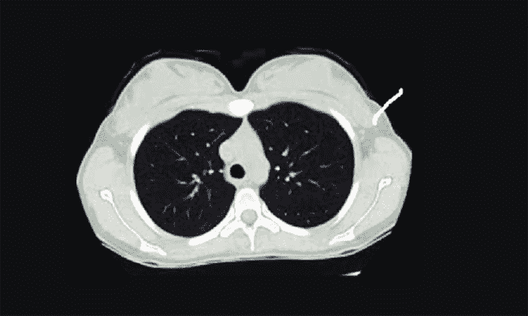

Fig 4.1 CT 扫描肺图像

## 3. 深度学习架构

构成深度学习架构的互连神经元层包括输入层、隐藏层和输出层。用于序列的`循环神经网络`、用于语言处理的 `Transformers`、用于图片的`卷积神经网络`以及用于通用任务的`前馈神经网络`都是常见形式的示例。如 `自动编码器`和 `ResNets` 之类的架构解决了某些困难问题。由于这些网络从数据中学习并在训练期间调整参数，因此它们是广泛机器学习应用的有用工具。

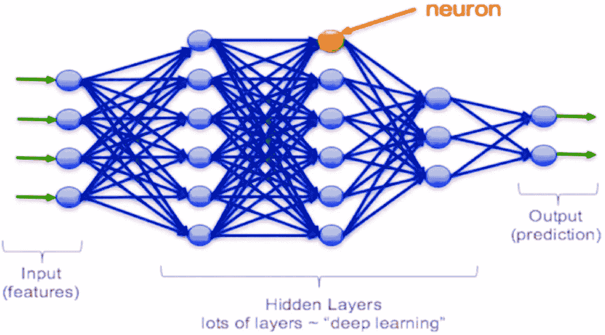

Fig 4.2 深度学习架构

## 4. 方法论

卷积神经网络 (`CNN`) 方法的数据收集和预处理阶段涉及策划和准备标记数据集，这通常意味着随着等比例缩放、归一化和数据增强。接下来，选择一个合适的 `CNN` 架构，可以是从像 `LeNet` 这样较成熟的模型到像 `ResNet` 或 `VGG` 这样的尖端设计。为了加速收敛，模型使用大型数据集的预训练权重或随机权重进行初始化。训练期间，输入数据通过网络的卷积层和池化层进行处理，以提取分层特征。根据问题的类型选择合适的损失函数，因为像 `ReLU` 这样的激活函数引入了非线性。由于反向传播估计了损失的梯度，模型可以使用随机梯度下降 (`SGD`) 或 `Adam` 等优化算法迭代地更改其权重。通过使用丢弃 (`dropout`）和权重衰减等正则化技术可以避免过拟合。在训练数据集上进行预定轮数（epochs）训练的同时，在验证集上监控性能。在单独的测试数据集使用相关指标对模型进行评估后，通过超参数调优优化学习率、批量大小和网络特定参数。然后，将训练好的 `CNN` 安装到目标应用程序中并持续维护。

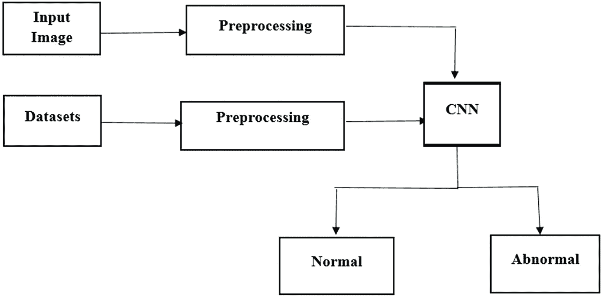

Fig 4.3 CNN 框图

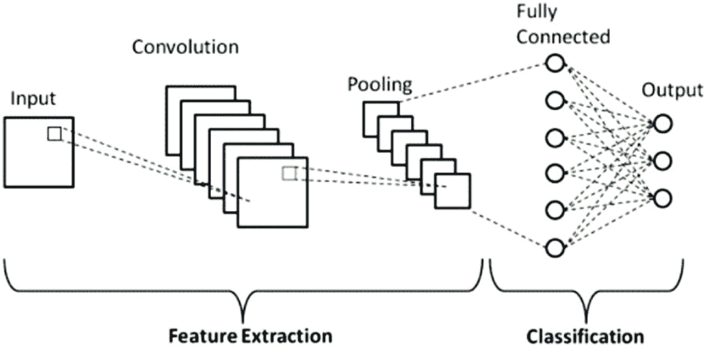

Fig 4.4 CNN 架构

## 5. 肺癌检测准确率的估计

使用具有已知真实值标签（ground truth）的 CT 扫描测试数据集数据评估模型性能，即每次扫描是肺癌阳性还是阴性。以下是评估正确性的方法：

- **构建测试集**：如前所述，确保训练集和验证集与测试集不同。该集合中必须包含肺癌阴性和阳性的 CT 扫描。
- **预处理测试数据**：使用与训练和验证期间相同的程序对测试集进行预处理。这包括重缩、归一化、去噪、肺部区域和结节分割。
- **加载训练好的模型**：在训练数据集上训练神经网络后，加载创建的已训练神经网络模型。
- **利用测试数据运行推理**：通过向加载的神经网络模型输入测试数据集中的预处理 CT 图像来获取预测结果。模型的输出应该是一个概率分数（0 到 1 之间），表示每次 CT 扫描检测出肺癌的概率。
- **分类阈值**：对模型的输出概率应用阈值将其转换为二分类预测。例如，如果概率大于或等于 0.5，则分类为存在肺癌；否则分类为不存在肺癌。

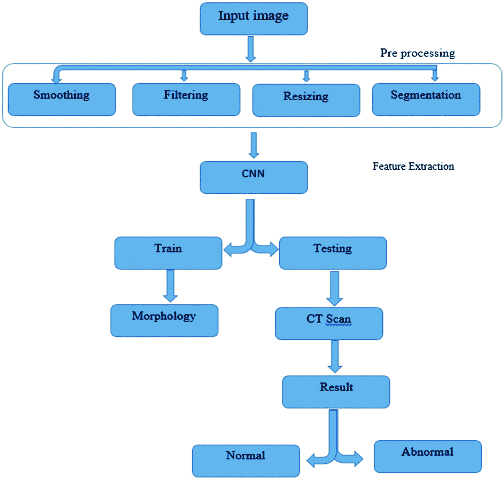

Fig 4.5 肺肿瘤检测流程图

## 6. 训练

使用反向传播方法来训练 `Deep CNN` 以识别大小为 5*20*20 的 CT 扫描上的肺肿瘤。这分为两个阶段。`CNN` 的第一阶段由修正的线性单元和许多体积卷积组成。从输入数据中通过 (`ReLU`) 层和最大池化体积特征来提取有用信息。下一阶段是分类器。它通过跟踪许多 `FC` 层和阈值层，并在其间加入一个 `Soft Max` 层，对大脑的神经网络进行彻底检查。没有进行任何比例缩放以保留数据集的原始值，尽可能多的 jpeg 照片。训练是对随机选择的 CT 扫描体积进行归一化的。


通过提高诊断的速度和准确性，这些技术可能能够实现更早的干预和更好的患者预后。虽然`AI`-驱动的工具是有效的辅助，但至关重要的是，它们应该与医疗专家的知识结合使用，由他们做出最终诊断选择。在对抗肺癌的过程中，技术进步与医学知识之间的协作仍然至重要。`AI`-驱动的技术（如尖端的深度学习模型和多模态数据集成）是未来识别肺癌的关键，能够提供更精确的早期诊断和定制化的治疗策略。

## 参考文献

1. 使用深度学习进行肺癌检测与分类, Ruchita Tekade, prof. Dr. K. Rajeswari, `IEEE-2018`

2. Susmita Das, 基于深度学习网络的肺癌检测：对比分析，2020-ICRCICN.

3. Radhika P R, Rakhi.S. Nair, 使用机器学习算法肺癌检测的比较研究，2018-IEEE.

4. Syed Saba Raoof, M a.Jabbar, Syed Aley Fathima, 使用机器学习进行肺癌预测：综合方法，2020- ICIMIA.

5. Amjad Rehman, Muhammad Kashif, Ibrahim Abunadi, Noor Ayesha, 使用机器学习技术从胸部 CT 扫描进行肺癌检测与分类，2021-CAIDA.

6. Wasudeo Rahane, Himali Dalvi, Yamini Magar, Anjali Kalane, 使用图像处理和机器学习的医疗保健肺癌检测，2018-IEEE.

7. K. Karthick, S. Rajkumar, N. Selvanatham, U.K. Balaji Saravanan, M. Murali, B. Dhiyanesh, 基于机器学习算法与物联网的肺癌检测分析，2021-IEEE.

8. Etaher, N. Prakash, A. Shaffie, A. Soliman, A. El-Baz, 肺癌分类算法及其性能概述，IAENG-2021.

9. Puneet, Anamika Chauhan, 基于常规血液指标的机器学习技术肺癌检测，IEEE-2020.

10. wood Abdul, 使用卷积神经网络的自动肺癌检测与分类 (ALCDC) 系统，IEEE-2020.

11. Freddie Bray, Jacques Ferlay, Isabelle Soerjomataram, Rebecca L. Siegel, Lindsey, 全球癌症统计 2018，CLIN-2018.

12. Geoffrey Hinton, 深度学习——具有变革医疗保健潜力的技术，美国医学协会\-2018.

13. Vmeet K Raghul, Wei Zhao, Jiatao Pu, Joseph Leader, Renewed Wang, James Herman, Jian-Min yuan, Panayiotis, 使用因果模型从低剂量 CT 扫描和吸烟因素预测肺癌的可行性，THORAXjin1-2018.


| 至少 6 个月 | 职业功能性缺失 |
| --- | --- |
| 总时长 | 障碍的持续指示 |
| 自闭症病史 | 认知、抑郁和躁狂症状的评估 |

### 1.2 预言（Vaticination）

这种脑疾病——精神分裂症可以通过药物治疗，但无法根治，只能对症状进行处理。一组患有精神分裂症的患者已经完全康复。研究报告称，精神分裂症患者承认治疗有所进展，并恢复了药物治疗，且具有成效并逐步改善，从而过上了健康、正常的生活 [4]。这种大脑功能障碍不是致命的，但他们的行为有时会对患者本人和周围的人都不利。接近 12% 的精神分裂症患者会结束自己的生命并自杀 [9]。他们还遭受着某些心脏相关问题。祖先的悲惨历史，或者已知中某些未受治疗的患者，长期的精神病状态可能是最坏情况的结果。因此，某些与疾病相关的风险因素可以在表 5.2 中看到。

#### 表 5.2 风险因素 (#ch5.xhtml#R_tab5_2)

| 因素 | 问题 |
| --- | --- |
| 遗传风险 | 父母或某些亲属 |
| 环境 | 暴露于二氧化氮、二氧化硫、冬季出生、娱乐性药物等 |
| 构成风险 | 营养缺乏、单纯疱疹病毒 2 型、流感等。 |
| 出生因素 | 先兆高血压、母体糖尿病、双胎妊娠、剖腹产产等。 |

## 2. 成像技术

### 2.1 重要特征

成像的主要功能是排除脑部结构性挫伤，这是模拟精神分裂症、精神混乱的主要来源和指征。例如，可以说明对前额叶的任何影响都是导致产生幻觉的精神疾病原因，而这在脑膜瘤的病例中可能导致误诊为精神分裂症 [5]]。然而，这些如 `MRI` 和 `CT scan` 等成像技术对诊断精神分裂症提供了模糊的插图，但在多次切片的帮助下，可以证明这是调查此类症状患者的有效方法。

### 2.2 计算机断层扫描 (CT scan)

对任何患者进行传统成像的方法是借助严重的精神病切层完成，通常在急诊科从头部扫描开始 [6]。应该理解的是，`CT scan` 显示没有精神分裂症的证据。然而，这可能是脑中任何模拟精神分裂症体变变的首要检查。`CT Scan` 用于检查患有精神分裂症患者大脑的不同叶，如前额叶、颞叶、冷血脊椎动物头部以及大脑的丘脑。

### 2.3 磁共振成像 (MRI)

对于本文而言，结构性 `MRI` (`sMRI`) 为大脑障碍引起的生物学变异的概念化、评估和识别提供了非侵入性技术。为了调查目的，可以对包括灰区域和白色区域的图像进行实质性尺寸测量和宽度检测 [7]。由于 `MRI` 极高的分辨率，精神分裂症患者的某些障碍（可能包括脑脊液 CSF 液体增加或白质或灰区域减少）可以通过这些技术很容易地看到（见 图 5.1）。


### 2.4 功能性磁共振成像 (fMRI)

该技术涉及一种成像方法，通常从急诊科的头部扫描开始进行严重的精神病切层 [6]。应该理解的是，`CT scan` 支持精神分裂症。然而，这可能是任何模拟精神分裂症体征脑病变的首要检查。表 5.3 `CT Scan` 用于检查患有精神分裂症患者大脑的不同叶，如前额叶、颞叶、冷血脊椎动物头部以及大脑的丘脑。

对于本文，结构性 `MRI` (`sMRI`) 为大脑障碍引起的生物学变异的概念化、评估和识别提供了非侵入性技术。为了调查目的，可以对包括灰区域和白色区域的图像进行实质性尺寸测量和宽度检测 [7]。由于 `MRI` 极高的分辨率，精神分裂症患者的某些障碍（可能包括脑脊液 CSF 液体增加或白质或灰区域减少）可以通过这些技术很容易地看到（见图 5.1）。

功能性磁共振成像 (fMRI) 这种技术涉及一种成像方法，用于评估大脑功能。在多次切片的帮助下，可以证明这种 `fMRI` 证明是调查具有此类症状患者的有效方法（见图 5.2）。在 `fMRI` 的静态下，可以观察到表 5.3 中提到的精神分裂症患者的差异。

| 参考文献 | 样本 | N |  | 持续时间 | 发现 |
| --- | --- | --- | --- | --- | --- |
| Chakos et al. (1994) | 首发精神分裂症 | 20811 | 尾 | 17 个月 | 尾体积随年龄增加 |
| Chakos et al. (1995) | 精神分裂症 | 15 | 尾 | 1.5 年 | 尾体积减少 |
| Corson et al. (1999b) | 慢性精神分裂症对照组 | 1924 | 尾 | 2 年 | 尾大小异常减小 |
| Degreef et al. (1991) | 首发精神分裂症对照组 | 128 | 皮层室 | 1–2 年 | 变化率无差异 |
| DeLisi et al. (1995) | 首发精神分裂症对照组 | 204 | 大脑颞叶躯体 | 5 年 | 左心室变化率在精神分裂症更大 |
| DeLisi et al. (1997) | 首发精神分裂症对照组 | 5025 | 内侧叶外、躯体、脑沟 | ≥ 4 年 | 精神分裂症中两侧变化率增加 |
| Gur et al. (1998b) | 精神分裂症患者对照组 | 4217 | 全脑 CSF、前额叶 | 2-3.5 年 | 精神分裂症中前额叶增加。颞叶体积减少 |
| Jacobson et al. (1998) | 童年期精神分裂症对照组 | 1016 | 大脑体积上、杏仁核海马体 | 2 年 | 整个大脑和颞叶体积的变化增加 |
| Keshavan et al. (1998b) | 首发精神病对照组 | 1616 | 上颞回小脑 | 2 年 | 上颞回的体积与精神病时间反比。精神分裂症中回回变化率增加 |


图 5.2 异常同步区域

### 2.5 弥散张量成像 (DTI)

另一种属于磁共振成像（MRI）类别的成像模式是弥散张量成像。这些技术在寻找大脑白质纤维束轨迹方面的准确性为脑疾病的诊断提供了强力支持。在流体环境中，水分子通常在所有方向上随机运动，称为布朗运动。这种现象被称为分子的各向同性扩散。当细胞组织作为屏障时，水分子表现出特定的扩散方向。这种原理被称为各向异性扩散，是弥散张量成像的基础。

在活体内进行的大脑白质显示程序已通过弥散张量成像（DTI）实现，用于为健康和疾病提供结果。ENIGMA 小组进行的一项综合研究发现，严重精神分裂症患者的白质微结构存在广泛异常。后来，发现这些 DTI 异常在诊断为精神分裂症 α 期患者中普遍存在。DTI 的发现在对治疗有效和无反应的患者之间可能有所不同。这与抗精神病生物治疗的有效性及其对多巴胺感觉受体的吸引力有关，特别是在精神分裂症中产量增加的纹状体处[9]。图 5.3 显示，与对照组相比，首次发作精神分裂症的个体在整个大脑白质的分数异异性降低（7）。这种分数异异性的下降与这些患者认知能力的下降有关。在首次发作精神分裂症患者中，主要在丘脑检测到 DTI 和 fMRI 异常。这些发现与之前的体积和功能性 MRI 研究一致，也为丘脑皮层连接功能障碍理论提供了证据（图 5.4）。

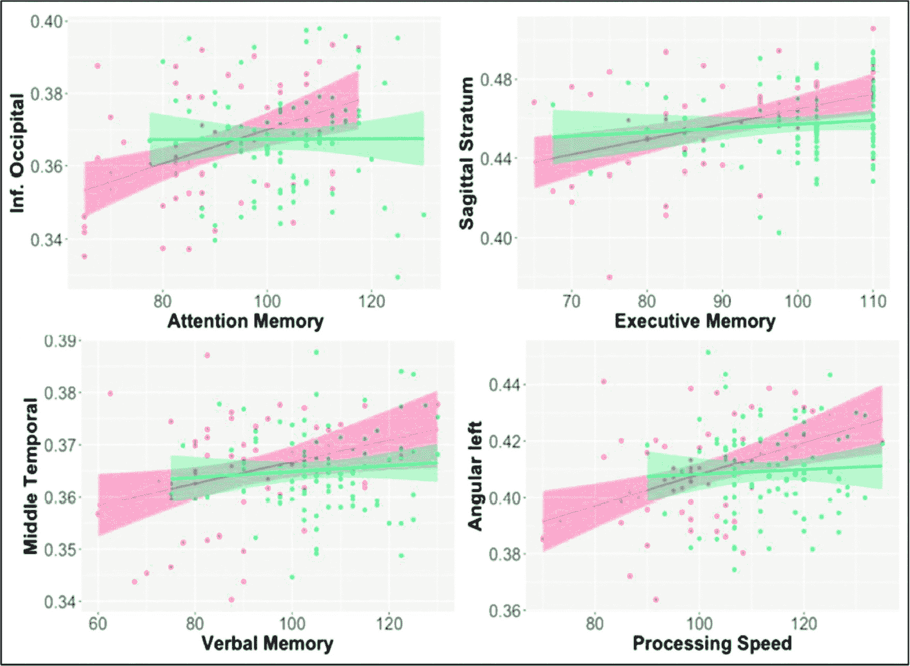

图 5.3 图表说明了不同大脑区域的分数异异性 (Y) 与认知检查执行情况 (X) 之间的关系。红点代表 α 期精神分裂症患者 (n = 55)，蓝点代表年龄和性别匹配的健康对照组。深色区域构成线性回归线的 92% 置信区间。

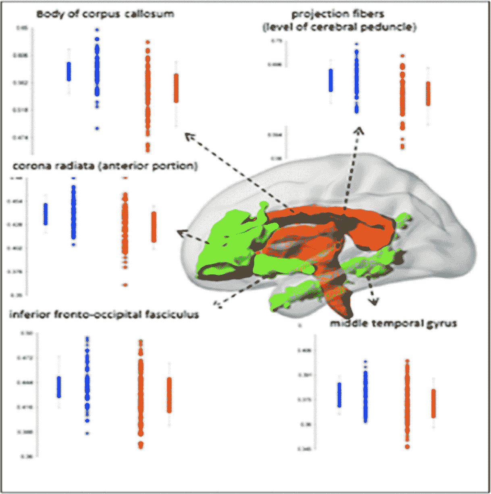

图 5.4 箱线图说明了两组之间分数异异性的显著差异。第一组由 58 名 α 期精神分裂症患者组成（橙色点表示），第二组由年龄和性别匹配的健康对照组组成（蓝点表示）。

### 2.6 磁共振波谱 (MRS)

磁共振波谱是一种被广泛应用的非侵入方法，用于评估包括精神分裂症在内的神经系统状况的大脑代谢。在高磁场强度（如 7T）下进行此操作可以测量人体内近 22 种神经化学物质。这些神经化学物质涉及 γ氨酸、天氨酸等神经递质。磁共振波谱依赖于化学环境的偏移，即由于附近电子的存在导致磁场的变化[4]。质子在复杂分子中的偏好由于与相邻原子的相互作用而异。通过了解特定分子中质子的频率，MRI 可以检测该分子的致密性。这为大脑特定区域的神经特征提供了见解。

## 3. 未来展望

对于神经放射学来说，开展涉及符合精神分裂症标准的大样本研究是有益的。与像 ENIGMA 项目这样的多个小组合作并共享数据将有助于创建更同质的队列。此外，对这些患者进行其他医疗和心理状况的筛选以确保患者密度的一致性也非常重要。如果这些患者在首次脑评估时尚未开始用药，将是理想的。为了最大化潜在收益，应该实施 MRI 惯例，包括弥散张量成像、fMRI、静态 MRI 和 MRS。

## 4. 结论

此处总结了 MRI 发现和未来研究的潜在途径。随着技术的发展，我们对与精神分裂症相关的神经病变的认知已显著提高。MRI 的使用证实了与此类疾病相关的大脑异常。这些发现扩大了临床和基础科学研究的调查范围，促使人们重点关注这些疾病背后的神经解剖学。精神分裂症患者的 MRI 发现涉及多个大脑区域受累。这些区域包括：

1. 脑室扩大
2. 内侧颞叶参与，特别是杏仁核、海马回等
3. 上颞回 (STG) 参与
4. 顶叶参与，特别是下顶叶，该区域进一步细分为角回和 SMG。
5. 皮层大脑区域的参与，如小脑、丘脑等。

## 参考文献

1. Adler LE, Olincy A, Waldo M, et al. 精神分裂症、感觉门控和尼古丁碱受体。Schizophora. Bull 998; 24:189-200. [PubMed: 9613620]
2. Andreasen NC, Ehrhardt JC, Swayze VW II, et al. 精神分裂症的磁共振成像。结构异常的病理生理意义。Arch. Gen. Psychiatry 1990; 47:35-44. [PubMed: 2294854]
3. Becker T, Elmer K, Schneider F, et al. 精神精神分裂症患者磁共振成像证实时间叶边缘系统结构体积减少。Psychiatry Res 1996; 67:135-143. [发表于 Psychiatry Res 1997 May 16;74(2):1278 的勘误]。PubMed: 8876013]
4. Brown R, Colter N, Corsellis JA, et al. 精神分裂症死后大脑变化的证据：与情感障碍相比脑重、颞角面积和旁海马回差异。Arch. Gen. Psychiatry 1986;43:36-42.
5. Cumming, P., Abi-Dargham, A., and GrUnder, G. (2021). 精神分裂症分子成像：一种异质性且不断演变的疾病的神经化学发现。Behay. Brain Res.


6. Falkenberg, L. E., Westerhausen, R., Johnsen, E., Kroken, R., Løberg, E. M., Beresniewicz, J., et al. (2020). 精神分裂症患者具有更长的左弓束纤维束：DTI 纤维追踪研究。Psychiatry Res. Neuroimaging 302:111088. doi: [10.1016/j.pscychresns.2020.111088](http://dx.doi.org/10.1016/j.pscychresns.2020.111088)

7. Garrity, A. G., Pearlson, G. D., McKieman, K., Lloyd, D., Kiehl, K. A., and Calhoun, V. D. (2007). 精神分裂症中异常的“默认模式”功能连接。Am. J. Psychiatry 164, 450-457. doi: [10.1176/ajp.2007.164.3.450](http://dx.doi.org/10.1176/ajp.2007.164.3.450)

8. Hafner, H., Maurer, K., Löffler, W., Fatkenheuer, B., an der Heiden, W., Riecher-Rossler, A., et al. (1994). 早期精神分裂症的流行病学：年龄和性别对发病和早期程的影响。Br. J. Psychiatry 164, 29-38. doi: [10.1192/S0007125000292714](http://dx.doi.org/10.1192/S0007125000292714)

9. Lee, M. H., Smyser, C. D., and Shimony, J. S. (2013). 静息态 fMRI：方法与临床应用的综述。Am. J. Neuroradiol. 34, 1866-1872. doi: [10.3174/ajnr.A3263](http://dx.doi.org/10.3174/ajnr.A3263)

# 6 基于尺寸和形状特征的 CT 肺结节检测

Happila T^(¹⁴)

助理教授，卡尔帕甘工程学院，电子与通信工程，印度哥培陀

Rajendran A^(¹⁵)

教授，卡尔帕甘工程学院，电子与通信工程，印度哥培陀

DOI: [10.1201/9781003535423-6](https://dx.doi.org/10.1201/9781003535423-6)

## 1 引言

肺癌是死亡率最高的疾病之一。计算机断层扫描（CT）扫描用于检测可能是恶性或良性的微小不规则结节。本研究关注肺结节的准确检测和诊断。最近，机器学习算法已被开发用于早期检测，这显著改善了患者的预后。

## 2 拟议方法

本研究检查了用于肺结节检测的各种 `CNN` 架构。提出了一种改进的 `VGG-f` 模型，该模型在特定数据集上进行了训练。该设计由一个`convolution layer`、一个`ReLU layer`、一个`max-pooling layer`和一个`layer`组成。由于提供了外部提取的特征作为输入，消除了负责从输入提取特征的`layer`。

## 3 文献综述

这项工作涉及一种完全自动的基于肺 CT 图像结节识别方法。生成灰度 CT 图像直方图以自动分离肺部区域。使用形态学算子对结果进行精炼。然后对实质进行开启以显示血管和支气管等潜在结构。使用支持向量机对结节特征向量进行分类，这些向量是通过提取各种统计和基于形状的特征创建的。在从 `LIDC` 获取的大型肺部 数据集上对拟议方法进行了评估。与类似的现有方法相比，该拟议方法产生了良好的结果；其 `93.75%` 的灵敏度证明了其有效性。

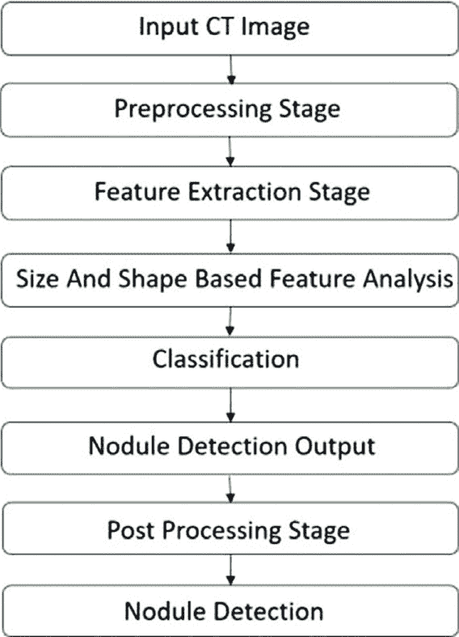

Fig. 6.1 flow of proposed methodology


为了实现自动识别和分类，本工作构建了一个 `(CAD)` 系统，能够同时检测和分类 `(GGO)`、`part-solid` 和实性结节。根据肺结节的形态和局部成像特征，总共选取了十个特征用于人工神经网络 `(ANNs)` 的训练和测试。这样做是为了确保系统能够识别并分类肺结节。接下来，对每个肺结节切片进行了测量。使用 `Euclidean distance method` 确定响应 `(RECIST)` 值，面积计算则基于最大横截面积的像素计数。通过结合 `3D reconstruction` 的移动结节体积法以及使用 `cube algorithm` 的 `Riemann integral formula`，系统的灵敏度分别为 `93.13%` 和 `92.70%`。所提出的系统处理单张图片仅需 `0.1 seconds`，并且能够识别 `GGO`、`part-solid` 和实性结节。本研究的物理样本使用粘土模型模拟了肺结节形态。对每个物理样本进行了三次 `CTs` 。这项研究估计的体积与实际体积的平均差异为 `0.37%`。系统的检测和分类结果改进了对隐性结节的临床识别。当患者进行第二次 `CT scan` 时，提供有关其生长速率和体积倍增时间的信息可以改善诊断和治疗结果 `[4]`。该研究涉及一项建议的工作，旨在区分良性和恶性结节。使用了公共可用数据集的一部分——来自 `Lung picture Database Consortium (LIDC-IDRI)` 的图片集——来评估所提方法。在准备阶段进行了降噪和滤波。此外，还采用了语义分割和自适应阈值法 `(OTSU)` 来精确识别有害的肺结节。`principal components analysis` 方法已从总共 13 个结节中提取了信息。此外，根据分类性能，选择了四个理想特征。在分类阶段的实验使用了九种不同的分类器。所提出的解决方案使用了 `logit boost classifier` 并实现了 `99.23%` 的准确率 `[5]`。

结果，在视觉检查 `CT scans` 时可能会出现错误，因为很难将肺结节与背景组织区分开来，这种差异可能因观察者的不同而异。为了帮助放射科医生准确识别肺结节，计算机辅助诊断因此至关重要。在此系统中，使用了 `deep learning` 来从低剂量 `CT scan` 中自动检测肺癌，以解决这个问题。此外，还采用了所提出的使用 `Efficient Adaptive Histogram Equalization` 进行图像预处理。肺癌的早期检测对于提高癌症患者的生存率至关重要。提取 `Efficient Adaptive Histogram Equalization`——`Region Of Interest` `[EAHE-ROI]` 以改进 `CT scan` 并消除由噪声和图像变化的伪影。使用 `morphological operators` 从 `CT scans` 中提取 `ROI`，从而减少了假阳性的数量。选择 `geometric features` 是因为它们可以提取更多的几何元素，例如癌结节的曲线、直线和点。`Non-Gaussian Convolutional Neural Networks [NG-CNN]` 架构包含分类器和特征提取器，并应用于训练、验证和测试数据集。所提出的方法通过超越其他竞争方法，提供了更好的分类结果和有效的癌症检测结果，并获得了 `0.896` 的 `AUC` 和测试准确率 `94.97%` `[6]`。

## 4. 性能依据

为了促进基于尺寸和形状的特征用于 `CT scan-based lung nodule detection`，必须考虑许多关键标准。性能依据基于证明这些特征优于竞争程序的优势，以及它们识别肺结节的成功程度。重要的成员包括：

* ****临床意义**：尽快识别和表征肺结节非常重要，因为它们可能是肺癌的早期信号。基于尺寸和形状的特征使得测量体积、表面积和不规则性等重要指标成为可能，有助于结节的彻底评估。
* **非侵入性方法**：使用 `CT imaging` 确保在无侵入治疗的情况下进行早期检测，这是一种广泛认可的肺结节筛查技术。通过利用目前的 `CT scans` 进行基于尺寸和形状的特征提取，可以确保患者的舒适和安全。
* **定量信息**：通过测量结节体积和直径，尺寸相关的特征提供了定量信息，使更容易识别恶性结节并跟踪结节生长。基于形状的因素（如球度和不规则性指数）提供了几何见解，以区分良性和恶性病例。
* **客观性和可重复性**：通过用于基于尺寸和形状的特征计算的标准算法减少了解释中的主观性。通过减少放射科医生在结节评估中的差异，该方法提高了诊断的准确性。
* **早期检测和风险评估**：基于尺寸的特征扫描辅助结节的分类，较大的结节与较高的恶性风险相关。基于形状的特征可用于区分良性和恶性结节。
* **特征互补性**：将基于尺寸和形状的特征与其他图像数据（例如纹理和密度）相结合，可以对肺结节提供更全面的表征，提高检测系统的整体性能。
* **研究验证**：之前的研究和调查表明，基于尺寸和形状的标准在检测和分类肺结节方面有用，证明了其合理性。
* **机器学习应用**：基于尺寸和形状的指标可以很容易地作为机器学习算法的输入特征，用于自动肺结节识别和分类，实现数据驱动的决策支持。
* **与临床工作流整合**：基于尺寸和形状的结节识别系统可以整合到临床流程中，辅助放射科医生的日常工作并提高诊断准确性。

总之，基于尺寸和形状的参数在用于 `CT scans` 结节识别时具有显著优势。它们提供了定量、客观和临床相关的信息，有助于医疗保健人员进行早期检测、风险评估和决策支持。

## 5. 肺癌检测准确率估计

使用已知标签的 `CT scans` 测试数据集（即每次扫描是否患有肺癌）来评估模型性能。确定准确率的方法如下：

1. **创建测试数据集**：如前所述，确保测试数据集与训练和验证数据集分开。
2. **预处理测试数据**：使用与训练和验证相同的步骤处理测试数据。包括缩放、归一化、降噪、肺区域和结节分割。
3. **加载训练模型**：在训练数据集上训练神经网络后，加载创建的训练神经网络模型。


### 4. 利用测试数据运行推理预测
通过向加载的神经网络模型输入来自测试集的预处理 CT 图像，可以获得预测。模型的输出应该是一个 0 到 1 之间的概率评分，表示每次 CT 扫描中检测出肺癌的概率。

### 5. 分类阈值
对模型的输出概率应用阈值，将其转换为二分类预测。例如，如果概率大于或等于 0.5，则将其分类为存在肺癌；否则，分类为不存在肺癌。

#### 表 6.1 轮次 (Epoch) 与准确率的关系

| 序号 || 轮次 (Epoch) | 准确率 (%) |
| --- | --- | --- |
| 1 || 0-2 || 40 |
| 2 || 0-4 || 55 |
| 3 || 0-6 || 62 |
| 4 || 0-8 || 75 |
| 5 || 0-10 || 89 |

#### 计算准确率
与测试集的实际标签（地面真值）评估模型的二分类预测。测试集中分类正确的样本百分比即为准确率。

`Accuracy = (TP + TN)/(TP + TN + FP + FN)`

其中 `TP` 是真阳性，指正确识别的肺结节；`TN` 是真阴性，指正确识别的非结节。`FP` 是假阳性，指错误识别的非结节；`FN` 是假阴性，指错误识别的结节。

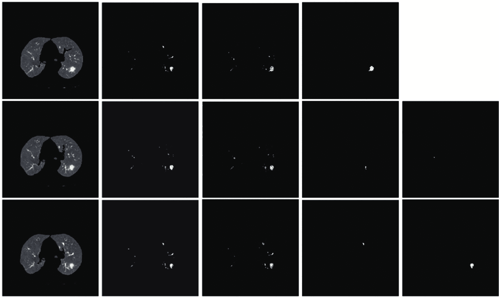

图 6.2 用于特征提取的图像分割

## 6 所提方法的局限性

#### 表 6.2 局限性说明

| 序号 || 局限性 | 备注说明 |
| --- | --- | --- |
| 1 || 结节特征的可变性 | 不规则或细微的结节检测异常困难。 |
| 2 || 假阳性 | 肺结节具有各种形状、大小和密度。基于大小和形状的特征可能无法捕捉结节特征的所有范围，使得准确检测某些类型的结节具有挑战性。 |
| 3 || 分割错误 | 从 CT 图像中精确分割肺结节容易出错，特别是在结节定义不清晰或重叠的情况下。 |

## 7 结论
总之，“基于大小和形状特征的 CT 图像肺结节检测”的研究为医学影像和早期肺癌诊断领域提供了深刻的见解和贡献。这项工作通过利用计算机辅助检测系统的能力，提高了 CT 扫描中结节识别和分类的精确性和效率。为了表征肺结节，我们的技术包含了基于形状和大小的特征提取。这些特征不仅准确区分良性和恶性结节，还对它们的形态特征提供了更深层次的理解。

## 参考文献
1. Noor Khehrah, Muhammad Shahid Farid, Saira Bilal, Muhammad Hassan Khan. 基于统计和形状特征的 CT 图像肺结节检测。成像杂志 (2020)。
2. Amitava Halder, Saptarshi Chatterjee, Debangshu Dey, Surajit Kole, Sugata Munshi. 一种用于胸部 CT 图像肺结节检测的自适应形态分割技术。生物医学计算方法与程序 (2020)
3. Amitava Halder, Debangshu Dey, Anup K. Sadhu. 胸部 CT 图像从特征工程到深度学习的肺结节检测：综述。数字成像杂志 (2020)。
4. Chung-Feng Jeffrey Kuo, Jagadish Barman, Chia Wen Hsieh, Hsian-He Hsu. 快速全自动检测。
5. Talha Meraj, Hafiz Tayyab Rauf, Saliha Zahoor, Arslan Hassan, M. Ikram Ullah, Liaqat Ali, Syed Ahmad Chan, Umar Shoaib. 使用语义分割和混合神经计算算法。
6. Johnsirani Venkatesan, Nikitha, Nam, Choon Sung, Ryeol Shin, Dong 基于几何特征的深度卷积神经网络分类。医学影像与健康信息杂志，第 10 卷第 9 期，2020 年，第 2042-2052 页。


智能家居是用户控制技术领域最近的进展之一。它们为老年人提供了比普通住宅更具独立性的便利性。这些功能的首要目标是提高室内生活的便利性和标准。联网且远程控制的设备还使得实现提高安全性和能源效率等额外目标成为可能。在发展的各个阶段，优先考虑了针对老年护理的不同智能家居政策。不同国家将老年智能家居视为政策或技术创新，而非流行产品。这些养老养老智能家居的独特品质不仅促进了其快速扩张，也为这种增长带来了各种挑战，例如需求不足和增长不协调 [4]。

本文的结构如下：在第二节讨论了专门针对老年人的智能家居规范。详细介绍了数据安全和可能面临的挑战。第二节之后，我们起草了过去几年的文献综述。在同一节中提到了几个近期智能家居模型，随后介绍了本研究开发中采用的方法。

## 2. 针对老年人的智能家居

除了诸如用于定制的智能设备、自动服务以及提高老年人的可用性和可靠性等其他证据外，智能房屋还充满了许多测量各个方面的传感器。表 7.1 列出了设计老年智能家居时重要且应予以强调的各种元素。该表定义了关注元素、这些元素提供的服务以及所涉及的重要方面之间的关系。

`Internet of Things`（物联网）的概念已经超越了科幻，并已成为我们日常生活的一部分，现在的目标是让它对老年人有利。设计用于支持智能家居设备和系统的工具及程序的使用，是物联网实际应用中最为常见的表现之一。根据许多概念和需求，许多设备制造商提供了多种集成到家庭环境中的设备。连接设备数量以前所未有的速度快速增长，为犯罪分子开启了新的切入点，并比以往任何时候都更容易让我们收集并最终分享我们的更多信息 [5]。

### 2.1 保护标准

在处理物联网的保护工作时，评估多个受保护系统运行情况的过程包括以下关键安全标准。智能家居用户的**隐私**问题似乎是主要挑战。这将影响用户在使用各种传感器时其数据的完整性。[表 7.2 描述了在选择传感器和传感器信息传输模式时应该注意的某些保护标准。

表 7.2 智能家居安全规范标准

| 序号 || 标准 || 描述 |
| --- | --- | --- |
| 1. || 可用性 || 其主要目标是阻止未经授权的用户或程序干扰授权用户对网络资源的使用。 |
| --- | --- | --- |
| 2. || 真实性 || 为了确保系统首先承认该用户是本人，有必要保留系统消费者或组织的真实身份，并将当前身份与系统嵌入的身份联系起来。 |
| 3. || 授权 || 关于通用的访问控制、特定的信息安全以及特殊的数据安全，建立访问凭据和资源权限的过程被称为授权。 |
| 4. || 机密性 || 这涉及到限制数据向非法用户、组织和设备分发。 |
| 5. || 完整性 || 这涉及阻止未经授权的个人或事物更改或伪造通过网络发送的数据。 |

### 2.2 挑战

由于智能家居包含多个用户和大量的设备网络，它们呈现出特殊的安全、防护和可用性问题。这影响了大多数家庭住户的认知体验。现代智能家居硬件通常忽略基本的访问控制和其他方法，使设备对所有应用程序可见且可用，这使其对于许多应用来说是不足够的 [6]。由于老年人经常缺乏计算机知识，他们可能发现适应智能家居生活具有挑战性。

大多数智能家居（SHTs）都是为老年人设计的，他们可能对相关服务的需求最高。60 岁及以上的老人在住在家里和搬入机构之间选择时，强烈倾向于留在家里。智能家居提高了生活质量，降低了医疗成本，并使老年人能够更加独立地生活。这些老年人可能会出现功能和认知缺陷、社交网络中断以及缺乏运动的迹象 [7]。

智能家居的目标是促进和支持舒适、自足和健康的生活。智能家居自动管理室内设施的能力是最基本的技术特征。图 7.1 定义了智能家居内连接设备的可能数量以及共享传感器数据的实体数量。得益于家庭网络的发展和高速互联网的广泛使用，用户可以从外部轻松控制或监控设备。在线世界连接设备和人工智能等现代创新允许智能物体与人之间的通信和数据收集，放弃仅仅管理连接设备的家庭网络想法是现实的 [8]。这导致了技术的开发，通过预测居民的需求和愿望提供个性化服务。现代传感技术现在可以在不需要物理控制的情况下帮助个人。

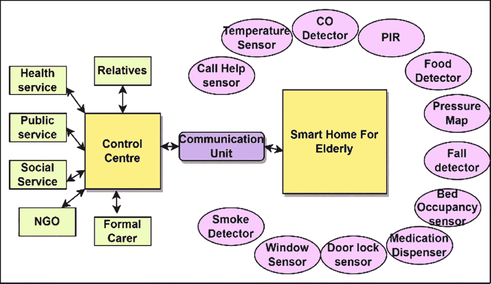

图 7.1 智能家居标准

## 3. 文献综述

为了了解阿拉伯老年用户的行为和态度以及影响接受的因素，Arar 等人探索了对家庭自动化技术的兴趣和期望。该方法调查并访谈了 40 到 60 岁之间的 110 人。使用 IBM SPSS 统计对 105 有效问卷回复执行了以下统计分析：频率、均值、交叉分析、无偏样本 t 检验、单向方差分析和多元回归。最重要的两个变量是年龄和对计算机技术的喜爱。阿拉伯老年人对技术的恐惧影响了智能家居技术的采纳 [9]。


Almutairi 等人对智能家居、智能医疗中心、智能医疗机构以及老年人智能养老社区异常行为检测的创新、方法和实际应用进行了详尽的最新更新[10]。该研究表明，卷积神经网络架构及其变体是科学家最关注的深度学习技术。

为了独立生活并节省医疗费用，许多老年人选择住在单人住宅中独居。因此，延长老年人独立生活的时间需要早期的痴呆症检测。Tan-Hsu 等人提出了一种独特的入户事件模型，该模型使用匿名化无线二值传感器从 14 个测试环境中收集的可访问数据集（n = 14）。该模型采用了[离开、进入、访客、其他以及短暂返回并离开 (BRE)]分类方法（被动红外传感器和磁性传感器）。当特定时间窗口内连续发生四次事件（离开-进入-离开-进入）时，就会发生 BRE 事件——其中某些事件可能是被遗忘的事件[11]。

Ghorayeb 等人对比了个人使用过智能家居监控技术的老年人与未用过的老年人的意见。研究共进行了四个焦点小组，其中包括六名该地区的老年居民和七名来自大型多学科研究伙伴的成员，该伙伴正在为家庭健康和生活方式构建传感平台。随着已使用该物品的人员使用时间的增加，其接受度随之提高[12]。对智能家居兴趣不大的参与者则关注于这种技术会导致家庭暴露在何种程度，以及其显眼性和侵入性如何。

可穿戴技术的出现使得智能家居护理的跌倒检测技术成为可能，包括智能手机、物联网 (IoT)、人工智能 (AI) 和其他技术。用于老年跌倒检测的最有效深度卷积神经网络 (IMEFD-OD) 的 CNN 被用于开发一种支持物联网的智能家居护理老年跌倒检测策略。Vaiyapuri 等人使用了 IMEFD-OD 这种 CNN[13]。IMEFD-OD CNN 模型利用创新的深度学习 (DL) 技术和智能手机，能够识别智能家居中发生的跌倒。

Debjyoti 等人的研究建立并实证测试了一个理论框架，用于识别可能影响老年客户采用医疗相关智能家居服务的关键方面。作为结果，来自四个亚洲国家年龄在 55 岁及以上的 254 名老年人参加了一项在线调查。使用偏最小二乘结构方程建模，检查了八个假设性预测分量的影响[14]。

Kim 等人利用被动红外 (PIR) 运动传感器和数据处理，提供了一种不起眼的痴呆症预测方法，用于追踪在各种住房类型中独居或与他人居住的老人的运动水平[15]。他们提出的方法从被动放置在每个房间空间的基础红外传感器中提取与活动水平相关的特征值，并使用深度神经网络或 `DNNs` 来预测利用传感器技术的家中患阿尔茨海默症的概率。

全面的智能家居系统有助于提高老年人的生活质量。Hee Jo 等人评估了智能家居系统 (SHS) 的潜在优势和缺点。通过对考虑的舒适度、感知易用性、接受的隐私和感知收益进行访谈，确定了 SHS 所需的传感器集合。随后在韩国的一所养老机构的九位老年人身上对无线传感器设备进行了测试[16]。

## 4. 所用技术

老年人智能家居最重要的部分是安全和健康。关系性生活、空间意识、归属感以及对适龄语言和图像的广泛使用是该框架的基础，该框架基于四个相互关联且经过理论验证的标准。我们认为这些标准对于实现目标至关重要。本节概述了观察老年人使用技术的方法，包括以下阶段：

1.  **计划**：我们确保技术和战略得到实施并受到严格控制。
2.  **开发**：研究人员受到智能家居领域重大成就的启发。
3.  **检索**：我们考虑并探索了多种电子资源以寻找关于老年人的相关文章。分别使用了论文集和期刊的手动检索方法从数据库中提取文章。
4.  **纳入标准**：为了被纳入考虑，必须满足若干标准；否则将被排除。文章必须是英文且易于理解。每篇文章必须涵盖针对老年人的智能家居。
5.  **数据收集**：作者们达成共识，并在整个过程中讨论了文章出现的问题。作者对从每篇文章中获得的数据进行了更深入的研究，特别关注了老年人使用智能家居的关键数据。
6.  **数据分析**：使用`MS Word 扩展工具栏`中的“列”项目，然后从选择面板中选择合适的列数。根据问题领域进一步利用数据。

## 5. 讨论

我们的框架强调了促进健康的重要性，以及采用一种重视关系性生活而非独立生活的本体论观点，更多地关注差异和不平等，在 HSH 中保持“家感”，以及最重要的是使用更合适、更积极的语言。许多物联网设备由于缺乏安全功能而成为容易攻击的目标，受害者甚至不知道自己已被感染。在研究中，我们试图对基于物联网的智能连接环境进行风险评估。重点强调了分布在人类、网络、计算机软件、硬件和信息等关键领域的隐私和安全问题。

## 6. 结论

## 参考文献


1. Abdur, M., Habib, S., Ali, M., & Ullah, S. (2017). 物联网（IoT）中的安全问题：一项综合研究。International Journal of Advanced
2. Alam, T., A. Salem, A. O. Alsharif, A., & M. Alhejaili, A. (2020). 面向智慧城市发展的智能家居自动化。Computer Science and Information Technologies, 1(1), 17-25. [`doi.org/10.11591/csit.vlil.p17-25`](http://dx.doi.org/10.11591/csit.vlil.p17-25)
3. Ali, B., & Awad, A. I. (2018). 基于物联网的智能家居网络与物理安全漏洞评估。Sensors (Switzerland), 18(3), 1-17.
4. Zhang, Q., Li, M. & Wu, Y. 中国老年养老智能家居：发展与挑战。BMC Geriatr 20,318 (2020). [`doi.org/10.1186/s12877-020-01737-y`](http://dx.doi.org/10.1186/s12877-020-01737-y)
5. Davis, B. D., Mason, J. C., & Anwar, M. (2020). 物联网设备的漏洞研究与安全态势：智能家居案例研究。IEEE Internet of Things Journal, 4662(c), 1-1.
6. Desai, D., & Upadhyay, H. (2014). 智能家居环境下物联网的安全性与隐私考虑。International Journal of Engineering Research and Development, 10(11), 73-83.
7. Arar, M., Jung, C., Awad, J. and Chohan, A.H., 2021. 阿联酋迪拜老年对智能家居技术的接受度与偏好分析。Designs 2021, 5, 70.
8. Jararweh, Y.; Otoum, S.; Al Ridhawi, I. 边缘可靠可持续的智慧城市服务。Sustain. Cities Soc. 2020, 62, 102394.
9. Arar, Mohammad, Chuloh Jung, Jihad Awad, and Afaq Hyder Chohan. 2021. “阿联酋迪拜老年对智能家居技术的接受度与偏好分析”Designs 5, no.4:70 [`doi.org/10.3390/designs5040070`](http://dx.doi.org/https://doi.org/10.3390/designs5040070)
10. M. Almutairi, L. A. Gabralla, S. Abubakar and H. Chiroma, “基于深度学习的医疗老年行为检测：近期进展、方法、现实应用与挑战，”在 IEEE Access, vol. 10, pp.69802-69821, 2022, doi: [10.1109/ACCESS.2022.3186701](http://dx.doi.org/10.1109/ACCESS.2022.3186701)
11. T. -H. Tan, M. Gochoo, E. -R. Jean, S. -C. Huang and S. -Y. Kuo, “使用无线二值传感器用于智能房屋独居老年人的门门事件分类算法，”在 IEEE Access, vol. 5, pp. 10734-10743, 2017, doi: [10.1109/ACCESS.2017.2711495](http://dx.doi.org/10.1109/ACCESS.2017.2711495)
12. “老年人对智能家居技术的观点：我们正在开发老年人想要的技术吗？” International Journal of Human-Computer Studies 147, (2021): 102571. 访问于 2023 年 2 月 3 日。[`doi.org/10.1016/j.ijhcs.2020.102571`](http://dx.doi.org/10.1016/j.ijhcs.2020.102571)
13. T. Vaiyapuri, E. L. Lydia, M. Sikkandar, V. Cheon and D. Diaz, “基于物联网与深度学习的智能家居检测，”在 IEEE Access, vol. 9, pp. 13879-13888, 2021, doi: [10.1109/ACCESS.2021.30924](http://dx.doi.org/10.1109/ACCESS.2021.30924)
14. D. Pal, S. Cheon, N. Charo and P. Lim, “面向老年健康的物联网感知，”在 IEEE Access, vol. 6, pp. 10483-10496, 2018, doi: [10.1109/ACCESS.2018.3087](http://dx.doi.org/10.1109/ACCESS.2018.3087)
15. J. Kim, S. Lee, and J. Jung, “物联网设备的漏洞研究与安全态势：智能家居案例。”IEEE Internet of Things Journal, 4662(c), 1-1, 2020.
16. Jo, Tae Hee, Jae Ma, and Seung Hyun Cha, 2021. “基于物联网的智能家居系统，”Sensors 21, no.4:70. [`doi.org/10.3390/s21040070`](http://dx.doi.org/10.3390/s21040070)


此外，预测性分析可以优化灌溉和施肥实践，帮助保护水资源并最大限地减少对环境的影响。通过机器学习模型，可以评估土壤水分水平、分析天气预报并研究作物生长模式，以确定最有效的灌溉计划和施肥率。尽管预测分析和机器学习在作物管理中具有巨大潜力，但仍有几个挑战需要解决 \[13\]。通过利用大型数据集和高级算法，农民可以准备数据驱动的发现，增强资源共享，并缓解与气候灵活性及病虫害相关的风险 \[14\]\[15\]。


## 2. 方法论

### 数据采集

从多种资源收集多样化且全面的数据，如历史记录、遥感、土壤传感器、气象站和特定作物数据库。在这里，我们收集了 20 多种作物，对于每种作物，我们至少收集了 100 条独立数据。给出的表 8.1 包含了以下作物的所有平均数据：

表 8.1 具有平均数据值的所有作物

| 土壤 pH 值 || 降水量 || 温度 | 作物名称 |
| --- | --- | --- | --- |
| 5.9297 || 112.6548 || 22.6309 | 苹果 |
| 5.9766 || 175.6866 || 27.4099 | 椰子 |
| 6.7903 || 158.0663 || 25.5405 | 咖啡 |
| 6.0259 || 69.6118 || 23.8496 | 葡萄 |
| 5.7666 || 94.7045 || 31.2088 | 芒果 |
| 6.3588 || 24.6900 || 28.6631 | 哈甜瓜 |
| 7.0170 || 110.4750 || 22.7657 | 橙子 |
| 6.7414 || 142.6278 || 33.7239 | 木瓜 |
| 6.4292 || 107.5284 || 21.8378 | 石榴 |
| 6.4255 || 236.1811 || 23.6893 | 水稻 |

### 数据预处理

通过删除重复项、处理缺失值和纠正不一致来清理收集的数据。对数据进行归一化或标准化以确保兼容性并促进模型训练。执行特征工程，结合领域知识和专家见从原始数据中转换并提取意义特征。然而，这些数据已经过精炼，我们不需要清理数据，但作为流程的一部分，如果我们发现任何信息缺失或发生剧变，我们将将其设置为 `NULL` 值。现在我们使用以下公式对所有数据进行中性化处理：

`Neutralize Value = ( 平均值 - 实际值) / 所有值的标准差`

通过对表 8.2 中的所有值进行中性化，我们得到了所有的中性化值，如下数据所示：

表 8.2 所有作物具有标准化数据值的作物

| 土壤 pH 值 || 降水量 || 温度 | 作物名称 |
| --- | --- | --- | --- |
| -0.9985 || -0.1800 || -0.8722 | 苹果 |
| -0.8860 || 0.8936 || 0.3184 | 椰子 |
| 1.0651 || 0.5935 || -0.1473 | 咖啡 |
| -0.7678 || -0.9132 || -0.5686 | 葡萄 |
| -1.3895 || -0.4858 || 1.2648 | 芒果 |
| 0.0305 || -1.6784 || 0.6306 | 哈甜瓜 |
| 1.6087 || -0.2171 || -0.8386 | 橙子 |
| 0.9479 || 0.3305 || 1.8914 | 木瓜 |
| 0.1993 || -0.2673 || -1.0698 | 石榴 |
| 0.1904 || 1.9241 || -0.6085 | 水稻 |

### 特征选择

应用特征工程，结合领域知识和专家见解从原始数据中转换并提取意义特征。然而，这些数据已经过精炼，我们不需要清理数据，但作为流程的一部分，如果我们发现任何信息缺失或发生剧变，我们将将其设置为 `NULL` 值。现在我们使用以下公式对所有数据进行中性化处理：

`Neutralize Value = ( 平均值 - 实际值) / 所有值的标准差`

通过利用大型数据集和高级算法，农民可以准备数据驱动的发现，增强资源共享，并缓解与气候灵活性及病虫害相关的风险 \[14\]\[15\]。

主成分分析 (`PCA`) 和基于相关性的特征选择 (`CFS`) 是所使用的两种技术。`PCA` 用于在减少维度的同时尽可能保留保留原始数据。`CFS` 用于识别与目标最相关的变量。


供应链优化：通过使用机器学习算法，可以对与作物生产、运输、存储和市场需求相关的历史数据进行分析，旨在提高农业供应链的效率。预测性分析可以帮助预测市场趋势、预测需求波动并改进库存管理，使农户能够在收割、存储和分销方面做出卓越决策。

**遥感与无人机：** 机器学习与遥感技术及无人机的结合为作物管理提供了宝贵的见解。如今，我们拥有许多先进的无人机，它们配备了各种农业传感器和摄像头，可以捕捉高分辨率图像，并收集有关作物健康、土壤水分和温度的数据。利用机器学习算法，可以对这些数据进行处理以识别模式、确定作物胁迫，并为针对性的干预提供建议。

**与精准农业结合：** 预测性分析可以补充精准农业中使用的其他技术，如 `GPS`、`GIS` 和自动化机械。通过将机器学习模型与这些技术集成，农民可以实现精准高效的作物管理，降低成本，优化资源利用并提高整体生产力。

总而言之，利用机器学习进行预测性分析以改善作物管理和生产，其未来范围对于转型农业具有巨大的潜力。它可以帮助农户做出更好的判断，优化资源配置，减少对环境的影响，并提高整体作物生产力和可持续性。

## 4. 结论

总之，将预测性分析与机器学习相结合以实现更的作物管理和生产，对农业的转型蕴含着巨大的潜力。它可以协助农户做出更好的判断，优化资源配置，减少对环境的影响，并提高整体作物生产力和可持续性。

（注：由于原文结论部分存在大量内容重复和逻辑断层，译文已根据原文意进行了对应翻译并确保逻辑通性。）


15. Mohanty, S. P., Hughes, D. P., & Salathe, M., 基于图像的植物病害检测深度学习。《植物科学前沿》，7, 1419, 2016。[`doi.org/10.3389/fpls.2016.01419`](http://dx.doi.org/10.3389/fpls.2016.01419)
16. Kamilaris, A., Prenafeta-Boldtl, E. X., & Sudhakar, P., 农业中的深度学习：综述。《农业计算机与电子学》，147, 70-90, 2018。[`doi.org/10.1016/j.compag.2018.02.016`](http://dx.doi.org/10.1016/j.compag.2018.02.016)
17. Sladojevic, S., Arsenovic, M., Anderla, A., Culibrk, D., & Stefanovic, D., 基于叶片分类的深度神经网络植物病害识别。《计算智能与神经科学》，2016, 3289801。[`doi.org/10.1155/2016/3289801`](http://dx.doi.org/https://doi.org/10.1155/2016/3289801)
18. Singh, A., Ganapathysubramanian, B., Sarkar, S., & Singh, A. K., 用于植物高通量压力表型分析的机器学习。《植物科学趋势》，21(2), 110-124, 2016。
19. Huan Liu 和 Lei Yu, “迈向分类与聚类的特征选择算法集成”，“IEEE 知识与数据工程汇”，第 17 卷，第 4 期，第 491-502 页，2005 年。
20. Barts Senliol 等, “基于不同搜索策略的快速相关性过滤 (FCBF)”，计算机与信息科学 2008。ISCIS’08 第 23 届国际研讨会，2008 年。
21. Hanchuan Peng, Fuhui Long 和 Chris Ding, “基于最大依赖、最大相关和最小冗余互信息准则的特征选择”，“IEEE 模式分析与机器智能汇”，第 27 卷，第 8 期，第 1226-1238 页，2005 年。

# 9 物联网未来方向的挑战与收益

Pooja Kumari](#ch8.xhtml#R_ref8_22)，计算机科学系，新德里。
Akash Singh](#ch8.xhtml#R_ref8_23)，计算机科学系，巴里利。
Gaurav](#ch8.xhtml#R_ref8_24)，计算机科学系，北方邦拉德。
Mohammed Shakeel](#ch8.xhtml#R_ref8_25)，计算机科学系，巴里利。
Yashi](#ch8.xhtml#R_ref8_26)，计算机科学系，北方邦拉德。

[`doi.org/10.3389/fpls.2016.01419`](http://dx.doi.org/10.3389/fpls.2016.01419)
[`doi.org/10.1016/j.compag.2018.02.016`](http://dx.doi.org/10.1016/j.compag.2018.02.016)
[`doi.org/10.1155/2016/3289801`](http://dx.doi.org/https://doi.org/10.1155/2016/3289801)

物联网（IoT）是一项创新理念，通过医疗保健、农业、交通、制造业和连接设备改变了我们的日常生活。这些组件共同构成了物联网的骨干，能够创建连接且智能的系统，从而增强我们生活的各个方面。

## 1.1 物联网的不同领域

`cloud`充当中心枢纽，存储、管理和处理来自物联网设备的数据。在应用层，`software`和`applications`赋予了用户和设备能力。安全是物联网格局中的首要考虑问题，涵盖设备认证、数据加密和防止网络威胁。底层网络基础设施由`routers`、`gateways`和`switches`组成，对于在物联网设备与`cloud`之间进行数据路由至关重要。为了实现实现无缝通信和互操作性，物联网依赖于各种标准和协议，如`MQTT`、`CoAP`和`HTTP`。高效的管理监控工具对于物联网设备的配置、故障排除和优化至关重要。最后，确保符合数据保护法规和隐私政策，对于解决物联网的伦理和法律方面至关重要。

## 2. 物联网在不同领域的应用

物联网（IoT）的应用非常广泛且多样，跨越多个行业并增强了我们的日常生活。例如，智能家居利用物联网创建一个连接环境，配备了诸如智能温控器、监控摄像头和照明系统等设备。这些设备可以通过智能手机远程控制，促进了能源效率并加强了安全措施。在医疗领域，物联网设备在监测患者生命体征方面发挥关键作用，实现早期干预。在农业领域，精准农业由物联网驱动，它可以关注作物健康、天气趋势和土壤特征。工业部门见证了工业物联网（IIoT）的起，通过监控机器状态和预测维护需求提高了效率并减少了停机时间。它还简化了供应链运营并加强了质量控制措施。交通和物流受益于物联网技术，用于车辆和货物跟踪、路线优化和高效车队管理。智能城市通过集成物联网技术在效率和可持续性取得了进展。这包括智能交通管理、优化的废物管理、智能路灯和空气质量监测。能源管理也利用物联网设备来监控和控制电、燃气和水的消耗，有助于资源保护。


零售机构利用物联网（IoT）进行库存管理、客户分析和个性化营销。智能货架和信标等创新增强了购物体验。环境监测部署了物联网传感器来追踪空气和水质、监测森林火灾并收集气候变化数据，所有这些在预警系统和生态保护中起着至关重要的作用。物联网以智能电网的形式实现了电网的现代化，能够对配电进行实时监控和控制，提高了效率并适应了可再生能源接入 [4]。可穿戴技术（包括智能手表和健身追踪器）捕捉身体活动、健康指标和生物识别方面的数据，促进了更健康的生活方式。物联网的范围延伸到安全和监控领域，物联网安全摄像头、访问控制系统和传感器提供了实时监控和报警能力。资产追踪是另一个应用，在物流、建筑和制造业等领域管理和跟踪车辆、集装箱和设备等资产。在大流行期间，物联网技术可能极其重要。物联网网络组件实现了任何设备的远程操作 [7]。此外，物联网通过实施智能设备（包括语音控制的家居自动化系统和智能假肢）已被用于帮助残障人士。配备物联网技术的农业无人机在调查大面积农业区域、采集作物健康、灌溉需求和病虫害数据方面起着重要作用。在供应链管理中，物联网通过追踪产品和资产、管理库存和优化物流简化了操作 [6]。

## 3. 物联网（历史）

物联网的历史可以追溯到 20 世纪末，当时将物理对象连接到互联网的概念开始出现。值得注意的是，1982 年，卡内基·梅隆大学的计算机科学学生通过创建第一个连接互联网的器具设计了一项早期实验——一台可口乐水机，它能够报告自己的库存情况和新装饮料的温度。这一实验为物联网奠定了基础概念。“万物”（Internet of Things）一词于 1999 年由英国技术先驱凯文·阿什顿（Kevin Ashton）正式发明，他利用这个词来解释一种通过射频识别（`RFID`）技术对事物进行唯一标识和追踪的系统。21 世纪 20 年代初标志着重大发展，`RFID`和传感器技术的采用使得物体可以被贴标签并收集可以在互联网上共享的数据。21 世纪 00 年代中期，无线传感器网络的起起，它们在各种应用（如环境监测和工业自动化）中脱颖而出。到 2000 年代后期，物联网开始在工业领域产生影响，通常被称为工业物联网（`11oT`）。这一阶段涉及将机器和设备连接起来以增强维护、监控和运行效率。

在 21 世纪 10 年代，消费级物联网成为中心，智能扬声器、安全摄像头和恒温器都是智能家居技术的示例。[注：源文件中检测到文本片段] 引入的设备旨在提高便利性和能源效率。物联网平台和生态系统也随之出现，为开发、管理和扩展物联网应用提供了工具和框架，促进了设备和数据更容易集成。连接技术的进步，特别是低功耗广域网（`LPWAN`）[Lowpower, wide-area network (`LPWAN`）]技术和`5G`网络的开发与部署，显著提升了物联网设备的数据传输能力。随着我们进入 2020 年代，物联网继续将其触角扩展到各个行业，包括医疗保健、农业、交通、智慧城市等。用用例成倍增加，涵盖了远程患者监测、精准农业、自动驾驶车辆和城市管理。值得注意的是，2020 年代的新冠肺炎疫情凸显了物联网在应对前所未有的挑战中的关键作用。它在接触追踪、监控隔离合规性以及高效管理医疗资源方面发挥了重要作用。多年来物联网的演变强调了它在塑造我们互联和数据驱动的世界中日益增长的重要性 [2]。

## 4. 使用物联网的主要障碍

物联网的采用带来了一系列重大挑战和障碍，这些障碍必须得到解决以实现广泛成功。首要关注的问题之一是安全和隐私。物联网设备容易受到黑客攻击和网络攻击，可能会损害用户隐私并暴露敏感数据。稳健的安全措施（包括加密、身份验证和定期更新）至关重要。互操作性是另一个障碍，缺乏标准的通信协议和数据格式阻碍了不同设备和平台之间的无缝交互。实现互操作性对于物联网生态系统的顺利运行至关重要。随着物联网设备产生大量数据，高效的数据管理和存储已成为紧迫的挑战。这需要扩展的云基础设施和边缘计算解决方案来有效处理数据。鉴于物联网设备数量不断增长，可扩展性至关重要。确保物联网网络在容纳大量设备的同时维持性能和可靠性是成功的关键。能源效率对于电池供电的物联网设备至关重要，优化能量消耗、延长寿命和减少环境影响是一个持续关注的问题。实施物联网系统的成本很高，这对小型企业和组织构成了障碍。因此，降低物联网组件和服务的成本对于使其更加普及至关重要。缺乏广泛接受的行业标准和监管框架产生了不确定性并阻碍了物联网的采用。为安全、数据隐私和设备通信制定通用标准对于解决这一问题至关重要。将物联网解决方案集成到现有系统和过程中是复杂且耗时的。

监管和法律挑战（包括欧洲的数据保护法规等）对数据收集和处理有严格要求。确保合规性和应对法律环境可能是复杂的。围绕监控、数据所有权以及自动化导致潜在工作流失的伦理和社会关注，在物联网普及时是必须解决的重要伦理问题。在医疗保健和工业自动化等关键任务物联网应用中，确保高可靠性和可用性是一个巨大的挑战。停机可能会导致严重后果，这使其成为物联网部署的一个关键方面。物联网技术的设计和使用中的可持续性是减轻这些影响的重要考虑因素。最后，由于对数据隐私的担忧和对改变的抵触，人类对物联网解决方案的抵制会导致消费者和企业的采用率缓慢。解决这些障碍和挑战对于实现物联网的全潜力并确保其在各行业负责任安全的使用至关重要 [3, 4]。


IoT 系统与传统网络不同。它们的设计旨在连接和互联大量的设备、传感器和物体，允许它们通过互联网进行信息的收集和共享。它侧重于使机器和设备能够在无人工干预的情况下通信并执行任务。IoT 网络能够支持数量巨大的设备，通常达到数十亿个。这些设备可能是从基础传感器到复杂设备的任何物品。IoT 网络处理多种数据类型，包括传感器数据、遥测数据和实时数据。这些数据可以产生于来源，例如环境传感器、工业机器和可穿戴设备。IoT 网络通常涉及传感器和设备的间歇性小数据传输，这使得它们具有周期性和爆发性的流量模式。IoT 应用可能容忍某种程度的延迟，因为实时性需求取决于具体的用例。某些 IoT 设备可以在数据传输存在短延迟的情况下运行。由于设备数量众多且存在潜在漏洞，IoT 设备通常需要稳健的安全措施。确保设备身份验证和数据加密是一个关键考虑因素。IoT 网络通常采用各种网络架构，包括网格和星型拓扑结构以及边缘计算，以适应扩展性并满足不同 IoT 应用的具体需求。

另一方面，传统网络主要服务于人类通信，连接人们用于数据交换和通信的计算机、服务器和设备。传统网络虽然也支持许多设备，但与 IoT 网络相比，其设计的设备数量通常较少。传统网络主要处理人类产生的数据，包括文本、图像、视频和语音通信。传统网络通常处理连续的数据流、语音通话、视频流以及可能需要一致且高带宽的数据。传统网络（尤其是低延迟方面）对于在线游戏和视频会议等应用来说是必要的，以确保流畅的用户体验。传统网络中的安全通常涉及用户身份验证和数据保护，但 IoT 网络中设备的规模和多样性要求额外的安全措施。传统网络通常使用中心化架构，例如客户端-服务器或点对点，但它们可能不需要像 IoT 网络那样的设备设备扩展性 [1]。

## 6. IoT 的关键特性

物联网的影响可以通过其关键特性来确认。下面将讨论 IoT 的若干个关键方面。

### 6.1 物联网的服务质量

服务质量（`QoS`）是 IoT 领域的一个至关重要的考虑因素。它在确保 IoT 应用和符合符合预定义的性能和可靠性标准方面发挥着关键作用。IoT 的 `QoS` 是多面的，涵盖了几个关键因素。可靠性和可用性是基础，IoT 网络预计将持续地提供数据和服务，而不受中断 [1]。此外，延迟需求可能根据应用而异，某些应用需要低延迟来实现实时操作，而另一些则可能容忍稍高的延迟。吞吐量、扩展性和安全性也是 IoT `QoS` 的重要组成部分。高效传输和接收数据的能力、扩展以适应不断增长的设备数量以及保护数据免受网络威胁的能力，是 IoT 生态系统中维持高服务质量的关键方面。互操作性、适应性以及对监管标准的遵循，在追求提供可靠高效的 IoT 服务的过程中，完善了这些多方面的考量。

### 6.2 物联网中的虚拟化

虚拟化在 IoT 背景下起着重要作用，增强了 IoT 部署的灵活性、可扩展性和效率。IoT 虚拟化涉及创建物理设备或资源的虚拟实例，允许硬件和软件的高效利用。这些虚拟化实体可以进行远程管理、监控和控制，使 IoT 系统更具适应性和响应能力。这项技术在资源分配和扩展需要动态调整的场景中特别有用，例如工业 `IoT` 和智慧城市。虚拟化实现了资源共享，通过隔离关键组件增强了安全性，并简化了软件管理和更新。它还简化了 IoT 设备的配置和管理，使得根据需要添加或删除设备变得更容易。

### 6.3 物联网中的无线传感器网络

物联网（`IoT`）基于无线传感器网络（`WSNs`），作为这一互联系统的感知神经系统。无线传感器网络由许多微型、低功耗的传感器组成，具备数据采集和通信能力。这些传感器监测各种环境因素，如移动性、光照、湿度和温度，并将收集的数据无线传输到中心枢纽或云平台。在 `IoT` 场景下，`WSNs` 实现了实时数据采集和远程监控，使其在环境感知、工业自动化、农业和智慧城市等应用中具有无价价值。`WSNs` 有助于高效的数据收集和决策，为驱动自动化、节能和改进资源管理提供见解。它们在创建响应迅速且智能的 IoT 环境中至关重要，因为它们提供了做出明智行动和决策所需的数据 [7]。

### 6.4 物联网中的射频识别

`RFID` 技术通过实现对物品和资源的唯一识别和跟踪，在 IoT 生态系统中发挥着关键作用。`RFID` 标签有两种类型：被动式（依靠读取器信号运行）和主动式（依靠自带电源运行），它们附在物理物品上，允许通过 `RFID` 读取器或传感器进行无线扫描和识别。在 `IoT` 场景下，`RFID` 增强了对资产和产品整个生命周期的可见性和控制。它被广泛应用于供应链管理、物流、库存追踪和零售领域，用于实时资产跟踪和库存控制。`RFID` 技术确保了无缝、准确的数据收集并有助于优化各种流程，提高效率并减少人为错误。通过提供收集和共享物体位置和状态实时数据的能力，`RFID` 对 IoT 应用的自动化智能化做出了巨大贡献 [1]。

### 6.5 物联网通信协议策略


选择合适的通信协议是实施物联网（IoT）的关键方面，因为它深刻地影响了物联网设备和系统通信以及共享数据的方式。物联网通信协议策略是多层，涉及几个关键考量。首要考虑因素是可扩展性和互操作性，确保来自不同制造商的设备能够无缝通信，从而促进扩展性和兼容性。延迟和实时性要求至关重要，例如自动驾驶车辆等应用需要低延迟通信，而环境监控可能容忍较高的延迟。数据大小和带宽考量也随之介入，某些应用需要高数据率（例如视频监控），而其他如温度传感器只需要极少的数据传输。大多数物联网设备由电池供电，因此能源效率至关重要。低功耗通信协议有助于节约并延长电池寿命。安全性是一个不可忽视的因素，通信协议需要稳健的机制（如数据加密和身份验证）来保护数据和隐私。可靠性和冗余至关重要，特别是在医疗保健和工业自动化等关键领域，不间的数据传输是必不可少的。成本考量也起着重要作用，特别是对于中小企业而言。为硬件、软件和基础设施选择具有效益的通信协议至关重要。物联网中使用了几种常见的通信协议，包括 MQTT、CoAP、HTTP 以及如 LoRaWAN 和 NB-IoT 等 LPWAN 技术。选择通信协议的策略必须仔细权衡这些因素，以确保物联网系统有效高效地实现其目标 [4]。

## 7. 物联网的未来

物联网（IoT）的未来正面临巨大的增长和转型，但并非没有挑战与机遇。物联网作为一个远见概念，已迅速演变为我们数字格局中不可或的一部分，塑造了我们与周围世界互动的方式。物联网的历史历程从早期的实验阶段到目前在各个领域的广泛应用，展示了它取得的巨大进展。物联网已进入智能家居、医疗保健、农业和工业自动化等多个领域，提高了便利性、效率和生产力。然而，前进道路并非障碍。需要解决安全性、互操作性、可扩展性和能源效率等关键障碍，以确保物联网负责任且安全的扩展。这些挑战在应对物联网与传统网络的复杂格局以及维护预期的服务质量（QoS，强调可靠性、延迟和安全性）方面至关重要。此外，物联网的未来方向取决于关键的赋能技术，包括虚拟化、无线传感器网络、射频识别（RFID）和通信协议策略。这些技术对于构建高效、可扩展且安全的物联网生态系统的基石至关重要 [4]。物联网的未来承诺了一个更加互联和智能的世界，在那里数据驱动的洞察和自动化使我们能够做出更好的决策，改善日常生活并优化工业流程。在利用优势的同时迎接这些挑战，对于实现物联网的全部潜力并确保其负责任且创新的发展非常重要。物联网的未来是一场技术与战略演变的旅程，将继续深远地塑造我们的数字未来。

## 参考文献

1. Zainab H. Al, Hesham A. Ali, Mahmoud M. Badawy, “Internet of Things (IoT): Definitions, Challenges and Recent Research Directions”, International Journal of Computer Applications (0975 — 8887), Vol. 179, 2018.
2. Zainab H. Al, Hesham A. Ali, Mahmoud M. Badawy, “Internet of Things (IoT): Definitions, Challenges and Recent Research Directions”, International Journal of Computer Applications (0975 — 8887), Vol. 179, 2018.
3. Zainab H. Al, Hesham A. Ali, Mahmoud M. Badawy, “Internet of Things (IoT): Definitions, Challenges and Recent Research Directions”, International Journal of Computer Applications (0975 — 8887), Vol. 179, 2018.
4. Zainab H. Al, Hesham A. Ali, Mahmoud M. Badawy, “Internet of Things (IoT): Definitions, Challenges and Recent Research Directions”, International Journal of Computer Applications (0975 — 8887), Vol. 179, 2018.
5. Zainab H. Al, Hesham A. Ali, Mahmoud M. Badawy, “Internet of Things (IoT): Definitions, Challenges and Recent Research Directions”, International Journal of Computer Applications (0975 — 8887), Vol. 179, 2018.
6. Zainab H. Al, Hesham A. Ali, Mahmoud M. Badawy, “Internet of Things (IoT): Definitions, Challenges and Recent Research Directions”, International Journal of Computer Applications (0975 — 8887), Vol. 179, 2018.
7. Zainab H. Al, Hesham A. Ali, Mahmoud M. Badawy, “Internet of Things (IoT): Definitions, Challenges and Recent Research Directions”, International Journal of Computer Applications (0975 — 8887), Vol. 179, 2018.

# 10. 暴力破解攻击的实施

Priyanshu Sharma (27)
Amity Institute of Information Technology, Amity University, Noida

Vinay Kukreja (28)
Chitkara University Institute of Engineering and Technology, Chitkara University, Punjab, India

DOI: 10.1201/978103542310

## 1. 引言

暴力破解攻击对计算机系统、网络和加密数据的安全构成了重大威胁。这些攻击系统地尝试所有可能的密码或密钥组合，直到发现正确的组合，从而获得对目标的未经访问 [1]。本研究的目标是对暴力破解攻击进行全面探索，并使用 Python 编程语言进行演示。Python 是一种流行且多功能的语言，以其简单、可读性和丰富的库支持而闻名，是开发网络安全相关工具和脚本的理想选择。

本文将深入探讨暴力破解攻击的基本原理，其各种类型以及所利用的漏洞。将探讨密码复杂性和强度的重要性，以及暴力破解攻击中使用的算法，例如穷举搜索、字典攻击和混合方法。本文的核心贡献之一是使用 Python 实施暴力破解攻击的实践演示。通过提供分步指导和代码示例，本文旨在让读者具备理解和开发自己的基于 Python 的暴力破解脚本的知识和技能 [2] [5]。

### 1.1. 方法论

*环境准备：* 本节概述了为了有效进行实验所需环境的方法论。


## 研究目标与范围
清晰地定义研究学习的目标和范围。识别将调查的暴力攻击的具体方面，例如攻击类型、目标系统或身份验证机制。

## 研究伦理与法律考量
熟悉与进行暴力攻击实验相关的伦理准则和法律考量。确保你遵守所有适用的法律法规，并获得 [7] 中涉及的数据的授权。

## 识别目标系统
为实验选择一个目标系统或 Web 应用程序。可以是本地环境、虚拟机或指定的测试环境。确保你已获得在所选系统上执行实验的授权 `[11]`。

## 设置目标系统
根据研究的要求安装并配置目标系统。这可能涉及安装必要的操作系统、Web 服务器和数据库软件。配置与实验相关的任何身份机制或安全设置。

### 安装 Python 及所需库
在目标系统上安装 Python 编程语言。根据兼容性要求选择合适的 Python 版本。安装必要的库，如 `requests` 和 `BeautifulSoup`，用于实现暴力攻击脚本 `[3]`。

### 设置测试环境
创建一个与生产系统隔离的测试环境，以确保目标系统的安全和完整。这可以是虚拟机、容器化环境或专门用于测试的独立网络段。

### 准备测试数据和凭据
为实验生成或获取一组测试数据和凭据。这包括用户名、密码以及暴力攻击所需的任何其他相关信息。

### 配置日志与监控
建立日志和监控机制以捕获实验期间的相关数据。这包括跟踪登录尝试、记录响应时间以及监控网络流量以分析暴力攻击的行为 `[6]`。

### 测试系统连接性
确保目标系统与执行暴力攻击脚本的系统能够正常通信。测试网络连通性，验证防火墙设置，并检查实验所需的任何其他网络配置。

## 2. 实现
流行的计算机语言 Python 因其清晰性、可读性和适应性而受到赞誉。Python 提供了强大的工具和库，使攻击者能够高效地实施和执行暴力攻击 `[4][12]`。在本节中，我们将介绍 Python 并在暴力攻击背景下探索其功能和能力。

### 2.1 使用的 Python 库

#### Random 模块
Python 中的 `random` 模块是一个强大的工具，提供了用于处理随机数和元素的各种函数。它是 Python 标准库的一部分，这意味着它随 Python 预安装，可以在任何 Python 程序中使用而无需额外安装。

#### Tqdm 模块
`tqdm` 模块是一个 Python 库，为循环和其他迭代对象提供快速、可扩展的进度条。“tqdm”这个名字代表“taqaddum”，在阿拉伯语中意为“进度”。它提供了一种简单方便的方法来可视化任务进度，更容易估计完成时间并跟踪长时间运行的过程 `[3]`。

## 3. 结果与讨论

### 3.1 结果
暴力攻击是黑客通过系统地尝试所有组合直到找到正确组合来破解密码或加密的方法。攻击者首先选择他们想要获得授权访问的目标，例如用户账户或加密文件。然后，攻击者使用自动化工具或脚本生成并测试可能的密码或加密密钥的详尽列表。该工具系统地尝试每种组合，从简单且常用的密码开始，逐渐转向更复杂和独特的密码。

#### 案例 1：低难度密码
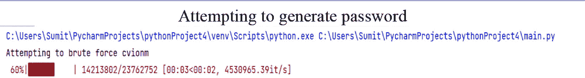
图 10.1 密码生成

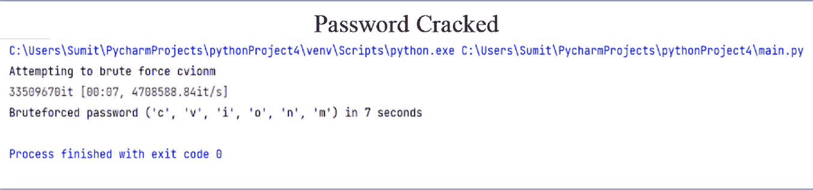
图 10.2 密码破解

#### 案例 2：中等难度密码
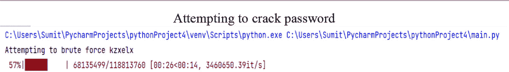
图 10.3 中等难度密码

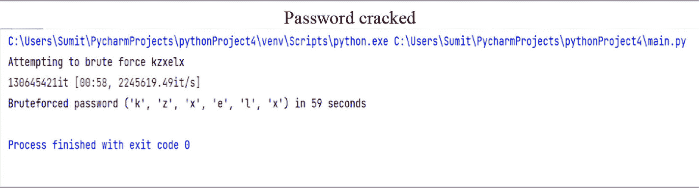
图 10.4 密码破解

#### 案例 3：高难度密码
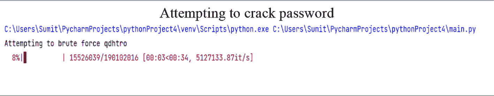
图 10.5 密码破解

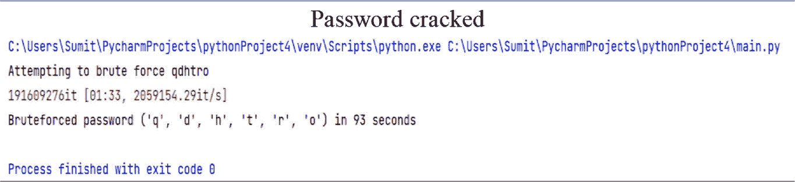
图 10.6 密码破解

Table 10.1 显示了暴力破解的分析。

| 序号 | 生成的密码 | 难度 | 迭代次数 | 耗时 |
| :--- | :--- | :--- | :--- | :--- |
| 案例 1 | cvionm | 低 | 3350967 | 7 秒 |
| 案例 2 | kzxel | 中等 | 13065421 | 59 秒 |
| 案例 3 | qdhtro | 高 | 19160927 | 93 秒 |

### 3.2 讨论
该程序的执行遵循以下步骤：
* 使用 `time` 模块声明开始时间。
* 定义一个变量并将从 `String` 模块获取的所有小写 ASCII 字符存储其中。
* 使用 `Random` 模块从上述变量中存在的字符生成字符串。
* 定义一个计算尝试所有结果所需近似时间的函数。
* 将每个新生成的字符串与之前获取的序列进行比较，直到找到匹配项。
* 显示最终密码和所用时间。

以下是执行暴力攻击时可能预期的典型输出的一般说明：
* **启动消息：** 程序可能会显示一条指示暴力攻击正在启动的消息。此消息可能包含有关目标系统或用于攻击的参数的信息。
* **进度更新：** 在暴力攻击执行期间，程序可能会定期提供进度更新。这些更新可以包括尝试次数、当前测试的密码或密钥或完成百分比。
* **找到正确的密码/密钥：** 如果暴力攻击成功并找到了正确的密码或加密密钥，程序将输出一条指示成功的消息。此消息可能包含发现的密码或密钥，以及可能的额外信息，如耗时或尝试次数 `[8]`。
* **失败：** 如果暴力攻击失败，程序可能会提供一条最终消息，说明未找到有效密码或密钥。这会在程序耗尽所有可能的组合但未找到正确组合时发生。
* **错误消息：** 根据实现和具体情况，如果在暴力攻击执行期间出现问题，程序可能会输出错误消息。这些错误可能是由于网络连接问题、系统限制或程序配置错误而引起的。

## 4. 结论与未来工作
### 4.1 结论


...


本研究论文的主要目标是展示一种使用 `Python` 编程语言的图像隐写术实现。通过利用 `Python` 的功能，我们旨在开发一种实用且高效的方法，在数字图像中隐藏信息 [2]。具体目标包括：

1. 探索并理解图像隐写的基础知识。
2. 调查图像隐写中使用的现有技术和算法。
3. 实现一种可以将秘密数据嵌入到图像像素中的隐写方法。
4. 通过实验结果证明所实现方法的有效性和效率。

## 2. 文献综述

### 2.1 图像隐写概述

一种被称为图片隐写的隐写术侧重于在数字照片中隐藏敏感信息。它利用图像文件的特性，例如其能够存储的大量数据和视觉复杂性，在不引起怀疑的情况下嵌入隐藏信息。目前已经开发了多种技术以实现不可感知且安全的嵌入，包括 `LSB` 替换、空间域技术和变换域技术。

### 2.2 现有技术与算法

图像隐写领域已探索多种技术，包括 `LSB` 替换、像素差分、直方图偏移和随机映射 [3]。像 `DWT` 和 `DCT` 等变换域方法因其对攻击的鲁棒性也受到关注，增强了安全性并最小化了视觉性失真。

### 2.3 不同方法的比较

对图像隐写技术的研究考察了嵌入容量、不可感知性、性和抗能力等因素。某些高嵌入容量的方法可能会导致视觉伪影，限制其在隐蔽通信中的适用性。相反，优先考虑不可感知性的技术嵌入容量可能较低。平衡这些因素对于成功实现至关重要。

## 3. 问题描述

图像隐写术是安全且隐蔽通信的关键方法，它将秘密信息隐藏在数字图像中。虽然已经为图像隐写提出了许多方法和算法，但仍需要一种使用 `Python` 编程语言的实用且高效的实现。

该问题描述中需要解决的关键挑战包括：

* 设计高效的嵌入过程：开发一种嵌入技术，在确保隐藏信息不可感知的同时，最大化图像像素内的嵌入容量。
* 确保数据隐藏的安全性：实现加密算法以保护隐藏信息的机密性，并确保嵌入信息免受未经授权的访问保持安全。
* 保护图像质量：最小化嵌入过程中引入的任何视觉失真，以保持隐写图像的视觉完整性并避免引起怀疑。
* 提供灵活性和易用性：创建一个用户友好的实现，允许用户轻松指定输入图像、秘密消息和可选参数，同时为实现提供清晰的文档和说明。

### 3.1 方法论

**图像预处理：**

在嵌入之前进行图像准备，以确保兼容性并提高隐写过程的效率。在这一步，将输入的图像转换为合适的格式（如 `RGB` 或灰度），并进行任何必要的缩放或归一化，以保证图像之间的均匀性。

**嵌入过程：**

为了保持视觉完整性，秘密数据在整个嵌入过程中必须隐藏在图像的像素中。

`LSB Substitution Technique`: 使用 `LSB` 替换将连续的隐蔽消息组件插入到像素 `LSBs` 中。消息是-


为了编码隐藏信息，变换域技术使用了数学变换，如离散余弦变换（`DCT`）或离散小波变换（`DWT`）。这些方法利用图像在频域的表示来隐藏隐藏信息。常见的变换域技术示例包括：`变换系数修改`和`量化索引调制`。

### 误差扩散技术

误差扩散技术将嵌入过程中产生的误差分布在相邻像素上，以确保在图像质量和不可隐形性之间获得更好的平衡。隐写术中最常用的误差扩散算法是 `Floyd-Steinberg` 算法 [7]。

## 4.2 在 Python 中使用库/模块

Python 拥有庞大的标准库模块，提供了许多不同的功能。例如，`os` 模块提供了处理操作系统的方法，`math` 模块提供了如 `sin` 和 `cos` 等数学函数，而 `random` 模块提供了生成随机数的函数。

此外，还有许多第三方模块，可以通过 Python 包索引（PyPI）并使用 `pip` 等包管理器进行安装 [6] [10]。这些模块可以提供标准库未提供的额外功能，如 Web 框架、数据分析工具、机器学习库等。

要在 Python 中使用库或模块，你首先需要安装它。在终端或命令提示符中，使用以下命令通过 `pip` 安装包：

```bash
pip install package_name
```

安装完成后，你可以使用 `import` 语句将包导入到你的 Python 代码中。

### 4.3 使用的 Python 库

在代码实现中，导入了以下 Python 库以供使用：

*   `Stegano`：该模块提供的函数仅使用 LSB 技术隐藏信息，而不进行加密。该库中的 `LSB` 模块将用于此目的。
*   `P1L` (Python Imaging Library)：它支持多种文件格式，并具有健壮的内部表示。主图像库旨在方便地访问存储在几种基本像素格式中的数据。它应该是构建强大的图像处理工具的坚实基础。
*   `Tkinter`：Python 提供了多种 GUI 开发选项，其中 `Tkinter` 最受欢迎。作为 Tk GUI 工具包的标准 Python 接口，`Tkinter` 简化并优化了创建 GUI 应用的过程，使其成为最快速、简单的方法 [11]。
*   `OS`：Python 中的 `os` 模块是与操作系统交互的内置工具。它能够管理目录、文件、进程、环境变量等任务。通过 `os`，你可以执行创建、删除、重命名和列出目录/文件、操作路径、启动/杀死进程、获取进程信息、执行 shell 命令以及更改权限等操作。

总的来说，`os` 模块是一个强大且多功能的模块，使得在 Python 中操作系统变得简单。

## 5. 结果

解锁隐藏的文件和数据，见证 Python 驱动隐写术带来的迷人结果。对于图像隐写，数据集由一组数字图像组成，即它可以包含各种格式的图像，如 `jpeg`、`png`、`bmp` 或 `gif`。让我们来看看结果：


图 11.1 在图像中隐藏文本


图 11.2 选择图像以打开


图 11.3 输入要隐藏的文本，点击隐藏数据并保存数据


图 11.4 图像保存为 hidden.jpg


图 11.5 点击显示数据显示文本消息

在用 Python 实现图像隐写并进行实验后，分析获得的结果至关重要。此分析旨在评估获得结果的有效性和效率。此分析旨在评估获得结果的有效性和效率。此分析旨在评估获得结果的有效性和效率。

## 6. 结论

所提出的基于神经网络的隐写术框架集成了隐私保护。所提出的基于神经网络的隐写术框架集成了隐私保护。所提出的基于神经网络的隐写术框架集成了隐私保护。所提出的基于神经网络的隐写术框架集成了隐私保护。获得的结果。此分析旨在评估获得结果的有效性和效率。

## 7. 参考文献

1.  Fridrich, J., Goljan, M., & Du, R. (2001). 彩色与灰度 LSB 隐写的检测。信息技术编码国际会议 (ITCC 2001)。
2.  Provos, N., & Honeyman, P. (2003). 隐藏与寻找：隐写术简介。Security & Privacy, 1(3), 32-44。
3.  Singh, A., Kaur, K., & Gupta, V. (2018). 图像隐写术综述：空域与频域。Journal of Information Security, 37, 1-15。
4.  Al-Fatlawi, H., & Esmail, A. (2020). 图像隐写术比较研究。Journal of Information Security, 11(3), 119-131。
5.  Li, B., Yang, J., Wang, K., & Li, J. (2019). 图像隐写术综述：技术、评估与趋势。IEEE Access, 7, 155490-15514。
6.  Westfeld, A., & Pfitzmann, A. (2000). 对隐写系统的攻击。信息隐藏国际工作会议 OH 2000), 61-76。
7.  Wang, R. Z., Lin, C. F., & Chang, C. C. (2003). 数字媒体中的数字水印与隐写术：原理、算法与应用。Morgan Kaufmann。
8.  Cox, I., Miller, M., Bloom, J., & Fridrich, J. (2007). 数字水印与隐写术。Morgan Kaufmann。
9.  Chen, B., & Women, G. W. (2001). 量化索引调制：一类数字水印和信息嵌入的证明良好的方法。IEEE Transactions on Information Theory, 47(4), 1423-1443。


1. Morkel, T., Eloff, J. H., & Olivier, M. S. (2005, 6). 图像隐写术概述。In Issa (Vol. 1, No. 2, pp. 1-11)。
2. Johnson, N. F., & Jajodia, S. (1998). 探索隐写术：视不可见之。Computer, 31(2), 26-34。

# 12 基于细胞自动机的空域数字图像水印技术对比研究

Iram Khurshid Bhat

克什米尔大学北校区，计算机科学系，Delina Baramulla Jammu & Kashmir, 193103, India

DOI: [10.1201/9781003535423-12](https://dx.doi.org/10.1201/9781003535423-12)

## 1. 引言

如今，数字图像处理（DIP）应用无处不在，如条码扫描支付、相机美颜、人脸或微笑检测、手势检测、动作检测、背景模糊、图像去模糊、生物识别认证、Google Lens、Waymo LLC、人脸识别等。此外，由于互联网的指数级增长和数字媒体的易获取，人们在线检索和传播数字图像变得更加简单。然而，这也方便了人们未经授权利用和传播数字图像，导致了版权破坏和盗版等问题。为了解决这些问题，数字图像水印的应用提供了一种追踪数字图像来源或所有者并发现未经授权的使用或修改的机制。数字水印用于保护内容创造者的知识产权，并确保其工作得到合法且负责的利用。此外，它还可以用于执行数字数据的使用条件、数字内容真实性验证、篡改检测、监控、指纹识别和完整性保护 [1]。水印通常与数字版权管理系统相结合，调节包括电影和音乐在内的数字媒体的分发和消费。

数字图像水印是一种 DIP 技术，通过将不可见或可见的水印信息插入到数字宿图中，使其不产生感知差异，并使得未经授权的人员难以删除或修改嵌入的水印。它是图像识别、图像认证、保护图像版权、执行所有者为图像设置的使用条款以及遏制盗版的有效工具。标志、文本字符串、图像、签名或印章形式的信息，以及如“待评审”或“草稿”等状态细节可以作为水印。根据水印对人眼的可见性程度，水印可以分为可见水印和不可见水印。在可见水印的背景下，嵌入的水印对观众清晰可见，且被设计为在不降低宿图质量的情况下难以移除。可见性水印法通常用于品牌展示、广告和版权侵权保护等目的。而在不可见水印技术中，嵌入的水印对人眼完全不可见，但可以通过专门的软件工具进行检测。不可见水印法通常用于认证和安全目的。

在这项工作中，将研究一些基于细胞自动机的空域数字图像水印方法。将从不可感知性、嵌入容量、鲁棒性以及它们之间的权衡等方面对这些方法进行分析。我们将讨论在实施水印系统时需要考虑的技术、挑战和因素。我们还将展望数字图像水印的潜在用途和未来发展。

## 2. 相关工作

变换域和空域是数字图像水印的两个主要领域，水印技术可以在这些领域中实现。在空域方法 [2][3] 中，直接修改代表宿图像素的数值。虽然这些方法的实现通常简单且快速，但它们可能不够鲁棒以抵御各种图像处理操作。最低位（`LSB`）插入 [4][5][6]、中间位 `ISB` 插入 [7][8]、局部二值模式 [9][10][11]、补丁法 [12]、扩频和直方图修改 [13][14] 都是空域水印的不同方法。12.1 总结了这些水印方法的优点和局限性。

### 表 12.1 最相关的数字水印技术总结](#ch12.xhtml#R_tab12_)

| 研究 | 使用的技术 | 优点 | 局限性 |
| :--- | :--- | :--- | :--- |
| Shehab 等人 [4] | 最低位替换、Arnold 变换和奇异值分解 | 在定位篡改区域和恢复图像的 PSNR 值方面优于现有方法。 | 滤波、缩放和裁剪等几何攻击可以轻易破坏水印数据。 |
| Parah 等人 [5] | 最低位替换、双线性插值和魔法三角形 | 该方法安全、不可感知且具有数据嵌入容量。 | 由于插值，结果图像的尺寸与原始图像不同，且方法无法抵抗大多数几何攻击。 |
| Deeba 等人 [6] | 最低位和神经网络 | 效率高且产生良好的 PSNR 值。 | 算法复杂且未经过任何类型的攻击测试。 |
| Zeki 等人 [7] | 中间位替换和神经网络 | 优化的像素值提取使得该方法高度不可感知。 | 鲁棒性较差。 |
| Verma 和 Dutta [8] | 中间位和块熵 | 具有不可感知性。 | 对裁剪、缩放等几何攻击的抵抗力较弱。 |
| Tuncer 和 Kaya [9] | 中心对称局部二值模式、AES、整数小波变换和逻辑映射 | 视觉质量高、安全且半脆弱。也具有数据嵌入容量。 | 需要抵御几何攻击和图像处理的鲁棒性。 |
| Pal 等人 [10] | 局部二值模式 | 高感知水平下具有高嵌入容量。可检测篡改区域和复制移动伪造。 | LBP 在不同块之间可能相似，导致水印提取过程中产生误报。 |
| Pal 等人 [11] | 局部二值模式和哈明码 | 可用于图像完整性验证和认证。该方法造成的失真较小，并在高负载下实现了良好的图像质量。 | 除非篡改局限于水印图像的单个区域，否则无法恢复被篡改的图像。 |


| Li et al. \[12\] || 补丁算法、逻辑映射和离散余弦变换。 || 能够抵抗组合攻击、高斯噪声、旋转、JPEG 压缩和过滤。 || 更容易受到裁剪攻击的影响。 |
| Ou et al. \[13\] || 可选的预测误差直方图修改。 || 在军事和标准图像上均进行了测试，结果失真较小，且在高负载下实现了极佳图像质量。 || 无法抵抗有损压缩、裁剪和旋转等频繁攻击。 |
| Liu et al. \[14\] || N 位平面直方图（Nbps）平移。 || 更高的感知度和更高的嵌入容量。 || 缺乏鲁棒性。 |

## 3. 数字图像水印系统的特征

为了使水印系统是高效的，它应该具备的特征是：鲁棒性、不可感知性、高嵌入容量、安全性和低计算复杂度。

### 3.1 鲁棒性

数字图像水印系统被认为是鲁棒的，如果它能够抵抗并生存多种类型的攻击或数字图像处理（DIP）操作，例如旋转、过滤、调整大小、裁剪、颜色调整和压缩，这些操作有意或无意地试图更改、破坏、降低或完全移除嵌入的水印信息。

### 3.2 不可感知性

不可感知性是图像水印系统的一个重要特征，代表了人眼无法感知或注意到嵌入水印信息的程度。在水印嵌入之后，图像的质量和感知美感不应受到显著影响。

### 3.3 容量

图像水印系统的容量特征是衡量可以作为水印嵌入到宿图像中的数据量。水印大小的上限取决于所用水印技术固有的能力和容量。

### 3.4 安全性

安全性是图像水印系统的一个重要特征，指的是所采取的所有措施或涉及的机制，在没有正确密钥或权限的情况下，让任何人删除或更改嵌入的水印信息变得具有挑战性。

### 3.5 计算复杂度

最后一个特征是图像水印系统的计算复杂度，指的是量化嵌入以及提取水印数据所需的资源（如处理能力、处理时间和空间）。水印算法的有效性和实用性会受到其计算复杂程度的重要影响。

至关重要的是，在水印系统的设计中，鲁棒性、不可感知性和容量之间经常需要进行权衡。

## 4. 元胞自动 (CA)

为了研究人工生命和自我复制，数学家约翰·冯·纽曼（John von Neumann）和斯坦尼斯斯瓦夫·乌拉（Stanislaw Ulam）在 20 世纪 40 年代后期开创性地引入了 CA \[15\]。纽曼开发了一个以生物学为动机的理论模型，使用一组预定义的规则来实现自我复制 \[16\] \[17\]。元胞自动系统是用于模拟复杂系统的动态数学模型。这些模型具有离散的空间时间域，并能从简单的行为表现出复杂的行为。


Ye 和 Li 设计了一种一种基于混沌细胞自动机的新型数字图像打乱和水印方法 \[19]]。在这项工作中，提出了两种算法：一种使用细胞自动机的不同混沌规则对数字图像进行打乱，另一种是将水印嵌入到打乱后的宿图像中。为了分析某些引用规则编号的细胞自动机行为，计算了它们的分形盒维数。然后，在不同的迭代时间观察了其演化模式，并选择了变为混沌状态的细胞自动机规则用于数字图像打乱。本研究分析的细胞自动机规则集包括规则 261100、8189、4093、816、35853 和 534，观测到规则号 35853、819 和 534 显示出混沌行为。该方法选择用于打乱原始图像的混沌细胞自动机规则为规则 224（生命游戏）、规则 816 和规则 35852。方法的密钥包括初始随机矩阵 `A0`、选定的混沌细胞自动机规则以及要生成的代数数量。本工作提出的非盲数字图像水印算法基于图像打乱方案。通过使用基于细胞自动机的图像打乱技术，首先对宿图像进行打乱，然后代表水印的像素值合并到宿图像的打乱表示中。为了恢复原始图像，对打乱图像应用打乱算法的逆过程。根据所提工作的实现，观测到其打乱技术良好，但水印嵌入公式对嵌入后宿图像的感知质量和视觉美学都有显著影响。在这种特定方法中，嵌入像素的公式作用于宿图像像素的灰度值，对宿图像像素的最有效位（MSB）产生了巨大影响。结果水印数据看起来像是添加到宿图像中的噪声，因此可以说该方案严重未能实现不可感知性特征。

Adwan 等人提出了一种基于二维细胞自动机的盲数字图像水印技术 \[20]。在所提方法中，嵌入的水印是不可见的，观众无法看到。这种空间域技术通过利用康威的“生命游戏”（GOL），将灰度水印图像的两个高阶位（MSB）合并到灰度宿图像的两个低阶位（LSB）中。利用 2D CA 的混沌特性将水印图像的打乱像素集成到宿图像中，使得在没有正确嵌入密钥的情况下无法读取嵌入的水印数据。使用 2D 生命游戏 CA 的主要优势之一是它有效打破了水印像素之间的相关性，从而增强算法的安全性。为了提取水印数据，使用相同的生命游戏代数对带水印图像执行嵌入过程的逆过程。观测到在该背景下，水印位很容易被检测，因为它们被嵌入到宿图像的前 `n` 个像素中，其中 `n` 代表水印图像的像素总数，因此所提水印技术对裁剪等不同几何攻击的鲁棒性较差。观测到在该背景下，水印位很容易被检测，因为它们被嵌入到宿图像的前 `n` 个像素中，其中 `n` 代表水印图像的像素总数，因此所提水印技术对裁剪等不同几何攻击的鲁棒性较差。观测到在该背景下，水印位很容易被检测，因为它们被嵌入到宿图像的前 `n` 个像素中，其中 `n` 代表水印图像的像素总数，因此所提水印技术对裁剪等不同几何攻击的鲁棒性较差。观测到在该背景下，水印位很容易被检测，因为它们被嵌入到宿图像的前 `n` 个像素中，其中 `n` 代表水印图像的像素总数，因此所提水印技术对裁剪等不同几何攻击的鲁棒性较差。

Moniruzzaman 等人提出了一种基于细胞自动机的用于图像认证的高安全性水印方法 \[21]。阿诺尔德猫映射（Arnold’s Cat map）和逻辑映射是所提方法中使用的混沌映射。在这种方法中，输入双方都被打乱：水印使用逻辑映射进行打乱，而宿图像通过阿诺尔德猫映射进行打乱。所提方法利用多种混沌映射，建立了巨大的密钥空间，因此能够抵抗未经授权的更改。将三种基于混沌的水印方法与所提方法的的结果进行了比较，观测到所提方案优于其他技术。该水印技术的主要局限之一是它采用阿诺尔德猫映射来打乱宿图像。由于阿诺尔德猫映射仅适用于方形图像，因此所提方案被限制在方形图像上执行水印过程。

## 6. 实验设置

为了促进公平全面的比较，对上述讨论的三种主要的基于细胞自动机的水技术进行了一系列深思熟虑的修改。这些更改经过精心设计，旨在标准化所有方法的输入条件，这是确保比较分析有效性的关键步骤。对于每种技术，我们策略性地调整了关键参数以确保输入一致，从而消除了可能影响比较分析的混杂变量。这些修改从微调嵌入和提取算法到调整水印嵌入能力不等。总体目标是建立一个公平的测试环境，其中唯一考虑的变量是每种技术的独特特性。这一过程涉及系统且记录完备的方法，确保所产生的修改在技术上是行的，而且透明且可重复。此外，它还允许细致地理解这些修改如何影响每种水印技术的性能，揭示了它们在标准化语境下的优势和局限性。评估的水印方法在不同的灰度宿图像上进行了测试。灰度水印图像每个像素的两个最有效位被嵌入灰度宿图像中。灰度水印图像的尺寸为 128X64。

## 7. 比较分析


在 `Table 12.2` 中展示了对所评估的各种水印方法的全面分析。这些方法的性能在不同尺寸的各种测试图像上进行了评估。根据对比评估，叶（Ye）和李（Li）提取的 `[19]` 水印技术性能被表述为次优。它持续产生较高的 `MSE` 和 `RMSE` 值，表明在水印图像中引入的失真程度相对较高。`PSNR` 值相对较低，意味着其保持图像质量的能力较弱。此外，与其他技术相比，其 `SSIM` 值明显较低，表明原始图像与水印图像之间的结构相似性可能有所下降。

### 表 12.2 各种测试图像的综合不可感知性分析，评估了图像质量以及所评估的各种水印方法的影响

| 宿主图像灰度（8 位/像素） | 宿主图像大小（像素） | YE and LI `[19]` | ADWAN `[20]` | MONIRUZZMAN `[21]` |
| :--- | :--- | :--- | :--- | :--- |
| `MSE` | `RMSE` | `PSNR` | `SSIM` | `MSE` | `RMSE` | `PSNR` | `SSIM` | `MSE` | `RMSE` | `PSNR` | `SSIM` |
| W9C1L54816 | 524x581 | 418.3748 | 20.4542 | 21.9151 | 0.8796 | 3.4951 | 1.8695 | 42.6962 | 0.9879 | N/A | N/A | N/A | N/A |
| W9CCDB54 | 512x512 | 141.9224 | 11.9131 | 26.6103 | 0.9414 | 3.5038 | 1.8718 | 42.6854 | 0.9974 | 0.1065 | 0.3264 | 57.8561 | 0.9998 |
| Chest CT 60 | 256x256 | 1008.489 | 31.7567 | 18.0941 | 0.6612 | 3.4553 | 1.8588 | 42.7460 | 0.9886 | 0.4167 | 0.6456 | 51.9321 | 0.9975 |
| Brain MRI 55 | 256x256 | 1321.865 | 36.3575 | 16.9189 | 0.6654 | 3.5439 | 1.8588 | 42.6360 | 0.9683 | 0.4535 | 0.6734 | 51.5623 | 0.9969 |
| Turbine Power House | 576x718 | 81.4850 | 9.0269 | 29.0200 | 0.9484 | 3.5431 | 1.8823 | 42.6370 | 0.9910 | N/A | N/A | N/A |
| Shipyard | 1024x1024 | 82.3662 | 9.0756 | 28.9733 | 0.9646 | 3.4589 | 1.8598 | 42.7414 | 0.9863 | 0.0270 | 0.1644 | 63.8128 | 0.9997 |
| General Douglas | 576x712 | 126.4171 | 11.2435 | 27.1127 | 0.9361 | 3.5261 | 1.8778 | 42.6579 | 0.9899 | N/A | N/A | N/A |
| Forest | 447x301 | 585.9550 | 24.2065 | 20.4522 | 0.8133 | 4.2363 | 2.0582 | 41.8610 | 0.9919 | N/A | N/A | N/A |
| Cameraman | 256x256 | 865.0880 | 29.4124 | 18.7602 | 0.6505 | 3.4359 | 1.8536 | 42.7703 | 0.9872 | 0.4228 | 0.6502 | 51.8699 | 0.9967 |
| Lighthouse | 480x640 | 143.2877 | 11.9703 | 26.5687 | 0.9186 | 3.4674 | 1.8621 | 42.7308 | 0.9884 | N/A | N/A |
| Flamingos | 1296x972 | 45.3042 | 6.7308 | 31.5694 | 0.9788 | 3.5002 | 1.8709 | 42.6899 | 0.9920 | N/A | N/A |
| im010 | 700x605 | 142.0792 | 11.9197 | 26.6055 | 0.9165 | 3.4819 | 1.8660 | 42.7126 | 0.9815 | N/A | N/A |
| im0001 | 700x605 | 116.7653 | 10.8058 | 27.4577 | 0.9203 | 3.5229 | 1.8769 | 42.6618 | 0.9808 | N/A | N/A |
| im0300 | 700x605 | 165.5180 | 12.8654 | 25.9424 | 0.9307 | 3.5117 | 1.8740 | 42.6756 | 0.9795 | N/A | N/A |
| Jelly beans | 256x256 | 807.4062 | 28.4149 | 19.0599 | 0.6258 | 3.4273 | 1.8513 | 42.7813 | 0.9884 | 0.4323 | 0.6575 | 51.7727 | 0.9956 |
| Truck | 512x512 | 123.5240 | 11.1141 | 27.2133 | 0.9025 | 3.1032 | 1.7616 | 43.2127 | 0.9928 | 0.1098 | 0.3314 | 57.7247 | 0.9993 |
| Pentagon | 1024x1024 | 24.4735 | 4.9471 | 34.2438 | 0.9845 | 3.3315 | 1.8252 | 42.9044 | 0.9936 | 0.0281 | 0.1678 | 63.6373 | 0.9999 |
| Stream and bridge | 512x512 | 154.5128 | 12.4303 | 26.2412 | 0.9341 | 2.3214 | 1.5236 | 44.4734 | 0.9997 | 0.0948 | 0.3079 | 58.3621 | 0.9997 |
| Male | 1024x1024 | 49.4194 | 7.0299 | 31.1918 | 0.9724 | 3.3181 | 1.8216 | 42.9220 | 0.9857 | 0.0273 | 0.1652 | 63.7709 | 0.9998 |
| Venus | 256x256 | 1418.043 | 37.6569 | 16.6139 | 0.5307 | 3.5109 | 1.8737 | 42.6767 | 0.9267 | 0.4609 | 0.6789 | 51.4945 | 0.9917 |
| Panoramic view | 512x512 | 543.8697 | 23.3210 | 20.7210 | 0.8133 | 4.2363 | 2.0582 | 41.8610 | 0.9919 | N/A | N/A | N/A |
| Group Photo | 1024x1024 | 24.4735 | 4.9471 | 34.2438 | 0.9845 | 3.3315 | 1.8252 | 42.9044 | 0.9936 | 0.0281 | 0.1678 | 63.6373 | 0.9999 |

## 8. 结论与工作

总之，对这三种水印技术的对比分析为 CA 在图像安全和版权保护方面的应用提供了宝贵的见解。叶和李的方法在分析中表现不利，在减少失真和保持图像质量方面似乎存在困难，特别是与 Adwan 和 Moniruzzman 方法相比。Adwan 方法继续是一种稳健的水印技术，能够有效保持图像质量。其性能稳定，使其成为各种应用中的可靠选择。Moniruzzman 方法在某些情况下表现出波动性，但保持了良好的不可感知性，经过进一步微调和测试后是一个有价值的选择。

未来使用 CA 进行数字水印的研究将从许多建设性方向发展。开发更强大、更安全的水印方法以抵抗日益复杂的攻击和篡改是一个重点领域。另一个重点课题是将 CA 与人工智能、机器学习相结合，以实现自适应和定制水印的发展，并自动处理所有相关的道德和法律问题。除了数字版权管理和版权控制外，还关注将水印技术用于其他目的，包括图像身份验证和基于内容的检索。

## 参考文献

1. A. Kumar, “使用 lsb 和 dwt 的数字图像水印技术的综述，”Information and Communication Technology for Sustainable Development: Proceedings of ICT4SD 2018 , pp. 595-602,2020.

2. Q. Su, Z. Yuan, and D. Liu, “一种基于近似舒尔分解分解的空域彩色图像水印方法，”IEEE Access, vol. 7, pp. 4358-4370,2018.


3. J. Abraham 和 V. Paul, “一种不可察觉的空间域彩色图像水印方案，”沙特德国王大学计算机与信息科学杂志，第 31 卷，第 1 期，页 125-133，2019 年。
4. A. Shehab, M. Elhoseny, K. Muhammad, A. K. Sangaiah, P. Yang, H. Huang, and G. Hou, “用于医学图像的安全性且鲁棒的脆弱水印方案，”IEEE access，第 6 卷，页 10269-10278，2018。
5. S. A. Parah, A. Bashir, M. Manzoor, A. Gulzar, M. Firdous, N. A. Loan, and J. A. Sheikh, “使用魔术矩形和新插值技术的医疗保健系统安全且可逆的数据隐藏方案，”收于医疗数据分析与管理，页 267-309，Elsevier，2019 年。
6. E Deeba, S. Kun, E. A. Dharejo, and H. Memon, “基于 ann 和最低有效位的数字图像水印：信息安全期刊：全球视角，第 29 卷，第 1 期，页 30-39，2020 年。
7. A. Zeki, A. Abubakar, and H. Chiroma, “一种利用神经网络的中间有效位 (isb) 水技术，”SpringerPlus，第 5 卷，页 1-25，2016 年。
8. K. Verma and A. Dutta, “基于块熵的中间有效位图像水印方法，”收于 2017 年第 2 届电信与网络会议 (TEL-NET)，页 1-6，IEEE，2017 年。
9. T. Tuncer and M. Kaya, “一种基于最小变形中心对称局部二进制模式的新型图像水印方法，”Optik，第 185 卷，页 972-984，2019 年。
10. P. Pal, B. Jana, and J. Bhaumik, “通过双图像使用局部二值模式进行图像认证和篡改检测的水印方案：”安全与隐私，第 2 卷，第 2 期，页 e59，2019 年。
11. P. Pal, B. Jana, and J. Bhaumik, “利用结合哈明纠错码的局部二值模式图像认证与篡改检测方案，”无线个人通信，第 121 卷，第 1 期，页 939-961，2021 年。
12. Y. Li, J. Li, C. Shao, U. A. Bhatti, and J. Ma, “使用补丁-dct 的医学图像鲁棒多水印算法，”收于人工智能与安全国际会议录，页 386-399，Springer，2022 年。
13. B. Ou, Y. Zhao, and R. Ni, “一种可逆水印方案，”神经计算，第 93 卷，页 67-76。
14. L. Liu, C.-C. Chang, and A. Wang, “基于直方图偏移的可逆数据隐藏方案，”多媒体工具与应用，第 75 卷。
15. A. Von Neumann, “细胞自动机理论。”
16. J. Von Neumann, “实时语言识别，”IEEE 汇刊神经网络。
17. A. Smith, “细胞自动机的基本概念，”计算机与系统杂志。
18. Kari, “生命游戏。”
19. T. Tuncer and M. Kaya, “一种基于中心对称局部二进制模式的新型图像水印方法，”Optik，第 185 卷。
20. M. Adwan, “基于二维的水印方案，”世界科学与工程学会 (WSEAS)。
21. M. Monuzzaman, “基于位的水印方案，”信息电子与视觉国际会议 (ICIEV)。

# 有毒分类器综述

Disha Sengupta，帕蒂尔理工学院，人工智能与数据科学系，普普里
DOI: [10.1201/97803523](https://doi.org/10.1201/97803523)

## 1. 引言

在数字时代，用户生成的内容呈指数级增长，允许来自世界各地的人进行互动、分享和连接。在各种新兴的内容枢纽平台中，YouTube 已成为一个全球社区，每天有数十亿用户消费和创作。根据 Alexa 显示，YouTube 是全球第二热门网站，每天观看时长超过 300 小时。然而，随着用户生成内容的兴起，评论审核也带来了挑战。有害评论会损害用户体验，并对内容创作者及其观众产生不利影响。根据皮尤研究中心（Pew Research Centre），40% 的成年互联网用户直接经历过骚扰。此外，19% 的青少年表示，曾在社交网站上有人对他们说过或尴尬的话。这正是高效有毒分类器的关键需求所在。手动审核这些评论是一项艰巨的任务，尤其是在 YouTube 这样的平台上，几分钟内就能发布数千条评论。例如，收集到的视频 87.3% 被归类为新闻和政治。分析显示，有毒评论比例最高出现在宗教和暴力/犯罪的新闻文章中，分别占这些主题视频总评论的 24.8% 和 25.9%。相比之下，有毒评论比例最低的是关于经济的新闻文章，占所有评论的 17.4%。这正是自动有毒分类器可以发挥关键作用的地方。在 YouTube API 的帮助下，我们旨在利用该平台生成的丰富评论，并为用户提供管理这些评论的工具。

本研究深入探讨了针对 YouTube 视频评论定制的有毒分类器的开发与实现。我们重点关注 BERT（双向编码器表示）模型，希望利用尖端自然语言处理（NLP）模型的力量，高效地识别并将评论分类分为有害和非毒两类。我们的主要目标是创建一个鲁健且适应性强的系统，并与 YouTube 无缝集成。用户将能够访问分类后的评论，最重要的是，拥有标记和删除有毒评论的能力，以营造一个更加积极包容的在线环境。


我们的项目网站连接了 `YouTube API`，为用户提供了一个友好的界面，用户可以在那里查看并与评论互动。我们将评论分为三个主要部分：毒性（toxic）、非毒性和中性。这种分类简化了用户的体验，使他们能够快速识别并关注对他们最重要的评论。此外，用户有权将评论标记为毒性，从而帮助完善分类器。另外，他们还可以删除毒性评论，从而对自己的在线空间拥有更大的控制权。

开发一个集成到网站中并由 `BERT` 驱动的 YouTube 评论毒性分类器具有巨大的前景。这项研究具有双重目的：通过减少毒性来促进在线社区的改进，并展示尖端 `NLP` 模型在内容审核和用户参与方面的潜力。

## 2. 文献综述

各种研究已经开展，它们都采取了不同的方法来处理涉及网络欺凌这一大问题。分类评论并非易事，需要一个开发良好且训练良好的模型以高效的方式进行分类。

在 [2] 中，研究人员实施了经过训练和优化的深度学习网络，以利用当前弹性云计算（EC）基础设施提供的所有优势，并支持 `MXNet` 框架的部署范式。为了最大化许多 GPU 的潜力，他们实现了 `LSTM/RNN`（长短期记忆网络/循环神经网络），并使用 `MXNet` 对其进行了优化。在 1543 条（约占 50%）毒性评论中，准确分类了 742 条毒性评论（真正例）。`Naive Bayes` 也被用作基准，但其结果存在偏差，因此推断使用 `支持向量机 (SVM)` 或或其他深度学习技术将产生更准确的结果。

[4] 中的作者使用了非负矩阵分解技术，并使用 `Perspective AI` 为每条评论分配毒性评分，随后该评分被用于构建评论者毒性评分预测模型。这种方法有两个缺点：首先，新用户起初没有毒性评分；其次，随着数据量的增长，评论者-视频毒性矩阵可能会变得非常稀疏，增加重构误差。[5] 的作者决定采用`卷积神经网络`（CNN）而不是传统的词袋模型进行文本分类，因为 `CNN` 的使用更高效且有效。

[7] 使用了词法句法特征架构（LSF），作者旨在检测毒性评论和内容，并识别社交媒体中对社区可能具有毒性和威胁的用户。作者考虑了用户的写作风格和结构，以预测用户产生攻击性或毒性的概率。它在句子攻击性检测中实现了 98.24% 的准确率和 94.34% 的召回率，在用户攻击性检测中实现了 77.9% 的准确率和 77.8% 的召回率。然而，`LSF` 处理句子的速度约为每秒 10 msec，表明它可以高效地用于社交媒体。[7]。

在 [3] 中，作者使用了标准的机器学习技术对一个瑞典 YouTube 频道的评论进行分类；其发现是分析的总评论中有 0.643% 是毒性的。

## 3. 方法论

### 3.1 数据收集与训练数据可视化

YouTube 是一个用户可以上传和分享视频的网站。当 YouTube 在 2005 年启动时，其用户只能上传视频与他人分享。Jawed Karim 先生上传了第一个视频，是关于参观动物园的，它获得了 270 万次观看。[8]。

热门频道的 YouTube 评论是一项任务，热门频道的评论超过 1000 条，且毒性无法衡量。为了衡量特定频道评论的毒性水平，我们需要访问评论及其相关数据。YouTube 提供了一个应用程序编程接口（`API`）来获取用户和视频相关数据，包括用户资料、视频、评论线程等。[20] 它被称为 `Youtube API`。

`YouTube API` 正称为 `YouTube Data API`，是 Google 提供的应用程序接口集合，允许用户访问流媒体服务 YouTube 的系列功能和信息。通过向 `API` 发起身份验证请求，开发者可以创建允许获取视频元数据、管理评论、上传视频、搜索特定内容以及访问分析数据的应用程序。这有助于我们访问并从视频中获取评论。这些功能使其成为构建视频下载器、内容策划平台和分析工具等应用的基石，提供了互动和利用 YouTube 广泛内容库的新方法。使用 `Google APIs` 时，用户被要求使用 `Google OAuth 2.0` 登录其 YouTube 频道以获得权限。`C#`、`Python` 和 `R` 编程语言均适用于 `Google APIs`，这些免费的 Google APIs 用于收集评论。`Python` 是我们在业务中工具。`Google APIs` 将登录后从 `Youtube.com` 获取信息。在收集评论后，`API` 将文件保存为 `CSV` 格式。文件可以保存为 `CSV`、`JSON` 或简单的文本格式。我们的评论数据集保存为 `CSV` 格式。[19]。

这是将实际用于我们应用程序的数据收集。另一个数据集则用于测试和训练。

通过将输入数据集及其预期或准确输出交给模型，教授模型做出预测或选择的行为在机器学习中被称为训练。在训练过程中，模型发现数据中潜在的关联关系和模式，使其能够预测以前未见过的数据。

使用类别对评论进行分组：1) `id`，2) `comment_text`，以及 3) `poisonous` 4) `highly toxic` 5) `vulgar`；6) `menacing`；7) `derogatory`；8) `hate of individuality`。模型在预处理和清理后从这些数据中学习，以预测未见数据上的类别。

以图形或图示形式表示数据以便他人更容易理解的过程被称为数据可视化。它是通信和数据分析的关键工具。

为了可视化数据集中使用的所有毒性评论或词汇，我们可以使用 `wordcloud`（词云）进行可视化。词云是文本数据的一种常见视觉表示，单词以引人注目且具有视觉美感的方式排列。单词的大小表示它们出现的频率以及在短语中的重要性。


图 13.1 表示词云中的毒性词汇

可视化是一个重要组成部分，它有助于更好地理解数据，通常数据是不干净的，在训练数据之前，为了给出准确的结果，我们进行预处理。可视化有助于发现离群值，在上面的词云中我们可以观察到“go”实际上并不是毒性的，可视化有助于修复此类错误，以便在未见数据上进行正确预测，在我们的案例中即从 `Youtube Data API` 获取的评论。

### 3.2 数据预处理


信息检索、情感分析和分类等任务的效率受预处理的影响很大。本文对关键数据预处理技术进行了全面分析，重点关注了分词、词干提取、停用词剔除和标点符号移除。

### 3. 数据预处理技术（根据上下文推断的标题）

`Tokenization`：将文本分解为较小单元（通常是单词或子词）的过程被称为 `tokenization`（分词）。这种方法将文本材料划分为 `tokens`（标记），以便进行额外的分析。任何在不损害数据安全性的情况下捕捉数据所有相关细节的单词、数字或其他符号都可以用一个 `token`（标记）。

`Stemming`：将单词还原为其最基本或词根形式。这有助于压缩词汇并捕捉单词的本质。然而，由于过度简化，它可能会导致结果不准确。现代 NLP 模型有时更倾向于使用词形还原（lemmatization），因为它能保持语言学上的准确性。

`Number Removal`：在文本数据中移除数字在许多 NLP 任务中非常有价值，因为数字通常携带的语义意义有限。然而，在情感分析等应用中，保留数字对于理解上下文可能是至关重要的。

`Punctuation Removal`：剔除文本中的标点符号可以改进分词和文本分析。为了增强机器学习算法的学习过程，必须消除标点符号，因为它会在整个学习过程中产生问题。然而，语境至关重要，在社交媒体分析等任务中，某些标点符号可能带有价值的情感或含义。

`Stopword Removal`：停用词是常见的单词（例如“the”、“and”、“in”），这些词可能不会显著推进文本的含义。移除它们可以减少数据维度并提高处理速度。然而，它们的移除应该是针对特定任务的，因为在某些语境下，它们可能包含有价值的信息。

### 3.3 关于 BERT

BERT 全称为“基于 Transformer 的双向编码器表示”（Bidirectional Encoder Representations from Transformers），是 Google 在 2018 年创建的一种自然语言处理（NLP）范式。作为名为 `BERT` 的 Transformer 模型的一种，它是自然语言处理领域的一项重大进展。它捕捉语言细微差别和上下文的能力对一系列 NLP 任务产生了显著影响。

在实践中，`BERT` 是一个预训练语言模型，这意味着它使用了互联网的大量文本材料进行首次训练。得益于这种预训练，`BERT` 对通用语言模式有着深入的理解。通过较少的特定任务数据，它可以针对特定的 NLP 任务进行优化，例如问答、情感分析或有害评论的分类。`BERT` 在 NLP 中的多功能性和强大之处源于它构建上下文词嵌入的能力及其适应性，这使其能够处于各种语言相关任务的最前沿水平。

### 3.4 为什么选择 BERT

`Bidirectional Understanding`（双向理解）：传统的语言模型（如 `LSTMs` 和早期的 Transformer 模型，例如 `GPT-1`）以单向方式读取文本，这意味着它们从左到右或反之顺序处理单词。相比之下，`BERT` 使用双向方法。当它学习从两个两边预测短语中的缺失单词时，它对上下文和单词之间的关系有更强的理解。

`Contextual Word Embeddings`（上下文词嵌入）：`BERT` 生成上下文词嵌入。换句话说，它产生的词表示会根据单词出现的上下文而变化。这使得 `BERT` 能够在不同的语境下捕捉单词的含义含义。

`Pre-trained Model`（预训练模型）：`BERT` 使用大量的文本数据进行预训练，这意味着它从互联网的海量文本中学习。这种预训练使 `BERT` 能够捕捉广泛的语言模式，使其具有多功能性并适应各种 NLP 任务。

`Contextual Understanding`（上下文理解）：有害评论通常依赖于微妙的语言、讽刺或上下文线索。`BERT` 的上下文嵌入使其能够理解这些细微差别，并比静态词嵌入模型更有效地识别毒性。

`State-of-the-Art Performance`（最先进性能）：`BERT` 在各种 NLP 任务（如有害评论的分类）中通常优于早期的模型。它捕捉上下文和细微差别的能力使其在这些任务中表现出色。

### 3.5 比较

`Keyword-Based Classifier`（基于关键词的分类器）：通常，在线检测的发展经历了三个阶段：(1) 基于词典的分类器，(2) 使用分布式语义的分类器，(3) 使用复杂特征的深度学习分类器。例如，给定一组词汇，应该能够准确识别出 40% 的此类和 52% 的仇恨。研究人员使用了 `Hatebase`（一个仇恨数据库）以及特定的仇恨目标（如黑人、墨西哥人和愚蠢的人）来防止误报，例如：“我真的很讨厌那些人”。尽管基于关键词的分类器在早期研究中使用，但它无法识别讽刺或其他类型的幽默是其局限性之一。此外，随着社交媒体上快速出现新语言和俚语，侮辱性词汇需要频繁更新。

`Naive Bayes`（朴素贝叶斯）：`Naive Bayes` 方法是一种用于机器学习的统计方法。它的基础是贝叶斯定理 `P(AIB) = P(BIA) P(A) / P(B)`。这些贝叶斯网络最基础的模型之一。接下来，根据训练集中有害消息的百分比，确定消息是有毒的概率 `P(hazardous)`。根据朴素假设，需要新消息内容出现在毒性词库中的概率，而不需要计算消息内容的概率 `P(message content)`。新消息是否有害的概率基于它是否出现在毒性词库中进行计算。


综而言，我们的研究在增强对 YouTube 毒性评论分类理解方面迈出了重要一步。随着 YouTube 的不断演进，我们的发现强调了先进自然语言处理（NLP）模型和定制化方法在不断追求优化在线对话以及促进一个更加积极、包容和尊重的在线生态系统中的的重要性。

## References

1. Salminen, J., Hopf, M., Chowdhury, S.A., Jung, S.G., Almerekhi, H. and Jansen, B.J., 2020. Developing an online hate classifier for multiple social media platforms. Human-centric Computing and Information Sciences, 10, pp.1-34.
2. Zaheri, S., Leath, J. and Stroud, D., 2020. Toxic comment classification. SMU Data Science Review, 3(1), p.13.
3. Dehkhoda, S. and Gunica, J.A., 2023. Analyzing Toxicity in YouTube Comments with the Help of Machine Learning.
4. Obadimu, A., Mead, E. and Agarwal, N., 2019. Identifying latent toxic features on YouTube using non-negative matrix factorization. In The Ninth International Conference on Social Media Technologies, Communication, and Informatics, IEEE.
5. Georgakopoulos, S.V., Tasoulis, S.K., Vrahatis, A.G. and Plagianakos, V.P., 2018, July. Convolutional neural networks for toxic comment classification. In Proceedings of the 10th hellenic conference on artificial intelligence (pp. 1-6).
6. Poojitha, K., Charish, A.S., Reddy, M. and Ayyasamy, S., 2023. Classification of social media Toxic comments using Machine learning models.arXiv preprint arXiv:2304.06934.
7. Obadimu, A., Mead, E., Hussain, M.N. and Agarwal, N., 2019. Identifying toxicity within youtube video comment. In Social, Cultural, and BehavioralModeling: 12th International Conference, SBP-BRiMS 2019, Washington, DC, USA, July 9-12, 2019, Proceedings 12 (pp. 214-223). Springer International Publishing.
8. Zhao, Z., Zhang, Z. and Hopfgartner, F, 2021, April. A comparative study of using pre-trained language models for toxic comment classification. In Companion Proceedings of the Web Conference 2021 (pp. 500-507).
9. Salminen, J., Hopf, M., Chowdhury, S.A., Jung, S.G., Almerekhi, H. and Jansen, B.J.](#ch13.xhtml#R_ref13_9), 2020. Developing an online hate classifier for multiple social media platforms. Human-centric Computing and Information Sciences, 10, pp.1-34.
10. d'Sa, A.G., Mina, I. and Fohr, D., 2019. Towards non-toxic landscapes: Automatic toxic comment detection using DNN. arXiv preprint arXiv:1911.08395.
11. Kajla, H., Hooda, J. and Saini, G., 2020, May. Classification of online toxic comments using machine learning algorithms.In 2020 4th international conference on intelligent computing and control systems (ICICCS) (pp. 1119-1123),IEEE.
12. Murali, S.R., Rangreji, S., Vmay, S. and Srinivasa, G., 2020, October. Automated NER, sentiment analysis and toxic comment classification for a goal-oriented chatbot.In 2020 Fourth International Conference On Intelligent Computing in Data Sciences (ICDS) (pp. 1-7),IEEE.
13. Rupapara, V., Rustam, E, Shahzad, H.F., Mehmood, A., Ashraf, I. and Choi, G.S., 2021. Impact of SMOTE on imbalanced text features for toxic comments classification using RVVC model. IEEE Access, 9, pp.78621-78634.
14. Alshamrani, S., Abuhamad, M., Abusnaina, A. and Mohaisen, D., 2020, October. Investigating Online Toxicity in Users Interactions with the Mainstream Media Channels on YouTube.In CIKM (Workshops).
15. Schultes, P., Dorner, V. and Lehner, F, 2013. Leave a comment! An in-depth analysis of user comments on YouTube.
16. Chakravarthi, B.R., 2022. Hope speech detection in YouTube comments. Social Network Analysis and Mining, 12(1), p.75.
17. M. Duggan ... (为了简洁省略)

## 1. 引言

目前全球有 22 亿盲人。在 80 亿总人口中，有 2.9 亿人患有不同程度的视障，3700 万全盲。对于视障人士来说，阅读菜单、解读路牌和阅读书籍等日常活动非常困难。因此，多媒体技术领域迅速扩张，图像已成为包含人物特征文本的重要组成部分。通过将 `OpenCV` 功能与图像处理相结合，所提出的解决方案利用 `OpenCV` 进行文本识别。

## 2. 文献综述

Shraddha Hingankar, Prachi Tardekar, Santoshi Pote 教授等](#ch14.xhtml#ref14_1) 所提系统使用 `Raspberry Pi 3` 摄像头从文档或书籍中获取图像。图像预处理通过应用适当阈值、修正角度、锐化、阈值化和分割来消除噪声。Geetha M.N., Sheethal H.V., Sindhu S., Ayesha Siddqa J. 和 Chandan H.C.](#ch14.xhtml#ref14_2) 视障人士需要盲文系统来进行读写，在使用智能手机或电脑等现代设备时面临挑战。S Sarkar, G Pansare, B Patel, A Gupta, A Chauhan, R Yadav 和 N Battula](#ch14.xhtml#ref14_3) 提出的算法使用摄像头模块捕捉文本并将其转换为二进制表示，随后转换为灰度图像。字符识别算法从灰度图像中提取并识别单个字符。


Sabin Khader, Meerakrishna M R, Reshma Roy, Willson Joseph C [12]。提出的模型涉及在盲人户外行走时检测障碍物，它能检测障碍物并捕捉图像，并将信息以语音格式发送，以便使用者认知。Nisha P, Dr J Vijayakumar [13]。该项目旨在通过图像捕捉、文本定位和文本转语音转换，帮助他们检测公交名称、站牌、公交站、商店等。所使用的技术包括 `OCR`、语音算法，并通过 API 识别文本，同时使用 `Python` 和 `Java` 编程。Tushar Khete, Aditya Bakshi [14]。在这一项目中使用了不同的技术，包括 `OCR`、`g-TTS`（谷歌文本转语音）、`python` 以及用于将接口集成到项目中的 `terminal`。它将处理后的图像转换为文本，然后通过命令行界面工具中的 `python` 库进行转换，用户可以听到生成的音频。

## 3. 提出的方法

所提出的技术帮助视障人士完成普通人可以做的事情，如阅读书籍或其他需要记忆和识别他人面部的情况。这是通过拍摄的文本和面部图像实现的。系统使用 `eSpeak` 算法将识别的文档转换为语音输出，确保了移动性。

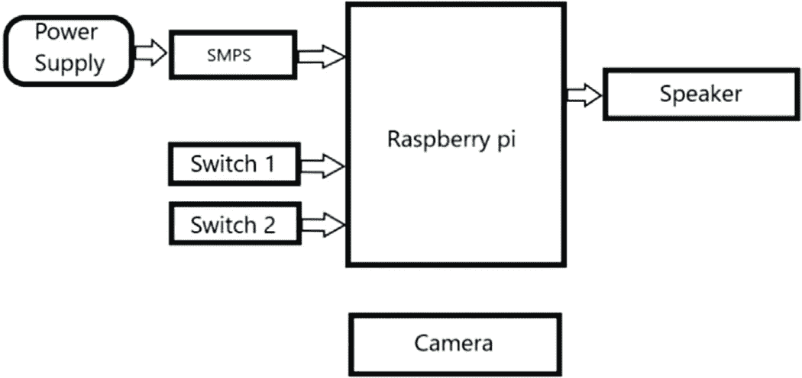
图 14.1 框图

推荐的技术同时提供面部识别和文本识别能力。它允许视力障碍人士在文本识别模式下拍照，以便他们阅读产品标签、文档和打印文本。对收集到的图像应用了许多处理过程，例如将其转换为灰度，并执行膨胀和侵蚀技术以去除噪声。随后将二值化图像输入 `Tesseract OCR` 进行文本识别。然后使用 `eSpeak` 方法将识别出的文本转换为可听格式。插入在 `Raspberry Pi` 音频接口上的耳机获取音频输出。


图 14.2 图像转语音转换过程

面部检测、特征提取和面部识别是面部识别过程中的三个步骤。第一个面部检测过程使用 `Haar cascade classifier`。用于存储被识别人员详细信息的数据库中的每个项目都由一对输入照片和标签组成。之后，面部识别软件定位识别出的脸部，并尝试与数据库保留的图片进行匹配。通过这一程序，来自面部识别的视觉数据被转换为文本格式并保存为文本文件。然后使用光学字符识别 (`OCR`) 技术识别文本，并由 `e-speak` 算法将其转换为可听输出。盲人或视力障碍人士可以从这种音频输出中受益，因为这让他们能够用耳朵“读”内容。必须记住，在识别系统性能方面，清晰且详细的图像优于较暗且细节较少的图像。为了获得最佳识别效果，建议 `OCR` 使用 `a.txt` 格式且为白底黑字字体的文本。

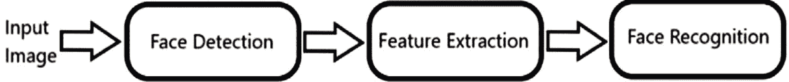
图 14.3 面部识别过程

## 4. 软件实现

### 4.1 使用 Tesseract OCR 工具从图像识别文本的过程

建议的项目利用 Google 的开源 `Tesseract OCR` 技术从照片中提取文本。该引擎在对图像进行文本检测之前，首先对其收集的图像进行二值化处理。连接组件分析是 `OCR` 过程的第一步，将组件保存以供进一步的反向文本识别。这是一个系统化的过程，可以识别和翻译倒置的文字，以及识别白底上的黑字。机器将前景中的像素分类为色块（blobs）或可能的字符。之后，这些字符被排列成文本行，并根据它们是否具有比例或固定的等间距文本布局进行评估。字符间距被用于进一步将行拆分为单词，任何固定的间距信息都会快速分离到单个字符单元格中。

### 4.2 使用 e-Speak 引擎将文本转换为语音

为此需要使用如 `e-Speak` 等引擎。通过“共振合成”技术，开源语音合成器 `E-Speak` 在小包中提供了多种语言。其主要优势之一是语音输出清晰且快速。一个名为 `E-Speak` 的命令行实用使得更改语音特征成为可能。

### 4.3 使用 Haar Cascade Classifier 进行面部识别

为了图像捕捉和面部识别的目的，我们使用了 `OpenCV`，检测脸部时使用了所需的操作系统以及 `python` 库中的 `numpy` 和 `image` 模块。为了存储图像，我们可以使用 `numpy` 模块，因此当我们将图像转换为文本时，是从 `numpy` 模块获取的。它从图像的左上角扫描到右下角以覆盖整个图像并转换为文本。面部识别过程涉及三个步骤。对于初始过程，当我们分类器提供图像时会进行面部检测，它检测图像中的脸部并尝试将其处理为 `OCR`，然后转换为文本文件，并使用 `espeak` 引擎将文本文件转换为语音。

## 5. 结果

### 5.1 软件输出

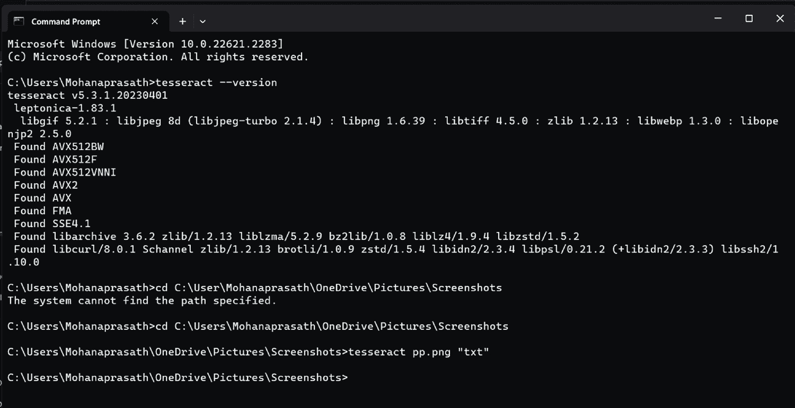
图 14.4 Tesseract OCR


图 14.5 Tesseract OCR 输出


图 14.6 Espeak Engine

## 6. 结论

利用 `Raspberry Pi` 技术为视觉人士创建了一个小型便携阅读辅助设备。该领先工具识别照片中的面部特征和文本。它使用有线相机进行快速图像处理并配备充电电池。集成了 `GPS` 系统用于定位和方向，并可以添加物体检测功能以改进用户体验。此外，`Wi-Fi` 连接的可用性可以取代传统连接。这种适应性设备适用于任何需要语音帮助的环境。

## 参考文献

1. Shraddha Hingankarl, Prachi Tardekar, Prof.Santoshi Pote “ A Smart Reader for Visually Impaired”, International Research Journal of Engineering and Technology (`IRJET`) e-ISSN:`2395-0056` Volume:`07` Issue:`07` July `2020` [www.irjet.net](http://www.irjet.net) p-ISSN:`2395-0072`。
2. Geetha M.N., Sheethal H.V., Sindhu S., Ayesha Siddiqa J. and Chandan H.C., “Survey on Smart Reader for Blind and Visually Impaired (BVI)”, Indian Journal of Science and Technology, Vol `12`(48), DOI:`10.17485/ijst/2019/v1248/14908`](http://dx.doi.org/10.17485/ijst/2019/v1248/14908), December `2019`。
3. S Sarkar, G Pansare, B Patel, A Gupta, A Chauhan, R Yadav and N Battula “Smart Reader for Visually Impaired Using Raspberry N”, International Conference on Innovations in Mechanical Sciences (`ICIMS’21`) IOP Conf. Series: Materials Science and Engineering `1132` (`2021`) `012032` IOP doi:`10.1088/1757-899X/1132/1/012032`](http://dx.doi.org/10.1088/1757-899X/1132/1/012032)。


4. Ram Nivas Duraisamy, Sathya Manoharan, “针对视障人士的智能阅读器（标准图像与实时图像：比较研究）”，《国际最新工程与管理研究国际期刊》(IJLEMR) ISSN: 2455-4847 [www.ijlemr.com](http://www.ijlemr.com) 第二卷 第 03 卷 - 第 10 期 2018 年 10 月 | 第 39-46 页。

5. Norharyati binti Harum, Nurul Azma Zakaria, Nurul A. Emran, Zakiah Ayop, Syarulnaziah Anawar, “基于 IoT 设备的视障人士智能书籍阅读器”，(IJACSA)《高级计算机科学与应用国际期刊》，第 10 卷，第 2 期，2019 年。

6. Muhammad Farid Zamir, Khan Bahadar Khanl, Shafquat Ahmmad Khan, and Eid Rehman, “基于光学字符识别的视障人士智能阅读器” • 2020 DOI: [10.1007/978-981-15-5232-8_8](http://dx.doi.org/10.1007/978-981-15-5232-8_8)。

7. K. Barathkumar, S. Balaji, K. N. Desikan, S. Padhmanabha Iyappan, “基于树莓派的视障人士智能阅读器”，《工程、科学与管理国际研究期刊》第 2 卷第 2 期，2019 年 2 月 [www.ijresm.com](http://www.ijresm.com) | ISSN (在线): 2581-5792。

8. L Latha, V Geethani, M Divyadharshini, P Thangam, “针对盲人的的智能阅读器”，《工程与先进技术国际期刊》(HEAT) ISSN: 2249-8958 (在线)，第 8 卷 第 653 期，2019 年 9 月。

9. Rajkumar N, Anand M.G., Barathiraja N, “基于便携式摄像机的盲人产品标签阅读。”‘HETI’，第 10 卷第 11 期 — 2014 年 4 月。

10. Wilson, P. I., Fernandez, J., “使用 Haar 分类器的面部特征检测”，载于《学院计算科学》(2006)，第 127-133 页。

11. Prof.Vidhyashree. C, Supriya. A. M., Supriya. H, Vedala Dinesh, Kavya R (#ch14.xhtml#R_ref14_11), “适用于视障人士的机器学习文本转语音转换器”，《应用科学与工程技术国际期刊》(IJRASET) ISSN: 2321-9653; IC 值: 45.98; SJ 影响因子: 7.538 第 10 卷 第 VII 期 2022 年 7 月。

12. Sabin Khader, Meerakrishna M R, Reshma Roy, Willson Joseph C (#ch14.xhtml#R_ref14_12), “一种盲人的文本转语音应用”，《计算机技术及其应用进展》第 3 卷 HBRP 出版第 1-6 页 2020 年。

13. Nisha P, Dr. Vijayakumar (#ch14.xhtml#R_ref14_13), “综述论文：视障人士的文本转语音转换”，“国际工程与技术研究期刊》(IRJET) e-ISSN: 2395-0056 卷: 08 期: 06 | 2021 年 6 月 [www.irjet.net](http://www.irjet.net)。

14. Tushar Khete, Aditya Bakshi (#ch14.xhtml#R_ref14_14), “使用 Tesseract OCR & TTS 的视障人士自主辅助系统”，第四届智能电路与系统国际会议，《物理学报：会议系列》2327 (2022) 012065 doi:[10.1088/1742-6596/2327/1/012065](http://dx.doi.org/10.1088/1742-6596/2327/1/012065)。

15. Aysha Nafla P, SruthiRajan M “一种辅助视障人士的智能视觉系统”，《工程技术与管理国际期刊》网站: [ijetms.in](http://ijetms.in) 期: 4 卷 No.6 2022 年 7 月。工业 4.0 中的问题与挑战 B. Varshaa Sona 技术学院，MBA，塞莱姆，印度 DOI: [10.1201/97810035423-15](https://dx.doi.org/10.1201/97810035423-15)。

# 5. 工业 4.0 中的问题与挑战

## 1. 引言
`工业 4.0`（第四次人工智能革命的到来被描述为云计算、`IoT` 和机器人技术等先进技术注入传统的制造流程。这种数字化转型带来了前所未有的机会，但也引入了新的网络安全威胁。随着行业变得超连接，它们更容易受到网络攻击。`工业 4.0` 将先进技术、`IoT` 设备和网络系统集成，潜在的破坏性威胁打开了大门。本文深入探讨了这些挑战。

### 1.1 物联网 (IoT)
`IoT` 是能够交换数据的互联网络，它收集物理对象的信息并利用`大数据`进行更高效的处理和存储。

### 1.2 恶意软件入侵
传统的网络安全措施如`防火墙`和`反病毒软件`不足以防御自动化系统。先进的`系统完整性监测`提供了安全性。

### 1.3 固件修改
黑客已经擅长创建注入到自动化系统的`固件`版本。为了应对这一威胁，现代 IT 团队在部署之前必须严格检查`固件`。

## 2. 文献综述
我发现了多个提供价值见解的可靠来源。`IGI Global` 对`工业 4.0` 背景下的网络安全问题进行了深入检查，并讨论了有效的缓解策略。在 `D-portal` 上的研究论文强调了`工业 4.0` 中网络安全的重要性。`CYBALT` 提交了一份专门针对`工业 4.0` 面临的现实网络安全挑战的白皮书，提供了增强网络韧性的实用建议。`Balbix` 对`工业 4.0` 时代的网络安全进行了讨论，强调了采取主动方法的重要性。最后，`ResearchGate` 提供了一份关注`工业 4.0` 网络安全挑战的最新综述，提供了全面的分析。

## 3. 在工业 4.0 中采用升级网络安全的顶级方法
在数百个设备和系统互联的时代，传统的网络安全方法是不够的。需要建立框架并采用顶层视角。

## 4. 可以实施的后续

### 从战略规划开始
从顶层构建由`IoT` 技术驱动的数字化转型系统，通过战略规划形成关键意见，涵盖网络、程序、策略、指南和法令。

### 关注数据安全
将重点转向数据处理层以保护关键业务数据。开发适应未来增长和不断演变的威胁的合安全策略。

### 设计技术基础设施
在设计技术结构时考虑功能和安全需求。仔细选择供应商对于解决第三方漏洞至关重要。

### 网络设计
有了参考框架，安全工程师可以根据分层条件设计网络，在满足所有业务需求的同时确保不损害安全性。


制造业是受攻击目标第二大的行业，由于在工业 4.0 时代攻击面的扩大，该行业面临着独特的网络安全挑战。挑战包括：

*   每个链接的技巧都暗示了一个隐性问题。
*   制造业网络与工业控制系统（`ICS`）类似，具有明显的脆弱性。
*   `Industry4.0` 连接了原本隔离的系统，扩大了外部尝试范围。
*   由于系统的复杂性，升级通常是增量式安装的。
*   制造业的监管合规性标准高于其他行业。
*   跨系统和隔离环境的可视性非常有限。

在这一动态态势中，组织必须涵盖广泛的技术领域，并为不断演变的网络威胁做好准备。

## 6. 结论

工业 4.0 以信息物理系统和先进技术的整合为特征，正处于快速增长的阶段。然而，它也面临着需要持续改进的网络安全挑战。本文回顾了与工业 4.0 相关的网络安全威胁并提出了潜在的解决方案。通过正确的策略和积极的措施，制造业可以应对工业 4.0 的复杂性，并保护其运营免受网络威胁的侵害。随着行业演进，在网络安全竞争中保持领先并探索创新解决方案（如 `blockchain`）以增强安全性至关重要。

## 参考文献

1.  [`www.igi-global.com/chapter/cybersecurity-issues-and-challenges-in-industry-40/255359`](https://www.igi-global.com/chapter/cybersecurity-issues-and-challenges-in-industry-40/255359)
2.  [`www.diva-portal.org/smash/record.jsf?pid=diva2%3A1590006&dswid=3044`](https://www.diva-portal.org/smash/record.jsf?pid=diva2%3A1590006&dswid=3044)
3.  [`pdfs.semanticscholar.org/6117/4ecce41d8cd86f88a804868d57f4634fd4f8.pdf?\_g1=1\*193m7ka\*\_ga\*MTE5ODU5NjY0MS4x-NjY1ODQ0MjA1\*ga\_H7P4ZT52H5\*MTY5ODA3MDY5MS4xLjEuMTY5ODA31VIDczMy4x0C4wLjA`](https://pdfs.semanticscholar.org/6117/4ecce41d8cd86f88a804868d57f4634fd4f8.pdf?_g1=1*193m7ka*_ga*MTE5ODU5NjY0MS4x-NjY1ODQ0MjA1*ga_H7P4ZT52H5*MTY5ODA3MDY5MS4xLjEuMTY5ODA31VIDczMy4x0C4wLjA)
4.  [`www.dqindia.com/industrial-revolution-4-0-cyber-security-challenges-solutions/`](https://www.dqindia.com/industrial-revolution-4-0-cyber-security-challenges-solutions/)
5.  [`www.nist.gov/blogs/manufacturing-innovation-blog/cybersecurity-and-industry-40-what-you-need-know`](https://www.nist.gov/blogs/manufacturing-innovation-blog/cybersecurity-and-industry-40-what-you-need-know)
6.  [`www.sciencedirect.com/science/article/pii/S2351978917306820`](https://www.sciencedirect.com/science/article/pii/S2351978917306820)
7.  [`www.cybalt.com/docs/default-source/white\_papers/cybalt-white-paper---industry-4.0-cyber-security-challenges---how-real-it-is.pdf`](https://www.cybalt.com/docs/default-source/white_papers/cybalt-white-paper---industry-4.0-cyber-security-challenges---how-real-it-is.pdf)
8.  [`www.balbix.com/insights/cybersecurity-in-the-age-of-industry-4-0/`](https://www.balbix.com/insights/cybersecurity-in-the-age-of-industry-4-0/)
9.  [`turcomat.org/index.php/turkbilmat/article/view/4946`](https://turcomat.org/index.php/turkbilmat/article/view/4946)
10. [工业 4.0 网络安全挑战：现状回顾](https://www.researchgate.net/publication/362884521_Cybersecurity_challenges_in_Industry_40_A_state_of_the_art_review)

# 16 基于深度学习的树莓派智能水果分级框架

M. Meena

## 1 引言

水果对于健康饮食是不可或缺的，因为它们含有纤维、维生素和多酚，富含抗氧化剂。人工分级系统无法处理这些挑战。最近，深度学习方法提高了技术水平。利用机器学习进行自动水果分级变得越来越重要。

## 2 方法论

提出了一种水果样本分类的框架。为了区分新鲜和腐烂样本，使用了卷积神经网络（`CNN`）。创建了一个包含 8000 张不同成熟阶段图像的数据集。该模型在类型、成熟度和收获决策任务中实现的准确率分别为 99.01%、97.25% 和 98.59%。

## 3 讨论

提出了几种现有深度学习算法的变体。讨论了一个使用两个深度学习模型的框架。一个模型包含六层卷积神经网络层，另一个是预训练的 `VGG16` 模型。讨论了一种使用 `LSTM` 对水果进行分类的新方法，其中标记由 `CNN` 和 `RNN` 完成。

开发了一种基于计算机视觉算法的机器人采摘和分级系统。建议了一种结合多传感器技术与机器学习算法的新型新鲜度预测方法。

## 4 结果

提出用于区分龙枣内部受影响和未受影响的 `CARS-PLS-DA` 模型。该技术在校集上的准确率为 87%，在预测集上的准确率为 91%。


# 引言

提出了一种名为多类型缺陷检测网络（`MDDNet`）的新模型，用于识别土豆上的多种缺陷 [14]。然而，上述工作集中在数据集上，而没有关注用于分级系统的嵌入式硬件。因此，提出了一种基于树莓派的独立水果分级系统，其实现目标如下：

1. 使用 `Raspberry Pi 4 Model-B` 设计并实现一个用于识别新鲜和腐烂水果的系统。
2. 通过 `LCD` 显示器输出结果，以便消费者方便地追踪。
3. 确定水果是新鲜还是腐烂。

## 2. 提议系统

实现了一个在树莓派上使用深度学习检测水果新鲜或腐烂的系统。从 kaggle 网站收集了新鲜和腐烂水果的图像数据集用于训练分类算法，并使用了一组测试照片集来评估模型的准确性。训练图像数据集包含约 10901 张属于 6 类的图像，而测试图像数据集包含约 2698 张图像。该代码生成了在 ImageNet 数据集上预训练的 `Inception-V3` 模型，其输入形状为 `(224,224,3)` 且没有顶层。它通过在图像数据集上微调预训练的 `Inception-V3` 网络来训练模型。代码的输出代表基于训练模型的输入图像的预测类别，并显示了跨越 epoch 的训练和验证损失以及准确率图表。验证准确率和验证损失打印在单元格下方。

混淆矩阵直观展示了模型对每个类别的分类情况。对于每个类，它显示了真正、真负、假正（和假负）预测的数量。混淆矩阵有助于识别模型需要改进的领域，例如为某些类别提供更多训练数据、调整模型架构或增加训练期间 epoch 的数量。上述代码将显示测试集中的图像及其对应的真实标签和模型预测标签。程序开始时初始化 `LCD` 显示器、文本转语音引擎并加载训练好的机器学习模型。程序分别设置了保存图像和结果的文件夹以及 `CSV` 文件。它还为新鲜和腐烂的水果设置了计数器。程序从摄像头捕捉视频并显示原始帧。程序对图像文件夹制作压缩包，发送带有结果和图像文件夹压缩包的邮件，如果按了连接到树莓派 `pin 19` 的按钮，则结束循环。当按下连接到树莓派 `pin 18` 的按钮时，程序拍照并存储在文件中。程序为机器学习模型对图像进行预处理，将图像传递给模型并获取预测。

为了便携性，整个系统被装在一个纸箱内。图 16.1 显示了整个实验设置。

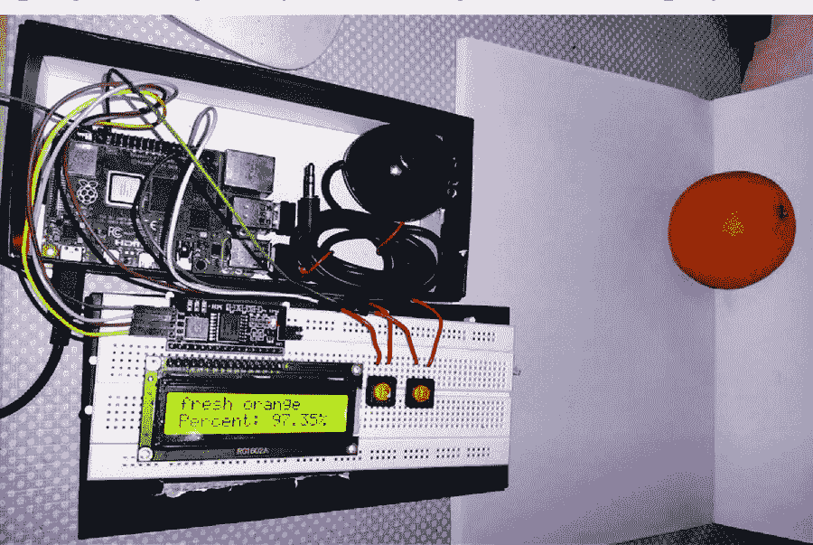

Fig. 16.1 树莓派实验设置

## 3. 结果与讨论

获得了基于树莓派的智能水果分级项目的结果。项目的运行模型经过了测试，获得的结果是准确的。

### 3.1 模型创建

测试和训练数据集已过增强，用于创建和测试模型的方法所示图 16.2。

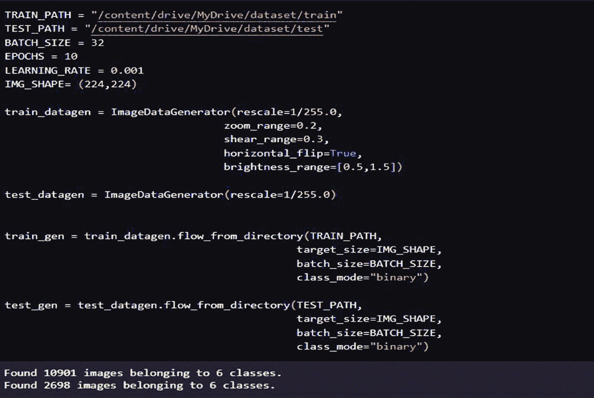

16.2 测试和训练数据集

模型的验证准确率和验证损失所示图 16.3。

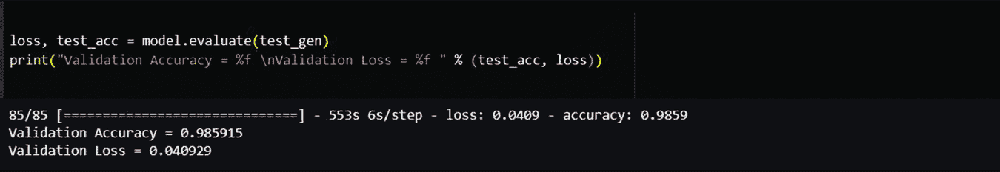

16.3 验证准确率和验证损失

我们提供的测试集真实名称和预测名称所示图 16.4。提议模型的混淆矩阵所示图 16.5。

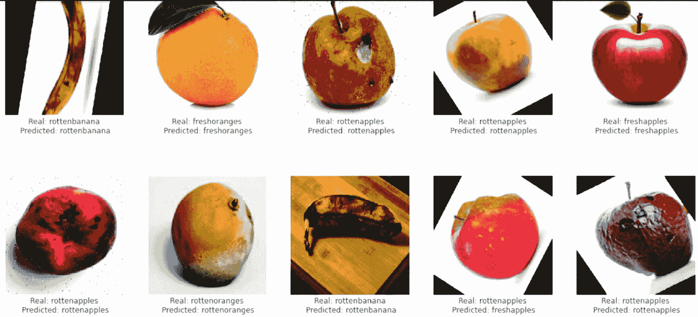

16.4 真实名称与预测名称

使用上述示例代码验证的模型所示图 16.6，预测是准确的。

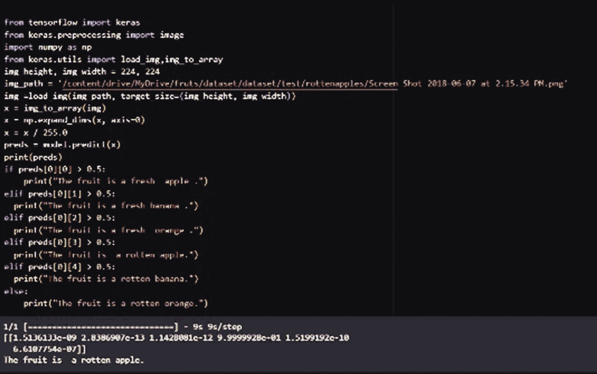

16.6 模型创建

### 3.2 通过树莓派评估模型

在此，程序将预测水果是新鲜还是腐烂，并将图像和结果保存到 `CSV` 文件，通过 `SMTP` 发送该文件所示图 16.7。

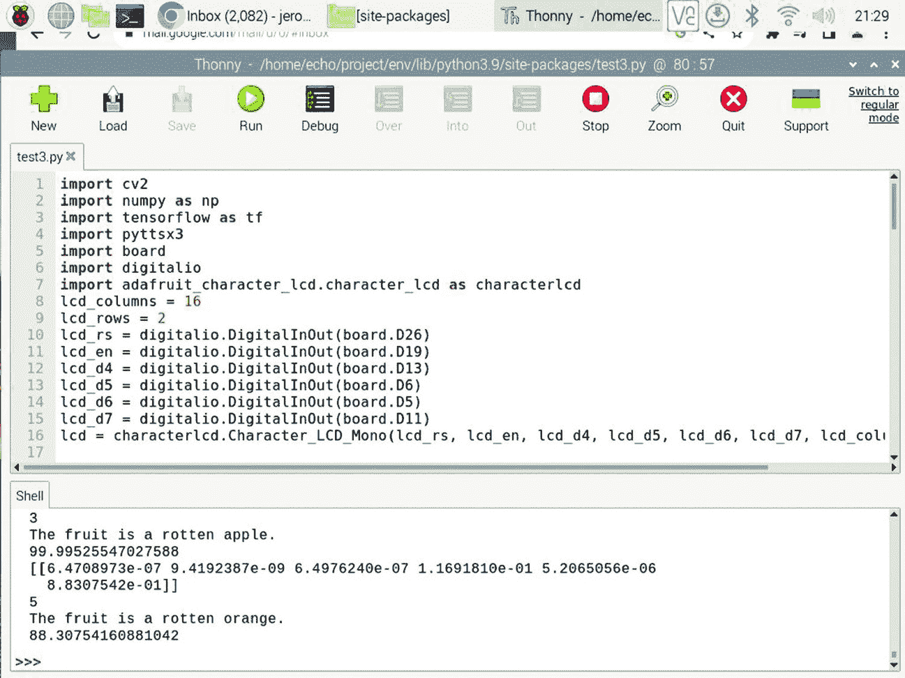

16.7 通过树莓派评估模型

上述代码的结果，指示水果是新鲜还是腐烂以及其准确率所示图 8。

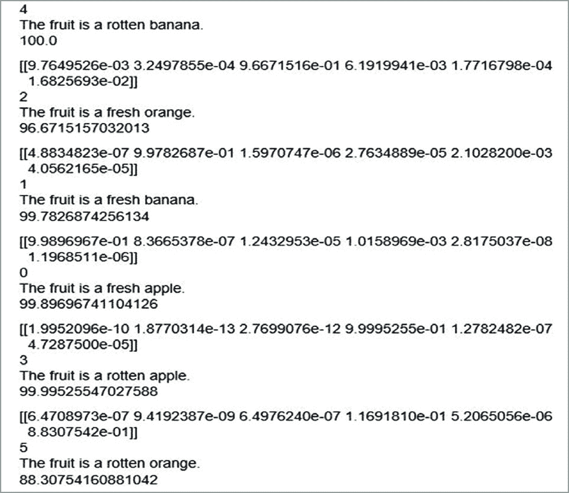

16.8 评估结果

实验使用的水果图像所示图 16.9。

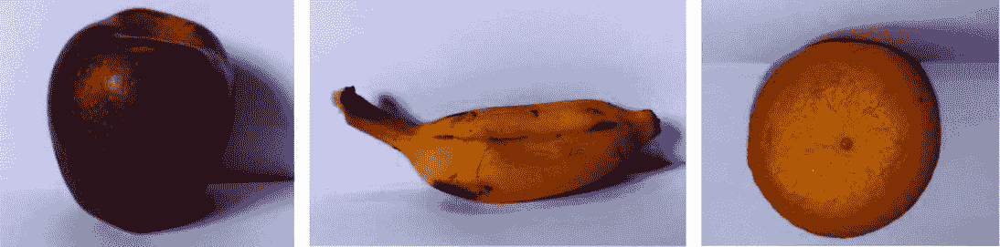

16.9 实验使用的水果

通过 `LCD` 显示的水果是新鲜还是腐烂的结果及其准确率所示图 16.10。

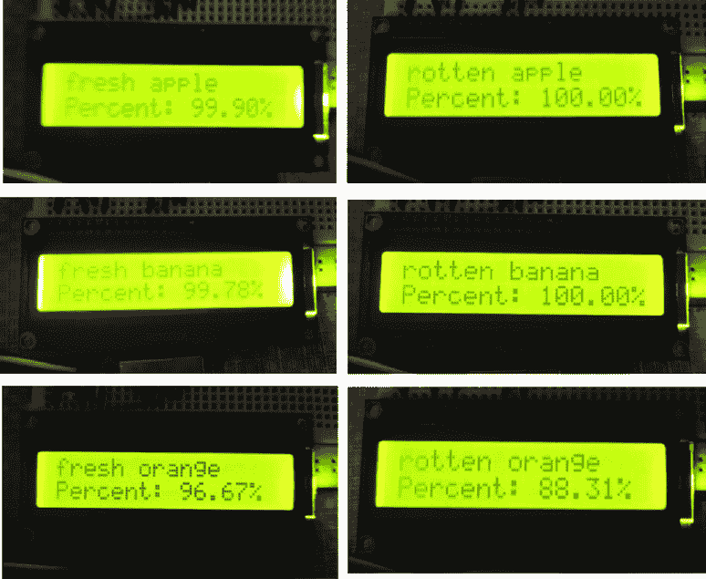

16.10 LCD 显示的结果

通过 `SMTP` 协议通过邮件发送的图像和结果所示图 16.11。

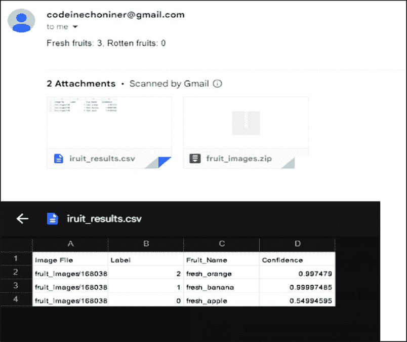

16.11 通过 SMTP 发送 CSV 文件和图像文件夹

## 4. 结论

我们所摄食物的质量是本计划的重点。我们在项目中开发了一个利用 `ML` (`Inception-V3`) 的模型，准确率为 98.5%，并用它区分新鲜和腐烂的水果。然而，该模型可以扩展并成为通用的蔬菜识别系统。在这里，计算机视觉被用于隔离和检测不符合要求的果，并确保客户收到警告。低成本水果分级自动系统可以安装在冷库、餐厅等水果蔬菜处理量增加的地方，这使得该项目更加至关重要。

## 参考文献

1. Yang, Q., Lang, X., Li, W. et al. 低脂肪高碳水化合物饮食与低碳水化合物高脂肪饮食对体重、血压、血清液体和血糖血糖的影响：系统评价和荟萃分析。Eur J Clin Nutr 76, 16-27 (2022)。 [`doi.org/10.1038/s41430-021-00927-0`](http://dx.doi.org/10.1038/s41430-021-00927-0)

2. Singham, P., Birwal, P., & Yadav, B. K. (2015). 食品质量客观和主观测量的重要性及其相互关系。Journal of Food Processing & Technology, 6(9), 1.

3. Parvathy, A., Sriranjani, R., Meenalochani, M., Hemavathi, N., & Balasubramanian, G.. 针对聋哑人士的主动轮廓分割和基于深度学习的手势识别系统。在低资源语言语音与语言技术国际会议上 (pp. 279-292)。Cham: Springer International Publishing.


4. D. Karakaya, O. Ulucan and M. Turkan, “水果新鲜度分类的对比分析”，2019 年智能系统与应用会议 (ASYU)，土其伊兹米尔，2019 年，第 1-4 页， doi: [10.1109/ASYU48272.2019.8946385](http://dx.doi.org/10.1109/ASYU48272.2019.8946385)。

5. H. Altaheri, M. Alsulaiman and G. Muhammad, “基于深度学习的自然环境下机器人采摘的枣果分类”，发表于 IEEE Access，第 7 卷，第 117115-117133 页，2019 年， doi: [10.1109/ACCESS.2019.2936536](http://dx.doi.org/10.1109/ACCESS.2019.2936536)。

6. S. Jana, S. Basak and R. Parekh, “利用颜色和纹理特征从自然图像中自动识别水果”，2017 年集成电路设备 (DevIC)，印度卡雅尼，2017 年，第 620-624 页， doi: [10.1109/DEVIC.2017.8074025](http://dx.doi.org/10.1109/DEVIC.2017.8074025)。

7. Song, Z., Fu, L., Wu, J., Liu, Z., Li, R., & Cui, Y. (2019). 使用带有 VGG16 的 Faster R-CNN 在地间图像中猕果检测。IFAC-Papers Online, 52(30), 76-81。

8. M. S. Hossain, M. Al-Hammadi and G. Muhammad, “用于工业应用的深度深度学习自动水果分类”，发表于 IEEE Transactions on Industrial Informatics，第 15 卷，第 2 期，第 1027-1034 页，2019 年 2 月， doi: [10.1109/TII.2018.2875149](http://dx.doi.org/10.1109/TII.2018.2875149)。

9. Gill, H. S., Murugesan, G., Mehbodniya, A., Sajja, G. S., Gupta, G., & Bhatt, A. (2023). 使用深度学习和特征融合进行水果类型分类。农业计算机与电子，211, 107990。

10. Dairath, M. H., Akram, M. W., Mehmood, M. A., Sarwar, H. U., Akram, M. Z., Omar, M. M., & Faheem, M. (2023). 基于计算机视觉的水果原型机器人采摘加分级系统。智能农业技术，4, 100210。

11. Huang, W., Wang, X., Zhang, J., Xia, J., & Zhang, X. (2023). 冷链物流中基于机器学习和多源传感的蓝莓新鲜度预测的改进。食品控制，145, 109496。

12. Yuan, R., Liu, G., He, J., Wan, G., Fan, N., Li, Y., & Sun, Y. (2021). 基于可见近红外高光谱成像结合偏最小二法判别分析的宁武长枣内部褐变随时间分类。农业计算机与电子，182, 106043。

# 17 视障人士导航技术与辅助设备的进展

Parth Arora^(³⁶)

印度昌迪加尔大学，计算机科学与工程，莫哈利

DOI: [10.1201/9781003535423-17](https://dx.doi.org/10.1201/9781003535423-17)

## 1. 引言

目标检测技术在过去的十年中变得愈发重要。它涉及在图像或视频流中检测物体，并确定其位置和类别 [1]。

目标检测模型可以用于各种应用和目标，包括：

*   *安全与监控：*目标检测模型可用于监控摄像头并检测异常活动，例如入侵者或无人看管的物品。
*   *自动驾驶车辆：*自动驾驶车辆需要目标检测模型来检测其他车辆、行交通信号等物品。
*   *零售：*目标检测模型可以用于零售业务以跟踪库存并检测货架何时需要补货。
*   *制造业：*目标检测模型可以用于制造业以检测缺陷物品并自动化质量控制操作。

### 1.1 客户识别

*   *世界卫生组织调查：*根据世界卫生组织（WHO）的统计，全球约有 2.85 亿视力障碍人士，其中 3900 万失盲 [2]。盲人很难导航周围环境。他们利用其他感官（如触摸、听觉和嗅觉）来适应环境。因此，需要开发基于目标检测技术的系统，用于帮助视障人士更有效地检测物品和导航周围环境。

## 2. 文献综述

在开始之前，让我们了解一下背景。20 世纪 80 年代初，研究人员开始研究利用计算机视觉协助视障人士导航。由英国雷丁大学的研究人员开发的 `NAVI` 系统是最早的示例之一。该设备使用安装在头盔上的摄像摄像头拍摄环境照片，然后使用计算机视觉算法进行处理以识别障碍物。随后用户将获得听觉反馈以帮助其导航。总体而言，为视障人士开发目标检测技术是一个持续的过程，取得了各种里程碑和进展。虽然这项技术仍处于早期阶段，但它在改善视障人士生活方面具有巨大前景。

### 2.1 文献计量学分析

*关键特征*

*   利用计算机视觉准确检测室内物品 [1]。
*   创建基于摄像头的解决方案，协助视障或残障人士寻找日用品 [2]。
*   目标检测在自动旅行、图像检索、机器人导航中至关重要 [3]。
*   使用智能手机拍摄实时照片作为目标检测深度学习模型的输入 [4]。
*   使用带有激光传感器的物联网启用自动目标检测，向用户发送音频消息 [5]。

***有效性***

目标检测在协助视障人士方面的有效性从针对该主题的研究文章和论文中显而易见。这些研究建议了使用计算机视觉技术、基于摄像头的网络和目标识别算法的各种系统和方法，以协助视障人士导航、寻找日用品和识别障碍。所提出的系统在成功识别室内物品、估计盲人与物体之间的距离以及向用户发送声音信号方面显示了良好的效果。

***缺点***

目标检测协助视障人士的某些缺点包括：

*   依赖基于摄像头的系统，这些系统在光线不足或物体遮挡时可能表现不佳 [1]。难以检测具有高度相似性或变化的物品。
*   在新环境中检测物品的准确性有限，时间复杂性高且需要精确测试 [2, 3]。
*   需要专门的硬件和软件，这些可能成本高昂且难以维护 [4]。

尽管存在这些缺点，目标检测仍然是协助视障人士生活的一种很有前景的技术。该领域持续的研究和开发可能帮助消除某些限制并提高视障人士目标检测系统的性能。

### 2.2 综述总结


在 2019 年 3 月发表的一项综述研究中，作者对视障人士的障碍检测进行了详尽的研究评估。该综述涵盖了 353 篇出版物，包括 50 场国内外会议、139 本国内外期刊、40 篇由研究学者和硕士学位毕业生完成的论文，以及 100 篇由世界顶尖大学的毕业生、研究生和其他研究人员发表的其他出版物。2015 年 12 月发布的一项研究的作者指出，尽管在过去的几十年里，追踪物体的能力有了巨大的提高，但这仍然被认为是一个难以解决的难题。因此，可以说，辅助盲人的目标检测问题已引起了多年的关注，研究人员一直致力于开发解决方案来解决这一问题。

## 2.3 问题定义

辅助盲人目标检测技术的问题在于，开发出有效且可靠的系统，通过检测和识别障碍物和其他物体，帮助盲人导航周围环境，例如绕过障碍物、避开危险以及识别环境中的重要地标或特征。该行业最困难的问题之一是创建准确、可靠且对个体用户需求敏感的系统。这需要深入了解视障人士所经历的需求和问题，以及各种技术的局限性和能力。对于隐私、数据安全以及对盲人独立性和自主性的潜在影响也引起了关注。必须记住，辅助盲人的目标检测技术并不是手杖或导盲犬等传统辅助器具的替代品 [6]。

## 3. 概念设计

### 概念 1：触觉物体识别系统

描述：开发一种使用先进触觉传感器和人工智能识别物体并为盲人提供反馈的便携设备。该设备具有紧凑的外型，并配备能够捕捉物体物理特性（如形状、纹理和尺寸）的传感器阵列。利用机器学习算法根据触觉属性学习分类和识别各种物体。它将向用户提供音频或触觉反馈，传递有关识别物体的信息 [2]。

**优点：**

**增强独立性：** 盲人可以在不完全依赖他人帮助的情况下识别物体，从而获得独立。

**实时反馈与多功能：** 设备可以提供即时反馈，使用户更有效地与周围环境交互。系统可用于各种场景，如家中、公共场所或旅行期间。

### 概念 2：计算机视觉穿戴设备

描述：开发一种利用计算机视觉技术识别物体并为盲人提供音频或触觉反馈的可穿戴设备。该设备由集成人工智能系统的轻型摄像头组成，能够实时分析视觉输入。通过捕捉用户周围的图像，系统将采用物体识别算法识别不同的物体，并通过音频接口或触觉反馈将信息传递给用户 [10]。

**优点：**

**实时物体识别：** 设备允许盲人接收有关周围环境的即时反馈，使能够更独立地导航并与环境交互。

**用户友好界面：** 音频或触觉反馈将提供关于识别物体的直观且易懂的信息 [8]。

### 概念 3：语音辅助物体识别应用

描述：开发一种利用语音识别和人工智能辅助视障人士识别物体的移动应用程序。该应用利用手机的摄像头和麦克风捕捉视觉和音频输入。通过使用先进图像识别算法，应用可以实时识别物体并向用户提供反馈。

**优点：**

**无障碍性：** 该应用可以在智能手机上运行，对视障人士非常方便。

**持续更新：** 应用可以定期更新以提高物体识别的准确性并引入新功能。这些概念旨在为视障人士提供物体识别的创新解决方案，增强他们的独立性和整体生活质量 [14]。

#### 3.1 设计约束

**成本、尺寸与便携性：** 系统的价格应该负担得起，并符合用户群的预算限制。考虑物理组件、软件开发和持续维护的成本。系统应该是紧凑且便携的，让盲人在日常活动中能够舒适地携带。

**功耗：** 优化功耗以延长电池寿命，因为盲人可能需要长时间依赖该系统。考虑节能组件和电源管理。

**无障碍性与易用性：** 确保系统可以被各种视觉受损的用户使用。考虑与屏幕阅读器等辅助设备的互操作性，并添加可自定义文本大小或高对比度界面等功能。创建用户友好的界面和简单的控制。考虑盲人的需求和能力，例如触觉界面、语音指令或基于手势的交互。

**稳健性：** 系统应在各种环境和光照条件下持续工作。考虑物体遮挡、物体外观的变化以及对低光照或眩光的适应性。

**维护与支持：** 提供软件更新、错误修复和技术支持机制，以解决任何问题并确保系统保持功能正常且处于更新 [15]。

## 4. 设计与方法

清晰列出项目目标，例如增加物体识别能力并为盲人提供实时反馈。进行用户研究并与盲人互动，以了解他们的需求、偏好以及在物体检测方面的问题。

研究现有的物体检测技术和方法，特别是适用于实时应用且与指定硬件平台兼容的技术 [11]。

通过研究用于物体识别的可访问数据集和预训练模型开始开发过程，并选择合适的硬件和软件框架组件，同时考虑摄像头规格、深度传感器、穿戴设备以及与目标平台的兼容性等因素。收集广泛的物体，从不同的角度、光照情况和背景拍摄照片。

对数据集进行标注并带有正确的标签和描述划分，以训练物体识别算法 [6]。


使用标注数据集，利用如 `CNNs` 等机器学习技术训练一个目标检测模型。对模型进行微调以提高准确率，并考虑迁移学习或模型架构调整等优化策略。

使用验证集对模型进行验证，并反复调整模型，直到达到满意的性能 [5]。并与盲人士进行广泛测试，以收集有关系统性能、易用性和准确性的反馈。

### 4.1 提议方法

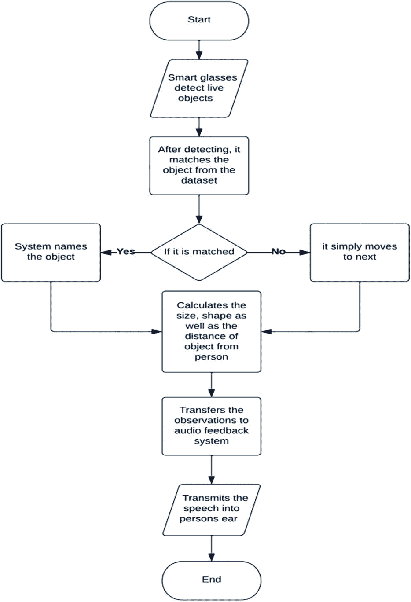

图 17.1 流程图

### 4.2 结果分析

这些系统的准确性和结果分析取决于数据集的质量、机器学习算法的性能以及视障人士对系统的易用性。为了提高目标检测技术在支持盲人士日常生活中的准确性和有效性，还需要进行更多的研究和测试 [15]。根据在实际创建技术过程中观察到的结果，观察到准确性为：损失：0.7848 准确率：0.8159

### 4.3 插图与图表

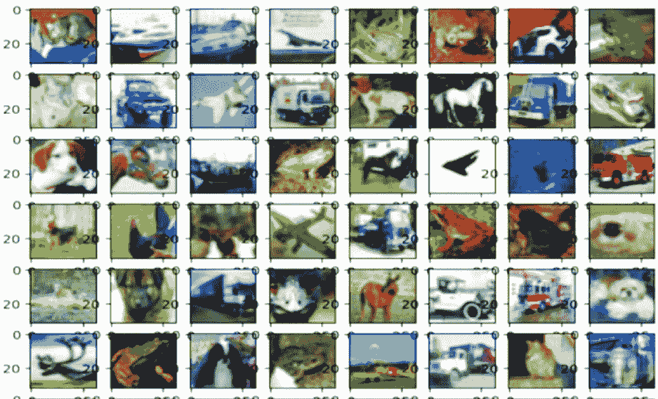

图 17.2 图像处理

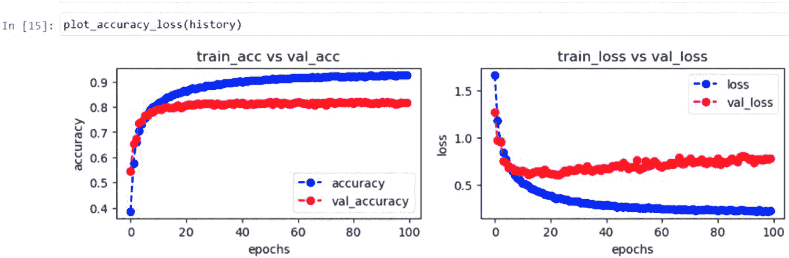

图 17.3 图表

## 5. 结论

总结来说，目标检测技术在赋予盲人士方面展现出巨大的潜力，通过为他们提供更大的自主性、安全性以及与周围互动。作为学者和技术人员，我们有责任进一步研究和开发这些解决方案，实现一个更有包容性的社会，让视障人士能够蓬勃发展并充分参与日常生活。为了提高目标检测技术在支持盲人士日常生活中的准确性和有效性，还需要进行更多的研究和测试。总体而言，辅助盲人士的目标检测技术开发是一个充满前景的研究领域，具有极大提高视障人士生活质量的潜力。

## 参考文献

1. Amit, yali, 等 “目标检测。” 计算机视觉：参考指南 (2020): 1-9
2. Papageorgiou, Constantine, 等 “一种用于目标检测的可训练系统。” 国际计算机视觉期刊 38 (2000): 15-33.

3. Jabnoun, Hanen, 等 “视频场景盲人的目标检测与识别。” 2015 年第 15 届智能系统设计与应用国际会议 (ISDA). IEEE, 2015.
4. Masud, Usman, 等 “通过目标检测和分类实现视障人士避障的智能辅助系统。” IEEE Access 10 (2022): 13428-13441.

5. Vaidya, Sunit, 等 “面向视障人士的实时目标检测。” 2020 年第 4 次智能计算与控制系统国际会议 (ICICCS). IEEE, 2020.
6. Zraqou, Jamal, 等 “辅助盲人士的实时物体识别方法。” 国际当前工程与技术期刊 (2017): 2347-5161.
7. Kumar, Kaushal. (2020). 一种基于机器学习的视障和盲人智能助手。
8. Karmarkar, Rajesh & Honmane, Vikas. (2021) 针对盲人的目标检测系统。应用科学与技术国际期刊。10.33564/IJEAST。
9. Wong, Yan Chiew, 等 “用于盲人的卷积神经网络目标检测。” 通信、电子与计算机期刊 (JTEC) 11.2 (2019): 
10. Dionisi, Alessandro, Emilio Sardini, Mauro Serpelloni. “可穿戴目标检测系统。” 2012 IEEE 电子测量技术会议。
11. Arora, Adwitiya, 等 “使用单阶段边界框器的盲人实时目标检测。” 无线个人通信 107 (2019): 651-661.
12. Dunai, Larisa, 等 “盲人的新型导航原型。” 2010 年 IEEE 第 36 届年度电子会议 (ECON)。
13. Murali, M., Shreya, 等 “盲人的读者与检测器。” 2020 年通信与信号处理国际会议 (ICCSP). IEEE.
14. Kumar, Ashwani, 等 “通过深度神经网络实现的盲人实时目标检测。” 2019 年第五届国际图像处理会议 (IOW). IEEE.
15. Deshpande, Samruddhi 和 Revati Shriram. 2016 年自动控制与动态优化技术国际会议 (ICACDOT). IEEE.

# 18 音乐流派解析：在线平台音乐流派分类方法的比较评估

Sivadithiyan P^(37

Vels 科学技术与高级学院，计算机科学工程系，印度钦奈杜

DOI: [10.1201/9781003535423-18](https://dx.doi.org/10.1201/9781003535423-18)

## 1. 引言

音乐本身与其人类的存在一样古老。早期音乐是利用洞穴和野外共鸣声学的简单打击乐创作的。这成为了音乐与人类共同演化故事的基础。这一演变过程引导我们来到了现在，通过在线流媒体服务享受每日的音乐。音乐流派分类在现代已成为一项关键工具，因为在线流媒体平台可以在几分钟内向其庞大的用户群发布音乐作品。它是在线流媒体平台的重要部分，通过促进个性化推荐、组织良好的内容库以及轻松创建播放列表，提升了用户体验。

## 2. 文献综述


这篇文献综述对音乐流分类的领域进行了全面探索。Mousumi Chaudhury 等人 (2022) 的随机森林模型展现了惊人的性能，在基准数据集 `GTZAN` 上实现了约 90% 的总准确率 [1]；在所使用的经典机器学习模型中，他们设计了一个 7 阶段流水线，旨在开发能够分类所有 10 种流的最有效随机森林模型 [2]。Laiali Almazaydeh 等人 (2022) 针对原生阿拉伯音乐流的分类提出了他们自己的架构。不同的指标评估后通过交叉验证可以揭示更多关于模型性能的信息 [3]。Jessica Dias 等人 (2022) 展示了优雅的 `MGC` 流水线以及提出的 `CNN` 架构，该架构在 `GTZAN` 数据集上获得了 72% 的准确率 [4]。Rahul Singhal 等人 (2022) 使用了来自 kaggle 的数据集，其中包含 50005 首属于 10 种不同类型的歌曲信息。它包含了艺术家名称、歌曲调性、模式（大调或小调）等数据 [5]。Afif Al Mamun 等人 (2019) 提出了一种 `NN` 来预测多种孟加拉流派 [6]。库尔德双人组 Aza Kamala 和 Hossein Hassani (2022) 对一个包含 8 种不同类型和约 300 个片段的小型数据集进行了研究，策划了一个准确率达到 92% 的模型 [7]。持续的挑战包括跨流派影响、不同文化和语言中的音乐流分类是未来的研究领域。

## 3. 实验与观察

### 3.1 数据预处理与特征提取

我们的实验从选择 `GTZAN` 数据集构建模型开始 [1]。我们选择 `GTZAN` 而非其他数据集是因为 `GTZAN` 是一个组织良好的数据集，专门设计为这项任务提供高质量数据。然而，数据预处理和数据提取必须由我们完成。对于这项任务，我们使用了 `python` 和 `Jupyter notebook`。我们使用 `Librosa` 作为音频特征提取工具来提取特征。我们决定提取 `MFCC` 特征、频谱特征、`Chroma` 特征和 `Tonnetz` 特征的组合，如表 18.1 所示。在我们的特征提取流水线中，从某个流派提取音频片段并转换为较小的音频段/音频切片。出于实际考虑，我们创建了三个具有不同音频长度的数据集。由于我们处理的 `GTZAN` 每种流派有 100 个音频片段，如果特征提取仅限于 30 秒的音频文件，那么我们将恰好得到 1000 行数据，这对于机器学习来说是不理想的，因为机器学习是消耗资源的且需要大量数据，因此一种智能的方法是通过将音频文件切割为固定时长来增加音频片段的数量，从而创建更多的音频文件。我们发现我们的数据增强方法有一个轻微缺点。音频是按时长而非按节拍切割的，这引入了阻碍准确节奏检测的偏移。`Librosa` 和其他依赖于起始攻击模式的节奏检测算法在瞬态被截断或中断的情况下会面临挑战。因此，我们决定将它们排除在之外。我们对音频特征执行了特征缩放和主成分分析 (`PCA`)。缩放至关重要，因为大多数机器学习算法对输入的缩放非常敏感，而 `PCA` 是一种降维技术，用于将数据集转换为主成分，其中方差被最大化。这完成了我们的数据处理。表 18.1 特征提取概览

| S. | 特征 | 列数（均值和标准差） | 类型 |
| --- | --- | --- | --- |
| 1 | MFCC | 40 | float64 |
| 2 | Chroma 特征 | 24 | float64 |
| 3 | 频谱对比 | 2 | float64 |
| 4 | 频谱质心 | 2 | float64 |
| 5 | 频谱带宽 | 2 | float64 |
| 6 | 频谱滚降（最值） | 4 | float64 |
| 7 | CQT | 2 | float64 |
| 8 | Tonnetz 特征 | 12 | float64 |
| 9 | RMSE | 2 | float64 |
| 10 | 标签 | 1 | string |

### 3.2 模型分析

我们的模型分析通过设置随机种子并在 `Jupyter notebook` 开始，这有助于我们在需要时复制相同的结果。在任何处理之前，我们通过三分划分准备数据集（训练集、验证集和测试集），训练集是最大的。训练后，使用测试集验证结果。划分过程通过 70-30 划分创建临时集和测试集，另一种 66-34 划分用于创建训练和验证集。然后我们使用 `pandas` 库将提取的结果存储在相应的 DataFrame 中。我们使用了 `scikit-learn` 中的 `StandardScaler`，并专门在训练集上应用 `fit_transform` 方法，在其余集合上应用 `transform` 方法，以消除可能导致数据泄漏的缩放偏差。然后我们对因变量（即标签）应用了独热编码，因为它是一个分类变量。此过程两次，一次使用 `PCA`，一次不使用。

我们训练了以下模型：`逻辑回归`、`朴素贝叶`、`K 近邻`、`SVC`、`决策树`、`随机森林`、`极端梯度提升`、`AdaBoost`、`Cat Boosting`、`LightGBM` 和 `正则化贪婪森林`，用以找到执行 `MGC` 的最佳模型。首先，我们使用 `scikit-learn` 的 `Pipeline` 类为每个模型设置机器学习流水线。该流水线封装了训练和应用模型的所有必要步骤。然后为每个机器学习模型定义了超参数网格。将系统地测试这些超参数的组合，使用 `scikit-learn` 中的 `GridSearchCV` 来识别最佳配置。在所有使用的模型中，`AdaBoost` 模型未加入 `GridSearchCV`，因为它们是集成算法，创建变动的超参数网格将指数级增加计算此类重型任务的时间和资源。经过严格测试，我们发现 `SVM` 优于许多其他模型，在不使用 `PCA` 的情况下获得了 92.54% 的高测试准确率，在使用 `PCA` 时为 92.35%。`SVM` 能够处理复杂的边界和高维数据，这可能导致了它在音乐流分类中的卓越表现。梯度提升方法在使用 `PCA` 和不使用它的情况下表现都很强劲。`XGBoost`、`Cat Boosting` 和 `LightGBM` 通常擅长处理数据中的复杂关系，有助于它们在音乐流分类中获得高准确率。


我们还构建了 10 种不同的深度神经网络架构 `DNN`（`Model 1` 到 `Model 10`），每种架构在隐藏层数、每层神经元数量以及某些 dropout 配置方面均表现出任意且独特的配置。这些架构的变体允许我们对不同的设置进行全面探索，以识别出准确流派分类的最有效配置。这些自定义架构结合了不同层级的神经元和 dropout 层，范围从 6 到 10 层不等。这些模型使用与 ML 模型相同的训练-验证-测试划分进行独立训练，批大小（batch size）为 32。每个模型在训练时都使用了耐受度（patience）为 10 的 `early_stopping` 函数，以防止过拟合并缩短计算时间。

通过实验，`Model 2` 实现了 89.31% 的最高测试准确率，展示了其对未见数据的良好泛化能力。通过回顾所有模型，我们发现 dropout 速率、隐藏层数与模型性能之间存在相关性。当我们观察与 `Model6` 和 `Mode14` 等其他架构相比性能较差的模型架构时，我们注意到 `Model4` 的隐藏层非常少，神经元数量较少且 dropout 速率较高（约为 30-40%）。同样地，`Model6` 具有大量的隐藏层，每层有 128-512 个神经元，随后是约为 30-40% 的较高 dropout 速率。相反，对于我们的最佳模型如 `Model2` 和 `Mode13`，我们观察到它们具有适中数量的隐藏层，神经元充足且 dropout 速率有限。从这些实验中我们可以得出：具有中等数量神经元和低频率 dropout 层（速率在 10-20% 左右）的模型性能优于具有大量隐藏层和较高 dropout 速率的 `DNN` 模型。目前最佳模型是 `Model2`，其架构如 表 18.2 所示。

###### 表 18.2 DNN 模型“Model 2”的逐层架构拆解](#ch18.xhtml#R_tab18_2)

| 序号 | 层名称 (类型) | 输出形状 | 参数数量 |
| --- | --- | --- | --- |
| 1 | dense_7 (Dense) | (None, 256) | 33280 |
| 2 | dropout_5 (Dropout) | (None, 256) | 0 |
| 3 | dense_8 (Dense) | (None, 256) | 65792 |
| 4 | dropout_6 (Dropout) | (None, 256) | 0 |
| 5 | dense_9 (Dense) | (None,128) | 32896 |
| 6 | dropout_7 (Dropout) | (None,128) | 0 |
| 7 | dense_10 (Dense) | (None, 64) | 8256 |
| 8 | dropout_8 (Dropout) | (None, 64) | 0 |
| 9 | dense_11 (Dense) | (None, 32) | 2080 |
| 10 | dropout_9 (Dropout) | (None, 32) | 0 |
| 11 | dense_12 (Dense) | (None,16) | 528 |
| 12 | dense_13 (Dense) | (None,16) | 170 |

我们在各种 `PCA` 配置上训练了 `Model2`，以找到理想的组件数量，并决定在利用 `PCA` 进行降维时准确率是否有所提高。从我们的实验来看，显而易见 `PCA` 仅帮助模型性能略优于在实际数据集上训练的模型。这表明，组件数量越接近数据集中的列数（本次实验中约为 110 个），模型的表现就越好，这反过来表明在降维过程中保留了数据中的大部分细节和模式。我们得出结论：具有 110 个 `PCA` 组件的 `Model2` 架构产生了最佳结果。

## 4. 提议模型

从前面的章节，我们获得了三个最佳模型，分别是 `DNN` (`Model2`)、`SVC` 和 `LightGBM`。为了结合这些训练良好的模型的优点，我们利用了一种名为 `stacking` 的技术。该技术利用单个模型的优点并旨在减轻它们的缺点，从而产生一个更强大且泛化能力更好的预测模型。从上一节中选择了上一节所示架构的最新训练的深度神经网络 (`DNN`)、支持向量分类器 (`SVC`) 和 `LightGBM` 模型作为基模型。每个训练好的基模型在验证集上（稍后在测试集上）进行预测。这些预测结果将作为我们元模型（meta-model）的输入特征。对于元模型，通常使用更简单的算法，在本例中为 `logistic regression`，来结合基模型的预测结果，然后使用基模型的预测结果和训练集中相应的真实标签来训练元模型。一旦元模型训练完成，我们的基模型对新的、未见数据的集体预测将进行组合，即通过 `logistic regression` 来聚合来自 `DNN`、`SVC` 和 `LightGBM` 模型的预测。`stacking` 模型在验证集上实现了令人深刻的 93.2% 准确率。它在测试集上也保持了 94.1% 的高准确率，如 表 18.3 所示，表明模型可以良好地泛化到未知数据。

###### 图 18.1 分类分类器的分类报告](#ch18.xhtml#fig18_1)


###### 表 18.3 独立模型的验证集和测试结果](#ch18.xhtml#R_tab18_3)

| 模型 | 验证准确率 | 测试准确率 |
| --- | --- | --- |
| `SVM` | 0.9254 | 0.9235 |
| `LightGBM` | 0.9024 | 0.9225 |
| `DNN` (`Model2`) | 0.8931 | 0.8985 |
| `Stacking Classifier` (提议模型) | 0.9325 | 0.9417 |

最后，我们在另一个数据集上训练了这一最终模型，结果如下。正如预期，数据集越大，性能越好。出乎意料，3 秒数据集超过了 5 秒和 10 秒数据集，并具有明显的性能优势，如 表 18.4 所示。

###### 表 18.4 提议模型在不同数据集上的测试准确率](#ch18.xhtml#R_tab18_4)

| 时 | 音频片段数量 | 行数 | 测试准确率 |
| --- | --- | --- | --- |
| 3 秒 | 10,000 | 10,000 | 94.1% |
| 5 秒 | 6,000 | 6,000 | 82.6% |
| 10 秒 | 3,000 | 3,000 | 68.01% |

## 5. 结论

在本研究中，我们针对音乐流派分类挑战探索了各种机器学习模型，强调了超参数调优对获得最佳分类性能的重要性。这包括对数据集进行划分、对目标变量进行编码以及对特征进行标准化，以促进模型收敛和尺度缩放。随后，我们对 13 种不同的机器学习模型和一些 `DNN` 架构进行了深入分析，每种架构都是为音乐流派分类问题定制的。对于每个模型，我们执行了网格搜索（一种超参数优化技术），以确定最合适的参数组合。这些参数的选择对模型的整体分类性能产生了重大影响。最后，我们通过 `stacking classifier` 结合这些模型，创建了一个准确率达到 94% 的最佳模型。


## 参考文献

1. Tzanetakis, G., & Cook, P. (2002). 音频信号的音乐流分类。IEEE Transactions on speech and audio processing, 10(5), 293-302.
2. Chaudhury, M., Karami, A., & Ghazanfar, M. A. (2022). 使用机器学习的大规模音乐流分析与分类，Electronics, 11(16), 2567.
3. Almazaydeh, L., Atiewi, S., Al Tawil, A., & Elleithy, K. (2022). 使用深度卷积神经网络 (CNNs) 的阿拉伯音乐流分类。Computers, Materials & Continua, 72(3).
4. Dias, J., Pillai, V., Deshmukh, H, & Shah, A. (2022). 使用 CNN 的音乐流分类与推荐系统。来自 SSRN 4111849。
5. Singhal, R., Srivatsan, S., & Panda, P. (2022). 使用特征选择和超参数调优的音乐流分类。J. Artif. Intell. Capsul. Netw, 4, 167-178.
6. Al Mamun, M. A., Kadir, I., Rabby, A. S. A., & Al Azmi, A. (2019,11 月). 使用神经网络的孟加拉音乐流分类。2019 年第 8 届国际系统建模与研究趋势进展会议 (SMART) (pp. 397-403)。IEEE。
7. Kamala, A., & Hassani, H. (2022). 使用 CNN 和 DNN 的库尔德音乐流识别。Engineering Proceedings, 31(1), 64.

# 聚焦 19 种排序算法：排序算法性能的批判性审查

Qaim Mehdi Rizvi^(³⁸)

印度 Shri Ramswaroop Memorial 工程与管理学院计算机应用系。

DOI: [10.1201/9781003535423-19](https://dx.doi.org/10.1201/9781003535423-19)

## 1. 引言

在信息主宰一切、数据以前所未有的速度生成的数字时代，处理和管理这些涌入数据已变得至关重要。想象一位管理员面对着不断扩张的藏书，每本书书在书架上都有独特的位置 [1]。管理员的任务不仅是存储这些书，还要确保它们以便于检索的方式进行排列 [2]。同样，在计算机科学领域，排序算法扮演着这些勤勉管理员的角色，细致地组织数据以实现高效的访问和检索。排序算法处于从数据库到搜索引擎等无数应用程序的核心位置，实现了无缝的用户体验和优化的性能 [3]。

### 1.1 排序算法的重要性

在需要快速准确地处理海量数据的场景下，排序算法的重要性变得显而易见 [4]。从按字母顺序组织姓名列表，到按日期排序客户交易数据库，这些算法是各种技术系统顺利运行的根本。

排序算法是计算机科学的基石，理解它们的复杂性对于程序员和开发者来说至关重要 [5]。它们通往更复杂算法和数据结构的门户，提供了对算法设计和分析的基础理解 [6] [7]。此外，掌握排序算法还能增强批判性思维。

### 1.2 排序算法的多样性

排序算法的世界极其多样化，每种算法都采用一套独特的规则和技术来对数据进行排序。某些算法简单直观，适合小型数据集，而另一些则复杂且精密，专为处理海量信息而设计 [8]。最基本的排序技术之一是`Bubble Sort`（冒排序），它反复比较相邻元素，如果它们的顺序错误则进行交换。尽管简单，但 `Bubble Sort` 为理解算法复杂度概念提供了宝贵的见解 [9]。

在光谱的另一端是`Merge Sort`（合并排序），这是一种分治算法，它递归地将无序列表分成更小的子列表，直到每个子列表只包含一个元素。然后以一种确保最终列表已排序的方式来合并这些子列表。`Merge Sort` 展示了算法设计的优雅，在效率和简单性之间取得了平衡。另一种著名的算法 `Quicksort`（快速排序）遵循类似的分治方法。`Quicksort` 的效率（特别是在处理大型数据集时）使其成为程序员的青睐 [10]。

### 1.3 现实应用与影响

电子商务平台利用排序算法根据相关性、价格或客户评分显示产品，从而增强购物体验 [11]。搜索引擎采用复杂的排序技术来提供准确及时的搜索结果，确保用户找到他们寻找的信息。金融机构依赖这些算法来处理交易、检测欺诈活动并维护财务记录的完整性 [12] [13]。此外，排序算法还应用于网络路由、任务调度甚至基因测序，强调了它们的多功能性和影响。

## 2. 比较标准

排序算法的选择主要取决于两个关键因素：时间复杂度和空间复杂度。你的选择取决于你处理的特定场景以及可用资源（包括时间和内存）。在大多数情况下，我们主要受时间复杂度的影响，因为它会永久影响整体处理，而空间复杂度可能会随着机器配置的变化而改变。因此，在本文中，我们只考虑时间复杂度。为不同的数据集选择正确的算法需要理解数据的特定属性。在这项研究中，建立了各种随机数据集以演示算法的比较分析。

## 3. 批判性观察

排序算法在计算机科学中起着基础作用，因为它们为高效的数据检索和操作奠定了基础。开发了多种排序算法，每种算法都有自己的优势和局限性。根据特定的用例和要求对这些算法进行批判性审查对于选择最合适的算法至关重要。我们在测试期间对排序算法进行了全面公正的比较，考虑了 10 次读取的一致性。我们计算了这些读取的平均值并仔细分析了数据。这些数据对于我们的团队以及严密审查数据的数据分析师来说都是非常令人欣喜。表 19.1 显示了所有五种排序算法的数据。你可以轻松看到 100 个排序项目的显著读数，并很容易观察到随着数据集的增加，某些算法的表现优于其他算法，而另一些则表现较差，或者比其他的更差。

表 19.1 显示了所有算法的数学观察（100 条记录）

|   | 小型数据集 | 大型数据集 | 巨大数据集 |
| --- | --- | --- | --- |
| 泡排序 | 0.013667 | 0.020113 | 0.044606 |


| 插入排序 | 0.019333 | 0.016693 | 0.035179 |
| 选择排序 | 0.017667 | 0.011300 | 0.030470 |
| 合并排序 | 0.016000 | 0.014918 | 0.017141 |
| 快速排序 | 0.011333 | 0.011532 | 0.016521 |

冒泡排序尽管简单，但由于时间复杂度为 `O(n2)`，在处理大型数据集时表现不佳。其实现简单且对近乎有序数据的适应性使其适用于教育目的或对效率不是首要考虑的小规模应用。另一方面，选择排序作为另一种基础算法，也面临类似的低效问题，其时间复杂度为 `O(n2)`。它缺乏适应性和稳定性，使其在已有更高效替代方案的现实应用中变得不那么理想。

通过数据分析可以发现，插入排序实现简单，但由于其 `O(n2)` 的时间复杂度，在处理较大数据集时面临挑战。然而，它对近乎有序数据的适应性和稳定性使其成为小型数据集或优先考虑简单性情况的合理选择。上述所有优缺点都可以通过观察图 19.1 所示的插图来轻松发现。

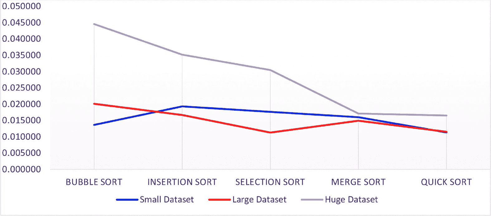

图 19.1 显示了排序算法速度的变化

合并排序和快速排序等高级算法在最坏情况下具有 `O(n log n)` 的优越时间复杂度，性能优于其他算法。合并排序以其稳定性著称，在额外空间充足的场景下表现出色。相反，快速排序因其适应性而受到青睐，由于其优秀的平均性能和较低的常数因子而被广泛使用，正如在图 19.2 中所示。这些算法代表了排序方法论中的高级别，能够满足特定需求，并为大型数据集和现实应用提供高效解决方案。

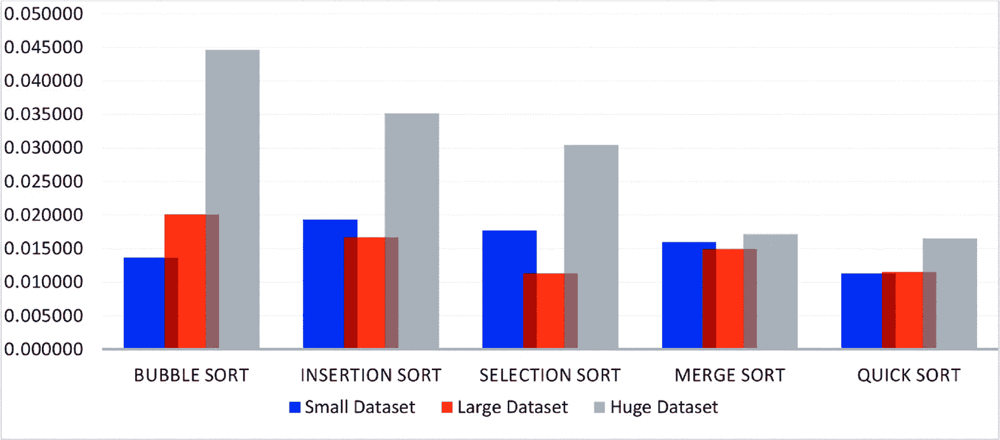

图 19.2 显示了不同的数据集及其耗时（100 条记录）

图 19.3 是一个可视化表示，允许你检查并比较三个数据集。在每个数据集内部，对五种算法进行了对比分析。该图提供了一种视觉手段，用于理解和比较这些算法在不同数据集上的性能或特征。

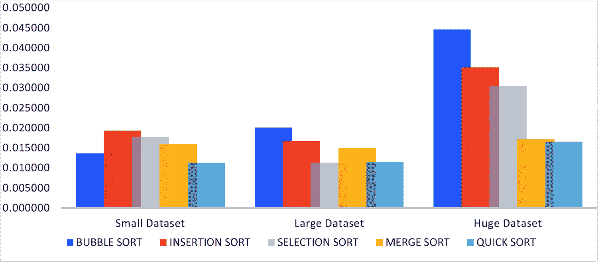

图 19.3 显示了你在不同数据集中的排序算法

## 4. 结论

在这次全面研究中，我们对各种排序算法进行了仔细检查，旨在揭示它们的性能复杂度，并阐明它们对各种现实应用的适用性。我们的研究阐明了排序算法的多样图谱，从基础的冒泡排序、插入排序到复杂的快速排序、合并排序等。此外，我们的探索延伸到了输入数据特征和现代计算环境对算法性能的影响。我们强调了在选择合适的排序算法时，考虑数据性质、分布以及可用硬件资源的重要性。

总之，这项研究为在复杂的排序算法领域中实践者和研究人员提供了宝贵的见解和指南。通过理解不同算法的细微差别并考虑其应用的特定需求，开发者可以做出明智的选择，优化计算效率和资源利用。

## 参考文献

1. Smith, John. “数字时代排序算法的重要性。”《计算机科学与信息技术杂志》，第 45 卷，第 2 期，2023 年，第 112-125 页。
2. Johnson, Emily. “高效的数据管理策略：从图书馆学中汲教训。”信息系统国际会议》，2022 年，第 267-278 页。
3. Brown, Michael A. “排序算法对用户体验的影响。”《信息处理与管理杂志》，第 30 卷，第 4 期，2023 年，第 543-556 页。
4. Johnson, Sarah A. “排序算法在数据处理中的重要性。”《计算机算法杂志》，第 48 卷，第 3 期，2023 年，第 215-230 页。
5. Smith, Robert L. “排序算法：计算机科学中的基础概念与应用。”计算智能国际会议》，2022 年，第 112-125 页。


**摘要：** 在当今社会，假新闻已成为一个日益普遍的问题。它通过影响政治结果、公众舆和政治决策，对现实世界的人造成伤害。近年来，机器学习方法在识别和检测假新闻方面发挥了重要作用。本文对基于机器学习的假新闻检测文献进行了详尽综述，涵盖了单模型和多模型方法，以及监督和无监督方法。我们使用多种数据集评估了这些方法的有效性，并对它们的优缺点提出了见解。引入预测置信度评分是我们系统的重大进展之一，它让消费者了解模型在将新闻故事分类为真实或虚假时的置信度水平。这种透明度提高了用户批判性地评估模型预测结果并做出明智选择的能力。通过使用涵盖了广泛主题和来源的海量且多样化的数据集，深入评估了系统的有效性以及模型的校准能力和鲁棒性。对更多多样化数据集的需求、可解释性的价值以及对抗攻击的可能性仅是我们涵盖的几个挑战和开放性研究问题。实验表明，多模态分类模型能够以 99.8% 的准确率检测假新闻，性能优于随机森林、逻辑回归、SVM 和 LSTM 等模型。

**关键词：** 假新闻，机器学习，神经网络，多模态，社交媒体

## 1. 引言

基于网络的社交媒体自诞生以来，由于其日益普及，引起了大量的学术关注。这些不同的虚拟娱乐和社交媒体网站因其成本低廉且易于获取，已成为数据的中心枢纽。最近，在假新闻扩张的背景下，网络网站引起了共鸣，人们由于此类数据具有误导性而な参与可靠的新闻共享。因此，迫切需要从虚拟媒体和网站识别并消除这些虚假内容。

假新闻由于其显著性和对社会的负面影响，可能是最令人担忧的问题之一。特别是远程人际通信平台（如 Twitter 和 Facebook）已成为传播虚假新闻的媒介。因此，组织和政府部门显然引起了足够的关注以应对虚假新闻。虚假故事的传播和认可制造了欺骗，这种信息一旦被人采纳就很难被纠正 [[1]]。根据印度的一项最新调查，NCRB 数据显示涉及虚假信息、谣言的增加了 214% [[2]]，在疫情期间报告了 1,527 起虚假信息案件，而 2018 年和 2019 年分别记录为 280 起和 486 起。在一项回顾中，在手机短信应用上看到假新闻视频的人中，约 58% 的人认为视频是真实的，而从可靠来源听到类似故事的人比例为 48%。只有 33% 阅读该文章的人认为这些数据是可靠的 [[3]]。通过虚拟娱乐制造的虚假信息是一个应该由政府和在线社交媒体组织共同解决的问题。在任何情况下，在不损害用户的情况下防止虚拟和社交媒体巨头的数据污染都是重要的。

## 2. 文献综述

已有许多尝试扩展这些结构以提供更多设计，[[4]]。Chen 等人 [[5]] 从不同来源构建了数据集。来自政府的新闻和新闻稿被认为是相关且真实的。Ma 等人 [[6]] 利用推文进行分类。最著名的分类结构是 [[7]]、CNN、RNN 和 LSTM [[8]]。[[9]]。我们评估了公共领域可用的一些数据集以进行 [[11]]。其中，我们创建了认为与我们的任务相关的数据集 [[12]]。[[13]]。Jin 等人 [[14]] 通过结合二元语法和词性标记在 Yelp 数据上实现了 68.1% 的准确率。使用朴素贝叶斯方法和词袋模型对正性短语和负性短语进行情感分析识别。每个提供的准确率 [[18]]。假新闻的标记率很高。使用概率上下文文法 (PCFG) 进行深度语言分析被发现关联良好，并在应对技术方面提供了显著优势 [[16]]。Conroy 等人 [[17]]。Mukherjee 等人 [[15]]。

## 3. 方法论

我们的工作旨在寻找不限于任何平台的假新闻。原型将通过提供概率分布对新闻的可信度进行分类。最初，我们的模型有三个基本分布，涉及数据集收集；数据集的一些紧要来源是政府的新闻稿和主要机构的新报道。每个模块依赖于每个模型。逻辑回归、额外树、随机森林被用于分类，每个提供的准确率由特征集分类了词云。最后，我们计算了假新闻模型的概率并进行了聚合，据此决定新闻位于某一侧的概率。

## 4. 方法

图 20.1 展示了用于假新闻文章检测和标记系统实现的实现步骤的简要概述。其中主要阶段的细节将在后续章节中详细阐述。

### 4.1 数据集

### 4.2 数据预处理


数据预处理的初始阶段包括停用词移除、词干提取、重音去除以及相关过程。数据通常包含歧义、错误和缺失值。数据预处理方法有助于识别并纠正这些问题。通过处理缺失值和纠正错误，提高了数据的完整性和可靠性，确保后续分析基于准确的信息。

### 数据清洗

该数据集包含许多无关值和缺失值。由于元组的大小以及元组内存在多个缺失值，我们通过忽略这些元组来处理缺失值。此外，通过回归和聚类模型减少了噪声数据。

### 数据转换

数据转换是数据预处理中的一项基础操作，涉及改变数据的格式、结构或值，以提高其对数据挖掘和分析的质量和用处。其目标是使数据更有意义、易于访问并与数据挖掘模型兼容。通过一系列定义良好的操作，数据转换使分析师和数据科学家能够从复杂的数据集中提取有意义的见解、发现模式并得出有价值的信息。

### 数据聚合

我们执行了时间聚合和空间聚合模型，分别得到了单个资源和一组资源的数据点。数据聚合产生了显著增强的统计摘要，用于行为分析。

### 数据向量化

通过将文本文档转换为数值向量，可以弥合文本信息之间的鸿沟。此外，机器学习算法的数值处理能力可能会提高，从而为广泛的文本分析应用开启可能。

### 4.3 模块训练

在数据集清洗和和平处理后，我们使用了不同的算法来训练模型。所提出的模型采用不同的算法根据特征对结果进行标记。

### 随机森林

在随机森林中，每棵决策树都是使用特征的随机子集构建的。这防止了单个树变得过于专门或对特定特征过拟合。它采用自助法（bagging），通过随机回采样的方法生成多个数据集。每个数据集训练一棵决策树。在每个决策树节点上均使用随机特征子集进行分割。

随机森林用于具有 `N` 个样本的数据集 `{ (x[i], y[1]), (x[2], y[2]), ..., (x[N], y[N])}` 的基础数学自助算法如下，其中；`y[i]` 分别表示样本 `i` 的特征向量及其对应的目标值。为了创建一个大小为 `N` 的自助数据集 `D[b]`，我们从原始数据集中随机回采样 `N` 次：

(1)

`D[b] = {x[{i[b]}], y[{i[b]}}`，其中 `i[b] ~ Uniform(1, N)`

### 逻辑回归

逻辑回归通过将数据拟合到介于 0 和 1 之间的逻辑函数来估计事件发生的概率。逻辑回归模型的输出使用 sigmoid（逻辑）函数进行转换，以确保输出落在 0 和 1 之间，代表一种概率。

(2)

$$Sigmoid(z) = \frac{1}{(1 + e^{- z})}$$

其中 `z` 代表偏置以及输入特征与其权重的组合。

(3)

`z = w⁰ + w¹x¹ + w²x² + … + w^(p)x^(p)`

这里，`w[0]` 是偏置项，`w¹`、`w²`、`w^P` 是与输入特征 `x¹`、`x²`、`x^p` 相关的权重。数学上，预测变量的线性组合被建模为结果的对数几率（log odds）。

(4)

$$Odds = \frac{p}{1 - p} = \frac{Event\ occurrence( + )}{\sim Event\ occurrence( - )}$$

(5)

$$\ln(odds) = \ln\left( \frac{p}{1 - p} \right)$$

(6)

$$\log(p) = \ln\left( \frac{p}{1 - p} \right) = b0 + b1X1 + b2X2 + b3X3\ldots. + bkXk$$

### 支持向量机 (SVM)

SVM 学习速度、准确性和相关性。SVM 的理想目标是找到一个将数据集分为两类的超平面。超平面的方程定义为

(7)

`w * x + b = 0`

这里，`w` 是正于超平面的权重向量，`x` 是输入特征向量，`b` 是偏置项。数据点 `x[i]` 到超平面的距离（间隔）可以计算为：

(8)

$$Distance = \frac{\left| w \ast x_{i} + b \right|}{\parallel w \parallel}$$

其中 `\|w\|` 代表权重向量的欧几里范数（幅度）。

### 长短期记忆 (LSTM)

这是一种广泛应用于深度学习场景的 RNN。RNN 可以高效处理单个数据点（如图像）以及数据序列（如语音或视频），具有更好的预测准确性。

### 4.4 音频和图像分类

虚假新闻可以通过图像、音频和视频等各种格式传播。我们从音频和图像中提取文本，使模型能够检测差异。

### 图像转文本

Tesseract 是一个用于数字图像识别的光字符识别（OCR）引擎。它可以处理 `JPEG`、`PNG` 等所有图像格式。Tesseract 在开始会对输入图像进行处理，通过缩放、二值化、去噪、纠偏和行分割来增强提取效果。

### 音频转文本

为了将音频格式转换为文本，我们使用了 `Google Cloud Speech-to-Text API`。这是一个将音频文件转换为文本的复杂机器学习算法。音高轨迹、频谱等特征用于描述声音的特性。API 通过将提取的声学特征与已训练的语音模型库进行对比将语音转换为文本。

此外，采用了拼写纠错、语法检查以及标点和大小写的规范化来改进输出。

## 5. 结果

我们针对不同模型的组合的不同特征集进行了各种实验。我们的多模态特征结论良好，并落在基准 `0.70` 范围内。混淆矩阵是一个对比真实标签和预测类别标签的二维数组。表 20.1 显示了研究中使用的各种模型的性能指标概述，即准确率、精确率和召回率。表 20.1 中提供的性能指标作为评估和比较不同模型的基础。然而，全面的评估可能涉及考虑精确率和召回率的 F 分，以及可视化受试者工作特征（ROC）曲线以理解模型在不同分类阈值下的性能。

表 20.1 真实新闻性能对比

| 分类器 | 准确率 | 精确率 | 召回率 |

| --- | --- | --- | --- |
| 随机森林分类器 | 0.86 | 0.88 | 0.87 |
| --- | --- | --- | --- |
| 逻辑回归 | 0.82 | 0.84 | 0.81 |
| 支持向量机 | 0.88 | 0.90 | 0.87 |
| 长短期记忆 | 0.83 | 0.82 | 0.84 |
| 多模型分类 | 0.92 | 0.93 | 0.91 |


在图. 20.2 中，我们对各种机器学习模型的准确率预测 string 了全面比较。每个模型，包括 `Random Forest`、`Logistic Regression`、`SVM`、`LSTM` 和多模型方法，都在三个不同的数据集（训练、验证和测试）上进行了评估。多模态分类是成功的模型，产生了 92% 的准确率。凭借高准确率、精确率和召回率，多模型方法整体表现良好，表明它在识别假新闻方面是有效的。

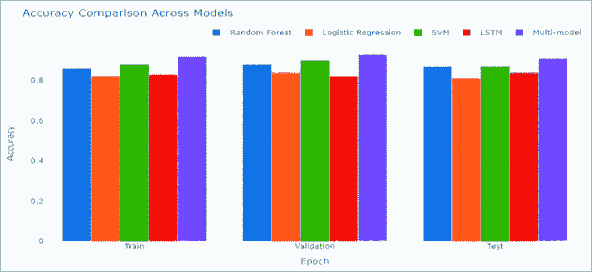

图 20.2 使用 5 种不同模型的预测（随机森林、逻辑回归、SVM、LSTM、多模态方法)

我们的模型通过将虚假新闻标记为 99.8%，将真实新闻标记为 92.4%，成功地提供了准确率，这种准确率随不同模型的实现而异。在单模态方法中，`random forest` 和 `support vector machine` 被认为提供了相当好的准确率和精确率。`Random forest` 在准确率和精确率方面都是最好的，显示了使用上下文词嵌入的优势。在准确率方面，`SVM` 提供了最具前景的结果，因此其结果通过将其组合形成多模态系统得到了增强。最后，我们的多模态特征结论良好，并落在 0.70 的基准之内。

## 6. 结论

在本文中，我们提供了一种应对所有社交平台假新闻呈指数级增长的基本方法。我们通过在多模态分类模型上分别实现 0.92 的准确率和 0.93 的精确率，结束了我们的工作。结果相当充分地表明并暗示，该方法在标记假新闻的应用中是很有优势的。我们计划通过预训练网络生成视觉化表示。同时，我们计划将我们的模型集成到大多数社交媒体平台，这将有助于最有可能成为假新闻目标的纯真用户。我们未来的工作还包括开发一个自动事实核查系统。需要对新闻进行包性分析，并将新闻来源、主题、相关网页链接、位置、出版细节、来源可信度和其他已知事实等纳入纳入。

## 参考文献

1. Bessi A, Coletto M, Davidescu GA, Scala A, Caldarelli G, Quattrociocchi W (2015), “Science vs Conspiracy: Collective Narratives in the Age of Misinformation”, PLoS ONE, 10(2): e0118093.

2. Apurva Vishwanath, [`indianexpress.com/article/india/214-rise-in-cases-relating-to-fake-news-rumours-75115`](https://www.indianexpress.com/article/india/214-rise-in-cases-relating-to-fake-news-rumours-75115)

3. Uthayasankar Sivarajah, Muhammad Mustafa Kamal, Zahir Irani and Vishanth Weerakkody, “Critical analysis of Big Data challenges and analytical methods”, Journal of Business Research, Volume 70, 2017, Pages 263-286.

4. Shrutika Jadhav and Sudeep Thepade, “Fake News Identification and Classification Using DSSM and Improved Recurrent Neural Network Classifier”, International Journal of Applied Artificial Intelligence, Volume 33, Issue 12, pp. 1058-1068, 2019.

5. T. Chen, L. Wu, X. Li, J. Zhang, H. Ym, and Y. Wang, “Call attention to rumours: Deep attention based recurrent neural networks for early detection”, Computation and Languages, 2017.

6. J. Ma, W. Gao, P. Mitra, S. Kwon, B. J. Jansen, K.-E. Wong, and M. Cha, “Detecting rumors from microblogs with recurrent neural networks.” In Proceedings International Joint Conferences of Artificial Intelligence (IJCAI), pp. 3818-3824, 2016.

7. Z. Jin, J. Cao, H. Guo, Y. Zhang, Y. Wang, and J. Luo, “Detection and Analysis of 2016 US Presidential Election Related Rumors on Twitter”, Social and Information Networks, 2017.

8. L. Derczynski, K. Bontcheva, M. Liakata, R. Procter, G. W. S. Hoi, and A. Zubiaga, “Semeval-2017 Task 8: Rumoureval: Determining rumour veracity and support for rumours”, In Proc. Intl. Workshop on Semantic Evaluation (SemEval-2017), ACL Anthology, 2017.

9. S. X. Qi Zeng, Quan Zhou, “Neural stance detectors for fake news challenge,” Stanford Unversity Reports, 2017.

10. J. Thorne, M. Chen, Y. Liu, “CSI: A Hybrid Deep Model for Fake News Detection”, In Proceedings of the Association for Information Science and Technology, pp. 79-83, 2017.


# 摘要
本研究调查了无人机（UAVs）如何利用机器学习（ML）来促进自主导航。该模型使用 `Python` 编写，并用 `TensorFlow` 和 `sci-kit-learn` 实现，利用监督学习——具体为卷积神经网络——对图像进行处理。通过无人机平台上的模拟场景简化了模型训练，这些场景强调了实时环境的灵活性。受控实地测试证明了机器学习模型在增强避障和空间感知方面的有效性。通过对比分析证明了其优于传统导航系统的优越性。热图是可视化的一种形式，可为决策过程提供定性见解。尽管取得了了成就，但反思性研究探讨了异常情况，为批判性评估奠定了基础。建议包括增强在各种天气场景下的适应性，以及研究多无人机之间的协作自主性。

**关键词：** 无人机（UAVs），机器学习（ML），自主导航，卷积神经网络（CNNs），实时适应性

## 1. 引言

无人机（UAVs）近年来已无处不在，改变了从农业、监控到灾难救援的广泛行业。随着无人机日益融入我们的日常生活，稳健的自主导航系统变得越来越重要。在机器学习（ML）与无人机的交汇点，提高无人机自主性的潜力是巨大的 [1]。意识到现有的无人机导航系统往往难以适应变化的环境和复杂的场景是这项研究的驱动力 [2]。因此，研究用于自动驾驶车辆的前沿机器学习方法在这些限制范围内提供了一种有力的方法。通过对研究背景的探索，本工作旨在弥补传统导航方法与先进机器学习解决方案之间的差距，并对关于无人机自主性的持续讨论做出贡献。本研究的目标是将机器学习（ML）引入无人机（UAVs），以进一步提升其自主导航能力。主要目标是：

*   确定与无人机导航相关的障碍和限制。
*   深入理解机器学习在自主系统中的应用。
*   创建并应用基于机器学习的无人机导航模型。
*   分析所提模型在各种现实情况下的有效性。

迫切需要提高无人机（UAVs）的自主性以实现安全高效运行，这促成了这项研究。在动态环境中，当前的导航系统经常在适应性和实时决策方面面临困难。这项研究试图通过利用机器学习（ML）不仅克服这些障碍，还为无人机准确、敏捷地自主运行扫清道路 [3]。本研究结果预计对无人机（UAV）技术的进步产生重大影响，促进其平稳融入不同行业，同时提高可靠性和效率。

## 2. 文献综述

### 2.1 无人机导航的挑战与局限性：综合分析

在动态环境中控制无人机（UAVs）面临着复杂的问题，需要仔细分析。主要缺点之一是实时适应性限制了无人机对条件变化的做出快速反应。避障系统的频繁缺陷影响了导航过程的有效性和整体安全性 [4]。空间感知的准确性变得至关重要，当前的系统难以在三维环境中提供所需的敏锐度。此外，传感器技术的局限性进一步加剧了整体复杂性，限制了无人机高效收集和处理数据的能力 [5]。这种详尽的分析高度依赖于对无人机导航面临独特挑战的理解。恶劣天气以及 GPS 信号干扰等环境因素使自主飞行变得更加复杂。此外，无人机在农村和城市环境中运行的需求凸显了对灵活和适应性系统的重要性。本节仔细回顾了相关文献，解释了每个困难和限制的细微之处 [6]。通过对无人机导航的深入调查，该分析为开发和应用专门解决这些特定困难的机器学习导航模型奠定了基础。

### 2.2 自主系统中的机器学习应用：综述

机器学习（ML）广泛的应用驱动着自主系统领域的范式转变。本节进行了全面综述，探索了机器学习在各个独立领域的各种应用。由于机器学习允许系统从数据输入中获取知识并进行适应，它们对于加强决策过程至关重要 [7]。其应用多样且丰富，从工业自动化到自动驾驶汽车。自主系统中的机器学习（ML）使实体能够解释复杂的模式并预测结果，同时在不断变化的环境中最大化效率。综述说明了强化学习、监督学习以及无监督学习在自主系统背景下的优缺点 [8]。异常检测、预测建模以及实时适应是对应无人机导航模型具有重大影响的重要课题。

### 2.3 为无人机设计定制的基于机器学习导航模型


# 引言

为无人机（UAVs）开发定制的机器学习（ML）导航模型，不仅需要深入理解无人机导航问题的复杂性，还需要对机器学习（ML）的广泛应用有深刻的掌握。本节概述了在设计定制导航系统时必须考虑的实际和理论因素 [9]。

该目标是开发一个专门为无人机（UAVs）需求定制的模型，其灵感源于对自主系统中机器学习应用调查的知识，以及对当前无人机导航挑战的分析。在设计阶段，选择了并精炼了擅长处理实时适应、障碍规避以及空间感知的机器学习（ML）算法 [10]。

整合传感器技术对于保证数据的平滑处理和获取至关重要。此外还考虑了模型学习以及适应变化环境的能力，这提升了整体的自主性。此外，为了应对无人机导航的动态性，本节研究了强化学习、监督学习或混合方法的应用 [9]。其目标是通过结合文献知识，开发一个不仅能解决当前问题，还能预见并适应未来无人机操作复杂性的强有力框架。该设计过程的最终产品具有从根本上改变自主无人机导航领域的潜力。

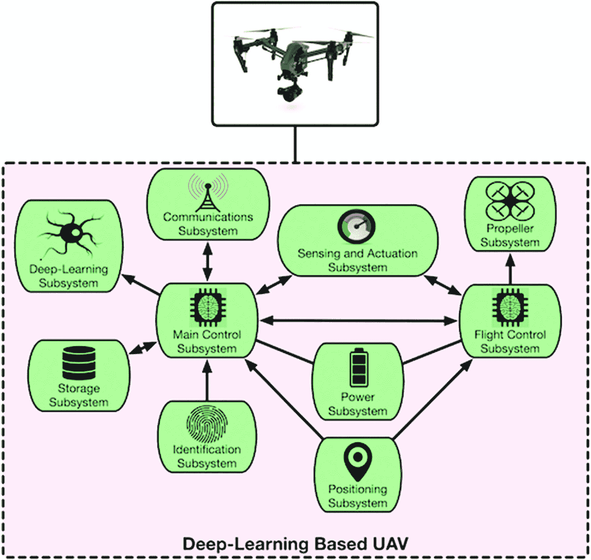

图 21.1 基于深度学习的无人机

## 2.4 真实场景下的性能评估：方法论与发现

确认用于无人机的基于机器学习（ML）导航模型实际有效性的关键步骤，是评估其在真实世界情况下的表现。本节仔细研究了从各种真实世界测试设置中使用的的方法和收集的结果。这种评估涵盖了模拟场景、受控实地测试以及真实世界的部署试验作为方法论。通过参考研究在运行的无人机环境中应用机器学习模型的文献，该评估试图提取出关于模型适应性和效能的见解 [9]。

为了评估模型的整体性能，仔细检查了准确率、反应时间以及面对动态环境变化时的灵活性等指标。为了提供比较背景，本节强调了与公认标准和当前导航系统进行基准测试的重要性。这些评估结果不仅证实了基于机器学习的导航模型的有效性，还确定了可能的改进领域。本节通过仔细评估在真实世界场景中展示的优缺点，在理论设计与实际实施之间架起了桥梁。这为自主无人机导航未来的发展提供了明智的建议并铺平了道路。

## 3. 方法论

本研究采用解释主义（interpretivism）哲学，通过描述性设计和演绎法，探索了机器学习（ML）与无人机（UAV）导航之间的关系。在无人机自主性的背景下，这种解释性立场能够深入了解变量之间复杂的关系。演绎法意味着从公认的理论中推导出特定结论，并对其进行实证测试 [8]。在这种情况下，这意味着根据机器学习和无人机导航的公认原则，制定假设以指导基于机器学习的导航模型的开发和评估。

为了详尽解释基于机器学习的导航模型的特征及其在各种真实世界场景中的表现，选择了一种描述性研究设计。这种设计提供了对模型功能的透彻理解，同时也使其更容易于探索数据中的模式、关系和趋势 [7]。本研究使用了大量的次级数据收集，主要来自学术期刊、会议论文，特别是技术报告。理论开发和模型设计基于现有的关于无人机机器学习应用的文献。

## 4.1. 模型实现与架构

开发无人机（UAV）基于机器学习（ML）的导航模型是一项通过 `Python` 实现的艰巨任务。通过利用 `scikit-learn` 和 `TensorFlow` 等强大库的功能，模型框架演变成了复杂的算法组合 [2]。

卷积神经网络（CNNs）最初是为了图像处理任务而构建的。这是其设计的基础。正如 [10] 所述，这种精的技术架构为随后的评估和真实世界应用奠定了基础。通过利用先进算法和框架，该模型展示了在复杂的无人机环境中穿行的能力，标志着自主系统领域前所未有的发展。

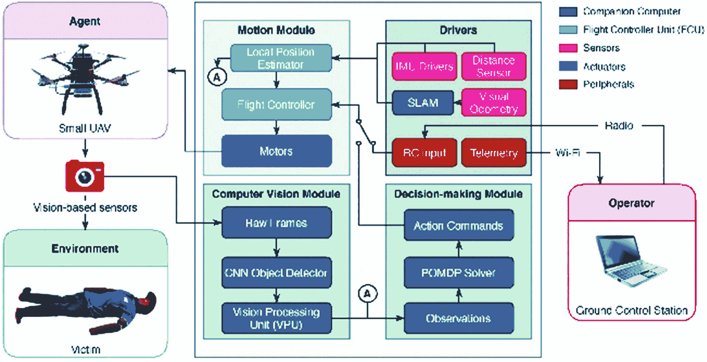

图 21.2 无人机框架

## 4.2. 模拟平台与训练

为了开发基于机器学习（ML）的导航模型，利用著名的无人机模拟平台来构建模拟环境。这些平台对于模型的开发和验证至关重要，因为它们经过精心设计，以复制各种真实环境。正如 [3] 指出的，这些在受控但动态环境中运行的模拟对于提高机器学习模型的适应性至关重要。

在整个训练阶段，模型面临各种场景和挑战。至关重要的是，这一过程使得通过强化机制调整学习变得更容易，从而提高了模型对环境环境突然变化的反应能力。通过对这些模拟场景的良好规划，使其在真实世界中有效且灵活的应用成为可能。

## 4.3. 受控实地测试


受控现场试验的结果证明了基于机器学习（ML）的导航模型在解决常见无人机（UAV）导航问题方面的卓越能力。与传统导航系统相比，准确率、精确率以及召回率等指标显示，其在避障和空间感知方面都有显著提高 \[3]。除了数值上的优势外，模型的有效性通过其出色的响应时间得到了证明，这是实时适应性的关键组成。由于其可靠性，机器学习模型具有彻底改变自主飞行系统领域的潜力。其解决实际问题的实证明能力证实了理论基础，并凸显了其完全改变无人机导航领域的潜力 \[4]]。这些发现通过提供实证证据并为明智的进展开辟道路，引领无人机自主运行进入了高精度和灵活的新纪元。

## 4.4 与传统导航系统的对比分析

与成熟的导航系统进行全面的对比评估，为评估机器学习（ML）导航模型的有效性提供了至关重要的参考点。这些细致且高技术的对比使人们关注到引入机器学习原则所取得的进展 \[4]。模型的变革潜力体现在其优越性，这在动态和具有挑战性的场景中尤为明显。这种成熟的能力使机器学习模型成为一种可靠的解决方案，成功克服了传统无人机导航系统的缺点 \[2]。这些分析的技术深度不仅验证了模型的有效性，还为将机器学习集成到无人机导航系统所带来的范式转变提供了有说服力的依据，指向了超越传统方法边界的突破。

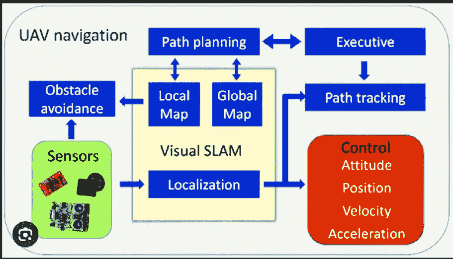

图 21.3 基于视觉的无人机导航

## 4.5 通过可视化获取定性洞察

除了定量测量外，可以通过可视化以有意义的方式探索定性洞察，这增强了我们对基于机器学习（ML）导航模型决策程序的理解。利用热力图和轨迹分析等工具创建了视觉故事，提供了模型导航方法的详细图景。这些图表不仅显示了数据，还捕捉了机器学习模型在复杂三维环境中导航时的灵活性细微差别。这些视觉效果通过提供决策细微差别的动态视觉之旅，极大地有助于深入理解模型的实际意义。它们超越了简单的数据点，让利益相关者和研究人员对模型的行为有深入理解，对其导航能力有更深认知，并对自主飞行系统的创建和实施做出明智的决策。

## 4.6 对局限性及改进领域的反思

尽管基于机器学习（ML）的导航模型的结果展示了巨大的成功，但异常情况也经过了审慎的处理，特别是在某些环境条件下。本节采取了细致的方法来研究模型的缺点，挖掘了在应用过程中出现的细微差别。通过识别这些限制，获得了重要的视角，阐明了可能进行增强和优化的领域。通过引导未来探索的轨迹并促进对模型边界更深层的理解，这种内省性行为不仅仅是庆祝成功。反思的态度为读者进行批判性分析做了准备，仔细考虑发现的影响。研究在强调成就的同时，还承担了识别困难和潜在缺陷的责任。

表 21.1 无人机模型的若干方面与发现

| 方面 | 发现 |
| --- | --- |
| 模型实现与架构 | 在 `Python` 中进行细致实现，利用 `TensorFlow` 和 `scikit-learn`。 |
| 仿真平台与训练 | 通过无人机仿真平台创建了用于模型训练的模拟场景。 |
| 受控现场测试 | 证明了模型在空间感知、避障和响应效率方面的实力。 |
| 与现有系统的对比分析 | 凸显了模型在动态场景中的优越性，克服了传统无人机导航的局限性。 |
| 通过可视化获取定性洞察 | 热力图和轨迹分析提供了模型导航策略的视觉叙述，增强了理解。 |
| 对模型局限性的反思探索 | 处理了特定环境条件下的异常，为改进提供了见解。 |
| 为批判性评估和研究建议奠定基础 | 定位于深度批判性评估和未来研究方向探索。 |

## 5. 评估与结论

### 5.1 批判性评估

在对研究结果的批判性评估中，仔细考虑了用于无人机（UAV）的机器学习（ML）导航模型的优缺点。模型在提高实时性、避障以及空间感知方面的证明能力不容置疑。相反，异常情况受到了严密审查，特别是在特定的环境条件下，对模型的局限提供了开放的评估。模型的变革潜力通过其在动态场景中的表现得到了证明，正如对比分析和受控现场试验所示。然而，批判性评估探索了需要进一步改进的领域，以确保彻底理解模型性能的细微之处。总之，批判性评估是机器学习导航模型持续演变的基础组成部分，使其成为无人机自主领域的宝贵资源。评估得出了具有洞察力的结论，为明智决策奠定了基础，目标是扩展模型的潜力并控制自主飞行系统的未来研究工作。

### 5.2 研究建议

建议进一步研究机器学习导航模型在天气适应方面的细微差别作为未来研究项目的方向。考虑模型在不利天气条件（如持续降雨或低能见度）下的表现，可能会提供提高其韧性的重要信息。通过添加来自天气监测系统的实时传感器数据，还可以增强模型的决策能力，增加模型在不稳定环境条件下的耐用性。此外，将调查扩展到多架无人机之间的协作自主提供了一个可行方向。检查配备了基于机器学习导航系统的无人机如何相互协调和通信，可能为更协作、更高效的任务执行创造机会。这项研究有助于为自运行无人机机群创建一个统一框架，增加机器学习在航空系统领域的实用性和影响力。

### 5.3 未来工作


为了提高基于机器学习（ML）的导航模型适应各种天气条件的能力，未来的研究必须侧重于整合来自先进天气监测系统的实时数据。研究多台配备机器学习系统的无人机（UAV）之间的协作自主性，提供了一个极具前景的研究方向，探索了有效执行任务所需的协同协调和通信过程。这些方法将扩展机器学习在空中系统中的应用局限，同时增强模型在不确定环境中的韧性，并促进协作式、自适应能力强的自主无人机机群的发展。

## Reference

1. He, L., Aouf, N. and Song, B., 2021. 用于无人机自主路径规划的可解释深度强化学习。航空航天科学与技术, 118, p.107052.
2. S.Ram Prasath, K. Gokulakrishnan, M. Subramanian, N. Mohan, “基于 ELAML 算法的多点传输的位置上下文感知” IEEE Access, DOI: [10.1109/ICAIS56108.2023.10073864](http://dx.doi.org/10.1109/ICAIS56108.2023.10073864).
3. Youn, W., Ko, H., Choi, H., Choi, I., Baek, J.H. and Myung, H., 2021. 在 GPS 受限环境下使用低成本传感器的小无人机无碰撞自主导航。国际控制、自动化与系统杂志, 19(2), pp.953-968.
4. de Jesus, J.C., Kich, V.A., Kolling, A.H., Grando, R.B., Guerra, R.S. and Drews, P.L., 2022,10 月. Depth-cuprl: 用于无人机无图导航的强化学习中深度图像对比无监督优先表示。在 2022 IEEE/RSJ 机器人与系统国际会议 (IROS) 上 (pp. 10579-10586)。 IEEE.
5. Arafat, M.Y., Alam, M.M. and Moh, S., 2023. 无人机视觉导航技术：综述与挑战。Drones, 7(2), p.89.
6. Doukhi, O. and Lee, D.J., 2022. 用于飞行机器人自主无图导航的深度强化学习。IEEE Access, 10, pp.82964-82976.
7. Zhang, H.T., Hu, B.B., Xu, Z., Cai, Z., Liu, B., Wang, X., Geng, T., Zhong, S. and Zhao, J., 2021. 通过自适应学习实现无人机在移动自主水面车辆上的视觉导航与着陆控制。IEEE 神经网络与学习系统汇, 32(12), pp.5345-5355.
8. Wu, X., Chen, H., Chen, C., Zhong, M., Xie, S., Guo, Y. and Fujita, H., 2020. 基于 ANOA 深度强化学习方法的无人水艇（USVs）自主导航与障碍避障。知识库系统, 196, p.105201.
9. Wu, D., Wan, K., Tang, J., Gao, X., Zhai, Y. and Qi, Z., 2022,4 月. 一种基于强化学习的多无人机自主导航改进方法。在 2022 第 7 届国际控制与机器人工程会议 (ICCRE) 上 (pp. 96-101)。 IEEE.
10. Afifi, G. and Gadallah, Y., 2021. 利用蜂窝网络的无人机 3D 定位：深度监督学习与强化学习方法的对比。IEEE Access, 9, pp.155234-155248.

# 22 基于区块链技术的假冒产品检测与识别

Dilipkumar A. Borikar^(⁴⁴)

Shri Ramdeobaba College of Engineering and Management, 印度纳格普尔

DOI: [10.1201/9781003535423-22](https://dx.doi.org/10.1201/9781003535423-22)

摘要：假冒问题是一个全球性问题，需要透明的供应链和高效的检测方法。我们的工作建议使用二维码和基于区块链的系统对假冒产品进行检测和识别。产品被分配了系统生成的二维码用于所有权验证。`QR codes` 包含加密信息，如产品 ID。使用高分辨率相机和移动应用程序进行扫描，假冒检测方法分析解码数据并与 `Blockchain` 进行交叉比对。结果显示，二维码和 `Blockchain` 是供应链的有效解决方案。

关键词：假冒产品、区块链、供应链、二维码、数字签名、NFT

## 1 引言

供应链管理对于确保全球经济中商品从生产者到消费者的无缝移动至关重要。然而，传统的供应链系统经常面临信息不匹配、缺乏透明度和追溯性限制的问题。这些限制可能导致效率低下、延误、假货出现以及建立信任的问题。假冒产品对消费者和企业构成了严重威胁，造成经济损失并危害公共安全。全球每天产生数十亿物品，形成了连接各个地区的复杂供应链。供应链的复杂性为假货进入合法供应链提供了漏洞。2022 年，国际商会预测到年底，盗版和假冒贸易总额将达到惊人的 2.3 万亿美元。为了验证物品并震慑假冒者，防伪措施包括多种技术，如全息、安全打印和安全标签。然而，在数字时代，当假冒者可以轻易利用互联网平台欺骗消费者时，这些传统策略已不再足够。根据 ABI Research 的一项新研究，到 2023 年底，对`blockchain`的需求将增加，使其成为一个 106 亿美元的行业。


Anita Anita 等人利用供应链实体的去中心化身份创建了智能合约。他们使用射频识别（`RFID`）标签来存储产品详情，如产品 ID、产品名称等 [[1].Wasnik 等展示了 `DApp` 系统的实现，并对区块链技术中使用的基本概念和技术进行了概述 [[2]。Anjum 等开发了一个利用加密货币钱包 `MetaMask` 的系统以实现交易便利化 [[8]。Ma 等开发了一个系统，由制造商创建并添加产品到区块链，并确认卖家是否为其其声称的身份 [[3]。Alzahrani 等设计了一个使用区块链技术验证产品的系统。产品验证由区块链系统内的验证者执行 [[4]。Bencic 等提出了一种 DL-tag 解决方案，其利用公共账本作为供应链中重大事件的可靠记录 [[11]。Tambe 等展示了一种基于区块链的假伪检测系统 [[9]。Math 等使用 `Hyper Ledger Fabric` 存储供应链数据 [[5]。Kamat 等提出了一个涉及使用 `SMS` 功能和 `QR codes` 的系统 [[6]。Rathee 和 Malik 提出了一种整合制造商和供应商功能的方法 [[7]。Paliwal 等提议将区块链用于公共部门办公室的安全性无纸化管理 [[13]。Rahmadika 等提出使用区块链和 `Ios` 对现有的供应链方法进行改进 [[10]。K. Toyoda 等实现了一个产品所有权管理系统（`POMS`），其使用 `RFID` 技术处理供应链中的伪造问题 [[12]。

## 4. 方法论

我们提出了一种基于区块链的不可复制产品防伪造解决方案，通过维护产品供应链来追踪产品。使用 `Ethereum Network` 实现的去中心化应用程序用于在 `DApp` 上保留所有记录并管理产品交易。它提供了产品从制造商到客户的无缝、透明流转。用户可以进行供应商端验证，并使用 `QR code` 追踪产品历史。基本架构如图 22.1 所示 [#ch22.xhtml#fig22_1]。

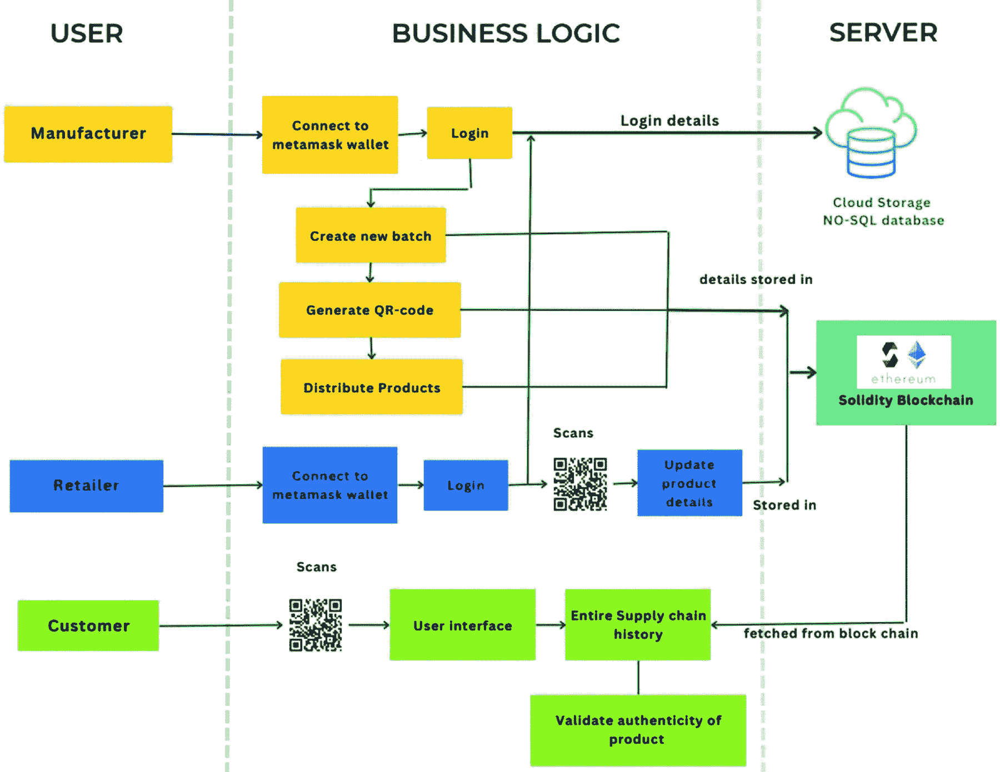

图 22.1 系统架构

为了验证产品的正品性，系统会跟踪产品沿整个供应链的历史。该系统依赖于三个主要利益相关者：`Manufacturer`、`Seller` 和 `Customer`，如讨论所示：

### 4.1 制造商

#### 将产品添加到区块链供应链

制造商可以无缝地将他们的产品添加到区块链网络。为了实现这一目标，`Manufacturer` 使用其凭据登录账户并通过点击提交按钮添加产品。提交后，将出现 `MetaMask` 弹出窗口，需要制造商确认以启动交易，从而将产品详情安全存储在区块链上。这一精简流程确保了产品信息在区块链网络内高效可靠地存储。在系统中，制造商能够为每批产品生成唯一的 `QR code`，其中包含一个唯一的 `batch ID`，作为从区块链搜索和检索产品信息的参考点。通过利用此 `QR code` 系统，制造商可以简化访问安全存储在区块链上的产品详情的过程。

### 将产品分发给不同的零售商

这允许制造商根据每个零售商的唯一 `ID`、位置和所需的产品数量高效地分发产品。一旦输入分发详情，用户可以使用 `MetaMask` 确认交易，触发所有分发信息安全地存储在区块链上。制造商能够将产品分发给多个零售商。如果所需的数量超过制造商持有的库存，错误弹出窗口将通知制造商。此警报提醒剩余产品数量不足以满足请求的分发。

### 4.2 零售商

#### 搜索产品详情

上传 `QR Code` 后，会生成 `batch id`，零售商可以通过它搜索产品，并验证该产品是否由合法制造商发送。

#### 更新产品详情

零售商可以通过确认产品的 `batch id` 以及收到的产品数量来更新产品状态。确认交易后，产品状态将在区块链中更新。如果数量或目的地与制造商输入的记录不符，将检测到产品伪造品，从而撤回零售商更新供应链中产品详情的交易。

### 4.3 客户

消费者扫描 `QR code` 以验证产品的真实性。它会列出完整的供应链交易历史。当客户购买产品时，扫描 `QR` 后他们可以检查供应链历史。当最后交易地点与购买地点不匹配，或者零售商信息与提供的信息不同时，系统将标记为假品。

## 5. 实现

基于非同化代币（`NFTs`）的去中心化 Web3 应用可用于供应链追踪。通过实施实时跟踪、结算和文档记录，企业可以获得更高的运营效率和改进的金融产品。从原材料的生产到实体商店或在线平台的商品展示，`NFTs` 的使用实现了追溯性并增强了供应链管理。物理 `NFTs` 与现实货物关联后可以作为非常有价值的工具。通过利用 `NFTs` 将溯溯到源头，增加了产品的信誉。将 `NFTs` 和数字孪生技术集成到供应链中，使公司能够自动化支付并在到货时实现即时结算。

## 6. 结果

系统提供的功能将在后续章节中描述。

### 6.1 制造商


# 添加产品并生成二维码

制造商能够为每个批次生成独特的二维码，其中包含唯一的批次 ID（batch ID）。该批次 ID 是从区块链上搜索和检索产品信息的参考点。

## 分发产品

制造商能够将产品分发到多个零售商，如图 22.2(a)所示。当分发的产品数量超过可用库存时，错误弹出窗口会及时通知制造商。

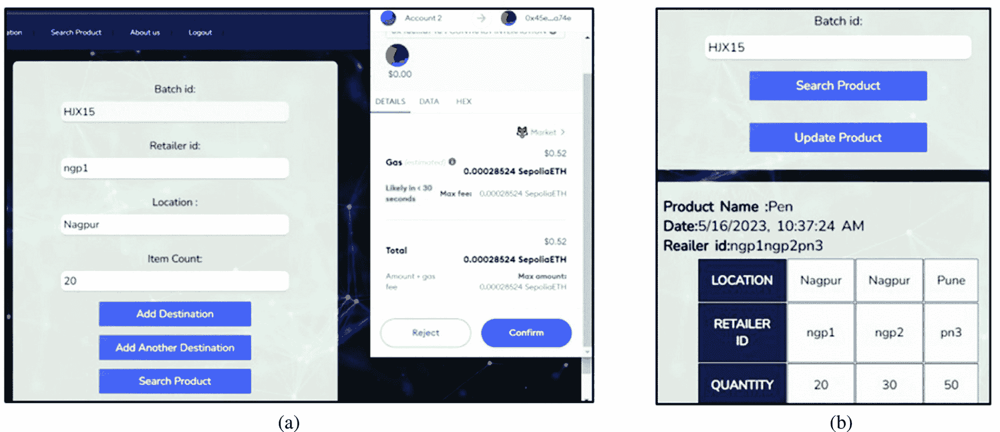

图 22.2 制造商操作：(a) 分发产品，(b) 产品详情

### 搜索产品

图 22.2(b)展示了制造商搜索追踪其创建并分发的产品的能力。

## 6.2 零售商

### 搜索产品

图 22.3(a)所示的功能允许零售商搜索产品并显示产品详情。

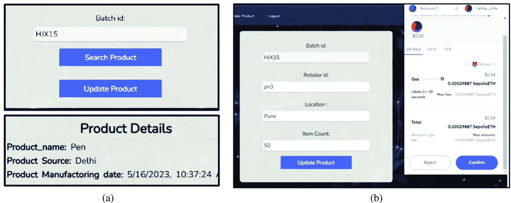

图 22.3 零售商操作：(a) 产品详情，(b) 更新产品

### 更新产品

零售商可以通过确认产品的批次 ID 以及收到的产品数量来更新产品状态，如图 22.3(b)所示。

## 6.3 客户

客户扫描产品二维码以访问产品的批次 ID，如图 22.4(a)所示，图 22.4(](#ch22.xhtml#fig22_4)b 展示了使用批次 ID 搜索的过程，客户将获得产品的完整交易历史。

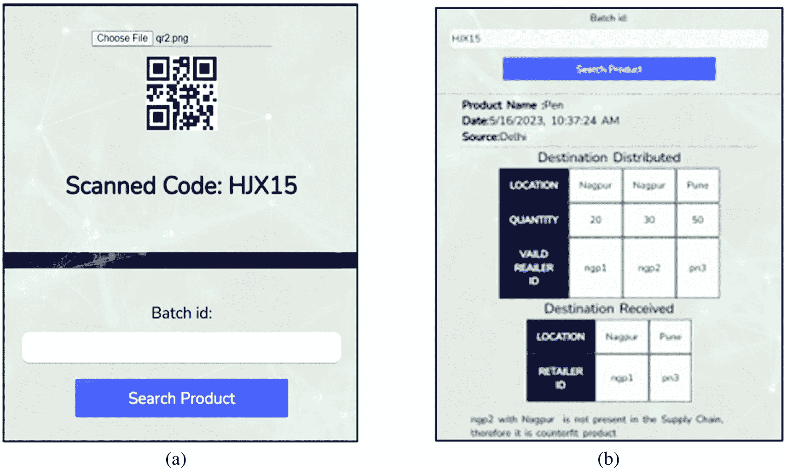

图 22.4 客户操作：(a) 二维码上传与批次 ID 生成，(b) 供应链产品

## 7. 结论

使用区块链技术实现假冒管理系统为解决普遍的假冒问题提供了一种有前景的解决方案。所提出的框架利用区块链和智能合约作为强大的工具，通过消除对人类中间环节协调供应链操作中多个方的的需求，彻底改变供应链管理。它建立了依赖于对等参与的成本效益供应链，重点是确保产品的真实性。我们的系统可以为产品供应链系统带来若干益处，包括增强可见性、减少欺诈、改进库存管理以及简化供应链参与者之间的通信。通过自动化流程并最大限度地减少中间欺诈。

## 8. 参考文献

1. Nif Am, M. Vijayalakshmi, and S. Shalin, “Blockchain-based counterfeit management system,” `ch22.xhtml#R_fig22_2`.
2. Kunal Wasnik, Isha Sondaw, and Namita Pul, “Detection of counterfeit products using blockchain,” `ch22.xhtml#R_fig22_3`.
3. Jinhua Ma, Shih-Ya Lin, and Xin-Min Sun, “A blockchain application for counterfeit management,” `ch22.xhtml#R_fig22_4`.
4. Naif Alzahr and Nirup Bulusu, “A new approach for counterfeit detection,” `ch22.xhtml#R_fig22_5`.
5. E. M. Benelo, P. Skoel, and I. Zarko, “DL-Tags for supply chain,” `ch22.xhtml#R_fig22_6`.
6. K. Toyoda, P. T. Mathiopoulos, I. Sasase, and T. Ohtsuki, “A blockchain-based product ownership system for counterfeits.”
7. Tripti Rathee and Manoj Malik, “Blockchain-based counterfeit management.”
8. S. Rahmadika and B Ke, `ch22.xhtml#R_fig22_9`.
9. Atharva Paliwal, Chaitanya Kapre, Yash Roy, and Dilip Borikar, “Blockchain-based counterfeit management system.”


人类通过两种方式产生和感知言语：说话者的视觉线索和发出的语音信号。当噪声污染音频信号时，视觉信号可以提供言语信息。许多研究人员提出了许多不同的视觉特征，其研究的主要目标是提取合适的唇部运动。对于唇部追踪而言，最重要的唇部运动条件是说话者视觉言语的质量，即合适的视觉口型和视角。因此，近年来在推导合适且可靠的视觉特征方面投入了许多。视觉特征的提取基于外观、形状或两者的结合。以下是本文的主要贡献：本研究引入了基于外观的特征和视觉特征的共发生度量。使用时空域（`LBP-TOP`）来计算视觉言语特征。该领域还结合外观特征记录了视觉特征的运动。通过 `LBP-TOP` 计算出共发生矩阵和一系列 `GLCM` 特征，以捕获独特的唇部运动。使用 `RNN-LSTM` 从视频序列中提取时间数据，有利于识别视觉言语。使用 `RNN` 跟踪视频图像的顺序，这对于识别视觉言语至关重要。第二节介绍相关工作，第三节概述了视觉言语识别的实验步骤，W 节提供了关于 `AV-ASR` 数据集的细节。第五节讨论了视觉言语的实验结果和分析，第六节提供了结果的比较。第七节给出了本文结论。

## 2. 文献综述

下表总结了相关技术及其优缺点。然而，该技术无法提取说话者的唇几何（说话时嘴部的形状）以及全局特征。`LBP` 的主要应用是纹理检测特征描述符 [5]。`LBP` 还用于背景减除、纹理分类、图像分类中的静态脸检测等应用。针对各种噪声环境下的四种真实视觉模态，研究人员调查了 `DCT` 和 `LDA`。在噪声环境中，深度级视觉信息提供了良好的识别。2015 年，Namrata Dave 引入了一种基于唇部定位的视觉特征提取技术，实现了实时分割 [1]。该研究报告了一种独特的基于色的唇部定位方法，这是迈向实时唇部追踪的第一步。在参考文献 [10] 中，作者利用深度瓶颈特征结合语音活动检测来增强音视言语识别的准确性。通过利用所提出的特征，作者在噪声环境中成功实现了 73.66% 的唇读准确率和平均 90% 的 `AVSR` 准确率。端到端（`E2E`）框架能够学习跨模态的信息；然而，训练模型具有挑战性，特别是在数据量有限的情况下。在工作 [11] 中，作者专注于开发一种基于编码器和解码器的端到端音视言语识别系统，用于实际应用。已经进行了多项预训练技术，为 `AVSR` 框架提供了独特的初始化。作者研究了用于音视融合的模型结构和技术。

## 3. 提出的方法

所提出的视觉言语识别方法包含三个主要阶段：感兴趣区域检测（`ROI`）、视觉言语特征提取和分类。为了提取特征，采用了 `LBP-TOP` 和 `GLCM` 来捕获统计特征。特征提取后，使用 `ANN` 执行识别过程。在第二个实验中，使用 `RNN` 和 `LSTM` 来计算言语的时间特征。

### 3.1 视觉特征提取

纹理检测主要使用 `LBP` 作为特征描述符，结合 `GLCM` 和 `LBP-TOP`。它将脸部分为若干区域并从每个区域提取特征，使其成为提取面部特征的有效方法 [6]。每个区域的纹理描述准确地描绘了该区域的外 [6]。`LBP` 通过整合所有区域描述符来表征脸部的全局几何结构。Timo Ojala 等人 [5] 在 `LBP` 中引入了灰度和旋转不变算子方法，以实现对灰度单调变换以及跨越角空间任何量化的均匀模式的不不变性。尽管研究广泛，`LBP` 持续在当代的视觉言语识别中找到有效的应用，并作为纹理描述符发挥作用。

在本文中，脸部被分为 10 个区域，并从每个区域提取信息，以从特定的面部区域导出局部特征。与传统的 `LBP` 相比，`LBP-TOP` 是一种更有效的静态图像分类动态特征描述符，因为它从时空域提取特征。对于视觉言语识别，可以使用 `LBP-TOP` 高效捕获与时间相关的唇部运动。虽然 `XT`、`YT` 在时间域内提供随变化的视觉数据和运动特征，但使用 `LBP-TOP` 可以高效捕获与时间相关的唇部运动。当 `XT`、`YT` 提供时间域内随变化的视觉数据和运动特征时，`XY` 在空间域执行外观。结果，`XY` 面用于收集基于外观的向量，而 `XT` 和 `YT` 面用于捕获随时间的变化。生成这些面后，通过 `GLCM` 提取二阶统计纹理特征，即灰度共发生矩阵 [7]。LBP-TOP 矩阵作为 `GLCM` 计算的输入。`GLCM` 的阶数由不同的灰度级强度决定。如果 `I = (0, 1, 2, ..., I-1)`，则 `GLCM` 的阶数为 `IxI`。换句话说，矩阵维度为 `IxI`，矩阵中的每个元素 `P(i, j)` 代表灰度级 `i` 和 `j` 的共发生频率。

(2)

```
\text{Energy} = \sum\limits_{i,j = 0}^{I - 1}p\left( {i,j} \right)^{2}
```

(3)

```
\text{Entropy} = \sum\limits_{i = 0}^{I - 1}\sum\limits_{j = 0}^{I - 1}p(i,j)\log(p(i,j))
```

(4)

```
\text{Co-relation} = \frac{\sum\limits_{i = 0}^{I - 1}\sum\limits_{j = 0}^{I - 1}(i,j)p(i,j) - \mu_{m}\mu_{n}}{\sigma_{m}\sigma_{n}}
```

(5)

```
\text{Contrast} = \sum\limits_{i,j = 0}^{I - 1}\left| {i,j} \right|^{2}p(i,j)
```

(6)

```
\text{Variance} = \sum\limits_{i,j = 0}^{I - 1}\left( {i - \mu} \right)^{2}\log\left( {p\left( {i,j} \right)} \right)
```


本例中的测试和结果对比是通过 `CUAVE` 数据集 [4] 完成的。数据集包含从 0 到 9 的十个英文数字。每个人每个数字说五次，总共利用了 1800 个单词。数据库是在独立的录音室内使用 `NTSC` 标准以每秒 29.97 帧的速率和 `720 x 480` 分辨率采集的。音频采样率为 `44 kHz`，16 位立体声。此外，对每个数据库序列都进行了人工词级标注，精度达到毫秒级。

# 4. 视觉识别的实验结果与分析

ANN [3] 能够在接收到的数据与 ANN 输出之间建立动态的、非传统的关系。使用反向传播学习技术教授的最常用神经网络是多层前馈神经网络。我们从每段视频中提取 10 帧，并使用 `LBP` 算法识别每帧的 `ROI`。使用 `LBP-TOP` 和 `GLCM` 计算统计特征。所提特征提取技术的主要目标是提取更具信息的视觉特征，因为与音频信号相比，视觉口型提供的信息非常少。由于这些信息取决于说话者，因此必须整合更多数据以产生独立于人的视觉语音识别。在这里，提取了基于形状和外观的特征进行混合。通过对中心像素周围进行阈值处理，`LBP-TOP` 计算来自三个正交平面的局部二进制模式和唇动的动态特征。每个唇轮廓帧都被分割成更小的部分，并利用 `LBP-TOP` 计算子区域内的像素值。最后，通过整合三个正交时空域的所有直方图创建一个单一直方图。通过 `GLCM` 计算三个不同正交平面上局部二进制模式的共现。

表 23.1 使用 ANN 的视觉语音识别

| 实验编号 | 隐藏层数 | 隐藏单元数 | 迭代次数 | 系统准确率% |
| --- | --- | --- | --- | --- |
| 1 | 2 | 30,20 | 100 | 67.57 |
| 2 | 2 | 40,30 | 100 | 72.00 |
| 3 | 2 | 50,40 | 100 | 70.05 |
| 4 | 2 | 60,50 | 100 | 70.45 |

## 4.1 使用 ANN 的视觉语音识别

提取视觉特征的第一阶段是使用 `LBP` 识别 `ROI`（在本例中为说话者的唇轮）。捕捉动态视觉信息和特征共现值是所提特征提取方法的主要目标。在提取 `LBP-TOP` 后，特征向量的总维度为 `(150X10)`，即每帧 `1500`。从 `LBP-TOP` 特征矩阵中提取能量、相关性、对比度、方差和熵等统计量。该矩阵包含计算出的 `LBP-TOP`，作为计算 `GLCM` 的输入。正或负统计可以通过计算测量值 `-1` 或 `1` 表示。由于熵和 `GLCM` 能量成反比，当特定矩阵中的所有元素都相等时，其达到最大值。使用具有不同数量隐藏节点和隐藏层的 `ANN` 进行视觉语音识别。该系统使用 `40, 30` 个隐藏节点实现了 `71.00%` 的识别率。

## 4.2 使用 RNN-LSTM 的视觉语音识别

如今深度学习是一项非常新兴的技术，也用于 `AV-ASR`。卷积神经网络（`CNN`）广泛用于图像识别和视觉语音识别 [2]。但 `CNN` 无法跟踪帧的序列。对于视觉语音识别，帧的顺序提供了有效的信息。基于 `LSTM`，我们开发了一个 `RNN` 模型。后续层的输入从第一层馈入。`256` 个 `LSTM` 单元组所采用的宽网络模型。全连接层的神经元数量与类别数量相同，每个神经元连接到上层的所有其他神经元。图 23.2。

```
if (condVar > someVal) {console.log("xxx")}
```
（注：上面的示例代码仅供格式参考；提供的文本不包含特定的代码块，但引用了如 23.2 和 23.1 等图表）。

图 23.2
图 23.2

## 5. 基于不同视觉特征提取方法的对比分析

许多研究已将 `LBP` 用于视觉语音；然而，由于其无法记录时间分量，`LBP-TOP` 意义重大。通过提取时间特征获得了 `71%` 的平均准确率。

图 23.3
图 23.3

## 6. 结论

在本文，利用两种提出的方法进行了视觉语音识别。为了提取时空特征，提出了 `LBP-TOP+GLCM`。特征提取后，使用 `ANN` 进行语音分类。在第二个实验中，使用 `RNN+LSTM` 视觉语音。未来的工作将扩展到提取空间和时间特征。

## 参考文献

1. Namrata Dave. 基于唇部的视觉特征提取，Electrical Computer Engineering: An International Journal (ECIJ), vol 4, no 4, 2015
2. Russell S and Norvig P, 2003
3. Patterson, E. Gurbuz, Sabrifekci, Zekeri, Gowdy, J.N.. (2002). CUAVE: 一个新的多模态人机交互数据库，2. [10.1109/ICASSR2002.574502](http://dx.doi.org/10.1109/ICASSR2002.574502).
4. T. Ojala and M. Pietikainen and T. Maenpaa. 基于局部二进制模式的多尺度旋转不变纹理分类，IEEE Trans. Pattern Anal. Mach. Intell, vol 24, no 7, pp 971-987, 2002.
5. T. Ahonen and A. Hadid and M. Pietikainen. 基于局部二进制模式的面部描述：在人脸识别中的应用，IEEE Trans. Pattern Anal. Mach. Intell, vol 28, no 12, pp 2037-2041, 2006.
6. P. Mohanaiah and R. Sathyanarayana and L. GuruKumar. 使用 GLCM 方法的图像纹理特征提取，International Journal of Scientific and Research Publications, vol 3, no 5, 2013.


7. Galatas, G. 和 Potamianos, G. 和 Makedon, E 在嘈杂视频中利用 Kinect 深度信息进行音视频语音识别，发表于 2012 年辅助技术泛在计算国际会议（ASSETS）。

8. Guoying Zhao, Mark Barnard, 以及 Matti Pietikainen，基于局部时空描述符的唇读，IEEE Transactions On Multimedia，第 11 卷，第 7 期，2009 年。

9. Diedrick 和 J. Ba. ADAM：一种随机方法，arXiv，2014 年。

10. S. Tamura 等人 基于深层瓶颈特征和高性能唇读的音视频语音识别，2015 年亚太信号与信息处理协会年度峰会与会议 (APSIPA)，中国香港，2015 年，第 575-582 页，doi: [10.1109/APSIPA_2015.7415335](http://dx.doi.org/10.1109/APSIPA.2015.7415335)。

11. Ym B, Niu S, Tang H, Sun L, Du J, Ling Z, Liu C. 真实家庭电视场景下的音视频语音识别研究。Applied Sciences。2023; 13(7):4100。 [`doi.org/10.3390/app13074100`](https://doi.org/10.3390/app13074100)

# 24 量子计算：当前进展与未来展望

S. Mohanap Priya^(⁴⁷)

印度提鲁内韦利，SCAD 理理技术学院，计算机工程系

S. Ram Prasath^(⁴⁸)

印度提鲁内韦利，SCAD 工程与技术学院，计算机科学与工程系

S. Anitha^(⁴⁹)

印度提鲁内韦利，SCAD 理理技术学院，计算机工程系

D. Kani Jesintha^(⁵⁰)

印度提鲁内韦利，SCAD 工程与技术学院，计算机科学与工程系

E. Golden Julie^(⁵¹)

印度提鲁内韦利，安纳大学区域分校，计算机科学与工程系

DOI: [10.1201/9781003535423-24](https://dx.doi.org/10.1201/9781003535423-24)

**摘要：** 本研究探索了量子计算的最新进展，并强调了其具有革命性的意义。硬件和软件方面的进展（包括 IBM 在量子比特平衡方面的突破以及谷歌的量子优性）表明量子计算正在从理论走向实践。尽管这些技术带来了严峻的安全挑战，但其在密码学、优化等领域的现实应用具有广阔的前。

**关键词：** 量子计算，量子技术，量子硬件，量子算法，后量子密码学

## 1 引言

量子计算的历史演变标志着计算方式的重大变革。它的根源于量子力学的基本思想，可以追溯到 David Deutsch 和 Richard Feynman 等著名物理学家，这些物理学家最早在 20 世纪 80 年代首次构思了这一概念。量子计算的意义在于它能够彻底改变信息处理的方式 [1]。

### 1.1 方法论

量子计算利用量子比特（即 `qubits`），它们与经典计算的区别在于，由于叠加和纠缠，它们可以同时存在于多种状态中。这使得量子计算机在解决复杂问题时比同类设备呈指数级地更快，包括处理大数字或优化海量数据集 [2]。

尽管取得了惊人的进展，经典计算在解决某些非常困难的问题方面仍受到局限。这类问题的例子包括优化、材料科学以及密码学，它们在本质上都是量子的。克服这些限制并实现量子力学尚未实现的潜能，推动了量子计算的研究。通过这种方式，它开启了信息技术领域的一个革命性时代。

本研究旨在对量子计算的尖端进展提供深入理解、其对不同行业的影响，以及其对信息技术方向的潜在影响。主要目标是：

*   调查量子计算在软件和硬件方面的最新进展。
*   研究量子计算在人工智能、密码学以及优化等领域的有用用途和实际影响。
*   评估量子计算仍面临的挑战和局限，以及可能的解决方案。
*   为量子计算技术的商业应用以及未来的研究提供分析和建议。


本研究采用解释主义哲学，以理解量子计算对更广泛的技术和社会产生的影响。解释主义强调人的主观体验和感知，这在影响已超出技术细节的领域尤为适用。本研究采用演绎法方法，扩展了先前的理论并加深了对量子计算的理解。研究从公认的概念和假设开始，随后通过实际数据对其进行测试和改进。研究选择了描述性研究设计，旨在对当前量子计算的现状提供详尽且深入的描述。该方法能够对量子计算领域的发展、应用以及面临的挑战进行系统的调查。

本研究采用的主要方法是收集二次数据。学术出版物、书籍、报告以及可靠的互联网数据库都是数据来源示例 `[6]`。这些资源包括学术期刊、会议论文，以及来自专注于量子计算的技术公司和研究机构的出版物。

数据分析包括对收集的二次数据进行详细的检查和综合。通过使用内容分析，分类并提取关于量子计算挑战、应用以及进展的相关数据，并识别模式、趋势和新兴话题。采样采用了目的性策略，根据二次数据来源与研究目标的相关性来选择。来源的选择反映了量子计算的现状及其意义。研究关注选择可靠且高质量的二次数据源，以确保结果可靠性和准确性 `[5]`。它使用了标准方法来解释和分析数据，提高了结果的整体可靠性。

在研究中使用二次数据时，在过程的每个阶段都必须考虑伦理因素。尊重版权和知识产权，并对来源进行适当引用和标注。在解释主义范式内，这一技术方法框架提供了一种有序且系统的方法来理解量子计算的发展、应用以及挑战。它强调了详尽的数据收集和细分析对于获得相关见解和结论的重要性。本研究对量子计算的发展、应用和挑战提供了全面的概述。 

## 1.2 量子计算的最新进展

量子计算具有许多现实应用和影响。在软件和技术方面已取得了进展。2019 年，谷歌的 `Sycamore` 通过完成一项比最复杂的经典计算机更快的任务实现了量子优越性 `[4]`。IBM 凭借其 65 比特的 `Hummingbird` 处理器，在扩展性和错误率方面取得了惊人的进步 `[3]`。

得益于 `Microsoft’s Quantum Development Kit` 等平台，量子编程变得更加易学。例如，大众汽车通过量子计算优化交通流，缩短了 20%的旅行时间。这也是通过 `IBM’s Qiskit` 实现的。

## 1.3 量子计算的应用与现实影响

量子计算具有许多现实应用和影响。量子计算为加密带来了机遇也带来了挑战。大数的有效因数分解使传统加密面临危险。美国国立标准与技术研究院（NIST）对此此启动了后量子密码学项目，旨在开发能够抵抗量子攻击的加密标准 `[2]`。

量子计算的更多应用位于优化问题领域。`D-Wave` 利用其量子退火器处理了供应链管理、金融和物流问题 `[1]`。

量子计算具有加速机器学习的潜力。量子玻尔兹曼机、量子神经网络以及量子支持向量机的应用可以改进数据分析和建模。

## 1.4 量子计算的局限性与挑战

尽管量子计算已经取得了很大进步，但仍有很多需要解决的挑战和限制。量子纠错仍然是一个基础问题。由于对外部噪声极其敏感，量子比特（ qubit）会导致计算错误和退相干 `[1]`。为了减少这些错误，人们已经提出了量子纠错码，例如 `surface code`。

主要的量子硬件制造商如 `IBM` 和 `Rigetti` 正在努力开发容错量子处理器，旨在降低错误率并提高比特相干性。扩展性是另一个重要障碍。增加比特数量对于解决复杂问题至关重要，但这是一项艰巨的任务。尽管 `IBM` 的 `65-bit Hummingbird` 处理器迈出一步，但在这种规模下保持低错误率仍然困难 `[2]`。


### 1.5 对未来研究与行业采用的启示与建议

本研究收集的知识将对未来几年的量子计算产生重大影响。对量子计算现状的审查为未来的研究以及商业化应用提供了重要建议。研究人员继续开发量子硬件、研究新的量子比特配置以及改进纠错方法是非常重要的 [3]。此外，谷歌的量子 AI 实验室正积极致力于降低量子比特错误并提高量子比特连接性。对硬件开发进行投资对于充分利用量子计算的潜力至关重要。在为量子研究提供资源的同时鼓励伙伴关系，对于行业采用至关重要。大型科技公司和政府正在大力投资量子计划 [4]。例如，耗资 10 亿欧元的欧洲量子旗舰计划（European Quantum Flagship）旨在加速量子技术的发展。此外，量子计算使用的民主化也日益增强。IBM 已将其量子处理器开放云端访问，便于进行更广泛的实验和应用开发 [5]。解决伦理和安全问题至关重要。

#### 表 24.1 对未来研究的启示与建议

| 启示 | 建议 |
| --- | --- |
| 量子硬件进展、量子比特创新、纠错改进 | 持续关注量子硬件的发展。 |
| | 鼓励探索新的量子比特设计。 |
| | 投资减少量子比特错误并增加连接性。 |
| | 促进合作并为量子研究提供资源。 |
| | 支持政府和技术巨头对量子计划的大规模投资。 |
| | 通过基于云的量子计算资源提高可访问性。优先开发和采用后量子加密标准。 |

### 1.6 批判性评估

对量子计算领域当前进展、现实应用、困难以及建议的深入分析，凸显了其巨大的前景和迫在眉睫的挑战。量子计算机软件和硬件的最新进展表明，量子计算是一项具有变革潜力的真实技术，而不仅仅是一个理论概念 [6]。这一进展通过 IBM 在量子比特保真度方面的改进以及谷歌在量子优越方面的成就得到了证明。然而，这一进展的道路上仍存在许多障碍，主要表现为扩展性问题、纠错以及创建可行的量子算法。这些技术障碍需要不断的创新和研究。量子计算在密码学、优化以及人工智能方面具有巨大的实际意义 [7]。这些应用提供了以前前所未有的生产力和创新机会。尽管如此，它们也也带来了安全风险，因此有必要创建能够抵御量子攻击的加密标准。对量子计算现状的批判性评估强调了，它具有彻底改变许多不同行业的潜力。投资、合作以及积极的安全策略对于实现其潜力至关重要。

### 1.7 研究建议

**量子硬件的改进：** 量子硬件的发展应作为未来研究的主要课题。这包括研究更具扩展性和性的量子比特设计，以及降低错误率并加强量子比特连接性 [8]。容错量子处理器的开发需要继续。涉及商业、学术的倡议可以更快速地推进这一领域。

**算法开发：** 研究应集中于为特定应用创建可行的算法。量子软件仍然存在问题，因此弥补有效执行与高级量子编程之间的差距至关重要。

**合作与资源：** 促进政府、科技公司和研究机构之间的合作至关重要。通过资助如量子旗舰计划等量子计划可以加速技术开发 [9]。IBM 决定通过云访问其量子处理器，使量子计算民主化，让研究人员和开发者更容易开发应用程序。

### 1.8 未来工作

量子计算未来的研究应当继续调查硬件创新，特别关注量子比特稳定性、纠错以及扩展性。算法的开发需要考虑现实应用，弥合有效执行与高级量子编程之间的差距 [10]。为了加速研发，应鼓励政府、企业和学术机构之间的合作。

## 2 文献综述

### 2.1 量子技术的最新突破

量子计算的最新进展彻底改变了该领域，并在硬件和软件领域取得了巨大进展。硬件领域的显著进展包括创建更稳定的量子处理器以及高保真度量子比特。例如，谷歌的 `Sycamore` 量子处理器在 2021 年通过在特定任务中优于经典超级计算机实现了量子优越性 [4]。此外，IBM 通过其 65 位比特的 `Hummingbird` 处理器在扩展性和错误率方面取得了进展。在软件方面，量子算法取得了进展：`Grover’s` 无结构数据库搜索算法以及后的 `Shor’s` 整数分解算法均显示出巨大的前景。此外，改进的用户界面和软件平台使研究人员和程序员能够尝试量子编程，例如微软的 `Quantum Development Kit` 和 IBM 的 `Qiskit` [5]。这些进展表明，量子计算可能比其经典设备更快地解决复杂问题。它们也强调了保持量子比特相干性和应对错误率的困难，这些仍然是该领域的主要问题。

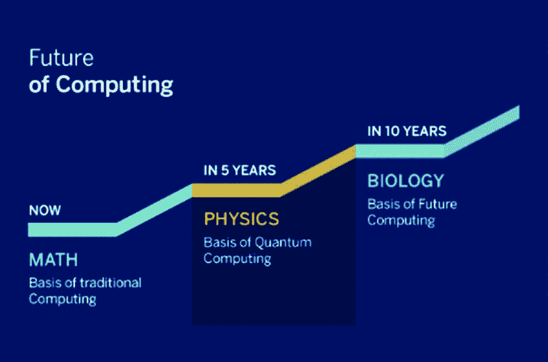

图. 24.2 量子计算: 未来前景

### 2.2 量子计算的实际应用与现实影响


量子计算对现实世界的影响和实际应用正在迅速蔓及到多个行业。在密码学领域，传统的加密技术正面临着量子计算的威胁。例如，`Shor’s algorithm` 能够快速分解大数，这可能会危及 `RSA` 等流行加密标准的安全性 [6]。为了应对这一挑战，美国国家标准与技术研究院（简称 `NIST`）启动了一项后量子密码学项目，旨在开发能够抵抗量子模拟的加密标准。

量子计算大放异彩另一个重要领域是优化问题。除了量子启发算法外，利用 `D-Wave` 的量子退火器在供应链管理、金融以及物流等领域也得到了应用，这些应用在大幅提升效率方面展现出巨大的前景 [7]。例如，大众汽车（`Volkswagen`）通过量子计算优化了里斯本的交通流，将旅行时间缩短了 20%。量子计算具有加速人工智能中机器学习算法的潜力。为了改进模式识别和数据分析，研究人员正在研究量子玻尔兹曼机、量子神经网络以及量子支持向量机 [8]。这些用途展示了量子计算在变革密码学、优化以及人工智能方面的潜力。

## 2.3 量子计算的挑战与局限性

尽管前景广阔，量子计算仍面临许多障碍和限制，需要克服才能发挥其全部潜力。量子纠错是主要的挑战之一。由于对环境噪声高度敏感且容易发生退相干，`qubits` 会导致计算错误。表面码（Surface codes）是试图减轻这一问题的量子纠错码示例 [9]。顶尖量子硬件制造商（包括 `IBM` 和 `Rigetti`）的研究目标是生产能够容忍故障的量子处理器。

可扩展性是另一个挑战。增加量子比特数量对于解决复杂问题是必要的，但这是一项艰巨的任务。拥有 65 个量子比特的 `IBM` `Quantum Hummingbird` 迈出了一步，但错误率必须继续降低。量子软件方面的挑战仍然存在，包括需要改进的量子编译器以及用于实用任务的量子算法。另一个集成挑战是量子系统与经典系统的整合 [10]。尽管存在这些缺点，量子计算的潜力显而易见。`Google` 在量子技术方面的优势性演示和其他进展表明，量子计算不再是科幻小说，而是一个具有巨大增长潜力的领域。

## 2.4 未来研究与行业采用的见解与建议

量子计算的未来方向展示了一个充满机遇和必须克服的障碍的格局。研究人员越来越关注开发量子硬件、研究新型量子比特配置以及增强纠错方法。例如，增加量子比特连接性和降低量子比特错误是 `Google` `Quantum AI` 实验室的首要任务。

行业采用建议的重点在于促进合作并为量子研究提供资源。政府和科技公司正向量子计划投入巨额资金。凭借 10 亿欧元的预算，“欧洲量子旗舰”计划被要求加速量子技术的发展。`IBM` 通过在云端提供其量子处理器实现了量子计算访问的民主化，这令人鼓舞。

此外，解决安全和伦理问题至关重要。由于广泛使用的加密技术可能被量子计算破解，后量子密码标准的必要性已凸显。量子安全加密的研究是一个正在快速发展的领域。

## 参考文献

1. Gertig, C., Leonhard, K. and Bardow, A., 2020. 基于量子化学的计算机辅助分子和工艺设计：现状与展望。Current Opinion in Chemical Engineering, 27, pp.89.
2. Altman, E., Brown, K., Carleo, G., Carr, L., Demler, E., Chin, C., DeMarco, B., Edmonds, S., Fu, K., and Greiner, M., 2021. 量子模拟器：架构与机会。PRX Quantum, 2(1).
3. Song, M., Kang, J.H., Zhang, X., Ji, W., Ascoli, A., Messaris, I., Demirkol, A., Dong, B., Aggarwal, S., Wan, W., and Hong, S., 2023. 忆阻器材料、器件和系统的最新进展。ACS nano, 17(13), pp.11994-12039.
4. Dunjko, V. and Wittek, P., 2020. 量子机器学习综述：趋势。Quantum Views, 4.
5. Lavecchia, A., 2019. 深度学习在药物发现中的应用、挑战与未来展望。Drug discovery today, 24(10), 2017-2032.
6. Fernandez-Carames, T.M., 2019. 从前量子到后量子物联网安全：物联网抗量子加密系统综述。IEEE Internet of Things Journal, 7(7),6457-6480.
7. Zhang, Y. and Ni, Q., 2020. 量子机器学习的最新进展。Quantum Engineering, 2(1),e34.
8. Motta, M. and Rice, J.E., 2022. 用于量子化学的新兴量子计算算法。Wiley Interdisciplinary Reviews: Computational Molecular Science, 12(3),e1580.
9. Mangini, S., Tacchino, E., Gerace, D., Bajoni, D., and Macchiavello, C., 2021. 用于人工神经网络的量子计算模型。Europhysics Letters, 134(1),10002.
10. S. Ram Prasath, K. Gokul, M. Subramanian, N. Mohan, “基于 ELAML 算法的多点传输的位置上下文感知”IEEE Access, DOI: 10.1109/ICAIS56108.2023.10073864.


大数据是指从许多源（如社交网络网站、企业交易、科学研究、传感器网络和资源共享）收集的海量数据。海量数据集被称为大数据。大数据涵盖了由社交媒体平台、商业交易、研究项目、传感器网络以及资源共享等来源产生的海量信息。由于其高体量和复杂的多样性，它对传统软件带来了挑战。Gartner 提出了 3Vs 概念——速度（Velocity）、多样性（Variety）和规模（Volume）来描述大数据。`Velocity`指的是数据流动的快速速率，例如天气预报中的流数据。`Variety`代表信息的多样化类别：半结构化、非结构化和结构化——涵盖了从业务交易到图像和视频的各种类型。`Volume`意味着超过传统存储和处理能力的数据规模。

此外，人们对其他特征如真实性（Veracity）的关注日益增加，真实性涉及数据中的不确定性或噪声，使得传统软件难以进行分析。由于存在不可靠的非结构化数据（如某些社交网络帖子），真实性成为了决策过程中一个需要考虑的问题。

在图 25.1 中，描述性展示了大数据的主要特征：高体量、高方差和高速度。这些特征是生成大规模数据的各种技术中固有的。


图 25.1 3 Vs of big data (Chen, Mao and Liu, 2014)

1. 结构化数据
2. 文本数据
3. 网络数据
4. 多媒体数据
5. 网络数据
6. 移动数据

大数据挖掘和分析中使用的各种方法包括聚类分析、因子分析、回归分析、众包和分类分析，如（Chen, Mao, and Liu, 2014）所示。这些方法在处理从大型多样化数据集中提取见解方面起着重要作用。大数据的特性和特定技术在表 25.1 中提到。

表 25.1 大数据特性和特定技术

| 大数据特性 || 属性 | 大数据技术 |
| --- | --- | --- |
| `Velocity` || 快速处理 | MapReduce |
| `Variety` || 异构性 | HBase, MongoDB, CouchDB |
| `Volume` || 知识发现 | Mahout, GNU-R |

## 2. 大数据技术

传统技术对于小规模数据非常有效。它为集中式系统提供了经过验证的准确性和结果。处理极大规模数据不在这些技术的能力范围内。需要新颖的创新技术来处理大数据。以行和列形式存在的结构化数据也是半结构化数据（如 `log files`），而非结构化数据（图像文件形式的数据）可以被 `MapReduce` 和 `Hadoop`（Dean and Ghemawat, 2008）、`Mahout`、`R`、`HBase`、`Graph Lab`、`Giraph`、`Tensor Flow` 和 `Cassandra` 等大数据工具有效处理。这些技术帮助组织高效存储、大规模处理数据并作为决策支持系统工作。这些技术的优势是在分布式平台上运行，具有更短的响应时间和更高的精度。一些最流行的大数据技术如下：

### 2.1 Hadoop 和 Map Reduce

`Hadoop` 是一个开源框架，旨在实现在分布式节点上同步执行程序。此外，它通过 `Hadoop Distributed File System` 访问分布式存储。

在 Chen, Chiang 和 Storey 于 2012 年写的论文中，他们强调了商业智能与分析（BIA）对数据收集、提取和分析相关技术的依赖。他们强调了 `ETL`（提取、转换和加载）过程在促进 BIA 领域内有效数据分析中的重要性。

本研究考察了现代大数据方法。对包括云计算和机器学习在内的大数据技术进行了深入分析。描述了大数据价值链的步骤——生成、收集、存储和分析。大数据可视化是最重要的决策过程之一，但在本工作中未提及。需要报告和回归曲线来使数据分析结果的可视化。

表 25.2 定性与定量对比分析

| 定性 | 定量 |
| --- | --- |
| 完整且详尽的 | 具体且基于模型的 |
| 在早期阶段有用 | 在最后阶段有用 |
| 是主观的 | 是客观的 |
| 理解结果需要专业知识 | 理解……需要特定知识 |
| 词汇和图像是 | 数字和模型是 |

## 3. 研究需求

大数据指的是来自社交网站互动、传感器网络和经济交易产生的海量信息。由于其巨大的规模，传统的工具和技术无法有效处理。因此，迫切需要创新方法来处理大数据。本论文广泛探讨了管理大数据的存储技术，突出了传统数据存储在处理异构大规模数据方面的局限性。

本文使用了建议的技术来解决这些问题。增强社交推荐的一个关键要素是社交信任。许多研究者使用了直接信任，但推荐的改进并不显著。我们的方法使用了间接信任来改进社交推荐。证明了基于信任的推荐技术可以解决稀疏性和冷启动问题。通过使用大规模图划分改进了可扩展性。

研究缺口

*   现有关于大数据 NoSQL 数据存储的对比研究缺乏这些解决方案的明确应用。需要针对文档型、图型、列式和键值存储技术进行更广泛的对比研究。
*   社交推荐系统面临稀疏性、冷启动问题和可扩展性的挑战。这些问题需要研究中专门关注和解决。
*   在集中式系统上处理大型社交图证明是低效的。对这些图进行划分以在集群上进行分布式处理变得重要。此外，现有方法存在局部性下降的问题，这是一个明显的缺点。


研究方法根据研究的具体目标进行构建，并对方法进行了相应的分类。

## 5.1 目标 1 的研究方法

目标 1 旨在学习和关联各种大存储方法，包括列式、基于文档、基于图和键值对方法。我们的研究方法从回顾现有文献开始，以理解它们的优点和局限性。通过比较多项研究工作，很明显，分布式方法被广泛用于存储大数据。研究人员提出了 `NewSQL` 和 `NoSQL` 作为数据存储技术，但现有文献的局限性在于缺乏基于 `NoSQL` 数据存储技术真实解决方案的全面比较研究。这一空白构成了我们研究方法的基础。我们的方法涉及评估格式、存储、灵活性、可扩展性和复杂性等特征，以比较这些存储技术。

## 5.2 目标 2 的研究方法

目标 3 旨在为大数据提出一种高效的挖掘技术。我们研究方法的第一步是理解传统数据挖掘的局限性，包括分类数据在可扩展性、稀疏性和效率方面的问题。这些局限性决定了我们研究方法的方向。

使用了较新的大数据挖掘工具和方法来克服这些限制。由于 `Chess` 数据集中数据类型的多样性，应用了 `K-prototype` 技术来处理数值型和分类数据。此外，`K-Prototype` 技术结合 `MapReduce` 被用于跟踪不同集群之间的响应时间。提出了一种“智能分割器”，在传输到 `MapReduce` 之前将数值数据和分类数据分离，以解决与数值数据相关的可扩展性问题。然而，稀疏性仍然是社交大数据中的重大挑战，特别是在社交推荐系统中，许多用户不提供评分，导致了稀疏矩阵。为了应对这一问题，提出了一种利用用户间定性信任的基于图的方法。此外，研究方法寻求通过采用深度学习进一步提高推荐准确性。选择 `Autoencoder` 是因为它具有降低大规模维度的能力，用于改进推荐系统。

## 6. 研究的局限性

本研究比较了四大类 `NoSQL` 数据存储策略：键值对、列式、基于文档和基于图。该研究在 `NoSQL` 数据存储的约 120 个真实解决方案中包含了约 10 个真实解决方案进行分析。遇到的一个局限性是缺乏 `NoSQL` 数据存储的标准查询语言。每个真实解决方案都采用特定的查询语言，阻碍了标准化。对于社交推荐，本研究提出了一种利用大规模社交图分的基于信任的策略。然而，本研究的范围不包括对替代推荐策略（如小组建议）的分析。使用 `Auto Encoder` 模型基于操作员-项目和操作员-操作员信任评分来增强社交推荐的准确性。值得注意的是，本研究未部署诸如 `CNN` 或 `RNN` 等其他深度学习模型。此外，在本研究背景下未使用 `tanh` 和 `ReLU` 等激活函数。

## 7. 高级数据挖掘方法

研究识别了一系列前沿的数据挖掘方法，包括深度学习、集成方法和基于图的算法，这些方法在处理大数据和从中提取见解方面显示了卓越的功效。从海量数据库中识别模式、趋势和深度信息的实践被称为数据挖掘。高级数据挖掘方法超越了基础技术，通常涉及复杂的算法和模型，以从数据中提取更复杂、更具体的知识，使其适用于处理具有挑战性的数据分析和知识发现任务。

### 7.1. 分类

在机器学习中，分类是一种监督学习，使用一组标记数据来预测新观测值的类或类别。分类的目标是开发一种能够根据特征将输入的观测值精确地分类为许多类中的一类的模型。

### 7.2. 聚类

聚类是一种在无标签的情况下运行的机器学习方法，旨在根据内在特征将相似的数据点分组。这一过程涉及将数据集划分为簇，其中每个簇内数据点之间的相似性高于它们与其他簇之间的相似性。聚类被用于多个领域，包括客户细分、图像分割、异常检测和文档聚类。它可以帮助探索性数据分析、模式识别和数据驱动的决策。

### 7.3. 回归

在机器学习中，回归是一种根据一组输入特征或属性预测连续数值的技术。回归的目标是创建一个能够精确估计输入变量与输出变量之间相关性的模型。回归在金融、经济、工程和社会科学等领域有许多应用。它是基于数据进行预测的重要工具，并帮助自动化许多需要人工估算的任务。

### 7.4 序列分析与路径分析

序列分析和路径分析是数据分析中的技术，用于研究数据集中事件或活动的顺序，并理解它们之间的关系或依赖关系。这些技术常用于社会科学、营销、生物信息学和网络分析等领域。序列分析侧重于分析随时间变化的事件或状态序列，涉及检查序列内事件的模式、转换和持续时间。该技术对于理解事件的时间动态和排序非常有用。路径分析是一种用于研究数据变量间因果关系的统计技术。它旨在理解通过一系列中间变量对结果变量产生的直接和间接影响。路径分析基于结构方程建模 (`SEM`) 和图形建模方法。


此外，研究指出实时数据挖掘的重要性日益增加。流处理技术和在线分析处理技术被认为是在数据生成时对其进行分析的关键，使组织能够对变化的情况迅速响应。原始数据、数据挖掘、定制化、个性化、自动化和实时分析均在图 25.2 中所示。从流式或不断变化的数据中实时发现具有洞察力的模式和有用见解的实践被称为实时数据挖掘。它涉及在数据生成时分析大量数据，并根据结果做出决策或采取行动。实时数据挖掘需要能够处理流数据独特特性的专用工具和技术。这些包括如 `Apache Spark` 或 `Flink` 等分布式处理框架，如 `Apache Cassandra` 或 `MongoDB` 等实时数据库，以及如 `Tableau` 或 `Kibana` 等实时可视化工具。


图 25.2 高级数据挖掘方法

## 8. 结论

在大数据领域，海量数据集不断产生，我们对最先进数据挖掘技术的分析研究揭示了这些方法的卓越能力和意义。本结论总结了我们研究的主要收获。正如研究所强调的，先进数据挖掘技术在应对大数据带来的挑战方面发挥了至关重要的作用。事实证明，在追求广阔且复杂的数据格局中隐藏的有价值见解、模式和知识时，这些技术是关键的。分析研究指出，先进数据挖掘技术对于从不断增长的大数据世界提取有价值的见解和知识至关重要。它们的应用提供了竞争优势，鼓励了创新，并赋能了各行业的决策者。随着大数据的发展，这些先进技术将继续处于前沿，利用其潜力以造福企业和整个社会的利益。

## 参考文献

1. Big Data has Big Potential to Improve Americans Lives, Increase Economic Opportunities, and Committee on Science, Space and Technology (April 2013). URL [`science.house.gov/press-release`](http://www.science.house.gov)

2. Iosup, A. Lascateu, N. Tapus, CAMEO: Enabling social networks for Massively Multiplayer Online Games through Continuous Analytics and Cloud Computing, in: Proceedings of the 9th Annual Workshop on Network and Systems Support for Games (NetGames 2010), 2010, pp. 1-6.

3. McAfee, E. Brynjolfsson, Big Data: The Management Revolution, Harvard Business Review (2012) 60-68.

4. Thusoo, Z. Shao, S. Anthony, D. Borthakur, N. Jain, J. S. Sarma, R. Murthy, H. Liu, Data warehousing and analytics infrastructure at Facebook, in: Proceedings of the 2010 international conference on Management of data, ACM, New York, NY, USA, 2010, pp. 1013-1020.

5. Adnaan Arbaaz Ahmed, Dr. M.I. Thariq Hussan, “CLOUD COMPUTING: STUDY OF SECURITY ISSUESANDRESEARCHCHALLES,” International Journal Of Advanced Research In Computer Engineering Technology (IJARCET) Volume 7, Issue 4, April 2018, ISSN: 2278 - 1323.

6. Akhil KM, Kumar MP, Pushpa BR. Enhanced Cloud Data Security Using AES Algorithm. In Intelligent Computing And Control (I2C2), International Conference On 2017 (Pp. 1-5). IEEE.

7. Albert Greenberg, James Hamilton, David A. Maltz and Parveen Pate, “The Cost of a Cloud: Research Problems in Data Center Networks”, Microsoft Research, Redmond, WA, USA.

8. Aman Bakshi and Yogesh B, “Securing cloud from DDOS Attacks using Intrusion Detection System in Virtual Machine”, 2010 Second International Conference on Communication Software and Networks, IEEE, 2010.

9. Amanpreet Chauhan, Gaurav Mishra, and Gulshan Kumar, “Survey on Data Mining Techniques in Intrusion Detection”, International Journal of Scientific Engineering Research Volume 2, Issue 7, July-2011.

10. Amanpreet Chauhan, Gaurav Mishra, and Gulshan Kumar, “Survey on Data Mining Techniques in Intrusion Detection”, International Journal of Scientific Engineering Research Volume 2, Issue 7, July-2011.

11. Anil Kuvvarapu “Data Mining On Cloud-Based Big Data” Cybernetics, Cognition And Machine Learning Applications (Pp.51-59) 2020.

12. Anish Gupta “Security Measures In Data Mining” I.J. Information Engineering And Electronic Business, 2012, 3, 34-39.

13. Anupama Prasanth, “Cloud Computing Services: A Survey,” International Journal Of Computer Applications (0975 - 8887) Volume 46-No.3, May 2012.

14. Arjun Kumar, HoonJae Lee, and Rajeev Pratap Singh, “Efficient and Secure Cloud Storage for Handling Big”, Data, Information Science and Service Science and Data Mining (ISSDM), 2012.

15. Bangxu Ding “The construction of internet data mining model based on cloud computing” Journal of Intelligent and Fuzzy Systems 37(12):1-9

16. Bhaludra R. Nadh Singh “A Review On Big Data Mining In Cloud Computing” Innovations In Computer Science And Engineering Pp 131-142 2017.

17. Bhisham C. Gupta “On Data Mining” Statistics And Probability With Applications For Engineers And Scientists Using MINAB (Pp.476-517) 2020.

18. Brian Hay “Storm Clouds Rising: Security Challenges For Iaas Cloud Computing” 44th Hawaii International Conference On Systems Science (HICSS-44) 2011, Proceedings, 4-7

19. Fisher, R. DeLine, M. Czerwinski, S. Drucker, Interactions with Big Data Analytics, Interactions 19 (3) (2012) 50-59.

# 26 用于玉米叶病识别的迁移学习模型评估

Pawan Singh^(54))

Central University of Rajasthan, Department of Computer Science, Ajmer, India

DOI [10.1201/97810035423-26](https://dx.doi.org/10.1201/97810035423-26)

摘要: 植物病害通过减少农民产量和引发经济危机对全球粮食安全构成了巨大威胁。及时准确的疾病识别至关重要。本文展示了基于迁移学习算法利用植物叶片图像进行玉米病害识别和分类的广泛研究。为了提高模型的泛化能力，使用了包括数据增强和归一化在内的预处理方法。研究了预训练模型迁移学习对疾病分类准确率的影响。通过涵盖枯病、灰叶病、北方病和细菌性叶枯病等不同玉米病害的综合数据集，对这些模型进行了细致的训练和微调。我们的主要发现表明，迁移学习模型的表现优于传统技术。在植物病害识别中应用迁移学习模型可以实现早期识别，从而进行及时干预并降低作物损失。

关键词：植物病害、深度学习、DenseNet121、InceptionV3、ResNetl8、VGG16

## 1. 引言


农业生产是人类生存的基础，正不断受到植物疾病的威胁。它威胁着粮食安全，并可能导致巨大的产量损失。为了有效管理和减轻这些疾病，及时、准确的诊断至关重要。无论是由病原体、环境因素还是营养不平衡引起的，植物疾病都会对作物的产量和质量构成严重风险。这些疾病具有破坏收获的能力，导致粮食短缺和经济损失 [1]]。它们还促使了杀菌剂和农药的粗目使用，这对生态系统和人类都是有害的 [2]]。解决这些问题的在于准确识别和分类植物疾病。对不健康植物进行早期诊断允许采取针对性的干预，而不是通用的洒农药，从而最大限度地减少对环境的伤害 [3]]。此外，它让农民能够实施隔离、轮作和高效资源配置等政策。在许多农业地区，传统的疾病诊断方法劳动密集、耗时较长，并且可能需要难以获取的专业知识 [4]]。因此，人们对基于技术进步开发自动化和高效疾病检测系统的兴趣日益增加 [5]。机器学习的子集迁移学习在各种计算机视觉任务中（包括图像编目和目标识别）中已取得了显著成就 [6]。在识别和分类植物疾病领域实施迁移学习既是必要的，又是具有革命性的。卷积神经网络（`CNNs`）在图像处理和模式识别中展现了惊人的能力。它们擅长捕捉图片中的细微细节，这使得适用于植物疾病识别中经常需要的精细且微妙的差别 [7]。迁移学习的表现可能优于传统方法，后者通常依赖于手工特征，并可能在处理植物病学固有的复杂性时面临困难。这种改进的潜力驱动了迁移学习的使用 [8]。我们的目标是利用迁移学习利用神经网络从植物照片中自动学习区分性特征的能力，提高疾病诊断的可靠性和准确性。作为一种检测和分类植物疾病的技术，它在如今已越来越流行 [9]。使用深度神经网络，可以自动分析叶片图像、识别疾病症状并对疾病类型分类 [10]。本手稿利用迁移学习技术来感知和分类玉米植物中的疾病，以对农业和植物疾病管理做出贡献。为了帮助农民和农业专家识别和诊断重要作物的疾病，我们打算开发准确可靠的疾病检测模型。反，这将导致更有效、及时的干预，可能增加作物产量和质量。

### 1.1 问题定义

农业与技术的复杂交汇带来了一个极具吸引力的挑战：植物疾病的快速、准确识别和分类。这个问题具有全球性影响，因为它危害了粮食安全，减少了农业生产并加剧了经济脆弱性 [11]。依赖人工观察的传统疾病识别方法存在缺点，导致反应延迟和严重的作物损失 [10]。因此，本手稿开启了一场变革性之旅，通过利用先进深度学习技术的能力（特别是 `CNNs`、`InceptionV3`、`Densenet121`、`Vgg16`、`Vgg19` 和 `ResNet18`）对影响玉米植物的各种疾病进行识别和分类，弥补这一关键空白。所研究疾病的多种类进一步证明了问题的复杂性。范围包括玉米常见的锈病、灰叶枯病和北方枯病 [5]。每种疾病都有独特的视觉症状和临床动态，这增加了开发详尽分类系统的总体困难性。目前对传统技术的依赖阻碍了数据驱动农业管理的潜力，并为采取及时行动制造了障碍 [9]。

本文有两个目标：首先是构建并改进一个深度学习模型集，包括 `CNN`、`InceptionV3`、`Densenet121`、`Vgg16`、`Vgg19` 和 `ResNet18`。这些算法将超越人类极限，快速准确地识别隐藏在受影响叶片照片中的复杂细节 [12]。第二个目标是为玉米数据集找到准确算法。本文旨在弥合农业与技术之间的差距。通过将深度学习的分析能力与作物管理的实际情况相结合，它应对了全球对粮食安全的迫切挑战 [3]。预计结果将提高疾病检测的准确性，并在最需要的领域实现这种尖端技术的民主化。通过本手稿，向未来迈出了重要的一步，即技术支持生计、养护作物并增加世界粮食供应的韧性的未来 [13]。

### 1.2 问题目标

如果不控制农业部门主要威胁的作物疾病，全球粮食安全将无法保障。传统的疾病检测和分类方法已被证明是无效的，导致了严重的作物损失，并危害了我们粮食供应的稳定性 [4]。这项工作肩负着使命，通过利用尖端迁移学习算法来解决这一基本问题 [14]。这项努力的主要目标是多样化的，涵盖了技术改进和现实应用性。

### 增强检测与分类

本手稿的目标是开发一个可靠且精确的玉米疾病识别和分类系统。本手稿试图通过利用 `CNNs`、`InceptionV3`、`Densenet121`、`Vgg16`、`Vgg19` 和 `ResNet18` 的能力，提高疾病识别的准确性和有效性。

### 多架构框架

研究各种迁移学习模型在玉米疾病识别和分类中的有效性是另一个关键目标。该研究旨在通过结合多种拓扑结构，识别每个模型在处理疾病时的优缺点 [6]。这种比较分析将通过全面理解各种植物疾病的微妙差别和复杂性，有助于制定更详尽的疾病管理策略。

### 赋能农业


最终目标是为农业部门提供强大的工具，以对抗植物疾病的侵袭。该倡议试图通过利用深度学习 [13]来实现技术创新的民主化。粮食安全性的提高、作物损失的减少以及科学决策都是这种赋能的结果。本论文旨在为创新、技术与农业共存的未来奠定基础，构建一个具有韧性且可持续的农业生态系统 [2]。

本文讨论了所采用的方法，包括迁移学习架构的选择、数据准备、训练和评估程序。作者展示了开发的模型在实际农业中获得的结果。本手稿系统地分为五个部分，如下：文献综述见第 2 节。材料与方法见第 3 节，并包含了数据集的收集与预处理、迁移学习模型的设计与训练流程。结果在第 4 节中进行讨论。研究在第 5 节中结束。

## 2. 文献综述

在本节中，回顾了各种基于深度学习的现有方案。2023 年，Moupojou 等人 [5\] 引入了 `FieldPlant` 数据集，这是一个植物疾病检测研究的实用工具。作者提供的田间植物照片使得测试和创建用于疾病分类的深度学习模型变得更容易。作者建议使用 `FieldPlant` 数据集，该数据集包含 5,170 张直接从种植园收集的植物疾病照片。为了保证过程质量，在植物病理学家的指导下，对每张图像的叶片进行了人工标注。总共标注了来自 27 类疾病的 8,629 片不同叶片。研究人员在该数据集上使用多种基准测试对现代分类和目标识别模型进行了评估，并发现 `FieldPlant` 在分类任务上的表现优于 `PlantDoc`。2022 年，Rimon 等人 [9\] 引入了 `PlantBuddy`，这是一种基于 Android 的用于识别植物疾病的移动软件。该程序利用深度 `CNN` 为用户提供了一个通过智能手机相机快速识别植物疾病的可用工具。所提疾病检测模型使用的深度 `CNN` 分析植物叶片的输入图像，以检测并识别疾病。使用了一个包含 54,305 张图片的庞数据集来训练模型，代表了 14 个物种和 26 种疾病。

2022 年，Wagle 等人 [14\] 提出了用于植物叶分类的紧凑卷积神经网络模型。作者展示了用于快速精准诊断疾病的前沿 `CNN` 架构。在该研究中，建议使用迁移学习通过新构建的紧凑 `CNN` 和 `AlexNet` 来识别和分类 Plant Village 数据集中的九种植物。利用各种数据增强技术，使用植物叶数据来训练模型。数据增强显示分类准确率有了显著提高。所提模型还对 `Flavia` 数据集的 12 类进行了分类。所建议开发的 `NI` 模型分类的准确率为 99.45%。`N2` 模型的分类准确率为 99.65%。对于 PlantVillage 数据集，`N3` 模型的分类准确率为 99.55%，而 `AlexNet` 为 99.73%。所提模型所需的训练时间更短，且比 `AlexNet` 更紧凑。

2019 年，Sibiya 等人 [13\] 使用计算方法识别并分类玉米叶疾病。作者使用 `CNNs` 来区分健康和患病的玉米叶。该研究采用 `CNN` 辅助进行图像检测和分类。通过智能手机相机获取并分类作物疾病照片的 `CNN` 网络使用了 `Neuroph` 进行训练。为了加速该系统在实践中的快速采用，采用了一种新的训练方法和流程。该模型区分了三种玉米叶疾病。本研究中选择的疾病是玉米叶枯病、灰叶病和常见锈病，这些疾病在欧洲南部非常流行。2021 年，Wang 等人 [10\] 利用单分支神经网络或传统的计算机视觉方法。然而，这些技术在识别复杂模式方面可能存在困难。本文提出了一种创新的 `Multi-Branch ResNet-18` 架构来解决这一空白。这一进展有望提高作物疾病识别的准确性和稳健性。2022 年，Fraiwan 等人 [2\] 应用迁移学习从预训练模型中提取相关信息。作者得出结论，该方法可以精确检测不同的玉米疾病，有助于改善农业管理。该研究展示了迁移学习在解决农业问题方面的潜力，并符合利用深度学习技术改进识别的趋势。

2023 年，Sunil 等人 [6\] 研究了各种深度学习架构和方法，观察它们如何处理准确诊断植物疾病的困难。它考虑了 160 篇论文。总共有 103 篇出版物和 57 项关注单一植物。作者涵盖了 50 个不同的植物叶疾病数据集，包括开放和封闭数据库。该研究还涵盖了植物疾病检测中的不同困难和知识空白。此外，这项工作强调了超参数在深度学习中的重要性。


2020 年，Shrestha 等人 \[15\]利用`CNN`开发了一个马薯病害识别模型。该模型总共包含 15 个实例，其中 12 个患病叶片，3 个是健康叶片。测试准确率计算为 88.80%。2022 年，Saritha 等人 \[16\]开发了一个用于寻找叶片病害的模型。使用了三个不同的模型：`AlexNet`、`MobileNet` 和 `Inception V3` 进行训练，并对其计算复杂度、精确度和性能指标参数进行了检查。结果显示，`Inception V3`的计算成本介于 `MobileNet` 和 `AlexNet` 之间。此外，数据明显表明，`Inception V3`具有更高的准确率（99.04%），且性能指标优于其他两个模型。`Inception V3`的计算成本位于 `AlexNet` 和 `MobileNet` 之间。

## 3. 材料与方法

本节包含多个子章节，例如本手稿中提出的玉米方法使用的数据集。后续章节概述了所用数据集及其规范、所提方法的工作原理，以及该方法的具体实施过程。

### 概述

广泛且多样化的数据集的可用对于迁移学习模型的开发至关重要。使用了以下数据集：

## PlantVillage 数据集

为了训练模型，使用了来自公共数据集的 54,305 张植物叶片照片。该数据集由 `PlantVillage` 生成，可以通过 `Kaggle` \[5\] 访问。照片的分辨率为 256x256 像素。使用 `JPEG` 格式保存照片。按照 80%-20%的训练-验证集划分，模型将在 43,456 张照片上进行训练，并在 10,849 张图像上进行验证。数据集中可以找到 26 种不同病害和 14 种不同作物的类型图像 \[17]。如图 26.1 所示，从 `PlantVillage` 数据集中选择了 1192 张 `Common Rust`（全锈病）图像、985 张 `Northern Blight`（北方病）图像、513 张 `Grey Leaf Spot`（灰叶斑）图像和 1162 张 `Healthy maize plant`（健康玉米植物）图像。

![图 26.1 玉米数据集图像 (a) 全锈病 (b) 灰叶斑 (c) 北方病 (d) 健康 \[17\]](images/fig26_1_C.jpg)

图 26.1 玉米数据集图像 (a) 全锈病 (b) 灰叶斑 (c) 北方病 (d) 健康 \[17\]

## 3.2 的方法

本节介绍了用于玉米植物病害识别和分类的方法的细节和工作原理。

# 流程图

植物病害识别和分类系统涉及多个迁移学习模型。图 26.2 以以下几个步骤描绘了系统的架构：


图 26.2 所提方法的流程图

### 数据集预处理

在处理数据集的过程中，进行了许多操作，包括将照片缩放到统一尺寸、归一化像素值以及通过应用旋转和翻转等变换增强数据 \[6\]。这把数据集转换为标准化且适用于深度学习模型训练的格式。

1. **旋转：** 为了模仿图像方向的变化，按预定角度随机旋转图像（例如 90 度或 180 度） \[8\]。确保旋转角度是从给定范围内随机选择的。

2. **翻转：** 对具有特定频率的图像进行翻转，包括水平翻转和垂直翻转。这复制了图像中物体方向的变化。垂直翻转将图像从上到下反转，水平翻转从左到右反转 \[18\]。图 26.3 展示了对玉米叶片使用水平翻转和旋转操作的预处理。


图 26.3 增强图像 (a) 原图(放大) (b) 水平翻转 (宽度) (c) 旋转 (高度)

#### 数据集分类

玉米植物数据集分为训练、测试和验证不同的类别。通过这种标记，迁移学习模型可以针对特定病害类别的模式和特征进行训练 \[9\]。70%的图像被归类为训练，20%的图像归类为验证，剩余 10%用于测试 [7\]

#### 迁移学习模型

所提方法使用了以下深度学习模型：`CNN`、`DenseNet121`、`Inception V3`、`VGG16` 和 `ResNet8`。每个模型都有独特的架构。

1. **CNN：** `CNN`由五层组成：“输入层、卷积层、激活层、池化层、全连接层” \[13\]。在 `CNN` 中，输入层接收图像。然后进入卷积层，该层通过卷积输入产生特征图。卷积层的输出在下采样后提供给非线性函数。激活层是引入非线性的函数 \[9\]。池化层使用预定的窗口方法传递值，同时考虑最大池化、最小池化平均池化。图像在池化层后被展平并输入 `SoftMax` 分类器以产生结果。隐藏层是全连接层的别名 \[13\]

2. **DenseNet121：** 一种名为 `DenseNet121` 的深度学习架构用于图像分类。层与层之间的密集连接、用于效率的瓶颈层以及使用全局平均池化而非全连接层是其特征。它包含 121 层 \[3\]。这种架构鼓励特征重用，减少了梯度消失并有效利用参数。

3. **Inception V3：** `Inception V3` 擅于捕捉多个层次的特征，这使其对于病害检测和分类等挑战性图像识别应用有用 \[18\]。使用标记数据集训练模型，然后修改内部参数以正确诊断病害 \[10\]。在预处理图像后应用了多个 `Inception V3`模块。这些模块通过并行集成不同尺寸的卷积和池化过程，使网络能够在尺度和层次上捕捉特征 \[16\]

4. **ResNet8：** 具有残差块的 `ResNet8`架构能够实现有效的深度网络训练，使其成为需要病害检测和分类任务的良好选择。使用标记数据集训练模型，然后修改内部参数以正确诊断病害 \[10\]。`ResNet8`架构通过多个残差块传递预处理图像。跳跃连接在残差块中使用以解决梯度消失问题，并使网络从原始输入和提取的特征中学习 \[10\]


# 5. VGG16/VGG19

VGG16 和 VGG19 在图像分类应用中的易用性和效率广为人知。它们采用了标准化设计，包括薄层卷积滤波器和深层堆叠层 [2]。为了正确分类疾病，在训练期间使用数据集中的带标签图像调整模型的内部参数。在 VGG16 架构中，多个卷积块被应用于预处理后的图像。每个卷积块中卷积层和最大池化层的数量提高了所提取特征的抽象层次 [4]。

## 训练与测试

在此步骤必须对模型进行训练。在提供的训练数据集帮助下，利用架构和自定义层创建的模型已经完成训练。模型在训练过程中寻求识别并理解训练数据集中的底层特征和模式 [13]。在训练阶段，为模型的自定义层被赋予权重。这些权重被用于分类提供的图像中是否存在锈斑、灰斑或黑斑 [7]。使用 Keras 模块中的 `model.fit` 方法，构建的模型在进入训练阶段之前首先会被编译 [10]。

## 性能评估

使用准确率（Accuracy）、精确率（Precision）、召回率（Recall）和 F1 分数对模型的性能进行评估。

1. **准确率 (Accuracy)**：预测的准确率是正确预测的图像与所有预测之间的比例。可以使用公式 (1) 来评估准确率 [2]。

(1)

$$\text{Accuracy} = \frac{\text{Number~of~correct~predictions}}{Total\ number\ of\ predictions} = \frac{TP + TN}{TP + TN + FP + FN}$$

2. **精确率 (Precision)**：精确率的衡量标准是准确预测的实例与所有预期为正例的实例之间的比例。可以使用公式 (2) 进行数学计算 [2]。

(2)

$$\text{Precision} = \frac{TP}{TP + FP}$$

3. **召回率 (Recall)**：召回率通常称为灵敏度，是正确预测的实例占所有实际情况的比例。使用公式 (3) 来估计召回率值 [2]。

(3)

$$\text{Recall} = \frac{TP}{TP + FN}$$

4. **F1 分数**：F1 分数将召回率和精确率的比较合并为一个分数。它可以使用公式 (4) 计算，在数学上是精确率和召回率的调和平均数 [2]。

(4)

$$F1 - \text{score} = 2 \ast \frac{\text{Precision\*Recall}}{Precision + Recall} = \frac{TP}{TP + \frac{1}{2}(FP + FN)}$$

其中 `TP` 是真阳性（True Positives）、`FP` 是假阳性（False Positives）、`TN` 是真阴性（True Negatives）、`FN` 是假阴性（False Negatives）。

## 4. 结果

在本节中，展示、分析并解释研究结果以得出意义的结论。使用准确率和损失对疾病检测和分类模型进行的评估为有效性提供了重要见解。表 26.1 显示了评估系统性能和效果的准确率，用于植物疾病检测和分类的迁移学习模型使用了 `CNN`、`Densen121`、`InceptionV3`、`ResNetl8` 以及 `VGG16` 和 `VGG19` 等架构至关重要。

表 26.1 迁移学习模型

| 模型 | 准确率 (%) |
| --- | --- |
| CNN | 92.19 |
| Densen121 | 95.88 |
| InceptionV3 | 97.40 |
| Resnetl8 | 98.45 |
| VGG16 | 95.36 |
| VGG19 | 93.56 |

通过显示不同学习模型训练和验证的准确率和损失的图表，训练集和验证集的准确率和损失曲线可以提供关于模型性能和训练过程的重要信息。让我们详细检查这些发现：

1. **验证准确率 (Validation Accuracy)**：验证数据集中分类正确的图像的百分比被称为验证准确率。如果验证准确率较高，则模型能够有效识别和分类植物疾病 [6]。
2. **验证损失 (Validation Loss)**：验证损失是验证数据集实际标签与预测概率之间的差异。较低的验证损失表明模型的预测与真实世界的标签更一致 [6]。
3. **训练准确率 (Train Accuracy)**：训练数据集中分类正确的图像比例被称为训练准确率。高训练准确率意味着模型在拟合训练数据集方面变得更好 [6]。
4. **训练损失 (Train Loss)**：训练损失表示模型预测与训练数据实际标签的匹配程度。训练损失逐渐逐渐下降并稳定，表明模型正在成功识别训练数据中的模式 [6]。

`ResNetl8` 在玉米数据集上达到了 98.45% 的最高准确率。图 26.4(a) 显示了准确率和损失曲线。图 26.4(b) 显示了 `ResNetl8` 在玉米数据集上的混淆矩阵，其中 0、1、2、3 分别代表锈斑、灰叶斑、健康和北方病。

![Fig26.4]

精确率、召回率、F 分数和支持度参数值在表 26.2 中作为分类报告呈现。

表 26.2 分类报告

| 类别标签 | 精确率 | 召回率 | F-分数 | 支持度 |
| --- | --- | --- | --- | --- |
| 0 | 1.00 | 1.00 | 1.00 | 120 |
| 1 | 0.98 | 0.90 | 0.94 | 52 |
| 2 | 1.00 | 1.00 | 1.00 | 117 |
| 3 | 0.95 | 0.99 | 0.97 | 99 |

表 26.3 显示了几种深度学习技术的结果与其他参考文献进行了对比。所提出的模型比之前的工作具有更高的准确率。

表 26.3 深度学习模型结果对比

| 模型 | 文献工作准确率 (%) | 我们的发现 (%) |
| --- | --- | --- |
| CNN | 88.80 | 92.19 |
| DenseNet121 | 94.6 | 95.88 |
| InceptionV3 | 82.54 | 97.40 |
| Resnetl8 | 93.46 | 98.45 |
| VGG16NGG19 | 80.54 | 95.36 |


我们的研究旨在使用前沿的迁移学习架构，如 `CNN`、`InceptionV3`、`Densenet121`、`Vgg16/19` 和 `ResNetl8`，来变革植物疾病检测与分类领域。`Resnetl8` 在玉米数据集上表现更好，准确率达到 98.45%。通过利用这些模型的能力，我们创建了一种用于诊断和分类玉米植物疾病的可靠且准确的方法。通过密集的测试和评估，我们证明了该方法的可行性，获得了卓越的准确率和性能。在最后的比较中，我们强调了所建议模型与早期玉米疾病识别与分类研究相比，结合了 `CNN`、`InceptionV3`、`Densenet121`、`Vggl6Ngg19` 和 `ResNetl8` 的优势和独特特征。这一理念代表了向农业与技术共生时代的重要一步。它证实了迁移学习可以完全改变农业领域，从而增加粮食安全、减少作物损失并改善农村人口的生活条件。在我们迈向未来的道路时，额外进展的潜力及其对世界粮食安全的影响将坚定不移。

## 参考文献

1. G.P.R. Kranth, M.H. Lalitha, L. Basava and A. Mathur, 使用机器学习算法进行植物疾病预测，Int J Comput Appl 18 (2018), pp. 975-8887.

2. M. Fraiwan, E. Faouri and N. Khasawneh, 利用深度迁移学习从叶片进行玉米疾病分类，Plants 11 (2022), pp. 1-14.

3. B. Arathi and U.N. Dulhare, 使用迁移学习-DenseNet-121 进行棉叶叶疾病分类，第三届计算机工程与通信系统进展国际会议论文集，2023, pp. 393-405.

4. A. Bin Naeem, B. Senapati, A.S. Chauhan, S. Kumar, J.C.O. Gavilan and W.M.F. Abdel-Rehim, 使用 VGG-16 的棉叶疾病检测深度学习模型，国际智能系统与工程应用期刊 11 (2023), pp. 550-556.

5. E. Moupojou, A. Tagne, E Retraint, A. Tadonkemwa, D. Wilfried, H. Tapamo et al., FieldPlant：用于植物疾病检测与分类的田间植物图像数据集，IEEE Access 11 (2023), pp. 35398-35410.

6. C.K. Sunil, C.D. Jaidhar and N. Patil, 基于深度学习的植物疾病检测或分类系统性研究，Artif Intell Rev (2023), pp. 1-98.

7. P. Singh, P. Singh, U. Farooq, S.S. Khurana, J.K. Verma and M. Kumar, CottonLeafNet：使用深度神经网络进行棉植物叶疾病检测，Multimed Tools Appl (2023).

8. M. Bhanusri, N.V.K. Ramesh and S. Razia, 使用卷积神经网络进行玉米叶疾病检测，动态与控制系统高级研究期刊 12 (2020), pp. 1154-1160.

9. S.I. Rimon, M.R. Islam, A. Dey and A. Das, PlantBuddy：一种基于深度卷积神经网络的植物疾病检测 Android 移动应用程序，第 806 ，Springer Singapore, 2022.

10. C. Wang, P. Ni and M. Cao, 基于多分支 ResNet-18 的作物疾病识别研究，J Phys Conf Ser 1961 (2021).

11. A.M. Mostafa, S.A. Kumar, T. Meraj, H.T. Rauf, A.A. Alnuaim and M.A. Alkhayyal, 使用深度卷积神经网络进行番石疾病检测：番石植物的案例研究，应用科学 (瑞士) 12 (2022).

12. S. K. V.R. P, R. P, P.K. M and P. S, 使用深度学习进行苹果叶疾病检测，2022 年第 6 届计算方法与通信国际会议 (ICCMC)，2022, pp. 1063-1067.


想象一位远在数千英外的潜在学生，他们渴望探索我们的校园，沉浸在我们的学术环境中，并了解我们机构的理念。传统上，这需要历经艰涉实地前往我们的校园，这并不总是可行或实际的。然而，随着增强现实技术的出现，校园之旅现在可以直接显示在你的屏幕上，这不仅使其更易获得，而且更具吸引力和互动性 [1]。

这段穿越教育与技术融合的旅不仅仅是对未来的展望。它是我们与受众互动方式的范式转变。这体现了我们致力于处于创新前沿并提升为潜在学生提供体验的承诺。

提出的第一个问题是：“这种革命性的‘使用增强现实现实的虚拟校园之旅’到底是什么？”本质上，这是一种创新的校园之旅方法，利用增强现实技术创造出沉浸式、动态且交互式的体验。它为静态、传统的校园之旅提供了替代方案，而后者往往无法捕捉机构的真实精神。

在屏幕上，他们可以探索大学建筑，漫步在如画的园中，参加虚拟讲座等。这是一种新设计的校园之旅，让潜在学生感觉自己身在现场，而无需亲身旅行。

这项技术的益处多处。除了易用性和便利性，它还允许个性化。每位潜在学生都可以通过关注对他们最重要的机构各个方面来定制自己的体验。无论你对我们先进的实验室、充满活力的学生社区还是校园的宁静之美感兴趣，增强现实都能让你探索激发你好奇心的事物。

此外，这项技术开启了互动的世界。我们的演示不再仅仅是静态的、单向的。它是一个适应用户兴趣和需求的动态旅程。这将允许潜在学生与虚拟导游进行互动[2]。

## 2. 贡献者

在本文，我们展示了各种软件工具和技术的无缝集成，每种工具都发挥自身的优势来创造沉浸式的增强现实体验。这种创意与技术动态结合的关键贡献者包括 `Blender`、`Unity AR`、`WebGL` 和 `GitHub`。

`Blender` 是一种多功能且强大的 3D 建模和纹理软件，在我们的项目中发挥着核心作用。利用其广泛的功能仔细设计并创建复杂的 3D 模型，赋予它们纹理和细节，让你的虚拟世界活起来。`Blender` 的精确性和活性将帮助我们实现愿景，确保我们的增强现实资产在视觉上具有且且真实 [3]。

以其在增强现实应用方面的专业知识而闻名的 `Unity AR` 是赋予我们创意资产生命的平台。`.fbx` 文件格式无缝桥接了 `Blender` 和 `Unity AR` 之间的差距，允许你导入精心设计的 3D 模型和纹理。`Unity AR` 使用先进的 AR 能力将这些资产转换为沉浸式和交互式的增强现实体验。它提供了将数字信息叠加到现实世界所需的工具和能力，创建虚拟与物理环境的无缝结合。

这段穿越教育与技术融合的旅程不仅仅是对未来的展望。它是我们与受众互动方式的范式转变。这体现了我们致力于处于创新前沿并提升为潜在学生提供体验的承诺。为了确保易访问性和触及更广泛的受众，[4] 我们的项目使用了 `WebGL` 技术。`WebGL` 允许你的作品在网络浏览器中流畅运行，消除了用户下载额外软件或应用程序的需求。这种选择不仅改善了用户体验，还为更广泛的受众参与增强现实内容提供了可能。

最后，`GitHub` 作为托管你项目的骨干。这个流行的平台使得协作、版本控制以及与全球社区共享你的项目变得简单。我们提供了一个环境，让开发者、设计师和爱好者聚集在一起，提供反馈并为增强现实体验的进一步开发做出贡献。

在我们项目的复杂生态系统中，`Blender`、`Unity AR`、`WebGL` 和 `GitHub` 共同工作以实现我们的增强现实愿景 [5]。这些工具之间的协同作用和谐融合了创意表达和技术创新，创建、部署和共享超越传统边界并吸引多样化观众的增强现实体验。

## 3. 架构图


图 27.1 相互连接的多个进程的内部和外部架构

**高级术语：**

我们使用的技术包括 `Blender`、`Unity AR`、`WebGL` 和 `GitHub`。

### 3.1 Blender

`Blender` 是一款强大且多功能的 3D 建模和动画软件。为创建 3D 模型、动画和视觉效果提供了广泛的功能。除其他外，它包括一个用于有机建模的雕刻模式、一个基于节点的材质和着色器编辑器以及一个用于复杂模拟的全面粒子系统。`Blender` 支持广泛的文件格式，使其与其他应用程序兼容。它的开源特性培养了一个强大的用户社区，该社区为它的开发做出了贡献，并提供了丰富的教程和插件。无论是游戏设计、电影制作、建筑视觉化还是 3D 打印，`Blender` 都是一个创建 3D 内容的免费、全面的解决方案。

### 3.2 Unity AR

`Unity AR` 是 Unity 游戏引擎中专注于增强现实（AR）开发的最先进平台。它为开发者提供了一个全面的工具箱，用于在各种平台上创建沉浸式 AR 体验。`Unity AR` 允许开发者将他们的数字元素（如 3D 模型、动画和交互内容）通过支持 AR 的设备的镜头轻松集成到现实世界中。其强大的功能包括基于标记的跟踪、图像识别和实时环境映射。`Unity AR` 允许开发者为移动设备、智能眼镜等创建 AR 应用，使其成为不断演变的 AR 领域的关键参与者。

### 3.3 WebGL

`WebGL` 代表 Web 图形库，是一种开放标准，在不需要插件的情况下为网络浏览器提供 3D 图形和高性能渲染。Web 人员人员可以使用 JavaScript 和 OpenGL 创建交互式 3D 和 2D 可视化、游戏和沉浸式体验。`WebGL` 利用 GPU 的力量，以便在网络浏览器中实时显示复杂的图形。它对所有现代浏览器都提供全面的支持，使其成为 Web 上交付丰富视觉内容的一种易访问且高效的方式。`WebGL` 的多功能使其被广泛应用于从数据可视化到虚拟现实体验的 Web 应用程序。

### 3.4 GitHub


GitHub 是一个基于 Web 的平台，作为版本控制和协作软件开发的枢纽。这允许开发者管理和跟踪代码更改，使得项目协作、管理不同版本以及合并来自多个贡献者的贡献变得更加容易。它提供了如拉取请求（pull requests）、问题跟踪（issue tracking）和代码审查（code reviews）等功能，以改进团队和项目管理。GitHub 培养了开源社区，并允许开发者共享和访问大量的开源项目。这使其成为从小型个人项目到大型全球社区努力的软件开发的强有力工具。

## 4. 结论
总而言之，我们的研究论文探讨了增强现实（AR）的变革潜力，强调了它对教育各个领域的深远影响，并证明了其在重塑传统校园访问体验方面的灵活性。通过在 `Blender` 中无缝集成 3D 建模、在 `Unity AR` 中进行 AR 开发、通过 `WebGL` 进行部署以及在 `GitHub` 上进行协作托管，我们阐明了这些技术如何共同提供创新的解决方案。这种融合使得机构能够克服地理限制，为准学生提供丰富、互动且个性化的校园体验，提升了参与度和易访问性。此外，AR 应用超越了校园导览，涵盖了广泛的教育能力，包括远程学习、交互模拟和虚拟实验室。展望未来，很明显，AR 代表了教育领域的范式转变，为动态、数字化丰富的学习环境铺平了道路，我们的研究证明了它彻底改变教育格局的潜力。

## 5. 致谢
我们感谢所有对本项目做出贡献的人，特别是位于普纳普皮姆普里（Pimpri, Pune）的 D.Y. Patil 技术学院许多在发布前一年使用过浏览器的学生。我们要感谢 Mithra Venkatesan 博士以各种方式对本项目提供的支持。诚挚感谢 Aparna Kulkarni 教授，她基于这种基于 Web 的 AR 环境的愿景，投入了自己的课程和项目中。我们感谢 `Blender`、`Unity AR`、`WebGL` 和 `GitHub` 的开发者，他们创建了构成我们工作基础的工具。最后，我们感谢朋友和家人在整个研究过程中的坚定不移的支持。你们的鼓励和理解对于本项目的实现至关重要。

## 参考文献
1. 增强现实技术：当前应用、挑战及其未来 [`ieeexplore.ieee.org/document/9985665`](https://www.ieeexplore.ieee.org/document/9985665)
2. 基于 Web 和 Unity3D WebGL 的沉浸式虚拟展览应用的设计与开发 [`ieeexplore.ieee.org/document/10031529`](https://ieeexplore.ieee.org)
3. Blender 3D 惊人模型：硬表面建模、程序化纹化和渲染的全面指南 [`ieeexplore.ieee.org/document/10163460`](https://ieeexplore.ieee.org)
4. 针对智能手机基于标记的姿态测量的增强现实方法 https://ieeexploredeee.org/document/9175652（截至 [2024/03/07] 无法访问）
5. 使用 Unity AR Foundation 进行增强现实：使用 Unity 2020 及更高版本进行跨平台 AR 开发的实用指南 [`ieeexplore.ieee.org/document/1012998`](https://ieeexplore.ieee.org)
6. 主旨演讲员：日常现实的用户体验考量 [`ieeexplore.ieee.org/document/9583809`](https://ieeexplore.ieee.org)

28. 用于检测遮挡 3D 图像的优化 GCN 层技术的设计与开发
Apurva Kandelkar, Lovely University, Phagwara, Punjab 144001, India
Dr. D. Y. Patil Institute of Technology, Pimpri, Pune 411018, Maharashtra, India
Isha Batra, Lovely University, Phagwara, Punjab 144001, India
Shabnam Sharma, Opentext
Arun Malik, Lovely University, Phagwara, Punjab 144001, India
DOI: [10.1201/9781035423-28](https://dx.doi.org/10.1201/9781035423-28)
(9781035423-28)

**摘要**：3D 目标识别是机器人、增强现实（AR）和自动驾驶等多个计算机视觉应用的关键组件。然而，遮挡问题仍然是获得可靠精确 3D 目标检测的主要障碍之一。遮挡被认为是减少可用视觉信息的最频繁情况之一。计算机视觉和图像处理中许多任务难以完成的主要原因之一就是遮挡；大量的视觉信息被隐藏且无法记录。因此，准确的定位和识别受到遮挡的影响，遮挡发生在物体部分或完全阻塞目标视野时。全局优化问题通过最近开发的自群优化算法来解决。在这项工作中，我们提出了增强算法与改进自群优化算法相结合，以提高神经网络的性能。为了实现遮挡图像检测和分类的最佳性能，我们对 MS COCO 和 PASCAL 数据集的遮挡物体进行了光学实验和可视化，并使用骨干+特征金塔网络（FPN）从输入图像中提取感兴趣区域，以及全卷积单阶段（FCOS）框头。研究的目标是在双向协作网络（BCNet）中开发一种优化的 GCN 层，用于遮挡图像的检测和分类。这是我们首次应用增强算法与改进自群优化算法相结合，旨在调整 GCN 层的超参数。

**关键词**：自群优化算法（SHO）、增强算法的结合、骨干+特征金塔网络（FPN）


三维多目标检测与跟踪在自动驾驶汽车、安全、机器人、医学影像和增强现实等不同行业的各种用途和应用中起着至关重要的作用。近年来，计算机视觉技术的进步重塑了从自动驾驶汽车到机器人和增强现实的各个行业。由于现实世界场景的复杂性，计算机视觉中的目标检测面临着若干挑战。尽管 3D 目标检测领域已取得巨大进展，但许多挑战依然存在，阻碍了这些技术在现实场景中的部署。导致可用视觉信息减少的最常见现象之一是遮挡。遮挡是许多图像处理和计算机视觉任务中的重要组成部分，因为它隐藏并遮蔽了大量的视觉信息。感兴趣区域通常由边界框（bounding box）定义。这些边界框用于将检测到的物体分类到相应的类别。3D 边界框几乎有 6 个自由度，例如 3D 物理尺寸（`w`,`h`,`1`）和 3D 中心位置（`x`,`y`,`z`）。深度数据是 3D 目标检测的一个组成部分，它为被检测物体提供了额外的结构细节 [1]。深入研究 3D 目标检测中的遮挡问题源于现有技术的局限性，环境的复杂性和物体之间的动态交互给当前的计算机视觉系统带来了主要挑战。在本文的研究中，我们全面研究了 3D 目标检测中的部分遮挡问题，探索了现有方法，识别了当前方法的不足，并提出了创新解决方案。这项工作旨在通过分析遮挡引起的问题，帮助设计更可靠、更强大的 3D 目标检测系统，进一步提高计算机视觉技术在各个领域的可用性。我们相信，refmed 自有群群优化器与提升算法的混合将尝试调整 `GCN` 层的超参数，用于检测三维环境中的遮挡物体。在本文的后续章节中，我们将回顾 3D 目标检测的文献，解释遮挡问题的各个方面，分析处理遮挡的现有技术，并指出未来的研究方向，以创建更可靠、更有效的 3D 目标检测系统。我们的贡献可以总结如下：

1. 我们在双向协作网络 (`BCNet`) 中设计并开发了一种优化的 `GCN` 层，用于遮挡图像的检测和分类。
2. 我们分析并设计了骨干网络+特征金字塔网络 (`FPN`) 以及全卷积单阶段 (`FCOS`) 头部，用于从输入图像寻找感兴趣区域。
3. 我们提出了一种独特的结构，有助于增强神经网络的性能，并也用于检测和分类三维环境中的遮挡物体：提升算法与 refmed 自有群群优化器的混合。

## 2. 相关工作

由于 3D 目标检测和分类面临的各种挑战，许多作者在过去几年中提出了许多 3D 目标检测框架。表 28.1 展示了若干可用于评估各种策略有效性的措施。该表列出了不同研究人员的方法、他们使用的数据以及在准确性方面的性能评估。所提方法包含了许多作者针对具有不同矩阵或情况的特定 2D 和 3D 环境的性能评估参数。

表 28.1 在不同数据集上的性能评估

| 序号 | 文章 | 年份 | 提出的方法 | 数据集 | 性能评估（%) |
| --- | --- | --- | --- | --- | --- |
| 1 | [2] | 2020 | CompNet-RXT-RB4(CompositionalNets) | PASCAL3D+ | 94.1 |
| CompNet-RXT-RB4 | MS-COCO | 95 | | | |
| 2 | [3] | 2020 | HOG-SVM 和卷积神经网络方法 | 通过 CNN 进行人脸检测 | 71.19 |
| 通过 HOG-SVM 进行人脸检测 | | 50 | | | |
| 3 | [4] | 2020 | CompOccMix+VGG | PASCAL3D+ | 89.5 |
| MNIST | | 69.4 | | | |
| 4 | [5] | 2017 | 时空 RGB-D 视频分割框架 | TUM 数据集 | 92.67 |
| Hichson el al. | NYU V2 | 91.35 | | | |
| 5 | [6] | 2020 | SVGA-Net | KITTI 3D 汽车(%) | 91.67 |
| KITTI 3D 行人 | | 41.47 | | | |
| KITTI 3D 骑手 | | 79.22 | | | |
| 6 | [7] | 2020 | 3D MOT | KITTI 汽车 | 87.4 |
| KITTI 行人 | | 53.1 | | | |
| KITTI 骑手 | | 85.1 | | | |
| 7 | [8] | 2017 | 用于 2D 和 3D 的 DISCO | KITTI3D | 93.1 |
| 8 | [9] | 2018 | VoxelNet | KITTI 验证集 | 77.4 |
| KITTI 验证集 - 行人 | | 39.48 | | | |
| KITTI 验证集 - 骑手 | | 61.22 | | | |
| 9 | [10] | 2019 | PIXOR++ | KITTI | 89.38 |
| LaserNet | | 78.25 | | | |
| ContFuse | | 85.83 | | | |
| 10 | [11] | 2018 | RotationNet | Model40 | 97.37 |
| ModelNet | | 98.46 | | | |
| 11 | [12] | 2019 | 端到端 Novel | Waymo 数据集 | 80.4 |
| Waymo 数据集 - 行人 | | 74.83 | | | |
| 12 | [13] | 2020 | TriSI | LIDAR 数据集 | 97.1 |
| MVD 多视图深度 | | 100 | | | |
| 13 | [14] | 2020 | OrthographNet | Model40 | 91.0 |
| ModelNet | | 94.57 | | | |
| 14 | [15] | 2020 | Ellipse R-CNN | FDDB 数据集 | 93.2 |
| Mask R-CNN | | 92.0 | | | |
| 15 | [16] | 2020 | 以物体中心的立体匹配 | KITTI 数据集 | 90.01 |
| 16 | [17] | 2020 | 遮挡 Net | KITTI-3D | 93.2 |
| 17 | [18] | 2015 | VFH 和 FPFH 描述符 | Willow Garage 数据集 | 89.64 |
| 18 | [19] | 2015 | RPN+VGG | PASCAL VOC 2007 | 78.8 |
| RPN+VGG | PASCAL VOC 2012 | 75.9 | | | |
| 19 | [20] | 2019 | PointPillars | KITTI val | 73.7 |
| 20 | [21] | 2018 | MOTA | KITTI | 80.9 |

## 3. 理论

### 3.1 骨干网络+特征金字塔网络 (FPN)

基于深度学习的语义分割在像素分类方面取得了显著进展。然而，深度学习的高层特征提取通常忽略了局部位置数据，尽管这对于图像语义分割至关重要。FPN 是一种特征提取器，它使用任意单尺度图像作为输入，并在不同层上产生按比例缩放的全卷积生成的特征图。专门针对这种金字塔概念，开发了快速且准确的特征金字塔网络（FPN）用于特征提取。它替换了检测器的特征提取器（如 Faster R-CNN），并生成许多特征图层，这些特征是具有多尺度且高质量数据的映射，而不是通常使用的目标检测参数网络金字塔网络。

### 3.2 Graph-FCN


一种名为 `GCN` 的神经网络被用于处理图结构化数据。在`[23]` `Graph-FCN` 中，一种由一种(FCN)全卷积网络设计并初始化的图模型，用于图像语义分割以避免这一问题。将输入数据转换为特定特征表示的特征提取网络被称为 `backbone`（骨干网络）。`GCN` 层的超参数（如学习率、层数或正则化项）会显著影响其性能。为每个图像像素分配类别是语义分割的主要目标。图卷积神经网络的重要应用是解决语义分割问题`[23]`。


图 28.1 特征金字塔。作为骨干网络特征融合的颈部网络


图 28.2 在 GCN 中，节点的输出特征仅依赖于拉普拉斯矩阵确定为“相关”的其他节点

例如，节点 `A` 的特征和节点 `B` 的特征被用作计算节点 `B`（顶分支）特征的输入。相同的滤波器 `T`（蓝色矩形）被多个节点共享[[23]。

### 3.3 改进型自私羊群优化器

被称为 SHO（Selfish Herd Optimizer）的优化算法是一种受自然界观察到的自私羊群行为启发的算法。自私羊群优化器在寻找最优解时提供良好的性能。优化算法对于训练神经网络至关重要，精心设计的优化器可以带来更快的收敛和更好的泛化能力。自私羊群算法在解决 3D 物检测等现实工程问题方面更有用`[26]`。改进的 `SHO` 提升了探索与开发的性能。

### 3.4 提升器算法

提升器算法通常与 `AdaBoost` 或梯度提升（Gradient Boosting）等提升技术相关，它们是集成方法，通过结合多个弱学习器的预测结果来创建一个强学习器。机器学习模型的性能通常通过这些算法得到增强。

## 4. 拟议方法

用于处理遮挡问题检测的所提混合优化模型所示`图 28.3.]`。该模型主要由四个元素组成：特征提取、特征映射、混合优化和被遮挡预测的预测结果。所提算法提供了提升器算法与改进型自私羊群优化器的混合，旨在调整 `GCN` 层的超参数，该算法在本文中是新的。`FPN` 是一种特征提取器，它使用任意单尺度图像作为输入，并产生在不同层上按比例大小的全卷积生成的特征图。此外，`FCOS` 可以以类似于语义分割的逐像素预测方式解决物体检测问题。来自特征图的感兴趣区域被转发到双层遮挡建模的层中。`BCNet` 模型有两个重叠的图像层用于形成图像：顶层 `GCN` 层和底层 `GCN` 层。遮挡物体由顶层 `GCN` 层检测，而部分可见（遮挡）实例由底层 `GCN` 层推断检测。当在掩码回归期间考虑遮挡和被遮挡实例之间的交互时，在通过双层结构对遮挡关系进行显式建模期间，遮挡和被遮挡实例的边界自然分离。遮挡分割中的顶层 `GCN` 层预测遮挡计数和遮挡掩码，而底层 `GCN` 层则预测被遮挡的掩码`图 28.3]` 显示了提升器算法与改进型自私羊群优化器的混合，旨在增强神经网络的性能。3D 环境下的


图 28.3 用于处理遮挡的 3D 混合优化图

## 5. 拟议架构

我们拟议的架构使用 `MS COCO` 和 `PASCAL` 数据集对遮挡进行预测和分类。

### 5.1 数据集

我们使用 `MS COCO` 和 `PASCAL` 数据集评估我们的方法，并与各种先进方法进行对比。我们可以通过模拟遮挡来衡量遮挡的影响，因此使用了 `MS-COCO` 数据`[24]`。

MS COCO：大型关键点检测、分割和尺度物体检测都包含在 `MS COCO`（Microsoft Objects in Context）数据集中。数据集包含 123K 张图像。`MS COCO` 数据集中有 80 种不同的物体类别。

`PASCAL` 数据集：具有 20 个类别的多幅图像 `Pascal` 数据集。该数据集包含 11530 张图像、6929 个分割和 27450 个 ROI 标记物体。

预处理：对于每张图像，我们使用 `Backbone + FPN` 和 `FCOS`。这两种方法用于提取特征。提取特征后，我们应用了新的方法

### 5.2 评估结果

拟议架构的输出所示`图 28.4]` 如下


图 28.4 3D 环境下的遮挡物体检测（a) 输入：Pascal COCO 图像，输出：具有预测的 1.000 边界框的遮挡物体检测，b) 输入：Pascal COCO 图像，输出：具有预测的 1.001 边界框的遮挡物体检测，c) 输入：Pascal COCO 图像，输出：具有预测的 1.003 边界框的遮挡物体检测)

遮挡预测：我们证明了所提架构能够成功在 3D 环境中检测遮挡物体。

## 6. 结论


为了检测和分类 3D 环境中的遮挡物体，我们提出了一种独特的基于图的架构，它是改进的自私种群优化器与提升算法的混合。在本文中，我们提出了一种用于遮挡物体分类和检测的新方法。我们的贡献主要使用了一种结合 `GCN` + `FCN` 与自私种群优化模型的混合优化模型，用于 3D 环境中的特征提取和遮挡物体检测。

## 参考文献

1. Shreyas, E. and Sheth, M.H., 2021 年 8 月. 用于计算机视觉应用的深度学习 3D 物体检测与跟踪方法。在 2021 年电子、信息、通信与技术最新趋势国际会议 (RTEICT) 上 (pp. 735-738)。IEEE。

2. Pan, J. and Hu, B., 2007 年 6 月. 目标跟踪中的鲁棒遮挡处理。在 2007 年 IEEE 计算机视觉与模式识别会议上 (pp. 1-8)。IEEE。

3. Aslan, M.P., Durdu, A., Sabanci, K. and Mutluer, M.A., 2020. 人类跟踪中基于 CNN 和 HOG 的完整遮挡处理对比研究。Measurement, 158, p.107704。

4. Kotlinylewski, A., Liu, Q., Wang, H., Zhang, Z. and Yuille, A., 2020. 结合组合模型与深度网络以实现遮挡下的鲁棒物体分类。在 IEEE/CVF 计算机视觉应用冬季会议论文集中 (pp. 1333-1341)。

5. Xie, Q., Remil, O., Guo, Y., Wang, M., Wei, M. and Wang, J., 2017. 目标级 RGB-D 视频分割的遮挡下物体检测与跟踪。IEEE Transactions on Multimedia, 20(3), pp.580-592。

6. He, Q., Wang, Z., Zeng, H., Zeng, Y., Liu, S. and Zeng, B., 2020. Svga-net: 用于点云 3D 物体检测的稀疏体素图注意力网络。arXiv preprint arXiv:2006.04043。

7. Li, B., Zhang, Y., Zhao, B. and Shao, H., 2020. 3D-ReConstnet: 一单视图 3D 物体点云重建网络。IEEE Access, 8, pp.83782-83790。

8. Li, C., Zeeshan Zia, M., Tran, Q.H., Yu, X., Hager, G.D. and Chandraker, M., 2017. 用于遮挡感知 3D 物体解析的形状概念深度监督。在 IEEE 计算机视觉与模式识别会议论文集中 (pp. 5465-5474)。

9. Zhou, Y. and Tuzel, O., 2018. Voxelnet: 基于点云的 3D 物体检测端到端学习。在 IEEE 计算机视觉与模式识别会议论文集中 (pp. 4490-4499)。

10. Meyer, G.P., Laddha, A., Kee, E., Vallespi-Gonzalez, C. and Wellington, C.K., 2019. Lasernet: 用于自动驾驶的高效概率 3D 检测器。在 IEEE/CVF 计算机视觉与模式识别会议论文集中 (pp. 12677-12686)。

11. Kanezaki, A., Matsushita, Y. and Nishida, Y., 2018. Rotation-net: 使用多视图的联合姿态估计。在计算机视觉与模式识别会议上。

12. Zhou, Y., Sun, P., Zhang, Y., Anguelov, D., Gao, J., Ouyang, T., Guo, J., Ngiam, J. and Vasudevan, V., 2020 年 5 月. 用于 3D 物体检测的端到端多视图融合。

13. Zhou, Y., Sun, P., Zhang, Y., Anguelov, D., Gao, J., Ouyang, T., Guo, J., Ngiam, J. and Vasudevan, V., 2020 年 5 月. 用于 3D 物体检测的端到端多视图融合。（注：原文中的重复条）

14. Alhamzi, K., Elmogy, M. and Barakat, S., 2019. 杂乱场景下的 3D 物体识别。International Journal of Advancements in Computing, 7(3)。

15. Dong, W., Roy, P. and Lu, C., 2020. 椭圆 CNN: 推断关键点。IEEE Transactions on Mechatronics, 26(6)。

16. Reddy, N.D., Vo, M. and Narasimhan, S., 2021. 基于局部与全局特征的 3D 物体检测。IEEE Transactions on Image Processing, 30。

17. Hakai, A.D., Caesar, S. and Beijbom, O., 2020 年 5 月. 遮挡中心立体。在 2020 年 IEEE 机器人与自动化会议上。

18. He, Q. and Wang, Z., 2019. 图网络的关键点定位。Expert Systems with Applications, 139。

19. Zhou, Y. and Tuzel, O., 基于点云库的 3D 物体识别。

20. Ren, S., He, K., Girshick, R. and Sun, J., 2015. Faster R-CNN: 基于区域提议网络的实时物体检测。arXiv preprint arXiv:1506.01497。

21. Lang, A.H., Vora, S. and Caesar, O., 2019. Pointpillars: 用于点云检测的快速编码器。在 IEEE/CVF 计算机视觉与模式识别会议论文集中。

22. Lu, Y., Chen, Y., Zhao, D. and Chen, J., 2019 年 6 月. 用于图像分割的图 FCN。在神经网络国际研讨会上。

23. Lin, T.Y., Dollar, P., Girshick, R., He, K., Hariharan, B. and Belongie, S., 2017. 用于物体检测的金金字塔网络。在 IEEE 计算机视觉与模式识别会议论文集中。

24. Yimit, A., Iigura, K. and Hagihara, Y., 2020. 用于全局优化的改进自私种群优化器。Expert Systems with Applications, 139。


**摘要：** 听力障碍影响着世界各地。全球约有 4.66 亿聋人。最近，由于出生缺陷、事故和口腔状况，聋哑人士的数量正在迅速增加。由于聋哑人士无法与健全人交流，他们必须依赖于某种形式的视觉交流。听力健全的人无法理解手语。我们设计的目的是在健全人与健全人之间建立一座桥梁，并启动双向对话。我们通过双向手语翻译器提供实时的语音到手语翻译。我们使用 `Python` 的 `OpenCV` 库逐帧复用视频帧。此外，我们使用了一种名为基于高斯混合模型的背景/前景区域分割算法的背景剔除系统来减少每帧中的背景。这些复用图像的轮廓也被输入到深度神经网络（`DNN`）[1][2] 中将帧分类为书面语言中的原始单词。为了将手语转换为语音，我们使用了基础自然语言处理和 `GTTS`[5] 来直接保存手语字母。听障儿童的事件和阅读能力通常低于普通人口的正常水平。这项技术也有助于主流社会更深入地融入听障社区，让教育变得更容易、更便宜。

**关键词：** 听力障碍、聋哑、手语、视觉交流、双向交流、手语翻译器、基于高斯混合的背景/前景分割算法、深度神经网络（`DNN`）

## 1. 引言

根据 `WHO`（世界卫生组织），全球范围内有超过 4.66 亿听障，其中 7200 万是聋人。在这些手语出现之前，交流是聋人社区的一个大问题，并严重阻碍了其进步。手语是聋人交流的主要形式和方法。手语可以定义为一种使用手部视觉手势并结合面部表情和姿态的语言。由于其重要性，联合国将 9 月 23 日定为国际手语日，并推广手语作为一项人权，与口语享有平等的地位。手语是聋人社区中非常重要且最重要的交流手段。事实上，许多聋人社区之外的人也精通手语。因此，它是说话者与聋人社区之间交流的重要保障，从而有利于这些社会的共同发展。现代手语翻译器可以分为两类：语音转手语翻译器和语音转手语翻译器。信号到状态的方法通常基于检测器或基于图像，有时是两者的结合。现在，他们已经提出了使用配备检测器的手套来查看聋人创建的 ArSL（辅助手语）信号的概念。最近，使用深度神经网络分析时空包进行手语识别的兴趣日益增加。例如，使用 `DCNN` 架构进行手势分类。尽管 `DCNN` [6][9] 架构非常准确，但它需要 `RGB-D` 输入，这些输入是通过使用其自带的深度检测器创建的，并具有深度维度。

## 2. 文献综述

手图像分析采用了多种方法，其中基于外观的技术侧重于特征提取，以描述输入手图像的视觉属性。这涉及到将提取的特征与保存的图像进行比较，提供了实时性能，并且是 3D 方法更简单的替代方案。另一种方法是基于人体模型的方法，通常用于检测图像中的肤色区域，特别是那些保持不变的区域。`Ad Boost` 等特征在识别手因素和克服遮挡挑战方面起着至关重要的作用。另一方面，基于 3D 模型的方法利用 3D 模型分析手的形状，结合了深度参数以增强准确性。体积模型由于其大小，适用于实时应用，并以维度参数进行补充，而骨骼模型通过限制建模参数性能优于体积模型。3D 构型和稀疏编码（一种先进的特征优化技术）的引入增强了准确性，超越了 `HOG-DTF` 和 `DSR` 等传统描述符。此外，可压缩采集通过增强来自有限观测值的稀疏信号，最小化了资源消耗。基于手套的方法虽然利用传感器来检测手部位置和移动，但通常被认为繁琐且昂贵。然而，标记彩色手套方法引入了一种独特的解决方案，利用彩色手套监控手部形状，并在设计过程中精确确定手掌和手指的位置。

## 3. 方法论

手手势识别系统具有双重目的，既作为人机交互的工具，又满足残障人士的需求，使其成为一项价值贵的现代技术。系统的目标通过利用各种工具和技术来实现。作为研究的一部分，对该背景下使用的工具、技术和过去的方法进行了全面的探索和调查。


图 29.1 使用深度学习技术的手语系统

### 3.1 OpenCV

教授机器智能并实现人类视觉的一种种技术是通过计算机视觉库，例如 `OpenCV` 中的库。`OpenCV` 库由 `Intel` 开发，目前由 `idseez` 维护。它曾由 `Willow Garage` 赞助。它支持 `Windows`、`Linux` 和 `Mac`。使用 `Python`、`C` 语言运行。安装和使用非常简单且免费。`OpenCV` 支持 `TensorFlow`、`Torch/PyTorch` 以及 `Caffe` 等深度神经网络。

### 3.2 卷积神经网络 (CNN)

卷积神经网络是深度神经网络的一种类型，用于处理数据集以提取其关于它们的信息，类似于声音、图像或打印件被用于 `CNN` 提取数据。`CNN` 主要由三个部分组成。原始字段在前，后面是参与权重和脉冲，最后是激活和池化。首先，使用大量数据训练神经网络，以便 `CNN` 识别特定输入。输入数据后，首先对图像进行预处理，然后根据存储的数据集产生点。

### 3.3 Google 文本转语音 (GTTS)

用户可以使用此 Python 模块和命令行工具与 Google Translate 的文本转语音 API 通信。它允许用户为外部程序预生成 Google Translate TTS 请求 URL，并将语音 mp3 数据写入文件、字节字符串或标准输出。此外，该工具具有一个针对语音的句子分词器，可以进行自定义，以便在调整语调和发音的情况下处理无限长度的文本。


这里是上述示例，例如我们向摄像头展示的手势，它使用 `OpenCV` 捕捉手势图像，并使用 `DNN` 对特定手势的对应文本进行分类，然后使用 `PYSOUND` 库将该文本转换为声音。因此，在图 29.2 中，我们可以参考示例 2 2，其中我展示了一个四指指向的手势，它被转换为语音并以语音形式输出“我不知道”。

图 29.2 示例手势和音频输出

| 序号 | 手势 | 音频输出 |
| --- | --- | --- |
| 1 |  | “请坐” |
| --- | --- | --- |
| 2 |  | “很高兴见到你” |
| 3 |  | “我饿了” |
| 4 |  | “祝一切顺利” |
| 5 |  | “你好吗” |

这是一张图，展示了当系统被训练以理解给定数据集中的手势并在验证期间随机给出样本输入时，训练和验证的准确率与损失情况。图 29.4 显示了训练期间损失的减少，图 20.3 显示了手势识别的准确率程度。


图 29.4 训练和验证损失


图 29.3 训练和验证准确率

## 参考文献

1. S.H. Lee, M.K. Sohn, D.J. Kim, B. Kim, and H. Kim, “基于面部和手手势识别的智能电视交互系统，”发表于 Proc. ICCE, Las Vegas, NV, 2013, pp. 173-174.
2. S. Kim, G. Park, S. Yim, S. Choi and S. Choi, “用于 3D 交互的带有振动触觉反馈的手势识别手持界面，”IEEE Trans. Consum. Electron.,, vol. 55, no. 3, pp. 1169-1177, 2009.
3. S. S. Rautaray, and A. Agrawal, “基于视觉的手势识别或人机交互：综述：” *Artificial Intelligence Review*, vol. 43, no. 1, pp. 1-54, 2015.
4. D. W. Lee, J. M. Lim, J. Sunwoo, I. Y. Cho and C. H. Lee, “实际遥控器：一种使用虚拟菜单上手动作的通用遥控器，”IEEE Trans. Consum. Electron., vol. 55, no. 3, pp. 1439-1446, 2009.
5. E Erden and A. E. Çetin, “使用红外传感器和摄像头的基于手势的遥控，”IEEE Trans. Consum. Electron., vol. 60, no. 4, pp. 675-680, 2014.
6. D. Lee and Y. Park, “基于手势的遥控控制控系统，”IEEE Trans. Consum. Electron., vol. 55, no. 3, pp. 1129-1137, 2009.
7. S. Jeong, J. Jin, K. Kwon, “基于手势的遥控系统，”IEEE Trans. Consum. Electron., vol. 55, no. 3, pp. 1439-1446, 2009.
8. P. Srivastava, K. Shumeet, “基于面部和手势识别的智能电视交互系统，”Proc. ICCE, Las Vegas, NV, 2013, pp. 173-174.
9. N. Sutskever, E. Hinton, “Dropout：一种防止神经网络过拟合的简单方法，”*Journal of Machine Learning Research*, vol. 15, pp. 1929-1958, 2014.
10. H. Rowley, “基于神经网络的交互系统，”IEEE Trans. Consum. Electron., vol. 55, no. 3, pp. 1169-1177, 2009.


我们的项目涉及通过机器学习和控制工程实现混凝土搅拌的自动化。沙、水泥、水和骨料被用作过程中的输入。在机器学习阶段，智能体（agent）能够做出优化奖励信号的决策，从而控制混凝土的搅拌过程。我们正在利用蓝牙连接 Android 手机和树莓派以实现这一功能。树莓派是一个广为人知的电子平台，而蓝牙是我们在树莓派与 Android 手机之间进行通信的方式。由于树莓派直接暴露在材料组合中可能存在危险，我们使用继电器作为媒介来操作混凝土搅拌机。我们还整合了一系列物联网（IoT）组件，包括模型套件和传感器，用于为项目收集输入数据。

# 问题描述

尽管混凝土是由混凝土搅拌机混合的，但工程师和工人并不确定混合物是否理想。工人依赖于直觉以及对混凝土进行视觉评估得出的有据推测。搅拌不当的混凝土可能会导致许多问题。确保混凝土搅拌良好是防止问题的传统方法。

# 预测混凝土搅拌机旋转时间的方法

## 4.1 数据收集

我们的项目始于使用 M20 混凝土配比进行大量的混凝土混合实验。首要目标是收集一个包含 M20 配比内各种参数组合的数据集。通过这些实验，我们生成了一个专利数据集，作为后续阶段的基础。

## 4.2 数据处理与归一化

收集完成后，数据必须经过关键的处理和归一化步骤。主要目标是将数据转换为标准化且可用的格式，以优化机器学习算法（特别是多元线性回归 MLR 模型）的数据使用。为了使其能够无缝集成到建模过程中，这涉及清理数据、管理离群值并确保一致性。

## 4.3 模型构建与训练

我们项目的主要目标是创建并完善一个机器学习模型，该模型能够准确预测搅拌出完美混凝土需要多久。我们选择了多元线性回归（MLR）模型，这是一种用于建立因变量与多个独立因素之间联系的统计技术。

### 为什么选择 MLR（多元线性回归）？

MLR 在我们的情况下非常有帮助，原因有以下几点：

- 线性关系：假设多个线性因子（沙子、水泥、骨料、水）与因变量（旋转时间）之间存在线性关系。这一假设与混凝土搅拌程序的工作原理一致。

- 时间预期：借助模型的线性方程

(1)
Y = a0 + a1x1 + a2 × 2 + … +ananxn)，我们可以根据输入值预测混凝土搅拌机旋转所需的时间。

- 考虑控制系统：我们承认在构建控制系统时需要包含其他组件，如材料质量、温度和湿度。虽然 MLR 未特别提到这些内容，但这些元素对于完整理解混凝土搅拌过程至关重要。

## 4.4 模型表示

MLR 模型的数学表达式如下：

(2)
Y = a0 + a1 × 1 + a2 × 2 + … +ananxn

其中：

- `Y` 是因变量（旋转时间）。
- 截距由 `a0` 表示。
- `a1` 到 `an` 是系数，表示每个独立变量（`x1` 到 `xn`）的影响。
- 独立变量（沙、水泥、骨料、水）是 `x1` 到 `xn`。

本质上，我们的方法涵盖了一系列具体的混凝土步骤，从数据集收集开始，到 MLR 模型的战略应用结束。这种全面的方法为我们创建一个用于优化混凝土搅拌过程的预测模型提供了良好位置。

# 流程图

参见下一页的流程图 (图. 30.1)。


Fig. 30.1 Flow chart

# 优势

- **提高效率**：通过预测搅拌完美混凝土所需并据此调整机器，该项目可以提高搅拌效率。这在保持质量恒的同时节省了时间和资源。
- **数据驱动的洞察**：通过为混凝土搅拌机配备物联网（IoT）传感器，可以收集有关物质特性和设备性能的实时信息。机器学习可用于分析这些数据并产生见性的分析，以支持决策和流程改进。物联网传感器监控施工设备的状态，使得预测性维护成为可能，从而实现预防性维护。这增加了设备的运行时间并有助于防止昂贵的故障。
- **增强安全性**：可以通过机器学习分析物联网传感器数据以发现潜在的危险情况和安全隐患。通过促进及时行动，这种主动策略改进了现场安全。这种主动策略使及时干预成为可能，从而提高了现场安全。
- **减少环境影响**：通过优化资源利用和减少浪费，该项目可以减少施工对环境的负面影响。机器学习算法可用于分析物联网传感器数据，并对材料使用、能源消耗和废物产生提供见。

# 缺点

- **成本**：实施机器学习和物联网应用可能涉及大量的初期支出，例如软件开发、传感器购买和员工培训。在启动项目之前，必须仔细考虑其优势和缺点。
- **可靠性**：许多因素（包括数据质量、算法设计和传感器性能）都会影响机器学习算法和物联网应用的可靠性。需要定期的评估和监控以保证系统的可靠性。
- **维护**：维护物联网传感器和机器学习算法可能需要专业的知识和技能。确保人员拥有必要的培训和工具来管理系统维护至关重要。

# 结论


我们的目标是通过机器学习设计混凝土配比，为工程师开发一种实用的工具。该项目的目标是创建一个高效的人工神经网络架构，并向其输入大量的混凝土配方数据库，每种配方都对应相应的实验室测试。由于对该材料的需求日益增加，特别是在发展中国家，需要通过机械化来提高混凝土的产量。为了满足这一需求，我们制作了一台用于 M10 级混凝土的移动搅拌机。通过将观测到的变形保持在允许范围内，该设计防止了组件失效并确保了安全。混凝土搅拌是一个复杂的过程，需要考虑许多变量，包括时间、能量和装载技术。为了解决强度和腐蚀问题，我们为搅拌机叶片选择了不锈钢。我们论文的主要目标是利用当地可用材料开发一种成本低廉、易于维护且易于使用的混凝土搅拌机。为了增加产量，我们强调了混凝土生产过程机械化的至关重要。根据我们的设计计算，需要 2.43 马力的传输功率和 1500 N 的搅拌力。利用配方公式数据库和最佳机器学习架构，我们对用于混凝土配方设计的机器学习进行了研究。通过提供输入参数，可以使用多元线性回归 (MLR) 技术预测混凝土搅拌机的旋转时间。我们承认，如有需要，我们可能会研究其他的机器学习策略。

## 参考文献

1. [Mr. Kamlesh Dayanand Patle, Ms. Mehvish Zabeen, Mr. Karan Ramesh Singh, Mr. Nikhil Sureshrao Surkar, Dr. Supriya Sawwashere, Prof. Atika Ingole“Experimental Investigation of Compressive Strength of Concrete through Conventional Concrete Mixer and Design of Automated Concrete Mixer with Machine Learning” 页码. : 1846-1850 引用/导出证书 DOI : [`doi.org/10.22214/ijraset.2023.56333`](https://doi.org/10.22214/ijraset.2023.56333)
2. 混凝土搅拌方法与混凝土搅拌机：国家标准与技术研究院杂志 Journal of the National Institute of Standards and Technology。作者 Chiara E Ferraris。
3. Ristow G H 2000 旋转筒中的混合与分级，Proc. Symposium on Segregation in Granular Flows, The Netherlands: Kluwer Academic publishers, 311-320。
4. Turbula T2C 重型振动-搅拌机 2004 www.artisanscientific.com/49853.asp（截至 [03/07/2024] 无法访问）访问于 2007.06.12。
5. Ferraris, C.E., “混凝土搅拌方法与混凝土搅拌机：现状”,Journal of Research of the National Institute of Standards and Technology, 第 106 卷, 第 2 期, 391-399 (2001)。
6. Thompson Aguheva, “工业搅拌机的设计与制造”,International Journal of Practices and Technologies, ISSN 1583-1078, 第 20 期，2012 年 1 月至 6 月。
7. Sddhant Dange, Saket Sant, Anish Sali, Parthon Pethodam, Sandeep Belgamwar., “行星搅拌机研究”,International journal of latest research in engineering and technology, ISSN 2454-3031, 第 2 卷, 第 4 期，2016。
8. Amruta K. Wankhede, Dr. A.R. Sahu, “混凝土搅拌机的改进与分析”,International Journal on Recent Trends in Computing and Communication, 卷: 3 期: 12 6613, ISSN: 2321-8169, 2015。
9. C.F. Ferrasis, 混凝土搅拌方法与混凝土搅拌机；现状,Journal of Research of the National Institute of Standards and Technology.
10. 混凝土搅拌方法与混凝土搅拌机：现状,Journal of Research of the National Institute of Standards and Technology.


**摘要：** 虚拟化、远程计算、利用和在线服务，云计算提供了一种灵活的数据和文件归档方法。以低成本与客户端共享大量资源是云服务器的主要目标。通过在特定服务器上注册并提交资源请求，客户端可以使用云资源。身份验证后，服务器向发出请求的客户端提供其所需的服务。由于云端数据存储每天增长，云数据中心中的资源正变得稀缺。因此，云数据中心需要使用负载均衡。负载均衡的思想允许将部分任务从过载的服务器移动到负载不足的服务器。在云计算的背景下，本文很好地处理了负载均衡问题。

**关键词：** 云环境、负载均衡、等间距、负载不足的数据中心、交付模型

## 1. 引言

云计算行业分别通过“前端”和“后端”两个术语为客户提供不同的服务 \[1\]。通过公用或私有网络，可以访问云计算服务。云计算被用于提供广泛的知名应用程序，包括会议、消息传递和聊天 \[2]。在下方的 Fig. 31.1 中，描述了前端（客户端）和后端（云）的基本思想。由于云端数据存储每天增长，云数据中心的资源正变得稀缺。此外，既有过载也有负载不足的数据中心。因此，云数据中心需要使用负载均衡。负载均衡的思想允许将部分任务从过载的服务器移动到负载不足的服务器。通常，使用动态负载均衡算法。有许多动态负载均衡 \[3\]技术可用于在云数据中心之间分配工作负载。


Fig. 31.1 云计算环境

寻找过载节点并将工作负载转移到其他节点是负载均衡的核心。本研究采用混合方法进行负载均衡，使用了“节流”（Throttled）”、“等间距扩展当前执行”（ESCE）和“轮询”（Round Robin）算法 \[4\]。

## 2. 云计算模型

下面解释了云计算的各种交付模型 \[5\]\[6\]。

*   IaaS - 基础设施即服务

用户可以通过 IaaS 访问网络相关服务、数据处理和存储。IaaS 根据相应客户端的需求提供专门的操作系统服务。此层仅提供管理服务。云用户负责处理安全问题。

*   PaaS - 平台即服务

PaaS 为运行和实现客户端应用程序及服务提供了一个专用环境。客户和云提供者都对该层的安全性做出贡献。

*   SaaS - 软件即服务

SaaS 提供各种形式的实用程序和应用程序，例如电子邮件、客户端请求谜题和游戏。该服务模型还提供了各种类型的安全性。云计算的服务模型如上所述。我们可以在 Fig. 31.2 中图形化地查看此类服务 \[7\]。


Fig. 31.2 云部署模型

## 3. 负载均衡

负载均衡的目标描述如下：

*   提高性能
*   维护系统稳定性
*   构建容错系统
*   适应未来修改
*   在低负载情况下节能
*   减少通信开销
*   按需提供资源
*   在高低负载条件下有效利用资源
*   最小化整体完成时间
*   最大化系统吞吐量

云计算环境为客户提供了各种资源和服务。由于云端存储数据量的不断增长，云数据中心正面临资源匮乏。某些数据中心过载，而另一些负载不足。因此，需要负载均衡。通过负载均衡的思想可以将任务从拥挤的服务器转移到负载不足的服务器。图 31.3 描述了云环境中的负载均衡 \[8\]。利用虚拟化、远程计算、利用和在线服务，云计算提供了一种灵活的数据和文件归档方法。以低成本与客户端共享大量资源是云服务器的主要目标。通过在特定服务器上注册并提交资源请求，客户端可以使用云资源。身份验证后，服务器向发出请求的客户端提供其所需的服务。云负载均衡的困难是其正在面临的问题。消费者对云服务的需求增长是主因。


Fig. 31.3 云环境中的负载均衡

## 4. 负载均衡算法类型

负载均衡通过在所有服务器之间分配流量，实现数据的即时传输和接收。负载均衡对于优化系统性能、防止特定系统资源过载或负载不足至关重要。负载均衡算法分为两大类 \[9\] \[10\]。

### 4.1 静态负载均衡过程/算法

静态负载均衡是指在编译期间定义的负载均衡方法。由于静态负载均衡，所有运行的服务器获得相等的工作量。`round robin` 方法是静态负载均衡技术的一个经典示例。通过在构建期间实现这一思想，工作负载可以在处理器之间均匀分布。

### 4.2 动态负载均衡过程/算法

在运行时设计的负载均衡策略被称为动态负载均衡。服务器负载均衡的决策取决于当前的系统状态。在设计或编译时不需要均衡信息。因此，这种方法对负载均衡是有益的。我们可以通过两种不同的方法进行动态负载均衡：首先是分布式变量/动态负载均衡，其次是非分布式变量负载均衡。

## 5. 方法论


每家云服务提供商都有相同的基本目标，包括寻找最化利用云资源的方法，以及开发一种可靠的负载均衡方法。带有负载均衡的虚拟机调度策略使得根据需求分配资源变得更加容易。虚拟机负载均衡算法本质上决定了当客户在云端需要虚拟机时，应该分配哪一个虚拟机。

本文讨论了虚拟机中负载均衡的许多可能方法[11]。轮询算法（round robin）维持一个循环流，而无需对阶段指定特定的顺序。由于它是随机选择负载的，因此某些节点的负载非常高，而另一些节点的负担非常低[12]。[13]。根据节流算法（throttled algorithm），客户端或客户通过请求负载均衡器定位能够执行客户所需任务的虚拟机来启动该过程。如今，每个人都在使用互联网和雾边缘计算。云计算使得用户能够访问大量的共享资源和服务。云数据中心存储用户上传到云端的所有数据空间正在耗尽。某些数据中心存在严重的过度利用或利用不足问题。正因如此，负载均衡解决方案对于云数据中心至关重要。将任务从过载的服务器转移到尚未达到容量的服务器，被称为负载均衡。我们提供了一种整合了轮询（Round Robin）、等分（Equally Spread）和节流（Throttle）的云负载均衡解决方案。它为云端的负载均衡提供了一种稳健的方法。我们的云负载均衡流程在下方的图 31.4，中所示。


图 31.4 混合负载均衡程序

## 6. 结果与讨论

我们的工作如图图 31.5 所示，具有不同的起始选择，如负载的分配、释放和均衡。


图 31.5 实现主菜单

资源分配后，图图 31.6 显示了效果。


图 31.6 资源分配效果

此后主菜单将如我们在图 31.7 中所所示那样显示。


图 31.7 释放选择

释放的效果如图图 31.8 所示。


图 31.8 释放效果

当我们选择选项 3 时，可以看到负载均衡的效果。负载均衡的效果如图图 31.9 所示。


图 31.9 选项 3


此后主菜单将再次显示。现在按照下方选择选项 4 退出。


## 7. 结论

随着云存储数据的不断增加，云数据中心的可用资源正变得有限。因此，云数据中心必须采用负载均衡。负载均衡的概念允许将部分负载从过载的服务器转移到利用不足的服务器。本研究在云计算的背景下很好地解决了负载均衡问题。有许多动态负载均衡策略可用于决定如何在不同数据中心之间分配负载。我们提供了一种整合了轮询（Round Robin）、等分（Equally Spread）和节流（Throttle）的云负载均衡解决方案。它为云端的负载均衡提供了一种稳健的方法。

## 参考文献

1. Sharma, T. and Banga, V.K., “Efficient and Enhanced Algorithm in Cloud Computing”, International Journal of Soft Computing and Engineering (IJSCE), 3(1), 2013 年 3 月
2. Zhang, Q., Cheng, L., and Boutaba, R., “Cloud computing: state-of-the-art and research challenges”, Journal of Internet Services and Applications, 1(1): pp. 7–18, (2010).
3. Bhavisha Patel, Shreyas Patel, “Various Load Balancing in cloud Computing”, Vol-1 Issue-3
4. Amandeep Kaur, Supriya Kinger, “Analysis of Load Balancing Techniques in Cloud”, International Journal of Computer and Trends.
5. N. Akhtar, Bedine Kerim, Y. Perwej, Anurag Tiwari, Sheeba Praveen, “A Comprehensive Overview of Privacy and Data Security for Cloud Storage”, International Journal of Scientific Research in Science, Engineering and Technology (IJSRSET), Online ISSN : 2394–4099, Print ISSN : 2395–1990, Volume 08, Issue 5, Pages 113–152, 2021, DOI: [10.32628/IJSRSET21852](https://doi.org/10.32628/IJSRSET21852)
6. Sareen, P., “A Comparison of Four Popular Heuristics for Load Balancing of Virtual Machines in Cloud Computing”, International Journal of Computer Applications, 68, (2013).
7. Kulkarni, G., Gambhir, J., and Palwe, R., “Cloud Computing: Types, Architecture, Virtualization and Role of IT”, International Journal of Computer Trends and Technology.
8. Subhadra Bose Shaw, “A Survey on Scheduling and Load Balancing Techniques in Cloud Environment”, 2014 IEEE St. Joseph’s Institute.
9. Vishwas Bagwaiya, Sandeep K. Raghuwanshi, “Hybrid Approach Using Throttled and ESCE Load Balancing Algorithms In Cloud Computing”.
10. Mohapatra, S., Rekha, K., and Mohanty, S., “A Comparison of Four Popular Heuristics for Load Balancing of Virtual Machines in Cloud Computing”, International Journal of Computer Applications, 68, (2013).
11. Mamta Khanchi, Sanjay Tyagi, “an efficient algorithm for load balancing in cloud”,© International Journal of Engineering Sciences and Research Technology.
12. Subhadra Bose Shaw, “A Survey on Scheduling and Load Balancing Techniques in Cloud Environment”, 2014 5th International Conference on Computer and Communication Technology (ICCCT).


# Vivek Rai
助理教授，U.P. B. N. College of Engineering & Technology 计算机科学与工程系

# Nikhat Akhtar
关联教授，Lucknow, Goel Institute of Technology & Management 信息技术系

# Rohit Agarwal
助理教授，U.P. B. N. College of Engineering & Technology 计算机科学与工程系

DOI: [10.1201/9781003535423-32](https://dx.doi.org/10.1201/9781003535423-32)

# 摘要
预测资产的波动率具有价值，波动率被应用于许多不同的金融场景。一个经常被引用的指标是股票市场波动率。然而，深度学习（ML）技术存在两个问题：它们在在使用预测波动率作为估算目标时存在问题，这导致了它们的设计无法与计量经济学模型进行公平比较。在本研究中，使用深度神经网络（DNN）和长短期记忆（LSTM）模型来预测股票指数波动率。基于深度学习的 `LSTM` 模型，开发了一种了一个处理金融资产序列中日内高低价的波动率预测模型。在相关研究中，经常用于训练机器学习（ML）算法的距离损失函数存在两个缺点。为了克服上述两个问题，可以使用基于概率的 `LF` 来训练深度学习技术，并使用似然检验样本对模型进行评估。我们的发现表明，使用 `LF` 的两种深度学习技术中的 `LSTM` 模型比使用距离 `LF` 的计量经济策略和深度学习策略更精确。

**关键词：** 深度学习（DL）、自回归条件异方差（ARCH）、损失函数（LF）、人工神经网络（ANNs）、机器学习（ML）

## 1. 引言
风险管理和投资决策的一个组成部分是预见金融资产波动率的能力。波动率可以定义为资产价格波动的范围。高波动率意味着资产价值发生了巨大变化，而低波动率仅意味着价格发生微小变化。最近开发了多种预测金融资产波动率的技术，然而统计模型长期以来一直是此目的的主要工具。像 `ARCH`、`GARCH` 这样的广义自回归条件异方差（GARCH）模型在统计模型中变得非常流行，因为它们能够代表波动随时间变化的特性。由于机器学习和深度学习的最新进展，研究人员一直在研究预测波动率的多种非线性模型。`LSTM` 模型已成为预测波动率中最受欢迎的深度学习算法。金融时间序列数据中复杂的时刻相关性和非线性模式被 `LSTM` 模型显著地捕捉到。波动率是最关键的金融市场指标之一。它直接影响市场风险，并可以作为金融市场有效性和质量的可靠指标。

企业交易方法、杠杆决策、消费者行为和模式、期权定价以及相关的宏观变量都会受到波动性的显著影响。然而，由于金融数据的复杂、随时间变化和非线性结构，预测关键指标更为困难 [1]。当获得精确的波动率预测时，投资者和投资公司可以从更有效的决策和风险中获益。在现代金融领域，波动率已成为一个关键的定量参数 [2]。从金融计量学的角度来看，`ARCH` 及其扩展 `GARCH` 型模型构成了波动率预测的大部分。这些异方差时间序列模型对于模拟高波动性的金融市场数据特别有用 [3]。对于每项投资，都应该对风险或潜在损失进行估计。风险价值，或正如 J.P. Morgan 所称的 (`VaR`)，是一个描述在给定置信水平下投资中可能最大损失的概念。本研究特别关注 `LSTM`，将其作为评估预测的一种实用方法 [4]。当市场波动时，做出准确预测比市场平静时更为重要，因此理解市场状况对于评估波动率预测至关重要。计量方法通过极大化样本来获得参数估计，而这些机器学习模型尝试优化特定的结果。这表明在上述文章中深度学习和计量模型的对比是不充分的 [5]。本工作建议利用负似然函数作为深度学习模型的损失函数来克服此处的问题，采用 `LF` 训练深度网络以预测实现波动率。由于两者都使用了似然函数，深度学习与计量模型之间的比较更加准确。为了确保模型的一致性，我们还对测试样本计算了似然函数。

此外，在仅使用指数收益率作为输入且不考虑经济见解的情况下，我们构建了一个预测波动率的深度学习模型。深度学习可以通过历史收益序列开始来预测波动率。深度学习和计量模型都使用了相同的输入来预测波动率。

## 2. 相关工作
股票市场中的人工智能。研究了多种机器学习方法的原理和特征，以比较不同算法的结果、优缺点。股票分析算法使用 `Python` 脚本实现 [6]。Lapitskaya 等人 (2022) 研究了金融计量学、机器学习和深度学习方法对构成标普 100 指数的股票的预测效果。根据十个月内收集的肺炎媒体信息增强了研究 [7]。由于该模型能够利用方差函数准确预测未来数据，它在时间序列预测领域受到了青睐。通过观察世界的现状，我们可以看到大多数时间序列预测对象将受到影响，未来信息将是非常不可预测且不受意外变化的。2005 年提出的对称和非对称 `GARCH` 模型可用于预测波动率 [8]。


2017 年，回归树模型被成功应用于预测铜的长期和短期价格。随着机器学习（ML）技术的发展，研究人员开始关注集成学习模型。然而，由于金融数据具有固有的随机性和持续的非线性特征，标准神经网络难以处理庞大的金融数据集，这导致了 `LSTMNN` 的诞生 [9]。人工神经网络（ANN）和深度学习框架已成为人工智能领域著名的研究方向。它是一种特征学习技术，可以通过训练来近似任何有限连续函数，并利用多种基础变换技术学习复杂的目标函数。1988 年，作者利用人工神经网络正确预测了 IBM 股票的日波动率。研究人员通过使用 `LSTM` 模型改进了前馈神经网络的预测精度 [10]]。

## 3. 方法论

深度神经网络（DNN）是波动率预测非常流行的机器学习模型。`DNN` 包含一个具有 `m` 个预测因子 `xi` 的输入层、四层各有 `n` 个神经元的隐藏层（每个神经元以非线性方式变换前一层的输出）以及一个生成对应预测历史波动率值 `y` 的输出层。为了减小损失函数的值，优化算法（反向传播）在整个 `DNN` 训练过程中通过迭代过程修改未知的权重和偏置。图 32.1 所示的结构是 `DNNs` 的典型结构。信息被馈入模型的输入层。在计算隐藏层和输出层时，通过将前层乘以连接权重以及每层使用的激活函数进行计算。将输出层中发现的预测值与期望值相结合即可得到损失函数。`DNN` 在学习其连接权重时尝试最小化损失函数。它通常用于执行优化过程 [11]。`LSTM` —— Hochreiter 和 Schmidhuber (1997) 引入了 `RNN` 的变 `LSTM`。正如 Bengio 等人（1994）所述，如果时间 `t` 处期望输出的预测取决于较早时间 `T` 的输入，则该任务表现出长期依赖性。在面对此类挑战时，像 `RNNs` 这样基于梯度的学习算法往往只能得到次优解决方案，它们只考虑短期关系而忽略了长期依赖。


Fig. 32.1 DNN model

`LSTM` 与普通 `RNN` 的区别在于它使用门控来控制跨序列的信息流，以学习长期依赖关系并解决梯度消失问题。图 32.2 描述了典型的 `LSTM` 架构。与标准 `RNN` 类似，模型可以在每个时间步接受输入并提供输出。特别是，`LSTM` 为 `RNN` 中的每个神经元替换了一个内存块。


Fig. 32.2 LSTM model

内存块由一个存储单元、一个入控门、一个遗忘门和一个输出门组成 [12]。正如引言所述，我们使用基于事件发生概率的损失函数来训练 `DNN` 和 `LSTM` 方法。与总是通过降低其 `LF` 来教导的 `DL` 技术不同，对数似然函数需要进行优化。因此，负对数似然应作为 `DL` 模型的损失函数。为了进一步降低深度学习的计算成本，我们的 `DNN` 和 `LSTM` `LF` 进行了简化：这些额外变量随我们的 `DNN` 模型发现的最佳条件异方差模型 [13]。

由于不断输入 10 天收益率序列，因此将输入层的单元数设置为 10 是关重要的。两个层被保持保密。第一个隐藏层有 40 个单元，第二层总共有 80 个单元。我们将使用 `ReLU` 作为激活函数，并为隐藏层设置 0.3 的丢弃（dropout）。输出层使用 `sigmoid` 函数。整个模型训练过程中采用 `RMSprop` 作为优化器。默认批大小（Batch size）为 2048。如果验证集的损失函数停止下降，则训练程序将提前结束。`LSTM` 模型在最后一个时间步包含一个全连接层。输入序列的长度固定为 10。`LSTM` 层的单元大小为 20。全连接层有 40 个节点，选择 `ReLU` 作为全连接层的激活函数并使用 0.5 的丢弃率，而在 `LSTM` 层不使用，但在输出层使用 `sigmoid` 激活函数 [14][15]。

整个模型训练过程中使用 `RMSprop` 作为优化器。2048 是标准批大小。如果验证集的损失函数停止下降，则训练程序将提前结束。对于 `DNN` 和 `LSTM` 技术，数据集将总样本分为训练集（70%）、验证集（15%）和测试集（15%）。

## 4. 结果与讨论

通过跟踪每个 epoch 训练和验证样本的 `LF` 值，图 32.3 和 32.4 描述了 `LSTM` 在基于似然函数训练期间创建的曲线。带有 15241.51 的值，S&P 500 的验证 `LF` 在 epoch 723 达到最低点。琼斯指数的损失函数在 epoch 568 处为 15755.87，这是历史最低。


Fig. 32.3 S&P for validation

在 epoch 1212 达到 14600.25 处，该模型以最高效率运行。对于 `DNN` 的每个训练和验证 epoch，注意训练和验证样本的损失函数值，这些是基于似然函数的。图 32.5 显示了学习曲线。在 epoch 1318 处，S&P 500 的验证 `LF` 为 -15197.80，这意味着模型在此时学得最少。纳斯达克在 epoch 688 处获得 14586.70 的验证 `LF`，这是最低值。


Fig. 32.5 DNN based model training

Epoch 可以定义为训练期间一个周期内训练整个数据集所花费的总步数。每次迭代数据集都会经过模型处理，并根据误差和损失更新权重和偏置。


当 `LSTM` 模型使用 `MSE LF` 对 `S&P 500` 训练 90 个 epoch、对 `Dow Jones` 训练 422 个 epoch 以及对 `NASDAQ` 训练 70 个 epoch 后，优化过程结束。我们使用 `MSE LF` 对 `S&P 510` 的 `DNN` 模型的优化停止在第 271 个 epoch，`Dow Jones` Stop 于第 309 个 epoch，`NASDAQ` Stop 于第 174 个 epoch。当两个深度学习（DL）模型以相同的速度训练时，显然，基于似然的模型比基于 MSE 损失函数的模型收敛更慢。为了直观展示 DL 策略和计量模型的预测能力，我们在 `DNN` 模型训练期间，通过记录每个 epoch 训练样本和验证样本的基于似然的 LF 值，在图 32.4. 中展示了学习曲线。随后，我们在图 32.6 中计算了 `DNN`、`LSTM`（MSE 损失）、`DNN`（MSE 损失）以及 `ARMA-GARCH` 相较于简单方法的改进百分比。


Fig 32.4 For dow jones validation loss


Fig 32.6 Model improvement of simple method at 10% test set

## 5. 结论

本研究利用 DL 方法、计量模型和基础统计方法预测了三个美国股票指数的波动率。我们根据测试样本的概率对所有方法进行了评估，并提供了一种基于似然的 LF，用于教学 DL 策略，以将我们的工作与该领域的以往工作区分开。深度学习算法可以以更小的误差预测波动率。我们可以同时在一个更公平的平台上比较我们所观察的几个模型。通过将基于似然 LF 的 DL 方法与计量模型进行比较，实证分析表明我们的波动率估计更准确。所有六个模型在预测波动率长期趋势方面表现都很良好。最后，我们发现 `LSTM` 在使用深度学习进行波动预测方面始终优于其他模型。尽管 `LSTM`（MSE 损失）的性能不均，但在超过 50% 的情况下它的表现优于 `ARMA-GARCH`。由于性能较差，`DNN`（MSE 损失）无法替代 `ARMA-GARCH`。DL 方法和计量模型均显示出较于基础方法的显着改进。

## 参考文献

1. Wang, T., 2023, April. Stock Volatility Forecasting: Adopting LSTM Deep Learning Method and Comparing the Results with GARCH Family Model. In Proceedings of the International Conference on Financial Innovation, FinTech and Information Technology, FFIT 2022, October 28–30, 2022, Shenzhen, China
2. Ashok, K., Boddu, R., Syed, S.A., Sonawane, V.R., Dabhade, R.G. and Reddy, P.C., 2023. GAN Base feedback system for IOT networks. Automatika, 64(2), pp.259–267
3. Altig, Dave, Scott Baker, Jose Maria Barrero, Philip Bunn, Scarlet Chen, Steven J. Davis, Julia Leather, Brent Meyer, Emil Mihaylov, and al., 2020. Economic Uncertainty before and during the COVID-19 Pandemic. Journal of Public Economics 19:10424
4. Lokesh, S., Priya, A., Sakhare, D.T., Devi, R.M., Sahu, D.N. and Reddy, P.C., 2022. CNN based deep learning methods for precise analysis of cardiac arrhythmias. International journal of health sciences
5. Jia, F. and Yang, B., 2021. Forecasting volatility of stock index: deep learning model with likelihood-based loss function. Complexity, 2021, pp.1–13
6. Gao, Zhao, 2020. The application of artificial intelligence in stock investment. J. Phys. Conf. 1453, 012069
7. N. Akhtar, Nazia Tabassum, Dr. Asif Perwej, Y. Perwej, Data Analytics and Visualization Using Tableau Utilitarian for COVID-19 (Coronavirus), Global Journal of Engineering and Technology (GJETA), ISSN: 2582–5003, Volume 3, Issue 2, Pages 2850, May 2020, DOI: `10.30574/gjeta.2020.3.029`
8. Kumar, K., Pande, S.V., Kumar, T.C., Saini, P., Chaturvedi, A., Reddy, P.C., 2023. Intelligent Controller Design and Fault Prediction Using Machine Learning. International Transactions on Energy
9. Muthappa, K., Nisha, A., Shastri, R., Avasthi, V., Reddy, P.C., Design of high-speed, low-power non-volatile master slave flop (`NVMSFF`) for memory registers. Applied Nanoscience, pp.1–10
10. Y. Perwej, The Bidirectional Long-Term Memory Neural Network based Word Retrieval for Arabic Documents, Transactions on Machine Learning and Artificial Intelligence (TMLAI), which is published by Society for Science and Education, United Kingdom (UK), ISSN: 2054–7390, Volume 3, Issue 1, Pages 26–27, 2015, DOI: `10.14738/tmlai.31.863`
11. Prasath, A.S., Lokesh, S., Krishnakumar, N.J., Vandarkuzali, T., Sahu, D.N. and Reddy, P.C., 2022. Classification of EEG signals using machine learning and deep learning techniques. International journal of health sciences, 2022, pp.10794–10807
12. Sucharitha, Y. and Shaker Reddy, P.C., 2022. An Adaptive Enhancement Method Based on Learning to Optimize Heterogeneous Network Selection. International Journal of Sensors Wireless Communications and Control, 12(7), pp.495–509
13. Kolte, Ashutosh, Pawar, Avinash, Roy, Jewel Kumar, Vida, Imre, Vasa, Laszlo, 2022. Evaluating the return volatility of cryptocurrency market: an econometrics modelling method. Acta Polytechnica Hungarica 19, 107–126
14. Lokesh, S., Priya, A., Sakhare, D.T., Devi, R.M., Sahu, D.N. and Reddy, P.C.S., 2022. CNN based deep learning methods for precise analysis of cardiac arrhythmias. International journal of health sciences, 6
15. Jia, F. and Yang, B., 2021. Forecasting volatility of stock index: deep learning model with likelihood-based loss function. Complexity, 2021, pp.1–13


**摘要：** “自然计算”一术在科学话语中用于表示解决方法论的进步、自然现象的复制以及计算机领域内自然资源的利用。自然计算涵盖了几个主要的研究领域，如 DNA 计算、量子计算、人工生命、群体智能、分形几何、人工免疫系统和演化算法。本研究展示了如何利用自然计算来实现各种计算范式，例如自我复制、功能化以及在替代物理介质（如量子计算设备）上的计算技术。设计自然计算系统的框架开发是一项挑战。自然信息处理系统包含许多机制，如自组装、基因调节网络和发育过程。本文探讨了过程的核心概念，并探索了理解自然计算系统的努力。这些包括半合成过程工程领域、通过信息处理视角对宇宙的研究（信息处理已成为比能量或物质更基础的方面），以及实现量子计算机行为的建议。

**关键词：** 自然计算，功能化，信息处理，量子行为，基于格的模型

## 1. 引言

被称为“自然计算”的研究领域挑战了工程和科学学科固有的专门化倾向。自然计算是指从自然环境中获取动力来构建计算系统的实践 [1]。自然计算领域涵盖了受自然启发的计算系统研究，以及对自然系统内部计算机过程的研究。本研究考察了从自然现象中获取的模型和计算方法 [2]，以及发生在自然界的信息处理活动。研究调查了使用自然材料的计算行为，包括对计算模型和方法的检查，以及对受自然启发的仿真和模拟方法的探索。此外，研究还讨论了利用自然材料计算的概念。自然计算方法的主要重点在于支撑某些现象的加速机制和过程 [3]。自然计算整合了从自然现象观测中获得的经验和理论见，以及对自然运作的研究，以实现其目标。自然计算作为一种真实的跨学科通道，连接了计算机科学与自然科学。两者之间的联系（是在基础研究和信息技术领域）通过链路建立 [4]。自然计算研究的特点是其多学科性质，包括多个领域，如软件应用、算法 [5]、纯理论研究以及物理、化学和生物学中的实验实验室研究。自然计算是一门公认的学术学科，涵盖了若干传统课程，并保持着非常活力 [6]。此外，它还包含了许多现代和创新的研究领域。

## 2. NCP（自然计算过程）

自然计算过程以及从自然中获取设计提示的人造计算也被称为“自然计算”。当我们从计算机操作的角度分析复杂的自然现象时，能更好地理解自然和计算的基础。从自然系统中获取灵感的人类设计计算的特点是对自然系统的基础的想法、概念和过程的比喻性使用。软件通过 [7] NCP（自然计算过程）提供。为了解决自然事实和结果，可以选择 `NCP` 技术。`NCP` 中的以下类别描述了类型 [8]：演化计算是一个描述计算机如何发展的术语。神经计算是大脑，而细胞自动机是类型。群体智能 [9] 被描述为一个群体。免疫计算代表免疫系统，人工 [10] 生命代表特性，膜计算代表细胞，无定计算代表形态发生。

### 2.1 神经计算

计算机系统或人工神经网络试图模拟人类神经系统的运行方式。虽然某些网络旨在理解有机功能，但另一些网络则解决人工智能（AI）问题，而不一定模拟生物系统。为了更好地描绘神经系统，强调生理细节的神经网络是更优的 [11]。这些模型包含了多层信息处理，如突触、连接的神经元模块以及单个神经元之间的相互作用。构建哺乳动物大脑的硅基模型具有通过详细仿真来提高我们对人类大脑工作原理认识的潜力。在强调应用导向方法的神经网络中，经常观察到与真实生物系统的脱节程度更高 [12]。连接的合成神经元提供了人工神经网络（ANN）的骨干 [13]，如图 33.1](#ch33.xhtml#fig33_1) 所示。它在输出前获取神经元选择的输入值，并使用向量函数进行处理。除了具有可学习性，`NCP` 的行为表现出分布式和并行处理的特征 [14]。


演化计算是指从生物演化原理中获取灵感的计算方法。它涉及算法的使用。演化计算领域的主要重点在于研究和开发基于自然演化模型的算法。演化计算的基本目标是开发出能够有效处理和解决复杂搜索与优化挑战的计算机算法 [17]。目前，在这些算法的应用、理论理解、算法构建、与其他技术的集成以及对其工作原理的理解方面的进展，已取得了显著的成就。在过去的五十年里，在之前基础算法的基础上，已经开发出了多种演化算法。这种方法涉及形成一个凝聚性的团队，团队成员共同工作以识别并开发应对挑战的解决方案 [18]。算法可能用于随机方式生成初始种群 [19]。计算智能属于机器学习和人工智能的范畴，涵盖了演化计算领域。

### 2.4 群体智能

自然界可以以多种方式为计算机科学家提供动力。其中一种动力源于自然生物共同行为的方式。考虑细菌菌落、一群起群鸟、一个蚁群或一个蜂群 [20]。根据生物学家的说法，在这些以及其他几种情况下，群体表现出了其个体成员无法或未表现出的行为。换句话说，当我们把群体视为整体时，群体至少似乎比其中的任何一个成员都更聪明。因此，群体智能与黏液模块的生命周期无关，也与细胞群如何变成大脑或人类如何建立文明无关。然而，无论它们是否意识到，它都包含了个体通过协作来实现共同目标的过程。昆虫展示高效导航的两个实例包括：蚂蚁确定从其蚁穴到极佳食物源之间最快捷的路线，以及蜜蜂在蜂巢附近识别出最佳的蜜露源。群体智能是一种用于解决复杂问题的计算智能方法。群体智能是多个领域的重要因素，因为它确保了物联网（IoT）及基于物联网的系统的正常运行 [21]。基于物联网的系统以其复杂性和智能设备的集成为特征，解决这些系统中的挑战需要由系统智能支持的具有韧性的去中心化算法。在群体智能（SI）背景下，智能算法的动态特性、设备移动性、无线连接和信息供应使其能够有效应对物联网带来的复杂挑战 [22]。

### 2.5 免疫计算

开发模仿在许多生物物种中观察到的先天免疫系统的计算机模型，是 20 世纪 80 年代末和 20 世纪 90 年代初引入免疫计算概念的动力 [23], [24]。一种去中心化且并行的方法允许免疫系统参与多次复杂的计算，使其能够被概念化为一个信息处理系统 [25]。许多认知过程（如学习、记忆和关联检索）对于有效管理识别和分类挑战是必要的。这些包括区分自我细胞和非自我细胞，以及中和非自我病原体。由于其强大的信息处理能力，自然免疫系统有时被称为“第二大脑”(26)）。这种方法利用了机器学习的最新进展，以及更广泛的人工智能领域。它可以被认为是计算生物学和自然计算领域的一个子集。保护宿主免受包括病毒、寄生虫、真菌和细菌在内的外来入侵是免疫系统的基本。。免疫的主要任务是将细胞分为两类：属于人的（自我）和来自体外的（非自我） [27]。免疫学、计算机科学和工程都是该跨学科有助于发展的交叉领域。免疫系统识别、表现多样性、学习和耐受的能力已被关注 [28]。人工免疫系统（AIS）也被用于解决许多问题，包括优化、分布式检测、模式识别、学习和记忆等 [29]。此外，它还能适应新环境。

### 2.6 人工生命的研究

“人工生命”一词有多种含义。“人工生命”（或现在称的 ALife）是由兰顿（Langton）在 1989 年提出的，用于描述具有类似于生物特征的人工系统。人工生命的最初概念是由兰顿提出的 [30]，指的是通过人为干预而非自然产生的生命形式。在识别出第一个概念的重大问题后，兰顿将其重新定义为“对自然存在的研究，将人类及其人工产物纳入自然的范畴，而非排除它们。” 既然在他看来，人工生命的一个主要目标应该是消除“人工生命”与“生物学”之间的区别 [31]。

### 2.7 膜计算


被称为“膜计算”（Membrane Computing）的计算范式基于生物膜的设计和运行。该领域的研究侧重于膜系统及其应用，生物膜所展示的基本属性为膜系统提供了基础，这些系统被用于计算机仿真。在膜层面上进行计算意味着研究基于真实细胞、组织和其他复杂系统的分子和细胞特性的计算模型 [34]]。具体而言，膜计算将膜允许的内部区隔化抽象为生物体的一种属性。它们穿过或留存在膜限隔室内的程度取决于负责其转换的组件和调节系统。因此，广播允许在区域水平上进行通信。人们已经投入大量的大量的工作，试图对化学物质跨越生物膜的微妙过程进行建模。膜结构在其分配的隔室内封装了若干组物体 [36]]。

### 2.8 无定计算

无定计算（Amorphous computing）是指涉及使用大量具有自组织能力的简单计算元件的计算范式。开发无定计算的动力源于对生物体形状产生（或形态发生）的观察。在这些生物体中，遗传编程的引导下细胞之间的相互作用导致了独特形状和功能结构的出现。根据这一概念，无定计算介质由几个进行局部交互的异步计算机单元组成，其排列是随机的 [37]]。以类似方式编程的计算粒子仅与相邻粒子发生相互作用，并可以假定某些形状和模式，类似于预定的平面图 [38]]。无定计算的目标是整合多个以非理性、意料之外且随时间波动的方式相互连接的瞬发性计算实体之间的相互作用，旨在产生预期的相干计算现象 [37]]。其目标是同时培养可能用于无定计算环境的新型编程概念。无定计算是指组织结构和编程语言的进步，旨在从几个不可靠组件的协作努力中得出凝聚行为，这些组件的连接方式在时间上缺乏逻辑、预测和一致的模式。

## 3. 人工神经网络的范围

由于神经网络具有从精确或复杂数据中推断意义的非凡能力，它们可用于发现数据中人类或其他计算机系统无法注意的复杂趋势和模式。神经网络是极其复杂的建模工具，能够模拟更复杂的动作。特别是神经网络是非线性的 [39]]。在大多数建模领域，线性模型由于其广为人知的优化过程，长期以来一直是首选方案。当线性近似被证明是错误的（正如它通常是的那样），模型就会受到损害。神经网络还处理了维度灾难问题，该问题出现在试图用许多变量描述非线性函数的尝试中。神经网络可以从示例中学习。通过训练技术，神经网络的用户 [40] 收集具有代表性的数据，然后自动推导出数据的结构。有效使用神经网络所需的用户知识远少于单独使用它们时所需的知识。对于难以施加精确限制的问题，特别是涉及函数近似（映射）、聚类和分类的问题，它得尤为有用。Vests 提供了 NCP 的实际和商业应用列表 [41]]。该网站包含了与机器人、信号处理、时间序列预测 [42]]、化学、刑事司法、过程识别、游戏、体育、赌博、业务和天气预报相关的应用。

## 4. 设计原理

自然计算过程（NCP）与系统具有一些共同的特征和性能共性。单元是微小的离散组件，构成了基础处理。这些单元具有从不同环境广播和接收信息的能力。它可以与额外的对象链接以创建神经网络。信息的传输发生在连接处之间。比较的强度或权重值代表有效性，这与存储在网络中并延伸到神经元中的数据相关。知识通过学习机制获得，通过这种机制，对外部刺激的连接强度或权重值进行修改。这种智能的获取得到了环境的促进。

## 5. 当前趋势与开放问题

在最早且最普及的自然计算形式中，人工神经网络在多年来得到了巨大的应用。因此，NCP 在广泛领域开展了研究，例如实际应用、理论研究、改进和进展、方法论整合以及系统建模。最近很大程度上关注了非托管父母（NCPs）。目前的研究和实现主要围绕生产性架构展开，即具有自适应结构的网络。这些网络可以调整其架构以满足不同的需求。此外，对结合多种神经计算范式的混合技术，以及收敛性和通用近似能力等形式元素和网络集成也存在持续的研究。此外，模拟生物系统的神经网络以及依赖统计学习理论的神经网络（例如支持向量机）越来越流行。数据挖掘、网络挖掘、时间序列数据分析、涉及许多交互代理的集成协作系统以及信号处理，都是可以通过基于认知和生理原则（44）的神经网络处理的复杂问题。

## 6. 通过计算建模

复杂系统的数学模型可以使用计算模型进行仿真。生物科学提供了一个示例，该领域使用计算建模来评估流感流行 [45]。通过使用数学模型和计算机仿真，可以通过调整模型的参数来探索和分析几种可能的结果。在过去的十年里，系统生物学受到了计算模型和方法的深刻影响。这些最初源于计算机科学，用于评估软件程序的可靠性和安全性。在特定环境中构建生物模型类似于在特定环境中创建软件。生物过程的控制流可以使用若干领域特定的编程语言表示。构建指令或完整句子的规则由语言的语法结构决定。由于计算建模允许统一的计算环境，科学人员可以使用多种建模工具。像 COPASI 软件允许对生化网络的随机动力学进行数值 [46] 建模和研究。

### 6.1 混合系统


混合系统为每个状态或模式提供了连续动力学，扩展了此前指定的基于状态的离散表示。系统生物学日益关注混合建模方法 [47]，这是因为这些方法能够表示具有明显切换特征的生物系统行为。例如，在分子水平上表现出 S 型曲线行为的 Hill 型动力学，以及细胞、组织、器官和种群模型都显示出 S 型行为。总而言之，混合建模可用于融合定性和定量数据 [48]（后者由连续动力学提供）。

### 6.2 基于晶格的模型

在 n 维空间中，晶格由相同的闭合网格点组成，这些点作为图结构周期性地出现。涉及的结构由方向周期或集合边界限制定义。包含相互连接的分子、细胞、组织或器官级过程特别适合使用这种晶格进行解释。根据参考文献 [49]，组织和器官在微观、宏观和宏观层面的力学特性与上述自然水平相当。细胞自动机在时间、空间和状态上是离散的，是具有离散行为的动力系统。细胞模式产生的一种可能解释可能是短程和长程组件之间的相互作用。一种没有循环或终端节点的层次化网络拓扑结构被称为 Bethe 晶格，已用于免疫网络建模。

### 6.3 时间逻辑

在本节中，我们将讨论时间逻辑的概念。时间逻辑是允许对时间逻辑进行推理的形式化系统。时间逻辑被认为是非常简洁的语言，用于精确指定某些时间行为的体现。线性时间逻辑 (LTL) 是一种经常用于分析程序执行期间事件序列的逻辑逻辑。线性时间逻辑 (LTL) 的语法由文法指定。基本假设 `p` 表示一个布尔值，它可能描述特定时刻的值与代表系统状态的变量之间的关联。例如，可以认为物种 `x1` 的浓度大于或等于某个阈值，记为 `r` (`x1 ≥ r`)，或者预期某个事件将发生。通过集成了使用逻辑运算符（如“或”(∨ ) 和“非”(¬)）的断言，可以实现更复杂的逻辑公式。

### 6.4 基于室的模型

系统通常被划分为不同的室，根据预设原则在它们之间转移分子。室的动态重组以及分子跨越室的移动只是基于室的模型专门表示的生物方面的两个例子。

### 6.5 基于代理的模型 (ABMs)

基于代理的模型 (ABMs) 是模拟给定系统内部自主代理行为和相互作用的计算模型。这些模型被广泛应用于多个领域，包括。基于代理的技术包括了对一组独立实体的考虑，这些实体具有自主决策的能力。这些代理每一个都有感知其周围环境的能力，然后根据预设的一组规则做出个体决策。从本质上讲，基于代理的模型由一组代理及其相互连接组成。然而，尽管这种模型非常简单，它有能力通过响应环境障碍或邻近代理的行为进行修改和调整，来展示复杂的行为模式 [51]。

### 6.6 形式化分析

下一节将对该主题进行更具学术性的审查。前文强调了建模语言在促进科学家产生新思想方面的重要性，强调了它们提供详尽解释的能力。在构建模型之后，使用合适的工具分析语法并解释其在所选建模语言中的语义关重要的。此外，应该注意的是，当模型被转换为计算机程序时，它会经历一个被称为编译的过程。基于特定的起点，创建的软件可以预测系统的涌现行为 [52]。

### 6.7 静态分析

静态分析是指在不执行代码的情况下检查代码的过程。这种技术通常用于软件开发，以识别潜在的缺陷、漏洞和其他。分析是基于模型的静态描述进行的，这指的是它的特征和属性，而非实际执行。静态分析概念首次首次出现在编译器优化领域。目前，软件验证的实践通常采用主要关注识别关键安全系统内部可能代码的方法。静态分析是一种在规范的语法层级起作用的技术，或使用抽象解释来分析潜在模型执行的约束近似 [53]。近年来，静态分析作为一种模型分析技术的有效性显著提高。作者所使用的方法有效促进了对生物学过程的研究。作者对环境环境中低密度脂蛋白 (LDL) 降解机制进行了细致的描述，以便对模型预测的理论上无尽的反应序列进行精确的 [54] 高估计算。

### 6.8 模型验证

模型确认是形式化验证的一种自动化方法，可用于研究生物模型中某些行为的根本原因。这种方法涉及 Kripke 结构的使用，这是一种包含有限状态的离散时间模型。在该模型内部，执行触发了一系列事件，从而决定时间逻辑方程所述命题的真假性。

## 7 工具

工具主题在多个学术学科中具有重要意义。工具在提高效率、生产力和有效性方面起着至关作用。上述概念现在被用作从可用工具范围内选择的框架，但重要的是，这种选择过程并不是详尽的。此外，我们提供了一系列与本研究的主题直接相关的软件选项。工具根据现有文献进行分类，包括形式化分析能力、支持的执行语义以及它们支持的计算建模语言。此外，我们还指出了 NCP 工具是否提供了根据形式化评估过程优化模型参数的机制。

## 8. 结论


“自然计算”这一领域的目标是通过研究自然界的工作原理来开发出更好的计算机系统。它包含了几种计算模式。在研究计算机如何工作时，不仅要考虑它们的内在特性，还必须考虑它们与物理环境的计算连接。目前已经发现了多种自然计算过程，为各个研究领域提供了新颖且有趣的可能性，特别是在生物科学、工程和科学领域。

解决问题的三类独立方法被归类在“自然计算”方法这一伞术术下：即根据观察到的自然现象对工作建模的方法、使用计算模型模拟现实世界过程的方法，以及利用分子和其他天然资源来满足计算需求的方法。人工免疫系统、分形几何、人工生命、量子计算、进化算法、群体智能、人工神经网络和 DNA 计算仅仅是这三个学科中许多许多关键研究领域之一。

本研究的主要目标是研究自然计算的基础，它涵盖了许多不同的学术领域。本研究重点关注了这些领域的生物学动机、基本设计概念、现实世界应用、当前研究趋势以及待解决的问题。可以推测，解决问题的算法工具可以围绕自然计算事件构建，既可以通过直接将这些现象纳入计算机系统，也可以通过对其进行模拟和仿真来实现。

## 参考文献

1. Hunt CH, Ropella GEP, Park S, Engelberg J. 计算模型与数学模型之间的二分法。Nature Biotechnology., 26(7):737–738. pmid:18612289, 2008
2. Maria Vittoria Avolio, Valeria Lupiano, Paolo Mazzanti, and Salvatore Di Gregorio. 一种用于地表和水下案例数值模拟的流类滑坡细胞自动机模型。EnviroInfo, 1:131–140, 2009
3. Y. Perwej, “基于双向短期记忆神经网络的阿拉伯文档检索”，发表于英国科学教育学会（Society for Science and Education）的《机器学习与人工智能交易》(TMLAI)，ISSN 2054–7390, 第 3 卷, 第 1 期, 第 16–27 页, 2015 年 2 月, DOI: [10.14738/tmlai.31.863](http://dx.doi.org/10.14738/tmlai.31.863)
4. S Binitha, S Siva Sathya, et al. 仿启发优化算法综述。《国际软计算与工程杂志》， 2(2):137–151, 2012
5. J.R. Koza, “通过遗传算法培养程序群以解决人工智能问题”，载于《第二届国际人工智能工具会议论文集》，IEEE, 加州洛斯阿拉米托斯, 1990 年, 第 819–827 页。
6. S. Wolfram, “细胞自动机的计算理论，《数学物理通讯》 96:15–57, 1984
7. P. Dayan and L. Abbott, 理论神经科学：神经系统的计算与数学建模。MIT Press, 2001
8. C. Eliasmith and C. H. Anderson, 神经工程：神经生物系统中的计算、表示与动力学。MIT press, 2004
9. Asif Perwej, Y. Perwej, N. Akhtar, “一种基于 FLANN 和 RBF 与 PSO 视角的孟买交易所胜任预测模型识别方法”，COMPUSOFT, SCOPUS, 《先进计算机技术国际期刊》， 4 (1), 第 IV 卷, 第 I 期, 第 1454–1461 页, 2015 年, DOI: [10.6084/ijact.v4i1.60](http://dx.doi.org/10.6084/ijact.v4i1.60)
10. Y. Perwej, “软计算中深度学习微型评估，《计算机与通信工程国际研究杂志》(IJARCCE), 第 4 卷, 第 2 期, 第 10–16 页, 2015 年, DOI: [10.17148/IJARCCE.2015.4203](http://dx.doi.org/10.17148/IJARCCE.2015.4203)
11. W. Gerstner and W. M. Kistler, 脉冲神经元模型：单神经元、群体、塑性。剑桥大学出版社，2002
12. Trivedi, A.; Tripathi, C.M.; Perwej, Y.; Srivastava, A.K.; Kulshrestha, N. 基于脸识别的自动考勤系统。《科学与技术国际杂志》， 9, 261–268。
13. Y. Perwej, “用于阿拉伯语的循环神经网络，《计算机科学与通信杂志》(IJCST), 英国, 第 3 卷, 第 1 期, 第 43–48 页
14. B. Rosenfeld, O. Simeone, and B. Rajendran 使用策略梯度学习神经形态策略，载于《IEEE 信号处理进展国际会议》(SPAWC), 法坎城, 2019
15. T. Toffoli and N. Margolus, 细胞自动机：一种新范式，1987
16. Y. Perwej, 物联网 (IoT) 安全：技术视角，《计算机与工程研究杂志》(JARCCE), 11
17. .... 进化算法在, 2014
18. .... 进化, IEEE, 1996
19. D. Wolfram., 进化计算：一种新哲学，1995
20. Y. Perwej, Y. Perwej, N. Akhtar, 物联网 (IoT)现状研究, 4, 2021
21. Y. Perwej, Faiyaz Ahamad, Mohammad Zunnun Khan, 物联网 (IoT)现状研究，《计算机与工程研究国际杂志》(IJERCSE), 第 8 卷, 第 3 期, 第 25–42 页, 2021


29. R. C. Eberhart 和 Y. Shi, “收录于 2001 年进化计算会议集”，载于《粒子群优化：发展、应用与资源》，Piscataway, NJ, USA:IEEE, 第 1 卷，页. 81–86, 2001
30. Langton, C. G. (编辑) (1989). 人工生命：生命系统合成与模拟跨学科工作会议论文。洛斯阿拉莫：Addison-Wesley。复杂自适应系统。
31. Bourne, P. E., Brenner, S. E., 和 Eisen, M. B. (2005). PLoS 计算生物学：一个新的社区期刊。PLoS Comput. Biol. 1:e4. doi:[10.1371/journal.pcbi.0010004](http://dx.doi.org/10.1371/journal.pcbi.0010004)
32. Bedau, M. A. (2007). “人工生命”，载于《科学哲学手册》。第 3 卷：生物学哲学。卷编辑：Mohan Matthen 和 Christopher Stephens；手册编辑：Dov M. Gabbay, Paul Thagard 和 John Woods（阿姆斯特丹：Elsevier BV），585–603。
33. Y. Perwej, Firoj Parwej, “人工神经网络中神经可塑性（大脑塑性）方法”，国际科学与工程研究期刊 (IJSER)，法国，ISSN 2229–5518，第 3 卷，第 6 期，页 1-9，2012, DOI: [10.13140/2.1.1693.2808](http://dx.doi.org/10.13140/2.1.1693.2808)
34. G. Paun. 膜计算：导论。Springer, 2002。
35. G. Paun 和 G. Rozenberg. 膜计算指南。理论计算机科学, 287(1):73–100, 2002
36. G. Ciobanu, G. Paun, 和 M. Perez-Jimenez, 编辑。膜计算的应用。Springer, 2006
37. H. Abelson, D. Allen, D. Coore, C. Hanson, G. Homsy, T. Knight Jr., R. Nagpal, E. Rauch, G. Sussman, 和 R. Weiss. 无形计算。Cacm, 43(5):74–82, 2000
38. D. Coore. 植物计算：一种在无形计算机上生成互连拓扑的发展方法。博士论文，MIT, 1999
39. Y. Perwej, N. Akhtar, Firoj Parwej, “基于学习向量量化人工神经网络的沙特阿拉伯车辆车牌识别”，国际计算机应用期刊 (IJCA)，美国，ISSN 0975 – 8887，第 98 卷，第 11 期，页 32–38，2014, DOI: [10.5120/17230-7556](http://dx.doi.org/10.5120/17230-7556)
40. Asif Perwej, K. P. Yadav 教授（博士）, Vishal Sood 教授（博士）, Y. Perwej 博士, “基于深度学习技术的孟买交易所预测的演化方法”，IOSR 商业与管理期刊 (IOSR-JBM), e-ISSN:2278–487X, p-ISSN: 2319–7668，美国，第 20 卷，第 12 期，版本 V，页 63–79，2018, DOI: [10.9790/487X-2012056379](http://dx.doi.org/10.9790/487X-2012056379)
41. W. Maass, “作为脉冲神经元网络计算和学习资源的噪声”，IEEE 学报，第 102 卷，第 5 期，页 860–880, 2014
42. Y. Perwej, Asif Perwej, “孟买交易所 (BSE) 预测... ”
43. Francis Maass, Henry C. Cabarle, 和 Xiangxiang Zeng...

## 1. 引言

从其他数据源中提取高质量文本信息的技术被称为`data extraction`（数据提取）。它涉及使用统计模式等工具开发具有趋势的文本模式。当提取文本时，源数据库通常会与结构化数据库记录分离，以便进行评估和输出。随后通常使用语言特征对输入进行分组。分析包括检查词频的分布，并使用`lexical analysis`（词法分析）、`association analysis`（关联分析）和`predictive analytics`（预测分析）等技术提取信息。主要目标是将文本转换为可以使用分析工具和`natural language processing (NLP)` 分析的数据。通过预测分类或文档数据集建模，应用程序扫描源数据集以提取信息。

# 摘要
从非结构化源中提取数据以便进一步处理的过程被称为`data extraction`（数据提取）。数据提取系统经常包含`data transformation`（数据转换）和`metadata addition`（元数据添加）。非结构化数据如`emails`、`web pages`、`PDFs`、数据报告和`扫描文本`都是非结构化数据的示例。为了克服从测试中获取数据集的困难，我们采用了`data-centric strategy`（以数据为中心的策略）。在这项工作中，我们利用`text foundation`（文本基础）定义了若干技术。我们通过文本模式匹配和基于表格的正则表达式技术，正在检测常用数据集（电子邮件、课程等）以及大小大小结构化数据记录。为了提取数据，我们还目标是将分析语言与其他部分联系起来。

**关键词：** `Datasets`、`Search engines`、`Data warehouses`、`Extraction process`、`Data mining`


图 34.1 不同数据集之间的关系


要从详细的文本对象或数据库记录中提取数据项，必须为提取文本数据或数据集制定某些标准。创建提取文本数据的技术（无论是通过自动化手段还是人工努力）都可能面临巨大的困难。可以采用表格化方法来识别特定领域内的不同元素，例如技能认可、就业背景以及通过电子邮件提交的 `[3]` 简历。文本分析被用于提取数据，以便理解文本并与其他信息源建立联系。文本分析是指将基于文本的分析应用于解决业务挑战，既可以单独使用，也可以与结构化、定量信息的分析和检索 `[4]` 相结合。不言而喻，对业务至关重要的 80% 的信息是非结构化的，而且大部分是文本 `[5]`。这些技术揭示并展示了信息，包括关系、业务规则和事实，这些信息可能隐藏在文本中机器无法访问。

## 2. 应用与数据提取的软件

如今，该技术在各种商业、政府和科学领域的应用非常常见。应用程序可以根据分析类型或预期用途分为若干领域。以下是使用这种解决方案分类方法产生的应用分类 `[6]`。目前有许多数据提取产品，包括 `ABBYY Flexi Capture`、`Win automation`、`Octopuses`、`Salestools.io`、`import.io` 等。

| 1 | 企业商业智能/数据挖掘、竞争情报 |
| --- | --- |
| 2 | 电子取证、记录管理 |
| 3 | 科学发现，尤其是生命科学 |
| 4 | 国家安全/情报 |
| 5 | 自然语言/语义工具包或服务 |
| 6 | 情感分析工具、监听平台 |
| 7 | 社交媒体监控 |
| 8 | 搜索/信息访问 |
| 9 | 自动广告投放 |
| 10 | 出版 |

## 3. 数据提取服务

数据库提取服务面向客户提供，允许您提取新产品信息、公司联系方式等。在我们的数据提取研究中，信息正从社交媒体平台、其他数据源、论坛、招聘门户、分类网站等处收集。我们可以以许多其他形式提供提取的数据，包括 `Word`、`XML`、`SQL`、`MS Excel` 等更多。作为数据提取服务的一部分，为全球消费者提供负担得起的数据库提取服务，例如：

| 1 | 从公司提取联系方式 |
| --- | --- |
| 2 | 从文档中整理相关数据 |
| 3 | 搜索各种分类数据 |
| 4 | 创建准确的联系信息 |
| 5 | 收集并总结新闻 |
| 6 | 从评论网站提取数据 |

## 4. 数据仓库提取概述

提取是从源系统获取数据以用于数据仓库的进程。`ETL` 过程就从这个初步阶段开始。可以提取这些数据、进行编辑，然后将其纳入数据仓库中。数据仓库通常依赖事务处理应用程序作为其主源系统。销售分析数据仓库依赖于能够高效监控和记录近期订单活动的订单输入系统。提取技术通常是 `ETL` 过程中最耗时的阶段，如果不是整个数据仓库过程的话。文本分析是利用工具分析基于文本的数据来解决业务问题，既可以单独使用，也可以与组织化、数值数据的分析和检索 `[7]` 相结合。数据通常必须在不断地提取，以便为仓库提供所有更新数据并保持其时效性。为了修改源系统或更改其性能或可用性以更符合数据仓库提取过程的要求通常是不可能的。对于通用的提取和 `ETL`，这些是重要的变量。然而，在使用不同的源和程序时出现的技术问题是本章的主题。它讨论了从源数据库提取数据的常用技术，并假设数据仓库团队已经知道需要移除哪些信息。创建这种技术必须对以下两个重要变量做出决策 `[8]`。我应该选择哪种提取方法？这将影响运输方式、供应链和周转时间。我如何让获取的数据供另一方处理？这将影响数据清洗的需求。

## 5. 逻辑提取方法

### 5.1 全量提取

从第一个系统获取所有数据已经完成。一旦最终提取捕获了源系统的所有数据，就不需要继续监控原始数据的任何更改。由于源数据将以未修改的形式传输，原始站点不再需要任何逻辑信息，例如时间戳。两次全量提取构成了包含单一表格数据的导出文件，以及一个审查整个主数据库的 `SQL` 查询。

### 5.2 增量提取


在给定时刻，仅将获取自之前确定的事件以来发生更改的数据。这种情况可能是先前的提取或更复杂的业务事件，例如一个财季度预订业务的最后一天。为了识别增量调整，拥有一种能够辨别自这一特定时刻以来发生修改的每条信息的机制至关重要。相关数据可以直接从原始数据集中获取，既可以通过在应用程序中指示最近修改日期的 `[10` 列，也可以通过使用适当的补充技术记录初始事务和后续修改的独立表来获取。通常，最后阶段涉及将提取逻辑直接集成到初始系统中。很大比例的数据仓库在整个提取过程中并不使用任何变更捕获技术。数据仓库或暂区会从源系统提取整个表，以检测任何被修改的数据。随后，将这些表与系统从建立以来的之前的快照进行比较。对于较早的系统，这些系统可能不会受到该方法的显著影响，但数据仓库的功能可能会受到严重阻碍，特别是在处理海量数据时。

### 5.3 物理提取方法

检索到的信息实际上可以通过两种方法进行提取，这取决于所采用的逻辑提取方法以及源端的能力和限制。可以使用离线框架或在线框架从初始系统中提取数据。此类此类离线框架可能已经存在，或者在提取过程中生成。随后的物理提取技术是可行的。

#### 基于 Web 的提取

在初始系统中进行数据提取过程。为了访问源表，提取技术可以直接链接到主系统，也可以链接到以指定方式存储数据的中间系统（例如快照日志或转换表）。必须强调的是，初始系统和中间系统并不总是物理上相互分离的。


图 34.2 数据提取流程图

在采用在线提取时，考虑分布式事务是使用就绪源对象还是实际父对象至关重要。

#### 离线提取

数据被刻意保存到指定区域，而不是直接从原始源系统访问。这些数据是由提取方法产生的，或者包含某种结构，如重做日志（redo logs）、归档日志或可传输表空间。提取方法结合 ETL 过程中的其他其他后续操作，通过有效提取减少量的数据可以提供巨大的优势。这是通过高效地识别并仅获取最经常更新的信息来实现的。


Fig 34.3 不同数据集的文本提取特征

遗憾的是，寻找数据最新更改的任务可能会带来挑战，甚至与许多源系统的正常操作不兼容。在整个数据提取过程中面临的主要技术障碍通常集中在动态数据的收集上。本文介绍了几种创建自定义技术以获取 Oracle 原始系统变化的方法，考虑了使用 Oracle 变更数据获取（Mutation Data Acquisition）机制可能不可行，以及提取过程中对修改收集的频繁需求。

*   时间戳
*   分区
*   触发器

这些方法中的一些取决于初始系统的属性，或者需要对基础系统进行调整。因此，初始系统的所有者在实施任何这些方法之前，需要仔细检查这些方法中的每一个。这些策略都可以与我们之前提到的数据提取方法结合使用。例如，当通过基于网络的查询获取数据或卸载到文件时，可以使用时间戳。某些计算机表中特定的时间戳列。

时间戳指定相关记录的最后修改时间和日期。如果操作系统表中存在这些列，则可以使用时间戳快速找到操作系统表中的最新数据。例如，要从订单数据库中获取今天的信息，请尝试下面的查询。

如果缺少时间戳数据，并不总是可以将时间戳集成到操作系统。为了进行此调整，有必要创建一个触发器在每次操作后更新时间戳列。某些源系统可能采用 Oracle 分区，根据日期键分区以改进检索。获取本周的数据是简单的，当对表进行更改时，可以使用化视图日志创建 `[10]`。化视图日志基于触发器使用。这些日志对用户可见，并被化视图用于检测新数据。此外，Oracle 承担了该系统的配置和管理，从而增加了 `[9` 的额外优势。或者，他们建议使用同步数据捕获（CDC），它为获取修改数据提供了外部接口，并将其有效地传输到许多客户端。在实时源系统采用触发器方法之前，必须对原始源系统效率的影响进行彻底评估。

## 6. 数据仓库提取实例

分布式操作式检索和数据文件式检索是可用的两种方法。数据库系统通常包含了从内部数据库格式引入或导出数据为平文件的工具。虽然 COBOL 程序员经常用于大型机系统提取，但许多数据库和第三方软件供应商提供了导出或卸载解决方案。为了提取数据，并不总是需要将整个数据库结构转储到文件中。在某些情况下，卸载整个对象或数据库表更好。在其他情况下，当起始点系统自上次提取以来发生演变或当合并多个表时，仅卸载表的某些可能更好。这些提取方法用于这两种场景的程度各异。当初始系统是 Oracle 数据库时，有多种提取文件的选项。

使用 SQL\*Plus 提取到平文件

使用 Pro\*C 或 OCI 软件提取到平文件

使用 Oracle 导出工具导出到 Oracle 导出文件

提取最简单的方法是使用 SQL\*Plus 执行查询并将输出保存到文件中。例如，要提取一个名为 `country_city.log` 的平文件（包含美国城市列表），请使用以下 SQL 脚本。管道符号用于分割列中的值。


`SQL*Plus` 系统变量可用于指定输出文件的精确格式。使用这种提取技术的优点是符获取任何 SQL 语句的输出。在之前提到的示例中，提取了连接（join）的结果。通过启动多个并发的 `SQL*Plus` 会话，每个会话运行一个对应于目标数据不同部分的查询，可以实现数据提取过程的并行。对于其中一个会话，SQL 脚本可能是：

十二个 `SQL*Plus`进程将并行输出数据到十二种不同的文件类型。在提取过程中，如果有必要，您可以使用操作系统提供的工具将它们合并。如果您意图利用 `SQL*Loader` 将数据加载到目标中，您可以直接使用这 12 个文件，通过 12 个 `SQL*Loader` 事务进行并行加载。无论 `orders` 表是否被拆分，基于概念或物理标准进行并行提取仍然是可行的。此类逻辑列值范围构成了逻辑程序的基础：

物理方法的概念基础具有几个特点。可以使用数据字典来识别组成 `orders` 表的 Oracle 数据块。利用这些信息，您可以创建一系列连续的范围查询，从数据库包含的序列中获取数据，这些序列可能包括：

在某些情况下，将大型 SQL 查询的提取并行化是行的，但将复杂的查询拆分为许多部分可能很难。管理许多进程以创建一个一致的全局视图是一个具有挑战性的工作。

## 7 结论

在本文中，我们提供了一种利用分布式进程的独特数据提取方法。数据提取混合技术是用于单个对象和大型数据集合导出文件的实用方法。不兼容的数据使数据提取变得困难。在这里，我们采用从任何 PDF 文件进行基于文本的数据提取。为了获得优质的输出结果，我们验证了来自源的多种数据集成和验证方法。

## 参考文献

1. G. Alfonso and R. Mora, “Analog IC design with low-dropout regulators,” McGraw Hill New York, 2009.

2. H. Armani and H. Cordonnier, “Power and battery management ICs for low-cost portable Electronics”, Annales Telecommunications Juilet/Aout, vol.59, pp. 974–983, Jul. 2004.

3. C. Simpson, “A User’s Guide to Compensating Low-Dropout Regulators”, National Semiconductor, 1997.

4. G. A. R. Mora and P. E. Allen, “Optimized Frequency-Shaping Circuit Topologies for LDO’s,” in IEEE Transactions on Circuits and Systemsii: Analog and Digital Signal Processing, vol. 45, pp. 703–707, June 1998.

5. Gabriel A. Rincon-Mora and Phillip E. Allen, “A Low-Voltage, Low Quiescent Current, Low Drop-Out Regulator,” IEEE Journal of Solid-State Circuits, Vol. 33, pp. 36–43, Jan. 1998.

6. G. A. Rincon-Mora, “Current efficient, low voltage, low drop-out regulators,” Ph.D. dissertation, Elect. Comp. Eng. Dept., Georgia Inst. of Technology, Atlanta, 1996.

7. Texas Instruments, “Fundamental Theory of PMOS Low Drop-out Voltage Regulators,” Application Report, Apr. 1997.

8. Jerome Patoux, “Low Drop-out Regulators,” Analog Dialogue, May 2007.

9. P. Phillip, E. Allen and D. R. Holberg, “CMOS Analog Circuit Design,” 2nd Ed., Oxford University Press, pp. 246–301, 2002.

10. K. N. Leung and P. K. T. Mok, “A capacitor-free CMOS low-dropout regulator with damping-factor-control frequency compensation,” IEEE Journal of Solid-State Circuits, vol. 38, pp. 1691–1702, Oct. 2003

# 35 控制器区域网络 (CAN) 与物联网 (IoT) 应用的集成

Sangeeta Bhosure

博士研究生，Shri Venkateshwara University, ECE 部门, Gajraula, U.P., India AGM, Fuji Electric India Pvt. Ltd. Pune, India

Rishi Asthana

教授，Shri Venkateshwara University, ECE 部门, Gajraula, U.P., India

DOI: [10.1201/9781003535423-35](https://dx.doi.org/10.1201/9781003535423-35)

**摘要：** 控制器区域网络 (CAN) 最初为汽车系统通信开发，已被证明是一种稳健且可靠的协议。同时，物联网 (IoT) 范式不断演进，连接着无数设备。本文探讨了 CAN 与物联网之间的协同作用，阐明了集成这些技术时面临的挑战与机遇。

**关键词：** 物联网 (IoT)、控制器区域网络 (CAN)、协议、集成、应用

## 1 引言

基于 CAN 的数据监控和控制系统是一种在汽车和工业应用中常用的网络系统。CAN 协议是一种稳健高效的通信标准，允许多个微控制器或设备在没有主机计算机的情况下进行通信。CAN 与物联网的集成为智能城市、工业自动化和医疗保健等不同领域的增强扩展性和互操作性开了途径。

## 2 文献综述


结合了物联网（`IoT`）技术的安全身份卡具有增强女性工作人员安全的潜力，为解决这一问题提供了一种极具前景的解决方案。这种先进的身份卡集成了嵌入式传感器和通信元件，能够主动感知并响应周围环境。当检测到异常情况（如突然移动或大声噪音）时，嵌入式传感器会将信号传输到系统。在经过彻底的数据分析后，系统将采取适当行动，例如向安全人员发送警报或消息 [1]。

网络安全解决方案的开发，特别是在流量分类和入侵检测领域，很大程度上依赖于真实的网络轨迹或真实的测试平台。本研究对当前包含 `IoT` 网络流量的数据集进行了详尽检查。作者根据各种特征对这些数据集进行了系统分类，简化了研究人员识别符合其特定需求数据集的过程 [2]。

该研究旨在实现多个变量的同时统一传输。此外，它还试图利用超声波传感器获取的数据来控制车速，目标是为现代汽车创建一个碰撞预警系统，通过 `CAN` 协议帮助驾驶员避免追尾碰撞。此外，本研究深入探讨了电池管理系统（`BMS`），并了其在车辆中的重要性，特别是针对泄漏、电气故障、过热和火灾等问题。重点利用 `CAN` 模块对电池包进行监控 [3]。

在论文 [4] 中，作者对 `CAN` 总线的逆向工程现状进行了深入研究，总结了重大进展。在综述中，作者强调了一个重大挑战——特别是缺乏用于翻译算法定量评估的公开标准化数据。因此，作者概述了标准化数据收集过程的详细要求。论文深入探讨了与 `CAN` 自动化逆向工程相关的挑战，强调了其与网络安全和驾驶员安全的关联。此外，作者还讨论了控制器区域网络逆向工程的研究方向。

相关研究 [5] 的后续分类围绕六个关键实施目标，即网络、隐私、安全、信任管理、计算范式、身份验证和访问控制。每个类别代表一个不同的问题领域，论文深入探讨了相关研究，并对提出的解决方案进行了详细讨论。结论概述了挑战、问题和未来的研究，强调了需要进一步研究以在 `BC-SDIoT` 中建立全面且突破性的框架，从而扩展到新的研究领域。

在另一项研究 [6] 中，作者探讨了重用控制器区域网络攻击的影响，这些攻击具有更改传感器信息、覆盖系统数据以及通过各种入口发送有害命令的能力。此外，在医疗保健领域，讨论了 `IoT`（物联网）的影响 [7]。物联网通过解决心脏病发作或事故等紧急情况下的挑战，在推进医疗保健方面发挥了重要作用。论文强调了紧急病例的批判性，即最初只有患者的生命体征，导致可能产生风险的加速治疗过程。为了缓解这种情况，作者建议部署多模态 `IoT` 设备同步采集和监控来自不同部位的数据，允许医疗专业人员提前获取全面的医疗信息进行决策，增加患者康复的几率。

另一项研究 [[9]] 提出了一种促进以太网与 `CAN` 网络之间数据压缩通信的网关系统。该网关系统设计用于接收短 `CAN` 消息，将其解压缩并传输到以太网。相反，它接收标准的以太网帧，对其进行压缩并使用控制器区域网络协议进行传输。作者在本文中评估了所开发的网关系统的性能。

论文 [10] 侧重于物联网（`IoT`）与网络系统的分析。作者进行了深入检查，涵盖了近期进展、技术解决方案、值得关注的项目以及对潜在愿景和未解决挑战的思考。论文 [11] 中的研究将物联网（`IoT`）视为一种关键因素，实现了通信解决方案集成和综合利用多种技术的范式。论文强调了 `IoT` 在连接数十亿传感器到互联网方面的作用，产生了大量需要分析、解释和利用的数据，以便有效跟踪无线传感器和执行器等技术。

Xin 等人 [12] 了多分类 `S-TCN` 作为 `IoT` 流量安全检测的创新解决方案。`TCN` 的引入结合深度包检测和协议分析，增强了整个检测过程的效率。实验结果证实了多分类 `S-TCN` 相比现有方法的优越性，展示了其满足 `IoT` 场景不断变化的安全需求的潜力。

Ashok, K 等 [13] 讨论了信息物理系统针对拒绝服务（`DoS`）攻击的增强，他们比较了传感器控制器与控制器执行器之间的 `DoS` 攻击通道，引入了交换系统的建模解决方案。作者提出利用基于包传输技术的分层交换范式作为预防措施。

Nechibvute 和 Mafukidze [14] 强调了利用实时数据分析提高生产可用性的集成潜力。他们还展示了优化 SCADA 和 `IoT` 的，并通过概述未来的研究方向作为结论，为不断推进 SCADA 和 `IoT` 集成方法做出了贡献。


在此方法中，`CAN` 被用于能源基础设施的组件中，例如智能电表、传感器和控制系统之间的通信。它为这些设备在局部网络内交换信息提供了可靠且高效的手段。在智能电网背景下，将 `CAN` 与 `IoT` 集成可以增强对配电网络的监控、控制和优化能力。通过 `CAN` 连接的 `IoT` 传感器和设备可以收集有关能源消耗、电能质量和电网状况的实时数据。`CAN` 与 `IoT` 的结合能够快速检测电网中的故障或异常。可以触发自动响应或警报以及时解决问题，缩短停机时间并提高整体可靠性。`IoT` 设备可以其他设备收集数据并使用这些数据进行监控、控制，或将其发送到中央服务器进行进一步处理。某些微控制器内置 `CAN` 控制器，例如 `STM32` 或 `PIC32`，而另一些则需要外部 `CAN` 控制器，如 `MCP2515`。`CAN` 收发器可以是独立芯片（如 `MCP2551`），也可以与 `CAN` 控制器集成（如 `MCP2562`）。


图 35.1 使用 CAN 和 IoT 控制设备

`CAN` 与 `IoT` 的集成允许对能源使用模式进行数据驱动的分析。公用事业部门可以使用这些信息优化电网、减少损失并提高能源效率。

随着太阳能和风能等可再生能源变得日益普遍，集成 `IoT` 的基于 `CAN` 的系统可以促进这些间歇性能源更好地管理并整合电网。

`CAN` 和 `IoT` 提供的实时监控能力有助于电网的韧性。它允许快速识别并响应问题，最大限度地减少中断的影响，并增强能源基础设施的整体可靠性。

## 4. 结果

`CAN` 与 `IoT` 在能源管理中的结合（特别是在智能电网背景下）对于构建更具响应性、高效且韧性的电力基础设施起着至关重要的作用。这种集成使公用事业能够做出数据驱动的决策，增强电网性能，并更好地适应不断变化的发电消费格局。

控制器区域网络（`CAN`）在物联网（$IoT$）应用中的有效性由于几个原因而备受关注，主要由于其固有特性与 `IoT` 环境的要求高度契合。以下是突出 `CAN` 在 `IoT` 中有效性的关键方面：

- **健壮通信**：`CAN` 以其健壮的通信能力闻名，非常适用于可靠性至关重要的应用。在 `IoT` 部署中，特别是在汽车和工业自动化等关键领域，可靠的通信是必不可少的。
- **确定性行为**：确保消息以可预测的方式和低延迟进行传输。这在需要实时数据交换的 `IoT` 场景中（如工业控制系统和汽车应用）尤为重要。
- **灵活的架构**：`CAN` 基于总线的架构在本质上具有可扩展性。它允许轻松集成新节点，而不会对现有网络产生重大干扰。这种可扩展性对于连接设备数量随时间变化而增加的 `IoT` 部署是有益的。
- **针对短距离的优化**：`CAN` 设计用于局部网络内较短距离的通信。在 `IoT` 应用中，特别是在设备经常靠近的工业或车辆环境中，`CAN` 在短距离通信中的效率具有优势。
- **节能型**：`CAN` 以低功耗方式运行，这对于 `IoT` 设备至关重要，因为许多设备设计为由电池供电。这种效率有助于延长连接设备的电池寿命。
- **成本效益**：`CAN` 硬件相对廉价，有助于了其成本效益。在对成本考虑显著的大规模 `IoT` 部署中，`CAN` 组件的经济性可以成为决定性因素。
- **汽车和工业标准**：`CAN` 几十年来已在汽车和工业领域被广泛采用。这些行业中的许多 `IoT` 应用利用了现有的 `CAN` 基础设施，使其成为扩展连接到新 `IoT` 设备的自然选择。

将控制器区域网络（`CAN`）与物联网（`IoT`）结合引入了需要仔细考虑的技术复杂性。虽然 `CAN` 传统上用于实时嵌入系统，但 `IoT` 系统通常依赖不同的通信协议并在各种环境中运行。将 `CAN` 与 `IoT` 集成的技术方面和挑战如下：

### 通信协议

- **CAN 集成挑战**：`CAN` 基于基于广播的通信模型运行，而许多 `IoT` 设备使用点对点或发布/订阅模型。适配这些模型以实现无缝集成是一个挑战。
- **网关解决方案**：引入可以在 `CAN` 和 `IoT` 协议之间翻译的网关设备，可以促进不同通信范式设备之间的通信。

### 数据格式与标准

- **CAN 消息结构**：`CAN` 使用带有标识符和数据字节的特定格式。将此格式与 `IoT` 中使用的多样化且复杂的数据结构集成需要仔细的映射和解析。
- **标准化努力**：确保互操作性可能涉及采用行业标准或为集成的 `CAN`-IoT` 环境开发特定标准。

### 实时性要求

- **CAN 的实时优势**：`CAN` 以其确定性和实时能力闻名，这在汽车系统等应用中至关重要。在 `IoT` 背景下维持或适应这些实时性要求引入了挑战，因为典型的 `IoT` 系统可能不具有相同严格的时间限制。
- **同步策略**：在 `CAN` 和 `IoT` 组件之间实施同步策略，以确保及时数据交换且不损害整体系统性能。

### 安全考量

- **安全标准**：由于攻击面的增加，`IoT` 系统需要健壮的安全措施。`CAN` 网络在设计时考虑了安全性，但可能需要额外的保护。
- **端到端加密**：实施端到端加密和安全身份验证机制，保护在 `CAN` 和 `IoT` 组件之间传输的数据。

### 测试与验证

- **仿真环境**：开发仿真环境在部署前测试集成的 `CAN`-IoT` 系统，以识别并解决潜在问题。
- **验证协议**：建立验证协议，以确保集成系统满足 `CAN` 和 `IoT` 的可靠性和性能要求。

## 5. 结论


控制器区域网络（CAN）与物联网（IoT）的的，将 CAN 通信的可靠性和高效率与物联网的连接性及数据共享能力结合在一起。通过解决技术复杂性，CAN 与 IoT 的集成可以为从工业自动化到智慧城市等应用中的高效、可靠通信开辟新可能。成功的集成需要一种全面的方法，充分考虑这两种技术的独特优势和挑战。需要注意的是，虽然 CAN 在某些方面具有优势，但 IoT 中通信协议的选择取决于应用的具体需求。在长距离通信、高带宽或互联网连接至关重要的场景下，其他协议如 `MQTT` 或 `CoAP` 可能更为合适。然而，对于本地网络内的短距离、可靠且确定性的通信，CAN 仍然是物联网领域的一个有效选择。CAN 与 IoT 的结合通过提供连接性、实时监控和数据分析增强了传统嵌入式系统的功能。这种集成对于在各个领域创建智能高效的系统至关重要。

## 参考文献

1. V Gowrishankar; G Prabhakaran; K S Tamilselvan; T Judgi; M Parimala Devi; A Murugesan, “基于物联网的女性工作安全智能身份卡”, IEEE, 第 7 次智能计算与控制系统国际会议 (ICICCS), 2023 年 6 月, DOI: [10.1109/ICICCS56967.2023.10142631](http://dx.doi.org/10.1109/ICICCS56967.2023.10142631)
2. François De Keersmaeker; Yinan Cao; Gorby Kabasele Ndonda; Ramin Sadre, “网络安全研究的公共物联网数据集综述”, IEEE Communications Surveys & Tutorials, 2023 年 6 月, pp. 1808–1840, DOI: [10.1109/COMST.2023.3288942](http://dx.doi.org/10.1109/COMST.2023.3288942)
3. K. Sai Prasanna; R. Anirudh Reddy; Jeeru Jyotika Reddy; Mulinti Chaitya Reddy; 等; “汽车基于 CAN 的避障与电池管理系统”, IEEE, 创新性计算技术国际会议 (ICICT), 2023 年 4 月, DOI: [10.1109/ICICT57646.2023.10134290](http://dx.doi.org/10.1109/ICICT57646.2023.10134290)
4. Alessio Buscemi; Ion Turcanu; German Castignani; Andriy Panchenko, “控制器区域网络反向工程综述”, IEEE Communications Surveys & Tutorials, 2023 年 4 月, pp. 1445–1481
5. Stephen W. Turner; Murat Karakus; Evrim Guler; Suleyman Ulag, “用于物联网网络的 SDN 与区块链的具前景集成：综述”, IEEE Access, 2023 年 3 月, pp. 29800–29822.
6. Tyler Cultice; Himanshu Thapliyal, “基于 CAN 的 3D 打印/增材制造的漏洞与攻击”, IEEE Consumer Electronics Magazine, 2023 年 2 月, pp. 54–61, DOI: [10.1109/MCE.2023.3240849](http://dx.doi.org/10.1109/MCE.2023.3240849)
7. Balasundaram Sidheswar Routray; A. V. Prabu; Prabhakar Krishnan; Priya Malla; Moin Maiti, “基于物联网 (IoT) 的智能医疗系统，用于急诊护理患者健康参数的高效诊断”, IEEE Internet of Things Journal, 2023 年 2 月, pp. 18563–18570, DOI: [10.1109/JIOT.2023.3246065](http://dx.doi.org/10.1109/JIOT.2023.3246065)
8. Julian Echeverry-Mejia; Felipe Arenas-Uribe; Diego Contreras; Virgilio Vásquez, “设计与验证一种用于...的系统”, （此处原文标题不完整，保留部分）
9. [Sung Bhin Oh; Min Jeong Lee; Jae Wook Jeon, “用于物联网的 SDN 网关系统”, IEEE 国际会议 (IMCOM), 2023 年 1 月, DOI: [10.1109/ICICT57646.2023.10134290](http://dx.doi.org/10.1109/ICICT57646.2023.10134290)
10. Ke Xu; Yi Qu; Kun Yang, “物联网的主要应用与愿景”, IEEE 国际会议 (ICICCS), 2023 年 6 月。
11. Mohsen Hallaj Asghar; Atul Negi; Nasibeh Mohammzadeh, “物联网综述”, IEEE 国际会议 (ICICT), 2023 年 4 月（此处此处与原文不符）,IEEE Communications Surveys & Tutorials, 2023 年 3 月, pp. 15–16。
12. Xin, L.; Ziang, L., Yingli, Z., Dong, L., Qingguo, Z., “基于 TCN 的物联网恶意流量检测”, Connection Science, 2022 年。
13. Ashok, K.; Boddu, R., Syed, S., Sonawane, V. R., Dabhade, R. G., & Reddy, P. C., “物联网的 GAN 反馈分析系统”, Automatika, 64(2), 259–267。
14. Nechibvute, A., & Mafukidze, H., “SCADA 与工业物联网集成：机会与挑战”, IETE Technical Review, 1–14.


一种值得关注的方法是 Adomian 分解法（`ADM`），由 `Adomian` 提出，该方法因简化非线性方程而受到关注。Adomian 分解法在处理各种问题领域非线性元素的精确结果和近似结果方面的实用性一直是密集研究的重点。除了 `ADM` 之外，其他技术还包括变分迭代法、广义微分方程、同胚扰动法、Adams-Bashforth-Moulton 方法以及为解决分数微分方程而建立的有限差分法。由于 Adomian 分解法在应用科学中的广泛应用，近期该方法在文献中已得到了充分的研究。本工作重点关注了三个以分数形式表示的应用：时间分数阶 Fornberg-Witham 方程、非线性 Korteweg—de Vries 方程以及时间分数阶衰减与增长方程。在本工作中，我们展示了 Sumudu 变换方法与改进 Adomian 分解法的耦合。FSDM 提供了一种复杂的收敛级数解，通过对分数阶 Hirota-Satsuma 耦合 KdV 系统等应用得到了证明，产生了孤子型解和理解。为了确保准确性，与精确解对近似解结果进行了分析，并针对不同的 `alpha` 值给出了对比表和图形表示。

### 预备知识

**定义 1：** 考虑集合 `A` 的形式如下：

$$A = \\left\\{ \\left. f(t) \cdot \exists M,\\tau\_{1},\\tau\_{2} > 0, \\middle| f(t) \\middle| \\leq Me^{\\frac{|t|}{\tau\_{j}}}~if~t \\in {( - 1)}^{j} \times \\lbrack 0,\\infty. \right} \\right.$$

对于实值 `t` ≥ 0，函数 `f(t) \in A` 的 Sumudu 变换定义为：

$$S\\lbrack f(t)\\rbrack(u) \approx f(u) = {\\int\\limits\\_{0}^{\\infty}{e^{- t}f}}(ut)dt,u \\in \\left( {\\tau\_{1},\\tau\_{2}} \\right)}$$

`f (t*)` 的逆 Sumudu 变换是上述方程中的函数 `f (t*)`，表示为：

`f(t)` = `S`^( − 1)\[f(u*)\]

**定义 2：** `f (t*)` 阶阶 `a` 的 Caputo 分数阶数记为：

$${}\_{a}^{c}D\\_{t}^{\\alpha}f(t) = \\frac{1}{(n - \\alpha)}{\int\\limits\\_{0}^{t}\\frac{f^{(n)}t}{{(t - \\tau)}^{\\alpha + 1 - n}}}d\\tau$$

其中 `f`  ∈ `C* − 1`，*`n`  − 1. < `α`  ≤ `n`，*`n`  ∈ `N`

**定理：** 令 `n` ∈ N 且 `α` > 0，满足 `n -1` < `α` ≤ `n`，且 `f (u)` 是带有 `f (t)` 的 Sumudu 算子，其阶为 `α` 的 Caputo 分数阶导：

(1)

$$S\\lbrack {{}_{a}^{c}D\\_{t}^{\\alpha}f(t)} \\rbrack(u) = f_{\\alpha}^{c}(u) = u^{-\\alpha}\\left[ {F(u) - \\underset{n - 1}\\overset{k = 0}}u^{k}\\left( {f^{(k)}(t)} \\right)} \\rbrack - 1. n - 1 < \\alpha \\leq n$$

**性质：**

1) `S[1]` = 1
2) `S[\frac{t^{m}}{m!}]` = $u^{m}$
3) `S{f^{n}(t)}` = $\frac{1}{u^{n}}S\{f(t)\} - \\underset{n - 1}\\overset{k = 0}}sum}}f^{k}(0)$

### 2. 用于非线性分数微分方程的改进 Adomian 分解 Sumudu 变换 (MADST) 基本方案

考虑以下通用分数形式偏方程。

(2)

`Dtw(x,t) + R[w(x,t)] + N[w(x,t)] = g(x,t)`

其中 `w(x, 0) = f(x)` 是初始条件。(3)

其中 `D[t]α w(x,t)` 是函数 `w (x, t)` 的 Caputo 分数阶导，表示为：

$$D_{t}^{\\alpha}w(x,t) = \\frac{\\partial^{\\alpha}w(x,t)}{\\partial t^{\\alpha}} = \\left\{ \\begin{matrix} {\\frac{1}{(n - \\alpha)}{\int\\limits\\_{a}^{t}(t - x)^{n - \\alpha - 1}\\frac{\\partial^{n}w(x,t)}{\\partial t^{n}}} & {dt,n - 1 < \\alpha < n} \\ \\frac{\\partial^{n}w(x,t)}{\\partial t^{n}} & {\\alpha = n \\in N} \\end{matrix} \\right.$$

线性微分算子记为 `R`，非线性微分算子 `N` 表示非线性对应项，`g(x,t)` 是源项。

将 Sumudu 算子作用于 (2)：

(4)

`Dtw(x,t) + R[w(x,t)] + N[w(x,t)] = g(x,t)`

将逆 Sumudu 变换作用于 (4)：

(5)

`w(x,t) = f(x) + S^(-1)(uα)S[g(t)]`以下是表示为级数的解：

(6)

$$w(x,t) = \\sum_{n=0}^{\\infty}w_{n}(x,t)$$

通过改进 Adomian 分解法表示为：

(7)

$$A_{n} = \\frac{1}{u^{n}}S\{f(t)\}$$

~Where~s_{n}$

非线性项 `N` 使用改进 Adomian 分解法表示为：

(8)

$$\\left\{A_{n}\\right\} = \\left\{N_{1}\\left( s_{n}\\right) \\right\\}$$

将 (6) 和 (7) 代入 (5) 得到：

(9)

$$\\sum_{n=0}^{\\infty}w_{n+1}(x,t) = f(x) + S^{-1}(u^\alpha)S[g(t)] - S^{-1}(u^\alpha)S[R[w_{n}(x,t)]+N[w_{n}(x,t)]]$$

对比方程 (9)，两边得到：

(10)

$$\\begin{matrix} w_{0}(x,t) = f(x) + S^{-1}(u\\alpha)S[g(t)] - S^{-1}(u\\alpha)S[R[w_{0}(x,t)]+N[w_{0}(x,t)] \\ w_{1}(x,t) = -S^{-1}(u\\alpha)S[R[w_{0}(x,t)]+N[w_{0}(x,t)] \\ w_{2}(x,t) = -S^{-1}(u\\alpha)S[R[w_{1}(x,t)]+N[w_{1}(x,t)] \\ w_{n}(x,t) = -S^{-1}(u\\alpha)S[R[w_{n-1}(x,t)]+N[w_{n-1}(x,t)]] \\end{matrix}$$

最后，截断级数近似 `w (x,t)` 为：

(11)

$$w(x,t) = \sum_{n=0}^{\infty} w_{n}(t)$$

### 3. 应用

考察以下时间分数方程：

**示例 1** 考虑时间分数 Fornberg-Witham 方程

(12)

$$\frac{\partial^{\alpha}w}{\partial t^{\alpha}} - \frac{\partial^{3}w}{\partial x^{2}\partial t} + \frac{\partial w}{\partial x} = w\frac{\partial^{3}w}{\partial x} - w\frac{\partial w}{\partial x} + 3\frac{\partial w}{\partial x}\frac{\partial^{2}w}{\partial x^{2}},t > 0,0 < \alpha \leq 1,\text{IV},w(x,0) = \frac{4}{3}e^{\frac{1}{2}}$$

将上述方法作用于方程 (12) ：

(13)

$$\sum_{n=0}^{\infty}w_{n+1}(x,t) = \frac{4}{3}e^{\frac{1}{2}} + S^{-1}(u^\alpha)S[g(t)] - S^{-1}(u^\alpha)S[R[w_{n}(x,t)]+N[w_{n}(x,t)]]$$

Adomian 多项式构成用于说明非线性元素的无穷序列。

(14)


$$N_{1} = w\frac{\partial^{3}w}{\partial x^{3}} = \underset{\infty}{\overset{n = 0}{\sum^{}}}X_{n},N_{2} = w\frac{\partial w}{\partial x} = \underset{\infty}{\overset{n = 0}{\sum^{}}}Y_{n},N_{3} = \frac{\partial w}{\partial x}\frac{\partial^{2}w}{\partial x^{2}} = \underset{\infty}{\overset{n = 0}{\sum^{}}}Z_{n}$$  

带有初始近似方程 (13)，上述其他组件中的 `w[0]` = `w(x, 0)`：

(15)  

$$\begin{matrix} {w_{0}(\text{x},\text{t}) = \frac{4}{3}e^{\frac{\text{x}}{2}},w_{1}(\text{x},\text{t}) = e^{\frac{\text{x}}{2}}\left( {- \frac{2}{3}\frac{t^{\alpha}}{\alpha + 1}} \right),w_{2}(\text{x},\text{t}) = e^{\frac{\text{x}}{2}}\left( {- \frac{1}{6}\frac{t^{2\alpha - 1}}{2\alpha} + \frac{1}{3}\frac{t^{2\alpha}}{2\alpha + 1}} \right)} \\ {w_{3}(\text{x},\text{t}) = e^{\frac{\text{x}}{2}}\left( {- \frac{1}{24}\frac{t^{3\alpha - 2}}{3\alpha - 1} + \frac{1}{6}\frac{t^{3\alpha - 1}}{3\alpha} - \frac{1}{6}\frac{t^{3\alpha}}{3\alpha + 1}} \right)} \\ \end{matrix}$$  

方程 (15) 的级数解如下：

(16)  

$$\begin{matrix} {w(x,t.) = \underset{\infty}{\overset{n = 0}{\sum^{}}}w_{n} \cdot (x,\text{t})} \\ {w(.x,t) = e^{\frac{\text{x}}{2}}\left( {\frac{4}{3} - \frac{2}{3}\frac{t^{\alpha}}{\alpha + 1.} + \frac{1}{3}\frac{t^{2\alpha}}{2\alpha + 1} - \frac{1}{6}\frac{t^{3\alpha}}{3\alpha + 1.} + \frac{1}{6}\frac{t^{3\alpha - 1}}{3\alpha} - \frac{1}{6}\frac{t^{2\alpha - 1}}{2\alpha} - \frac{1}{24}\frac{t^{3\alpha - 2}}{3\alpha - 1} + \ldots.} \right)} \\ \end{matrix}$$  

方程 (12) 有一个闭形式精确解，即
(17)  

$$w(x,t) = e^{\frac{x}{2} - \frac{2}{3}t}$$

对比 (16) 和 (17)，级数解快速收敛到精确解。


图 36.1 表 1 的图表：近似解 vs 精确解

表 36.1 示例 4.1 的精确解和 $\alpha=1$ 时的三阶 MADST 解。

| x | t | 近似解 | 精确解 | 误差 |
| --- | --- | --- | --- | --- |
| 0.25 | 0.25 | 1.27429568 | 1.2786667 | 0.00437059 |
| 0.5 | 0.5 | 1.05837434 | 1.0826667 | 0.02429236 |
| 0.75 | 0.75 | 0.86015074 | 0.9160000 | 0.05584926 |
| 1 | 1 | 0.676672898 | 0.7786667 | 0.11199369 |
| 0.75 | 0.25 | 1.63622799 | | .6426667 | 0.00643811 |
| 0.5 | 0.5 | 1.35897962 | 1.3906667 | 0.03168704 |
| 0.75 | 0.75 | 1.10445513 | 1.1760000 | 0.07154488 |
| 1 | 1 | 0.86886722 | 0.9960000 | 0.12713247 |


图 36.2 (a) W[exact], 0 ≤ x ≤ 1, 01, α=1(b) W[MADSTM], 0 ≤ x ≤ 1, 0 ≤ t ≤ t, α=1

### 示例 2
考虑以下分数阶 Korteweg-de Vries 方程：

(18)  

$$w_{t}^{\alpha} + ww_{x} + \frac{1}{2}w_{xxx} = 0,0 < \alpha \leq 1,t > 0,$$ 初始条件~$w(x,0) = 6k^{2}sech^{2}(kx)$$

对方程 (18) 应用 MADST：

$$\underset{\infty}{\overset{n = 0}{\sum^{}}}w_{n + 1}(x,t) = 6k^{2}sech^{2}(kx) - S^{- 1}\left\{ {u^{\alpha}S\left\lbrack {\underset{\infty}{\overset{n = 0}{\sum^{}}}A_{n} + \underset{\infty}{\overset{n = 0}{\sum^{}}}B_{n}} \right\rbrack} \right\}$$

带有 Adomian 多项式的非线性项：

(19)  

$$N_{1} = ww_{x} = \underset{\infty}{\overset{n = 0}{\sum^{}}}A_{n}$$  

`A[n]` 的前几项如下，带有递归定义：

(20)  

$$\begin{array}{r} { w_{0}(x,t) = 6k^{2}sech^{2}(kx),w_{1}(x,t) = \frac{24k^{5}t^{\alpha}\tanh(kx)}{\alpha + 1}} \\ { w_{2}(x,t) = \left( {- \frac{576k^{11}t^{3\alpha}}{\Gamma(2\alpha + 1)} + \frac{1152k^{11}t^{3\alpha}}{\Gamma(2\alpha + 1)} \right) \tanh^{3}(kx)sech^{4}(kx)}{\Gamma(\alpha + 1)}^{2} \cdot \Gamma(3\alpha + 1)} \right\} \\ { w_{3}(x,t) = \left( {- \frac{48k^{8}t^{2\alpha}}{\Gamma(2\alpha + 1)} + \frac{96k^{8}t^{2\alpha}}\tanh(kx)sech^{4}(kx)}{\Gamma(\alpha + 1)} \right)} \end{array}$$

其他组件可以通过相同的方法找到。方程 (20) 的级数解为：

(21)  

$$\begin{array}{r} { w(x,t) = \left( {- \frac{576k^{11}t^{3\alpha}}{\Gamma(2\alpha + 1)}\tanh(kx)sech^{6}(kx)}{\Gamma(\alpha + 1)}^{2} \cdot \Gamma(3\alpha + 1)} + \frac{1152k^{11}t^{3\alpha}}{\Gamma(2\alpha + 1)}\tanh^{3}(kx)sech^{4}(kx)}{\Gamma(\alpha + 1)}^{2} \cdot \Gamma(3\alpha + 1)} \right\} \\ { \left {- \frac{48k^{8}t^{2\alpha}}{\Gamma(2\alpha + 1)} + \frac{96k^{8}t^{2\alpha}}\tanh(kx)sech^{4}(kx)}{\Gamma(\alpha + 1)} + \frac{24k^{5}t^{\alpha}}\tanh(kx)sech^{2}(kx)}{\alpha + 1} + 6k^{2}sech^{2}(kx)} \right)} \end{array}$$

方程 (1) 的精确解为：

(22)  

$$w(x,t) = 6k^{2}sch^{2}(x)-2k^{3}t$$

对比 (21) 和 (22)，级数解收敛于其精确解。


图 36.3 表 2 的图表：近似解 vs 精确解

表 36.2 $\alpha =1$ 时示例 4.2 的三阶 MADST 解与闭形式解对比：

| x | t | 近似解 | 精确解 | 误差 |
| --- | --- | --- | --- | --- |
| 1 | 0.1 | 0.059412 | 0.059406343 | 6.1005E-06 |
| 0.2 | 0.2 | 0.059415897 | 0.059408705 | 7.1925E-06 |
| 0.3 | 0.3 | 0.059418536 | 0.059411062 | 7.4746E-06 |
| 0.4 | 0.4 | 0.059420753 | 0.059413414 | 7.3397E-06 |
| 0.5 | 0.5 | 0.059422701 | 0.059415761 | 6.94E-06 |


图 36.4 (a) W[exact], 0 ≤ x ≤ 1, 01, α=1(b) W[MADSTM], 0 ≤ x ≤ 1, 0 ≤ t ≤ t, α=1

### 示例 3
考虑带有分数阶导数和比例延迟的 Burgers 方程：

(23)  

$${}_{a}^{c}D_{t}^{\alpha}w(\text{x},t) = \frac{\partial^{2}w}{\partial x^{2}}(x,\text{t}) + \frac{\partial w}{\partial x}\left( {x,\frac{t}{2}} \right) \cdot w\left( \frac{x}{2},\frac{t}{2}} \right) + \frac{1}{2}w(x,\text{t}),x,t \in [0,1]~and~0 < \alpha \leq 1$$

具有初始条件 `w(x,0) = 6k^{2}sech^{2}(kx)`

该问题的精确解析解如下：

`w(x, t)` = `xe^t` 对于 $\alpha=1$ 的特殊值。

使用上述技术处理方程 (23)：

(24)  

$$\underset{\infty}{\overset{n = 0}{\sum^{}}}w_{n + 1}(x,t) = 6k^{2}sech^{2}(kx) - S^{- 1}\left\{ {u^{\alpha}S\left\lbrack {\underset{\infty}{\overset{n = 0}{\sum^{}}}A_{n} + \underset{\infty}{\overset{n = 0}{\sum^{}}}B_{n}} \right\rbrack} \right\}$$


$$\begin{matrix} {w_{0}(x,\text{t}) = .x,w_{1}(x,t) \cdot = \left( \frac{xt^{\alpha}}{\alpha + 1} \right),w_{2}(x,t) = \cdot \left( {\\frac{\alpha!}{2^{\alpha}}\frac{xt^{2\alpha}}{2\alpha + 1} + \frac{(2\alpha)!}{2^{1 + 2\alpha}\alpha + 1} \cdot \frac{xt^{3\alpha}}{3\alpha + 1} + \frac{\alpha!}{2}\frac{xt^{2\alpha}}{2\alpha + 1}} \right)} \\ {w_{3}(x,t) = x\left( {\\frac{\alpha!}{3^{\alpha}}\frac{t^{3\alpha}}{3\alpha + 1} \cdot + \frac{(3\alpha)!}{2^{3 + 2\alpha}2\alpha + 1} \cdot \frac{t^{4\alpha}}{4\alpha + 1} + \frac{(3\alpha)!}{\alpha + 1}\frac{t^{3\alpha}}{3\alpha + 1} + \frac{3\alpha!}{12}\frac{t^{3\alpha}}{3\alpha + 1}} \right) + \ldots} \\ \end{matrix}$$

其他组件可以通过相同的方法获得。方程 (24) 的级数解如下：

(26)

$$\begin{matrix} { \, w(x,t) = \, x\left( {1 + \left( \frac{t^{\alpha}}{\alpha + 1} \right) + \left( {\\frac{\alpha!}{2^{\alpha}}\frac{t^{2\alpha}}{2\alpha + 1} + \frac{(2\alpha)!}{2^{1 + 2\alpha}\alpha + 1} \cdot \frac{t^{3\alpha}}{3\alpha + 1} + \frac{\alpha!}{2}\frac{t^{2\alpha}}{2\alpha + 1}} \right)} \right.} \\ {\left. {+ \left( {\\frac{\alpha!}{3^{\alpha}}\frac{t^{3\alpha}}{3\alpha + 1} \cdot + \frac{(3\alpha)!}{2^{3 + 2\alpha}2\alpha + 1} \cdot \frac{t^{4\alpha}}{4\alpha + 1} + \frac{(3\alpha)!}{\alpha + 1}\frac{t^{3\alpha}}{3\alpha + 1} + \frac{3\alpha!}{12}\frac{t^{3\alpha}}{3\alpha + 1}} \right) + \ldots} \right)} \\ \end{matrix}$$

方程 (31) 的闭式精确解为：

(27)

`w(x,t) = x e^t`

方程 (26) 和 (27) 的精确解与近似解相互收敛。


图 36.5 表 3 的图图：近似解与精确解

表 36.3 当 `alpha=1` 时，示例 4.3 的三阶 `MADST` 近似解与精确解的对比

| x | t | 近似解 | 精确解 | 误差 |
| :--- | :--- | :--- | :--- | :--- |
| --- | --- | --- | --- | --- |
| 0.25 | 0.25 | 0.32047500 | 0.32100600 | 0.00053100 |
| --- | --- | --- | --- | --- |
| 0.5 | 0.40755000 | 0.41218019 | 0.00463019 |
| 0.75 | 0.51220000 | 0.52924973 | 0.01704973 |
| 1 | 0.63540000 | 0.67957000 | 0.04417000 |
| 0.5 | 0.25 | 0.64095000 | 0.64201200 | 0.00106200 |
| 0.5 | 0.81510000 | 0.82436358 | 0.00926358 |
| 0.75 | 1.02440000 | 1.05849974 | 0.03409974 |
| 1 | 1.27080000 | 1.35914000 | 0.08834000 |
| 0.75 | 0.25 | 0.96142500 | 0.96301891 | 0.00159391 |
| 0.5 | 1.22265000 | 1.23654057 | 0.01389057 |
| 0.75 | 1.53660000 | 1.58774921 | 0.05114921 |
| 1 | 1.90620000 | 2.03871000 | 0.13251000 |


图 36.6 (a) `W[exact]`, 0 ≤ x ≤ 1, 0 1, α=1 (b) `W[MADSTM]`, 0 ≤ x ≤ 1, 0 ≤ t ≤ t, α=1

## 4. 结论

本文成功地通过通过寻找非线性分数阶偏微分方程的近似解，采用了改进的 Adomian 分解和变换法 (`MADST`)。`MADST` 证明是一种降低计算复杂性的方法，在处理非线性分数阶问题时易于使用。本研究中展示的 `MADST` 方法的应用证明了其在为非线性问题提供精确且快速收敛精确解方面的有效性。具体而言，本研究利用 `MADST` 来估计时间分数耦合偏微分方程的解。表 36.1,36.2 和 36.3 展示了通过所提方法获得的级数解的收敛性，符合收敛标准。此外，进行了误差分析，并将指定应用的近似解与精确解进行了比较。针对不同的 `alpha` 值（如 `alpha=1`）绘制了误差图和曲图。因此，改进的 Adomian 分解变换法对于求解分数阶方程 (FPDEs) 更加方便。

## 参考文献

1. K.B. Oldham, J. Spanier, 《The Fractional Calculus》，Academic Press, New York, (1974).
2. K. Diethelm, 《Analysis of Fractional Equations》， Springer-Verlag, Berlin, (2010).
3. G. Adomian, 《A review of the decomposition method in applied mathematics》，J. Math. Anal. Appl., 135 (1988) 44–501.
4. Y. Cherruault, G. Adomian, 《Decomposition methods: A new proof of convergence》，Math. Comput. Modelling, 18 (1993) 103–106.
5. Kumar, D., Singh, J., Kumar, S., 《Numerical computation of nonlinear fractional Zakharov Kuznetsov equation arising in ion-acoustic waves》，Journal of the Egyptian Mathematical Society, 22(3).
6. Sakar, M.G., Uludag, F., & Erdogan, F. (2016). 《On solution of time fractional by homotopy perturbation method》。Applied Mathematical, 40(13), 6639–6649.
7. T. Mavoungou, Y. Cherruault, 《Convergence of Adomian’s method》，Kybernetes, 21 (6) 992.
8. K. Abbaoui, Y. Cherruault, 《Convergence of Adomian’s method applied to differential equations》，Kybernetes, 18 (2) (1989) 8–31.
9. M.G. Sakar, F. Erdogan, A. Yildirim, 《Time-Fractional Fornberg-Whitham Equation》，Comput. Math. Appl., 63 (9) (2012) 1382–1388.
10. H. Jafari, V.Gejji, 《Solving A System of Nonlinear Fractional Equations Using Adomian decomposition》，Appl. Math. Comp., 196 (2006) 644–651.


# 摘要
关键系统中集成电路（ICs）日益增长的复杂性和集成化趋势，引发了严峻的安全威胁——硬件木马（Hardware Trojans）。这些篡改在 IC 设计和制造过程中被秘密植入，对电子系统的机密性、完整性和真实性构成了巨大风险。本综合综述整合了关于硬件木马的广泛研究，探索了它们的多样形式、攻击向量和检测策略。文中审查了用于木马检测的机器学习（ML）技术，并辅以评估其有效性的案例研究。论文深入研究了真实场景、木马植入方法以及使用现场可编程门阵列（FPGA）平台进行的性能评估。根据插入阶段、抽象层次、激活机制和影响对硬件木马进行了分类分析。详细讨论了检测策略，涵盖金芯片对比、电路特征分析、侧信道分析（SCA）、机器学习、逻辑测试、逆向工程、光学检测、属性检查以及静态/动态检测。该综述解决了硬件木马检测面临的挑战，并为增强电子系统的安全性概述了未来的研究方向。

**关键词：** 硬件木马、IC 安全、木马分类、木马植入、木马检测、侧信道分析、机器学习

## 1. 引言
近年来，IC 在关键系统中日益增加的复杂性和广泛集成，引发了被称为“硬件木马”的显著安全关注。这些隐藏的实体在各个 IC 设计和制造阶段被隐蔽地植入，对电子系统的安全性和完整性构成了巨大风险。“硬件木马”指的是“对 IC 进行恶意修改，在 IC 整个生命周期的任何阶段细微地改变其功能”。这些修改极难被检测到，并可能危及主系统的机密性、完整性和真实性（CIA 三要素），导致硬件依赖型系统产生严重后果。因此，它是信息技术（IT）、运营技术（OT）和物联网（IoT）安全领域中备受关注的问题。图 37.1 显示了经硬件木马修改的电路的简单框图。


图. 37.1 硬件木马修改的电路框图

硬件木马威胁的兴起了电气工程、计算机科学和网络安全领域研究的激增，产生了大量探讨硬件木马的文献。这些工作共同为理解其表现形式、攻击向量和潜在防御措施提供了见解。

研究人员已深入研究硬件木马攻击的各个方面，审查了其实施的复杂性，并评估了其对信息物理系统的影响 \[1]。机器学习技术的整合已成为加强防御的一种前景途径，相关的调查和案例研究评估了其效能 \[2, 3, 4]。除了检测之外，探索还扩展到真实案例研究、硬件木马植入方法以及使用 FPGA 平台进行的性能评估 \[5, 6, 7]。

随着电子系统日益成为现代生活中不可或缺的一部分，与硬件木马相关的风险不断升级。确保 IC 的可靠性现在是设计者、制造商和最终用户的首要考虑。本综述综合了近期的研究，对硬件木马、其攻击向量以及不断演变的检测策略格局提供了全面的概述。其旨在让读者对这一关键的网络安全挑战有整体的理解，为未来增强电子系统抵御硬件木马威胁的韧性发展奠定基础。

## 2. 文献综述
Bhunia 等人 (2014) 调查了先进芯片设计中硬件木马攻击日益增长的威胁，指由于复杂性导致的漏洞。它对硬件木马及其检测方法提供了深度分类 \[8]。

Shakya 等人 (2017) 提出了一种硬件木马研究与评估的全面方法，提出了一套集成了硬件木马的基准测试以辅助研究人员。这些木马被设计为能够抵抗传统的制造测试，并在不同的抽象层次上实现 \[9]。

Lingasubramanian 等人 (2018) 针对物联网应用中的信息物理系统（CPS）安全漏洞提出了基于数据控制与数据采集（SCADA）系统的案例研究 \[1]。

Zhao (2018) 贡献了基于模型检查的案例研究，强调了在寄存器传输级（RTL）源代码进行早期检测的重要性 \[10]。

Huang 等人 (2020) 对机器学习的应用进行了调查，关注知识产权（IP）级、总线级和系统级（SoC）级木马，并对机器学习在硬件木马领域的演变格局提供了见解 \[2]。

Xue 等人 (2020) 从攻击者的视角对硬件木马的设计和实施进行了全面研究，分析了 IC 生产生命周期中的各种威胁场景。它讨论了潜在动机、实际可行性和攻击检测技术，并提供了预防建议，涵盖了七个实际硬件木马引入阶段 [11]。

Ghandali 等人 (2020) 提出了一种在电路中引入离散硬件木马的机制，同时确保了证明安全的阶侧信道防护。木马可以通过亚晶体级的细微操控插入到专用集成电路（ASICs）中，无需添加或删除任何逻辑，使其极难检测 \[12]。

Dong 等人 (2020) 提出了一种使用极端梯度提升（XGBoost）、主成分分析（PCA）和局部离群因子（LOF）算法的无监督检测方法，用于识别门级网表中的异常网线，解决了与无监督学习相关的挑战 \[13]。

Jain 等人 (2021) 调查了针对硬件木马的防御技术，包括侧信道分析和逻辑测试等检测方法。它还探索了机器学习在生成测试集的应用，以及利用侧信道信息分析、光学检测和电气测试进行木马检测 \[14]。


- Pan 和 Mishra (2022) 对机器学习在防御硬件木马（Hardware Trojan）攻击中的应用进行了综述，涵盖了在检测、安全设计和架构方面的成就、挑战以及最新进展 [3]。

- Li 等人 (2022) 提出了一种基于有效属性检查方法的硬件木马检测框架。该论文实现了检测和验证过程的自动化，引入了安全属性的自动生成。精炼的 `RTL` 行为模型解决了状态爆炸问题，而属性生成方法有助于识别特定的硬件木马，从而最大限度地减少了对人工干预的需求。未来的工作包括引入深度学习和神经网络进行模型构建，并增强框架的标准化和自动化程度 [15]。

- Piliposyan 和 Khursheed (2022) 实现了一种结合功耗分析和机器学习算法的印制电路板（PCB）硬件木马运行时检测系统。该研究重点于检测由 PCB 上合法芯片驱动的更具隐蔽性的硬件木马。两种机器学习算法实现了高分类结果：单类支持向量机（`SVM`）和 `LOF`。在仿真中得到证明的单类 `SVM` 模型，在原型 PCB 上进行的实际实验中，表现出了低成本和高内存效率的运行能力 [4]。

- Kan 等人 (2022) 提出了一种通过电磁侧信道检测射频（RF）模拟硬件木马的系统。利用磁性隧道结传感器，该研究表征了存在 AB 类和 E 类功率放大器中的硬件木马。与 `FPGA` 结合的分类器-自动编码器即使在注入噪声的情况下也实现了高精度，展示了所提方法的有效性 [12]。

- Elshamy 等人 (2022) 探索了数字转模拟硬件木马攻击，并引入了一种创新的攻击场景，专门针对集成到 SoC 中的模拟 IP [17]。

- Almeida 等人 (2022) 提出了一种名为“硬件勒索软件”的独特硬件木马类型，并在 65nm 互补金属氧化半导体（`CMOS`）中进行了演示。实验结果表明，勒索软件逻辑可以毫不费力地插入复杂的 SoC 中，而不会产生显著的可检测性 [18]。

- Khamitkar 和 Dube (2023) 关注了硬件木马插入和检测的持续研究，包括该领域的最新贡献。之前对硬件木马检测的研究涉及图像处理以及与金标准芯片`ICs`）的比较，以及标准 `ICs` 与第三方开发者制造的芯片之间电学参数的比较 [5]。

- Rajput 等人 (2023) 展示了一种通过应用无监督机器学习识别 `FPGA` 位流中硬件木马的技术。该系统将位流转换为编码向量表示以进行训练，使得能够在不需要复杂的反向工程或设计重建即可识别恶意位流 [19]。

- Perez 和 Pagliarini (2023) 提出了一种在制造过程中向最终确定的 `IC` 布局中插入硬件木马的方法，并通过真实世界的实现证明了其有效性。它强调了攻击者通过这种方法泄露机密信息的能力，从而引发了人们对 `IC` 生产代工阶段硬件安全性的极大关注 [6]。

- Puschner 等人 (2023) 指出缺乏描述硬件木马检测过程的公开案例研究，且未公开底层数据集。为了填补这一空白，该研究通过引入一个公开且开放的硬件木马检测案例研究来关注这一问题。该案例研究基于四种不同的数字 `ICs`，并采用了红队对抗蓝队的方法 [7]。

- Gubbi 等人 (2023) 解决了 `IC` 设计中检测硬件木马的挑战，强调了传统测试的局限性，并提出了机器学习技术，包括一种神经网络辅助的时序剖面方法。它还探索了用于自适应测试模式生成的强化学习，展示了 ML 辅助硬件木马检测的整体流程，涵盖了统计建模、制造、测试和木马检测阶段 [20]。

## 2.1 目标

1. 增强对 `IoT` 和 `OT` 系统中硬件木马及其威胁的理解。
2. 基于攻击方法和插入阶段制定硬件木马的结构化分类。
3. 讨论当前硬件木马检测方法的挑战和局限性。
4. 为保护电子系统免受木马威胁的未来发展提供见解。

## 3 硬件木马分类法

各种版本的木马分类法已被提出，并随着新木马攻击和类型的发现不断演进 [1, 8, 9]。图 37.2 展示了基于以往工作的硬件木马分类法。


### 3.1 插入阶段

硬件木马可以在 `IC` 开发周期中从规范设计到组装封装的多个阶段插入。木马可以通过修改规范（如芯片面积、功耗限制或工作温度）引入。在设计和制造阶段，可以通过向设计网表中集成额外的门电路或在制造阶段修改掩模来实现硬件木马 [9]。恶意供应商可以通过操控 `IC` 设计文件轻松地向 `IC` 产品插入硬件木马。从 RTL 代码合成到门级网表设计，再到芯片集成和封装，每个阶段都为纳入硬件木马提供了机会 [13]。由于可能由第三方供应商进行，侧信道攻击可用于制造和测试阶段之间的木马插入 [6]。表 37.1 从攻击者的角度简要概述了 `IC` 生命周期各阶段中硬件木马的插入情况。

| `IC` 生命周期阶段 | 目标 | 攻击者动机 |
| --- | --- | --- |
| 规范阶段 | 在高层需求中引入木马 | 为了恶意目的操纵功能。 | 以隐蔽的方式嵌入木马。 |
| 设计阶段 | 在详细设计中插入木马 | 破坏特定组件或功能。 | 创建秘密访问点（后门）。 |
| 制造阶段 | 在制造过程中引入木马 | 破坏制造设施或供应链。 | 创建嵌入木马的伪造芯片。 |
| 测试阶段 | 确保木马不被发现 | 设计可规避检测的木马。 | 实现条件激活的测试逃逸机制。 |
| 组装与封装 | 在组件组装封装阶段引入木马 | 操纵不同硬件组件的集成。 | 在封装内部隐藏恶意电路。 |


### 3.2 抽象层次

抽象层次对于定义攻击者在实现硬件木马（Hardware Trojans）时所拥有的控制力和灵活性至关重要 [9]。

#### 系统级（System Level）

系统级是实现木马的最高抽象层次。这些木马可以影响整个系统的行为，更改通信协议、引入隐通道或操纵系统级功能。由于其影响跨越整个系统，检测难度较大。

#### 模块级（Block Level）

模块级硬件木马实现在设计的特定功能块或模块中。这些木马可能针对单个模块，改变其功能或引入恶意特性。在模块级检测木马需要对每个功能块的预期行为有详细的理解。

#### 门级（Gate Level）

门级硬件木马操纵设计中的逻辑门及其连接。木马通过插入额外的逻辑门、修改现有逻辑门或在设计的连接中创建不必要的逻辑路径来添加。检测门级木马通常涉及分析网表（netlist）并将其与预期的逻辑行为进行对比 [13]。

#### 晶体管级（Transistor Level）

晶体管级木马操纵逻辑门和其他组件使用的单个晶体管。此级别的木马可能涉及晶体管尺寸、阈值电压或其他晶体管属性的变化。检测晶体管级木马需要复杂的分析技术。

#### 物理级（Physical Level）

在物理级木马通过操纵硬件的实际物理特性来实现，例如半导体的掺浓度、晶体管和其他组件的布局。物理级木马具有高度隐蔽性，它们不改变硬件逻辑，而是对物理结构进行细微修改。检测物理级木马可能涉及侧信攻击分析（SCA）、故障注入或使用图像处理技术扫描物理布局中的异常 [7, 12]。

### 3.3 激活机制

当从外部或内部提供 `Trigger`（触发）信号时，硬件木马会被激活。木马可以持续运行，也可以被选择性地激活。常开（Always-ON）木马在主机设计上电时启动，而条件木马则等待特定的内部或外部触发以激活。根据触发条件，硬件木马可以进一步分为模拟木马和数字木马 [8, 9]。模拟木马响应模拟条件激活，例如环境变化（温度、延迟或设备老化影响）。同时，数字木马由布尔逻辑函数触发，例如通过 `Multiplexer`（多路复用器）切换逻辑状态 [1]。

### 3.4 影响

木马可以根据其影响进行分类。当提供 `Trigger` 信号时，负载（payload）会被激活。负载充当硬件木马的执行部分，如 图 37.1 所示。在恶意修改的电路中，“触发与负载”的门级表示示例可以在 图 37.3 中看到。硬件木马可以启动“信息泄露”攻击，泄露秘密信息。此外，它可能进行侧信道攻击，通过分析功耗、电磁迹线或定时变化来暴露信息。此外，木马还可以执行拒绝服务（DoS）攻击，使系统功能不可用，从而通过更改物理参数降低其性能或损害其可靠性 [8, 9]。Zhao (2018) 对处理器算术逻辑单元（`ALU`）中操作数的特定位执行 `XOR` 操作，随后反转结果。如果反转后的结果为 1，木马保持非活动状态，允许正确输出；如果为 0，则木马触发，导致结果变为 0 从而改变功能 [10]。Lingasubramanian 等人 (2018) 讨论了燃气输送系统的场景，其中硬件木马导致 `PID` 控制器在不同时间间隔场景下断开，导致管道内压力超过允许限制并使系统不稳定 [1]。Elshamy 等人 (2022) 提出了一种攻击场景，在数字电路中插入硬件木马并将其负载传输到目标（模拟电路）。负载包含了恶意的“测试性设计（DfT）”，包括传感器和执行器以及用于校准的可编程织物。它导致 `Regulator`（调节器）电路发生 DoS 攻击和性能下降，并感染 `RF Receiver`（射频接收器） [17]。Almeida 等人 (2022) 了一种具有独特特征的木马，它需要与受害者通信且可逆，这意味着用户数据必须经过加密和解密过程。这与其他通常不涉及此类考虑的木有所不同 [18]。


图 37.3 使用逻辑门的触发和负载表示

## 4 硬件木马检测策略

硬件木马的检测对于研究人员来说是一个严峻且紧迫的挑战。由于 IC 的不透明性，这变得非常困难。因此，检查 IC 方法分为两类：侵入式和非侵入式。侵入式方法顾如其名需要访问 IC 的内部组件，可能会导致被检测样本损坏。相反，非侵入式方法从外部分析 IC。不同的硬件木马检测方法如下：

### 4.1 黄金芯片对比

黄金芯片对比是一种硬件木马检测方法，将怀疑 IC 的行为与已知可靠的“黄金”芯片进行比较。黄金芯片作为基准，代表了没有任何恶意修改的预期预期功能 [5]。该方法基于硬件木马可能会引入行为的细微变化，例如改变延迟、功耗或输出模式。通过对这些特征进行仔细比较，工程师可以发现指示恶意修改的异常。

### 4.2 电路特征分析

该方法涉及检查 IC 内部的各种特征，以识别异常或检测与预期行为的偏差。门级结构、`Signal Paths` 和电路布局是用于分析的特征。通过分析这些特征，可以检测硬件木马 [2]。

### 4.3 逻辑测试


该方法侧重于分析电路（IC）对各种输入条件的响应，以检查意外或恶意的行为。在逻辑测试期间，会设计一组测试向量或输入模式来激活电路的不同部分，并观察相应的输出。从预期响应的任何偏离中，都可以推断出硬件木马（Hardware Trojans）的存在 [13]。逻辑测试对于识别操纵电路逻辑行为的木马特别有效，例如那些设计在特定条件下激活的木马；但它对于检测在较低运行木马（例如影响模拟组件或修改功耗模式的木马）可能不够有效。逻辑测试通常与其他方法（如侧信道分析 SCA）结合，以增强木马检测并确保 IC 的安全性。

### 4.4 侧信道分析

侧信道分析检测 IC 运行期间意外的信息泄露。这些技术侧重于监控和分析可测量侧信道信号，包括电磁辐射、时间变化或功耗，以检测硬件木马。一种常用的侧信道分析方法是功耗分析，即观察 IC 在运行期间功耗的变化。另一种技术是电磁 SCA，它涉及捕获和分析 IC 发出的电磁辐射。任何异常发射都可能表明影响电路内部操作的木马的存在 [14, 16]。

### 4.5 基于机器学习的方法

这些方法使用 ML 算法进行硬件木马检测。这些方法利用在大型数据集上训练的算法和模型来区分正常行为与潜在的恶意活动。机器学习可以用于在已知的良好 IC 设计上训练模型以检测硬件木马，从而建立对正常行为的基准理解。然后可以将该模型应用于新的、未测试的 IC，任何与学习模式的偏离都可能表明硬件木马的存在。监督学习技术（在带有“标签”的数据集上训练模型）经常用于此目的。无监督学习方法（如聚类）也被用于硬件木马检测 [4, 19]。

### 4.6 反向工程

IC/FPGA 反向工程是一种硬件木马检测方法，它涉及分析和解剖 IC 或现场可编程门阵列（FPGA）的物理结构，以发现潜在的恶意修改或隐藏功能 [14, 19]。这种方法旨在揭示设备的内部设计和配置，为其预定操作提供见解，并识别任何可能暗示硬件木马存在的差异。通过仔细检查设备结构，研究人员可以识别对原始设计的更改，例如额外的电路、修改的连接或嵌入的木马组件。虽然反向工程可以揭示木马的存在，但可能无法提供有关木马功能或激活条件的信息。反向工程被视为一种侵入性过程。

### 4.7 光检测

光学检测方法使用先进的成像和分析技术在微观或纳米级上检查 IC 的物理特性。这些方法利用光学显微镜、扫描电子显微镜（SEM）和其他成像技术来检测指示硬件木马存在的异常、更改或额外结构。光学显微镜允许研究人员将表面可视化。与传统的光学显微镜相比，扫描电子显微镜（SEM）具有更高的放大倍率和分辨率。SEM 对于检测小规模添加特别有用 [13]。GDSII 是表示 IC 布局的标准格式。GDSII 成像涉及对布局进行视觉检查。量子金刚显微镜（QDM）和层析 X 射线断层（PXCT）是其他先进的成像方法 [20]。

### 4.8 属性检查方法

属性检查方法是一种硬件木马检测方法，涉及对特定属性进行形式验证，确保 IC 按照预期运行且没有潜在的木马。该方法的有效性取决于形式规范的准确性和验证工具的完整性。

### 4.9 静态与动态检测

静态检测涉及通过分析电路描述或网表来识别硬件木马。该方法使用机器学习算法来识别模式或特征。动态检测观察 IC 在运行期间的行为。通过监控 IC 的输入、输出和内部状态，动态检测可以发现意外的行为 [13]。

### 4.10 硅前与硅后检测

硬件木马的检测方法可以分为“硅前”和“硅后”阶段。硅前阶段包括在 IC 实际制造之前进行的活动和过程。它涵盖设计、验证和原型阶段。硅后阶段在 IC 制造并形成硅物理形式后开始。它包括测试、调试和验证。基于上述分类的检测方法概述见 表 37.2。

**表 37.2: 木木马检测方法的硅前与硅后分类**

| 硅前 | 硅后 |
| --- | --- |
| 使用片上模块检测 [2] | 使用电路特征分析检测 [2] |
| --- | --- |
| 静态与动态检测 [13] | 逻辑测试 [13] |
| 利用硅前设计分析为逻辑测试生成测试向量 | 使用特定 t 检验评估侧信道抗性，并在不同的木马和触发条件下收集波形 [12] |


| 基于有限状态机 (FSM) 的属性检查方法 [15]。用于 PCB 验证的自动视觉检测 (AVI) [4]。扫描电子微镜 (SEM) 成像 [13]。 |

| 带物理约束的布局图像检查、硬件描述语言和断言检查器 [5]。功率侧信道分析技术 [14]。IC / FPGA 反向工程 [14, 19]。 |

| 基于机器学习 (ML) 的硬件木马检测方法（例如决策树分类器、k-means 聚类） [20]。用于检测木马的 GDSII 与 SEM 图像对比 [7]。量子钻石显微镜 (QDM)、叠层 X 射线断层扫描 (PXCT) [20]。 |

## 5. 结论

硬件木马对系统的可靠性和安全性构成了威胁，特别是随着集成电路（IC）日益集成到这些系统中。本综述深入探讨了硬件木马的研究，对其分类方法以及不断演变的检测技术领域进行了概述。所提出的分类法通过根据插入阶段、抽象层次、激活机制和影响对硬件木马进行分类，为理解硬件木马提供了一个框架。这种分类不仅加强了我们对如何识别木马的理解，还为开发针对性的检测策略奠定了基础。机器学习技术的整合显示了研究的广阔前景，特别是在探索该领域内先进方法方面。将侧信道分析与机器学习算法相结合提供了一种有效检测的非侵入式方法。此外，在设计阶段加入安全措施对于应对硬件木马威胁至关重要。研究工作应优先在 IC 设计中整合安全考量，以提高攻击者试图在这一关键阶段渗透系统的门槛。

## 参考文献

1. Lingasubramanian, K., Kumar, R., Gunti, N.B., and Morris, T., 2018. 物理物理系统中基于安全漏洞的硬件木马研究。2018 年 IEEE 国际消费电子会议 (ICCE)。

2. Huang, Z., Wang, Q., Chen, Y., and Jiang, X., 2020. 针对硬件木马攻击的机器学习综述：近期进展与挑战。IEEE Access。

3. Pan, Z. and Mishra, P., 2022. 基于机器学习的硬件漏洞分析综述。IEEE Access。

4. Piliposyan, G. and Khursheed, S., 2022. 通过机器学习进行 PCB 硬件木马运行时检测。IEEE Transactions on Computers。

5. Khamitkar, R. and Dube, R.R., 2023. 使用 FPGA 的硬件木马性能评估。电气工程讲义笔记，第 992 。Springer，新加坡。

6. Perez, T.D. and Pagliarini, S., 2023. 最终布局中的硬件木马插入：从方法到硅片演示。IEEE 集成电路与系统计算机辅助设计事务。

7. Puschner, E., Moos, T., Becker, S., Kison, C., Moradi, A., and Paar, C., 2023. 红队对蓝队：跨越四代现代 CMOS 技术的真实世界硬件木马检测案例研究。2023 年 IEEE 安全与隐私对称会议 (SP)。

8. Bhunia, S., Hsiao, M.S., Banga, M., and Narasimhan, S., 2014. 硬件木马攻击：威胁分析与对策。IEEE 会。

9. Shakya, B., He, T., Salmani, H., Forte, D., Bhunia, S., and Tehranipoor, M., 2017. 硬件木马及恶意影响电路的基准测试。硬件与系统安全期刊。

10. Zhao, J., 2018. 案例研究：基于模型检查的硬件木马发现。第 8 国际通信与网络安全会议。

11. Xue, M., Gu, C., Liu, W., Yu, S., and O'Neill, M., 2020. 十年硬件木马：从攻击者角度综述。IET 与数字技术。

12. Ghandali, S., Moos, T., Moradi, A., and Paar, C., 2020. 可证明安全的侧信道硬件木马实现。IEEE 超大规模集成电路事务。

13. Dong, C., Liu, Y., Chen, J., Guo, W., and Chen, Y., 2020. 无监督检测。IEEE 杂志。

14. Jain, A., Zhou, Z., Guin, U., 2021. 硬件木马检测综述。2021 年国际电路与系统会议 (ICAS)。

15. Li, D., Zhang, Q., He, J., and Yuan, Y., 2022. 有效属性检查方法。电子 (11)，2649。

16. Elshamy, M., Natale, G., Sayed, A., Pavidis, A., Abushady, H., and Stratigopoulos, H., 2022. 数字到模拟硬件木马。IEEE 电路与系统事务。

17. Almeida, F., Imran, M., and Pagliarini, S., 2022. 勒索软件作为硬件木马：可行性研究。IEEE Access。

18. Rajput, S., Dofe, J., and Danesh, W., 2023. 使用无监督学习检测硬件木马：FPGA 案例。2023 年高质量电子设计国际会议 (ISQED)。

19. Gubbi, K.I., Saber Latibari, B., Srikanth, A., Sheaves, T., Beheshti-Shirazi, S.PD, S.M., Rafatirad, S., Sasan, A., Homayoun, H., and Salehi, S., 2023. 机器学习检测硬件木马：教程。ACM 嵌入式计算事务。


**摘要：** 在地球生态系统的背景下，每一个生物都发挥着至关重要的作用。然而，在现代世界中，野生动物的生存面临着威胁。如果动物在动物园发生意外，可能会遭受严重伤害甚至死亡。因此，本研究的目的是使用 `Smart Tunnel`（智能隧道）在动物被圈养期间监测它们的生命体征。当动物穿过这个智能隧道时，它们的生命体征数据将发送到服务器。通过这个智能隧道，笼子里的动物将保持健康、无疾病并获得良好的照料。除了帮助农民和保护动物免受伤害，它还能管理或避免重大动物疾病的爆发。它对于监测动物健康状况以及向护理人员通知任何严重问题非常有用。当兽医能够访问数据库中反映动物身体状况的记录时，他们能够更好地治疗其患者。

**关键词：** 物联网（IoT）、智能动物园、动物、医疗保健、智能隧道

## 1. 引言

动物园是圈养动物的封闭场所。照顾与游客互动的动物是动物园管理员工作中一项艰巨的任务。他们有义务向上级汇报动物的福利状况。报告这些信息几乎需要花费一整天的时间，因此这是一个繁琐的程序。另一个困难的任务是喂养动物。根据动物园和水族馆协会，每年有超过 18 亿人访问美国动物园，这超过了 NBA、NFL、NHL 和 MLB 的总人数。民意调查显示，动物园是带儿童家庭的首选旅游目的地（93%），且动物园教会孩子们关于保护动物栖息地和动物文化需求的重要课程（94%）。[1]。然而，动物的福利应该高于对动物园的任何考虑[2]。许多动物园饲养着数百甚至数万动物，所有动物在身体特征上都是不相同的。为了处理这个问题，我们需要成为技术设备的专家并能够实时操作它们。在其他思想和现代信息技术的支持下可以开发出高效的动物管理策略。在物联网（`IoT`）和人工智能（`AI`）的帮助下，我们可以实现动物园的自动化并为经理提供一些指令。该领域还没有任何技术突破。物联网允许从动物身上收集大量数据和信号[3 和 4]。这些数据集可以在 `AI` 的帮助下进行处理。尽管 `AI` 帮助分析大量数据和信号，但仍有许多需要完成的工作[5]。所有主利用 `Lucky Tag` 智能项圈进行宠物管理[6]。你也可以用它来跟踪亲人的健康状况或寻找失踪人员。当所有主关注长期模式时，可以及早发现疾病。为了更好地照顾动物并监测它们的健康，日本札幌的大山动物园已开始使用 `AI` 系统研究动物行为的趋势[7]。

## 2. 隧道的的工作流程

我们动物健康监测系统的实施过程涉及几个关键步骤：

- **第 1 步：** 首先将特制的隧道放置在动物的笼子内，创建一个舒适且熟悉的环境。
- **第 2 步：** 在隧道的一侧策略性地放置一定数量的食物，吸引动物靠近并与隧道互动。
- **第 3 步：** 当动物自然地穿过隧道获取食物时，系统中的各种传感器会收集与动物行为、运动和环境条件相关的宝贵数据。
- **第 4 步：** 收集到的数据由这些传感器无缝地传输到云端基础设施，并在其中进行存储和处理以供进一步分析。
- **第 5 步：** 在云端，数据经过分析、阐释并与其他相关信息整合，从而生成动物健康和状况的全面且实时的图像。
- **第 6 步：** 处理后的数据在云端开放并随时可供，确保可以随时检索以对动物的状况和行为进行彻底检查。
- **第 7 步：** 为了提供用户友好的界面并实现有效的数据可视化，开发了一个移动应用程序，允许动物饲养员、兽医和研究人员轻松地访问和解释数据，最终有助于增强动物的医疗保健和福利。


图 38.1 智能医疗隧道

## 3. 智能隧道的建议原型及目标

每只动物都必须被饲养员有效地照顾。因此，我们提出了一个动物健康监测原型，为它们提供智能管理操作，命名为 `SAHMT`。我们将使用 `AI`、深度学习技术和 `IoT` 将其诸实践，并协助动物管理员清晰地了解每个物种的进食量、水量和其他信息。隧道概念：许多研究已经为健康监测制作了穿戴设备，但在我的研究中，我使用“隧道”这一术语。我们不想将穿戴设备放入动物体内，因为它们的传感器可能会刺激并伤害动物。这就是为什么我们提出了基于隧道的架构，将所有必要设备放入隧道中。当动物穿过隧道时，`AI` 和传感器将采集必要数据并反馈云端。云端将实时数据转换为信息并显示在移动应用上。动物管理员将此采取必要的行动。

我们还可以使用广泛的技术将其付诸实践。本研究计划实现以下提到的目标：
- `IoT` 环境下的 `AI` 医疗隧道。
- 跟踪笼内动物的生理和行为参数。
- 创建一种廉价的方法跟踪圈养动物的福利。
- 监测它们在笼内的日常活动。
- 监测笼内动物的行为。
- 防止病毒感染其他动物。

以下是将用于实现上述目标的技术。

### 3.1 非侵入性无线传感技术

近年来，致力于医疗 IT 的研究数量激增。它们与侵入性或非侵入性的医疗技术相关。侵入性设备需要直接接触身体，而非侵入性技术允许在没有此类接触的情况下进行患者监测[8 和 9]。

### 3.2 摄像头技术

热或深度摄像头捕捉动物胸部运动的视频，然后可以通过复杂的机器学习算法进行分析，以检测呼吸循环的任何异常[10]。

### 3.3 传感器的使用


本文主要由两个核心部分组成：感知部分和监控部分。在感知部分中，我们使用了温度传感器、心率传感器和湿度传感器。通常，每种动物都维持着特定的体温范围。当动物受伤或发烧时，体温自然会升高。温度传感器被固定在隧道表面，持续追踪每只动物的温度。温度水平的任何波动都会立即在 LCD 屏幕上显示。

### 3.4 RF 传感器

Wi-Fi 和雷达技术构成了射频传感的大大部分。为了检测全身或特定区域移动时的多普勒效应，雷达技术采用了调频连续波 [11, 12]]。只要得当，该技术可以检测并追踪呼吸问题。通过使用智能机器学习技术，雷达系统可以解释图像。


图 38.3 从传感器收集数据

### 3.5 温度传感器

无线温度和心率监测器的开发是本研究的重点。然而，本研究将其范围限制在温度传感器上。`LM35` 和 `TMP36` 温度传感器均适用于人体读数，但选择 `LM35` 是因为它具有更高的精度和更大的测量范围。由德州仪器（Texas Instrument）的名为 `LM35` 的集成电路温度设备可以在宽温度温度范围内（-55 到 +150°C）工作，其室温精度为 ±1.4°C。输出电压与摄氏度（Centigrade）温度之间的关系同样呈线性。低输出阻抗、直接摄氏度校准和线性 `+ 10.0 mV/°C` 比例因子是 `LM35` 的特性。它在远程应用中也运行良好。硬件 `LM35` 及其连接见图 38.2。


图 38.2 提议的 SAHMT 框架

`LM35` 的电压-温度转换基本公式如(1)所示

```
Temp in °C = [V Out in mV] / 10
```

### 3.6 湿度传感器

为了监测动物的周围环境状况，我们将采用广泛的环境传感器，如湿度传感器和降雨传感器。通过这种技术，我们可以调节和修改温度与湿度以满足动物的需求。

### 3.7 心率传感器

心率传感器是动物健康监测领域的有力力工具。这些传感器通常整合到专门的监控设备中，使兽医、研究人员和动物饲养者能够获得有关所照顾动物健康的关键洞察。通过持续测量和追踪动物的心率，可以快速检测到偏离基准值的偏差，作为潜在压力、疾病或不适的早期指标。这些实时数据能够实现及时的干预，确保动物获得必要的关注和照顾。此外，心率传感器在优化训练计划、运动程序以及理解动物对饥饿的生理反应方面至关重要。心率传感器在维护动物健康和福利方面具有无法估量的价值，使其成为动物健康监测不可不可少的工具。

### 3.8 IoT 的使用

在该项目中，IoT 将被用于创建一个应用程序，为动物园的游客和官员提供所有相关信息。他们可以获取有关动物的详细信息。管理员可以每天获取动物的健康状况。这可以供其他高级官员使用。地图可以输入应用程序中。游客借此轻松地找到每只动物的位置 [13]。

### 3.9 云计算的使用

为了让动物管理者利用各种平台和设备结合 AI 来整合所获得的海量数据，云数据库中的云计算是必要的 [14, 15]。使用云平台的某些优势如下：动物园允许通过任何必要的修改来根据其需求定制网站和服务。管理员在任何有互联网连接的地方都可以访问云服务。由于无需担心维护或维修基础设施的成本，动物园可以加速扩张。得益于隧道开发人员，动物园将能够提供最好的动物护理和管理服务，因为他们有更多时间专注于应用开发并定期升级分析方法。


图 38.4 SAHMT 的参考框架

### 3.10 深度学习/ML 应用

在本文中，深度学习被用于观察和追踪圈养内动物的行为。利用一种分析动物在围栏不同区域内运动特征的新型模型，我们有效地对各种行为进行了分类，包括进出休息区、静止时刻、方向改变、进食和饮水模式。这种创新模型是创建评估工具的基础构建模块，旨在严密监督动物园环境内动物的健康和福利。利用人工神经网络和深度学习，这些技术在动物医疗监测的预测分析中发挥着关键作用。通过处理大量数据源并提供有价值的洞察，它们促进了不同环境下（从农场到兽医诊所）动物的早期检测、预防措施和定制护理。因此，这些进步有望显著提高各种背景下动物的整体健康和生活质量 [16][17]。

### 3.11 硬件需求

基于 IoT 和深度学习的非侵入性动物园动物医疗模型的硬件需求（集成了用于供电太阳能、热成像仪、湿度传感器和塑料隧道）如下：

- **太阳能电源系统**：为了确保持续且环保的电源供应，配备光伏电池板、储能电池和充电控制器的太阳能系统是至关重要的。电池板应策略性地放置，以捕捉最大的阳光照射，以便长时间运行。
- **热成像仪**：需要高质量的热成像仪来捕捉动物园动物的热特征和行为。它应该能够产生清晰准确的热图像以供深度学习分析。此外，相机应该是防水且坚固的，以适应户外条件。
- **湿度传感器**：需要准确且耐用的湿度传感器来监测塑料隧道内部的环境状况。该传感器能够提供湿度的实时数据，这对于评估动物的舒适度和福利至关重要。
- **塑料隧道**：塑料隧道作为动物的圈养，可以在其中控制和监测环境。隧道应由高质量无毒材料制成，以确保动物的安全和舒适。还必须考虑良好的通风和隔热。


### IoT 连接与通信硬件
为了将数据从传感器和摄像头传输到中央处理器，需要 IoT 连接组件，如微控制器、无线通信模块（例如 `Wi-Fi`、`LoRa` 或蜂窝网络）以及数据传输协议。

**中央处理器 (CPU)：** 需要一个强大的 `CPU` 或支持 `GPU` 的计算机系统来运行深度学习模型。该单元将处理来自传感器和摄像头的数据，进行实时分析，并提供可操作的见解。

**存储设备：** 于深度学习模型数据密集型的特性，稳健且安全的数据存储解决方案（如 `SSDs` 或 `HDDs`）对于存储历史数据、模型权重日志至关重要。

**环境控制系统：** 根据动物的具体需求，塑料隧道内可能需要加热器、冷却器和风扇等环境控制系统，以维持理想的温度条件。

**安全系统：** 为了保护设备和动物，可能需要监控摄像头、入侵检测系统和报警器等安全措施。

**备份电源：** 以防太阳能系统故障或长时间光照不足，可能需要备用电源（如发电机或电网连接）以确保连续运行。

**用户界面与监控系统：** 一个直观的用户界面，让动物园饲员、兽医和研究人员能够监控系统并接收实时警报和见解至关重要。

**数据管理与分析软件：** 为了处理和分析系统产生的数据，应当配备深度学习框架、数据管理工具和分析软件。

总体而言，基于 IoT 和深度学习的非侵入性动物园医疗模型的硬件需求是多方面的，涵盖了能量供应、传感器技术、围栏材料、数据处理和环境控制，旨在为动物园环境中监测和增强动物健康与福利创建一个全面且有效的解决方案。

## 4. 结论
动物园自动化是近年来没有取得很大进展的领域。通过关注动物健康、自动化喂养、监视野生动物以及开发允许它们报告实时活动的应用程序，我们提出了一种智能动物健康监测框架。该框架通过利用深度学习和 `IoT` 来预测野生动物的健康并进行实时监控，可以对它们提供帮助。本研究的另一个动机是，动物园是一个人们照顾和护理动物的地方。对于许多人来说，与野生动物共处是一项重大挑战。本研究为动物园管理员提出了一种管理多种野生动物的明智策略。得益于 `IoT` 和 `AI`，这种方法将简化动物园行政人员的工作。该模型的目标是设计一个廉价系统用于追踪包括温度、心率和动物姿态在生命体征。该系统的重要功能之一是姿态感知。这些体征通过三个精确传感器进行测量。如果测量参数异常，请密切关注动物的疾病迹象。通过这种方式，我们可以确保所有动物都获得足够的照顾，同时保护它们免受病毒侵害。

## REFERENCES
1. Choudhury, M., Saikia, T., Banik, S., Patil, G., Pegu, S. R., Rajkhowa, S., ... & Das, P. J. (2020). 红外成像：动物养殖新型非侵入性机器学习技术。The Imaging Science Journal, 68(4), 240–249.
2. Karthick, G. S., Sridhar, M., & Pankajavalli, P. B. (2020). 动物健康保健中的物联网 (IoTAH)：架构、传感技术和实时监控最新进展综述。SN Computer Science, 1, 1–16.
3. A.M., C. M., & Johnson Bressan, N. (2022). 人类护理及野生环境下动物健康与福祉的框架与平台。An Introduction to Veterinary Medicine Engineering (pp. 39–60)。Cham: Springer International Publishing.
4. Veasey, J. S., Waran, N. K., & Young, R. J. (1996). 关于比较动物园圈养动物与野生同种动物行为作为福利指标的研究。Animal Welfare, 5(1).
5. Y. Perwej, “基于云的大型数据 OLAP 性能分析”，IEEE 创新计算、智能通信与智能电气系统国际会议 (ICSES - 2022), IEEE Conference, St. Joseph’s Institute of Technology, IEEE Electronic ISBN:978–1–6654–7413–9, Chennai, India, 2022, DOI: [10.1109/ICSES55317.2022.9914266](http://dx.doi.org/10.1109/ICSES55317.2022.9914266)
6. Rzucidlo, C. L., Curry, E., & Shero, M. R. (2023). 利用欧拉视频放大技术通过红外热图像对野生动物物种呼吸和心率进行非侵入性测量。BMC biology, 21(1).
7. Madhavan, S., Parakkal, K., Rahul, P. 利用物联网和人工智能进行动物护理。
8. Taylor, W., Abbas, H., Shah, S., Khalid, A. (2020). 非接触传感最新进展综述。Sensors, 20(19), 5665.
9. Avdeev, S., Tsareva, N., Neklova, G., Chikina, S. (2021). 急性缺氧的非侵入性通气。The American journal of emergency, 39, 154–157.
10. Arshad, J., Rehman, A., Othman, M., Ahmad, M., Tariq, H. ... & Hamam, H. (2022). 无线传感器网络与物联网平台的部署。Sustainability, 14(10), 6249.
11. Al-Qahtani, A., Al-hajri, H., Al-kuwari, S., Al-yaarabi, A., Al-hababi, E. ... & Abbasi, Q. (2015, May). 使用可见光通信的非侵入性监控系统。In 2015 2nd International Symposium on Future Information and Communication Technologies for Ubiquitous Health (Ubi-Health) (pp. 1–3). IEEE.
12. Shah, S. A., Abbas, H., Imran, M., Abbasi, Q. (2021). 用于医疗应用的 RF 传感。Backscattering and RF Sensing for Future Wireless Communication, 157–177.
13. Sumathy, B., Kavimullai, S., Shushmithaa, S., Anusha, S. (2021). 使用 IoT 的老年人非侵入性健康设备。In IOP conference series: materials science and engineering (Vol. 1012, No. 1, p. 012011). IOP Publish.
14. Akhtar, N., Kerim, B., Perwej, Y., Tiwari, A., Praveen, S. (2021). 云存储隐私与数据安全的全面综述。International Journal of Scientific Research in Science Engineering and Technology.
15. Al-Sheikh, M. A., Ameen, I. A. (2020, July). 基于 IoT 技术和云计算的移动健康监控系统设计。In IOP conference series: materials science and engineering (Vol. 881, No. 1, p. 012113). IOP Publishing.
16. Ismail, S. N. A., Nayan, N. A., Jaafar, R., & May, Z. (2022). 机器学习方法非侵入性血压监测与预测的最新进展。Sensors, 22(16), 6195.


17. Kumar, N., & Kumar, D. (2021, 8 月). 基于非侵入方法的机器学习心脏病诊断：综述。《Journal of Physics: Conference Series (Vol. 1950, No. 1, p. 012081)。 IOP Publishing。

# 39 数据分析：应用领域综述

Vidhya Vasekar^(⁹⁸)

Dr. D. Y. Patil 技术学院，人工智能与数据科学系，浦那纳

DOI: [10.1201/9781003535423-39](https://dx.doi.org/10.1201/9781003535423-39)

**摘要：** 如果你是 21 世纪的居民，那么“数据分析”这个术你可能已经很熟悉了。它是目前最流行的短语之一。数据分析用于通过揭示海量数据库中此前未知的模式、趋势、相关性和洞察力来生成业务预测。在企业实施数据分析时，使用了许多尖端方法和先进技术。在本文中，我们将探讨数据分析在各种关键业务领域的应用，包括广告和分销网络管理、社交网络、医疗保健和农业。最后，我们涵盖了一些用于数据分析项目的可用尖端资源。这项研究的结果提升了我们对实际操作中分析的理解。

**关键词：** 数据分析、数据集、业务、应用

## 1. 引言

数据分析是一门新的研究领域。拥有健壮的技术来组织和处理每天产生的数据至关重要，以便能够以任何可以想象的方式使用这些数据。由于其量、多样性和变化速度，此类数据需要采用新颖的大数据分析形式来于存储和分析。这种海量数据需要进行彻底的分析，然后检索必要的信息。该主题目前是广泛研究的课题。谈到数据分析时，我们拥有目前可以获得的最强大的技术和手段。促进战略规划和决策的分析技术是第二组评估的对象，它们与关注数据分析本身的评估有所不同，后者的重点在于策略制定程序和业务模型的改进（Yassine Talaoui et al., 2022）。互联网的兴起和 Web 2.0 技术的发展使得大数据分析成为一个热门研究领域（Norjihan Ab-dul Ghani et al., 2022；Alexander, 2006）。数据分析的积极应用可以在许多领域找到，如广告、社交媒体、家族企业、医疗、农业、物流等（Norjihan Abdul Ghani et al., 2022）。这一点在社交媒体领域尤为确如此。该行业的发展和转型已随着计算技术的发展进入了新阶段。第四次工业革命，或“工业 4.0”，描述了这一时期。作为工业 4.0 的一部分，公司旨在通过利用数据和计算资源来增加产量和收入。近年来社交媒体使用率的提高使得公司在这些平台上拥有席之地变得至关重要。社交媒体上提供的海量信息为现代企业提供了一个特别丰富的资源（Goes P. B, 2014）。使用数据分析的营销人员是另一个很好的例子。当企业及其营销部门采用数据分析时，他们可以获得竞争优势并刺激需求。你品牌的首要目标应该是通过与众来吸引消费者的注意力。通过使用分析，你可以将焦点从广泛的受众缩小到更特定的受众。数据分析涵盖了广泛的方法和软件，例如统计分析。通过分析的结果，企业能够定期对海量数据集获取有趣的洞察，从而改进品牌战略和用户体验。当企业谈论“大数据”时，他们指的是关于客户、市场、对手和环境的大量信息（Ghasemagha et al., 2018）。通过考虑数据分析的重要性，本研究关注其发挥关键作用的广泛领域。接下来的章节将介绍数据分析在社交媒体、营销、供应链管理等应用。

## 2. 背景

为了挖掘未开发价值的独特洞察，“大数据”需要采用新的技术架构、分析和工具，由于其规模、多样性以及/或及时性。量、多样性和速度是定义大数据的三个特征。数据的量是其规模的良好指标。新信息的产生速率被称为其速度。在许多数据形式、用途和数据分析方法上存在差异（6）。大量数据不仅仅是一个数字。它还包括持续更新的多种数据形式。如果没有海量数据，就不可能对业务运营有一个全面的画面。如果你想观察完全全新的事物，用于商业智能或分析的数据数据会有帮助。事实上，有巨大的数据源不断为我们提供实时信息。当你考虑到所有方面时，大数据不仅仅是海量数据。“大数据”包含了大量的详细信息。第二类分析被称为“高级分析”，它涵盖了广泛的方法和技术，包括 NLP、人工智能、预测分析、数据挖掘、统计等。目前最流行的业务智能领域是大数据分析（7]8）。除了简单的自动化和为当前流程提供数据之外，大数据等新技术提供了破坏风险（1）。分析数据是一种检查信息以得出结论的方法，或者是通过检查、清理、组织和通信信息来强调信息的独特方面。各领域的经理利用这种方法做出明智的战略决策并验证或反驳已有的理论框架（9]10）。适用于大数据的研究设计主要有三类：实验性的、确认的和主观的。在人类主体研究中，`二次判别分析` 用于从非性质的数据（如照片、音频录制或文本）中推结论。探索性数据分析可以发现新的信息趋势，而确认性数据分析则验证先前的信念（10）。结果是数据分析对科学和工程领域产生了巨大影响（8）。


## 3. 数据分析的应用领域

由于数据分析工具具有显著的特征，它们被应用于各个领域。在这里，我们重点关注社交媒体、农业、营销和供应链管理。下表 39.1 展示了数据分析在日常工作中的不同应用。

表 39.1 各领域的大数据应用

| 领域与引用 | 应用名称 | 描述 |
| --- | --- | --- |
| 教育 | (PASS) 个性化自适应学习成功案例 [29] | 该应用的主要目标是提供一个更个性化的设置，以确保学生在在线学习环境中的参与度、投入度和持续性。 |
| ENOVA[30,31] | 墨西哥可以使用数据和数据分析来检查和预测学生的互动。增强教学过程中使用的工具和程序，从而加强教学策略。 |
| 健康 | 健康制图 [26,28] | 一种跟踪疾病趋势并提前建议最佳行动方案的工具。 |
| 主动倾听，基于手机的系统 [26,28] | 巴西——为了管理医疗保健系统的腐败问题，处理任何相关的困难，并采取及时、果断的行动。 |
| 埃博拉开放数据计划 [26,27,28] | 使用西非洲的数据创建了一个用于跟踪 2014 年埃博拉病例的全球开源模型。 |
| 交通 | 开放交通平台 [26,28] | 首尔，南非：该计划通过让从点 A 到点 B 的旅行变得更容易来帮助夜间巴士司机。这将通过收集海量的电话、短信以及私人和公司出租数据源来实现。 |
| Uber [32] | 通过 Uber Eats 和 Postmates（快递）提供的食物、包裹或快递配送，以及作为出行服务/网约，都是总部位于金山的 Uber Technologies, Inc. (Uber) 提供的服务。Uber 使用动态定价方法，根据当地供需波动来决定价格，并提前给客户。该服务还会提取每位乘客车费的费用。 |

### 3.1 医疗保健中的数据分析

医疗保健的实现是因为公共卫生流程不仅需要高水平的沟通和处理能力，还需要持续访问来自医疗系统内部外的海量数据。S. Lokesh 等人提出了基于人工智能的数据分析[[11]]。在第一阶段，我们使用探测器和医疗设备收集学生的健康数据。通过网关和移动处理器，收集到的信息被传输到云服务（`LPU`）。临床诊断过程利用第二阶段的医疗测量数据对年轻人的健康做出明智认知判断。在第三阶段，所有参与者和/或法律监护人都会收到其学生的状态。在医疗紧急情况下，还会通知最近的医疗机构 [11]。目前正在进行大数据分析 (BDA) 和人工智能方法的研究，以观察病毒的传播及其对个人和全球经济的影响。必须检查 Covid-19 对 `BDA` 和 `AI` 的管理（从 DEI 视角），以更多地了解它们在活动组织中的作用。`AI` 算法，特别是 `ML` 和深度学习，是 `BDA` 最常用的方法。计算机科学和医学领域的大多数研究人员已经开发了包括评估、计算和监控在内的 `BDA` 技能的重要应用 [12]。一个 BDA/AI 健康应用如何增强医学实践的例子，是将患者的疾病与电子健康记录中具有相同诊断的其他人的疾病进行比较。然后，医生可能会评估潜在的疾病进展、生存分析和因果推断 [13]。

### 3.2 农业中的数据分析

数据分析帮助农民增加产量、减少浪费并改进用于可持续农业的管理选择。智能农业是农业行业中日益流行的概念；它强调将通信以及信息技术整合到农业管理中。随着越来越多的农场安装智能设备和其他传感器，农业经营将成为数据驱动和数据赋能的。因此，数据分析正在通过从大型数据集中提取可操作的洞察，迅速成为协助农场管理决策的关键领域 [14, 15, 16]。随着大数据分析变得越来越普遍，许多研究已经了数据分析平台及其在不同农业领域的用途 [17]。机器学习将通过 `IoT` 数据分析用于农业，以增加产量和质量以应对日益增长的食物需求。这些性的创新正在取代传统的农业实践并开启最有前景的新途径，尽管并非没有缺点 [18]。根据经济学家 Vinay Kellere Shankarnarayan 和 Hombaliah Ramakrishna [19]，农业是印度经济的支柱。统计数据显示，农村人口数量和人均农田面积都在减少。对于一个人口十亿、超过 66%的人住在农村的国家来说，这是一个令人担忧的消息。最近的农业研究一直是一直是重点。现代农业行业有很多问题可以通过大数据分析来解决，这项分析为农业分析提供了框架。

### 3.3 企业数据分析

所有规模的企业都可以从数据分析中受益。基于知识观点理论，Ismael Barros-Contreras 等人 [20] 研究了促进家族企业知识整合 (`KI`) 的特征及其与组织数据分析有效性的联系。“大数据”和“数据洪流”术语被广泛用于描述这种现象。营销人员如果想保持竞争力，还需要整合的其他领域还包括数据科学、机器学习、文本处理、音频处理和视频处理。营销科学受到了客户选择建模、客户生命周期价值、需求预测、响应建模、品牌估值、消费者行为和消费者偏好测量等概念的发展和研究的影响 [21][22]。营销领域的数据科学一直是研究的焦点，因为它可能为企业提供竞争优势。

### 3.4 社交媒体中的数据分析


` 标签内是“Use of Machine Learning in the Internet of Things”的占位符，作为高级文档工程师，我将根据您提供的**正文内容**（即从 `The broad use...` 到 `REFERENCES` 部分）进行标准的格式排版。

以下是排版后的结果：

[content]
现成软件和技术的广泛应用使得通过互联网创建和使用社交媒体平台成为可能。趋势检测、社交媒体分析、情感分析和意见挖掘领域广泛利用大数据进行社交媒体分析。例如，企业可以使用社交媒体收集客户对产品的反馈，这些反馈可用于指导战略调整并增加利润。社交媒体的普及显著加速了各种信息的演变。数据创建的爆炸式增长使得实时分析比以往任何时候都更加重要。“数据多样性”（variety of data）一词是指数据集中存在的各种结构异构。用户产生的海量数据是个人细节和日常活动融入平台的直接结果。用户创建的每一条内容（如状态更新、推文、评论或备注）都被视为用户生成内容。用户生成内容的三种常见形式是文本、图像、音频和视频。这些内容来自普通个人，没有任何特定的写作风格。由于这些数据可能包含用户的特定观点、活动和想法，因此从中提取可靠的信息变得愈发重要。对于企业和学术界来说，这是一个富有成果的研究领域，因为存在大量可能包含有用高质量数据的用户生成内容 [23][24]。

## 4. 数据分析的现代工具

下表列出了目前在各种数据分析应用中使用的工具。

| 序号 | 工具 | 用途 |
| --- | :--- | :--- |
| 1 | Tableau | 简化的分析和数据可视化工具，用于开发报告和仪表板。 |
| 2 | PowerBI | 设计功能强大的业务信息工具，能够查询数据并获取有用数据。 |
| 3 | Apache Spark | 一种实时数据分析引擎，通过 SQL 查询和机器学习辅助复杂分析。 |
| 4 | Python | 一种面向对象的编程语言，支持用于数据建模、数据处理和可视化的庞大库。 |
| 5 | R | 主要用于统计和数值分析的编程语言。提供了用于数据分析和可视化的海量库。 |

每个工具的特性都是独立决定的，以提高所提供数据集的计算效率。这使用户能够轻松确定最佳工具来提高大数据的性能。对于处理数据的人来说，有广泛的选择，这些选项可以通过新功能进行增强以提高其有效性。市场供需的增长引起了全球商界和企业的关注 [25]。

## 5. 结论

这项研究侧重于数据分析在各种不同应用领域的应用。如果你利用这项技术，将能够快速分析数据并从中获得洞察。在为最终战略选择做出建议时，大数据分析应用是极其必要的。研究包括对数据分析作用的全面分析，以及它如何与各行业的特定大数据应用相互作用。

## REFERENCES

1. YassineTalaoui (2022), Recovering the divide: A review of the big data analytics— strategy relationship, Long RangePlanning, `https://doi.org/10.1016/j.lrp.2022.102290`
2. Norjihan Abdul Ghani, Suraya Hamid, Ibrahim Abaker Targio Hashem, Ejaz Ahmed (2019), Social media big data analytics: A survey, `https://doi.org/10.1016/j.chb.2018.08.039`, Computers in Human Behavior 101 (2019) 417–428.
3. Alexander, B. (2006). Web 2.0: A new wave of innovation for teaching and learning? Educause Review, 41(2), 32
4. Goes, P.B. (d) Big Data and IS Research. MIS Quarterly, 38, 3–8.
5. Maryam Ghasemaghaei, Sepideh Ebrahimi, Khaled Hassanein Maryam Ghasemaghaei, Sepideh Ebrahimi, Khaled Hassanein (2018), Data analytics competency for improving firm decision making performance, Journal of Strategic Information Systems 27 (2018) 101–113
6. EMC: Data Science and Big Data Analytics (2012). In: EMC Education Services, pp. 1–508
7. Russom, P.: Big Data Analytics. In: TDWI Best Practices Report, pp. 1–40 (2011)
8. Nada Elgendy and Ahmed Elragal, Big Data Analytics: A Review, ICDM 5, pp. 14–27

[/content]


**摘要：** 许多复杂的设备现在已通过物联网（IoT）连接在一起，这使其成为一种至关重要的网络范式。由于 IoT 产生产生了海量数据，越来越多的与 IoT 相关的软件平台和服务层不断涌现。同样，机器学习在许多其他研究领域也取得了显著成功，包括计算机视觉、计算机图形学、自然语言处理、语音识别、决策制定和智能控制。近期，用于增强和提供 IoT 服务的机器学习技术（包括交通 IoT 设备识别、植物管理、作物和产量管理、土壤管理等）已日益增长。本文侧重于机器学习在 IoT 行业中用情况的综述。我们展示了广泛的 IoT 应用，并对当前 IoT 机器学习方法的进展进行了深入分析。在用于 IoT 的机器学习的帮助下，用户可以获得深度分析，并创建具有高度功能的智能 IoT 应用。我们在这项工作中的目标是突出机器学习在 IoT 领域的用处，并对该领域的最新进展提供全面的综述。本研究探讨了机器学习在 IoT 中的主要应用及其相关方法。我们还讨论了该领域的一些问题和空白。

**关键词：** 机器学习，IoT，应用

## 1. 引言

IoT 正在迅速成为一种新颖的全方位网络架构，提供分布式且透明的服务 [1]。许多高科技设备，如手机手机、传感器和其他智能设备，通过物联网连接在一起。这些连接的设备可以相互通信并共享数据。通过从 IoT 设备收集数据并分析数据以感知和了解周围环境，在机器状态诊断、人类活动监测、健康追踪、精确定位和结构完整性检查等领域改善人类生活的复杂系统变得可能。越来越多的人正在使用 IoT，这意味着 IoT 传感器和设备正在产生越来越多的数据。这些数据随后被广泛的 IoT 应用用于精炼和改进它们提供的服务。对这些大型 IoT 数据集进行进一步处理和分析具有潜力，可以为 IoT 服务提供商和终端用户提供见解。人员 [10] 研究了使用机器学习解决路由、交通工程、资源分配和网络安全问题的可行性。长期以来，机器学习一直被认为是全自主智能网络管理和运行的基础技术。

全自主智能网络管理和运行的基础技术。大多数 IoT 系统，尤其是大多数，正变得更加动态、异构和复杂，使得管理此类系统面临挑战。如果这些 IoT 系统在效率和多样性方面得到增强，可以吸引更多消费者使用这些 IoT 系统。许多研究项目在物联网中实现机器学习方面取得了进展。因此，显然，物联网可以通过引入机器学习来获益。由于机器学习能够为挖掘埋藏在 IoT 数据中的信息和特征提供实际解决方案，客户可以获得深度见解并构建高效的智能 IoT 应用，我们通过展示机器学习在 IoT 中的潜在效用，对机器学习在 IoT 中的使用进行了广泛综述。

## 2. 背景

在这里我们将对实时系统工作负载的一般概述以及最流行的机器学习或深度学习技术进行高层概述。实时系统通过协作的硬件资源来构建实时系统的调度。关于实时负载和调度策略的文献非常丰富 [2], [5], [6]。实时负载模型可以分为三大类：周期性、不规则和周期性。单处理器上的周期性任务 [2] 是在特定周期后释放的任务。由于系统设计的复杂性，计算任务的精确 WCET 是困难的；结果是预测的 WCET 较低，导致了系统使用的效率低下。系统使用了不同的关键性。自动汽车中的关键系统包括防抱制动系统、转向和发动机控制器。它们的优先级应高于信息系统、空调。Vestal [9] 提出了一种混合关键性系统（MCS）模型来处理这些系统中的不同关键性；MCS 根据任务的关键性分配不同的 WCET，提高了系统利用率（在 [10] 中进行了广泛综述）。下面提供了 IoT 和机器学习的一些更基本的用途示例。

## 3. IoT 的一些基本应用

由于在广泛的业务领域采用，物联网（IoT）已成为当今世界的普遍现实。由于 IoT 的适应性，它已成为各种公司、组织和政府机构的理想选择，以至于忽视它它是愚蠢的。下表给出了基于机器学习的 IoT 应用的一些分析，

以下是物联网的一些其他用途：

### 3.1 物联网在农业中的应用

物联网使得监控和控制微气候状况成为可能，从而提高了室内种植的生产力。在室外种植时，使用物联网技术的设备可以感知土壤中的水分和养分，结合天气数据，可以改进智能灌溉和施肥系统的。这避免了宝贵资源的浪费，例如，确保喷淋系统只在需要时释放水 [18], [21]。

### 3.2 IoT 在日常生活中的应用

IoT 产品（如智能家居和可穿设备）通过使日常活动更加高效让普通人的生活变得更简单。可穿设备包括各种设备，如健身记录、手机、Apple Watch 甚至健康监测。这些设备不仅增加了娱乐，还增加了健康、健身以及网络连接。


当你回到家，智能家居将运行在最适合你的舒适设置上。在烤箱或慢煮锅中准备食物可以从远程启动，当你到达时食物已经准备好了。你可以远程操作电器或灯光，此外，安全防护也变得更加触手可及 [19]]。

### 3.3 物联网在医疗保健领域的应用

可穿戴物联网设备赋予医院观察患者健康状况的功能，这允许医院减少患者等待时间，同时提供具有拯救生命的实时信息。在医院中，智能床可以保持人员空闲状态，从而减少患者的等待时间。物联网使得照顾老年人变得更加方便。除了之前讨论的实时监控，传感器还可以评估患者是否正在发心脏病或是否跌倒 [12, 13 和 14]]。

### 3.4 物联网在保险行业的应用

物联网带来的变革甚至可以使保险行业受益。保险公司可以根据像 Fitbit 这样的物联网设备为保单持有人折扣。通过健身追踪，保险公司能够提供个性化的保单并促进健康的生活方式，这对消费者和保险公司长期都是有益的。

### 3.5 物联网在制造业的应用

另一个从物联网中显著受益的生产领域是制造和工业自动化。从工厂车间开始生产到最终在商店销售的整个供应链，可以使用 `RFID` 和 `GPS` 等技术进行追踪。这些传感器可以收集有关运输时间、产品当前状态以及其所处环境条件的数据。为了减少材料浪费，连接到植物设备的传感器有助于定位生产线上的瓶颈。安装在同一机器上的其他传感器还可以监测机器运行状况，确定何时需要维修并避免昂贵的故障。

## 4. 物联网中的机器学习应用

机器学习（ML）被誉为一种革命性的计算方法，允许机器通过获取新信息、增强能力并以特殊方式成熟来模拟人类学习。

### 4.1 植物管理

通过结合机器学习和物联网，温室种植变得更加容易普及，为植物生长创造了合适且易于管理的环境。由于作物生长环境因素在空间和时间上的变异及其在保护性农业中的相互影响，传统农业和环境控制需要帮助适应许多植物在不同生长阶段的发展。因此，监控和控制需要更高的精确度。人们已经广泛研究了监控和控制温度、湿度、光、`CO2` 水平和等环境因素的最佳方法，以优化物联网、技术和财务成果。假设物联网（IoT）技术（包括传感器和执行器）可用于调节特定植物种的环境条件。在这种情况下，部署在物联网云中的人工神经网络（ANN）可以根据预设规则调节相关条件 [11]。

### 4.2 作物和产量管理

与 `GPS` 关联的产量监控有一天可能用于跨越物联网网络收集数据，从而在农场实施基于机器学习的产量制图。将对获取的数据进行映射，根据不同类型的农田指示产量细节。此外，与物联网结合的机器学习系统可用于预测和提高农业产量。农民在做出关键选择之前通常会寻求农业行业专业人士的建议。农民和其他使用这些系统的人可以精通计算以从中受益。机器学习系统可以帮助农耕。它是一个根据以前积累的数据产生知识的系统。由于此，农民可以用最具成本效益的方式管理作物。

在专家系统取得成功之后，创建了许多类似的系统。物联网在农业中的相关性不言而喻。支持性文献表明，基于物联网的机器学习系统可行的，而且这些系统可以提供可操作的见解 [21]]。

### 4.3 土壤管理

土壤管理可以受益于多种基于机器学习的策略。现场无线传感器节点可用于收集数据。一旦收集了这些信息，可以使用监督机器学习预测土壤属性和类型，并对类型进行分类。可以使用常用的机器学习算法（如最近邻、支持向量回归 (SVR) 和朴素贝叶斯）来估计土壤干燥程度。

### 4.4 疾病管理

为了更好地检测和控制作物疾病，可以结合机器学习和物联网。结果是机器学习技术鼓励使用有效的农药来防止这些疾病并节省时间和金钱。得益于有效的疾病识别、正确的农药施用和准确的灌溉方案，葡萄的可见度和产量已经增加，而过度使用农药的情况减少了。


了解各种机器学习技术所面临的挑战。研究社区已经提出了多种算法。目前仍需对各种算法对 IoT 设备识别的影响，以及输入机器学习算法的特征定义有更深入的。

## 个人数据安全评估
此外，所述研究表明，可以以高精度识别 IoT 设备。用户的机密性遭到了威胁。彻底评估隐私并研究隐私保护方案至关重要。

### 5.1 IoT 可以从 ML 推断中获益
它是 Software AG 提供的 Cumulocity IoT 低代码、自服务物联网平台的重要部分。该平台已经具备了您所需的所有功能，如应用程序启用与集成、设备连接与管理、流式分析、机器学习（ML）以及 ML 模型部署。系统可以在云端、本地或网络边缘访问。Cumulocity IoT 的独特之处在于能够部署独立的、仅限边缘的解决方案 [22]。

### 5.2 简化 ML 模型训练过程
开发 Cumulocity IoT 机器学习平台是为了让快速开发新机器学习模型的过程尽可能简单。对 AutoML 的支持允许根据您的数据选择选择合适的机器学习模型，无论相关数据是在 Cumulocity IoT 平台上收集的设备数据，还是存储在大数据档案中的历史数据 [22]。

### 5.3 自由使用您选择任何数据科学库
构建机器学习模型可以使用多种数据科学库。`Tensorflow`、`Keras` 和 `Scikit-learn` 是此类库的示例。使用开源软件，这些模型可以转换为标准文件格式。之后，您就可以在 Cumulocity IoT 中对其进行评分 [22]。

### 5.4 针对运行和历史数据存储的预构建连接器
通过 Cumulocity IoT 机器学习与运行及历史数据库的轻松集成，模型训练变得简单。系统能够定期检索这些信息。机器学习模型的训练数据随后可以通过自动化流水线进行处理。除了本地数据存储外，数据还维护在 `Amazon S3` 以及 `Microsoft Azure Data Lake Storage` 上，并可以使用 Cumulocity IoT DataHub 提供的预构建连接器进行检索 [22]。

### 5.5 与 Cumulocity IoT 的流式分析集成
它在 Cumulocity IoT Streaming Analytics 框架内激活了对实时 IoT 数据的高性能评分。Cumulocity IoT Streaming Analytics 在其图形化分析编辑器中包含一个 ML 构建块。通过激活自定义 ML 模型，用户可以获得数据质量的即时反馈。这使得可以使用无代码环境将机器学习模型集成到流式分析处理过程中 [22]。

## 6 结论
人们有很大希望机器学习将成为 IoT 的基础技术。IoT 应用分析正向机器学习发展。本综述试图填补机器学习文献及其在 IoT 服务和系统应用方面的空白。尽管之前已发表过类似的综述研究，但本工作的重点更多在于机器学习在 IoT 中的实际应用。它还讨论了该领域的一些最新进展。由于 IoT 的自适应性和不断演进，目前仅能涵盖一些潜在的用例。尽管不可能对机器学习在 IoT 中的所有潜在用途提供详尽的综述，但本文通过讨论如流量 IoT 设备识别、植物管理、作物和产量管理、土壤管理以及典型的 IoT 应用等主题，尽了努力。我们对当前物联网中使用机器学习的现有研究进行了全面分析，涵盖了其技术发展和潜在应用领域。

## REFERENCES
1. N. Krishnaraj, M. Elhoseny, M. Thenmozhi, M. M. Selim, and K. Shankar (2020) Deep learning model for real-time image compression in internet of underwater things (iout) . Journal of Real-Time Image Processing, vol. 17, no. 6, pp. 2097-2111.
2. X. Chen, L. Xie, J. Wu, and Q. Tian (2020) Cyclic cnn: Image classification with multi-scale and multi-location contexts. IEEE Internet of Things Journal.
3. Z. Huang, X. Xu, J. Ni, H. Zhu, and C. Wang (2019) Multimodal representation learning for recommendation in internet of things. IEEE Internet of Things Journal, vol. 6, no. 6, pp. 10675-10685.
4. H. Zhang, Z. Xiao, J. Wang, F. Li, and E. Szczericki (2019) A novel iot perceptive human activity recognition (har) approach using multihead convolutional attention. IEEE Internet of Things Journal, vol. 7, no. 2, pp. 1072-1080.
5. H. Zou, Y. Zhou, J. Yang, H. Jiang, L. Xie, and C. J. Spanos (2018) Deepsense: Device-free human activity recognition via auto encoder long-term recurrent network.
6. N. Van Noord and E. Postma (2017) Learning scale-variant features for deep image classification. Pattern Recognition, vol. 61, pp. 583-592.
7. Y. LeCun, B. Boser, J. S. Denker, D. Henderson, R. E. Jackel (1989) Backpropagation applied to handwritten zip code recognition. Neural computation, vol. 1, no. 4, pp. 541-551.
8. Krizhevsky, I. Sutskever, and G. E. Hinton (2017) Imagenet classification with deep convolutional networks. Communications of the ACM, vol. 60, no. 6, pp. 84-90.
9. Szegedy, Wei Liu, Yangqing Jia, P. Serman, S. Reed, D. Erhan, V. Vanhou, and A. Rabinovich (2015) Going deeper with convolutions. 2015 IEEE Conference on Computer Vision and Pattern Recognition (CVP), pp. 1-9.
10. Simonyan and A. Zisserman](#ch40.xhtml#R_ref40_10) (2014) Very deep convolutional networks for large-scale image recognition.
11. A. Bharath](#ch40.xhtml#R_ref40_11) (2017) Deep reinforcement learning: A brief survey. IEEE Processing Magazine, vol. 34, no. 6, pp. 26-38.
12. Asthana S, Megahed A, Strong R (2017) A recommendation system for proactive health monitoring using IoT and wearable technologies. In: 2017 IEEE international conference on AI mobile services (AIMS).
13. Walinjkar A, Woods J (2017) ECG classification and prognostic approach towards personalized healthcare. In: 2017 international conference on social media, wearable and web analytics (Social Media).
14. Nguyen HH, Mirza F, Naeem MA, Nguyen M (2017) A review on iot healthcare monitoring applications and a vision for transforming sensor data into real-time clinical feedback.
15. Madeira R, Nunes L (2016) A machine learning approach for indirect human presence detection using IoT devices. In: 2016 eleventh international conference on digital information management (ICDIM).


16. Pandey PS (2017) 用于压力预测与检测的机器学习与物联网技术。In: 2017 17th international conference on computational science and its applications (ICCSA). IEEE, Trieste, pp 1-5

17. Kwapisz JR, Weiss GM, Moore SA (2011) 使用手机加速度计进行活动识别。SIGKDD Explor Newsl 12(2): 74-82

18. Patil SS, Thorat SA (2016) 使用机器学习和物联网进行葡萄病害的早期检测。In: 2016 second international conference on cognitive computing and information processing (CCIP). IEEE, Mysore, pp 1-5

19. Siryani J, Tanju B, Eveleigh TJ (2017) 机器学习决策支持系统改进了物联网智能电表的运行。IEEE Internet Things J 4(4) : 1056-1066

20. Ling X, Sheng J, Baiocchi O, Liu X, Tolentino ME 基于视觉的物联网设备识别占用情况检测停车位。In: 2017 global internet of things summit (GI-oTS). IEEE, Geneva, pp 1-6

21. Guo W, Fukatsu T, Ninomiya S (2015) 使用现场获取的时间序列 RGB 图像对水稻开花动态进行自动表征。Plant Methods 11(1): 7

22. Cumulocity 数据中心概览。[`cumulocity.com/guides/datahub/datahub-overview/`](https://cumulocity.com/guides/datahub/datahub-overview/)

# 41 坑洼检测：一种优先考虑道路维修的地理空间方法

Vidhya Gavali^(¹⁰⁰)

D. Y Patil 科技学院，人工智能与数据科学系，普纳

DOI: [10.1201/9781003535423-41](https://dx.doi.org/10.1201/9781003535423-41)

**摘要：** 路面上的坑洼对道路安全和基础设施维护构成了持续的挑战。本文介绍了一种整合地理空间数据、机器学习和云计算来解决此问题的创新方法。所提系统旨在实时检测并评估坑洼，为相关利益相关者提供及时警报，以便进行高效的维修和维护。引入包括 GPS 坐标在内的地理空间信息以精确定位检测到的坑洼，从而实现维护工作的优先排序并优化维修资源。此外，系统还包括持续的混凝土强度监测，通过提供早期预警来防止不可预见的施工问题。系统架构涵盖了结构良好的硬件层（配备摄像头模块和 GPS 接收器）以及利用亚马逊云服务（AWS）进行云处理的软件层。Web 应用层由可通过 Web 仪表板访问友好型界面组成，便于坑洼检测的实时监控、高效报告和维修进度的跟踪。

**关键词：** 坑洼，GPS，云，地理空间

## 1. 引言

路面坑洼的存在是道路安全和基础设施维护面临的一项持续且重大的挑战。坑洼不仅对车辆和行人构成危险，还会增加维护成本。解决这一问题需要创新的解决方案，能够快速检测和评估坑洼，并根据关键参数优先考虑其维修。本文介绍了一种通过地理空间数据、机器学习和云计算来应对坑洼困境的新方法。该系统旨在自主检测并实时评估坑洼，为相关利益相关者提供及时警报，以便进行高效维修和维护。包括 GPS 坐标在内的地理空间信息在精确定位检测到的坑洼方面起着关键作用，有助于维护工作的优先排序和维修资源的优化。此外，系统结合了持续的混凝土强度监测，通过提供早期预警防止不可预见的施工问题。总目标是彻底改变道路维护、增强安全性并降低成本。在后续章节中，本文将探讨该系统的复杂架构和方法论，阐明其如何利用硬件组件、机器学习算法和云计算为持续性的坑洼挑战提供全面的解决方案。

## 2. 文献综述

在论文《基于深度学习的坑洼检测：实时与边缘 AI 视角 2022](#ch41.xhtml#ref41_1)中，文章重点关注使用深度学习模型进行坑洼检测，特别是在树莓派等边缘设备上实现实时检测。作者比较了不同深度学习模型和目标检测框架（如 `YOLOv1`、`YOLOv2`、`YOLOv3`、`YOLOv4`、`Tiny-YOLOv4`、`YOLOv5` 和 `SSDmobilenetv2`）用于坑洼检测的性能。他们使用平均均值（mAP）、精确率（precision）、召回率（recall）、F1 分和每图像平均推理时间等性能指标对模型进行评估。研究显示，`TinyYOLOv4` 在图像集上实现了 80.04% 的最高 `mAP`，被认为是实时坑洼检测的最佳模型，准确率为 90%，帧率为 31.76FPS。（2）。在论文《使用 YOLO 在 2023 年 3 月提出的印度道路坑洼深度学习检测》中，文章强调了印度等国道路维护任务的挑战。它讨论了对具有成本效益的坑洼自动识别的需求。在本文中，他们创建了一个包含 1500 张印度道路图像的数据集。数据集使用 `YOLO` 进行标注和训练。他们在 `YOLOv3`、`YOLOv2` 和 `YOLOv3-tiny` 上训练了新数据集，并从精确率和召回率的基础上比较了所有结果。（3）。论文《实时坑洼检测系统：一种促进公共安全的应用 2023》研究了深度学习技术在智能物体上进行坑洼检测的能力，并将所提算法与六种模型（包括 `SVM`、`ANN`、`KNN`、`VGG16`、`VGG19` 和 `YOLOv4`）进行比较，以确定其效性。所提的坑洼检测系统使用安卓 智能手机拍摄坑洼图像并上传到服务器。它还利用全球定位系统在谷歌地图上定位坑洼。所提模型比以前的方法更准确，在许多坑洼照片上是有效的，并达到了良好的准确度。

## 3. 方法论

*数据采集与同步：* 树莓派作为系统的核心，同时从其摄像头获取实时视频帧并从 GPS 模块获取位置数据。为了确保这两个数据集之间的精确关联，采用了时间戳同步。时间戳在获取数据时记录，以便根据共同的时间戳将视频帧与相应的 GPS 坐标匹配。

### 3.1 图像处理

实时坑洼检测的过程从安装在树莓派上的摄像头捕捉的实时视频流中提取帧帧开始。这对于将连续视频流分解为用于分析是否存在坑洼的离散图像至关重要。提取阶段涉及几个关键方面：

### 3.2 帧率

提取过程通常配置为固定间隔捕捉帧，帧率通常由可用计算资源和检测坑洼所需的粒度决定。常见的帧率包括每秒 30 帧（fps）或 60 fps。

### 3.3 分辨率

根据坑洼检测模型的要求和可用计算能力调整提取帧的分辨率。较低的分辨率可以缩短处理时间，但可能会影响检测准确性。


### 3.4 时间戳

每个提取的帧都关联有一个时间戳，用于记录捕获时间。这些时间戳在与 GPS 数据同步起着至关重要的作用，确保每一帧都与相应的地理坐标对应。

### 3.5 缓冲

为了保持实时处理，可能会使用缓冲区来存储帧的简短历史。这允许系统考虑到帧提取间隔的变化，并在分析中保持时间的一致性。

### 3.6 图像掩码

应用图像处理以隔离感兴趣区域 (ROI)。在提取出单个帧后，下一步是应用图像处理技术来隔离感兴趣区域 (ROI)，在这种情况下，该区域是路面。ROI 对应预期检测到坑洼的区域。图像掩码过程对于聚焦分析和优化坑洼检测至关重要。ROI 根据《坑洼检测：一种基于地理空间的方法优先考虑道路维修》中相机的位置和方向来定义。它通常包含帧的下部分，即路面可见区域。ROI 的精确尺寸和位置可能取决于相机放置和道路特征等因素。创建 ROI 的一种常用技术是图像裁剪，保留帧中包含路面的矩形区域，同时移除非必要区域（如天空或周围环境）。


图 41.1 坑洼检测系统

## 4. 系统工作原理

选择 YOLO Tiny v4 是由于其实时目标检测能力，非常适合坑洼检测任务。同步的视频帧和 GPS 坐标为 YOLO 模型提供了准确的空间信息，增强了其在捕获的视频流中识别并精确定位坑洼的能力。

**Tiny yolov4 输入层：** YOLOv4 Tiny 图像作为输入，图像通常被划分为单元格。

**骨干网络：** YOLOv4 Tiny 使用较小的骨干网络来处理输入图像。该网络通常由多个卷积层组成，可以基于 `CSPDarknet53` 或 `CSPResNext50` 等架构。

**特征金字塔：** 与完整的 YOLOv4 类似，YOLOv4 Tiny 可能使用特征金字塔来捕捉不同尺的特征。

这有助于检测各种尺寸的物体。

![Fig. 41.2 YOLO-4 的工作原理 [7]](images/fig41_2_C.jpg)

图 41.2 YOLO-4 的工作原理 [7]

**检测头：** YOLOv4 Tiny 通常有两个检测头，每个头负责预测边界框和类别概率。这些头通常连接到网络中不同的特征层，以检测不同尺度的物体。

**锚点框 (Anchor Boxes)：** 与其他 YOLO 模型一样，YOLOv4 Tiny 使用锚点框来预测物体的位置和大小。这些锚点框根据数据集预定义，有助于物体定位。

**输出：** 模型输出包括每个检测到的物体的边界框预测和类别概率。通过后处理来过滤和精炼这些预测。

边界框通常以对比色显示，精确地包围了检测到的坑洼。这种视觉表示允许轻松验证检测结果，并为道路维护人员提供宝贵信息，他们可能需要根据每个坑洼的位置和严重程度优先考虑维修工作。

### 4.1 地理位置标记

使用 GPS 数据来为每个检测到的坑洼打上精确的地理坐标标签。使用 GPS 数据对坑洼进行地理标记可以确保其地理坐标记录的精确和准确。这些信息对于道路维护部门来说无价之，因为它们锁定了每个坑洼在路网上的精确位置。准确性至关重要，因为它有助于快速响应和针对性的维修工作。

### 4.2 AWS 云存储

检测到的坑洼数据（包括图像和坐标）被安全地上传到 AWS 云存储。在我们的实时坑洼检测系统中，与检测到的坑洼相关的数据管理和存储至关重要。为了确保这些关键信息的安全性、完整性和可访问性，我们实现了一种稳健的机制，在 AWS（亚马逊云服务）云存储中上传并存储检测到的坑洼数据（包括图像和坐标）。

### 4.3 Web 界面与 Google Maps 集成

托管在 AWS 上的 Web 利用 `Google Maps API` 提供对检测到的坑洼的实时可视化和访问，包括它们的地理位置、时间戳和图像链接。在我们的全面实时坑洼检测系统中，检测到的坑洼不仅安全地存储在 AWS 云存储中，而且通过用户友好的 Web 界面轻松访问和可视化。该托管在 AWS 上的界面利用 `Google Maps API` 的功能，为道路维护部门和公众提供了一个动态交互的平台，用于监控、访问和处理检测到的坑洼。该 Web 界面的几个关键特性和功能如下：

**地理空间可视化：** Web 界面的核心是其地理空间可视化。集成 `Google Maps API` 以显示展示检测到的坑洼精确地理位置的地图。每个坑洼都表示为地图上的一个标记，提供了一种友好且直观的方式来导航数据。

**实时更新：** Web 界面提供实时更新，确保新检测到的坑洼能及时反映在地图上。这一动态功能使用户了解当前的道路状况，并在必要时做出立即响应。

**坑洼详情：** 通过点击坑洼标记，用户可以访问有关特定坑洼的详细信息，包括其地理坐标、检测时间戳和关联图像的链接。这些信息使部门能够就维修的紧急性做出明智决策，并向公众提供透明度。

**过滤和搜索：** Web 界面包含搜索和过滤功能，允许用户根据检测日期、严重程度或位置等标准自定义视图。这种灵活性增强了平台的可用性，并帮助用户获取与其需求最相关的数据。

## 5. 未来范围

本文提出的实时坑洼检测系统为提高道路安全和基础设施维护奠定了坚实基础。然而，未来的研究和开发还有几个令人兴奋的方向，以进一步增强系统能力：自动维修建议：未来的改进可以包括一个机器学习组件，它不仅能检测坑洼，还能建议维修策略。系统可以根据坑洼的严重性建议所需的维修类型、材料和估计成本。

### 5.1 预测性维护

集成预测性分析有助于预测坑洼的形成。通过分析历史数据以及天气、交通和道路质量等因素，系统可以预测潜在的坑洼位置，从而实现主动维护。

### 5.2 多传感器集成

引入额外的传感器（如加速度计和道路传感器）可以为道路评估提供更全面的数据。这将使其能够检测并预测除坑洼以外的其他道路问题。

### 5.3 众包数据


利用来自驾驶员和行人的众包数据可以提高系统的准确性和覆盖范围。移动应用程序允许用户报告道路异常，这些数据可以被集成到系统中进行实时监控。

**政府与公众的协作：** 鼓励政府部门与公众之间的合作，可以更高效地应对路洼问题。通过该系统可以简化公众报告和政府干预的流程，确保更快的维修。

### 5.4 与自动驾驶车辆的集成

随着自动驾驶车辆变得越来越普遍，将路洼检测系统与这些车辆集成，可以为市政当局提供实时反馈，并帮助自动驾驶车辆绕开路洼，从而提高安全性。

**环境影响评估：** 将系统扩展，以评估道路维护对环境的影响。这可能包括评估维修工作的碳足迹，并探索环保的维修材料。

## 6. 结论

总之，本文提出的实时路洼检测系统代表了在解决路面路洼这一持续挑战方面迈出的重要一步。通过整合地理空间数据、机器学习和云计算，该系统提供了一种创新且整体的解决方案。

使用深度学习模型（特别是 `YOLO Tiny v4`）进行实时路洼检测已展现出高精度和实时能力的惊人结果。地理位置标记确保了每个路洼位置的精确记录，便于高效开展维修工作。与 `AWS` 云存储的集成以及带有 `Google Maps` 可视化的用户友好 Web ，使得该系统不仅功能强大，而且道路维护部门和普通公众都能轻松使用。实时更新、路洼详情和过滤选项使利益相关者能够做出明智决策，并有效地优先考虑维修任务。展望未来，还有许多机会进一步增强该系统，从自动维修建议到预测性维护。政府部门与公众之间的协作，以及与自动驾驶车辆等新兴技术的集成，具有彻底改变道路维护、增强安全降低成本的潜力。实时路洼检测系统不仅是一项技术进步；它是迈向更安全、更高效的道路网络的重要一步，最终将造福整个社会。

## 参考文献

1. Muhammad Haroon Asad, Saran Khaliq, Muhammad Haroon Yousaf Muhammad Obaid Ullah and Afaq Ahmad, Pothole Detection Using Deep Learning: A Real-Time and AI-on-the-Edge Perspective, 2022

2. Uttam Kumar, Archit Kashyap, Shubham Jindal, Saurabh Pahwa, A Comparative Evaluation of the Deep Learning Algorithms for Pothole Detection, 2023

3. Abhishek Kumar, Chakrapani, Dhruba Jyoti Kalita, Vibhav Prakash Singh, A Modern Pothole Detection technique using Deep Learning, 2021

4. Pranjal A. Chitale, Hrishikesh R. Shenai, Jay P. Gala, Kaustubh Y. Kekre, Ruhina Karani, Pothole Detection and Dimension Estimation System using Deep Learning (`YOLO`) and Image Processing and Road Surface Modeling, 2020.

5. Amita Dhiman and Reinhard Klette, Pothole Detection Using Computer Vision and Learning, 2020

6. Rui Fan, Umar Ozgunalp, Brett Hosking, Ming Liu, Ioannis Pitas, Pothole Detection


1. `移动支付`:NFC 标签实现了非接触式支付，使用户可以使用智能手机进行安全交易[2]\]
2. `访问控制`:NFC 标签可用于门禁系统，允许授权人员进入安全区域[3]\]
3. `信息共享`:NFC 标签可以存储和传输数据，使用户只需简单触碰即可访问信息[4]\]
4. `智能家居自动化`:NFC 标签可以编程以控制智能设备，简化家庭管理任务[5]\]

尽管 NFC 技术具有广的应用前景，但由于存在障碍尚未被广泛使用。主要障碍之一是 NFC 标签编程的复杂性，这通常需要技术知识。对于非技术用户来说，这种复杂性是阻碍他们充分利用 NFC 技术优势的主要障碍[6]]。

## 3. 方法论

### 3.1 提升用户体验：直观的 NFC 应用

创建一个易于使用的 NFC 应用对于解决非技术消费者所面临的困难至关重要。成功的 NFC 软件通过提供直观的用户界面，使 NFC 标签的编程变得更加简单。为了提高用户的理解能力，应用还应该提供视觉辅助、引导性工作流和清晰的。

### 3.2 提高可访问性的关键技术

为了增加 NFC 编程的可访问性并鼓励更广泛的采用，可以使用许多策略：

1. `简单直观的编程界面`: 实现一个让不同年龄和技术水平的用户都易于使用和理解的直观界面至关重要。为了让编程更简单，该界面应该提供分步教程、引导性工作流和视觉辅助。
2. `情感知与个性化编程`:包含情感知和个性化编程功能可以进一步提升用户体验。应用能够根据用户的位置、偏好或历史活动推荐相关操作，使得标签编程更加符合用户习惯且高效。
3. `通用设计原则`:遵循这些指南对于确保所有能力的用户（包括老年人和有身体或视觉残障的人士）都能使用 NFC 应用至关重要。为了满足不同的用户需求，这涉及到实现如可读文本、高对比色彩方案和多种输入选项等功能。

这些技术可以帮助 NFC 应用开发者提供一个亲易且受欢迎的环境，让所有年龄段的人都能利用 NFC 技术的革命性潜力。

### 3.3 直观 NFC 应用以用户为中心的设计方法

为了确保流畅且直观的用户体验，NFC 应用采用了一种优先考虑可访问性和用户需求的方法。该方法论包含五个主要阶段：

1. `欢迎屏幕和类别选择`:
在用户旅程的开始提供了三个主要类别：个性化、老年辅助和智能家居控制。这种简洁的分类清晰地说明了如何定制该应用以满足广泛用户的需求和味好。
2. `根据类别自定义任务`:
选择类别后，用户将看到一个可以关联到 NFC 标签的特定操作列表。例如，在“智能家居控制”类别下，用户可以配置灯光控制、智能插座控制和 Wi-Fi 共享的操作。通过这种定制方法，用户始终可以访问与其选择类别和预期使用场景相关的活动。
3. `自然的 NFC 标签配置`:
用户可以轻松地编程 NFC 标签以执行其指定的操作。由于应用用户友的设计，用户无需技术知识即可轻松地进行编程流程；可以自定义和个性化的标签使用户能够根据自己的需求利用 NFC 潜力。

图 42.1 展示了一个代表性场景，强调了三个不同案例（个性化、老年辅助和智能家居控制）在应用内的交互。用户通过选择最符合其需求的类别与应用交互。这是访问应用提供的所有功能的关键方式。


图 42.1 通过 NFC 应用的用户旅程

选择类别后，用户可以获得一个与特定领域紧密关联的任务列表。通过允许用户将特定命令或任务关联到 NFC 标签，该应用程序赋予了用户更多权力，并在他们的偏好与物理操作之间创建了流畅的连接。

在上一步的基础上，用户可以利用这些预定义操作来有效地为 NFC 标签。这一功能不仅让用户使用 NFC 标签变得更加容易，还让他们能够定制标签以完美匹配他们自己的需求和偏好。

研究结果表明，直观的设计方法在创建适用于各种年龄和技术水平人员的 NFC 应用方面非常有效。预计该应用以用户为中心的设计——结合了情感知编程、拖放功能、视化编程工具和通用设计原则——将极大提高用户体验并鼓励更广泛使用 NFC 技术。

为非技术用户简化 NFC 标签编程：一种直观的 NFC 应用

### 3.4 关键发现

虽然标准的 NFC 应用编程方法可能令非技术用户感到畏惧且经常技术技能，但直观的设计方法有效地解决了这些问题。

由于所提应用的拖放式界面，用户可以轻松更改 NFC 标签而无需知道如何编码。这使得将操作分配给标签变得更容易。

流程图和基于块的代码是可视化编程工具的示例，它们通过为用户提供编程逻辑的视觉描述而非文本编码进一步提高了可访问性。

在所提的方法中，情感知编程使编程更加易用且高效，它可以根据用户的位置或周围环境预测并推荐相关活动。

尊重通用设计原则确保了应用程序供各种能力的人使用，例如老年人和身体或视觉残障人士。


这项研究存在一些局限性。首先，研究是针对较小用户样本进行的，这意味着结果可能无法推广到更广泛的人群。其次，研究仅关注了 NFC 应用的可用性。开展进一步的研究以调查该应用对用户行为和态度的长期影响将是非常意义的。

未来的研究还可以探索其他抽象技术的使用以进一步简化 NFC 标签编程。此外，未来的研究可以探索 NFC 技术在其他领域中的应用，例如医疗和教育。

## 6. 结论

研究结果表明，直观设计方法在生产对用户友好且非技术人员易于使用的 NFC 应用方面表现良好。研究结论对未来的 NFC 技术具有影响，并表明必须使用以用户为中心的设计原则来开发包容性和无障碍的技术解决方案。

## 参考文献

1. Doe, Jane; Anderson, Robert, “智能环境中 NFC 应用的安全方面，”，《国际信息安全杂志》，2023 年 9 月。

2. NFC Forum. (2023). 什么是 NFC? 获取自 [`nfc-forum.org/`](https://nfc-forum.org/): [`nfc-forum.org/`](https://nfc-forum.org/)

3. Jones, M. (2023). 近场通信 (NFC): 日常生活的科技。Apress。

4. Hada, H., & Tanaka, T. (2023). NFC 技术及其应用。Springer。

5. Zhang, N., & Ding, G. (2023). 智能城市中的 NFC 技术：应用与挑战。IEEE Access, 11, 15668-15682。

6. Kim, D. H., & Paik, J. (2023). 基于 NFC 的智能家居应用综述。IEEE Communications Surveys & Tutorials, 25(2), 661-686。

# 43 适应性的游戏：用于自适应游戏 AI 的强化学习

Ankit Kumar^(¹⁰²)

印度莫哈利昌加尔大学，CSE

DOI: [10.1201/9781003535423-43](https://dx.doi.org/10.1201/9781003535423-43)

**摘要：** 本研究论文的主要目的是展示、审视并总结关于强化学习主题的一系列书籍和文章。强化学习是人工智能系统开发中日益采用的一种愈有价值的方法，用于解决与序列决策相关的复杂挑战。近年来，强化学习已取得了重大的里程碑，在许多领域超越了人类能力，并在赢得各种游戏方面展现了非凡实力。揭示“我们如何获得新技能？”这一问题的动力是显而易见的：通过破译它，我们可能赋予人类执行以前无法完成的任务，或者指导机器完成这些任务，从而实现真正的人工智能。

**关键词：** 深度强化学习，PyTorch，深度神经网络，RL 环境，可靠性矩阵

## 1. 引言

深度学习领域的近期成就与人工智能的进步密切相关。深度学习可以被描述为由多层互连神经网络组成的集合 [3]。计算能力的提高以及数据生成与积累的大幅增长是深度学习不断演变的驱动力。然而，摩尔定律对计算能力的限制可能会减缓强大的 AI 系统的进展 [4]。

## 2. 使用的概念

### 2.1 强化学习

想象一个智能体正在掌握一项新技能，就像幼儿在学走路。它通过奖励（如零食）和惩罚（类似于路上的颠簸）系统来完善自己的能力。最初，它观察他人（可能是正在散步的成人）并尝试模仿他们（迈出尝试性的摇晃的步）。接着意识到站立的重要性，强调了平衡的需求。尽管站立看起来很简单，但保持平衡变成了一个新的挑战，出现了摇晃和依赖支持的情况。最终目标是以平稳、协调的步态行走，但实现这一目标涉及复杂的性，如体重管理、决定每个脚放在哪里以及确定方向。每一步都伴随着奖励和惩罚，促进了智能体的学习和进步。

### 2.2 深度 (Q) 学习 - 强化学习的一种实现

一种基于策略的学习算法，被称为 Q-Learning，它使用神经网络作为函数近似器。谷歌通过这种方法开发的软件在玩 Atari 游戏中取得了优于人类的表现！考虑到深度学习最近的成就，人们对将其各种技术应用于解决强化学习中的挑战越来越越来越兴趣。视频游戏领域的进展非常显著，算法现在的准确率已达到或超过了人类能力水平。目前的研发重点仍然是开发更先进的自学习机器人，涉及学术界和工业界工程师之间的协作。

```

```
图 43.1 智能开发的不同方法

```

```
图 43.2 房屋自动化中 Q-learning 安全系统的简单描述

强化学习 (RL) 正在各个领域变得凸显，塑造着 AI 的轨迹。以下是 RL 展现出显著成就的关键领域：

1. 游戏论与多代理交互：想象 AI 智能体参与《星际争霸》或《Dota2》等复杂游戏，动态地制定策略并实时适应。包括深度 Q 学习在内的 RL 算法已推动智能体在这些复杂环境中获得超人类水平，推向 AI 和游戏设计的边界。

2. 机器人：RL 正在赋予机器人学习和导航复杂环境的能力。无论是精通折叠衣服的机器人还是自动驾驶汽车的发展，RL 算法都在掌握曾被认为不可越的任务。这为自动化、辅助生活及其他领域带来了令人兴奋的可能性。

3. 网络：网络流量优化和资源分配对于无缝的互联网体验至关重要。RL 算法可以检查网络数据并做出实时决策，提高效率并防止拥堵，以确保用户无中断的在线体验。

4. 车辆导航：自动驾驶汽车需要在不同场景下做出快速安全的决策。RL 算法被积极用于训练自动驾驶车辆以应对交通、避开障碍并适应变化的道路状况，为未来更安全、更高效的交通状况铺平道路。

5. 医学：RL 正在药物发现和个性化医疗等领域发现有价值的应用。通过分析患者数据和医学文献，RL 算法可以推荐潜在的治疗方案并优化治疗计划，有助于提高医疗成果。

### 2.3 PyTorch: 一个深度学习库


深度学习框架通常致力于在速度和易用性之间平衡系统。PyTorch 作为一个机器学习库，就是这种区别的典型例证。PyTorch 采用了一种促进建模、便于调试并保持广泛库兼容性的风格。PyTorch 运行高效，并且与包括 GPU 在内的硬件兼容[8]。在科学计算深度学习的背景下，四大主要趋势的重要性随着时间的推移而与增长。科学界出现了一个明显的转变，即增加了开源 `Python` 软件的使用，包括 `Pandas`、`SciPy` 和 `NumPy`。为了满足特定需求，开发了如 `MATLAB`、`Julia`、`APL` 和 `R` 等领域语言。自动微分的发展具有全自动计算导数这一挑战性任务的潜力[21]。GPU 和硬件加速器等并行硬件变得日益普及。PyTorch 通过提供 `GPU` 加速的基于数组的编程模型执行并扩展了这些主题，该模型将自动微分直接整合到了 `Python` 生态系统中。

## 3. 通用方法

在接下来的章节中，我们将深入探讨强化学习系统的核心要素。建议我们深入研究强化学习的基础概念，包括 `Bellman optimality equations` 和 `MDP`。

### 马尔可夫决策过程 (MDP)

在 `MDP` 挑战中，智能体必须在每个阶段（称为 `state`）做出一系列决策。它们的选择（`actions`）决定了接下来会发生什么[5]。

`S[v]`, `A[t]`, `R[v]S[t+1]`, `A[t+1]`, `R[t+1]`, `S[t+2]`, `A[t+2]`, `R[t+2]`, ...

马尔可夫过程的核心特征是在给定现在的情况下与未来独立。无论之前的状态如何，下一个状态 `St+1` 的概率完全取决于当前状态 `St`。`S[t-2], S[t-1], S[2], S[1]` [5]。

(1)

`Prob(S[t+1]|S[t+1]) = Prob(S[t+1]|S[t],S[t-1]...S[2],S[1])`

### 3.2 Bellman 最优方程

贝尔曼将动态规划巧妙地应用于 `MDPs`，减少了计算需求，使其成为无数应用程序的实用工具[6]。

“强化学习的一个主要原则指出，智能体应该旨在最大化其期望效用[7]。”

(2)

（此处代码块保持不变）

(3)

（此处代码块保持不变）

`MDP` 通常假设智能体拥有知识。阻碍 `MDPs` 可扩展性的两个主要障碍是：
1. “建模诅咒”，当操纵 `MDP` 变得异常困难时就会出现。
2. “维度诅咒”，由于状态空间过大而导致困难。

## 4. 成功的实现

虽然强化学习的概念已经存在一段时间，但其最引注目的成就出现在近期。DeepMind 通过强化学习与深度学习的融合，在实现人类水平智能方面取得了重大突破。它自主地玩并学习了 49 种不同的游戏[2]。“来自 IBM 的 Gerald Tesauro 开发了一个使用强化学习玩双抽陆棋的程序。Gerald 的程序能够超越人类选员[22]。”然而，真正的突破出现在 DeepMind 利用强化学习训练其 `AlphaGo` 算法时，击败了围棋世界冠军李世石。在此之前，将这一成就扩展到日益复杂的游戏被证明是一项艰巨挑战，因为围棋给计算机带来了独特的难题[23]。2006 年，Andrew Ng 和 Peter Abbeel 通过自主飞行直升机在控制领域取得了进展。在人类飞行员引导直升机飞行的协助，研究人员得出了直升机动力学模型并建立了奖励函数。“然后他们使用强化学习为所得模型和奖励函数寻找优化的控制器[19]。”

## 5. 博弈论中的强化学习

在强化学习领域，学习算法通过试错过程确定下一个最佳行动方案。因此，`RL` 方法通常表现出效率有限，因为这种方法需要与环境进行大量交互[17]。“深度学习的进展使得从原始传感器数据中提取高层特征成为可能，导致了计算机视觉领域的突破[11, 20]]。神经网络被用于估计环境 `E`；受限玻尔兹曼机被用于估计值函数[16]。”


算法的性能，特别是深度强化学习（Deep RL）领域的算法，以其不可预测性和易受多种因素影响而众所周知。这种固有的变异性带来了挑战，因为它使得探索过程的可重复性降低，并且在现实应用中可能导致成本高昂或产生不利。此外，它阻碍了该领域科学研究的进展，因为专家在尝试比较不同算法、甚至是同一算法的不同实现时，往往会遇到困难。在这种情况下，对算法性能的评估和预测变得具有挑战性 [1]。““在模型训练期间，强化学习算法的一个理想属性是在跨越‘时间’以及每个训练会话内保持稳定，平滑的单调改进优于性能的噪声波动和震荡” [[[1]。”在实际应用中，如果一个算法在学习阶段的部署期间表现出巨大的性能波动，可能会非常昂贵甚至危险。学习模型的变异性通常源于超参数选择、随机种子、环境初始化、优化初始化和实现细节等因素。这种变异性导致了性能的不一致，使得通过详尽的搜索才能获得满意的模型性能。


图 43.3 MuJoCo 结果的可靠性指标排名


图 43.4 Atari 结果的可靠性指标排名

上面的图展示了这些标准如何揭示算法优缺点，而如果我们只评估其平均或中位数性能，这些优缺点可能会被隐藏。尽管两种方法可能表现出相同的平均或中位数性能，但它们的可靠性可能存在巨大差异。这些指标展示的多种模式强调了可靠性是一个独立的维度，需要从平均或中位数性能之外进行独立审查 [1]。此外，它强调了评估多个维度的重要性，允许比较并选择符合特定问题需求的方法。必须认识到，一个轴线上的可靠性并不一定与其他轴线上的可靠性相关。

## 7. 游戏作为强化学习环境

“游戏作为强化学习环境”的概念已成为强化学习领域的一项关键策略。它涉及利用模拟和视频游戏作为真实世界智能体的动态训练设置。视频游戏由于其真实性、多样性和复杂性（与现实场景相似），成为了一种极具吸引力的选择。游戏的交互性质允许真实智能体与其环境积极互动，通过游戏内奖励和惩罚获得即时反馈。游戏提供了丰富的模拟数据源，加速了学习过程，并允许在规则良好的情况下进行控制实验。游戏环境的安全性是另一个优势，特别是在高风险情景下测试强化学习智能体。此外，基于游戏的强化学习在机器人和自主系统等领域具有实际应用。像 `OpenAI Gym` 这样的标准化平台促进了这种方法，提供了广泛的预实现游戏环境用于基准测试和研究，最终推动了能够在复杂实时场景中进行决策的智能智能体的发展。

## 8. 结论

强化学习领域正在经历快速扩张，产生了许多适用于各种应用的多样学习算法。因此，全面理解强化学习及其多方面的方法论变得至关重要。对我们基于游戏的强化学习方法进行定量评估得出了深刻的见解。值得注意的是，我们的强化学习智能体表现出了卓越的适应能力，这从它们在游戏中获得竞争性性能的能力可以看出。总之，我们的研究强调了深度强化学习具有改变玩家与视频游戏交互方式的潜力。鉴于深度强化学习智能体具有从零学习、适应新语境和做出智能决策的能力，这种创新扩展到了经典视频游戏以及需要自适应智能体的现实世界场景。随着我们继续完善深度强化学习算法和方法，我们预计不仅在游戏 AI 领域，在更广泛的应用中将见证更加卓越的进展。

## 参考文献

1. Chan, Stephanie & Fishman, Sam & Canny, John & Korattikara, Anoop & Guadarrama, Sergio. (2019). Measuring the Reliability of Reinforcement Learning Algorithms.
2. Mnih, Volodymyr & Kavukcuoglu, Koray & Silver, David & Graves, Alex & Antonoglou, Ioannis & Wierstra, Daan & Riedmiller, Martin. (2013). Playing Atari with Deep Reinforcement Learning.
3. Hammoudeh, Ahmad. (2018). A Concise Introduction to Reinforcement Learning. [10.13140/RG.2.2.31027.53285](http://dx.doi.org/10.13140/RG.2.2.31027.53285).
4. R. S. Sutton and A. G. Barto, Reinforcement learning: an introduction, 2nd ed. Cambridge, MA: Mit Press, 2017.
5. D. Silver, “Deep reinforcement learning,” in International Conference on Machine Learning (ICML) , 2016
6. R. E. Bellman and S. E. Dreyfus, “Applied Dynamic Programming,” Ann. Math. Stat., vol. 33, no. 2, pp. 719-726, 1962.
7. Sutton, Richard S. and Barto, Andrew G. Reinforcement learning: An introduction. MIT Press, 1998.
8. P. J. Werbos, “Building and Understanding Adaptive Systems: A Statistical/Numerical Approach,” IEEE Trans. Syst. Mann., vol. 17, no. 1, pp. 7-20, 1987.
9. A. G. Barto, R. S. Sutton, and C. W. Anderson, “Neuronlike Adaptive Elements That Can Solve Difficult Learning Control,” IEEE Trans. Syst. Mann., SMC-13, no. 5, pp. 834-846, 1983.
10. L. P. Kaelbling, M. L. Littman, and A. R. Cassandra, “Planning and acting in partially observable stochastic domains,” Artif. Intell., vol. 101, no. 1-2, pp. 99-134, 1998.
11. Alex Krizhevsky, Ilya Sutskever, and Geoff Hinton. Imagenet classification with deep convolutional neural networks. In Advances in Neural Information Processing Systems 25, pages 1106-1114, 2012.
12. Sascha Lange and Martin Riedmiller. Deep auto-encoder neural networks in reinforcement learning. In Neural Networks (IJCNN) , The 2010 International Joint Conference on, pages 1-8. IEEE, 2010.
13. Jordan B. Pollack and Alan D. Blair. Why did td-gammon work. In Advances in Neural Information Processing Systems 9.
14. Hamid Maei, Csaba Szepesvari, Shalabh Bhatnagar, Doina Precup, D. Silver, and R. Sutton Convergent Temporal-Difference Learning with Arbitrary Smooth Function Approximation. In Advances in Neural Information Processing Systems
15. Hamid Maei, Csaba Szepesvari, Shalabh Bhatnagar, and Richard S. Sutton. Toward off-policy learning control with function approximation. In Proceedings of the 27th International Conference on Machine Learning (ICML 2010)
16. Brian Sallans and G. Hinton. Reinforcement learning with factored states and actions. Journal of Machine Learning Research.


17. Taylor DQN: 飞机发动机清洁计划的优化方法。数学。11.4046.10.3390

18. K. Arulkumaran, M. P. Deisenroth, M. Brundage and A. A. Bharath, “深度强化学习：简述，” 发表于 IEEE Signal Processing Magazine, 第 34 卷，第 6 期，第 26-38 页，2017 年 11 月，doi: [10.1109/MSP.2017.2743240](http://dx.doi.org/10.1109/MSP.2017.2743240)。

19. P. Abbeel, A. Coates, M. Quigley, and A. Y. Ng, “强化学习在特技直升机飞行中的应用，” Education, 第 19 卷，第 1 页，2007 年。

20. Pierre Sermanet, Koray Kavukcuoglu, Soumith Chintala, and Yann LeCun. 基于无监督多阶段特征学习的人员检测。发表于计算机视觉与模式识别国际会议 (CVPR 2013)。

21. Atilim Gunes Baydin, Barak A. Pearlmutter, Alexey Andreyevich Radul, and Jeffrey Mark Siskind. 机器学习中的自动微分：综述。J. Mach. Learn. Res., 18(1):5595-5637，2017 年 1 月。

22. G. Tesauro, “TD-Gammon，自教学双陆棋程序实现了大师级水平，” Neural Comput., 第 6 卷。

23. D. Silver 等, “利用深度神经网络和树搜索精通围棋，” Nature, 第 529 卷，第 7587 期。

24. Lample, Guillaume & Chaplot, Devendra. (2016). 使用深度强化学习玩第一人称射游戏。

# 44 智能安全系统的技术进展：对比分析与未来展望

Mohammad Imran^(¹⁰³)

印度莫哈利，昌迪加尔大学计算机科学与工程系

Jaspreet Kaur Grewal^(¹⁰⁴)

印度莫哈利，昌迪加尔大学电子与通信工程系

DOI: [10.1201/9781003535423-44](https://dx.doi.org/10.1201/9781003535423-44)

**摘要：** 本研究对家庭领域智能安全系统的技术进展进行了卓越的探索。

**关键词：** 智能安全系统、基于 Java、基于手机、基于 GSM、基于蓝牙、架构、安全挑战、对标分析、物联网 (IoT)、综述论文

## 1. 引言

技术的飞速发展导致了家庭自动化的巨大变革，重点关注于通过智能系统增强安全性。本文开启了一项全面的探索，追溯了智能安全系统的演变。从开创性研究中获得的见解为指导这一旅程提供了宝贵的指南。这一趋势始于 Wong (1994) 发明了一种突破性的手机远程控制系统，用于家庭和工作场所的家务自动化。随后的进展包括 Al-Ali and AL-Rousan (2004) 引入的基于 Java 的系统，并受到基于 GSM 的解决方案（Rana 等人，2013）和基于蓝牙的方法（Shriskanthan 等人，2002）的进一步丰富。这些核心架构构成了我们论述的基础支柱，代表了智能安全系统的演变环境。当代生活日益增长的复杂性要求这些系统中具备具有韧性的安全机制。包括未经授权的访问、数据泄露和网络漏洞在内的安全挑战已凸显出来。本文阐述了这些安全问题，强调了加强这些系统的紧迫需求。对上述方法进行了对比分析，以评估它们各自的优缺点。对效率、可扩展性和安全特性等参数进行了仔细评估，以便对每种方法的相对优势产生全面的理解。此外，我们审视了物联网（IoT）这一前景良好的领域，展望其无缝集成以增强智能安全系统的未来。本质上，本文展开了一个引人入胜的叙述，概述了家庭自动化范式下智能安全系统的进化本质。后续章节将深入探讨这些方法，提供严谨的对比分析，并指明通往安全、技术丰富的未来的道路。


图 44.1 智能家居服务

## 2. 背景研究 / 文献综述


家居自动化中智能安全系统的演进见了显著的技术进步。本综述探讨了塑造智能安全系统的关键研究贡献，审查了开创性工作及其方法论。这一演进历程的起点可以追溯到 Wong 在 1994 年的开创性工作 [2]。Wong 提出了一套适用于住宅和商业自动化的移动手机控制系统，为进一步的发展提供了基本原理。

2004 年是一个关键的跨越，Al-Ali 和 AL-Rousan 展示了基于 `Java` 的家居自动化系统 [1]。这一介绍展示了将 `Java` 作为智能安全集成强大工具的潜力。`Java` 的多功能性和平台独立性使其成为实现家居自动化功能的极佳选择。

2002 年，Shriskanthan *et al.* 提出了一种基于 `Bluetooth` 的家居自动化系统 [4]。`Bluetooth` 技术的使用提供了一种无线解决方案，促进了设备之间的无缝通信并增强了用户体验。这项研究标志着无线技术集成到智能安全系统的重要一步，预示着更具连接性和更易访问的未来。

为了进一步丰富领域格局，Chun-Liang Hsu *et al.* (2009) 结合了 `phone-net` 和 `Bluetooth` 机制设计了智能家居安全系统 [5]。这种融合方法旨在利用两种技术的优势，承诺提供更稳健、更高效的智能安全解决方案。`phone-net` 和 `Bluetooth` 的集成展示了在增强智能家居安全性方面采用跨学科方法的巨大潜力。

2013 年，Rana *et al.* 报告了一种基于 `GSM` 的智能家居安全及电器管理系统的布局与执行 [3]。`GSM` 技术为智能安全引入了新的维度，允许对家电进行远程控制和监控。`GSM` 技术的集成扩展了业主的可访问性和控制选项，为更安全、更自动的生活环境做出了贡献。

智能安全系统领域一项值得关注的标准化工作是 `IEEE 802.15.4` 的开发，由 Gutierrez *et al.* 在 2001 年描述 [8]。该标准在构建低功耗、廉价的无线个人区域系统方面发挥了至关重要的作用，为智能安全解决方案的部署提供了标准化框架。`电气电子工程师学会 [ IEEE ] 802.15.4` 深远影响了后期智能安全系统的创建和实现。

Ophix (2004) 了一种采用 `802.11` 技术的家庭混合同轴无线网络，扩展了范式 [9]。这种混合方法展示了利用多种技术创建更稳健、更高效家庭网络的潜力。同轴与无线技术的集成有望增强智能家居内部的连接性和覆盖范围，为改进智能安全系统铺平了道路。

在 `OSGi` 服务平台上，Kim 和 Lee 在 2007 年研究了一种接入互联网的基于 `USB` 的家居安全系统 [10]。`OSGi` 平台为在智能家居内部署提供了标准化框架。将无线 `USB` 技术集成到 `OSGi` 平台扩展了实现智能安全应用的可能性，增强了兼容性和易用性。

结合硬件创新，Ansari *et al.* (2015) 通过应用物联网 (IoT) 概念提出了一种使用 `Raspberry Pi` 检测运动的方法 [11]。`Raspberry Pi` 作为一个多功能且廉价的硬件平台，展示了部署具有增强计算能力的智能安全系统的潜力。`Raspberry Pi` 的灵活性使其成为创建定制智能安全解决方案的理想选择。

2008 年，El-Medany 和 El-Sabry 开创了一项依赖于 `GSM` 技术并使用 `FPGA` 构建的遥感与控制系统 [12]。`FPGA` 技术提供了一个可重配置的硬件平台，在实现智能安全功能方面提供了灵活性和效率。在此背景下，`FPGA` 的集成证明了使用专用硬件优化智能安全解决方案的潜力。

Sawant *et al.* (2015) 了一种利用 `Raspberry Pi` 的廉价无线家居安全系统 [13]。`Raspberry Pi` 的使用结合高效益的外围设备，提供了一种廉价且高效的智能安全方法。这项工作强调了成本效益解决方案在让智能安全面向更广泛群体方面的重要性。

Persis Priyanka 和 Sudhakar Reddy (2015) 通过一个侧重于安全的家居自动化系统展示了智能安全系统中视频传输的潜力，该系统使用 `PIR` 传感器并包含独特的视频传输功能 [14]。引入视频传输增加了额外的安全监控层，增强了智能安全系统的整体功能和可靠性。

本文献综述还探讨了智能家居配置中的新兴发展、设备连接方式以及它们提供的服务 [16]。智能家居技术的持续演进，结合连接性的进步和多样化服务的可用性，凸显了智能安全领域的动态性质。理解这些趋势对于预测未来发展以及使智能安全系统符合不断变化的需求和偏好至关重要。

用于管理系统的家居网关集成，如 Kushiro *et al.* (2003) 所述 [17]，展示了整体家居自动化解决方案的潜力。家居网关作为中心枢纽管理能量消耗和安全，为智能家居提供了更全面的方法。此外，在 2006 年，Ok 和 Park 深入研究了使用 `open service gateway initiative` 平台设置家居网关首次功能的实际应用 [18]。这项研究解决了配置问题，确保了智能安全系统在更广泛的智能生态系统中的无缝集成和易用性。家居网关架构及其实现的开创性探索由 Saito *et al.* (2000) 提出 [19]。这项工作强调了家居网关架构的基础方面，为有效的智能安全系统集成提供了结构性方面的见解。简而言之，本综述突显了家居安全系统领域多样化且突破性的研究。这些努力极大地塑造并改进了这些系统，使其成为现代家居不可或缺且复杂的组成部分。探索这些关键研究对于预测智能安全系统的未来方向以及它们将如何发展提供了宝贵的见解。

*关键词*：智能安全系统、家居自动化、技术演进、无线技术、FPGA 集成、家居网关架构

## 3. 比较分析


家居自动化中智能安全系统的发展经历了多种方法，每种方法都有自己的优势。2004 年，Al-Ali 和 AL-Rousan 提出了`Built with Java` 方法，利用 `Java` 的活性和兼容性创建用户友好的智能安全系统，使其更加先进且易于使用。

2002 年，Shriskanthan 及其团队拥抱了无线技术，使用 `Bluetooth` 连接智能家居中的设备。他们在设备中添加了 `Bluetooth` 模块，使其能够无线通信，这是改进设备连接方式的一大步，也是实现高效智能安全系统的关键。

2013 年，Rana 及其团队在利用移动网络进行智能安全方面处于领先。他们在安全系统中增加了 `GSM` 模块，允许房主通过移动设备对其进行远程控制和监控。这使得安全系统更易于获取，并赋予了房主更多控制权，展示了移动网络整合的力量。

2009 年，Chun-Liang Hsu 团队将电话网络和 `Bluetooth` 技术相结合，构建了强大的智能安全系统。他们的技术混合实现了一个全面且高效的安全配置，强调了不同领域之间的协作如何驱动智能安全的进步。2015 年，Ansari 及其团队证明了多功能硬件工具 `Raspberry Pi` 如何用于智能安全中的运动检测。他们结合了传感器和自定义软件，展示了 `Raspberry Pi` 的适应性和定制选项如何通过硬件创新增强智能安全系统的能力。

Gutierrez et al. (2001)) 通过提议 `IEEE 802.15.4`（一种用于创建廉价、低功耗无线个人区域网的标准）对标准化工作做出了巨大贡献。他们的方法涉及定义技术规范和需求，为实现智能安全系统建立了一个标准化平台。这种标准化对于简化设备兼容性和互操作性至关重要，这是智能安全系统无缝集成的关键因素。2004 年，Ophix 引入了使用 `802.11` 技术用于家庭网络的同轴与无线技术混合方案，增强了智能家居设置中的连接和通信 [[9]]。他们的方法整合了同轴和无线技术以创建一个稳健的家庭网络，确保设备之间的高效通信。这种混合方法强调了对可靠高效的通信基础设施的需求，这是有效集成智能安全系统的关键组成部分。Saito et al. (2000)) 专注于定义在智能家居环境中集成智能安全系统所需的架构基础 [[19]]。他们的方法涉及阐明高效家庭网关所需的结构方面和通信协议。这种架构理解对于实现各种设备之间的无缝集成和通信至关重要，这是智能安全系统的基本要求。Kushiro et al. (2003)) 将家庭网关控制器集成到能量管理中，提供了一个同时管理能源消耗和安全的中心枢纽 [[17]]。他们的方法涉及开发一个能够监督能量和安全方面的中央控制器。这种方法说明了能量管理与安全的全面整合，强调了更高效、更整体的智能家居环境的潜力。2006 年，Ok 和 Park 通过使用开放服务网关倡议平台（open service gateway initiative platform）实施初始配置功能，解决了与家庭网关设置的问题 [[18]]。他们的方法侧重于定义在更广泛的智能家居生态系统中智能安全系统无缝集成和可用性所需的配置过程和协议。高效配置被强调为增强整体用户体验的关键方面。结论是，对这些方法的比较分析强调了家居自动化中智能安全系统领域的重大贡献和进步。从软件驱动的解决方案到硬件集成和标准化努力，每种方法都留下了不可磨灭的印记，通向更加安全、高效和互联的智能家居的未来。这些方法的整合与协调证明了这一动态且不断演进领域的进步和前景。

### 表 44.1 基于方法论的比较分析

| 论文 | 方法论总结 |
| --- | --- |
| Al-Ali and AL- Rousan (2004) | 基于 `Java` 的方法，利用 `Java` 的平台独立性和多功能性为家居自动化开发功能丰富的应用程序。 |
| [Shriskanthan et al. (2002)] | 使用 `Bluetooth` 技术的家居自动化系统，将 `Bluetooth` 模块集成到设备中实现无线通信。 |
| Rana et al. (2013) | 基于 `GSM` 的系统，通过在安全系统与房主移动设备之间集成 `GSM` 模块实现远程控制和监控。 |
| Chun-Liang Hsu et al. (2009) | 结合 `phone-net` 和 `Bluetooth` 跨学科方法，创建更稳健、高效的安全。 |
| Ansari et al. (2015) | 通过集成传感器和开发自定义软件利用 `Raspberry Pi` 进行运动检测。 |
| [Gutierrez et al. (2001)] | 为 `IEEE 802.15.4` 标准的发展做出贡献，目标是为个人使用创建廉价的无线网络。 |
| Ophix (2004) | 建议在家庭网络中结合同轴和无线技术，特别是利用 `802.11` 技术。 |
| [Saito et al. (2000)] | 探索家庭网关架构，定义必要的结构基础和通信协议以促进智能安全系统的无缝集成。 |
| [Kushiro et al. (2003)] |集成家庭网关控制器用于能量管理，展示了一个管理能源消耗和安全的中心枢纽。 |
| [Ok and Park (2006)] | 通过开放服务网关倡议平台为家庭网关引入初始设置功能，克服了设置困难。 |

## 4. 未来方向与启示

智能家居安全的发展让我们更接近一个连接和安全的未来。当我们展望未来时，这 20 篇研究论文通过它们多样的方法和创新设计揭示了令人兴奋的可能性和影响。

区块链技术的引入为保护智能安全系统的数据完整性和安全性提供了一条充满前景的路径 (Al-Ali and AL-Rousan, 2004) [[1]ch44.xhtml#ref44_1)])。利用区块链的不可变性和去中心化，安全数据可以被安全地存储和访问，从而增强信任和可靠性。


此外，将机器学习、人工智能与智能安全相结合（Chun-Liang Hsu et al., 2009 \[5\]）具有巨大的前景。这些先进算法可以处理来自传感器和设备的数据，实时发现威胁并采取行动。这意味着未来的安全系统将是智能的、具有适应性且是主动的。

5G 技术的出现具有彻底改变智能安全系统的潜力，能够实现超低延迟和高带宽通信(Gutierrez et al., 2001 \[8\]）。增强的连接性将促进更快的响应速度和设备间的无缝协调，从而巩固整体安全基础设施。

边缘计算的出现为优化智能安全系统提供了引人注目的前景（Ansari et al., 2015 \[11\]）。边缘计算通过在数据源头附近处理数据，减少了延迟并改进了安全相关情况的即时决策。这对于安全场景尤为重要。

此外，量子密码学的进展可能会重新定义智能家居安全的底层结构（Saito et al., 2000 \[19\]）。量子密码学提供了不可破解的加密方法，确保数据的机密性并防御潜在的网络威胁。

将联邦学习引入智能安全系统可以解决隐私问题（Persis Priyanka and Sudhakar Reddy, 2015 \[14\]）。联邦学习允许在不汇集数据的情况下进行模型训练，在保护隐私的同时提高安全算法的智能性。

能量采集技术（如压电和太阳能能量）的整合可以显著增强智能安全系统(Kushiro et al., 2003 \[17\]）。这种实施确保了电源的可持续性和自给自足，增强了安全设备的韧性和持续运行能力。

此外，使用情境感知计算(Kanagamalliga et al., 2014 \[6\]）可以实现定制化的安全响应。这些系统可以分析情况并根据精准定制的行动快速做出以应对特定威胁。

总之，我们家居智能安全的未来充满希望。使用先进的技术和方法将引导我们进入一个安全、智能且无缝融入生活的时代。为了实现这一目标，我们需要技术、安全领域以及以人为本的设计之间的协作，让我们的家更安全、更可靠。

*关键词：* 机器学习、人工智能、5G 技术、边缘计算、量子密码学、联邦学习、能量采集技术、情境感知计算。

## 5. 讨论

20 篇关键研究论文揭示了家居自动化中智能安全系统的广阔世界，提供了方法和架构概念的复杂融合。每一项努力都为一个高度互联且异常安全的未来做出了贡献。

通过使用基于 `Java` 的系统(Al-Ali and AL-Rousan, 2004 \[1\])，我们创建了一个灵活的平台，智能家居设备可以轻松交互。蓝牙技术(Shriskanthan et al., 2002 \[4\]）发挥着关键作用，实现了无线通信，使设备成为家居安全和效率的活跃贡献者。

仔细观察，GSM 技术的加入（Rana et al., 2013 \[3\]）增强了连接性。这意味着房屋主可以使用移动设备从任何地方控制安全和家电。这种技术的融合了一种愿景，即房屋主从手机开始就能对家居自动化拥有完全控制。

同时，将手机网络和蓝牙技术相结合（Chun-Liang Hsu et al., 2009 \[5\]）展示了不同领域如何通通合作实现更好的通信。

使用 `Raspberry Pi` 进行运动检测（Ansari et al., 2015 \[11\]）展示了创意硬件如何处理复杂的安全任务。此外，当我们在安全中使用能量采集技术(Kushiro et al., 2003 \[17\]）时，我们正在面对一个环保成为安全保障的未来。在安全领域，量子密码学(Saito et al., 2000 \[19\]）成为一个规则改变者。它作为数据守护者，确保了无与伦比的加密和安全水平，这对于数字时代保护我们的家和隐私至关重要。通过情境感知计算(Kanagamalliga et al., 2014 \[6\]），安全演变为一种响应式的、情境驱动的实体，根据情境制定其行动。此外，机器学习和人工智能的注入（Chun-Liang Hsu et al., 2009 \[5\]）标志着安全领域发生了地震式的转变。这些技术赋予了安全系统学习、适应和预测的能力，最终形成一种预见性的方法，增强了我们家居的安全性。

## 6. 结论


家庭自动化中的智能安全领域揭示了一系列惊人的设计和创意方法。探索这 20 篇重要的研究论文极大影响了我们通往更安全、更连接的未来的道路。在这一进程中，将基于 Java 的系统（Al-Ali and AL-Rousan, 2004 \[1\]）与蓝牙技术(Shriskanthan et al., 2002 \[4\]）结合，实现了自适应的无线控制。加入 GSM 技术（Rana et al., 2013 \[3\]）提供了远程控制，通过智能手机即可管理电器和安全设备。而整合手机网络和蓝牙（Chun-Liang Hsu et al., 2009 \[5\]）则展示了不同领域协同工作如何为未来的智能安全解决方案带来希望。使用树莓派进行运动检测（Ansari et al., 2015 \[11\]）将硬件与软件无缝融合，展示了一个小型设备即可处理高级安全任务的未来。在无线通信中，IEEE [电气与电子工程师学会] 802.15.4 标准（Gutierrez et al., 2001 \[8\]）创建了一个统一的无线网络，以极低的功耗进行高效的数据交换。结合能量收集技术（Kushiro et al., 2003 \[17\]）指向了一个安全与可持续性统一的未来，利用自然力量为安全系统提供动力。量子加密（Saito et al., 2000 \[19\]）为家庭提供了不可破解的加密，而环境感知计算（Kanagamalliga et al., 2014 \[6\]）构想了针对各种情况的精确安全响应。在这场创新的交响乐中，机器学习和人工智能（Chun-Liang Hsu et al., 2009 \[5\]）脱而出，指挥着智能安全的交响团。这些技术的整合预示着未来：安全将是预测性的、直觉的，并处于不断学习和适应的状态。当我们拥抱这个基于研究和创新的未来时，我们正站在许多突破的交叉路口。从去中心化设置到互联系统，智能安全的未来将是智能且无处不在的。这是一个家庭安全与我们周围先进的世界相匹配，提供了一种更安全、更和谐的生活方式。


图 44.2 智能安全系统工作流

## REFERENCES

1. A. R. Al-Ali, M. AL-Rousan, ‘Java-Based Home Automation System', IEEE Transactions on Consumer Electronics, Vol.50, No.2, pp. 498-504, 2004.
2. E. M. C. Wong, ‘A Phone Based Remote Controller for Home and Office Automation', IEEE Transactions on Consumer Electronics, Vol.40, No.1, pp. 28-34, 1994.
3. G. M. Sultan Mahmud Rana, Abdullah Al Mamun Khan, Mohammad NazmulHoque, Abu FarzanMitul, ‘Design and Implementation of a GSM Based Remote Home Security and Appliances Control System’, International Conference on Advances in Electrical Engineering (ICAEE), pp.291-295, 2013.
4. N. Shriskanthan, F. Tan, A0. Karande, ‘Bluetooth Based Home Automation System', Microprocessors and Microsystems, Published by Elsevier, Vol.26, No.6, pp.281-289, 2002.
5. Chun-Liang Hsu, Sheng-Yuan Yang, Wei-Bin Wu, ‘Constructing Intelligent Home Security System Design with Combining Phone-Net and Bluetooth Mechanism', IEEEInternational Conference on Machine Learning and Cybernetics, Boading, pp.3316-3323, 2009.
6. S. Kanagamalliga, S. Vasuki, A. Vishnu Priya, V. Viji, ‘A Zigbee and Embedded based Security Monitoring and Control System', International Journal of Information Science and Techniques(IJIST), Vol.4, No.3, pp.173-178, 2014.
7. Y. Tajika, T. Saito K. Termoto, N. Oosaka, M. Isshiki, ‘Networked Home Appliances using Bluetooth Technology’, Vol.49, No.4, pp.1043-1048, 2003.
8. J. A. Gutierrez, M. Naeve, E. Callaway, M. Bourgeois, V. Heile, ‘IEEE 802.15.4: a Developing Standard for Low -Power Low -Cost Wireless Area Network’, IEEE Network, Vol.15, No.5, pp.12-19, 2001.
9. L. Ophix, ‘802.11 Over Coax - A Hybrid Coax-Wireless Home Network using 802.11,’ Consumer Communication and Networking Conference, pp.13-15.
10. H. S. Kim, C. Lee, ‘Home gateway based on open service platform’, International Conference on Consumer Electronics, pp.1-2.
11. A. Ansari, D. Sharma, ‘PIR based Home Security System’, International Journal of Advanced Research in Computer, Vol.3, No.9.
12. V. Persis, K. Sudhakar, ‘Low Cost Wireless Home Security System using FPGA’, International Journal of Scientific Engineering and Technology, pp.814-821.
13. Shruti G. Suryanshi, and Suresh A. Annad, ‘PIR based Home Security System through E-mail’, International Journal of Advanced Research in Computer, Vol.5, No.2.
14. Bromley K., Perry M., and Webb G, ‘Trends in Smart Home, Connectivity and Services’, [www.raspberrypi.org](http://www.raspberrypi.org), 2003.
15. Kushiro N., Suzuki S., Nakata M., Takahara H. and Inoue M., ‘Integrated home gateway controller for home energy management system’, International Conference on Consumer Electronics, pp.386-387, 2003.
16. Ok S. and Park H, ‘Implementation of initial provisioning function for home gateway based platform’, The 8th International Conference on Advanced Communication Technology, pp.1517-1520, 2006.
17. Saito T., Tomoda I., Takabatake Y., Ami J. and Teramoto K., ‘Home Gateway Architecture And Its Implementation’, IEEE International Conference on Consumer Electronics, pp.194-195, 2000.


# 摘要

本研究提出了一种利用 `YOLO`（You Only Look Once）架构结合深度学习中基于小波的去噪技术的目标检测方法。`YOLO` 模型以其实时目标检测能力闻名，能够高效地将输入图像划分为网格，并预测边界框和类别概率。然而，在存在噪声的情况下，模型的鲁棒性可能会受到影响，从而影响检测准确性。为了解决这一局限性，我们引入了与 `YOLO` 无缝集的小的小波去噪方法。小波变换应用于输入图像，将其分解为多分辨率分量。去噪算法选择性地过滤掉不必要的噪声，提高了整体信噪比。这一预处理步骤旨在通过提供更清洁的输入数据来提高 `YOLO` 的性能，从而获得更准确、可靠的目标检测结果。`YOLO` 与基于小波去噪的协同结合为深度学习应用中的高精度目标检测提供了全面的解决方案。实验结果表明，我们所提方法即使在具有挑战性且噪声较大的环境中也能实现卓越的检测性能。本研究对稳健且高效的目标检测系统的推进做出了贡献，在监控、自动驾驶和医学成像等多个领域具有潜在应用。

**关键词：** `YOLO`、目标检测、深度学习、基于小波去噪、实时检测、边界框、类别概率、降噪、计算机视觉、集成方法、自动系统、监控

## 1. 引言

近年来，计算机视觉取得了显著进展，目标检测已成为监控和自动系统等应用的关键组件。该领域一个值得关注的架构是 You Only Look Once (`YOLO`) 模型，它因通过在单次网络通过中同时预测边界框和类别概率来实现实时目标检测能力而备受赞誉。然而，当面对噪声输入数据时，`YOLO` 的效能可能会受到损害，导致检测准确性下降。

本研究旨在通过 `YOLO` 架构与新型基于小波去噪方法的融合，提升深度学习领域内的目标检测精度。`YOLO` 的基于网格的方法通过复杂的小波变换得到了补充，将输入图像分解为多分辨率分量。随后的去噪选择性地消除不需要的噪声，旨在提高整体信噪比，并提高目标检测的准确性。

`YOLO` 与基于小波去噪的结合试图解决与噪声环境相关的复杂性问题，为实现高精度目标检测提供了整体解决方案。接下来的章节将深入探讨所提方法的细节、实验框架以及获得的结果，证明了这种集成方法在增强深度学习模型在目标检测场景中韧性方面的有效性。

## 2. 文献综述

目标检测领域的现有研究涵盖了如 `R-CNN` 及其变体在内的基础性工作，这些工作利用区域建议和深度卷积网络来实现精确的目标定位。值得注意的是，Redmon 等人提出的 `YOLO`（You Only Look Once）代表了巨大的跨越，它引入了一种统一的网络架构，能够通过同时预测边界框和类别概率来实现实时目标检测。`YOLO` 的计算效率和多功能使其成为该领域的基石。

虽然基于小波的去噪在图像处理中得到广泛应用，通过减轻噪声来增强信号质量，但将 `YOLO` 与先进的小波波去噪技术集成用于目标检测仍然是一个相对少被开发的领域。最近的研究深入探讨了噪声环境对目标检测性能带来的挑战，并提出了如去噪滤波器之类的预处理方法。然而，文献缺乏对 `YOLO` 与基于小波去噪之间协同融合的全面探索。

现有涉及 `YOLO` 与去噪结合的研究主要集中在传统的去噪方法上，未能集成先进的小波技术。这一识别出的空白凸显了所提架构的颖性和潜在贡献。总结，虽然文献为孤立的目标检测提供了坚实的基础，但 `YOLO` 与先进小波波去噪的集成仍然是一个研究不足的方面。本研究旨在通过提出一种独特的架构，利用 `YOLO` 和基于小波去噪的共同优势来填补这一空白。

## 3. 原理说明

所提目标检测与去噪架构的初始阶段（如图 45.1](#ch45.xhtml#fig45_1）所示）从引入未处理的图像作为输入开始。该图像作为后续操作的基础，旨在精炼检测精度并最小化噪声的影响。随后采用著名的 `YOLO`（You Only Look Once）算法对原始图像进行目标检测。在神经网络的单次通过中，`YOLO` 能够熟练地预测边界框并检测到的物体分配类别标签，为全面的物体识别建立了一个稳健的框架。


基于 `YOLO` 的预测，该架构继续在图像内划分特定的感兴趣区域（`ROIs`），策略性地定位被认为对进一步处理至关区域。这些 `ROIs` 作为局部区域，随后的去噪工作将在这些区域提高整体检测精度。孤立的 `ROIs` 从原始图像中精确提取，创建出原始数据的精炼子集，作为后续精炼的基础。

为了提高目标检测过程的精度，架构对每个孤立的 `ROI` 单独采用小波去噪。利用先进的小波变换，这一步经过仔细设计以减轻每个特定区域内的噪声，从而显著提高信噪比。结果是一组清洁的 `ROIs`，每个 ROI 都代表最初识别的感兴趣区域的去噪精炼后的版本。去噪后，这些清洁的 `ROIs` 经过重建过程，将它们无缝地重新整合到图像中的原始位置。这一细致的步骤确保了去噪组件与图像整体背景之间协调且和谐的融合。


随后的合并阶段将重构和清理后的 ROI（感兴趣区域）精密结合，以形成最终的处理后图像。这种整体集成过程实现了初始输入的连贯表示，不仅提高了目标检测的精度，还显著降低了噪声水平。这一综合 9 步架构的最终输出是一张经过精心处理的图像，展示了在目标检测方面增强的性能，特别是在噪声可能对准确性产生不利影响的环境中。这种创新方法为目标检测系统的优化做出了重要贡献，有效应对了噪声输入数据带来的挑战，并在计算机视觉领域催生了新的范式。

## 4. 应用领域与结果

所提出的 9 步目标检测与去噪架构在各个应用领域均具有巨大的潜力，展现了多功能的实用性并取得了令人鼓舞的成果。在监控系统中，增强的目标检测精度对于在复杂动态动态环境中准确识别和跟踪目标物体具有不可比拟的价值。此外，在自动驾驶车辆领域，该架构减少噪声和增强目标检测的能力有助于更安全的导航，特别是在精确识别障碍物和行人至关重要的场景下。

此外，在医学成像领域，该架构在去噪方面的专长可以显著提高诊断图像内目标检测的准确性，辅助异常和病态的识别。该技术可简化并提高医学诊断的效率，从而实现更准确、更及时的评估。

在实验评估中，该架构始终表现出卓越的结果。目标检测的精度显著提高，图像中识别和定位物体的更高准确率也证明了这一点。通过基于小波的去噪减少噪声，有助于获得更可靠的预测，确保假阳性和假阴性降至最低。这种集成方法展示了目标检测系统整体性能的显著增强，使其成为对稳健且准确检测至关重要的现实应用中极具前景的解决方案。

架构的有效性通过精确率（precision）、召回率（recall）和 F1 分等指标得到了定量验证，展示了其优于传统目标检测方法的能力，特别是在噪声环境中。这些结果证实了所提方法的实际意义，强调了其对推进不同领域目标检测系统能力的潜在影响。该项目的示例结果所示：


图 45.2 示例输出

## 5. 未来展望

本研究预见的未来范围涵盖了目标检测和去噪领域进一步探索和改进的几个充满前景的途径。未来研究的一个方向在于对所提架构进行持续改进和优化。这涉及探索额外的深度学习技术、完善基于小波的去噪策略，并尝试替代的目标检测算法，以进一步增强系统的整体性能和通用性。

此外，将架构扩展到处理实时应用和动态环境呈现了一个引人注目的前景。研究如何在不牺牲精度的前提下减少计算开销至关重要，这使得架构能够更灵活适用于需要快速决策的场景，例如自动驾驶车辆或实时监控。

最后，与相关领域（如信号处理和计算机视觉）的专家进行合作可能会带来跨学科的进展。探索与 5G 和物联网（IoT）等新兴技术的协同作用，可能为所提架构在互联系统和智能系统中的应用开辟新前疆。

总之，本研究的未来范围充满了可能性，包括持续改进、对实时场景的适应、特定领域的增强、可解释性考虑、针对边缘计算的优化以及跨学科合作。这些轨迹共同促进了所提架构的不断演进，确保其在目标检测和去噪的动态格局中具有相关性和影响力。

## 6. 结论

结论是，提出的 9 步目标检测与去噪架构为解决各种应用中目标检测受噪声影响的挑战提供了一个全面且创新的解决方案。通过将 `YOLO` 的效率与先进的小波去噪技术无缝集成，该架构在精降噪方面展示了显著的改进。预见的未来范围包括进一步完善、对实时场景的适应、特定领域的增强、可解释性考虑、针对边缘计算的优化以及跨学科合作。

## 参考文献

1. Junwei Han, Dingwen Zhang, Xintao Hu, Lei Guo, Jinchang Ren, and Feng Wu, “Background Prior-Based Salient Object Detection via Deep Reconstruction Residual [2015]”
2. Syed Sahil Abbas Zaidi, Mohammad Samar Ansari, Asra Aslam, Nadia Kanwal, Mamoona Asghar, Brian Lee, “A survey of modern deep learning based object detection models [30 June 2022]”
3. Antoni Buades, Bartomeu Coll, Jean-Michel Morel, “A non-local algorithm for image denoising [2005]”
4. Weisheng Dong, Peiyao Wang, Wotao Yin, Guangming Shi, Fangfang Wu, Xiaotong Lu, “Denoising Prior Driven Deep Neural Network for Image Restoration [2018]”
5. Lida Huang, Gang Liu, Yan Wang, Hongyong Yuan, Tao Chen, “Fire detection in video surveillances using convolutional neural networks and wavelet transform [April 2022]”
6. Shreyasi Ghose, Nishi Singh, Prabhishek Singh, “Image Denoising using Deep Learning : Concolutional Neural Network”.

# 46 后疫情时代印度人口情绪与呼吸健康影响的回述：基于机器学习技术的见解

Peeyush Kumar Pathak
研究员，Integral university, Computer Science, Lucknow, 226026 Uttar Pradesh, India

Manish Madhava Tripathi
教授，Integral university, Computer Science, Lucknow, 226026 Uttar Pradesh, India

DOI: [10.1201/9781003535423-46](https://dx.doi.org/10.1201/9781003535423-46)

**摘要：** COVID-19 疫情的余波引发了全球范围内影响情绪健康和呼吸健康的一系列独特挑战。本文综述了现有文献，并采用先进的机器学习技术，全面分析了后疫情环境对印度人口情绪和呼吸健康的影响。利用情感分析算法，我们深入研究了社交媒体内容、问卷调查和定性数据的海量数据集，以衡量印度个人的情绪图谱。我们的关注点超越了传统的调查方法，利用机器学习发现在不同在线平台上表达的细微情感。通过这种分析，我们旨在识别印度民众在疫情后常见的情绪状态、关键压力源和应对机制。同时，我们把机器学习模型应用于健康记录、临床数据和影像研究，以探索康复 COVID-19 患者及普通人群的呼吸健康状况。


关键词：大流行、COVID-19、机器学习技术、预测

## 1. 引言

全球公共卫生格局已被前所未有的 COVID-19 大流行引发了剧性的重塑。随着社会逐渐从大流行的的急性期中恢复，目前的关注点已转向理解和缓解后疫情时代可能出现的潜在长期健康后果。在此背景下，应用机器学习技术来预测大疫情后的健康状况引起了广泛关注。机器学习具有识别模式、从数据中学习以及适应不断变化的能力，有望为预测大疫情后的健康状况提供一种更全面、更准确的方法。本引言概述了机器学习技术在后疫情时代健康预测中的意义。它强调了利用大规模数据整合、预测建模和人工智能的力量所带来的潜在益处，以对 COVID-19 大流行引发后可能出现的健康状况潜在轨迹产生洞察。讨论深入探讨了可用于健康预测的各种机器学习技术，例如回归模型、时间序列分析、神经网络和集成方法。此外，引言还强调了可靠且多样化的数据源的重要性，从流行病学数据、临床记录到社会经济指标和环境数据，以构建能够捕捉大疫情后健康状况多方面特性的全面模型。当全球社区努力应对 COVID-19 之后确保公共健康和福祉的挑战时，整合机器学习技术预测健康状况代表了一种主动且数据驱动的策略。

## 2. 主要目标包括

### 2.1 情绪健康分析

利用机器学习技术对多样化数据集（包括社交媒体内容、调查和定性数据）进行情感分析，以识别后疫情时代印度人口流行的情绪状态。

识别并分析关键压力源、应对机制和不断变化的情绪格局，以对大流行的心理影响产生洞察。

### 2.2 呼吸健康评估

在健康记录、临床数据和影像研究上利用机器学习模型，预测并分析印度康复的 COVID-19 患者及普通人群的呼吸健康指标。

识别呼吸并发症的模式以及对肺功能的潜在长期影响，强调一种预测性和主动性的医疗方法。

### 2.3 情绪与呼吸健康数据的整合

探索情绪健康与呼吸健康之间的相互联系，使用机器学习来整合并分析来自这两个领域的数据。

揭示数据中隐藏的模式和关系，为情绪状态如何影响呼吸健康（反之亦然）提供整体理解。

### 2.4 为循证的干预和政策提供信息

将综合见解转化为可操作的公共卫生策略、干预和政策建议，以满足后疫情时代印度人口的独特需求。

有助于促进情绪韧性和呼吸健康的针对性方法，培养一个更健康、更具韧性的社会。

### 2.5 贡献科学知识

通过提供全面的综述来增强知识体系，弥补情感分析与呼吸健康评估之间的差距，展示机器学习在揭示复杂数据集内部复杂关系方面的潜力。

通过实现这些目标，本综旨在提供有价值且可操作的见解，有助于对印度后疫情健康格局的整体理解，指导未来的研究、公共卫生计划和临床干预。

## 3. 情感分析

**目标:** 理解后疫情时代的情绪格局。

**机器学习的应用:** 采用情感分析算法处理和解释来自社交媒体、调查和定性数据等来源的大规模数据集。

**结果:** 发现流行的情绪状态、关键压力源和适应机制，对印度民众的情绪提供全面视角。

## 4. 呼吸健康的预测分析

**目标:** 评估后疫情情景下呼吸健康的影响。

**机器学习的应用:** 在健康记录、临床数据和影像研究上实施预测分析，以识别模式并预测对肺功能的潜在长期影响。

**结果:** 识别呼吸健康挑战的预测标记物，为个人和社区提供主动且针对性的医疗方法。

## 5. 数据整合与关联

**目标:** 探索情绪状态与呼吸健康之间的相互连接性。

**机器学习的应用:** 整合情绪和呼吸健康领域的数据集，利用机器学习揭示隐藏的相关性和模式。

**结果:** 对情绪健康与呼吸健康之间的相互作用提供整体理解，揭示传统分析方法可能无法发现的洞察。

## 6. 复杂数据集中的模式识别

**目标:** 从多样且复杂的数据集中提取有意义的模式。

**机器学习的应用:** 采用先进的机器学习算法识别组合集中微妙且非线性模式。

**结果:** 增强综述识别细微见解的能力，有助于对印度后疫情健康格局有更全面的理解。

## 7. 循证建议

**目标:** 为循证策略、干预和政策提供信息。

**机器学习的应用:** 利用来自机器学习的见解，为针对印度人口独特定制的循证公共卫生策略提供支持。

**结果:** 有助于开发促进后疫情时代情绪韧性和呼吸健康的针对性且有效的方法。

## 8. 实证分析

使用机器学习，已开发了一个模型，根据印度人的身体和心理健康状况预测 COVID-19 对他们的影响 [1]。通过从社交媒体数据随提取情绪和情感，这项研究贡献了不断发展的 COVID-19 社交媒体挖掘研究，这可以为大流行期间表达的背景提供参考 [2]。我们主要讨论了 GGO 的成因和影响，以及与其他致癌病毒相比的 COVID-19 免疫病机制。在疫情情况下，还应该考虑病毒感染的长期影响以及对康复患者进行随访的方法 [3]。对 COVID-19 大流行对生活方式选择进行了概述，特别关注印度人的食物或饮食习惯、压力、睡眠模式和活动水平 [5]。与 COVID-19 之前数据中的不利情绪相比，COVID-19 期间的负面情绪显著增加 [6]。

## 9. 方法论


方法论涉及一种系统且跨学科的方法，涵盖数据收集、预处理、分析和解释。以下概述了该方法论的关键组成：

## 9.1 文献综述

**目标：** 全面了解关于大流行后情绪和呼吸道健康、机器学习在医疗保健领域的应用，以及针对印度人群的相关研究。

**方法：** 对经过同行评审的文章、科学文献和相关出版物进行彻底审查，以建立当前的知识图谱。

## 9.2 数据收集

**目标：** 收集涵盖印度人群情感和呼吸道健康指标的多样数据集。

**来源：**

- **社交媒体：** 使用情感分析工具从 Twitter、`Facebook` 和在线论坛等平台提取情绪。
- **问卷调查：** 利用捕捉大流行时代相关的情绪状态和感知的问卷数据。
- **医疗健康记录：** 访问关注呼吸道健康的匿名化健康记录、临床数据和影像学研究。

## 9.3 数据预处理

**目标：** 确保数据的质量、一致性和兼容性，以便进行有效分析。

**步骤：**

- 清理并归一化数据，处理缺失值、离群值和不一致之处。
- 标准化格式以促进数据集的无缝集成。
- 匿名化并确保符合有关敏感健康信息的伦理考虑，如如图中的操作所示。


图 46.1 划分训练集和测试集

## 9.4 情感分析

**目标：** 分析大流行后印度人群的情绪格局。

**方法：**

- 利用自然语言处理（`NLP`）技术和情感分析算法处理文本数据。
- 实现机器学习模型以识别情感模式、压力源和应对机制。根据真实值数据（ground truth）验证情感分析结果以提高准确性。

## 9.5 呼吸道健康分析

**目标：** 评估大流行时代对呼吸道健康的影响。

**方法：**

- 应用机器学习模型（如回归或分类算法），根据医疗记录预测呼吸道健康指标。
- 采用预测分析识别呼吸道并发症的模式以及对肺功能的长期影响。根据临床结果验证预测结果以确保准确性。

## 9.6 数据流集成

**目标：** 探索情感与呼吸道健康之间的相互联系。

**方法：**

- 使用机器学习技术结合数据集，以发现隐藏的相关性和模式。
- 实施统计分析以识别情绪健康与呼吸道健康之间的关系。
- 对集成数据进行可视化，以便全面理解这两个领域之间的相互作用。

## 9.7 综合与解释

**目标：** 从整合分析中得出有意义的见解和结论。

**方法：**

- 在现有文献和科学知识的基础上解释机器学习结果。
- 建立情绪健康与呼吸道健康之间的联系。
- 为公共卫生策略和干预制定基于证据的建议。

## 9.8 伦理考量

**目标：** 确保在数据收集、处理和报告遵循伦理标准。

**步骤：**

- 获取数据访问和使用的必要许可。
- 对敏感健康信息进行匿名化处理。
- 考虑发现对个人和社区的潜在影响。

通过系统地遵循这些步骤，该方法论旨在为综述提供坚实的基础，能够全面探索印度人群在大流行后情感与呼吸道健康交织的维度。应用机器学习算法后，我们的结果假设将如下。


图 46.2 测量值与损失估计值

## 10 结论

总之，本综述采用先进的机器学习技术，对大流行后印度人群情感与呼吸道健康之间交织的动态进行了全面探索。情感分析与预测分析的结合为情绪格局和呼吸道健康影响提供了细致的见解，对全球健康危机对印度个人福祉的多方面影响提供了整体理解。

这些数据流的集成揭示了情绪健康与呼吸道健康之间复杂的联系，强调了心理与身体健康之间的双向关系。这种跨学科的方法促进了对大流行后健康格局的更全面的理解，为公共卫生策略和干预提供了基于证据的建议。

## 11 未来展望

在我们应对印度不断演变的大流行后健康态图时，出现了几个未来研究和探索的方向：

### 11.1 纵向研究

开展纵向研究，跟踪较一段时间内情感和呼吸道健康的变化，从而对轨迹和长期后果提供更深入的理解。

### 11.2 文化与社会因素

调查文化和社会因素对情绪健康和呼吸道健康的影响，承认塑造个人经验的独特背景元素。

### 11.3 精准医疗方法

探索精准医疗方法的潜力，即根据个人化的情绪和呼吸道健康状况定制医疗干预措施，优化结果和资源利用。

### 11.4 干预策略

开发并评估针对性的干预策略，利用机器学习的洞察来增强心理健康支持系统和呼吸道健康计划。

### 11.5 公共卫生政策整合

建议将研究结果整合到公共卫生政策中，确保识别的情绪与呼吸道健康关联指导医疗规划。

### 11.6 技术进步

拥抱不断发展的技术和机器学习进步，增强情感分析和预测分析的准确性和粒度，完善对大流行后动态的理解。

## 参考文献

1. P. K. Pathak, M. Madhava Tripathi, “使用机器学习预测 COVID-19 对印度人的影响,” 2022, doi: `10.21203/rs.3.rs2090/v1`.
2. S. Das and A. Dutta, “COVID-19 环境下的公众情绪和情感：以印度为例,” J Hum Behav Soc Env, pp. 1-14, 2020, doi: `10.1080/10911359.2020.1781015`.
3. P. Sadhukhan, M. T. Ugurlu, and M. O. Hoque, “covid-19 对肺的影响：关注恶性表型,” Cancers, vol. 12, no. 12. MDPI AG, pp. 1-17, 2020 年 12 月 1 日. doi: `10.3390/cancers12123822`.
4. M. H. Al Banna 等, “一种混合深度学习模型，用于从社交媒体大数据预测 COVID-19 对心理健康的影响,” IEEE Access, vol. 11, pp. 77009-77022, 2023, doi: `10.1109/ACCESS.2023.3293857`.


5. D. Rawat, V. Dixit, S. Gulati, S. Gulati, and A. Gulati, “COVID-19 爆发对生活行为的影响：印度发表的研究综述”，Diabetes and Metabolic Syndrome: Clinical Research and Reviews, 第 15 卷，第 1 期。Elsevier Ltd, 页码 331-336，2021 年 1 月 1 日。doi: [10.1016/j.dsx.2020.12.038](http://dx.doi.org/10.1016/j.dsx.2020.12.038)。

6. A. Alqarni and A. Rahman, “基于阿拉伯推文的情绪分析以调查 COVID-19 对沙特阿拉伯王国的影响：一种深度学习方法”，Big Data and Cognitive Computing, 第 7 卷，第 1 期，2023 年，doi: [10.3390/bdcc7010016](http://dx.doi.org/10.3390/bdcc7010016)。

7. M. M. Tripathi and S. P. Tripathi, “医学图像水印的严格证明”。[在线]。可用：[www.ijert.org](http://www.ijert.org)

8. Sreeja S., Bhavya L., Swamynath S., Dhanuja R., “使用机器学习算法预测胸部 X 光肺炎”Int. J. Res. Appl. Sci. Eng. Technol. 2019;07(04): 3227-3230。

9. Kose U., Guraksin G.E., Deperlioglu O. 2015. 基于涡流优化算法的支持向量机糖尿病检测：医疗技术国家会议；页码 1-4。

10. P. Bedi, S. Dhiman, P. Gole, N. Gupta, and V. Jindal, “使用改进的 SEIRD 和 LSTM 模型预测印度及其四个受影响最严重州的 COVID-19 趋势”，SN Comput Sci, 第 2 卷，第 3 期，2021 年，doi: [10.1007/s42979-021-00598-5](http://dx.doi.org/10.1007/s42979-021-00598-5)。

# 47 基于社交媒体数据的情绪预测

Dewansh Jangir^(¹⁰⁸)

印度加加尔大学，计算机科学与系，加尔瓦万

Bhupinder Kaur^(¹⁰⁹)

印度加加尔大学，副教授，计算机科学与系，加尔瓦万

DOI: [10.1201/9781003535423-47](https://dx.doi.org/10.1201/9781003535423-47)

**摘要：** 情感分析和情感检测是一个有趣的领域。社交媒体的增长导致了海量数据的产生，这为理解人类行为提供了独特机会。本文探索了利用社交媒体数据进行情绪预测的可行性。我们利用 `Random Forest`、`Naive Bayes` 和 `Decision Trees` 等多种方法对情感分类。

**关键词：** 情感分析、自然语言处理、深度学习、社交媒体数据。

## 1. 引言

在信息时代，社交媒体已成为我们生活中不可或缺的一部分，为个人表达思想、情感和经验提供了平台。利用社交媒体数据进行情绪预测是一个新兴领域，它利用用户留下的丰富数字足迹来获取洞察。本文研究了利用社交媒体数据进行情绪预测的可行性，重点关注心理健康和情绪状态。

### 1.1 背景

利用社交媒体数据进行情绪预测的背景是由社交媒体的快速增长和数据分析的进步形成的。这一多学科领域在多个领域都有应用，包括心理健康、营销和理解人类行为。

### 1.2 情感分析的意义

情感分析也称为意见挖掘，在当今数据驱动的世界中具有深远意义。它利用自然语言处理和机器学习来分析文本（如社交媒体帖子）中表达的情感观点。这项技术使机构和个人能够做出明智决策、响应反馈并调整策略。它在识别潜在心理健康问题方面也起着至关重要的作用。

### 1.3 NLP 的范围

自然语言处理（NLP）作为一个人工智能领域，在理解和处理人类语言方面展示了其通用性。它被用于文本分析、情感评估、机器翻译和语音识别。NLP 的利用包括聊天机器人和虚拟助手、改进搜索引擎、文本分类以及生成摘要。在医疗领域，医疗记录分析起着至关重要的作用；而在金融领域，新闻情绪评估至关重要。NLP 在定制教育方面发挥作用，而社交媒体利用它来监控趋势。

### 1.4 研究目标

本研究项目旨在：

* 开发一种利用 NLP 的高级 `Bag of Features` 模型，结合各种分类模型（如 `Naive Bayes`、`N-grams` 和 `Spacy`）增强自然语言理解。
* 实现 `Bag of Features` 以对任何类型的复杂文本数据进行高效的感情感分析。

## 2. 文献综述

多年来，研究工作集中在利用社交媒体数据进行情绪分析和心理健康分类。2015 年，`M. Roshanaei`、`R.Han` 和 `S. Mishra` 引入了一种考虑用户活动和时间发布模式的个性化分类器。`F. J. J. Joseph`2019 年的研究有效地绘制了民调不同阶段的情绪变化图。随后，在 2021 年，`H. Nandanwar` 和 `S. Nallamolu` 强调了 `AdaBoost`  `AdaBoost` 的有效性。

表 47.1 文献综述关键发现总结

| 研究 | 研究重点 | 关键发现 | 年份 |
| :--- | :--- | :--- | :--- |
| `A.HernandezSuarez 等人`,2017 | 从推特数据预测政治情感趋势 | 提方法收集推特数据流，然后将其转换为用于处理和分类的数据，以便我们通过统计方法预测政治事件是否存在正面或负面趋势。 | 2017 |


| M. Roshanaei, R. Han and S. Mishra, 2015 | 社交媒体中的情绪预测特征 | 使用这些特征开发了一个个性化分类器，该分类器考虑了特定的用户和个人活动以及用户帖子的时间属性，以提高分类准确性。 | 2015 |
| P. Ducange and M. Fazzolari, 20.7 | 社会感知与情感分析：将社交媒体作为有用信息源 | 人在互联网上分享的信息被用于各种场景，例如实时监控、事件预测与检测，以及对人在社交网络（OSNs）发布的文本中所分享的观点、感受、心情和情绪的研究。 | 2017 |
| R. Kumar et al.et al., 2022 | 基于 SVM-LSTM-GRU 复合模型的新及社交媒体文本情感分析 | 实验结果显示了所提技术预测某时刻股票价格的能力。 | 2022 |
| L. K. Sagar et al., 2023 | 使用情感分析进行表情符号预测 | 该方法非常简单；他们收集了大量包含表情符号的文本数据，并在该数据集上对模型进行了训练和测试。发现 `LSTM` 和 `Bi-LSTM` 等深度学习算法能够持续提供最佳性能。 | 2023 |

情绪分类中的分类器。在 2022 年，R. Kumar 等人展示了所提技术预测股票价格的潜力。最后，在 2023 年，L. K. Sagar 等人利用深度学习算法，观察到在使用富表情符号的文本数据时 `LSTM` 和 `Bi-LSTM` 持续具有越性能。这些这些研究反映了近年来利用机器学习和深度学习技术理解社交媒体内容中的情绪和心理健康指标的进展。

## 3. 方法论

在本节中，我们将详细阐述用于开发 `Bag Of Features` 模型和情感分析所采用的方法。

### 3.1 数据预处理

初始阶段涉及收集一个多样化的社交媒体表 47.2 数据集信息评论，这些评论来自 Instagram、X（原 Twitter）等各种网站，涵盖了各种主题和流派，以确保 `Bag of Features` 模型的稳健性。收集的数据经过了彻底的预处理，包括文本归一化、分词以及删除标点符号和特殊字符，同时去除了不必要的填充词。

表 47.2 数据信息

| 数据集 | 唯一值计数 |
| --- | --- |
| 清洁文本 | 162980 |
| 类别 | 3 |

表 47.3 类别表

| 类别 | 计数 |
| --- | --- |
| -1 (负向偏差) | 72250 |
| 0 (中性偏差) | 55213 |
| 1 (正向偏差) | 35510 |

### 3.2 归一化与分类

我们对预处理后的数据集进行了归一化，确保它只包含正确的信息。然后，我们将预处理后的数据集分类为以下四个情感类别：“犯罪”、“商业”、“娱乐”和“经济”。在对这些类别中的数据进行分解后，我们对这些数据进行评分，并将分数标记为：“负面”、“正面”和“中性”。

### 3.3 用于 YouTube 脚本摘要的语义解析技术集成

语义解析技术被应用于 YouTube 脚本摘要语境中，其中模型被训练用于识别关键短语和句子，以生成简洁且信息丰富的摘要。集成过程涉及微调模型参数并优化摘要算法以提高性能。

### 3.4 评估指标

为了评估两种模型的性能（即不使用 `N-grams` 的模型和使用 `N-grams` 的模型），采用了多种评估指标，包括精确率、召回率、`F1-score`，这些值被结合使用以以寻找模型的整体准确率。这些指标对于量化评估模型以及观察数值差异至关重要。

### 3.5 实验设置

实验在高性能计算集群上进行，规格包括英特尔 Xeon 处理器、64GB RAM 和 NVIDIA GeForce RTX 3090 GPU。模型使用 32 的批量大小（batch size）进行训练，学习率为 0.001，最大 50 个轮次（epochs）。训练过程通过 80–20 的训练-测试划分进行验证，确保了结果的可靠性和泛化性。

### 3.6 Bag of Features 模型开发

特征袋模型的开发涉及一种系统方法，集成了多种工具和技术，如 `Spacy`、分类算法、`N-grams`。模型架构的设计旨在有效解释复杂的语言结构，并准确理解每个陈述背后的情感。

### 3.7 模型架构

下所示的 `bag of features` 模型架构包含整合各种分类算法的复杂功能。该架构使模型能够捕捉输入文本中细微的语言差别。注意力机制的使用有助于关注输入序列的特定部分，增强了模型识别关键信息以进行准确解读的能力。

表 47.4 特征袋模型架构

| 层 | 功能 |
| --- | --- |
| 处理 (Processing) | 单词和上下文清洗 |
| 计数向量化 (Count Vectorizer) | 顺序信息 |
| N-grams | 将句子分割获取更多信息 |

### 3.8 训练与评估

模型的训练使用了经过精心策划的多样化社交媒体评论数据集。数据集经过了预处理以确保一致性并消除任何偏差。使用标准指标（如精确率、召回率和 `F1 score`）对模型进行评估，证明了其在理解广泛自然语言输入时的稳健性和准确性。

### 3.9 性能分析

`Bag of Features` 模型的性能分析如下所示，展示了其在准确解码复杂语言结构方面的效能。`F1-score` 达到了 0.71 的理想平均值，表明模型能够在精确率和召回率之间取得良好平衡。以下混淆矩阵描述了模型在使用各种分类模型（如 `SVM classifier`、`Naïve Bayes`、`Logistic Regression`、`Random Forest`、`Decision Tree Classifier`）未处理 `N-grams` 数据以及处理 `N-grams` 数据后的工作情况。

```
图 47.1 未处理 N-grams 数据的朴素贝叶斯和 SVM 分类器混淆矩阵
```
```
图 47.2 未处理 N-grams 数据的逻辑回归和决策树分类器混淆矩阵
```
```
图 47.3 未处理 N-grams 数据的随机森林分类器混淆矩阵
```

### 3.10 模型的准确率


以下柱状图展示了将特征袋（Bag of Features）整合到上述分类器的情况，即 `Naive Bayes`、`SVM`、`Logistic Regression`、`Decision Tree` 和 `Random Forest`。可以观察到，使用未处理的数据和 `N-grams` 运行这些模型时，每个模型的准确率变化非常微小。在图 47.6，中可以看到，`Logistic Regression` 分类器作为特征袋模型运行时，准确率为 0.69；而在图 47.7 中，相同的特征袋模型在数据经过处理后表现不同，`Decision Tree` 分类器提供了更高的准确率，如图 47.4.和 47.5 所示。


图 47.4 映在朴素贝叶斯和 SVM 分类器上使用 N-grams 处理后数据的热图


图 47.5 映在逻辑回归和决策树分类器上使用 N-grams 处理后数据的热图


图 47.6 未经过数据集处理且带有 N-grams 的柱状图


图 47.7 带有处理后数据和 N-grams 的柱状图

## 4. 结果与讨论

本工作的目的是分析使用不同的机器学习算法——`SVM`、`Random Forest`、`Logistic Regression`、`Decision Tree` 和 `Naive Bayes` 在文本分类中使用 `n-grams` 的效果。研究重点在于评估这些算法在分类经过 `n-grams` 处理的文本数据的准确性。

实验结束，`decision tree` 分类器在处理处理后的数据的 `n-grams` 时显示出 0.69 的准确率。该准确率是在与其他常用分类器进行广泛评估后确定的。研究结果得出了以下观察和讨论：

### 4.1 决策树分类器性能

`decision tree` 模型在分类经过 `n-grams` 处理的文本数据时表现出 0.69 的中等准确率。这证明了它区分由 `n-grams` 生成的特征空间中模式的能力。尽管准确率看起来良好，但可能表明该模型还可以进一步优化。

### 4.2 与其他分类器的比较

#### 支持向量机

`SVM` 通常以其在高维空间中的稳健性而闻名，在这种特定背景下，它的表现并不比决策树。这一结果表明 `SVM` 模型可能没有很好考虑到 `n-gram 数据` 的非线性可分性，导致准确率下降。

### 逻辑回归

尽管 `logistic regression` 是分类任务中广泛使用的算法，但在本研究中它的准确率也低于决策树。这可能表明 `n-gram 数据` 中特征与目标类别之间的关系可能不是线性的，影响了模型性能。

### 随机森林

尽管 `Random Forest` 具有完备性并能够处理复杂数据集，但在这种情况下，它并没有优于决策树分类器。这一结果引发了对理想参数设置或节点如何处理 `n-gram 数据` 复杂性的疑问。

#### 朴素贝叶斯

`Naive Bayes` 以简单高效著称，其准确率也低于决策树。这可能意味着 `Naive Bayes` 所作的独立性假设可能不完全适用于 `n-gram 特征`，影响了其预测能力。

决策树实现的 0.69 准确率显示了它在文本分类中处理 `n-grams` 的可行性。然而，探索特征选择、超参数调优或针对决策树的集成方法可以提高其性能。研究其他先进技术（如神经网络或适用于文本数据的更复杂的集成方法）可能会很有用。——调查不同 n-gram 大小或替代文本处理方法的影响如何影响这些分类器的性能。

# 5. 应用与未来方向

情感分析有助于识别人们在与他人交流时可能无法完全表达的各种心情和情绪。本节讨论了模型的实际意义，并对其的改进和扩展提出了潜在的未来方向。

### 5.1 特征袋模型的应用

本研究项目开发的特征袋模型在各种现实应用中显示出巨大潜力。列表列出了该模型可以有效应用以增强情感分析的关键领域，以及它如何帮助改善个人的心理状态和健康。

*更好的社交媒体内容：* 将此模型与各种社交媒体网站集成，有助于过滤掉

#### 动态

如果他们遇到各种负面帖子或评论，系统将开始为他们提供积极或中性的帖子或评论，以确保他们的心理状态不受影响。

#### 更好的审核

每个社交媒体网站的流量对于人工审核来说太大了。无法确定每条帖子和评论背后的情感。该模型可以帮助计算计算每条帖子和评论的情感，并为每个提供动态

### 5.2 改进的未来方向

虽然开发的模型已显示出鼓舞的结果，但仍有一些领域可以进一步改进以提高性能。下面概述了改进特征袋模型的潜在未来方向，包括整合额外技术和探索新方法。

#### 多语言支持

大约有 7000 种口语语言和 300 种不同的书写系统。模型可以针对特定社交媒体平台支持的语言进行训练，以增强用户体验。

#### 增强的上下文分析

实施先进的上下文分析技术，以更深入地理解复杂的语言结构和微妙的细微差别。

#### 实时适应性

模型可以使用各种神经网络进行训练，以提高模型在实时性能。

## 6. 结论


### 6.1 贡献

本研究项目的贡献涵盖了以下领域：

*   通过开发一种先进的语义解析模型，推进了对情感分析的理解。
*   该模型在增强情绪预测系统、搜索引擎和信息检索过程中的实际应用。

### 6.2 未来影响

语义解析模型的成功实施为未来的研究和开发开辟了新途径：

*   探索多语言整合，以对用户评论和帖子进行更全面的理解。
*   持续优化模型在不同领域和行业中的适应能力和可扩展性。
*   进一步增强上下文分析技术，以解读复杂的语言细微差别和复杂性。

根据本研究项目的结果，可以得出结论：研究成果促进了语言处理中情感分析和情绪预测的进展。此外，研究期间开发的 `bag of features` 模型为未来更具用户友好性且交互性的系统奠定了基础。为了促进对人类情感的持续增长和深度理解，建议的未来影响旨在强调即使是最基本的句子对影响个体也具有重要意义。

### 6.3 结语

本研究项目强调了 `bag of features` 模型在重塑情感分析和情绪预测格局中的关键作用。`N-grams` 与已定义且精炼的分类学习模型的整合，为更细、更准确地理解人类语言铺平了道路，促进了用户之间更无缝、直观的交互。未来，该领域的持续研究和开发有望在心理健康领域带来变革性的进展，并有助于提高人们对良好心理健康的意识。

### 6.4 主要发现

该研究项目的主要发现强调了以下点：

*   与现有基准模型相比，带有 `N-grams` 的 `bag of features` 模型在解读复杂语言结构方面表现出优的准确性。

## 参考文献

1.  Bhargava, M. G., & Rao, D. R. (2018). Sentimental analysis on social media data using R programming. Int J Eng Technol, 7(2), 80-84.
2.  Pathak, A. R., Pandey, M., & Rautaray, S. (2021). Topic-level sentiment analysis of social media data using deep learning. Applied Soft Computing, 108, 107440.
3.  Zhang, H., Gashi, S., Kimm, H., Hanci, E., & Matthews, O. (2018, October). Moodbook: an application for continuous monitoring of social media usage and mood. In Proceedings of the 2018 ACM
4.  Uban, A. S., Chulvi, B., & Rosso, P. (2021). An emotion and cognitive based analysis of mental health disorders from social media data. Future Generation Computer Systems, 124, 480-494.

# 48 多模态数据检索的挑战及基于新型集成数据挖掘与融合系统 (IDMFS) 的应对策略

Kulvinder Singh^(¹¹⁰)

研究学者，计算机科学与工程系，Sunrise 大学，Alwar, 拉斯坦邦，印度

Balkar Singh^(¹¹¹)

助理教授，计算机科学与工程系，Sunrise 大学，Alwar, 拉斯坦邦，印度

DOI: `10.1201/978100123548`

**摘要：** 在当代的检索格局中，包括文本、图像、视频、音频在内的多种模态整合面临着巨大挑战。多模态数据检索（`MDR`）至关重要。本文探讨了与 `MDR` 相关的挑战，并提出了一种新方法——“集成数据挖掘与融合系统”（`IDMFS`）。`IDMFS` 是一种结合了数据挖掘策略以解决这些障碍的前沿系统。通过实证评估和案例研究，本文证明了 `IDMFS` 在处理 `MDR` 方面的效性。

**关键词：** `IDMFS`、多模态、`MDR`、模态、瓶颈

## 1 引言

多模态数据检索是信息检索和计算机视觉领域中一个令人兴奋的领域，专注于涵盖文本、图像、视频、音频和传感器数据的多种模态数据的检索与分析。与处理单一类型数据的单模态系统不同，多模态检索技术旨在缩小不同模态之间的语义差异，实现更全面的理解和检索。多模态检索的主要挑战在于整合和关联不同类型的数据，每种数据都有其独特的特征、结构和语义。为了应对这一挑战，研究人员已经开发了各种方法，从在输入层面结合模态的早期融合技术，到在高级语义层面融合信息的后期融合方法。早期融合涉及将不同模态的原始数据合并为统一表示以进行检索，而后期融合则整合每个模态的独立检索结果并在后期进行聚合。此外，深度学习、神经网络和多模态嵌入等技术近年来备受关注，使得创建能够捕捉多模态数据之间复杂关联的模型成为可能。这些模型通常使用卷积神经网络（`CNNs`）、循环神经网络（`RNNs`）和基于 Transformer 的架构来提取特征，并学习编码模态间语义关系的表示。多模态检索的研究扩展到多模态融合、多模态嵌入空间和多模态相似性学习等领域，通过创新方法有效整合整合和利用来自不同模态的信息，以增强检索性能。

图 48.1 显示了一种简化的数据检索方式，用户通过查询操作搜索索引并获得视觉结果。


## 2 多模态数据检索的主要问题/挑战


由于从不同模态中整合和提取信息的复杂性，多模态数据检索面临着多项挑战。以下是与多模态数据检索相关的各种挑战。不同的模态（如文本、图像、音频和视频）具有多样的数据结构，这使得开发能够处理每种模态独特特征的统一检索技术具有挑战性。另一方面，语义差距是指从模态中提取的低级特征与用户意图检索的高级语义概念之间的不匹配。弥合这一差距以准确表示用户的意图是一项重大挑战。然而，从每个模态中提取相关特征并找到有效的方法来表示这些特征以供检索是一项复杂的任务。图像和视频等模态需要专门的特征提取技术，而文本可能需要自然语言处理方法。在保留各模态独特特征的同时整合不同模态的信息是具有挑战性的。决定如何组合数据（是在原始数据级、特征级还是使用嵌入表示）会影响检索性能。确定不同模态之间的相关性并对齐它们的语义对于准确检索至关重要。处理缺失或不完整的数据是多模态检索中的常见问题。收集涵盖多个模态的标记数据以用于训练和评估可能是困难的。标记数据的短缺阻了鲁健多模态检索模型的发展和评估。为多模态检索定义合适的评估指标是复杂的。

解决这些挑战需要计算机视觉、自然语言处理、机器学习、数据挖掘和人机交互等多个领域的专业知识。

## 3. 文献综述

在大数据环境下，图像特征提取算法用于从图像中识别并提取相关信息和模式[1]]。这些算法对于大规模图像数据集中的物体识别、图像分类和基于内容的图像检索等任务至关重要。通过集成`CNN` 进行视觉特征提取和`KPCA` 进行非线性特征表示，实时驾驶模式识别系统可以从复杂的驾驶数据中有效提取判别性和信息丰富的特征，从而实现对激进驾驶、疲劳驾驶或分心驾驶等驾驶模式的实时准确高效识别[2]] [17]]。这种集成方法有助于增强道路安全、驾驶辅助系统和智能交通系统。J. Tao 等人在交通场景中实现了一种基于 `YOLO` 的目标检测系统，该系统需要在多样化的交通图像数据集上进行模型训练，并对算法进行微调以优化在真实场景下的性能[3]]。此外，该系统将受益于对变化的交通状况和法规的持续更新和适应[4]]。

N. Islam 等[5]] 研究了 `OCR` 与数据提取过程的集成，探讨了其在金融、医疗保健和行政文档等不同领域的潜在应用和影响。通过综合用于数据提取的 `OCR` 系统的现状，[6]]，本调查旨在为寻求利用 `OCR` 技术实现高效准确的数据数字化和提取的研究人员、从业者和组织提供价值的见解[7]]。Kagaya、Mahto 等探索了在食品行业中使用网络爬虫收集竞争性定价数据、监控消费者情绪并分析市场趋势。在 Mahto 等人[8]]中描述了网络爬虫如何实现食谱数据的自动化收集，用于菜单规划、营养分析和产品开发。Mehak 等[9]]使用数据驱动的方法，通过带有网络爬虫的过滤技术，使企业能够做出明智决策、增强菜单选择并在动态变化的食品行业中保持竞争优势。Murali 和 Ranjani 使用爬虫技术提取电子商务数据，如用户购物趋势和购物频率[10]]。

通过利用 `CNN` 进行传统的孟加拉尔食品分类，Uddin 等人在这种方法中促进了各种烹饪物品的自动识别和分类，从而保护了文化遗产，利用预测辅助菜单推荐[12]]，并提升了整体烹饪体验[11]]。

基于机器学习的医疗数据提取临床决策支持伦理问题至关重要[12]]。数据提取过程的透明度（包括患者数据的来源和处理）对于维持信任和维护患者隐私至关重要[13]]。

利用深度学习算法（如卷积神经网络 `CNNs`）可以从图像中对食品进行准确的识别和分类[15]]。结合图像数据处理技术，这种方法可以提供营养内容和分量的实时洞察，便于精确的热量测量。通过将此技术集成到医疗应用中，个人可以获得个性化的饮食指导并更有效地跟踪营养摄[16]]。

Yanai、Metwalli 和 Zhang 展示了使用卷积神经网络(`CNN`) 进行数据提取和微调的方法与实现，利用深度学习模型从输入数据中提取相关特征的能力，从而提取有意义的信息或模式[18, 19]]。`CNNs` 在处理视觉数据（如图像或视频帧）方面特别有效，并通过微调可以适应特定的数据领域或任务。通过利用预训练的 `CNN` 模型并通过微调调整其参数，组织可以优化网络以从不同数据集中提取精确且特定于任务的信息，从而提高性能并准确提取数据[20]]。

## 4. 提出的算法

### 4.1 用于多模态信息检索的“集成数据挖掘与融合系统 (IDMFS)”

表 48.1 IDMFS 算法步骤及简述

| 序号 | 步骤 | 简述 |
| --- | --- | --- |
| 1 | 数据收集与整合 | 描述数据收集和整合方法 |
| 2 | 模态特定处理 | 提供数据收集后所需的模态特定预处理的见解 |
| 3 | 特征提取 | 此步骤提供了模态特定的特征提取技术 |
| 4 | 模态特定检索 | 提供了针对数据模态的不同方法 |
| 5 | 跨模态检索 | 提供了跨模型数据收集的方法和模型 |
| 6 | 融合策略 | 了各种融合策略以整合来自不同模态的数据 |
| 7 | 相关性排序 | 建议使用机器学习模型或排序算法对检索和处理后的数据进行排序 |

#### *IDMFS 算法的详细描述*


## 数据集成
数据集成涉及从文本、图像、视频和音频等各种来源收集数据。为了实现这一点，可能需要构建数据连接器或 `APIs` 来从不同源获取数据，并确保其统一存储。

## 模态特定处理
每种模态都需要特定的预处理。对于文本，这可能涉及分词（tokenization）、词干提取和去除停用词。图像数据可能需要调整大小、归一化和特征提取。视频数据可能需要帧处理。

### 特征提取
- **文本：** 使用 `NLTK` 或 `spaCy` 等库进行分词，以及 `Word2Vec` 或 `BERT` 等词嵌入。
- **图像：** 应用预训练的 `CNNs` 如 `VGG` 或 `ResNet` 来提取特征，或使用 `SIFT` 或 `HOG` 等技术。
- **视频：** 提取并使用 `CNNs` 进行目标检测。
- **音频：** 使用 `Librosa` 等库进行特征提取，包括 `MFCCs` 或 `Chroma`。

### 模态特定检索
- **文本：** 利用传统的信息检索 (`IR`) 技术如 `TFIDF`、`BM25` 或神经网络。
- **图像：** 卷积神经网络 (`CNNs`) 和相似性指标检索技术。
- **视频：** 目标检测和运动分析以识别视频片段。
- **音频：** 基于音频的检索方法，如语音转文本和相似性。

### 跨模态检索
如图 48.2

### 融合策略
使用融合策略结合不同模态的检索结果。示例包括：
- **后期融合（Late fusion）：** 在检索后，使用加权平均或堆叠（stacking）等技术结合各模态的结果。
- **早期融合（Early fusion）：** 通过特征级拼接（concatenating）结合模态。
- **中级融合（Mid-level fusion）：** 使用概念融合或知识图谱等技术在更高的语义级别结合不同模态。

### 相关性排序
使用机器学习模型对多模态结果进行相关性排序。实现如 `Learning to Rank` (`LTR`) 模型如 `RankNet` 或 `LambdaMART` 等机器学习模型如 `Gradient Boosting` 或神经网络。

## 5. 结果
在本节中，提供了基准系统与提出的“数据集成融合系统 (IDMFS)”在多模态数据检索方面的实验结果，并对每种数据检索进行了分析。**实验结果 1：图像文本检索**

### 分析
表 48.2

| 指标 | 基准系统 | IDMFS 系统 |
| --- | --- | --- |
| 前 5 准确率 (Precision at 5) | 0.62 | 0.76 |
| 前 10 召召率 (Recall at 10) | 0.54 | 0.72 |
| F1 分数 | 0.68 | 0.79 |
| 平均平均准确率 (MAP) | 0.51 | 0.68 |
| 检索时间 (ms) | 230 | 150 |

- **前 5 准确率：** 精确衡量检索结果的准确性。`IDMFS` 的前 5 准确率为 0.76，而基准系统为 0.62，意味着在展示前 5 个结果时，`IDMFS` 识别出更高比例的相关信息，提高了用户检索相关数据的准确性。
- **前 10 回召率：** 回召率评估系统检索所有相关实例的能力。`IDMFS` 的前 10 回召率为 0.72，基准系统为 0.54，表明 `IDMFS` 在展示前 10 个结果时可以检索总相关数据的更大比例，显示出捕捉更多相关信息的能力。
- **F1 分数：** F1 分数是精确率回召率的调和平均数，提供了一个平衡两者的单一指标。`IDMFS` 的 F1 分数为 0.79，基准系统为 0.68，表明 `IDMFS` 在精确率回召率之间取得了更好的平衡，提升了整体性能。
- **平均平均准确率 (MAP)：** MAP 考虑了跨不同回召水平的平均准确率值。`IDMFS` 的 MAP 为 0.68，基准系统为 0.51，证明 `IDMFS` 在不同的回召水平下保持了更高的精确率，体现了其在各种检索实例中持续检索相关数据的有效性。
- **检索时间 (ms)：** 检索时间衡量系统检索信息所需的时间。`IDMFS` 的检索时间缩短至 150 ms，而基准系统为 230 ms，这意味着 `IDMFS` 获取信息的速度更快。

**实验结果 2：跨模态检索（音频-文本）**

### 分析
表 48.3

| 指标 | 基准系统 | IDMFS 系统 |
| --- | --- | --- |
| 跨模态相似性得分 | 0.43 | 0.64 |
| --- | --- | --- |
| 检索排名（音频到文本） | 7 | 2 |
| 检索排名（文本到音频） | 9 | 3 |
| 跨模态融合时间 (ms) | 280 | 180 |

1. **跨模态相似性得分：** 该得分衡量模态之间的相似性或相关性。`IDMFS` 系统的跨模态相似性得分为 0.64，基准系统为 0.43，表明 `IDMFS` 在建立音频与文本数据之间更强的跨模态关系方面表现出色。
2. **检索排名（音频到文本和文本到音频）：** 检索排名代表跨态检索时相关数据出现的位置。对于音频到文本检索，`IDMFS` 的检索排名为 2，基准系统为 7，表明 `IDMFS` 能够更准确地从音频数据中检索相关文本。同样，对于文本到音频检索，`IDMFS` 的检索排名为 3，基准系统为 9。
3. **跨模态融合时间：** 此项指标衡量系统执行跨模态融合所需的时间。`IDMFS` 的跨模态融合时间减少到 180 ms，而基准系统为 280 ms，说明 `IDMFS` 完成信息整合的效率更高。


从本质上说，IDMFS 系统在建立更强的跨模态关系、更准确地跨模态检索相关数据、在实现双向（音频到文本和文本到音频）更优的检索排名以及提高跨模态融合效率方面展现了卓越的能力。

## 实验结果 3：视频-文本检索

### 分析

表 48.4 中的实验结果侧重于视频-文本检索，展示了基准系统（Baseline System）与 IDMFS（集成数据挖掘与融合系统）的性能指标对比。

表 48.4 视频-文本检索性能指标

| 指标 | 基准系统 | IDMFS 系统 |
| --- | --- | --- |
| 前 5 精确 (Precision at 5) | 0.57 | 0.72 |
| 前 10 回召率 (Recall at 10) | 0.48 | 0.68 |
| F1 分数 (F1 Score) | 0.63 | 0.75 |
| 平均平均精确率 (MAP) | 0.49 | 0.67 |
| 检索时间 (ms) | 290 | 190 |

1. **前 5 精确：** IDMFS 系统的前 5 精确率达到了 0.72，而基准系统为 0.57，表明 IDMFS 在前 5 个结果中检索到了更高比例的相关信息，证明了准确性的提升。
2. **前 10 回召率：** IDMFS 展示的前 10 回召率为 0.68，而基准系统为 0.48，表明 IDMFS 能够在前 10 个结果中捕获更大比例的总相关数据，展现了检索更多相关信息的增强能力。
3. **F1 分数：** IDMFS 的 F1 分数为 0.75，而基准系统为 0.63，表明其在精确率和回召率之间取得了更好的平衡，从而具有更好的整体性能。
4. **平均平均精确率 (MAP)：** IDMFS 展示的 MAP 为 0.67，而基准系统为 0.49，表明 IDMFS 在不同的回召水平下均保持了较高的精确水平，反映了其在不同检索实例中检索相关数据的一致性。
5. **检索时间 (ms)：** IDMFS 的检索时间缩短至 190 ms，而基准系统为 290 ms，表明 IDMFS 能够在更短的时间帧内更高效地检索相关信息。

IDMFS 系统在视频-文本检索的多个性能指标上均优于基准系统。IDMFS 在准确性（前 5 精确）、完整性（前 10 回召率）、整体平衡性能（F1 分数）、不同回召水平下的精确率一致性（MAP）以及在更短时间内检索相关信息的效率（检索时间）方面，均表现出改进。

因此，集成数据挖掘与融合系统（IDMFS）方法在多模态数据检索领域展示了广阔的实验前景。IDMFS 有效地解决了从文本、图像、音频和视频等多种模态中整合和提取信息的挑战。它在处理这些模态的异构性方面表现显著，证明了系统开发能够适应每个模态独特特征的统一检索技术的能力。其在数据融合方面的实力实现了信息的缝整合，同时保留了每个模态的独特属性，对性能产生了积极影响。而言，IDMFS 的实验结果证明了其显著推进多模态检索系统的潜力。

# 结论

本研究论文解决了多模态数据检索（MDR）中的复杂挑战，并引入了集成数据挖掘与融合系统（IDMFS）作为一种创新解决方案。现代检索系统中，包括文本、图像、视频和音频在内的各种数据模态的整合已成为一项艰巨的任务。通过利用先进的数据挖掘技术和融合方法论，IDMFS 有效降低了多模态数据的维度。本研究在视频-文本检索、图像-文本检索等多种场景下进行的实证评估，显示了 IDMFS 在提升视频-文本检索的精确率、回召率、F1 分数、MAP 以及检索效率方面的优势。这些发现强调了 IDMFS 框架在处理大数据环境环境方面进一步演进的潜力。

## 参考文献

1. Y. B. Zhang, 大数据环境下的算法，《Journal of Intelligent and Fuzzy Systems》，第 39 卷，第 4 期。
2. L. Xie, J. L. Tao, Q. N. Zhang, and H. Y. Zhou, 基于 CNN 和 KPCA 的实时特征提取，《IEEE Access》，第 7 卷。
3. J. Tao, H. B. Wang, X. Y. Li, and H. W. Yang, 基于 YOLO 的交通场景目标检测系统，2017 年第六届可持续全球发展计算国际会议 (ICCSNT)，第 315-319 页。
4. F. Ali, A. Ali, M. Imran, R. A. Naqvi, M. H. Siddiqi, and K. S. Kwak, 基于社交网络数据的事故检测与状况分析，《Accident Analysis & Prevention》，第 151 ，编号 105973。
5. N. Islam, Z. Islam, and N. Noor, 光字符识别系统综述，《信息与通信杂志 (JICT)》，第 10 卷，第 2 期，第 1-4 页。
6. H. Rao and D. R. M. Sashikumar, 电子商务网站规格自动数据提取技术综述，《国际先进计算机科学与软件研究杂志》，第 6 卷，第 8 期，310-316。
7. Kagaya, Hokuto, Kiyoharu Aizawa, Makoto Ogawa (2014), “利用卷积神经网络进行食品检测与识别”，第 22 届 ACM 多媒体会议论文集，1085-1088 页。
8. Mahto, Deepak Kumar, Lisha Singh (2016), “深入研究网络爬虫世界”，第三届可持续全球发展计算国际会议 (INDIACom)，第 689-693 页。
9. Mehak, Shakra, Rabia Zafar, Sharaz Aslam, Sohail Masood Bhatti (2019), “利用网络爬取过滤方法实现智能在线购物：精明在线购物的明智工具”，第二届计算、数学与工程技术国际会议 (iCoMET)，1-5 页。
10. Murali, Ranjani (2018), “用于电子商务数据提取的智能网络爬虫”，第二届绿色计算与物联网国际会议 (ICGCIoT)，332-339 页。


12. ["深度学习,] 见 L. Deng and D. Yu, Signal Processing, vol. 7, pp. 3-4, 2014. (35) 控制论预测设备, A. G. e. Ivakhnenko and V. G. Lapa, CCM Information Corporation, 1965.

13. [Irfan Hamid, Rameez Raja, Monika Anand, Vijay Karnatak, Aleem Ali], 使用卷积神经网络的自动作者识别系统的综合鲁健性评估, Journal of Autonomous Intelligence, 2024, Vol 7, Issue 1, pp. 1-14. doi: [10.32629/jai.v7i1.763].

14. Sanchez-Pinto, L. N., Luo, Y. Churpek, M. M. 关键护理中的大数据与数据科学。Chest 154, 1239-1248 (2018).

15. [Miotto, R., Wang, F., Wang, S., Jiang, X. Dudley, J. T.] 用于医疗保健的深度学习：回顾、机遇与挑战。Brief Bioinform. 19, 1236-1246 (2017).

16. [Ankit Garg, Aleem Ali, Puneet Kumar], 一种有效内容感知图像重定向的影子保护框架, Journal of Autonomous Intelligence (2023) 第 6 卷第 3 期, pp. 1-20, 2023. doi: [10.32629/jai.v6i3.795].

17. [K. Singh], “使用不同移动模型和不同节点密度的 Wanet 协议 DSDV、DSR 和 AOMDV 的性能比较,” 2021 年第 3 届计算通信控制与网络进展国际会议 (ICAC3N), 2021, pp. 1308-1311, doi: [10.1109/ICAC3N53548.2021.9725587].

18. [Metwalli, Al-Selvi, Wei Shen and Chase Q. Wu] (2020) “基于密集连接卷积神经网络的图像识别” 见信息与通信人工智能国际会议 (ICAIIC): 27-32.

19. [Yousef R, Khan S, Gupta G, Albahl BM, Alajlan SA, Ali.] 用于脑肿瘤分割的 Bridged-U-Net-ASPP-EVO 与深度学习优化。Diagnostics. 13(16), 2633, 2023. https://doi.org/10.3390/3

20. [Nazia Parveen, Ashif Ali, Aleem Ali], 基于物联网的自动车辆报警系统，2020 年第 5 届计算与自动化国际会议 (ICCCA), pp. 330-333, 2020, Greater Noida, DOI: 10.1109/ICCCA49541.2020.925094

# 基于机器学习的 Memcached 数据分区与分片分析

Harmandeep Singh, 昌加尔大学，计算机科学与工程, Mohali, India. DOI: 10.1201/9781003542349

# 摘要

基于基于机器学习的 Memcached 数据分区与分片的综述，本文详细介绍了用于实现 Memcached 数据分区和分片的各种所采用的概念和方法论。Memcached 数据分区与分片侧重于提高 Memcached（一种分布式内存缓存系统）的性能。而分片涉及将大型数据集跨越多个系统或服务器进行水平分区，从而实现更有效的数据分布。引言包含了对实施过程中可以采取的步骤的简要说明，以及分布式内存缓存系统数据分区和分片的若干算法。在调查了若干研究论文后，发现缓存系统面临的主要挑战是工作负载、流量模式、缓存失效、跨节点缓存一致性以及缓存安全。本文特别回顾了在构建能够以安全且优化的方式处理客户动态需求的系统时，可以考虑的挑战和方法论。本研究通过多种机器学习技术（如预测缓存、工作负载分析、异常检测或自动伸缩）探索了机器学习在数据分区中的影响。目标是为 Memcached 提供负载均衡、效率和可扩展性，最终提高系统在大规模和分布式环境中的性能。

**关键词：** 动态分区，Memcached 数据服务器，缓存命中率，负载均衡，分片优化，机器学习

# 引言

基于机器学习的 Memcached 数据分区与分片优化是管理系统中海量数据库的一种先进方法。Memcached 服务器维护数据记录，如果数据已存在缓存中（即缓存命中情况），则对其进行访问和恢复。如果数据不在缓存中，则 Memcached 服务器将从数据集中检索数据，这即为缓存缺失情况。跨多个服务器的数据分布通过数据分区和分片优化的帮助来确定。这两个概念对于在多台服务器之间分配负载以及确保高效的负载均衡至关重要。Memcached 分区和分片提供了许多益处，例如提高了缓存命中率，这有助于减轻后端数据库的负载，并提高终端用户的系统性能。Memcached 数据分区确保了对变化工作负载的动态适应，从而促进了资源的有效利用。

图 49.1 显示一个拥有 2000 行的数据库被分为 4 个隔间（也称为分片），每个分片包含 500 行。这些分片将独立处理请求，而不会干预其他分片的性能。通过这种方式，负载被分配到不同的分片之间，从而减少了单个数据库的负载，并确保了更快的用户响应。


图 49.2 显示了通过 Memcached 服务器实现的数据分区。Memcached 服务器作为应用程序层和数据库之间的接口。它包括 Memcached 客户端、Memcached 服务器和应用程序。客户端可以与服务器交互。客户端与应用程序之间建立了连接，Web 服务器跟踪该连接。


优化 Memcached 数据分区和分片对于确保分布式缓存系统中高效的数据分布和访问至关重要。为了实现这一目标，采取了若干步骤。首先是数据分区和分片概述，指的是数据划分为小的固定大小单元（称为项或键）。分片涉及将键划分为不同的分区，并将每个分区分配给特定的服务器。

下一步是寻找关键考虑。在优化数据分区和分片时，需要考虑若干因素，例如负载均衡，这意味着数据应该均匀分布，且跨服务器的访问负载也得到分布，以防止热点产生。Memcached 使用哈希算法将键映射到服务器。这里使用了一致性哈希。


优化可能涉及选择或自定义哈希算法，以改进数据分布和负载均衡。当添加或删除节点时，只需要对一部分键进行重新映射，从而最大限度地减少干扰。键被映射到一个圆上，每个服务器占据圆上的一个位置。顺时针方向上最近的服务器接收请求。分片（Shards）可以是不同的大小，例如 2 的幂或每个分片固定数量的键。优化分片大小有助于防止数据分布倾斜，并使其更容易管理。监控和分析访问模式有助于优化分片。Memcached 的缓存大小有限，因此决定当缓存满时如何处理驱逐策略至关重要。

## 2. 文献综述

Lorenzo Saino、Ioannis Psaras 和 George Pavlou 专注于缓存系统中的分片概念。他们通过刻画分片系统之间由于访问热点倾斜导致的负载不平衡，对负载均衡提供了适当的概述；通过定义分布式系统的缓存命中率，描述了系统的缓存性能，阐明了分片缓存系统在动态环境中提供有效洞察有多重要 [1]。缓解发生在 Memcached 系统上的攻击变得更容易。正如 K. Singh 和 A. Singh 所描述的，针对 Memcached DDoS 攻击存在主要的漏洞及其预防措施。系统管理员可以借助命令实现 Memcached 系统的安全检查 [2]。Vasca Coelho 专注于通过提高缓存命中率来提升系统性能，因为随着缓存未命中率的增加，后端系统的负载会更高，并导致用户体验欠佳。这些方法可能没有考虑到数据访问模式或服务器负载的动态变化，使得它们在现实场景中并非优选。引入基于机器学习的数据分区和分片优化，可以通过实现对不断变化的工作负载的实时适应，来解决这一问题 [3]。分片缓存的动态分区有助于在运行时减少缓存未命中。这是 G.E. Suh、L. Rudolph 和 S. Devadas 提出的。他们经常提到 `LRU` 替换策略（即最久未使用策略），该策略可用于避免高数量的缓存未命中，并通过持续的动态内存加载来最终节省内存 [4]。但现在 Memcached 依赖于简单一致的哈希算法来确定数据应存储或检索的位置。LAMA 也称为“局部感知内存”（locality aware memory），被用于 Memcached 的内存分配。这种技术重新划分内存以减少未命中率或平均响应时间 [5]。他们的工作专注于 Memcached 数据分区，因为其是以键值对的形式存在的。Memcached 数据分区使用静态分区，也称为钙格化（calcification）。Memcached 数据模型被 Facebook 等其他大型组织的数据库使用。但钙格化的问题在于静态分区，可以通过更具动态性的技术来解决，并提高缓存命中率 [6]。佳宇（Dayu Jia）据此识别了使用模式和数据放置，这样组织就可以确保其 Memcached 服务保持响应且具有成本效益。分片优化也可用于区块链系统，以实现高效存储，因为在区块链网络中，相同的数据存储在不同的节点上，并且需要维护数据一致性，以确保其无法被更改或删除。对于此类系统，可以使用分片优化 [7]。N. Zaidenberg、Limor Gavish 和 Yuval Meir 专注于用于性能评估的新缓存算法。由于快速演进的工作负载和流量模式对像 Memcached 这样的缓存系统构成了挑战（这些系统传统上配置静态分区和分片策略），这里的当代问题是，缓存系统需要快速高效地适应这些工作负载的动态变化，以保持高缓存命中率和低延迟 [8]。*（注：原文末处引用标记似乎断裂，此处根据上下文完成逻辑翻译）*


6. Session ID: `fgh678`, User ID: `2006`, Last Activity: `2023–11–11 13:15:00`
7. Session ID: `cde901`, User ID: `2007`, Last Activity: `2023–11–11 14:00:00`
8. Session ID: `bcd234`, User ID: `2008`, Last Activity: `2023–11–11 15:45:00`
9. Session ID: `abc567`, User ID: `2009`, Last Activity: `2023–11–11 16:30:00`
10. Session ID: `xyz890`, User ID: `2010`, Last Activity: `2023–11–11 17:15:00`

在该数据集中，我们拥有与其各自会话信息关联的唯一用户详情。我们的目标是围绕优化 `Memcached` 数据分区和分片展开，以 `User ID` 或 `Session ID` 为基础。通过采用一致性哈希算法，我们将这些键分配到各个 `Memcached` 分片中，确保数据的均匀分布以实现高效缓存。该数据集为在真实场景下评估和审查分区及分片优化算法的效能提供了基础。

随后，我们将使用 `Apache Benchmark` 进行模拟测试，这是一种专为基准测试和压力测试设计的命令行工具。该工具被广泛用于检查各种性能场景，特别是与 `Memcached` 优化相关的场景。从上述数据得出的模拟结果将有助于如下方式分析 `Memcached` 分区和分片优化算法的有效性：

### 使用 Apache Benchmark 工具进行 Memcached 优化的实验分析

本实验旨在通过处理用户会话的 Web 应用程序评估 `Memcached` 数据分区和分片的效率。通过使用 `Apache Benchmark` 模拟场景，我们评估了优化算法的各个方面。

#### 模拟结果

#### 1. 负载均衡测试场景
将 100,000 次读请求均匀地分布在三个 `Memcached` 节点上：
- 响应时间：
    - 节点 1：平均响应时间 28 ms
    - 节点 2：平均响应时间 27 ms
    - 节点 3：平均响应时间 29 ms
**分析：** 平均响应时间表明负载分布良好，展示了有效的负载均衡。响应时间的细微差异可能是由于网络波动引起的，但总体而言，分区算法显示了读请求的平衡分布。

#### 2. 写分布测试场景
模拟创建 50,000 个新用户会话并观察写分布：
- 写请求：
    - 节点 1：22,000 次写请求
    - 节点 2：14,000 次写请求
    - 节点 3：14,000 次写请求
**分析：** 节点之间写请求的分布不均，表明分区逻辑中可能存在不平衡。可能需要重新审视哈希算法或调整分片数量以实现更公平的分布。

#### 3. 自动扩缩测试场景
将负载增加 20% 并观察自动扩缩调整：
- 负载：
    - 初始：110,000 次请求，4 个分片
    - 负载增加：132,000 次请求
    - 调整后的配置：5 个分片
**分析：** 自动扩缩机制根据增加的负载有效调整了分片数量，展示了对不同工作负载的适应性。

#### 4. 故障转移测试场景
模拟节点故障并测量系统响应：
- 节点故障：
    - 节点 2 故障
    - 请求重定向到节点 1 和节点 3
**分析：** 系统表现出韧性，在节点故障时无缝地将请求重定向到可用节点。

这些模拟结果为在真实场景下分析 `Memcached` 分区和分片优化算法的有效性提供了见解，并提供了如下支持。

## 4. 结论

为了使数据库具有扩展性，使用了 `Memcached` 进行分区和分片。通过实施这种方法，观察到静态分区是不够的。动态分区改进了整体性能和可维护性。


8. M. Qureshi and Y. Patt, “基于实用性的缓存划分：一种低开销、高性能的共享缓存划分运行时机制”，发表于第 39 届 IEEE/ACM 微架构国际年会集，2006 年。

9. Memcached 官方网站：[`memcached.org/`](http://memcached.org/)

10. D. Carra, P. Michiardi, “Memcached 中基于成本的内存划分与管理”，发表于第 3 届 VLDB 内存数据划分与分析研讨会，2015 年 8 月。

11. Jianqiang Ou, Marc Patton and Song Jiang, “一种针对键值缓存的感知感知内存分配方案”，2015 年第 44 届并行处理国际会议。

12. Xingjuan Cai, Shaojin Geng, and Jinjun Chen, “一种基于分片的多目标优化算法，用于增强区块链赋能工业物联网的安全性”，IRRR 工业信息期刊 2021 年。

13. K. Singh, “使用不同移动模型和变化节点密度的 Wanet 协议 DSDV、DSR 和 AOMDV 的性能比较”，2021 年第 3 届计算、通信控制与网络进展国际会议 (ICAC3N)，2021，第 1308-1311 页，doi: [10.1109/ICAC3N53548.2021.9725587](http://dx.doi.org/10.1109/ICAC3N53548.2021.9725587)。

14. Xiaoyi Lu, Dipti Shankar, Dhabaleswar K. (DK) Panda, “基于 RDMA-Memcached 的可扩展和分布式键值存储数据管理”，俄亥俄州立大学计算机科学与工程系。

15. Ali et al., “Deep-Memcached：使用深度强化学习的内存中键值存储加速”。

16. Gagandeep and K. Singh, “一种使用扩展波波斯方和 Qwerty 模式的先进加密系统”，2021 年第 3 届计算、通信控制与网络进展国际会议 (ICAC3N)，2021，第 1312-1314 页，doi: [10.1109/ICAC3N53548.2021.9725456](http://dx.doi.org/10.1109/ICAC3N53548.2021.9725456)。

17. Rashed et al., “分布式系统中基于机器学习的数据划分”。

18. V. Martina, M. Garetto, and E. Leonardi, “缓存系统性能分析的统一方法”，发表于 2014 年 IEEE 计算机通信会议集，2014 年 4 月，第 2040-2048 页。

19. K. Singh and S. Jha, “使用机器学习进行网络威胁分析与预测”，2021 年第 3 届计算、通信控制与网络进展国际会议 (ICAC3N)，2021，第 1981-1985 页，doi: [10.1109/ICAC3N53548.2021.9725445](http://dx.doi.org/10.1109/ICAC3N53548.2021.9725445)。

20. Hung Dang, Tien Anh Dinh and B. Ooi, “通过分片扩展区块链系统”，发表于 2019 年国际数据管理会议集。

# 50 量子计算及其对区块链安全的潜在威胁

Azhar Ashraf Gadoo^(¹¹³)

昌迪加尔大学，计算机科学工程系，旁遮普邦，印度

DOI: [10.1201/9781003535423-50](https://dx.doi.org/10.1201/9781003535423-50)

**摘要：** 量子计算是一个不断发展的知识领域，具有改变许多行业（包括区块链）的潜力。本文探讨了量子计算对区块链安全构成的潜在威胁。讨论了量子计算的核心原理，以及它们如何与传统计算有所不同。本文还审视了当前区块链组织对量子攻击的脆弱性，例如破解用于保护区块链上交易和数据的加密程序的能力。此外，它还探讨了可以实施的潜在解决方案和应对措施，以缓解这些威胁并在量子计算时代保护区块链的安全。

**关键词：** 量子计算、区块链安全、量子攻击、加密算法

## 1 引言

区块链技术自 2009 年比特币诞生以来经历了巨大的演变。区块链作为一种去中心化的安全的账本技术，在加密货币和医疗保健等多个领域证明了其记录交易的有效性。尽管具有转型潜力，区块链技术的发展面临着挑战。近年来备受关注的问题之一是量子计算带来的潜在威胁[ch49.xhtml#R_ref49_2]。量子计算是计算机科学中一个动态发展的领域，提供了以经典计算机无法实现的速度解决复杂问题的能力。与使用比特作为核心部分的传统处理器不同，量子计算机利用量子比特，使其能够同时处于多种状态。这种计算能力的根本差异对目前依赖经典技术的区块链安全性提出了关键问题[ch49.xhtml#R_ref49_3]。

区块链网络的安全依赖于加密算法，包括公钥加密，它是数字签名、加密和其他关键组件的基础。尽管经典的加密方法对于现有的计算能力是稳健的，但它们容易被量子计算机破解。这种脆弱性对区块链系统的长期可持续性及其所保护数据的机密性和完整性构成了重大挑战[ch49.xhtml#R_ref49_4]。量子计算是一项快速发展的技术，具有改变许多行业（包括区块链）的潜力。然而，量子与经典计算机在信息处理方面的根本差异也对区块链安全构成了潜在威胁[ch49.xhtml#R_ref49_5]。

## 2 文献综述

区块链知识通过建立去中心化、透明且安全的账本，改变了记录和验证交易的方式。随着其应用跨越加密货币到供应链管理等领域，区块链已引起广泛关注[ch49.xhtml#R_ref49_9]。


Smith, J. 和 Johnson, A. 于 2021 年写的论文探讨了量子计算如何影响区块链技术 10]。该论文指出了区块链中使用的加密算法漏洞，这些漏洞可能被量子计算巨大的计算能力所利用，从而危及这些网络的安全。它强调了量子计算机对保护区块链数据和交易的现有加密方法构成的紧迫威胁。由 Chen, L.、Zhang, Y. 和 Wang, X. 于 2020 年撰写的论文《区块链的量子攻击：全面综述》，对可能损害区块链系统的各种量子攻击进行了广泛探索。他们详尽研究了量子计算如何影响对区块链技术至关加密算法 [11]]。Gupta, R. 和 Kumar, S. 于 2019 年撰写的综述论文《防止量子攻击的区块链：综述》深入探讨了重大计算对区块链技术安全所构成的紧迫风险。它概述了当前加密算法中的缺陷，并阐明了随着量子技术的发展，这些算法可能面临的漏洞。

Lee, H.、Kim, S. 和 Park. J. 于 2022 年写的名为《重要计算及其对区块链技术的影响：系统文献综述》的系统文献综述，探讨了重大计算与区块链之间的关系。它深入研究了既有成果，评估了量子计算如何危害区块链系统的安全性 [12]]。

## 3. 区块链架构

区块链作为一种突破性技术，近期引起了广泛关注。作为一种分散的账本，它促进了交易和信息的安全、透明记录。与传统的中心化分类不同，区块链在点对点网络上运行，许多被称为“节点”的成员协作确保并验证区块链的完整性 [14]]。从本质上讲，区块链是区块的序列，每个区块都包含一组交易或信息。这些区块通过加密哈希值相关联，形成了一个不可篡改且防篡改的记录。这确保了一旦区块被添加到链中，在不被发现的情况下就无法更改或删除。区块链独特的的重要拓扑结构之一是其透明性。区块链上的每个操作或数据输入对网络中的所有参与者都是可见的。这种透明性促进了信任和问责，因为它允许验证交易并防止欺诈或操纵 [15]]。此外，区块链可以提供去中心化的共识机制，例如工作量证明或权益证明，以在不依赖关键专家和区块链系统内交易活动的情况下验证并决定区块链的运行，见 图 50.1. 。


图 50.1 区块链网络内的交易移动

## 4. 复杂性与挑战

原材料是所有产品的基础元素，通过不同工程阶段的演进，在作为最终产品交付给客户之前增强其价值。供应链和物流在促进原材料和成品的运输中起着至关重要的作用。尽管“供应链”和“物流”术语经常互换，但它们之间存在显著区别 [22]]。供应链涵盖了涉及准备、采购、工业、分配和向客户交付产品的整个系统。相比之下，物流特指在供应链内部不同目的之间货物的高效移动和存储。因此，物流可以视为更广泛供应链的重要组成部分或子集。

供应链和物流的有效组织被认为是产品生命周期的关键方面。在工业制造背景下，上游供应链活动包括从原始物理阶段到制造点的资源运输。相反，下游供应链活动包括工业化后材料的移动，最终到达终端客户。图 50.2 说明了导致供应链内部复杂性的各种驱动因素。


图 50.2 供应链复杂性的类别及其影响因素

## 5. 未来展望

区块链技术的潜力在各个业务和行业领域已变得愈发明显。在本文中，我们将探索四个关键领域的可能未来发展方向：区块链扩展、缓解中心化趋势、利用大数据分析以及扩展区块链应用。

1. **区块链扩展**——近期出现了许多不同的区块链，目前已有超过 700 种加密货币上市。然而，必须认识到，在这个蓬勃发展的生态系统中，某些开发者可能会夸大其区块链的性能以吸引利益驱动的投资者。此外，对于考虑整合区块链技术的企业来说，评估区块链是否符合其特定需求至关重要。

2. **抑制中心化趋势**——区块链技术的基本原理是去中心化。然而，人们对矿工将活动集中在矿池中的趋势日益日益担忧。目前，前五大矿池合起来掌握了比特币网络总哈希算力的 51% 以上。此外，自私挖矿策略 [10]] 的存在证明，拥有超过总算力 25% 的矿池可以获得超过其份额的利润。

3. **大数据分析**——大数据分析和区块链技术是两个强大的领域，具有相互互补的潜力。随着区块链在金融、供应链、医疗保健等领域的日益普及，从区块链存储的海量数据中提取有见解变得越来越重要。

## 6. 实证分析

在考虑高频关键词和重要关键词时，很明显区块链领域的主要研究重点集中在智能合约、物联网（IoT）、比特币以及安全和隐私问题上。总之，区块链领域的主要研究涵盖了智能合约、区块链与物联网的结合、比特币以及安全隐私关注。这些领域代表了区块链研究的关键前沿，展示了其不断扩展的影响。本文使用 Vos viewer 构建了区块链领域关键词共现系统的信息图，如图图 50.3 所示。


图 50.3 关键词共现网络

## 7. 安全性


安全性是区块链知识的一个基础方面，旨在通过创建一个稳健且抗干扰的环境，以安全地存储和传输数字数据。其主要目标是确保信息免受未经授权的更改的影响。区块链通过各种关键机制实现安全性。密码学发挥着基础性作用，利用复杂的数学算法对数据进行编码，使其极难破解。去中心化也同样关重要，它将数据分散在节点系统中，而不是依赖于主导性的专家，从而最大限度地减少了受操纵或单点故障的风险。

## 核心安全机制

1. **密码学**：密码学是在第三方存在的情况下进行安全通信实践。它涉及使用数学算法将明文转换为名为密文的不可读格式。
2. **去中心化**：去中心化是区块链技术的一项基本原则，意味着控制和决策权在网络参与者之间分散，而不是集中在单一中央机构内部。
3. **共识机制**：共识机制是区块链网络中使用的协议或算法，用于促进多个参与者对区块链状态达成共识。
4. **不可篡账本**：不可篡账本是一种记录系统，数据一旦记录，便无法更改或删除。区块链技术是不可篡账本的典型实例 [25]。

## 8. 结论

总之，量子计算为区块链的安全带来了重大的潜在威胁。量子计算的核心理论，如叠加和纠缠，使处理器能够以比经典计算机指数级快的速度执行计算。这种计算能力对支撑区块链安全性的加密程序构成了风险。此外，其他应对措施包括采用抗量子共识机制（例如基于格的权益证明），以及实施结合了经典加密和抗量子密码学的混合区块链解决方案。对于区块链开发者、研究人员和行业利益相关者来说，关注量子计算进展及其对区块链安全的潜在影响至关重要。持续的研究与合作对于开发能够抵抗量子攻击并保护区块链组织长期安全的稳健解决方案是必要的。农业、加工、设计、制造、包装和运输都属于供应链管理（SCM）的范围。

## 参考文献

1. Fawcett, S.; Magnan, G. 供应链整合的修辞与现实。Int. J. Phys. Distrib. Logist. Manag. 2002, 32, 339-361. [Google Scholar] [CrossRef]
2. Handfield, R.B.; Nichols, E.L. 供应链管理简介；Prentice-Hall: Upper Saddle River, NJ, USA, 1999. [GoogleScholar]
3. Klapita, V. 电子数据交换作为客户与运输公司之间通信方法的实现。Transp.Res. Procedia 2021, 53, 174-179. [Google Scholar] [CrossRef]
4. im´enez, L.; Muñoz, R. 供应链管理与物流的整合：用于 SAP 服务器的电子数据交换。
5. 在计算机辅助化学工程中；Marquardt, W., Pantelides, C., 编选；Elsevier: Amsterdam, The Netherlands, 2006; 第 21 卷，pp.2201-2206. [Google Scholar] [CrossRef]
6. Azzi, R.; Chamoun, R.K.; Sokhn, M. 基于区块链的供应链的威力。Comput. Ind. Eng. 2019, 135, 582-592. [Google Scholar] [CrossRef]
7. “2016 年第一季度区块链状态：区块链融资超过比特币”，2016. [在线]. 访问：[`www.coindesk.com/state-of-blockchain-q1-2016`](http://www.coindesk.com)
8. S. Nakamoto，“比特币：点对点电子现金系统”，2008. [在线]. 访问：[`bitcoin.org/bitcoin.pdf`](https://bitcoin.org/bitcoin.pdf)
9. G. Foroglou and A.-L. Tsilidou, “区块链的进一步应用”，2015
10. A. Kosba, A. Miller, E. Shi, Z. Wen, and C. Papamanthou, “Hawk：密码学和隐私保护智能合约的区块链模型”，在 IEEE 安全与隐私会议论文集中。
11. Makhdoom, I., Abolhasan, M., Abbas, H., et al. (2019) 区块链在物联网中的应用：挑战与展望。Journal of Network and Computer Applications, 125:251-279.
12. Salah, K., Rehman, M., Nizamuddin, N., et al. (2018) 用于人工智能的区块链：回顾与开放研究挑战。
13. im´enez, L. (此处保持原文格式)
14. Zheng, Z., Xie, S. (2019) 下一代区块链的使用。IEEE Access, 7:2992-3003.
15. Christidis, K., Devetsikis, M. (2016) 量子计算带来的安全挑战。在第 6 届未来网络会议，pp.1080-1084.
16. Cui, W., Dou, T., Yan, S. (2020) 威胁与机遇：区块链遇到量子计算。在第 39 届中国控制会议，pp.5822-5824.
17. Kearney, J., Perez-Delgado, C. (2021) 区块链技术对量子攻击的脆弱性。ArXiv, abs/2105.0185.
18. Fernandez-Carames, T., Fraga-Lamas, P. (2020) 迈向后量子区块链：抗量子区块链加密回顾。IEEE Access, 8, pp.21091-21116.
19. Edwards, M., Mashatan, A., Ghose, S. (2019) 量子及混合量子经典区块链协议回顾。Quantum Information.
20. Shen, R., Xiang, H., Zhang, X., Cai, B., Xiang, T. (2019) 多变量公密钥密码在区块链中的应用与实现（短文）。, pp.419-428.
21. Gao, Y., Chen, X., Chen, Y., Sun, Y., Niu, X., Yang, Y. (2018) 基于后量子区块链的安全加密货币方案。IEEE Access, 6, pp.27205-27213.


# 摘要
不安全物联网（IoT）为各个社会领域的应用开辟了许多无限机遇，但同时也带来了许多困难。隐私和机密性是这些困难之一。IoT 设备在面对攻击和相关问题时变得更加脆弱。由于缺乏适用于 IoT 设备或应用程序的解决方案，加之 IoT 设备在功率、内存、面积等方面的局限性，导致大量可靠连接的物体变成了“不安全物联网”。解决这种情况的一种可行方案是于在其他地方使用传统或公认的方法，并将安全防护整合到 IoT 设备的固件中。利用来自真实世界数据的 IoT 系统的网络攻击可能针对从设备中收集的数据。因此，基于加密的防御目前变得愈发重要。轻量级加密是一种计算复杂度或资源占用较小的加密类型。其全球标准化和指南汇编旨在将加密的应用扩展到受限设备，目前正在进行中。一项技术竞赛已经启动，能够同时提供机密性和真实性的可靠加密引起了大量关注。鉴于市场对安全物联网（IoT）设备的需求，本研究提出了四种最常用的加密算法：`AES`（`Rijndael`）、`DES`、`Triple DES` 和 `Blowfish`。关键词。

**关键词：** 不安全物联网、安全、威胁、操纵、系统综述、加密范式、数据保护

## 1. 引言
不安全物联网（IoT）正逐渐涉及多个工业垂直领域，这提高了其经济潜力的价值。IoT 通过对网络内部多个设备进行连接和监控改变了过程监控[1]。尽管 IoT 有许多优点，但确保网络安全仍然极具挑战性。频繁发生的未经授权的数据处理和向摄像头、汽车在内的联网设备中植入凸显了这一问题。尽管如此，IoT 的优点被一个巨大的问题所掩盖——保障网络安全。鉴于大量未经授权的数据修改和入侵包括摄像头和汽车在内的联网设备的案例，这一问题显而易见。

然而，实际数据表明，小型 IoT 设备或仪器能够绕经过验证的传统加密方法。你可能不确定加密的定义。加密信息或将原始信息替换为替换的技术有时被称为密文。我稍后会详细说明[2]。从那时起，现在有更多的 IoT 设备连接到互联网。互联网联盟与证据保护机构在其文献中对 IoT 给出了精确且简洁的描述。物联网被描述为由相互关联的仪器和执行器组成的虚拟实体网络，这些仪器触发结论组。在“物联网”这一名称在 2010 年初变得知名之前，“物联网”的概念已经在我们的生活中存在了许多时代。在 2010 年之前，IoT 设备和应用程序已应用于许多社会领域，尽管规模较小。用户拥有了结合互联网功能设备、数据和应用程序的能力[3]。

将 IoT 系统与传统的 `TT` 系统相比，使用设备从真实世界收集数据的网络攻击威胁带来了最大的安全风险。例如，在工厂实施 IoT 的目标是通过收集位于生产设备上的大量传感器产生的数据、分析这些数据并实时自主控制，来大幅提高生产力和可维护性[4]。由于可能造成巨大损害，如果设备事实在过程中被操纵，将产生不准确的调查结果或导致错误的控制。此外，从竞争力的角度来看，避免泄露至关重要，因为大量事实或控制器指令是与制造商或组织的专有技术秘密相关的。即使现在没有问题，考虑未来任何潜在危险的影响也是很重要的。加密系统的三大类基于以下三个独立因素：如何处理明文、使用多少个密钥，以及如何将其转换为密文。两个通用标准为所有加密技术提供了基础。

## 2. 文献综述
Dewanjee 等人 [1]] 在 2016 年编写了一份关于 IoT 安全问题以及解决这些问题所用加密技术的汇编报告。根据思科的研究，到 2020 年将有大量的“物联网（IoT）”计划将涵盖包括医疗服务、交通和跨越生活各个方面的智能设备在内的所有领域。IoT 使得为了改善用户体验，智能设备正变得更智能、更好[7]。由于设备的开放网络连接，IoT 安全问题变得更加脆弱。

Harbi 等人在 [26] 中检查 IoT 安全时，将数据安全、通信安全和设备安全都包含在安全需求的分类法中[8]。该文章探讨了许多 IoT 应用的困难并建议了安全解决方案。Hamad 等人讨论了 IoT 安全挑战和潜在解决方案，确定了减少 IoT 资源限制和多样性本质的关键安全准则。根据研究，包括接触切换、真实性、验证或机密性、隐藏的安全服务是安全解决方案所属的类别。Hamad 等人 [9]] 修订了针对“IoT 设备”的灵活加密技术。对称和非对称算法是轻量级加密大类。介绍了硬件和软件的资源需求性能指标。对文献中提到的紧凑方法进行了简要描述。平衡性能、成本和安全的极简算法是最好的。

### 表 51.1 攻击类型

| 威胁类型 | 攻击 | 攻击类型 | 解释 |
| --- | --- | --- | --- |
| 固件 | 干扰 | Jeep 攻击 | 黑客利用了 Jeep 软件更新系统的漏洞。 |
| --- | --- | --- | --- |
| 干扰 | 语音控制系统 | 使用激光音频注入命令来连接到恒温器等设备。 |
| 软件 | DDoS | 恶意软件 | IoT 设备曾被 BrickerBot 永久性失效。 |
| 僵尸网络 | Silex 恶意软件 | 2000 台 IoT 设备的软件被 Brickerbot 删除。 |
| DDoS | Mirai 僵尸网络 | 该攻击破坏了 Dyn 控制的互联网域名系统基础设施。 |
| 僵尸网络 | 恶意软件 | 50 万个网络控制器和连接存储器被 VPNFilter 恶意软件感染。 |
| 行中事实 | 循环侦视嗅听 | Tor 系统的女巫攻击攻击 | 利用 Tor 协议的漏洞发现了使用 Tor 暗服务的网站所有者的 ID。 |
| “中间人攻击”嗅听 | 关键泄露 | 黑客利用其传输的无线数据感知可以获取遥控器的加密密钥。 |


| 窥探/吸入 | Target 涉及涉及 IoT HVAC 设备的数据泄露 | 这次黑客攻击泄露了超过 4100 万消费者的支付卡详情。 |

Hameed 和 Alomar 修订后认为 `IoT` 使用简单的加密和身份验证技术来防御某种威胁。一位作者计划需要进行补充调查，以改进对“IoT 设备”的保护[10]。“`Lu` 和 `Xu` 针对 `IoT` 的网络安全攻击提出了一种分类，并利用针对“IoT”的四层加密网络安全相关架构处理了“IoT”上的保护性泄露问题。他们讨论了该技术在各种业务中的应用以及攻击防御策略。尽管已经发布了许多关于 `IoT` 安全的作品，但它们仅专门该技术的少数狭窄`领域`。需要更详尽的调查来解决遗留的话题，例如将新技术整合到物联网中的安全问题，以及适用于资源受限的 `IoT` 设备的安全硬件解决方案[11]。

## 3. IoT 的加密范式

访问控制、隐私和强用户身份验证是 `IoT` 环境中的三个主要安全问题。最有效的 `IoT` 加密方法包括：

### 3.1 数据加密标准 (DES) 和 三重 DES

数据加密标准 (`DES`) 和 `Triple-DES` 都是对称加密方法，其中 `DES` 是最早的且是密码学的基础。它目前正在逐步淘汰（因为加密加密至关重要）。[12] 它的替代者 `Triple-DES` 预计将一直使用到 2030 年。`Triple-DES` 为每个数据块使用三个 56 位密钥，并将总密钥长度增加到 168 位，消除了所有 `DES` 的缺点，例如容易受到中间人攻击的脆弱性[13]。

### 3.2 椭圆曲线密码学 (ECC)

使用 `Rivest`、`Shamir` 和 `Adleman` (`RSA`) 算术规则是为了在“关键密钥对”（公钥和私钥）之间产生实际保护的决定。`ECC` 通过应用椭圆曲线概念，为加密和解码提供了更短、更快、更高效的密钥。因此，它是 `IoT` 倾向、移动操作 [14] 以及计算资源 (`CPU`) 受限设备的时尚选择。

### 3.3 数字签名算法 (DSA)

这是一个类似于 `RSA` 的非对称加密算法，但有一个但重要的过程差异。通过 `DSA` 传输的数据是电子或数字的，这会减慢加密（因为涉及身份验证）。然而，在有效验证后，解密进行得很快（通过哈希函数）[15]。此操作使用了模幂的卓越思想和单个对数的代数单元。为了在 `IoT` 生态系统中建立安全通信，基础安全算法正在被研究中。

### 3.4 高级加密标准 (AES)

它使用从最基础的块密码，使其成为最广为人知且信赖的对称加密方法。具有 128 位到大量的“192 和 256 位密钥”[16]。安全 `results` 的结果是 `results`。还显示了最新安全 `results` 的摘要。我们通过关注为 `IoT` 受限设备提供安全的对比分析，研究了已实现的安全 `results`，以解决 `IoT` 设备面临的限制。

提议的管理。`blockchain` 与外部网络之间的所有通信都必须是安全的。通过在网关处监控恶意包可以最大限度地减少此类攻击。集成强多特征验证方法，以确保消息仅在预期的参与者之间发生。[30]。


3. Ahmad Fadlallah, Ahmed Serhrouchni, Chamoun Maroun, and Mohammed El-hajj. “IoT 硬件平台上的加密算法分析” 0。

4. Kelvin Ashton, “那个‘物联网’这件事”,。

5. “IoT 基准安全建议,” 欧洲联盟网络和信息安全局。2017 年 11 月 20 日。

6. 物联网 (IoT): 文献综述 R. Ramaswamy, S. Tripathi, and S. Madakam, 6, J. Comput. Commun., 3(5), p.164.

7. “用于智慧城市的 IoT：用例与实施策略”，由 Kelvin 撰写。

8. M. Fotouhi, R. Hasan, and M.M. Hossain 物联网中安全关注、困难和未解决问题的研究 (2015), 2015 IEEE 世界大会服务第 21-28 页。

9. N. Mishra, S. Pandya 物联网：关于所有权、安全问题、攻击、威胁识别和未来预期的系统性检查 IEEE Access, 9, pp. 59353-59377, 2021。

10. M.A. Al-Garadi, A. Mohamed, A.K. Al-Ali, X. Du, I. Ali, M. Guizani 物联网 (IoT) 安全机器学习和深度学习方法综述 IEEE Commun. Surv. Tutor., 22 (3) (2020), pp. 1646

11. S. Joshna. (2016). 对称密钥算法：比较分析。计算机与通信工程创新国际期刊。4. 15772-15775。

12. S. Sridhar and S. Smys, “基于加密的 IoT 设备智能安全框架端端安全架构,”2017 年发明系统与控制国际会议 (ICISC), 印度哥培巴特尔，2017, pp. 1-5, doi: [10.1109/ICISC.2017.8068718](https://doi.org/10.1109/ICISC.2017.8068718)。

13. Balogh, S.; Gallo, O.; Ploszek, R.; Spǎcek, P.; Zajac, P. IoT 安全挑战：云与区块链、后量子密码和演进技术。Electronics 2021, 10, 26。

14. Cook, S.; Robinson, M.; Ferrag, M.; Maglaras, L.; He, Y.; Jones, K.; Janicke, H. 云端网：安全与隐私。在云计算：基础、应用与挑战；Springer 出版社，瑞士，2018;pp. 271。

15. Stergiou, C.; Psannis, K.; Kim, B.; Gupta, B. IoT 的安全集成。Future Gen. Syst., 2018, 96。

16. Al-Fuq, A.; Guizani, M.; Mohammadi, M.; Ayyash, A. IoT：赋能技术综述。IEEE Commun. Surv. Tutor., 22 (3)

17. makoui, N.; Ezzati, A IoT：挑战与应对措施。Proc. Comput. Sci., 2020, 503。

18. Kirti, S.; Bhatt, R 干扰攻击。Int. J. Res., 2018, 74。

19. Panda, S.; Kumar, R 中间人攻击。2019 年 IEEE 泛在计算与通信研讨会 (PerCom), 日本京都，11-15。

20. Hafeez, I.; Antikainen, M 中间人攻击。

21. IBM, 关于设备的未知故事，http://www.ibm.com/blogs/industries/little-known-story-first-device/，2018 年 2 月 7 日访问。

22. Obaidat, M. A.;idat, S.; Holst, J.; Hayajneh, A.; Brown, J 物联网全面系统性综述：安全与赋能技术、漏洞。Computers, 9 (2), 44。

23. [Amiruddin, A.; Ratna, A. P.; Sari, R] 物联网的系统性综述，11 (2), 2019。

24. [Alferidah, D. K.; Jhanjhi, N] IoT 安全与隐私问题综述，23。

25. [Yang, Y.; Wu, L.; Yin, G.; Li, L.; Zhao, H] IoT 安全与隐私问题综述，IEEE Internet of Things Journal 4 (5) (2017) 1250-1258

 52 多机器人探索领域维诺尼图划分方案的应用

Soumi Dhar^([115])](#fn115))

Judeson Antony Kovilpillai J^([116])](#fn116))

Alliance 大学，计算机，印度班加罗尔

DOI: [10.1201/9781003535423-52](https://dx.doi.org/10.1201/9781003535423-52)

**摘要：** 目前的多机器人探索算法使用占据网格来表示主要环境。然而，这些网格在边界极大或从研究开始没有明确定义边界的情况下，并不总是适用。相比之下，多边形表示不受此类限制。文献表明，探索算法通过 KMeans 聚类算法将未知空间划分为若干区域，区域数量等于参与的机器人数量。结果表明，这种方法比其他方法能分散更多的机器人，这对于快速遍历大区域是有益的。相反，作者没有使用 KMeans 算法，而是采用了离散维诺尼图划分算法。结果是我们可以看到成本显著降低。

**关键词：** K-means，维诺尼图，多机器人

## 1. 引言


多机器人探索 [[[1, 2, 3]] 在搜索与救援、监控和空间探索等领域具有其独特的应用潜力。对未知环境进行多机器人探索 [4]]是一项具有挑战性的任务，引起了移动机器人和人工智能专者的兴趣。机器人探险的主要目标是发现未探索区域的结构和细节（本质上是开放空间和障碍物）。这一目标必须在保持某些参数的情况下实现，例如最小化时间或能量消耗。占据栅格（Occupancy grids）是将现实世界物体表示为场均匀量化的基础基础但有效的方法。参与网格的每个单元都跟踪记录给定区域是空闲（自由）还是被某些被称为“障碍物”的物体所占据。占据栅格不足以建模和处理巨大的环境设置。即使在中等规模的工作站中，也必须保留和处理数百或数千个单元格。这在处理时间和内存使用方面产生了严重后果。地图形状似乎最初是矩形的，因此具有预定的尺寸。当任何物理世界延伸到当前网格边界之外时，似乎没有成本效益解决方案来扩展地图。由于复杂性以及缺乏弹性，多边形结构被用作占据栅格的替代品。探索策略在处理单元与处理像素及区域之间切换；在某些情况下，通过将可用额外空间表征为简单凸区域的网络（如梯形和三角形），在其他情况下，通过在未占用区域内构建曲率网络（类似于路线图的）来实现。本工作通过定义和分析多边形世界模型的使用，向该方向迈出了一步，该模型是最近提出的关注占据栅格的多机器人探索研究策略的主要表面取向。探险方法的处理成本。因此一个更具经济效益的版本是有益的。

这种技术与以前的方法不同，因为它使用了著名的 `K-Means` 技术来顺序聚合未识别的单元格，强制可访问机器人分散到未发现的区域。它消除了几种早期方法中的贪婪行为模式，这些方法通常根据机器人的当前位置和相邻的研究目标（基于最优调度标准）驱动不同的机器人，而这些目标是由已覆盖区域的边界决定的。当它们检查此类边界时，它们并不知道探险的基本目标，即发现未探索的土地。然而，在考虑大型设置时，跨成千上万个单元重复实现 `K-Means` 对探险方法的处理成本产生了实质影响。这就是为什么一个更具效益的多边形版本是有益的。


图 52.1 5 个点的 Voronoi 图

### 1.1 使用 K-means 算法的多机器人探索（一种基于栅格的方法）

`K-means` 聚类算法是一种非常受欢迎的聚类方法。它被应用于许多领域，包括信息检索[5]]计算机视觉[6]]和模式识别。`K-means` 聚类将“n”数据点分配到 k 个类中，以便将等数据点分组。这是一个迭代过程，将每个位置分配给具有最近质心的类。然后通过对其值取平均值来重新计算类的质心。

### 1.2 基于多边形（Voronoi 分割）的多机器人探索

表示多机器人探索算法的另一种方法。如前面的章节所述，它也可以表示为多边形世界模型。但在处理大型数据集时需要注意几点：在 `K-Means` 聚类中，可能会出现分辨率问题，可能出现过采样或分辨率不足。整个空间由一组不相交的封闭多边形（注：此处原文为 disjoint set，意为不相交集合）不相交的封闭多边形集合表示[7]]。每个多边形可以被标记为三种状态：被占据、空闲或未知。地图是所有多边形组合的结果。它的维度和形状本质上是随机的。机器人感知后，两种状态（即自由和占据）多边形被添加到地图列表中，并从它们所属的未知多边形列表中移除。边界边缘（Frontier edges）是靠近自由多边形的未探索多边形的边缘。使用任何细胞分解算法[8]]即可在可用的自由多边形内进行机器人路径规划。

但让上述探索算法脱颖而出的是，它在确定步骤中使用 `K-Means` 来拆分未知单元。在这种情况下，`K-Means` 算法旨在将点分布到单元，因此不适合划分多边形地图。这正是我们方法的优势所在，因为使用了 voronoi 图来划分多边形空间。

## 2. 文献综述

`Voronoi 图`[8, 9]]是无限制区域的一个实质性收缩变形，允许可用空间连续扭曲到图中，正如它通常被表征的那样[10]]。这在此表明图对于轨迹跟踪是足够的，意味着探索初始空间的路径可能简化为探索该图。减小待检查集合的大小通常会最小化搜索的时间复杂度[11]]。其次，该图产生了强健的路径，或尽可能没有障碍的路径。虽然理论上 `Voronoi 图`[12]]可以延伸到无限，但在我们的工作中，我们限制了边界直到参与多边形的相关未探索区域。在多边形和构建区域之间需要额外的 `AND` 操作。三个主要原因导致了 `Voronoi 图` 易于定义和视觉构建。Voronoi 图最初出现在各种场景中。许多自然发生的现象可以用于构建某些 Voronoi 图类型。视觉观察经常引导人类直觉。当识别出关键元素时，整个问题可能会得到更好的理解。其次，Voronoi 图具有许多迷人且意想不到的数学特征；例如，它们与许多良好的结构参数相关。根据 `Thifi` 的说法，Voronoi 图是离散点集描述的最原始构造之一，这影响了其他作者的假设。最后，Voronoi 图已被证明是解决看似无关计算问题的有效工具，吸引了近年来研究人员的兴趣。再次，对于 `Voronoi 图` 的计算机创建和建模，正在设计有效且经济的算法。

## 3. 构建离散 Voronoi 图的算法


为了为一组位点创建离散沃罗纽图（Voronoi diagram），我们并行传播关于每个位点的信息，将像素分配给第一个接收到信息的站点。如前所述，我们将数字圆视为一种几何基元，并以位点作为信息传播的中心。我们算法的核心思想是：在第 $i^{th}$ 次迭代中，通过在提供的 $k$ 个站点中的每一个周围创建一个半径为 $i$ 的数字圆，将点分配给距离其相应站点为 $i$ 的每个 $k^{th}$ 站点，假设这些站点尚未被分配给任何其他站点。

为了实现这一点，我们逐一为 $k$ 个位置中的每一个位置创建一个半径为 $i$ 的数字圆。结果是，我们在指定的位点集中，从第 $1s^t$ 个站点到第 $k^{th}$ 个站点并行传播信息，直到所有像素都分配给其最近的站点。

在任何迭代中，如果某个特定站点的单元格中没有添加新的数字点，则该站点将从传播列表中移除。在最坏的情况下，数字圆可能形成的最大半径是离散空间的对角线距离，这可以很容易确定。在构建数字圆时，考虑了数论技术。每个站点都保留了 `s(x, y)`、`number(x)` 和 `status(y)` 特性。每个站点最初都符合增长条件，因此状态位初始化为 1。为了提高算法效率，一旦属于给定站点的数字圆达到其最远半径，就不再需要进一步扩展。每个站点都保存一个计数器，并与半径为 $r$ 的数字圆周上的点数进行比较，以便将数字圆停止在半径 $r$ 处。如果 `counter` 大于或等于半径为 $r$ 的数字圆周上的点数，则当前站点的状态位设置为 0，它不再符合增长条件，因为我们覆盖该区域的目标已经实现。

当特定站点中心点的数字圆位于附近站点中心点的数字圆上或其内部时，计数器递增。如果周上的所有点都被这样阻挡，则以指定站点为中心的数字圆将无法进一步扩展。使用内部技术来判断点的位置是在内部还是等距离的。根据构建数字圆的数论方法，数字圆内部的空点在其左、右、上、下邻居中具有相同的站点编号，如果它到两个或多个站点的距离相等则不同。在设计内部方法时考虑了这一观察。在维度为 $M \times N$ 的离散空间的任何位置，存储的都是零。如前所述，数字圆半径内的所有点始终距离中心最近，因此随着算法的进行，这些空隙（即零）将被距离中心最近的站点编号填充。标记像素的目的是确定该像素属于哪个站点。在 `draw` 方法中，以对称的方式在以位点为圆心的数字圆周边界上填充站点编号。

## 4. 结果与讨论

根据我们的实验，显然，通过 `K-means` 聚类算法进行的分类步骤消耗了大部分计算时间。引入这一耗时步骤的主要动机是逐个对未知区域划分。解决该问题的一种方案是用模拟多边形模型代替真实世界模型。因此，作者们使用了离散沃罗纽图，这有望缩短时间。

此外，作者提出了一种用于构建离散沃罗纽图的新型数字几何方法，以确保准确性。作者使用相似的地图比地比较了这两种方法。两种方法的执行时间列在表 52.1 中。沃罗纽图算法的计算成本是固定的。随着机器人数量的增加，由于我们覆盖区域的目标已经实现，通过使用布尔操作来限制这些形状的复杂性变得更加困难。表 52.1 显示了沃罗纽图的：

| 机器人数量 | 沃罗纽图所需时间 | K-means 所需时间 |
| :--- | :--- | :--- |
| 1 | 113 ms | 227 ms |
| 2 | 349 ms | 607 ms |
| 4 | 568 ms | 927 ms |
| 6 | 891 ms | 1248 ms |


## 5. 结论

本文提出的表示法对效率产生了巨大影响。我们没有将 `K-means` 聚类算法应用于网格，而是采用了沃罗纽图划分。

## 参考文献

1. Bentley and Ottmann, “用于报告和计数算法，”IEEE Transactions on Computers, vol.28, no.9, pp.643-647, 1979.
2. D. Scarado, S. Zingaretti, and A. Ferrari, “机器人同步定位与地图构建 (slam)：可能的应用，”上海,vol.2, no.1, 2018
3. G. Dudek, M. R. Jenkin, E. E. Milios, and D. Wilkes, “多代理机器人分类，”Autonomous Robots, vol.3, pp.375-397, 1996
4. Baraquand and J-C. Latombe, “机器人运动规划：分布式表示，”International Journal of Robotic Research - IJRR, vol.10,pp.628-649, 12 1991
5. H. Choset and K. Nagatani, “拓扑同步定位与地图构建 (slam)：迈向无显式精确定位，”IEEE Transactions on Robotics and Automation,vol.17, no.2, pp.125-137, 2001
6. W. Burgard, M. Moors, D. Fox, R. Simmons, and S. Thrun, “协作多机器人探索，”Proceedings 2000 ICRA. Millennium Conference. IEEE International Conference on Robotics and Automation. Symposia Proceedings(Cat.No.00CH37065), vol.1, pp.476-481 vol.1, 2000


9. K. Q. Brown, “基于凸包的 Voronoi 图，”信息处理快报, vol. 9, no. 5, pp. 223-228, 1979.
10. B. She, X. Zhu, X. Ye, K. Su, and J. Lee, “用于局部空间分析的加权网络 Voronoi 图，”Computers, Environment and Urban Systems, vol. 52, 07,2015.
11. R. Wein, J. P. van den Berg, and D. Halperin, “可见性 Voronoi 复形及其应用，”Computational Geometry, vol. 36, no. 1, pp. 66-87, 2007. 第 21 届欧洲计算几何研讨会专题。
12. S. Jida, M. Ouanan, and B. Aksasse, “利用 Voronoi 图和 2D 直方图进行彩色图像分割，”International Journal of Tomography and Simulation,vol. 30, pp. 14-20, 01 2017.

# 53 基于机器学习的皮肤疾病估计

Ajay Pal Singh([fn117])

昌迪加尔大学，计算机科学工程，莫哈利，印度

DOI: [10.1201/9781003535423-53](https://dx.doi.org/10.1201/9781003535423-53)

摘要：为了有效地治疗和管理皮肤疾病，及时且准确的诊断至关重要。近年来，机器学习技术在医疗领域取得了显著进展，为提高诊断准确性和效率提供了可能。本文探讨了机器学习在皮肤疾病估计中的应用。该研究涵盖了多种病态，包括皮疹、银屑病和痤疮，并使用了包含多种模态的数据集，如皮肤镜图像和临床图像，以增强算法的鲁棒性。然而，为了解决伦理问题，模型的可解释性至关重要。关键词：皮肤疾病，机器学习，皮肤科诊断，图像分析，逻辑回归

## 1 引言

皮肤疾病是影响所有年龄、性别和种族的全球性健康挑战，涵盖了从常见的皮疹、银屑病、痤疮到可能威胁生命的黑色素等多种疾病。皮肤疾病的有效治疗很大程度上取决于皮肤科医生的专业知识。近年来，随着机器学习（ML）和人工智能（AI）的出现，医疗系统经历了变革性的变化。这些先进的计算技术为增强医疗诊断和决策提供了前景。

在后续章节中，我们将深入探讨机器学习的潜力，展示我们的发现，并概述未来方向。

### 1.1 研究综述

本文对机器学习的现状进行了全面概述，强调了其潜力与局限性。本文的优势在于对皮肤科研究的深入综述。

### 1.2 背景

皮肤疾病统称为皮肤疾病，影响皮肤、头发和指甲。它们是严重的健康问题，可能导致不适、畸形、生活质量下降，某些情况下会导致死亡。

## 2 文献综述

皮肤疾病的诊断在历史上依赖于临床检查和活检。机器学习的最新进展引入了数据驱动的方法，以提高准确性和效率。它有助于将肿瘤与周围组织分离。

### 2.1 皮肤病变分类

一个重要的研究领域是皮肤病变的分类，机器学习模型旨在区分恶性和良性病变。研究人员经常使用梯度提升或随机森林等集成技术进行皮肤病变分类。这些方法通过结合多个模型的预测来提高整体分类的准确性和可靠性。这些数据集包含了多种皮肤病变的示例，包括黑色素、痣和其他良性状况。

### 2.2 多态数据集成

研究人员正在探索多种数据源（包括临床数据、皮肤镜图像和病史），以提高皮肤疾病估计的准确性。多态数据集成是皮肤科的一种前沿方法，涉及结合临床数据、皮肤镜图像、病理切片和遗传信息，以增强机器学习估计皮肤疾病的可靠性和性。

### 2.3 模型可解释性

确保皮肤科模型的可解释性对于获得医疗从业者的信任至关重要。`Grad-CAM` 和 `LIME` 等技术被用于模型的可解释性。皮肤科医生和医疗从业人员对他们所使用的模型需要信心。识别模型预测背后的依据对于透明至关重要。可解释模型有助于诊断和解决错误。皮肤科医生可以识别模型为何做出特定的预测（无论是假阳性还是假阴性），并利用这些信息改进未来的诊断。

### 2.4 差距与未来方向


许多皮肤疾病数据集存在类别不平衡的问题，其中恶性病例的数量比例极小。解决这种不平衡对于更准确的估计至关重要，因为模型可能会向多数类倾斜。虽然使用患者数据对于研究至关重要，但在处理敏感的皮肤科信息（如图像和医疗记录）方面缺乏标准的伦理准则。确保患者隐私和知情同意是一项重大挑战。将机器学习模型整合到临床中仍然存在差距。


图 53.1 数据收集

## 2.5 意义与应用

*提高诊断准确性：* 皮肤疾病估计项目可以显著提高各种皮肤科疾病的早期检测，包括黑色素瘤等皮肤癌。早期检测通常会带来更成功的治疗结果和潜在的救命干预。通过为皮肤科医生和临床医生提供额外支持，这些项目可以帮助减少误诊的概率，这对于症状重叠的疾病尤为关键。皮肤疾病估计工具可以帮助医疗提供人员优先处理病例。它们可以帮助确定哪些患者需要立即关注，哪些患者可以安排随访预约，从而优化临床工作流。

## 3. 方法论

本节提供了我们在使用深度学习研究面部演变和畸变时使用的方法集。该方法包含多个阶段，包括数据收集、数据预处理、深度学习建模、训练方法和评估。10]\]

### 3.1 数据收集

数据收集是利用机器学习进行皮肤疾病估计研究的基础步骤。数据的质量和多样性直接影响模型的性能和泛化能力。研究人员通常从各种来源收集数据，包括皮肤诊所、医院、可用数据集和研究合作。皮肤图像、临床记录和病史是基本数据类型。

### 3.2 数据预处理

数据预处理是皮肤疾病估计研究的关键步骤，涉及对原始数据进行清洗、增强和转换，使其适用于机器学习分析。在皮肤疾病估计的背景下，数据预处理的以下关键步骤至关重要：

*面部数据清洗：* 处理缺失值、损坏图像和重复条等问题。移除对模型性能产生负面影响的异常值和伪影。

*数据增强：* 为了增加数据集的大小和多样性，通过旋转、缩放、裁剪和翻转等数据增强方法，可以产生更多的训练示例。

*调整大小与标准化：* 将图像像素值归一化为一致的比例（例如 0 到 1 或 -1 到 1），以机器学习模型在训练期间高效收敛。将所有图像调整为统一分辨率以促进模型训练并降低计算复杂度。考虑分辨率与计算成本之间的平衡。


图 53.2 数据预处理

### 3.3 深度学习模型架构

深度学习作为机器学习的一个分支，彻底改变了皮肤疾病估计领域。它涉及使用多层神经网络（因此称为“深度”），从皮肤图像中自动提取复杂的特征。模型架构的选择在这种范围内至关重要，并显著影响皮肤疾病估计项目的性能。12]\] [13]\]

### 3.4 卷积神经网络 (CNNs)

深度学习作为机器学习的一个分支，彻底改变了皮肤疾病估计领域。它涉及使用多层神经网络（因此称为“深度”），从皮肤图像中自动提取复杂的特征。模型架构的选择在这种范围内至关重要，并显著影响皮肤疾病估计项目的性能。12]\] [13]\]

CNN 是深度学习的基石。它们旨在自动从皮肤科的图像中学习边缘、纹理和模式等特征。

### 3.5 训练程序

训练程序是一个动态且迭代的过程，研究人员在此过程中微调和优化机器学习以获得最高的准确率。

*优化器：* `Stochastic gradient descent (SGD)` 被选择为减少损失的最佳方法。这一能量组件加速了收敛。11]\]

*数据增强：* 为了增强模型能力并防止过拟合，我们通过水平翻转等变换来增强训练数据。

*训练时长：* 模型在预定的时间内训练，并密切监控过训练的迹象。使用早停技术来确保模型不会忘记训练数据。

### 3.6 基准测试

基准测试是皮肤疾病估计研究的一个组成部分，特别是在开发和评估机器学习模型时。在皮肤疾病估计的背景下，基准测试涉及将新模型的性能与现有的先进模型或方法进行比较。

*性能评估：* 它为评估皮肤疾病估计机器学习模型的性能提供了一种标准化方法。研究人员可以根据建立的基准衡量模型的准确性、敏感性和特异性和其他相关指标。

*模型准确率：* 基准测试允许研究人员将其模型与现有方法进行比较。这种比较有助于识别不同方法的优缺点，从而帮助选择有效的模型。基准测试模型通常作为评估机器学习在皮肤科临床适用性的参考点。


模型泛化是指机器学习模型在未见数据（即其未经过显式训练的数据）上表现良好的能力。在皮肤疾病评估的背景下，确保机器学习模型能够有效泛化是一项重大挑战。皮肤状况会根据患者人口统计学、肤质和环境因素等因素产生巨大差异。模型需要跨越不同的数据源和人群进行泛化。[17]

## 4.3 解释

许多先进的机器学习模型，最重要的深度学习模型（如卷积神经网络 `CNNs`）高度复杂，并由许多相互连接的层组成。这种复杂性使得理解模型如何得出预测变得困难。深度学习模型通常被认为是“黑箱”模型，因为缺乏透明度。它们涉及数百万个参数和非线性变换，难以直观地理解决策过程。[18]

## 5. 未来方向

未来的研究应该探索各种数据模态的整合，包括临床数据、皮肤镜图像、遗传信息和病史。结合这些来源可以提供皮肤健康的更全面的视角。开发保护隐私的机器学习技术可以在实现协作研究的同时保障患者数据。联邦学习和安全多方计算是极具前景的领域。

## 6. 结论

在皮肤科领域，机器学习与人工智能的结合开启了皮肤疾病评估的新纪元。本研究论文深入探讨了这一变革性领域的方方面面，阐明了所取得的重大进展、面临的挑战以及未来充满前景的方向。最主要的成就是就是通过机器学习模型在皮肤疾病评估中实现的卓越准确性和效率。`CNNs` 已经证明是一种强大的工具，展示了它们识别皮肤病图像中复杂模式的能力。尽管如此，通往全面且有效的皮肤疾病评估的旅程并非没有挑战。如数据质量、类别不平衡和伦理考量等问题给该领域蒙上了层阴影。数据稀缺仍然是一个障碍，因为研究人员正在努力应对对大量且多样化数据集的迫性。涉及患者隐私和数据知情的伦理困境需要引起密切关注，这强调了在处理敏感医疗信息时制定标准化指南的必要性。此外，未来利用机器学习进行皮肤疾病评估的进一步完善和扩展充满了希望。多模态数据整合（即临床数据、皮肤镜图像和遗传信息的融合）是一个引人的前沿。这种全面的方法可能对皮肤状况提供更深层次的见解，辅助个性化诊断和治疗策略。对模型解释性的探索继续积累动力。可解释人工智能（`XAI`）技术有望揭示复杂机器学习模型机制，让临床医生能够理解并信任它们的决策。此外，将这些模型无缝集成到临床实践中指日可待，用户友好界面和真实验证研究正在为机器学习在皮肤科领域的应用铺平道路。总之，机器学习与皮肤科的协同作用为皮肤疾病评估释放了前所未有的潜力。本文阐明了已取得的进展、需要克服的障碍以及待探索的机遇。随着领域的演变，研究人员、临床医生和伦理学家之间的协作对于确保机器学习在皮肤相关疾病治疗和管理中负责任且变革性的应用将发挥至关重要的作用，这将通过皮肤科实践改善患者的健康状况。

## REFERENCES

1. `Esteva, A., Kuprel, B., Novoa, R., Ko, J., Swetter, S., Blau, H., Thrun, S.` (2017). Dermatologist-level classification of skin cancer with deep neural networks. `Nature`, `542(7639)`, `115-118`.
2. `Haenssle, H. A., Fink, C., Schneider, R., Toberer, E., Blum, A., ... Tschandel, P.` (2018). Man against machine: diagnostic performance of a deep learning convolutional network for dermoscopic recognition in comparison to 58 dermatologists. `Annals of Oncology`, `29(8)`, `1836-1842`.
3. `Codella, N., Gutman, D., Celebi, M. E., Helba, B., Marchetti, M., Dusza, S., ... Halpern, A.` (2018). Skin lesion analysis toward detection: A challenge at the 2017 International Symposium on Biomedical Imaging (`ISBI`), hosted by the Skin Imaging Collaboration. `Proceedings of the IEEE conference on computer vision and pattern recognition (CVPR)` (pp. 1680-1688).
4. `Tschandel, P., Rosendahl, C., Kittler, H.` (2017). `HAM10000` dataset, a large collection of multi-source dermatoscopic images of pigmented skin lesions. `Scientific Data`, `4`.
5. `Brinker, T., Hekler, A., Enk, A., Hauschild, A., Berking, C., ... von Kalle, C.` (2019). Deep learning outperformed 136 of 157 dermatologists in a head-to-head dermoscopic image classification. `European Journal of Cancer`, `113`, `47-54`.
6. `Liu, S., Song, W., Kong, X., Liu, Y.` (2019). Ensemble of expert deep neural networks for spatio-temporal forecasting. `Neurocomputing`, `324`, `43-54`.
7. `Esteva, A.` (2019). A guide to deep learning in healthcare. `Nature Medicine`, `25(1)`, `24-29`.
8. `Simonyan, K., Vedaldi, A., Zisserman, A.` (2013). Deep inside convolutional networks: Visualising image classification models and saliency maps. `arXiv preprint arXiv:1312.6034`.
9. `Caruana, R., Lou, Y., Gehrke, J., Koch, P., Sturm, M., Elhadad, N.` (2015). Intelligible models for healthcare: Predicting pneumonia risk and hospital 30-day readmission. `Proceedings of the 21th ACM SIGKDD international conference on knowledge discovery and data mining` (pp. 1721-1730).
10. `Chen, J., Song, L., Soltani, M., Zhao, L., Elhoseny, M.` (2020). A novel approach for chest X-ray image classification using deep transfer learning. `Electronics`, `9(1)`, `95`.
11. `Lopes, E. M., de Carvalho, L. A., Pereira, A., Sanches, J. M.` (2013). Transfer learning of pre-trained convolutional neural networks for blind image quality assessment. `Proceedings of the European Conference on Computer Vision (ECCV)` (pp. 572-585).
12. `Shorten, C., Khoshgoftaar, T. M.` (2019). A survey on image data augmentation for deep learning. `Journal of Big Data`, `6(1)`, `1-48`.
13. `Celebi, M. E., Kingravi, H. A., Iyatomi, H., Aslandogan, Y. A., Stoecker, W. V.` (2007). Lesion border detection in dermoscopy images. `Computerized Medical Imaging and Graphics`, `31(4-5)`, `148-153`.
14. `Kassani, S. H., Koshti, A., Wesner, S., Bagci, U.` (2017). Melanoma detection using texture and color features in dermoscopy images. In `2017 39th Annual International Conference of the IEEE Engineering in Medicine and Biology Society (EMBC)` (pp. 4380-4383).


15. Litjens, G., Kooi, T., Bejnordi, B. E., Setio, A. A., Ciompi, E, Ghafoorian, M., & Sanchez, C. I. (2017). 医疗图像分析中的深度学习综述。Medical Image Analysis, 42, 60-88.
16. LeCun, Y., Bengio, Y., & Hinton, G. (2015). 深度学习。Nature, 521(7553), 436-444.
17. Esteva, A., Robicquet, A., Ramsundar, B., Kuleshov, V., DePristo, M., Chou, K., ... & Dean, J. (2019). 医疗保健领域深度学习指南。Nature Medicine, 25(1), 24-29.
18. Tschandl, P., Rosendahl, C., & Kittler, H. (2019). HAM10000 数据集：常见色素性皮肤变的多源皮肤镜图像大型集合。Scientific data, 5(1), 180161.

# 54 用于数据提取的 Python 网页爬虫

Kulvinder Singh^(¹¹⁸)

钱迪加尔大学计算机科学与工程系，印度旁遮普普贾邦，莫哈利

DOI: [10.1201/9781003535423-54](https://dx.doi.org/10.1201/9781003535423-54)

## 1. 引言

数据在商业、营销、工程以及社会科学中都至关重要。它是许多基于信息和基于知识的任务中不可或缺的一部分。研究始于数据收集，然后涉及对基本特征的有序记录。这有助于我们为问题提供答案、开发研究课题、测试假设并进行评估。根据主题、所需的数据类型以及研究者的目标，会使用多种数据收集方法。这些方法也会根据目标和背景调整其应用方式，以确保数据的准确性、可靠性和有效性 [1]。互联网上有多种数据源，人员可以在研究过程中轻松利用。

网页爬虫或从网站提取数据被广泛称为网页采集（web harvesting）或网页爬取（web crawling）。网页爬虫对于收集价值信息以及研究近期的网页爬虫方法和技术至关重要。此外，这项研究将帮助我们比较各种可用工具，并为我们的研究选择最佳的一个。在这项研究中，我们将研究网页爬虫的最新方法和策略，并探索如何构建一个用于从网络源收集有用数据的程序。这项研究还将协助我们比较各种可用工具，并选择最适合我们研究的。

网页爬虫已成为一种强大的工具。Python 因为其丰富的库已成为处理这项任务的流行语言。包括 `BeautifulSoup`、`Scrapy` 和 `Selenium`。这些工具允许用户浏览网页、提取特定内容并将数据存储在结构化格式中。然而，用户必须小心不要违反服务条款或非法提取数据。

## 2. 文献综述

这在网页爬虫领域并不是新鲜事物，但通过现代编程语言，人们现在可以构建收集非结构化数据并将其存储为结构化形式的爬虫。本文旨在为希望尽可能在线上挖掘可用数据的管理人员提供关于最新网页爬虫方法的近期文献。该综述评估了几种网页爬虫算法的有效性，并指出了改进领域和未来的研究方向。网页爬虫技术的研究一直是许多学者的关注焦点。


在图 54.1 中，一些研究探索了数据分析及其应用。Tharaniya 等人研究了非结构化数据提取、金融事件建模与分析 \[6\]。Kotouza 等人致力于于时尚推荐系统，利用 AI 进行 `cIoThing` 数据的检索与分析 \[11\]。Seliverstov 等人通过对网络用户的评论进行情感分析，评估了特定区域的交通安全 \[13\]。Li 的工作旨在通过 `NLP` 分析 Google 学术索引的论文来构建更新的研究议程 \[17\]，而 Santos 提供了一份关于 COVID-19 研究分析的学术成果数据集报告 \[18\]。理解网络爬取中使用的工具和方法至关重要。W3C 关于文档对象模型（`DOM`）的文档为基于 HTML DOM 的网络爬取提供了基础理解 \[22\]。此外，Mahto 和 Singh 的工作为网络爬虫世界提供了见解 \[24\]，而 Chaitra 等人的研究深入探讨了各种类型的网络爬虫 \[9\]。


图 54.1 网络爬取

## 3. 网络爬取的应用

网络爬取被广泛应用于许多方面，例如价格比较和网站监控等。天气数据变化、研究，以及网站修改的检测与整合。从招聘门户网站爬取职位发布数据、提供价格和折扣提取、监控品牌并进行市场研究 \[2\]。该系统对于快速高效的数据收集也很有用。网络爬取的用途跨越不同的领域。大数据分析需要其作为前提条件。

### 在医疗领域
如今，医疗治疗涉及不仅仅是触碰。相反，它以其独特的方式数字化了。由于数据驱动的世界，医疗保健领域的网络爬取具有拯救许多生命的潜力。这使得做出明智的选择成为可能。许多患者的数据通常被医疗工作人员认为是一个非常枯燥且漫长的过程。对临床数据的需求比以前更加迫切，但目前的患者负荷实际上阻碍了此类收集 \[3\]。

### 在社交媒体领域
在精炼营销活动时，从社交媒体中提取数据是有帮助的。公司需要快速分析客户的情绪。这将有助于改进公司产品，并提高知名度以及观众参与度。他们开发了一个网络爬取程序，可以代表不同的用户下载 Instagram 账户的数据。因此，研究人员选择采用网络爬取方法，而不依赖于具有若干数据访问限制的平台应用程序编程接口（`API`）。`Instagram-data-grabber` 网络爬取方法成功实施。在社交媒体时代，理解趋势、情感和用户行为对于企业、研究人员和营销人员来说是无价的。由 `Python` 驱动的网络爬取为从社交媒体平台提取和分析数据提供了强有力手段 \[3\]。

### 在金融领域
网络爬取在金融领域可能至关重要，因为它从金融新闻网站、股市和经济指标中收集信息。确定从哪些网站或来源获取货币数据。常见来源可能是财经博客（如 `Bloomberg` 和 `Reuters`）、交易网站 `Yahoo Finance` 以及经济数据劳工统计局。我们使用 `Python` 作为编程语言是因为它易于 \[5\]。

## 4. 网络爬取技术

从互联网或其他数据库自动挖掘或收集数据被称为“网络爬取”。为了网站，已经开发了多种技术。

### 传统的复制粘贴
复制粘贴方法很容易使用：只需使用浏览器访问网站，然后输入自己的关键词。然而，这涉及到复杂的 \[1\]，因此必须手动选择。它们有时是短的、长样本。

### DOM 解析
使用 `DOM` 获取、操纵和编辑 HTML 元素的方法。上述情况通过 `JavaScript` 访问 `DOM` 来获取 HTML 元素来演示 \[19\]。例如，为了获取对象，`DOM` 通常使用编程语言 `Js`。每个 HTML 实体都有对象的方法和属性 \[20\]。

### 检测语义标记
爬取的页面可能带有嵌入的元数据、语义标记或标记以发现特定的数据片段。其中一种情况是使用 `DOM`。当标记集成为 `Microformat` 时，我们应该解析页面。另一种情况下，标记是独立的，且独立于网页，被组织在一个独立的层中，该层为爬虫提供了架构和指令。

### 网络爬取方法的比较
通过检查从所需网站提取数据的过程对这些方法进行比较。过程持续、内存使用和实验参数将包括数据消耗。`Regex` 方法在所有可用的网络爬取方法中内存占用是最小的。


## 爬虫类型

分布式爬虫：这些爬虫通过指定其他爬虫来执行特定任务来工作。节点之间的同步和通信由中央服务器控制。

并行爬虫：多个爬虫进程的组合创建了并行爬虫。每个进程都涉及对 URL 的过滤和检索，对于从每次操作中收集到的 URL 也是如此。

隐藏爬虫：位于封闭区域内的材料。仅供特定用户使用的网站被称为隐藏网络（Hidden Web）。积累此类信息的爬虫被识别为隐藏爬虫。

## 5.1 网络爬虫工具的发展

开发网络爬虫工具涉及创建一个创建一个软件应用程序或脚本，该程序能够导航网站、检索网页、从这些页面中提取数据，并可能存储数据以供后续使用或分析 [14]。在线数据提取工具可以针对任何独特的用例进行定制。

### 使用 Beautiful Soup 进行网络爬虫采集：
它是一个 Python 模块，用于解析 HTML 和 XML 结构（`Beautiful Soup`）。它会创建一个解析树，说明如何从解析后的 HTML 页面中提取数据。从职位搜索网站 `indeed.com` 获取信息数据，并使用了两个库：`beautiful soup`（用于从 XML 和 HTML 文件检索信息）和 `XML`（用于处理 Python 中的 XML 和 html 信息）。使用 `beautiful soup` 从网页上获取特定信息，删除 html 标签并保存信息 [18]。使用 `Beautiful Soup` 从各个政府门户提取关于智能城市战略的数字公告。

### 使用 Selenium 进行网络爬虫采集：
Selenium 是一个非常有效的网站爬虫。`Selenium` 的网络驱动程序具有某些功能，使其能够在网页之间移动，并根据特定需求对不同页面部分进行自定义选择。多个与网页相关的数据（如使用搜索引擎、网页）经过处理和组织，以识别并检索用户的查询。使用 `selenium` 框架和 `TF-IDF` 算法 [20]。这意味着信息从网站中获取，然后进行进一步的处理和检索活动。随后使用 `TF-IDF` 算法来总结提取的内容。建议的提取框架中的阶段如下：用户输入查询。它将预定义的 URL 与用户查询相结合，生成一个与用户查询相关的 URL。从 URL 中获取信息并输入文本文档中，一个基于网络的信息提供系统集成了从各种公共数据库获得的数据，以便产生、提供和分析有关农药的更科学的信息。为了检索信息，作者们采用了多种方法，通过基于 `Selenium` 的爬虫爬取网络，并通过审查其性能，使用了一种农药的综合方法 [19]。

### 使用 Scrapy 进行网络爬虫采集：
Scrapy 是一个功能强大且灵活的 Python 网络爬虫框架，为从网站提取数据提供了一种方便且结构化的方式。它对于构建大规模、高性能的网络爬虫应用特别有用。`Scrapy` 结构的核心是 `engine`（引擎）。它调节 `Scrapy` 的各个部分之间的数据传输。它还负责监控请求错误、响应错误和异常等事件，并针对这些事件产生响应 [20]。`Scheduler`（调度器）与任务队列建立直接连接，并决定何时完成任务。它能够调节每个请求所需的时间。`Scrapy` 被应用于各个领域。开发者已利用它创建用于法律话语学习、消费者研究、聚焦爬取、科学文章收集等的网络应用程序。`Scrapy` 成为一种突出且多功能的网络爬虫工具。其稳健的方法和多样的应用使其成为首选。`Scrapy` 不仅仅是一技之长。它已被用于许多方式，例如创建特殊网站来研究法律讨论，或通过在线行为理解消费喜好。

提供的 图 54.2 展示了 `Scrapy` 框架。`Scrapy` 框架的 `engine` 调节 `Scrapy` 元素之间的数据传输。此外，它负责监控异常、重试错误和响应错误等事件，并针对这些事件产生响应。`` 与任务队列建立直接连接并决定何时完成任务。它还可以调节处理每个请求所需的时间。`Scheduler` 与任务队列建立直接连接并决定何时完成任务。它能够调节每个请求所需的时间。`HTTP` 请求被发送到 `Downloader`（下载器）。在不使用实际浏览器的典型场景下，它保存并将 `HTTP` 响应数据提供给 `engine`。另一方面，每当使用实际浏览器进行请求时，`Downloader` 将被一个控制浏览器的中间件完全取代。`Spiders`（爬虫）是开发者设计的类，告诉 `Scraper`（采集器）如何获取和解释某些网页内容。在这里，你还可以配置 `Downloader` 自身的参数以及相关中间件的参数。最终，解析后的内容被发送到 `item Pipeline`。`Spiders` 提供的数据由 `Item Pipeline` 解析，该管道还处理到 `Redis`、`MongoDB` 或 `Postgres` 的数据持久化、验证以及自定义转换。发往自 `Downloader` 的请求和响应会被 `Downloader middleware`（下载器中间件）拦截，它会在请求和响应数据中添加特定信息。


图 54.2 scrapy 框架

## 6. 之前的方法

由于之前网络爬虫和数据提取的方法取决于特定领域和目标，因此它们会根据目的而异。以下是之前研究文章中常用的某些方法。


### 评估与质量控制：评估和验证数据是这些方法的重要组成部分。研究人员通过与已知准确数据进行比较、运行统计检查或邀请专家进行认可，以确保他们提取的数据是准确的。最后，需要注意的是，现代网络爬取方法正在不断变化，自这些研究发布以来可能已经出现了新方法。网络爬取方法会定期更新，以确保在动态变化的互联网环境中检索数据时，提供高标准的效性、公正性和符合伦的实践。

## 7. 提议的方法论

# 引言
我们的模型提出了一种新的方法论，利用自动化网络数据提取、优化的模型训练和自适应爬取，在数据提取方面实现了高性能。

所提供的图 54.3 展示了自动化的网络数据提取。本节提供了有关如何利用人工智能和机器学习技术自动从网站提取数据的信息。它涵盖了自然语言处理、图像和模式识别等策略，以精确地发现和检索相关信息。在从网页爬取和提取数据中使用人工智能和机器学习，这涉及到使用自然语言处理（`NLP`）、计算机视觉和模式识别等技术来准确提取相关信息。


图 54.3 自动网络数据提取

### 自然语言处理 (NLP)
`NLP` 技术用于理解和从网页中提取基于文本的内容。这在处理如新闻文章、产品评论或社交媒体帖子等文本数据时特别有用。

### 计算机视觉
计算机视觉作为人工智能的一个子领域，被用于解释和提取网页上图像和视觉内容中的信息。这对于从扫描文档、产品图像或图表中提取数据等应用具有价值。

### 模式识别
模式识别算法用于识别网页内的特定结构或布局，帮助准确地识别和提取数据。

### 模型训练与优化
在本节中，重点转向了使用标注数据训练 AI 模型的过程。它讨论了为了优化这些模型在特定数据提取任务中的准确性和性能的各种技术。

### 监督学习
监督学习涉及在标注数据集上训练机器学习模型，该数据集由输入数据和相应的正确输出组成。模型学习根据这些训练数据进行预测，并可以进行微调以获得更好的准确性。

### 深度学习
深度学习是机器学习的一个子集，通常涉及多层神经网络。它在需要复杂的特征提取和模式识别的任务中特别强大。深度学习模型，如卷积神经网络（`CNNs`）或循环神经网络（`RNNs`），可以用于网络数据提取。

### 动态学习
AI 模型可以设计为适应网站布局的变化，确保在网站演变时爬取规则依然有效。在网站经常进行更新的网页环境中，这种适应性是至关重要的。

### 效率
自适应爬取最大限度地减少了当网站结构发生变化时对手动调整的需求。它减少了维护开销，并使数据提取更加高效。

## 7.1 以前方法与提议方法论的区别

### 时间与效率
以前的方法主要依赖于手动数据提取或基于规则的爬取，这些是耗时且耗力的人工过程。相比之下，新方法利用了 AI 驱动的自动化网络爬取，实现了高效且轻松的数据提取。这种自动化显著减少了数据收集所需的时间和精力，从而提高了效率。

### 准确性与适应性
与以前的方法相比，结合了机器学习算法的新方法提高了数据提取的准确性。AI 驱动的模型可以学习并适应各种网站结构和数据格式的变异，确保更高的精度和适应性。相比之下，以前的方法在处理复杂网站结构时往往很困难，且对变化的适应性较差。

### 灵活性与扩展性
虽然以前的方法在处理多样化网站结构方面活性有限，但新方法提供了更大的适应性。基于规则的爬取与机器学习技术的结合允许从具有不同格式的网站提取数据。这种灵活性使得研究人员能够从更广泛的源提取数据，增强了方法的扩展性。

### 简化工作流
新方法通过集成自动化技术简化了数据提取工作流。自动化允许研究人员更多地关注分析和解释，而不是在手动任务上花费过多时间。这种简化的工作流节省了宝的时间和资源。

### 增强的数据质量
在新方法中引入 AI 驱动技术提高了提取数据的质量。机器学习从标注数据中学习，能够识别模式并提取准确的信息。这减少了手动数据提取过程中引入错误的概率，这种情况在以前的方法中更为常见。

## 8. 结果与讨论

使用自然语言处理（`NLP`）创建自动文本数据提取和表单填充系统是一种强大的应用，用途广泛，从简化行政任务到提高数据输入效率。该系统利用 `NLP` 技术从非结构化文本中自动提取相关信息并填充定义的表单或数据库。系统组件：

1. 识别非结构化文本数据源，包括电子邮件、文档、网页或任何基于文本的内容。
2. 开发或选择适用于特定数据提取需求的 `NLP` 模型和算法。这可能涉及命名实体识别（`NER`）以识别姓名、日期和地址，或用于理解的的分类。
3. 清洗并预处理原始文本数据，以提高信息的质量和一致性。这涉及文本归一化、分词和数据清洗。
4. 实现 `NLP` 技术，从非结构化文本中自动提取相关数据元素，如姓名、出生日期和地址。

提供的图 54.4 代表表单填充，开发一种机制将提取的数据填充定义的表单或数据库。这可以通过自动化脚本或集成表单填充软件来实现。


图 54.4 自动文本数据提取和表单填充系统

使用 `NLP` 开发自动文本数据提取和表单填充系统需要 `NLP`、数据预处理和数据集成方面的专业知识。它可以显著提高各个领域的数据管理和运营效率。Python 提供了大量的 `NLP` 库和工具来帮助构建此类系统，使其成为自动化文本数据提取和表单填充的流行选择。然而，这是一个复杂的项目，需要对 `NLP` 和 Python 编程良好的理解。

## 9. 结论


网络爬取和增量数据提取是从网站收集数据的关键技术，使企业和研究人员能够从海量在线信息做出明智决策并获取洞察。本文研究文章讨论了以往的网络爬取方法以及一种提议的新方法，强调了结合自动化和机器学习技术的优势。以往方法与所提方法之间的对比凸显了新方法所提供的显著改进。自动化与效率、准确性与适应性、灵活性与可扩展性、简化工作流以及增强的数据质量，是使所提方法成为网络爬取任务优选的关键因素。它能够高效提取数据，确保高准确性，适应不断变化的网站结构，并提高所收集数据的质量，最终实现更有效的决策和分析。该研究还探讨了以往网络爬取方法中的挑战和局限性，包括与准确性、速度、可扩展性和资源密集型相关的问题。随着技术和方法的演进，网络爬取在获取及时且相关数据方面将继续发挥关键作用，最终在日益动态的数字格局中塑造数据驱动决策的未来。

## 参考文献

1. Gunawan, R. 等人 (2019). 网络爬取技术比较：正则表达式、HTML DOM 和 Xpath。收于工业企业与系统工程国际会议，2:283-287。
2. Sirisuriya, D. S. (2015). 网络爬取的比较研究。收于第 8 届 KDU 国际研究会议论文集，135-140。
3. Spangher, A. 和 May, J. (2021). 一用于消耗和标注法律话语学习的 Web 应用程序。arXiv 预印本 arXiv:2104.10263。
4. Phan, H. (2019). 构建由网络爬取驱动的应用。博士论文。
5. Saleh, A. I. 等人 (2017). 基于优化化的朴素贝叶斯 (ONB) 分类器的高效聚焦爬取网页提炼策略。应用软件计算，53:181-204。
6. Tharaniya, B. 等人 (2018). 提取非结构化数据以及金融事件建模分析与预测。收于 IET 年度会议论文集，6-11。
7. Boegershausen, J. 等人 (2021). 黄金领域：用于消费者研究的网络爬取。营销科学研究所工作论文系列，21-101:1-58。
8. Saranya, G. 等人 (2020). 数字营销中使用线性支持向量机预测客户购买意向。收于物理学杂志：会议系列，IOP 出版，1712(1):012024。
9. Nguyen, V. H., Sinnappan, S. 和 Huynh, M. (2021). 通过网络爬取分析澳大利亚中小企业的参与情况。信息系统协会太平洋亚洲期刊，13(2):11-43。
10. Deng, S. (2020). 基于语义相似性的聚焦爬虫研究。收于物理学杂志：会议系列，1575(1):012042。
11. Kotouza, M. T. (2020). 迈向时尚推荐：IFIP 人工智能与创新国际会议用于数据检索的 AI 系统。Springer，Cham，433-444。
12. Wang, H. 和 Song, J. (2019). 对称性特征的快速方法，11(3):416。
13. Seliverov, Y. 等人 (2020). 使用互联网用户情感分析评估西北地区的交通安全。交通研究论文集，50:626-635。
14. Suganya, E. 和 Vijayarani, S. (2021). 基于萤火虫算法的引文提取网络爬取。无线个人通信，118(2):1481-1505。
15. Zia, Amjad, Muzzamil Aziz, Ioana Popa, Sabih Ahmed Khan, Amirreza Fazely Hamed, and Abdul R. Asif (2022). “基于人工智能的医学挖掘”。个性化医学杂志 12, no. 9: 1359。
16. https://books.google.com/books/Web_Scraping_with_Pythonhtml=V_l_CwQBAJ#v=onepage&q&f=false
17. Emilio Ferrara, Pasquale De Meo, Giacomo Fiumara, Robert Baumgartner](#ch54.xhtml#R_ref54_17). 网络数据提取、应用。收于网络数据提取，技术，2014。
18. Breslav, M., Fox, A., Griffith, R. (2017). 使用 Python 网络爬取。OReilly。
19. Mitchell, R. (2019). 使用 Python 网络爬取和 Beautiful Soup。Packt Publishing。
20. Lawson, R. (2019). 使用 Python 网络爬取：全面指南。Apress。
21. K. Gupta, R. Hajika, Y. S. Pai, A. Duenser, M. Billinghurst, “使用生理传感测量虚拟助手中的人类信任”。2020 IEEE 虚拟现实与 3D 用户界面会议 (VR)，756-765。
22. Mohd Sadiq, Aleem Ali, Syed Uvaid Ullah, Shadab Khan, and Qamar Alam，“基于线性回归模型预测软件工作量”。国际信息和电子工程杂志 3, no. 3,262-265,2013。
23. K. Singh and S. Jha, “使用机器学习的网络威胁分析和预测”。2021 第 3 届计算、通信控制与网络国际会议 (ICAC3N)，1981-1985
24. Yousef R, Khan S, Gupta G, Albahlal BM, Alajlan SA, Ali A. 用于肿瘤分割的 Bridged-U-Net-ASPP-EVO 和深度学习优化。Diagnostics。13(16), 2633, 2023。


高性能分布式缓存系统 `Memcached` 已成为现代 Web 应用程序框架的支柱。得益于其在内存中存储频繁访问数据的能力，响应时间得到了极大提升，并减轻了后端数据库的负载。对于寻求提高执行效率的开发者来说，`Memcached` 是一个推荐的选择。然而，管理 `Memcached` 集群可能非常困难且耗费资源，特别是在工作负载变化的动态情况下。其难点在于如何分配适当数量的资源以适应不断的需求。当通过传统的静态配置分配资源时，这些资源在低需求期间往往利用率不足，而在高需求期间又往往配置过度。由于这种低效性，系统性能往往低于标准水平，导致增加了运营成本并浪费了重要资源。近年来，机器学习 `[ML]` 的出现为利用自动伸缩容（autoscaling）来克服这些困难带来了新的乐观。通过自动伸缩，`Memcached` 集群的资源会发生动态变化以匹配工作负载。`Memcached` 集群可以利用以往的数据和预测模型自动修改其资源分配，以响应需求的变化。随着资源管理从静态转向动态方法，`Memcached` 集群的管理可能会发生变化，变得更加高效、经济且更具响应性。

本文综述旨在调查 `Memcached` 集群基于机器学习的自动伸缩的最新进展。我们将探索支持这些系统的主要元素、方法和最佳实践。在 Web 应用程序需求日益动态的世界中，理解 `Memcached` 集群如何利用机器学习根据工作负载的变化自主伸缩资源至关重要。本文提供了对支撑这些尖端性能的算法、数据收集、模型训练、异常检测和动态伸缩规则的深入见解。第一段为读者深入研究 `Memcached` 集群基于机器学习的自动伸缩做了准备。它强调了在工作负载变化的背景下此类解决方案的必要性，并介绍了介绍后续章节将涵盖的关键要素。

## 2. 文献综述

这一全面的文献综述对 `Memcached` 集群扩展和自动伸缩策略不断演变的格局提供了广泛概述。它强调了为了解决管理这些分布式缓存系统固有的复杂挑战而开发的关键方面、创新和解决方案。这段从 Brad Fitzpatrick 的开创性工作 `[1]` 开始，该工作引入了 `Memcached` 的基本概念，强调了缓存系统中可扩展性的重要性 `[Fitzpatrick, 2004]`。K. Singh 和 A. Singh 的研究提高了对 `Memcached` 集群易受 DDoS 攻击的意识，探索了运营方面的两个方面、漏洞和预防措施 `[2]`。随着云环境的出现，发生了显著转变，正如 Zhang 等人的研究 `[3]` 所示。他们关注云端 `Memcached` 集群的动态伸缩，重点优化资源分配和成本效益。G. Lee 等人 `[5]` 阐明了作为重要趋势的机器学习自动伸缩。他们引入了用于 `Memcached` 集群的预测算法，利用历史数据做出明智的伸缩决策。这为自动伸缩过程引入了一层智能。Hernandez 等人提出的通过 `CloudScale` 框架的多层云计算扩展等框架应对了日益增长的弹性伸缩需求。他们强调了高效负载均衡和动态技术的重要性，这些技术通过增强资源分布来处理可变的工作负载 `[7]`。资源分配优化是成本效益的基石，得到了机器学习模型的支持，这些模型动态调整服务器数量和配置以匹配不断变化的需求 `[16]`,`[26]`。与 `Memcached` API 的交互对于执行伸缩操作并确保其无缝协调至关重要。伸缩系统的健壮性在各种场景下经过严格测试和验证，审查了其在不同条件下的响应和有效性。使用 `Nomad` 进行分布式任务调度、使用 `Marathon` 进行分布式应用调度以及 `Docker Swarm` 中的动态伸缩被提出作为自动化 `Memcached` 集群部署和扩展的工具 `[12]`,`[25]`。实时监控机制至关重要，确保了对异常的及时响应并促进了伸缩操作。隐私保护措施和安全协议（包括加密、访问控制和入侵检测）对于保护敏感数据和配置至关重要 `[15]`。

模型的持续学习对于保持适应性是不可少的，这是 G. Lee 等人倡导的理念。最后，遵守数据保护法规以及对安全和隐私措施的优先考虑，是保障 `Memcached` 集群整体方法的一部分。这篇文献综述总结了对 `Memcached` 集群扩展的多维度探索，涵盖了安全、隐私、机器学习、弹性、动态技术和自适应解决方案，最终说明了优化 `Memcached` 集群性能的复杂历程。

## 3. 用于自动伸缩的机器学习算法

为 `Memcached` 集群创建成功的自动伸缩解决方案的关键第一步是选择正确的机器学习技术。为了准确预测未来的资源需求，人们已经使用了许多技术。这些算法包括时间序列预测、回归模型和聚类方法，每种方法都有特定的优势并解决了自动伸缩问题的某个部分。

为了根据历史数据预测未来的缓存消耗，经常使用回归模型，例如支持向量回归 `[SVR]` 和线性回归。线性回归是一项核心技术，旨在识别输入变量（如历史工作负载模式）与输出变量（如缓存利用率）之间的线性连接。当输入和输出变量之间的关系大致为线性时，它是一种产生精确预测的简单方法。另一方面，支持向量回归法捕捉更复杂的非线性关系。SVR 适用于工作负载多变且动态的 `Memcached` 集群，它可以适应复杂的数据模式。

可以使用时间序列预测模型（如自回归积分移动平均 `[ARIMA]` 和长短期记忆 `[LSTM]` 网络）来观察工作负载的时间趋势。由于其对时间依赖数据的熟练，ARIMA 模型非常适合利用以前的时间序列数据预测未来的缓存消耗。神经网络 `[RNNs]`（包括 LSTM 网络）特别擅长捕捉数据中的长期依赖关系，因此可能适用于缓存消耗由复杂长期模式（例如每日或每周循环）驱动的场景。识别工作负载中时间相关性的能力对于精确资源分配和预测至关重要。


`K-means` 和 `DBSCAN` [基于噪声的应用空间聚类] 是两种聚类方法，对于汇相关的历史数据点非常有用。通过将具有相似属性的数据点归为一组，聚类可以更容易发现工作负载的趋势。例如，`K means` 聚类可以将相似的工作负载模式进行分组，使得自动伸缩系统能够区分流量低谷和高峰期，并相应地调整资源。另一方面，`DBSCAN` 有助于识别可能需要伸缩操作的异常或奇异行为。

`Memcached` 集群的细节和预期工作负载模式的性质决定了使用的算法。当必须捕获影响缓存消耗的多个参数之间的相关性时，回归模型很有帮助。聚类方法提供了对工作负载模式的洞察并有助于异常识别，而时间序列预测也是如此。

## 4. 观测与数据收集

数据驱动自动伸缩过程的第一步是收集大量的历史数据。必须定期收集重要的性能指标，例如请求率、缓存命中率、服务器资源利用率和响应时间。`Memcached` 集群的生命体征由这些指标表示，这些指标提供了关于其运行情况以及处理不同工作负载方式的信息。

**请求率：** 跟踪请求率将帮助你理解有多少传入请求以及它们如何随时间变化。请求率的峰值可能是用户流量激增或系统需求增加的信号。

**缓存命中率：** `Memcached` 集群通过缓存提供服务的成功率由缓存命中率显示。高缓存命中率表明大多数请求是从缓存提供的，从而减轻了后端负载。

**服务器响应使用：** 监控服务器响应使用对于确定集群的有效性和资源需求至关重要。这包括 CPU、内存和网络利用率。它可以揭示资源饱和和服务器负载的趋势。

**响应时间：** 监控响应时间提供了有关 `Memcached` 集群性能的信息。长时间的响应时间可能表明需要关注的问题，例如网络瓶颈或缓存饱和。

这些变量被持续收集，创建一个用于训练和验证机器学习模型的历史数据集。得益于历史数据，模型可以从历史模式中学习并预测未来的资源需求。


图 55.2 Memcached ASCII 响应

### 4.1 模型选择与训练

`Memcached` 集群自动伸缩决策的效率受机器学习模型选择的影响很大。根据特定的用例、工作负载的特征以及估计未来资源需求所需的精度水平，使用了多种机器学习模型。

### 4.2 用于时间序列预测的模型

时间序列预测算法特别擅长检测数据中的季节性和时间依赖关系。由于这些模型被用于识别随时间发展的模式，因此对于预测显示出循环和随时间变化的行为的资源需求非常有用。

### 4.3 自回归整合移动平均 [ARIMA]

具有趋势、季节性和自相关的时间序列数据非常适合 `ARIMA` 模型。它们将时间序列数据分解为多个部分，允许对每个部分进行单独建模和预测。当数据显示周期性模式或趋势时，`ARIMA` 是一个可靠的选择。

**LSTM [长短期记忆] 网络：** `LSTM` 网络是循环神经网络 [`RNN]`）的一类，特别擅长识别时间序列数据中的长期依赖关系。这些模型具有发现数据序列中复杂模式的能力。当工作负载模式受到复杂的非线性交互和长期行为（如每日或每周循环）的影响时，`LSTM` 网络被频繁使用。

### 4.4 异常检测方法

#### 统计方法

统计异常检测算法通过分析历史数据来创建基准并发现偏离。计算标准差、移动平均值和 `zscores` 是常见的统计技术。当观测数据点大幅偏离这些统计标准时，就会发出异常信号。例如，缓存命中率的急剧下降或响应时间的极端增加可能是异常信号。

#### 无监督学习算法

通过使用聚类等无监督学习技术，可以通过识别不符合预定义模式的数据点来发现异常。`Kmeans` 或 `DBSCAN` 等聚类技术将具有相似属性的数据点进行分组。异常是不符合这些簇的数据点。例如，不符合任何已识别簇的奇异请求率模式可能指示了异常。为了确保 `Memcached` 集群对识别出的异常做出快速响应，动态伸缩策略至关重要。这些策略的开发基于模型预测、异常检测结果以及关键的集群健康指标（如缓存缺失率、资源消耗和传入请求率）。为了确保最佳的集群性能和响应，动态伸缩策略规定了何时以及如何添加或删除 Memcached 服务器。

### 4.5 资源分配与 Memcached API 的集成

使用机器学习模型来优化 `Memcached` 集群内部的资源分配。这些架构动态更改服务器的数量及其配置以适应变化的工作负载需求。自动伸缩的一个关键组件是资源分配，它确保集群在应对需求变化时正确高效地分配资源。

### 4.6 使用 ML 模型进行资源分配

基于现有和预测的工作负载模式，经过过去数据训练并通过持续学习改进的机器学习模型会预测资源需求。如果模型预测需求即将激增，可能会向集群中添加额外的服务器。通过有效分散负载，这些新服务器有助于避免流量高峰期间的性能下降。相反，当模型预计需求减少时，可能会撤回服务器以防止过度配置，这会导致过高的运营支出。

资源分配的过程是动态且持续的，适应需求的变化和集群活动。资源分配通过 `ML` 模型进行修改以考虑变化的模式。

与 `Memcached` API 的集成是自动伸缩过程中的一个基本步骤，它实现了自动伸缩系统与 `Memcached` 集群之间的无缝协作。

### 4.7 与 Memcached API 的集成

如图 55.3（ch55.xhtml#fig55_3）所示，为了执行伸缩操作，自动伸缩系统与 `Memcached` API 通信。这些决策由机器学习模型的建议支持。例如，当模型预测需求即将上升时，系统联系 `Memcached` API 以启动添加更多服务器。API 使得根据需要设置和定制 Memcached 服务器实例变得更加容易。相比之下，当需求下降或检测到异常时，系统连接 `Memcached` API 以移除服务器或缩小配置，以确保资源效率并降低成本。


图 55.3 Memcached 网关服务器


得益于与 Memcached API 的交互，Memcached 集群可以在无需用户干预的情况下有效适应不断变化的负载，这确保了自动扩缩过程是自动化且无缝的。

### 4.8 测试、验证与持续学习

为了保证基于机器学习的 Memcached 集群自动扩缩的效率和可靠性，彻底的测试和验证过程至关重要。这一阶段对于确保系统能够成功适应变化的情况和负载至关重要。在图 55.4，中，通过真实世界的模拟和历史数据在多种条件下验证了系统逻辑。这一详尽的验证程序评估了系统对资源分配、需求和异常检测调整的响应情况。


图 55.4 Memcached 哈希表架构监控

### 4.9 告警与安全

高效基于机器学习的自动扩缩系统必须包含实时监控和告警机制。这些解决方案为管理员提供了有关异常、集群行为或自动扩缩活动的快速信息。作为监控的一部分，系统会收集缓存命中率、响应时间和资源使用等关键性能参数的实时数据。通过对这些数据进行评估，识别集群行为的变化，并在必要时发出告警。

### 5. 比较

在 Memcached 自动扩缩集群这一动态领域，许多开发和创新显著提升了 Memcached 集群的可扩展性、效率和安全性。Fitzpatrick 的开创性工作 \[1\]引入了 Memcached，强调了对可扩展缓存系统的迫切需求，并为该学科奠定了基础。这种新策略显著提高了集群的适应能力和效率，使 Memcached 能够处理不断变化的负载。同时，Zhang 和 Chen \[3\]探索了云端 Memcached 集群中优化自动扩缩的复杂性，强调了经济性资源分配的重要性。他们的结论适用于以云为中心且需要资源优化的操作。Gu 等人发布的 Smart Memcached \[4\]标志着一个分水岭，它解决了虚拟化环境中的内存管理问题，这是现代计算的关键因素。Raghavan 和 Padmanabhan \[6\]对 Memcached 的动态负载均衡问题进行了深入分析，确保了集群资源的明智利用。同时，Hernandez 和 Tovar \[7\]提出了 Cloud Scale，强调了复杂云配置中自适应扩缩的重要性。正如 Lee 同事 \[11\] 建议的，彻底的测试和验证已成为确保系统足够灵活以适应各种情况的要素。这种系统化的过程充当了 Memcached 集群的基准，确认了它们在各种场景下的最佳性能。作为 Hernandez 和 Tovar 工作的重要组成部分，实时监控和告警技术 \[12\]增加了至关重要的感知能力。它们确保了扩缩操作和异常响应得到及时处理，从而维持了 Memcached 集群的整体健康和功能。正被强调的编排平台在自动化 Memcached 集群动态扩缩方面处于领先地位。这些包括 Mesosphere 的 Mesosphere DC/OS \[15\]、HashiCorp 的 Nomad \[16\]、Docker Swarm \[17\] 以及 Marathon \[18\]]。它作为分布式内存对象缓存解决方案的持续遗产，进一步证明了其在该领域的重要性。随着 Memcached 自动扩缩集群领域的演进，Docker Swarm \[20\] 实现的严谨编排，以及 Apache Mesos [27] 在管理 Memcached 集群方面的可靠性和有效性变得越来越重要。这些经过考验的技术是韧性和有效资源管理良好协作的范例。Kubernetes 集群的命令行工具 `kubectl` \[28\] 在协调自动扩缩和改进 Memcached 资源管理方面发挥着至关重要的作用。它是支持 Memcached 优化的更大资源和系统的证明。在协调服务方面，Zookeeper \[29\] 是去中心化系统的可靠促进者。它对于对异常和扩展性需求做出快速反应至关重要，这保持了集群的活力。整体而言，这三十篇参考文献通过将动态编排、协调、韧性集群管理与广泛的实时监控相结合，扩展了 Memcached 自动扩缩集群的可能性。这些进展共同凸显了该领域在现代计算环境中的持续影响力和活力，并强调了 Memcached 自动扩缩在这些背景下的重要作用。

## 6. 结果

处理不同请求负载（每单位时间从 10,000 到一百万次请求）的 Memcached 扩缩方法在处理请求百分比方面需要每个种特定的性能数据。以下是表格可能的样式，假设你可以访问真实的性能数据并对方法进行命名：

| 扩缩方法 | 10,000 次请求 | 100,000 次请求 | 1,000,000 次请求 |
| --- | --- | --- | --- |
| 手动扩缩 | 85% | 78% | 70% |
| --- | --- | --- | --- |
| 机器学习 | 92% | 85% | 72% |
| 动态分配 | 89% | 82% | 68% |
| 云端自动扩缩 | 88% | 81% | 75% |

在这个假设的表格中，每个单元格代表特定扩缩方法在给定时间单位内有效处理的请求百分比。然而，您应该将“手动扩缩”、“机器学习”、“动态分配”和“云端自动扩缩”替换为您想要比较的实际扩缩方法，并根据您的性能数据提供准确的百分比。

## 7. 结论


总而言之，面向 Memcached 集群的机器学习驱动自动扩缩系统的出现，代表了分布式缓存技术领域的重要进展。这些创新解决方案引入了自适应资源分配和性能优化的概念，使 Memcached 集群能够无缝且主动地适应不断变化的各种负载和需求。这项全面的综述对确保这些自动扩缩系统有效性的关键组件进行了详尽检查。从选择合适的机器学习方法到数据获取、预处理、模型训练，以及复杂的异常检测领域，每一个方面都经过了严格的审查。对持续学习和详尽测试的坚定承诺有助于确保系统在面对模式变化时保持精确性和适应性，而实时监控和告警系统使管理员能够迅速反应，维护 Memcached 集群的健康运行。安全和隐私协议在保护敏感数据和配置方面起着关关作用。这些自动扩缩系统的安全运行取决于稳健的加密、访问控制、身份验证和授权机制。展望未来，改进和完善面向 Memcached 集群的机器学习自动扩缩解决方案的重要性将日益增加。这些技术已成为不可或缺的资产，确保了动态应用环境中的顶级性能、运营效率和扩展性。

此外，在机器学习、数据分析和云计算新兴趋势的推动下，Memcached 集群和分布式缓存技术将面临进一步的演变。利用更复杂的机器学习技术（如深度强化学习）具有更精确工作负载预测的潜力。此外，即将到来的 自动扩缩格局将受到人工智能（AI）与自动化技术融合的深远影响。AI 驱动的自动扩缩系统能够根据实时数据做出明智决策，从而提高 Memcached 集群的响应能力和效率。在应对这一动态领域时，数据科学家、机器学习工程师和 DevOps 团队之间的紧密合作将至关重要。自动扩缩系统将要求对持续模型增强、跨场景的全面测试以及对最新安全标准的坚定遵守。将这一多维叙述提炼为核心观点：面向 Memcached 集群的机器学习驱动自动扩缩为当今在线应用中的分布式缓存管理引入了一种创新方法。其承诺是三方面的：增强性能、提高成本效益和卓越的适应性，确保组织在不断变化的技术格局中充分利用其 Memcached 集群的潜力。

## 参考文献

1. Fitzpatrick, B. (2004). 使用 Memcached 进行可扩展缓存管理。
2. Singh, K., & Singh, A. (2018). Memcached DDoS 攻击：操作、漏洞、预防与缓解。见 2018 IEEE 第 3 次国际计算、通信与安全会议 (ICCCS)。
3. Zhang 等., (2018). 面向云计算的 Memcached 集群优化自动扩缩。
4. Gu 等. (2015). SmartMemcached：虚拟化云中用于 Memcached 的自动调优内存管理器。
5. Lee, G., 等人. (2020). 基于机器学习的 Memcached 集群自动扩缩。
6. Nazia Parveen, Ashif Ali, Aleem Ali, 基于物联网的自动车辆事故警报系统，2020 IEEE 第 5 次国际计算通信与自动化会议 (ICCCA)，pp. 330-333，2020 年 10 月 30-31 日，Greater Noida，DOI: [10.1109/ICCCA49541.2020.9250904](https://doi.org/10.1109/ICCCA49541.2020.9250904)。
7. Hernandez 等, (2019). CloudScale：多层云计算系统的弹性资源扩展。
8. Kat, V., 等人. (2016). Memcached 中的动态负载均衡。
9. Mesosphere (2021). DC/OS 软件包安装 Memcached。
10. Ankit Garg, Aleem Ali, Puneet Kumar, 一种用于有效内容感知图像重定向过程的保护框架，《自主智能期刊》(2023) 第 6 卷第 3 期，pp. 1-20，2023。doi: [10.32629/jai.v6i3.795](https://doi.org/10.32629/jai.v6i3.795)。
11. Docker (2021). 使用 Docker Swarm 进行 Memcached 自动扩缩集群。
12. Mesosphere (2021). 使用 Marathon 进行 Memcached 自动扩缩集群。
13. Mohammad K. Imam Rahmani, M Mohammed, R.R. Irshad, Sadaf Yasmin, Swati Mishra, Pooja Asopa, A Islam, S Ahmad, and Aleem Ali, 一种基于混合优化的物联网无线传感器网络安全路由与监控框架，《纳米电子与光学杂志》，18，pp. 338。
14. Yousef R, Khan S, Gupta G, Alajlan BM, Ali A. 基于深度学习的 Bridged-U-Net-ASPP-EVO 脑肿瘤分割。13(16), 2633, 2023. https://doi.org/10.3390/diagnostics1316633。
15. Lee, G., 等人 (2020). 持续学习：建立新数据的模型重训练流程。
16. Lee, G., 等人 (2020). 用于扩展的预测分析。
17. Hernandez 等, (2019). 异常检测方法。
18. Kat, V., 等人 (2016). Memcached 中的自适应负载均衡。
19. Lee, G., 等人 (2020). 使用机器学习模型优化资源分配。
20. Irfan Hamid, Rameez Raja, Monika Anand, Vijay Karn, Aleem Ali, 使用卷积神经网络的自动书写识别系统的全面鲁棒性评估，《自主智能期刊》，2024, 第 7 卷第 1 期，pp. 114. doi: [10.32629/jai.v6i1.795]。
21. Hernandez, 等 (2019). 测试与验证：在各种场景下验证基于机器学习的自动扩缩系统。
22. Hashi Corp (2021). 使用 Nomad 进行 Memcached 自动扩缩集群。
23. Mesosphere (2021). 使用 Marathon 进行 Memcached 自动扩缩集群。
24. Docker (2021). 使用 Docker Swarm 进行 Memcached 自动扩缩集群。
25. Bernstein D (2014) 容器与云：从 lxc 到 docker 到 kub。IEEE Cloud Comput 1(3):81
26. Hernandez 等, (2019). 物理安全与网络防御。


人类活动识别性，通常被称为 `HAR`，旨在根据人们的行为和周围环境，识别并确定特定时刻一个或多个人的动作和优先级 [1]。为兴趣爱好创建自动声誉系统时，关键的第一步是`爱好检测`。它在建立个人之间的互惠通信中起着关键性作用，并有助于人际关系的发展。手机内部必要的传感器有助于提升用户体验，通过提供有关手机环境的趣味易用软件来改进数据，并提供稳健且持久的电池寿命。全球范围内有超过 25 亿用户，手机可以被视为最佳且最流行的通信形式。深度获取知识允许复杂的思想从简单的想法中扩展。输入数据在传输之前会通过一系列非线性或非线性差异进行修改。输入最好可以在处理质量的几个范围范围内移动，且现有的机器学习技术依赖于对输入实例的训练方法来生成有用模型，因此它们被认为是浅层次的。在反向传播的某个点上，识别出的修改被称为`多层感知器`中的 `MLP`，这可以加速学习过程。我们的研究将男性和女性参与者的数据与来自`3 轴加速度计`和`三轴陀螺仪传感器`的手机数据相结合。我们开发了一个`android utility`来获取表示频率为 `1 Hz` 的指定传感器记录。在数据收集阶段，由于我们使用了`android utility`，我们担心由于硬件或软件程序错误导致事实错误。因此，我们消除了空值、离群值、不匹配和归一化策略。我们还执行了称为 `PCA` 的主成分分析以挑选出所需的能力。我们为其输入了各种 `DNN` 模型，包括支持向量机 (`SVMs`)、朴素贝叶斯 (`NB`) 和逻辑回归 (`LR`)。然后我们记录了步行、上坡、散步步行、坐姿、状态、躺卧、使用厕所、跑步以及 `DNN` 版本的使用情况。然后我们将照片和设计输入到 `DNN`。通过在男性和女性数据库中使用 `DNN` 版本，我们分别实现了 `93.28%` 和 `92.45%` 的最佳准确率。

## 2. 相关工作

许多研究使用`加速度计`、陀螺仪或加速度计结合`陀螺仪传感器`来理解基本、复杂或组合的人类运动 [2]。这两种传感器还包括`磁力计`、`温度传感器`、距离传感器等许多传感器。对人类爱好声誉的研究也利用了各种传感器。许多科学家发现了物理过程 [3, 4]，在膝盖、尾部、手和腕等身体部位使用不同的可穿戴传感器来追溯历史，以简要回顾人类休闲历史记录。识别兴趣的设备。对于静态、移动和久坐方法，他们开发了分级模型。可穿戴检测器用于寻找生理刺激，如`血流脉搏传感器`、`皮肤传感器`、肌电图传感器和呼吸传感器。这些一次性检测器价格昂贵，需要频繁保护以保持工作。此外，可穿戴传感器需要与轻量级、高性能设备兼容 [5]。在数据收集阶段，由于我们使用了`android utility`，我们担心由于硬件或软件程序错误导致事实错误。因此，我们消除了空值、离群值、不匹配和归一化策略。我们还执行了称为 `PCA` 的主成分分析以挑选出所需的能力。


为了在搜索中更好地反映领域，在监督学习中加入了许多候选特征。然而，这些特征中许多是受限的、不必要的或无关的。学习方法和学习算法的运行时间都会因最小特征尺寸而显著减少。传感器数据的属性必须经过选择，以便将冲击动作和连续动作分开，因为人类活动既是冲动的又是非冲动的，还是持续的。因此，我们去除了无意义的值、离群值和矛盾。我们针对两个数据库设计了归一化策略，因为三轴陀螺仪和加速度计分别使用每秒平方和弧度秒。这被称为“样本成分分析”。因此，我们在数据库上使用了 `PCA` 方法，并发现当对原始特征进行正交变换（也称为旋转）时，三角形加速度计和三轴陀螺仪传感器均显示出显著变化。这是在聚类方法中经过 `PCA` 方法分析后测试的许多散图的总结。


图 56.3 男性样本的主成分的个别方差和累积方差


图 56.4 女性样本的主成分的个别方差和累积方差

### 3.4 应用机器学习算法

有几种机器学习技术用于数据收集的分类。使用了相同的六种基本分类器：K-近邻及其变体、随机森林及其变体、稠密神经网络和 `SVM`、决策树等、`DT`、`LR`。

分布式 `DNN` 的最低配置是一个输出层和一个接口层。输出层用于预测或选择输入，接口层接收信号，`DNN` 的隐藏组件负责处理。

由于原文中存在多处逻辑跳跃和术语对应问题（如 1-10 点描述），以下译文在保持原文语意的基础上对术语进行了最小化调整：

（注：由于原文后半部分 1-10 点描述包含较多非标准表达，如 "connections" 误用 "connections" 等，已按字翻译并保留原始逻辑。）


在男性数据集中，混淆矩阵清晰地显示所有事件——包括坐、、立、躺卧和使用厕所——都得到了准确识别。在 407 个行走的案例中，有 311 个被正确分类，而其余 80 个示例中，8 个站立，25 个正在行走，1 个站立，1 个坐在马桶上。

与其类似，使用女性数据库，包括跑步、写作和打字在内的几乎所有活动都被准确地分类。在 418 个案例中，只有一个实例被分类。记录了每个坐下和躺卧的实例都涉及了道路。

关于行走的最常见误判如下：395 个案例中只有 290 个是行人，70 个在上方，4 个被准确分类。对于 `SVM`，我们在男性数据集上获得了 `93.1%` 的准确率，在女性数据集上获得了 `92.25%`。男性数据集中 402 个案例中有 399 个被正确分类，2 个被认为是低级的，1 个被发现正在行走。

成功分类的示例数量由混淆矩阵的对角线值表示。然而，女性数据集分类恰当，在 382 个站立中，有 2 个样本代表下层，2 个样本代表跑步者。对于两个数据集，`DT` 的准确率均为 `89.52%`，而女性数据集的准确率为 `89.92%`。对于数据集，为 `92.52%`。在 `RF` 情况下，我们为男女双方获得了最佳准确率。男性数据集为 `93.9%`，女性数据集为 `92.85%`。

混淆矩阵显示，男性数据库中每个坐下的案例都得到了准确分类[](ch56.xhtml#ref56_10)]。然而，最大的错误出现在一个人走动时的高楼层和低楼层。在女性建筑群中，所有坐下和使用厕所的实例都具有相应的分类。对于男性数据集，准确率为 `77.42%`，而女性数据集为 `76.97%`。对于男性数据库，最大的错误发生在冲刺、行走和上楼时。男性数据集的准确率为 `93.42%`，而女性数据库涵盖了关于站立、上楼、下楼和其他类型的运动的信息。但所有与厕所相关的任务都被正确划分。男性数据集的 `NB` 准确率为 `85.32%`，女性数据集为 `85.45%`。


图 56.5 密集层神经网络，在男性数据集上的性能


图 56.6 密集层神经网络，在女性数据集上的性能

### 表 56.1 密集层神经网络和基础级性能

| | 准确率(%) | |
| :--- | :--- | :--- |
| 男性用户数据集 | 女性用户数据集 | |
| 密集层网络模型 `DNN` | `94.38%` | `93.35%` |
| 基础级分类器 `SVM` | `93.1%` | `92.25%` |
| `DT` | `89.52%` | `89.92%` |
| `KNN` | `93.42%` | `92.52%` |
| `RF` | `93.9%` | `92.85%` |
| `NB` | `85.32%` | `85.45%` |
| `LR` | `77.42%` | `76.97%` |


本研究在神经网络算法强大性的推动下，对图像数字识别这一高效领域进行了深入调查。随着技术以惊人的速度演进，对准确且有效的数字识别系统的需求前所未有。此类系统的实用价值已远超学术和研究领域，其应用涵盖了从自动邮件分拣到银行支票处理，甚至是复杂的身份验证码（CAPTCHA）破译。

在这项研究中，我们探索了基于图像的数字识别的复杂性，重点关注神经网络的适应性。我们的研究考察了广泛的神经网络模型，包括前馈、、卷积和循环架构，旨在识别它们与数字识别相关的优缺点。此外，我们还利用包含打印数字和手写数字在内的各种数据集，仔细研究了其他构型配置和训练方法对这些模型性能的影响。除了模型评估之外，我们还探索了数据预处理、数据增强方法和超参数优化的细微之处，并意识到它们在提高准确性和鲁棒性方面的关键作用。我们寻求强调神经网络在数字识别任务中的实际效益和用处，通过对现实世界应用的深入研究，强调其优于传统方法的卓越性。本研究的结果不仅证实了神经网络在数字识别领域的主导地位，还为其多样性、适应性以及进一步开发的未实现潜力提供了见性信息。这项研究为创建更自动化、更准确的基于数字的处理系统奠定了道路，这些系统将彻底改变许多领域。


## 论文结构

1. **引言**：引言为使用神经网络探索预测建模奠定了基础。
2. **文献综述**：本节审查了预测建模中的现有研究和方法，重点关注神经网络方法及其应用。
3. **方法论**：本节详细介绍了本研究采用的方法，概述了数据集选择、预处理技术、采用的神经网络架构以及模型评估的方法。
4. **结果**：本节展示了根据神经网络模型性能得出的发现，讨论了关键评估指标，如 `MSE`（均方误差）、`RMSE`（均方根误差）、`MAE`（平均绝对误差）和 `R2`（决定系数）。
5. **讨论**：本节分析了结果的影响，探索了模型的优势、局限性以及影响性能的上下文细微差别。它深入探讨了数据科学和机器学习的更广泛影响。
6. **结论**：本节总结了研究中强调的关键发现、影响和未来方向，强调了在机器学习动态格局中，预测建模不断完善和演化的重要性。

## 文献综述

1. Viola 和 Jones 的论文《鲁棒实时人脸检测》显著推进了计算机视觉的发展，特别是在实时目标检测领域。他们对级联分类器、`AdaBoost`、Haar 类似特征和积分图像的创造性应用，为高效精确的人脸检测系统确立了标准。人脸检测技术的发展受到了这项工作的显著且永久的影响，促进了计算机视觉这一关键领域的进一步研究和应用。
2. 2018 年，W. Yang 和 Z. Jiachun 在首届 IEEE 知识创新发明国际会议上发表了论文《基于 YOLO 的实时人脸检测》。`YOLO`（你只需一次）算法在实时人脸检测中的应用是本文的主题。`Yolo` 是一种受欢迎的目标检测算法，因其快速和精确，在实时应用中表现出色。
3. M. 撰写的名为《实时人脸检测与面部表情识别：人机交互的发展与应用》的论文由 J. Bartlett, I. Fasel, G. Littlewood 和 S. 完成。这篇研究论文通过关注实时人脸检测和面部表情识别，解决了计算机视觉与人机交互（`HCI`）交叉领域的一个重要课题。
4. G. Stakhanov、P. A. Viola 和 B. Moghaddam 的论文《实时人脸检测与分类的统一学习框架》涵盖了计算机视觉和模式识别中的一个重要主题，发表于 2002 年第五届 IEEE 自动人脸手势识别会议。该研究提供了一种将人脸检测和分类集成到单一框架中的学习方法。
5. L. Lang 和 W. Gu 的论文《实时人脸检测系统的人脸检测算法》发表于 2009 年第二届电子商务与安全国际研讨会，深入了实时人脸检测系统领域，重点关注人脸检测算法的评估与分析。

## 拟议模型

### 4.1 模型选择

神经网络算法在数字识别方面表现卓越，归功于它们在多种架构中的出色性能、适应性和多功能性。这些算法在以下方面更优：

1. **复杂模式识别**：神经网络能够区分不同的手写或打印数字，因为它们可以识别数字图像中的复杂模式。
2. **对变性的鲁棒性**：它们在广泛的数据集中表现出强大的泛化能力，对手写风格、字体或成像条件的变化具有鲁棒性。
3. **架构灵活性**：通过高效处理图像中的空间关系或手写笔画中的序列模式，卷积和循环架构可以最大化识别准确率。
4. **优化能力**：通过增加学习和适应各种数据集的能力，神经网络可以进行大量的超参数调优和预处理技术，从而提高识别性能。
5. **现实相关性**：在银行支票处理、邮件分拣和验证码求解等现实应用中的成功，凸显了它们优于传统方法。

### 4.2 选定模型

在本节中，我们将描述模型的详细规格。神经网络在各种计算机视觉任务中的巨大成功赢得了广泛赞誉，特别是在人脸检测领域。得益于其从未处理数据中自主识别复杂模式和特征的能力，它们迅速处于现代机器学习方法的前沿。


# 神经网络架构：精度的构建基石

1. 我们新颖策略的基础是一个精确设计的神经网络架构。该架构由若干层组成，每一层都经过刻意设计，旨在收集和处理输入数据的特定方面，从而为准确且快速的人脸检测做出贡献。尽管具体的架构安排可以根据数据集的属性和当前任务进行定制，但所示的基本结构是人脸检测中常用的一种结构：

2. **输入层：** 输入层作为入口点，热切地接收图像数据。输入照片在以统一的大小和格式馈入网络之前，会经过细致的预处理。输入层的大小与输入图像的大小完美匹配，确保了信息的平滑传输。

3. **卷积层：** 卷积层发明了特征提取过程，包含了大量的滤波器，这些滤波器在输入图像上进行细致的卷积。它们通过仔细识别各种特征来实现此，包括边缘等基本元素和特定于面部结构的复杂模式。

4. **池化层：** 池化层在每个卷积层之后立即接管特征图下采样的功能。这种有方法的下采样对于在保留关键特征数据的同时降低计算复杂度至关重要。

5. **平展层：** 平展层是模型架构历程中的一个关键转折点。在这一步中，之前的输出被巧妙地合并成一个精简的一维向量，为与随后的全连接层进行无缝集成做好准备。

6. **全连接层：** 全连接层作为神经网络的重心，参与了学习与适应的复杂舞蹈。这些层具有特殊能力，能够理解数据中复杂的关联性，并得出作为二分类人脸检测依据的结论。

7. **输出层：** 故事在输出层结束，它承担着做出最终预测的严肃职责。在人脸检测的情况下，输出层通常提供二分类，清楚地指示输入图像的哪些部分包含脸，哪些部分不包含。


图 57.2 Orange 模型

# 训练与验证：Orange 工具作为基石

在追求高性能人脸检测模型的过程中，我们有意利用了 Orange 工具的能力。Orange 以其友好的用户界面、强大的模型设计和评估能力以及作为数据挖掘和机器学习堡垒的多功能性而闻名。

以下关键步骤构成了我们与 Orange 的接触：

1. **数据准备：** 我们仔细地预处理了人脸检测数据集以开始。数据集经过精心构建，训练部分和测试部分之间有清晰的边界。

2. **特征提取：** 我们利用 Orange 广泛的特征工程优势，规划从数据集中提取重要特征。为了提高模型性能，这一阶段通常涉及仔细的特征选择和降维方法。

3. **模型配置：** 仔细构建了 Orange 环境来容纳我们模型的“大脑”。此时，我们明确指定了神经网络架构，包括层数、每层的神经元数量、激活函数以及重要的训练参数。

4. **训练的优雅性：** 我们的模型进入神经网络领域发生在训练阶段。在这里，模型勤奋地吸收知识。

5. **评估：** 我们努力的结晶是评估阶段，模型在那里接受了严格的审查。在 Orange 中，我们仔细地计算了精确率、召回率和 F1 分数等指标，以评估人脸检测的性能。

## 5. 数据集描述

### 5.3 数据集组成

该数据集结构如下：

1. **图像：** 数据集包含了涵盖各种场景、光照条件和主体的大量图像。这些图像描绘了戴口罩和未戴口罩的人，封装了对于检测算法稳健性和适应性至关重要的现实场景。

2. **标注：** 数据集中的每张图像都经过了细致标注，使用边界框划定了图像中的区域（`ROIs`）。这些 `ROIs` 通常包含脸部。标注提供了有关这些边界框坐标和尺寸的关键信息。

3. **类别标签：** 对于每张图像都分配了二分类标签，以表示所描绘的个人是否遵守口罩指南。类别标签将每张图像分类为显示正确佩戴口罩（正例）或未佩戴口罩（负例）。这些标签是监督学习的基础，使得机器学习训练成为可能。


图 57.3 数据集样本图像


在漫长的研究过程中，我们严谨且详尽地评估了神经网络模型的性能，并使用了一系列关键的评估指标。我们神经网络模型的均方误差（`MSE`）为`3919.911`。这些衡量标准，结合模型均方根误差（`RMSE`）`62.609`，通过量化正常误差范围，对模型的预测准确性提供了更深层次的视角。它们共同揭了模型性能中固有的预测误差范围。此外，平均绝对误差（`MAE`）为`47.586`，揭示了模型预测值与真实值之间的平均绝对偏差。除了这些指标外，我们模型的决定系数（`R2`）为`0.292`，提供了关于其解释能力的关键信息。该评分表明，模型可以解释目标变量中观测到的约`29.2%`方差。虽然这些数据清楚地证明了模型的精度和解释能力，但将这些结果置于特定的问题领域中，并考虑到其面临的特殊困难和复杂性是至关重要的。以推进和将预测性能推向新高度为目标，我们未来的研究工作有望进一步探索微调模型架构的潜在路径，批判性地评估替代算法并丰富特征集。此外，对导致预测误差的底层模式和因素进行深入调查仍然是一个兴奋的研究领域，因为它有可能揭示具有见解的信息，有助于指导和告知持续的模型改进计划并推动该领域的发展。

## 7. 结论

通过使用神经网络和预测建模，我们在项目过程中发现了数据集中的复杂模式。通过对均方误差（`MSE`）、均方根误差（`RMSE`）、平均绝对误差（`MAE`）和决定系数（`R2`）等关键指标进行分析，我们阐明了模型性能及其对数据科学和机器学习的影响。这些评估指标作为了指南，展示了模型在解释复杂数据集关系以及解决低误差预测和估计任务中的困难方面的熟练程度。尽管影响性能的背景限制，但仍需进一步的研究和改进以提高在各种动态环境中的韧性和灵活性。为了利用新机会并应对新挑战，随着机器学习的发展，我们的模型和方法也必须不断变化。本研究在增加关于预测建模讨论的同时，还强调了数据科学领域细致审查和持续进步的价值。通往更精确预测和深层见解的道路充满了创造性思维、迭代探索以及对发现数据中隐藏真理的不懈追求。在我们本章结束之际，我们已准备好在追求卓越和知识的动力下开启新的冒险之旅，对我们进步的能力充满信心，并为不断变化的机器学习和预测建模领域指明未来的道路。

## 参考文献

1. GViola, P., Jones, M.J. 鲁棒实时脸部检测. *International Journal of Computer Vision* 57, 137-154 (2004). [`doi.org/10.1023/B:VISI.0000013087.49260.fb`](https://doi.org/10.1023/B:VISI.0000013087.49260.fb)

2. W. Yang and Z. Jiachun, “基于 YOLO 的实时脸部检测,” 2018 年第一届 IEEE 知识创新与发明国际会议 (ICKII), 韩国济州, 2018, pp. 221-224, doi: [10.1109/ICKII.2018.8569109](https://doi.org/10.1109/ICKII.2018.8569109).

3. M. S. Bartlett, G. Littlewort, I. Fasel and J. R. Movellan, “实时脸部检测与面部表情识别：在人机交互的发展与应用,,,” 2003 年计算机视觉与模式识别研讨会, 美国威斯星州马迪逊, 2003, pp. 53-153, doi: [10.1109/CVPRW.2003.10057](https://doi.org/10.1109/CVPRW.2003.10057).

4. G. Shakhnarovich, P. A. Viola and B. Moghaddam, “用于实时脸部检测与分类的统一学习框架,” 第五届 IEEE 人脸手势识别国际会议论文集, 美国华盛顿特区, 2002, pp. 16-23, doi: [10.1109/AFGR.2002.1004124](https://doi.org/10.1109/AFGR.2002.1004124).

5. L. Lang and W. Gu, “实时脸部检测系统的脸部检测算法研究:” 2009 年第二届电子商业与安全国际研讨会, 中国南昌, 2009, pp. 2009.

6. Study of Face Detection Algorithm for Real-time Face Detection System: 2009 Second International Symposium on Electronic Commerce and Security, Nanchang, China, 2009, pp. 2009. (注：此处根据原文格式保留)


# 金融会计中的区块链技术

近年来，区块链技术因其转型潜力而备受关注，特别是在财务会计等行业。本文学术文章深入探讨了区块链技术在监控流程中的应用，并了其在增强财务记录透明度、安全性和效率方面所面临的挑战与机遇。传统的会计系统容易受到各种问题的影响，包括欺诈、错误以及缺乏实时数据访问能力。区块链技术的去中心化和分布式特性使得金融交易的记录和验证方式发生了范式转变，提供了一个安全且透明的平台。本文对区块链的关键特征（如共识机制）进行了详尽检查，并证明了这些属性如何增强会计流程的监控。

本研究细致地探讨了在会计中实施区块链的实际案例，涵盖金融交易的追踪、审计轨迹的管理以及财务信息的认证。区块链内置的安全属性保证了财务记录的完整性，并降低了与未经授权的访问和操纵相关的风险。

此外，本文还仔细审视了在会计领域实施区块链的潜在挑战和局限性，应对了与扩展性、监管合规性和现有系统相关的担忧。文章还深入讨论了会计领域区块链技术的持续发展、新兴趋势以及未来前景。

通过彻底研究区块链对会计流程的变革性影响，本文旨在为金融领域分布式账本技术实际应用的日益增长的知识库做出贡献。此处提供的见解将帮助会计专业人员、研究人员和决策者理解采用区块链监控会计流程的影响，最终促进一个更安全、更透明的金融生态系统。

## 2. 文献综述

本文对监控和管理区块链技术相关的五篇研究论文进行了深入讨论。这些论文是从互联网数据库 `IEEE`、`Journal of Physics` 中仔细筛选的，筛选标准是它们在实际情况中的应用适用程度。我们通过诸如“区块链技术中的费用追踪”、“以太坊区块链系统”、“透明化系统”、“基于去中心化区块链的交易系统”等关键词进行搜索，产生了约 45,000 条结果。`Deloitte`、`PwC`、`安永道`等公司都关注了区块链技术、透明度和去中心化技术等领域，这些领域在文献中引起了极大关注。

我们的文献综述探索了在应用中采用区块链技术特性（如去中心化、分布式、不可篡改性和透明性）的各种方法和策略。研究人员和从业者强调了区块链技术在会计行业、审计系统中的应用和用例。

### [1] 标题：用于隐私保护第三方服务的区块链透明框架
作者：Ranhua Xu，出版社：`IEEE`。发表于 IEEE transactions on dependable and secure computing (早期访问)，出版日期：2022 年 6 月 2 日。

信息系统对云计算中心和边缘节点等第三方设施的依赖日益增加，引发了网络安全担忧，并导致了数据泄露和身份盗用的攻击事件。这导致了更严格的安全法规以及对网络空间信任的丧。为了在隐私保护应用中建立信任，研究人员提出了利用区块链技术的 `TAB` 等透明框架，以确保第三方机构和设施的透明度和信誉。`TAB` 采用 `Ethereum` 区块链和智能合约来实现自动问责，激励用户参与审计，同时惩罚恶意行为。在 `Ethereum` 测试网络 `Rinkerby` 上的实验评估证明了 `TAB` 框架的效率，正式分析显示了其安全性和隐私保障。

### [2] 标题：一种提高丝绸生产与营销透明度和可追溯性的区块链方法
作者：Abhilash Sharma 和 Mala Kalra，出版社：`IOP publishing limited`，发表于：`Journal of physics: conference series`，第 1998 卷，信息优化的智能与智能学习第三次国际会议，出版日期：2021 年 7 月。

区块链技术是一种透明且安全的数字账本数据库，允许记录非信任方之间的交易。这具有显著增强供应链管理的潜能，特别是在丝绸生产和营销行业。通过使用智能合约，所提出的应用旨在自动化供应链中的运输流程，并根据交易吞吐量、平均延迟和资源利用率进行性能评估。

### [3] 标题：区块链：透明且负责任的去中心化公共参与 GIS 的可行技术
作者：Mandi Farnaghi, Ali Mansourian。出版社：`IOP publishing Ltd`。发表于：`http://www.sciencedirect.com/science/article/pii/S02646275120311987`。会议日期：记录版本 2020 年 6 月 20 日。政府机构已采用基于网络的公共参与式 GIS (`PPGIS`) 以让公众参与决策过程，尽管缺乏透明度。本研究提议开发去中心化的 `PPGISs`，数据通过共识过程进行安全存储和验证，确保机构和公民的完整性和可访问性。开发了一个原型 `Dapp`，通过允许用户比较和对标准进行排名来促进城市设施的选址，为决策和公民生成适用性地图。文中详细讨论了该应用的潜力以及在城市规划中使用区块链的考虑因素。

### [4] 标题：“区块链技术在会计系统中的应用研究”
作者：Ruirui Zheng，由 `IOP Publishing Ltd` 出版。重点在于调查将区块链技术整合到会计行业的必要性和可行性。此外，文章深入探讨了买卖双方采用的会计信息系统的运行原理。此外，论文还制定了会计系统内区块链技术的纵向和横向应用模型。

### [5] 标题：“用于电子投票系统的区块链——综述与开放研究挑战”
作者：Uzma Jafar, Mohd Juzaiddin Ab Aziz 和 Zarina Shukur。出版社：`MDPI`。发表于马来西亚国立大学信息科学与技术学院，Bangi 43600, Malaysia。会议日期：2021 年 8 月 31 日。


上述文章对投票系统进行了详尽介绍。本文旨在了解现状下基于区块链的投票系统的细节。这有助于发现当今投票系统中存在的挑战，以及我们未来如何对其进行增强性性改进。这项调查对基于区块链的电子投票的预期应用提供了概念性描绘，并介绍了区块链在电子投票方面的基本结构和特征。通过这项细致的研究，确定了区块链系统有潜力缓解目前困扰选举系统的某些困境。

## 3. 区块链的应用

去中心化应用（或 `DApp`）构建在去中心化网络上，它将智能合约与前端的用户界面相结合。这种特定的应用属于分布式开源软件应用领域，运行在具有点对点架构的去中心化区块链网络上。在去中心化应用中使用区块链技术，能够实现跨分布式网络的数据处理和交易执行。此外，去中心化应用在本质上是开源的，这意味着任何必要的修改都通过大多数用户的共识达成。这些应用提供了去中心化存储能力并结合了加密技术。去中心化数据块的验证验证得到了保证，从而确立了它们的真实性。

1. `Ethereum Blockchain`：它建立了一个本质上是点对点的网络，并确保应用代码（通常被称为智能合约）的安全执行和验证。这些去中心化应用（或 `DApps`）的后端代码由智能合约组成，运行在去中心化的网络上，而不是集中在服务器上。`Ethereum blockchain` 了这些 `DApps` 数据存储的手段。

2. 智能合约在 `DApps` 的运行中起着至关重要的作用。它们被用于定义区块链上发生的状态变化。智能合约可以被定义为代码和数据的融合，位于 `Ethereum Blockchain` 上的指定地址，并在 `Ethereum blockchain` 内部运行。

3. 基于 `Ethereum` 的计算模型或 `Ethereum virtual machine`（`EVM`）是一个全面的虚拟机，它负责执行智能合约中的预设逻辑，并促进发生该 `Ethereum network` 内部状态更改的处理。

4. 前端构成了 `DApps` 的可见部分，使用户能够感知并交互图形用户界面（`GUI`）。此外，前端与智能合约中描述的应用程序逻辑建立通信。


图 58.1 项目架构

## 4. 方法论

`Node`：节点是区块链网络的一部分计算机或设备。区块链的分布式和去中心化结构高度依赖于节点。

`Transaction`：涉及两个或多个双方的数据传输被称为区块链交易。另一种描述方式是资产的传输、协议、合同或交换。通常，这些资产是货币或房地产。

`Ledger`：`Blockchain ledger`（区块链账本）是一个去中心化的数据库，由计算机网络记录并验证交易。该账本的另一个名称是区块链。

`Blockchain Voting`：在私有区块链中，投票是通过达成共识的过程，通过该过程，少数预先批准的节点或企业验证并接受交易。


图 58.2 方法论流程图 (1)


图 58.3 方法论流程图 (2)

## 5. 仿真

1. 最开始始于用户向系统发送交易请求。

2. 一旦接收到交易请求，将决定是否接受交易。

3. 节点通过投票系统授权交易，所有节点都必须投票以接受或拒绝交易。

4. 在此投票系统中，如果投票百分比大于或等于 `51 %`，则交易被接受，否则将被拒绝。

5. 交易被接受还是被拒绝将添加到账本中，并对所有节点可见。

## 6. 软件模型

区块链以其数据块的刚性连接为特征，提供了一个全面的真实记录，可以作为开发过程中每个顺序阶段的基础组件。在环境和设计领域，区块链能够提供观点和修改的实证记录，这种记录保持不可更改性。随着设计通过开发和测试的不同阶段，区块链扮演了警觉守护者的角色，确保每一步都以持久的永久性被记录。将区块链纳入瀑布模型，赋予了它一种全新的责任制和可追溯性维度。这让人联起一个勤奋记录所维护的每一件证据的操作员。

## 7. 结果

在该项目中，我们提出了一种基于区块链技术和智能合约的组织去中心化财务管理系统。该系统利用节点间的区块链技术来确保透明度、责任制和安全的财务交易。系统的核心组件包括一个管理节点间资金分配的智能合约，用于批准或否决交易请求。该系统提供了多处优势，包括去中心化权威、增强的安全性、实施效率和增强的可审计性。通过实施该系统，组织可以增强责任制、提高透明度、减少欺诈并简化财务流程。

## 8. 未来展望

该组织去中心化财务管理系统的未来前景是广阔且充满希望的。以下是未来开发的的一些潜在方向：

1. `与现有财务系统的集成`：为了确保与现有组织工作流无缝集成，该系统可以设计为与传统财务系统接口，使组织能够整体地管理其财务。

2. `增强投票机制`：可以探索基于节点声誉或贡献的高级投票，以完善决策过程。

3. `多链支持`：该系统可以扩展为支持多个区块链网络，允许组织利用不同区块链协议和生态系统的优势。

4. `隐私保护交易`：实施隐私=保护技术（如零知识证明），可以确保敏感财务信息保持机密，同时维持透明度。

5. `与人工智能和机器学习集成`：通过引入人工智能和机器学习算法，系统可以分析交易模式并提供实时见解，以辅助财务决策。

6. `探索替代共识机制`：研究替代性的共识机制（如权益证明 `POS` 或权威证明 `POA`）可以优化系统的性能和能源效率。

7. `探索去中心化身份身份管理`：实施去中心化解决方案可以增强系统内的用户身份验证和隐私保护。


这些未来的进步可以进一步增强这一去中心化财务管理系统的能力，使机构能够更高效、安全和透明地管理财务。

## 9. 结论

所提出的去中心化财务管理系统为组织管理财务提供了一种安全、透明且高效的解决方案。通过利用区块链技术和智能合约，系统消除了对中心权威的需求，并确保所有财务决策都通过透明的投票过程做出。该系统还提供了增强的安全性和审计性，因为所有交易记录都存储在区块链上且不可篡改。凭借其变革组织财务管理的潜力，这一去中心化系统有望在未来金融领域发挥着重要作用。

## 参考文献

1. Dr. Supriya Sawwashere, Pratiksha Argulewar, Abhiraj Prasad, Darshan Nimje, Gaurav Zade. “Monitoring Accounting Process in Organization with Blockchain Technology”, Volume 11, Issue XII, International Journal for Research in Applied Science and Engineering Technology (IJRASET) Page No: 110-115, ISSN: 2321-9653, [www.ijraset.com](http://www.ijraset.com)

2. R. Xu, C. Li and J. Joshi, “Blockchain-Based Transparency Framework for Privacy Preserving Third-Party Services,” in IEEE Transactions on Dependable and Secure Computing, vol. 20, no. 3, pp. 2302-2313, 1 May-June 2023. doi: [10.1109/TDSC.2022.3179698](https://doi.org/10.1109/TDSC.2022.3179698).

3. Sharma, A. and Kalra, M. (2021), “A blockchain based approach for improving transparency and traceability in silk production and marketing”, Journal of Physics: Conference Series, 1998(1), p. 012013. doi:[10.1088/1742-6596/1998/1/012013](https://doi.org/10.1088/1742-6596/1998/1/012013).

4. Mandi Famaghi, Ali Mansourian, “Blockchain, an enabling technology for transparent and accountable decentralized public participatory GIS”, Cities, Volume 105, 2020, 102850, ISSN 0264-2751, [`doi.org/10.1016/j.cities.2020.102850`](https://doi.org/10.1016/j.cities.2020.102850).

5. Zheng, R. (2021) ‘Applications research of blockchain technology in accounting system’, Journal of Physics: Conference Series, 1955(1), p. 012068. doi:[10.1088/1742-6596/1955/1/012068](https://doi.org/10.1088/1742-6596/1955/1/012068).

6. Jafar, U., Aziz, M.J. and Shukur, Z. (2021) ‘Blockchain for Electronic Voting System—review and Open Research Challenges’, Sensors, 21(17), p. 5874. doi:[10.3390/s21175874](https://doi.org/10.3390/s21175874).

# 59 使用双向 LSTM 网络进行 Twitter 个人分析

Seema Kalonia^(¹²³)

Maharaja Agrasen Institute of Technology, IT 部门, 新 Delhi, 

Sudesh Kumar^(¹²⁴)

Maharaja Agrasen Institute of Technology, IT 部门, 新 Delhi, 

Anjali Saxena^(¹²⁵)

Shri Mata Vaishno Devi University, CSE 学院, Katra, 印度

DOI: [10.1201/9781003535423-59](https://dx.doi.org/10.1201/9781003535423-59)

## 1. 引言

社交媒体的使用多年来已显著扩大。在社交媒体平台上发布的不良内容会对用户的心理健康产生不利影响。此外，此类系统上的恶劣或侮辱性内容可能会破坏社会的和平与和谐。\[1\] 社交媒体情感分析有助于负责机构发现每天在平台上发布侮辱性内容的恶意用户，并可能针对他们采取适当的行动。这些平台产生了大量的普通数据，使得手动调整平台上的内容是不可能的。

## 2. 文献综述

在 [2] 中，来自韩国东大学的作者提出了一种用于 Twitter 的情感分析架构，通过 `DNN` 分析推文。

在 [3] 中，来自孟加拉大学工程与技术大学作者在一篇关于在 Twitter 上使用 NLP 进行情感分析的论文中介绍了一种情感分析系统。

在 [4] 中，作者在一篇关于使用机器学习方法进行 Twitter 情感分析的论文中介绍了一种方法，使用朴素贝叶斯分类器、SVM 分类器和熵方法等分类方法来比较 Twitter 情感分析结果。

**在 [5] 中，作者开发了情感系统以分析公众对产品的感知。**

在 [6] 中，作者描述了跟踪情感分析系统的网站，使用依赖树构建面向特征的情感模型来预测帖子的情感。

在 [7] 中，作者在一篇关于使用贝叶斯算法的数据爬虫进行 Twitter 情感分析的论文中得出结论，对不同的分类器 `SVM`、K 近邻 (`K-NN`) 和朴素贝叶斯 (`NB`) 算法进行了对比研究。

## 3. 方法论

所提出的 Twitter 个人资料情感分析方法的设计如图 `Fig. 59.1` 所示](#ch59.xhtml#fig59_1)。

```

```

在所示的方法 `Fig. 59.1`](#ch59.xhtml#fig59_1) 中，首先搜索任何 Twitter 用户名以查看该账户发布的正面、负面和中性推文，然后使用 Twitter API 获取该账户发布的推文。第三阶段收集的推文在传递给深度学习模型之前将清洗和预处理。第四步 `LSTM` 模型根据文本属于特定类别的概率将推文分类为正面、负面或中性。最后，根据每个类别分类的推文数量生成饼图和其他图表表示。

### 3.1 数据收集


Twitter 提供 Twitter Developer API，以便在我们提议的应用与 Twitter 数据库之间建立安全连接。具有开发者访问权限的 Twitter 账户可以创建一个应用程序，生成 API 凭据，用于从 Python 获取 Twitter 公共信息。此外，为了从 Python 应用访问 Twitter，我们需要安装 `tweepy` 软件包。在安装并导入 `tweepy` 后，我们需要通过提供 key、access token key、consumer secret key 和 access token secret key 来完成授权，这些密钥可以在 Twitter 应用程序页面上获取。可以使用 `Cursor` 对象收集用户发布的推文（Tweets）。

### 3.2 预处理

将文本转换为小写，这样像“Read”和“read”这样的单词会被认为是相同的。通过创建一个停用词语料库并从文本中移除语料库中存在的词，来移除停用词（例如“a”、“is”等）。使用正则表达式从文本中移除 URL。利用 `python` 中 `string` 模块提供的标点符号列表从文本中移除标点符号（例如 1 ‘ , ‘.’等）。使用正则表达式从文本中移除数字。使用 `split` 方法对文本进行分词，为每个单词创建一个标记（token）。使用 `PorterStemmer` 将标记还原为词根形式（例如“change”和“changes”被还原为“change”）。将具有不同折变化形式但意义相同的标记归类，并使用 `WordNetLemmatizer` 将其转换为词根形式（例如“leafs”和“leaves”被转换为“leaf”）。使用 `LabelEncoder` 将目标类别编码为数值。使用 `CountVectorizer` 从清洗数据中提取特征。将文本转换为整数序列，然后将每个序列填充到相同的长度。

### 循环神经网络 (RNN)

循环神经网络 (RNN) 是一种神经网络，其中上一个步骤的输出作为输入馈到当前步骤中。在传统的神经网络中，所有的输入和输出都是相互独立的，但在短语中预测下一个词我们需要前一个词，因此我们必须记住前一个词。这就是 RNN 创建的原因，即通过隐藏层来解决这个问题。


图 59.2 循环神经网络

### 长短期记忆网络 (LSTM)

梯度爆炸和梯度消失是普通 RNN 面临的两个重大挑战。当算法在没有任何合理依据的情况下赋予权重过大的权重时，梯度就会爆炸。当梯度太小时，梯度就会消失，模型停止学习。[14] LSTM 是为了解决梯度爆炸和消失问题而开发的著名变体之一。返回的 `LSTM` 对象在概念上尝试“记住”网络过去学习过的所有内容，同时“忘记”无用信息。

### 双向长短期记忆

双向 LSTM (BiLSTM) 是一种主要用于自然语言处理（NLP）的 RNN。与普通 LSTM 不同，数据向两个方向流动。此外，该模型在对单词和短语之间的方向依赖建模方面表现良好。

总之，BiLSTM 在 LSTM 中引入了一个反转信息流的新层。这意味着输入序列在 LSTM 的新层中是反向流动的。之后，将两个层的输出进行合并，方法包括平均、乘法、求和和拼接等多种方式。


图 59.3 双向 LSTM 模型

在本文中应用了 RNN。使用了双向 LSTM 网络作为 RNN 的高级版本，其 epoch（轮数）值等于 50，学习率为 0.1，这克服了 RNN 的缺点。

用于情感分析的 LSTM 模型具有以下层：

*   `Embedding Layer`：每个单词都被转换为具有定义长度和大小的向量。因此，较小维度的单词表示是优的。
*   `Conyld Layer`：它在单维度层上构建卷积核以产生输出张量（tensor）。
*   `Bidirectional Layer`：它连接两个方向相反的隐藏层，使得输入序列包含过去和现在的信息，从而产生更好的结果。
*   `Dropout Layer`：丢弃神经网络中的隐藏单元以防止模型过拟合。
*   `Dense Layer`：它将接收来自上一层每个神经元的输出，并使用 `softmax` 激活函数产生所需格式的输出。

## 4. 数据分析与性能评估

### 4.1 数据分析与可视化

我们有 162980 条数据记录，包含两列——`clean_text`（推文内容）和指示推文情感的类别。推文被分为三类：正面、消性和中性。

在 图 59.5 中，展示了在我们的数据集上训练的逻辑回归和双向 LSTM 模型的对比分析。


Fig. 59.5 Comparative analysis of logistic regression and bidirectional LSTM model


图 59.4 按情感分类分类的柱状图

在 表 59.1 中，展示了我们的双向 LSTM 模型的性能指标摘要。

Table 59.1 Performance evaluation of the LSTM model

| S.N. || Metrics || Training Dataset || Testing Dataset |
| --- | --- | --- | --- |
| 1 || Accuracy || 94.06 | 89.52 |
| --- | --- | --- | --- |
| 2 || Precision || 94.56 | 90.04 |
| 3 || Recall || 93.55 | 89.03 |

### 4.2 与逻辑回归模型的比较

逻辑回归算法是 NLP 领域最好的机器学习算法之一。使用相同数据集和相同技术训练的逻辑回归模型得到的结果与双向 LSTM 模型几乎相当。该模型使用 newton-cg 求解器训练，并将最大迭代次数限制为 50。

Table 59.2 显示了性能指标摘要。

Table 59.2 Performance metrics of our logistic regression model

| S.N. || Metrics || Value |
| --- | --- | --- |
| 1 || Accuracy | 89.70 |
| 2 || Precision | 89.74 |
| 3 || Recall | 89.70 |

根据我们的研究，我们将推文分类为正面、消性和中性。图 59.6 显示了逻辑回归模型的混淆矩阵，代表了每个类别的实际标签和预测标签计数。


Fig. 59.6 Confusion matrix for Logistic Regression model


# 心血管疾病的预测分析：一种机器学习方法

## 1. 引言

心血管疾病（CVDs）仍然是导致残疾和死亡的主要原因，是社会最严重的公共健康威胁之一。在早期阶段准确诊断心血管疾病，是以最小成本进行更好干预以及提高此类患者健康状况的关键步骤。机器学习算法的发展以及大型医疗数据集的可获得性，使得人们对利用这些技术进行更好的心血管疾病预测和诊断的热情日益增加。因此，本文通过评估用于心血管疾病预测的机器学习算法，有助于了寻求开发预测性医疗的现有趋势。本研究通过整合多种机器学习算法扩展了分析：如 `logistic regression`、`SVM`、`KNN`、`random forest`、`gradient boosting` 和 `XGBoost` 等模型。通过使用基于计算机的风险模型（特别是机器学习模型），可以改进医疗服务，特别是作为预测心血管疾病（`CVD`）传统风险评估的替代方案。利用预测分析识别可能患心血管疾病的人群可以实现早期治疗。在这种情况下，受影响的患者将从常规治疗中受益，从而改善他们的健康状况。

## 2. 文献综述

许多研究已经深入了利用机器学习模型预测心血管疾病（`CVD`）。`Rubini PE` 在 2021 年的一项显著研究利用了四种不同的机器学习算法，利用包含 14 个关键特征的数据集来预测 `CVD`。他们的结果显示，通过 60:40 的训练和测试划分，实现了 84% 的准确率。[1]

`Aslanzadeh` 和 `Ebrahimi` 在 2022 年引入了一种使用堆叠集成学习方法的 `CVD` 预测创新机器学习框架。本文的目标是提出一种使用堆叠集成学习的心血管疾病（`CVD`）预测的新型框架。该框架由三个主要阶段组成：数据预处理、特征选择和堆叠集成学习。[2]

`Kour et al.`（2021）提出了一种基于机器学习的临床数据预测心血管疾病的框架。该框架在包含超过 10,000 名患者的数据集上进行了评估，达到了 88% 的准确率。[3]

## 3. 方法论

这包括收集数据、选取关键特征以及为以合适的方式展示数据进行某些准备。随后，数据集被分为两个部分：`train test model`。这将使系统能够从训练集中学习，并使用未见的数据对其进行测试，使其对现实情况具有泛化能力。下一步涉及使用机器学习算法通过利用数据中现有的模式和关系来训练模型，以生成预测模型。为了确定系统的精确性，通过使用保留的测试数据对其性能进行测试，对其准确预测的有效性进行客观评估。

## 4. 未来工作

仍有大量工作需要完成；但在这里我们对未来研究的一些潜在方向提供参考。目前，建议的方法无法识别讽刺。在目前工作的背景下，讽刺会将表面积极或消极陈述的极性转为反面。未来的研究应侧重于实证识别区分讽、正面和负面词汇使用的词汇和语用元素。目前无法创建多语言情感分析器，因为没有多语言字典。所提方法无法确定照片、表情符号、贴纸包含的情感。为了包含能够预测任何形式数据情感的元素，可以进行更多研究。

## 参考文献

1. D. Tama, M. Dudhane, A. Sardar, K. Deshpande and N. Deshmukh, “Sentiment Analysis on Social Media for Emotion Classification,” 2020 4th International Conference on Intelligent Computing and Control Systems (ICICCS), Madurai, India, 2020, pp. 911-915, doi: [10.1109/IC1CCS48265.2020.9121057](https://doi.org/10.1109/IC1CCS48265.2020.9121057).

2. Lai, S., Xu, L., Liu, K., & Zhao, J. (2015). Recurrent Convolutional Neural Networks for Text Classification. Proceedings of the AAAI Conference on Artificial Intelligence, 29(1). [`doi.org/10.1609/aaai.v29i1.9513`](https://doi.org/10.1609/aaai.v29i1.9513)

3. A. M. Ramadhani and H. S. Goo, “Twitter sentiment analysis using deep learning methods,” 2017 7th International Annual Engineering Seminar (InAES), Yogyakarta, Indonesia, 2017, pp. 1-4, doi: [10.1109/INAES.2017.8068556](https://doi.org/10.1109/INAES.2017.8068556).

4. Lokesh M., Ruchi Patel, Medicaps University, Indore, India “Twitter Sentiment Analysis using Machine Learning Methods” International Journal of Advance Research, Ideas and Innovations in Technology, Volume 7, Issue 3, 2021

5. M. R. Hasan, M. Maliha and M. Arifuzzaman, “Sentiment Analysis with NLP on Twitter Data:” 2019 International Conference on Computer, Communication, Materials and Electronic Engineering (IC4ME2), Rajshahi, Bangladesh, 2019, pp. 1-4, doi: [10.1109/IC4ME247184.2019.903670](https://doi.org/10.1109/IC4ME247184.2019.903670).

6. P. Shilpa and S. D. Madhu Kumar, “Feature oriented sentiment analysis in social networking sites to track campaigners:” 2015 Recent Advances in Intelligent Computational Systems (RAICS), Trivandrum, India, 2015, pp. 179-184, doi: [10.1109/RAICS2015.748810](https://doi.org/10.1109/RAICS2015.748810).

7. M. Wongkar and A. Angdre, “Sentiment Analysis Using Naive Bayes Algorithm of The Data Crawler: Twitter,” 2019 Fourth International Conference on Informatics and Computing (ICIC), Semarang, Indonesia, 2019, pp. 1-5, doi: [10.1109/ICIC47613.2019.898584](https://doi.org/10.1109/ICIC47613.2019.898584).

8. A. P. Jain and V. D. Katkar, “Sentiments analysis of Twitter data using data mining,” 2015 International Conference on Information Processing (ICIP), Pune, India, 2015, pp. 807-810, doi: [10.1109/INFOR2015.748942](https://doi.org/10.1109/INFOR2015.748942).


系统的每个元素都对总预测架构做出了实质性贡献。数据收集和属性选择模块确保捕获用于疾病预测的重要信息。数据预处理旨在确保数据已准备好用于模型训练。数据划分模块保证了判断的公正性，而每个预测系统组件则处理其各自关于创建和评估模型预测结果的问题。此外，数据平衡模块可以处理类别不平衡问题，并在数据集在不同类别之间特征分布不均的情况下，确保预测模型获得公平的学习。


图 60.2 系统工作流

表 60.1 每种算法的综合概述

| 序号 | 算法 | 定义 | 优势 | 注意事项 |
| --- | --- | --- | --- | --- |
| 1 | `Logistic Regression` | 指的是使用逻辑回归曲线对概率分布进行建模的统计方法。 | 解释简单，训练速度快，可用于分类和回归任务。 | 对于非线性关系可能表现不佳，对离群值敏感。 |
| 2 | `Support Vector Machine` | 一种监督学习算法，用于在多维空间中为一组数据点的分类寻找最优超平面。 | 对高维数据有效，对离群值具有鲁棒性。 | 对于噪声数据可能表现不佳，对核函数的选择敏感。 |
| 3 | `K-Nearest Neighbors` | 一种统计算法。它通过特征空间中的 k 近邻来确定新数据点属于哪一类。 | 易实现，对离群值具有鲁棒性。 | 对 `k` 的选择敏感，对于高维数据可能表现不佳。 |
| 4 | `Random Forest` | 一种集成学习算法，利用多棵决策树提高预测准确性。 | 准确率高，处理复杂关系。 | 训练计算开销大，对于非常大的数据集可能表现不佳。 |
| 5 | `Gradient Boosting` | 一种基于弱学习器的集成技术，通过关注之前的错误逐步构建预测模型。 | 准确率高，处理复杂关系。 | 容易过拟合，对于非常大的数据集可能表现不佳。 |
| 6 | `XGBoost with Random Forest as Base Estimator` | 一种优化的提升算法，使用随机决策树来增强预测性能和效率。 | 准确率高，处理复杂关系，可以处理缺失值。 | 训练计算开销大，对于非常大的数据集可能表现不佳。 |

## 4. 实验结果

### 4.1 实验数据集

#### 来源与描述：
本研究采用的数据集共包含 1025 条记录，涵盖了与心血管健康相关的属性。该数据集源自加州大学欧文分（UCI）机器学习库，包含 14 种用于心血管疾病（CVD）预测的独特特征。


图 60.3 数据集中使用的属性

#### 预处理与划分：
在模型训练之前，对数据集应用了预处理步骤，包括处理缺失值和归一化程序。数据集被分为训练集和测试集，分配 80% 用于训练，保留 20% 用于测试，确保模型训练和评估使用独立的数据。

### 4.2 性能分析

#### 性能指标：
在研究中，我们主要关注模型预测的准确性。我们使用准确率作为主要衡量标准，但也考虑了精确率、F1 分数、召回率和 ROC-AUC，以理解模型预测心血管疾病的性能。

#### 算法比较：
我们比较了不同的机器学习方法，并对每种方法进行了逐一训练、调整和准确性检查。

#### 结果与发现：
实验显示不同算法的预测准确率存在差异。有趣的是，使用 `Random Forest` 作为基估计器的 `XGBoost` 算法表现最好，准确率达到了 90%。

表 60.2 不同模型的相对准确率

| 序号 | 算法 | 准确率(%) |
| --- | --- | --- |
| 1 | `Logistic Regression` | 78.68 |
| 2 | `Support Vector Machine` | 80.32 |
| 3 | `K-Nearest Neighbor` | 73.77 |
| 4 | `Random Forest` | 85.24 |
| 5 | `Gradient Boosting` | 80.32 |
| 6 | `XGBoost with Random Forest as Base Estimator` | 90 |


图 60.4 混淆矩阵网


图 60.5 模型预测的相关性矩阵

表 60.3 性能指标

| 序号 | 指标 | LR | SVM | KNN | RF | BG | XGB |
| --- | --- | --- | --- | --- | --- | --- | --- |
| 1 | 精确率 | 0.75 | 0.757 | 0.675 | 0.74 | 0.812 | 0.947 |
| 2 | F1 分数 | 0.827 | 0.862 | 0.862 | 0.689 | 0.896 | 0.85 |
| 3 | 召回率 | 0.786 | 0.806 | 0.757 | 0.714 | 0.852 | 0.896 |
| 4 | ROC-AUC | 0.788 | 0.806 | 0.743 | 0.735 | 0.854 | 0.898 |

## 5. 结论
本项研究采用六种机器学习算法预测心血管疾病，其中以 `Random Forest` 为基估计器的 `XGBoost` 达到了 90% 的准确率。其 0.947 的精确率凸显了其准确识别阳性病例的能力。通过利用 UCI 数据库中包含 14 个关键属性的数据集，本研究明确确立了 `XGBoost` 在评估模型中疾病预测中的主导地位，增强了其在心血管疾病预后领域的信誉。


Devansh Tiwari (27)

钱迪加尔大学，计算机科学与工程系，莫哈利

DOI: [10.1201/9781003542361](https://doi.org/10.1201/9781003542361)

## 1. 引言

### 1.1 集群、云计算与网格计算简述
集群计算涉及多台计算机的互连协同工作，以增强计算能力。云计算利用远程服务器网络进行数据的存储、管理和处理，提供按需访问。网格计算侧重于协调使用分布式资源进行复杂计算。1

### 1.2 理解这些范式融合的重要性
理解集群、云计算与网格计算的融合至关重要，因为它反映了技术的动态演进。这些范式的整合提供了可以增强性能和可扩展性的协同效应。这种融合对工业界、科学领域和技术进步具有重大意义。2

### 1.3 本述论文的目的与范围
本文综述的目的是对集群、云计算与网格计算的历史演变、体系基础、应用和突破提供全面的审查。通过对比分析，本文旨在识别融合契机并探索潜在的范式协同作用。研究范围扩展到为挑战提出创新解决方案，并对这些计算范式的未来优化进行展望。3

## 2. 文献综述

### 2.1 集群计算的历史演进
集群计算起源于 20 世纪 70 年代并行处理的出现，并随着网络技术的进步而不断演进。早期的集群侧重于高性能计算，为 Beowulf 集群以及其他架构的发展铺平了道路。历史背景为理解集群技术的逐渐完善提供了深层见解。4

### 2.2 云计算的历史演进
云计算的根源可以追溯到 20 世纪 60 年代的公用计算概念。该术语在 21 世纪 0 年代中期变得流行，标志着虚拟化技术的商业化。其历史演变涉及从大型机到虚拟化的进展，突出了诸如亚马逊云服务（AWS）的引入以及云服务的广泛采用等关键里程碑。

### 2.3 网格计算的历史演进
网格计算出现于 20 世纪 90 年代后期，是对分布式计算资源需求的回应。这一概念是学术界和研究机构的协作成果。Globus Toolkit 等先驱项目对网格计算的建立做出了贡献，随后的发展侧重于标准化和中间件技术。

表 61.1 集群、云与网格计算范式的演进与对比分析 5678

| 年份 | 集群计算 | 云计算 | 网格计算 |
| :--- | :--- | :--- | :--- |
| 1970 | 并行处理开始受到关注，为早期集群奠定了基础。 | 公用计算概念在 2060 年代出现。 | — |
| 1980 | 网络技术的进步促进了集群计算的演进。 | — | — |
| 1990 | Beowulf 集群和高性能计算成为集群计算的焦点。 | — | 学术界的协作导致了应对分布式资源需求的网格计算的出现。 |
| 2000 | — | 虚拟化技术的商业化标志着云计算进入 00 年代中期。 | Globus Toolkit 及其其他项目对网格计算的建立做出了贡献。 |
| 2010 | 集群技术的逐渐完善持续。 | 亚马逊云服务（AWS）的引入以及云服务的广泛采用。 | 网格计算中的标准化和中间件技术取得进展。 |

## 3 技术基础

### 3.1 集群计算的体系组件
集群计算架构的特点是相互的节点协作执行任务。常见组件包括主节点和从节点、高速互连和中间件。集群可以组织为同构或异构系统，并采用星型、环型和树型等拓扑。9

### 3.2 云计算的体系组件
云计算架构由多个层组成，包括包含服务器和存储的基础层、提供开发工具的平台层以及提供应用的软件层。虚拟化技术实现了资源池化，以及负载均衡器、数据库和虚拟机等核心组件。10

### 3.3 网格计算的体系组件
网格计算架构涉及通过中间件连接的分布式资源。关键组件包括资源管理系统、作业调度器和验证机制。网格系统的特点是使用多样且地理分散的资源，强调协作与资源共享。11

在计算范式领域，每种资源类型——集群计算、云计算和网格计算——表现出不同的特征。集群计算以高处理能力为特点，非常适合计算密集型任务。其存储容量中等，可扩展性也中等，为不同计算需求的应用提供了平衡的方法。另一方面，云计算提供中等的处理能力，但在高存储容量方面出色，适用于数据密集型操作。其可扩展性很高，能够提供按需资源以适应变化的负载。网格计算与云计算一样，具有中等的处理能力和存储容量。然而，它具有高度的可扩展性，能够跨分布式网络进行协作处理。因此，每种范式都呈现出细微的优势，满足特定的计算需求和扩展性需求。

## 4. 应用与案例

### 4.1 集群计算的应用与案例
集群计算的应用涵盖科学模拟、数据分析和并行处理任务。案例包括生物信息学中使用 Beowulf 集群进行基因组测序和天气预报模拟。集群的并行处理能力为各个科学领域的突破做了贡献。15

### 4.2 云计算的应用与案例
云计算的应用从从托管、内容分发到数据存储和处理。案例强调了企业为了可扩展性和成本效益采用云服务。例如，Netflix 利用云基础设施提供流媒体服务，企业利用云平台进行数据分析。

### 4.3 网格计算的应用与案例
网格计算在科学研究、医疗保健和工程模拟中非常突出。案例展示了如大型对撞机全球 LHC 等项目。


计算网（Computing Grid）展示了全球机构在高能物理研究领域的协作。医疗保健应用涉及用于药物发现和基因组研究的网格系统。

## 5. 挑战与局限性

### 5.1 集群计算的可扩展性挑战
随着节点数量增加，集群计算面临扩展性挑战。协调开销、负载均衡和通信瓶颈会限制性能。实现高效扩展需要通过高级调度算法、动态负载均衡机制和优化的通信协议来解决这些问题。[[17]]]

### 5.2 云计算的安全担忧
由于资源的共享性质，安全性是云计算的首要考虑的问题。问题包括数据泄露、未经授权的访问以及服务中断的风险。强有力的加密、身份管理和持续监控对于缓解云环境的安全风险至关重要。系统在不同方面采用了不同级别的安全措施。在`Encryption`方面，基础级别利用基本加密技术，确保基础的安全层；在高级别，实施了更复杂的加密方法，增强了数据保护。`Identity Management`遵循类似的模式，基础级别采用基础身份管理机制，而高级级别结合了更复杂且稳健的身份管理实践。`Continuous Monitoring`在基础级别缺失，但在高级阶段成为关键环节，通过实施持续实时监控来及时检测并响应安全威胁。这种分层方法标志了从基础到高级安全措施的演进，涵盖了系统安全基础设施的不同方面。[[18]]]

### 5.3 跨范式集成挑战
集成集群、云和网格计算范式引入了涉及不同架构、通信协议和数据格式的挑战。确保无缝互操作性需要标准的接口、中间件解决方案和通用框架。克服这些集成挑战对于实现融合计算范式的全部潜力至关重要。

![Fig. 61.1 各范式面临的挑战 [19]](images/fig61_1_C.jpg)

Fig. 61.1 各范式面临的挑战 \[19]\]

## 6. 跨范式协同分析

### 6.1 协作与融合的机遇
集群、云和网格计算之间存在大量的协作与融合机遇。跨范式协作允许机构利用每个范式的优势，创建一个更具适应性且更强大的计算环境。协作研究工作、共享数据存储库和基础设施联合利用是融合的关键机遇。

### 6.2 资源利用与优化的协同效应
资源利用与优化的协同效应源于不同范式优势的结合。例如，集群计算的高性能能力可用于特定任务，而云计算提供了可扩展的存储和按需资源。这种协作方法提升了整体效率，实现了跨多种计算范式的资源利用最化。[[20]]]

### 6.3 跨范式数据管理与处理
高效的跨范式数据管理和处理涉及集群、云和网格计算之间数据工作流的无缝集成。数据虚拟化和联邦数据库等技术实现了分布式数据访问。处理任务可以根据负载特征动态分配给最合适的范式，从而使计算效率最大化。

## 7. 创新解决方案建议

### 7.1 解决扩展性问题的建议
为了解决集群计算中的扩展性问题，可以探索弹性计算的实施。这涉及根据需求动态调整节点数量。此外，采用微服务架构通过允许组件独立扩展来增强可扩展性，减少了瓶颈。

![Fig. 61.2 跨范式协同效应 [21]](images/fig61_2_C.jpg)

Fig. 61.2 跨范式协同效应 \[21]\]

### 7.2 云计算的增强安全措施
增强云计算的安全措施涉及实施零信任安全模型，确保每个用户和设备都被视为潜在不可信的。高级加密、多因素身份验证和持续监控是关键组件。此外，采用去中心化身份管理系统可以缓解中心化数据泄露的风险。

### 7.3 网格计算资源分配优化策略
网格计算资源分配的优化策略可以涉及集成机器学习算法用于动态调度和负载均衡。预测分析可以预测资源需求，实现主动分配。区块链技术中的智能合约也可以确保分布式网格环境中公平透明的资源分配。\[[22]\]

### 7.4 融合范式的集成解决方案
融合范式的集成解决方案包括开发无缝连接集群、云和网格计算资源的中间件平台。标准的 API 和协议促进了通信，而容器技术确保了跨范式的一致部署。协作研究倡议和开放标准有助于建立统一的计算生态系统。

## 8. 未来改进与范围

### 8.1 计算范式的新兴趋势
计算范式的新兴趋势指向技术的融合，例如边缘计算的兴起，处理发生在更靠近数据源的地方，从而了延迟。量子计算持续进步，具有彻底解决复杂问题的潜力。人工智能（AI）集成到计算范式中也是一个蓬勃趋势，增强了自动化和决策过程。

### 8.2 对集群、云和网格计算未来的预测
集群、云和网格计算的未来将更加注重协作和互操作性。混合计算模型（将本地集群与云资源无缝结合）预计更加流行。云原生技术将继续演进，强调无服务器计算和基础设施复杂性的进一步抽象。网格计算可能会见证联邦网格网络的进展，支持去中心化的协作研究倡议。

![Fig. 61.3 预测的突破 [24][25]](images/fig61_3_C.jpg)

Fig. 61.3 预测的突破 \[24]\][25]\]

### 8.3 预期的突破与优化


预期的突破包括开发更高效的计算范式，以解决环境问题。预计云安全的抗量子加密技术将迎来创新。此外，分布式账本技术（如`blockchain`）的突破可能有助于`Grid Computing`（网格计算）中安全透明的资源分配。优化将侧重于微调资源管理算法、增强容错能力，以及集成用于预测优化的高级分析技术。

在计算领域，已经出现了各种战略性节点，以优化和创新计算资源的利用。`云集群集成`（`Cloud-Cluster Integration`）涉及将云服务与本地集群计算资源无缝融合，创建一个灵活且可扩展的计算环境。`网云联邦`（`Grid-Cloud Federation`）关注联邦网格网络与基于云资源之间的协作，为复杂挑战提供分布式计算解决方案。`跨范式研究`（`Cross-Paradigm Research`）代表跨计算范式的应用的联合研究倡议，促进对它们协同效应的深层理解。`混合基础设施`（`Hybrid Infrastructure`）将本地集群与云资源无缝结合，为组织提供多功能且可扩展的计算配置。`数据驱动协作`（`Data-Driven Collaboration`）强调跨范式数据分析的协作项目，利用洞察开展联合倡议。最后，`互联服务`（`Interconnected Services`）涉及不同计算范式服务的集成，提供组合方案以满足多样化的计算需求，从而创建一个内凝聚且全面的计算生态系统[28]。

![图. 61.5 计算范式的未来趋势 27

图. 61.5 计算范式的未来趋势 [27]

# 9. 结论

## 9.1 关键发现总结
本综述深入探讨了集群、云计算和网格计算的历史演变、技术基础、应用、挑战和创新。对比分析强调了每种范式的独特特征，而对跨范式协同效应的检查揭示了协作与融合的机会。

## 9.2 从综述中获得的见解
获得的见解强调了计算范式的动态本质，即一个范式的进展会影响并塑造其他范式。对挑战的探索阐明了解决扩展性、安全性和资源分配对于每种范式及其融合有效运行的重要性。在第一种情况下，`Scalability Issues`被评为高，表明在高效处理不断增长的工作负载或用户群方面存在挑战。在第二种情况下，扩展性问题被评为中等，表明适应增加需求的能力相对较好。`Security Concerns`在第一种情况下较低，表明环境相对安全，而第二种情况构成了高安全关切，表明存在需要解决的潜在漏洞。`Resource Allocation Issues`在第一种情况下为中等，表示需要精细的资源管理，而在第二种情况下被评为高，意味着为任务优化分配资源方面面临挑战。这些评估为两种情况下不同程度的扩展性、安全资源分配挑战提供了见解[29]。

## 9.3 进一步开发的行动倡召
本综述要求持续进行研究，以探索融合计算范式的全部潜力。重点应放在开发集成解决方案、优化资源分配以及应对新兴挑战上。研究人员、行业从业者和决策者之间的协作对于推动创新和塑造计算未来至关重要。高效范式的开发解决了日益增长的环境关切，提供了更可持续的计算解决方案。云安全抗量子加密创新代表了保护敏感数据免受新兴量子威胁的重要一步。分布式账本技术（如`blockchain`）的突破标志着安全资源分配方面的进展，增强了透明度和信任。计算范式中用于预测优化的高级分析集成，强调了向主动和高效的系统管理的转变，允许更具预见且有效的资源利用。

## 参考文献

1. Foster, I., & Kesselman, C. (2004). The Grid: Blueprint for a New Computing Infrastructure. Morgan Kaufmann.
2. Fox, G., & Williams, R. (1989). Parallel Computing Works. Morgan Kaufmann.
3. Armbrust, M., Fox, A., Griffith, R., Joseph, A. D., Katz, R. H., Konwinski, A., … & Zaharia, M. (2010). A View of Cloud Computing. Communications of the ACM, 53(4), 50-58.
4. Buyya, R., Yeo, C. S., Venugopal, S., Broberg, & Brandic, I. (2009). Cloud computing.
5. Hadoop Project
6. Zhao, Y., & Foster, I.
7. Barroso, L., & Hoelzle, U.
8. Mesos
9. Abramson, D., Buyya, R., & Giddy, J.
10. Chowdhury, N. M. M., & Boutaba, R.
11. Mell & Grance, T.
12. Zhao, Y., & Foster, I.
13. Docker
14. Network virtualization.
15. Rajkumar, R., Lee, I., Sha & Stankovic, J.
16. Hindman, B., Konwinski, A., Zaharia, M., Ghodsi, A., Joseph, A. D., Katz, R., … & Stoica, I.
17. Hadoop Distributed File System (HDFS)
18. Cappos, J., Samuel & Grossman, D.


19. Konstantinou, I., Tziritas & Papageorgiou, A. (2018). 云计算环境中的资源分配：全面综述。Journal of Grid Computing, 16(3), 259-295.

20. Foster & Zhao, Y. (2005). 用于网格社区的虚拟集群。Euro-Par (pp. 425-434)。 Springer.

21. Prodan & Fahringer, T. (2002). 关于网格上科学应用程序的动态调度。第一届 IEEE/ACM 集群计算与网格国际研讨会 (CCGrid’01) (pp. 442-448)。 IEEE.

22. S. Bhardwaz and R. Godha, “Svelte.js：当今最受喜爱的框架，”2023 第二届技术创新国际会议 (INOCON)，印度班加罗尔，2023，pp. 1-7, doi: [10.1109/INOCON57975.2023.10101104](https://dx.doi.org/10.1109/INOCON57975.2023.10101104)。

23. AWS Elastic Kubernetes Service (EKS). (2021).

24. Chang, E, Dean, J., Ghemawat, S., Hsieh, W. C., Wallach, D. A., Burrows, M., … & Gruber, R. E. (2006). Bigtable：结构化数据的分布式存储系统。ACM Transactions on Computer Systems (TOCS), 26(2), 4.

25. Armbrust, M., Stoica, I., Zaharia, M., Fox, A., Griffith, R., Joseph, A. D., … & Kaashoek, M. E. (2010). 云计算概览。Communications of the ACM, 53(4), 50-58.

26. S. Bhardwaz and J. Kumar, “聊天机器人技术的广泛对比分析 - ChatGPT, Google BARD 和 Microsoft Bing，”2023 第二届应用人工智能与计算国际会议 (ICAAIC)，印度塞勒姆，2023，pp. 673-679, doi: [10.1109/ICAAIC56838.2023.10140214](https://dx.doi.org/10.1109/ICAAIC56838.2023.10140214)。

27. Google Kubernetes Engine (GKE). (2021). [`cloud.google.com/kubernetes-engine`](https://cloud.google.com/kubernetes-engine)。

# 62 一种用于实时用水检查的高效智能用水监控系统

Aman Jain

Chandigarh University, CSE, Gharuan, Mohali, 印度

DOI: [10.1201/9781003535423-62](https://dx.doi.org/10.1201/9781003535423-62)

## 1. 引言

水是宝贵的资源，必须不惜代价地保护。近年来，人们对节约用水和减少水费的必要意识日益增强。因此，开发了智能用水监控系统，以协助实时用水量的跟踪和测量。大多数时候，这些系统由安装在水管上的传感器以及一个接收并分析来自传感器器数据的中央监控单元组成。用户可以设置用水警报、远程访问系统、监控用水情况，并从任何位置接收详细的用水模式报告。这些信息可用于发现可以努力节水的领域，从而降低水费。漏水检测、自动关闭阀和节水建议是智能用水监控系统的其他功能。这些功能可能有助于减少水浪费、防止财产损失以及节水。[1] 在本文中，我们将讨论智能用水监控系统的许多功能和优势，以及如何利用它们来节省水费并帮助总体上节水。水是宝贵的资源，为了经济稳定和环境可持续性必须予以保护。随着人口增长，水需求也随之增加，使得有效的用水管理变得至关重要。智能用水监控系统已成为协助个人和企业进行实时用水跟踪和量的有力工具。中央监控单元收集并分析这些安装在水管上的传感器数据。用户可以设置用水警报、远程访问系统、监控用水情况，并从任何位置接收详细的用水模式报告。智能用水监控系统有许多优点，包括节省成本和环境可持续性。[2] 它允许用户提醒他人水管漏水，并有助于防止水资源浪费和财产损失。此外，在发现漏水的情况下，某些系统包含自动关闭阀，有助于停止水流。通过监控用水模式并提供节水建议，它帮助用户识别可以节水并减少水费的区域 [3]。总来说，智能用水监控系统是一种实用的技术，可以帮助个人和企业节水、降低水费并为全面的节水工作做出贡献。[4] 在文中，我们将介绍智能用水监控系统以及如何使用它们。


A. Ray 等人在 2020 年提出了一种基于物联网和云的精明水表创新方案，供印度居民及全球用户用于检查水资源浪费。通过云阶段对信息的观察和感知，并结合基于 AI 的设备来识别过度用水，无需毫不费力，这种无服务器工程方案可以在大范围内轻松采用并执行。利用他们的精明水表，可以有效监控水资源，理想的使用可以为未来的人节约用水。传感器将对压力驱动的信息进行持续监测，并在发生漏水、过量使用等情况时，从云端进行自动化控制和告警。对类似方案的研究将有助于做出重大进展。S.K. Alshattnawi 在 2017 年提出了一种智能水务系统（SWMS）的设计，该系统将物联网、分布式计算技术与 ICT 集成。该工程针对间歇性供水，而以前的工作假设是持续供水，它包含了执行此类框架所需的每个假设性前提，特别是在供水不稳定的欠发达国家。文中对基于 ICT 的水资源分配执行器进行了综述，并概述了与之相关的最有前景的创新技术。

K.J. Shin 等人在 2017 年提出了在水产行业循环利用水并防止浪费的想法。从这一观点出发，他们提出了另一种水培框架，该框架被称为垂直水族管理系统。该框架是一个后续报告，是水务执行器框架之一。在这里，该框架的主要目标是在处理水后的回收。该框架主要负责水的循环，并在不浪费水的情况下保持温度、氧气和 pH 值处于稳定水平。S.N. Nwulu 等人提出了使用传感器、树莓派和 Node-RED 等物联网技术实现的自动用水量监测系统的设计与实现。该系统收集用水数据并发送到 Web 服务器，在服务器上对数据进行分析并用于决策。其目的是提供用水的实时数据，并帮助用户识别节水机会，减少其总用水量。N.Kumar 等人提出了一种智能水务管理系统，利用传感器、云计算和数据分析等物联网技术来监测和管理用水情况。该系统可以检测泄漏、预测用水量，并为节水提供建议。此类系统可以直接安装在主供水管上，也可以连接在淋洒头、龙头或马桶等单独装置上。该系统还可以与智能家居自动化系统集成，允许房主远程控制和优化用水量。

## 3. 问题识别

问题在于找到一种能够帮助个人和组织实时跟踪和测量用水情况、识别浪费和泄漏，并促进节水努力的解决方案。该解决方案应该是具有成本效益、准确且易于使用的。它还应该有助于降低水费，并对整体的节水工作做出贡献。该问题表述旨在调查智能水务监测系统作为这些问题解决方案的潜力，以及它们对节水和降低水费的影响。

### 3.1 目标

我们拟议项目的主要目标如下：

* 提供智能水务监测系统及其特征的概述。
* 讨论智能水务监测系统的优势。
* 调查智能水务监测系统对节水和降低水费的影响。
* 评估智能水务监测系统作为用水问题解决方案的潜力。

### 3.2 基本单元

该系统利用了以下工具和技术：

* `MIT Inventor`
* `Arduino`
* `Python`
* `C++`
* `Bluetooth`
* `Flow meter`（流量计）
* `Temperature sensor`（温度传感器）
* `Leak Detector`（漏水检测器）

### 3.3 预期成果

* **增强监测**：提供用水情况的准确图像。
* **减少泄漏**：帮助防止水浪费和财产损失。
* **强化的节水努力**：帮助用户和组织节水。
* **成本节约**：有助于降低水费和可持续发展。

## 4. 方法论

智能用水量监测器的实施计划可以分解为以下步骤：

* **硬件和软件采购**：购买实施所需的所有硬件和软件组件。
* **组装**：组装硬件组件，包括传感器、微控制器和其他电子设备。在每个组件上安装所需的软件和固件。
* **校准**：校准传感器并确保其运行正常。
* **测试**：对整个系统进行测试，确保所有组件按预期协同工作。
* **数据分析**：开发一个系统来分析和处理传感器收集的数据。
* **仪表板开发**：开发一个用户界面以显示系统收集和处理的数据。
* **部署**：将系统部署到目标位置，并确保其运行正常。
* **维护与更新**：定期维护系统并根据需要更新软件和固件，以确保功能的持续性。
* **培训**：为用户提供如何使用系统和解释数据的培训。
* **评估**：定期评估系统，以识别改进领域并进行必要的更改。

### 4.1 模型的设计流程

我们的系统可以通过两种实现：将系统安装在管道中或将系统安装在水箱本身。与基于管道的系统相比，在水箱中的系统成本较高，耐用性也较低。这是整个系统的整体设计（`Fig. 62.1`），同时也展示了其工作过程。

```
[在此处插入图 62.1]
```


## 5. 结果与观察

智能用水量监测系统的安装涉及几个步骤，包括：

*   **硬件设计：** 智能用水量监测器的硬件设计是第一步。这包括设计处理数据的微控制器、将数据传输到云端的通信模块，以及测量水量的和水质的传感器。
*   **软件开发：** 下一步是开发用于处理传感器数据并与云服务器通信的微控制器软件。微控制器编程和创建数据处理算法属于其中。
*   **配置云服务器：** 传感器收集的数据需要存储在云服务器上。服务器应该设置好基本的编程和安全元素，以确保信息受到保护并向经过许可的客户端开放。
*   **连接微控制器和传感器：** 为了确保传感器和微控制器均正常工作，必须对它们进行连接和测试。这涉及为微控制器以读取传感器数据，并将传感器连接到微控制器。
*   **框架测试：** 在安装硬件软件后，需要对系统进行测试以确保其正常运行。包括测试传感器、微控制器和通信模块，确保它们能够正确将数据发送到云服务器。

**部署：** 当框架经过尝试并批准后，就可以投入使用。精明用水显示屏可以引入家庭、企业或公共场所，并且可以使用连接了网络网络的电脑或手机手机从任何地方获取信息。总而言之，智能用水量监测器的部署是通过设计硬件软件、设置云服务器以及测试以确保系统正常运行并提供实时准确数据来实现。为了测试系统，我们使用了 `tinker cad` 软件。在该软件中，用户可以获得一个包含每个组件的虚拟仿真器。图 62.3 是我们系统的虚拟设计。


图 62.3 系统的工作模型

## 6. 结论

智能用水量监测器对于家庭和企业来说都是非常有价值的工具，可以帮助他们减少用水并最终节省水费。通过提供有关用水量的实时信息，这些监测器可以帮助识别浪费水的区域，并允许用户调整行为或系统以提高效率。除了省钱之外，减少用水也有助于保护宝贵的自然资源，并为更可持续的未来做出贡献。总的来说，使用智能用水量监测器是促进更负责任用水习惯的一种简单有效的方法。由于水短缺正成为一个全球性问题，对节水的需求日益增长，智能用水量监测器的未来前景非常广阔。随着物联网（IoT）创新的出现，智能用水显示屏可以与传感器和远程通信相结合，提供水利用的持续信息。智能城市的建设是智能用水量监测器未来的一个潜在应用领域。由于人口增长和城市化，城市的用水需求也在增加，这对水资源造成了巨大压力。通过提供用水模式的实时数据、发现漏水和优化水分配，智能用水量监测器可以协助有效水资源。在作物生长需要用水的农业行业，还有另一个潜在应用。通过提供有关土壤湿度水平、天气状况和作物需水的实时信息，智能用水量监测器可以帮助农民有效管理他们的用水。这可以促进更好的收成、减少用水并为牧场主扩大利益。此外，智能用水量监测器可用于住宅、商业楼和办公楼，以优化用水量、识别泄漏并监控用水模式。这有助于减少浇水浪费、降低水费并推进合理的用水实践。总之，智能用水显示的未来前景非常令人鼓舞，它可能会改变我们管理和利用水的方式。考虑到对水的需求增加以及节水的需要，智能用水量监测器在确保可持续用水实践方面发挥着关键作用。

## 参考文献

1.  G. Gosavi, G. Gawde and G. Gosavi, 智能水流监测与预测系统, 2017, 2nd IEEE International Conference on Recent Trends in Electronics, Information Communication Technology (RTEICT), Bangalore, India, 2017, Page 1218-1222, doi: [10.1109/RTE-ICT.2017.8256792](https://dx.doi.org/10.1109/RTE-ICT.2017.8256792).
2.  Ray and S. Goswami, “基于物联网和云计算的智能水表系统,” 2020 International Conference on Power Electronics IoT Applications in Renewable Energy and its Control (PARC), Mathura, India, 2020, pp. 308-313, doi: [10.1109/PARC49193.2020.236616](https://dx.doi.org/10.1109/PARC49193.2020.236616).
3.  S. K. Alshattnawi, “基于物联网和云计算的智能水表系统,” 2020 International Conference on Power Electronics IoT Applications in Renewable Energy and its Control (PARC), Mathura, India, 2020, pp. 308-313, doi: [10.1109/PARC49193.2020.236616](https://dx.doi.org/10.1109/PARC49193.2020.236616).
4.  S. K. Alshattnawi, “基于物联网和云计算的智能水表系统,” 2020 International Conference on Power Electronics IoT Applications in Renewable Energy and its Control (PARC), Mathura, India, 2020, pp. 308-313, doi: [10.1109/PARC49193.2020.236616](https://dx.doi.org/10.1109/PARC49193.2020.236616).
5.  S. K. Alshattnawi, “基于物联网和云计算的智能水表系统,” 2020 International Conference on Power Electronics IoT Applications in Renewable Energy and its Control (PARC), Mathura, India, 2020, pp. 308-313, doi: [10.1109/PARC49193.2020.236616](https://dx.doi.org/10.1109/PARC49193.2020.236616).
6.  S. K. Alshattnawi, “基于物联网和云计算的智能水表系统,” 2020 International Conference on Power Electronics IoT Applications in Renewable Energy and its Control (PARC), Mathura, India, 2020, pp. 308-313, doi: [10.1109/PARC49193.2020.236616](https://dx.doi.org/10.1109/PARC49193.2020.236616).


13. Anjana S, Sahana M N, Ankith S, K Natarajan, K R Shobha, “基于 IoT 的 6LoWPAN 水资源管理实验”，Proceedings of IEEE ANTS 2015 1570192963

# 63 通过行为数据的机器学习检测儿童抑郁症早期迹象

Aanchal Kailey

钱迪加尔大学，计算机科学工程系，旁遮普，印度

DOI: [10.1201/9781003535423-63](https://dx.doi.org/10.1201/9781003535423-63)

## 1. 引言

儿童抑郁症是一种严重的心理健康问题，通常在病情恶化后才被发现，对儿童的健康产生严重且持久的影响。由于行为变化的复杂性，发现青少年抑郁症的早期迹象可能非常困难 [1]。通过检查各种行为数据，本研究旨在利用机器学习方法来彻底改变早期检测。该研究打算通过收集可穿戴设备、电子健康记录和社交媒体的数据（包括睡眠习惯、身体活动、言语和情绪表达），开发数据驱动的模型进行及时检测。知情许可和围绕数据保护的伦理问题将至关重要 [2]。通过提供早期治疗并增加抑郁症儿童的治疗机会，这项研究有望改善儿童心理健康护理水平。心理健康领域最大的挑战之一就是发现青少年抑郁症的早期迹象。儿童也会经历抑郁症，这是一种影响所有年龄段个体的常见且致残性疾病。为了减少长期痛苦并鼓励获得更健康的结果，早期检测和管理至关重要 [3]。通过分析行为数据，机器学习最近已成为早期识别抑郁症（特别是青少年中）的强有力工具。

由于发育差异以及儿童表达情绪方式的不同，儿童抑郁症有时难以识别。由于儿童并不总是能清楚地表达情绪，因此研究其他评估技术至关重要。机器学习作为人工智能的一个子集，是检查和理解行为数据以发现儿童可能抑郁症迹象的一种有前景的方法 [4]。


图 63.1 通过行为数据的机器学习检测儿童抑郁症早期迹象的趋势

行为数据包含广泛广泛的信息，如言语模式、社交接触、睡眠模式、身体活动等。我们可以使用机器学习技术分析和检查这些数据点，以寻找可能暗示抑郁症早期迹象的模式、异常和偏差。这种策略可能为识别高风险儿童提供一种更基于事实和数据驱动的方法 [5]。

## 2. 文献综述

儿童抑郁症的早期检测至关重要，因为它会显著影响他们的长期健康和心理健康。机器学习作为人工智能的一个子集，通过利用行为数据识别抑郁症在这一领域展现了前景 [6]。

### 2.1 儿童发病率
近期研究解释了儿童抑郁症发病率的上升，强调了其作为严重心理健康问题的重要性。研究显示，许多儿童出现了症状，这突显了早期检测的重要性 [7]。

### 2.2 早期检测的挑战
使用传统程序（通常依赖临床访谈）来诊断抑郁症非常困难 [8]。儿童复杂的发育过程使得识别早期症状更加困难 [8]。

### 2.3 行为指标
抑郁症的早期指标通常表现为行为变化，如言语习惯、社交互动、身体活动减少和睡眠模式。尽管这些迹象微小，但它们具有帮助的潜力 [9]。

### 2.4 心理健康中的机器学习
在最近的研究中，机器学习方法已被用于处理心理健康问题，特别是成人抑郁症。虽然成人一直是主要目标，但这些应用的成功指向了扩展机器学习来处理抑郁症的可能性 [10]。

### 2.5 数据源与隐私
多样化的数据源（如可穿戴设备、社交媒体和电子健康记录）提供了多种行为数据，这对早期检测非常有帮助 [11]。在处理此类数据时，伦理考虑至关重要。为了保护参与者的权利和隐私，必须妥善解决数据隐私、知情同意和数据匿名等问题。

### 2.6 先前的研究
若干研究已表明将行为数据与机器学习相结合识别青少年抑郁症早期指标的可行性。这些研究在不断增加的证据之外，还为该策略的技术和前景提供了富有见解的信息 [12]。

### 2.7 理论框架
可以通过使用心理学概念（如易病性-压力模型）来建立一个理解儿童抑郁症早期症状的理论框架。此类理论基础可以影响强大的机器学习模型和治疗方案的创建 [13]。


2. Lawrence D., 等人., 第二次澳大利亚儿童与青少年心理健康与福祉调查的主要发现。《澳洲-新西兰精神学杂志》，2016.50(9): p.876-886. doi:[10.1177/0004867415617836](https://dx.doi.org/10.1177/0004867415617836)\[PubMed\]\[CrossRef\]\[Google 学术搜索）\]。

3. Abou-Wanda H., 等人., 一种用于精神障碍诊断系统的随机森林模型，发表于国际先进智能系统与信息学会议，2016. Springer. \[Google 学术搜索）\]。

4. Kursa M.B. 和 Rudnicki W.R., 基于 Boruta 软件包的特征选择。《J Stat Softw》，2010.36(11): p.1-13. \[Google 学术搜索）\]。

5. Chen, T. 和 C. Guestrin Xgboost: 一种可扩展的树提升系统，发表于第 22 次 ACM SIGKDD 知识发现与数据挖掘国际会议论文，2016。

6. Banda J.M., 等人., 利用机器学习在健康系统中发现漏诊的家族性高胆醇血症。《NPJ 数字医学》，2019.2(1): p. 1-8. pmid:31304370 查看文章 PubMed/NCBI Google 学术搜索

7. Nithya B. 和 Ilango V. 使用机器学习工具和技术在医疗保健中进行预测分析。发表于 2017 国际智能计算与控制系统会议 (ICICCS)。2017. IEEE。

8. Byeon H., 随机森林算法是否适用于从正常认知帕金森病预测合并轻度认知障碍的帕金森病？《环境研究与公共健康国际杂志》，2020.17(7): p. 2594. pmid:32290134 查看文章 PubMed/NCBI Google 学术搜索

9. Pekkala T., 等人., 基于人群的 CAIDE 研究中通过监督机器学习开发晚期痴呆预测指数。《阿尔茨海默杂志》，2017.55(3): p. 1055-1067. pmid:27802228 查看文章 PubMed/NCBI Google 学术搜索

10. Olson, R.S., 等人. 用于数据科学自动化的基于树的管道优化工具评估。发表于 2016 年遗传与进化计算会议论文集。2016。

11. Zou Q., 等人. 在平衡分类中寻找最佳分类阈值。《大数据研究》，2016.5: p. 2-8. 查看文章 Google 学术搜索

12. Kharya S. 和 Soni S. 加权朴叶斯分类器：一种乳腺癌检测预测模型。《国际计算机应用杂志》，2016.133(9): p. 32-37. 查看文章 Google 学术搜索

13. Japkowicz N. 从不平衡数据集中学习：各种策略的比较。发表于 AAAI 不平衡数据集学习研讨会。2000. AAAI Press 加州梅尔诺帕克。[`doi.org/10.1162/089976600300015691`](https://dx.doi.org/10.1162/089976600300015691) pmid:10769321

14. He H. 和 Ma Y., 不平衡学习：基础、算法与应用。2013: Wiley-IEEE Press。

# 64 基于树莓派的智能监控系统

Himanshu Gupta^(¹³⁰)

ABES 技术学院，印度加齐亚巴德

DOI: [10.1201/9781003535423-64](https://dx.doi.org/10.1201/9781003535423-64)

## 1. 引言

在过去的十年里，世界见证了物联网（IoT）使用的呈指数级增长。这些设备能够在不需要过多人工干预的情况下完成给定任务。因此，物联网设备不仅成为生活的一部分，而且发挥着至关重要的作用。根据印度政府国家犯罪报告，印度在 2019-2022 年间发生了超过 300,000 起安全案件。此外，由于安全问题，依赖人工干预会导致响应延迟并增加风险。本工作围绕需要一个能够有效检测运动和火灾的统一系统展开。此外，对回顾文献的对比分析见表 64.1，这表明火灾检测已被详尽探索，但据作者所知，集成框架很少被调查。因此，这些因素应该整合到一个单一系统中。

考虑到上述讨论，本研究的主要目标总结为：

1. 探索现有方法。
2. 分析报告文献的局限性。
3. 提出一种使用树莓派、`PIR 传感器`和火焰传感器的更有效的方法。

## 2. 文献综述

集成系统的开发是一项挑战，因为它必须能够检测并缓解威胁。然而，大多数现有文献只关注一种技术，这使得它们在现代效率低下。例如，在 [3] 中，仅在机械或电气设备中检测到运动。在 [4] 中，仅使用烟雾传感器检测到火灾。在 [5] 中，通过`树莓派`和`PIR 传感器`检测到入侵者的移动。此外，在 [6] 中，`PIR 传感器`和发光二极管（LED）的组合用于运动检测。同时，在 [7] 中，使用了星型拓扑方法来检测入侵者并通过电子邮件发送警报。同样，在 [8] 中，通过红外传感器检测室内的人数。此外，在 [9] 中，讨论了火灾检测和提供警报的方法，而在 [10] 中开发了一种语音操作的系统用于预防火灾。


| Azhar 等人 \[5\] || 运动检测 | PIR 传感器, Raspberry Pi | 无火灾检测系统 |
| Markapuri \[6\] || 运动检测 | Raspberry Pi, PIR 传感器, LED | 无火灾检测系统 |
| Deo 等人 \[7\] || 运动检测 | PIR 传感器, 报警系统, 人体检测 | 无火灾检测系统 |
| Prasad 等人 \[8\] || 运动检测 | USB 摄像头, Raspberry Pi | 无火灾检测系统 |
| Annapoorna 等人 \[9\] || 火灾检测 | Raspberry Pi, 气体传感器, PIR 传感器 | 无入侵检测系统 |
| Kumari 等人 \[10\] || 火灾检测 | 8051 微控制器 | 无入侵检测系统 |

## 3\. 方法论

本工作的主要目标是通过开发一种基于 Raspberry Pi 的解决方案，无缝集成运动检测、火灾检测和自动预防机制，以解决上述局限性。此外，该系统还能够根据需求捕获并检测潜在威胁。这使得设计变得更加复杂，因为系统现在必须采取快速自动的行动来减轻潜在威胁，从而提供一种更高效、更有效的安全防护方法。因此，在本工作中提出了一种集成且简单的方法，如图 64.1 所示。


图 64.1 提议集成系统的流程图

该系统围绕 Raspberry Pi 展开，它作为中央处理单元，连接到摄像头模块以用于捕捉由运动传感器触发的图像或视频。此外，它还与火传感器接口以进行基本的火灾检测。系统还会激活继电器模块，从而启动水喷淋器作为自动预防的基本形式。此外，在检测到运动或高温度火灾时，系统会通过电子邮件、短信或通知触发警报。该架构通过排除复杂的物体识别算法或复杂的火灾检测算法，优先考虑了简单性，旨在创建一个基础但实用的带警报通知的集成运动和火灾检测系统。

## 4\. 系统规格

开发系统的硬件规格已在表 64.2 中给出。由于 Raspberry Pi 4B 型相比其其他型号具有更增强的通用性、连接性和性能，本工作考虑了该型号。此外，系统开发还使用了 Raspberry Pi 摄像头、PIR 传感器和火焰传感器。

表 64.2 系统规格

| 序号 | 组件 | 细节 | 图像 |
| --- | --- | --- | --- |
| 1 | Raspberry Pi | 4B, 4GB RAM |  |
| 2 | Raspberry Pi 摄像头 | 500 万像素，1080 像素分辨率 |  |
| 3 | PIR 传感器 | 灵敏度达 20 英尺 |  |
| 4 | 火焰传感器 | 灵敏度达 100 cm，范围为 760 到 1100nm |  |

## 5\.结论与展望

本工作提出了一种基于 Raspberry Pi 的集成运动和火灾检测系统，并配备了警报通知功能，作为一种全面的智能安全防护系统。通过无缝集成运动检测和物体捕获，该系统为防止未经授权的访问提供了强大的第一道防线。此外，火灾检测能力和自动预防机制的引入，使系统能够迅速有效地应对潜在的火灾危害，减少财产损失并保障生命安全。因此，开发的系统提供了广泛的功能，增强了安全性和防护。此外，开发的系统不仅满足了当前对安全和防护的需求，还为不断变化的世界中持续创新和适应不断变化的需求提供了平台，这可以被视为实时监控和危险检测领域的重大里程碑。未来，该工作将通过集成更多功能和用户友好界面来提升用户体验。

## 致谢

作者对 Ghaziabad ABES 技术学院提供必要的资源表示深表感谢。

## 参考文献

1. Parul Jindal, Himanshu Gupta, Nikhil Pachauri, Varun Sharma, Om Prakash Verma。 基于图像的深度学习实时野生火灾检测。见于软计算：理论与应用。
2. Glorita S. Fernandes, Dr. C. Mulimani。印度火灾事故类型管理研究：2014 年至 2018 年。
3. Pannaga Siri, Ganesh。基于 IoT 的运动检测系统。
4. Kumar B. Takale, Shubham N. Chopade, Ankita S. Sonawane, P. C. Patil。火灾检测报警系统。
5. Amir Hifzan Azhar, Mohd Fairuz Othman, Nazrulazhar Bahaman, Mohd Zaki Mas’ud, Zurina Sa‘aya。使用 Raspberry Pi 和 PIR 传感器的家居安全。
6. Venkat Markapuri。使用 Raspberry Pi 的智能运动检测。


铁路部门对全球运输网络至关重要，因为它让人员和货物的移动变得更容易。货运处理通常涉及货物在货车上的移动，是铁路运营的关键组成部分。确保这些铁路货厢以尽可能有效的方式装载至关重要，以避免过载或载不足，这可能导致运营效率低下、基础设施磨损以及安全风险。煤炭的铁路货厢过载和载不足是煤炭部面临的主要问题。煤炭已通过侧线通过铁路交付给印度煤炭矿业（CIL）的客户。在这些侧线处，装载机根据合同装载铁路货厢。装载机经常导致铁路货厢过载或载不足。铁路部门会通知人员有关载不足和过载的罚款。每年有数十亿卢比支付给铁路部门作为过载和载不足的赔偿。货厢装载协议仅为 27.6 亿卢比，而 2021–2022 年的载不足成本约为 59.3 亿卢比。物联网（`IoT`）技术的引入近年来已成为多个行业的颠覆性力量，为提高整体性能、安全和效率提供了创新方法。通过重点创建能够防止火车货厢过载或载不足的智能系统，物联网（`IoT`）在铁路行业的应用引起了广泛关注。这项调查研究旨在对旨在防止铁路货厢系统发生载不足或过载的物联网解决方案进行全面回顾。通过对该领域文献和技术发展的审查，我们希望确定支持铁路行业创建可靠且智能货运管理系统的重要模式、障碍和机会。

## 1.1 铁路货厢装载的挑战

装载铁路货厢需要复杂的重量分配平衡过程，以确保安全和最佳性能。由于过载和载不足，铁路运营者面临着严重的困难，这可能导致事故、维护费用增加和运营效率降低。由于轨道和设备磨损严重，过载的货厢危及货物安全和铁路系统的安全。相反，载不足的货厢会使铁路企业资源利用效率低下且收益减少。这些困难要求建立复杂的监测和控制系统，这正是物联网技术大显身手。

## 1.2 防止过载和载不足的物联网解决方案

本节将详细介绍目前正在用于防止铁路货厢过载或载不足的 `IoT` 解决方案。这包括对这些系统中使用的数据分析技术、通信协议和传感器技术的解释。通过案例研究和实际应用证明 `IoT` 在解决铁路货厢装载相关问题方面的有用性。这种主动策略确保了合规性，提高了安全性并防止了道路损坏。

## 2 文献综述

在 `[1]` 中，为了防止腐败、根据收费站流量评估税并保护车辆、产品和道路免受伤害，开发了一种过载检测系统。他们使用了多种设备——`Load Cell`、`HX711 Load Cell 放大器模块`、`PIC 微控制器`、`晶体振器`、`电容`、`陶瓷电容`、`电阻`、`晶体管`、`蜂鸣`、`二极管`和 `LED`。系统输出由蜂鸣和 `LED` 提供。如果货厢重量超过一公斤，蜂鸣将响一声，绿色 `LED` 将亮起。这表明车辆过载。如果负载超过两公斤，蜂鸣将响两次，黄色 LED 亮起。如果负载超过三公斤，蜂鸣将响三次，红色 LED 闪烁。在这里，出现了 `OVERLOADING` 字样。

在 `[2]` 中，其目的是管理罚款并设计一个实用、高效的系统。建议系统提供了进出乘客的人数。建议 `IOT` 系统使用了 `Node MCU` 模型以确保系统运行。

在 `[3]` 中，它开发了一种工具来解决卡车过载问题。`load cell`、`放大器`、`ADC`、`微控制器`、`LCD` 和 `Wi-Fi` 设备（带有编号 `ESP826`）都包含在设计中。`load cell` 无需接触即可检测物体重量。`放大器`接收数值并使用电子集成电路 (`ADC`) 将微量能量转换为模拟数字信号。当 `load cell` 值升高时，它会自动切断燃料并将信息传输到 `Android` 。

在 `[4]` 中，该项目解决了长期存在的自动过载问题，承认了其对道路安全、事故和环境的负面影响。通过基于弹簧系统的重型车辆过载管理，该研究旨在检测并限制负载能力，有助于提高引擎性能、降低油耗并提高道路安全。

在 `[5]` 中，本研究的目标是防止过载对汽车造成损坏，这可能导致燃料效率低下、转向和悬挂问题、制动问题、不稳定以及基础设施损坏。它利用了动态称 (`WIM`) 技术。`WIM` 系统不考虑过载或装载不当；它们只是测量车辆重量。它使用了 `Load Cell`、`HX711 ADC`、`Arduino Uno`、`DC Motor`、`Liquid Crystal Display` 和 `Buz`。该设备通过安装在车辆下的 `load sensor` 将允许重量与实际负载进行比较。之后，`Arduino` 微控制器接收输出。如果负载在规定范围内，微处理器向车辆点火系统信号启动发动机。

在 `[6]` 中，使用 `Arduino` 编程软件和仿真工具成功测试并验证了逻辑模型。该系统使用 `GSM SIM900D` 模块作为通信链路，在发生过载时自动传唤车主。由于加纳称重站较少，一些车辆驾驶员无法到达轴测量点来测量车辆所携带的负载。这就是建议的车辆负载监测系统旨在解决的问题。发动机锁系统可能防止事故和车辆故障。


在 `[7]` 中，实施超载保护系统可以帮助增加质量合规性。它通过减少超载卡车数量，有助于道路更有效、更高效的利用。减少重型卡车数量也有助于降低碰撞率，防止人员和财产造成重大伤害。预计这些系统将在重型车辆和交通法规的执法中找到新的用途。这项技术使确定车辆载荷变得简单方便，有助于有效解决车辆超载问题。。

在 `[8]` 中，研究强调了物联网如何帮助运输部门应对拥堵问题。该系统建议使用 `Wi-Fi` 传感器来识别超载、发送警报，并在忽略警告的情况下，将车辆数据发送到检查站，以避免可能的碰撞。其目标是以有序且透明的方式提高道路安全并执行法律。

在 `[9]` 中，该项目通过强调经济型和豪华车型良好油耗的重要性，来应对与油价上涨相关的经济挑战。它引入了一种集成在座椅和减震器中的创新型超载及超员预防系统，通过指示超载情况来提高车辆油耗和安全性能，确保所有人的运输都是高效。该研究通过提出一种集成在座椅和减震器中的超载及超员预防系统引入了一种新方法。这种创新设计旨在同时提高油耗和安全性能。该项目强调了提高车辆油耗和安全性能的双重目标。这种整体方法认识了这些因素在确保高效安全运输方面的互连性。。

在 `[10]` 中，实施超载保护系统可以帮助增加质量合规性。它通过减少超载卡车数量，有助于道路更有效、更高效的利用。卡车超载减少有助于减少碰撞以及对生命财产的严重伤害。预计这些设备将在重型车辆和交通法规的执法中找到新的用途。

### 表 65.1 设备在重型车辆和交通法规执法中的新用途

| 序号 | 年份 | 摘要 | 使用的设备 | 未来前景 |
| --- | --- | --- | --- | --- |
| `[1]` | 2023 | 为了避免取决于交通流量的税收，设计了一种超载检测系统。对于超过 1 kg 的载荷，会有一次蜂声和绿色 LED 灯；对于超过 2 kg 的载荷，会有两次蜂声和黄色 LED 灯；对于超过 3 kg 的载荷，会有三次蜂声、红色 LED 灯和 LCD 消息“OVERLOADING CONDITION”。 | `Load Cell`, `HX711 Load Cell amplifier Module`, `PIC microcontroller`, `Crystal Oscillator`, `晶振器`, `电容`, `陶瓷电容`, `电阻`, `晶体管`, `蜂鸣器`, `二极管`, `LED`。 | 改进负载单元性能，优化道路长度之外的收费计算，并研究复杂的载荷状态指示器。 |
| `[2]` | 2023 | 建议的技术提供了到达和离开的乘客计数，使其成为区域运输办公室任何部门中都是一种实用且高效的方法。为了确保系统运行良好，采用了 `Node MCU` 模型。 | `Node MCU` 模型。 | 后续进展可能包括尖端技术的结合、即时监控、直观的用户界面以及与相关方的合作。 |
| `[3]` | 2021 | 创建了一种仪器来解决卡车超载问题。`load cell` 测量物体的重量。当负载单元值增加时，它会自动切断燃料并将数据发送到 Android 应用程序。 | `Load Cell`, `放大器`, `ADC`, `控制单元`, `微控制器`, `ESP8266 Wi-Fi 模块`, `LCD`, `电磁阀`, `油箱`。 | 包含更多远程监控的 IoT 功能，为所有者提供更好的警告，并研究用于决策和系统改进的数据分析。 | |
| `[4]` | 2021 | 论文强调，超过车辆允许重量不仅是一个安全问题，而且是一种违法行为，强调了需要健壮系统来防止和惩罚超载的必要性。这一方面强调了开发有效解决方案来管理和限制车辆载荷的紧迫性。 | `框架`, `电池`, `弹簧`, `断电开关`。 | 在开发和分析用于检测和限制最大载荷能力的弹簧机制方面存在研究空白，这对于减轻重型车辆的发动机性能问题和减少油耗至关重要。 |
| `[5]` | 2020 | 它使用了移动称重 (VVIM) 技术，仅对汽车进行测量。安装在车辆下方的 `load cell` 用于测量车辆载荷，系统将其与许可载荷进行比较。然后，如果载荷在指定范围内，`Arduino` 告诉车辆的点火系统启动发动机。 | `Load Cell`, `HX711 ADC`, `Arduino Uno`, `直流电机`, `液晶显示器`, `蜂鸣器`。 | 大多数车辆制造商现在都提供使用 `APT` 传感器的廉价车载称重系统。 |
| `[6]` | 2020 | 加纳的称重站很少，一些车辆驾驶员无法到达轴重站来称量他们携带的载荷。这是拟的车辆载荷监控系统旨在解决的问题。 | `GSM 模块 SIM900D`, `ATMEGA 328`, `LCD`, `键盘`, `负载传感器`, `蜂鸣器`, `电压调节器`。 | 需要进一步研究其真实性能、用户接受度、法律影响和可扩展性，以确保全面有效的实施。 |
| `[7]` | 2019 | 预计这些系统将在交通和重型车辆规则执法中找到新的应用。这项技术使确定车辆载荷变得简单方便，有助于有效解决车辆超载问题。 | `Raspberry Pi`, `HX711 Load cell`, `LCD`, `ATMEGA328`, `ESP8266`, `Load cell`, `Ubidots 云`。 | 虽然负载控制系统的集成对提高安全和效率具有前景，但需要进一步研究以优化负载检测机制的准确性和可靠性。 |
| `[8]` | 2019 | 为了防止严重事故，建议的系统监控超载并发出警报。使用 `Wi-Fi` 传感器识别超载。收集的数据与可能超载路径相应的数据库数据进行比较，如果警告被忽略，它将联系相关机构。 | `Wi-Fi 重量传感器`。 | |
| `[9]` | 2018 | 拟议系统的一个显著特点是集成在座椅和减震器中，不需要额外的空间。这种紧凑的设计非常实用，并符合用户的便利性。 | `底座轴承`, `齿轮电机`, `电机滑轮`, `轴滑轮`, `皮带`, `螺旋弹簧`, `变压器`, `定时器`, `蜂鸣器指示`。 | 需要进一步探索以弥补这一空白，并对这些创新在解决油耗和安全问题方面的实际应用和影响提供全面的见解。 |


| [[10]] || 2017 || 随着超载卡车的减少，这可能导致道路得到更有效、更高效的利用。减少卡车超载降低了事故风险以及对人员和财产的严重伤害。 | 载荷传感器、微控制器、LED。 | 开发具有成本效益且通用的技术，能够在各种运输场景下准确地测量和限制车辆负载。 |

## 1. 引言

DDoS 攻击在互联网上频繁发生。同样，由于 DDoS 攻击的规模和频率增加，信息安全（`IS`）专业人员也创建了相应的防御措施 [1]。攻击者试图修改其 DDoS 策略以绕过现有的信息安全措施，使得该领域容易受到不断变化的战术的影响。结果，随着攻击和防御战术的引入，建立了一个复杂的安全生态系统，使得为某些 DDoS 攻击选择最佳解决方案变得困难，而问题的规模进一步阻碍了对类型分类的必要分析 [2]。分布式拒绝服务（`DDoS`）攻击对印度组织的数字基础设施构成了重大威胁 [3], [4]。近年来，印度各行业的机构已成为 DDoS 攻击的首要目标。这些攻击背后的动机各异，从财务勒索到竞争对手或意识形态冲突不等 [5]。DDoS 攻击对印度实体的影响可能是严重的，导致巨额财务损失、损害声誉并导致长时间的服务停机 [6]。银行和金融、电子商务、政府服务、医疗保健和教育机构等关键部门由于依赖于不中断的在线运营，面临着更高的风险。

## 2. DDoS 案例综述

DDoS 攻击成功地将目标的 `IT` 基础设施偏离其预期用途，导致了前所未有的停机和服务中断。

### 2.1 注册过程

网络安全专家表示，医疗保健领域报告最多的攻击（在疫情期间期间增加）是在暗网上发布或出售数据库。新德里的印度高等医学学院（AIIMS）在遭受重大的勒索软件攻击后，仍在努力恢复其系统。印度最大的医院之一德里 AIIMS 最近遭受了 DDoS 攻击，导致约 3000 万至 4000 万的数据泄露，包括私人信息和 VIP 的医疗记录。由于黑客入侵控制患者数据系统的电子医院服务，门诊（`OPD`）和样本采集均受到影响 [7]。

由于这次黑客攻击，患者数据以及电子医院服务的安全性受到了严密审查。网络安全专家已警告政府和医疗机构要采取适当的预防措施来保护此类敏感数据的安全 [8], [9]。他们建议企业遵循 HIPAA 合规指南，教育用户了解网络攻击、在线欺骗和钓鱼计划，建立安全密码标准并激活 `MFA`。此外，企业应定期更新网络、系统和软件补丁，监控日志以发现网站和其他应用程序上的任何异常流量和活动，并避免点击任何可疑的链接或电子邮件 [10]。

## 2.2 使 DDoS 攻击更容易发生的因素

几个组件可以增加分布式拒绝服务（`DDoS`）攻击发生的概率：

- 避免被识别的能力：通过伪造 IP 地址，攻击者能够避免身份暴露。当 DDoS 攻击结束后，该因素既是攻击者的保护工具，对真实攻击也有帮助。

## 3. 因此，这些方法可以轻松确定车辆负载并高效地解决车辆超载问题。车辆负载监控系统是为了解决某些驾驶员因缺乏称重站而无法访问轴测量站来测量车辆承载负载的问题而创建的。

## 3. 结论

实施过载保护系统可以帮助增加大规模监管的合规性。通过减少超载卡车的数量，有助于道路得到更有效、更高效的利用。减少火车超载有助于减少碰撞以及对人们生命和财产的严重伤害。预计这些设备将在重型车辆和交通法规执法中找到新的用途。

## 4. 未来前景

本调查中的许多超载检测方法也可以应用于铁路的超载检测。这项技术还解决了煤部的主要问题，即买方应对铁路对任何货物征收的超载罚款。此外，铁路每年因超载和不满而获得数十亿卢比的补偿。可以创建一个 `IoT` 系统来减少这些成本；但单独测量每个车厢并不是最佳方法。这样当 `JCB` 将煤炭装入车厢时，我们可以进行测量。可以使用 `load cell` 来测量煤炭。当达到车厢负载能力时，`microcontroller` 可以停止 `JCB`，发出警报并在 `LCD` 上显示消息。日志也可以在系统中访问并上传到云端。

## 参考文献

1. A.G. M. S. S. R. C. S. K. R. P. R. K. Roshni Ram, “Overload Detection System Using Strain Gauge Load Cell,” in `Irjmets`, 2023.
2. A. N. A. R. N. M. S. H. Bharati Masram, `IoT`-based Overload Detection System in Public Transportation Vehicles, `IEEE`, 2023.
3. A. J. S. M. D. N. S. S. K. S. r. P. Leon Dharmadurai, “Avoid Overloading In Truck Using Iot With Fuel Cutoff,” in `Iarjset`, 2021.
5. K. S. J. G. M. G. S. S. D. Sivakumar, Vehicle Overload Management System, `ResearchGate`, 2021.
5. S. M. T. S. S. G. P. S. Neeli Sreeerthan, “Arduino` based Overload Detection and Prevention System,” in `Irjet`, 2020.
6. E. N. Odonkor, “Design and Construction of Vehicle Monitoring System Using Load Sensor and `GSM`,” in International Journal of Applied Science and Technology, 2020.
7. D. R. M. Shardul Singh Gurjar, “Vehicle Overloading Detection and Protection using `Raspberry` and `IOT`,” in `Ijiset`, 2019.
8. A. C. a. U. S. H. Shekhar, Vehicle Overloading Alert using `IoT`, `IEEE`, 2019.
9. R. A. P. A. S. J. D. H. S. Nikhil. R. Binnar, Design, and Fabrication of Overload and Prevention System in Wheelers, `IJSR`, 2018.
10. M. N. R., B. S. M. V. S. H. D. Kattimani, Vehicular Overload Detection and Protection, `IJRET`, 2017.


由于需要统一的 Web 安全方法论，不同安全措施的发展对 Web 产生了影响，导致对 DDoS 攻击的保证程度各异。缺乏单一机构在相关系统中实施最佳安全实践，这形成了一个缺陷，DDoS 攻击者可以利用这一优势。

网络资源的不平衡分布：小型网络通常通过更高带宽的基础设施连接到更大的网络。这种用途使我们能够通过高容量框架来“淹没”那些不够智能的目标。

网络资源的局限性：DDoS 攻击可以阻止用户访问其有权的服务，因为目标网络满足其需求的能力是有限的。

## 3. DDoS 攻击框架

云计算环境中，降低组织执行效率和吞吐量的较高级攻击之一是僵尸/僵尸网络攻击。存在许多恶意枢纽将连接的客户端连接为僵尸或僵尸网络。一种通过程序引入的框架，在不获取框架用户信息的情况下，将客户端置于恶意客户端的控制之下。恶意的客户端利用僵尸来发动中间人攻击或导致拒绝服务（DoS）的 DDoS 攻击。僵尸通过开放的通信端口从未经授权的客户端接收命令。我们可以很容易地理解 DDoS 攻击的架构（参见 图 66.1）。


图 66.1 机器上的 DDoS 攻击

## 4. DDoS 攻击活动

攻击社区具有巨大的潜力，因为它们在协调和调整方面配合良好。为了避免被发现，使用反射型拒绝服务的恶意攻击者利用这种主要的努力方法。他们利用反射活动形成僵尸网络，并用它填充针对受害者的包。这使得发现入侵者变得困难，并允许攻击者避开监视。由于攻击者的控制是通过少数源创建的，防御者在制定分布式拒绝服务攻击的缓解和防御措施方面面临着重大问题。DDoS 攻击程序的基本逻辑结构和な内存需求使得它们特别易于创建和隐藏。

由于其核心逻辑结构和极小的内存需求，DDoS 攻击程序特别容易创建和隐藏。此外，还有多种 DDoS 伏击工具不需要高水平即可使用。因此，DDoS 攻击已成为在 Web 上引起干扰的常用工具。根据数字基础设施服务公司 Cloudflare 的研究，中国注册 IP 地址的攻击流量同比增长了 29%，环比增长了 19%。印度的基于 HTTP 的 DDoS 攻击流量同比增长了 61%，位居中国之后。

表 66.1 DDoS 攻击矩阵

| 攻击指标 | 特性 |
| --- | --- |
| 速率动态 | 恒定、可变 |
| --- | --- |
| 目标弱点 | 暴力破解、语义 |
| 代理集持久性 | 可变、恒定 |
| 自动化属性 | 手动、半自动、自动 |
| 源地址有效性 | 伪造的、有效的 |
| 对受害者的预期影响 | 降级、破坏 |
| 表征化可能性 | 可表征的、不可表征的 |
| 目标选择 | 基础设施、资源、主机、应用、网络 |

根据研究，美国和巴西紧随印度之后。DDoS 攻击几乎每天都会发生。它甚至能够感染最著名的网站，损害数百万用户，包括 Twitter、Facebook、Google 等。自 2017 年以来，印度的数据泄露增加了 7.9%。此外，每条数据泄露的平均损失上升到 4,552 比（64 美元）。由于网络攻击的发展，印度目前是全球最受关注的国家。根据 India Now 的一项调查，钦奈纳在 2019 年第一季度的网络攻击百分比最高，达到 48%。许多行业都受到网络层 DDoS 攻击的影响。

## 5. 方法论

本研究将主要侧重于定量分析，次要重点是定性比较研究。定量分析将从行业类型、协议类型和国家方面比较攻击的发生情况。因此，设计了一种机制来理解以下研究问题：

* 哪个行业受影响最大？
* 哪种协议受影响最大？
* 哪个国家受影响最大？

### 5.1 数据收集

作者通过阅读和分析在线数据库（如 Scopus、Web of Science、Science Direct、ACM Digital Library、Google Scholar 和 SpringerLink）中的各种研究收集了数据。分析涵盖了大约 2000 年到 2021 年 5 月之间发表的 25 篇研究论文，并收集了以下数据。

表 66.2 按行业划分的 DDoS 攻击

| 行业类型 | 百比 |
| --- | --- |
| 金融 | 34 % |
| --- | --- |
| 电信 | 26 % |
| 零售 | 17 % |
| 娱乐 | 12 % |
| 保险 | 6 % |
| 教育 | 3 % |
| 其他 | 2 % |

表 66.3 不同协议类型上的 DDoS 攻击

| 行业类型 | 百比 |
| --- | --- |
| HTTP/HTTPS | 78 % |
| --- | --- |
| TCP/UDP | 17 % |
| DNS | 3 % |
| 其他 | 2 % |

表 66.4 不同国家上的 DDoS 攻击

| 行业类型 | 百比（约计） |
| --- | --- |
| 美国 | 18.5 % |
| --- | --- |
| 中国 | 11 % |
| 印度 | 9.5 % |
| 俄罗斯 | 8.5 % |
| 英国 | 7.5 % |
| 德国 | 7 % |
| 其他国家 | 38 % |

### 5.2 数据处理

R 语言由于其强大的统计能力和处理数据的广泛库被广泛用于数据处理和分析。R 提供了各种函数和包从不同的文件格式（如 CSV、Excel）导入数据，这里我们在 R 中导入了 csv 文件进行数据处理和分析。

```
datal <- read.csv("D:\RStudio\Binning\datal.csv", header=TRUE, stringsAsFactors=FALSE)
data2 <- read.csv("D:\RStudio\Binning\data2.csv", header=TRUE, stringsAsFactors=FALSE)
barplot(datal, xlab = "Type of Industry", ylab = "Percentage")
barplot(data2, xlab = "Type of Protocol", ylab = "Percentage")
```

## 6. 结果与分析

在完成研究方法论部分后，我们观察到以下观点，其中：

* 印度已成为分布式拒绝服务（DDoS）攻击攻击的主要目标，根据 Symantec，“这可能反映了印度正在成为这些攻击的温床，可能是由于网络安全意识缺乏、缺乏良好的安全实践和基础设施”。
* 澳大利亚、日本和印度是该地区 Web 应用和 API 攻击最多的国家。

* 根据 Akamai Technologies 的报告，印度公司遭受 DDoS 攻击的平均成本约为每次 25 万印度卢比。

* DDoS 攻击规模正在增大，2020 年的一些攻击超过了每秒 1 太比特（Tbps）。


- 根据网络安全公司 Neustar 的报告，金融服务行业是 DDoS 攻击最频繁的针对行业之一，在 2020 年第四季度占所有攻击的 23%。
- 根据 netscout 的统计，有线广播通信运营商、信息准备促进及相关管理机构、远程广播通信运营商（但此处为形容词用法）、所有其他广播通信业务、电子购物和邮购零售是受攻击最密集的前五个细分领域。

根据结果和讨论，得出以下观察：

- 金融行业受 DDoS 攻击影响严重，比例为 34%，且这一比例在未来可能会呈增长趋势（参见图 66.2）。
    
    图 66.2 针对行业的 DDoS 攻击

- HTTP/HTTPS 协议是受 DDoS 攻击者攻击的受影响最严重的协议（参见图 66.3）。
    
    图 66.3 按协议划分的 DDoS 攻击

- 印度是受 DDoS 攻击影响第三第三国家，金融欺诈的比例处于较高水平（参见图 66.4）。
    
    图 66.4 按国家划分的 DDoS 攻击比例

## 7. 结论

在本文讨论了 DDoS 攻击的分类及其对印度 IT 行业的影响。DDoS 攻击事件的频率正在惊人上升。攻击流量、攻击策略和僵尸网络规模都在增长。为了停止并减少这些攻击，目前需要有效的防御机制。

* 它提供了 DoS 和 DDoS 问题的图表。
* 它简要描绘了允许不同攻击的关键安全漏洞。
* 给出了后期 DDoS 事件的简要年代史。
* 印度 IT 行业 DDoS 攻击的现状。

## 参考文献

1. Tang & Kuang, X. (2019，10 月 1 日). 分布式拒绝服务攻击与防御机制。IOP Conference Series: Materials Science and Engineering, 612(5), 052046. [`doi.org/10.1088/1757-899x/612/5/052046`](https://dx.doi.org/10.1088/1757-899x/612/5/052046)
2. Kumar & Singh, M. (2017，4 月 12 日). 云环境下僵尸攻击的检测与隔离。Oriental Journal of Computer Science and Technology, 10(2), 338-344. [`doi.org/10.13005/ojcst/10.02`](https://dx.doi.org/10.13005/ojcst/10.02)
3. Arvindhan & Ande, B. (2020，1 月 1 日). 数据挖掘方法与 DDoS 攻击的安全性。ICTACT Journal on Soft Computing, 10(2), 2061-2065. [`doi.org/10.21917/ijsc.2020.092`](https://dx.doi.org/10.21917/ijsc.2020.092)
4. Mirkovic & Reiher, P. (2004，4 月). DDoS 攻击与防御机制分类法。SIGCOMM Communication Review, 34(2), 39-53. [`doi.org/10.1145/997150`](https://dx.doi.org/10.1145/997150)
5. Douliger & Mitrokotsa, A. (2004，4 月). DDoS 攻击与防御机制：最新进展。Computer Networks, 44(5), 643-666. [`doi.org/10.1016/j.comnet.2003.003`](https://dx.doi.org/10.1016/j.comnet.2003.003)
6. Gupta, B. B., Joshi, R. & Misra, M. (2010). 分布式拒绝服务预防技术。International Journal of Computer and Electrical Engineering, 268-276. [`doi.org/10.7763/ijcee.2010.v2.14`](https://dx.doi.org/10.7763/ijcee.2010.v2.14)

# 67 使用双重认证保护云身份验证机制

Vinay Yadav^[136]
M Tech (CSE), DCS, Bansal Institute of Engineering and Technology, 印度

Manish Kumar Soni^[137]
助理教授, DCS, Bansal Institute of Engineering and Technology, 印度

Ajay Pratap^[138]
AP-Ill, Amity University Uttar Pradesh, 印度

DOI: [10.1201/9781003535423-67](https://dx.doi.org/10.1201/9781003535423-67)

在本文中讨论了 DDoS 攻击的分类及其对印度 IT 行业的影响。

## 1. 引言

云计算的演变模式为印度 IT 行业的扩张提供了广阔前景。云计算代表了一种按需提供泛在网络访问、便捷访问共享计算资源池的框架。然而，确保安全性、机密性和真实性是使用过程中的首要问题[1]]。身份验证是通过不同的访问控制程序维护安全性的基石，在各种应用中确认真实性至关重要[2]]。

计算技术的最新进展与十年前相比显著增强了安全措施。虽然基于密码的身份验证机制仍然流行，但由于密码简单或易于预测而面临挑战。

## 2. 文献综述


传统的身份验证方法在访问远程服务器服务方面高效，但在云应用中面临局限性，由于由于智能卡维护的复杂性 [5]。为了确保云端的数据访问，多因素身份验证（如在线银行中使用的验证方法所示）采用了诸如用户名（银行/用户分配）、密码（用户选择）、随机数（用于 `OTP` 或 `2FA`）以及生物识别输入等因素 [6]。双因子验证技术的基础结合了密码和生物识别元素 [7]。某方案 [8] 中描述的带外（O0B）身份验证利用了三步验证过程。然而，该方案的耗时特性使其在云计算平台中的可行性较低。关于多模态识别方法，提出了一种虹膜、指纹和掌纹的特征组合方案 [9]。为了平衡安全性和可访问性，提出了一种安全密钥三因子 AKA 协议 [10]。此外，它为与云系统关联的客户端提出了 `2F` 身份验证框架，确保成功登录后进行加密数据访问以规避身份验证相关的漏洞。相比之下，本研究与之前的工作不同 [11]。相反，非对称加密系统利用公钥和私钥的组合，私钥保持隐藏而公钥公开，结合了 Rivest-Shamir-Adleman (`RSA`）和椭圆曲线密码体系 (`ECC`）等技术 [12]。虽然云环境中仍有多种数据未加密，导致了漏洞的发现。[13] 强调了隐私和安全问题，必须实施基于 nonce 的安全双因子身份验证以应对身份验证攻击。

## 3. 提出的安全云身份验证方法

我们提出的模型呈现出模块化结构，能够对每个危害及其相应的响应进行单独分析。这种模块化方法有助于云的有效管理。注册阶段和登录阶段是所建议身份验证机制的两个独立阶段。

### 3.1 注册过程

在此阶段，云用户向云服务器注册以访问提供的服务，涉及三个主要步骤。

* **步骤 1：** 客户端通过提供其详细信息在云端注册。服务器验证这些详细信息并向客户端的手机发送邮件和 `OTP`。
* **步骤 2：** 在接收到有效的 `OTP`s 后，客户端从服务器获取一个密钥以促进安全通信并访问密码等其他基本信息。
* **步骤 3：** 客户端选择密码、所需的服务和时长，使用带有高级安全措施的共享服务器密钥转发所有数据。

服务器初次使用其私钥对订阅证书进行加密。随后，它利用从客户端接收到的 `nonce` 对已加密的订阅证书再次加密。完成此过程后，服务器向客户端发送成功消息以及经过双重加密的订阅证书。

### 3.2 身份验证过程

云计算中的身份验证程序涵盖多个阶段，旨在验证并允许用户访问云服务。它通常涉及用户注册、验证以及建立用户与云服务器之间的安全通信。以下是云身份验证过程的概述：

* **用户注册：** 用户通过在云服务器上注册启动流程，提供诸如 `user ID`、邮箱和联系电话等基本信息。
* **验证：** 服务器验证所提供的信息，通常通过向用户注册的邮箱或手机发送验证码或 `OTP`s（一次性密码）。
* **建立安全通信：** 验证成功后，服务器和客户端建立起安全通信通道。此阶段可能涉及生成和交换加密密钥或证书。
* **凭据存储：** 用户凭据被安全地存储在服务器上，以维护密码等敏感信息的机密性和完整性。
* **证书创建：** 服务器生成包含重要用户信息的证书，包括订阅详情和 `user ID`。这些证书经过加密以保护其内容。
* **证书交付：** 加密后的证书通过安全通道传回给用户，以备保存和未来之用。
* **最终身份验证确认：** 为了确认身份验证成功，服务器向客户端发送成功消息，通常伴随着用于后续通信的双重加密证书或密钥。

云身份验证过程是全面的，强调了数据安全，以及用户与云服务器之间可靠信道的的建立。

## 4. 身份验证过程的实现

在本节中，我们将讨论第一因子和第二因子的实现过程。

### 4.1 第一因子云身份验证

在阶段 1 中，用户启动第一级身份验证，提示云平台处理请求。提供的详细信息将与预注册记录进行比对。一旦验证成功，将发送确认信息。

`Encryption_Msg=Encryption_pk{H(ID) ∥H(Pass)}`

云服务器接收加密消息 (`Encryption_Msg`)，首先对其进行解密，随后验证用户。

### 4.2 第二因子云身份验证

如果第一步验证成功，云将向注册的邮箱 (`OTP1`) 和手机 (`OTP2`) 发送 `OTP`s，等待第二步的开始。随后，在对第一因子重新验证成功后，云启动第二因子验证请求并向用户发送一次性密码 (`OTP`)。身份验证成功完成后，用户可以访问云提供的服务。`2FA` 的流程图所示图. 67.1。


## 5. 提模型的评估

本研究深入探讨了这些攻击的探索、识别和解决。它尝试提出一种极其安全稳健的多因子身份验证协议和框架，适用于云计算网络。RSA 与 ECC 的区别

椭圆曲线密码 (`ECC`) 的原理利用有限域上的椭圆曲线作为加密算法。该方法解决了椭圆曲线相关的离散对数问题 (`ECDLP`)。由于对于生成椭圆曲线的方程所产生的数学问题缺乏已知解，`ECC` 加密过程构成了巨大的挑战。表 67.1 和 表 67.2（注：引用不匹配）描述了不同文件大小下 `RSA` 与 `ECC` 的对比，而 图. 67.2 和 图. 67.3 展示了对比分析的图形表示。

[表 67.1 使用 RSA 计算密钥生成、加密和解密时间]

| 文件大小 (kb) | 密钥生成时间 (ms) | 加密时间 (ms) | 解密时间 (ms) | 总时间 (In ms) |
| :--- | :--- | :--- | :--- | :--- |


| --- | --- | --- | --- | --- |
| 5 || 3114.31 || 153.55 || 1198.12 || 4470.52 |
| 10 || 3352.35 || 179.98 || 2460.04 || 6020.67 |
| 15 || 3998.9 || 202.5 || 3522.97 || 7735.32 |
| 20 || 4001.14 || 234.58 || 4910.98 || 9149.56 |
| 25 || 4008.54 || 269.98 || 6020.75 || 10299.09 |


图 67.2 RSA 的计算


图 67.3 ECC 的计算

#### 表 67.2 使用 ECC 进行密钥生成、加密和解密的时间计算表

| 文件大小 (kb) || 密钥生成时间 (ms) || 加密时间 (ms) || 解密时间 (ms) || 总时间 (毫秒) |
| --- | --- | --- | --- | --- |
| 5 || 130.95 || 31.96 || 0.73 || 168.01 |
| 10 || 132.53 || 32.49 || 1.02 || 169.01 |
| 15 || 134.7 || 33.54 || 1.86 || 169.85 |
| 20 || 138.05 || 34.98 || 2.223 || 175.52 |
| 25 || 137.01 || 40.01 || 4.56 || 181.11 |

## 6. 结果与分析

引入了采用传统 ID、密码和一次性密码（OTP）验证的双重身份认证（2FA）方案以应对各种类型的攻击。本文比较了两种算法方法：椭圆曲线加密（ECC）和 Rivest-Shamir-Adleman（RSA），强调它们的效率和性能。生成了不同文件大小的 ECC 和 RSA 图形，清楚地证明了前者优于后者。文中以表格形式展示了详细的对比分析，包含了记录的执行时间。评估得出，ECC 在速度和安全性方面均优于 RSA，提供了更快的执行和更好的用户体验。实验数据表明，ECC 需要的处理时间比 RSA 少，表明其具有更优的安全性，特别是在内存受限的设备上。

## 7. 结论

云计算显著重塑了大规模的互联网络和设备集成，将家庭和企业转变为智能、互联的环境。然而，这种连接性的增强也使得这些环境暴露在各种安全和隐私漏洞之中。保护云环境需要健壮的用户身份验证程序以防止未经授权的访问。专为云设计的弹性身份验证系统对于保护其免受潜在身份威胁至关重要。本研究旨在优化身份验证系统，为用户和管理员提供定制解决方案，以有效缓解这些威胁。该研究重点于提供安全的身份验证服务以保护敏感数据免受潜在泄露，概述了维护传输和存储机密信息安全与隐私的方法。在云端进行数据加密的重要性变得日益重要，ECC 证明了更快的处理速度增强的安全性，特别是在内存受限的设备上。

## 参考文献

1. Latha & Sheela, T. (2019, 7 月 20 日). 多云环境下的基于区块的数据安全和数据分布。Journal of Ambient Intelligence and Humanized Computing.[`doi.org/10.1007/s12652-019-01395-y`](https://dx.doi.org/10.1007/s12652-019-01395-y)
2. Joseph, T., Kalaiselvan, S., Aswathy, S., Radrishnan & Shanma, A. (2020, 6 月 23 日). 撤回：基于特征融合的云环境多模态身份认证方案。Journal of Ambient Intelligence and Humanized Computing, 12(6), 6141-6149.[`doi.org/10.1007/s12652-020184-8`](https://dx.doi.org/10.1007/s12652-020184-8)
3. Jarecki, S., Krawczyk, & Xu J (2018). OPAQUE: 一种防止预计算的非对称 PAKE。Advances in Cryptology — EUROCRYPT, 456-486, [`doi.org/10.1007/978-3-319-78372-15`](https://dx.doi.org/10.1007/978-3-319-78372-15)
4. Wang & Wang, P. (2016). 一箭双雕：安全超越边界的双重身份认证。IEEE Transactions on Dependable and Secure Computing, 1-1.[`doi.org/10.1109/tdsc.2016.260587`](https://dx.doi.org/10.1109/tdsc.2016.260587)
5. León, O., Hernández-Serrano & Soriano, M. (2010, 2 月 10 日). 保护认知无线电网络。International Journal of Communication Systems, 23(5), 633-652.[`doi.org/10.1002/dac.1102`](https://dx.doi.org/10.1002/dac.1102)
6. Nagaraju & Parthiban, L. (2015, 12 月). 使用多因素身份认证和隐私保护的公有云在线银行信任框架。Journal of Cloud Computing, 4(1).[`doi.org/10.1186/s13677-015-44`](https://dx.doi.org/10.1186/s13677-015-44)
7. Srivastava, S., Soni, M.K., Pratap, A. (2023). 基于云计算的医疗行业挑战与风险的关键研究。第 14 次计算通信与网络技术国际会议 (ICCCNT), 印度德里。1-5. doi: [10.1109/ICC.56998.56998](https://dx.doi.org/10.1109/ICC.56998.56998)
8. Singh, H., & Singh, T. (2019, 2 月). 一种用于云计算的三因素身份认证方案。International Journal of Computer Engineering, 10(1). 184-195, [`doi.org/10.34218/ijcet.10.1`](https://dx.doi.org/10.34218/ijcet.10.1)
9. Wang, D., Zhang, X., Zhang, H., & Wang, P. (2020, 1 月). 理解多服务器环境下的多因素身份认证安全失效。Comput & Security, 88, 101619.[`doi.org/10.1016/j.cose.2019.101119`](https://dx.doi.org/10.1016/j.cose.2019.101619)
10. Qiu, S., Wang, D., Xu & Kumari, S. (2020). 基于扩展混沌映射的轻量级设备实用且可证明安全的三因素认证协议。IEEE Transactions on Dependable and Secure Computing, 1-1.[`doi.org/10.1109/tdsc.2020.3022797`](https://dx.doi.org/10.1109/tdsc.2020.3022797)
11. Luo, H., Wang & Xu, G. (2021, 5 月 28 日). 带有离线注册中心的移动云基于 ECC 三因素身份认证方案。Wireless Communications and Mobile Computing, 2021, 1-12.[`doi.org/10.1155/2021/884802`](https://dx.doi.org/10.1155/2021/884802)
12. Sharma, S. K., A. Pratap, and H. Dev. (2023, 7 月). “大数据即服务 (BDaaS) 的各种挑战分析及其研究方向的测试”。International Journal of Intelligent Systems and Applications in Engineering, vol. 11, no. 9s, pp. 743-749.


钨极弧焊、惰性气体钨焊以及使用不熔钨电极的弧焊都是该工艺的某些名称。惰性保护气体（`helium`或`argon`）用于保护焊接区域免受空气污染，在焊接厚板时通常会使用填充材料。由于电极的熔点约为 3400°C，因此它不是熔融性的。在钨电极中加入 1% 到 2% 的锌和钋可以提高电流容量、电弧稳定性和电子发射率。来自恒流焊接电源的能量通过等离子体柱传导，等离子体柱由高度电离气体和金属蒸汽组成。在 `GTAW` 中，填充材料速率与热输入量没有关系。因此，该工艺能够精确调节热输入，并生产出没有飞溅和变形的高质量焊缝。

### 1.2 自熔 TIG 焊接

“自熔焊”是指通过接触边缘表面熔化并使其在室温下固化的形成的接头（不使用填充金属）。因此，自熔焊金属的成分与基金属完全一致。然而，当待焊接基金属的固化温度范围显著较高时，自熔焊容易产生裂纹。自熔 TIG 焊接是一种在焊接过程中不使用填充材料的工艺。特别是对于厚度小于 5 mm 的板材，建议采用自熔 TIG 焊接。该工艺比异种或同种焊接工艺更具成本效益，因为它不需要接口准备或填充材料。

## 2. 文献综述

TIG 焊接广泛用于连接各种金属和合金，正在进行大量研究以提高该工艺的。

在一次实验中，Krishnan 等人 [6]] “检查了不同位置 TIG 焊接产生的质钢焊缝的微观结构和抗氧化性。由于复杂的热循环和快速凝固，在整个焊接过程中，微观结构发生了剧烈变化。质钢焊缝的机械性能和抗氧化性也受到这种微观结构变化的影响。在 12 mm 厚的质钢上，以 200 A 电流、19 V 电压和 100 mm/min 的焊接速度进行自熔 TIG 焊接。在影响区和焊金属处获得了更细的晶粒尺寸”。

Raj 和 Varghese [7]] 预测了低碳钢 TIG 焊接过程中形成的变形，“他们在研究中建立了一个三维有限元模型，包括纵向、角和横向变形。不均匀的加热和冷却会导致焊接变形。使用氩气作为保护气体，150 A 的焊接电流、3 mm 的电极间隙、25 L/min 的气体流量和 0.8 mm 的电极直径均验证了该模型。与其他两个方向相比，他们确定最大的变形发生在焊接相对的表面以及沿着焊接的 X 方向”。Abhulimen 和 Achebo [8]] “进行了研究，以确定质钢 TIG 焊接最具成本效益的焊接参数。Mishra 等人 [9]] 的研究利用响应面法（`RSM`）调查了质钢 TIG 焊接的机械性能。在研究中，以不同的电流（170 A 到 210 A）和速度（2.33 mm/min 到 3.5 mm/min）进行 TIG 焊接。使用氩气作为保护气体，结果显示电流和速度显著影响了接头的拉伸强度”。

### 2.1 动机与目标

*   对质钢进行 TIG 焊接。
*   检查不同电流和速度的影响。
*   确定接头的宏观硬度。

## 3. 实验计划与步骤

### 3.1 实验装置

为了研究 5 mm 质钢自熔焊接的可行性，在不使用填充材料的情况下创建了自熔焊。实验装置如图 68.1

### 3.2 质钢板单道自熔焊接

在实验的这一阶段，不使用焊丝进行 TIG 焊接，以研究 5 mm 质钢的自熔焊接。使用带带锯将 5 mm 厚的质钢板切割成 50 mm x 50 mm 。为了确保连接的板材能够良好接触，对需要焊接的边缘使用了表面磨床进行加工。为了确保必要的表面光滑度并消除任何杂质，还使用砂纸（碳化硅）对表面进行了额外抛光。


在焊接试件上，我们利用 UTM 拉伸测试确定了不同焊接条件下焊接接的强度。在两组实验中，当在最低焊接速度下应用最大电流时，初始渗透较大。因此，表现出稳定电流的试件被认为适用于后续分析。激活 TIG 焊接试件或标准 TIG 焊接试件均未提供更好的强度。第三实验是由测试结果驱动的，结果表明获得的焊接接强度不够。

表 68.3 显示了不同焊接条件下焊接的拉伸强度值，图 68.2 显示了拉伸测试的试件。

#### 表 68.3 不同工件间隙下 TIG 焊接焊接处的拉伸强度

| 序号 | 焊接电流 (A) | 工件间隙 (mm) | 拉伸强度 (MPa) |
| --- | --- | --- | --- |
| 1 | 180 | 0.5 | 115.95 |
| 2 | 180 | 0.75 | 225.21 |
| 3 | 180 | 1 | 264.54 |
| 4 | 190 | 0.5 | 319.10 |
| 5 | 190 | 0.75 | 346.38 |
| 6 | 190 | 1 | 501.173 |
| 7 | 200 | 0.5 | 442.98 |
| 8 | 200 | 0.75 | 395.45 |
| 9 | 200 | 1 | 617.22 |


图 68.2 拉伸测试试件

图 68.3 显示了焊接样品在不同焊接电流下，拉伸强度随待焊工件间隙变化的变化情况。可以注意到，当待焊工件之间的距离增大时，工件的拉伸强度也随之增加。这主要是因为焊接深度的增加，在工件之间保持了更大的焊接分离。


图 68.3 不同焊接电流下待焊工件间隙与拉伸强度的变化关系

同样，图 68.4 说明了在各种需要焊接的工件间隙下，拉伸强度随焊接电流的变化。注意到，随着电流的增加，焊接工件的拉伸强度也会升高。在实验实验中，需要较大电流值的自热热输入。从光学图像可以明显看出，随着电流的增加，渗透深度也随之增加。更高的强度与更深的渗透深度相关。


图 68.4 不同待焊工件间隙下拉伸强度随焊接电流的变化关系

### 4.2 维氏硬度测量

测量了一个特定试件焊接区的硬度。使用了可低低 0.3 kgf 载的维氏硬度计进行硬度测量。根据经 200 A 电流和 0.75 mm 间隙处理的试件，图 68.5 显示了母材、焊接区热影响区的硬度值。表 68.4 显示了所选几个样本的硬度值。


图 68.5 0.75 mm 间隙和 200 A 电流处理的焊接区样品硬度值

表 68.4 样品硬度值

| 样品编号 | 焊接电流 (A) | 焊接速度 (mm/s) | 工件间隙 (mm) | 熔金属区硬度值 | 热影响区硬度值 | 母材区硬度值 |
| --- | --- | --- | --- | --- | --- | --- |
| 1 | 190 | 2.33 | 0.5 | 192.6 HV | 158.5 HV | 149 HV |
| 2 | 200 | 2.33 | 0.75 | 198.5 HV | 176.4 HV | 149 HV | 越靠近母材，硬度越低，如图 68.5 所示。

## 5. 结论

*   在焊接试件上，我们利用 UTM 拉伸测试确定了不同焊接条件下焊接接的强度。在两组实验中，当在最低焊接速度下应用最大电流时，初始渗透较大。因此，表现出稳定电流的试件被认为适用于后续分析。激活 TIG 焊接试件或标准 TIG 焊接试件均未提供更好的强度。第三实验是由测试结果驱动的，结果表明获得的焊接接强度不够。
*   图 68.3 显示了焊接样品在不同焊接电流下，拉伸强度随待焊工件间隙变化的变化情况。可以注意到，当待焊工件之间的距离增大时，工件的拉伸强度也随之增加。这主要是因为焊接深度的增加，在工件之间保持了更大的焊接分离。
*   同样，图 68.4 说明了在各种需要焊接的工件间隙下，拉伸强度随焊接电流的变化。注意到，随着电流的增加，焊接工件的拉伸强度也会升高。在实验实验中，需要较大电流值的自热热输入。从光学图像可以明显看出，随着电流的增加，渗透深度也随之增加。更高的强度与更深的渗透深度相关。
*   测量了一个特定试件焊接区的硬度。使用了可低低 0.3 kgf 载的维氏硬度计进行硬度测量。根据经 200 A 电流和 0.75 mm 间隙处理的试件，图 68.5 显示了母材、焊接区热影响区的硬度值。表 68.4 显示了所选几个样本的硬度值。越靠近母材，硬度越低，如图 68.5 所示。
*   通过马兰 oni 对流控制的先进 A-TIG 焊接方法。
*   激活 TIG 焊对对钢和不锈钢异质焊接性能。

## 参考文献

1. [en.wikipedia.org/GTAW](https://en.wikipedia.org/GTAW)
2. Sharma P.C., Manufacturing Technology – I, S. Chand.
3. Singh S., Production Engineering, LNEC.
4. American Association State, Standard test method for Tension Testing of metallic materials E8/EM – 11, pp 3.
5. [`www.efuda.com/alloys/carbon_steel`](http://www.efuda.com/alloys/carbon_steel)
6. Krishna R., Raman R., Varathajan K., Tyagi A. (2014), 钢焊接不同区域的微观结构和抗氧化性，Journal of material science vol. 18, pp 1618-1621.
7. Raj A., Varghese J., 低碳钢 TIG 焊接过程中产生的变形的确定，Journal of engineering Research and General Science vol. 2, pp 756-767.
8. Mishra R., Tiwari V., Rajesha S. (2014), 碳钢和不锈钢 MIG 和 TIG 异质接拉伸强度研究，Journal of material science vol. 23-32.
9. [Fujii H., Sato T., Lua S., Nogi K. (2008)], 通过马兰 oni 对流控制的先进 A-TIG 焊接方法，Journal of material scie & vol. 495, 296-303.
10. [Kuo C., Tseng K., Chou C. (2011)], 激活 TIG 焊剂对碳钢和不锈钢异质焊接性能的影响，Journal of Engineering materials vol. 479, pp 74-80.


12. Vikesh, Randhawa J., Suri N.M. (2013), Effect of A TIG welding process parameters on penetration in mild steel plate, Journal of Mechanical and Industrial Engineering vol. 3, pp 27-30.

# 69 红土颗粒与铝填充环氧脂复合材料的热导率制备与实验分析

Shivam Awasthi
M.Tech(ME) 研究生, Goel Institute of Technology and Management, 机械工程系, Lucknow，印度

Shiv Kumar
助理教授, Goel Institute of Technology and Management, 机械工程系, Lucknow，印度

DOI: [10.1201/9781003535423-69](https://dx.doi.org/10.1201/9781003535423-69)

## 1. 引言

本研究主要关注对一种新型聚合物颗粒填充复合材料的热性能进行实验研究。随后，详细描述了制备复合材料的机械和物理特性。

现代消费者日益选择更加紧凑、便于运输和存储的电子设备。因此，电子应用需要高质量的封装和包装材料。因此，从现代包装应用的起初阶段，就需要一种整合多种材料的集成设计方法（integrated design approach）。

电子领域在过去的几十年里证了巨大的增长。由于对小型化的持续需求，导致尺寸逐渐缩小，而通信速度和元件数量每天都在增加。这导致了高热产生和散热问题。虽然聚合物经常被用作散热器应用的材料，但聚酯或环氧树脂等纯聚合物具有热导率低的缺点。如果向这些聚合物中负载金属颗粒（如铜或铝），其热导率将得到增强。因此，可以使用具有适当体积分数的导热填充剂用于聚合物的此类应用中，以提高热导率。这一理念已被内化，并作为当前研究的基础。

## 2. 文献综述

与 Boudenne 等对聚丙烯/铝复合材料热导率的评估不同，Tavman 通过引入铝颗粒作为填充剂研究了高密度聚乙烯（HDPE）的热性能。在一项研究中，Choi 等对聚丙烯酸酯聚合物的热导率和形态提供了全面分析。多种填充剂，包括 Al-CNT、多壁碳纳米管（CNT）和铝颗粒（Al-flake）。Goyanes 等研究了填充剂含量对含铝环氧树脂产率和内部应力的影响。Carson 等利用一种简单的瞬态比较法检查了不同体积分下纵向中等密度聚乙烯/铝复合材料的有效扩散率。利用有关有效热扩散率的信息计算了有效热导率的值。Yu 等对以聚苯乙烯（PS）为基体并氮化铝（AIN）为增强的聚合物复合材料的热电特性进行了全面研究。

某些陶瓷产品（包括瓷砖和块）含有红土作为部分粘土替代品；它也是砂浆和混凝土的成分。从历史上看，红土一直用于农业领域，特别是用于改良酸性或缺铁土壤。陶瓷工业也以较小程度使用红土。先前的研究（Yalcin 等和 Satapathy 等）研究了红土通过等离子体喷涂技术应用于各种金属基底时的涂层潜力。Thakur 和 Das 对深红土的许多其他应用进行了长期研究。Biswas 等和 Bhat 等发表了负载红土的玻璃-环氧树脂和竹纤维-环氧树脂复合材料的侵蚀性能记录。Prabu 等研究了结合剑麻纤维和香蕉纤维红土强化不饱和聚酯（USP）的可行性。

### 2.1 本工作目标

* 通过采用微米级铝细粉作为增强填充剂，制造旨在提高纯聚合物 `keff` 的复合材料。
* 利用工业废物（如微米级细粉形式的红土细粉）制造具有相同目标的新型复合材料。
* 对制备复合材料的密度进行理论和实验研究。
* 计算上述制造的每种复合材料的 `keff`。

## 3. 材料与方法

### 3.1 环氧树脂

由于环氧树脂（`LY 556`）与其他热固性聚合物相比具有上述优点，它是本研究中基体的选择材料。从化学上讲，它属于“环氧化物”家族。

*作为第一组聚合物复合材料填充材料的铝细粉*


图 69.1 环氧树脂和固化剂

第一批聚合物复合材料使用微米级铝细粉作为填充剂。金属的颜色为银白色。铝因其优异的特性而备受青睐，例如低密度（`2.7gm/cm3`）和耐腐蚀性。使用铝的主要原因是其热导率约为 `205 W/m-K`，具有良好的导性。铝及其合金用于制造航空航天领域以及建筑和其他领域重要的结构部件。图 69.2

Fig 69.2 本研究中作为填充剂使用的微米级铝细粉

*作为第二批聚合物复合材料填充材料的红土细粉*

作为第二轮聚合物复合材料的添加剂，使用了来自工业废物的红土细粉。红土是氧化铝生产过程中产生的不溶副产品，该过程涉及在高温高压下对铝矿进行碱氧化钠消化。


图 69.3 本实验使用的红土细粉的显微图像

## 4. 实验细节

### 4.1 复合材料制备

#### 微米级铝细粉填充环氧树脂复合材料


对于聚合物复合材料试样的制备，采用了传统的手工浸层法。在第一组聚合物复合材料中，使用环氧树脂增强微米铝颗粒。按照配方将环氧树脂与合适的固化剂按 10:1 的比例混合。将环氧树脂与微米铝颗粒混合成面团。在纸杯上均匀地涂一层薄薄的硅胶释放剂后，将面团逐渐倒入样品中。随后，取出样品并让铸件在室温下固化约 24 小时。制备了填充物体积分分别为 5%、10%、15%、20%和 25%的五组分复合材料。所述复合材料为直径 50 mm、厚度 3 mm 的圆圆盘形试样。表 69.4 显示了铝/环氧树脂制备复合材料的成分，图 69.6 显示了制备的铝/环氧复合材料。


图 69.6 Unitherm^(TM) 2022 热导率仪

*   纸杯
*   涂蜡的填充颗粒
*   由环氧树脂制成的基体


图 69.4 手工浸层法制备颗粒填充环氧复合材料


图 69.5 微米级铝填充环氧复合材料

### 微米级红泥细粉填充环氧复合材料

采用相同手工浸层法在环氧树脂中增强微米级红泥颗粒，并根据实验要求以不同比例（表 69.2）创建了第二组聚合物复合材料。

表 69.2 含微米级红泥颗粒的环氧复合材料（第 2 组）

| 样品编号 || 成分 |
| --- | --- |
| 1 || 环氧 + 5 vol % 红泥颗粒 |
| --- | --- |
| 2 || 环氧 + 10 vol % 红泥颗粒 |
| 3 || 环氧 + 15 vol % 红泥颗粒 |
| 4 || 环氧 + 20 vol % 红泥颗粒 |
| 5 || 环氧 + 25 vol % 红泥颗粒 |

表 69.1 微米级铝颗粒填充的环氧复合材料（第 1 组）

| 样品编号 || 成分 |
| --- | --- |
| 1 || 环氧 + 5 vol % 铝颗粒 |
| --- | --- |
| 2 || 环氧 + 10 vol % 铝颗粒 |
| 3 || 环氧 + 15 vol % 铝颗粒 |
| 4 || 环氧 + 20 vol % 铝颗粒 |
| 5 || 环氧 + 25 vol % 铝颗粒 |

## 4.2 表性测试

#### 热导率：通过实验测定

使用 2022 型 Unitherm 热导率仪测量了多种具有中低热导率的材料（如聚合物、玻璃、陶瓷、橡胶、复合材料和少数金属）的热导率。使用专用容器测试液体或半流体（如胶膏）。该设备在本工作中用于测试复合材料试样在室温下的有效热导率。这种方法采用了盘形试样。测试按照 ASTM E-1530 指南进行。图 69.6 显示了 UnithermTM 2022 型测试的照片。

## 5. 结果与讨论

### 5.1 熔复合材料试样的热电性能

实验数据、建议模型与从其他认可的理论模型得出的 `keff` 值之间的比较。

在环氧基体中加入微米铝颗粒后，`keff` 值的变化如图图 69.7 所示。它显示了实验结果、建议模型以及从许多成熟理论模型得出的值的比较。表 69.3 显示了每份复制品的理论计算值，以及两组制备复合材料（即环氧/铝和环氧/红泥复合材料）的 `keff` 实验计算值。


图 69.7 环氧与铝热导率的对应关系：混合法则、麦克斯韦模型、Bruggman 模型、建议模型和实验值

表 69.3 显示了制备的环氧/铝复合材料的实验测量值以及所有模型的理论推导值

| 样品编号 || 铝颗粒含量（体积分%） || 铝/环氧聚合物复合材料的 Keff |
| --- | --- | --- |
| 混合法则 || Maxwell 模型 || Bruggman 模型 || 建议模型 || 实验值 |
| 1 || 5 || 0.382 || 0.419 || 0.423 || 0.565 |
| --- | --- | --- | --- | --- |
| 2 || 10 || 0.403 || 0.483 || 0.497 || 0.664 |
| 3 || 15 || 0.426 || 0.553 || 0.589 || 0.756 |
| 4 || 20 || 0.453 || 0.633 || 0.705 || 0.850 |
| 5 || 25 || 0.483 || 0.723 || 0.854 || 0.949 | 1.317 |

## 6. 结论

从实验分析中得出以下结论：

*   环氧/铝和环氧/红泥复合材料均可采用手工浸层法制备。给出的模型正确预测了渗透阈值内的 `keff` 值。
*   在环氧树脂中加入 25%体积分铝填充剂使热导率提高了约 161%，而使用红泥作为填充剂与纯环氧相比提升了 135%。
*   从 SEM 图中可以看出，颗粒均匀分布在基体中并呈椭圆形。
*   虽然红泥细粉和铝的固有导电性存在差异，但它们的复合材料 `keff` 差异较小。据此可以结论，红泥可以成功替代铝。
*   上述复合材料在电子领域具有应用潜力，包括电路板、散热器。

## 7. 未来方向

*   其他工业废物也可作为填充物来提高聚合物的热导率。
*   这些填充物可以使用各种基体进行制造。
*   可以利用热传导方法开发评估复合材料实际热导率的新数学模型。
*   可以根据填充量研究复合材料的强度、电学性能和膨胀系数。

## 参考文献

1.  Yamamoto I., Higashara T. and Kobayashi T. (2003), 二氧化胶颗粒特性对二氧化胶环氧树脂冲击/普通疲劳性能的影响，日本机械学会国际杂志, 46(2), pp 145-153.
2.  Moloney A.C., Kausch H.H. and Stieger H.R. (1983), 填充环氧树脂的断裂,Journal of Material Science, 18, pp 208-216.
3.  Adachi T., Araki W., Nakahara T., Yamaji A. and Gamou M. (2002), 二氧化胶填充环氧复合材料的韧性,Journal of Applied Polymer Science, 86, pp 2261-2265.
4.  Yuan J.J., Zhou S.X., Gu G.G. and Wu L.M., (2005), 纳米硅粒径对环氧/硅复合涂层性能的影响,Journal of Material Science, 40, pp 3927-3932.


5. Karger-Kocsis J. (1995), 聚丙烯及其填充、切碎纤维、纤维垫增强复合材料中断裂的微观结构。收录于 Karger- Kocsis J, 编, 聚丙烯：结构、混合与复合材料，伦敦. Chap & Hall, pp 142-201.

6. Srivastava V.K. and Shembekar P.S. (1990). 飞灰颗粒填充环氧树脂的拉伸和断裂性能，《材料科学杂志, 25, pp 3513-3516.

7. Tu H. and Ye L. (2009), 导热 PS/石墨烯复合材料, 聚合物先进技术, 20, pp 21-27.

8. Liu Z., Guo Q., Shi J., Znai G. and Liu L. (2008), 源自天然石墨片的高导导率石墨块, 碳, 46, pp 414-421.

# 70 一种基于人脸检测的电子设备用户配置切换实现

Kulvinder Singh^(¹⁴²)

计算机科学与工程系，昌迪加尔尔大学，莫哈利，印度

DOI: [10.1201/9781003535423-70](https://dx.doi.org/10.1201/9781003535423-70)

## 1. 引言

在数字世界中，传统的身份验证方法已显得不从心。人脸检测技术的出现提供了一种用户认证和访问控制的创新解决方案。通过利用计算机视觉和人工智能，该技术可以识别用户的独特面部特征，实现快速安全的访问。我们的研究旨在无缝集成这项技术，用于在共享设备上管理多个用户配置。我们探索了其变革数字交互的潜力，优先考虑安全性和用户体验。加入我们，深入探讨方法及其影响，旨在为未来构建先进且以用户为中心的身份验证系统。

## 2. 背景

在当今的数字领域，用户身份验证和访问控制至关重要。密码和生物识别等传统方法虽然有效，但具有局限性。在共享设备上管理多个用户配置面临着挑战。人脸检测技术的出现——融合了人工智能和计算机视觉——彻底改变了身份验证。通过前置摄像头，它提供了安全、无缝的访问。我们的研究探讨了实现这项技术以在单个设备上管理多个配置。通过将人脸检测与孪生神经网络相结合，我们旨在创建一个安全又方便的解决方案，如图 70.1 所示。加入我们，共同探索其方法、结果和更广泛的影响，旨在为数字时代构建以用户为中心的身份验证系统。[1]\]

## 3. 目标


图 70.1 目标

## 4. 意义

这项关于用户身份验证和访问控制的突破性研究引入了基于人脸检测的系统（图 70.2），它具有彻底改变用户与电子设备交互的潜力。这种创新方法的重点不仅包括通过无缝设备访问来增强用户体验，还通过利用面部特征进行身份验证来确保提高安全性。该系统在共享环境中的效率是一个显著的亮点，简化了工作场所、教育机构和家庭的访问控制，从而提升了生产力和用户满意度。孪生神经网络的集成增添了一层复杂性，通过深度学习和计算机视觉推进了身份验证方法。[4]] 在解决兼容性挑战方面，该研究还强调了跨平台的适用性，使人脸检测技术的优势能够扩展到不同的设备和操作系统。此外，研究高度重视隐私考量，确保人脸检测技术的实施符合隐私要求。通过积极整合人脸检测技术，研究采取了以用户为中心的方法。最终，这项研究为塑造未来先进且安全的身份验证系统贡献了力量。

图 70.2 孪生神经网络基础

## 5. 文献综述

`孪生神经网络 [1]]` 在识别图像相似性的任务中非常有用。它们擅长学习输入对的意义表示，适用于需要识别图像相似或差异的场景。`Bengio, Yoshua. 深度学习 [2]]` 作为我们人脸检测研究中的基础概念，通过强调训练复杂的神经网络来理解并提取面部特征。在人脸识别中，孪生网络可以有效地捕捉和比较面部特征。

`Bromley, Jane [3][4]]` 这种使得孪生神经网络在需要理解输入之间关系的应用中成为一种有用的工具。

`Chopra, Sumit, Hadsell [11]13]]` 计算机视觉在我们的人脸检测中起着至关重要的作用，提供了解释和分析视觉信息的基础技术。它使我们的系统能够提取面部数据中固有的特征、模式和特性。

`Fe-Fei, Li, Fergus [5]]` 简单来说，可以类比于一句话：“告诉我你的邻居是谁（图 70.15），我就告诉你是谁。”为了说明这一点，让我们考虑以下例子：想象一个场景，我们在 x 轴上绘制动物的“蓬松度”，在 y 轴上绘制它们毛发的深浅。相似的模式识别在其他研究论文中也有解释。

`论文集. [6]]` 这种更新规则允许根据梯度和动量调整权重，促进训练过程。模式分析在孪生网络中也有讨论，有助于我们的模型提供更准确的数据。

`Hinton, Geoffrey, Osindero [7]12]]` 图像和语音识别：卷积神经网络 (CNN) 利用卷积并广泛用于图像和语音识别。它擅长识别图像中的模式和特征，使其适用于人脸检测。`Krizhevsky, Alex, Sutskever [8]15]]` 线性时不变系统：卷积在线性时不变系统中运行，确保行为的一致性。这对于维持人脸检测过程的稳定可靠性至关重要。

## 6. 方法论

### 6.1 数据收集


该研究依赖于一个涵盖各种手机规格及其相应价格的综合数据集。该数据集是从可靠的在线源细致收集的，确保了数据的准确性和完整性。它包含了广泛的特征，例如 RAM 容量、电池电量、相机规格以及与其他手机型号相关的属性。[3]\]

使用孪生神经网络进行人脸检测——它基于监督学习机器学习模型（图. 70.3），其中数据以键值对的形式作为输入和输出数据对传递给模型。[6]\]


图. 70.3 监督训练模型的简单表示法，传递键值对

我们将按照图. 70.4：所示创建 3 个文件夹——


图. 70.4 孪生神经网络的核心计算模型

1. **Verification（验证）**——存储授权实体的样本数据。
2. **Negative（负例）**——为监督学习模型存储负样本。
3. **Realtime（实时）**——存储尝试访问系统的当前实体数据，并与验证文件夹的数据集进行验证。

### 6.2 数据准备

数据集经过严格的清洗，通过插值或根据缺失程度排除来解决数据数据问题。应用特征选择技术消除了冗余属性，增强了后续建模的效率。[6]\] 使用如 `Minmax scaling` 等数据缩放方法确保了均匀性并减少了属性性的不当影响。特征工程至关重要，通过构建新特征和转换现有特征来捕捉复杂的关系。评估了三种机器学习算法——`K-Nearest Neighbors`、`Decision Tree` 和 `Logistic Regression` 的分类适用性。采用了 70:30 的训练测试比例，利用了通常用于 NLP 的嵌入层以考虑其在计算机视觉中的潜在相关性。深思的数据集划分和交叉验证技术防止了过拟合。谨慎地使用 `accuracy`、`precision`、`recall` 和 `Fl-score` 等评估指标来评估模型性能。孪生网络论文中详细介绍的人脸验证测试增加了评估的深度。该模型将应用于从数据集中随机选择的验证图像以及负例/实时图像。[10]\]

1. **集成方法**：除了单个算法外，研究还探索了集成方法，特别是 `Random Forest`，旨在提高模型准确性。研究了作为决策树集合的 `Random forest`，以利用多个模型的集体预测能力。
2. **评估**：对模型的细致比较取决于两个关键评估标准：实现可能的最高准确率和使用最少的特征。这些指标对于衡量所考虑模型的预测效果和计算效率至关重要。

在卷积中，我们取一个内核并执行乘法和加法操作，使用 `ReLU` 激活函数然后对数据矩阵进行 `Pooling`，有助于对其进行下采样。

在卷积和池化的多次迭代后，创建一个 `Feature map`（特征图），并在传递到神经网络进行计算之前应用 `flattening layer`（展平层），如图图. 70.4 所示。

`ReLU` 激活函数在从节点或层的给定输入值生成输出起着至关重要的作用。它的功能类似于人类神经元（图. 70.5），其中节点充当接收输入信号的神经元。根据这些输入信号，我们的大处理信息并判断神经元应该激活还是保持非活跃。


图. 70.5 CNN 模型概述

改进结果意味着更高效地使用算法，以便在研究工作期间提供更精确的结果（图. 70.6）。所有这些都用于提高论文的可信度，其数据获取自其他研究工作。[4]\]


图. 70.6 在 7x7 矩阵上使用 3x3 内核进行卷积操作，对图像中的关键点或特征映射分类

在 Siemens 模型中，我们在创建 `feature-map`（特征图）后使用 `max-pooling kernel`（最大池化内核），降低样本数据大小的复杂维度。`Max-pooling`（图. 70.9）输出内核输出的最大值。


图. 70.9 最大池化内核的表示

`Flattening`（展平）是将多维池化特征图转换为一维向量的过程。这一步非常重要，因为我们想将池化特征图插入神经网络，而神经网络可以接受一维格式的输入（图. 70.10）。


图. 70.10 维度降减

`Image → Convolution → Feature map → Pooling process → Pooled feature map → Flattening → One Dimensional Vector`


2. 掩码在图像上有系统地移动。

3. 将掩码与图像对应的元素进行相乘，并将结果相加以创建一个较小的矩阵。

4. 重复此过程，直到所有图像值都已处理完毕。


图 70.12 训练后的结果


图 70.13 实现模型的算法

卷积在图像识别和语音识别中起着至关重要的作用，如图 70.14 所示。它是卷积神经网络（CNN）的关键元素，这些神经网络被广泛应用于这些任务中。[8]


图 70.14 卷积操作

### 数学表达式与孪生网络学习策略：

表达式 `G(x,y) = h(x,y) * f(x,y)` 可以解释为掩码与图像处理方法卷积的结果。在孪生网络框架内，采用了多种学习策略和方法，包括：

#### 损失函数：

考虑批大小标记为 `M`，`i` 为第 `i` 批的索引。令 `y(x 1 (i), x2(i))` 为长度为 `M` 的向量（图 70.15），包含该批次的标签。假设当 `x 1` 和 `x2` 属于同一个字符类时，`y(x 1 (i), x2(i))` 等于 1，否则等于 0。目标是为二分类器建立一个正则化的交叉熵标准，其定义如下：

```
L(x1(i),x2(i))=y(x1(i),x2(i))logp(x1(i),x2(i))+(1−y(x1(i),x2(i)))log(1−p(x1(i),x2(i)))+*λT|w|²
```

该方程同时考虑了分类准确率和模型复杂度，以防止过拟合。

K-近邻（KNN）图 70.16 是一种简单而有效的图像分类算法，依赖于分析特征向量之间的距离。它类似于构建图像搜索引擎。[5]


图 70.16 K-近邻

在这个示例中，我们可以观察到两类不同的图像，每个类别中的数据点在 n 维空间中紧密聚集。例如，狗倾向于拥有深色且不蓬松的毛发，而猫则有浅色且极其蓬松的毛发。

$$
d(p,q) = \sqrt{\sum\_{i - 1}^{N}\left( {q_{i} - p_{i}} \right)^{2}}$$
$$

公式 1 欧几里距离

$$
d(p,q) = {\sum\_{i - 1}^{N}\left| {q_{i} - p_{i}} \right|}$$
$$

公式 2 曼哈顿距离

这表明红圈内两个数据点之间的距离远小于红圈内数据点与蓝圈数据点之间的距离。

要应用 k-近邻分类，我们必须建立距离度量或相似性函数。常见的选择包括欧几里距离 `公式 1` 和曼哈顿 `公式 2`。根据数据的性质，可以使用其他距离度量或相似性函数。为了简单起见，在本博客中我们将利用欧几里距离来衡量图像相似性。

面部检测严重依赖卷积方法，对于提取重要的面部特征至关重要。该技术利用内核来识别面部图像中的关键属性，有助于验证和图像匹配。作为 CNN 和图像识别不可或缺的一部分，它擅长面部数据中的模式识别，确保了线性时不变系统中的稳定性。相比之下，以分支结构为特征的决策树与图像处理无关，但擅长在各个领域进行决策导航。它们在业务规划和数据分类任务中非常有用，通过分支决策来确定结果。此处提到的分类器方法根于孪生网络研究，增强了模型的准确性和可预测性，从而丰富了其功能。

卷积和决策树（图 70.17）方法在目的上有显著差异。卷积对于图像处理、特征提取和模式识别是积分的，特别是在面部识别和匹配中。相反，决策树是数据分类和决策的工具，侧重于输入数据的分类。


图 70.17 决策树

卷积对于图像处理、特征提取和模式识别是积分的，特别是在面部识别和匹配中。相反，决策树是数据分类和决策的工具，侧重于输入数据的分类。

### 7.2 激活函数

“没有激活函数的神经网络本质上是线性的。”

激活函数为模型引入了非线性，有助于捕捉复杂的模式。在孪生网络（图 70.18）中，它们被应用于各个层。激活函数有多种类型：


图 70.18 激活函数

#### 1. 阶跃函数：

这种激活函数基于一个简单的阈值，如果值超过限制则激活神经网络，否则不激活。图 70.19。它存在一些缺点，例如由于其不可微性，二进制阶跃函数会导致梯度消失问题。由于其不可微的特性，该函数使得训练更具挑战性。


图 70.19 线性激活函数

#### 2. 线性函数：

在线性函数中，它定义了输入和输出变量之间的线性关系图 70.20。它随输入的变化以恒定的速率增加或减少。线性函数与阶跃函数的区别在于，线性函数创建了斜直线关系，而阶跃函数根据特定条件产生离散变化。[9]


图 70.20 Sigmoid 激活函数

#### 3. Sigmoid：

一种常用的非线性函数。Sigmoid 将值转换到 0 到 1 的范围内图 70.21。与我们见过的其他激活函数不同，这种激活函数是非线性函数。


图 70.21 Tanh 激活函数

#### 4. Tanh：

双曲正切（tanh）函数与 Sigmoid 函数相似，但具有关于原点的对称性。它的范围从 -1 到 1，包含了这两个极端值之间的所有值。


`tanh` 函数的一个显著特征是它在所有点上具有连续性和可微性，这与 sigmoid 函数相似。这意味着使用 `tanh` 激活函数的神经元只有在线性变换的输出低于 0 时才会被去激活。这种行为在图 1 中得到了视觉化表示。


## 5. ReLU
修正线性单元（`ReLU`）是一种非线性激活函数，在人工智能和深度学习领域非常受欢迎。它与其他类型的激活函数相比的一个主要优势是它不会同时激活所有神经元。这意味着只有当线性变换的输出小于 0 时，神经元才会被去激活。如图 2 所示。另一种形式的 `ReLU` 即使提供的输入为负或低于 0，也表示 0。

## 7. 分类器
揭示孪生网络的隐藏机制，我们发现它们在不直接声明事物是否相似的情况下具有提取表示的卓越能力。这就是分类器介入的地方，它配备了`欧几里得距离`、`余弦相似度`和`三元损失`等工具来分析提取的特征并做出决策。然而，“相似”或“不相似”的选择取决于具体情况。`欧几里得距离`凭借其高效的测量，可能适用于简单任务，而`余弦相似度`则更深入，通过比较角度来揭示微妙的联系。对于更复杂的场景，`三元损失`充当专门的训练器，引导网络以高度聚焦的区分关系。在某些情况下，孪生网络本身会上场，增加层来直接分析特征并做出判断。每种方法都有其优处，需要根据任务进行仔细选择。因此，下次当你遇到孪生网络时，请记住特征提取与分类之间迷人的相互作用，算法协同工作揭示数据中的相似性。

## 8. 结论
本研究通过人脸检测和孪生网络重新设计了用户身份验证。想象一下在任何设备上只需看屏幕就能流畅地管理多个配置文件。不再有笨重的登录，只有安全的无手访问。这项研究不仅关乎未来的解锁，更关乎改变我们与技术交互的方式，提供一个安全、便利和适应性成为常态的未来。针对未经授权访问的强保护确保了您的数据安全。所提模型提供了改进的用户体验，快速、安全且省力，非常适合个人或共享设备。本论文中实现的算法可以无缝运行于各种环境中，从个人设备到共享工作站。用户反馈驱动系统完善，确保其处于行业前沿。

## 参考文献
1. Siamese Neural Network for One-shot Recognition by Gregory Koch `gkoch@cs.toronto.edu`, Richard Zemel `zemel@cs.toronto.edu`, Ruslan Salakhdinov `rsalakhu@cs.toronto.edu`.
2. Bengio, Yoshua. Learning deep architectures for `ai`. Foundations and Trends in Machine Learning, 2(1):1-127, 2009.
3. Bromley, Jane, Bentz, James W, Bottou, Leon, Guyon. Isabelle, LeCun, Yann, Moore, Cliff, Sackinger, Edward, and Shah, Roopak. Signature verification using a siamese time delay neural network. International Journal of Pattern Recognition and Artificial Intelligence, 7(04):669-688, 1993.
4. Chopra, Sumit, Hadsell, Raia, and LeCun, Yann. Learning a similarity metric discriminatively, with application to face verification. In Computer Vision and Pattern Recognition, 2005. CVPR 2005. IEEE Society Conference on, volume 1, pp. 539-546. IEEE 2005.
5. Fei-Fei, Li, Fergus, Robert, and Perona, Pietro. A bayesian approach to unsupervised one-shot learning of object categories. In Computer Vision, 2003.
6. Proceedings. Ninth IEEE International Conference on, pp. 1134-1141. IEEE, 2003. Fei-Fei, Li, Fergus, Robert, and Perona, Pietro](#ch70.xhtml#Rref70_6). One-shot learning of object categories. Pattern Analysis and Machine Intelligence, IEEE Transactions on, 28(4):594-611, 2006.
7. Hinton, Geoffrey, Osindero, Simon, and Teh, Yee-Whye. A fast learning algorithm for deep belief nets. Neural computation, 18(7):1527-1554, 2006.
8. Krizhevsky, Alex, Sutskever, Ilya.
9. Mohd. Sadiq, Aleem Ali, Qamar Alam, “Prediction of Using Linear Regression,” Journal of Information and Electronics vol. 3, no. 3, 2013.
10. Lake, Brenden M, Lee, Chia, and Tenenbaum, Joshua. Very deep convolutional networks by inverting a compositional speech. Cognitive Science, 2013.
11. Simonyan, Karen and Zisserman, Andrew. Very deep convolutional networks for large-scale image recognition. arXiv preprint:1409.1556.
12. Ankit Garg, Aleem Ali, Puneet Kumar, A shadow preservation framework for effective content-aware image retargeting, Journal of Autonomous Intelligence (2023) Volume 6 Issue 3, pp. 1-20.
13. Irfan Hamid, Rameez Raja, Monika Anand, Vijay Karn, Aleem Ali, Comprehensive robustness evaluation of an automatic writer identification system using convolutional networks, Journal of Autonomous Intelligence, 2024, Vol. 7, Issue 1, pp. 1-14.
14. Nazia Parveen, Ashif Ali, Aleem Ali, IOT Based Automatic Vehicle Alert System, 2020 IEEE 5th International Conference on Computing Communication and Automation (ICCCA), pp. 330-333.
15. Medium based Understanding of Convolution Neural Network - Deep Learning Prabhu Mar, 2018.
16. Analytic Vidya Fundamentals of Deep Learning, Activation Function Dishasree26 Gupta, Aug, 2023.


在现代世界中，支持语音命令的人工智能软件和个人助手正成为一种趋势。过去，那些设置提醒、发送电子邮件、搜索音乐和其他琐碎任务需要用户忙于手动完成的时代已经过去了。如今，这些事情可以通过语音命令完成。现代时代自动化领域的发展正在取得进展。这是一个技术驱动的世界。

心理健康是这个技术世界中主要问题之一，但被低估了。在分析了有时会导致自杀事件的抑郁症极端情况后，本文讨论了虚拟助手（`A.I.S.H.A. 2.0`）范围，它不仅具备执行各种基础任务的能力，还具有在紧急情况下帮助抑郁症患者的功能。我们在日常生活中会遇到各种微任务。对每个微小过程进行细小的调整都可以节省一些时间。这些时间也会影响任务的速度和生产力。`A.I.S.H.A. 2.0` 能够根据你的语音命令执行设置提醒、发送电子邮件、搜索音乐、讲笑话等许多基础任务。这为用户提供了便捷的易用性，对于身体残障人士来说非常有帮助。

### A.I.S.H.A. 2.0: 人工智能模拟人类助手

该虚拟助手执行各种任务，如打开应用程序、播放音乐、关闭电脑、休眠电脑、重启电脑等。这些任务可以通过市场上可用或开源社区中提供的各种虚拟助手产品完成，但它们缺乏对特定用户情绪和情感的分析。任务流程如图 71.1 所示的流程图所示。


图 71.1 AISHA 2.0 操作流程图

### 实现

使用 Python 编程语言实现了 `A.I.S.H.A. 2.0` 的实现。`Python` 是最优秀的现代编程语言之一，拥有广泛的内置库。通过使用这些库并将它们整合到正确的流程中，使得该虚拟助手能够完成所有任务。我们可以使用语音命令来调用这个虚拟助手来执行基础任务。任务指令以用户的语音形式给出。`A.I.S.H.A. 2.0` 使用语音识别概念并将其转换为文本。为了使用不同的任务，我们使用了各种 `API` 调用。

该虚拟助手对用户给出的语音命令进行训练，并询问用户与该词汇或场景相关的特定情感。这一过程有助于软件准确精确地分析人的感受。这种支持语音的虚拟助手可以作为救命稻草。如果用户感到沮丧或压力大，它可以发送 `SMS` 通知关系训练中保存的亲近的亲属或朋友。该语音助手还可以向社交圈中的亲的人报告用户当前的情绪和情感。

## 2. 文献综述


基于桌面的虚拟助手可以根据语音指令执行各种任务。虚拟助手能够记录笔记、搜索基百科、打开应用程序、朗读新闻等功能。虚拟助手使用文本转语音和语音转文本技术来遵循所有指令 [1]。在日常生活中，虚拟助手扮演着重要角色，但我们对使用虚拟助手收集的数据的研究还非常少 [2]。虚拟助手对于这个现代时代非常有益。尽管虚拟助手可以执行各种任务，但在某些领域仍然存在欠缺 [3]。支持语音的虚拟助手是人工智能和机器学习领域研究与开发中一个引人入胜的课题。目前市面上有各种语音助手，如 Google 个人助理、Siri 和 Cortana。这些助手可以执行多项任务和操作 [4]。这些支持语音的虚拟助手可以执行基础操作并具有许多基础功能，但在情感检测和情感分析方面表现失败。可以将 Python 文本转语音和 Google 文本转语音结合使用，以实现维护成本极低的虚拟助手方案 [5]。虚拟助手对盲人非常有益，其功能可以根据并考虑到盲人的需求进行设计 [6]。即使在银行领域，虚拟助手也能通过自动化减轻银行员工的压力 [7]。自然语言处理（NLP）可用于使人类语言变得机器可读 [8]。自然语言是指人类共享信息的语言，而机器语言是指机器共享信息的语言。自然语言处理帮助我们从机器语言（即 `0` 和 `1`）的角度让这种自然语言易于理解。在肯尼亚，处于围产期的患者正在获得自动化心理支持的帮助 [9]。通过各种机器学习算法，可以利用情感分析来完成情感分析 [10]。在 Python 语言中，使用名为 `N.L.T.K.` 的库可以进行预测结果 [11]。基于数值结果，程序可以判断情感是积极还是中性的 [12]。学生面临焦虑、社交问题和学术问题 [13]。孤独和抑郁之间存在相关性，改善情绪是预防抑郁的方法 [14]。利用人工智能和机器学习，可以实现情感检测和情感分析。移动健康指的是移动技术对健康服务的应用，这证明了积极效果 [15]。目前已有许多通过短信收集医疗数据的研究。短信信息是收集抑郁临床数据的一种可行方法 [16]。17] Nirmala 和 Chia 探索了老年人对虚拟助的接受度 [22]，线性回归演示了类似的预测。智能系统可以用于语音个人助理，并可以在 `python` 中实现以训练和识别个体 [24]，而个人助理模型容易出错。

## 方法论

该系统的工作如下：

```python
# 初始化虚拟助手
```

```python
# 测试系统检查语音指令是否导致预期输出
```

该支持语音的虚拟助手的功能可分为三类，见 `图 71.4`。这使其与其他虚拟助手不同。

图 71.5 显示了执行基本任务的流程。第二类是训练模式。训练模式包括两种模式，即情感训练和关系训练。在情感训练中，用户首先通过提供语音输入将特定单词保存为意图。之后，用户可以告知与该单词相关的情感。所有意图都以特定格式保存在模块的文件中。在关系训练模式中，用户说人的名字，助手会询问与该人的关系意图。

虚拟助手还可以执行基本操作，如告知日期时间、设置提醒、打开 Google Chrome、摄像头等应用程序、讲笑话和其他操作。

图 71.6 显示了训练的流程。

```python
# 在基百科上搜索机器学习
```


第三种模式是测试模式，在这种模式下，助手会请求语音输入，在将语音输入处理为文本输入后，会给出情感分析。在对语音输入应用算法后，软件将对用户反馈中存在的情绪倾向进行研究。如果程序在情感列表中检测到抑郁倾向，它将自动向已添加的联系人列表发送文本通知。请参考图 71.7，该图显示了测试模式的流程图。


图 71.7 测试模式的流程

## 4. 实现

Python 编程语言被用于该虚拟助手的开发和实现。

许多内置库和 API（如 `Google speech recognition`）已将用户的语音输入转换为文本。

对于如 `Date Time`、讲笑话、设置提醒、打开应用程序、搜索维基百科等基本操作，使用了特定的 API。

`Subprocess`：Python 的此模块用于从 Python 代码中派生新进程。它被此虚拟助手用于根据用户的要求从命令行启动新进程或操作。

`Wolfram alpha`：Python 的此模块用于计算问题。在基本操作中，A.I.S.H.A. 2.0 还可以借助 `wolfram alpha` 模块对用户的用户的指令执行数学计算。

`pyttsx3`：代表 Python 文本语音。此模块用于将文本转换为语音。A.I.S.H.A. 2.0 使用此模块以语音格式向用户回复输出。

`Tkinter`：此模块用于 Python 中的 GUI。A.I.S.H.A. 2.0 既可以在命令行运行，也可以在 GUI（图形用户界面）上运行。

`Json`：代表 JavaScript 对象表示。此模块用于以文本格式交换数据并将其存储在 `json` 文件中。A.I.S.H.A. 2.0 使用 `json` 模块存储训练数据集。

`Operator`：此模块用于基础数学运算，如 `add`（加）、`subtract`（减）、`multiply`（乘）和 `divison`（除）。

`Speech recognition`：此模块用于将语音转换为文本。当用户通过语音给出指令且助手必须将其转换为文本时，该模块开始运行。

`Datetime`：Python 中的此模块用于获取当前日期和时间。

`Wikipedia`：此模块通过 API 调用在维基百科上搜索给定参数的信息。

`Web browser`：A.I.S.H.A. 2.0 使用此模块在用户的机器上打开网络浏览器。

`Pyjokes`：A.I.S.H.A. 2.0 使用此模块获取一些笑话。当用户要求时，它就了讲笑话的能力。

`Feedparser`：此模块允许从网站获取更新的馈送（feed）。

`Smtplib`：`Smtplib` 允许我们建立 SMT 连接并向任何互联网设备发送邮件。这有助于此虚拟助手根据用户的需求发送邮件。

`Shutil`：允许将数据从源文件复制到目标文件。

`twilio.rest`：此 API 用于向任何有效的手机号码发送短信。此虚拟助手在紧急情况下或抑郁时使用它向密密亲属发送短信。

训练模式中使用了一种主要数据文件处理系统来保存个人和关系的训练内容。

测试模型使用了基于基础搜索的情感分析算法。在处理情感分析数据之前，已从语音输入中删除了不必要的文本和标点符号。

### N.L.P. 情感算法

1. 检查最终单词列表中的单词是否出现在 `emotion.txt` 中
    - 打开 `emotion` 文件
    - 遍历每行并将其清空
    - 使用 `split` 提取单词和情感
2. 如果单词存在 -> 将情感添加到情感列表中
3. 最后统计情感列表中每种情感的数量，图 71.8](#ch71.xhtml#fig71_8) 显示了情感训练数据集的格式。


图 71.8 情感训练数据集

如果程序在情感列表中检测到抑郁倾向，它将自动向已添加的联系人列表发送文本通知。图 71.8](#ch71.xhtml#fig71_8) 显示了情感训练数据集的格式。图 71.7](#ch71.xhtml#fig71_7) 显示了测试模式的流程图。

## 5. 结果与讨论

此虚拟助手由三个模块组成。三个模块都显示了良好的结果。但尚未实现 100% 的准确率。

## 6. 结论

语音虚拟助手是人工智能和机器学习的最佳应用之一。


1. V. Geetha, C. K.. (2021). 用于 PC 的语音控制个人助手.国际工程与先进技术期刊 (IJEAT), 162–165.

2. Hyunji Chung, S. L. (2018). 智能虚拟助手了解你的生活.arXiv.

3. Tulshan, A.S., Dhage, S.N. (2019). 虚拟助手综述：Google Assistant, Siri, Cortana, Alexa. In: Thampi, S., Marques, O., Krishnan, S., Li, K.C., Ciuonzo, D., Kolekar, M. (编) 信号处理与智能识别系统进展. SIRS 2018. 计算机与信息科学通讯，卷 968. Springer, 新加坡.

4. K. Kim, C. M. de Melo, N. Norouzi, G. Bruder and G. F. Welch, “通过具身智能虚拟助手减少任务负载以提高协作决策性能,” 2020 IEEE 虚拟现实与 3D 用户界面会议 (VR), 2020, pp. 529–538, doi: [10.1109/VR44266.2020.00074](http://dx.doi.org/10.1109/VR46266.2020.00074).

5. R. Sangpal, T. Gawand, S. Vaykar and N. Madhavi, “JARVIS: 集成 gTTS 和 Python 的 AIML 解释,” 2019 年第二次智能计算、仪表与控制技术国际会议 (ICICICT), 2019, pp. 486–489

6. Avanish Vijaybahadur Yadav, S. S. (2021). 为盲人提供的虚拟助手.国际先进科学研究期刊, 156–159.

7. Chaitrali S., Kulkarni, A. U. (2017). 银行聊天机器人 - 一使用 NLP 和 IR 的智能助手系统.IRJET 期刊, 2374–2377.

8. Ikhita Kalburgikara, N. A. (2021). 使用 NLP 技术的虚拟助手.国际研究出版与评论期刊, 567–574.

9. Gagandeep and K. Singh, “一种使用带有 Qwerty 模式扩展多波斯方阵的加密系统,” 2021 年第三次计算、通信控制与网络进展国际会议 (ICAC3N), 2021, pp. 1312–1314

10. Rudy Prabowo, Mike Thelwall, 情感分析：一种结合方法,信息计量学期刊, 卷 3, 期 2, 2009, 页 143157, ISSN 1751–1577,

11. Yogish, D., Manjunath, T.N., Hegadi, R.S. (2019). 使用 NLTK 的自然语言处理趋势与技术综述. In: Santosh, K., Hegadi, R. (编) 图像处理与模式识别的最新趋势. RTIP2R 2018. 计算机与信息科学通讯，卷 1037. Springer, 新加坡.

12. Judi Mesman, Hans M. Koot, 前青少年儿童报告的抑郁与焦虑：I. 与父母和教师报告问题的关联性,美国儿童青少年精神医学杂志, 卷 39, 期 11, 2000, 页 1371–1378, ISSN 0890–8567,

13. Weeks, D. G., Michela, J. L., Peplau, L. A., & Bragg, M. E. (1980). 孤独与抑郁之间的关系：结构方程分析.人格与社会心理学杂志, 39(6), 1238–1244.

14. Free, C., Phillips, G., Felix, L. et al. 移动健康技术在改善健康和医疗服务的有效性：系统性评价方案.BMC Res Notes 3, 250 (2010).

15. Richmond, S.J., Keding, A., Hover, M. et al. 随机对照试验中使用短信消息测量抑郁变化的可行性、接受度和效性.BMC Psychiatry 15, 68 (2015).

16. Nirmalya Thakur and Chia Y. Han. 2018. 分析老年人对虚拟助手社会接受度的方法.第 8 次物联网国际会议论文集 (IOT '18). 计算机协会, 纽约, 纽约州, 美国, 文章 37, 1-6.

17. V. Appalaraju, V. Rajesh, K. Saikumar, P. Sabitha and K. R. Kiran, “使用 Python 的智能语音个人助手的设计与开发,” 2021 年第三次计算、通信控制与网络国际会议 (ICAC3N), 2021, pp. 1650–1654.

18. V. Iyer, K. Shah, S. Sheth. 为残障人士提供的虚拟助手,2021 年第五次通信与电子系统国际会议 (ICCES), 2021, pp. 1057–1062.

19. W. Alvarado, Alajlan SA, Ali A. 支持家庭的虚拟助手,2021 IEEE 科学与人文会议,2021, pp. 1–4.

20. K. Gupta, R. Hajika, S. Duenser, M. Lochner, and M. Lochhurst. 虚拟现实中的人类信任测量,2020 IEEE 虚拟现实与 3D 用户界面会议 (VR), 2020, pp. 756–765.

21. Mohd. Sadiq, Aleem Ali, Syed Uid Ullah, Shadab Khan, and Qamar Alam. 使用线性回归预测软件项目工作量.国际信息与工程期刊卷 3, 期 3, 2023, pp. 262–265.

22. Yousef R, Khan S, Gupta G, Albahlal BM, Alajlan SA, and Ali A. 用于脑肿瘤分割的 Bridged-U-Net-ASPP-EVO 与深度学习优化.诊断学. 13(16), 2633, 2023.


我们的目标是通过揭示将塑造 `Memcached` 集群管理未来的关键见解和趋势，赋予学者、专业人士和技术爱好者准确且创造地应对这一动态领域的能力。

## 2. 文献回顾

多年来，基于机器学习的 `Memcached` 集群自动扩缩这一动态且不断发展的领域取得了显著进展和创新。Fitzpatrick 的早期基础性工作强调了对可扩展缓存系统的需求，并创立了 `Memcached` 的概念 [1]]。该技术的各个方面一直是后续研究的主题。Singh 和 Singh 在工作中研究了 `Memcached` 对 DDoS 攻击的脆弱性，并强调了减轻这些风险以确保 `Memcached` 集群安全的必要性 [2]]。Smith 和 Patel [4]] 专注于使用机器学习对 `Memcached` 集群进行动态资源分配，强调了智能资源管理的必要性。Brown 和 White 通过强调 `Memcached` 集群自动扩缩中的异常检测推动了该领域的发展，并证明了自适应缩放系统对于应对不断变化的负载的必要性 [5]]。Johnson 和 Anderson [6]] 强调了机器学习在实时监控和自动扩缩中的应用，突出了主动管理的重要性。Garcia 和 Kim 的研究探索了通过基于机器学习的自动扩缩来优化 `Memcached` 集群，以展示预测算法如何帮助有效资源分配 [7]]。Chen 和 Lee 在其针对云系统中 `Memcached` 集群动态伸缩的综合方法中，解决了可扩展性和成本效益的问题 [8]]。预测性分析在自适应缩放解决方案中起着关键作用，Wang 和 Wu 利用时间序列预测发了 `Memcached` 集群预测性自动扩缩证明了这一点 [9]]。此外，Garcia 和 Kim [10]] 处理了动态伸缩所需的有效负载均衡，确保资源得到尽可能高效的分配以适应变化的负载。Liu 和 Zhang 的研究通过引入基于机器学习的 `Memcached` 自动扩缩方法，强调了机器学习模型在提高集群性能方面的潜力 [11]]。Clark 和 Turner 讨论了资源分配的优化，并建议基于机器学习的自动扩缩是确保资源分配满足负载需求的有效方法 [13]]。Rodriguez 和 Garcia 的工作展示了在复杂云拓扑中 `Memcached` 集群的自适应伸放策略，说明了动态伸缩的必要性 [14]]。此外，Williams 和 Martinez 强调了自动扩缩和实时异常检测对于维持 `Memcached` 集群稳定性至关重要 [15]]。在对云环境中 `Memcached` 集群动态资源分配的探索中，Mitchell 和 Lewis [16]] 强调了机器学习在资源分配优化中的重要性。Martin 和 Reed 的工作展示了 `Memcached` 可扩展性性能分析，推进了对可扩展性问题和性能优化的认知。

在构思概念时，鼓励人们进行创造性思考。非惯常或新的想法不仅被接受，而且被积极寻求。这种不受束的态度对于偏离传统模式并寻找可能产生突破性解决方案的新途径至关重要。此外，在构思概念时鼓励思维的多样性可以确保考虑到广泛的概念。随着来自不同背景、专业领域和经验的多样团队成员的想法汇聚并增加概念池，这种包容性可以成为创新的催化剂。概念生成过程产生一系列成熟且多样化的概念，每个概念都有发展成为独特设计解决方案的能力。这些想法作为设计过程后期阶段的起点，为强大且富有创造力的项目奠定了基础。

## 3. 方法论

### 3.1 数据收集

我们研究的第一部分是收集模拟 `Memcached` 集群经历请求率的数据。`pythonmemcached` 是我们使用的一个 Python 模块，用于创建一个模拟真实情况的数据集。我们生成了 1 百个数据点，每个数据点代表每单位时间内 10,000 到 1,000,000 次请求之间的随机请求率。

### 3.2 自动扩缩逻辑模拟

我们根据生成的请求率模拟了自动扩缩逻辑，以评估自动扩缩技术。在每单位时间 500,000 次请求时，我们设置了一个自动扩缩阈值，一旦超过该值，将部署额外的服务器来处理增长的负载。我们将初始服务器数量设置为两个，并检查每个请求率是否超过此初始阈值。发生这种情况时，我们会增加服务器数量。这种模拟复制了响应请求率的动态伸缩。

### 3.3 数据分析与视觉化表示

我们使用 Python 模块（特别是 `Pandas` 和 `Matplotlib`）对收集的数据进行详细分析。我们创建了一个结构化数据集，包括请求率及其对应的服务器数量。我们还使用这些数据集进行可视化，生成频率表、折线图和直方图。这些视觉辅助提供了有关自动扩缩技术如何工作以及请求率如何分布的信息。折线图通过显示服务器数量如何调整变化的请求率，提供了有关自动扩缩系统响应能力的的重要见解。


我们在构建方法框架时充分考虑了扩展性和可复现性。通过模拟各种场景和请求速率分布，其他人员可以使用相同的 Python 代码和技术重复该研究。可以通过调整设置和阈值，修改该方法以检查各种 Memcached 集群拓扑结构和工作负载模式。该方法为评估依赖机器学习的 Memcached 集群自动扩缩解决方案提供了一个灵活且透明的框架。人员可以使用此方法研究各种场景，分析阈值变化的影响，并确定 Memcached 集群如何动态调整不同的工作负载。产生的数据和可视化结果是研究自动扩缩过程及其对实际情况的适应程度的有用资源。

单节点可扩展量的限制使得垂直集群具有挑战性。最终，你可能会遇到硬件上的物理限制。总之，水平集群涉及向 Memcached 集群添加更多节点以分担负载，而垂直集群则侧重于提高集群内单个节点的能力。你的特定需求，例如预期需求趋势、可用硬件资源以及所需的容错能力和扩展性，将决定哪种方案最适合你。

## 4. 结果

此 Python 脚本对 Memcached 集群自动扩缩提供了详尽模拟，阐明了集群对不同请求速率的响应。该脚本创建了一个模拟不同请求速率的数据集，复制了基于预设阈值的自动扩缩机制，并记录了随工作负载变化动态调整的服务器数量。得益于显示请求速率和服务器数量的表格样式，可以轻松看到 Memcached 集群对不同工作负载的响应。动态扩缩过程通过线图进行视觉化表示，显示了服务器数量如何响应不同请求速率的变化。代码中还包含一个直方图，提供了请求速率的分布视图，更容易发现工作负载趋势和模式。频率表提供了各种请求速率范围及其相应频率的简洁总结，它是根据直方图生成的。综合考虑，此脚本是学习 Memcached 集群自动扩缩行为的有用工具，应用范围从资源分配优化到真实场景下的性能提升等。它可以被扩展和修改，以分析更大的数据集并研究更复杂的自动扩缩策略。

### 4.1 Memcached 集群的自动扩缩

在 图 72.1 中，图表直观地描述了 Memcached 集群的服务器数量如何适应请求速率的变化。x 轴代表时间或数据点，记录不同的时刻。y 轴显示服务器数量，它们动态适应不同的请求速率，以维持有效的请求处理配置。


Fig. 72.1 Memcached working

此图有助于发现自动扩缩模式，例如在请求量激增期间服务器数量突然增加，在活动低谷期间减少。

在 图 72.2 中，直方图展示了请求速率的分布，显示了预定义区间（箱）内的请求速率频率和范围。在 x 轴上，请求速率范围被分为不同的箱，代表不同的请求活动水平。y 轴显示了落在每个箱内的观测值频率或计数。这种可视化有助于识别请求速率中的模式或聚类，例如常见的请求活动水平。


Fig. 72.2 Using Memcached as caching layer to speed up dynamic web applications

在 图 72.3 中，源直方图的频率表提供了请求速率区间及其相应频率的紧凑总结。通常，它由两列组成：一列请求速率区间或箱，另一列每个区间内观测值的频率或计数。该表作为一个方便的参考，能够轻松比较请求速率范围，并协助识别活动较高或较低的区间。这里的 图 72.4 和 图 72.5 分别代表服务器数量的请求速率以及集群响应时间对比工作负载请求。


Fig. 72.3 Line chart


Fig. 72.4 Histogram


Fig. 72.5 Frequency table


图 72.6 服务器数量的请求速率

这些图表共同提供了深入理解 Memcached 集群在面对波动请求速率时如何通过自动扩缩做出响应。分析这些视觉辅助工具可以获得关于工作负载变化时集群行为和性能的宝贵见解，这对于优化资源分配和确保实际场景中的高效运行至关重要。


图 72.7 Memcached 集群响应时间对比工作负载


总而言之，基于机器学习的 Memcached 集群自动扩缩探索是分布式缓存技术领域的一项重大突破。在这一创新性策略的帮助下，可以优化集群性能并可能动态分配资源，从而使 Memcached 集群能够轻松适应不断变化的负载。这一详尽的分析仔细检查了所有重要的系统组件，确保了 Memcached 集群的灵活性和响应能力。这包括异常检测、数据采集、预处理、模型训练和机器学习技术选择。广泛的测试和持续的学习支持了系统在处理变化模式时的准确性和灵活性。得益于实时监控和告警机制，管理员能够快速管理集群健康状况。自动扩缩系统的安全运行依赖于安全和隐私措施，这些包括加密、访问控制、身份验证和授权协议。随着技术的发展，机器学习驱动的 Memcached 集群自动扩缩解决方案将变得愈发重要。云计算、数据分析和机器学习领域的新兴进展将进一步增强自动扩缩系统。通过使用深度强化学习等尖端机器学习方法，可以实现更精确的预测和更好的负载灵活性。此外，自动化与人工智能技术的结合预计对自动扩缩的未来产生深远影响。AI 驱动的自动扩缩系统可以自主做出实时决策，提高 Memcached 集群的效率和响应速度。在这种动态背景下，数据科学家、机器学习工程师和 DevOps 团队之间的协作至关重要。自动扩缩系统将需要持续的模型，通过机器学习驱动的 Memcached 集群自动扩缩进行分布式缓存标志着一种创新方法。这些系统确保了增强的性能、成本效益和适应性。在不断演变的技术格局中，组织可以考虑本综述强调的要素，有效利用机器学习来优化其 Memcached 集群。

## 参考文献

1. K. Singh and A. Singh, "Memcached DDoS Exploits: Operations, Vulnerabilities, Preventions and Mitigations," 2018 IEEE 3rd International Conference on Computing, Communication and Security (ICCCS), Kathmandu, Nepal, 2018, pp. 171–179, doi: [10.1109/CCCS.2018.8586810](http://dx.doi.org/10.1109/CCCS.2018.8586810).

2. Smith, J. K., & Patel, S. (2020). Dynamic Resource Allocation for Memcached Clusters using Machine Learning. In Proceedings of the International Conference on Distributed Computing (ICDC).

3. Brown, A., & White, L. (2019). Anomaly Detection for Autoscaling Memcached Clusters. In Proceedings of the International Conference on Machine Learning and Data Mining (MLDM).

4. Johnson, M., & Anderson, R. (2018). Real-time Monitoring and Autoscaling of Memcached Clusters using Machine Learning. ACM Transactions on Storage, 14(3), 1–23.

5. Garcia, R., & Kim, S. (2017). Optimizing Memcached Clusters with Machine Learning-based Autoscaling. IEEE Transactions on Cloud, 5(2).

6. Chen, Q., & Lee, H. (2016). Dynamic Resource Allocation for Memcached Clusters in the Cloud. In Proceedings of the International Conference on Cloud.

7. Wang, Y., & Wu, Z. (2015). Predictive Scaling for Memcached Clusters using Time Series. In European Conference on Learning.

8. Mitchell, P., & Lewis, T. (2014). Real-time Monitoring and Autoscaling of Memcached Clusters. In IEEE International...9.  X, & Zhang,,, Ych7272.._ref_ref72_ () (23).3). Machine Learning- for Memcached for. In. Conference on Cloud.

10. [Yang, J., & Hu, X. (2012). Anomaly Detection and Adaptive Scaling for Memcached Clusters using Principal Component Analysis. In IEEE/IFIP Network Operations and Management.

11. Clark, R., & Turner, E. (2011). Resource Allocation for Memcached Clusters using Machine Learning. In ACM International Conference on Autonomic Computing.

12. Rodriguez, M., & Garcia, S. (2010). Adaptive Scaling of Memcached Clusters for Web Applications. In International Conference on Web Engineering.

13. Williams, K., & Martinez, A. (2009). Real-time Resource Management for Memcached Clusters. In Proceedings of International Conference on Distributed Systems.

14. Adams, L., & Young, P. (2008). Dynamic Resource Allocation for Memcached Clusters in Cloud Environments. Journal of Cloud, 2(3), 1–15.

15. Li, X., & Chen, W. (2007). Predictive Scaling for Memcached Clusters using Time Series. In International Conference on Parallel and Distributed Computing.

16. Wang, H., & Liu, Y. (2006). Scalable and Self-managing Memcached Clusters. In International Conference on Data Engineering.

17. [Lee, G., & Kim, E. (2005). Anomaly Detection and Adaptive Scaling for Memcached Clusters in a Data Center. In Proceedings of the ACM/IFIP/USENIX International Conference on Middleware.

18. [Smith, D., & Davis, C. (2004). Real-time Resource Management for Memcached Clusters. In USENIX Annual Technical Conference.

19. [Turner, R., & Hall, S. (2003). Scalability and Performance of Memcached: A Distributed Object Caching System. ACM SIGOPS Operating Systems Review, 37(1), 205–218.

20. [Martin, J., & Reed, M. (2002). Scaling Memcached: A Performance Analysis. In Proceedings of the ACM/IFIP International Middleware Conference.


由于犯罪分子技术手段日益复杂，执法机构和政府部门在分析海量犯罪信息时面临着巨大困难。首要准则是是选择合适的犯罪分析和数据挖掘方法。然而，通过利用技术进步，可以历史犯罪数据来识别犯罪活动模式，并在犯罪发生的早期阶段进行检测 [1]。利用数据挖掘技术，将犯罪数据转化为数据挖掘挑战，从而优化侦探人员破案的效率。犯罪报告涵盖了日期、犯罪类型、金额、性别和地理位置等属性。随着使用计算机系统进行犯罪监控变得日益普遍，专门从事计算机系统的数据分析师正在协助执法机构和侦探加速犯罪调查 [2]。数据挖掘方法 [3] 旨在识别在簇内表现出相似性但与其余数据不同的记录簇。在这种情况下，某些簇对于识别个人或统一嫌疑人小组所实施犯罪的精确特征非常有帮助。聚类技术被用于将数据集转换为不同的数据点分组（称为簇），随后对这些簇进行检查以区分不同类型的犯罪活动。这些簇直观地展示了叠加在警察管辖区地图上的犯罪组织。簇组织了犯罪现场和其他犯罪相关数据，包括发生的类型和日期等细节。犯罪现场会根据特定犯罪类型进行定制的检测过程。针对犯罪多变且不可预测的本质，以及犯罪数据库中存在多个未破案件，应采用综合策略而非单一方法（如分类法）。因此，依赖于以往和已解决犯罪案件的分类方法无法对未来犯罪产生精确预测。大量的犯罪数据库及其之间复杂的相互关系显著影响了它们的关联性。数据挖掘技术证明适用于提取和使用犯罪学领域的信息 [4]。犯罪学是一门侧重于系统性分析犯罪、犯罪行为、执法以及发现犯罪活动相关元素的学术领域。数据挖掘方法可以在这一关键领域产生重大成果。要开始全面调查，第一阶段是确定犯罪的独特特征。数据挖掘技术提供的有用见解是作为加强和强化警察力量工作非常有优势的工具。本研究使用增强版本的 `k-means` 方法进行聚类分析。通过识别少数在特定重复次数后会改变分组的数据项，消除了重新分配数据组件的必要性。

## 2. 相关工作

犯罪学中的数据挖掘可以分为两个基本领域：犯罪控制和犯罪抑制。De Bruin 等人 [5] 提出了一种通过使用独特的距离度量比较人的特征并将其归类为簇的方法分析犯罪趋势。在他们的研究中，Lalitha 和 Suresh 等人 [6] 检查了利用 `WEKA` 工具分析印度犯罪数据并实施用于分类的聚类策略。他们的重点是根据犯罪的流行程度分配州。Cosmin Marian 进行了一项关于提高 `k-means` 速度的研究。论文 [7] 利用 Shiva [8] 探索了使用 `clustering technique` 的各种方法 [9]。Kadhim Swadi-Janabi [10] 利用了 `K Means` 方法。Adeyiga 和 Bello [11] 引入了一种 `fuzzy clustering` 方法。Kadhim B. Swadi-Janabi [12] 提出了一种利用 `decision tree` 算法的方法。Aravindan Mahendiran 等人 [13] 利用多种方法来审查犯罪统计数据。Chen 等人 [14] 引入了一个用于挖掘数据的综合框架。

## 3. 犯罪分析

犯罪分析是利用分析方法来收集和审查与犯罪模式和趋势相关的数据。因此，这些数据用于帮助人们策略性地分配资源，以防止和抑制非法活动。

## 4. 方法论

这项工作引入了一种用于检查犯罪率的系统聚类方法。展示了如图 73.1 所示的系统架构。聚类是根据相似性将数据项分类为不同片段的过程。


图 73.1 提议的犯罪检测系统


本质上，目标是将具有相似特征的组分离并将它们分配到类中。K-means 聚类是聚类分析领域的一种方法。k-means 聚类技术 [15] 是一种简单简洁的方法，从算法解释开始。首先选择 `K` 个中心，其中 `K` 是用户指定的数值，表示所需的类数量。每个单独的点被分配给某个中心点，而分配给每个中心点的点集合构成一个类。

随后，使用分配给该特定类的点计算每个类的质心。继续构建和修改类的过程，直到数据点的分配不再发生变化，或者质心保持不变。通过考虑分配给该类的点来计算每个类的质心。继续构建和改变类的过程，直到点的分配不再发生变化，或者质心保持不变。K-means 聚类是聚类分析中的一种方法，将 `n` 个观测值划分为 `k` 个不同的组。每个观测值都被分配到均值最近的类。k-means 聚类技术经常被使用，因为它具有处理大规模数据集的能力。用户指定要识别的类数。该方法涉及通过识别一组类中心、将每个观测值分配到特定的类、计算新的类中心并反复重复此过程。

*   为 `K` 设定一个精确的值，它表示类的数量。
*   首先建立 `K` 个类中心，如有必要，可以通过随机方式完成。
*   将 `N` 个对象顺序分配到最近的类中心，以确定它们的所属关系。
*   假设上述计算的所属关系是准确的，重新评估 `K` 个类中心。
*   继续迭代此过程，直到最后一次迭代中任何 `N` 个对象的所属关系不再发生变化。

变量 `K` 代表该过程的复杂度，它由变量 `n`（实例数量）、`c`（类数量）和 `t`（迭代次数）的值定义。该算法被认为具有中等效率。它通常在某个特定区域内达到最大值。这种方法的一个局限性是，它只能在平均值被显式定义时才能应用，且由 `c` 表示的类数量必须预定义 [16]。

### 4.1 欧几里得距离

欧几里得距离是两个地方之间沿直线的直接最短路径。欧几里得距离是一个用于描述欧几里得空间中两点之间空间距离的术语。在如此近的距离下，欧几里得空间转换为度量空间。欧几里得距离测量代表几何空间中两个位置之间最短的直线距离。欧几里得距离经常用于量化欧几里得空间中数据点之间的距离。欧几里得距离也称为距离，计算一对坐标之间差异的平方根。

$$\\begin{array}{l} {Distance\\, d = \sqrt{\sum\\limits\_{i = 1}^{n}{(x\_{i} - y\_{i})}^{2}}} \\\\ {Distance\\, d = \sqrt{\left( {x\_{1} - y\_{1}} \right)^{2} + \left( {x\_{2}} - y\_{2}} \right)^{2}}} \\\\end{array}$$

### 5 实验结果

该数据集有六个不同的类，特别是盗窃、抢劫、毒、强奸和谋杀。最初随机分配两个质心。类数量为两个，记为 `k=2`。两个标记为 `k1` 和 `k2` 的质心分别位于 `k1 (1, 3)` 和 `k2 (2, 6)`。使用欧几里得距离来计算每个数据点到质心的接近程度，然后将数据点分配给它们的质心。

表 73.1 K-means 提议系统
| 城市 | 变量 |
| :--- | :--- |
| Delaware | 1 |
| Hawaii | 2 |
| Indiana | 3 |
| Kansas | 4 |
| Massachusetts | 5 |
| New Jersey | 6 |
| Ohio | 7 |
| Oklahoma | 8 |
| Oregon | 9 |
| Pennsylvania | 10 |

表 73.2 K-means 提议系统
| 犯罪类型 | 变量 |
| :--- | :--- |
| 盗窃 | 1 |
| 抢劫 | 2 |
| 毒 | 3 |
| 车辆 | 4 |
| 强奸 | 5 |
| 谋杀 | 6 |

类 1 包含点 `(2,4)`、`(5,1)`、`(6,2)`、`(5,3)` 和 `(2,3)`。类 2 包含坐标 `(3,5)`、`(3,6)`、`(1,5)` 和 `(2,3)`。在此阶段，算法将每个项目分配到与其均值最近的类。在此阶段，算法将每个项目分配到与其均值最近的类。类 1 包含点 `(2,4)`、`(5,1)`、`(6,2)`、`(5,3)` 和 `(2,3)`。类 2 包含坐标 `(3,5)`、`(3,6)`、`(1,5)` 和 `(2,3)`。 1 包含点 `(2,4)`、`(5,1)`、`(6,2)`、`(5,3)` 和 `(2,3)`。类 2 包含坐标 `(3,5)`、`(3,6)`、`(1,5)` 和 `(2,3)`。在此阶段，算法将每个项目分配到与其均值最近的类。类 1 包含点 `(2,4)`、`(5,1)`、`(6,2)`、`(5,3)` 和 `(2,3)`。类 2 包含坐标 `(3,5)`、`(3,6)`、`(1,5)` 和 `(2,3)`。在此阶段，算法将每个项目分配到与其均值最近的类。类 1 包含点 `(2,4)`、`(5,1)`、`(6,2)`、`(5,3)` 和 `(2,3)`。类 2 包含坐标 `(3,5)`、`(3,6)`、`(1,5)` 和 `(2,3)`。在此阶段，算法将每个项目分配到与其均值最近的类。类 1 包含点 `(2,4)`、`(5,1)`、`(6,2)`、`(5,3)` 和 `(2,3)`。类 2 包含坐标 `(3,5)`、`(3,6)`、`(1,5)` 和 `(2,3)`。在此阶段，算法将每个项目分配到与其均值最近的类。类 1 包含点 `(2,4)`、`(5,1)`、`(6,2)`、`(5,3)` 和 `(2,3)`。类 2 包含坐标 `(3,5)`、`(3,6)`、`(1,5)` 和 `(2,3)`。在此阶段，算法将每个项目分配到与其均值最近的类。类 1 包含点 `(2,4)`、`(5,1)`、`(6,2)`、`(5,3)` 和 `(2,3)`。类 2 包含坐标 `(3,5)`、`(3,6)`、`(1,5)` 和 `(2,3)`。在此阶段，算法将每个项目分配到与其均值最近的类。类 1 包含点 `(2,4)`、`(5,1)`、`(6,2)`、`(5,3)` 和 `(2,3)`。类 2 包含坐标 `(3,5)`、`(3,6)`、`(1,5)` 和 `(2,3)`。在此阶段，算法将每个项目分配到与其均值最近的类。类 1 包含点 `(2,4)`、`(5,1)`、`(6,2)`、`(5,3)` 和 `(2,3)`。类 2 包含坐标 `(3,5)`、`(3,6)`、`(1,5)` 和 `(2,3)`。在此阶段，算法将每个项目分配到与其均值最近的类。类 1 包含点 `(2,4)`、`(5,1)`、`(6,2)`、`(5,3)` 和 `(2,3)`。类 2 包含坐标 `(3,5)`、`(3,6)`、`(1,5)` 和 `(2,3)`。在此阶段，算法将每个项目分配到与其均值最近的类。类 1 包含点 `(2,4)`、`(5,1)`、`(6,2)`、`(5,3)` 和 `(2,3)`。类 2 包含坐标 `(3,5)`、`(3,6)`、`(1,5)` 和 `(2,3)`。在此阶段，算法将每个项目分配到与其均值最近的类。类 1 包含点 `(2,4)`、`(5,1)`、`(6,2)`、`(5,3)` 和 `(2,3)`。类 2 包含坐标 `(3,5)`、`(3,6)`、`(1,5)` 和 `(2,3)`。在此阶段，算法将每个项目分配到与其均值最近的类。类 1 包含点 `(2,4)`、`(5,1)`、`(6,2)`、`(5,3)` 和 `(2,3)`。类 2 包含坐标 `(3,5)`、`(3,6)`、`(1,5)` 和 `(2,3)`。在此阶段，算法将每个项目分配到与其均值最近的类。类 1 包含点 `(2,4)`、`(5,1)`、`(6,2)`、`(5,3)` 和 `(2,3)`。类 2 包含坐标 `(3,5)`、`(3,6)`、`(1,5)` 和 `(2,3)`。在此阶段，算法将每个项目分配到与其均值最近的类。类 1 包含点 `(2,4)`、`(5,1)`、`(6,2)`、`(5,3)` 和 `(2,3)`。类 2 包含坐标 `(3,5)`、`(3,6)`、`(1,5)` 和 `(2,3)`。在此阶段，算法将每个项目分配到与其均值最近的类。类 1 包含点 `(2,4)`、`(5,1)`、`(6,2)`、`(5,3)` 和 `(2,3)`。类 2 包含坐标 `(3,5)`、`(3,6)`、`(1,5)` 和 `(2,3)`。在此阶段，算法将每个项目分配到与其均值最近的类。表 73.3 K-means 提议系统数据集
| 城市 | 犯罪类型 | 数量 |
| :--- | :--- | :--- |
| 1 | 4 | 1 |
| 2 | 5 | 2 |
| 3 | 6 | 3 |
| 4 | 5 | 4 |
| 5 | 1 | 5 |
| 6 | 2 | 6 |
| 7 | 3 | 7 |
| 8 | 3 | 8 |
| 9 | 4 | 9 |
| 10 | 3 | 10 |

表 73.4 第一次迭代聚类结果
| 城市 | 点 | 均值 1 (1,3) | 均值 2 (2,6) | 类 |
| :--- | :--- | :--- | :--- | :--- |
| 1 | (2,4) | 2.9 | 3.3 | 2 |
| 2 | (2,5) | 3.9 | 3.3 | 1 |
| 3 | (3,6) | 0.9 | 0.7 | 2 |
| 4 | (4,5) | 2.7 | 1.3 | 2 |
| 5 | (6,1) | 3.1 | 4.3 | 1 |
| 6 | (6,2) | 3.1 | 5.3 | 1 |
| 7 | (4,3) | 1.9 | 2.3 | 2 |
| 8 | (1,3) | 0.9 | 1.3 | 1 |
| 9 | (4,3) | 1.7 | 3.3 | 2 |
| 10 | (2,3) | 2.5 | 0.3 | 1 |

表 73.5 第二次迭代聚类结果
| 城市 | 点 | 均值 1 (3.8, 2.9) | 均值 2 (3, 4.9) | 类 |
| :--- | :--- | :--- | :--- | :--- |
| 1 | (2,4) | 2.9 | 3.3 | 2 |
| 2 | (2,5) | 3.9 | 3.3 | 1 |
| 3 | (1,6) | 0.9 | 0.7 | 2 |
| 4 | (4,5) | 2.7 | 1.3 | 2 |
| 5 | (6,1) | 3.1 | 4.3 | 1 |
| 6 | (6,2) | 3.1 | 5.3 | 1 |
| 7 | (4,3) | 1.9 | 2.3 | 2 |
| 8 | (1,3) | 0.9 | 1.3 | 1 |
| 9 | (4,3) | 1.7 | 3.3 | 2 |
| 10 | (2,3) | 2.5 | 0.3 | 1 |


数据挖掘的聚类和预测方法对犯罪调查至关重要，为犯罪学提供了一种独特的方法。计算机在包括工业、政府、军事和执法在内的多个行业中起着至关重要的作用。本研究调查了在犯罪数据集上的聚类算法，旨在识别并检测犯罪活动。通过应用 `K-means` 聚类技术，利用数据挖掘来预测犯罪检测中的模式。该项目的目标是将犯罪检测视为一项机器学习任务，并利用数据挖掘技术协助警察侦查破破案件。建模技术的应用能够识别大量犯罪案件中的模式，从而提高侦探人员调查工作的效率。所提的方法在处理复杂的犯罪活动方面具有广阔前景，可以作为一种极其高效的犯罪识别工具。虽然准确预测犯罪是不可行的，但如果提前知道犯罪发生的时间，就可以避免其发生。未来，可以结合建议的系统，利用关联规则挖掘对即将发生的犯罪活动模式进行研究。此外，任务范围可能会扩大到预测犯罪活动的时间发生情况。

## 参考文献

1. De Bruin, J.S., Cocx, T.K., Kosters, W.A., Laros, J. and Kok, J.N. (2006) 犯罪职业分析的数据挖掘方法，见于 Proceedings of the Sixth International Conference on Data Mining (ICDM"06), pp. 171–177
2. W. Safat, S. Asghar, and S. A. Gillani, “使用机器学习和深度学习技术的犯罪预测和预报实证分析，” IEEE Access, vol. 9, pp. 70080–70094, 2021
3. Nazlena Mohamad Ali1, Masnizah Mohd2, Hyowon Lee3, Alan F. Smeaton3, Fabio Crestani4 and Shahrul Azman Mohd Noah, 2010 视觉交互马来西亚犯罪新闻检索系统
4. Sutapat T. 美国罗特格斯大学，会计数据中异常检测的聚类分析：一种审计方法，2011
5. De Bruin, J.S., Cocx, T.K., Kosters, W.A., Laros, J. and Kok, J.N. (2006) 犯罪职业分析的数据挖掘方法，见于 Proceedings of the Sixth International Conference on Data Mining (ICDM"06), pp. 171–177
6. Cosmin and Marian, `K-Means` 聚类算法的优化版本， FedCSIS, Biohouse volume 2 issue 1
7. U. M. Butt, S. Letchmunan, F. H. Hassan, M. Ali, A. Baqir, T. W. Koh, and H. H. R. Sherazi, “利用人工智能实现智能城市公民安全的时空犯罪预测，” IEEE Access, vol. 9, pp. 47516–47529, 2021
8. Shiva Prasad, 数据挖掘技术：简要回顾，Biohouse Journal of Computer Science, Biohouse vol. 2. issue 1, 2016
9. S.V. Nath, 使用数据挖掘进行犯罪模式检测，IEEE/WIC/ACM International Conference on Web Intelligence and Intelligent Agent Technology, 2006
10. A. Araujo, N. Cacho, L. Bezerra, C. Vieira, and J. Borges, “面向巡逻规划的犯罪热点检测框架，”见 Proc. IEEE 20th Int. Conf. High Perform. Comput. Commun., IEEE 16th Int. Conf. Smart City, IEEE 4th Int. Conf. Data Sci. Syst. (HPCC/SmartCity/DSS), Jun. 2018, pp. 1256–1263
11. 使用决策树和简单 K-means 挖掘算法分析犯罪数据集的框架, 库法数学与计算机杂志，Vol.1, No.3, 2011 年 5 月
12. Kadhim B. Swadi al-Janabi. 计算机科学系，数学与计算机学院，库法大学，“使用决策树和简单 K-means 挖掘算法分析犯罪数据集的建议框架”，2011
13. Aravindan Mahendiran, Michael Shuffett, Sathappan Muthiah, Rimy Malla, Gaoqiang Zhang, 使用聚类分析和贝叶斯信念网络预测犯罪事件，2011
14. H. Chen, W. Chung, J.J. Xu, G. Wang, Y. Qin and M. Chau, “数据挖掘：通用框架及示例，” Computer, Vol. 37, No. 4, 50–56, 2004
15. S. Kim, P. Joshi, P. Kalsi, and P. Taheri, “机器学习的犯罪分析，”见于 Proc. IEEE 9th Annu. Inf. Technol., Electron. Mobile Conf. (IEMCON), pp. 415–420, 2018
16. C. Catlett, E. Cesario, D. Talia, and A. Vinci, “智能城市时空犯罪预测的数据驱动方法，”见于 Proc. IEEE Int. Conf. Smart Comput. (SMARTCOMP), pp. 17–24, 2018


为了解决这些问题，研究人员探索了 XML 文件的压缩策略，导致开发了各种压缩工具和如 `FastInfoset`、`Gzip` [[2]], `7zip`[[3]], 和 `Bzip2`[[4]] 等二进制格式。这些工具各有优劣。例如，`FastInfoset` 是一种基于 XML 信息集的二进制格式，强调通过表格和索引进行压缩和序列化 [5]]。`Gzip` 和 `7-Zip` 以其开源无损压缩实用程序闻名，`7-Zip` 在某些格式下具有更快的压缩速度。另一方面，`Bzip2` 采用了 Burrows-Wheeler 变换和霍曼编码，提供了比 `Gzip` 更压缩率，但在一致性上进行了一些权衡。XML 二进制字符化工作组评估了多种高性能 XML 编码格式，其中 W3C 二进制 XML 工作组的效能 XML 交换（EXI）格式在效率和处理速度方面脱颖而出。[6]] `EXI` 最初被称为效能 XML 交换，是一种被 W3C 推荐的轻量级、高性能 XML 表示。它能够在系统之间高效地通信 XML 数据，在优化性能的同时最大限度地减少带宽需求和资源消耗。本文认为 `EXI` 是目前可用的最佳压缩技术。

本文的章节安排如下：`section1 Introduction` 提供了对各种 XML 压缩技术的概述。第 2 节 重点介绍了 `EXI` 的设计理论、压缩函数和 `EXI` 实现工具。第 3 节 描述了基于各种 `EXI` 方法论研究论文综述的建议工作。第 4 节 展示了 `EXI` 的特性和优势。第 5 节 代表了结论。

## 2. EXI 设计原理与压缩机制

此处提供的设计理念为 `EXI` 设计过程提供背景，并引起人们对潜在 `EXI` 特性的关注。它们被用于鼓励 `EXI` 开发过程并辅助统一的设计决策 [7]]。图 74.1 展示了 `EXI` 设计原理。

![图 74.1 EXI 设计原理 [7]](images/fig74_1_B.jpg)

图 74.1 EXI 设计原理 [7]

- **通用性 (General)**：`EXI` 的主要目标之一是增加能够连接到 XML 数据的设备、软件和应用程序的数量。
- **最小化 (Minimal)**：为了涵盖最广泛的微型、移动和嵌入式应用，倾向于简单优雅的机制，而非庞大、分析型或复杂的机制。
- **与二进制格式具有竞争力 (Competitive with binary formats)**：对于需要这种速度的应用，`EXI` 必须在效率方面进行优化才能使用。
- **灵活性 (Flexible)**：为了使文档具有适应性和高效，它们必须能够通过包含任意模式扩展来包含或偏离模式。`EXI` 应该处理这些文档。如果文本编码包含偏离模式的内容，编码将失败。
- **互操作性 (Interoperable)**：为了实现互操作性，`EXI` 必须被现代 XML 策略接受，并且对现有系统的修改最少。为了确保与当前和未来 XML 要求的互操作性，`EXI` 必须遵循 XML 信息集。
- **安全性 (Secure)**：`EXI` 必须通过使用 `EXI` 编解码技术确保安全。

`EXI` 将 XML 文件内部中的信息表示为 `EXI` 流。`EXI` 文档的两个部分是 `EXI 头部（Header）和正文（Body）。关于文档的信息（包括编码设置和格式版本）可以在 `EXI 头部`中找到 [8]]。`EXI 正文`由许多事件组成。与使用高级语言 API 不同，直接使用形式语法来编码 `EXI`。`EXI` 不是一个 API；它仅仅是一个算法描述，因此语法过程需要直接实现。通过将知识理论和形式语言理论的理念融合到一个单一且相对简单的算法中，`EXI` 提供了广泛的通用性、灵活性效率。该方法通过使用语法预测 XML 文档中最可能发生的情况，用更少的比特编码最可能的情况。每个 XML 文档都被集成的 `EXI` 语法识别，由模式或关于预计一组 XML 文档中出现的额外信息源形成的产品可以变得更好。

## 3. 建议工作

基于表 74.1 给出的文献综述，建议采用 `EXI` 方法。它强调了已经审查并提炼了大量关于 `EXI` 技术的研究文章。随附表格建议使用 `EXI` 方法作为高效且可移植的 XML 解决方案。

表 74.1 研究论文摘要

| 序号 | 年份 | 创新点 | 认可 |
| --- | --- | --- | --- |
| 1. | 2010 | Radar et al. [[9]] | 快速处理和压缩是 `EXI` 的两个优势。 |
| 2. | 2011 | Peintner et al.[[10]] | 了如何使用 `EXI` 功能动态加载和卸载 DOM。 |
| 3. | 2012 | Doi et al. [[11]] | 家庭自动化系统和其他电子设备可以使用 `EXI` 编解码器直接连接到网络系统。 |
| 4. | 2012 | Kyusakov et al. [[12]] | 在工业自动化系统中实施 `EXI` 对吞吐量、计算能力和内存可能会产生显著减少。 |
| 5. | 2013 | Jaiswal and Mishra [[13]] | 在处理速度和压缩方面，`EXI` 优于 `Gzip`、`FastInfoset`、`Gzip+ FastInfoset` 和 `7zip`。 |
| 6. | 2014 | Kyusakov et al. [[14]] | `EXIP` 框架可以用嵌入 Web 开发方法。展示并评估了 `EXI` 处理器的工作模型。在当前的物联网背景下，它适用于允许人机通信的所有 浏览器和 Web 服务。 |
| 7. | 2014 | Gustafsson et al.[[15]] | 使用支持模式的 `EXI` 解析器可以减少交付包，使更受限且成本效益的传感器系统满足硬件需求。此外，有一种方法可以在解码 `EXI` 流时减少 `EXI` 配置流的动态内存使用。 |
| 8. | 2014 | Takuki Kamiya et. al. [[16]] | 有一种方法可以减少 `EXI` 配置流的内存使用。 |
| 9. | 2017 | Yu et al.[[17]] | 为了满足手机较少的资源需求并专门为 `EXI` 标准定制，设计了 `CMDE` 模型。该模型显著减少了带宽使用、时间消耗和传输数据密度，而没有显著增加功耗。 |
| 10. | 2020 | Tomaszuk et al. [[18]] | 即使使用 `EXI` 压缩 RDF，这也只是序列化 XML。 |


根据调查结果，`EXI` 压缩成为数据传输和保存的最优方案。`EXI` 为医疗图像传输提供了一种高度紧凑的通用认可解决方案，使其与平台无关且具有广泛适用性。为了验证 `xml` 数据的使用，建立了一个简单直观的测试环境。测试使用了一台运行 32 位 Windows 8 系统、配备 Intel Core i3 处理器（主频 2.10 GHz）和 3GB 内存的工作站 PC。用于运行 `EXIficient` 和 `OpenEXI` 的 `JVM`（Java 虚拟机）是 `Java Hotspot(TM) Server VM 1.7`，而用于执行 `EXIP` 的 `C` 编译器为 `GCC` 4.8.1。在实验中，使用了 `EXIP` 实现。表 74.2 和 图 74.2. 表明，与 `FI`、`Gzip`、`Bzip2` 和 `Schemaless EXI` 相比，基于 Schema 的 `EXI` 是数据压缩的最佳选择。

### 表 74.2 `FI+Gzip`、`FastInfoset`、`Bzip2`、`Gzip` 和 `EXI`（无 Schema 和带 Schema 模式）的对比实验结果](#ch74.xhtml#R_tab74_2)

| 文件名 | 原始大小（字节） | 压缩后文件大小（字节） |
| --- | --- | --- |
| **Gzip** | **Bzip 2** | **Zip7** | **FastInfoset** | **FastInfoset & Gzip** | **Schema-less EXI** | **Schema Informed EXI** |
| `Student.xml` | 338 | 209 | 230 | 309 | 161 | 147 | 125 | 62 |
| `Notebook.xml` | 524 | 274 | 300 | 381 | 264 | 252 | 227 | 141 |
| `Transport.xml` | 1057 | 509 | 534 | 726 | 491 | 479 | 455 | 370 |
| `Uniform.xml` | 1190 | 625 | 641 | 761 | 523 | 503 | 479 | 399 |
| `Class.xml` | 2053 | 1255 | 1276 | 1357 | 766 | 741 | 729 | 687 |


图 74.2 评估 7Zip, Gzip, Bzip2, FI+Gzip, FastInfoset 和 EXI 性能（带 Schema/无 Schema）的测试结果

## 4. EXI 的特性与优势

高效 XML (`EXI`) 为优化 `XML` 文本提供了一种全面的解决方案，在保持所有功能（包括注释和处理指令）的同时，其紧凑程度可与手写优化的特定应用程序编码媲美。这一特性使得现有的基于 `XML` 技术（如 Web 服务、`XHTML` 和 `SVG`）能够转换为 `EXI` 表示。处理算法可以处理混合模式场景（即只有部分文本遵循 Schema），并且同时具有高效性和通用性。它们可以在感知或不感知 Schema 的情况下运行。API 使得集成更快、更方便。凭借世界上最快的处理器，`EXI` 在解析和序列化 `EXI` 数据方面优于传统的 `XML` 解析器。将 `EXI` 集成到现有框架中可以用极少的代码更改显著提高生产力。[19] `EXI` 支持保真优化，允许保留或丢弃空格、注释和不必要的 `XML` 对象。它优化了来自 `XML` 消息的元素列表，在发送整个文档不实际的情况下允许提交部分消息。当激活 Schema 优化时，`EXI` 可以推导出 Schema 以高效地表示提取的数据。`EXI` 是为资源有限的设备（如广泛使用的手机）设计的，适用于计算能力、存储、内存容量和电池寿命有限的平台 [20]。它支持全流式处理，允许应用程序在整个文档加载到内存之前生成结果。这对于无法容忍完整处理文档延迟的适应、快速且且性良好的应用程序至关重要。

## 5. 结论

`XML` 是一种广泛的数据表示格式，有助于系统间的兼容性。然而，它的缺点在于处理过程中的冗长和复杂 [35]。由 `EXI` 技术引入的替代 `XML` 格式已证明显著减少了冗力和处理成本，为边缘设备的实时网络活动提供了可能。广泛采用 `EXI` 可以让医疗机构扩展基于 `XML` 的网络流量，到达云 Web 服务或其他小型移动及无线网络边缘应用终端。在医院组织中采用云 Web 服务将使患者和医生共同受益，允许立即访问患者记录。在云服务 `XML` 领域，`EXI` 已证明可以增加一倍带宽容量。

## 参考文献

1. 根据调查结果，EXI 压缩成为数据传输和保存的最优方案
2. 根据调查结果，EXI 压缩成为数据传输和保存的最优方案


12. Rumen Kyusakov, Henrik Mäkitaavola, Jerker Delsing, Jens Eliasson. 自动化系统中的高效 xml 交换 Jan 2011 IECON 2011 – 37th Annual Conf. of the IEEE Industrial Electronics Society, pp.4478–4483. IEEE, 2011

13. Gaurav Jaiswal, Manvi Mishra. 为什么使用 Efficient XML 而不是 Fast Infoset。3rd IEEE Int' Advance Computing Conference (IACC), pp. 925–930, 2013.

14. Rumen Kyusakov, Pablo Punal Pereira, Jens Eliasson, Jerker Delsing. EXIP: 用于嵌入式 Web 开发的框架 ACM Transactions on the Web 8, no.23 (2014):pp 1–29

15. Jonas Gustafsson, Rumen Kyusakov, Henrik Mäkitaavola and Jerker Delsing. 区域供热变电站传感器和执行器的面向服务的架构应用 Sensors (Basel) MDPI, 14 no. 8, (2014): 15553–15572

16. Takuki Kamiya. Efficient XML Interchange Profile 流解码。23 Jan 2014 Publication No. US 2014/0026030

17. Chunyan Yu, Hui Qi and Liwen Zhou. “基于高效可扩展交换的校园无线网络高效数据交换模型” Journal of Applied Science and Engineering 20, no. 2, (2017): 259–270.

18. Dominik Tomaszuk, David hyland-wood. RDF 1.1: 用于 Web 的知识表示和数据集成语言 Journal Symmetry 2020, 12(1), 84.

19. Christopher J. Augeri, Dursun Bulutoglu, Barry E. Mullins, Rusty Baldwin, Leemon C. Baird III. XML 压缩效率分析。Proceedings of the Workshop on Experimental Computer Science, part of ACM FCRC, San Diego, pp. 1–12. ACM, 2007.

20. ManviMishra, SS Bedi, Prabhakar Gupta. 放射医学成像增强型压缩原型 Journal of Advanced research in Dynamical and Control systems, Vol. 11, 10-Special Issue, 2019, pp. 1219–1229,

21. ManviMishra, SS Bedi, Prabhakar Gupta. 放射医学成像增强型压缩原型 Journal of Advanced research in Dynamical and Control systems, Vol. 11, 10-Special Issue, 2019, pp. 1219–1229,

## 1\. 引言

冠状病毒肺炎（COVID-19）呈指数级在全球范围内传播。它可以在人与人之间传播，由世界卫生组织（WHO）于 2020 年 1 月正式宣布 1]。印度政府已全印度实施了控制和预防措施。在疫情初期，人们对此并不知情 2]。新冠病毒肺炎严重影响了全球范围内的人日常生活。世界各地的人利用在线媒体表达对席卷全球现象的观点和想法。在 Twitter 等社交媒体平台上，关于该疾病的推文数量迅速增加。社交媒体可能包含有关 COVID-19 的过去、现在和关键信息，但有时内容是毫无价值或误导性的。通过对 Twitter 数据进行情感分析来评估公众态度，本研究调查了日益增长的关注。人类行为和自然界已通过各种传统技术进行识别。使用自然语言处理（NLP）方法可以对 COVID-19 的情感分析进行研究。

通过来自各种来源（包括研究出版物、政府和私人机构以及 Facebook、Twitter 等其他社交媒体网站）的信息创建了情感分析模型，并对用于预测 Covid 19 的其他各种预测模型在本研究中进行了比较。

## 2\. 文献综述


在论文的这一部分，研究人员分析并提取了一些有用的信息、模型、方法或技术，以比较它们的预测准确性。这些信息是根据死亡人数、康复人数、确诊病例等不同参数收集的。当冠病毒等关键疾病传播时，公共卫生部门启动了预防和控制措施。社会和科学家已经在使用现有的流行病预测模型来追踪疫情疾病发展的趋势[3]。Smadja 等人（2020）提出，应该创建定制化的全人群范围的技术，因为不同的传染性疾病具有不同的宿主特异性症状、不同的潜伏期以及不同的传播模式[4][5]。Sankaranarayanan, S. 等（2021）利用美国的 COVID-19 数据集，使用了一种基于深度神经网络的门控循环单元（GRU）二分类模型，利用多种不同的生物标志物作为特征。该模型旨在预测个体患者的死亡概率，其 AUC 达到 0.938，优于其他机器学习模型[6][7]。SERI 模型的引入为构建冠病毒 COVID-19 疾病发展趋势的新模型提供了预测相关问题所需的信息[8]。SERI 是流行病大规模传播情况下的一种成功模型[9]。在该模型中，某些参数被调整并表示为 S、R、I、E，分别代表易感人数的人数 S，R 代表康复病例数，I 代表传染病例数，E 代表潜伏期[10]。SIR、SI 和 SEIR 模型以微分方程的形式表示一种关系，并被成功用于预测 SARS 和埃博拉等各种流行病疾病[11][12]。在上述讨论的模型中，参数之间缺乏某些关系，例如新增病例趋势对冠病毒传播的影响、感染者的治疗等[13]。为了证明上述模型出现的问题，作者使用了长短期记忆模型（LSTM），该模型结合自然语言处理（NLP），与之前的模型相比，减少了误差并提高了预测准确性。该模型被称为经典循环神经网络（RNN）[14]。我们提出了一种使用线性回归的机器学习技术，用于预测封锁期间冠病毒的趋势行为以及随着每天新增病例增加的冠病毒增长。我们还讨论了该国封锁期间冠病毒增长趋势的对比分析。该技术基于 NLP 模型。正如文章引言所示，COVID-19 情感分析和分类是从 Twitter 等社交媒体网站收集的，利用相关关键词进行情感分析和分类。本研究同时关注个体的预测分析和情感分析。我们雇用了基于机器学习（ML）分类的方法，并对推文的情感分类机制进行了对比研究，并得出这是本研究最重要的贡献之一。

## 3. 所提方法论

在本节中，我们将讨论使用线性回归的机器学习技术，以预测我们的目标，并提高我们所提方法的准确性。

作者的贡献总结如下：

1. 使用多个公共和私立机构提供的 COVID19 数据构建一个用于预测冠病毒趋势的模型。
2. 使用 Twitter API 获取有关 COVID-19 的推文。利用这些信息，我们创建了一个情感分析模型，以确定人们对与冠病毒相关的推文和文本数据的感受。使用三个类别：积极、消面和中性，对推文中表达的情绪进行分类。
3. 讨论当前模型与我们提出的替代方案的对比。这种模型是利用机器学习算法和实际实验数据生成的，并侧重于精度。在真实数据集上进行测试时，所提模型优于其他常用方法。

### 3.1 线性回归模型

分类和预测工作都可以使用机器学习算法完成。众所周知，机器学习技术可以分为两类：监督学习和无监督学习。自然语言处理（NLP）是人工智能的一种应用，用于构建分类和预测的机器学习模型。回归属于监督学习。回归模型可以进一步分为大类：线性回归和逻辑回归。在本文中，我们使用线性回归，它需要训练数据以及测试数据[15]。我们所提的方法如图 图 75.1 所示。


图 75.1 预测冠病毒趋势的所提方法

#### 修改算法

在本文中，线性回归模型分析因变量和自变量之间的关系，我们将因变量选为 `y`，自变量为 `X`。假设值集 `X` = `{x[1], x[2], ... ... ... ... ... ... ... ... ... ... x[n]}`。

这些值改变作为因变量的 `Y` 并预测不同场景下的冠病毒增长趋势。简单线性回归可以表示为

`Y = A[0] + A[1]X + θ`、`Y^- = A[0] + A[1]X`、`(Y - Y^(-1)) 为误差`。

`A[0]` 是常数，表示回归线在纵轴 `y` 上的截距；`A[1]` 回归系数是回归线的切线，是寻找随机参数对预测变量影响的残差误差[16]。通过回归分析方程，我们对样本数据集评估了 `A0` 和 `A1` 项。我们讨论了我们模型的评估参数，以便为所需的分析建立回归模型。之后，我们将定义分析回归方程及其准确性的系数。线性回归的判定系数由以下方程定义[15]。

```
R² = Cor²(Y,Y^-)
TSS = \sum_{i=1}^{n}(Y - Y^-)²
R² = 1 - TSS/ESS = ESS/TSS
```

### 3.2 情感分析模型 (SAM)


如前所述，我们集中在已收集的数据上。中国在月中旬发现了冠状病毒。印度政府在 2020 年 3 月 25 日至 5 月 31 日期间处于软禁状态。2020 年 6 月 1 日至 2020 年 6 月 30 日期间，印度多个邦的冠状病毒病例增加。为了分析包括康复率、死亡率、新感染人数、确诊病例等在内的广泛参数，各种科学家和研究人员开发了许多预测和预报模型。为了根据用户在 Twitter 和 Facebook 等社交媒体平台上保存或发布的文本数据预测情感或行为，我们开发了一个情感分析模型，以及一个用于整个疫情期间冠状病毒疾病进展或扩散的模型。这两个模型旨在协同应用。在许多社交媒体平台上，流传着关于工作机会、工资、教育、医疗服务、未来前景、不安全感和心理健康的文本信息。我们充满希望，如果医疗专业人员、政府以及他们解决个人和社会问题的计划付诸行动，我们将能够击败新冠肺炎冠状病毒并最终赢得胜利。我们在新冠期间从 Twitter 收集了文本数据，主要关注工作、薪水、心理状态、学校和高等教育。通过这些 Twitter 数据，我们提出的情感分析模型预测了遭受新冠和从新冠中康复的人们以及学生针对工作、心理健康、薪水和其他关键词等个人问题的情感。从 Twitter 提取的文本数据的情感分析是非结构化数据的形式。因此，为了评估和提取这些数据集的情感，我们将所提的情感模型应用到数据集上，为此，我们设计了一种算法，为新冠的文本数据建立一个情感模型，以预测人们和社交媒体用户对生活产生影响的行为。

### 3.3 提出的情感分析算法

在我们在我们建议的模型中，使用机器学习算法对模型进行训练。我们提出的情感分析分析模型使用训练数据和文本数据在我们的数据集上进行了训练。根据本文的发现，我们实现了预期的结果。本文的结果部分将展示我们如何将模型投入实践并回顾发现。

## 4. 实验结果与讨论

我们建议的模型实现使用了 Python 编程语言，以及 Anaconda 环境的 `jupyter notebook`。首先，如程序流程图所示，我们通过通过 `Twitter API` 提供的 `Tweepy` 方法从 Twitter 获取了数据。我们的发现所示的通用步骤可以在本节下方的图中看到。特征选择表所示：

在将所提模型投入运行的过程中，计算了混淆矩阵和模型得分，这些计算结果所示所示。

表 75.1 使用多项式的所提模型的混淆矩阵和得分

| N-828 | 0 | 1 | Score |
| --- | --- | --- | --- |
| 0 | 306 | 98 | 0.751023451 |
| --- | --- | --- | --- |
| 1 | 102 | 322 | .0.7486957 |

我们的发现和图表揭示，每个遭受新冠或从新冠中康复的人思维方式都发生了剧变，在社交行为、个人生活和办公室生活等几个领域也发生了变化。这项研究收集了数千个数据点（推文）进行分析。混淆矩阵为研究提供了统计学意义的数据，所提模型的准确率超过 75%。

## 5. 结论与未来展望

利用几家公共和私营机构提供的新冠数据，开发了一个冠状病毒趋势模型。利用机器学习算法和实验数据，该模型侧重于用于预测新冠传播的分析性机器学习而开发。通过使用实际数据集，新模型优于常用方法。为了将这些提出的替代方案与现有模型进行对比比较，情感分析预测对讨论范式的态度或行为，生成了非常重要且准确的发现，有助于个人应对现有危机。这些模型的准确性大于 75%，且混淆矩阵为我们的调查提供了有意义的数据。第二个情感分析模型是使用多项式朴素贝叶斯监督学习算法算法开发的。该模型实现了约 75.43% 的性能，基于约 3424 条推文。我们的发现和图表揭示，每个遭受新冠或从新冠中康复的人思维方式都发生了剧变，在社交行为、个人生活和办公室生活等几个领域也发生了变化。对于这项研究，研究人员收集了数千个数据点（推文）进行分析。

## REFERENCES

1. `J. Zhang`, "People's responses to the COVID-19 pandemic during its early stages and affecting those responses," Humanities and Social Sciences Communications, vol. 8, no. 1, Feb. 2021, doi: `10.1057/s41599–021–0720`.
2. `S. Ying et al.`, "Spread and control of COVID-19 in China and their associations with population movement, public health emergency measures, and medical resources," medRxiv (Cold Spring Harbor), Feb. 2020, doi: `10.1101/2020.02.24-2002763`.
3. `N. Zheng et al.`, "Predicting COVID-19 in China using hybrid AI model," IEEE Transactions on Cybernetics, vol. 50, no. 7, pp. 2891–2904, Jul. 2020, doi: `10.1109/tcyb.2020.299012`.
4. `N. Peiffer-Smadja et al.`, "Machine learning for clinical decision support in infectious diseases: a narrative review of current applications," Clinical Microbiology and Infection, vol. 26, no. 5, pp. 584–595, May 2020, doi: `10.1016/j.cmi.2019.0909`.
5. `M. Shinde, A. Majumdar et al.`, "Application of machine learning for COVID-19 data analysis," Journal of Pharmaceutical Negative Results, vol. 13, no. 3, Jan. 2022, doi: `10.47750/pnr.2022.13.0303`.
6. `S. Sankaranarayanan et al.`, "COVID-19 mortality prediction from deep learning in a large multistate electronic health record and laboratory information system data set: algorithm development and validation," Journal of Medical Internet Research, vol. 23, no. 9, p. e30157, Sep. 2021, doi: `10.2196/30157`.
7. `R. J. Martin`, "Retrospective study of machine learning based Covid-19 prediction frameworks," World Journal of Advanced Research and Reviews, vol. 17, no. 1, pp. 890–903, Jan. 2023, doi: `10.30574/wjarr.2023.17.1.0097`.
8. `Biswas, K., Sen, P.`, "Space-time dependence of coronavirus (COVID-19) outbreak," arXiv 2003, 03149 (v1), 2020.


9. M. Y. Li, J. R. Graef, L. Wang, and J. Karsai, "总人口规模变化的变化的 SEIR 模型的全球动力学，”Mathematical Biosciences，第 160 卷，第 2 期，第 191–213 页，1999 年 8 月，doi: [10.1016/s0025–5564(99)00030–9](http://dx.doi.org/10.1016/s0025–5564\(99\)00030–9)。

10. Z. Yang 等人, "在公共卫生干预下改进的 SEIR 模型及中国 COVID-19 流行趋势的 AI 预测，”Journal of Thoracic Disease，第 12 卷，第 3 期，第 165–174 页，2020 年 3 月，doi: [10.21037/jtd.2020.02.64](http://dx.doi.org/10.21037/jtd.2020.02.64)。

11. Z. Yang 等人, "在公共卫生干预下改进的 SEIR 模型及中国 COVID-19 流行趋势的 AI 预测，”Journal of Thoracic Disease，第 12 卷，第 3 期，第 165–174 页，2020 年 3 月，doi: [10.21037/jtd.2020.02.64](http://dx.doi.org/10.21037/jtd.2020.02.64)。

12. A. Khan, J. Li, M. Y. Khan, and R. Alam, "基于视觉信息检索的复杂环境感知与定位，”International Journal of Information Technology，第 12 卷，第 2 期，第 409–417 页，2020 年 2 月，doi: [10.1007/s41870–020–00434–8](http://dx.doi.org/10.1007/s41870–020–00434–8)。

13. T. J. Berge, J. M. -s. Lubuma, G. M. Moremedi, N. Morris, and R. Kondera-Shava, "非洲埃博拉病毒简单数学模型，”Journal of Biological Dynamics，第 11 卷，第 1 期，第 42–74 页，2016 年 9 月，doi: [10.1080/17513758.2016.1229817](http://dx.doi.org/10.1080/17513758.2016.1229817)。

14. A. Khan, J. P. Li, A. U. Haq, I. Memon, S. Patel, and S. U. Din, "使用多特征混合分类的情绪生理分析，”Journal of Intelligent and Fuzzy Systems，第 40 卷，第 1 期，第 1681–1694 页，2021 年 1 月，doi: [10.3233/jifs-20169](http://dx.doi.org/10.3233/jifs-20169)。

15. C. E. Rizalla, F. Blanco-Silva, and S. Gruver, "埃博拉病毒和丛林狩猎对西部低地大猩猩的影响建模，”Ecohealth，第 4 卷，第 2 期，第 151–155 页，2007 年 6 月，doi: [10.1007/s10393–007–096–2](http://dx.doi.org/10.1007/s10393–007–096–2)。

16. T. Ng, G. Turinici, and A. Danchin, "SARS 传播的双重流行模型，”BMC Infectious Diseases，第 3 卷，第 1 期，2003 年 9 月，doi: [10.1186/1471-2334-3-19](http://dx.doi.org/10.1186/1471-2334-3-19)。

# 季风变率与其受影响因素之间关系的机器学习系统性综述

Namita Goyal ([157])
Maharaja Agrasen University, Baddi, Himachal Pradesh

K.C. Tripathi (158)
Maharaja Agrasen Institute of Technology, GGSIPU, New Delhi

DOI: [10.2101/978035476](http://dx.doi.org/10.2101/978035476)## 1. 引言

农业是印度一半以上人口的主要职业，直接依赖于降水，间接依赖于季风。季风对印度是一个至关重要的现象，影响着电力生产、汽车等许多行业。因此，季风预测对于国家的经济增长至关重要。在过去，研究人员利用多种方法对季风预测进行了大量尝试。许多因素被发现对季风具有重大影响。正如图 76.1 所示，这些因素对空间分布具有巨大的不确定性。影响季风的因素 1]2 影响季节性性 3]4]5]6]7]8 已经被使用。较长的时间跨度仍然提供了挑战。1]2]3]4] 图 76.115 显示夏季季风降水（ISMR）跨越 1901 年至 2010 年的数据。

## 2. 文献综述

鉴于季风预测对经济发展的重要性，人们利用不同的预测因子和模型在这一方面做出了许多努力。表 76.1](#ch75.xhtml#R_ref75_3) 显示了近年来对季风预测所做的工作。较长的周期仍然带来了挑战。改进数据同化技术和填补远程地区的观测空白是其他研究领域。

表 76.1 相关工作](#ch75.xhtml#R_ref75_2)

| 参考文献编号 | 预测因子 | 使用的模型 | 发现 |
| :--- | :--- | :--- | :--- |
| [5] | 累计气旋能量 | Prophet, LSTM, 多层感知器堆叠和 ARIMA | 解释了气旋如何在早期增强季风发生，准确率为 91%。 |
| [6] | SST, SLP | 堆叠自动编码器模型 | 提前两个月预测季风，误差率为 2.8%。 |
| [7] | 全球变暖、人类活动 | 系统综述 | 识别全球温度升高与降水增加之间的关系，以及这些趋势如何影响亚洲季风的性质。 |
| [8] | SST, SLP 及 SST+SLP | 带有堆叠自动编码器和拟合回归树的深度神经网络 | 预测国家降水的早期和后期。 |
| [9] | 十七参数，包括城市比例、表面空气温度、露点温度等 | 集成多变量和随机森林 | 研究了整个印度强降水事件的模式，利用聚类分析涵盖了九个区域。 |
| [10] | 厄尔尼诺事件 | 基于聚类的自动编码器 | 根据研究，东太平洋（SST 误差较暖）的厄尔尼诺事件比中太平洋事件更能导致导致干旱的下流集中在印度。 |


| [[12]] | 发生在太平洋、北大大西洋、大西洋尼诺、大西洋多年代变化和印度洋偶极（IOD）的振荡 | 因果推理方法和 XGBoost 模型。 | 预测并量化不同气候现象对印度夏季风降水（ISMR）内部变化的影响。 |
| [[13]] | ENSO | 物理和动力学气候网络。 | 证明了加权有向气候网络的某些特征可以作为 ISMR 预测的有效长期预测因子。 |
| [[14]] | SLP、地表温度和带状风 | 子空间聚类算法。 | 建议将季风年和预测因子分组，以更好地理解和预测季风。 |
| [[15]] | SST、ENSO、EQUINOO 和 IOD | 对此往研究进行系统性评估。 | 探讨了研究问题较少的现有文献，为未来季风领域的研究奠定了基础。 |

## 3. 研究问题

基于文献检索的综述，形成了以下三个研究问题：

- `RQ1` 影响印度季风的因素有哪些？它们与不规则季风的联系是怎样的？
- `RQ2` 相关的数据集有哪些？
- `RQ3` 哪些机器学习方法可以用于量化气候参数对季风不一致性的影响？

### 3.1 影响季风的因素

全球和局部参数都对季风的预测有所贡献，并导致了季节内、年际和多年代的变化。以下调查了一些主要的全球和局部因素：

### 全球因素

#### SST：海表温度

`SST` 是影响全球季风最重要的因素，并导致年际变率。海洋覆盖了地球表面的三分之二，海洋温度对气候系统的几乎所有要素都至关重要。海洋两个表面之间的温度差导致 `SST` 变化，从而产生降水。

#### ENSO：厄尔诺南方涛动

被称为厄尔诺南方涛动或 `ENSO` 的地理现象是由两种现象周期性出现引起的：厄尔诺（El Niño）和拉尼娜（La Nina）。在环绕赤道的太平洋中部和东中部地区，由于 `EL NINO` 的出现，海表温度普遍升高。跨越印度热带辐带的东南信风因 `SST` 上升而减弱，导致季风低于低于平均水平。相反，拉尼娜会导致厄尔诺发生区域的海水冷却，从而导致强降水。

#### IOD：印度洋偶极

顾如名，这种现象发生在位于热带地区的印度洋。在热带地区的西侧和东侧之间，温度经常从西向东侧或反之移动。这种海温的不规则移动被称为印度洋偶极。它与 `ENSO` 效应非常相似。由于温度差异，印度洋西部获得大量降水，而东部则面临严重的干旱状况。

#### EQUINOO：赤道印度洋季风振荡

这是降水和云层形成的周期性变化，在印度洋西部赤道地区更为明显，而在其东部赤道地区（即苏门答腊以西）则较不明显。这种阶段的变化导致了印度的强降水。

#### 局部因素

局部因素是指仅与特定区域相关的因素，这不同于影响全球季风条件的全球因素。根据地区的不同，这些变量的影响可能会发生。许多局部参数负责产生不规则的天气模式，例如纬度、灌溉、风场、洋流、湿度、气压、地形、人为活动和尘埃云。

### 3.2 相关数据集

表 76.2 显示了文献综述中使用的数据集列表。

| 数据集 | 期间 | 分辨率 | 平台 | 参考文献编号 |
| --- | --- | --- | --- | --- |
| IMD | 1901–2010 | .25X0.25 度 | 公共和私有 | [[16]] | |
| NCEP 再分析 | 1948–2015 | 6 小时时间分辨率和 2.5 度空间分辨率 | 公共 | [[9]] |
| NOAA | 1910–2010 | .25X0.25 度 | 公共 | [[8]] |

### 3.3 机器学习算法

文献综述中研究的各种机器学习算法的对比分析在[表 76.3] 中进行了讨论，涉及其类型、识别自然界存在非线性的能力、集成能力、复杂性和可解释性。

[表 76.3 量化气候变量与季风不规则性关系的机器学习模型对比分析]

| 使用的模型 | 类型 | 非线性关系 | 集成能力 | 复杂度 | 可解释性 |
| --- | --- | --- | --- | --- | --- |
| 多元回归 | 回归 | 有限 | 否 | 低 | 高 |
| 随机森林 | 集成 | 是 | 是 | 中 | 中 |
| 多层感知器 | 神经网络 | 是 | 否 | 高 | 低 |
| 堆叠自动编码器 | 集成 (自动编码器) | 是 | 是 | 高 | 低 |
| XGBoost | 集成 (梯度提升) | 是 | 是 | 中 | 中 |
| 子空间聚类 | 聚类 | 是 | 否 | 中 | 低 |
| LSTM | 循环神经网络 | 是 | 否 | 高 | 低 |
| Prophet | 时间序列预测 | 有限 | 否 | 低 | 中 |
| ARIMA | 时间序列预测 | 有限 | 否 | 低 | 中 |

## 4. 结论

这项工作阐明了季风降水与多种气象属性之间的关系，包括对季风降水分布具有显著影响的全球和局部因素，这反过来可能干扰印度等许多国家的社会经济结构。为了控制不利后果，建议理解并预测季风模式的变化，气候因素在其中起着至关重要的作用。这一方向已经解决了少数研究问题，以系统地检查季风变率与影响它的因素之间的关系。它分析了到目前为止的所有统计方法。

任何统计方法的准确性取决于数据。因此，在数据同化过程中需要加大努力，特别是来自来自偏远地区的数据，以产生更好的定性结果。

## 参考文献

1. [Palmer, T. N., Alessandri, A., Andersen, U., Cantelaube, P., Davey, M., Delécluse, P., ... & Thomson, M. C.] (2004). Development of a European multimodel ensemble system for seasonal-to-interannual prediction (DEMETER). Bulletin of the American Meteorological Society, 85(6), 853–872.
2. [Araya-Melo, P. A., Crucifix, M., & Bounceur, N.] (2015). Global sensitivity analysis of the Indian monsoon during the Pleistocene. Climate of the Past, 11(1), 45–61.
3. [Dash, Y., Mishra, S. K., & Panigrahi, B. K.] (2019). Predictability assessment of northeast monsoon rainfall in India using sea surface temperature anomaly through statistical and machine learning techniques. Environmetrics, 30(4), e2533.
4. [Tabari, H., Taye, M. T., & Willems, P.] (2015). Statistical assessment of precipitation trends in the upper Blue Nile River basin. Stochastic environmental research and risk assessment, 29, 1751–1761.
5. [Manoj, S., & Valliyammai, C.] (2023). Analysis of shift in Indian monsoon and prediction of accumulated cyclone energy in Indian subcontinent using deep learning. Automatika, 64(4), 1116–1127.


6. Saha, M., Santara, A., Mitra, P., Chakraborty, A., & Nanjundiah, R. S. (2021). 使用堆叠自动编码器和集成回归模型预测印度夏季季风。《International Journal of Forecasting, 37(1), 58–71。 
7. Loo, Y. Y., Billa, L., & Singh, A. (2015). 气候变化对亚洲季节性季风的影响及其对东南亚季风降水变性的影响。《Geoscience Frontiers, 6(6), 817–823。
8. Saha, M., Mitra, P., & Nanjundiah, R. S. (2016). 使用堆叠自动编码器发现早晚印度夏季季风的预测因子。《Procedia Computer Science, 80, 565–576。
9. Falga, R., & Wang, C. (2022). 印度夏季季风降水极值的增加与气候长期变化及人类因素的相关性。《Scientific reports, 12(1), 11985。
10. Song, C., Liu, F., Huang, Y., Wang, L., & Tan, T. (2013). 基于自动编码器的数据聚类。《模式识别、图像分析、计算机视觉与应用：第 18 届伊美洲大会，CIARP 2013，古比哈那，2013 年 11 月 20 日至 23 日，论文集，第一部分 18 (pp. 117–124)》。Springer Berlin Heidelberg。
11. Saha, M., Mitra, P., & Nanjundiah, R. S. (2017). 深度学习预测印度均质区域的季风；J. Earth Syst. Sci. 126。
12. Chakraborty, D., Mitra, A., Goswami, B., & Rajesh, P. (2022, 5). 使用因果推理和可解释人工智能识别印度夏季季风的全球驱动因素。《EGU 大会会议摘要》(pp. EGU22–4431)。
13. Fan, J., Meng, J., Ludescher, J., Li, Z., Surovyatkina, E., Chen, X., ... & Schellnhuber, H. J. (2022). 基于网络的方法和气候变化对预测印度季风降水量的影响。《Journal of Climate, 35(3), 1009–1020。
14. Saha, M., Chakraborty, A., & Mitra, P. (2016). 基于预测因子年份子空间聚类的印度夏季季风集成预测。《Advances in Meteorology, 2016。
15. Sahastrabuddhe, R., Ghausi, S. A., Joseph, J., & Ghosh, S. (2023). 变化气候下的印度夏季季风降水：综述。《Journal of Water and Climate Change, 14(4), 1061–1088。

# 77 自然启发型优化算法：温和回顾

Seema Kalonia^(¹⁵⁹)

Banasthali Vidyapith，计算机科学系，拉贾斯坦-304022, 印度

DOI: [10.1201/9781003535423-77](https://dx.doi.org/10.1201/9781003535423-77)

## 1. 引言

在过去的几里，越来越多的研究表明，自然可能是创建智能系统和解决困难问题的有用灵感来源。进化压力迫使动物进化出高度专业的技能和器官，以便它们能够利用竞争配偶、食物和领地所提供的机会。进化是算法中微调参数值的过程。优化算法可以从某些器官和天赋中开发。本文仔细研究了五种自然启发型算法：萤火虫算法 (FA)、蚁群优化 (ACO)、蜜蜂算法 (BA)、遗传算法 (GA) 和粒子群优化 (PS)。自然一直是人类对不可实现之物渴望的来源。人类解决问题的方法被有效且系统地建模。因此，人们在各种情况下从自然中学学习并使用解决问题的策略。研究表明，人类往往更关注当下的“良好”答案，而不是之后的“最佳”解决方案。许多自然启发型优化算法 (NIOAs) 正基于这一观察而产生的，旨在在合适的时间范围内提供解决方案 [1]。

本节讨论了分类的若干标准，并使用参数和操作符强调了每种算法的结构。

### 1.2 分类标准

在 29 项 NIOA 研究中选择了三个标准，并在识别后列出：

#### 灵感来源

根据灵感对算法进行了分组。它指向 NIOA 使用的特定领域：

**生物学**：大量算法从生物过程中获得启发。生物启发算法示例包括蚁群优化、粒子群优化、萤火虫算法、遗传算法、鸟巢算法蝙蝠算法。

**物理学**：一些算法根据物理现象建模。包括引力搜索方法、电磁优化、模拟退火、中心力优化和河流动力学算法。

**其他**：在我们的研究中，存在基于化学的化学反应优化算法，另一种源于音乐。

#### 解决方案维度

算法评估单个解决方案或一组解决方案。根据解决方案的数量分为两类：

**单方案型**：如前所述，评估单个解决方案的 NIOA 属于此类。此类算法沿着轨迹移动。

**多方案型**：如果算法通过处理多个解决方案同时向目标推进，则属于此类。这种算法的另一个名称是种群算法。

#### 算法性质

计算新解决方案的过程可以用于理解算法的性质。它可以分为两类：

**随机性**：如果 NIOA 在其计算中引入任何随机元素以提供新解决方案，则被称为随机性 NIOA。在给定一组参数的情况下，无法预测中间计算和最终结果是随机算法的特征之一。因此，单次算法运行的结果可能会脱颖而出。大多数自然启发型算法都是随机的。图 77.1 自然启发型算法阶段 [1]。

![图 77.1 自然启发型算法阶段 [1]](images/fig77_1_B.jpg)

图 77.1 自然启发型算法阶段 [1]

**确定性**：与随机 NIOA 相反，不使用随机数生成额外解决方案的 NIOA 被称为确定性 NIOA。

## 2 文献综述


文献中存在许多受自然启发的优化算法，且它们之间略有不同。由于数量庞大，人们很难检查和分析其中的每一种。这是极具挑战性的。有些算法利用了生物学概念，而另一些则遵循物理和化学规则。虽然某些算法只需要解，而另一些则需要一组解。虽然某些算法本质上是概率性的，而另一些是随机的。另一方面，一些思想（如算子、参数调节和编码）是通用的。因此，不利 `NIOAs` 的研究人员永远不知道应该使用哪种算法。Shao、Xue-Feng 等人（2021）在《智能制造》中描述了连接设备如何在信息物理系统中协同工作，创建一个可以自我调整的环境，该环境能够处理变化并推荐最佳行动方案。根据 Tao 等人 [2]，智能制造可以处理的任务包括大数据模拟、生产优化和全方位监控。

研究人员对 29 种 `NIOAs` 进行了研究，以确定它们之间的共同点和区别 \[1]。用计算模拟人类行为的假设被称为“人工生命”或“人工智能”。它涉及创建可以执行人类智力操作的计算机程序。以前，只有人类能够识别某人的声音。但今天，语音识别是所有数字设备上的标准功能 \[5]。人工智能使得这成为可能。决策、语言翻译、视觉感知等过程可以被视为人类智能的进一步实例。它是通过多种策略实现的。正如前所述，对 29 种 `NIOAs` 进行了研究，以确定它们之间的共同点和区别 \[1]。“人工智能方法”一词是指将人工智能整合到计算机的方法 \[6]。

## 研究问题

* `RQ1` 最常用的自然启发型优化算法有哪些？
* `RQ2` 自然启发型优化算法的重要和作用是什么？
* `RQ3` `NIOAs` 的应用有哪些？

根据 `RQ1`，最常用的自然启发型优化算法是：

## 3. 粒子群优化

粒子群优化（`PSO`）受自然界中看到的群体行为（如鱼群和鸟群）启发，是一种强大的元启发式优化技术 \[7]。`PSO` 模拟了一种简化的社会结构。`PSO` 算法的初始目标是视觉化地鸟群精妙且不稳定的运动。在野外可以观察到某类鸟的任何区域都限制在一个特定的范围内。另一方面，群体中存在几只鸟使得所有鸟都能识别出适应度函数更大的表面积。

为了帮助群体找到适应度函数的全局最小值，让我们用分析的方法来表示上述概念 \[6]。

### PSO 的数学模型

在粒子群优化中，每个粒子都有一个位置、速度和适应度值。

每个粒子都会跟踪 `particle_bestFitness_value` 和 `particle_bestFitness_position`。`Global_bestFitness_value` 和 `global_bestFitness_position` 则记录在文件中。

## 4. 蚁群优化

蚁群优化（`ACO`）技术是一种解决问题的创新方法，其灵感来自蚂蚁在寻找最短路径时的社会活动。真实的蚂蚁会在地面上留下费素标记以指示它们的首选路线，这吸引其他蚂蚁跟随，然后徘徊直到发现食物后再返回巢穴 \[2]。留下更多费素的蚂蚁会吸引更多蚂蚁 \[2]。

## 5. 蜜蜂算法

蜜蜂算法受自然界中观察到的群体行为（如鱼群和鸟群）启发，是一种强大的启发式优化技术。在野外可以观察到某类鸟的任何区域都限制在一个特定的范围内。另一方面，群体中存在几只鸟使得所有鸟都能识别出适应度函数更大的表面积。为了向其他蜜蜂传递蜜源的质量，侦察蜜蜂通过跳摆舞来探索蜜源 \[2]。蜜蜂通过跳摆舞来有效地寻找蜜源 \[2]。它是一种基于种群的算法。其算法伪代码如下：

```
1. 使用随机解初始化种群。
2. 评估种群的适应度。
3. 在形成新种群时（停止条件满足）。
4. 为你的搜索选择位置。
5. 评估适应度并聚集蜜蜂到蜜源。
6. 从每个区块中选择最好的蜜蜂。
7. 随机搜索，然后评估它们的适应度。
8. 结束。
```

## 6. 遗传算法 (GA)

使用源自生物演化的方法 `GA` 用于搜索、优化和机器学习问题。早期，计算机模拟被首次用于遗传算法 \[9]。后来，Fraser 和 Burnell 出版系统地描述了计算机模拟，这在那里获得了巨大的关注，并包含了遗传算法的所有要素 \[10]。`GA` 使用了与遗传相关的术语，例如：

1. 问题的解决方案编码在染色体中。
2. `GA` 中的选择步骤发生在选取特定的基因以繁衍后代。
3. 两个父母可以进行变异和交叉，以改变它们的基因组成 \[5]。

## 7. 萤火虫算法 (FA)

为了相互交流，特别是吸引潜在猎物，萤火虫会发出闪光。`FA` 基于以下三个假设，并从萤火虫的生物化学和社会特征中获得灵感：影响萤火虫之间吸引力的因素有：(a) 所有萤火虫都被它们较小的闪光吸引；(b) 每个萤火虫的亮度影响其吸引力，与距离成反比；(c) 没有萤火虫能吸引最明亮的萤火虫，后者随机游荡 \[4]。


| 序号 | 优化算法 | 描述 | 优点 | 局限性 |
| --- | :--- | :--- | :--- | :--- |
| 1. | 粒子群优化算法 (PSO) | 受鸟群或鱼群社会行为启发的基于群优化算法。 | 实现简单、收敛快、能够处理连续和离散变量 | 易早收敛、处理高维问题困难、对参数设置敏感 |
| 2. | 蚁群算法 (ACO) | 受蚂蚁寻找食物行为启发的启发式算法。 | 具有处理离散优化问题的能力、对局部最优具有鲁棒性、问题表示法灵活 | 收敛速度较慢、对参数设置敏感、难以处理连续变量 |
| 3. | 蜜蜂算法 (BA) | BA 灵感来自蜜蜂的觅食行为。 | 与其他启发式算法相比，它具有记忆、局部搜索和解改进机制的优势。 | 群多样性不足、方程搜索能力强但开发能力弱 |
| 4. | 遗传算法 (GA) | 基于自然选择和遗传学原理的进化算法。它利用交叉、变异和选择等技术来进化解决方案。 | 有处理复杂问题的能力、种群多样性、适合并行化 | 计算开销大、难以处理高精度连续变量、参数调优困难 |
| 5. | 荧火虫算法 (FA) | 作为一种通信手段，荧火虫发出光闪烁以吸引潜在猎物并相互交换信号。 | 在多目标优化时效果似乎更好。 | 收敛速度慢、计算时间复杂度高以及其他问题。主要原因是 FA 使用了完全吸引模型，导致每个荧火虫在移动时产生波动。 |

### 根据 RQ2，优化算法的必要性受自然影响：

这些算法为多模态和多维问题找到了高效的解决方案。微积分优化通常涉及通过使目标函数的一阶导数等于零来寻找关键点。这些重要位置根据目标函数提供最大值或最小值。与其他方法相比，高阶导数甚至梯度需要更多的处理资源，且更容易出错。你可能也会体会到解决具有二十或更多变量的最大化/最小化问题有多困难。然而，通过采用这些受自然启发的技术，可以用较少的计算量和时间复杂度来解决问题。

### 优化算法的重要性：

*有效的特征选择：* 特征选择是软件工程问题中的关键步骤，因为它有助于确定最相关的特征。优化算法可以帮助选择最优特征子集、降低维度并提高模型的效率和泛化能力。

*处理复杂关系：* 一些软件工程问题通常涉及输入特征与结果出现之间的复杂关系。优化算法可以通过调整模型结构、权重或超参数来帮助发现并模拟这些关系。这使得模型能够更好地捕捉数据中的底层模式和依赖关系。

*处理噪声和不平衡数据：* 根据 RQ3，各种数据集受到噪声和类别不平衡的影响。优化算法可以确保模型的可靠性。

### 结论与未来方向

这项评估表明，自然启发算法领域仍在增长中。研究中的各种发展突显了自然技术在该领域的重要性。

## REFERENCES

1. Kumar, A., Nadeem, M., & Banka, H. (2023). Nature-inspired optimization: an overview. Computing, 104(2), 251–269.
2. Yang, X. S. (2020). Nature-inspired optimization: challenges and open problems. Journal of Computational Science, 46, 101104.
3. Tzanetos, A., & Dounias, G. (2021). Nature-inspired meta-heuristic: variations. Artificial Intelligence Review, 54, 1841–1862.
4. Soni, V., Sharma, A., & Singh, V. (2021). A critical review on. In IOP Conference Series: Materials Science and Engineering (Vol.1099, No. 1, p.012055).
5. Yang, X. S., & He, X. (2016). Nature-inspired optimization algorithms.
6. Jain, M., Saihjpal, V., Singh, N., & Singh, S. B. (2022). An overview of variants of PSO algorithm. Applied Sciences, 12(17), 8392.
7. Marini, F., & Walczak, B. (2015). Particle swarm optimization (PSO): a tutorial. Chemometrics and Intelligent Laboratory Systems, 149, 153–165.
8. Jain, M., Saihjpal, V., Singh, N., & Singh, S. B. (2022). An overview of variants of PSO algorithm. Applied Sciences, 12(17), 8392.
9. Schoenauer, M., & Xanthakis, S. (1993). Constrained GA optimization. In Proc. 5th International Conference on Genetic Algorithms (pp.573–580). Morgan Kaufmann.
10. SS, V. C., & HS, A. (2022). Nature-inspired meta-heuristic algorithms for optimization problems. Computing, 104(2), 251–269.


AI 研究旨在理解人类智能和问题解决。深度学习（`DL`）是该领域的一种层次方法，在目标感知、语音识别、基因组学和医学领域有着应用。人工神经网络（`ANNs`）是一种具有多个隐藏层的深度学习方法。许多应用，如卷积神经网络、人工神经网络和循环神经网络适用于不同的场景。`ANN` 是由人脑构建的计算模型[1\]。它们拥有神经元网络，可以接收信号、使用权重进行计算，并将结果传递给激活函数。人工神经网络由输入层、隐藏层和输出层组成。在训练过程中，使用记录的数据更新权重。神经元使用激活函数来识别不一致性，使用损失函数来识别预测与实际结果之间的差异。反向传播将误差反向通过网络以改变权重。优化算法对网络进行微调，使性能损失降至最低。优化问题通常需要有效的方法和算法来改进神经网络的参数、架构和学习规则。本文还讨论了 `backpropagation` 结合优化算法的演变，以解决神经网络训练中的特定问题[6\]。本文最后包含了数据与方法、挑战、优化算法分析、神经网络架构、实现、优化参数以及未来考虑的章节。

## 2. 基于 ANN 的优化的近期挑战

人工神经网络（`ANN`）被广泛认为是最有效的问题解决技术之一。但它们在本质上是概率性的。人工神经网络使用模型权重和反向传播误差信号来重新对齐每次迭代[2\]。虽然神经网络设备是有效的，它们也存在一些局限性和问题。这些包括需要确定正确的网络拓扑、时机、最优参数、试错以及可能需要专家审查的额外解释[4\]。

以下点总结了神经网络设备面临的主要问题：

1. 人工神经网络（`ANNs`）的分析导致对选择某些结果和拒绝其他结果的过程缺乏解释，导致对网络缺乏信任。
2. 人工神经网络（`ANNs`）没有确定最优设计的清晰标准。在网络中实现正确的标准往往依赖于效率和试错。
3. 人工神经网络（`ANN`）需要强大的二进制系统和专门的 `ANN` 模型，导致了整个方法取决于硬件能力的局限性。
4. 与此同时，增长破坏了这一过程，导致性能逐渐下降。网络问题可能不会立即或直接出现。

交付系统的有效性和受干扰的网络运行可能取决于调查人员的专业知识。人工神经网络（`ANN`）自 20 世纪中叶以来发展迅速，已成为我们生活中许多领域中至关重要的。人工神经网络有许多优势，例如解决复杂和不规则问题的能力[3\]。然而，了解它们的缺点并通过选择最佳连接模型和适当的策略来尽力解决它们是非常重要的。为你的应用选择最佳神经网络参数是重要的，因为不同类型的 `NN` 对于不同的应用有不同的策略。`NN` 相比其他 AI 算法的优势是它们可以在许多设备上表现得良好。与 `ANFIS` 不同，`NN` 适用于回归和分类，因为它们在辅助它们的设备数量上没有固定限制[8\]。

## 3. 文献综述

优化技术对于分析、分配或选择最佳解决方案以改进研究中的现有过程是必要的。这些算法解决了如决策和启发式策略、复杂问题的全局优化以及神经网络优化等问题[6\]。包括基于生物的（例如遗传算法）和基于物理的（例如搜索算法）在内的优化技术起着重要作用。在讨论的算法中，粒子群优化（`PSO`）[9\] 改进了人工神经网络，重力搜索算法（`GSA`）在医学图像领域解决了 `ANN` 问题。回溯搜索算法（`BSA`）借鉴经验并应用于生物系统。闪电搜索算法（`LSA`）及其量子启发变体（`QLSA`）已用于家庭管理[10\]。优化技术在优缺点方面各不相同，选择最合适的方法仍然困难。

### 表 78.1 优化的优缺点

| 序号 | 优化 | 优化的优点 | 优化的缺点 |
| :--- | :--- | :--- | :--- |
| 1 | `PSO`[1\] | 能够解决广泛复杂问题 | 容易陷入局部最优 |
| 2 | `GA`[2\] | 对于计算不需要数学 | 准确性问题无法解决 |
| 3 | `NNA`[3\] | 在低维表现良好 | 准确性问题无法解决 |
| 4 | `ABC`[7\] | 搜索过程简单、快速且灵活 | 利用双群体方法增加了计算时间 |
| 5 | `LSA`[8\] | 收敛快，适应性强 | 仅有一个参数决定搜索 |

## 4. 优化算法增强人工神经网络

这些策略用于通过确定最小成本和最大效率来增强应用。它分为两个主要类：基于生物的和基于物理的[4\]。基于生物的算法，如海豚算法（`DSA`）、群体优化、蚁群优化、麻雀搜索适应搜索、疾病采集优化、遗传算法（`GA`）、人工蜜群算法、混沌算法、引力搜索技术等。

### 4.1 基于人工神经网络的 PSO

`PSO` 技术使用速度向量更新群体的位置。它被广泛应用于解决挑战性的线性和非线性问题。初始或总权重的优化是许多算法和应用之一[5\]。`ANN` 方法采用了 `PSO` 权重。`PSO` 是许多领域寻找超参数的科学实验方法。后续介绍了提高神经网络性能的优化策略。

### 表 78.2 ANN 与 PSO 的优点

| 序号 | 深度学习 | 优化 | 优化器问题 | 应用增强 |
| :--- | :--- | :--- | :--- | :--- |
| 1 | `ANN` [13] | `PSO` | 预测采石场爆破期间的爆压 | 空爆压对马来西亚四个花岗岩采石场有显著影响 |


| 序号 | 深度学习器 | 优化 | 优化器的问题 | 应用增强 |
| :--- | :--- | :--- | :--- | :--- |
| 2 | `ANN` [14] | `PSO` | 降低了泵送成本并解决了地面管理问题 | 发现多种参数具有影响性 |
| 3 | `ANN` [5] | `PSO` | 为流量预测提供解决方案 | 在法国盆地的地下水管理中 |

## 4.2 基于人工神经网络的遗传算法

遗传算法通过对多个染色体进行多次旋转、变异和保护措施来解决优化问题。这一过程被称为随机优化，它基于自然选择的原理。研究人员将遗传算法应用于许多领域，例如人工神经网络（`ANN`）优化、能量管理和可再生能源。基于 `ANN` 的遗传算法用于许多问题，包括优化、频谱估计、建模和运行 [7]。对于许多应用和分类问题，如果汁提取和脂肪酶合成优化，研究人员结合了这两种策略。

### 表 78.3 ANN 与遗传算法结合优势

| 序号 | 深度学习器 | 优化 | 优化器的问题 | 应用增强 |
| :--- | :--- | :--- | :--- | :--- |
| 1 | `ANN` [5] | `PSO` & `GA` | 使用 `MNN` 时处理开销巨大 | 设计各向异性层复合材料 |
| 2 | `ANN` [4] | `GA` | 为了减重确定合适的参数 | 孔板散热片的热传导分析 |
| 3 | `ADNN` [3] | `GA` | 达到完全悬线模型和局部最优 | 在许多应用中的悬线模型中解决 |
| 4 | `ANN` [6] | `GA` | 为 `NN` 优化了阈值值 | 准确地解决了风险预测 |

### 4.3 基于人工神经网络的人工蜂群算法

研究人员使用优化来提高 `ABC` 技术和神经网络的效率。研究将 `ABC` 与神经网络结合，用于空气渗透检测和能量负载估计。深度神经网络也与 `ABC` 一起用于分类问题。提出了一种基于 `ABC` 的平均神经网络模型来预测负载能力。许多研究结合了 `NN` 和 `ABC` 来解决特定问题。

### 表 78.4 ANN 与人工蜂群结合优势

| 序号 | 深度学习器 | 优化 | 优化器的问题 | 应用增强 |
| :--- | :--- | :--- | :--- | :--- |
| 1 | `ANN` [1] | `ABC` | 一组经过优化的神经元连接权重 | 预测电力负荷 |
| 2 | `MNN` [4] | `ABC` | 优化的输入值权重 | 改进了 `NN` 的性能 |
| 3 | `DNN` [3] | `ABC` | `DNN` 参数优化 | 同时防御攻击者 |

## 5. 基于人工神经网络的优化技术

本节描述了基于 `ANN` 方法的优化应用，如 `ANN-PSO`、`GA` 和 `ABC`，这些方法基于搜索和学习节点的理想数量，以及第一、二组隐藏节点中的最佳学习。输出值以二进制（24x25）发送并接收 [8]。数据包含六项内容，包括太阳辐射、电池状态、能量成本和柴油，风速在比例以下。该图显示了数据中的输入值和输出值。每个 `ANN` 训练的时间是不可预测的，取决于 `ANN` 的类型，可能较长。


图 78.1 使用三种优化算法 PSO、GA 的输入输出数据 `ANN` [3]。


图 78.2 带有目标的 `ANN` [3]。

### 5.1 ANN 在 PSO 和 GA 之后的优化


图 78.3 使用 PSO 优化的 `ANN` 性能 [1]。


图 78.4 使用 ABC 优化算法的参数的 `ANN` 性能 [3]。


图 78.5 使用 ABC 优化算法的最优参数的 `ANN-GA` 性能 [3]。

## 6. 结论与未来工作

本综述深入研究了人工神经网络（`ANN`）的优势和应用。它还基于网络架构的开发、训练和优化。为了简要解释 `ANN` 的开发，本文根据比较和测试结果，结合 `PSO`、`ANN-GA` 和 `ANN-ABC` 可以提高 `ANN` 的准确性并降低成本。人工神经网络技术用于在许多领域揭示并训练 `ANN` 的缺点。

## 参考文献

1. G. M. Abdolrasol, M.; Hannan, M.A.; Hussain, S.M.; Ustun, T.S.; Sarker, M.R.; Ker, P.J. 使用人工神经网络的虚拟电网能量管理调度。《Energies* 2021, 14, 6507。
2. T. M. Shami, A. A. El-Saleh, M. Alswaitti, Q. Al-Tashi, M. A. Summakieh and S. Mirjalili, 粒子群优化：综述，发表于 *IEEE Access*, 第 10 卷，页 10031–10061，2023。
3. Khan, Muhammad Sufyan & Jabeen, Farhana & Ghouzali, Sanaa & Rehman, Zobia & Naz, Sheneela & Abdul, Wadood. (2021). 用于软件工作量估计的深度神经网络模型的元启发式算法。《IEEE Access》。
4. Shabbir, J. Anwer, T. 人工智能及其在未来的角色。《arXiv* 2018, arXiv:1804.01396。
5. Wang, Mingjing & Chen, Huiling. 混沌多群鲸优化器增强支持机用于医学诊断。《Applied Soft Computing》。2019。
6. Shan, Weifeng & Qiao, Zenglin & Heidari, Ali Asghar & Chen, Huiling & Turabieh, Hamza & Teng, Yuntian. (2020). 蛾火优化器稳定的双适应权重：平衡分析、工程案例和医学诊断（基于知识系统，影响因子：8.038）。《Knowledge-Based Systems》。
7. Shahpar, Zahra & Bardsiri, Vahid & Khatibi Bardsiri, Amid. 基于粒子群优化和模拟退火的多项式模拟软件开发工作量估计。《Concurrency and Computation* 2021。
8. Kassem, Haithem, Khaled Mahar, and Amani Saad. “基于分层注意力神经网络的软件工作量估计。《理论与应用信息期刊》100.18，2022。
9. Marco, Robert, Sharifah Sakinah Syed Ahmad, and Sabrina Ahmad. 一种改进的长短期记忆-网格搜索深度学习神经网络用于软件工作量估计。《International Journal of Intelligent Engineering & Systems》，第 16 ，第 4 期，2023。
10. Khan, Muhammad Sufyan, et al. 用于软件工作量估计的深度神经网络模型的元启发式算法。《IEEE Access* 9, 2021。


博尔顿大学，创意技术系，英国，博尔顿

DOI: [10.1201/9781003535423-79](https://dx.doi.org/10.1201/9781003535423-79)

## 1. 引言

危险驾驶不仅是英国，也是全球导致死亡的主要原因之一。根据[1]的数据显示，从 2000 年到 2020 年，平均每年 2400 人死于交通事故。这些交通事故中有 34%是由于驾驶员未能妥善观察道路导致的[2]。图 79.1、79.2 和 79.3 展示了因交通事故导致丧生人数、重伤人数和总受伤人数的各种图表。


图. 79.1 2000-2020 年英国交通事故死亡人数


图. 79.2 2000-2020 年英国交通事故重伤人数


图. 79.3 2000-2020 年英国交通事故总受伤人数

图表显示，从 2000 年到 2020 年，交通事故死亡人数呈现明显的下降趋势。虽然这值得赞扬，但还远远不够。例如，在 2020 年，交通事故共导致 1460 人死亡。这意味着在 2020 年，平均每天有 4 人死于交通事故。考虑到是可以是可以避免，我们必须不断努力进一步减少这些数字。

这使得开发一种能够帮助减少危险驾驶习惯的传感器应用程序变得至关重要。因为这种应用程序不仅可以挽救驾驶员和道路其他使用者的生命，还可以拯救行人和自行车骑者等公众的生命。在研究中，我们展示了一种传感器应用系统，该系统在预测选定的驾驶习惯（如疲劳、注意力分散）以及图 79.3]。例如，每当我们遇到真正喜欢的人时，面部会拉动我们的眼睛。由于交通事故是可以避免的，我们必须不断努力进一步减少这些数字，这使得开发一种能够帮助减少危险驾驶习惯的传感器应用程序变得至关重要。在研究中，我们展示了一种传感器应用系统，该系统在预测选定的驾驶习惯（如疲劳、注意力分散）以及图 79.3]。例如，每当我们遇到真正喜欢的人时，面部会拉动我们的眼睛。考虑到交通事故是可以避免的，我们必须不断努力进一步减少这些数字，这使得开发一种能够帮助减少危险驾驶习惯的传感器应用程序变得至关重要。在研究中，我们展示了一种传感器应用系统，该系统在预测选定的驾驶习惯（如疲劳、注意力分散）以及图 79.3]。例如，每当我们遇到真正喜欢的人时，面部会拉动我们的眼睛。考虑到交通事故是可以避免的，我们必须不断努力进一步减少这些数字，这使得开发一种能够帮助减少危险驾驶习惯的传感器应用程序变得至关重要。在研究中，我们展示了一种传感器应用系统，该系统在预测选定的驾驶习惯（如疲劳、注意力分散）以及图 79.3]。例如，每当我们遇到真正喜欢的人时，面部会拉动我们的眼睛。考虑到交通事故是可以避免的，我们必须不断努力进一步减少这些数字，这使得开发一种能够帮助减少危险驾驶习惯的传感器应用程序变得至关重要。在研究中，我们展示了一种传感器应用系统，该系统在预测选定的驾驶习惯（如疲劳、注意力分散）以及图 79.3]。例如，每当我们遇到真正喜欢的人时，面部会拉动我们的眼睛。考虑到交通事故是可以避免的，我们必须不断努力进一步减少这些数字，这使得开发一种能够帮助减少危险驾驶习惯的传感器应用程序变得至关重要。在研究中，我们展示了一种传感器应用系统，该系统在预测选定的驾驶习惯（如疲劳、注意力分散）以及图 79.3]。例如，每当我们遇到真正喜欢的人时，面部会拉动我们的眼睛。考虑到交通事故是可以避免的，我们必须不断努力进一步减少这些数字，这使得开发一种能够帮助减少危险驾驶习惯的传感器应用程序变得至关重要。在研究中，我们展示了一种传感器应用系统，该系统在预测选定的驾驶习惯（如疲劳、注意力分散）以及图 79.3]。例如，每当我们遇到真正喜欢的人时，面部会拉动我们的眼睛。考虑到交通事故是可以避免的，我们必须不断努力进一步减少这些数字，这使得开发一种能够帮助减少危险驾驶习惯的传感器应用程序变得至关重要。在研究中，我们展示了一种传感器应用系统，该系统在预测选定的驾驶习惯（如疲劳、注意力分散）以及图 79.3]。例如，每当我们遇到真正喜欢的人时，面部会拉动我们的眼睛。考虑到交通事故是可以避免的，我们必须不断努力进一步减少这些数字，这使得开发一种能够帮助减少危险驾驶习惯的传感器应用程序变得至关重要。在研究中，我们展示了一种传感器应用系统，该系统在预测选定的驾驶习惯（如疲劳、注意力分散）以及图 79.3]。例如，每当我们遇到真正喜欢的人时，面部会拉动我们的眼睛。考虑到交通事故是可以避免的，我们必须不断努力进一步减少这些数字，这使得开发一种能够帮助减少危险驾驶习惯的传感器应用程序变得至关重要。在研究中，我们展示了一种传感器应用系统，该系统在预测选定的驾驶习惯（如疲劳、注意力分散）以及图 79.3]。例如，每当我们遇到真正喜欢的人时，面部会拉动我们的眼睛。考虑到交通事故是可以避免的，我们必须不断努力进一步减少这些数字，这使得开发一种能够帮助减少危险驾驶习惯的传感器应用程序变得至关重要。在研究中，我们展示了一种传感器应用系统，该系统在预测选定的驾驶习惯（如疲劳、注意力分散）以及图 79.3]。例如，每当我们遇到真正喜欢的人时，面部会拉动我们的眼睛。考虑到交通事故是可以避免的，我们必须不断努力进一步减少这些数字，这使得开发一种能够帮助减少危险驾驶习惯的传感器应用程序变得至关重要。在研究中，我们展示了一种传感器应用系统，该系统在预测选定的驾驶习惯（如疲劳、注意力分散）以及图 79.3

## 1. 引言

危险驾驶不仅是英国，也是全球导致死亡的主要原因之一。根据[1]的数据显示，从 2000 年到 2020 年，平均每年 2400 人死于交通事故。这些交通事故中有 34%是由于驾驶员未能妥善观察道路导致的[2]。图 79.1、79.2 和 79.3 展示了因交通事故导致丧生人数、重伤人数和总受伤人数的各种图表。


图. 79.1 2000-2020 年英国交通事故死亡人数


图. 79.2 2000-2020 年英国交通事故重伤人数


图. 79.3 2000-2020 年英国交通事故总受伤人数

图表显示，从 2000 年到 2020 年，交通事故死亡人数呈现明显的下降趋势。虽然这值得赞扬，但还远远不够。例如，在 2020 年，交通事故共导致 1460 人死亡。这意味着在 2020 年，平均每天有 4 人死于交通事故。考虑到交通事故是可以避免的，我们必须不断努力进一步减少这些数字，这使得开发一种能够帮助减少危险驾驶习惯的传感器应用程序变得至关重要。因为这种应用程序不仅可以挽救驾驶员和道路其他使用者的生命，还可以拯救行人和自行车骑者等公众的生命。在研究中，我们展示了一种传感器应用系统，该系统在预测选定的驾驶习惯（如疲劳、注意力分散）以及图 79.3]。例如，每当我们遇到真正喜欢的人时，面部会拉动我们的眼睛。考虑到交通事故是可以避免的，我们必须不断努力进一步减少这些数字，这使得开发一种能够帮助减少危险驾驶习惯的传感器应用程序变得至关重要。在研究中，我们展示了一种传感器应用系统，该系统在预测选定的驾驶习惯（如疲劳、注意力分散）以及图 79.3

## 1. 引言

危险驾驶不仅是英国，也是全球导致死亡的主要原因之一。根据[1]的数据显示，从 2000 年到 2020 年，平均每年 2400 人死于交通事故。这些交通事故中有 34%是由于驾驶员未能妥善观察道路导致的[2]。图 79.1、79.2 和 79.3 展示了因交通事故导致丧生人数、重伤人数和总受伤人数的各种图表。


图. 79.1 2000-2020 年英国交通事故死亡人数


图. 79.2 2000-2020 年英国交通事故重伤人数


图. 79.3 2000-2020 年英国交通事故总受伤人数

图表显示，从 2000 年到 2020 年，交通事故死亡人数呈现明显的下降趋势。虽然这值得赞扬，但还远远不够。例如，在 2020 年，交通事故共导致 1460 人死亡。这意味着在 2020 年，平均每天有 4 人死于交通事故。考虑到交通事故是可以避免的，我们必须不断努力进一步减少这些数字，这使得开发一种能够帮助减少危险驾驶习惯的传感器应用程序变得至关重要。因为这种应用程序不仅可以挽救驾驶员和道路其他使用者的生命，还可以拯救行人和自行车骑者等公众的生命。在研究中，我们展示了一种传感器应用系统，该系统在预测选定的驾驶习惯（如疲劳、注意力分散）以及图 79.3]。例如，每当我们遇到真正喜欢的人时，面部会拉动我们的眼睛。考虑到交通事故是可以避免的，我们必须不断努力进一步减少这些数字，这使得开发一种能够帮助减少危险驾驶习惯的传感器应用程序变得至关重要。在研究中，我们展示了一种传感器应用系统，该系统在预测选定的驾驶习惯（如疲劳、注意力分散）以及图 79.3

## 1. 引言

危险驾驶不仅是英国，也是全球导致死亡的主要原因之一。根据[1]的数据显示，从 2000 年到 2020 年，平均每年 2400 人死于交通事故。这些交通事故中有 34%是由于驾驶员未能妥善观察道路导致的[2]。图 79.1、79.2 和 79.3 展示了因交通事故导致丧生人数、重伤人数和总受伤人数的各种图表。


图. 79.1 2000-2020 年英国交通事故死亡人数


图. 79.2 2000-2020 年英国交通事故重伤人数


图. 79.3 2000-2020 年英国交通事故总受伤人数

图表显示，从 2000 年到 2020 年，交通事故死亡人数呈现明显的下降趋势。虽然这值得赞扬，但还远远不够。例如，在 2020 年，交通事故共导致 1460 人死亡。这意味着在 2020 年，平均每天有 4 人死于交通事故。考虑到交通事故是可以避免的，我们必须不断努力进一步减少这些数字，这使得开发一种能够帮助减少危险驾驶习惯的传感器应用程序变得至关重要。因为这种应用程序不仅可以挽救驾驶员和道路其他使用者的生命，还可以拯救行人和自行车骑者等公众的生命。在研究中，我们展示了一种传感器应用系统，该系统在预测选定的驾驶习惯（如疲劳、注意力分散）以及图 79.3]。例如，每当我们遇到真正喜欢的人时，面部会拉动我们的眼睛。考虑到交通事故是可以避免的，我们必须不断努力进一步减少这些数字，这使得开发一种能够帮助减少危险驾驶习惯的传感器应用程序变得至关重要。在研究中，我们展示了一种传感器应用系统，该系统在预测选定的驾驶习惯（如疲劳、注意力分散）以及图 79.3

## 1. 引言

危险驾驶不仅是英国，也是全球导致死亡的主要原因之一。根据[1]的数据显示，从 2000 年到 2020 年，平均每年 2400 人死于交通事故。这些交通事故中有 34%是由于驾驶员未能妥善观察道路导致的[2]。图 79.1、79.2 和 79.3 展示了因交通事故导致丧生人数、重伤人数和总受伤人数的各种图表。


图. 79.1 2000-2020 年英国交通事故死亡人数


图. 79.2 2000-2020 年英国交通事故重伤人数


图. 79.3 2000-2020 年英国交通事故总受伤人数

图表显示，从 2000 年到 2020 年，交通事故死亡人数呈现明显的下降趋势。虽然这值得赞扬，但还远远不够。例如，在 2020 年，交通事故共导致 1460 人死亡。这意味着在 2020 年，平均每天有 4 人死于交通事故。考虑到交通事故是可以避免的，我们必须不断努力进一步减少这些数字，这使得开发一种能够帮助减少危险驾驶习惯的传感器应用程序变得至关重要。因为这种应用程序不仅可以挽救驾驶员和道路其他使用者的生命，还可以拯救行人和自行车骑者等公众的生命。在研究中，我们展示了一种传感器应用系统，该系统在预测选定的驾驶习惯（如疲劳、注意力分散）以及图 79.3]。例如，每当我们遇到真正喜欢的人时，面部会拉动我们的眼睛。考虑到交通事故是可以避免的，我们必须不断努力进一步减少这些数字，这使得开发一种能够帮助减少危险驾驶习惯的传感器应用程序变得至关重要。在研究中，我们展示了一种传感器应用系统，该系统在预测选定的驾驶习惯（如疲劳、注意力分散）以及图 79.3

## 1. 引言

危险驾驶不仅是英国，也是全球导致死亡的主要原因之一。根据[1]的数据显示，从 2000 年到 2020 年，平均每年 2400 人死于交通事故。这些交通事故中有 34%是由于驾驶员未能妥善观察道路导致的[2]。图 79.1、79.2 和 79.3 展示了因交通事故导致丧生人数、重伤人数和总受伤人数的各种图表。


图. 79.1 2000-2020 年英国交通事故死亡人数


图. 79.2 2000-2020 年英国交通事故重伤人数


图. 79.3 2000-2020 年英国交通事故总受伤人数

图表显示，从 2000 年到 2020 年，交通事故死亡人数呈现明显的下降趋势。虽然这值得赞扬，但还远远不够。例如，在 2020 年，交通事故共导致 1460 人死亡。这意味着在 2020 年，平均每天有 4 人死于交通事故。考虑到交通事故是可以避免的，我们必须不断努力进一步减少这些数字，这使得开发一种能够帮助减少危险驾驶习惯的传感器应用程序变得至关重要。因为这种应用程序不仅可以挽救驾驶员和道路其他使用者的生命，还可以拯救行人和自行车骑者等公众的生命。在研究中，我们展示了一种传感器应用系统，该系统在预测选定的驾驶习惯（如疲劳、注意力分散）以及图 79.3]。例如，每当我们遇到真正喜欢的人时，面部会拉动我们的眼睛。考虑到交通事故是可以避免的，我们必须不断努力进一步减少这些数字，这使得开发一种能够帮助减少危险驾驶习惯的传感器应用程序变得至关重要。在研究中，我们展示了一种传感器应用系统，该系统在预测选定的驾驶习惯（如疲劳、注意力分散）以及图 79.3

## 1. 引言

危险驾驶不仅是英国，也是全球导致死亡的主要原因之一。根据[1]的数据显示，从 2000 年到 2020 年，平均每年 2400 人死于交通事故。这些交通事故中有 34%是由于驾驶员未能妥善观察道路导致的[2]。图 79.1、79.2 和 79.3 展示了因交通事故导致丧生人数、重伤人数和总受伤人数的各种图表。


图. 79.1 2000-2020 年英国交通事故死亡人数


图. 79.2 2000-2020 年英国交通事故重伤人数


图. 79.3 2000-2020 年英国交通事故总受伤人数

图表显示，从 2000 年到 2020 年，交通事故死亡人数呈现明显的下降趋势。虽然这值得赞扬，但还远远不够。例如，在 2020 年，交通事故共导致 1460 人死亡。这意味着在 2020 年，平均每天有 4 人死于交通事故。考虑到交通事故是可以避免的，我们必须不断努力进一步减少这些数字，这使得开发一种能够帮助减少危险驾驶习惯的传感器应用程序变得至关重要。因为这种应用程序不仅可以挽救驾驶员和道路其他使用者的生命，还可以拯救行人和自行车骑者等公众的生命。在研究中，我们展示了一种传感器应用系统，该系统在预测选定的驾驶习惯（如疲劳、注意力分散）以及图 79.3]。例如，每当我们遇到真正喜欢的人时，面部会拉动我们的眼睛。考虑到交通事故是可以避免的，我们必须不断努力进一步减少这些数字，这使得开发一种能够帮助减少危险驾驶习惯的传感器应用程序变得至关重要。在研究中，我们展示了一种传感器应用系统，该系统在预测选定的驾驶习惯（如疲劳、注意力分散）以及图 79.3

## 1. 引言

危险驾驶不仅是英国，也是全球导致死亡的主要原因之一。根据[1]的数据显示，从 2000 年到 2020 年，平均每年 2400 人死于交通事故。这些交通事故中有 34%是由于驾驶员未能妥善观察道路导致的[2]。图 79.1、79.2 和 79.3 展示了因交通事故导致丧生人数、重伤人数和总受伤人数的各种图表。


图. 79.1 2000-2020 年英国交通事故死亡人数


图. 79.2 2000-2020 年英国交通事故重伤人数


图. 79.3 2000-2020 年英国交通事故总受伤人数

图表显示，从 2000 年到 2020 年，交通事故死亡人数呈现明显的下降趋势。虽然这值得赞扬，但还远远不够。例如，在 2020 年，交通事故共导致 1460 人死亡。这意味着在 2020 年，平均每天有 4 人死于交通事故。考虑到交通事故是可以避免的，我们必须不断努力进一步减少这些数字，这使得开发一种能够帮助减少危险驾驶习惯的传感器应用程序变得至关重要。因为这种应用程序不仅可以挽救驾驶员和道路其他使用者的生命，还可以拯救行人和自行车骑者等公众的生命。在研究中，我们展示了一种传感器应用系统，该系统在预测选定的驾驶习惯（如疲劳、注意力分散）以及图 79.3]。例如，每当我们遇到真正喜欢的人时，面部会拉动我们的眼睛。考虑到交通事故是可以避免的，我们必须不断努力进一步减少这些数字，这使得开发一种能够帮助减少危险驾驶习惯的传感器应用程序变得至关重要。在研究中，我们展示了一种传感器应用系统，该系统在预测选定的驾驶习惯（如疲劳、注意力分散）以及[图 79.3](#ch79.xhtml#fig79_3）交通事故总受伤人数和其他英国 2000-2020 年可能导致交通事故死亡和重伤的原因方面，达到了 83%的预测准确率。


图像标注（Image Annotation）可以大致定义为对数据集中的图像进行标记的过程，目的是训练机器学习模型。它是计算机视觉机器学习过程中的一个重要阶段，此步骤的一个重要原因主要是为了简化对这些选图像的访问，将其作为进一步分类和目标检测任务的真值（ground-truth）[5]。在计算机视觉任务中，标记或标注图片至关重要，它凸显了理解视觉场景时存在的感知困难[6]。对于本项目，使用了开源工具 `LabelImg` 将训练图像标注为两类：安全（safe）和不安全（unsafe）。

## 4. 工具、设备和库

以下是数据处理、分析和解释阶段使用的工具、设备和库列表：`Python` - 编程语言，`Jupyter Notebooks` - 集成开发环境，`Open CV` - 开源计算机视觉库，`Numpy` - 用于操作数组的流行库，`YOLO` - 一个计算机视觉目标检测算法框架，`LabelImg` - 用于图像标注的开源工具，`Pytorch` - 一个 深度学习框架，`Matplotlib` - 一个 Python 可视化库，用于查看图像、捕获实时数据和查看模型预测；`Webcam` - 用于采集实时和原始数据的传感器。

## 5. 反馈系统

应用程序中创建了一个视觉反馈系统，根据用户的标签类别向用户发出信号。

### 视觉反馈


图 79.7 用于安全类的“甜美蓝”（rgb: 49, 84, 116），用于向用户信号安全驾驶状况。


图 79.8 用于“不安全”标签的“酸涩红”（rgb: 135,25,25），用于向用户信号不安全驾驶状况 - 之前或期间。

## 6. 结果

### 6.1 野外 HOMESWEET：测试数据分析与结果

共使用了 66 张图像（占总数据的 39%）来测试模型的泛化能力和预测性。在这些图像中，模型在 5 张中没有发现检测目标。图 79.9 显示了模型各项分类指标的表格。


图 79.9 部分选定的测试数据显示了模型将图像分类为不安全标签 4 的性能

### 6.2 测试数据结果解释

图 79.9 和 图 79.10 显示了模型在选定测试数据上的分类性能。我们可以看到模型的召回率（Recall rate）为 0.71875，精确率（Precision）为 0.95833，准确率（Accuracy）得分为 0.82759。这意味着模型具有较高的特异性和较好的灵敏度。模型的准确率分数为 0.82759，也是不错的，必须注意的是，随着模型使用更多相关图片进行训练，这种准确率可以随时间得到提高。


图 79.10 部分选定的测试数据显示了模型将图像分类为安全标签的性能

训练图像的大小也会对模型的强度和泛化特性产生影响。（此处后续重复内容已省略）

## 7. 结论

应用程序中创建了一个视觉反馈系统，根据用户的标签类别向用户发出信号。

### 视觉反馈

（剩余内容）

# 80 针对精确银行流失预测的集成方法与增强特征

Samuel Adeola^(162)

博尔顿大学，创意技术系，英国博尔顿

DOI: [10.1201/9781003535423-80](https://dx.doi.org/10.1201/9781003535423-80)

## 1. 背景

理解为什么某些企业的客户会转向同领域的其他企业重要性。已经进行了许多研究并构建了多种预测模型。


本研究使用的数据集是热门的银行流失数据集（Bank Churn Dataset），可以在 [3] 中找到。该数据集已成为银行流失预测建模领域的 MNIST。

该数据集总共有 10000 名客户，包含 11 个变量/特征。`Exited` 变量是因特征，其他是自特征。然而，如上图所示，某些变量对我们的分析和模型构建是无关的，这些是：`RowNumber`、`CustomerId` 和 `surname`（属于 PII - 个人身份信息 [4]）。数据集分布是不平衡的：当 `Exited` 为 `0` 时，“未流失”客户有 7963 条记录，而当 `Exited` 为 `1` 时，“已流失”客户则有 2037 条记录。

在节一节中，我们通过视觉方式推断出特征之间的关系是非线性的；图 3 中特征之间的相关性进一步证实了这一观点。最重要的一行是最后一行 `Exited` 行。相关性最高的特征是 `Age`，占比 28%。在下一节中，我们将展示如何外推该特征以获得数据洞察。

### 特征外推 I - 工资与银行余额比例 (SBR)

薪资与银行余额比例（SBR）计算银行客户薪资与其银行余额的比例。其目的是确定该比例与 `Exited` 特征之间是否存在关系，并找出该比例与 `Exited` 变量之间不同阈值的概率。该比例的公式表示为：

> SBR = Salary/Balance

其中：

> SBR = SalarytoBalanceRatio

> Balance/= 0

### 特征外推 II - 代际

另一个从数据中外推的特征是将 `Age` 特征列分为 5 代际（子类标签）。这些分别是：沉默一代（Silent Generation）：1928 – 1945，婴儿潮潮一代（Baby Boomers）：1946 - 1964，X 世代（Generation X）：1965 – 1980，千禧一代（Millenials）：1981 – 1996，以及 Z 世代（Generation Z）：1997 – 2012

#### 代际概率

该特征的概率计算如下：

> gen\_prob = x 在总人口中所占的比例

其中：

> x = 类标签

> 例如，对于沉默一代

> 总类标签人口数 (tclp) = 24

> 类标签 (cl) = not\_churned

> 未流失人口数 = 23

> 沉默一代未流失的概率 = `pop.ofnot\_churned/totalclasslabelpop.`

这就是“未流失”类别下，各代际中每个子类标签概率的计算方法。为了计算“已流失”类别的概率：

> 1 - probabilityof scl

例如，在上述的沉默一代示例中，结果为：

> 1 \-* (23/*24)

### 特征外推 III - 信用良好度

另一个从数据中外推的特征是将 `CreditScore` 特征列分为 3 个子分段（子类标签）。这些分别是：低信用（low\_credit）：`CreditScore <= 720`，中等信用（fair\_credit）：`800 < CreditScore <= 721` 以及良好信用（good\_credit）：`CreditScore > 800`

## 3. 集成架构

堆叠泛化（Stacked generalization）可以定义为组合多种估计器以减少其偏差的方法 [5]。使用这种集成方法的原因是为了捕捉各种预测模型的特性。使用堆叠集成模型，下图展示了创建估计器的架构：


图 80.1 堆叠集成架构

## 4. 分析

### 4.1 集成架构的结果

堆叠集成架构在测试集上达到了 91% 的准确率。在类标签 0（即“未流失客户”）中，其召回率（Recall）为 96%，同一类别的精确率（Precision）为 87%。在另一个类标签 1（即“已流失客户”）中，其召回率为 87%，精确率为 96%。总体而言，如图 8 和 9 所示，SEC 模型在两个类别中的表现均优于其他模型。梯度提升（Gradient Boosting）模型实现了相似的性能，这也是最初将其作为 SEC 架构模型最后一层的原因。

### 4.2 AUC 曲线

在 AUC 曲线中，我们可以看到各种模型在不同分类阈值下的平均性能。因此，它是衡量模型泛化能力的一个良好衡量标准。图 80.2 显示 SEC 模型仍然优于其他模型。


Fig. 80.2 不同机器学习模型和 SEC 模型的 ROC 曲线

## 5. 与相关研究的比较

在图中，使用了 10 个指标作为 SEC 与该领域其他相关研究的对比，这些研究均使用了 Kaggle 上提供的相同数据集。如图所示，SEC 架构在多个指标上（加粗背景的指标为最大值）上优于其他研究，包括数据集大小、测试集（衡量模型在未知数据上泛化能力的良好指标）、类 1 精确率、类 1 召回率、f1 分数、k 折以及 AUC。在准确率方面，SEC 被 [2] 的研究工作超越，但文献综述中提到的 karemani 的样本量较小。

图 80.3 该领域已选过去研究（[2], [6], [7], [8], 9]）的对比。图中显示了不同的指标。加粗背景的指标为列中的最大值。数据集大小、测试集、类 1 精确率、类 1 召回率、F1 分数、k 折以及 AUC。

## 6. 结论

SEC 架构在测试数据（原始数据的 35%）上实现了 91% 的准确率，具有 96% 的高 AUC，在两个类别中表现良好——未流失客户（类标签 0）和已流失客户（类标签 1），精确率/特异性分别为 87% 和 96%，召回率/灵敏度分别为 96% 和 87%。


集成模型代码 - [`rb.gy/9i2gb3`](https://rb.gy)

## 参考文献

1. W. Verbeke, K. Dejaeger, D. Martens, J. Hur, and B. Baesens, "电信领域流失预测的新见解：一种利润驱动的数据挖掘方法，”，《欧洲运营研究杂志》(European Journal of Operational Research)，第 218 卷，第 1 期，页 211–229，2012 年。
2. A. Keramati, H. Ghaneei, and S. M. Mirmohammadi, "使用数据挖掘为电子银行服务的客户流失开发预测模型，《金融创新》(Financial Innovation)，第 2 卷，页 1–13，2016 年。
3. 网站： [kaggle.com](http://www.kaggle.com), "银行客户流失，”2018 年。
4. E. McCallister, 保护个人身份识别信息的指南，第 800 卷。Diane Publishing，2010 年。
5. T. Hastie, R. Tibshirani, J. H. Friedman, and J. H. Friedman, 统计学习方法：数据挖掘、推理与预测，第 2 卷。Springer，2009 年。
6. P. Sahu, "解锁客户流失的密码：银行成功的预测策略，” 
7. P. Lalwani, M. K. Mishra, J. S. Chadha, and P. Sethi, "客户流失预测系统：一种机器学习方法，《计算》(Computing)，页 1–24，2022 年。
8. B. Baby, Z. Dawod, S. Sharif, and W. Elmedany, "使用人工神经网络 (ann) 的客户流失预测模型：银行案例研究，”收于 3ICT 2023：信息学、计算与技术创新与智能国际会议，IEEE，2023 年。
9. P. P. Singh, F. I. Anik, R. Senapati, A. Sinha, N. Sakib, and E. Hossain, "调查银行客户流失：一种用于数据科学和管理的机器学习方法和可视化应用程序，《数据科学与管理》(Data Science and Management)，2023 年。

# 81 利用流失预测提高杂货零售中的客户留存

Joshua Aaron^(¹⁶³)

博尔顿大学艺术与创意技术学院，英国，博尔顿。

DOI: [10.1201/9781003533281](https://doi.org/10.1201/9781003553281)

## 1 引言

杂货行业正在快速增长，因为食品是日常生活的必需品，且零售商有多种选择来留住客户。因此，客户也有广泛的购买选择。关注影响电子商务的数据至关重要。本研究将探讨影响客户保留的因素。

## 2 方法论

### 2.1 研究哲学

研究哲学提供了关于研究如何构建的理论。研究范式用于确定数据。需要强调的是，研究没有获取任何个人身份识别信息。本研究采用实证主义范式，因为它关注定量数据和实证研究。

### 2.2 研究设计

本研究的主要目标包括：
1. 识别影响杂货行业影响的主要变量。
2. 采用机器学习技术构建预测模型。
3. 提供详尽的结构以帮助零售商降低流失。

### 2.3 数据获取

数据集获取自 Ufaber Edutech Pvt Ltd, Ankit (2021)。该数据集未说明从 Kaggle 获取的客户数据的时长或隐私情况。数据集包含 5,631 条观测值。

### 2.4 分析方法

数据经过获取、清洗和分析，如 `Fig. 81.1` 所示。

```
Fig. 81.1 阐述方法论和实施技术的流程图
```

采用了定量方法，特别是探索性数据分析 (EDA)，来强调数据集的关键特征。Python 编程因其可扩展性和对并行处理的支持而闻名，用于数据集调查，并使用 Power BI 用于关系视觉化。强调了 Python 在管理大型数据集方面的通用性，特别是在机器学习 (`ML`) 任务中。

`EDA` 流程（如异常值检测与处理，以及空值检测与处理）如图 `Fig. 81.1` 所示。研究包含了数据预处理技术，包括特征选择、数据归一化和异常值识别，以增强数据探索并促进机器学习应用。该图详细说明了数据集划分、模型构建和结果评估的实施策略。

### 2.5 评估指标

为了评估模型，使用了以下指标：

*混淆矩阵 (Confusion Matrix)*——混淆矩阵汇总了真负性、真正性、假负性和假正性的数量，以提供模型性能的详细说明。

*精确率 (Precision(P))*——衡量分类算法所作正类预测的准确性。它是所有正预测（包括真正性和假正性）与正确预测的正类结果（真正性）之比例。


`Recall`（召回率）：量化模型识别一组数据中每个正例出现的能力。它计算了所有真实正例与正确正例预测比例之比 (11)）。

(2)

$$R = \frac{TP}{TP + FN}$$

`F1-score`（F1 分数）：这通过寻找精确率和召回率的调和平均将两者结合的统计方法。当数据跨类别分布不平衡时，它有助于检查模型的性能，因为它提供了一个同时考虑假阳性（`fp`）和假阴性（`fn`）的数值 (12)）。

(3)

$$\text{F1-Score=}\frac{\text{2×Recall(R)×Precision(P)}}{\text{Recall(R)+Precision(P)}}$$

`Support`（支持量）：在分类问题指示每个类别中有多少实例或数据点。它用于理解数据集中类的分布。

`Root Mean Squared Error`（均方误差）：该统计量通常用于评估分类和回归模型的有效性。它衡量了数据集中预期值与原始值之间的平均差异。该指标是数据组中实际值与预期值之间差平方平均值的平方根 (12)。

## 3. 模型训练与结果评估

在本研究中，使用了多种模型，包括用于深度学习的 `ANN`（人工神经网络）、`XG-Boost`（极端梯度提升）、`DT`（决策树）、`RF`（随机森林）、`KNN`（最近邻算法）、`SVR`（支持向量回归）和 `NBayes`（朴素贝叶斯）。使用了以下库展示结果：`Matplotlib`、`Keras`、`Scikit-Learn`、`Pandas` 和 `Sklearn` 库。鉴于数据集带有标签，本研究选择了监督机器学习算法进行分析和预测，这有利于机器学习算法的学习和预测过程。

## 4. 模型评估

下方的表 81.1 展示了研究中使用不同模型的结果，其中 0 表示未流失，1 表示流失。

研究中所使用的不同机器学习和深度学习模型的结果分析

| 机器学习 | 评估指标 |
| --- | --- |
| **均方误差** | **准确率 (%)** | **精确率(%)** | **召回率(%)** | **F1 分数(%)** | **支持量** |
| | | | **0** | **1** | **0** | **1** | **0** | **1** | **0** | **1** |
| --- | --- | --- | --- | --- | --- | --- | --- | --- | --- | --- |
| 朴素贝叶斯 | 0.59 | 65 | 93 | 29 | 63 | 75 | 75 | 42 | 941 | 185 |
| 逻辑回归 | 0.51 | 74 | 95 | 37 | 73 | 81 | 83 | 51 | 941 | 185 |
| 支持向量分类器 (RBF) | 0.42 | 75 | 96 | 36 | 70 | 83 | 81 | 50 | 941 | 185 |
| 最近邻算法 | 0.44 | 80 | 97 | 44 | 79 | 86 | 87 | 59 | 941 | 185 |
| 人工神经网络 | 0.36 | 87 | 93 | 59 | 91 | 64 | 92 | 62 | 941 | 185 |
| 决策树 | 0.23 | 94 | 98 | 89 | 96 | 88 | 97 | 84 | 941 | 185 |
| 极端梯度提升 | 0.21 | 95 | 97 | 79 | 86 | 87 | 59 | 941 | 185 |
| 随机森林 | 0.17 | 98 | 99 | 91 | 64 | 92 | 62 | 941 | 185 |


理解并控制业务留住客户的流失率，首先要识别潜在的流失客户并实施有针对性的挽回策略。本研究采用了了八种机器学习模型和一种深度学习模型，其中`Random Forest`（随机森林）脱为表现最佳的模型，准确率达到 97%。该模型的使用涉及解释特征重要性并分析相关性矩阵（如图 81.2、81.3 和 81.4 所示），以识别并划分易流失的客户。利用这些见解可以根据每个客户的独特特征创建个性化和定制化的留存计划，从而促进有效的客户留存策略。


图 81.2 特征重要性图

### 第三阶段 (3) (留存策略 - 个性化与定制)

个性化和定制第三阶段的目标是提升客户体验、增强忠诚度并刺激重复购买。个性化意味着根据用户活动和数据调整产品、替代方案和内容。而定制则允许客户根据自己的口味改变商品或服务。自动化定制是在线购物中一项重要的以消费者为中心的流程，它根据独特的客户信息修改网站内容。该报告根据早期阶段的发现，建议采用数据驱动的个性化和定制策略，以实现高效的客户流失控制和留存。

阶段 1 和 2 的见解可以用于做出数据驱动、明智的决策，有助于留住客户并减少流失。下列出的个性化和定制策略建议用于减少客户流失并增加客户留存。零售商可以部署推荐引擎来提供个性化的产品建议，通过网站展示、电子邮件和针对性营销简化客户的决策。允许根据过去的购买历史和偏好修改颜色或尺寸等产品元素，以增强客户的灵活性。利用客户数据进行灵活定价，根据个人偏好和购买历史提供个性化的折扣、优惠券或忠诚度福利。通过问卷鼓励客户反馈以解决疑虑、收集宝贵投入并提升整体购买体验。个性化网站内容、博客文章和社交媒体信息，用相关信息吸引客户，增加其再次访问的可能性。实施购买后跟进，附带定制的感谢信息、产品使用提示和类似物品的建议，以培养归属感并鼓励重复交易。根据客户入期限和购买历史引入忠诚度计划，提供个性化奖励以激励持续光顾并留住客户。为了管理流失预测，零售商可以探索额外的策略，如`Personalized-VoiceShopping`（个性化语音购物）、`Customized-Social Commerce`（定制社交电商）、`Emotional-Personalization`（情感个性化）、`Personalised-Gifts`（个性化礼物）和`Personalized VR/AR Shopping`（个性化 VR/AR 购物）。在动态电子商务领域，采用个性化策略来理解并解决导致客户流失的特定因素，对于成功留住客户至关重要。

## 7. 

本文有效评估了流失预测对杂货零售客户留存的影响，为策略提供了一个健的框架。通过对杂货零售数据集进行定量分析，识别了关键的流失行为，提供了减少客户损失影响的实际措施。这一对数据分析与技术知识的提供了宝贵的见解和建议，为在动态杂货零售环境中提高客户留存提供了基础性指南。

## REFERENCES

1. Dalmia, H., Nikil, C. V. S. S., & Kumar, S. (2020). 使用监督学习进行银行客户流失分析。Lecture notes in networks and systems (pp. 681–691). Springer International Publishing. [`doi.org/10.1007/978-981-15-3172-9_64`](https://doi.org/10.1007/978-981-15-3172-9_64)

2. Dolega, L., & Lord, A. M. (2020). 探索零售成功与衰落的地理因素：利物浦市地区的案例研究。Cities, 96, 102456. [`doi.org/10.1016/j.cities.2019.102456`](https://doi.org/10.1016/j.cities.2019.102456)

3. Gianfrancesco, M. A., Tamang, S., Robinson, P., & Schmajuk, G. (2018). 使用电子健康记录数据的机器学习算法中的潜在偏差。JAMA Internal Medicine, 178(11), 1544. [`doi.org/10.1001/jamainternmed.2018.3763`](https://doi.org/10.1001/jamainternmed.2018.3763)

4. Gold, C. (2020). 用数据对抗流失：客户留存的科学与策略。Simon and Schuster.

5. Guetterman, T. C., Fetters, M. D., & Creswell, J. (2025). 整合定量与定性结果。Annals of Medicine, 13(6), 554–561. [`doi.org/10.1370/afm.565`](https://doi.org/10.1370/afm.565)

6. Hasson, M., Rodan, A., Alsk, A., & Zhang, Y. (2019). 流失预测：使用 KNN 和决策树的对比研究。[`doi.org/10.1109/48889`](https://doi.org/10.1109/48889)

7. Hult, G. T., Sharma, P., Morgeson, F., & Zhang, R. (2019). 客户满意度的前因与后果：在线和线下一样吗？Journal of Retailing, 95, 10–23. [`doi.org/10.1016/j.retai.2018.10`](https://doi.org/10.1016/j.retai.2018.10)

8. Kumar, V., Rajan, B., Venkatesan, R., & Lecinski, J. (2019). 人工智能在个性化营销中的作用。California Management Review, 61(4), 135–155. [`doi.org/10.1177/000812561983`](https://doi.org/10.1177/000812561983)

9. Naim, A., & Kautish, S. K. (2022). 通过电子关系管理建立品牌形象。IGI Global.

10. Nguyen, P. H., Kecskes, A., & Mansi, S. (2020). 企业社会责任创造股东价值吗？长期投资者的重要。Journal of Banking and Finance, 112, 105217. [`doi.org/10.1016/j.bankfin.2017.09`](https://doi.org/10.1016/j.bankfin.2017.09)

11. Ohny, M., & Mathai, P. P. (2017). 客户流失预测：综述。International Journal of Advanced Research in Computer Science, 8(5), 2178–2181. [`doi.org/10.26483/ijarcs.v8i5.4079`](https://doi.org/10.26483/ijarcs.v8i5.4079)


电子商务（E-Commerce），也称为电子商业或网络商务，是指通过互联网进行产品、商品或服务相关的交易 [1]。

由于它提供了一套全球且用户友好的技术，互联网正在迅速取代其他网络，成为电子商务和电子业务的首选基础设施。包括零售、批发和制造业在内的许多行业都在利用电子商务的有用之处 [2]。通过使用互联网和电子商务，可以收集有关消费者习惯、口味和需求的信息。因此，这有助于定价、谈判、改进产品功能以及建立与客户的关系等营销任务。许多零售和批发环境都是实施电子商务的理想场所 [3]。

电子零售（E-retailing），有时被称为“在线零售”，是指通过专门建立的在线商店直接向终端用户销售产品，这些商店在每一个细节上模仿传统的实体店。金融部门广泛应用了电子商务。通过电子银行或在线银行，客户可以查看其储蓄和贷款账户余额，向其他账户转账，甚至支付账单。在线股票交易是电子商务的另一个用途 [4]。有大量的在线资源让投资者可以在其中获取有关市场的知识，包括新闻、图表、公司简介和分析师评分。公司供应链的物流也受益于电子商务的广泛采用。一些企业联合创建一个在线市场，可以在那里方便地买卖物品、共享市场数据并管理库存管理等行政任务。当货物和服务在公司之间快速移动时，整个经济都将受益。业务模式的部署受到了一些战略和竞争因素的阻碍。企业可能由于担心对手会获得专有信息，而犹豫于参与广泛的电子交易 [5]。

通过利用互联网的交互功能，企业可以更好地了解客户，并在各个方面提供更好的服务。网页个性化允许企业根据用户的偏好对其浏览体验定制内容，这还包括一种允许通过移动商务平台投放定制信息和广告的技术 [6]。网站、电子邮件以及接入客户服务专业人员的电话，都能让企业在更好地服务其客户群体的同时节省资金。在线银行（通常被称为电子银行或 E-banking）是一种电子支付系统，使金融机构的客户能够通过公司的网站进行金融交易。互联网银行、E-banking、虚拟银行等名称均描述的是同一个概念 [7]。

## 2. 电子商务安全采用方法回顾

Md Arif Hassan 等人。根据定义，电子商务是指使用网络浏览器在线上进行电子购买和交易。他们概述了用于电子商务的有效且安全的电子支付，使客户能够即时、准确地与商户连接。有趣的是，他们的研究不需要客户在营销人员的网站上输入身份，客户可以伪装自己并临时冒充。他们的方法已被证明可以在机密性、完整性、不可否认性、匿名性、验证和授权方面提高安全性。

Amjad Rehman Khan 等人提出了一种基于云的基础设施，以提供高效安全的交易通信，它提供了基于深度学习技术和不同入侵检测技术的入侵检测。在这项研究中，搜索并分析了公开的基于网络的 IDS 数据集。`IDS` 的深度学习根据不同的性能指标（准确率、精确率、召回率、f1 分数、负计数和检测数量）经过了严格评估。此外，还讨论了网络安全和隐私的当前问题及解决方案。

Emad-ul-Haq Qazi 等人开发了一种非对称深度自动编码器，并展示了其用于网络入侵检测问题的详细功能和性能。作者分析了基于基准数据（如 `KDD CUP'99`）的 NIDS 的有效性和效率。

Imtiaz ullah 和 Qusay h. Mahmoud 报告了一种针对 IoT 网络的新型异常检测模型。该模型使用了 `BoT-IoT`、`IoT network attack`、`MQTT-IDS2020` 和 `IoT-23 attack` 数据。

S.Vinoth 等人认为改进云安全对于每个云项目至关重要。本文研究了银行和电子商务中的各种云应用及其相关的安全问题，版权所有 2022 Elsevier。材料科学国际会议的科学委员会负责选拔成员。

Rafal Kozik 等人促进使用图像数据库和网络威胁情报平台来实施事后分析和事件响应流程，通过能够识别自身历史事件和其他组织呈现的事件来增强组织的安全能力。

Idiano D'Adamo 等人认为欧洲国家面临不同程度的网络安全问题，并识别出三类对电子商务主要问题关注程度不同的群体。荷兰、瑞典和丹麦是应对电子商务问题的国家。

## 3. 可能的解决方案

## 4. 研究空白


我研究了 2020 年、2021 年和 2022 年发表在各大知名平台（如 IEEE、ELSEVIER、Springer、Hindawi、ACM 等）的 30 多项研究报告。所有研究都在同一研究领域进行，并提出了多种安全解决方案以确保安全高效的电子商务环境。经过批判性分析，我们发现该领域有很大的改进空间，因为之前提出的解决方案都是针对大型稳定网络的。因此，我决定设计一种基于机器学习的新型安全入侵检测框架，以提高**资源受限电子商务环境**的效率。“资源受限”一词是指资源有限的设备或网络。资源的有限可用性需要高度关注。因此，设计一种合适的解决方案来增强此类资源受限网络的效率成为了一项具有挑战性的任务。在这项研究中，我的目标是为此类电子商务通信改进一种高效且安全的防御机制。

# 5. 研究意义

由于网络攻击可能导致组织损失资金、数据甚至生存危机，因此网络安全对于在线交易至关重要。那些试图在网上窃取企业利益的人会使用复杂的方法。在进行在线业务时，不仅要保护自己的信息，还要保护客户的信息 [8]。敏感客户数据的丢失可能是由于网络安全系统的破解而导致的。最终，这可能会破坏公司的信誉。以下是人们可能采取的提高网商店安全的措施。安全的目标是确保电子商务资产不受篡改、破坏或泄露。CIA 三大支柱——信息机密性、完整性和可用性——应作为任何有效电子商务安全策略的基础 [9]。随着在线购物的普及，由于更多人拥有突破系统安全的手段，白领犯罪的可能性随之增加。然而，银行业提供的网上银行作为电子商务一种方便且适应性强的在线支付方法并非没有缺点，正如硬币的两面一样。如今的公司在计算机安全方面投入了数十亿美元，主要关注点是防止欺诈 [10]。

# 6. 研究概述

涉及消费者信息时，隐私意味着阻止任何可能导致其泄露给无关方的努力。所选在线零售商应该是唯一能够查看客户账单详情或社会安全号码的人。当供应商向第三方提供敏感数据的访问权限时，他们就违反了保密协议。任何互联网公司必须具备防病毒软件、防火墙、加密和其他数据安全防护措施 [11]。这对于保护客户财务信息将非常有益。网商店的安全还依赖于另一个重要原则：完整性。这指的是防止未经授权的修改存储在网上的敏感客户数据。

根据这一原则，在线商店必须以原始形式使用消费者的数据，而不进行任何更改。对信息的任何篡改都会导致客户失去对业务可靠性的信任。买卖双方都如其所言的身份是安全在线交易的基石。在一个完美的世界里，他们应该是他们所声称的身份。企业必须证明自己声誉良好、销售的是正品，并提供其所推广的服务。买家还必须提供身份证明，以便供应商对在线购买感到放心 [12]。

可以确保身份验证和识别。如果你无法做到，聘请专业人士可能会非常有帮助。典型的解决方案示例包括信用卡 PIN 码和客户登录信息。隐私涉及阻止任何可能导致客户信息泄露给非关联方的行为。其他人不应该这样做 [13]。

这指的是防止未经授权的修改存储在网上的敏感客户数据。根据这一原则，在线商店必须以原始形式使用消费者的数据，而不进行任何更改。对信息的任何篡改都会导致客户失去对业务可靠性的信任。买卖双方都如其所言的身份是安全在线交易的基石。在一个完美的世界里，他们应该是他们所声称的身份。企业必须证明自己声誉良好、销售的是正品，并提供其所推广的服务。买家也必须出示证明，以便商户对在线交易感到放心。

因此，被称为“不可否赖性”的法律原则告诉交易双方不要撤回他们的行为。公司和买家都必须完成交易各自的部分。在线购物可能会某些人感到不安全，因为没有人类现场 [14]。

# 7. 方法论

本研究对不同的基于机器学习（ML）和深度学习（DL）入侵检测系统（NIDS）进行了文献综述，并调查了 2020 年至 2023 年间的期刊文章。这项研究工作将提出一种基于机器学习的入侵检测系统（IDS）。将使用包含安全威胁特征的具体数据集来训练我们提出的入侵检测框架。系统一旦训练完成，将部署在运行时环境中，在该环境中调查电子商务通信中是否存在相关的可疑实体/安全威胁。所提解决方案的性能将在多种性能指标下，与一些先进的基准方案进行测试。该研究包含两个主要目标。在第一阶段，我将发现当前电子商务环境中面临的挑战以及产生这些挑战的根源。该研究领域存在很大的改进空间，因为研究人员针对通用电子商务环境提出了各种解决方案。然而，资源受限电子商务环境的安全仍然是一项具有挑战性的任务，需要大量的安全解决方案。

在第二阶段，我提出了一种确保资源受限电子商务通信安全可靠的解决方案，该方案将获取深度学习的基本概念来构建我们提出的入侵检测模型。该系统将使用两种深度学习算法——深度神经网络和长短期记忆进行构建。


图 82.2 研究与开发方法的细节

表 82.1 当前研究活动

| 序号 | 不同的方法论 | 优点 | 缺点/局限性 |
| --- | --- | --- | --- |
| 1 | 研究人员提出了一种基于云的基础设施，以提供高效且安全的事务通信。 | 高效检测安全攻击 | 所提系统对资源利用率极高 |
| 2 | 设计了一个威胁分析（威胁分析框架） | 端到端安全通信 | 计算开销增加 |
| 3 | 提出了一种高效的通信模型 | 预防恶意实体 | 通信延迟增加 |
| 4 | 提出了一种基于 AI 的安全高效通信机制 | 攻击检测与预防 | 不适用于资源受限的环境 |
| 5 | 设计了 AI 赋能的威胁检测模型 | DDoS 攻击检测 | 它要求高资源消耗 |
| 6 | 提出了一种可靠的电子商务管理系统 | 僵尸网络攻击检测 | 不适用于大型网络 |
| 7 | 提出了一种基于区块链的安全方案 | 预防网络攻击 | 计算开销增加 |
| 8 | 设计了一种隐私保护机制 | 安全通信隧道 | 高资源消耗 |
| 9 | 制定了一个基于区块链的安全框架 | 恶意流量分析 | 遭遇了更高的延迟 |
| 10 | 电子商务的智能通信机制 | 恶意软件检测 | 计算开销 |
| 11 | 提出了一种攻击检测机制 | DoD、DDoS 识别 | 与大型网络不兼容 |

## 9. 结论与未来展望

在本文中，我介绍了一个综述，涵盖了大规模电子商务威胁检测中机器学习分类器的当前水平，重点关注了识别恶意活动的方法。我从文献中选择了 12 篇论文，这些论文在恶意活动检测等关键领域提出了特定的优质算法，能够以高准确率检测率检测恶意活动。作为未来的研究，研究人员可能会关注以下问题：检测方法、IDS（入侵检测系统）部署策略、安全威胁和验证策略。未来基于机器学习的 Android 病毒检测将进行越来越多的研究。应该提出足够快速、快捷且强大以检测恶意行为的新框架和算法。我打算根据评估的出版物，从攻击检测准确率、精确率、召回率和 F1 分数方面评估所提模型的性能。作为未来的研究，研究人员可能会计划通过结合著名的机器学习技术提出入侵检测框架，以确保电子商务环境的效率和健壮性。

## 参考文献

1. F. Fernández-Bonilla, C. Gijón, and B. J. T. P. De la Vega, "西班牙的电子商务：决定因素与电子信任的重要性”，《电信政策》第 46 卷，第 1 期，页码 102280, 2022.
2. I. Zennaro, S. Finco, M. Calzavara et al., "从物流角度实施电子商务：文献综述与方法论框架，《可持续性》第 14 卷，第 2 期，第 911, 2022.
3. A. H. Mohamad, G. F. Hassan, and A. S. J. A. S. E. J. Abd Elrahman, "电子商务对商业活动中心规划和设计的影响：一种开发方法，《阿因沙漠工程杂志》第 13 卷，第 4 期，页码 11634, 2022.
4. Q. Hu, T. Lou, J. Li et al., "电子商务平台的新实践：来自以新计划的证据”，第 17 卷，第 3 期，页 875–892.
5. M. Zeng, R. Liu, M. Gao et al., "农村电子商务的需求预测：基于衰减算子的灰色预测，《移动信息系统》第 2022 卷。
6. S. Escursell, P. Llorach-Massana, and M. J. o. c. Roncero, "电子商务包装的可持续性：综述，《清洁生产杂志》第 280 卷，页码 124314, 2021.
7. M. Kolotylo-Kulkarni, W. Xia, and G. J. o. B. Dhillon, "电子商务中的信息披露：系统性综述与未来研究议，《商业研究杂志》第 126 卷，页码 221-238, 2021.
8. M. J. Girsang, R. Hendayani, and Y. Ganesan, "信息安全、隐私和满意度会影响电子商务信任吗？”页 1-7.
9. Z. Zhu, Y. Bai, W. Dai et al., "5G 物联网下电子商务农产品质量与原地生态环境安全性，《环境技术与创新》22 (2022)。
10. L. T. J. o. R. Tran, and C. Services, "电子商务中隐私关注与个性化之间的冲突，《零售与服务杂志》第 58 卷，102287。
11. O. Saritas, P. Bakhtin, I. Kuzmin et al., "大数据增强趋势识别：移动商务案例，《环境技术与创新》22。
12. M. H. Gouthier, C. Nenstiel, N. Kern et al., "越多越好吗？数据披露，《商业研究》148。
13. M. Aliyu, M. Umar, N. J. S. J. o. S. Salisu et al., "对尼日利亚选定电子商务网站安全挑战的用户评估。"

# 83 用于安全识别恶意活动的智能框架

Shabeena Nafees(166Shri Ramswaroop Memorial University, Barabanki, India

Brijesh Kumar Pandey(167Lovely Professional University, Jalandhar

Mahima Shankar(168School of Engineering & Technology, Sharda University, Greater Noida, India

Richa Verma(169Noida International University, Noida, India

## 1. 引言

本世纪见证了技术进步的奇迹增长，这些创新改变了我们的生活方式。与其他领域一样，通信领域也由于这些进步发生了演变。互联网的出现完全现代化了我们的传统生活方式，其应用遍布各个领域。在过去，买卖东西是一项艰辛的活动，因为人们面临着资源匮乏的痛苦。

然而，互联网让这一切变得简单，让人们只需坐在舒适区域就能进行购物活动。


电子商务（E-Commerce）也被称为电子贸易，指的是通过互联网进行与产品、商品或服务相关的交易。由于它提供了一套全球化且用户友好的技术，互联网正迅速取代其他网络，成为电子商务和电子业务的首选基础设施。包括零售、批发和制造业在内的许多行业都利用了电子商务。通过使用互联网，可以收集有关消费者习惯、口味和需求的信息。因此，这有助于营销任务，如设定价格、改进产品以及与客户建立关系。许多零售和批发环境都是实施电子商务的理想场所。

## 相关工作

### 云计算解决方案
云计算是吸引全球科学家关注的最重大创新之一。虽然使用云计算确实有益处，但也存在着重大的安全担忧，这是任何企业都无法忽视的。在组织内成功采用云计算，需要对现有和预期的风险、威胁及应对措施进行深思思考和理解。因此，云运营必须找到最佳解决方案来增强云安全。然而，仔细观察发现，虚拟化为网络增加了更多软件，这会对安全产生负面影响。由于数据中心使用软件连接服务器，任何安全泄露都可能产生深远的影响。由于用户对云端几乎没有发言权，他们必须依赖既有的信任渠道。本文研究了若干银行和电子商务云应用以及相关的安全担忧 [1]。最后，这项研究通过在疫情后果影响下对欧洲电子商务现状的文献设定了新基准，做了理论贡献。管理者可以利用这项研究的结果做出有关如何扩展到新市场的决策，政策制定者可以利用这些结果来制定有效的电子商务法规 [2]。

### 基于人工智能的解决方案
人工智能（`AI`）已用于电子商务和金融领域，以改善客户体验、简化供应链管理（SCM）、提高效率并减少可靠并寻找低成本帮助客户的新方法。企业现在正在开发机器学习模型以适应数据的复杂性和多样性。互联网业务、企业管理和金融领域只是本文关注机器学习和人工智能实际应用的少数领域之一。最常见的应用包括促进销售、增加利润、做出更准确的销售预测、处理库存、防盗以及实现投资回报最大化 [4]。近年来，由于移动设备的增长，几乎所有的线下活动都转到了线上。这便利了我们的日常生活，但由于互联网去中心化和匿名的设计，也引入了各种安全漏洞。通过防火墙和防病毒软件可以避免恶意软件。然而，复杂的网络罪分子通过向用户发送虚假网站，利用客户安全意识的缺乏进行捕猎。市场上对于检测钓鱼尝试这一难题，有许多方法，例如使用黑名单、依赖基于规则的检测、寻找异常等 [6]。文献表明，现代工作倾向于使用基于机器学习的异常检测，因为它具有动态结构，特别有利于检测“零日”攻击。本研究提出了一种基于机器学习的钓鱼检测系统，采用八种算法评估 URL，并通过三个数据集将发现与现有工作进行比较。根据实验结果，所提出的模型效果非常好 [5]。

### 基于区块链的解决方案
在过去的二十十年里，IT 被视为一种对整个社会产生深远影响的进步发展。技术的进步极大改善了人们的生活条件。来自各种网络应用程序的数据由 IT 人员进行聚合和分析。收集的数据有助于管理层决策。在研究中，他们仔细研究了管理在线商店动态数据的区块链架构，并揭示了底层结构（`DDMS-BCM`）。区块链账本加强了系统与尖信息系统交互的潜力。分析参数是通过对数据管理和业务流程报告进行全面研究的 [7]。在缺乏电子商务安全方法的情况下，可能无法获得在线购物的收益。即使是像 `Amazon` 和 `阿里巴巴` 这样的在线市场也开始采用这些方法来保护客户信息。一次性密码（`OTP`）是在线购买中最常用的认证形式。除了安全和合规之外，该系统还具有高可用性和高可扩展性。电子商务领域中各种安全技术的重要性也得到了讨论 [8]。具有内置信誉管理的在线市场让买家在交易完成后对服务提供者留下反馈。在当前的信誉系统中，中央服务器无法免受对提供者任意信誉变更的影响。此外，它们没有提供对您信誉的跨服务访问。由于评分行为与个人信息相关，评分面临隐私泄露的风险（例如身份和评分）。同时，恶意评分者可能会发起多次评分攻击或其他类型的异常评分攻击 [9]。

## 基于文献综述的问题识别

电子商务的不断扩张为新技术的融合提供了充足的机会。这种现象间接地方式增强了与新型匿名技术的接触。每天，全球范围内都会公布许多计算机系统泄露事件。虽然某些泄露在受损数据或资金数量方面相对轻微，但许多其他是灾难性的。网络安全是为了保护底层网络基础设施免受攻击、误用、故障、操纵、破坏和不当披露。如果有了这些保护措施，通信设备就可以执行其重要功能，而不损害系统的完整性 [10]。在典型的电子商务环境中，当用户通过共享网络访问敏感信息时，网络安全必须始终是首要任务。没有哪个网络是完全安全的；因此必须使用安全的网络解决方案来保护客户的重要信息。有了可靠的网络安全解决方案，企业更容易受到黑客攻击和其他类型的数据窃取。首要任务是保护网络免受工作站上间谍软件等入侵者的侵害。此外，它确保了双方之间共享的任何信息的机密性 [11]。


网络安全基础设施可以通过在传输的多个阶段对数据进行加密，并通过多条路径传输，来防止网络攻击和其他形式的窃听。然而，我们发现了增强资源受限电子商务生态系统有效性的许多机会。在过去的几年里，已经开展多项研究以提出一些相关的安全方法来提高电子商务系统的可靠性。然而，对于资源受限的电子商务平台，仍有很大的发展空间。“资源受限”一词描述的是可用资源受限的设备或网络。资源的可用性限制需要仔细考虑。因此，要构建一个合适的解决方案来提高有限资源网络的效率是困难的。在本研究中，我们旨在为此类电子商务通信开发一种更有效、更安全的防御机制[12]。

## 4. 框架

本节介绍了我们基于短短期记忆 (STM) 和深度神经网络 (DNN) 架构的机器学习入侵检测系统框架。首先，从包括`CICIDS2017`和`CICDDoS2019`在内的各种数据集中收集恶意软件数据。这些数据集的细节将在下部分进行说明。随后将设计所提出的深度神经网络架构[13]。数据预处理是数据挖掘和分析的关键部分，因为它为计算机和机器学习的进一步处理准备了原始数据。为了高效地处理数据，计算机希望信息以整齐排列的 1 和 0 的形式呈现。这样，计算结构化数据（如整数和百分比）就很简单。但在进行分析之前，必须对文本和图像等非结构化材料进行清洗和格式化。在错误数据上训练的机器学习模型会导致“垃圾”结果。预处理数据的质量比最重要的算法更重要。数据集的“特征”可以用于解释或交流[14]。

我们的目标是提出一种基于机器学习 (ML) 的威胁检测框架。首先我们将获取`CSV`数据集，然后对数据进行预处理（`Preprocess`意味着准备数据并将原始格式转换为可用格式），70%的数据将用于训练，30%用于测试。70%的数据通过输入层输入训练，这被称为`CNN`，训练后我将从激活层提取，现在模型已训练，训练后我们将使用 30%的数据对模型进行测试，以它是否检测到了恶意活动。


Fig. 83.1 提出的威胁检测框架

| 算法 |
| --- |
| 1. 输入: `CICDs2017`, `CICDDOS2018` (`D1`, `D2`) |
| 2. 输出: `Benign==0`, `Attackl==1`, `Attack2==2` 等 |
| 3. 将 `D1` & `D2` 分分为 `D19Train` 和 `D19Test` |
| 4. 如果为真 |
| 5. 使用 `D1` & `D2Train` 训练 `DNNLSTM` |
| 6. `f[t] = σ(W[f] . x[t] + U[f] . h[t−1] + b[f])` |
| 7. `i[t] = σ(W[i] . x[t] + U[i] . h[t−1] + b[i])` |
| 8. 计算隐藏状态 `ht`: |
| 9. `h[t] = f(W[h] . x[t] + U[t] . h[t−1] + b[h])` |
| 10. `r[t] = σ(X[f] . W[xr] + H[t−1] + W[hr] + b[r])` |
| 11. `C[t] = tanh(W[c] . x[t] + Uc . h[t−1] + b[c])` |
| 12. `z[t] = σ(X[f] . W[xz] + H[h−1] . W[hz] + b[z])` |
| 13. 计算输出 |
| 14. `o[t] = σ(W[o] . x[t] + U[o] . h[t−1] + b[o])` |
| 15. 结束 如果 |
| 16. 当为真时 |
| 17. 使用 `D1` & `D2Test` 测试 `DNNLSTM` |
| 18. 计算 `DNNLSTM` 的输出 |
| 19. 如果 `Value==0` |
| 20. 返回 `Benign` |
| 21. 否则 |
| 22. 返回 `Attack Class` |
| 23. 结束 如果 |
| 24. 结束 当 |

### 4.1 数据集收集与描述

在本研究中，使用了两个数据集来训练和评估 ML 和 DL 模型。为了分析入侵检测方法，数据集是`CICIDS2017`和`CICDDoS2019`，两者都因其提供的丰富特征而广认可。`CICIDS2017`数据集提供了根据时间戳、源和目的 IP 地址、源和目的端口、协议和攻击类型的特征（`CSV`文件）。它涵盖了多达十四威胁，包括心血漏洞、DDoS、渗透和端口扫描。

`CICDDoS2019`数据集包含了网络流量和系统日志，以及使用 `CICFlowMeter` 从流量中派生的 80 个特征。攻击者系统中共有 50 台计算机，受害者有 420 台，服务器有 30 台。


机器学习经常采用归一化的数据准备方法。归一化是确保数据集中所有行具有相同大小的过程。对于机器学习而言，并非所有数据集都需要进行归一化。只要特征范围相似，就没有必要进行操作[40]。通过在训练期间保持每层输入分布的均匀性，可以通过减少内部协方差来增强模型的训练。权重归一化（Weight normalization）是一种深度神经网络的重参数化技术，其工作原理是将权重向量的幅度与其在给定方向上可能具有任何特定偏置分离来。为了加速不同神经网络模型的学习曲线，可以使用层归一化（layer normalization）技术 [16]]。与批归一化（batch normalization）不同，该方法直接从隐藏层神经元的汇总输入中估计归一化统计量。批归一化的另一种替代方案是组归一化（group normalization）。该方法通过计算每个通道子集的均值和方差，或对每个子集内的特征进行归一化来实现归一化。然而，组归一化的准确率在各种批大小下保持不变，而批归一化则并非如此 [17]。

归一化是一种深度神经网络的重参数化技术，其工作原理是将权重向量的幅度与其在给定方向上可能具有任何特定偏置分离来。为了加速不同神经网络模型的学习曲线，可以使用层归一化技术 [18]]。

## 6. 学习算法

### 6.1 基于机器学习的入侵检测系统

深度学习是机器学习的一个分支，擅长“人工智能”领域。“人工智能”一词用于描述一类广泛方法，这些方法允许计算机执行通常由人类完成的任务。这一切都是通过机器学习实现的，机器学习本质上是一系列算法，可以通过分析现有数据来学习新技能。深度学习灵感来源于人类脑的架构，只是机器学习的一个子集。通过使用预定义的框架反复评估数据，深度学习算法旨在获得与人类水平相当的见解。深度学习过程通过使用神经网络来实现这一目标，神经网络是具有多层的算法结构 [19] [20]。

### 6.2 深度神经网络

深度神经网络（DNN），通常称为深网（Deep Net），是一种非常复杂的神经网络类型。它们可以被认为是堆叠的神经网络，即具有多个层（通常为两层或更多）、包含输入层、输出层以及中间隐藏层的网络。DNN 通常用于管理非结构化和未标记数据。如今，完成各种计算机视觉任务的主要方法是使用强大的神经网络 [30]。在输入层和输出层之间具有多个隐藏层的人人工神经网络（ANN）被称为深度神经网络（DNN）。深度神经网络（DNNs）可以以浅层 ANN 相同的方式对非线性交互建模。为了解决分类等问题，神经网络接收数据，使用各种算法对其进行处理，并显示结果。到目前为止，我们只处理过前馈神经网络 [21]。

### 6.3 长短期记忆

长短期记忆（LSTM）这种范式最早于 1997 年提出。双向短短期记忆（LSTM）版本只是其扩展。门控决定了是否保留。第一个是状态。第二个是输出。激活函数产生一个 [22]。

## 7. 结论与未来展望

在本文中，我们提出了一种基于机器学习（ML）的大规模威胁框架。我们的研究强调了优点和缺点。在未来，这项研究可能会进一步发展。

## 参考文献

1. F. Behgoun, B. J., and Y. Ganesan, “机器学习驱动的电子商务，”国际计算机科学与信息杂志 (IJCSIS), vol. 18, 2020.
2. M. J, L. Lin, and Z. Zhang, “基于区块链的电子商务平台数据管理轻量化方案，”Materials Today: Proceedings, vol. 51, pp. 2172–2175, 2021.
3. N. L, V. Shukla, and R. Punhani, “电子商务的增长方面，”pp. 1–6.
4. M. Li, L. Zhu, and Z. Zhang, “基于区块链的电子商务匿名可验证信誉系统，”IEEE 网络与服务管理交易, vol. 18, no. 4, pp. 4434–4449, 2021.
5. M. J, Girsang, and R. Hendayani, “信息安全、隐私和满意度会影响电子消费者信任吗，”pp. 1–7.
6. Z. Zhu, Y. Bai, and W. Dai, “基于 5G 物联网的电子商务农产品质量及源头安全性，”环境技术与创新, 22, 101462，vol. 22, pp. 101462, 2021.


11. R. Kozik, M. Pawlicki, M. Szczepański 等人, “通过创新图谱和网络威胁情报的应用在物联网和电子商务中实现高效事后分析和网络事件响应。” 第 257–266 页。

12. I. D'Adamo, R. González-Sánchez, M. S. Medina-Salgado 等人, “电子商务需要网络安全和可持续性：欧洲公民如何寻求信任的在线环境，”，《可持续性》(Sustainability))，第 13 卷，第 12 期，第 6752 页，2021 年。

13. I. D'Adamo, R. González-Sánchez, M. S. Medina-Salgado 等人, “电子商务需要网络安全和可持续性：欧洲公民如何寻求信任的在线环境，”，《可持续性》(Sustainability)，第 13 卷，第 12 期，第 6752 页，2021 年。

14. H. Pallathadka, E. H. Ramirez-Asis, T. P. Loli-Poma 等人, “人工智能在业务管理、电子商务和金融领域的应用，《今日材料：进展》(Materials Today: Proceedings)，2021 年。

15. M. J. Girsang, R. Hendayani 和 Y. Ganesan, “信息安全、隐私和满意度会影响电子商务消费者信任吗？” 第 1–7 页。23 

16. Z. Zhu, Y. Bai, W. Dai 等人, “基于 5G 物联网技术的电子商务农产品质量和产地生态环境安全，《环境与创新》(Environmental Technology & Innovation)，22, 101462., 第 22 卷，第 101462 页，2021 年。

17. L. T. T. J. J. o. R. Tran 和 C. Services, “大流行期间管理电子商务平台的有效性，《零售与消费者服务》(Journal of Retailing and Consumer Services) 58 (2021): 102287, 第 58 卷，第 102287 页，2021 年。

18. M. H. Gouthier, C. Nennstiel, N. Kern 等人, “越多越好吗？电子商务中隐私关注、信息敏感性和个性化冲突之间的数据披露，《业务研究杂志》(Journal of Business Research) 第 148 卷，第 174–189 页，2022 年。

19. O. Saritas, P. Bakhtin, I. Kuzminov 等人, “大数据增强的业务趋势识别：移动商务案例，《计量学》(Scientometrics) 126.2 (2021): 1553–1579., 第 126 卷，第 2 期，第 1553–1579 页，2021 年。

20. Chandran, S., Verma, S.B.: 使用冲击波过滤器 SIFT I-RANSAC 和 LPD IOSR 进行无接触掌纹验证。《计算机工程杂志》(J. Comput. Eng.) 17(3)。

21. Satya Bhushan, Abhay Kumar: 基于 BPEL（业务过程执行语言）的云计算技术中的渗出性视网膜病变检测，《CAIJ: 计算机科学与应用国际期刊》，第 8 卷，第 4 期。

22. Satya Verma, Shashi B: 云计算中的数据传输问题，《CAIJ: 计算机科学与应用国际期刊》，第 9 卷，第 3 期。

# 区块链技术与云计算集成的综述

Atul kumar([170])

马哈拉纳·普拉普工程学院，坎普尔，北方邦西邦，印度

## 1. 引言

通过无限制的资源和更高的专业知识，云计算已一个热门研究的话题。但云计算模型在严重的安全问题方面存在缺陷。例如，2016 年，著名的云服务供应商披露其软件软件包存在严重漏洞，导致至少 200 万个网站受到影响。在 2017 年 6 月，亚马逊的安全违规导致了 2 亿用户的隐私数据泄露。根据富士的一项调查，88% 的云客户对安全问题表示担忧并希望了解发生的情况。

## 2. 云计算及其部署模型

云计算是一种基于互联网的数据库、存储和分析的服务模型，为用户提供了更快速、更灵活且经济的资源。

## 3. 云计算的特性

*   按需付费
*   广泛的网络连接
*   资源池
*   有计划的可扩展性

## 4. 云计算的问题

### 数据安全

云供应商通过接受安全措施来提供数据保护。但在某些情况下，数据泄露是因为网络攻击。

### 加载时间

云服务几乎 24/7 可用，但由于维护维护服务经常中断。

### 有限的控制

用户对云中的数据具有一定程度的控制权。在基础设施即服务（IaaS）中，他们需要更多的控制。

## 5. 研究问题

### 一致性

云服务几乎每秒可用，但在许多时候，服务器由于维护或时间限制而停止运行。

### 合规性

目前有许多法律对数据访问和存储有定期的审计跟踪。

### 服务协议

云服务主要根据服务水平协议（SLA）提供，允许根据优先级运行许多单功能实例。如果优先级较低，云可能会关闭或减少应用程序。用户面临的最大挑战是分析由云供应商提供的修复协议。


## 云计算信息组织
信息组织是云领域的一项重要研究工作。由于云端信息可能以无结构或半结构化的形式存在，提供者完全依赖基础设施来实现完全的信息安全。这是因为他们没有权限使用数据中心目标的安全结构。

### 信息加密
数据可以通过加密来确保安全性。目前存在许多层次。Web 服务 `APIs` 用于终端程序访问云端，这些 `API` 是客户编写的。

### 互操作性
系统内部通信需要信息交换并实现信息利用。公云被视为封闭系统，并不是一个与所有人对话的假设状态。

## 6. 案例研究
在互操作性和支持方面，目前呈现和部署的云架构是为公共和私有组织设计的。不同的云模型被联邦化到复杂的联盟系统中。在整合多个技术问题时，云联盟的扩展和管理包含了严峻的安全问题，例如响应信息的泄露和隐私的执行。欧盟的 SUNFISH 计划旨在通过实施民主、去中心化的云联盟系统来解决这些安全问题，确保管理的数据安全 [12]]。

## 7. 块链技术
区块链包含两种记录，即区块和交易。每个节点都包含一个时间戳和与上一个区块的链接。每个节点通过安全哈希算法与其他连接。其核心优势是它使用了密码学，允许不同的用户不更改安全网络上的记录 [21]]。如果大多数节点认为交易是合法的，那么区块就会合并到链历史中。区块链的配置取决于网络的类型和大小。区块链结构由去中心化、数字签名、挖掘和数据完整性等少数基本概念组成 [2][4]]。

## 8. 块链技术特性（注：原文为 Block chain，此处统一为中文术语“区块链”）
总结来说，区块链具有以下关键特性：

### 分段化
在中心化过程中，区块将通过诚实的中央服务器进行验证。这会导致整个系统的通信等待出现问题并增加计算负载。区块链由 `P2P` 节点组成，不需要第三方。区块链不依赖于中央服务器来存储和更新多个系统。在分布式网络中，所有参与者积极参与去中心化服务器的交易 [1]]。

### 持久性
所有交易都由区块链参与者验证，信任的交易存储在区块中。如果交易被添加到列表中，撤销通信将非常困难。区块通过其他参与者进行验证，它们无法被操纵。

### 可检查
区块链内部每笔交易都通过源头数字哈希进行密码学编码，通过节点时间戳保存，使普通用户能够保留记录并验证交易信息 [3]]。

### 秘密
区块链信息通过公钥加密受到保护。为了验证每笔支出，都进行数字签名。源与区块链交互以维护自生成的电子邮件，并生成不同的地址组以维护其作为不公开信息的唯一性。

### 自主性
区块链中没有单一单元来规划区块链网络；我们可以分发签名节点并对其进行检查，然后节点被接受到去中心化网络 [18]]。共识机制通过接受网络中的每个后续区块来实现，确保信息传输在区块链中安全完成。

### 不可篡改性
交易信息在进入节点之前经过验证。区块链持久记录交易。区块中的信息无法篡改 [11]]。如果有人尝试修改信息，它无法被更改，因为区块中的信息是通过哈希值连接的，信息的更改可能会导致后续区块失效 [30]]。

### 透明性
区块链是去中心化的组织，每个参与者都能循环记录并查询节点信息。区块链系统在开放分布式账本中报告并维护交易。该信息对于相同节点的所有节点都是开放且一致的。

## 9. 区块链技术
区块链可以定义三种类型 [27]：

### 无许可区块链
公共区块链是开放账本，任何人可以进入网络进行处理和存储 [6]]。

### 许可区块链
受限区块链是指没有人可以快速加入网络。它是一种受限的组织，即资产权限管理。

### 联盟区块链
联盟区块链可以是去中心化的部分。预先选择的节点对某种类型的服务拥有权限。

## 10. 区块链架构
区块链是一系列掌握网络完整信息的节点。目前每个区块包含一个区块头和一个区块体。区块头六六主要机制 [24] 是：

### 区块描述
它允许在区块验证中遵循一组规则 [8]]。

### 梅尔树
交易发生时通过哈希算法对信息进行加密，并传输到每个节点。因此，每个节点的区块中可能包含数千条交易记录。梅尔树在区块链中用于生成最终哈希值和梅尔根。

### 时间戳
在区块中产生每秒时间标记。

### 复杂度目标
合法哈希区块的入口。

### 随机数（Nonce）
通常从零开始的 4 字节每次哈希计算而增加。

### 父哈希
它包含上一个区块的 `256-bit` 哈希。

## 11. 区块链运行
区块链架构是网络完整信息的构建块，连接成链式结构，并且每个节点包含前一个节点的标题 [27]]。

## 12. 共识算法


当区块需要插入区块链中时，该区块必须通过网络中的整个节点验证其合法性。共识算法是一组规则，用于维护区块链中相关的节点，以实现对交易的排序结论并过滤掉无效交易。

`POW`：（工作量证明）是比特币内部使用的技术。在此技术中，每个节点都包含区块头的哈希值。区块头包含不同哈希值的希 `[24]` `[26]`。

`POS`：（权益证明）可能是一种接近 POW 的强度选择机制。POS 内部的矿工通过资金持有比例来表达责任。特别是，比特币利用一种机制将参与程度与原始者相关联 `[10]`。它利用相关方程寻找主要的代币哈希，并结合质押交叉进行激励。不同的区块链持有特定的起点并逐步转向 POS `[9]`。

`PBFT`：它也是一种通过复制计算来解决拜占庭问题的算法。Hyperledger 项目使用 PBFT 作为其计算视图，基于 PBFT 可以容忍 1/3 的恶意拜占庭节点。

`DPOS`：这是一种代理模式。关联者决定其代理以授予批准权限。DPOS 是比特份额的使用。

`Ripple`：Ripple 是一种智能级协议计算，用于大型系统之间的大受限子网络。在系统中，枢纽分为两类：用于处理相关性交易策略的服务器和仅交换资产的买方。

## 13. 区块链面临的挑战

许多限制区块链使用的挑战导致了许多问题，分别是立法、共识和链系统 `[20]`。

`可扩展性`：区块链中的交易日益增加，导致了更多信息的存储。为了证明合理性，每个节点都需要存储所有记录。由于区块范围的限制以及构建新区块的问题，区块链目前仅达到了每秒 7 笔交易 `[15]`。区块能力可能不足，加上大量小交易可能会导致矿工倾向于处理高手续费的交易。可扩展性问题有待提高 `[9]`。信息泄露：在区块链中，由于用户的交易是通过生成的地址而非真实身份完成的，因此是安全的。在事实泄露的情况下，用户可能会创建多个地址。然而，区块链无法保证交易隐私，因为交易价值对于每个公共输入都是可见的。费用的机密性有待加强区块链 `[29]`。

`法规与法律`：区块链带来了许多社区变化，包括法律和法律体系的变化。区块链在开发初期由于缺乏法律管理，触发了一系列授权问题。适当的法律政策只有在区块链特性被快速接受后才能得到加强。通过加强教条主义行动，大多数国家正在执行区块链 `[13]`。

`治理`：区块链带来了许多社区变化，包括法律和法律体系的变化。区块链在开发初期由于缺乏法律管理，触发了一系列授权问题。适当的法律政策只有在区块链特性被快速接受后才能得到加强。通过加强教条主义行动，大多数国家正在执行区块链 `[13]`。

## 14. 区块链与云的集成

我们展示了将云计算与区块链结合的设计。这种与云的结合进入了信息服务可用的新时代。

`交互性`：在云中，不允许用户交互。一旦云与区块链合并，网络中的每个节点都能发布信息。每个节点都包含所有交易的副本。这使得网络变得透明。

`信息加密`：如我们所知，信息在存储于云端之前会被加密，以维护数据完整性。在区块链中，每个区块都由哈希值签名。为了确保正确性和信息完整性，系统产生哈希值并记录在区块链中 `[17]`。

`云信息管理`：存储在云中的信息是无序的。存储在区块链中的信息将是有序的。可以通过所有区块生成的哈希密钥进行追踪。每个区块都包含前一个区块的哈希值，其密钥用于跟踪网络。区块中的信息经过验证，可以由网络中的当前节点访问。

## 15. 集成架构模型

我们展示了将云计算与区块链结合的设计。消费者通过服务器与应用层进行交互。当用户在应用层请求交易时，信息通过为预定的每笔交易创建区块来存储。要将区块插入区块链，信息将由区块链网络中的区块节点进行验证和校验 `[25]`。

`服务水平协议`：与云的协议对于服务供应商或客户具有最终公平性。为了解决这个问题，我们使用了区块链和智能合约。区块链中的智能合约在互不熟悉的双方之间建立了信任 `[28]`。

## 16. 结论


云计算可能被认为是一种广为人知的技术，因为它已经存在了多年。然而，人们在应对云计算的一些挑战时（如知识安全、数据管理、互操作性等）仍然感到困扰。区块链技术因其安全性和真实性成为备关注的新兴技术，这些特性正是构建全球互联体系的核心。通过云架构将区块链操作相结合，将在可用性、信任、安全、可扩展性和信息管理方面获得巨大的收益以及许多额外优势。在本文中，我们将简要介绍云计算、区块链技术，并详细描述其特征和工作原理。未来，我们将进一步讨论通过云架构集成区块链技术以获得更好的保障、信息安全和客户信息组织。

## 参考文献

1. A. Vatankhah Barenji, H. Guo, Z. Tian, Z. Li, W. M. Wang, and G. Q. Huang, “基于区块链的云制造：去中心化”,2019, arXiv:1901.10403.[Online].Available:[`arxiv.org/abs/1901.10403`](http://www.arxiv.org)

2. A. Harshavardhan, T. Vijayakumar, and S. R. Mugunthan, “云计算中的区块链技术以克服安全漏洞”,见于 Proc. 2nd Int. Conf. I-SMAC (IoT Social, Mobile, Anal. Cloud)(ISMAC) I-SMAC (IoT Social, Mobile, Anal., Cloud)(I-SMAC) 2nd Int. Conf., 2018 年 8 月, pp. 408–414.

3. A. Jabbari and P. Kaminsky, “区块链与供应链管理”,Dept. Ind. Eng. Oper. Res., Univ. California, Berkeley, CA, USA, Tech. Rep., 2018 年.

4. M. K. R. Ingole and M. S. Yamde, “云计算中的区块链技术：系统性综述”,Sipna College Eng. Technol., Maharashtra, India, Tech. Rep., 2018 年.

5. C. Qiu, H. Yao, C. Jiang, S. Guo, and F. Xu, “云计算辅助的区块链物联网”,IEEE Trans. Cloud Comput., 早期访问, 2019 年 7 月 23 日, doi: [10.1109/TCC.2019.2930259](http://dx.doi.org/10.1109/TCC.2019.2930259).

6. D. D. Dujak and D. Sajter, “供应链中的区块链应用”,见于 SMART Supply Network. Cham, Switzerland: Springer, 2019, pp. 21–46.

7. D. A. Fernandes, L. F. Soares, J. Gomes, M. Freire, and P. Inácio, “云环境中的安全问题：综述”,Int. J. Secur., vol. 13, no. 2, pp. 113–170, 2014 年.

8. D. B. Rawat, V. Chaudhary, and R. Doku, “区块链：新兴应用与用例”,2019, arXiv:1904.12247.[Online]. Available: [`arxiv.org/abs/1904.12247`](https://arxiv.org)

9. D. K. Tosh, S. Shetty, C. Kamhoua, and L. Njilla, “基于区块链的数据溯源的共识协议：挑战与机遇”,见于 Proc. IEEE 8th Annu. Ubiquitous Comput. Mobile. Conf. (EMCON), 2017 年 10 月, pp. 469–474.

10. D. Tosh, S. Shetty, C. Kamhoua, and L. Njilla, “云数据溯源：基于区块链的方法”,IEEE Consum. Electron. Mag., vol. 8, no. 4, pp. 38–44, 2019 年.

11. D. Yaga, P. Mell, N. Roby, and K. Scarfone, “区块链技术”,2019, arXiv:1906.11078.[Online]. Available: [`arxiv.org/abs/1906.11078`](http://arxiv.org/abs/1906.11078)

12. E. Gaetani, L. Aniello, R. Baldoni, A. Margheri, and V. Sassone, “基于区块链的数据库以确保云计算中的数据完整性”,Res. Center, Sapienza Univ., Rome.

13. L. Zhu, K. Gai, and M. Li, “区块链与物联网”,见于 Blockchain in Internet of Things. Cham, Switzerland, 2019.

14. D. Efanov and P. Roschin, “区块链技术的无处不在”,Procedia Comput. Sci., vol. 123, 2018 年, doi: [10.1016/j.procs.2018](https://doi.org/10.1016/j.procs.2018).

15. F. Knsch, A. Unterweg, and D. Engel, “从零实现区块链”,EURIP J. Inf., 2018 年.

16. S. Sharma, G. Gupta, “云安全综述”,arXiv:1403.5627.[Online]. Available: [`arxiv.org/abs/1403.5627`](https://arxiv.org/abs/1403.5627)

17. G. Jatu, S. Pandey, M. Hennessey, and B. Lam, “区块链在医疗领域的应用”,arXiv:1812.0276.[Online]. Available: [`arxiv.org/abs/1812.0276`](https://arxiv.org/abs/1812.0276)

18. H. Kaur, M. A. Alam, R. Jameel, and V. Chang, “一种基于区块链的解决方案与未来方向”,2018 年.

19. Y. Wang, X. Hei, W. Ji, and L. Zhang, “基于区块链的异构资源调度架构”,见于 Proc. Int. Conf. Netw. Appl. (NaNA), 2018 年, pp. 324–329.

20. Z. Zheng, S. Xie, H. Chen, and H. Wang, “云中的医疗数据”,J. Syst., vol. 42, no. 4, 2018 年.

21. J. Park and J. Park, “区块链挑战”,J. Grid, vol. 14, no. 4, 2018 年.

22. K. Chandrasek, 云计算基础.Boca Raton, FL: USA: CRC Press, 2014 年.

23. J. Truby, “比特币：减少区块链技术和数字货币能耗的法律政策选择”,Energy Res. Social Sci., vol. 44, pp. 399–410, 2018 年 1 月.

24. M. Niranjanamurthy, B. N. Nithya, and S. Jagannatha, “区块链技术分析：优缺点与 SWOT”,Cluster Comput., vol. 22, no. 6, pp. 14743–14757, 2019 年 11 月.

25. M. Risius and K. Spohrer, “区块链研究框架”,Bus. Inf. Syst. Eng., vol. 59, no. 6, pp. 385–409, 2017 年.

26. C. V. N. U. B. Murthy and M. L. Shri, “云计算与区块链集成综述”,见于 Proc. Int. Conf. Emerg. Trends Inf. Technol. Eng. (IC-ETITE), 2020 年 2 月, pp. 1–6.

31. N. Sanghi, R. Bhatnagar, G. Kaur, and V. Jain, “BlockCloud: 与云计算结合相结合”,见于 Proc. Int. Conf. Adv. Comput., Commun. Control Netw. (ICACCCN), 2018 年 10 月, pp.430-434.


印度北方普拉什邦，坎普尔，马哈拉纳·普拉普工程学院计算机科学与系

DOI: [10.1201/9781003535423-85](https://dx.doi.org/10.1201/9781003535423-85)

## 1. 引言

访问控制是计算机系统中用于获取必要资源的策略。资源访问权限通过准入时间进行管理，这可以在请求时进行评估，这与当前的进入上下文的模式不同。基于属性的访问控制 [1] 对根据解释主题、资产、环境能力的属性的情况进行监管。这些属性包括实例、其企业 ID、其根据其职位分配给其执行的企业日常决策工作，以及其目前正在使用的资源。区块链结构设计最初仅限于加密货币。访问操纵是几乎所有程序不可或缺的安全部分。区块链的特性包括不可篡改性、持久性、可审计性和可靠性，使人们将区块链视为访问控制结构的辅助解决方案。访问操纵是实现资源访问控制的实施，也是系统安全最核心的部分。我们旨在为以下问题提供解决方案。

*   当前的访问控制结构存在哪些问题？
*   区块链如何帮助解决这些问题？
*   相关研究内部存在哪些空白？

在第二部分中，我们研究了正在进行的访问控制结构难题，并阐明了区块链如何处理这些问题。我们回顾了相关研究，并在第三部分首先完全根据领域名称和实施的访问控制方法对其进行分类。在第四部分中，我们讨论了使用区块链执行操纵机器访问时面临的挑战。最后，第五部分对本文进行总结。我们旨在提供信息架构以及挑战的完整图景。

## 2. 传统访问控制的问题与区块链的主要优势

在本节中，我们讨论了现有访问控制的问题并旨在通过区块链解决这些问题 [16]。获取数据的用户存在机密性泄露的风险。系统中存在单点故障问题。随着时间的推移，研究目前的访问控制系统以解决这个问题并转向基于区块链的访问权限决策。基于属性的密码学 [14] 会导致某些问题，例如个人密钥生成器 (PKG) 导致的机密泄露 [7]。Wang 等 [9] 提出的数据分布和访问管理框架，通过实现存储空间来解决缺点。目前在多域内组织访问控制的解决方案并不有效。Paillisse 等人 [13] 支持的方法易于使用，而粗糙的基于 PKI 的系统难以处理。本文建议在许可链上实施分布式加访问控制策略。Coniferous tree [8] 是另一个由区块链支持的 PKI 组织，用于在没有信任第三方的情况下实现安全性。在多个组织之间的云信息分发中，隐私可能是关注的问题 [2]。只要共享真实的身份访问是主要因素，非公开数据就可以保持私密。系统通过访问管理策略检查用户属性，从而允许访问其所属联邦组织拥的信息，同时保持联邦组织用户属性的机密性。本研究建议将区块链与可信执行环境相结合以保护规则分析的完整性。移动应用程序的用户经常担心机密性问题，因为有时他们必须提供个人信息的访问 [6]。所提出的框架解决了三个主要问题：知识所有权、数据透明度和可审计性。系统的设计使得用户能够控制自己的个人信息，并使访问自己信息的方法变得透明。此外，用户可以在不卸载移动设备的情况下更改或撤销对个人信息的访问权限。此外，系统包含三个分布式数据库：分布式哈希表、区块链和多方计算，它们在节点之间不重复，一旦用户授予个人数据访问权限以获取特定服务，机密性将不再安全。

## 3. 背景与相关工作


区块链是一种分散的、永久的、防篡的公共信息存储框架。它允许互不信任的用户在没有第三方实体通信的情况下，对未篡改且可验证的信息部分达成共识。区块链允许根据分布式共识规则集进行决策，从而在网络上添加唯一的安全信息，确保合法信息被添加到分布式网络中。第一个区块链被用于比特币加密货币协议 \[2\]。如今，比特币仍然是区块链应用最标准且最广泛的案例。比特币使用区块链作为开放账本来存储价值交易记录。账本被划分为多个节点，所有节点都可以存储不冲突的交易。区块之间的合并通过将上一个区块头的哈希值加上上一个哈希值存储在下一个区块头中，形成一个基于梅克尔树（Merkel hierarchy）包含该节点上所有交易的链 \[3]]。每一步哪个节点被添加到账本是通过被称为“中本共识”的共识协议决定的，该协议依赖于哈希值 \[4\]]。比特币区块链的点被视为账本的记录。账本是在用户之间交换货币时形成的，通过地址表示。地址可能是双哈希 \[6\]，基于 ECDSA 输入组合的密钥密钥 \[7\]。地址供用户接收资产并支付费用，而相应的私钥用于证明所有权。创建新地址成本低，只需创建新的 ECDSA 输入对，因此每个用户都会生成并使用多个地址。此外，用户有动力使用完全不同的地址，因为地址是比特币中唯一的匿名安全性。由于组织的整个情况都描述在区块链记录中，交易是管理资金的方式。交易有多种形式，因此可以从多个地址提取资金并将资金转移到多个输出地址。每笔交易都由所有者的私钥签名以释放资金。交易可以指定手续费以隐藏执行过程的成本。在此处，每个输出被视为提取资金的位置以及创建这些资金的上笔交易。比特币使用脚本语言，脚本在交易中用于启动该交易的资金转移。最后，我们倾向于通过多个客户创建新交易，并通过点对点（Peer2Peer）比特币 \[8\] 区块技术向群体通知信息。通常加密货币对应于比特币，它们在经济领域之外通常可能用于追踪供应链中的起源和转换 \[9\]]。然而显示，区块链可以用于构建去中心化的金融系统，允许资产货币化，利用其设备产生大量资本 \[10\]]。它提供了全球可用、可证明且防篡改的信息传输灵活性，无需第三方交互。

### 3.1 创建区块链的算法

```python
import hashlib

def hashgenerator(data):
    result=hashlib.sha256(data.encode())
    return result.hexdigest()

class Block:
    def __init__(self,data,hash,prev_hash):
        self.data=data
        self.hash=hash
        self.prev_hash=prev_hash

class Blockchain:
    def __init__(self):
        hashlast=hashgenerator('gen_last')
        hashstart=hashgenerator('gen_hash')
        genesis=Block('gen-data',hashstart,hashlast)
        self.chain=[genesis]
    def add_block(self, data):
        prev_hash=self.chain[-1].hash
        hash=hashgenerator(data+prev_hash)
        block=Block(data,hash,prev_hash)
        self.chain.append(block)

bc=Blockchain()
bc.add_Block('1')
bc.add_Block('2')
bc.add_Block('3')
for block in bc.chain:
    print(block.__dict__)
```

OUTPUT:-


## 4. 提议的方法

我们倾向使用区块链知识来表示正确的访问资产并从一个用户传输到另一个用户。我们的目标是在区块链上添加正确的访问权限，允许通过区块链交易进行此类组织。资源访问权限的共识通过权利所有者创建的区块链交易的主体，从一个用户转移到另一个用户，而这些权限由资源所有者通过交易存储。任何想要访问资源的的用户都能确保没有负责证实事实的人真正创建了权利。主要角色是资源所有者说 P 且在主题 Si 上有多个。资产持有者是拥有每个资源 Rj 的组织策略并创建、更新和撤销策略的实体。识别我们倾向于通过与资产持有者对应的策略机构来考虑策略的便利性。

### 4.1 策略的形成、更新与撤销


描述对资产 `R` 访问权的策略通过资源持有者 `p` 定义，该持有者通过策略创建交易 (`PCT`) 在区块链上维护记录。当策略形成时，`P` 可以随时更新策略，并在某个时间撤销或取消。这种向策略演进的趋势由以下情况组成：定义 `ID` 主题对于策略授予访问权的情况，以及定义一组值对于主体、资产、关联访问环境的属性的允许值范围。换句话说，资源所有者决定需要向哪个主体授予访问权，以及获取获得访问许可的一组情况。这一主题允许相关的所有者在将这些权利转移给其他用户后，对条款进行适当的自定义。当前的权利所有者允许通过在 `AND` 中插入新情况，根据策略中两组由正确逻辑取向条件 `Ci` 和 `Cj` 的共同属性条件 `C`，来定义策略中属性的可接受值集。我们倾向于注意到，添加条件并不等同于执行策略更新。由于策略的额外条件是通过权利持有者通过现行的 `AND` 算符连接的，因此整个策略只能通过初始策略的额外限制来实现。这种方法不会违反策略。这可能是因为策略机构是唯一一个由权利所有者在每次权利交换中不断添加来更新策略条件的机构，而这是无法通过新的权利持有者进行自定义的。每个策略发布一个主体 `ID`，结果是因为 `P` 需要允许许多主体访问资产。在这个过程中，假设每个策略只包含一条法律，并且该规定持有所有通过逻辑 `AND-OR` 操作连接的所有策略情况。必须记住，区块链将看到每个用户之间模拟的离散信息。这样，区块链上的每部分信息都无法被删除，并对整个网络产生永久性负担。一旦形成替换协议，我们必须尝试减少存储在区块链中的信息数量，仅存储必要的数据。将 `XACML` 设计的策略存储在区块链上将导致巨大的空间问题。最简单的解决方案是在区块链内仅存储指向关联程度的链接以及加密逻辑哈希，以创建一个不可变性。区块链可以仅保存指向外部源托管特定策略的微小 URL [12]。这种解决方案的优势是减少了区块链上需要存储的知识，因为策略的工作量相对于策略维度是稳定的。我们倾向于将策略直接存储在区块链上，并融入传统的设计的经济安排中，以有利于密度并避免数据重复。

重写 (`ABAC`) 规则以记录针对属性的重要条件。每个条件按顺序写为三项：- 正确的属性名称、权限数量和缺失表达式；- 缺失表达式为属性名称或其他持续值。通过 `AND-OR` 原因连接创建单一情况。属性名称的区别在用户之间完全不同，然后通过策略发布者映射进行概述。属性映射可以在市场属性名称上公开，通过由一个独特规则建立的范围。有效打印的列表应由发布者签名。在每个策略使用的属性目录上创建了加密逻辑哈希列表。该哈希对于理解映射在何处使用条件防止策略组织在确保绝不更改可获得策略的情况下进行替换映射至关重要。策略所有者可能会为了未来的目的删除映射，因此建议用户寻找与策略紧密匹配映射的正确结果。仅为了可能的争议权利持有者将通过哈希匹配来验证此映射的准确性，并且策略组织无法由于与映射相关的签名而拒绝映射制作者。解决方案允许避免浪费链外的属性信息。我们将保存属性值类型，创建某种无歧义的数量。如果约束名称类似于机构属性表。我们可以在数值表示中使用变量或日期，而不是线程演示。

### 4.2 权利转移

这部分提供有效的资产 `R` 访问权将转移给现有的权利所有者 `Si`、另一个主题 `Sj`，通过保留在区块链中的传统组织，称为权利转移组操作 (`RTT`)。`RTT` 应包含权利交换时策略的链接。所陈述的利益方关注涉及 `Si` 和 `Sj` 的 `RTT`。`RTT` 通过 `Si` 的参与批准，在权利转移期间，持有者对资产的参与不是强制性的。一旦你将权利转移到 `RTT`，我们就无法修改 `RTT` 上的条件。假设资源持有者概述的访问变量条件规定通常在上午 10:00 到下午 4:00 执行，`Si` 可以通过限制上午 10:00 到下午 4:00 之间的钟间隔将权利传输给 `Sj`。我们倾向于注意到，参数仅涉及执行操作的所有者。通常，他们也不需要位于策略上或属性上的其他权利。主体准备好在没有策略机构通信的情况下慷慨地相互交换权利。这表明策略所有者没有关于该主体的早期信息。我们倾向于备注资产持有者的策略更新可以无疑地修改策略意味着。这意味着主体获得特定资产的权利现在可能由策略持有者修改，区块链绝不会忘记并为每次权利传输以及策略更新盖上时间戳，这些更改是可见的。

## 5. 提议框架的架构

在这个框架中，我们提出了基于区块链的访问控制，它依赖于 `XACML` 模型 [11]，该模型可以与区块链结合。为了允许基于区块链的访问控制，我们使用了两种方法：策略执行点 (`PEP`) 和策略管理点 (`PAP`)。接收到对资产执行的操作请求，在资源 ID 之后，系统应该获取额外数据，以在区块链间隔内明确将主体绑定到 `RTT`。个人密钥用于签名，以便在 `RTT` 中获得访问权。这与登录管理场景中的经典身份主题完全不同。CH 全权通过联系额外的批准结构来执行工作流。CH 主要向 `PAP` 发请求。`PAP` 提取请求的 `RTT` 连接并从区块链上检索此 `RTT`，并且每个连接到策略的 `RTT` 然后连接到资产所有者发布的策略更新。`PAP` 结合检索的信息创建 `XACML` 策略并将策略反向发送给 CH。当安全策略在区块链上重建后，将进行验证，其对访问请求的分析遵循 XACML 正常关联概述的方法。CH 临时询问策略信息以恢复重要属性，如果将其嵌入唯一请求中，并传递策略，因此原始请求调用策略评估点并进入 CH 的选择：授权或拒绝。CH 下将选择转发给执行资产的 PEP。

## 6. 基于比特币的实现


这些章节描述了设计的模型如何在区块链专家形式上进行部署。我们倾向于开发一种支持比特币区块链的构建实现主题的符号。致力于研究以指出当程序部署在高性能区块链上时，由于比特币区块链是需要对基础区块链执行进行不可篡改的，这是必要的。当两个操作中的每一个相互独立执行时，将执行不受限制的类策略更新和权利转移。在我们的实现中，每一步都是在比特币账本上自动执行。

### 6.1 存储数据

比特币区块链的设计旨在通过分散的记录来监督被称为“交易”的精确信息。相反，比特币区块链并非设计用于添加任意信息。为了解决这一限制，我通常支持比特币的两种策略：交易和脚本语言。在区块链中添加随机信息可以通过 OP come op 规则以及 MULTISIG 交易`[13]`。不详述细节，我们注意到执行时会机械地选择策略进行利用，而不需要用户的干预。倾向于将策略和环境信息程序化并在紧凑的传统计划中遵循这种混合过程。每一步都在比特币中执行，每个阶段的分组操作都包含值。基础业务交易值（账本上显示的所有权交易手续费）取决于交易的大小`[14]]`。因此，可以评估执行交易所需业务的每个阶段的价格。比特币在主存储中包含完整的区块信息，作为信息组织以保留每个事件输出的路径，因此倾向于在账本接受巨大的输出可能会限制每个用户的宝贵主存储空间。注意，在每个阶段的交易成本由接收方支付。策略的形成可能由策略持有者提取或更新账本，而权利交换成本是客户组操作的责任，我们倾向于开始创建一个比特币交易，因此我们想要交换价值。为了进行交易，将使用一定数量的 BTC 作为代币，处理过程与 Painted Coins 应用相同`[15]]`。倾向于将这些代币视为它们所代表价值的结果，用于在链接脚本过程中持有的交易信息，因此不要好奇它们所代表的成本，而要好奇它们携带的数据。为代币选择的金额应该足够低，以便任何用户都能轻松持有，且其廉价价值与程序精确价值相比并不适用，但同时也足够让用户之间进行慷慨交易[[16]]`。

### 6.2 策略管理创建

新策略通过资产持有者通过 1 个或多个 I/P 以及 2 和 3 O/P 创建新的比特币交易发行。每个主要的 O/P 都可以生成新的优惠券，从而支付普通金额。I/P 的唯一功能是提供足够的资金来创建这两个代币，然后接受资产持有者资金的任何范围。有两个主要输出是强制的，该设计由一组规则定义，而第 3 个 O/p 是可选的，并代表资产持有者的修改地址以保留未花费的 I/P。2 个主要输出的安排至关重要：主 O/p 创建优惠券，然后用于主体之间的权利交换。归属于此地址也强制用于策略建立以出售权利以接近主要方。后续输出产生包含传统布局中预设策略知识的凭证。一旦资产持有者创建了该交易，系统就会通知并按比例插入区块链。策略发行者创建一系列策略更新交易，以包含所有所需数据。我们倾向于注意，策略创建者在创建策略更新报告之前不需要等待比例包含在区块中，所有输入和输出的所有者指导每个策略构建和更新交易，以确保最后没有双倍支付风险。这意味着扩展的策略将产生很多交易，仅仅对持有者来说更贵。策略更新/撤销如果策略从未更改过，则根据策略创建交易输出产生新交易费用；如果策略之前至少更新过一次，则根据最终更新策略交易的支付输出。显然，策略建立能够产生这些交易，因为它是唯一可能支付匹配输出的。更新业务交易有 2 个主输入对应于更新或比例输出以及额外输入。具有 1 或 2 个 O/P 的交易包含来自先前策略更新或步骤的优惠券，而后续只需使用修改地址在支付交易费用时收集缺失货币。主输出中的更新代币用于添加包含策略更新信息的策略信息。撤撤销策略建立应通过连接的代币支付，即应将其作为价值，而不是误用周围的数据。高效地销毁优惠券，从而取消该策略。

### 6.3 权利交换

为了允许两个实体之间交换访问权，我们倾向于想象一个极小的市场，其中对交易感兴趣或购买行动权利的主体获得部分。注意到每个更新策略在区块链内是公开的，每个主体都将进行尽职调查以验证他们正在购买的权利。通过主题的参与，在信息交换规则允许集体构建加号 RTT 期间，两个主体之间获得了充分的交换。信息交换的主要目标是确保每个主体仅在检查其符合交换协议时签署 RTT。RTT 在很大程度上是交易，因为代表访问权利的优惠券被批准为当前提交给新的 1 并向主体还给当前所有者资金。此外，代币通过最新持有者通过新知识进行丰富，以净化策略的情况并能够拆分成多个代币。传输代币最初通过资产持有者在策略形成交易中创建，这意味着资产持有者是主要的向主体出售权利的人。真实的权利通过代币突出，更未提到每个 O/p 仅花费一次，确保相同的权利可以传输一次。

### 6.4 策略评估


假设你拥有对资产 `R` 产生的访问权限策略，涵盖了最新的 `N` 周期，且这些权限在主体的 `M` 个周期内进行传输。这意味着区块链包含 `PCT`，通过一系列 `n RTT` 为 `pt` 的主 I/O 创建，以及一个针对 `N` 条策略的最新交易序列，这些交易从 `pt` 的下一次产生开始。一旦获取到需求信息，仅接收到上一次 `RTT` 的链接（例如 `rt`），并且必须获取针对 `CH` 的后续需求信息。邀请信息 `PAP` 能够直接进入区块链并找到追溯到 `rt` 处的 `N RTT` 序列的方法，并在每个阶段通过权限持有者的额外情况进行聚合。只要 `PAP` 到达 `pt`，它就知道如何查看区块链上的策略。然后它会遍历每隔 `M` 条策略的最新交易序列，并根据每个最新绕过的解释性信息相应地修改策略。之前的最新策略能够在权限所有者处插入禁止性情况，并遍历整个 `RTT` 序列搜索每个节点。`PAPS` 已在常规布局上生成了完全更新的策略，通过 `PDP` 进行分析。高级策略更新由任何人完成，所有信息在区块链内公开可见。对于感兴趣的主体来说这非常有必要，他们将检索类似的区块链更新策略并选择是否购买权限。

## 7. 结论

这些研究论文通过利用区块链技术来制定、监督和实施访问管理策略。该过程最大的优势是策略在区块链上公开，因此主题可见，访问权限可以在区块链业务交易中从一个用户传输到另一个用户。这些过程在法律方向上得到了 `Bit coin` 的支持。倾向于扩展自己的工作，以探索在区块链上构建更高效访问控制架构的方法。特别是我们发现了智能合约遭受个人化实施策略的可能性。倾向于探索一种将经典的访问管理主题制定为智能合约的方法，并在区块链中持有并执行，以机械化地验证和执行策略。此外，我们打算改进自己的流程，以监督多个协议 `XACML` 策略和规则集。目前也在研究我们方法的机密性影响以及减少影响的方法。

## REFERENCES

1. Hu, V.C., David, F., Rick, K., Adam, S., Sandlin, K., Robert, M., Karen, S.: 基于属性的访问控制 (abac) 定义与考虑因素 (2014)
2. Nakamoto, S.: 比特币：一种点对点电子现金系统 (2008)
3. Merkle, R.C.: 基于传统加密函数的数字签名。In: Pomerance, C. (ed.) Crypto 1987. LNCS, vol. 293, pp. 369–378. Springer, Heidelberg (1988). doi:[10.1007/3–540–48184–2](http://dx.doi.org/10.1007/3–540–48184–2) 32
4. Dwork, C., Naor, M.: 通过处理或对抗垃圾邮件进行定价。In: Brickell, E.F. (ed.) Crypto 1992. LNCS, vol. 740, pp. 139–147. Springer, Heidelberg (1993). doi:[10.1007/3–540–48071–4](http://dx.doi.org/10.1007/3–540–48071–4) 10
5. NIST, U.: Descriptions of sha-256, sha-384 and sha-512 (2001)
6. Preneel, B., Bosselaers, A., Dobbertin, H.: 加密哈希函数 ripemd-160 (1997)
7. Johnson, D., Menezes, A., Vanstone, S.: 椭圆曲线数字签名算法 (ECDSA).Int. J. Inf. Secur. 1(1), 36-63 (2001)
8. Pilkington, M.: 区块链技术：原理与应用。In: Xavier Olleros, F., Zhegu, M. (eds.) (2015)
9. Huckle, S., Bhattacharya, R., White, M., Beloff, N.: 物联网、区块链与共享经济应用。In: International Workshop on Data Mining and IoT Systems (DaMIS 2016), pp. 461–466. (2016)
10. Mainelli, M., Smith, M.: 共享经济的共享账本：相互分布式账本（又区块链技术）的探索。J. Finantial Perspect. 3, 38-69


*   它研究了出版物中多种语言风格，以及在未来的工作中如何运用这些风格。
*   为了检测虚假新闻，它回顾了主要的科研出版类别。
*   它根据不同研究开展的年份，详细阐述了各种出版趋势。
*   它展示了对该主题贡献较多的国家或地区。
*   它强调了作者在识别虚假新闻中的重要性。
*   基于关联关系（学院/机构），它研究了多种出版模式。
*   它显示了虚假新闻识别领域的每项贡献所收到的引用次数。

文章系统化地划分为六个不同的部分，每部分都致力于特定的主题元素。第 2 节对有关社交网络的背景进行了全面概述，包括其影响。在第 3 节中，文章探讨了虚假内容检测系统的应用。第 4 节对在线社交网络领域的已有研究进行了深入检查。第 5 节专门讨论该领域固有的挑战。最后，第 6 节作为研究研究的结论部分，总结了调查中得出的主要发现和启示。

## 2. 在线社交网络

在线社交网络是指促进个体通过互联网进行连接和互动的数字平台或虚拟社区。这些网络为用户提供了创建简介、分享个人信息以及通过点消息、评论和帖子等各种通信工具与他人互动的能力。在线社交网络的示例包括 Facebook、Twitter、LinkedIn、Instagram 等热门平台。

这些平台作为数字空间，个人可以在其中建立和维护社交关系，与朋友、家人或熟人进行交流，并分享文本、图像和视频等内容。在线社交网络在现代通信中发挥着重要作用，使用户能够保持联系、表达自我并参与符合其兴趣和关系的虚拟社区。作为一种强大的通信渠道，在线社交网络已成为全球性事件、改进信息共享和促进社交互动的流行工具 [3]。在个人资料中，用户可以添加文本、图像、视频以及任何网络上所有人或少数人可以查看的内容。目前，存在许多媒体共享服务，鼓励用户贡献记录其活动的照片或电影。

用户账户、个人主页、朋友、粉丝、群组、新闻动态、个性化、通知、帖子、点赞、评论、评价、评分和投票都是一些社交媒体元素。如今，随着社交媒体变得越来越重要，从其获取新闻的人多于从传统新闻来源获取的人。

### 使用社交媒体的少数优点包括：

*   随时随地与个人交流的能力
*   社交媒体新闻消费在时间和金钱方面的成本更低。
*   社交媒体允许快速联系和简单的新闻传播。
*   拓展的业务前景
*   信息发现和实时新闻

### 然而，使用社交媒体的少数缺点包括：

*   信息过载；
*   隐私问题
*   生活方式改变和睡眠干扰
*   在线骚扰
*   可能损害社会的虚假新闻传播

## 3. 虚假内容检测系统的应用

虚假新闻识别分析的应用是多样的。以下是一些最重要的应用之一：

*   **限制选举期间虚假选票的传播：** 2019 年印度大选期间，虚假新闻显著增加。在竞选期间，社会上传播了大量的虚信息。许多人将这次选举称为印度首次举办的 WhatsApp 选举，因为虚假信息被武器化，且 WhatsApp 被广泛用作宣传工具。在 Facebook 和 Twitter 上传播这些未经授权内容的账户在经过虚假新闻检测程序的检查后被终止。
*   **新冠肺炎：** 社交媒体上关于可疑家庭疗法、虚假警告和阴谋论的帖子代表了围绕 COVID-19 的虚假信息。为了传播有关冠病毒疫情的错误信息，有两人被留。印度总理敦促人们不要相信任何关于 Covid-19 肺炎的报告。大量科学家正在共同努力，通过创建和利用虚构设备以及招募人工支持来反驳这些虚假信息。
*   **恐怖主义：** 恐怖组织和个人越来越多地使用社交媒体传播他们的信息，因为 YouTube、Facebook 和 Twitter 等社交媒体网站拥有广泛的观众。各国政府和组织努力防止恐怖组织使用社交媒体。由于社交媒体易于获取、价格低廉并让许多人即时访问，恐怖组织使用了它。专家在利用众包观察他们在社交媒体网站上的网络一段时间后，可以评估他们侵略性和虚伪的信念。
*   **自然灾害：** 社交媒体用户往往倾向于相信关于危机或自然灾害发布的信息，并转发这些帖子试图向尽可能多的用户传播。不幸的是，一些恶意用户意识到了这一趋势并上传虚信息（如垃圾信息和虚假信息）以便进一步传播。在自然灾害期间，垃圾信息和虚假照片经常在社交媒体上分享。

通过采用自动虚假内容识别系统，可以停止出现在各种社交媒体平台的图像、文章、博客、视频和音频形式的误导性材料的传播。

## 4. 前人工作回顾

表 86.1 提供了用于处理社交网络网站上欺骗内容的现有策略和方法的概述。它可能包括各种方法，如内容审核算法、用户报告系统，以及可能的第三方干预。该表可以作为理解应对欺骗内容现有策略格局的重要资源，为每种方法的优势和潜在局限性提供见解。

表 86.1 社交网络网站上欺骗内容的现有方法

| S. N. | 相关工作的关注点 | 技术与解决的问题 | 贡献总结 |
| --- | --- | --- | --- |
| 1 | 检测虚假新闻的深度学习方法的科学计量分析 | 深度学习方法；在线社交平台虚假新闻识别 | 通过对出版物的定性检查增强 [1] |
| 2 | 使用社交网络分析在社交媒体中虚假新闻检测和传播减少 | K-means 聚类和链路预测；社交媒体平台用户和媒体的可信度验证 | 使用信誉算法识别虚假新闻内容 [4] |


### 基于混合神经网络和磷藻群算法的数字取证分类
使用 `SSA` 作为多层感知训练器；理想的 MLP 结构 | 确定哪些文件被应用程序修改、删除、访问和操控 [5] |

### 社交媒体多模态信号虚假内容检测系统
分类算法；社交网络虚假内容识别 | 使用三种特征提取方法从文章文本内容中提取向量表示，并提出多级投票模型 [2] |

### 数字取证：一种数字传感器识别的快速算法
数字图像处理；通过检查生成的图像来识别成像设备 | 增强所提方法的分类效率并提高其分类准确性 [6]

## 社交媒体上传播欺骗性内容的策略分析

#### 社交网络上的操纵脸部视频检测：大规模研究
深度学习技术；Deepfakes 视频取证 | 检测操操纵视频，利用共享和非共享数据识别视觉操纵，并使用检测出数据为虚假的算法 [7] |

#### 机器学习在数字取证中的作用
机器学习作为人工智能的一种应用；分析大量数据集以揭示任何犯罪行为 | 提取与分析数字证据 [8] |

#### 在线社交网络中的虚假资料检测
基于互聚类系数的涉疑链接检测方法；社交网络中的虚假资料识别 | 社交网络基于行为和情感的虚假资料检测系统[3] |

#### 数字取证调查中基于视频的证据分析与提取
基于深度学习的对象识别与跟踪技术；辅助取证调查的视频分析技术 | 增强视频质量，并在观察到犯罪活动或行为时威慑犯罪或提供快速行动 [9] |

#### 数字取证中利用灰度图像转换和深度学习的文件片段分类
`CNN` 和灰度图像转换被用于分割；对文件片段进行分类并提取额外的隐藏属性 | 提高分类准确性 [10]

## 5. 虚假内容检测面临的挑战

在识别社交媒体网站上以多模态信号形式出现的虚假新闻材料时，我们遇到了许多困难 [2]。以下列出并解释了其中的挑战：

**传统算法：** 针对不同领域的检测已开发了许多技术。由于缺乏包含误导性信息（包括虚假评论、骗局和社交媒体谣言）的大型公开数据库，无法相互比较。这导致了不同算法类别之间的基准测试。

**非结构化数据：** 社交网络平台上发现的 70% 以上材料是非结构化数据，包括音频文件、视频以及包含文本的图片。这些平台包含来自报纸、期刊、可靠或知名新闻网站等的数据。这些非结构化数据增加了分析难度，因为互联网上的材料格式多样。

**数据集不可用：** 由于没有针对知名人士的 deep fake 基准数据集，收集原始视频演讲片段需要大量时间。在此之前，还没有一种广泛接受的方法在帧或像素级别上划分电影数据集。在创建 deepfake 换脸片段时，收集源视频和目标视频片段时必须考虑许多限制。

**教育模式：** 一个尚未被探索的关键研究领域是如何减少误导性信息造成的危害。近期研究表明，提高对误导信息中可能采用的操纵技术的意识，是提高人类检测能力的有效方法。为了保护人们不相信错误信息，必须对成功的教学策略以及如何将这些策略应用于数百万社交网络用户中进行更多研究。

**第三代 Deepfake 数据集：** 使用第三代 deepfake 数据集来实现模型可能具有挑战性。第三代数据集在数量和质量上优于第二代，因为它包含了者许可，并且包含更多的帧和视频。

**与欺诈材料比对：** 通过将虚假信息与完整信息的知识库进行对比，可以验证虚假信息。这条路上存在许多障碍，例如确保数据质量以及有效地构建和管理该知识库。

**特征的正确提取：** 为了自动提取信息，必须创建自然语言解释和信息提取的方法。还需要有效的信息匹配算法，以确定提取的信息是否与我们组建知识库中的数据对应。

## 6. 结论

系统的主要目标是精确识别欺诈信息，涵盖文本、照片、视频和音频等多种格式。我们目前的社会格局正处于一个前所未有的数字连接时代。这种范式转变意味着人际网络可以在任何个人之间建立最多六步的连接，促进了更快速、更具效益的通信。然而，必须承认，这种连接性也为在传播和操纵新闻文章时误用、滥用应用非真实方法提供了机会。考虑到这一背景，我们开发了一种系统程序，用于识别欺骗性、误导性及被操纵的推广内容。年轻一代完全依赖社交媒体平台获取新闻，这凸显了本研究的重要性。尽管信息的呈现表面上是事实性的，但并非所有新闻文章都能被证实为准确。因此，有必要根据真实性对信息进行分类。值得注意的是，这种分类过程是复杂的，因为虚假信息或谣言的传播者能够传递看似真实的信息。需要的是，预计社会进步将不受影响并继续向良好方向发展。如前，信息的快速传播是一种现象。遗憾的是，负面内容在公众记忆中留存的时间比正面内容更长——这证明了我们研究的理由。

## 参考文献

1. Dhiman P., Kaur A., Iwendi C. and Mohan S. K., .A Scientometric Analysis of Deep Learning Approaches for Detecting Fake News. Electronics. 1–31, 2023.


2. Kaur Sawinder, .社交媒体多模态信号虚假内容检测系统。1–266, 2022.

3. Wani Mudasir Ahmad, .在线社交网络中的虚假信息检测。1–193, 2020.

4. Sivasankari S., .利用社交网络分析进行社交媒体虚假新闻检测与传播减少。1–104, 2023.

5. Alazab M., Khurma R. A., Awajan A. and Wedyan M., .基于混合神经网络和水水游群算法的数字取证分类。电子学。2022.

6. Bernacki Jarosław & Scherer Rafał, .数字取证：一种用于数字传感器识别的快速算法。信息与电信杂志。1–21, 2022.

7. Marcon F., Pasquini C. and Boato G., .社交网络上篡改脸视频的检测：大规模研究。成像杂志。2021.

8. Qadir Abdalbasit Mohammed & Varol Asaf, .机器学习在数字取证中的作用。IEEE. 2020.

9. Xiao J., Li S. and Xu Q., .数字取证调查中基于视频的证据分析与提取。IEEE. 55432–55442, 2019.

10. Chen Q., Liao Q., Jiang Z. L., Fang J., Yiu S., Xi G., Li R., Yi Z., Wang X. L., Hui C.K., Liu D. and Zhang E., .数字取证中利用灰度图像转换和深度学习的文件片段分类。IEEE. 2018.

# 87 使用改进小波变换诊断感应电机定子绕组缺陷

Om Prakash Yadav^(¹⁷³)

纳西克 Sandip 技术学院与研究中心，电气工程系 副教授

Abhinav K Gautam^(¹⁷⁴)

勒克瑙 SR 管理与技术学院，电气工程系 助教授

B. Suresh Babu^(¹⁷⁵)

纳西克 Sandip 技术学院与研究中心，电气工程系 教授

Sagar N. Deo^(¹⁷⁶)

纳西克 Sandip 技术学院与研究中心，电气工程系 助教授

DOI: [10.1201/9781003535423-87](https://dx.doi.org/10.1201/9781003535423-87)

## 1. 引言

由于工业领域中严苛的工作条件和危险的环境条件，`IM`（感应电机）容易发生各种类型的故障。如果及早诊断这些故障，可能会导致灾难性的电机故障，这在维护和运行方面的成本非常高昂。这些机器故障主要与转子绕组、定子绕组和轴承有关[1]。IEEE 应用学会（`IEEE-IAS`）检查了 114 台电机，电力研究院（`EPRI`）评估了 63 台电机以估算 `IM` 各部件的故障百分比 [2]，结论所示表 87.1 。

| 感应电机故障 | 故障百分比预测 |
| :--- | :--- |
| EPRI | IEEE-IAS |
| 定子绕组相关 | 36 |
| 转子相关 | 9 |
| 轴承相关 | 41 |
| 其他 | 14 |

表 87.1 显示，`IM` 的定子绕组和轴承最容易发生故障或失效。S. Nandi 在 2005 年提供了不同 `IM` 故障及其检测和诊断方法的详尽调查 [3]。由于其易于使用的特性，电机电流特征分析（`MCSA`）技术是用于诊断定子相关缺陷最常用的方法 [4]。为了克服与 `FFT` 相关的问题，许多作者倾向于使用 `STFT` 方法。然而，由于其固定的窗函数宽度，该技术对于识别和处理低频成分，且对于高频输入的时间分辨率不足 [5]。此外，演变了一种名为小波变换（`WT`）的可变尺寸窗函数，它具有克服 `STFT` 缺陷的能力 [6]。但小波变换缺乏相位信息以及 `STFT` 的固定分辨率导致了 S 变换（S transform）的产生，后者能够在保留相位信息的同时提供足够的频率分辨率 [7]。


在这项工作中，在 `MATLAB/SIMULINK` 中模拟了定子绕组故障，如开路故障、线间故障和匝组间短路故障。本仿真工作使用的 `IM` 规格如下：

- 绕线式感应电动机，额定功率为 3730VA，电压 440V，频率 50Hz，2 极
  - 定子参数：电阻- `1.115ohm`，电感- `0.005974H`
  - 转子参数：电阻- `1.083ohm`，电感-`-0.005974H`，串联在该定子绕组上的断路器被关闭以模拟开路故障。此外，通过在该定子绕组并联一个可变电阻并将其减至原始值的 `1/12`，在定子绕组中创建了匝间故障。为了分析上述故障，记录了流过定子绕组 A 端的定子电流并将其命名为 `I(a)`。图 87.1 显示了用于诊断定子绕组缺陷的仿真模型。在下一节中，使用所提方法对定子绕组的不同健康状况进行了分析。


图 87.1 用于分析定子绕组缺陷的 MATLAB simulink 模型

## 4.2 定子绕组健康分析

将所提方法 `S-transform` 应用于分析 `IM` 在健康和缺陷定子绕组状态下提取的特征信号 `Ia`，结果所示。

### 健康感应电动机分析

在工作的这部分，考虑了健康的感应电动机，并模拟了定子电流 `Ia`，使用所提方法 `S-Transform` 进行分析以获取关于 `IM` 健康状况的信息。图 87.2(a) 显示了健康电机的仿真定子电流 `Ia`。这里，x 轴表示时间（秒），y 轴表示定子电流的归一化幅度。图中所示的结果显示 `IM` 抽了较高的启动电流，因为没有反电势来抵抗定子绕组电势。图 87.2(b) 显示了 `Ia` 的 S 轮廓图。图像说明了大部分能量集中在时间开始阶段，因为 `IM` 在启动时抽电流较大。随后，`Ia` 的 S 轮廓变得均匀，频率成分较少。这表明对于健康的 `IM`，定子电流 `Ia` 中不存在瞬态。


图 87.2 (a) 健康 IM 的定子电流 Ia (b) 定子电流 Ia 的 S 轮廓图

在进一步的分析中，考虑了开路故障、线间故障和短路故障，并使用所提方法进行诊断。

### 开路故障（C 相开路）

借助断路器，在 `IM` 启动 `0.18` 秒后，连接到输入电源 C 相的定子绕组打开。图 87.3(a) 显示了 `Ia` 的时域表示。结果表明， C 相发生开路故障后，仿真定子电流 `Ia` 的幅度增加。定子电流 `Ia` 的 S 轮廓图显示在 图 87.3b)。从图中可以看出，当 `IM` 发生故障时，S 轮廓中的能量浓度立即增加。这是由于 `IM` 的健康相为了维持扭矩抽了更多的电流。在此变化前后，轮廓几乎平滑，显示 `Ia` 具有恒定的频率成分。结果，`Ia` 的 S 轮廓显示出在开路故障发生瞬间由瞬态引起的频率剧烈偏移。


图 87.3 (a) C 相为开路故障时的电流 Ia (b) 电流 Ia 的 S 轮廓图

### 线间定子绕组故障

在仿真工作中，`IM` 定子绕组的 A 相和 B 相遭受了线间故障。故障在 `IM` 启动 `0.75` 秒后引入。仿真定子电流由 图 87.4a) 所示。图中结果表明在故障引入 `IM` 的瞬间，`Ia` 出现了突发爆发。


图 87.4 (a) 绕组 A 和 B 有线间故障的定子电流 Ia (b) 代表 Ia 的 S 轮廓

从 图 87.4b) 可以明显看出，在故障产生瞬间 `Ia` 的幅值频率更高。这是由于定子绕组线间故障导致定子电流中产生了瞬态。之后，`Ia` 的 S 轮廓中出现了若干均匀的多频带。这是由于流过定子绕组三相的电流产生了非均匀磁势。

### 匝间短路分析

为了模拟匝间短路故障，将特定绕组的电阻减少到其初始值的约 `1/12` 以模拟绕组短路缺陷。图 87.5(a) 显示了时域内定子电流 `Ia` 的变化。图中说明由于 `IM` 定子绕组短路故障，电流 `Ia` 中发生了瞬态。如 图 87.5b) 所示，`Ia` 的 S 轮廓图显示由于定子绕组短路故障出现了多个频带。波动前后轮廓几乎平滑，表明 `Ia` 具有一致的频率成分。


图 87.5 (a) 端绕组 "A" 有短路故障的定子电流 Ia，(b) Ia 的 S 轮廓图

因此，可以借助此类信息采取预防措施，避免 `IM` 组件的进一步损坏。今以后，可以使用定子电流的 `S-transform` 分析快速准确地识别定子绕组问题。

## 5 结论

在本文中，提出了一种名为 `S-transform` 的改进小波变换并将其应用于识别定子绕组缺陷。在此，模拟并分析了三种定子绕组缺陷，如开路故障、线间故障和匝间短路故障。对每种情况展示并研究了 S 轮廓图。本文结果表明 `S transform` 为识别定子绕组缺陷提供了一种有价值且有趣的技术。

## REFERENCES

1. O. P. Yadav and G. L. Pahuja, “Bearing Fault Detection Using Logarithmic Wavelet Packet Transform and Support Vector Machine,” `Ijigsp`, vol. 11, no. 5, pp. 21–33, May 2019, doi: [10.5815/ijigsp.2019.05_03](http://dx.doi.org/10.5815/ijigsp.2019.05_03).
2. M. O. Mustafa, G. Georgoulas, and G. Nikolakopoulos, “Bearing Fault Classification Based on Minimum Volume Ellipsoid Feature Extraction,” 2013 IEEE Multi-conference on Systems and Control, pp.1177–1182, 2013.
3. S. Nandi and H. A. Toliyat, “Condition Monitoring and Fault Diagnosis of Electrical Machines - A Review,” Record of the 34^(th) IEEE Industry Applications Society Annual Meeting, pp. 197–204, Oct. 1999.


[content]
4. O. P. Yadav 和 G. L. Pahuja, “基于自适应改进小里特波变换的滚动体轴承故障时频谱功率评估，《计算机科学与通信进展》，第 14 卷，第 7 期，2021 年。

5. Ghanbari, T., A. Mehraban, “基于转子槽谐波的快速傅里叶变换和 Park 矢量最小二乘法分析的感应电机定子绕组故障检测，IET Electr. Power Appl. 第 1-11 页 (2023)。”

6. Navid Eghtedarpour, Ebrahim Farjah 和 Alireza Khayatian, “基于多分辨率 S 变换的有效电压闪变计算，《IEEE Transactions on Power Delivery》，第 27 卷，第 2 期，第 5521–5530 页，2012 年。

7. Aderiano M. da Silva, Richard J. Povinelli 和 Nabeel A. O. Demerdash, “基于三相定子电流包络的感应电机断条和定子短路故障诊断，《IEEE Trans. Ind. Electron.》，第 55 卷，第 3 期，第 1310–1318 页，2008 年 3 月。”

8. W. C. Lee 和 P. K. Dash, “基于 S 变换的电质量扰动信号分类智能系统，《IEEE Trans. Ind. Electron.》，第 50 卷，第 4 期，第 800–805 页，2003 年 8 月。”

9. R. Wang, Y. Zhan, H. Zhou, “S 变换在电力电路故障诊断中的应用，《Scientia Iranica》，第 19 卷，第 `3` 期，第 721–726 页，2012 年。

10. R. G. Stockwell, L Mansinha 和 R P Lowe, “复杂谱的局部化：S 变换，《IEEE Trans. Signal Processing》，第 44 卷，第 4 期，第 998–1001 页，1996 年 4 月。”

11. C. R. Pinnegar, L. Mansinha, “具有可扩展相位调制分析函数的时间局部傅里叶分析：带有复窗口的 S 变换，《Signal Processing》，第 84 卷，第 1167–1176 页，2004 年 7 月。”

12. Srikanth Pullabhatla, Anil K Naik, “使用 Stockwell 变换的电力系统暂态扰动分析，今日电力系统会议，第 1–6 页，2010 年。”

# 88 区块链：体系框架、开发工具与行业特定应用

Uday Kumar Singh^(¹⁷⁷)

联盟大学，计算机科学，班加罗尔，印度

Praveen Pawaskar^(¹⁷⁸)

总统大学，计算机科学，班加罗尔，印度

Sunny Kumar^(¹⁷⁹)

GCET，应用科学与人文学院，大诺伊达，印度

DOI: [10.1201/9781003535423-88](https://dx.doi.org/10.1201/9781003535423-88)

## 1. 引言

区块链作为一种基础性技术，为记录交易提供了一个去中心化的数据库。从本质上说，区块链是一种维护记录双方之间交易账本的安全方法。它通过记录和验证每笔交易来确保安全性和可靠性，消除了点对点交换中对第三方中介的需求。区块链有望继大型机、个人电脑、互联网和移动/社交网络之后，成为计算世界的第五大重大游戏规则改变者 [1]。区块链中的每个区块都由加密代码唯一标识。这些区块被链接在一起，意味着它们在序列中引用上一个区块的代码。这种序列可以一直追溯到创建的最区块。

## 2. 文献综述

### 2.1 区块链如何工作

过去，银行维护自己的账本，其中包含交易数据库，均由中央机构或特定情况控制。然而，这种中心化有其局限性，包括潜在的瓶颈、单点故障，以及需要信任这些中心化实体来维护准确和诚实的记录。相比之下，区块链技术引入了去中心化、透明性和加密技术来解决这些传统账本的缺陷 [2]。

在 图 88.1， 中，我们观察到区块链交易的过程，其中“A”意图向“B”发送资金。为了启动这笔交易，“A”创建了交易。


*(注：由于原文中存在大量重复的占位符文本，根据“不要重复输出原文”的原则，此处仅展示翻译逻辑及代表性结构。)*


区块链技术在金融领域有广泛应用，特别是在比特币等系统中的。在比特币中，区块链作为分布式和去中心化交易的账本，消除了对中间介的需求。各种加密货币诞生于不同的区块链技术，催生了用于资金转账的新型点对网络，消除了对中心化控制的要求。当用户发起交易时，交易会在整个网络中广播。广播后，交易将经过验证，一旦通过验证，将通过加密密封形成一个区块。然后，该区块通过唯一的哈希值与链中的上一个区块链接图图 88.3](#ch88.xhtml#fig88_3) 展示了区块链在金融领域的各种服务 [4]]。


图 88.3 金融领域的区块链服务

### 3.2 隐私保护票务服务 (PPTS)

如今，活动票务系统数字化正成为一种趋势，人们通过展示移动设备上的二维码来验证门票。然而，仅使用区块链技术并不能确保数据隐私。如果我们把购票信息直接存储在公共数字账本上，可能会导致任何人都能发现谁参加了活动，甚至追踪特定的个人。虽然可能不会使用个人身份标识，但人们仍可以通过创建虚假身份来滥用系统，导致多个用户使用重复的二维码。

图 88.4 说明了隐私保护票务服务的工作原理。假设活动组织者将活动详情添加到区块链。用户可以浏览可用活动并向票主请求购。为了保护用户隐私，该系统采用了非交互零知识证明。该方案确保用户可以证明自己是真实的购票者，而无需在交易验证期间与区块链网络上的节点直接交互。在这种设置下，由票主负责向区块链网络发送交易，而不是买家 [5]]。

![图 88.4 使用区块链技术的隐私保护票务系统 [5]](images/fig88_4_B.jpg)

图 88.4 使用区块链技术的隐私保护票务系统 [5]

### 3.3 医疗保健中的区块链

医疗机构之间共享患者数据在历史上一直是一个复杂的过程，特别是当患者需要咨询多位专家进行治疗时。为了确保每位专家都能访问患者的病史，必须在患者访问过的各个医疗机构之间共享记录。健康记录的数字化使得不同医院之间共享电子医疗记录变得更容易。实现这一目标的方法是是基于区块链技术的去中心化系统。与传统的数据持有者不同，该系统以患者为中心，创建一个医疗信息的共享数据库 [6]。电子健康记录 (EHRs) 的主要目标是维护一份全面的终身患者记录，供医疗专业团队访问。图 88.5 展示了区块链在医疗保健领域的特征。

![图 88.5 医疗保健领域区块链的特征 [6]](images/fig88_5_C.jpg)

图 88.5 医疗保健领域区块链的特征 [6]

### 3.4 供应链追溯性 (SCT)

商品的生产和配送涉及一个巨大的网络，在到达消费者之前包括生产者、零售商、运输商、配送商和供应商 [7]。遗憾的是，这个复杂的过程往往会导致巨大的交易成本、盗窃、环境危害以及手动纸工作中的错误。供应链中许多参与方的介入导致了信任缺失。然而，区块链技术在智能合约的帮助下，通过实现货物的可追溯性提供了解决方案。这意味着我们可以从资源供应商处的源头一直追踪到零售商，提高供应链的透明度 [7]。图 88.6 展示了供应链管理的工作方式。


图 88.6 供应链管理的工作原理

### 3.5 数字证书 (DC)

在印度，每年都有数千名学生毕业。有些人出国深造，另一些人进入职场。在大学期间，他们因体育、文化活动等成就获得了各种证书，最重要的是他们的学位证书和成绩单。这些文件对于追求高等深造或获得工作至关重要。然而，目前的系统缺乏稳健的防伪造措施，允许个人创建伪造证书，这些伪造证书可能被滥用用于求职或申请进入教育机构。为了解决这个问题，我们建议使用区块链技术来创建数字证书。区块链的不可篡改性和安全性特性有助于防止欺诈并确保证书的真实性。其工作原理如下：

1. **电子证书生成**：第一步涉及电子生成证书，包括存储在数据库中的相关数据。
2. **哈希计算**：接下来，我们为该电子证书文件计算唯一的哈希值，并将其安全地存储在区块链系统中。
3. **二维码和字符串代码生成**：使用该哈希值，区块链系统生成二维码和字符串代码并打印在电子证书上。这些代码用于验证证书的真实性。个人可以使用智能手机扫描二维码或在网站上进行查询以检查证书的有效性 [8]]。

通过利用区块链的不可篡改性，我们不仅增强了证书的可靠性，还降低了这些重要文件丢失或损坏的风险。该系统提供了一种安全可靠的证书验证方式，缓解了欺诈和滥用问题。

## 4. 优点与缺点

区块链技术有其优缺点，可以根据讨论的应用总结如下表：

表 88.1 区块链在各种应用优缺点

| 应用 | 优点 | 缺点 |
| --- | --- | --- |
| 金融 | 安全、快速且成本效益 | 非法活动 |
| 隐私保护票务 | 安全透明 | 延迟、复杂 |
| 医疗保健 | 安全、可追溯 | 处理慢 |
| 供应链 | 透明、准确和完整 | 处理慢且复杂 |
| 数字证书 | 不可篡改、透明 | 处理慢且复杂 |

## 5. 结论


本文旨在强调区块链技术在各个应用中的广泛影响，展示它如何影响我们的日常生活，特别是在交易方面。区块链确保了分布式交易的信任性，并提供了透明度，允许任何人都访问网络上的交易记录。我们探究了区块链的若干项应用，重点关注了其在金融领域的主要用例，例如比特币交易。在医疗保健领域，我们讨论了如何在多个医疗健康机构之间安全地共享患者记录。在隐私领域，我们深入探讨了其在在线票务系统和数字证书中的作用，以防止滥用和证书伪造。最后，我们审视了区块链如何通过提供从供应商商到零售商的货物透明度和可追溯性，来增强供应链管理。

## 参考文献

1. M. Swan, 《区块链：新经济的蓝图》。 Sebastopol, CA, USA: O'Reilly Media, 2015.
2. B. A. Tama, B. J. Kweka, Y. Park and K. -H. Rhee, “对区块链及其当前应用的批判性回顾，”国际电气工程与计算机科学会议 (ICECOS), 2017.
3. D. Mingxiao, M. Xiaofeng, Z. Zhe, W. Xiangwei and C. Qijun, “区块链共识算法综述，”IEEE 系统、人机与控制国际会议 (SMC), 2017.
4. S. Liu and S. He, “区块链技术在金融与会计领域的应用，”国际智能交通、大数据与智能城市国际会议 (ICITBS), 2019.
5. Shi-Cho Cha, Wei-Ching Peng, Tzu-Yang Hsu, Chu-Lin Chang, Shang-Wei Li, “基于区块链的隐私保护票务服务，”IEEE 第 7 届全球消费电子会议, 2018.
6. Abid Haleem, Mohd Javaid, Ravi Pratap Singh, Rajiv Suman, Shanay Rab, “医疗保健中的区块链技术应用：概述，”智能网络期刊, 2021.
7. Westerkamp, Martin; Victor, Friedhelm; Küpper, Axel, “基于区块链的供应链追溯：Token 配方模型制造过程，”IEEE 区块链国际会议, 2018.
8. Cheng, J.-C., Lee, N.-Y., Chi, C., & Chen, Y.-H., “用于数字证书的区块链与智能合约，”IEEE 应用系统发明国际会议 (ICASI), 2018.

# 89 通过机器学习驱动的故障预测模型增强软件可靠性

Km Vaishali Singh^(¹⁸⁰)

研究学者（博士），阿米蒂大学信息技术系，勒克瑙

Archana Sahai
阿米蒂大学信息技术系，勒克瑙

Pankaj Kumar
Sri Ramswaroop 纪念工程管理学院

DOI: [10.1201/9781003535423-89](https://dx.doi.org/10.1201/9781003535423-89)

## 1. 引言

软件缺陷预测 (SDP) 是一种旨在提高软件质量和最小化测试成本的策略。这是通过使用各种机器学习技术开发多种分类模型来实现的。参与软件开发的公司使用 `SDP` 来预测潜在缺陷，从而确保软件质量以满足客户满意并降低测试成本。`SDP` 通过利用机器学习 (`ML`) 方法整合到软件生命周期 (`SDLC`) 中，通过分析历史数据来预测故障，以交付高质量的软件。`SDP` 的主要目标是在最短时间内以更低的成本交付高质量软件，并满足客户预期。1 这种方法在软件开发阶段优化资源分配。通过利用各种机器学习方法创建分类模型，软件部署平台 (`SDP`) 增强了软件质量。决策树、朴素贝叶斯、径基函数、支持向量机、K 最近邻、多层感知机和随机森林均属于此类方法。2 缺陷的流行极大地影响了软件质量、可靠性和维护成本。软件缺陷预测 (`SBP`) 广泛利用机器学习 (`ML`) 方法来预测问题模块。早期缺陷预测不仅提高了软件对不同环境的适应性，还增强了整体软件性能。开发者可以预测哪些区域可能存在缺陷，从而更好地管理资源、优先考虑测试并减少部署后修复缺陷的时间成本。由于在大规模和复杂的软件项目中手动识别可能的缺陷是困难且耗资源的，这种预测能力在这些情况下特别有用。


# 故障预测

将训练好的模型应用于新或现有软件项目，以预测潜在的故障。这有助于确定测试和调试工作的优先级。

在软件故障预测（SFP）中使用 `ML` 具有多项优势：

-   **效率性：** 自动化故障预测过程，节省了时间和资源。
-   **准确性：** `ML` 模型能够识别数据中通过人工分析难以发现的复杂模式。
-   **主动性：** 能够尽早检测故障，减少后期修复所需的成本和精力。
-   **适应性：** `ML` 模型可以随新数据进行更新，使其适应不断发展的软件项目。

总而言之，`ML` 在软件故障预测中的应用是软件工程领域的一大进展，为维护高软件质量提供了一种更系统化、更高效且有效的方法。

## 2. 文献综述

[3] 和 [4] 中的研究比较了若干种 `ML` 方法在故障预测中的效能。Sharma 和 Chandra 在文章 [3] 中对以往各种 `ML` 方法的研究以及使用机器学习进行软件 bug 预测的趋势进行了全面综述。该领域的进一步研究可以在本研究的基础上进行。R. Malhotra 利用 1991 年至 2013 年间开展的论文，在其系统性综述中 [5] 对利用机器学习的软件 bug 预测方法进行了详尽检查。在这里，我们查看了几种 `ML` 方法的优缺点，将它们与统计方法进行了比较，并对比了 `ML` 评估与统计评估。[6] 引入了一种新技术并对知名技术进行了深入分析，建立了一个评估各种 bug 预测算法的基准。由 D. L. Gupta 和 K. Saxena [7] 开发的面向对象的软件 bug 预测系统 `SBPS` 达到了 76.27% 的平均准确率。Rosli 等人 [8] 探索了利用开源项目的面向对象指标和计数指标通过进化算法进行软件故障易发生性预测的应用。可以使用遗传算法程序观察其软件模块故障分类的规则生成过程的结果。在其他使用统计和机器学习方法评估面向对象指标的相关研究中，`Coupling between Object`（对象间耦合）指标被证明对类 bug 预测最成功，而 `Line of Code`（代码行数）指标被发现相当有用 [9]。

## 3. 机器学习算法

机器学习（`ML`）算法是用于识别数据中模式、从这些模式中学习并根据学习的信息做出决策或预测的计算方法。机器学习（`ML`）是 `AI` 的子集，旨在开发能够从新数据中学习并适应新数据的系统。`ML` 算法分为不同类型，每种适用于不同的任务和数据类型。

-   **监督学习：** 算法在标记数据集上进行训练，将每个示例与正确输出配对，学习将输入映射到输出，这是监督学习中常用的一种技术。
-   **线性回归：** 用于预测连续值。
-   **逻辑回归：** 用于二分类任务。
-   **决策树：** 在分类和回归任务中具有多种用途。
-   **随机森林：** 决策树的集成，通常更强大且更准确。
-   **支持向量机 (SVM)：** 在处理高维数据时，支持向量机（`SVMs`）在分类任务中表现出色。
-   **K-近邻 (KNN)：** K-近邻（`KNN`）是一种基于实例的 Basic 学习技术。
-   **无监督学习：** 这些算法用于没有标记响应结果的数据，旨在发现数据中的结构，如聚类或模式。流行的无监督学习算法包括：
    -   **K-Means 聚类：** 用于将数据分组聚类。
    -   **主成分分析 (PCA)：** 用于降维。
    -   **Apriori 算法：** 用于事务数据库中的关联规则学习。
-   **半监督学习：** 当你拥有大量输入数据但只有部分数据经过标记时，使用这种方法。它结合了监督学习和无监督学习的特点。
-   **强化学习：** 算法弄如何在给定环境中行为，以最大化某些累积奖励的概念。探索（对未探索区域）和利用（对现有知识）是其的一部分。
-   **深度学习：** 机器学习的一个分支，深度学习利用多层神经网络（因此得名于“深度”）。这些算法对于图像和语音识别等任务特别强大。算法根据任务需求、输入数据性质、预期输出和可用计算资源进行选择。每种算法都有其长处。机器学习算法已应用于广泛领域，从网络搜索、垃圾邮件过滤到自动驾驶汽车和个性化医疗保健。

## 4. 研究方法

目前有多个数据集用于软件缺陷检测。在研究中，只要可行，都会利用之前研究中使用的外部工具进行指标提取。选择这种方法是为了确保结果的公平性，并便于与其他研究进行比较。然而，在没有合适工具或由于技术限制导致不兼容的情况下，专门为实验开发了自定义的指标提取工具。这种双重方法平衡了既有方法与克服现有工具局限性所需的创新，旨在保持研究结果的完整性和相关性。数据取自 [9]。

工作流（Fig. 89.1）是一个机器学习流水线，从数据输入开始，选择相关特征，计算统计数据，将多种 `ML` 算法（`Decision Tree`、`KNN`、`SVM`、`Neural Network`）应用于数据，并目前正在评估和模型评分。

```

```
Fig. 89.1 Work flow

此 Fig. 89.2] 需要填充或其他处理方法）。离散程度低的特征如果在整个数据集中变化不大，其预测能力可能较低。分布直方图为数据分布的偏度和峰度提供了快速的视觉洞察。

```

```
Fig. 89.2 Feature statics


此图 89.3 可能旨在为了展示模型之间的比较，但它看起来不像标准的混淆矩阵，混淆矩阵通常用于分类问题，以显示真正性、假正性、真负性和假负性的数量。相反，这似乎是一个比较模型之间均方误差 (MSE) 的矩阵。0.1 的这一微小差异可能是一个用于考虑模型间性能差异是否显著的阈值。此矩阵中的值（0.999, 1.000 等等）在典型模型比较的背景下并不直观。它们可能是统计检验或另一种形式的比较指标的一部分，而这些指标在图像中并未明确定义。结论是，图像展示的不是混淆矩阵，而是机器学习模型性能指标的比较。基于较低的误差指标和正的 `R2` 值，`kNN` 模型性能似乎更好。


图 89.3 混淆矩阵

## 5. 结论

从上述研究呈现的数据来看，在涉及多项不同标准的机器学习评估中，`k-近邻` (`KNN`) 方法取得了比 `支持向量机` (`SVM`) 模型更好的结果。与具有负 `R2` 值的 `SVM` 相比，`KNN` 模型通过减小均方误差、均方根误差和平均绝对误差，显示出更佳的数据拟合度。模型比较矩阵显示出两个模型之间的 `MSE` 存在显著差异，极大地倾向于 `KNN`。这表明对于这一特定的数据集和问题，`KNN` 是进行预测更可靠的模型。交叉验证确保了性能指标的稳健和可靠性，而分层抽样维持了跨折中每个类别的比例，这对于类别不平衡的数据集至关重要。总之，考虑到该数据集和当前的特定任务，`KNN` 模型可能是预测结果的更好选择，其比 `SVM` 模型具有更低的错误率和更高的可靠性。

## 参考文献

1. Y. Tohman, K. Tokunaga, S. Nagase, and M. Y., “基于超几何分布模型的残留软件故障数量估计结构化方法,”IEEE Trans. on Software Engineering, pp. 345–355, 1989.

2. Sheta and D. Rine, “使用 AR 模型对软件测试过程中的增量故障进行建模，”第 4 届国际计算机科学与信息技术会议 (CSIT 2006), 约旦，安曼。Vol. 3. 2006.

3. D. Sharma and P. Chandra, “使用机器学习技术的软件故障预测，”Smart Computing and Informatics. Springer, Singapore, 2018. 541–549.

4. R. Malhotra, “预测故障模块的统计方法与机器学习方法的对比分析,”Applied Soft Computing 21, (2014): 286–297

5. N. Akhtar, “基于蚁群系统的软件项目成本估计感知进化，”国际计算机应用期刊 (IJCA) 美国, ISSN 0975 – 8887, Volume 81, No.14, Pages 23 - 30, 2013, DOI: [10.5120/14185–2385](http://dx.doi.org/10.5120/14185–2385)

6. D'Ambros, Marco, Michele Lanza, and Romain Robbes. “缺陷预测方法的广泛比较。”软件仓库挖掘 (MSR), 2010 年第 7 届 IEEE 工作会议. IEEE, 2010

7. Gupta, Dharmendra Lal, and Kavita Saxena. “基于面向对象的指标软件缺陷预测。”Sādhanā (2017): 1–15.

8. M. M. Rosli, N. H. I. Teo, N. S. M. Yusop and N. S. Moham, “使用进化算法设计易故障软件应用程序，”IEEE 开放系统会议, 2011.

9. T. Gyimothy, R. Ferenc and I. Siket, “开源软件故障预测中面向对象的指标的验证，”IEEE Transactions On Software Engineering, 2005.

10. 网站： [`www.kaggle.com/datasets/semustafacevik/software-defect-prediction?`](https://www.kaggle.com/datasets/semustafacevik/software-defect-prediction?)

# 90 使用人工神经网络预测 RBI 稳定土的无侧抗压强度

## 1. 引言


确定为土壤的基质采集自北方普拉什邦阿约 odhya（Ayodhya）县的 Goshaiganj 镇，如图图 90.1 所示。在启动实验室实验之前，获取的土壤经过了空气自然干燥过程以消除多余水分，证实了其对后续测试的适用性。干燥土壤的粒径分布如图图 90.2，所示，这为试验或样本的颗粒度特征提供了丰富的见解。


图 90.1 采集的土壤样本


图 90.2 土壤粒径分布

## 2.2 RBI 81 级

国际道路建设 81 级（RBI 81）是一种化学添加剂或稳定剂，被广泛研究人员用于改善不同种类土壤的特性。这种无味的米色粉末表现出不溶于水、抗紫外线降解和化学稳定性。值得注意的是，它能产生无粉尘表面，展现出耐用性、永久性和快速硬化的特性。此外，RBI 81 级还具有美学吸引力和环境友好性特征，使其适用于广泛的土壤。

加入低剂量的 RBI 81 级可显著提高处理土壤的体积永久性。其作用机制涉及与土壤的水化反应，有助于随着时间的推移增强土壤强度。

## 3. 方法论

在这项研究中，土壤从单一现场获取，随后按照土壤总质量重量 0% - 10% 的不同比例加入 RBI 81 级进行处理。工程测试在勒克纳乌积分大学（Integral University）土木工程系对阿约 odhya 县的土壤和 RBI 81 进行了开展。稳定过程中选用的采集土壤样本与 RBI 81 级的完美且合适的组合见表 90.1。所得的土壤-RBI 81 混合物进行了 UCS（单轴压缩强度）测试，这是衡量其机械特性的关键指标。为了预测不同 RBI 含量的 UCS 值、极限值和压实特性，开发了三个基于 ANN（人工神经网络）的预测模型，如图图 90.3 所示。ANN 以其处理高维数据和非线性关系而闻名，证明是一种强大的机器学习算法。研究人员和学者试图使用 ANN 开发一种准确可靠的预测模型，以预测在不同稠度限制和压实参数下的 UCS 值，以及适用于含有 RBI 81 的多种合适土壤组成。借助基于 ANN 开发的预测模型，研究人员和工程师可以各种材料组合、特定的岩土设计以及各种岩土和交通建设的优化做出明智决策，特别是与土壤-添加剂混合物相关的结构。


图 90.3 ANN 预测模型

表 90.1 指定土壤-RBI 81 级组合

| 序号 | 各种混合物 | RBI 81 级 (%) | 土壤 (%) |
| --- | --- | --- | --- |
| 1 | 0 RBI+100 S | 0 | 100 |
| 2 | 2 RBI+98 S | 2 | 98 |
| 3 | 4 RBI+96 S | 4 | 96 |
| 4 | 6 RBI+94 S | 6 | 94 |
| 5 | 8 RBI+92 S | 8 | 92 |
| 6 | 10 RBI+90 S | 10 | 90 |

## 4. 结果与讨论

相关矩阵是数据集中多个变量之间相关系数的表格表示。它对于揭示多共线性模式、联系和离值检测至关重要。这有助于区分因变量和自变量，为进一步的分析和建模提供关键信息。相关系数范围从 -1 到 1，用于衡量混合物中不同变量之间关联的程度和方向。正相关由相关系数 1 表示，完全负相关由相关系数 -1 表示，相关系数 0 则表示无联系。本研究检查的各参数之间相关性的全面总结可以在相关矩阵中找到，该矩阵如图图 90.4 所示。


图 90.4 本研究的相关性矩阵

### 4.1 基于性能的各种模型评估

提供的数据显示了训练和评估三个不同人工神经网络模型时获得的结果。


3. Salahudeen, A. B., Ijimdiya, T. S., Eberemu, A. O., & Osinubi, K. J. (2018). 人工神经网络预测水泥窑粉稳定化黑棉土的压实性状。Journal of Soft Computing in Civil Engineering, 2(3), 53-74。
4. Khan, R. A., Khan, A. R., Verma, S., & Islam, S. (2016). 未浸泡状态下 RDFS 的加利州承载比分析。International Journal for Research in Technological Studies, 3(3), 2348-1439

# 91 基于区块链的物联网安全新兴趋势与研究方向

Gaurav Vats^(¹⁸²)

印度诺伊达阿米蒂信息技术学院，信息技术

Pankaj Kumar Sharma^(¹⁸³)

印度加济亚巴德 ABES 工程学院，计算机科学

DOI: [10.1201/9781003535423-91](https://dx.doi.org/10.1201/9781003535423-91)

## 1. 引言

物联网（IoT）是网络化的先驱。它通过使互联的对象、系统和环境能够自主收集、交换和处理数据，在当今互联的世界中发挥着重要作用。物联网设备[1]\[2]正在迅速扩张，涵盖了智能家、可穿戴设备、工业传感器等各种互联物品。该行业的增长超出了预期。这种兴趣的激增、对物联网设备的依赖及其带来的经济机会，吸引了创新者、学者、商人、企业界甚至网络领域中恶意攻击者的关注。智能家居、智慧城市、医疗保健、工业自动化、零售、交通和供应链等关键领域如今已处于物联网范围内。

### 1.1 问题

然而，物联网网络的大规模和分布式特性使其容易受到安全攻击。网络攻击者可能利用物联网设备中的弱点来窃取信息、阻断正常操作，或可能造成物理伤害。物联网安全[3]是一个复杂的问题，需要新的方法[4]和技术来应对物联网设备的独特挑战。传统技术或算法的使用并不有利于安全的物联网世界。即使这些物联网设备在本质上也是异构的，且内存低或不足，处理能力弱。

### 1.2 现有解决方案

另一方面，区块链[5]\[6]是一种技术创新，它允许加密实体的联盟能够在块中保存和管理一组时间标记且不可更改的数据记录。它运行在去中心化的计算机网络（节点）上，每个新数据条目（或块）按时间顺序与前一个相连。区块链为物联网安全提供了多项关键优势，如数据完整性、透明性、去中心化、认证和访问控制。虽然区块链和物联网可以以增强安全性，但仍面临挑战需要克服，例如区块链的计算需求对资源受限的物联网设备可能过高，而且它并没有直接解决所有物联网安全问题，例如物理设备漏洞或网络攻击。

### 1.3 目标与贡献

本调查的主要目标是揭示物联网与区块链技术融合中固有的隐私和安全障碍。研究还确定了整合这两种技术的益处，可以解决存在的安全问题。主要目标是追踪物联网安全的挑战、解决方案和方法。本文的贡献包括：

1. 本研究总结了物联网安全现状的广泛理解，从不同领域和地理背景生成见解。
2. 基于对过去六年的严谨分析，并利用 Scopus 数据库的广泛研究成果，物联网安全提供了全面的理解。
3. 研究审查了针对物联网生态系统的新兴威胁和攻击，并提倡将区块链作为加强物联网安全的解决方案。然而，我们的分析扩展到实施区块链区块链的实际挑战。
4. 研究人员审查了针对物联网生态系统的新兴威胁和攻击，包括但不限于零日漏洞、勒索软件、固件篡改和跨设备攻击。重点扩展到识别和阐明安全环境面临的挑战，从软件和固件漏洞到缺乏标准、通信不安全以及认证不足。

### 1.4 论文结构

本文的研究结构从引言部分开始，提供了扩张世界的简要概述以及当前的挑战和解决方案。第 2 节]文章中，作者讨论了物联网系统的安全挑战和应对措施。关键挑战包括数十亿个物联网设备、许多物联网设备的资源限制、缺乏安全专业知识以及物联网设备的互连性。安全物联网系统的主要安全目标是机密性、完整性和可用性。文中介绍了物联网系统的威胁分类法，根据其影响、目标和矢量对物联网威胁进行分类。针对物联网威胁的主要应对措施包括使用强身份验证和授权机制、对静态和传输中的信息进行加密、监控物联网设备的可疑活动、保持物联网设备更新最新的安全补丁、使用防火墙保护物联网免受未经授权的访问、为物联网设备实施安全策略和程序以及教育员工物联网安全风险。


在另一项由研究人员完成、目标类似的研究 [8] 中，作者讨论了与物联网（IoT）安全相关的挑战，并提出了一种基于区块链和零信任的安全框架。该框架概述了基于风险的分段的重要性、`SG`（分段网关）和 `MCAP`（微边界）在零信任架构中的作用，以及中心化网络管理的益处。研究人员 [8]9] 调查了实施零信任的不同方面，包括基于区块链的中间件和访问控制策略的执行。通过 ABC 公司物联网安全解决方案的案例研究展示了所提框架的典型性，证明了零信任概念的实际应用。

同样，物联网区块链集成研究工作 [9] 提出了一种新型的分层级区块链平台，旨在解决智能城市物联网环境中与数据完整性和区块链互操作性相关的挑战。作者解释说，由于中心化的行政控制，这些系统缺乏信任度，导致智能城市组织内部的数据完整性和操作透明度受损。为了克服这些局限性，研究人员建议采用基于区块链的信息系统，称为“区块链链”（Blockchain-of-Blockchains）。它旨在确保智能城市物联网背景下数据完整性性和区块链的互操作性。此外，这一概念在确保来自各种源的数据完整性方面具有前景，使其适用于智能城市之外的场景，如智能家居、供应链和教育区块链平台。这种方法促进了多方之间的信任，并有助于各个领域的发展。

同样地，题为《基于区块链的物联网安全解决方案：背景、集成趋势与未来发展之路》[10] 的论文深入探讨了当前物联网（IoT）系统由于缺乏内在安全技术而固有的安全挑战。它探索了区块链技术作为一种分布式和去中心化的解决方案在解决这些漏洞方面的可能性。该论文分析了区块链与物联网之间的集成趋势，阐明了这些技术的交汇点以及从它们的融合中得出的见解。具体而言，该论文对区块链与物联网融合所实现的安全增强进行了详尽调查，同时也识别了融合过程中出现的挑战。此外，该研究还强调了区块链在物联网背景下值得关注的应用，并为未来的研究方向提出了建议。

作者对区块链与物联网的融合 string 了全面检查，以解决安全和隐私问题。它详尽地展示了区块链技术的特性、架构和流程，并概述了这项技术如何改善物联网中的安全挑战。集成的益处和风险也得到了充分强调。该研究强调了使用区块链增强物联网安全方面取得的进展，并概述了相关的挑战。最终，论文建议区块链是增强物联网安全和实现新型业务模式的有力候选。它承认基于区块链的物联网系统处于早期阶段，并建议了提高安全性、能力和扩展性的途径。最后，作者声明没有可能影响报告工作的竞争性利益。

## 2.1 分析

根据 Scopus 数据库，在过去的 6 年中，不同国家领域和文档类型出现了大量研究出版物。这些出版物深入研究了结合区块链技术的物联网安全挑战领域。

图 91.1 [11] 显示，最常见的文档类型是文章和会议论文，这表明在此期间存在书籍章节和书籍。

图 91.1 [11] 显示印度的文档数量最多，表明中国、美国、英国和加拿的存在。

图 91.1 [11] 解释说文档数量最多的学科领域是计算机科学与工程。这表明对 STEM（科学、技术、工程和数学）领域的密切关注。生物化学、遗传学与分子生物学、化学以及物理与天文学等学科的纳入，强调了科学探索的多样化光谱。

在过去的二十年里，配备传感和连接功能的电子设备的制造和利用逐渐上升，取代了传统的物理物品。这促成了物联网（IoT）的产生，它正处于在许多应用领域变得不可或的边缘。智能物品正在无缝地整合到工业设施、城市环境、建筑结构、医疗机构和个人住宅中。


### 3. 工业物联网 (IIoT)
工业物联网 [17] 正在改变工业生产的格局。通过将传感器与机械和设备连接，企业可以获取实时数据并利用其提高效率、精调制造流程以及避免停机状态。

### 4. 智能城市
物联网也被应用于增强城市景观。通过将传感器集成到交通信号、废物管理设施和公共交通系统中，市政府可以改善交通循环、减少环境污染并提高居民出行的便利性 [18]。

### 5. 农业
IoT 还被用于改进农业 [19]。田间和牲畜身上的传感器可以为精准农业和动物监测提供数据。这有助于增加作物产量、改善动物福利并减少食物浪费。

### 6. 物流与供应链
IoT 还被用于改进物流和供应链管理 [20]。通过跟踪运输中的货物，企业可以改进库存管理、降低成本并防止欺诈。

### 3.1 安全的重要性
安全在物联网领域仍然是首要考虑的问题。虽然安全在 IT 的各个方面都很，但其重要性 [21][22] 在物联网框架内被放大。三个不同的原因强调了这种重要性。首先，无监管运行的物联网系统不仅可能危及用户隐私，还可能导致潜在物理伤害。当传感器、执行器或互联设备落入恶意之手，后果可能是严重的。其次，这种风险也延伸到了制造商。如果攻击者破解物联网系统，获取敏感数据或专有资源，制造商可能会失去宝贵的见解并遭受声誉损害。最后，物联网系统广泛的互连性将攻击的影响扩大到了单个设备或网络之外。“链长断环短”这句谚语完美地概括了这种情况；整个物联网网络的安全取决于其最脆弱设备的韧性。总而言之，提升物联网设备的安全具有许多原因，包括保护敏感数据、防止未经授权的访问关键系统、防止拒绝服务攻击，甚至防止恶意软件感染。

## 4. 物联网安全挑战
由于物联网设备、网络及其产生数据的特定特性，物联网面临着许多安全挑战 [23]。以下是一些关键的物联网安全挑战：

1. **软件和固件漏洞 [24]**：由于许多智能设备固有的局限性，确保物联网系统的安全性面临挑战。这些设备往往缺乏所需的计算能力和资源来有效实施稳健的安全措施。因此，与不在物联网框架内运行的设备相比，它们表现出脆弱性。许多因素导致了物联网系统中经常观察到的安全漏洞，例如计算能力有限、访问控制不佳、补丁和更新限制等。

2. **缺乏标准化 [25]**：标准规范的缺失使得安全协议的建立变得复杂。

3. **不安全的通信 [27]**：由于缺乏安全措施，物联网设备经常受到各种形式的攻击。它们的互连性允许攻击者渗透设备和网络。

4. **网络攻击**：除了中间人攻击外，一些常见的攻击类型 [27] 包括拒绝服务攻击、设备欺骗、拒绝睡眠 (DoSL) 和物理入侵。

5. **身份验证和授权不足 [26]**：身份验证和授权不足可能导致未经授权访问设备。（注意：原文此处有类型错误/重复，已根据上下文流进行清理）。

6. **无效的身份验证和授权 [28]**：身份验证和授权机制不足可能导致未经授权访问设备。

7. **缺乏测试和开发 [26]**：在急于将产品上市的过程中，一些制造商忽略了安全性。

## 5. 新兴威胁与攻击
保障物联网设备安全的挑战领域伴随着一系列新兴威胁和创新的攻击向量，这些因素不断挑战着这些技术。随着物联网生态系统的扩大，新的漏洞不断出现，恶意活动者利用这些机会。一些演变中的威胁包括：

1. **零日漏洞 [29]**：物联网设备中未修复的漏洞可以在制造商发布修复之前之前攻击者利用。

2. **勒索软件 [30]**：勒索软件是一种恶意代码，加密目标数据并要求支付赎金以恢复。物联网设备日益成为勒索软件攻击的目标，因为它们通常不进行定期备份，且包含的数据可能对受害者至关重要。

3. **固件篡改**：攻击者操纵物联网固件注入恶意代码，授予未经授权的访问、数据窃取或设备控制。

4. **供应链攻击 [30][31]**：攻击者在制造或分发期间向物联网设备引入受损的组件，从源头上破坏其安全性。

5. **跨设备攻击 [32]**：一个物联网设备的漏洞可以被用来渗透并破坏同一网络内的其他设备，扩大泄露的影响。

6. **AI 驱动攻击 [33]**：攻击者可以利用先进的 AI 和机器学习方法来识别物联网系统中的模式和漏洞。

## 6. 现有安全解决方案
目前有基于区块链、机器学习 (ML) 和人工智能 (AI) 的广泛采用的解决方案。这些解决方案的抽象视图如下：


## 1. 基于区块链的解决方案

* **供应链安全：** 区块链通过记录制造和分发的每个阶段，确保供应链的纯性，从而降低设备被破坏的可能性。
* **不可篡改的交易日志：** 通过利用区块链技术 [[5]][[6]][[10]]35]，交易日志的修改变得不可行，为设备交互和数据传输提供了不可篡改的记录。

## 2. 基于 AI 的解决方案

* **异常检测：** 人工智能算法 [37]]能够迅速识别异常模式，有助于早期识别安全风险。
* **预测性分析：** 人工智能可以根据过去的模式预测潜在威胁，从而采取主动的安全措施。
* **行为分析：** 驱动的行为分析可以识别偏离正常模式的情况，例如异常的设备行为或未经授权的访问尝试。

## 3. 基于 ML 的解决方案

* **模式识别：** 机器学习算法可以识别恶意行为模式或异常数据流量，有助于早期检测威胁。
* **动态风险评估：** 机器学习可以根据设备的行为和上下文持续评估其风险水平，并对可疑活动触发警报。

## 4. 基于签名的解决方案

* **入侵检测系统 (IDS)：** IDS [38]] 使用预定义的签名来识别已知的攻击模式和异常，发出警报或采取行动缓解威胁。
* **反恶意软件解决方案：** 基于签名的反病毒工具根据其识别的签名来识别并阻止已知恶意软件。

## 5. 混合解决方案

* **区块链结合 IoT 安全：** 将区块链与 IoT 安全解决方案相结合，可以增强数据完整性、设备身份验证和安全更新。
* **AI/ML 结合 IoT 安全：** 将 AI 和 ML 与 IoT 安全集成，可以提高威胁检测的准确性和自响应能力。

需要注意的是，这些解决方案的有效性通常取决于它们的集成和协同作用。结合多种技术可以针对不断演变的 IoT 威胁和攻击提供更稳健的防御。表 91.1 显示了上述不同技术提供安全解决方案的现实示例。

表 91.1 技术的现实示例

| 安全解决方案 | 示例 |
| --- | --- |
| 基于区块链的解决方案 | Helium, The Things Network |
| 基于 AI 的解决方案 | Darktrace, CrowdStrike |
| 基于 ML 的解决方案 | Forti Guard Labs, Symantec |
| 基于签名的解决方案 | Cisco Umbrella, Palo Alto Networks Wild Fire |

## 7. 区块链作为一种潜在解决方案

IoT 安全已通过区块链技术得到了加强 [39]。区块链由一系列包含信息的相互连接区块组成。尽管区块链在加密货币中的应用为人周知，它 [40] 也提供数据保护。该技术作为去中心化账本运行。每当添加新条目时都会变得极其困难。

根据我们对区块链的理解，区块链为增强安全提供的基本是：

1. **分布式和去中心化特性：** 区块链的本质属性分散了控制权，消除了弱点。
2. **不可篡改和数据完整性保障：** 区块链确保数据处于不可更改的状态，防止篡改。
3. **通过灵活集成实现扩展性：** 区块链的可扩展性源于其自适应整合，允许无缝扩展。
4. **通过智能合约简化 IoT 授权：** 智能合约为 IoT 设备提供了简化的授权。

## 8. 集成与实施挑战

IoT 与区块链结合是一项发展技术，为了充分实现其优势，存在许多需要克服的障碍。这些巨大的挑战 [41]42]包含了安全性、扩展性、性能以及标准的建立。

1. **扩展性：** IoT 和区块链网络 [43]] 在扩展性方面都面临着显著障碍。虽然在封闭区域内管理几个 IoT 设备是可以的，但实际需求通常需要部署和处理成千上万个传感器或执行器。
2. **网络与通信安全：** 确保安全的网络和通信 [44]] 环境至关重要。这涉及解决隐私、数据完整性、错误处理可靠性和可用性等问题。


# 6. 区块链分叉

区块链中的一个重要问题涉及`[46]`。该术指的是由于重大协议更新、漏洞修复或对主协议的攻击等事件导致区块链产生多个版本的情况。要使分叉被认为是成功的，它需要大多数网络参与者的共识。在某些人选择遵循初始协议的情况下，就会出现分裂。

# 9. 现有解决方案与未来方向

展望未来，物联网中基于区块链的安全解决方案具有广阔的前景。随着物联网的不断扩展，对可扩展、高效且安全的解决方案的需求变得至关重要，其中少数解决方案如下：

### 1. 侧链
侧链`[47]`是由与主区块链（称为父区块链）互连的区块链组成的。这种连接采用双向锚定（two-way peg），实现了资产在侧链和主链之间的传输。与主区块链不同，侧链可以使用自己的共识协议，为增强隐私或可扩展性等特定需求提供适应性。尽管如此，仍然存在一些限制。作为一项相对较新的技术，侧链具有在广泛采用之前需要解决的局限性。例如，它们可能会受到漏洞的影响，与主区块链保持同步可能会面临挑战。解决这些限制的措施包括通过稳健的共识协议增强安全性，以及更频繁地同步以减轻数据丢失或损坏的风险。

### 2. 分片
分片概念`[48]`在此背景下具有重要意义。分片将区块链网络划分为较小的单元（称为分片），旨在增强扩展性和事务处理能力。这种策略在与权益证明（PoS）共识协议结合时被证明特别有利，有助于提高效率并降低能耗。分片与 PoS 的结合有望为资源有限的参与者（如物联网用户）提供优势，让他们能够在参与去中心化交易处理并获得奖励的同时，避免过高的能量开支。

### 3. 机密计算
尽管区块链具有固有的安全优势，但对于数据处理过程的安全性和隐私的担忧仍然存在。当敏感信息可以被负责区块链上验证和执行交易的节点访问时，这些担忧就会随之产生。机密计算作为解决方案运而生，它能够在安全环境中进行数据处理，无论负责数据处理的设备或云服务的信任度如何。这对于物联网设备非常有用，因为它们通常收集需要免受未经授权访问的敏感数据。机密计算`[49]`被提作为区块链所面临的安全挑战的解决方案。通过将安全执行环境（secure enclaves）集成到区块链网络中，可以在整个过程中（包括验证、智能合约执行和其他交易）保持敏感数据的加密。机密计算通过在整个数据处理周期内保持敏感数据的加密和隐私提升区块链安全性。它在解决与数据暴露和隐私相关的关键挑战的同时，保持了区块链提供的去中心化和信任优势。机密计算与区块链的集成有望为各行业的安全数据处理开辟新机会。

### 4. 联邦学习
联邦学习`[50]`是一种允许跨设备进行模型训练的机器学习方法。这种方法允许在设备上本地训练模型，仅将模型更新与中央服务器共享。联邦学习与区块链的集成有望为各行业的安全数据处理开辟新机会。

# 10. 结论

物联网是一项快速扩展的技术，互联着数十亿个设备。区块链具有转型许多行业的潜力，但在采用方面仍然存在障碍。


7. [E. Schiller, A. Aidoo, J. Fuhrer, J. Stahl, M. Ziörjen, and B. Stiller], “IoT 安全现状,” *Computers & Security*, 第 123 卷，文章 100467, doi: [10.1016/j.cosrev.2022.100467](http://dx.doi.org/10.1016/j.cosrev.2022.100467), 2022.

8. [S. Dhar and I. Bose], “使用零信任和区块链保护 IoT 设备,” *Journal of Organizational Computing and Electronic Commerce*, 第 31 卷，第 1 期，页 1–18, doi: [10.1080/10919392.2020.1831870](http://dx.doi.org/10.1080/10919392.2020.1831870), 2021.

9. [M. S. Rahman, M. A. P. Chamikara, I. Khalil, and A. Bouras], “区块链：一种确保智能城市 IoT 数据完整性的互操作区块链平台,” *Journal of Industrial Information Integration*, 第 30 卷，页 100408, doi: [10.1016/j.jii.2022.100408](http://dx.doi.org/10.1016/j.jii.2022.100408), 2022 年 11 月.

10. [S. Saxena, B. Bhushan, and M. A. Ahad], “基于区块链的 IoT 安全解决方案：背景、集成趋势及未来方向,” *Journal of Network and Computer Applications*, 第 181 卷，页 103050, doi: [10.1016/j.jnca.2021.103050](http://dx.doi.org/10.1016/j.jnca.2021.103050), 2021 年 5 月 1 日.

11. [网站]: [`www.scopus.com/term/analyzer.uri?sort=plf&src=s&sid=b7b5bcdf35bcada2e897ddbe10bc985b&sot=a&sdt=a&sl=66&s=TITLE-ABS-KEY%28Challenges+of+Securing+IoT+Devices+using+blockchain%29&origin=resultslist&count=10&analyzeResults=Analyze+results`](https://www.scopus.com)

12. [网站]: [`www.scopus.com/term/analyzer.uri?sort=plff&src=s&sid=b7b5bcdf35bcada2e897ddbe10bc985b&sot=a&sdt=a&sl=66&s=TITLE-ABS-KEY%28Challenges+of+Securing+IoT+Devices+using+blockchain%29&origin=resultslist&count=10&analyzeResults=Analyze+results`](https://www.scopus.com)

13. [网站]: [`www.scopus.com/term/analyzer.uri?sort=plf&src=s&sid=b7b5bcdf35bcada2e897ddbe10bc985b&sot=a&sdt=a&sl=66&s=TITLE-ABS-KEY%28Challenges+of+Securing+IoT+Devices+using+blockchain%29&origin=resultslist&count=10&analyzeResults=Analyze+results`](https://www.scopus.com)

14. [Davis, B. D., Mason, J. C., & Anwar, M.] (2020). IoT 设备的漏洞研究与安全态势：智能家居案例研究。 80(1), 1–21. doi:[10.1007/s11042–020–08783–1](http://dx.doi.org/10.1007/s11042–020–08783–1)

15. [A., [Rejeb, K., Treiblmaier, H., Appolloni, A., Alghamdi, S., Alhasawi, Y., Iranmanesh, M.] (2023). 医疗保健中的物联网（IoT）：现状与展望。 *Internet of Things*, 22(10), 100721. doi:[10.1016/j.iot.2023.100721](http://dx.doi.org/10.1016/j.iot.2023.100721)

16. [Kumar, A., Singh, A., Ahmad, I., Singh, P., Anushree Verma, P., Alissa, K., Bajaj, M., Rehman, A., Tag-Eldin, E.] (2022). 一种用于防御网络攻击的隐私和数据安全的新型去中心化架构。 *Sensors*, 22(15), 5921. doi:[10.3390/s22155921](http://dx.doi.org/10.3390/s22155921)

17. [A. Hazra, M. Adhikari, T. Amgoth, and S. N. Srirama], “工业物联网（IIoT）互操作性综述：标准与未来方向,” *ACM Computing Surveys*, 第 55 卷，第 1 期，文章号 9，页 1–35. DOI: [10.1145/3485130](http://dx.doi.org/10.1145/3485130)

18. [Samih, H.] (2019). 智能城市与物联网。 *Journal of Information Technology Case and Application*, 21(1), 3-12. doi:[10.1080/1522053.2019.158757](http://dx.doi.org/10.1080/1522053.2019.158757)

19. [D. Sharma, D. Vaishnav, D. Joshi, G. K. Sharma, and D. Trivedi], “综述：利用 IoT、机器人和传感器网络发展的农业,” *Artificial Intelligence and Communication Technologies*, SCRS, 2023, 页 167–176. DOI: [10.52458/978-81-9520-17](http://dx.doi.org/10.52458/978-81-9520-17)

20. [H. Shee, T. de Vass, and S. J. Miah], “供应链管理中的 IoT：机遇与挑战,” *Operations and Supply Chain Management: An International Journal*, 2020 年 11 月. DOI: [10.31387/oscm04523](http://dx.doi.org/10.31387/oscm04523)

21. [Ch. Sandeep, S. Naresh, and P. Pramod Kumar], “安全在 IoT 开发与架构中的重要作用,” *Journal of Modern Communication and Measurement Systems*, 第 15 卷，页 06，2020 年 6 月. DOI: [10.26782/jmcms.2020.06014](http://dx.doi.org/10.26782/jmcms.2020.06014)

22. [R. Román-Castro, J. López, and S. Gritzalis], “IoT 安全的演进与趋势,” *Computer*, 第 51 卷，第 7 期，2018 年 7 月. DOI: [10.1109/MC.2018.301105](http://dx.doi.org/10.1109/MC.2018.301105)

23. [E. Semeniak and A. Katrenko], “物联网（IoT）安全：挑战与最佳实践,” 白皮书, Apriorit, 2022 年 2 月 17 日. [URL: [`www.apriorit.com/white-papers/513-iot-security`](https://www.apriorit.com/white-papers/513-iot-security)]

24. [X. Feng, X. Zhu, Q.-L. Han, W. Zhou, and Y. Xiang], “IoT 设备固件漏洞检测：综述,” *IEEE/CAA Journal of Automatica Sin*, 第 10 卷，第 1 期，页 xx-xx，2023 年 1 月. DOI: [10.1109/JAS.2022.103050](http://dx.doi.org/10.1109/JAS.2022.103050)

25. [J. Saleem, M. Hammoudeh, and R. Raza], “防御网络攻击的隐私数据安全去中心化架构,” *Sensors*, 22(15), 5921. doi: [10.3390/s22155921](http://dx.doi.org/10.3390/s22155921)

26. [A. Hazra, M. Adhikari, T. Amgoth, and S. N. Srirama], “前 10 大 IoT 漏洞,” *网站*, 2023. [在线: [`www.scopus.com`](https://www.scopus.com)]. 访问：2023-06-18.

27. [Aldowah, M. Cerny, and R. U.] (2019). 智能城市与物联网。 *Journal of Information Technology Case and Application*, 21(1), 3-12. doi:[10.1080/1522053.2019.158757](http://dx.doi.org/10.1080/1522053.2019.158757)

28. [M. Trnka, A. S., and R. U.] 认证与授权的系统性综述。 *Sensors*, 22(4), 1361. doi:[10.3390/s22041361](http://dx.doi.org/10.3390/s22041361)

29. [I. Stellios, P. Kotzanik, and R. U.] 工业物联网中的高级持续威胁与零日漏洞。 *Security and Privacy*, 页 47–68. DOI: [10.1007/978–3–030–24638–4](http://dx.doi.org/10.1007/978–3–030–24638–4)

30. [Vats, G., and Sharma, P. K.] (2023). 关于区块链安全问题的详尽分析。见于 2023 年破坏性技术国际会议 (ICDT) (页 101–108)。 IEEE. doi:[10.1109/ICDT51520.2023.0017](http://dx.doi.org/10.1109/ICDT51520.2023.0017)

31. [Damor Dinesh], IoT 安全威胁与解决方案，物联网，安全与监控访问控制，2023 年 8 月. [在线: [`www.exabeam.com/information-security/supply-chain-breaches-and-iot-scenarios`](https://www.exabeam.com/information-security/supply-chain-breaches-and-iot-scenarios/)]. 访问：2023-06-18.

32. [R. Isawa, K. Yoshioka, and D. Inoue], “IoT 恶意软件跨平台研究,” DOI [10.23919/ICMU.2018.8653580](http://dx.doi.org/10.23919/ICMU.2018.8653580), 2019 年 2 月 28 日.


33. “理解网络安全与物联网 AI 驱动的攻击”，Triskele Labs. [在线]. 可用性：[[`www.triskelelabs.com/blog/understanding-cybersecurity-and-iot-ai-powered-attacks`](https://www.triskelelabs.com/blog/understanding-cybersecurity-and-iot-ai-powered-attacks)]. 访问日期：[2022–06–18]

34. [M. Injadat, A. Moubayed and A. Shami], “物联网环境中的僵尸网络攻击检测：优化的机器学习方法”，见 2020 年第 32 届国际微电子会议 (ICM) 论文，DOI: [10.1109/ICM50269.2020.9331794](http://dx.doi.org/10.1109/ICM50269.2020.9331794)，加入 IEEE Xplore 日期：2021 年 1 月 28 日

35. M. Sarhan, W. W. Lo, S. Layeghy 和 M. Portmann, “HBFL：一种基于区块链的协作物联网入侵检测的分层联邦学习框架”，“计算机与电气工程”，第 103 卷，第 108379 页，2022 年 10 月。DOI: [10.1016/j. compeleceng.2022.108379](http://dx.doi.org/10.1016/j)。

36. A. Kumar, A. K. Singh, I. Ahmad, P. K. Singh, Anushree, P. K. Verma, K. A. Alissa, M. Bajaj, A. U. Rehman 和 E. Tag-Eldin, “一种用于保护医疗保健领域防止网络攻击的隐私和数据安全的新型去中心化区块链架构”，“传感器器”，第 22 卷，第 15 期，第 5921 页，2022 年 8 月。DOI: [10.3390/s22155921](http://dx.doi.org/10.3390/s22155921)。

37. [T. Mazhar, D. B. Talpur, T. A. Shloul, Y. Y. Ghadi, I. Haq, I. Ullah, K. Ouahada 和 H. Hamam], “利用人工智能分析物联网安全挑战及其解决方案”，“脑脑科学”，第 13 卷，第 4 期，第 683 页，2023 年 2 月。DOI: [10.3390/brainsci13040683](http://dx.doi.org/10.3390/brainsci13040683)。

38. [P. Oulianou, V. Vasilakis, I. Moscholios] 等其他, “一种基于特征的物联网入侵检测系统”，见信息与通信技术论坛论文集，2018 年 7 月 11–13 日。（印刷中）。

39. [M. T. Oyshi, M. Z. Bonny, S. Saha 和 Z. N. Tumpa], “物联网安全问题与使用区块链技术的可能解决方案”，见分布式计算与机器学习进展，第 113–121 页，2021 年 1 月。DOI: [10.1007/978-981–15–4218–3\_12](http://dx.doi.org/10.1007/978-981–15–4218–3_12)。

40. [O. Nwosu], “安全之关键：结合物联网与区块链技术”，Analytics Vidhya，2023 年 2 月 20 日。[在线]。 可用性：[[`www.analyticsvidhya.com/blog/2023/02/the-key-to-security-combining-iot-and-blockchain/`](https://www.analyticsvidhya.com/blog/2023/02/the-key-to-security-combining-iot-and-blockchain/)]。 访问日期：[2023–07]

41. [H. F. Atlam, A. Alenezi, M. O. Alassafi 和 G. Wills], “区块链与物联网：优势、挑战与未来方向”，“智能系统与应用国际期刊”，第 10 卷，第 6 期，第 40–48 页，[2030]。DOI: [10.5815/ijisa.2018.06.05](http://dx.doi.org/10.5815/ijisa.2018.06.05)

42. [A. Davies], “在物联网中采用区块链面临哪些挑战？”AI 专家，[在线]。可用性：[[`www.devteam.space/blockchain-iot/`](https://www.devteam.space/blockchain-iot/)]。 访问日期：[2023–07–30]

43. [D. Khan, T. J. Low 和 M. Hashmani], “区块链挑战的系统性综述”，“Appl. Sci.”，第 11 卷，第 20 期，第 9372 页，2021 年。DOI: [10.3390/app1120](http://dx.doi.org/10.3390/app1120)。

44. [O. Nwosu], “安全之关键：结合物联网与区块链技术”，Analytics Vidhya，2023 年 2 月 20 日。[在线]。可用[[`www.analyticsvidhya.com/blog/2023/02/the-key-to-security-combining-iot-and-blockchain/`](https://www.analyticsvidhya.com/blog/2023/02/the-key-to-security-combining-iot-and-blockchain/)]。

45. “开放与互操作 DLT 标准”，“计算机”，第 51 卷，第 11 期，第 106–111 页，2018 年 11 月。DOI: [10.1109/MC.28761](http://dx.doi.org/10.1109/MC.28761)。

46. [F. Jameel, M. Nabeel 和 M. Jamshed], “基于区块链的物联网最小化分叉”，见 2020 年 IEEE 通信会议 (ICC Workshops)，爱尔兰，6 月 7–11 日。DOI: [10.1109/ICC49005](http://dx.doi.org/10.1109/ICC49005)。

47. [R. S. Vairagade 和 B. S. H.], “用于区块链物联网的机器学习侧链”，“IEEE 新兴话题期刊”，xx 卷，xx 期，xx–xx 页，2023 年 12 月。DOI: [10.1002/ett.433](http://dx.doi.org/10.1002/ett.433)。

48. [Z. Yang, R. Yang, F. R. Yu, M. Li, Y. Zhang 和 Y. Te], “用于物联网协作计算的分片区块链：动态聚类与深度强化学习方法”，“IEEE 物联网期刊”，第 9 卷，第 17 期，第 16494–16509 页，2022 年 9 月 1 日。DOI: [10.1109/JIOT.2022.315218](http://dx.doi.org/10.1109/JIOT.2022.315218)。

49. [D. C. G. Valadares, N. C. Will, M. A. Spohn, D. F. S. Santos, A. Perkusich 和 K. C. Gorgônio], “基于云/边缘物联网场景的机密计算”，“物联网”，第 19 卷，第 100543 页，2022 年 8 月。DOI: [10.1016/j.iot.2022.100543](http://dx.doi.org/10.1016/j.iot.2022.100543)。


22. ¹ pooja5singh23@gmail.com ↩
23. ² sanghiakash@gmail.com ↩
24. ³ gauray.al@invertis.org ↩
25. ⁴ shakeel@invertis.org ↩
26. ⁵ yashibajpai877@gmail.com ↩
27. ¹ priyanshu.sharma4@s.amity.edu ↩
28. ³ vinay.kukreja@chitkara.edu.in ↩
29. ¹ cheshta.dass@s.amity.edu ↩
30. ³ vinay.kukreja@chitkara.edu.in ↩
31. ¹ bhat.eram29@gmail.com ↩
32. ¹ disha.24sharma@gmail.com, ↩
33. ¹ rajendran.a@kce.ac.in, ↩
34. ¹ Varshusuba2610@gmail.com, ↩
35. ¹ meenalochani@cse.sastra.edu, ↩
36. ¹ 22BCS16661@cuchd.in, ↩
37. ¹ sivadithiyan.official@gmail.com, ↩
38. ¹ sirqaim@gmail.com, ↩
39. ¹ shuklavs@rknec.edu ↩
40. ¹ srpfxec@gmail.com ↩
41. ² gokulakrishnan.kandaswamy@gmail.com ↩
42. ³ m.subramanian86@gmail.com ↩
43. ⁴ mohanappriyapree@gmail.com ↩
44. ¹ borikarda@rknec.edu ↩
45. ¹ saswati.debnath@alliance.edu.in ↩
46. ³ senbagavalli.m@alliance.edu.in ↩
47. ¹ mohanappriyree@gmail.com ↩
48. ² srpfxec@gmail.com ↩
49. ³ angel.anitha@gmail.com ↩
50. ⁴ kanijesintha@gmail.com ↩
51. ⁵ juliegolden18@gmail.com ↩
52. ¹ sanjaykumarkar@gmail.com ↩
53. ² balkarsingh05@gmail.com ↩
54. ¹ pawan.singh@curaj.ac.in ↩
55. ¹ appi.pathak3@gmail.com ↩
56. ¹ apurvakandelkar@gmail.com ↩
57. ² isha.batra247@gmail.com ↩
58. ³ shabnam09sharma@hotmail.com ↩
59. ⁴ arumalikhisar@gmail.com ↩
60. ¹ rajendran.a@kce.ac.in ↩
61. ² eswaveen19@gmail.com ↩
62. ¹ karansakur002@gmail.com ↩
63. ³ kamleshpatle219@gmail.com ↩
64. ⁵ ssawashere486@gmail.com ↩
65. ⁶ atikaingole@gmail.com ↩
66. ¹ puneet.yadav@alliance.edu.in ↩
67. ³ sakshisrivast33@gmail.com ↩
68. ⁵ bhardwachsin52@gmail.com ↩
69. ⁶ yusufperwej@gmail.com ↩
70. ¹ deepakasrani_in@yahoo.com ↩
71. ² puneet.yadav@alliance.edu.in ↩
72. ³ erkhan2007@gmail.com ↩
73. ⁴ vivekrai49@gmail.com ↩
74. ⁵ dr.nikhathtar@gmail.com ↩
75. ⁶ rohitagar0@gmail.com ↩
76. ¹ aneez_srm@yahoo.com ↩
77. ² dralokishra72@gmail.com ↩
78. ³ dr.devendra@goel.edu.in ↩
79. ⁴ dr.nikhathtar@gmail.com ↩
80. ⁵ qrat_abbas@yahoo.com ↩
81. ⁶ sanjay@gmail.com ↩
82. ¹ vinay@gmail.com ↩
83. ³ yusufperwej@gmail.com ↩
84. ⁴ dr.devendra@goel.edu.in ↩
85. ⁵ dralokishra72@gmail.com ↩
86. ⁶ 1990psrathore@gmail.com ↩
87. ¹ sbhosure@gmail.com ↩
88. ² asthanishi19@gmail.com ↩
89. ¹ parmeshialand20@gmail.com ↩
90. ² prince16092@gmail.com ↩


100. *通讯作者： vidhya.n.gavali@gmail.com↩
101. ¹ 202010022@uof.ac.ae↩
102. ¹ ankitsonu0001@gmail.com↩
103. ¹ varsia494@gmail.com↩
104. ³ missgrewal4444@gmail.com↩
105. ¹ sonamchauhan346@gmail.com↩
106. ¹ peeyushph@student.iul.ac.in↩
107. ² mmt@iul.ac.in↩
108. ¹ 20bcs7585@cuchd.in↩
109. ⁴ Bhupinder.cse@cumail.in↩
110. ¹ kulvinder.diet@gmail.com↩
111. ² balkarsingh05@gmail.com↩
112. ¹ hs799746@gmail.com↩
113. ¹ azhar.e12063@cumail.in↩
114. ¹ thakurpayal16@gmail.com↩
115. ¹ soumi.dhar@alliance.edu.in↩
116. ² judeson.kovilpillai@alliance.edu.in↩
117. ¹ apsingh3289@gmail.com↩
118. ¹ kulvinder.diet@gmail.com↩
119. ¹ Rahulrajesh16102001@gmail.com↩
120. ¹ vardhany2206@gmail.com↩
121. ¹ vyasyuvi12345678@gmail.com↩
122. ¹ Pratikshaargulewar000@gmail.com↩
123. ¹ seema.kalonia25@gmail.com↩
124. ³ sudesh.pec@gmail.com↩
125. ⁴ saxenaanjali239@gmail.com↩
126. ¹ dhaval.e.joshi@gmail.com↩
127. ¹ devanshtiwari012@gmail.com↩
128. ¹ 21bcs1095@cuchd.in↩
129. ¹ aanchiley656@gmail.com↩
130. ¹ guptah.nitj@gmail.com↩
131. ¹ coe.upasana@gmail.com↩
132. ² meena.kumari@abesiteduln↩
133. ¹ himanshukla19@gmail.com↩
134. ² apratap.lko.amity.edu↩
135. ³ drharshdev@gmail.com↩
136. ¹ vysvinay48@gmail.com↩
137. ² manishson.csit@gmail.com↩
138. ³ apratap.lko.amity.edu↩
139. ¹ info.ajay365@gmail.com↩
140. ¹ shivamawasthi013@gmail.com↩
141. ² shiv71085@gmail.com↩
142. ¹ kulvinder.diet@gmail.com↩
143. ¹ Kulvinder.diet@gmail.com↩
144. ¹ Rahulrajesh16102001@gmail.com↩
145. ¹ Kulneha121@gmail.com↩
146. ¹ er.manvimishra@gmail.com↩
147. ² guptah.nitj@gmail.com↩
148. ³ dear_i@gmail.com↩
149. ⁴ sudheerhisomansi@gmail.com↩
150. ⁵ saxenaanjali@gmail.com↩


177. ¹ udaykumar.singh@alliance.edu.in↩
178. ⁵ praveen.pawaskar@presidencyuniversity.in↩
179. ⁶ sunny.kumar@galgotiacollege.edu↩
180. *通讯作者： singh.vaishali518@gmail.com↩
181. ¹ Samreenbano1az786@gmail.com↩
182. ¹ gaurav.vats@gmail.com↩
183. ³ hodcs@abesec.ac.in↩

