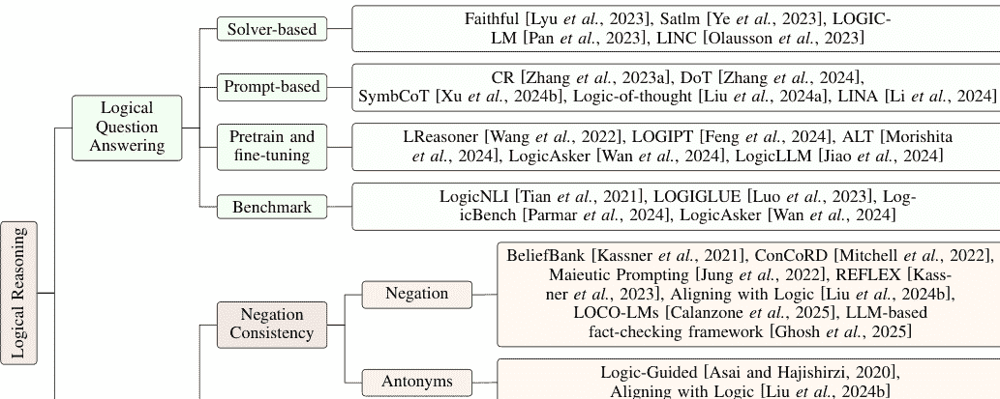

# 赋予大语言模型逻辑推理能力：全面综述

$1$阿姆斯特丹大学语言与计算研究所

$2$MBUZAI 机器学习部门

$3$清华大学物理系

4$CMB 哲学系

$5$北京大学人工智能研究院

$6$彭博化学实验室

$7$北京大学科学与技术学院人工智能国家重点实验室

{$cheng,r.m.vanrooij}@uva.nl, hli@stu.edu.cn, fenrong@tsinghua.edu.cn, kun2@zmu.edu.cn

## 摘要

大大语言模型（LLMs）在各种自然语言任务中取得了卓越的成功。然而，最近的研究发现，LLMs 的推理能力面临着巨大挑战。本文旨在将这些挑战分为两个方面：（**逻辑推理**，LLMs 在处理需要复杂策略的难题时往往无法获得正确答案）；（**逻辑一致性**，LLMs 倾向于对不同问题产生不一致的回答。例如，在 Macaw 问答任务中，LLMs 对两个问题都回答“是”，“鸟有翅膀吗？狗有翅膀吗？”为了解决这一方向，我们研究了各种推理方法并提供了这些方法的详细策略。具体而言，为了准确回答复杂的逻辑问题，可以根据与外部求解器的关系、提示词和推理对方法进行分类。我们还讨论了逻辑一致性不同位置的概念，包括蕴含、否定、真实性、一致性和组合。此外，我们回顾了基准评估指标，并讨论了研究方向，例如扩展模型逻辑以考虑不确定性，以及同时满足多个逻辑一致性的高效算法。

## 1 引言

大语言模型（LLMs）在广泛的自然语言任务中展现了性能，包括生成、分类和翻译。然而，最近的研究发现，大LLMs 的推理能力面临着巨大挑战。一方面，处理语法、语义和如预测下一个词或掩码语言模型等任务并不能确保 LLMs 的逻辑能力 [Liu et al., 2023]。另一方面，LLMs 在处理人类编写的文本方面具有主导地位，但缺乏逻辑推演和证明等高质量的逻辑推理 [Moshita et al., 2024]。这些挑战通过以下总结的方面显著限制了 LLMs 的能力。

LLMs 在需要从给定前提和约束进行演绎、归纳或抽象推理的问题上往往无法获得正确的逻辑答案。具体来说，这些问题可以大致分为两类：（判断一个陈述是否可以从给定信息中推导出，即真值，真或假。例如，前提和约束可以是“金属导电。绝缘体不导电。如果金属是由铁制成的，它是导体吗？”逻辑问题是该陈述是真实的、假的还是未知的？不能导电。）为了正确回答这个问题，LLMs 需要进行逻辑推理——关于“铁-金属-演绎-电”——在得出铁导电结论之前，并从多选题中正确选择任何满足给定约束的选项。惊讶的是，`LLAMA-13B` 在逻辑数据集 `FOLIO` 上在 8-shot 提示下的准确率为 33.63%，仅略优于随机猜测的 33.33% 准确率 [Han et al., 2024]。这项研究反映了 LLMs 在解决问题和决策等现实世界交互中的局限性。

LLMs 也容易在不同问题之间产生不一致的回答，这被认为违反了逻辑一致性。注意，逻辑一致性的形式是多样的。例如，`Llama2-7b` 对“是一个生物吗？”和“如果不是生物呢？”这两个问题都回答了“虽然” [Calanzone et al., 2025]，这违反了必要一致性（正式定义见第 3 节）。此外，一个最先进的 Macaw 问答 LLM 对“鸟吗？”、“鸟有翅膀吗？”回答“是” [Mitchell et al., 2023]，这违反了证词一致性。我们的研究表明，很少有问答数据集能确保 LLMs 的逻辑一致性 [Kassner et al., 2021; Jung et al., 2022]。结果，自矛盾的输出损害了 LLMs 的可靠性和可信度，限制了它们的潜在性能。

在本文中，我们将回答复杂的逻辑问题和确保不同输出之间的逻辑一致性视为提高 LLMs 逻辑推理能力的硬币两面。为了解决这个问题，我们回顾了改进逻辑问答 [Xo et al., 2024; Wan et al., 2024] 和逻辑一致性 [Pelka et al., 2025; Calanzone et al.] 的方法，这些方法在 LLM 社区引起了广泛关注。为了方便，我们对其进行了分类并提供了这些方法的详细分类，如图 1 所示。对于逻辑问答，这些被分为基于模型的方法、基于提示的方法以及基于逻辑求解器等外部工具的预训练和微调方法。

## 2 逻辑问答

利用语言模型（LLMs）解决复杂推理问题是近期研究重点 [Lao et al., 2023; Zhang et al., 2024]。许多研究探索了增强 LLMs 逻辑推理的方法，这些方法分为几个分支，包括依赖外部求解器、无需进一步训练和微调的提示技术。开发了许多基准来评估模型的逻辑推理性能。

### 2.1 求解器辅助方法：通过 LLM 和求解器翻译

求解器辅助方法是将自然语言（NL）问题解析为符号（SL）表达式，然后通过外部求解器求解。求解器辅助方法的通用流程可以总结为三个步骤，如图 2 所示。这些方法使用 LLMs 将自然语言翻译为符号语言（如逻辑编程 `LP` 语言、阶逻辑 `FOL`、约束满足问题 `CSP` 和布尔满足性 `SAT` 公式），这些语言可以被求解器识别。然后使用外部求解器求解问题，并使用 LLMs 将提供的答案翻译成自然语言，根据某些算法（如多数投票）生成最终答案。`CoT` [Yu et al., 2023] 基于思维链通过确定性求解器（例如 `Python`/解释器或 `PDDL` 解析器）将自然语言翻译为符号推理链，以确保 LLM 回答的忠实性。然而，这些功能性方法在“噪声”推理过程中非常困难，可能无法解决复杂的逻辑问题。

求解器辅助方法有很多缺点。首先，将逻辑问题转换为形式化表达式会导致损失 [Liu et al., 2024]，导致问题无法解决。例如在“当某人读书时，那个人获得了知识。哈里更快。”的符号翻译中。这种推理是

考虑到缺乏高质量的推理样本（如多步从头证明），或者在预训练和微调方法中，我们提出使用增强数据来训练 LLMs。对于逻辑一致性，我们关注最常见的逻辑结构，包括蕴含、否定、真实性、一致性及其组合，这些是逻辑一致性的最先进解决方案，并使用了广泛使用的基准和数据集。最后，我们讨论了具有前景的研究方向，例如扩展到条件逻辑和模态逻辑，以及多个逻辑约束的高效推理。

据我们所知，这是首项研究提高 LLM 逻辑推理能力的工作，涵盖了复杂逻辑问答和逻辑一致性的前沿研究。我们最相关的工作是 [Zong and Lin, 2024]，它仅关注三段论作为一种特定的逻辑范式，忽略了另一种逻辑推理。在规则方面，[Lam et al., 2024] 只讨论了 tik、[Yant et al., 2023] 和 [Zhang et al., 2023]。

### 2.2 基于提示的方法：通过 LLM 进行翻译、推理与验证

提示（Prompting）是一种激发大语言模型（LLMs）逻辑推理能力的直接技术。为了更准确地回答逻辑问题，基于提示的方法分为两类：第一类是在问题提出时对逻辑链进行建模。例如，思维链（`CoT`）[Wei et al., 2022]提示策略使 LLMs 能够逐步模拟推理过程。在此基础上，思维树（`ToT`）[Ya et al., 2024]提示让 LLMs 在多个推理路径之间进行评估和选择。思维图谱（`GoT`）[Besta et al., 2024]将生成的信息表示为论证图或网络图，以确保推理过程是更符合现实、理性的且逻辑性的对话。思维深度图（`DoT`）[Zheng et al., 2024]提示则将 LLM 中的迭代逻辑推理建模为有向无环图（`DAG`），如图1所示。`DAG` 中的节点表示逻辑步骤，`DAG` 中的边则表示它们之间的逻辑关系或依赖关系。此外，许多之前的研究侧重于推理路径的多样性。例如，[Zheng et al., 2023a]提示在协作推理过程中利用了三种类型的 LLM（提问者、验证者和报告者）。

第二类是通过定义良好的提示将自然语言翻译为符号语言，并利用 LLMs 进行更好的推理。例如，符号思维链（`SymCoT`）[Xu et al., 2024a]是一种基于 LLM 的框架，它在不同的提示之间结合了符号表示和跨越，如 Llama-2b 回答两个问题的示例所示：海翁是生物吗？如果海翁不是（此处原文不完整）

该模型。随后，`ConCoRD` 中的成对候选同时受到基础模型和自然语言蕴含的双重约束。最后，`ConCORD` 利用加权 `MaxSat` 求解器找到得分最高的最满意的答案候选。该研究总结在主框架中，如图 4 所示。

## 3 逻辑一致性

### 3.4 事实一致性 (Factuality Consistency)

事实一致性是指模型生成的响应或推理结果与现实知识之间的对齐程度。在事实核查中，系统通过提供可靠的知识源、检测潜在的逻辑错误或事实不准确来评估模型输出的实际事实性。对于事实一致性，存在一些矛盾的陈述、约束或知识库（`KB`），事实一致性符合 `KB` 中包含的所有事实 [Calzano et al., 2025]。

### 3.2 蕴含一致性 (Implication Consistency)

蕴含一致性基于逻辑规则 `$p \rightarrow q, p$`。这意味着如果存在“`p \rightarrow q`”和前提 `p`，那么“`p \rightarrow q`”有可能是真的。如果模型预测“`q`”为假，则答案违反了蕴含一致性。例如，给定物理事实“所有铁 (`p`) 都是金属 (`q`)”，如果铁 (`p`) 和金属 (`q`) 为假，LLMs 不应对该陈述标记为真。

不同，蕴含一致性与思维链（`CoT`）方法密切相关，每个链可以被视为逻辑蕴含。无法满足蕴含一致性会导致这些解释方法产生不准确的输出。例如，自动提示（Automatic Prompting, Jun et al., 2022）从不可靠的解释中修正正确答案。多次提示（Multiple Prompting）产生单一解释，`MainActivity` 将“真”和“假”溯溯蕴含转换为逻辑约束，并使用 `MAX-SAT` 求解器生成最佳方面以避免蕴含不一致。

### 3.3 传递一致性 (Transitivity Consistency)

为了解决模型在复杂查询下扩展的逻辑一致性问题，研究了一种基于检索增强生成（`RAG`）的 LLM 逻辑一致性改进框架 [Ghosh et al., 2025]。具体而言，首先设计了一个基于逻辑的评估框架，通过析取和合取处理逻辑一致性。其次，通过构建知识图谱（`KG`）树形基准数据集，证明了 LLM 在复杂查询中表现出糟糕的逻辑一致性。为了解决这一问题，他们使用上下文提示和少样本（few-shot）方法来学习 LLM 在复杂推理任务中的事实一致性，并利用 `QLoRA` 等参数高效方法提高性能。

传递代表了顺序或命题之间的逻辑关系。当存在两个前提 `$p \rightarrow q$` 和 `$q \rightarrow r$` 时，可以得出 `$p \rightarrow r$`，这被视为传递一致性。研究表明 LLM 缺乏传递一致性。对于最先进的问答（QA）模型，回答“鸟有羽毛吗？或者鸟是吗？麻雀有羽毛吗？” [Mitchell et al., 2022] 时，模型根据传递规则在乌鸦有头时提供了肯定答案，这与另一个输出不兼容。

### 3.5 组合一致性 (Compositional Consistency)

组合一致性是指在组合多个事实时维持逻辑一致性。当模型需要通过逻辑算符（如蕴含、合取）组合成复杂链时，它必须确保推导的每一步都符合规则，并在条件下使结论自洽。这要求模型不仅要理解实际事实的含义，还要捕捉它们连接时的逻辑关系，避免推断错误。`Loco-LLMS` [Calzano et al., 2025] 被提出通过解构维持事实一致性，通过根据事实和规则的知识库微调 LLM 来实现事实性和自洽性。可以表示任意命题的逻辑公式被编译成电路，然后被分配以生成答案。[Liu et al., 2024b] 提供了一个通用框架，通过三个通用代理：传递性、交换性和否定推理来量化位置一致性。

### 3.6 评估 (Evaluation)

[Kasser et al., 2021] 引入了一种金标准方法来评估一组信念的准确性和一致性。继 [Mitchell et al., 2022] 之后，Kasser et al., 2023] 也采用了这种评估方法。我们提供了充分的介绍，并借用了 [Kasser et al., 2022] 中的符号语言。其定义为：

为了减轻 LLM 的不一致性，[Ai and Hajishari, 2020] 利用事实的逻辑推理规则提示模型获取基础陈述。基于查询“金鱼有钱，会有更多吗？食物更多，我们的天气正在发生吗？”，当“更多和更多”时，如果“金鱼有钱”的蕴含将通过对称性增强，对于对称规则，反义词和陈述的反也被添加到数据集中。通过这种方式，该方法增强了训练数据，然后采用基于一致性的正则器来训练模型，以增强其包含和对称的逻辑一致性。

- 一组实体 `$s_m \in S$`；

- 一组“事实” `$(P_n(s_m))$`，其二值化真值已知；

- 金标准约束的有向图 `$G(P, E)$`，其中边 `$(P_i, P_j) \in E$` 代表一阶逻辑公式 `$P_i(x) \rightarrow P_j(x)$`。

通过二进制比较评估准确性，比较配置 `$Z$` 中的 `$z$`（使 `$\phi(z)$` 最大化）与 `$P_n(s_m)$` 的真值 [Mitchell et al., 2023]。在这一评估中，使用金标准倾向于真实值。

关于自我信念的推理。二进制 [Kansner et al., 2021]、ConfOr [Mitchell et al., 2022] 以及所有约束的遵循性 [Vaswani et al., 2019]，其定义为 `$G$` 中金标准约束的比例，这与其他输出不兼容。

* 

扩展大语言模型（LLMs）的推理能力以建模逻辑来应对不确定性，并开发能够同时满足多个逻辑约束的算法。这些进展对于提高 LLM 在需要精确逻辑的应用中的可靠性和稳健性至关重要，并将最终弥补交互式 LLM 与现实场景中复杂推理需求之间的差距。

## 参考文献

- [Asahi and Hajishiri, 2020] 用于一致问答的逻辑引导数据回答与正则化。在*AACL*,页 552–560，2020。

- [Bao et al., 2023] Qiming Bao, Alex Peng, Zhenyuan Deng, Wangjun Zhang, Gao Gao, Timothy Pistoli, Seth Tan, Nanhun Yang, Young Chen, Zhou Yna, David Micbert, 以及 Jiao Liu. 基于抽象推理的逻辑驱动推理数据增强。在*AACL*,页 5914–5934，2023。

- [Besta et al., 2024] Maciej Besta, Nils Hal, Lukas Bcek, Robert Gerberich, Michal Paszkowski, Logical Giannazzi, Goja Gomaz, Sebastian Lehmann, Hubert Niewiadomski, Piotr Nyc, 等。图的技术：使用语言模型解决逻辑问题。在*AAAI*,页 17682–17690，2024。

- [Calzano et al., 2025] Giacomo Calzano, Stefano Testa 和 Antonio Vergili. 通过神经符号实现一致性语言模型。在*ICLR*,2025。

- [Clark et al., 2021] Peter Clark, Yojit Tajford 和 Kyle Richards. 将 transformers 转换为推理的软求解器。*arXiv preprint arXiv:2105.14333*,2021。

- [Feng et al., 2024] Jianhao Feng, Ruichen Xu, Xuchen Jiang, Hato Hishima, Yelong Sheng, Dongyuan Zhao, 以及 Weizhu Chen. 语言模型可以是欺骗性的解码器。在*NAACL*,页 4026–4042，2024。

- [Goshish et al., 2023] Biswithra Ghosh, Sarah Hasan, Nehan Arif 和 Anuj Rajman. 基于 GPT-4 的事实核查自然语言推理。在*ICLR*,2023。

- [Han et al., 2021] Simon Hang, Harley Schkelfourt, Yilin Zhou, Quentin Martin, Yujiao Qian, Lewis Benson, 等。基于一阶逻辑的自然语言推理。在*EMNLP*,页 2207–22031，2021。

- [Jang and Lukasiewicz, 2023] Myeyunjin Jang 和 Thomas Lukasiewicz. ChatGPT 的一致性分析。在*EMNLP*,页 15970–15985，2023。

- [Jao et al., 2024] Fangai Jiao, Zhiyang Sheng, Bosheng Ding, Zhiyuan Liu, Nancy Chen 以及 Shajif Ito. 用于语言模型的轮替自监督逻辑增强训练。在*NAACL*,页 926–944，2024。

- [Jung et al., 2022] Jachu Jung, Lianhuai Qin, Sean Weleck, Fazze Brahmam, Chandra Bhagavatula, Ronan Le 以及 Yejin Choi. 通过递归解释促进一致性推理。在*EMNLP*,页 1266–1279,2022。

- [Kassner et al., 2021] Nora Kassner, Omayvind Tajford, Hin Richter 和 Peter Clark. Baking：一种用于信念符号任务的预训练语言模型。在*EMNLP*,页 8849–8861，2021。

- [Kassner et al., 2021] Nora Kassner, Omayvind Tajford, Ashish Bashwatkar, Kyle Richardson 以及 Peter Clark. 任务导向推理的语言模型。在*EMNLP*,页 14190–14201，2021。

# 参考文献

- [Lam et al., 2024] Hong Lee Matthew Lam, Mary Rney, Kavethy Thikonda 以及 Eshan Shahghi. 深入观察推理语言模型。工具模型的选择。*arXiv preprint arXiv:2406.00284*,2024。
- [Li et al., 2019] Jian Tu, Vivek Gpta, Maitreya Meh 以及 Vivrik Sikmar. 神经模型一致性的逻辑驱动框架。在*Proceedings of Empirical Methods in Natural Language Processing*,2019。
- [Li et al., 2024] Qincheng Liu, Lianqiang Ji, Longxiang Liu, Yiting Zheng, Minuyeng Cheng, Weizhu Xiang, Weizheng Li, Weizheng Huang 以及 Qi Li. 逻辑推理中的假设演绎利用 LLM：一种神经符号方法。*arXiv preprint arXiv:2410.11759*,2024。
- [Liu et al., 2021] Yifei Liu, Leyang Chen, Hanming Liu, Dan, Yilin Wang 以及 Yue Zhang. LogQ：用于逻辑推理机器阅读的大型数据集。在*IJCAI*,页 3622–3628，2021。
- [Liu et al., 2024a] Tongxiang Liu, Wenjia Wu, Weizheng, Xiaojing Yang, Ha Liang 以及 Ji. 思维链：为大语言模型上下文注入逻辑。*arXiv preprint arXiv:2409.15735*,2024。
- [Liu et al., 2024b] Yinhong Liu, Zhiqiang Gao, Tian Yang, Elshan Shahghi, Ivan Collier. 与逻辑对齐：评估和改进大语言模型中的逻辑一致性。*arXiv preprint arXiv:2409.15735*(注：此处原文编号与上方重复，遵循原文)*2024。
- [Liu et al., 2023] Man Lu, Shrinidhi Kumar, Mukhar, Neeraj. 从不确定性的推理。*arXiv preprint arXiv:2310.836*,2023。
- [Lu et al., 2023] Daniel Pale, Shreya Havaldar, Adam Stein, Wei. 逻辑链推理。在*ACL-IJNLP*,2023。
- [Pan et al., 2023] Liangwani, Noor Alabakh, Alif Wang, Wei. 符号逻辑增强 LLM 能力。在*EMNLP*,页 3086–3024，2023。
- [Parm et al., 2022] Hemant Parmar, Neel Varshney, Mutuki, Amritanda, Mithra Badal. 增强语言模型性能。在*EMNLP*,页 1754–1768，2022。
- [Morishita et al., 2022] Terunori Morishita, Gaku Mori, Atsuki Yamaguchi, Yasuhiro Sogawa. 逻辑推理。在*NeurIPS*,2022。
- [Olasson et al., 2023] Theo Alauon, Ge, Joshua Tenenberg, Roy. 基于逻辑的逻辑推理。在*EMNLP*,页 5153–5167，2023。
- [Pale et al., 2025] Daniel Pale, Abhinav Pavalli, Alejandro Romero, Wei. 语言模型预测。在*ICLR*,2025。
- [Sun et al., 2024] Hongda Sun, Wei Xu, Wei Liu, Bin Luo, Shao Zhang, Ji-Ren Wang, Wei Nan. 从不确定性到确定性的 LLM 推理增强。在*ACL*,页 9828–9862，2024。
- [Tafford et al., 2021] Omayd Tafford, Bhavana Dalvi Mishra, Peter Clark. 生成生成的推理、证明和抽象陈述。在*ACL-IJNLP*,页 3651–3664，2021。
- [Tafford et al., 2022] Omayd Tafford, Bhavana Dalvi Mishra, Peter Clark. 使用忠实且真实的链回答问题。在*EMNLP*,页 2078–2093，2022。
- [Tian et al., 2021] Jidong Tian, Yiting Li, Wenqi Chen, Liangqi Hao, 以及 Yao Jin. 通过逻辑诊断一阶推理能力。在*Proceedings of the 2021 Conference on Methods in Natural Language Processing*,页 3738–3747，2021。
- [Wan et al., 2024] Yunjun Wan, Yiyang Yang, Youting Yan, Jun-Hae Hong, Pujia He, Wenxin Jiao, 以及 Michael Liu. LLM-Asker：评估和改进大语言模型的逻辑推理能力。在*EMNLP*,页 2124–2155，2024。
- [Wan et al., 2022] Siyuan Wan, Yunjun Dong, Zoyu Tang, Wei Wei, Daxin Fan, Ming Zhou, 以及 Wei Nan. 逻辑驱动的内容扩展。在*ACL*,页 1610–1629，2022。
