# 崩溃转储分析模式百科全书：检测计算机内存中异常软件结构和……行为，第二版


- 内容摘要 3
## A


- 线程模式 1187
- 等待链模式 1188

## Appendix C

- 崩溃转储分析清单 1189

## Index

## Preface to the First Edition

我们最初于 2009 年策划此书。当时，内存转储分析模式不足 100 个。自那以后，软件诊断研究所已添加了更多模式。所有模式（共 326 个）分散在内存转储分析文集各卷（1 – 7, 8a）的 3,300 页中，少数仅可在软件诊断库中找到。因此，我们决定将所有这些模式及其示例重印于一本书中，以便参考。编辑期间，我们还更正了各种错误，添加了附加注释和交叉引用。大多数模式适用于 Windows 平台和 WinDbg，少量示例针对 Mac OS X 和 GDB。然而，这种模式语言易于扩展，我们计划在未来版本中添加更多非 Windows 示例（包括 Linux）。

如果您遇到任何错误，请使用此表格联系我

http://www.dumpanalysis.org/contact

或者，使用此联系电子邮件向我发送个人消息：

dmitry.vostokov@dumpanalysis.org

或者，通过 Twitter @ DumpAnalysis


## 第二版前言

距上一版出版已过去两年，在发布《内存转储分析选集》第8b、9a和9b卷（包含包括Linux变体在内的新内存分析模式）后，我们决定出版更新版。新版现包含超过50个新模式和模式变体，其中包括撰写本文时即将出版的第10a卷中的5个分析模式，以及超过70条新注释。WinDbg输出和代码部分已重新格式化，以便于屏幕和平装书阅读。部分笔误已更正，标点符号也已改进。

除第一版前言中提供的联系方式外，我们还建议关注以下Facebook页面和群组：

- http://www.facebook.com/DumpAnalysis
- http://www.facebook.com/groups/dumpanalysis

## 致谢

特别感谢Igor Dzyubenko为第二版提出修正和改进建议，感谢João Roque，以及Malcolm McCaffery在首版发布后提供了鼓励性支持，感谢软件诊断库用户为评论部分做出贡献，感谢软件诊断服务培训课程和参考资料的客户为延续本项目提供了资助。

## 关于作者


Dmitry Vostokov是一位国际公认的专家、演讲者、教育家、科学家和作者。他是面向模式的软件诊断、取证和预测学科以及软件诊断研究所（DA+TA：DumpAnalysis.org + TraceAnalysis.org）的创始人。Vostokov还撰写了30多本关于软件诊断、取证和问题解决、内存转储分析、调试、软件跟踪和日志分析、逆向工程以及恶意软件分析的书籍。他在包括领导、技术和人员管理角色在内的多个行业拥有超过20年的软件架构、设计、开发和维护经验。

Dmitry还创立了DiaThings、Logtell ect、OpenTask迭代与增量出版（OpenTask.com）、软件诊断服务（原内存转储分析服务PatternDiagnostics.com和Software Prognostics）。在业余时间，他会在Debugging.TV上介绍各种主题，并探索他所开创的软件叙事学（Software Narratology，一种软件故事的应用科学）及其进一步发展——事物叙事学（Narratology of Things）和事物诊断（Diagnostics of Things，DoT）。他目前的研究兴趣是理论软件诊断。

## 缩写转储

有时我们会得到难以完整分析的内存转储，因为保存时省略了部分（甚至大部分）信息。这些通常是小内存转储（与内核转储和完整转储相对）以及用户进程小型转储。当我们打开转储文件时，可以轻松识别出这种情况：

```
User Mini Dump File: Only registers, stack and portions of memory are available
Mini Kernel Dump File: Only registers and stack trace are available
```

同样适用于省略线程时间信息的用户转储（无法使用!runaway WinDbg命令），或使用.dump命令的各种选项（包括privacy-aware1）而不是/ma或已弃用的/f选项保存的转储。相反，崩溃转储中被手动擦除的数据2更像是另一种称为Lateral Damage（第602页）模式的示例。

缩写转储的类似情况在Wrong Dump3和Missing Space4反模式中有所讨论。

无论如何，我们不应该忽略此类转储文件，而应尝试分析它们。例如，一些方法（包括使用镜像二进制文件）在内核小型转储分析系列5中有列出。在寻找执行残留（第371页）时，我们甚至可以看到部分原始堆栈数据：

```
0: kd> !thread
GetPointerFromAddress: unable to read from 81d315b0
THREAD 82f49020 Cid 0004.0034 Teb: 00000000 Win32Thread: 00000000 RUNNING on processor 0
IRP List:
Unable to read nt!_IRP @ 8391e008
Not impersonating
GetUlongFromAddress: unable to read from 81d0ad90
Owning Process 82f00ab0 Image: System
Attached Process N/A Image: N/A
ffff0000: Unable to get shared data
Wait Start TickCount 4000214
Context Switch Count 21886
ReadMemory error: Cannot get nt!KeMaximumIncrement value.
UserTime                    00:00:00.000
KernelTime                  00:00:00.000
Win32 Start Address nt!ExpWorkerThread (0x81c78ea3)
Stack Init 85be0000 Current 85bdf7c0 Base 85be0000 Limit 85bdd000 Call 0
Priority 14 BasePriority 12 PriorityDecrement 0 IoPriority 2 PagePriority 5
[...]

0: kd> dps 85bdd000 85be0000
85bdd000 ????????
85bdd004 ????????
85bdd008 ????????
85bdd00c ????????
85bdd010 ????????
85bdd014 ????????
85bdd018 ????????
85bdd01c ????????
[...]
85bdfc4 ????????
85bdfc8 ????????
85bdfcc ????????
85bdfd0 0000000a
85bdfd4 a112883e
85bdfd8 0000001b
85bdfdc 00000000
85bdfe0 81c28750 nt!KeSetEvent+0x4d
85bdfe4 85bdf8e8
85bdfe8 85bdf970
85bdfe8 81c28750 nt!KeSetEvent+0x4d
85bdff0 badb0d00
85bdff4 00000000
85bdff8 00000000
85bdffc 81cf4820 nt!KiInitialPCR+0x120
85bdf00 00000000
85bdf04 85bdf938
85bdf08 81cf4820 nt!KiInitialPCR+0x120
85bdf0c 00000000
85bdf10 81d32300 nt!OpTimerLock
85bdf14 00000000
85bdf18 81fa0000 nt!_NULL_IMPORT_DESCRIPTOR <PERF> (nt+0x3a0000)
85bdf1c 85bd0023
85bdf20 00000023
85bdf24 00000000
85bdf28 81d323c0 nt!KiDispatcherLock
85bdf2c a1128828
85bdf30 85bdf9b4
85bdf34 85bdfdb0
85bdf38 00000030
85bdf3c 84ca6f40
85bdf40 84ca6f38
85bdf44 00000001
85bdf48 85bdf970
85bdf4c 00000000
85bdf50 81c28750 nt!KeSetEvent+0x4d
85bdf54 00000008
85bdf58 00010246
85bdf5c 00000000
85bdf960 84ca68a0
[...]
85bdfd2c 82f49020
85bdfd30 835ca4d0
85bdfd34 a6684538
85bdfd38 81cfde7c nt!ExWorkerQueue+0x3c
85bdfd3c 00000001
85bdfd40 00000000
85bdfd44 85bdfd7c
85bdfd48 81c78fa0 nt!ExpWorkerThread+0xfd
85bdfd4c 835ca4d0
85bdfd50 00000000
85bdfd54 82f49020
85bdfd58 00000000
85bdfd5c 00000000
85bdfd60 0069000b
85bdfd64 00000000
85bdfd68 00000001
85bdfd6c 00000000
85bdfd70 835ca4d0
85bdfd74 81da9542 nt!PnpDeviceEventWorker
85bdfd78 00000000
85bdfd7c 85bdfd0c
85bdfd80 81e254e0 nt!PspSystemThreadStartup+0x9d
85bdfd84 835ca4d0
85bdfd88 85bdf4680
85bdfd8c 00000000
85bdfd90 00000000
85bdfd94 00000000
85bdfd98 00000002
85bdfd9c 00000000
85bdfda0 00000000
85bdfda4 00000001
85bdfda8 85bdfd88
85bdfdac 85bdfdbc
85bdfdb0 ffffffff
85bdfdb4 81c8aa5d nt!_except_handler4
85bdfdb8 81c9ddb8 nt!'string'+0x4
85bdfdbc 00000000
85bdfdc0 00000000
85bdfdc4 81c9159e nt!KiThreadStartup+0x16
85bdfdc8 81c78ea3 nt!ExpWorkerThread
85bdfdcc 00000001
85bdfdd0 00000000
85bdfdd4 00000000
85bdfdd8 002e0069
85bdfddc 006c0064
85bdfde0 004c006c
85bdfde4 00000000
85bdfde8 000007f0
85bdfdec 00010000
85bdfdf0 0000027f
85bdfdf4 00000000
85bdfdf8 00000000
85bdfdfc 00000000
85bdfe00 00000000
85bdfe04 00000000
85bdfe08 00001f80
85bdfe0c 0000ffff
85bdfe10 00000000
85bdfe14 00000000
85bdfe18 00000000
[...]
85bdffec 00000000
85bdfff0 00000000
85bdfff4 00000000
85bdfff8 00000000
85bdfffc 00000000
85be0000 ????????
```

- 1 WinDbg是隐私感知型，《内存转储分析选集》第1卷，第600页
- 2 崩溃转储中的数据隐藏，《内存转储分析选集》第2卷，第397页
- 3 错误转储，《内存转储分析选集》第1卷，第496页
- 4 缺失空间，《内存转储分析选集》第3卷，第138页
- 5 小型转储分析，《内存转储分析选集》第1卷，第43页

用户小型转储在此处类似：

```
0:001> k
ChildEBP RetAddr
099bfe14 7c90daaa ntdll!KiFastSystemCallRet
099bfe18 77e765e3 ntdll!NtReplyWaitReceivePortEx+0xc
099bff80 77e76caf rpcrt4!LRPC_ADDRESS::ReceiveLotsaCalls+0x12a
099bff88 77e76ad1 rpcrt4!RecvLotsaCallsWrapper+0x8
099bffa8 77e76c97 rpcrt4!BaseCachedThreadRoutine+0x79
099bfff4 7c80b729 rpcrt4!ThreadStartRoutine+0x1a
099bfffec 00000000 kernel32!BaseThreadStart+0x37
```

```
0:001> dd 099bfe14
099bfe14 099bfe24 7c90daaa 77e765e3 00000224
099bfe24 099bff74 00000000 2d87a8e 099bff48
099bfe34 fbf58e18 00000400 fd629338 b279dbbc
099bfe44 fd59288b fb58ebc b279dbbc 0c1e002
099bfe54 00000000 00000006 00000001 00000000
099bfe64 e637d218 00000000 00000006 00000006
099bfe74 00000006 e1f76998 e39b8b60 00000000
099bfe84 fbe33c40 00000001 e5ce12f8 b279db9c
```

```
0:001> dd 099bfe14-20
099bfdf4 ???????? ???????? ???????? ????????
099bfe04 ???????? ???????? ???????? ????????
099bfe14 099bfe24 7c90daaa 77e765e3 00000224
099bfe24 099bff74 00000000 2d87a8e 099bff48
099bfe34 fbf58e18 00000040 fd629338 b279dbbc
099bfe44 fd59288b fb58ebc b279dbbc 0c1e002
099bfe54 00000000 00000006 00000001 00000000
099bfe64 e637d218 00000000 00000006 00000006
```

此处作为警告，可以得出结论：小型转储也可能泄露私人信息，特别是在原始堆栈数据中出现ASCII或Unicode缓冲区时。

我们以缩写书为类比，命名了此模式。


## 偶然锁

当系统无响应或迟缓时，我们通常会检查内核中的 _ERESOURCE锁 或完整内存转储，以查看**死锁**（第 193 页）或**高竞争**（第 477 页）模式。但是，报告的锁有时纯属偶然，并在崩溃转储中出现，只是因为它们恰好在该时间发生。我们需要在阻塞线程和被阻塞线程中查看 _Contention Count_、_Ticks_ 和 _KernelTime_，以识别 **偶然锁**。另外，当我们使用 `!analyze -v -hang` 命令时，WinDbg 可能无法区分长时间持有的锁和偶然锁，而只是报告其在等效替代方案中找到的某个锁链。

这里有一个示例。系统被报告挂起，并保存了内核内存转储。WinDbg 分析命令报告一个线程阻塞了其他 3 个线程，且阻塞线程栈顶的驱动程序是 _AVDriver.sys_。WinDbg 用于指向特定映像名称的算法在小型转储分析文章⁶ 中有描述，在我们的例子中，它选择了 _AVDriver_ 模块：

```
BLOCKED_THREAD: 8089d8c0

BLOCKING_THREAD: 8aab4700

LOCK_ADDRESS: 8859a570 -- (!locks 8859a570)

Resource @ 0x8859a570 Exclusively owned
 Contention Count = 3
 NumberOfExclusiveWaiters = 3
 Threads: 8aab4700-01<*>
 Threads Waiting On Exclusive Access:
 885d0020 88a7c020 8aafc7d8

1 total locks, 1 locks currently held

BUGCHECK_STR: LOCK_HELD

FAULTING_THREAD: 8aab4700

STACK_TEXT:
f592f698 80832f7a nt!KiSwapContext+0x26
f592f6c4 80828705 nt!KiSwapThread+0x284
f592f70c 7f22a394 nt!KeDelayExecutionThread+0x2ab
WARNING: Stack unwind information not available. Following frames may be wrong.
f592f734 f720ae35 AVDriver+0x1394
f592f750 f720b208 AVDriver+0x1e35
f592f794 f721945a AVDriver+0x2208
f592f7cc 8081dcdf AVDriver+0x1045a
f592f7e0 f5b9f76a nt!IoCallDriver+0x45
f592f7f0 f5b9c621 Driver!FS_Dispatch+0xa4
f592f7fc 8081dcdf Driver!Kernel_dispatch+0x53
f592f810 8feb2856 nt!IofCallDriver+0x45
f592f874 8081dcdf nt!IofCallDriverQueryFullName+0x5c10
f592f888 f5e9eae3 nt!IofCallDriver+0x45
f592f8b8 f5e9eca4 DrvFilter!PassThrough+0x115
f592f8d4 8081dcdf DrvFilter!Create+0xda
f592f8e8 808f8275 nt!IofCallDriver+0x45
f592f9d0 808f8bc6 nt!IopParseDevice+0xa35
f592fa08 80936689 nt!IopParseFile+0x46
f592fa88 80932e04 nt!ObpLookupObjectName+0x11f
f592fadc 808ea331 nt!ObOpenObjectByName+0xea
f592fb58 808eeb4b nt!IopCreateFile+0x447
f592fbf4 f57c8efd nt!IoCreateFile+0xa3
f592fc24 f57c9f29 srv!SrvIoCreateFile+0x36d
f592fcf0 f57c5ae4 srv!SrvNtCreateFile+0x5cc
f592fd78 f57adbc6 srv!SrvSmbNtCreateAndX+0x15c
f592fd84 f57c3451 srv!SrvProcessSmb+0xb7
f592fdac 80948b80 srv!WorkerThread+0x138
f592fddc 8088d4e2 nt!PspSystemThreadStartup+0x2e
00000000 00000000 nt!KiThreadStartup+0x16

STACK_COMMAND: .thread 0xffffffff8aab4700 ; kb

FOLLOWUP_IP:
AVDriver+1394
f720a394 eb85      jmp     AVDriver+0x131b (f720a31b)

MODULE_NAME: AVDriver

IMAGE_NAME:  AVDriver.sys
```

### 出于此“发现”，我们想查看所有锁：

```
0: kd> !locks
**** DUMP OF ALL RESOURCE OBJECTS ****
KD: Scanning for held locks...

Resource @ 0x895a62d8    Shared 1 owning threads
   Threads: 89570520-01<*>

Resource @ 0x897ceba8    Shared 1 owning threads
   Threads: 89584020-01<*>

Resource @ 0x8958e020    Shared 1 owning threads
   Threads: 89555020-01<*>

Resource @ 0x89590608    Shared 1 owning threads
   Threads: 89666020-01<*>

Resource @ 0x89efc398    Shared 1 owning threads
   Threads: 89e277c0-01<*>

Resource @ 0x88d70820   Shared 1 owning threads
Threads: 88e43948-01<*>

Resource @ 0x89f2fb00   Shared 1 owning threads
Threads: 89674688-01<*>

Resource @ 0x89c80370   Shared 1 owning threads
Threads: 888496b8-01<*>

Resource @ 0x89bdfd08   Shared 1 owning threads
Threads: 88b62910-01<*>

Resource @ 0x888b5488   Shared 1 owning threads
Threads: 88536730-01<*>

Resource @ 0x89f2e348   Shared 1 owning threads
Threads: 89295930-01<*>

Resource @ 0x891a0838   Shared 1 owning threads
Threads: 88949020-01<*>

Resource @ 0x8825bf08   Shared 1 owning threads
Threads: 882b9a08-01<*>

Resource @ 0x881a6510   Shared 1 owning threads
Threads: 88a88338-01<*>

Resource @ 0x885c5890   Shared 1 owning threads
Threads: 881ab020-01<*>

Resource @ 0x886633a8   Shared 1 owning threads
Threads: 89b5f8b0-01<*>

Resource @ 0x88216390   Shared 1 owning threads
Threads: 88820020-01<*>

Resource @ 0x88524490   Shared 1 owning threads
Threads: 88073020-01<*>

Resource @ 0x88f6a020   Shared 1 owning threads
Threads: 88e547b0-01<*>

Resource @ 0x88cf2020   Shared 1 owning threads
Threads: 89af32d8-01<*>

Resource @ 0x889cea80   Shared 1 owning threads
Threads: 88d18b40-01<*>

Resource @ 0x88486298   Shared 1 owning threads
Threads: 88af7db0-01<*>

Resource @ 0x88b22270 Exclusively owned
Contention Count = 4
NumberOfExclusiveWaiters = 4
Threads: 8aad07d8-01<*>
Threads Waiting On Exclusive Access:
8ad78020 887abdb0 88eb39a8 8aa1f668

Resource @ 0x88748c20 Exclusively owned
Contention Count = 2
NumberOfExclusiveWaiters = 2
Threads: 8873c8d8-01<*>
Threads Waiting On Exclusive Access:
88477478 88db6020

Resource @ 0x8859a570 Exclusively owned
Contention Count = 3
NumberOfExclusiveWaiters = 3
Threads: 8aab4700-01<*>
Threads Waiting On Exclusive Access:
885d0020 88a7c020 8aafc7d8

KD: Scanning for held locks...
18911 total locks, 25 locks currently held
```

我们可以忽略共享锁，然后专注于最后 3 个独占资源。可疑之处在于，Contention Count 与等待独占访问的线程数（NumberOfExclusiveWaiters）相同。这意味着这些资源之前从未被使用过。如果我们详细转储锁，可以看到被阻塞线程的等待时间不超过 2 秒，例如，对于资源 0x8859a570：

```
0: kd> !thread 885d0020; !thread 88a7c020; !thread 8aafc7d8
THREAD 885d0020 Cid 0004.1c34 Teb: 00000000 Win32Thread: 00000000 WAIT: (Unknown) KernelMode Non-
Alertable
89908d50 SynchronizationEvent
885d0098 NotificationTimer
Not impersonating
DeviceMap e10022c8
Owning Process 8ad80648 Image: System
Wait Start TickCount 7689055 Ticks: 127 (0:00:00:01.984)
Context Switch Count 248
UserTime 00:00:00.000
KernelTime 00:00:00.000
Start Address srv!WorkerThread (0xf57c3394)
Stack Init b4136000 Current b4135b74 Base b4136000 Limit b4133000 Call 0
Priority 9 BasePriority 9 PriorityDecrement 0
ChildEBP RetAddr
b4135b8c 80832f7a nt!KiSwapContext+0x26
b4135b8b 8082925c nt!KiSwapThread+0x284
b4135c00 8087c1ad nt!KeWaitForSingleObject+0x346
b4135c3c 8087c3a1 nt!ExpWaitForResource+0xd5
b4135c5c f57c9e95 nt!ExAcquireResourceExclusiveLite+0x8d
b4135cf0 f57ca5e4 srv!SrvNtCreateFile+0x510
b4135d78 f57adbc6 srv!SrvSmbNtCreateAndX+0x15c
b4135d84 f57c3451 srv!SrvProcessSmb+0xb7
b4135dac 80948bd0 srv!WorkerThread+0x138
b4135dcb 888d4e2 nt!PspSystemThreadStartup+0x2e
00000000 00000000 nt!KiThreadStartup+0x16

THREAD 88a7c020 Cid 0004.3448 Teb: 00000000 Win32Thread: 00000000 WAIT: (Unknown) KernelMode Non-
Alertable
  89998d50 SynchronizationEvent
  88a7c098 NotificationTimer

Not impersonating
DeviceMap e10022c8
Owning Process 8ad80648 Image: System
Wait Start TickCount 7689112 Ticks: 70 (0:00:00:01.093)
Context Switch Count 210
UserTime 00:00:00.000
KernelTime 00:00:00.000
Start Address srv!WorkerThread (0xf57c3394)
Stack Init b55dd000 Current b55db47 Base b55dd000 Limit b55da000 Call 0
Priority 9 BasePriority 9 PriorityDecrement 0
ChildEBP RetAddr
b55dcb8 80832f7a nt!KiSwapContext+0x26
b55dcbb 8082925c nt!KiSwapThread+0x284
b55dcc0 8087c1ad nt!KeWaitForSingleObject+0x346
b55dcc3 8087c3a1 nt!ExpWaitForResource+0xd5
b55dcc5 f57ce995 nt!ExAcquireResourceExclusiveLite+0x8d
b55dccf f57c5ae4 srv!SrvNtCreateFile+0x510
b55dc78 f57adbc6 srv!SrvSmbNtCreateAndX+0x15c
b55dcc84 f57c3451 srv!SrvProcessSmb+0xb7
b55dcac 80948bd0 srv!WorkerThread+0x138
b55ddcc 8088d4e2 nt!PspSystemThreadStartup+0x2e
00000000 00000000 nt!KiThreadStartup+0x16

THREAD 8aafc7d8 Cid 0004.058c Teb: 00000000 Win32Thread: 00000000 WAIT: (Unknown) KernelMode Non-
Alertable
  89998d50 SynchronizationEvent
  8aafc850 NotificationTimer

Not impersonating
DeviceMap e10022c8
Owning Process 8ad80648 Image: System
Wait Start TickCount 7689171 Ticks: 11 (0:00:00:00.171)
Context Switch Count 310
UserTime 00:00:00.000
KernelTime 00:00:00.000
Start Address srv!WorkerThread (0xf57c3394)
Stack Init f592c000 Current f592bb18 Base f592c000 Limit f5929000 Call 0
Priority 9 BasePriority 9 PriorityDecrement 0
ChildEBP RetAddr
f592bb30 80832f7a nt!KiSwapContext+0x26
f592bb5c 8082925c nt!KiSwapThread+0x284
f592bba4 8087c1ad nt!KeWaitForSingleObject+0x346
f592bbe0 8087c3a1 nt!ExpWaitForResource+0xd5
f592bc0 f57c8267 nt!ExAcquireResourceExclusiveLite+0x8d
f592bc18 f57ff0ed srv!UnlinkRfcbFromLfcb+0x33
f592bc34 f57f2eea srv!SrvCompleteRfcbClose+0x1df
f592bc54 f57b5e8f srv!CloseRfcbInternal+0xb6
f592bc78 f57ce8a9 srv!SrvCloseRfcbsOnSessionORPid+0x74
```


```
f592bc94 f57e2b22 srv!SrvCloseSession+0xb0
f592bcb8 f57eab12 srv!SrvCloseSessionsOnConnection+0xa9
f592bcc4 f57c79ed srv!SrvCloseConnection+0x143
f592bcd0 f5808c50 srv!SrvCloseConnectionsFromClient+0x17f
f592bdac 80948bd0 srv!WorkerThread+0x138
f592bddc 8088d4e2 nt!PspSystemThreadStartup+0x2e
00000000 00000000 nt!KiThreadStartup+0x16
```

阻塞线程本身既未被阻塞也是活跃的：自上次等待或抢占以来经过的时钟周期数为 0。这可能是 CPU 飙升模式的迹象。但是，它们累积的内核时间小于一秒：

```
0: kd> !thread 8aad07d8
THREAD 8aad07d8 Cid 0004.0580 Teb: 00000000 Win32Thread: 00000000 WAIT: (Unknown) KernelMode Non-Alertable
8aad0850 NotificationTimer
IRP List:
8927ade0: (0006,0220) Flags: 00000884 Mdl: 00000000
Impersonation token: eafdc030 (Level Impersonation)
DeviceMap e5d69340
Owning Process 8ad80648 Image: System
Wait Start TickCount 7689182 Ticks: 0
Context Switch Count 915582
UserTime 00:00:00.000
KernelTime 00:00:00.125
Start Address srv!WorkerThread (0xf57c3394)
Stack Init f59d8000 Current f59d7680 Base f59d8000 Limit f59d5000 Call 0
Priority 9 BasePriority 9 PriorityDecrement 0
```

```
0: kd> !thread 8873c8d8
THREAD 8873c8d8 Cid 0004.2898 Teb: 00000000 Win32Thread: 00000000 WAIT: (Unknown) KernelMode Non-Alertable
8873c950 NotificationTimer
IRP List:
882a8de0: (0006,0220) Flags: 00000884 Mdl: 00000000
Impersonation token: eafdc030 (Level Impersonation)
DeviceMap e5d69340
Owning Process 8ad80648 Image: System
Wait Start TickCount 7689182 Ticks: 0
Context Switch Count 917832
UserTime 00:00:00.000
KernelTime 00:00:00.031
Start Address srv!WorkerThread (0xf57c3394)
Stack Init ac320000 Current ac31f680 Base ac320000 Limit ac31d000 Call 0
Priority 9 BasePriority 9 PriorityDecrement 0
```

```
0: kd> !thread 8aab4700
THREAD 8aab4700 Cid 0004.0588 Teb: 00000000 Win32Thread: 00000000 WAIT: (Unknown) KernelMode Non-Alertable
8aab4778 NotificationTimer
IRP List:
88453008: (0006,0220) Flags: 00000884 Mdl: 00000000
Impersonation token: e9a82728 (Level Impersonation)
DeviceMap eab5f108
Owning Process 8ad80648 Image: System
Wait Start TickCount 7689182 Ticks: 0
Context Switch Count 1028220
UserTime 00:00:00.000
KernelTime 00:00:00.765
Start Address srv!WorkerThread (0xf57c3394)
Stack Init f5930000 Current f592f680 Base f5930000 Limit f592d000 Call 0
Priority 9 BasePriority 9 PriorityDecrement 0
```

基于这一观察，我们可以说锁是偶然的，当问题再次发生时，新的转储中未显示它们。

## 激活上下文

这是关于激活上下文的新模式^7。这里我们有**软件异常**（第 875 页）STATUS_SXS_*，例如：

```
STATUS_SXS_EARLY_DEACTIVATION 0xC015000F
STATUS_SXS_INVALID_DEACTIVATION 0xC0150010

0:000> !analyze -v

[...]

EXCEPTION_RECORD: fffffff8 -- (.exr 0xffffffffffffffff)
ExceptionAddress: 77a54441 (ntdll!RtlDeactivateActivationContext+0x00000154)
ExceptionCode: c015000f
ExceptionFlags: 00000000
NumberParameters: 3
Parameter[0]: 00000000
Parameter[1]: 0056cbe8
*Parameter[2]: 0056ccc18*

EXCEPTION_CODE: (NTSTATUS) 0xc015000f - The activation context being deactivated is not the most recently activated one.

CONTEXT: 003df6c8 -- (.cxr 0x3df6c8)
eax=003df9bc ebx=13050002 ecx=00000000 edx=00000000 esi=0056cbe8 edi=0056ccc18
eip=77a54441 esp=003df9b0 ebp=003dfa0c iopl=0 nv up ei pl nz na pe nc
cs=0023 ss=002b ds=002b es=002b fs=0053 gs=002b efl=00000206
ntdll!RtlDeactivateActivationContext+0x154:
77a54441 8b36 mov esi,dword ptr [esi] ds:002b:0056cbe8=0056cbb8
Resetting default scope

STACK_TEXT:
003dfa0c 755aa138 005507d0 13050002 003dfa7c ntdll!RtlDeactivateActivationContext+0x154
003dfa1c 002b1235 00000000 13050002 3a92c68c kernel32!DeactivateActCtx+0x31
003dfa7c 002b13b5 00000001 01f01e98 01f01ec8 TestActCtxw!wmain+0x225
003dfac4 75593677 7fede000 003dfb10 77a09f02 TestActCtxw!_mainCRTStartup+0xfa
003dfad0 77a09f02 7efede00 7e35c89d 00000000 kernel32!BaseThreadInitThunk+0xe
003dfb10 77a09ed5 002b140c 7efede00 ffffffff ntdll!__RtlUserThreadStart+0x70
003dfb28 00000000 002b140c 7efede00 00000000 ntdll!_RtlUserThreadStart+0x1b
```

ReactOS 中 RtlDeactivateActivationContext 函数的代码建议以下调查思路：

```
0:000> dt _TEB
TestActCtx!_TEB
+0x000 NtTib : _NT_TIB
+0x01c EnvironmentPointer : Ptr32 Void
+0x020 ClientId : _CLIENT_ID
+0x028 ActiveRpcHandle : Ptr32 Void
+0x02c ThreadLocalStoragePointer : Ptr32 Void
+0x030 ProcessEnvironmentBlock : Ptr32 _PEB
+0x034 LastErrorValue : Uint4B
+0x038 CountOfOwnedCriticalSections : Uint4B
+0x03c CsrClientThread : Ptr32 Void
+0x040 Win32ThreadInfo : Ptr32 Void
+0x044 User32Reserved : [26] Uint4B
+0x0ac UserReserved : [5] Uint4B
+0x0c0 WOW32Reserved : Ptr32 Void
+0x0c4 CurrentLocale : Uint4B
+0x0c8 FpSoftwareStatusRegister : Uint4B
+0x0cc SystemReserved1 : [54] Ptr32 Void
+0x1a4 ExceptionCode : Int4B
+0x1a8 ActivationContextStack : ACTIVATION_CONTEXT_STACK
+0x1bc SpareBytes1 : [24] UChar
+0x1d4 GdiTebBatch : _GDI_TEB_BATCH
+0x6b4 RealClientId : _CLIENT_ID
+0x6bc GdiCachedProcessHandle : Ptr32 Void
+0x6c0 GdiClientPID : Uint4B
+0x6c4 GdiClientTID : Uint4B
+0x6c8 GdiThreadLocalInfo : Ptr32 Void
+0x6cc Win32ClientInfo : [62] Uint4B
+0x7c4 glDispatchTable : [233] Ptr32 Void
+0x868 glReserved1 : [29] Uint4B
+0x8dc glReserved2 : Ptr32 Void
+0xbe0 glSectionInfo : Ptr32 Void
+0xbe4 glSection : Ptr32 Void
+0xbe8 glTable : Ptr32 Void
+0xbec glCurrentRC : Ptr32 Void
+0xbf0 glContext : Ptr32 Void
+0xbf4 LastStatusValue : Uint4B
+0xbf8 StaticUnicodeString : _UNICODE_STRING
+0xc00 StaticUnicodeBuffer : [261] Wchar
+0xe0c DeallocationStack : Ptr32 Void
+0xe10 TlsSlots : [64] Ptr32 Void
+0xf10 TlsLinks : _LIST_ENTRY
+0xf18 Vdm : Ptr32 Void
+0xf1c ReservedForNtRpc : Ptr32 Void
+0xf20 DbgSsReserved : [2] Ptr32 Void
+0xf28 HardErrorMode : Uint4B
+0xf2c Instrumentation : [16] Ptr32 Void
+0xf6c WinSockData : Ptr32 Void
```

```
+0xf70 GdiBatchCount : Uint4B
+0xf74 InDbgPrint : UChar
+0xf75 FreeStackOnTermination : UChar
+0xf76 HasFiberData : UChar
+0xf77 IdealProcessor : UChar
+0xf78 Spare3 : Uint4B
+0xf7c ReservedForPerf : Ptr32 Void
+0xf80 ReservedForOle : Ptr32 Void
+0xf84 WaitingOnLoaderLock : Uint4B
+0xf88 Wx86Thread : _Wx86ThreadState
[...]

0:000> dt _ACTIVATION_CONTEXT_STACK
TestActCtx!_ACTIVATION_CONTEXT_STACK
+0x000 Flags : Uint4B
+0x004 NextCookieSequenceNumber : Uint4B
+0x008 ActiveFrame : Ptr32 _RTL_ACTIVATION_CONTEXT_STACK_FRAME
+0x00c FrameListCache : _LIST_ENTRY

0:000> dt _RTL_ACTIVATION_CONTEXT_STACK_FRAME
ntdll!_RTL_ACTIVATION_CONTEXT_STACK_FRAME
+0x000 Previous : Ptr32 _RTL_ACTIVATION_CONTEXT_STACK_FRAME
+0x004 ActivationContext : Ptr32 _ACTIVATION_CONTEXT
+0x008 Flags : Uint4B

0:000> dd 0056cc18 14
0056cc18 0056cbe8 0056ca6c 00000028 13050003

0:000> dd 0056cbe8
0056cbe8 0056cbb8 0056c934 00000028 13050002
0056cbf8 00000000 00000000 00000000 00000000
0056cc08 00000000 00000000 00000000 00000000
0056cc18 0056cbe8 0056ca6c 00000028 13050003
0056cc28 00000000 00000000 00000000 00000000
0056cc38 00000000 00000000 00000000 00000000
0056cc48 00000000 00000000 0000000c 00000000
0056cc58 00000000 00000000 00000000 00000000

0:000> dd 0056cbb8
0056cbb8 00000000 0056c7fc 00000028 13050001
0056cbc8 00000000 00000000 00000000 00000000
0056cbd8 00000000 00000000 00000000 00000000
0056cbe8 0056cbb8 0056c934 00000028 13050002
0056cbf8 00000000 00000000 00000000 00000000
0056cc08 00000000 00000000 00000000 00000000
0056cc18 0056cbe8 0056ca6c 00000028 13050003
0056cc28 00000000 00000000 00000000 00000000
```

我们看到线程激活栈顶发现了不同的 Cookie，并且代码引发了运行时异常。

## 活跃线程

### Linux

这里我们发布了**活跃线程**模式的 Linux 变体，该模式之前已为 Mac OS X（第 64 页）和 Windows（第 66 页）介绍过。基本上，它是一个不是等待、睡眠或挂起状态的线程（大多数线程都是）。然而，从内存转储中，无法得知它在转储生成时是否是**飙升线程**（第 885 页）（除非我们有一组内存快照，并且在每个快照中都有相同或类似的回溯），并且我们没有任何包含线程 CPU 消耗统计信息的**旁注文本**（第 783 页）。例如，在一个核心转储中，我们有这个线程：

| ID | 目标 ID | 帧 |
|----|-----------|-------|
| 6 | 线程 0x7f560d467700 (LWP 3483) | 0x00000000004324a9 在 clone () 中 |
| 5 | 线程 0x7f560c465700 (LWP 3485) | 0x000000000042fe31 在 nanosleep () 中 |
| 4 | 线程 0x7f560bc64700 (LWP 3486) | 0x000000000042fe31 在 nanosleep () 中 |
| 3 | 线程 0x7f560b463700 (LWP 3487) | 0x000000000042fe31 在 nanosleep () 中 |
| 2 | 线程 0x18b9860 (LWP 3482) | 0x000000000042fe31 在 nanosleep () 中 |
| 1 | 线程 0x7f560cc66700 (LWP 3484) | 0x000000000042fe31 在 nanosleep () 中 |

线程 #6 未在等待，因此我们检查其回溯：

```
(gdb) thread 6
[Switching to thread 6 (Thread 0x7f560d467700 (LWP 3483))]
#0  0x00000000004324a9 in clone ()

(gdb) bt
#0  0x00000000004324a9 in clone ()
#1  0x0000000000401560 in ?? () at pthread_create.c:217
#2  0x0007f56d467700 in ?? ()
#3  0x0000000000000000 in ?? ()

(gdb) x/i 0x4324a9
=> 0x4324a9 : test %rax,%rax
```

也许核心转储是在线程创建时保存的。


## Mac OS X

此模式是在 *加速 Mac OS X 内核转储分析* 培训中介绍的。基本上，它是一个未等待或未挂起的线程（大多数线程都处于等待或挂起状态）。但是，从内存转储中无法在转储生成时确定它是否是 **尖峰线程**（第 885 页）（除非我们有一组内存快照，并且在每个快照中都有相同或类似的回溯），并且我们没有任何 **旁注文本**（第 780 页）带有线程的 CPU 消耗统计信息。例如，在一个内核转储中，我们有以下线程：

```
(gdb) info threads
12 0x98c450e0 in __workq_kernreturn ()
11 0x98c428e0 in semaphore_wait_trap ()
10 0x98c448e2 in __psynch_cvwait ()
9 0x00110171 in std::??_R?btreeint, std::pair<int const, _iCapture*>, std::_Select1st<std::pair<int const, _iCapture*> >, std::less<int>, std::allocator<std::pair<int const, _iCapture*> > >::find ()
8 0x98c428e6 in mach_wait_until ()
7 0x98c448e2 in __psynch_cvwait ()
6 0x98c427d2 in mach_msg_trap ()
5 0x98c427d2 in mach_msg_trap ()
4 0x98c428e6 in mach_wait_until ()
3 0x98c427d2 in mach_msg_trap ()
2 0x98c459ae in kevent ()
* 1 0x014bcee0 in cgGLGetLatestProfile ()
```

线程 #9 和 #1 未处于等待状态，因此我们检查它们的回溯：

```
(gdb) bt
#0 0x014bcee0 in cgGLGetLatestProfile ()
#1 0x99060dd5 in exit ()
#2 0x001ef859 in os_exit ()
#3 0x001dc873 in luad_precall ()
#4 0x001e7d9e in luaV_execute ()
#5 0x001dc18b in luaD_rawrunprotected ()
#6 0x001dced4 in lua_resume ()
#7 0x0058a526 in ticluaManager::executeProgram ()
#8 0x005aa9af in ticluaScript::execute ()
#9 0x003a6480 in darcScript::execute ()
#10 0x003af4d8 in darcTimeline::execute ()
#11 0x0034a2ba in darcSequenceur::executeAll ()
#12 0x0036904b in darcEventManager::ExecuteEventHandler ()
#13 0x003a37d2 in darcScene::process ()
#14 0x0034a2ba in darcSequenceur::executeAll ()
#15 0x0036904b in darcEventManager::ExecuteEventHandler ()
#16 0x00343ec0 in darcContext::process ()
#17 0x00347339 in darcContext::main ()
#18 0x003cf73d in darcPlayerImpl::renderOneFrame ()
#19 0x003cf078 in darcPlayerImpl::render ()
#20 0x000b1f6f in Run ()
#21 0x000b1fe9 in tiMain ()
#22 0x000c73ee in main ()

(gdb) thread 9
[Switching to thread 9 (core thread 8)]
0x00110171 in std::_Rb_tree<int, std::pair<int const, _iCapture*>, std::_Select1st<std::pair<int const, _iCapture*> >, std::less<int>, std::allocator<std::pair<int const, _iCapture*> > >::find ()
(gdb) bt
#0  0x00110171 in std::_Rb_tree<int, std::pair<int const, _iCapture*>, std::_Select1st<std::pair<int const, _iCapture*> >, std::less<int>, std::allocator<std::pair<int const, _iCapture*> > >::find ()
#1  0x0010f936 in ticVideoManager::isPaused ()
#2  0x00201801 in ticMLT_VideoCapture::Execute ()
#3  0x0020aa0b in ticModuleGraph::runOnce ()
#4  0x002632be in TrackingApp::ProcessTracking ()
#5  0x005b2f5d in ticMLTTracking::processInternal ()
#6  0x005b322d in ticMLTTracking::processThread ()
#7  0x005b36f3 in trackingThread ()
#8  0x004eaf1e in ticThread::threadFunc ()
#9  0x99023557 in _pthread_start ()
#10 0x9900dcee in thread_start ()
```

Windows 的等效项是进程内存转储，其中未保存任何用于 **!runaway** WinDbg 命令的信息。

## Windows

我们已经为 Mac OS X 介绍了 **活动线程**（第 63 页）模式的变体。在此，我们为 Windows 提供一个示例。除非我们拥有 **事件转储**（第 328 页），否则 Windows 中的 **活动线程** 通常来自 **繁忙系统**（第 99 页）或 **尖峰线程**（第 888 页），因此代表异常行为，因为大多数线程正在等待或调用某些 API。对于 **事件转储**，它们可能只是普通线程：

```
0:000> r
rax=0000000000000006 rbx=0000000000000003 rcx=0000000000000018
rdx=0000000000000000 rsi=000000000028c601 rdi=0000000002bee25e
rip=000007feff1a5a09 rsp=000000000028c380 rbp=0000000000000000
r8=0000000000000000 r9=0000000001653a0 r10=000000000000000e
r11=000000000000000a r12=0000000000000006 r13=0000000000028ca38
r14=0000000002bec888 r15=0000000000173630
iopl=0 nv up ei pl nz ac po nc
cs=0033 ss=002b ds=002b es=002b fs=0053 gs=002b efl=00000216
usp10!otlChainingLookup::apply+0x2f9:
000007fe`ff1a5a09 498d0c06 lea rcx,[r14+rax]
```

```
0:000> k
### Child-SP RetAddr Call Site
00 00000000`0028c380 000007fe`ff19f4f2 usp10!otlChainingLookup::apply+0x2f9
01 00000000`0028c4b0 000007fe`ff19e777 usp10!ApplyLookup+0x592
02 00000000`0028c5a0 000007fe`ff19a634 usp10!ApplyFeatures+0x777
03 00000000`0028c860 000007fe`ff181804 usp10!SubstituteOtLGlyphs+0x224
04 00000000`0028c910 000007fe`ff174cc0 usp10!GenericEngineGetGlyphs+0x1000
05 0x00000000`0028ccb0 000007fe`ff1389c5 usp10!ShlShape+0x7a0
06 0x00000000`0028ced0 000007fe`ff147363 usp10!ScriptShape+0x205
07 0x00000000`0028cf70 0x000007fe`ff148ac9 usp10!RenderItemNoFallback+0x433
08 0x00000000`0028d030 000007fe`ff148d86 usp10!RenderItemWithFallback+0x129
09 0x00000000`0028d080 000007fe`ff14a5f7 usp10!RenderItem+0x36
0a 0x00000000`0028d0d0 000007fe`ff13b2c9 usp10!ScriptStringAnalyzeGlyphs+0x277
0b 0x00000000`0028d170 0x000007fe`fdd616bf usp10!ScriptStringAnalyse+0x399
0c 0x00000000`0028d1f0 0x000007fe`fdd614cc lpk!LpkCharSetDraw+0x4eb
0d 0x00000000`0028d3b0 0x00000000`774e85c5 lpk!lpkDrawTextEx+0x68
0e 0x00000000`0028d420 0x00000000`774e865c user32!DT_DrawStr+0xa6
0f 0x00000000`0028d4c0 0x00000000`774e826c user32!DT_DrawJustifiedLine+0xa6
10 0x00000000`0028d530 0x00000000`774e6cc8 user32!DrawTextExWorker+0x442
11 0x00000000`0028d640 0x000007fe`fbd840d1 user32!DrawTextW+0x57
12 0x00000000`0028d6b0 0x000007fe`fbd83e49 comctl32!CLVView::_ComputeLabelSize+0x1d1
13 0x00000000`0028d4a0 0x000007fe`fbd8cc48 comctl32!CLVView::v_RecomputeLabelSize+0x1f9
14 0x00000000`0028dd70 0x000007fe`fbda9d24 comctl32!CLVListView::_v_DrawItem+0x284
15 0x00000000`0028e110 0x000007fe`fbd9773b comctl32!CLVDrawItemManager::DrawItem+0x4c0
16 0x00000000`0028e170 0x000007fe`fbd95fe8 comctl32!CLVDrawItemManager::_PaintItems+0x3df
17 0x00000000`0028e3b0 0x000007fe`fbd958e7 comctl32!CLVDrawManager::_PaintWorkArea+0xda
18 0x00000000`0028e430 0x000007fe`fbd95cff comctl32!CLVDrawManager::_OnPaintWorkAreas+0x147
19 0x00000000`0028e4c0 0x000007fe`fbd06f1b comctl32!CLVDrawManager::_OnPaint+0x14b
1a 0x00000000`0028e570 0x000007fe`fbd06011 comctl32!ClistView::WndProc+0xbeb
1b 0x00000000`0028e770 0x00000000`774e9bd1 comctl32!ClistView::_sWndProc+0x6cd
1c 0x00000000`0028e7d0 0x00000000`774e3bfc user32!UserCallWinProcCheckWow+0x1ad
1d 0x00000000`0028e890 0x00000000`774e3b78 user32!CallWindowProcAorW+0xdc
1e 0x00000000`0028e8e0 0x00000000`774e6e5a user32!CallWindowProcW+0x18
1f 0x00000000`0028e920 0x000007fe`fbca69a0 comctl32!CallOriginalWndProc+0x1d
20 0x00000000`0028e960 0x000007fe`fbca6768 comctl32!CallNextSubclassProc+0x8c
21 0x00000000`00289e0 0x000007fe`fde1096a comctl32!DefSubclassProc+0x7c
22 0x00000000`0028ea30 0x000007fe`fdde9d4f shell32!DefSubclassProc+0x56
23 0x00000000`0028ea60 0x000007fe`fbca69a0 shell32!ClsViewHost::s_ListViewSubclassWndProc+0x267
24 0x00000000`0028eb40 0x000007fe`fbca6877 comctl32!CallNextSubclassProc+0x8c
25 0x00000000`0028ebc0 0x00000000`774e9bd1 comctl32!MasterSubclassProc+0xe7
26 0x00000000`0028ec60 0x00000000`774e72cb user32!UserCallWinProcCheckWow+0x1ad
27 0x00000000`0028ed20 0x00000000`774e6829 user32!DispatchClientMessage+0xc3
28 0x00000000`0028ed80 0x00000000`776211f5 user32!_fnDWORD+0x2d
29 0x00000000`0028ede0 0x00000000`774e6e5a ntdll!KiUserCallbackDispatcherContinue
2a 0x00000000`0028ee68 0x00000000`774e6e6c user32!NtUserDispatchMessage+0xa
2b 0x00000000`0028ee70 0x00000000`774e67c2 user32!DispatchMessageWorker+0x55b
2c 0x00000000`0028eef0 0x000007fe`fbcc34a4 user32!IsDialogMessageW+0x153
2d 0x00000000`0028ef80 0x000007fe`fbcc583f comctl32!Prop_IsDlgMessage+0x1f0
2e 0x00000000`0028eff0 0x000007fe`fbcc5c05 comctl32!RealPropertySheet+0x31b
2f 0x00000000`0028f0c0 0x000007fe`ff214e68 comctl32!_PropertySheet+0x55
30 0x00000000`0028f100 0x000007fe`ff214bb1 comdlg32!Print_InvokePropertySheets+0x2c6
31 0x00000000`0028f660 0x000007fe`ff21499c comdlg32!PrintDlgEx+0x2be
32 0x00000000`0028fc60 0x00000000`ffec250f comdlg32!PrintDlgExW+0x38
33 0x00000000`0028f730 0x00000000`ffec242b notepad!GetPrinterDCviaDialog+0xab
34 0x00000000`0028f7f0 0x00000000`ffec23e8 notepad!PrintIt+0x46
35 0x00000000`0028fb70 0x00000000`ffec14eb notepad!NPCommand+0xdb
36 0x00000000`0028fca0 0x00000000`774e9bd1 notepad!NPWndProc+0x540
37 0x00000000`0028fce0 0x00000000`774e98da user32!UserCallWinProcCheckWow+0x1ad
38 0x00000000`0028fda0 0x00000000`ffec10bc user32!DispatchMessageWorker+0x3b5
39 0x00000000`0028fe20 0x00000000`ffec133c notepad!WinMain+0x16f
3a 0x00000000`0028fea0 0x00000000`773c59ed notepad!DisplayNonGenuineDlgWorker+0x2da
3b 0x00000000`0028ff60 0x00000000`775fc541 kernel32!BaseThreadInitThunk+0xd
3c 0x00000000`0028ff90 0x00000000`00000000 ntdll!RtlUserThreadStart+0x1d
```

我们可以看到该线程处于活动状态，位于函数中间。为了对比，接下来的两个线程分别处于等待状态和正在调用 API：

```
0:000> ~1k
### Child-SP RetAddr Call Site
00 00000000`02edf748 00000000`775eb037 ntdll!NtWaitForMultipleObjects+0xa
01 00000000`02edf750 00000000`773c59ed ntdll!TppWaiterpThread+0x14d
02 0x00000000`02edf9f0 0x00000000`775fc541 kernel32!BaseThreadInitThunk+0xd
03 0x00000000`02edfa20 0x00000000`00000000 ntdll!RtlUserThreadStart+0x1d

0:000> ~2k
### Child-SP RetAddr Call Site
00 00000000`0344e048 0x000007fe`fd3f403e ntdll!NtUnmapViewOfSection+0xa
01 0x00000000`0344e050 0x00000000`774e2edf KERNELBASE!FreeLibrary+0xa4
02 0x00000000`0344e080 0x000007fe`fdddaab3 user32!PrivateExtractIconsW+0x34b
03 0x00000000`0344e5a0 0x000007fe`fddcac28 shell32!SHPrivateExtractIcons+0x50a
04 0x00000000`0344e870 0x000007fe`fddc3b4f shell32!SHDefExtractIconW+0x254
05 0x00000000`0344eb60 0x000007fe`fddc3435 shell32!CExtractIcon::_ExtractW+0xcd
06 0x00000000`0344ebe0 0x000007fe`fddfd529 shell32!CExtractIconBase::_Extract+0x21
07 0x00000000`0344ec20 0x000007fe`fddf0d2a shell32!IExtractIcon_Extract+0x43
08 0x00000000`0344ec60 0x000007fe`fdddf5ff shell32!_GetIIIndexGivenPXIcon+0x22e
09 0x00000000`0344f100 0x000007fe`fdde27a4 shell32!GetIIIndexFromItem+0x87
0a 0x00000000`0344f1a0 0x000007fe`fddb6506 shell32!SHGetIconIndexFromPIDL+0x66
0b 0x00000000`0344f1d0 0x000007fe`fdded186 shell32!MapIDListToIconIIIndex+0x52
0c 0x00000000`0344f250 0x000007fe`fddc5d4c shell32!CLoadSystemIconTask::InternalResumeRT+0x110
0d 0x00000000`0344f2e0 0x000007fe`fde0efcb shell32!CRunnableTask::Run+0xda
```

```
0e 00000000`0344f310 000007fe`fde12b56 shell32!CShellTask::TT_Run+0x124
0f 00000000`0344f340 000007fe`fde12cb2 shell32!CShellTaskThread::ThreadProc+0x1d2
10 00000000`0344f3e0 000007fe`ff2b3843 shell32!CShellTaskThread::s_ThreadProc+0x22
11 00000000`0344f410 00000000`775f15db shlwapi!ExecuteWorkItemThreadProc+0xf
12 00000000`0344f440 00000000`775f0c56 ntdll!RtlpTpWorkCallback+0x16b
13 00000000`0344f520 00000000`773c59ed ntdll!TppWorkerThread+0x5ff
14 00000000`0344f820 00000000`775fc541 kernel32!BaseThreadInitThunk+0xd
15 00000000`0344f850 00000000`00000000 ntdll!RtlUserThreadStart+0x1d

0:000> ub ntdll!NtUnmapViewOfSection+0xa
ntdll!NtAccessCheckAndAuditAlarm:
00000000`77621540 4c8bd1 mov r10,rcx
00000000`77621543 b260000000 mov eax,26h
00000000`77621548 0f05 syscall
00000000`7762154a c3 ret
00000000`7762154b 0f1f440000 nop dword ptr [rax+rax]
ntdll!NtUnmapViewOfSection:
00000000`77621550 4c8bd1 mov r10,rcx
00000000`77621553 b270000000 mov eax,27h
00000000`77621558 0f05 syscall
```

我们的活动线程不是飙升线程，因为 CPU 消耗很小：

用户模式时间

| 线程 | 时间 |
|--------|------|
| 0:1ca4 | 0 天 0:00:00.171 |
| 11:1fb0 | 0 天 0:00:00.000 |
| 10:f98 | 0 天 0:00:00.000 |
| 9:e8 | 0 天 0:00:00.000 |
| 8:1b80 | 0 天 0:00:00.000 |
| 7:139c | 0 天 0:00:00.000 |
| 6:1d9c | 0 天 0:00:00.000 |
| 5:1b44 | 0 天 0:00:00.000 |
| 4:1edc | 0 天 0:00:00.000 |
| 3:830 | 0 天 0:00:00.000 |
| 2:1638 | 0 天 0:00:00.000 |
| 1:1ab0 | 0 天 0:00:00.000 |

内核模式时间

| 线程 | 时间 |
|--------|------|
| 0:1ca4 | 0 天 0:00:00.421 |
| 11:1fb0 | 0 天 0:00:00.000 |
| 10:f98 | 0 天 0:00:00.000 |
| 9:e8 | 0 天 0:00:00.000 |
| 8:1b80 | 0 天 0:00:00.000 |
| 7:139c | 0 天 0:00:00.000 |
| 6:1d9c | 0 天 0:00:00.000 |
| 5:1b44 | 0 天 0:00:00.000 |
| 4:1edc | 0 天 0:00:00.000 |
| 3:830 | 0 天 0:00:00.000 |
| 2:1638 | 0 天 0:00:00.000 |
| 1:1ab0 | 0 天 0:00:00.000 |

已用时间

| 线程 | 时间 |
|--------|------|
| 11:1fb0 | 24692 天 13:29:46.335 |
| 0:1ca4 | 0 天 0:02:39.671 |
| 1:1ab0 | 0 天 0:01:48.239 |
| 2:1638 | 0 天 0:01:18.837 |
| 4:1edc | 0 天 0:01:18.697 |
| 3:830 | 0 天 0:01:18.697 |
| 5:1b44 | 0 天 0:01:18.497 |
| 6:1d9c | 0 天 0:01:18.387 |
| 7:139c | 0 天 0:01:15.957 |
| 8:1b80 | 0 天 0:01:14.397 |
| 9:eb8 | 0 天 0:01:01.485 |
| 10:f98 | 0 天 0:00:39.849 |

然而，线程 #11 的巨大已用时间（极有可能是未初始化的值）及其堆栈跟踪表明，转储是在调试器的创建线程调试事件中保存的：

```
0:000> ~11k
### Child-SP          RetAddr           Call Site
00 00000000`0666fb08 00000000`00000000 ntdll!RtlUserThreadStart
```

## 活动共振

当不同厂商的两个产品在某个功能领域（例如恶意软件检测）中竞争时，会观察到此模式。在以下示例中，ApplicationA 和 AVDriverA 模块属于厂商 A，而 AV-B 模块属于厂商 B。两个线程都是飙升线程（第 885 页），阻塞了系统中的所有其他活动：

```
0: kd> !running

System Processors: (0000000000000003)
Idle Processors: (0000000000000000) (0000000000000000) (0000000000000000) (0000000000000000)

Prcbs                 Current         Next
0   fffff80001845e80 fffff8004350060  ................
1   fffff880009c4180 fffff800828e7060  ................
```

```
0: kd> !thread fffff8a004350060 1f
THREAD fffff8a004350060  Cid 14424.14b34  Teb: 00000007efdb000 Win32Thread: fffff900c1d32c30 RUNNING on processor 0
Not impersonating
DeviceMap             fffff8a00148fe80
Owning Process        fffff8a003d6cb30       Image:         ApplicationA.exe
Attached Process      N/A                   Image:         N/A
Wait Start TickCount  10568630             Ticks: 0
Context Switch Count  345                  LargeStack
UserTime              00:02:21.360
KernelTime            01:09:32.130
Win32 Start Address ApplicationA!mainCRTStartup (0x0000000000404c1b)
Stack Init fffff88006c71db0 Current fffff88006c71670
Base fffff88006c72000 Limit fffff88006c6a000 Call 0
Priority 9 BasePriority 8 UnusualBoost 0 ForegroundBoost 0 IoPriority 2 PagePriority 5
Child-SP          RetAddr               Call Site
fffff880`06c70ec0 fffff880`0197d53c  AVDriverA+0x15d69
fffff880`06c70f10 fffff880`01988556  AVDriverA+0x1453c
fffff880`06c70fd0 fffff880`019886a8  AVDriverA+0x1f5f6
fffff880`06c71000 fffff800`0198ebfd  AVDriverA+0x1f6a8
fffff880`06c71060 fffff800`019b4bf2  nt! ?? ::NNGAKEGL::`string'+0x2a6fd
fffff880`06c711e0 fffff800`019c3385  nt!PspCreateThread+0x246
fffff880`06c71460 fffff800`016d28d3  nt!NtCreateThreadEx+0x25d
fffff880`06c71bb0 00000000`76e61d9a nt!KiSystemServiceCopyEnd+0x13 (TrapFrame @ fffff880`06c71c20)
00000000`0008e178 00000000`74990411 ntdll!ZwCreateThreadEx+0xa
00000000`0008e180 00000000`7497cf87 wow64!whNtCreateThreadEx+0x815
00000000`0008e350 00000000`748c2776 wow64!Wow64SystemServiceEx+0xd7
00000000`0008ec10 00000000`7497d07e wow64!cpuTurboDispatchJumpAddressEnd+0x2d
00000000`0008ecd0 00000000`7497c549 wow64!RunCpuSimulation+0xa
00000000`0008ed20 00000000`76e54956 wow64!Wow64LdrpInitialize+0x429
00000000`0008f270 00000000`76e51a17 ntdll!LdrpInitializeProcess+0x17e4
00000000`0008f760 00000000`76e3c32e ntdll! ?? ::FNODOBFM::`string'+0x29220
00000000`0008f7d0 00000000`00000000 ntdll!LdrInitializeThunk+0xe
```

```
0: kd> !thread fffffa80028e7060 1f
THREAD fffffa80028e7060  Cid 0d4c.0e5c  Teb: 000000007efa4000 Win32Thread: 0000000000000000 RUNNING on processor 1
Not impersonating
DeviceMap                 fffff8a000000b30
Owning Process            fffffa8002817060    Image:         AV-B.exe
Attached Process          N/A           Image:         N/A
Wait Start TickCount      10568617      Ticks: 13 (0:00:00:00.203)
Context Switch Count      1763138
UserTime                  00:04:26.765
KernelTime                03:09:31.140
Win32 Start Address AV-B (0x00000000004289f2)
Stack Init fffff880038d0b80 Current fffff880038b03b0
Base fffff880038b9000  Limit fffff88003800  Call 0
Priority 15 BasePriority 15 UnusualBoost 0 ForegroundBoost 0 IoPriority 2 PagePriority 5
Child-SP          RetAddr           Call Site
fffff880`03b88600 fffff800`01991a91 nt!ObReferenceObjectSafe+0xf
fffff880`03b88690 fffff800`01991201 nt!PsGetNextProcess+0x81
fffff880`03b886e0 fffff800`019dcef6 nt!ExpGetProcessInformation+0x774
fffff880`03b88830 fffff800`019dd949 nt!ExpQuerySystemInformation+0xfb4
fffff880`03b88be0 fffff800`016d28d3 nt!NtQuerySystemInformation+0x4d
fffff880`03b88c20 00000000`76e6167a nt!KiSystemServiceCopyEnd+0x13 (TrapFrame @ fffff880`03b88c20)
00000000`0118e708 00000000`74987da7 ntdll!NtQuerySystemInformation+0xa
00000000`0118e710 00000000`74988636 wow64!whNT32QuerySystemProcessInformationEx+0x93
00000000`0118e760 00000000`7498a0e9 wow64!whNTQuerySystemInformation_SpecialQueryCase+0x466
00000000`0118e800 00000000`7497cf87 wow64!whNtQuerySystemInformation+0xf1
00000000`0118e840 00000000`748c2776 wow64!Wow64SystemServiceEx+0xd7
00000000`0118f100 00000000`7497d07e wow64!cpu!TurboDispatchJumpAddressEnd+0x2d
00000000`0118f1c0 00000000`7497c549 wow64!RunCpuSimulation+0xa
00000000`0118f210 00000000`76e8e707 wow64!Wow64LdrpInitialize+0x429
00000000`0118f760 00000000`76e3c32e ntdll! ?? ::FNODOBFM::`string'+0x29364
00000000`0118f7d0 00000000`00000000 ntdll!LdrInitializeThunk+0xe
```

## 亲和线程

将线程亲和性掩码设置为特定处理器或内核，会使该线程从其自身角度来看在单处理器环境中运行。它始终会被调度在该处理器上运行。如果该处理器运行了另一个优先级更高的线程（**线程饥饿**模式，第 1004 页）或在分派级别 IRQL 上循环（**分派级自旋**模式，第 240 页），这可能会导致出现在真实单处理器环境中的问题：

以下是一个示例。一台双核笔记本电脑发生挂起，内核内存转储揭示了以下**等待链**模式（第 1089 页）：

```
Resource @ nt!PopPolicyLock (0x80563080) Exclusively owned
Contention Count = 32
NumberOfExclusiveWaiters = 9
Threads: 8b3b08b8-01<*>
Threads Waiting on Exclusive Access:
872935f0 8744cb30 87535da8 8755a6b0
8588dba8 8a446c10 85891c50 87250020
8a6e7da8
```

线程 8b3b08b8 阻塞了其他 9 个线程，并具有以下堆栈跟踪：

```
0: kd> !thread 8b3b08b8 1f
THREAD 8b3b08b8 Cid 0004.002c Teb: 00000000 Win32Thread: 00000000 READY
Not impersonating
DeviceMap e1009248
Owning Process 8b3b2830 Image: System
Wait Start TickCount 44419 Ticks: 8744 (0:00:02:16.625)
Context Switch Count 4579
UserTime 00:00:00.000
KernelTime 00:00:01.108
Start Address nt!ExpWorkerThread (0x8053867e)
Stack Init bad00000 Current bacffcb0 Base bad00000 Limit bacfd000 Call 0
Priority 15 BasePriority 12 PriorityDecrement 3 DecrementCount 16
ChildEBP RetAddr
bacffcb8 804fd2c9 nt!KiUnlockDispatcherDatabase+0x9e
bacffccd 8052a16f nt!KeSetSystemAffinityThread+0x5b
bacffd04 805caf03 nt!PopCompositeBatteryUpdateThrottleLimit+0x2d
bacffd24 805ca767 nt!PopCompositeBatteryDeviceHandler+0x1c5
bacfffd3c 80529d3b nt!PopPolicyWorkerMain+0x25
bacfffd7c 8053876d nt!PopPolicyWorkerThread+0xbf
bacffdac 805cff44 nt!ExpWorkerThread+0xef
bacffddc 8054606d nt!PspSystemThreadStartup+0x34
00000000 00000000 nt!KiThreadStartup+0x16
```

请注意此函数及其第一个参数（为了清晰起见，以较小字体显示）：

```
0: kd> !thread 8b3b08b8
...
bacffcdc 8052a16f 00000002 8a5b8cd8 00000030 nt!KeSetSystemAffinityThread+0x5b
...
```


第一个参数是 KAFFINITY 掩码，0x2 是 0b10（二进制），表示第二个内核。此线程已被设置为仅在该内核上运行：

```
0: kd> dt _KTHREAD 8b3b08b8
nt!_KTHREAD
    +0x000 Header             : _DISPATCHER_HEADER
    ...
    +0x124 Affinity           : 2
    ...
```

让我们来看看第二个内核：

```
0: kd> ~1s
1: kd> kl 100
ChildEBP RetAddr
a8f00618 acd21947 hal!KeAcquireInStackQueuedSpinLock+0x43
a8f00618 acd21947 tcpip!IndicateData+0x98
a8f00684 acd173e5 tcpip!IndicateData+0x98
a8f0070c acd14e5 tcpip!TCPRcv+0xbb0
a8f0076c acd14b19 tcpip!DeliverToUser+0x18e
a8f007e8 acd14836 tcpip!DeliverToUserEx+0x95e
a8f008a0 acd13928 tcpip!IPRcvPacket+0x6cb
a8f008e0 acd13853 tcpip!ARPRcvIndicateNew+0x149
a8f0091c ba56be45 tcpip!ARPRcvPacket+0x68
a8f00970 b635801d NDIS!ethFilterDprIndicateReceivePacket+0x307
a8f00984 b63581b4 psched!PsFlushReceiveQueue+0x15
a8f009a8 b63585f9 psched!PsEnqueueReceivePacket+0xda
a8f009c0 ba56c8ed psched!ClReceiveComplete+0x13
a8f009d8 b7defdb8 NDIS!EthFilterDprIndicateReceiveComplete+0x7c
a8f00a08 b7df0f78 driverA+0x17db5
a8f00a64 ba55ec2c driverA+0x18f78
a8f00a88 bb09962c NDIS!ndisMSendCompleteX+0x8d
a8f00a9c b6b0a36d driverB+0x62c
a8f00aab ba55e88f driverB+0x13d6
a8f00ae0 b7de003c NDIS!NdisReturnPackets+0xe9
a8f00af0 ba55e88f driverA+0x803c
a8f00b18 b6358061 NDIS!NdisReturnPackets+0xe9
a8f00b30 ba55e88f psched!MpReturnPacket+0x3b
a8f00b58 acc877cc NDIS!NdisReturnPackets+0xe9
87749da0 00000000 afd!AfdReturnBuffer+0xe1
1: kd> r
eax=a8f005f8 ebx=a8f00624 ecx=8a9862ed edx=a8f00b94 esi=874e2ed0 edi=8a9862d0
eip=806e6a33 esp=a8f005ec ebp=a8f00618 iopl=0 nv up ei pl nz na po nc
cs=0008 ss=0010 ds=0023 es=0023 fs=0030 gs=0000 efl=00000202
hal!KeAcquireInStackQueuedSpinLock+0x43:
806e6a33 74ee je hal!KeAcquireInStackQueuedSpinLock+0x33 (806e6a23) [br=0]
```

```
1: kd> !running

System Processors 3 (affinity mask)
Idle Processors 1

PrCb Current Next
1 bab38120 8a0c8ae8 8b3a7318 .......
```

我们可以看到线程 8a0c8ae8 在第二个内核上空转了超过 2 分钟：

```
1: kd> !thread 8a0c8ae8 1f
THREAD 8a0c8ae8 Cid 0660.0124 Teb: 7ffd7000 Win32Thread: e338c498 RUNNING on processor 1
IRP List:
8a960008: (0006,01b4) Flags: 00000900 Mdl: 87535908
Not impersonating
DeviceMap e2f155b8
Owning Process 87373020 Image: APPLICATION.EXE
Wait Start TickCount 43918 Ticks: 9245 (0:00:02:24.453)
Context Switch Count 690 LargeStack
UserTime 00:00:00.000
KernelTime 00:02:24.453
...
```

其内核时间与饥饿线程的等待时间看起来一致：

```
0: kd> !thread 8b3b08b8 1f
THREAD 8b3b08b8 Cid 0004.002c Teb: 00000000 Win32Thread: 00000000 READY
Not impersonating
DeviceMap e1009248
Owning Process 8b3b2830 Image: System
Wait Start TickCount 44419 Ticks: 8744 (0:00:02:16.625)
...
```

为了对比，空转线程的亲和性掩码为 0b11（0x3），这意味着它可以被调度在两个内核上运行：

```
0: kd> dt _KTHREAD 8a0c8ae8
nt!_KTHREAD
+0x000 Header : _DISPATCHER_HEADER
...
+0x124 Affinity : 3
...
```

## 带注释的反汇编

## JIT .NET 代码

反汇编 JIT 代码时，查看带有完整类型和标记信息的带注释函数调用非常有用：

```
0:000> !CLRStack
OS Thread Id: 0xbf8 (0)
ESP         EIP
001fef90 003200a4 ClassMain.DoWork()
001fef94 00320082 ClassMain.Main(System.String[])
001ff1b0 79e7c74b [GCFrame: 001ff1b0]

0:000> !U 00320082
Normal JIT generated code
ClassMain.Main(System.String[])
Begin 00320070, size 13
00320070 b960300000   mov ecx,0D3060h (MT: ClassMain)
00320075 e8a21fdaff   call 000c201c (JitHelp: CORINFO_HELP_NEWSFAST)
0032007a 8bc8         mov ecx,eax
0032007c ff159c300d00 call dword ptr ds:[0D309Ch] (ClassMain.DoWork(), mdToken: 06000002)
>> 00320082 c3         ret
```

但是，当我们禁用原始字节输出时，这行不通：

```
0:000> !U 00320082
Normal JIT generated code
ClassMain.Main(System.String[])
Begin 00320070, size 13
00320070 mov ecx,0D3060h
00320075 call 000c201c
0032007a mov ecx,eax
0032007c call dword ptr ds:[0D309Ch]
>> 00320082 ret
```

这里我们仍然可以手动双重检查 JIT 编译的函数调用：

```
0:000> dd 0D309Ch 11
00d309c 00320098

0:000> !IP2MD 00320098
MethodDesc: 000d3048
Method Name: ClassMain.DoWork()
Class: 000d1180
MethodTable: 000d3060
mdToken: 06000002
Module: 000d2c3c
IsJitted: yes
m_CodeOrIL: 00320098
```

## 阻塞 DPC

在这种情况下，由于线程在 IRQL > DISPATCH_LEVEL 的处理器上运行，导致每个处理器的延迟过程调用队列被阻塞。例如，在处理器 11（0x0b）上：

```
11: kd> !dpcs
CPU Type KDPC Function
3: Normal : 0x8accacec 0xf710567a DriverA

5: Normal : 0x89f449e4 0xf595b83a DriverB

7: Normal : 0x8a63664c 0xf59e3f04 USBPORT!USBPORT_IsrDpc

11: Normal : 0x8acb2cec 0xf710567a DriverA
11: Normal : 0x8b5e955c 0xf73484e6 ACPI!ACPIInterruptServiceRoutineDPC

11: kd> !thread
THREAD 89806428  Cid 0934.0944  Teb: 7ffdb000 Win32Thread: bc17dda0 RUNNING on processor b
Not impersonating
DeviceMap            e1002258
Owning Process       89972290       Image:         ApplicationA.exe
Attached Process     N/A            Image:         N/A
Wait Start TickCount 2863772       Ticks: 368995 (0:01:36:04.140)
Context Switch Count 145085         LargeStack
UserTime             00:00:00.015
KernelTime           01:36:04.203
Win32 Start Address MSVCR90!_threadstartex (0x7854345e)
Start Address kernel32!BaseThreadStartThunk (0x77e617ec)
Stack Init f3f63000 Current f3f62c4c Base f3f63000 Limit f3f5f000 Call 0
Priority 10 BasePriority 10 PriorityDecrement 0
ChildEBP RetAddr  Args to Child
f777d3b0 f3f62d28 00000010 00000000 00000000 hal!KeAcquireInStackQueuedSpinLockRaiseToSynch+0x36
WARNING: Frame IP not in any known module. Following frames may be wrong.
f777d3b4 00000000 00000000 00000000 00000000 0xf3f62d28
```

## 阻塞队列

## LPC/ALPC

这里我们提供一个 ALPC 端口示例。如果我们看到 LPC/ALPC 等待链（第 1097 页）端点，或者只是有一个消息地址（以及可选的端口地址），我们可以检查端口队列长度。例如，在冻结的系统中，我们有这个 WinDbg 输出：

```
THREAD fffffa8009db7160  Cid 03b0.2ec0  Teb: 000007fffffd5000 Win32Thread: 0000000000000000 WAIT:
    (WrLpcReply) UserMode Non-Alertable
    fffffa8009db7520  Semaphore Limit 0x1
Waiting for reply to ALPC Message fffffa800dbc6650 : queued at port fffffa800577ee60 : owned by process fffffa80055ddb30
Not impersonating
DeviceMap            fffff8a000008b30
Owning Process       fffffa8005691b30       Image:         ServiceA.exe
Attached Process     N/A                    Image:         N/A
Wait Start TickCount 39742808
Context Switch Count 9
UserTime             00:00:00.000
KernelTime           00:00:00.000
Win32 Start Address 0x0000000076cd8e70
Stack Init fffff8800bf60db0 Current fffff8800bf60620
Base fffff8800bf61000 Limit fffff8800bf5b000 Call 0
Priority 10 BasePriority 9 UnusualBoost 0 ForegroundBoost 0 IoPriority 2 PagePriority 5
Kernel stack not resident.
Child-SP RetAddr Call Site
fffff880`0bf60660 fffff800`016de992 nt!KiSwapContext+0x7a
fffff880`0bf607a0 fffff800`016e0cff nt!KiCommitThreadWait+0x1d2
fffff880`0bf60830 fffff800`016f5d1f nt!KeWaitForSingleObject+0x19f
fffff880`0bf608d0 fffff800`019ddac6 nt!AlpcpSignalAndWait+0x8f
fffff880`0bf60980 fffff800`019dba50 nt!AlpcpReceiveSynchronousReply+0x46
fffff880`0bf609e0 fffff800`019d8fcb nt!AlpcpProcessSynchronousRequest+0x33d
fffff880`0bf60b00 fffff800`016d6993 nt!NtAlpcSendWaitReceivePort+0x1ab
fffff880`0bf60bb0 00000000`76d105aa nt!KiSystemServiceCopyEnd+0x13 (TrapFrame @ fffff880`0bf60c20)
00000000`01fe6e38 000007fe`fec0aa76 ntdll!ZwAlpcSendWaitReceivePort+0xa
00000000`01fe6e40 000007fe`fecacb64 RPCRT4!LRPC_CCALL::SendReceive+0x156
00000000`01fe6e70 000007fe`fecacd55 RPCRT4!NdrpClientCall3+0x244
00000000`01fe6e90 000007fe`fcbf18a1 RPCRT4!NdrClientCall3+0xf2
[...]
```

```
0: kd> !alpc /m fffffa800dbc6650
Message @ fffffa800dbc6650
        MessageID     : 0x0720 (1824)
        CallbackID    : 0x257C575 (39306613)
        SequenceNumber: 0x00000002 (2)
        Type          : LPC_REQUEST
        DataLength    : 0x0044 (68)
        TotalLength   : 0x006C (108)
        Canceled      : No
        Release       : No
        ReplyWaitReply: No
        Continuation  : Yes
        OwnerPort     : fffffa8006a4bb10 [ALPC_CLIENT_COMMUNICATION_PORT]
        WaitingThread : fffffa8009db7160
        QueueType     : ALPC_MSGQUEUE_PENDING
        QueuePort     : fffffa800577ee60 [ALPC_CONNECTION_PORT]
        QueuePortOwnerProcess : fffffa80056db30 (ServiceB.exe)
        ServerThread  : fffffa8007ead4d0
        QuotaCharged  : No
        CancelQueuePort : 0000000000000000
        CancelSequencePort : 0000000000000000
        CancelSequenceNumber : 0x00000000 (0)
        ClientContext : 0000000002a60f40
        ServerContext : 0000000000000000
        PortContext   : 000000000227a370
        CancelPortContext : 0000000000000000
        SecurityData  : 0000000000000000
        View          : 0000000000000000
```

```
0: kd> !alpc /p fffffa800577ee60
Port @ fffffa800577ee60
        Type          : ALPC_CONNECTION_PORT
        CommunicationInfo : fffffa80022435d0
                ConnectionPort      : fffffa800577ee60
                ClientCommunicationPort : 0000000000000000
                ServerCommunicationPort : 0000000000000000
        OwnerProcess  : fffffa80056ddb30 (ServiceB.exe)
        SequenceNo    : 0x0000481A (18458)
        CompletionPort: fffffa8005728e80
        CompletionList: 0000000000000000
        MessageZone   : 0000000000000000
        ConnectionPending : No
        ConnectionRefused : No
        Disconnected  : No
        Closed        : No
        FlushOnClose  : Yes
        ReturnExtendedInfo : No
        Waitable      : No
        Security      : Static
        Wow64CompletionList : No
```

主队列为空。
大消息队列为空。
挂起队列中有 698 条消息。


```
fffffa8a002355aa0 00000404 0000000000001344:0000000000001358 0000000000000000 fffffa800a4c0b60 LPC_REQUEST
fffffa8a005a2f30 00000644 0000000000001078:00000000000024c0 0000000000000000 fffffa80072b1b60 LPC_REQUEST
fffffa8a00ab5b030 000007a8 000000000000103c:000000000000050c 0000000000000000 fffffa80072b5580 LPC_REQUEST
fffffa8a00239cab0 000008b8 0000000000000480:00000000000015f8 0000000000000000 fffffa80077fb060 LPC_REQUEST
fffffa8a00ac81a90 00000a18 000000000000028c:0000000000001e54 0000000000000000 fffffa8007bfa060 LPC_CANCELED
fffffa8a005b79140 00000f80 0000000000001260:0000000000000730 fffffa8006432060 fffffa8006b1b860 LPC_REQUEST
fffffa8a013720d0 000006c6 0000000000003764:00000000000032a8 0000000000000000 fffffa8006b00a60 LPC_CANCELED
fffffa8a0aac82660 00000810 00000000000003a4:0000000000002a98 0000000000000000 fffffa8006c80b60 LPC_CANCELED
fffffa8a0bddcc5a0 00000ec8 000000000000233c:000000000000013f8 0000000000000000 fffffa80079455b0 LPC_CANCELED
fffffa8a0b6622830 000005cc 0000000000005e4:0000000000000e0c fffffa80075917a0 fffffa8007376580 LPC_REQUEST
fffffa8a00d3d57150 00000f88 0000000000002678:00000000000003ec 0000000000000000 fffffa8007a4e870 LPC_CANCELED
fffffa8a00c0d8830 00000750 0000000000003408:00000000000003adc 0000000000000000 fffffa8008631b60 LPC_CANCELED
fffffa8a01855b2f0 000004f4 0000000000002c74:00000000000002d00 0000000000000000 fffffa8007a6b890 LPC_CANCELED
fffffa8a0d0a0db0 00000bdb 0000000000001a34:0000000000002d80 0000000000000000 fffffa800a4f1460 LPC_CANCELED
fffffa8a00eddbb30 0000059c 000000000000334:00000000000003c8 0000000000000000 fffffa8008f96060 LPC_CANCELED
fffffa8a017a14d00 00000920 0000000000003850:0000000000002588 0000000000000000 fffffa8009f66060 LPC_CANCELED
fffffa8a01792d030 000007f8 0000000000003844:00000000000002d80 0000000000000000 fffffa800ad56260 LPC_CANCELED
fffffa8a008bd6ae0 000007f0 000000000000239c:00000000000001694 0000000000000000 fffffa8008b60660 LPC_CANCELED
fffffa8a01395bab0 00000cdc 0000000000003630:000000000000018f8 0000000000000000 fffffa8005bc0770 LPC_CANCELED
fffffa8a0166ff800 00000984 00000000000005e4:000000000000025f4 fffffa8009718910 fffffa8008cbfb60 LPC_REQUEST
fffffa8a012b9f5a0 00000ac8 00000000000002d34:00000000000001b24 0000000000000000 fffffa8009c8410 LPC_CANCELED
fffffa8a014313830 00000afc 00000000000005e4:000000000000023bc fffffa80073f0230 fffffa80054d7060 LPC_REQUEST
fffffa8a00a34a6b0 00000ca8 00000000000002534:00000000000002dd0 0000000000000000 fffffa80064c3980 LPC_CANCELED
[...]
fffffa8a0ad8f610 00000e64 0000000000003714:00000000000003b8 0000000000000000 fffffa800aeea9f0 LPC_REQUEST
fffffa8a015720710 000001594 00000000000003638:000000000000029b8 0000000000000000 fffffa800b5359a0 LPC_REQUEST
fffffa8a009bac560 000001508 0000000000003994:00000000000001aac 0000000000000000 fffffa800b5359a0 LPC_REQUEST
fffffa8a0bbe78f0 000001574 00000000000002938:00000000000001998 0000000000000000 fffffa800aeea9f0 LPC_REQUEST
fffffa8a0b5716b0 000001570 00000000000002938:00000000000001698 0000000000000000 fffffa8008b3620 LPC_REQUEST
fffffa8a018531d00 00000bdb 000000000000016d8:000000000000031c4 0000000000000000 fffffa800a5359a0 LPC_REQUEST
fffffa8a01112f410 0000014b0 00000000000001b6c:00000000000001618 0000000000000000 fffffa800a3b8620 LPC_CANCELED
```

Canceled queue is empty.

## 评论

- Q. 这是否意味着 ServiceB.exe 中没有任何线程可以接受 ALPC 请求？

- A. 我们认为是的，因为我们尚未看到相反的情况：如果 ALPC 工作正常，就不需要保存内存转储文件。

## 阻塞线程

### 硬件

这是 **阻塞线程** 模式的一个特例，其中线程正在等待硬件 I/O 响应。例如，一个冻结的系统初始化线程正在等待来自某个 ACPI 通用寄存器端口的响应：

```
kd> kI 100
ChildEBP RetAddr
f7a010bc f74c5a57 hal!READ_PORT_UCHAR+0x7
f7a010c8 f74c5ba4 ACPI!DefReadAcpiRegister+0xa1
f7a010d8 f7b4d7b8 ACPI!ACPIIReadGpeStatusRegister+0x10
f7a010e4 f74b6334 ACPI!ACPIGpeIsEvent+0x14
f7a01100 8054157d ACPI!ACPIInterruptServiceRoutine+0x16
f7a01100 806d687d nt!KiInterruptDispatch+0x3d
f7a01194 804f9487 hal!HalEnableSystemInterrupt+0x79
f7a011d8 8056ac4 nt!KeConnectInterrupt+0x95
f7a011fc f74c987c nt!IoConnectInterrupt+0xf2
f7a0123c f74d13f0 ACPI!OSInterruptVector+0x76
f7a01250 f74b5781 ACPI!ACPIInitialize+0x154
f7a01284 f74cf824 ACPI!ACPIInitStartAcpiPI+0x71
f7a012b0 f74b1e12 ACPI!ACPIIRootIrpStartDevice+0xc0
f7a012e0 804e129 ACPI!ACPIIDispatchIrp+0x15a
f7a012f0 8058803b nt!IopfCallDriver+0x31
f7a0131c 80588089 nt!IoSynchronousCall+0xb7
f7a01360 804f5115 nt!IopStartDevice+0x4d
f7a0137c 80587769 nt!PipProcessStartPhase1+0x4e
f7a015d4 804f5823 nt!PipProcessDevNodeTree+0x1db
f7a01618 804f5ab3 nt!PipDeviceActionWorker+0xa3
f7a01630 8068afc6 nt!PipRequestDeviceAction+0x107
f7a01694 80687e48 nt!IopInitializeBootDrivers+0x376
f7a0183c 806862dd nt!IoInitSystem+0x712
f7a01dac 805c61e0 nt!Phase1Initialization+0x9b5
f7a01ddc 80541e02 nt!PspSystemThreadStartup+0x34
00000000 00000000 nt!KiThreadStartup+0x16

kd> r
eax=00000000 ebx=00000000 ecx=00000000 edx=0000100c esi=00000000 edi=867d8008
eip=806d664b esp=f7a010c0 ebp=f7a010c8 iopl=1 nv up ei pl zr na pe nc
cs=0008 ss=0010 ds=0023 es=0023 fs=0030 gs=0000 efl=00001246
hal!READ_PORT_UCHAR+0x7:
806d664b c20400 ret 4
```

```
kd> ub eip
hal!KdRestore+0x9:
806d663f cc int 3
806d6640 cc int 3
806d6641 cc int 3
806d6642 cc int 3
806d6643 cc int 3
hal!READ_PORT_UCHAR:
806d6644 33c0 xor eax,eax
806d6646 8b542404 mov edx,dword ptr [esp+4]
806d664a ec in al,dx

kd> version
[...]
System Uptime: 0 days 0:03:42.140
[...]

kd> !thread
THREAD 867c63e8 Cid 0004.0008 Teb: 00000000 Win32Thread: 00000000 RUNNING on processor 0
IRP List:
867df008: (0006,0190) Flags: 00000000 Mdl: 00000000
Not impersonating
DeviceMap e1005460
Owning Process 0 Image: <Unknown>
Attached Process 867c6660 Image: System
Wait Start TickCount 39 Ticks: 1839 (0:00:00:18.416)
Context Switch Count 4
UserTime 00:00:00.000
KernelTime 00:00:00.911
Start Address nt!Phase1Initialization (0x80685928)
Stack Init f7a02000 Current f7a014a4 Base f7a02000 Limit f79ff000 Call 0
Priority 31 BasePriority 8 PriorityDecrement 0 DecrementCount 0
[...]
```

## 软件

我们常说某个线程被阻塞，和/或者它阻塞了其他线程。同时，我们知道除了当前在处理器上运行的线程外，几乎所有线程在某种程度上都是“阻塞”的。它们要么被抢占并在就绪列表中，要么主动放弃了执行，要么正在等待某个同步对象。因此，阻塞线程的概念高度依赖于上下文和问题，通常我们在将当前线程堆栈跟踪与预期的正常堆栈跟踪进行对比时才会注意到它们。此处参考指南（附录 A）必不可少，尤其是那些针对具体产品故障排除而编写的指南。

为了展示“阻塞”线程的多样性，我们可以提出以下线程分类：

### 运行线程

它们的 EIP（RIP）指向 KiSwapContext 以外的某个函数：

```
3: kd> !running

System Processors f (affinity mask)
Idle Processors 0

 Prcb              Current           Next
 0 ffdff120        a30a9350          ................
 1 ff727120        a3186448          ................
 2 f772f120        a59a1b40          ................
 3 f7737120        a3085888          ................
3: kd> !thread a59a1b40
THREAD a59a1b40  Cid 0004.00b8  Teb: 00000000 Win32Thread: 00000000 RUNNING on processor 2
 Not impersonating
DeviceMap            e10028b0
 Owning Process     a59aa648       Image:         System
 Wait Start TickCount   1450446       Ticks: 1 (0:00:00:00.015)
 Context Switch Count   308765
 UserTime             00:00:00.000
 KernelTime           00:00:01.250
 Start Address nt!ExpWorkerThread (0x80880356)
 Stack Init f7055000 Current f7054cec Base f7055000 Limit f7052000 Call 0
 Priority 12 BasePriority 12 PriorityDecrement 0
 ChildEBP RetAddr
 f7054cb4 8093c55c nt!ObReferenceObject+0x1c
 f7054ca0 8093d2ae nt!ObpQueryNameString+0x2ba
 f7054cbc 8087f0df nt!ObQueryNameString+0x18
 f7054d80 80880441 nt!IopErrorLogThread+0x197
 f7054dac 80949b7c nt!ExpWorkerThread+0xeb
 f7054ddc 8088e062 nt!PspSystemThreadStartup+0x2e
 00000000 00000000 nt!KiThreadStartup+0x16
3: kd> .thread a59a1b40
Implicit thread is now a59a1b40
```


```
3: kd> r
Last set context:
eax=00000028 ebx=e1000228 ecx=e1002b30 edx=e1000234 esi=e1002b18 edi=0000001a
eip=8086c73e esp=f7054bc4 ebp=f7054ca4 iopl=0 nv up ei pl nz na po nc
cs=0008 ss=0010 ds=0023 es=0023 fs=0030 gs=0000 efl=00000202
nt!ObReferenceObject+0x1c:
8086c73e 40 inc eax
```

这些线程也可以通过对完整和内核内存转储应用 !process 0 3f 命令输出中的“运行”属性来识别。

## 就绪线程

这些线程可以在 !ready 命令的输出中看到，或通过对 !process 0 3f 命令输出中的“就绪”属性来识别：

```
3: kd> !ready
Processor 0: No threads in READY state
Processor 1: Ready Threads at priority 11
 THREAD a3790790 Cid 0234.1108 Teb: 7ffab000 Win32Thread: 00000000 READY
 THREAD a32799a8 Cid 0234.061c Teb: 7ff83000 Win32Thread: 00000000 READY
 THREAD a3961798 Cid 0c04.0c68 Teb: 7ffab000 Win32Thread: bc204ea8 READY
Processor 1: Ready Threads at priority 10
 THREAD a32bedb0 Cid 1fc8.1a30 Teb: 7ffad000 Win32Thread: bc804468 READY
Processor 1: Ready Threads at priority 9
 THREAD a52cdc48 Cid 0004.0d44 Teb: 00000000 Win32Thread: 00000000 READY
Processor 2: Ready Threads at priority 11
 THREAD a37fedb0 Cid 0c04.11f8 Teb: 7ff8e000 Win32Thread: 00000000 READY
Processor 3: Ready Threads at priority 11
 THREAD a5683db0 Cid 0234.0274 Teb: 7ffd6000 Win32Thread: 00000000 READY
 THREAD a3151d48 Cid 0234.2088 Teb: 7ff88000 Win32Thread: 00000000 READY
 THREAD a5099d80 Cid 0ecc.0d60 Teb: 7ffd4000 Win32Thread: 00000000 READY
 THREAD a3039498 Cid 0c04.275c Teb: 7ff7d000 Win32Thread: 00000000 READY
```

如果查看这些线程，会发现它们要么是因为正在等待的对象已发出信号而被调度运行：

```
3: kd> !thread a3039498
THREAD a3039498 Cid 0c04.275c Teb: 7ff7d000 Win32Thread: 00000000 READY
IRP List:
a2feb008: (0006,0094) Flags: 00000870 Mdl: 00000000
Not impersonating
DeviceMap e10028b0
Owning Process a399a770 Image: svchost.exe
Wait Start TickCount 1450447 Ticks: 0
Context Switch Count 1069
UserTime 00:00:00.000
KernelTime 00:00:00.000
Win32 Start Address 0x001e4f22
LPC Server thread working on message Id 1e4f22
Start Address KERNEL32!BaseThreadStartThunk (0x77e617ec)
Stack Init f171b000 Current f171ac60 Base f171b000 Limit f1718000 Call 0
Priority 11 BasePriority 10 PriorityDecrement 0
ChildEBP RetAddr  Args to Child
f171ac78 80833465 a3039498 a3039540 e7561930 nt!KiSwapContext+0x26
f171aca4 80829a62 00000000 00000000 00000000 nt!KiSwapThread+0x2e5
f171acec 809380dc a301cad8 00000006 f171ad01 nt!KeWaitForSingleObject+0x346
f171ad50 8088978c 00000c99 00000000 00000000 nt!NtWaitForSingleObject+0x9a
f171ad50 7c8285ec 00000c99 00000000 00000000 nt!KiFastCallEntry+0xfc
03d9efa8 00000000 00000000 00000000 00000000 ntdll!KiFastSystemCallRet

3: kd> !object a301cad8
Object: a301cad8  Type: (a59a0720) Event
    ObjectHeader: a301cac0 (old version)
    HandleCount: 1  PointerCount: 3
```

或者其优先级已被提升：

```
3: kd> !thread a3790790
THREAD a3790790  Cid 0234.1108  Teb: 7ffab000 Win32Thread: 00000000 READY
IRP List:
    a2f8b7f8: (0006,0094) Flags: 00000900 Mdl: 00000000
Not impersonating
DeviceMap            e10028b0
Owning Process       a554bcc8        Image:        lsass.exe
Wait Start TickCount  1450447         Ticks: 0
Context Switch Count  384
UserTime             00:00:00.000
KernelTime           00:00:00.000
Win32 Start Address RPCRT4!ThreadStartRoutine (0x77c7b0f5)
Start Address KERNEL32!BaseThreadStartThunk (0x77e617ec)
Stack Init f3ac1000 Current f3ac0ce8 Base f3ac1000 Limit f3abe000 Call 0
Priority 11 BasePriority 10 PriorityDecrement 0
ChildEBP RetAddr  Args to Child
f3ac0d00 80831266 a3790790 a50f1870 a3186448 nt!KiSwapContext+0x26
f3ac0d20 8082833a 00000000 a50f1870 809b856c nt!KiExitDispatcher+0xf8
f3ac0d3c 8098b5b9 a50f1870 00000000 00f5f8d0 nt!KeSetEventBoostPriority+0x156
f3ac0d58 8088978c a50f1870 00f5f8d4 7c28285c nt!NtSetEventBoostPriority+0x4d
f3ac0d58 7c8285ec a50f1870 00f5f8d4 7c28285c nt!KiFastCallEntry+0xfc
00f5f8d4 00000000 00000000 00000000 00000000 ntdll!KiFastSystemCallRet

3: kd> !object a50f1870
Object: a50f1870  Type: (a59a0720) Event
    ObjectHeader: a50f1858 (old version)
    HandleCount: 1  PointerCount: 15
```

或者被中断并排队等待再次运行：

```
3: kd> !thread a5683db0
THREAD a5683db0 Cid 0234.0274 Teb: 7ffd6000 Win32Thread: 00000000 READY
IRP List:
a324d498: (0006,0094) Flags: 00000900 Mdl: 00000000
a2f97a20: (0006,0094) Flags: 00000900 Mdl: 00000000
a50c3e70: (0006,0190) Flags: 00000000 Mdl: a50a22d0
a5167750: (0006,0094) Flags: 00000800 Mdl: 00000000
Not impersonating
DeviceMap e10028b0
Owning Process a554bcc8 Image: lsass.exe
Wait Start TickCount 1450447 Ticks: 0
Context Switch Count 9619
UserTime 00:00:00.156
KernelTime 00:00:00.234
Win32 Start Address RPCRT4!ThreadStartRoutine (0x77c7b0f5)
Start Address KERNEL32!BaseThreadStartThunk (0x77e617ec)
Stack Init f59f3000 Current f59f2d00 Base f59f3000 Limit f59f0000 Call 0
Priority 11 BasePriority 10 PriorityDecrement 0
ChildEBP RetAddr
f59f2d18 80a5c1ae nt!KiDispatchInterrupt+0xb1
f59f2d48 80a5c577 hal!HalpDispatchSoftwareInterrupt+0x5e
f59f2d54 80a59902 hal!HalEndSystemInterrupt+0x67
f59f2d54 77c6928d hal!HalpPiixHandler+0x2d (TrapFrame @ f59f2d64)
00c5f908 00000000 00000000 00000000 00000000 RPCRT4!OSF_SCALL::GetBuffer+0x37
```

```
3: kd> .thread a5683db0
Implicit thread is now a5683db0
```

```
3: kd> r
Last set context:
eax=00000000 ebx=00000000 ecx=00000000 edx=00000000 esi=00000000 edi=00000000
eip=8088dba1 esp=f59f2d0c ebp=f59f2d2c iopl=0 nv up di pl nz na po nc
cs=0008 ss=0010 ds=0000 es=0000 fs=0000 gs=0000 efl=00000000
nt!KiDispatchInterrupt+0xb1:
8088dba1 b902000000 mov ecx,2
```

```
3: kd> ub
nt!KiDispatchInterrupt+0x8f:
8088db7f mov dword ptr [ebx+124h],esi
8088db85 mov byte ptr [esi+4Ch],2
8088db89 mov byte ptr [edi+5Ah],1Fh
8088db8d mov ecx,edi
8088db8f lea eax,[ebx+120h]
8088db95 call nt!KiQueueReadyThread (80833490)
8088db9a mov cl,1
8088db9c call nt!SwapContext (8088dbd0)
```

```
3: kd> u
nt!KiDispatchInterrupt+0xb1:
8088dba1 mov ecx,2
8088dba6 call dword ptr [nt!_imp_KfLowerIrql (80801108)]
8088dbac mov ebp,dword ptr [esp]
8088dbaf mov edi,dword ptr [esp+4]
8088dbb3 mov esi,dword ptr [esp+8]
8088dbb7 add esp,0Ch
8088dbba pop ebx
8088dbbb ret
```

可以通过使用 .trap WinDbg 命令获取用户空间线程堆栈，但首先需要切换到相应的进程上下文：

```
3: kd> .process /r /p a554bcc8
Implicit process is now a554bcc8
Loading User Symbols

3: kd> kl
*** Stack trace for last set context - .thread/.cxr resets it
ChildEBP RetAddr
00c5f908 77c7ed60 RPCRT4!OSF_SCALL::GetBuffer+0x37
00c5f924 77c7ed14 RPCRT4!I_RpcGetBufferWithObject+0x7f
00c5f934 77c7f464 RPCRT4!I_RpcGetBuffer+0xf
00c5f944 77ce3470 RPCRT4!NdrGetBuffer+0x2e
00c5fd44 77ce35c4 RPCRT4!NdrStubCall2+0x35c
00c5fd60 77c7ff7a RPCRT4!NdrServerCall2+0x19
00c5fd94 77c8042d RPCRT4!DispatchToStubInCNoAvrf+0x38
00c5fde8 77c80353 RPCRT4!RPC_INTERFACE::DispatchToStubWorker+0x11f
00c5fe0c 77c68e0d RPCRT4!RPC_INTERFACE::DispatchToStub+0xa3
00c5fe40 77c68cb3 RPCRT4!OSF_SCALL::DispatchHelper+0x149
00c5fe54 77c68c2b RPCRT4!OSF_SCALL::DispatchRPCCall+0x10d
00c5fe84 77c68b5e RPCRT4!OSF_SCALL::ProcessReceivedPDU+0x57f
00c5fea4 77c6e8db RPCRT4!OSF_SCALL::BeginRpcCall+0x194
00c5ff04 77c6e7b4 RPCRT4!OSF_SC_CONNECTION::ProcessReceiveComplete+0x435
00c5ff18 77c7b799 RPCRT4!ProcessConnectionServerReceivedEvent+0x21
00c5ff84 77c7b9b5 RPCRT4!LOADABLE_TRANSPORT::ProcessIOEvents+0x1b8
00c5ff8c 77c8872d RPCRT4!ProcessIOEventsWrapper+0xd
00c5ffac 77c7b110 RPCRT4!BaseCachedThreadRoutine+0x9d
00c5ffb8 77e64829 RPCRT4!ThreadStartRoutine+0x1b
00c5ffec 00000000 kernel32!BaseThreadStart+0x34
```

## 等待线程（等待源自用户空间）

```
THREAD a34369d0 Cid 1fc8.1e88 Teb: 7ffae000 Win32Thread: bc6d5818 WAIT: (Unknown) UserMode Non-Alertable
    a34d9940  SynchronizationEvent
    a3436a48  NotificationTimer
Not impersonating
DeviceMap    e12256a0
Owning Process    a3340a10    Image:    IEXPLORE.EXE
Wait Start TickCount    1450409    Ticks: 38 (0:00:00:00.593)
Context Switch Count    7091    LargeStack
UserTime    00:00:01.015
KernelTime    00:00:02.250
Win32 Start Address mshtml!CExecFT::StaticThreadProc (0x7fab1061)
Start Address kernel32!BaseThreadStartThunk (0x776e17ec)
Stack Init f252b000 Current f252ac60 Base f252b000 Limit f2528000 Call 0
Priority 11 BasePriority 10 PriorityDecrement 0
ChildEBP RetAddr
f252ac78 80833465 nt!KiSwapContext+0x26
f252aca4 80829a62 nt!KiSwapThread+0x2e5
```


```text
f252acec 80938d0c nt!KeWaitForSingleObject+0x346
f252ad50 8088978c nt!NtWaitForSingleObject+0x9a
f252ad50 7c8285ec nt!KiFastCallEntry+0xfc (TrapFrame @ f252ad64)
030dff08 7c8270db ntdll!KiFastSystemCallRet
030dff0c 77e61d1e ntdll!NtWaitForSingleObject+0xc
030dff7c 77e61c8d kernel32!WaitForSingleObjectEx+0xac
030dff90 7fab08a3 kernel32!WaitForSingleObject+0x12
030dffa8 7fab109c mshtml!CDownTaskExec::ThreadExecute+0xae
030dffb0 7fab106e mshtml!CExecFT::ThreadProc+0x28
030dffb8 77e64829 mshtml!CExecFT::StaticThreadProc+0xd
030dffec 00000000 kernel32!BaseThreadStart+0x34
```

If we had taken user dump of iexplore.exe we would have seen the following stack trace there:

```text
030dff08 7c8270db ntdll!KiFastSystemCallRet
030dff0c 77e61d1e ntdll!NtWaitForSingleObject+0xc
030dff7c 77e61c8d kernel32!WaitForSingleObjectEx+0xac
030dff90 7fab08a3 kernel32!WaitForSingleObject+0x12
030dffa8 7fab109c mshtml!CDownTaskExec::ThreadExecute+0xae
030dffb0 7fab106e mshtml!CExecFT::ThreadProc+0x28
030dffb8 77e64829 mshtml!CExecFT::StaticThreadProc+0xd
030dffec 00000000 kernel32!BaseThreadStart+0x34
```

Another example:

```text
THREAD a31f2438 Cid 1fc8.181c Teb: 7ffaa000 Win32Thread: 00000000 WAIT: (Unknown) UserMode Non-Alertable
    a30f8c20 NotificationEvent
    a5146720 NotificationEvent
    a376fbb0 NotificationEvent
Not impersonating
DeviceMap e12256a0
Owning Process a3340a10 Image: IEXPLORE.EXE
Wait Start TickCount 1419690 Ticks: 30757 (0:00:08.578)
Context Switch Count 2
UserTime 00:00:00.000
KernelTime 00:00:00.000
Win32 Start Address USERENV!NotificationThread (0x76929dd9)
Start Address kernel32!BaseThreadStartThunk (0x77e617ec)
Stack Init f5538000 Current f5537900 Base f5538000 Limit f5535000 Call 0
Priority 10 BasePriority 10 PriorityDecrement 0
Kernel stack not resident.
ChildEBP RetAddr
f5537918 80833465 nt!KiSwapContext+0x26
f5537944 80829499 nt!KiSwapThread+0x2e5
f5537978 80938f68 nt!KeWaitForMultipleObjects+0x3d7
f5537b4f 809390ca nt!ObpWaitForMultipleObjects+0x202
f5537d48 8088978c nt!NtWaitForMultipleObjects+0xc8
f5537d48 7c8285ec nt!KiFastCallEntry+0xfc (TrapFrame @ f5537d64)
0851fec0 7c827fcb ntdll!KiFastSystemCallRet
0851fec4 77e6202c ntdll!NtWaitForMultipleObjects+0xc
0851ff6c 77e62fbe kernel32!WaitForMultipleObjectsEx+0x11a
0851fff8 76929e35 kernel32!WaitForMultipleObjects+0x18
0851fffb 77e64829 USERENV!NotificationThread+0x5f
0851ffec 00000000 kernel32!BaseThreadStart+0x34
```

## Waiting threads (wait originated from kernel space)

Examples include explicit wait as a result from calling potentially blocking API:

```text
THREAD a33a9740 Cid 1980.1960 Teb: 7ffde000 Win32Thread: bc283ea8 WAIT: (Unknown) UserMode Non-Alertable
a35e3168 SynchronizationEvent
Not impersonating
DeviceMap e689f298
Owning Process a342d3a0 Image: explorer.exe
Wait Start TickCount 1369801 Ticks: 80646 (0:00:21.093)
Context Switch Count 1667 LargeStack
UserTime 00:00:00.015
KernelTime 00:00:00.093
Win32 Start Address Explorer!ModuleEntry (0x010148a4)
Start Address kernel32!BaseProcessStartThunk (0x77e617f8)
Stack Init f258b000 Current f258ac50 Base f258b000 Limit f2585000 Call 0
Priority 13 BasePriority 10 PriorityDecrement 1
Kernel stack not resident.
ChildEBP RetAddr
f258ac68 80833465 nt!KiSwapContext+0x26
f258ac94 80829a62 nt!KiSwapThread+0x2e5
f258acdc bf89adb3 nt!KeWaitForSingleObject+0x346
f258ad38 bf89da43 win32k!xxxSleepThread+0x1be
f258ad4c bf89e401 win32k!xxxRealWaitMessageEx+0x12
f258ad5c 8088978c win32k!NtUserWaitMessage+0x14
f258ad5c 7c8285ec nt!KiFastCallEntry+0xfc (TrapFrame @ f258ad64)
0007feeec 7739bf53 ntdll!KiFastSystemCallRet
0007ff08 7c8faddb USER32!NtUserWaitMessage+0xc
0007ff14 0100fff1 SHELL32!SHDesktopMessageLoop+0x24
0007ff5c 0101490c Explorer!ExplorerWinMain+0x2c4
0007ffc0 776ef23b Explorer!ModuleEntry+0x6d
0007fff0 00000000 kernel32!BaseProcessStart+0x23
```

and implicit wait when a thread yields execution to another thread voluntarily via explicit context swap:

```text
THREAD a3072b68 Cid 1fc8.1d94 Teb: 7ffaf000 Win32Thread: bc1e3c20 WAIT: (Unknown) UserMode Non-Alertable
a37004d8 QueueObject
a3072be0 NotificationTimer
IRP List:
a322bee0: (0006,01fc) Flags: 00000000 Mdl: a30b8e30
a30bcc38: (0006,01fc) Flags: 00000000 Mdl: a35bf530
Not impersonating
DeviceMap e12256a0
Owning Process a3340a10 Image: IEXPLORE.EXE
Wait Start TickCount 1447963 Ticks: 2484 (0:00:38.812)
Context Switch Count 3972 LargeStack
UserTime 00:00:00.140
KernelTime 00:00:00.250
Win32 Start Address ntdll!TlpWorkerThread (0x7c839efb)
Start Address kernel32!BaseThreadStartThunk (0x77e617ec)
Stack Init f1cc3000 Current f1cc2c38 Base f1cc3000 Limit f1cbf000 Call 0
Priority 10 BasePriority 10 PriorityDecrement 0
ChildEBP RetAddr
f1cc2c50 80833465 nt!KiSwapContext+0x26
f1cc2c7c 8082b60f nt!KiSwapThread+0x2e5
f1cc2cc4 808bed60 nt!KeRemoveQueue+0x417
f1cc2d48 8088978c nt!NtRemoveIoCompletion+0xdc
f1cc2d48 7c8285ec nt!KiFastCallEntry+0xfc (TrapFrame @ f1cc2d64)
06ceff70 7c8277bd ntdll!KiFastSystemCallRet
06ceff74 7c839f38 ntdll!ZwRemoveIoCompletion+0xc
06ceffb8 77e64829 ntdll!RtlpWorkerThread+0x3d
06ceffec 00000000 kernel32!BaseThreadStart+0x34
```

```text
THREAD a3612020 Cid 1980.1a48 Teb: 7ffd9000 Win32Thread: 00000000 WAIT: (Unknown) UserMode Alertable
a3612098 NotificationTimer

Not impersonating
DeviceMap                 e689f298
Owning Process            a342d3a0       Image:         explorer.exe
Wait Start TickCount      1346718        Ticks: 103729 (0:00:27.765)
Context Switch Count      4
UserTime                  00:00:00.000
KernelTime                00:00:00.000
Win32 Start Address ntdll!RtlpTimerStart (0x7c83d3dd)
Start Address kernel32!BaseThreadStartThunk (0x77e617ec)
Stack Init f2453000 Current f2452c80 Base f2453000 Limit f2450000 Call 0
Priority 10 BasePriority 10 PriorityDecrement 0
Kernel stack not resident.

ChildEBP RetAddr
f2452c98 80833465 nt!KiSwapContext+0x26
f2452cc4 80828f0b nt!KiSwapThread+0x2e5
f2452d0c 80994812 nt!KeDelayExecutionThread+0x2ab
f2452d54 8088978c nt!NtDelayExecution+0x84
f2452d54 7c8285ec nt!KiFastCallEntry+0xfc (TrapFrame @ f2452d64)
0149ff9c 7c8264fb ntdll!KiFastSystemCallRet
0149ffa0 7c83d424 ntdll!NtDelayExecution+0xc
0149ffb8 77e64829 ntdll!RtlpTimerThread+0x47
0149ffec 00000000 kernel32!BaseThreadStart+0x34
```

Explicit waits in the kernel can be originated from GUI threads and their message loops, for example, Main Thread (page 614). Blocked GUI thread, Message Box pattern (page 660) can be seen as an example of a genuine Blocked Thread. Some “blocked” threads are just really Passive Threads (page 793).

## Comments

An example of a blocked thread that is trying to load a library and blocked in the kernel:

```text
ntdll!KiFastSystemCallRet
ntdll!NtQueryAttributesFile+0xc)
ntdll!RtlDoesFileExists_UstrEx+0x6b
ntdll!RtlDoesFileExists_UEx+0x27
ntdll!RtlDosSearchPath_U+0x14f
ntdll!LdrpResolveDllName+0x12d
ntdll!LdrpMapDll+0x140
ntdll!LdrLoadDll+0x1e9
ntdll!LdrLoadDll+0x230
kernel32!LoadLibraryExW+0x18e
kernel32!LoadLibraryExA+0x1f
[...]
WINMM!DrvSendMessage+0x18
MSACM32!IDriverMessageId+0x81
MSACM32!acmFormatSuggest+0x28b
mmdrmriver!DriverProc+0x8e52
[...]
mmdriver!wodMessage+0x76
WINMM!waveOutOpen+0x2a2
[...]
```

Another example of the blocked thread on a uniprocessor VM:

```text
kd> !running

System Processors: (00000001)
Idle Processors: (00000000)

Prcbs Current Next
0 82944d20 85a575c0 .........

kd> !thread
THREAD 85a575c0 Cid 0004.00e0 Teb: 00000000 Win32Thread: 00000000 RUNNING on processor 0
Not impersonating
DeviceMap 8a209d68
Owning Process 8523e660 Image: System
Attached Process N/A Image: N/A
Wait Start TickCount 4392621 Ticks: 0
Context Switch Count 414195
UserTime 00:00:00.000
KernelTime 17:59:14.739
Win32 Start Address DriverA (0x8900ab4e)
Stack Init 8d1c0fd0 Current 8d1c0950 Base 8d1c1000 Limit 8d1be000 Call 0
Priority 16 BasePriority 8 UnusualBoost 0 ForegroundBoost 0 IoPriority 2 PagePriority 5
ChildEBP RetAddr Args to Child
8d1c0c48 82c34117 ffd090f0 85a32008 85a5a000 nt!READ_REGISTER_ULONG+0x6 (FPO: [1,0,0])
8d1c0c68 82c347a1 8d1c0c84 82c38b53 8d1c0c7c hal!HalpHalpPetQueryCount+0x4b (FPO: [Non-Fpo])
8d1c0c70 82c38b53 8d1c0c7c 00da7a64 00000000 hal!HalpHalpPetQueryPerformanceCounter+0x1d (FPO: [Non-Fpo])
8d1c0c84 89007e52 8d1c0cbc 85a5a0d0 85a5a000 hal!KeQueryPerformanceCounter+0x3d (FPO: [Non-Fpo])
```


```
WARNING: Stack unwind information not available. Following frames may be wrong.
8d1c0ce4 89007938 85a5a000 00000000 85a5a000 DriverA+0x7e52
8d1c0cf8 8900ae9a 85a5a000 00000000 00000000 DriverA+0x7938
8d1c0d50 82a23056 85a32008 a9492f18 00000000 DriverA+0xae9a
8d1c0d90 828cb1a9 8900ab4e 85a5a000 00000000 nt!PspSystemThreadStartup+0x9e
00000000 00000000 00000000 00000000 00000000 nt!KiThreadStartup+0x19
```

```
kd> !ready
Processor 0: Ready Threads at priority 15
THREAD 861a2590 Cid 0460.0464 Teb: 7ffdf000 Win32Thread: fe9dbb18 ?????
THREAD 853cac98 Cid 0460.0670 Teb: 7ffd6000 Win32Thread: 00000000 ?????
THREAD 852fda88 Cid 0004.0084 Teb: 00000000 Win32Thread: 00000000 ?????
THREAD 8534ad48 Cid 0004.0090 Teb: 00000000 Win32Thread: 00000000 ?????
THREAD 852f1d48 Cid 0004.0080 Teb: 00000000 Win32Thread: 00000000 ?????
THREAD 852fd4f0 Cid 0004.0088 Teb: 00000000 Win32Thread: 00000000 ?????
THREAD 85340020 Cid 0004.008c Teb: 00000000 Win32Thread: 00000000 ?????
THREAD 852e67c8 Cid 0004.0078 Teb: 00000000 Win32Thread: 00000000 ?????
THREAD 85de77a8 Cid 01e4.026c Teb: 7ffda000 Win32Thread: ffb2c008 ?????
THREAD 85da7d48 Cid 01e4.0234 Teb: 7ffdf000 Win32Thread: fdadb38 ?????
THREAD 85a7c678 Cid 0004.00f0 Teb: 00000000 Win32Thread: 00000000 ?????
[...]
```

## 超时

这是 **阻塞线程** 模式的一个特殊变体，其中具有超时值：线程被暂时阻塞。例如，此 **主线程** (第 614 页) 在等待蜂鸣声结束一分钟后被阻塞：

```
0:000> kvL
ChildEBP RetAddr  Args to Child
0291f354 7c90d21a 7c8023f1 00000001 0291f388 ntdll!KiFastSystemCallRet
0291f358 7c8023f1 00000001 0291f388 7c90d27e ntdll!NtDelayExecution+0xc
0291f3b0 7c837beb 0000ea60 00000001 00000004 kernel32!SleepEx+0x61
0291f404 004952a2 00000370 0000ea60 004d6ae2 kernel32!Beep+0x1b3
0291f410 004d6ae2 00000370 0000ea60 004d6ed4 Application!DoBeep+0x16
[...]
0291ffec 00000000 0045aad0 00e470a0 00000000 kernel32!BaseThreadStart+0x37

0:000> ? ea60/0n1000
Evaluate expression: 60 = 0000003c
```

此模式常见于（但不限于）漫游配置文件场景。除了阻塞线程（第 82 页）、等待链模式的端点线程（第 1092 页）和阻塞模块（第 96 页）之外。例如，有报告称某应用程序挂起，在完整内存转储中我们可以看到堆栈跟踪集合（第 943 页）中的一个线程：

```
THREAD fffffa8005eca060 Cid 14b0.1fec Teb: 000000007ef84000 Win32Thread: fffffff900c26c2c30 WAIT: (Executive) KernelMode Non-Alertable
fffffa80048e6758 NotificationEvent
IRP List:
fffffa8005a6c160: (0006,03e8) Flags: 00060000 Mdl: 00000000
Not impersonating
DeviceMap fffff8a0055b6620
Owning Process fffffa80063dd970 Image: Application.exe
Attached Process N/A Image: N/A
Wait Start TickCount 171988390 Ticks: 26963639 (4:21:01:46.859)
Context Switch Count 226 LargeStack
UserTime 00:00:00.015
KernelTime 00:00:00.015
Win32 Start Address 0x000000006d851f62
Stack Init fffffff880075a9db0 Current fffffff880075a9770
Base fffffff880075aa000 Limit fffffff880075a4000 Call 0
Priority 10 BasePriority 8 UnusualBoost 0 ForegroundBoost 2 IoPriority 2 PagePriority 5
Child-SP RetAddr Call Site
fffff880`075a97b0 fffff800`0167f752 nt!KiSwapContext+0x7a
fffff880`075a98f0 fffff800`016818af nt!KiCommitThreadWait+0x1d2
fffff880`075a9980 fffff800`019b612a nt!KeWaitForSingleObject+0x19f
fffff880`075a9a20 fffff800`0198feaa nt! ?? ::NNGAKEGL::`string'+0x1d61a
fffff880`075a9a60 fffff800`018ed0e3 nt!IopSynchronousServiceTail+0x35a
fffff880`075a9ad0 fffff800`01677853 nt!NtLockFile+0x514
fffff880`075a9bb0 00000000`77840cea nt!KiSystemServiceCopyEnd+0x13 (TrapFrame @ fffff880`075a9c20)
00000000`0798e488 00000000`7543293b ntdll!ZwLockFile+0xa
00000000`0798e490 00000000`7541cf87 wow64!whNtLockFile+0x7f
00000000`0798e510 00000000`7536276d wow64!Wow64SystemServiceEx+0xd7
00000000`0798edd0 00000000`7541d07e wow64cpu!TurboDispatchJumpAddressEnd+0x24
00000000`0798ee90 00000000`7541c549 wow64!RunCpuSimulation+0xa
00000000`0798eee0 00000000`7786d177 wow64!Wow64LdrpInitialize+0x429
00000000`0798f430 00000000`7782308e ntdll! ?? ::FNODOBFM::`string'+0x2bfe4
00000000`0798f4a0 00000000`00000000 ntdll!LdrInitializeThunk+0xe
```

我们立即发现锁定文件尝试的异常，并查看其 IRP：

```
0: kd> !irp fffffa8005a6c160
Irp is active with 7 stacks 7 is current (= 0xfffffa8005a6c3e0)
No Mdl: No System Buffer: Thread fffffa8005eca060: Irp stack trace.
cmd flg cl Device File Completion-Context
[ 0, 0] 0 2 00000000 00000000 00000000-00000000

Args: 00000000 00000000 00000000 fffffffc00020c
[ 0, 0] 0 0 00000000 00000000 00000000-00000000
```

```
Args: 00000000 00000000 00000000 00000000
[ 0, 0] 0 0 00000000 00000000 00000000-00000000

Args: 00000000 00000000 00000000 00000000
[ 0, 0] 0 0 00000000 00000000 00000000-00000000

Args: 00000000 00000000 00000000 00000000
[ 0, 0] 0 0 00000000 00000000 00000000-00000000

Args: 00000000 00000000 00000000 00000000
[ 11, 0] 0 2 fffffa8004ada620 00000000 fffff880177d9cc-fffffa800710e580
\FileSystem\mrxsmb mu!Mup!UncProviderCompletion
Args: 00000000 00000000 00000000 00000000
>[ 11, 1] 0 0 fffffa8004066400 fffffa80048e66c0 00000000-00000000
\FileSystem\Mup
Args: fffffa8004a98120 00000001 00000000 00000000
```

从该 IRP 中我们看到一个文件名：

```
0: kd> !fileobj fffffa80048e66c0

[...]\AppData\Roaming\Vendor\Product\Recent\index.dat

LockOperation Set Device Object: 0xfffffa8004066400 \FileSystem\Mup
Vpb is NULL
Access: Read SharedRead SharedWrite SharedDelete

Flags: 0x40002
Synchronous IO
Handle Created

File Object is currently busy and has 0 waiters.

FsContext: 0xfffff8a00e8d9010 FsContext2: 0xfffff8a0012e4d688
CurrentByteOffset: 0
Cache Data:
Section Object Pointers: fffffa8006086928
Shared Cache Map: 00000000
File object extension is at fffffa8005c8cbe0:
```

或者，我们从虚拟化进程（第 1068 页）获取 32 位堆栈跟踪：

```
0: kd> .process /r /p fffffa80063dd970
Implicit process is now fffffa80`063dd970
Loading User Symbols

0: kd> .thread /w fffffa8005eca060
Implicit thread is now fffffa80`05eca060
The context is partially valid. Only x86 user-mode context is available.
x86 context set
```

```
0: kd:x86> .reload
Loading Kernel Symbols
Loading User Symbols
Loading unloaded module list
Loading Wow64 Symbols
```

```
0: kd:x86> kv
*** Stack trace for last set context - .thread/.cxr resets it
ChildEBP RetAddr  Args to Child
07ac8510 7744f033 00000390 00000000 00000000 ntdll_779d0000!ZwLockFile+0x12
07ac8590 774f0fd3 061b2b68 ada9964d c0000016 kernel32!BaseDllOpenIniFileOnDisk+0x246
07ac85d0 774efae2 061b2b68 00001000 6d352f20 kernel32!BaseDllReadWriteIniFileOnDisk+0x2d
07ac85e8 775001bf 00000001 00000000 061b2b68 kernel32!BaseDllReadWriteIniFile+0xed
07ac861c 6d928401 07aca1c 00000000 00001000 kernel32!GetPrivateProfileStringW+0x35
WARNING: Stack unwind information not available. Following frames may be wrong.
07ac8640 6d9282f5 07aca71c 00000000 00000000 DLL+0x618401
[...]
07acfb14 774e3677 06757d20 07acfb60 77a09d72 DLL+0x541f6d
07acfb20 77a09d72 06757d20 eca51e43 00000000 kernel32!BaseThreadInitThunk+0xe
07acfb60 77a09d45 6d851f62 06757d20 ffffffff ntdll_779d0000!_RtlUserThreadStart+0x70
07acfb78 00000000 6d851f62 06757d20 00000000 ntdll_779d0000!_RtlUserThreadStart+0x1b
```

我们从文件句柄中得到相同的文件名：

```
0: kd> !handle 00000390
processor number 0, process fffffa80063dd970
PROCESS fffffa80063dd970
SessionId: 5 Cid: 14b0 Peb: 7efd000 ParentCid: 1fac
DirBase: 48293000 ObjectTable: fffffff8a010515f90 HandleCount: 342.
Image: Application.exe
Handle table at fffffff8a0083e9000 with 444 Entries in use
0390: Object: fffffa80048e66c0 GrantedAccess: 00120089 Entry: fffffff8a00866fe40
Object: fffffa80048e66c0 Type: (fffffa8003cfb040) File
ObjectHeader: fffffa80048e6690 (new version)
HandleCount: 1 PointerCount: 3
Directory Object: 00000000 Name: [...]\\AppData\\Roaming\\Vendor\\Product\\Recent\\index.dat {Mup}
```

此外，我们在原始堆栈中发现错误代码 c0000016 并对其进行检查：

```
0: kd> !error c0000016
Error code: (NTSTATUS) 0xc0000016 (3221225494) - {Still Busy} The specified I/O request packet (IRP)
cannot be disposed of because the I/O operation is not complete.
```


## 阻塞模块

除**阻塞线程**（第 82 页）和**等待链**（第 1092 页）模式的端点线程之外，我们还希望添加此模式，以解释调用等待或延迟函数的模块，例如：

```
0:017> KL
ChildEBP RetAddr
02c34100 7c90df5a ntdll!KiFastSystemCallRet
02c34104 7c8025db ntdll!ZwWaitForSingleObject+0xc
02c34168 7c802542 kernel32!WaitForSingleObjectEx+0xa8
02c3418c 7c8025ed kernel32!WaitForSingleObject+0x12
02c34a08 00bc2c9a ModuleA!DllCanUnloadNow+0x6d39
02c3526c 00bc2fa4 ModuleA!DllCanUnloadNow+0x23f8fa
02c35a0e 00f6413c ModuleA!DllCanUnloadNow+0x23fc04
02c363e8 00c761ab ModuleA!DllCanUnloadNow+0x5e0dc
02c36c74 00c74da0 ModuleA!DllCanUnloadNow+0x2f2e0b
02c374e4 3d1a0eb4 ModuleA!DllCanUnloadNow+0x2f1a0a
02c3753c 3d0ed032 mshtml!CView::SetObjectRectsHelper+0x98
02c37578 3cf7e43b mshtml!CView::EndDeferSetObjectRects+0x75
02c375bc 3cf2542d mshtml!CView::EnsureView+0x39f
02c375d8 3cf4072c mshtml!CElement::EnsureRecalcNotify+0x17c
02c37614 3cf406ce mshtml!CElement::get_clientHeight_logical+0x54
02c37628 3d0822a1 mshtml!CElement::get_clientHeight+0x27
02c37648 3cf8ad53 mshtml!CObject::InvokeEx+0x5d1
02c376bc 3cf962e1 mshtml!CBase::ContextInvokeEx+0x9d
02c3770c 3cfa2baf mshtml!CElement::ContextInvokeEx+0x9d
02c37738 3cf8a751 mshtml!CElement::VersionedInvokeEx+0x2d
[...]
```

### 注释

!stacks 命令也可能显示可能的候选项。

## 链路损坏

有时由于各种原因，我们会有一个损坏的链表，可能是内存损坏、**侧向损坏**（第 602 页）或**截断转储**（第 1015 页）所致。例如，活动进程列表枚举在显示某些进程后停止（**!for_each_thread** 和 **!vm** 也无法工作）：

```
0: kd> !process 0 3f

[...]

TYPE mismatch for process object at fffffffa80041da5c0

0: kd> !validatelist nt!PsActiveProcessHead
Blink at address fffffffa80041da748 does not point back to previous at fffffffa8005bc8c8b
```

在这里，我们可以尝试修复或手动导航链接，也可以使用其他方法，例如使用 _Proc_ 池标记转储进程结构的池分配：

```
0: kd> !poolfind Proc

Searching NonPaged pool (fffffa80032fc000 : ffffffe000000000) for Tag: Proc

*fffffa80033879a0 size: 510 previous size: a0 (Allocated) Proc (Protected)
*fffffa80033ffad0 size: 530 previous size: 280 (Allocated) Proc (Protected)
*fffffa80041a2af0 size: 510 previous size: 90 (Allocated) Proc (Protected)
*fffffa8004395c50 size: 530 previous size: 80 (Allocated) Proc (Protected)
[...]
*fffffa8007475ad0 size: 530 previous size: 30 (Allocated) Proc (Protected)
*fffffa80074e8490 size: 530 previous size: 100 (Allocated) Proc (Protected)
*fffffa80075eeb00 size: 530 previous size: b0 (Free) Pro.
*fffffa800761d000 size: 530 previous size: 0 (Free) Pro.
*fffffa8007645ad0 size: 530 previous size: b0 (Allocated) Proc (Protected)

0: kd> dc fffffffa8007645ad0
fffffa80`07645ad0 0253000b e36f7250 07644030 fffffa80 ...S.Pro.0.d......
fffffa80`07645ae0 00001000 00000528 00000068 ffffff80 .....(.h.......
fffffa80`07645af0 011a940 fffff800 00080090 00490024 @..........$I.
fffffa80`07645b00 000000c4 00000000 00000008 00000000 ................
fffffa80`07645b10 00000000 00000000 00080007 00300033 .........3.0..
fffffa80`07645b20 011a940 fffff800 013cfeae fffff8a0 @.......<.....
fffffa80`07645b30 00580003 00000000 05ba19a0 fffffa80 ..X...........
fffffa80`07645b40 05ba19a0 fffffa80 07645b48 fffffa80 .....H[d......
```

```
0: kd> !process fffffa80`07645b30 3f
PROCESS fffffa8007645b30
SessionId: 0  Cid: 14c4    Peb: 7fffffd4000  ParentCid: 02c4
DirBase: 7233e000  ObjectTable: fffff8a0014d4220  HandleCount: 399.
Image: AppA.exe
VadRoot fffffa80072bc5b0 Vads 239 Clone 0 Private 24675. Modified 23838. Locked 0.
DeviceMap fffffa8a0000088f0
Token                             fffffa8a000f28060
ElapsedTime                       00:00:53.066
UserTime                          00:00:00.000
KernelTime                        00:00:00.000
QuotaPoolUsage[PagedPool]         0
QuotaPoolUsage[NonPagedPool]      0
Working Set Sizes (now,min,max)   (11960, 50, 345) (47840KB, 200KB, 1380KB)
PeakWorkingSetSize                74346
VirtualSize                       331 Mb
PeakVirtualSize                   478 Mb
PageFaultCount                    92214
MemoryPriority                    BACKGROUND
BasePriority                      8
CommitCharge                      25905
[...]
```

## 忙碌系统

如果系统中没有 CPU 密集型线程，那么大部分时间处理器都在所谓的空闲线程中循环，它们在那里停机等待中断发生（HLT 指令11）。当发生中断时，它们会处理 DPC 列表，并在必要时进行线程调度，如下面的堆栈跟踪及其函数反汇编所示。如果我们有内存转储，运行线程中有一个就是调用了 KeBugCheck(Ex) 函数的线程。

```
3: kd> !running

System Processors f (affinity mask)
Idle Processors d

Prcb Current Next
1 f7737120 8a3da020 .........

3: kd> !thread 8a3da020 1f
THREAD 8a3da020 Cid 0ebc.0dec Teb: 7ffdf000 Win32Thread: bc002328 RUNNING on processor 1
Not impersonating
DeviceMap e3e0e080
Owning Process 8a0aea88 Image: SystemDump.exe
Wait Start TickCount 17154 Ticks: 0
Context Switch Count 568 LargeStack
UserTime 00:00:00.046
KernelTime 00:00:00.375
Win32 Start Address 0x0040fe92
Start Address 0x77e6b5c7
Stack Init f4266000 Current f4265c08 Base f4266000 Limit f4261000 Call 0
Priority 11 BasePriority 10 PriorityDecrement 0
ChildEBP RetAddr
f4265bec f79c9743 nt!KeBugCheckEx+0x1b
WARNING: Stack unwind information not available. Following frames may be wrong.
f4265c38 8081dce5 SystemDump+0x743
f4265c4c 808f4797 nt!IofCallDriver+0x45
f4265c60 808f5515 nt!IopSynchronousServiceTail+0x10b
f4265d00 808e0ee4 nt!IopXxxControlFile+0x5db
f4265d34 80888c6c nt!NtDeviceIoControlFile+0x2a
f4265d34 7c82ed54 nt!KiFastCallEntry+0x8fc

3: kd> !ready
Processor 0: No threads in READY state
Processor 1: No threads in READY state
Processor 2: No threads in READY state
Processor 3: No threads in READY state

3: kd> ~2s
```

11 http://www.asmpedia.org/index.php?title=HLT

```
2: kd> !thread -1 1f
THREAD f7742090  Cid 0000.0000  Teb: 00000000 Win32Thread: 00000000 RUNNING on processor 2
Not impersonating
Owning Process            8089db40       Image:         Idle
Wait Start TickCount      0       Ticks: 17154 (0:00:04:28.031)
Context Switch Count      193155
UserTime                00:00:00.000
KernelTime              00:03:23.328
Stack Init f78b7000 Current f78b6d4c Base f78b7000 Limit f78b4000 Call 0
Priority 0 BasePriority 0 PriorityDecrement 0
ChildEBP RetAddr
f78b6d50 8088d262 intelppm!AcpiC1Idle+0x12
f78b6d54 00000000 nt!KiIdleLoop+0xa

2: kd> .asm no_code_bytes
Assembly options: no_code_bytes

2: kd> uf intelppm!AcpiC1Idle
intelppm!AcpiC1Idle:
fe6e73c90 push       ecx
fe6e73c91 push       0
fe6e73c93 call       intelppm!KeQueryPerformanceCounter (fe6e740c6)
fe6e73c98 mov        ecx,dword ptr [esp]
fe6e73c9b mov        dword ptr [ecx],eax
fe6e73c9d mov        dword ptr [ecx+4],edx
fe6e73ca0 sti
fe6e73ca1 hlt
fe6e73ca2 push       0
fe6e73ca4 call       intelppm!KeQueryPerformanceCounter (fe6e740c6)
fe6e73ca9 pop        ecx
fe6e73caa mov        dword ptr [ecx+8],eax
fe6e73cad mov        dword ptr [ecx+0Ch],edx
fe6e73cb0 xor        eax,eax
fe6e73cb2 ret

2: kd> uf nt!KiIdleLoop
nt!KiIdleLoop:
8088d258 jmp        nt!KiIdleLoop+0xa (8088d262)

nt!KiIdleLoop+0x2:
8088d25a lea        ecx,[ebx+0EC0h]
8088d260 call       dword ptr [ecx]

nt!KiIdleLoop+0xa:
8088d262 pause       ; http://www.asmspedia.org/index.php?title=PAUSE
8088d264 sti
8088d265 nop
8088d266 nop
8088d267 nop
8088d268 cli
8088d268 mov       eax,dword ptr [ebx+0A4Ch]
8088d26e or         eax,dword ptr [ebx+0A88h]
8088d274 or         eax,dword ptr [ebx+0C10h]
8088d27a je         nt!KiIdleLoop+0x37 (8088d28f)

nt!KiIdleLoop+0x24:
8088d27c mov     cl,2
8088d27e call    dword ptr [nt!_imp_HalClearSoftwareInterrupt (808010a8)]
8088d284 lea     ecx,[ebx+120h]
8088d28a call    nt!KiRetireDpcList (80831be8)

nt!KiIdleLoop+0x37:
8088d28f cmp     dword ptr [ebx+128h],0
8088d296 je      nt!KiIdleLoop+0xca (8088d322)

nt!KiIdleLoop+0x44:
8088d29c mov     ecx,1Bh
8088d2a1 call    dword ptr [nt!_imp_KfRaiseIrql (80801100)]
8088d2a7 sti
8088d2a8 mov     edi,dword ptr [ebx+124h]
8088d2ae mov     byte ptr [edi+5Dh],1
8088d2b2 lock bts dword ptr [ebx+0A7Ch],0
8088d2bb jae     nt!KiIdleLoop+0x70 (8088d2c8)

nt!KiIdleLoop+0x65:
8088d2bd lea     ecx,[ebx+0A7Ch]
8088d2c3 call    nt!KefAcquireSpinLockAtDpcLevel (80887fd0)

nt!KiIdleLoop+0x70:
8088d2c8 mov     esi,dword ptr [ebx+128h]
8088d2ce cmp     esi,edi
8088d2d0 je      nt!KiIdleLoop+0xb3 (8088d30b)

nt!KiIdleLoop+0x7a:
8088d2d2 and     dword ptr [ebx+128h],0
8088d2d9 mov     dword ptr [ebx+124h],esi
8088d2df mov     byte ptr [esi+4Ch],2
8088d2e3 and     byte ptr [ebx+0AA3h],0
8088d2ea and     dword ptr [ebx+0A7Ch],0

nt!KiIdleLoop+0x99:
8088d2f1 mov     ecx,1
8088d2f6 call    nt!SwapContext (8088d040)
8088d2fb mov     ecx,2
8088d300 call    dword ptr [nt!_imp_KfLowerIrql (80801104)]
8088d306 jmp     nt!KiIdleLoop+0xa (8088d262)

nt!KiIdleLoop+0xb3:
8088d30b and     dword ptr [ebx+128h],0
8088d312 and     dword ptr [ebx+0A7Ch],0
8088d319 and     byte ptr [edi+5Dh],0
8088d31d jmp     nt!KiIdleLoop+0xa (8088d262)

nt!KiIdleLoop+0xca:
8088d322 cmp     byte ptr [ebx+0AA3h],0
8088d329 je      nt!KiIdleLoop+0x2 (8088d25a)
```


```
nt!KiIdleLoop+0x7d:
8088d32f sti
8088d330 lea ecx,[ebx+120h]
8088d336 call nt!KiIdleSchedule (808343e6)
8088d33b test eax,eax
8088d33d mov esi,eax
8088d33f mov edi,dword ptr [ebx+12Ch]
8088d345 jne nt!KiIdleLoop+0x99 (8088d2f1)

nt!KiIdleLoop+0xef:
8088d347 jmp nt!KiIdleLoop+0xa (8088d262)
```

在系统或会话挂起或长时间运行缓慢的某些内存转储中，我们可能会看到“忙系统”模式，其中所有处理器都在执行非空闲线程，并且就绪队列中有等待调度的线程：

```
3: kd> !running

System Processors f (affinity mask)
Idle Processors 0
```

| 处理器控制块 | 当前线程 | 下一个线程 |
|-------------|---------|---------|
| 0 | fffdf120 | 88cef850 |
| 1 | f7727120 | 8940b7a0 |
| 2 | f772f120 | 8776f020 |
| 3 | f7737120 | 87b25360 |

```
3: kd> !ready
Processor 0: Ready Threads at priority 8
THREAD 88161668 Cid 3d58.43a0 Teb: 7ffdf000 Win32Thread: bc1eba48 READY
THREAD 882d0020 Cid 3d58.43a0 Teb: 7ffdf000 Win32Thread: bc208338 READY
THREAD 88716b40 Cid 2034.241c Teb: 7ffdf000 Win32Thread: bc11b388 READY
THREAD 886f7978 Cid 2444.2564 Teb: 7ffde000 Win32Thread: bc1ccc18 READY
THREAD 87b6f2a8 Cid 2308.4bfc Teb: 7ffdf000 Win32Thread: bc1f7b98 READY
Processor 0: Ready Threads at priority 0
THREAD 8a3925a8 Cid 0004.0008 Teb: 00000000 Win32Thread: 00000000 READY
Processor 1: Ready Threads at priority 9
THREAD 87e69db0 Cid 067c.3930 Teb: 7ffdb000 Win32Thread: bc180990 READY
Processor 1: Ready Threads at priority 8
THREAD 88398c70 Cid 27cc.15b4 Teb: 7ffde000 Win32Thread: bc159ea8 READY
Processor 2: Ready Threads at priority 8
THREAD 8873cdd0 Cid 4c24.4384 Teb: 7ffdd000 Win32Thread: bc1c9838 READY
THREAD 89f331e0 Cid 453c.4c68 Teb: 7ffdf000 Win32Thread: bc21dbd0 READY
THREAD 889a03f0 Cid 339c.2fcc Teb: 7ffdf000 Win32Thread: bc1cde8 READY
THREAD 87aacdb0 Cid 3b89.4ed0 Teb: 7ffde000 Win32Thread: bc1c5d10 READY
Processor 3: No threads in READY state
```

以下是来自繁忙 8 处理器系统的另一个示例，在发生错误检查时只有一个处理器处于空闲状态：

```
5: kd> !ready
Processor 0: No threads in READY state
Processor 1: No threads in READY state
Processor 2: No threads in READY state
Processor 3: No threads in READY state
Processor 4: No threads in READY state
Processor 5: No threads in READY state
Processor 6: No threads in READY state
Processor 7: No threads in READY state
```

```
5: kd> !running
System Processors ff (affinity mask)
Idle Processors 1
```

| 处理器控制块 | 当前线程 | 下一个线程 |
|-------------|---------|---------|
| 1 | f7727120 | 8713a5a0 |
| 2 | f772f120 | 86214750 |
| 3 | f7737120 | 86f87020 |
| 4 | f773f120 | 86ffe700 |
| 5 | f7747120 | 86803a90 |
| 6 | f774f120 | 86043db0 |
| 7 | f7757120 | 86bcbdb0 |

```
5: kd> !thread 8713a5a0 1f
THREAD 8713a5a0 Cid 4ef4.4f04 Teb: 7ffdd000 Win32Thread: bc423920 RUNNING on processor 1
Not impersonating
DeviceMap e44e9a40
Owning Process 864d1d88 Image: SomeExe.exe
Wait Start TickCount 1415535 Ticks: 0
Context Switch Count 7621092 LargeStack
UserTime 00:00:59.218
KernelTime 00:19:26.359
Win32 Start Address BROWSEUI!BrowserProtectedThreadProc (0x75ec1c3f)
Start Address kernel32!BaseThreadStartThunk (0x77e617ec)
Stack Init b68b8a70 Current b68b8c28 Base b68b9000 Limit b68b1000 Call b68b8a7c
Priority 13 BasePriority 13 PriorityDecrement 0
ChildEBP RetAddr
00c1f4fc 773dc4e4 USER32!DispatchHookA+0x35
00c1f528 7739c9c6 USER32!fnHkINLPCWPRETSTRUCTA+0x60
00c1f550 7c28536 user32!_fnDOWORD+0x24
00c1f550 808308f4 ntdll!KiUserCallbackDispatcher+0x2e
b68b8a94 8091d6d1 nt!KiCallUserMode+0x4
b68b8aec bf8a2d63 nt!KeUserModeCallback+0x8f
b68b8b70 bf89dd4d win32k!SfnDWORD+0xb4
b68b8be8 bf89d79d win32k!xxxHkCallHook+0x22c
b68b8c90 bf89da19 win32k!xxxCallHook2+0x245
b68b8cac bf8a137a win32k!xxxCallHook+0x26
b68b8cec bf85af67 win32k!xxxSendMessageTimeout+0x1e3
b68b8d10 bf8c182c win32k!xxxNwRepSendMessage+0x1b
b68b8d40 8088978c win32k!NtUserMessageCall+0x9d
b68b8d40 7c2828ec nt!KiFastCallEntry+0xcf
00c1f550 7c282536 ntdll!KiFastSystemCallRet
00c1f57c 7739d1ec ntdll!KiUserCallbackDispatcher+0x2e
00c1f5b8 7738cee9 USER32!NtUserMessageCall+0xc
00c1f5d8 01438f73 USER32!SendMessageA+0x7f
```

```
5: kd> !thread 86214750
THREAD 86214750 Cid 0b94.1238 Teb: 7ffdb000 Win32Thread: bc2f5ea8 RUNNING on processor 2
Not impersonating
DeviceMap		 e3482310
Owning Process		 85790020 Image: SomeExe.exe
Wait Start TickCount	 1415535 Ticks: 0
Context Switch Count	 1745682 LargeStack
UserTime		 00:01:20.031
KernelTime		 00:04:03.484
Win32 Start Address 0x75ec1c3f
Start Address kernel32!BaseThreadStartThunk (0x77e617ec)
Stack Init b4861000 Current b4860558 Base b4861000 Limit b4856000 Call 0
Priority 13 BasePriority 13 PriorityDecrement 0
ChildEBP RetAddr
b4860db8 bf8ada99 nt!PsGetThreadProcess
b4860bf4 bf89d6e6 win32k!IsRestricted+0x2f
b4860c90 bf89da19 win32k!xxxCallHook2+0x12d
b4860cab bf8a137a win32k!xxxCallHook+0x26
b486cec bf85af67 win32k!xxxSendMessageTimeout+0x1e3
b486d010 bf8c182c win32k!xxxWrapSendMessage+0x1b
b486d040 8088978c win32k!NtUserMessageCall+0x9d
b486d040 7c82854c nt!KiFastCallEntry+0xfc
00c1f5fc 00000000 ntdll!KiFastSystemCallRet
```

```
5: kd> !thread 86f87020 1f
THREAD 86f87020 Cid 0238.0ae8 Teb: 7ffa5000 Win32Thread: 00000000 RUNNING on processor 3
IRP List:
86869200: (0006,0094) Flags: 00000900 Mdl: 00000000
85b2a7f0: (0006,0094) Flags: 00000900 Mdl: 00000000
86f80a20: (0006,0094) Flags: 00000800 Mdl: 00000000
85e6af68: (0006,0094) Flags: 00000900 Mdl: 00000000
892ac678: (0006,0094) Flags: 00000900 Mdl: 00000000
85d06070: (0006,0094) Flags: 00000900 Mdl: 00000000
85da35e0: (0006,0094) Flags: 00000900 Mdl: 00000000
87216340: (0006,0094) Flags: 00000900 Mdl: 00000000
Not impersonating
DeviceMap		 e1003940
Owning Process		 8850e020 Image: lsass.exe
Wait Start TickCount	 1415535 Ticks: 0
Context Switch Count	 39608
UserTime		 00:00:01.625
KernelTime		 00:00:05.437
Win32 Start Address RPCRT4!ThreadStartRoutine (0x77c7b0f5)
Start Address kernel32!BaseThreadStartThunk (0x77e617ec)
Stack Init f4925000 Current f4924c38 Base f4925000 Limit f4922000 Call 0
Priority 10 BasePriority 9 PriorityDecrement 0
ChildEBP RetAddr
f4924640 80972e8e nt!SePrivilegeCheck+0x24
f4924678 80944aa0 nt!SeSinglePrivilegeCheck+0x3a
f4924770 8088978c nt!NtOpenProcess+0x13a
f4924770 8082eff5 nt!KiFastCallEntry+0xfc
f49247f8 f6037bee nt!ZwOpenProcess+0x11
WARNING: Stack unwind information not available. Following frames may be wrong.
f4924830 f6002996 SomeDrv+0x48bee
```

```
5: kd> !thread 86ffe700 1f
THREAD 86ffe700 Cid 1ba4.1ba8 Teb: 7ffdf000 Win32Thread: bc23cea8 RUNNING on processor 4
Not impersonating
DeviceMap e44e9a40
Owning Process 87005708 Image: WINWORD.EXE
Wait Start TickCount 1415535 Ticks: 0
Context Switch Count 1547251 LargeStack
UserTime 00:00:00.750
KernelTime 00:00:45.265
Win32 Start Address WINWORD (0x300019b0)
Start Address kernel32!BaseProcessStartThunk (0x77e617f8)
Stack Init f3465000 Current f3464c48 Base f3465000 Limit f345e000 Call 0
Priority 8 BasePriority 8 PriorityDecrement 0
ChildEBP RetAddr
f3464d64 7c8285eb nt!KiFastCallEntry+0x91
f3464d68 badb0000 ntdll!KiFastSystemCall+0x3
```

```
5: kd> !thread 86803a90 1f
THREAD 86803a90 Cid 3c20.29f8 Teb: 7ffdf000 Win32Thread: bc295480 RUNNING on processor 5
Not impersonating
DeviceMap e518c6b8
Owning Process 857d5500 Image: SystemDump.exe
Wait Start TickCount 1415535 Ticks: 0
Context Switch Count 310 LargeStack
UserTime 00:00:00.015
KernelTime 00:00:00.046
*** ERROR: Module load completed but symbols could not be loaded for SystemDump.exe
Win32 Start Address SystemDump_400000 (0x0040ef92)
Start Address kernel32!BaseProcessStartThunk (0x77e617f8)
Stack Init b38a4000 Current b38a3c08 Base b38a4000 Limit b389f000 Call 0
Priority 11 BasePriority 8 PriorityDecrement 2
ChildEBP RetAddr
b38a3bf0 f79e3743 000000e2 cccccccc 866962b0 nt!KeBugCheckEx+0x1b
WARNING: Stack unwind information not available. Following frames may be wrong.
b38a3c3c 8081df65 SystemDump+0x743
b38a3c50 808f5437 nt!IofCallDriver+0x45
b38a3c64 808f61bf nt!IopSynchronousServiceTail+0x10b
b38a3d00 808eeed0 nt!IopXxxControlFile+0x5e5
b38a3d34 8088978c nt!NtDeviceIoControlFile+0x2a
b38a3d34 7c8285ec nt!KiFastCallEntry+0xfc
0012efc4 7c826fcb ntdll!KiFastSystemCallRet
0012efc8 77e416f5 ntdll!NtDeviceIoControlFile+0xc
0012f02c 00402208 kernel32!DeviceIoControl+0x137
0012f884 00404f8e SystemDump_400000+0x2208
```


```
5: kd> !thread 86043db0 1f
THREAD 86043db0 Cid 0610.55dc Teb: 7ffa1000 Win32Thread: 00000000 RUNNING on processor 6
IRP List:
86dc99a0: (0006,0094) Flags: 00000a00 Mdl: 00000000
Impersonation token: e7b30030 (Level Impersonation)
DeviceMap    e4a470a8
Owning Process       891374a8         Image:       SomeSvc.exe
Wait Start TickCount 1415215         Ticks: 320 (0:00:00:05.000)
Context Switch Count 11728
UserTime     00:00:02.546
KernelTime   00:02:57.765
Win32 Start Address 0x0082b983
LPC Server thread waiting on message Id 82b983
Start Address kernel32!BaseThreadStartThunk (0x77e617ec)
Stack Init b49c1000 Current b49c0a7c Base b49c1000 Limit b49be000 Call 0
Priority 8 BasePriority 8 PriorityDecrement 0
ChildEBP RetAddr
b49c0b80 8087c9c0 hal!KeReleaseQueuedSpinLock+0x2d
b49c0ba0 8087ca95 nt!ExReleaseResourceLite+0xac
b49c0ba4 f6faa5ae nt!ExReleaseResourceAndLeaveCriticalRegion+0x5
b49c0bb8 f6faaad5 termdd!_IcaCallStack+0x60
b49c0bdc f6fa6bda termdd!IcaCallDriver+0x71
b49c0c34 f6fa86dc termdd!IcaWriteChannel+0xd8
b49c0c50 f6fa8cc6 termdd!IcaWrite+0x40
b49c0c68 8081df65 termdd!IcaDispatch+0xd0
b49c0c7c 808f5437 nt!IofCallDriver+0x45
b49c0c90 808f3157 nt!IopSynchronousServiceTail+0x10b
b49c0cd8 8088978c nt!NtWriteFile+0x663
b49c0d38 7c8285ec nt!KiFastCallEntry+0xfc
0254d814 7c827d3b ntdll!KiFastSystemCallRet
0254d818 77e5b012 ntdll!NtWriteFile+0xc
0254d878 00438f92 kernel32!WriteFile+0xa9

5: kd> !thread 86bcbd0 1f
THREAD 86bcbd0 Cid 34ac.1b04 Teb: 7ffdd000 Win32Thread: bc3d9a48 RUNNING on processor 7
IRP List:
8581d900: (0006,01fc) Flags: 00000884 Mdl: 00000000
Not impersonating
DeviceMap    e153fc48
Owning Process       872fb708         Image:       SomeExe.exe
Wait Start TickCount 1415535         Ticks: 0
Context Switch Count 7655285         LargeStack
UserTime     00:10:09.343
KernelTime   00:30:21.296
Win32 Start Address 0x7e61cec3f
Start Address 0x77e617ec
Stack Init b86cb000 Current b86ca58c Base b86cb000 Limit b86c2000 Call 0
Priority 13 BasePriority 13 PriorityDecrement 0
ChildEBP RetAddr
b86ca974 f724ffc2 fltmgr!FltpPerformPostCallbacks+0x260
b86ca988 f72504f1 fltmgr!FltpProcessIoCompletion+0x10
b86ca998 f7250b83 fltmgr!FltpPassThroughCompletion+0x89
b86ca9c8 f725e5de fltmgr!FltpLegacyProcessingAfterPreCallbacksCompleted+0x269
b86caa04 8081df65 fltmgr!FltpCreate+0x26a
b86caa18 f75fa8c7 nt!IofCallDriver+0x45
b86caa40 f75faa5a SomeFlt!PassThrough+0xbb
b86caa5c 8081df65 SomeFlt!Create+0xda
b86caa70 808f8f71 nt!IofCallDriver+0x45
b86cab58 80937942 nt!IopParseDevice+0xa35
b86cabd8 80933376 nt!ObpLookupObjectName+0x5b0
b86cac2c 808eae25 nt!ObOpenObjectByName+0xea
b86caca8 808e0bfb nt!IopCreateFile+0x447
b86cad04 808efc4f nt!IoCreateFile+0xa3
b86cad44 8088978c nt!NtOpenFile+0x27
b86cad44 7c8285ec nt!KiFastCallEntry+0x8fc
```

运行中的线程很有可能是**峰值线程**（第 888 页）。

## C++ 异常

### Linux

这是先前在 Mac OS X（第 109 页）和 Windows（第 110 页）平台上描述过的 C++ 异常模式的 Linux 变体：

```
(gdb) bt
#0 0x00007f0a1d0e5165 in *__GI_raise ()
        at ../nptl/sysdeps/unix/sysv/linux/raise.c:64
#1 0x00007f0a1d0e83e0 in *__GI_abort () at abort.c:92
#2 0x00007f0a1db5789d in __gnu_cxx::__verbose_terminate_handler() ()
from /usr/lib/x86_64-linux-gnu/libstdc++.so.6
#3 0x00007f0a1db55996 in ?? () from /usr/lib/x86_64-linux-gnu/libstdc++.so.6
#4 0x00007f0a1db559c3 in std::terminate() ()
from /usr/lib/x86_64-linux-gnu/libstdc++.so.6
#5 0x00007f0a1db55bee in __cxa_throw ()
from /usr/lib/x86_64-linux-gnu/libstdc++.so.6
#6 0x0000000000400dcf in procB() ()
#7 0x0000000000400e26 in procA() ()
#8 0x0000000000400e88 in procNH() ()
#9 0x0000000000400ea8 in bar_one() ()
#10 0x0000000000400eb3 in foo_one() ()
#11 0x0000000000400ec6 in thread_one(void*) ()
#12 0x00007f0a1d444b50 in start_thread ()
#13 0x00007f0a1d18e95d in clone ()
        at ../sysdeps/unix/sysv/linux/x86_64/clone.S:112
#14 0x0000000000000000 in ?? ()
```

### Mac OS X

这是 C++ 异常模式的 Mac OS X / GDB 对应版本：

```
(gdb) bt
#0 0x00007fff88bd582a in __kill ()
#1 0x00007fff8c184a9c in abort ()
#2 0x00007fff852f57bc in abort_message ()
#3 0x00007fff852f2fcf in default_terminate ()
#4 0x00007fff852f3001 in safe_handler_caller ()
#5 0x00007fff852f305c in std::terminate ()
#6 0x00007fff852f4152 in __cxa_throw ()
#7 0x000000010e402be8 in bar ()
#8 0x000000010e402c99 in foo ()
#9 0x000000010e402ccb in main (argc=1, argv=0x7fff6ee00b18)
```

The modeling application source code:

```
class Exception
{
     int code;
     std::string description;
public:
     Exception(int _code, std::string _desc) : code(_code), description(_desc) {}
};

void bar()
{
     throw new Exception(5, "Access Denied");
}

void foo()
{
     bar();
}

int main(int argc, const char * argv[])
{
     foo();
     return 0;
}
```

### Windows

这是一个非常简单的模式，它与托管代码异常（第 617 页）类似，并且可以通过栈顶的相同 RaiseException 函数调用表现出来（粗体）。它由 Visual C 运行时调用（此处我指的是 Microsoft C/C++ 实现，msvcrt.dll，粗体斜体）。它的典型示例可能是检查 C++ 流运算符数据格式的有效性（粗体下划线）：

```
STACK_TEXT:
09d6f264 78007108 KERNEL32!RaiseException+0x56
09d6f2a4 677f2a88 msvcrt!_CxxThrowException+0x34
09d6f2bc 6759afff DLL!MyInputStream::operator>>+0x34
```

此外，某些 Visual C++ STL 实现会检查越界或无效参数，并直接调用未处理异常过滤器，例如：

```
STACK_TEXT:
0012d2e8 7c90e9ab ntdll!KiFastSystemCallRet
0012d2ec 7c8094e2 ntdll!ZwWaitForMultipleObjects+0xc
0012d388 7c80a075 kernel32!WaitForMultipleObjectsEx+0x12c
0012d3a4 6945763a kernel32!WaitForMultipleObjects+0x18
0012dd38 694582b1 faultrep!StartDWException+0x5df
0012edac 7c8633b1 faultrep!ReportFault+0x533
0012f44c 004409b3 kernel32!UnhandledExceptionFilter+0x587
0012f784 00440a1b Application!_invoke_watson+0xc4
0012f79c 00406f4f Application!_invalid_parameter_noinfo+0xc
0012f7a0 004056b8 Application!std::vector<std::basic_string<char, std::char_traits<char>, std::allocator<char> >, std::allocator<std::basic_string<char, std::char_traits<char>, std::allocator<char> > > >::operator[]+0x12
```

后一个示例还展示了应用程序本身中的未处理异常过滤器如何调用由 AeDebug 注册表项指定的事后调试器（有关详细说明，另请参见第 12 篇文章）。

### 注释

还有用于格式化 C++ 异常记录内容的 **!cppxr** WinDbg 扩展命令。

我们在分析 !DumpStack WinDbg SOS 扩展命令的输出时注意到了这种模式：

```
0:011> !DumpStack
OS Thread Id: 0xac (11)
[...]
ChildEBP RetAddr   Caller, Callee
[...]
0b73f65c 77c416dc ntdll!RtlAllocateHeap+0x17c, calling ntdll!RtlpLowFragHeapAllocFromContext
0b73f688 77c486cd ntdll!RtlAllocateHeap+0x193, calling ntdll!memset
0b73f6b0 7653a467 kernel32!TlsSetValue+0x4c, calling ntdll!RtlAllocateHeap
0b73f6cc 77a01c48 urlmon!CUrlMKTls::TLSAllocData+0x3f, calling kernel32!TlsSetValue
0b73f6dc 77a198d urlmon!CUrlMKTls::CUrlMKTls+0x29, calling urlmon!CUrlMKTls::TLSAllocData
0b73f6e8 77a01be5 urlmon!TlsDllMain+0x100, calling urlmon!EnsureFeatureCache
0b73f6f4 6d016a21 mshtml!DllMain+0x10, calling kernel32!GetCurrentThreadId
0b73f704 6d016b6c mshtml!_CRT_INIT+0x281, calling mshtml!DllMain
0b73f71c 7239133e msimtf!_CRT_INIT+0x281, calling msimtf!DllMain
0b73f728 72391375 msimtf!_CRT_INIT+0x3e7, calling msimtf!SEH_epilog4
0b73f764 6d016ad0 mshtml!DllMainStartup+0x56, calling mshtml!DllMainCRTStartup
0b73f778 72391375 msimtf!_CRT_INIT+0x3e7, calling msimtf!SEH_epilog4
0b73f77c 77c4a604 ntdll!LdrpCallInitRoutine+0x14
0b73f7a4 77c1ab6c ntdll!LdrpInitializeThread+0x1e9, calling ntdll!RtlLeaveCriticalSection
0b73f7ac 77c1a9ea ntdll!LdrpInitializeThread+0x1cd, calling ntdll!SEH_epilog4
0b73f800 77c1ab15 ntdll!LdrpInitializeThread+0x11f, calling ntdll!RtlActivateActivationContextUnsafeFast
0b73f804 77c1ab53 ntdll!LdrpInitializeThread+0x167, calling ntdll!RtlDeactivateActivationContextUnsafeFast
0b73f838 77c1a9ea ntdll!LdrpInitializeThread+0x1cd, calling ntdll!SEH_epilog4
0b73f83c 77c405a0 ntdll!NtTestAlert+0xc
0b73f840 77c1a968 ntdll!_LdrpInitialize+0x29c, calling ntdll!SEH_epilog4
0b73f8a0 77c3fd30 ntdll!NtContinue+0xc
0b73f8a4 77c1a98a ntdll!LdrInitializeThunk+0x1a, calling ntdll!NtContinue
0b73fb30 6adf5964 crl!thread::intermediateThreadProc+0x39, calling crl!_alloca_probe_16
0b73fb44 76573833 kernel32!BaseThreadInitThunk+0xe
0b73fb50 77c1a9bd ntdll!_RtlUserThreadStart+0x23
```

显然，该命令从原始堆栈中收集了“调用类型”的执行残留（第 371 页）。附近区域未找到“调用”部分：

```
0:011> dps 0b73f7a4-20 0b73f7a4+20
0b73f784 72390000 msimtf!_imp__RegOpenKeyW <PERF> (msimtf+0x0)
0b73f788 00000000
0b73f78c 00000000
0b73f790 00000001
0b73f794 0b73f80c
0b73f798 0b73f80c
0b73f79c 00000001
0b73f7a0 05636578
0b73f7a4 0b73f83c
0b73f7a8 77c1ab6c ntdll!LdrpInitializeThread+0x1e9
0b73f7ac 77c5a340 ntdll!LdrpLoaderLock
0b73f7b0 77c1a9ea ntdll!LdrpInitializeThread+0x1cd
0b73f7b4 0b7321f2
```


```
0b73f7b8 7ff4e000
0b73f7bc 7ffdf000
0b73f7c0 77ca51f4 ntdll!LdrpProcessInitialized
0b73f7c4 00000000
```

我们尝试向后反汇编这些地址并找到了被调用者：

```
0:011> ub 77c1ab6c
ntdll!LdrpInitializeThread+0x16b:
77c1ab57 90 nop
77c1ab58 90 nop
77c1ab59 90 nop
77c1ab5a 90 nop
77c1ab5b 90 nop
77c1ab5c ff054452ca77 inc dword ptr [ntdll!LdrpActiveThreadCount (77ca5244)]
77c1ab62 684053ca77 push offset ntdll!LdrpLoaderLock (77ca5340)
77c1ab67 e8bd820000 call ntdll!RtlLeaveCriticalSection (77c22e29)
```

```
0:011> ub 77a01be5
urlmon!TlsDllMain+0x2f:
77a01bce 8d4510 lea eax,[ebp+10h]
77a01bd1 50 push eax
77a01bd2 8d4dc lea ecx,[ebp+0Ch]
77a01bd5 e88edfffff call urlmon!UrlMkTls::CUrlMkTls (77a01968)
77a01bda 397d10 cmp dword ptr [ebp+10h],edi
77a01bdd 7c09 jl urlmon!TlsDllMain+0x103 (77a01be8)
77a01bdf 56 push esi
77a01be0 e887fcffff call urlmon!EnsureFeatureCache (77a0186c)
```

在过去，我们经常引用这个模式，尤其是在讨论**巧合性符号信息**（第137页）时，但没有给它命名。

我们也可以针对每个线程（包括非托管线程）运行 !DumpStack 命令，以获取调用类型执行残留的摘要：

```
0:011> ~4s
eax=76573821 ebx=00000002 ecx=00000000 edx=74d01909 esi=00000000 edi=00000000
eip=77c40f34 esp=0478f8a0 ebp=0478f93c iopl=0 nv up ei pl zr na pe nc
cs=001b ss=0023 ds=0023 es=0023 fs=003b gs=0000 efl=00000246
ntdll!KiFastSystemCallRet:
77c40f34 c3 ret

0:004> k
ChildEBP RetAddr
0478f89c 77c4e690 ntdll!KiFastSystemCallRet
0478f8a0 76577e0e ntdll!ZwWaitForMultipleObjects+0xc
0478f93c 7674c4af kernel32!WaitForMultipleObjectsEx+0x11d
0478f990 76748b7b user32!RealMsgWaitForMultipleObjectsEx+0x13c
0478f9ac 74d01965 user32!MsgWaitForMultipleObjects+0x1f
0478f9f8 76573833 GdiPlus!BackgroundThreadProc+0x59
0478fa04 77c1a9bd kernel32!BaseThreadInitThunk+0xe
0478fa44 00000000 ntdll!_RtlUserThreadStart+0x23
```

```
0:004> !DumpStack
OS Thread Id: 0x950 (4)
Current frame: ntdll!KiFastSystemCallRet
ChildEBP RetAddr  Caller, Callee
0487f89c 77c40690 ntdll!ZwWaitForMultipleObjects+0xc
0487f8a0 76577e09 kernel32!WaitForMultipleObjectsEx+0x11d, calling ntdll!NtWaitForMultipleObjects
0487f914 76751a91 user32!UserCallWinProcCheckWow+0x5c, calling
ntdll!RtlActivateActivationContextUnsafeFast
0487f918 76751b41 user32!UserCallWinProcCheckWow+0x16a, calling
ntdll!RtlDeactivateActivationContextUnsafeFast
0487f93c 7674c4af user32!RealMsgWaitForMultipleObjectsEx+0x13c, calling kernel32!WaitForMultipleObjectsEx
0487f968 76752a65 user32!DispatchMessageWorker+0x396, calling user32!_SEH_epilog4
0487f980 76743c64 user32!PeekMessageA+0x129, calling user32!_PeekMessage
0487f990 76748b7b user32!MsgWaitForMultipleObjects+0x1f, calling user32!MsgWaitForMultipleObjectsEx
0487f9ac 74d01965 GdiPlus!BackgroundThreadProc+0x59, calling user32!MsgWaitForMultipleObjects
0487f9f8 76573833 kernel32!BaseThreadInitThunk+0xe
0487fa04 77c1a9bd ntdll!_RtlUserThreadStart+0x23
```

## 环境变更

有时，操作系统版本的变更或安装侵入式产品会暴露先前运行完好的软件中的隐藏缺陷。

安装新软件后会发生什么？如果我们查看进程转储，会看到许多 DLL 加载在其特定的虚拟地址处。以下是在 Windows XP SP2 工作站上附加到 _iexplore.exe_ 进程后，**lm** WinDbg 命令的输出：

0:000> lm

| 起始地址 | 结束地址 | 模块名称 |
|-------|-----|-------------|
| 00400000 | 00419000 | iexplore |
| 01c80000 | 01d08000 | shdoclc |
| 01d10000 | 01fd5000 | xpsp2res |
| 022b0000 | 022cd000 | xpsp3res |
| 02680000 | 02946000 | msi |
| 031f0000 | 031fd000 | LvHook |
| 03520000 | 03578000 | PortableDeviceApi |
| 037e0000 | 037f7000 | odbcint |
| 0ffd0000 | 0fff8000 | rsaenh |
| 20000000 | 20012000 | browselc |
| 30000000 | 302ee000 | Flash9b |
| 325c0000 | 325d2000 | msohev |
| 4d4f0000 | 4d548000 | WINHTTP |
| 5ad70000 | 5ada8000 | UxTheme |
| 5b860000 | 5b8b4000 | NETAPI32 |
| 5d090000 | 5d12a000 | comctl32_5d090000 |
| 5e310000 | 5e31c000 | pngfilt |
| 63000000 | 63014000 | SynTPFcs |
| 662b0000 | 66308000 | hnetcfg |
| 66880000 | 6688c000 | ImgUtil |
| 6bdd0000 | 6be06000 | dtrans |
| 6be10000 | 6be6a000 | dxtmsft |
| 6d430000 | 6d43a000 | ddrawex |
| 71a50000 | 71a8f000 | mswsock |
| 71a90000 | 71a98000 | wshtcpip |
| 71aa0000 | 71aa8000 | WS2HELP |
| 71ab0000 | 71ac7000 | WS2_32 |
| 71ad0000 | 71ad9000 | wsock32 |
| 71b20000 | 71b32000 | MPR |
| 71bf0000 | 71c03000 | SAMLIB |
| 71c10000 | 71c1e000 | ntlanman |
| 71c80000 | 71c87000 | NETRAP |
| 71c90000 | 71cd0000 | NETUI1 |
| 71cd0000 | 71ce7000 | NETUI0 |
| 71d40000 | 71d5c000 | actxprxy |
| 722b0000 | 722b5000 | sensapi |
| 72d10000 | 72d18000 | msacm32 |
| 72d20000 | 72d29000 | wdmaud |
| 73300000 | 73367000 | vbsscript |
| 73760000 | 737a9000 | DRAW |
| 73bc0000 | 73bc6000 | DCIMAN32 |
| 73dd0000 | 73ece000 | MFC42 |
| 74320000 | 7435d000 | ODBC32 |
| 746c0000 | 746e7000 | msls31 |
| 746f0000 | 7471a000 | msimtf |
| 74720000 | 7476b000 | MSCTF |
| 754d0000 | 75550000 | CRYPTUI |
| 75970000 | 75a67000 | MSGINA |
| 75c50000 | 75cbe000 | jscript |
| 75cf0000 | 75d81000 | mlang |
| 75e90000 | 75f40000 | SXS |
| 75f60000 | 75f67000 | drprov |
| 75f70000 | 75f79000 | davclnt |
| 75f80000 | 7607d000 | BROWSEUI |
| 76200000 | 76271000 | mshtml |
| 76360000 | 76370000 | WINSTA |
| 76390000 | 763ad000 | IMM32 |
| 763b0000 | 763f9000 | comdlg32 |
| 76600000 | 7661d000 | CSCDLL |
| 767f0000 | 76817000 | schannel |
| 769c0000 | 76a73000 | USERENV |
| 76b20000 | 76b31000 | ATL |
| 76b40000 | 76b6d000 | WINMM |
| 76bf0000 | 76bfb000 | PSAPI |
| 76c30000 | 76c5e000 | WINTRUST |
| 76c90000 | 76cb8000 | IMAGEHLP |
| 76d60000 | 76d79000 | iphlpapi |
| 76e80000 | 76e8e000 | rtutils |
| 76e90000 | 76ea2000 | rasman |
| 76eb0000 | 76edf000 | TAPI32 |
| 76ee0000 | 76f1c000 | RASAPI32 |
| 76f20000 | 76f47000 | DNSAPI |
| 76f60000 | 76f8c000 | WLDAP32 |
| 76fc0000 | 76fc6000 | rasadhlp |
| 76fd0000 | 7704f000 | CLBCATQ |
| 77050000 | 77115000 | COMRes |
| 77120000 | 771ac000 | OLEAUT32 |
| 771b0000 | 77256000 | WININET |
| 773d0000 | 774d3000 | comctl32 |
| 774e0000 | 7761d000 | ole32 |
| 77920000 | 77a13000 | SETUPAPI |
| 77a20000 | 77a74000 | cscui |
| 77a80000 | 77b14000 | CRYPT32 |
| 77b20000 | 77b32000 | MSASN1 |
| 77b40000 | 77b62000 | appHelp |
| 77bd0000 | 77bd7000 | midimap |
| 77be0000 | 77bf5000 | MSACM32.77be0000 |
| 77c00000 | 77c80000 | VERSION |
| 77c10000 | 77c68000 | msvcrt |
| 77c70000 | 77c93000 | msv1_0 |
| 77d40000 | 77dd0000 | USER32 |
| 77dd0000 | 77e6b000 | ADVAPI32 |
| 77e70000 | 77ff1000 | RPCRT4 |
| 77f10000 | 77f57000 | GDI32 |
| 77f60000 | 77fd6000 | SHLWAPI |
| 77fe0000 | 77ff1000 | Secur32 |
| 7c800000 | 7c8f4000 | kernel32 |
| 7c900000 | 7c9b0000 | ntdll |
| 7c9c0000 | 7d1d5000 | SHELL32 |
| 7dc30000 | 7df20000 | mshtml |
| 7e1e0000 | 7e280000 | urlmon |
| 7e290000 | 7e3ff000 | SHDOCVW |

安装或升级软件可能会改变已加载 DLL 及其地址的分布。当我们安装某些监控软件时也会发生这种情况，这类软件通常会将其 DLL 注入到每个进程中。结果是，某些 DLL 可能会被重定位，甚至会出现新加载的 DLL。这可能会影响第三方程序的行为，从而暴露出在旧环境下运行进程时处于休眠状态的隐藏缺陷。我将此模式称为**环境变更**。

让我们看一个假设的示例。假设我们的程序有以下代码片段：

```
if (*p)
{
// do something useful
}
```

假设指针 p 无效、悬空，其值已被覆盖，并且这是由于某个缺陷造成的。尽管该指针无效，它仍可能指向一个有效的内存位置，并且它所指向的值很可能是非零的。因此，“if” 语句的主体将被执行。假设每次运行程序时都会发生这种情况，并且每次执行时指针的值都恰好相同。

下图说明了这一点：

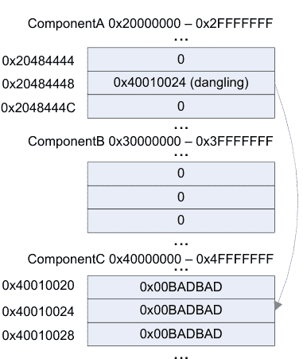

指针值 0x40010024 出于某种原因始终指向值 0x00BADBAD。尽管在正确的程序中，指针本身应该具有完全不同的值并指向 0x1 之类的值，但我们看到，解引用其当前的无效值不会导致进程崩溃。


安装新软件后，NewComponent DLL 被加载到之前由 ComponentC 占用的地址范围中：

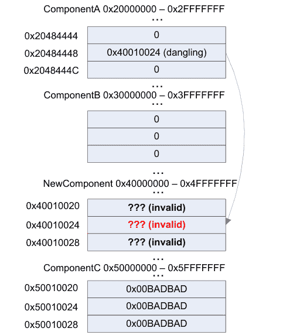

现在地址 0x40010024 碰巧完全无效，我们遇到了访问冲突并生成了崩溃转储。

## 注释

有时物理内存大小的变化也可能影响进程行为。其他示例包括在用户模式调试器下运行的应用程序，这会影响所使用的不同类型的运行时堆。

## 克隆转储

从 Windows 7 开始支持进程克隆（反射）的可能性，可以从进程克隆中获取内存快照（克隆转储，类似于 Unix 中的 fork API）。procdump[13] 工具具有 -r 开关用于此目的。我们使用 x64 Windows 7 notepad.exe 进行了验证。我们得到了两个内存转储：一个是带有以下堆栈跟踪的克隆：

```
Loading Dump File [C:\DebuggingTV\ProcDump\notepad.exe_151117_000755.dbgcfg.dmp]
User Mini Dump File with Full Memory: Only application data is available

Comment: '
*** procdump -ma -r Notepad.exe
*** Manual dump'

0:000> ~*k
.  0 Id: 25ec.147c Suspend: 1 Teb: 000007ff`fffdb000 Unfrozen
# Child-SP RetAddr Call Site
00 00000000`02c8df38 00000000`7733aae7 ntdll!NtSuspendThread+0xa
01 00000000`02c8df40 00000000`771654a4 ntdll!RtlpProcessReflectionStartup+0x2e7
02 00000000`02c8fe30 00000000`7729b831 kernel32!BaseThreadInitThunk+0xd
03 00000000`02c8fe60 00000000`00000000 ntdll!RtlUserThreadStart+0x1d
```

进程内存包含原始进程的所有地址空间，包括模块列表和堆结构：

| 起始地址 | 结束地址 | 模块 | DLL |
|---|---|---|---|
| 00000000`77050000 | 00000000`7714a000 | user32 | user32.dll |
| 00000000`77150000 | 00000000`77270000 | kernel32 | kernel32.dll |
| 00000000`77270000 | 00000000`77419000 | ntdll | ntdll.dll |
| 00000000`ff030000 | 00000000`ff050000 | notepad | notepad.exe |
| 000007fe`f57d0000 | 000007fe`f5841000 | winspool | winspool.drv |
| 000007fe`fb730000 | 000007fe`fb786000 | uxtheme | uxtheme.dll |
| 000007fe`fb910000 | 000007fe`fbb04000 | comctl32 | comctl32.dll |
| 000007fe`fbfb0000 | 000007fe`fbfc0000 | version | version.dll |
| 000007fe`fcbe0000 | 000007fe`fcbff000 | CRYPTBASE | CRYPTBASE.dll |
| 000007fe`fd310000 | 000007fe`fd37c000 | KERNELBASE | KERNELBASE.dll |
| 000007fe`fd3d0000 | 000007fe`fd499000 | usp10 | usp10.dll |
| 000007fe`fd4a0000 | 000007fe`fd511000 | shlwapi | shlwapi.dll |
| 000007fe`fd520000 | 000007fe`fd64d000 | rpcrt4 | rpcrt4.dll |
| 000007fe`fd650000 | 000007fe`fd66f000 | sechost | sechost.dll |
| 000007fe`fd800000 | 000007fe`fd8ae000 | imm32 | imm32.dll |
| 000007fe`fdb60000 | 000007fe`fd78b000 | advapi32 | advapi32.dll |
| 000007fe`fd810000 | 000007fe`fd87000 | comdlg32 | comdlg32.dll |
| 000007fe`fdd60000 | 000007fe`fddff000 | msvcrt | msvcrt.dll |
| 000007fe`fde00000 | 000007fe`fed90000 | shell32 | shell32.dll |
| 000007fe`fed70000 | 000007fe`fedd7000 | gdi32 | gdi32.dll |
| 000007fe`ff0b0000 | 000007fe`ff1b9000 | msctf | msctf.dll |
| 000007fe`ff1f0000 | 000007fe`ff1ce000 | lpk | lpk.dll |
| 000007fe`ff1d0000 | 000007fe`ff2a7000 | oleaut32 | oleaut32.dll |
| 000007fe`ff2b0000 | 000007fe`ff349000 | clbcatq | clbcatq.dll |
| 000007fe`ff350000 | 000007fe`ff553000 | ole32 | ole32.dll |

0:000> !address -summary

- 映射文件节区域...
- 映射模块区域...
- 映射 PEB 区域...
- 映射 TEB 和堆栈区域...
- 映射堆区域...
- 映射页面堆区域...
- 映射其他区域...
- 映射堆栈跟踪数据库区域...
- 映射激活上下文区域...

| 类别 | 区域计数 | 总大小 | %ofBusy | %ofTotal |
|---|---|---|---|---|
| Free | 48 | 7ff`faa06000 ( 8.000 TB) | | 100.00% |
| Image | 129 | 0`01e79000 ( 30.473 MB) | 35.47% | 0.00% |
| <unknown> | 21 | 0`01d10000 ( 29.063 MB) | 33.83% | 0.00% |
| Other | 9 | 0`016be000 ( 22.742 MB) | 26.47% | 0.00% |
| Heap | 26 | 0`00320000 ( 3.125 MB) | 3.64% | 0.00% |
| Stack | 3 | 0`00080000 ( 512.000 kB) | 0.58% | 0.00% |
| TEB | 1 | 0`00002000 ( 8.000 kB) | 0.01% | 0.00% |
| PEB | 1 | 0`00001000 ( 4.000 kB) | 0.00% | 0.00% |

| 类别 | 区域计数 | 总大小 | %ofBusy | %ofTotal |
|---|---|---|---|---|
| MEM_IMAGE | 130 | 0`01e7a000 ( 30.477 MB) | 35.47% | 0.00% |
| MEM_PRIVATE | 47 | 0`01449000 ( 20.285 MB) | 23.61% | 0.00% |
| MEM_MAPPED | 11 | 0`00c97000 ( 12.590 MB) | 14.65% | 0.00% |

| 类别 | 区域计数 | 总大小 | %ofBusy | %ofTotal |
|---|---|---|---|---|
| MEM_FREE | 50 | 7ff`fc096000 ( 8.000 TB) | | 100.00% |
| MEM_COMMIT | 176 | 0`02c10000 ( 44.063 MB) | 51.29% | 0.00% |
| MEM_RESERVE | 12 | 0`0134a000 ( 19.289 MB) | 22.45% | 0.00% |

| 类别 | 区域计数 | 总大小 | %ofBusy | %ofTotal |
|---|---|---|---|---|
| PAGE_READONLY | 83 | 0`01b46000 ( 27.273 MB) | 31.75% | 0.00% |
| PAGE_EXECUTE_READ | 25 | 0`00fd6000 ( 15.426 MB) | 17.95% | 0.00% |
| PAGE_WRITECOPY | 48 | 0`00126000 ( 1.148 MB) | 1.34% | 0.00% |
| PAGE_READWRITE | 18 | 0`00032000 ( 200.000 kB) | 0.23% | 0.00% |
| PAGE_READWRITE\|PAGE_GUARD | 2 | 0`00005000 ( 20.000 kB) | 0.02% | 0.00% |

| 类别 | 基址 | 区域大小 |
|---|---|---|
| Free | 0`ff065000 | 7fd`f676b000 ( 7.992 TB) |
| Image | 7fe`fe4cb000 | 0`0089e000 ( 8.617 MB) |
| <unknown> | 0`7f0e0000 | 0`00f00000 ( 15.000 MB) |
| Other | 0`00610000 | 0`01590000 ( 21.563 MB) |
| Heap | 0`003b8000 | 0`000c8000 ( 800.000 kB) |
| Stack | 0`02c10000 | 0`0006c000 ( 432.000 kB) |
| TEB | 7ff`fffd000 | 0`00002000 ( 8.000 kB) |
| PEB | 7ff`fffd000 | 0`00001000 ( 4.000 kB) |

```
0:000> !heap -s
************************************************************
NT HEAP STATS BELOW
************************************************************
LFH Key                 : 0x000000381021167d
Termination on corruption : ENABLED
  Heap     Flags   Reserv  Commit  Virt   Free  List   UCR  Virt  Lock  Fast
                    (k)     (k)    (k)     length   blocks cont. heap
-----------------------------------------------------------------------
0000000000280000 00000002   1024   412   1024    14     4    1    0    0  LFH
0000000000250000 00001002   1088   256   1088     5     2    2    0    0  LFH
00000000001c0000 00001002    64     8    64      3     1    1    0    0
0000000001e60000 00001002   512   120   512     49     3    1    0    0
0000000001dc0000 00001002   512     8   512      2     1    1    0    0
-----------------------------------------------------------------------
```

另一个保存的转储是一个小型转储，我们可以从中获取 **执行残留**（第 371 页，原始堆栈数据）的线程信息，并在 **克隆转储** 中重建堆栈跟踪：

```
Loading Dump File [C:\\DebuggingTV\\ProcDump\\notepad.exe_151117_000755.dmp]
Comment: '
*** procdump -ma -r Notepad.exe
*** Manual dump'
User Mini Dump File: Only registers, stack and portions of memory are available

0:000> ~
.  0 Id: 87c.27f4 Suspend: 0 Teb: 000007ff`fffd0000 Unfrozen

0:000> k
# Child-SP RetAddr Call Site
00 00000000`0016fac8 00000000`77069e9e 0x77069e6a
01 00000000`0016fad0 00000000`00000000 0x77069e9e

0:000> r
rax=0000000000000000 rbx=000000000016fb40 rcx=0000000000280000
rdx=0000000000000000 rsi=0000000000000001 rdi=0000000000000000
rip=0000000077069e6a rsp=000000000016fac8 rbp=0000000000ff3000
 r8=00000000016fe886 r9=000000000000acdc r10=0000000000000000
r11=0000000000000000 r12=0000000000000000 r13=0000000000000000
r14=0000000000000000 r15=0000000000000000
iopl=0 nv up ei pl zr na po nc
cs=0033 ss=002b ds=002b es=002b fs=0053 gs=002b efl=00000246
00000000`77069e6a c3      ret
```

现在我们可以在 **克隆转储** 中看到原始堆栈跟踪：

```
0:000> k =00000000`016fac8 ff
# Child-SP RetAddr Call Site
00 00000000`0016fac8 00000000`77069e9e ntdll!NtSuspendThread+0xa
01 00000000`0016fad0 00000000`ff031064 user32!GetMessageW+0x34
02 00000000`0016fb00 00000000`ff03133c notepad!WinMain+0x182
03 00000000`0016fb80 00000000`77165a4d notepad!DisplayNonGenuineDlgWorker+0x2da
04 00000000`0016fc40 00000000`7729b831 kernel32!BaseThreadInitThunk+0xd
05 00000000`0016fc70 00000000`00000000 ntdll!RtlUserThreadStart+0x1d
```

由于我们从小型转储中知道了 TEB 地址，可以在克隆转储中获取堆栈区域边界：

```
0:000> dt _NT_TIB 000007fffffd000
ntdll!_NT_TIB
+0x000 ExceptionList : (null)
+0x008 StackBase : 0x00000000`00170000 Void
+0x010 StackLimit : 0x00000000`0015b000 Void
+0x018 SubSystemTib : (null)
+0x020 FiberData : 0x00000000`00001e00 Void
+0x020 Version : 0x1e00
+0x028 ArbitraryUserPointer : (null)
+0x030 Self : 0x000007ff`ffffd000 _NT_TIB
```

现在我们可以检查执行残留（例如，查找隐藏异常的迹象，第 457 页）：

```
0:000> dpS 0x00000000`0015b000 0x00000000`00170000
[...]
```


## 云环境

此模式特定于云平台。它涵盖开发（模拟器，如果存在）和真实（暂存和部署）环境，最好通过查看特定基础设施模块来诊断：

```
0:016> lm m Wa*
start end module name
00000000`00b00000 00000000`00b0c000 WaWorkerHost
00000000`74fb0000 00000000`74fbd000 WaRuntimeProxy
```

```
0:016> lm m *Azure*
start end module name
00000000`57cd0000 00000000`57d26000 Microsoft_WindowsAzure_StorageClient
00000000`58820000 00000000`5886c000 Microsoft_WindowsAzure_Diagnostics
00000000`5c750000 00000000`5c764000 Microsoft_WindowsAzure_ServiceRuntime
```

开发平台可以通过查看系统模块（例如 `ntdll`）的版本来区分：

```
0:016> lmv m ntdll
start end module name
00000000`76de0000 00000000`76f5f000 ntdll
Loaded symbol image file: ntdll.dll
Image path: D:\Windows\System32\ntdll.dll
Image name: ntdll.dll
Timestamp: Fri May 13 21:45:21 2011 (4DCD9861)
CheckSum: 00188814
ImageSize: 0017F000
File version: 6.0.6002.18446
Product version: 6.0.6002.18446
File flags: 0 (Mask 3F)
File OS: 40004 NT Win32
File type: 2.0 Dll
File date: 00000000.00000000
Translations: 0409.04b0
CompanyName: Microsoft Corporation
ProductName: Microsoft® Windows® Operating System
InternalName: ntdll.dll
OriginalFilename: ntdll.dll
ProductVersion: 6.0.6002.18446
FileVersion: 6.0.6002.18446 (rd_os_v1.110513-1321)
FileDescription: NT Layer DLL
LegalCopyright: © Microsoft Corporation. All rights reserved.
```

```
0:016> lmv m ntdll
    start    end        module name
00000000`775a0000 00000000`7774b000   ntdll   (deferred)
    Loaded symbol image file: ntdll.dll
    Image path: C:\Windows\System32\ntdll.dll
    Image name: ntdll.dll
    Timestamp:        Tue Jul 14 02:32:27 2009 (4A5BE02B)
    CheckSum:         001B1CB5
    ImageSize:        001AB000
    File version:     6.1.7600.16385
    Product version:  6.1.7600.16385
    File flags:       0 (Mask 3F)
    File OS:          40004 NT Win32
    File type:        2.0 Dll
    File date:        00000000.00000000
    Translations:     0409.04b0
    CompanyName:      Microsoft Corporation
    ProductName:      Microsoft® Windows® Operating System
    InternalName:     ntdll.dll
    OriginalFilename: ntdll.dll
    ProductVersion:   6.1.7600.16385
    FileVersion:      6.1.7600.16385 (win7_rtm.090713-1255)
    FileDescription:  NT Layer DLL
    LegalCopyright:   © Microsoft Corporation. All rights reserved.
```

## CLR 线程

在默认情况下看不到**托管代码异常**（第 617 页）或**托管堆栈跟踪**（第 624 页）时，我们需要识别 **CLR 线程**，以便尝试各种 SOS 命令并开始深入托管领域。这些线程很容易通过其堆栈跟踪上的 *mscorwks* 模块来区分（不要忘记列出完整的堆栈跟踪¹⁴）：

```
0:000> ~*kl 100

 .  0  Id: 658.4ec Suspend: 1 Teb: 7ffdf000 Unfrozen
ChildEBP RetAddr
0007fc98 78c27d19 ntdll!KiFastSystemCallRet
0007fc9c 776e202c ntdll!NtWaitForMultipleObjects+0xc
0007fd44 7739bbd1 kernel32!WaitForMultipleObjectsEx+0x11a
0007fda0 6c296601 user32!RealMsgWaitForMultipleObjectsEx+0x141
0007fd0c 6c29684d duser!CoreSC::Wait+0x3a
0007fdf4 6c29693d duser!CoreSC::xwProcessNL+0xab
0007fe14 773b0c02 duser!MphProcessMessage+0x2e
0007fe5c 7c828556 user32!_ClientGetMessageMP+0x30
0007fe84 7739c811 ntdll!KiUserCallbackDispatcher+0x2e
0007fea4 7f072fd6 user32!NtUserGetMessage+0xc
0007fec0 010080ef mfc42u!CWinThread::PumpMessage+0x16
0007fef0 7f072dda mmclCAMApp::PumpMessage+0x37
0007fff08 7f044d5b mfc42u!CWinThread::Run+0x4a
0007fffc1 01034e19 mfc42u!AfxWinMain+0x7b
0007fffc0 776e2f3b mmcl!WinMainCRTStartup+0x19d
0007ffff 00000000 kernel32!BaseProcessStart+0x23

  1  Id: 658.82c Suspend: 1 Teb: 7ffde000 Unfrozen
ChildEBP RetAddr
003afea0 7c827d19 ntdll!KiFastSystemCallRet
003afea4 7c80e5bb ntdll!NtWaitForMultipleObjects+0xc
003aff48 7c80e4a2 ntdll!EtwWaitForMultipleObjectsEx+0xf7
003affb8 776e482f ntdll!EtwEventPump+0x27f
003affec 00000000 kernel32!BaseThreadStart+0x34

  2  Id: 658.648 Suspend: 1 Teb: 7ffdd000 Unfrozen
ChildEBP RetAddr
00f3fe18 7c827859 ntdll!KiFastSystemCallRet
00f3fe1c 77c885ac ntdll!NtReplyWaitReceivePortEx+0xc
00f3ff84 77c88792 rpcrt4!LRPC_ADDRESS::ReceiveLotsaCalls+0x198
00f3ff8c 77c8872d rpcrt4!RecvLotsaCallsWrapper+0xd
00f3ffac 77c7b110 rpcrt4!BaseCachedThreadRoutine+0x9d
00f3fffb8 776e482f rpcrt4!ThreadStartRoutine+0x1b
00f3ffec 00000000 kernel32!BaseThreadStart+0x34

  3 Id: 658.640 Suspend: 1 Teb: 7ffdb000 Unfrozen
ChildEBP RetAddr
0156fdb4 7c827d19 ntdll!KiFastSystemCallRet
0156fdb8 77e6202c ntdll!NtWaitForMultipleObjects+0xc
0156fe60 7739bbd1 kernel32!WaitForMultipleObjectsEx+0x11a
0156febc 6c296601 user32!RealMsgWaitForMultipleObjectsEx+0x141
0156fedc 6c29684b duser!CoreSC::Wait+0x3a
0156ff10 6c28f9e6 duser!CoreSC::xxProcessNL+0xab
0156ff30 6c28bce1 duser!GetMessageExA+0x44
0156ff84 77bcb530 duser!ResourceManager::SharedThreadProc+0xb6
0156fff8 77e6482f msvcrt!_endthreadex+0xa3
0156ffec 00000000 kernel32!BaseThreadStart+0x34

  4 Id: 658.e74 Suspend: 1 Teb: 7ffda000 Unfrozen
ChildEBP RetAddr
01d1fe30 7c827d19 ntdll!KiFastSystemCallRet
01d1fe34 77e6202c ntdll!NtWaitForMultipleObjects+0xc
01d1fedc 77e62fbe kernel32!WaitForMultipleObjectsEx+0x11a
01d1fef8 79f02541 kernel32!WaitForMultipleObjects+0x18
01d1ff58 79f0249e mscorwks!DebuggerRCThread::MainLoop+0xe9
01d1ff88 79f023c5 mscorwks!DebuggerRCThread::ThreadProc+0xe5
01d1fff8 77e6482f mscorwks!DebuggerRCThread::ThreadProcStatic+0x9c
01d1ffec 00000000 kernel32!BaseThreadStart+0x34

  5 Id: 658.4d4 Suspend: 1 Teb: 7ffd8000 Unfrozen
ChildEBP RetAddr
03dffcc4 7c827d19 ntdll!KiFastSystemCallRet
03dffc8 77e6202c ntdll!NtWaitForMultipleObjects+0xc
03dffd70 77e62fbe kernel32!WaitForMultipleObjectsEx+0x11a
03dffd8c 79f92bcb kernel32!WaitForMultipleObjects+0x18
03dffdac 79f97028 mscorwks!WKS::WaitForFinalizerEvent+0x77
03dffdc0 79e9845f mscorwks!WKS::GCHeap::FinalizerThreadWorker+0x49
03dffdd4 79e983fb mscorwks!Thread::DoADCallBack+0x32a
03dffe68 79e98321 mscorwks!Thread::ShouldChangeAbortToUnload+0xe3
03dffea4 7eeef6cc mscorwks!Thread::ShouldChangeAbortToUnload+0x30a
03dffedc 79eef6dd mscorwks!ManagedThreadBase_NoADTransition+0x32
03dfff14 79f3c63c mscorwks!ManagedThreadBase::FinalizerBase+0xd
03dffff8 79f92015 mscorwks!WKS::GCHeap::FinalizerThreadStart+0xbbb
03dffffc 77e6482f mscorwks!Thread::intermediateThreadProc+0x49
03dffffc 00000000 kernel32!BaseThreadStart+0x34

  6 Id: 658.f54 Suspend: 1 Teb: 7ffd6000 Unfrozen
ChildEBP RetAddr
040afec4 7c826f69 ntdll!KiFastSystemCallRet
040afec8 77e41ed5 ntdll!NtDelayExecution+0xc
040aff30 79fd8a41 kernel32!SleepEx+0x68
040affac 79fd88ef mscorwks!ThreadpoolMgr::TimerThreadFire+0x6d
040affb8 77e6482f mscorwks!ThreadpoolMgr::TimerThreadStart+0x57
040affec 00000000 kernel32!BaseThreadStart+0x34

  7 Id: 658.988 Suspend: 1 Teb: 7ffd5000 Unfrozen
ChildEBP RetAddr
0410fc2c 7c827d29 ntdll!KiFastSystemCallRet
0410fc30 77e61d1e ntdll!ZwWaitForSingleObject+0xc
0410fca0 79e8c5f9 kernel32!WaitForSingleObjectEx+0xac
0410fce4 79e8c52f mscorwks!PEImage::LoadImage+0x1af
0410fd34 79e8c54e mscorwks!CLREvent::WaitEx+0x117
0410fdf8 79ee3f35 mscorwks!CLREvent::Wait+0x17
0410fe14 79f92015 mscorwks!AppDomain::ADUnloadThreadStart+0x308
0410ffb8 77e6482f mscorwks!Thread::intermediateThreadProc+0x49
0410ffec 00000000 kernel32!BaseThreadStart+0x34

  8 Id: 658.e0 Suspend: 1 Teb: 7ff4f000 Unfrozen
ChildEBP RetAddr
0422fcec 7c827d19 ntdll!KiFastSystemCallRet
0422fcf0 7c83c7be ntdll!NtWaitForMultipleObjects+0xc
0422fff8 77e6482f ntdll!RtlpWaitThread+0x161
0422fffec 00000000 kernel32!BaseThreadStart+0x34

  9 Id: 658.db4 Suspend: 1 Teb: 7ff4e000 Unfrozen
ChildEBP RetAddr
0447fec0 7c827d19 ntdll!KiFastSystemCallRet
0447fec4 77e6202c ntdll!NtWaitForMultipleObjects+0xc
0447fff6c 77e62fbe kernel32!WaitForMultipleObjectsEx+0x11a
0447fff88 7692f935 kernel32!WaitForMultipleObjects+0x18
0447fffb8 77e6482f userenv!NotificationThread+0x5f
0447fffec 00000000 kernel32!BaseThreadStart+0x34

  10 Id: 658.e7c Suspend: 1 Teb: 7ff4c000 Unfrozen
ChildEBP RetAddr
0550ff7c 7c8277f9 ntdll!KiFastSystemCallRet
0550ff80 71b25914 ntdll!NtRemoveIoCompletion+0xc
0550ffb8 77e6482f mswsock!SockAsyncThread+0x69
0550ffec 00000000 kernel32!BaseThreadStart+0x34
```

[...]


## 注释

Silverlight 应用程序使用 coreclr。

```
0:000> lmv m clr
start    end        module name
000007fe`eadc0000 000007fe`eb725000   clr        (pdb symbols)
    Loaded symbol image file: clr.dll
    Image path: C:\Windows\Microsoft.NET\Framework64\v4.0.30319\clr.dll
    Image name: clr.dll
    Timestamp:        Thu Mar 18 12:39:07 2010 (4BA21EEB)
    CheckSum:         00959DBD
    ImageSize:        00965000
    File version:     4.0.30319.1
    Product version:  4.0.30319.1
    File flags:       8 (Mask 3F) Private
    File OS:          4 Unknown Win32
    File type:        2.0 Dll
    File date:        00000000.00000000
    Translations:     0409.04b0
    CompanyName:      Microsoft Corporation
    ProductName:      Microsoft® .NET Framework
    InternalName:     clr.dll
    OriginalFilename: clr.dll
    ProductVersion:   4.0.30319.1
    FileVersion:      4.0.30319.1 (RTMRel.030319-0100)
    PrivateBuild:     DBBLD431
    FileDescription:  Microsoft .NET Runtime Common Language Runtime - WorkStation
    LegalCopyright:   © Microsoft Corporation. All rights reserved.
    Comments:         Flavor=Retail
```

```
0:000> ~16kc
Call Site
ntdll!NtWaitForSingleObject
KERNELBASE!WaitForSingleObjectEx
clr!CLREvent::WaitEx
clr!CLREvent::WaitEx
clr!CLREvent::WaitEx
clr!Thread::WaitSuspendEventsHelper
clr!Thread::WaitSuspendEvents
clr! ?? ::FNODOBFM::`string'
clr!Thread::RareDisablePreemptiveGC
clr!GCHeap::Base\(1,0,0,1::`::EnterInternal
clr!AddThreadCallBackEx
clr!ThreadpoolMgr::AsyncTimerCallbackCompletion
clr!UnmanagedPerAppDomainTPCount::DispatchWorkItem
clr!ThreadpoolMgr::NewWorkerThreadStart
clr!ThreadpoolMgr::WorkerThreadStart
clr!Thread::intermediateThreadProc
kernel32!BaseThreadInitThunk
ntdll!RtlUserThreadStart
```

## 巧合错误代码

整个地址空间中搜索错误和状态代码可能会显示 **巧合错误代码**：

```
0:000> !heap -x -v c0000005
Search VM for address range c0000005 - c0000005 : 028690b8 (c0000005), [...]

0:000> dd 028690b8 l1
028690b8 c0000005
```

在这种情况下，我们需要检查这些地址是否属于堆栈等易失性区域，因为这些值可能作为合法代码和图像数据存在：

```
0:000> !address 028690b8

Usage:                   Image
Allocation Base:         02700000
Base Address:            02869000
End Address:             02874000
Region Size:             0000b000
Type:                    01000000 MEM_IMAGE
State:                   00001000 MEM_COMMIT
Protect:                 00000002 PAGE_READONLY
More info: lmv m ModuleA
More info: !lmi ModuleA
More info: ln 0x28690b8

0:000> u 028690b8
ModuleA!ComputeB:
028690b8 050000c000  add eax,0C00000h
[...]
```

## 另一个示例 (x64):

```
0:000> !heap -x -v c0000005
Search VM for address range 00000000c0000005 - 00000000c0000005 : 7feff63ab60 (c0000005),

0:000> !address 7feff63ab60
Usage:                  Image
Allocation Base:        000007fe`ff460000
Base Address:           000007fe`ff635000
End Address:            000007fe`ff63c000
Region Size:            00000000`00007000
Type:                   01000000 MEM_IMAGE
State:                  00001000 MEM_COMMIT
Protect:                00000004 PAGE_READWRITE
More info: lmv m ole32
More info: !lmi ole32
More info: ln 0x7feff63ab60

0:000> dp 7feff63ab60
000007fe`ff63ab60 00000000`c0000005 00000194`00000001
000007fe`ff63ab70 00000001`00000000 00000000`c0000aaa
000007fe`ff63ab80 80000002`00000001 00000001`00000000
000007fe`ff63ab90 00000000`c0000096 00000001`00000001
000007fe`ff63aba0 00000001`00000000 00000000`80000003
000007fe`ff63abb0 c00000fd`00000001 00000001`00000000
000007fe`ff63abc0 00000000`c0000235 00000006`00000001
000007fe`ff63abd0 00000001`00000000 00000000`c0004420
```

在后一种情况下，数据结构表明是一个错误表：

```
0:000> ln 7feff63ab60
(000007fe`ff63ab60) ole32!gReportedExceptions
```

## 巧合帧

对于某些堆栈跟踪，我们应始终注意原始堆栈数据中类似 **巧合符号信息** 模式（第 137 页）的巧合帧。此类帧可能导致错误的分析结论。请参考内核内存转储中的以下堆栈跟踪片段：

```
0: kd> kL 100
ChildEBP RetAddr
9c5b6550 8082d9a4 nt!KeBugCheckEx+0x1b
9c5b6914 8088befa nt!KiDispatchException+0x3a2
9c5b697c 8088beae nt!CommonDispatchException+0x4a
9c5b699c 80a6056d nt!KiExceptionExit+0x186
9c5b69a0 80893ae2 hal!KeReleaseQueuedSpinLock+0x2d
9c5b6a08 b20c3de5 nt!MiFreePoolPages+0x7dc
WARNING: Stack unwind information not available. Following frames may be wrong.
9c5b6a48 b20c4107 DriverA+0x17de5
[...]
```

具有 MiFreePoolPages 符号的帧可能暗示某种池损坏。我们甚至可以双重检查返回地址，并看到合乎常理的汇编语言代码：

```
0: kd> ub 8088beae
nt!KiExceptionExit+0x167:
8088be8f 33c9 xor ecx,ecx
8088be91 e1a0000000 call nt!CommonDispatchException (8088beb0)
8088be96 33d2 xor edx,edx
8088be98 b901000000 mov ecx,1
8088be9d 8e00000000 call nt!CommonDispatchException (8088beb0)
8088bea2 33d2 xor edx,edx
8088bea4 b902000000 mov ecx,2
8088bea9 e802000000 call nt!CommonDispatchException (8088beb0)
```

```
0: kd> ub 80a6056d
hal!KeReleaseQueuedSpinLock+0x1b:
80a6055b 7511 jne hal!KeReleaseQueuedSpinLock+0x2e (80a6056e)
80a6055d 50 push eax
80a6055e f00fbb119 lock cmpxchg dword ptr [ecx],ebx
80a60562 58 pop eax
80a60563 7512 jne hal!KeReleaseQueuedSpinLock+0x37 (80a60577)
80a60565 5b pop ebx
80a60566 8aca mov cl,dl
80a60568 e8871e0000 call hal!KfLowerIrql (80a623f4)
```

```
0: kd> ub 80893ae2
nt!MiFreePoolPages+0x7c3:
80893ac9 761c jbe nt!MiFreePoolPages+0x7e1 (80893ae7)
80893acb ff75f8 push dword ptr [ebp-8]
80893ace ff7508 push dword ptr [ebp+8]
80893ad1 e87e1fcfff call nt!MiFreeNonPagedPool (8085dc54)
80893ad6 8a55ff mov dl,byte ptr [ebp-1]
80893ad9 6a0f push 0Fh
80893adb 59              pop     ecx
80893adc ff1524118080    call    dword ptr [nt!_imp_KeReleaseQueuedSpinLock (80801124)]
```

```
0: kd> ub b20c3de5
DriverA+0x17dcf:
b20c3dcf 51              push    ecx
b20c3dd0 ff5010          call    dword ptr [eax+10h]
b20c3dd3 eb10           jmp     DriverA+0x17de5 (b20c3de5)
b20c3dd5 8b5508          mov     edx,dword ptr [ebp+8]
b20c3dd8 52              push    edx
b20c3dd9 8d86a0000000    lea     eax,[esi+0A0h]
b20c3ddf 50              push    eax
b20c3de0 e8ebf1ffff     call    DriverA+0x16fd0 (b20c2fd0)
```

但是，如果我们尝试手动重建堆栈跟踪17，我们会自然跳过这三个帧（显示为带下划线的粗体）：

```
9c5b6550 8082d9a4 nt!KeBugCheckEx+0x1b
9c5b6914 8088befa nt!KiDispatchException+0x3a2
9c5b697c 8088beae nt!CommonDispatchException+0x4a
9c5b699c 80a6056d nt!KiExceptionExit+0x186
9c5b69a0 80893ae2 hal!KeReleaseQueuedSpinLock+0x2d
9c5b6a08 b20c3de5 nt!MiFreePoolPages+0x7dc
9c5b6a48 b20c4107 DriverA+0x17de5
[...]
```

```
0: kd> !thread
THREAD 8f277020 Cid 081c.7298 Teb: 7ff11000 Win32Thread: 00000000 RUNNING on processor 0
IRP List:
8e234b60: (0006,0094) Flags: 00000000 Mdl: 00000000

Not impersonating
DeviceMap            e1002880
Owning Process       8fc78b80       Image:         ProcessA.exe
Attached Process     N/A            Image:         N/A
Wait Start TickCount 49846879       Ticks: 0
Context Switch Count 10
UserTime             00:00:00.000
KernelTime           00:00:00.000
Win32 Start Address DllBaseThreadAddr (0x7654dc90)
Start Address kernel32!BaseThreadStartThunk (0x77e617dc)
Stack Init 9c5b7000 Current 9c5b6c50 Base 9c5b7000 Limit 9c5b4000 Call 0
Priority 10 BasePriority 10 PriorityDecrement 0
ChildEBP RetAddr  Args to Child
[...]
```

```
0: kd> dds 9c5b4000 9c5b7000
9c5b4000 00000000
9c5b4004 00000000
9c5b4008 00000000
[...]
9c5b6290  ffdff13c
9c5b6294  9c5b6550
9c5b6298  80827e01 nt!KeBugCheckEx+0x1b
9c5b629c  00000008
9c5b62a0  00000286
[...]
9c5b654c  00000000
9c5b6550  9c5b6914
9c5b6554  8082d9a4 nt!KiDispatchException+0x3a2
9c5b6558  0000008e
9c5b655c  c0000005
[...]
9c5b6910  ffffffff
9c5b6914  9c5b6984
9c5b6918  8088befa nt!CommonDispatchException+0x4a
9c5b691c  9c5b6930
9c5b6920  00000000
[...]
9c5b6980  8088beae nt!KiExceptionExit+0x186
9c5b6984  9c5b6a08
9c5b6988  b20c3032 DriverA+0x17032
9c5b698c  badb0d00
9c5b6990  00000006
9c5b6994  8dc11cec
9c5b6998  808b6900 nt!KiTimerTableLock+0x3c0
9c5b699c  9c5b69d4
9c5b69a0  80a6056d hal!KeReleaseQueuedSpinLock+0x2d
9c5b69a4  80893a2e nt!MiFreePoolPages+0x7dc
9c5b69a8  808b0b40 nt!NonPagedPoolDescriptor
9c5b69ac  03151fd0
9c5b69b0  00000000
9c5b69b4  00000000
[...]
9c5b6a04  8f47123b
9c5b6a08  9c5b6a48
9c5b6a0c  b20c3de5 DriverA+0x17de5
9c5b6a10  8e3640a0
9c5b6a14  8f4710d0
[...]
9c5b6a44  00000000
9c5b6a48  9c5b6a80
9c5b6a4c  b20c4107 DriverA+0x18107
9c5b6a50  8f4710d0
9c5b6a54  9c5b6a6c
[...]
```


如果我们尝试查找异常记录的指针，就会得到这个崩溃地址：

```
0: kd> .exr 9c5b6930
ExceptionAddress: b20c3032 (DriverA+0x00017032)
  ExceptionCode: c0000005 (Access violation)
ExceptionFlags: 00000000
NumberParameters: 2
  Parameter[0]: 00000000
  Parameter[1]: 00000157
Attempt to read from address 00000157
```

如果对其进行反汇编，我们会看到用于字符串或内存复制的内联函数优化模式（第514页），也许是wcscpy函数：

```
0: kd> u b20c3032
DriverA+0x17032:
b20c3032 f3a5            rep movs dword ptr es:[edi],dword ptr [esi]
b20c3034 8ecb            mov     ecx,ebx
b20c3036 83e103          and     ecx,3
b20c3039 f3a4            rep movs byte ptr es:[edi],byte ptr [esi]
b20c303b 8b750c          mov     esi,dword ptr [ebp+0Ch]
b20c303e 0fb7ca          movzx   ecx,dx
b20c3041 89e414          mov     dword ptr [esi+14h],ecx
b20c3044 8b700c          mov     esi,dword ptr [eax+0Ch]
```

所以问题发生在DriverA代码中，而不是在MiFreePoolPages或KeReleaseQueuedSpinLock函数中。

## 注释

这种情况通常发生在存在某些“边界”的时候，例如在异常堆栈跟踪模式（第363页）中。

## 巧合符号信息

### Linux

这是之前为Mac OS X（第135页）和Windows（第137页）平台描述过的**巧合符号信息**模式的Linux变体。其思想相同：反汇编该地址，以查看前一条指令是否为调用。如果确实如此，那么该符号地址很可能是过去**执行残留**（第365页）的返回地址：

```
(gdb) x/i 0x4005e6
0x4005e6 <_Z6work_3v+9>: pop   %rbp

(gdb) disassemble 0x4005e6
Dump of assembler code for function _Z6work_3v:
0x00000000004005dd <+0>:    push   %rbp
0x00000000004005de <+1>:    mov    %rsp,%rbp
0x00000000004005e1 <+4>:    callq  0x4005d2 <_Z6work_4v>
0x00000000004005e6 <+9>:    pop    %rbp
0x00000000004005e7 <+10>:   retq
End of assembler dump.

(gdb) x/4i 0x49c740-4
0x49c73c: add     %al,(%rax)
0x49c73e: add     %al,(%rax)
0x49c740 <default_attr>: add  %al,(%rax)
0x49c742 <default_attr+2>: add  %al,(%rax)
```

这是先前为Windows平台描述过的巧合符号信息模式的Mac OS X / GDB对应版本。其思想相同：反汇编该地址，以查看前一条指令是否为调用。如果确实如此，那么该符号地址很可能是过去执行残留（第365页）的返回地址：

```
(gdb) x $rsp
0x7fff5a162a38: 0x8fab9a9c

(gdb) x/100a 0x7fff6a162000
[...]
0x7fff6a162960: 0x7fff6a162980  0x7fff6a167922
0x7fff6a162970: 0x0  0x0
0x7fff6a162980: 0x7fff6a162a50  0x7fff8a31e716  <dyld_stub_binder_+13>
0x7fff6a162990: 0x1  0x7fff6a162b00
0x7fff6a1629a0: 0x7fff6a162b10  0x7fff6a162bc0
0x7fff6a1629b0: 0x8  0x0
[...]
0x7fff6a162a00: 0x0  0x0
0x7fff6a162a10: 0x0  0x0
0x7fff6a162a20: 0x0  0x0
0x7fff6a162a30: 0x7fff6a162a60  0x7fff8a31e716  <abort+177>
0x7fff6a162a40: 0x0  0x0
0x7fff6a162a50: 0x7fffffffffffd  0x0
[...]
0x7fff6a163040: 0x35000  0x0
0x7fff6a163050: 0x35000  0x500000007
0x7fff6a163060: 0x7  0x747865745f5f
0x7fff6a163070: 0x0  0x545845545f5f
0x7fff6a163080: 0x0  0x7fff5fc10000  <__dyld_stub_binding_helper>
0x7fff6a163090: 0x22c9d  0xc00001000
0x7fff6a1630a0: 0x0  0x80000400
[...]

(gdb) disass 0x7fff8a31e716
Dump of assembler code for function dyld_stub_binder_:
0x00007fff8a31e709 <dyld_stub_binder_+0>:  mov    0x8(%rbp),%rdi
0x00007fff8a31e70d <dyld_stub_binder_+4>:  mov    0x10(%rbp),%rsi
0x00007fff8a31e711 <dyld_stub_binder_+8>:  callq  0x7fff8a31e86d  <_Z21_dyld_fast_stub_entryPvl>
0x00007fff8a31e716 <dyld_stub_binder_+13>:  mov    %rax,%r11
0x00007fff8a31e719 <dyld_stub_binder_+16>:  movdqa 0x40(%rsp),%xmm0
0x00007fff8a31e71f <dyld_stub_binder_+22>:  movdqa 0x50(%rsp),%xmm1
0x00007fff8a31e725 <dyld_stub_binder_+28>:  movdqa 0x60(%rsp),%xmm2
0x00007fff8a31e72b <dyld_stub_binder_+34>:  movdqa 0x70(%rsp),%xmm3
0x00007fff8a31e731 <dyld_stub_binder_+40>:  movdqa 0x80(%rsp),%xmm4
0x00007fff8a31e73a <dyld_stub_binder_+49>:  movdqa 0x90(%rsp),%xmm5
0x00007fff8a31e743 <dyld_stub_binder_+58>:  movdqa 0xa0(%rsp),%xmm6
0x00007fff8a31e74c <dyld_stub_binder_+67>:  movdqa 0xb0(%rsp),%xmm7
0x00007fff8a31e755 <dyld_stub_binder_+76>:  mov    (%rbp),%rdi
0x00007fff8a31e759 <dyld_stub_binder_+80>:  mov    0x8(%rsp),%rsi
0x00007fff8a31e75e <dyld_stub_binder_+85>:  mov    0x10(%rsp),%rdx
0x00007fff8a31e763 <dyld_stub_binder_+90>:  mov    0x18(%rsp),%rcx
0x00007fff8a31e768 <dyld_stub_binder_+95>:  mov    0x20(%rsp),%r8
0x00007fff8a31e76d <dyld_stub_binder_+100>: mov    0x28(%rsp),%r9
0x00007fff8a31e772 <__dyld_stub_binder+105>: mov 0x30(%rsp),%rax
0x00007fff8a31e777 <__dyld_stub_binder+110>: add $0xc8,%rsp
0x00007fff8a31e77e <__dyld_stub_binder+117>: pop %rbp
0x00007fff8a31e77f <__dyld_stub_binder+118>: add $0x10,%rsp
0x00007fff8a31e783 <__dyld_stub_binder+122>: jmpq *%r11
```

```
(gdb) x/2i 0x7fff8fab9a9c
0x7fff8fab9a9c <abort+177>: mov $0x2710,%edi
0x7fff8fab9aa1 <abort+182>: callq 0x7fff8fab9c43 <usleep$nocancel>
```

```
(gdb) disass 0x7fff8fab9a9c-5 0x7fff8fab9a9c
Dump of assembler code from 0x7fff8fab9a97 to 0x7fff8fab9a9c:
0x00007fff8fab9a97 <abort+172>: callq 0x7fff8fb1f54a <dyld_stub_kill>
End of assembler dump.
```

```
(gdb) disass 0x7fff5fc01000
Dump of assembler code for function __dyld_stub_binding_helper:
0x00007fff5fc01000 <__dyld_stub_binding_helper+0>: add %al,(%rax)
0x00007fff5fc01002 <__dyld_stub_binding_helper+2>: add %al,(%rax)
0x00007fff5fc01004 <__dyld_stub_binding_helper+4>: add %al,(%rax)
0x00007fff5fc01006 <__dyld_stub_binding_helper+6>: add %al,(%rax)
End of assembler dump.
```

```
(gdb) x/10 0x7fff5fc01000-0x10
0x7fff5fc00ff0: 0x00000000 0x00000000 0x00000000 0x00000000
0x7fff5fc01000 <__dyld_stub_binding_helper>: 0x00000000 0x00000000 0x00000000 0x00000000
0x7fff5fc01010 <__dyld_offset_to_dyld_all_image_infos>: 0x00000000 0x00000000
```

## Windows

原始堆栈转储对于查找可能导致问题的可疑模块非常有用。例如，一些程序通常会安装钩子来监视GUI更改、拦截窗口消息，以在现有应用程序之上提供增值服务。这些钩子作为DLL实现。另一种用途是检查之前导致问题的打印机驱动程序的原始堆栈数据。这些模块已被加载的事实并不意味着它们被使用了。如果我们找到对其代码的引用，这意味着它们可能已被使用。

但是，在查看带有符号信息的原始堆栈转储时，我们应该意识到**巧合符号信息**模式。以下是第一个示例。加载崩溃转储并显示问题线程堆栈，显示以下引用：

```
...
...
...
00b1ed00 0063006f
00b1ed04 006d0075
00b1ed08 006e0065
00b1ed0c 00200074
00b1ed10 0066004c
00b1ed14 00640061
00b1ed18 00720065
00b1ed1c 005b0020
00b1ed20 00500055
00b1ed24 003a0044
00b1ed28 00430050 Application!Array::operator=+0x2f035
00b1ed2c 0035004c
00b1ed30 005d0063
00b1ed34 00630000
00b1ed38 0000005d
...
...
...
```

应用符号后，我们得到一个更有意义的名称：

```
...
...
...
00b1ed00 0063006f
00b1ed04 006d0075
00b1ed08 006e0065
00b1ed0c 00200074
00b1ed10 0066004c
00b1ed14 00640061
00b1ed18 00720065
00b1ed1c 005b0020
00b1ed20 00500055
00b1ed24 003a0044
00b1ed28 00430050 Application!Print::DocumentLoad+0x5f
00b1ed2c 0035004c
00b1ed30 005d0063
00b1ed34 00630000

...
...
...
```

然而，这纯属巧合。数据模式00NN00NN明显属于一个Unicode字符串：

```
0:020> du 00b1ed00
00b1ed00 "ocument Loader [UPD:PCL5c]"
```

仅仅是巧合，00430050值可以被解释为落在Application模块地址范围及其代码节内的地址：

```
0:020> lm
start             end                 module name
00400000          0044d000            Application
```

在第二个示例中，崩溃转储来自名为AppSql的第三方应用程序，我们没有其PDB文件。另外，我们知道myhook.dll安装为系统范围的钩子，过去曾出现过一些问题。它被加载到任何地址空间中，但不一定被使用。我们想看看在问题线程堆栈上是否有它的痕迹。转储堆栈内容显示我们只有一个引用：

```
...
...
...
00118cb0 37302f38
00118cb4 00000000
00118cb8 10008e00 myhook!notify_me+0x22c
00118cbc 01400000
00118cc0 00118abc
00118cc4 06a129f0
00118cc8 00118df4
00118ccc 02bc57d0
00118cd0 04ba5d74
00118cd4 00118d30
00118cd8 0000001c
00118cdc 00000010
00118ce0 075922bc
00118ce4 044732e0
00118ce8 075922bc
00118cec 04a732e0
00118cf0 0066a831 AppSql+0x26a831
00118cf4 044732d0
00118cf8 02c43190
00118cfc 00000001
00118d00 0000001c
00118d04 00118d14
00118d08 0049e180 AppSql+0x9e180
00118d0c 02c43190
00118d10 0000001c
```


```
00118d14  00118d34
...
...
...
0:020> lm
```

| 起始 | 结束 | 模块名称 |
| --- | --- | --- |
| 00400000 | 00ba8000 | AppSql |
| ... | ... | ... |
| 10000000 | 100e0000 | myhook |

地址 10008e00 看起来非常“整齐”，它可能是一组位标志，而且，如果我们反向反汇编该地址处的代码，我们看不到通常将该地址保存到堆栈上的 call 指令：

```
0:000> ub 10008e00
myhook!notify_me+0x211
10008de5 81c180000000   add     ecx,80h
10008deb 899578ffffff   mov     dword ptr [ebp-88h],edx
10008df1 89458c         mov     dword ptr [ebp-74h],eax
10008df4 894d98         mov     dword ptr [ebp-68h],ecx
10008df7 6a01           push    1
10008df9 8d45ec         lea     eax,[ebp-14h]
10008dfc 50             push    eax
10008dfd ff75e0         push    dword ptr [ebp-20h]
```

相比之下，其他两个地址是保存在堆栈上的返回地址：

```
0:000> ub 0066a831
AppSql+0x26a81e:
0066a81e 8fbf           mov     edi,ebx
0066a820 f3a5           rep movs dword ptr es:[edi],dword ptr [esi]
0066a822 8bca           mov     ecx,edx
0066a824 83e103         and     ecx,3
0066a827 f3a4           rep movs byte ptr es:[edi],byte ptr [esi]
0066a829 8b00           mov     eax,dword ptr [eax]
0066a82b 50             push    eax
0066a82c e8affeffff     call    AppSql+0x26a6e0 (0066a6e0)
```

```
0:000> ub 0049e180
AppSql+0x9e16f:
0049e16f cc             int     3
0049e170 55             push    ebp
0049e171 8bec           mov     ebp,esp
0049e173 8b4510         mov     eax,dword ptr [ebp+10h]
0049e176 8b4d0c         mov     ecx,dword ptr [ebp+0Ch]
0049e179 50             push    eax
0049e17a 51             push    ecx
0049e17b e840c61c00     call    AppSql+0x26a7c0 (0066a7c0)
```

因此，myhook!notify_me+0x22c 的出现可能只是巧合，除非它是指向函数的指针。不过，如果它是函数指针地址，那么它就不会指向压入参数的函数调用序列的中间部分：

```
0:000> ub 10008e00
myhook!notify_me+0x211
10008de5 81c180000000 add ecx,80h
10008deb 899578ffffff mov dword ptr [ebp-88h],edx
10008df1 89458c mov dword ptr [ebp-74h],eax
10008df4 894d98 mov dword ptr [ebp-68h],ecx
10008df7 6a01 push 1
10008df9 8d45ec lea eax,[ebp-14h]
10008dfc 50 push eax
10008dfd ff75e0 push dword ptr [ebp-20h]
0:000> u 10008e00
myhook!notify_me+0x22c
10008e00 e82ff1ffff call myhook!copy_data (10007f34)
10008e05 8b578fffffff mov eax,dword ptr [ebp-88h]
10008e0b 3945ac cmp dword ptr [ebp-88h],eax
10008e0e 731f jae myhook!notify_me+0x25b (10008e2f)
10008e10 8b4598 mov eax,dword ptr [ebp-68h]
10008e13 0fbff00 movsx eax,word ptr [eax]
10008e16 8945a8 mov dword ptr [ebp-58h],eax
10008e19 8b45e0 mov eax,dword ptr [ebp-20h]
```

此外，因为我们有源代码和私有符号，我们知道如果它是函数指针，那么它应该是 myhook!notify_me 地址，而不是 notify_me+0x22c 地址。

所有这些证据都支持这样的假设：myhook 在问题堆栈上的出现只是巧合，应该被忽略。

补充一点，我们在一个崩溃转储中迄今发现的最巧合的符号信息，是导出的 _DebuggerHookData 与事后调试器 NTSD 位置之间的偶然对应关系：

```
002dd434 003a0043
002dd438 0057005c
002dd43c 004e0049 LegacyApp!_DebuggerHookData+0xc4a5
002dd440 004f0044 LegacyApp!_DebuggerHookData+0x1c4a0
002dd444 00530057
002dd448 0073005c
002dd44c 00730079
002dd450 00650074
002dd454 0033006d
002dd458 005c0032
002dd45c 0074006e
002dd460 00640073
002dd464 0065002e
002dd468 00650078
0:000> du 002dd434
002dd434 "C:\WINDOWS\system32\ntsd.exe"
```

引入“变量减法”（Variable Subtract，第 1058 页）分析模式，是为了对仅涉及一个线程的内存快照间 CPU 峰值进行互相关（Inter-Correlation18）分析。相比之下，我们发现“常量减法”（Constant Subtract）模式在仅涉及一个内存快照的多线程等待链（Wait Chain，第 1082 页）分析（即内相关分析，Intra-Correlation19）中很有用。这里，常量减法将来自堆栈跟踪收集（Stack Trace Collection，第 943 页）的堆栈跟踪与分叉堆栈跟踪帧（类似于分叉点跟踪分析模式20）分组，以提供一些等待链关系提示。这些跟踪最初可能通过前面的等待链分析或技术特定的子跟踪（如 ALPC/RPC 服务器线程帧，如 COM 接口调用的示例堆栈所示，技术特定子跟踪，第 988 页）发现。下面是一个极简堆栈跟踪图（类似于加速 Windows 软件跟踪分析培训21 中介绍的极简跟踪图），用于说明该模式（它还显示了从完整内存转储中看到的用户空间中的峰值线程模式，第 888 页）：

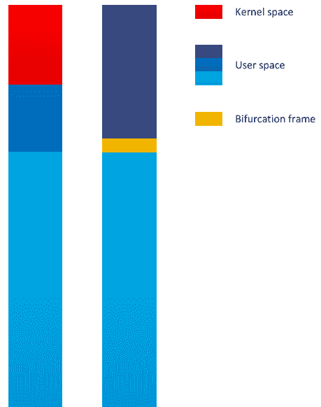

- 18 《内存转储分析文选》第 4 卷，第 350 页
- 19 同上，第 3 卷，第 347 页
- 20 同上，第 4 卷，第 343 页
- 21 http://www.patterndiagnostics.com/Training/Accelerated-Windows-Software-Trace-Analysis-Public.pdf

## 损坏的转储

这是一个相当常见的模式，通常是截断转储（Truncated Dump，第 1015 页）模式的后果。当我们打开此类崩溃转储时，通常会在 WinDbg 输出中立即注意到错误。我们可以区分两类损坏的内存转储：完全损坏和部分损坏。完全损坏较少见，由无效文件头引起，并以错误消息框的形式表现出来，显示以下 Win32 错误：

```
Loading Dump File [C:\Documents and Settings\All Users\Application Data\Microsoft\Dr
Watson\user_corrupted.dmp]
ERROR: Directory not present in dump (RVA 0x20202020)
Could not open dump file [C:\Documents and Settings\All Users\Application Data\Microsoft\Dr
Watson\user_corrupted.dmp], Win32 error 1392
"The file or directory is corrupted and unreadable."
```

部分损坏的文件可以加载，但缺少一些关键信息，例如已加载模块的列表以及所有或某些处理器的上下文。我们可以在 WinDbg 输出中看到大量类似以下的消息：

```
GetContextState failed, 0x80070026
Unable to get current machine context, Win32 error 0n38
```

```
GetContextState failed, 0x80004005
```

```
GetContextState failed, 0xD0000147
```

它们表示：

```
?: kd> !error 0x80070026
Error code: (HRESULT) 0x80070026 (2147942438) - Reached the end of the file.
?: kd> !error 0x80004005
Error code: (HRESULT) 0x80004005 (2147500037) - Unspecified error
?: kd> !error 0xD0000147
Error code: (NTSTATUS) 0xd0000147 (3489661255) - {No Paging File Specified} No paging file was specified
in the system configuration.
```

不过，在许多此类情况下，我们仍然可以看到系统信息和 bugcheck 参数：

```
********************
THIS DUMP FILE IS PARTIALLY CORRUPT.
KdDebuggerDataBlock is not present or unreadable.
********************
Unable to read PsLoadedModuleList
KdDebuggerData.KernBase < SystemRangeStart
Windows Server 2003 Kernel Version 3790 MP (4 procs) Free x86 compatible
Product: Server, suite: TerminalServer
Kernel base = 0x00000000 PsLoadedModuleList = 0x808af9c8
Debug session time: Wed Nov 21 20:29:31.373 2007 (GMT+0)
System Uptime: 0 days 0:45:02.312
Unable to read PsLoadedModuleList
KDebuggerData.KernBase < SystemRangeStart
Loading Kernel Symbols
Unable to read PsLoadedModuleList
GetContextState failed, 0x80070026
GetContextState failed, 0x80070026
CS descriptor lookup failed
GetContextState failed, 0x80070026
GetContextState failed, 0x80070026
GetContextState failed, 0x80070026
GetContextState failed, 0x80070026
Unable to get program counter
GetContextState failed, 0x80070026
Unable to get current machine context, Win32 error 0n38
GetContextState failed, 0x80070026
GetContextState failed, 0x80070026
Use !analyze -v to get detailed debugging information.
```

```
BugCheck 20, {0, ffff, 0, 1}
***** Debugger could not find nt in module list, module list might be corrupt, error 0x80070057.
GetContextState failed, 0x80070026
Unable to read selector for PCR for processor 0
GetContextState failed, 0x80070026
Unable to read selector for PCR for processor 0
GetContextState failed, 0x80070026
Unable to read selector for PCR for processor 0
GetContextState failed, 0x80070026
GetContextState failed, 0x80070026
Unable to get current machine context, Win32 error 0n38
GetContextState failed, 0x80070026
Unable to get current machine context, Win32 error 0n38
GetContextState failed, 0x80070026
```

查看 bugcheck 编号和参数，我们可以形成一些签名并在我们的崩溃数据库中检查。我们还可以请求与调试会话时间相对应的内核 minidump。

## 评论

主要观点是，如果你有一个损坏的转储，你仍然可能识别出问题。此外，系统管理员和支持工程师可以更早识别出损坏的转储并请求新的转储。


## 损坏的结构

损坏结构的典型信号包括：

- 常规数据（第 833 页），例如子结构和指针区域中的 ASCII 和 UNICODE 片段
- 期望小值的地方出现大值，反之亦然
- 期望内核空间的地方出现用户空间地址值，反之亦然
- 格式错误且部分置零的 _LIST_ENTRY 数据（有关链表导航，请参见练习 C322）
- 指针解引用或不可访问内存指示符（??）的内存读取错误
- 遍历结构时链表末尾处的内存读取错误

```
0: kd> dt _ERESOURCE fffffff0002299f830
ntdll!_ERESOURCE
+0x000 SystemResourcesList : _LIST_ENTRY [ 0xfffffc000`07b64800 - 0xfffffe000`02a79970 ]
+0x010 OwnerTable : 0xfffffe000`02a79940 _OWNER_ENTRY
+0x018 ActiveCount : 0n0
+0x01a Flag : 0
+0x01a ReservedLowFlags : 0 ''
+0x01b WaiterPriority : 0 ''
+0x020 SharedWaiters : 0x00000000`00000001 _KSEMAPHORE
+0x028 ExclusiveWaiters : 0xfffffc000`02a79a58 _KEVENT
+0x030 OwnerEntry : _OWNER_ENTRY
+0x040 ActiveEntries : 0
+0x044 ContentionCount : 0
+0x048 NumberOfSharedWaiters : 0x7b64800
+0x04c NumberOfExclusiveWaiters : 0xfffffc000
+0x050 Reserved2 : (null)
+0x058 Address : 0xfffffc000`2299f870 Void
+0x058 CreatorBackTraceIndex : 0xfffffd000`2299f870
+0x060 SpinLock : 1

0: kd> dt _ERESOURCE fffffff0002299d830
ntdll!_ERESOURCE
+0x000 SystemResourcesList : _LIST_ENTRY [ 0x000001e0`00000280 - 0x00000000`00000004 ]
+0x010 OwnerTable : 0x00000000`0000003c _OWNER_ENTRY
+0x018 ActiveCount : 0n0
+0x01a Flag : 0
+0x01a ReservedLowFlags : 0 ''
+0x01b WaiterPriority : 0 ''
+0x020 SharedWaiters : 0x00000003`c000001e0 _KSEMAPHORE
+0x028 ExclusiveWaiters : (null)
+0x030 OwnerEntry : _OWNER_ENTRY
+0x040 ActiveEntries : 0
+0x044 ContentionCount : 0x7f
+0x048 NumberOfSharedWaiters : 0x7f
+0x04c NumberOfExclusiveWaiters : 0x7f
+0x050 Reserved2 : 0x00000001`00000001 Void
+0x058 Address : 0x00000000`00000005 Void
+0x058 CreatorBackTraceIndex : 5
+0x060 SpinLock : 0
```

但是，我们需要确保为 dt WinDbg 命令提供了正确的指针。指针不正确的一个迹象是内存读取错误或全为零：

```
0: kd> dt _ERESOURCE ffffd000229af830
ntdll!_ERESOURCE
+0x000 SystemResourcesList : _LIST_ENTRY [ 0x00000000`00000000 - 0x00000000`00000000 ]
+0x010 OwnerTable : (null)
+0x018 ActiveCount : 0n0
+0x01a Flag : 0
+0x01a ReservedLowFlags : 0 ''
+0x01b WaiterPriority : 0 ''
+0x020 SharedWaiters : (null)
+0x028 ExclusiveWaiters : (null)
+0x030 OwnerEntry : _OWNER_ENTRY
+0x040 ActiveEntries : 0
+0x044 ContentionCount : 0
+0x048 NumberOfSharedWaiters : 0
+0x04c NumberOfExclusiveWaiters : 0
+0x050 Reserved2 : (null)
+0x058 Address : (null)
+0x058 CreatorBackTraceIndex : 0
+0x060 SpinLock : 0

0: kd> dt _ERESOURCE ffffd000022faf830
ntdll!_ERESOURCE
+0x000 SystemResourcesList : _LIST_ENTRY
+0x010 OwnerTable : ???
+0x018 ActiveCount : ??
+0x01a Flag : ??
+0x01a ReservedLowFlags : ??
+0x01b WaiterPriority : ??
+0x020 SharedWaiters : ???
+0x028 ExclusiveWaiters : ???
+0x030 OwnerEntry : _OWNER_ENTRY
+0x040 ActiveEntries : ??
+0x044 ContentionCount : ??
+0x048 NumberOfSharedWaiters : ??
+0x04c NumberOfExclusiveWaiters : ??
+0x050 Reserved2 : ???
+0x058 Address : ???
+0x058 CreatorBackTraceIndex : ??
+0x060 SpinLock : ??
Memory read error ffffd000022faf890
```

有时，我们会有线程等待来自另一台计算机的响应（例如，通过 RPC）。大部分时间，耦合进程模式（第 149 页）涵盖了这种情况，如果我们假设该模式中的进程不局限于同一台计算机。然而，有时我们会有线程通过其数据提供对另一台计算机的依赖提示，并且这可能还涉及来自不同进程的其他线程来完成任务。在这里，我们需要另一个我们称之为耦合计算机的模式。例如，计算机 SERVER_A 上的以下线程正尝试设置位于计算机 SERVER_B 上的当前工作目录：

```
kd> kv 100
ChildEBP RetAddr  Args to Child
b881c8d4 804e1bf2 89cd9c80 89cd9c10 804e1c3e nt!KiSwapContext+0x2f
b881c8e0 804e1c3e 00000000 89e35b08 89e35b34 nt!KiSwapThread+0x8a
b881c908 783092e 00000000 00000006 00000000 nt!KeWaitForSingleObject+0x1c2
b881c930 f7830a3b 89e35b08 00000000 f7835d68 Mup!PktPostSystemWork+0x3d
b881c94c f7836712 b881c9b0 b881c9b0 b881c9b8 Mup!PktGetReferral+0xcce
b881c980 f783644f b881c9b0 b881c9b8 00000000 Mup!PktCreateDomainEntry+0x224
b881c9d0 f7836018 0000000b 00000000 b881c9f0 Mup!DfsFsctrl+ThisIsADFsPath+0x2bb
b881ca14 f7835829 89a2e130 899ba350 b881caac Mup!CreateRedirectedFile+0x2cd
b881ca70 804e13eb 89f46ee8 89a2e130 89a2e130 Mup!MupCreate+0x1cb
b881ca80 805794b6 89f46ed0 89df3ca4 b881cc18 nt!IopCallDriver+0x31
b881cb60 8056d03b 89f46ee8 00000000 89df3ba0 nt!IopParseDevice+0x412
b881cbd8 805701e7 00000000 b881cc18 00000042 nt!IopLookupObjectName+0x53c
b881cc2c 80579b12 00000000 00000000 00003801 nt!IopOpenObjectByName+0xea
b881cca8 80579be1 00cff67c 00100020 00cff620 nt!IopCreateFile+0x407
b881ccd4 80579d18 00cff67c 00100020 00cff620 nt!IoCreateFile+0x8e
b881cd44 804dd99f 00cff67c 00100020 00cff620 nt!NtOpenFile+0x27
b881cd44 7c90e514 00cff67c 00100020 00cff620 nt!KiFastCallEntry+0xfc
00cff5f0 7c90d5aa 7c91e8dd 00cff67c 00100020 ntdll!KiFastSystemCallRet
00cff5f4 7c91e8dd 00cff67c 00100020 ntdll!ZwOpenFile+0xc
00cff69c 7c81e58 00cff6a8 00460044 0078894a ntdll!RtlSetCurrentDirectory_U+0x169
00cff6b0 7731898e 0078894a 00000000 00000001 kernel32!SetCurrentDirectory+0x2b
00cffb84 7730ffbb 00788450 00788b38 00cffbe0 schedsvc!CScedWorker::RunNTJob+0x221
00cffe34 7730c03a 01ea9108 8ed032d4 00787df8 schedsvc!CScedWorker::RunJobs+0x304
00cffe74 77310e4d 7c80a749 00000000 00000000 schedsvc!CScedWorker::RunNextJobs+0x129
00cfff28 77310e4c 7730b592 00000000 000ba4bc schedsvc!CScedWorker::MainServiceLoop+0x6d9
00cfff2c 7730b592 00000000 000ba4bc 0009a2bc schedsvc!SchedMain+0xb
00cfff5c 7730b69f 00000001 000ba4b8 00cfffa0 schedsvc!SchedStart+0x266
00cfff6c 010011cc 00000001 000ba4b8 00000000 schedsvc!SchedServiceMain+0x33
00cfff70 77df354b 00000001 000ba4b8 007e898 svchost!ServiceStarter+0x9e
00cfffb4 7c80b729 000ba4b0 00000000 007e898 ADVAPI32!ScSvcctrlThread+0x12
00cfffec 00000000 77df3539 000ba4b0 00000000 kernel32!BaseThreadStart+0x37

kd> du /c 90 0078894a
0078894a "\\SERVER_B\\Share_X$\\Folder_Q"
```

## 耦合模块

我们经常会识别出指向特定模块（例如驱动程序或 DLL）的模式，其他模块可以从中使用功能服务，因此后者模块可能涉及异常软件行为。例如，内核分页池中检测到的 **内存不足**（第 535 页）指向拥有池标记 DRV 的驱动程序：

1: kd> !pooled 4
Sorting by Paged Pool Consumed

| 标记 | 分配 | 释放 | 差异 | 已用 |
|---|---|---|---|---|
| DRV | 1466496 | 1422361 | 44135 | 188917256 未知池标记 'DRV '，请更新 pooltag.txt |
| File | 6334830 | 6284036 | 50794 | 6735720 文件对象 |
| Thre | 53721 | 45152 | 8569 | 4346432 线程对象，二进制: nt!ps |

[...]

该模块已知是其他驱动程序的 **控制模块**（第 235 页，从堆栈跟踪角度），但我们也知道其他（受控）模块使用其需要内存分配的服务。

## 耦合进程

### 语义

除了 **强**（第 149 页）和 **弱**（第 151 页）进程耦合模式之外，我们还有另一种我们称之为 **语义** 耦合的变体。

某些进程（不一定来自同一供应商）合作以提供某些功能。

这种合作可能不涉及可跟踪且可见的进程间通信，例如 (A)LPC/RPC 或管道，但涉及事件、共享内存以及在查看内存转储时不明显的其他可能机制。

在许多情况下，在发现语义组中一个或多个进程存在问题后，我们还会查看该组中的其余进程，以了解那里是否也存在一些异常。

我经常遇到的一个示例可以概括如下：我们有一个 ALPC 等待链 *ProcessA -> ProcessB <> ProcessC*（不一定是 **死锁**，第 197 页），但关键功能也在 *ProcessD* 中实现。

有时 *ProcessD* 是健康的，问题存在于 *ProcessC* 或 *ProcessB* 中，而有时，当我们查看 *ProcessD* 时，我们会在那里发现早期问题模式的证据，因此建议的焦点转移到 *ProcessD* 的一个模块上。


有时我们会遇到某个功能不可用，或在请求它时无响应的问题。此时我们可以推断，实现该功能的进程已崩溃或挂起。如果我们知道进程之间的关系，可以一次请求多个用户转储或完整内存转储，通过查看堆栈跟踪来分析进程间的依赖关系。这是我们称之为 **耦合进程** 的系统级崩溃转储分析模式的一个示例。

进程关系可以通过不同的进程间通信机制（IPC）实现，例如，通过 LPC（本地过程调用）的远程过程调用（RPC），这在 **堆栈跟踪**（第 926 页）中可以轻松识别。

我们最喜欢的示例是当某个应用程序尝试打印并挂起时。打印 API 从 *WINSPOOL.DLL* 导出，并通过 RPC 将大部分请求转发到 Windows 打印后台处理程序服务。因此，采集两个转储是合理的，一个来自该应用程序，另一个来自 *spoolsv.exe*。类似的示例来自 Citrix 终端服务环境，与打印机自动创建相关，当 Citrix 打印服务 *CpSvc.exe* 和 *spoolsv.exe* 之间存在依赖关系时。因此，如果新用户连接挂起且重启两个打印服务可解决问题，那么我们可能需要一起分析两个服务的内存转储，以确认这个 **过程调用链**23 并找出有问题的第三方打印组件或驱动程序。

回到我们最喜欢的示例。在挂起的应用程序中，我们有以下线程：

```
18 Id: 2130.6320 Suspend: 1 Teb: 7ffa8000 Unfrozen
ChildEBP RetAddr
01eae170 7c821c94 ntdll!KiFastSystemCallRet
01eae174 77c27700 ntdll!NtRequestWaitReplyPort+0xc
01eae1c8 77c713ba rpcrt4!LRPC_CCALL::SendReceive+0x230
01eae1d4 77c72c7f rpcrt4!I_RpcSendReceive+0x24
01eae1e8 77ce219b rpcrt4!NdrSendReceive+0x2b
01eae5d0 7307c9ef rpcrt4!NdrClientCall2+0x22e
01eae5e8 73082d8d winspool!RpcAddPrinter+0x1c
01eaea70 0040d81a winspool!AddPrinterW+0x102
01eaef58 0040ee7c App!AddNewPrinter+0x816
...
```

注意 *winspool* 和 *rpcrt4* 模块。应用程序正在使用 RPC 调用后台处理程序服务来添加新打印机，并等待回复。查看后台处理程序服务转储显示有多个线程正在显示消息框并等待用户输入：

23 这是我们未来可能添加的一个模式

```
20 Id: 790.5950 Suspend: 1 Teb: 7ffa2000 Unfrozen
ChildEBP RetAddr Args to Child
03deea70 7739d0d2 77392bf3 00000000 00000000 ntdll!KiFastSystemCallRet
03deea8 7738f122 03dd0b58 00000000 00000001 user32!NtUserWaitMessage+0xc
03deea0 773a1722 77380000 00123690 00000000 user32!InternalDialogBox+0xd0
03deed0 773a1004 03deeec 03dea378 03dea160 user32!SoftModalMessageBox+0x94b
03deee0 773b1a28 03deeec 00000028 00000000 user32!MessageBoxWorker+0x2ba
03deef8 773b19c4 00000000 03defb9c 03def39c user32!MessageBoxTimeoutW+0x7a
03def58 773b19a0 00000000 03defb9c 03def39c user32!MessageBoxExW+0x1b
03def74 021f265b 00000000 03defb9c 03def39c user32!MessageBoxW+0x45
WARNING: Stack unwind information not available. Following frames may be wrong.
03deef8 00000000 03dae160 03deffec 03dae16a PrinterDriver!UninstallerInstall+0x2cb
```

使用 WinDbg du 命令转储 MessageBoxW 的第 3 个参数显示消息：

> “您的打印机软件安装现已完成。重启计算机以使新设置生效。”

另一个示例是当一个进程启动另一个进程，然后等待其完成时：

```
0 Id: 2a34.24d0 Suspend: 1 Teb: 7ffde000 Unfrozen
ChildEBP RetAddr
0007ec8c 7c822124 ntdll!KiFastSystemCallRet
0007ec90 77e6b4ad ntdll!NtWaitForSingleObject+0xc
0007ed00 77e6ba42 kernel32!WaitForSingleObjectEx+0xac
0007ed14 01002f4c kernel32!WaitForSingleObject+0x12
0007f79c 01003137 userinit!ExecApplication+0x2d3
0007f7dc 0100366b userinit!ExecProcesses+0x1bb
0007fe68 010041fd userinit!StartTheShell+0x132
0007ff1c 010056f1 userinit!WinMain+0x263
0007ffc0 77e523e5 userinit!WinMainCRTStartup+0x186
```

## 注释

介绍基本打印体系结构的好图表 24。
W2K8 R2/W7 中的打印驱动程序隔离 25。

## 弱耦合

先前介绍的 **强耦合** 版本的 **耦合进程**（第 149 页）模式涉及主动请求（或操作）和对响应（或操作状态）的主动等待：


此简单的 UML 时序图对此进行了说明（进程时间线表示集体请求-响应线程）：

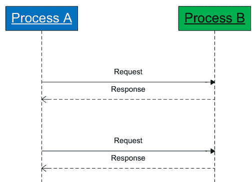

然而，当进程订阅通知时，存在所谓的 **弱耦合**。这些线程大部分时间是 **被动线程**（第 793 页），进程不会被阻塞：

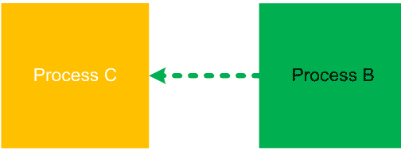

当通知器线程开始 CPU 飙升（飙升线程，第 888 页）并将其 CPU 消耗份额带给已通知的线程时，耦合表现出来：

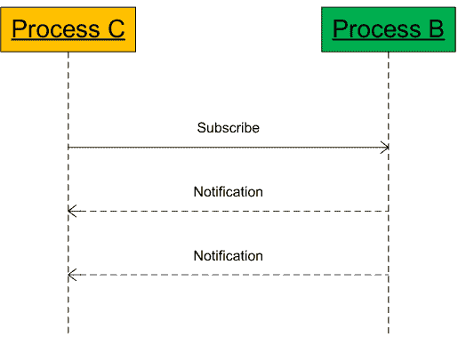

这里有这样的线程示例：

```
5  Id: 61018.dbec Suspend: 1 Teb: 7ffae000 Unfrozen
ChildEBP RetAddr
01e3fa68 7c82787b ntdll!KiFastSystemCallRet
01e3fac6 77c80a6e ntdll!NtRequestWaitReplyPort+0xc
01e3fab8 77c7fcf0 rpcrt4!LRPC_CCALL::SendReceive+0x230
01e3fac4 77c80673 rpcrt4!I_RpcSendReceive+0x24
01e3fad8 777ce315 rpcrt4!NdrSendReceive+0xb2
01e3fec0 771f4fbd rpcrt4!NdrClientCall12+0x22e
01e3fed8 771f4f60 winsta!RpcWinStationWaitSystemEvent+0x1c
01e3ff20 6582116c winsta!WinStationWaitSystemEvent+0x51
[...]
01e3ffec 00000000 kernel32!BaseThreadStart+0x34
```

在同步通知的情况下，如果已通知的线程被阻塞，我们就有逆向强耦合的一个实例。

## 崩溃签名

这是最常见的模式之一。它由从保存的执行上下文中可推导出的一组属性组成，用于异常、故障和陷阱。例如，在 x64 Windows 上，通常是 RIP 和 RSP 地址。对于 x86，通常是 EIP、ESP 和 EBP。它还可以包括应用程序模块名称。

```
0:009> !analyze -v

[...]

FAILURE_BUCKET_ID: SOFTWARE_NX_FAULT_c0000005_ApplicationA.exe!Unknown

BUCKET_ID: APPLICATION_FAULT_SOFTWARE_NX_FAULT_STACK_CORRUPTION_BAD_IP_ApplicationA+2d560

[...]

0:009> kl
ChildEBP RetAddr
0354f270 75bc0962 ntdll!NtWaitForMultipleObjects+0x15
0354f30c 76511662 KERNELBASE!WaitForMultipleObjectsEx+0x100
0354f354 76511921 kernel32!WaitForMultipleObjectsExImplementation+0xe0
0354f370 76539b0d kernel32!WaitForMultipleObjects+0x18
0354f3dc 76539baa kernel32!WerpReportFaultInternal+0x186
0354f3f0 765398d8 kernel32!WerpReportFault+0x70
0354f400 76539855 kernel32!BasepReportFault+0x20
0354f48c 77750727 kernel32!UnhandledExceptionFilter+0x1af
0354f494 77750604 ntdll!_RtlUserThreadStart+0x62
0354f4a8 777504a9 ntdll!_Eh4_CallFilterFunc+0x12
0354f4d0 777387b9 ntdll!_except_handler4+0x8e
0354f4f4 7773878b ntdll!ExecuteHandler2+0x26
0354f544 776f010f ntdll!ExecuteHandler+0x24
0354f54a 0354f958 ntdll!KiUserExceptionDispatcher+0xf
WARNING: Frame IP not in any known module. Following frames may be wrong.
0354f908 02ff0340 0x354f958
00000000 00000000 0x2ff0340

0:009> kv
ChildEBP RetAddr Args to Child
[...]
0354f54a 0354f958 0154f5bc 0354f60c 0354f5bc ntdll!KiUserExceptionDispatcher+0xf (CONTEXT @ 0354f60c)
WARNING: Frame IP not in any known module. Following frames may be wrong.
0354f908 02ff0340 00000000 00000000 00000000 0x354f958
00000000 00000000 00000000 00000000 00000000 0x2ff0340

0:009> .cxr 0354f60c
eax=80010105 ebx=0354f924 ecx=00000003 edx=0000ffff esi=00d7dce0 edi=00d7e0c8
eip=0354f958 esp=0354f8f4 ebp=0354f908 iopl=0 nv up ei pl zr na pe nc
cs=0023 ss=002b ds=002b es=002b fs=0053 gs=002b efl=00010246
0354f958 64f9 stc
```

```
0:009> !address 0354f958
TEB 7efdd000 in range 7efbd000 7efde000
TEB 7efda000 in range 7efd8000 7efdb000
TEB 7efd7000 in range 7efd5000 7efd8000
TEB 7efaf000 in range 7efad000 7efb0000
TEB 7efac000 in range 7efaa000 7efad000
TEB 7ef9a000 in range 7ef97000 7efaa000
TEB 7ef6000 in range 7ef4000 7efa7000
TEB 7efa3000 in range 7efa1000 7efa4000
TEB 7ef9f000 in range 7ef9d000 7efa0000
TEB 7ef9c000 in range 7ef9a000 7ef9d000
TEB 7ef99000 in range 7ef97000 7ef9a000
ProcessParameters 007714b0 in range 00770000 00870000
Environment 007707f0 in range 00770000 00870000
03450000 : 0354d000 - 00003000
Type 00020000 MEM_PRIVATE
Protect 00000004 PAGE_READWRITE
State 00001000 MEM_COMMIT
Usage RegionUsageStack
Pid.Tid 1ea0.12dc
```

```
0:009> !address 02fff0340
TEB 7efdd000 in range 7efbd000 7efde000
TEB 7efda000 in range 7efd8000 7efdb000
TEB 7efd7000 in range 7efd5000 7efd8000
TEB 7efaf000 in range 7efad000 7efb0000
TEB 7efac000 in range 7efaa000 7efad000
TEB 7ef9a000 in range 7ef97000 7efaa000
TEB 7ef6000 in range 7ef4000 7efa7000
TEB 7efa3000 in range 7efa1000 7efa4000
TEB 7ef9f000 in range 7ef9d000 7efa0000
TEB 7ef9c000 in range 7ef9a000 7ef9d000
TEB 7ef99000 in range 7ef97000 7ef9a000
ProcessParameters 007714b0 in range 00770000 00870000
Environment 007707f0 in range 00770000 00870000
02fc0000 : 02fc0000 - 00043000
Type 00020000 MEM_PRIVATE
Protect 00000004 PAGE_READWRITE
State 00001000 MEM_COMMIT
Usage RegionUsageHeap
Handle 00d70000
```

堆栈跟踪（第 926 页）可能在此处包含，也可能不包含，而且它可能是不正确的堆栈跟踪（第 499 页）、启发式 26，无法完全自动识别（需要原始堆栈语义分析），如上例所示。在某些情况下，我们可能会有无效的异常信息（第 568 页），例如，在横向损坏（第 602 页）内存转储或截断的转储（第 1015 页）文件的情况下。


## 崩溃签名不变式

跨平台产品中有时会发生崩溃，其中只有 **崩溃签名**（第 153 页）的一部分相似，例如：

```
x86: cmp dword ptr [eax], 1
x64: cmp dword ptr [r10], 1
```

某个崩溃转储具有以下精简的堆栈跟踪：

```
0: kd> kc
DriverA
win32k!DrvSetMonitorPowerState
win32k!xxxSysCommand
win32k!xxxRealDefWindowProc
win32k!NtUserfnNCDESTROY
win32k!NtUserMessageCall
nt!KiSystemServiceCopyEnd
```

伴随以下有故障的指令：

```
DriverA+0x1234:
cmp word ptr [r11],1 ds:002b:00000000:00000000=????????
```

搜索 DriverA 发现了此前分析过的此 x86 崩溃：

```
0: kd> kc
DriverA
nt!IopfCallDriver
win32k!GreDeviceIoControl
win32k!DrvSetMonitorPowerState
win32k!xxxSysCommand
win32k!xxxRealDefWindowProc
win32k!xxxWrapRealDefWindowProc
win32k!NtUserfnNCDESTROY
win32k!NtUserMessageCall
nt!KiSystemServicePostCall

0: kd> r
DriverA+0x1423:
cmp dword ptr [ecx],1 ds:0023:00000000=????????
```

两个堆栈跟踪中均可见共同的函数名，整体流程相同（x64 跟踪中仅省略了 3 个函数）；我们看到相同的空指针解引用，针对相同的比较指令及相同的比较操作数 #1。

## 崩溃进程

在内核和完整内存转储中，有时可以看到崩溃进程的迹象。这里所说的“崩溃”27，例如是指进程从任务管理器中突然消失。在内存转储中，我们仍然可以将这些进程视为僵尸进程（第 1158 页）。进程列表中发现的特殊进程（第 877 页）有助于在众多僵尸进程中筛选可能的候选项。如果一个进程本应仅启动一次（作为服务），但在进程列表中后来多次以僵尸进程身份被发现，同时也以正常进程身份出现（例如，作为最后对象，第 599 页），那么这可能指向过去发生过的崩溃（或静默终止）。我们还有一个类似的跟踪分析模式：Singleton Event28。以下示例说明了这两种迹象：

```
0: kd> !process 0 0

[...]

PROCESS fffffa80088a5640
SessionId: 0 Cid: 2184 Peb: 7ffffffd7000 ParentCid: 0888
DirBase: 381b8000 ObjectTable: 00000000 HandleCount: 0
Image: WerFault.exe

PROCESS fffffa8007254b30
SessionId: 0 Cid: 20ac Peb: 7fffffffd000 ParentCid: 02cc
DirBase: b3306000 ObjectTable: 00000000 HandleCount: 0
Image: ServiceA.exe

[...]

PROCESS fffffa8007fe2b30
SessionId: 0 Cid: 2a1c Peb: 7fffffffd000 ParentCid: 02cc
DirBase: 11b649000 ObjectTable: fffffa8a014939530 HandleCount: 112
Image: ServiceA.exe
```

## Linux

我们首先在 *加速 Mac OS X 内核转储分析*29 培训中介绍了 **关键区域** 模式，但当时并未将该模式本身提交到目录中。

关键区域通常是由同步对象（如关键段和互斥体）保护的代码区域。但是，**关键区域** 分析模式涉及识别介于竞争函数调用之间的代码区域（“夹心”区域，可能涉及或不涉及同步对象及相应的同步调用，如在 **竞争** 模式中所述，第 1168 页），然后识别此类代码区域引用的任何可能共享的数据：

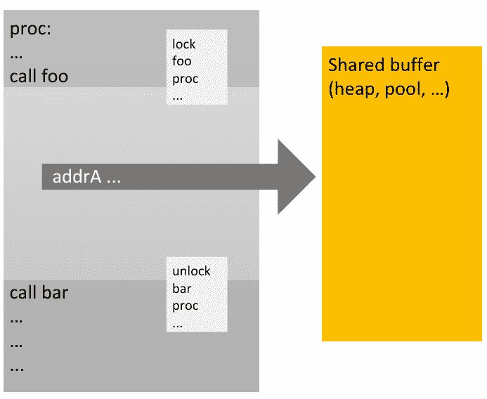

```
(gdb) thread apply all bt

Thread 6 (Thread 0x7f2665377700 (LWP 17000)):
#0 0x00000000004151a1 in __int_malloc ()
#1 0x0000000000416cf8 in malloc ()
#2 0x00000000004005a4 in proc ()
#3 0x0000000000400604 in bar_two ()
#4 0x0000000000400614 in foo_two ()
#5 0x000000000040062c in thread_two ()
#6 0x00000000004016c0 in start_thread (arg=<optimized out>)
at pthread_create.c:304
#7 0x0000000000432589 in clone ()
#8 0x0000000000000000 in ?? ()

Thread 5 (Thread 0x7f2664b76700 (LWP 17001)):
#0 __lll_unlock_wake_private ()
at ../nptl/sysdeps/unix/sysv/linux/x86_64/lowlevelLock.S:343
#1 0x000000000041886d in __L_lock_9670 ()
#2 0x0000000000416d22 in malloc ()
#3 0x00000000004005a4 in proc ()
#4 0x0000000000400641 in bar_three ()
#5 0x0000000000400651 in foo_three ()
#6 0x0000000000400669 in thread_three ()
#7 0x00000000004016c0 in start_thread (arg=<optimized out>)
at pthread_create.c:304
#8 0x0000000000432589 in clone ()
#9 0x0000000000000000 in ?? ()

Thread 4 (Thread 0x7f2665b78700 (LWP 16999)):
#0 __lll_lock_wait_private ()
at ../nptl/sysdeps/unix/sysv/linux/x86_64/lowlevelLock.S:97
#1 0x0000000000418836 in __L_lock_9558 ()
#2 0x0000000000416c1c in free ()
#3 0x0000000000400586 in proc ()
#4 0x00000000004005c7 in bar_one ()
#5 0x00000000004005d7 in foo_one ()
#6 0x00000000004005ef in thread_one ()
#7 0x00000000004016c0 in start_thread (arg=<optimized out>)
at pthread_create.c:304
#8 0x0000000000432589 in clone ()
#9 0x0000000000000000 in ?? ()

Thread 3 (Thread 0x1ab1860 (LWP 16998)):
#0 0x000000000042fed1 in nanosleep ()
#1 0x000000000042fda0 in sleep ()
#2 0x000000000040078a in main ()

Thread 2 (Thread 0x7f2663b74700 (LWP 17003)):
#0 __lll_lock_wait_private ()
at ../nptl/sysdeps/unix/sysv/linux/x86_64/lowlevelLock.S:97
#1 0x0000000000418836 in __L_lock_9558 ()
#2 0x0000000000416c1c in free ()
#3 0x0000000000400586 in proc ()
#4 0x00000000004006bb in bar_five ()
#5 0x00000000004006cb in foo_five ()
#6 0x00000000004006e3 in thread_five ()
#7 0x00000000004016c0 in start_thread (arg=<optimized out>)
at pthread_create.c:304
#8 0x0000000000432589 in clone ()
#9 0x0000000000000000 in ?? ()
Thread 1 (Thread 0x7f2664375700 (LWP 17002)):
#0 0x000000000043ef65 in raise ()
#1 0x0000000000409fc0 in abort ()
#2 0x00000000004bf5b in __libc_message ()
#3 0x0000000000412042 in malloc_printerr ()
#4 0x0000000000416c27 in free ()
#5 0x0000000000400586 in proc ()
#6 0x000000000040067e in bar_four ()
#7 0x000000000040068e in foo_four ()
#8 0x00000000004006a6 in thread_four ()
#9 0x00000000004016c0 in start_thread (arg=<optimized out>)
at pthread_create.c:304
#10 0x0000000000432589 in clone ()
#11 0x0000000000000000 in ?? ()
```

从线程 #4 和 #5 中，我们可以识别出这样一个带有共享缓冲区 0x6b8fc0 的区域，该区域可能进一步指向堆条目。

```
(gdb) disassemble proc
Dump of assembler code for function proc:
0x00000000004004f0 <+0>: push %rbp
0x00000000004004f1 <+1>: mov %rsp,%rbp
0x00000000004004f4 <+4>: push %rbx
0x00000000004004f5 <+5>: sub $0x18,%rsp
0x00000000004004f9 <+9>: callq 0x40ac70 <rand>
0x00000000004004fe <+14>: mov %eax,%ecx
0x0000000000400500 <+16>: mov $0x6b8dbbad,%edx
0x0000000000400505 <+21>: mov %ecx,%eax
0x0000000000400507 <+23>: imul %edx
0x0000000000400509 <+25>: sar $0xc,%edx
0x000000000040050c <+28>: mov %ecx,%eax
0x000000000040050e <+30>: sar $0x1f,%eax
0x0000000000400511 <+33>: mov %edx,%ebx
0x0000000000400513 <+35>: sub %eax,%ebx
0x0000000000400515 <+37>: mov %ebx,%eax
0x0000000000400517 <+39>: mov %eax,-0x14(%rbp)
0x000000000040051a <+42>: mov -0x14(%rbp),%eax
0x000000000040051d <+45>: imul $0x2710,%eax,%eax
0x0000000000400523 <+51>: mov %ecx,%edx
0x0000000000400525 <+53>: sub %eax,%edx
0x0000000000400527 <+55>: mov %edx,%eax
0x0000000000400529 <+57>: mov %eax,-0x14(%rbp)
0x000000000040052c <+60>: callq 0x40ac70 <rand>
0x0000000000400531 <+65>: mov %eax,%ecx
0x0000000000400533 <+67>: mov $0x6b8dbbad,%edx
0x0000000000400538 <+72>: mov %ecx,%eax
0x000000000040053a <+74>: imul %edx
0x000000000040053c <+76>: sar $0xc,%edx
0x000000000040053f <+79>: mov    %ecx,%eax
0x0000000000400541 <+81>:   sar    $0x1f,%eax
0x0000000000400544 <+84>:   mov    %edx,%ebx
0x0000000000400546 <+86>:   sub    %eax,%ebx
0x0000000000400548 <+88>:   mov    %ebx,%eax
0x000000000040054a <+90>:   mov    %eax,-0x18(%rbp)
0x000000000040054d <+93>:   mov    -0x18(%rbp),%eax
0x0000000000400550 <+96>:   imul   $0x2710,%eax,%eax
0x0000000000400556 <+102>:  mov    %ecx,%edx
0x0000000000400558 <+104>:  sub    %eax,%edx
0x000000000040055a <+106>:  mov    %edx,%eax
0x000000000040055c <+108>:  mov    %eax,-0x18(%rbp)
0x000000000040055f <+111>:  mov    -0x14(%rbp),%eax
0x0000000000400562 <+114>:  cltq
0x0000000000400564 <+116>:  mov    0x6b8fc0(,%rax,8),%rax
0x000000000040056c <+124>:  test   %rax,%rax
0x000000000040056f <+127>:  je     0x400597 <proc+167>
0x0000000000400571 <+129>:  mov    -0x14(%rbp),%eax
0x0000000000400574 <+132>:  cltq
0x0000000000400576 <+134>:  mov    0x6b8fc0(,%rax,8),%rax
0x000000000040057e <+142>:  mov    %rax,%rdi
0x0000000000400581 <+145>:  callq  0x416bc0 <free>
0x0000000000400586 <+150>:  mov    -0x14(%rbp),%eax
0x0000000000400589 <+153>:  cltq
0x000000000040058b <+155>:  movq   $0x0,0x6b8fc0(,%rax,8)
0x0000000000400597 <+167>:  mov    -0x18(%rbp),%eax
0x000000000040059a <+170>:  cltq
0x000000000040059c <+172>:  mov    %rax,%rdi
0x000000000040059f <+175>:  callq  0x416c90 <malloc>
0x00000000004005a4 <+180>:  mov    %rax,%rdx
0x00000000004005a7 <+183>:  mov    -0x14(%rbp),%eax
0x00000000004005aa <+186>:  cltq
0x00000000004005ac <+188>:  mov    %rdx,0x6b8fc0(,%rax,8)
0x00000000004005b4 <+196>:  jmpq   0x4004f9 <proc+9>
End of assembler dump.
```


用户空间（第307页）和内核空间（第292页）中的动态内存损坏模式是名为**损坏结构**（第144页）的一个大型父模式的专门化，因为崩溃发生在那里是由于损坏或被覆盖的堆或池控制结构（后者请参见**双重释放**模式，第259页）。临界段通过静态预分配或堆分配的辅助结构链接在一起（以粗体斜体显示），尽管它们本身可以存储在从静态和栈区域到进程堆的任何位置：

```
0:001> dt -r1 ntdll!_RTL_CRITICAL_SECTION 77795240
+0x000 DebugInfo : 0x00175d28 _RTL_CRITICAL_SECTION_DEBUG
    +0x000 Type : 0
    +0x002 CreatorBackTraceIndex : 0
    +0x004 CriticalSection : 0x77795240 _RTL_CRITICAL_SECTION
    +0x008 ProcessLocksList : _LIST_ENTRY [ 0x173a08 - 0x173298 ]
    +0x010 EntryCount : 0
    +0x014 ContentionCount : 0
    +0x018 Spare : [2] 0
+0x004 LockCount : -1
+0x008 RecursionCount : 0
+0x00c OwningThread : (null)
+0x010 LockSemaphore : (null)
+0x014 SpinCount : 0
0:001> !address 77795240
    77670000 : 77792000 - 00005000
        Type 01000000 MEM_IMAGE
        Protect 00000004 PAGE_READWRITE
        State 00001000 MEM_COMMIT
        Usage RegionUsageImage
        FullPath C:\WINDOWS\system32\ole32.dll
0:001> !address 0x00175d28
    00140000 : 00173000 - 0000d000
        Type 00020000 MEM_PRIVATE
        Protect 00000004 PAGE_READWRITE
        State 00001000 MEM_COMMIT
        Usage RegionUsageHeap
        Handle 00140000
```

```
0:000> !locks
CritSec ntdll!LdrpLoaderLock+0 at 7c8877a0
WaiterWoken No
LockCount 0
RecursionCount 1
OwningThread 1184
EntryCount 0
ContentionCount b04707
*** Locked
```

```
0:000> dt -r1 _RTL_CRITICAL_SECTION 7c8877a0
+0x000 DebugInfo : 0x7c8877c0 _RTL_CRITICAL_SECTION_DEBUG
+0x000 Type : 0
+0x002 CreatorBackTraceIndex : 0
+0x004 CriticalSection : 0x7c8877a0 _RTL_CRITICAL_SECTION
+0x008 ProcessLocksList : _LIST_ENTRY [ 0x7c887be8 - 0x7c887bc8 ]
+0x010 EntryCount : 0
+0x014 ContentionCount : 0xb04707
+0x018 Spare : [2] 0
+0x004 LockCount : -2
+0x008 RecursionCount : 1
+0x00c OwningThread : 0x00001184
+0x010 LockSemaphore : 0x0000013c
+0x014 SpinCount : 0
```

```
0:000> !address 7c8877a0
7c800000 : 7c887000 - 00003000
Type 01000000 MEM_IMAGE
Protect 00000004 PAGE_READWRITE
State 00001000 MEM_COMMIT
Usage RegionUsageImage
FullPath C:\WINDOWS\system32\ntdll.dll
```

```
0:000> !address 0x7c8877c0
7c800000 : 7c887000 - 00003000
Type 01000000 MEM_IMAGE
Protect 00000004 PAGE_READWRITE
State 00001000 MEM_COMMIT
Usage RegionUsageImage
FullPath C:\WINDOWS\system32\ntdll.dll
```

考虑这样一种情况：CRITICAL_SECTION 结构定义在栈上，并且**局部缓冲区溢出**（第608页）覆盖了 DebugInfo 指针。那么我们就得到了**野指针**模式（第1151页）的示例，从此点遍历临界段列表将偏移到完全不相关的内存区域或停在那里。考虑另一个示例：堆损坏或竞态条件覆盖了 ProcessLocksList 或 CriticalSection 指针。那么我们就得到了野指针模式的另一个实例，如下所示：

```
0:000> !locks

CritSec ntdll!LdrpLoaderLock+0 at 7c8877a0
WaiterWoken     No
LockCount       0
RecursionCount  1
OwningThread    1184
EntryCount      0
ContentionCount b04707
*** Locked

CritSec +1018de08 at 1018de08
WaiterWoken     Yes
LockCount       -49153
RecursionCount  5046347
OwningThread    460050
EntryCount      0
ContentionCount 0
*** Locked

CritSec +1018ddd8 at 1018ddd8
WaiterWoken     Yes
LockCount       -1
RecursionCount  0
OwningThread    0
*** Locked

CritSec +1018de28 at 1018de28
WaiterWoken     Yes
LockCount       -1
RecursionCount  0
OwningThread    0
*** Locked

CritSec +1018de08 at 1018de08
WaiterWoken     Yes
LockCount       -49153
RecursionCount  5046347
OwningThread    460050
EntryCount      0
ContentionCount 0
*** Locked

CritSec +1018de28 at 1018de28
WaiterWoken     Yes
LockCount       -1
RecursionCount  0
OwningThread    0
*** Locked
```

```
CritSec +1018ddd8 at 1018ddd8
WaiterWoken        Yes
LockCount          -1
RecursionCount     0
OwningThread       0
*** Locked

Scanned 841 critical sections
```

我们在 1018de08 地址处看到损坏的迹象，该地址被解释为指向已锁定的临界段。要查看损坏从哪里开始，我们需要查看所有临界段的列表，无论是否锁定：

```
0:000> !locks -v

CritSec ntdll!RtlCriticalSectionLock+0 at 7c887780
LockCount          NOT LOCKED
RecursionCount     0
OwningThread       0
EntryCount         0
ContentionCount    28

CritSec ntdll!LdrpLoaderLock+0 at 7c8877a0
WaiterWoken        No
LockCount          0
RecursionCount     1
OwningThread       1184
EntryCount         0
ContentionCount    b04707
*** Locked

CritSec ntdll!FastPebLock+0 at 7c887740
LockCount          NOT LOCKED
RecursionCount     0
OwningThread       0
EntryCount         0
ContentionCount    42c9

CritSec ntdll!RtlpCalloutEntryLock+0 at 7c888ea0
LockCount          NOT LOCKED
RecursionCount     0
OwningThread       0
EntryCount         0
ContentionCount    0

CritSec ntdll!PMCritSect+0 at 7c8883c0
LockCount          NOT LOCKED
RecursionCount     0
OwningThread       0
EntryCount         0
ContentionCount    0

CritSec ntdll!UMLogCritSect+0 at 7c888400
LockCount          NOT LOCKED
RecursionCount     0
OwningThread       0
EntryCount         0
ContentionCount    0

CritSec ntdll!RtlpProcessHeapsListLock+0 at 7c887960
LockCount NOT LOCKED
RecursionCount 0
OwningThread 0
EntryCount 0
ContentionCount 0

CritSec +80608 at 00080608
LockCount NOT LOCKED
RecursionCount 0
OwningThread 0
EntryCount 0
ContentionCount 22

...

CritSec cabinet!_adbgmsg+13c at 74fb4658
LockCount NOT LOCKED
RecursionCount 0
OwningThread 0
EntryCount 0
ContentionCount 0

CritSec +c6c17c at 00c6c17c
LockCount NOT LOCKED
RecursionCount 0
OwningThread 0
EntryCount 0
ContentionCount 0

CritSec +c6c0e4 at 00c6c0e4
LockCount NOT LOCKED
RecursionCount 0
OwningThread 0
EntryCount 0
ContentionCount 0

CritSec at 1018de08 does not point back to the debug info at 00136a40
Perhaps the memory that held the critical section has been reused without calling DeleteCriticalSection() ?

CritSec +1018de08 at 1018de08
WaiterWoken Yes
LockCount -49153
RecursionCount 5046347
OwningThread 460050
EntryCount 0
ContentionCount 0
*** Locked

CritSec at 1018ddd8 does not point back to the debug info at 00136a68
Perhaps the memory that held the critical section has been reused without calling DeleteCriticalSection() ?
```

```
CritSec +0108ddd8 at 1018ddd8
WaiterWoken Yes
LockCount -1
RecursionCount 0
OwningThread 0
*** Locked
...
```

我们发现，当地址为 00c6c0e4 的堆分配临界段链接到地址为 0x1018de08 的不一致临界段时问题会出现，该处的内存数据包含 UNICODE 字符串片段：

```
0:000> !address 00c6c0e4
00c60000 : 00c60000 - 00010000
Type 00020000 MEM_PRIVATE
Protect 00000004 PAGE_READWRITE
State 00001000 MEM_COMMIT
Usage RegionUsageHeap
Handle 00c60000
```

```
0:000> dt -r1 _RTL_CRITICAL_SECTION 00c6c0e4
+0x000 DebugInfo : 0x00161140 _RTL_CRITICAL_SECTION_DEBUG
+0x000 Type : 0
+0x002 CreatorBackTraceIndex : 0
+0x004 CriticalSection : 0x00c6c0e4 _RTL_CRITICAL_SECTION
+0x008 ProcessLocksList : _LIST_ENTRY [ 0x136a48 - 0x119f58 ]
+0x010 EntryCount : 0
+0x014 ContentionCount : 0
+0x018 Spare : [2] 0
+0x004 LockCount : -1
+0x008 RecursionCount : 0
+0x00c OwningThread : (null)
+0x010 LockSemaphore : (null)
+0x014 SpinCount : 0
```

```
0:000> dt -r _RTL_CRITICAL_SECTION_DEBUG 0x00136a48-0x0008
+0x000 Type : 0
+0x002 CreatorBackTraceIndex : 0
+0x004 CriticalSection : 0x1018de08 _RTL_CRITICAL_SECTION
+0x000 DebugInfo : 0x000d001b _RTL_CRITICAL_SECTION_DEBUG
+0x000 Type : 0
+0x002 CreatorBackTraceIndex : 0
+0x004 CriticalSection : (null)
+0x008 ProcessLocksList : _LIST_ENTRY [ 0x0 - 0x0 ]
+0x010 EntryCount : 0
+0x014 ContentionCount : 0x37e3c700
+0x018 Spare : [2] 0x8000025
+0x004 LockCount : 196609
+0x008 RecursionCount : 5046347
+0x00c OwningThread : 0x00460050
+0x010 LockSemaphore : 0x00310033
+0x014 SpinCount : 0x520044
+0x008 ProcessLocksList : _LIST_ENTRY [ 0x136a70 - 0x161148 ]
+0x000 Flink : 0x00136a70 _LIST_ENTRY [ 0x136a98 - 0x136a48 ]
+0x000 Flink : 0x00136a98 _LIST_ENTRY [ 0x136ae8 - 0x136a70 ]
```


```
+0x004 Blink             : 0x00136a48 _LIST_ENTRY [ 0x136a70 - 0x161148 ]
+0x004 Blink             : 0x00161148 _LIST_ENTRY [ 0x136a48 - 0x119f58 ]
+0x004 Flink             : 0x00136a48 _LIST_ENTRY [ 0x136a70 - 0x161148 ]
+0x004 Blink             : 0x00119f58 _LIST_ENTRY [ 0x161148 - 0x16cc3c0 ]
+0x010 EntryCount        : 0
+0x014 ContentionCount   : 0
+0x018 Spare             : [2] 0x2e760000

0:000> !address 0x1018de08
10120000 : 10120000 - 00100000
           Type     00020000 MEM_PRIVATE
           Protect  00000004 PAGE_READWRITE
           State    00001000 MEM_COMMIT
           Usage    RegionUsageIsVAD
```

该地址神奇地指向某个 DLL：

```
0:000> du 1018de08
1018de08 "...componentA.dll"
```

我们可以推测 componentA.dll 在那里发挥了一定作用。

来自 !locks WinDbg 命令详细版本的其他消息指向临界区问题：

```
CritSec componentB!Section+0 at 74004008
LockCount            NOT LOCKED
RecursionCount       0
OwningThread         0
EntryCount           0
ContentionCount      0

The CritSec componentC!Info+c at 72455074 has been RE-INITIALIZED.
The critical section points to DebugInfo at 00107cc8 instead of 000f4788

CritSec componentC!Info+c at 72455074
LockCount            NOT LOCKED
RecursionCount       0
OwningThread         0
EntryCount           0
ContentionCount      0

CritSec componentD!foo+8ec0 at 0101add0
LockCount            NOT LOCKED
RecursionCount       0
OwningThread         0
EntryCount           0
ContentionCount      0
```

## 关键堆栈跟踪

此模式针对页面错误处理或任何其他等待时间过长的关键系统活动等异常行为。此类活动要么很快完成，要么导致正常的 Bug 检查处理代码。例如，此线程在加载资源时卡在页面错误处理中长达 32 分钟：

```
THREAD fffffa80f0603c00  Cid 376.3d6  Teb: 000007fffffd6000 Win32Thread: fffff900c09e0640 WAIT: (Executive) KernelMode Non-Alertable
[...]
Wait Start TickCount      6281298         Ticks: 123391 (0:00:32:04.102)
[...]
Child-SP         RetAddr           Call Site
fffffa80`3fc99030 fffff800`01882bd2 nt!KiSwapContext+0x7a
fffffa80`3fc99170 fffff800`01893f8f nt!KiCommitThreadWait+0x1d2
fffffa80`3fc99200 fffff800`016283ff nt!KeWaitForSingleObject+0x19f
fffffa80`3fc992a0 fffff800`01620fc6 Ntfs!NtfsNonCachedIo+0x23f
fffffa80`3fc99470 fffff800`01622a68 Ntfs!NtfsCommonRead+0x7a6
fffffa80`3fc99610 fffff800`00fb4bcf Ntfs!NtfsFsdRead+0x1b8
fffffa80`3fc99820 fffff800`00fb36df fltmgr!FltpLegacyProcessingAfterPreCallbacksCompleted+0x24f
fffffa80`3fc998b0 fffff800`018bf4f5 fltmgr!FltpDispatch+0xcf
fffffa80`3fc999a0 fffff800`018b3fc9 nt!IoPageRead+0x255
fffffa80`3fc99a30 fffff800`0189a85a nt!MiIssueHardFault+0x255
fffffa80`3fc99ac0 fffff800`0188b2ee nt!MmAccessFault+0x146a
fffffa80`3fc99c20 00000000`779da643 nt!KiPageFault+0x16e (TrapFrame @ fffffa80`3fd99c20)
00000000`039ff4f0 00000000`779d8b1e ntdll!LdrpGetRcConfig+0xccd
00000000`039ff580 00000000`779da222 ntdll!LdrIsResImageExist+0x1e
00000000`039ff5c0 00000000`779f82c4 ntdll!LdrpSearchResourceSection_U+0xa4
00000000`039ff6e0 0000007fe`fe8075c1 ntdll!LdrFindResource_U+0x44
00000000`039ff720 0000007fe`fb217777 KERNELBASE!FindResourceExW+0x85
[...]
```

顶层模块（第 1012 页）和阻塞模块（第 96 页）是 NTFS，因此我们可能需要从堆栈跟踪集合（第 943 页）中查找其他类似的堆栈跟踪。

## 自定义异常处理程序

### 内核空间

这是用户空间中 **自定义异常处理程序** 模式（第 171 页）的内核空间对应物。在以下堆栈跟踪中，我们看到 **DriverA** 代码拦截了由解引用 **NULL 指针**（第 752 页）导致的访问违例异常，并生成了自定义 Bug 检查：

```
kd> !analyze -v

[...]

EXCEPTION_RECORD: fffff8801c757158 -- (.exr 0xfffff8801c757158)
ExceptionAddress: fffff88003977de1 (DriverA!foo+0x0000000000000381)
ExceptionCode: c0000005 (Access violation)
ExceptionFlags: 00000000
NumberParameters: 2
Parameter[0]: 0000000000000000
Parameter[1]: 0000000000000070
Attempt to read from address 0000000000000070

TRAP_FRAME: fffff8801c757200 -- (.trap 0xfffff8801c757200)
NOTE: The trap frame does not contain all registers.
Some register values may be zeroed or incorrect.
rax=0000000000000000 rbx=0000000000000000 rcx=fffff8a00da3f3c0
rdx=0000000000000000 rsi=0000000000000000 rdi=0000000000000000
rip=fffff88003977de1 rsp=fffff8801c757390 rbp=fffff800a9a853f0
r8=0000000000000000 r9=0000000000000000 r10=006800744002006e
r11=fffff8a00da3f3c6 r12=0000000000000000 r13=0000000000000000
r14=0000000000000000 r15=0000000000000000
iopl=0 nv up ei pl zr na po nc
DriverA!foo+0x381:
fffff880`03977de1 0fb74070 movzx eax,word ptr [rax+70h] ds:0703:0070=????
Resetting default scope

[...]

kd> k 100
Child-SP RetAddr Call Site
fffff880`1c7560f8 fffff880`039498f7 nt!KeBugCheckEx
fffff880`1c756100 fffff880`039352a0 DriverA!MyBugCheckEx+0x93
fffff880`1c756140 fffff880`016f1didc DriverA!MyExceptionFilter+0x1d0
fffff880`1c756210 fffff880`016e94da nt!_C_specific_handler+0x8c
fffff880`1c756280 fffff880`016f0a90 nt!RtlpExecuteHandlerForException+0xd
fffff880`1c7562b0 fffff880`016fd9ef nt!RtlDispatchException+0x410
fffff880`1c756990 fffff880`016c2df2 nt!KiDispatchException+0x16f
fffff880`1c757020 fffff880`016c18fa nt!KiExceptionDispatch+0xc2
fffff880`1c757200 fffff880`03977de1 nt!KiPageFault+0x23a
fffff880`1c757390 fffff880`03977754 DriverA!foo+0x381
fffff880`1c757430 fffff880`0396f006 DriverA!bar+0x74
[...]
fffff880`1c7579b0 fffff880`019a6e0a DriverA!QueryInformation+0x30b
fffff880`1c757a0 fffff880`016c2993 nt!NtQueryInformationFile+0x535
fffff880`1c757bb0 00000000`76e5fe6a nt!KiSystemServiceCopyEnd+0x13
00000000`0a08df8e 00000000`00000000 0x76e5fe6a

kd> !exchain
24 stack frames, scanning for handlers...
Frame 0x05: nt!RtlpExecuteHandlerForException+0xd (fffff880`016e940d)
 ehandler nt!RtlpExceptionHandler (fffff800`016e93d0)
Frame 0x07: nt!KiDispatchException+0x16f (fffff800`016fd9ef)
 ehandler nt!GSHandlerCheck_SEH (fffff800`0169aec0)
Frame 0x0b: DriverA!bar+0x74 (fffff880`03977574)
 ehandler DriverA!_GSHandlerCheck (fffff880`039a12fc)
[...]
Frame 0x14: DriverA!QueryInformation+0x30b (fffff880`039303ab)
 ehandler DriverA!C_specific_handler (fffff880`039a1864)
Frame 0x15: nt!NtQueryInformationFile+0x535 (fffff800`019a6e0a)
 ehandler nt!C_specific_handler (fffff800`016f1c90)
Frame 0x16: nt!KiSystemServiceCopyEnd+0x13 (fffff800`016c2993)
 ehandler nt!KiSystemServiceHandler (fffff800`016c2580)
Frame 0x17: error getting module for 0000000076e5fe6a
```

### 用户空间

如前面 **早期崩溃转储** 模式（第 312 页）所述，在第一机会异常时保存崩溃转储有助于诊断可能导致损坏以及后续崩溃、挂起或 CPU 飙升的组件，方法是忽略访问违例等异常。在这种情况下，我们需要知道应用程序是否安装了自己的 **自定义异常处理程序** 或多个处理程序。如果它仅使用运行时或 Windows 子系统提供的默认处理程序，那么第一机会访问违例异常很可能会导致最后机会异常和事后转储。要检查异常处理程序链，可以使用 WinDbg **!exchain** 扩展命令。

例如：

```
0:000> !exchain
0017f9d8: TestDefaultDebugger!AfxWinMain+3f5 (00420aa9)
0017fa60: TestDefaultDebugger!AfxWinMain+34c (00420a00)
0017fb20: user32!_except_handler4+0 (770780eb)
0017fcc0: user32!_except_handler4+0 (770780eb)
0017fd24: user32!_except_handler4+0 (770780eb)
0017fe40: TestDefaultDebugger!AfxWinMain+16e (00420822)
0017feec: TestDefaultDebugger!AfxWinMain+797 (00420e4b)
0017ff90: TestDefaultDebugger!_except_handler4+0 (00410e00)
0017ffdc: ntdll!_except_handler4+0 (77961c78)
```

我们可以看到，**TestDefaultDebugger** 没有自己的异常处理程序，除了由 MFC 和 C/C++ 运行时库以静态方式链接提供的处理程序。这里有另一个例子。有报告称，某第三方应用程序正在挂起并飙升 CPU（**飙升线程** 模式，第 888 页），因此用户使用命令行 **userdump.exe** 保存了用户转储：

```
0:000> vertarget
Windows Server 2003 Version 3790 (Service Pack 2) MP (4 procs) Free x86 compatible
Product: Server, suite: TerminalServer
kernel32.dll version: 5.2.3790.4062 (srv03_sp2_gtx.070417-0203)
Debug session time: Thu Nov 22 12:45:59.000 2007 (GMT+0)
System Uptime: 0 days 10:43:07.667
Process Uptime: 0 days 4:51:32.000
Kernel time: 0 days 0:08:04.000
User time: 0 days 0:23:09.000
0:000> !runaway 3
User Mode Time
Thread Time
0:1c1c 0 days 0:08:04.218
1:2e04 0 days 0:00:00.015
Kernel Mode Time
Thread Time
0:1c1c 0 days 0:23:09.156
1:2e04 0 days 0:00:00.031
```


## 异常链中列出的自定义异常处理程序:

```
0:000> k1
ChildEBP RetAddr
0012fb80 7739bf53 ntdll!KiFastSystemCallRet
0012fbb4 05ca73b0 user32!NtUserWaitMessage+0xc
WARNING: Stack unwind information not available. Following frames may be wrong.
0012fd20 05c8be3f 3rdPartyDLL+0x573b0
0012fd50 05c9e9ea 3rdPartyDLL+0x3be3f
0012fd68 7739b6e3 3rdPartyDLL+0x4e9ea
0012fd94 7739b874 user32!InternalCallWinProc+0x28
0012fe0c 7739c8b8 user32!UserCallWinProcCheckWow+0x151
0012fe68 7739c9c6 user32!DispatchClientMessage+0xd9
0012fe90 7c828536 user32!__fnDWORD+0x24
0012febc 7739d1ec ntdll!KiUserCallbackDispatcher+0x2e
0012fef8 7738cee9 user32!NtUserWaitMessage+0xc
0012fff8 0050aea9 user32!SendMessageA+0x7f
0012ff70 00452ae4 3rdPartyApp+0x10aea9
0012ffac 00511941 3rdPartyApp+0x52ae4
0012fff0 77e6f23b 3rdPartyApp+0x111941
0012ffff 00000000 kernel32!BaseProcessStart+0x23
```

```
0:000> !exchain
0012fb8c: 3rdPartyDLL+57acb (05ca7acb)
0012fd28: 3rdPartyDLL+3be57 (05c8be57)
0012fd34: 3rdPartyDLL+3be68 (05c8be68)
0012fdfc: user32!_except_handler3+0 (773aaf18)
CRT scope 0, func: user32!UserCallWinProcCheckWow+156 (773ba9ad)
0012fe58: user32!_except_handler3+0 (773aaf18)
0012fea0: ntdll!KiUserCallbackExceptionHandler+0 (7c8284e8)
0012fff3c: 3rdPartyApp+53310 (00453310)
0012fff48: 3rdPartyApp+5334b (0045334b)
0012fff9c: 3rdPartyApp+52d06 (00452d06)
0012fffb4: 3rdPartyApp+38d4 (004038d4)
0012fffe0: kernel32!_except_handler3+0 (77e61a60)
CRT scope 0, filter: kernel32!BaseProcessStart+29 (77e76a10)
func: kernel32!BaseProcessStart+3a (77e81469)
```

客户随后启用了 MS 异常监视器，并仅选择了“访问违例异常代码”（c0000005），以避免误报转储（第 393 页）。在应用程序执行期间，保存了各种第 1 次机会异常崩溃转储，指向许多访问违例，包括对已卸载模块中的函数调用，例如：

```
0:000> kl 100
ChildEBP RetAddr
WARNING: Frame IP not in any known module. Following frames may be wrong.
0012f910 7739b6e3 <Unloaded_Another3rdParty.dll>+0x4ce58
0012f93c 7739b874 user32!InternalCallWinProc+0x28
0012f9b4 7739c8b8 user32!UserCallWinProcCheckWow+0x151
0012fa10 7739c9c6 user32!DispatchClientMessage+0xd9
0012fa38 7c828536 user32!__fnDWORD+0x24
0012fa64 7739d1ec ntdll!KiUserCallbackDispatcher+0x2e
0012faa0 7738cee9 user32!NtUserMessageCall+0xc
0012fac0 0a0f2e01 user32!SendMessageA+0x7f
0012fae4 0a0f2ac7 3rdPartyDLL+0x52e01
0012fb60 7c81a352 3rdPartyDLL+0x52ac7
0012fb80 7c839dee ntdll!LdrpCallInitRoutine+0x14
0012fc94 77e6b1bb ntdll!LdrUnloadDll+0x41a
0012fca8 0050c9c1 kernel32!FreeLibrary+0x41
0012fdf4 004374af 3rdPartyApp+0x10c9c1
0012fe24 0044a076 3rdPartyApp+0x374af
0012fe3c 7739b6e3 3rdPartyApp+0x4a076
0012fee8 7739b874 user32!InternalCallWinProc+0x28
0012fef0 7739ba92 user32!UserCallWinProcCheckWow+0x151
0012fff48 773a16e5 user32!DispatchMessageWorker+0x327
0012fff58 00452aa0 user32!DispatchMessageA+0xf
0012ffac 00511941 3rdPartyApp+0x52aa0
0012fff0c 77e6f23b 3rdPartyApp+0x111941
0012ffff 00000000 kernel32!BaseProcessStart+0x23
```

## 页面边界

大多数情况下，该模式在 Intel 平台上从性能角度表现出来，并且对于某些要求 qword 操作数自然边界的指令，会通过 GP 故障表现出来。通常情况下，如果将 dword 值从奇数内存地址移动或移动到奇数内存地址，并且整个操作数适合一个页面，则不会出现异常。但是，在检查内存地址的有效性时，我们需要考虑页面边界跨越的可能性。请考虑此异常:

```
0: kd> .trap 0xfffffffffa38df520
ErrCode = 00000002
eax=b92920f0 ebx=b6ab4ffb ecx=00000304 edx=eaf2fdea esi=b6d9214c edi=b6ab8189
eip=bfa10e6e esp=a38df594 ebp=a38df5ac iopl=0 nv up ei ng nz ac po cy
cs=0008 ss=0010 ds=0023 es=0023 fs=0030 gs=0000 efl=00010293
driver+0x2a6e6:
bfa10e6e 895304 mov dword ptr [ebx+4],edx ds:0023:b6ab4fff=????????
```

该地址似乎有效:

```
0: kd> !pte b6ab4fff
    VA b6ab4fff
PDE at C0300B68    PTE at C02DAAD0
contains 7F00D863    contains 426B0863
pfn 7f0dd -DA-KWEV  pfn 426b0 -DA-KWEV
```

但是，仔细检查指令会发现它写入 32 位值，因此我们还需要检查下一个字节，因为它位于另一页上:

```
0: kd> !pte b6ab4fff+1
     VA b6ab5000
PDE at C0300B68    PTE at C02DAAD4
contains 7F00D863    contains 00000080
pfn 7f0dd -DA-KWEV                  not valid
DemandZero
Protect: 4 - ReadWrite
```

虽然该页面是按需零页面，并且本应通过创建一个填充零的新页面来满足，但这里的要点是，在 IRQL >= 2 的情况下，该页面可能完全无效或已被换出。

这是一种比较模式，不仅有助于识别问题的类别，还能增强我们对特定假设的信心和信念程度。假设我们有之前问题的笔记数据库。如果在新的内存转储中看到相同或相似的数据被访问，我们可以假设问题是相似的。如果 **数据内容局部性** 由 **代码路径局部性**^30（类似的部分堆栈跟踪和代码 **执行残留**，第 371 页）补充，则会进一步增强我们在推荐特定故障排除步骤、推荐修补程序和服务包或将问题路由到下一级支持或开发服务供应链（例如升级问题）方面的信心。

假设我们获得了一个带有 IRQL_NOT_LESS_OR_EQUAL (A) 错误检查的新内核内存转储，指向我们的模块，并且我们注意到对非分页池中带有特定池标记的结构进行写入访问:

```
3: kd> .trap 9ee8d9b0
ErrCode = 00000002
eax=85407650 ebx=858f6650 ecx=ffffffff edx=85407648 esi=858f65a8 edi=858f6620
eip=8083df4c esp=9ee8da24 ebp=9ee8da64 iopl=0 nv up ei pl zr na pe nc
cs=0008 ss=0010 ds=0023 es=0023 fs=0030 gs=0000 efl=00010246
nt!KeWaitForSingleObject+0x24f:
8083df4c 8919 mov dword ptr [ecx],ebx ds:0023:ffffffff=????????
STACK_TEXT:
9ee8d9b0 8083df4c badb0d00 85407648 00000000 nt!KiTrap0E+0x2a7
9ee8da64 80853f3f 85407648 0000001d 00000000 nt!KeWaitForSingleObject+0x24f
9ee8da7c 8081d45f 865b18d8 854076b0 f4b9e53b nt!KiAcquireFastMutex+0x13
9ee8da88 f4b9e53b 00000004 86940110 85407638 nt!ExAcquireFastMutex+0x20
9ee8daa8 f4b9ed98 85407638 00000000 86940110 driver!Query+0x143
...
3: kd> !pool 85407648
Pool page 85407648 region is Nonpaged pool
85407000 size: 80 previous size: 0 (Allocated) Mdl
85407080 size: 30 previous size: 80 (Allocated) Even (Protected)
854070b0 size: 28 previous size: 30 (Allocated) Ntfn
854070d8 size: 28 previous size: 28 (Allocated) NtFs
85407100 size: 28 previous size: 28 (Allocated) Ntfn
...
85407570 size: 28 previous size: 70 (Allocated) Ntfn
85407598 size: 98 previous size: 28 (Allocated) File (Protected)
*85407630 size: b0 previous size: 98 (Free ) *DrvA
```

30 这是一个我们未来可能会添加的模式

转储传递给 KeWaitForSingleObject 函数的内存地址显示一种简单但奇特的模式:

```
3: kd> dd 85407648
85407648 ffffffff ffffffff ffffffff ffffffff
85407658 ffffffff ffffffff ffffffff ffffffff
85407668 ffffffff ffffffff ffffffff ffffffff
85407678 ffffffff ffffffff ffffffff ffffffff
85407688 ffffffff ffffffff ffffffff ffffffff
85407698 ffffffff ffffffff ffffffff ffffffff
854076a8 ffffffff ffffffff ffffffff ffffffff
854076b8 ffffffff ffffffff ffffffff ffffffff
```

我们在数据库中发现了几个类似的案例，但整体调用堆栈不同，除了最顶层的等待调用。然后我们注意到，在之前的案例中，与线程结构关联有互斥体，现在也是如此:

```
0: kd> !thread
THREAD 858f65a8 Cid 474c.4530 Teb: 7ffdf000 Win32Thread: bc012410 RUNNING on processor 0
...
3: kd> dt /r _KTHREAD 858f65a8 MutantListHead
nt!_KTHREAD
+0x010 MutantListHead : _LIST_ENTRY [ 0x86773040 - 0x86773040 ]
3: kd> !pool 86773040
Pool page 86773040 region is Nonpaged pool
*86773000 size: 50 previous size: 0 (Allocated) *Muta (Protected)
Pooltag Muta : Mutant objects
...
```

这将问题缩小到仅几个之前的案例。在一个之前的案例中，与线程结构关联的 WaitBlockList 在其指针中具有 0xffffffff。我们的块显示相同的模式:

```
0: kd> dt -r _KTHREAD 858f65a8 WaitBlockList
nt!_KTHREAD
+0x054 WaitBlockList : 0x858f6650 _KWAIT_BLOCK
0: kd> dt _KWAIT_BLOCK 0x858f6650
nt!_KWAIT_BLOCK
+0x000 WaitlistEntry : _LIST_ENTRY [ 0x85407650 - 0xffffffff ]
+0x008 Thread : 0x858f65a8 _KTHREAD
+0x00c Object : 0x85407648
+0x010 NextWaitBlock : 0x858f6650 _KWAIT_BLOCK
+0x014 WaitKey : 0
+0x016 WaitType : 0x1 
+0x017 SpareByte : 0 

```

我们可能已经将问题缩小到特定案例。虽然这并不总是有效，而且大多基于直觉，但有许多惊人的案例中，它确实对故障排除很有帮助。这里是另一个示例，其中异常上下文中 EDI 寄存器的内容提供了具体的建议提示。在查看崩溃点时，我们看到 Wild Code 模式（第 1148 页）的一个实例:

0:000> kv
ChildEBP RetAddr  Args to Child
WARNING: Frame IP not in any known module. Following frames may be wrong.
49ab5bba 00000000 00000000 00000000 00000000 0x60f1011a
0:000> r
eax=38084ff0 ebx=52303340 ecx=963f1416 edx=0000063d esi=baaff395 edi=678c5804
eip=60f1011a esp=5a9d0f48 ebp=49ab5bba iopl=0 nv up ei pl nz na pe nc
cs=001b ss=0023 ds=0023 es=0023 fs=003b gs=0000 efl=00210206
60f1011a cd01 int 1
0:000> u
60f1011a cd01 int 1
60f1011c cc int 3
60f1011d 8d ???
60f101e6 c8eb02 shr bl,2
60f10121 0f840f31cd01 je 62be3236
60f10127 8d ???
60f10128 c8cc0f ror ah,0Fh
60f1012b 0cce or ecx,esi

观察原始堆栈数据，我们注意到存在一个已知会修补进程导入表的特定组件。应用“挂钩函数”模式（第 488 页）中概述的技术，我们注意到两个不同的第三方组件修补了两个不同的模块（kernel32 和 user32）：

```
0:000> !chkimg -lo 50 -d !kernel32 -v
Searching for module with expression: !kernel32
Will apply relocation fixups to file used for comparison
Will ignore NOP/LOCK errors
Will ignore patched instructions
Image specific ignores will be applied
Comparison image path: c:\mss\kernel32.dll\4626487F102000\kernel32.dll
No range specified
Scanning section: .text
Size: 564709
Range to scan: 77e41000-77ecade5
77e41ae5-77e41ae9 5 bytes - kernel32!LoadLibraryExW
[ 6a 34 68 48 78:e9 16 e5 f4 07 ]
77e44a8a-77e44a8e 5 bytes - kernel32!WaitNamedPipeW (+0x2fa5)
[ 8b ff 55 8b ec:e9 71 b5 f9 07 ]
77e5106a-77e5106e 5 bytes - kernel32!CreateProcessInternalW (+0xc5e0)
...
Total bytes compared: 564709 (100%)
Number of errors: 49
49 errors: !kernel32 (77e41ae5-77e9aa16)
```

```
0:000> u 77e41ae5
kernel32!LoadLibraryExW:
77e41ae5 7fd90000
77e41aea out 77h,al
77e41aec call kernel32!_SEH_prolog (77e6b779)
77e41af1 xor edi,edi
77e41af3 mov dword ptr [ebp-28h],edi
77e41af6 mov dword ptr [ebp-2Ch],edi
77e41af9 mov dword ptr [ebp-20h],edi
77e41afc cmp dword ptr [ebp+8],edi

0:000> u 7fd90000
*** ERROR: Symbol file could not be found. Defaulted to export symbols for ComponentA.dll -
7fd90000 jmp ComponentA!DllUnregisterServer+0x2700 (678c4280)
7fd90005 push 34h
7fd90007 push offset kernel32!`string'+0xc (77e67b48)
7fd9000c jmp kernel32!LoadLibraryExW+0x7 (77e41aec)
7fd90011 add byte ptr [eax],al
7fd90013 add byte ptr [eax],al
7fd90015 add byte ptr [eax],al
7fd90017 add byte ptr [eax],al

0:000> !chkimg -lo 50 -d !user32 -v
Searching for module with expression: !user32
Will apply relocation fixups to file used for comparison
Will ignore NOP/LOCK errors
Will ignore patched instructions
Image specific ignores will be applied
Comparison image path: c:\mss\user32.dll\45E7BFD692000\user32.dll
No range specified

Scanning section: .text
Size: 396943
Range to scan: 77381000-773e1e8f
77383f38-77383f3c 5 bytes - user32!EnumDisplayDevicesW
[ 8b ff 55 8b ec:e9 c3 c0 82 08 ]
77384406-7738440a 5 bytes - user32!EnumDisplaySettingsExW (+0x4ce)
[ 8b ff 55 8b ec:e9 ff 5f 7e 08 ]
773844d9-773844dd 5 bytes - user32!EnumDisplaySettingsW (+0xd3)
[ 8b ff 55 8b ec:e9 22 bb 80 08 ]
7738619b-7738619f 5 bytes - user32!EnumDisplayDevicesA (+0x1cc2)
[ 8b ff 55 8b ec:e9 60 9e 83 08 ]
7738e985-7738e989 5 bytes - user32!CreateWindowExA (+0x87ea)
[ 8b ff 55 8b ec:e9 76 16 8c 08 ]
...
Total bytes compared: 396943 (100%)
Number of errors: 119
119 errors: !user32 (77383f38-773c960c)
```

```
0:000> u 77383f38
user32!EnumDisplayDevicesW:
77383f38 e9c3080200    jmp     7fb00000
77383f3d 81ec50030000    sub     esp,358h
77383f43 a1ac243e77      mov     eax,dword ptr [user32!__security_cookie (773e24ac)]
77383f48 8b5508          mov     edx,dword ptr [ebp+8]
77383f4b b3a5acfcffffff  and     dword ptr [ebp-354h],0
77383f52 53              push    ebx
77383f53 56              push    esi
77383f54 8b7510          mov     esi,dword ptr [ebp+10h]
```

```
0:000> u 7fb00000
*** ERROR: Symbol file could not be found. Defaulted to export symbols for ComponentB.dll -
7fb00000 e91b43d5e5    jmp     ComponentB+0x4320 (65904320)
7fb00005 8bff            mov     edi,edi
7fb00007 55              push    ebp
7fb00008 8bec            mov     ebp,esp
7fb0000a e9e23f7df7      jmp     user32!EnumDisplayDevicesW+0x5 (77383f3d)
7fb0000f 0000            add     byte ptr [eax],al
7fb00011 0000            add     byte ptr [eax],al
7fb00013 0000            add     byte ptr [eax],al
```

我们应该首先尝试消除哪一个，以测试它们以某种方式导致应用程序故障的假设？再次查看寄存器上下文，我们发现一个特定寄存器（EDI）的值位于 ComponentA 地址范围内：

```
0:000> r
eax=38084ff0 ebx=52303340 ecx=963f1416 edx=0000063d esi=baaff395 edi=678c5804
eip=60f1011a esp=5a9d0f48 ebp=49ab5bba iopl=0         nv up ei pl nz na pe nc
cs=001b  ss=0023  ds=0023  es=0023  fs=003b  gs=0000             efl=00210206
60f1011a cd01          int     1

0:000> lm
start    end        module name
00400000 01901000   Application
...
678c0000 6791d000   ComponentA   ComponentA.DLL
...
```

## 数据关联

### 函数参数

这是一个一般模式，其中内存转储不同部分中发现的值根据某些规则（例如某些比例）相互关联。这里我们展示函数参数的一个变体。

一个进程用户内存转储中发生了 C++ 异常（第 108 页）：

```
0:000> kL
*** Stack trace for last set context - .thread/.cxr resets it
ChildEBP RetAddr
0012e950 78158e89 kernel32!RaiseException+0x53
0012e988 7830770c msvcr80!_CxxThrowException+0x46
0012e99c 783095bc mfc80!AfxThrowMemoryException+0x19
0012e9b4 02afa8ca mfc80!operator new+0x27
0012e9c8 02b0992f ModuleA!std::_Allocate<...>+0x1a
0012e9e0 02b09e7c ModuleA!std::vector<double,std::allocator<double> >::vector<double,std::allocator<double> >+0x3f
[...]
```

我们怀疑是内存不足状况，并查看了函数参数：

```
0:000> kv 5
ChildEBP RetAddr  Args to Child
0012e950 78158e89 e06d7363 00000000 00000003 kernel32!RaiseException+0x53
0012e988 7830770c 0012e998 783b0110 783c8d68 msvcr80!_CxxThrowException+0x46
0012e99c 783095bc 0000a7c0 0012ea40 000014f8 mfc80!AfxThrowMemoryException+0x19
0012e9b4 02afa8ca 0000a7c0 089321b0 089321f0 mfc80!operator new+0x27 (FPO: [Uses EBP] [1,0,0])
0012e9c8 02b0992f 000014f8 00000000 00000008 ModuleA!std::_Allocate<...>+0x1a (FPO: [2,3,0])
```

由于帧指针省略（第 403 页），我们原本认为堆栈参数无效。但是，了解 operator new31 的函数原型和语义以及 std::vector double 元素类型，我们立即看到 0xa7c0 和 0x14f8 之间的相关性，它们与 sizeof(double) == 8 成正比：

```
0:000> ? 000a7c0/000014f8
Evaluate expression: 8 = 00000000`00000008
```

因此，在不查看反汇编的情况下，我们得出结论：内存分配大小为 42944 字节：

```
0:000> .formats 000a7c0
Evaluate expression:
Hex: 00000000`000a7c0
Decimal: 42944
Octal: 00000000000000000123700
Binary: 00000000 00000000 00000000 00000000 00000000 00000000 10100111 11000000
Chars: ........
Time: Thu Jan 01 11:55:44 1970
Float: low 6.01774e-041 high 0
Double: 2.12172e-319
```

## 死锁

### 临界区

关于“死锁”术语的高级解释，请参阅《内存转储分析文选》32 中关于“挂起”的讨论。**死锁**不仅发生在互斥量、事件等同步原语上，也发生在基于原语构建的更复杂对象上，例如临界区或执行资源（ERESOURCE）。它们还可以从高级别或系统角度在进程间或组件间通信中发生，例如相互等待消息：GUI 窗口消息、LPC 消息、RPC 调用。

如何在内存转储中查看**死锁**？让我们从用户转储和临界区入手。

首先，我们建议阅读以下优秀的 MSDN 文章，以了解 CRITICAL_SECTION 结构33 的各个成员。

WinDbg **!locks** 命令检查进程临界区列表，并显示所有锁定的临界区、锁计数以及当前临界区所有者的线程 ID。以下是挂起的 Windows 打印后台处理进程（*spoolsv.exe*）内存转储的输出：

```
0:000> !locks
CritSec NTDLL!LoaderLock+0 at 784B0348
LockCount          4
RecursionCount     1
OwningThread       624
EntryCount         6c3
ContentionCount    6c3
*** Locked

CritSec LOCALSPL!SpoolerSection+0 at 76AB8070
LockCount          3
RecursionCount     1
OwningThread       1c48
EntryCount         646
ContentionCount    646
*** Locked
```

如果我们查看线程 #624 和 #1c48，会发现它们正在互相等待：

- TID#624 拥有 CritSec 784B0348 并正在等待 CritSec 76AB8070
- TID#1c48 拥有 CritSec 76AB8070 并正在等待 CritSec 784B0348


```
0:000>~*kv

. 12 Id: bc0.624 Suspend: 1 Teb: 7ffd3000 Unfrozen
0000024c 00000000 00000000 NTDLL!ZwWaitForSingleObject+0xb
76ab8000 76a815ef 76ab8070 NTDLL!RtlpWaitForCriticalSection+0x9e
76ab8070 76a844f8 00cd1f38 NTDLL!RtlEnterCriticalSection+0x46
00cd1f38 76a81ad7 00000000 LOCALSPL!EnterSplSem+0xb
00000000 00000000 00cd1f38 LOCALSPL!FindSpoolerByNameIncRef+0x1f
00000000 777f19bc 00000001 LOCALSPL!LocalGetPrinterDriverDirectory+0xe
00000000 777f19bc 00000001 spoolss!GetPrinterDriverDirectoryW+0x59
00000000 777f19bc 00000001 spoolss!YGetPrinterDriverDirectory+0x27
00000000 777f19bc 00000001 WINSPOOL!GetPrinterDriverDirectoryW+0x7b
50000000 00000001 00000000 BRHLUI04+0x14ea
50002ea0 50000000 00000001 BRHLUI04!DllGetClassObject+0x1705
0000000e 00000000 00cb570 NTDLL!LdrpRunInitializeRoutines+0x1df
00cc8f8 0288ea30 0288ea38 NTDLL!LdrpLoadDll+0x2e6
00cc8f8 0288ea30 0288ea38 NTDLL!LdrLoadDll+0x17)
00c1258 00000000 00000008 KERNEL32!LoadLibraryExW+0x231
00c150c 0288efd8 00000000 UNIDRVUI!LoadCommonInfo+0x17e
00c150c 0288efd8 00000007 UNIDRVUI!DwDeviceCapabilities+0x1a
00070000 00071378 00000045 UNIDRVUI!DrvDeviceCapabilities+0x19

. 13 Id: bc0.1c48 Suspend: 1 Teb: 7ffd2000 Unfrozen
0000010c 00000000 00000000 NTDLL!ZwWaitForSingleObject+0xb
784b0301 7846838 784b0348 NTDLL!RtlpWaitForCriticalSection+0x9e
784b0348 74b4d344 00000000 NTDLL!RtlEnterCriticalSection+0x46
74fb0000 02c0f2a8 00000000 NTDLL!LdrpGetProcedureAddress+0x122
74fb0000 02c0f2a8 00000000 NTDLL!LdrGetProcedureAddress+0x17
74fb0000 74fb4344 02c0f449 KERNEL32!GetProcAddress+0x41
017924b0 00000000 00000001 ws2_32!CheckForHookersOrChainers+0x1f
00000101 02c0f344 017924b0 ws2_32!WSAStartup+0x10f
00cdf79c 02c0f4f4 76a8c9bc LOCALSPL!GetDNSMachineName+0x1e
00000000 76a8c9f8 78027a62 LOCALSPL!GetPrinterUrl+0x2c
0176f570 ffffffff 01000000 LOCALSPL!UpdateDsSpoolerKey+0x322
0176f570 76a8c9bc 01792b90 LOCALSPL!RecreateDsKey+0x50
00000000 00000002 01792b90 LOCALSPL!SplAddPrinter+0x521
01791faa 0176a684 76a5cd34 WIN32SPL!InternalAddPrinterConnection+0x1b4
01791faa 02c0fa00 02c0fabc WIN32SPL!AddPrinterConnectionW+0x15
00076f1c 02c0fabc 01006873 spoolss!AddPrinterConnectionW+0x49
00076f1c 00000001 77107fb0 spoolss!YAddPrinterConnection+0x17
00076f1c 02020202 00000001 spoolss!RpcAddPrinterConnection+0xb
01006868 02c0fac 00000001 rpcrt4!Invoke+0x30
00000000 00000000 0002c28 rpcrt4!NdrStubCall2+0x655
000d22c8 00076fe0 000d22c8 rpcrt4!NdrServerCall2+0x17
010045fc 000d22c8 02c0fe8c rpcrt4!DispatchToStubInC+0x32
0000002b 00000000 02c0fe0c rpcrt4!RPC_INTERFACE::DispatchToStubWorker+0x100
000d22c8 00000000 02c0fe0c rpcrt4!RPC_INTERFACE::DispatchToStub+0x5e
000d3210 00076608 813b0013 rpcrt4!RPC_SCALL::DealWithRequestMessage+0x1dd
000d21d0 02c0fe50 000d3210 rpcrt4!RPC_ADDRESS::DealWithLRPCRequest+0x10c
770c9ad0 00076608 770cbd68 rpcrt4!LRPC_ADDRESS::ReceiveLotsaCalls+0x229
00076608 770cbd68 0288f9a8 rpcrt4!RecvLotsaCallsWrapper+0x9
00074a50 02c0ffec 77e7438b rpcrt4!BaseCachedThreadRoutine+0x11f
00076e68 770cbd68 0288f9a8 rpcrt4!ThreadStartRoutine+0x18
770d1c54 00076e68 00000000 KERNEL32!BaseThreadStart+0x52
```

此分析看起来非常简单和容易。内核和完整内存转储呢？当然，我们无法在内核内存转储中看到用户空间临界节，但在切换到适当的进程上下文并使用 !ntsdexts.locks 后，可以在完整内存转储中看到它们。这可以通过从 debugger.chm 改编的简单脚本来完成（请参阅其中的“死锁和临界节”部分）。

当涉及临界节时，为什么观察死锁如此容易？这是因为它们的结构中有一个记录所有者的成员。因此，将它们映射到相应的线程非常容易。内核 ERESOURCE 同步对象也是如此。其他对象没有所有者，例如，在事件的情况下，仅通过查看事件对象并不容易找到所有者。我们需要检查线程调用堆栈、其他结构或访问源代码。

还有一个 !cs WinDbg 扩展，其中 !cs -l 命令列出带有堆栈跟踪的所有锁定临界节，而 !cs -t 显示临界节树。对于后者，我们需要使用 gflags.exe 启用应用程序验证程序，或在镜像的注册表中设置 0x100：

```
HKEY_LOCAL_MACHINE\SOFTWARE\Microsoft\Windows NT\CurrentVersion\Image File Execution Options
GlobalFlag=0x00000100
```

以下是挂起的 IE 进程中的另一个死锁示例：

```
0:000> !locks

CritSec ntdll!LdrpLoaderLock+0 at 7c8877a0
WaiterWoken No
LockCount 3
RecursionCount 2
OwningThread d5a8
EntryCount 0
ContentionCount 5a
*** Locked

CritSec shell32!CMountPoint::_csDL+0 at 7cae42d0
WaiterWoken No
LockCount 1
RecursionCount 1
OwningThread b7b4
EntryCount 0
ContentionCount 7
*** Locked

Scanned 1024 critical sections
```

```
0:000> ~*kb 100
. 0 Id: c068.b7b4 Suspend: 1 Teb: 7ffdd000 Unfrozen
ChildEBP RetAddr  Args to Child
0013bd0c 7c827d0b 7c83d236 000001d0 00000000 ntdll!KiFastSystemCallRet
0013bd10 7c83d236 000001d0 00000000 00000000 ntdll!NtWaitForSingleObject+0xc
0013bd4c 7c83d281 000001d0 00000004 00000001 ntdll!RtlpWaitOnCriticalSection+0x1a3
0013bd6c 7c82f20c 7c8877a0 00000000 0013be68 ntdll!RtlEnterCriticalSection+0xa8
0013bda0 7c82f336 00000000 00000000 0013bde8 ntdll!LdrLockLoaderLock+0x133
0013be1c 7c82fa23 00000001 00000001 00000000 ntdll!LdrGetDllHandleEx+0x94
0013be38 77e65185 00000001 00000000 0013bea0 ntdll!LdrGetDllHandle+0x18
0013be84 77e6528f 0013bea0 00000000 7cae2f60 kernel32!GetModuleHandleForUnicodeString+0x20
0013c2fc 77e65155 00000001 00000002 7c8d828 kernel32!BasepGetModuleHandleExW+0x17f
0013c314 7c91079e 7c808828 7c9107b8 7c9107b8 kernel32!GetModuleHandleW+0x29
0013c31c 7c9107b8 0013c350 7c9107bd 00000001 shell32!IsProcessAnExplorer+0xb
0013c324 7c9107bd 00000001 7c91373b 00000018 shell32!IsMainShellProcess2+0x46
0013c32c 7c91373b 00000018 00000000 7cae42d0 shell32!Shell32LoadedInDesktop+0x7
0013c350 7c913776 00000018 00000000 7cae42d0 shell32!CMountPoint::_IsNDriveLazyLoadNetDLLs+0x7b
0013c37c 7c9136dc 00000018 00000001 0013c634 shell32!CMountPoint::_GetMountPointDL+0x1c
0013c398 7c96dfd7 00000018 00000001 00000001 shell32!CMountPoint::GetMountPoint+0x46
0013c5e4 7c90f37d 018e0988 00000001 001aea8 shell32!CDrivesFolder::GetAttributesOf+0x7b
0013c624 779cc875 0018e9b0 00000001 04002000 shell32!CRegFolder::GetAttributesOf+0x122
0013c648 779cc917 0018e9b0 001a4dc8 04002000 shdocvw!SHGetAttributes+0x53
0013d728 779cc9d8 0013ddac 00193a50 80004005 shdocvw!CNscTree::_OnCDNotify+0x85
0013d754 779cc964 0013ddac 001a06c8 11281f2a shdocvw!CNscTree::_OnNotify+0x2e1
0013d768 779cd8ff 001a06c8 00010090 0000004e shdocvw!CNscTree::_OnWinEvent+0x51
0013d798 75eba756 00193a50 00010090 0000004e shdocvw!CNSCBand::_OnWinEvent+0x70
0013d7b8 75eba2a2 00193a50 00010090 0000004e browseui!_FwdWinEvent+0x1d
0013d7ec 75eba357 00010090 0000004e 00000064 browseui!CBandSite::_SendToToolbar+0x44
0013d818 75ee2a72 0017de98 00010088 00000000 browseui!CBandSite::_OnWinEvent+0x143
0013d864 75ee2b32 00017de98 00010088 0000004e browseui!CBrowserBandSite::_OnWinEvent+0x14c
0013d890 75ee2a9a 0000004e 00000064 0013ddac browseui!CBaseBar::_CheckForwardWinEvent+0x88
0013d8ac 75ee29dc 0000004e 00000064 0013ddac browseui!CBaseBar::_OnNotify+0x1c
0013d8c8 75ee2965 00010088 0000004e 00000064 browseui!CBaseBar::_v_WndProc+0xd4
0013d918 75ee28fa 00010088 0000004e 00000064 browseui!CDockingBar::_v_WndProc+0x447
0013d948 75ee2880 00010088 0000004e 00000064 browseui!CBrowserBar::_v_WndProc+0x99
0013d96c 7739b6e3 00010088 0000004e 00000064 browseui!CImpWndProc::_s_WndProc+0x65
0013d998 7739b874 75ee2841 00010088 0000004e user32!InternalCallWinProc+0x28
0013da10 7739c2d3 00172e34 75ee2841 00010088 user32!UserCallWinProcCheckWow+0x151
0013da4c 7739c337 006172a0 00618f18 00000064 user32!SendMessageWorker+0x4bd
0013da6c 7743b07f 00010088 0000004e 00000064 user32!SendMessageW+0x7f
0013db04 7743b07f 00010088 ffffffff ffffffff comctl32!CCSNotify+0xc24
0013dbac 774a652d 0001008a 0000004e 00000064 comctl32!CrBar::_WndProc+0x257
0013dbd0 7739b6e3 0001008a 0000004e 00000064 comctl32!CrBar::_s_WndProc+0x2c
0013dbfc 7739b874 774a6501 0001008a 0000004e user32!InternalCallWinProc+0x28
0013dc74 7739c2d3 00172e34 774a6501 0001008a user32!UserCallWinProcCheckWow+0x151
0013dcb0 7739c337 00617350 0060a9c0 00000064 user32!SendMessageWorker+0x4bd
0013dcdd 7743b07f 0001008a 0000004e 00000064 user32!SendMessageW+0x7f
0013dd68 7743b10d 001c8900 ffffffff 0013ddac comctl32!CCSNotify+0xc24
0013dd7c 7748a032 001c8900 00010001 0013ddac comctl32!CICustomDrawNotify+0x2c
0013de70 7748a8bb 001c8900 00012aa8 00100060 comctl32!TV_DrawItem+0x356
0013e0f4 7748a9ac 00000154 00100060 00000000 comctl32!TV_DrawTree+0x136
0013e158 7745bbdd 001c8900 00000000 0013e21c comctl32!TV_Paint+0x65
0013e1a4 7739b6e3 00010090 0000000f 00000000 comctl32!TV_WndProc+0x6ea
0013e1d0 7739b874 7745b6e6 00010090 0000000f user32!InternalCallWinProc+0x28
```


0013e248 7739bfce 0015fce4 7745b6e6 00010090 user32!UserCallWinProcCheckWow+0x151
0013e278 7739bf74 7745b6e6 00010090 0000000f user32!CallWindowProcAorW+0x98
0013e298 77431848 7745b6e6 00010090 0000000f user32!CallWindowProcW+0x1b
0013e2b4 77431b9b 00010090 0000000f 00000000 comctl32!CallOriginalWndProc+0x1a
0013e310 77431d5d 001c0f88 00010090 0000000f comctl32!CallNextSubclassProc+0x3c
0013e334 779cd761 00010090 0000000f 00000000 comctl32!DefSubclassProc+0x46
0013e350 77431b9b 00010090 0000000f 00000000 shdocvw!CNotifySubclassWndProc::_SubclassWndProc+0xa7
0013e3ac 77431d5d 001c0f88 00010090 0000000f comctl32!CallNextSubclassProc+0x3c
0013e3d0 779cd86f 00010090 0000000f 00000000 comctl32!DefSubclassProc+0x46
0013e41c 779cd7e4 00010090 0000000f 00000000 shdocvw!CNscTree::_SubClassTreeWndProc+0x3ae
0013e43c 77431d9b 00010090 0000000f 00000000 shdocvw!CNscTree::_SubClassTreeWndProc+0x34
0013e498 77431dc0 001c0f88 00010090 0000000f comctl32!CallNextSubclassProc+0x3c
0013e4ec 7739b6e3 00010090 0000000f 00000000 comctl32!MasterSubclassProc+0x54
0013e518 7739bb74 77431d6c 00010090 0000000f user32!InternalCallWinProc+0x28
0013e590 7739c8b8 0015fce4 77431d6c 00010090 user32!UserCallWinProcCheckWow+0x151
0013e5ec 7739c9c6 00617618 0000000f 00000000 user32!DispatchClientMessage+0xd9
0013e614 7ac28536 0013e62c 00000018 0013e750 user32!_fnDWORD+0x24
0013e640 7739cbb2 7739cb75 00010090 0000005e ntdll!KiUserCallbackDispatcher+0x2e
0013e654 77459d14 00010090 00000200 001c8900 user32!NtUserCallHwndLock+0xc
0013e66c 7745bd2d 00000004 016b0055 00000000 comctl32!TV_OnMouseMove+0x62
0013e6bc 7739b6e3 00010090 00000200 00000000 comctl32!TV_WndProc+0x647
0013e6e8 7739b874 7745b6e6 00010090 00000200 user32!InternalCallWinProc+0x28
0013e760 7739bfce 0015fce4 7745b6e6 00010090 user32!UserCallWinProcCheckWow+0x151
0013e790 7739bf74 7745b6e6 00010090 00000200 user32!CallWindowProcAorW+0x98
0013e7b0 77431848 7745b6e6 00010090 00000200 user32!CallWindowProcW+0x1b
0013e7cc 77431b9b 00010090 00000200 00000000 comctl32!CallOriginalWndProc+0x1a
0013e828 77431d5d 001c0f88 00010090 00000200 comctl32!CallNextSubclassProc+0x3c
0013e84c 779cd761 00010090 00000200 00000000 comctl32!DefSubclassProc+0x46
0013e868 77431b9b 00010090 00000200 00000000 shdocvw!CNotifySubclassWndProc::_SubclassWndProc+0xa7
0013e8c4 77431d5d 001c0f88 00010090 00000200 comctl32!CallNextSubclassProc+0x3c
0013e8e8 779cd6f 00010090 00000200 00000000 comctl32!DefSubclassProc+0x46
0013e934 779cd7e4 00010090 00000200 00000000 shdocvw!CNscTree::_SubClassTreeWndProc+0x3ae
0013e954 77431b9b 00010090 00000200 00000000 shdocvw!CNscTree::_SubClassTreeWndProc+0x34
0013e9b0 77431dc0 001c0f88 00010090 00000200 comctl32!CallNextSubclassProc+0x3c
0013ea04 7739b6e3 00010090 00000200 00000000 comctl32!MasterSubclassProc+0x54
0013ea30 7739b874 77431d6c 00010090 00000200 user32!InternalCallWinProc+0x28
0013eaa8 7739ba92 0015fce4 77431d6c 00010090 user32!UserCallWinProcCheckWow+0x151
0013eb10 7739bad0 0013eb50 00000000 0013eb38 user32!DispatchMessageWorker+0x327
0013eb20 75ed1410 0013eb50 00000000 00176388 user32!DispatchMessageW+0xf
0013eb38 75ed14fc 0013eb50 0013ee50 00000000 browseui!TimedDispatchMessage+0x33
0013ed98 75ec1c83 0015f7e8 0013ee50 0015f7e8 browseui!BrowserThreadProc+0x336
0013ee24 75ec61ef 0015f7e8 0015f7e8 00000000 browseui!BrowserProtectedThreadProc+0x44
0013fea8 779ba3a6 0015f7e8 00000001 00000000 browseui!SHOpenFolderWindow+0x22c
0013fec8 0040243d 00152552 0002d0f2 ffffffff shdocvw!IEWinMain+0x129
0013ff1c 00402744 00400000 00000000 00152552 iexplore!WinMain+0x316
0013fff0 77e6f23b 00000000 00000000 7ffde000 iexplore!WinMainCRTStartup+0x182
0013fff0 00000000 004025c2 00000000 78746341 kernel32!BaseProcessStart+0x23

1 Id: c068.d71c 挂起: 1 Teb: 7ffdc000 未冻结
子EBP 返回地址 子函数参数
00d4fea0 7c827cfb 7c80e5bb 00000000 00d4fef0 ntdll!KiFastSystemCallRet
00d4fea4 7c80e5bb 00000002 00d4fe0 00000001 ntdll!NtWaitForMultipleObjects+0xc
00d4ff48 7c80e4a2 00000002 00d4ff70 00000000 ntdll!EtwpWaitForMultipleObjectsEx+0xf7
00d4ffb8 77e64829 00000000 00000000 00000000 ntdll!EtwpEventPump+0x27f
00d4ffec 00000000 7c80e1fa 00000000 00000000 kernel32!BaseThreadStart+0x34

2 Id: c068.cba4 挂起: 1 Teb: 7ffdb000 未冻结
子EBP 返回地址 子函数参数
012bfe18 7c82783b 77c885ac 000001c4 012bff74 ntdll!KiFastSystemCallRet
012bfe1c 77c885ac 000001c4 012bff74 00000000 ntdll!NtReplyWaitReceivePortEx+0xc
012bff84 77c88792 012bfac 77c8872d 00153cf0 rpcrt4!LRPC_ADDRESS::ReceiveLotsasCalls+0x198
012bff8c 77c8872d 00153cf0 00000000 00000000 rpcrt4!RecvLotsaCallsWrapper+0xd
012bffac 77c7b110 00167030 012bffec 77e64829 rpcrt4!BaseCachedThreadRoutine+0x9d
012bfff8 77e64829 00172088 00000000 00000000 rpcrt4!ThreadStartRoutine+0x1b
012bffe0 00000000 77c7b0f5 00172088 00000000 kernel32!BaseThreadStart+0x34

3 Id: c068.8604 挂起: 1 Teb: 7ffda000 未冻结
子EBP 返回地址 子函数参数
013bfe28 7c827d0b 7c83d236 000001d0 00000000 ntdll!KiFastSystemCallRet
013bfe2c 7c83d236 000001d0 00000000 00000000 ntdll!NtWaitForSingleObject+0xc
013bfe68 7c83d281 000001d0 00000000 00000000 ntdll!RtlpWaitOnCriticalSection+0x1a3
013bfe88 7c839844 7c8877a0 00000000 77670000 ntdll!RtlEnterCriticalSection+0xa8
013bfff0 77e52860 77670000 77670000 00171698 ntdll!LdrUnloadDll+0x35
013bff4a 776b171d 77670000 00000000 00000000 kernel32!FreeLibraryAndExitThread+0x38
013bffb8 77e64829 00171698 00000000 00000000 ole32!CRpcThreadCache::RpcWorkerThreadEntry+0x39
013bffec 00000000 776b16e4 00171698 00000000 kernel32!BaseThreadStart+0x34

4 Id: c068.d6dc 挂起: 1 Teb: 7ffd9000 未冻结
子EBP 返回地址 子函数参数
016dfd24 7c827cfb 77e6202c 00000005 016dfd74 ntdll!KiFastSystemCallRet
016dfd28 77e6202c 00000005 016dfd74 00000001 ntdll!NtWaitForMultipleObjects+0xc
016dfdd0 7739bbd1 00000005 016dfd8 00000000 kernel32!WaitForMultipleObjectsEx+0x11a
016dfe2c 7c919b2e 00000004 016dfa54 ffffffff user32!RealMsgWaitForMultipleObjectsEx+0x141
016dff50 7c8c7ada 77da3f12 00000000 00000000 shell32!CChangeNotify::_MessagePump+0x3b
016dfff54 77da3f12 00000000 00000000 00000000 shell32!CChangeNotify::ThreadProc+0x1e
016dff8 77e64829 00000000 00000000 00000000 shlwapi!WrapperThreadProc+0x94
016dffec 00000000 77da3ea5 0013dea8 00000000 kernel32!BaseThreadStart+0x34

5 Id: c068.caf4 挂起: 1 Teb: 7ffd8000 未冻结
子EBP 返回地址 子函数参数
01b1fd04 7c827cfb 77e6202c 00000002 01b1fe04 ntdll!KiFastSystemCallRet
01b1fd08 77e6202c 00000002 01b1fe04 00000001 ntdll!NtWaitForMultipleObjects+0xc
01b1fe60 7739bbd1 00000002 01b1fe88 00000000 kernel32!WaitForMultipleObjectsEx+0x11a
01b1febc 6c296601 00000001 01b1fe0 ffffffff user32!RealMsgWaitForMultipleObjectsEx+0x141
01b1fedc 6c29684b 000004ff ffffffff 00000001 duser!CoreSC::Wait+0x3a
01b1fedc 6c28f9e6 01b1ff50 00000000 00000000 duser!CoreSC::xwProcessNL+0xab
01b1fff30 6c28bc2e 01b1ff50 00000000 00000000 duser!GetMessageExA+0x44a
01b1ff84 77cbc530 00000000 00000000 00000000 duser!ResourceManager::SharedThreadProc+0xb6
01b1fff8 77e64829 000385f0 00000000 00000000 msvcrt!_endthreadex+0xa3
01b1fffec 00000000 77bcb4bc 000385f0 00000000 kernel32!BaseThreadStart+0x34

6 Id: c068.d624 挂起: 1 Teb: 7ffd7000 未冻结
子EBP 返回地址  子函数参数
01c9ff9c 7c82d64b 7c83d424 00000001 01c9ffb0 ntdll!KiFastSystemCallRet
01c9ffa0 7c83d424 00000001 01c9ffb0 00000000 ntdll!NtDelayExecution+0xc
01c9ffb8 77e64829 00000000 00000000 00000000 ntdll!RtlpTimerThread+0x47
01c9ffec 00000000 7c83d3dd 00000000 00000000 kernel32!BaseThreadStart+0x34

7 Id: c068.b4e0 挂起: 1 Teb: 7ffd6000 未冻结
子EBP 返回地址  子函数参数
01d9fd58 7c82d70b 7c83d236 000001d0 00000000 ntdll!KiFastSystemCallRet
01d9fd5c 7c83d236 000001d0 00000000 00000000 ntdll!NtWaitForSingleObject+0xc
01d9fd98 7c83d281 000001d0 00000004 00000000 ntdll!RtlpWaitOnCriticalSection+0x1a3
01d9fd8b 7c839844 7c8877a0 75eb8b7c 75eb0000 ntdll!RtlEnterCriticalSection+0xa8
01d9fec0 77e6b1bb 75ebc000 75ebc000 001e2f98 ntdll!LdrUnloadDll+0x35
01d9fed4 77da4c1c 75eb0000 0020eec8 77da591b kernel32!FreeLibrary+0x41
01d9feec 7c83a827 0020eec8 7c8980c0 001e4ec0 shlwapi!ExecuteWorkItem+0x28
01d9ff44 7c83aa0b 77da591b 0020eec8 00000000 ntdll!RtlpWorkerCallout+0x71
01d9ff64 7c83aa82 00000000 0020eec8 001e4ec0 ntdll!RtlpExecuteWorkerRequest+0x4f
01d9ff78 7c839f60 7c83a9ca 00000000 0020eec8 ntdll!RtlpApcCallout+0x11
01d9ffb8 77e64829 00000000 00000000 00000000 ntdll!RtlpWorkerThread+0x61
01d9ffec 00000000 7c839feb 00000000 00000000 kernel32!BaseThreadStart+0x34

8 Id: c068.d5a8 挂起: 1 Teb: 7ffd5000 未冻结
子EBP 返回地址  子函数参数
01fbb41c 7c827d0b 7c83d236 00000468 00000000 ntdll!KiFastSystemCallRet
01fbb420 7c83d236 00000468 00000000 00000000 ntdll!NtWaitForSingleObject+0xc
01fbb45c 7c83d281 00000468 00000004 00000000 ntdll!RtlpWaitOnCriticalSection+0x1a3
01fbb47c 7c9136c9 7cae42d0 001c97b0 80070003 ntdll!RtlEnterCriticalSection+0xa8
01fbb494 7c913b75 0000000c 00000000 00000001 shell32!CMountPoint::GetMountPoint+0x33
01fbb4c8 7c91358d 01fbb4fc 0000000c 00000000 shell32!CDrivesFolder:::_FillDDDrive+0x5c
01fbb52c 7c9109e7 0018e988 00000000 001c97b0 shell32!CDrivesFolder::ParseDisplayName+0x9f
01fbb594 7c9119ff 0018e9b0 00000000 001c97b0 shell32!CRegFolder::ParseDisplayName+0x93
01fbb5bc 7c910bb8 00000000 001a8e30 00000000 shell32!CDesktopFolder::_ChildParseDisplayName+0x22
01fbb60c 7c9109e7 0017cde0 00000000 001c97b0 shell32!CDesktopFolder::ParseDisplayName+0x7e
01fbb674 7c910a9b 0015f058 00000000 001c97b0 shell32!CRegFolder::ParseDisplayName+0x93
01fbb6ac 7c911ab4 00000000 00000000 00000000 shell32!SHParseDisplayName+0xa3
01fbb6d0 7c911a6e 01fbbe60 00000000 00000002 shell32!ILCreateFromPathEx+0x3d
01fbb6ec 7c911a4b 01fbbe60 01fbb700 00000000 shell32!SHILCreateFromPath+0x17
01fbb704 7c95e055 01fbbe60 00000104 01fbc0a0 shell32!ILCreateFromPathW+0x18
01fbbb84 7c9ef49d 01fbbe60 00000000 01fbbac shell32!SHGetFileInfo+0x117
01fbc06c 01b4d195 01fbc200 00000000 01fbc0a0 shell32!SHGetFileInfoA+0x6a
警告：无法获取堆栈展开信息。以下帧可能不正确。
01fbc0a4 01b54a20 0000073c 02541f28 00000000 issftran!SSCopyFile+0x27ad
00000000 00000000 00000000 00000000 00000000 issftran!DllUnregisterServer+0x70ad

9 Id: c068.d750 挂起: 1 Teb: 7ffd4000 未冻结
子EBP 返回地址  子函数参数
0228ff7c 7c8277db 71b25914 00000b44 0228ffc0 ntdll!KiFastSystemCallRet
0228ff80 71b25914 000004b4 0228ffc0 0228ffb4 ntdll!ZwRemoveIoCompletion+0xc
0228fff8 77e64829 71b259de 00000000 00000000 mswsock!SockAsyncThread+0x69
0228ffec 00000000 71b258ab 001fcd20 00000000 kernel32!BaseThreadStart+0x34

0:000> du 7c8d8828
7c8d8828 "EXPLORER.EXE"


```
0:000> da 01fbc200
01fbc200 "M:\\WINDOWS"
```

## 注释

临界区分析的另一个示例：

```
0:005> !locks
CritSec ModuleA!__onexitbegin+50cbc at 006f1da8
WaiterWoken No
LockCount 49
RecursionCount 1
OwningThread 19a4
EntryCount 0
ContentionCount 2a51
*** Locked
CritSec ModuleA!__onexitbegin+5131c at 006f2408
WaiterWoken No
LockCount 0
RecursionCount 1
OwningThread 10f4
EntryCount 0
ContentionCount 0
*** Locked
CritSec +6e8827c at 06e8827c
WaiterWoken No
LockCount 0
RecursionCount 1
OwningThread 19a4
EntryCount 0
ContentionCount 0
*** Locked
Scanned 2404 critical sections
```

在此示例中，只有一个临界区根据以下公式阻塞其他线程：

```
BlockedThreads = LockCount - (RecursionCount - 1) = 49 - (1 - 1)
CritSec ModuleA!__onexitbegin+50cbc at 006f1da8
WaiterWoken No
LockCount 49
RecursionCount 1
OwningThread 19a4
EntryCount 0
ContentionCount 2a51
*** Locked
```

然后，我们可以通过查看 ~*kv 输出来检查拥有者线程 19a4 的调用堆栈，并通过搜索临界区地址 006f1da8 来查找其他等待线程。

其他两个临界区均由拥有者线程持有，且没有等待线程：

```
BlockedThreads = LockCount - (RecursionCount - 1) = 0 - (1 - 1) = 0
```

因此，经验法则是查看 LockCount 值。

有人提出的一个问题是：如果临界区的线程所有者已经终止，是否有办法查看堆栈跟踪？

```
0:022> !locks
CritSec ole32!g_mxsSingleThreadOle+18 at 76a40664
WaiterWoken No
LockCount 4
RecursionCount 1
OwningThread 1ec
EntryCount 0
ContentionCount 6
*** Locked
```

TEB 的虚拟内存已经被取消提交，因此无法获取堆栈起始地址及其限制的数据。我们可能会推测，堆栈区域在线程终止期间本身也被取消提交了，因此无法在此使用内存搜索来查找其原始堆栈数据。实时调试可能会在此处提供帮助，可使用脚本在满足某些条件时设置条件断点并自动保存转储文件。

另一个示例：

```
0:000> !locks
CritSec +83eb6d10 at 83eb6d10
WaiterWoken No
LockCount -452697857
RecursionCount 36294152
OwningThread a
EntryCount 1379620
ContentionCount 1379620
*** Locked
CritSec +840d6d10 at 840d6d10
WaiterWoken Yes
LockCount -60009439
RecursionCount 1093776890
OwningThread ffffffffadcb569d
EntryCount 0
ContentionCount 0
*** Locked
CritSec +840d6d10 at 840d6d10
WaiterWoken Yes
LockCount -60009439
RecursionCount 1093776890
OwningThread ffffffffadcb569d
EntryCount 0
ContentionCount 0
*** Locked
```

```
CritSec +86156d10 at 86156d10
WaiterWoken Yes
LockCount -278997059
RecursionCount 1224415142
OwningThread ffffffff9e8e4272
EntryCount 0
ContentionCount 0
*** Locked
```

```
CritSec +83c96d10 at 83c96d10
WaiterWoken Yes
LockCount 520027693
RecursionCount 1097194433
OwningThread ffffffff8c000036
EntryCount 0
ContentionCount 0
*** Locked
```

```
CritSec +83c96d10 at 83c96d10
WaiterWoken Yes
LockCount 520027693
RecursionCount 1097194433
OwningThread ffffffff8c000036
EntryCount 0
ContentionCount 0
*** Locked
```

已扫描 1223 个临界区

在这里可以看到，LockCount 和 RecursionCount 具有奇怪的数值。这里我们有 **临界区损坏** 模式（第 156 页）。我们也可以尝试 !cs -l -o -s 命令。有时，如果转储所有区段，可以看到损坏从何处开始（!locks -v 或 !cs）。

**虚拟化进程** 示例（第 1068 页）：

```
0:000:x86> ~*kv

.  0 Id: 2e24.35f8 Suspend: 0 Teb: 7efdb000 Unfrozen
   ChildEBP RetAddr  Args to Child
0015ce4c 77748e44 00000048 00000000 00000000 ntdll!_RtlWaitForSingleObject+0x15 (FPO: [3,0,0])
0015cf40 77748428 00000000 00000000 000035f8 ntdll!_RtlpWaitOnCriticalSection+0x13e (FPO: [Non-Fpo])
0015cf68 55f882d9 00e531d8 d3c25775 05Bf0a4d ntdll!_RtlEnterCriticalSection+0x150 (FPO: [Non-Fpo])
WARNING: Stack unwind information not available. Following frames may be wrong.
0015d444 558f9e66 d3c256e1 000000df 00000000 libjli!vulibrelDJVU::DjVuDocument::process_threqs+0x6b
0015d530 558cdea5 0015d57c 000000df 00000000 libjli!vulibrelDJVU::DjVuDocument::get_thumbnail+0x8c6
0015d594 0103dbd1 00e6a1e0 000000df ffffffff libjli!vulibrelDjvu vj thumbnail_status+0x115
0015d604 55197c9d 00c3c5a8 00000000 00000000 djview4+0x4bd1
0015d658 53f3fc29 00000000 00c3c5a8 0000ed18 QtCore4!QMetaCallEvent::placeMetaCall+0x19
0015d8c0 5509f48d 00c3c5a8 0eeb598 d3c254d6 QtGui4!QApplicationPrivate::notify_helper+0xb9
0015d8e0 55f0bf7f 00e8e640 0eeb598 d3c25b12 QtCore4!QCoreApplication::notifyInternal+0x8d
0015d924 5511e835 00000000 00000000 00e8e640 QtCore4!QEventDispatcherWin32::event+0x555

1 Id: 2e24.1390 Suspend: 0 Teb: 7efdb000 Unfrozen
   ChildEBP RetAddr  Args to Child
0296fe88 73444a1c 00000001 0296fe84 00000001 ntdll!_RtlWaitForMultipleObjects+0x15 (FPO: [5,0,0])
0296fe92 7702338a 00000000 0296fe78 77749f72 winmm!timeThread+0x3c (FPO: [Non-Fpo])
0296fe38 77749f72 00000000 5527763 00000000 kernel32!BaseThreadInitThunk+0xe (FPO: [Non-Fpo])
0296fe78 77749f45 7344a3e0 00000000 00000000 ntdll!_RtlUserThreadStart+0x70 (FPO: [Non-Fpo])
0296fe90 00000000 7344a3e0 00000000 00000000 ntdll!_RtlUserThreadStart+0x1fb (FPO: [Non-Fpo])

2 Id: 2e24.37a0 Suspend: 0 Teb: 7efd5000 Unfrozen
ChildEBP RetAddr Args to Child
032c3fac 77762f91 00000003 005fb610 00000001 ntdll_77710000!NtWaitForMultipleObjects+0x15 (FPO: [5,0,0])
02c3fc60 7702338a 00000000 0c23cfac 77749f72 ntdll_77710000!TppWaiterpThread+0x3d (FPO: [Non-Fpo])
02c3fc6c 77749f72 005fb5e0 557273e3 00000000 kernel32!BaseThreadInitThunk+0xe (FPO: [Non-Fpo])
02c3fac 77749f45 77762e65 005fb5e0 00000000 ntdll_77710000!_RtlUserThreadStart+0x70 (FPO: [Non-Fpo])
02c3fcc4 00000000 77762e65 005fb5e0 00000000 ntdll_77710000!_RtlUserThreadStart+0x1b (FPO: [Non-Fpo])

3 Id: 2e24.2150 Suspend: 0 Teb: 7ef4a000 Unfrozen
ChildEBP RetAddr Args to Child
0300f940 77763392 0000039c 0300f94f 54b15fef ntdll_77710000!NtWaitForWorkViaWorkerFactory+0x12 (FPO: [2,0,0])
0300faa0 7702338a 005fa788 0300faec 77749f72 ntdll_77710000!TppWorkerThread+0x216 (FPO: [Non-Fpo])
0300faac 77749f72 005fa788 54b1f5a3 00000000 kernel32!BaseThreadInitThunk+0xe (FPO: [Non-Fpo])
0300faec 77749f45 77763e85 005fa788 00000000 ntdll_77710000!_RtlUserThreadStart+0x70 (FPO: [Non-Fpo])
0300fb04 00000000 77763e85 005fa788 00000000 ntdll_77710000!_RtlUserThreadStart+0x1b (FPO: [Non-Fpo])

4 Id: 2e24.3478 Suspend: 0 Teb: 7ef4d000 Unfrozen
ChildEBP RetAddr Args to Child
0320f2bc 77748e44 000004c4 00000000 00000000 ntdll_77710000!ZwWaitForSingleObject+0x15 (FPO: [3,0,0])
0320f420 77748e28 00000000 00000000 058f0a18 ntdll_77710000!RtlpWaitOnCriticalSection+0x13e (FPO: [Non-Fpo])
0320f448 558f8750 0ff43538c dff774a5 05db4118 ntdll_77710000!RtlEnterCriticalSection+0x150 (FPO: [Non-Fpo])
WARNING: Stack unwind information not available. Following frames may be wrong.
0320f940 558fae2c dff774a1 058db118 04ffb618 libjvulibre!DJVU::DjVuDocument::process_threqs+0x520
0320f9f0 5591ec70 058db118 00000042 00000001 libjvulibre!DJVU::DjVuDocument::notify_file_flags_changed+0xdc
0320faf0 55900a1c 058db118 00000042 00000001 libjvulibre!DJVU::DjVuPortcaster::notify_file_flags_changed+0x80
0320faf4 55900a57 0ff77f81 00000000 00000000 libjvulibre!DJVU::DjVuFile::decode_func+0x4c1
0320fb20 55945df2 058db118 dff774b1 00000000 libjvulibre!DJVU::DjVuFile::static_decode_func+0x87
0320fb60 55b4c556 04d95f90 dff779b8 00000000 libjvulibre!DJVU::GNativeString::setat+0x282
0320fb98 55b4c600 00000000 0320fbb0 7702338a msvcr100!_endthreadex+0x3f (FPO: [Non-Fpo])
0320fb4a 7702338a 04d13d8 0320fbf0 77749f72 msvcr100!_endthreadex+0xce (FPO: [Non-Fpo])
0320fbf0 77749f72 04d13d8 549174bf 00000000 kernel32!BaseThreadInitThunk+0xe (FPO: [Non-Fpo])
0320fbf4 77749f45 55b4c59c 04d13d8 00000000 ntdll_77710000!_RtlUserThreadStart+0x70 (FPO: [Non-Fpo])
0320fc08 00000000 55b4c59c 04d13d8 00000000 ntdll_77710000!_RtlUserThreadStart+0x1b (FPO: [Non-Fpo])
```

```
0:000:x86> !cs -l -o -s
---------------------------------------
DebugInfo @ 0x000000005f05c0
Critical section = 0x000000000531d8 (+0xE531D8)
LOCKED
LockCount = 0x1
WaiterWoken = No
OwningThread = 0x0000000000003478
RecursionCount = 0x1
LockSemaphore = 0x4B8
SpinCount = 0x0000000000000000
OwningThread DbgiId = ~4s
ChildEBP RetAddr Args to Child
0320f2bc 77748e44 000004c4 00000000 00000000 ntdll_77710000!ZwWaitForSingleObject+0x15 (FPO: [3,0,0])
0320f420 77748e28 00000000 00000000 058f0a18 ntdll_77710000!RtlpWaitOnCriticalSection+0x13e (FPO: [Non-Fpo])
0320f448 558f8750 0ff43538c dff774a5 05db4118 ntdll_77710000!RtlEnterCriticalSection+0x150 (FPO: [Non-Fpo])
0320f940 558fae2c dff774a1 058db118 04ffb618 libjvulibre!DJVU::DjVuDocument::process_threqs+0x520
0320f9f0 5591ec70 058db118 00000042 00000001 libjvulibre!DJVU::DjVuDocument::notify_file_flags_changed+0xdc
0320faf0 55900a1c 058db118 00000042 00000001 libjvulibre!DJVU::DjVuPortcaster::notify_file_flags_changed+0x80
0320faf4 55900a57 0ff77f81 00000000 00000000 libjvulibre!DJVU::DjVuFile::decode_func+0x4c1
0320fb20 55945df2 058db118 dff774b1 00000000 libjvulibre!DJVU::DjVuFile::static_decode_func+0x87
0320fb60 55b4c556 04d95f90 dff779b8 00000000 libjvulibre!DJVU::GNativeString::setat+0x282
0320fb98 55b4c600 00000000 0320fbb0 7702338a msvcr100!_endthreadex+0x3f (FPO: [Non-Fpo])
0320fb4a 7702338a 04d13d8 0320fbf0 77749f72 msvcr100!_endthreadex+0xce (FPO: [Non-Fpo])
0320fbf0 77749f72 04d13d8 549174bf 00000000 kernel32!BaseThreadInitThunk+0xe (FPO: [Non-Fpo])
0320fbf4 77749f45 55b4c59c 04d13d8 00000000 ntdll_77710000!_RtlUserThreadStart+0x70 (FPO: [Non-Fpo])
0320fc08 00000000 55b4c59c 04d13d8 00000000 ntdll_77710000!_RtlUserThreadStart+0x1b (FPO: [Non-Fpo])
$<{ntdll!_wsl}!RtlpStackTraceDataBase is NULL. Probably the stack traces are not enabled.

DebugInfo @ 0x00000000625d80
Critical section = 0x00000000625d80
LOCKED
LockCount = 0x1
WaiterWoken = No
OwningThread = 0x00000000000035f8
RecursionCount = 0x1
LockSemaphore = 0x4C4
DebugInfo @ 0x0000000043538c
Critical section = 0x0000000043538c (+0x43538C)
LOCKED
LockCount = 0x1
WaiterWoken = No
OwningThread = 0x00000000000035f8
RecursionCount = 0x1
LockSemaphore = 0x4C4
```


```
SpinCount = 0x0000000000000000
OwningThread DbgId = ~0s
OwningThread Stack =
ChildEBP RetAddr  Args to Child
0015cecd 77748444 00000048 00000000 00000000 ntdll_77710000!ZwWaitForSingleObject+0x15 (FPO: [3,0,0])
0015cf40 77748428 00000000 00000000 000035f8 ntdll_77710000!RtlpWaitOnCriticalSection+0x13e (FPO: [Non-Fpo])
0015cf68 5587829b 00e531d8 d3c25775 058f0a4c ntdll_77710000!RtlEnterCriticalSection+0x150 (FPO: [Non-Fpo])
0015d444 558f9ed6 d3c256e1 000000df 00000000 libdjvulibre!DJVU::djVuDocument::process_threqs+0x6b
0015d530 558cdea5 0015d57c 000000df 00000001 libdjvulibre!DJVU::djVuDocument::get_thumbnail+0x8c6
0015d594 0103dbd1 00c6a1e0 000000df 00000000 libdjvulibre!ddjvu_thumbnail_status+0x115
0015d6d4 55187cd9 00c3c5a8 00000000 00000000 djview4+0x84d81
0015d658 53f3fc29 00000000 00c3c5a8 000e8d18 QtCore4!QMetaCallEvent::placeMetaCall+0x19
0015d8a0 5509f480 00c3c5a8 0eeb5958 d3c25ad6 QtGui4!QApplicationPrivate::notify_helper+0xb9
0015d8a0 550bfb7f 008e6400 0eeb5958 d3c25612 QtCore4!QCoreApplication::notifyInternal+0x8d
0015d924 5511e835 00000000 00000000 008e6400 QtCore4!QCoreApplicationPrivate::sendPostedEvents+0x1cf
00000000 00000000 00000000 00000000 00000000 QtCore4!QEventDispatcherWin32::event+0x555
${ntdll!wsy}!RtlpStackTraceDataBase is NULL. Probably the stack traces are not enabled.
```

通常，如果所有已锁定的临界节拥有者线程都在等待临界节，我们可以初步推断存在临界节死锁（从 !cs -l -o -s WinDbg 命令输出和相应的堆栈跟踪、k 或 !thread 中可以看出）。

## 执行资源

ERESOURCE（执行资源）是一种具有所有权语义的 Windows 同步对象。

执行资源可以被独占所有，也可以被共享所有。这类似于以下文件共享类比：当文件以写入方式打开时，其他人无法写入或读取它；如果我们以读取方式打开该文件，其他人可以读取它但无法向其中写入。

ERESOURCE 结构链接到一个列表中，并将线程作为所有者，这使我们能够使用内核中的 !locks 命令和完整内存转储快速查找死锁。以下是来自 x86 和 x64 Windows 的 _ERESOURCE 定义：

```
0: kd> dt -rl _ERESOURCE
+0x000 SystemResourcesList : _LIST_ENTRY
    +0x000 Flink            : Ptr32 _LIST_ENTRY
    +0x004 Blink            : Ptr32 _LIST_ENTRY
+0x008 OwnerTable         : Ptr32 _OWNER_ENTRY
    +0x000 OwnerThread      : Uint4B
    +0x004 OwnerCount       : Int4B
    +0x004 TableSize        : UInt4B
+0x00c ActiveCount        : Int2B
+0x00e Flag               : UInt2B
+0x010 SharedWaiters      : Ptr32 _KSEMAPHORE
    +0x000 Header           : _DISPATCHER_HEADER
    +0x010 Limit            : Int4B
+0x014 ExclusiveWaiters   : Ptr32 _KEVENT
    +0x000 Header           : _DISPATCHER_HEADER
+0x018 OwnerThreads       : [2] _OWNER_ENTRY
    +0x000 OwnerThread      : Uint4B
    +0x004 OwnerCount       : Int4B
    +0x004 TableSize        : UInt4B
+0x028 ContentionCount    : UInt4B
+0x02c NumberOfSharedWaiters : UInt2B
+0x02e NumberOfExclusiveWaiters : UInt2B
+0x030 Address            : Ptr32 Void
+0x030 CreatorBackTraceIndex : UInt4B
+0x034 SpinLock           : UInt4B
```

```
0: kd> dt -rl _ERESOURCE
nt!_ERESOURCE
+0x000 SystemResourcesList : _LIST_ENTRY
    +0x000 Flink            : Ptr64 _LIST_ENTRY
    +0x008 Blink            : Ptr64 _LIST_ENTRY
+0x010 OwnerTable         : Ptr64 _OWNER_ENTRY
    +0x000 OwnerThread      : Uint8B
    +0x008 OwnerCount       : Int4B
    +0x008 TableSize        : UInt4B
+0x018 ActiveCount        : Int2B
+0x01a Flag               : UInt2B
+0x020 SharedWaiters      : Ptr64 _KSEMAPHORE
    +0x000 Header           : _DISPATCHER_HEADER
    +0x018 Limit            : Int4B
+0x028 ExclusiveWaiters : Ptr64 _KEVENT
    +0x000 Header           : _DISPATCHER_HEADER
+0x030 OwnerThreads     : [2] _OWNER_ENTRY
    +0x000 OwnerThread      : Uint8B
    +0x008 OwnerCount       : Int4B
    +0x008 TableSize        : UInt4B
+0x050 ContentionCount  : Uint4B
+0x054 NumberOfSharedWaiters : Uint2B
+0x056 NumberOfExclusiveWaiters : Uint2B
+0x058 Address          : Ptr64 Void
+0x058 CreatorBackTraceIndex : Uint8B
+0x060 SpinLock         : UInt8B
```

如果我们有来自 **!locks** 输出的资源列表，可以开始跟踪拥有这些资源的线程。拥有者线程用星号字符 (*) 标记：

```
0: kd> !locks
***** DUMP OF ALL RESOURCE OBJECTS *****
KD: Scanning for held locks......

Resource @ 0x8815b928  Exclusively owned
Contention Count = 6234751
NumberOfExclusiveWaiters = 53
Threads: 89ab8db0-01<*>
Threads Waiting On Exclusive Access:
8810fa08 880f5b40 88831020 87e33020
880353f0 88115020 88131678 880f5db0
89295420 88255378 880f8b40 894d0020
880f58d0 893ee500 880edac8 880f8db0
89172938 879b3020 88091510 88038020
880407b8 88051020 89511db0 8921f020
880e9db0 87c33020 88064cc0 88044730
8803f020 87a2a020 89529380 8802d330
89a53020 89231b28 880285b8 88106b90
8803cbc8 88aa3020 88093400 8809aab0
880ea540 87d46948 88036020 8806e198
880d2020 88038b40 8826b020 88231020
890a2020 8807f5d0
```

我们看到 53 个线程正在等待 _KTHREAD 89ab8db0 释放 _ERESOURCE 8815b928。搜索此线程地址会发现以下内容：

```
Resource @ 0x88159560  Exclusively owned
Contention Count = 166896
NumberOfExclusiveWaiters = 1
Threads: 8802a790-01<*>
Threads Waiting On Exclusive Access:
89ab8db0
```

我们看到线程 89ab8db0 正在等待 8802a790 释放资源 88159560。我们继续搜索线程 8802a790 等待另一个线程的情况，但跳过该线程未等待的情况：

```
Resource @ 0x881f7b60  Exclusively owned
   Threads: **8802a790**-01<*>
Resource @ 0x882b4b18  Exclusively owned
   Contention Count = 34
   Threads: **8802a790**-01<*>
Resource @ 0x88825e5a0  Exclusively owned
   Threads: **8802a790**-01<*>
Resource @ 0x88172428  Exclusively owned
   Contention Count = 5
   NumberOfExclusiveWaiters = 1
   Threads: **8802a790**-01<*>
   Threads Waiting On Exclusive Access:
   880f5020
```

继续搜索我们看到线程 8802a790 正在等待线程 880f5020 释放资源 89bd7bf0：

```
Resource @ 0x89bd7bf0  Exclusively owned
   Contention Count = 1
   NumberOfExclusiveWaiters = 1
   Threads: **880f5020**-01<*>
   Threads Waiting On Exclusive Access:
   **8802a790**
```

如果仔细观察，我们会发现之前已经见过线程 880f5020，并且我们重复了此片段：

```
Resource @ 0x88172428  Exclusively owned
   Contention Count = 5
   NumberOfExclusiveWaiters = 1
   Threads: **8802a790**-01<*>
   Threads Waiting On Exclusive Access:
   **880f5020**
```

我们看到线程 880f5020 正在等待线程 8802a790，而线程 8802a790 正在等待线程 880f5020。

因此，我们已经识别出经典死锁。现在我们要做的是查看这些线程的堆栈跟踪（第 926 页），以了解涉及的组件。

以下是涉及 LPC 的死锁模式示例。在下面的堆栈跟踪中，svchost.exe 线程（我们称其为线程 A）接收一个 LPC 调用，并将其分派到 componentA 模块，该模块发出另一个 LPC 调用（MessageId 000135b8）然后等待答复：

```
THREAD 89143020 Cid 09b4.10dc Teb: 7ff91000 Win32Thread: 00000000 WAIT: (Unknown) UserMode Non-Alertable
8914320c Semaphore Limit 0x1
Waiting for reply to LPC MessageId 000135b8:
Current LPC port d64a5328
Not impersonating
DeviceMap d64028f0
Owning Process 891b8b80 Image: svchost.exe
Wait Start TickCount 237408 Ticks: 1890 (0:00:00:29.531)
Context Switch Count 866
UserTime 00:00:00.031
KernelTime 00:00:00.015
Win32 Start Address 0x000135b2
LPC Server thread working on message Id 135b2
Start Address kernel32!BaseThreadStartThunk (0x7c82b5f3)
Stack Init b91f9000 Current b91f8c08 Base b91f9000 Limit b91f6000 Call 0
Priority 9 BasePriority 8 PriorityDecrement 0
ChildEBP RetAddr
b91f8c20 8083e6a2 nt!KiSwapContext+0x26
b91f8c4c 8083f164 nt!KiSwapThread+0x284
b91f8c94 80939838 nt!KeWaitForSingleObject+0x346
b91f8d50 80834d3f nt!NtRequestWaitReplyPort+0x776
b91f8d50 7c94ed54 nt!KiFastCallEntry+0xfc
02bae928 7c94c194 ntdll!KiFastSystemCallRet
02bae92c 77c42700 ntdll!NtRequestWaitReplyPort+0xc
02bae984 77c413ba RPCRT4!LRPC_CCALL::SendReceive+0x230
02bae990 77c42c7f RPCRT4!I_RpcSendReceive+0x24
02bae944 77c4b563 RPCRT4!NdrSendReceive+0x2b
02baec48 674825b6 RPCRT4!NdrClientCall+0x334
02baec5c 67486776 componentA!bar+0x16
...
...
...
02baf8d4 77c4f9be RPCRT4!NdrServerCall2+0x19
02bafd48 77c4093f RPCRT4!DispatchToStubInCNoAvrf+0x38
02bafd9c 77c40865 RPCRT4!RPC_INTERFACE::DispatchToStubWorker+0x117
02bafdc0 77c434b1 RPCRT4!RPC_INTERFACE::DispatchToStub+0xa3
02bafdfc 77c41bb3 RPCRT4!LRPC_SCALL::DealWithRequestMessage+0x42c
02bafe20 77c45458 RPCRT4!LRPC_ADDRESS::DealWithLRPCRequest+0x127
02bafff84 77c2778f RPCRT4!LRPC_ADDRESS::ReceiveLotsaCalls+0x430
02bafff8c 77c2f7dd RPCRT4!RecvLotsaCallsWrapper+0xd
02bafffac 77c2de88 RPCRT4!BaseCachedThreadRoutine+0x9d
02bafffb8 7c82608b RPCRT4!ThreadStartRoutine+0x1b
02bafffcc 00000000 kernel32!BaseThreadStart+0x34
```


我们搜索该 LPC 消息以查找服务器线程：

```
1: kd> !lpc message 000135b8
Searching message 135b8 in threads ...
Server thread 89115db0 is working on message 135b8
Client thread 89143020 waiting a reply from 135b8
...
...
...

```

它属于 Process.exe，我们将其称为线程 B：

```
1: kd> !thread 89115db0 0x16
THREAD 89115db0 Cid 098c.0384 Teb: 7ff79000 Win32Thread: 00000000 WAIT: (Unknown) UserMode Non-Alertable
8a114628 SynchronizationEvent
Not impersonating
DeviceMap    d64028f0
Owning Process   8a2c9d88     Image:      Process.exe
Wait Start TickCount  237408     Ticks: 1890 (0:00:00:29.531)
Context Switch Count  1590
UserTime 00:00:03.265
KernelTime 00:00:01.671
Win32 Start Address 0x000135b8
LPC Server thread working on message Id 135b8
Start Address kernel32!BaseThreadStartThunk (0x7c82b5f3)
Stack Init b952d000 Current b952cc60 Base b952d000 Limit b952a000 Call 0
Priority 9 BasePriority 8 PriorityDecrement 0
ChildEBP RetAddr   Args to Child
b952cc78 8083e62a 89115e28 89115db0 89115e58 nt!KiSwapContext+0x26
b952cca4 8083f164 00000000 00000000 00000000 nt!KiSwapThread+0x284
b952ccec 8092db70 8a114628 00000000 ffffffff nt!KeWaitForSingleObject+0x346
b952cd50 80834df3 0000007c 00000000 00000000 nt!NtWaitForSingleObject+0x9a
b952cd50 7c94ed54 0000007c 00000000 00000000 nt!KiFastCallEntry+0xfc
22aceb48 7c942124 7c95970f 00000a7c 00000000 ntdll!KiFastSystemCallRet
22aceb4c 7c95970f 00000a7c 00000000 00000000 ntdll!NtWaitForSingleObject+0xc
22aceb88 7c959620 00000000 00000004 00002000 ntdll!RtlpWaitOnCriticalSection+0x19c
22aceb88 1b005744 06d30940 1b05ea80 06d30940 ntdll!RtlEnterCriticalSection+0x8a
22acebb0 1b05ea80 06d30940 ffffffff 0cd410c0 componentB!bar+0xb
...
...
...
22acf8b0 77c40f3b 00080002 000800e2 00000001 componentB!foo+0xeb
22acf8e0 77cb23f7 0de110dc 22acfac8 00000007 RPCRT4!Invoke+0x30
22acfce0 77cb26ed 00000000 00000000 19f38f94 RPCRT4!NdrStubCall2+0x299
22acfcfc 77c40b9e 19f38f94 17316efe 19f38f94 RPCRT4!NdrServerCall12+0x19
22acfd30 77c75e41 0de1dc58 19f38f94 22acfdec RPCRT4!DispatchToStubInCNoAvrf+0x38
22acfd48 77c4093f 0de1dc58 19f38f94 22acfdec RPCRT4!DispatchToStubInCAvrf+0x14
22acfd9c 77c40865 00000041 00000000 0de2b398 RPCRT4!RPC_INTERFACE::DispatchToStubWorker+0x117
22acfdffc 77c41bb3 1beeeac8 16b96f50 1baeef00 RPCRT4!LRPC_SCALL::DealWithRequestMessage+0x42c
22acfe20 77c45458 16b96f88 22acfe38 1beeeac8 RPCRT4!LRPC_ADDRESS::DealWithLRPCRequest+0x127
```

0x16 标志用于 **!thread** 扩展命令，可临时将进程上下文设置为拥有进程，并显示前三个函数调用参数。我们看到线程 B 正在等待临界区 06d30940，在切换进程上下文后，我们使用用户空间 **!locks** 扩展命令来查找是谁拥有了它：

```
1: kd> .process /r /p 8a2c9d88
Implicit process is now 8a2c9d88
Loading User Symbols

1: kd> !ntsdexts.locks

CritSec +6d30940 at 06d30940
WaiterWoken No
LockCount 1
RecursionCount 1
OwningThread 6dc
EntryCount 0
ContentionCount 1
*** Locked
```

现在我们尝试查找 TID 为 d6c（线程 C）的线程：

```
1: kd> !thread -t d6c
Looking for thread Cid = d6c ...
THREAD 890d8d88 Cid 098c.0d6c Teb: 7ff71000 Win32Thread: bc23cc20 WAIT: (Unknown) UserMode Non-Alertable
890d8da4 Semaphore Limit 0x1

Waiting for Reply to LPC MessageId 000135ea:
Current LPC port d649a678
Not impersonating
DeviceMap d64028f0
Owning Process 8a2c9d88 Image: Process.exe
Wait Start TickCount 237641 Ticks: 1657 (0:00:00:25.890)
Context Switch Count 2102 LargeStack
UserTime 00:00:00.734
KernelTime 00:00:00.234
Win32 Start Address msvcrt!_endthreadex (0x779b94bc)
Start Address kernel32!BaseThreadStartThunk (0x7c82b5f3)
Stack Init ba91d000 Current ba91cc08 Base ba91d000 Limit ba919000 Call 0
Priority 13 BasePriority 8 PriorityDecrement 0
ChildEBP RetAddr Args to Child
ba91cc20 8083e6a2 890d8d30 890d8bb8 890d8c60 nt!KiSwapContext+0x26
ba91cc4c 8083f164 890d8da4 890d8d78 890d8bb8 nt!KiSwapThread+0x284
ba91cc94 8093983f 890d8da4 00000011 8a2c9d01 nt!KeWaitForSingleObject+0x346
ba91cd50 80834df3 000000bc 19c94f00 19c94f00 nt!NtRequestWaitReplyPort+0x776
ba91cd50 7c94ed54 000000bc 19c94f00 19c94f00 nt!KiFastCallEntry+0xfc
2709ebf4 7c941c94 77c42700 000008bc 19c94f00 ntdll!KiFastSystemCallRet
2709ebf8 77c42700 000008bc 19c94f00 19c94f00 ntdll!NtRequestWaitReplyPort+0xc
2709ec44 77c413ba 2709ec80 2709ec64 77c42c7f RPCRT4!LRPC_CALL::SendReceive+0x230
2709ec50 77c42c7f 2709ec80 779b2770 2709f06c RPCRT4!I_RpcSendReceive+0x24
2709ec64 77cb219b 2709ecac 1957cfec 1957ab38 RPCRT4!NdrSendReceive+0x2b
2709f04c 779b43a3 779b2770 779b1398 2709f06c RPCRT4!NdrClientCall2+0x22e
...
...
...
2709ff84 77b9b530 26658fb0 00000000 00000000 ComponentC!foo+0x18d
2709ffb8 7c82608b 26d9af70 00000000 00000000 msvcrt!_endthreadex+0xa3
2709ffec 00000000 77b9b4bc 26d9af70 00000000 kernel32!BaseThreadStart+0x34
```

我们看到线程 C 发起了另一个 LPC 调用（MessageId 000135ea）并正在等待回复。让我们查找正在处理该消息的服务器线程（线程 D）：

```
1: kd> !lpc message 000135ea
Searching message 135ea in threads ...
Client thread 890d8bb8 waiting a reply from 135ea
Server thread 89010020 is working on message 135ea
...
...
...
1: kd> !thread 89010020 16
THREAD 89010020 Cid 09b4.1530 Teb: 7ff93000 Win32Thread: 00000000 WAIT: (Unknown) UserMode Non-Alertable
8903ba28 Mutant - owning thread 89143020
Not impersonating
DeviceMap d64028f0
Owning Process 891b8b80 Image: svchost.exe
Wait Start TickCount 237641 Ticks: 1657 (0:00:00:25.890)
Context Switch Count 8
UserTime 00:00:00.000
KernelTime 00:00:00.000
Win32 Start Address 0x000135ea
LPC Server thread working on message Id 135ea
Start Address kernel32!BaseThreadStartThunk (0x7c82b5f3)
Stack Init b9455000 Current b9454c60 Base b9455000 Limit b9452000 Call 0
Priority 9 BasePriority 8 PriorityDecrement 0
ChildEBP RetAddr Args to Child
b9454c78 8083e6a2 89010098 89010020 890100c8 nt!KiSwapContext+0x26
b9454ca4 8083f164 00000000 00000000 00000000 nt!KiSwapThread+0x284
b9454cec 8092d7b0 8903ba28 00000006 00000001 nt!KeWaitForSingleObject+0x346
b9454d50 80834df3 00000514 00000000 00000000 nt!NtWaitForSingleObject+0x9a
b9454d50 7c94ed54 00000514 00000000 00000000 nt!KiFastCallEntry+0xfc
02b5f720 7c942124 75fdbe44 00000514 00000000 ntdll!KiFastSystemCallRet
02b5f724 75fdbe44 00000514 00000000 00000000 ntdll!NtWaitForSingleObject+0xc
02b5f744 75fdc57f 000e6014 000da62c 02b5fc0a ComponentD!bar+0x42
...
...
...
02b5f8c8 77c40f3b 0000da48 02b5fc90 00000001 ComponentD!foo+0x49
02b5f8f8 77cb23f7 75fdf8f2 02b5fae0 00000007 RPCRT4!Invoke+0x30
02b5fc8f 77cb26ed 00000000 00000000 000d4f24 RPCRT4!NdrStubCall2+0x299
02b5fd14 77c409be 00004f24 000b5d70 0000d4f24 RPCRT4!NdrServerCall11+0x19
02b5fd48 77c4093f 75fff834 000d4f24 02b5fdec RPCRT4!DispatchToStubInCNoAvrf+0x38
02b5fd9c 77c40865 00000005 00000000 7600589c RPCRT4!RPC_INTERFACE::DispatchToStubWorker+0x117
02b5fd0c 77c434b1 000d4f24 00000000 7600589c RPCRT4!RPC_INTERFACE::DispatchToStub+0xa3
02b5fdff 77c41bb3 000d3550 000a7800 0105d4b8 RPCRT4!LRPC_SCALL::DealWithRequestMessage+0x42c
02b5fe20 77c45458 000a7908 02b5fe38 000d3550 RPCRT4!LRPC_ADDRESS::DealWithLRPCRequest+0x127
02b5ff84 77c27788 02b5ffac 77c2f7dd 000a78d0 RPCRT4!LRPC_ADDRESS::ReceiveLotsaCalls+0x430
02b5ff8c 77c2f7dd 000a78d0 00000000 00000000 RPCRT4!RecvLotsaCallsWrapper+0xd
02b5ffac 77c2de88 0008ae00 02b5ffec 7c82608b RPCRT4!BaseCachedThreadRoutine+0x9d
02b5ffb8 7c82608b 000d5c20 00000000 00000000 RPCRT4!ThreadStartRoutine+0x1b
02b5ffec 00000000 77c2de6d 000d5c20 00000000 kernel32!BaseThreadStart+0x34
```

我们看到线程 D 正在等待线程 A（89143020）拥有的互斥对象。因此，通过 RPC/LPC 调用跨越 2 个进程边界出现了死锁，依赖图如下：

```
A (svchost.exe)  LPC--> B (Process.exe)  CritSec--> C (Process.exe)  LPC--> D (svchost.exe)  obj--> A (svchost.exe)
```


## 托管空间

现在我们说明托管代码中同步块 **死锁** 模式。在这里，我们可以使用手动 **!syncblk** WinDbg 命令结合堆栈跟踪和反汇编分析，或者使用 SOSEX34 扩展 **!dlk** 命令（它自动化了整个检测过程）。

```
0:011> !syncblk
Index SyncBlock MonitorHeld Recursion Owning Thread Info SyncBlock Owner
373 052cbf1c 3 1 08f69280 b0 14 0a1ffd84 System.String
375 052cbdc3 3 1 08f68728 b6c 12 0a1ffd4c System.String

0:011> ~12s
[...]

0:012> k
ChildEBP RetAddr
WARNING: Stack unwind information not available. Following frames may be wrong.
09c8ebd0 79ed98fd ntdll!KiFastSystemCallRet
09c8ec38 79ed9889 mscorwks!WaitForMultipleObjectsEx_SO_TOLERANT+0x6f
09c8ec58 79ed9808 mscorwks!Thread::DoAppropriateAptStateWait+0x3c
09c8ecdc 79ed96c4 mscorwks!Thread::DoAppropriateWaitWorker+0x13c
09c8ed2c 79ed9a62 mscorwks!Thread::DoAppropriateWait+0x40
09c8ed88 79e78944 mscorwks!CLREvent::WaitEx+0xf7
09c8ed9c 79ed7b37 mscorwks!CLREvent::Wait+0x17
09c8ee28 79ed7a9e mscorwks!AwareLock::EnterEpilog+0x8c
09c8ee44 79ebd7e4 mscorwks!AwareLock::Enter+0x61
09c8eea4 074c1f38 mscorwks!JIT_MonEnterWorker_Portable+0xb3
09c8ef0c 793b0d1f 0x74c1f38
09c8ef14 79373ecd mscorlib_ni+0x2f0d1f
09c8ef28 793bc068 mscorlib_ni+0x2b3ced
09c8ef40 79e7c74b mscorlib_ni+0x2f0c68
09c8ef50 79e7c6cc mscorwks!CallDescrWorker+0x33
09c8efd0 79e7c8e1 mscorwks!CallDescrWorkerWithHandler+0xa3
09c8f110 79e7c783 mscorwks!MethodDesc::CallDescr+0x19c
09c8f12c 79e7c90d mscorwks!MethodDesc::CallTargetWorker+0x1f
09c8f140 79fc58cd mscorwks!MethodDescCallSite::Call_RetArgSlot+0x18
09c8f328 79ef3207 mscorwks!ThreadNative::KickOffThread+0x190
09c8f33c 79ef31a3 mscorwks!Thread::DoADCallBack+0x32a
09c8f3d0 79ef30c3 mscorwks!Thread::ShouldChangeAbortToUnload+0xe3
09c8f40c 79f01723 mscorwks!Thread::ShouldChangeAbortToUnload+0x30a
09c8f41c 79f02a5d mscorwks!Thread::RaiseCrossContextException+0x434
09c8f4cc 79f02ab7 mscorwks!Thread::DoADCallBack+0xda
09c8f4e8 79ef31a3 mscorwks!Thread::DoADCallBack+0x310
09c8f57c 79ef30c3 mscorwks!Thread::ShouldChangeAbortToUnload+0xe3
09c8f58b 79ef4826 mscorwks!Thread::ShouldChangeAbortToUnload+0x30a
09c8f5e0 79fc57b1 mscorwks!Thread::ShouldChangeAbortToUnload+0x33e
09c8f5f8 79fc56ac mscorwks!ManagedThreadBase::KickOff+0x13
09c8f694 79f95a2e mscorwks!ThreadNative::KickOffThread+0x269
09c8fd34 76573833 mscorwks!Thread::intermediateThreadProc+0x49
09c8fd40 77c1a9bd kernel32!BaseThreadInitThunk+0xe
09c8fd80 00000000 ntdll!LdrInitializeThunk+0x4d

0:012> ub 074c1f38
074c1f11 eb10 jmp 074c1f23
074c1f13 8b0d8f927b02 mov ecx,dword ptr ds:[27B92F8h]
074c1f19 e836fe7f271 call mscorlib_ni+0x329d54 (793e9d54)
074c1f1e e89272a472 call mscorwks!JIT_EndCatch (79f091b5)
074c1f23 b9d0070000 mov ecx,7D0h
074c1f28 e8c432b072 call mscorwks!ThreadNative::Sleep (79fc51f1)
074c1f2d 8b0d88dc7b02 mov ecx,dword ptr ds:[27BDC88h]
074c1f33 e811389b72 call mscorwks!JIT_MonEnterWorker (79e75749)

0:012> dp 27BDC88h 11
027bdc88 0a1ffd84

0:012> ~14s

0:014> k
ChildEBP RetAddr
WARNING: Stack unwind information not available. Following frames may be wrong.
0b83ed04 79ed98fd ntdll!KiFastSystemCallRet
0b83edc6 79ed9889 mscorwks!WaitForMultipleObjectsEx_SO_TOLERANT+0x6f
0b83ed8c 79ed9808 mscorwks!Thread::DoAppropriateAptStateWait+0x3c
0b83ee10 79ed96c4 mscorwks!Thread::DoAppropriateWaitWorker+0x13c
0b83ee60 79ed9a62 mscorwks!Thread::DoAppropriateWait+0x40
0b83eebc 79e78944 mscorwks!CLREvent::WaitEx+0xf7
0b83eed0 79ed7b37 mscorwks!CLREvent::Wait+0x17
0b83ef5c 79ed7a9e mscorwks!AwareLock::EnterEpilog+0x8c
0b83ef78 79ebd7e4 mscorwks!AwareLock::Enter+0x61
0b83f018 074c5681 mscorwks!JIT_MonEnterWorker_Portable+0xb3
0b83f01c 793b0d1f 0x74c5681
0b83f024 79373ecd mscorlib_ni+0x2f0d1f
0b83f038 793b0c68 mscorlib_ni+0x2b3ecd
0b83f050 79e7c74b mscorlib_ni+0x2f0c68
0b83f060 79e7c6cc mscorwks!CallDescrWorker+0x33
0b83f0e0 79e7c8e1 mscorwks!CallDescrWorkerWithHandler+0xa3
0b83f220 79e7c783 mscorwks!MethodDesc::CallDescr+0x19c
0b83f23c 79e7c90d mscorwks!MethodDesc::CallTargetWorker+0x1f
0b83f250 79fc58cd mscorwks!MethodDescCallSite::Call_RetArgSlot+0x18
0b83f438 79ef3207 mscorwks!ThreadNative::KickOffThread+0x190
0b83f44c 79ef31a3 mscorwks!Thread::DoADCallBack+0x32a
0b83f4e0 79ef30c3 mscorwks!Thread::ShouldChangeAbortToUnload+0xe3
0b83f51c 79f01723 mscorwks!Thread::ShouldChangeAbortToUnload+0x30a
0b83f52c 79f02a5d mscorwks!Thread::RaiseCrossContextException+0x434
0b83f5dc 79f02ab7 mscorwks!Thread::DoADCallBack+0xda
0b83f5f8 79ef31a3 mscorwks!Thread::DoADCallBack+0x310
0b83f68c 79ef30c3 mscorwks!Thread::ShouldChangeAbortToUnload+0xe3
0b83f6c8 79ef4826 mscorwks!Thread::ShouldChangeAbortToUnload+0x30a
0b83f6f0 79fc57b1 mscorwks!Thread::ShouldChangeAbortToUnload+0x33e
0b83f708 79fc56ac mscorwks!ManagedThreadBase::KickOff+0x13
0b83f7a4 79f95a2e mscorwks!ThreadNative::KickOffThread+0x269
0b83ff48 77c1a9bd kernel32!BaseThreadInitThunk+0xe
0b83ff88 00000000 ntdll!LdrInitializeThunk+0x4d

0:014> ub 074c5681
074c565c 080c54 or byte ptr [esp+edx*2],cl
074c565f 07 pop es
074c5660 8b0d88dc7b02 mov ecx,dword ptr ds:[27BDC88h]
074c5666 e8e0099b72 call mscorwks!JIT_MonEnterWorker (79e75749)
074c566b a1240a5407 mov eax,dword ptr ds:[07540A24h]
074c5670 3105280a5407 xor dword ptr ds:[7540A28h],eax
074c5676 8b0d84dc7b02 mov ecx,dword ptr ds:[27BDC84h]
074c567c e8c8099b72 call mscorwks!JIT_MonEnterWorker (79e75749)

0:014> dp 27BDC84h l1
027bdc84 0a1ffd4c

0:014> !dlk
Examining SyncBlocks...
Scanning for ReaderWriterLock instances...
Scanning for holders of ReaderWriterLock locks...
Scanning for ReaderWriterLockSlim instances...
Scanning for holders of ReaderWriterLockSlim locks...
Examining CriticalSections...
Could not find symbol ntdll!RtlCriticalSectionList.
Scanning for threads waiting on SyncBlocks...
Scanning for threads waiting on ReaderWriterLock locks...
Scanning for threads waiting on ReaderWriterLocksSlim locks...
Scanning for threads waiting on CriticalSections...
*DEADLOCK DETECTED*
CLR thread 0xd holds the lock on SyncBlock 052cbd3c OBJ:0a1ffd4c[System.String] STRVAL=critical section 1
...and is waiting for the lock on SyncBlock 052cbf1c OBJ:0a1ffd84[System.String] STRVAL=critical section 2
CLR thread 0xb holds the lock on SyncBlock 052cbf1c OBJ:0a1ffd84[System.String] STRVAL=critical section 2
...and is waiting for the lock on SyncBlock 052cbd3c OBJ:0a1ffd4c[System.String] STRVAL=critical section 1
CLR Thread 0xd is waiting at UserQuery+ClassMain.thread_proc_1()(+0x42 IL)(+0x60 Native)
CLR Thread 0xb is waiting at UserQuery+ClassMain.thread_proc_2()(+0x19 IL)(+0x21 Native)

1 deadlock detected.
```

## 混合对象

## 内核空间

这里是另一种涉及内核空间中混合对象的 **死锁** 变体模式。让我们来看一个来自挂起系统的完整 **手动转储** (page 625) 文件：

```
0: kd> !analyze -v

NMI_HARDWARE_FAILURE (80)
This is typically due to a hardware malfunction.  The hardware supplier should
be called.
Arguments:
Arg1: 004f4f54
Arg2: 00000000
Arg3: 00000000
Arg4: 00000000
```

这里我们在读取所有执行资源锁时遇到问题：

```
3: kd> !locks
**** DUMP OF ALL RESOURCE OBJECTS ****

Resource @ nt!CmpRegistryLock (0x808a48c0)   Shared 36 owning threads
  Contention Count = 48
    Threads: 86eace0-01<**> 8b76db40-01<**> 8b76ddb0-01<**> 89773020-01<**>
             87222db0-01<**> 87024ba8-01<**> 89a324f0-01<**> 86b4e298-01<**>
             87925b40-01<**> 86b4db40-01<**> 8701f738-01<**> 86ffb198-01<**>
             86b492f0-01<**> 8701bad8-01<**> 86ae2db0-01<**> 86c85db0-01<**>
             86a9ddb0-01<**> 86a86db0-01<**> 86aa7db0-01<**> 86a4f5c0-01<**>
             86c5adb0-01<**> 8767ba38-01<**> 86afedb0-01<**> 89877960-01<**>
             8772cdb0-01<**> 87348628-01<**> 874d6748-01<**> 872365e0-01<**>
             87263970-01<**> 873bf020-01<**> 86c13db0-01<**> 893dcdb0-01<**>
             86afa020-01<**> 878e5020-01<**> 874959f8-01<**> 86b2dc70-01<**>
KD: Scanning for held locks..Error 1 in reading nt!_ERESOURCE.SystemResourcesList.Flink @ f76ee2a0
```

这可能是因为转储文件被 **截断** (page 1015)：

```
Loading Dump File [MEMORY.DMP]
Kernel Complete Dump File: Full address space is available

WARNING: Dump file has been truncated. Data may be missing.
```


然而，仔细查看资源 808a48c0，我们发现它由线程 86aecae0（Cid 2810.2910）拥有，而该线程正在等待由线程 86dcf3a8 拥有的 mutant：

```
3: kd !locks -v 0x808a48c0

Resource @ nt!CmpRegistryLock (0x808a48c0)    Shared 36 owning threads
  Contention Count = 48
  Threads: 86aecae0-01<*>

    THREAD 86aecae0  Cid 2810.2910  Teb: 7ffdd000 Win32Thread: bc54ab88 WAIT: (Unknown) KernelMode Non-
    Alertable
      86dda264  Mutant - owning thread 86dcf3a8
          Not impersonating
      DeviceMap                da534618
      Owning Process           86f30b70        Image:         ApplicationA.exe
      Wait Start TickCount     1074481         Ticks: 51601 (0:00:13:26.265)
      Context Switch Count     9860            LargeStack
      UserTime                 00:00:01.125
      KernelTime               00:00:00.890
      Win32 Start Address 0x3000919f0
      Start Address kernel32!BaseProcessStartThunk (0x7c8217f8)
      Stack Init b5342000 Current b5341150 Base b5342000 Limit b533d000 Call 0
      Priority 12 BasePriority 10 PriorityDecrement 0
      ChildEBP RetAddr
      b5341168 80833465 nt!KiSwapContext+0x26
      b5341194 80829a62 nt!KiSwapThread+0x2e5
      b53411dc b91f4c08 nt!KeWaitForSingleObject+0x346
  WARNING: Stack unwind information not available. Following frames may be wrong.
      b5341200 b91ee770 driverA+0xeec08
      b5341658 b91e9ca7 driverA+0x8770
      b5341af0 8088978c driverA+0x3ca7
      b5341af0 8082f829 nt!KiFastCallEntry+0x0fc
      b5341b7c 808ce716 nt!ZwSetInformationFile+0x11
      b5341bbc 8088dd8d nt!CmpDoFileSetSize+0xe
      b5341db4 808bd798 nt!CmpFileSetSize+0x16
      b5341bf4 808be23f nt!HvpGrowLog1+0x52
      b5341c18 808bfc6b nt!HvMarkDirty+0x453
      b5341c40 808c3fd4 nt!HvMarkCellDirty+0x255
      b5341cb4 808b7e2f nt!CmSetValueKey+0x390
      b5341d44 8088978c nt!NtSetValueKey+0x241
      b5341d44 7c9485ec nt!KiFastCallEntry+0x0fc
      0013f5fc 00000000 ntdll!KiFastSystemCallRet

8b76db40-01<*>

THREAD 8b76db40 Cid 0004.00c8 Teb: 00000000 Win32Thread: 00000000 GATEWAIT
Not impersonating
DeviceMap d6600900
Owning Process 8b7772a8 Image: System
Wait Start TickCount 1074667 Ticks: 51415 (0:00:13:23.359)
Context Switch Count 65106
UserTime 00:00:00.000
KernelTime 00:00:00.781
Start Address nt!ExpWorkerThread (0x80888352)
Stack Init bae35000 Current bae34c68 Base bae35000 Limit bae32000 Call 0
Priority 12 BasePriority 12 PriorityDecrement 0
ChildEBP RetAddr
bae34c80 80833465 nt!KiSwapContext+0x26
bae34cac 8082ffc0 nt!KiSwapThread+0x2e5
bae34cd4 8087d6f6 nt!KeWaitForGate+0x152
bdba6d78 00000000 nt!ExfAcquirePushLockExclusive+0x112
[...]
```

关于 Cid 的提醒：它是所谓的客户端 ID，由进程 ID 和线程 ID 组成（Pid.Tid）。另外，mutant 只是互斥对象的另一个名称，该对象具有所有权语义：

```
0: kd> dt _KMUTANT 86dda264
nt!_KMUTANT
   +0x000 Header : _DISPATCHER_HEADER
   +0x010 MutantListEntry : _LIST_ENTRY [ 0x86dcf3a8 - 0x86dcf3a8 ]
  +0x018 OwnerThread : 86dcf3a8 _KTHREAD
   +0x01c Abandoned : 0 ""
   +0x01d ApcDisable : 0x1 "
```

现在我们来看线程 86dcf3a8，发现它属于 ApplicationB（Cid 25a0.14b8）：

```
3: kd> !thread 86dcf3a8
THREAD 86dcf3a8 Cid 25a0.14b8 Teb: 7ffa9000 Win32Thread: bc3e0d20 WAIT: (Unknown) UserMode Non-Alertable
    870b8888 Thread
    86dcf420 NotificationTimer
Not impersonating
DeviceMap da534618
Owning Process 87272d88 Image: ApplicationB.exe
Wait Start TickCount 1126054 Ticks: 28 (0:00:00:00.437)
Context Switch Count 2291 LargeStack
UserTime 00:00:00.078
KernelTime 00:00:00.218
Win32 Start Address msvcrt!_endthreadex (0x77b9b4bc)
Start Address kernel32!BaseThreadStartThunk (0x7c8217ec)
Stack Init b55a0000 Current b5509c60 Base b550a000 Limit b5507000 Call 0
Priority 8 BasePriority 8 PriorityDecrement 0
ChildEBP RetAddr Args to Child
b5509c78 80833465 86dcf3a8 86dcf450 00000003 nt!KiSwapContext+0x26
b5509ca4 80829a62 00000000 b5509d14 00000000 nt!KiSwapThread+0x2e5
b5509cec 80938d0c 870b8888 00000006 00000001 nt!KeWaitForSingleObject+0x346
b5509d50 8088978c 00000960 00000000 b5509d14 nt!NtWaitForSingleObject+0x9a
b5509d50 7c9485ec 00000960 00000000 b5509d14 nt!KiFastCallEntry+0xfc

WARNING: Stack unwind information not available. Following frames may be wrong.
0454f3cc 00000000 00000000 00000000 00000000 ntdll!KiFastSystemCallRet
```

我们发现它正在等待 8708b888 对象（该对象本身也是一个线程），并且它正在等待同一个由线程 86dcf3a8（Cid 25a0.14b8）拥有的 mutant 86dda264：

```
3: kd> !thread 8708b888
THREAD 8708b888 Cid 25a0.1cb0 Teb: 7ffa6000 Win32Thread: bc3ecb20 WAIT: (Unknown) KernelMode Non-
Alertable
86dda264 Mutant - owning thread 86dcf3a8
Not impersonating
DeviceMap da534618
Owning Process 87272d88 Image: ApplicationB.exe
Wait Start TickCount 1070470 Ticks: 55612 (0:00:14:28.937)
Context Switch Count 11 LargeStack
UserTime 00:00:00.000
KernelTime 00:00:00.000
Win32 Start Address dll!_beginthread (0xbb1122a9)
Start Address kernel32!BaseThreadStartThunk (0x7c8217ec)
Stack Init b4d12000 Current b4d117fc Base b4d12000 Limit b4d0f000 Call 0
Priority 9 BasePriority 8 PriorityDecrement 0
ChildEBP RetAddr Args to Child
b4d11814 80833465 8708b888 8708b930 00000003 nt!KiSwapContext+0x26
b4d11840 80829a62 0000009c b4d118c4 b91e8f08 nt!KiSwapThread+0x2e5
b4d11888 b91f4c08 86dda264 00000006 00000000 nt!KeWaitForSingleObject+0x346
WARNING: Stack unwind information not available. Following frames may be wrong.
b4d118ac b91ee818 86dda264 b4d11d64 86dda000 DriverA+0xec08
b4d11d04 b91e8f58 0000025a 00000096 b4d11d64 DriverA+0x8818
b4d11d58 8088978c 00000096 0567f974 7c9485ec DriverA+0x2f58
b4d11d58 7c9485ec 00000096 0567f974 7c9485ec nt!KiFastCallEntry+0xfc
0567f974 30cba6ad 00000000 00000000 00000003 ntdll!KiFastSystemCallRet
```

我们可以将调查结果总结在以下等待链图中（第 1104 页）：

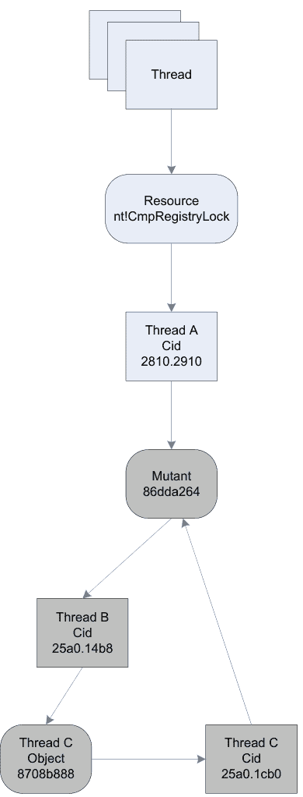

从组件-对象关系的角度来看，正是 DriverA.sys 正在等待 mutant 86dda264，尽管两个被阻塞的线程 B 和 C 都属于 ApplicationB 进程。

## 用户空间

这是 **死锁** 模式的另一种变体，当我们有混合的同步对象时，例如事件和临界区。事件可用于发出有工作项可供处理的信号，表明队列不为空，而临界区可用于保护某些共享数据。

这里典型的死锁场景是：一个线程通过调用 *WaitForSingleObject* 重置一个事件，并尝试获取一个临界区。与此同时，第二线程已经获取了该临界区，现在正在等待事件被设置：

| 线程 A | 线程 B |
| --- | --- |
| .. | .. |
| 重置事件 | .. |
| .. | 获取临界区 |
| 等待临界区 | .. |
| .. | 等待事件 |

修复此 bug 的经典方法是在两个线程中以相同的顺序获取临界区并等待事件。

在我们的示例崩溃转储中，我们可以轻松识别出已经获取临界区并正在等待事件 0x480 的第二个线程：

```
0:000> !locks
CritSec ntdll!LdrpLoaderLock+0 at 7c889d94
WaiterWoken     No
LockCount       9
RecursionCount  1
OwningThread    2038
EntryCount      0
ContentionCount 164
*** Locked

13 Id: 590.2038 Suspend: 1 Teb: 7ffaa000 Unfrozen
ChildEBP RetAddr  Args to Child
0483fd5c 78c22124 77e6b8d 00000000 00000000 ntdll!KiFastSystemCallRet
0483fd60 77e6bad8 00000000 00000000 00000000 ntdll!NtWaitForSingleObject+0xc
0483fdd0 77e6ba42 00000480 ffffffff 00000000 kernel32!WaitForSingleObjectEx+0xac
0483fde4 776c3fb0 00000480 ffffffff 779904f8 kernel32!WaitForSingleObject+0x12
0483fee0 776adafa 00000480 00000000 00000080 ole32!CDllHost::ClientCleanupFinish+0x2a
0483fe2c 776adf1a 00000000 0483fe7c 77790828 ole32!DllHostProcessUninitialize+0x80
0483fe4c 776b063f 00000000 00000000 0c9cee0 ole32!ApartmentUninitialize+0xf8
0483fe64 776b06e3 0483fe7c 00000000 00000001 ole32!wCoUninitialize+0x48
0483fe80 776e43f5 00000001 77670000 776afe0f ole32!CoUninitialize+0x65
0483fe8c 776afef0 0483feb4 776b5cb8 77670000 ole32!DoThreadSpecificCleanup+0x63
0483fe94 776b5cb8 77670000 00000003 00000000 ole32!ThreadNotification+0x37
0483feb4 776b5c1b 77670000 00000003 00000000 ole32!DllMain+0x176
0483fed4 78c2257a 77670000 00000003 00000000 ole32!_DllMainCRTStartup+0x52
0483fef4 7c83c195 776b5bd3 77670000 00000003 ntdll!LdrpCallInitRoutine+0x14
0483ffa8 776e61d6 00000000 00000000 0483ffec ntdll!LdrShutdownThread+0xd2
```


```
0483ffb8 77e66090 00000000 00000000 00000000 kernel32!ExitThread+0x2f
0483fffec 00000000 77c5de6d 0ab24f68 00000000 kernel32!BaseThreadStart+0x39
```

```
0:000> !handle 480 ff
Handle 00000480
 Type             Event
 Attributes       0
 GrantedAccess    0x1f0003:
        Delete,ReadControl,WriteDac,WriteOwner,Synch
        QueryState,ModifyState
 HandleCount  2
 PointerCount 4
 Name         <none>
 No object specific information available
```

要找到第一个线程——即重置事件并正在等待临界区的线程——并不容易。在我们的转储中，来自 !locks 命令输出，共有 9 个此类线程：

| 锁计数 | 9 |
| --- | --- |

作为同步原语，Event 没有所有者。尽管如此，如果相关信息未被覆盖，我们可以尝试在其他线程的原始堆栈附近查找 0x480 和 WaitForSingleObject 地址。让我们执行一次虚拟内存搜索：

```
0:000> s -d 0 L40000000 00000480
000726ec 00000480 00000022 000004a4 00000056
008512a0 00000480 00000480 00000000 00000000
008512a4 00000480 00000000 00000000 01014220
0085ab68 00000480 00000480 00000092 00000000
0085ab6c 00000480 00000092 00000000 01014234
00eb12a0 00000480 00000480 00000000 00000000
00eb12a4 00000480 00000000 00000000 0101e614
00ebeb68 00000480 00000480 00000323 00000000
00ebeb6c 00000480 00000323 00000000 0101e644
03fffb4fc 00000480 d772c13b ce753966 00fa840f
040212a0 00000480 00000480 00000000 00000000
040212a4 00000480 00000000 00000000 01063afc
0402ab68 00000480 00000480 00000fb6 00000000
0402ab6c 00000480 00000fb6 00000000 01063b5c
041312a0 00000480 00000480 00000000 00000000
041312a4 00000480 00000000 00000000 01065b28
0413eb68 00000480 00000480 00001007 00000000
0413eb6c 00000480 00001007 00000000 01065b7c
043412a0 00000480 00000480 00000000 00000000
043412a4 00000480 00000000 00000000 01066b44
0434ab68 00000480 00000480 00001033 00000000
0434ab6c 00000480 00001033 00000000 01066b9c
0483fd68 00000480 00000000 00000000 00000000
0483fddd 00000480 ffffffff ffffffff 0483fe00
0483fdec 00000480 ffffffff 777904f8 77790738
0483ffe08 00000480 00000000 00000080 776b0070
0483fe20 00000480 00000000 00000000 0483fe4c
05296f58 00000480 ffffffff ffffffff ffffffff
05297eb0 00000480 00000494 000004a4 000004c0
0557cf9c 00000480 00000000 00000000 00000000
05580adc 00000480 00000000 00000000 00000000
0558715c 00000480 00000000 00000000 00000000
0558d3cc 00000480 00000000 00000000 00000000
0559363c 00000480 00000000 00000000 00000000
0559ee0c 00000480 00000000 00000000 00000000
055a507c 00000480 00000000 00000000 00000000
056768ec 00000480 00000000 00000000 00000000
0568ef14 00000480 00000000 00000000 00000000
0581ff88 00000480 07ca7ee0 0581ff98 776cf2a3
05ed1260 00000480 00000480 00000000 00000000
05ed1264 00000480 00000000 00000000 01276efc
05ed8b68 00000480 00000480 0005c518 00000000
05ed8b6c 00000480 00005c18 00000000 01276f74
08f112a0 00000480 00000480 00000000 00000000
08f112a4 00000480 00000000 00000000 00000000
08f1ab68 00000480 00000480 00007732 00000000
08f1ab6c 00000480 00007732 00000000 01352db0
```

在粗体中我们高亮显示了线程 #13 的原始堆栈出现位置，并在粗斜体中高亮显示了属于另一个线程原始堆栈的内存位置。事实上，这些是搜索结果中从代码角度来看唯一有意义的内存位置。唯一有意义的堆栈跟踪可以在上面高亮显示的粗体内存位置中找到。

如果将搜索结果馈送给 WinDbg dds 命令，可以看出这一点：

```
0:000> .foreach (place { s -[1]d 0 L4000000 00000480 }) { dds place -30; .printf "\n" }
000726bc 00000390
000726c0 00000022
000726c4 000003b4
000726c8 00000056
000726cc 00000004
000726d0 6dc3f6fd
000726d4 0000040c
000726d8 0000001e
000726dc 0000042c
000726e0 00000052
000726e4 00000004
000726e8 eacb0f6d
000726ec 00000480
000726f0 00000022
000726f4 000004a4
000726f8 00000056
000726fc 00000004
00072700 62b796d2
00072704 000004fc
00072708 000001e1
0007270c 0000051c
00072710 00000052
00072714 00000004
00072718 2a615cff
0007271c 00000570
00072720 00000024
00072724 00000598
00072728 00000058
0007272c 00000004
00072730 51913e59
00072734 000005f0
00072738 00000016
...
...
...
0568eee4 05680008 xs ps2res+0x1b0008
0568eee8 01200000
0568eeec 00001010
0568eef0 00200001
0568eef4 00000468
0568eef8 00000121
0568eefc 00000000
0568ef00 00000028
0568ef04 00000030
0568ef08 00000060
0568ef0c 00040001
0568ef10 00000000
0568ef14 00000480
0568ef18 00000000
0568ef1c 00000000
0568ef20 00000000
0568ef24 00000000
0568ef28 00000000
0568ef2c 00800000
0568ef30 00008000
0568ef34 00808000
0568ef38 00000080
0568ef3c 00800080
0568ef40 00008080
0568ef44 00808080
0568ef48 00c0c0c0
0568ef4c 00ff0000
0568ef50 0000ff00
0568ef54 00ffff00
0568ef58 000000ff
0568ef5c 00ff00ff
0568ef60 0000ffff
0581ff58 0581ff70
0581ff5c 776b063f ole32!wCoUninitialize+0x48
0581ff60 00000001
0581ff64 00007530
0581ff68 77790438 ole32!gATHost
0581ff6c 00000000
0581ff70 581ff790
0581ff74 776cf370 ole32!CDllHost::WorkerThread+0xddd
0581ff78 0581ff8c
0581ff7c 00000001
0581ff80 776eba50 kernel32!WaitForSingleObjectEx
0581ff84 0657cfe8
0581ff88 00000480
0581ff8c 07ca7ee0
0581ff90 0581ff98
0581ff94 776cfa2a ole32!DLLHostThreadEntry+0xd
0581ff98 0581ff8b
0581ff9c 776b2307 ole32!CRpcThread::WorkerLoop+0x1e
0581ffa0 77790438 ole32!gATHost
0581ffa4 00000000
0581ffa8 657cfe88
0581ffac 77670000 ole32!_imp__InstallApplication <PERF> (ole32+0x0)
0581ffb0 776b2374 ole32!CRpcThreadCache::RpcWorkerThreadEntry+0x20
0581ffb4 00000000
0581ffb8 581ffe4c
0581ffbc 77e6608b kernel32!BaseThreadStart+0x34
0581ffc0 657cfe88
0581ffc4 00000000
0581ffc8 00000000
0581ffcc 657cfe88
0581ffd0 3cfb5963
0581ffd4 0581ffc4

05ed1230 0101f070
05ed1234 05ed1274
05ed1238 05ed1174
05ed123c 05ed0000
05ed1240 5ed1280
05ed1244 00000000
05ed1248 00000000
05ed124c 00000000
05ed1250 5ed8b80
05ed1254 05ed8000
05ed1258 00002000
05ed125c 00001000
05ed1260 00000480
05ed1264 00000480
05ed1268 00000000
05ed126c 00000000
05ed1270 01276efc
05ed1274 05ed12b4
05ed1278 05ed1234
05ed127c 05ed0000
05ed1280 05ed2d00
05ed1284 05ed1240
05ed1288 5ed1400
05ed128c 00000000
05ed1290 05edade0
05ed1294 5eada00
05ed1298 00002000
05ed129c 00001000
05ed12a0 00000220
05ed12a4 00000220
05ed12a8 00000000
05ed12ac 00000000
...
...
...
081fab3c 00000000
081fab40 00000000
081fab44 00000000
081fab48 00000000
081fab4c 00000000
081fab50 00000000
081fab54 00000000
081fab58 00000000
081fab5c 00000000
081fab60 abcdbbbb
081fab64 08f11000
081fab68 00000480
081fab6c 00000480
081fab70 00007732
081fab74 00000000
081fab78 01352db0
081fab7c dcbabbbb
081fab80 ffffffff
081fab84 c0c0ac1
081fab88 00000000
081fab8c c0c0c0c0
081fab90 c0c0c0c0
081fab94 c0c0c0c0
081fab98 c0c0c0c0
081fab9c c0c0c0c0
081faba0 c0c0c0c0
081faba4 ffffffff
081faba8 c0c0ac1
081fabac 00000000
081fabb0 c0c0c0c0
081fabb4 c0c0c0c0
081fabb8 c0c0c0c0
```

我们看到地址 0581ff88 是最有意义的，并且它附近也有 *WaitForSingleObjectEx*。这个地址属于以下线程 #16 的原始堆栈：

```
16 Id: 590.1aa0 Suspend: 1 Teb: 7ffa9000 Unfrozen
ChildEBP RetAddr
0581fc98 78c22124 ntdll!KiFastSystemCallRet
0581fc9c 7c83970f ntdll!NtWaitForSingleObject+0xc
0581fcd8 7c839620 ntdll!RtlpWaitOnCriticalSection+0x19c
0581fcf8 7c83a023 ntdll!RtlEnterCriticalSection+0xa8
0581fe00 77e67bcd ntdll!LdrUnloadDll+0x35
0581fe14 776b46fb kernel32!FreeLibrary+0x41
0581fe20 776b470f ole32!CCacheClass::CDllPathEntry::CFinishObject::Finish+0x2f
0581fe34 776b44a0 ole32!CCacheClass::CFinishComposite::Finish+0x1d
0581ff0c 776b0bfd ole32!CCacheClass::CleanUpDllsForApartment+0x1d0
0581ff38 776b0b1f ole32!FinishShutdown+0xd7
0581ff58 776b063f ole32!ApartmentUninitialize+0x94
0581ff70 776cf370 ole32!CoUninitialize+0x48
0581ff90 776cf2a3 ole32!CDllHost::WorkerThread+0xddd
0581ff98 776b2307 ole32!DllHostThreadEntry+0xd
0581ffac 776b2374 ole32!CRpcThread::WorkerLoop+0x1e
0581ff88 77e6608b ole32!CRpcThread::Cache::RpcWorkerThreadEntry+0x20
0581ffec 00000000 kernel32!BaseThreadStart+0x34
```


如果我们反汇编 ole32!CRpcThread::WorkerLoop 函数，在搜索结果的堆栈跟踪和原始堆栈数据中，该函数位于 WaitForSingleObjectEx 函数之下，我们可以看到前者确实调用了后者：

```
0:000> uf ole32!CRpcThread::WorkerLoop
ole32!CRpcThread::WorkerLoop:
776b22e9 mov edi,edi
776b22eb push esi
776b22ec mov esi,ecx
776b22ee cmp dword ptr [esi+4],0
776b22f2 jne ole32!CRpcThread::WorkerLoop+0x67 (776b234d)

ole32!CRpcThread::WorkerLoop+0xb:
776b22f4 push ebx
776b22f5 push edi
776b22f6 mov edi,dword ptr [ole32!_imp__WaitForSingleObjectEx (77671304)]
776b22fc mov ebx,7530h

ole32!CRpcThread::WorkerLoop+0x18:
776b2301 push dword ptr [esi+0Ch]
776b2304 call dword ptr [esi+8]
776b2307 call dword ptr [ole32!_imp__GetCurrentThread (7767130c)]
776b230d push eax

776b230e call dword ptr [ole32!_imp__RtlCheckForOrphanedCriticalSections (77671564)]
776b2314 xor eax,eax
776b2316 cmp dword ptr [esi],eax
776b2318 mov dword ptr [esi+8],eax
776b231b mov dword ptr [esi+0Ch],eax
776b231e je ole32!CRpcThread::WorkerLoop+0x65 (776b234b)

ole32!CRpcThread::WorkerLoop+0x37:
776b2320 push esi
776b2321 mov ecx,offset ole32!gRpcThreadCache (7778fc28)
776b2326 call ole32!CRpcThreadCache::AddToFreeList (776de78d)

ole32!CRpcThread::WorkerLoop+0x55:
776b232b push 0
776b232d push ebx
776b232e push dword ptr [esi]
776b2330 call edi
776b2332 test eax,eax
776b2334 je ole32!CRpcThread::WorkerLoop+0x60 (776cf3be)

ole32!CRpcThread::WorkerLoop+0x44:
776b233a push esi
776b233b mov ecx,offset ole32!gRpcThreadCache (7778fc28)
776b2340 call ole32!CRpcThreadCache::RemoveFromFreelist (776e42de)
776b2345 cmp dword ptr [esi+4],0
776b2349 je ole32!CRpcThread::WorkerLoop+0x55 (776b232b)
```

```
ole32!CRpcThread::WorkerLoop+0x65:
776b234b pop edi
776b234c pop ebx

ole32!CRpcThread::WorkerLoop+0x67:
776b234d pop esi
776b234e ret

ole32!CRpcThread::WorkerLoop+0x60:
776cf3be cmp dword ptr [esi+4],eax
776cf3c1 je ole32!CRpcThread::WorkerLoop+0x18 (776b2301)

ole32!CRpcThread::WorkerLoop+0x69:
776cf3c7 jmp ole32!CRpcThread::WorkerLoop+0x65 (776b234b)
```

因此，我们很可能已经识别出线程 #16，它通过调用 WaitForSingleObjectEx 重置事件并尝试获取临界区。我们还知道第二个线程 #13 已经获取了该临界区，现在正在等待事件被触发。

## 注释

关于线程 #16，如果我们转储 FreeLibrary 的参数，可以看到它正在尝试释放的模块：

```
0581fe14 776b46fb kernel32!FreeLibrary+0x41
```

在另一个内存转储中，我们有这样的内容：

```
16 Id: 13d0.2780 Suspend: 1 Teb: 7ffa8000 Unfrozen
ChildEBP RetAddr Args to Child
0210fc98 7c942124 7c95970f 00000100 00000000 ntdll!KiFastSystemCallRet
0210fc9c 7c95970f 00000100 00000000 00000000 ntdll!NtWaitForSingleObject+0xc
0210fc8 7c959620 00000000 00000000 00000000 ntdll!NtWaitForSingleObject+0x19c
0210fcf8 7c950a23 7c9a9d94 0210fe78 0210fea8 ntdll!RtlEnterCriticalSection+0xa8
0210fe00 7c827bcd 02a10000 0210fea8 0210fee4 ntdll!LdrUnloadDll+0x35
0210fe14 775346eb 02a10000 0210ff0c 775346ff kernel32!FreeLibrary+0x41
[...]

0:000> lm
start end module name
[...]
02a10000 02a19000 DLL_A DLL_A.dll
```

## 自身

这是 **死锁** 模式（第 194 页）的一种变体，其中拥有资源（以共享或独占模式）的线程试图再次独占获取它。这会导致自身死锁：

```
Resource @ 0x85d9c018    Shared 1 owning threads
  Contention Count = 2
  NumberOfExclusiveWaiters = 2
Threads: 85db0030-02<*>
Threads Waiting On Exclusive Access:
    85f07d78        85db0030
```

## 注释

软件诊断库的一位用户评论说，这种情况只有在资源先以共享方式获取，然后再以独占方式获取时才会发生。根据 WDK，资源支持递归锁定。唯一不支持的（并且可能导致死锁）场景是先以共享方式获取资源，然后再以独占方式获取。

## 调试器错误

在进行软件行为工件收集、实时调试或事后内存转储分析时，我们也必须考虑 **调试器错误** 的可能性。我们将其分为硬错误和软错误。前者是导致进一步异常软件行为事件（如崩溃和挂起）的软件缺陷和行为问题。一个例子是关于 DebugDiag³⁵ 的这篇 Microsoft KB 文章。软调试器错误通常表现为数据输出中的故障、无意义或误报的诊断，例如 **!vm** WinDbg 命令输出中以下过多的非分页池使用情况消息（请参阅相应的 MS KB 文章³⁶）：

```
1: kd> !vm

*** Virtual Memory Usage ***
Physical Memory:     1031581 (  4126324 Kb)
Page File: \??\C:\pagefile.sys
Current:   4433524 Kb Free Space:  4433520 Kb
Minimum:   4433524 Kb Maximum:     12378972 Kb
Unimplemented error for MiSystemVaTypeCount
Available Pages:     817652 (   3270608 Kb)
ResAvail Pages:      965229 (   3860916 Kb)
Locked IO Pages:     0 (           0 Kb)
Free System PTEs:   33555714 ( 134222856 Kb)
Modified Pages:      15794 (     63176 Kb)
Modified PF Pages:   15793 (     63172 Kb)
NonPagedPool Usage: 88079121 ( 352316484 Kb)
NonPagedPool Nx Usage:  12885 (      51540 Kb)
NonPagedPool Max:    764094 (   3056376 Kb)
**************** Excessive NonPaged Pool Usage ****************
PagedPool 0 Usage:   35435 (    141740 Kb)
PagedPool 1 Usage:   3620 (     14480 Kb)
PagedPool 2 Usage:    573 (       2292 Kb)
PagedPool 3 Usage:    535 (       2140 Kb)
PagedPool 4 Usage:    538 (       2152 Kb)
PagedPool Usage:   40701 (    162804 Kb)
PagedPool Maximum: 33554432 ( 134217728 Kb)
Session Commit:     9309 (     37236 Kb)
Shared Commit:      6460 (     25840 Kb)
Special Pool:        0 (          0 Kb)
Shared Process:     5760 (    23040 Kb)
PagedPool Commit:   40765 (    163060 Kb)
Driver Commit:      2805 (     11220 Kb)
Committed pages:   212472 (    849888 Kb)
Commit limit:     2139487 (   8557948 Kb)
```

## 调试器遗漏

如果某些误报可以被视为软 **调试器错误**（第 219 页），则漏报对软件行为分析（尤其是恶意软件分析）可能产生更严重的影响。这里的一个典型示例是当前的 .imgscan 命令，根据文档，该命令应默认扫描虚拟进程空间中的 MZ/PE 签名。不幸的是，它在资源页面中未检测到此类签名（我们尚未检查堆栈区域）：

```
00000000`0fd0000 image base
SECTION HEADER #4
  .rsrc name
  6430 virtual size
  4000 virtual address
  6600 size of raw data
  1600 file pointer to raw data
  [...]
  40000040 flags
        Initialized Data
        (no align specified)
        Read Only
0:000> .imgscan /r 00000000`0fd4000 L200
0:000> s -[12]sa 00000000`0fd4000 L200
00000000`0ffd40b0  "MZ"
00000000`0ffd40fd  "!This program cannot be run in D"
00000000`0ffd411d  "OS mode."
00000000`0ffd4188  "Rich"
00000000`0ffd4198  "PE"
0:000> !dh 00000000`0ffd40b0
File Type: DLL
FILE HEADER VALUES
  14C machine (i386)
  3 number of sections
  time date stamp Fri Jan 18 21:27:25 2013
  0 file pointer to symbol table
  0 number of symbols
E0 size of optional header
2102 characteristics
        Executable
        32 bit word machine
        DLL
[...]
```

其他分析场景包括 **!analyze -v**，它向我们显示一个断点，而不是来自并行线程的异常违规。

名为“小值”（第 873 页）的模式处理易于识别的值，例如句柄、超时、鼠标指针坐标、枚举值和窗口消息。还有另一种值，例如 256（+/- 1）或其他某些整数值。这里我们还可以添加一些十六进制表示中的常规模式，例如窗口句柄或标志，例如 0x10008000。此类设计值可能落入某个模块范围，即所谓的“巧合符号信息”（第 134 页）模式。它们不一定是堆栈跟踪参数（后者也可能是虚假函数参数，第 390 页）。如果在 WinDbg 命令的输出中看到设计值，尤其是与异常行为模式相关时，则可能指向某些已达到的设计限制。例如，阻塞 ALPC 队列（第 77 页）可能对 I/O 完成端口^37 有限制。当我们在一个无响应系统中观察到 ALPC 等待链（第 1097 页）时：

```
0: kd> !alpc /p <port_address>
[...]
512 thread(s) are registered with port IO completion object:
[...]
```


## 异常模块

在查看模块列表（!mv）、搜索模块（!imgscan）或检查特定模块（!address、!dh）时，我们可能会注意到其中某个模块是异常的。该偏差可能存在于（但不限于，因为任何情况都有可能）：

- 可疑模块名称
- 可疑保护
- 可疑模块加载地址

```
0:005> !imgscan
MZ at 00040000, prot 00000040, type 00020000 - size 1d000
MZ at 00340000, prot 00000002, type 01000000 - size 9c000
Name: iexplore.exe
MZ at 02250000, prot 00000002, type 00040000 - size 2000
MZ at 023b0000, prot 00000002, type 01000000 - size b000
Name: msimtf.dll
MZ at 03f80000, prot 00000002, type 00040000 - size 2000
MZ at 10000000, prot 00000004, type 00020000 - size 5000
Name: screens_dll.dll
MZ at 16080000, prot 00000002, type 01000000 - size 25000
Name: mdnsNSP.dll
MZ at 6ab50000, prot 00000002, type 01000000 - size 26000
Name: DSSENH.dll
MZ at 6b030000, prot 00000002, type 01000000 - size 5b0000
Name: MSHTML.dll
MZ at 6ba10000, prot 00000002, type 01000000 - size b4000
Name: JSCRIPT.dll
MZ at 6cec0000, prot 00000002, type 01000000 - size 1b000
Name: CRYPTNET.dll
MZ at 6d260000, prot 00000002, type 01000000 - size e000
Name: PNGFILTER.DLL
MZ at 6d2f0000, prot 00000002, type 01000000 - size 29000
Name: msls31.dll
MZ at 6d700000, prot 00000002, type 01000000 - size 30000
Name: MLANG.dll
MZ at 6d740000, prot 00000002, type 01000000 - size 4d000
Name: SSV.DLL
MZ at 6d7b0000, prot 00000002, type 01000000 - size c000
Name: ImgUtil.dll
MZ at 6ddb0000, prot 00000002, type 01000000 - size 2f000
Name: iepeers.DLL
MZ at 6df20000, prot 00000002, type 01000000 - size 33000
Name: IEShims.dll
MZ at 6eb80000, prot 00000002, type 01000000 - size a94000
Name: IEFRAME.dll
MZ at 703b0000, prot 00000002, type 01000000 - size 53000
Name: SWEPRX.dll
MZ at 70740000, prot 00000002, type 01000000 - size 40000
Name: SWEEPRX.dll
MZ at 725a0000, prot 00000002, type 01000000 - size 12000
Name: PNPRNPNP.dll
MZ at 725d0000, prot 00000002, type 01000000 - size 8000
Name: WINRNR.dll
MZ at 725e0000, prot 00000002, type 01000000 - size 136000
Name: MSXML3.dll
MZ at 72720000, prot 00000002, type 01000000 - size c000
Name: wshbth.dll
MZ at 72730000, prot 00000002, type 01000000 - size f000
Name: NAPINSP.dll
MZ at 72890000, prot 00000002, type 01000000 - size 6000
Name: SensApi.dll
MZ at 72ec0000, prot 00000002, type 01000000 - size 42000
Name: WINSPOOL.DRV
MZ at 734b0000, prot 00000002, type 01000000 - size 6000
Name: rasadhlp.dll
MZ at 736b0000, prot 00000002, type 01000000 - size 85000
Name: COMCTL32.dll
MZ at 73ac0000, prot 00000002, type 01000000 - size 7000
Name: MIDIMAP.dll
MZ at 73ae0000, prot 00000002, type 01000000 - size 14000
Name: MSACM32.dll
MZ at 73b00000, prot 00000002, type 01000000 - size 66000
Name: audioeng.dll
MZ at 73c30000, prot 00000002, type 01000000 - size 9000
Name: MSACM32.DRV
MZ at 73c60000, prot 00000002, type 01000000 - size 21000
Name: AudioSes.DLL
MZ at 73c90000, prot 00000002, type 01000000 - size 2f000
Name: WINMMDRV.DLL
MZ at 74290000, prot 00000002, type 01000000 - size bb000
Name: PROPSYS.dll
MZ at 74390000, prot 00000002, type 01000000 - size f000
Name: nlaapi.dll
MZ at 743a0000, prot 00000002, type 01000000 - size 4000
Name: kuser.dll
MZ at 74430000, prot 00000002, type 01000000 - size 15000
Name: Cabinet.dll
MZ at 74450000, prot 00000002, type 01000000 - size 3d000
Name: OLEACC.dll
MZ at 74490000, prot 00000002, type 01000000 - size 1ab000
Name: gdiplus.dll
MZ at 74640000, prot 00000002, type 01000000 - size 28000
Name: MMDevAPI.DLL
MZ at 74670000, prot 00000002, type 01000000 - size 32000
Name: WINMM.dll
MZ at 746b0000, prot 00000002, type 01000000 - size 31000
Name: TAPI32.dll
MZ at 749e0000, prot 00000002, type 01000000 - size 19e000
Name: COMCTL32.dll
MZ at 74b80000, prot 00000002, type 01000000 - size 7000
Name: AVRT.dll
MZ at 74ba0000, prot 00000002, type 01000000 - size 4a000
Name: RASAPI32.dll
MZ at 74ce0000, prot 00000002, type 01000000 - size 3f000
Name: UxTheme.dll
MZ at 74de0000, prot 00000002, type 01000000 - size 2d000
Name: WINTRUST.dll
MZ at 74ea0000, prot 00000002, type 01000000 - size 14000
Name: rasman.dll
MZ at 74f70000, prot 00000002, type 01000000 - size c000
Name: rtutils.dll
MZ at 74f80000, prot 00000002, type 01000000 - size 5000
Name: WSHTCPIP.dll
MZ at 7f4b0000, prot 00000002, type 01000000 - size 21000
Name: NTMARTA.dll
MZ at 75010000, prot 00000002, type 01000000 - size 3b000
Name: RSAENH.dll
MZ at 75050000, prot 00000002, type 01000000 - size 5000
Name: MSIMG32.dll
MZ at 75060000, prot 00000002, type 01000000 - size 15000
Name: GAPAPI.dll
MZ at 750a0000, prot 00000002, type 01000000 - size 46000
Name: SCHANNEL.dll
MZ at 752b0000, prot 00000002, type 01000000 - size 3b000
Name: MSWSOCK.dll
MZ at 75370000, prot 00000002, type 01000000 - size 45000
Name: bcrypt.dll
MZ at 753f0000, prot 00000002, type 01000000 - size 5000
Name: WSHPiP6.dll
MZ at 75400000, prot 00000002, type 01000000 - size 8000
Name: VERSION.dll
MZ at 75420000, prot 00000002, type 01000000 - size 7000
Name: CREDSSP.dll
MZ at 75430000, prot 00000002, type 01000000 - size 35000
Name: ncrypt.dll
MZ at 75480000, prot 00000002, type 01000000 - size 22000
Name: dhcpcsvc6.DLL
MZ at 754b0000, prot 00000002, type 01000000 - size 7000
Name: WINNSI.DLL
MZ at 754c0000, prot 00000002, type 01000000 - size 35000
Name: dhcpcsvc.DLL
MZ at 75500000, prot 00000002, type 01000000 - size 19000
Name: IPHLPAPI.DLL
MZ at 75590000, prot 00000002, type 01000000 - size 3a000
Name: slc.dll
MZ at 755d0000, prot 00000002, type 01000000 - size f2000
Name: CRYPT32.dll
MZ at 75740000, prot 00000002, type 01000000 - size 12000
Name: MSASN1.dll
MZ at 75760000, prot 00000002, type 01000000 - size 11000
Name: SAMLIB.dll
MZ at 75780000, prot 00000002, type 01000000 - size 76000
Name: NETAPI32.dll
MZ at 75800000, prot 00000002, type 01000000 - size 2c000
Name: DNSAPI.dll
MZ at 75a70000, prot 00000002, type 01000000 - size 5f000
Name: sxs.dll
MZ at 75ad0000, prot 00000002, type 01000000 - size 2c000
Name: apphelp.dll
MZ at 75b30000, prot 00000002, type 01000000 - size 14000
Name: Secur32.dll
MZ at 75b50000, prot 00000002, type 01000000 - size 1e000
Name: USERENV.dll
MZ at 75c90000, prot 00000002, type 01000000 - size 7000
Name: PSAPI.DLL
MZ at 75ca0000, prot 00000002, type 01000000 - size c3000
Name: RPCRT4.dll
MZ at 75d70000, prot 00000002, type 01000000 - size 73000
Name: COMDLG32.dll
MZ at 75df0000, prot 00000002, type 01000000 - size 9000
Name: LPK.dll
MZ at 75e00000, prot 00000002, type 01000000 - size dc000
Name: KERNEL32.dll
MZ at 75ee0000, prot 00000002, type 01000000 - size aa000
Name: msvcrt.dll
MZ at 75f90000, prot 00000002, type 01000000 - size 1e8000
Name: iertutil.dll
MZ at 76180000, prot 00000002, type 01000000 - size 29000
Name: imagehlp.dll
MZ at 761b0000, prot 00000002, type 01000000 - size 6000
Name: NSI.dll
MZ at 761c0000, prot 00000002, type 01000000 - size 84000
Name: CLBCatQ.DLL
MZ at 76250000, prot 00000002, type 01000000 - size 49000
Name: WLDAP32.dll
MZ at 762a0000, prot 00000002, type 01000000 - size c6000
Name: ADVAPI32.dll
MZ at 76370000, prot 00000002, type 01000000 - size 4b000
Name: GDI32.dll
MZ at 763c0000, prot 00000002, type 01000000 - size 59000
Name: SHLWAPI.dll
MZ at 76420000, prot 00000002, type 01000000 - size e6000
Name: WININET.dll
MZ at 76510000, prot 00000002, type 01000000 - size b10000
Name: SHELL32.dll
MZ at 77020000, prot 00000002, type 01000000 - size 145000
Name: ole32.dll
MZ at 77170000, prot 00000002, type 01000000 - size 7d000
Name: USP10.dll
MZ at 771f0000, prot 00000002, type 01000000 - size 8d000
Name: OLEAUT32.dll
MZ at 77280000, prot 00000002, type 01000000 - size 18a000
Name: SETUPAPI.dll
MZ at 77410000, prot 00000002, type 01000000 - size 9d000
Name: USER32.dll
MZ at 774b0000, prot 00000002, type 01000000 - size 133000
Name: urlmon.dll
MZ at 775f0000, prot 00000002, type 01000000 - size 127000
Name: ntdll.dll
MZ at 77720000, prot 00000002, type 01000000 - size 3000
Name: Normaliz.dll
MZ at 77730000, prot 00000002, type 01000000 - size 2d000
Name: WS2_32.dll
MZ at 77760000, prot 00000002, type 01000000 - size 1e000
Name: IMM32.DLL
MZ at 77780000, prot 00000002, type 01000000 - size c8000
Name: MSCTF.dll
MZ at 7c340000, prot 00000002, type 01000000 - size 56000
Name: MSVCR71.dll
```


```
0:005> !address 00040000
Usage:                   <unclassified>
Allocation Base:         00040000
Base Address:            00040000
End Address:             0005d000
Region Size:             0001d000
Type:                    00020000 MEM_PRIVATE
State:                   00001000 MEM_COMMIT
Protect:                 00000040 PAGE_EXECUTE_READWRITE
```

```
0:005> !address 10000000
Usage:                   <unclassified>
Allocation Base:         10000000
Base Address:            10000000
End Address:             10001000
Region Size:             00001000
Type:                    00020000 MEM_PRIVATE
State:                   00001000 MEM_COMMIT
Protect:                 00000004 PAGE_READWRITE
```

- 可疑文本内容
- 可疑导入表（例如，屏幕捕获）或其缺失（动态导入）

```
0:005> !dh 10000000
[...]
2330 [  50] address [size] of Export Directory
20E0 [  78] address [size] of Import Directory
0   [   0] address [size] of Resource Directory
0   [   0] address [size] of Exception Directory
0   [   0] address [size] of Security Directory
4000 [  34] address [size] of Base Relocation Directory
2060 [  1C] address [size] of Debug Directory
0   [   0] address [size] of Description Directory
0   [   0] address [size] of Special Directory
0   [   0] address [size] of Thread Storage Directory
0   [   0] address [size] of Load Configuration Directory
0   [   0] address [size] of Bound Import Directory
2000 [  58] address [size] of Import Address Table Directory
0   [   0] address [size] of Delay Import Directory
0   [   0] address [size] of COR20 Header Directory
0   [   0] address [size] of Reserved Directory
[...]
```

```
0:005> dps 10000000+2000 10000000+2000+58
10002000 76376101 gdi32!CreateCompatibleDC
10002004 763793d6 gdi32!StretchBlt
10002008 76377461 gdi32!CreateDIBSection
1000200c 763762a0 gdi32!SelectObject
10002010 00000000
10002014 754e4a11 kernel32!lstrcmpW
10002018 75e440aa kernel32!VirtualFree
1000201c 75e4ad55 kernel32!VirtualAlloc
10002020 00000000
10002024 77429ced user32!ReleaseDC
10002028 77423ba7 user32!NtUserGetWindowDC
1000202c 77430e21 user32!GetWindowRect
10002030 00000000
10002034 744a75e9 GdiPlus!GdiplusStartup
10002038 744976dd GdiPlus!GdipSaveImageToStream
1000203c 0744cd38 GdiPlus!GdipGetImageEncodersSize
10002040 744971cf GdiPlus!GdipDisposeImage
10002044 744a8591 GdiPlus!GdipCreateBitmapFromHBITMAP
10002048 744cdbae GdiPlus!GdipGetImageEncoders
1000204c 00000000
10002050 7707d51b ole32!CreateStreamOnHGlobal
10002054 00000000
10002058 00000000
```

```
0:000> !dh 012a0000
[...]
0   [   0] address [size] of Export Directory
0   [   0] address [size] of Import Directory
0   [   0] address [size] of Resource Directory
0   [   0] address [size] of Exception Directory
0   [   0] address [size] of Security Directory
8000 [ FC] address [size] of Base Relocation Directory
4000 [ 1C] address [size] of Debug Directory
0   [   0] address [size] of Description Directory
0   [   0] address [size] of Special Directory
0   [   0] address [size] of Thread Storage Directory
0   [   0] address [size] of Load Configuration Directory
0   [   0] address [size] of Bound Import Directory
0   [   0] address [size] of Import Address Table Directory
0   [   0] address [size] of Delay Import Directory
0   [   0] address [size] of COR20 Header Directory
0   [   0] address [size] of Reserved Directory
[...]
```

- 可疑路径名称

年龄：7，PDB：d:\work\BekKonnekt\Client_src_code_New\Release\Blackjoe_new.pdb

调试目录(1)

| 类型 | 大小 | 地址 | 指针 |
|------|------|------|------|
| cv | 46 | 2094 | 894 |

格式：RSDS, guid, 1, C:\MyWork\screens_dll\Release\screens_dll.pdb

- 可疑镜像路径（尽管可能只是 .NET 程序集的动态代码生成）

- 未初始化的镜像资源

```
0:002> lmv m C6DC
start    end        module name
012a0000 012a9000   C6DC    C (no symbols)
    Loaded symbol image file: C6DC.tmp
    Image path: C:\Users\User\AppData\Local\Temp\C6DC.tmp
    Image name: C6DC.tmp
    Timestamp:        Sun May 30 20:18:32 2010 (4C02BA08)
    CheckSum:         00000000
    ImageSize:        00009000
    File version:     0.0.0.0
    Product version:  0.0.0.0
    File flags:       0 (Mask 0)
    File OS:          0 Unknown Base
    File type:        0.0 Unknown
    File date:        00000000.00000000
    Translations:     0000.04b0 0000.04e4 0409.04b0 0409.04e4
```

## 注释

.imgscan 可能无法找到所有隐藏模块（**调试器遗漏**模式，第 220 页）。

时间戳也可能可疑。

## 异常令牌

有时我们需要检查进程运行在哪个安全主体或组下，它拥有什么特权，或者是否有模拟线程。我们可能会发现一个带有不同安全标识符的意外令牌，例如，网络服务而不是本地系统（SID: S-1-5-18）：

```
PROCESS 8f218d88  SessionId: 0  Cid: 09c4    Peb: 7ffdf000  ParentCid: 0240
DirBase: bffd4260  ObjectTable: e10eae90  HandleCount:  93.
Image: ServiceA.exe
VadRoot 8f1f70e8 Vads 141 Clone 0 Private 477. Modified 2. Locked 0.
DeviceMap e10038d8
Token                             e10ff5d8
[...]
0: kd> !token e10ff5d8
_TOKEN e10ff5d8
TS Session ID: 0
User: S-1-5-20
[...]
```

众所周知的 SID 可以在 MS KB 文章 243330³⁹ 中找到。

## 历时模块

在遇到性能问题时，我们可能会请求在一定间隔后保存的一组连续内存转储。在这些内存转储中，我们可能会看到同一线程（或多个线程）具有相似的堆栈跟踪。在这种简单的诊断场景中，我们可以根据堆栈跟踪诊断出多种模式：活动线程（第 66 页），可能是带有尖峰间隔（第 884 页）的尖峰线程（第 885 页），或者是稳定不变的等待链（例如，临界区，第 1086 页）。在此基础上，我们可以根据模块等待链（第 1103 页）轻松识别顶部活动（第 1012 页）和阻塞（第 96 页）模块。

更复杂的情况发生在不同时间点拥有不同线程 ID 的不同活动线程和/或等待链时。但是，如果它们的顶部模块相同，我们可能已经找到了性能根本原因组件，特别是在活动线程的情况下，因为从统计学角度来看，此类线程在快照时间附近很可能处于活动状态相当长的时间增量（因为线程通常处于等待状态）。该假设还可以通过与软件跟踪和日志的相关分析（Inter-Correlation⁴⁰）来确认，在这些分析中可以看到活动线程⁴¹不连续性⁴² 和 时间增量⁴³。

我们将这种分析模式称为历时模块，因为我们看到模块组件在不同时间点出现在不同的线程堆栈跟踪中。典型的简化场景在下图中所示：

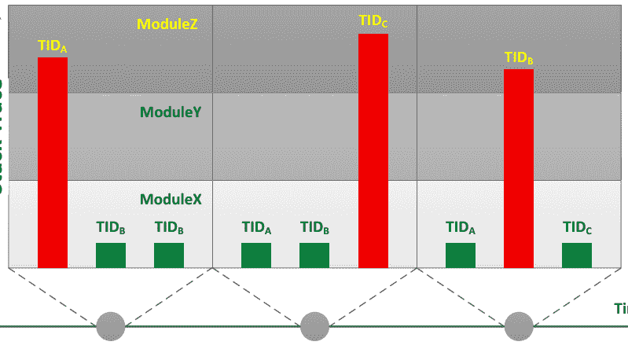

## 内存快照

这种分析模式与同步模块情况不同（模块组件在相同时间出现在不同线程堆栈跟踪中），后者被称为无处不在组件（第 1020 页）。

## 对话框

与 **消息框**（第 660 页）和 **字符串参数**（第 962 页）模式类似，我们还有 **对话框** 模式，在检查函数参数时可以看到对话框标题和内容。尽管在下面的示例中，我们可以从友好的调用堆栈函数名称得知对话框用途，但对于许多第三方应用程序，我们要么没有符号，要么没有此类辅助函数，但我们想知道在未收集屏幕截图时屏幕上显示了什么。

前两个示例来自 *记事本* 应用程序，第三个来自 IE：

```
0:000> kv
ChildEBP RetAddr  Args to Child
0017f5c4 777b073f 777c3c9f 000d023c 00000001 ntdll!KiFastSystemCallRet
0017f5c8 777c3c9f 000d023c 00000000 user32!NtUserWaitMessage+0xc
0017f5fc 777c2dc0 00310778 000023c 00000001 user32!DialogBox+0x202
0017f624 777c2cee 76460000 02a6bc60 000d023c user32!InternalDialogBox+0xd0
0017f644 76489a65 76460000 02a6bc60 000d023c user32!DialogBoxIndirectParamAorW+0x37
0017f680 76489ccf 0017f68c 00000001 0017f644 comdlg32!ChooseFont+0x1ba
0017f6bc 06741c7 0017f6d4 00000111 00000000 comdlg32!ChooseFont+0x2e
0017f734 0067164a 000d023c 00000021 00000000 notepad!NPCommand+0x4c7
0017f758 777afd72 000d023c 00000111 00000021 notepad!NPWndProc+0x4cf
0017f784 777a4ea 0067146c 000d023c 00000111 user32!InternalCallWinProc+0x23
0017f7fc 777b018d 00000000 067146c 000d023c user32!UserCallWinProcCheckWow+0x14b
0017f860 777b022b 067146c 00000000 0017f8a4 user32!DispatchMessageWorker+0x322
0017f870 0671465 0017f888 00000000 067a21c user32!DispatchMessage+0xf
0017f8a4 067195d 0677000 00000000 00231cfa notepad!WinMain+0xe3
0017f934 76520de9 7dfd9000 0017f980 77b019bf notepad!_initterm+0x1a1
0017f940 77b019bf 7ffd9000 78fb7908 00000000 kernel32!BaseThreadInitThunk+0xe
0017f980 77b0198e 006731ed 7ffd9000 00000000 ntdll!_RtlUserThreadStart+0x23
0017f998 00000000 006731ed 7ffd9000 00000000 ntdll!_RtlUserThreadStart+0x1b
```

```
0:000> dc 02a6bc60 150
02a6bc60 08c880c4 00000000 000d0014 011f0036 ...........6...
02a6bc70 000000c4 00460000 006e006f 00000074 .....F.o.n.t...
02a6bc80 004d0008 00200053 00680053 006c0065 ..M.S. .S.h.e.l.
02a6bc90 0020006c 006c0044 00000067 50020000 l. .D.l.g....P
02a6bca0 00000000 00700007 00090028 0fffa440 .......(@...
02a6bcb0 00260082 00670046 0074006e 0000003a ...&.F.n.t...
02a6bcc0 00000000 50210b51 00000000 00100007 ....Q!P.......
02a6bcd0 004c0062 ffff0470 00000085 00000000 b.L.p.......
02a6bce0 50020000 00000000 0070006e 0090002c .P....n.,...
02a6bcf0 0fff0441 00460082 006e006f 00200074 A...F.o.n.t.
02a6bd00 00740073 00790062 006e0069 0030003a s.t.&y.l.e.i...
02a6bd10 00000000 50210041 00000000 0010000e ...A!P...n...
02a6bd20 004c0044 ffff0471 00000085 00000000 J.L.q.......
02a6bd30 50020000 00000000 007000bd 0009001e ...P.......
02a6bd40 ffff0442 00260082 00690053 0055007a B...&S.i.z.e.
02a6bd50 0000000a 00000000 50210b51 00000000 .....Q!P....
02a6bd60 001000be 004c0024 0fff0472 00000085 ...$.L.r...
02a6bd70 00000000 50020007 00000000 00610007 ....P....a.
02a6bd80 00480062 0fff0430 00450080 00660066 b.H.0....E.f.f.
02a6bd90 00630065 00730074 00000000 50010003 e.c.t.s......P
```


```
0:000> kv
ChildEBP RetAddr  Args to Child
0017f5a8 777b073f 777c3c9f 0000d23c 00000001 ntdll!KiFastSystemCallRet
0017f5ac 777c3c9f 0000d23c 00000001 00000000 user32!NtUserWaitMessage+0xc
0017f5e0 777c2dc0 0044034a 0000d23c 00000001 user32!DialogBox+0x202
0017f608 777c2eec 768a0000 029030bc 0000d23c user32!InternalDialogBox+0xd0
0017f628 777c1eef 768a0000 029030bc 0000d23c user32!DialogBoxIndirectParamAorW+0x37
0017f64c 7695d877 768a0000 00003810 0000d23c user32!DialogBoxParamW+0x3f
0017f670 76a744dc 768a0000 00003810 0000d23c shell32!SHFusionDialogBoxParam+0x32
0017f6b0 0674416 0000d23c 00253dc 00672fc4 shell32!ShellAboutW+0x4d
0017f734 0067164a 0000d23c 00000041 0000000 notepad!NPCommand+0x718
0017f758 777afd72 0000d23c 00000111 00000041 notepad!NPWndProc+0x4cf
0017f784 777af4ea 0067146c 0000d23c 00000111 user32!InternalCallWinProc+0x23
0017f7fc 777b018d 00000000 067146c 0000d23c user32!UserCallWinProcCheckWow+0x14b
0017f860 777b022b 067146c 00000000 0017f8a4 user32!DispatchMessageWorker+0x322
0017f870 0671465 0017f888 00000000 0067a21c user32!DispatchMessageW+0xf
0017f8a4 067195d 0067000 00000000 00231cfa notepad!WinMain+0xe3
0017f934 7652d0e9 7ffd9000 0017f980 77b01b9b notepad!_initterm+0x1a1
0017f940 77b019b7 7ffd9000 78fb7908 00000000 kernel32!BaseThreadInitThunk+0xe
0017f980 77b0198e 006731ed 7ffd9000 00000000 ntdll!__RtlUserThreadStart+0x23
0017f998 00000000 006731ed 7ffd9000 00000000 ntdll!__RtlUserThreadStart+0x1b
```

```
0:000> dc 029030bc 150
029030bc ffff0001 00000000 00000000 80c800cc ................
029030cc 01f4000c 01130014 000000ee 00410000 .......A.
029030dc 006f0062 00740075 00250020 00000073 b.o.u.t. .%.s..
029030ec 00000008 004d0000 00200053 00680053 ....M.S. .s.h.
029030fc 006c0065 0020006c 006e0044 00000067 e.l.l. .D.l.g...
0290310c 00000000 00000000 5000043 00370007 ....C.P.P..
0290311c 00140015 00003009 0082ffff 0000ffff ....0.......
0290312c 00000000 00000000 00000000 500008c ...........P
0290313c 00370023 000a00c8 00003500 0082ffff #.7.....S.....
0290314c 00000000 00000000 00000000 5000008c ...........P
0290315c 00410023 000a00eb 0000350b 0082ffff #.A.....S.....
0290316c 00000000 00000000 00000000 50000080 ...........P
0290317c 004b0023 000a00d2 0000350a 0082ffff #.K.....S.....
0290318c 00000000 00000000 00000000 50000080 ...........P
0290319c 00550023 002800d2 00003513 0082ffff #.U...(.S.....
029031ac 00680054 00200065 00570025 04e0049 Th.e. %.W.I.N.
029031bc 004f0044 00530057 004c005f 004e004f D.O.W.S._.L.O.N.
029031cc 00250047 006f0020 00650070 00610072 G.% .o.p.e.r.a.
029031dc 006e0069 0067002e 00730020 00730079 t.i.n.g. .s.y.s.
029031ec 00650074 0020006d 006e0069 00200064 t.e.m. .a.n.d. .
```

```
16 Id: 10fc.124c Suspend: 0 Teb: 7ffd7000 Unfrozen
ChildEBP RetAddr  Args to Child
053f8098 777b073f 777c3c9f 003d0650 00000001 ntdll!KiFastSystemCallRet
053f809c 777c3c9f 003d0650 00000001 00000000 user32!NtUserWaitMessage+0xc
053f80d0 777c2dc0 002e0378 003d0650 00000001 user32!DialogBox+0x202
053f80f8 777c2eec 6f270000 03387bd4 003d0650 user32!InternalDialogBox+0xd0
053f8118 777c1eef 6f270000 03387bd4 003d0650 user32!DialogBoxIndirectParamAorW+0x37
053f813c 6f2c5548 6f270000 00005398 003d0650 user32!DialogBoxParamW+0x3f
053f8164 6f2c5743 6f270000 00005398 003d0650 ieframe!Detour_DialogBoxParamW+0x47
053f8188 6f2c56f5 6f270000 00005398 001906ea ieframe!SHFusionDialogBoxParam+0x32
053f9228 6f2c5378 001905ea 053fb540 00000104 ieframe!DoAddToFavDlgEx+0xcf
053fbb5c 6f2c58f9 001905ea 0e69a0c0 053fbbf0 ieframe!AddToFavoritesEx+0x349
053fbdb8 6f2c57ee 00000000 053fbff0 00000000 ieframe!CBaseBrowser2::_AddToFavorites+0xe9
053fc0f4 6f2c3e5e 00000000 00000000 00000001 ieframe!CBaseBrowser2::_ExecAddToFavorites+0x123
053fc124 6f39ca4e 6f39c524 00000000 00000001 ieframe!CBaseBrowser2::_ExecExplorer+0xbe
053fc1c4 6f39ceee 114ea39c 6f39c524 00000008 ieframe!CBaseBrowser2::_Exec+0x12d
053fc17c 6f39cf17 6f39c524 00000008 00000001 ieframe!CShellBrowser2::_Exec_CCommonBrowser+0x80
053fc414 6f498284 114ea39c 6f39c524 00000008 ieframe!CShellBrowser2::_Exec+0x626
053fc43c 6f49e5cd 0000a173 00000000 ffffff77 ieframe!CShellBrowser2::_FavoriteOnCommand+0x75
053fc458 6f3c5ea8 0000a173 00000000 00000011 ieframe!CShellBrowser2::_OnDefault+0x3e
053fd6f0 6f394194 0000a173 00000000 0000031a ieframe!CShellBrowser2::v_OnCommand+0xa7b
053fd70c 6f39898d 001905ea 00000111 0000a173 ieframe!CBaseBrowser2::v_WndProc+0x247
053fd770 6f3988db 001905ea 00000111 0000a173 ieframe!CShellBrowser2::v_WndProc+0x3fe
053fd794 777afd72 001905ea 00000111 0000a173 ieframe!CShellBrowser2::s_WndProc+0xfb
053fd7c0 777afe4a 6f39887a 001905ea 00000111 user32!InternalCallWinProc+0x23
053fd838 777b0943 00000000 6f39887a 001905ea user32!UserCallWinProcCheckWow+0x14b
053fd878 777b0b36 00252838 01223dc0 0000a173 user32!SendMessageWorker+0x4b7
053fd898 6f3c6f32 001905ea 00000111 0000a173 user32!SendMessageW+0x7c
053fd8d0 6f396ead 0056049c 00000111 0000a173 ieframe!CInternetToolBarHost::v_WndProc+0xf8
053fd8f4 777afd72 0056049c 00000111 0000a173 ieframe!CImpWndProc::s_WndProc+0x65
053fd920 777afe4a 6f396e6e 0056049c 00000111 user32!InternalCallWinProc+0x23
053fd998 777b018d 00000000 6f396e6e 0056049c user32!UserCallWinProcCheckWow+0x14b
053fd9fc 777b022b 6f396e6e 00000000 053fbd14 user32!DispatchMessageWorker+0x322
053fda0c 6f39c1f5 0053fda30 00000000 10eec4c0 user32!DispatchMessageW+0xf
053ffb14 6f34337f 0e7c3798 00000000 11bdc8c8 ieframe!CTabWindow::_TabWindowThreadProc+0x54c
053ffbcc 77525179 10eec4c0 00000000 053ffb8e ieframe!LCIETabThreadProc+0x2c1
053ffbdc 76520e9e 11bd8dc8 053ffc28 77b019bb iertutil!CIsotope::RegisterThread+0xab
053ffbe8 77b019bb 11bd8dc8 7dd62326 00000000 kernel32!BaseThreadInitThunk+0xe
053ffc28 77b0198e 7752516b 11bd8dc8 00000000 ntdll!__RtlUserThreadStart+0x23
053ffc40 00000000 7752516b 11bd8dc8 00000000 ntdll!_RtlUserThreadStart+0x1b
```

```
0:000> dc 33387bd4 150
03387bd4 ffffc001 00000000 00000000 80c808c0 ................
03387be4 0000000a 011f0000 00000064 00410000 .....d....A.
03387bf4 06040064 00610020 00460020 00760061 d.d. .a .Fa.v.
03387c04 00720066 00740069 00000005 00000008 o.r.i.t.e.......
03387c14 004d0000 00200053 00680053 006c0065 ...M.S .S.h.e.l.
03387c24 0020006e 006c0067 00000067 00000000 l. .D.l.g.....
03387c34 00000000 50000003 00070000 00140015 .....P.......
03387c44 00009760 0082ffff 00bfffff 00000000 `...........
03387c54 00000000 00000000 50020000 00070035 .....P5.....
03387c64 000800db 000003f4 0082ffff 00640041 .....A.d.
03387c74 00200064 00200061 00610046 006f0076 d. a .Fa.v.o.
03387c84 00690072 00650074 00000000 00000000 r.i.t.e.......
03387c94 00000000 50020000 00110035 001000db .....P5.....
03387ca4 000003f5 0082ffff 00640041 00200064 ....A.d.d. .
03387cb4 00680074 00730069 00770020 00620065 t.h.i.s .w.e.b.
03387cc4 00610070 00650050 00640020 00200073 p.a.g.e. .a.s. .
03387cd4 00200061 0061006e 006f0066 00670072 a. .f.a.v.o.r.i.
03387ce4 00650074 0020000e 00660054 00600020 t.e... .T.o. .a.
03387cf4 06030063 07300065 00200073 006f0079 c.c.e.s. .y.o.
```

带有 DialogBoxIndirectParam 调用和 x64 平台的堆栈跟踪会使情况变得有些复杂。另请注意，由于终端会话问题或进程在非交互式会话中运行等多种原因，用户可能看不到堆栈跟踪中显示的对话框。

在某些软件行为场景中，例如 **内存泄漏**（第 650 页），当我们看到 **顶层模块**（第 1012 页）调用操作系统 API 函数时，可能会怀疑它们存在缺陷。然而，当这些模块由一个保持引用或句柄的控制模块使用，从而阻止顶层模块释放内存或资源时，情况可能并非如此。

例如，某进程的内存转储中有两个不断增长的堆段，其中一个在用户模式 **堆栈跟踪** 数据库（第 919 页）中保存了以下重复的堆栈跟踪：

```
38D2CE78: 02ba8 . 02ba8 [07] - busy (2b90), tail fill
Stack trace (38101) at 83e390:
7d656bbe: ntdll!RtlAllocateHeapSlowly+0x00000041
7d62b846: ntdll!RtlAllocateHeap+0x00000E9F
337d0572: ModuleA!XHeapAlloc+0x00000115
[...]
3388092e: ModuleA!Execute+0x000002CD
488b3fc1: ModuleB!Execute+0x000000D3
679b8c64: ModuleC!ExecuteByHandle+0x00000074
[...]
67d241cb: ModuleD!Query+0x0000016B
67ba2ed4: ModuleE!Browse+0x000000E4
[...]
667122c6: ModuleF!Check+0x00000126
65e73826: ModuleG!Enum+0x00000406
[...]
```

起初，我们怀疑是 *模块A*，但发现另一个不断增长的段对应一个不同的重复堆栈跟踪：

```
40C81688: 000c8 . 00058 [07] - busy (40), tail fill
Stack trace (38136) at 83f64a:
7d656bbe: ntdll!RtlAllocateHeapSlowly+0x00000041
7d62b846: ntdll!RtlAllocateHeap+0x00000E9F
7c3416b3: msvcr71!_heap_alloc+0x000000E0
7c3416db: msvcr71!_nh_malloc+0x00000010
67745875: ModuleE!BufAllocate+0x00000015
6775085e: ModuleY!QueryAttribute+0x0000008E
[...]
677502b5: ModuleY!Query+0x00000015
67ba2f19: ModuleE!Browser+0x00000129
[...]
667122c6: ModuleF!Check+0x00000126
65e73826: ModuleG!Enum+0x00000406
[...]
```

从共同的堆栈跟踪片段（以粗体斜体突出显示）我们将调查转移到了 *模块E*，确实，根据后一个堆栈跟踪，在故障排除数据库中发现了类似的软件事件。


## 网络适配器断开连接

有时我们需要检查网络适配器（微型端口），以查看它们是处于启用、禁用、已连接还是未连接状态。这可以通过使用 **ndiskd** WinDbg 扩展及其命令来完成。以下是来自内核内存转储的示例：

```
1: kd> !ndiskd.miniports
rasptp.sys, v0.0
88453360 NetLuidIndex 1, IfIndex 3, WAN Miniport (PPTP)
raspppoe.sys, v0.0
884860e8 NetLuidIndex 0, IfIndex 4, WAN Miniport (PPPOE)
ndiswan.sys, v0.0
8842f0e8 NetLuidIndex 0, IfIndex 5, WAN Miniport (IPv6)
8842e0e8 NetLuidIndex 3, IfIndex 6, WAN Miniport (IP)
rasl2tp.sys, v0.0
8842b0e8 NetLuidIndex 0, IfIndex 2, WAN Miniport (L2TP)
E1G60I32.sys, v8.1
84b730e8 NetLuidIndex 4, IfIndex 8, Intel(R) PRO/1000 MT Network Connection
tunnel.sys, v1.0
84b370e8 NetLuidIndex 2, IfIndex 9, isatap.{0CD69AD-70DC-41CE-9798-F7D1A8C899F}

1: kd> !ndiskd.miniport 84b730e8

MINIPORT

Intel(R) PRO/1000 MT Network Connection

Ndis Handle           84b730e8
Ndis API Version      v6.0
Adapter Context       88460008
Miniport Driver       84b44938 - E1G60I32.sys v8.1
Ndis Verifier         [No flags set]

Media Type            802.3
Physical Medium       802.3
Device Path           \??\PCI#VEN_8086&DEV_100F&SUBSYS_075015AD&REV_01#4&b70f118&0&0888#{ad498944-762f-11d0-8dcb-00c04fc3358c}\{0DCD69AD-70DC-41CE-9798-F7D1A8C899F}
Database Object       84b73030
MAC Address           00-0c-29-b1-7d-39

STATE

Miniport              Running
Device PnP            Started
Datapath              00000002   <- DIVERTED_BECAUSE_MEDIA_DISCONNECTED
NBL Status            NDIS_STATUS_MEDIA_DISCONNECTED
Operational status    DOWN
Operational flags     00000002   <- DOWN_NOT_CONNECTED
Admin status          ADMIN_UP
Media                 MediaDisconnected
Power                 D0
References            6
User Handles            0
Total Resets            0
Pending OID             None
Flags                   0c452218
- BUS_MASTER, 64BIT_DMA, SG_DMA, DEFAULT_PORT_ACTIVATED,
  SUPPORTS_MEDIA_SENSE, DOES_NOT_DO_LOOPBACK, NOT_MEDIA_CONNECTED
PnPFlags                00210021
- PM_SUPPORTED, DEVICE_POWER_ENABLED, RECEIVED_START, HARDWARE_DEVICE
```

## 绑定

| 筛选器列表 | 筛选器 | 筛选器驱动程序 | 上下文 | - |
| :--- | :--- | :--- | :--- | :--- |
| QoS 数据包调度程序-0000 | | | | |
| 88e453d8 | 88e18938 | 88e1ed60 | | |

| 打开列表 | 打开 | 协议 | 上下文 | - |
| :--- | :--- | :--- | :--- | :--- |
| RSPNDR | 8bcbb470 | 8bd23ac8 | 8bcbb820 | - |
| LLTDIO | 8bcb8c00 | 8bd15980 | 8bd153f8 | |
| TCPIPv6 | 88e528e8 | 88e02350 | 88e52c98 | |
| TCPIP | 88e1c078 | 88e02aa8 | 88e1e6a8 | |

## 更多信息

- 驱动程序处理程序
- 电源管理
- 挂起的 OID
- 唤醒网络 (WoL)
- NDIS 端口
- 任务卸载
- 定时器
- 接收端限流
- 数据包筛选器

来自不同完整内存转储的另一个示例：

## 状态

```
Device PnP            Started
Datapath              00000002   <- DIVERTED_BECAUSE_MEDIA_DISCONNECTED
Packet Status         NDIS_STATUS_NO_CABLE
Media                 Not Connected
[...]
```

## 数据包堆积

这与 **网络数据包堆积**（第 733 页）模式类似。它可以通过 SCSI WinDbg 扩展或使用 IRP **对象分布异常**（第 756 页）模式来检测：

```
0: kd> .load scsikd

0: kd> !scsikd.classext
Storage class devices:

* !classext fffffff80026395b0 [1,2] SAMSUNG HS082HB Paging Disk

Usage: !classext <class device> <level [0-2]>

0: kd> !scsikd.classext fffffff80026395b0
Storage class device fffffff80026395b0 with extension at fffffff8002639700

Classpnp Internal Information at fffffff8002648010

-- dt classpnp!_CLASS_PRIVATE_FDO_DATA fffffff8002648010 --

Classpnp External Information at fffffff8002639700

SAMSUNG HS082HB NL100-01 S140J90SA00025

Minidriver information at fffffff8002639bc0
Attached device object at fffffff80017ecda0
Physical device object at fffffff80024ab060

Media Geometry:

Bytes in a Sector = 512
Sectors per Track = 63
Tracks / Cylinder = 255
Media Length = 80026361856 bytes = ~74 GB

-- dt classpnp!_FUNCTIONAL_DEVICE_EXTENSION fffffff8002639700 --
```

这是正常情况：

```
0: kd> !scsikd.classext fffffff80026395b0 2
Storage class device fffffff80026395b0 with extension at fffffff8002639700

Classpnp Internal Information at fffffff8002648010

Transfer Packet Engine:

Packet                Status DL Irp       Opcode Sector/ListId    UL Irp
----------            ------- -------     ------- -------------   -------
fffffa8002648e80 Free fffffa80020249eac0
fffffa800264a220 Free fffffa80024aa4f0
fffffa80026898a0 Free fffffa80019d2b30
fffffa800267ad40 Free fffffa8001801b90
fffffa800267aa60 Free fffffa8001835e10
fffffa8002679010 Free fffffa80019fac40
fffffa8002679770 Free fffffa8002679590
fffffa80027659a0 Free fffffa8002764e10
fffffa8002798e80 Free fffffa800267a6a0
fffffa800278f5e0 Free fffffa80019d53c0
fffffa8002599410 Free fffffa8002785600
fffffa80027f7490 Free fffffa800278ea00
fffffa80027f6e80 Free fffffa80027fc800
fffffa80027f69a0 Free fffffa80027f6740
fffffa80027f64c0 Free fffffa80027f62c0
fffffa8002dd4440 Free fffffa80027fc600
fffffa8002dced30 Free fffffa8002dceb30
fffffa8002dce850 Free fffffa8002dcdc10
fffffa8002ddc530 Free fffffa8002ddc330
fffffa8002de2d30 Free fffffa8002de2b30
fffffa8002de2850 Free fffffa8002de2650
fffffa8002de2370 Free fffffa8002de2170
fffffa8002ddbe80 Free fffffa8002ddbc80
fffffa8002ddb9a0 Free fffffa8002ddb7a0
fffffa8002dda010 Free fffffa8002ddae10
[...]
```

这不是：

```
0: kd> !scsikd.classext fffffff80026395b0 2
Storage class device fffffff80026395b0 with extension at fffffff8002639700

Classpnp Internal Information at fffffff8002648010
```

## 传输数据包引擎：

| 数据包 | 状态 | DL Irp | 操作码 | 扇区 | UL Irp |
|--------|--------|--------|--------|--------|--------|
| fffffa80c71d9560 | 已排队 | fffffa80c71d9360 | 2a | 03cbb948 | fffffa80c4f269d0 \FileName |
| fffffa80c77a3360 | 已排队 | fffffa80c77a3160 | 2a | 0400f0a8 | fffffa80c59c1010 \FileName |
| fffffa80c6cef660 | 已排队 | fffffa80c6cef660 | 2a | 0400f128 | fffffa80c59c1010 \FileName |
| fffffa80c6e92260 | 已排队 | fffffa80c4f80010 | 2a | 0400f1e8 | fffffa80c59c1010 \FileName |
| fffffa80c79dbca0 | 已排队 | fffffa80c79dbaa0 | 2a | 0400c4e8 | fffffa80c59c1010 \FileName |
| fffffa80c83f2d90 | 已排队 | fffffa80c3b23bc0 | 2a | 0400f168 | fffffa80c59c1010 \FileName |
| fffffa80c4a94640 | 已排队 | fffffa80c4a94440 | 2a | 0400d5e8 | fffffa80c59c1010 \FileName |
| fffffa80c7984010 | 已排队 | fffffa80c7984210 | 2a | 0400d328 | fffffa80c59c1010 \FileName |
| fffffa80c6e52be0 | 已排队 | fffffa80c6e529e0 | 2a | 0400f1a8 | fffffa80c59c1010 \FileName |
| fffffa80c7afada0 | 已排队 | fffffa80c7afaba0 | 2a | 04010268 | fffffa80c59c1010 \FileName |
| fffffa80c7c19d90 | 已排队 | fffffa80c2c5e10 | 2a | 0400c628 | fffffa80c59c1010 \FileName |
| fffffa80c6182d60 | 已排队 | fffffa80c6182b60 | 2a | 0400f9a8 | fffffa80c59c1010 \FileName |
| fffffa80c8695ba0 | 已排队 | fffffa80c86959a0 | 2a | 0400d128 | fffffa80c59c1010 \FileName |
| fffffa80c6b42b40 | 已排队 | fffffa80c6b42940 | 2a | 0400ed28 | fffffa80c59c1010 \FileName |
| fffffa80c5e1ab00 | 已排队 | fffffa80c5e1a900 | 2a | 0400eee8 | fffffa80c59c1010 \FileName |
| fffffa80c5d80a30 | 已排队 | fffffa80c4841e10 | 2a | 0400fba8 | fffffa80c59c1010 \FileName |
| fffffa80c48255d0 | 已排队 | fffffa80c48253d0 | 2a | 040119e8 | fffffa80c59c1010 \FileName |
| fffffa80c718a270 | 已排队 | fffffa80c47d0010 | 2a | 0400d1e8 | fffffa80c59c1010 \FileName |
| fffffa80c5194b40 | 已排队 | fffffa80c51ad2b0 | 2a | 0400b028 | fffffa80c59c1010 \FileName |
| fffffa80ca280990 | 已排队 | fffffa80c52b2930 | 2a | 0400d268 | fffffa80c59c1010 \FileName |
| fffffa80c586280 | 已排队 | fffffa80c551fe10 | 2a | 0400f068 | fffffa80c59c1010 \FileName |
| fffffa80c8413540 | 已排队 | fffffa80c544ae10 | 2a | 04011a68 | fffffa80c59c1010 \FileName |
| fffffa80c544ac60 | 已排队 | fffffa80c535ba90 | 2a | 0400e7e8 | fffffa80c59c1010 \FileName |
| fffffa80c4678010 | 已排队 | fffffa80c4678230 | 2a | 04011168 | fffffa80c59c1010 \FileName |
| fffffa80c9d94be0 | 已排队 | fffffa80c59205e0 | 2a | 0400d4a8 | fffffa80c59c1010 \FileName |
| fffffa80c5920430 | 已排队 | fffffa80c59248f0 | 2a | 0400ea68 | fffffa80c59c1010 \FileName |
| fffffa80c737e8f0 | 已排队 | fffffa80c737e6f0 | 2a | 0400fee8 | fffffa80c59c1010 \FileName |
| fffffa80c4797c60 | 已排队 | fffffa80c5d31800 | 2a | 0400f328 | fffffa80c59c1010 \FileName |
| fffffa80c711d270 | 已排队 | fffffa80c76ee390 | 2a | 0400eaa8 | fffffa80c59c1010 \FileName |
| fffffa80c872dba0 | 已排队 | fffffa80c872d9a0 | 2a | 0400eb28 | fffffa80c59c1010 \FileName |
| fffffa80c9e67d10 | 已排队 | fffffa80c9e67b10 | 2a | 04012168 | fffffa80c59c1010 \FileName |
| fffffa80ca3bb350 | 已排队 | fffffa80c66e4370 | 2a | 0400c928 | fffffa80c59c1010 \FileName |
| fffffa80c5894ab0 | 已排队 | fffffa80c58948b0 | 2a | 0400c368 | fffffa80c59c1010 \FileName |
| fffffa80c305fe60 | 已排队 | fffffa80c305fc60 | 2a | 04013168 | fffffa80c59c1010 \FileName |
| fffffa80c496cce0 | 已排队 | fffffa80c496cae0 | 2a | 0400d168 | fffffa80c59c1010 \FileName |
| fffffa80c5e78c60 | 已排队 | fffffa80c905c7f0 | 2a | 0400f8a8 | fffffa80c59c1010 \FileName |
| fffffa80c905c640 | 已排队 | fffffa80c51c1410 | 2a | 0400f428 | fffffa80c59c1010 \FileName |
| fffffa80c68ffc40 | 已排队 | fffffa80c68ffc40 | 2a | 0400f468 | fffffa80c59c1010 \FileName |
| fffffa80c3a3e60 | 已排队 | fffffa80c3a3c60 | 2a | 0400c7a8 | fffffa80c59c1010 \FileName |
| fffffa80c5e8dc60 | 已排队 | fffffa80c8852cf0 | 2a | 0400f4a8 | fffffa80c59c1010 \FileName |
| fffffa80c90082b0 | 已排队 | fffffa80c7907440 | 2a | 04013428 | fffffa80c59c1010 \FileName |
| fffffa80c7907290 | 已排队 | fffffa80c67ae80 | 2a | 0400fe68 | fffffa80c59c1010 \FileName |
| fffffa80c67ae8d0 | 已排队 | fffffa80c9383cf0 | 2a | 0400f3a8 | fffffa80c59c1010 \FileName |
| fffffa80c8497010 | 已排队 | fffffa80c8497270 | 2a | 0400c5e8 | fffffa80c59c1010 \FileName |
| fffffa80c78c7480 | 已排队 | fffffa80c78c7280 | 2a | 0400c3e8 | fffffa80c59c1010 \FileName |
| fffffa80c7f37d90 | 已排队 | fffffa80c618b480 | 2a | 0400cce8 | fffffa80c59c1010 \FileName |
| fffffa80c618b2d0 | 已排队 | fffffa80c82e9e10 | 2a | 0400ee28 | fffffa80c59c1010 \FileName |
| fffffa80cac2e9c60 | 已排队 | fffffa80c5e783f0 | 2a | 0400d8e8 | fffffa80c59c1010 \FileName |
| fffffa80c64e1560 | 已排队 | fffffa80c64e1450 | 2a | 0400d0e8 | fffffa80c59c1010 \FileName |
| fffffa80c684d6d0 | 已排队 | fffffa80c684d6b0 | 2a | 0400c6a8 | fffffa80c59c1010 \FileName |
| fffffa80c3b2bac0 | 已排队 | fffffa80c3b2b8c0 | 2a | 040127a8 | fffffa80c59c1010 \FileName |
| fffffa80c5ff6d40 | 已排队 | fffffa80c5ff62d0 | 2a | 0400de68 | fffffa80c59c1010 \FileName |
| fffffa80c99a84b0 | 已排队 | fffffa80c99a82b0 | 2a | 0400cfe8 | fffffa80c59c1010 \FileName |
| fffffa80c3a00510 | 已排队 | fffffa80c3a00310 | 2a | 0400c168 | fffffa80c59c1010 \FileName |
[...]

## 注释

对于 Windows 8 及更高版本，存在 !storagekd.storclass 2 扩展命令。


## 调度级自旋

飙升线程模式（第 900 页）包括在 PASSIVE_LEVEL 或 APC_LEVEL IRQL 下运行的普通线程，这些线程可能会被任何其他优先级更高的线程抢占。因此，飙升线程在保存内存转储时不一定处于 RUNNING 状态。它们消耗了大量 CPU，这一点体现在其用户时间和内核时间值中。该模式还包括在 DISPATCH_LEVEL 和更高 IRQL 下运行的线程。这些线程不能被其他线程抢占，因此除非降低 IRQL，否则通常始终处于 RUNNING 状态。其中一些线程可能正在尝试获取自旋锁，因此我们需要针对它们的更专门的模式。当某些数据结构的自旋锁未被释放或已损坏，并且某个线程尝试获取它并进入无限自旋循环，除非被更高 IRQL 中断打断，否则我们会看到这种情况。这些无限循环也可能由于在调度级或更高 IRQL 下运行的代码中存在软件缺陷而发生。

让我们看一个示例。以下运行线程显然被键盘中断打断，以保存手动转储（第 625 页）。我们看到它在内核中花费了近 11 分钟：

```
0: kd> !thread
THREAD 830c07c0 Cid 0588.0528 Teb: 7ffa3000 Win32Thread: e29546a8 RUNNING on processor 0
Not impersonating
DeviceMap    e257b7c8
Owning Process    831ec608    Image:    MyApp.EXE
Wait Start TickCount    122850    Ticks: 40796 (0:00:10:37.437)
Context Switch Count    191    LargeStack
UserTime    00:00:00.000
KernelTime    00:10:37.406
Win32 Start Address MyApp!ThreadImpersonation (0x35f76821)
Start Address kernel32!BaseThreadStartThunk (0x7c810659)
Stack Init a07bf000 Current a07beca0 Base a07bf000 Limit a07bb000 Call 0
Priority 11 BasePriority 8 PriorityDecrement 2 DecrementCount 16
ChildEBP RetAddr
a07be0f8 f77777fa nt!KeBugCheckEx+0x1b
a07be114 f7777032 i8042prt!I8xProcessCrashDump+0x237
a07be15c 805448e5 i8042prt!I8042KeyboardInterruptService+0x21c
a07be15c 806e4a37 nt!KiInterruptDispatch+0x45 (FPO: [0,2] TrapFrame @ a07be180)
a07be220 a1342755 hal!KeAcquireInStackQueuedSpinLock+0x47
a07be220 a1342755 MyDriver!RcvData+0x98
```

要查看代码和上下文，我们切换到陷阱帧⁴⁴并反汇编被中断的函数：

```
1: kd> .trap a07be180
ErrCode = 00000000
eax=a07be200 ebx=a07be228 ecx=831dabf5 edx=a07beb94 esi=831d02a8 edi=831dabd8
eip=806e4a37 esp=a07be1f4 ebp=a07be220 iopl=0 nv up ei pl nz na po nc
cs=0008 ss=0010 ds=0000 es=0000 fs=0000 gs=0000 efl=00000202
hal!KeAcquireInStackQueuedSpinLock+0x47:
806e4a37 ebf3    jmp    hal!KeAcquireInStackQueuedSpinLock+0x3c (806e4a2c)
```

44 中断帧和堆栈重建，内存转储分析文选，第 1 卷，第 83 页

```
1: kd> uf hal!KeAcquireInStackQueuedSpinLock
hal!KeAcquireInStackQueuedSpinLock:
806e49f0 mov     eax,word ptr ds:[FFFE0080h]
806e49f5 shr     eax,4
806e49f8 mov     al,byte ptr hal!HalpVectorToIRQL (806ef218)[eax]
806e49fe mov     dword ptr ds:[0FFFE0080h],41h
806e4a08 mov     byte ptr [edx+8],al
806e4a0b mov     dword ptr [edx+4],ecx
806e4a0e mov     dword ptr [edx],0
806e4a14 mov     eax,edx
806e4a16 xchg    edx,dword ptr [ecx]
806e4a18 cmp     edx,0
806e4a1b jne     hal!KeAcquireInStackQueuedSpinLock+0x34 (806e4a24)

[...]

hal!KeAcquireInStackQueuedSpinLock+0x34:
806e4a24 or      ecx,1
806e4a27 mov     dword ptr [eax+4],ecx
806e4a2a mov     dword ptr [edx],eax

hal!KeAcquireInStackQueuedSpinLock+0x3c:
806e4a2c test    dword ptr [eax+4],1
806e4a33 je      hal!KeAcquireInStackQueuedSpinLock+0x33 (806e4a23)

hal!KeAcquireInStackQueuedSpinLock+0x45:
806e4a35 pause
806e4a37 jmp     hal!KeAcquireInStackQueuedSpinLock+0x3c (806e4a2c)
```

JMP 指令将执行传递到测试 [EAX+4] 地址处第一个位的代码。如果未设置该位，代码会顺序执行到同一条 JMP 指令。我们从陷阱帧中知道 EAX 的值，因此可以解引用该地址：

```
1: kd> dyd eax+4 11
    3       2       1       0
    3
10987654 32109876 54321098 76543210
------------- ------------- -------------
a07be204 10000001 00011101 10101011 11110101 831dabf5
```

该值为奇数：最左边的第一位已设置。因此，除非另一个处理器上运行的其他线程清除该位，否则代码会无限循环。然而，第二个处理器处于空闲状态：

```
0: kd> ~0s

0: kd> k
ChildEBP RetAddr
f794cd54 00000000 nt!KiIdleLoop+0x14
```

看来我们遇到了问题。我们需要检查 MyDriver.sys 代码，以了解它如何使用排队自旋锁。

**注**：除了用户定义的自旋锁外，还有内部系统排队自旋锁，可以使用 !qlocks WinDbg 命令进行检查。

## 分布式异常

### 托管代码

托管代码嵌套异常（第 723 页）为我们提供了进程虚拟空间绑定的堆栈跟踪。但是，异常对象可能会被跨进程甚至跨计算机封送。远程堆栈跟踪返回地址在不同进程上下文中不具有相同的有效性。幸运的是，异常对象中有一个 __remoteStackTraceString 字段，它包含原始堆栈跟踪。默认分析命令有时会使用它：

```
0:013> !analyze -v

[...]

EXCEPTION_OBJECT: !pe 25203b0
Exception object: 00000000025203b0
Exception type: System.Reflection.TargetInvocationException
Message: Exception has been thrown by the target of an invocation.
InnerException: System.Management.Instrumentation.WmiProviderInstallationException, Use !PrintException 000000002522cf0 to see more.
Stack Trace (generated):
SP IP Function
000000001D39E720 0000000000000001 Component!Proxy.Start()+0x20
000000001D39E720 000007FEFF503D0B mscorlib_ni!System.Threading.ExecutionContext.RunInternal(System.Threading.ExecutionContext, System.Threading.ContextCallback, System.Object, Boolean)+0x286
000000001D39E880 000007FEFF503E1A mscorlib_ni!System.Threading.ExecutionContext.Run(System.Threading.ExecutionContext, System.Threading.ContextCallback, System.Object, Boolean)+0xa
000000001D39E880 000007FEFF503CD8 mscorlib_ni!System.Threading.ExecutionContext.Run(System.Threading.ExecutionContext, System.Threading.ContextCallback, System.Object)+0x58
000000001D39E900 000007FEFF4FB002 mscorlib_ni!System.Threading.ThreadHelper.ThreadStart()+0x52

[...]

MANAGED_STACK_COMMAND: ** Check field _remoteStackTraceString **;!do 2522cf0;!do 2521900

[...]

0:013> !DumpObj 2522cf0

[...]
000007fef51b77f0 4000054 2c System.String 0 instance 2521900 _remoteStackTraceString

[...]

0:013> !DumpObj 2521900
Name: System.String
[...]
String: at System.Management.Instrumentation.InstrumentationManager.RegisterType(Type managementType) at Component.Provider..ctor() at Component.Start()
```

检查此字段对于来自托管空间执行残留（第 369 页）的感兴趣异常也是必要的。我们称此模式为分布式异常。基本思想在以下图表中说明，使用了借用的 UML 表示法（不仅限于两台计算机）：

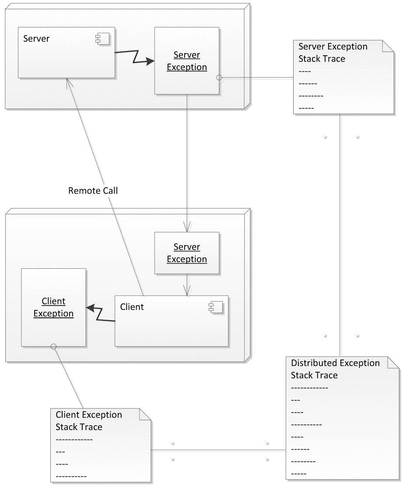

异常 CPU 消耗检测通常在进程级别进行，例如使用任务管理器检测时。有时该进程中许多线程中只有一个**飙升线程**（第 888 页），但也有 CPU 消耗分布在许多线程中的情况。我们称此模式为**分布式飙升**。这种行为可能是弱**耦合进程**（第 151 页）的结果，例如，在这两个服务中（为简化起见，我们将粗体显示用户模式下 CPU 时间超过 1 秒的线程）：

0:000> !runaway

用户模式时间

| 线程 | 时间 |
|--------|------|
| 120:4e518 | 0 days 0:05:09.937 |
| 126:531bc | 0 days 0:03:56.546 |
| 44:334c | 0 days 0:03:40.765 |
| 133:4fe1c | 0 days 0:03:31.156 |
| 45:42b4 | 0 days 0:03:27.328 |
| 107:25ae0 | 0 days 0:03:19.921 |
| 49:627c | 0 days 0:02:48.250 |
| 147:6b90c | 0 days 0:02:33.046 |
| 136:6620c | 0 days 0:02:05.109 |
| 127:4f2d0 | 0 days 0:02:04.046 |
| 129:5bc30 | 0 days 0:02:02.171 |
| 48:623c | 0 days 0:02:01.796 |
| 119:41f00 | 0 days 0:02:00.562 |
| 74:cd18 | 0 days 0:01:59.453 |
| 51:7a4c | 0 days 0:01:54.234 |
| 35:21d4 | 0 days 0:01:47.390 |
| 148:326dc | 0 days 0:01:32.640 |
| 123:43c8c | 0 days 0:01:32.515 |
| 135:67b08 | 0 days 0:01:32.296 |
| 11:aa8 | 0 days 0:01:30.906 |
| 118:4f28c | 0 days 0:01:20.265 |
| 42:3a3c | 0 days 0:01:20.000 |
| 77:d024 | 0 days 0:01:19.734 |
| 115:3a4b0 | 0 days 0:01:15.625 |
| 89:145f4 | 0 days 0:01:10.500 |
| 157:4e310 | 0 days 0:01:07.625 |
| 80:d07c | 0 days 0:01:07.468 |
| 33:1ab0 | 0 days 0:01:00.593 |
| 117:10bd4 | 0 days 0:00:59.421 |
| 151:1aaa0 | 0 days 0:00:59.015 |
| 28:17bc | 0 days 0:00:58.796 |
| 83:f3a4 | 0 days 0:00:55.828 |
| 122:41964 | 0 days 0:00:55.578 |
| 149:4101c | 0 days 0:00:55.234 |
| 10:aa4 | 0 days 0:00:52.453 |
| 106:21b80 | 0 days 0:00:51.187 |
| 132:62e5c | 0 days 0:00:49.437 |
| 160:3a3a8 | 0 days 0:00:48.875 |
| 137:6bf90 | 0 days 0:00:48.687 |
| 145:6f594 | 0 days 0:00:47.968 |
| 143:58d60 | 0 days 0:00:45.703 |
| 72:ba64 | 0 days 0:00:44.515 |


| 线程 | 持续时间 |
| --- | --- |
| 41:19b0 | 0天 0:00:44.000 |
| 130:5d480 | 0天 0:00:43.750 |
| 139:6d090 | 0天 0:00:42.062 |
| 138:6d578 | 0天 0:00:40.406 |
| 91:17974 | 0天 0:00:40.359 |
| 152:37f80 | 0天 0:00:39.781 |
| 81:de68 | 0天 0:00:39.265 |
| 150:65b2c | 0天 0:00:36.625 |
| 162:1f340 | 0天 0:00:35.125 |
| 85:10650 | 0天 0:00:33.546 |
| 131:614e8 | 0天 0:00:33.093 |
| 128:2eddc | 0天 0:00:33.000 |
| 146:6f690 | 0天 0:00:32.015 |
| 161:3c4b4 | 0天 0:00:30.421 |
| 167:3cde4 | 0天 0:00:29.390 |
| 171:3979c | 0天 0:00:28.515 |
| 166:3cd40 | 0天 0:00:28.312 |
| 168:68ef0 | 0天 0:00:27.781 |
| 65:aa0 | 0天 0:00:26.593 |
| 109:267f4 | 0天 0:00:26.390 |
| 88:13624 | 0天 0:00:26.000 |
| 173:5282c | 0天 0:00:24.640 |
| 153:71e14 | 0天 0:00:23.390 |
| 112:322b4 | 0天 0:00:22.812 |
| 110:9578 | 0天 0:00:22.125 |
| 175:20230 | 0天 0:00:20.250 |
| 79:b458 | 0天 0:00:20.218 |
| 66:61b8 | 0天 0:00:19.875 |
| 62:9498 | 0天 0:00:19.562 |
| 156:d900 | 0天 0:00:19.015 |
| 121:5106c | 0天 0:00:18.687 |
| 142:6bb28 | 0天 0:00:18.562 |
| 46:2cbc | 0天 0:00:17.796 |
| 169:d920 | 0天 0:00:16.875 |
| 154:720b4 | 0天 0:00:16.484 |
| 170:4ac8c | 0天 0:00:15.968 |
| 73:b010 | 0天 0:00:13.609 |
| 39:3224 | 0天 0:00:13.406 |
| 172:722e4 | 0天 0:00:12.375 |
| 63:9780 | 0天 0:00:12.203 |
| 177:8464 | 0天 0:00:11.906 |
| 184:22908 | 0天 0:00:10.234 |
| 140:5765c | 0天 0:00:09.750 |
| 174:2f484 | 0天 0:00:08.390 |
| 50:7230 | 0天 0:00:07.125 |
| 187:3c324 | 0天 0:00:06.765 |
| 125:46cf0 | 0天 0:00:06.296 |
| 178:3a424 | 0天 0:00:05.125 |
| 114:33d20 | 0天 0:00:03.734 |
| 165:3ca74 | 0天 0:00:01.203 |
| 189:3c358 | 0天 0:00:01.000 |
| 164:3124c | 0天 0:00:00.578 |
| 25:be4 | 0天 0:00:00.515 |
| 17:ba8 | 0天 0:00:00.125 |
| 104:5cf8 | 0天 0:00:00.109 |
| 26:e4c | 0天 0:00:00.109 |
| 96:5d44 | 0天 0:00:00.093 |
| 99:5b18 | 0天 0:00:00.078 |
| 56:8a6c | 0天 0:00:00.078 |
| 55:8a68 | 0天 0:00:00.078 |
| 6:a08 | 0天 0:00:00.078 |
| 4:a00 | 0天 0:00:00.062 |
| 103:5cfc | 0天 0:00:00.046 |
| 100:5ab8 | 0天 0:00:00.046 |
| 68:bf34 | 0天 0:00:00.046 |
| 37:29d4 | 0天 0:00:00.046 |
| 101:5ab4 | 0天 0:00:00.031 |
| 98:5b44 | 0天 0:00:00.031 |
| 97:5d40 | 0天 0:00:00.031 |
| 57:8a70 | 0天 0:00:00.031 |
| 53:8a60 | 0天 0:00:00.031 |
| 36:29c0 | 0天 0:00:00.031 |
| 16:ac4 | 0天 0:00:00.031 |
| 1:9e4 | 0天 0:00:00.031 |
| 60:880c | 0天 0:00:00.015 |
| 58:8a5c | 0天 0:00:00.015 |
| 24:be0 | 0天 0:00:00.015 |
| 15:abc | 0天 0:00:00.015 |
| 188:13044 | 0天 0:00:00.000 |
| 186:6530 | 0天 0:00:00.000 |
| 185:2013c | 0天 0:00:00.000 |
| 183:6047c | 0天 0:00:00.000 |
| 182:65400 | 0天 0:00:00.000 |
| 181:61560 | 0天 0:00:00.000 |
| 180:2b7a4 | 0天 0:00:00.000 |
| 179:56294 | 0天 0:00:00.000 |
| 176:20300 | 0天 0:00:00.000 |
| 163:2ab1c | 0天 0:00:00.000 |
| 159:276cc | 0天 0:00:00.000 |
| 158:72134 | 0天 0:00:00.000 |
| 155:6a078 | 0天 0:00:00.000 |
| 144:6ce98 | 0天 0:00:00.000 |
| 141:5404 | 0天 0:00:00.000 |
| 134:65718 | 0天 0:00:00.000 |
| 124:4bed4 | 0天 0:00:00.000 |
| 116:3c770 | 0天 0:00:00.000 |
| 113:b08 | 0天 0:00:00.000 |
| 111:28e54 | 0天 0:00:00.000 |
| 108:25fbc | 0天 0:00:00.000 |
| 105:20504 | 0天 0:00:00.000 |
| 102:5cf4 | 0天 0:00:00.000 |
| 95:5c70 | 0天 0:00:00.000 |
| 94:5ed4 | 0天 0:00:00.000 |
| 93:18c2c | 0天 0:00:00.000 |
| 92:19fd8 | 0天 0:00:00.000 |
| 90:c870 | 0天 0:00:00.000 |
| 87:7994 | 0天 0:00:00.000 |
| 86:124cc | 0天 0:00:00.000 |
| 84:ea8b | 0天 0:00:00.000 |
| 82:f2a4 | 0天 0:00:00.000 |
| 78:d5c0 | 0天 0:00:00.000 |
| 76:cfd0 | 0天 0:00:00.000 |
| 75:cf64 | 0天 0:00:00.000 |
| 71:b4f8 | 0天 0:00:00.000 |
| 70:c628 | 0天 0:00:00.000 |
| 69:c484 | 0天 0:00:00.000 |
| 67:be84 | 0天 0:00:00.000 |
| 64:aa00 | 0天 0:00:00.000 |
| 61:93f0 | 0天 0:00:00.000 |
| 59:89e4 | 0天 0:00:00.000 |
| 54:8a64 | 0天 0:00:00.000 |
| 52:89a8 | 0天 0:00:00.000 |
| 47:4c64 | 0天 0:00:00.000 |
| 43:3fa0 | 0天 0:00:00.000 |
| 40:2c88 | 0天 0:00:00.000 |
| 38:2a28 | 0天 0:00:00.000 |
| 34:1928 | 0天 0:00:00.000 |
| 32:1668 | 0天 0:00:00.000 |
| 31:8dc | 0天 0:00:00.000 |
| 30:15d4 | 0天 0:00:00.000 |
| 29:1044 | 0天 0:00:00.000 |
| 27:fb4 | 0天 0:00:00.000 |
| 23:bd8 | 0天 0:00:00.000 |
| 22:bd4 | 0天 0:00:00.000 |
| 21:bd0 | 0天 0:00:00.000 |
| 20:bc8 | 0天 0:00:00.000 |
| 19:bc4 | 0天 0:00:00.000 |
| 18:bc0 | 0天 0:00:00.000 |
| 14:ab8 | 0天 0:00:00.000 |
| 13:ab4 | 0天 0:00:00.000 |
| 12:ab0 | 0天 0:00:00.000 |
| 9:aa0 | 0天 0:00:00.000 |
| 8:a9c | 0天 0:00:00.000 |
| 7:a98 | 0天 0:00:00.000 |
| 5:a04 | 0天 0:00:00.000 |
| 3:9f4 | 0天 0:00:00.000 |
| 2:9f0 | 0天 0:00:00.000 |
| 0:994 | 0天 0:00:00.000 |

这是第一个服务进程中的真实尖峰，可以通过一个随机的非等待线程来确认：

```
0:000> ~143k
ChildEBP RetAddr
050dfc68 78c2d6a4 ntdll!RtlEnterCriticalSection+0x1d
050dfc84 77c7bc50 ntdll!RtlInitializeCriticalSectionAndSpinCount+0x92
050dfc98 77c7bc7c rpcrt4!MUTEX::CommonConstructor+0x1b
050dfcac 77c7c000 rpcrt4!MUTEX::MUTEX+0x13
050dfcc8 77c6ff47 rpcrt4!BINDING_HANDLE::BINDING_HANDLE+0x2d
050dfcd8 77c6ff1f rpcrt4!SVR_BINDING_HANDLE::SVR_BINDING_HANDLE+0x10
050dfcfc 77c6d338 rpcrt4!RPC_ADDRESS::InquireBinding+0x8a
050dfd0c 77c6fd1d rpcrt4!LRPC_SCALL::ToStringBinding+0x16
050dfd1c 76554c83 rpcrt4!RpcBindingToStringBindingW+0x4d
050dfd5c 77c7c42a ServiceA!RpcSecurityCallback+0x1e
050dfdb4 77c7c4b0 rpcrt4!RPC_INTERFACE::CheckSecurityIfNecessary+0x6f
050dfdcc 77c7c46c rpcrt4!LRPC_SBINDING::CheckSecurity+0x4f
050dfdfc 77c812f0 rpcrt4!LRPC_SCALL::DealWithRequestMessage+0x2bb
050dfe20 77c88678 rpcrt4!LRPC_ADDRESS::DealWithLRPCRequest+0x127
050dff84 77c88792 rpcrt4!LRPC_ADDRESS::ReceiveLotsaCalls+0x430
050dff8c 77c8872d rpcrt4!RecvLotsaCallsWrapper+0xd
050dffac 77c7b110 rpcrt4!BaseCachedThreadRoutine+0x9d
050dfff8 77e64829 rpcrt4!ThreadStartRoutine+0x1b
050dffec 00000000 kernel32!BaseThreadStart+0x34
```

```
0:000> ~143r
eax=00000000 ebx=00000000 ecx=7c887784 edx=7c887780 esi=7c887784 edi=00163fb0
eip=7c81a37d esp=050dffc5 ebp=050dff68 iopl=0 nv up ei ng nz na pe cy
cs=001b ss=0023 ds=0023 es=0023 fs=003b gs=0000 efl=00000287
ntdll!RtlEnterCriticalSection+0x1d:
7c81a37d 0f92c0        setb  al
```

```
0:000> .asm no_code_bytes
Assembly options: no_code_bytes
```

```
0:000> u 7c81a37d
ntdll!RtlEnterCriticalSection+0x1d:
7c81a37d setb        al
7c81a380 test        al,al
7c81a382 je          ntdll!RtlEnterCriticalSection+0x28 (7c82b096)
7c81a388 mov         ecx,dword ptr fs:[18h]
7c81a38f mov         eax,dword ptr [ecx+24h]
7c81a392 pop         edi
7c81a393 mov         dword ptr [edx+0Ch],eax
7c81a396 mov         dword ptr [edx+8],1
```

```
0:000> ub 7c81a37d
ntdll!RtlEnterCriticalSection+0x6:
7c81a366 mov         edx,dword ptr [ebp+8]
7c81a369 push        esi
7c81a36a lea         esi,[edx+4]
7c81a36d push        edi
7c81a36e mov         dword ptr [ebp-4],esi
7c81a371 mov         eax,0
7c81a376 mov         ecx,dword ptr [ebp-4]
7c81a379 lock btr dword ptr [ecx],eax
```

第二个服务与上面的第一个服务是弱耦合的（正在等待事件通知）：

| 线程 | 时间 |
| :--- | :--- |
| 5:d8ec | 0天 0:01:50.031 |
| 8:46008 | 0天 0:01:46.062 |
| 11:ad0c | 0天 0:01:13.921 |
| 17:932c | 0天 0:01:03.234 |
| 14:45d78 | 0天 0:00:58.109 |
| 15:6d4d0 | 0天 0:00:00.015 |
| 2:725a4 | 0天 0:00:00.015 |
| 0:6101c | 0天 0:00:00.015 |
| 18:d1c4 | 0天 0:00:00.000 |
| 16:76bc | 0天 0:00:00.000 |
| 13:456a8 | 0天 0:00:00.000 |
| 12:459e4 | 0天 0:00:00.000 |
| 10:3c768 | 0天 0:00:00.000 |
| 9:1d2d20 | 0天 0:00:00.000 |
| 7:46010 | 0天 0:00:00.000 |
| 6:4600c | 0天 0:00:00.000 |
| 4:dbf0 | 0天 0:00:00.000 |
| 3:17ed4 | 0天 0:00:00.000 |
| 1:61024 | 0天 0:00:00.000 |

```
0:000> ~11k
  ChildEBP RetAddr
0223fa68 7c82787b ntdll!KiFastSystemCallRet
0223fa6c 77c80a6e ntdll!NtRequestWaitReplyPort+0xc
0223fab8 77c7fcf0 rpcrt4!LRPC_CCALL::SendReceive+0x230
0223fac4 77c80673 rpcrt4!I_RpcSendReceive+0x24
0223fad8 77c8315a rpcrt4!NdrSendReceive+0x2b
0223fec0 77f14fbd rpcrt4!NdrClientCall2+0x22e
0223fed8 77f14f60 ServiceB!RpcWaitEvent+0x11c
[...]
```

```
0:000> ~17k
  ChildEBP RetAddr
0283fa68 7c82787b ntdll!KiFastSystemCallRet
0283fa6c 77c80a6e ntdll!NtRequestWaitReplyPort+0xc
0283fab8 77c7fcf0 rpcrt4!LRPC_CCALL::SendReceive+0x230
0283fac4 77c80673 rpcrt4!I_RpcSendReceive+0x24
0283fad8 77c8315a rpcrt4!NdrSendReceive+0x2b
0283fec0 77f14fbd rpcrt4!NdrClientCall2+0x22e
0283fed8 77f14f60 ServiceB!RpcWaitEvent+0x11c
[...]
```

有时，语义上 **耦合进程**（第 148 页）会导致分布式尖峰，而且在大多数情况下，在这些情况下可以预测另一个尖峰进程。在上面的示例中，两个尖峰进程都与另一项服务在语义上耦合，并且已确认该服务也在出现尖峰：

| 线程 | 时间 |
| --- | --- |
| 89:10d4 | 0天 0:03:03.500 |
| 28:a94 | 0天 0:00:39.562 |
| 73:c10 | 0天 0:00:37.531 |
| 54:b88 | 0天 0:00:37.140 |
| 29:a98 | 0天 0:00:35.906 |
| 27:a90 | 0天 0:00:35.500 |
| 75:c2c | 0天 0:00:28.812 |
| 90:10d8 | 0天 0:00:27.000 |
| 93:10e4 | 0天 0:00:24.265 |
| 32:aa4 | 0天 0:00:12.906 |
| 41:ac8 | 0天 0:00:11.890 |
| 35:ab0 | 0天 0:00:11.875 |
| 58:bc4 | 0天 0:00:10.218 |
| 42:acc | 0天 0:00:09.546 |
| 85:e74 | 0天 0:00:08.859 |
| 36:ab4 | 0天 0:00:08.578 |
| 72:c0c | 0天 0:00:05.890 |


| 70:c04 | 0 天 | 0:00:05.687 |
| 33:aa8 | 0 天 | 0:00:05.046 |
| 74:c14 | 0 天 | 0:00:04.953 |
| 40:ac4 | 0 天 | 0:00:04.953 |
| 38:abc | 0 天 | 0:00:04.359 |
| 39:ac0 | 0 天 | 0:00:04.312 |
| 34:aac | 0 天 | 0:00:04.140 |
| 64:bec | 0 天 | 0:00:03.812 |
| 88:10d0 | 0 天 | 0:00:03.187 |
| 30:a9c | 0 天 | 0:00:02.859 |
| 9:a10 | 0 天 | 0:00:01.968 |
| 37:ab8 | 0 天 | 0:00:01.953 |
| 92:1e0e | 0 天 | 0:00:01.718 |
| 83:d00 | 0 天 | 0:00:01.125 |
| 94:1150 | 0 天 | 0:00:01.031 |
| 77:c54 | 0 天 | 0:00:00.890 |
| 98:fc20 | 0 天 | 0:00:00.265 |
| 97:eb1c | 0 天 | 0:00:00.265 |
| 76:c50 | 0 天 | 0:00:00.265 |
| 21:a48 | 0 天 | 0:00:00.187 |
| 22:4ac | 0 天 | 0:00:00.140 |
| 63:be8 | 0 天 | 0:00:00.093 |
| 23:a50 | 0 天 | 0:00:00.093 |
| 53:af8 | 0 天 | 0:00:00.078 |
| 24:a54 | 0 天 | 0:00:00.046 |
| 71:c08 | 0 天 | 0:00:00.031 |
| 65:bf0 | 0 天 | 0:00:00.031 |
| 87:e8c | 0 天 | 0:00:00.015 |
| 57:bc0 | 0 天 | 0:00:00.015 |
| 104:6454c | 0 天 | 0:00:00.000 |
| 103:63fb4 | 0 天 | 0:00:00.000 |
| 102:3c5ec | 0 天 | 0:00:00.000 |
| 101:65178 | 0 天 | 0:00:00.000 |
| 100:5d0e4 | 0 天 | 0:00:00.000 |
| 99:5bae4 | 0 天 | 0:00:00.000 |
| 96:574 | 0 天 | 0:00:00.000 |
| 95:b84 | 0 天 | 0:00:00.000 |
| 91:10dc | 0 天 | 0:00:00.000 |
| 86:e88 | 0 天 | 0:00:00.000 |
| 84:e70 | 0 天 | 0:00:00.000 |
| 82:c84 | 0 天 | 0:00:00.000 |
| 81:c68 | 0 天 | 0:00:00.000 |
| 80:c64 | 0 天 | 0:00:00.000 |
| 79:c60 | 0 天 | 0:00:00.000 |
| 78:c5c | 0 天 | 0:00:00.000 |
| 69:c00 | 0 天 | 0:00:00.000 |
| 68:bfc | 0 天 | 0:00:00.000 |
| 67:bf8 | 0 天 | 0:00:00.000 |
| 66:bf4 | 0 天 | 0:00:00.000 |
| 62:bd8 | 0 天 | 0:00:00.000 |
| 61:bd4 | 0 天 | 0:00:00.000 |
| 60:bd0 | 0 天 | 0:00:00.000 |
| 59:bcc | 0 天 | 0:00:00.000 |
| 56:bbc | 0 天 | 0:00:00.000 |
| 55:bb8 | 0 天 | 0:00:00.000 |
| 52:af4 | 0 天 | 0:00:00.000 |

| ID | 持续时间 |
|---|---|
| 51:af0 | 0 天 0:00:00.000 |
| 50:aec | 0 天 0:00:00.000 |
| 49:ae8 | 0 天 0:00:00.000 |
| 48:ae4 | 0 天 0:00:00.000 |
| 47:ae0 | 0 天 0:00:00.000 |
| 46:adc | 0 天 0:00:00.000 |
| 45:ad8 | 0 天 0:00:00.000 |
| 44:ad4 | 0 天 0:00:00.000 |
| 43:ad0 | 0 天 0:00:00.000 |
| 31:aa0 | 0 天 0:00:00.000 |
| 26:ac8 | 0 天 0:00:00.000 |
| 25:a64 | 0 天 0:00:00.000 |
| 20:a44 | 0 天 0:00:00.000 |
| 19:a40 | 0 天 0:00:00.000 |
| 18:a34 | 0 天 0:00:00.000 |
| 17:a30 | 0 天 0:00:00.000 |
| 16:a2c | 0 天 0:00:00.000 |
| 15:a28 | 0 天 0:00:00.000 |
| 14:a24 | 0 天 0:00:00.000 |
| 13:a20 | 0 天 0:00:00.000 |
| 12:a1c | 0 天 0:00:00.000 |
| 11:a18 | 0 天 0:00:00.000 |
| 10:a14 | 0 天 0:00:00.000 |
| 8:a0c | 0 天 0:00:00.000 |
| 7:a08 | 0 天 0:00:00.000 |
| 6:a04 | 0 天 0:00:00.000 |
| 5:a00 | 0 天 0:00:00.000 |
| 4:9fc | 0 天 0:00:00.000 |
| 3:9f8 | 0 天 0:00:00.000 |
| 2:9f4 | 0 天 0:00:00.000 |
| 1:9f0 | 0 天 0:00:00.000 |
| 0:9e4 | 0 天 0:00:00.000 |

## 注释

如果无法获取时序信息，但随机进程内存快照或 proc_dump 工具的快照揭示了不同的飙升线程，那么我们也可能存在此模式。

大多数 **WAIT CHAIN** 模式（第 1082 页）涉及单个等待链。但是，在内存转储中（尤其是终端服务环境中）往往存在许多不同的 **WAIT Chains**。同一时间可能同时存在 **ALPC**（第 1097 页）和 **Critical Section WAIT Chains**（第 1086 页）。它们可能相关，也可能完全不相关。**Distributed WAIT Chain** 模式涵盖了几个具有相同结构（并可能指向同一方向）的 **WAIT Chains** 的特殊情况。我们将此类示例放在下方。在来自挂起系统的完整内存转储的 **Stack Trace Collection**（第 943 页）中，我们发现了多个具有相同结构和端点的 **explorer.exe** 进程，其 **Critical Section WAIT Chains** 的端点为 **Top**（第 1012 页）和 **Blocking**（第 96 页）**ModuleA**：

```
THREAD fffffa80137cf060  Cid 4884.4f9c  Teb: 000007fffffaa000 Win32Thread: fffff900c0fb98b0 WAIT: (UserRequest) UserMode Non-Alertable
 fffffa8013570dc0  SynchronizationEvent
Not impersonating
DeviceMap            fffff8a014e21d90
Owning Process       fffffa800131a7d0       Image:         explorer.exe
Attached Process     N/A             Image:         N/A
Wait Start TickCount     274752       Ticks: 212448 (0:00:55:19.500)
Context Switch Count   9889             LargeStack
UserTime          00:00:00.093
KernelTime         00:00:00.171
Win32 Start Address SHLWAPI!WrapperThreadProc (0x000007fefdafc608)
Stack Init fffff88013c25db0 Current fffff88013c25900
Base fffff88013c26000  Limit fffff88013c1b000  Call 0
Priority 11 BasePriority 9 UnusualBoost 0 ForegroundBoost 0 IoPriority 2 PagePriority 5
Kernel stack not resident.
Child-SP          RetAddr           Call Site
fffff880`13c25940 fffff800`01873652 nt!KiSwapContext+0x7a
fffff880`13c25a80 fffff800`01884a9f nt!KiCommitThreadWait+0x1d2
fffff880`13c25b10 fffff800`01b776ae nt!KeWaitForSingleObject+0x19f
fffff880`13c25bb0 fffff800`0187ced3 nt!NtWaitForSingleObject+0xde
fffff880`13c25c20 00000000`76d813a5 nt!KiSystemServiceCopyEnd+0x13 (TrapFrame @ fffff880`13c25c20)
00000000`0489e518 00000000`76d7e4e8 ntdll!ZwWaitForSingleObject+0xa
00000000`0489e520 00000000`76d7e3db ntdll!RtlpWaitOnCriticalSection+0xe8
00000000`0489e5d0 000007fe`fdf8ff50 ntdll!RtlEnterCriticalSection+0xd1
00000000`0489e600 000007fe`fdf8fd83 SHELL32!CFSFolder::GetIconOf+0x24b
00000000`0489f3a0 000007fe`fdf903d3 SHELL32!SHGetIconIndexFromPIDL+0x3f
00000000`0489f3d0 00000000`ff900328 SHELL32!SHMapIDListToSystemImageListIndexAsync+0x73
00000000`0489f470 00000000`f8fff4ab Explorer!SFTabHost::AddImageForItem+0x9c
00000000`0489f4d0 00000000`f8ffd2f1 Explorer!SFTabHost::_InternalRepopulateList+0x4ad
00000000`0489f5d0 00000000`f8ffd0b4 Explorer!SFTabHost::RepopulateList+0x1f3
00000000`0489f600 00000000`f8fcccd Explorer!SFTabHost::OnBackgroundEnumDone+0xc1
00000000`0489f630 00000000`f8fc9e2 Explorer!SFTabHost::_WndProc+0x451
00000000`0489f800 00000000`766cb9d1 Explorer!SFTabHost::_WndProc+0x451
00000000`0489f8b0 00000000`766698da USER32!UserCallWinProcCheckWow+0x1ad
00000000`0489f770 00000000`f8f1177 USER32!DispatchMessageWorker+0x3b5
00000000`0489f7f0 00000000`f9130e9 Explorer!CTray::MessageLoop+0x446
00000000`0489f880 000007fe`fdafce1e Explorer!CTray::MainThreadProc+0x8a
00000000`0489f8b0 00000000`76c2652d SHLWAPI!WrapperThreadProc+0x19b
00000000`0489f9b0 00000000`76d5c521 kernel32!BaseThreadInitThunk+0xd
00000000`0489f9e0 00000000`00000000 ntdll!RtlUserThreadStart+0x1d
```

```
0: kd> .process /r /p fffffa80131a75d0
Implicit process is now fffffa80`131a75d0
Loading User Symbols
```

```
0: kd> !cs -l -o -s
-----------------------------------------
DebugInfo = 0x00000000000499d0
Critical section = 0x0000007fefe3d5900 (SHELL32!g_csIconCache+0x0)
LOCKED
LockCount = 0x2
WaiterWoken = No
OwningThread = 0x0000000000002b34
RecursionCount = 0x1
LockSemaphore = 0x7F8
SpinCount = 0x0000000000000000
OwningThread = .thread fffffa8013dc3b00
```

```
THREAD fffffa8013dc3b00 Cid 4884.2b34 Teb: 000007fffffac000 Win32Thread: fffff900c2bc1010 WAIT: (Executive) KernelMode Non-Alertable
fffff88011c03600 SynchronizationEvent
```

```
IRP List:
fffffa800f8fc790: (0006,0430) Flags: 00000404 Mdl: 00000000
Not impersonating
DeviceMap fffff8a014e21d90
Owning Process fffffa80131a75d0 Image: explorer.exe
Attached Process N/A Image: N/A
Wait Start TickCount 170052 Ticks: 317148 (0:01:22:35.437)
Context Switch Count 2 LargeStack
UserTime 00:00:00.000
KernelTime 00:00:00.000
Win32 Start Address SHELL32!ShutdownThreadProc (0x000007fefe13ef54)
Stack Init fffffa8001c03600 Current fffffa8001c03320
Base fffff88001c40000 Limit fffff88001b00000 Call 0
Priority 11 BasePriority 8 UnusualBoost 0 ForegroundBoost 2 IoPriority 2 PagePriority 5
```

```
Child-SP RetAddr Call Site
fffff880`11c3360 fffff800`01873652 nt!KiSwapContext+0x7a
fffff880`11c034a0 fffff800`01884a9f nt!KiCommitThreadWait+0x1d2
fffff880`11c03530 fffff880`05c12383 nt!KeWaitForSingleObject+0x19f
fffff880`11c35d50 fffff880`012b9288 ModuleA+0x12468
fffff880`11c03750 fffff880`012bd7bd fltmgr!FltpPerformPostCallbacks+0x368
fffff880`11c03820 fffff880`012b66df fltmgr!FltpLegacyProcessingAfterPreCallbacksCompleted+0x39b
fffff880`11c038b0 fffff880`01b895ff fltmgr!FltpDispatch+0xcf
fffff880`11c03a30 fffff800`01b783b4 nt!IopCloseFile+0x11f
fffff880`11c03ac0 fffff800`01b78171 nt!ObpDecrementHandleCount+0xb4
fffff880`11c03b40 fffff800`01b78734 nt!ObpCloseHandleTableEntry+0xb1
fffff880`11c03bd0 fffff800`0187ced3 nt!ObpCloseHandle+0x94
fffff880`11c03c20 00000000`76d8140a nt!KiSystemServiceCopyEnd+0x13 (TrapFrame @ fffff880`11c03c20)
00000000`0754f348 000007fe`fd341873 ntdll!NtClose+0xa
00000000`0754f350 00000000`76c32f51 KERNELBASE!CloseHandle+0x13
00000000`0754f380 000007fe`fda9f690 kernel32!CloseHandleImplementation+0x3d
00000000`0754f490 000007fe`fe191d7f SHLWAPI!CFileStream::Release+0x84
00000000`0754f4c0 000007fe`fe13ed57 SHELL32!IconCacheSave+0x2b7
00000000`0754f780 000007fe`fe13f0c6 SHELL32!CommonRestart+0x2f
00000000`0754f7f0 00000000`76c2652d SHELL32!ShutdownThreadProc+0x172
00000000`0754f820 00000000`76d5c521 kernel32!BaseThreadInitThunk+0xd
00000000`0754f850 00000000`00000000 00000000`00000000 ntdll!RtlUserThreadStart+0x1d
```


## 内核模式

这是用户模式中“除以零”模式（第 259 页）的内核模式对应物。它在不同的 BugCheck 下表现出来，例如：

```
1: kd> !analyze -v

[...]

UNEXPECTED_KERNEL_MODE_TRAP (7f)
This means a trap occurred in kernel mode, and it's a trap of a kind that the kernel isn't allowed to
have/catch (bound trap) or that is always instant death (double fault).  The first number in the bugcheck
params is the number of the trap (8 = double fault, etc)  Consult an Intel x86 family manual to learn more
about what these traps are. Here is a *portion* of those codes:
If kv shows a taskGate
        use .tss on the part before the colon, then kv.
Else if kv shows a trapframe
        use .trap on that value
Else
        .trap on the appropriate frame will show where the trap was taken
        (on x86, this will be the ebp that goes with the procedure KiTrap)
Endif
kb will then show the corrected stack.
Arguments:
Arg1: 00000000, EXCEPTION_DIVIDED_BY_ZERO
Arg2: 00000000
Arg3: 00000000
Arg4: 00000000

[...]

TRAP_FRAME: a8954c8c -- (.trap 0xffffffffa8954c8c)
ErrCode = 00000000
eax=fffffffe ebx=00000000 ecx=00000005 edx=00000000 esi=00000000 edi=00000000
eip=975c42cd esp=a8954d00 ebp=a8954d04 iopl=0 nv up ei pl zr na pe nc
cs=0008 ss=0010 ds=0023 es=0023 fs=0030 gs=0000 efl=00010246
win32k!NtGdiEnumObjects+0xc6:
975c42cd f7f6  div eax,esi
Resetting default scope

PROCESS_NAME:  Application.EXE
```

```
STACK_TEXT:
a8954c2c 81ac2b76 000000f7 5317512a 975c42cd nt!KeBugCheck+0x14
a8954c80 81899808 a8954c8c a8954d4c 975c42cd nt!Ki386CheckDivideByZeroTrap+0x44
a8954c80 975c42cd a8954c8c a8954d4c 975c42cd nt!KiTrap00+0x88
a8954d4c 81898a7a 062102ce 00000001 00000000 Driver!EnumObjects+0xc6
a8954d4c 77a59a94 062102ce 00000001 00000000 nt!KiFastCallEntry+0x12a
WARNING: Frame IP not in any known module. Following frames may be wrong.
0012ca70 00000000 00000000 00000000 00000000 0x77a59a94

0: kd> !analyze -v
```

```
SYSTEM_SERVICE_EXCEPTION (3b)
An exception happened while executing a system service routine.
Arguments:
Arg1: 00000000c0000094, Exception code that caused the bugcheck
Arg2: fffffff960025ba6d, Address of the exception record for the exception that caused the bugcheck
Arg3: fffffff8800ac361d0, Address of the context record for the exception that caused the bugcheck
Arg4: 0000000000000000, zero.
```

```
EXCEPTION_CODE: (NTSTATUS) 0xc0000094 - {EXCEPTION} Integer division by zero.

FAULTING_IP:
Driver!EnumObjects+e9
fffff960`0025ba6d f7f6        div     eax,esi

CONTEXT: fffffff8800ac361d0 -- (.cxr 0xfffff8800ac361d0)
rax=00000000ffffffff rbx=0000000000000000 rcx=0000000000000000
rdx=0000000000000000 rsi=0000000000000000 rdi=0000000000000000
rip=ffffff960025ba6d rsp=ffffff8800ac36ba0 rbp=ffffff8800ac36ca0
r8=0000000000000000 r9=0000000000000000 r10=0000000005892f18
r11=ffffff900c28379e0 r12=0000000000000000 r13=0000000000000002
r14=0000000000000001 r15=0000000000000000
iopl=0         nv up ei ng nz na po nc
cs=0010  ss=0018  ds=002b  es=002b  fs=0053  gs=002b             efl=00010286
Driver!EnumObjects+0xe9:
fffff960`0025ba6d f7f6        div     eax,esi
Resetting default scope
```

```
STACK_TEXT:
fffff880`0ac36ba0 fffffff800`01682993 Driver!EnumObjects+0xe9
fffff880`0ac36c20 00000000`00000000 748a1b3a nt!KiSystemServiceCopyEnd+0x13
00000000`001cdf08 00000000`00000000 0x748a1b3a
```

## 用户模式

### Linux

这是先前为 Mac OS X（第 258 页）和 Windows（第 259 页）平台描述过的 **除以零**（用户模式）模式的 Linux 变体：

```
GNU gdb (GDB)
[...]
Program terminated with signal 8, Arithmetic exception.
#0 0x000000000040056f in procD ()
(gdb) x/i $rip
=> 0x40056f <procD+18>: idivl -0x8(%rbp)
(gdb) info r $rax
rax 0x1 1
(gdb) x/w $rbp-0x8
0x7f0f6806bd28: 0x00000000
```

### Mac OS X

这是先前为 Windows 平台（第 259 页）描述的除以零（用户模式）的 Mac OS X / GDB 对应物：

```
(gdb) bt
#0 0x000000010d3ebe9e in bar (a=1, b=0)
#1 0x000000010d3ebec3 in foo ()
#2 0x000000010d3ebeeb in main (argc=1, argv=0x7fff6cfeab18)

(gdb) x/i 0x000000010d3ebe9e
0x10d3ebe9e : idiv %esi

(gdb) info r rsi
rsi 0x0 0
```

建模应用程序源代码：

```
int bar(int a, int b)
{
    return a/b;
}

int foo()
{
    return bar(1,0);
}

int main(int argc, const char * argv[])
{
    return foo();
}
```

### Windows

整数除以零是最常见的异常之一⁴⁵。在进程崩溃转储中，通过导致此异常类型的处理器指令（DIV 或 IDIV）可以轻松识别：

```
FAULTING_IP:
DLL!FindHighestID+278
1b2713c4 f775e4 div dword ptr [ebp-0x1c]

EXCEPTION_RECORD: fffffff8 -- (.exr ffffffffffffffff)
ExceptionAddress: 1b2713c4 (DLL!FindHighestID+0x00000278)
ExceptionCode: c0000094 (Integer divide-by-zero)
ExceptionFlags: 00000000
NumberParameters: 0
```

或

```
FAULTING_IP:
Application+263d8
004263d8 f7fe idiv eax,esi

EXCEPTION_RECORD: fffffff8 -- (.exr 0xffffffffffffffff)
ExceptionAddress: 004263d8 (Application+0x000263d8)
ExceptionCode: c0000094 (Integer divide-by-zero)
ExceptionFlags: 00000000
NumberParameters: 0
```

ERROR_CODE: (NTSTATUS) 0xc0000094 - {EXCEPTION} 整数除以零。

## 双释放

### 内核池

与用户模式进程堆中的**双释放**模式（第 267 页）不同，内核模式池中的双释放会导致立即发生 BugCheck，以便识别导致问题的驱动程序（BAD_POOL_CALLER BugCheck，Arg1 = 7）：

```
2: kd> !analyze -v
...
...
...
BAD_POOL_CALLER (c2)
The current thread is making a bad pool request. Typically this is at a bad IRQL level or double freeing the same allocation, etc.
Arguments:
Arg1: 00000007, Attempt to free pool which was already freed
Arg2: 0000121a, (reserved)
Arg3: 02140001, Memory contents of the pool block
Arg4: 89ba74f0, Address of the block of pool being deallocated
```

如果查看正在释放的块，会发现它被标记为“Free”块：

```
2: kd> !pool 89ba74f0
Pool page 89ba74f0 region is Nonpaged pool
```

| 地址 | 大小 | 前一个大小 | 状态 | 标记 |
|---------|------|---------------|-------|-----|
| 89ba7000 | 270 | 0 | 已分配 | Thre (Protected) |
| 89ba7270 | 8 | 270 | 空闲 | ... |
| 89ba7278 | 18 | 8 | 已分配 | ReEv |
| 89ba7290 | 80 | 18 | 已分配 | Mdl |
| 89ba7310 | 80 | 80 | 已分配 | Mdl |
| 89ba7390 | 30 | 80 | 已分配 | Vad |
| 89ba73c0 | 98 | 30 | 已分配 | File (Protected) |
| 89ba7458 | 8 | 98 | 空闲 | Wait |
| 89ba7460 | 28 | 8 | 已分配 | FSfm |
| 89ba74a0 | 40 | 18 | 已分配 | Ntfr |
| 89ba74e0 | 8 | 40 | 空闲 | File |
| *89ba74e8 | a0 | 40 | 空闲 | *ABCD |
| 89ba7588 | 38 | a0 | 已分配 | Sema (Protected) |
| 89ba75c0 | 38 | 38 | 已分配 | Sema (Protected) |
| 89ba75f8 | 10 | 38 | 空闲 | Nbtl |
| 89ba7608 | 98 | 10 | 已分配 | File (Protected) |
| 89ba76a0 | 28 | 98 | 已分配 | Ntfn |
| 89ba76c8 | 40 | 28 | 已分配 | Ntfr |
| 89ba7708 | 28 | 40 | 已分配 | Ntfs |
| 89ba7730 | 40 | 28 | 已分配 | Ntfr |
| 89ba7770 | 40 | 40 | 已分配 | Ntfr |
| 89ba7a10 | 270 | 260 | 已分配 | Thre (Protected) |
| 89ba7c80 | 20 | 270 | 已分配 | VadS |

拥有的组件：未知（更新 pooltag.txt）

池标记是一个 4 字节字符序列，用于将驱动程序与池块关联，并有助于识别分配或释放了某个块的驱动程序。在本例中，池标记是 ABCD，它与先前释放该块的驱动程序相关联。与内核组件对应的所有已知池标记都可以在 WinDbg 安装目录的 triage 子文件夹中找到的 pooltag.txt 文件中查找。但是，我们的 ABCD 标记未列在其中。我们可以尝试使用 findstr CMD 命令查找与 ABCD 标记对应的驱动程序：

```
C:\Windows\System32\drivers>findstr /m /i ABCD *.sys
```

搜索结果将帮助我们识别首先释放该块的驱动程序。在调用堆栈上可以找到重复释放同一块的驱动程序，它可能是同一驱动程序，也可能是不同的驱动程序：

| 子 EBP | 返回地址 |
|----------|---------|
| f78be910 | 8089c8f4 nt!KeBugCheckEx+0x1b |
| f78be978 | 8089c622 nt!ExFreePoolWithTag+0x477 |
| f78be988 | f503968b nt!ExFreePool+0xf |
| f78be990 | f5024a6e driver+0x1768b |
| f78be9a0 | f50249e7 driver+0x2a6e |
| f78be9a4 | 84b430e0 driver+0x29e7 |

由于没有 driver.sys 的符号文件，WinDbg 警告称无法识别正确的堆栈跟踪，且 driver.sys 可能未调用 ExFreePool 或 ExFreePoolWithTag 函数。为了验证 driver.sys 确实调用了 ExFreePool 函数，我们反汇编了它的返回地址：

```
2: kd> ub f503968b
driver+0x1767b:
f503967b 90 nop
f503967c 90 nop
f503967d 90 nop
f503967e 90 nop
f503967f 90 nop
f5039680 8b442404 mov eax,dword ptr [esp+4]
f5039684 50 push eax
f5039685 ff15202302f5 call dword ptr [driver+0x320 (f5022320)]
```

最后，我们可以从驱动程序中获取一些信息：

| 起始 | 结束 | 模块名称 |
|-------|-----|-------------|
| f5022000 | f503e400 | driver (无符号) |

已加载符号映像文件：driver.sys
映像路径：\SystemRoot\System32\drivers\driver.sys
映像名称：driver.sys
时间戳：2007 年 8 月 12 日 星期二 11:32:16

如果开发驱动程序的公司名称不存在，我们可以尝试未知组件模式（第 1035 页）中概述的技术。


如果我们有符号，识别代码就非常容易，如这个 64 位崩溃转储所示：

```
BAD_POOL_CALLER (c2)
The current thread is making a bad pool request. Typically this is at a bad IRQL level or double freeing
the same allocation, etc.
Arguments:
Arg1: 0000000000000007, Attempt to free pool which was already freed
Arg2: 000000000000121a, (reserved)
Arg3: 0000000000000080, Memory contents of the pool block
Arg4: ffffffade654e270, Address of the block of pool being deallocated

0: kd> k l
fffffade`45517b08 fffff800`011ad905 nt!KeBugCheckEx
fffffade`45517b10 fffffade`5f5991ac nt!ExFreePoolWithTag+0x401
fffffade`45517bd0 fffffade`5f59a0b0 driver64!ProcessDataItem+0x198
fffffade`45517c70 fffffade`5f5885a6 driver64!OnDataArrival+0x2b4
fffffade`45517cd0 fffff800`01299cae driver64!ReaderThread+0x15a
fffffade`45517d70 fffff800`0102bb6e nt!PspSystemThreadStartup+0x3e
fffffade`45517dd0 00000000`00000000 nt!KiStartSystemThread+0x16
```

## 注释

提出的一个问题是：如果要释放的块无法分析会发生什么：

```
4: kd> !pool a4ef7920
Pool page a4ef7920 region is Nonpaged pool
a4ef7000 size: e0 previous size: 0 (Allocated) MmCi
a4ef70e0 size: 68 previous size: e0 (Allocated) TCIZ
a4ef7148 size: e0 previous size: 68 (Allocated) MmCi
a4ef7228 size: 98 previous size: e0 (Allocated) File (Protected)
a4ef72c0 size: 98 previous size: 98 (Allocated) File (Protected)
a4ef7358 size: 100 previous size: 98 (Allocated) MmCi
a4ef7458 size: 28 previous size: 100 (Allocated) NTfs
a4ef7480 size: 40 previous size: 28 (Allocated) NTfr
a4ef74c0 size: 98 previous size: 40 (Allocated) File (Protected)
a4ef7558 size: 8 previous size: 98 (Free) CcPL
a4ef7560 size: 40 previous size: 8 (Allocated) SevE
a4ef75a0 size: 40 previous size: 40 (Allocated) NTfr
a4ef75e0 size: 10 previous size: 40 (Free) TCI1
a4ef75f0 size: 180 previous size: 10 (Allocated) MmCi
a4ef7770 size: 98 previous size: 180 (Allocated) File (Protected)
a4ef7808 size: 88 previous size: 98 (Allocated) Adap (Protected)
a4ef7890 size: 88 previous size: 88 (Allocated) NEtd
a4ef7918 is not a valid large pool allocation, checking large session pool...
a4ef7918 is freed (or corrupt) pool
Bad allocation size @a4ef7918, zero is invalid

***
*** An error (or corruption) in the pool was detected;
*** Attempting to diagnose the problem.
***
***
*** Use !poolval a4ef7000 for more details.
***
```

```
Pool page a4ef7000 is INVALID.

Analyzing linked list...
[a4ef7890 -> a4ef7a10 (size = 0x180 bytes)]: Corrupt region

Scanning for single bit errors...

None found
```

问题块的起始地址可以计算：

```
a4ef7890+88 = a4ef7918
```

我们会尝试查看其内容，也许 dds 和 dps 会指向一些符号数据。另外，在内核空间中搜索这个地址也可能指向其他块。如果我们怀疑某个驱动程序，可能希望启用驱动程序验证程序特殊池。

另一个问题是：已启用特殊池，并且显示释放操作都通过同一个线程发生，且堆栈完全相同：

```
2: kd> .bugcheck
Bugcheck code 000000C2
Arguments 00000000`00000007 00000000`00001097 00000000`00210007 fffffff8a0`04b98e00

2: kd> !pool fffff8a0`04b98e00 2
Pool page fffff8a0`04b98e00 region is Paged pool
*fffff8a0`04b98df0 size: 210 previous size: 70 (Free) *MmSt
Pooltag MmSt : Mm section object prototype ptes, Binary : nt!mm

2: kd> !verifier 0x80 fffff8a0`04b98e00

Log of recent kernel pool Allocate and Free operations:

There are up to 0x10000 entries in the log.

Parsing 0x0000000000010000 log entries, searching for address 0xfffff8a004b98e00.

=================================================
Pool block fffff8a0`04b98df0, Size 0000000000000210, Thread fffffa80122674f0
fffff80001bcb9ca nt!VfFreePoolNotification+0x4a
fffff800017a367c nt!ExDeferredFreePool+0x126d
fffff8000165b880 nt!MiDeleteSegmentPages+0x35c
fffff8000195cf2f nt!MiSegmentDelete+0x7b
fffff80001637e07 nt!MiCleanSection+0x2f7
fffff80001676754 nt!ObDereferenceObject+0xd4
fffff80001661170 nt!CcDeleteSharedCacheMap+0x1bc
fffff80001699880 nt!CcUninitializeCacheMap+0x2f0
fffff880030ecfa6 ModuleA!ProcC+0x4b6
fffff880030ec840 ModuleA!ProcB+0x2a8
fffff880030ec994 ModuleA!ProcA+0x38
fffff80001b16750 nt!IovCallDriver+0xa0
fffff800019824bf nt!IopCloseFile+0x11f
============
Pool block fffff8a0`04d8df0, Size 0000000000000210, Thread fffffa80122674f0
fffff80001b0bc9a nt!VfFreePoolNotification+0x4a
fffff800017a367c nt!ExDeferredFreePool+0x126d
fffff8000165b880 nt!MiDeleteSegmentPages+0x35c
fffff8000195cf2f nt!MiSegmentDelete+0x7b
fffff80001637e07 nt!MiCleanSection+0x2f7
fffff80001676754 nt!ObDereferenceObject+0xd4
fffff80001661170 nt!CcDeleteSharedCacheMap+0x1bc
fffff80001699880 nt!CcUninitializeCacheMap+0x2f0
fffff880030ecaf6 ModuleA!ProcC+0x4b6
fffff880030ec840 ModuleA!ProcB+0x2a8
fffff880030ec994 ModuleA!ProcA+0x38
fffff80001b16750 nt!IovCallDriver+0xa0
fffff800019824bf nt!IopCloseFile+0x11f
```

但当前线程没有 ModuleA.sys 的迹象：

```
2: kd> k
Child-SP RetAddr Call Site
fffff880`02378b28 fffff800`017a360e nt!KeBugCheckEx
fffff880`02378b30 fffff800`0178a53e nt!ExDeferredFreePool+0x11eb
fffff880`02378be0 fffff800`01798aa0 nt!MiDeleteCachedSubsection+0x10ae
fffff880`02378c90 fffff800`01798b43 nt!MiRemoveUnusedSegments+0x8a
fffff880`02378ccc fffff800`01910726 nt!MiDereferenceSegmentThread+0x103
fffff880`02378d40 fffff800`0164fae6 nt!PspSystemThreadStartup+0x5a
fffff880`02378d80 00000000`00000000 nt!KiStartSystemThread+0x16
```

两条记录的释放操作清楚地显示了双重释放。但是，它是由另一个线程在稍后时间检测到的。

最近我们发现搜索需要不带 h 前缀进行：

```
findstr /m /1 ABCD
```

如果我们看到某个泄漏的池标记，可以使用命令 !poolfind ABCD 查找其条目，然后转储其内存内容。

Software Diagnostics Library 用户的另一个示例：

```
Windows Server 2003 Kernel Version 3790 (Service Pack 2) MP (8 procs) Free x86 compatible
Product: Server, suite: Enterprise TerminalServer SingleUserTS
Built by: 3790.srv03_sp2_rtm.070216-1710
Kernel base = 0x80800000 PsLoadedModuleList = 0x808a6ea8
Debug session time: Wed May 21 23:55:16.743 2008 (GMT+8)
System Uptime: 1 days 5:48:24.125
Loading Kernel Symbols
Loading User Symbols
Loading unloaded module list
*
* Bugcheck Analysis
*
```

使用 !analyze -v 获取详细的调试信息。

BugCheck C2, {7, 121a, 0, 8b6e6d00}

可能由以下原因导致：Fs_Rec.SYS ( Fs_Rec!UdfsRecFsControl+63 )

后续操作：MachineOwner

________________________________________________________________________________________________________________

3: kd> !analyze -v

## BAD_POOL_CALLER (c2)

当前线程正在发出错误的池请求。通常这是在错误的 IRQL 级别，或重复释放同一分配等情况。

### 参数：

- Arg1: 00000007, 尝试释放已释放的池
- Arg2: 0000121a, (保留)
- Arg3: 00000000, 池块的内存内容
- Arg4: 8b6e6d00, 正在释放的池块的地址

### 调试详细信息：

________________________________________________________________________________________________________________

- POOL_ADDRESS: 8b6e6d00
- FREED_POOL_TAG: Thre
- BUGCHECK_STR: 0xc2_7_Thre
- CUSTOMER_CRASH_COUNT: 1
- DEFAULT_BUCKET_ID: DRIVER_FAULT_SERVER_MINIDUMP
- PROCESS_NAME: Rtvscan.exe
- CURRENT_IRQL: 0
- LAST_CONTROL_TRANSFER: from 808927bb to 80827c63

### 堆栈文本：

```
b86e1c80 808927bb 000000c2 00000007 0000121a nt!KeBugCheckEx+0x1b
b86e1928 8081e1b6 8b6e6d00 00000000 8b6e6af8 nt!ExFreePoolWithTag+0x477
b86e1954 7f8037a1 8c8c8af8 895d0030 8b6e1988 nt!IofCompleteRequest+0x180
b86e1964 f780309e 8c8c8af8 83aabd8 8c897730 Fs_Rec!UdfsRecFsControl+0x63
b86e1974 8081fd65 8c8c8af8 83aabad8 83aabd8 Fs_Rec!FsRecFsControl+0x5a
b86e1988 808f785c 80a5a4d0 8b95d030 80a5a540 nt!IofCallDriver+0x45
b86e19d8 808220a4 8c8c8af8 8b6e1c00 00000000 nt!IopMountVolume+0x1b4
b86e1a04 808f8910 8b6e1c38 8b95d000 8b6e1b40 nt!IopCheckVpbMounted+0x5c
b86e1afc 80937942 8b95d030 00000000 8a8d01e0 nt!IopParseDevice+0x3d4
```


```
b86e1b7c 80933a76 00000000 b86e1bbc 00000040 nt!ObpLookupObjectName+0x5b0
b86e1bd0 808ec76b 00000000 00000000 b86e1c01 nt!ObOpenObjectByName+0xea
b86e1d54 8088978c 05e7e2b4 05e7e28c 05e7e2d4 nt!NtQueryAttributesFile+0x11d
b86e1d54 7c8285ec 05e7e2b4 05e7e28c 05e7e2d4 nt!KiFastCallEntry+0xfc
WARNING: Frame IP not in any known module. Following frames may be wrong.
05e7e2d4 00000000 00000000 00000000 00000000 0x7c8285ec

STACK_COMMAND: kb

FOLLOWUP_IP:
Fs_Rec!UdfsRecFsControl+63
f78037a1 8bc6 mov eax,esi

SYMBOL_STACK_INDEX: 3

SYMBOL_NAME: Fs_Rec!UdfsRecFsControl+63

FOLLOWUP_NAME: MachineOwner

MODULE_NAME: Fs_Rec

IMAGE_NAME: Fs_Rec.SYS

DEBUG_FLR_IMAGE_TIMESTAMP: 3e800074

FAILURE_BUCKET_ID: 0xc2_7_Thre_Fs_Rec!UdfsRecFsControl+63

BUCKET_ID: 0xc2_7_Thre_Fs_Rec!UdfsRecFsControl+63

Followup: MachineOwner
```

涉及特殊池的示例：

```
DRIVER_PAGE_FAULT_IN_FREED_SPECIAL_POOL (d5)
Memory was referenced after it was freed.
This cannot be protected by try-except.
When possible, the guilty driver's name (Unicode string) is printed on
the bugcheck screen and saved in KiBugCheckDriver.
```

双释放错误会导致**动态内存损坏**模式（第 307 页）。之所以**双释放**值得拥有自己的模式名称，是因为调试运行时库甚至操作系统本身都能检测到此类错误并立即保存崩溃转储。

对于某些堆实现，双释放操作不会导致立即的堆损坏和后续崩溃。例如，如果我们连续分配 3 个块，然后释放中间的块两次，则不会发生崩溃，因为第二次释放调用能够检测到该块已被释放且不执行任何操作。以下程序会无限循环且从不崩溃：

```
#include "stdafx.h"
#include <windows.h>

int __tmain(int argc, _TCHAR* argv[])
{
    while (true)
    {
        puts("Allocate: p1");
        void *p1 = malloc(100);
        puts("Allocate: p2");
        void *p2 = malloc(100);
        puts("Allocate: p3");
        void *p3 = malloc(100);

        puts("Free: p2");
        free(p2);
        puts("Double-Free: p2");
        free(p2);
        puts("Free: p1");
        free(p1);
        puts("Free: p3");
        free(p3);

        Sleep(100);
    }

    return 0;
}
```

程序的输出：

```
...
...
...
Allocate: p1
Allocate: p2
Allocate: p3
Free: p2
Double-Free: p2
Free: p1
Free: p3
Allocate: p1
Allocate: p2
Allocate: p3
Free: p2
Double-Free: p2
Free: p1
Free: p3
Allocate: p1
Allocate: p2
Allocate: p3
Free: p2
Double-Free: p2
...
...
...
```

但是，如果释放调用触发了堆合并（相邻空闲块形成更大的空闲块），那么在下一次双释放调用时就会发生堆损坏崩溃，因为先前释放调用触发的合并删除了空闲块信息：

```
#include "stdafx.h"
#include <windows.h>

int _tmain(int argc, _TCHAR* argv[])
{
    while (true)
    {
        puts("Allocate: p1");
        void *p1 = malloc(100);
        puts("Allocate: p2");
        void *p2 = malloc(100);
        puts("Allocate: p3");
        void *p3 = malloc(100);

        puts("Free: p3");
        free(p3);
        puts("Free: p1");
        free(p1);
        puts("Free: p2");
        free(p2);
        puts("Double-Free: p2");
        free(p2);
        Sleep(100);
    }

    return 0;
}
```

程序的输出：

```
Allocate: p1
Allocate: p2
Allocate: p3
Free: p3
Free: p1
Free: p2
Double-Free: p2
Crash!
```

如果我们打开崩溃转储，将看到以下**堆栈跟踪**（第 926 页）：

```
0:000> r
eax=00922130 ebx=00920000 ecx=10101010 edx=10101010 esi=00922128 edi=00921fc8
eip=76ee1ad5 esp=0012fd6c ebp=0012fd94 iopl=0 nv up ei pl zr na pe nc
cs=001b ss=0023 ds=0023 es=0023 fs=003b gs=0000 efl=00010246
ntdll!RtlpCoalesceFreeBlocks+0x6ef:
76ee1ad5 8b4904            mov     ecx,dword ptr [ecx+4] ds:0023:10101014=????????

0:000> kL
ChildEBP RetAddr
0012fd94 76ee1d37  ntdll!RtlpCoalesceFreeBlocks+0x6ef
0012fe8c 76ee1c21  ntdll!RtlpFreeHeap+0x1e2
0012fea8 758d7a7e  ntdll!RtlFreeHeap+0x14e
0012febc 6cff4c39  kernel32!HeapFree+0x14
0012ff08 0040107b  msvcr80!free+0xcd
0012ff5c 00401f11  DoubleFree!wmain+0x7b
0012ffa0 758d3833  DoubleFree!_mainCRTStartup+0x10f
0012ffac 76eba9bd  kernel32!BaseThreadInitThunk+0xe
0012ffec 00000000  ntdll!_RtlUserThreadStart+0x23
```

下图说明了释放调用导致堆合并，随后的双释放调用损坏堆的情况：

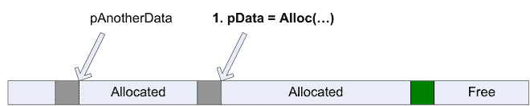

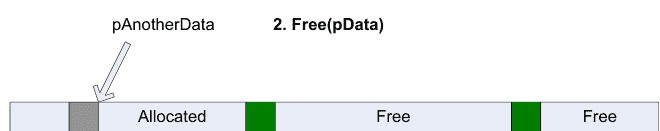

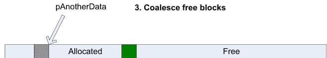


这里的问题是堆合并可能在双释放后某个时间点触发，因此我们需要一种解决方案来更早诊断双释放错误，最好在第一次双释放调用时就诊断出来。例如，以下程序在第一次双释放发生很长时间后的正常释放操作期间崩溃：

```
#include "stdafx.h"
#include <windows.h>

int _tmain(int argc, _TCHAR* argv[])
{
    while (true)
    {
        puts("Allocate: p1");
        void *p1 = malloc(100);
        puts("Allocate: p2");
        void *p2 = malloc(100);
        puts("Allocate: p3");
        void *p3 = malloc(100);

        puts("Free: p1");
        free(p1);
        puts("Free: p2");
        free(p2);
        puts("Double-Free: p2");
        free(p2);
        puts("Double-Free: p3");
        free(p3);

        Sleep(100);
    }

    return 0;
}
```

程序的输出：

```
Allocate: p1
Allocate: p2
Allocate: p3
Free: p1
Free: p2
Double-Free: p2
Free: p3
Allocate: p1
Allocate: p2
Allocate: p3
Free: p1
Free: p2
Double-Free: p2
Free: p3
Allocate: p1
Allocate: p2
Allocate: p3
Free: p1
Free: p2
Double-Free: p2
Free: p3
Allocate: p1
Allocate: p2
Allocate: p3
Free: p1
Free: p2
Double-Free: p2
Free: p3
Crash!
```

如果使用 Windows 调试工具中的 _gflags.exe_ 启用完整页面堆，程序将在双释放调用时立即崩溃：

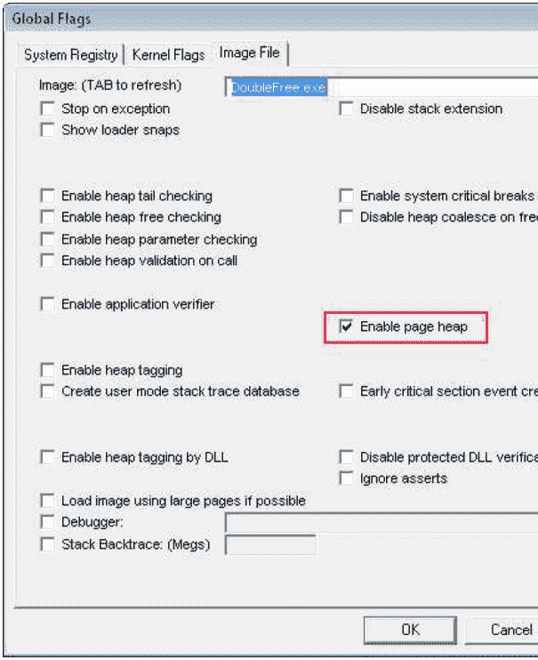

```
Allocate: p1
Allocate: p2
Allocate: p3
Free: p1
Free: p2
Double-Free: p2
Crash!
```

崩溃转储显示以下**堆栈跟踪**（第 926 页）：

```
0:000> kL
ChildEBP RetAddr
0012f810 71aa4ced ntdll!DbgBreakPoint+0x1
0012f834 71aa9fc2 verifier!VerifierStopMessage+0x1fd
0012f890 71aaa4da verifier!AVrfpDphReportCorruptedBlock+0x102
0012f844 71ab2c98 verifier!AVrfpDphCheckNormalHeapBlock+0x18a
0012f8b8 71ab2a0e verifier!_EH4_CallFilterFunc+0x12
0012f8e0 76ee1039 verifier!except_handler4+0x8e
0012f904 76ee100b ntdll!ExecuteHandler2+0x26
0012f9ac 76ee0e97 ntdll!ExecuteHandler+0x24
0012f9ac 71aaa3ad ntdll!KiUserExceptionDispatcher+0xf
0012fcf0 71aaa920 verifier!AVrfpDphCheckNormalHeapBlock+0x5d
0012fd0c 71aa879b verifier!AVrfpDphNormalHeapFree+0x20
0012fd60 76f31c4f verifier!AVrfDebugPageHeapFree+0x1cb
0012fda8 76efd9fa ntdll!RtlDebugFreeHeap+0x2f
0012fe9c 76ee1c21 ntdll!RtlpFreeHeap+0x5f
0012feb8 758d7a7e ntdll!RtlFreeHeap+0x14e
0012fecc 6cff4c39 kernel32!HeapFree+0x14
0012ff18 0040105f msvcr80!free+0xcd
0012ff5c 004011f1 DoubleFree!wmain+0x5f
0012ffa0 758d3833 DoubleFree!__tmainCRTStartup+0x10f
0012ffac 76eba9bd kernel32!BaseThreadInitThunk+0xe

0:000> !gflag
Current NtGlobalFlag contents: 0x02000000
hpa - Place heap allocations at ends of pages
```

如果启用堆释放检查而不是页面堆，我们也会在第一次双释放调用时立即崩溃：

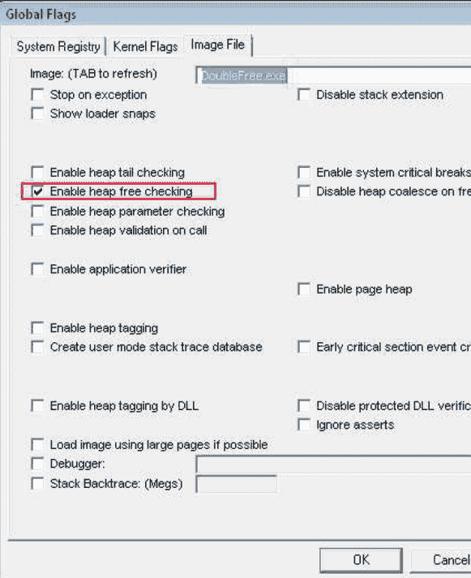

```
Allocate: p1
Allocate: p2
Allocate: p3
Free: p1
Free: p2
Double-Free: p2
Crash!
```

崩溃转储显示以下堆栈跟踪（第 926 页）：

```
0:000> r
eax=feefeeee ebx=001b2040 ecx=001b0000 edx=001b2040 esi=d4476047 edi=001b2038
eip=76ee2086 esp=0012fe68 ebp=0012fe9c iopl=0 nv up ei ng nz na pe nc
cs=001b ss=0023 ds=0023 es=0023 fs=003b gs=0000 efl=00010286
ntdll!RtlpLowFragHeapFree+0x31:
76ee2086 8b4604 mov eax,dword ptr [esi+4] ds:0023:d447604b=????????
```


0:000> kL
ChildEBP RetAddr
0012fe9c 76ee18c3 ntdll!RtlpLowFragHeapFree+0x31
0012feb0 758d7a7e ntdll!RtlFreeHeap+0x101
0012fec4 6cff4c39 kernel32!HeapFree+0x14
0012ff10 0040106d msvcr80!free+0xcxd
0012ff5c 004011f1 DoubleFree!wmain+0x6d
0012ffa0 758d3833 DoubleFree!__tmainCRTStartup+0x10f
0012ffac 76eba9bd kernel32!BaseThreadInitThunk+0xe
0012ffec 00000000 ntdll!_RtlUserThreadStart+0x23

0:000> !gflag
Current NtGlobalFlag contents: 0x00000020
    hfc - Enable heap free checking

## 注释

Windows 7 中检测到 **双重释放** 的示例：

```
0:048> k
ChildEBP RetAddr
206dee98 777f8567 ntdll!ZwWaitForSingleObject+0x15
206def1c 777f8695 ntdll!RtlReportExceptionEx+0x14b
206def74 7781e6e6 ntdll!RtlReportException+0x86
206def88 7781e763 ntdll!RtlpTerminateFailureFilter+0x14
206def94 777c73dc ntdll!RtlReportCriticalFailure+0x67
206defa8 777c7281 ntdll!EH4_CallFilterFunc+0x12
206defd0 777ab499 ntdll!_except_handler4+0x8e
206deff4 777ab46b ntdll!ExecuteHandler2+0x26
206df018 777ab40e ntdll!ExecuteHandler+0x24
206df0a4 77760133 ntdll!RtlDispatchException+0x127
206df0a4 7781e753 ntdll!KiUserExceptionDispatcher+0xf
206df5e8 7781f659 ntdll!RtlReportCriticalFailure+0x57
206df5f8 7781f739 ntdll!RtlpReportHeapFailure+0x21
206df62c 777ce045 ntdll!RtlpLogHeapFailure+0xa1
206df65c 76cae66a ntdll!RtlFreeHeap+0x64
206df670 58110076 ole32!CRetailMalloc_Free+0x1c [d:\w7rtm\com\ole32\com\class\memapi.cxx @ 687]
WARNING: Stack unwind information not available. Following frames may be wrong.
206df6ac 581100e9 OUTLMIME!MimeOleInetDateToFileTime+0xd562
206df6b8 5811051d OUTLMIME!MimeOleInetDateToFileTime+0xd5d5
206df6e0 771562fa OUTLMIME!MimeOleInetDateToFileTime+0xda09
206df70c 77156d3a user32!InternalCallWinProc+0x23
206df784 771577c4 user32!UserCallWinProcCheckWow+0x109
206df7e4 77157bca user32!DispatchMessageWorker+0x3bc
206df7f4 581d746e user32!DispatchMessageA+0xf
206df830 581a04a3 OUTLPH!DllGetClassObject+0x5616
206df84c 581df9ac OUTLPH!DllGetClassObject+0x5ed3
206df880 6e558488 OUTLPH!DllGetClassObject+0xdadc
206df8a4 650fa17d OLMAP13!HrCreateAsyncArgSet+0x479
206df8e8 650f8221 MSO!Ordinal381+0x48d
206df908 650f80a9 MSO!Ordinal19712+0x237
206df924 650f32d6 MSO!Ordinal19712+0xbf
206df958 650fee05 MSO!Ordinal15368+0x382
206df9b4 7725338a MSO!MsoFInitOffice+0x363
206df9c0 77789f72 kernel32!BaseThreadInitThunk+0xe
206dfa00 77789f45 ntdll!_RtlUserThreadStart+0x70
206dfa18 00000000 ntdll!_RtlUserThreadStart+0x1b
```

由于存在堆栈展开警告，我们再次检查返回地址以验证 OUTLMIME 模块调用了堆释放函数。该调用涉及指针地址 58149f04 的三重间接引用：

```
0:048> ub 58110076
OUTLMIME!MimeOleInetDateToFileTime+0xd550:
58110064 8b0f mov ecx,dword ptr [edi]
58110066 3bcb cmp ecx,ebx
58110068 740e je OUTLMIME!MimeOleInetDateToFileTime+0xd564 (58110078)
5811006a a1049f1458 mov eax,dword ptr [OUTLMIME!HrGetMIMEStreamForMAPIMsg+0xe528 (58149f04)]
5811006f 8b10 mov edx,dword ptr [eax]
58110071 51 push ecx
58110072 50 push eax
58110073 ff5214 call dword ptr [edx+14h]
```

```
0:048> dps poi(poi(58149f04))+14 L1
76b97264 76aa6e4e ole32!CRetailMalloc_Free [d:\w7rtm\com\ole32\com\class\memapi.cxx @ 680]
```

```
0:048> !heap -s
***********************************************************************
*                                                                     *
*                                                                     *
*      HEAP ERROR DETECTED                                            *
*                                                                     *
***********************************************************************
```

详细信息：
堆地址: 00280000
错误地址: 1cecd3e8
错误类型: HEAP_FAILURE_BLOCK_NOT_BUSY
详细信息: 调用方执行了一个操作（例如释放或大小检查），该操作在释放块上是非法的。
后续操作: 检查错误的堆栈跟踪以找到罪魁祸首。

- 堆栈跟踪:
- 777ce045: ntdll!RtlFreeHeap+0x00000064
- 76aa6e6a: ole32!CRetailMalloc_Free+0x0000001c
- 58110076: OUTLMIME!MimeOleInetDateToFileTime+0x00000d562
- 581100e9: OUTLMIME!MimeOleInetDateToFileTime+0x00000d5d5
- 5811051d: OUTLMIME!MimeOleInetDateToFileTime+0x00000da09
- 771562fa: user32!InternalCallWinProc+0x00000023
- 77156d3a: user32!UserCallWinProcCheckWow+0x00000109
- 771577c4: user32!DispatchMessageWorker+0x000003bc
- 77157bca: user32!DispatchMessageA+0x0000000f
- 581d74e6: OUTLPH!DllGetClassObject+0x00005516
- 581e04a3: OUTLPH!DllGetClassObject+0x0000e5d3
- 581df9ac: OUTLPH!DllGetClassObject+0x0000dadc
- 6e558488: OLMAPI32!HrCreateAsyncArgSet+0x00000479
- 650fa17d: MSO!Ordinal381+0x0000048d
- 650f8221: MSO!Ordinal9712+0x00000237
- 650f80a9: MSO!Ordinal9712+0x000000bf
- [...]

| 条目 | 用户 | 堆 | 段 | 大小 | 前一大小 | 未使用 | 标志 |
|---|---|---|---|---|---|---|---|
| 1cecd3e8 | 1cecd3f0 | 00280000 | 0f945f18 | 20 | - | 0 | LFH;free |

这是 Mac OS X / GDB 中对应于双重释放模式的示例：

```
(gdb) bt
#0 0x00007fff8479582a in __kill ()
#1 0x00007fff8e0e0a9c in abort ()
#2 0x00007fff8e13f84c in free ()
#3 0x00000001035a8ef4 in main (argc=1, argv=0x7fff6f31a7b20)

(gdb) x/2i 0x00000001035a8ef4-8
0x1035a8eec : mov     -0x20(%rbp),%edi
0x1035a8eef : callq   0x1035a8f06

(gdb) frame 3
#3 0x00000001035a8ef4 in main (argc=1, argv=0x7fff6f31a7b20)
at .../DoubleFree/main.c:23
23      free(p2);
Current language: auto; currently minimal

(gdb) x/g $rbp-0x20
0x7fff631a7ae0: 0x00007fe6a8801400

(gdb) x/2w 0x00007fe6a8801400
0x7fe6a8801400: 0x00000000 0xb0000000
```

建模应用程序的源代码如下：

```
int main(int argc, const char * argv[])
{
    char *p1 = (char *) malloc (1024);
    printf("p1 = %p\n", p1);

    char *p2 = (char *) malloc (1024);
    printf("p2 = %p\n", p2);

    free(p2);
    free(p1);
    free(p2);

    return 0;
}
```

## 双重 IRP 完成

类似于可通过 **监视信息**（第 516 页）中的 `gflags` 和驱动程序验证程序检测到的 **双重释放**（进程堆，第 267 页）和 **双重释放**（内核池，第 260 页），还有一种通过 **自诊断**（内核模式，第 844 页）实现的 **双重 IRP 完成** 变体。典型示例如下：

```
0: kd> !analyze -v

[...]

MULTIPLE_IRP_COMPLETE_REQUESTS (44)
A driver has requested that an IRP be completed (IoCompleteRequest()), but the packet has already been completed. This
is a tough bug to find because the easiest case, a driver actually attempted to complete its own packet twice, is
generally not what happened. Rather, two separate drivers each believe that they own the packet, and each attempts to
complete it. The first actually works, and the second fails. Tracking down which drivers in the system actually did this
is difficult, generally because the trails of the first driver have been covered by the second. However, the driver
stack for the current request can be found by examining the DeviceObject fields in each of the stack locations.
Arguments:
Arg1: fffffff80104aa010, Address of the IRP
Arg2: 0000000000000eae
Arg3: 0000000000000000
Arg4: 0000000000000000

STACK_TEXT:
fffff880`0e322428 fffff800`01666224 : 00000000`00000044 fffffa80`104aa010 00000000`00000eae 00000000`00000000 :
nt!KeBugCheckEx
fffff880`0e322430 fffff880`03dd121f : fffffa80`0dc12c50 fffffa80`107750c8 fffffa80`104aa010 fffff880`0e322580 : nt! ??
:::FNODOBFM::`string'+0x3eb3d
fffff880`0e322520 fffff880`03def17f : fffffa80`0dc12c50 fffffa80`104aa010 fffffa80`0cacb610 00000000`00000001 :
DriverA!DriverA::Create+0x3bf
[...]
fffff880`0e322740 fffff880`01972ba4 : fffffa80`0dc129f0 00000000`00000000 fffffa80`0fe7a010 00000000`00000001 :
nt!IopParseDevice+0x5a7
fffff880`0e3228d0 fffff880`01977b7d : fffffa80`0fe7a010 fffff880`0e322a30 fffffa80`00000040 fffffa80`0cae5080 :
nt!IopOpenObjectName+0x585
nt!IopOpenObjectName+0xf85
fffff880`0e3229d0 fffff880`0197e647 : 00000000`000007ff 00000000`00000003 fffff8a0`05716d01 00000000`00000000 :
nt!ObOpenObjectByName+0x1cd
fffff880`0e322a80 fffff880`01988398 : 00000000`03f3e510 fffff8a0`c0100000 fffff8a0`0c26fe50 00000000`03f3e118 :
nt!IopCreateFile+0x2b7
fffff880`0e322b20 fffff880`01677b13 : fffffa80`0e10db30 00000000`00000001 fffffa80`1002b060 fffff880`0198f294 :
nt!NtCreateFile+0x78
fffff880`0e322bb0 00000000`772ecf0a : 0000007f`f62c358f 00000000`03f3e1b0 00000000`7719fd72 0000007f`f62c6490 :
nt!KiSystemServiceCopyEnd+0xa13
00000000`03f3e068 0000007f`f62c358f : 00000000`03f3e1b0 00000000`7719fd72 0000007f`f62c6490 00000000`00000005 :
ntdll!NtCreateFile+0xa
[...]
```

```
0: kd> !irp fffffff80104aa010
Irp is active with 1 stacks 3 is current (= 0xfffff8a0104aa170)
No Mdl: No System Buffer: Thread fffffa801002b060: Irp is completed. Pending has been returned
cmd  flg cl Device   File   Completion-Context
[ 0, 0] 0 2 fffffff800dc129f0 00000000 00000000-00000000
\Driver\DriverA
Args: 00000000 00000000 00000000 ffffffffc00a0006
```


## 驱动设备集合

此模式可用于将当前的设备和驱动程序对象列表与某些保存的参考列表进行比较，以发现任何变化。此列表可以通过使用 **!object** 命令来完成：

```
0: kd> !object \Driver
[...]
0: kd> !object \FileSystem
[...]
0: kd> !object \Device
[...]
```

请注意，该集合称为 **驱动设备**，而非设备驱动程序。

## 干重

有时，当我们安装新产品版本时，看起来像内存泄漏的东西其实并不是泄漏。使用旧版本时，典型内存使用量为 400 MB，但突然之间内存使用量增加了一倍。我们不必惊慌，而应该收集进程内存转储，以便在离线状态下冷静地检查。我们可能会看到 **干重** 增加：即所有模块映像的大小。对于某些产品，新版本可能意味着使用新的更强大框架进行完全重新设计，或引入大量新的第三方组件（**模块多样性**，第 703 页）。反驳内存泄漏假设的另一个迹象是许多产品进程同时出现内存使用量增加。不过，这也可能是某个带有泄漏代码的共享模块。例如，在下面的示例中，50% 的已提交内存是映像内存：

```
0:000> !address -summary

--- Usage Summary ---------------------- RgnCount ----------- Total Size -------- %ofBusy %ofTotal
[...]
Image                   1806     0x19031000 ( 402.535 Mb)   4.29%    0.00%
Heap                    72       0x02865000 (  40.395 Mb)   0.44%    0.00%
[...]
--- Type Summary (for busy) ------------ RgnCount ----------- Total Size -------- %ofBusy %ofTotal
[...]
MEM_IMAGE               2281     0x19AA8000 ( 413.000 Mb)   4.40%    0.00%
[...]
--- State Summary ---------------------- RgnCount ----------- Total Size -------- %ofBusy %ofTotal
[...]
MEM_COMMIT              2477     0x326e8000 ( 806.906 Mb)   8.76%    0.00%
[...]
```

WinDbg **lm** 命令显示了近 50 个新的 .NET 组件。

## 双重堆栈跟踪

这是用户模式和用户空间堆栈跟踪的内核模式和内核空间对照物，反之亦然，例如：

```
25 Id: e8c.f20 Suspend: 1 Teb: 7ff9c000 Unfrozen
ChildEBP RetAddr
086acac4 7c90df5a ntdll!KiFastSystemCallRet
086acac8 7c02d5db ntdll!ZwWaitForSingleObject+0xc
086acb2c 7c802542 kernel32!WaitForSingleObjectEx+0xa8
086acb40 00fbb3a kernel32!WaitForSingleObject+0x12
WARNING: Stack unwind information not available. Following frames may be wrong.
086ad3c8 00fbc139 ModuleA!DllCanUnloadNow+0x638b4a
[...]
086affb4 7c80b729 ModuleA!DllCanUnloadNow+0xc65c0
086affec 00000000 kernel32!BaseThreadStart+0x37
```

```
0: kd> !thread 88ec9020 1f
THREAD 88ec9020 Cid 17a0.2034 Teb: 7ffad000 Win32Thread: bc28c6e8 WAIT: (Unknown) UserMode Non-Alertable
89095f48 Semaphore Limit 0x10000
IRP List:
89a5a370: (0006,0094) Flags: 00000900 Mdl: 00000000
Not impersonating
DeviceMap            d6c30c48
Owning Process       88ffff88    Image: iexplore.exe
Attached Process     N/A         Image: N/A
Wait Start TickCount 5632994 Ticks: 2980 (0:00:00:46.562)
Context Switch Count 2269         LargeStack
UserTime             00:00:00.000
KernelTime           00:00:00.000
Win32 Start Address 0x00a26d20
Start Address kernel32!BaseThreadStartThunk (0x77e617ec)
Stack Init b204c000 Current b204bc60 Base b204c000 Limit b2048000 Call 0
Priority 8 BasePriority 8 PriorityDecrement 0
ChildEBP RetAddr
b204bc78 80833ec5 nt!KiSwapContext+0x26
b204bca4 80829c14 nt!KiSwapThread+0x2e5
b204bcec 8093b174 nt!KeWaitForSingleObject+0x346
b204bd50 8088b41c nt!NtWaitForSingleObject+0x9a
b204bd50 7c82860c nt!KiFastCallEntry+0xfc (TrapFrame @ b204bd64)
058fcabc 7c827d29 ntdll!KiFastSystemCallRet
058fcac0 77e61d1e ntdll!ZwWaitForSingleObject+0xc
058fcb30 77e61c8d kernel32!WaitForSingleObjectEx+0xa8
058fcb44 00f98b4a kernel32!WaitForSingleObject+0x12
WARNING: Stack unwind information not available. Following frames may be wrong.
058fd3cc 00f99249 ModuleA+0x638b4a
[...]
058fffb8 77e6482f ModuleA+0xc65c0
058fffec 00000000 kernel32!BaseThreadStart+0x34
```

当同时拥有进程用户空间内存转储和内核/完整内存转储，并希望在它们之间匹配感兴趣的堆栈跟踪时，此模式很有帮助。另请参见模式 **堆栈跟踪**（第 926 页）和 **堆栈跟踪集合**（第 943 页）。

## 重复扩展

此模式适用于使用加载模块来扩展其功能的调试器，相当于 **重复模块**（第 287 页）。例如，在 WinDbg 的情况下，可能会加载两个不同的 **版本特定扩展**（第 1058 页），从而对调试过程造成混乱（调试器 DLL 地狱）。例如，我们加载了特定版本的 SOS 扩展，并成功获得了堆栈跟踪：

```
0:000> lmv m mscorwks
start             end module name
79e70000 7a3fff00   mscorwks   (deferred)
    Image path: C:\Windows\Microsoft.NET\Framework\v2.0.50727\mscorwks.dll
    Image name: mscorwks.dll
    Timestamp:        Wed Oct 24 08:41:29 2007 (471EF729)
    CheckSum:         00597AA8
    ImageSize:        0058F000
    File version:     2.0.50727.1433
    Product version:  2.0.50727.1433
    File flags:       0 (Mask 3f)
    File OS:          4 Unknown Win32
    File type:        2.0 Dll
    File date:        00000000.00000000
    Translations:     0409.04b0
    CompanyName:      Microsoft Corporation
    ProductName:      Microsoft® .NET Framework
    InternalName:     mscorwks.dll
    OriginalFilename: mscorwks.dll
    ProductVersion:   2.0.50727.1433
    FileVersion:      2.0.50727.1433 (REDBITS.050727-1400)
    FileDescription:  Microsoft .NET Runtime Common Language Runtime - WorkStation
    LegalCopyright:   © Microsoft Corporation. All rights reserved.
    Comments:         Flavor=Retail
```

```
0:000> .chain
Extension DLL search Path:
[...]
Extension DLL chain:
dbghelp: image 6.12.0002.633, API 6.1.6, built Mon Feb 01 20:08:26 2010
    [path: C:\Program Files (x86)\Debugging Tools for Windows (x86)\dbghelp.dll]
ext: image 6.12.0002.633, API 1.0.0, built Mon Feb 01 20:08:31 2010
    [path: C:\Program Files (x86)\Debugging Tools for Windows (x86)\winext\ext.dll]
exts: image 6.12.0002.633, API 1.0.0, built Mon Feb 01 20:08:24 2010
    [path: C:\Program Files (x86)\Debugging Tools for Windows (x86)\WINXP\exts.dll]
uxt: image 6.12.0002.633, API 1.0.0, built Mon Feb 01 20:08:23 2010
    [path: C:\Program Files (x86)\Debugging Tools for Windows (x86)\winext\uxt.dll]
tsdexts: image 6.1.7650.0, API 1.0.0, built Mon Feb 01 20:08:08 2010
    [path: C:\Program Files (x86)\Debugging Tools for Windows (x86)\WINXP\ntsdexts.dll]
```

```
0:000> .load C:\Frameworks\32-bit\Framework.Updates\Microsoft.NET\Framework\v2.0.50727\sos

0:000> .chain
Extension DLL search Path:
[...]
Extension DLL chain:
C:\Frameworks\32-bit\Framework.Updates\Microsoft.NET\Framework\v2.0.50727\sos: image 2.0.50727.1433, API 1.0.0, built Wed Oct 24 04:41:30 2007
[path: C:\Frameworks\32-bit\Framework.Updates\Microsoft.NET\Framework\v2.0.50727\sos.dll]
dbghelp: image 6.12.0002.633, API 6.1.6, built Mon Feb 01 20:08:26 2010
[path: C:\Program Files (x86)\Debugging Tools for Windows (x86)\dbghelp.dll]
ext: image 6.12.0002.633, API 1.0.0, built Mon Feb 01 20:08:31 2010
[path: C:\Program Files (x86)\Debugging Tools for Windows (x86)\winext\ext.dll]
exts: image 6.12.0002.633, API 1.0.0, built Mon Feb 01 20:08:24 2010
[path: C:\Program Files (x86)\Debugging Tools for Windows (x86)\WINXP\exts.dll]
uext: image 6.12.0002.633, API 1.0.0, built Mon Feb 01 20:08:23 2010
[path: C:\Program Files (x86)\Debugging Tools for Windows (x86)\winext\uext.dll]
ntsdexts: image 6.1.7650.0, API 1.0.0, built Mon Feb 01 20:08:08 2010
[path: C:\Program Files (x86)\Debugging Tools for Windows (x86)\WINXP\ntsdexts.dll]

0:000> !CLRStack
OS Thread Id: 0xdd0 (0)
ESP EIP
002eeaa8 77c40f34 [InlinedCallFrame: 002eeaa8] System.Windows.Forms.UnsafeNativeMethods.WaitMessage()
002eeaa4 7b08374f System.Windows.Forms.Application+ComponentManager.System.Windows.Forms.UnsafeNativeMethods.MSGLoop(Int32, Int32, Int32)
002eeb44 7b0831a5 System.Windows.Forms.Application+ThreadContext.RunMessageLoopInner(Int32, System.Windows.Forms.ApplicationContext)
002eebbc 7b082fe3 System.Windows.Forms.Application+ThreadContext.RunMessageLoop(Int32, System.Windows.Forms.ApplicationContext)
002eeebc 7b0692c2 System.Windows.Forms.Application.Run(System.Windows.Forms.Form)
002eebfc 00833264 LINQPad.Program.Run(System.String, Boolean, System.String, Boolean, Boolean, System.String)
002eec50 008311dc LINQPad.Program.Go(System.String[])
002eedeac 00830545 LINQPad.Program.Start(System.String[])
002eede0 00830362 LINQPad.Program.Starter.Run(System.String[])
002eede8 008300e3 LINQPad.Loader.Main(System.String[])
002ef00c 79e7c74b [GCFrame: 002ef00c]
```

接着，我们尝试了默认分析命令 !analyze -v -hang，并继续使用 SOS 命令。不幸的是，它们不再正确工作：

```
0:000> !CLRStack
OS Thread Id: 0xdd0 (0)
ESP EIP
002eeaa8 77c40f34 [InlinedCallFrame: 002eeaa8]
002eeaa4 7b08374f
002eeb44 7b0831a5
002eebc 7b082fe3
002eebc 7b0692c2
002eebfc 00833264
002eec0 00833264
002eec50 008311dc
002eede 00830362
002eede 00830362
```


```
002eede8 008300e3
002ef00c 79e7c74b [GCFrame: 002ef00c]
```

查看加载的扩展列表，我们看到额外加载了一个错误版本的 SOS.DLL，该版本处理所有 SOS 命令：

```
0:000> .chain
Extension DLL search Path:
[...]
Extension DLL chain:
C:\Windows\Microsoft.NET\Framework\v2.0.50727\sos: image 2.0.50727.4963, API 1.0.0, built Thu Jul 07
03:08:08 2011
[path: C:\Windows\Microsoft.NET\Framework\v2.0.50727\sos.dll]
[path: C:\Windows\32-bit\Framework.Updates\Microsoft.NET\Framework\v2.0.50727\sos: image 2.0.50727.1433, API
1.0.0, built Wed Oct 24 04:41:30 2007]
[path: C:\Frameworks\32-bit\Framework.Updates\Microsoft.NET\Framework\v2.0.50727\sos.dll]
dbghelp: image 6.12.0002.633, API 6.1.6, built Mon Feb 01 20:08:26 2010
[path: C:\Program Files (x86)\Debugging Tools for Windows (x86)\dbghelp.dll]
ext: image 6.12.0002.633, API 1.0.0, built Mon Feb 01 20:08:31 2010
[path: C:\Program Files (x86)\Debugging Tools for Windows (x86)\winext\ext.dll]
exts: image 6.12.0002.633, API 1.0.0, built Mon Feb 01 20:08:24 2010
[path: C:\Program Files (x86)\Debugging Tools for Windows (x86)\WINXP\exts.dll]
uxt: image 6.12.0002.633, API 1.0.0, built Mon Feb 01 20:08:23 2010
[path: C:\Program Files (x86)\Debugging Tools for Windows (x86)\winext\uext.dll]
tsdexts: image 6.1.7600.0, API 1.0.0, built Mon Feb 01 20:08:08 2010
[path: C:\Program Files (x86)\Debugging Tools for Windows (x86)\WINXP\ntsdexts.dll]
```

如果指定正确扩展的完整路径，我们将获得正确的堆栈跟踪：

```
0:000> !C:\Frameworks\32-bit\Framework.Updates\Microsoft.NET\Framework\v2.0.50727\sos.CLRStack
OS Thread Id: 0xdd0 (0)
ESP
EIP
002eeaa8 77c40f34 [InlinedCallFrame: 002eeaa8] System.Windows.Forms.UnsafeNativeMethods.WaitMessage()
002eeaa4 7b08374f System.Windows.Forms.Application+ComponentManager.System.Windows.Forms.
UnsafeNativeMethods.IMsoComponentManager.FPushMessageLoop(Int32, Int32, Int32)
002eeb44 7b0831a5 System.Windows.Forms.Application+ThreadContext.RunMessageLoopInner(Int32,
System.Windows.Forms.ApplicationContext)
002eebbc 7b082fe3 System.Windows.Forms.Application+ThreadContext.RunMessageLoop(Int32,
System.Windows.Forms.ApplicationContext)
002eebc0 7b069c22 System.Windows.Forms.Application.Run(System.Windows.Forms.Form)
002eebfc 00833264 LINQPad.Program.Run(System.String, Boolean, System.String, Boolean, Boolean,
System.String)
002eec50 008311dc LINQPad.Program.Go(System.String[])
002eedac 00830545 LINQPad.Program.Start(System.String[])
002eede0 00830362 LINQPad.ProgramStarter.Run(System.String[])
002eede8 008300e3 LINQPad.Loader.Main(System.String[])
002ef00c 79e7c74b [GCFrame: 002ef00c]
```

为了避免混淆，我们卸载最后加载的扩展：

```
0:000> .unload C:\Windows\Microsoft.NET\Framework\v2.0.50727\sos
Unloading C:\Windows\Microsoft.NET\Framework\v2.0.50727\sos extension DLL
```

```
0:000> !CLRStack
OS Thread Id: 0xdd0 (0)
ESP       EIP
002eea8 77c40f34 [InlinedCallFrame: 002eea8] System.Windows.Forms.UnsafeNativeMethods.WaitMessage()
002eea4 7b08374f System.Windows.Forms.Application+ComponentManager.System.Windows.Forms.
UnsafeNativeMethods.IMsoComponentManager.FPushMessageLoop(Int32, Int32, Int32)
002eeb4 7b0831a5 System.Windows.Forms.Application+ThreadContext.RunMessageLoopInner(Int32,
System.Windows.Forms.ApplicationContext)
002eebc 7b082fe3 System.Windows.Forms.Application+ThreadContext.RunMessageLoop(Int32,
System.Windows.Forms.ApplicationContext)
002eebf 7b069c22 System.Windows.Forms.Application.Run(System.Windows.Forms.Form)
002eebfc 00833264 LINQPad.Program.Run(System.String, Boolean, System.String, Boolean, Boolean,
System.String)
002eec50 008311dc LINQPad.Program.Go(System.String[])
002eecad 00830545 LINQPad.Program.Start(System.String[])
002eede0 00830362 LINQPad.ProgramStarter.Run(System.String[])
002eede8 008300e3 LINQPad.Loader.Main(System.String[])
002ef00c 79e7c74b [GCFrame: 002ef00c]
```

## 注释

有一些问题被提出：

Q. 我原本认为与 mscorwks.dll 位于同一文件夹中的 sos.dll 版本始终是正确的。从您的文件夹路径名称来看，mscorwks.dll 已更新，但 sos.dll 未更新。如果是这样，您是如何获取正确的 sos.dll 版本的？

A. 转储来自另一台机器，那台机器上 mscorwks 和 sos 版本当然相同。在分析机器上，我们安装了不同版本的框架，带有不同的 sos。因此，转储中的 mscorwks 版本与分析机器上的 sos 之间存在版本不一致。我们从转储来源机器复制正确版本的框架。请也查看 **特定版本扩展** 模式（第 1058 页）。

Q. 是的，托管调试要求分析机器使用与“转储”机器相同的位数和框架。当您说“复制”框架时，您到底复制什么？是二进制文件的子集还是全部？

A. 我们通常要求复制整个文件夹，以防有任何额外依赖项。不过，我们发现 mscorwks 或 clr、mscordacwks 和 sos DLL 已足够。

## 重复模块

除了 **模块多样性**（第 703 页）之外，这也是另一种 DLL 地狱模式。在这里，同一个模块被加载至少两次，当我们看到 **lm** 命令输出中模块加载地址附加到其名称后，就可以检测到这种情况（这样做是为了使模块名称唯一）：

0:000> lm

| 开始 | 结束 | 模块名称 |
|-------|-----|-------------|
| 00b20000 | 0147f000 | MSO_b20000 |
| 30000000 | 309a7000 | EXCEL |
| 30c90000 | 31848000 | mso |
| 71c20000 | 71c32000 | tsappcmp |
| 745e0000 | 7489e000 | msi |
| 76290000 | 762ad000 | imm32 |
| 76b70000 | 76b7b000 | psapi |
| 76f50000 | 76f63000 | secur32 |
| 77380000 | 77411000 | user32 |
| 77670000 | 777a9000 | ole32 |
| 77ba0000 | 77bfa000 | msvcrt |
| 77c00000 | 77c48000 | gdi32 |
| 77c50000 | 77cef000 | rpcrt4 |
| 77da0000 | 77df2000 | shlwapi |
| 77e40000 | 77f42000 | kernel32 |
| 77f50000 | 77feb000 | advapi32 |
| 7c800000 | 7c8c0000 | ntdll |

通常，这种情况发生在 DLL 从不同位置加载时。也可能是完全相同的 DLL 版本。问题通常出现在存在不同 DLL 版本时，新代码加载旧版 DLL 并使用它。这可能导致接口不兼容问题，并最终导致应用程序故障，例如访问违规。

为了提供一个可供玩耍的转储，我创建了一个名为 2DLLs 的小型玩具程序，以模拟我在生产环境中遇到的类似最坏情况。该程序定期加载 MyDLL 模块以调用其一个函数。不幸的是，在一个地方，它使用硬编码的相对路径：

```
HMODULE hLib = LoadLibrary(L".\\DLL\\MyDll.dll");
```

在另一个地方，它依赖于 DLL 搜索顺序⁴⁶：

```
hLib = LoadLibrary(L".\\MyDll.dll");
```

如果 DLL 搜索顺序指定的其他位置未找到该 DLL，则将使用 PATH 变量目录进行搜索。我们看到，当安装了另一个应用程序并使用该 DLL 的旧版本，并将 PATH 变量修改为指向其位置时，可能出现此问题。为了模拟接口不兼容，我们编译了 MyDLL 的一个版本，当从中调用相同函数时会导致 NULL 指针访问违规。该 DLL 被放置在单独的文件夹中，PATH 变量已修改为引用该文件夹：

```
C:\>set PATH=C:\OLD;%PATH%
```

应用程序崩溃，安装的默认事后调试器⁴⁷保存其崩溃转储。如果我们打开它，我们会看到它在 MyDLL_1e60000 模块中崩溃，这应该引起怀疑：

```
0:000> r
rax=0000000001e1010 rbx=0000000000000000 rcx=0000775dcac00000
rdx=0000000000000000 rsi=0000000000000006 rdi=0000000000001770
rip=0000000001e61010 rsp=000000000012fed8 rbp=0000000000000000
r8=0000000000000000 r9=000000000012fd58 r10=0000000000000001
r11=000000000012fcc0 r12=0000000000000000 r13=0000000000000002
r14=0000000000000000 r15=0000000000000000
iopl=0 nv up ei pl nz na po nc
cs=0033 ss=002b ds=002b es=002b fs=0053 gs=002b efl=00010200
MyDLL_1e60000!fnMyDLL:
00000000`01e61010 c704250000000000000000 mov dword ptr [0],0 ds:00000000`00000000=????????
0:000> kL
Child-SP          RetAddr           Call Site
00000000`0012fed8 00000001`40010193 MyDLL_1e60000!fnMyDLL
00000000`0012fee0 00000001`40013444 2DLls+0x1093
00000000`0012ff10 00000000`773acdcd 2DLls+0x1344
00000000`0012ff60 00000000`774fc6e1 kernel32!BaseThreadInitThunk+0xd
00000000`0012ff90 00000000`00000000 ntdll!RtlUserThreadStart+0x1d
```

查看模块列表，我们看到从两个不同文件夹加载了两个版本的 MyDLL：

0:000> lm

| 开始 | 结束 | 模块名称 |
|-------|-----|-------------|
| 00000000`01e60000 | 00000000`01e71000 | MyDLL_1e60000 |
| 00000000`772a0000 | 00000000`7736a000 | user32 |
| 00000000`77370000 | 00000000`774a1000 | kernel32 |
| 00000000`774b0000 | 00000000`7762a000 | ntdll |
| 00000001`40000000 | 00000001`40010000 | 2DLls |
| 00000001`80000000 | 00000001`80011000 | MyDLL |
| 00007fe`fc9e0000 | 000007fe`fca32000 | uxtheme |
| 000007fe`fe870000 | 000007fe`fe9a9000 | rpcrt4 |
| 000007fe`fe9b0000 | 000007fe`fe9bc000 | lpk |
| 000007fe`fea10000 | 000007fe`feae8000 | oleaut32 |
| 000007fe`fec0000 | 000007fe`fed6a000 | usp10 |
| 000007fe`fefb0000 | 000007fe`fefb0000 | ole32 |
| 000007fe`fefb0000 | 000007fe`ff0af000 | advapi32 |
| 000007fe`fff00000 | 000007fe`fff31000 | gdi32 |
| 000007fe`ff2e0000 | 000007fe`ff381000 | msvcrt |
| 000007fe`ff390000 | 000007fe`ff3b8000 | imm32 |
| 000007fe`ff4b0000 | 000007fe`ff5b4000 | msctf |


```
0:000> lmv m MyDLL_1e60000
start    end        module name
00000000`01e60000 00000000`01e71000   MyDLL_1e60000
    Loaded symbol image file: MyDLL.dll
    Image path: C:\OLD\MyDLL.dll
    Image name: MyDLL.dll
    Timestamp:        Wed Jun 18 14:49:13 2008 (48591259)
...
0:000> lmv m MyDLL
start    end        module name
00000000`80000000 00000001`80011000   MyDLL
    Image path: C:\2DLLs\DLLs\MyDLL.dll
    Image name: MyDLL.dll
    Timestamp:        Wed Jun 18 14:50:56 2008 (485912C0)
...
```

我们还可以看到，旧版本的 MyDLL 是最后加载的 DLL：

```
0:000> !dlls -l
0x002c2680: C:\2DLLs\2DLLs.exe
    Base    0x140000000   EntryPoint  0x1400013b0   Size      0x00010000
    Flags   0x00004000    LoadCount   0x0000ffff    TlsIndex  0x00000000
        LDRP_ENTRY_PROCESSED
...
0x002ea9b0: C:\2DLLs\DLL\MyDLL.dll
    Base    0x180000000   EntryPoint  0x1800013d0   Size      0x00011000
    Flags   0x00084004    LoadCount   0x00000001    TlsIndex  0x00000000
        LDRP_IMAGE_DLL
        LDRP_ENTRY_PROCESSED
        LDRP_PROCESS_ATTACH_CALLED
...
0x002ec430: C:\OLD\MyDLL.dll
    Base    0x01e600000   EntryPoint  0x01e613e0    Size      0x00011000
    Flags   0x00284004    LoadCount   0x00000001    TlsIndex  0x00000000
        LDRP_IMAGE_DLL
        LDRP_ENTRY_PROCESSED
        LDRP_PROCESS_ATTACH_CALLED
        LDRP_IMAGE_NOT_AT_BASE
```

我们还可以看到 PATH 变量指向其位置，这可能解释了为什么它会被加载：

```
0:000> !peb
PEB at 000007fffffd6000
...
Path=C:\OLD;C:\Windows\system32;C:\Windows;...
...
```

我们可能会认为名称中带有地址的模块是最后加载的，但事实并非如此。如果我们使用 .dump 命令从现有转储文件保存另一份副本，并加载新的转储文件，则会看到模块名称的顺序被反转：

```
0:000> kL
Child-SP          RetAddr           Call Site
00000000`0012fed8 00000001`40001093 MyDLL!fnMyDLL
00000000`0012fee0 00000001`40001344 2DLLs+0x1093
00000000`0012ff10 00000000`773acdcd 2DLLs+0x1344
00000000`0012ff60 00000000`774fc6e1 kernel32!BaseThreadInitThunk+0xd
00000000`0012ff90 00000000`00000000 ntdll!RtlUserThreadStart+0x1d
```

```
0:000> lm
start             end                 module name
00000000`01e60000 00000000`01e71000   MyDLL
00000000`772a0000 00000000`7736a000   user32
00000000`77370000 00000000`774a1000   kernel32
00000000`774b0000 00000000`7762a000   ntdll
00000001`40000000 00000001`40010000   2DLLs
00000001`80000000 00000001`80011000   MyDLL_180000000
000007fe`fc9e0000 000007fe`fca32000   uxtheme
000007fe`fe870000 000007fe`fe9a9000   rpcrt4
000007fe`fe9b0000 000007fe`fe9bc000   lpk
000007fe`fea10000 000007fe`feae8000   oleaut32
000007fe`fecc0000 000007fe`fed6a000   usp10
000007fe`fedc0000 000007fe`fefb0000   ole32
000007fe`fefb0000 000007fe`ff0af000   advapi32
000007fe`ff0d0000 000007fe`ff131000   gdi32
000007fe`ff2e0000 000007fe`ff381000   msvcrt
000007fe`ff390000 000007fe`ff3b8000   imm32
000007fe`ff4b0000 000007fe`ff5b4000   msctf
```

```
0:000> !dlls -l

...

0x002ec430: C:\OLD\MyDLL.dll
    Base    0x01e60000      EntryPoint  0x01e613e0      Size        0x00011000
    Flags   0x00284004      LoadCount   0x00000001      TlsIndex    0x00000000
        LDRP_IMAGE_DLL
        LDRP_ENTRY_PROCESSED
        LDRP_PROCESS_ATTACH_CALLED
        LDRP_IMAGE_NOT_AT_BASE
```

本示例中使用的后处理转储文件可以从 FTP 下载以供试用⁴⁸。

## 注释

提出了几个问题：

Q. 我们还可以看到，旧版本的 MyDLL 是最后加载的 DLL。该说法与以下输出相矛盾，其中很明显旧 DLL 是首先加载的：

```
0:000> lmv m MyDLL_1e60000
start end module name
00000000`01e60000 01e71000 MyDLL_1e60000
Loaded symbol image file: MyDLL.dll
Image path: C:\OLD\MyDLL.dll
Image name: MyDLL.dll
Timestamp: Wed Jun 18 14:49:13 2008 (48591259)
[...]

0:000> lmv m MyDLL
start end module name
00000001`80000000 00000001`80011000 MyDLL
Image path: C:\2DLLs\DLL\MyDLL.dll
Image name: MyDLL.dll
Timestamp: Wed Jun 18 14:50:56 2008 (485912C0)
[...]
```

A. 我们在这里没有看到矛盾：时间戳是链接时间而非加载时间，加载器可以自由选择基址。

Q. 从模块列表中我们可以看到有两个模块是重复的。有没有办法找出是谁调用模块加载到内存中。我们希望看到调用函数（重复的源头）。

A. 我们建议在线程原始堆栈中搜索模块起始地址。另外，考虑在 WinDbg 中启用加载模块事件处理进行实时调试。

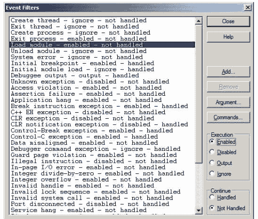

## 动态内存损坏

### 内核池

如果内核池损坏，则分配或释放内存的调用会导致 C2 或 19 等 bugcheck，以及其他不太常见的 bugcheck（来自 Google 统计⁴⁹）：

| BugCheck C2: 不良池调用者 | 1600 |
|---|---|
| BugCheck 19: 不良池标头 | 434 |
| BugCheck C5: 驱动程序损坏的扩展池 | 207 |
| BugCheck DE: 文件区域中的池损坏 | 106 |
| BugCheck D0: 驱动程序损坏的内存管理器池 | 8 |
| BugCheck D6: 驱动程序超出分配结束的页面错误 | 3 |
| BugCheck CD: 超出分配结束的页面错误 | 2 |
| BugCheck C6: 驱动程序被发现修改已释放的池 | 0 |

Bugcheck 0xC2 和 0x19 在其参数中包含指示检测到的池损坏类型的参数。我们应参考 WinDbg 帮助以获取详细信息，或使用 **!analyze** 命令的变体，其中可以提供可选的 bugcheck 参数：

```
1: kd> !analyze -show c2
BAD_POOL_CALLER (c2)
The current thread is making a bad pool request. Typically this is at a bad IRQL level or double freeing
the same allocation, etc.
Arguments:
Arg1: 00000000, The caller is requesting a zero byte pool allocation.
Arg2: 00000000, zero.
Arg3: 00000000, the pool type being allocated.
Arg4: 00000000, the pool tag being used.
```

```
1: kd> !analyze -show 19 2 1 1 1
BAD_POOL_HEADER (19)
The pool is already corrupt at the time of the current request.
This may or may not be due to the caller.
The internal pool links must be walked to figure out a possible cause of
the problem, and then special pool applied to the suspect tags or the driver
verifier to a suspect driver.
Arguments:
Arg1: 00000002, the verifier pool pattern check failed. The owner has likely corrupted the pool block
Arg2: 00000001, the pool entry being checked.
Arg3: 00000001, size of the block.
Arg4: 00000001, 0.
```

如果在可疑驱动程序上启用特殊池，我们也可能会遇到这些 bugcheck，其 Google 频率如下：

| BugCheck C1: 特殊池检测到内存损坏 | 59 |
|---|---|
| BugCheck D5: 驱动程序在释放的特殊池中的页面错误 | 5 |
| BugCheck CC: 在释放的特殊池中的页面错误 | 1 |

以下是在 *释放* 操作期间检测到的非分页池损坏示例，随附 **!analyze -v** 输出：

```
BAD_POOL_HEADER (19)
The pool is already corrupt at the time of the current request.
This may or may not be due to the caller.
The internal pool links must be walked to figure out a possible cause of
the problem, and then special pool applied to the suspect tags or the driver
verifier to a suspect driver.
Arguments:
Arg1: 00000020, a pool block header size is corrupt.
Arg2: a34583b8, The pool entry we were looking for within the page.
Arg3: a34584f0, The next pool entry.
Arg4: 0a270001, (reserved)

POOL_ADDRESS: a34583b8 Nonpaged pool

PROCESS_NAME: process.exe

CURRENT_IRQL: 2

STACK_TEXT:
b80a60cc 808927bb nt!KeBugCheckEx+0x1b
b80a6134 80892b6f nt!ExFreePoolWithTag+0x477
b80a6144 b5991400 nt!ExFreePool+0xf
WARNING: Stack unwind information not available. Following frames may be wrong.
b80a615c b957b954 driver+0x38400
b80a617c b957d482 driver+0x22954
b80a61c0 b957abf4 driver+0x24482
b80a6260 b957ccf driver+0x21bf4
b80a62a8 8081df65 driver+0x23cef
b80a62bc f721ac45 nt!IofCallDriver+0x45
b80a62e4 8081df65 fltMgr!FltpDispatch+0x6f
```


```
b80a62f8 b99de70b nt!IofCallDriver+0x45
b80a6308 b99da6ee filter!Dispatch+0xfb
b80a6318 b801df65 filter!dispatch+0x6e
b80a632c b9bddebfe nt!IofCallDriver+0x45
b80a6334 8081df65 2ndfilter!Redirect+0x7ea
b80a6348 b9bd1756 nt!IofCallDriver+0x45
b80a6374 b9bd1860 3rdfilter!PassThrough+0x136
b80a6384 8081df65 3rdfilter!Dispatch+0x80
b80a6398 808f5437 nt!IofCallDriver+0x45
b80a63ac 808e9693 nt!IopSynchronousServiceTail+0x10b
b80a63d0 8088978c nt!NtQueryDirectoryFile+0x5d
b80a63d0 7c8285ec nt!KiFastCallEntry+0xfc
00139524 7c8274eb ntdll!KiFastSystemCallRet
00139528 77e6ba40 ntdll!NtQueryDirectoryFile+0xc
00139830 77e6bbf5 kernel32!FindFirstFileExW+0x3d5
00139850 6002665e kernel32!FindFirstFileW+0x16
00139e74 60026363 process+0x2665e
0013a328 60027852 process+0x26363
0013a33c 60035b58 process+0x27852
0013b104 600385ff process+0x355b8
0013b224 612cb643 process+0x385ff
0013b988 612cc109 dll!FileDialog+0xc53
0013bba0 612cb47b dll!FileDialog+0x1719
0013c2c0 7739b6e3 dll!FileDialog+0xa8b
0013c2ec 77395f82 USER32!InternalCallWinProc+0x28
0013c368 77395e22 USER32!UserCallDlgProcCheckWow+0x147
0013c3b0 7739c9c6 USER32!DefDlgProcWorker+0xa8
0013c3d8 7c828536 USER32!__fnDWORD+0x24
0013c3d8 808308f4 ntdll!KiUserCallbackDispatcher+0x2e
b80a66b8 8091d6d1 nt!KiCallUserMode+0x4
b80a6710 bf8a2622 nt!KeUserModeCallback+0x8f
b80a6794 bf8a2517 win32k!SfnDWORD+0xb4
b80a67dc bf8a13d9 win32k!xxxSendMessageToClient+0x133
b80a6828 bf85ae67 win32k!xxxSendMessageTimeout+0x1a6
b80a684c bf8847a1 win32k!xxxWrapSendMessage+0x1b
b80a6868 bf8c1459 win32k!NtUserfnNCDESTROY+0x27
b80a68a0 8088978c win32k!NtUserMessageCall+0xc0
b80a68a0 7c8285ec nt!KiFastCallEntry+0xfc
0013c3d8 7c828536 ntdll!KiFastSystemCallRet
0013c3d8 808308f4 ntdll!KiUserCallbackDispatcher+0x2e
b80a6b7c 8091d6d1 nt!KiCallUserMode+0x4
b80a6bd4 bf8a2622 nt!KeUserModeCallback+0x8f
b80a6c58 bf8a23a0 win32k!SfnDWORD+0xb4
b80a6ca0 bf8a13d9 win32k!xxxSendMessageToClient+0x118
b80a6cec bf85ae67 win32k!xxxSendMessageTimeout+0x1a6
b80a6d10 bf8c148c win32k!xxxWrapSendMessage+0x1b
b80a6d40 8088978c win32k!NtUserMessageCall+0x9d
b80a6d40 7c8285ec nt!KiFastCallEntry+0xfc
0013f474 7c828536 ntdll!KiFastSystemCallRet
0013f4a0 7739d1ec ntdll!KiUserCallbackDispatcher+0x2e
0013f4dc 7738cf29 USER32!NtUserMessageCall+0xc
0013f4fc 612d3276 USER32!SendMessageA+0x7f
0013f63c 611ad41 dll!SubWindow+0x3dc6
0013f658 7739b6e3 dll!SetWindowText+0x37a1
0013f684 7739b874 USER32!InternalCallWinProc+0x28
0013f6fc 7739ba92 USER32!UserCallWinProcCheckWow+0x151
0013f764 7739bad0 USER32!DispatchMessageWorker+0x327
0013f774 61221ca8 USER32!DispatchMessageW+0xf
0013f7e0 0040156d dll!MainLoop+0xc28
0013ff24 004001da process+0x156d
0013ffc0 77e6f23b process+0x1dfa
0013fff0 00000000 kernel32!BaseProcessStart+0x23

MODULE_NAME: driver

IMAGE_NAME: driver.sys
```

我们看到 WinDbg 按照“组件识别”文章 50 中描述的过程，指向了 driver.sys。

正如 bugcheck 描述所说：“池在当前请求时已经损坏。”，任何 OS 组件都可能在检测前损坏池。还有什么其他证据可以加强我们对 driver.sys 的怀疑？让我们先看看池条目标签：

```
1: kd> !pool a34583b8
Pool page a34583b8 region is Nonpaged pool

a3458000 size: 270 previous size: 0 (Allocated) Thre (Protected)
a3458270 size: 10 previous size: 270 (Free) RxIr
a3458280 size: 40 previous size: 10 (Allocated) VadI
a34582c0 size: 98 previous size: 40 (Allocated) File (Protected)
a3458358 size: 8 previous size: 98 (Free) Vad1
a3458360 size: 50 previous size: 8 (Allocated) Gsem
a34583b0 size: 8 previous size: 50 (Free) CcSc
*a34583b8 size: 138 previous size: 8 (Allocated) *DRIV

Owning component : Unknown (update pooltag.txt)
a34584f0 is not valid large pool allocation, checking large session pool...
a34584f0 is free (or corrupt) pool
Bad allocation size @a34584f0, zero is invalid

***
*** An error (or corruption) in the pool was detected;
*** Attempting to diagnose the problem.
***
*** Use !poolval a3458000 for more details.
***

Pool page [ a3458000 ] is _inVALID.

Analyzing linked list...
[ a34583b8 --> a34583d8 (size = 0x20 bytes)]: Corrupt region
[ a34583f8 --> a34585e8 (size = 0x1f0 bytes)]: Corrupt region

Scanning for single bit errors...

None found
```

我们看到标签是 DRIV，并且根据关联或过去类似问题的经验，我们知道它属于 driver.sys。让我们转储池条目内容，看看其中是否有任何符号提示：

```
1: kd> dps a34583b8
a34583b8 0a270001
a34583bc 5346574e
a34583c0 00000000
a34583c4 00000000
a34583c8 b958f532 driver+0x36532
a34583cc a3471010
a34583d0 0000012e
a34583d4 00000001
a34583d8 00041457
a34583dc 05af0026
a34583e0 00068002
a34583e4 7b9ce6f5
a34583e8 fffffff0
a34583ec 73650cff
a34583f0 7461445c
a34583f4 97a10061
a34583f8 ff340004
a34583fc c437862a
a3458400 6a000394
a3458404 00000038
a3458408 00000000
a345840c bf000000
a3458410 bf0741b5
a3458414 f70741b5
a3458418 00000000
a345841c 00000000
a3458420 00000000
a3458424 00000000
a3458428 05000000
a345842c 34303220
a3458430 31323332
a3458434 ff322d36
```

确实，我们看到可能的代码指针 driver+0x36532 及其周围代码看起来正常：

```
3: kd> .asm no_code_bytes
Assembly options: no_code_bytes

3: kd> u b958f532
driver+0x36532:
b958f532 push        2Ch
b958f534 push        offset driver+0x68d08 (b95c1d08)
b958f539 call        driver+0x65c50 (b95bec50)
b958f53e mov         byte ptr [ebp-19h],0
b958f542 and         dword ptr [ebp-24h],0
b958f546 call        dword ptr [driver+0x6f5fc (b95bef5c)]
b958f54c mov         ecx,dword ptr [ebp+0Ch]
b958f54f cmp         eax,ecx
```

```
3: kd> ub b958f532
driver+0x36528:
b958f528 leave
b958f529 ret         18h
b958f52c int         3
b958f52d int         3
b958f52e int         3
b958f52f int         3
b958f530 int         3
b958f531 int         3
```

## 评论

> Q. 我遇到与 BAD_POOL_HEADER 相同的问题；我看到池头 e173c1d8 已损坏并标记为 *Ppen。您能帮我了解这是什么吗？

```
BAD_POOL_HEADER (19)
The pool is already corrupt at the time of the current request.
This may or may not be due to the caller.
The internal pool links must be walked to figure out a possible cause of
the problem, and then special pool applied to the suspect tags or the driver
verifier to a suspect driver.
Arguments:
Arg1: 00000020, a pool block header size is corrupt.
Arg2: e173c1d8, The pool entry we were looking for within the page.
Arg3: e173c1f8, The next pool entry.
Arg4: 0c040404, (reserved)

Debugging Details:
--------

BUGCHECK_STR: 0x19_20

POOL_ADDRESS: e173c1d8

CUSTOMER_CRASH_COUNT: 6

DEFAULT_BUCKET_ID: COMMON_SYSTEM_FAULT

PROCESS_NAME: System

LOCK_ADDRESS: 8055b4e0 -- (!locks 8055b4e0)

Resource @ nt!PiEngineLock (0x8055b4e0) Available

WARNING: SystemResourcesList->Flink chain invalid. Resource may be corrupted, or already deleted.

WARNING: SystemResourcesList->Blink chain invalid. Resource may be corrupted, or already deleted.
```

```
1 total locks

PNP_TRIAGE:
Lock address : 0x8055b4e0
Thread Count : 0
Thread address: 0x00000000
Thread wait : 0x0

LAST_CONTROL_TRANSFER: from 8054b583 to 804f9f33

STACK_TEXT:
f79f392c 8054b583 00000019 00000020 e173c1d8 nt!KeBugCheckEx+0x1b
f79f397c 8054fc05 e173c1e0 00000000 00000000 nt!ExFreePoolWithTag+0x2a3
f79f39dc 8059161d 85804dd0 e10f29a8 f79f3a48 nt!PipMakeGloballyUniqueId+0x3a9
f79f3ad0 8059222b 8593a7c8 861d33e8 8593a7c8 nt!PipProcessNewDeviceNode+0x185
f79f3d24 805927fa 8593a7c8 00000001 00000000 nt!PipProcessDevNodeTree+0x16b
f79f3d54 804f698e 0000003 8055b5c0 8056485c nt!PiRestartDevice+0x80
f79f3d7c 8053876d 00000000 00000000 863c1da8 nt!PipDeviceActionWorker+0x168
f79f3dac 805cff64 00000000 00000000 00000000 nt!ExpWorkerThread+0xef
f79f3ddc 805460de 8053867e 00000001 00000000 nt!PspSystemThreadStartup+0x34
00000000 00000000 00000000 00000000 00000000 nt!KiThreadStartup+0x16

STACK_COMMAND: kb

FOLLOWUP_IP:
nt!ExFreePoolWithTag+2a3
8054b583 8b45f8 mov eax,dword ptr [ebp-8]

SYMBOL_STACK_INDEX: 1

SYMBOL_NAME: nt!ExFreePoolWithTag+2a3

FOLLOWUP_NAME: MachineOwner

MODULE_NAME: nt

IMAGE_NAME: ntkramp.exe

DEBUG_FLR_IMAGE_TIMESTAMP: 4802516a

FAILURE_BUCKET_ID: 0x19_20_nt!ExFreePoolWithTag+2a3

BUCKET_ID: 0x19_20_nt!ExFreePoolWithTag+2a3

Followup: MachineOwner
---
```


0: kd> !pool e173c1d8
池页 e173c1d8 区域为未知
e173c000 大小: 28 前一个大小: 0 (已分配) CMVa
e173c028 大小: 8 前一个大小: 28 (空闲) 0..
e173c030 大小: 10 前一个大小: 8 (已分配) MmSt
e173c040 大小: 48 前一个大小: 10 (已分配) SSh
e173c088 大小: 68 前一个大小: 48 (已分配) SCnc
e173c0f0 大小: 8 前一个大小: 68 (空闲) Ntf0
e173c0f8 大小: 10 前一个大小: 8 (已分配) ObBi
e173c108 大小: 28 前一个大小: 10 (已分配) CMVa
e173c130 大小: 80 前一个大小: 28 (已分配) IONm
e173c1b0 大小: 8 前一个大小: 80 (空闲) Sect
e173c1b8 大小: 20 前一个大小: 8 (已分配) CMVa
*e173c1d8 大小: 20 前一个大小: 20 (已分配) *Ppen
池标记 Ppen : 用于执行设备枚举的例程, 二进制 : nt!pnp
GetUlongFromAddress: 无法从 80565d50 读取
e173c1f8 不是有效的小池分配, 正在检查大池...
无法获取池大页表 - 符号不正确或池标记已禁用
e173c1f8 已释放 (或已损坏) 池
e173c1f8 处的上一分配大小不正确, 上一个大小为 4

***
*** 在池中检测到错误 (或损坏);
*** 池区域未知 (0xFFFFFFFFE173C1F8)
***
*** 使用 !poolval e173c000 获取更多详细信息.
***

0: kd> !poolval e173c000
池页 e173c000 区域为未知

正在验证池页: e173c000 的池标头

池页 [ e173c000 ] 为 __无效.

正在分析链接列表...
[ e173c1d8 -> e173c2c0 (大小 = 0xe8 字节)]: 损坏区域

正在扫描单比特错误...

未找到

```
0: kd> dps e173c1d8
e173c1d8 0c040404
e173c1dc 6e57050
e173c1e0 00260032
e173c1e4 00370061
e173c1e8 00360035
e173c1ec 00370035
e173c1f0 00260032
e173c1f4 004e0030
e173c1f8 00520054
e173c1fc 004c004f
e173c200 002e0053
[...]
e173c214 00360032
e173c218 00300030
e173c21c 0c12004a
e173c220 e24e4d43
e173c224 00010001
e173c228 7224c689
e173c22c e17b53a4
e173c230 23230077
e173c234 4448233f
[...]
e173c24c 44264431
e173c250 375f5645
e173c254 26353036
```

## A. 池标记 Ppnp : 用于执行设备枚举的例程, 二进制 : nt!pnp

Ppen 来自 PnP 管理器

如果我们搜索此堆栈跟踪帧:

```
PipMakeGloballyUniqueId+0x3a9
```

我们会找到关于类似蓝屏的讨论, 或许还有解决方案⁵¹。

另外, 请注意地址 e173c1f8 及其附近地址的内容由 UNICODE 普通数据 (第 833 页) 覆盖. 我们可能需要检查这些字符串提示 (第 960 页).

池损坏还可能导致池管理中的访问违例, 伴随 KMODE_EXCEPTION_NOT_HANDLED (1e) 等常见错误检查:

```
0: kd> k
 # Child-SP RetAddr Call Site
00 fffff802`d2afe568 fffff802`d103db86 nt!KeBugCheckEx
01 fffff802`d2afe570 fffff802`d0fc652d nt!KiFatalExceptionHandler+0x22
02 fffff802`d2afe5b0 fffff802`d0e83139 nt!RtlpExecuteHandlerForException+0xd
03 fffff802`d2afe5e0 fffff802`d0e815a8 nt!RtlDispatchException+0x429
04 fffff802`d2afece0 fffff802`d0fcb0c2 nt!KiDispatchException+0x144
05 fffff802`d2aff3c0 fffff802`d0fc957d nt!KiExceptionDispatch+0xc2
06 fffff802`d2aff5a0 fffff802`d10af119 nt!KiGeneralProtectionFault+0xfd
*** ERROR: Module load completed but symbols could not be loaded for vmci.sys
07 fffff802`d2aff730 fffff800`84456159 nt!ExAllocatePoolWithTag+0x7c9
08 fffff802`d2aff810 fffff800`84457131 vmci+0x6159
09 fffff802`d2aff840 fffff800`8445398b vmci+0x7131
0a fffff802`d2aff890 fffff802`d0eec3c0 vmci+0x398B
0b fffff802`d2aff8c0 fffff802`d0eebad9 nt!KiExecuteAllDpcs+0x270
0c fffff802`d2affa10 fffff802`d0fc323a nt!KiRetireDpcList+0xe9
0d fffff802`d2affc60 00000000`00000000 nt!KiIdleLoop+0x5a
```

## 托管堆

这里是 **托管堆** 与 **进程堆** (第 307 页) 和 **内核池** (第 292 页) **动态内存损坏** 模式的对应项. 它通常由 CLR 在 GC 阶段期间检测到. 以下是 CLR 2 (CLR 4 类似) 的典型堆栈:

```
0:000> kL
ChildEBP RetAddr
002baae0 779b06a0 ntdll!KiFastSystemCallRet
002baae4 772c774d ntdll!NtWaitForSingleObject+0xc
002bab54 772c7742 kernel32!WaitForSingleObjectEx+0xbe
002bab68 7a0c0a43 kernel32!WaitForSingleObject+0x12
002bab98 7a0c0e89 mscorwks!CLRWaitForSingleObjectEx+0x24
002bb054 7a0c2bfd mscorwks!RunWatson+0x1df
002bb798 7a0c3171 mscorwks!DoFaultReportWorker+0xb62
002bb7d4 7a106b2d mscorwks!DoFaultReport+0xc3
002bb7fc 7a1061ac mscorwks!WatsonLastChance+0x43
002bbc8b 7a10624f mscorwks!EEPolicy::LogFatalError+0x3ae
002bbcd0 79ffe2f mscorwks!EEPolicy::HandleFatalError+0x36
002bbcf4 79f04f1f mscorwks!CLRVectoredExceptionHandlerPhase3+0xc1
002bbd28 79f04e98 mscorwks!CLRVectoredExceptionHandlerPhase2+0x20
002bbd5c 79f9149e mscorwks!CLRVectoredExceptionHandler+0x10a
002bbd70 779b1039 mscorwks!CLRVectoredExceptionHandlerShimX86+0x27
002bbd94 779b100b ntdll!ExecuteHandler2+0x26
002bbe3c 779b0e97 ntdll!ExecuteHandler+0x24
002bbe3c 79f69360 ntdll!KiUserExceptionDispatcher+0xf
002bc13c 79f663f1 mscorwks!SVR::heap_segment_next_rw+0xf
002bc228 79f65d63 mscorwks!WKS::gc_heap::plan_phase+0x37c
002bc248 79f6614c mscorwks!WKS::gc_heap::gc1+0x6e
002bc25c 79f65f5d mscorwks!WKS::gc_heap::garbage_collect+0x261
002bc288 79f663c2 mscorwks!WKS::GCHeap::GarbageCollectGeneration+0x1a9
002bc314 79ef1566 mscorwks!WKS::gc_heap::try_allocate_more_space+0x12e
002bc328 79ef1801 mscorwks!WKS::gc_heap::allocate_more_space+0x11
002bc348 79e7510e mscorwks!WKS::GCHeap::Alloc+0x3b
002bc364 79e86713 mscorwks!Alloc+0x60
002bc3a0 79e86753 mscorwks!SlowAllocateString+0x29
002bc3ac 79be4efb mscorwks!UnfairAllocateString+0xc
002bc3e0 79e91f58 mscorwks!AllocateStringObject+0x2e
002bc424 79e82892 mscorwks!GlobalStringLiteralMap::AddStringLiteral+0x3f
002bc438 79e82810 mscorwks!GlobalStringLiteralMap::GetStringLiteral+0x43
002bc47c 79e82956 mscorwks!AppDomainStringLiteralMap::GetStringLiteral+0x72
002bc494 79e81b6f mscorwks!BaseDomain::GetStringObjRefPtrFromUnicodeString+0x31
002bc4cc 79ef4704 mscorwks!Module::ResolveStringRef+0x88
002bc4e4 79f23132 mscorwks!ConstructStringLiteral+0x39
002bc558 7908c351 mscorwks!CEEInfo::constructStringLiteral+0x108
002bc57c 7906276d mscorjit!Compiler::fgMorphConst+0xa3
002bc598 79065ea0 mscorjit!Compiler::fgMorphTree+0x63
002bc610 79062bb5 mscorjit!Compiler::fgMorphArgs+0x86
002bc63c 7906311f mscorjit!Compiler::fgMorphCall+0x2c1
002bc658 79065ea0 mscorjit!Compiler::fgMorphTree+0xa3
002bc6d0 79062bb5 mscorjit!Compiler::fgMorphArgs+0x86
002bc6fc 7906311f mscorjit!Compiler::fgMorphCall+0x2c1
002bc718 790659fa mscorjit!Compiler::fgMorphTree+0xa3
002bc73c 79065026 mscorjit!Compiler::fgMorphStmts+0x63
002bc774 79064f9f mscorjit!Compiler::fgMorphBlocks+0x79
002bc788 79064e63 mscorjit!Compiler::fgMorph+0x60
002bc798 79061e46 mscorjit!Compiler::compCompile+0x5f
002bc7f0 79061236 mscorwks!Compiler::compCompile+0x2df
002bc884 7906118c mscorjit!jitNativeCode+0xb8
002bc8bc 790ff9cf mscorjit!CILJit::compileMethod+0x3d
002bc928 79f0f945 mscorwks!InlineCompileMethodHelper+0x72
002bc96c 79f0f8da mscorwks!invokeCompileMethod+0x31
002bc9c4 79f0ea33 mscorwks!CallCompileMethodWithSEHWrapper+0x84
002bcd7c 79f0e795 mscorwks!UnsafeJitFunction+0x230
002bce20 79e87f52 mscorwks!MethodDesc::MakeJitWorker+0x1c1
002bce78 79e8809e mscorwks!MethodDesc::DoPrestub+0x486
002bcec8 0330836 mscorwks!PreStubWorker+0xeb
WARNING: Frame IP not in any known module. Following frames may be wrong.
002bcee0 79e7c74b 0x330836
002bcf10 79e7c6cc mscorwks!CallDescrWorker+0x33
002bcf90 79e7c8e1 mscorwks!CallDescrWorkerWithHandler+0xa3
002bbdd0 79e7c783 mscorwks!MethodDesc::CallDescr+0x19c
002bbdec 79e7c90d mscorwks!MethodDesc::CallTargetWorker+0x1f
002bd100 79e8b983 mscorwks!MethodDesc::CallSite::Call_RetArgSlot+0x18
002bbd8 79e8bbe6 mscorwks!MethodTable::RunClassInitWorker+0xb8
002bbd60 79e8b7fa mscorwks!MethodTable::RunClassInitEx+0x11e
002bbd724 79ebcee6 mscorwks!MethodTable::DoRunClassInitThrowing+0x2f0
002bd79c 79fc49db mscorwks!MethodTable::CheckRunClassInitNT+0x8c
002bbd2c 790a2801 mscorwks!CEEInfo::initClass+0x19b
002bbdcc 79062cdc mscorjit!Compiler::impExpandInline+0x2aaa
002bde24 79062b7c mscorjit!Compiler::fgMorphCallInline+0xf8
002bde50 7906311f mscorjit!Compiler::fgMorphCall+0x27b
002bde6c 790650fa mscorjit!Compiler::fgMorphTree+0xa3
002bde8c 79065026 mscorjit!Compiler::fgMorphStmts+0x63
002bdec8 79064f9f mscorjit!Compiler::fgMorphBlocks+0x79
002bdedc 79064e63 mscorjit!Compiler::fgMorph+0x60
002bdeec 79061e46 mscorjit!Compiler::compCompile+0x5f
002bdf44 79061236 mscorwks!Compiler::compCompile+0x2df
002bbdf8 7906118c mscorwks!jitNativeCode+0xb8
002bbe10 79f0f9cf mscorjit!CILJit::compileMethod+0x3d
002bbe0c 79f0f945 mscorwks!InlineCompileMethodHelper+0x72
002bbe0c 79f0f8da mscorwks!invokeCompileMethod+0x31
002bbe18 79f0ea33 mscorwks!CallCompileMethodWithSEHWrapper+0x84
002be4d0 79f0e795 mscorwks!UnsafeJitFunction+0x230
002be574 79e87f52 mscorwks!MethodDesc::MakeJitWorker+0x1c1
002be5cc 79e8809e mscorwks!MethodDesc::DoPrestub+0x486
002be61c 00330836 mscorwks!PreStubWorker+0xeb
002be634 0570c859 0x570c859
002be69c 0595bccc 0x595bccc1
002be700 0595b954 0x595b954
002be704 009b66e0 0x99b66e0
002be708 002be728 0x2be728
002be70c 09589c90 0x9589c90
002be728 099b67b8 0x99b67b8
002be72c 00000000 0x99b67b8
```

通常 !VerifyHeap SOS WinDbg 扩展命令有助于在托管堆上查找第一个无效对象并显示最后一个有效对象. 有时损坏会深度影响堆, 或者在遍历 GC 期间发生崩溃时, GC 状态可能不适合分析:

0:000> !VerifyHeap
-verify 仅在堆中存在错误时才会产生输出
垃圾回收器数据结构处于无法遍历的无效状态。
它要么处于对象正在被移动的“计划阶段”，要么
我们正处于 GC 堆的初始化或关闭阶段。与显示、查找或遍历对象以及 GC 堆段相关的命令可能无法正常工作。!dumpheap 和 !verifyheap 可能会错误地报告堆一致性错误。
请求堆段 80018001 时出错
无法获取 GC 堆的段
无法构建垃圾回收器状态的快照

0:000> !DumpHeap
垃圾回收器数据结构处于无法遍历的无效状态。
它要么处于对象正在被移动的“计划阶段”，要么
我们正处于 GC 堆的初始化或关闭阶段。与显示、查找或遍历对象以及 GC 堆段相关的命令可能无法正常工作。!dumpheap 和 !verifyheap 可能会错误地报告堆一致性错误。
请求堆段 80018001 时出错
无法获取 GC 堆的段
无法构建垃圾回收器状态的快照

在这种情况下，建议收集多个转储以捕获更一致的堆状态：

0:000> !VerifyHeap
-verify will only produce output if there are errors in the heap
object 0981f024: does not have valid MT
curr_object: 0981f024
Last good object: 0981f010

然后我们可以使用 !DumpObj (!do) 命令检查对象，并使用 d* WinDbg 命令变体来检查原始内存。

## 进程堆

### Linux

这是先前为 Mac OS X（第 305 页）和 Windows（第 307 页）平台描述的 **动态内存损坏**（进程堆）模式的 Linux 变体。

损坏可能发生在堆结构内部，随后导致内存访问违规：

```
(gdb) bt
#0 0x000000000041482e in __int_malloc ()
#1 0x0000000000416d88 in malloc ()
#2 0x00000000004005dc in proc ()
#3 0x00000000004006ee in bar_three ()
#4 0x00000000004006fe in foo_three ()
#5 0x0000000000400716 in thread_three ()
#6 0x0000000000401760 in start_thread (arg=<optimized out>)
at pthread_create.c:304
#7 0x0000000000432609 in clone ()
#8 0x0000000000000000 in ?? ()
(gdb) x/i $rip
=> 0x41482e <__int_malloc+622>: mov %rbx,0x10(%r12)
(gdb) x $r12+0x10
0x21687371: Cannot access memory at address 0x21687371
(gdb) p (char[4])0x21687371
$1 = "qshl"

```

或者它可能通过诊断消息检测到（类似于重复释放）：

```
(gdb) bt
#0 0x000000000043ef65 in raise ()
#1 0x0000000000409fc0 in abort ()
#2 0x000000000040bf5b in __libc_message ()
#3 0x0000000000412042 in malloc_printerr ()
#4 0x0000000000416c27 in free ()
#5 0x0000000000400586 in proc ()
#6 0x000000000040067e in bar_four ()
#7 0x000000000040068e in foo_four ()
#8 0x00000000004006a6 in thread_four ()
#9 0x00000000004016c0 in start_thread (arg=<optimized out>)
at pthread_create.c:304
#10 0x0000000000432589 in clone ()
#11 0x0000000000000000 in ?? ()

```

### Mac OS X

这是针对 **动态内存损坏**（进程堆）模式（第 307 页）的 Mac OS X / GDB 对应版本：

```
(gdb) bt
#0 0x00007fff8479582a in __kill ()
#1 0x00007fff8e0e0a9c in abort ()
#2 0x00007fff8e1024ac in szone_error ()
#3 0x00007fff8e1024e8 in free_list_checksum_botch ()
#4 0x00007fff8e102a7b in small_free_list_remove_ptr ()
#5 0x00007fff8e106bf7 in szone_free_definite_size ()
#6 0x00007fff8e13f789 in free ()
#7 0x000000010afafe23 in main (argc=1, argv=0x7fff5babeab08)
```

以下是建模应用程序的源代码：

```c
int main(int argc, const char * argv[])
{
    char *p1 = (char *) malloc (1024);
    printf("p1 = %p\n", p1);

    char *p2 = (char *) malloc (1024);
    printf("p2 = %p\n", p2);

    char *p3 = (char *) malloc (1024);
    printf("p3 = %p\n", p3);

    char *p4 = (char *) malloc (1024);
    printf("p4 = %p\n", p4);

    char *p5 = (char *) malloc (1024);
    printf("p5 = %p\n", p5);

    char *p6 = (char *) malloc (1024);
    printf("p6 = %p\n", p6);

    char *p7 = (char *) malloc (1024);
    printf("p7 = %p\n", p7);

    free(p6);
    free(p4);
    free(p2);

    printf("Hello Crash!\n");
    strcpy(p2, "Hello Crash!");
    strcpy(p4, "Hello Crash!");
    strcpy(p6, "Hello Crash!");

    p2 = (char *) malloc (512);
    printf("p2 = %p\n", p2);
    p4 = (char *) malloc (1024);
    printf("p4 = %p\n", p4);

    p6 = (char *) malloc (512);
    printf("p6 = %p\n", p6);

    free(p7);
    free(p6);
    free(p5);
    free(p4);
    free(p3);
    free(p2);
    free(p1);

    return 0;
}
```

此模式无处不在，其表现形式是随机的，并且崩溃通常发生在远离原始损坏点的位置。在我们的用户模式异常线程的用户空间部分中（我们不应忘记 **多重异常** 模式，第 714 页），您会看到类似这样的内容：

```
ntdll!RtlpCoalesceFreeBlocks+0x10c
ntdll!RtlFreeHeap+0x142
MSVCRT!free+0xda
componentA!xxx
```

或者这个堆栈跟踪片段：

```
ntdll!RtlpCoalesceFreeBlocks+0x10c
ntdll!RtlpExtendHeap+0x1c1
ntdll!RtlAllocateHeap+0x3b6
componentA!xxx
```

或任何类似的变体，我们需要知道损坏应用程序堆的确切组件（通常这与崩溃线程堆栈中看到的 *componentA.dll* 并不相同）。

针对这一 **常见反复出现的问题**，我们有一个 **通用解决方案**：启用堆检查。此通用解决方案在 **特定上下文** 中有许多变体：

- 堆函数的参数值检查
- 某些检查点之前或之后的用户空间软件堆检查（例如“malloc”/“new”以及/或“free”/“delete”调用）：通常通过检查各种填充模式等实现。
- 硬件/操作系统支持的堆检查（例如使用保护页和不可访问页来捕获缓冲区溢出）

根据我们的经验，后一种变体使用最多，主要是因为堆损坏通常源于缓冲区溢出。而且，依赖即时 MMU 支持比检查填充模式更容易。调试 TV 第 0x26 集描述了如何启用完整页面堆<sup>52</sup>。有一篇文章介绍了如何在用户转储中检查是否启用了完整页面堆<sup>53</sup>。

以下 Microsoft 文章讨论了各种与堆相关的检查和工具：如何在 Windows XP、Windows 2000 和 Windows Server 2003 中使用 Pageheap.exe⁵⁴。

Windows 内核中与用户模式堆损坏类似的现象称为页面和非分页池损坏。如果我们将 Windows 内核池视为堆的变体，那么完全相同的技术也适用于那里，例如，由 Driver Verifier 启用的所谓特殊池是通过不可访问页实现的。有关详细信息，请参阅以下 Microsoft 文章：如何使用特殊池功能来隔离池损坏⁵⁵。

## 注释

## !heap -s -v WinDbg 扩展命令验证堆块：

```
0:001> !heap -s -v
*********************************************************************************
*  HEAP ERROR DETECTED                                                          *
*                                                                               *
*********************************************************************************

Details:

Error address: 00740f28
Heap handle: 00740000
Error type heap failure_multiple_entries_corruption (4)
Last known valid blocks: before - 007409e8, after - 007416b8
Stack trace:
77bfc676: ntdll!RtlpAnalyzeHeapFailure+0x0000025b
77b29ef1: ntdll!RtlpCoalesceFreeBlocks+0x00000060
77ad2d07: ntdll!RtlpFreeHeap+0x000001f4
77ad2bf2: ntdll!RtlFreeHeap+0x00000142
75291d41: kernel32!HeapFree+0x00000014
010b11f0: Application+0x000011f0
010b1274: Application+0x00001274
010b1310: Application+0x00001310
75293677: kernel32!BaseThreadInitThunk+0x0000000e
77ad9f02: ntdll!___RtlUserThreadStart+0x00000070
77ad9ed5: ntdll!__RtlUserThreadStart+0x0000001b
LFH Key : 0x7c150f40
Termination on corruption : DISABLED
Heap Flags Reserv Commit Virt Free List UCR Virt Lock Fast
(k) (k) (k) (k) length blocks cont. heap
---------------------------------------------------------------------------------
. 004c0000 00000002 1024 104 104 2 1 1 0 0 LFH
.ERROR: Block 007416b8 previous size f2 does not match previous block size 44
HEAP 00740000 (Seg 00740000) At 007416b8 Error: invalid block Previous
```


00740000 00001002 64 12 64 3 2 1 0 0

有时我们可能会遇到缓冲区下溢，而将分配放在页面末尾的全页堆无法捕捉损坏发生的时刻。在这里，我们需要使用反向全页堆：

```
gflags /p /enable ImageFile /full /backwards
```

Debugging TV 第 0x26 集完整录制了此类示例 56。

新的 WinDbg 6.2.9200.20512 !analyze -v 命令可在未启用“堆终止于损坏”的情况下检测无效的堆调用（默认情况下旧版 32 位应用未启用）。在过去，只能通过堆验证命令（如 !heap -s -v）或通过 dps ntdll!RtlpHeapFailureInfo 才能看到这一点。

Visual C++ 2012 根据 SDL 指南 57 默认启用堆终止于损坏，即使针对 32 位目标也是如此：

```
0:001> !heap -s -v
[...]
Heap address: 00580000
Error address: 005c1a2a
Error type: HEAP_FAILURE_INVALID_ARGUMENT
Details: The caller tried to a free a block at an invalid
(unaligned) address.
Follow-up: Check the error’s stack trace to find the culprit.

Stack trace:
7799dff5: ntdll!RtlFreeHeap+0x00000064
767514dd: kernel32!HeapFree+0x00000014
0138140f: App8!free+0x0000001a
0138134d: App8!StartModeling+0x0000001d
0138121a: App8!WndProc+0x0000007a
76f162fa: USER32!InternalCallWinProc+0x00000023
76f16d3a: USER32!UserCallWinProcCheckWow+0x00000109
76f177c4: USER32!DispatchMessageWorker+0x000003bc
76f1788a: USER32!DispatchMessageW+0x000000f
0138109d: App8!wWinMain+0x0000009d
0138152a: App8!__tmainCRTStartup+0x000000fd
767533aa: kernel32!BaseThreadInitThunk+0x0000000e
77959ef2: ntdll!__RtlUserThreadStart+0x00000070
77959ec5: ntdll!_RtlUserThreadStart+0x0000001b

LFH Key : 0x3d43a3cb
Termination on corruption : DISABLED
```

56 http://www.debugging.tv

57 http://msdn.microsoft.com/en-us/library/windows/desktop/cc307399.aspx

```
0:001> !analyze -v
[...]
BUGCHECK_STR: APPLICATION_FAULT_ACTIONABLE_HEAP_CORRUPTION_heap_failure_invalid_argument
[...]
STACK_TEXT:
77a242a0 7799dff5 ntdll!RtlFreeHeap+0x64
77a242a4 767514dd kernel32!HeapFree+0x14
77a242a8 0138140f App8!free+0x1a
77a242ac 0138134d App8!StartModeling+0x1d
77a242b0 0138121a App8!WndProc+0x7a
77a242b4 76f162fa user32!InternalCallWinProc+0x23
77a242b8 76f16d3a user32!UserCallWinProcCheckWow+0x109
77a242bc 76f177c4 user32!DispatchMessageWorker+0x3bc
77a242c0 76f1788a user32!DispatchMessageW+0xf
77a242c4 0138109d App8!wWinMain+0x9d
77a242c8 0138152a App8!__tmainCRTStartup+0xfd
77a242cc 767533aa kernel32!BaseThreadInitThunk+0xe
77a242d0 77959ef2 ntdll!__RtlUserThreadStart+0x70
77a242d4 77959ec5 ntdll!_RtlUserThreadStart+0x1b
[...]
0:001> dps ntdll!RtlpHeapFailureInfo
77a24268 00000000
77a2426c 00000000
77a24270 00000009
77a24274 00580000
77a24278 005c1a2a
77a2427c 00000000
77a24280 00000000
77a24284 00000000
77a24288 00000000
77a2428c 00000000
77a24290 00000000
77a24294 00000000
77a24298 00000000
77a2429c 00000000
77a242a0 7799dff5 ntdll!RtlFreeHeap+0x64
77a242a4 767514dd kernel32!HeapFree+0x14
77a242a8 0138140f App8!free+0x1a
77a242ac 0138134d App8!StartModeling+0x1d
77a242b0 0138121a App8!WndProc+0x7a
77a242b4 76f162fa USER32!InternalCallWinProc+0x23
77a242b8 76f16d3a USER32!UserCallWinProcCheckWow+0x109
77a242bc 76f177c4 USER32!DispatchMessageWorker+0x3bc
77a242c0 76f1788a USER32!DispatchMessageW+0xf
77a242c4 0138109d App8!wWinMain+0x9d
77a242c8 0138152a App8!__tmainCRTStartup+0xfd
77a242cc 767533aa kernel32!BaseThreadInitThunk+0xe
77a242d0 77959ef2 ntdll!__RtlUserThreadStart+0x70
77a242d4 77959ec5 ntdll!_RtlUserThreadStart+0x1b
77a242d8 00000000
77a242dc 00000000
77a242e0 00000000
77a242e4 00000000
0:001> ~*k
```

```
0 Id: 1d74.fd4 Suspend: 1 Teb: 7efdd000 Unfrozen
ChildEBP RetAddr
001cfa3c 76f179d0 USER32!NtUserGetMessage+0x15
001cfa58 0138106f USER32!GetMessage+0x33
001cfa90 0138152a App8!wWinMain+0x6f
001cfadc 767533aa App8!_tmainCRTStartup+0xfd
001cfae8 77599ef2 kernel32!BaseThreadInitThunk+0xe
001cfb28 77959ec5 ntdll!__RtlUserThreadStart+0x70
001cfb40 00000000 ntdll!_RtlUserThreadStart+0x1b
```

```
- 1 Id: 1d74.e98 Suspend: 1 Teb: 7efda000 Unfrozen
ChildEBP RetAddr
0118fb4 779bf896 ntdll!DbgBreakPoint
0118fbe4 767533aa ntdll!DbgUiRemoteBreakin+0x3c
0118fbf0 77599ef2 kernel32!BaseThreadInitThunk+0xe
0118fc30 77959ec5 ntdll!__RtlUserThreadStart+0x70
0118fc48 00000000 ntdll!_RtlUserThreadStart+0x1b
```

## 早期崩溃转储

有些 bug 通过粗暴的方式修复，即设置异常处理程序来捕获访问违例和其他异常。很久以前，我见过这样一个“令人难以置信的修复”：当图像处理应用程序在第 N 次堆释放运行时调用后崩溃时，为了忽略崩溃，安装了一个 SEH 处理程序，但应用程序开始在不同位置崩溃。因此，额外的修复是在接近 N 时跳过释放调用，之后恢复。应用程序崩溃的频率降低了。

在首次机会异常发生时获取早期崩溃转储，有助于在损坏开始在数据中扩散之前识别组件。请回想，当用户模式下的进程线程发生访问违例时，系统会生成首次机会异常，该异常可以由附加的调试器捕获。如果没有这样的调试器，系统会尝试查找异常处理程序；如果该异常处理程序捕获并忽略异常，则线程将恢复正常执行路径。如果找不到这样的处理程序，系统会生成所谓的第二次机会异常（带有相同的异常上下文）来通知附加的调试器；如果未附加调试器，默认线程异常处理程序通常会保存事后用户转储。

我们可以通过以下方式获取首次机会异常内存转储：

- DebugDiag^58
- 来自 Windows 调试工具的 ADPlus（崩溃模式）
- 来自用户模式进程转储程序包的异常监视器^59
- ProcDump^60

以下是针对 TestDefaultDebugger^61 进程（未配置的首次机会异常选项设置为完整用户转储）的一个以前版本的调试诊断工具中的崩溃配置规则示例：

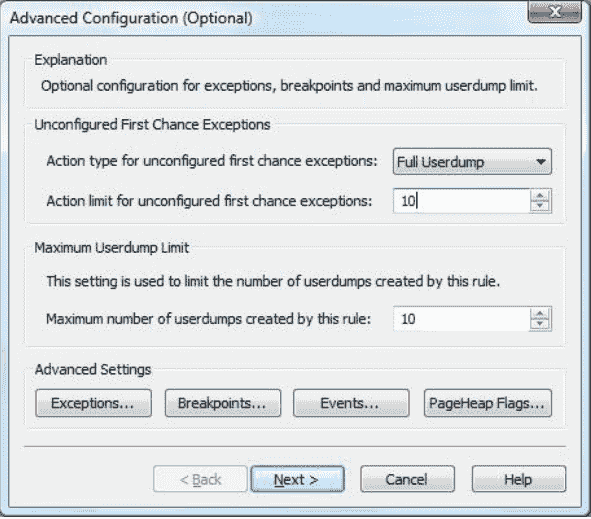

当我们在 TestDefaultDebugger 对话框中单击“大崩溃”按钮时，会保存两个崩溃转储，首次机会异常和第二次机会异常均指向同一代码：

```
Loading Dump File [C:\Program Files (x86)\DebugDiag\Logs\Crash rule for all instances of
TestDefaultDebugger.exe\TestDefaultDebugger__PID__4316__Date__11_21_2007__ Time_04_28_27PM__2__First
chance exception 0XC0000005.dmp]
User Mini Dump File with Full Memory: Only application data is available

Comment: 'Dump created by DbgHost. First chance exception 0XC0000005'
Symbol search path is: srv:c:\mss*http://msdl.microsoft.com/download/symbols
Executable search path is:
Windows Vista Version 6000 MP (2 procs) Free x86 compatible
Product: WinNt, suite: SingleUserTS
Debug session time: Wed Nov 21 16:28:27.000 2007 (GMT+0)
System Uptime: 0 days 23:45:34.711
Process Uptime: 0 days 0:01:09.000

This dump file has an exception of interest stored in it.
The stored exception information can be accessed via .ecxr.
(10dc.590): Access violation - code c0000005 (first/second chance not available)
eax=00000000 ebx=00000001 ecx=0017fe70 edx=00000000 esi=00425ae8 edi=0017fe70
eip=004014f0 esp=0017f898 ebp=0017f8a4 iopl=0 nv up ei ng nz ac pe cy
cs=0023 ss=002b ds=002b es=002b fs=0053 gs=002b efl=00010297
TestDefaultDebugger!CTestDefaultDebuggerDlg::OnBnClickedButton1:
004014f0 c7050000000000000000 mov dword ptr ds:[0],0 ds:002b:00000000=????????
```

```
Loading Dump File [C:\Program Files (x86)\DebugDiag\Logs\Crash rule for all instances of
TestDefaultDebugger.exe\TestDefaultDebugger_PID_4316__ Date_11_21_2007__Time_04_28_34PM__693__
Second_Chance_Exception_C0000005.dmp]
User Mini Dump File with Full Memory: Only application data is available

Comment: 'Dump created by DbgHost. Second_Chance_Exception_C0000005'
Symbol search path is: srv:c:\msst*http://msdl.microsoft.com/download/symbols
Executable search path is:
Windows Vista Version 6000 MP (2 procs) Free x86 compatible
Product: WinNt, suite: SingleUserTS
Debug session time: Wed Nov 21 16:28:34.000 2007 (GMT+0)
System Uptime: 0 days 23:45:39.313
Process Uptime: 0 days 0:01:16.000

This dump file has an exception of interest stored in it.
The stored exception information can be accessed via .ecxr.
(10dc.590): Access violation - code c0000005 (first/second chance not available)
eax=00000000 ebx=00000001 ecx=0017fe70 edx=00000000 esi=00425ae8 edi=0017fe70
eip=004014f0 esp=0017f898 ebp=0017f8a4 iopl=0 nv up ei ng nz ac pe cy
cs=0023 ss=002b ds=002b es=002b fs=0053 gs=002b efl=00010297
TestDefaultDebugger!CTestDefaultDebuggerDlg::OnBnClickedButton1:
004014f0 c7050000000000000000 mov dword ptr ds:[0],0 ds:002b:00000000=????????
```


## 副作用组件

某些模块（如驱动程序或运行时 DLL）在某些操作发生后始终存在。我们称它们为 **效果组件**。不要首先将其视为“原因”组件、“根本原因”或所谓的“罪魁祸首”组件，这是最后要做出的推断。典型示例是在运行中正在进行错误检查的线程原始堆栈上，**执行残留**（第 371 页）中发现的转储磁盘驱动程序符号引用：

```
0: kd> !thread
THREAD fffffa8002bdeb00  Cid 03c4.03f0  Teb: 000007fffffde000 Win32Thread: fffff900c20f9810 RUNNING on processor 0
IRP List:
fffffa8002b986f0: (0006,0118) Flags: 00060000  Mdl: 00000000
Not impersonating
DeviceMap            fffffa88005346920
Owning Process       fffffa800835bec10       Image:         Application.exe
Attached Process     N/A                       Image:         N/A
Wait Start TickCount 35246                    Ticks: 7 (0:00:00:00.109)
Context Switch Count 1595                     LargeStack
UserTime             00:00:00.000
KernelTime           00:00:00.031
Win32 Start Address Application (0x0000000140002708)
Stack Init fffffa800495ddb0 Current fffffa8004945d720
Base fffffa800495e000 Limit fffffa800495a000 Call 0
Priority 11 BasePriority 8 PriorityDecrement 1 IoPriority 2 PagePriority 5
Child-SP             RetAddr           : Call Site
fffffa60`0495d588 fffff800`0186e3ee : nt!KeBugCheckEx
fffffa60`0495d5d0 fffff800`018d02cb : nt!KiBugCheckDispatch+0x6e
fffffa60`0495d6a0 fffffa60`03d5917a : nt!KiPageFault+0x20b (TrapFrame @ fffffa60`0495d6a0)
[...]

0: kd> dps fffffa6004955000 fffffa600495e000
fffffa60`04955000  00d4d08c`00d4d08c
fffffa60`04955008  00d4d08c`00d4d08c
fffffa60`04955010  00d4d08c`00d4d08c
[...]
fffffa60`0495c7e0  00000000`00000001
fffffa60`0495c7e8  fffffa60`02877f6f dump_SATA Driver!RecordExecutionHistory+0xfcf
fffffa60`0495c7f0  fffffa80`024c05a8
fffffa60`0495c7f8  fffffa60`02869ad4 dump_dumpata!IdeDumpNotification+0x1a4
fffffa60`0495c800  fffffa60`0495c800
fffffa60`0495c808  fffff800`0182ff34 nt!output_l+0x6c0
fffffa60`0495c810  fffffa60`02860110 crashdmp!StrBeginningDump
fffffa60`0495c818  fffffa60`0495c000
fffffa60`0495c820  00000000`00000000
fffffa60`0495c828  fffffa60`0286b918 dump_dumpata!IdeDumpNotification+0x1e8
fffffa60`0495c830  00000000`00000000
fffffa60`0495c838  fffffa60`0495c8c0
fffffa60`0495c840  00000000`00000000
fffffa60`0495c848  fffffa60`00000024
fffffa60`0495c850  00000000`ffffffff
fffffa60`0495c858  00000000`00000000
fffffa60`0495c860  00000000`00000000
fffffa60`0495c868  fffffa60`0495c000
fffffa60`0495c870  fffffa80`00000000
fffffa60`0495c878 00000000`00000000
fffffa60`0495c880 00000000`00000101
fffffa60`0495c888 fffffa60`02877f6f dump_SATA Driver!RecordExecutionHistory+0xcf
fffffa60`0495c890 fffffa60`0495cb0f
fffffa60`0495c898 fffff800`0182ff34 nt!output_l+0x6c0
fffffa60`0495c8a0 fffffa60`0495cb0f
fffffa60`0495c8a8 fffffa60`0495cb90
fffffa60`0495c8b0 00000000`00000040
fffffa60`0495c8b8 fffffa60`02877f6f dump_SATA Driver!RecordExecutionHistory+0xcf
fffffa60`0495c8c0 fffffa80`024c0728
fffffa60`0495c8c8 fffffa80`024c0728
fffffa60`0495c8d0 00000001`00000000
fffffa60`0495c8d8 fffffa60`00000026
fffffa60`0495c8e0 00000000`ffffffff
fffffa60`0495c8e8 00000000`00000000
fffffa60`0495c8f0 fffffa80`00000000
fffffa60`0495c8f8 fffffa60`0495cb90
fffffa60`0495c900 00000000`00000000
fffffa60`0495c908 fffffa60`02877f6f dump_SATA Driver!RecordExecutionHistory+0xcf
fffffa60`0495c910 00000000`00000000
fffffa60`0495c918 fffffa60`02877f6f dump_SATA Driver!RecordExecutionHistory+0xcf
fffffa60`0495c920 fffff880`05311010
fffffa60`0495c928 00000000`00000002
fffffa60`0495c930 fffffa60`02875094 dump_SATA Driver!AhciAdapterControl
fffffa60`0495c938 fffffa80`024c6018
fffffa60`0495c940 fffffa80`024c0728
fffffa60`0495c948 fffffa60`02877f6f dump_SATA Driver!RecordExecutionHistory+0xcf
fffffa60`0495c950 fffffa80`024c0728
fffffa60`0495c958 00000000`00000000
fffffa60`0495c960 fffffa60`0495ca18
fffffa60`0495c968 00000000`00000000
fffffa60`0495c970 fffffa80`024c0728
fffffa60`0495c978 fffffa60`02876427 dump_SATA Driver!AhciHwInitialize+0x337
fffffa60`0495c980 fffffa80`024c0be6
fffffa60`0495c988 fffffa60`0286a459 dump_dumpata!IdeDumpWaitOnRequest+0x79
fffffa60`0495c990 00000000`00000000
fffffa60`0495c998 00000000`0000023a
fffffa60`0495c9a0 20474e55`53d4d153
fffffa60`0495c9a8 204a4831`36314448
fffffa60`0495c9b0 20202020`20202020
fffffa60`0495c9b8 20202020`20202020
fffffa60`0495c9c0 fffffa80`024c05a8
fffffa60`0495c9c8 fffffa60`0286b918 dump_dumpata!IdeDumpNotification+0x1e8
fffffa60`0495c9d0 00000000`00000000
fffffa60`0495c9d8 fffffa60`0495ca60
fffffa60`0495c9e0 00000000`00000001
fffffa60`0495c9e8 fffffa60`02869396 dump_dumpata!IdeDumpMiniportChannelInitialize+0x236
fffffa60`0495c9f0 fffffa80`024c05a8
fffffa60`0495c9f8 fffffa60`02869ad4 dump_dumpata!IdeDumpNotification+0x1a4
fffffa60`0495ca00 00000000`00000000
fffffa60`0495ca08 fffffa60`0495ca90
fffffa60`0495ca10 00000000`00000001
fffffa60`0495ca18 00000001`00000038
fffffa60`0495ca20 00000000`10010000
fffffa60`0495ca28 00000000`00000003
fffffa60`0495ca30 fffffa80`024c05a8
fffffa60`0495ca38 fffffa60`0286a954 dump_dumpata!AtaPortGetPhysicalAddress+0x2c
fffffa60`0495ca40
fffffa60`0495ca48 fffffa60`0284f028 dump_SATA Driver!RecordExecutionHistory+0xcf
fffffa60`0495ca50 00000000`00000001
fffffa60`0495ca58 0000003f`022a8856
fffffa60`0495ca60 fffffa80`0000000c
fffffa60`0495ca68 fffffa80`024c0728
fffffa60`0495ca70 00000000`00000200
fffffa60`0495ca78 fffffa60`02877f6f dump_SATA Driver!RecordExecutionHistory+0xcf
fffffa60`0495ca80 fffffa80`024c0728
fffffa60`0495ca88 ffff6226`a45f3eb8
fffffa60`0495ca90 00000000`00000010
fffffa60`0495ca98 fffffa60`02860370 crashdmp!Context+0x30
fffffa60`0495caa0 fffffa80`024c05a8
fffffa60`0495caa8 fffffa60`02875a0d dump_SATA Driver!AhciHwStartIo+0x69d
fffffa60`0495cab0 fffffa80`024c0728
fffffa60`0495cab8 00000000`00000000
fffffa60`0495cac0 00000000`00000001
fffffa60`0495cac8 fffff800`018f3dfc nt!DisplayCharacter+0x5c
fffffa60`0495cad0 00000000`00000000
fffffa60`0495cad8 fffffa60`02877f6f dump_SATA Driver!RecordExecutionHistory+0xcf
fffffa60`0495cae0 00000000`00010000
fffffa60`0495cae8 00000000`00000000
fffffa60`0495caf0 fffffa60`0495cd10
fffffa60`0495caf8 fffffa60`0495ccc0
fffffa60`0495cb00 fffffa80`024c01c0
fffffa60`0495cb08 fffffa60`02875c3f dump_SATA Driver!AhciHwInterrupt+0x2b
fffffa60`0495cb10 fffffa80`024c05a8
fffffa60`0495cb18 00000000`00000000
fffffa60`0495cb20 00000000`00000000
fffffa60`0495cb28 fffff800`01d406c9 hal!KeStallExecutionProcessor+0x25
fffffa60`0495cb30 00000000`00010000
fffffa60`0495cb38 00000000`00000000
fffffa60`0495cb40 fffffa60`0495cd10
fffffa60`0495cb48 fffffa60`0495ccc0
fffffa60`0495cb50 00000000`00000000
fffffa60`0495cb58 fffffa60`0286a429 dump_dumpata!IdeDumpWaitOnRequest+0x49
fffffa60`0495cb60 fffffa60`02860370 crashdmp!Context+0x30
fffffa60`0495cb68 00000000`08bda325
fffffa60`0495cb70 00000000`00000000
fffffa60`0495cb78 00000000`0000033e
fffffa60`0495cb80 00000000`00000000
fffffa60`0495cb88 fffffa60`028694d2 dump_dumpata!IdeDumpWritePending+0xee
fffffa60`0495cb90 fffffa80`024c0000
fffffa60`0495cb98 fffffa80`024c01c0
fffffa60`0495cba0 00000000`00000000
fffffa60`0495cba8 00000000`00000000
fffffa60`0495cbb0 fffffa80`024c01c0
fffffa60`0495cbb8 fffffa80`01e3c740
fffffa60`0495cbc0 00000000`00010000
fffffa60`0495cbc8 00000000`00000000
fffffa60`0495cbd0 00000000`0c01f000
fffffa60`0495cbd8 fffffa60`0285bca9 crashdmp!WritePageSpanToDisk+0x181
fffffa60`0495cbe0 00000000`83d81000
fffffa60`0495cbe8 00000000`00000000
fffffa60`0495cbf0 fffffa60`02860370 crashdmp!Context+0x30
fffffa60`0495cbf8 00000000`00000002
[...]
fffffa60`0495ccd0 00000000`0000c01d
fffffa60`0495ccd8 fffffa60`02860370 crashdmp!Context+0x30
fffffa60`0495cce0 00000000`0000bf80
fffffa60`0495cce8 00000000`00000001
fffffa60`0495ccf0 00000000`00000000
fffffa60`0495ccf8 fffff800`01e353d0
fffffa60`0495cd00 fffff800`01e353f8
fffffa60`0495cd08 fffffa60`028b5acc crashdmp!WriteFullDump+0x70
fffffa60`0495cd10 00000002`3a3d8000
fffffa60`0495cd18 00000000`0000c080
fffffa60`0495cd20 fffff800`00000000
fffffa60`0495cd28 fffffa60`0285c9c0 crashdmp!CrashdmpWriteRoutine
fffffa60`0495cd30 fffff880`05311010
fffffa60`0495cd38 00000000`00000002
fffffa60`0495cd40 fffffa60`0495cf70
fffffa60`0495cd48 00000000`00000000
fffffa60`0495cd50 fffffa60`02860370 crashdmp!Context+0x30
fffffa60`0495cd58 fffffa60`0285b835 crashdmp!DumpWrite+0xc5
fffffa60`0495cd60 00000000`00000000
fffffa60`0495cd68 00000000`0000000f
fffffa60`0495cd70 00000000`00000001
fffffa60`0495cd78 fffffa60`00000001
fffffa60`0495cd80 fffff800`02bdeb00
fffffa60`0495cd88 fffffa60`0285b153 crashdmp!CrashdmpWrite+0x57
fffffa60`0495cd90 00000000`00000000
fffffa60`0495cd98 fffffa60`028602f0 crashdmp!StrInitPortDriver
fffffa60`0495cda0 00000000`00000000
fffffa60`0495cda8 fffffa60`02860a00 crashdmp!ContextCopy
fffffa60`0495cdb0 00000000`00000000
fffffa60`0495cdb8 fffff800`01902764 nt!IoWriteCrashDump+0x3f4
fffffa60`0495cdc0 fffffa60`0495ce00
fffffa60`0495cdc8 00000028`00000025
fffffa60`0495cdd0 fffff800`018afd40 nt! ?? ::FNODOBFM::`string'
fffffa60`0495cdd8 00000000`000000d1
fffffa60`0495cde0 fffff880`05311010
fffffa60`0495cde8 00000000`00000002
fffffa60`0495cdf0 00000000`00000000
fffffa60`0495cdf8 fffffa60`03d5917a
fffffa60`0495ce00 202a2a2a`0a0d0a0d
fffffa60`0495ce08 7830203a`504f543
fffffa60`0495ce10 31443030`30303030
fffffa60`0495ce18 46464646`78302820
fffffa60`0495ce20 31333530`30383846
fffffa60`0495ce28 fffff800`018f5f83 nt!VidDisplayString+0x143
fffffa60`0495ce30 30303030`30300030
fffffa60`0495ce38 2c323030`30303030
fffffa60`0495ce40 30303030`30307830
fffffa60`0495ce48 30303030`30303030
fffffa60`0495ce50 46464678`302c3030
fffffa60`0495ce58 fffff800`018fe040 nt!KiInvokeBugCheckEntryCallbacks+0x80
fffffa60`0495ce60 fffff800`02bdeb00
fffffa60`0495ce68 fffff800`01921d52 nt!VidDisplayString+0x72
fffffa60`0495ce70 fffff880`05311000
fffffa60`0495ce78 fffff800`01d406c9 hal!KeStallExecutionProcessor+0x25
```


```
fffffa60`0495ce80 00000000`00000001
fffffa60`0495ce88 00000000`0000000a
fffffa60`0495ce90 ffffffa60`3d5917a
fffffa60`0495ce98 00000000`40000082
fffffa60`0495cea0 00000000`00000001
fffffa60`0495cea8 fffff800`01922c3e nt!KeBugCheck2+0x92e
fffffa60`0495ceb0 fffff800`000000d1
fffffa60`0495ceb8 00000000`000004d0
fffffa60`0495cec0 fffff800`01443640 nt!KiProcessorBlock
fffffa60`0495cec8 00000000`0000000a
fffffa60`0495ced0 ffffffa60`3d5917a
fffffa60`0495ced8 ffffffa60`0495cf70
fffffa60`0495cee0 ffffffa80`02bdeb00
fffffa60`0495cee8 00000000`00000000
fffffa60`0495cef0 00000000`00000000
fffffa60`0495cef8 fffffa80`02bdeb00
fffffa60`0495cf00 00000000`c21a6d00
fffffa60`0495cf08 00000000`00000000
fffffa60`0495cf10 fffff800`0198e7a0 nt!KiInitialPCR+0x2a0
fffffa60`0495cf18 fffff800`0198e680 nt!KiInitialPCR+0x180
fffffa60`0495cf20 fffff8a0`02bb7320
fffffa60`0495cf28 00000000`00000000
fffffa60`0495cf30 00000000`00000000
fffffa60`0495cf38 fffff960`00000003
[...]
fffffa60`0495d050 00000000`00000001
fffffa60`0495d058 00000000`83360018
fffffa60`0495d060 ffffffa80`02b3ee40
fffffa60`0495d068 fffff800`0186e650 nt!KeBugCheckEx
fffffa60`0495d070 00000000`00000000
fffffa60`0495d078 00000000`00000000
fffffa60`0495d080 00000000`00000000
fffffa60`0495d088 00000000`00000000
fffffa60`0495d090 00000000`00000000
fffffa60`0495d098 00000000`00000000
fffffa60`0495d0a0 00000000`00000000
[...]
```

If BSOD was reported after installing new drivers, we shouldn’t suspect _SATA_Driver_ package here because its components would almost always be present on any bugcheck thread as referenced after a bugcheck cause. Their presence is the “effect”. This example might seem trivial and pointless, but we’ve seen some memory dump analysis conclusions based on the reversal of causes and effects.

## Embedded Comments

Such comments in dump files are useful to record external information like the reason for saving a memory dump, a tool used to do that, and some pre-analysis and monitoring data that might help or guide in the future analysis. Comments are not widely used, but some examples include **Manual Dump** (page 630), **False Positive Dump** (page 393) patterns, and process and thread CPU consumption comments in dump files saved by Sysinternals ProcDump62 tool. Such comments may not be necessarily saved by IDebugClient2::WriteDumpFile2 function but any buffer saved in memory that is accessible later from a dump file will do as was easily demonstrated by the Citrix SystemDump63 tool that allowed embedding comments of arbitrary complexity.

Here we might need to do manual stack trace reconstruction⁶⁴ like shown in the following example:

```
0:002> ~2s
eax=00000070 ebx=0110fb94 ecx=00000010 edx=005725d8 esi=0110fe58 edi=00000d80
eip=7c82847c esp=0110efe0 ebp=0110eff0 iopl=0 nv up ei pl zr na pe nc
cs=001b ss=0023 ds=0023 es=0023 fs=003b gs=0000 efl=00000246
ntdll!KiFastSystemCallRet:
7c82847c c3 ret

0:002> kl
ChildEBP RetAddr
0110efdc 00000000 ntdll!KiFastSystemCallRet

0:002> !teb
TEB at 7ffdc000
ExceptionList: 0110f980
StackBase: 01110000
StackLimit: 0110d000
SubSystemTib: 00000000
FiberData: 00001e00
ArbitraryUserPointer: 00000000
Self: 7ffdc000
EnvironmentPointer: 00000000
ClientId: 00000d04 . 00000bd0
RpcHandle: 00000000
Tls Storage: 00000000
PEB Address: 7ffda000
LastErrorValue: 87
LastStatusValue: c000000d
Count Owned Locks: 0
HardErrorMode: 0

0:002> dps 0110d000 01110000
0110d000 00000000
0110d004 00000000
[...]
0110f640 0110f64c
0110f644 02b91ea8
0110f648 00001000
0110f64c 00000004
0110f650 0110f6f0
0110f654 0374669d DbgHelp!WriteFullMemory+0x3cd
0110f658 fffffffd
0110f65c 0110fdd0
0110f660 00000000
[...]
0110f6ac 00040004
0110f6b0 7ffe0000 SharedUserData
0110f6b4 00000000
0110f6b8 00001000
0110f6bc 00000000
0110f6c0 0480f5c0
0110f6c4 00000000
0110f6c8 0c4a0000
0110f6cc 00000000
0110f6d0 000003c7
0110f6d4 00000000
0110f6d8 00023b17
0110f6dc 00000000
0110f6e0 01110000
0110f6e4 00000000
0110f6e8 0999f000
0110f6ec 00000000
0110f6f0 0110f704
0110f6f4 037469d6 DbgHelp!WriteDumpData+0x206
0110f6f8 0110f738
0110f6fc 0110f7b0
0110f700 00000000
0110f704 0110f868
0110f708 03747449 DbgHelp!MiniDumpProvideDump+0x359
0110f70c 0110f738
[...]
0110ff24 0000000a
0110ff28 33017f51 ModuleA!Run+0xde
0110ff2c 00000001
0110ff30 0110ff74
0110ff34 00f08898
0110ff38 00000000
0110ff3c 00f082a8
0110ff40 00000000
0110ff44 00000001
0110ff48 33017e33 ModuleA!ThreadProc+0x2c
0110ff4c a9b21e1e
0110ff50 00000000
0110ff54 00000000
0110ff58 00f08898
0110ff5c 0110ff4c
0110ff60 0110ffac
0110ff64 0110ff9c
0110ff68 33054245
0110ff6c 9ba52ad2
0110ff70 00000000
0110ff74 0110ffac
0110ff78 78543433 msvcr90!_endthreadex+0x44
0110ff7c 00f082a8
0110ff80 a9b2b0d3
0110ff84 00000000
0110ff88 00000000
0110ff8c 00f08898
0110ff90 0110ff80
0110ff94 0110ff80
0110ff98 0110ffdc
[...]
0110ff9c 0110ffdc
0110ffa0 7858c5fe msvcr90!_except_handler4
0110ffa4 0f8787df
0110ffa8 00000000
0110ffac 0110ffb8
0110ffb0 785434c7 msvcr90!_endthreadex+0xd8
0110ffb4 00000000
0110ffb8 0110ffec
0110ffbc 776e482f kernel32!BaseThreadStart+0x34
0110ffc0 00f88898
0110ffc4 00000000
0110ffc8 00000000
0110ffcc 00f88898
0110ffd0 00000000
0110ffd4 0110ffc4
0110ffd8 80833bcc
0110ffdc ffffffff
0110ffe0 77e61a60 kernel32!_except_handler3
0110ffe4 776e4838 kernel32!`string'+0x98
0110ffe8 00000000
0110ffec 00000000
0110fff0 00000000
0110fff4 7854345e msvcr90!_endthreadex+0x6f
0110fff8 00f88898
0110fffc 00000000
01110000 00000130

0:002> k L=0110f650 0110f650 0110f650
ChildEBP RetAddr
WARNING: Frame IP not in any known module. Following frames may be wrong.
0110f650 0374659d 0x110f650
0110f6f0 0374696d DbgHelp!WriteFullMemory+0x3cd
0110f704 03747449 DbgHelp!WriteDumpData+0x206
0110f868 03747662 DbgHelp!MiniDumpProvideDump+0x359
0110f8dc 33050dd9 DbgHelp!MiniDumpWriteDump+0x1b2
[...]
0110fdfc 33031726 ModuleA!WriteExceptionMiniDump+0x50
0110fea0 33018c81 ModuleA!ThreadHung+0x6c
[...]
0110ff44 33017e33 ModuleA!Run+0xde
00000000 00000000 ModuleA!ThreadProc+0x2c
```

⁶⁴ Manual Stack Trace Reconstruction, Memory Dump Analysis Anthology, Volume 1, page 157

## Comments

One of the asked questions:

Q. Why does “k” even need the instruction pointer to walk the stack? I’ve always seen it set to EBP and ESP like this which doesn’t make sense to me.

A. We think it needs EIP to show the top stack frame correctly pointing to the currently executing instruction. In our pattern example, it doesn’t matter.

## Environment Hint

This pattern is useful for inconsistent dumps or incomplete supporting information. It provides information about environment variables for troubleshooting suggestions such as product elimination for testing purposes and necessary upgrade, for example:

```
0: kd> !peb
PEB at 7ffd7000
InheritedAddressSpace: No
ReadImageFileExecOptions: Yes
BeingDebugged: No
ImageBaseAddress: 01000000
Ldr 7c8897e0
Ldr.Initialized: Yes
Ldr.InInitializationOrderModuleList: 00081f18 . 000f9e88
Ldr.InLoadOrderModuleList: 00081eb0 . 000f9e78
Ldr.InMemoryOrderModuleList: 00081eb8 . 000f9e80
Base TimeStamp Module
1000000 45d6a03c Feb 17 06:27:08 2007 C:\WINNT\system32\svchost.exe
7c800000 49900d60 Feb 09 11:02:56 2009 C:\WINNT\system32\ntdll.dll
[...]
SubSystemData: 00000000
ProcessHeap: 00080000
ProcessParameters: 00020000
WindowTitle: 'C:\WINNT\system32\svchost.exe'
ImageFile: 'C:\WINNT\system32\svchost.exe'
CommandLine: 'C:\WINNT\system32\svchost.exe -k rpcss'
DllPath: [...]
Environment: 00010000
ALLUSERSPROFILE=C:\Documents and Settings\All Users
[...]
PROTECTIONDIR=C:\Documents and Settings\All Users\Application Data\3rdPartyAntivirus\Protection
[...]
Path= [...]
```

### Comments

We can get environment hints from all processes in a complete memory dump by using this command:

```
!for_each_process ".process /r /p @#Process; !peb"
```

## Error Reporting Fault

This pattern is about faults in error reporting infrastructure. The latter should be guarded against such faults to avoid recursion. Here is a summary example of such a pattern on Windows platforms that involve Windows Error Reporting (WER).

In a complete memory dump, we notice thousands of WerFault.exe processes:

```
0: kd> !process 0 0
[...]
PROCESS fffffa8058010380
SessionId: 2 Cid: 488f0 Peb: 7efdf000 ParentCid: 27cb8
DirBase: 25640c000 ObjectTable: fffffa8a06cd2ac50 HandleCount: 54.
Image: WerFault.exe

PROCESS fffffa805bbd5970
SessionId: 2 Cid: 4801c Peb: 7efdf000 ParentCid: 27cb8
DirBase: 2c3f69000 ObjectTable: fffffa8a040563af0 HandleCount: 54.
Image: WerFault.exe

PROCESS fffffa8078aec060
SessionId: 2 Cid: 3feac Peb: 7efdf000 ParentCid: 488f0
DirBase: abd200000 ObjectTable: fffffa8a07851a0a0 HandleCount: 59.
Image: WerFault.exe

PROCESS fffffa805bbe9a10
SessionId: 2 Cid: 3d8b8 Peb: 7efdf000 ParentCid: 4801c
DirBase: 261f91000 ObjectTable: fffffa8a02d864d40 HandleCount: 56.
Image: WerFault.exe

PROCESS fffffa805bd29060
SessionId: 2 Cid: 1142c Peb: 7efdf000 ParentCid: 3feac
DirBase: 429fb3000 ObjectTable: fffffa8a0355b42e0 HandleCount: 58.
Image: WerFault.exe

PROCESS fffffa8053d853d0
SessionId: 2 Cid: 1fc4c Peb: 7efdf000 ParentCid: 3d8b8
DirBase: 714371000 ObjectTable: fffffa8a01cb6bba0 HandleCount: 58.
Image: WerFault.exe
[...]
```

Each process has only one thread running through WOW64 modules (Virtualized Process pattern, page 1068), so we get its 32-bit stack trace:

```
0: kd> !process fffffffa8075c21b30 3f
[...]
THREAD fffffa807c183b60 Cid 2d3c8.4334c Teb: 000000007efdb000 Win32Thread: fffff900c3f71010 WAIT: (UserRequest) UserMode Non-Alertable
[...]
```


```
0: kd> .load wow64exts

0: kd> .process /r /p fffffa8075c21b30
Implicit process is now fffffa80`75c21b30
Loading User Symbols
Loading Wow64 Symbols

0: kd> .thread /w fffffa807c183b60
Implicit thread is now fffffa80`7c183b60
x86 context set

0: kd:x86> k
** Stack trace for last set context - .thread/.cxr resets it
ChildEBP RetAddr
000bf474 7708b0dd ntdll!ZwWaitForMultipleObjects+0x15
000bf510 76bb1a2c KERNELBASE!WaitForMultipleObjectsEx+0x100
000bf558 76bb4208 kernel32!WaitForMultipleObjectsExImplementation+0xe0
000bf574 76bd80a4 kernel32!WaitForMultipleObjects+0x18
000bf5e0 76bd7f63 kernel32!WerpReportFaultInternal+0x186
000bf5f4 76bd7858 kernel32!WerpReportFault+0x70
000bf604 76bd77d7 kernel32!BasepReportFault+0x20
000bf690 776674df kernel32!UnhandledExceptionFilter+0x1af
000bf698 776673bc ntdll!_RtlUserThreadStart+0x62
000bf6ac 77667261 ntdll!_EH4_CallFilterFunc+0x12
000bf6d4 7764b459 ntdll!_except_handler4+0x8e
000bf6f8 7764b42b ntdll!ExecuteHandler2+0x26
000bf71c 7764b3ce ntdll!ExecuteHandler+0x24
000bf7a8 77600133 ntdll!RtlDispatchException+0x127
000bf7b4 000bf7c0 ntdll!KiUserExceptionDispatcher+0xf
WARNING: Frame IP not in any known module. Following frames may be wrong.
000bfb00 77629ef2 0xbf7c0
[...]
```

我们发现异常处理（**异常栈跟踪**模式，第363页）以及栈跟踪中的二进制值（返回地址属于栈区域范围）。此线程正在等待另一个进程，并且也是 *WerFault.exe*：

```
0: kd:x86> .effmach AMD64

0: kd> !process fffffa8075c21b30 3f
[...]
THREAD fffffa807c183b60 Cid 2d3c8.4334c Teb: 00000007efdb000 Win32Thread: fffff900c3f71010 WAIT: (UserRequest) UserMode Non-Alertable
fffffa80809c44e0  ProcessObject
[...]

0: kd> !process fffffa80809c44e0
PROCESS fffffa80809c44e0
SESSIONID: 2 Cid: 3844 Peb: 7efd000 ParentCid: 2d3c8
DirBase: 9c53f0000 ObjectTable: fffff8a0423d4170 HandleCount: 978.
Image: WerFault.exe
[...]
```

我们回到原来的 *WerFault* 进程，并在其 PEB 数据中发现它被调用来报告来自 PID 0n189240 的另一个进程的故障：

```
0: kd> !process fffffa8075c21b30 3f
[...]
CommandLine: 'C:\Windows\SysWOW64\WerFault.exe -u -p 189240 -s 3888'
[...]
```

它也是 *WerFault.exe*：

```
0: kd> !process 0n189240
Searching for Process with Cid == 2e338
PROCESS fffffa8078b659e0
SessionId: 2 Cid: 2e338 Peb: 7efdf000 ParentCid: 47608
DirBase: 201796000 ObjectTable: fffff8a02e664380 HandleCount: 974.
Image: WerFault.exe
[...]
```

因此，我们看到一系列 *WerFault.exe* 进程，每个进程都在处理前一个进程中的故障。因此，某处应该存在第一个故障，我们可以在 **栈跟踪集合** (第943页，本示例包含32位栈跟踪 第65页) 中找到它，除非该异常栈跟踪数据因 *WerFault.exe* 进程占用内存不足而被 **已分页出** (第778页)。

## 事件性转储

Software Diagnostics Services 66 的一位客户提交了由 DebugDiag 67 保存的内存转储，以配合软件日志分析进程意外退出问题。我们并未请求此类内存转储，并最初将其忽略。然而，在软件日志分析期间，我们决定查看 Adjoint Spaces 68，以了解栈跟踪中是否存在其他附加信息。我们发现，这些转储是在每个线程退出事件时保存的。由于其他线程要么处于等待状态，要么是活动线程 (第63页)，其分析为进程退出前的进程行为提供了线索。例如，我们发现 ALPC 等待链 (第1097页) 指向耦合进程 (第149页)。后者促使我们分析软件日志中的耦合活动 69 并诊断其中的可能问题。由于在线程创建和退出时保存内存转储可能是一种有用的技术，我们决定将事件性转储内存分析模式添加到我们的模式目录中。

为说明此模式，我们展示来自 notepad.exe 的 **栈跟踪集合** (第943页)。该进程通常只有一个线程。但是，如果我们尝试打开打印对话框，线程数量会增加到 12 个。

我们将 WinDbg 附加到 notepad.exe 进程，并为创建线程事件设置调试事件筛选器（调试 \ 事件筛选器... 菜单），命令行如图所示：

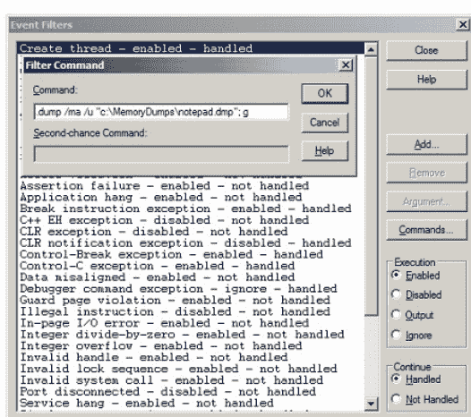

然后我们使用 `g` 命令恢复执行并切换到记事本。在那里，我们首先打开 文件 \ 页面设置... 对话框。我们观察到保存了一个内存转储。然后我们打开 文件 \ 打印... 对话框，并注意到创建了 11 个额外的进程内存转储：

| 文件名 | 日期 | 时间 | 大小 |
|---|---|---|---|
| notepad_09a8_2015-10-25_18-17-20-150_1344.dmp | 25/10/2015 | 18:18 | 154,645 KB |
| notepad_09a8_2015-10-25_18-18-00-630_1344.dmp | 25/10/2015 | 18:18 | 134,886 KB |
| notepad_09a8_2015-10-25_18-16-58-514_1344.dmp | 25/10/2015 | 18:17 | 95,159 KB |
| notepad_09a8_2015-10-25_18-16-45-712_1344.dmp | 25/10/2015 | 18:17 | 73,716 KB |
| notepad_09a8_2015-10-25_18-16-41-612_1344.dmp | 25/10/2015 | 18:16 | 70,303 KB |
| notepad_09a8_2015-10-25_18-16-44-042_1344.dmp | 25/10/2015 | 18:16 | 70,345 KB |
| notepad_09a8_2015-10-25_18-16-45-602_1344.dmp | 25/10/2015 | 18:16 | 70,960 KB |
| notepad_09a8_2015-10-25_18-16-41-162_1344.dmp | 25/10/2015 | 18:16 | 68,832 KB |
| notepad_09a8_2015-10-25_18-16-41-302_1344.dmp | 25/10/2015 | 18:16 | 70,127 KB |
| notepad_09a8_2015-10-25_18-16-41-402_1344.dmp | 25/10/2015 | 18:16 | 70,127 KB |
| notepad_09a8_2015-10-25_18-16-41-502_1344.dmp | 25/10/2015 | 18:16 | 70,225 KB |
| notepad_09a8_2015-10-25_18-16-11-760_1344.dmp | 25/10/2015 | 18:16 | 51,364 KB |

我们现在显示这些转储中的栈跟踪，其中我们使用 `~*kc` WinDbg 命令来最小化与我们目的无关的输出量：

```
// 1st dump
```

```
. 0 Id: 1344.1ca4 Suspend: 1 Teb: 000007ff`fffd0000 Unfrozen
# Call Site
00 ntdll!NtAlertThread
01 ntdll!TppWaiterEnqueueTransition
02 ntdll!TppWaitSet
03 ntdll!TppSetWait
04 ntdll!TppTimerInitTimerQueueQueue
05 ntdll!TppTimerpAllocTimerQueue
06 ntdll!TppTimerpAcquirePoolTimerQueue
07 ntdll!TppTimerAlloc
08 ntdll!TppAllocTimer
09 KERNELBASE!CreateThreadpoolTimer
0a rpcrt4!RPC_THREAD_POOL::CreateTimer
0b rpcrt4!GarbageCollectionNeeded
0c rpcrt4!LRPC_CASSOCIATION::RemoveReference
0d rpcrt4!LRPC_CCALL::`vector deleting destructor'
0e rpcrt4!LRPC_CCALL::FinalBuffer
0f rpcrt4!Ndr64PClientCallFinally
10 rpcrt4!NdrpClientCall13
11 rpcrt4!NdrClientCall3
12 sechost!LsaLookupClose
13 sechost!LookupAccountNameInternal
14 sechost!LookupAccountNameLocalW
15 rpcrt4!RpcpLookupAccountNameDirect
16 rpcrt4!RpcpLookupAccountName
17 rpcrt4!LRPC_BASE_BINDING_HANDLE::SetAuthInformation
18 rpcrt4!LRPC_BINDING_HANDLE::SetAuthInformation
19 rpcrt4!RpcBindingSetAuthInfoExW
1a winspool!STRING_HANDLE_bind
```

```
1b rpcrt4!GenericHandleMgr
1c rpcrt4!ExplicitBindHandleMgr
1d rpcrt4!Ndr64ClientSetupTransferSyntax
1e rpcrt4!NdrpClientCall13
1f rpcrt4!NdrClientCall13
20 winspool!RpcSpoolOpenPrinter
21 winspool!OpenPrinterRPC
22 winspool!OpenPrinterW
23 comdlg32!PrintOpenPrinter
24 comdlg32!PrintDlgX
25 comdlg32!PageSetupDlgX
26 comdlg32!PageSetupDlgW
27 notepad!NPCommand
28 notepad!NPWndProc
29 user32!UserCallWinProcCheckWow
2a user32!DispatchMessageWorker
2b notepad!WinMain
2c notepad!DisplayNonGenuineDlgWorker
2d kernel32!BaseThreadInitThunk
2e ntdll!RtlUserThreadStart

. 1 Id: 1344.1ab0 Suspend: 1 Teb: 000007ff`ffdb0000 Unfrozen
# Call Site
00 ntdll!RtlUserThreadStart
```

```
// 2nd dump
```

```
. 0 Id: 1344.1ca4 Suspend: 1 Teb: 000007ff`ffdb0000 Unfrozen
# Call Site
00 ntdll!ZwOpenKeyEx
01 kernel32!LocalBaseRegOpenKey
02 kernel32!RegOpenKeyExInternalW
03 kernel32!RegOpenKeyExW
04 rpcrt4!Server2003NegotiateDisable
05 rpcrt4!IsBindTimeFeatureNegotiationDisabled
06 rpcrt4!OSF_CCONNECTION::SendBindPacket
07 rpcrt4!OSF_CCONNECTION::ActuallyDoBinding
08 rpcrt4!OSF_CCONNECTION::OpenConnectionAndBind
09 rpcrt4!OSF_CCALL::BindToServer
0a rpcrt4!OSF_BINDING_HANDLE::InitCCallWithAssociation
0b rpcrt4!OSF_BINDING_HANDLE::AllocateCCall
0c rpcrt4!OSF_BINDING_HANDLE::NegotiateTransferSyntax
0d rpcrt4!I_RpcNegotiateTransferSyntax
0e rpcrt4!Ndr64ClientSetupTransferSyntax
0f rpcrt4!NdrpClientCall13
10 rpcrt4!NdrClientCall13
11 svcctl!NetShareEnum
12 ntshrui!CShareCache::RefreshNoCritSec
13 ntshrui!CShareCache::Refresh
14 ntshrui!DllMain
15 ntdll!LdrpOnceExecuteOnce
16 kernel32!InitOnceExecuteOnce
17 ntshrui!DllGetClassObject
18 ole32!CCClassCache::CDllPathEntry::DllGetClassObject
19 ole32!CCClassCache::CDllPtrMoniker::BindToObjectNoSwitch
```


```
1a ole32!CCClassCache::GetClassObject
1b ole32!CServerContextActivator::CreateInstance
1c ole32!ActivationPropertiesIn::DelegateCreateInstance
1d ole32!CApartmentActivator::CreateInstance
1e ole32!CProcessActivator::CCICallback
1f ole32!CProcessActivator::AttemptActivation
20 ole32!CProcessActivator::ActivateByContext
21 ole32!CProcessActivator::CreateInstance
22 ole32!ActivationPropertiesIn::DelegateCreateInstance
23 ole32!CClientContextActivator::CreateInstance
24 ole32!ActivationPropertiesIn::DelegateCreateInstance
25 ole32!ICoCreateInstanceEx
26 ole32!CoCreateInstance
27 shell32!_SHCoCreateInstance
28 shell32!SHExtCoCreateInstance
29 shell32!DCA_SHExtCoCreateInstance
2a shell32!CFSIconOverlayManager::_s_LoadIconOverlayIdentifiers
2b shell32!CFSIconOverlayManager::CreateInstance
2c shell32!IconOverlayManagerInit
2d shell32!GetIconOverlayManager
2e shell32!FileIconInit
2f shell32!Shell_GetImageLists
30 comdlg32!PrintDlgDialog::CPrintDialog
31 comdlg32!Print_GeneralDlgProc
32 user32!UserCallDlgProcCheckWow
33 user32!DefDlgProcWorker
34 user32!InternalCreateDialog
35 user32!CreateDialogIndirectParamAorW
36 user32!CreateDialogIndirectParamW
37 comctl32!_CreatePageDialog
38 comctl32!_CreatePage
39 comctl32!PageChange
3a comctl32!InitPropSheetDlg
3b comctl32!PropSheetDlgProc
3c user32!UserCallDlgProcCheckWow
3d user32!DefDlgProcWorker
3e user32!InternalCreateDialog
3f user32!CreateDialogIndirectParamAorW
40 user32!CreateDialogIndirectParamW
41 comctl32!_RealPropertySheet
42 comctl32!PropertySheet
43 comdlg32!Print_InvokePropertySheets
44 comdlg32!PrintDlgEx
45 comdlg32!PrintDlgExW
46 notepad!GetPrinterDCviaDialog
47 notepad!PrintIt
48 notepad!NPCommand
49 notepad!NPWndProc
4a user32!UserCallWinProcCheckWow
4b user32!DispatchMessageWorker
4c notepad!WinMain
4d notepad!DisplayNonGenuineDlgWorker
4e kernel32!BaseThreadInitThunk
4f ntdll!RtlUserThreadStart
```

```
1 Id: 1344.1ab0 Suspend: 1 Teb: 000007ff`fffdb000 Unfrozen
# Call Site
00 ntdll!NtWaitForMultipleObjects
01 ntdll!TppWaiterThread
02 kernel32!BaseThreadInitThunk
03 ntdll!RtlUserThreadStart
```

```
2 Id: 1344.1638 Suspend: 1 Teb: 000007ff`fffdf9000 Unfrozen
# Call Site
00 ntdll!RtlUserThreadStart
```

### 第 3 个转储：我们看到 2 个线程同时启动

```
. 0 Id: 1344.1ca4 Suspend: 1 Teb: 000007ff`fffdd000 Unfrozen
# Call Site
00 ntdll!RtlCompareMemoryUlong
01 ntdll!RtlpAllocateHeap
02 ntdll!RtlAllocateHeap
03 ntdll!RtlDebugAllocateHeap
04 ntdll! ?? ::FNODOBFM::`string'
05 ntdll!RtlAllocateHeap
06 ole32!CRpcResolver::GetThreadWinstaDesktop
07 ole32!CRpcResolver::GetConnection
08 ole32!CoInitializeSecurity
09 ole32!InitializeSecurity
0a ole32!ChannelProcessInitialize
0b ole32!CComApartment::InitRemoting
0c ole32!CGIPTable::RegisterInterfaceInGlobalHlp
0d ole32!CGIPTable::RegisterInterfaceInGlobal
0e shell32!MarshallToGIT
0f shell32!CBrowserProgressAggregator::BeginSession
10 shell32!IUnknown_BeginBrowserProgressSession
11 shell32!CDefView::CreateViewWindow3
12 shell32!CExplorerBrowser::_CreateViewWindow
13 shell32!CExplorerBrowser::_SwitchView
14 shell32!CExplorerBrowser::_BrowseToView
15 shell32!CExplorerBrowser::_BrowseObjectInternal
16 shell32!CExplorerBrowser::_OnBrowseObject
17 shell32!CExplorerBrowser::_BrowseObject
18 comdlg32!CPrintDialog::CreatePrintBrowser
19 comdlg32!CPrintDialog::OnInitDialog
1a comdlg32!Print_GeneralDlgProc
1b user32!UserCallDlgProcCheckWow
1c user32!DefDlgProcWorker
1d user32!InternalCreateDialog
1e user32!CreateDialogIndirectParamAorW
1f user32!CreateDialogIndirectParamW
20 comctl32!CreatePageDialog
21 comctl32!_CreatePage
22 comctl32!PageChange
23 comctl32!InitPropSheetDlg
24 comctl32!PropSheetDlgProc
25 user32!UserCallDlgProcCheckWow
26 user32!DefDlgProcWorker
27 user32!InternalCreateDialog
28 user32!CreateDialogIndirectParamAorW
29 user32!CreateDialogIndirectParamW
2a comctl32!_RealPropertySheet
2b comctl32!_PropertySheet
2c comdlg32!Print_InvokePropertySheets
2d comdlg32!PrintDlgEx
2e comdlg32!PrintDlgExW
2f notepad!GetPrinterDCviaDialog
30 notepad!PrintIt
31 notepad!NPCommand
32 notepad!NPWndProc
33 user32!UserCallWinProcCheckWow
34 user32!DispatchMessageWorker
35 notepad!WinMain
36 notepad!DisplayNonGenuineDlgWorker
37 kernel32!BaseThreadInitThunk
38 ntdll!RtlUserThreadStart
```

```
1 Id: 1344.1ab0 Suspend: 1 Teb: 000007ff`fffdb000 Unfrozen
# Call Site
00 ntdll!NtWaitForMultipleObjects
01 ntdll!TppWaiterThread
02 kernel32!BaseThreadInitThunk
03 ntdll!RtlUserThreadStart
```

```
2 Id: 1344.1638 Suspend: 1 Teb: 000007ff`fffd9000 Unfrozen
# Call Site
00 ntdll!ZwAlpcSendWaitReceivePort
01 rpcrt4!LRPC_CCALL::SendReceive
02 rpcrt4!NdrpcClientCall13
03 rpcrt4!NdrClientCall13
04 sechost!LsLookupOpenLocalPolicy
05 sechost!LookupAccountNameInternal
06 sechost!LookupAccountNameLocalW
07 rpcrt4!RpcpLookupAccountNameDirect
08 rpcrt4!RpcpLookupAccountName
09 rpcrt4!LRPC_BASE_BINDING_HANDLE::SetAuthInformation
0a rpcrt4!LRPC_BINDING_HANDLE::SetAuthInformation
0b rpcrt4!RpcBindingSetAuthInfoExW
0c winspool!STRING_HANDLE_bind
0d rpcrt4!GenericHandleMgr
0e rpcrt4!ExplicitBindingHandleMgr
0f rpcrt4!Ndr64pClientSetupTransferSyntax
10 rpcrt4!NdrpcClientCall13
11 rpcrt4!NdrClientCall13
12 winspool!RpcSplOpenPrinter
13 winspool!OpenPrinterRPC
14 winspool!OpenPrinter2W
15 prncache!PrintCache::Listeners::Listener::Start
16 prncache!PrintCache::Listeners::Listener::StartCB
17 ntdll!TppWorkpExecuteCallback
18 ntdll!TppWorkerThread
19 kernel32!BaseThreadInitThunk
1a ntdll!RtlUserThreadStart
```

```
3 Id: 1344.830 Suspend: 1 Teb: 000007ff`fffd7000 Unfrozen
# Call Site
00 ntdll!RtlUserThreadStart

4 Id: 1344.1edc Suspend: 0 Teb: 000007ff`fffd5000 Unfrozen
# Call Site
00 ntdll!RtlUserThreadStart
```

### 第 4 个转储

```
. 0 Id: 1344.1ca4 Suspend: 1 Teb: 000007ff`fffd0000 Unfrozen
# Call Site
00 ntdll!RtlCompareMemoryUlong
01 ntdll!RtlpAllocateHeap
02 ntdll!RtlAllocateHeap
03 ntdll!RtlDebugAllocateHeap
04 ntdll! ?? ::FNODOBFM::`string'
05 ntdll!RtlAllocateHeap
06 ole32!CRpcResolver::GetThreadWinstaDesktop
07 ole32!CRpcResolver::GetConnection
08 ole32!CoInitializeSecurity
09 ole32!InitializeSecurity
0a ole32!ChannelProcessInitialize
0b ole32!CComApartment::InitRemoting
0c ole32!CGIPTable::RegisterInterfaceInGlobalHlp
0d ole32!CGIPTable::RegisterInterfaceInGlobal
0e shell32!MarshallToGIT
0f shell32!CBrowserProgressAggregator::BeginSession
10 shell32!IUnknown_BeginBrowserProgressSession
11 shell32!CDefView::CreateViewWindow3
12 shell32!CExplorerBrowser::_CreateViewWindow
13 shell32!CExplorerBrowser::_SwitchView
14 shell32!CExplorerBrowser::_BrowseToView
15 shell32!CExplorerBrowser::_BrowseObjectInternal
16 shell32!CExplorerBrowser::_OnBrowseObject
17 shell32!CExplorerBrowser::_BrowseObject
18 comdlg32!CPrintDialog::CreatePrintBrowser
19 comdlg32!CPrintDialog::OnInitDialog
1a comdlg32!Print_GeneralDlgProc
1b user32!UserCallDlgProcCheckWow
1c user32!DefDlgProcWorker
1d user32!InternalCreateDialog
1e user32!CreateDialogIndirectParamAorW
1f user32!CreateDialogIndirectParamW
20 comctl32!CreatePageDialog
21 comctl32!_CreatePage
22 comctl32!PageChange
23 comctl32!InitPropSheetDlg
24 comctl32!PropSheetDlgProc
25 user32!UserCallDlgProcCheckWow
26 user32!DefDlgProcWorker
27 user32!InternalCreateDialog
28 user32!CreateDialogIndirectParamAorW
29 user32!CreateDialogIndirectParamW
2a comctl32!_RealPropertySheet
2b comctl32!_PropertySheet
2c comdlg32!Print_InvokePropertySheets
2d comdlg32!PrintDlgEx
2e comdlg32!PrintDlgExW
2f notepad!GetPrinterDCviaDialog
30 notepad!PrintIt
31 notepad!NPCommand
32 notepad!NPWndProc
33 user32!UserCallWinProcCheckWow
34 user32!DispatchMessageWorker
35 notepad!WinMain
36 notepad!DisplayNonGenuineDlgWorker
37 kernel32!BaseThreadInitThunk
38 ntdll!RtlUserThreadStart
```

```
1 Id: 1344.1ab0 Suspend: 1 Teb: 000007ff`fffdb000 Unfrozen
# Call Site
00 ntdll!NtWaitForMultipleObjects
01 ntdll!TppWaiterThread
02 kernel32!BaseThreadInitThunk
03 ntdll!RtlUserThreadStart
```

```
2 Id: 1344.1638 Suspend: 1 Teb: 000007ff`fffd9000 Unfrozen
# Call Site
00 ntdll!ZwAlpcSendWaitReceivePort
01 rpcrt4!LRPC_CCALL::SendReceive
02 rpcrt4!NdrpcClientCall13
03 rpcrt4!NdrClientCall13
04 sechost!LsLookupOpenLocalPolicy
05 sechost!LookupAccountNameInternal
06 sechost!LookupAccountNameLocalW
07 rpcrt4!RpcpLookupAccountNameDirect
08 rpcrt4!RpcpLookupAccountName
09 rpcrt4!LRPC_BASE_BINDING_HANDLE::SetAuthInformation
0a rpcrt4!LRPC_BINDING_HANDLE::SetAuthInformation
0b rpcrt4!RpcBindingSetAuthInfoExW
0c winspool!STRING_HANDLE_bind
0d rpcrt4!GenericHandleMgr
0e rpcrt4!ExplicitBindingHandleMgr
0f rpcrt4!Ndr64pClientSetupTransferSyntax
10 rpcrt4!NdrpcClientCall13
11 rpcrt4!NdrClientCall13
12 winspool!RpcSplOpenPrinter
13 winspool!OpenPrinterRPC
14 winspool!OpenPrinter2W
15 prncache!PrintCache::Listeners::Listener::Start
16 prncache!PrintCache::Listeners::Listener::StartCB
17 ntdll!TppWorkpExecuteCallback
18 ntdll!TppWorkerThread
19 kernel32!BaseThreadInitThunk
1a ntdll!RtlUserThreadStart
```


```
3 Id: 1344.830 Suspend: 1 Teb: 000007ff`fffdd7000 Unfrozen
# Call Site
00 ntdll!LdrpInitializeThread
01 ntdll!LdrpInitialize
02 ntdll!LdrInitializeThunk
```

```
4 Id: 1344.1edc Suspend: 1 Teb: 000007ff`fffdd5000 Unfrozen
# Call Site
00 ntdll!RtlUserThreadStart
```

## // 第 5 个转储

```
0 Id: 1344.1ca4 Suspend: 1 Teb: 000007ff`fffdd000 Unfrozen
# Call Site
00 ntdll!ZwAlpcSendWaitReceivePort
01 rpcrt4!LRPC_CCALL::SendReceive
02 rpcrt4!NdrClientCall3
03 rpcrt4!NdrClientCall3
04 sechost!LsaLookupClose
05 sechost!LookupAccountNameInternal
06 sechost!LookupAccountNameLocalW
07 rpcrt4!RpcpLookupAccountNameDirect
08 rpcrt4!RpcpLookupAccountName
09 rpcrt4!LRPC_BASE_BINDING_HANDLE::SetAuthInformation
0a rpcrt4!LRPC_FAST_BINDING_HANDLE::SetAuthInformation
0b rpcrt4!LRPC_FAST_BINDING_HANDLE::LRPC_FAST_BINDING_HANDLE
0c rpcrt4!LrpCreateFastBindingHandle
0d rpcrt4!RpcBindingCreateW
0e ole32!CFastBH::CreateFromBindingString
0f ole32!CFastBH::GetOrCreate
10 ole32!CRpcResolver::GetConnection
11 ole32!CoInitializeSecurity
12 ole32!InitializeSecurity
13 ole32!ChannelProcessInitialize
14 ole32!CComApartment::InitRemoting
15 ole32!CGIPTable::RegisterInterfaceInGlobalHlp
16 ole32!CGIPTable::RegisterInterfaceInGlobal
17 shell32!MarshalToGIT
18 shell32!CBrowserProgressAggregator::BeginSession
19 shell32!IUnknown_BeginBrowserProgressSession
1a shell32!CDefView::CreateViewWindow3
1b shell32!CExplorerBrowser::CreateViewWindow
1c shell32!CExplorerBrowser::SwitchView
1d shell32!CExplorerBrowser::BrowseToView
1e shell32!CExplorerBrowser::BrowseObjectInternal
1f shell32!CExplorerBrowser::OnBrowseObject
20 shell32!CExplorerBrowser::BrowseObject
21 comdlg32!CPrintDlg::CreatePrintBrowser
22 comdlg32!CPrintDlg::OnInitDialog
23 comdlg32!Print_GeneralDlgProc
24 user32!UserCallDlgProcCheckWow
25 user32!DefDlgProcWorker
26 user32!InternalCreateDialog
27 user32!CreateDialogIndirectParamAorW
28 user32!CreateDialogIndirectParamW
29 comctl32!_CreatePageDialog
2a comctl32!_CreatePage
2b comctl32!PageChange
2c comctl32!InitPropSheetDlg
2d comctl32!PropSheetDlgProc
2e user32!UserCallDlgProcCheckWow
2f user32!DefDlgProcWorker
30 user32!InternalCreateDialog
31 user32!CreateDialogIndirectParamAorW
32 user32!CreateDialogIndirectParamW
33 comctl32!_RealPropertySheet
34 comctl32!_PropertySheet
35 comdlg32!Print_InvokePropertySheets
36 comdlg32!PrintDlgExX
37 comdlg32!PrintDlgExW
38 notepad!GetPrinterDCviaDialog
39 notepad!PrintIt
3a notepad!NPCommand
3b notepad!NPWndProc
3c user32!UserCallWinProcCheckWow
3d user32!DispatchMessageWorker
3e notepad!WinMain
3f notepad!DisplayNonGenuineDlgWorker
40 kernel32!BaseThreadInitThunk
41 ntdll!RtlUserThreadStart
```

```
1 Id: 1344.1ab0 Suspend: 1 Teb: 000007ff`fffd000 Unfrozen
# Call Site
00 ntdll!NtWaitForMultipleObjects
01 ntdll!TppWaiterThread
02 kernel32!BaseThreadInitThunk
03 ntdll!RtlUserThreadStart
```

```
2 Id: 1344.1638 Suspend: 1 Teb: 000007ff`fffd9000 Unfrozen
# Call Site
00 ntdll!ZwAlpcSendWaitReceivePort
01 rpcrt4!LRPC_CCALL::SendReceive
02 rpcrt4!NdrpClientCall3
03 rpcrt4!NdrClientCall3
04 winspool!RpcSpoolOpenPrinter
05 winspool!OpenPrinterRPC
06 winspool!OpenPrinterW
07 prncache!PrintCache::Listeners::Listener::Start
08 prncache!PrintCache::Listeners::Listener::StartCB
09 ntdll!TppWorkpExecuteCallback
0a ntdll!TppWorkerThread
0b kernel32!BaseThreadInitThunk
0c ntdll!RtlUserThreadStart
```

```
3 Id: 1344.830 Suspend: 1 Teb: 000007ff`fffd7000 Unfrozen
# Call Site
00 ntdll!NtWaitForMultipleObjects
01 KERNELBASE!WaitForMultipleObjectsEx
02 kernel32!WaitForMultipleObjects
03 prncache!PrintCache::Store::CacheStore::RegistryMonitor::MonitorRegistryChanges
04 prncache!PrintCache::Store::CacheStore::RegistryMonitor::MonitorRegistryChangesThreadProc
05 kernel32!BaseThreadInitThunk
06 ntdll!RtlUserThreadStart
```

```
4 Id: 1344.1edc Suspend: 1 Teb: 000007ff`fffd5000 Unfrozen
# Call Site
00 ntdll!ZwAlpcSendWaitReceivePort
01 rpcrt4!LRPC_CCALL::SendReceive
02 rpcrt4!NdrClientCall3
03 rpcrt4!NdrClientCall3
04 winspool!RpcEnumPrinters
05 winspool!EnumPrintersW
06 prncache!PrintCache::Listeners::ConnectionListener::EnumConnectionsAndRegister
07 prncache!PrintCache::Listeners::ConnectionListener::UpdateCB
08 ntdll!TppWorkpExecuteCallback
09 ntdll!TppWorkerThread
0a kernel32!BaseThreadInitThunk
0b ntdll!RtlUserThreadStart
```

## // 第 6 个转储

```
0 Id: 1344.1ca4 Suspend: 1 Teb: 000007ff`ffffd000 Unfrozen
# Call Site
00 ntdll!NtAlpcConnectPort
01 rpcrt4!LRPC_CASSOCIATION::AlpcConnect
02 rpcrt4!LRPC_CASSOCIATION::Connect
03 rpcrt4!LRPC_BASE_BINDING_HANDLE::DriveStateForward
04 rpcrt4!LRPC_FAST_BINDING_HANDLE::Bind
05 rpcrt4!RpcBindingBind
06 ole32!CFastBH::CreateFromBindingString
07 ole32!CFastBH::GetOrCreate
08 ole32!CRpcResolver::GetConnection
09 ole32!CoInitializeSecurity
0a ole32!InitializeSecurity
0b ole32!ChannelProcessInitialize
0c ole32!CComApartment::InitRemoting
0d ole32!CGIPTable::RegisterInterfaceInGlobalHlp
0e ole32!CGIPTable::RegisterInterfaceInGlobal
0f shell32!MarshalToGIT
10 shell32!CBrowserProgressAggregator::BeginSession
11 shell32!IUnknown_BeginBrowserProgressSession
12 shell32!CDefView::CreateViewWindow3
13 shell32!CExplorerBrowser::CreateViewWindow
14 shell32!CExplorerBrowser::SwitchView
15 shell32!CExplorerBrowser::BrowseToView
16 shell32!CExplorerBrowser::BrowseObjectInternal
17 shell32!CExplorerBrowser::OnBrowseObject
18 shell32!CExplorerBrowser::BrowseObject
19 comdlg32!CPrintDialog::CreatePrintBrowser
1a comdlg32!CPrintDialog::OnInitDialog
1b comdlg32!Print_GeneralDlgProc
1c user32!UserCallDlgProcCheckWow
1d user32!DefDlgProcWorker
1e user32!InternalCreateDialog
1f user32!CreateDialogIndirectParamAorW
20 user32!CreateDialogIndirectParamW
21 comctl32!_CreatePageDialog
22 comctl32!CreatePage
23 comctl32!PageChange
24 comctl32!InitPropSheetDlg
25 comctl32!PropSheetDlgProc
26 user32!UserCallDlgProcCheckWow
27 user32!DefDlgProcWorker
28 user32!InternalCreateDialog
29 user32!CreateDialogIndirectParamAorW
2a user32!CreateDialogIndirectParamW
2b comctl32!_RealPropertySheet
2c comctl32!_PropertySheet
2d comdlg32!Print_InvokePropertySheets
2e comdlg32!PrintDlgExX
2f comdlg32!PrintDlgExW
30 notepad!GetPrinterDCviaDialog
31 notepad!PrintIt
32 notepad!NPCommand
33 notepad!NPWndProc
34 user32!UserCallWinProcCheckWow
35 user32!DispatchMessageWorker
36 notepad!WinMain
37 notepad!DisplayNonGenuineDlgWorker
38 kernel32!BaseThreadInitThunk
39 ntdll!RtlUserThreadStart
```

```
1 Id: 1344.1ab0 Suspend: 1 Teb: 000007ff`fffdb000 Unfrozen
# Call Site
00 ntdll!NtWaitForMultipleObjects
01 ntdll!TppWaiterThread
02 kernel32!BaseThreadInitThunk
03 ntdll!RtlUserThreadStart
```

```
2 Id: 1344.1638 Suspend: 1 Teb: 000007ff`fffd9000 Unfrozen
# Call Site
00 ntdll!RtlEnterCriticalSection
01 ntdll!RtlDebugAllocateHeap
02 ntdll! ?? ::FNODOBFM:::`string'
03 ntdll!RtlAllocateHeap
04 rpcrt4!AllocWrapper
05 rpcrt4!SID_CACHE::Query
06 rpcrt4!RpcpLookupAccountName
07 rpcrt4!LRPC_BASE_BINDING_HANDLE::SetAuthInformation
08 rpcrt4!LRPC_BINDING_HANDLE::SetAuthInformation
09 rpcrt4!RpcBindingSetAuthInfoExW
0a winspool!STRING_HANDLE.bind
0b rpcrt4!GenericHandleMgr
0c rpcrt4!ExplicitBindHandleMgr
0d rpcrt4!Ndr64ClientSetupTransferSyntax
0e rpcrt4!NdrpClientCall13
0f rpcrt4!NdrClientCall13
10 winspool!RpcSpoolOpenPrinter
11 winspool!OpenPrinterRPC
12 winspool!OpenPrinter2W
13 prncache!PrintCache::Listeners::Listener::Start
14 prncache!PrintCache::Listeners::Listener::StartCB
15 ntdll!TppWorkpExecuteCallback
16 ntdll!TppWorkerThread
17 kernel32!BaseThreadInitThunk
18 ntdll!RtlUserThreadStart
```

```
3 Id: 1344.830 Suspend: 1 Teb: 000007ff`fffd7000 Unfrozen
# Call Site
00 ntdll!NtWaitForMultipleObjects
01 KERNELBASE!WaitForMultipleObjectsEx
02 kernel32!WaitForMultipleObjects
03 prncache!PrintCache::Store::CacheStore::RegistryMonitor::MonitorRegistryChanges
04 prncache!PrintCache::Store::CacheStore::RegistryMonitor::MonitorRegistryChangesThreadProc
05 kernel32!BaseThreadInitThunk
06 ntdll!RtlUserThreadStart
```

```
4 Id: 1344.1edc Suspend: 1 Teb: 000007ff`fffd5000 Unfrozen
# Call Site
00 user32!NtUserAttachThreadInput
01 shell32!CWaitTask::s_WaitBeforeCursing
02 ntdll!RtlpTpWaitCallback
03 ntdll!TppWaitpExecuteCallback
04 ntdll!TppWorkerThread
05 kernel32!BaseThreadInitThunk
06 ntdll!RtlUserThreadStart
```

```
5 Id: 1344.1b44 Suspend: 1 Teb: 000007ff`fffd3000 Unfrozen
# Call Site
00 ntdll!NtWaitForWorkViaWorkerFactory
01 ntdll!TppWorkerThread
02 kernel32!BaseThreadInitThunk
03 ntdll!RtlUserThreadStart
```

```
6 Id: 1344.1d9c Suspend: 1 Teb: 000007ff`fffae000 Unfrozen
# Call Site
00 ntdll!RtlUserThreadStart
```

## // 第 7 个转储

```
0 Id: 1344.1ca4 Suspend: 1 Teb: 000007ff`fffdd000 Unfrozen
# Call Site
00 rpcrt4!RpcStringFreeW
01 ole32!CFastBH::CreateFromBindingString
02 ole32!CFastBH::GetOrCreate
03 ole32!CRpcResolver::GetConnection
04 ole32!CoInitializeSecurity
05 ole32!InitializeSecurity
06 ole32!ChannelProcessInitialize
07 ole32!CCcomApartment::InitRemoting
08 ole32!CGIPTable::RegisterInterfaceInGlobalHlp
09 ole32!CGIPTable::RegisterInterfaceInGlobal
```


```
0a shell32!MarshallToGIT
0b shell32!CBrowserProgressAggregator::BeginSession
0c shell32!IUnknown_BeginBrowserProgressSession
0d shell32!CDefView::CreateViewWindow3
0e shell32!CExplorerBrowser::_CreateViewWindow
0f shell32!CExplorerBrowser::_SwitchView
10 shell32!CExplorerBrowser::_BrowseToView
11 shell32!CExplorerBrowser::_BrowseObjectInternal
12 shell32!CExplorerBrowser::_OnBrowseObject
13 shell32!CExplorerBrowser::BrowseObject
14 comdlg32!CPrintDialog::CreatePrintBrowser
15 comdlg32!CPrintDialog::OnInitDialog
16 comdlg32!Print_GeneralDlgProc
17 user32!UserCallDlgProcCheckWow
18 user32!DefDlgProcWorker
19 user32!InternalCreateDialog
a user32!CreateDialogIndirectParamAorW
1b user32!CreateDialogIndirectParamW
1c comctl32!_CreatePageDialog
1d comctl32!CreatePage
1e comctl32!PageChange
1f comctl32!InitPropSheetDlg
20 comctl32!PropSheetDlgProc
21 user32!UserCallDlgProcCheckWow
22 user32!DefDlgProcWorker
23 user32!InternalCreateDialog
24 user32!CreateDialogIndirectParamAorW
25 user32!CreateDialogIndirectParamW
26 comctl32!_RealPropertySheet
27 comctl32!PropertySheet
28 comdlg32!Print_InvokePropertySheets
29 comdlg32!PrintDlgExW
2a comdlg32!PrintDlgExW
2b notepad!GetPrinterDCviaDialog
2c notepad!PrintIt
2d notepad!NPCommand
2e notepad!NPWndProc
2f user32!UserCallWinProcCheckWow
30 user32!DispatchMessageWorker
31 notepad!WinMain
32 notepad!DisplayNonGenuineDlgWorker
33 kernel32!BaseThreadInitThunk
34 ntdll!RtlUserThreadStart
```

1 ID: 1344.1ab0 挂起: 1 TEB: 000007ff`fffd0000 未冻结
# 调用站点
```
00 ntdll!NtWaitForMultipleObjects
01 ntdll!TppWorkerThread
02 kernel32!BaseThreadInitThunk
03 ntdll!RtlUserThreadStart
```

2 ID: 1344.1638 挂起: 1 TEB: 000007ff`fffd90000 未冻结
# 调用站点
```
00 ntdll!NtWaitForMultipleObjects
01 ntdll!TppWorkerThread
02 kernel32!BaseThreadInitThunk
03 ntdll!RtlUserThreadStart
04 winspool!RpcSplOpenPrinter
05 winspool!OpenPrinterExRPC
06 winspool!OpenPrinter2W
07 prncache!PrintCache::Listeners::Listener::Start
08 prncache!PrintCache::Listeners::Listener::StartGB
09 ntdll!TppWorkpExecuteCallback
0a ntdll!TppWorkerThread
0b kernel32!BaseThreadInitThunk
0c ntdll!RtlUserThreadStart
```

3 ID: 1344.830 挂起: 1 TEB: 000007ff`fffd7000 未冻结
# 调用站点
```
00 ntdll!NtWaitForMultipleObjects
01 KERNELBASE!WaitForMultipleObjectsEx
02 kernel32!WaitForMultipleObjects
03 prncache!PrintCache::Store::CacheStore::RegistryMonitor::MonitorRegistryChanges
04 prncache!PrintCache::Store::CacheStore::RegistryMonitor::MonitorRegistryChangesThreadProc
05 kernel32!BaseThreadInitThunk
06 ntdll!RtlUserThreadStart
```

4 ID: 1344.1edc 挂起: 1 TEB: 000007ff`fffd5000 未冻结
# 调用站点
```
00 ntdll!NtWaitForMultipleObjects
01 KERNELBASE!WaitForMultipleObjectsEx
02 kernel32!WaitForMultipleObjectsExImplementation
03 user32!RealMsgWaitForMultipleObjectsEx
04 user32!MsgWaitForMultipleObjectsEx
05 user32!MsgWaitForMultipleObjects
06 shell32!SHProcessMessagesUntilEventsEx
07 shell32!CWaitTask::s_WaitBeforeCursing
08 ntdll!RtlpTpWaitCallback
09 ntdll!TppWaitpExecuteCallback
0a ntdll!TppWorkerThread
0b kernel32!BaseThreadInitThunk
0c ntdll!RtlUserThreadStart
```

5 ID: 1344.1b44 挂起: 1 TEB: 000007ff`fffd3000 未冻结
# 调用站点
```
00 ntdll!NtWaitForWorkViaWorkerFactory
01 ntdll!TppWorkerThread
02 kernel32!BaseThreadInitThunk
03 ntdll!RtlUserThreadStart
```

6 ID: 1344.1d9c 挂起: 1 TEB: 000007ff`fffae000 未冻结
# 调用站点
```
00 ntdll!NtWaitForWorkViaWorkerFactory
01 ntdll!TppWorkerThread
02 kernel32!BaseThreadInitThunk
03 ntdll!RtlUserThreadStart
```

7 ID: 1344.139c 挂起: 1 TEB: 000007ff`fffac000 未冻结
# 调用站点
```
00 ntdll!RtlUserThreadStart
```

## // 第 8 次转储

```
0 Id: 1344.1ca4 Suspend: 1 Teb: 000007ff`fffdd000 Unfrozen
# Call Site
00 user32!NtUserSetWindowLongPtr
01 user32!SetWindowLongPtr
02 ole32!OXIDEntry::StartServer
03 ole32!CGIPTable::RegisterInterfaceInGlobalHlp
04 ole32!CGIPTable::RegisterInterfaceInGlobal
05 shell32!MarshallToGIT
06 shell32!CBrowserProgressAggregator::BeginSession
07 shell32!IUnknown_BeginBrowserProgressSession
08 shell32!CDefView::CreateViewWindow3
09 shell32!CExplorerBrowser::_CreateViewWindow
0a shell32!CExplorerBrowser::_SwitchView
0b shell32!CExplorerBrowser::_BrowseToView
0c shell32!CExplorerBrowser::_BrowseObjectInternal
0d shell32!CExplorerBrowser::_OnBrowseObject
0e shell32!CExplorerBrowser::BrowseObject
0f comdlg32!CPrintDialog::CreatePrintBrowser
10 comdlg32!CPrintDialog::OnInitDialog
11 comdlg32!Print_GeneralDlgProc
12 user32!UserCallDlgProcCheckWow
13 user32!DefDlgProcWorker
14 user32!InternalCreateDialog
15 user32!CreateDialogIndirectParamAorW
16 user32!CreateDialogIndirectParamW
17 comctl32!_CreatePageDialog
18 comctl32!_CreatePage
19 comctl32!PageChange
1a comctl32!InitPropSheetDlg
1b comctl32!PropSheetDlgProc
1c user32!UserCallDlgProcCheckWow
1d user32!DefDlgProcWorker
1e user32!InternalCreateDialog
1f user32!CreateDialogIndirectParamAorW
20 user32!CreateDialogIndirectParamW
21 comctl32!_RealPropertySheet
22 comctl32!PropertySheet
23 comdlg32!Print_InvokePropertySheets
24 comdlg32!PrintDlgExW
25 comdlg32!PrintDlgExW
26 notepad!GetPrinterDCviaDialog
27 notepad!PrintIt
28 notepad!NPCommand
29 notepad!NPWndProc
2a user32!UserCallWinProcCheckWow
2b user32!DispatchMessageWorker
2c notepad!WinMain
2d notepad!DisplayNonGenuineDlgWorker
2e kernel32!BaseThreadInitThunk
2f ntdll!RtlUserThreadStart
```

1 ID: 1344.1ab0 挂起: 1 TEB: 000007ff`ffdb0000 未冻结
# 调用站点
```
00 ntdll!NtWaitForMultipleObjects
01 ntdll!TppWorkerThread
02 kernel32!BaseThreadInitThunk
03 ntdll!RtlUserThreadStart
```

2 ID: 1344.1638 挂起: 1 TEB: 000007ff`fffd9000 未冻结
# 调用站点
```
00 ntdll!NtWaitForWorkViaWorkerFactory
01 ntdll!TppWorkerThread
02 kernel32!BaseThreadInitThunk
03 ntdll!RtlUserThreadStart
```

3 ID: 1344.830 挂起: 1 TEB: 000007ff`fffd7000 未冻结
# 调用站点
```
00 ntdll!NtWaitForMultipleObjects
01 KERNELBASE!WaitForMultipleObjectsEx
02 kernel32!WaitForMultipleObjectsEx
03 prncache!PrintCache::Store::CacheStore::RegistryMonitor::MonitorRegistryChanges
04 prncache!PrintCache::Store::CacheStore::RegistryMonitor::MonitorRegistryChangesThreadProc
05 kernel32!BaseThreadInitThunk
06 ntdll!RtlUserThreadStart
```

4 ID: 1344.1edc 挂起: 1 TEB: 000007ff`fffd5000 未冻结
# 调用站点
```
00 ntdll!NtWaitForMultipleObjects
01 KERNELBASE!WaitForMultipleObjectsEx
02 kernel32!WaitForMultipleObjectsExImplementation
03 user32!RealMsgWaitForMultipleObjectsEx
04 user32!MsgWaitForMultipleObjectsEx
05 user32!MsgWaitForMultipleObjects
06 shell32!SHProcessMessagesUntilEventsEx
07 shell32!CWaitTask::s_WaitBeforeCursing
08 ntdll!RtlpTpWaitCallback
09 ntdll!TppWaitpExecuteCallback
0a ntdll!TppWorkerThread
0b kernel32!BaseThreadInitThunk
0c ntdll!RtlUserThreadStart
```

5 ID: 1344.1b44 挂起: 1 TEB: 000007ff`fffd3000 未冻结
# 调用站点
```
00 ntdll!NtWaitForWorkViaWorkerFactory
01 ntdll!TppWorkerThread
02 kernel32!BaseThreadInitThunk
03 ntdll!RtlUserThreadStart
```

6 ID: 1344.1d9c 挂起: 1 TEB: 000007ff`fffae000 未冻结
# 调用站点
```
00 ntdll!NtWaitForWorkViaWorkerFactory
01 ntdll!TppWorkerThread
02 kernel32!BaseThreadInitThunk
03 ntdll!RtlUserThreadStart
```

7 ID: 1344.139c 挂起: 1 TEB: 000007ff`fffac000 未冻结
# 调用站点
```
00 ntdll!NtWaitForWorkViaWorkerFactory
01 ntdll!TppWorkerThread
02 kernel32!BaseThreadInitThunk
03 ntdll!RtlUserThreadStart
```

8 ID: 1344.1b80 挂起: 1 TEB: 000007ff`fffac000 未冻结
# 调用站点
```
00 ntdll!RtlUserThreadStart
```

## // 第 9 次转储

```
0 Id: 1344.1ca4 Suspend: 1 Teb: 000007ff`ffffd000 Unfrozen
# Call Site
00 user32!NtUserPeekMessage
01 user32!PeekMessageW
02 shell32!PeekMessageWithWakeMask
03 shell32!SHProcessMessagesUntilEventsEx
04 shell32!CDefView::_SetItemCollection
05 shell32!CDefView::_CreateNewCollection
06 shell32!CDefView::_CreateViewWindow3
07 shell32!CExplorerBrowser::_CreateViewWindow
08 shell32!CExplorerBrowser::_SwitchView
09 shell32!CExplorerBrowser::_BrowseToView
0a shell32!CExplorerBrowser::_BrowseObjectInternal
0b shell32!CExplorerBrowser::_OnBrowseObject
0c shell32!CExplorerBrowser::_BrowseObject
0d comdlg32!CPrintDialog::CreatePrintBrowser
0e comdlg32!CPrintDialog::OnInitDialog
0f comdlg32!Print_GeneralDlgProc
10 user32!UserCallDlgProcCheckWow
11 user32!DefDlgProcWorker
12 user32!InternalCreateDialog
13 user32!CreateDialogIndirectParamAorW
14 user32!CreateDialogIndirectParamW
15 comctl32!_CreatePageDialog
16 comctl32!_CreatePage
17 comctl32!PageChange
18 comctl32!InitPropSheetDlg
19 comctl32!PropSheetDlgProc
1a user32!UserCallDlgProcCheckWow
1b user32!DefDlgProcWorker
1c user32!InternalCreateDialog
1d user32!CreateDialogIndirectParamAorW
1e user32!CreateDialogIndirectParamW
1f comctl32!_RealPropertySheet
20 comctl32!PropertySheet
21 comdlg32!Print_InvokePropertySheets
22 comdlg32!PrintDlgExW
23 comdlg32!PrintDlgExW
24 notepad!GetPrinterDCviaDialog
25 notepad!PrintIt
26 notepad!NPCommand
27 notepad!NPWndProc
```


28 user32!UserCallWinProcCheckWow
29 user32!DispatchMessageWorker
2a notepad!WinMain
2b notepad!DisplayNonGenuineDlgWorker
2c kernel32!BaseThreadInitThunk
2d ntdll!RtlUserThreadStart

1 ID: 1344.1ab0 挂起: 1 TEB: 000007ff`fffdb000 未冻结
# 调用位置
00 ntdll!NtWaitForMultipleObjects
01 ntdll!TppWaiterThread
02 kernel32!BaseThreadInitThunk
03 ntdll!RtlUserThreadStart

2 ID: 1344.1638 挂起: 1 TEB: 000007ff`fffd9000 未冻结
# 调用位置
00 ntdll!NtWaitForSingleObject
01 KERNELBASE!WaitForSingleObjectEx
02 shlwapi!CreateThreadWorker
03 shlwapi!SHCreateThread
04 shell32!CEnumThread::Run
05 shell32!CEnumTask::_StartEnumThread
06 shell32!CEnumTask::_IncEnumFolder
07 shell32!CEnumTask::_InternalResumeRT
08 shell32!CRunnableTask::Run
09 shell32!CShellTask::_TT_Run
0a shell32!CShellTaskThread::ThreadProc
0b shell32!CShellTaskThread::s_ThreadProc
0c shlwapi!ExecuteWorkItemThreadProc
0d ntdll!RtlpTpWorkCallback
0e ntdll!TppWorkerThread
0f kernel32!BaseThreadInitThunk
10 ntdll!RtlUserThreadStart

3 ID: 1344.830 挂起: 1 TEB: 000007ff`fffd7000 未冻结
# 调用位置
00 ntdll!NtWaitForMultipleObjects
01 KERNELBASE!WaitForMultipleObjectsEx
02 kernel32!WaitForMultipleObjects
03 prncache!PrintCache::Store::CacheStore::RegistryMonitor::MonitorRegistryChanges
04 prncache!PrintCache::Store::CacheStore::RegistryMonitor::MonitorRegistryChangesThreadProc
05 kernel32!BaseThreadInitThunk
06 ntdll!RtlUserThreadStart

4 ID: 1344.1edc 挂起: 1 TEB: 000007ff`fffd5000 未冻结
# 调用位置
00 ntdll!NtWaitForMultipleObjects
01 KERNELBASE!WaitForMultipleObjectsEx
02 kernel32!WaitForMultipleObjectsExImplementation
03 user32!RealMsgWaitForMultipleObjectsEx
04 user32!MsgWaitForMultipleObjectsEx
05 user32!MsgWaitForMultipleObjects
06 shell32!SHProcessMessagesUntilEventsEx
07 shell32!CWaitTask::s_WaitBeforeCursing
08 ntdll!RtlpTpWaitCallback
09 ntdll!TppWaitpExecuteCallback
0a ntdll!TppWorkerThread
0b kernel32!BaseThreadInitThunk
0c ntdll!RtlUserThreadStart

5 ID: 1344.1b44 挂起: 1 TEB: 000007ff`fffd3000 未冻结
# 调用位置
00 ntdll!NtWaitForWorkViaWorkerFactory
01 ntdll!TppWorkerThread
02 kernel32!BaseThreadInitThunk
03 ntdll!RtlUserThreadStart

6 ID: 1344.1d9c 挂起: 1 TEB: 000007ff`ffffe000 未冻结
# 调用位置
00 ntdll!NtWaitForWorkViaWorkerFactory
01 ntdll!TppWorkerThread
02 kernel32!BaseThreadInitThunk
03 ntdll!RtlUserThreadStart

7 ID: 1344.139c 挂起: 1 TEB: 000007ff`fffac000 未冻结
# 调用位置
00 ntdll!NtWaitForWorkViaWorkerFactory
01 ntdll!TppWorkerThread
02 kernel32!BaseThreadInitThunk
03 ntdll!RtlUserThreadStart

8 ID: 1344.1b80 挂起: 1 TEB: 000007ff`fffaa000 未冻结
# 调用位置
00 ntdll!ZwDelayExecution
01 KERNELBASE!SleepEx
02 ole32!CROIDTable::WorkerThreadLoop
03 ole32!CRpcThread::WorkerLoop
04 ole32!CRpcThreadCache::RpcWorkerThreadEntry
05 kernel32!BaseThreadInitThunk
06 ntdll!RtlUserThreadStart

9 ID: 1344.1310 挂起: 1 TEB: 000007ff`fffa8000 未冻结
# 调用位置
00 ntdll!RtlUserThreadStart

// 第 10 转储

0 ID: 1344.1ca4 挂起: 1 TEB: 000007ff`ffddd000 未冻结
# 调用位置
00 kernel32!TlsGetValue
01 usp10!UspFreeMem
02 usp10!ScriptApplyDigitSubstitution
03 lpk!LpkCharsetDraw
04 lpk!LpkDrawTextEx
05 user32!DT_GetExtentMinusPrefixes
06 user32!NeedsEndEllipsis
07 user32!AddEllipsisAndDrawLine
08 user32!DrawTextExWorker
09 user32!DrawTextW
0a comctl32!CLVView::_ComputeLabelSizeWorker
0b comctl32!CLVView::v_RecomputeLabelSize
0c comctl32!CLVListView::v_DrawItem
0d comctl32!CLVDrawItemManager::DrawItem
0e comctl32!CLVDrawManager::_PaintItems
0f comctl32!CLVDrawManager::_PaintWorkArea
10 comctl32!CLVDrawManager::_OnPaintWorkAreas
11 comctl32!CLVDrawManager::_OnPaint
12 comctl32!CListView::s_WndProc
13 comctl32!CListView::s_WndProc
14 user32!UserCallWinProcCheckWow
15 user32!CallWindowProcAorW
16 user32!CallWindowProcW
17 comctl32!CallOriginalWndProc
18 comctl32!CallNextSubclassProc
19 comctl32!DefSubclassProc
1a shell32!DefSubclassProc
1b shell32!CListViewHost::s_ListViewSubclassWndProc
1c comctl32!CallNextSubclassProc
1d comctl32!MasterSubclassProc
1e user32!UserCallWinProcCheckWow
1f user32!DispatchClientMessage
20 user32!_fnDOWORD
21 ntdll!KiUserCallbackDispatcherContinue
22 user32!NtUserDispatchMessage
23 user32!DispatchMessageWorker
24 user32!IsDialogMessageW
25 comctl32!Prop_IsDialogMessage
26 comctl32!_RealPropertySheet
27 comctl32!_PropertySheet
28 comdlg32!Print_InvokePropertySheets
29 comdlg32!PrintDlgExX
2a comdlg32!PrintDlgExW
2b notepad!GetPrinterDCviaDialog
2c notepad!PrintIt
2d notepad!NPCommand
2e notepad!NPWndProc
2f user32!UserCallWinProcCheckWow
30 user32!DispatchMessageWorker
31 notepad!WinMain
32 notepad!DisplayNonGenuineDlgWorker
33 comctl32!BaseThreadInitThunk
34 ntdll!RtlUserThreadStart

1 ID: 1344.1ab0 挂起: 1 TEB: 000007ff`fffdb000 未冻结
# 调用位置
00 ntdll!NtWaitForMultipleObjects
01 ntdll!TppWaiterThread
02 kernel32!BaseThreadInitThunk
03 ntdll!RtlUserThreadStart

2 ID: 1344.1638 挂起: 1 TEB: 000007ff`fffd9000 未冻结
# 调用位置
00 ntdll!ZwCreateSection
01 KERNELBASE!BasepLoadLibraryAsDataFileInternal
02 KERNELBASE!LoadLibraryExW
03 user32!PrivateExtractIconsW
04 shell32!SHPrivateExtractIcons
05 shell32!SHDefExtractIconW
06 shell32!CExtractIcon::_ExtractW
07 shell32!CExtractIconBase::Extract
08 shell32!IExtractIcon_Extract
09 shell32!_GetIIndexGivenPXIcon
0a shell32!_GetIIndexFromItem
0b shell32!SHGetIconIndexFromPIDL
0c shell32!MapIDListToIconILIndex
0d shell32!CCloudSystemIconTask::InternalResumeRT
0e shell32!CRunnableTask::Run
0f shell32!CShellTask::_TT_Run
10 shell32!CShellTaskThread::ThreadProc
11 shell32!CShellTaskThread::s_ThreadProc
12 shlwapi!ExecuteWorkItemThreadProc
13 ntdll!RtlpTpWorkCallback
14 ntdll!TppWorkerThread
15 kernel32!BaseThreadInitThunk
16 ntdll!RtlUserThreadStart

3 ID: 1344.830 挂起: 1 TEB: 000007ff`fffd7000 未冻结
# 调用位置
00 ntdll!NtWaitForMultipleObjects
01 KERNELBASE!WaitForMultipleObjectsEx
02 kernel32!WaitForMultipleObjects
03 prncache!PrintCache::Store::CacheStore::RegistryMonitor::MonitorRegistryChanges
04 prncache!PrintCache::Store::CacheStore::RegistryMonitor::MonitorRegistryChangesThreadProc
05 kernel32!BaseThreadInitThunk
06 ntdll!RtlUserThreadStart

4 ID: 1344.1edc 挂起: 1 TEB: 000007ff`fffd5000 未冻结
# 调用位置
00 ntdll!ZwCreateSection
01 KERNELBASE!BasepLoadLibraryAsDataFileInternal
02 KERNELBASE!LoadLibraryExW
03 user32!PrivateExtractIconsW
04 shell32!SHPrivateExtractIcons
05 shell32!SHDefExtractIconW
06 shell32!CExtractIcon::_ExtractW
07 shell32!CExtractIconBase::Extract
08 shell32!IExtractIcon_Extract
09 shell32!_GetIIndexGivenPXIcon
0a shell32!_GetIIndexFromItem
0b shell32!SHGetIconIndexFromPIDL
0c shell32!MapIDListToIconILIndex
0d shell32!CCloudSystemIconTask::InternalResumeRT
0e shell32!CRunnableTask::Run
0f shell32!CShellTask::_TT_Run
10 shell32!CShellTaskThread::ThreadProc
11 shell32!CShellTaskThread::s_ThreadProc
12 shlwapi!ExecuteWorkItemThreadProc
13 ntdll!RtlpTpWorkCallback
14 ntdll!TppWorkerThread
15 kernel32!BaseThreadInitThunk
16 ntdll!RtlUserThreadStart

5 ID: 1344.1b44 挂起: 1 TEB: 000007ff`fffd3000 未冻结
# 调用位置
00 ntdll!ZwCreateSection
01 KERNELBASE!BasepLoadLibraryAsDataFileInternal
02 KERNELBASE!LoadLibraryExW
03 user32!PrivateExtractIconsW
04 shell32!SHPrivateExtractIcons
05 shell32!SHDefExtractIconW
06 shell32!CExtractIcon::_ExtractW
07 shell32!CExtractIconBase::Extract
08 shell32!IExtractIcon_Extract
09 shell32!_GetIIndexGivenPXIcon
0a shell32!_GetIIndexFromItem
0b shell32!SHGetIconIndexFromPIDL
0c shell32!MapIDListToIconILIndex
0d shell32!CCloudSystemIconTask::InternalResumeRT
0e shell32!CRunnableTask::Run
0f shell32!CShellTask::_TT_Run
10 shell32!CShellTaskThread::ThreadProc
11 shell32!CShellTaskThread::s_ThreadProc
12 shlwapi!ExecuteWorkItemThreadProc
13 ntdll!RtlpTpWorkCallback
14 ntdll!TppWorkerThread
15 kernel32!BaseThreadInitThunk
16 ntdll!RtlUserThreadStart

6 ID: 1344.1d9c 挂起: 1 TEB: 000007ff`fffae000 未冻结
# 调用位置
00 ntdll!ZwCreateSection
01 KERNELBASE!BasepLoadLibraryAsDataFileInternal
02 KERNELBASE!LoadLibraryExW
03 user32!PrivateExtractIconsW
04 shell32!SHPrivateExtractIcons
05 shell32!SHDefExtractIconW
06 shell32!CExtractIcon::_ExtractW
07 shell32!CExtractIconBase::Extract
08 shell32!IExtractIcon_Extract
09 shell32!_GetIIndexGivenPXIcon
0a shell32!_GetIIndexFromItem
0b shell32!SHGetIconIndexFromPIDL
0c shell32!MapIDListToIconILIndex
0d shell32!CCloudSystemIconTask::InternalResumeRT
0e shell32!CRunnableTask::Run
0f shell32!CShellTask::_TT_Run
10 shell32!CShellTaskThread::ThreadProc
11 shell32!CShellTaskThread::s_ThreadProc
12 shlwapi!ExecuteWorkItemThreadProc
13 ntdll!RtlpTpWorkCallback
14 ntdll!TppWorkerThread
15 kernel32!BaseThreadInitThunk
16 ntdll!RtlUserThreadStart

7 ID: 1344.139c 挂起: 1 TEB: 000007ff`fffac000 未冻结
# 调用位置
00 ntdll!NtQueryKey
01 kernel32!BaseRegGetKeySemantics


### 调用站点
- 02 kernel32!BaseRegGetUserAndMachineClass
- 03 kernel32!LocalBaseRegQueryValue
- 04 kernel32!RegQueryValueExW
- 05 shlwapi!SHRegQueryValueW
- 06 shlwapi!SHRegGetValueW
- 07 shlwapi!SHQueryValueExW
- 08 shell32!_GetServerInfo
- 09 shell32!_SHCoCreateInstance
- 0a shell32!CRegFolder::_CreateCachedRegFolder
- 0b shell32!CRegFolder::_BindToItem
- 0c shell32!CRegFolder::_BindToObject
- 0d shell32!CRegFolder::_BindToItem
- 0e shell32!CRegFolder::_BindToObject
- 0f shell32!SHBindToObject
- 10 shell32!CIconOverlayTask::InternalResumeRT
- 11 shell32!CRunnableTask::Run
- 12 shell32!CShellTask::_TT_Run
- 13 shell32!CShellTaskThread::ThreadProc
- 14 shell32!CShellTaskThread::s_ThreadProc
- 15 shlwapi!ExecuteWorkItemThreadProc
- 16 ntdll!RtlpTpWorkCallback
- 17 ntdll!TppWorkerThread
- 18 kernel32!BaseThreadInitThunk
- 19 ntdll!RtlUserThreadStart

### 线程 8
Id: 1344.1b80, 挂起: 1, Teb: 000007ff`fffaa000, 未冻结

#### 调用站点
- 00 ntdll!ZwDelayExecution
- 01 KERNELBASE!SleepEx
- 02 ole32!CROIDTable::WorkerThreadLoop
- 03 ole32!CRpcThread::WorkerLoop
- 04 ole32!CRpcThreadCache::RpcWorkerThreadEntry
- 05 kernel32!BaseThreadInitThunk
- 06 ntdll!RtlUserThreadStart

### 线程 9
Id: 1344.eb8, 挂起: 1, Teb: 000007ff`fffa8000, 未冻结

#### 调用站点
- 00 ntdll!RtlUserThreadStart

### 第 11 转储

### 线程 0
Id: 1344.1ca4, 挂起: 1, Teb: 000007ff`fffdd000, 未冻结

#### 调用站点
- 00 usp10!GenericEngineGetGlyphs
- 01 usp10!ShlShape
- 02 usp10!ScriptShape
- 03 usp10!RenderItemNoFallback
- 04 usp10!RenderItemWithFallback
- 05 usp10!RenderItem
- 06 usp10!ScriptStringAnalyzeGlyphs
- 07 usp10!ScriptStringAnalyse
- 08 lpk!LpkCharsetDraw
- 09 lpk!LpkDrawTextEx
- 0a user32!DT_GetExtentMinusPrefixes
- 0b user32!NeedsEndEllipsis
- 0c user32!AddEllipsisAndDrawLine
- 0d user32!DrawTextExWorker
- 0e user32!DrawTextW
- 0f comctl32!CLVView::_ComputeLabelSizeWorker
- 10 comctl32!CLVView::v_RecomputeLabelSize
- 11 comctl32!CLVListView::v_DrawItem
- 12 comctl32!CLVDrawItemManager::DrawItem
- 13 comctl32!CLVDrawManager::_PaintItems
- 14 comctl32!CLVDrawManager::_PaintWorkArea
- 15 comctl32!CLVDrawManager::_OnPaintWorkAreas
- 16 comctl32!CLVDrawManager::_OnPaint
- 17 comctl32!CListView::WndProc
- 18 comctl32!CListView::s_WndProc
- 19 user32!UserCallWinProcCheckWow
- 1a user32!CallWindowProcAorW
- 1b user32!CallWindowProcW
- 1c comctl32!CallOriginalWndProc
- 1d comctl32!CallNextSubclassProc
- 1e comctl32!DefSubclassProc
- 1f shell32!DefSubclassProc
- 20 shell32!CListViewHost::_ListViewSubclassWndProc
- 21 comctl32!CallNextSubclassProc
- 22 comctl32!MasterSubclassProc
- 23 user32!UserCallWinProcCheckWow
- 24 user32!DispatchClientMessage
- 25 user32!_fnDOWORD
- 26 ntdll!KiUserCallbackDispatcherContinue
- 27 user32!NtUserDispatchMessage
- 28 user32!DispatchMessageWorker
- 29 user32!IsDialogMessageW
- 2a comctl32!Prop_IsDialogMessage
- 2b comctl32!_RealPropertySheet
- 2c comctl32!_PropertySheet
- 2d comdlg32!Print_InvokePropertySheets
- 2e comdlg32!PrintDlgEx
- 2f comdlg32!PrintDlgExW
- 30 notepad!GetPrinterDCviaDialog
- 31 notepad!PrintIt
- 32 notepad!NPCommand
- 33 notepad!NPWndProc
- 34 user32!UserCallWinProcCheckWow
- 35 user32!DispatchMessageWorker
- 36 notepad!WinMain
- 37 notepad!DisplayNonGenuineDlgWorker
- 38 kernel32!BaseThreadInitThunk
- 39 ntdll!RtlUserThreadStart

### 线程 1
Id: 1344.1ab0, 挂起: 1, Teb: 000007ff`fffd000, 未冻结

#### 调用站点
- 00 ntdll!NtWaitForMultipleObjects
- 01 ntdll!TppWaiterThread
- 02 kernel32!BaseThreadInitThunk
- 03 ntdll!RtlUserThreadStart

### 线程 2
Id: 1344.1638, 挂起: 1, Teb: 000007ff`fffd9000, 未冻结

#### 调用站点
- 00 ntdll!NtWaitForSingleObject
- 01 ntdll!RtlpWaitOnCriticalSection
- 02 ntdll!RtlEnterCriticalSection
- 03 user32!BitmapFromDIB
- 04 user32!ConvertDIBBitmap
- 05 user32!ConvertDIBIcon
- 06 user32!CreateIconFromResourceEx
- 07 user32!PrivateEnumProc
- 08 kernel32!EnumResourceNamesInternal
- 09 kernel32!EnumResourceNamesExW
- 0a user32!PrivateExtractIconsW
- 0b shell32!SHPrivateExtractIcons
- 0c shell32!SHDefExtractIconW
- 0d shell32!CExtractIcon::_ExtractW
- 0e shell32!CExtractIconBase::Extract
- 0f shell32!IExtractIcon_Extract
- 10 shell32!_GetIIndexGivenPXIcon
- 11 shell32!_GetIIndexFromItem
- 12 shell32!SHGetIconIndexFromPIDL
- 13 shell32!MapIDListToIconIndex
- 14 shell32!CLoadSystemIconTask::InternalResumeRT
- 15 shell32!CRunnableTask::Run
- 16 shell32!CShellTask::_TT_Run
- 17 shell32!CShellTaskThread::ThreadProc
- 18 shell32!CShellTaskThread::s_ThreadProc
- 19 shlwapi!ExecuteWorkItemThreadProc
- 1a ntdll!RtlpTpWorkCallback
- 1b ntdll!TppWorkerThread
- 1c kernel32!BaseThreadInitThunk
- 1d ntdll!RtlUserThreadStart

### 线程 3
Id: 1344.830, 挂起: 1, Teb: 000007ff`fffd7000, 未冻结

#### 调用站点
- 00 ntdll!NtWaitForMultipleObjects
- 01 KERNELBASE!WaitForMultipleObjectsEx
- 02 kernel32!WaitForMultipleObjectsEx
- 03 prncache!PrintCache::Store::CacheStore::RegistryMonitor::MonitorRegistryChanges
- 04 prncache!PrintCache::Store::CacheStore::RegistryMonitor::MonitorRegistryChangesThreadProc
- 05 kernel32!BaseThreadInitThunk
- 06 ntdll!RtlUserThreadStart

### 线程 4
Id: 1344.1edc, 挂起: 1, Teb: 000007ff`fffd5000, 未冻结

#### 调用站点
- 00 ntdll!NtWaitForSingleObject
- 01 ntdll!RtlpWaitOnCriticalSection
- 02 ntdll!RtlEnterCriticalSection
- 03 user32!BitmapFromDIB
- 04 user32!ConvertDIBBitmap
- 05 user32!ConvertDIBIcon
- 06 user32!CreateIconFromResourceEx
- 07 user32!PrivateEnumProc
- 08 kernel32!EnumResourceNamesInternal
- 09 kernel32!EnumResourceNamesExW
- 0a user32!PrivateExtractIconsW
- 0b shell32!SHPrivateExtractIcons
- 0c shell32!SHDefExtractIconW
- 0d shell32!CExtractIcon::ExtractW
- 0e shell32!CExtractIconBase::Extract
- 0f shell32!IExtractIcon_Extract
- 10 shell32!_GetIIndexGivenPXIcon
- 11 shell32!_GetIIndexFromItem
- 12 shell32!SHGetIconIndexFromPIDL
- 13 shell32!MapIDListToIconIndex
- 14 shell32!CLoadSystemIconTask::InternalResumeRT
- 15 shell32!CRunnableTask::Run
- 16 shell32!CShellTask::_TT_Run
- 17 shell32!CShellTaskThread::ThreadProc
- 18 shell32!CShellTaskThread::s_ThreadProc
- 19 shlwapi!ExecuteWorkItemThreadProc
- 1a ntdll!RtlpTpWorkCallback
- 1b ntdll!TppWorkerThread
- 1c kernel32!BaseThreadInitThunk
- 1d ntdll!RtlUserThreadStart

### 线程 5
Id: 1344.1b44, 挂起: 1, Teb: 000007ff`fffd3000, 未冻结

#### 调用站点
- 00 user32!NtUserGetIconInfo
- 01 user32!CopyIconCur
- 02 user32!InternalCopyImage
- 03 user32!CopyImage
- 04 comctl32!CImageList::_ReplaceIcon
- 05 comctl32!CImageList::ReplaceIcon
- 06 comctl32!CSparseImageList::ReplaceIcon
- 07 shell32!CIconCache::AddToBackIconTable
- 08 shell32!AddToBackIconTable
- 09 shell32!SHAddIconsToCache
- 0a shell32!_GetIIndexGivenPXIcon
- 0b shell32!_GetIIndexFromItem
- 0c shell32!SHGetIconIndexFromPIDL
- 0d shell32!MapIDListToIconIndex
- 0e shell32!CLoadSystemIconTask::InternalResumeRT
- 0f shell32!CRunnableTask::Run
- 10 shell32!CShellTask::_TT_Run
- 11 shell32!CShellTaskThread::ThreadProc
- 12 shell32!CShellTaskThread::s_ThreadProc
- 13 shlwapi!ExecuteWorkItemThreadProc
- 14 ntdll!RtlpTpWorkCallback
- 15 ntdll!TppWorkerThread
- 16 kernel32!BaseThreadInitThunk
- 17 ntdll!RtlUserThreadStart

### 线程 6
Id: 1344.1d9c, 挂起: 1, Teb: 000007ff`fffae000, 未冻结

#### 调用站点
- 00 gdi32!NtUserSelectPalette
- 01 gdi32!SelectPalette
- 02 gdi32!SetDIBits
- 03 user32!BitmapFromDIB
- 04 user32!ConvertDIBBitmap
- 05 user32!ConvertDIBIcon
- 06 user32!CreateIconFromResourceEx
- 07 user32!PrivateEnumProc
- 08 kernel32!EnumResourceNamesInternal
- 09 kernel32!EnumResourceNamesExW
- 0a user32!PrivateExtractIconsW
- 0b shell32!SHPrivateExtractIcons
- 0c shell32!SHDefExtractIconW
- 0d shell32!CExtractIcon::ExtractW
- 0e shell32!CExtractIconBase::Extract
- 0f shell32!IExtractIcon_Extract
- 10 shell32!_GetIIndexGivenPXIcon
- 11 shell32!_GetIIndexFromItem
- 12 shell32!SHGetIconIndexFromPIDL
- 13 shell32!MapIDListToIconIndex
- 14 shell32!CLoadSystemIconTask::InternalResumeRT
- 15 shell32!CRunnableTask::Run
- 16 shell32!CShellTask::_TT_Run
- 17 shell32!CShellTaskThread::ThreadProc
- 18 shell32!CShellTaskThread::s_ThreadProc
- 19 shlwapi!ExecuteWorkItemThreadProc
- 1a ntdll!RtlpTpWorkCallback
- 1b ntdll!TppWorkerThread
- 1c kernel32!BaseThreadInitThunk
- 1d ntdll!RtlUserThreadStart

### 线程 7
Id: 1344.139c, 挂起: 1, Teb: 000007ff`fffac000, 未冻结

#### 调用站点
- 00 ntdll!NtWaitForMultipleObjects
- 01 KERNELBASE!WaitForMultipleObjectsEx
- 02 kernel32!WaitForMultipleObjectsExImplementation
- 03 user32!RealMsgWaitForMultipleObjectsEx
- 04 user32!MsgWaitForMultipleObjectsEx
- 05 user32!MsgWaitForMultipleObjects
- 06 shell32!CShellTaskScheduler::TT_MsgWaitForMultipleObjects
- 07 shell32!CShellTaskScheduler::TT_TransitionThreadToRunningOrTerminating
- 08 shell32!CShellTaskThread::ThreadProc
- 09 shell32!CShellTaskThread::s_ThreadProc
- 0a shlwapi!ExecuteWorkItemThreadProc
- 0b ntdll!RtlpTpWorkCallback
- 0c ntdll!TppWorkerThread
- 0d kernel32!BaseThreadInitThunk
- 0e ntdll!RtlUserThreadStart

### 线程 8
Id: 1344.1b80, 挂起: 1, Teb: 000007ff`fffac000, 未冻结

#### 调用站点
- 00 ntdll!ZwDelayExecution
- 01 KERNELBASE!SleepEx
- 02 ole32!CROIDTable::WorkerThreadLoop
- 03 ole32!CRpcThread::WorkerLoop
- 04 ole32!CRpcThreadCache::RpcWorkerThreadEntry
- 05 kernel32!BaseThreadInitThunk
- 06 ntdll!RtlUserThreadStart

### 线程 9
Id: 1344.eb8, 挂起: 1, Teb: 000007ff`fffac000, 未冻结

#### 调用站点
- 00 ntdll!ZwAlpcSendWaitReceivePort
- 01 rpcrt4!LRPC_SCALL::SendReceive

02 rpcrt4!NdrpClientCall3
03 rpcrt4!NdrClientCall3
04 winspool!RpcFindNextPrinterChangeNotification
05 winspool!FindNextPrinterChangeNotification
06 prncache!PrintCache::Listeners::Listener::ProcessWait
07 prncache!PrintCache::Listeners::Listener::ProcessWaitCB
08 ntdll!TppWaitpExecuteCallback
09 ntdll!TppWorkerThread
0a kernel32!BaseThreadInitThunk
0b ntdll!RtlUserThreadStart

ID: 1344.f98 挂起: 1 TEB: 000007ff`fffa6000 未冻结
# 调用站点
00 ntdll!RtlUserThreadStart

// 第 12 次转储

ID: 1344.1ca4 挂起: 1 TEB: 000007ff`fffdd000 未冻结
# 调用站点
00 usp10!otlChainingLookup::apply
01 usp10!ApplyLookup
02 usp10!ApplyFeatures
03 usp10!SubstituteOtlGlyphs
04 usp10!GenericEngineGetGlyphs
05 usp10!ShlShape
06 usp10!ScriptShape
07 usp10!RenderItemNoFallback
08 usp10!RenderItemWithFallback
09 usp10!RenderItem
0a usp10!ScriptStringAnalyzeGlyphs
0b usp10!ScriptStringAnalyse
0c lpk!LpkCharsetDraw
0d lpk!LpkDrawTextEx
0e user32!DT_DrawStr
0f user32!DT_DrawJustifiedLine
10 user32!DrawTextExWorker
11 user32!DrawTextW
12 comctl32!CLVView::_ComputeLabelSizeWorker
13 comctl32!CLVView::v_RecomputeLabelSize
14 comctl32!CLVListView::v_DrawItem
15 comctl32!CLVDrawItemManager::DrawItem
16 comctl32!CLVDrawManager::_PaintItems
17 comctl32!CLVDrawManager::_PaintWorkArea
18 comctl32!CLVDrawManager::_OnPaintWorkAreas
19 comctl32!CLVDrawManager::OnPaint
1a comctl32!CListView::WndProc
1b comctl32!CListView::s_WndProc
1c user32!CallWindowProcCheckWow
1d user32!CallWindowProcAorW
1e user32!CallWindowProcW
1f comctl32!CallOriginalWndProc
20 comctl32!CallNextSubclassProc
21 comctl32!DefSubclassProc
22 shell32!DefSubclassProc
23 shell32!CListViewHost::_ListViewSubclassWndProc
24 comctl32!CallNextSubclassProc
25 comctl32!MasterSubclassProc
26 user32!UserCallWinProcCheckWow
27 user32!DispatchClientMessage
28 user32!_fnDOWORD
29 ntdll!KiUserCallbackDispatcherContinue
2a user32!NtUserDispatchMessage
2b user32!DispatchMessageWorker
2c user32!IsDialogMessageW
2d comctl32!Prop_IsDialogMessage
2e comctl32!RealPropertySheet
2f comctl32!_PropertySheet
30 comdlg32!Print_InvokePropertySheets
31 comdlg32!PrintDlgExX
32 comdlg32!PrintDlgExW
33 notepad!GetPrinterDCviaDialog
34 notepad!PrintIt
35 notepad!NPCommand
36 notepad!NPWndProc
37 user32!UserCallWinProcCheckWow
38 user32!DispatchMessageWorker
39 notepad!WinMain
3a notepad!DisplayNonGenuineDlgWorker
3b kernel32!BaseThreadInitThunk
3c ntdll!RtlUserThreadStart

ID: 1344.1ab0 挂起: 1 TEB: 000007ff`fffdb000 未冻结
# 调用站点
00 ntdll!NtWaitForMultipleObjects
01 ntdll!TppWaiterThread
02 kernel32!BaseThreadInitThunk
03 ntdll!RtlUserThreadStart

ID: 1344.1638 挂起: 1 TEB: 000007ff`ffff9000 未冻结
# 调用站点
00 ntdll!NtUnmapViewOfSection
01 KERNELBASE!FreeLibrary
02 user32!PrivateExtractIconsW
03 shell32!SHPrivateExtractIcons
04 shell32!SHDefExtractIconW
05 shell32!CExtractIcon::_ExtractW
06 shell32!CExtractIconBase::Extract
07 shell32!IExtractIcon_Extract
08 shell32!GetIIIndexGivenPIIcon
09 shell32!GetIIIndexFromItem
0a shell32!SHGetIconIndexFromPIDL
0b shell32!MapIDListToIconIIndex
0c shell32!CLoadSystemIconTask::InternalResumeRT
0d shell32!CRunnableTask::Run
0e shell32!CShellTask::TT_Run
0f shell32!CShellTaskThread::ThreadProc
10 shell32!CShellTaskThread::s_ThreadProc
11 shlwapi!ExecuteWorkItemThreadProc
12 ntdll!RtlpTpWorkCallback
13 ntdll!TppWorkerThread
14 kernel32!BaseThreadInitThunk
15 ntdll!RtlUserThreadStart

ID: 1344.830 挂起: 1 TEB: 000007ff`fffd7000 未冻结
# 调用站点
00 ntdll!NtWaitForMultipleObjects
01 KERNELBASE!WaitForMultipleObjectsEx
02 kernel32!WaitForMultipleObjectsEx
03 prncache!PrintCache::Store::CacheStore::RegistryMonitor::MonitorRegistryChanges
04 prncache!PrintCache::Store::CacheStore::RegistryMonitor::MonitorRegistryChangesThreadProc
05 kernel32!BaseThreadInitThunk
06 ntdll!RtlUserThreadStart

ID: 1344.1edc 挂起: 1 TEB: 000007ff`fffd5000 未冻结
# 调用站点
00 ntdll!NtWaitForMultipleObjects
01 KERNELBASE!WaitForMultipleObjectsEx
02 kernel32!WaitForMultipleObjectsExImplementation
03 user32!RealMsgWaitForMultipleObjectsEx
04 user32!MsgWaitForMultipleObjectsEx
05 user32!MsgWaitForMultipleObjects
06 shell32!CShellTaskScheduler::_TT_MsgWaitForMultipleObjects
07 shell32!CShellTaskScheduler::TT_TransitionThreadToRunningOrTerminating
08 shell32!CShellTaskThread::ThreadProc
09 shell32!CShellTaskThread::s_ThreadProc
0a shlwapi!ExecuteWorkItemThreadProc
0b ntdll!RtlpTpWorkCallback
0c ntdll!TppWorkerThread
0d kernel32!BaseThreadInitThunk
0e ntdll!RtlUserThreadStart

ID: 1344.1b44 挂起: 1 TEB: 000007ff`fffd3000 未冻结
# 调用站点
00 ntdll!NtWaitForMultipleObjects
01 KERNELBASE!WaitForMultipleObjectsEx
02 kernel32!WaitForMultipleObjectsExImplementation
03 user32!RealMsgWaitForMultipleObjectsEx
04 user32!MsgWaitForMultipleObjectsEx
05 user32!MsgWaitForMultipleObjects
06 shell32!CShellTaskScheduler::_TT_MsgWaitForMultipleObjects
07 shell32!CShellTaskScheduler::TT_TransitionThreadToRunningOrTerminating
08 shell32!CShellTaskThread::ThreadProc
09 shell32!CShellTaskThread::s_ThreadProc
0a shlwapi!ExecuteWorkItemThreadProc
0b ntdll!RtlpTpWorkCallback
0c ntdll!TppWorkerThread
0d kernel32!BaseThreadInitThunk
0e ntdll!RtlUserThreadStart

ID: 1344.1d9c 挂起: 1 TEB: 000007ff`fffae000 未冻结
# 调用站点
00 gdi32!ZwGdiSetDIBitsToDeviceInternal
01 gdi32!SetDIBitsToDevice
02 gdi32!SetDIBits
03 user32!BitmapFromDIB
04 user32!ConvertDIBitmap
05 user32!ConvertDIBIcon
06 user32!CreateIconFromResourceEx
07 user32!PrivateEnumProc
08 kernel32!EnumResourceNamesInternal
09 kernel32!EnumResourceNamesExW
0a user32!PrivateExtractIconsW
0b shell32!SHPrivateExtractIcons
0c shell32!SHDefExtractIconW
0d shell32!CExtractIcon::ExtractW
0e shell32!CExtractIconBase::Extract
0f shell32!IExtractIcon_Extract
10 shell32!_GetIIIndexGivenPIIcon
11 shell32!_GetIIIndexFromItem
12 shell32!SHGetIconIndexFromPIDL
13 shell32!MapIDListToIconIIndex
14 shell32!CLoadSystemIconTask::InternalResumeRT
15 shell32!CRunnableTask::Run
16 shell32!CShellTask::TT_Run
17 shell32!CShellTaskThread::ThreadProc
18 shell32!CShellTaskThread::s_ThreadProc
19 shlwapi!ExecuteWorkItemThreadProc
1a ntdll!RtlpTpWorkCallback
1b ntdll!TppWorkerThread
1c kernel32!BaseThreadInitThunk
1d ntdll!RtlUserThreadStart

ID: 1344.139c 挂起: 1 TEB: 000007ff`fffac000 未冻结
# 调用站点
00 ntdll!ZwMapViewOfSection
01 KERNELBASE!BaseLoadLibraryAsDataFileInternal
02 KERNELBASE!LoadLibraryExW
03 user32!PrivateExtractIconsW
04 shell32!SHPrivateExtractIcons
05 shell32!SHDefExtractIconW
06 shell32!CExtractIcon::ExtractW
07 shell32!CExtractIconBase::Extract
08 shell32!IExtractIcon_Extract
09 shell32!_GetIIIndexGivenPIIcon
0a shell32!_GetIIIndexFromItem
0b shell32!SHGetIconIndexFromPIDL
0c shell32!MapIDListToIconIIndex
0d shell32!CLoadSystemIconTask::InternalResumeRT
0e shell32!CRunnableTask::Run
0f shell32!CShellTask::TT_Run
10 shell32!CShellTaskThread::ThreadProc
11 shell32!CShellTaskThread::s_ThreadProc
12 shlwapi!ExecuteWorkItemThreadProc
13 ntdll!RtlpTpWorkCallback
14 ntdll!TppWorkerThread
15 kernel32!BaseThreadInitThunk
16 ntdll!RtlUserThreadStart

ID: 1344.1b80 挂起: 1 TEB: 000007ff`fffaa000 未冻结
# 调用站点
00 ntdll!ZwAlpcSendWaitReceivePort
01 rpcrt4!LRPC_CASSOCIATION::AlpcSendWaitReceivePort
02 rpcrt4!LRPC_BASE_CCALL::DoSendReceive
03 rpcrt4!LRPC_BASE_CCALL::SendReceive
04 rpcrt4!NdrpcClientCall2
05 rpcrt4!NdrClientCall2
06 ole32!CRpcResolver::BulkUpdateOIDs
07 ole32!CROIDTable::ClientBulkUpdateOIDWithPingServer
08 ole32!CROIDTable::WorkerThreadLoop
09 ole32!CRpcThread::WorkerLoop
0a ole32!CRpcThreadCache::RpcWorkerThreadEntry
0b kernel32!BaseThreadInitThunk
0c ntdll!RtlUserThreadStart

ID: 1344.eb8 挂起: 1 TEB: 000007ff`fffa8000 未冻结
# 调用站点
00 ntdll!NtWaitForWorkViaWorkerFactory
01 ntdll!TppWorkerThread
02 kernel32!BaseThreadInitThunk
03 ntdll!RtlUserThreadStart

ID: 1344.f98 挂起: 1 TEB: 000007ff`fffa6000 未冻结
# 调用站点
00 ntdll!NtWaitForWorkViaWorkerFactory
01 ntdll!TppWorkerThread
02 kernel32!BaseThreadInitThunk
03 ntdll!RtlUserThreadStart

ID: 1344.1fb0 挂起: 1 TEB: 000007ff`fffa4000 未冻结
# 调用站点
00 ntdll!RtlUserThreadStart


实际发生异常的模块或组件，例如，此异常堆栈跟踪（第 363 页）中的 _ModuleA_：

```
9 Id: 1df4.a08 Suspend: -1 Teb: 7fff4000 Unfrozen
ChildEBP RetAddr
1022f5a8 7c90df4a ntdll!KiFastSystemCallRet
1022f5ac 7c8648a2 ntdll!ZwWaitForMultipleObjects+0xc
1022f900 7c83ab50 kernel32!UnhandledExceptionFilter+0x8b9
1022f908 7c839b39 kernel32!BaseThreadStart+0x4d
1022f930 7c9032a8 kernel32!_except_handler3+0x61
1022f954 7c90327a ntdll!ExecuteHandler2+0x26
1022fa04 7c90e48a ntdll!ExecuteHandler+0x24
1022fa04 7c812afb ntdll!KiUserExceptionDispatcher+0xe
1022fd5c 0b82e68b kernel32!RaiseException+0x53
WARNING: Stack unwind information not available. Following frames may be wrong.
1022fd94 0b82d2f2 ModuleA+0x21e640
1022fde8 775304f2 ModuleA+0x21d4f2
1022fdfc 7753032f ole32!CClassCache::CDllPathEntry::CanUnload_r1+0x3b
1022ff3c 7753028b ole32!CClassCache::FreeUnused+0x70
1022ff4c 775300b5 ole32!CoFreeUnusedLibrariesEx+0x36
1022ff58 77596fa5 ole32!CoFreeUnusedLibraries+0x9
1022ff6c 77566ff9 ole32!CDllHost::MTAWorkerLoop+0x25
1022ff8c 7752687c ole32!CDllHost::WorkerThread+0xc1
1022ff94 774f3eee ole32!DllHostThreadEntry+0xd
1022ffa8 774f4e56 ole32!Rpcpcthread::WorkerLoop+0x1e
1022ffb4 7c80b729 ole32!RpcpcthreadCache::RpcWorkerThreadEntry+0x1b
1022ffec 00000000 kernel32!BaseThreadStart+0x37
```

由于存在软件异常（第 875 页），我们可以使用反向反汇编（ub WinDbg 命令）在存在堆栈展开警告时检查堆栈跟踪的正确性（如巧合符号信息模式，第 137 页）。以下是另一个示例，针对我们近期观察到的 MS Paint 崩溃，涉及 msvcrt 异常模块。但是，如果我们将其作为经过充分测试的模块（第 1147 页）跳过，则下一个异常模块候选项是 mspaint。

```
0:000> kc
Call Site
ntdll!NtWaitForMultipleObjects
KERNELBASE!WaitForMultipleObjectsEx
kernel32!WaitForMultipleObjectsExImplementation
kernel32!WerpReportFaultInternal
kernel32!WerpReportFault
kernel32!BasepReportFault
kernel32!UnhandledExceptionFilter
ntdll! ?? ::FNODOBFM::`string'
ntdll!_C_specific_handler
ntdll!RtlpExecuteHandlerForException
ntdll!RtlDispatchException
ntdll!KiUserExceptionDispatch
msvcrt!memcpy
mspaint!CImgWnd::CmdCrop
mspaint!CPBView::OnImageCrop
mfc42u!_AfxDispatchCmdMsg
mfc42u!CCmdTarget::OnCmdMsg
mfc42u!CView::OnCmdMsg
mspaint!CPBView::OnCmdMsg
mfc42u!CFrameWnd::OnCmdMsg
mspaint!CGenericCommandSite::XGenericCommandSiteCommandHandler::Execute
UIRibbon!CControlUser::_ExecuteOnHandler
UIRibbon!CGenericControlUser::SetValueImpl
UIRibbon!CGenericDataSource::SetValue
UIRibbon!OfficeSpace::DataSource::SetValue
UIRibbon!OfficeSpace::FSControl::SetValue
UIRibbon!NetUI::DeferCycle::ProcessDataBindingPropertyChangeRecords
UIRibbon!NetUI::DeferCycle::HrAddDataBindingPropertyChangeRecord
UIRibbon!NetUI::Binding::SetDataSourceValue
UIRibbon!NetUI::Bindings::OnBindingPropertyChanged
UIRibbon!NetUI::Node::OnPropertyChanged
UIRibbon!FlexUI::Concept::OnPropertyChanged
UIRibbon!NetUI::Node::FExecuteCommand
UIRibbon!FlexUI::ExecuteAction::OnCommand
UIRibbon!NetUI::Node::FExecuteCommand
UIRibbon!NetUI::SimpleButton::OnEvent
UIRibbon!NetUI::Element::_DisplayNodeCallback
UIRibbon!GPCB::xwInvokeDirect
UIRibbon!GPCB::xwInvokeFull
UIRibbon!DUserSendEvent
UIRibbon!NetUI::Element::FireEvent
UIRibbon!NetUI::FClickEvent
UIRibbon!NetUI::SimpleButton::OnInput
UIRibbon!NetUI::Element::_DisplayNodeCallback
UIRibbon!GPCB::xwInvokeDirect
UIRibbon!GPCB::xwInvokeFull
UIRibbon!BaseMsgQ::xwProcessNL
UIRibbon!DelayedMsgQ::xwProcessDelayedNL
UIRibbon!ContextLock::~ContextLock
UIRibbon!HWndContainer::xdHandleMessage
UIRibbon!ExtraInfoWndProc
user32!UserCallWinProcCheckWow
user32!DispatchMessageWorker
mfc42u!CWinThread::PumpMessage
mfc42u!CWinThread::Run
mfc42u!AfxWinMain
mspaint!LDunscale
kernel32!BaseThreadInitThunk
ntdll!RtlUserThreadStart
```

## 异常堆栈跟踪

这是我们在内存转储分析选集各卷中发表的许多模式交互案例研究中看到的一种模式。我们也可以将其称为**异常线程**。它是带有异常处理函数的**堆栈跟踪**（第 926 页），例如：

```
 9 Id: 1df4.a08 Suspend: -1 Teb: 7fff4000 Unfrozen
ChildEBP RetAddr
1022f5a8 7c90df4a ntdll!KiFastSystemCallRet
1022f5ac 7c8648a2 ntdll!ZwWaitForMultipleObjects+0xc
**1022f900 7c83ab50 kernel32!UnhandledExceptionFilter+0x8b9**
1022f908 7c839b39 kernel32!BaseThreadStart+0x4d
1022f930 7c9032a8 kernel32!_exception_handler+0x61
1022f954 7c90327a ntdll!ExecuteHandler2+0x26
1022fa04 7c90e48a ntdll!ExecuteHandler+0x24
**1022fa04 7c812afb ntdll!KiUserExceptionDispatcher+0xe**
1022fd5c 0b82e680 kernel32!RaiseException+0x53
1022fd94 0b82d2f2 DllA+0x21e640
1022fe88 7753004f DllA+0x21d4f2
1022fdfc 7753032f ole32!CClassCache::CDllPathEntry::CanUnload_r1+0x3b
1022ff3c 7753028b ole32!CClassCache::FreeUnused+0x70
1022ff4c 775300b5 ole32!CoFreeUnusedLibrariesEx+0x36
1022ff58 77596af5 ole32!CoFreeUnusedLibraries+0x9
1022ff6c 77566ff9 ole32!DllHost::MTAWorkerLoop+0x25
1022ff8c 7752687c ole32!DllHost::WorkerThread+0xc1
1022ff94 774fe3ee ole32!DllHostThread+0xd
1022ffa8 774fe556 ole32!Rpcpcthread::WorkerLoop+0x1e
1022ffb4 7c80b729 ole32!RpcpcthreadCache::RpcWorkerThreadEntry+0x1b
1022ffec 00000000 kernel32!BaseThreadStart+0x37
```

此类异常可以通过默认分析命令（例如，!analyze -v WinDbg 命令）或检查**堆栈跟踪集合**（第 943 页）来检测。但是，如果我们看不到任何异常线程，并不意味着没有发生异常。原始堆栈数据上可能存在**隐藏异常**（第 455 页）。

在我们的案例中，我们可以通过查看未处理异常过滤器的参数来获取异常信息：

```
0:009> kv 3
 ChildEBP RetAddr  Args to Child
1022f5a8 7c90df4a 7c8648a2 00000002 1022f730 ntdll!KiFastSystemCallRet
1022f5ac 7c8648a2 00000002 1022f730 00000001 ntdll!ZwWaitForMultipleObjects+0xc
1022f900 7c83ab50 **1022f928** 7c839b39 1022f930 kernel32!UnhandledExceptionFilter+0x8b9
0:009> .exr 1022f928

---- Exception record at 1022fa1c:
ExceptionAddress: 7c812afb (kernel32!RaiseException+0x00000053)
  ExceptionCode: e06d7363 (C++ EH exception)
ExceptionFlags: 00000001
NumberParameters: 3
  Parameter[0]: 19930520
  Parameter[1]: 1022fda4
  Parameter[2]: 0b985074
pExceptionObject: 1022fda4
_s_ThrowInfo : 0b985074

---- Context record at 1022fa3c:
eax=1022fd0c ebx=00000001 ecx=00000000 edx=1022fda4 esi=1022fd94 edi=77606068
eip=7c812afb esp=1022fdf0 ebp=1022fd5c iopl=0 nv up ei pl nz na pe nc
cs=001b ss=0023 ds=0023 es=0023 fs=003b gs=0000 efl=00000206
kernel32!RaiseException+0x53:
7c812afb 5e pop esi
```

## 注释

我们可以使用 Raymond Chen 的技术来了解有关 C++ 异常 70 类型的更多信息。

此模式示例取自软件诊断服务案例研究 71。

70 http://blogs.msdn.com/b/oldnewthing/archive/2010/07/30/10044061.aspx

71 http://www.patterndiagnostics.com/case-study

## 执行残留

### Linux

这是先前为 Mac OS X（第 367 页）和 Windows（第 371 页）平台描述的**执行残留**模式的 Linux 变体。这是堆栈区域中留下的符号信息，包括 ASCII 和 UNICODE 片段或指向它们的指针，例如，过去函数调用的返回地址：

```
(gdb) bt
#0 0x00000000004431f1 in nanosleep ()
#1 0x00000000004430c0 in sleep ()
#2 0x0000000000400771 in procNE ()
#3 0x00000000004007aa in bar_two ()
#4 0x00000000004007b5 in foo_two ()
#5 0x00000000004007c8 in thread_two(void*) ()
#6 0x00000000004140f0 in start_thread (arg=<optimized out>)
at pthread_create.c:304
#7 0x0000000000445879 in clone ()
#8 0x0000000000000000 in ?? ()
(gdb) x/512a $rsp-2000
0x7f4cacc42360: 0x0 0x0
0x7f4cacc42370: 0x0 0x0
0x7f4cacc42380: 0x0 0x0
0x7f4cacc42390: 0x0 0x0
[...]
0x7f4cacc42830: 0x0 0x0
0x7f4cacc42840: 0x0 0x0
0x7f4cacc42850: 0x0 0x0
0x7f4cacc42860: 0x7f4cacc42870 0x4005af <_Z6work_Bv+9>
0x7f4cacc42870: 0x7f4cacc42880 0x4005ba <_Z6work_7v+9>
0x7f4cacc42880: 0x7f4cacc42890 0x4005c5 <_Z6work_6v+9>
0x7f4cacc42890: 0x7f4cacc428a0 0x4005d0 <_Z6work_5v+9>
0x7f4cacc428a0: 0x7f4cacc428b0 0x4005db <_Z6work_4v+9>
0x7f4cacc428b0: 0x7f4cacc428c0 0x4005e6 <_Z6work_3v+9>
0x7f4cacc428c0: 0x7f4cacc428d0 0x4005f1 <_Z6work_2v+9>
0x7f4cacc428d0: 0x7f4cacc428e0 0x4005fc <_Z6work_1v+9>
0x7f4cacc428e0: 0x7f4cacc42cf0 0x40060e <_Z4workv+16>
0x7f4cacc428f0: 0x0 0x0
0x7f4cacc42900: 0x0 0x0
0x7f4cacc42910: 0x0 0x0
[...]
0x7f4cacc42af0: 0x0 0x0
0x7f4cacc42b00: 0x0 0x0
0x7f4cacc42b10: 0x0 0x0
0x7f4cacc42b20: 0x0 0x4431e6 <nanosleep+38>
0x7f4cacc42b30: 0x0 0x4430c0 <sleep+224>
0x7f4cacc42b40: 0x0 0x0
0x7f4cacc42b50: 0x0 0x0
0x7f4cacc42b60: 0x0 0x0
0x7f4cacc42b70: 0x0 0x0
[...]
0x7f4cacc42cb0: 0x0 0x0
```


```
0x7f4cacc42cc0: 0x0   0x0
0x7f4cacc42cd0: 0x0   0x0
0x7f4cacc42ce0: 0xffffffffed  0x3ad3affa
0x7f4cacc42cf0: 0x7f4cacc42d00  0x0
0x7f4cacc42d00: 0x7f4cacc42d20  0x49c740 <default_attr>
0x7f4cacc42d10: 0x7f4cacc439c0  0x400771  <_Z6procNev19>
0x7f4cacc42d20: 0x7f4cacc42d30  0x4007aa  <_Z7bar_twov+9>
0x7f4cacc42d30: 0x7f4cacc42d40  0x4007b5  <_Z7foo_twov+9>
0x7f4cacc42d40: 0x7f4cacc42d60  0x4007c8  <_Z10thread_twoPv+17>
0x7f4cacc42d50: 0x0   0x0
0x7f4cacc42d60: 0x0   0x4140f0  <start_thread+208>
0x7f4cacc42d70: 0x0   0x7f4cacc43700
0x7f4cacc42d80: 0x0   0x0
0x7f4cacc42d90: 0x0   0x0
[...]
```

但是，需要对所谓的返回地址进行检查，以查找**巧合符号信息**（第 134 页）模式。

## Mac OS X

这是 Windows 平台上**执行残留**模式（第 371 页）的 Mac OS X / GDB 对应部分：

```
(gdb) bt
#0 0x00007fff8616e82a in __kill ()
#1 0x00007fff8fa9ba9c in abort ()
#2 0x000000010269dc29 in bar_5 ()
#3 0x000000010269dc39 in bar_4 ()
#4 0x000000010269dc49 in bar_3 ()
#5 0x000000010269dc59 in bar_2 ()
#6 0x000000010269dc69 in bar_1 ()
#7 0x000000010269dc79 in bar ()
#8 0x000000010269dca0 in main (argc=1, argv=0x7fff6229cb00)

(gdb) x $rsp
0x7fff6229ca38: 0x8fab9a9c

(gdb) x/1000a 0x7ffff6229c00
0x7ffff6229c00: 0x7fff8947b000 0x7fff8947b570
0x7ffff6229c10: 0x4f3ee10c 0x7fff90cb0000
0x7ffff6229c20: 0x7fff90cbad40 0x4e938b16
[...]
0x7ffff6229c5f0: 0x7fff622d8d80 0x10269d640
0x7ffff6229c600: 0x7fff6229cad0 0x7fff622a460b
0x7fff6229c610: 0x100000000 0x269d000
0x7fff6229c620: 0x7fff6229c630 0x10269db59 <_foo_8+9>
0x7fff6229c630: 0x7fff6229c640 0x10269db69 <_foo_7+9>
0x7fff6229c640: 0x7fff6229c650 0x10269db79 <_foo_6+9>
0x7fff6229c650: 0x7fff6229c660 0x10269db89 <_foo_5+9>
0x7fff6229c660: 0x7fff6229c670 0x10269db99 <_foo_4+9>
0x7fff6229c670: 0x7fff6229c680 0x10269dba9 <_foo_3+9>
0x7fff6229c680: 0x7fff6229c690 0x10269dbb9 <_foo_2+9>
0x7fff6229c690: 0x7fff6229c6a0 0x10269dbc9 <_foo_1+9>
0x7fff6229c6a0: 0x7fff6229cac0 0x10269dbee <_foo_30>
0x7ffff6229c6b0: 0x0 0x0
0x7ffff6229c6c0: 0x0 0x0
[...]
0x7ffff6229c8d0: 0x7fff6229c960 0x7fff622b49cd
0x7ffff6229c8e0: 0x10269f05c 0x0
0x7ffff6229c8f0: 0x7fff622c465c 0x7fff8a31e5c0 <_Z21dyldGlobalLockReleas ev>
0x7ffff6229c900: 0x7fff8fab99eb <abort> 0x10269f05c
0x7ffff6229c910: 0x101000000000000 0x7fff622d2110
0x7ffff6229c920: 0x7fff622d8d80 0x10269f078
0x7ffff6229c930: 0x7fff622daac8 0x18
0x7ffff6229c940: 0x0 0x0
0x7ffff6229c950: 0x10269e030 0x0
0x7ffff6229c960: 0x7fff6229c980 0x7fff622a1922
0x7ffff6229c970: 0x0 0x0
0x7ffff6229c9a0: 0x7fff6229ca50 0x7fff8a31e716 <dyld_stub_binder_+13>
0x7ffff6229c990: 0x1 0x7fff6229cb00
0x7ffff6229c9a0: 0x7fff6229cb10 0xe223ea612ddc10b7
0x7ffff6229c9b0: 0x8 0x0
0x7ffff6229c9c0: 0xe223ea612ddc10b7 0x0
0x7fff6229c9d0: 0x0 0x0
0x7fff6229c9e0: 0x585f5f00474e414c 0x20435058005f4350
0x7fff6229c9f0: 0x0 0x0
0x7fff6229ca00: 0x0 0x0
0x7fff6229ca10: 0x0 0x0
0x7fff6229ca20: 0x0 0x0
0x7fff6229ca30: 0x7fff6229ca60 0x7fff8fab9a9c <abort+177>
0x7fff6229ca40: 0x0 0x0
0x7fff6229ca50: 0x7fffffffffff 0x0
0x7fff6229ca60: 0x7fff6229ca70 0x10269dc29 <bar_+59>
0x7fff6229ca70: 0x7fff6229ca80 0x10269dc39 <bar_+49>
0x7fff6229ca80: 0x7fff6229ca90 0x10269dc49 <bar_+39>
0x7fff6229ca90: 0x7fff6229caa0 0x10269dc59 <bar_+29>
0x7fff6229caa0: 0x7fff6229cab0 0x10269dc69 <bar_+19>
0x7fff6229cab0: 0x7fff6229cac0 0x10269dc79 <bar_+9>
0x7fff6229cac0: 0x7fff6229cad0 0x10269dca0 <main+32>
0x7fff6229cad0: 0x7fff6229cb00 0x1
0x7fff6229cae0: 0x7fff6229caf0 0x10269db34 <start+52>
0x7fff6229caf0: 0x0 0x1
0x7fff6229cb00: 0x7fff6229cc48 0x0
0x7fff6229cb10: 0x7fff6229ccae 0x7fff6229ccca
[...]
```

以下是建模应用程序的源代码：

```
#define def_call(name,x,y) void name##_#x()( { name##_#y(); } )
#define def_final(name,x) void name##_#x()( { }
#define def_final_abort(name,x) void name##_#x()( { abort(); } )
#define def_init(name,y) void name()( { name##_#y(); } )
#define def_init_alloc(name,y,size) void name()( { int arr[size]; name##_#y(); } *arr=0; } )
def_final(foo,9)
def_call(foo,8,9)
def_call(foo,7,8)
def_call(foo,6,7)
def_call(foo,5,6)
def_call(foo,4,5)
def_call(foo,3,4)
def_call(foo,2,3)
def_call(foo,1,2)
def_init_alloc(foo,1,256)
def_final_abort(bar,5)
def_call(bar,4,5)
def_call(bar,3,4)
def_call(bar,2,3)
def_call(bar,1,2)
def_init(bar,1)
int main(int argc, const char * argv[])
{
    foo();
    bar();
}
```

## 托管空间

这是 .NET 相对于非托管和本机代码执行残留模式的对应部分。在这里，我们可以使用 SOS 扩展 !DumpStack 命令来查看调用级别的执行残留（参见 调用者-被调用者 模式示例，第 111 页），以及使用 !DumpStackObjects (!dso) 来查看原始堆栈上发现的托管对象引用：

```
0:011> !DumpStackObjects
OS Thread Id: 0x8e0 (11)
ESP/REG Object Name
09efe4b8 0a2571bc System.Threading.Thread
09efe538 0a1ffddc System.Threading.Thread
09efe844 0a1ffba8 UserQuery
09efe974 0a1ffce0 System.Signature
09efea20 0a1ffd10 System.RuntimeTypeHandle[]
09efea88 08985e14 System.Object[] (System.Reflection.AssemblyName[])
09efeaea 0a1ffa78 System.Diagnostics.Stopwatch
09efeaf0 0a1ffa6c LINQPad.Extensibility.DataContext.QueryExecutionManager
09efea0c 0a1ffba8 UserQuery
09efeb00 0a1ffa58 System.RuntimeType
09efeb04 08995474 LINQPad.ObjectGraph.Formatters.XhtmlWriter
09efeb08 08985dfc System.Reflection.Assembly
09efeb0c 08985dc8 LINQPad.ExecutionModel.ResultData
09efeb10 08985458 LINQPad.ExecutionModel.Server
09efebdc 0a1ffb8e System.Reflection.RuntimeMethodInfo
09efebf0 0a1ffcc4 LINQPad.ExecutionModel.ConsoleTextReader
09efebe4 0a1fcddc System.IO.StreamReader+NullStreamReader
09efebeb 0899544c System.IO.TextWriter+SyncTextWriter
09efebec 08985efc System.Reflection.AssemblyName
09efebf0 08985d4c System.String C:\Users\Training\AppData\Local\Temp\LINQPad\fcamvgpa
09efec30 08984548 LINQPad.ExecutionModel.Server
09efeedc 08985910 System.Threading.ThreadStart

0:011> !DumpObj 0a2571bc
Name: System.Threading.Thread
MethodTable: 790fe784
EEClass: 790fe694
Size: 56(0x38) bytes
(C:)\Windows\assembly\GAC_32\mscorlib\2.0.0.0__b77a5c561934e089\mscorlib.dll)
Fields:
MT Field Offset Type VT Attr Value Name
7910a5c4 4000634 4 ...Contexts.Context 0 instance 08980ee4 m_Context
79104de8 4000635 8 ...ExecutionContext 0 instance 00000000 m_ExecutionContext
790fd8c4 4000636 c System.String 0 instance 00000000 m_Name
790fe3b0 4000637 10 System.Delegate 0 instance 00000000 m_Delegate
79130084 4000638 14 System.Object[]() 0 instance 00000000 m_ThreadStaticsBuckets
7912d7c0 4000639 18 System.Int32[]() 0 instance 00000000 m_ThreadStaticsBits
791028f4 400063a 1c ...ation.CultureInfo 0 instance 00000000 m_CurrentCulture
791028f4 400063b 20 ...ation.CultureInfo 0 instance 00000000 m_CurrentUICulture
790fdf0f 400063c 24 System.Object 0 instance 00000000 m_StartArg
791016bc 400063d 28 System.IntPtr 1 instance 8f69280 DONT_USE_InternalThread
79102229 400063e 2c System.Int32 1 instance 2 m_Priority
79102290 400063f 30 System.Int32 1 instance 11 m_ManagedThreadId
7910a7a8 4000640 168 ..LocalDataStoreMgr 0 shared static s_LocalDataStoreMgr
>> Domain:Value 007010a8:0c6c4ef4 08e65d48:00000000 <<
790fd6f0 4000641 16c System.Object 0 shared static s_SyncObject
>> Domain:Value 007010a8:017b25d8 08e65d48:0898381c <<
```

尽管是非托管的，CLR 和 JIT 代码残留对分析很有用，例如，如 **已处理异常** 模式（第 428 页）示例所示。

## 注释

有时，如果在原始堆栈上找不到异常，我们可以搜索所有运行时类型，例如：

```
0:000> !DumpRuntimeTypes
[...]
09b893e8 05179888 05622254 CustomException
[...]
09bcd368 ? 6969470c System.NullReferenceException
[...]
```

关于 **空代码指针** 模式（第 750 页），我们创建了一个简单程序，当向 `CreateThread` 函数传递 NULL 线程过程指针时该程序会崩溃。我们可能预期在原始堆栈数据 72 中看到的内容很少，因为没有用户提供的线程代码。但实际上，如果我们将其转储，将会看到大量关于代码和数据的符号信息，包括我们称为 **执行残留** 模式的 ASCII 和 UNICODE 片段，其中之一是 **异常处理残留** 73，我们可以使用它来检查 **隐藏异常**（第 457 页）并区分 1st 和 2nd chance 异常 74。代码残留在手动重建堆栈跟踪 75 或查找部分堆栈跟踪和 **历史信息**（第 483 页）方面非常强大。

为显示典型的执行残留，我们基于 Visual Studio Win32 项目创建了另一个带有两个额外线程的小程序。在关闭 `About` 对话框后，我们创建第一个线程，然后在创建第二个线程时由于 NULL 线程过程而使进程崩溃：

```
typedef DWORD (WINAPI *THREADPROC)(PVOID);

DWORD WINAPI ThreadProc(PVOID pvParam)
{
    for (unsigned int i = 0xFFFFFFFF; i; --i);
    return 0;
}

// Message handler for about box.
INT_PTR CALLBACK About(HWND hDlg, UINT message, WPARAM wParam, LPARAM lParam)
{
    UNREFERENCED_PARAMETER(lParam);
    switch (message)
    {
    case WM_INITDIALOG:
        return (INT_PTR)TRUE;

    case WM_COMMAND:
        if (LOWORD(wParam) == IDOK || LOWORD(wParam) == IDCANCEL)
        {
            EndDialog(hDlg, LOWORD(wParam));
            THREADPROC thProc = ThreadProc;
            HANDLE hThread = CreateThread(NULL, 0, ThreadProc, 0, 0, NULL);
            CloseHandle(hThread);
            Sleep(1000);
        }
        hThread = CreateThread(NULL, 0, NULL, 0, 0, NULL);
```


```c
CloseHandle(hThread);
                return (INT_PTR)TRUE;
            }
            break;
        }
        return (INT_PTR)FALSE;
}
```

当我们打开崩溃转储时，我们看到这些线程：

```
0:002> ~*kL

  0  Id: cb0.9ac Suspend: 1 Teb: 7efdd000 Unfrozen
ChildEBP RetAddr
0012fdf4 00411554 user32!NtUserGetMessage+0x15
0012fdf8 00412329 NullThread!WinMain+0x44
0012fff8 0041208d NullThread!_tmainCRTStartup+0x289
0012fff0 7d4e7d2a NullThread!WinMainCRTStartup+0xd
0012fff0 00000000 kernel32!BaseProcessStart+0x28

  1  Id: cb0.8b4 Suspend: 1 Teb: 7efda000 Unfrozen
ChildEBP RetAddr
01eafec4 7d63f501 ntdll!NtWaitForMultipleObjects+0x15
01eaff48 7d63f988 ntdll!EtwWaitForMultipleObjectsEx+0xf7
01eaff88 7d4dfe21 ntdll!EtwEventPump+0x27f
01eaffec 00000000 kernel32!BaseThreadStart+0x34

  2  Id: cb0.ca8 Suspend: 1 Teb: 7efd7000 Unfrozen
ChildEBP RetAddr
0222fff8 7d4dfe21 NullThread!ThreadProc+0x34
0222ffec 00000000 kernel32!BaseThreadStart+0x34

  3  Id: cb0.5bc Suspend: 1 Teb: 7efaf000 Unfrozen
ChildEBP RetAddr
WARNING: Frame IP not in any known module. Following frames may be wrong.
0236fff8 7d4dfe21 0x0
0236ffec 00000000 kernel32!BaseThreadStart+0x34

  4  Id: cb0.468 Suspend: -1 Teb: 7efac000 Unfrozen
ChildEBP RetAddr
01f7fff4 7d674807 ntdll!NtTerminateThread+0x12
01f7ffc4 7d65509f ntdll!RtlExitUserThread+0x26
01f7fff4 00000000 ntdll!DbgUiRemoteBreakin+0x41
```

我们看到我们创建的第一个线程在循环：

```
0:003> ~2s
eax=cbfc04b5 ebx=00000000 ecx=00000000 edx=00000000 esi=00000000 edi=0222ffb8
eip=00411aa4 esp=0222fee0 ebp=0222ffb8 iopl=0 nv up ei ng nz na po nc
cs=0023 ss=002b ds=002b es=002b fs=0053 gs=002b efl=00000282
NullThread!ThreadProc+0x34:
00411aa4 7402          je      NullThread!ThreadProc+0x38 (00411aa8)  [br=0]
```

```
0:002> u
NullThread!ThreadProc+0x34:
00411aa4 je       NullThread!ThreadProc+0x38 (00411aa8)
00411aa6 jmp      NullThread!ThreadProc+0x27 (00411a97)
00411aa8 xor      eax,eax
00411aaa pop      edi
00411aab pop      esi
00411aac pop      ebx
00411aad mov      esp,ebp
00411aaf pop      ebp
```

我们可能会期望其原始堆栈数据中内容很少，但当我们通过 !teb 命令转储其堆栈范围时，所看到的是线程启动残留（这是一种我们未来可能会添加的模式），其中一些符号信息也可能是巧合的（巧合符号信息，第 137 页）：

```
0:002> dds 0222ff00 02230000
0222ff00 00000000
0222ff04 00000000
0222ff08 00000000
...
0222f104 00000000
0222f108 00000000
0222f10c 00000000
0222f110 7d621954 ntdll!RtlImageNtHeaderEx+0xee
0222f114 7dfde000
0222f118 00000000
0222f11c 00000001
0222f120 000000e8
0222f124 00400e08 NullThread!_enc$textbss$begin <PERF> (NullThread+0x8e)
0222f128 00000000
0222f12c 0222f144
0222f130 00000000
0222f134 0222fca0
0222f138 7d61ff18 ntdll!_except_handler3
0222f13c 76e21958 ntdll!RtlpRunTable+0x4a0
0222f140 ffffffff
0222f144 7d621954 ntdll!RtlImageNtHeaderEx+0xee
0222f148 7d621a84 ntdll!RtlImageNtHeader+0x1b
0222f14c 00000001
0222f150 00400000 NullThread!_enc$textbss$begin <PERF> (NullThread+0x0)
0222f154 00000000
0222f158 00000000
0222f15c 0222f160
0222f160 00400e08 NullThread!_enc$textbss$begin <PERF> (NullThread+0x8e)
0222f164 0222f7bc
0222f168 7d4f4ea3 kernel32!ConsoleApp+0xe
0222f16c 00400000 NullThread!_enc$textbss$begin <PERF> (NullThread+0x0)
0222f170 7d4f4e77 kernel32!BaseDllInitialize+0x1f5
0222f174 00000000
0222f178 7d4f4e8c kernel32!BaseDllInitialize+0x20a
0222f17c 00000000
0222f180 00000000
...
0222f290 00000000
0222f294 0022f2b0
0222f298 7d625e68 ntdll!base+0x42
0222f29c 00180144
0222f2a0 0222fb24
0222f2a4 7d625992 ntdll!ARRAY_FITS+0x29
0222f2a8 00000aac
0222f2ac 00001f01
0222f2b0 0222fc0
0222f2b4 0222f7f4
0222f2b8 7d625944 ntdll!RtlpLocateActivationContextSection+0x1da

0222fbbc 00001f01
0222fbc0 000029a8
...
0222ffe0 536cd652
0222ffe4 0222f334
0222ffe8 7d625d62 ntdll!RtlpFindUnicodeStringInSection+0x7b
0222ffec 0222f418
0222fff0 00000000
0222fff4 0042f324
0222fff8 7d625f7f
0222fffc ntdll!RtlpFindNextActivationContextSection+0x64
0222fc2c 00181f01
0222fc30 c0150008
...
0222f320 7efd7000
0222f324 0222f344
0222f328 7d625cd2 ntdll!RtlFindNextActivationContextSection+0x46
0222f32c 0222f368
0222f330 0222f3a0
0222f334 0222f38c
0222f338 0222f340
0222f33c 00181f01
0222f340 00000000
0222f344 0222f390
0222f348 7d625a88 ntdll!RtlFindActivationContextString+0x1e
0222f34c 0222f368
0222f350 0222f3a0
...
0222f38c 00000a8c
0222f390 0222f454
0222f394 7d626381 ntdll!CsrCaptureMessageMultiUnicodeStringsInPlace+0xa57
0222f398 00000003
0222f39c 00000000
0222f3a0 00181f01
0222f3a4 0222f418
0222f3a8 0222f3b4
0222f3ac 7da60340 ntdll!LdrpApiDefaultExtension
0222f3b0 07d6263df ntdll!CsrCaptureMessageMultiUnicodeStringsInPlace+0xb73
0222f3b4 00000040
0222f3b8 00000000
...
0222f420 00000000
0222f424 0222f458
0222f428 7d625f9a ntdll!CsrCaptureMessageMultiUnicodeStringsInPlace+0x4c1
0222f42c 00200200
0222f430 0222f44c
0222f434 0222f44c
0222f438 0222f44c
0222f43c 00000802
0222f440 00000002
0222f444 7d62f59a ntdll!RtlCaptureMessageMultiUnicodeStringsInPlace+0x4c1
0222f448 00020000
0222f44c 00000000
0222f450 00003fcb
0222f454 0222f5cb
0222f458 0222f54c
0222f45c 0222f5bc
0222f460 7d626290 ntdll!RtlDosApplyFileIsolationRedirection_Ustr+0x346
0222f464 0222f490
0222f468 00000000
0222f46c 0222f49c
0222f470 7d6262f5 ntdll!RtlDosApplyFileIsolationRedirection_Ustr+0x3de
0222f474 0222f510
0222f478 7d6a0340 ntdll!LdrApiDefaultExtension
0222f47c 7d626290 ntdll!RtlDosApplyFileIsolationRedirection_Ustr+0x346
0222f480 00000000
0222f484 00800000
...
0222f544 00000000
0222f548 00000001
0222f54c 7d6a0290 ntdll!LdrpHashTable+0x50
0222f550 00000000
0222f554 05000000
...
0222f59c 00000000
0222f5a0 0222f5d4
0222f5a4 7d6251d0 ntdll!LdrUnlockLoaderLock+0x84
0222f5a8 7d6251d7 ntdll!LdrUnlockLoaderLock+0x8d
0222f5ac 00000000
0222f5b0 0227f95c
0222f5b4 00000000
0222f5b8 0003fcb
0222f5bc 0222f5c0
0222f5c0 0222f5c0
0222f5c4 7d62f5ac
0222f5c8 0227f4f0
0222f5cc 7d61ff18 ntdll!_except_handler3
0222f5d0 7d621e50 ntdll!`string'+0x74
0222f5d4 ffffffff
0222f5d8 7d6251d3 ntdll!LdrUnlockLoaderLock+0x8d
0222f5dc 7d626fb3 ntdll!LdrGetDllHandleEx+0x368
0222f5e0 00000001
0222f5e4 8c480042
0222f5e8 7d626f76 ntdll!LdrGetDllHandleEx+0x329
0222f5ec 00000000
0222f5f0 7d626db0 ntdll!LdrGetDllHandle
0222f5f4 00000002
0222f5f8 001a0818
...
0222f640 0222f6a8
0222f644 7d61f1f8 ntdll!_except_handler3
0222f648 7d6266e0 ntdll!`string'+0xb4
0222f64c ffffffff
0222f650 7d626f76 ntdll!LdrGetDllHandleEx+0x329
0222f654 7d6262d3 ntdll!LdrGetDllHandle+0x18
0222f658 00000001
...
0222f66c 0222f6b8
0222f670 7d4ffb6e kernel32!GetModuleHandleForUnicodeString+0x20
0222f674 00000001
0222f678 00000000
0222f67c 0222f6d4
0222f680 7d4df4fe kernel32!GetModuleHandleForUnicodeString+0x97
0222f684 00000000
0222f688 7e7d0c0
0222f68c 00000002
0222f690 00000001
0222f694 00000000
0222f698 0227f6f0
0222f69c 7d4c0000 kernel32!_imp__NtFsControlFile <PERF> (kernel32+0x0)
0222f6a0 0222f6b4
0222f6a4 7edf7c00
0222f6a8 0222f628
0222f6ac 7d4d89c4 kernel32!_except_handler3
0222f6b0 7d4df728 kernel32!`string'+0x18
0222f6b4 ffffffff
0222f6b8 7d4dffff kernel32!GetModuleHandleForUnicodeString+0x97
0222f6bc 7d4e09f1 kernel32!BasepGetModuleHandleEx+0x17f
0222f6c0 7d4e09e9 kernel32!BasepGetModuleHandleEx+0x23c
0222f6c4 00000000
0222f6c8 0222f0c8
0222f6cc 00000001
0222f6d0 ffffffff
0222f6d4 010a0018
0222f6d8 7edf7c00
0222f6dc 0222f050
0222f6e0 00000000
0222f6e4 00000000
0222f6e8 00000000
0222f6ec 02000000 oleaut32!PictSaveEnhMetaFile+0x76
0222f6f0 0222f90c
0222f6f4 02080000 oleaut32!PictSaveEnhMetaFile+0x76
0222f6f8 0222f704
0222f6fc 00000000
0222f700 7d4c0000 kernel32!_imp__NtFsControlFile <PERF> (kernel32+0x0)
0222f704 00000000
0222f708 02080000 oleaut32!PictSaveEnhMetaFile+0x76
0222f70c 0222f928
0222f710 02080000 oleaut32!PictSaveEnhMetaFile+0x76
0222f714 0222f720
0222f718 00000000
0222f71c 7d4c0000 kernel32!_imp__NtFsControlFile <PERF> (kernel32+0x0)
0222f720 00000000
...
0222f724 00000000
...
0222f7b0 0000f949
0222f7bc 0222fb04
0222f7c0 7d4dfdd4 kernel32!BaseDllInitialize+0x6b
0222f7c4 00000002
0222f7c8 00000000
0222f7cc 00000000
0222f7d0 7d4fd4e4 kernel32!BaseDllInitialize+0x495
0222f7d4 00000000
0222f7d8 7efde800
0222f7dc 7d4c0000 kernel32!_imp__NtFsControlFile <PERF> (kernel32+0x0)
0222f7e0 00000000
0222f7e4 00000000
...
0222f894 01c58ae0
0222f898 0222fac0
0222f89c 7d62155b ntdll!RtlAllocateHeap+0x460
0222f8a0 7d61f7c8 ntdll!RtlAllocateHeap+0x7e7
0222f8a4 00000000
0222f8a8 0222f0c8
...
0222f8d8 00000000
0222f8dc 7d621954 ntdll!RtlImageNtHeaderEx+0xee
0222f8e0 0222f9a4
0222f8e4 7d614c80 ntdll!$VPROC_ImageExportDirectory+0x2c48
0222f8e8 0222f9a6
0222f8ec 7d612040 ntdll!$VPROC_ImageExportDirectory
0222f8f0 00000221
0222f8f4 0222f944
0222f8f8 7d627405 ntdll!LdrpSnapThunk+0xc0
0222f8fc 0222f9a6
0222f900 00005584
0222f904 7d600000 ntdll!RtlDosPathSeparatorsString <PERF> (ntdll+0x0)
0222f908 7d613678 ntdll!$VPROC_ImageExportDirectory+0x1638
0222f90c 7d614c80 ntdll!$VPROC_ImageExportDirectory+0x2c48
0222f910 0222f9a4
0222f914 00000801
```


0222f918 0222f9a4
0222f91c 00000000
0222f920 0222f990
0222f924 76d000f0 ntdll!RtlDosPathSeperatorsString <PERF> (ntdll+0xf0x)
0222f928 0222f968
0222f92c 00000001
0222f930 0222f9a4
0222f934 7d6d00f0 ntdll!RtlDosPathSeperatorsString <PERF> (ntdll+0xf0x)
0222f938 0222f954
0222f93c 00000000
0222f940 00000000
0222f944 0222f9a0 ntdll!LdrpGetProcedureAddress+0x189
0222f948 7d6275fc
0222f94c 0222f95c
0222f950 00000098
0222f954 00000005
0222f958 01c44f88
0222f95c 0222fb84
0222f960 7d62155b ntdll!RtlAllocateHeap+0x460
0222f964 7d61f78c ntdll!RtlAllocateHeap+0xee7
0222f968 00000000
0222f96c 0000008c
0222f970 00000000
0222f974 7d4d8472 kernel32!$VProc_ImageExportDirectory+0x6d4e
0222f978 0222fac4
0222f97c 7d627607 ntdll!LdrpGetProcedureAddress+0x274
0222f980 7d612048 ntdll!$VProc_ImageExportDirectory
0222f984 0222f9a4
0222f988 7d600000 ntdll!RtlDosPathSeperatorsString <PERF> (ntdll+0x0x)
0222f98c 0222faa8
0222f990 0000a7bb
0222f994 00221f08
0222f998 0222f9a4
0222f99c 7d627c2c ntdll!RtlDecodePointer
0222f9a0 00000000
0222f9a4 74520000
0222f9a8 6365446c
0222f9ac 5065564f
0222f9b0 74e6c96f
0222f9b4 00007265
0222f9b8 7d627c2e ntdll!RtlDecodePointer
0222f99c
...
0222f9f8 01c40640
0222f9fc 00000000
0222fa00 7d6275b2 ntdll!LdrpGetProcedureAddress+0xb3
0222fa04 7d627772 ntdll!LdrpSnapThunk+0x31c
0222fa08 7d600000 ntdll!RtlDosPathSeperatorsString <PERF> (ntdll+0x0x)
0222fac0 0222fa44
0222fa10 00000000
0222fa14 0222faa8
0222fa18 00000000
0222fa1c 0222fa00
0222fa20 00000001
0222fa24 00000001
0222fa28 00000000
0222fa2c 0222fa9c
0222fa30 7d4c00e8 kernel32!_imp__NTFsControlFile <PERF> (kernel32+0x4c0)
0222fa34 01c44f00
0222fa38 00000001
0222fa3c 01c401a0
0222fa40 7d4c00e8 kernel32!_imp__NTFsControlFile <PERF> (kernel32+0x4c0)
0222fa44 00110010
0222fa48 7d4d8478 kernel32!$VProc_ImageExportDirectory+0x6d54
0222fa4c 00000000
0222fa50 7d62757a ntdll!LdrpGetProcedureAddress+0x189
0222fa58 7d600000 ntdll!RtlDosPathSeperatorsString <PERF> (ntdll+0x8)
0222fa5c 00000000
0222fa60 0022faa8
0222fa64 0222fab0
0222fa68 0222fb0c
0222fa6c 7d627607 ntdll!LdrpGetProcedureAddress+0x274
0222fa70 7d60a180 ntdll!LdrpLoaderLock
0222fa74 7d6275b2 ntdll!LdrpGetProcedureAddress+0xb3
0222fa78 102ce1ac msnvc80d! string
0222fa7c 0222fc08
0222fa80 0000ffff
0222fa84 0022fb00
0222fa88 0022fa00
0222fa8c 00000003
0222fa90 0222fb4d
0222fa94 020215fc oleaut32!DllMain+0x2c
0222fa98 02020000 oleaut32!_imp__RegFlushKey <PERF> (oleaut32+0x0x)
0222fa9c 00000002
0222faa0 00000000
0222faa4 00000000
0222faa8 00000002
0222faac 002016d2 oleaut32!DllMain+0x203
0222fab0 65440000
0222fab4 02020000 oleaut32!_imp__RegFlushKey <PERF> (oleaut32+0x0x)
0222fab8 00000001
0222fabc 00726574
0222fac0 0222facc
0222fac4 7d627c2e ntdll!RtlDecodePointer
0222fac8 00000000
0222facc 65440000
0222fad0 00000000
0222fad4 00000000
0222fad8 00726574
0222fadc 00000905
0222fae0 00000000
0222fae4 1021a195 msnvc80d!_heap_alloc_dbg+0x375
0222fae8 002322f0
0222faec 00000000
0222faf0 01c40238
0222faf4 0222f478
0222faf8 7efd07f8
0222fafc 00000020
0222fb00 7d61f1f8 ntdll!_except_handler3
0222fb04 7d6275bb ntdll! string+0xc
0222fb08 ffffffff
0222fb0c 7d6275b2 ntdll!LdrpGetProcedureAddress+0xb3
0222fb10 00000000
0222fb14 00000000
0222fb18 222f04b8
0222fb1c 00000000
0222fb20 01000000
0222fb24 00000001
0222fb28 0222fb50
0222fb2c 24dac43a kernel32!GetProcAddress+0x44
0222fb30 0222fb50
0222fb34 24dac44c kernel32!GetProcAddress+0x5c
0222fb38 0222fc08
0222fb3c 00000013
0222fb40 00000000
0222fb44 01c44f40
0222fb48 01c4015c
0222fb4c 00000098
0222fb50 01c44f40
0222fb54 01c44f48
0222fb58 01c40238
0222fb5c 120d47f9 msnvc80d!_initptd+0x10f
0222fb60 00000098
0222fb64 00000000
0222fb68 01c40000
0222fb6c 222f0968
0222fb70 7d4c0000 kernel32!_imp__NTFsControlFile <PERF> (kernel32+0x0x)
0222fb74 00000ca8
0222fb78 40405064 msctf!g_timlist
0222fb7c 0222fbb8
0222fb80 4b3c384f msctf!CIMList::Leave+0x6
0222fb84 0abc3d147 msctf!CIMList::IsThreadId+0x5a
0222fb88 00000ca8
0222fb8c 4b405064 msctf!g_timlist
0222fb90 4b3c0000 msctf!_imp__CheckTokenMembership <PERF> (msctf+0x0)
0222fb94 01c70000
0222fb98 00000000
0222fb9c 4b405064 msctf!g_timlist
0222fba0 0222fbb8
0222fba4 7d4dfd0 kernel32!FlSetValue+0xc7
0222fba8 0222fc40
0222fbac 4b401dbd msctf!_except_handler3
0222fbb0 4b3c1e40 msctf!string+0x78
0222fbb4 0222fcb4
0222fbb8 0222fcb4
0222fbbc 00000001
0222fbc0 00000000
0222fbc4 00000000
0222fbc8 0222fc80
0222fbcc 0222fb80
0222fbd0 0000156f
0222fbd4 0222fb44
0222fbd8 020215a4 oleaut32!DllMainCRTStartup+0x52
0222fbdc 02020000 oleaut32!_imp__RegFlushKey <PERF> (oleaut32+0x0)
0222fbe0 00000002
0222fbe4 00000000
0222fbe8 00000000
0222fbec 0222fc08
0222fbf0 00000001
0222fbf4 0222fc14
0222fbf8 7d618024 ntdll!LdrpCallInitRoutine+0x14
0222fbfc 0c20d000 oleaut32!_imp__RegFlushKey <PERF> (oleaut32+0x0)
0222fc00 00000001
0222fc04 00000000
0222fc08 00000001
0222fc0c 00000000
0222fc10 00000001
0222fc14 00000000
0222fc18 00000001
0222fc1c 0222fc00
0222fc20 7d62822e ntdll!LdrpInitializeThread+0x1a5
0222fc24 7d6a8180 ntdll!LdrpLoaderLock
0222fc28 7d62821c ntdll!LdrpInitializeThread+0x18f
0222fc2c 00000000
0222fc30 7e4d0000
0222fc34 00000000
...
0222fc6c 00000070
0222fc70 ffffffff
0222fc74 ffffffff
0222fc78 7d6281c7 ntdll!LdrpInitializeThread+0xd8
0222fc7c 7c6280d6 ntdll!LdrpInitializeThread+0x12c
0222fc80 00000000
0222fc84 00000000
0222fc88 0002f8a0
0222fc8c 0202155c oleaut32!DllMainCRTStartup
0222fc90 7efde000
0222fc94 7d60a14f ntdll!PebLdr+0x14
0222fc98 0222fc2c
0222fc9c 00000000
0222fca0 0222fc0c
0222fca4 7d61f1f8 ntdll!_except_handler3
0222fca8 7d628148 ntdll!string+0x4ac
0222fcac ffffffff
0222fcb0 7d62821c ntdll!LdrpInitializeThread+0x18f
0222fcb4 4d61e299 ntdll!ZwTestAlert+0x15
0222fcb8 7d628088 ntdll!_LdrpInitialize+0x1de
0222fcbc 0222fd20
0222fcc0 00000000
...
0222fcfc 0222ffec
0222fd00 7d61f8f8 ntdll!_except_handler3
0222fd04 7d628090 ntdll!string+0x4fc
0222fd08 7fffffff
0222fd0c 7d628088 ntdll!_LdrpInitialize+0x1de
0222fd10 7d61ce0d ntdll!NtContinue+0x12
0222fd14 7d61e9b2 ntdll!KiUserApcDispatcher+0x3a
0222fd18 0222fd20
0222fd1c 00000001
0222fd20 0001002f
...
0222fdcc 00000000
0222fdd0 00000000
0222fdd4 00411932 NullThread!ILT+45(?ThreadProcYGKPAXZ)
0222fdd8 00000000
0222fddd 7d4d1504 kernel32!BaseThreadStartThunk
0222fdde 00000023
0222fde0 00000202
...
0222fdf4 cccccccc
0222fdf8 0222ffec
0222fdff 7d4dfe21 kernel32!BaseThreadStart+0x34
0222fe00 00000000
0222fe04 00000000
0222fe08 00000000
0222fe0c 00000000
0222fe10 00000000
0222fe14 0222ffec
0222fe18 00000000
0222fe1c 00000000
0222fe20 f4d8f9c4 kernel32!_except_handler3
0222fe24 7d4dfe28 kernel32!string+0x18
0222fe28 00000000
0222fe2c 00000000
0222fe30 00000000
0222fe34 00000000
0222fe38 00411932 NullThread!ILT+45(?ThreadProcYGKPAXZ)
0222fe3c 00000000
0222fe40 00000000
0222fe44 00000000
02230000 ????????

第二个崩溃线程中包含大量符号信息，覆盖了之前线程启动残留。它大多是异常处理残留76，因为异常处理会消耗栈空间，如文章77中所述：

0:003> dds 0236a800 02370000
0236a800 00000000
...
0236a60a 00000000
0236a604 0236a074
0236a608 00220000
0236a60c 7d61f7b4 ntdll!RtlpAllocateFromHeapLookaside+0x13
0236a670 00221378
0236a674 0236a29c
0236a678 7d61f748 ntdll!RtlAllocateHeap+0x1dd
0236a67c 7d61f78c ntdll!RtlAllocateHeap+0xee7
0236a680 0236a5f4
0236a684 00000000
...
0236a1b4 0236a300
0236a1b8 0236a1dc
0236a1bc 7d624267 ntdll!RtlIsDosDeviceName_Ustr+0x2f
0236a1c0 0236a21c
0236a1c4 7d624274 ntdll!RtlpDosSlashCONDevice
0236a1c8 00000001
0236a1cc 0236a317
0236a1d0 00000000
0236a1d4 0236a324
0236a1d8 0236a290
0236a1dc 7d62a48f ntdll!RtlGetFullPathName_Ustr+0x80b
0236a1e0 7d6a00e0 ntdll!FastPebLock
0236a1e4 7d62489d ntdll!RtlGetFullPathName_Ustr+0x15b
0236a1e8 0236a5f4
0236a1ec 00000208
...
0236a224 00000000
0236a228 00000038
0236a22c 02080038 oleaut32!PictSaveMetaFile+0x33
0236a230 00000000
...
0236a27c 00000000
0236a280 0236a53c
0236a284 7d61f1f8 ntdll!_except_handler3
0236a288 7d6245f0 ntdll!_string+0x5c
0236a28c ffffffff
0236a290 7d62489d ntdll!RtlGetFullPathName_Ustr+0x15b
0236a294 0236a5c8
0236a298 00000008
0236a29c 00000000
0236a2a0 0236a54c
0236a2a4 7d624bcf ntdll!RtlDosPathNameToRelativeNtPathName_Ustr+0x3d8
0236a2a8 7d6a00e0 ntdll!FastPebLock
0236a2ac 7d624ba1 ntdll!RtlpDosPathNameToRelativeNtPathName_Ustr+0x3cb
0236a2b0 00000000
0236a2b4 0236a6d0
...
0236a2e0 000a0008
0236a2e4 7d624be8 ntdll!_string
0236a2e8 00000000
0236a2ec 003a0038
...
0236a330 00590070
0236a334 0059005c
0236a338 00480043 advapi32!LsaGetQuotasForAccount+0x25
0236a33c 00610046
0236a340 006c0075
0236a344 00520074
0236a348 00700065
0236a34c 00780065
0236a350 00630065
0236a354 00690050
0236a358 00650070
0236a35c 00000000
0236a360 00000000
...
0236a4a0 0236a4b0
0236a4a4 00000001
0236a4a8 7d61f645 ntdll!RtlpFreeToHeapLookaside+0x22

0236a4ac 0023b098
0236a4b0 0236a590
0236a4b4 7d61f5d1 ntdll!RtlFreeHeap+0x20e
0236a4b8 00221378
0236a4bc 7d61f5ed ntdll!RtlFreeHeap+0x70f
0236a4c0 00000000
0236a4c4 7d61f4ab ntdll!RtlFreeHeap
0236a4c8 00000000
0236a4cc 00000000
...
0236a538 00000000
0236a53c 0236a678
0236a540 7d61f1f8 ntdll!_except_handler3
0236a544 7d624ba8 ntdll!_string+0x1c
0236a548 ffffffff
0236a54c 7d624ba1 ntdll!RtlpDosPathNameToRelativeNtPathName_Ustr+0x3cb
0236a550 7d624c43 ntdll!RtlpDosPathNameToRelativeNtPathName_U+0x55
0236a554 00000001
0236a558 0236a56c
...
0236a590 0236a5c0
0236a594 7d620304 ntdll!RtlNtStatusToDosError+0x38
0236a598 7d620309 ntdll!RtlNtStatusToDosError+0x3d
0236a59c 7d61c828 ntdll!ZwWaitForSingleObject+0x15
0236a5a0 7d4d8c28 kernel32!WaitForSingleObjectEx+0xc
0236a5a4 00000124
0236a5a8 00000000
0236a5ac 7d4d8ca7 kernel32!WaitForSingleObjectEx+0xdc
0236a5b0 00000124
0236a5b4 7d61f49c ntdll!RtlGetLastWin32Error
0236a5b8 80070000
0236a5bc 00000024
...
0236a5f8 00000000
0236a5fc 0236a678
0236a600 7d4d8c4c kernel32!_except_handler3
0236a604 7d4d8c94 kernel32!_string+0x68
0236a608 ffffffff
0236a60c 7d4d8ca7 kernel32!WaitForSingleObjectEx+0xdc
0236a610 7d4d8bf1 kernel32!WaitForSingleObject+0x12
0236a614 7d61f49c ntdll!RtlGetLastWin32Error
0236a618 7d61c2d4 ntdll!NtClose+0x12
0236a61c 7d4d8ca4 kernel32!CloseHandle+0x59
0236a620 00000124
0236a624 623a688
0236a628 69511753 <Unloaded_faultrep.dll>+0x11753
0236a62c 6951175b <Unloaded_faultrep.dll>+0x1175b
0236a630 c236a6d0
...
0236a668 00000120
0236a66c 00000000
0236a670 0236a630
0236a674 7d94a2e9 user32!GetSystemMetrics+0x62
0236a678 0236a920
0236a67c 69510078 <Unloaded_faultrep.dll>+0x10078
0236a680 69503d10 <Unloaded_faultrep.dll>+0x3d10
0236a684 ffffffff
0236a688 6951175b <Unloaded_faultrep.dll>+0x1175b
0236a68c 69506136 <Unloaded_faultrep.dll>+0x6136
0236a690 0236e0d0
0236a694 0236c6d0
0236a698 0000090c
0236a69c 0236a6d0
0236a6a0 00002000
0236a6a4 0236ae4e
0236a6a8 695061ff <Unloaded_faultrep.dll>+0x61ff
0236a6ac 00000000
0236a6b0 00000001
0236a6b4 0236f742
0236a6b8 69506210 <Unloaded_faultrep.dll>+0x6210
0236a6bc 00000028
0236a6c0 0236c76c
...


```
0236e6e0 0050005c
0236e6e4 00480043 advapi32!LsaGetQuotasForAccount+0x25
0236e6e8 00610046
...
0236e718 002204d8
0236e71c 02368900
0236e720 7794f08b <Unloaded_VERSION.dll>+0x40bb
0236e724 779f1998 <Unloaded_VERSION.dll>+0x1798
0236e728 ffffffff
0236e72c 7799178b <Unloaded_VERSION.dll>+0x178e
0236e730 69512587 <unloaded_faultrep.dll>+0x12587
0236e734 0236e744
0236e738 00220000
0236e73c 7d61f7b4 ntdll!RtlpAllocateFromHeapLookaside+0x13
0236e740 00221378
0236e744 0236e96c
0236e748 7d61f748 ntdll!RtlAllocateHeap+0x1dd
0236e74c 7d61f78c ntdll!RtlAllocateHeap+0xee7
0236e750 0236e544
0236e754 00000000
0236e758 0236e994
0236e75c 7d620389 ntdll!RtlNtStatusToDosError+0x3d
0236e760 0236e7c8
0236e764 7d61c9db ntdll!NtQueryValueKey
0236e768 0236e888
0236e76c 0236e760
0236e770 7d61fe9d ntdll!NtQueryValueKey+0x12
0236e774 0236f020
0236e778 7d61f1f8 ntdll!_except_handler3
0236e77c 7d623010 ntdll!RtlpRunTable+0x490
0236e780 0236e790
0236e784 00220000
0236e788 7d61f7b4 ntdll!RtlpAllocateFromHeapLookaside+0x13
0236e78c 00221378
0236e790 0236e988
0236e794 7d61f748 ntdll!RtlAllocateHeap+0x1dd
0236e798 7d61f78c ntdll!RtlAllocateHeap+0xee7
0236e79c 0236e718
0236e7a0 00000000
0236e7a4 00000000
0236e7a8 00220000
0236e7ac 0236e89c
0236e7b0 00000000
0236e7b4 00000128
0236e7b8 00000000
0236e7bc 0236e8c8
0236e7c0 0236e7c8
0236e7c4 c0000034
0236e7c8 0236e814
0236e7cc 7d61f1f8 ntdll!_except_handler3
0236e7d0 7d61f5f0 ntdll!CheckHeapFillPattern+0x64
0236e7d4 ffffffff
0236e7d8 7d61f5ed ntdll!RtlFreeHeap+0x70f
0236e7dc 7d4ad9d5 kernel32!FindClose+0x9b
0236e7e0 00220000
0236e7e4 00000000
0236e7e8 00220000
0236e7ec 00000000
0236e7f0 002314a4
0236e7f4 7d61c1ad ntdll!NtQueryInformationProcess+0x12
0236e7f8 7d4da465 kernel32!GetErrorMode+0x18
0236e7fc ffffffff
0236e800 0000000c
0236e804 7d61c6a5 ntdll!ZwSetInformationProcess+0x12
0236e808 7d4da441 kernel32!SetErrorMode+0x37
0236e80c ffffffff
0236e810 0000000c
0236e814 0236e820
0236e818 00000004
0236e81c 00000000
0236e820 00000005
0236e824 0236eaa8
0236e828 7d4e4a5f kernel32!GetLongPathNameW+0x38f
0236e82c 7d4e4472 kernel32!GetLongPathNameW+0x3a2
0236e830 00000001
0236e834 00000103
0236e838 00000000
0236e83c 0236f712
0236e840 07eaf000
0236e844 00231f6f
0236e848 0000005c
0236e84c 7eaf0000
0236e850 00000004
0236e854 002314b4
0236e858 0000e413
0236e85c 0236e894
0236e860 00456ad0 advapi32!RegQueryValueExW+0x96
0236e864 00000128
0236e868 0236e888
0236e86c 0236e8ac
0236e870 0236e8c4
0236e874 0236e8a4
0236e878 0236e89c
0236e87c 0236e88c
0236e880 7d365d8c ntdll!Iswdigit+0xf
0236e884 00000064
0236e888 00000004
0236e88c 00000004
0236e890 7d624d81 ntdll!RtlpValidateCurrentDirectory+0xf6
0236e894 7d635d4e ntdll!RtlIsDosDeviceName_Ustr+0x1c0
0236e898 00000064
0236e89c 0236e9d0
0236e8a0 0236e897
0236e8a4 00000000
0236e8a8 0236e9f4
0236e8ac 0236e960
0236e8b0 7d62d8af ntdll!RtlGetFullPathName_Ustr+0x80b
0236e8b4 7d6d00ed ntdll!FastPebLock
0236e8b8 7d62d89d ntdll!RtlGetFullPathName_Ustr+0x15b
0236e8bc 0236e844
0236e8c0 00000208
0236e8c4 00000094
0236e8c8 00000000
0236e8cc 00000000
0236e8d0 00220178
0236e8d4 00000004
0236e8d8 0236e83c
0236e8dc 0236e8bc
0236e8e0 7d624d81 ntdll!RtlpValidateCurrentDirectory+0xf6
0236e8e4 0236e8f8
0236e8e8 7d624c61 ntdll!RtlIsDosDeviceName_Ustr+0x14
0236e8ec 0236e81c
0236e8f0 0236ea33
0236e8f4 00000000
0236e8f8 0236e440
0236e8fc 0236e9ac
0236e900 7d62d8af ntdll!RtlGetFullPathName_Ustr+0x80b
0236e904 7d6d00ed ntdll!FastPebLock
0236e908 7d62d89d ntdll!RtlGetFullPathName_Ustr+0x15b
0236e90c 0236e1f8
...
0236e934 00000022
0236e938 00460044 advapi32!GetPerfLibKeyValue+0x19e
0236e93c 0236e0cd
0236e940 00000000
0236e944 00000044
0236e948 02080044 oleaut32!_PictSaveMetaFile+0x3f
0236e94c 00000000
0236e950 04336e0c
...
0236e9a8 0236ebd0
0236e9ac 7d62f55b ntdll!RtlAllocateHeap+0x460
0236e9b0 7d61f78c ntdll!RtlAllocateHeap+0xee7
0236e9b4 00000000
0236e9b8 000003e
0236e9bc 0236e02c
0236e9c0 7d624fcf
ntdll!RtlpDosPathNameToRelativeNtPathName_Ustr+0x3d8
0236e9c4 7d6a00ed ntdll!FastPebLock
0236e9c8 00000ab0
0236e9cc 00000381
0236e9d0 00233950
0236e9d4 0236ebfc
0236e9d8 7d62155b ntdll!RtlAllocateHeap+0x460
0236e9dc 7d61f78c ntdll!RtlAllocateHeap+0xee7
0236e9e0 00000003
0236e9e4 ffffffcc
0236e9e8 000000a4
0236e9ec 00230ab0
0236e9f0 00000004
0236e9f4 003a0043
0236e9f8 00000000
0236e9fc 00000008
0236ea00 7d624be8 ntdll! string'
0236ea04 00000000
0236ea08 00400044 advapi32!GetPerfLibKeyValue+0x19e
0236ea0c 0236ec00
0236ea10 00233948
...
0236ea44 0000000c
...
0236ea48 7d61f78c ntdll!_except_handler3
0236ea4c 7d61f1f8 ntdll!_except_handler3
0236ea50 7d622758 ntdll!RtlpIntegerToChars+0x54
0236ea54 00220178
0236ea58 0236e00c
0236ea5c 00000005
0236ea60 0236e000
0236ea64 7d6226d0 ntdll!RtlConvertSidToUnicodeString+0x1cb
0236ea68 00220178
0236ea6c 0236eaf0
0236ea70 0236eae0
0236ea74 00000001
0236ea78 7d61f645 ntdll!RtlpFreeToHeapLookaside+0x22
0236ea7c 00223620
0236ea80 00220178
0236ea84 7d61f5d1 ntdll!RtlFreeHeap+0x20e
0236ea88 00221f78
0236ea8c 7d61f5ed ntdll!RtlFreeHeap+0x70f
0236ea90 00000000
0236ea94 00220178
...
0236eab4 0236eb58
0236eab8 7d5d5cd4 ntdll!isdigit+0xf
0236eabc 00228178
0236eac0 00000381
0236eac4 802343f8
0236eac8 0236eb78
0236eacc 7d6206db ntdll!RtlpCoalesceFreeBlocks+0x383
0236ead0 00000381
0236ead4 002343f8
0236ead8 00220000
0236eadc 00233948
0236eae0 00220000
0236eae4 00000000
0236eae8 0236e000
0236eaec 7d626fbe ntdll!RtlFreeHeap+0x6b0
0236eaf0 00226068
0236eaf4 7d61f5ed ntdll!RtlFreeHeap+0x70f
0236eaf8 7d6000e8
0236eafc 7d61cd23 ntdll!ZwWriteVirtualMemory
0236eb00 7f6de000
0236eb04 000000e8
0236eb08 00233948
0236eb0c 7f6de000
0236eb10 000002e8
0236eb14 0000005d
0236eb18 00000156
0236eb1c 00000156
0236eb20 00233948
0236eb24 7d61f1f8 ntdll!_except_handler3
0236eb28 00000ab0
0236ebc8 00233948
0236ebcc 00233950
0236ebd0 00220178
0236ebd4 00220000
0236ebd8 00000ab0
0236ebdc 00220178
0236ebe0 00000000
0236ebe4 7d233950
0236ebe8 044ddaea kernel32! string'+0x50
0236ebec 00000000
0236ebf0 00233950
0236ebf4 00220178
0236ebf8 00000aa4
0236ebfc 00000000
0236ec00 0236ec54
0236ec04 7d63668a ntdll!RtlCreateProcessParameters+0x375
0236ec08 7d63668b ntdll!RtlCreateProcessParameters+0x37a
0236ec0c 7d6369e9 ntdll!RtlCreateProcessParameters+0x35f
0236ec10 00000000
...
0236ec40 0000007f
0236ec44 0236e4fc
0236ec48 7d61f1f8 ntdll!_except_handler3
0236ec54 7d61f5fd ntdll!CheckHeapFillPattern+0x64
0236ec5c ffffffff
0236ec60 7d61f5ed ntdll!RtlFreeHeap+0x70f
0236ec64 7d6365e2 ntdll!RtlDestroyProcessParameters+0x1b
0236ec68 00220000
0236ec6c 00000000
0236ec70 00233950
0236ec74 0236e5fc
0236ec78 7d4e4cbc kernel32!BasePushProcessParameters+0x806
0236ec7c 00233950
0236ec80 7d4e4c78 kernel32!BasePushProcessParameters+0x7c5
0236ec84 7fede000
0236ec88 0236f748
0236ec8c 00000000
0236ec90 00236e92
0236ec94 00000000
0236ec98 00000000
0236ec9c 01060104
0236eca0 0236f814
0236eca4 00200016
0236eca8 7d535b50 kernel32! string'
0236ecac 00780076
0236ecb0 002314e0
0236ecb4 00780076
0236ecb8 0236e02c
0236ecbc 00200000
0236ecc0 7d4dde4e kernel32! string'
0236ecc4 0236efec
...
0236edc0 04d00026 advapi32!GetPerfLibKeyValue+0x17a
0236edc4 006c0069
0236edc8 00730065
0236edcc 00280020
0236edd0 00380020
0236edd4 00730065
0236edd8 00300078
0236eddc 004409c5 advapi32!CryptDuplicateHash+0x3
0236ede0 00620065
0236ede4 00670075
0236ede8 00670075
0236eded 00670075
0236edf0 00670075
0236edf4 00670075
0236edf8 00670075
0236edfc 00670075
0236ee00 00670075
0236ee04 00670075
0236ee08 00670075
0236ee0c 00670075
0236ee10 00670075
0236ee14 00670075
0236ee18 00670075
0236ee1c 00670075
0236ee20 00670075
0236ee24 00670075
0236ee28 00670075
0236ee2c 00670075
0236ee30 00670075
0236ee34 00670075
0236ee38 00670075
0236ee3c 00670075
0236ee40 00670075
0236ee44 00670075
0236ee48 00670075
0236ee4c 00670075
0236ee50 00670075
0236ee54 00670075
0236ee58 00670075
0236ee5c 00670075
0236ee60 00670075
0236ee64 00670075
0236ee68 00670075
0236ee6c 00670075
0236ee70 00670075
0236ee74 00670075
0236ee78 00670075
0236ee7c 00670075
0236ee80 00670075
0236ee84 00670075
0236ee88 00670075
0236ee8c 00670075
0236ee90 00670075
0236ee94 00670075
0236ee98 00670075
0236ee9c 00670075
0236eea0 00670075
0236eea4 00670075
0236eea8 00221038
```


## 内存堆栈转储

| 地址 | 数值 | 符号 |
|------|------|------|
| 0236eac | 7d61f5ed | ntdll!RtlFreeHeap+0x70f |
| 0236eb0 | 7d61f4ab | ntdll!RtlFreeHeap |
| 0236eb4 | 7d61c91b | ntdll!NtClose |
| 0236eb8 | 00000000 | |
| ... | ... | ... |
| 0236f08 | 00000000 | |
| 0236f0c | 7d621954 | ntdll!RtlImageNtHeaderEx+0xee |
| 0236f10 | 7d64e000 | |
| 0236f14 | 00001000 | |
| 0236f18 | 00000000 | |
| 0236f1c | 00000008 | |
| 0236f20 | 044000e8 | NullThread_enc$txtbss$begin <PERF> (NullThread+0x8e) |
| 0236f24 | 00000000 | |
| 0236f28 | 0236f10 | |
| 0236f2c | 00000000 | |
| 0236f30 | 0236f79c | |
| 0236f34 | 7d61f1f8 | ntdll!_except_handler3 |
| 0236f38 | 7d621954 | ntdll!RtlImageNtHeaderEx+0xee |
| 0236f3c | 00220000 | |
| ... | ... | ... |
| 0236fe8 | 0236eeb0 | |
| 0236fec | 7d61f5ed | ntdll!RtlFreeHeap+0x70f |
| 0236ff0 | 0236f79c | |
| 0236ff4 | 7d61f1f8 | ntdll!_except_handler3 |
| 0236ff8 | 7d61f5f0 | ntdll!CheckHeapFillPattern+0x64 |
| 0236ffc | ffffffff | |
| 0237000 | 7d61f5ed | ntdll!RtlFreeHeap+0x70f |
| 0237004 | 7d4e2183 | kernel32!CreateProcessInternalW+0x21f5 |
| 0237008 | 02220000 | |
| 023700c | 00000000 | |
| 0237010 | 02223910 | |
| 0236f794 | 7d4ebc0b | kernel32!CreateProcessInternalW+0x1f26 |
| 0236f798 | 00000000 | |
| 0236f79c | 00000996 | |
| 0236fa0 | 0236f814 | |
| 0236fa4 | 00000103 | |
| 0236fa8 | 7d64e000 | |
| 0236fac | 00000001 | |
| 0236fb0 | 0236ffc | |
| 0236fb4 | 00000200 | |
| 0236fb8 | 00000c00 | |
| 0236fbc | 0236f0bc | |
| 0236fc0 | 0236febc | |
| 0236fc4 | 7d625f68 | ntdll!bsearch+0x42 |
| 0236fc8 | 00180144 | |
| 0236fcc | 0236e600 | |
| 0236fd0 | 7d625992 | ntdll!ARRAY_FITS+0x29 |
| 0236fd4 | 0000aabc | |
| 0236fd8 | 00000000 | |
| 0236fdc | 00000000 | |
| 0236fe0 | 00080000 | |
| 0236fe4 | 00070000 | |
| 0236fe8 | 00040000 | |
| 0236fec | 00000044 | |
| 0236ff0 | 00000000 | |
| 0236ff4 | 7d535b50 | kernel32! 'string' |
| 0236ff8 | 00000000 | |
| 0236ffc | 00000000 | |
| ... | ... | ... |
| 0236f700 | 00000001 | |
| 0236f704 | 7d625ad8 | ntdll!RtlFindActivationContextSectionString+0xe1 |
| 0236f708 | 004000e8 | NullThread_enc$txtbss$begin <PERF> (NullThread+0x8e) |
| 0236f7c | 0236fcc | |
| 0236f80 | 00000000 | |
| 0236f84 | 7d625e68 | ntdll!bsearch+0x42 |
| 0236f88 | 00180144 | |
| 0236f8c | 0236f0a0 | |
| 0236f90 | 7d625992 | ntdll!ARRAY_FITS+0x29 |
| 0236f94 | 0000aabc | |
| ... | ... | ... |
| 0236fd0 | 0236f120 | |
| 0236fd4 | 7d625b62 | ntdll!RtlpFindUnicodeStringInSection+0x7b |
| 0236fd08 | 0236f204 | |
| 0236fd0c | 00000020 | |
| ... | ... | ... |
| 0236f190 | 7d625562 | ntdll!RtlpFindUnicodeStringInSection+0x7b |
| 0236f198 | 00000001 | |
| 0236f19c | 00000000 | |
| 0236f1a0 | 0236f1d0 | |
| 0236f1a4 | 7d6257f1 | ntdll!RtlpFindNextActivationContextSection+0x64 |
| 0236f1a8 | 0181f1c1 | |
| ... | ... | ... |
| 0236f1f0 | 7efaf000 | |
| 0236f1f4 | 7d625ad8 | ntdll!RtlFindActivationContextSectionString+0xe1 |
| 0236f1f8 | 0236f214 | |
| 0236f1fc | 0236f24c | |
| 0236f200 | 00000000 | |
| 0236f204 | 7d625e68 | ntdll!bsearch+0x42 |
| 0236f208 | 00180144 | |
| ... | ... | ... |
| 0236f24c | 00000200 | |
| 0236f250 | 00000734 | |
| 0236f254 | 7d625562 | ntdll!RtlpFindUnicodeStringInSection+0x7b |
| 0236f258 | 0236f384 | |
| ... | ... | ... |
| 0236f3f0 | 00000000 | |
| 0236f3f4 | 00000000 | |
| 0236f3f8 | 01034236 | |
| 0236f3fc | 00000000 | |
| 0236f400 | 7d4d5150 | kernel32!BaseProcessStartThunk |
| 0236f404 | 00000018 | |
| 0236f408 | 00003000 | |
| ... | ... | ... |
| 0236f62c | 0236f63c | |
| 0236f630 | 00000001 | |
| 0236f634 | 7d61f645 | ntdll!RtlpFreeToHeapLookaside+0x22 |
| 0236f638 | 00231088 | |
| 0236f63c | 0236f71c | |
| ... | ... | ... |
| 0236f70c | 002333b8 | |
| 0236f710 | 0236f720 | |
| 0236f714 | 00000001 | |
| 0236f718 | 7d61f645 | ntdll!RtlpFreeToHeapLookaside+0x22 |
| 0236f71c | 00228fb0 | |
| 0236f720 | 0236f800 | |
| 0236f724 | 7d61f5d1 | ntdll!RtlFreeHeap+0x20e |
| 0236f728 | 0022f318 | |
| 0236f72c | 7d61f5ed | ntdll!RtlFreeHeap+0x70f |
| 0236f730 | 00000000 | |
| 0236f734 | 00000096 | |
| 0236f738 | 02368814 | |
| 0236f73c | 00220608 | |
| 0236f740 | 7d61f5ed | ntdll!RtlFreeHeap+0x70f |
| 0236f744 | 0236f904 | |
| 0236f748 | 008e0000 | |
| ... | ... | ... |
| 0236f788 | 7d63d275 | |
| 0236f78c | 7d63d275 | ntdll!_vsnwprintf+0x30 |
| 0236f78c | 0236f79c | |
| 0236f790 | 0000f949 | |
| 0236f794 | 0236e098 | |
| 0236f798 | 00000095 | |
| 0236f79c | 0236b07c | |
| 0236f7a0 | 7d48d9c4 | kernel32!_except_handler3 |
| 0236f7a4 | 7d4ded0d | kernel32! 'string'+0xc |
| 0236f7a8 | ffffffff | |
| 0236f7ac | 7d4ebc0b | kernel32!CreateProcessInternalW+0x1f26 |
| 0236f7b0 | 7d4da1a2 | kernel32!CreateProcessW+0x2c |
| 0236f7b4 | 00000000 | |
| ... | ... | ... |
| 0236f7f0 | 0236fb7c | |
| 0236f7f4 | 7d61f1f8 | ntdll!_except_handler3 |
| 0236f7f8 | 7d61d951 | ntdll!NtWaitForMultipleObjects+0x15 |
| 0236f7fc | 7d61c92d | ntdll!NtClose+0x12 |
| 0236f800 | 7d4dbe4f | kernel32!CloseHandle+0x59 |
| 0236f804 | 00000108 | |
| 0236f808 | 0236f8bc | |
| 0236f80c | 7d55b507 | kernel32!UnhandledExceptionFilter+0x815 |
| 0236f810 | 00000108 | |
| 0236f814 | 04300022 | advapi32!_imp__OutputDebugStringW <PERF> (advapi32+0x222) |
| 0236f818 | 005c003a | |
| 0236f81c | 00720050 | |
| ... | ... | ... |
| 0236f8e4 | 0000000e | |
| 0236f8e8 | 7561f5b4 | |
| 0236f8ec | 00440047 | advapi32!CryptDuplicateHash+0x19 |
| 0236f8f0 | 0060d075 | |
| 0236f8f4 | 0073d070 | |
| 0236f8f8 | 006e005c | |
| 0236f8fc | 00770065 | |
| 0236f900 | 00700065 | |
| 0236f904 | 0064002e | |
| 0236f908 | 0070006d | |
| 0236f910 | 0020003b | |
| 0236f914 | 00220071 | |
| 0236f918 | 00000000 | |
| 0236f91c | 00000096 | |
| 0236f920 | 7d44d4a7 | kernel32!DuplicateHandle+0xd0 |
| 0236f924 | 7d44d4a7 | kernel32!DuplicateHandle+0xd0 |
| 0236f928 | 0236f8bc | |
| 0236f92c | 7d55b5cb | kernel32!UnhandledExceptionFilter+0x5f1 |
| 0236f930 | 0236f9f0 | |
| 0236f934 | 00000001 | |
| 0236f938 | 00000000 | |
| 0236f93c | 7d55b543 | kernel32!UnhandledExceptionFilter+0x851 |
| 0236f940 | 00000000 | |
| 0236f944 | 00000000 | |
| 0236f948 | 00000000 | |
| 0236f94c | 0036f95c | |
| 0236f950 | 00000098 | |
| 0236f954 | 000001a2 | |
| 0236f958 | 01c423b0 | |
| 0236f95c | 0236fb84 | |
| 0236f960 | 7d62155b | ntdll!RtlAllocateHeap+0x460 |
| 0236f964 | 7d61f78b | ntdll!RtlAllocateHeap+0xee7 |
| 0236f968 | 00000000 | |
| 0236f96c | 0000008c | |
| 0236f970 | 00000000 | |
| 0236f974 | 7d4d8472 | kernel32!$VfProc_ImageExportDirectory+0x6d4e |
| 0236f978 | 0236fac4 | |
| 0236f97c | 00000044 | |
| 0236f980 | 00000000 | |
| 0236f984 | 7d55b550 | kernel32! 'string' |
| 0236f988 | 00000000 | |
| 0236f98c | 00000000 | |
| 0236f990 | 00000000 | |
| 0236f994 | 00000000 | |
| 0236f998 | 00000000 | |
| 0236f99c | 00000000 | |
| 0236f9a0 | 00000000 | |
| 0236f9a4 | 00000000 | |
| 0236f9a8 | 00000000 | |
| 0236f9ac | 00000000 | |
| 0236f9b0 | 00000000 | |
| 0236f9b4 | 00000000 | |
| 0236f9b8 | 00000000 | |
| 0236f9bc | 00000000 | |
| 0236f9c0 | 0010000e | |
| 0236f9c4 | 77fe030 | SharedUserData+0x30 |
| 0236f9c8 | 000000e8 | |
| 0236f9cc | 00000108 | |
| 0236f9d0 | 00000200 | |
| 0236f9d4 | 00000734 | |
| 0236f9d8 | 00000018 | |
| 0236f9dc | 00000000 | |
| 0236f9e0 | 7d5621d0 | kernel32!ProgramFilesEnvironment+0x74 |
| 0236f9e4 | 00000040 | |
| 0236f9e8 | 00000000 | |
| 0236f9ec | 00000000 | |
| 0236f9f0 | 0000000c | |
| 0236f9f4 | 00000000 | |
| 0236f9f8 | 00000001 | |
| 0236f9fc | 00000118 | |
| 0236fa00 | 000000e8 | |
| 0236fa04 | c0000005 | |
| 0236fa08 | 00000000 | |
| 0236fa0c | 00000008 | |
| 0236fa10 | 00000000 | |
| 0236fa14 | 00000110 | |
| 0236fa18 | 0236f814 | |
| 0236fa1c | 69508784 | <Unloaded_faultrep.dll>+0x878ba |
| 0236fa20 | 00120010 | |
| 0236fa24 | 7d51c5e4 | kernel32! 'string' |
| 0236fa28 | 00000003 | |
| 0236fa2c | 05cb0847 | |
| ... | ... | ... |
| 0236fa74 | 00d0005c | advapi32!szPerflibSectionName <PERF> (advapi32+0x80032) |
| 0236fa78 | 05c00033 | |
| 0236fa80 | 00790073 | |
| ... | ... | ... |
| 0236fac8 | 0000002b | |
| 0236facc | 00000000 | |
| 0236fad0 | 7d61e6d0 | ntdll!ZwWow64CsrNewThread+0x12 |
| 0236fad4 | 00000000 | |
| ... | ... | ... |
| 0236fbf4 | 00000000 | |
| 0236fbf8 | 7d4d89c4 | kernel32!_except_handler3 |
| 0236fbfc | 00000000 | |
| 0236fc00 | 0036fc00 | |
| 0236fc04 | 0236fc18 | |
| 0236fc08 | 7d640ca6 | ntdll!RtlCallVectoredContinueHandlers+0x15 |
| 0236fc0c | 0236fc40 | |
| 0236fc10 | 0236fc40 | |
| 0236fc14 | 7d6a0608 | ntdll!RtlpCallBackEntryList |
| 0236fc18 | 0236fc88 | |
| 0236fc1c | 7d6354c9 | ntdll!RtlDispatchException+0x11f |
| 0236fc20 | 0236fc40 | |
| 0236fc24 | 0236fcf0 | |
| 0236fc28 | 00000000 | |
| 0236fc2c | 00000000 | |
| ... | ... | ... |
| 0236fc88 | 0236ffec | |
| 0236fc8c | 7d61d626 | ntdll!NtRaiseException+0x12 |
| 0236fc90 | 7d61e5a1 | ntdll!KiUserExceptionDispatcher+0x29 |
| 0236fc94 | 0236fc40 | |
| 0236fc98 | 0236fc00 | |
| 0236fc9c | 00000000 | |
| 0236fca0 | c0000005 | |
| 0236fca4 | 00000000 | |
| 0236fca8 | 00000000 | |
| 0236fcac | 00000000 | |
| 0236fcb0 | 00000002 | |
| 0236fcb4 | 00000008 | |
| 0236fcb8 | 00000000 | |
| 0236fcbc | 00000000 | |
| 0236fcc0 | 00000000 | |
| 0236fcc4 | 6b021fa0 | |
| 0236fcc8 | 78d83990 | |
| 0236fccc | 00000000 | |
| 0236fcd0 | 00000000 | |
| 0236fcd4 | 00000000 | |
| 0236fcd8 | 7efa0000 | |
| 0236fcdc | 0236ff80 | |
| 0236fce0 | 023a3f10 | |
| 0236fce4 | 78db3980 | |
| 0236fce8 | 010402e1 | |
| 0236fcec | 00000000 | |
| 0236fcf0 | 0001003f | |
| 0236fcf4 | 00000000 | |
| 0236fcf8 | 00000000 | |
| 0236fcfc | 00000000 | |
| 0236fd00 | 00000000 | |
| 0236fd04 | 00000000 | |
| 0236fd08 | 0000002f | |
| 0236fd10 | 00000000 | |
| 0236fd14 | 0000ffff | |
| 0236fd18 | 00000000 | |
| 0236fd1c | 00000000 | |
| 0236fd20 | 00000000 | |
| 0236fd24 | 00000000 | |
| 0236fd28 | 00000000 | |
| 0236fd2c | 00000000 | |
| 0236fd30 | 00000000 | |
| 0236fd34 | 00000000 | |
| 0236fd38 | 00000000 | |
| 0236fd3c | 00000000 | |
| 0236fd40 | 00000000 | |
| 0236fd44 | 00000000 | |
| 0236fd48 | 00000000 | |
| 0236fd4c | 00000000 | |
| 0236fd50 | 00000000 | |
| 0236fd54 | 00000000 | |
| 0236fd58 | 00000000 | |
| 0236fd5c | 00000000 | |
| 0236fd60 | 00000000 | |
| 0236fd64 | 00000000 | |
| 0236fd68 | 00000000 | |
| 0236fd6c | 00000000 | |
| 0236fd70 | 00000000 | |
| 0236fd74 | 00000000 | |
| 0236fd78 | 00000000 | |
| 0236fd7c | 0000002b | |
| 0236fd80 | 00000053 | |
| 0236fd84 | 0000002b | |
| 0236fd88 | 0000002b | |
| 0236fd8c | 00000000 | |
| 0236fd90 | 00000000 | |
| 0236fd94 | 00000000 | |
| 0236fd98 | 00000000 | |
| 0236fd9c | 47f30000 | |
| 0236fda0 | 00000000 | |
| 0236fda4 | 0236fec | |
| 0236fda8 | 00000000 | |
| 0236fdac | 00000023 | |
| 0236fdb0 | 00010246 | |
| 0236fdb4 | 0236ffbc | |
| 0236fdb8 | 0000002b | |
| 0236fdbb | 0000027f | |
| 0236fdc0 | 00000000 | |
| 0236fdc4 | 00000000 | |
| 0236fdc8 | 00000000 | |
| 0236fdcc | 00000000 | |
| ... | ... | ... |
| 0236fdd0 | 00000000 | |
| 0236fdd4 | 00000000 | |
| 0236fdd8 | 7d4dfe21 | kernel32!BaseThreadStart+0x34 |
| 0236fddc | 00000000 | |
| 0236fde0 | 00000000 | |
| 0236fde4 | 00000000 | |
| 0236fde8 | c0000005 | |
| 0236fdec | 00000000 | |
| 0236fdf0 | 00000005 | |
| 0236fdf4 | 0236ffc4 | |
| 0236fdf8 | 0236fbb4 | |
| 0236fdfc | dfff4ff | |
| 0236fe00 | 7d4d89c4 | kernel32!_except_handler3 |
| 0236fe04 | 7d4fe228 | kernel32! 'string'+0x18 |
| 0236fe08 | 00000000 | |
| 0236fe0c | 00000000 | |
| 0236fe10 | 00000000 | |
| 0236fe14 | 00000000 | |
| 0236fe18 | 00000000 | |
| 0236fe1c | ???????? |
| 02370000 | ???????? |

## 注释

!DumpStack 和 !EEStack SOS 命令提供了来自原始堆栈的“调用类型”执行残留的摘要。

系统对象可以对过去的软件行为提供额外洞察（第 971 页）。

我们还可以在范围上使用 dpS WinDbg 命令来仅获取所有符号引用。


未文档化的 !ddstack WinDbg 扩展 (ext) 命令可能节省列出执行残留符号的一些时间。它等同于 !teb，然后 dps，但也为映射符号提供堆栈地址，如 dps 命令，但输出较少（该命令可能为保存为 x64 内存转储的 WOW64 进程内存转储给出错误结果）：

```
0:001> !ddstack
Range: 0000000002ecff00->0000000002ee0000
0x00000000`02edf4b0 0x00000000`775d0000 ntdll!RtlDeactivateActivationContext <PERF>
(ntdll+0x0)+0000000000000000
0x00000000`02edf4c8 0x00000000`775fc454 ntdll!LdrpInitialize+00000000000000a4
0x00000000`02edf538 0x00000000`775fc358 ntdll!LdrInitializeThunk+0000000000000018
0x00000000`02edf5e0 0x00000000`776d4578 ntdll!'string'+0000000000000000
0x00000000`02edf5e8 0x00000000`776d44e0 ntdll!'string'+0000000000000000
0x00000000`02edf5f8 0x00000000`775f0f3b ntdll!TpPostTask+0000000000000019b
0x00000000`02edf658 0x00000000`775e6199 ntdll!TppWorkPost+0000000000000089
0x00000000`02edf688 0x00000000`775fc520 ntdll!RtlUserThreadStart+0000000000000000
0x00000000`02edf698 0x00000000`775e6b4d ntdll!TppWaitComplete+000000000000003d
0x00000000`02edf6a8 0x00000000`775e6b4d ntdll!TppWaitComplete+000000000000003d
0x00000000`02edf6c8 0x00000000`775eb828 ntdll!TppWaiterpDoTransitions+0000000000000154
0x00000000`02edf6e8 0x00000000`775e6abe ntdll!TppWaiterpCompleteWait+000000000000004e
0x00000000`02edf6f8 0x00000000`775d7858 ntdll!TppWaiterpWaitTimerExpired+0000000000000038
0x00000000`02edf720 0x00000000`776d4578 ntdll!'string'+0000000000000000
0x00000000`02edf728 0x00000000`776d44e0 ntdll!'string'+0000000000000000
0x00000000`02edf738 0x00000000`776d4500 ntdll!'string'+0000000000000000
0x00000000`02edf748 0x00000000`775eb037 ntdll!TppWaiterThread+0000000000000014d
0x00000000`02edf768 0x00000000`776d4550 ntdll!'string'+0000000000000000
0x00000000`02edf9e8 0x00000000`773c59ed kernel32!BaseThreadInitThunk+000000000000000d
0x00000000`02edfa18 0x00000000`775fc541 ntdll!RtlUserThreadStart+000000000000001d
```

```
0:001> teb
TEB at 000007fffffd b000
ExceptionList: 0000000000000000
StackBase: 0000000002ee0000
StackLimit: 0000000002ecf000
SubSystemTib: 0000000000000000
FiberData: 0000000000001e00
ArbitraryUserPointer: 0000000000000000
Self: 000007fffffd b000
EnvironmentPointer: 0000000000000000
ClientId: 0000000000001344 . 000000000001ab0
RpcHandle: 0000000000000000
Tls Storage: 0000000000000000
PEB Address: 000007fffffd f000
LastErrorValue: 0
LastStatusValue: 0
Count Owned Locks: 0
HardErrorMode: 0
```

```
0:001> dps 0000000002ecff00 0000000002ee0000
00000000`775d0000 ntdll!RtlDeactivateActivationContext <PERF> (ntdll+0x0)
00000000`775fc454 ntdll!LdrpInitialize+0xa4
00000000`775fc358 ntdll!LdrInitializeThunk+0x18
00000000`776d4578 ntdll!'string'
00000000`776d44e0 ntdll!'string',
00000000`775f0f3b ntdll!TpPostTask+0x19b
00000000`775e6199 ntdll!TppWorkPost+0x89
00000000`775fc520 ntdll!RtlUserThreadStart
00000000`775e6b4d ntdll!TppWaitComplete+0x3d
00000000`775e6b4d ntdll!TppWaitComplete+0x3d
0x00000000`775eb828 ntdll!TppWaiterpDoTransitions+0x154
00000000`775e6abe ntdll!TppWaiterpCompleteWait+0x4e
00000000`775d7858 ntdll!TppWaiterpWaitTimerExpired+0x38
00000000`776d4578 ntdll!'string'
00000000`776d44e0 ntdll!'string'
00000000`776d4500 ntdll!'string'
00000000`775eb037 ntdll!TppWaiterpThread+0x14d
0x00000000`02edf768 0x00000000`776d4550 ntdll!'string'
0x00000000`02edf9e8 0x00000000`773c59ed kernel32!BaseThreadInitThunk+0xd
00000000`773c59ed kernel32!BaseThreadInitThunk+0xd
00000000`775fc541 ntdll!RtlUserThreadStart+0x1d
```

## F

## 假模块

在 **假模块** 模式中，加载的模块之一伪装成合法的系统 DLL 或某个流行第三方产品中广为人知的价值添加 DLL。为了说明此模式，我们将其建模为 Victimware78：进程在加载恶意模块后崩溃：

```
0:000> k
*** Stack trace for last set context - .thread/.cxr resets it
Child-SP            RetAddr           Call Site
00000000`0026f978  00000001`3f89103a 0x0
00000000`0026f980  00000001`3f8911c4 FakeModule!wmain+0x3a
00000000`0026f9c0  00000000`76e3652d FakeModule!__tmainCRTStartup+0x144
00000000`0026fa00  00000000`7752c521 kernel32!BaseThreadInitThunk+0xd
00000000`0026fa30  00000000`00000000 ntdll!RtlUserThreadStart+0x1d
```

当我们检查加载的模块时，未发现任何可疑内容：

```
0:000> lm
start             end                 module name
00000000`76e20000 00000000`76f3f000   kernel32 <none>
00000000`77500000 00000000`776a9000   ntdll <none>
00000000`3f790000 00000000`3f8a6000   FakeModule <none>
000007fe`f8bc0000 000007fe`f8cc7000   winspool <none>
000007fe`fdb30000 000007fe`fdb9c000   KERNELBASE <none>
```

然而，在检查模块镜像是否有任何修改时，我们发现 *winspool* 模块未与 Microsoft 符号服务器中相应现有二进制文件进行比较：

```
0:000> !for_each_module "!chkimg -v -d @#ModuleName"
Searching for module with expression: kernel32
Will apply relocation fixups to file used for comparison
Will ignore NOP/LOCK errors
Will ignore patched instructions
Image specific ignores will be applied
Comparison image path: C:\WSDK8\Debuggers\x64\sym\kernel32.dll\503285C111f000\kernel32.dll
No range specified

Scanning section: .text
Size: 633485
Range to scan: 76e21000-76ebba8d
Total bytes compared: 633485(100%)
Number of errors: 0
0 errors : kernel32

Searching for module with expression: ntdll
Will apply relocation fixups to file used for comparison
Will ignore NOP/LOCK errors
Will ignore patched instructions
Image specific ignores will be applied
Comparison image path: C:\WSDK8\Debuggers\x64\sym\ntdll.dll\4ECA4A8E1a9000\ntdll.dll
No range specified

Scanning section: .text
Size: 1049210
Range to scan: 77501000-7760127a
Total bytes compared: 1049210(100%)
Number of errors: 0

Scanning section: RT
Size: 474
Range to scan: 77602000-776021da
Total bytes compared: 474(100%)
Number of errors: 0
0 errors : ntdll

Searching for module with expression: FakeModule
Error for FakeModule: Could not find image file for the module. Make sure binaries are included in the symbol path.

Searching for module with expression: winspool
Error for winspool: Could not find image file for the module. Make sure binaries are included in the symbol path.

Searching for module with expression: KERNELBASE
Will apply relocation fixups to file used for comparison
Will ignore NOP/LOCK errors
Will ignore patched instructions
Image specific ignores will be applied
Comparison image path: C:\WSDK8\Debuggers\x64\sym\KERNELBASE.dll\503285C26c000\KERNELBASE.dll
No range specified

Scanning section: .text
Size: 302047
Range to scan: 7fefdb31000-7fefdb7abdf
Total bytes compared: 302047(100%)
Number of errors: 0
0 errors : KERNELBASE
```

检查模块数据显示，它不是从 System32 文件夹加载的，也没有任何版本信息：

```
0:000> lmv m winspool
start    end        module name
000007fe`f8bc0000 000007fe`f8cc7000   winspool   (deferred)
    Image path: C:\Work\AWMA\FakeModule\x64\Release\winspool.drv
    Image name: winspool.drv
    Timestamp:    Fri Dec 28 22:22:42 2012 (50DE1BB2)
    CheckSum:     00000000
    ImageSize:    00017000
    File version: 0.0.0.0
    Product version: 0.0.0.0
```

```
File flags:     0 (Mask 0)
File OS:     0 Unknown Base
File type:     0.0 Unknown
File date:     00000000.00000000
Translations:  0000.04b0 0000.04e4 0409.04b0 0409.04e4
```

我们还可以通过运行以下命令看到该路径：

```
0:000> !for_each_module
00: 0000000076e20000  0000000076f3f000    kernel32
C:\Windows\System32\kernel32.dll        kernel32.dll
01: 0000000077500000 00000000776a9000    ntdll
C:\Windows\System32\ntdll.dll         ntdll.dll
02: 0000000013f89000  0000000013f8a6000    FakeModule
C:\Work\AWMA\FakeModule\x64\Release\FakeModule.exe FakeModule.exe
03: 0000007fef8cb0000 0000007fef8cc7000    winspool C:\Work\AWMA\FakeModule\x64\Release\winspool.drv
04: 0000007fefdb30000 0000007fefdb90000    KERNELBASE  C:\Windows\System32\KERNELBASE.dll        KERNELBASE.dll
```

或从 PEB：

```
0:000> !peb
PEB at 000007ffffffd000
[...]
7fef8cb0000 50de1bb2 Dec 28 22:22:42 2012 C:\Work\AWMA\FakeModule\x64\Release\winspool.drv
[...]
```

另一个迹象是内存中的模块大小比真正的 winspool.drv 小得多：

```
0:000> ? 000007fe`f8cc7000 - 000007fe`f8cb0000
Evaluate expression: 94208 = 00000000`00017000
```

如果来自知名文件夹的合法模块被替换，模块大小可能有所帮助。模块调试目录以及导出和导入目录的大小也与原始模块不同，揭示了开发文件夹：

```
0:000> !dh 000007fe`f8cb0000
[...]
    0 [    0] address [size] of Export Directory
[...]
9000 [  208] address [size] of Import Address Table Directory
[...]
Debug Directories(2)
Type       Size     Address  Pointer
cv         49       e2c0     cac0 Format: RSDS, guid, 1,
C:\Work\AWMA\FakeModule\x64\Release\winspool.pdb
```


这也可以从 !lm1 命令的输出中看到：

```
0:000> !lm1 7fef8cb0000
Loaded Module Info: [7fef8cb0000]
Module winspool
Base Address: 000007fef8cb0000
Image Name: winspool.drv
Machine Type: 34404 (X64)
Time Stamp: 50de1bb2 Fri Dec 28 22:22:42 2012
Size: 17000
CheckSum: 0
Characteristics: 2022
Debug Data Dirs: Type Size VA Pointer
CODEVIEW 49, e2c0, cac0 RSDS - GUID: {29D85193-1C9D-4997-95BA-DD190FA3C1BF}
Age: 1, Pdb: C:\Work\AWMA\FakeModule\x64\Release\winspool.pdb
?? 10, e30c, cb0c [Data not mapped]
Symbol Type: DEFERRED - No error - symbol load deferred
Load Report: no symbols loaded
```

## 假有效地址

计算诸如 [r10+10h] 或 [rax+rcx*12h+40h] 这样的有效地址时，为了在某些命令（如 .trap 或 .cxr）的输出中显示其值，调试器使用从保存的陷阱帧或上下文结构中获取的 CPU 寄存器值。如果此类信息无效，则报告的有效地址在代码执行期间不与真实地址对应。此分析模式与假函数参数（第390页）相似。因此，如果在 bugcheck 或异常处理期间保存了故障地址，它可能不与某些需要进行此类计算的命令的输出对应。例如，在 bugcheck 参数中，我们有此引用的内存地址：

```
Arg1: fffffadda17d001d, memory referenced
```

但是 .trap 命令的输出显示 NULL 指针（第752页）地址：

```
NOTE: The trap frame does not contain all registers.
Some register values may be zeroed or incorrect.
rax=0000000000000000 rbx=0000000000000000 rcx=0000000000000000
[...]
movzx eax,word ptr [rax+10h] 0010=????
```

通常，我们很幸运，有效地址是正确的，尽管有警告，例如在第169页的模式示例和第79页的模式交互案例研究中。

## 假函数参数

WinDbg 的初学者有时会将 kb 或 kv 命令显示的前3个参数（x64 为4个）与实际函数参数混淆：

```
0:000> kbnL
 # ChildEBP RetAddr  Args to Child
00 002df5f4 0041167b 0002df9c 00000000 7efdf000 ntdll!DbgBreakPoint
01 002df6d4 004115c9 00000000 40000000 00000001 CallingConventions!A::thiscallFunction+0x2b
02 002df97c 004114f9 00000001 40001000 00000002 CallingConventions!fastcallFunction+0x69
03 002dfbf8 0041142b 00000000 40000000 00000001 CallingConventions!cdeclFunction+0x59
04 002dfe7c 004116e8 00000000 40000000 00000001 CallingConventions!stdcallFunction+0x5b
05 002dfff68 00411c76 00000001 005a2820 005a28c8 CallingConventions!wmain+0x38
06 002dfffb8 00411abd 002dfff0 7d4e7d2a 00000000 CallingConventions!__tmainCRTStartup+0x1a6
07 002dfffc0 7d4e7d2a 00000000 00000000 7efdf000 CallingConventions!wmainCRTStartup+0xd
08 002dfff0 00000000 00411082 00000000 000000c8 kernel32!BaseProcessStart+0x28
```

其调用序列如下：

```
stdcallFunction(0, 0x40000000, 1, 0x40001000, 2, 0x40002000) ->
cdeclFunction(0, 0x40000000, 1, 0x40001000, 2, 0x40002000) ->
fastcallFunction(0, 0x40000000, 1, 0x40001000, 2, 0x40002000) ->
A::thiscallFunction(0, 0x40000000, 1, 0x40001000, 2, 0x40002000)
```

我们可以看到，只有在 **fastcall** 调用约定的情况下才会出现差异，这是因为前两个参数不是通过栈传递，而是通过 ECX 和 EDX 寄存器传递：

```
0:000> ub 004114f9
CallingConventions!cdeclFunction+0x45
004114e5 push        ecx
004114e6 mov         edx,dword ptr [ebp+14h]
004114e9 push        edx
004114ea mov         eax,dword ptr [ebp+10h]
004114ed push        eax
004114ee mov         edx,dword ptr [ebp+0Ch]
004114f1 mov         ecx,dword ptr [ebp+8]
004114f4 call        CallingConventions!?ILT+475(?fastcallFunctionYIXHHHHHZ) (004111e0)
```

但是，如果我们有完整的符号，可以看到所有参数：

```
0:000> .frame 2
02 002df97c 004114f9 CallingConventions!fastcallFunction+0x69

0:000> dv /i /V
prv param 002df974 @ebp-0x08       a = 0
prv param 002df968 @ebp-0x14       b = 1073741824
prv param 002df984 @ebp+0x08       c = 1
prv param 002df988 @ebp+0x0c       d = 1073745920
prv param 002df98c @ebp+0x10       e = 2
prv param 002df990 @ebp+0x14       f = 1073750016
prv local 002df7c7 @ebp-0x1b5      obj = class A
prv local 002df7d0 @ebp-0x1ac      dummy = int [100]
```

dv 命令如何知道 ECX 和 EDX 中的值（这些值肯定已被后续代码覆盖）？这是因为被调用函数的序言将它们保存为局部变量，如上述 dv 输出中 EBP 寄存器的负偏移量所示：

```
0:000> uf CallingConventions!fastcallFunction
CallingConventions!fastcallFunction
32 00411560 push ebp
32 00411561 mov ebp,esp
32 00411563 sub esp,27Ch
32 00411569 push ebx
32 0041156a push esi
32 0041156b push edi
32 0041156c push ecx
32 0041156d lea edi,[ebp-27Ch]
32 00411573 mov ecx,9Fh
32 00411578 mov eax,0CCCCCCCCh
32 0041157d rep stos dword ptr es:[edi]
32 0041157f pop ecx
32 00411580 mov dword ptr [ebp-14h],edx
32 00411583 mov dword ptr [ebp-8],ecx
...
```

要识别此模式的发生情况，需要进行双重检查并了解调用约定。有时此模式是优化代码模式（第767页）的结果。

x64 堆栈跟踪不会显示任何差异，除了 thiscall 函数参数向右移位这一事实：

```
0:000> kbl
RetAddr : Args to Child : Call Site
00000001`40001397 : cccccccc`cccccccc cccccccc`cccccccc cccccccc`cccccccc cccccccc`cccccccc : ntdll!DbgBreakPoint
00000001`40001233 : 00000000`0012fa94 cccccccc`cccccccc cccccccc`40000000 cccccccc`00000001 : CallingConventions!Ldr::thiscallFunction+0x37
00000001`40001177 : cccccccc`00000000 cccccccc`40000000 cccccccc`00000001 cccccccc`00000001 : CallingConventions!fastcallFunction+0x93
00000001`400010c7 : cccccccc`00000000 cccccccc`40000000 cccccccc`00000001 cccccccc`40001000 : CallingConventions!cdeclFunction+0x87
00000001`400012ae : cccccccc`00000000 cccccccc`40000000 cccccccc`00000001 cccccccc`40001000 : CallingConventions!stdcallFunction+0x87
00000001`400018ec : 00000001`00000001 00000000`00481a80 00000000`00000000 00000001`40002eee : CallingConventions!wmain+0x4e
00000001`4000173e : 00000000`00000000 00000000`00000000 00000000`00000000 00000000`0012ffa8 : CallingConventions!__tmainCRTStartup+0x19c
00000000`77d5964c : 00000000`77d59628 00000000`00000000 00000000`00000000 00000000`0012ffa8 : kernel32!BaseProcessStart+0xe
00000000`00000000 : 00000000`40001730 00000000`00000000 00000000`00000000 00000000`00000000 : kernel32!BaseProcessStart+0x29
```

如果标准 x64 调用约定通过 ECX、EDX、R8 和 R9 传递前4个参数，这如何发生？这是因为被调用函数的序言将它们保存在栈上（在优化代码的情况下可能不成立）：

```
0:000> uf CallingConventions!fastcallFunction
CallingConventions!fastcallFunction
32 00000001`400011a0 44894c2420 mov dword ptr [rsp+20h],r9d
32 00000001`400011a5 4489442418 mov dword ptr [rsp+18h],r8d
32 00000001`400011aa 89542410 mov dword ptr [rsp+10h],edx
32 00000001`400011ae 894c2408 mov dword ptr [rsp+8],ecx
...
```

A::thiscallFunction 函数也通过 ECX 传递 this 指针，这解释了参数的右移。

这里是我们用于实验的 C++ 代码：

```cpp
#include "stdafx.h"
#include <windows.h>

void __stdcall stdcallFunction (int, int, int, int, int, int);
void __cdecl cdeclFunction (int, int, int, int, int, int);
void __fastcall fastcallFunction (int, int, int, int, int, int);

class A
{
public:
	void thiscallFunction (int, int, int, int, int, int) { DebugBreak(); }
};

void __stdcall stdcallFunction (int a, int b, int c, int d, int e, int f)
{
	int dummy[100] = {0};

	cdeclFunction (a, b, c, d, e, f);
}

void __cdecl cdeclFunction (int a, int b, int c, int d, int e, int f)
{
	int dummy[100] = {0};

	fastcallFunction (a, b, c, d, e, f);
}

void __fastcall fastcallFunction (int a, int b, int c, int d, int e, int f)
{
	int dummy[100] = {0};

	A obj;

	obj.thiscallFunction (a, b, c, d, e, f);
}

int _tmain(int argc, _TCHAR* argv[])
{
	stdcallFunction (0, 0x40000000, 1, 0x40001000, 2, 0x40002000);

	return 0;
}
```


## 假正值转储

在这里，我们会得到指向错误方向或对分析无用的崩溃转储文件。这通常发生在选择了错误的工具，或正确的工具未被正确配置以捕获崩溃转储时。以下是一个详细调查的示例。

客户在 Windows Server 2003 上遇到频繁的打印后台处理程序崩溃。转储被发送以进行调查，以找出有问题的组件。通常，这是打印机驱动程序。WinDbg 揭示了以下异常线程堆栈：

```
KERNEL32!RaiseException+0x56
KERNEL32!OutputDebugStringA+0x55
KERNEL32!OutputDebugStringW+0x39
PRINTER!ConvertTicket+0x3c90
PRINTER!DllGetClassObject+0x5d9b
PRINTER!DllGetClassObject+0x11bb
```

直接的反应是指向 PRINTER.DLL，但如果我们查看 OutputDebugStringA 的参数，我们会看到传递给它的字符串是一个有效的 NULL 终止字符串：

```
0:010> da 000d0040
000d0040  ".Lower DWORD of elapsed time = 3"
000d0060  "75000000."
```

如果我们将 OutputDebugStringA 反汇编到 RaiseException 调用，我们会看到：

```
0:010> u KERNEL32!OutputDebugStringA
KERNEL32!OutputDebugStringA+0x55
KERNEL32!OutputDebugStringA:
push    ebp
mov     ebp,esp
push    0FFFFFFFFh
push    offset KERNEL32!`string'+0x10
push    offset KERNEL32!except_handler3
mov     eax,dword ptr fs:[00000000h]
push    eax
mov     dword ptr fs:[0],esp
push    ecx
push    ecx
sub     esp,228h
push    ebx
push    esi
push    edi
mov     dword ptr [ebp-18h],esp
and     dword ptr [ebp-4],0
mov     edx,dword ptr [ebp+8]
mov     edi,edx
or      ecx,0FFFFFFFFh
xor     eax,eax
repne scas byte ptr es:[edi]
mov     dword ptr [ebp-20h],ecx
mov     dword ptr [ebp-1Ch],edx
lea     eax,[ebp-20h]
push    eax
push    2
push    0
push    40010006h
call    KERNEL32!RaiseException
```

在 `RaiseException` 调用之前代码中没有跳转，这意味着引发异常是预期的。此外，MSDN 文档说：

> “如果应用程序没有调试器，系统调试器会显示该字符串。如果应用程序没有调试器且系统调试器未处于活动状态，OutputDebugString 不执行任何操作。”

因此，spoolsv.exe 可能已被调试器监视，该调试器捕获了该异常，而不是忽略它，而是转储了打印后台处理程序进程。

如果我们查看 !analyze -v 的输出，我们会看到以下内容：

```
Comment : 'Userdump generated complete user-mode minidump
with Exception Monitor function on WS002FE00-01-MFP' ERROR_CODE: (NTSTATUS) 0x40010006 -
Debugger printed exception on control C.
```

## 胖进程转储

在重复执行过程中，无论是在一台计算机上还是在多台具有统一软件和硬件的计算机上并行执行，给定进程的 VM 大小往往会聚集在某个值范围内，例如 40 - 60 MB。如果我们从几台生产服务器上获取一组用户进程内存转储（例如 20 个文件），我们可以使用脚本处理所有文件[80]，或者比较它们的文件大小并首先寻找较大的文件，例如 85 或 110 MB。对于某些进程，例如打印后台处理程序，在软件问题发生后，进程大小往往会比正常执行时增加。对于其他进程，某些错误处理模块可能会加载并增加 VM 大小，或者在响应挂起进程的传入请求时，某些内存区域（如堆）也可能增加，从而导致转储文件大小增加。如果我们有胖客户端和瘦客户端，那么我们也应该有瘦和胖进程转储。

## 故障上下文

在存在多种不同故障（如蓝屏错误、不同的崩溃点、堆栈跟踪和模块）的情况下，我们可以查看它们之间的共同点。这可能是它们的进程上下文，可以从默认分析命令中轻松看到：

```
1: kd> !analyze -v

[...]

PROCESS_NAME:  Application.exe
```

然后我们可以检查应用程序是否是资源密集型的（可能暗示硬件故障），例如游戏和模拟器，或者是否使用其自己的驱动程序（暗示潜在损坏）。在生产环境中，如果它在功能上不关键且可以避免或替换，也可以将其删除。

## 第一个故障堆栈跟踪

错误报告故障链（第 325 页）的案例引导我们得出这种模式，它对应于适当的第一故障软件诊断模式[81]。这里，术语 *第一故障* 用于指代被周围代码忽略的异常，或导致其他异常或带有堆栈跟踪的错误消息框（掩盖了第一个异常）的异常。有时可以获取第一个异常堆栈跟踪的典型示例包括但不限于：

- 错误报告中的故障（第 325 页）最初是某个其他进程中的故障
- 用户（第 457 页）或内核（第 455 页）空间中的隐藏异常
- 双重故障（栈溢出，第 900 页）
- 非托管（第 726 页）和托管（第 723 页）代码中的嵌套异常
- 嵌套罪魁祸首（第 730 页）

除非栈区域已被分页出内存（第 778 页），否则有时也可以从执行残留（第 371 页）中获取部分堆栈跟踪，当返回地址序列被随后执行的代码部分覆盖时。

## 外来模块帧

在我们尝试将图表另存为图片并关闭 Visio 后，Visio 出现卡顿。它最终崩溃，WER 在 LocalDumps 文件夹[82] 中保存了一个崩溃转储文件。在发生几次此类事件后，Visio 建议禁用一个第三方插件。我们执行了该操作，并在“选项 \ 加载项”对话框中再次检查。不幸的是，相同的异常行为继续存在。当我们查看崩溃转储堆栈跟踪时，我们注意到了外来模块帧：

```
0:000> k
### ChildEBP RetAddr
00 0019cbac 746b1556 ntdll!NtWaitForMultipleObjects+0xc
01 0019cd40 746b1408 KERNELBASE!WaitForMultipleObjectsEx+0x136
02 0019cd5c 747ae0a2 KERNELBASE!WaitForMultipleObjects+0x18
03 0019d198 747e0a6c kernel32!WerpReportFaultInternal+0x545
04 0019d1d8 747cfc99 kernel32!WerpReportFault+0x7a
05 0019d1b0 746c9f53 kernel32!BasepReportFault+0x19
06 0019d244 76fc2de5 KERNELBASE!UnhandledExceptionFilter+0x1b3
07 0019d2e8 76f8adc6 ntdll!!LdrpLogFatalUserCallbackException+0x4d
08 0019d2f4 76f9d572 ntdll!KiUserCallbackDispatchExceptionHandler+0x26
09 0019d318 76f9d544 ntdll!ExecuteHandler2+0x26
0a 0019d3e0 76f8ad4f ntdll!ExecuteHandler+0x24
0b 0019d3e0 55403000 ntdll!KiUserExceptionDispatcher+0xf
WARNING: Stack unwind information not available. Following frames may be wrong.
0c 0019d800 55402faa VISLIB!Ordinal11+0x24f3b
0d 0019d914 5b85c67e VISLIB!Ordinal11+0x24ee5
0e 0019d940 5b85c638 MSO!Ordinal2138+0x81a
0f 0019d950 5b8e7620 MSO!Ordinal2138+0xc4
10 0019d964 5b8e7602 MSO!Ordinal9998+0x3bc
11 0019d97c 5bc938a6 MSO!Ordinal9998+0x39e
12 0019dbb0 5c240add MSO!Ordinal7238+0x25bef
13 0019dde6 65598ed1 MSO!Ordinal2007+0x1766
14 0019de78 655c5eaa VisioPlugin!DllRegisterServer+0x43bf1
15 0019dfbc 555601db VisioPlugin!DllRegisterServer+0x70bca
16 0019dfe8 5555fe61 VISLIB!Ordinal11+0x182116
17 0019e028 55421b7c VISLIB!Ordinal11+0x181d9c
18 0019e070 5549f1a9 VISLIB!Ordinal11+0x43ab7
19 0019e090 5549ebba VISLIB!Ordinal11+0xc10e4
1a 0019e0c0 5540dd14 VISLIB!Ordinal1+0xc8a5f
1b 0019e110 554261d8 VISLIB!Ordinal11+0x2cf4f
1c 0019e134 55425446 VISLIB!Ordinal11+0x480a3
1d 0019e20c 5549eace VISLIB!Ordinal11+0x47381
1e 0019e264 5549e90e VISLIB!Ordinal11+0xc0a09
1f 0019e28c 6571fb03 VISLIB!Ordinal11+0xc0849
20 0019e334 6571f6cc mfc90u!CWnd::OnWndMsg+0x410
21 0019e354 553e5f72 mfc90u!CWnd::WindowProc+0x24
22 0019e370 6571ef2f VISLIB!Ordinal11+0x114ad
23 0019e3d8 6571e57e mfc90u!AfxCallWndProc+0xa3
24 0019e3fc 553e5f18 mfc90u!AfxWndProc+0x37
25 0019e440 553ef4d9 VISLIB!Ordinal11+0x11453
26 0019e458 553ef49e VISLIB!Ordinal1+0x11414
27 0019e480 553ef338 VISLIB!Ordinal1+0x113d9
28 0019e49c 553ef2d6 VISLIB!Ordinal1+0x11273
29 0019e4c4 553ef107 VISLIB!Ordinal1+0x11211
2a 0019e528 75864923 VISLIB!Ordinal1+0x11042
2b 0019e554 75844790 user32!_InternalCallWinProc+0x2b
2c 0019e5fc 75844527 user32!UserCallWinProcCheckWow+0x1f0
2d 0019e638 71db7d40 user32!CallWindowProcW+0x97
2e 0019e6b8 71db7996 comctl32!CallNextSubclassProc+0x140
2f 0019e6d8 5b84d95a comctl32!DefSubclassProc+0x56
30 0019e720 5b84d7ad MSO!Ordinal619+0x25e
31 0019e74c 71db7db8 MSO!Ordinal6319+0xb1
32 0019e7d0 71db7b61 comctl32!CallNextSubclassProc+0x1b8
33 0019e82c 75864923 comctl32!MasterSubclassProc+0xa1
34 0019e858 75844790 user32!_InternalCallWinProc+0x2b
35 0019e900 75844370 user32!UserCallWinProcCheckWow+0x1f0
36 0019e960 7584b179 user32!DispatchClientMessage+0xf0
37 0019e9a0 76f8ad66 user32!__fnDWORD+0x49
38 0019e9d8 75864dac ntdll!KiUserCallbackDispatcher+0x36
39 0019e9dc 75842ce8 user32!NtUserMessageCall+0xc
3a 0019ea68 75842b3a user32!RealDefWindowProcWorker+0x148
3b 0019ea80 71f882ee user32!RealDefWindowProcW+0x5a
3c 0019eaa0 71f88145 uxtheme!DoMsgDefWindow+0x3a
3d 0019eab0 71f87bba uxtheme!OnDwpSysCommand+0x35
3e 0019ebc1 71f86d8b uxtheme!_ThemeDefWindowProc+0x6ca
3f 0019eb30 75842b66 uxtheme!ThemeDefWindowProc+0x18
40 0019eb80 758415ee user32!DefWindowProcW+0x176
41 0019eb98 75851e3b user32!DefWindowProcWorker+0x2e
42 0019ec1c 758aa09b user32!DefFrameProcWorker+0xb7
43 0019ec34 55718ac5 user32!DefFrameProcW+0x1b
44 0019ec58 55708027 VISLIB!Ordinal1+0x33aa00
45 0019ec70 6571e3c1 VISLIB!Ordinal1+0x329f62
46 0019ec84 65725604 mfc90u!CWnd::Default+0x30
47 0019ec94 5549e617 mfc90u!CFrameWnd::OnSysCommand+0x50
48 0019ecb4 6571fd15 VISLIB!Ordinal1+0xc0952
49 0019ed64 6571f6cc mfc90u!CWnd::OnWndMsg+0x622
4a 0019ed84 553ef572 mfc90u!CWnd::WindowProc+0x24
4b 0019eda0 6571ef2f VISLIB!Ordinal1+0x114ad
4c 0019eee8 6571e57e mfc90u!AfxCallWndProc+0xa3
4d 0019ee2c 553ef5f8 mfc90u!AfxWndProc+0x37
4e 0019ee70 553ef4d9 VISLIB!Ordinal1+0x11453
4f 0019ee88 553ef49e VISLIB!Ordinal1+0x11414
50 0019eeb0 553ef338 VISLIB!Ordinal1+0x113d9
51 0019eecc 553ef2d6 VISLIB!Ordinal1+0x11273
52 0019eef4 553ef107 VISLIB!Ordinal1+0x11211
53 0019ef58 75864923 VISLIB!Ordinal1+0x11042
54 0019ef84 75844790 user32!_InternalCallWinProc+0x2b
55 0019f02c 75844527 user32!UserCallWinProcCheckWow+0x1f0
56 0019f068 71db7d40 user32!CallWindowProcW+0x97
57 0019f0e8 71db7996 comctl32!CallNextSubclassProc+0x140
58 0019f108 5b84d95a comctl32!DefSubclassProc+0x56
59 0019f150 5b84d7ad MSO!Ordinal619+0x25e
5a 0019f17c 71db7db8 MSO!Ordinal6319+0xb1
5b 0019f200 71db7b61 comctl32!CallNextSubclassProc+0x1b8
5c 0019f25c 75864923 comctl32!MasterSubclassProc+0xa1
5d 0019f288 75844790 user32!_InternalCallWinProc+0x82b
```


```
58 0019f330 75844370 user32!UserCallWinProcCheckWow+0x1f0
59 0019f390 7584b179 user32!DispatchClientMessage+0xf0
60 0019f3d0 76f8ad66 user32!__fnDWORD+0x49
61 0019f408 00000000 ntdll!KiUserCallbackDispatcher+0x36
```

接下来，我们对模块名称应用了 *lmv* WinDbg 命令，并按照其镜像路径将其重命名。之后，问题消失了。我们将此类模块称为 **外来模块**，因为它们不是由操作系统或主进程模块供应商创建的。这些模块很可能是增值插件，或者暴露了 **消息钩子**（第 663 页）。

## FPU 异常

这种模式有时发生在我们最意想不到的地方。以下是一个崩溃转储原始堆栈分析的摘录，显示了异常上下文和记录，以及使用 r WinDbg 命令变体来显示 FPU 寄存器的用法：

```
0:002> dps 056c1000 057c0000
[...]
057bdee0 00000008
057bdee4 00000000
057bdee8 057bed6c
057bdeec 0d6e3130
057bdef0 057c0000
057bdef4 057b9000
057bdef8 006e3138
057bdefc 057be200
057bdf00 7c90e48a ntdll!KiUserExceptionDispatcher+0xe
057bdf04 057bed6c
057bdf08 057bdf2c
057bdf0c 057bdf14
057bdf10 057bdf2c
057bdf14 c0000090
057bdf18 00000010
057bdf1c 00000000
057bdf20 79098cc0 mscorjit!Compiler::FlatFPIIsSameAsFloat+0xd
057bdf24 00000001
057bdf28 00000000
057bdf2c 0001003f
057bdf30 00000000
057bdf34 00000000
057bdf38 00000000
057bdf3c 00000000
057bdf40 00000000
057bdf44 00000000
057bdf48 ffff1372
057bdf4c ffffffda1
057bdf50 fffffffb
[...]
0:002> .cxr 057bdf2c
eax=00000090 ebx=00000000 ecx=c0000090 edx=00000000 esi=057be244 edi=001d4388
eip=79f5236b esp=057be1f8 ebp=057be200 iopl=0 nv up ei ng nz ac pe cy
cs=001b ss=0023 ds=0023 es=0023 fs=003b gs=0000 efl=00010297
mscorwks!SOTolerantBoundaryFilter+0x22:
79f5236b d9059823f579 fld dword ptr [mscorwks!_real (79f52398)] ds:0023:79f52398=40800000
0:002> .exr 057bdf14
ExceptionAddress: 79098cc0 (mscorjit!Compiler::FlatFPIIsSameAsFloat+0x0000000d)
ExceptionCode: c0000090
ExceptionFlags: 00000010
NumberParameters: 1
Parameter[0]: 00000000
```

```
0:002> !error c0000090
Error code: (NTSTATUS) 0xc0000090 (3221225616) - {EXCEPTION} Floating-point invalid operation.

0:002> rMF
Last set context:
eax=c0000090 ebx=00000000 ecx=c0000090 edx=00000000 esi=057be244 edi=001d4388
eip=79f5236b esp=057be1f8 ebp=057be200 iopl=0 nv up ei ng nz ac pe cy
cs=001b ss=0023 ds=0023 es=0023 fs=003b gs=0000 efl=00010297
fpcw=1372: rn 64 pu-d- fpsw=FDA1: top=7 cc=1101 b-p--i fptw=BFFF
fopcode=045D fpip=001b:79098cc0 fdp=0023:057bea7c
st0=-1.#IND00000000000000e+0000 st1= 0.006980626232475338220e-4916
st2= 6.543831490564206840810e-4932 st3=-0.003025663186207448300e+2614
st4= 2.0000000000000000000e+0000 st5= 6.2914560000000000000e+0006
st6= 1.0000000000000000000e+0000 st7= 2.500000000000000000000000e-0001
mscorwks!SOTolerantBoundaryFilter+0x22:
79f5236b d9059823f579 fld dword ptr [mscorwks!_real (79f52398)] ds:0023:79f52398=40800000
```

## 帧指针省略

这种模式是最明显的编译器优化技术，我们可以在详细堆栈跟踪中注意到它：

```
0:000> kv
ChildEBP RetAddr
0012ee00 004737a7 application!MemCopy+0x17 (FPO: [3,0,2])
0012eef0c 35878c5b application!ProcessData+0x97 (FPO: [Uses EBP] [3,59,4])
WARNING: Frame IP not in any known module. Following frames may be wrong.
0012ef1c 72a0015b 0x35878c5b
0012ef20 a6251eb0 0x72a0015b
0012ef24 d938bcfe 0xa6251eb00
0012ef28 d4f91bb4 0xd938bcfe
0012ef2c c1c035ce 0xd4f91bb4
...
```

回顾一下，FPO 是一种编译器优化，其中使用 ESP 寄存器来寻址局部变量和参数，而不是 EBP。EBP 可能也可能不用于其他目的。当它被使用时，我们注意到

```
FPO: [Uses EBP]
```

如上述跟踪所示。有关其他 FPO 数字三元组的说明，请参阅 Windows 调试工具帮助部分“k, kb, kd, kp, kP, kv (显示堆栈回溯)”。

运行分析命令 (!analyze -v) 指向可能的堆栈损坏：

```
PRIMARY_PROBLEM_CLASS:  STACK_CORRUPTION
BUGCHECK_STR:  APPLICATION_FAULT_STACK_CORRUPTION
FAULTING_IP:
application!MemCopy+17
00438637 f3a5 rep movs dword ptr es:[edi],dword ptr [esi]
```

查看 EBP 和 ESP 表明它们不匹配：

```
0:000> r
eax=00000100 ebx=00a027f3 ecx=00000040 edx=0012ee58 esi=d938bcfe edi=0012ee58
eip=00438637 esp=0012eee0 ebp=00a02910 iopl=0 nv up ei pl nz na po nc
cs=001b ss=0023 ds=0023 es=0023 fs=003b gs=0000 efl=00000202
application!MemCopy+0x17:
00438637 f3a5 rep movs dword ptr es:[edi],dword ptr [esi] es:0023:0012ee58=00000010
ds:0023:d938bcfe=????????
```

我们这里可能会考虑本地缓冲区溢出模式（第 611 页），但前两个堆栈跟踪行是一致的：

```
0:000> ub 004737a7
application!ProcessData+0x80:
00473790 cmp     eax,edi
00473792 jb      application!ProcessData+0x72 (00473782)
00473794 mov     ecx,dword ptr [esp+104h]
0047379b push    esi
0047379c lea     edx,[esp+38h]
004737a0 push    ecx
004737a1 push    edx
004737a2 call    application!MemCopy (00438620)
```

因此，也许 EBP 值与 ESP 相差很大，因为它被用作通用寄存器，事实上并没有任何堆栈损坏。尽管使用了公共符号，我们遇到了 **不正确的堆栈跟踪** 模式（第 499 页）的实例，我们可能希望手动重建它。让我们在崩溃点下方的原始堆栈中搜索 EBP 值：

```
0:000> !teb
TEB at 7ffdf000
    ExceptionList:        0012ffb0
    StackBase:            00130000
    StackLimit:           00126000
    SubSystemTib:         00000000
    FiberData:            00001e00
    ArbitraryUserPointer: 00000000
    Self:                 7ffdf000
    EnvironmentPointer:   00000000
    ClientId:             0000660c . 00005890
    RpcHandle:            00000000
    Tls Storage:          00000000
    PEB Address:          7ffd9000
    LastErrorValue:       0
    LastStatusValue:      0
    Count Owned Locks:    0
    HardErrorMode:        0
```

```
0:000> dds 00126000 00130000
00126000  00000000 00130000
00126004  00000000
00126008  00000000
...
...
...
0012eb0c  00a02910
0012eb10  7c90e25e ntdll!NtRaiseException+0xc
0012eb14  7c90eb15 ntdll!KiUserExceptionDispatcher+0x29
0012eb18  0012eb24
0012eb1c  0012eb40
0012eb20  00000000
0012eb24  c0000005
0012eb28  00000000
0012eb2c  00000000
0012eb30  00438637 application!MemCopy+0x17
0012eb34  00000002
0012eb38  00000000
0012eb3c  d938bcfe
```

```
...
...
...
0012ebf4 00a02910
0012ebf8 00438637 application!MemCopy+0x17
0012ebfc 0000001b
...
...
...
0012f134 00436323 application!ConstructInfo+0x113
0012f138 00a02910
0012f13c 0000011c
...
```

让我们看看 ConstructInfo 调用了哪些函数：

```
0:000> ub 00436323
application!ConstructInfo+0x103
00436313 lea edx,[esp+10h]
00436317 push edx
00436318 push eax
00436319 push 30h
0043631b push ecx
0043631c push ebx
0043631d push ebp
0043631e call application!EnvelopeData (00438bf0)
```

我们注意到在调用 EnvelopeData 函数之前推送了 EBP。如果我们反汇编此函数，可以看到它调用了我们部分堆栈跟踪中的 ProcessData 函数：

```
0:000> uf 00438bf0
application!EnvelopeData:
00438bf0 sub esp,1F4h
00438bf6 push ebx
00438bf7 mov ebx,dword ptr [esp+20Ch]
00438bfe test ebx,ebx
00438c00 push ebp
...
...
...
00438c76 rep stos byte ptr es:[edi]
00438c78 lea eax,[esp+14h]
00438c7c push eax
00438c7d push ebp
00438c7e call application!ProcessData (00473710)
00438c83 pop edi
00438c84 pop esi
```

让我们尝试 k 命令的详细形式，并为其提供自定义 ESP 和 EBP 值，指向

```
0012f134 00436323 application!ConstructInfo+0x113
```

以及故障的 EIP：

```
0:000> k L=0012f134 0012f134 00438637
```

```
ChildEBP RetAddr
0012f1cc 00435a65 application!MemCopy+0x17
0012f28c 0043532e application!ClientHandleServerRequest+0x395
0012f344 00434fcd application!Accept+0x23
0012f374 0042e4f3 application!DataArrival+0x17d
0012f43c 0041aea9 application!ProcessInput+0x98
0012ff0c 0045b278 application!AppMain+0xda
0012ff24 0041900e application!WinMain+0x78
0012fff0 7c816fd7 application!WinMainCRTStartup+0x134
0012fff0 00000000 kernel32!BaseProcessStart+0x23
```

我们可以看到，尽管它在 MemCopy 函数之后缺少一些初始帧，但我们协助 WinDbg 走到了堆栈底部，并为我们重建了合理的堆栈跟踪。


## 冻结进程

看起来 Windows 8 重用了冻结线程的调试概念，用于所谓的“深度冻结”进程：

```
0: kd> !sprocess 2
Dumping Session 2
[...]
PROCESS fffffa8002cb2940
SessionId: 2 Cid: 0c80 Peb: 7fc641dd000 ParentCid: 0288
DeepFreeze
DirBase: 2ef45000 ObjectTable: fffffa8002f215c0 HandleCount: <Data Not Accessible>
Image: iexplore.exe
[...]
0: kd> dt nt!_KPROCESS fffffa8002cb2940
+0x000 Header           : _DISPATCHER_HEADER
+0x018 ProfileListHead   : _LIST_ENTRY [ 0xfffffa80`02cb2958 - 0xfffffa80`02cb2958 ]
+0x028 DirectoryTableBase : 0x2ef45000
+0x030 ThreadListHead   : _LIST_ENTRY [ 0xfffffa80`01e4edf8 - 0xfffffa80`01f5bbf8 ]
+0x040 ProcessLock      : 0
+0x044 Spare0           : 0
+0x048 Affinity         : _KAFFINITY_EX
+0x0f0 ReadyListHead    : _LIST_ENTRY [ 0xfffffa80`02cb2a30 - 0xfffffa80`02cb2a30 ]
+0x100 SwapListEntry    : _SINGLE_LIST_ENTRY
+0x108 ActiveProcessors : _KAFFINITY_EX
+0x1b0 AutoAlignment    : 0y0
+0x1b0 DisableBoost     : 0y0
+0x1b0 DisableQuantum   : 0y0
+0x1b0 AffinitySet      : 0y0
+0x1b0 DeepFreeze       : 0y1
+0x1b0 TimerVirtualization : 0y1
+0x1b0 ActiveGroupsMask : 0y00000000000000000000000000000001 (0x1)
+0x1b0 ReservedFlags    : 0y000000 (0)
+0x1b0 ProcessFlags     : 0n112
+0x1b4 BasePriority     : 8
+0x1b5 QuantumReset     : 6
+0x1b6 Visited          : 0
+0x1b7 Flags            : _KEXECUTE_OPTIONS
+0x1b8 ThreadSeed       : [20] 0
+0x208 IdealNode        : [20] 0
+0x230 IdealGlobalNode  : 0
+0x232 Spare1           : 0
+0x234 StackCount       : _KSTACK_COUNT
+0x238 ProcessListEntry : _LIST_ENTRY [ 0xfffffa80`03816b78 - 0xfffffa80`02cc2b78 ]
+0x248 CycleTime        : 0x225078
+0x250 ContextSwitches  : 0x22
+0x258 SchedulingGroup  : (null)
+0x260 FreezeCount      : 0
+0x264 KernelTime       : 0
+0x268 UserTime         : 0
+0x26c LdtFreeSelectorHint : 0
+0x26e LdtTableLength   : 0
+0x270 LdtSystemDescriptor : _KGDTENTRY64
+0x280 LdtBaseAddress : (null)
+0x288 LdtProcessLock : _FAST_MUTEX
+0x2c0 InstrumentationCallback : (null)
```

我们还看到，该进程的所有线程的冻结计数均为 1：

```
0: kd> !process fffffa8002cb2940 2
[...]
THREAD fffffa8001e4eb00 Cid 0c80.0514 Teb: 000007f6c41de000 Win32Thread: ffffff901000e5b90 WAIT:
(Suspended) KernelMode Non-Alertable
FreezeCount 1
fffffa8001e4de0 NotificationEvent

THREAD fffffa800219c080 Cid 0c80.0d88 Teb: 000007f6c41db000 Win32Thread: ffffff90103f206e0 WAIT:
(Suspended) KernelMode Non-Alertable
FreezeCount 1
fffffa800219c360 NotificationEvent

[...]
```

```
0: kd> dt _KTHREAD fffffa800219c080
nt!_KTHREAD
+0x000 Header : _DISPATCHER_HEADER
+0x018 SlistFaultAddress : (null)
+0x020 QuantumTarget : 0x18c26200
+0x028 InitialStack : 0xfffff880`1548dd00 Void
+0x030 StackLimit : 0xfffff880`15488000 Void
+0x038 StackBase : 0xfffff880`1548e000 Void
+0x040 ThreadLock : 0
+0x048 CycleTime : 0x15ca97c8
+0x050 CurrentRunTime : 0
+0x054 ExpectedRunTime : 0xd77e
+0x058 KernelStack : 0xfffff880`1548d430 Void
+0x060 StateSaveArea : 0xfffff880`1548de00 _XSAVE_FORMAT
+0x068 SchedulingGroup : (null)
+0x070 WaitRegister : _KWAIT_STATUS_REGISTER
+0x071 Running : 0
+0x072 Alerted : [2] ""
+0x074 KernelStackResident : 0y1
+0x074 ReadyTransition : 0y0
+0x074 ProcessReadyQueue : 0y0
+0x074 WaitNext : 0y0
+0x074 SystemAffinityActive : 0y0
+0x074 Alertable : 0y0
+0x074 CodePatchInProgress : 0y0
+0x074 UserStackWalkActive : 0y0
+0x074 ApcInterruptRequest : 0y0
+0x074 QuantumEndMigrate : 0y0
+0x074 UmsDirectedSwitchEnable : 0y0
+0x074 TimerActive : 0y0
+0x074 SystemThread : 0y0
+0x074 ProcessDetachActive : 0y0
+0x074 CalloutActive : 0y0
+0x074 ScbReadyQueue : 0y0
+0x074 ApcQueueable : 0y1
+0x074 ReservedStackInUse : 0y0
+0x074 UmsPerformingSyscall : 0y0
+0x074 Reserved : 0y00000000000000 (0)
+0x074 MiscFlags : 0n65537
+0x078 AutoAlignment : 0y0
+0x078 DisableBoost : 0y0
+0x078 UserAffinitySet : 0y0
+0x078 AlertedByThreadId : 0y0
+0x078 QuantumDonation : 0y0
+0x078 EnableStackSwap : 0y1
+0x078 GuiThread : 0y1
+0x078 DisableQuantum : 0y0
+0x078 ChargeOnlyGroup : 0y0
+0x078 DeferPreemption : 0y0
+0x078 QueueDeferPreemption : 0y0
+0x078 ForceDeferSchedule : 0y0
+0x078 ExplicitIdealProcessor : 0y0
+0x078 FreezeCount : 0y1
+0x078 EtwStackTraceApcInserted : 0y00000000 (0)
+0x078 ReservedFlags : 0y000000000 (0)
+0x078 ThreadFlags : 0n8288
+0x07c Spare0 : 0
+0x080 SystemCallNumber : 0x87
+0x084 Spare1 : 0
+0x088 FirstArgument : 0x00000000`0000017c Void
+0x090 TrapFrame : (null)
+0x098 ApcState : _KAPC_STATE
+0x098 ApcStateFill : [43] "???"
+0x0c3 Priority : 8
+0x0c4 UserIdealProcessor : 1
+0x0c8 WaitStatus : 0n256
+0x0d0 WaitBlockList : 0xfffffa80`0219c1c0 _KWAIT_BLOCK
+0x0d8 WaitListEntry : _LIST_ENTRY [ 0xfffffa80`0418a458 - 0xfffff880`009eb300 ]
+0x0d8 SwapListEntry : _SINGLE_LIST_ENTRY
+0x0e8 Queue : 0xfffffa80`03da4bc0 _KQUEUE
+0x0f0 Teb : 0x000007fe`c41db000 Void
+0x0f8 RelativeTimerBias : 0x00000001`8b165f54
+0x100 Timer : _KTIMER
+0x140 WaitBlockFill4 : [4] _KWAIT_BLOCK
+0x140 WaitBlockFill4 : [20] "h???"
+0x154 ContextSwitches : 0x1817
+0x140 WaitBlockFill5 : [68] "h???"
+0x184 State : 0x5
+0x185 NpxState : 1
+0x186 WaitIrql : 0
+0x187 WaitMode : 0
+0x140 WaitBlockFill6 : [116] "h???"
+0x1b4 WaitTime : 0xf0172e
+0x140 WaitBlockFill7 : [164] "h???"
+0x1e4 KernelApcDisable : 0n0
+0x1e6 SpecialApcDisable : 0n0
+0x1e4 CombinedApcDisable : 0
+0x140 WaitBlockFill8 : [40] "h???"
+0x168 ThreadCounters : (null)
+0x140 WaitBlockFill9 : [88] "h???"
+0x198 XStateSave : (null)
+0x140 WaitBlockFill10 : [136] "h???"
+0x1c8 Win32Thread             : 0xfffff901`03f206e0 Void
+0x140 WaitBlockFill11         : [176] "h???"
+0x1f0 Ucb                     : (null)
+0x1f8 Uch                     : (null)
+0x200 TebMappedLowVa          : (null)
+0x208 QueueListEntry          : _LIST_ENTRY [ 0xfffffa80`02ccf408 - 0xfffffa80`03da4bf0 ]
+0x218 NextProcessor           : 0
+0x21c DeferredProcessor       : 1
+0x220 Process                 : 0xfffffa80`02cb2940 _KPROCESS
+0x228 UserAffinity            : _GROUP_AFFINITY
+0x228 UserAffinityFill        : [10] "????"
+0x232 PreviousMode          : 1
+0x233 BasePriority            : 8
+0x234 PriorityDecrement       : 0
+0x234 ForegroundBoost         : 0y0000
+0x234 UnusualBoost            : 0y0000
+0x235 Preempted               : 0
+0x236 AdjustReason            : 0
+0x237 AdjustIncrement         : 0
+0x238 Affinity                : _GROUP_AFFINITY
+0x238 AffinityFill           : [10] "????"
+0x242 ApcStateIndex           : 0
+0x243 WaitBlockCount          : 0x1
+0x244 IdealProcessor         : 1
+0x248 ApcStatePointer         : [2] 0xfffffa80`0219c118 _KAPC_STATE
+0x258 SavedApcState           : _KAPC_STATE
+0x258 SavedApcStateFill       : [43] "????"
+0x283 WaitReason             : 0x5
+0x284 SuspendCount           : 0
+0x285 Saturation             : 0
+0x286 SListFaultCount         : 0
+0x288 SchedulerApc           : _KAPC
+0x288 SchedulerApcFill0       : [1] "???????"
+0x289 ResourceIndex          : 0x1
+0x289 SchedulerApcFill1       : [3] "????"
+0x28b QuantumReset           : 0x6
+0x288 SchedulerApcFill2       : [4] "????"
+0x28c KernelTime             : 7
+0x288 SchedulerApcFill3       : [64] "????"
+0x2c8 WaitPrcb               : (null)
+0x2d0 SchedulerApcFill4       : [72] "????"
+0x2d0 LogoData               : (null)
[...]
```

当进程处于调试器控制下时情况不同，此时除与调试器通信的线程外，其余所有线程均被冻结，如案例研究 83 中所示。在 Windows 8 中，例如，当我们从启动页启动的 IE 切换到桌面时会出现这种情况。随后，我们会在任务管理器“详细信息”页面中短暂地看到 iexplore.exe 进程从“运行中”变为“挂起”。此模式既涵盖新功能，也涵盖被调试进程的情况。

## 幽灵线程

有时，**等待链**（第 1092 页）如涉及临界区（第 1086 页）可能具有**缺失线程**（第 683 页）端点。但在某些情况下，我们可能会看到**幽灵线程**，其 TID 被不同进程中随后的线程创建所复用。例如，临界区结构可能引用该 TID，如下例所示。

```
// Critical section from LSASS process

THREAD fffffa803431cb0 Cid 03e8.2718 Teb: 000007ffff800000 Win32Thread: 0000000000000000 WAIT: (UserRequest) UserMode Non-Alertable
fffffa80330e0500 SynchronizationEvent
Impersonation token: fffff8a00b807060 (Level Impersonation)
Owning Process fffffa8032354c40 Image: lsass.exe
Attached Process N/A Image: N/A
Wait Start TickCount 107175 Ticks: 19677 (0:00:05:06.963)
Context Switch Count 2303 IdealProcessor: 1
UserTime 00:00:00.218
KernelTime 00:00:00.109
Win32 Start address nt!l!TppWorkerThread (0x0000000076e1f2e0)
Stack Init fffff8800800e5db0 Current fffff88008e5f900
Base fffff88008e06000 Limit fffff88008e5a000 Call 0
Priority 10 BasePriority 10 UnusualBoost 0 ForegroundBoost 0 IoPriority 2 PagePriority 5
Kernel stack not resident.

Child-SP RetAddr Call Site
fffff880`08e5f940 fffff800`01c7cf72 nt!KiSwapContext+0x7a
fffff880`08e5fa80 fffff800`01c8e39f nt!KiCommitThreadWait+0x1d2
fffff880`08e5fb10 fffff800`01f7fe3e nt!KeWaitForSingleObject+0x19f
fffff880`08e5fbb0 fffff800`01c867d3 nt!NtWaitForSingleObject+0xde
fffff880`08e5fc20 00000000`76e5067a nt!KiSystemServiceCopyEnd+0x13 (TrapFrame @ fffff880`08e5fc20)
00000000`0427cc a 00000000`76e4d808 ntdll!NtWaitForSingleObject+0xa
00000000`0427c b0 00000000`76e4d6fb ntdll!RtlpWaitOnCriticalSection+0xe8
00000000`0427cd 60 000007fe`f464a4fe ntdll!RtlEnterCriticalSection+0xd1
[...]

1: kd> .process /r /p fffffa8032354c40
Implicit process is now fffffa80`32353b30
Loading User Symbols
```


```
1: kd> !cs -l -o -s
----------------------------------
DebugInfo           = 0x00000000003475220
Critical section    = 0x0000000000337740 (+0x3377740)
LOCKED
LockCount           = 0x10
WaiterWoken         = No
OwningThread        = 0x00000000000004e4
RecursionCount      = 0x0
LockSemaphore       = 0x0
SpinCount           = 0x0000000000000000
OwningThread        = .thread fffffa80344e4c00
[...]
```

```
// The "owner" thread is from winlogon.exe
```

```
1: kd> !thread fffffa80344e4c00 1f
THREAD fffffa80344e4c00 Cid 21d0.1e44 Teb: 000007fffffae000 Win32Thread: fffff900c0998c20 WAIT:
(WrUserRequest) UserMode Non-Alertable
fffffa80355817d0 SynchronizationEvent
Not impersonating
DeviceMap           fffffa80000088f0
Owning Process      fffffa80344ff77c0       Image: winlogon.exe
[...]
```

在强制生成完整内存转储之前记录了一个 PML（进程监视器）日志，它清楚地显示了 **粘合活动** 跟踪分析模式⁸⁴。LSASS 拥有该线程，但随后线程退出，之后另外 2 个进程重用了其 TID。

## 粘合堆栈跟踪

有时我们会遇到截断的堆栈跟踪（第 1015 页），并需要对缺失部分执行手动堆栈跟踪重建⁸⁵，以获得近似的完整堆栈跟踪。通常我们只能重建部分内容并将它们粘合在一起，中间可能缺少一些帧：

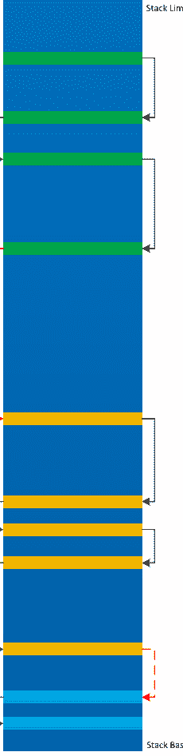

例如，由于缺少符号，我们有如下截断的堆栈跟踪：

```
1: kd> k
ChildEBP RetAddr
97543b6c 85adf579 nt!KiTrap0E+0x2ac
WARNING: Stack unwind information not available. Following frames may be wrong.
97543b8e 85adf770 myfault+0x579
97543bf4 85adf7fc myfault+0x770
97543c2c 81827ecf myfault+0x7fc
97543c44 81988f65 nt!IopCallDriver+0x63
97543c64 81989f25 nt!IopSynchronousServiceTail+0x1e0
97543d00 8198ee8d nt!IopXxxControlFile+0x6b7
97543d34 8188c96a nt!NtDeviceIoControlFile+0x2a
97543d34 77510f34 nt!KiFastCallEntry+0x12a
0012f9a0 7750f850 ntdll!KiFastSystemCallRet
0012f9a4 77417c92 ntdll!NtDeviceIoControlFile+0xc
0012fa04 00401a5b kernel32!DeviceIoControl+0x14a
0012fa94 7700becf NotMyFault+0x1a5b
0012facc 00000000 USER32!xxxDrawButton+0xc1
```

手动堆栈重建得出了此片段：

```
1: kd> k L=0012fb94 0012fb94 0012fb94
ChildEBP RetAddr
WARNING: Frame IP not in any known module. Following frames may be wrong.
0012fb94 77001ae8 0x12fb94
0012fc0c 7700286a USER32!UserCallWinProcCheckWow+0x14b
0012fcc4 77002bba USER32!SendMessageWorker+0x4b7
0012fc6c 7700c6b4 USER32!SendMessageW+0x7c
0012fc84 7700c7c9 USER32!xxxButtonNotifyParent+0x41
0012fca0 7700c7e8 USER32!xxxBtnNReleaseCapture+0xf7
0012fd24 7701632e USER32!ButtonWndProcWorker+0x910
0012fd44 77001a10 USER32!ButtonWndProcA+0x4c
0012fd70 77001ae8 USER32!InternalCallWinProc+0x23
0012fde8 77002a47 USER32!UserCallWinProcCheckWow+0x14b
0012fe4c 77002a98 USER32!DispatchMessageWorker+0x322
0012fe5c 770011fc USER32!DispatchMessageW+0xf
0012fe80 76fe98d2 USER32!IsDialogMessageW+0x586
0012fea0 00401cc9 USER32!IsDialogMessageA+0xff
0012fff0 004022ec NotMyFault+0x1cc9
00000000 00000000 NotMyFault+0x22ec
```

最后，我们得到了第 3 个常见线程启动片段：

```
1: kd> k L=0012ffa0 0012ffa0 0012ffa0
ChildEBP RetAddr
WARNING: Frame IP not in any known module. Following frames may be wrong.
0012ffa0 77413833 0x12ffa0
0012ffac 774ea9bd kernel32!BaseThreadInitThunk+0xe
0012ffec 00000000 ntdll!_RtlUserThreadStart+0x23
```

将它们粘合在一起，我们得到如下近似堆栈跟踪：

```
97543b6c 85adf579 nt!KiTrap0E+0x2ac
WARNING: Stack unwind information not available. Following frames may be wrong.
97543be8 85adf770 myfault+0x579
97543bf4 85adf7fc myfault+0x770
97543c2c 81827ecf myfault+0x7fc
97543c44 81988f65 nt!IopCallDriver+0x63
97543c64 81989F25 nt!IopSynchronousServiceTail+0x1e0
97543d00 8198ee8d nt!IopXxxControlFile+0x6b7
97543d34 8188c96a nt!NtDeviceIoControlFile+0x2a
97543d34 77510f34 ntdll!KiFastCallEntry+0x12a
0012f9a0 7750f850 ntdll!KiFastSystemCallRet
0012f9a4 77417c92 ntdll!NtDeviceIoControlFile+0xc
0012fa04 00401a5b kernel32!DeviceIoControl+0x14a
0012fa94 7700becf NotMyFault+0x1a5b
0012fc0c 7700286a USER32!UserCallWinProcCheckWow+0x14b
0012fc4c 77002bba USER32!SendMessageWorker+0x4b7
0012fc6c 7700c6ba USER32!SendMessageW+0x7c
0012fc84 7700c7c9 USER32!xxxButtonNotifyParent+0x41
0012fca0 7700c7e8 USER32!xxxBNReleaseCapture+0xf7
0012fd24 7701632e USER32!ButtonWndProcWorker+0x910
0012fd44 77001a10 USER32!ButtonWndProcA+0x4c
0012fd70 77001ae8 USER32!InternalCallWinProc+0x23
0012fde8 77002a47 USER32!UserCallWinProcCheckWow+0x14b
0012fe4c 77002a98 USER32!DispatchMessageWorker+0x322
0012fe5c 770011fc USER32!DispatchMessageW+0xf
0012fe80 76fe98d2 USER32!IsDialogMessageW+0x586
0012fea0 00401cc9 USER32!IsDialogMessageA+0xff
0012ff10 004022ec NotMyFault+0x1cc9
0012ffac 774ea9bd kernel32!BaseThreadInitThunk+0xe
0012ffec 00000000 ntdll!_RtlUserThreadStart+0x23
```

## 句柄泄漏

尽管 **句柄泄漏** 可能导致 **内存不足**（第 526 页），但并非总是如此，尤其是当池结构较小（例如事件）时。因此，**句柄泄漏** 模式涵盖高内存使用情况（包括大型结构）、高句柄计数以及分配和释放之间的异常差异。作为后者的示例，这里是一个 Event 对象及其相关 pooltag ABCD 的非分页池泄漏。与其他非泄漏 pooltag 相比，内存使用占用虽然较小，但我们可以看到 _Allocs_ 和 _Frees_ 之间的差异确实异常，并且与高句柄计数相关：

```
0: kd> !poolused 3
Sorting by  NonPaged Pool Consumed

Pool Used:
  NonPaged          Paged
Tag  Allocs  Frees  Diff   Used   Allocs  Frees  Diff   Used
[...]...
ABCD 1778517 1704538  73979 4734656     0     0     0     0 UNKNOWN pooltag 'ABCD',
      please update pooltag.txt
Even 6129633 6063728  65905 4224528     0     0     0     0 Event objects
[...]...
```

```
0: kd> !process 0 0

[...]

PROCESS d2b85360  SessionId: 2  Cid: 1bf4    Peb: 7ffdf000  ParentCid: 1688
DirBase: 7d778dc0  ObjectTable: e53dda08  HandleCount: 18539.
Image: AppA.exe

PROCESS b2fcd670  SessionId: 2  Cid: 0818    Peb: 7ffd4000  ParentCid: 1688
DirBase: 7d778400  ObjectTable: b3ffd8c0  HandleCount: 36252.
Image: AppB.exe

[...]
```

## 句柄限制

## GDI

## 内核空间

在导致 **内存不足** 模式（第 523 页）的各种内存泄漏中，有一种所谓的会话池泄漏，在关于内核池泄漏的模式（第 535 页）中被简要提及。它还涉及每个用户会话分配的 GDI 句柄和结构，这些句柄和结构的创建数量有限，因此该模式更应称为 **句柄限制**。此类泄漏在一段时间后可能导致应用程序表现不佳，因为绘制请求不再得到满足。在严重情况下，当显示驱动程序中存在相同错误时，可能会导致如下 bugcheck：

> BugCheck AB: SESSION_HAS_VALID_POOL_ON_EXIT

或者，如果句柄分配请求未得到满足，可能会在某个位置存储 NULL 指针，随后发生 **无效指针** 访问（第 589 页）：

```
SYSTEM_THREAD_EXCEPTION_NOT_HANDLED (7e)

CONTEXT: b791e010 -- (.cxr 0xffffffffb791e010)
eax=00000000 ebx=bc43d004 ecx=a233add8 edx=00000000 esi=bc430fff edi=00000000
eip=bfed7380 esp=b791e3dc ebp=b791e480 iopl=0 nv up ei pl zr na pe nc
cs=0008 ss=0010 ds=0023 es=0023 fs=0030 gs=0000 efl=00010246
DisplayDriver+0x3e380:
bfed7380 8a4702        mov     al,byte ptr [edi+2]     ds:0023:00000002=?
```

我们可以在 Visual C++ 中编写三个 Win32 应用程序来模拟 GDI 泄漏。它们都在循环中创建 GDI 对象，并将其选入当前的图形设备上下文（DC）中，运行于 Windows Server 2003 x64 SP2。在运行它们之前，我们得到以下会话分页池统计信息：

lkd> !poolused c

按会话分页池占用量排序

池已用：

| 标记 | 非分页分配 | 非分页已用 | 分页分配 | 分页已用 | 说明 |
|------|-----------|-----------|---------|---------|------|
| NV_x | 0 | 0 | 5 | 14024704 | 未知 pooltag 'NV_x', 请更新 pooltag.txt |
| BIG | 0 | 0 | 257 | 3629056 | 大型会话池分配 (ntos\ex\pool.c), 二进制文件: nt!mm |
| NV | 0 | 0 | 203 | 1347648 | nVidia 视频驱动程序 |
| Ttfd | 0 | 0 | 233 | 1053152 | TrueType 字体驱动程序 |
| Gh05 | 0 | 0 | 391 | 1058400 | Gdi 句柄管理器特定对象类型: 定义于 w32\ntgdi\inc\ntgdistr.h, 二进制文件: win32k.sys |
| Gla1 | 0 | 0 | 348 | 785088 | 从 lookaside 内存分配的 Gdi 句柄管理器特定对象类型: 定义于 w32\ntgdi\inc\ntgdistr.h, 二进制文件: win32k.sys |
| Gcac | 0 | 0 | 25 | 640880 | Gdi 字形缓存 |
| Gla5 | 0 | 0 | 631 | 323072 | Gdi 句柄管理器特定对象类型: 分配自 |


- lookaside 内存：定义于 w32\ntgdi\inc\ntgdistr.h ，二进制文件：win32k.sys
- Gdrs   0   0   33  172288 Gdi GDITAG_DRVSUP
- Gla:   0   0  212  139072 Gdi 句柄管理器从 lookaside 内存分配的特定对象类型：定义于 w32\ntgdi\inc\ntgdistr.h ，二进制文件：win32k.sys
- Gla4   0   0  487  116880 Gdi 句柄管理器从 lookaside 内存分配的特定对象类型：定义于 w32\ntgdi\inc\ntgdistr.h ，二进制文件：win32k.sys
- Usti   0   0  148  97088 THREADINFO，二进制文件：win32k!AllocateW32Thread
- Gla8   0   0  383  91920 Gdi 句柄管理器从 lookaside 内存分配的特定对象类型：定义于 w32\ntgdi\inc\ntgdistr.h ，二进制文件：win32k.sys
- Gla@   0   0  70512 Gdi 句柄管理器从 lookaside 内存分配的特定对象类型：定义于 w32\ntgdi\inc\ntgdistr.h ，二进制文件：win32k.sys
- Gbaf   0   0   48  67584 未知的池标记 'Gbaf'，请更新 pooltag.txt
- Knlf   0   0   20  66496 未知的池标记 'knlf'，请更新 pooltag.txt
- GDev   0   0    7  57344 Gdi pdev
- Usqb   0   0  152  53504 Q ，二进制文件：win32k!InitQEntryLookaside
- Uscu   0   0  334  53440 CURSOR ，二进制文件：win32k!_CreateEmptyCursorObject
- Bmfd   0   0   21  50224 字体相关内容
- Uspi   0   0  153  40000 PROCESSINFO，二进制文件：win32k!MapDesktop
- Gfnt   0   0   47  39856 未知的池标记 'Gfnt'，请更新 pooltag.txt
- Gb    0   0   34  39088 Gdi 字形位图
- Gh08   0   0   33  38656 Gdi 句柄管理器特定对象类型：定义于 w32\ntgdi\inc\ntgdistr.h ，二进制文件：win32k.sys
- Ghab   0   0  228  32832 Gdi 句柄管理器特定对象类型：定义于 w32\ntgdi\inc\ntgdistr.h ，二进制文件：win32k.sys
- Ovfl   0   0    1  32768 内部池标记表已溢出 - 通常这是由于未打标记的分配造成的
- Gpff   0   0   88  27712 Gdi 物理字体文件
- Gpfe   0   0   88  27600 未知的池标记 'Gpfe'，请更新 pooltag.txt
- thdd   0   0    1  20480 DirectDraw/3D 句柄管理器表
- Gebr   0   0   17  19776 Gdi ENGBRUSH
- Gh0@   0   0   86  19264 Gdi 句柄管理器特定对象类型：定义于 w32\ntgdi\inc\ntgdistr.h ，二进制文件：win32k.sys
- Gsp    0   0   79  18960 Gdi sprite
- HT40   0   0    2  16384 未知的池标记 'HT40'，请更新 pooltag.txt
- Gpat   0   0    4  16192 未知的池标记 'Gpat'，请更新 pooltag.txt
- Ggls   0   0  169  12944 Gdi 字形集
- Glnk   0   0  371  11872 Gdi PFELINK
- Gfldv  0   0    9  11248 Gdi ldev
- Gffv   0   0   84   9408 Gdi FONTFILEVIEW
- Gfsb   0   0    1   8192 Gdi 字体替换列表
- Uskt   0   0    2   7824 KBDTABLE ，二进制文件：win32k!ReadLayoutFile
- Gh04   0   0    7   5856 Gdi 句柄管理器特定对象类型：定义于 w32\ntgdi\inc\ntgdistr.h ，二进制文件：win32k.sys
- Gdcf   0   0   51   5712 未知的池标记 'Gdcf'，请更新 pooltag.txt
- Gh0<   0   0   88   5632 Gdi 句柄管理器特定对象类型：定义于 w32\ntgdi\inc\ntgdistr.h ，二进制文件：win32k.sys
- Gglb   0   0    1   4096 Gdi 临时缓冲区
- Ustm   0   0   30   3360 TIMER ，二进制文件：win32k!InternalSetTimer
- Gspm   0   0   39   3120 未知的池标记 'Gspm'，请更新 pooltag.txt
- Usac   0   0   16   3056 ACCEL ，二进制文件：win32k!_CreateAcceleratorTable
- Usqm   0   0   25   2800 QMSG ，二进制文件：win32k!InitQEntryLookaside
- Ghas   0   0    3   2592 Gdi 句柄管理器特定对象类型：定义于 w32\ntgdi\inc\ntgdistr.h ，二进制文件：win32k.sys
- Uscl   0   0   20   2128 CLASS ，二进制文件：win32k!ClassAlloc
- Uswl   0   0    1   2032 WINDOWLIST ，二进制文件：win32k!BuildHwndList
- Gmul   0   0   19   1520 未知的池标记 'Gmul'，请更新 pooltag.txt

| 名称 | 列2 | 列3 | 列4 | 列5 | 描述 |
|---|---|---|---|---|---|
| Dddp | 0 | 0 | 8 | 1472 | 未知的池标记 'Dddp'，请更新 pooltag.txt |
| Ggdv | 0 | 0 | 8 | 1472 | Gdi GDITAG_GDEVICE |
| UsDI | 0 | 0 | 4 | 1408 | DEVICEINFO ，二进制文件：win32k!CreateDeviceInfo |
| VtFd | 0 | 0 | 4 | 1312 | 字体文件/上下文 |
| Ushk | 0 | 0 | 20 | 1280 | HOTKEY ，二进制文件：win32k!_RegisterHotKey |
| Gspr | 0 | 0 | 3 | 1264 | Gdi sprite 增长范围 |
| Gtmw | 0 | 0 | 13 | 1248 | Gdi TMW_INTERNAL |
| Gxlt | 0 | 0 | 8 | 1152 | Gdi Xlate |
| Gpft | 0 | 0 | 2 | 944 | Gdi 字体表 |
| Uspp | 0 | 0 | 5 | 944 | PNP ，二进制文件：win32k!AllocateAndLinkHidTLCInf |
| Ussm | 0 | 0 | 7 | 896 | SMS ，二进制文件：win32k!InitSMSLookaside |
| Gdbr | 0 | 0 | 10 | 800 | Gdi 驱动程序画笔实现 |
| Usdc | 0 | 0 | 8 | 768 | DCE ，二进制文件：win32k!CreateCacheDC |
| Usct | 0 | 0 | 12 | 768 | CHECKPT ，二进制文件：win32k!CkptRestore |
| Usim | 0 | 0 | 2 | 736 | IME ，二进制文件：win32k!CreateInputContext |
| Usci | 0 | 0 | 3 | 720 | CLIENTTHREADINFO ，二进制文件：win32k!InitSystemThread |
| Gh09 | 0 | 0 | 1 | 640 | Gdi 句柄管理器特定对象类型：定义于 w32\ntgdi\inc\ntgdistr.h ，二进制文件：win32k.sys |
| Ussy | 1 | 80 | 4 | 698 | SYSTEM ，二进制文件：win32k!xxxDesktopThread |
| Urdr | 0 | 0 | 9 | 576 | REDIRECT ，二进制文件：win32k!SetRedirectionBitmap |
| Uswd | 0 | 0 | 2 | 576 | WINDOW ，二进制文件：win32k!xxxCreateWindowEx |
| Uscb | 0 | 0 | 3 | 544 | CLIPBOARD ，二进制文件：win32k!_ConvertMemHandle |
| Gcsl | 0 | 0 | 1 | 496 | Gdi 字符串资源脚本名称 |
| Ustx | 0 | 0 | 10 | 496 | TEXT ，二进制文件：win32k!NtUserDrawCaptionTemp |
| Ussw | 0 | 0 | 1 | 496 | SWP ，二进制文件：win32k!BeginDeferWindowPos |
| Gdev | 0 | 0 | 2 | 480 | Gdi GDITAG_DEVMODE |
| Usih | 0 | 0 | 10 | 480 | IMEHOTKEY ，二进制文件：win32k!SetImeHotKey |
| Gdrv | 0 | 0 | 1 | 368 | 未知的池标记 'Gdrv'，请更新 pooltag.txt |
| GDVd | 0 | 0 | 1 | 320 | 未知的池标记 'GDVd'，请更新 pooltag.txt |
| Gmap | 0 | 0 | 1 | 320 | Gdi 字体映射签名表 |
| Uskb | 0 | 0 | 2 | 288 | KBLAYOUT ，二进制文件：win32k!xxxLoadKeyboardLayoutEx |
| Uskf | 0 | 0 | 2 | 288 | KBDFILE ，二进制文件：win32k!LoadKeyboardLayoutFile |
| Uswe | 0 | 0 | 2 | 224 | WINEVENT ，二进制文件：win32k!_SetWinEventHook |
| Gddf | 0 | 0 | 2 | 224 | Gdi ddraw 驱动程序堆 |
| Gddv | 0 | 0 | 2 | 192 | Gdi ddraw 驱动程序视频内存列表 |
| GFil | 0 | 0 | 2 | 192 | Gdi 引擎描述符列表 |
| Gdwd | 0 | 0 | 2 | 96 | Gdi 看门狗支持对象 ，二进制文件：win32k.sys |
| Usd9 | 0 | 0 | 1 | 80 | DDE9 ，二进制文件：win32k!xxxCsDdeInitialize |
| Gvds | 0 | 0 | 1 | 64 | 未知的池标记 'Gvds'，请更新 pooltag.txt |
| GreA | 0 | 0 | 1 | 64 | 未知的池标记 'GreA'，请更新 pooltag.txt |
| Usse | 0 | 0 | 1 | 48 | SECURITY ，二进制文件：win32k!SetDisconnectDesktopSecu |
| Vsvl | 0 | 0 | 1 | 48 | VWPL ，二进制文件：win32k!VWPLAdd |
| Mdxg | 1 | 112 | 0 | 0 | 未知的池标记 'Mdxg'，请更新 pooltag.txt |
| Gini | 3 | 128 | 0 | 0 | Gdi 快速互斥体 |
| Usev | 1 | 64 | 0 | 0 | EVENT ，二进制文件：win32k!xxxPollAndWaitForSingleO |
| Gdde | 3 | 240 | 0 | 0 | Gdi ddraw 事件 |
| 总计 | 9 | 624 | 6256 | 24408704 | |

第一个应用程序泄漏字体：

```c
LRESULT CALLBACK WndProc(HWND hwnd, UINT message, WPARAM wParam, LPARAM lParam)
{
    int wmId, wmEvent;
    PAINTSTRUCT ps;
    HDC hdc;

    switch (message)
    {
    case WM_PAINT:
        hdc = BeginPaint(hwnd, &ps);
        while (true)
        {
            HFONT hf = CreateFont(10, 10, 0, 0, 0, 0, 0, 0, 0, 0, 0, 0, 0, L"Arial");
            SelectObject(ps.hdc, hf);
        }
        EndPaint(hwnd, &ps);
        break;
    }
}
```

我们清楚地看到泄漏，因为 "Gla." 池标记的分配数量大大增加：

| 池已用： | | | | |
|---|---|---|---|---|
| | 非分页 | | 分页 | |
| 标记 | 分配数 | 已用 | 分配数 | 已用 |
| NV_x | 0 | 0 | 5 | 14024764 未知的池标记 'NV_x'，请更新 pooltag.txt |
| Gla: | 0 | 0 | 10194 | 6687264 Gdi 句柄管理器从 lookaside 内存分配的特定对象类型：定义于 w32\ntgdi\inc\ntgdistr.h ，二进制文件：win32k.sys |
| BIG | 0 | 0 | 248 | 3690496 大型会话池分配 (ntos\ex\pool.c) ，二进制文件：nt!mm |
| NV | 0 | 0 | 203 | 1347648 nVidia 视频驱动程序 |
| Gh05 | 0 | 0 | 396 | 1057888 Gdi 句柄管理器特定对象类型：定义于 w32\ntgdi\inc\ntgdistr.h ，二进制文件：win32k.sys |
| Ttfd | 0 | 0 | 226 | 1043264 TrueType 字体驱动程序 |

第二个应用程序泄漏字体和笔：

```c
LRESULT CALLBACK WndProc(HWND hwnd, UINT message, WPARAM wParam, LPARAM lParam)
{
    int wmId, wmEvent;
    PAINTSTRUCT ps;
    HDC hdc;

    switch (message)
    {
    case WM_PAINT:
        hdc = BeginPaint(hwnd, &ps);
        while (true)
        {
            HFONT hf = CreateFont(10, 10, 0, 0, 0, 0, 0, 0, 0, 0, 0, 0, 0, L"Arial");
            HPEN hp = CreatePen(0, 10, RGB(10, 20, 30));
            SelectObject(ps.hdc, hf);
            SelectObject(ps.hdc, hp);
        }
    }
}


```
EndPaint(hWnd, &ps);
break;
```

我们看到，大约相同数量的分配在 "Gla:" 和 "Gh0@" 池标签之间拆分：

| Tag | NonPaged Allocs | NonPaged Used | Paged Allocs | Paged Used | Description |
|-----|-----------------|---------------|--------------|------------|-------------|
| NV_x | 0 | 0 | 5 | 14024704 | 未知池标签 'NV_x', 请更新 pooltag.txt |
| BIG | 0 | 0 | 262 | 3874816 | 大型会话池分配 (ntos\ex\pool.c), 二进制: nt!mm |
| Gla: | 0 | 0 | 5203 | 3413168 | 从 Lookaside 内存分配的 GDI 句柄管理器特定对象类型: 定义于 w32\ntgdi\inc\ntgdists.h, 二进制: win32k.sys |
| NV | 0 | 0 | 203 | 1347648 | nVidia 视频驱动程序 |
| Gh0@ | 0 | 0 | 5077 | 1137248 | GDI 句柄管理器特定对象类型: 定义于 w32\ntgdi\inc\ntgdists.h, 二进制: win32k.sys |
| Ttfd | 0 | 0 | 233 | 1053152 | TrueType 字体驱动程序 |

第三个程序泄漏字体、笔和画笔：

```
LRESULT CALLBACK WndProc(HWND hWnd, UINT message, WPARAM wParam, LPARAM lParam)
{
    int wmId, wmEvent;
    PAINTSTRUCT ps;
    HDC hdc;

    switch (message)
    {
    case WM_PAINT:
        hdc = BeginPaint(hWnd, &ps);
        while (true)
        {
            HFONT hf = CreateFont(10, 10, 0, 0, 0, 0, 0, 0, 0, 0, 0, 0, 0, L"Arial");
            HPEN hp = CreatePen(0, 10, RGB(10, 20, 30));
            HBRUSH hb = CreateSolidBrush(RGB(10, 20, 30));
            SelectObject(ps.hdc, hf);
            SelectObject(ps.hdc, hp);
            SelectObject(ps.hdc, hb);
        }
        EndPaint(hWnd, &ps);
        break;
    }
```

现在我们看到，大约相同数量的分配几乎平均拆分到 "Gla:"、"Gh0@" 和 "Gla@" 池标签之间：

| Tag | NonPaged Allocs | NonPaged Used | Paged Allocs | Paged Used | Description |
|-----|-----------------|---------------|--------------|------------|-------------|
| NV_x | 0 | 0 | 5 | 14024704 | 未知池标签 'NV_x', 请更新 pooltag.txt |
| BIG | 0 | 0 | 262 | 3874816 | 大型会话池分配 (ntos\ex\pool.c), 二进制: nt!mm |
| Gla: | 0 | 0 | 3539 | 2321584 | 从 lookaside 内存分配的 GDI 句柄管理器特定对象类型: 定义于 w32\ntgdi\inc\ntgdstr.h, 二进制: win32k.sys |
| NV | 0 | 0 | 203 | 1347648 | nVidia 视频驱动程序 |
| Ttfd | 0 | 0 | 233 | 1053152 | TrueType 字体驱动程序 |
| Gh0@ | 0 | 0 | 392 | 1052768 | GDI 句柄管理器特定对象类型: 定义于 w32\ntgdi\inc\ntgdstr.h, 二进制: win32k.sys |
| Gla1 | 0 | 0 | 353 | 796368 | 从 lookaside 内存分配的 GDI 句柄管理器特定对象类型: 定义于 w32\ntgdi\inc\ntgdstr.h, 二进制: win32k.sys |
| Gh0@ | 0 | 0 | 3414 | 764736 | GDI 句柄管理器特定对象类型: 定义于 w32\ntgdi\inc\ntgdstr.h, 二进制: win32k.sys |
| Gla@ | 0 | 0 | 3665 | 762320 | 从 lookaside 内存分配的 GDI 句柄管理器特定对象类型: 定义于 w32\ntgdi\inc\ntgdstr.h, 二进制: win32k.sys |
| Gcac | 0 | 0 | 25 | 640880 | GDI 字形缓存 |

当达到一定数量的句柄后，所有后续的 GDI Create 调用都会失败，其他应用程序开始出现各种视觉缺陷。打印屏幕操作也会因内存不足消息而失败。

## 用户空间

Windows 对每个进程的 GDI 句柄数量施加了限制，默认情况下约为 10,000。如果达到此数量，我们可能会出现卡顿、外观视觉故障以及导致错误消息和崩溃的内存不足异常等异常软件行为症状。我们已经为内核和完整内存转储记录了这种分析模式，我们称之为句柄限制 (GDI, 内核空间, 第 417 页)。但是，软件诊断服务的一位培训客户报告了一个内存不足异常，跟踪分析诊断指向 10,000 个泄漏的 GDI 对象。进程内存转储已保存，客户询问是否可以分析它，或类似的内存转储，以从转储本身中找出我们是否有 GDI 泄漏以及涉及哪些 GDI 对象。

我们重新创建了内核模式变体中的一个应用程序（泄漏字体的那个），并做了一个修改，即在尝试创建 10,000 个字体后停止。启动后，我们尝试打开“关于”对话框，但整个应用程序变得无响应，且没有对话框可见。我们保存了进程内存转储，并发现其主线程 (第 614 页) 正在处理对话框 (第 232 页) 内部：

```
0:000> kc
 # Call Site
00 user32!NtUserWaitMessage
01 user32!DlgLogBox2
02 user32!InternalDialogBox
03 user32!DlgLogBoxIndirectParamAorW
04 user32!DlgLogBoxParamW
05 GUIHandleLeak!WndProc
06 user32!UserCallWinProcCheckWow
07 user32!DispatchMessageWorker
08 GUIHandleLeak!WinMain
09 GUIHandleLeak!invoke_main
0a GUIHandleLeak!__scrt_common_main_seh
0b kernel32!BaseThreadInitThunk
0c ntdll!RtlUserThreadStart
```

为了查看 GDI 句柄表，我们研究了冯远 (Feng Yuan) 所著《Windows 图形编程》一书中的相关章节，以及包含所有必要结构定义的帖子[^86]。

```
0:000> .asm no_code_bytes
Assembly options: no_code_bytes

0:000> uf gdi32!GdiQueryTable
gdi32!GdiQueryTable:
00007ffc`7f172610 sub     rsp,38h
00007ffc`7f172614 or      qword ptr [rsp+20h],0FFFFFFFFFFFFFFFh
00007ffc`7f17261a lea     rdx,[rsp+20h]
00007ffc`7f17261f mov     ecx,0Eh
00007ffc`7f172624 mov     byte ptr [rsp+28h],0
00007ffc`7f172629 call    qword ptr [gdi32!_imp_NtVdmControl (00007ffc`7f1ba5a8)]
00007ffc`7f17262f test    eax,eax
00007ffc`7f172631 js      gdi32!GdiQueryTable+0x33 (00007ffc`7f172643) Branch

gdi32!GdiQueryTable+0x23:
00007ffc`7f172633 cmp     byte ptr [rsp+28h],0
00007ffc`7f172638 je      gdi32!GdiQueryTable+0x33 (00007ffc`7f172643) Branch

gdi32!GdiQueryTable+0x2a:
00007ffc`7f17263a mov     rax,qword ptr [gdi32!pGdiSharedHandleTable (00007ffc`7f2541b8)]
00007ffc`7f172641 jmp     gdi32!GdiQueryTable+0x35 (00007ffc`7f172645) Branch

gdi32!GdiQueryTable+0x33:
00007ffc`7f172643 xor     eax,eax

gdi32!GdiQueryTable+0x35:
00007ffc`7f172645 add     rsp,38h
00007ffc`7f172649 ret

0:000> dp 00007ffc`7f2541b8 L1
00007ffc`7f2541b8 000000db`56a50000
```

我们转储前 0x1000 个 qword 值：

```
0:000> dq 000000db`56a50000 L1000
000000db`56a50000 00000000`00000000 00000000`00000000
000000db`56a50010 00000000`00000000 00000000`00000000
000000db`56a50020 40000000`00000000 00000000`00000000
000000db`56a50030 00000000`00000000 00000000`00000000
000000db`56a50040 00000000`00000000 00000000`00000000
000000db`56a50050 00000000`00000000 00000000`00000000
000000db`56a50060 00000000`00000000 00000000`00000000
000000db`56a50070 00000000`00000000 00000000`00000000
000000db`56a50080 00000000`00000000 00000000`00000000
000000db`56a50090 00000000`00000000 00000000`00000000
000000db`56a500a0 00000000`00000000 00000000`00000000
000000db`56a500b0 00000000`00000000 00000000`00000000
000000db`56a500c0 00000000`00000000 00000000`00000000
000000db`56a500d0 00000000`00000000 00000000`00000000
000000db`56a500e0 00000000`00000000 00000000`00000000
000000db`56a500f0 fffffff901`40000e60 40040104`00000000
000000db`56a50100 00000000`00000000 fffffff901`40000d60
000000db`56a50110 40080188`00000000 00000000`00000000
000000db`56a50120 fffffff901`400008b0 00008108`00000000
000000db`56a50130 fffffff901`400000e0 fffffff901`400007c0
000000db`56a50140 40080108`00000000 00000000`00000000
000000db`56a50150 fffffff901`400006d0 40080108`00000000
[...]
000000db`56a57ce0 fffffff901`429d24f0 400aea0a`00002c30
000000db`56a57cf0 000000db`564f3b20 fffffff901`42910570
000000db`56a57d00 400a360a`00002c30 000000db`564e57b0
000000db`56a57d10 fffff901`40700420 40105310`000002b4
000000db`56a57d20 00000089`39410fc0 fffff901`407ec4a0
000000db`56a57d30 4000a10a`000002b4 00000089`3900ae70
000000db`56a57d40 fffff901`407036d0 4000a10a`000002b4
000000db`56a57d50 00000089`3900ae60 fffff901`44b56e0
000000db`56a57d60 400a030a`00002c30 000000db`56a0e690
000000db`56a57d70 fffff901`43e7fd50 4040a104`00000000
000000db`56a57d80 00000000`00000000 fffff901`42c0f010
000000db`56a57d90 400a4b0a`00003190 0000003a`1a30b670
000000db`56a57da0 fffff901`440deaf0 400a6d0a`00002c30
000000db`56a57db0 000000db`56a43b00 fffff901`407f2010
000000db`56a57dc0 40100510`00001704 00000008`d6230f60
000000db`56a57dd0 fffff901`40714180 40100210`00001704
000000db`56a57de0 000000d8`d6230f48 fffff901`4009d840
000000db`56a57df0 40100210`00001704 00000008`d6230f78
000000db`56a57e00 fffff901`43e50950 40100230`00001704
000000db`56a57e10 00000000`00000000 fffff901`43e30010
000000db`56a57e20 40100230`00001704 00000000`00000000
000000db`56a57e30 fffff901`44f1d010 4005a105`0000168c
000000db`56a57e40 00000000`00000000 fffff901`440ded80
000000db`56a57e50 400a2e0a`00002c30 000000db`56a43b10
000000db`56a57e60 fffff901`4070b3b0 40050405`00000000
000000db`56a57e70 00000000`00000000 fffff901`42a0a010
000000db`56a57e80 400a870a`00002c30 000000db`56a4e160
000000db`56a57e90 fffff901`407a7450 4008cd08`00000000
000000db`56a57ea0 00000000`00000000 fffff901`400c49c0
000000db`56a57eb0 40046904`000002b4 00000089`39410f90
000000db`56a57ec0 fffff901`41ff8b10 4005c705`00000000
000000db`56a57ed0 00000000`00000000 fffff901`423dc790
000000db`56a57ee0 40086708`00000000 00000000`00000000
000000db`56a57ef0 fffff901`40699620 40010301`0000168c
000000db`56a57f00 00000000`01100000 fffff901`43e54510
000000db`56a57f10 40050305`0000168c 00000000`00000000
000000db`56a57f20 fffff901`407164c0 40100610`00001448
000000db`56a57f30 000000fe`4d8dcbf0 fffff901`407eee50
000000db`56a57f40 40100410`00001448 000000fe`4d8d0cd8
000000db`56a57f50 fffff901`43e2abb0 40088508`00000000
000000db`56a57f60 00000000`00000000 fffff901`40715010
000000db`56a57f70 40050305`0000168c 00000000`00000000
000000db`56a57f80 fffff901`42872b80 40084e08`00000000
000000db`56a57f90 00000000`00000000 fffff901`407175a0
000000db`56a57fa0 410f080f`00000000 00000000`00000000
000000db`56a57fb0 fffff901`407f4000 40050605`00000000
000000db`56a57fc0 00000000`00000000 fffff901`40d6dbb0
000000db`56a57fd0 40008508`00000000 00000000`00000000
000000db`56a57fe0 fffff901`43e3a4c0 40120812`00000000
000000db`56a57ff0 00000000`00000000 fffff901`44fe1010
```

我们看到，典型单元值包含 3 个 qword (对于 x64 和虚拟化进程都是 8 字节或 4 字大小的值，第 1068 页)。非零数据从地址 000000db`56a500f0 开始。显然，某些条目的 wProcessId 等于我们转储中的 PID：

```
0:000> ~
. 0 Id: 2c30.292c Suspend: 0 Teb: 00007ff7`1bf3e000 Unfrozen
```

[^86]: http://stackoverflow.com/questions/13905661/how-to-get-list-of-gdi-handles


让我们来看看这样的一个条目（第一个和最后一个 qword 值是指针）：

```
0:000> dq 000000db`56a57da0 L3
000000db`56a57da0 ffffff901`440deaf0 400a6d0a`00002c30
000000db`56a57db0 000000db`56a4f3b00

0:000> dw 000000db`56a57da0 L3*4
000000db`56a57da0 eaf0 440d f901 ffff 2c30 0000 6d0a 400a
000000db`56a57db0 3b00 564f 00db 0000
```

将 7f 应用到 wType 字 400a 上，得到 0xa 或 10，这是一个字体句柄：

```
0:000> ? 400a & 7f
Evaluate expression: 10 = 00000000`0000000a
```

由于此表中包含同一会话中其他进程的条目，直观评估句柄泄漏比较困难，因此我们编写了一个 WinDbg 脚本，该脚本从第一个非零 pKernelAddress ($t0) 遍历到第一个零条目，并针对给定的 wProcessId ($tpid) 统计条目数量 ($t1) 以及针对给定 wType ($t2) 的条目数量 ($t3)。该脚本还会统计直到第一个零条目之前的总条目数 ($t4)：

```
.while (qwo(@$t0)) { .if (wo(@$t0+8) == @$tpid) {r $t1 = @$t1+1; .if (((qwo(@$t0+8) >> 0n48) & 7f) == @$t2) {r $t3 = @$t3+1}; r $t0 = @$t0+3*8; r $t4 = @$t4+1}
```

要执行它，我们准备变量：

```
0:000> r $t0=000000db`56a500f0

0:000> r $t1=0

0:000> r $t2=a

0:000> r $t3=0

0:000> r $t4=0
```

```
0:000> .while (qwo(@$t0)) { .if (wo(@$t0+8) == @$tpid) {r $t1 = @$t1+1; .if (((qwo(@$t0+8) >> 0n48) & 7f) == @$t2) {r $t3 = @$t3+1}; r $t0 = @$t0+3*8; r $t4 = @$t4+1}
```

执行后，我们得到修改后的变量，它们显示连续非零句柄表条目的总数为 21464，当前进程的条目总数为 9990，字体总数为 9982：

```
0:000> ? $t0
Evaluate expression: 942052007216 = 000000db`56acdd30

0:000> ? $t1
Evaluate expression: 9990 = 00000000`00002706

0:000> ? $t2
Evaluate expression: 10 = 00000000`0000000a

0:000> ? $t3
Evaluate expression: 9982 = 00000000`000026fe

0:000> ? $t4
Evaluate expression: 21464 = 00000000`000053d8
```

如果我们对设备上下文（wType 为 1）重复运行同一脚本，则仅为我们的 PID 得到 2 个条目：

```
0:000> r $t0=000000db`56a500f0
0:000> r $t1=0
0:000> r $t2=1
0:000> r $t3=0
0:000> r $t4=0
0:000> .while (qwo(@$t0)) .if (wo(@$t0+8) == @$tpid) {r $t1 = @$t1+1; .if (((qwo(@$t0+8) >> 0n48) & 7f) == @$t2) {r $t3 = @$t3+1}; r $t0 = @$t0+3*8; r $t4 = @$t4+1}
0:000> ? $t3
Evaluate expression: 2 = 00000000`00000002
```

当然，此脚本可以进一步改进，例如，处理所有可能的 wType 值并打印其统计信息。它还可以作为带参数的文本 WinDbg 脚本过程来实现。

## 已处理异常

## .NET CLR

类似于非托管用户空间 Handled Exceptions（第 434 页）残留，我们可以在 .NET CLR 线程的原始堆栈上看到类似的残留。以下是一些典型片段（x86，CLR 4 也有类似残留）：

```
[...]
09c8e1e0 79ef2dee mscorwks!ExInfo::Init+0x41
09c8e1e4 00004000
09c8e1e8 79f088cc mscorwks!`string'
09c8e1ec 79f088c2 mscorwks!ExInfo::UnwindExInfo+0x14d
09c8e1f0 08f68728
09c8e1f4 95f5b898
09c8e1f8 09c8e1a4
09c8e1fc 09c8e92c
09c8e200 7a34d0d8 mscorwks!GetManagedNameForTypeInfo+0x22b02
09c8e204 79f091ee mscorwks!COMPlusCheckForAbort+0x15
09c8e208 00000000
09c8e20c aada664
09c8e210 0aaabff4
09c8e214 00000000
09c8e218 09c8eeec
09c8e21c 074c1f23
09c8e220 09c8ef0c
09c8e224 79f091cb mscorwks!JIT_EndCatch+0x16
09c8e228 09c8ef0c
09c8e22c 09c8eec
09c8e230 074c1f23
09c8e234 09c8e25c
09c8e238 0009c108
09c8e23c 09c8e460
09c8e240 09c8e5c4
09c8e244 00071d88
09c8e248 08f68728
09c8e24c 79e734c4 mscorwks!ClrFlsSetValue+0x57
09c8e250 95f5b8e4
09c8e254 aada634
09c8e258 08f68728
09c8e25c aada90c
09c8e260 aabfff4
09c8e264 00000002
09c8e268 09c8e304
09c8e26c aada664
09c8e270 00000000
09c8e274 09c8ef0c
09c8e278 09c8e234
09c8e27c 074c1f13
09c8e280 00000000
09c8e284 08f688a0
09c8e288 09c8e234
09c8e28c 79f00c0b mscorwks!Thread::ReturnToContext+0x4e2
09c8e290 aada90c
09c8e294 09c8eef4
09c8e298 09c8e2bc
09c8e29c 79f08eb8 mscorwks!EEJitManager::ResumeAtJitEH+0x28
09c8e2a0 09c8e460
09c8e2a4 074c1ed8
09c8e2a8 074b41a8
09c8e2ac 00000000
09c8e2b0 08f68728
09c8e2b4 00000000
09c8e2b8 09c8e410
09c8e2bc 09c8e3c8
09c8e2c0 79f08df5 mscorwks!COMPplusUnwindCallback+0x7c3
09c8e2c4 09c8e460
09c8e2c8 074b41a8
09c8e2cc 00000000
09c8e2d0 08f68728
09c8e2d4 00000000
09c8e2d8 0009c108
09c8e2dc 09c8e410
09c8e2e0 09c8e5c4
09c8e2e4 074b41a8
09c8e2e8 09c8e3a4
09c8e2ec 79e734c4 mscorwks!ClrFlsSetValue+0x57
09c8e2f0 95f5b984
09c8e2f4 0009c128
09c8e2f8 09c8e3a4
09c8e2fc 00000000
09c8e300 00000000
09c8e304 00000002
[...]
09c8e4e4 00000000
09c8e4e8 79f09160 mscorwks!_CT??_R0H+0x34b4
09c8e4ec ffffffff
09c8e4f0 73792e2f msvcr80!_getptd+0x6
09c8e4f4 ffffffff
09c8e4f8 737b7a78 msvcr80!__FrameUnwindToState+0xd9
09c8e4fc 737b7a5e msvcr80!__FrameUnwindToState+0xbf
09c8e500 95f5bc05
09c8e504 e06d7363
09c8e508 1fffffff
09c8e50c 19930522
09c8e510 ffffffff
09c8e514 ffffffff
09c8e518 09c8e500
09c8e51c 09c8e554
09c8e520 09c8e5a8
09c8e524 73798cd9 msvcr80!_except_handler4
09c8e528 efbc0d3d
09c8e52c ffffffff
09c8e530 737b7a5e msvcr80!__FrameUnwindToState+0xbf
09c8e534 737b89cb msvcr80!_InternalCxxFrameHandler+0x6d
09c8e538 09c8eab0
09c8e53c 09c8e6a0
09c8e540 79f09160 mscorwks!_CT??_R0H+0x34b4
09c8e544 ffffffff
09c8e548 00000000
09c8e54c 00000000
09c8e550 00000000
09c8e554 09c8e590
09c8e558 737b8af1 msvcr80!__CxxFrameHandler3+0x26
09c8e55c 09c8e600
09c8e560 09c8eab0
09c8e564 01010101
09c8e568 09000000
09c8e56c 09c8f160
09c8e570 07540c00
09c8e574 00071d88
09c8e578 08e65d48
09c8e57c 09c8e5ec
09c8e580 074c1ec8
09c8e584 00000024
09c8e588 00000001
09c8e58c 0009c108
09c8e590 08f68728
09c8e594 00000000
09c8e598 00000000
09c8e59c 09c8eb38
09c8e5a0 00000000
09c8e5a4 09c8e6a0
09c8e5a8 09c8f15c
09c8e5ac 09c8f15c
09c8e5b0 09c8eb38
09c8e5b4 95f5bf28
09c8e5b8 09c8e8f4
09c8e5bc 798e4bf2 mscorwks!Thread::StackWalkFrames+0xb8
09c8e5c0 08f68728
09c8e5c4 09c8ea40
09c8e5c8 79e84bf2 mscorwks!Thread::StackWalkFrames+0xb8
09c8e5cc 09c8e5ec
09c8e5d0 79f07d64 mscorwks!COMPlusUnwindCallback
09c8e5d4 09c8ea40
09c8e5d8 00000005
09c8e5dc 00000000
09c8e5e0 08f68728
09c8e5e4 08f688a0
09c8e5e8 08f68728
09c8e5ec 09c8ec20
09c8e5f0 00000000
09c8e5f4 09c8ebcc
09c8e5f8 09c8ecc0
09c8e5fc 09c8ecc4
09c8e600 09c8ecc8
09c8e604 09c8eccc
09c8e608 09c8ecd0
09c8e60c 09c8ecd4
09c8e610 09c8eeec
09c8e614 09c8ecd8
09c8e618 09c8ecd8
09c8e61c 00000024
09c8e620 00000000
09c8e624 0009c108
09c8e628 08f68728
09c8e62c 00000000
09c8e630 00000000
09c8e634 79e71ba4 mscorwks!Thread::CatchAtSafePoint
09c8e638 00000000
09c8e63c 79e71ba4 mscorwks!Thread::CatchAtSafePoint
09c8e640 09c8f15c
09c8e644 09c8f15c
09c8e648 00000000
09c8e64c 95f5bcc0
09c8e650 09c8e988
09c8e654 79e84bf2 mscorwks!Thread::StackWalkFrames+0xb8
09c8e658 09c8ea40
09c8e65c 79e84bf2 mscorwks!Thread::StackWalkFrames+0xb8
09c8e660 09c8e680
09c8e664 79f07957 mscorwks!COMPlusThrowCallback
09c8e668 09c8ea40
09c8e66c 00000000
09c8e670 00000000
09c8e674 0aada90c
09c8e678 09c8ea40
09c8e67c 79e84bff mscorwks!Thread::StackWalkFrames+0xc5
09c8e680 09c8ec20
09c8e684 00000000
09c8e688 09c8ecbc
09c8e68c 09c8ecc0
09c8e690 09c8ecc4
09c8e694 09c8ecc8
[...]
09c8e8f0 95f5b264
09c8e8f4 09c8e914
09c8e8f8 79f07d5e mscorwks!UnwindFrames+0x62
09c8e8fc 79f07d64 mscorwks!COMPlusUnwindCallback
09c8e900 09c8ea40
09c8e904 00000005
09c8e908 00000000
09c8e90c 09c8e6fc
09c8e910 08f68728
09c8e914 09c8e9a4
09c8e918 79f089cc mscorwks!COMPlusAfterUnwind+0x97
09c8e91c 08f68728
09c8e920 09c8ea40
09c8e924 00000001
09c8e928 00000000
09c8e92c 09c8ef6c
09c8e930 79f0a3d9 mscorwks!COMPlusNestedExceptionHandler
09c8e934 09c8f160
09c8e938 00000000
09c8e93c 00000000
09c8e940 cccccccc
[...]
```

有时如果未被覆盖，我们可以看到 ‘ExecuteHandler’ 调用：

```
[...]
09d2e6e0 00000000
09d2e6e4 00000720
09d2e6e8 77c41039 ntdll!ExecuteHandler2+0x26
09d2e6ec 09d2e7c8
09d2e6f0 0d2eb60
09d2e6f4 09d2e7c4
09d2e6f8 09d2e7a4
09d2e6fc 09d2eb60
09d2e700 77c4104d ntdll!ExecuteHandler2+0x3a
09d2e704 09d2eb60
09d2e708 09d2e7b0
09d2e70c 77c4100b ntdll!ExecuteHandler+0x24
09d2e710 09d2e7c8
09d2e714 00000001
09d2e718 09d2e6b0
09d2e71c 09d2e7a4
09d2e720 09d2e784
09d2e724 76545ac9 kernel32!except_handler4
[...]
```

如果存在此类痕迹，它们可以表现为 Caller-n-Callee（第 111 页）模式：

```
0:011> !DumpStack
OS Thread Id: 0x3cc (11)
Current frame: ntdll!KiFastSystemCallRet
ChildEBP RetAddr  Caller, Callee
09d2e690 77c40690 ntdll!ZwWaitForMultipleObjects+0xc
09d2e694 76577e09 kernel32!WaitForMultipleObjectsEx+0x11d, calling ntdll!NtWaitForMultipleObjects
09d2e6d8 76578101 kernel32!WaitForMultipleObjectsEx+0x33, calling ntdll!
09d2e6e4 77c41039 ntdll!ExecuteHandler2+0x26
09d2e708 77c4100b ntdll!ExecuteHandler+0x24, calling ntdll!ExecuteHandler2
09d2e730 6ba516a clr!WaitForMultipleObjectsEx_SO_TOLERANT+0x56, calling RtlActivateActivationContextUnsafeFast
kernel32!WaitForMultipleObjectsEx
09d2e794 6baa4f98 clr!Thread::DoAppropriateAptStateWait+0x4d, calling clr!WaitForMultipleObjectsEx_SO_TOLERANT
09d2e7b4 6baa4dd8 clr!Thread::DoAppropriateWaitWorker+0x17d, calling clr!Thread::DoAppropriateAptStateWait
09d2e848 6baa4e99 clr!Thread::DoAppropriateWait+0x60, calling clr!Thread::DoAppropriateWaitWorker
09d2e8b4 6baa4f17 clr!CLREvent::WaitEx+0x106, calling clr!Thread::DoAppropriateWait
09d2e8e0 6baa48b4 clr!CLREvtTickCount64+0x6b, calling clr!_allmul
09d2e908 6ba44d09 clr!CLREvent::Wait+0x19, calling clr!CLREvent::WaitEx
[...]


## 内核空间

这是内核空间中 **已处理异常** 模式的一个变体，类似于用户空间（第 434 页）和托管空间（第 428 页）。崩溃转储与内核空间中的 **隐藏异常** 模式（第 455 页）相同：

```
fffff880`0a83d910 00000000`00000000
fffff880`0a83d918 ffffffff`4005f4d8
fffff880`0a83d920 fffffff880`0a83dca0
fffff880`0a83d928 fffffff880`016bc1c1 nt!C_specific_handler+0xcc
fffff880`0a83d930 00000000`00000000
fffff880`0a83d938 00000000`00000000
fffff880`0a83d940 00000000`00000000
fffff880`0a83d948 00000000`00000000
fffff880`0a83d950 fffffff800`0189e938 nt!BTFBuffer <PERF> (nt+0x280e38)
fffff880`0a83d958 fffffff880`0a83e940
fffff880`0a83d960 fffffff880`016ad767 nt!IopCompleteRequest+0x147
fffff880`0a83d968 fffffff880`0a83de40
fffff880`0a83d970 fffffff800`01665e40 nt!GSHandlerCheck_SEH
fffff880`0a83d978 fffffff800`017e5338 nt!_imp_NtOpenSymbolicLinkObject+0xfe30
fffff880`0a83d980 fffffff880`0a83e310
fffff880`0a83d988 00000000`00000000
fffff880`0a83d990 00000000`00000000
fffff880`0a83d998 fffffff800`016b42dd nt!RtlpExecuteHandlerForException+0xd
fffff880`0a83d9a0 fffffff880`017d7d0c nt!_imp_NtOpenSymbolicLinkObject+0x2804
fffff880`0a83d9a8 fffffff880`0a83eab0
fffff880`0a83d9b0 00000000`00000000
```

```
0: kd> ub fffff800`016b42dd
nt!RtlpExecuteHandlerForException+0x24:
fffff800`016b42c4 cc              int 3
fffff800`016b42c5 cc              int 3
fffff880`016b42c6 cc              int 3
fffff880`016b42c7 cc              int 3
fffff880`016b42c8 0f1f840000000000 nop dword ptr [rax+rax]
nt!RtlpExecuteHandlerForException:
fffff880`016b42d0 4883ec28        sub rsp,28h
fffff880`016b42d4 4c89c42420      mov qword ptr [rsp+20h],r9
fffff880`016b42d9 41ff5130        call qword ptr [r9+30h]
```

## 用户空间

即使我们在检查原始堆栈数据时看不到异常代码，但在某些情况下，仍可能看到调用异常处理程序后留下的执行残留。例如，当我们启动 TestWER 工具并选中“已处理异常”复选框时，可以看到：

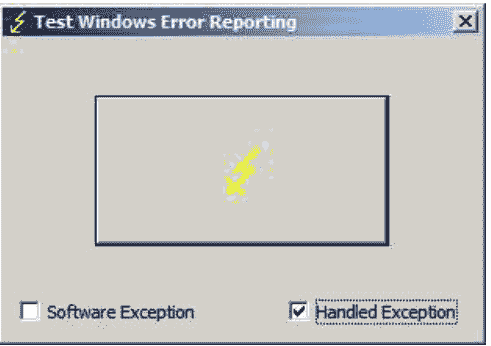

如果然后点击按钮，并使用任务管理器保存进程内存转储，我们会在原始堆栈上找到以下痕迹：

```
0:000> !teb
TEB at 7efdd000
ExceptionList: 0018fe20
StackBase: 00190000
StackLimit: 0018d000
SubSystemTib: 00000000
FiberData: 00001e00
ArbitraryUserPointer: 00000000
Self: 7efdd000
EnvironmentPointer: 00000000
ClientId: 00000838 . 00000f98
RpcHandle: 00000000
Tls Storage: 7efdd02c
PEB Address: 7efde000
LastErrorValue: 0
LastStatusValue: c0000034
Count Owned Locks: 0
HardErrorMode: 0
```

```
0:000> dps 0018d000 00190000
[...]
0018f414 00000000
0018f418 0018f840
0018f41c 0018f4cc
0018f420 77726a9b ntdll!ExecuteHandler+0x24
0018f424 0018f4e4
0018f428 0018f840
0018f42c 0018f534
0018f430 0018f848
0018f434 00412600 TestWER!except_handler4
0018f438 00000001
0018f43c 00000000
[...]
```

```
0:000> ub 77726a9b
ntdll!ExecuteHandler+0x7:
77726a7e 33f0 xor esi,esi
77726a80 33ff xor edi,edi
77726a82 ff742420 push dword ptr [esp+20h]
77726a86 ff742420 push dword ptr [esp+20h]
77726a8a ff742420 push dword ptr [esp+20h]
77726a8e ff742420 push dword ptr [esp+20h]
77726a92 ff742420 push dword ptr [esp+20h]
77726a96 e808000000 call ntdll!ExecuteHandler2 (77726aa3)
```

如果将上述输出与二次机会异常内存转储中的原始堆栈片段进行比较（在重新启动 TestWER 后，不选中“已处理异常”复选框并单击大闪电按钮），我们会看到类似的调用片段：

```
[...]
0018f3f4 0ddd0aa7
0018f3f8 0018f41c
0018f3fc 77726ac9 ntdll!ExecuteHandler2+0x26
0018f400 fffffffe
0018f404 0fffffc4
0018f408 0018f534
0018f40c 0018f4b8
0018f410 0018f840
0018f414 77726add ntdll!ExecuteHandler2+0x3a
0018f418 0018ffc4
0018f41c 0018ffcc
0018f420 77726a9b ntdll!ExecuteHandler+0x24
0018f424 0018f4e4
0018f428 0018ffc4
0018f42c 0018f534
0018f430 0018f4b8
0018f434 77750ae5 ntdll!except_handler4
0018f438 00000000
0018f43c 0018f4e4
0018f440 0018ffc4
0018f444 77726a3d ntdll!RtlDispatchException+0x127
0018f448 0018f4e4
0018f44c 0018ffc4
0018f450 0018f534
0018f454 0018f4b8
0018f458 77750ae5 ntdll!_except_handler4
0018f45c 00000111
0018f460 0018f4e4
[...]
```

有时，我们还可以看到“Unwind”、“StackWalk”、“WalkFrames”、“EH”、“Catch”函数。有时我们看不到任何内容，因为在过去某个时间点发生 **已处理异常** 后，此类残留被后续函数调用覆盖了。

## 注释

如果我们为同一进程获得多个相同的首次机会异常转储，则说明该异常已被处理。否则，我们将看不到后续的转储。

## 硬件活动

有时，当报告大量中断，但内存转储文件中没有中断风暴或挂起 DPC 的迹象时，在运行和/或可疑线程中搜索此模式很有用。这可以通过检查线程原始堆栈上留下的执行残留来完成。尽管发现的驱动程序活动可能与报告的问题无关，但它可以作为检查可疑驱动程序是否有更新的一般建议的驱动程序排除程序的有用起点。以下是网卡执行“Scatter-Gather”DMA 的线程原始堆栈示例：

```
1: kd> !thread
THREAD f7732090 Cid 0000.0000 Teb: 00000000 Win32Thread: 00000000 RUNNING on processor 1
Not impersonating
Owning Process 8089db40 Image: Idle
Attached Process N/A Image: N/A
Wait Start TickCount 0 Ticks: 24437545 (4:10:03:56.640)
Context Switch Count 75624870
UserTime 00:00:00.000
KernelTime 4 Days 08:50:5.125
Stack Init f78b3000 Current f78b2d4c Base f78b3000 Limit f78b0000 Call 0
Priority 0 BasePriority 0 PriorityDecrement 0
ChildEBP RetAddr Args to Child
f7b30c5c 00000000 00000000 00000000 00000000 LiveKdD+0x1c07

1: kd> dds f78b0000 f78b3000
f78b0000 00000000
f78b0004 00000000
f78b0008 00000000
f78b000c 00000000
f78b0010 00000000
[...]
f78b2870 8b3de0d0
f78b2874 80887b75 nt!KiFlushTargetSingleTb+0xd
f78b2878 8b49032c
f78b287c 00000000
f78b2880 2d003202
f78b2884 00000000
f78b2888 00000000
f78b288c 2d003202
f78b2890 8b490302
f78b2894 f78b28a4
f78b2898 80a61456 hal!KfLowerIrql+0x62
f78b289c 2d00320a
f78b28a0 00000000
f78b28a4 8b3de0d0
f78b28a8 8b3e3730
f78b28ac 00341eb0
f78b28b0 f78b2918
f78b28b4 f63fbf78 NetworkAdapterA!SendWithScatterGather+0x318
f78b28b8 8b3de0d0
f78b28bc 8b341eb0
f78b28c0 f78b28d4
f78b28c4 00000000
f78b28c8 8a55f3c0 hal!KfAcquireSpinLock
f78b28cc 00000000
f78b28d0 8b3de0d0
f78b28d4 00000000
f78b28d8 8b3de0d0
f78b28dc 8b3eb730
f78b28e0 005a7340
f78b28e4 f78b294c
f78b28e8 f63fbf78 NetworkAdapterA!SendWithScatterGather+0x318
f78b28ec 8b3de0d0
f78b28f0 8a5a7340
f78b28f4 f78b2908
f78b28f8 00000000
f78b28fc 8b3de0d0
f78b2900 8b0f5158
f78b2904 001e2340
f78b2908 f78b2970
f78b290c f63fbf78 NetworkAdapterA!SendWithScatterGather+0x318
f78b2910 8b3de0d0
f78b2914 8b1e2340
f78b2918 f78b292c
f78b291c 00000000
f78b2920 8a55f3c0 hal!KfAcquireSpinLock
f78b2924 00000000
f78b2928 8b3de0d0
f78b292c 00000000
f78b2930 8b3eb700
f78b2934 00000000
f78b2938 00000000
f78b293c 00000000
f78b2940 00000000
f78b2944 00000000
f78b2948 00000000
f78b294c 0a446aa2
f78b2950 f78b29b8
f78b2954 8b0f5158
f78b2958 8b01ce10
f78b295c 00000001
f78b2960 8b3de0d0
f78b2964 80a5f302 hal!HalpPerfInterrupt+0x32
f78b2968 00000001
f78b296c 8b3de0d0
f78b2970 80a5f302 hal!HalpPerfInterrupt+0x32
f78b2974 8b3de302
f78b2978 f78b2988
f78b297c 80a61456 hal!KfLowerIrql+0x62
f78b2980 80a5f3c0 hal!KfAcquireSpinLock
f78b2984 8b3de302
f78b2988 f78b29a4
f78b298c 80a5f44b hal!KfReleaseSpinLock+0xb
f78b2990 f63fbbf NetworkAdapterA!SendPackets+0x1b3
f78b2994 8a446a90
f78b2998 8b0e8ab0
f78b299c 00000000
f78b29a0 008b29d0
f78b29a4 f78b29bc
f78b29a8 7163790 NDIS!ndisMProcessSGList+0x90
f78b29ac 8b3de388
f78b29b0 f78b29d0
f78b29b4 00000001
f78b29b8 00000000
f78b29bc f78b29e8
f78b29c0 80a60147 hal!HalBuildScatterGatherList+0x1c7
f78b29c4 8b0e89b0
f78b29c8 00000000
f78b29cc a4a4cde8
f78b29d0 8b1e2340
f78b29d4 8a446aa2
f78b29d8 8b026ca0
f78b29dc 8b1e2340
f78b29e0 8b0e8ab0
f78b29e4 8b0e8ab0
f78b29e8 f78b2a44
f78b29ec f716369f NDIS!ndisMAllocSGList+0xda
f78b29f0 8a44cde8
f78b29f4 8b0e89b0
f78b29f8 8a446a70
f78b29fc 00000000
f78b2a00 00000036
f78b2a04 f7163730 NDIS!ndisMProcessSGList
f78b2a08 8b1e2340
f78b2a0c 00000000
f78b2a10 8a44cde8
f78b2a14 00000218
f78b2a18 8b1e2308
[...]
f78b2a40 029a9e02
f78b2a44 f78b2a60
f78b2a48 f71402ff NDIS!ndisMSendX+0x1dd
f78b2a4c 8b490310
f78b2a50 8b1e2340
f78b2a54 8a446a70
f78b2a58 8a9a9e02
f78b2a5c 8a9a9e02
f78b2a60 f78b2a88
f78b2a64 f54c923 tcpip!ARPSendData+0x1a9
f78b2a68 8b3e76c8
f78b2a6c 8b1e2340
f78b2a70 8a9a9ea8
f78b2a74 8b490310
f78b2a78 80888b00 nt!RtlBackoff+0x68
f78b2a7c 8a446a70
f78b2a80 8a446aa2
f78b2a84 8a446a70
f78b2a88 f78b2ab4
f78b2a8c f546ba5d tcpip!ARPTransmit+0x112
f78b2a90 8b490310
```


```
f78b2a94 8b1e2340
f78b2a98 8a9a9ea8
f78b2a9c 00000103
f78b2aa0 8a446a70
f78b2aa4 00000000
f78b2aa8 8b342398
f78b2aac 8a47ef18
f78b2ab0 8b1e2340
f78b2ab4 f78b2bf0
f78b2ab8 f546c4fc tcpip!_IPTransmit+0x866
f78b2abc 8a9a9ebc
f78b2ac0 f78b2b02
f78b2ac4 00000001
[...]
```

我们还会对 **巧合的符号信息** （第 134 页）进行一次合理性检查：

```
1: kd> ub f63fbf78
NetworkAdapterA!SendWithScatterGather+0x304:
f63fbf64 push	eax
f63fbf65 push	edi
f63fbf66 push	esi
f63fbf67 mov	dword ptr [ebp-44h],ecx
f63fbf6a mov	dword ptr [ebp-3Ch],ecx
f63fbf6d mov	dword ptr [ebp-34h],ecx
f63fbf70 mov	dword ptr [ebp-2Ch],ecx
f63fbf73 call	NetworkAdapterA!PacketRetrieveNicActions (f63facd2)
```

```
1: kd> ub f63fbbf
NetworkAdapterA!SendPackets+0x190:
f63fbb9c cmp	dword ptr [esi+0Ch],2
f63fbba0 jl	NetworkAdapterA!SendPackets+0x19e (f63fbbaa)
f63fbba2 mov	dword ptr [ecx+381h],eax
f63fbba8 jmp	NetworkAdapterA!SendPackets+0x1a4 (f63fbbb0)
f63fbbaa mov	dword ptr [ecx+438h],eax
f63fbbb0 mov	dl,byte ptr [esi+2BCh]
f63fbbb6 mov	ecx,dword ptr [ebp+8]
f63fbbb9 call	dword ptr [NetworkAdapterA!_imp_KfReleaseSpinLock (f640ca18)]
```

```
1: kd> ub 80a60147
hal!HalBuildScatterGatherList+0x1b0:
80a60130 je	hal!HalBuildScatterGatherList+0x1b9 (80a60139)
80a60132 mov	dword ptr [eax+4],1
80a60139 push	dword ptr [ebp+20h]
80a6013c push eax
80a6013d mov	eax,dword ptr [ebp+0Ch]
80a60140 push	dword ptr [eax+14h]
80a60143 push eax
80a60144 call	dword ptr [ebp+1Ch]
```

## 硬件错误

这种模式出现频率很高。它可能是由于过热导致的内部 CPU 故障，或 RAM 或硬盘 I/O 问题，通常会导致相应的 bugcheck。出现频率最高的是 bugcheck 频率表 89 中从上往下数第 6 个：

- BUGCHECK 9C: 机器检查异常

其他相关的 bugcheck 包括：

- BUGCHECK 7B: 无法访问的启动设备
- BUGCHECK 77: 内核堆栈页入错误
- BUGCHECK 7A: 内核数据页入错误

这个类别中的另一个 bugcheck 可以故意触发，以获取挂起或缓慢系统的崩溃转储 90：

- BUGCHECK 80: NMI 硬件故障

还要注意，其他常见的 bugcheck 如：

- BUGCHECK 7F: 意外内核模式陷阱
- BUGCHECK 50: 非分页区域中的页面错误

可能源于 RAM 问题，但我们应该先尝试找到软件原因。

有时，如下列出的 bugcheck 如：

- BUGCHECK 7E: 系统线程异常未处理

报告异常不匹配代码，其中读取或写入地址与 EIP 处的故障指令不匹配：

## 系统线程异常未处理 (7e)

这是一个非常常见的 bugcheck。通常异常地址会指明导致问题的驱动程序/函数。请务必记下该地址，以及包含该地址的驱动程序/映像的链接日期。

```
Arguments:
Arg1: c0000005, The exception code that was not handled
Arg2: bf802671, The address that the exception occurred at
Arg3: f10b8c74, Exception Record Address
Arg4: f10b88c4, Context Record Address
```

```
FAULTING_IP:
driver!AcquireSemaphoreShared+4
bf802671 90 nop
```

```
EXCEPTION_RECORD: f10b8c74 -- (.exr ffffffff10b8c74)
ExceptionAddress: bf802671 (driver!AcquireSemaphoreShared+0x00000004)
ExceptionCode: c0000005 (Access violation)
ExceptionFlags: 00000000
NumberParameters: 2
Parameter[0]: 00000001
Parameter[1]: 0000000c
Attempt to write to address 0000000c
```

```
CONTEXT: f10b88c4 -- (.cxr ffffffff10b88c4)
eax=884d2d01 ebx=0000000c ecx=00000000 edx=80010031 esi=8851ef60 edi=bc3846d4
eip=bf802671 esp=f10b8d3c ebp=f10b8d70 iopl=0 nv up ei pl nz na po nc
cs=0008 ss=0010 ds=0023 es=0023 fs=0030 gs=0000 efl=00010206
driver!AcquireSemaphoreShared+0x4:
bf802671 90 nop
Resetting default scope
```

```
WRITE_ADDRESS: 0000000c
```

**异常不匹配代码：这表明是硬件错误。**
地址 bf802671 处的指令不读取/写入 0000000c

代码不匹配也可能发生在用户模式下，但根据我的经验，它通常源于不正确的

## 钩子函数（第 488 页）或类似损坏：

```
EXCEPTION_RECORD: ffffffff -- (.exr 0xffffffffffffffff)
ExceptionAddress: 7c848768 (ntdll!LdrpInitialize+0x00000184)
ExceptionCode: c0000005 (Access violation)
ExceptionFlags: 00000001
NumberParameters: 0

DEFAULT_BUCKET_ID: CODE_ADDRESS_MISMATCH

WRITE_ADDRESS: f774f120
```

```
FAULTING_IP:
 ntdll!_LdrpInitialize+184
7c848768 cc int 3
```

```
EXCEPTION_DOESNOT_MATCH_CODE: This indicates a hardware error.
Instruction at 7c848768 does not read/write to f774f120
```

```
STACK_TEXT:
0012fd14 7c8284c5 0012fd28 7c800000 00000000 ntdll!_LdrpInitialize+0x184
00000000 00000000 00000000 00000000 00000000 ntdll!KiUserApcDispatcher+0x25
```

在这种情况下，EIP 可能指向预期指令的中间（另请参见 **野生代码**，第 1148 页）：

```
FAULTING_IP:
+59c3659
059c3659 86990508f09b xchg bl, byte ptr [ecx-640FF7Fh]
```

以下是真实硬件错误的另一个示例（注意 bugcheck 0x9C 的连接错误代码）：

```
MACHINE_CHECK_EXCEPTION (9c)
A fatal Machine Check Exception has occurred.
KeBugCheckEx parameters;
x86 Processors
  If the processor has ONLY MCE feature available (For example Intel
  Pentium), the parameters are:
  1 - Low 32 bits of P5_MC_TYPE MSR
  2 - Address of MCA_EXCEPTION structure
  3 - High 32 bits of P5_MC_ADDR MSR
  4 - Low 32 bits of P5_MC_ADDR MSR
  If the processor also has MCA feature available (For example Intel
  Pentium Pro), the parameters are:
  1 - Bank number
  2 - Address of MCA_EXCEPTION structure
  3 - High 32 bits of MCI_STATUS MSR for the MCA bank that had the error
  4 - Low 32 bits of MCI_STATUS MSR for the MCA bank that had the error
IA64 Processors
  1 - Bugcheck Type
    1 - MCA_ASSERT
    2 - MCA_GET_STATEINFO
      SAL returned an error for SAL_GET_STATEINFO while processing MCA.
    3 - MCA_CLEAR_STATEINFO
      SAL returned an error for SAL_CLEAR_STATEINFO while processing MCA.
    4 - MCA_FATAL
      FW reported a fatal MCA.
    5 - MCA_NONFATAL
      SAL reported a recoverable MCA and we don't support currently
      support recovery or SAL generated an MCA and then couldn't
      produce an error record.
  0xB - INIT_ASSERT
  0xC - INIT_GET_STATEINFO
    SAL returned an error for SAL_GET_STATEINFO while processing INIT event.
  0xD - INIT_CLEAR_STATEINFO
    SAL returned an error for SAL_CLEAR_STATEINFO while processing INIT event.
  0xE - INIT_FATAL
    Not used.
  2 - Address of log
  3 - Size of log
  4 - Error code in the case of x_GET_STATEINFO or x_CLEAR_STATEINFO
```

## AMD64 处理器

- 1 - 银行编号
- 2 - MCA_EXCEPTION 结构的地址
- 3 - 发生错误的 MCA 银行的 MCI_STATUS MSR 的高 32 位
- 4 - 发生错误的 MCA 银行的 MCI_STATUS MSR 的低 32 位

- 参数：
  - Arg1: 00000000
  - Arg2: 808a07a0
  - Arg3: be000300
  - Arg4: 1008081f

## 调试详细信息:

注意：这是一个硬件错误。该错误由 CPU 通过中断 18 报告。此分析将提供有关特定错误的更多信息。请联系制造商以获取有关此错误的更多信息和故障排除协助。

此错误在以下出版物中有记录：

- IA-32 Intel(r) 架构软件开发人员手册
- 第 3 卷：系统编程指南

```
Bit Mask:

MA
O ID          Model Specific      MCA
VV SDP Other Information Error Code Error Code
AEUECRC|            |         |         |
LRCNVVC|            |         |         |
~~~~~~|            |         |         |
6      5           4    3     2       1
321098765432109876543210987654321098765432109876543210
10111100000000000000110000000000010000000010000001000001111
```

- VAL - MCI_STATUS 寄存器有效
- 表示 IA32_MCi_STATUS 寄存器中包含的信息有效。设置此标志时，处理器在覆盖以前的有效条目时遵循 IA32_MCi_STATUS 寄存器中 OVER 标志给出的规则。处理器设置 VAL 标志，软件负责清除它。

- UC - 未纠正的错误
- 表示处理器未纠正或无法纠正错误条件。清除时，此标志表示处理器能够纠正错误条件。

- EN - 已启用的错误
- 表示错误已由 IA32_MCi_CTL 寄存器的相关 EE 位启用。


- MISCV - IA32_MCi_MISC 寄存器有效
  指示 IA32_MCi_MISC 寄存器包含有关错误的其他信息。当此标志清零时，表示 IA32_MCi_MISC 寄存器要么未实现，要么不包含有关错误的其他信息。

- ADDRV - IA32_MCi_ADDR 寄存器有效
  指示 IA32_MCi_ADDR 寄存器包含错误发生的地址。

- PCC - 处理器上下文损坏
  指示检测到的错误条件可能已损坏处理器的状态，且可靠重启处理器可能不可能。

- BUSCONNERR - 总线和互连错误 BUS{LL}_{PP}_{RRRR}_{II}_{T}_err
  这些错误匹配格式 0000 1PPT RRRR IIIL

串联的错误代码：
___VAL_UC_EN_MISCV_ADDRV_PCC_BUSCONNERR_1F

此错误代码可回报给制造商。他们可能根据此错误提供更多信息。所有关于 STOP 0x9C 的问题都应指向硬件制造商。

BUGCHECK_STR: 0x9C_IA32_GenuineIntel

DEFAULT_BUCKET_ID: DRIVER_FAULT

PROCESS_NAME: 空闲

CURRENT_IRQL: 2

LAST_CONTROL_TRANSFER: from 80a7fbd8 to 8087b6be

```
STACK_TEXT:
f773d280 80a7fbd8 00000009 00000000 f773d2b0 nt!KeBugCheckEx+0x1b
f773d3b4 80a7786f f7737fe0 00000000 00000000 hal!HalpMcaExceptionHandler+0x11e
f773d3b4 f75a9ca2 f7737fe0 00000000 00000000 hal!HalpMcaExceptionHandlerWrapper+0x77
f78c6d50 8083abf2 00000000 0000000e 00000000 intelppm!AcpiC1Idle+0x12
f78c6d54 00000000 0000000e 00000000 nt!KiIdleLoop+0xa
```

硬件错误的另一种可能性是：频繁出现多个不相关的 bugcheck，以及内存转储中故障指令指针处有有效指令的 bugcheck。还要注意未对齐的指令指针，它可能看起来像一条有效指令。

其他示例：

```
WHEA_UNCORRECTABLE_ERROR (124)
A fatal hardware error has occurred. Parameter 1 identifies the type of error
source that reported the error. Parameter 2 holds the address of the
WHEA_ERROR_RECORD structure that describes the error condition.
Arguments:
Arg1: 0000000000000000, Machine Check Exception
Arg2: ffffa8004846748, Address of the WHEA_ERROR_RECORD structure.
Arg3: 0000000000000000, High order 32-bits of the MCi_STATUS value.
Arg4: 0000000000000000, Low order 32-bits of the MCi_STATUS value.

1: kd> dt -r _WHEA_ERROR_RECORD ffffa8004846748
hal!_WHEA_ERROR_RECORD
   +0x000 Header            : _WHEA_ERROR_RECORD_HEADER
      +0x000 Signature        : 0x52455043
      +0x004 Revision         : _WHEA_REVISION
         +0x000 MinorRevision  : 0x10 ''
         +0x001 MajorRevision  : 0x2 ''
         +0x002 AsUSHORT       : 0x210
      +0x006 SignatureEnd     : 0xffffffff
      +0x00a SectionCount     : 3
      +0x00c Severity         : 1 ( WheaErrSevFatal )
      +0x010 ValidBits        : _WHEA_ERROR_RECORD_HEADER_VALIDBITS
         +0x000 PlatformId     : 0y0
         +0x000 Timestamp      : 0y1
         +0x000 PartitionId    : 0y0
         +0x000 Reserved       : 0y000000000000000000000000000000000 (0)
         +0x000 AsULONG        : 2
      +0x014 Length         : 0x3a0
      +0x018 Timestamp      : _WHEA_TIMESTAMP
         +0x000 Seconds        : 0y00100010 (0x22)
         +0x000 Minutes        : 0y00101011 (0x2b)
         +0x000 Hours          : 0y00001100 (0xc)
         +0x000 Precise        : 0y0
         +0x000 Reserved       : 0y00000000 (0)
         +0x000 Day            : 0y00010110 (0x16)
         +0x000 Month          : 0y00000100 (0x4)
         +0x000 Year           : 0y00001010 (0xa)
         +0x000 Century        : 0y00010100 (0x14)
      +0x000 AsLARGE_INTEGER : _LARGE_INTEGER 0x140a0416`00c2b22
   +0x020 PlatformId        : _GUID {00000000-0000-0000-0000-000000000000}
      +0x000 Data1          : 0
      +0x004 Data2          : 0
      +0x006 Data3          : 0
      +0x008 Data4          : [8] ""
   +0x030 PartitionId       : _GUID {00000000-0000-0000-0000-000000000000}
      +0x000 Data1          : 0
      +0x004 Data2          : 0
      +0x006 Data3          : 0
      +0x008 Data4          : [8] ""
   +0x040 CreatorId         : _GUID {cf07c4bd-b789-4e18-b3c4-1f732cb57131}
      +0x000 Data1          : 0xcf07c4bd
      +0x004 Data2          : 0xb789
      +0x006 Data3          : 0x4e18
      +0x008 Data4          : [8] "????"
   +0x050 NotifyType        : _GUID {e8f56ffe-919c-4cc5-ba88-65abe14913bb}
+0x000 Data1            : 0xe8f56ffe
+0x004 Data2            : 0x919c
+0x006 Data3            : 0x4cc5
+0x008 Data4            : [8] "???"
+0x060 RecordId         : 0x01cae219'673474d3
+0x068 Flags            : _WHEA_ERROR_RECORD_HEADER_FLAGS
    +0x000 Recovered        : 0y0
    +0x000 PreviousError    : 0y1
    +0x000 Simulated        : 0y0
    +0x000 Reserved         : 0y000000000000000000000000000000000000000000 (0)
    +0x000 AsULONG        : 2
+0x06c PersistenceInfo  : _WHEA_PERSISTENCE_INFO
    +0x000 Signature        : 0y000000000000000000000000 (0)
    +0x000 Length           : 0y000000000000000000000000000000000000000000 (0)
    +0x000 Identifier       : 0y000000000000000000000000 (0)
    +0x000 Attributes       : 0y00
    +0x000 DoNotLog         : 0y0
    +0x000 Reserved         : 0y00000 (0)
    +0x000 AsULONGLONG      : 0
+0x074 Reserved         : [12] ""
+0x080 SectionDescriptor : [1] _WHEA_ERROR_RECORD_SECTION_DESCRIPTOR
    +0x000 SectionOffset    : 0x158
    +0x004 SectionLength    : 0xc0
    +0x008 Revision         : _WHEA_REVISION
        +0x000 MinorRevision    : 0x1 '.'
        +0x001 MajorRevision    : 0x2 '.'
        +0x000 AsUSHORT         : 0x201
    +0x00a ValidBits        : _WHEA_ERROR_RECORD_SECTION_DESCRIPTOR_VALIDBITS
        +0x000 FRUId            : 0y0
        +0x000 FRUText          : 0y0
        +0x000 Reserved         : 0y000000 (0)
        +0x000 AsUCHAR          : 0 '.'
    +0x00b Reserved         : 0 ''
+0x00c Flags            : _WHEA_ERROR_RECORD_SECTION_DESCRIPTOR_FLAGS
    +0x000 Primary          : 0y1
    +0x000 ContainmentWarning : 0y0
    +0x000 Reset            : 0y0
    +0x000 ThresholdExceeded : 0y0
    +0x000 ResourceNotAvailable : 0y0
    +0x000 LatentError      : 0y0
    +0x000 Reserved         : 0y000000000000000000000000000000000000000000 (0)
    +0x000 AsULONG          : 1
+0x010 SectionType      : GUID {9876ccad-47b4-4bdb-b65e-16f193c4f3db}
    +0x000 Data1            : 0x9876ccad
    +0x004 Data2            : 0x47b4
    +0x006 Data3            : 0x4bdb
    +0x008 Data4            : [8] "???"
+0x020 FRUId            : GUID {00000000-0000-0000-0000-000000000000}
    +0x000 Data1            : 0
    +0x004 Data2            : 0
    +0x006 Data3            : 0
    +0x008 Data4            : [8] ""
+0x030 SectionSeverity  : 1 ( WheaErrSevFatal )
+0x034 FRUText          : [20] ""
```

## KERNEL_STACK_INPAGE_ERROR (77)

无法读入请求的内核数据页。由页面文件中的坏块或磁盘控制器错误引起。
当第一个参数为 0 或 1 时，内核堆栈中未找到堆栈签名。同样，这是硬件故障。
I/O 状态 c000009c（STATUS_DEVICE_DATA_ERROR）或 C000016A（STATUS_DISK_OPERATION_FAILED）通常表示由于坏块，无法从磁盘读取数据。
重新启动时，autochk 将运行并尝试映射出坏扇区。如果状态为 C0000185（STATUS_IO_DEVICE_ERROR）且页面文件位于 SCSI 磁盘设备上，则应检查布线和终止。请参阅关于 SCSI 终止的知识库文章。

- 参数：
- Arg1: 0000000000000001，（页面已从磁盘检索）
- Arg2: fffffa800818e870，堆栈中应存在签名处的值
- Arg3: 0000000000000000，0
- Arg4: fffff8800c6e5e80，内核堆栈上签名的地址

```
2: kd> k
Child-SP RetAddr Call Site
fffff880`0371da18 fffff800`03110b01 nt!KeBugCheckEx
fffff880`0371da20 fffff880`030c8c54 nt! ?? ::FNODOBFM::`string'+0x51e31
fffff880`0371db30 fffff800`030c8bef nt!MmInPageKernelStack+0x40
fffff880`0371db90 fffff800`030c8928 nt!KiInSwapKernelStacks+0x1f
fffff880`0371dbc0 fffff800`0332be5a nt!KeSwapProcessOrStack+0x84
fffff880`0371dc00 fffff800`03085d26 nt!PspSystemThreadStartup+0x5a
fffff880`0371dc40 00000000`00000000 nt!KiStartSystemThread+0x16
```

对于 WHEA_UNCORRECTABLE_ERROR (124)，我们有其他 WinDbg 命令 !whea、!errrec 和 !errpkt：

```
2: kd> !whea
Error Source Table @ fffff8004bbd4a90
4 Error Sources
Error Source 0 @ ffffe00014376bd0
Notify Type : {14374010-e000-ffff-984a-bd4b00f8ffff}
Type : 0x0 (MCE)
Error Count : 1
Record Count : 4
Record Length : 728
Error Records : wrapper @ ffffe000110e0000 record @ ffffe000110e0028
: wrapper @ ffffe000110e0728 record @ ffffe000110e0750
: wrapper @ ffffe000110e0e50 record @ ffffe000110e0e78
: wrapper @ ffffe000110e1578 record @ ffffe000110e15a0
Descriptor : @ ffffe00014376c29
Length : 3cc
Max Raw Data Length : 141
Num Records To Preallocate : 4
Max Sections Per Record : 4
Error Source ID : 0
Flags : 00000000
[...]
```

```
2: kd> !errrec ffffe000110e0028
==============================================================================
Common Platform Error Record @ ffffe000110e0028
------------------------------------------------------------------------------
Record Id : 01d21a1a7e5fffd1
Severity : Fatal (1)
Length : 928
```


```
Creator : Microsoft
Notify Type : Machine Check Exception
Timestamp : 9/30/2016 9:05:50 (UTC)
Flags : 0x00000000
```

```
==========================
Section 0 : Processor Generic
------------------------------
Descriptor @ fffffe00110e00a8
Section @ fffffe00110e0180
Offset : 344
Length : 192
Flags : 0x00000001 Primary
Severity : Fatal

Proc. Type : x86/x64
Instr. Set : x64
Error Type : Micro-Architectural Error
Flags : 0x00
CPU Version : 0x00000000000306a9
Processor ID : 0x0000000000000002
```

```
==========================
Section 1 : x86/x64 Processor Specific
------------------------------
Descriptor @ fffffe00110e00f0
Section @ fffffe00110e0240
Offset : 536
Length : 128
Flags : 0x00000000
Severity : Fatal

Local APIC Id : 0x0000000000000002
CPU Id : a9 06 00 03 00 08 10 02 - bf e3 ba 7f ff fb eb bf
        00 00 00 00 00 00 00 - 00 00 00 00 00 00 00 00
        00 00 00 00 00 00 00 - 00 00 00 00 00 00 00 00
        00 00 00 00 00 00 00 - 00 00 00 00 00 00 00 00
        00 00 00 00 00 00 00 - 00 00 00 00 00 00 00 00
Proc. Info 0 @ fffffe00110e0240
```

```
==========================
Section 2 : x86/x64 MCA
------------------------------
Descriptor @ fffffe00110e0138
Section @ fffffe00110e02c0
Offset : 664
Length : 264
Flags : 0x00000000
Severity : Fatal

Error : Internal unclassified (Proc 2 Bank 4)
Status : 0xb200000000100402
```

## 隐藏调用

有时，由于优化或堆栈跟踪重建不确定，我们可能看不到所有堆栈跟踪帧。在某些情况下，有可能重建此类隐藏调用。例如，我们有以下 CLR 线程（第 124 页）的非托管堆栈跟踪（第 926 页）：

```
0:000> k
ChildEBP RetAddr
0011d6b8 66fdee7c mscorwks!JIT_IsInstanceOfClass+0xd
0011d6cc 67578500 PresentationCore_ni!string'+0x4a2bc
0011d6e0 67578527 PresentationCore_ni!string' <PERF> (PresentationCore_ni+0x778500)
0011d6f4 6757850d PresentationCore_ni!string' <PERF> (PresentationCore_ni+0x778527)
0011d708 6757850d PresentationCore_ni!string' <PERF> (PresentationCore_ni+0x77850d)
0011d71c 6757850d PresentationCore_ni!string' <PERF> (PresentationCore_ni+0x77850d)
0011d730 6757850d PresentationCore_ni!string' <PERF> (PresentationCore_ni+0x77850d)
0011d744 6757850d PresentationCore_ni!string' <PERF> (PresentationCore_ni+0x77850d)
0011d758 6757850d PresentationCore_ni!string' <PERF> (PresentationCore_ni+0x77850d)
0011d76c 67578527 PresentationCore_ni!string' <PERF> (PresentationCore_ni+0x77850d)
0011d780 6757850d PresentationCore_ni!string' <PERF> (PresentationCore_ni+0x778527)
0011d794 6757850d PresentationCore_ni!string' <PERF> (PresentationCore_ni+0x77850d)
0011d7a8 6757850d PresentationCore_ni!string' <PERF> (PresentationCore_ni+0x77850d)
0011d7bc 6757850d PresentationCore_ni!string' <PERF> (PresentationCore_ni+0x77850d)
0011d7d0 6757850d PresentationCore_ni!string' <PERF> (PresentationCore_ni+0x77850d)
0011d7e4 6757850d PresentationCore_ni!string' <PERF> (PresentationCore_ni+0x77850d)
0011d7f8 6757850d PresentationCore_ni!string' <PERF> (PresentationCore_ni+0x77850d)
0011d80c 6757850d PresentationCore_ni!string' <PERF> (PresentationCore_ni+0x77850d)
0011d820 6757850d PresentationCore_ni!string' <PERF> (PresentationCore_ni+0x77850d)
0011d834 6757850d PresentationCore_ni!string' <PERF> (PresentationCore_ni+0x77850d)
0011d848 6757850d PresentationCore_ni!string' <PERF> (PresentationCore_ni+0x77850d)
0011d85c 6757850d PresentationCore_ni!string' <PERF> (PresentationCore_ni+0x77850d)
0011d870 6757850d PresentationCore_ni!string' <PERF> (PresentationCore_ni+0x77850d)
0011d884 6757850d PresentationCore_ni!string' <PERF> (PresentationCore_ni+0x77850d)
0011d898 6757850d PresentationCore_ni!string' <PERF> (PresentationCore_ni+0x77850d)
0011d8ac 6757850d PresentationCore_ni!string' <PERF> (PresentationCore_ni+0x77850d)
0011d8c0 6757850d PresentationCore_ni!string' <PERF> (PresentationCore_ni+0x77850d)
0011d8d4 6757850d PresentationCore_ni!string' <PERF> (PresentationCore_ni+0x77850d)
0011d8e8 6757850d PresentationCore_ni!string' <PERF> (PresentationCore_ni+0x77850d)
0011d8e8 67578527 PresentationCore_ni!string' <PERF> (PresentationCore_ni+0x77850d)
0011d8fc 6757850d PresentationCore_ni!string' <PERF> (PresentationCore_ni+0x778527)
0011d910 6757850d PresentationCore_ni!string' <PERF> (PresentationCore_ni+0x77850d)
0011d924 6757850d PresentationCore_ni!string' <PERF> (PresentationCore_ni+0x77850d)
0011d938 6757850d PresentationCore_ni!string' <PERF> (PresentationCore_ni+0x77850d)
0011d94c 6757850d PresentationCore_ni!string' <PERF> (PresentationCore_ni+0x77850d)
0011d960 6757850d PresentationCore_ni!string' <PERF> (PresentationCore_ni+0x77850d)
0011d974 6757850d PresentationCore_ni!string' <PERF> (PresentationCore_ni+0x77850d)
0011d988 6757850d PresentationCore_ni!string' <PERF> (PresentationCore_ni+0x77850d)
0011d99c 6757850d PresentationCore_ni!string' <PERF> (PresentationCore_ni+0x77850d)
0011d9b0 6757850d PresentationCore_ni!string' <PERF> (PresentationCore_ni+0x77850d)
0011d9c4 6757850d PresentationCore_ni!string' <PERF> (PresentationCore_ni+0x77850d)
0011d9d8 67578527 PresentationCore_ni!string' <PERF> (PresentationCore_ni+0x77850d)
0011d9ec 6757850d PresentationCore_ni!string' <PERF> (PresentationCore_ni+0x778527)
0011da00 6757850d PresentationCore_ni!string' <PERF> (PresentationCore_ni+0x77850d)
0011da14 6757850d PresentationCore_ni!string' <PERF> (PresentationCore_ni+0x77850d)
0011da28 6757850d PresentationCore_ni!string' <PERF> (PresentationCore_ni+0x77850d)
0011da3c 6757850d PresentationCore_ni!string' <PERF> (PresentationCore_ni+0x77850d)
0011da50 6757850d PresentationCore_ni!string' <PERF> (PresentationCore_ni+0x77850d)
0011da64 6757850d PresentationCore_ni!string' <PERF> (PresentationCore_ni+0x77850d)
0011da78 6757850d PresentationCore_ni!string' <PERF> (PresentationCore_ni+0x77850d)
0011da8c 6757850d PresentationCore_ni!string' <PERF> (PresentationCore_ni+0x77850d)
0011daa0 6757850d PresentationCore_ni!string' <PERF> (PresentationCore_ni+0x77850d)
0011dab4 6757850d PresentationCore_ni!string' <PERF> (PresentationCore_ni+0x77850d)
0011dac8 6757850d PresentationCore_ni!string' <PERF> (PresentationCore_ni+0x77850d)
0011dadc 6757850d PresentationCore_ni!string' <PERF> (PresentationCore_ni+0x77850d)
0011daf0 6757850d PresentationCore_ni!string' <PERF> (PresentationCore_ni+0x77850d)
0011db04 6757850d PresentationCore_ni!string' <PERF> (PresentationCore_ni+0x77850d)
0011db18 6757850d PresentationCore_ni!string' <PERF> (PresentationCore_ni+0x77850d)
0011db2c 67578527 PresentationCore_ni!string' <PERF> (PresentationCore_ni+0x77850d)
0011db40 6757850d PresentationCore_ni!string' <PERF> (PresentationCore_ni+0x778527)
0011db54 6757850d PresentationCore_ni!string' <PERF> (PresentationCore_ni+0x77850d)
0011db68 6757850d PresentationCore_ni!string' <PERF> (PresentationCore_ni+0x77850d)
0011db7c 6757850d PresentationCore_ni!string' <PERF> (PresentationCore_ni+0x77850d)
0011db90 6757850d PresentationCore_ni!string' <PERF> (PresentationCore_ni+0x77850d)
0011dba4 6757850d PresentationCore_ni!string' <PERF> (PresentationCore_ni+0x77850d)
0011dbb8 6757850d PresentationCore_ni!string' <PERF> (PresentationCore_ni+0x77850d)
0011dbcc 6757850d PresentationCore_ni!string' <PERF> (PresentationCore_ni+0x77850d)
0011dbe0 6757850d PresentationCore_ni!string' <PERF> (PresentationCore_ni+0x77850d)
0011dbf4 6757850d PresentationCore_ni!string' <PERF> (PresentationCore_ni+0x77850d)
0011dc08 6757850d PresentationCore_ni!string' <PERF> (PresentationCore_ni+0x77850d)
0011dc1c 6757850d PresentationCore_ni!string' <PERF> (PresentationCore_ni+0x77850d)
0011dc30 6757850d PresentationCore_ni!string' <PERF> (PresentationCore_ni+0x77850d)
0011dc44 6757850d PresentationCore_ni!string' <PERF> (PresentationCore_ni+0x77850d)
0011dc58 66fc3282 PresentationCore_ni!string' <PERF> (PresentationCore_ni+0x77850d)
*** WARNING: Unable to verify checksum for PresentationFramework.ni.dll
0011dd28 662a75e6 PresentationCore_ni!string'+0x2e6c2
0011de08 6621f9a0 PresentationFramework_ni+0x2675e6
0011dffc 66fc35e2 PresentationFramework_ni+0x1d09a0
0011e0ec 66fd9dad PresentationCore_ni!string'+0x2ea22
0011e214 66fe0459 PresentationCore_ni!string'+0x451ed
0011e238 66ffd4d0 PresentationCore_ni!string'+0x4b899
0011e284 66fdcf9b PresentationCore_ni!string'+0x4b180
*** WARNING: Unable to verify checksum for WindowsBase.ni.dll
0011e2b0 723ca31a PresentationCore_ni!string'+0x4b0db
0011e2cc 723ca20a WindowsBase_ni+0x9a31a
0011e30c 723c8384 WindowsBase_ni+0x9a20a
0011e330 723cd26d WindowsBase_ni+0x98384
0011e368 723cd1f8 WindowsBase_ni+0x9d268
0011e380 72841d4c WindowsBase_ni+0x9d1f8
0011e390 728589ec mscorwks!CallDescrWorker+0x33
0011e410 72865acc mscorwks!CallDescrWorkerWithHandler+0xa3
0011e54c 72865aff mscorwks!MethodDesc::CallDescr+0x19c
0011e568 72865b1d mscorwks!MethodDesc::CallTargetWorker+0x1f
0011e580 728bd9c8 mscorwks!MethodDescCallSite::CallWithValueTypes+0x1a
0011e74c 728dbdle mscorwks!ExecuteCodeWithGuaranteedCleanupHelper+0x9f
*** WARNING: Unable to verify checksum for mscorlib.ni.dll
0011e7fc 68395887 mscorwks!ReflectionInvocation::ExecuteCodeWithGuaranteedCleanup+0x10f
0011e818 68380b45 mscorlib_ni+0x235887
0011e830 723cd133 mscorlib_ni+0x2204b5
0011e86c 723c7a27 WindowsBase_ni+0x9d133
0011e948 723c7d13 WindowsBase_ni+0x97a27
0011e984 723ca4fe WindowsBase_ni+0x97d13
0011e9d0 723ca42a WindowsBase_ni+0x9a4fe
```


```
0011e9f0 723ca31a WindowsBase_ni+0x9a42a
0011ea0c 723ca20a WindowsBase_ni+0x9a31a
0011ea4c 723c8384 WindowsBase_ni+0x9a20a
0011ea70 723c74e1 WindowsBase_ni+0x98384
0011eaac 723c7430 WindowsBase_ni+0x974e1
0011eadc 723c9b6c WindowsBase_ni+0x97430
0011eb2c 757462fa WindowsBase_ni+0x99b6c
0011eb58 75746d3a user32!InternalCallWinProc+0x23
0011ebd0 757477c4 user32!UserCallWinProcCheckWow+0x109
0011ec30 7574788a user32!DispatchMessageWorker+0x3bc
0011ec40 0577304e user32!DispatchMessageW+0xf
WARNING: Frame IP not in any known module. Following frames may be wrong.
0011ec5c 723c7b24 0x577304e
0011eecc 723c71f9 WindowsBase_ni+0x97b24
0011ecd8 723c719c WindowsBase_ni+0x971f9
0011ece4 6620f07e WindowsBase_ni+0x9719c
0011ecf0 6620e37f PresentationFramework_ni+0x1cf07e
0011ed14 661f56d6 PresentationFramework_ni+0x1ce37f
0011ed24 661f5699 PresentationFramework_ni+0x1b56d6
0011ed80 72841b4c PresentationFramework_ni+0x1b5699
0011eda0 72841b4c mscorwks!CallDescrWorker+0x33
0011edb0 728589ec mscorwks!CallDescrWorker+0x33
0011ee30 72865acc mscorwks!CallDescrWorkerWithHandler+0xa3
0011eefc 72865aff mscorwks!MethodDesc::CallWithGuard+0x19c
0011ef88 72865b1d mscorwks!MethodDesc::CallTargetWorker+0x1f
0011efa0 728fef01 mscorwks!MethodDescCallSite::CallWithValueTypes+0x1a
0011f104 728fee21 mscorwks!ClassLoader::RunMain+0x223
0011f36c 728ff33e mscorwks!Assembly::ExecuteMainMethod+0xa6
0011f83c 728ff528 mscorwks!SystemDomain::ExecuteMainMethod+0x45e
0011f88c 728ff458 mscorwks!ExecuteEXE+0x59
0011f8d4 70ae4ff3 mscorwks!_CorExeMain+0x15c
0011f90c 70b77efd mscoree!_CorExeMain+0x10a
0011f924 70b74de3 mscoree!ShellShim__CorExeMain+0x7d
0011f92c 754c338a mscoree!_CorExeMain_Exported+0x8
0011f938 77659f72 kernel32!BaseThreadInitThunk+0xe
0011f978 77659f45 ntdll!__RtlUserThreadStart+0x70
0011f990 00000000 ntdll!_RtlUserThreadStart+0x1b
```

其托管堆栈跟踪（第 624 页）如下：

```
0:000> !CLRStack
OS Thread Id: 0x1520 (0)
ESP       EIP
0011e7a0 728493a4 [HelperMethodFrame_PROTECTOBJ: 0011e7a0]
System.Runtime.CompilerServices.RuntimeHelpers.ExecuteCodeWithGuaranteedCleanup(TryCode, CleanupCode, System.Object)
0011e88c 68395887 System.Threading.ExecutionContext.RunInternal(System.Threading.ExecutionContext,
System.Threading.ContextCallback, System.Object)
0011e824 683804b5 System.Threading.ExecutionContext.Run(System.Threading.ExecutionContext,
System.Threading.ContextCallback, System.Object)
0011e83c 723cd133 System.Windows.Threading.DispatcherOperation.Invoke()
0011e874 723c7a27 System.Windows.Threading.Dispatcher.ProcessQueue()
0011e950 723c7d13 System.Windows.Threading.Dispatcher.WndProcHook(IntPtr, Int32, IntPtr, IntPtr, Boolean ByRef)
0011e99c 723ca4fe MS.Win32.HwndWrapper.WndProc(IntPtr, Int32, IntPtr, IntPtr, Boolean ByRef)
0011e9e8 723ca42a MS.Win32.HwndSubclass.DispatcherCallbackOperation(System.Object)
0011e9f8 723ca31a System.Windows.Threading.ExceptionWrapper.InternalRealCall(System.Delegate, System.Object, Boolean)
0011ea1c 723ca20a System.Windows.Threading.ExceptionWrapper.TryCatchWhen(System.Object, System.Delegate, System.Object,
Boolean, System.Delegate)
0011e6a4 723c8384 System.Windows.Threading.Dispatcher.WrappedInvoke(System.Delegate, System.Object, Boolean, System.Delegate)
0011e8a4 723c74e1 System.Windows.Threading.Dispatcher.InvokeImpl(System.Windows.Threading.DispatcherPriority,
System.TimeSpan, System.Delegate, System.Object, Boolean)
0011eacc 723c7430 System.Windows.Threading.Dispatcher.Invoke(System.Windows.Threading.DispatcherPriority,
System.Delegate, System.Object)
0011eaec 723c9b6c MS.Win32.HwndSubclass.SubclassWndProc(IntPtr, Int32, IntPtr, IntPtr)
0011ec74 0027b064 [NDirectMethodFrameStandalone: 0011ec74]
MS.Win32.UnsafeNativeMethods.DispatchMessage(System.Windows.Interop.MSG ByRef)
0011ec84 723c7b24 System.Windows.Threading.Dispatcher.PushFrameImpl(System.Windows.Threading.DispatcherFrame)
0011ecd4 723c71f9 System.Windows.Threading.Dispatcher.PushFrame(System.Windows.Threading.DispatcherFrame)
0011ece0 723c719c System.Windows.Threading.Dispatcher.Run()
0011ecec 6629f07e System.Windows.Application.RunDispatcher(System.Object)
0011ecf8 6620e37f System.Windows.Application.RunInternal(System.Windows.Window)
0011ed1c 661f5d6d System.Windows.Application.Run(System.Windows.Window)
0011ed2c 661f5699 System.Windows.Application.Run()
[...]
```

调用方-被调用方（第 111 页）跟踪也未揭示更多内容：

```
Thread 0
Current frame: mscorwks!JIT_IsInstanceOfClass+0x9d
ChildEBP RetAddr Caller,Callee
0011d6b8 66fdee7c (MethodDesc 0x66ee2954 +0x3c)
MS.Internal.DeferredElementTreeState.GetLogicalParent(System.Windows.DependencyObject,
MS.Internal.DeferredElementTreeState)), calling mscorwks!JIT_IsInstanceOfClass
0011d6cc 67578500 (MethodDesc 0x66ee1270 +0x110)
MS.Internal.UIElementHelper.InvalidateAutomationAncestors(System.Windows.DependencyObject)), calling (MethodDesc
0x66ee2954 +0x MS.Internal.DeferredElementTreeState.GetLogicalParent(System.Windows.DependencyObject,
MS.Internal.DeferredElementTreeState))
0011d6e0 67578527 (MethodDesc 0x66ee1270 +0x137
MS.Internal.UIElementHelper.InvalidateAutomationAncestors(System.Windows.DependencyObject)), calling (MethodDesc
0x66ee1270 +0x MS.Internal.UIElementHelper.InvalidateAutomationAncestors(System.Windows.DependencyObject))
0011d6f4 6757850d (MethodDesc 0x66ee1270 +0x11d
MS.Internal.UIElementHelper.InvalidateAutomationAncestors(System.Windows.DependencyObject)), calling (MethodDesc
0x66ee1270 +0x MS.Internal.UIElementHelper.InvalidateAutomationAncestors(System.Windows.DependencyObject))
0011d708 6757850d (MethodDesc 0x66ee1270 +0x11d
MS.Internal.UIElementHelper.InvalidateAutomationAncestors(System.Windows.DependencyObject)), calling (MethodDesc
0x66ee1270 +0x MS.Internal.UIElementHelper.InvalidateAutomationAncestors(System.Windows.DependencyObject))
0011d71c 6757850d (MethodDesc 0x66ee1270 +0x11d
MS.Internal.UIElementHelper.InvalidateAutomationAncestors(System.Windows.DependencyObject)), calling (MethodDesc
0x66ee1270 +0x MS.Internal.UIElementHelper.InvalidateAutomationAncestors(System.Windows.DependencyObject))
[...]
```

但是，如果我们检查顶层模块（第 1012 页）mscorwks (66fdee7c) 的返回地址，将看到一个可能与 3D 处理相关的
调用：

```
0:000> k
ChildEBP RetAddr
0011d6b8 66fdee7c mscorwks!JIT_IsInstanceOfClass+0x9d
0011d6cc 67578500 PresentationCore_ni!string'+0x4a2bc
0011d6e0 67578527 PresentationCore_ni!string' <PERF> (PresentationCore_ni+0x778500)
0011d6f4 6757850d PresentationCore_ni!string' <PERF> (PresentationCore_ni+0x778527)
[...]
```

```
0:000> ub 66fdee7c
PresentationCore_ni!string'+0x4a2a2:
66fdee62 740c            je      PresentationCore_ni!string'+0x4a2b0 (66fdee70)
66fdee64 8bc8            mov     ecx,eax
66fdee66 8b01            mov     eax,dword ptr [ecx]
66fdee68 ff90d8030000    call    dword ptr [eax+3D8h]
66fdee6e 8bf0            mov     esi,eax
66fdee70 8bd7            mov     edx,edi
66fdee72 b998670467      mov     ecx,offset PresentationCore_ni!string'+0xb1bd8 (67046798)
66fdee77 e82c7faffff     call    PresentationCore_ni!?System.Windows.Media.Media3D.Viewport3DVisual.PrecomputeContent@@(200001+0x3c (66f868a8)
```

当我们检查堆栈跟踪中的下一个返回地址 (67578500) 时，调用结构似乎是有效的：

```
0:000> ub 67578500
PresentationCore_ni!string' <PERF> (PresentationCore_ni+0x7784e7):
675784e7 e8f4a2a0ff    call    PresentationCore_ni!?System.Windows.Media.Media3D.ScaleTransform3D.UpdateResource@@(2002011280M802+0x108 (66f827e0)
PresentationCore_ni!string' <PERF> (PresentationCore_ni+0x7784ec):
675784ec eb05           jmp     PresentationCore_ni!string' <PERF> (PresentationCore_ni+0x7784f3)
(675784f3)
PresentationCore_ni!string' <PERF> (PresentationCore_ni+0x7784ee):
675784ee b801000000     mov     eax,1
PresentationCore_ni!string' <PERF> (PresentationCore_ni+0x7784f3):
675784f3 85c0           test    eax,eax
PresentationCore_ni!string' <PERF> (PresentationCore_ni+0x7784f5):
675784f5 74b1           je      PresentationCore_ni!string' <PERF> (PresentationCore_ni+0x7784a8)
(675784a8)
PresentationCore_ni!string' <PERF> (PresentationCore_ni+0x7784f7):
675784f7 8bcb           mov     ecx,ebx
PresentationCore_ni!string' <PERF> (PresentationCore_ni+0x7784f9):
675784f9 33d2           xor     edx,edx
PresentationCore_ni!string' <PERF> (PresentationCore_ni+0x7784fb):
675784fb e84069a6ff     call    PresentationCore_ni!string'+0x4a280 (66fdee40)
```


## 隐藏异常

### 内核空间

这是内核空间中隐藏异常（第 457 页）模式的示例：

```
0: kd> !thread
THREAD fffffa800d4bf9c0  Cid 0e88.56e0  Teb: 000007fffffd8000 Win32Thread: 0000000000000000 RUNNING on
processor 0
Not impersonating
DeviceMap    fffff8a001e91950
Owning Process    fffffa800b33cb30       Image:         svchost.exe
Attached Process  N/A           Image:         N/A
Wait Start TickCount  13154529       Ticks: 0
Context Switch Count  1426
UserTime    00:00:00.015
KernelTime    00:00:00.124
Win32 Start Address 0x0000000077728d20
Stack Init fffffff88008a3fd80 Current fffffff88008a3eb90
Base fffffff88008a4000 Limit fffffff88008a3000 Call 0
Priority 10 BasePriority 10 UnusualBoost 0 ForegroundBoost 0 IoPriority 2 PagePriority 5
[...]
```

```
0: kd> dps fffffff8800a83a000 fffff8800a840000
[...]
fffff880`0a83e180  fffff880`0a83e1d0
fffff880`0a83e188  fffff880`0a83e6d0
fffff880`0a83e190  fffff880`0a83e968
fffff880`0a83e198  fffff880`016c88cf nt!KiDispatchException+0x16f
fffff880`0a83e1a0  fffff880`0a83e968
fffff880`0a83e1a8  fffff880`0a83e1d0
fffff880`0a83e1b0  fffff880`00000000
fffff880`0a83e1b8  00000000`00000000
fffff880`0a83e1c0  00000000`00000000
fffff880`0a83e1c8  00000000`00000000
[...]
```

```
0: kd> .cxr fffffff880`0a83e1d0
rax=0000000000000009 rbx=fffffa800d4c1de0 rcx=0000000000000000
rdx=fffff8800a83ece0 rsi=0000000000000000 rdi=0000000000000000
rip=fffff80081a6ad74 rsp=fffff8800a83eba0 rbp=0000000000a0000c
r8=fffff8800a83ecd8 r9=fffff8800a83ecc0 r10=0000000000000000
r11=fffff8800a83ed58 r12=0000000000000000 r13=0000000000000000
r14=fffffa800d4bf9c0 r15=fffffa800d4c1ea0
iopl=0 nv up ei pl zr na po nc
cs=0010 ss=0018 ds=002b es=002b fs=0053 gs=002b efl=00010246
nt!IopCompleteRequest+0x12f:
fffff880`016ad74f 48894108 mov     qword ptr [rcx+8],rax ds:002b:00000000`00000008=????????????????
```

### 注释

另一个示例：

```
0: kd> k
### ChildEBP RetAddr
00 8078aaefc 8281db8c hal!READ_PORT_USHORT+0x8
01 8078af0c 8281dcf5 hal!HalpCheckPowerButton+0x2e
02 8078af10 8292cdde hal!HalpHaltSystem+0x7
03 8078af5c 8292dcd79 nt!KiBugCheckDebugBreak+0x73
04 8078b320 8292cc24 nt!KeBugCheck2+0x7a7f
05 8078b340 82a5a49b nt!KeBugCheckEx+0x1e
06 8078bc90 828fe9c9 nt!PspSystemThreadStartup+0xde
07 00000000 00000000 nt!KiThreadStartup+0x19

0: kd> !thread
THREAD 863475f8 Cid 0004.0008 Teb: 00000000 Win32Thread: 00000000 RUNNING on processor 0
Not impersonating
DeviceMap 8d6080c0
Owning Process 863478d0 Image: System
Attached Process N/A Image: N/A
Wait Start TickCount 2624 Ticks: 7 (0:00:00:00.109)
Context Switch Count 1025 IdealProcessor: 0
UserTime 00:00:00.000
KernelTime 00:00:03.962
Win32 Start Address nt!PhaseInitialization (0x829dd53b)
Stack Init 8078bed0 Current 8078b890 Base 8078c000 Limit 80789000 Call 0
Priority 31 BasePriority 8 UnusualBoost 0 ForegroundBoost 0 IoPriority 2 PagePriority 5
ChildEBP RetAddr Args to Child
8078aaefc 8281db8c 00001000 00000000 8078af5c hal!READ_PORT_USHORT+0x8 (FPO: [1,0,0])
8078af0c 8281dcf5 8292cdde 2b2952aa 807c960c hal!HalpCheckPowerButton+0x2e (FPO: [Non-Fpo])
8078af10 8292cdde 2b2952aa 807c960c 00000000 hal!HalpHaltSystem+0x7 (FPO: [0,0,0])
8078a5fc 8292dc79 00000004 00000000 00000000 nt!KiBugCheckDebugBreak+0x73
8078b320 8292cc24 0000007e c0000005 8cc14540 nt!KeBugCheck2+0x7a7f
8078b340 82a5a49b 0000007e c0000005 8cc14540 nt!KeBugCheckEx+0x1e
8078bc90 828fe9c9 829dd53b 8086c0b0 00000000 nt!PspSystemThreadStartup+0xde
00000000 00000000 00000000 00000000 00000000 nt!KiThreadStartup+0x19

0: kd> dps 80789000 8078c000
80789000 00000000
80789004 00000000
...
8078b470 8078b880
8078b474 82902277 nt!KiDispatchException+0x17c
8078b478 8078b89c
8078b47c 8078b480
8078b480 00010017
...

0: kd> .cxr 8078b480
eax=00000000 ebx=87428554 ecx=8078b998 edx=00000000 esi=871121d0 edi=0000008c
eip=8cc11340 esp=8078b964 ebp=8078ba28 iopl=0 nv up ei ng nz ac po nc
cs=0008 ss=0010 ds=0023 es=0023 fs=0030 gs=0000 efl=00210292
Driver+0x1340:
8cc11340 ff5000 call dword ptr [eax] ds:0023:00000000=? ? ? ? ? ? ? ?
```

### 用户空间

此模式出现频率很高。当我们运行 `!analyze -v` 命令，却未看到异常，或仅看到命中断点时，就会出现这种情况。这种情况下需要手动分析。有时这是因为另一种模式：**多重异常**（第 714 页）所致。在其他情况下，会发生异常，但由异常处理程序将其忽略，进程继续执行，其数据内部逐渐累积损坏，最终导致新的崩溃或挂起。有时我们会看到进程在终止过程中挂起，如下面所示。

我们有一个只包含一个线程的进程转储文件：

```
0:000> kv
ChildEBP RetAddr
0096fcdc 7c822124 ntdll!KiFastSystemCallRet
0096fce0 77e6baa8 ntdll!NtWaitForSingleObject+0xc
0096fd50 77e6ba12 kernel32!WaitForSingleObjectEx+0xac
0096fd64 67f016ce kernel32!WaitForSingleObject+0x12
0096fd78 7c82257a component!DllInitialize+0xc2
0096fd98 7c81b80b ntdll!LdrpCallInitRoutine+0x14
0096fe34 77e522fe ntdll!LdrShutdownProcess+0x130
0096ff20 77e5304d kernel32!_ExitProcess+0x43
0096ff34 77bcade4 kernel32!ExitProcess+0x14
0096ff40 77bcaefb msvcrt!_crtExitProcess+0x32
0096ff70 77bcaf6d msvcrt!_cinit+0xd2
0096ff84 77bcb555 msvcrt!_exit+0x11
0096ffb8 77e66063 msvcrt!endthreadex+0xc8
0096ffec 00000000 kernel32!BaseThreadStart+0x34
```

我们可以查看其原始堆栈，尝试查找 KiUserExceptionDispatcher 的符号地址。该函数会调用 RtlDispatchException：

```
0:000> !teb
TEB at 7ffdc000
ExceptionList: 0096fd40
StackBase: 00970000
StackLimit: 0096a000
SubSystemTib: 00000000
FiberData: 00001e00
ArbitraryUserPointer: 00000000
Self: 7ffdc000
EnvironmentPointer: 00000000
ClientId: 00000858 . 000008c0
RpcHandle: 00000000
Tls Storage: 00000000
PEB Address: 7ffdd000
LastErrorValue: 0
LastStatusValue: c0000135
Count Owned Locks: 0
HardErrorMode: 0
0:000> dds 0096a000 00970000
...
...
...
0096c770  7c8140cc ntdll!RtlDispatchException+0x91
0096c774  0096c808
0096c778  0096ffa8
0096c77c  0096c824
0096c780  0096c7e4
0096c784  77bc6c74 msvcrt!_except_handler3
0096c788  00000000
0096c78c  0096c808
0096c790  01030064
0096c794  00000000
0096c798  00000000
0096c79c  00000000
0096c7a0  00000000
0096c7a4  00000000
0096c7a8  00000000
0096c7ac  00000000
0096c7b0  00000000
0096c7b4  00000000
0096c7b8  00000000
0096c7bc  00000000
0096c7c0  00000000
0096c7c4  00000000
0096c7c8  00000000
0096c7cc  00000000
0096c7d0  00000000
0096c7d4  00000000
0096c7d8  00000000
0096c7dc  00000000
0096c7e0  00000000
0096c7e4  00000000
0096c7e8  00970000
0096c7ec  00000000
0096c7f0  0096caf0
0096c7f4  7c82ecc6  ntdll!KiUserExceptionDispatcher+0x6e
0096c7f8  0096c000
0096c7fc  0096c824 ; a pointer to an exception context
0096c800  0096c808
0096c804  0096c824
0096c808  c0000005
0096c80c  00000000
0096c810  00000000
0096c814  77bd8df3 msvcrt!wcschr+0x15
0096c818  00000002
0096c81c  00000000
0096c820  01031000
0096c824  0001003f
0096c828  00000000
0096c82c  00000000
0096c830  00000000
0096c834  00000000
0096c838  00000000
0096c83c  00000000
```

这两个函数的第二个参数都是指向所谓异常上下文（异常发生时的处理器状态）的指针。我们可以使用 .cxr 命令将线程执行上下文更改为异常发生时的状态：

```
0:000> .cxr 0096c824
[...]
msvcrt!wcschr+0x15:
77bd8df3 668b08 mov cx, word ptr [eax] ds:0023:01031000=????
```

更改上下文后，我们可以看到该异常发生前的线程堆栈：

```
0:000> kL
ChildEBP RetAddr
0096caf0 67b11808 msvcrt!wcschr+0x15
0096cb10 67b1194d component2!function1+0x50
0096cb24 67b11afb component2!function2+0x1a
0096eb5c 67b11e10 component2!function3+0x39
0096ed94 67b14426 component2!function4+0x155
0096fdcc 67b164b7 component2!function5+0x3b
0096fdcc 00402831 component2!function6+0x5b
0096feec 0096ff14 program!function+0xd1
0096ffec 00000000 kernel32!BaseThreadStart+0x34
```

我们可以看到，异常发生在 component2 搜索 Unicode 字符串中的某个字符（wcschr）时。该字符串很可能未以 null 结尾。

为了总结并展示用户空间中常见的异常处理路径，下面是另一个转储文件中的线程堆栈：

```
ntdll!KiFastSystemCallRet
ntdll!NtWaitForMultipleObjects+0xc
kernel32!UnhandledExceptionFilter+0x746
kernel32!_except_handler3+0x61
ntdll!ExecuteHandler2+0x26
ntdll!ExecuteHandler+0x24
ntdll!RtlDispatchException+0x91
ntdll!KiUserExceptionDispatcher+0xe
ntdll!RtlpCoalesceFreeBlocks+0x36e ; crash is here
ntdll!RtlFreeHeap+0x38e
msvcrt!free+0xc3
msvcrt!_freefls+0x124
msvcrt!_freptd+0x27
msvcrt!__CRTDLL_INIT+0x1da
ntdll!LdrpCallInitRoutine+0x14
ntdll!LdrShutdownThread+0xd2
kernel32!ExitThread+0x2f
kernel32!BaseThreadStart+0x39
```


当 RtlpCoalesceFreeBlocks（此函数压缩堆，并从 RtlFreeHeap 调用）执行非法内存访问时，该异常首先在内核中处理，因为它发生在用户空间和模式中，执行被转移到 RtlDispatchException，该函数搜索异常处理程序，在此情况下安装了一个默认处理程序：UnhandledExceptionFilter。如果在调用栈上看到该函数，我们可以手动获取异常上下文，并从中获取导致它的线程堆栈，如本示例所示：

```
0:000> ~*kv
...
...
...
. 0 Id: 1568.68c Suspend: 1 Teb: 7ffde000 Unfrozen
ChildEBP RetAddr  Args to Child
...
...
...
0012a984 715206e0 0012a9ac 7800bdb5 0012a9b4 KERNEL32!UnhandledExceptionFilter+0x140 (FPO: [Non-Fpo])
...
...
...
0:000> dt _EXCEPTION_POINTERS 0012a9ac
+0x000 ep_xrecord : 0x12aa78
+0x004 ep_context : 0x12aa94

0:000> .cxr 0012aa94
eax=00000000 ebx=00000000 ecx=00000000 edx=7283e058 esi=0271a60c edi=00000000
eip=35c5f973 esp=0012ad60 ebp=0012ad7c iopl=0 nv up ei pl zr na pe nc
cs=001b ss=0023 ds=0023 es=0023 fs=0038 gs=0000 efl=00010246
component!InternalFoo+0x21:
35c5f973 8b01 mov eax,dword ptr [ecx] ds:0023:00000000=????????
```

我们也可以使用脚本搜索类似 c0000005 的异常代码以转储原始堆栈数据⁹¹。例如：

```
007cfa40 017d0000
007cfa44 007cfd90
007cfa48 7c82855e ntdll!KiUserExceptionDispatcher+0xe
007cfa4c 7c826d9b ntdll!NtContinue+0xc
007cfa50 7c82856c ntdll!KiUserExceptionDispatcher+0x1c
007cfa54 07cfa78
007cfa58 00000000
007cfa5c c0000005
007cfa60 00000000
007cfa64 00000000
007cfa68 0100e076 component!foo+0x1c4
007cfa6c 00000002
007cfa70 00000001
007cfa74 00000000
007cfa78 0001003f
007cfa7c 00000003
007cfa80 000000b0
007cfa84 00000001
007cfa88 00000000
[...]
```

卸载的故障处理模块的存在也可能是 **隐藏异常** 的迹象：

```
Unloaded modules:
697b0000 697c7000   faultrep.dll
Timestamp: Fri Mar 25 02:11:44 2005 (42437360)
Checksum: 0001DC38
```

## 注释

有时我们可以发现 0001003f，其地址可能是上下文记录的起始位置：

```
[...]
0070f668 00000000
0070f66c 00000000
0070f670 00000000
0070f674 00000000
0070f678 00000000
0070f67c 0001003f
[...]
```

在 Windows 10 中，KiUserExceptionDispatch 下方的 RSP 可用作 .cxr 命令的地址：

```
[...]
00000023`d432f4e8 00000023`d3ec190
00000023`d432f4f0 00000000`00000000
00000023`d432f4f8 0007ffa`e5c5577a ntdll!KiUserExceptionDispatch+0x3a
00000023`d432f500 00000000`00000000
00000023`d432f508 00000000`00008810
[...]

0:001> .cxr 00000023`d432f500
rax=0000000000000000 rbx=0000000000000000 rcx=00007ff676f399b0
rdx=0000000000000000 rsi=00000023d3ec3190 rdi=00007ff676f211e0
rip=00007ff676f2120d rsp=00000023d432fc30 rbp=0000000000000000
 r8=00006f6d5c4f5ead r9=0000000000000032 r10=0000000000000032
r11=00000023d432f960 r12=0000000000000000 r13=0000000000000000
r14=0000000000000000 r15=0000000000000000
iopl=0 nv up ei pl nz na po nc
cs=0033 ss=002b ds=002b es=002b fs=0053 gs=002b efl=00010206
Application+0x120d:
00007ff6`76f2120d c700000000000000 mov dword ptr [rax],0 ds:00000000`00000000=????????
```

## 隐藏 IRP

有时我们怀疑某个特定线程正在执行 I/O，但 IRP 在 **!thread** WinDbg 命令的输出中缺失。接下来的做法是检查 **!irpfind** 命令输出中的 IRP 列表及其关联线程。以下是从多个 **虚拟化** (第 1075 页) **年轻系统** (第 1156 页) 崩溃转储中合成的示例：

```
0: kd> !thread fffffa8004e2d280

THREAD fffffa8004e2d280  Cid 0004.0020  Teb: 0000000000000000 Win32Thread: 0000000000000000 WAIT:
(Executive) KernelMode Non-Alertable
        fffffa80090ec440  NotificationEvent
Not impersonating
[...]

0: kd> !irpfind

Irp [ Thread ] irpStack: (Mj,Mn) DevObj [Driver] MDL Process
[...]
fffffa800424e4e0  [fffffa8004e2d280] irpStack: (3, 0) fffffa8004ed6d40 [ \Driver\DriverA]
[...]
```

现在我们可以检查找到的 IRP（!irp 命令）和设备对象（例如，使用 **!devobj** 和 **!devstack** 命令）。有时我们可以在 **!thread** 命令或 **kv**（如果线程是当前线程）的输出中，“Args to Child” 值中看到相同的 IRP 地址作为 **执行残留** (第 371 页)。

有时我们会查找某个时间加载并卸载的模块。lm 命令列出卸载的模块，但其中一些可能未使用运行时加载器而映射到地址空间。后一种情况常见于 drm 类型保护工具、rootkit、恶意软件或犯罪软件，它们可能影响进程执行。在这种情况下，我们希望它们仍然保留在虚拟内存中并搜索它们。WinDbg .imgscan 命令极大地有助于识别 MZ/PE 模块头。以下示例说明此命令，但不暗示找到的模块造成了任何危害：

```
0:000> .imgscan
MZ at 00000000, prot 00000002, type 01000000 - size 6000
Name: usrxcptn.dll
MZ at 00350000, prot 00000002, type 01000000 - size 9b000
Name: ADVAPI32.dll
MZ at 00400000, prot 00000002, type 01000000 - size 23000
Name: javaw.exe
MZ at 01df0000, prot 00000002, type 01000000 - size 8b000
Name: OLEAUT32.dll
MZ at 01e80000, prot 00000002, type 01000000 - size 52000
Name: SHLWAPI.dll
...
```

我们在加载或卸载的模块列表中都没有看到 usrxcptn：

| 起始 | 结束 | 模块名称 |
|------|------|----------|
| 00350000 | 003eb000 | advapi32 |
| 00400000 | 00423000 | javaw |
| 01df0000 | 01e7b000 | oleaut32 |
| 01e80000 | 01ed2000 | shlwapi |
| ... | ... | ... |

卸载的模块：

然后我们可以使用 **未知组件** 模式 (第 1035 页) 来查看模块资源（如果存在于内存中）：

```
0:002> !dh 00000000
...
SECTION HEADER #4
.rsrc name
418 virtual size
4000 virtual address
600 size of raw data
1600 file pointer to raw data
0 file pointer to relocation table
0 file pointer to line numbers
0 number of relocations
0 number of line numbers
40000040 flags
Initialized Data
(no align specified)
Read Only

...

0:002> dc 0000000+4000 L418
...
000d4140 ... n.z.).Fi.l.
000d4150 ... e.D.esc.r.i.p.
000d4160 ... t.i.on...U.s.
000d4170 ... e.r. .D.u.m.p. .
000d4180 ... U.s.e.r. .M.o.d.
000d4190 ... e. .E.x.c.e.p.t.
000d41a0 ... i.o.n. .D.i.s.p.
000d41b0 ... a.t.c.h.e.r.....

0:002> du 000d416c
000d416c "User Dump User Mode Exception Di"
000d41ac "spatcher"
```

此组件似乎仅在完全安装 userdump 包时才被加载或映射：*usrxcptn.dll* 是其可发行组件包的一部分，且应用程序已添加到控制面板中的“进程转储”小程序。尽管从内存转储注释中我们也看到该转储是使用命令行 userdump.exe 手动生成的，但我们看到完整的 userdump 包还被另外安装了，这可能并不必要92：

```
Loading Dump File [javaw.dmp]
User Mini Dump File with Full Memory: Only application data is available

Comment: 'Userdump generated complete user-mode minidump with Standalone function on COMPUTER-NAME'
```

## 注释

.imgscan 可能无法找到所有隐藏模块（**调试器遗漏**模式，第 220 页）。

## 隐藏参数

此模式是 **执行残留** (第 371 页) 和 **字符串参数** (第 962 页) 的一种变体，其中由于寄存器调用约定和编译器优化，参数从堆栈跟踪中遗漏。但是，通过对感兴趣堆栈帧周围区域进行原始堆栈分析，我们可以找到所需内容。以下是 x64 系统中阻塞线程等待来自命名管道数据的示例：

```
0: kd> kL
*** Stack trace for last set context - .thread/.cxr resets it
Child-SP          RetAddr           Call Site
fffffa60`2c3627d0 fffff800`018b90fa nt!KiSwapContext+0x7f
fffffa60`2c362910 fffff800`018add3b nt!KiSwapThread+0x13a
fffffa60`2c362980 fffff800`01b2121f nt!KeWaitForSingleObject+0x2cb
fffffa60`2c362a10 fffff800`01b319b6 nt!IopXxxControlFile+0xdeb
fffffa60`2c362b40 fffff800`018b68f3 nt!NtFsControlFile+0x56
fffffa60`2c362bb0 00000000`778d6eaa nt!KiSystemServiceCopyEnd+0x13
00000000`11f4da68 00000000`7776b76e ntdll!ZwFsControlFile+0xa
00000000`11f4da70 000007fe`ff94abc8 kernel32!WaitNamedPipeW+0x22f
00000000`11f4db60 000007fe`ff98a32d RPCRT4!NdrProxyForwardingFunction255+0x814d
00000000`11f4dc30 000007fe`ff9819b8 RPCRT4!OSF__CCONNECTION::TransOpen+0xccd
00000000`11f4dcc0 000007fe`ff988f5b RPCRT4!OSF_CCONNECTION::OpenConnectionAndBind+0x17b
00000000`11f4dd90 000007fe`ff988ec6 RPCRT4!OSF_CCALL::BindToServer+0xbb
00000000`11f4de40 000007fe`ff983368 RPCRT4!OSF_BINDING_HANDLE::InitCallWithAssociation+0xa5
00000000`11f4dea0 000007fe`ff983220 RPCRT4!OSF_BINDING_HANDLE::AllocateCCall+0x118
00000000`11f4dfd0 000007fe`ffaf1740 RPCRT4!OSF_BINDING_HANDLE::NegotiateTransferSyntax+0x30
00000000`11f4e020 000007fe`ffa1fecb RPCRT4!Ndr64pClientSetupTransferSyntax+0x200
00000000`11f4e080 000007fe`ffa20281 RPCRT4!NdrpClientCall3+0x6b
00000000`11f4e2d0 000007fe`fe087c8c RPCRT4!NdrClientCall3+0xddd
[...]
```

即使我们反汇编 WaitNamedPipeW 函数调用者的返回地址，除非进行大量的逆向工程和数据流分析，否则也不容易找到传递的第一个字符串参数（命名管道名称）：

```
0: kd> ub 00007ffe`ff94abc8
RPCRT4!imp_load_getaddrinfo+0x7:
000007fe`ff94ab9f jmp     RPCRT4!tailMerge_WS2_32_dll (000007fe`ff94cef8)
000007fe`ff94aba4 call    qword ptr [RPCRT4!imp_GetLastError (000007fe`ffa2d528)]
000007fe`ff94abaa mov     r12d,eax
000007fe`ff94abad cmp     r12d,0E7h
000007fe`ff94abb4 jne     RPCRT4!NdrProxyForwardingFunction255+0x8193 (000007fe`ff99c8fb)
000007fe`ff94abba mov     edx,3E8h
000007fe`ff94abbf mov     rcx,rsi
000007fe`ff94abc2 call    qword ptr [RPCRT4!imp_WaitNamedPipeW (000007fe`ffa2d3f8)]
```


然而，在对应帧周围转储原始堆栈数据为我们提供了管道名称线索和可能的服务名称，以便进一步查看：

```
0: kd> dpnu 00000000`11f4da70
00000000`11f4da70  00000000`11f4dba8  "\\.\PIPE\ServiceArpc"
00000000`11f4da78  00000000`00000000
00000000`11f4da80  00000000`00000000
00000000`11f4da88  00000000`000003e8
00000000`11f4da90  00000000`11f4db30
00000000`11f4da98  00000000`00110018
00000000`11f4daa0  00000000`0d9001a0
00000000`11f4daa8  00000000`0000001a
00000000`11f4dab0  00000000`00000000
00000000`11f4dab8  00000000`00000000
00000000`11f4dac0  00000000`0020000c
00000000`11f4dac8  00000000`0d9001e2  "ServiceArpc"
00000000`11f4dad0  00000000`00000000
00000000`11f4dad8  00000000`00000000
00000000`11f4dae0  00000000`00240022
```

## 隐藏的进程

并非所有进程都链接到某些命令遍历的列表中，例如 !process 0 0。进程可能会取消自身链接或处于初始化阶段。但是，进程结构是从非分页池中分配的，可以在该池中搜索 "Proc" 池标记（除非进程在内存中更改了它）。例如：

```
0: kd> !poolfind Proc

Searching NonPaged pool (83c3c000 : 8bc00000) for Tag: Proc

*87b15000 size: 298 previous size: 0 (Free) Proc
*87b18370 size: 298 previous size: 98 (Allocated) Proc (Protected)
[...]
*8a35e900 size: 298 previous size: 30 (Allocated) Proc (Protected)
*8a484000 size: 298 previous size: 0 (Allocated) Proc (Protected)
*8a4a2d68 size: 298 previous size: 28 (Allocated) Proc (Protected)
[...]
```

某个此类结构缺失于活动进程链表中（注意它具有父 PID）：

```
0: kd> !process 8a484000+20
PROCESS 8a484020 SessionId: 0 Cid: 05a0 Peb: 00000000 ParentCid: 0244
DirBase: bffc2200 ObjectTable: e17e6a78 HandleCount: 0
Image: AppChild.exe
VadRoot 8a574f80 Vads 4 Clone 0 Private 3 Modified 0 Locked 0
DeviceMap e1002898
Token e1a36030
ElapsedTime 00:00:00.000
UserTime 00:00:00.000
KernelTime 419 Days 13:24:16.625
QuotaPoolUsage[PagedPool] 7580
QuotaPoolUsage[NonPagedPool] 160
Working Set Sizes (now,min,max) (12, 50, 345) (48KB, 200KB, 1380KB)
PeakWorkingSetSize 12
VirtualSize 1 Mb
PeakVirtualSize 1 Mb
PageFaultCount 5
MemoryPriority BACKGROUND
BasePriority 8
CommitCharge 156

No active threads
```

我们可能认为该进程是僵尸进程（注意，与已终止的进程不同，它具有非零数据，如 VAD 和对象表，以及零 PEB 和经过时间），但检查其父进程线程堆栈表明它正处于创建过程中（注意附加的进程字段）：

```
THREAD 8a35dad8 Cid 0244.0248 Teb: 7ffdd000 Win32Thread: bc3aa688 WAIT: (Unknown) KernelMode Non-Alertable
ba971608 NotificationEvent
Impersonation token: e2285030 (Level Impersonation)
DeviceMap e1a31a58
Owning Process 8a35e920 Image: AppParent.exe
Attached Process 8a484020 Image: AppChild.exe
Wait Start TickCount 2099 Ticks: 1 (0:00:00:00.015)
Context Switch Count 279 LargeStack
UserTime 00:00:00.046
KernelTime 00:00:00.046
Win32 Start Address AppParent!mainCRTStartup (0x0100d303)
Start Address kernel32!BaseProcessStartThunk (0x77e617f8)
Stack Init ba972000 Current ba971364 Base ba972000 Limit ba96e000 Call 0
Priority 8 BasePriority 8 PriorityDecrement 0
ChildEBP RetAddr
ba97137c 80833f2d nt!KiSwapContext+0x26
ba9713a8 80829c72 nt!KiSwapThread+0x2e5
ba9713f0 bad3c9db nt!KeWaitForSingleObject+0x346
[...]
ba971b94 8094cfc3 nt!MmCreatePeb+0x2cc
ba971ce4 8094d42d nt!PspCreateProcess+0x5a9
ba971d38 8088b4ac nt!NtCreateProcessEx+0xf77
ba971d38 7c82845c nt!KiFastCallEntry+0x0fc (TrapFrame @ ba971d64)
0006f498 7c826d09 ntdll!KiFastSystemCallRet
0006f49c 77e6cf95 ntdll!ZwCreateProcessEx+0xc
0006fc00 7d1ec670 kernel32!CreateProcessInternalW+0x15e5
0006fd0c 01008bcf ADVAPI32!CreateProcessAsUserW+0x108
[...]
```

## 隐藏的堆栈跟踪

有时，来自 **堆栈跟踪收集**（第 943 页）的堆栈跟踪乍看之下可能结构良好，例如，具有预期的起始帧：

```
0:000> ~*k

[...]
# 19 Id: 16a4.21f4 Suspend: 0 Teb: 7e95b000 Unfrozen
ChildEBP RetAddr
0c2de6b0 74eb112f ntdll!NtWaitForMultipleObjects+0xc
0c2de83c 76ca7b89 KERNELBASE!WaitForMultipleObjectsEx+0xcc
0c2de858 76d0b7bf kernel32!WaitForMultipleObjects+0x19
0c2dec98 76d00295 kernel32!WerpReportFaultInternal+0x50b
0c2deca8 76ce1709 kernel32!WerpReportFault+0x74
0c2decb4 74f5f705 kernel32!BasepReportFault+0x19
0c2ded3c 76fb4f84 KERNELBASE!UnhandledExceptionFilter+0x1f4
0c2ded54 76fb5728 ntdll!TppExceptionFilter+0x30
0c2ded64 76fc595a ntdll!TppWorkerpInnerExceptionFilter+0xe
0c2df914 76fc7c04 ntdll!TppWorkerThread+0x87f5a
0c2df928 76f1ad1f kernel32!BaseThreadInitThunk+0x24
0c2df970 76f1acea ntdll!_RtlUserThreadStart+0x2f
0c2df980 00000000 ntdll!_RtlUserThreadStart+0x1b
[...]
```

因此，我们可能认为 `ntdll!TppWorkerThread` 代码中出了问题（尽管 0x87f5a 偏移看起来可疑）。但实际上，在这种情况下，由于异常过滤器逻辑（或不同情况下的其他原因），我们拥有 **隐藏的堆栈跟踪**。在查看 `UnhandledExceptionFilter` 参数（或原始堆栈，如 **隐藏异常**（第 455 页）的情况）时，我们会发现一个异常上下文：

```
0:019> kv
ChildEBP RetAddr Args to Child
0c2de6b0 74eb112f 00000003 0c2de880 00000001 ntdll!NtWaitForMultipleObjects+0xc
0c2de83c 76ca7b89 00000003 0c2de880 00000000 KERNELBASE!WaitForMultipleObjectsEx+0xcc
0c2de858 76d0b7bf 00000003 0c2de880 00000000 kernel32!WaitForMultipleObjects+0x19
0c2dec98 76d00295 00000000 00000001 00000000 kernel32!WerpReportFaultInternal+0x50b
0c2deca8 76ce1709 0c2ded3c 74f5f705 0c2ded94 kernel32!WerpReportFault+0x74
0c2decb4 74f5f705 0c2ded94 00000001 a79b7895 kernel32!BasepReportFault+0x19
0c2ded3c 76fb4f84 0c2ded94 0c2ded94 00000000 KERNELBASE!UnhandledExceptionFilter+0x1f4
0c2ded54 76fb5728 00000000 00000000 0c2df914 ntdll!TppExceptionFilter+0x30
0c2ded64 76fc595a 0c2df8d0 76f0a070 0c2df914 ntdll!TppWorkerpInnerExceptionFilter+0xe
0c2df914 76fc7c04 0f79e380 76ca7be0 0ab54024 ntdll!TppWorkerThread+0x87f5a
0c2df928 76f1ad1f 0f79e380 a59141d7 00000000 kernel32!BaseThreadInitThunk+0x24
0c2df970 76f1acea ffffffff 76f00233 00000000 ntdll!_RtlUserThreadStart+0x2f
0c2df980 00000000 76e4a00 0f79e380 00000000 ntdll!_RtlUserThreadStart+0x1b
0:019> dd 0c2ded94 L2
0c2ded94 0c2deef8 0c2def48
```

```
0:019> .cxr 0c2def48
eax=15f237e5 ebx=15f235e9 ecx=15f237e1 edx=7e95b000 esi=15f237e1 edi=09724b10
eip=76f00fb2 esp=0c2df3ac ebp=0c2df3ac iopl=0 nv up ei pl nz na po nc
cs=0023 ss=002b ds=002b es=002b fs=0053 gs=002b efl=00010202
ntdll!RtlEnterCriticalSection+0x12:
76f00fb2 f00fba3000 lock btr dword ptr [eax],0 ds:002b:15f237e5=????????
```

```
0:019> k
*** Stack trace for last set context - .thread/.cxr resets it
ChildEBP RetAddr
0c2df3ac 7407999c ntdll!RtlEnterCriticalSection+0x12
0c2df3cc 7407acd6 ModuleA!DoWork+0x1b
[...]
0c2df73c 76ee3aa7 ModuleA!ThreadPoolWorkCallback+0xa9
0c2df77c 76ee1291 ntdll!TppWorkpExecuteCallback+0x137
0c2df914 76ca7c04 ntdll!TppWorkerThread+0x48e
0c2df928 76f1ad1f kernel32!BaseThreadInitThunk+0x24
0c2df970 76f1acea ntdll!__RtlUserThreadStart+0x2f
0c2df980 00000000 ntdll!_RtlUserThreadStart+0x1b
```

我们将其视为与“隐藏调用”（第 450 页）不同的模式，因为在 UnhandledExceptionFilter 和线程启动帧之间缺失了整个堆栈（子）跟踪：

ntdll!NtWaitForMultipleObjects
KERNELBASE!WaitForMultipleObjectsEx
kernel32!WaitForMultipleObjects
kernel32!WerpReportFaultInternal
kernel32!WerpReportFault
kernel32!BasepReportFault
KERNELBASE!UnhandledExceptionFilter
[...]
ntdll!TppWorkerThread
kernel32!BaseThreadInitThunk
ntdll!__RtlUserThreadStart
ntdll!_RtlUserThreadStart

该模式也与“过去堆栈跟踪”（第 800 页）模式不同，因为隐藏的堆栈跟踪属于当前时区。我们的示例也不同于“隐藏异常”（第 455 页）分析模式及其恢复的堆栈跟踪，因为异常处理没有被隐藏，而是显示“异常堆栈跟踪”（第 363 页），尽管包含隐藏部分。

我们还很幸运拥有“存储异常”（第 959 页，可通过 !analyze -v 命令访问）：

```
0:019> .exr -1
ExceptionAddress: 76f00fb2 (ntdll!RtlEnterCriticalSection+0x00000012)
ExceptionCode: c0000005 (Access violation)
ExceptionFlags: 00000000
NumberParameters: 2
Parameter[0]: 00000001
Parameter[1]: 15f237e5
Attempt to write to address 15f237e5
```


```
0:019> .ecxr
eax=15f237e5 ebx=15f235e9 ecx=15f237e1 edx=7e95b000 esi=15f237e1 edi=09724b10
eip=76f00fb2 esp=0c2df3ac ebp=0c2df3ac iopl=0 nv up ei pl nz na po nc
cs=0023 ss=002b ds=002b es=002b fs=0053 gs=002b efl=00010202
ntdll!RtlEnterCriticalSection+0x12:
76f00fb2 f00fba3000 lock btr dword ptr [eax],0 ds:002b:15f237e5=????????
```

所以，这个**隐藏堆栈跟踪**可以直接检测出来。但在其他情况下，例如当我们在进程转储中有**多个异常**（第 714 页）或来自完整内存转储的**堆栈跟踪收集**（第 943 页）时，我们需要注意这种可能性。

## .NET CLR 监视器

这是一种高竞争模式的变体，竞争围绕监视器对象。例如，某些线程出现了**分布式 CPU 飙升**（第 243 页）：

```
0:000> !runaway
  User Mode Time
  Thread       Time
  9:6ff4    0 days 0:07:39.019
  12:6b88   0 days 0:06:19.786
  11:6bf0   0 days 0:06:13.889
  10:6930   0 days 0:06:09.240
  16:3964   0 days 0:05:44.483
  17:6854   0 days 0:05:35.326
  13:668c   0 days 0:05:35.123
  14:5594   0 days 0:05:34.858
  15:7248   0 days 0:05:23.111
  2:c54     0 days 0:00:41.215
  4:1080    0 days 0:00:00.349
  7:10f0    0 days 0:00:00.302
  0:c3c     0 days 0:00:00.271
[...]
```

如果我们查看它们的堆栈跟踪，会发现它们都在尝试进入监视器⁹³时被阻塞，例如：

```
0:000> ~*k

[...]

 12 Id: d50.6b88 Suspend: 0 Teb: 000007ff`fff80000 Unfrozen
 Child-SP RetAddr Call Site
00000000`1a98e798 000007fe`fd0c1420 ntdll!ZwWaitForMultipleObjects+0xa
00000000`1a98e7a0 00000000`76e82cf3 KERNELBASE!WaitForMultipleObjectsEx+0xe8
00000000`1a98e8a0 000007fe`f82e0669 kernel32!WaitForMultipleObjectsExImplementation+0xb3
00000000`1a98e930 000007fe`f82bdec9 mscorwks!WaitForMultipleObjectsEx_SO_TOLERANT+0xc1
00000000`1a98e9d0 000007fe`f82a0569 mscorwks!Thread::DoAppropriateAptStateWait+0x41
00000000`1a98ea30 000007fe`f82beaec mscorwks!Thread::DoAppropriateWaitWorker+0x191
00000000`1a98eb30 000007fe`f81f1b9a mscorwks!Thread::DoAppropriateWait+0x5c
00000000`1a98eba0 000007fe`f82df3c9 mscorwks!CLREvent::WaitEx+0xbe
00000000`1a98ec50 000007fe`f81ac6be mscorwks!AwareLock::EnterEpilog+0xc9
00000000`1a98ed20 000007fe`f81c7b2b mscorwks!AwareLock::Enter+0x72
00000000`1a98ed50 000007fe`f87946af mscorwks!AwareLock::Contention+0x1fb
00000000`1a98ee20 000007ff`00161528 mscorwks!JITutil_MonContention+0xdf
00000000`1a98efd0 000007ff`0016140e 0x7ff`00161528
00000000`1a98f040 000007ff`00167271 0x7ff`0016140e
00000000`1a98f0a0 000007fe`f74e2bbb 0x7ff`00167271
00000000`1a98f130 000007fe`f753ed76 mscorlib_ni+0xf2bbb
00000000`1a98f180 000007fe`f8390282 mscorlib_ni+0x34ed76
00000000`1a98f1d0 000007fe`f8274363 mscorwks!CallDescWorker+0x82
00000000`1a98f220 000007fe`f8274216 mscorwks!CallDescrWorkerWithHandler+0xd3
00000000`1a98f2c0 000007fe`f81c96a7 mscorwks!DispatchCallDebuggerWrapper+0x3e
00000000`1a98f320 000007fe`f830ae42 mscorwks!DispatchCallNoEH+0x5f
00000000`1a98f3a0 000007fe`f81bdc00 mscorwks!AddTimerCallBack_Worker+0x92
00000000`1a98f430 000007fe`f824a1a5 mscorwks!ManagedThreadCallState::IsAppDomainEqual+0x4c
00000000`1a98f480 000007fe`f82d1f99 mscorwks!SVR::gc_heap::make_heap_segment+0x155
00000000`1a98f550 000007fe`f82ceca2 mscorwks!DoOpenInstanceStress::DoOpenAssemblyStress+0x99
00000000`1a98f590 000007fe`f830c0db mscorwks!AddTimerCallBackEx+0xba
00000000`1a98f650 000007fe`f81eeb37 mscorwks!ThreadpoolMgr::AsyncTimerCallbackCompletion+0x53
00000000`1a98f6b0 000007fe`f81fe92a mscorwks!UnManagedPerAppDomainTPCount::DispatchWorkItem+0x157
00000000`1a98f750 000007fe`f81bb1fc mscorwks!ThreadpoolMgr::WorkerThreadStart+0x1ba
00000000`1a98f7f0 00000000`76e7652d mscorwks!Thread::intermediateThreadProc+0x78
00000000`1a98fcc0 00000000`76fac521 kernel32!BaseThreadInitThunk+0xd
00000000`1a98fcf0 00000000`00000000 ntdll!RtlUserThreadStart+0x1d
[...]
```

15 Id: d50.7248 Suspend: 0 Teb: 000007ff`ffee6000 Unfrozen
Child-SP RetAddr Call Site

```
00000000`1c16e6f0 000007fe`f87946af mscorwks!AwareLock::Contention+0x13b
00000000`1c16e7c0 000007ff`0016135e mscorwks!JITutil_MonContention+0xdf
00000000`1c16e970 000007ff`0016726b 0x7ff`0016135e
00000000`1c16e9c0 000007fe`f74e2bbb 0x7ff`0016726b
00000000`1c16ea50 000007fe`f753ed76 mscorlib_ni+0xf2bbb
00000000`1c16eaa0 000007fe`f8390282 mscorlib_ni+0x34ed76
00000000`1c16eaf0 000007fe`f8274363 mscorwks!CallDescWorker+0x82
00000000`1c16eb40 000007fe`f8274216 mscorwks!CallDescrWorkerWithHandler+0xd3
00000000`1c16ebe0 000007fe`f81c96a7 mscorwks!DispatchCallDebuggerWrapper+0x3e
00000000`1c16ecc0 000007fe`f81bdc00 mscorwks!AddTimerCallBack_Worker+0x92
00000000`1c16ed50 000007fe`f824a1a5 mscorwks!ManagedThreadCallState::IsAppDomainEqual+0x4c
00000000`1c16eda0 000007fe`f82df199 mscorwks!SVR::gc_heap::make_heap_segment+0x155
00000000`1c16ee70 000007fe`f82ceca2 mscorwks!DoOpenInstanceStress::DoOpenAssemblyStress+0x99
00000000`1c16eeb0 000007fe`f830c0db mscorwks!AddTimerCallBackEx+0xba
00000000`1c16ef70 000007fe`f81eeb37 mscorwks!ThreadpoolMgr::AsyncTimerCallbackCompletion+0x53
00000000`1c16efd0 000007fe`f81fe92a mscorwks!UnManagedPerAppDomainTPCount::DispatchWorkItem+0x157
00000000`1c16f070 000007fe`f81bb1fc mscorwks!ThreadpoolMgr::WorkerThreadStart+0x1ba
00000000`1c16f110 00000000`76e7652d mscorwks!Thread::intermediateThreadProc+0x78
00000000`1c16f9e0 00000000`76fac521 kernel32!BaseThreadInitThunk+0xd
00000000`1c16fa10 00000000`00000000 ntdll!RtlUserThreadStart+0x1d
[...]
```

线程 #15 似乎在尝试进入但尚未等待时被捕获。如果我们检查线程 #12 尝试进入的监视器对象，可以看到它的地址是 01af0be8：

```
0:000> !u 00007ff`00161528
Normal JIT generated code
[...]
00007ff`00161505 90             nop
00007ff`00161506 488bf089ae1100000000 mov rax,11AE89F0h
00007ff`00161510 488b00         mov     rax,qword ptr [rax]
00007ff`00161513 48894528       mov     qword ptr [rbp+28h],rax
00007ff`00161517 488b4528       mov     rax,qword ptr [rbp+28h]
00007ff`0016151b 48894518       mov     qword ptr [rbp+18h],rax
00007ff`0016151f 488bd428       mov     rcx,qword ptr [rbp+28h]
00007ff`00161523 e8bd422ff8     call    mscorwks!JIT_MonEnter (00007ffe`f838e9e0)
>> 00007ff`00161528 90             nop
00007ff`00161529 90             nop
00007ff`0016152a 90             nop
[...]
00007ff`001615d2 4883c430       add     rsp,30h
00007ff`001615d6 5d             pop     rbp
00007ff`001615d7 f3c3           rep ret
0:000> dps 11AE89F0h l1
00000000`11ae89f0  00000000`01af0be8
```

此对象似乎由线程 #17 拥有：

```
0:000> !syncblk
Index SyncBlock MonitorHeld Recursion Owning Thread Info    SyncBlock Owner
1362 000000001ba7b6c0    15    1 000000001c0173b0  6854  17 000000001af0be8 System.Object
[...]
```

此线程似乎在 ALPC 中被阻塞：

```
0:017> k
Child-SP RetAddr Call Site
00000000`1d55c9e8 000007fe`fee1a776 ntdll!NtAlpcSendWaitReceivePort+0xa
00000000`1d55c9f0 000007fe`fee14e42 rpcrt4!LRPC_CCALL::SendReceive+0x156
00000000`1d55cab0 000007fe`ff0828c0 rpcrt4!I_RpcSendReceive+0x42
00000000`1d55cae0 000007fe`ff08282f ole32!ThreadSendReceive+0x40
00000000`1d55cb30 000007fe`ff08265b ole32!CRpcChannelBuffer::SwitchAptAndDispatchCall+0xa3
00000000`1d55cbd0 000007fe`fef3daae ole32!CRpcChannelBuffer::SendReceive2+0x11b
00000000`1d55cd90 000007fe`fef3da0c ole32!CAptRpcChnl1::SendReceive+0x52
00000000`1d55ce60 000007fe`ff08205d ole32!CCtxComChnl::SendReceive+0x68
00000000`1d55cf10 000007fe`feebfd61 ole32!NdrExtpProxySendReceive+0x45
00000000`1d55cf40 000007fe`ff07f82f rpcrt4!NdrpcClientCall12+0x9ea
00000000`1d55d6b0 000007fe`fef3d8a2 ole32!ObjectStublessClient+0x1ad
00000000`1d55da40 000007fe`fa511ba8 ole32!ObjectStubless+0x42
[...]
```

## 临界区

类似于涉及执行资源的内核模式（第 477 页），在用户空间中，涉及保护共享区域（如序列化进程堆或内存数据库）的临界区时，可以观察到**高竞争**模式，例如，在某 Windows 服务进程负载增加期间：

```
0:000> !locks

CritSec +310608 at 00310608
WaiterWoken     No
LockCount       6
RecursionCount  1
OwningThread    d9c
EntryCount      0
ContentionCount 453093
*** Locked

CritSec +8f60f78 at 08f60f78
WaiterWoken     No
LockCount       8
RecursionCount  1
OwningThread    d9c
EntryCount      0
ContentionCount af7f0
*** Locked

CritSec +53bf8f10 at 53bf8f10
WaiterWoken     No
LockCount       0
RecursionCount  1
OwningThread    1a9c
EntryCount      0
ContentionCount e
*** Locked
```

已扫描 7099 个临界区

查看拥有线程时，我们可以看到竞争涉及进程堆：

```
0:000> ~~[d9c]kL
ChildEBP RetAddr
0e2ff9d4 7c81e845 ntdll!RtlpFindAndCommitPages+0x14e
0e2ffa0c 7c81e4ef ntdll!RtlpExtendHeap+0xa6
0e2ffc38 7c3416b3 ntdll!RtlAllocateHeap+0x645
0e2ffc78 7c3416db msvcr71!_heap_alloc+0xe0
0e2ffc80 7c3416f8 msvcr71!_nh_malloc+0x10
0e2ffc8c 672e14fd msvcr71!malloc+0xf
0e2ffc98 0040bc28 dll!MemAlloc+0xd
...
0e2fff84 7c349565 dll!WorkItemThread+0x152
0e2fffb8 77e6608b msvcr71!_endthreadex+0xa0
0e2fffec 00000000 kernel32!BaseThreadStart+0x34
```


然而，两个临界区地址属于同一个堆：

```
0:000> !address 00310608
    00310000 : 00310000 - 00010000
                Type     00020000 MEM_PRIVATE
                Protect  00000004 PAGE_READWRITE
                State    00001000 MEM_COMMIT
                Usage    RegionUsageHeap
                Handle   00310000
0:000> !address 08f60f78
    08f30000 : 08f30000 - 00200000
                Type     00020000 MEM_PRIVATE
                Protect  00000004 PAGE_READWRITE
                State    00001000 MEM_COMMIT
                Usage    RegionUsageHeap
                Handle   00310000
```

堆统计也证实了锁竞争：

```
0:000> !heap -s
LFH Key                   : 0x07262959
  Heap     Flags   Reserv  Commit  Virt   Free  List   UCR  Virt  Lock  Fast
                    (k)     (k)    (k)     (k)  length      blocks cont. heap
00140000 00000002   8192   2876   3664    631     140      46    0     1   L
  External fragmentation  21 % (140 free blocks)
00240000 00008000     64      12     12     10       1      1    0     0
Virtual block: 0ea20000 - 0ea20000 (size 00000000)
Virtual block: 0fa30000 - 0fa30000 (size 00000000)
00310000 00001002 1255320 961480 1249548 105378      0 16830     2 453093   L
  Virtual address fragmentation 23 % (16830 uncommitted ranges)
                Lock contention      4534419
003f0000 00001002      64     36     36      0       0      1    0     0   L
00610000 00001002      64     16     16      4       2      1    0     0   L
...
```

## 执行资源

某些 Windows 同步对象（例如执行资源和临界区）拥有一个名为 *ContentionCount* 的结构体成员。它表示资源被访问的次数，换句话说，就是等待某个对象的线程累计数量：当线程尝试获取对象并进入等待状态时，计数会递增。因此该模式得名：**高竞争**。

这里是一个示例。在内核内存转储中，只有一个独占锁，且在保存转储时似乎没有其他线程被其阻塞。然而，高争用计数揭示了 CPU 飙升（**飙升线程**，第 888 页）：

```
3: kd> !locks
**** DUMP OF ALL RESOURCE OBJECTS ****
KD: Scanning for held locks...

Resource @ 0x8abc11f0 Exclusively owned
 Contention Count = 19648535
 Threads: 896395f8-01<*>
KD: Scanning for held locks...

Resource @ 0x896fab88 Shared 1 owning threads
 Threads: 88c78608-01<*>
KD: Scanning for held locks...
15464 total locks, 2 locks currently held

3: kd> !thread 896395f8
THREAD 896395f8 Cid 04c.0.0138 Teb: 7ffde000 Win32Thread: bc922d20 RUNNING on processor 1
Not impersonating
DeviceMap e3d4c008
Owning Process 8a035020 Image: MyApp.exe
Wait Start TickCount 36969283 Ticks: 0
Context Switch Count 1926423 LargeStack
UserTime 00:00:53.843
KernelTime 00:13:10.703
Win32 Start Address 0x00401478
Start Address 0x776e17f8
Stack Init ba14b000 Current ba14abf8 Base ba14b000 Limit ba146000 Call 0
Priority 11 BasePriority 6 PriorityDecrement 5
ChildEBP RetAddr
ba14ac94 bf8c6505 001544c8 bf995948 000c000a nt!_wcsicmp+0x3a
ba14ace0 bf8c6682 00000000 00000000 00000000 win32k!_FindWindowEx+0xfb
ba14ad48 8088978c 00000000 00000000 0012f8d4 win32k!NtUserFindWindowEx+0xfef
ba14ad48 7c8285ec 00000000 00000000 0012f8d4 nt!KiFastCallEntry+0xfc
```

```
3: kd> !process 8a035020
PROCESS 8a035020 SessionId: 9 Cid: 04c0 Peb: 7ffdf000 ParentCid: 10e8
DirBase: cffaf7a0 ObjectTable: e4ba30a0 HandleCount: 73.
Image: MyApp.exe
VadRoot 88bc1bf8 Vads 82 Clone 0 Private 264. Modified 0. Locked 0.
DeviceMap e344c008
Token e5272028
ElapsedTime 00:14:19.360
UserTime 00:00:53.843
KernelTime 00:13:10.703
QuotaPoolUsage[PagedPool] 40660
QuotaPoolUsage[NonPagedPool] 3280
Working Set Sizes (now,min,max) (1139, 50, 345) (4556KB, 200KB, 1380KB)
PeakWorkingSetSize 1141
VirtualSize 25 Mb
PeakVirtualSize 27 Mb
PageFaultCount 1186
MemoryPriority BACKGROUND
BasePriority 6
CommitCharge 315
```

## 高竞争也可能从非锁定对象中显现：

```
0: kd> !locks -v
**** DUMP OF ALL RESOURCE OBJECTS ****
Resource @ nt!ExpFirmwareTableResource (0xfffff88001a315c0) Available
Resource @ nt!PsLoadedModuleResource (0xfffff88001a596a0) Available
Resource @ nt!MmSectionExtendResource (0xfffff88001a59440) Available
Resource @ nt!MmSectionExtendSetResource (0xfffff88001a594c0) Available
Contention Count = 68
Resource @ nt!SepRmDbLock (0xfffff88001a2e340) Available
Contention Count = 1710
Resource @ nt!SepRmDbLock (0xfffff88001a2e3a8) Available
Contention Count = 387
Resource @ nt!SepRmDbLock (0xfffff88001a2e410) Available
Contention Count = 256
Resource @ nt!SepRmDbLock (0xfffff88001a2e478) Available
Contention Count = 212
Resource @ nt!SepRmGlobalSaclLock (0xfffff88001a2e4e0) Available
Resource @ nt!SepLsaAuditQueueInfo (0xfffff88001a2e240) Available
Resource @ nt!SepLsaDeletedLogonQueueInfo (0xfffff88001a2e0e0) Available
Resource @ 0xfffffa804dc09920 Available
Resource @ nt!PnpRegistryDeviceResource (0xfffff88001a8f9e0) Available
Contention Count = 23562
Resource @ nt!PopPolicyLock (0xfffff88001a3b9e0) Available
Contention Count = 19
Resource @ C!g_StoreLock (0xfffff88000c5cc0) Available
Resource @ nt!CmpRegistryLock (0xfffff88001a10000) Available
Contention Count = 21297917
[...]
```

## 处理器

这是处理器中高竞争模式的一种变体：当同一优先级的线程数量多于可用处理器数量时，就会出现这种情况。所有这些线程共享同一个通知事件（或其他任何类似的同步机制），并在事件被设置时一窝蜂涌入。如果这种情况频繁发生，系统将变得迟缓，甚至看起来像冻结了。

```
0: kd> !running

System Processors 3 (affinity mask)
Idle Processors 0

Prbs   Current   Next
0      ffdff120  89a92020       0.............
1      f7737120  89275020       W.............
```

```
0: kd> !ready
Processor 0: Ready Threads at priority 8
THREAD 894a1db0  Cid 1a98.25c0  Teb: 7ffde000 Win32Thread: bc19cea8 READY
THREAD 897c4818  Cid 11d8.1c5c  Teb: 7ffa2000 Win32Thread: bc2c5ba8 READY
THREAD 8911fd18  Cid 2730.03f4  Teb: 7ffd9000 Win32Thread: bc305830 READY
Processor 1: Ready Threads at priority 8
THREAD 89d89db0  Cid 1b10.20ac  Teb: 7ffd7000 Win32Thread: bc16e680 READY
THREAD 891f24a8  Cid 1e2c.20d0  Teb: 7ffda000 Win32Thread: bc1b9ea8 READY
THREAD 89214db0  Cid 1e2c.24d4  Teb: 7ffd7000 Win32Thread: bc24ed48 READY
THREAD 89a28020  Cid 1b10.21d4  Teb: 7ffa7000 Win32Thread: bc254b38 READY
THREAD 891e03b0  Cid 1a98.05c4  Teb: 7ffdb000 Win32Thread: bc228bb0 READY
THREAD 891b0020  Cid 1cd0.0144  Teb: 7ffde000 Win32Thread: bc205ea8 READY
```

所有这些线程都有共同的调用堆栈（此处仅显示部分线程）：

```
0: kd> !thread 89a92020 1f
THREAD 89a92020  Cid 11d8.27d8  Teb: 7ffd9000 Win32Thread: bc1e6860 RUNNING on processor 0
Not impersonating
DeviceMap            e502b248
Owning Process       89e2a020       Image:         ProcessA.exe
Attached Process     N/A            Image:         N/A
Wait Start TickCount 336581         Ticks:         0
Context Switch Count 61983          LargeStack
UserTime             00:00:00.156
KernelTime           00:00:00.281
Win32 Start Address nt!RtlpWorkerThread (0x7c839f2b)
Start Address kernel32!BaseThreadStartThunk (0x77e617ec)
Stack Init f3730000 Current f372f7e0 Base f3730000 Limit f372c000 Call 0
Priority 8 BasePriority 8 PriorityDecrement 0
ChildEBP RetAddr
f3cc98e8 f6e21915 DriverA+0x1e4d
[...]
f3cc9ac0 f67f05dc nt!IofCallDriver+0x45
[...]
02e7ff44 7c83aa3b ntdll!RtlpWorkerCallout+0x71
02e7ff64 7c83aab2 ntdll!RtlpExecuteWorkerRequest+0x4f
02e7ff78 7c839f90 ntdll!RtlpApcCallout+0x11
02e7ffb8 77e6482f ntdll!RtlpWorkerThread+0x61
02e7ffec 00000000 kernel32!BaseThreadStart+0x34
```

```
0: kd> !thread 89275020 1f
THREAD 89275020  Cid 1cd0.2510  Teb: 7ffa9000 Win32Thread: bc343180 RUNNING on processor 1
Not impersonating
DeviceMap    e1390978
Owning Process    89214708       Image:         ProcessB.exe
Attached Process    N/A           Image:         N/A
Wait Start TickCount  336581        Ticks: 0
Context Switch Count  183429        LargeStack
UserTime    00:00:00.171
KernelTime  00:00:00.484
Win32 Start Address ntdll!RtlpWorkerThread (0x7c839f2b)
Start Address kernel32!BaseThreadStartThunk (0x77e617ec)
Stack Init b9f6e000 Current b9f6d7e0 Base b9f6e000 Limit b9f6a000 Call 0
Priority 8 BasePriority 8 PriorityDecrement 0
ChildEBP RetAddr
b9f6d87c f6e224db nt!KeWaitForSingleObject+0x497
b9f6d8e8 f6e21915 DriverA+0x1e4d
[...]
b9f6dac0 f67f05dc nt!IofCallDriver+0x45
[...]
0507ff44 7c83aa3b ntdll!RtlpWorkerCallout+0x71
0507ff64 7c83aab2 ntdll!RtlpExecuteWorkerRequest+0x4f
0507ff78 7c839f90 ntdll!RtlpApcCallout+0x11
0507ffb8 77e6482f ntdll!RtlpWorkerThread+0x61
0507ffec 00000000 kernel32!BaseThreadStart+0x34
```

```
0: kd> !thread 89d89db0 1f
THREAD 89d89db0  Cid 1b10.20ac  Teb: 7ffd7000 Win32Thread: bc16e680 READY
Not impersonating
DeviceMap    e4e3a0b8
Owning Process    898cb020       Image:         ProcessC.exe
Attached Process    N/A           Image:         N/A
Wait Start TickCount  336581        Ticks: 0
Context Switch Count  159844        LargeStack
UserTime    00:00:00.234
KernelTime  00:00:00.484
Win32 Start Address ntdll!RtlpWorkerThread (0x7c839f2b)
Start Address kernel32!BaseThreadStartThunk (0x77e617ec)
Stack Init b9e1e000 Current b9e1d7e0 Base b9e1e000 Limit b9e1a000 Call 0
Priority 8 BasePriority 8 PriorityDecrement 0
ChildEBP RetAddr
b9e1d7f8 80831292 nt!KiSwapContext+0x26
b9e1d818 80828c73 nt!KiExitDispatcher+0xf8
b9e1d830 80829c72 nt!KiAdjustQuantumThread+0x109
b9e1d87c f6e224db nt!KeWaitForSingleObject+0x536
b9e1d8e8 f6e21915 DriverA+0x1e4d
[...]
b9e1dac0 f67f05dc nt!IofCallDriver+0x45
[...]
014dff44 7c83aa3b ntdll!RtlpWorkerCallout+0x71
014dff64 7c83aab2 ntdll!RtlpExecuteWorkerRequest+0x4f
```


```
014dff78 7c839f90 ntdll!RtlpApcCallout+0x11
014dff88 776e482f ntdll!RtlpWorkerThread+0x61
```

这些线程也共享同一个同步对象：

```
0: kd> .thread 89275020
Implicit thread is now 89275020

0: kd> kv 1
ChildEBP RetAddr  Args to Child
b9f6d87c f6e22d4b f6e25130 00000006 00000001 nt!KeWaitForSingleObject+0x497

0: kd> .thread 89d89db0
Implicit thread is now 89d89db0

0: kd> kv 4
ChildEBP RetAddr  Args to Child
b9e1d7f8 80831292 f7737120 f7737b50 f7737a7c nt!KiSwapContext+0x26
b9e1d818 80828c73 00000000 89d89db0 89d89e58 nt!KiExitDispatcher+0xf8
b9e1d830 80829c72 f7737a7c 00000102 00000001 nt!KiAdjustQuantumThread+0x109
b9e1d87c f6e22d4b f6e25130 00000006 00000001 nt!KeWaitForSingleObject+0x536

0: kd> dt _DISPATCHER_HEADER f6e25130
ntdll!_DISPATCHER_HEADER
+0x000 Type             : 0 ""
+0x001 Absolute         : 0 ""
+0x001 NpxIrql          : 0 ""
+0x002 Size             : 0x4 ""
+0x002 Hand             : 0x4 ""
+0x003 Inserted         : 0 ""
+0x003 DebugActive      : 0 ""
+0x000 Lock             : 262144
+0x004 SignalState      : 1
+0x008 WaitListHead     : _LIST_ENTRY [ 0xf6e25138 - 0xf6e25138 ]
```

虽然崩溃转储本质上是静态的，但它们包含关于过去系统动态的**历史信息**，这些信息可能为问题提供线索并帮助故障排除和调试。

例如，用户进程与驱动程序之间的 IRP 流在任何内核或完整内存转储中都可用。WinDbg **!irpfind** 命令将显示当前存在的 I/O 请求包列表。**!irp** 命令将提供单个包的详细信息。

最近的驱动程序验证器改进允许嵌入与 IRP 分配、完成和取消相关的堆栈跟踪94。

进程、内核和完整内存转储中可包含的其他信息可能会揭示超出当前线程堆栈快照的函数调用历史：

- 通常用于调试内存泄漏的堆分配堆栈跟踪（**堆栈跟踪**数据库，第 919 页）。
- 用于调试句柄泄漏的句柄跟踪（**!htrace** 命令）。
- 以符号方式解释的原始堆栈数据。示例包括转储所有进程线程的堆栈数据和转储内核模式堆栈数据。
- LPC 和 ALPC 消息（**!lpc thread** 或 **!alpc /lpp**）。
- **等待线程时间**模式（第 1137 页）。

## 注释

已卸载模块列表（**!m**）是**历史信息**模式的另一个示例。

所有线程的最后错误值是历史信息的另一个好示例（**最后错误收集**模式，第 596 页）。

**!obtrace** 命令监控的内容多于 **!htrace** 命令95。

调试电视帧第 0x29 集显示了 *notepad.exe* 的示例96。

## 挂钩函数

## 内核空间

这是内核空间挂钩函数模式的变体。除了跳板修补外，我们还看到一个修改后的服务表：

```
0: kd> !chkimg -lo 50 -d !nt -v
Searching for module with expression: !nt
Will apply relocation fixups to file used for comparison
Will ignore NOP/LOCK errors
Will ignore patched instructions
Image specific ignores will be applied
Comparison image path: c:\symdownstream\ntkrnlmp.exe\4B7A8E62280000\ntkrnlmp.exe
No range specified

Scanning section: .text
Size: 625257
Range to scan: 80801000-80899a69
808373e3-808373e9 7 bytes - nt!KeAcquireQueuedSpinLockAtDpcLevel+0x1b
[f 47 41 04 01 00 00 00:e9 00 00 bd 2b 76 cc cc ]
8083e6c8-8083e6cb 4 bytes - nt!KiServiceTable+440 (+0x72e5)
[ 98 4e 98 80:d0 66 e9 f4 ]
80840605-8084060a 6 bytes - nt!KxFlushEntireTb+9 (+0x1f3d)
[ ff 15 1c 10 80 80:e9 a5 7a b1 76 cc cc ]
Total bytes compared: 625257 (100%)
Number of errors: 17

Scanning section: MISYSPTE
Size: 1906
Range to scan: 8089a000-8089a772
Total bytes compared: 1906 (100%)
Number of errors: 0

Scanning section: POOLMI
Size: 7868
Range to scan: 8089b000-8089cebc
Total bytes compared: 7868 (100%)
Number of errors: 0

Scanning section: POOLCODE
Size: 7754
Range to scan: 8089d000-8089e4a
Total bytes compared: 7754 (100%)
Number of errors: 0

Scanning section: PAGE
Size: 1097281
Range to scan: 808bc000-809c7e41
Total bytes compared: 1097281 (100%)
Number of errors: 0

Scanning section: PAGELK
Size: 63633
Range to scan: 809c8000-809d7891
Total bytes compared: 63633 (100%)
Number of errors: 0

Scanning section: PAGEWMI
Size: 7095
Range to scan: 809ef000-809f0bb7
Total bytes compared: 7095 (100%)
Number of errors: 0

Scanning section: PAGED
Size: 16760
Range to scan: 809f1000-809f5178
Total bytes compared: 16760 (100%)
Number of errors: 0

Scanning section: PAGEHDLS
Size: 7508
Range to scan: 809f7000-809f8d54
Total bytes compared: 7508 (100%)
Number of errors: 0

17 errors : !nt (808373e3-8084060a)
```

```
0: kd> dds 8083e6c8
8083e6c8 f4e966dd DriverA+0x20d8
8083e6cc 80983436 nt!NtUnloadKey2
8083e6d0 809837b5 nt!NtUnloadKeyEx
8083e6d4 8091ce8 nt!NtUnlockFile
8083e6d8 80805d80 nt!NtUnlockVirtualMemory
8083e6dc 80937630 nt!NtUnmapViewOfSection
8083e6e0 808e7154 nt!NtVdmControl
8083e6e4 809c6ba3 nt!NtWaitForDebugEvent
8083e6e8 8092dc24 nt!NtWaitForMultipleObjects
8083e6ec 8092ccf4 nt!NtWaitForSingleObject
8083e6f0 809c132f nt!NtWaitHighEventPair
8083e6f4 809c1c23 nt!NtWaitLowEventPair
8083e6f8 80925c8d nt!NtWriteFile
8083e6fc 80901790 nt!NtWriteFileGather
8083e700 8091214c nt!NtWriteRequestData
8083e704 8093e63b nt!NtWriteVirtualMemory
8083e708 80822751 nt!NtYieldExecution
8083e70c 808c7c46 nt!NtCreateKeyedEvent
8083e710 8093eee3 nt!NtOpenKeyedEvent
8083e714 809c1ee8 nt!NtReleaseKeyedEvent
8083e718 809c2183 nt!NtWaitForKeyedEvent
8083e71c 809a610b nt!NtQueryPortInformationProcess
8083e720 809a6123 nt!NtGetCurrentProcessorNumber
8083e724 809a1849 nt!NtWaitForMultipleObjects32
8083e728 80900990
8083e72c 1cd3b990
8083e730 0f8089f1
8083e734 037aaaa5
8083e738 00c1f700
8083e73c 0fffff00
8083e740 037a9e85
8083e744 9009c300
```

```
0: kd> u 808373e3
nt!KeAcquireQueuedSpinLockAtDpcLevel+0x1b:
808373e3 jmp DriverB+0x10e8 (f73580e8)
808373e8 int 3
808373e9 int 3
808373ea je nt!KeAcquireQueuedSpinLockAtDpcLevel+0x12 (808373da)
808373ec pause
808373ee jmp nt!KeAcquireQueuedSpinLockAtDpcLevel+0x1b (808373e3)
nt!KeReleaseInStackQueuedSpinLockFromDpcLevel:
808373f0 lea ecx,[ecx]
nt!KeReleaseQueuedSpinLockFromDpcLevel:
808373f2 mov eax,ecx

0: kd> u 80840605
nt!KxFlushEntireTb+0x9:
80840605 jmp DriverB+0x10af (f73580af)
8084060a int 3
8084060b mov byte ptr [ebp-1],al
8084060e mov ebx,offset nt!KiTbFlushTimeStamp (808a7100)
80840613 mov ecx,dword ptr [nt!KiTbFlushTimeStamp (808a7100)]
80840619 test cl,1
8084061c jne nt!KxFlushEntireTb+0x19 (8082cd8d)
80840622 mov eax,ecx
```

## 注释

## 另一个示例：

```
4: kd> !chkimg -lo 50 -d !nt
8083351c-80833520  5 bytes - nt!NtYieldExecution
 [ 8b ff 55 8b ec:e9 5c 03 e6 73 ]
808345d0-808345d3  4 bytes - nt!KiServiceTable+440 (+0x10b4)
 [ 9c c2 8b 80:5c d7 f1 f4 ]
808eeb1e-808eeb22  5 bytes - nt!NtCreateFile
 [ 8b ff 55 8b ec:e9 1c 4d da 73 ]
809233b0-809233b4  5 bytes - nt!NtUnmapViewOfSection (+0x34892)
 [ 8b ff 55 8b ec:e9 f2 04 d4 77 ]
8092d3ae-8092d3b4  7 bytes - nt!NtMapViewOfSection (+0x9ffe)
 [ 6a 38 68 8b 41 80 80:e9 de 64 d6 73 90 90 ]
80931c90-80931c96  7 bytes - nt!NtProtectVirtualMemory (+0x48e2)
 [ 6a 44 68 8b 43 80 80:e9 1b d6 73 90 90 ]
8094af32-8094af36  5 bytes - nt!NtCreateProcess (+0x192a2)
 [ 8b ff 55 8b ec:e9 32 89 d4 73 ]
8094c714-8094c718  5 bytes - nt!NtTerminateProcess (+0x17e2)
 [ 8b ff 55 8b ec:e9 12 71 d4 73 ]
43 errors : !nt (8083351c-8094c718)
4: kd> u 8094af32
nt!NtCreateProcess:
*** ERROR: Symbol file could not be found. Defaulted to export symbols for 3rdPartyAVDriver.sys -
8094af32 e93289d473      jmp     3rdPartyAVDriver+0x13869 (f4693869)
8094af37 3c3c xor     eax,eax
8094af39 f6451c01 test    byte ptr [ebp+1Ch],1
8094af3d 7401 je       nt!NtCreateProcess+0xe (8094af40)
8094af3f 40 inc     eax
8094af40 f6452001 test    byte ptr [ebp+20h],1
8094af44 7403 je       nt!NtCreateProcess+0x17 (8094af49)
8094af46 83c802 or      eax,2
```

命令的简化版本：

```
!chkimg -db -v ModuleName
```

例如：

```
!chkimg -db -v nt
```

这允许使用 !for_each_module 命令

要包含不匹配摘要，请使用此命令的简化版本：

```
!chkimg -db -d -v ModuleName
```

例如：

```
!chkimg -db -d -v ntdll
```


## 用户空间

在Windows上，使用蹦床方法钩取函数非常普遍，因此我们有时需要检查特定模块中的**已钩取函数**，并确定是哪个模块钩取了它们，以用于故障排除或内存取证分析。如果可用原始未钩取模块（例如通过符号服务器），则可以使用**!chkimg** WinDbg扩展命令：

```
0:002> !chkimg -lo 50 -d !kernel32 -v
Searching for module with expression: !kernel32
Will apply relocation fixups to file used for comparison
Will ignore NOP/LOCK errors
Will ignore patched instructions
Image specific ignores will be applied
Comparison image path: c:\symdownstream\kernel32.dll\44C60F39102000\kernel32.dll
No range specified

Scanning section: .text
Size: 564445
Range to scan: 77e41000-77ecacdd
77e44004-77e44008  5 bytes - kernel32!GetDateFormatA
[ 8b ff 55 8b ec:e9 f7 0f 08 c0 ]
77e4412e-77e44132  5 bytes - kernel32!GetTimeFormatA (+0x12a)
[ 8b ff 55 8b ec:cd be 06 0c ]
77e4e857-77e4e85b  5 bytes - kernel32!FileTimeToLocalFileTime (+0xa729)
[ 8b ff 55 8b ec:e9 a4 17 00 c0 ]
77e56b5f-77e56b63  5 bytes - kernel32!GetTimeZoneInformation (+0x8308)
[ 8b ff 59 8b ec:e9 9c 94 00 c0 ]
77e5f9a9-77e5f9ad  5 bytes - kernel32!GetTimeFormatW (+0xe4a)
[ 8b ff 55 8b ec:e9 52 86 06 c0 ]
77e57fc8-77e57fcc  5 bytes - kernel32!GetDateFormatW (+0x61f)
[ 8b ff 55 8b ec:e9 33 80 08 c0 ]
77e6f32b-77e6f32f  5 bytes - kernel32!GetLocalTime (+0x17363)
[ 8b ff 55 8b ec:e9 00 0c 00 c0 ]
77e6f891-77e6f895  5 bytes - kernel32!LocalFileTimeToFileTime (+0x566)
[ 8b ff 55 8b ec:e9 6a 07 01 c0 ]
77e83499-77e8349d  5 bytes - kernel32!SetLocalTime (+0x13c08)
[ 8b ff 58 8b ec:e9 62 cb 00 c0 ]
77e88c32-77e88c36  5 bytes - kernel32!SetTimeZoneInformation (+0x5799)
[ 8b ff 55 8b ec:e9 c9 73 01 c0 ]
Total bytes compared: 564445(100%)
Number of errors: 50
50 errors : !kernel32 (77e44004-77e88c36)

0:002> u 77e44004
kernel32!GetDateFormatA:
77e44004 e9f7b08c00    jmp     37ed0000
77e44009 81ec18020000  sub     esp,218h
77e4400f a148d1ec77    mov     eax,dword ptr [kernel32!__security_cookie (77ecd148)]
77e44014 53            push    ebx
77e44015 85d51d        mov     ebx,dword ptr [ebp+14h]
77e44018 56            push    esi
77e44019 8b7518        mov     esi,dword ptr [ebp+18h]
77e4401c 57            push    edi
```

```
0:002> u 37ed0000
*** ERROR: Symbol file could not be found. Defaulted to export symbols for MyDateTimeHooks.dll -
37ed0000 e99b262f2d	 jmp	 myDateTimeHooks+0x26a0 (651c26a0)
37ed0005 8bff	 mov	 edi,edi
37ed0007 55	 push	 ebp
37ed0008 8bec	 mov	 ebp,esp
37ed000a e9fa3ff73f	 jmp	 kernel32!GetDateFormatA+0x5 (77e44009)
37ed000f 0000	 add	 byte ptr [eax],al
37ed0011 0000	 add	 byte ptr [eax],al
37ed0013 0000	 add	 byte ptr [eax],al
```

### 注释

命令的简化版本：

```
!chkimg -db -v ModuleName
```

例如：

```
!chkimg -db -v ntdll
```

若要包含不匹配摘要，请使用此版本：

```
!chkimg -db -d -v ModuleName
```

例如：

```
!chkimg -db -d -v ntdll
```

有时，来自不同产品的多个不同模块可能会修补DLL中的不同函数。因此，通常我们需要检查所有报告的已钩取函数。

## 已钩取模块

在“已钩取函数”模式（第484页）中，我们使用了!chkimg WinDbg命令。要检查所有模块，可以使用以下简单命令：

```
!for_each_module !chkimg -lo 50 -d !${@@ModuleName} -v
```

例如：

```
0:000:x86> !for_each_module !chkimg -lo 50 -d !${@@ModuleName} -v
...
Scanning section: .text
Size: 74627
Range to scan: 71c01000-71c13383
71c02430-71c02434 5 bytes - WS2_32!WSASend
[ 8b ff 55 8b ec:e9 cb db 1c 0d ]
71c0279b-71c0279f 5 bytes - WS2_32!select (+0x36b)
[ 6a 14 68 58 28 e8:9f 6d d8 15 0d ]
71c0290e-71c02912 5 bytes - WS2_32!WSASendTo (+0x173)
[ 8b ff 55 8b ec:e9 ed d6 1b 0d ]
71c0c2b2-71c0c2b6 5 bytes - WS2_32!closesocket (+0x3a4)
[ 8b ff 55 8b ec:e9 49 d3 19 0d ]
71c02e12-71c02e16 5 bytes - WS2_32!WSAIoctl (+0x160)
[ 8b ff 55 8b ec:e9 e9 d1 1e 0d ]
71c02ec2-71c02ec6 5 bytes - WS2_32!send (+0xb0)
[ 8b ff 55 8b ec:e9 39 d1 14 0d ]
71c0277f-71c02783 5 bytes - WS2_32!recv (+0xbd)
[ 8b ff 55 8b ec:e9 7c d0 17 0d ]
71c03c04-71c03c08 5 bytes - WS2_32!WSAGetOverlappedResult (+0xc85)
[ 8b ff 55 8b ec:e9 f7 c3 1f 0d ]
71c03c75-71c03c79 5 bytes - WS2_32!recvfrom (+0x71)
[ 8b ff 55 8b ec:e9 86 c3 16 0d ]
71c03d14-71c03d18 5 bytes - WS2_32!sendto (+0x9f)
[ 8b ff 55 8b ec:e9 e7 c2 13 0d ]
71c03da8-71c03dac 5 bytes - WS2_32!WSACleanup (+0x94)
[ 8b ff 55 8b ec:e9 53 c2 25 0d ]
71c03f38-71c03f3c 5 bytes - WS2_32!WSASocketW (+0x190)
[ 6a 20 68 80 40:e9 c3 c0 11 0d ]
71c0446a-71c0446e 5 bytes - WS2_32!connect (+0x532)
[ 8b ff 55 8b ec:e9 91 bb 18 0d ]
71c04f3b-71c04f3f 5 bytes - WS2_32!WSAStartup (+0xad1)
[ 6a 14 68 60 50:e9 c9 f0 b0 29 0d ]
71c06162-71c06166 5 bytes - WS2_32!shutdown (+0x1227)
[ 8b ff 55 8b ec:e9 99 9e 12 0d ]
71c0699e-71c069ed 5 bytes - WS2_32!WSALookupServiceBeginW (+0x887)
[ 8b ff 55 8b ec:e9 12 96 0f 0d ]
71c06c91-71c06c95 5 bytes - WS2_32!WSALookupServiceNextW (+0x2a8)
[ 8b ff 55 8b ec:e9 6a 93 10 0d ]
71c06ecd-71c06ed1 5 bytes - WS2_32!WSALookupServiceEnd (+0x23c)
[ 8b ff 55 8b ec:e9 2e 91 0e 0d ]
71c090be-71c090c2 5 bytes - WS2_32!WSAEventSelect (+0x21f1)
[ 8b ff 55 8b ec:e9 3d 6f 20 0d ]
71c09129-71c0912d 5 bytes - WS2_32!WSACreateEvent (+0x6b)
[ 33 c0 50 50 6a:e9 d2 6e 22 0d ]
71c0938e-71c09392 5 bytes - WS2_32!WSACloseEvent (+0x265)
[ 6a 0c 68 8c 93:e9 6d 6c 24 0d ]
71c093d9-71c093dd 5 bytes - WS2_32!WSAWaitForMultipleEvents (+0x4b)
[ 8b ff 55 8b ec:e9 22 6c 1a 0d ]
71c099ea-71c099ee 5 bytes - WS2_32!WSAEnumNetworkEvents (+0x11)
[ 8b ff 55 8b ec:e9 11 6c 21 0d ]
71c09480-71c09484 5 bytes - WS2_32!WSARecv (+0x96)
[ 8b ff 55 8b ec:e9 7b 6b 1d 0d ]
71c0eecb-71c0eecf 5 bytes - WS2_32!WSACancelAsyncRequest (+0x5a4b)
[ 8b ff 55 8b ec:e9 30 11 26 0d ]
71c10d39-71c10d3d 5 bytes - WS2_32!WSAAsyncSelect (+0x1e6e)
[ 8b ff 55 8b ec:e9 c2 f2 26 0d ]
71c10ee3-71c10ee7 5 bytes - WS2_32!WSAConnect (+0x1aa)
[ 8b ff 55 8b ec:e9 18 f1 22 0d ]
71c10f9f-71c10fa3 5 bytes - WS2_32!WSAAccept (+0xbc)
[ 8b ff 55 8b ec:e9 5c f0 27 0d ]
Total bytes compared: 74627(100%)
Number of errors: 140
140 errors : !WS2_32 (71c02430-71c10fa3)
...
```

### 注释

我们也可以使用以下变体：

```
!for_each_module !chkimg -db -d -v ${@#ModuleName}
!for_each_module !chkimg -db -d -v @#ModuleName
```

## 钩取级别

除了**已钩取函数**（第484页）模式外，我们还应关注许多已修补的函数。通常，增值钩取软件<sup>97</sup>（另请参阅**钩取软件**模式，第1175页）具有用于微调钩取行为的配置选项。例如，修补函数数量较少的应用程序表现不正确，并从正常和异常环境中保存了两个进程用户转储：

### 问题行为

```
0:000> !chkimg -lo 50 -d !user32 -v
Searching for module with expression: !user32
Will apply relocation fixups to file used for comparison
Will ignore NOP/LOCK errors
Will ignore patched instructions
Image specific ignores will be applied
Comparison image path: c:\mss\user32.dll\49E03880E9d000\user32.dll
No range specified

Scanning section: .text
Size: 422527
Range to scan: 76e31000-76e9827f
76e3d6f8-76e3d6fc 5 bytes - user32!NtUserSetThreadDesktop
[ b8 30 12 00 00:e9 03 29 13 09 ]
76e3dc2a-76e3dc2e 5 bytes - user32!CreateWindowExA (+0x532)
[ 8b ff 55 8b ec:e9 d1 23 15 09 ]
76e3f8f8-76e3f8fc 5 bytes - user32!PostMessageA (+0x1cce)
[ 8b ff 55 8b ec:e9 03 07 fa 08 ]
76e41305-76e41309 5 bytes - user32!CreateWindowExW (+0x1a0d)
[ 8b ff 55 8b ec:e9 f6 ec 13 09 ]
76e4353e-76e435e7 5 bytes - user32!NtUserSetWindowPos (+0x22de)
[ b8 38 12 00 00:e9 18 ca 11 09 ]
76e48343-76e48347 5 bytes - user32!PeekMessageA (+0x4d60)
[ 8b ff 55 8b ec:e9 7c fb 08 08 ]
76e48ab3-76e48ab7 5 bytes - user32!GetMessageA (+0x770)
[ 8b ff 55 8b ec:e9 48 75 fd 08 ]
76e4a175-76e4a179 5 bytes - user32!PostMessageW (+0x16c2)
[ 8b ff 55 8b ec:e9 86 5e f8 08 ]
76e4fef7-76e4fefb 5 bytes - user32!GetMessageW (+0x5d82)
[ 8b ff 55 8b ec:e9 04 01 fc 08 ]
76e5045a-76e5045e 5 bytes - user32!PeekMessageW (+0x563)
[ 8b ff 55 8b ec:e9 a1 fb f9 08 ]
76e8d37d-76e8d381 5 bytes - user32!MessageBoxTimeoutW (+0x3cf23)
[ 8b ff 55 8b ec:e9 2e 2c fd 08 ]
76e84d9f-76e84dd4 5 bytes - user32!MessageBoxIndirectA (+0x15c)
[ 8b ff 55 8b ec:e9 22 2b ff 08 ]
76e8d5d3-76e8d5d7 5 bytes - user32!MessageBoxIndirectW (+0xfa)
[ 8b ff 55 8b ec:e9 28 2a fe 08 ]
```


76e8d65d-76e8d661 5 bytes - user32!MessageBoxExW (+0x8a)
[ 8b ff 55 8b ec:e9 9e 29 00 09 ]
Total bytes compared: 422527(100%)
Number of errors: 70
70 errors : !user32 (76e3d6f8-76e8d661)

0:000> u EnumDisplayDevicesW
user32!EnumDisplayDevicesW:
76e3ba5b 8bff            mov edi,edi
76e3ba5d 55              push ebp
76e3ba5e 8bec            mov ebp,esp
76e3ba60 81ec54030000    sub esp,354h
76e3ba66 a1c990e976      mov eax,dword ptr [user32!__security_cookie (76e990c0)]
76e3ba6b 33c5            xor eax,ebp
76e3ba6d 8945fc          mov dword ptr [ebp-4],eax
76e3ba70 53              push ebx

## 预期行为

0:000> !chkimg -lo 50 -d !user32 -v
Searching for module with expression: !user32
Will apply relocation fixups to file used for comparison
Will ignore NOP/LOCK errors
Will ignore patched instructions
Image specific ignores will be applied
Comparison image path: c:\mss\user32.dll\49E0380E9d000\user32.dll
No range specified

Scanning section: .text
Size: 422527
Range to scan: 76e31000-76e9827f
76e39c11-76e39c15 5 bytes - user32!MonitorFromPoint
[ 6a 08 68 50 9c:e9 ea 63 10 09 ]
76e3b8ea-76e3b8ee 5 bytes - user32!GetMonitorInfoA (+0x1cd9)
[ 8b ff 55 8b ec:e9 11 47 12 09 ]
76e3ba5b-76e3ba5f 5 bytes - user32!EnumDisplayDevicesW (+0x171)
[ 8b ff 55 8b ec:e9 a0 45 0b 09 ]
76e3d6f8-76e3d6fa 3 bytes - user32!NtUserSetThreadDesktop (+0x1c9d)
[ b8 30 12:e9 03 29 ]
76e3d6fc - user32!NtUserSetThreadDesktop+4 (+0x04)
[ 00:09 ]
76e3dc2a-76e3dc2e 5 bytes - user32!CreateWindowExA (+0x52e)
[ 8b ff 55 8b ec:e9 d1 23 15 09 ]
76e3e7cd-76e3e7d1 5 bytes - user32!SetWindowLongA (+0xba3)
[ 8b ff 55 8b ec:e9 2e 18 03 09 ]
76e3f8f8-76e3f8fc 5 bytes - user32!PostMessageA (+0x112b)
[ 8b ff 55 8b ec:e9 03 07 e7 08 ]
76e41305-76e41309 5 bytes - user32!CreateWindowExW (+0x1a0d)
[ 8b ff 55 8b ec:e9 f6 ec 13 09 ]
76e413b4-76e413b8 5 bytes - user32!SetWindowLongW (+0xaf)
[ 8b ff 55 8b ec:e9 47 ec 03 09 ]
76e41709-76e4170d 5 bytes - user32!MonitorFromRect (+0x355)
[ 6a 08 68 48 17:e9 f2 e8 0e 09 ]
76e435e3-76e435e7 5 bytes - user32!NtUserSetWindowPos (+0x1eda)
[ b8 38 12 00 00:e9 18 ca fe 08 ]

```
76e440c5-76e440c9 5 bytes - user32!EnumDisplaySettingsExW (+0xae2)
[ 8b ff 55 8b ec:e9 36 bf 06 09 ]
76e41a11-76e41a15 5 bytes - user32!EnumDisplaySettingsW (+0xdc)
[ 8b ff 55 8b ec:e9 5a be 08 09 ]
76e46d4a-76e46d4e 5 bytes - user32!EnumDisplayDevicesA (+0x2ba9)
[ 8b ff 55 8b ec:e9 b1 92 0b 09 ]
76e46fe6-76e46fea 5 bytes - user32!EnumDisplaySettingsA (+0x29c)
[ 8b ff 55 8b ec:e9 15 90 09 09 ]
76e47010-76e47014 5 bytes - user32!EnumDisplaySettingsExA (+0x2a)
[ 8b ff 55 8b ec:e9 bf 07 09 ]
76e47d12-76e47d16 5 bytes - user32!GetMonitorInfoW (+0xd02)
[ 8b ff 55 8b ec:e9 e9 82 10 09 ]
76e48343-76e48347 5 bytes - user32!PeekMessageA (+0x631)
[ 8b ff 55 8b ec:e9 b8 7c e8 08 ]
76e4844c-76e48450 5 bytes - user32!NtUserEnumDisplayMonitors (+0x109)
[ b8 81 11 00 00:e9 af 7b 0c 09 ]
76e488d4-76e488d8 5 bytes - user32!MonitorFromWindow (+0x488)
[ 6a 08 d8 68 28 89:e9 27 77 0d 09 ]
76e48ab3-76e48ab7 5 bytes - user32!GetMessageA (+0x1df)
[ 8b ff 55 8b ec:e9 48 75 ea 08 ]
76e49994-76e49998 5 bytes - user32!GetWindowLongA (+0xee1)
[ 6a 08 68 d0 99:e9 67 66 00 09 ]
76e49af1-76e49af5 5 bytes - user32!GetSystemMetrics (+0x15d)
[ 6a 0c 68 58 9b:e9 0a 65 12 09 ]
76e41a75-76e41a79 5 bytes - user32!PostMessageW (+0x684)
[ 8b ff 55 8b ec:e9 86 5e e5 08 ]
76e4f8bf-76e4f8c3 5 bytes - user32!GetWindowLongW (+0x574a)
[ 6a 08 68 00 f9:e9 3c 07 01 09 ]
76e4fef7-76e4fefb 5 bytes - user32!GetMessageW (+0x638)
[ 8b ff 55 8b ec:e9 04 01 e9 08 ]
76e5045a-76e5045e 5 bytes - user32!PeekMessageW (+0x563)
[ 8b ff 55 8b ec:e9 a1 fb e6 08 ]
76e8d37d-76e8d381 5 bytes - user32!MessageBoxTimeoutW (+0x3cf23)
[ 8b ff 55 8b ec:e9 7e 2c ea 08 ]
76e84df9-76e84dfd 5 bytes - user32!MessageBoxIndirectA (+0x15c)
[ 8b ff 55 8b ec:e9 22 2b ec 08 ]
76e85dd3-76e85dd7 5 bytes - user32!MessageBoxIndirectW (+0xfa)
[ 8b ff 55 8b ec:e9 28 2a eb 08 ]
76e8d65d-76e8d661 5 bytes - user32!MessageBoxExW (+0x8a)
[ 8b ff 55 8b ec:e9 9e 29 ed 08 ]
Total bytes compared: 422527(100%)
Number of errors: 154
154 errors : !user32 (76e39c11-76e8d661)
```

```
0:000> u EnumDisplayDevicesW
user32!EnumDisplayDevicesW:
76e3ba5b e90a450b09    jmp 7fef0000
76e3ba60 81ec54030000    sub esp,354h
76e3ba66 a1c090e976    mov eax,dword ptr [user32!__security_cookie (76e990c0)]
76e3ba6b 33c5    xor eax,ebp
76e3ba6d 8945fc    mov dword ptr [ebp-4],eax
76e3ba70 53 push    ebx
76e3ba71 56 push    esi
76e3ba72 8b7510 mov esi,dword ptr [ebp+10h]
```

## 堆栈跟踪不完整

### GDB

习惯于查看完整线程堆栈跟踪的 WinDbg 调试器用户会想知道一个线程是否是从 *main* 开始的：

```
(gdb) where
#0 0x0000000010d3b0e90 in bar () at main.c:15
#1 0x0000000010d3b0ea9 in foo () at main.c:20
#2 0x0000000010d3b0ec4 in main (argc=1,
argv=0x7fff5fcfafbf8) at main.c:25
```

当然，情况并非如此，默认情况下会显示从 *main* 函数开始的堆栈跟踪。我们可以使用以下命令更改此行为：

```
(gdb) set backtrace past-main
```

现在我们可以看到额外的帧：

```
(gdb) where
#0 0x0000000010d3b0e90 in bar () at main.c:15
#1 0x0000000010d3b0ea9 in foo () at main.c:20
#2 0x0000000010d3b0ec4 in main (argc=1,
argv=0x7fff5fcfafbf8) at main.c:25
#3 0x0000000010d3b0e74 in start ()
```

在 Linux 上我们有：

```
(gdb) set backtrace past-main
(gdb) bt
#0 0x000000000042fed1 in nanosleep ()
#1 0x000000000042fda0 in sleep ()
#2 0x000000000040078a in main ()
#3 0x0000000000405283 in __libc_start_main ()
#4 0x00000000004003e9 in _start ()
```

## 会话不完整

这是分析终端服务环境中内存转储时的一种有用模式。通常，会话进程包括 csrss.exe、winlogon.exe、wfshell.exe（某些 Citrix 产品的情况）、explorer.exe 以及少数用户自定义进程，例如 winword.exe：

```
0: kd> !session
Sessions on machine: 6
Valid Sessions: 0 1 3 5 6 8

0: kd> !sprocess 6
Dumping Session 6

__MM_SESSION_SPACE fffffffa6009447000
__MMSESSION fffffffa6009447b40
PROCESS fffffffa800fcce630
SessionId: 6 Cid: 1974 Peb: 7fffffd5000 ParentCid: 147c
DirBase: 158baf000 ObjectTable: ffffff8801ef13b00 HandleCount: 532.
Image: csrss.exe

PROCESS fffffffa800fc77040
SessionId: 6 Cid: 1ae4 Peb: 7fffffd0e00 ParentCid: 147c
DirBase: 152db4000 ObjectTable: ffffff8802084b570 HandleCount: 238.
Image: winlogon.exe

PROCESS fffffffa800fe61040
SessionId: 6 Cid: 1edc Peb: 7efdf000 ParentCid: 1ec8
DirBase: 14df74000 ObjectTable: ffffff88020f486e0 HandleCount: 313.
Image: wfshell.exe

PROCESS fffffffa800ff5a660
SessionId: 6 Cid: 2054 Peb: 7fffffd000 ParentCid: 1dbc
DirBase: 201a81000 ObjectTable: ffffff88020dd56e0 HandleCount: 447.
Image: explorer.exe

PROCESS fffffffa800fe28040
SessionId: 6 Cid: 1ce4 Peb: 7efdf000 ParentCid: 13a8
DirBase: 11f552000 ObjectTable: ffffff8801fe96990 HandleCount: 1842.
Image: WINWORD.EXE

PROCESS fffffffa800f119c10
SessionId: 6 Cid: 2074 Peb: 7efdf000 ParentCid: 2054
DirBase: 2d994f000 ObjectTable: ffffff8801e76aec0 HandleCount: 673.
Image: iexplore.exe
```

如果将其与最后一个会话 #8 进行比较，可以发现后者只有两个进程：

```
0: kd> !sprocess 8
Dumping Session 8

__MM_SESSION_SPACE fffffffa600bafc000
_MMSESSION fffffffa600bafcb40
PROCESS fffffa80103a4480
SessionId: 8 Cid: 2858 Peb: 7fffffdff000 ParentCid: 2660
DirBase: a04bb000 ObjectTable: fffffff8801cb926a0 HandleCount: 534.
Image: csrss.exe

PROCESS fffffa801065b770
SessionId: 8 Cid: 2878 Peb: 7fffffdff000 ParentCid: 2660
DirBase: 5da40000 ObjectTable: fffffff8801ce5e440 HandleCount: 235.
Image: winlogon.exe
```

此类异常可能指向因某个无响应的会话进程而未能终止的断开连接的会话，或者指向因线程在等待链中阻塞而卡在会话初始化进程启动序列中的会话。在此需要分析进程线程。

## 注释

终端会话管理系统也可能预分配会话以加快登录速度。

在 Windows 上存在大量终端会话的情况下，我们可以通过 !sprocess -4 按会话转储进程，以发现 **不完整的会话**（第 496 页）。


## 不一致的转储

我们不得不忍受生成不一致转储的工具。例如，来自 sysinternals.com 的 LiveKd.exe 过去曾被微软和 Citrix 技术支持广泛用于在不重启服务器的情况下保存完整内存转储。这里我们摘录了过去某篇文章[98]中的一段注释：

> LiveKd.exe 生成的转储始终不一致，不能作为某些类型转储分析（例如查看资源竞争）的可靠来源。这是因为在实时系统上保存转储需要相当长的时间，并且在该过程中系统正在发生变化。传统的即时 CrashOnCtrlScroll 方法或 SystemDump 工具始终保存可靠且一致的转储，因为系统首先被冻结（禁用任何进程或内核活动），然后将转储保存到页面文件。

如果查看此类不一致的转储，会发现许多有用的内核结构（如 ERESOURCE 列表（!locks））已损坏甚至存在循环引用，因此 WinDbg 命令会显示“奇怪”的输出。

使用此类“实时”工具对客户来说轻松无痛地生成崩溃转储，这意味着这些工具被广泛使用，我们不得不分析由这些工具保存并从客户端发送的内存转储。这使我们进入下一个崩溃转储分析模式，称为不一致的转储。

如果拥有此类内存转储，应该查看它以提取最多的有用信息，帮助识别根本原因或提供进一步的方向。此类转储中的并非所有信息都是不一致的。例如，驱动程序、进程、线程堆栈和 IRP 列表可以提供一些活动线索。甚至一些在一致性转储中不可见的信息也可能在不一致的转储中显现。

例如，我们曾有来自 Windows Server 2003 的 LiveKd 内存转储，在其中查看进程堆栈时发现，对于某些进程，除了其自身线程外，还有属于完全不同进程的已终止线程（在一致性内存转储中从未见过）。

## 注释

LiveKd 的较新版本在保存内存转储时会暂停 VM[99]。最近还添加了更多用于一致性的选项。镜像转储示例[100]。在子 Hyper-V 分区（-hv）上使用 LiveKd 时，应使用 -p 选项暂停分区。另请参见“镜像转储集”分析模式（第 666 页）。

[98] 不一致的转储，《内存转储分析文选》第 1 卷，第 269 页

[99] http://technet.microsoft.com/en-ie/sysinternals/bb897415

[100] http://blogs.msdn.com/b/ntdebugging/archive/2016/01/22/virtual-machine-managment-hangs-on-windows-server-2012-r2-hyper-v-host.aspx

## 错误的堆栈跟踪

初学者犯的一个错误是信任显示堆栈跟踪的 WinDbg !analyze 或 kv 命令。WinDbg 只是一个工具；有时获取正确堆栈跟踪所需的信息缺失，因此需要一些批判性思维来区分正确和错误的堆栈跟踪。我们将此模式称为错误的堆栈跟踪。错误的堆栈跟踪通常

- 包含 WinDbg 警告：“以下帧可能不正确。”
- 不具有正确的底部帧，例如用户模式下的 kernel32!BaseThreadStart
- 包含毫无意义的函数调用
- 包含外观奇怪的反汇编函数代码，或从编译器角度看毫无意义的代码
- 包含毫无意义的 ChildEBP 和 RetAddr 地址

考虑以下堆栈跟踪（第 926 页）：

```
0:011> k
ChildEBP RetAddr
WARNING: Frame IP not in any known module. Following frames may be wrong.
0184e434 7c830b10 0x184e5bf
0184e51c 7c81f832 ntdll!Rtl1GetFullPathName_Ustr+0x15b
0184e5f8 7c83b1dd ntdll!RtlpLowFragHeapAlloc+0xc6a
00099d30 00000000 ntdll!RtlpLowFragHeapFree+0xa7
```

此处几乎具备错误堆栈跟踪的所有特征。乍一看似乎发生了堆损坏（存在运行时堆分配和释放函数），但仔细想想会发现，低碎片堆释放函数不应该调用低碎片堆分配函数，而后者也不应该查询完整路径名。这毫无意义。

这里应该怎么做？查看原始堆栈，尝试自己构建正确的堆栈跟踪。在我们的情况中，这非常容易。我们需要从 BaseThreadStart+0x34 开始遍历堆栈帧，直到找不到任何函数调用或到达顶部。当函数被调用时（无优化，大多数编译器），EBP 寄存器被链接在一起，如《调试实际基础》研讨会[101]的以下幻灯片所示：

```
func() { func2(1); }      func2(int i) { int var; };
push 1                    push ebp                    sub esp, 4
call func2                mov ebp, esp
```

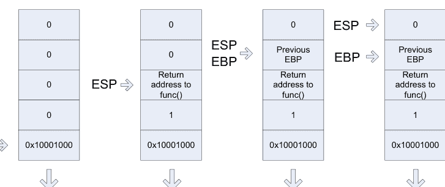

```
0:011> !teb
TEB at 7ffd8000
    ExceptionList: 0184ebdc
    StackBase: 01850000
    StackLimit: 01841000
    SubSystemTib: 00000000
    FiberData: 00001e00
    ArbitraryUserPointer: 00000000
    Self: 7ffd8000
    EnvironmentPointer: 00000000
    ClientId: 0000061c . 00001b60
    RpcHandle: 00000000
    Tls Storage: 00000000
    PEB Address: 7ffdf000
    LastErrorValue: 0
    LastStatusValue: c0000034
    Count Owned Locks: 0
    HardErrorMode: 0
```

```
0:011> dds 01841000 01850000
01841000 00000000
...
...
...
0184eef0 0184ef0c
0184eef4 7615df2 localspl!SplDriverEvent+0x21
0184eef8 00bc3e08
0184eefc 00000003
0184ef00 00000001
0184ef04 00000000
0184ef08 0184efb0
0184ef0c 0184ef30
0184ef10 7615f9d0 localspl!PrinterDriverEvent+0x46
0184ef14 0b0c3e08
0184ef18 00000003
0184ef1c 00000000
0184ef20 0184efb0
0184ef24 0b852a8
0184ef28 0c0c3ec58
0184ef2c 00bafcc0
0184ef30 0184f3b8
0184ef34 7614a9b4 localspl!SplAddPrinter+0x5f3
0184ef38 00c3ec58
0184ef3c 00000003
0184ef40 00000000
0184ef44 0184efb0
0184ef48 00c117f8
...
...
...
0184ff28 00000000
0184ff2c 00000000
0184ff30 0184ff84
0184ff34 77c75286 RPCRT4!LRPC_ADDRESS::ReceiveLotsaCalls+0x3a
0184ff38 0184ff4c
0184ff3c 77c75296 RPCRT4!LRPC_ADDRESS::ReceiveLotsaCalls+0x4a
0184ff40 7c82f2fc ntdll!RtlLeaveCriticalSection
0184ff44 000de378
0184ff48 00097df0
0184ff4c 4d2fa200
0184ff50 ffffffff
0184ff54 ca5b1700
0184ff58 ffffffff
0184ff5c 8002d821
0184ff60 0184fe38
0184ff64 00097df0
0184ff68 000000aa
0184ff6c 80020000
0184ff70 0184ff54
0184ff74 80020000
0184ff78 000b0c78
0184ff7c 00a50180
0184ff80 0184fe38
0184ff84 0184ff8c
0184ff88 77c5778f RPCRT4!RecvLotsaCallsWrapper+0xd
0184ff8c 0184ffac
0184ff90 77c57fdd RPCRT4!BaseCachedThreadRoutine+0x9d
0184ff94 0009c410
0184ff98 00000000
0184ff9c 00000000
0184ffa0 00097df0
0184ffa4 00097df0
0184ffa8 00015f90
0184ffac 0184ffb8
0184ffb0 77c5de88 RPCRT4!ThreadStartRoutine+0x1b
0184ffb4 00088258
0184ffb8 0184ffec
0184ffbc 77e6608b kernel32!BaseThreadStart+0x34
0184ffc0 00097df0
0184ffc4 00000000
0184ffc8 00000000
0184ffcc 00097df0
0184ffd0 8ad84818
0184ffd4 0184ffc4
0184ffd8 8980a700
0184ffdc ffffffff
0184ffe0 77e6b70d kernel32!_except_handler3
0184ffe4 77e66098 kernel32!string+0x98
0184ffe8 00000000
0184ffec 00000000
0184fff0 00000000
77c5de6d RPCRT4!ThreadStartRoutine
0184fff8 00097df0
0184fffc 00000000
01850000 00000008
```

接下来，我们需要使用自定义 `k` 命令并指定基指针。在我们的情况中，最后找到的链接 EBP 指针的堆栈地址是 0184eef0：

```
0:011> k L=0184eef0
ChildEBP RetAddr
WARNING: Frame IP not in any known module. Following frames may be wrong.
0184eef0 7615dff2 0x184e5bf
0184efc0 7615f9d0 localspl!SplDriverEvent+0x21
0184fe30 76143a94 localspl!PrinterDriverEvent+0x46
0184f3f8 761482de localspl!SplAddPrinter+0x5f3
0184f424 74067c8f localspl!LocalAddPrinterEx+0x2e
0184f874 74067b76 SPOOLSS!AddPrinterExW+0x151
0184f890 01007e29 SPOOLSS!AddPrinterW+0x17
0184f8ac 01006ec3 spoolsv!YAddPrinter+0x75
0184f8d0 77c70f3b spoolsv!RpcAddPrinter+0x37
0184f8f8 77ce23f7 RPCRT4!Invoke+0x30
0184fc48 77ce26ed RPCRT4!NdrStubCall2+0x299
0184fd14 77c709be RPCRT4!NdrServerCall2+0x19
0184fd48 77c709f3 RPCRT4!DispatchToStubInCNoAvrf+0x38
0184fd9c 77c70865 RPCRT4!RPC_INTERFACE::DispatchToStubWorker+0x117
0184fdfc 77c734b1 RPCRT4!RPC_INTERFACE::DispatchToStub+0xa3
0184fdfc 77c71bb3 RPCRT4!LRPC_SCALL::DealWithRequestMessage+0x42c
0184fe20 77c75458 RPCRT4!LRPC_ADDRESS::DealWithLRPCRequest+0x127
0184ff84 77c577f8 RPCRT4!LRPC_ADDRESS::ReceiveLotsaCalls+0x430
0184fff8 77c5f7dd RPCRT4!RecvLotsaCallsWrapper+0xd
```

堆栈跟踪现在更有意义了，但我们看不到 BaseThreadStart+0x34。默认情况下，WinDbg 仅显示一定数量的函数调用（堆栈帧），因此我们需要指定堆栈帧计数，例如 100：


```
0:011> k L=0184eef0 100
ChildEBP RetAddr
WARNING: Frame IP not in any known module. Following frames may be wrong.
0184eef0 7615dff2 0x184e5bf
0184ef0c 7615f9d0 localspl!SplDriverEvent+0x21
0184ef30 7614a9b4 localspl!PrinterDriverEvent+0x46
0184f3f8 761482de localspl!SplAddPrinter+0x5f3
0184f424 74067c8f localspl!LocalAddPrinterEx+0x2e
0184f874 74067b76 SPOOLSS!AddPrinterExW+0x151
0184f890 01007e29 SPOOLSS!AddPrinterW+0x17
0184fbac 01006ec3 spoolsv!YAddPrinter+0x75
0184f8d0 77c70f3b spoolsv!RpcAddPrinter+0x37
0184f8f8 77ce23f7 RPCRT4!Invoke+0x30
0184fcf8 77ce26ed RPCRT4!NdrStubCall2+0x299
0184fd14 77c709be RPCRT4!NdrServerCall2+0x19
0184fd48 77c70993 RPCRT4!DispatchToStubInCNoAvrf+0x38
0184fd9c 77c70865 RPCRT4!RPC_INTERFACE::DispatchToStubWorker+0x117
0184fdc0 77c734b1 RPCRT4!RPC_INTERFACE::DispatchToStub+0xa3
0184fdfc 77c71bb3 RPCRT4!LRPC_SCALL::DealWithRequestMessage+0x42c
0184fe20 77c75458 RPCRT4!LRPC_ADDRESS::DealWithLRPCRequest+0x127
0184ff84 77c5778f RPCRT4!LRPC_ADDRESS::ReceiveLotsaCalls+0x430
0184fff8 77c5f7dd RPCRT4!RecvLotsaCallsWrapper+0xd
0184ffac 77c5de88 RPCRT4!BaseCachedThreadRoutine+0x9d
0184ffb8 77e6608b RPCRT4!ThreadStartRoutine+0x1b
0184ffec 00000000 kernel32!BaseThreadStart+0x34
```

现在我们的堆栈跟踪看起来好多了。有关另一个完整示例，请参阅文章 102。

有时在未应用符号时会报告错误的堆栈跟踪。堆栈跟踪中的非符号间隙也可能是此模式的迹象：

```
STACK_TEXT:
WARNING: Stack unwind information not available. Following frames may be wrong.
0b02f42c 091607aa mydll!foo+0x8338
0b02f4cc 7c83ab9e mydll!foo+0x8fe3
0b02f4ec 7c832d06 ntdll!RtlFindNextActivationContextSection+0x46
0b02f538 001a5574 ntdll!RtlFindActivationContextSectionString+0xe1
0b02f554 7c8302b3 0x1a5574
0b02f560 7c82f9c1 ntdll!RtlpFreeToHeapLookaside+0x22
0b02f640 7c832b7f ntdll!RtlFreeHeap+0x20e
001dd000 00080040 ntdll!LdrUnlockLoaderLock+0xad
001dd00c 0052005c 0x80040
001dd010 00470045 0x52005c
0052005c 00000000 0x470045
```

## 注释

要检查某些帧的正确性，可以使用与**巧合符号信息**模式（第 137 页）中描述的相同的方法。我们对返回地址使用反向反汇编：

```
0286f430 690e6daa mshtml!CBase::PrivateInvokeEx+0x6d
WARNING: Stack unwind information not available. Following frames may be wrong.
0286f494 691f5fc5 jscript9!DllGetClassObject+0x18bb1

0:005> ub 690e6daa
jscript9!DllGetClassObject+0x18b9e:
690e6d97 ff7514 push dword ptr [ebp+14h]
690e6d9a ff7510 push dword ptr [ebp+10h]
690e6d9d 8b06 mov eax,dword ptr [esi]
690e6d9f 53 push ebx
690e6da0 ff75ec push dword ptr [ebp-14h]
690e6da3 ff7508 push dword ptr [ebp+8]
690e6da6 56 push esi
690e6da7 ff5020 call dword ptr [eax+20h]
```

## 错误的符号信息

大多数情况下，此模式与函数名称和偏移量相关，例如 _module!foo_ 与 _module!foo+100_。在某些情况下，模块名称本身不正确或完全缺失。在完整内存转储中，更改进程上下文后如果忘记重新加载用户空间符号，就可能发生这种情况，例如：

```
; previous process context of firefox.exe
; switching to winlogon.exe context

kd> .process fffffffadfe718c040
Implicit process is now fffffffadf`e718c040

kd> !process fffffffadfe718c040
PROCESS fffffffadfe718c040
    SessionId: 0 Cid: 017c    Peb: 7fffffd9000  ParentCid: 0130
    DirBase: 01916000  ObjectTable: fffffa800099a890  HandleCount:  754.
    Image: winlogon.exe
    VadRoot fffffffadfe75e91f0 Vads 190 Clone 0 Private 2905. Modified 10047. Locked 0.
    DeviceMap fffffa8000004950
                                 Token             fffffa800122a060
    ElapsedTime               77 Days 02:14:26.109
    UserTime                  00:00:04.156
    KernelTime                00:00:02.359
    QuotaPoolUsage[PagedPool] 143128
    QuotaPoolUsage[NonPagedPool] 191072
    Working Set Sizes (now,min,max) (541, 50, 345) (2164KB, 200KB, 1380KB)
    PeakWorkingSetSize        6323
    VirtualSize               108 Mb
    PeakVirtualSize           118 Mb
    PageFaultCount            212547
    MemoryPriority            BACKGROUND
    BasePriority              13
    CommitCharge              3733

[...]
```

```
THREAD fffffade68f2040 Cid 017c.0198 Teb: 000007fffffd7000 Win32Thread: fffff97ff4a09010 WAIT: (Unknown) UserMode Non-Alertable
fffffade7133160 Semaphore Limit 0x7fffffff
fffffade68f20f8 NotificationTimer
sNot impersonating
DeviceMap fffffa800004950
Owning Process fffffade718c040 Image: winlogon.exe
Attached Process N/A Image: N/A
Wait Start TickCount 426298731 Ticks: 51 (0:00:00:00.796)
Context Switch Count 2215076 LargeStack
UserTime 00:00:00.187
KernelTime 00:00:00.468
Start Address 0x0000000077d6b6e0
Stack Init fffffade4481e000 Current fffffade4481860
Base fffffade4482000 Limit fffffade447a000 Call 0
Priority 14 BasePriority 13 PriorityDecrement 0
Child-SP RetAddr Call Site
fffffad`e44818a0 fffff800`0103b093 nt!KiSwapContext+0x85
fffffad`e4481a20 fffff800`0103c433 nt!KiSwapThread+0xc3
fffffad`e4481a60 fffff800`012d25ae nt!KeWaitForSingleObject+0x528
fffffad`e4481af0 fffff800`0104113d nt!NtReplyWaitReceivePortEx+0x8c8
fffffad`e4481c00 00000000`77ef0caa nt!KiSystemServiceCopyEnd+0x3 (TrapFrame @ fffffad`e4481c70)
00000000`0bcbf98 000007ff`7fd6ff61 ntdll!NtReplyWaitReceivePortEx+0xa
00000000`0bcbba0 00000000`00d2340 0x7ff`7df6ff61
00000000`0bcbfba 00000000`0bcbfde 0xd2340
00000000`0bcbfbb 00000000`014cd220 0xbcfde0
00000000`0bcbfbb 00000000`00c1d30 0x14cd220
00000000`0bcbfcb 00000000`0bcfe18 0xc1d30
00000000`0bcbfbc 0000ffff`0001f80 0xbcfce18
00000000`0bcbfbd 00000000`006c0044 0xffff+0x0001f80
00000000`0bcbfb8 00000000`000006ec firefox+0x2c0044
00000000`0bcbfbe 00000000`00007b0 0x7b0
00000000`0bcbfbe 00000000`419b8385 0x419b8385
00000000`0bcbfb0 00000000`00000000 0x419b8385

kd> lm m firefox
start end module name
00000000`00400000 00000000`00b67000 firefox T (no symbols)
```

我们有返回地址 00000000`006c0044，它只是 firefox+0x2c0044（00000000`00400000 + 2c0044）。我们通过重新加载用户空间符号来纠正它。

```
kd> .reload /user
```

```
kd> !process fffffffade718c040
[...]
THREAD fffffffade68f2040  Cid 017c.0198  Teb: 000007fffffd7000 Win32Thread: ffffff97ff4a09010 WAIT: 
(Unknown) UserMode Non-Alertable
 fffffffade7133160  Semaphore Limit 0x7fffffff
 fffffffade68f20f8  NotificationTimer

Not impersonating
DeviceMap                 ffffffa8000004950
Owning Process            fffffffade718c040       Image:         winlogon.exe
Attached Process          N/A         Image:         N/A
Wait Start TickCount      426298731         Ticks: 51 (0:00:00:00.796)
Context Switch Count      2215076           LargeStack
UserTime                  00:00:00.187
KernelTime                00:00:00.468
Start Address kernel32!BaseThreadStart (0x00000000077d6b6e0)
Stack Init fffffffade4481e00 Current fffffffade4481860
Base fffffffade4482000 Limit fffffffade447a000 Call 0
Priority 14 BasePriority 13 PriorityDecrement 0
Child-SP          RetAddr           Call Site
fffffadf`e4481a80 ffffff800`0103b093 nt!KiSwapContext+0x85
fffffadf`e4481a20 ffffff800`0103c433 nt!KiSwapThread+0xc3
fffffadf`e4481a60 ffffff800`012d25ae nt!KeWaitForSingleObject+0x528
fffffadf`e4481af0 ffffff800`0104113d nt!NtReplyWaitReceivePortEx+0x8c8
fffffadf`e4481c00 00000000`77ef0caa nt!KiSystemServiceCopyEnd+0xa (TrapFrame @ fffffffadf`e4481c70)
00000000`0bcbf98 000007ff`f7fd6ff6 ntdll!NtReplyWaitReceivePortEx+0xa
00000000`0bcbfba 000007ff`f7fd45369 RPCRT4!LRPC_ADDRESS::ReceiveLotsaCalls+0x2a5
00000000`00bcfe0 000007ff`f7fd59996 RPCRT4!RecvLotsaCallsWrapper+0x9
00000000`0bccfbe 000007ff`f7fd65d51 RPCRT4!BaseCachedThreadRoutine+0xde
00000000`00bccff0 00000000`77d6b71a RPCRT4!ThreadStartRoutine+0x21
00000000`00bccf80 00000000`00000000 kernel32!BaseThreadStart+0x3a
```

像 .process /r /p fffffffade718c040 或 !process fffffffade718c040 3f 这样的命令会自动完成此操作。

模块名称不正确的另一种情况是已卸载模块信息格式错误：

```
0:000> lmt
start             end                 module name
[...]
7c800000 7c907000   kernel32   Mon Apr 16 16:53:05 2007 (46239BE1)
7c910000 7c9c7000   ntdll      Wed Aug 04 08:57:08 2004 (411096D4)
7c9d0000 7d1ef000   shell32    Tue Dec 19 21:49:37 2006 (45885E71)
7df20000 7dfc0000   urlmon     Wed Aug 22 14:13:03 2007 (46CC365F)
7e360000 7e3f0000   user32     Thu Mar 08 15:36:30 2007 (45F02D7E)
Missing image name, possible paged-out or corrupt data.
```


未加载的模块：
```
00410053 008a00a3  Unknown_Module_00410053
    Timestamp: Tue Mar 17 20:27:26 1970 (0064002E)
    Checksum: 006CC06C
00010755 007407c5  1
    Timestamp: Wed Feb 04 21:26:01 1970 (002E0069)
    Checksum: 006CC064
00000011 411096d2  eme.dll
    Timestamp: Thu Apr 02 01:33:25 1970 (00780055)
    Checksum: 00680054
Missing image name, possible paged-out or corrupt data.
0064002e 000d009a  Unknown_Module_0064002e
    Timestamp: unavailable (00000000)
    Checksum: 00000000
```

UNICODE 模块名称的部分也出现在校验和和时间戳中。此类部分模块名称可能出现在线程堆栈和原始堆栈数据中，例如：

```
0:000> kl
ChildEBP RetAddr
[...]
0015efc3 0366afc2 ModuleA!Validation+0x5b
WARNING: Frame IP not in any known module. Following frames may be wrong.
0015efcc 79e7c7a6 <Unloaded_ure.dll>+0x366afc1
03dc9b70 00000000 mscorwks!MethodDesc::CallDescr+0x1f
```

默认分析也受害，并建议您在系统中费力寻找 ure.dll：

```
MODULE_NAME: ure

IMAGE_NAME: ure.dll

DEBUG_FLR_IMAGE_TIMESTAMP:  750063

FAILURE_BUCKET_ID:  ure.dll!Unloaded_c0000005_APPLICATION_FAULT
```

时间戳可疑地类似于 UNICODE。在这种情况下，我们甚至可以重建模块名称：

```
00000011 411096d2  eme.dll
    Timestamp: Thu Apr 02 01:33:25 1970 (00780055)
    Checksum: 00680054

0:000> .formats 00780055
Evaluate expression:
  Hex:     00000000`00780055
  Decimal: 7864405
  Octal:   000000000000036000125
  Binary:  00000000 00000000 00000000 00000000 00000000 00000000 01111000 00000000 01010101
  Chars:   .....x.U
  Time:    Thu Apr 02 01:33:25 1970
  Float:   low 1.10204e-038 high 0
  Double:  3.88553e-317
```

```
0:000> .formats 00680054
Evaluate expression:
Hex: 00680054
Decimal: 6815828
Octal: 00032000124
Binary: 00000000 01101000 00000000 01010100
Chars: .h.T
Time: Fri Mar 20 21:17:08 1970
Float: low 9.55101e-039 high 0
Double: 3.36747e-317
```

我们将 UNICODE 的 Ux 和 Th 与 eme.dll 连接起来，得到 UxTheme.dll，这是一个可以在系统中找到的真实 DLL 名称。

## 注入符号

当我们拥有**减少的符号信息**（第 829 页）时，可以使用此模式添加缺失的符号，就像之前在这个旧案例研究 103 中所做的那样。例如，TestWER104 模块是使用静态 MFC 和 CRT 库编译的，其私有 PDB 文件包含所有必要的符号，包括 MSG 结构。我们可以将该模块加载到 notepad.exe 进程空间并应用符号：

```
0:000:x86> lm
start             end                 module name
00fc0000 00fff000   notepad   (pdb
symbols)       c:\mss\notepad.pdb\E325F5195AE94FAEB58D25C9DF8C0CFD2\notepad.pdb
10000000 10039000   WinCRT   (deferred)
727f0000 7298e000   comctl32   (deferred)
72aa0000 72af1000   winspool   (deferred)
72b10000 72b19000   version   (deferred)
72e40000 72e48000   wow64cpu   (deferred)
72e50000 72eac000   wow64win   (pdb
symbols)       c:\mss\wow64win.pdb\B2D08CC152D64E71B79167DC0A0A53E91\wow64win.pdb
72eb0000 72ee0000   wow64   (deferred)
733d0000 733e3000   dwmapi   (deferred)
735b0000 73606000   uxtheme   (deferred)
746f0000 746fc000   CRYPTBASE   (deferred)
74700000 74760000   sspicli   (deferred)
747c0000 74817000   shlwapi   (deferred)
74830000 7547a000   shell32   (deferred)
755d0000 756ab000   comdlg32   (deferred)
75650000 7567e000   imm32   (deferred)
75770000 75810000   advapi32   (deferred)
75810000 75920000   kernel32   (pdb
symbols)       c:\mss\kernel32.pdb\1C690A8592304467BB15A09CEA7180FA2\kernel32.pdb
75920000 759b0000   gdi32   (deferred)
759b0000 759f7000   KERNELBASE   (deferred)
75a00000 75b00000   user32   (pdb
symbols)       c:\mss\user32.pdb\0FCE9CC301ED4567A819705B2718E1D62\user32.pdb
75b00000 75b8f000   oleaut32   (deferred)
[...]
76e40000 76fe9000   ntdll   (deferred)
77020000 771a0000   ntdll_77020000   (pdb
symbols)       c:\mss\wntdll.pdb\D74F79EB1F8D4A45ABCD2F476CCABA2C\wntdll.pdb
0:000:x86> .sympath+ C:\DebuggingTV\TestWER\x86
Symbol search path is: srv*;C:\DebuggingTV\TestWER\x86
Expanded Symbol search path is: SRV*c:\mss*http://msdl.microsoft.com/download/symbols;c:\debuggingtv\testwer\x86
```

```
0:000:x86> .reload /f /i C:\DebuggingTV\TestWER\x86\TestWER.exe=10000000
```

```
0:000:x86> lm
start    end        module name
00fc0000 00ff0000   notepad      (pdb symbols)       c:\...\notepad.pdb
10000000 10039000   TestWER      (private pdb symbols) c:\...\TestWER.pdb
727f0000 7298e000   comctl32     (deferred)
721a0000 721af000   winspool   (deferred)
72b10000 72b19000   version    (deferred)
72e40000 72e48000   wow64cpu   (deferred)
72e50000 72eac000   wow64win   (pdb symbols) c:\...\wow64win.pdb
72eb0000 72eef000   wow64      (deferred)
733d0000 733e3000   dwmapi     (deferred)
735b0000 73606000   uxtheme    (deferred)
746f0000 746fc000   CRYPTBASE  (deferred)
74700000 74760000   sspicli    (deferred)
747c0000 74817000   shlwapi    (deferred)
74830000 7547a000   shell32    (deferred)
755d0000 7564b000   comdlg32   (deferred)
75650000 7567e000   imm32      (deferred)
75770000 75810000   advapi32   (deferred)
75810000 75920000   kernel32   (pdb symbols) c:\...\wkernel32.pdb
75920000 759b0000   gdi32      (deferred)
759b0000 759f7000   KERNELBASE (deferred)
75a00000 75b00000   user32     (pdb symbols) c:\...\wuser32.pdb
75b00000 75b8f000   oleaut32   (deferred)
[...]
76e40000 76fe9000   ntdll      (deferred)
77020000 771a0000   ntdll_77020000  (pdb symbols) c:\...\wntdll.pdb
```

```
0:000:x86> kv
ChildEBP RetAddr  Args to Child
0013fe34 75a1790d 0013fe74 00000000 00000000 user32!NtUserGetMessage+0x15
0013fe50 00fc148a 0013fe74 00000000 00000000 user32!GetMessageW+0x33
0013fe90 00fc16ec 00fc0000 00000000 00354082 notepad!WinMain+0xe6
0013ff20 758233a0 7efde000 0013ff6c 77059ef2 notepad!_initterm_e+0x1a1
0013ff2c 77059ef2 7efde000 57785ae0 00000000 kernel32!BaseThreadInitThunk+0xe
0013ff6c 77059ec5 00fc3689 7efde000 00000000 ntdll_77020000!_RtlUserThreadStart+0x70
0013ff84 00000000 00fc3689 7efde000 00000000 ntdll_77020000!_RtlUserThreadStart+0x1b
```

```
0:000:x86> dt -r MSG 0013fe74
TestWER!MSG
+0x000 hwnd            : 0x0007149c HWND__
+0x000 unused           : ??
+0x004 message          : 0x113
+0x008 wParam           : 0x38a508
+0x00c lParam           : 0n1921500630
+0x010 time             : 0x2079a177
+0x014 pt
   +0x000 x              : 0n1337
   +0x004 y              : 0n448
```

## 内联函数优化

## 托管代码

除了非托管和本机代码的**内联函数优化**（第 514 页）之外，我们还可以看到类似方法应用于 JIT 编译的代码：

```
public class ClassMain
{
    public bool time2stop = false;

    public static void Main(string[] args)
    {
        new ClassMain().Main();
    }

    public void Main()
    {
        while (!time2stop)
        {
            DoWork();
        }
    }

    volatile int inSensor, outSensor;

    void DoWork()
    {
        outSensor ^= inSensor;
    }
}
```

```
0:000> kl
ChildEBP RetAddr
WARNING: Frame IP not in any known module. Following frames may be wrong.
001fefa0 79e7c6cc 0x3200a4
001ff020 79e7c8e1 mscorwks!CallDescrWorkerWithHandler+0xa3
001ff160 79e7c783 mscorwks!MethodDesc::CallDescr+0x19c
001ff17c 79e7c90d mscorwks!MethodDesc::CallTargetWorker+0x1f
001ff190 9eeef9e5 mscorwks!MethodDesc::CallSite::Call_RetArgSlot+0x18
001ff2f4 79eef830 mscorwks!ClassLoader::RunMain+0x263
001ff55c 79ef01da mscorwks!Assembly::ExecuteMainMethod+0xa6
001ffa2c 79fb9793 mscorwks!SystemDomain::ExecuteMainMethod+0x43f
001ffa7c 79fb96df mscorwks!ExecuteEXE+0x59
001ffac4 736455ab mscorwks!_CorExeMain+0x15c
001ffad0 73747f16 mscoreei!_CorExeMain+0x38
001ffae0 73744de3 mscoreei!ShellShim__CorExeMain+0x99
001ffae8 76573833 mscoreei!_CorExeMain_Exported+0x8
001ffaf4 77c1a9bd kernel32!BaseThreadInitThunk+0xe
001ffb34 00000000 ntdll!_RtlUserThreadStart+0x23
```

```
0:000> r
eax=00000000 ebx=001fefbc ecx=015316e0 edx=0037a238 esi=0037a238 edi=00000000
eip=003200a4 esp=001fef90 ebp=001fefaf iopl=0 nv up ei pl zr na pe nc
cs=001b ss=0023 ds=0023 es=0023 fs=003b gs=0000 efl=00000246
003200a4 8079c00 cmp byte ptr [ecx+0Ch],0 ds:0023:015316ec=00
```

```
0:000> !IP2MD 003200a4
MethodDesc:   000d3048
Method Name:  ClassMain.Main()
Class:        000d1180
MethodTable:  000d3060
mdToken:      06000002
Module:       000d2c3c
IsJitted:     yes
m_CodeOrIL:   00320098
```

```
0:000> .asm no_code_bytes
Assembly options: no_code_bytes
```

```
0:000> !U 003200a4
Normal JIT generated code
ClassMain.Main()
Begin 00320098, size 13
00320098 cmp byte ptr [ecx+0Ch],0
0032009c jne 003200aa
0032009e mov eax,dword ptr [ecx+4]
003200a1 or dword ptr [ecx+8],eax
>>> 003200a4 cmp byte ptr [ecx+0Ch],0
003200a8 je 0032009e
003200aa ret
```

我们看到 DoWork 代码已内联到 Main 函数代码中。


## 未托管代码

有时编译器会通过用函数体替换函数调用来优化代码。这个过程称为函数内联，而函数本身称为内联函数。在一个平台上，我们可以在堆栈跟踪中看到真正的函数调用，但在另一个平台或产品版本中，我们只能看到相同的问题指令。幸运的是，堆栈跟踪的其余部分应该是相同的。因此，在比较**堆栈跟踪**（第 926 页）时，我们不应只关注最顶部的函数调用。

当线程在复制或移动内存时崩溃，经常会看到这种模式。请参考此堆栈跟踪：

```
0: kd> kL
ChildEBP RetAddr
f22efaf4 f279ec3d driver!QueueValue+0x26b
f22efb30 8081dcdf driver!BufferAppendData+0x35f
f22efc7c 808f4b7f nt!IofCallDriver+0x45
f22efc90 808f24ae nt!IopSynchronousServiceTail+0x10b
f22efd38 80888c7c nt!NtWriteFile+0x65a
f22efd38 7c82ed54 nt!KiFastCallEntry+0x8fc
```

查看 rep movs 指令时，我们可能会怀疑 QueueValue 正在复制内存：

```
0: kd> r
eax=00000640 ebx=89b23000 ecx=00000190 edx=89b3c828 esi=02124220 edi=e2108f58
eip=f279c797 esp=f22efadc ebp=f22efaf4 iopl=0 nv up ei pl nz na pe nc
cs=0008 ss=0010 ds=0023 es=0023 fs=0030 gs=0000 efl=00010206
driver!QueueValue+0x26b:
f279c797 f3a5 rep movs dword ptr es:[edi],dword ptr [esi] es:0023:e2108f58=dfefbecf
ds:0023:02124220=????????
```

在 x64 平台上，相同的驱动程序有类似的堆栈跟踪，但其顶部是 memcpy：

```
fffffadf` 8955f4a8 fffffadf` 8d1bef46 driver!memcpy+0x1c0
fffffadf` 8955f4b0 fffffadf` 8d1c15c9 driver!QueueValue+0x2fe
fffffadf` 8955f550 fffff800` 01273ed9 driver!BufferAppendData+0x481
...
```

我们还可以看到 QueueValue+0x2fe 和 QueueValue+0x26b 很接近。实际上，驱动程序的源代码只调用一次 RtlCopyMemory 函数，并且在 wdm.h 中定义为 memcpy。后者函数也从 nt 模块导出：

```
0: kd> x nt!
...
80881780 nt!memcpy = <no type information>
...
```

但通常可以在任何链接 C 运行时库的驱动程序中找到，例如，在 x64 Windows 上：

```
1: kd> x nt!memcpy
fffff800` 01c464e0 nt!memcpy = <no type information>
1: kd> x srv!memcpy
fffff980`0eafdf20  srv!memcpy = <no type information>

1: kd> x win32k!memcpy
fffff960`000c1b40  win32k!memcpy = <no type information>
```

因此，我们看到，当为 x86 平台编译时，Visual C++ 编译器决定将 memcpy 代码内联，但 x64 平台上的 AMD 编译器没有将其内联。没有偏移量的整体堆栈跟踪非常相似，我们可以推断问题相同。

## 插桩信息

应用程序和驱动程序验证程序（包括 Windows 调试工具中的 gflags.exe 工具）设置修改系统行为的标志，这些行为体现在收集的额外信息中，例如内存分配历史记录，以及 WinDbg 输出的变化，例如堆栈跟踪。这些工具属于广义的插桩工具类别。要检查小型转储、内核和完整内存转储中是否启用了驱动程序验证程序，我们使用 !verifier WinDbg 命令：

```
1: kd> !verifier

Verify Level 0 ... enabled options are:

Summary of All Verifier Statistics

RaiseIrqls                   0x0
AcquireSpinLocks             0x0
Synch Executions             0x0
Trims                        0x0

Pool Allocations Attempted   0x0
Pool Allocations Succeeded   0x0
Pool Allocations Succeeded SpecialPool 0x0
Pool Allocations With NO TAG 0x0
Pool Allocations Failed      0x0
Resource Allocations Failed Deliberately  0x0
```

| 当前分页池分配 | 0x0 个，共 00000000 字节 |
| --- | --- |
| 峰值分页池分配 | 0x0 个，共 00000000 字节 |
| 当前非分页池分配 | 0x0 个，共 00000000 字节 |
| 峰值非分页池分配 | 0x0 个，共 00000000 字节 |

```
0: kd> !verifier

Verify Level 3 ... enabled options are:
  Special pool
  Special irql

Summary of All Verifier Statistics

RaiseIrqls                   0xdea5
AcquireSpinLocks             0x87b5c
Synch Executions             0x17b5
Trims                        0xab36

Pool Allocations Attempted   0x8990e
Pool Allocations Succeeded   0x8990e
Pool Allocations Succeeded SpecialPool 0x29c0
Pool Allocations With NO TAG 0x1
Pool Allocations Failed      0x0
Resource Allocations Failed Deliberately 0x0
```

要检查进程用户转储中是否启用了应用程序验证程序（和 gflags），我们使用 !avrf 和 !gflags WinDbg 扩展命令：

```
0:001> !avrf
Application verifier is not enabled for this process.
Page heap has been enabled separately.

0:001> !gflag
Current NtGlobalFlag contents: 0x02000000
hpa - Place heap allocations at ends of pages
```

以下是插桩堆栈跟踪的示例：

```
68546e88 verifier!AVrfpDphFindBusyMemoryNoCheck+0xb8
68546f95 verifier!AVrfpDphFindBusyMemory+0x15
68547240 verifier!AVrfpDphFindBusyMemoryAndRemoveFromBusyList+0x20
68549080 verifier!AVrfDebugPageHeapFree+0x90
77190aac ntdll!RtlDebugHeapHeap+0x2f
7714a8ff ntdll!RtlpFreeHeap+0x5d
770f2a32 ntdll!RtlFreeHeap+0x142
75bf14d1 kernel32!HeapFree+0x14
748d4c39 msvcrt80!free+0xcd
[...]
00a02bb2 ServiceA!ServiceMain+0x302
767175a8 sechost!ScSvcctrlThreadA+0x21
75fb3677 kernel32!BaseThreadInitThunk+0xe
770f9d42 ntdll!_RtlUserThreadStart+0x70
770f9d15 ntdll!_RtlUserThreadStart+0x1b
```

以下是另一个显示插桩差异的示例。我们运行**双释放**（第 267 页）故障建模应用程序，并从崩溃转储中查看其堆栈跟踪：

```
0:000> !gflag
Current NtGlobalFlag contents: 0x00000000

0:000> kL 100
Child-SP         RetAddr           Call Site
00000000`002dec38 00000000`77735ce2 ntdll!NtWaitForSingleObject+0xa
00000000`002dec40 00000000`77735e85 ntdll!RtlReportExceptionEx+0x1d2
00000000`002ded30 00000000`77735eea ntdll!RtlReportException+0xb5
00000000`002dedb0 00000000`77736d25 ntdll!RtlpTerminateFailureFilter+0x1a
00000000`002dede0 00000000`77685148 ntdll!RtlReportCriticalFailure+0x96
00000000`002dee10 00000000`776a554d ntdll!_C_specific_handler+0x8c
00000000`002dee80 00000000`77685d1c ntdll!RtlpExecuteHandlerForException+0xd
00000000`002deeb0 00000000`776862e6 ntdll!RtlDispatchException+0x3cb
00000000`002df590 00000000`77733c62 ntdll!RtlRaiseException+0x221
00000000`002dfbd0 00000000`77737396 ntdll!RtlReportCriticalFailure+0x62
00000000`002dfca0 00000000`777386c2 ntdll!RtlpReportHeapFailure+0x26
00000000`002dfdc0 00000000`7773a0c4 ntdll!RtlpHeapHandleError+0x12
00000000`002dfd00 00000000`776dd1cd ntdll!RtlpLogHeapFailure+0xa4
00000000`002dfd30 00000000`77472c7a ntdll! ?? ::FNODOBFM::`string'+0x123b4
00000000`002dfdb0 00000000`6243c7bc kernel32!HeapFree+0xa
00000000`002dfde0 00000001`3f8f1033 msvcr90!free+0xc1
00000000`002dfe10 00000001`3f8f11f2 InstrumentedApp!wmain+0x33
00000000`002dfe50 00000000`7746f56d InstrumentedApp!_tmainCRTStartup+0x11a
00000000`002dfe80 00000000`776a3281 kernel32!BaseThreadInitThunk+0xd
00000000`002dfeb0 00000000`00000000 ntdll!RtlUserThreadStart+0x1d
```

然后我们在 gflags.exe GUI 中启用应用程序验证程序和完整页堆。实际上，两个崩溃转储同时保存（我们在 x64 W2K8 R2 上设置了 LocalDumps 注册表项105），它们的堆栈跟踪略有不同：

```
0:000> !gflag
Current NtGlobalFlag contents: 0x02000100
    vrf - Enable application verifier
    hpa - Place heap allocations at ends of pages

0:000> kL 100
Child-SP         RetAddr           Call Site
00000000`0022e438 00000000`77735ce2 ntdll!NtWaitForSingleObject+0xa
00000000`0022e440 00000000`77735e85 ntdll!RtlReportExceptionEx+0x1d2
00000000`0022e530 000007fe`f3ed26fb ntdll!RtlReportException+0xb5
00000000`0022e5b0 00000000`77688af verifier!AvrfpVectoredExceptionHandler+0x26b
00000000`0022e640 00000000`776859b2 ntdll!RtlpCallVectoredHandlers+0xa8
00000000`0022e6b0 00000000`776bfe48 ntdll!RtlDispatchException+0x22
00000000`0022ed90 000007fe`f3eca668 ntdll!KiUserExceptionDispatcher+0x2e
00000000`0022f350 000007fe`f3ec931d verifier!VerifierStopMessage+0x1f0
00000000`0022f400 000007fe`f3ec9736 verifier!AvrfpPhpReportCorruptedBlock+0x155
00000000`0022f4c0 000007fe`f3ec99cd verifier!AvrfpDphCheckNormalHeapBlock+0xce
00000000`0022f530 000007fe`f3ec873a verifier!AvrfpDphNormalHeapFree+0x29
00000000`0022f560 00000000`7773c415 verifier!AvrfDebugPageHeapFree+0xb6
00000000`0022f5c0 00000000`776dd0fe ntdll!RtlDebugFreeHeap+0x35
00000000`0022f620 00000000`776c2075 ntdll! ?? ::FNODOBFM::`string'+0x122e2
00000000`0022f960 000007fe`f3edf4e1 ntdll!RtlFreeHeap+0x1a2
```


+   00000000`0222f9e0 00000000`77472c7a verifier!AVrfpRtlFreeHeap+0xa5
+   00000000`0222fa80 000007fe`f3e09eae kernel32!HeapFree+0xa
+   00000000`0222fab0 00000000`642bc7bc verifier!AVrfpHeapFree+0xc6
+   00000000`0222fb40 00000001`3fac1033 msvcr90!free+0x1c
+   00000000`0222fb70 00000001`3fac11f2 InstrumentedApp!wmain+0x33
+   00000000`0222fbb0 00000000`7746f56d InstrumentedApp!__tmainCRTStartup+0x11a
+   00000000`0222fbe0 00000000`776a3281 kernel32!BaseThreadInitThunk+0xd
+   00000000`0222fc10 00000000`00000000 ntdll!RtlUserThreadStart+0x1d

0:000> kL 100

| Child-SP | RetAddr | Call Site |
|---|---|---|
| 00000000`0222e198 | 000007fe`f3e00f82 | ntdll!NtWaitForMultipleObjects+0xa |
| 00000000`0222e1a0 | 000007fe`fd8513a6 | verifier!AVrfpNtWaitForMultipleObjects+0x4e |
| 00000000`0222e1e0 | 000007fe`f3ee0e2d | KERNELBASE!WaitForMultipleObjectsEx+0xe8 |
| 00000000`0222e2e0 | 000007fe`f3ee0edd | verifier!AVrfpWaitForMultipleObjectsExCommon+0xad |
| 00000000`0222e320 | 00000000`77473143 | verifier!AVrfpKernelbaseWaitForMultipleObjectsEx+0x2d |
| 00000000`0222e370 | 00000000`774e9025 | kernel32!WaitForMultipleObjectsExImplementation+0xb3 |
| 00000000`0222e400 | 00000000`774e91a7 | kernel32!WerpReportFaultInternal+0x215 |
| 00000000`0222e4a0 | 00000000`774e91ff | kernel32!WerpReportFault+0x77 |
| 00000000`0222e4d0 | 00000000`774e941c | kernel32!BasepReportFault+0x1f |
| 00000000`0222e500 | 00000000`7770573c | kernel32!UnhandledExceptionFilter+0x1fc |
| 00000000`0222e5e0 | 00000000`77685148 | ntdll! ?? ::FNODOBFM::`string'+0x2365 |
| 00000000`0222e610 | 00000000`776a554d | ntdll!_C_specific_handler+0x8c |
| 00000000`0222e680 | 00000000`77685d1c | ntdll!RtlpExecuteHandlerForException+0xd |
| 00000000`0222e6b0 | 00000000`776bfe48 | ntdll!RtlDispatchException+0x3cb |
| 00000000`0222ed90 | 000007fe`f3eca668 | ntdll!KiUserExceptionDispatcher+0x2e |
| 00000000`0222f350 | 000007fe`f3ec931d | verifier!VerifierStopMessage+0x1f0 |
| 00000000`0222f400 | 000007fe`f3ec9736 | verifier!AVrfDphReportCorruptedBlock+0x155 |
| 00000000`0222f4c0 | 000007fe`f3ec99cd | verifier!AVrfpDphCheckNormalHeapBlock+0xcce |
| 00000000`0222f530 | 000007fe`f3ec873a | verifier!AVrfpDphNormalHeapFree+0x29 |
| 00000000`0222f560 | 00000000`7773c415 | verifier!AVrfDebugPageHeapFree+0xb6 |
| 00000000`0222f5c0 | 00000000`776dd0fe | ntdll!RtlDebugFreeHeap+0x35 |
| 00000000`0222f620 | 00000000`776c2075 | ntdll! ?? ::FNODOBFM::`string'+0x122e |
| 00000000`0222f960 | 000007fe`f3ed4fe1 | ntdll!RtlFreeHeap+0x1a2 |
| 00000000`0222f9e0 | 00000000`77472c7a | verifier!AVrfpRtlFreeHeap+0xa5 |
| 00000000`0222fa80 | 000007fe`f3e09eae | kernel32!HeapFree+0xa |
| 00000000`0222fab0 | 00000000`642bc7bc | verifier!AVrfpHeapFree+0xc6 |
| 00000000`0222fb40 | 00000001`3fac1033 | msvcr90!free+0x1c |
| 00000000`0222fb70 | 00000001`3fac11f2 | InstrumentedApp!wmain+0x33 |
| 00000000`0222fbb0 | 00000000`7746f56d | InstrumentedApp!__tmainCRTStartup+0x11a |
| 00000000`0222fbe0 | 00000000`776a3281 | kernel32!BaseThreadInitThunk+0xd |
| 00000000`0222fc10 | 00000000`00000000 | ntdll!RtlUserThreadStart+0x1d |

我们还可以看到，启用检测会触发运行时堆的调试函数（RtlDebugFreeHeap）。

## 检测副作用

有时，通过 gflags、应用程序和驱动程序验证程序选项添加的检测会影响系统、服务或应用程序的性能和资源。例如，在启用完全页面堆后，x64 机器上的一个进程增长到了 24GB，其用户内存转储显示每个堆分配都记录在堆栈跟踪数据库中：

```
0:055> !gflag
Current NtGlobalFlag contents: 0x02000000
hpa - Place heap allocations at ends of pages

0:055> ~*kc

[...]

48 Id: 117fc.c164 Suspend: 1 Teb: 000007ff`fff52000 Unfrozen
Call Site
ntdll!ZwWaitForSingleObject
ntdll!RtlpWaitOnCriticalSection
ntdll!RtlEnterCriticalSection
verifier!AvrfpDphEnterCriticalSection
verifier!AvrfpDphPreProcessing
verifier!AvrfDfDebugPageHeapAllocate
ntdll!RtlDebugAllocateHeap
ntdll! ?? ::FNODOBFM::`string'
ntdll!RtlAllocateHeap
msvcrt!malloc
Module!Alfoo1
[...]

49 Id: 117fc.de80 Suspend: 1 Teb: 000007ff`fff54000 Unfrozen
Call Site
ntdll!RtlCompareMemory
ntdll!RtlpLogCapturedStackTrace
ntdll!RtlLogStackTrace
verifier!AvrfpDphPlaceOnFreeList
verifier!AvrfDebugPageHeapFree
ntdll!RtlDebugFreeHeap
ntdll! ?? ::FNODOBFM::`string'
ntdll!RtlFreeHeap
kernel32!HeapFree
msvcrt!free
Module!B!foo2
[...]

50 Id: 117fc.3700 Suspend: 1 Teb: 000007ff`fff4e000 Unfrozen
Call Site
ntdll!ZwWaitForSingleObject
ntdll!RtlpWaitOnCriticalSection
ntdll!RtlEnterCriticalSection
verifier!AvrfpDphEnterCriticalSection
verifier!AvrfpDphPreProcessing
verifier!AvrfDebugPageHeapFree
ntdll!RtlDebugFreeHeap
ntdll! ?? ::FNODOBFM::`string'
ntdll!RtlFreeHeap
kernel32!HeapFree
msvcrt!free
Module!Cfoo3
[...]

0:055> !runaway
User Mode Time
Thread Time
38:d090     0 days 0:02:28.793
44:ca48     0 days 0:01:04.459
48:c164     0 days 0:00:56.909
43:4458     0 days 0:00:54.475
50:3700     0 days 0:00:43.992
45:6f98     0 days 0:00:38.953
49:de80     0 days 0:00:24.211
1:391c      0 days 0:00:00.639
0:7e90      0 days 0:00:00.109
55:a300     0 days 0:00:00.046
34:10c9c    0 days 0:00:00.015
21:d054     0 days 0:00:00.015
56:b0a0     0 days 0:00:00.000
54:8b78     0 days 0:00:00.000
53:155b8    0 days 0:00:00.000
52:b444     0 days 0:00:00.000
```

**顶级模块**（第 1012 页）ModuleA(B, C) 来自 **峰值**（第 888 页），堆密集型线程来自 **同一供应商**（第 842 页）。

我们能够使用 ImageMagick<sup>106</sup> 从该转储中获取 200x27349 的切片，它显示几乎所有虚拟内存空间都填满了这种图片形式的痕迹（放大了 x8 倍）：


## 注释

对象跟踪的另一个副作用：

```
kd! !pooled 3
Sorting by NonPaged Pool Consumed

Pool Used:
NonPaged   Paged

Tag  Allocs  Frees  Diff Used   Allocs  Frees Diff Used
ObRt 4384299 4383686 615  54256308 0      0      0      0 object reference stack tracing , Binary: nt!ob
```

## 内存不足

## 已提交内存

内存不足模式在许多完整和内核内存转储中都可见。这种情况可能导致系统崩溃、变慢、挂起或拒绝提供预期功能，例如，拒绝新的终端服务器连接。内存资源有多种类型，我们可以最初将其分为以下几类：

- 已提交内存
- 虚拟内存
  - 内核空间
    - 分页池
    - 非分页池
    - 会话池
    - PTE 限制
    - 桌面堆
    - GDI 限制
  - 用户空间
    - 虚拟区域
    - 进程堆

这里概述的是已提交内存耗尽。已提交内存是由某些物理内存或页面文件中的保留空间支持的已分配内存。需要保留空间，以防操作系统想要在未使用该内存数据且没有可供其他进程使用的物理内存时将其交换到磁盘。如果需要再次使用该数据，操作系统会将其调回物理内存。如果页面文件中没有空间，则物理内存会被填满。如果已提交内存耗尽，系统很可能会挂起或很快出现 bugcheck，因此在获取内核或完整内存转储时，应始终检查内存统计信息。即使访问违例 bugchecks 也可能源于内存不足，当某些内存分配操作失败，但内核模式组件未检查返回值是否为 NULL。以下是示例：

```
BugCheck 8E, {c0000005, 809203af, aa647c0c, 0}

0: kd> !analyze -v
...
...
...
TRAP_FRAME: aa647c0c -- (.trap ffffffff aa647c0c)
...
...
...
0: kd> .trap ffffffff aa647c0c
ErrCode = 00000000
eax=00000000 ebx=bc1f3cfc ecx=89589250 edx=000018c1 esi=bc1f3ce0 edi=aa647d14
eip=809203af esp=aa647c80 ebp=aa647c80 iopl=0 nv up ei pl zr na pe nc
cs=0008 ss=0010 ds=0023 es=0023 fs=0030 gs=0000 efl=00010246
nt!SeTokenType+0x8:
809203af 8b8080000000 mov eax,dword ptr [eax+80h] ds:0023:00000080=????????
0: kd> k
ChildEBP RetAddr
aa647c80 bf8173c5 nt!SeTokenType+0x8
aa647cdc bf81713b win32k!GreGetSpoolMessage+0xb0
aa647d4c 80834df3 win32k!NtGdiGetSpoolMessage+0x96
aa647d4 7c82ed54 nt!KiFastCallEntry+0xfc
```

如果输入 !vm 命令以显示内存统计信息，我们将看到所有已提交内存都已填满：

```
0: kd> !vm
*** Virtual Memory Usage ***
Physical Memory: 999294 ( 3997176 Kb)
Page File: \??\C:\pagefile.sys
Current: 4193280 Kb Free Space: 533744 Kb
Minimum: 4193280 Kb Maximum: 4193280 Kb
Available Pages: 18698 ( 74792 Kb)
ResAvail Pages: 865019 ( 3460076 Kb)
Locked IO Pages: 290 ( 1160 Kb)
Free System PTEs: 155265 ( 621060 Kb)
Free NP PTEs: 32766 ( 131064 Kb)
Free Special NP: 0 ( 0 Kb)
Modified Pages: 113 ( 452 Kb)
Modified PF Pages: 61 ( 244 Kb)
NonPagedPool Usage: 12380 ( 49520 Kb)
NonPagedPool Max: 64799 ( 259196 Kb)
PagedPool 0 Usage: 40291 ( 161164 Kb)
PagedPool 1 Usage: 2463 ( 9852 Kb)
PagedPool 2 Usage: 2455 ( 9820 Kb)
PagedPool 3 Usage: 2453 ( 9812 Kb)
PagedPool 4 Usage: 2488 ( 9952 Kb)
PagedPool Usage: 50150 ( 200600 Kb)
PagedPool Maximum: 67584 ( 270336 Kb)
************************************ 18 pool allocations have failed ************************************
Shared Commit: 87304 ( 349216 Kb)
Special Pool: 0 ( 0 Kb)
Shared Process: 56241 ( 224964 Kb)
PagedPool Commit: 50198 ( 200792 Kb)
Driver Commit: 1892 ( 7568 Kb)
Committed pages: 2006945 ( 8027780 Kb)
Commit limit: 2008205 ( 8032820 Kb)
************************************ 1216024 commit requests have failed ************************************
```

可能存在内存泄漏，或者有太多运行庞大应用程序的终端会话，无法装入物理内存和页面文件。


## Control Blocks

某些系统和子系统的架构与设计可能会对用于管理资源的数据结构数量设置硬性限制。如果其他子系统依赖于此类资源，可能会出现资源饥饿和阻塞情况，导致系统行为迟缓、功能无响应，甚至在某些情况下出现系统、服务或应用程序冻结的感知。例如，**!filecache** WinDbg 命令用于诊断低 VACB（虚拟 [或 视图] 地址控制块）条件。

```
7: kd> !filecache
***** Dump file cache******
    Reading and sorting VACBs ...
Removed **0** nonactive VACBs, processing 1907 active VACBs ...
File Cache Information
Current size 408276 kb
Peak size 468992 kb
1907 Control Areas
[...]
```

## Handle Leak

有时，**句柄泄漏**（第 416 页）也会导致内存不足，尤其是当句柄指向由操作系统分配的结构时。下面是导致多台服务器冻结的典型句柄泄漏示例。完整的内存转储显示非分页池已耗尽：

```
0: kd> !vm

*** Virtual Memory Usage ***
Physical Memory:      1048352 (   4193408 Kb)
Page File: \\?\C:\pagefile.sys
  Current:  4190208 Kb  Free Space:   3749732 Kb
  Minimum:  4190208 Kb  Maximum:      4190208 Kb
Available Pages:      697734 (   2790936 Kb)
ResAvail Pages:       958085 (   3832340 Kb)
Locked IO Pages:           95 (        380 Kb)
Free System PTEs:     199971 (    799884 Kb)
Free NP PTEs:            105 (        420 Kb)
Free Special NP:           0 (         0 Kb)
Modified Pages:          195 (        780 Kb)
Modified PF Pages:       195 (        780 Kb)
NonPagedPool Usage:    65244 (    260976 Kb)
NonPagedPool Max:      65503 (    262012 Kb)
**************** Excessive NonPaged Pool Usage *****************
PagedPool 0 Usage:     6576 (     26304 Kb)
PagedPool 1 Usage:      629 (      2516 Kb)
PagedPool 2 Usage:      624 (      2496 Kb)
PagedPool 3 Usage:      608 (      2432 Kb)
PagedPool 4 Usage:      625 (      2500 Kb)
PagedPool Usage:       9062 (     36248 Kb)
PagedPool Maximum:     66560 (    266240 Kb)

***************** 184 pool allocations have failed ***************

Shared Commit:          7711 (     30844 Kb)
Special Pool:              0 (         0 Kb)
Shared Process:        10625 (     42500 Kb)
PagedPool Commit:       9102 (     36408 Kb)
Driver Commit:          1759 (      7036 Kb)
Committed pages:      425816 (   1703264 Kb)
Commit limit:        2052560 (   8210240 Kb)
```

查看非分页池消耗情况，会发现线程对象数量过多：

```
0: kd> !poolused 3
Sorting by NonPaged Pool Consumed

Pool Used:
  NonPaged

Tag   Allocs   Frees    Diff   Used
Thre 772672   463590   309082 192867168 Thread objects , Binary: nt!ps
MmCm       42       9       33 12153104 Calls made to MmAllocateContiguousMemory , Binary: nt!mm
...
...
...
```

下一步逻辑操作是列出进程并查找其句柄用量。确实，存在这样的进程：

```
0: kd> !process 0 0
...
...
...
PROCESS 88b75020 SessionId: 7 Cid: 172e4 Peb: 7ffdf000 ParentCid: 17238
DirBase: c7f6b6c0 ObjectTable: e17f50a0 HandleCount: 143428.
Image: iexplore.exe
...
...
...
```

将该进程设为当前进程并列出其句柄，显示了连续分配给线程对象的句柄：

```
0: kd> .process 88b75020
Implicit process is now 88b75020

0: kd> .reload /user

0: kd> !handle
...
...
...
0d94: Object: 88a6b020 GrantedAccess: 001f03ff Entry: e35e1b28
Object: 88a6b020 Type: (8780c68) Thread
ObjectHeader: 88a6b008
HandleCount: 1 PointerCount: 1

0d98: Object: 88a97320 GrantedAccess: 001f03ff Entry: e35e1b30
Object: 88a97320 Type: (8780c68) Thread
ObjectHeader: 88a97308
HandleCount: 1 PointerCount: 1

0d9c: Object: 88b2b020 GrantedAccess: 001f03ff Entry: e35e1b38
Object: 88b2b020 Type: (8780c68) Thread
ObjectHeader: 88b2b008
HandleCount: 1 PointerCount: 1
```

```
0da0: Object: 88b2a730  GrantedAccess: 001f03ff Entry: e35e1b40
Object: 88b2a730  Type: (8780c68) Thread
    ObjectHeader: 88b2a718
    HandleCount: 1  PointerCount: 1
0da4: Object: 88b929a0  GrantedAccess: 001f03ff Entry: e35e1b48
Object: 88b929a0  Type: (8780c68) Thread
    ObjectHeader: 88b92988
    HandleCount: 1  PointerCount: 1
0da8: Object: 88a57db0  GrantedAccess: 001f03ff Entry: e35e1b50
Object: 88a57db0  Type: (8780c68) Thread
    ObjectHeader: 88a57d98
    HandleCount: 1  PointerCount: 1
0dac: Object: 88b92db0  GrantedAccess: 001f03ff Entry: e35e1b58
Object: 88b92db0  Type: (8780c68) Thread
    ObjectHeader: 88b92d98
    HandleCount: 1  PointerCount: 1
0db0: Object: 88b4a730  GrantedAccess: 001f03ff Entry: e35e1b60
Object: 88b4a730  Type: (8780c68) Thread
    ObjectHeader: 88b4a718
    HandleCount: 1  PointerCount: 1
0db4: Object: 88a7e730  GrantedAccess: 001f03ff Entry: e35e1b68
Object: 88a7e730  Type: (8780c68) Thread
    ObjectHeader: 88a7e718
    HandleCount: 1  PointerCount: 1
0db8: Object: 88a349a0  GrantedAccess: 001f03ff Entry: e35e1b70
Object: 88a349a0  Type: (8780c68) Thread
    ObjectHeader: 88a34988
    HandleCount: 1  PointerCount: 1
0dbc: Object: 88a554c0  GrantedAccess: 001f03ff Entry: e35e1b78
Object: 88a554c0  Type: (8780c68) Thread
    ObjectHeader: 88a554a8
    HandleCount: 1  PointerCount: 1
...
```

检查这些线程会显示其堆栈跟踪和起始地址：

```
0: kd> !thread 88b4a730
THREAD 88b4a730  Cid 0004.185c  Teb: 00000000 Win32Thread: 00000000 TERMINATED
Not impersonating
DeviceMap    e1000930
Owning Process    8b7807a8    Image:         System
Wait Start TickCount    975361    Ticks: 980987 (0:04:15:27.921)
Context Switch Count    1    
UserTime    00:00:00.0000
KernelTime    00:00:00.0000
Start Address mydriver!StatusWaitThread (0xf5c5d128)
Stack Init f3c4cc98 Base f3c4d000 Limit f3c4a000 Call 0
Priority 8 BasePriority 8 PriorityDecrement 0
ChildEBP RetAddr  Args to Child
f3c4ccac 8083129e ffdff5f0 8697ba00 a674c913 hal!KfLowerIrql+0x62
f3c4ccc8 00000000 808ae498 8697ba00 00000000 nt!KiExitDispatcher+0x130
```

```
0: kd> !thread 88a554c0
THREAD 88a554c0  Cid 0004.1888c  Teb: 00000000 Win32Thread: 00000000 TERMINATED
Not impersonating
DeviceMap    e1000930
Owning Process    8b7807a8    Image:         System
Wait Start TickCount    975380    Ticks: 980968 (0:04:15:27.625)
Context Switch Count    1    
UserTime    00:00:00.0000
KernelTime    00:00:00.0000
Start Address mydriver!StatusWaitThread (0xf5c5d128)
Stack Init 0 Current f34cc98 Base f3c4d000 Limit f3c4a000 Call 0
Priority 8 BasePriority 8 PriorityDecrement 0
ChildEBP RetAddr  Args to Child
f3c4ccac 8083129e ffdff5f0 8697ba00 a674c913 hal!KfLowerIrql+0x62
f3c4ccc8 00000000 808ae498 8697ba00 00000000 nt!KiExitDispatcher+0x130
```

可以看到这些线程已被终止，并且其起始地址属于 mydriver.sys。

因此，我们可以说必须检查 mydriver 代码以找到句柄泄漏的根源。

## Comments

在运行泄漏应用程序之前使用 gflags.exe 启用应用程序验证程序，然后使用 !htrace WinDbg 命令可以显示句柄用量的堆栈跟踪。例如，对 notepad.exe 进行快速测试：

```
0:001> !htrace 0x00000100
--------------------------------------
Handle = 0x00000100 - CLOSE
Thread ID = 0x00002d7c, Process ID = 0x0000237c

0x7c836b0c: ntdll!LdrGetDllHandleEx+0x000002b8
0x7c836cf9: ntdll!LdrGetDllHandle+0x00000018
0x77e645c2: kernel32!GetModuleHandleForUnicodeString+0x00000049
0x77e66516: kernel32!BasepGetModuleHandleExW+0x0000017f
0x77e663f4: kernel32!GetModuleHandleW+0x00000029
0x773a2eb3: USER32!_InitializeImmEntryTable+0x00000047
0x773c5369: USER32!UserClientDllInitialize+0x00000163
0x5a61897f: verifier!AvrfpStandardDllEntryPointRoutine+0x0000014f
0x7c82257a: ntdll!LdrpCallInitRoutine+0x00000014
0x7c8358fb: ntdll!LdrpRunInitializeRoutines+0x00000367
--------------------------------------
Handle = 0x00000100 - OPEN
Thread ID = 0x00002d7c, Process ID = 0x0000237c

0x7c836b0c: ntdll!LdrGetDllHandleEx+0x000002b8
0x7c836cf9: ntdll!LdrGetDllHandle+0x00000018
0x77e645c2: kernel32!GetModuleHandleForUnicodeString+0x00000049
0x77e66516: kernel32!BasepGetModuleHandleExW+0x0000017f
0x77e663f4: kernel32!GetModuleHandleW+0x00000029
0x773a2eb3: USER32!_InitializeImmEntryTable+0x00000047
0x773c5369: USER32!UserClientDllInitialize+0x00000163
0x5a61897f: verifier!AvrfpStandardDllEntryPointRoutine+0x0000014f
--------------------------------------
Parsed 0x2EC stack traces.
Dumped 0x2 stack traces.
```

另一个示例来自完整内存转储，其中对 MyApp.exe 启用了应用程序验证程序：

```
03: kd> .process /p /r 0x8896e670
Implicit process is now 8896e670
Loading User Symbols

03: kd> dt _PEB 7ffdd000
ntdll!_PEB
+0x000 InheritedAddressSpace : 0 ""
+0x001 ReadImageFileExecOptions : 0x1 ""
+0x002 BeingDebugged : 0 ""
+0x003 BitField : 0 ""
+0x003 ImageUsesLargePages : 0y0
+0x003 SpareBits : 0y0000000 (0)
+0x004 Mutant : 0xffffffff
+0x008 ImageBaseAddress : 0x04000000
```


```
+0x00c Ldr : 0x7c889e00 _PEB_LDR_DATA
+0x010 ProcessParameters : 0x00020000 _RTL_USER_PROCESS_PARAMETERS
+0x014 SubSystemData : (null)
+0x018 ProcessHeap : 0x00140000
+0x01c FastPebLock : 0x7c889d40 _RTL_CRITICAL_SECTION
+0x020 AtlThunkSListPtr : (null)
+0x024 SparePtr2 : (null)
+0x028 EnvironmentUpdateCount : 1
+0x02c KernelCallbackTable : 0x77382970
+0x030 SystemReserved : [1] 0
+0x034 SpareUlong : 0
+0x038 FreeList : (null)
+0x03c TlsExpansionCounter : 0
+0x040 TlsBitmap : 0x7c888910
+0x044 TlsBitmapBits : [2] 0xffff
+0x04c ReadOnlySharedMemoryBase : 0x7f6f0000
+0x050 ReadOnlySharedMemoryHeap : 0x7f6f0000
+0x054 ReadOnlyStaticServerData : 0x7f6f0688 -> (null)
+0x058 AnsiCodePageData : 0x7fb00000
+0x05c OemCodePageData : 0x7ffc1000
+0x060 UnicodeCaseTableData : 0x7ffd2000
+0x064 NumberOfProcessors : 4
+0x068 NtGlobalFlag : 0x100
+0x070 CriticalSectionTimeout : _LARGE_INTEGER 0xfffffe86d`079b8000
+0x078 HeapSegmentReserve : 0x100000
+0x07c HeapSegmentCommit : 0x2000
+0x080 HeapDeCommitTotalFreeThreshold : 0x10000
+0x084 HeapDeCommitFreeBlockThreshold : 0x1000
+0x088 NumberOfHeaps : 0xb
+0x08c MaximumNumberOfHeaps : 0x10
+0x090 ProcessHeaps : 0x7c888340 -> 0x00140000
+0x094 GdiSharedHandleTable : 0x015f0000
+0x098 ProcessStarterHelper : (null)
+0x09c GdiDCAttributeList : 0x14
+0x0a0 LoaderLock : 0x7c889d94 _RTL_CRITICAL_SECTION
+0x0a4 OSMajorVersion : 5
+0x0a8 OSMinorVersion : 2
+0x0ac OSBuildNumber : 0xece
+0x0ae OSCSDVersion : 0x100
+0x0b0 OSPlatformId : 2
+0x0b4 ImageSubsystem : 2
+0x0b8 ImageSubsystemMajorVersion : 4
+0x0bc ImageSubsystemMinorVersion : 0
+0x0c0 ImageProcessAffinityMask : 0
+0x0c4 GdiHandleBuffer : [34] 0
+0x14c PostProcessInitRoutine : (null)
+0x150 TlsExpansionBitmap : 0x7c888908
+0x154 TlsExpansionBitmapBits : [32] 1
+0x1d4 SessionId : 1
+0x1d8 AppCompatFlags : _ULARGE_INTEGER 0x0
+0x1e0 AppCompatFlagsUser : _ULARGE_INTEGER 0x0
+0x1e8 pShimData : (null)
+0x1ec AppCompatInfo : (null)
+0x1f0 CSDVersion : _UNICODE_STRING "Service Pack 1"
+0x1f8 ActivationContextData : (null)
+0x1fc ProcessAssemblyStorageMap : (null)
+0x200 SystemDefaultActivationContextData : 0x00130000 _ACTIVATION_CONTEXT_DATA
+0x204 SystemAssemblyStorageMap : (null)
+0x208 MinimumStackCommit : 0
+0x20c FlsCallback : 0x001454a8 -> (null)
+0x210 FlsListHead : _LIST_ENTRY [ 0x141f60 - 0x169018 ]
+0x218 FlsBitmap : 0x7c888388
+0x21c FlsBitmapBits : [4] 7
+0x22c FlsHighIndex : 2
```

```
03: kd> !process 0 0
**** NT ACTIVE PROCESS DUMP ****
PROCESS 8896e670 SessionId: 1 Cid: 24b4 Peb: 7ffdd000 ParentCid: 1270
DirBase: 48e9f000 ObjectTable: e11109d0 HandleCount: 8717.
Image: MyApp.exe

03: kd> !handle
processor number 3, process 8896e670
PROCESS 8896e670 SessionId: 1 Cid: 24b4 Peb: 7ffdd000 ParentCid: 1270
DirBase: 48e9f000 ObjectTable: e11109d0 HandleCount: 8717.
Image: MyApp.exe

...

Handle table at e50ed000 with 8717 Entries in use
0004: Object: 88f39978 GrantedAccess: 00000410 Entry: e102a008
Object: 88f39978 Type: (8a392ca0) Process
ObjectHeader: 88f39960 (old version)
HandleCount: 8459 PointerCount: 8507

0008: Object: 88f39978 GrantedAccess: 00000410 Entry: e102a010
Object: 88f39978 Type: (8a392ca0) Process
ObjectHeader: 88f39960 (old version)
HandleCount: 8459 PointerCount: 8507

000c: Object: 88f39978 GrantedAccess: 00000410 Entry: e102a018
Object: 88f39978 Type: (8a392ca0) Process
ObjectHeader: 88f39960 (old version)
HandleCount: 8459 PointerCount: 8507

...

03: kd> !htrace 0 8896e670
Process 0x8896e670
ObjectTable 0xe11109d0

-----------
Handle 0x8878 - OPEN
Thread ID = 0x00000ca4, Process ID = 0x000024b4

0x809b94d8: nt!ExpUpdateDebugInfo+0x16D
0x8097232e: nt!ExCreateHandle+0x4A
0x8092b6ba: nt!ObpCreateHandle+0x3DE
0x80927674: nt!ObOpenObjectByPointer+0xA8
0x8093c2a5: nt!NtOpenProcess+0x22C
0x8083d434f: nt!KiFastCallEntry+0x8FC
0x66861d404: MyDLL!GetProcHandle+0x20
0x666862966: MyDLL!MainWndProc+0x1CC
0x7739c3b7: USER32!InternalCallWinProc+0x28
0x7739c488: USER32!UserCallWinProcCheckWow+0x151
0x7739ca68: USER32!DispatchClientMessage+0xD9
0x7739ce7a: USER32!___fnDWORD+0x24
0x7c82ce9e: ntdll!KiUserCallbackDispatcher+0x2E
0x66863244: MyDLL!Load+0x377
0x5a614cb0: verifier!AVrfpStandardThreadFunction+0x60
```

## 句柄泄漏在系统进程中的示例：

```
kd> !process 0 0
***** NT ACTIVE PROCESS DUMP *****
PROCESS 8d1615d8 SessionId: none Cid: 0004 Peb: 00000000 ParentCid: 0000
DirBase: bffba020 ObjectTable: e1002e08 HandleCount: 10879.
Image: System

3: kd> !handle 0 12

Kernel Handle table at e1765000 with 10879 Entries in use

1c20: Object: e4fca908 GrantedAccess: 00000004 Entry: e4b18840
Object: e4fca908 Type: (8d18a110) Directory
ObjectHeader: e4fca8f0 (old version)

1c24: Object: e5bf14c8 GrantedAccess: 00000004 Entry: e4b18848
Object: e5bf14c8 Type: (8d18a110) Directory
ObjectHeader: e5bf14b0 (old version)

1c28: Object: e496d490 GrantedAccess: 00000004 Entry: e4b18850
Object: e496d490 Type: (8d18a110) Directory
ObjectHeader: e496d478 (old version)

1c2c: Object: ea4a1370 GrantedAccess: 00000004 Entry: e4b18858
Object: ea4a1370 Type: (8d18a110) Directory
ObjectHeader: ea4a1358 (old version)

1c30: Object: e68558d0 GrantedAccess: 00000004 Entry: e4b18860
Object: e68558d0 Type: (8d18a110) Directory
ObjectHeader: e68558b8 (old version)

1c34: Object: e49f7d88 GrantedAccess: 00000004 Entry: e4b18868
Object: e49f7d88 Type: (8d18a110) Directory
ObjectHeader: e49f7d70 (old version)

1c38: Object: e3d8c6e8 GrantedAccess: 00000004 Entry: e4b18870
Object: e3d8c6e8 Type: (8d18a110) Directory
ObjectHeader: e3d8c6d0 (old version)

1c3c: Object: eb435bb8 GrantedAccess: 00000004 Entry: e4b18878
Object: eb435bb8 Type: (8d18a110) Directory
ObjectHeader: eb435ba0 (old version)

1c40: Object: ebd53f30 GrantedAccess: 00000004 Entry: e4b18880
Object: ebd53f30 Type: (8d18a110) Directory
ObjectHeader: ebd53f18 (old version)

1c44: Object: e7314698 GrantedAccess: 00000004 Entry: e4b18888
Object: e7314698 Type: (8d18a110) Directory
ObjectHeader: e7314680 (old version)

1c48: Object: eb32c378 GrantedAccess: 00000004 Entry: e4b18890
Object: eb32c378 Type: (8d18a110) Directory
ObjectHeader: eb32c360 (old version)

1c4c: Object: ece075c0 GrantedAccess: 00000004 Entry: e4b18898
Object: ece075c0 Type: (8d18a110) Directory
ObjectHeader: ece075a8 (old version)

3: kd> !object ebd53f30
Object: ebd53f30 Type: (8d18a110) Directory
ObjectHeader: ebd53f18 (old version)
HandleCount: 1 PointerCount: 2
Directory Object: e62c4ab8 Name: WindowStations

Hash Address Type Name
--- ------ ---- ----

3: kd> !object ece075c0
Object: ece075c0 Type: (8d18a110) Directory
ObjectHeader: ece075a8 (old version)
HandleCount: 1 PointerCount: 2
Directory Object: ec331ae0 Name: WindowStations

Hash Address Type Name
--- ------ ---- ----

3: kd> !object eb92af60
Object: eb92af60 Type: (8d18a110) Directory
ObjectHeader: eb92af48 (old version)
HandleCount: 1 PointerCount: 2
Directory Object: e67cfbc8 Name: WindowStations
```

我们还可以在驱动程序验证程序中使用“杂项检查”选项，以在系统进程 107 中启用句柄跟踪。

## 内核池

虽然 **句柄泄漏**（第 416 页）可能导致池内存不足，但许多驱动程序会分配自己的私有内存，并指定一个 4 字母 ASCII 标记，例如，下面是我 x64 Vista 工作站上的非分页池：

```
lkd> !poolused 3
Sorting by NonPaged Pool Consumed

Pool Used:
  NonPaged
```

| Tag | Allocs | Frees | Diff | Used | Description |
|-----|--------|-------|------|------|-------------|
| EtwB | 304 | 134 | 170 | 6550080 | ETW 缓冲区，二进制: nt!etw |
| File | 32630649 | 32618671 | 11978 | 3752928 | 文件对象 |
| Pool | 16 | 11 | 5 | 3363472 | 池表等 |
| NtFr | 204791 | 187152 | 17639 | 2258704 | ERESOURCE，二进制: ntfs.sys |
| FMsl | 199039 | 187685 | 11354 | 2179968 | STREAM_LIST_CTRL 结构，二进制: fltmgr.sys |
| MmCa | 250092 | 240351 | 9741 | 2134368 | 映射文件的 Mm 控制区域，二进制: nt!mm |
| ViMm | 135509 | 134021 | 1482 | 1783824 | 视频内存管理器，二进制: dxgkrnl.sys |
| Cont | 53 | 12 | 41 | 1567664 | 设备驱动程序的连续物理内存分配 |
| Thre | 72558 | 71527 | 1031 | 1234064 | 线程对象，二进制: nt!ps |
| VoSm | 872 | 851 | 21 | 1220544 | 位图分配，二进制: volsnap.sys |
| NtFs | 8122505 | 8110933 | 11572 | 1190960 | StrucSup.c，二进制: ntfs.sys |
| AmIH | 1 | 0 | 1 | 1048576 | ACPI AMLI 池标记 |
| SaSc | 20281 | 14820 | 5461 | 1048512 | 未知池标记 'SaSc'，请更新 pooltag.txt |
| RaRS | 1000 | 0 | 1000 | 960000 | 未知池标记 'RaRS'，请更新 pooltag.txt |

如果池标记未知，我们可以使用微软知识库文章 KB298102 中的建议，该文章解释了如何定位相应的驱动程序¹⁰⁸。我们还可以使用 WinDbg 中的内存搜索来定位内核空间地址并查看它们对应的模块（**值引用**模式，第 1057 页）。

WinDbg 显示失败的池分配数量，并且在池使用量接近最大值时也会显示一条消息。下面我列出了一些带有可能故障排除提示的示例。

## 会话池

```
3: kd> !vm

*** Virtual Memory Usage ***
Physical Memory: 1572637 ( 6290548 Kb)
Page File: \??\C:\pagefile.sys
Current: 3145728 Kb Free Space: 3001132 Kb
Minimum: 3145728 Kb Maximum: 3145728 Kb
Available Pages: 1317401 ( 5269604 Kb)
```


ResAvail Pages: 1478498 ( 5913992 Kb)
Locked IO Pages: 114 ( 456 Kb)
Free System PTEs: 194059 ( 776236 Kb)
Free NP PTEs: 32766 ( 131064 Kb)
Free Special NP: 0 ( 0 Kb)
Modified Pages: 443 ( 1772 Kb)
Modified PF Pages: 442 ( 1768 Kb)
NonPagedPool Usage: 13183 ( 52732 Kb)
NonPagedPool Max: 65215 ( 260860 Kb)
PagedPool 0 Usage: 11328 ( 45312 Kb)
PagedPool 1 Usage: 1473 ( 5892 Kb)
PagedPool 2 Usage: 1486 ( 5944 Kb)
PagedPool 3 Usage: 1458 ( 5832 Kb)
PagedPool 4 Usage: 1505 ( 6020 Kb)
PagedPool Usage: 17250 ( 69000 Kb)
PagedPool Maximum: 65536 ( 262144 Kb)

******* 3441 次池分配失败 *******

```
Shared Commit: 8137 ( 32548 Kb)
Special Pool: 0 ( 0 Kb)
Shared Process: 8954 ( 35816 Kb)
PagedPool Commit: 17312 ( 69248 Kb)
Driver Commit: 2095 ( 8380 Kb)
Committed pages: 212476 ( 849904 Kb)
Commit limit: 2312654 ( 9250616 Kb)
```

分页和非分页池使用量远未达到最大值，因此，我们检查会话池：

```
3: kd> !vm 4

Terminal Server Memory Usage By Session:

Session Paged Pool Maximum is 32768K
Session View Space Maximum is 20480K

Session ID 0 @ f79a1000:
Paged Pool Usage: 9824K
Commit Usage: 10148K

Session ID 2 @ f7989000:
Paged Pool Usage: 1212K
Commit Usage: 2180K

[...]

Session ID 9 @ f79b5000:
Paged Pool Usage: 32552K

*** 7837 Pool Allocation Failures ***

Commit Usage: 33652K
```

此处 Microsoft 文章 KB840342 可能有所帮助[109]。

## 分页池

我们可能会在这里看到直接警告：

```
1: kd> !vm

*** Virtual Memory Usage ***
Physical Memory:    511881  (  2047524 Kb)
Page File: \??\S:\pagefile.sys
  Current:  2098176Kb  Free Space:  1837740Kb
  Minimum:      2098176Kb  Maximum:     2098176Kb
Page File: \??\R:\pagefile.sys
  Current:  1048576Kb  Free Space:   792360Kb
  Minimum:  1048576Kb  Maximum:     2098176Kb
Available Pages:     201353  (   805412 Kb)
ResAvail Pages:      426839  (  1707356 Kb)
Modified Pages:      45405  (   181620 Kb)
NonPagedPool Usage:  10042  (    40168 Kb)
NonPagedPool Max:    68537  (  274148 Kb)
PagedPool 0 Usage:  26820  (  107280 Kb)
PagedPool 1 Usage:   1491  (    5964 Kb)
PagedPool 2 Usage:   1521  (    6084 Kb)
PagedPool 3 Usage:   1502  (    6008 Kb)
PagedPool 4 Usage:   1516  (    6064 Kb)
************** Excessive Paged Pool Usage **************
PagedPool Usage:   32850  (  131400 Kb)
PagedPool Maximum: 40960  (  163840 Kb)
Shared Commit:     14479  (    57916 Kb)
Special Pool:           0  (       0 Kb)
Free System PTEs:  135832  (  543328 Kb)
Shared Process:      15186  (    60744 Kb)
PagedPool Commit:  32850  (  131400 Kb)
Driver Commit:       1322  (     5288 Kb)
Committed pages:   426786  ( 1707144 Kb)
Commit limit:      1259456  ( 5037824 Kb)
```

如果没有警告，我们可以手动检查大小，如果分页池使用量接近其最大值，而非分页池不是，那么，失败的分配很可能来自分页池：

```
0: kd> !vm

*** Virtual Memory Usage ***
Physical Memory:    4193696 (  16774784 Kb)
Page File: \??\C:\pagefile.sys
Current:  4193280 Kb  Free Space:  3313120 Kb
Minimum:  4193280 Kb  Maximum:     4193280 Kb

Available Pages:    3210617 (  12842468 Kb)
ResAvail Pages:     4031978 (  16127912 Kb)
Locked IO Pages:            120 (      480 Kb)
Free System PTEs:       99633 (   398532 Kb)
Free NP PTEs:           26875 (   107500 Kb)
Free Special NP:             0 (       0 Kb)
Modified Pages:           611 (    2444 Kb)
Modified PF Pages:        590 (    2360 Kb)
NonPagedPool 0 Used:   8271 (   33084 Kb)
NonPagedPool 1 Used:   13828 (   55312 Kb)
NonPagedPool Usage:    37846 (  151384 Kb)
NonPagedPool Max:      65215 (  260860 Kb)
PagedPool 0 Usage:     82308 (  329232 Kb)
PagedPool 1 Usage:    127000 (  508000 Kb)
PagedPool 2 Usage:    25702 (  102808 Kb)
PagedPool Usage:     120710 (  482840 Kb)
PagedPool Maximum:   134144 (  536576 Kb)

************************************* 818 pool allocations have failed *************************************

Shared Commit:         80168 (   320672 Kb)
Special Pool:                  0 (       0 Kb)
Shared Process:          55654 (  222616 Kb)
PagedPool Commit:      120772 (   483088 Kb)
Driver Commit:            1890 (     7560 Kb)
Committed pages:     1344388 (  5377552 Kb)
Commit limit:        5177766 ( 20711064 Kb)
```

!poolused 4 WinDbg 命令将按池标记对分页池消耗进行排序：

```
0: kd> !poolused 4
Sorting by Paged Pool Consumed

Pool Used:
           NonPaged           Paged
Tag  Allocs  Used   Allocs  Used
MmSt 0       0      85622  140642616  Mm section object prototype ptes , Binary: nt!mm
Ntff 5       1040   63715  51991440   FCB_DATA , Binary: ntfs.sys
```

| 标记 | 非分页分配数 | 非分页已用 | 分页分配数 | 分页已用 | 描述 |
|-----|-----------------|---------------|--------------|------------|-------------|
| MmSt | 0 | 0 | 85622 | 140642616 | Mm 区段对象原型 PTEs, 二进制: nt!mm |
| Ntff | 5 | 1040 | 63715 | 51991440 | FCB_DATA, 二进制: ntfs.sys |

此处 Microsoft 文章 KB312362 可能有所帮助。

## 非分页池

```
0: kd> !vm

*** Virtual Memory Usage ***
Physical Memory: 851775 ( 3407100 Kb)
Page File: \??\C:\pagefile.sys
Current: 4190208 Kb Free Space: 415708 Kb
Minimum: 4190208 Kb Maximum: 4190208 Kb
Available Pages: 147274 ( 589096 Kb)
ResAvail Pages: 769287 ( 3077148 Kb)
Locked IO Pages: 118 ( 472 Kb)
Free System PTEs: 184910 ( 739640 Kb)
Free NP PTEs: 110 ( 440 Kb)
Free Special NP: 0 ( 0 Kb)
Modified Pages: 168 ( 672 Kb)
Modified PF Pages: 168 ( 672 Kb)
NonPagedPool Usage: 64445 ( 257780 Kb)
NonPagedPool Max: 64640 ( 258560 Kb)
**************** Excessive NonPaged Pool Usage ************
PagedPool 0 Usage: 21912 ( 87648 Kb)
PagedPool 1 Usage: 691 ( 2764 Kb)
PagedPool 2 Usage: 706 ( 2824 Kb)
PagedPool 3 Usage: 704 ( 2816 Kb)
PagedPool 4 Usage: 708 ( 2832 Kb)
PagedPool Usage: 24721 ( 98884 Kb)
PagedPool Maximum: 134144 ( 536576 Kb)

**************** 429 pool allocations have failed ************

Shared Commit: 5274 ( 21096 Kb)
Special Pool: 0 ( 0 Kb)
Shared Process: 3958 ( 15832 Kb)
PagedPool Commit: 24785 ( 99140 Kb)
Driver Commit: 19289 ( 77156 Kb)
Committed pages: 646282 ( 2585128 Kb)
Commit limit: 1860990 ( 7443960 Kb)
```

!poolused 3 WinDbg 命令将按池标记对非分页池消耗进行排序：

```
0: kd> !poolused 3
Sorting by NonPaged Pool Consumed

Pool Used: NonPaged

Tag Allocs Frees Diff
Ddk 9074558 3859522 5215036 Default for driver allocated memory (user's of ntddk.h)
MmCm 43787 42677 1110 Calls made to MmAllocateContiguousMemory , Binary: nt!mm
LSwi 1 0 1 initial work context
TCPt 3281838 3281808 30 TCP/IP network protocol , Binary: TCP
```

| 标记 | 分配数 | 释放数 | 差值 | 描述 |
|-----|--------|-------|------|-------------|
| Ddk | 9074558 | 3859522 | 5215036 | 驱动程序分配内存的默认值 (用户的 ntddk.h) |
| MmCm | 43787 | 42677 | 1110 | 对 MmAllocateContiguousMemory 的调用, 二进制: nt!mm |
| LSwi | 1 | 0 | 1 | 初始工作上下文 |
| TCPt | 3281838 | 3281808 | 30 | TCP/IP 网络协议, 二进制: TCP |

关于 Ddk 标记，请参见“标记搜索”案例研究 [111]。

以下 Microsoft 文章 KB2938571[12] 解释了如何使用旧版 kdex2x86.dll 扩展中的 xpool 命令，该命令甚至适用于 Windows 2003 转储：

```
0: kd> !w2kfre\kdex2x86.xpool -map
unable to get NT!MmSizeOfNonPagedMustSucceed location
unable to get NT!MmSubsectionTopPage location
unable to get NT!MmKseg2Frame location
unable to get NT!MmNonPagedMustSucceed location

Status Map of Pool Area Pages
=============================
'0': one page in use                      ('P': paged out)
'<': start page of contiguous pages in use ('(: paged out)
'>': last page of contiguous pages in use (')': paged out)
'=': intermediate page of contiguous pages in use ('-': paged out)
'.': one page not used

Non-Paged Pool Area Summary
---------------------------
Maximum Number of Pages = 64640 pages
Number of Pages In Use  = 36721 pages (56.8%)

+00000 +08000 +10000 +18000 +20000 +28000 +30000 +38000
82780000: .00.00.00.0.00. .0.00.00.00.00.0 .00.0.00.00.00. .00.00.00.00.00.
827c0000: .0.00...00....0 00.00.00...00...0 ...0...00...00 ..0...00...00...0
82800000: .0....... ........................ ........................ ..............
82840000: ........................ ........................ ........................
82880000: .....0....... ..0.0.....0.....0 .....0.....0.....0 .0.....0.....0....
828c0000: .0.......0... ......000.....0 ...0.....0.....0 0.....0.....0.......
82900000: .0.....00....0 .0.....0.....0 .....00.....0.....0 00.0.0.......0....
82940000: ............0 .0.00.....0....00 ....................0.......0...
82980000: 0......0.0.... ...0.....0..0... .....0.....0.....0 .0......0.....0...
829c0000: ......0...... ..0.....0.....0 .0.0.0.0.0..0....0 ..0.......0.....0...
82a00000: ......0.0....0 .....0.....0.....0 .....0.....0.....0 ........0.......
82a40000: ............0.0.. 0.0.0.0.....00... ....0..0.....0.. .0.....0.....0..00
...
...
893c0000: ........................ ........................ ........................
89400000: ......=.=. .....=.=.=. ....=.=.=. ....=.=.=. ....=.=.=. ....=.=.=.
89440000: .=. .....=. .....=. .....=.=. .....=.=. ....=.=.=. ....=.=.=.
89480000: .....==..=-.= .....=. .....=. ======.=.=. .....=.=. .....=.=.
894c0000: ........................ ........................ ....=.=. .....=.=.
89500000: .-=. . . . . . . . .-= . . . . . . .-= . . . . . . .-= . . . . .
```


89540000: .-=.......... .-=.......... .-=.......... .-=..=..=-.=
89580000: .....=-.=-..... =-==....-==== ==-==-=--== =-==--..-===
895c0000: =.....==... ..-=...=-...-.- =-.--....-=.. .....-....-
89600000: .....-.=...=.. ===.....=-... =..--....=... .....=.....-
89640000: .-..-===-=... ==..-...-.-=.. =-=.=......=. .....=-...-=.
...
...
...

另一个示例：

```
0: kd> !vm

*** Virtual Memory Usage ***
Physical Memory: 786299 ( 3145196 Kb)
Page File: \?\C:\pagefile.sys
Current: 4193280Kb Free Space: 3407908Kb
Minimum: 4193280Kb Maximum: 4193280Kb
Available Pages: 200189 ( 800756 Kb)
ResAvail Pages: 657130 ( 2628520 Kb)
Modified Pages: 762 ( 3048 Kb)
NonPagedPool Usage: 22948 ( 91792 Kb)
NonPagedPool Max: 70145 ( 280580 Kb)
PagedPool 0 Usage: 19666 ( 78664 Kb)
PagedPool 1 Usage: 3358 ( 13432 Kb)
PagedPool 2 Usage: 3306 ( 13224 Kb)
PagedPool 3 Usage: 3312 ( 13248 Kb)
PagedPool 4 Usage: 3309 ( 13236 Kb)
**************** Excessive Paged Pool Usage ****************
PagedPool Usage: 32951 ( 131804 Kb)
PagedPool Maximum: 40960 ( 163840 Kb)
Shared Commit: 9664 ( 38656 Kb)
Special Pool: 0 ( 0 Kb)
Free System PTEs: 103335 ( 413340 Kb)
Shared Process: 45024 ( 180096 Kb)
PagedPool Commit: 32951 ( 131804 Kb)
Driver Commit: 1398 ( 5592 Kb)
Committed pages: 864175 ( 3456700 Kb)
Commit limit: 1793827 ( 7175308 Kb)
```

```
0: kd> !pooled 4
Sorting by Paged Pool Consumed

Pool Used: NonPaged Paged

| Tag | NonPaged Allocs | NonPaged Used | Paged Allocs | Paged Used |
|-----|-----------------|---------------|--------------|------------|
| CM | 85 | 5440 | 11045 | 47915424 |
| MyAV | 0 | 0 | 186 | 14391520 |
| MmSt | 0 | 0 | 11795 | 13235744 |
| Otbt | 709 | 90752 | 2712 | 11108352 |
| Ntff | 5 | 1120 | 9886 | 8541504 |
```

MyAV 标记似乎是 MyAVDrv 模块的前缀，这恐怕并非巧合。查看驱动程序列表，我们发现 MyAVDrv.sys 多次加载和卸载。难道是它没有释放其非分页池分配吗？

```
0: kd> lmv m MyAVDrv.sys
start    end    module name

Unloaded modules:
a5069000 a5084000  MyAVDrv.sys
    Timestamp: unavailable (00000000)
    Checksum: 00000000
a5069000 a5084000  MyAVDrv.sys
    Timestamp: unavailable (00000000)
    Checksum: 00000000
a5069000 a5084000  MyAVDrv.sys
    Timestamp: unavailable (00000000)
    Checksum: 00000000
b93e1000 b93fc000  MyAVDrv.sys
    Timestamp: unavailable (00000000)
    Checksum: 00000000
b9ae5000 b9b00000  MyAVDrv.sys
    Timestamp: unavailable (00000000)
    Checksum: 00000000
be775000 be790000  MyAVDrv.sys
    Timestamp: unavailable (00000000)
    Checksum: 00000000
```

另外，我们看到 CM 标记的分配最多，并且 !locks 命令显示数百个线程正在等待注册表，这是高竞争模式（第 477 页）的一个示例：

```
0: kd> !locks

Resource @ nt!CmpRegistryLock (0x80478b00)  Shared 10 owning threads
  Contention Count = 9149810
  NumberOfSharedWaiters = 718
  NumberOfExclusiveWaiters = 21
```

因此，在此内存转储中我们至少看到两个问题：分页池使用量过高，以及围绕注册表资源的高线程竞争，导致系统变慢甚至停止。

## 注释

来自 ntdebugging 博客的另一个示例^113：

要查看会话池使用情况，我们需要先切换到会话进程：

```
1: kd> !sprocess 3
[...]
PROCESS 88b0dd88 SessionId: 3 Cid: 1b90 Peb: 7ffde000 ParentCid: 1b84
DirBase: 4072d000 ObjectTable: d8651450 HandleCount: 414.
Image: ApplicationA.exe
[...]

1: kd> .process /r /p 88b0dd88
Implicit process is now 88b0dd88
Loading User Symbols

1: kd> !poolused 8
Sorting by Session Tag
[...]
```

某些 WinDbg 版本的过多非分页池内存使用消息可能是误报^114。

**!poolused 5** 对分页池产生的详细程度与 **!poolused 3** 对非分页池相同。

## 模块碎片化

这里我们讨论用户空间的情况：由于内存碎片化，可用于预留的虚拟内存不足。例如，Java 虚拟机正在为其垃圾回收堆预分配内存。但是，安装一些第三方软件后，预分配的内存量少于预期。在这种情况下，可以进行比较性内存转储分析，以查看虚拟地址空间的差异。原始内存转储在内存中具有以下模块分布：

```
0:000> lm
start    end        module name
```

| 起始地址 | 结束地址 | 模块名称 |
|-------|-----|-------------|
| 00400000 | 0040b000 | javaw (延迟) |
| 009e0000 | 009e7000 | hpi (延迟) |
| 00a30000 | 00a3e000 | verify (延迟) |
| 00a40000 | 00a59000 | java (延迟) |
| 00a60000 | 00a6d000 | zip (延迟) |
| 03ff0000 | 03fff000 | net (延迟) |
| 040a0000 | 040a8000 | nio (延迟) |
| 040b0000 | 0410a000 | hnetcfg (延迟) |
| 041d0000 | 042e2000 | awt (延迟) |
| 04540000 | 04591000 | fontmanager (延迟) |
| 04620000 | 04670000 | msctf (延迟) |
| 047c0000 | 047de000 | jpeg (延迟) |
| 05820000 | 05842000 | dcpr (延迟) |
| 05920000 | 05932000 | pkcs11wrapper (延迟) |
| 08000000 | 08139000 | jvm (延迟) |
| 10000000 | 10000000 | moduleA (延迟) |
| 68000000 | 68035000 | rsaenh (延迟) |
| 6e220000 | 6e226000 | RMProcessLink (延迟) |
| 71ae0000 | 71ae8000 | wshtcpip (延迟) |
| 71b20000 | 71b61000 | mswsock (延迟) |
| 71bf0000 | 71bf8000 | ws2help (延迟) |
| 71c00000 | 71c17000 | ws2_32 (延迟) |
| 71c20000 | 71c32000 | tsappcmp (延迟) |
| 71c40000 | 71c97000 | netapi32 (延迟) |
| 73070000 | 73097000 | winspool (延迟) |
| 76290000 | 762ad000 | imm32 (延迟) |
| 76920000 | 769e2000 | userenv (延迟) |
| 76aa0000 | 76acd000 | winmm (延迟) |
| 76b70000 | 76b7b000 | psapi (延迟) |
| 76ed0000 | 76efa000 | dnsapi (延迟) |
| 76f10000 | 76f3e000 | wldap32 (延迟) |
| 76f50000 | 76f63000 | secur32 (延迟) |
| 76f70000 | 76f77000 | winrnr (延迟) |
| 76f80000 | 76f85000 | rasadhlp (延迟) |
| 77380000 | 77411000 | user32 (延迟) |
| 77670000 | 777a9000 | ole32 (延迟) |
| 77ba0000 | 77bfa000 | msvcrt (延迟) |
| 77c00000 | 77c48000 | gdi32 (延迟) |
| 77c50000 | 77cef000 | rpcrt4 (延迟) |
| 77e40000 | 77f42000 | kernel32 (延迟) |
| 77f50000 | 77feb000 | advapi32 (延迟) |
| 78130000 | 781cb000 | msvcr80 (延迟) |
| 7c800000 | 7c8c0000 | ntdll (pdb 符号) |

我们看到 100e0000 和 68000000 地址之间存在巨大的空隙。这意味着理论上可以预留和/或提交高达 57F20000 字节（约 1.4GB）的内存。**!address** WinDbg 命令显示，至少有 1.1GB 的区域（如下粗体所示）确实已被预留：

```
0:000> !address
00000000 : 00000000 - 00010000
    Type      00000000
    Protect   00000001 PAGE_NOACCESS
    State     00010000 MEM_FREE
    Usage     RegionUsageFree
00010000 : 00010000 - 00001000
    Type      00020000 MEM_PRIVATE
    Protect   00000004 PAGE_READWRITE
    State     00001000 MEM_COMMIT
    Usage     RegionUsageEnvironmentBlock
00011000 : 00001000 - 0000f000
    Type      00000000
    Protect   00000001 PAGE_NOACCESS
    State     00010000 MEM_FREE
    Usage     RegionUsageFree
00020000 : 00020000 - 00001000
    Type      00020000 MEM_PRIVATE
    Protect   00000004 PAGE_READWRITE
    State     00001000 MEM_COMMIT
    Usage     RegionUsageProcessParameters
00021000 : 00021000 - 0000f000
    Type      00000000
    Protect   00000001 PAGE_NOACCESS
    State     00010000 MEM_FREE
    Usage     RegionUsageFree
00030000 : 00030000 - 00003000
    Type      00020000 MEM_PRIVATE
    Protect   00000140
    State     00001000 MEM_COMMIT
    Usage     RegionUsageStack
    Pid.Tid   97c.1b3c
...
...
...
100e0000 : 100e0000 - 000a0000
    Type      00020000 MEM_PRIVATE
    Protect   00000040 PAGE_EXECUTE_READWRITE
    State     00001000 MEM_COMMIT
    Usage     RegionUsageIsVAD
10180000 - 05cc0000
    Type      00020000 MEM_PRIVATE
    State     00002000 MEM_RESERVE
    Usage     RegionUsageIsVAD
15e40000 - 004f3000
    Type      00020000 MEM_PRIVATE
    Protect   00000040 PAGE_EXECUTE_READWRITE
    State     00001000 MEM_COMMIT
    Usage     RegionUsageIsVAD
16333000 - 45bad000
    Type      00020000 MEM_PRIVATE
    State     00002000 MEM_RESERVE
```


```
Usage       RegionUsageIsVAD
5bee0000 - 00ac0000
    Type        00020000 MEM_PRIVATE
    Protect     00000040 PAGE_EXECUTE_READWRITE
    State       00001000 MEM_COMMIT
    Usage       RegionUsageIsVAD
5c9a0000 - 03540000
    Type        00020000 MEM_PRIVATE
    State       00002000 MEM_RESERVE
    Usage       RegionUsageIsVAD
5fee0000 : 5fee0000 - 00120000
    Type        00000000
    Protect     00000001 PAGE_NOACCESS
    State       00010000 MEM_FREE
    Usage       RegionUsageFree
...
...
...
```

查看问题内存转储时，我们发现差距更小（小于 1.1 GB）：

| 起始        | 结束        | 模块名称       | 符号                    |
|-------------|-------------|----------------|-------------------------|
| 00400000    | 004b0000    | javaw          | (延迟)                  |
| 08000000    | 08139000    | jvm            | (延迟)                  |
| 10000000    | 10007000    | hpi            | (延迟)                  |
| 51120000    | 511bb000    | msvcr80        | (专用 PDB 符号)         |
| 520f0000    | 520fee00    | verify         | (延迟)                  |
| 52100000    | 52119000    | java           | (延迟)                  |
| 52120000    | 5212d000    | zip            | (延迟)                  |
| 52130000    | 5213f000    | net            | (延迟)                  |
| 52140000    | 52148000    | nio            | (延迟)                  |
| 52150000    | 52262000    | awt            | (延迟)                  |
| 52270000    | 522c1000    | fontmanager    | (延迟)                  |
| 522d0000    | 52320000    | MSCTF          | (延迟)                  |
| 52330000    | 5234e000    | jpeg           | (延迟)                  |
| 52350000    | 52372000    | dcpr           | (延迟)                  |
| 52510000    | 52522000    | pkcs11wrapper  | (延迟)                  |
| 5f270000    | 5f2ca000    | hnetcfg        | (延迟)                  |
| 60000000    | 60029000    | 3rdPartyHook   | (延迟)                  |
| 61e80000    | 61e86000    | detoured       | (导出符号)              |
| 68000000    | 68035000    | rsaenh         | (延迟)                  |
| 71ae0000    | 71ae8000    | wshtcpip       | (延迟)                  |
| 71b20000    | 71b61000    | mswsock        | (延迟)                  |
| 71bf0000    | 71bf8000    | ws2help        | (延迟)                  |
| 71c00000    | 71c17000    | ws2_32         | (延迟)                  |
| 71c20000    | 71c32000    | tsappcmp       | (延迟)                  |
| 71c40000    | 71c97000    | netapi32       | (延迟)                  |
| 73070000    | 73097000    | winspool       | (延迟)                  |
| 76290000    | 762ad000    | imm32          | (延迟)                  |
| 76920000    | 769e2000    | userenv        | (延迟)                  |
| 76aa0000    | 76acd000    | winmm          | (延迟)                  |
| 76b70000    | 76b7b000    | psapi          | (延迟)                  |
| 76ed0000    | 76efa000    | dnsapi         | (延迟)                  |
| 76f10000    | 76f3e000    | wldap32        | (延迟)                  |
| 76f50000    | 76f63000    | secur32        | (延迟)                  |
| 76f70000    | 76f77000    | winrnr         | (延迟)                  |
| 76f80000    | 76f85000    | rasadhlp       | (延迟)                  |
| 77380000    | 77411000    | user32         | (PDB 符号)              |
| 77670000    | 777a9000    | ole32          | (延迟)                  |
| 77ba0000    | 77bfa000    | msvcrt         | (延迟)                  |
| 77c00000    | 77c48000    | gdi32          | (延迟)                  |
| 77c50000    | 77cef000    | rpcrt4         | (延迟)                  |
| 77e40000    | 77f42000    | kernel32       | (PDB 符号)              |
| 77f50000    | 77ffb000    | advapi32       | (PDB 符号)              |
| 7c340000    | 7c396000    | msvcr71        | (延迟)                  |
| 7c800000    | 7c8c0000    | ntdll          | (PDB 符号)              |

!address 命令显示在后一种情况下预留的内存更少（约 896 MB）：

```
0:000> !address
...
...
...
10010000 : 10010000 - 000a0000
    Type     00020000 MEM_PRIVATE
    Protect  00000040 PAGE_EXECUTE_READWRITE
    State    00001000 MEM_COMMIT
    Usage    RegionUsageIsVAD
100b0000 - 04a70000
    Type     00020000 MEM_PRIVATE
    State    00002000 MEM_RESERVE
    Usage    RegionUsageIsVAD
14b20000 - 004a6000
    Type     00020000 MEM_PRIVATE
    Protect  00000040 PAGE_EXECUTE_READWRITE
    State    00001000 MEM_COMMIT
    Usage    RegionUsageIsVAD
14fc6000 - 3804a000
    Type     00020000 MEM_PRIVATE
    State    00002000 MEM_RESERVE
    Usage    RegionUsageIsVAD
4d010000 - 00ac0000
    Type     00020000 MEM_PRIVATE
    Protect  00000040 PAGE_EXECUTE_READWRITE
    State    00001000 MEM_COMMIT
    Usage    RegionUsageIsVAD
4dad0000 - 03540000
    Type     00020000 MEM_PRIVATE
    State    00002000 MEM_RESERVE
    Usage    RegionUsageIsVAD
51010000 : 51010000 - 00110000
    Type     00000000
    Protect  00000001 PAGE_NOACCESS
    State    00010000 MEM_FREE
    Usage    RegionUsageFree
...
...
...
```

再次查看模块列表时，我们注意到大多数 Java 运行时模块已移动到 50000000 地址范围。我们还注意到新的 3rdPartyHook 和 detoured 模块出现在我们的问题内存转储中。

detoured 模块缺少模块信息：

```
0:000> lmv m detoured
start             end                 module name
61e80000 61e86000   detoured        (deferred)
    Image path: C:\WINDOWS\system32\detoured.dll
    Image name: detoured.dll
    Timestamp:        Thu Feb 07 04:14:16 2008 (47AA8598)
    CheckSum:         0000EF91
    ImageSize:        00006000
    File version:     0.0.0.0
    Product version:  0.0.0.0
    File flags:       0 (Mask 0)
    File OS:          0 Unknown Base
    File type:        0.0 Unknown
    File date:        00000000.00000000
    Translations:     0000.04b0 0000.04e0 0409.04b0 0409.04e0
```

应用 Unknown Component 模式（第 1035 页），我们可以看到这是 Microsoft Research Detours Package：

```
0:000> db 61e80000 61e86000
61e80000  MZ........ ........ ....
61e80010 ........@.... ........
61e80020 ........ ........ ....
61e80030 ........ ........ ....
61e80040 .......!.L.!Th .......
61e80050 is program canno ....
61e80060 t be run in DOS ....
61e80070 mode.....$.....
61e80080 5...q..q..q.. ....
61e80090 .....R.q.q..p.. ....
61e800a0 V%..p..V%..p.. ....
61e800b0 V%..p..V%..p.. ....
61e800c0 Richq......... ....
61e800d0 ........ ....... ....
61e800e0 PE..L.....G..... ....
61e800f0 ........!........ ....
61e80100 ........ ........ ....
... .... .... .... ....
... .... .... .... ....
... .... .... .... ....
... .... .... .... ....
61e84390  ..P.r.o.d.u.c.t. ....
61e843a0  N.a.m.e.....M.i. ....
61e843b0  c.r.o.s.o.f.t. . ....
61e843c0  R.e.s.e.a.r.c.h. ....
61e843d0  .D.e.t.o.u.r.s. ....
61e843e0  .P.a.c.k.a.g.e. ....
61e843f0  ...j.#..P.r.o. ....
61e84400  d.u.c.t.V.e.r.s. ....
61e84410 i.o.n...P.r.o.f.
61e84420 e.s.s.i.o.n.a.l.
61e84430 .V.e.r.s.i.o.n.
61e84440 ..2.1 ..B.u.i.
61e84450 l.d._.2.1.0....
61e84460 D...V.a.r.F.i.
...
...
...
```

```
0:000> du 61e843a0+C
61e843ac "Microsoft Research Detours Packa"
61e843ec "ge"
```

我们还可以看到 3rdPartyHook 模块导入了此库以及许多与内存分配、文件映射和加载 DLL 相关的 kernel32 API（参见 No Component Symbols 模式，第 734 页）：

```
0:000> !dh 60000000
...
...
...
OPTIONAL HEADER VALUES
 10B magic #
 8.00 linker version
 18000 size of code
 F000 size of initialized data
 0 size of uninitialized data
 13336 address of entry point
 1000 base of code
 ---- new ----
60000000 image base
 1000 section alignment
 1000 file alignment
 2 subsystem (Windows GUI)
 4.00 operating system version
 0.00 image version
 4.00 subsystem version
29000 size of image
 1000 size of headers
 3376F checksum
00100000 size of stack reserve
00001000 size of stack commit
00100000 size of heap reserve
00001000 size of heap commit
 0 [ 0] address [size] of Export Directory
218C [ 8C] address [size] of Import Directory
2500 [ 5F4] address [size] of Resource Directory
 0 [ 0] address [size] of Exception Directory
28000 [ 19E0] address [size] of Security Directory
26000 [ 2670] address [size] of Base Relocation Directory
19320 [ 1C] address [size] of Debug Directory
 0 [ 0] address [size] of Description Directory
 0 [ 0] address [size] of Special Directory
 0 [ 0] address [size] of Thread Storage Directory
1F3C0 [ 40] address [size] of Load Configuration Directory
 0 [ 0] address [size] of Bound Import Directory
```

```
19000 [   2B0] address [size] of Import Address Table Directory
    0 [     0] address [size] of Delay Import Directory
    0 [     0] address [size] of COR20 Header Directory
    0 [     0] address [size] of Reserved Directory
...
...
...
0:000> dds 60000000+19000 60000000+19000+2B0
60019064 7c82b0dc ntdll!RtlReAllocateHeap
60019068 77e4ec39 kernel32!HeapDestroy
6001906c 77e41fba kernel32!GetSystemTimeAsFileTime
60019070 77e619d1 kernel32!GetTickCount
60019074 77e69577 kernel32!QueryPerformanceCounter
60019078 7c82a9be ntdll!RtlSizeHeap
6001907c 77e82060 kernel32!SetUnhandledExceptionFilter
60019080 77e7690d kernel32!UnhandledExceptionFilter
60019084 77e42004 kernel32!TerminateProcess
60019088 7c82a136 ntdll!RtlRestoreLastWin32Error
6001908c 77e77a5f kernel32!SuspendThread
60019090 77e76a26 kernel32!SetThreadContext
60019094 77e77ae3 kernel32!GetThreadContext
60019098 77e73347 kernel32!FlushInstructionCache
6001909c 77e5f38b kernel32!ResumeThread
600190a0 77e61648 kernel32!InterlockedCompareExchange
600190a4 77e645a9 kernel32!VirtualAlloc
600190a8 77e41fe3 kernel32!VirtualProtect
600190ac 77e66ed1 kernel32!VirtualQuery
600190b0 77e44960 kernel32!GetLogicalDriveStringsA
600190b4 77eab481 kernel32!GetVolumeNameForVolumeMountPointA
600190b8 77e6794d kernel32!GetACP
600190bc 77e6f3cf kernel32!GetLocaleInfoA
600190c0 77e622b7 kernel32!GetThreadLocale
600190c4 77e69d74 kernel32!GetVersionExA
600190c8 77e4beab kernel32!RaiseException
600190cc 77e60037 kernel32!GetSystemDirectoryA
600190d0 77e52b74 kernel32!GetWindowsDirectoryA
600190d4 77e5c7a8 kernel32!lstrcmpA
600190d8 77e46c99 kernel32!OutputDebugStringA
600190dc 77e5bd7d kernel32!CreateEventA
600190e0 77e62311 kernel32!SetEvent
600190e4 77e51281 kernel32!ExpandEnvironmentStringsA
600190e8 77e9f365 kernel32!MoveFileA
600190ec 77e5da00 kernel32!IsDebuggerPresent
600190f0 77e9e4b1 kernel32!QueryDosDeviceA
600190f4 7c829e08 ntdll!RtlGetLastWin32Error
600190f8 77e63d7a kernel32!GetProcAddress
600190fc 77e41dc6 kernel32!LoadLibraryA
60019100 7c829e17 ntdll!RtlFreeHeap
60019104 77e62419 kernel32!LocalFree
60019108 7c829fd6 ntdll!RtlAllocateHeap
6001910c 77e63ec7 kernel32!GetProcessHeap
60019110 77ea2186 kernel32!VerifyVersionInfoA
60019114 7c81379f ntdll!VerSetConditionMask
60019118 77e63143 kernel32!WideCharToMultiByte
6001911c 77e70550 kernel32!SizeofResource
```


```
60019120 77e6b11b kernel32!SetHandleCount
60019124 77e69bf9 kernel32!LoadResource
60019128 77e511e1 kernel32!FindResourceA
6001912c 77e7388c kernel32!FindResourceExA
60019130 77e5be30 kernel32!lstrlenA
60019134 77e424de kernel32!Sleep
60019138 77e4a2cb kernel32!WaitNamedPipeA
6001913c 77e63e6f kernel32!CloseHandle
60019140 77e5e123 kernel32!OpenEventA
60019144 77e622c9 kernel32!lstrlenW
60019148 77e62fc7 kernel32!GetCurrentThreadId
6001914c 77e5fdd4 kernel32!OpenProcess
60019150 77e63c78 kernel32!GetCurrentProcessId
60019154 7c81a3ab ntdll!RtlLeaveCriticalSection
60019158 7c81a360 ntdll!RtlEnterCriticalSection
6001915c 77e4cabf kernel32!GetComputerNameA
60019160 77e6f032 kernel32!ProcessIdToSessionId
60019164 77e645ff kernel32!GetModuleFileNameA
60019168 77e6474a kernel32!GetModuleHandleA
6001916c 77e62fd9 kernel32!GetCurrentProcess
60019170 77e49968 kernel32!GetCurrentDirectoryA
60019174 77e61c7b kernel32!WaitForSingleObject
60019178 77e63868 kernel32!GetCurrentThread
6001917c 7c82c988 ntdll!RtlDeleteCriticalSection
60019180 77e67861 kernel32!InitializeCriticalSection
60019184 77e6b1a1 kernel32!FreeLibrary
60019188 77e63f41 kernel32!UnmapViewOfFile
6001918c 77e643f1 kernel32!MapViewOfFile
60019190 77e6b65f kernel32!OpenFileMappingA
60019194 77e61694 kernel32!InterlockedExchange
60019198 77e4d2fb kernel32!DeleteFileA
...
...
...
60019294 00000000
**60019298 61e81000 detoured!Detoured**
6001929c 00000000
...
...
...
```

这引起了怀疑，即 _3rdPartyHook_ 以某种方式为其自身目的优化了虚拟地址空间，这导致虚拟地址空间变得更加碎片化。

## 注释

!address -summary WinDbg 命令还会给出关于区域类型使用情况以及每种区域类型中最大可用块的各种输出。

## 物理内存

有时物理内存不足，系统会经历所谓的**磁盘**或**页文件抖动**，试图解决页面错误。这可以从某些来自冻结环境的内存转储中看到，显示运行线程中存在双重陷阱的迹象，第一个陷阱是正常的内存访问错误（以粗体显示）和第二个是强制 NMI bugcheck 115 以保存内存转储（以粗斜体显示）：

```
1: kd> .bugcheck
Bugcheck code 00000080
Arguments 004f4454 00000000 00000000 00000000

1: kd> !thread
THREAD 88939b20  Cid 360.378  Teb: 7ffdb000 Win32Thread: a20a7ac8 RUNNING
IRP List:
86be9e68: (0006,0100) Flags: 00000070 Mdl: 00000000
88939e68: (0006,0100) Flags: 00000070 Mdl: 00000000
88939128: (0006,0100) Flags: 00000070 Mdl: 00000000

Not impersonating
Owning Process 889456e0
Wait Start TickCount      2357431    Elapsed Ticks: 9
Context Switch Count      18267         LargeStack
UserTime     0:00:08.0218
KernelTime   0:12:28.0109
Start Address KERNEL32!BaseThreadStartThunk (0x7c57b740)
Win32 Start Address msafd!SockAsyncThread (0x74fd3113)
Stack Init bef9e000 Current bef9db60 Base bef9e000 Limit bef9b000 Call 0
Priority 11 BasePriority 11 PriorityDecrement 0 DecrementCount 0

ChildEBP RetAddr
8904aff0 80469211 hal!HalHandleNMI+0x193
8904aff0 80438621 nt!KiTrap02+0x41
bef9dc10 8043799a nt!MiTrimWorkingSet+0xa7
bef9dc38 80437bec nt!MiDoReplacement+0x2e
bef9dc50 804453cf nt!MiLocateAndReserveWsle+0x1e
bef9dc68 804444e0 nt!MiAddValidPageToWorkingSet+0x89
bef9dc8c 8044434a nt!MiCompleteProtoPteFault+0xf6
bef9dcb8 804436e8 nt!MiResolveProtoPteFault+0x160
bef9dcfc 8044ccd0 nt!MiDispatchFault+0x8fc
bef9dd4c 8046b963 nt!MmAccessFault+0xd1c
bef9dd4c 74fd31e0 nt!KiTrap0E+0xc7
016effb4 7c57b3bc msafd!SockAsyncThread+0xcd
016effcc 00000000 KERNEL32!BaseThreadStart+0x52
```

如果我们检查虚拟内存统计信息，可以看到可用页面数量很低：

```
1: kd> !vm

*** Virtual Memory Usage ****
Physical Memory: 524165 ( 2096660 Kb)
Page File: \??\C:\pagefile.sys
Current: 4190208Kb Free Space: 3298704Kb
Minimum: 4190208Kb Maximum: 4190208Kb
Page File: \??\E:\pagefile.sys
Current: 4190208Kb Free Space: 3339860Kb
Minimum: 4190208Kb Maximum: 4190208Kb
Available Pages: 1098 ( 4392 Kb)
ResAvail Pages: 410646 ( 1642584 Kb)
Modified Pages: 282384 ( 1129536 Kb)
NonPagedPool Usage: 10046 ( 40184 Kb)
NonPagedPool Max: 68609 ( 274436 Kb)
PagedPool 0 Usage: 15391 ( 61564 Kb)
PagedPool 1 Usage: 1906 ( 7624 Kb)
PagedPool 2 Usage: 1925 ( 7700 Kb)
PagedPool 3 Usage: 1937 ( 7748 Kb)
PagedPool 4 Usage: 1892 ( 7568 Kb)
PagedPool Usage: 23051 ( 92204 Kb)
PagedPool Maximum: 87040 ( 348160 Kb)
Shared Commit: 16867 ( 67468 Kb)
Special Pool: 0 ( 0 Kb)
Free System PTEs: 65288 ( 261152 Kb)
Shared Process: 38655 ( 154620 Kb)
PagedPool Commit: 23051 ( 92204 Kb)
Driver Commit: 1060 ( 4240 Kb)
Committed pages: 1049592 ( 4198368 Kb)
Commit limit: 2580155 ( 10320620 Kb)
[...]
```

在 W2K 转储中，我们还可以看到对工作集资源的锁定（此处名称是从 **Ws** 简写推测得出的）：

```
1: kd> !locks
**** DUMP OF ALL RESOURCE OBJECTS ****

Resource @ nt!MmSystemWsLock (0x804869c0) Exclusively owned
Contention Count = 33083
NumberOfExclusiveWaiters = 237
[...]
```

并且，每个线程优先级的就绪状态线程数量巨大。

查看拥有运行线程的当前进程显示，与用户模式下花费的时间相比，页面错误数量庞大，内核 CPU 时间增加：

```
1: kd> !process 889456e0
PROCESS 889456e0 SessionId: 0 Cid: 0360 Peb: 7ffdf000 ParentCid: 01a8
    DirBase: 102af000 ObjectTable: 88945c08 TableSize: 622.
    Image: Application.EXE
    VadRoot 88944468 Clone 0 Private 838. Modified 30691412. Locked 188.
    DeviceMap 89049288
    Token                             e28db550
    ElapsedTime                       10:13:30.0684
    UserTime                          0:00:12.0578
    KernelTime                        0:12:38.0625
    QuotaPoolUsage[PagedPool]         31568
    QuotaPoolUsage[NonPagedPool]      68266
    Working Set Sizes (now,min,max)  (49, 50, 345) (196KB, 200KB, 1380KB)
    PeakWorkingSetSize                1956
    VirtualSize                       131 Mb
    PeakVirtualSize                   131 Mb
    PageFaultCount                    46180598
    MemoryPriority                    BACKGROUND
    BasePriority                      10
    CommitCharge                      1247
```

## PTE

为了维持虚拟地址到物理地址的转换，操作系统需要页表。这些表也占用内存。如果内存不足以创建新表，系统将无法创建进程、分配 I/O 缓冲区以及从池中分配内存。

我们可能会从 WinDbg 中看到以下诊断消息：

```
4: kd> !vm

*** Virtual Memory Usage ***
Physical Memory:    851422 (  3405688 Kb)
Page File: \\?\C:\pagefile.sys
  Current: 2095104 Kb  Free Space: 2081452 Kb
  Minimum: 2095104 Kb  Maximum: 4190208 Kb
Available Pages:     683464 (  2733856 Kb)
ResAvail Pages:      800927 (  3203708 Kb)
Locked IO Pages:           145 (       580 Kb)
Free System PTEs:     23980 (     95920 Kb)

***************** 356363 system PTE allocations have failed ***************
Free NP PTEs:         6238 (     24952 Kb)
Free Special NP:           0 (         0 Kb)
Modified Pages:         482 (      1928 Kb)
Modified PF Pages:      482 (      1928 Kb)
NonPagedPool Usage:   18509 (     74036 Kb)
NonPagedPool Max:     31970 (    127880 Kb)
PagedPool 0 Usage:    8091 (     32364 Kb)
PagedPool 1 Usage:    2495 (       9980 Kb)
PagedPool 2 Usage:    2580 (     10320 Kb)
PagedPool 3 Usage:    2552 (     10208 Kb)
PagedPool 4 Usage:    2584 (     10336 Kb)
PagedPool Usage:      18302 (     73208 Kb)
PagedPool Maximum:    39936 (    159744 Kb)

********************* 48530 pool allocations have failed *********************
Shared Commit:         5422 (     21688 Kb)
Special Pool:             0 (         0 Kb)
Shared Process:         5762 (     23048 Kb)
PagedPool Commit:      18365 (     73460 Kb)
Driver Commit:          2347 (      9388 Kb)
Committed pages:       129014 (    516056 Kb)
Commit limit:        1342979 (   5371916 Kb)
```

我们还可以看到关于池分配失败的另一条诊断消息，这可能是 PTE 分配失败的后果。


系统PTE分配失败的原因可能是SystemPages注册表项的值不正确，需要按照以下TechNet文章中的说明进行调整：可用页表项数量较低，这可能导致系统不稳定116。

另一个原因是x86系统上用于托管终端会话的/3GB启动选项，尤其是在托管终端会话时。这种情况在以下博客文章中有说明，该文章还展示了如何检测/3GB内核和完整内存转储：同时运行3GB和PAE的后果117。

```
4: kd> vertarget
Windows Server 2003 Kernel Version 3790 (Service Pack 2) MP (8 procs) Free x86 compatible
Product: Server, suite: Enterprise TerminalServer
Built by: 3790.srv03_sp2_gdr.070304-2240
Kernel base = 0xe8080000 PsLoadedModuleList = 0xe88af9c8
Debug session time: Fri Feb 1 09:10:17.703 2008 (GMT+0)
System Uptime: 6 days 17:14:45.528
```

正常的Windows 2003系统具有不同的内核基地址，可以从《Windows Server 2003参考堆栈跟踪》（附录A）中检查：

```
kd> vertarget
Windows Server 2003 Kernel Version 3790 (Service Pack 2) UP Free x86 compatible
Product: Server, suite: Enterprise TerminalServer SingleUserTS
Built by: 3790.srv03_sp2_rtm.070216-1710
Kernel base = 0x80800000 PsLoadedModuleList = 0x8089ffa8
Debug session time: Wed Jan 30 17:54:13.390 2008 (GMT+0)
System Uptime: 0 days 0:30:12.000
```

## 注释

!sysptes 已修复，我们可以使用公共符号118。

根据《Windows Internals 第6版 第2部分》第236页，我们可以在HKLM\SYSTEM\CurrentControlSet\Control\Session Manager\Memory Management键中创建DWORD TrackPtes值并将其设置为1，然后使用!sysptes 4 WinDbg命令查看分配历史记录。

## 区域

在为堆栈跟踪数据库处理**内存不足**模式（第563页）时，我们注意到某些内存区域的扩张。当然，过一段时间后，扩展区域会消耗其他区域之前可用的剩余空闲或保留空间。从这一点推广，我们可以说，对于任何扩展区域都可能存在**内存不足**模式的变体。区域扩展也可以通过将其移动到内存虚拟地址空间中的某个其他位置来实现。这种移动也有其限制。例如，我们创建了这个建模应用程序，并发现它在达到2,000,000,000字节大小之前很久就停止了重新分配内存：

```
int _tmain(int argc, _TCHAR* argv[])
{
     int i = 10000000;
     void *p = malloc(i);
     for (i = 200000000; i < 2000000000; i+=100000000)
     {
          p = realloc(p, i);
          getc(stdin);
     }
     return 0;
}
```

我们在每次循环迭代后都获取了内存转储，在6到8次迭代后内存大小保持不变，并且没有进一步的重新分配：

```
0:000> !heap -s
[...]
Virtual block: 0000000006370000 - 0000000006370000 (size 0000000000000000)
[...]
```

```
0:000> !address
[...]
: Start End Size
+ 0 00550000 0 06370000 0 05e20000 MEM_FREE PAGE_NOACCESS Free
+ 0'06370000 0'12220000 0'00ebd000 MEM_PRIVATE MEM_COMMIT PAGE_READWRITE Heap [ID: 0; Handle: 0000000000310000; Type: Large block]
+ 0'12220000 0'77710000 0'654e3000 MEM_FREE PAGE_NOACCESS Free
+ 0'77710000 0'77711000 0'00001000 MEM_IMAGE MEM_COMMIT PAGE_READONLY Image [kernel32; "C:\windows\system32\kernel32.dll"]
[...]
```

```
0:000> !heap -s
[...]
Virtual block: 00000000012230000 - 00000000012230000 (size 0000000000000000)
[...]
```

```
0:000> !address
[...]
: Start End Size
+ 0 00550000 0 12230000 0 11ce0000 MEM_FREE PAGE_NOACCESS Free
+ '12230000 '2404b000 '11e1b000 MEM_PRIVATE MEM_COMMIT PAGE_READWRITE Heap [ID: 0; Handle: 0000000000310000; Type: Large block]
+ 0'2404b000 0'77710000 0'536c5000 MEM_FREE PAGE_NOACCESS Free
+ 0'77710000 0'77711000 0'00001000 MEM_IMAGE MEM_COMMIT PAGE_READONLY Image [kernel32; "C:\windows\system32\kernel32.dll"]
[...]
```

```
0:000> !heap -s
[...]
Virtual block: 00000000024050000 - 00000000024050000 (size 0000000000000000)
[...]
```

```
0:000> !address
[...]
+ 0 00590000 0'24050000 0'23ac0000 MEM_FREE PAGE_NOACCESS Free
+ 0'24050000 0'3bc30000 0'17479000 MEM_PRIVATE MEM_COMMIT PAGE_READWRITE Heap [ID: 0; Handle: 0000000003100000; Type: Large block]
+ 0'3bdc0000 0'77710000 0'3b947000 MEM_FREE PAGE_NOACCESS Free
+ 0'77710000 0'77711000 0'00001000 MEM_IMAGE MEM_COMMIT PAGE_READONLY Image [kernel32; "C:\windows\system32\kernel32.dll"]
[...]
```

我们跳过几次迭代，最终来到一个既不移动也不增大的区域：

```
0:000> !heap -s
[...]
Virtual block: 00000000041d30000 - 00000000041d30000 (size 0000000000000000)
[...]
```

```
0:000> !address
[...]
+ 0 006c0000 0'41d30000 0'41670000 MEM_FREE PAGE_NOACCESS Free
+ 0'41d30000 0'6b8c30000 0'259d3000 MEM_PRIVATE MEM_COMMIT PAGE_READWRITE Heap [ID: 0; Handle: 0000000003100000; Type: Large block]
+ 0'6b8c30000 0'77710000 0'0b4d4000 MEM_FREE PAGE_NOACCESS Free
+ 0'77710000 0'77711000 0'00001000 MEM_IMAGE MEM_COMMIT PAGE_READONLY Image [kernel32; "C:\windows\system32\kernel32.dll"]
[...]
```

## 保留虚拟内存

已分配的动态内存（如进程堆）在释放后可能仍保持保留状态，其虚拟内存区域可能变得不可用。我们在调试.NET服务时遇到过这样一个示例。在使用高峰期间，它报告了各种内存不足事件，但其托管堆是健康的并且没有消耗太多内存。然而，其进程堆统计信息显示，与开发环境中的类似内存转储相比，缺少一个大的保留堆段。该堆段中剩余的已分配条目包含一个特定的**模块提示**（第696页），这使我们能够建议从生产环境中删除一个第三方产品。

为了证明保留堆区域的这种可能情形，我们创建了一个特殊的建模应用程序：

```
int _tmain(int argc, _TCHAR* argv[])
{
    static char *pAlloc[100000];
    for (int i = 0; i < 1000000; i++)
    {
        pAlloc[i] = (char *)malloc(1000);
    }
    getc(stdin);
    for (int i = 0; i < 1000000; i++)
    {
        free(pAlloc[i]);
    }
    getc(stdin);
    return 0;
}
```

以下是调试日志：

```
0:001> .symfix c:\mss

0:001> .reload
Reloading current modules
......
```

分配后：

```
0:001> !heap -s
LFH Key : 0x156356e0

Termination on corruption : ENABLED
  Heap     Flags   Reserv  Commit  Virt   Free  List   UCR  Virt  Lock  Fast
          (k)     (k)     (k)     (k)    length   blocks cont. heap
-------------------------------------------------------------------------------
00520000 00000002   1024    112     1024     8     1     1     0     0    LFH
007e0000 00001002  1019328 1012444 1019328 131    68    67     0     0    LFH
-------------------------------------------------------------------------------
```

```
0:001> g
(1588.14b0): Break instruction exception - code 80000003 (first chance)
eax=7efda000 ebx=00000000 ecx=00000000 edx=770ff85a esi=00000000 edi=00000000
eip=7707000c esp=00f0f7e4 ebp=00f0f810 iopl=0 nv up ei pl zr na pe nc
cs=0023 ss=002b ds=002b es=002b fs=0053 gs=002b efl=00000246
ntdll!DbgBreakPoint:
7707000c cc int 3
```

### 释放后：

```
0:001> !heap -s
LFH Key : 0x156356e0
Termination on corruption : ENABLED
Heap     Flags      Reserve  Commit  Virt   Free   List   UCR   Virt  Lock  Fast
(k)      (k)        (k)      (k)     length blocks cont.    heap
-----------------------------------------------------------------------
00520000 00000002   1024     112     1024   8      1      1     0     0  LFH
00770000 00001002   1019328  73040   1019328 71365  419    165   0     0  LFH
External fragmentation 97 % (419 free blocks)
Virtual address fragmentation 92 % (165 uncommitted ranges)
-----------------------------------------------------------------------
```

| 类别 | 区域计数 | 总大小 | 繁忙百分比 | 总百分比 |
|---|---|---|---|---|
| 空闲 | 26 | 3fbe7000 (1019.902 Mb) | | 49.80% |
| <未分类> | 752 | 3f8ec000 (1016.922 Mb) | 98.92% | 49.66% |
| 映像 | 41 | 76b0000 ( 7.418 Mb) | 0.72% | 0.36% |
| 堆栈 | 6 | 200000 ( 2.000 Mb) | 0.19% | 0.10% |
| 内存映射文件 | 8 | 1af000 ( 1.684 Mb) | 0.16% | 0.08% |
| TEB | 2 | 2000 ( 8.000 kb) | 0.00% | 0.00% |
| PEB | 1 | 1000 ( 4.000 kb) | 0.00% | 0.00% |

| 类型 | 区域计数 | 总大小 | 繁忙百分比 | 总百分比 |
|---|---|---|---|---|
| MEM_PRIVATE | 734 | 3f8a2000 (1016.633 Mb) | 98.89% | 49.64% |
| MEM_IMAGE | 68 | 9b8000 ( 9.719 Mb) | 0.95% | 0.47% |
| MEM_MAPPED | 8 | 1af000 ( 1.684 Mb) | 0.16% | 0.08% |

| 状态 | 区域计数 | 总大小 | 繁忙百分比 | 总百分比 |
|---|---|---|---|---|
| MEM_FREE | 26 | 3fbe7000 (1019.902 Mb) | | 49.80% |
| MEM_RESERVE | 374 | 3f6e8000 (1014.906 Mb) | 98.72% | 49.56% |
| MEM_COMMIT | 436 | d21000 ( 13.129 Mb) | 1.28% | 0.64% |

| 保护 | 区域计数 | 总大小 | 繁忙百分比 | 总百分比 |
|---|---|---|---|---|
| PAGE_READWRITE | 383 | 725000 ( 7.145 Mb) | 0.69% | 0.35% |
| PAGE_EXECUTE_READ | 10 | 414000 ( 4.078 Mb) | 0.40% | 0.20% |
| PAGE_READONLY | 29 | 1cd000 ( 1.801 Mb) | 0.18% | 0.09% |
| PAGE_WRITECOPY | 10 | 12000 ( 72.000 kb) | 0.01% | 0.00% |
| PAGE_READWRITE|PAGE_GUARD | 4 | 9000 ( 36.000 kb) | 0.00% | 0.00% |


| 按使用量划分的最大区域 | 基址 | 区域大小 |
| :--- | :--- | :--- |
| 空闲 | 3f0c0000 | 33050000 ( 816.313 Mb) |
| <未分类> | 158a1000 | fcf000 ( 15.809 Mb) |
| 映像 | 1083000 | 3d1000 ( 3.816 Mb) |
| 堆栈 | 2000000 | fd000 (1012.000 kb) |
| 内存映射文件 | 7efe5000 | fb000 (1004.000 kb) |
| TEB | 7efda000 | 1000 ( 4.000 kb) |
| PEB | 7efde000 | 1000 ( 4.000 kb) |

我们看到可用于分配的空闲内存仅为 816 Mb。

## 会话池

虽然我们在“内存不足（内核池）”模式（第 535 页）中简要提及过会话池，但我们将其单独列为一个（子）模式，以提供用于分析可能泄漏的 WinDbg 命令。以下输出显示了一组命令序列，可大致了解情况，尽管示例本身来自于一个健康的转储，因此没有加粗的高亮内容（我们之前发现会话池中的泄漏主要发生在 32 位情况中）：

```
1: kd> !vm 4

Terminal Server Memory Usage By Session:

Session ID 0 @ ffffff8800324d000:
Paged Pool Usage:      4128K
Commit Usage:          7488K

Session ID 1 @ ffffff88002f65000:
Paged Pool Usage:      32852K
Commit Usage:         36488K
```

```
1: kd> !session
Sessions on machine: 2
Valid Sessions: 0 1
Error in reading current session
```

```
1: kd> !session -s 1
Sessions on machine: 2
Implicit process is now ffffffa80`07d79730
Using session 1
```

```
1: kd> !pooled 8
Sorting by Session Tag

Pool Used:
NonPaged       Paged
Tag  Allocs   Used   Allocs   Used
TOTAL          4      4208   9500   33475120
[...]
```

## 堆栈跟踪数据库

我们曾看到一组进程内存转储，其中最大的几乎有 4GB。它们全部来自内存消耗最初为 200MB 且持续增长的进程。起初，我们怀疑是进程堆 内存泄漏（第 650 页）。然而，堆统计信息（!heap -s）是正常的。甚至没有大块分配 119。转储还附带了 UMDH 日志，但它们的差异只显示了内存波动（第 634 页），而非增长。堆栈跟踪收集（第 933 页）揭示了一个飙升线程（第 885 页）正在将堆分配记录到用户模式堆栈跟踪数据库中。我们还可以看到这是分布式飙升（第 243 页）。对地址空间的检查显示，有大量相同大小的连续区域，其中包含堆栈跟踪数据库（第 919 页）条目。因此，我们得出结论，这是堆栈跟踪日志记录 插装副作用（第 520 页），并建议在 gflags.exe 中限制堆栈回溯大小。

为确保我们正确理解了该问题，我们决定对其进行建模。由于日志记录实现不同，我们可能未得到相同的结果，但内存转储清楚地显示了内存不足模式变体的可能性。以下是源代码：

```
void foo20 (int size)
{
    free(malloc(size));
}

#define FOO(x,y) void foo##x (int size) { foo##y(size); }

FOO(19,20)
FOO(18,19)
FOO(17,18)
FOO(16,17)
FOO(15,16)
FOO(14,15)
FOO(13,14)
FOO(12,13)
FOO(11,12)
FOO(10,11)
FOO(9,10)
FOO(8,9)
FOO(7,8)
FOO(6,7)
FOO(5,6)
FOO(4,5)
FOO(3,4)
FOO(2,3)
FOO(1,2)

typedef void (*PFN) (int);

#define ARRSZ 20
```

119 软件行为模型，内存泄漏（进程堆）模式，内存转储分析文集，第 5 卷，第 315 页

```
PFN pfnArr[ARRSZ] = {foo1, foo2, foo3, foo4, foo5, foo6, foo7,
    foo8, foo9, foo10, foo11, foo12, foo13, foo14,
    foo15, foo16, foo17, foo18, foo19, foo20};

int __tmain(int argc, _TCHAR* argv[])
{
    int i;
    for (i = 1; i < 1000000000; ++i)
    {
        pfnArr[i%ARRSZ](i);
    }

    Sleep(-1);
    return 0;
}
```

它分配然后释放大小从 1 字节到 1,000,000,000 字节的不同堆条目，所有条目都有 20 种可能的不同堆栈跟踪。我们选择不同的堆栈跟踪，以增加不同 {大小，堆栈回溯} 对的数量，因为大小相似且具有相同堆栈跟踪的多次分配在数据库中可能只记录一次。我们通过调用 pfnArr 中的不同条目来模拟不同的堆栈跟踪。每次调用随后都会导致 foo20，但生成的堆栈跟踪深度不同。我们还为名为 AlloCFree.exe 的应用程序在 gflags.exe 中启用了“创建用户模式堆栈跟踪数据库”复选框。

然后我们看到 **堆栈跟踪数据库** 区域的扩展（地址不同，因为内存转储来自不同的应用程序运行）：

```
0:000> !address
[...]
    : Start      End        Size
+ 0'00240000 0'00312000 0'000d2000 MEM_PRIVATE MEM_COMMIT PAGE_READWRITE Other [Stack Trace Database]
0'00312000 0'01a37000 0'01725000 MEM_PRIVATE MEM_RESERVE Other [Stack Trace Database]
0'01a37000 0'01a40000 0'00009000 MEM_PRIVATE MEM_COMMIT PAGE_READWRITE Other [Stack Trace Database]
```

```
0:000> !address
[...]
+ 0'001b0000 0'0188c000 0'016dc000 MEM_PRIVATE MEM_COMMIT PAGE_READWRITE Other [Stack Trace Database]
0'0188c000 0'0188d000 0'00001000 MEM_PRIVATE MEM_RESERVE Other [Stack Trace Database]
0'0188d000 0'019b0000 0'00123000 MEM_PRIVATE MEM_COMMIT PAGE_READWRITE Other [Stack Trace Database]
```

堆保持不变：

```
0:000> !heap -s
NtGlobalFlag enables following debugging aids for new heaps:
    stack back traces
LFH Key                   : 0x000000f841c4f9c0
Termination on corruption : ENABLED
      Heap     Flags   Reserve   Commit   Virt   Free   List   UCR   Virt   Lock   Fast
                        (k)     (k)     (k)     (k)   length      blocks cont. heap
-------------------------------------------------------------------------------------
0000000001a40000 00000002    4096    1444    4096    1164     4     3     0     0   LFH
  External fragmentation  80 % (4 free blocks)
0000000000010000 00008000       64       4      64       1     1     1     0     0
0000000000020000 00008000       64      64      64      61     1     1     0     0
-------------------------------------------------------------------------------------
```

```
0:000> !heap -s
NtGlobalFlag enables following debugging aids for new heaps:
    stack back traces
LFH Key                   : 0x0000000473a639107
Termination on corruption : ENABLED
      Heap     Flags   Reserve   Commit   Virt   Free   List   UCR   Virt   Lock   Fast
                        (k)     (k)     (k)     (k)   length      blocks cont. heap
-------------------------------------------------------------------------------------
00000000019c0000 00000002    4096    1444    4096    1164     4     3     0     0
LFH
  External fragmentation  80 % (4 free blocks)
0000000000010000 00008000       64       4      64       1     1     1     0     0
0000000000020000 00008000       64      64      64      61     1     1     0     0
-------------------------------------------------------------------------------------
```

然而，我们看到该线程占用大量 CPU（**飙升线程**，第 888 页），并且它在记录堆栈回溯时被捕获：

```
0:000> kc
Call Site
ntdll!RtlpStdLogCapturedStackTrace
ntdll!RtlStdLogStackTrace
ntdll!RtlLogStackBackTraceEx
ntdll!RtlpAllocateHeap
ntdll!RtlAllocateHeap
AllocFree!heap_alloc
AllocFree!malloc
AllocFree!foo20
AllocFree!foo19
AllocFree!foo18
AllocFree!foo17
AllocFree!foo16
AllocFree!foo15
AllocFree!foo14
AllocFree!foo13
AllocFree!foo12
AllocFree!foo11
AllocFree!foo10
AllocFree!foo9
AllocFree!foo8
AllocFree!foo7
AllocFree!foo6
AllocFree!foo5
AllocFree!foo4
AllocFree!foo3
AllocFree!foo2
AllocFree!foo1
AllocFree!wmain
AllocFree!_tmainCRTStartup
kernel32!BaseThreadInitThunk
ntdll!RtlUserThreadStart
```

```
0:000> !runaway f
 User Mode Time
  Thread    Time
  0:53b8    0 days 3:22:02.354
 Kernel Mode Time
  Thread    Time
  0:53b8    0 days 0:20:39.022
 Elapsed Time
  Thread    Time
  0:53b8    0 days 10:11:23.596
```

如果转储区域的一部分，我们可以看到记录的堆栈回溯：

```
0:000> dps 0`0188c000-200 L200/8
00000000`0188be00 00000000`77891142 ntdll!RtlpAllocateHeap+0x33bd
00000000`0188be08 00000000`778834d8 ntdll!RtlAllocateHeap+0x16c
00000000`0188be10 00000001`3fc13cb4 AllocFree!malloc+0x5b
00000000`0188be18 00000001`3ffc1015 AllocFree!foo20+0x15
00000000`0188be20 00000001`3ffc1041 AllocFree!foo19+0x11
00000000`0188be28 00000001`3ffc1061 AllocFree!foo18+0x11
00000000`0188be30 00000001`3ffc12e3 AllocFree!wmain+0x53
00000000`0188be38 00000001`3ffc156c AllocFree!__tmainCRTStartup+0x144
00000000`0188be40 00000000`777259ed kernel32!BaseThreadInitThunk+0xd
00000000`0188be48 00000000`7785c541 ntdll!RtlUserThreadStart+0x1d
00000000`0188be50 00000000`0188b1d0
00000000`0188be58 0009457d`00024fff
00000000`0188be60 00000000`77891142 ntdll!RtlpAllocateHeap+0x33bd
00000000`0188be68 00000000`778834d8 ntdll!RtlAllocateHeap+0x16c
00000000`0188be70 00000001`3ffc13cb AllocFree!malloc+0x5b
00000000`0188be78 00000001`3ffc1015 AllocFree!foo20+0x15
00000000`0188be80 00000001`3ffc1041 AllocFree!foo19+0x11
00000000`0188be88 00000001`3ffc12e3 AllocFree!wmain+0x53
00000000`0188be90 00000001`3ffc156c AllocFree!__tmainCRTStartup+0x144
00000000`0188be98 00000000`777259ed kernel32!BaseThreadInitThunk+0xd
00000000`0188bea0 00000000`7785c541 ntdll!RtlUserThreadStart+0x1d
00000000`0188bea8 00000000`00000000
00000000`0188beb0 00000000`0188b230
00000000`0188beb8 0008457e`00023fff
00000000`0188bec0 00000000`77891142 ntdll!RtlpAllocateHeap+0x33bd
00000000`0188bec8 00000000`778834d8 ntdll!RtlAllocateHeap+0x16c
00000000`0188bed0 00000001`3ffc13cb AllocFree!malloc+0x5b
00000000`0188bed8 00000001`3ffc1015 AllocFree!foo20+0x15
00000000`0188beee 00000001`3ffc12e3 AllocFree!wmain+0x53
```


```
00000000`0188bee8 00000001`3fcc156c AllocFree!_tmainCRTStartup+0x144
00000000`0188bef0 00000000`777259ed kernel32!BaseThreadInitThunk+0xd
00000000`0188bef8 00000000`7785c541 ntdll!RtlUserThreadStart+0x1d
00000000`0188bf00 00000000`0188b280
00000000`0188bf08 001b457f`0002dfff
00000000`0188bf10 00000000`77891142 ntdll!RtlpAllocateHeap+0x33bd
00000000`0188bf18 00000000`77883448 ntdll!RtlAllocateHeap+0x16c
00000000`0188bf20 00000001`3fcc13cb AllocFree!malloc+0x5b
00000000`0188bf28 00000001`3fcc1015 AllocFree!foo20+0x15
00000000`0188bf30 00000001`3fcc1041 AllocFree!foo19+0x11
00000000`0188bf38 00000001`3fcc1061 AllocFree!foo18+0x11
00000000`0188bf40 00000001`3fcc1081 AllocFree!foo17+0x11
00000000`0188bf48 00000001`3fcc10a1 AllocFree!foo16+0x11
00000000`0188bf50 00000001`3fcc10c1 AllocFree!foo15+0x11
00000000`0188bf58 00000001`3fcc10e1 AllocFree!foo14+0x11
00000000`0188bf60 00000001`3fcc1101 AllocFree!foo13+0x11
00000000`0188bf68 00000001`3fcc1121 AllocFree!foo12+0x11
00000000`0188bf70 00000001`3fcc1141 AllocFree!foo11+0x11
00000000`0188bf78 00000001`3fcc1161 AllocFree!foo10+0x11
00000000`0188bf80 00000001`3fcc1181 AllocFree!foo9+0x11
00000000`0188bf88 00000001`3fcc11a1 AllocFree!foo8+0x11
00000000`0188bf90 00000001`3fcc11c1 AllocFree!foo7+0x11
00000000`0188bf98 00000001`3fcc11e1 AllocFree!foo6+0x11
00000000`0188bfa0 00000001`3fcc1201 AllocFree!foo5+0x11
00000000`0188bfa8 00000001`3fcc1221 AllocFree!foo4+0x11
00000000`0188bfb0 00000001`3fcc1241 AllocFree!foo3+0x11
00000000`0188bfb8 00000001`3fcc1261 AllocFree!foo2+0x11
00000000`0188bfc0 00000001`3fcc1281 AllocFree!foo1+0x11
00000000`0188bfc8 00000001`3fcc12e3 AllocFree!wmain+0x53
00000000`0188bfd0 00000001`3fc156c AllocFree!_tmainCRTStartup+0x144
00000000`0188bfd8 00000000`777259ed kernel32!BaseThreadInitThunk+0xd
00000000`0188bfe0 00000000`7785c541 ntdll!RtlUserThreadStart+0x1d
00000000`0188bfe8 00000000`00000000
00000000`0188bff0 00000000`00000000
00000000`0188bff8 00000000`00000000
```

## 内部堆栈跟踪

偶尔，我们会查看堆栈跟踪集合（第 943 页）并注意到内部堆栈跟踪。这是在正常崩溃转储中不应该出现的堆栈跟踪，因为从统计学上讲，它很罕见（我们最初计划将此模式命名为罕见堆栈跟踪）。此堆栈跟踪也不是特殊堆栈跟踪（第 882 页），因为它与特殊的系统事件或问题无关。它也不属于各种等待链（第 1082 页）或飙升线程（第 885 页）的堆栈跟踪。这也是一个真实的堆栈跟踪，而不是重构或假设的堆栈跟踪，例如粗略堆栈跟踪（第 839 页）或过去堆栈跟踪（第 800 页）。这仅仅是一个线程堆栈跟踪，显示某些内部操作，例如，它暗示涉及消息钩子：

```
THREAD fffffffa812370b200 Cid 11cc.0448 Teb: 000007ffffda000 Win32Thread: ffffff900c1e6ec20 WAIT: (WrUserRequest) UserMode Non-Alertable
fffffa81230cf4e0 SynchronizationEvent
Not impersonating
DeviceMap fffff8a0058745e0
Owning Process fffff8a1237a8b30 Image: ProcessA.exe
Attached Process N/A Image: N/A
Wait Start TickCount 1258266 Ticks: 18 (0:00:00.280)
Context Switch Count 13752 IdealProcessor: 1 NoStackSwap LargeStack
UserTime 00:00:00.468
KernelTime 00:00:00.187
Win32 Start Address ProcessA!ThreadProc (0x000007fefff17c608)
Stack Init fffff8800878c700 Current fffff8800878ba10
Base fffff8800878d000 Limit fffff88008781000 Call fffff8800878c750
Priority 12 BasePriority 8 UnusualBoost 0 ForegroundBoost 2 IoPriority 2 PagePriority 5
Child-SP RetAddr Call Site
fffff880`0878ba50 fffff800`01a6c8f2 nt!KiSwapContext+0x7a
fffff880`0878bb90 fffff800`01a7dc9f nt!KiCommitThreadWait+0x1d2
fffff880`0878bc20 fffff960`0010dbd7 nt!KeWaitForSingleObject+0x19f
fffff880`0878bcc0 fffff960`0010dc71 win32k!xxxRealSleepThread+0x257
fffff880`0878bd60 fffff960`000c4bf7 win32k!xxxSleepThread+0x59
fffff880`0878bd90 fffff960`000d07a5 win32k!xxxInterSendMsgEx+0x112a
fffff880`0878bea0 fffff960`00151bf8 win32k!xxxCallHook2+0x62d
fffff880`0878c010 fffff960`000d2454 win32k!xxxCallMouseHook+0x40
fffff880`0878c050 fffff960`0010bf23 win32k!xxxScanSysQueue+0x1828
fffff880`0878c390 fffff960`00118fae win32k!xxxRealInternalGetMessage+0x453
fffff880`0878c470 fffff800`01a76113 win32k!NtUserRealInternalGetMessage+0x7e
fffff880`0878c500 00000000`771b913a nt!KiSystemServiceCopyEnd+0x13 (TrapFrame @ fffff880`0878c570)
00000000`053ff258 000007fe`fac910f4 USER32!NtUserRealInternalGetMessage+0xa
00000000`053ff260 000007fe`fac911f4 USER32!CoreSC::xwProcessNL+0x173
00000000`053ff2d0 00000000`771b9181 DUser!MphProcessMessage+0xbd
00000000`053ff330 00000000`774111f5 USER32!_ClientGetMessageMPH+0x3d
00000000`053ff3c0 00000000`771b908a ntdll!KiUserCallbackDispatcherContinue (TrapFrame @
00000000`053ff288)
00000000`053ff438 00000000`771b9055 USER32!NtUserPeekMessage+0xa
00000000`053ff440 000007fe`ebae03fa USER32!PeekMessageW+0x105
00000000`053ff490 000007fe`ebae4925 ProcessA+0x5a
[...]
00000000`053ff820 00000000`773ec541 kernel32!BaseThreadInitThunk+0xd
00000000`053ff850 00000000`00000000 ntdll!RtlUserThreadStart+0x1d
```

我们看到，该线程既没有等待显著时间，也没有占用 CPU。有报告指出 ProcessA.exe 响应非常缓慢。因此，这可能是带有定期短暂等待的缓慢间断线程执行。实际上，执行残留（第 371 页）分析揭示了第三方消息钩子（第 663 页）的非巧合符号信息（第 137 页）及其模块产品进程（第 698 页）已被识别。移除它解决了问题。

## 无效异常信息

这里我们展示如何识别此模式，并在调试器无法定位崩溃点时立即获取堆栈跟踪。例如，WinDbg 默认分析命令无法定位崩溃的异常上下文，并提供启发式堆栈跟踪：

```
0:000> !analyze -v

[...]

EXCEPTION_RECORD:  001150fc -- (.exr 0x1150fc)
ExceptionAddress: 7c7e2afb (kernel32!RaiseException+0x00000053)
   ExceptionCode: 0eedfade
  ExceptionFlags: 00000001
NumberParameters: 7
   Parameter[0]: 0098fa49
   Parameter[1]: 0374c200
   Parameter[2]: 00000000
   Parameter[3]: 005919b4
   Parameter[4]: 01d80010
   Parameter[5]: 00115704
   Parameter[6]: 001154a4

[...]

CONTEXT:  0012ffb4 -- (.cxr 0x12ffb4)
eax=00000000 ebx=00000000 ecx=00000019 edx=00000214 esi=00000000 edi=00000000
eip=000003b0 esp=0000002d ebp=2d59495b iopl=0 nv up ei ng zr na pe nc
cs=0032  ss=0010  ds=0002  es=0000  fs=0000  gs=0000             efl=000003e4
0032:000003b0  ??              ???

[...]

STACK_TEXT:
7c910328 ntdll!string+0x4
7c7db7d0 kernel32!ConsoleApp+0xe
7c7db7a4 kernel32!ConDllInitialize+0x20f
7c7db7b9 kernel32!ConDllInitialize+0x224
7c915239 ntdll!bsearch+0x42
7c91542b ntdll!RtlpLocateActivationContextSection+0x15a
7c915474 ntdll!RtlpCompareActivationContextDataTOCEntryById+0x0
7c916104 ntdll!RtlpFindUnicodeStringInSection+0x23d
7c91534a ntdll!RtlpFindNextActivationContextSection+0x61
7c915742 ntdll!RtlFindNextActivationContextSection+0x46
7c9155ed ntdll!RtlFindActivationContextString+0xde
7c915ce9 ntdll!RtlDecodeSystemPointer+0x9e7
7c915d47 ntdll!RtlDecodeSystemPointer+0xb0b
7c9158ff ntdll!RtlDecodeSystemPointer+0x45b
7c915bf8 ntdll!RtlDosApplyFileIsolationRedirection_Ustr+0x346
7c915c5d ntdll!RtlDosApplyFileIsolationRedirection_Ustr+0x3de
7c97e214 ntdll!DllExtension+0xc
00800000 Application+0x400000
7c910000 ntdll!RtlFreeHeap+0x1a4
7c914a53 ntdll!LdrLockLoaderLock+0x146
7c912d04 ntdll!LdrLockLoaderLock+0x1d2
7c912d71 ntdll!LdrUnlockLoaderLock+0x88
7c916768 ntdll!LdrGetDllHandleEx+0xc9
7c912d80 ntdll! 'string'+0x84
7c91690e ntdll!LdrGetDllHandleEx+0x2f1
7c912d78 ntdll!LdrUnlockLoaderLock+0xb1
7c97ecc0 ntdll!LdrpHotpatchCount+0x8
7c9167e8 ntdll! 'string'+0xc4
7c9168d6 ntdll!LdrGetDllHandleEx+0x2de
7c9166b8 ntdll!LdrGetDllHandle+0x18
7c7de534 kernel32!GetModuleHandleForUnicodeString+0x1d
7c7de544 kernel32!GetModuleHandleForUnicodeString+0xa0
7c7de64b kernel32!BasepGetModuleHandleExW+0x18e
7c7d6c6b kernel32!BasepGetModuleHandleExW+0x250
79000000 mscoree!_imp__EnterCriticalSection <PERF> +0x0
7c809ad8 kernel32!_except_handler+0x0
7c7de548 kernel32! 'string'+0x28
79002228 mscoree! 'string'+0x0
02080000 xsp2res+0xc0000
7c7db6d4 kernel32!BaseDllInitialize+0x7a
7c7db6e9 kernel32!_BaseDllInitialize+0x488
7c917ef3 ntdll!LdrpSnapThunk+0xbd
7c9048b8 ntdll!LdrpProc_ImageExportDirectory+0x14b8
7c9000d0 ntdll!RtlDosPathSeperatorsString <PERF> +0x0
7c905d48 ntdll!LdrVProc_ImageExportDirectory+0x2948
7c910228 ntdll!LdrpRunTable+0x448
7c910222 ntdll!LdrpAllocateFromHeapLookaside+0x42
7c911086 ntdll!RtlAllocateHeap+0x43d
7c903400 ntdll!LdrVProc_ImageExportDirectory+0x0
7c7d9036 kernel32!LdrVProc_ImageExportDirectory+0x6a0a
791c6f2d mscorwks!DllMain+0x117
7c917e10 ntdll! 'string'+0xc
7c918047 ntdll!LdrpSnapThunk+0x317
7c7d00f0 kernel32!_imp____wcsnicmp <PERF> +0x0
7c7d903c kernel32!LdrVProc_ImageExportDirectory+0x6a10
7c917dba ntdll!LdrpGetProcedureAddress+0x186
7c900000 ntdll!RtlDosPathSeperatorsString <PERF> +0x0
7c917e5f ntdll!LdrpGetProcedureAddress+0x29b
7c7d262c kernel32!LdrVProc_ImageExportDirectory+0x0
7c7d0000 kernel32!_imp____wcsnicmp <PERF> +0x0
79513870 mscorsn!DllMain+0x119
7c913425 ntdll!RtlDecodePointer+0x0
00726574 ApplicationA+0x326574
7c917e09 ntdll!LdrpGetProcedureAddress+0xa6
7c917ec0 ntdll!LdrGetProcedureAddress+0x18
7c9101e0 ntdll!CheckHeapFillPattern+0x54
7c9101db ntdll!RtlAllocateHeap+0xeac
40ae17ea msxml6!Calloc+0xa9
40ae181f msxml6!Calloc+0xde
40a30000 msxml6!_imp__OpenThreadToken <PERF> +0x0
7c910323 ntdll!RtlpImageNtHeader+0x56
7c910385 ntdll!RtlImageDirectoryEntryToData+0x57
00400100 ApplicationA+0x100
7c928595 ntdll!LdrpCallTlsInitializers+0x1d
```


00400000 ApplicationA+0x0
7c9285c7 ntdll!LdrpCallInitLdrInitializers+0xd8
7c90118a ntdll!LdrpCallInitRoutine+0x14
00a23010 ApplicationA+0x623010
7c9285d0 ntdll!`string'+0x18
7c935e24 ntdll!LdrpInitializeThread+0x147
7c91b1b7 ntdll!LdrpInitializeThread+0x13b
778e159a SETUPAPI!_DllMainCRTStartup+0x0
7c91b100 ntdll!`string'+0x88
7c91b0a4 ntdll!_LdrpInitialize+0x25b
7c90de9a ntdll!NtTestAlert+0xc
7c91b030 ntdll!`string'+0xc8
7c91b02a ntdll!_LdrpInitialize+0x246
7c90d06a ntdll!NtContinue+0xc
7c90e45f ntdll!KiUserApcDispatcher+0xf
00780010 ApplicationA+0x380010
7c951e13 ntdll!DbgUiRemoteBreakin+0x0
7c97e178 ntdll!LdrpLoaderLock+0x0
00010000 ApplicationA+0x910000
7c951e40 ntdll!DbgUiRemoteBreakin+0x2d
7c90e920 ntdll!__except_handler3+0x0
7c951e60 ntdll!`string'+0x7c

将我们的无效上下文数据与具有良好 efl 和段寄存器值的正常数据进行比较：

```
cs=0023 ss=002b ds=002b es=002b fs=0053 gs=002b efl=00010206
```

重置上下文并使用 kv 命令后，我们查看堆栈跟踪。可以看到 KiUserExceptionDispatcher 拥有有效的异常上下文，但 UnhandledExceptionFilter 的异常指针无效：

```
0:000> .ecxr
0:000> kv
ChildEBP RetAddr  Args to Child
001132d0 7c90df4a 7c7d9590 00000000 001132fc ntdll!KiFastSystemCallRet
001132d4 7c7d9590 00000002 001132fc 00000001 ntdll!ZwWaitForMultipleObjects+0xc
00113370 7c7da115 00000002 001134a0 00000000 kernel32!WaitForMultipleObjectsEx+0x12c
0011338c 6993763c 00000002 001134a0 00000000 kernel32!WaitForMultipleObjects+0x18
00113d20 699382b1 00115018 00000001 00198312 faultrep!StartDWException+0x5df
00114d94 7c834526 00115018 00000001 00000000 faultrep!ReportFault+0x533
00115008 0040550c 00115018 7c9032a8 001150fc kernel32!UnhandledExceptionFilter+0x55b
WARNING: Stack unwind information not available. Following frames may be wrong.
00115034 7c90327a 001150fc 0012ffb4 001152fc ApplicationA+0x550c
001150e4 7c9048a0 00000000 0011512c 001150fc ntdll!ExecuteHandler+0x24
001150e4 7c7e2afb 00000000 0011512c 001150fc ntdll!KiUserExceptionDispatcher+0xe (CONTEXT @ 0011512c)
0011544c 0057ac37 0eedfade 00000001 00000007 kernel32!RaiseException+0x53
00115470 0098fa49 0eedfade 00000001 00000007 ApplicationA+0x17ac37
[...]
00112268c 7e398816 017d0f87 000607e8 0000001a USER32!InternalCallWinProc+0x28
0011226f4 7e3a8ea0 00000000 017d0f87 000607e8 USER32!UserCallWinProcCheckWow+0x150
```

0:000> dd 01115018 L4
01115018 011150fc 0012ffb4 0011512c 001150d0

因此我们现在使用有效的上下文指针：

```
0:000> .cxr 0011512c
eax=001153fc ebx=0eedfade ecx=00000000 edx=001537a8 esi=001154a4 edi=00000007
eip=7c7e2afb esp=001153f8 ebp=0011544c iopl=0         nv up ei pl nz na po nc
cs=001b  ss=0023  ds=0023  es=0023  fs=003b  gs=0000             efl=00200202
kernel32!RaiseException+0x53:
7c7e2afb 5e              pop     esi
0:000> kv
*** Stack trace for last set context - .thread/.cxr resets it
ChildEBP RetAddr  Args to Child
0011544c 0057ac37 0eedfade 00000001 00000007 kernel32!RaiseException+0x53
WARNING: Stack unwind information not available. Following frames may be wrong.
00115470 0098fa49 0eedfade 00000001 00000007 ApplicationA+0x17ac37
[...]
0012268c 7e398816 017d0f87 000607e8 0000001a USER32!InternalCallWinProc+0x28
001226f4 7e3a8ea0 00000000 017d0f87 000607e8 USER32!UserCallWinProcCheckWow+0x150
00122748 7e3aacd1 00fd2ad0 0000001a 00000000 USER32!DispatchClientMessage+0xa3
00122778 7c90e473 00122788 00000030 00000030 USER32!__fnINSTRING+0x37
001227b4 7e3993e9 7e3993a8 00122840 00000000 ntdll!KiUserCallbackDispatcher+0x13
001227e0 7e3aa43b 00122840 00000000 00000000 USER32!NtUserPeekMessage+0xc
0012280c 004794d9 00122840 00000000 00000000 USER32!PeekMessageA+0xeb
001228bc 00461667 0012ff7c 00461680 001228e0 ApplicationA+0x794d9
[...]
```

## 无效句柄

### 一般

无效句柄异常 (0xC0000008) 在崩溃转储中经常出现。它是由于向 CloseHandle 函数和其他 Win32 API 传递了无效句柄值，或者在手动检查句柄或返回状态的有效性并通过 RaiseException 或内部通过 RtlRaiseStatus 引发相同异常时导致的（软件异常，第 875 页）。

例如，临界区是使用事件实现的，无效的事件句柄可能导致此异常：

```
STACK_TEXT:
025bff00 7c94243c c0000008 7c9010ed 00231af0 ntdll!RtlRaiseStatus+0x26
025bff80 7c90104b 0015b4ac 77e76a6f 0015b4ac ntdll!RtlpWaitForCriticalSection+0x204
025bff88 77e76a6f 0015b4ac 010d2000 00000000 ntdll!RtlEnterCriticalSection+0x46
025bffa8 77e76c0a 0015b420 025bffec 7c80b683 rpcrt4!BaseCachedThreadRoutine+0xad
025bffb4 7c80b683 001feae8 010d2040 00000000 rpcrt4!ThreadStartRoutine+0x1a
025bffec 00000000 77e76bf0 001feae8 00000000 kernel32!BaseThreadStart+0x37
```

默认情况下，除非手动引发，否则此异常不会导致启动默认事后调试器来保存崩溃转储。要做到这一点，我们需要在调试器下运行应用程序并在发生此异常时保存崩溃转储，或者使用保存第一机会异常的异常监视工具，例如 Debug Diagnostics、ADPlus 或 Exception Monitor（请参阅早期崩溃转储模式，第 312 页）：

```
0:002> g
(7b0.d1c): Invalid handle - code c0000008 (first chance)
First chance exceptions are reported before any exception handling.
This exception may be expected and handled.
eax=00000001 ebx=00000000 ecx=00000000 edx=00000000 esi=7d999906 edi=00403378
eip=7d61c92d esp=0012ff68 ebp=0012ff70 iopl=0 nv up ei pl nz na po nc
cs=0023 ss=002b ds=002b es=002b fs=0053 gs=002b efl=00000202
ntdll!NtClose+0x12:
7d61c92d c20400 ret 4
0:000> g
(7b0.d1c): Invalid handle - code c0000008 (!!! second chance !!!)
eax=00000001 ebx=00000000 ecx=00000000 edx=00000000 esi=7d999906 edi=00403378
eip=7d61c92d esp=0012ff68 ebp=0012ff70 iopl=0 nv up ei pl nz na po nc
cs=0023 ss=002b ds=002b es=002b fs=0053 gs=002b efl=00000202
ntdll!NtClose+0x12:
7d61c92d c20400 ret 4
```

要使用事后调试器捕获它，我们可以使用 Application Verifier 并将其基本检查配置为包括无效句柄。然后，如果事后调试器或 WER 配置正确，我们将获得崩溃转储。典型的堆栈可能如下所示，并直接指向问题组件：

```
EXCEPTION_RECORD: fffffff8 -- (.exr 0xffffffffffffffff)
ExceptionAddress: 6b006369
ExceptionCode: 80000003 (Break instruction exception)
ExceptionFlags: 00000000
NumberParameters: 1
Parameter[0]: 00000000

DEFAULT_BUCKET_ID: STATUS_BREAKPOINT

0:000> kL
ChildEBP RetAddr
0301fff4 0489a480 ntdll!NtClose+0x12
WARNING: Stack unwind information not available. Following frames may be wrong.
0301fff54 7d4d8e4f vfbasics+0xa480
0301fff60 04894df9 kernel32!CloseHandle+0x59
0301fff70 00401022 vfbasics+0x4df9
0301fffcc 7d4e7d2a BadHandle+0x1022
0301ffff 00000000 kernel32!BaseProcessStart+0x28
```

或者它可能如下所示：

```
0:000> kL
Child-SP            RetAddr           Call Site
00000000`0012ed58 00000000`01f9395a ntdll!DbgBreakPoint
00000000`0012ed60 00000000`023e29a7 vrfcore!VerifierStopMessageEx+0x846
00000000`0012f090 00000000`023d9384 vfbasics+0x129a7
00000000`0012f0f0 00000000`023d9384 vfbasics+0x9384
00000000`0012f180 00000000`77f251ec ntdll!RtlpCallVectoredHandlers+0x26f
00000000`0012f210 00000000`77e6812 ntdll!RtlDispatchException+0x46
00000000`0012f8c0 00000000`77ef325a ntdll!RtlRaiseException+0xae
00000000`0012fe00 00000000`77de6314 ntdll!KiRaiseUserExceptionDispatcher+0x3a
00000000`0012fed0 00000001`40001028 kernel32!CloseHandle+0x5f
00000000`0012ff00 00000001`40001294 BadHandle+0x1028
00000000`0012ff30 00000000`77d5964c BadHandle+0x1294
00000000`0012ff80 00000000`00000000 kernel32!BaseProcessStart+0x29
```

vfbasics 和 vrfcore 模块是 Application Verifier DLL，它们可能会将无效句柄异常转换为中断异常，从而从未处理的异常过滤器触发事后调试器的启动。Application Verifier 版本（x64 或 x86）必须与应用程序平台（64 位或 32 位）匹配120。

如果手动引发无效句柄异常，我们可以立即从 !analyze 命令中获取状态代码和可能的问题组件：

```
FAULTING_IP:
kernel32!RaiseException+53
7d4e2366 5e         pop     esi
```


```
EXCEPTION_RECORD:  ffffffff -- (.exr 0xffffffffffffffff)
ExceptionAddress: 74d4e366 (kernel32!RaiseException+0x00000053)
  ExceptionCode: c0000008 (Invalid handle)
  ExceptionFlags: 00000000
NumberParameters: 0
Thread tried to close a handle that was invalid or illegal to close

DEFAULT_BUCKET_ID:  STATUS_INVALID_HANDLE

PROCESS_NAME:  BadHandle.exe

ERROR_CODE: (NTSTATUS) 0xc0000008 - An invalid HANDLE was specified.

STACK_TEXT:
0012ff64 00401043 c0000008 00000000 00000000 kernel32!RaiseException+0x53
WARNING: Stack unwind information not available. Following frames may be wrong.
0012ffc0 74d4e72d 00000000 00000000 7efde000 BadHandle+0x1043
0012fff0 00000000 004010f9 00000000 00000000 kernel32!BaseProcessStart+0x28

FAULTING_THREAD:  00000b64

PRIMARY_PROBLEM_CLASS:  STATUS_INVALID_HANDLE

BUGCHECK_STR:  APPLICATION_FAULT_STATUS_INVALID_HANDLE
```

由于 WinDbg 关于堆栈展开的警告，我们可以双重检查 RaiseException 返回地址的反汇编：

```
0:000> ub 00401043
BadHandle+0x1029:
00401029 push    offset BadHandle+0x212c (0040212c)
0040102e push    0
00401030 call    esi
00401032 push    0
00401034 push    0
00401036 push    0
00401038 push    0C0000008h
0040103d call    dword ptr [BadHandle+0x2004 (00402004)]

0:000> dps 00402004 l1
00402004  7d4e2318 kernel32!RaiseException
```

在这种情况下，真正的问题可能是内存损坏覆盖了存储的有效句柄值。

## 注释

我们还可以检查句柄值是否有效：

```
STACK_TEXT:
0fbef7f8 7581c455 00000aa4 00000aa4 0fbef818 ntdll!ZwClose+0x12
0fbef808 76051438 00000aa4 0000000d 00000000 KERNELBASE!CloseHandle+0x2d
0fbef818 5fa2632a 00000aa4 5fa24b9c 00000000 kernel32!CloseHandleImplementation+0x3f
[...]

0:017> !handle 00000aa4
Handle 00000aa4
Type

0:017> !handle 00000aa0
Handle 00000aa0
Type Thread

0:017> !handle 00000aa8
Handle 00000aa8
Type Event
```

在 gflags.exe 中启用应用程序验证器以捕获句柄关闭堆栈跟踪，也可能揭示在出现第二次无效句柄关闭之前最初是谁关闭了句柄。请在那里使用 !trace 命令。

## 托管空间

我们最近在 .NET 程序执行的上下文中遇到了 **无效句柄** 模式。我们决定对其进行建模，并编写了一个小型 C# 程序：

```
namespace SafeHandle
{
    class Program
    {
        static void Main(string[] args)
        {
            SafeFileHandle hFile =
                new SafeFileHandle(new IntPtr(0xDEAD), true);
            Console.WriteLine("About to close");
            Console.ReadKey();
        }
    }
}
```

当然，当我们执行它时什么都不会发生。默认情况下，无效句柄会被忽略。但是，为了改变行为，我们在 gflags.exe 中启用了“启用关闭异常”：

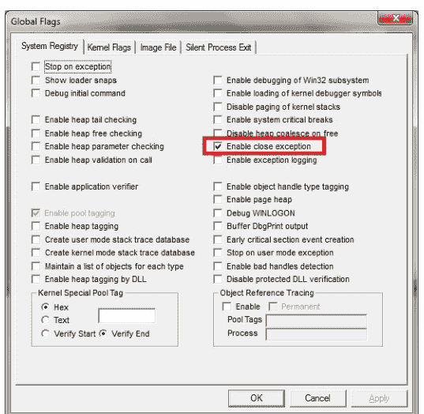

此外，如果我们运行它，我们会得到这个托管堆栈跟踪（第 624 页）：

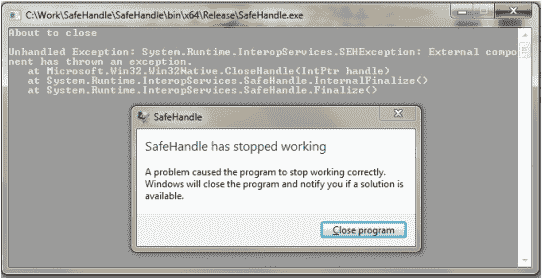

如果我们启用了 *应用程序验证器*，本可以检测到无效句柄，但那样我们就不会有 **托管代码异常**（第 617 页）。

因此，我们加载一个崩溃转储（因为我们启用了 LocalDumps[^121] 而保存），并加载 SOS 扩展：

```
0:002> lm m clr
start end module name
000007fe8d880000 000007feee1eb000 clr (pdb symbols)
Loaded symbol image file: clr.dll
Image path: C:\Windows\Microsoft.NET\Framework64\v4.0.30319\clr.dll
[...]

0:002> .load C:\Windows\Microsoft.NET\Framework64\v4.0.30319\sos

0:002> !pe
Exception object: 0000000002ab5fe8
Exception type: System.Runtime.InteropServices.SEHException
Message: External component has thrown an exception.
InnerException:
StackTrace (generated):
| SP | IP | Function |
|---|---|---|
| 0000000018A0FED0 | 0000000000000000 | mscorlib_ni!Microsoft.Win32.Win32Native.CloseHandle(IntPtr)+0x1 |
| 0000000018A0F2F0 | 0000000000000000 | mscorlib_ni!System.Runtime.InteropServices.SafeHandle.InternalFinalize()+0x1 |
| 0000000018A0F2F0 | 000007FEE6C2F7A6 | mscorlib_ni!System.Runtime.InteropServices.SafeHandle.Finalize()+0x26 |

StackTraceString:
HResult: 80004005
```

我们的非托管 CLR 线程（第 124 页）异常堆栈跟踪（第 363 页）非常简单：

```
0:002> k
000000001b40d6e8 000007fefd651430 ntdll!NtWaitForMultipleObjects+0xa
000000001b40d6f0 0000000077621723 KERNELBASE!WaitForMultipleObjectsEx+0xe8
000000001b40d7f0 000000007769b5e5 kernel32!WaitForMultipleObjectsExImplementation+0xb3
000000001b40d880 000000007769b767 kernel32!WerpReportFaultInternal+0x215
000000001b40d920 000000007769b7bf kernel32!WerpReportFault+0x77
000000001b40d950 000000007769b9dc kernel32!BasepReportFault+0x1f
000000001b40d980 00000000778b3398 kernel32!UnhandledExceptionFilter+0x1fc
000000001b40da60 00000000778385c8 ntdll! ?? ::FNODOBFM::`string'+0x2365
000000001b40da90 00000000778492d2 ntdll!_C_specific_handler+0x8c
000000001b40db00 00000000778391cf ntdll!RtlpExecuteHandlerForException+0xd
000000001b40db30 00000000778397c8 ntdll!RtlDispatchException+0x85a
000000001b40e210 00000000778712c7 ntdll!RtlRaiseException+0x22f
000000001b40ebc0 000007fefd651873 ntdll!KiRaiseUserExceptionDispatcher+0x3a
000000001b40ec90 0000000077621991 KERNELBASE!CloseHandle+0x13
000000001b40ecc0 000007feec720418 kernel32!CloseHandleImplementation+0x3d
000000001b40edc0 000007feed8e9e03 mscorlib_ni+0x580418
000000001b40eea0 000007feed8e9e7e clr!CallDescrWorkerInternal+0x83
000000001b40eee0 000007feed8ec860 clr!CallDescrWorkerWithHandler+0x4a
000000001b40ef20 000007feed8f1ald clr!DispatchCallSimple+0x85
000000001b40efb0 000007feed8f19ac clr!SafeHandle::RunReleaseMethod+0x69
000000001b40f050 000007feed8f180a clr!SafeHandle::Release+0x122
000000001b40f120 000007feed4863e clr!SafeHandle::Dispose+0x36
000000001b40f190 000007feec2f74a6 clr!SafeHandle::Finalize+0xa2
000000001b40f2f0 000007feed8e9d56 mscorlib_ni+0x48f7a6
000000001b40f330 000007feed83c4e clr!FastCallFinalizeWorker+0x6
000000001b40f360 000007feed83c3 clr!MethodDesc::RequiresFullSlotNumber+0x72
000000001b40f3a0 000007feed83b0f clr!MethodTable::CallFinalizer+0xa3
000000001b40f3e0 000007feed9fe46 clr!SVR::CallFinalizer+0x5f
000000001b40f420 000007feed9aac5b clr!SVR::CallFinalizer+0x102
000000001b40f4e0 000007feed8f458c clr!WKS::GCHeap::IsPromoted+0xeee
000000001b40f520 000007feed8f451a clr!Frame::Pop+0x50
000000001b40f560 000007feed8449c1 clr!COMCustomAttribute::PopSecurityContextFrame+0x192
000000001b40f660 000007feed9d1bfe clr!COMCustomAttribute::PopSecurityContextFrame+0xbd
000000001b40f6f0 000007feed9d1e59 clr!ManagedThreadBase_NoADTransition+0x3f
000000001b40f750 000007feed9533de clr!WKS::GCHeap::FinalizerThreadStart+0x193
000000001b40f790 00000000776159ed clr!Thread::IntermediateThreadProc+0x7d
000000001b40f850 000000007784c541 kernel32!BaseThreadInitThunk+0xd
000000001b40f880 0000000000000000 ntdll!RtlUserThreadStart+0x1d
```

我们看到异常处理发生在对象终结期间。如果可能，我们可以通过反汇编推断句柄的值（可能是小值，第 873 页）：

```
0:002> kn
### Child-SP RetAddr Call Site
00 000000001b40d6e8 000007fefd651430 ntdll!NtWaitForMultipleObjects+0xa
01 000000001b40d6f0 0000000077621723 KERNELBASE!WaitForMultipleObjectsEx+0xe8
02 000000001b40d7f0 000000007769b5e5 kernel32!WaitForMultipleObjectsExImplementation+0xb3
03 000000001b40d880 000000007769b767 kernel32!WerpReportFaultInternal+0x215
04 000000001b40d920 000000007769b7bf kernel32!WerpReportFault+0x77
05 000000001b40d950 000000007769b9dc kernel32!BasepReportFault+0x1f
06 000000001b40d980 0000000077b83398 kernel32!UnhandledExceptionFilter+0x1fc
07 000000001b40da60 00000000778385c8 ntdll! ?? ::FNODOBFM::`string'+0x2365
08 000000001b40da90 00000000778492d0 ntdll!_C_specific_handler+0x8c
09 000000001b40db00 00000000778391cf ntdll!RtlpExecuteHandlerForException+0xd
0a 000000001b40db30 00000000778397c8 ntdll!RtlDispatchException+0x45a
0b 000000001b40e210 00000000778712c7 ntdll!RtlRaiseException+0x22
0c 000000001b40e4bc 000007fefd651873 ntdll!KiRaiseUserExceptionDispatcher+0x3a
0d 000000001b40ec90 0000000077621991 KERNELBASE!CloseHandle+0x13
0e 000000001b40ecc0 000007feec720418 kernel32!CloseHandleImplementation+0x3d
0f 000000001b40edd0 000007feed8e9e03 mscorlib_ni+0x580418
10 000000001b40eea0 000007feed8e9e7e clr!CallDescrWorkerInternal+0x83
11 000000001b40eee0 000007feed8e8c60 clr!CallDescrWorkerWithHandler+0x4a
12 000000001b40ef20 000007feed8f1a1d clr!DispatchCallSimple+0x85
13 000000001b40efb0 000007feed8f19ac clr!SafeHandle::RunReleaseMethod+0x69
14 000000001b40f050 000007feed8f180a clr!SafeHandle::Release+0x122
15 000000001b40f120 000007feed4863e clr!SafeHandle::Dispose+0x36
16 000000001b40f190 000007feec62f76a clr!SafeHandle::Finalize+0xa2
17 000000001b40f2f0 000007feed8e9d56 mscorlib_ni+0x48f746
18 000000001b40f330 000007feed83c4e clr!FinalCallFinalizerWorker+0x6
19 000000001b40f360 000007feed83bc3 clr!MethodDesc::RequiresFullSlotNumber+0x72
1a 000000001b40f3a0 000007feed83b0f clr!MethodTable::CallFinalizer+0xa3
1b 000000001b40f3e0 000007feed9fe4e clr!SVR::CallFinalizer+0x5f
1c 000000001b40f420 000007feed9aa55b clr!SVR::CallFinalizer+0x102
1d 000000001b40f4e0 000007feed8f458c clr!WKS::GCHeap::IsPromoted+0xeee
1e 000000001b40f520 000007feed8f451a clr!Frame::Pop+0x50
1f 000000001b40f560 000007feed8f449f clr!COMCustomAttribute::PopSecurityContextFrame+0x192
20 000000001b40f660 000007feed9d1be4 clr!COMCustomAttribute::PopSecurityContextFrame+0xbd
21 000000001b40f6f0 000007feed9d1e59 clr!ManagedThreadBase_NoADTransition+0x3f
22 000000001b40f750 000007feed9533de clr!WKS::GCHeap::FinalizerThreadStart+0x193
23 000000001b40f790 00000000776159ed clr!Thread::intermediateThreadProc+0x7d
24 000000001b40f850 000000007784c541 kernel32!BaseThreadInitThunk+0xd
25 000000001b40f880 0000000000000000 ntdll!RtlUserThreadStart+0x1d
```

```
0:002> .frame /c d
0d 000000001b40ec90 0000000077621991 KERNELBASE!CloseHandle+0x13
rax=00000000c0000001 rbx=0000000000000000 rcx=00000000009a0000
rdx=0000000000000001 rsi=000000001b40efd0 rdi=000000001b40eff8
rip=000007fefd651873 rsp=000000001b40ec90 rbp=000000001b40edf0
r8=000000001b40ce08 r9=000000001b40cf70 r10=0000000000000000
r11=0000000000000246 r12=0000000000000001 r13=0000000040000000
r14=000000001b40ef40 r15=0000000000000000
iopl=0 nv up ei pl zr na po nc
cs=0033 ss=002b ds=002b es=002b fs=0053 gs=002b efl=00000246
KERNELBASE!CloseHandle+0x13:
000007fefd651873 85c0 test eax,eax
```

[^121]: http://msdn.microsoft.com/en-us/library/bb787181.aspx


```
0:002> ub 00000000`77621991
kernel32!CloseHandleImplementation+0x1e:
00000000`7762196e 83f9f4        cmp     ecx,0FFFFFFFFh
00000000`77621971 0f83952e0100  jae     kernel32!TlsGetValue+0x3ef0 (00000000`7763480c)
00000000`77621977 488bc3        mov     rax,rbx
00000000`7762197a 2500300000    and     eax,100000003h
00000000`7762197f 4883f803      cmp     rax,3
00000000`77621983 0f847f8dfeff  je      kernel32!CloseHandleImplementation+0x56 (00000000`7760a708)
00000000`77621989 488bcb        mov     rcx,rbx
00000000`7762198c e81f000000    call    kernel32!CloseHandle (00000000`776219b0)
```

这里我们还要检查托管堆栈跟踪或 **执行残留** (第 369 页) 中的值：

```
0:002> !CLRStack -a
OS Thread Id: 0x1390 (2)
Child SP IP       Call Site
00000001b40fedf8 000000007787186a [InlinedCallFrame: 00000001b40fedf8]
Microsoft.Win32.Win32Native.CloseHandle(IntPtr)
00000001b40fef80 000007fec720418 [InlinedCallFrame: 00000001b40fef80]
Microsoft.Win32.Win32Native.CloseHandle(IntPtr)
00000001b40fed00 000007fec720418 DomainNeutralILStubClass.IL_STUB_PInvoke(IntPtr)
PARAMETERS:
<no data>

00000001b40feff8 000007feed8e9e03 [GCFrame: 00000001b40feff8]
00000001b40ff148 000007feed8e9e03 [GCFrame: 00000001b40ff148]
00000001b40ff1f8 000007feed8e9e03 [HelperMethodFrame_PROD: 00000001b40ff1f8] System.Runtime.InteropServices.SafeHandle.InternalFinalize()
00000001b40ff2f0 000007feec62f7a6 System.Runtime.InteropServices.SafeHandle.Finalize()

PARAMETERS:
this (0x0000000001b40f330) = 0x0000000002ab2d78
```

```
0:002> !dso
OS Thread Id: 0x1390 (2)
RSP/REG   Object Name
00000001b40fea00 0000000002ab2d78 Microsoft.Win32.SafeHandles.SafeFileHandle
00000001b40fefd0 0000000002ab2d78 Microsoft.Win32.SafeHandles.SafeFileHandle
00000001b40ff038 0000000002ab2d78 Microsoft.Win32.SafeHandles.SafeFileHandle
00000001b40ff050 0000000002ab2d78 Microsoft.Win32.SafeHandles.SafeFileHandle
00000001b40ff090 0000000002ab2d78 Microsoft.Win32.SafeHandles.SafeFileHandle
00000001b40ff120 0000000002ab2d78 Microsoft.Win32.SafeHandles.SafeFileHandle
00000001b40ff190 0000000002ab2d78 Microsoft.Win32.SafeHandles.SafeFileHandle
00000001b40ff188 0000000002ab2d78 Microsoft.Win32.SafeHandles.SafeFileHandle
00000001b40ff240 0000000002ab2d78 Microsoft.Win32.SafeHandles.SafeFileHandle
00000001b40ff2f8 0000000002ab2d78 Microsoft.Win32.SafeHandles.SafeFileHandle
00000001b40ff330 0000000002ab2d78 Microsoft.Win32.SafeHandles.SafeFileHandle
00000001b40ff360 0000000002ab5e10 System.Threading.Thread
00000001b40ff390 0000000002ab2d78 Microsoft.Win32.SafeHandles.SafeFileHandle
00000001b40ff3e0 0000000002ab2d78 Microsoft.Win32.SafeHandles.SafeFileHandle
00000001b40ff3f0 0000000002ab2d78 Microsoft.Win32.SafeHandles.SafeFileHandle
00000001b40ff430 0000000002ab58a8 Microsoft.Win32.SafeHandles.SafeViewOfFileHandle
00000001b40ff4e0 0000000002ab2d78 Microsoft.Win32.SafeHandles.SafeFileHandle
```

请注意，我们没有全局应用程序标志：

```
0:002> !do 000000002ab2d78
Name: Microsoft.Win32.SafeHandles.SafeFileHandle
MethodTable: 00007feec88a260
EEClass: 00007feec34d340
Size: 32(0x20) bytes
File: C:\windows\Microsoft.Net\assembly\GAC_64\mscorlib\v4.0_4.0.0.0__b77a5c561934e089\mscorlib.dll
Fields:
MT Field Offset Type VT Attr Value Name
000007feec88a338 400060d 8 System.IntPtr 1 instance dead handle
000007feec8892b8 400060e 10 System.Int32 1 instance 3 _state
000007feec887de0 400060f 14 System.Boolean 1 instance 1 _ownsHandle
000007feec887de0 4000610 15 System.Boolean 1 instance 1 _fullyInitialized
```

```
0:002> !gflag
Current NtGlobalFlag contents: 0x00000000
```

以下是启用应用程序验证程序时，来自不同崩溃转储的异常堆栈跟踪：

```
0:002> !gflag
Current NtGlobalFlag contents: 0x02000100
vrf - Enable application verifier
hpa - Place heap allocations at ends of pages

0:002> k
Child-SP RetAddr Call Site
00000000`24bac4a8 00000000`77cd3072 ntdll!NtWaitForSingleObject+0xa
00000000`24bac4b0 00000000`77cd32b5 ntdll!RtlReportExceptionEx+0x1d2
00000000`24bac5a0 000007fe`fa2c26fb ntdll!RtlReportException+0xb5
00000000`24bac620 00000000`77c2a5db verifier!AVrfpVectoredExceptionHandler+0x26b
00000000`24bac6b0 00000000`77c28e62 ntdll!RtlpCallVectoredHandlers+0xa8
00000000`24bac720 00000000`77c61248 ntdll!RtlDispatchException+0x22
00000000`24bace00 000007fe`fa2bae03 ntdll!KiUserExceptionDispatch+0x2e
00000000`24bad500 000007fe`fa2c268a verifier!VerifierStopMessageEx+0x6fb
00000000`24bad850 00000000`77c2a5db verifier!AVrfpVectoredExceptionHandler+0x1fa
00000000`24bad8e0 00000000`77c28e62 ntdll!RtlpCallVectoredHandlers+0xa8
00000000`24bad950 00000000`77c297c8 ntdll!RtlDispatchException+0x22
00000000`24bae030 00000000`77c612c7 ntdll!KiRaiseException+0x22f
00000000`24bae9e0 000007fe`fa2d2386 ntdll!KiRaiseUserExceptionDispatcher+0x3a
00000000`24baeab0 000007fe`fddb1873 verifier!AVrfpNtClose+0xbe
00000000`24baeae0 000007fe`fa2d4031 KERNELBASE!CloseHandle+0x13
00000000`24baeb10 000007fe`fa2d40cb verifier!AVrfpCloseHandleCommon+0x95
00000000`24baeb40 000007fe`77a11991 verifier!AVrfpKernelbaseCloseHandle+0x23
00000000`24baeb80 000007fe`fa2d4031 kernel32!CloseHandleImplementation+0x3d
00000000`24baeb90 000007fe`fa2d409c verifier!AVrfpCloseHandleCommon+0x95
*** WARNING: Unable to verify checksum for mscorlib.ni.dll
00000000`24baecc0 000007fe`e6a04418 verifier!AVrfpKernel32CloseHandle+0x2c
00000000`24baed00 000007fe`e0e9e03 mscorlib_ni+0x580418
00000000`24baedd0 000007fe`ec09e7e clr!CallDescrWorkerInternal+0x83
00000000`24baee10 000007fe`ec0ec860 clr!CallDescrWorkerWithHandler+0x4a
00000000`24baee50 000007fe`ec0f1a1d clr!DispatchCallSimple+0x85
00000000`24baeee0 000007fe`ec0f19ac clr!SafeHandle::RunReleaseMethod+0x69
00000000`24baef80 000007fe`ec0f180a clr!SafeHandle::Release+0x122
00000000`24baf050 000007fe`ec24863e clr!SafeHandle::Dispose+0x36
00000000`24baf0c0 000007fe`e694f7a6 clr!SafeHandle::Finalize+0xa2
00000000`24baf220 000007fe`ec0e9d56 mscorlib_ni+0x48f7a6
00000000`24baf260 000007fe`ec283c4e clr!FastCallFinalizeWorker+0x6
00000000`24baf290 000007fe`ec283bc3 clr!MethodDesc::RequiresFullSlotNumber+0x72
00000000`24baf2d0 000007fe`ec283bcf clr!MethodTable::CallFinalizer+0xa3
00000000`24baf310 000007fe`ec1fee46 clr!SVR::CallFinalizer+0x5f
00000000`24baf350 000007fe`ec1aac5b clr!SVR::CallFinalizer+0x102
00000000`24baf410 000007fe`ec0f458c clr!WKS::GCHeap::IsPromoted+0xee
00000000`24baf450 000007fe`ec0f451a clr!Frame::Pop+0x50
00000000`24baf490 000007fe`ec0f49f1 clr!COMCustomAttribute::PopSecurityContextFrame+0x192
00000000`24baf590 000007fe`ec1d1bfc clr!COMCustomAttribute::PopSecurityContextFrame+0xbd
00000000`24baf620 000007fe`ec1d1e59 clr!ManagedThreadBase_NoADTransition+0x3f
00000000`24baf680 000007fe`ec1533de clr!WKS::GCHeap::FinalizerThreadStart+0x193
00000000`24baf6c0 000007fe`fa2d4b87 clr!Thread::intermediateThreadProc+0x7d
00000000`24baf780 00000000`77a059ed verifier!AVrfpStandardThreadFunction+0x2b
00000000`24baf7c0 00000000`77c3c541 kernel32!BaseThreadInitThunk+0xd
00000000`24baf7f0 00000000`00000000 ntdll!RtlUserThreadStart+0x1d
```

```
0:002> !pe
There is no current managed exception on this thread
```

```
0:002> !CLRStack
OS Thread Id: 0x51e4 (2)
Child SP IP Call Site
0000000024baed28 0000000077c612fa [InlinedCallFrame: 0000000024baed28]
Microsoft.Win32.Win32Native.CloseHandle(IntPtr)
0000000024baed28 000007fe6a040148 [InlinedCallFrame: 0000000024baed28]
Microsoft.Win32.Win32Native.CloseHandle(IntPtr)
0000000024baed00 000007fe6a040418 DomainNeutralILStubClass.IL_STUB_PInvoke(IntPtr)
0000000024baef28 000007feec0e9e03 [GCFrame: 0000000024baef28]
0000000024baf078 000007feec0e9e03 [GCFrame: 0000000024baf078]
0000000024baf128 000007feec0e9e03 [HelperMethodFrame_1OBJ: 0000000024baf128]
System.Runtime.InteropServices.SafeHandle.InternalFinalize()
0000000024baf220 000007fe6e94f7a6 System.Runtime.InteropServices.SafeHandle.Finalize()
0000000024baf5d8 000007feec0e9d56 [DebuggerU2MCatchHandlerFrame: 0000000024baf5d8]
```

```
0:002> !dso
OS Thread Id: 0x51e4 (2)
RSP/REG Object Name
0000000024BAEDD0 000000000c282d78 Microsoft.Win32.SafeHandles.SafeFileHandle
0000000024BAEEF0 000000000c282d78 Microsoft.Win32.SafeHandles.SafeFileHandle
0000000024BAEF68 000000000c282d78 Microsoft.Win32.SafeHandles.SafeFileHandle
0000000024BAEF80 000000000c282d78 Microsoft.Win32.SafeHandles.SafeFileHandle
0000000024BAEFC0 000000000c282d78 Microsoft.Win32.SafeHandles.SafeFileHandle
0000000024BAF050 000000000c282d78 Microsoft.Win32.SafeHandles.SafeFileHandle
0000000024BAF0C0 000000000c282d78 Microsoft.Win32.SafeHandles.SafeFileHandle
0000000024BAF0E8 000000000c282d78 Microsoft.Win32.SafeHandles.SafeFileHandle
0000000024BAF170 000000000c282d78 Microsoft.Win32.SafeHandles.SafeFileHandle
0000000024BAF228 000000000c282d78 Microsoft.Win32.SafeHandles.SafeFileHandle
0000000024BAF260 000000000c282d78 Microsoft.Win32.SafeHandles.SafeFileHandle
0000000024BAF290 000000000c285e10 System.Threading.Thread
0000000024BAF2C0 000000000c282d78 Microsoft.Win32.SafeHandles.SafeFileHandle
0000000024BAF310 000000000c282d78 Microsoft.Win32.SafeHandles.SafeFileHandle
0000000024BAF320 000000000c282d78 Microsoft.Win32.SafeHandles.SafeFileHandle
```


```
0000000024BAF360 000000000c2858a8 Microsoft.Win32.SafeHandles.SafeViewOfFileHandle
0000000024BAF410 000000000c282d78 Microsoft.Win32.SafeHandles.SafeFileHandle

0:002> !CLRStack -a
OS Thread Id: 0x51e4 (2)
Child SP               IP Call Site
0000000024baed28 000007ff0077c612fa [InlinedCallFrame: 0000000024baed28]
Microsoft.Win32.Win32Native.CloseHandle(IntPtr)
0000000024baed28 000007fee6a40418 [InlinedCallFrame: 0000000024baed28]
Microsoft.Win32.Win32Native.CloseHandle(IntPtr)
0000000024baef00 000007fee6a40418 DomainNeutralILStubClass.IL_STUB_PInvoke(IntPtr)
PARAMETERS:
<no data>

0000000024baef28 000007feec0e9e03 [GCFrame: 0000000024baef28]
0000000024baef08 000007feec0e9e03 [GCFrame: 0000000024baef08]
0000000024baf128 000007feec0e9e03 [HelperMethodFrame_1OBJ: 0000000024baf128]
System.Runtime.InteropServices.SafeHandle.InternalFinalize()
0000000024baf220 000007fee694f7a6 System.Runtime.InteropServices.SafeHandle.Finalize()
PARAMETERS:
    this (0x00000000024baf260) = 0x00000000c282d78

0000000024baf5d8 000007feec0e9d56 [DebuggerU2MCatchHandlerFrame: 0000000024baf5d8]

0:002> !do 0x00000000c282d78
Name: Microsoft.Win32.SafeHandles.SafeFileHandle
MethodTable: 000007fee6baa260
EEClass: 000007fee666d340
Size: 32(0x20) bytes
File: C:\windows\Microsoft.Net\assembly\GAC_64\mscorlib\v4.0_4.0.0.0__b77a5c561934e089\mscorlib.dll
Fields:
MT    Field   Offset                 Type VT     Attr    Value           Name
000007fee6baa338  400060d  8        System.IntPtr   1 instance  dead   handle
000007fee6ba92b8  400060e  10       System.Int32    1 instance  3      __state
000007fee6ba7de0  400060f  14       System.Boolean  1 instance  1      __ownsHandle
000007fee6ba7de0  4000610  15       System.Boolean  1 instance  1      __fullyInitialized
```

## 注释

在 gflags.exe 中启用应用程序验证程序以捕获句柄关闭堆栈跟踪，也可能揭示在我们收到第二个无效句柄关闭之前最初是谁关闭了句柄。请在此处使用 !htrace 命令。

### 无效参数

#### 进程堆

这是向函数传递意外值的一般模式。这里我们查看无效堆块参数模式的专业化。它不同于 **动态内存损坏** (第 307 页) 或 **双重释放** (第 267 页) 模式，因为在检测之前堆结构中没有发生损坏，且参数值在使用之前从未正确过。例如，我们有这个堆栈跟踪：

```
0:003> kL 100
ChildEBP RetAddr
01b2e6f0 77f27d0c ntdll!ZwWaitForSingleObject+0x15
01b2e774 77f27e3a ntdll!RtlReportExceptionEx+0x14b
01b2e7cc 77f4dc2e ntdll!RtlReportException+0x86
01b2e7e0 77f4dcab ntdll!RtlpTerminateFailureFilter+0x14
01b2e7ec 77e605c4 ntdll!RtlReportCriticalFailure+0x67
01b2e800 77ef0469 ntdll!_EH4_CallFilterFunc+0x12
01b2e828 77ed8799 ntdll!_except_handler4+0x8e
01b2e84c 77ed876b ntdll!ExecuteHandler2+0x26
01b2e8fc 77e9010f ntdll!ExecuteHandler+0x24
01b2e8fc 77f4dc9b ntdll!KiUserExceptionDispatcher+0xf
01b2ecc4 77f4eba1 ntdll!RtlReportCriticalFailure+0x57
01b2ecd4 77f4ec81 ntdll!RtlpReportHeapFailure+0x21
01b2ed08 77efdda0 ntdll!RtlpLogHeapFailure+0xa1
01b2ed38 76c814d1 ntdll!RtlFreeHeap+0x64
01b2ed4c 75694c39 kernel32!HeapFree+0x14
01b2ed98 726f167d msvcr80!free+0xcd
01b2eda4 7270613d DllA!FreeData+0xd
[ ... ]
01b2fe38 77eb9d42 kernel32!BaseThreadInitThunk+0xe
01b2fe78 77eb9d15 ntdll!__RtlUserThreadStart+0x70
01b2fe90 00000000 ntdll!_RtlUserThreadStart+0x1b
```

我们看到故障被立即检测和记录，没有任何 **仪器信息** (第 516 页)：

```
0:003> !gflag
Current NtGlobalFlag contents: 0x00000000
```

如果我们启用完整页堆，我们会得到这个默认分析输出和以下堆栈跟踪：

```
0:003> !gflag
Current NtGlobalFlag contents: 0x02000000
hpa - Place heap allocations at ends of pages
```

```
0:003> !analyze -v

[...]

APPLICATION_VERIFIER_HEAPS_CORRUPTED_HEAP_BLOCK_EXCEPTION_RAISED_FOR_PROBING (c)
Exception raised while verifying the heap block.
This situation happens if we really cannot determine any particular type of corruption for the block. For
instance you will get this if during a heap free operation you pass an address that points to a non-
accessible memory area.
This can also happen for double free situations if we do not find the block among full page heap blocks
and we probe it as a light page heap block.
Arguments:
Arg1: 05eb1000, Heap handle used in the call.
Arg2: 00720071, Heap block involved in the operation.
Arg3: 00000000, Size of the heap block.
Arg4: c0000005, Reserved.

[...]
```

```
0:003> k1 100
ChildEBP RetAddr
0818dca4 75fa0962 ntdll!ZwWaitForMultipleObjects+0x15
0818dd40 76bc162d KERNELBASE!WaitForMultipleObjectsEx+0x100
0818dd88 76bc1921 kernel32!WaitForMultipleObjectsExImplementation+0xe0
0818dda4 76be9b0d kernel32!WaitForMultipleObjects+0x18
0818de10 76be9baa kernel32!WerpReportFaultInternal+0x186
0818de24 76be9b8d kernel32!WerpReportFault+0x70
0818de34 76be9855 kernel32!BasepReportFault+0x20
0818dec0 77ef06e7 kernel32!UnhandledExceptionFilter+0x1af
0818dec8 77ef05c4 ntdll!__RtlUserThreadStart+0x62
0818dedc 77ef0469 ntdll!_EH4_CallFilterFunc+0x12
0818df04 77ed8799 ntdll!_except_handler4+0x8e
0818df28 77ed876b ntdll!ExecuteHandler2+0x26
0818dfd8 77e9010f ntdll!ExecuteHandler+0x24
0818dfd8 71a6ba58 ntdll!KiUserExceptionDispatcher+0xf
0818e344 71a69ee0 verifier!VerifierStopMessage+0x1f8
0818e3a8 71a66ff1 verifier!AVrfDphReportCorruptedBlock+0x2b0
0818e3bc 71a819ec verifier!AVrfpDphFindBusyMemoryNoCheck+0x141
0818e3d0 71a8174e verifier!_EH4_CallFilterFunc+0x12
0818e3f8 77ed8799 verifier!_except_handler4+0x8e
0818e41c 77e8776b ntdll!ExecuteHandler2+0x26
0818e4cc 77e9010f ntdll!ExecuteHandler+0x24
0818e4cc 71a66e88 ntdll!KiUserExceptionDispatcher+0xf
0818e868 71a66f95 verifier!AVrfDphFindBusyMemoryNoCheck+0xb8
0818e88c 71a67240 verifier!AVrfpDphFindBusyMemory+0x15
0818e8a8 71a69080 verifier!AVrfpDphFindBusyMemoryAndRemoveFromBusyList+0x20
0818e8c4 77f50aac verifier!AVrfDebugPageHeapFree+0x90
0818e90c 77f0baff ntdll!RtlDebugFreeHeap+0x2f
0818ea00 77eb2a32 ntdll!RtlpFreeHeap+0x5d
0818ea20 76bc14d1 ntdll!RtlFreeHeap+0x142
0818ea34 75694c39 kernel32!HeapFree+0x14
0818ea80 726f167d msvcr80!free+0xcd
0818ea8c 7270613d DllA!FreeData+0xd

[...]
0818fb20 77eb9d42 kernel32!BaseThreadInitThunk+0xe
0818fb60 77eb9d15 ntdll!_RtlUserThreadStart+0x70
0818fb78 00000000 ntdll!_RtlUserThreadStart+0x1b
```

在上面两个示例中，我们看到 00720071 值被传递给了 `free` 函数（我们也通过使用 `ub` 命令从代码中验证，没有参数优化，**优化代码** 模式，第 767 页）：

```
0:003> kv
ChildEBP RetAddr  Args to Child
[...]
01b2ed98 726f167d 00720071 01b2edb0 7270613d msvcr80!free+0xcd
[...]
```

我们将该值识别为 Unicode 作为 **野指针** (第 1151 页) 的示例，但在一般情况下参数不必是指针。我们还可以将 **无效句柄** (第 574 页) 模式视为 **无效参数** 模式的另一种专业化。

## 无效指针

### 常规

无效指针模式只是保存在寄存器或内存位置中的一个数字，当我们尝试将其解释为内存地址本身并跟随它（解引用）以获取其指向的内存内容（值）时，操作系统在硬件的帮助下告诉我们该地址不存在或由于安全限制而不可访问。

在 Windows 中，我们将进程内存分区为两个大区域：内核空间和进程空间。空间分区是与执行模式（内核或用户，环 0 或环 3）不同的概念，后者是处理器状态。在内核模式下执行的代码（例如驱动程序或操作系统）可以访问属于用户空间的内存。

基于此，我们可以区分包含内核空间地址（x86 上从 0x80000000 开始，无 /3Gb 开关）的无效指针和包含用户空间地址（低于 0x7FFFFFFF）的无效指针。

在 Windows x64 上，用户空间地址低于 0x000007ffffffffff，内核空间地址从 0xFFFF800000000000 开始。

当我们解引用无效内核空间地址时，我们会立即获得 bugcheck：

```
UNEXPECTED_KERNEL_MODE_TRAP (7F)
PAGE_FAULT_IN_NONPAGED_AREA (50)
```

我们无法在代码中捕获它（通过使用 SEH）。

但是，当我们解引用用户空间地址时，后续行动取决于我们的处理器是在内核模式（环 0）还是用户模式（环 3）。在任何模式下，我们都可以捕获异常（通过使用适当的 SEH 处理程序）或将其留给操作系统或调试器。如果在用户模式下发生异常时没有组件愿意处理它，我们会获得进程崩溃，而在内核模式下，我们会获得以下 bugchecks：

```
SYSTEM_THREAD_EXCEPTION_NOT_HANDLED (7E)
KERNEL_MODE_EXCEPTION_NOT_HANDLED (8E)
```


我们在下面的UML类图中总结了所有这些内容：

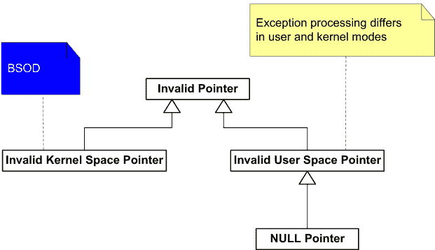

NULL指针是用户空间指针的一个特殊类。通常，其值在0x00000000 - 0x0000FFFF范围内。我们可以看到它们在诸如下列指令中被使用：

```
mov esi, dword ptr [ecx+0x10]
```

其中ecx的值为0x00000000，我们尝试访问位于0x00000010内存地址处的值。

当我们得到一个崩溃转储，并看到无效指针模式时，下一步是解释指针值，这应该有助于理解导致崩溃的可能步骤。

## JIT 代码

### .NET

有时汇编代码看起来几乎很狂野（不像由喜爱的编译器生成的那样，**狂野代码**，第1148页）。以下示例还显示了.NET运行时本地未处理异常处理：

```
0:000> kl 100
ChildEBP RetAddr
0014dbb4 77189254 ntdll!KiFastSystemCallRet
0014dbb8 75fec244 ntdll!ZwWaitForSingleObject+0xc
0014dc28 75fec1b2 kernel32!WaitForSingleObjectEx+0xbe
0014dc3c 72605389 kernel32!WaitForSingleObject+0x12
0014dc6c 726058e7 mscorwks!ClrWaitForSingleObject+0x24
0014e128 72608084 mscorwks!RunWatson+0x1df
0014e86c 7260874a mscorwks!DoFaultReportWorker+0xb59
0014e8a8 72657452 mscorwks!DoFaultReport+0xc3
0014e8cc 7265c0c7 mscorwks!WatsonLastChance+0x3f
0014e924 7265c173 mscorwks!CLRAddVectoredHandlers+0x209
0014e92c 7603f4be mscorwks!InternalUnhandledExceptionFilter+0x22
0014e9e8 771a85b7 kernel32!UnhandledExceptionFilter+0x127
0014e9f0 77139a14 ntdll!_RtlUserThreadStart+0x6f
0014ea04 771340f4 ntdll!_Eh4_CallFilterFunc+0x12
0014ea2c 77189b99 ntdll!_except_handler4+0x8e
0014ea50 77189b6b ntdll!ExecuteHandler2+0x26
0014eb00 771899f7 ntdll!ExecuteHandler+0x24
0014eb00 03ca0141 ntdll!KiUserExceptionDispatcher+0xf
WARNING: Frame IP not in any known module. Following frames may be wrong.
0014ee28 634c2f42 0x3ca0141
0014ee34 67715e44 System_ni+0x132f42
0014ee70 72431b4c System_ServiceProcess_ni+0x25e44
0014ee80 724421f9 mscorwks!CallDescrWorker+0x33
0014ef00 72456571 mscorwks!CallDescrWorkerWithHandler+0xa3
0014f03c 724565a4 mscorwks!MethodDesc::CallDescr+0x19c
0014f058 724565c2 mscorwks!MethodDesc::CallTargetWorker+0x1f
0014f070 724afac5 mscorwks!MethodDescCallSite::CallWithValueTypes+0x1a
0014f1d4 724af9e5 mscorwks!ClassLoader::RunMain+0x223
0014f43c 724aff35 mscorwks!Assembly::ExecuteMainMethod+0xa6
0014f90c 724a011f mscorwks!SystemDomain::ExecuteMainMethod+0x456
0014f95c 724b004f mscorwks!ExecuteEXE+0x59
0014f9a4 725f7c24 mscorwks!_CorExeMain+0x15c
0014f9b4 75e4f911 mscoree!_CorExeMain+0x2c
0014f9c0 7716e4b6 kernel32!BaseThreadInitThunk+0xe
0014fa00 7716e489 ntdll!_RtlUserThreadStart+0x23
0014fa18 00000000 ntdll!_RtlUserThreadStart+0x1b
```

### 我们设置异常上下文：

```
0:000> kv 100
ChildEBP RetAddr  Args to Child
[...]
0014e9e8 771a85b7 0014ea18 77139a14 00000000 kernel32!UnhandledExceptionFilter+0x127 (FPO: [SEH])
[...]

0:000> .expr 0014ea18

---- Exception record at 0014eb18:
ExceptionAddress: 03ca0141
   ExceptionCode: c0000005 (Access violation)
  ExceptionFlags: 00000000
NumberParameters: 2
   Parameter[0]: 00000000
   Parameter[1]: 00000000
Attempt to read from address 00000000

---- Context record at 0014eb34:
eax=00000001 ebx=08394ff8 ecx=00000000 edx=00000001 esi=056a2a94 edi=00000000
eip=03ca0141 esp=0014eee0 ebp=0014eee2 iopl=0         nv up ei pl zr na pe nc
cs=001b  ss=0023  ds=0023  es=0023  fs=003b  gs=0000             efl=00010246
03ca0141 3909      cmp     dword ptr [ecx],ecx ds:0023:00000000=????????
```

然后我们反汇编崩溃点处的代码，它看起来很奇怪，因为它包括通过DS数据段的调用：

```
0:000> .asm no_code_bytes
Assembly options: no_code_bytes

0:000> u 03ca0141
03ca0141 cmp     dword ptr [ecx],ecx
03ca0143 call    dword ptr ds:[36067C0h]
03ca0149 mov     ecx,dword ptr [esi+5Ch]
03ca014c cmp     dword ptr [ecx],ecx
03ca014e call    dword ptr ds:[3606D10h]
03ca0154 mov     dword ptr [ebp-1Ch],0
03ca015b mov     dword ptr [ebp-18h],0FCh
03ca0162 push    3CA0180h
```

不过进一步反汇编最终到达RET指令：

```
0:000> u
03ca0167 jmp     03ca0169
03ca0169 movzx   edx,byte ptr [ebp-24h]
03ca016d mov     ecx,dword ptr [ebp-28h]
03ca0170 call    System_ServiceProcess_ni+0x25140 (67715140)
03ca0175 pop     eax
03ca0176 jmp     eax
03ca0178 lea     esp,[ebp-0Ch]
03ca017b pop     ebx
```

```
0:000> u
03ca017c pop     esi
03ca017d pop     edi
03ca017e pop     ebp
03ca017f ret
[...]
```

向后反汇编显示匹配的函数序言代码：

```
0:000> ub 03ca0141
03ca0127 movzx   eax,byte ptr [ebp-24h]
03ca012b test    eax,eax
03ca012d je      03ca0154
03ca012f cmp     dword ptr [esi+60h],0
[...]

0:000> ub 03ca0127
03ca0114 push    esi
03ca0115 push    ebx
03ca0116 sub     esp,1Ch
03ca0119 xor     eax,eax
03ca011b mov     dword ptr [ebp-18h],eax
03ca011e mov     dword ptr [ebp-28h],ecx
03ca0121 mov     dword ptr [ebp-24h],edx
03ca0124 mov     esi,dword ptr [ebp-28h]

0:000> ub 03ca0114
03ca0102 retf
03ca0103 add     eax,dword ptr [eax+36h]
03ca0106 retf
03ca0107 add     ebx,dword ptr [esi+esi-35h]
03ca010b add     esi,esp
03ca010d cmp     eax,8B550360h
03ca0112 in      al,dx
03ca0113 push    edi
```

从堆栈跟踪来看，我们怀疑这段代码是主程序集方法的JIT编译.NET代码。的确，我们可以在以下MSDN文章“深入了解.NET Framework内部机制以查看CLR如何创建运行时对象”中找到类似的调用签名122：

```
03ca0141 cmp     dword ptr [ecx],ecx
03ca0143 call    dword ptr ds:[36067C0h]
```

### 注释

SOS的!IP2MD扩展命令将为0x3ca0141提供方法名、类和模块地址。

### Java

Windows上的JIT编译不仅限于.NET，我们决定添加Java的JIT代码(.NET)分析模式变体（第591页）。以下是java.exe进程内存转储中的一个线程示例：

```
0:071> k
### ChildEBP RetAddr
00 536cf424 770c15ce ntdll!NtWaitForSingleObject+0x15
01 536cf490 76f31194 KERNELBASE!WaitForSingleObjectEx+0x98
02 536cf4a8 76f31148 kernel32!WaitForSingleObjectExImplementation+0x75
03 536cf4bc 59207cb3 kernel32!WaitForSingleObject+0x12
WARNING: Stack unwind information not available. Following frames may be wrong.
04 536cf4e4 5918dbb1 jvm!JVM_FindSignal+0x5833
05 536cf558 03b6db25 jvm!JVM_Clone+0x30161
06 536cf588 03c4b0f4 0x3b6db25
07 536cf690 0348339a 0x3c4b0f4
08 536cf7d8 034803d7 0x348339a
09 536cf7e4 591a0732 0x34803d7
0a 536cf870 75bb9cde jvm!JVM_Clone+0x42ce2
0b 536cf87c 5926529e msvcrt!_VEH_memzero+0x82
0c 536cf8c4 591a1035 jvm!JVM_FindSignal+0x62e1e
0d 536cf908 591a1097 jvm!JVM_Clone+0x435e5
0e 536cf978 5914c49f jvm!JVM_Clone+0x43647
0f 536cf9d4 591c22dc jvm!jio_printf+0xaf
10 536cfa20 591c2d37 jvm!JVM_Clone+0x6488c
11 536cfa58 592071e9 jvm!JVM_Clone+0x652e7
12 536cfc98 5d34c556 jvm!JVM_FindSignal+0x4d69
13 536cfcd0 5d34c600 msvcr100!_endthreadex+0x3f
14 536cfcdc 76f3338a msvcr100!_endthreadex+0xcxe
15 536cfce8 77829902 kernel32!BaseThreadInitThunk+0xe
16 536cfd28 778298d5 ntdll!__RtlUserThreadStart+0x70
17 536cfd40 00000000 ntdll!_RtlUserThreadStart+0x1b
```

我们看到返回地址确实是前面call指令保存在堆栈上的返回地址：

```
0:071> ub 03b6db25
03b6db03 50 push eax
03b6db04 57 push edi
03b6db05 e876586455 call jvm!JVM_Clone+0x55930 (591b3380)
03b6db0a 83c408 add esp,8
03b6db0d 8d9730010000 lea edx,[edi+130h]
03b6db13 891424 mov dword ptr [esp],edx
03b6db16 c7876c01000040000000 mov dword ptr [edi+16Ch],4
03b6db20 e8dfff6155 call jvm!JVM_Clone+0x300b0 (5918db00)
```

```
0:071> ub 03c4b0f4
03c4b0cd 891c24    mov     dword ptr [esp],ebx
03c4b0d0 89c42c04  mov     dword ptr [esp+4],ecx
03c4b0d4 899c2480000000 mov dword ptr [esp+80h],ebx
03c4b0db 898c2484000000 mov dword ptr [esp+84h],ecx
03c4b0e2 928bbb91a mov     ecx,1A9B8028h
03c4b0e7 8bc2848c00000000 mov dword ptr [esp+8Ch],edi
03c4b0ee 90 nop
03c4b0ef e8ac29f2ff call 03b6daa0
```

```
0:071> ub 034803d7
034803c6 89049c    mov     dword ptr [esp+ebx*4],eax
034803c9 43        inc     ebx
034803ca 49        dec     ecx
034803cb 75f5      jne     034803c2
034803cd 8d5d14    mov     ebx,dword ptr [ebp+14h]
034803d0 8b4518    mov     eax,dword ptr [ebp+18h]
034803d3 8bf8      mov     esi,esp
034803d5 ffd0     call    eax
```

```
0:071> ub 591a0732
jvm!JVM_Clone+0x42ccc:
591a071c 57        push    edi
591a071d 89461c    mov     dword ptr [esi+1Ch],eax
591a0720 e8ab110000 call    jvm!JVM_Clone+0x43e80 (591a18d0)
591a0725 6a08      push    8
591a0727 6a06      push    6
591a0729 57        push    edi
591a072a 894514    mov     dword ptr [ebp+14h],eax
591a072d e86e9af2ff call    jvm+0x6a1a0 (590ca1a0)
```


## Last Error Collection

Sometimes a dump file looks normal inside, and we don’t see any suspicious past activity. However, as it often happens, the dump was saved manually as a response to some failure. This pattern might help in finding further troubleshooting suggestions. If we have a process memory dump we can get all errors and NTSTATUS values at once using !gle command with -all parameter:

```
0:000> !gle -all
Last error for thread 0:
LastErrorValue: (Win32) 0x3e5 (997) - Overlapped I/O operation is in progress.
LastStatusValue: (NTSTATUS) 0x103 - The operation that was requested is pending completion.

Last error for thread 1:
LastErrorValue: (Win32) 0 (0) - The operation completed successfully.
LastStatusValue: (NTSTATUS) 0 - STATUS_WAIT_0

Last error for thread 2:
LastErrorValue: (Win32) 0 (0) - The operation completed successfully.
LastStatusValue: (NTSTATUS) 0 - STATUS_WAIT_0

Last error for thread 3:
LastErrorValue: (Win32) 0 (0) - The operation completed successfully.
LastStatusValue: (NTSTATUS) 0 - STATUS_WAIT_0

...

Last error for thread 28:
LastErrorValue: (Win32) 0 (0) - The operation completed successfully.
LastStatusValue: (NTSTATUS) 0 - STATUS_WAIT_0

Last error for thread 29:
LastErrorValue: (Win32) 0x6ba (1722) - The RPC server is unavailable.
LastStatusValue: (NTSTATUS) 0 - STATUS_WAIT_0

Last error for thread 2a:
LastErrorValue: (Win32) 0 (0) - The operation completed successfully.
LastStatusValue: (NTSTATUS) 0 - STATUS_WAIT_0

Last error for thread 2b:
LastErrorValue: (Win32) 0 (0) - The operation completed successfully.
LastStatusValue: (NTSTATUS) 0 - STATUS_WAIT_0

...
```

For complete memory dumps we can employ the following command or similar to it:

```
!for_each_thread ".thread /r /p @#Thread; .if (@$teb != 0) {!teb; !gle;}"
```

```
0: kd> !for_each_thread ".thread /r /p @#Thread; .if (@$teb != 0) { !teb; !gle; }"
```

...

```
Implicit thread is now 8941eb40
Implicit process is now 8a4ac498
Loading User Symbols
TEB at 7ff3e000
ExceptionList:       0280ffa8
StackBase:           02810000
StackLimit:          0280b000
SubSystemTib:        00000000
FiberData:           00001e00
ArbitraryUserPointer: 00000000
Self:                7ff3e000
EnvironmentPointer:  00000000
ClientId:            00001034 . 000012b0
RpcHandle:           00000000
Tls Storage:         00000000
PEB Address:         7ffde000
LastErrorValue:      0
LastStatusValue:     c00000a3
Count Owned Locks:   0
HardErrorMode:       0

LastErrorValue: (Win32) 0 (0) - The operation completed successfully.
LastStatusValue: (NTSTATUS) 0xc00000a3 - {Drive Not Ready} The drive is not ready for use; its door may be open. Please check drive %hs and make sure that a disk is inserted and that the drive door is closed.
```

...

## Comments

In case of Virtualized Processes (page 1068) !gle may show Win32 last error and status values incorrectly:

```
0:000:x86> !gle
LastErrorValue: (Win32) 0 (0) - The operation completed successfully.
LastStatusValue: (NTSTATUS) 0 - STATUS_WAIT_0
Wow64 TEB status:
LastErrorValue: (Win32) 0 (0) - The operation completed successfully.
LastStatusValue: (NTSTATUS) 0 - STATUS_WAIT_0
```

```
0:000:x86> !teb
Wow64 TEB32 at 00000000fffd000
ExceptionList: 0000000000f2b108
StackBase: 0000000000390000
StackLimit: 0000000000255000
SubSystemTib: 0000000000000000
FiberData: 000000000001e000
ArbitraryUserPointer: 0000000000000000
Self: 00000000fffd000
EnvironmentPointer: 0000000000000000
ClientId: 000000000016d8 . 000000000011e0
RpcHandle: 0000000000000000
Tls Storage: 0000000000e12978
PEB Address: 00000000ffffdf000
LastErrorValue: 38
LastStatusValue: c000011
Count Owned Locks: 0
HardErrorMode: 0

Wow64 TEB at 00000000ffffdc000
ExceptionList: 00000000fffd000
StackBase: 00000000008fd30
StackLimit: 000000000083000
SubSystemTib: 0000000000000000
FiberData: 000000000001e000
ArbitraryUserPointer: 0000000000000000
Self: 00000000fffdc000
EnvironmentPointer: 0000000000000000
ClientId: 0000000000016d8 . 000000000011e0
RpcHandle: 0000000000000000
Tls Storage: 000000000000000
PEB Address: 00000000fffd6000
LastErrorValue: 0
LastStatusValue: 0
Count Owned Locks: 0
HardErrorMode: 0
```

Although in the case of system hangs we usually recommend dumping Stack Trace Collection (page 943), in some cases, it is very time-consuming, especially when it involves thousands of processes such as in modern terminal services environments. In such a case, if the problem description indicates the last action such as a not progressing user logon or a recently launched process we first check the tail of the corresponding linked list where Last Object is usually added to the tail of the list:


Sometimes we can simply check the end of some enumerated collection, such as sessions (dotted lines represent ALPC Wait Chains, page 1097):

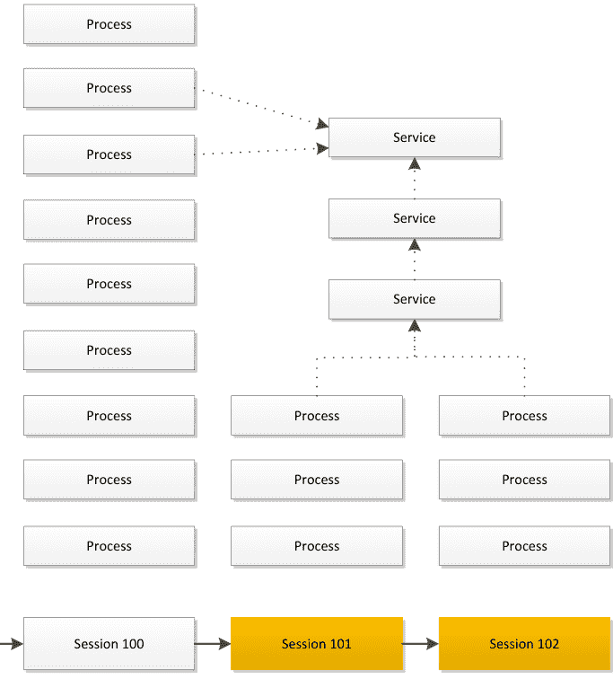

This analysis pattern can be added to the first tier of RSDP¹²³. If nothing found around a couple of **Last Objects**, we then resort to the analysis of entire linked lists.

## Comments

Regarding many terminal sessions on Windows we can dump processes sorted by session via `!sprocess -4` to spot the last **Incomplete Session** (page 496).

## Late Crash Dump

This is a binary opposition counterpart to **Early Crash Dump** pattern (page 312). It is usually saved when patterns representing a problem such as an exception thread stack trace are already gone. Most often we see one thread with process termination functions (**Special Stack Trace** pattern, page 882):

```
0:000> ~*k
ChildEBP RetAddr
0037fcf0 770bd55c ntdll!ZwTerminateProcess+0x12
0037fdfc 750f79f4 ntdll!RtlExitUserProcess+0x85
0037fdf8 750f339a kernel32!ExitProcessStub+0x12
0037fe04 770a9ef2 kernel32!BaseThreadInitThunk+0xe
0037fe44 770a9ec5 ntdll!__RtlUserThreadStart+0x70
0037fe5c 00000000 ntdll!_RtlUserThreadStart+0x1b
```

```
0:000> ~*k
ChildEBP RetAddr
0032faf0 77a9d55c ntdll!ZwTerminateProcess+0x12
0032fbfc 775579f4 ntdll!RtlExitUserProcess+0x85
0032fb20 74ac1720 kernel32!ExitProcessStub+0x12
0032fb28 74ac1a03 msvcr80!_crtExitProcess+0x14
0032fb64 74ac1a4b msvcr80!_cinit+0x101
0032fb74 01339bb3 msvcr80!exit+0xd
0032fbf8 7755339a App!_mainCRTStartup+0x155
0032fc04 77a89ef2 kernel32!BaseThreadInitThunk+0xe
0032fc44 77a89ec5 ntdll!__RtlUserThreadStart+0x70
0032fc5c 00000000 ntdll!_RtlUserThreadStart+0x1b
```

However, sometimes it is possible to see some **Execution Residue** (page 371) left on a raw stack such as **Hidden Exceptions** (page 457), **Module Hints** (page 696), error codes and **Handled Exceptions** (page 434) that might shed light on possible problem causes.

Another variant of this pattern is when a memory dump is saved after a problem message box is dismissed, or potentially disastrous exceptions such as access violations are handled until the fault in exception handling mechanism or severe corruption resulted in unresponsive process or system (hang).

## Lateral Damage

### Linux

This is a Linux variant of **Lateral Damage** pattern previously described for Windows (page 603) platform. It also covers memory dumps where some usual commands may not work, and we have to find a workaround to simulate their output, for example, by using other commands:

```
(gdb) info threads
Cannot find new threads: generic error

(gdb) thread apply all bt
Cannot find new threads: generic error

(gdb) thread 2
[Switching to thread 2 (LWP 12567)]
#0 0x000000000042ff51 in nanosleep ()

(gdb) thread 3
[Switching to thread 3 (LWP 12566)]
#0 0x000000000041482e in __int_malloc ()
```

### Windows

After looking at one dump where all thread environment blocks were zeroed, import table was corrupt and recalling some similar cases encountered previously we came up with the next pattern: Lateral Damage.

When this problem happens, we don’t have much choice, and our first temptation is to apply **Alien Component** anti-pattern unless our module list is corrupt and we have a manifestation of another common pattern **Corrupt Dump** (page 137).

An anti-pattern is not always a bad solution if complemented by subsequent verification and backed by experience. If we get a damaged process and thread structures, we can point to a suspicious component (supported by some evidence from the raw stack analysis and educated guess) and then request additional crash dumps in hope to get less damaged process space or see that component again. At the very end, if removing suspicious component stabilizes the customer environment it proves that we were right.

## Comments

Sometimes we get some vital information missing for default or usual analysis techniques, and we need to seek other ways to look at memory dump data - this is the essence of **Lateral Damage** pattern.

In the case of process memory dumps where `.ecxr` doesn’t work we may try `.exr -1` to display the last exception record which may show an exception address, code, and parameters (such as a write or read address).

```
0: ???> ~0s
...
WARNING: Many commands will not work
...
0:000>.ecxr
Unable to get exception context, HRESULT 0x80004005

0:000>.exr -1
ExceptionAddress: ...(ModuleA!func+offset)
```


## 最少公共帧

有时仅通过比较**崩溃签名**（第 153 页）不足以查找相似的支持事件。然后我们遍历堆栈跟踪帧，以查找与数据库中相似堆栈跟踪匹配的最少公共帧。例如，请考虑此签名：

```
0:026> r
eax=011349ec ebx=01136738 ecx=79f943e1 edx=00000000 esi=011349ec edi=0888f3b8
eip=00dfbef8 esp=0888f348 ebp=0888f3c8 iopl=0 nv up ei pl zr na pe nc
cs=001b ss=0023 ds=0023 es=0023 fs=003b gs=0000 efl=00000246
0dffe8 3902 cmp dword ptr [edx],eax ds:0023:00000000=????????
0:026> k 100
ChildEBP RetAddr
WARNING: Frame IP not in any known module. Following frames may be wrong.
0888f3c8 792a842f 0xdffe8
0888f3e4 792a839b mscorlib_ni+0x1e842f
0888f3fc 79e71b4c mscorlib_ni+0x1e839b
0888f40c 79e821b9 mscorwks!CallDescWorker+0x33
0888f48c 79e8281f mscorwks!CallDescWorkerWithHandler+0xa3
0888f4ac 79e82860 mscorwks!DispatchCallBody+0x1e
0888f510 79e828d1 mscorwks!DispatchCallDebuggerWrapper+0x3d
0888f544 79ec5f05 mscorwks!DispatchCallNoEH+0x51
0888f5a0 79e9848f mscorwks!AddTimerCallBack+0x66
0888f5b4 79e9842b mscorwks!Thread::DoADCallBack+0x32a
0888f648 79e98351 mscorwks!Thread::ShouldChangeAbortToUnload+0xe3
0888f6a8 79e984dd mscorwks!Thread::ShouldChangeAbortToUnload+0x30a
0888f6ac 79ec4a84 mscorwks!Thread::ShouldChangeAbortToUnload+0x33e
0888f6c4 79ec5075 mscorwks!ManagedThreadBase::ThreadPool+0x13
0888f70c 79ec50a4 mscorwks!AddTimerCallBackE+0x83
0888f720 79ec514a mscorwks!AddTimerCallBack+0x10
0888f75c 79ec4e0c mscorwks!ThreadpoolMgr::AsyncTimerCallBackCompletion+0x64
0888f7a8 79ec471e mscorwks!UnManagedPerAppDomainTPCount::DispatchWorkItem+0x9a
0888f7bc 79ec4892 mscorwks!ThreadpoolMgr::ExecuteWorkRequest+0xa4
0888f814 79ef7515 mscorwks!ThreadpoolMgr::WorkerThreadStart+0x20b
0888fffb4 7c80b729 mscorwks!Thread::intermediateThreadProc+0x49
0888fffc 00000000 kernel32!BaseThreadStart+0x37
```

很可能在搜索 `0xdffe8` 时找不到任何相似的堆栈跟踪。搜索 `mscorlib_ni+0x1e842f` 会返回几个结果，但它们不是崩溃，而是调用堆栈中间帧处的挂起。`mscorlib_ni+0x1e839b` 也是如此。因此，我们最终尝试在问题数据库中搜索 `CallDescWorker+0x33`，但将结果限制为具有相同应用程序模块名称的堆栈跟踪。果然，在我们的最少公共帧之后，我们找到了具有相同堆栈跟踪的相似软件事件：

```
0:004> r
eax=00000024 ebx=03e6f738 ecx=738129d8 edx=00495ef0 esi=01a87c4c edi=019c5f1c
eip=00a92037 esp=03e6f6cc ebp=03e6f6e8 iopl=0 nv up ei pl nz na pe nc
cs=0023 ss=002b ds=002b es=002b fs=0053 gs=002b efl=00010206
00a92037 ?? ???
0:004> k 100
*** Stack trace for last set context - .thread/.cxr resets it
ChildEBP RetAddr
WARNING: Frame IP not in any known module. Following frames may be wrong.
03e6f6c8 737d6bb5 0xa92037
03e6fe68 737a590f mscorlib_ni+0x216bb5
03e6f6f8 737a834c mscorlib_ni+0x1e509f
03e6f70c 74171b6c mscorlib_ni+0x1e834c
03e6f71c 74182209 mscorwks!CallDescWorker+0x33
03e6f79c 7418286f mscorwks!CallDescCallWorkerWithHandler+0xa3
03e6f7bc 741828b0 mscorwks!DispatchCallBody+0x1e
03e6f820 74182921 mscorwks!DispatchCallDebuggerWrapper+0x3d
03e6f854 742ce79 mscorwks!DispatchCallNoEH+0x51
03e6f8b0 7419846f mscorwks!AddTimerCallBack+0x66
03e6f8c4 7419840b mscorwks!Thread::DoADCallBack+0x32a
03e6f958 74198331 mscorwks!Thread::ShouldChangeAbortToUnload+0xe3
03e6f994 741984bd mscorwks!Thread::ShouldChangeAbortToUnload+0x30a
03e6f9bc 742ce708 mscorwks!Thread::ShouldChangeAbortToUnload+0x33e
03e6f9d4 742cecf9 mscorwks!ManagedThreadBase::ThreadPool+0x13
03e6fa1c 742ced28 mscorwks!AddTimerCallBackEx+0x83
03e6fa30 742cedce mscorwks!AddTimerCallBack+0x10
03e6fa6c 742cea90 mscorwks!ThreadpoolMgr::AsyncTimerCallbackCompletion+0x64
03e6fab8 742ce3a2 mscorwks!UnManagedPerAppDomainTPCount::DispatchWorkItem+0x9a
03e6facc 742ce516 mscorwks!ThreadpoolMgr::ExecuteWorkRequest+0xaf
03e6fb64 74441ec9 mscorwks!ThreadpoolMgr::WorkerThreadStart+0x20b
03e6fc84 76813677 mscorwks!Thread::intermediateThreadProc+0x49
03e6fc90 77219d72 kernel32!BaseThreadInitThunk+0xe
03e6fcd0 77219d45 ntdll!__RtlUserThreadStart+0x70
03e6fce8 00000000 ntdll!_RtlUserThreadStart+0x1b
```

## 活锁

通常，当两个线程在获取和释放资源时循环但没有进展时，我们会看到**活锁**模式。下面是选定 WinDbg 输出中的这些迹象：

- **高争用**模式（第 1168 页）或上下文切换计数
- 用户和 / 内核模式下 CPU 时间增加（**激增线程**，第 888 页）
- 至少有一个**活锁**线程被调度执行
- 一个**活锁**线程具有异常优先级提升
- 两个**活锁**线程的相同线程**堆栈跟踪**（第 926 页）具有类似统计信息，如花费时间和上下文切换计数
- 零等待滴答数

```
1: kd> !locks

Resource @ 0xfffffa8008464528 Exclusively owned
Contention Count = 43743004
NumberOfExclusiveWaiters = 1
Threads: fffffa8008315b60-01-*>
Threads Waiting On Exclusive Access:
fffffa8005769660

41080 total locks, 1 locks currently held
```

```
1: kd> !running

Prctb Current Next
1 fffffa8001e68180 fffffa8001e72fc0 fffffa8008315b60 ............
```

我们从**堆栈跟踪收集**（第 943 页）中有这些堆栈跟踪：

```
THREAD fffffa8008315b60  Cid 0724.2a28  Teb: 000007ffff9c000  Win32Thread: 0000000000000000 ????
IRP List:
fffffa80082e5990: (0006,0118) Flags: 00060000 Mdl: 00000000
Not impersonating
DeviceMap fffffa800a9f434e0
Owning Process fffffa8005726360       Image: ProcessA.exe
Attached Process N/A           Image: N/A
Wait Start TickCount 522197      Ticks: 0
**Context Switch Count 21665144**
**UserTime 00:00:40.373**
**KernelTime 00:02:42.791**
Win32 Start Address 0x000007fe6f939430
Stack Init fffff88008732db0 Current fffff880087321520
Base fffff88007322000 Limit fffff8800731c000 Call 0
Priority 8 BasePriority 6 **UnusualBoost 1** ForegroundBoost 0 IoPriority 2 PagePriority 5
Child-SP RetAddr Call Site
fffff880`07321560 fffff800`0168a992 nt!KiSwapContext+0x7a
fffff880`073216a0 fffff800`0168ccff nt!KiCommitThreadWait+0x1d2
fffff880`07321730 fffff880`0164c242 nt!KeWaitForSingleObject+0x19f
fffff880`073217d0 fffff880`0168b5ac nt!ExpWaitForResource+0xae
fffff880`07321840 fffff880`046089d1 nt!ExAcquireResourceExclusiveLite+0x14f
fffff880`073218b0 fffff880`04609e4e DriverA!foo+0x42
[...]
fffff880`07321a10 fffff880`0199ef66 nt!IopXxxControlFile+0x607
fffff880`07321b40 fffff880`01682993 nt!NtDeviceIoControlFile+0x56
fffff880`07321bb0 00000000`76ffff2a nt!KiSystemServiceCopyEnd+0x13 (TrapFrame @ fffff880`07321c20)
00000000`03af488 000007fe`fd6b6399 ntdll!NtDeviceIoControlFile+0xa
00000000`03af490 00000000`76ea610f KERNELBASE!DeviceIoControl+0x75
00000000`03af500 000007fe`f74f3d7c kernel32!DeviceIoControlImplementation+0x7f
[...]
```

```
THREAD fffffa8005769660 Cid 0724.10b0 Teb: 000007fffffa6000 Win32Thread: 0000000000000000 WAIT:
(WrResource) KernelMode Non-Alertable
fffffa8006661f20 SynchronizationEvent
IRP List:
fffffa8006b1ac10: (0006,0118) Flags: 00060000 Mdl: 00000000
Not impersonating
DeviceMap fffff8a009f434e0
Owning Process fffffa8005726360 Image: ProcessA.exe
Attached Process N/A Image: N/A
Wait Start TickCount 522197 Ticks: 0
Context Switch Count 21601988
UserTime 00:00:30.147
KernelTime 00:02:30.972
```

```
Win32 Start Address 0x000007fe6939430
Stack Init fffff880071bc000 Current fffff880071bb520
Base fffff880071bc000 Limit fffff880071b6000 Call 0
Priority 7 BasePriority 6 UnusualBoost 0 ForegroundBoost 0 IoPriority 2 PagePriority 5
Child-SP RetAddr Call Site
fffff880`071bb560 fffff880`0168a992 nt!KiSwapContext+0x7a
fffff880`071bb6a0 fffff880`0168ccff nt!KiCommitThreadWait+0x1d2
fffff880`071bb730 fffff880`0164c242 nt!KeWaitForSingleObject+0x19f
fffff880`071bb7d0 fffff880`0168b5ac nt!ExpWaitForResource+0xae
fffff880`071bb840 fffff880`046089d1 nt!ExAcquireResourceExclusiveLite+0x14f
fffff880`071bb8b0 fffff880`04609e4e DriverA!foo+0x42
[...]
fffff880`071bba10 fffff880`0199ef66 nt!IopXxxControlFile+0x607
fffff880`071bbb40 fffff880`01682993 nt!NtDeviceIoControlFile+0x56
fffff880`071bbbc0 00000000`76ffff2a nt!KiSystemServiceCopyEnd+0x13 (TrapFrame @ fffff880`071bbc20)
00000000`033bf708 000007fe`fd6b6399 ntdll!NtDeviceIoControlFile+0xa
00000000`033bf710 00000000`76ea610f KERNELBASE!DeviceIoControl+0x75
00000000`033bf780 000007fe`f74f3d7c kernel32!DeviceIoControlImplementation+0x7f
[...]
```

在两个跟踪中，DriverA 都是阻塞模块（第 96 页）。


## 本地缓冲区溢出

### Linux

这是之前为 Mac OS X（第 609 页）和 Windows（第 611 页）平台描述的本地缓冲区溢出模式的 Linux 变体。大多数情况下，在使用内存和字符串操作函数时的简单错误会被运行时轻易检测到。涉及未被检测到的覆盖堆栈跟踪的更复杂示例，是通过指向传递给被调用函数的本地缓冲区的指针间接覆盖。在这种情况下，我们可能会看到不正确且被截断的堆栈跟踪：

```
(gdb) bt
#0 0x0000000000000000 in ?? ()
#1 0x0000000000000000 in ?? ()

(gdb) x/100a $rsp
[...]
0x7fc3d9ddec8: 0x0 0x0
0x7fc3d9ddecf8: 0x0 0x0
0x7fc3d9dded08: 0x0 0x0
0x7fc3d9dded18: 0x0 0x0
0x7fc3d9dded28: 0x7fc3d9dded48 0x4005cc <procA+40>
0x7fc3d9dded38: 0x422077654e20794d 0x7542207265567679
0x7fc3d9dded48: 0x726556666 0x0
0x7fc3d9dded58: 0x0 0x0
0x7fc3d9dded68: 0x0 0x0
0x7fc3d9dded78: 0x0 0x0
[...]
```

### Mac OS X

这是 Local Buffer Overflow 模式的 Mac OS X / GDB 对应版本。大多数情况下，在使用内存和字符串操作函数时的简单错误会被运行时轻易检测到：

```
(gdb) bt
#0 0x00007fff885e982a in __kill ()
#1 0x00007fff83288b6c in __abort ()
#2 0x00007fff832a5b9f in __chk_fail ()
#3 0x00007fff832a583e in __memcpy_chk ()
#4 0x0000000100914edf3 in bar ()
#5 0x0000000100914e5e in foo ()
#6 0x0000000100914ee9b in main (argc=1, argv=0x7fff6d84daf0)
```

这种检测在默认优化的发行版本中也会发生：

```
(gdb) bt
#0 0x00007fff885e982a in __kill ()
#1 0x00007fff83288b6c in __abort ()
#2 0x00007fff832a5b9f in __chk_fail ()
#3 0x00007fff832a583e in __memcpy_chk ()
#4 0x000000010f59cea8 in bar [inlined] ()
#5 0x000000010f59cea8 in foo [inlined] ()
#6 0x000000010f59cea8 in main (argc=, argv=)
```

涉及未被检测到的覆盖堆栈跟踪的更复杂示例，是通过指向传递给被调用函数的本地缓冲区的指针间接覆盖。在这种情况下，我们可能会看到不正确且被截断的堆栈跟踪：

```
(gdb) bt
#0 0x00007fff885e982a in __kill ()
#1 0x00007fff83288b6c in __abort ()
#2 0x00007fff83285070 in __stack_chk_fail ()
#3 0x000000010524de77 in foo ()
#4 0xca400007ff64e5 in ?? ()
```

```
(gdb) bt
#0 0x00007fff885e982a in __kill ()
#1 0x00007fff83288b6c in __abort ()
#2 0x00007fff83285070 in __stack_chk_fail ()
#3 0x0000000105ad8df7 in foo ()
```

对原始堆栈的检查显示，在 `foo` 符号引用周围出现类似 ASCII 的内存值，而不是预期的 `main` 和 `start` 函数：

```
(gdb) info r rsp
rsp 0x7fff656d79d8 0x7fff656d79d8
(gdb) x/100a 0x7fff656d79d8
0x7fff656d79d8: 0x7fff83288b6c <__abort+193> 0x0
0x7fff656d79e8: 0x0 <ffffffdff
0x7fff656d79f8: 0x7fff656d70a0 0x7fff656d7a00
0x7fff656d7a08: 0x7fff83285070 <__guard_setup> 0x6675426c61636f4c
0x7fff656d7a18: 0x7265764f7265666 0x0
0x7fff656d7a28: 0x0 0x0
0x7fff656d7a38: 0x0 0x73205d343336325b
0x7fff656d7a48: 0x65766f206b636174 0x776f6c66672
0x7fff656d7a58: 0x0 0x0
0x7fff656d7a68: 0x0 0x343336326d7ab0
0x7fff656d7a78: 0x0 0x7fff656d7ab0
0x7fff656d7a88: 0x105ad8f7 0xb1887b8452358ac4
0x7fff656d7a98: 0x794000000000000 0x67694422077654e20
0x7fff656d7aa8: 0x6666675420202000 0x7265
0x7fff656d7ab8: 0x0 0x0
0x7fff656d7ac8: 0x0 0x0
0x7fff656d7ad8: 0x0 0x0
0x7fff656d7ae8: 0x0 0x0
[...]
```

建模应用程序源代码：

```
void bar(char *buffer)
{
    char data[100] = "My New Bigger Buffer";
    memcpy (buffer, data, sizeof(data));
}

void foo()
{
    char data[10] = "My Buffer";
    bar(data);
}

int main(int argc, const char * argv[])
{
    foo();
    return 0;
}
```

### Windows

在 x86 平台上，当本地变量和函数返回地址和/或保存的帧指针 EBP 被一些数据覆盖时，会观察到本地缓冲区溢出 **模式**。结果，指令指针 EIP 变成 **野指针**（参见第 1151 页），我们在用户模式下会遇到进程崩溃，或在内核模式下遇到 bugcheck。有时，通过查看不匹配的 EBP 和 ESP 值来诊断这种模式，在 ASCII 或 UNICODE 缓冲区溢出的情况下，EIP 寄存器可能包含 4 字符或 2 个 wchar_t 值，ESP 或 EBP 或两个寄存器可能指向某个字符串片段，如下面的示例所示：

```
0:000> r
eax=000fa101 ebx=0000c026 ecx=01010001 edx=bd43a010 esi=000003e0 edi=00000000
eip=0048004a esp=0012f158 ebp=00510044 iopl=0 nv up ei pl nz na po nc
cs=001b ss=0023 ds=0023 es=0023 fs=0038 gs=0000 efl=00000202
0048004a 0000 add byte ptr [eax],al ds:0023:000fa101=?

0:000> kl
ChildEBP RetAddr
WARNING: Frame IP not in any known module. Following frames may be wrong.
0012f154 00420047 0x48004aa
0012f158 00440077 0x420047
0012f15c 00420043 0x440077
0012f160 00510076 0x420043
0012f164 00420049 0x510076
0012f168 00540041 0x420049
0012f16c 00540041 0x540041
...
...
...
```

### 注释

我们也可能看到“安全检查失败或堆栈缓冲区溢出”c0000409 **转换后的异常**（第 1013 页），例如指向 c0000005。

## 失去的机会

在正确的时间保存崩溃转储很重要，例如，当显示错误消息框时¹²⁵。

但是，有时，崩溃转储在问题的可视指标消失后才保存，查看堆栈跟踪的机会就丢失了。下面是服务内存转储的一个示例，该转储在服务变得无响应后手动保存。在转储文件中，除了调试器创建的线程外，只剩下一个线程（为了可视清晰度，使用较小字体显示）：

```
0:001> ~*kv
     0  Id: a3c.700 Suspend: 1 Teb: 7ff59000 Unfrozen
    ChildEBP RetAddr  Args to Child
1178fd60 7c822124 77e6bad8 00000574 00000000 ntdll!KiFastSystemCallRet
1178fd64 77e6bad8 00000574 00000000 00000000 ntdll!NtWaitForSingleObject+0xc
1178fd44 77e6ba42 00000574 ffffffff 00000000 kernel32!WaitForSingleObjectEx+0xac
1178fde8 67e223dd 00000574 ffffffff 1178fe10 kernel32!WaitForSingleObject+0x12
1178fdfc 7c82257a 67e20000 00000000 00000001 component!DllInitialize+0xed
1178fe1c 7c8118b0 67e222f0 67e20000 00000000 ntdll!LdrpCallInitRoutine+0x14
1178fe88 77e53002 00000000 00000000 00000000 ntdll!LdrShutdownProcess+0x130
1178ffa4 77e53065 c0000005 77e8f3b0 ffffffff kernel32!ExitProcess+0x43
1178fff8 77e84277 c0000005 00000000 00000000 kernel32!ExitProcess+0x14
1178fffec 00000000 77c5de6d 0a078138 00000000 kernel32!BaseThreadStart+0x5f
#  1  Id: a3c.18bc Suspend: 1 Teb: 7ffde000 Unfrozen
    ChildEBP RetAddr  Args to Child
0a6cffc8 7c845ea0 00000005 00000004 00000001 ntdll!DbgBreakPoint
0a6cfff4 00000000 00000000 0c905a4d 00000003 ntdll!DbgUiRemoteBreakIn+0x36
```

我们也将异常代码 0xc0000005 视为 ExitProcess 参数。原始堆栈揭示了对 *NtRaiseHardError* 函数的调用，该调用肯定导致了某个错误消息框：

```
0:001> ~0s
...
0:000> !teb
TEB at 7ff59000
    ExceptionList:        1178fdc4
    StackBase:            11790000
    StackLimit:           11789000
    SubSystemTib:         00000000
    FiberData:            00001e00
    ArbitraryUserPointer: 00000000
    Self:                 7ff59000
    EnvironmentPointer:   00000000
    ClientId:             0000a3c . 0000700
    RpcHandle:            00000000
    Tls Storage:          00000000
PEB Address:           7ffdf000
LastErrorValue:        0
LastStatusValue:       c0000008
Count Owned Locks:     0
HardErrorMode:         0

0:000> dds 11789000 11790000
11789000 00000000
11789004 00000000
11789008 00000000
1178900c 00000000
11789010 00000000
...
1178f058 0a4016f4
1178f05c 1178efe0
1178f060 695040c4 <Unloaded_faultrep.dll>+0x40c4
1178f064 7ffdf000
1178f068 00000000
1178f06c 0a4016f4
1178f070 0a4016f4
1178f074 00000000
1178f078 1178f06c
1178f07c 0a4016b8
1178f080 0a4016b8
1178f084 1178efa0
1178f088 7c821b74 ntdll!NtRaiseHardError+0xc
1178f08c 77e99af9 kernel32!UnhandledExceptionFilter+0x54b
1178f090 d0000144
1178f094 00000000
1178f098 00000000
1178f09c 1178f164
1178f0a0 00000001
1178f0a4 77e996a7 kernel32!UnhandledExceptionFilter+0x873
1178f0a8 00000000
1178f0ac 00000000
1178f0b0 00000000
1178f0b4 02f49f0
1178f0b8 1178f13c
1178f0bc 00000000
...
```

那时应该保存转储。另请参见另一个示例及其解释¹²⁶。


## 主线程

当我们检查一个线程时，如果它不在**被动线程**模式列表中（第 793 页），并且看起来更像**阻塞线程**（参见第 82 页），我们可能会询问它是否是**主线程**。每个进程至少有一个称为主线程或主要线程的执行线程。大多数 GUI 应用程序在其主进程线程中包含窗口消息处理循环。保存内存转储时，此线程很可能正在阻塞等待窗口或用户定义的消息到达，可以被视为**被动线程**。如果发现它阻塞在其他事物上等待一段时间，我们可能会认为应用程序已挂起。以下是从内核转储中获取的正常 iexplore.exe 线程堆栈示例：

```
PROCESS 88de4140  SessionId: 3  Cid: 15a8    Peb: 7ffdf000  ParentCid: 0e28
DirBase: 0a43d440  ObjectTable: 88efe008  TableSize: 852.
Image: IEXPLORE.EXE
VadRoot 88dbbca8 Clone 0 Private 6604. Modified 951. Locked 0.
DeviceMap 88de6408
Token                             e3f5ccf0
ElapsedTime                       0:10:52.0281
UserTime                          0:00:06.0250
KernelTime                        0:00:10.0421
QuotaPoolUsage[PagedPool]         126784
QuotaPoolUsage[NonPagedPool]      197704
Working Set Sizes (now,min,max)   (8347, 50, 345) (33388KB, 200KB, 1380KB)
PeakWorkingSetSize                10000
VirtualSize                       280 Mb
PeakVirtualSize                   291 Mb
PageFaultCount                    15627
MemoryPriority                    FOREGROUND
BasePriority                      8
CommitCharge                      7440

THREAD 88ee2b00  Cid 15a8.1654  Teb: 7ffde000 Win32Thread: a2242018 WAIT: (WrUserRequest) UserMode Non-Alertable
88f82e00  SynchronizationEvent
Not impersonating
Owning Process            88de4140
Wait Start TickCount      104916         Elapsed Ticks: 0
Context Switch Count      100208         LargeStack
UserTime                  0:00:04.0484
KernelTime                0:00:09.0859
Start Address KERNEL32!BaseProcessStartThunk (0x7c57b70c)
Stack Init be597000 Current be596cc8 Base be597000 Limit be58f000 Call 0
Priority 12 BasePriority 8 PriorityDecrement 0 DecrementCount 0
ChildEBP RetAddr
be596ce0 8042d87d nt!KiSwapThread+0x1b1
be596d08 a00019c2 nt!KeWaitForSingleObject+0x1a3
be596d44 a00138c5 win32k!xxxSleepThread+0x18a
be596d54 a00138d1 win32k!xxxWaitMessage+0xe
be596d5c 8046b2a9 win32k!NtUserWaitMessage+0xb
be596d5c 77e37ccd nt!KiSystemService+0xc9
```

在同一个内核转储中，另有一个 *iexplore.exe* 进程，其以下主线程堆栈已阻塞 31 秒：

```
PROCESS 8811ca00  SessionId: 21  Cid: 4d18    Peb: 7ffdf000  ParentCid: 34c8
    DirBase: 0a086ee0  ObjectTable: 87d07528  TableSize: 677.
    Image: IEXPLORE.EXE
    VadRoot 87a92ae8 Clone 0 Private 4600. Modified 227. Locked 0.
    DeviceMap 88b174e8
    Token                             e49508d0
    ElapsedTime                       0:08:03.0062
    UserTime                          0:00:01.0531
    KernelTime                        0:00:10.0375
    QuotaPoolUsage[PagedPool]         120792
    QuotaPoolUsage[NonPagedPool]      198376
    Working Set Sizes (now,min,max) (7726, 50, 345) (30904KB, 200KB, 1380KB)
    PeakWorkingSetSize                7735
    VirtualSize                       272 Mb
    PeakVirtualSize                   275 Mb
    PageFaultCount                    11688
    MemoryPriority                    BACKGROUND
    BasePriority                      8
    CommitCharge                      6498

THREAD 87ce6da0  Cid 4d18.4c68  Teb: 7ffde000 Win32Thread: a22157b8 WAIT: (Executive) KernelMode Non-Alertable
b5bd6370  NotificationEvent

IRP List:
885d4808: (0006,00dc) Flags: 00000014  Mdl: 00000000
Not impersonating
Owning Process            8811ca00
Wait Start TickCount      102908         Elapsed Ticks: 2008
Context Switch Count      130138         LargeStack
UserTime                  0:00:01.0125
KernelTime                0:00:08.0843
Start Address KERNEL32!BaseProcessStartThunk (0x7c57b0c)
Stack Init b5bd7000 Current b5bd62f4 Base b5bd7000 Limit b5bcf000 Call 0
Priority 8 BasePriority 8 PriorityDecrement 0 DecrementCount 0
ChildEBP RetAddr
b5bd630c 8042d8d7 nt!KiSwapThread+0x1b1
b5bd6334 bf09342d nt!KeWaitForSingleObject+0x1a3
b5bd6380 bf08896f mrxsmb!SmbCeAssociateExchangeWithMid+0x24b
b5bd63b0 bf0aa0ef mrxsmb!SmbCeTranceive+0xff
b5bd6490 bf0a92df mrxsmb!SmbTransactExchangeStart+0x559
b5bd64a8 bf0a9987 mrxsmb!SmbCeInitiateExchange+0x2ac
b5bd64c4 bf0a96e2 mrxsmb!SmbCeSubmitTransactionRequest+0x124
b5bd6524 bf0ac7c3 mrxsmb!_SmbCeTransact+0x86
b5bd6608 bf104ae0 mrxsmb!MRxSmbQueryFileInformation+0x553
b5bd66b4 bf103aff rdsss!_RxInitializeTopLevelIrpContext+0x52
b5bd6784 bf10da73 rdsss!WPP_SF_ZL+0x4b
b5bd67b4 bf0a8b29 rdsss!RxCleanupPipeQueues+0x117
b5bd67d4 8041ef05 mrxsmb!MRxSmbFsdDispatch+0x118
b5bd67e8 eb833839 nt!IopCallDriver+0x35
b5bd6890 804a8109 nt!IopQueryXxxInformation+0x164
b5bd68b0 804c7d63 nt!IoQueryFileInformation+0x19
b5bd6a4c 80456562 nt!IopParseDevice+0xe8f
b5bd6ac4 804de0c0 nt!ObpLookupObjectName+0x504
b5bd6bd4 804a929b nt!ObpOpenObjectByName+0xc8
b5bd6d54 8046b2a9 nt!NtQueryFullAttributesFile+0x7e7
b5bd6d54 77f88887 nt!KiSystemService+0xc9
0: kd> !whattime 0n2008
2008 Ticks in Standard Time: 31.375s
```

主线程不一定是 GUI 线程。大多数输入控制台应用程序在正常主进程线程堆栈中都有 ReadConsole 调用：

```
0:000> kL
ChildEBP RetAddr
0012fc6c 77d20190 ntdll!KiFastSystemCallRet
0012fc70 77d27fdf ntdll!NtRequestWaitReplyPort+0xc
0012fc90 765d7065 ntdll!CsrClientCallServer+0xc2
0012fdc8 76634674 kernel32!ReadConsoleInternal+0x1cd
0012fe14 765e4a6a kernel32!ReadConsoleEA+0x40
0012fe7c 6ec35196 kernel32!ReadFile+0x84
0012fec0 6ec35616 MSVCR80!_read_nolock+0x201
0012ffe4 6ec45928 MSVCR80!_read+0xc0
0012fff1c 6ec49e47 MSVCR80!_filbuf+0x78
0012fff54 0040100d MSVCR80!getc+0x113
0012fff5c 0040117c ConsoleTest!wmain+0xd
0012fffa 756d3833 ConsoleTest!_mainCRTStartup+0x10f
0012fffac 77cfa9bd kernel32!BaseThreadInitThunk+0xe
0012fffec 00000000 ntdll!_RtlUserThreadStart+0x23
```

```
0:000> kL
ChildEBP RetAddr
001cf594 77d20190 ntdll!KiFastSystemCallRet
001cf598 77d27fdf ntdll!NtRequestWaitReplyPort+0xc
001cf5b8 765d7065 ntdll!CsrClientCallServer+0xc2
001cf6b4 765d6efe kernel32!ReadConsoleInternal+0x1cd
001cf740 49ecd538 kernel32!ReadConsoleW+0x47
001cf7a8 49ecd645 cmd!ReadBufFromConsole+0xb5
001cf7d4 49ec2247 cmd!FillBuf+0x175
001cf7d8 49ec2165 cmd!GetByte+0x11
001cf7f4 49ec20d8 cmd!Lex+0x75
001cf80c 49ec207f cmd!GetToken+0x27
001cf81c 49ec200a cmd!ParseStatement+0x36
001cf830 49ec6038 cmd!Parser+0x46
001cf878 49ec7703 cmd!main+0x1de
001cf8bc 765d3833 cmd!_initterm_e+0x163
001cf8c8 77cfa9bd kernel32!BaseThreadInitThunk+0xe
001cf908 00000000 ntdll!_RtlUserThreadStart+0x23
```

## 托管代码异常

.NET 程序也可能因 .NET 运行时（公共语言运行时，CLR）中的缺陷，或 .NET 虚拟机执行的托管代码中未处理的运行时异常而崩溃。后者异常会从 .NET 运行时重新抛出，以由操作系统处理并被本机调试器拦截。因此我们下一个崩溃转储分析模式称为**托管代码异常**。

当我们从 .NET 应用程序获取崩溃转储时，它是来自本机进程的转储。**!analyze -v** 输出通常可以告诉我们异常实际上是 CLR 异常，并提供其他提示以查看托管代码堆栈（CLR 堆栈）：

```
FAULTING_IP:
kernel32!RaiseException+53
77e4bee7 5e pop esi

EXCEPTION_RECORD: ffffffff -- (.exr 0xffffffffffffffff)
ExceptionAddress: 77e4bee7 (kernel32!RaiseException+0x00000053)
  ExceptionCode: e0434f4d (CLR exception)
  ExceptionFlags: 00000001
NumberParameters: 1
  Parameter[0]: 80131604

DEFAULT_BUCKET_ID: CLR_EXCEPTION

PROCESS_NAME: mmc.exe

ERROR_CODE: (NTSTATUS) 0xe0434f4d - <Unable to get error code text>

MANAGED_STACK: !dumpstack -EE
No export dumpstack found

STACK_TEXT:
05faf3d8 79f97065 e0434f4d 00000001 00000001 kernel32!RaiseException+0x53
WARNING: Stack unwind information not available. Following frames may be wrong.
05faf438 7a0945a4 023f31e0 00000000 00000000 mscorwks!DllCanUnloadNowInternal+0x37a9
05faf4fc 00f2f00a 02066be4 02085ee8 023d0df0 mscorwks!CorLaunchApplication+0x12005
05faf500 02066be4 02085ee8 023d0df0 023de2c 0xf2f00a
05faf504 02085ee8 023d0df0 023de2c 05e0dfa 0x2066be4
05faf508 023d0df0 023de2c 05e0dfa 023de10 0x2085ee8
05faf50c 023d02e 05e00dfa 023d0e10 05351d30 0x23d0df0
05faf510 05e00dfa 023d0e10 05351d30 023de10 0x23d0e2c

FOLLOW_UP_IP:
mscorwks!DllCanUnloadNowInternal+37a9
79f97065 c745fcfeffffff mov dword ptr [ebp-4],0FFFFFFFFh

SYMBOL_NAME: mscorwks!DllCanUnloadNowInternal+37a9

MODULE_NAME: mscorwks
```


```
IMAGE_NAME: mscorwks.dll

PRIMARY_PROBLEM_CLASS:  CLR_EXCEPTION

BUGCHECK_STR:  APPLICATION_FAULT_CLR_EXCEPTION
```

有时我们可以在原始堆栈上看到 mscorwks.dll，或者看到它已加载，并在当前线程以外的其他线程堆栈中找到它。

当我们获得此类提示时，可能还想获取托管代码堆栈。首先，我们需要加载与 .NET 运行时版本相对应的适当 WinDbg SOS 扩展（Son of Strike）。可以通过以下命令完成：

```
0:015> .loadby sos mscorwks
```

可以通过使用 .chain 命令检查加载了哪个 SOS 扩展版本：

```
0:015> .chain
Extension DLL search Path:
...
...
...
Extension DLL chain:
C:\\WINDOWS\\Microsoft.NET\\Framework\\v2.0.50727\\sos:  image 2.0.50727.42,  API 1.0.0,  built Fri Sep 23
08:27:26 2005
[path: C:\\WINDOWS\\Microsoft.NET\\Framework\\v2.0.50727\\sos.dll]
dbghelp: image 6.6.0007.5, API 6.0.6, built Sat Jul 08 21:11:32 2006
[path: C:\\Program Files\\Debugging Tools for Windows\\dbghelp.dll]
ext: image 6.6.0007.5, API 1.0.0, built Sat Jul 08 21:10:52 2006
[path: C:\\Program Files\\Debugging Tools for Windows\\winext\\ext.dll]
exts: image 6.6.0007.5, API 1.0.0, built Sat Jul 08 21:10:48 2006
[path: C:\\Program Files\\Debugging Tools for Windows\\WINXP\\exts.dll]
uext: image 6.6.0007.5, API 1.0.0, built Sat Jul 08 21:11:02 2006
[path: C:\\Program Files\\Debugging Tools for Windows\\winext\\uext.dll]
ntsdexts: image 6.0.5457.0, API 1.0.0, built Sat Jul 08 21:29:38 2006
[path: C:\\Program Files\\Debugging Tools for Windows\\WINXP\\ntsdexts.dll]
```

然后，我们可以使用 !dumpstack 转储当前堆栈，或使用 !EEStack 命令转储所有线程堆栈。

本机堆栈跟踪（第 926 页）将与托管堆栈跟踪（第 624 页）混合：

```
0:015> !dumpstack
OS Thread Id: 0x1e68 (15)
Current frame: kernel32!RaiseException+0x53
ChildEBP RetAddr  Caller,callee
05faf390 77e4bee7 kernel32!RaiseException+0x53, calling ntdll!RtlRaiseException
05faf3a8 79e814da mscorwks!Binder::RawGetClass+0x23, calling mscorwks!Module::LookupTypeDef
05faf3bc 79e87ff4 mscorwks!Binder::IsClass+0x21, calling mscorwks!Binder::RawGetClass
05faf3c8 79f958b8 mscorwks!Binder::IsException+0x13, calling mscorwks!Binder::IsClass
05faf3d8 79f97065 mscorwks!RaiseTheExceptionInternalOnly+0x226, calling kernel32!RaiseException
05faf438 7a0945a4 mscorwks!JIT_Throw+0xd0, calling mscorwks!RaiseTheExceptionInternalOnly
05faf4ac 7a0944ea mscorwks!JIT_Throw+0x1e, calling mscorwks!LazyMachStateCaptureState
05faf4c8 793d424e (MethodDesc 0x7924ad68 +0x2e System.Threading.WaitHandle.WaitOne(Int64, Boolean)), calling mscorwks!WaitHandleNative::CorWaitOneNative
05faf4fc 00f2f00a (MethodDesc 0x4f97500 +0x9a IronRing.Management.MMC.SnapinBase+MmcWindow.Invoke(System.Delegate, System.Object[])), calling mscorwks!JIT_Throw
05faf510 05e00dfa (MethodDesc 0x4f98fd8 +0xca MyNamespace.MyClass.MyMethod(Boolean)), calling 05fc7124
05faf55c 00f62fbc (MethodDesc 0x4f95f90 +0x16f4 MyNamespace.MyClass.MyMethod.Initialise(System.Object))
05faf740 793d912f (MethodDesc 0x7925fc70 +0x2f System.Threading._ThreadPoolWaitCallback.WaitCallback_Context(System.Object))
05faf748 793683dd (MethodDesc 0x7913f3d0 +0x81 System.Threading.ExecutionContext.Run(System.Threading.ExecutionContext, System.Threading.ContextCallback, System.Object))
05faf75c 793d9218 (MethodDesc 0x7925fc80 +0x6c System.Threading._ThreadPoolWaitCallback.PerformWaitCallback(System.Object)), calling (MethodDesc 0x7913fd30 +0 System.Threading.ExecutionContext.Run(System.Threading.ExecutionContext, System.Threading.ContextCallback, System.Object))
05faf774 79e88f63 mscorwks!CallDescWorker+0x33
05faf784 79e88ee4 mscorwks!CallDescWorkerWithHandler+0xa3, calling mscorwks!CallDescWorker
05faf804 79f20212 mscorwks!DispatchCallBody+0x1e, calling mscorwks!CallDescWorkerWithHandler
05faf824 79f201bc mscorwks!DispatchCallDebuggerWrapper+0x3d, calling mscorwks!DispatchCallBody
05faf888 79f2024b mscorwks!DispatchCallNoEH+0x51, calling mscorwks!DispatchCallDebuggerWrapper
05faf8bc 7a07bdf0 mscorwks!Holder,2::-::Holder,2+0x8bb, calling mscorwks!DispatchCallNoEH
05faf90c 77e61d1e kernel32!WaitForSingleObjectEx+0xac, calling ntdll!ZwWaitForSingleObject
05faf91c 79ecb4a4 mscorwks!Thread::UserResumeThread+0xfb
05faf92c 79ecb442 mscorwks!Thread::DoADCallBack+0x355, calling mscorwks!Thread::UserResumeThread+0xae
05faf950 79e74fae mscorwks!Thread::EnterRuntimeNoThrow+0x9b, calling mscorwks!_EH_epilog3
05faf988 79e77fe8 mscorwks!PEImage::LoadImage+0x1e1, calling mscorwks!_SEH_epilog4
05faf9c0 79ecb364 mscorwks!Thread::DoADCallBack+0x541, calling mscorwks!Thread::DoADCallBack+0x2a5
05faf9fc 7a0e1b7e mscorwks!Thread::DoADCallBack+0x575, calling mscorwks!Thread::DoADCallBack+0x4d4
05fafa24 7a0e1bab mscorwks!ManagedThreadBase::ThreadPool+0x13, calling mscorwks!Thread::DoADCallBack+0x550
05fafa38 07a0cae8 mscorwks!QueueUserWorkItemCallback+0x9d, calling mscorwks!ManagedThreadBase::ThreadPool
05fafa54 7a07ca48 mscorwks!QueueUserWorkItemCallback, calling mscorwks!UnwindAndContinueRethrowHelperAfterCatch
05fafa90 7a110f08 mscorwks!ThreadpoolMgr::ExecuteWorkRequest+0x40
05fafaa8 7a112328 mscorwks!ThreadpoolMgr::WorkerThreadStart+0x1f2, calling mscorwks!ThreadpoolMgr::ExecuteWorkRequest
05fafad0 79e7839d mscorwks!EEHeapFreeInProcessHeap+0x21, calling mscorwks!EEHeapFree
05fafae0 79e782dc mscorwks!operator delete[]+0x30, calling mscorwks!EEHeapFreeInProcessHeap
05fafb14 79ecb00b mscorwks!Thread::intermediateThreadProc+0x49
05fafb48 77e65512 kernel32!FlsSetValue+0xc7, calling kernel32!_SEH_epilog
05fafb6c 75da1400 sxs!_calll_retval+0x19, calling sxs!calloc
05fafb80 77e65512 kernel32!FlsSetValue+0xc7, calling kernel32!_SEH_epilog
05fafb88 75da1401 sxs!_CRT_INIT+0x17e, calling sxs!_initptd
05fafb8c 75da1408 sxs!_CRT_INIT+0x185, calling kernel32!GetCurrentThreadId
05fafb9c 304f3805 MMCFormsShim!DllMain+0x15, calling MMCFormsShim!PrxDllMain
05fafbb0 304f8b69 MMCFormsShim!_DllMainCRTStartup+0x7a, calling MMCFormsShim!DllMain
05fafbdc 75de0e4c sxs!SxsDllMain+0x87, calling sxs!DllStartup_CrtInit
05fafbf0 304f8bf9 MMCFormsShim!_DllMainCRTStartup+0x10a, calling MMCFormsShim!__SEH_epilog4
05fafbf4 304f8c2e MMCFormsShim!_DllMainCRTStartup+0x1d, calling MMCFormsShim!_DllMainCRTStartup
05fafbfc 7c81a352 ntdll!LdrpCallInitRoutine+0x14
05fafc24 7c82ee8b ntdll!LdrpInitializeThread+0x1a5, calling ntdll!RtlLeaveCriticalSection
05fafc2c 7c82edec ntdll!LdrpInitializeThread+0x18f, calling ntdll!_SEH_epilog
05fafc7c 7c82ed71 ntdll!LdrpInitializeThread+0xd8, calling ntdll!RtlActivateActivationContextUnsafeFast
05fafc80 7c82ed35 ntdll!LdrpInitializeThread+0x12c, calling
ntdll!RtlDeactivateActivationContextUnsafeFast
05facb4c 7c82edec ntdll!LdrpInitializeThread+0x18f, calling ntdll!_SEH_epilog
05fafcb8 7c827c3b ntdll!NtTestAlert+0xc
05fafcbc 7c82ecb1 ntdll!_LdrpInitialize+0x1de, calling ntdll!_SEH_epilog
05fafd07 7c82ecb1 ntdll!_LdrpInitialize+0x1de, calling ntdll!_SEH_epilog
05fafd14 7c82d69b ntdll!NtContinue+0xc
05fafd18 7c8284da ntdll!KiUserApcDispatcher+0x3a, calling ntdll!NtContinue
05faffa4 79ecaff9 mscorwks!Thread::intermediateThreadProc+0x37, calling mscorwks!_alloca_probe_16
05faffb8 77e64829 kernel32!BaseThreadStart+0x34
```

.NET 语言的符号名称通常从 .NET 程序集元数据中重建。

我们可以使用 **!PrintException** 和 **!CLRStack** 命令来检查 CLR 异常并获取托管堆栈跟踪，例如：

```
0:014> !PrintException
Exception object: 02320314
Exception type: System.Reflection.TargetInvocationException
Message: Exception has been thrown by the target of an invocation.
InnerException: System.Runtime.InteropServices.COMException, use !PrintException 023201a8 to see more
StackTrace (generated):
SP       IP       Function
075A4FC 016BFD9A Ironring.Management.MMC.SnapinBase+MmcWindow.Invoke(System.Delegate,
System.Object[])
...
...
075AF740 793D87AF System.Threading._ThreadPoolWaitCallback.WaitCallback_Context(System.Object)
075AF748 793608FD System.Threading.ExecutionContext.Run(System.Threading.ExecutionContext,
System.Threading.ContextCallback, System.Object)
075AF760 793D8898 System.Threading._ThreadPoolWaitCallback.PerformWaitCallback(System.Object)
StackTraceString: <none>
HResult: 80131604
```

```
0:014> !PrintException 023201a8
Exception object: 023201a8
Exception type: System.Runtime.InteropServices.COMException
Message: Error HRESULT E_FAIL has been returned from a call to a COM component.
InnerException: <none>
StackTrace (generated):
SP       IP       Function
00000000 00000000 Ironring.Management.MMC.IMMCFormsShim.HostUserControl3(System.Object,
System.Object, System.String, System.String, Int32, Int32)
0007F724 073875B9 Ironring.Management.MMC.FormNode.SetShimControl(System.Object)
0007F738 053D9DDE Ironring.Management.MMC.FormNode.set_ControlType(System.Type)
...
...
StackTraceString: <none>
HResult: 80004005
```


```
0:014> !CLRStack
OS Thread Id: 0x11ec (14)
ESP         EIP
075af4fc 016bfd9a Ironring.Management.MMC.SnapinBase+MmcWindow.Invoke(System.Delegate, System.Object[])
...
...
...
075af740 793d87af System.Threading._ThreadPoolWaitCallback.WaitCallback_Context(System.Object)
075af748 793608fd System.Threading.ExecutionContext.Run(System.Threading.ExecutionContext,
System.Threading.ContextCallback, System.Object)
075af760 79388898 System.Threading._ThreadPoolWaitCallback.PerformWaitCallback(System.Object)
075af8f0 79e7be1b [GCFrame: 075af8f0]
```

!help 命令提供其他可用的 SOS 扩展命令列表：

```
0:014> !help
```

对象检查
- DumpObj (do)
- DumpArray (da)
- DumpStackObjects (dso)
- DumpHeap
- DumpVC
- GCRoot
- ObjSize
- FinalizeQueue
- PrintException (pe)
- TraverseHeap

检查代码和堆栈
- Threads
- CLRStack
- IP2MD
- U
- DumpStack
- EEStack
- GCInfo
- EHInfo
- COMState
- BPMD

检查 CLR 数据结构
- DumpDomain
- EEHeap
- Name2EE
- SyncBlk
- DumpMT
- DumpClass
- DumpMD
- Token2EE
- EEVersion
- DumpModule
- ThreadPool
- DumpAssembly
- DumpMethodSig
- DumpRuntimeTypes
- DumpSig
- DumpCleanupList
- RCWCleanupList
- DumpIL

### 诊断实用工具
- VerifyHeap
- DumpLog
- FindAppDomain
- SaveModule
- GCHandles
- GCHandleLeaks
- VMMap
- VMStat
- ProcInfo
- StopOnException (soe)
- MinidumpMode

### 其他
- FAQ

在 .NET CLR 运行时版本为 1.x 的情况下，可能会收到指向某些 .NET DLL 的消息，这可能表明某些线程包含托管代码：

```
*** WARNING: Unable to verify checksum for mscorlib.dll
*** ERROR: Module load completed but symbols could not be loaded for mscorlib.dll
```

在某些情况下，我们无法自动加载相应的 SOS 扩展：

```
0:000> .loadby sos mscorwks
Unable to find module “mscorwks”
```

然后我们可以尝试 SOS 版本 1.0

```
0:000> !clr10\sos.EEStack
Loaded Son of Strike data table version 5 from
"C:\WINDOWS\Microsoft.NET\Framework\v1.1.4322\mscorsvr.dll"
```

以下消息表示使用的是服务器版本的 CLR：

```
0:000> .loadby sos mscorwks
Unable to find module “mscorwks”
0:000> .loadby sos mscorsvr
```

```
0:000> !help
SOS : Help
```

对于某些崩溃转储，我们会收到以下消息，表示找不到 sos.dll：

```
0:000> .loadby sos mscorwks
The call to LoadLibrary(C:\WIN_N0_SP\Microsoft.NET\Framework\v2.0.50727\sos) failed, Win32 error 0n126
"The specified module could not be found."
Please check your debugger configuration and/or network access
```

这里我们需要检查 Microsoft.NET\Framework\v2.0.50727\sos.dll 在我们的崩溃转储分析主机上的安装位置，并使用 .load 命令：

```
0:000> .load C:\WINDOWS\Microsoft.NET\Framework\v2.0.50727\sos.dll
```

自 WinDbg 6.8.4.0 版本起，!analyze -v 命令可同时显示 .NET 64 位应用程序内存转储中的本机和托管堆栈跟踪，因此无需在那里手动加载 SOS。

## 托管堆栈跟踪

此模式的典型示例是来自 !CLRStack 和 !pe 扩展命令的堆栈跟踪，或来自 !DumpStack 和 !EEStack 扩展命令的子跟踪：

```
0:000> !pe
Exception object: 0000000005a976b8
Exception type: System.FormatException
Message: Index (zero based) must be greater than or equal to zero and less than the size of the argument
list.
InnerException: <none>
StackTrace (generated):
SP IP Function
00000000000BE4A0 000007FEEC2153B0
mscorlib_ni!System.Text.StringBuilder.AppendFormat(System.IFormatProvider, System.String,
System.Object[])+0x999280
0000000000DBEE00 000007FEEB87C0FA mscorlib_ni!System.String.Format(System.IFormatProvider, System.String,
System.Object[])+0x5a
0000000000DBF30 000007FF00AB336B ModuleA!ClassB.get()+0xeb

0:010> !DumpStack
OS Thread Id: 0x8dc (15)
Child-SP RetAddr Call Site
00000001f69e8808 00000000774babc4 user32!ZwUserWaitMessage+0xa
00000001f69e810 00000000774b4edd user32!DialogBox2+0x274
00000001f69e8a0 0000000077520290 user32!InternalDialogBox+0x135
00000001f69e900 0000000077501c15 user32!SoftModalMessageBox+0x9b4
00000001f69ea30 000000007750146b user32!MessageBoxWorker+0x31d
00000001f69ebf0 0000000077501362 user32!MessageBoxTimeoutW+0xb3
00000001f69ecc0 000007fef1590ce7 user32!MessageBoxW+0x4e
00000001f69ed00 000007feeb0f5c59 mscorwks!DoNDirectCall__PatchGetThreadCall+0x7b
[...]
00000001f69e030 000007ff00a9ba1c ModuleA!ClassA.foo()+0x47
[...]
00000001f69fe30 00000007781c521 kernel32!BaseThreadInitThunk+0xd
00000001f69fe60 0000000000000000 ntdll!RtlUserThreadStart+0x1d
```

## 内核

某些内存转储是为排查进程和系统挂起而有意生成的。它们通常称为**手动转储**、手动崩溃转储或手动内存转储。内核、完整和内核小型转储可以使用 Microsoft 文章 127 中描述的著名键盘方法生成。

崩溃转储将显示 E2 BugCheck：

```
MANUALLY_INITIATED_CRASH (e2)
The user manually initiated this crash dump.
Arguments:
Arg1: 00000000
Arg2: 00000000
Arg3: 00000000
Arg4: 00000000
```

包括 Citrix SystemDump 在内的各种工具重用 E2 BugCheck 代码及其参数。还有许多其他第三方工具用于对 Windows 操作系统进行 BugCheck，例如 OSR 的 BANG! 或 Sysinternals 的 NotMyFault。较旧的一个是 crash.exe，它加载 crashdrv.sys 并使用以下 BugCheck：

```
Unknown bugcheck code (69696969)
Unknown bugcheck description
Arguments:
Arg1: 00000000
Arg2: 00000000
Arg3: 00000000
Arg4: 00000000
```

在内存转储中，我们会看到其特征的**堆栈跟踪**（第 926 页）指向 crashdrv 模块：

```
STACK_TEXT:
b53ebe0 6f15888d nt!KeBugCheck+0xf
WARNING: Stack unwind information not available. Following frames may be wrong.
b53ebec 6f1584e3 crashdrv+0x88d
b53ec00 8041eec9 crashdrv+0x4e3
b53ec14 804b328a nt!IopCallDriver+0x35
b53ec28 804b40de nt!IopSynchronousServiceTail+0x60
b53ed00 804abd0a nt!IopXxxControlFile+0x5d6
b53ed34 80468379 nt!NtDeviceIoControlFile+0x28
b53ed34 77f82ca0 nt!KiSystemService+0xc9
0006fed4 7c5794fa ntdll!NtDeviceIoControlFile+0xb
0006ff38 01001a74 KERNEL32!DeviceIoControl+0xf8
0006ff70 01001981 crash+0x1a74
0006ff80 01001f93 crash+0x1981
0006ffc0 7c5989a5 crash+0x1f93
0006fff0 00000000 KERNEL32!BaseProcessStart+0x3d
```

有时，在键盘不可用时，会使用各种硬件按钮触发 NMI 并生成崩溃转储。BugCheck 将为：

```
NMI_HARDWARE_FAILURE (80)
This is typically due to a hardware malfunction. The hardware supplier should be called.
Arguments:
Arg1: 004f4454
Arg2: 00000000
Arg3: 00000000
Arg4: 00000000
```

关键进程终止（例如会话 0 中的 csrss.exe）也用于强制生成内存转储：

```
CRITICAL_OBJECT_TERMINATION (f4)
A process or thread crucial to system operation has unexpectedly exited or been terminated.
Several processes and threads are necessary for the operation of the system; when they are terminated
(for any reason), the system can no longer function.
Arguments:
Arg1: 00000003, Process
Arg2: 8a090d88, Terminating object
Arg3: 8a090eec, Process image file name
Arg4: 80967b74, Explanatory message (ascii)
```

## 注释

如果在堆栈上看到 myfault 模块，则该转储是由 NotMyFault Sysinternals 工具生成的：

```
1: kd> k
Child-SP RetAddr Call Site
fffffa60`06bf7558 fffff800`0165712e nt!KeBugCheckEx
fffffa60`06bf7560 fffff800`0165600b nt!KiBugCheckDispatch+0x6e
fffffa60`06bf76a0 fffffa60`053da17a nt!KiPageFault+0x20b
fffffa60`06bf7830 fffffa60`053da397 myfault+0x117a
fffffa60`06bf7990 fffff800`018dd25a myfault+0x1397
fffffa60`06bf79f0 fffff800`018f5f76 nt!IopXxxControlFile+0x5da
fffffa60`06bf7b40 fffff800`01656e33 nt!NtDeviceIoControlFile+0x56
fffffa60`06bf7bb0 00000000`77525aea nt!KiSystemServiceCopyEnd+0x13
```

某些虚拟化环境（虚拟化系统，第 1075 页）可能有自己触发崩溃转储的方法。例如，在 XenServer 128 上可以看到这些 BugCheck：


## x86:

BugCheck D1, {f001, 2, 0, f001}

### DRIVER_IRQL_NOT_LESS_OR_EQUAL (d1)

尝试在中断请求级别（IRQL）过高时访问可分页（或完全无效）的地址。这通常是由驱动程序使用不当地址引起的。

如果可用内核调试器，获取堆栈回溯。

- 参数：
  - Arg1: 0000f001, 引用的内存
  - Arg2: 00000002, IRQL
  - Arg3: 00000000, 值 0 = 读取操作，1 = 写入操作
  - Arg4: 0000f001, 引用内存的地址

```
STACK_TEXT:
805573c0 0000f001 nt!KiTrap0E+0x238
80557430 ffdffc70 0xf001
80557450 804dcbef 0xffdffc70
80557454 00000000 nt!KiIdleLoop+0x10
```

## x64:

BugCheck 1E, {ffffffffc0000005, f001, 8, f001}

### KMODE_EXCEPTION_NOT_HANDLED (1e)

这是一个非常常见的 BugCheck。通常异常地址会指向导致问题的驱动程序/函数。始终要记下此地址，以及包含该地址的驱动程序/映像的链接日期。

- 参数：
  - Arg1: ffffffffc0000005, 未处理的异常代码
  - Arg2: 000000000000f001, 发生异常的地址
  - Arg3: 0000000000000008, 异常的参数 0
  - Arg4: 000000000000f001, 异常的参数 1

```
STACK_TEXT:
fffff800`062b8358 fffff800`01896747 : nt!KeBugCheckEx
fffff800`062b8360 fffff800`018b1ce9 : nt! ?? ::FNODOBFM::`string'+0x250e7
fffff800`062b8960 fffff800`018bae5 : nt!KiExceptionDispatch+0xa9
fffff800`062b8b40 00000000`0000f001 : nt!KiPageFault+0x1e5
fffff800`062b8cd8 fffffa60`02a7e685 : 0xf001
fffff800`062b8ce0 fffff800`018b6583 : intelppm!C1Idle+0x9
fffff800`062b8d10 fffff800`018b62a1 : nt!PoIdle+0x183
fffff800`062b8d80 fffff800`01a88860 : nt!KiIdleLoop+0x21
fffff800`062b8db0 00000000`fffff800 : nt!zzz_AsmCodeRange_End+0x4
fffff800`062b2b0 00000000`00000000 : 0xfffff800
```

还可以在以下线程堆栈中看到代码 f001：

```
DRIVER_VERIFIER_DETECTED_VIOLATION (c4)
A device driver attempting to corrupt the system has been caught. This is
because the driver was specified in the registry as being suspect (by the
administrator) and the kernel has enabled substantial checking of this driver.
If the driver attempts to corrupt the system, bugchecks 0xC4, 0xC1 and 0xA will
be among the most commonly seen crashes.
Arguments:
Arg1: 0000000000000091, A driver switched stacks using a method that is not supported by
the operating system. The only supported way to extend a kernel
mode stack is by using KeExpandKernelStackAndCallout.
Arg2: 0000000000000000
Arg3: fffff8800185bc40
Arg4: 0000000000000000

0: kd> k1 100
Child-SP RetAddr Call Site
fffff880`0891f8c8 fffff800`01729c8a nt!KeBugCheckEx
fffff880`0891f8d0 fffff800`01700573 nt! ?? ::FNODOBFM::`string'+0x4904
fffff880`0891f910 fffff800`0170d8df nt!RtlDispatchException+0x33
fffff880`0891f1f0 fffff800`016d2c42 nt!KiDispatchException+0x16f
fffff880`08920680 fffff800`016d17ba nt!KiExceptionDispatch+0xcx2
fffff880`08920860 fffff800`016ca533 nt!KiPageFault+0x23a
fffff880`089209f8 fffff800`016a88c0 nt!memcpy+0x223
fffff880`08920a00 fffff800`016a8638 nt!KiOpFetchBytes+0x30
fffff880`08920a30 fffff800`017d0d6f nt!KiOpDecode+0x68
fffff880`08920a80 fffff800`017d0896 nt!KiPreprocessFault+0x53
fffff880`08920b10 fffff800`016d2c42 nt!KiDispatchException+0x126
fffff880`089211a0 fffff800`016d17ba nt!KiExceptionDispatch+0xcx2
fffff880`08921380 00000000`0000f001 nt!KiPageFault+0x23a
fffff880`08921518 fffff800`016d9b4b 0xf001
fffff880`08921520 fffff800`016d94da nt!EnlightenedSwapContext_PatchXSave+0xa8
fffff880`08921560 fffff800`016da752 nt!KiSwapContext+0x7a
fffff880`089216a0 fffff800`016dc8af nt!KiCommitThreadWait+0x1d2
fffff880`08921730 fffff800`0169c1de nt!KeWaitForSingleObject+0x19f
fffff880`089217d0 fffff800`016db8bc nt!ExpWaitForResource+0xae
fffff880`08921840 fffff880`042fcd91 nt!ExAcquireResourceExclusiveLite+0x14f
[...]
fffff880`08921a10 fffff800`019eff16 nt!IopXxxControlFile+0x607
fffff880`08921b40 fffff800`016d2853 nt!NtDeviceIoControlFile+0x56
fffff880`08921bb0 00000000`7755ff2a nt!KiSystemServiceCopyEnd+0x13
00000000`0343f708 00000000`00000000 0x7755ff2a
```

硬件手动转储的另一个示例是 BugCheck 8E, {c0000005, ...

```
BUCKET_ID: IP_MISALIGNED

0: kd> .trap 0xffffffff99189ce4
ErrCode = 00000002
eax=00000115 ebx=8092596a ecx=00000000 edx=00cbff30 esi=00cbff38 edi=99189d64
eip=8092596c esp=99189d58 ebp=99189d64 iopl=0 nv up ei ng nz na pe cy
cs=0008 ss=0010 ds=0023 es=0023 fs=0030 gs=0000 efl=00010287
nt!NtUnmapViewOfSection+0x2:
8092596c 8c28 mov word ptr [eax],gs ds:0023:00000115=????????
```

```
0: kd> u nt!NtUnmapViewOfSection
nt!NtUnmapViewOfSection:
8092596a e9cd8c2777 jmp driverA+0x4263c (f7bae63c)
8092596f 51 push ecx
80925970 64a124010000 mov eax,dword ptr fs:[00000124h]
80925976 8a80d7000000 mov al,byte ptr [eax+0D7h]
8092597c 3c01 cmp al,1
8092597e 56 push esi
8092597f 8b750c mov esi,dword ptr [ebp+0Ch]
80925982 8845fc mov byte ptr [ebp-4],al
```

服务器被报告已挂起，所有 CPU 都繁忙。

内存转储 API 功能在 Windows 8.1 [129] 中可用。

## 进程

现在我们讨论进程内存转储中常见的 **手动转储** 模式。此处无法可靠识别手动转储，因为调试器或其他进程转储工具可能以非侵入方式附加到进程，且不会留下干预痕迹，因此我们只能依赖以下信息：

### 注释字段

```
Loading Dump File [C:\kktools\userdump8.1\x64\notepad.dmp]
User Mini Dump File with Full Memory: Only application data is available

Comment: 'Userdump generated complete user-mode minidump with Standalone function on COMPUTER-NAME'
```

### 无异常

```
Loading Dump File [C:\UserDumps\notepad.dmp]
User Mini Dump File with Full Memory: Only application data is available

Symbol search path is: srv*c:\mss*http://msdl.microsoft.com/download/symbols
Executable search path is:
Windows Vista Version 6000 MP (2 procs) Free x64
Product: WinNt, suite: SingleUserTS
Debug session time: Mon Dec 17 16:31:31.000 2007 (GMT+0)
System Uptime: 0 days 0:45:11.148
Process Uptime: 0 days 0:00:36.000
.......
user32!ZwUserGetMessage+0xa:
00000000`76c8e6aa c3            ret
0:000> ~*kL
.  0  Id: 1b8.ed4 Suspend: 1 Teb: 000007ff`fffdc000 Unfrozen
Child-SP          RetAddr           Call Site
00000000`0029f618 00000000`76c8e6ea user32!ZwUserGetMessage+0xa
00000000`0029f620 00000000`ff2b6eca user32!GetMessageW+0x34
00000000`0029f650 00000000`ff2bcf8b notepad!WinMain+0x176
00000000`0029f6d0 00000000`76d7cdcd notepad!IsTextUTF8+0x24f
00000000`0029f790 00000000`76ecc6e1 kernel32!BaseThreadInitThunk+0xd
00000000`0029f7c0 00000000`00000000 ntdll!RtlUserThreadStart+0x1d
```

### 唤醒调试器异常

```
Loading Dump File [C:\\UserDumps\\notepad2.dmp]
User Mini Dump File with Full Memory: Only application data is available

Symbol search path is: srv*c:\\mss*http://msdl.microsoft.com/download/symbols
Executable search path is:
Windows Vista Version 6000 MP (2 procs) Free x64
Product: WinNt, suite: SingleUserTS
Debug session time: Mon Dec 17 16:35:37.000 2007 (GMT+0)
System Uptime: 0 days 0:49:13.806
Process Uptime: 0 days 0:02:54.000
......................
This dump file has an exception of interest stored in it.
The stored exception information can be accessed via .ecxr.
(314.1b4): Wake debugger - code 80000007 (first/second chance not available) user32!ZwUserGetMessage+0xa:
00000000`76c8e6ea c3              ret
```

### 中断指令异常

```
Loading Dump File [C:\\UserDumps\\notepad3.dmp]
User Mini Dump File with Full Memory: Only application data is available

Symbol search path is: srv*c:\\mss*http://msdl.microsoft.com/download/symbols
Executable search path is:
Windows Vista Version 6000 MP (2 procs) Free x64
Product: WinNt, suite: SingleUserTS
Debug session time: Mon Dec 17 16:45:15.000 2007 (GMT+0)
System Uptime: 0 days 0:58:52.699
Process Uptime: 0 days 0:14:20.000
......................
This dump file has an exception of interest stored in it.
The stored exception information can be accessed via .ecxr.
ntdll!DbgBreakPoint:
00000000`76ecfdf0 cc              int     3

0:001> ~*kL

     Id: 1b8.ed4 Suspend: 1 Teb: 000007ff`fffdc000 Unfrozen
Child-SP          RetAddr           Call Site
00000000`0029f618 00000000`76c8e6ea user32!ZwUserGetMessage+0xa
00029f620 00000000`ff2b6eca user32!GetMessageW+0x34
00029f650 00000000`ff2bcf8b notepad!WinMain+0x176
00029f6d0 00000000`76d7cdcd notepad!IsTextUTF8+0x24f
00029f790 00000000`76ecc6e1 kernel32!BaseThreadInitThunk+0xd
00029f7c0 00000000`00000000 ntdll!RtlUserThreadStart+0x1d
```


```
# 1 Id: 1b8.ec4 Suspend: 1 Teb: 000007ff`fffda000 Unfrozen
Child-SP RetAddr Call Site
00000000`030df790 00000000`76f633e8 ntdll!DbgBreakPoint
00000000`030df7a0 00000000`76d7cdcd ntdll!DbgUiRemoteBreakin+0x38
00000000`030df7d0 00000000`76ecc6e1 kernel32!BaseThreadInitThunk+0xd
00000000`030df800 00000000`00000000 ntdll!RtlUserThreadStart+0x1d
```

后者也可能是代码中导致进程崩溃的某些断言语句，如下面**动态内存损坏**模式（第304页）的一个实例所示：

```
FAULTING_IP:
ntdll!DbgBreakPoint+0
77f813b1 cc int 3

EXCEPTION_RECORD: ffffffff -- (.exr ffffffffffffffff)
ExceptionAddress: 77f813b1 (ntdll!DbgBreakPoint)
ExceptionCode: 80000003 (Break instruction exception)
ExceptionFlags: 00000000
NumberParameters: 3
Parameter[0]: 00000000
Parameter[1]: 09ae2ac
Parameter[2]: 09aeeee8

STACK_TEXT:
09aef0bc 77fb76aa ntdll!DbgBreakPoint
09aef0c4 77fa65c2 ntdll!RtlpBreakPointHeap+0x26
09aef2bc 77fb5367 ntdll!RtlAllocateHeapSlowly+0x212
09aef3f0 77fa64f6 ntdll!RtlDebugAllocateHeap+0xccb
09aef540 77fcc9e3 ntdll!RtlAllocateHeapSlowly+0x5a
09aef720 786f3f11 ntdll!RtlAllocateHeap+0x954
09aef730 786fd10e rpcrt4!operator new+0x12
09aef748 786fc042 rpcrt4!OSF_CONNECTION::OSF_CONNECTION+0x174
09aef79c 786fbe0d rpcrt4!OSF_SSOCIATION::AllocateCCall+0xfa
09aef808 786fbd53 rpcrt4!OSF_BINDING_HANDLE::AllocateCCall+0x1cd
09aef83c 786f1f2f rpcrt4!OSF_BINDING_HANDLE::GetBuffer+0x28
09aef854 786f1ee4 rpcrt4!I_RpcGetBufferWithObject+0x6e
09aef860 786f1ea4 rpcrt4!I_RpcGetBuffer+0xb
09aef86c 78754762 rpcrt4!NdrGetBuffer+0x2b
09aefab8 796d78b5 rpcrt4!NdrClientCall2+0x3f9
09aefac8 796d7821 advapi32!LsarOpenPolicy+0x14
09aefb1c 796d8044 advapi32!LsaOpenPolicy+0xaf
09aefb84 796d8aa9 advapi32!LookupAccountSidInternal+0x63
09aefbac 0aad5d8b advapi32!LookupAccountSidW+0x1f
WARNING: Stack unwind information not available. Following frames may be wrong.
09aeff00 0aad1665 ComponentDLL+0x35d8b
09aeff5c 3f69264c ComponentDLL+0x11665
09aeff7c 780085bc ComponentDLL+0x264c
09aeffb4 77e5438b msvcrt!_endthreadex+0xc1
09aeffec 00000000 kernel32!BaseThreadStart+0x52
```

## 注释

使用 ProcDump 时，加载内存转储时可以在 WinDbg 输出中看到注释：

```
*** procdump.exe -ma 8792
*** Manual dump'
```

最近我们添加了 **克隆转储** 分析模式（第118页）。

提出的一个问题：

**问.** 在我们的一个应用程序中，我们经常遇到“断点指令异常”。我们收集了内存转储，但无法弄清楚发生这种情况的原因。由于这是一台测试机器，机器上未安装任何调试器或调试工具。因此我们想知道这个异常是如何发生并导致应用程序崩溃的。这是否可能是由于内存损坏，而记录的异常类型不正确？

**答.** 这可能是 **多重异常**（第714页）和 **隐藏异常**（第457页）的情况。

## 内存波动

### 进程堆

在进程堆 **内存泄漏** 模式（第650页）中，我们建议获取间隔100MB的连续内存转储。不幸的是，客户可能会发送间隔更近的内存转储，例如在内存消耗增长早已开始（比如在他们觉得进程进一步增长可能影响系统性能时）之后，间隔仅为10-20 MB或更少。使用启用用户模式堆栈数据库和相应UM DH日志差异的内存转储分析进程堆可能只会显示 **内存波动**，其中特定堆栈跟踪分配的内存增加可能随后出现减少或微小增加（S表示内存转储大小[水平条]，t表示内存获取时间）：

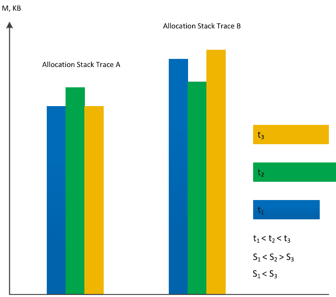

在这种情况下，难以在各种局部内存波动中选择以继续进一步调查。然而，基准进程内存转储（例如，进程启动后不久）有助于选择首先调查哪些堆栈跟踪分配：即那些具有更大绝对内存分配增加（分配堆栈跟踪B）的分配。

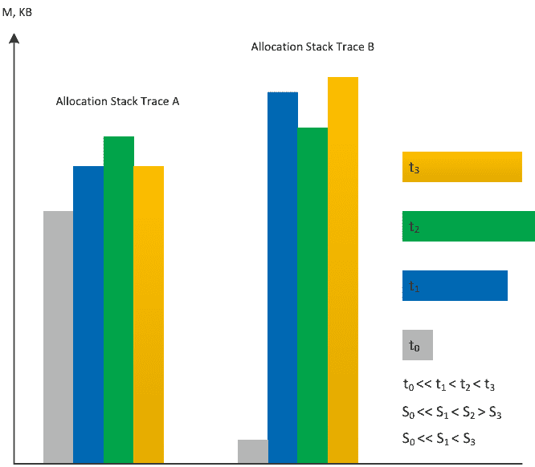

## 注释

我们可能需要评估对象分布是否存在异常（参见对象分布异常，第756页）。

## 内存泄漏

### .NET 堆

有时进程大小会持续增长，但进程堆大小没有变化。在这种情况下，我们需要检查进程是否使用 Microsoft .NET 运行时 (CLR)。如果加载的模块之一是 `mscorwks.dll` 或 `mscorsvr.dll`，那么很可能是。然后我们应该检查 CLR 堆统计信息。

在 .NET 世界中，动态分配的对象会进行垃圾回收 (GC)，因此简单的分配并遗忘内存泄漏是不可能的。为了模拟这种情况，我们创建了以下 C# 程序：

```
using System;

namespace CLRHeapLeak
{
    class Leak
    {
        private byte[] m_data;

        public Leak()
        {
            m_data = new byte[1024];
        }
    }

    class Program
    {
        static void Main(string[] args)
        {
            Leak leak = new Leak();

            while (true)
            {
                leak = new Leak();
                System.Threading.Thread.Sleep(100);
            }
        }
    }
}
```

如果运行它，进程大小将永远不会增长。GC 线程将回收并释放未引用的 Leak 类。可以通过检查启动后、2、6 和 12 分钟保存的 userdump.exe 内存转储来看到这一点。GC 堆永远不会增长到 1MB 以上，CLRHeapLeak.Leak 和 System.Byte[] 对象的数量始终在 100 到 500 之间波动。例如，在第 12 分钟，我们有以下统计信息：

```
0:000> .loadby sos mscorwks

0:000> !eeheap -gc
Number of GC Heaps: 1
generation 0 starts at 0x0147160c
generation 1 starts at 0x0147100c
generation 2 starts at 0x01471000
ephemeral segment allocation context: (0x014dc53c, 0x014dd618)
  segment begin allocated size
  004aedb8 790d7ae4 790f7064 0x00001f580(128384)
  01470000 01471000 014dd618 0x0006c618(443928)
Large object heap starts at 0x02471000
  segment begin allocated size
  02470000 02471000 02473250 0x00002250(8784)
Total Size 0x8dde8(581096)
------------------------------
GC Heap Size 0x8dde8(581096)
```

```
0:000> !dumpheap -stat
total 2901 objects
Statistics:

| Count | TotalSize | Class Name |
|-------|-----------|------------|
| 1 | 12 | System.Security.Permissions.SecurityPermission |
| 1 | 24 | System.OperatingSystem |
| 1 | 24 | System.Version |
| 1 | 24 | System.Reflection.Assembly |
| 1 | 28 | System.SharedStatics |
| 1 | 36 | System.Int64[] |
| 1 | 40 | System.AppDomainSetup |
| 3 | 60 | System.RuntimeType |
| 5 | 60 | System.Object |
| 2 | 72 | System.Security.PermissionSet |
| 1 | 72 | System.ExecutionEngineException |
| 1 | 72 | System.StackOverflowException |
| 1 | 72 | System.OutOfMemoryException |
| 1 | 100 | System.AppDomain |
| 7 | 100 | Free |
| 2 | 144 | System.Threading.ThreadAbortException |
| 4 | 328 | System.Char[] |
| 418 | 5016 | CLRHeapLeak.Leak |
| 5 | 8816 | System.Object[] |
| 2026 | 1286332 | System.String |
| 418 | 433048 | System.Byte[] |

Total 2901 objects
```

但是，我们可以通过对程序进行以下更改，使 Leak 对象始终被引用：

```
using System;

namespace CLRHeapLeak
{
    class Leak
    {
        private byte[] m_data;
        private Leak m_prevLeak;

        public Leak()
        {
            m_data = new byte[1024];
        }

        public Leak(Leak prevLeak)
        {
            m_prevLeak = prevLeak;
            m_data = new byte[1024];
        }
    }

    class Program
    {
        static void Main(string[] args)
        {
            Leak leak = new Leak();

            while (true)
            {
                leak = new Leak(leak);
                System.Threading.Thread.Sleep(100);
            }
        }
    }
}
```

然后，如果运行该程序，我们会在任务管理器中看到它随时间增长。在启动后、10 和 16 分钟获取连续内存转储显示 Win32 堆段始终具有相同的大小：

```
0:000> !heap 0 0
Index   Address Name      Debugging options enabled
1: 00530000
    Segment at 00530000 to 00630000 (00003000 bytes committed)
2: 00010000
    Segment at 00010000 to 00020000 (00003000 bytes committed)
3: 00520000
    Segment at 00520000 to 00530000 (00003000 bytes committed)
4: 00b10000
    Segment at 00b10000 to 00b50000 (00001000 bytes committed)
5: 001a0000
    Segment at 001a0000 to 001b0000 (00003000 bytes committed)
```


```
6: 00170000
Segment at 00170000 to 00180000 (00008000 bytes committed)
7: 013b0000
Segment at 013b0000 to 013c0000 (00003000 bytes committed)
```

但 GC 堆以及其中 Leak 和 System.Byte[][] 对象的数量显著增长：

```
Process Uptime: 0 days 0:00:04.000

0:000> !eeheap -gc
Number of GC Heaps: 1
generation 0 starts at 0x013c1018
generation 1 starts at 0x013c100c
generation 2 starts at 0x013c1000
ephemeral segment allocation context: (0x013cd804, 0x013cdff4)
segment begin allocated size
0055ee08 790d7ae4 790f7064 0x0001f580(128384)
013c0000 013c1000 013cdff4 0x0000cff4(53236)
Large object heap starts at 0x023c1000
segment begin allocated size
023c0000 023c1000 023c3250 0x00002250(8784)
Total Size 0x2e7c4(190404)
------------------------
GC Heap Size 0x2e7c4(190404)
```

```
0:000> !dumpheap -stat
total 2176 objects
Statistics:
              Count    TotalSize Class Name
...
...
...
             46      736 CLRHeapLeak.Leak
              5      8816 System.Object[]
             46    47656  System.Byte[]
           2035   129604  System.String
Total 2176 objects
```

```
Process Uptime: 0 days 0:09:56.000

0:000> !eeheap -gc
Number of GC Heaps: 1
generation 0 starts at 0x018cddbc
generation 1 starts at 0x01541ec4
generation 2 starts at 0x013c1000
ephemeral segment allocation context: (0x0192d668, 0x0192ddc8)
segment begin allocated size
0055ee08 790d7ae4 790f7064 0x0001f580(128384)
013c0000 013c1000 0192ddc8 0x0056cdc8(5688776)
Large object heap starts at 0x023c1000
segment begin allocated size
023c0000 023c1000 023c3240 0x00002240(8768)
Total Size 0x58e588(5825928)
-----------------
GC Heap Size 0x58e588(5825928)

0:000> !dumpheap -stat
total 12887 objects
Statistics:
Count   TotalSize Class Name
...
...
5       8816 System.Object[]
5403    86448 CLRHeapLeak.Leak
2026    128632 System.String
5403    5597508 System.Byte[]
Total 12887 objects
```

进程运行时间：0 天 0:16:33.000

```
0:000> !eeheap -gc
Number of GC Heaps: 1
generation 0 starts at 0x01c59cb4
generation 1 starts at 0x0194fd20
generation 2 starts at 0x01c13f000
ephemeral segment allocation context: (0x01cd3050, 0x01cd3cc0)
  segment   begin allocated  size
0055ee08 790d7ae4  790f7064  0x0001f580(128384)
013c0000 013c1000  01cd3cc0  0x0091f2cc0(9514176)
Large object heap starts at 0x023c1000
  segment   begin allocated  size
023c0000 023c1000  023c3240  0x00002240(8768)
Total Size  0x934480(9651328)
-----------------
GC Heap Size  0x934480(9651328)

0:000> !dumpheap -stat
total 20164 objects
Statistics:
Count   TotalSize Class Name
5       8816 System.Object[]
2026    128632 System.String
9038    144608 CLRHeapLeak.Leak
9038    9363368 System.Byte[]
Total 20164 objects
```

这不是传统的内存泄漏，因为我们有引用链。但是，不受控制的内存增长也可以被视为内存泄漏，原因可能是应用程序设计不良、输入验证不当或错误处理等问题。

有些情况下客户认为存在内存泄漏，但实际上并非如此。其中一种情况是在多处理器服务器上运行时进程大小异常巨大。如果托管典型 .NET 程序集 DLL 的 dllhost.exe 在本地工作站上占用少于 100Mb，而在 4 处理器服务器上开始占用超过 300Mb，那么很可能是服务器版本的 CLR 使用了按处理器划分的 GC 堆：

```
0:000> .loadby sos mscorsvr

0:000> !EEHeap -gc
generation 0 starts at 0x05c80154
generation 1 starts at 0x05c7720c
generation 2 starts at 0x102d0030
generation 0 starts at 0x179a0444
generation 1 starts at 0x1799b7a4
generation 2 starts at 0x142d0030
generation 0 starts at 0x0999ac88
generation 1 starts at 0x09990cc4
generation 2 starts at 0x182d0030
generation 0 starts at 0x242eccb0
generation 1 starts at 0x242d0030
generation 2 starts at 0x1c2d0030
...
...
...
GC Heap Size 0x109702ec(278332140)
```

或者如果是 CLR 1.x，旧扩展也会告诉我们同样的情况：

```
0:000> !.\clr10\sos.eeheap -gc
Loaded Son of Strike data table version 5 from
"C:\WINDOWS\Microsoft.NET\Framework\v1.1.4322\mscorsvr.dll"
Number of GC Heaps: 4
--------------------------------
Heap 0 (0x000f9af0)
generation 0 starts at 0x05c80154
generation 1 starts at 0x05c7720c
generation 2 starts at 0x102d0030
...
...
...
Heap Size 0x515ed60(85,323,104)
--------------------------------
Heap 1 (0x000fa070)
generation 0 starts at 0x179a0444
generation 1 starts at 0x1799b7a4
generation 2 starts at 0x142d0030
...
...
...
Heap Size 0x37c7bf0(58,489,840)
--------------------------------
Heap 2 (0x000ffab80)
generation 0 starts at 0x0999ac88
generation 1 starts at 0x09990cc4
generation 2 starts at 0x182d0030
...
...
...
Heap Size 0x485de34(75,882,036)
--------------------------------
Heap 3 (0x000fb448)
generation 0 starts at 0x242eccb0
generation 1 starts at 0x242d0030
generation 2 starts at 0x1c2d0030
...
...
...
Heap Size 0x41ea570(69,117,296)
------------------------
Reserved segments:
------------------------
GC Heap Size 0x1136ecf4(288,812,276)
```

处理器越多，对总 VM 大小贡献的堆就越多。虽然进程占用将近 400Mb，但如果之后不持续超过该值地随时间增长，则属于正常现象。

## 注释

我们也可以通过 !DumpHeap -mt 获取特定对象，然后通过 !gcroot 获取其在特定堆栈上的可能根。

有时候，并非泄漏，只是某种分布异常（参见“对象分布异常”，第 756 页）。

## I/O 完成包

这是“内存不足（内核池）”模式的一个专用形式（第 535 页）。与其他内核池标记相比，该模式目前提供的独特诊断是：池分配条目显示了泄漏进程：

```
0: kd> !poolused 3
Sorting by NonPaged Pool Consumed

Pool Used:
NonPaged
        Paged
Tag  Allocs  Frees  Diff   Used   Allocs  Frees  Diff   Used
Icp  1294074 42875  1251199 96642976 0      0      0      0    I/O completion packets queue
on a completion ports
[...]
```

```
0: kd> !poolfind Icp

Scanning large pool allocation table for Tag: Icp (fffffa8013e00000 : fffffa8014100000)

*fffffa800e188260 size: 50 previous size: 40 (Allocated) Icp Process: fffffa800899dc40
*fffffa800e1882e0 size: 50 previous size: 30 (Allocated) Icp Process: fffffa800899dc40
*fffffa800e188330 size: 50 previous size: 50 (Allocated) Icp Process: fffffa800899dc40
*fffffa800e188380 size: 50 previous size: 50 (Allocated) Icp Process: fffffa800899dc40
*fffffa800e1883d0 size: 50 previous size: 50 (Allocated) Icp Process: fffffa800899dc40
*fffffa800e188420 size: 50 previous size: 50 (Allocated) Icp Process: fffffa800899dc40
*fffffa800e188470 size: 50 previous size: 50 (Allocated) Icp Process: fffffa800899dc40
*fffffa800e1884c0 size: 50 previous size: 50 (Allocated) Icp Process: fffffa800899dc40
```

```
0: kd> !process fffffa800899dc40 1
PROCESS fffffa800899dc40
SessionId: 0 Cid: 434 Peb: 7efdf000 ParentCid: 0412
DirBase: 09d6b000 ObjectTable: fffffff8a0046c8c10 HandleCount: 1068.
Image: ServiceA.exe
[...]
```

## 页表

有时我们会遇到与页表数量增长相关的内存泄漏。其中一个原因可能是**僵尸进程**数量的增加，当它们达到数以万计时会很明显。

```
1: kd> !process 0 0
[...]
PROCESS fffffff8026bd6f0
SessionId: 0 Cid: 0a6c Peb: 7fffffdc000 ParentCid: 03ac
    DirBase: 9d35a000 ObjectTable: fffffff8a00170ac80 HandleCount: 152.
Image: svchost.exe
[...]
PROCESS ffffffa8027de9b30
SessionId: 0 Cid: 21d0 Peb: 7fffffdfd000 ParentCid: 02e0
    DirBase: 37881000 ObjectTable: 00000000 HandleCount: 0.
Image: conhost.exe
[...]
PROCESS ffffffa8028eb0600
SessionId: 0 Cid: ab88 Peb: 7fffffdfd000 ParentCid: 02e0
    DirBase: 27a2f000 ObjectTable: 00000000 HandleCount: 0.
Image: conhost.exe
[...]
```

即使是僵尸进程，也至少保留了一个来自其虚拟到物理内存映射之前的页表的页面（页目录）（!dd 与 dd WinDbg 命令相同，但用于物理内存）：

```
1: kd> !dd 9d35a000
#9d35a000 9d62867 03c00000 00000000 00000000
#9d35a010 00000000 00000000 00000000 00000000
#9d35a020 00000000 00000000 00000000 00000000
#9d35a030 00000000 00000000 00000000 00000000
#9d35a040 00000000 00000000 00000000 00000000
#9d35a050 00000000 00000000 00000000 00000000
#9d35a060 00000000 00000000 00000000 00000000
#9d35a070 00000000 00000000 9d45e867 49500000
```

```
1: kd> !dd 37881000
#37881000 00000000 00000000 00000000 00000000
#37881010 00000000 00000000 00000000 00000000
#37881020 00000000 00000000 00000000 00000000
#37881030 00000000 00000000 00000000 00000000
#37881040 00000000 00000000 00000000 00000000
#37881050 00000000 00000000 00000000 00000000
#37881060 00000000 00000000 00000000 00000000
#37881070 00000000 00000000 00000000 00000000
```

```
1: kd> !dd 27a2f000
#27a2f000 00000000 00000000 00000000 00000000
#27a2f010 00000000 00000000 00000000 00000000
#27a2f020 00000000 00000000 00000000 00000000
#27a2f030 00000000 00000000 00000000 00000000
#27a2f040 00000000 00000000 00000000 00000000
#27a2f050 00000000 00000000 00000000 00000000
```


我们还看到，2 个 `conhost.exe` 进程具有相同的物理到虚拟映射，因为它们的用户空间映射不再有效（已清零），而 `svchost.exe` 进程具有用户空间映射：

```
1: kd> !ptov 27a2f000
Amd64PtoV: pagedir 27a2f000
27a2f000 fffffffb`7dbed000
71530000 fffffffb`7dbee000
19d000 fffffffb`7dbef000
199000 fffffffb`7dbf0000
b6a40000 fffffffb`7dbf1000
b1f57000 fffffffb`7dbf2000
29c4000 fffffffb`7dbf3000
1c53000 fffffffb`7dbf5000
[...]
2e4d8000 ffffffa80`28f2d000
2c3d7000 ffffffa80`28f2e000
30ed6000 ffffffa80`28f2f000
2efd5000 ffffffa80`28f30000
2ded4000 ffffffa80`28f31000
2a5d3000 ffffffa80`28f32000
bb400000 ffffffa80`29600000 (large page)
bb200000 ffffffa80`29800000 (large page)
100000 ffffffff`ffd00000
105000 ffffffff`ffd01000
101000 ffffffff`ffd02000
102000 ffffffff`ffd03000
103000 ffffffff`ffd04000
104000 ffffffff`ffd05000
fec00000 ffffffff`ffd06000
1000 ffffffff`ffd07000
106000 ffffffff`ffd08000
123000 ffffffff`ffd09000
0 ffffffff`ffd0a000
124000 ffffffff`ffd0b000
2000 ffffffff`ffd0c000
e00c7000 ffffffff`ffd0d000
e0080000 ffffffff`ffd0e000
107000 ffffffff`ffd25000
108000 ffffffff`ffd26000
109000 ffffffff`ffd27000
10a000 ffffffff`ffd28000
10b000 ffffffff`ffd29000
10c000 ffffffff`ffd2a000
10d000 ffffffff`ffd2b000
10e000 ffffffff`ffd2c000
10f000 ffffffff`ffd2d000
110000 ffffffff`ffd2e000
111000 ffffffff`ffd2f000
112000 ffffffff`ffd30000
113000 ffffffff`ffd31000
114000 ffffffff`ffd32000
115000 ffffffff`ffd33000
116000 ffffffff`ffd34000
117000 ffffffff`ffd35000
118000 ffffffff`ffd36000
119000 ffffffff`ffd37000
11a000 ffffffff`ffd38000
11b000 ffffffff`ffd39000
11c000 ffffffff`ffd3a000
11d000 ffffffff`ffd3b000
11e000 ffffffff`ffd3c000
11f000 ffffffff`ffd3d000
120000 ffffffff`ffd3e000
121000 ffffffff`ffd3f000
122000 ffffffff`ffd40000
fee00000 ffffffff`ffe00000
```

```
1: kd> !ptov 37881000
Amd64PtoV: pagedir 37881000
37881000 ffffff6fb`7dbed000
8d482000 ffffff6fb`7dbee000
19d000 ffffff6fb`7dbef000
199000 ffffff6fb`7dbf0000
b6a04000 ffffff6fb`7dbf1000
b1f57000 ffffff6fb`7dbf2000
29c4000 ffffff6fb`7dbf3000
1c53000 ffffff6fb`7dbf5000
[...]
2e4d8000 ffffffa80`28f2d000
2c3d7000 ffffffa80`28f2e000
30ed6000 ffffffa80`28f2f000
2efd5000 ffffffa80`28f30000
2ded4000 ffffffa80`28f31000
2a5d3000 ffffffa80`28f32000
b4000000 ffffffa80`29600000 (large page)
bb200000 ffffffa80`29800000 (large page)
100000 ffffffff`ffd00000
105000 ffffffff`ffd01000
101000 ffffffff`ffd02000
102000 ffffffff`ffd03000
103000 ffffffff`ffd04000
104000 ffffffff`ffd05000
fec00000 ffffffff`ffd06000
1000 ffffffff`ffd07000
106000 ffffffff`ffd08000
123000 ffffffff`ffd09000
0 ffffffff`ffd0a000
124000 ffffffff`ffd0b000
2000 ffffffff`ffd0c000
e00c7000 ffffffff`ffd0d000
e0080000 ffffffff`ffd0e000
107000 ffffffff`ffd25000
108000 ffffffff`ffd26000
109000 ffffffff`ffd27000
10a000 ffffffff`ffd28000
10b000 ffffffff`ffd29000
10c000 ffffffff`ffd2a000
10d000 ffffffff`ffd2b000
10e000 ffffffff`ffd2c000
10f000 ffffffff`ffd2d000
110000 ffffffff`ffd2e000
111000 ffffffff`ffd2f000
112000 ffffffff`ffd30000
113000 ffffffff`ffd31000
114000 ffffffff`ffd32000
115000 ffffffff`ffd33000
116000 ffffffff`ffd34000
117000 ffffffff`ffd35000
118000 ffffffff`ffd36000
119000 ffffffff`ffd37000
11a000 ffffffff`ffd38000
11b000 ffffffff`ffd39000
11c000 ffffffff`ffd3a000
11d000 ffffffff`ffd3b000
11e000 ffffffff`ffd3c000
11f000 ffffffff`ffd3d000
120000 ffffffff`ffd3e000
121000 ffffffff`ffd3f000
122000 ffffffff`ffd40000
fee00000 ffffffff`ffe00000
```

```
1: kd> !ptov 9d35a000
Amd64PtoV: pagedir 9d35a000
9E587000 10000
6871E000 20000
AF5AA000 30000
AF5AB000 31000
AFAAC000 32000
AFBAD000 33000
AF2F5000 40000
9D66B000 50000
22199000 60000
9D962000 E5000
9D261000 E6000
9DC60000 E7000
9D256000 EA000
9D84F000 EB000
9E4EC000 EC000
9E081000 ED000
9D876000 EE000
9E271000 EF000
B8BFD000 F0000
B8EFE000 F1000
B86FF000 F2000
B5302000 F3000
B5202000 F4000
B5502000 F5000
B7F03000 F6000
B8404000 F7000
B8415000 100000
B8816000 101000
B1B17000 102000
[...]
2CD4000 77512000
5D7000 77515000
5D8000 77516000
4D9000 77517000
B358F000 77590000
AEF04000 77591000
68624000 77592000
64B26000 77593000
4F4C6000 77595000
B2042000 7EFE0000
B2143000 7EFE1000
B1A56000 7EFE2000
B1A57000 7EFE3000
B1B58000 7EFE4000
1AA000 7FFE0000
9DA69000 BFE80000
AEAE0000 FFEA0000
AF191000 FFEA1000
9D76A000 FFEA2000
AE793000 FFEA3000
9DC8E000 FFEA5000
B7EB7000 FFEA6000
9DFFC000 FFEA7000
[...]
2e4d8000 fffffa80`28f2d000
2c3d7000 fffffa80`28f2e000
30ed6000 fffffa80`28f2f000
2efd5000 fffffa80`28f30000
2ded4000 fffffa80`28f31000
2a5d3000 fffffa80`28f32000
bb400000 fffffa80`29600000 (large page)
bb200000 fffffa80`29800000 (large page)
100000 ffffffff`ffd00000
105000 ffffffff`ffd01000
101000 ffffffff`ffd02000
102000 ffffffff`ffd03000
103000 ffffffff`ffd04000
104000 ffffffff`ffd05000
fec00000 ffffffff`ffd06000
1000 ffffffff`ffd07000
106000 ffffffff`ffd08000
123000 ffffffff`ffd09000
0 ffffffff`ffd0a000
124000 ffffffff`ffd0b000
2000 ffffffff`ffd0c000
e00c7000 ffffffff`ffd0d000
e0080000 ffffffff`ffd0e000
107000 ffffffff`ffd25000
108000 ffffffff`ffd26000
109000 ffffffff`ffd27000
10a000 ffffffff`ffd28000
10b000 ffffffff`ffd29000
10c000 ffffffff`ffd2a000
10d000 ffffffff`ffd2b000
10e000 ffffffff`ffd2c000
10f000 ffffffff`ffd2d000
110000 ffffffff`ffd2e000
111000 ffffffff`ffd2f000
112000 ffffffff`ffd30000
113000 ffffffff`ffd31000
114000 ffffffff`ffd32000
115000 ffffffff`ffd33000
116000 ffffffff`ffd34000
117000 ffffffff`ffd35000
118000 ffffffff`ffd36000
119000 ffffffff`ffd37000
11a000 ffffffff`ffd38000
11b000 ffffffff`ffd39000
11c000 ffffffff`ffd3a000
11d000 ffffffff`ffd3b000
11e000 ffffffff`ffd3c000
11f000 ffffffff`ffd3d000
120000 ffffffff`ffd3e000
121000 ffffffff`ffd3f000
122000 ffffffff`ffd40000
fee00000 ffffffff`fffe0000
```

为了检查用户空间虚拟地址，我们必须切换到相应的进程上下文：

```
1: kd> !pte fffffa80`28f2d000
VA fffffa8028f2d000
PXE at FFFFF6FB7BDEDF88  PPE at FFFFF6FB7DBF5000  PDE at FFFFF6FB7EA00A38  PTE at FFFFF6FD40147968
contains 0000000001C54863  contains 0000000049320863  contains 000000002E4D8963
pfn 1c53  -DA--KWEV  pfn 1c54  -DA--KWEV  pfn 49320  -DA--KWEV  pfn 2e4d8  -G-DA--KWEV

1: kd> .process /r /p fffffa8026bd6f0
Implicit process is now fffffa80`26bd6f0
Loading User Symbols

1: kd> !pte 10000
VA 0000000000010000
PXE at FFFFF6FB7BDED000  PPE at FFFFF6FB7DA00000  PDE at FFFFF6FB40000000  PTE at FFFFF68000000080
contains 03C000009DD62867  contains 031000009D865867  contains 7C2000009DD6867  contains 9CB000009E587867
pfn 9dd62  -DA--UWEV  pfn 9d865  -DA--UWEV  pfn 9dd66  -DA--UWEV  pfn 9e587  -DA-UW-V
```

在看到页表所分配内存数量增长超过一千兆字节后生成的内存转储时，这种模式引起了我们的注意。

## 进程堆

内存泄漏是另一种模式，可能最终在崩溃转储中表现为 **内存不足** 模式（第 523 页）。在这里，我们介绍进程堆内存泄漏。通常，当进程虚拟内存大小随时间增长时即可识别。它从 80Mb 开始，本应正常波动在 100Mb 以下，但过了一段时间后突然开始增长到 150Mb，然后第二天增长到 300Mb，接着增长到 600Mb，以此类推。

通常，这里怀疑是进程堆出了问题。为了确认这一点，例如，我们需要在进程大小为 100Mb、200Mb 和 300Mb 时采样 2-3 个连续的用户内存转储。可以使用 Microsoft userdump.exe 命令行工具完成此操作。然后，我们可以通过使用 `!heap -s` WinDbg 命令来查看是否存在任何堆增长：

### 第 1 转储

| 堆 | 标志 | 预留 (k) | 提交 (k) | 虚拟 (k) |
|------|-------|------------|------------|----------|
| 00140000 | 00000002 | 2048 | 1048 | 1112 |
| 00240000 | 00008000 | 64 | 12 | 12 |
| 00310000 | 00001002 | 7232 | 4308 | 4600 |
| 00420000 | 00001002 | 1024 | 520 | 520 |
| 00340000 | 00001002 | 256 | 40 | 40 |
| 00720000 | 00001002 | 64 | 32 | 32 |
| 00760000 | 00001002 | 64 | 48 | 48 |
| 01020000 | 00001002 | 256 | 24 | 24 |
| 02060000 | 00001002 | 64 | 16 | 16 |
| 02070000 | 00001003 | 256 | 120 | 120 |
| 020b0000 | 00001003 | 256 | 4 | 4 |
| 020f0000 | 00001003 | 256 | 4 | 4 |
| 02130000 | 00001003 | 256 | 4 | 4 |
| 02170000 | 00001003 | 256 | 4 | 4 |
| 021f0000 | 00001002 | 1088 | 76 | 76 |
| 021e0000 | 00001002 | 64 | 16 | 16 |
| 02330000 | 00001002 | 1088 | 428 | 428 |
| 02340000 | 00001102 | 256 | 12 | 12 |
| 02380000 | 00001002 | 64 | 12 | 12 |
| 024c0000 | 00001003 | 64 | 8 | 8 |
| 028d0000 | 00001002 | 7232 | 3756 | 6188 |
| 02ce0000 | 00001003 | 64 | 8 | 8 |
| 07710000 | 00001002 | 64 | 20 | 20 |
| 07b20000 | 00001002 | 64 | 16 | 16 |
| 07f30000 | 00001002 | 64 | 16 | 16 |
| 09950000 | 00001002 | 256 | 12 | 12 |
| 09c80000 | 00001002 | 130304 | 102340 | 102684 |
| 007d0000 | 00001003 | 256 | 192 | 192 |
| 00810000 | 00001003 | 256 | 4 | 4 |
| 0bdd0000 | 00001003 | 256 | 4 | 4 |
| 0be10000 | 00001003 | 256 | 4 | 4 |
| 0be50000 | 00001003 | 256 | 4 | 4 |
| 0be90000 | 00001003 | 256 | 56 | 56 |
| 0bed0000 | 00001003 | 256 | 4 | 4 |


```
0bf10000 00001003 256 4 4
0bf50000 00001003 256 4 4
0bf90000 00001003 256 4 4
0b660000 00001002 64 20 20
00870000 00001002 64 20 20
0d760000 00001002 256 12 12
0dc60000 00001002 1088 220 220
0c3a0000 00001002 64 12 12
0c3d0000 00001002 1088 160 364
08420000 00001002 64 64 64
```

## 第 2 转储

```
0:000> !heap -s
Heap Flags Reserv Commit Virt
(k) (k) (k)
----------------------------------
00140000 00000002 8192 4600 4600
00240000 00008000 64 12 12
00310000 00001000 7232 4516 4600
00420000 00001002 1024 520 520
00340000 00001002 256 44 44
00720000 00001002 64 32 32
00760000 00001002 64 48 48
01020000 00001002 256 24 24
02060000 00001002 64 16 16
02070000 00001003 256 124 124
020b0000 00001003 256 4 4
020f0000 00001003 256 4 4
02130000 00001003 256 4 4
02170000 00001003 256 4 4
021f0000 00001002 1088 76 76
021e0000 00001002 64 16 16
02330000 00001002 1088 428 428
02340000 00011002 256 12 12
02380000 00001002 64 12 12
024c0000 00001003 64 8 8
028d0000 00001002 7232 3796 6768
02ce0000 00001003 64 8 8
07710000 00001002 64 20 20
07b20000 00001002 64 16 16
07f30000 00001002 64 16 16
09050000 00001002 256 12 12
09c80000 00001002 261376 221152 22928
007d0000 00001003 256 192 192
00810000 00001003 256 4 4
0bbd0000 00001003 256 4 4
0be10000 00001003 256 4 4
0be50000 00001003 256 4 4
0be90000 00001003 256 60 60
0bed0000 00001003 256 4 4
0bf10000 00001003 256 4 4
0bf50000 00001003 256 4 4
0bf90000 00001003 256 4 4
0b660000 00001002 64 20 20
00870000 00001002 64 20 20
```

| 0d760000 | 00001002 | 256 | 12 | 12 |
| 0dc60000 | 00001002 | 1088 | 228 | 228 |
| 0c3a0000 | 00001002 | 64 | 12 | 12 |
| 0c3d0000 | 00001002 | 1088 | 168 | 224 |
| 08450000 | 00001002 | 64 | 64 | 64 |

我们可以看到，唯一显著的堆增长出现在 09c80000 地址，从 130Mb 增长到 260Mb。然而，这并没有说明是哪段代码在使用它。为了找到这段代码，我们需要启用所谓的用户模式堆栈跟踪数据库。请参阅 Citrix 文章了解如何配置它130。文章中的示例是针对 Citrix IMA 服务的，但我们可以将 ImaSrv.exe 替换为任何其他可执行文件名。

假设在启用用户模式堆栈跟踪数据库并重新启动程序或服务后，我们观察到增长，并获得了带有以下加粗突出显示的可疑堆的内存转储：

```
0:000> !gflag
Current NtGlobalFlag contents: 0x00001000
ust - Create user mode stack trace database

0:000> !heap -s
NtGlobalFlag enables following debugging aids for new heaps:
stack back traces
LFH Key: 0x2687ed29
Heap      Flags   Reserv  Commit  Virt
          (k)     (k)     (k)
----------------------------------------
00140000 58000062 4096    488     676
00240000 58008060   64     12     12
00360000 58001062 3136   1152   1216
003b0000 58001062   64     32     32
01690000 58001062  256     32     32
016d0000 58001062 1024    520    520
003e0000 58001062   64     48     48
02310000 58001062  256     24     24
02b30000 58001062   64     16     16
02b40000 58001063  256     64     64
02b80000 58001063  256      4      4
02bc0000 58001063  256      4      4
02c00000 58001063  256      4      4
02c40000 58001063  256      4      4
02c80000 58001063  256      4      4
02cc0000 58001063  256      4      4
02d30000 58001063   64      4      4
03140000 58001062 7232   4160   4896
03550000 58001063   64      4      4
07f70000 58001062   64     12     12
08380000 58001062   64     12     12
08790000 58001062   64     12     12
091d0000 58011062  256     12     12
```

| | | | | |
|---|---|---|---|---|
| 09210000 | 58001062 | 64 | 16 | 16 |
| 09220000 | 58001062 | 64 | 12 | 12 |
| 092a0000 | 58001062 | 64 | 12 | 12 |
| 09740000 | 58001062 | 256 | 12 | 12 |
| 0b1a0000 | 58001062 | 64 | 12 | 12 |
| **0b670000** | **58001062** | **64768** | **39508** | **39700** |
| 0b7b0000 | 58001062 | 64 | 12 | 12 |
| 0c650000 | 58001062 | 1088 | 192 | 192 |

每个堆都细分为多个段，要查看哪些段增长最多，可以使用 !heap -m <堆地址> 命令：

```
0:000> !heap -m 0b670000
Index Address Name Debugging options enabled
29: 0b670000
Segment at 0b670000 to 0b6b0000 (00040000 bytes committed)
Segment at 0c760000 to 0c860000 (00100000 bytes committed)
Segment at 0c980000 to 0cb80000 (001fe000 bytes committed)
Segment at 0cb80000 to 0cf80000 (003cc000 bytes committed)
Segment at 0dc30000 to 0e430000 (00800000 bytes committed)
Segment at 12330000 to 13330000 (01000000 bytes committed)
Segment at 13330000 to 15330000 (0078b000 bytes committed)
...
...
...
```

如果使用 !heap -a <堆地址> 命令，除了堆段列表外，还会转储单个堆分配条目。这可能会产生非常大的输出，我们应该提前使用 .logopen <文件名> 命令打开日志文件。

输出可能如下所示（摘自另一个转储）：

```
0:000> !heap -a 000a0000
...
...
...
Segment00 at 000a0000:
Flags: 00000000
Base: 000a0000
First Entry: 000a0580
Last Entry: 000b0000
Total Pages: 00000010
Total UnCommit: 00000002
Largest UnCommit:00000000
UnCommitted Ranges: (1)

Heap entries for Segment00 in Heap 000a0000
000a0000: 00000 . 00580 [101] - busy (57f)
000a0580: 00580 . 00240 [101] - busy (23f)
000a07c0: 00240 . 00248 [101] - busy (22c)
000a0a08: 00248 . 00218 [101] - busy (200)
000a0c20: 00218 . 00ce0 [100]
000a1900: 00ce0 . 00f88 [101] - busy (f6a)
000a2888: 00f88 . 04418 [101] - busy (4400)
000a6ca0: 04418 . 05958 [101] - busy (5940)
000ac5f8: 05958 . 00928 [101] - busy (90c)
000acf20: 00928 . 010c0 [100]
000adfe0: 010c0 . 00020 [111] - busy (1d)
000ae000: 00002000 - uncommitted bytes.
```

然后，我们可以使用 !heap -p -a <堆条目地址> 命令检查单个条目，以查看分配它们的堆栈跟踪：

```
0:000> !heap -p -a 000a6ca0
address 000a6ca0 found in
_HEAP @ a0000
HEAP_ENTRY Size Prev Flags UserPtr UserSize - state
000a6ca0 0b2b 0000 [00] 000a6cb8 5940 - (busy)
Trace: 2156ac
7704dba4 ntdll!RtlAllocateHeap+0x0000021d
75c59b12 USP10!UspAllocCache+0x0000002b
75c62381 USP10!AllocSizeCache+0x00000048
75c61c74 USP10!FindOrCreateSizeCacheWithoutRealizationID+0x00000124
75c61bc0 USP10!FindOrCreateSizeCacheUsingRealizationID+0x00000070
75c59a97 USP10!UpdateCache+0x0000002b
75c59a61 USP10!ScriptCheckCache+0x0000005c
75c59d04 USP10!ScriptStringAnalyse+0x0000012a
7711140f LPK!LpkStringAnalyse+0x00000114
7711159e LPK!LpkCharsetDraw+0x00000302
77111488 LPK!LpkDrawTextEx+0x00000044
76a4beb3 USER32!DT_DrawStr+0x0000013a
76a4be45 USER32!DT_DrawJustifiedLine+0x000005f
76a49d68 USER32!AddEllipsisAndDrawLine+0x00000186
76a4bc31 USER32!DrawTextExWorker+0x00001b1
76a4bedc USER32!DrawTextExW+0x0000001e
746051d8 uxtheme!CTexDraw::GetTextExtent+0x00000be
7460515a uxtheme!GetTextTextExtent+0x0000065
74611ed4 uxtheme!CThemeMenuBar::MeasureItem+0x00000124
746119c1 uxtheme!CThemeMenu::OnMeasureItem+0x000003f
74611978 uxtheme!CThemeWnd::PreDefWindowProc+0x00000117
74601ea5 uxtheme!ThemeDefWindowProc+0x0000090
74601f61 uxtheme!ThemeDefWindowProcW+0x0000018
76a4a09e USER32!DefWindowProc+0x00000068
931406 notepad!NPWndProc+0x00000084
76a51a10 USER32!InternalCallWinProc+0x00000023
76a51ae8 USER32!UserCallWinProcCheckWow+0x0000014b
76a51c03 USER32!DispatchClientMessage+0x00000da
76a3bc24 USER32!_fnINTOUTLPUAHMESSAGEITEM+0x0000027
77040e6e ntdll!KiUserCallbackDispatcher+0x0000002e
76a51d87 USER32!RealDefWindowProcW+0x00000047
74601f2f uxtheme!_ThemeDefWindowProc+0x000001b8
```

如果要转储所有带有相应堆栈跟踪的堆条目，可以使用 !heap -k -h <堆地址> 命令。

有时所有这些命令都不起作用。在这种情况下，我们可以使用旧的 Windows 2000 扩展131。

有些人更喜欢使用 umdh.exe 获取文本日志文件，但将堆分配堆栈跟踪嵌入崩溃转储的优势在于，我们无需在客户现场发送和配置符号文件。

分析堆时，各种 pageheap 选项 !heap -p 非常有用，例如（摘自 WinDbg 帮助）：

> -t[c/s] [Traces]
> 
> “导致调试器显示重度堆用户收集的跟踪。Traces 指定要显示的跟踪数量；默认值为四个。如果跟踪数量多于指定数量，则显示最早的跟踪。如果使用 -t 或 -tc，则按计数用法对跟踪进行排序。如果使用 -ts，则按大小对跟踪进行排序。”

我们也可以使用 Microsoft Debug Diagnostics 工具132。


## 注释

我们可以获取不同块大小的分布统计信息，然后根据感兴趣的特定大小过滤所有堆栈跟踪：

```
0:001> !heap -stat -h 06a00000
heap @ 06a00000
group-by: TOTSIZE max-display: 20
size #blocks total ( %) (percent of total busy bytes)
240 13eb9 - 31cce80 (40.67)
48 2a813 - bf4558 (9.76)
88 14213 - ab1a18 (8.73)
28 2a6a1 - 6a0928 (5.41)
4 187062 - 61c188 (4.99)
30 1e140 - 5a3c00 (4.61)
53218d 1 - 53218d (4.24)
50 fa85 - 4e4990 (4.00)
39d2d4 1 - 39d2d4 (2.95)
c 3592b - 282e04 (2.05)
3c 9591 - 230dfc (1.79)
b8 2b2b - 1f06e8 (1.58)
9c 31a9 - 1e42fc (1.54)
70 3592 - 176fe0 (1.20)
3ec 5dc - 16fad0 (1.17)
33c 5dc - 12f390 (0.97)
14 b4d5 - e20a4 (0.72)
20 6101 - c2020 (0.62)
6c 135e - 82a8a (0.42)
60 1082 - 630c0 (0.32)
```

```
0:001> !heap -flt s 240
[...]
1c6c0db8 0055 0055 [00] 1c6c0dd0 00240 - (busy)
? ModuleA!DllUnregisterServer+272c7c
1c6c1060 0055 0055 [00] 1c6c1070 00240 - (busy)
? ModuleA!DllUnregisterServer+272c7c
1c6c1308 0055 0055 [00] 1c6c1320 00240 - (busy)
? ModuleA!DllUnregisterServer+272c7c
1c6c15b0 0055 0055 [00] 1c6c15c8 00240 - (busy)
? ModuleA!DllUnregisterServer+272c7c
1c6c1858 0055 0055 [00] 1c6c1870 00240 - (busy)
[...]
```

导致在堆栈跟踪数据库（第 563 页）中引入 **内存不足** 模式的内存转储集合，也促使将与虚拟内存地址空间区域相关的 **内存泄漏** 模式的变体纳入其中。我们创建了这个简单的建模应用程序：

```
int _tmain(int argc, _TCHAR* argv[])
{
    int i,j;
    for (i = 1; i < 1000; ++i)
    {
        for (j = 1; j < 1000; ++j)
        {
            VirtualAlloc(NULL, 0x10000, MEM_RESERVE,
                       PAGE_EXECUTE_READWRITE);
        }
        getc(stdin);
    }
    return 0;
}
```

我们只分配了保留的内存区域。提交它们可能会在某个阶段表现出针对已提交内存（第 523 页）和物理内存（第 552 页）的 **内存不足** 模式。因此，我们获取了几个连续的内存转储，并看到了在越来越大的虚拟地址处分配的区域数量不断增加：

```
0:000> laddress
[...]
*  0'04070000   0'04080000   0'00010000 MEM_PRIVATE MEM_RESERVE   <unclassified>
*  0'04080000   0'04090000   0'00010000 MEM_PRIVATE MEM_RESERVE   <unclassified>
*  0'04090000   0'040a0000   0'00010000 MEM_PRIVATE MEM_RESERVE   <unclassified>
*  0'040a0000   0'040b0000   0'00010000 MEM_PRIVATE MEM_RESERVE   <unclassified>
*  0'040b0000   0'040c0000   0'00010000 MEM_PRIVATE MEM_RESERVE   <unclassified>
*  0'040c0000   0'040d0000   0'00010000 MEM_PRIVATE MEM_RESERVE   <unclassified>
*  0'040d0000   0'040e0000   0'00010000 MEM_PRIVATE MEM_RESERVE   <unclassified>
*  0'040e0000   0'040f0000   0'00010000 MEM_PRIVATE MEM_RESERVE   <unclassified>
*  0'040f0000   0'04100000   0'00010000 MEM_PRIVATE MEM_RESERVE   <unclassified>
*  0'04100000   0'04110000   0'00010000 MEM_PRIVATE MEM_RESERVE   <unclassified>
*  0'04110000   0'04120000   0'00010000 MEM_PRIVATE MEM_RESERVE   <unclassified>
*  0'04120000   0'04130000   0'00010000 MEM_PRIVATE MEM_RESERVE   <unclassified>
*  0'04130000   0'04140000   0'00010000 MEM_PRIVATE MEM_RESERVE   <unclassified>
*  0'04140000   0'04260000   0'00120000   MEM_FREE   PAGE_NOACCESS   Free
[...]
```

```
0:000> laddress
[...]
*  0'2eec0000   0'2eed0000   0'00010000 MEM_PRIVATE MEM_RESERVE   <unclassified>
*  0'2eed0000   0'2eee0000   0'00010000 MEM_PRIVATE MEM_RESERVE   <unclassified>
*  0'2eee0000   0'2eef0000   0'00010000 MEM_PRIVATE MEM_RESERVE   <unclassified>
*  0'2eef0000   0'2ef00000   0'00010000 MEM_PRIVATE MEM_RESERVE   <unclassified>
*  0'2ef00000   0'2ef10000   0'00010000 MEM_PRIVATE MEM_RESERVE   <unclassified>
*  0'2ef10000   0'2ef20000   0'00010000 MEM_PRIVATE MEM_RESERVE   <unclassified>
*  0'2ef20000   0'2ef30000   0'00010000 MEM_PRIVATE MEM_RESERVE   <unclassified>
*  0'2ef30000   0'2ef40000   0'00010000 MEM_PRIVATE MEM_RESERVE   <unclassified>
*  0'2ef40000   0'2ef50000   0'00010000 MEM_PRIVATE MEM_RESERVE   <unclassified>
*  0'2ef50000   0'2ef60000   0'00010000 MEM_PRIVATE MEM_RESERVE   <unclassified>
*  0'2ef60000   0'2ef70000   0'00010000 MEM_PRIVATE MEM_RESERVE   <unclassified>
*  0'2ef70000   0'2ef80000   0'00010000 MEM_PRIVATE MEM_RESERVE   <unclassified>
*  0'2ef80000   0'2ef90000   0'00010000 MEM_PRIVATE MEM_RESERVE   <unclassified>
*  0'2ef90000   0'2efa0000   0'00010000 MEM_PRIVATE MEM_RESERVE   <unclassified>
*  0'2efa0000   0'2efb0000   0'00010000 MEM_PRIVATE MEM_RESERVE   <unclassified>
* 0'2efb0000 0'2efc0000 0'00010000 MEM_PRIVATE MEM_RESERVE <unclassified>
* 0'2efc0000 0'2efd0000 0'00010000 MEM_PRIVATE MEM_RESERVE <unclassified>
* 0'2efd0000 0'2efe0000 0'00010000 MEM_PRIVATE MEM_RESERVE <unclassified>
* 0'2efe0000 0'2eff0000 0'00010000 MEM_PRIVATE MEM_RESERVE <unclassified>
* 0'2eff0000 0'2f000000 0'00010000 MEM_PRIVATE MEM_RESERVE <unclassified>
* 0'2f000000 0'2f010000 0'00010000 MEM_PRIVATE MEM_RESERVE <unclassified>
* 0'2f010000 0'2f170000 0'00160000 MEM_FREE PAGE_NOACCESS Free
[...]
```

```
0:000> !address
[...]
* 0'697f0000 0'69800000 0'00010000 MEM_PRIVATE MEM_RESERVE <unclassified>
* 0'69800000 0'69810000 0'00010000 MEM_PRIVATE MEM_RESERVE <unclassified>
* 0'69810000 0'69820000 0'00010000 MEM_PRIVATE MEM_RESERVE <unclassified>
* 0'69820000 0'69830000 0'00010000 MEM_PRIVATE MEM_RESERVE <unclassified>
* 0'69830000 0'69840000 0'00010000 MEM_PRIVATE MEM_RESERVE <unclassified>
* 0'69840000 0'69850000 0'00010000 MEM_PRIVATE MEM_RESERVE <unclassified>
* 0'69850000 0'69860000 0'00010000 MEM_PRIVATE MEM_RESERVE <unclassified>
* 0'69860000 0'69870000 0'00010000 MEM_PRIVATE MEM_RESERVE <unclassified>
* 0'69870000 0'69880000 0'00010000 MEM_PRIVATE MEM_RESERVE <unclassified>
* 0'69880000 0'69890000 0'00010000 MEM_PRIVATE MEM_RESERVE <unclassified>
* 0'69890000 0'698a0000 0'00010000 MEM_PRIVATE MEM_RESERVE <unclassified>
* 0'698a0000 0'699e0000 0'00140000 MEM_FREE PAGE_NOACCESS Free
[...]
```

```
0:000> !address
[...]
* 0'c08c0000 0'c08d0000 0'00010000 MEM_PRIVATE MEM_RESERVE <unclassified>
* 0'c08d0000 0'c08e0000 0'00010000 MEM_PRIVATE MEM_RESERVE <unclassified>
* 0'c08e0000 0'c08f0000 0'00010000 MEM_PRIVATE MEM_RESERVE <unclassified>
* 0'c08f0000 0'c0900000 0'00010000 MEM_PRIVATE MEM_RESERVE <unclassified>
* 0'c0900000 0'c0910000 0'00010000 MEM_PRIVATE MEM_RESERVE <unclassified>
* 0'c0910000 0'c0920000 0'00010000 MEM_PRIVATE MEM_RESERVE <unclassified>
* 0'c0920000 0'c0930000 0'00010000 MEM_PRIVATE MEM_RESERVE <unclassified>
* 0'c0930000 0'c0960000 0'00030000 MEM_FREE PAGE_NOACCESS Free
[...]
```

```
0:000> !address
[...]
1'3d6a0000 1'3d6b0000 0'00010000 MEM_PRIVATE MEM_RESERVE <unclassified>
* 1'3d6b0000 1'3d6c0000 0'00010000 MEM_PRIVATE MEM_RESERVE <unclassified>
* 1'3d6c0000 1'3d6d0000 0'00010000 MEM_PRIVATE MEM_RESERVE <unclassified>
* 1'3d6d0000 1'3d6e0000 0'00010000 MEM_PRIVATE MEM_RESERVE <unclassified>
* 1'3d6e0000 1'3d6f0000 0'00010000 MEM_PRIVATE MEM_RESERVE <unclassified>
* 1'3d6f0000 1'3d700000 0'00010000 MEM_PRIVATE MEM_RESERVE <unclassified>
* 1'3d700000 1'3d710000 0'00010000 MEM_PRIVATE MEM_RESERVE <unclassified>
* 1'3d710000 1'3d720000 0'00010000 MEM_PRIVATE MEM_RESERVE <unclassified>
* 1'3d720000 1'3d730000 0'00010000 MEM_PRIVATE MEM_RESERVE <unclassified>
* 1'3d730000 1'3d7a0000 0'00070000 MEM_FREE PAGE_NOACCESS Free
[...]
```

```
0:000> !address
[...]
* 1'3d700000 1'3d710000 0'00010000 MEM_PRIVATE MEM_RESERVE <unclassified>
* 1'3d710000 1'3d720000 0'00010000 MEM_PRIVATE MEM_RESERVE <unclassified>
* 1'3d720000 1'3d730000 0'00010000 MEM_PRIVATE MEM_RESERVE <unclassified>
* 1'3d730000 1'3d7a0000 0'00070000 MEM_FREE PAGE_NOACCESS Free
[...]
```

```
0:000> !address -summary
```

| | 区域数 | 总大小 | 已用百分比 | 总百分比 |
| :--- | :--- | :--- | :--- | :--- |
| 空闲 | 15 | 7fe'c27e000 ( 7.995 Tb) | | 99.94% |
| <未分类> | 80928 | 1'3d193000 ( 4.955 Gb) | 99.86% | 0.06% |
| 映像 | 28 | 0'0034b000 ( 3.293 Mb) | 0.06% | 0.00% |
| 堆栈 | 6 | 0'0020b000 ( 2.000 Mb) | 0.04% | 0.00% |
| 内存映射文件 | 8 | 0'001af000 ( 1.684 Mb) | 0.03% | 0.00% |
| TEB | 2 | 0'00004000 ( 16.000 kb) | 0.00% | 0.00% |
| PEB | 1 | 0'00001000 ( 4.000 kb) | 0.00% | 0.00% |

| | 区域数 | 总大小 | 已用百分比 | 总百分比 |
| :--- | :--- | :--- | :--- | :--- |
| MEM_PRIVATE | 80936 | 1'3d397000 ( 4.957 Gb) | 99.90% | 0.06% |
| MEM_IMAGE | 29 | 0'0034c000 ( 3.297 Mb) | 0.06% | 0.00% |
| MEM_MAPPED | 8 | 0'001af000 ( 1.684 Mb) | 0.03% | 0.00% |


| 状态摘要 | 区域数 | 总大小 | 忙碌百分比 | 总百分比 |
|---|---|---|---|---|
| MEM_FREE | 15 | 7fe' c275e000 ( 7.995 Tb) | 99.94% | 99.94% |
| MEM_RESERVE | 80926 | 1' 3d438000 ( 4.957 Gb) | 99.91% | 0.06% |
| MEM_COMMIT | 47 | 0' 0045a000 ( 4.352 Mb) | 0.09% | 0.00% |

| 保护摘要（针对提交） | 区域数 | 总大小 | 忙碌百分比 | 总百分比 |
|---|---|---|---|---|
| PAGE_EXECUTE_READ | 4 | 0' 0001ef000 ( 1.934 Mb) | 0.04% | 0.00% |
| PAGE_READONLY | 19 | 0' 0001de000 ( 1.867 Mb) | 0.04% | 0.00% |
| PAGE_READWRITE | 17 | 0' 000080000 ( 512.000 kb) | 0.01% | 0.00% |
| PAGE_WRITECOPY | 5 | 0' 000008000 ( 32.000 kb) | 0.00% | 0.00% |
| PAGE_READWRITE\|PAGE_GUARD | 2 | 0' 000005000 ( 20.000 kb) | 0.00% | 0.00% |

| 按使用情况划分的最大区域 | 基址 | 区域大小 |
|---|---|---|
| 空闲 | 1' 3fac7000 | 7fd' bdc790000 ( 7.991 Tb) |
| <未分类> | 0' 7f0e00000 | 0' 00f000000 ( 15.000 Mb) |
| 映像 | 0' 778310000 | 0' 000102000 ( 1.008 Mb) |
| 堆栈 | 0' 001700000 | 0' 000fb0000 (1004.000 kb) |
| 内存映射文件 | 0' 7efe50000 | 0' 000fb0000 (1004.000 kb) |
| TEB | 7ff' ffffdc000 | 0' 000002000 ( 8.000 kb) |
| PEB | 7ff' ffffd3000 | 0' 000010000 ( 4.000 kb) |

检查此类区域的执行残留（第 371 页）例如模块提示（第 696 页）可能会指向进一步的故障排除方向，尤其是在无法进行实时调试的情况下。

## 消息框

崩溃转储中其他可疑的线程是执行消息框代码的 GUI 线程。通常，会显示消息框来显示某些错误，我们可以通过转储第二个和第三个 _MessageBox_ 参数来查看它：

```
int MessageBox(
  HWND hWnd,
  LPCTSTR lpText,
  LPCTSTR lpCaption,
  UINT uType);
```

有时候消息框会阻塞进程，如说明**耦合进程**模式（第 149 页）的示例所示。其他线程可能指向来自终端服务环境的内存转储中可能“挂起”的会话和进程。这是集体**阻塞线程**模式（第 82 页）的另一个示例。

让我们看一个示例，其中消息框指向了正确的故障排除方向。有人报告某个用户进程时不时会挂起。但是，没有指定是哪一个。在系统中所有线程的日志中搜索 _MessageBox_，该日志由 **!process 0 3f** WinDbg 命令生成，揭示了以下线程：

```
THREAD 88b14da8 Cid 0a04.0c14 Teb: 7ffdd000 Win32Thread: e5e50ab0 WAIT: (WrUserRequest) UserMode Non-Alertable
87b74358 SynchronizationEvent
IRP List:
87a0ba00: (0006,0244) Flags: 00000000 Mdl: 00000000
Not impersonating
DeviceMap e14bec28
Owning Process 888ffb60 Image: OUTLOOK.EXE
Wait Start TickCount 1275435 Ticks: 210 (0:00:00:03.281)
Context Switch Count 1050203 LargeStack
UserTime 00:00:16.812
KernelTime 00:00:18.000
Win32 Start Address OUTLOOK (0x30001084)
Start Address kernel32!BaseProcessStartThunk (0x7c810665)
Stack Init a0c98000 Current a0c97cb0 Base a0c98000 Limit a0c90000 Call 0
Priority 11 BasePriority 8 PriorityDecrement 2 DecrementCount 16
ChildEBP RetAddr
a0c97cfc 804e1bd2 nt!KiSwapContext+0x2f
a0c97cd4 804e1c1e nt!KiSwapThread+0x8a
a0c97cfc bf802f70 nt!KeWaitForSingleObject+0x1c2
a0c97d38 bf803776 win32k!xxxSleepThread+0x192
a0c97d4c bf803793 win32k!xxxRealWaitMessageEx+0x12
a0c97d5c 8ad4d099 win32k!NtUserWaitMessage+0x14
a0c97d5c 7c90eb94 nt!KiFastCallEntry+0xf8c
0013f3a8 7e419418 ntdll!KiFastSystemCallRet
0013f3e0 7e42593f USER32!NtUserWaitMessage+0xc
0013f408 7e43a91e USER32!InternalDialogBox+0xd0
0013f6fc 7e43a284 USER32!SoftModalMessageBox+0x938
0013f818 7e4661d3 USER32!MessageBoxWorker+0x2ba
0013f870 7e466278 USER32!MessageBoxTimeout+0x7a
0013f8a4 7e450617 USER32!MessageBoxTimeoutA+0x9c
0013f8c4 7e4505cf USER32!MessageBoxExA+0x1b
0013f8e0 088098a9 USER32!MessageBoxA+0x45
...
...
...
0: kd> .process /r /p 888ffb60
Implicit process is now 888ffb60
Loading User Symbols
0: kd> !thread 88b14da8
...
...
...
ChildEBP RetAddr Args to Child
...
...
...
0013f8e0 088098a9 00000000 0013f944 088708f0 USER32!MessageBoxA+0x45
...
...
...
0: kd> dA 0013f944
0013f944 "Cannot contact database, Retry"
```

这立即引起了怀疑，查看同一应用程序中的其他线程发现，其中许多线程都试图打开网络连接，例如：

```
THREAD 87a70da8 Cid 0a04.0cc0 Teb: 7ff83000 Win32Thread: 00000000 WAIT: (UserRequest) UserMode Non-Alertable
87d690b0 NotificationEvent
87a70e98 NotificationTimer
IRP List:
87af7bc8: (0006,0244) Flags: 00000000 Mdl: 00000000
Not impersonating
DeviceMap e14bec28
Owning Process 888ffb60 Image: OUTLOOK.EXE
Wait Start TickCount 1267130 Ticks: 8515 (0:00:02:13.046)
Context Switch Count 18
UserTime 00:00:00.000
KernelTime 00:00:00.000
Win32 Start Address msmapi32!OpenThreadImpersonationToken (0x35f76963)
Start Address kernel32!BaseThreadStartThunk (0x7c810659)
Stack Init 9fbc5000 Current 9fbc4ca0 Base 9fbc5000 Limit 9fbc2000 Call 0
Priority 8 BasePriority 8 PriorityDecrement 0 DecrementCount 16
Kernel stack not resident.
ChildEBP RetAddr
9fbc4cb8 804e1bd2 nt!KiSwapContext+0x2f
9fbc4cc4 804e1c1e nt!KiSwapThread+0x8a
9fbc4ce8 8056d2f9 nt!KeWaitForSingleObject+0x1c2
9fbc4d50 804dd99f nt!NtWaitForSingleObject+0x9a
9fbc4d50 7c90eb94 nt!KiFastCallEntry+0xfc
1bd8f52c 7c90e9c0 ntdll!KiFastSystemCallRet
1bd8f530 7c8025cb ntdll!ZwWaitForSingleObject+0xc
1bd8f594 7c802532 kernel32!WaitForSingleObjectEx+0xa8
1bd8f5a8 77eec4c6 kernel32!WaitForSingleObject+0x12
1bd8f6a4 77eec8b7 RPCRT4!S_WaitOrOpenx31d
1bd8f7c8 77eec96d RPCRT4!TCPOrHTTP_Open+0x19e
1bd8f800 77e83e8d RPCRT4!TCP_Open+0x55
1bd8f84c 77e84f37 RPCRT4!OSF_CCONNECTION::TransOpen+0x5e
1bd8f8b4 77e84581 RPCRT4!OSF_CCONNECTION::OpenConnectionAndBind+0xbc
1bd8f8f8 77e844d0 RPCRT4!OSF_CCALL::BindToServer+0x104
1bd8f95c 77e7f99c RPCRT4!OSF_BINDING_HANDLE::AllocateCCall+0x2b0
1bd8f98c 77e791c1 RPCRT4!OSF_BINDING_HANDLE::NegotiateTransferSyntax+0x28
1bd8f9a4 77e791f8 RPCRT4!I_RpcGetBindingWithObject+0x5b
1bd8f9b4 77e79825 RPCRT4!I_RpcGetBuffer+0xf
1bd8f9c4 77e4f60b RPCRT4!NdrGetBuffer+0x28
1bd8fda4 35bae645 RPCRT4!NdrClientCall2+0x195
...
...
...
```

查看 IRP 显示了网络在 TDI 级别可能存在的问题：

```
0: kd> !irp 87af7bc8
Irp is active with 4 stacks 2 is current (= 0x87af7c5c)
 No Mdl: No System Buffer: Thread 87a70da8:  Irp stack trace.
  cmd  flg cl Device   File     Completion-Context
 [  0, 0]  0  0 00000000 00000000 00000000-00000000
            Args: 00000000 00000000 00000000 00000000
>[ f, 3]  0 e1 897b0310 87bb24c8 alad7080-87b6f1f0 Success Error Cancel pending
          \Driver\Tcpip    MYTDI!WaitForNetwork
            Args: 00000000 87a33988 87a33af8 ala57600
 [ f, 3]  0 e1 88c13020 87bb24c8 alal6bea5-87a33988 Success Error Cancel pending
          \Driver\SYMTDI  afd!AfdRestartSuperConnect
            Args: 00000000 87a33988 87a33af8 ala57600
 [  e,1]  0 0 88bedf18 87d3af90 00000000-00000000
            \Driver\AFD
            Args: 00000000 00000016 000120c7 1bd8f52c
```

## 注释

另一个类似的示例是服务线程打开一个对话框，但服务不允许与桌面交互。这会有效地阻塞该线程，如果阻塞的线程拥有同步对象，还可能阻塞其他线程。

## 消息钩子

除了通过代码修补来钩住函数之外，还有一种通过 Windows 消息钩子13机制完成的函数前后处理，我们称其为**消息钩子**模式，以将其与**钩子函数**模式（第 488 页）区分开来。在某些情况下，消息钩子会成为异常软件行为（包括尖峰、挂起和崩溃）的根源。我们可以通过查看问题线程的原始堆栈来识别此类残留：

```
0:000> !teb
TEB at 7ffde000
    ExceptionList:        0012fcdc
    StackBase:            00130000
    StackLimit:           0011b000
    SubSystemTib:         00000000
    FiberData:            00001e00
    ArbitraryUserPointer: 00000000
    Self:                 7ffde000
    EnvironmentPointer:   00000000
    ClientId:             0000050c . 000004b8
    RpcHandle:            00000000
    Tls Storage:          00000000
    PEB Address:          7ffdf000
    LastErrorValue:       0
    LastStatusValue:      c0000034
    Count Owned Locks:    0
    HardErrorMode:        0

0:000> dps 0011b000 00130000
[...]
0012fc78  7e4318d1 user32!DispatchHookA
0012fc7c  0012fcb8
0012fc80  7472467f
0012fc84  7e43e1ad user32!NtUserCallNextHookEx+0xc
0012fc88  7e43e18a user32!CallNextHookEx+0x6f
0012fc8c  00000003
0012fc90  00000011
0012fc94  001d0001
0012fc98  00000001
0012fc9c  00000003
0012fca0  00000000
0012fca4  001d0001
0012fca8  0012fcec
0012fcac  74730844 DllA!ThreadKeyboardProc+0x77
0012fcb0  001e04f7
0012fcb4  00000003
0012fcb8  00000011
0012fcbc  001d0001
0012fcc0  00000003
```


```
0012fcc4 00020003
0012fcc8 001d0001
0012fccc 00000000
0012fcd0 01e04f7
0012fcd4 0012fcc0
0012fcd8 00000000
0012fcdc 0012fd4c
0012fce0 7475f1a6
0012fce4 74730850
0012fce8 ffffffff
0012fcec 0012fd20
0012fcf0 7e431923 user32!DispatchHookA+0x101
0012fcf4 00000003
0012fcf8 00000011
0012fcfc 001d0001
0012fd00 00000000
0012fd04 0012fe94
0012fd08 00000102
0012fd0c 7ffde000
0012fd10 00000000
0012fd14 00000001
0012fd18 00000003
0012fd1c 7e42b326 user32!CallHookWithSEH+0x44
0012fd20 0012fd5c
0012fd24 7e42b317 user32!CallHookWithSEH+0x21
0012fd28 00020003
0012fd2c 00000011
0012fd30 001d0001
0012fd34 747307c3
0012fd38 00000000
0012fd3c 0012fe94
0012fd40 00000102
[...]
0:000> ub 74730844
DllA!ThreadKeyboardProc+0x5e:
7473082b jne DllA!ThreadKeyboardProc+0x77 (74730844)
7473082d cmp dword ptr [ebp-1Ch],esi
74730830 je DllA!ThreadKeyboardProc+0x77 (74730844)
74730832 push dword ptr [ebp+10h]
74730835 push dword ptr [ebp+0Ch]
74730838 push dword ptr [ebp+8]
7473083b push dword ptr [ebp-1Ch]
7473083e call dword ptr [DllA!_imp_CallNextHookEx (74721248)]
```

有时我们甚至可以重构显示消息挂钩调用堆栈的堆栈跟踪片段¹³⁴。当线程在消息挂钩过程中激增或阻塞时，我们可以看到挂钩模块：

```
0:000> kL
ChildEBP RetAddr
0012fc80 7e43e1ad ntdll!KiFastSystemCallRet
0012fca8 74730844 user32!NtUserCallNextHookEx+0xc
0012fcce 7e431923 DllA!ThreadKeyboardProc+0x77
0012fd20 7e42b317 user32!DispatchHookA+0x101
0012fd5c 7e430238 user32!CallHookWithSEH+0x21
0012fd80 7c90e473 user32!_fnHKINDWORD+0x24
0012fda4 7e4193e9 ntdll!KiUserCallbackDispatcher+0x13
0012fdd0 7e419402 user32!NtUserPeekMessage+0xc
0012fdfc 747528ee user32!PeekMessageW+0xbc
[...]
0012fff0 00000000 kernel32!BaseProcessStart+0x23
```

## 注释

## 另一个示例：

```
002afcd0 765614ab ntdll!ZwWaitForSingleObject+0x15
002afdc3 768b1194 KERNELBASE!WaitForSingleObjectEx+0x98
002afd54 768b1148 kernel32!WaitForSingleObjectExImplementation+0x75
002afd68 002e95de kernel32!WaitForSingleObject+0x12
WARNING: Stack unwind information not available. Following frames may be wrong.
002afd9c 767c8336 HookA+0x95de
002afdcc 767b0a09 USER32!DispatchHook+0x10e
002afe0c 767c2bfd USER32!CallHookWithSEH+0x21
002afec3 775b010a USER32!__fnHkINLPMOUSEHOOKSTRUCTEX+0x29
002afed4 00471c64 ntdll!KiUserCallbackDispatcher+0x2e
002afefc 00471d1f ProcessA+0x62d00
[...]
002aff94 775d9f72 kernel32!BaseThreadInitThunk+0xe
002affd4 775d9f45 ntdll!_RtlUserThreadStart+0x70
002affec 00000000 ntdll!_RtlUserThreadStart+0x1b
```

## 镜像转储集

如果操作系统不在虚拟机中，则很难获取物理内存的一致性实时快照（请参阅不一致转储分析模式，第 498 页）。LiveKd¹³⁵ 中的镜像转储选项可以保存一致的内核内存转储。然后，我们可以使用 Fiber Bundle¹³⁶ 技术保存单个进程内存转储，或使用 LiveKd 创建不一致的完整内存转储，或两者兼用。我们称此模式为镜像转储集。


我们可以使用以下当前堆栈跟踪来识别镜像转储：

```
0: kd> version
...
64-bit Kernel bitmap dump: ...
...
```

```
0: kd> k
 # Child-SP RetAddr Call Site
00 ffffd000`26121700 fffff803`c5f55ee3 nt!IopLiveDumpEndMirroringCallback+0x7f
01 ffffd000`26121750 fffff803`c6f0561b nt!MmDuplicateMemory+0x807
02 ffffd000`26121830 fffff803`cF851c60 nt!IopLiveDumpCaptureMemoryPages+0x53
03 ffffd000`26121890 fffff803`cf44744d nt!IoCaptureLiveDump+0xf8
04 ffffd000`261218e0 fffff803`cF8ce0bd nt!DbgkCaptureLiveKernelDump+0x2e7
05 ffffd000`26121970 fffff803`cf3deb3b nt!NtSystemDebugControl+0x3f5
06 ffffd000`26121a90 00007ffa`2925205a nt!KiSystemServiceCopyEnd+0x13
07 000000a3`5bcddb48 00000000`00000000 0x00007ffa`2925205a
```

在一个分析案例中，我们得到了这样一组数据，在完整内存中分析了端点在筛选器驱动程序（第 924 页）中阻塞的用户空间堆栈跟踪中的 ALPC 等待链（第 1097 页）。但由于不一致性，查找帧中包含筛选器管理器的堆栈跟踪失败：

```
0: kd> version
...
64-bit Full kernel dump: ...
...
```

```
0: kd> !stacks 2 FltMgr
...
TYPE mismatch for thread object at ffffe001b804d638
4.----- NO ETHREAD DATA
TYPE mismatch for thread object at ffffe001b804d638
4.----- NO ETHREAD DATA
TYPE mismatch for thread object at ffffe001b804d638
4.----- NO ETHREAD DATA
TYPE mismatch for thread object at ffffe001b804d638
4.----- NO ETHREAD DATA
TYPE mismatch for thread object at ffffe001b804d638
4.----- NO ETHREAD DATA
...
```

因此，我们从一致的镜像转储中找到了这样的内核空间堆栈跟踪。

## 缺失组件

### 常规

当某个 DLL 缺失时，代码有时会引发异常。如果没有符号和源代码，我们需要猜测该组件名称。这可以通过检查异常 ESP/RSP 值附近的原始堆栈数据来完成。

考虑 App.exe 的以下不完整非托管堆栈跟踪的崩溃转储：

```
EXCEPTION_RECORD: ffffffff -- (.exr 0xffffffffffffffff)
ExceptionAddress: 76f442eb (kernel32!RaiseException+0x00000058)
  ExceptionCode: c06d007f
  ExceptionFlags: 00000000
NumberParameters: 1
  Parameter[0]: 0024f21c

0:000> kL
ChildEBP RetAddr
0024f1f8 6eb1081e kernel32!RaiseException+0x58
WARNING: Stack unwind information not available. Following frames may be wrong.
0024f260 6eac2fbb AppNativeLib!AppLibraryExports::InteropNotifyUnAdvise+0x6aa9
0024f2ac 6ea9e269 AppNativeLib!AppLibraryExports::Phase2Initialization+0x24c9
0024f32c 79e74d79 AppNativeLib!AppLibraryExports::QueryDatabase+0x99da
0024f3d4 664bd6af mscorwks!MethodTable::IsValueType+0x35
0024f3e8 319ce9e AppShell_ni+0x2d6af
0024f3f4 31a15d19 UIX_ni+0x1ec9e
0024f3f8 00000000 UIX_ni+0x65d19
```

我们可以尝试将此崩溃解释为托管代码异常（第 617 页），但首先让我们检查异常代码。Google 搜索显示，错误代码 c06d007f 表示“延迟加载导出缺失”，这肯定与某个缺失的 DLL 有关。无法从堆栈跟踪输出中得知缺失的是哪一个。需要进一步挖掘。

让我们查看原始堆栈。首先，我们可以尝试查看线程原始堆栈数据中是否有对 LoadLibrary 的调用：

```
0:000> !teb
TEB at 7ffdf000
    ExceptionList:        0024f8c4
    StackBase:            00250000
    StackLimit:           00249000
    SubSystemTib:         00000000
    FiberData:            0001e000
    ArbitraryUserPointer: 00000000
    Self:                 7ffdf000
    EnvironmentPointer:   00000000
    ClientId:             000012f4 . 0001080
    RpcHandle:            00000000
    Tls Storage:          004e8a18
    PEB Address:          7ffde000
```

LastErrorValue: 126
LastStatusValue: c0000135
Count Owned Locks: 0
HardErrorMode: 0

0:000> dds 00249000 00250000
00249000 00000000
00249004 00000000
...
0024f1a0 00000000
0024f1a4 00000000
0024f1a8 c0d007f
0024f1ac 00000000
0024f1b0 00000000
0024f1b4 76f442eb kernel32!RaiseException+0x58
0024f1b8 00000001
0024f1bc 0024f21c
0024f1c0 00000000
0024f1c4 00000000
0024f1c8 00000000
0024f1cc 00000000
0024f1d0 76f00000 kernel32!_imp__aullrem (kernel32+0x0)
0024f1d4 7fbd2a5d
0024f1d8 0024f1e8
0024f1dc 76fb8e8f kernel32!LookupHandler+0x10
0024f1e0 6ecb9b40 AppNativeLib!ShutdownSingletonMgr+0x15b024
0024f1e4 0024f21c
0024f1e8 0024f200
0024f1ec 6ec74e2a AppNativeLib!ShutdownSingletonMgr+0x11630e
0024f1f0 6ecb9b40 AppNativeLib!ShutdownSingletonMgr+0x15b024
0024f1f4 6ecb9ff0 AppNativeLib!ShutdownSingletonMgr+0x15b4d4
0024f1f8 0024f260
0024f1fc 6eb1081e AppNativeLib!AppLibraryExports::InteropNotifyUnAdvise+0x6aa9
0024f200 c6d007f
0024f204 00000000
0024f208 00000001
...

我们的崩溃转储中没有这样的调用。然后，我们可以尝试将原始堆栈数据解释为字节流，以查看 “.dll” 字符串：

```
0:000> db 00249000 00250000
00249000 00 00 00 00 00 00 00 00-00 00 00 00 00 00 00 00 ................
00249010 00 00 00 00 00 00 00 00-00 00 00 00 00 00 00 00 ................
00249020 00 00 00 00 00 00 00 00-00 00 00 00 00 00 00 00 ................
00249030 00 00 00 00 00 00 00 00-00 00 00 00 00 00 00 00 ................
...
```

除了 “user32.dll” 外，没有这样的字符串。


现在我们可以尝试将每个双字解释为指向 Unicode 字符串的指针：

```
0:000> dpu 00249000 00250000
...
```

没有包含 ".dll" 的字符串。最后，如果我们尝试将每个双字解释为指向 ASCII 字符串的指针，我们会得到一些对 "AppService.dll" 的引用：

```
0:000> dpa 00249000 00250000
...
0024f1d0 76f00000 "MZ."
0024f1d4 7fbd2a5d
0024f1d8 0024f1e8 ""
0024f1dc 76fb8e8f ".-t.-E."
0024f1e0 6ecb940 "AppService.dll"
0024f1e4 0024f21c $"
0024f1e8 0024f200 ""
0024f1ec 6ec74e2a ".^.-.]..".
0024f1f0 6ecb940 "AppService.dll"
0024f1f4 6ecb9ff0 "CreateServiceInstance"
0024f1f8 0024f260 "..$"
0024f1fc 6eb1081e ".].....e."
0024f200 0c6d007f
0024f204 00000000
0024f208 00000001
0024f20c 0024f268 "..$"
0024f210 00000000
0024f214 0024f2c8 "...n .n.<.$"
0024f218 6ece220 ""
0024f21c 00000024
0024f220 6ecb9960 ".,"
0024f224 6eceb95c ".c..n.2.n"
0024f228 6ecb940 "AppService.dll"
0024f22c 00000001
0024f230 6ecb9ff0 "CreateServiceInstance"
0024f234 ffffffff
0024f238 00000000
```

如果我们在 dps WinDbg 命令输出中搜索指针 0024f1e0，会发现它靠近 RaiseException 调用，而且似乎我们所有指向 "AppService.dll" 字符串的指针都落在 AppNativeLib 地址范围内：

```
0024f1b4 76f442eb kernel32!RaiseException+0x58
0024f1b8 00000001
0024f1bc 0024f21c
0024f1c0 00000000
0024f1c4 00000000
0024f1c8 00000000
0024f1cc 00000000
0024f1d0 76f00000 kernel32!_imp__aullrem (kernel32+0x0)
0024f1d4 7fbd2a5d
0024f1d8 0024f1e8
0024f1dc 76fb8e8f kernel32!LookupHandler+0x10
0024f1e0 6ecb9b40 AppNativeLib!ShutdownSingletonMgr+0x15b024
0024f1e4 0024f21c
0024f1e8 0024f200
0024f1ec 6ec74e2a AppNativeLib!ShutdownSingletonMgr+0x11630e
0024f1f0 6ecb9b40 AppNativeLib!ShutdownSingletonMgr+0x15b024
0024f1f4 6ecb9ff0 AppNativeLib!ShutdownSingletonMgr+0x15b4d4
0024f1f8 0024f260
0024f1fc 6eb1081e AppNativeLib!AppLibraryExports::InteropNotifyUnAdvise+0x6aa9
0024f200 0c6d007f
0024f204 00000000
0024f208 00000001
0024f20c 0024f268
0024f210 00000000
0024f214 0024f2c8
0024f218 6eceb220 AppNativeLib!ShutdownSingletonMgr+0x15f704
0024f21c 00000024
0024f220 6ecb9960 AppNativeLib!ShutdownSingletonMgr+0x15ae44
0024f224 6eceb95c AppNativeLib!ShutdownSingletonMgr+0x15f540
0024f228 6ecb9b40 AppNativeLib!ShutdownSingletonMgr+0x15b024
0024f22c 00000001
0024f230 6ecb9ff0 AppNativeLib!ShutdownSingletonMgr+0x15b4d4
0024f234 ffffffff
0024f238 00000000
```

检查系统时，发现 AppService.dll 确实缺失。

## 静态链接

### 用户模式

在 **缺失组件** 模式（第 668 页）的一般描述中，示例和重点是动态加载的模块。这里我们介绍静态链接的模块。加载器找不到其中任何一个时会导致 **软件异常** （第 875 页）。最常见的有（数字取自 Google 搜索）：

| 错误代码 | 计数 |
|------------|-------|
| C0000142 | 918 |
| C0000143 | 919 |
| C0000145 | 1,530 |
| C0000135 | 24,900 |

```
0:001> !error c0000142
Error code: (NTSTATUS) 0xc0000142 (3221225794) - {DLL Initialization Failed}  Initialization of the dynamic link library %hs failed. The process is terminating abnormally.

0:001> !error c0000143
Error code: (NTSTATUS) 0xc0000143 (3221225795) - {Missing System File} The required system file %hs is bad or missing.

0:001> !error c0000145
Error code: (NTSTATUS) 0xc0000145 (3221225797) - {Application Error} The application failed to initialize properly (0x%lx). Click on OK to terminate the application.

0:000> !error c0000135
Error code: (NTSTATUS) 0xc0000135 (3221225781) - {Unable To Locate Component} This application has failed to start because %hs was not found. Re-installing the application may fix this problem.
```

我们只考虑用户模式异常。如果配置了默认调试器，它通常会保存崩溃转储。为了模拟此问题，其中一个应用程序通过使用 Visual Studio 二进制编辑器将所有 KERNEL32.DLL 出现项更改为 KERNEL32.DL 进行了修改。CDB 被配置为默认的事后调试器137。当应用程序启动时，CDB 附加到它并保存了崩溃转储。如果我们在 WinDbg 中打开它，我们会得到涉及加载器函数的特征 **特殊堆栈跟踪** （第 882 页）：

```
Loading Dump File [C:\UserDumps\CDAPatternMissingComponent.dmp]
User Mini Dump File with Full Memory: Only application data is available

Symbol search path is: srv*c:\mss*http://msdl.microsoft.com/download/symbols
Executable search path is:
Windows Vista Version 6000 MP (2 procs) Free x86 compatible
Product: WinNt, suite: SingleUserTS
Debug session time: Thu Jun 12 12:03:28.000 2008 (GMT+1)
System Uptime: 1 days 8:46:23.167
Process Uptime: 0 days 0:00:48.000

This dump file has an exception of interest stored in it.
The stored exception information can be accessed via .ecxr.
(da4.f60): Wake debugger - code 80000007 (first/second chance not available)
eax=00000000 ebx=77c4a174 ecx=75ce3cf9 edx=00000000 esi=7efde028 edi=7efd0000
eip=77bcf1d1 esp=0017fca4 ebp=0017ffd0 iopl=0 nv up ei pl zr na pe nc
cs=0023 ss=002b ds=002b es=002b fs=0053 gs=002b efl=00000246
ntdll!_LdrpInitialize+0x6d:
77bcf1d1 8B45B8 mov eax,dword ptr [ebp-48h] ss:002b:0017fcb8=7efde000
0:000> kL
ChildEBP RetAddr
0017fd00 77b937ea ntdll!_LdrpInitialize+0x6d
0017fd10 00000000 ntdll!LdrInitializeThunk+0x10
```

详细分析命令没有告诉我们发生了什么，因此我们需要进一步挖掘：

```
0:000> !analyze -v
...
FAULTING_IP:
+0
00000000 ?? ???
EXCEPTION_RECORD: fffffff8 -- (.exr 0xffffffffffffffff)
ExceptionAddress: 00000000
   ExceptionCode: 80000007 (Wake debugger)
   ExceptionFlags: 00000000
NumberParameters: 0
BUGCHECK_STR: 80000007
PROCESS_NAME: StackOverflow.exe
ERROR_CODE: (NTSTATUS) 0x80000007 - {Kernel Debugger Awakened} the system debugger was awakened by an
interrupt.
NTGLOBALFLAG: 400
APPLICATION_VERIFIER_FLAGS: 0
DERIVED_WAIT_CHAIN:
Dl Eid Cid WaitType
-------------------------
0 da4.f60 Unknown
WAIT_CHAIN_COMMAND: ~0s;k;
BLOCKING_THREAD: 00000f60
DEFAULT_BUCKET_ID: APPLICATION_HANG_BusyHang
PRIMARY_PROBLEM_CLASS: APPLICATION_HANG_BusyHang
LAST_CONTROL_TRANSFER: from 77b937ea to 77bcf1d1
FAULTING_THREAD: 00000000

STACK_TEXT:
0017fd00 77b937ea 0017fd24 77b60000 00000000 ntdll!_LdrpInitialize+0x6d
0017fd10 00000000 0017fd24 77b60000 00000000 ntdll!LdrInitializeThunk+0x10

FOLLOWUP_IP:
ntdll!_LdrpInitialize+6d
77bcf1d1 8B45B8        mov     eax,dword ptr [ebp-48h]

SYMBOL_STACK_INDEX: 0

SYMBOL_NAME:  ntdll!_LdrpInitialize+6d

FOLLOWUP_NAME:  MachineOwner

MODULE_NAME: ntdll

IMAGE_NAME:  ntdll.dll

DEBUG_FLR_IMAGE_TIMESTAMP:  4549bdf8

STACK_COMMAND:  ~0s ; kb

BUCKET_ID:  80000007_ntdll!_LdrpInitialize+6d

FAILURE_BUCKET_ID:  ntdll.dll!_LdrpInitialize_80000007_APPLICATION_HANG_BusyHang

Followup: MachineOwner
```

上次事件和错误代码也无帮助：

```
0:000> !lastevent
Last event: da4.f60: Wake debugger - code 80000007 (first/second chance not available)
debugger time: Thu Jun 12 15:04:38.917 2008 (GMT+1)

0:000> !gle
LastErrorValue: (Win32) 0 (0) - The operation completed successfully.
LastStatusValue: (NTSTATUS) 0 - STATUS_WAIT_0
```

现在我们搜索线程原始堆栈数据，查找任何异常迹象：

```
0:000> !teb
TEB at 7efdd000
    ExceptionList:        0017fcf0
    StackBase:            00180000
    StackLimit:           0017e000
    SubSystemTib:         00000000
    FiberData:            00001e00
    ArbitraryUserPointer: 00000000
    Self:                 7efdd000
    EnvironmentPointer:   00000000
    ClientId:             0000da4 . 0000f60
    RpcHandle:            00000000
    Tls Storage:          00000000
    PEB Address:          7efde000
    LastErrorValue:       0

LastStatusValue:             0
Count Owned Locks:           0
HardErrorMode:               0

0:000> dds 0017e000 00180000
...
0017f8d8  7efdd000
0017f8dc  0017f964
0017f8e0  77c1c78  ntdll!_except_handler4
0017f8e4  00000000
0017f8e8  0017f988
0017f8ec  0017f900
0017f8f0  77ba1ddd ntdll!RtlCallVectoredContinueHandlers+0x15
0017f8f4  0017f988
0017f8f8  0017f9d8
0017f8fc  77c40370 ntdll!RtlpCallbackEntryList
0017f900  0017f970
0017f904  77ba1d5  ntdll!RtlDispatchException+0x11f
0017f908  0017f988
0017f90c  0017f9d8
0017f910  7efde028
0017f914  00000001
0017f918  77630000 kernel32!_imp____aullrem <PERF> (kernel32+0x0)
0017f91c  00000001
0017f920  776ced81 kernel32!DllMainCRTStartupForGS+0x10
0017f924  0017f938
0017f928  7765d4d9 kernel32!BaseDllInitialize+0x18
0017f92c  76042340 user32!$VProc_ImageExportDirectory
0017f930  00000001
0017f934  00000000
0017f938  0017f9e0
0017f93c  77b8f890 ntdll!LdrpSnapThunk+0xc9
0017f940  0040977a StackOverflow+0x977a
0017f944  0000030b
0017f948  76030000 user32!_imp__RegSetValueExW <PERF> (user32+0x0)
0017f94c  76042f94 user32!$VProc_ImageExportDirectory+0xc54
0017f950  77bb881 ntdll!LdrpSnapThunk+0x40d
0017f954  0017bb30
0017f958  00409770 StackOverflow+0x9770
0017f95c  00881a50
0017f960  004098b2 StackOverflow+0x98b2
0017f964  77bac282 ntdll!ZwRaiseException+0x12
0017f968  00180000
0017f96c  0017fc48
0017f970  0017fd00
0017f974  77bac282 ntdll!ZwRaiseException+0x12
0017f978  77b7ee72 ntdll!KiUserExceptionDispatcher+0x2a
0017f97c  0017f988 ; exception record
0017f980  0017f9d8 ; exception context
0017f984  00000000
0017f988  c0000135
0017f98c  00000001
0017f990  00000000
0017f994  77bcf1d1 ntdll!_LdrpInitialize+0x6d
0017f998  00000000
0017f99c  77c1c78 ntdll!_except_handler4
```


```
0017f9a0  77b8dab8 ntdll!RtlpRunTable+0x218
0017f9a4  ffffffff
0017f9a8  77ba2515 ntdll!vDbgPrintExWithPrefixInternal+0x214
0017f9ac  77ba253b ntdll!DbgPrintEx+0x1e
0017f9b0  77b7f356 ntdll! ?? ::FNODOBFM::`string'
0017f9b4  00000055
0017f9b8  00000003
0017f9bc  77b809c2 ntdll! ?? ::FNODOBFM::`string'
0017f9c0  0017fc9c
0017f9c4  00000001
0017f9c8  0017fd00
0017f9cc  77bcf28e ntdll!_LdrpInitialize+0x12a
0017f9d0  00000055
0017f9d4  75ce3cf9
0017f9d8  0001003f
0017f9dc  00000000
0017f9e0  00000000
0017f9e4  00000000
0017f9e8  00000000
0017f9ec  00000000
...
```

我们在上面看到突出显示的异常分派调用（隐藏异常，第 457 页）。它们的一个参数是异常记录，我们尝试获取一个：

```
0:000> .exr 0017f988
ExceptionAddress: 77bcf1d1 (ntdll!_LdrpInitialize+0x0000006d)
  ExceptionCode: c0000135
ExceptionFlags: 00000001
NumberParameters: 0
```

错误 c0000135 表示加载程序无法定位某个组件。现在我们尝试检查相同的原始堆栈数据，查找任何字符串模式。例如，以下 UNICODE 模式清晰可见：

```
0017f2fc  00000000
0017f300  00088ec4
0017f304  77b910d7 ntdll!RtlpDosPathNameToRelativeNtPathName_Ustr+0x344
0017f308  00000000
0017f30c  43000043
0017f310  0042002a
0017f314  0017f33c
0017f318  00000000
0017f31c  00000002
0017f320  00000008
0017f324  00000000
0017f328  0000008c
0017f32c  000a0008
0017f330  77b91670 ntdll!`string'
0017f334  0b9b2bd6
0017f338  0017f5d4
0017f33c  003a0043
0017f340  0050005c
0017f344  006f0072
0017f348  00720067
0017f34c  006d0061
0017f350 00460020
0017f354 006c0069
0017f358 00730065
0017f35c 00280020
0017f360 00380078
0017f364 00290036
0017f368 00430005
0017f36c 006d006f
0017f370 00660064
0017f374 0020006e
0017f378 00690046
0017f37c 0055006e
0017f380 006c0003
0017f384 00f60052
0017f388 00690078
0017f38c 0020006f
0017f390 00680053
0017f394 00720061
0017f398 00640065
0017f39c 00440005
0017f3a0 0043004f
0017f3a4 00680053
0017f3a8 00720061
0017f3ac 00640065
0017f3b0 00420005
0017f3b4 00520045
0017f3b8 0045004c
0017f3bc 0033004c
0017f3c0 002e0032
0017f3c4 006c0064
0017f3c8 00000000
0017f3cc 00000000
```

这是指向一个可能丢失的 DLL 的路径：

```
0:000> du 0017f33c
0017f33c  "C:\\Program Files (x86)\\Common Fi"
0017f37c  "les\\Roxio Shared\\DLLShared\\KERNE"
0017f3bc  "L32.dll"
```

我们认为加载程序正在按照 DLL 搜索顺序查找 KERNEL32.dll，而这正是最后一个路径元素：

```
0:000> !peb
PEB at 7fde000
    InheritedAddressSpace:    No
    ReadImageFileExecOptions:  No
    BeingDebugged:            Yes
    ImageBaseAddress:         00400000
    Ldr                       77c40080
    Ldr.Initialized:          Yes
    Ldr.InInitializationOrderModuleList: 00881ad0 . 008831b8
    Ldr.InLoadOrderModuleList:           00881a50 . 00883dc8
    Ldr.InMemoryOrderModuleList:         00881a58 . 00883dd0
                     Base TimeStamp                     Module
... Environment: 00881de8
...
Path=C:\Windows\system32; C:\Windows; C:\Windows\System32\Wbem; C:\Program Files\ATI Technologies\ATI.ACE; c:\Program Files (x86)\Microsoft SQL Server\90\Tools\binn\; C:\Program Files (x86)\Common Files\Roxio Shared\DLLShared\
```

在类似情况下，**!dlls** 命令可能会有所帮助。它显示加载顺序（-l 开关）并指向最后处理的 DLL：

```
0:001> !dlls -l
0x004740e8: C:\Program Files\Application\Application.exe
	Base	0x012a0000	EntryPoint	0x012b0903	Size	0x00057000
	Flags	0x00004010	LoadCount	0x0000ffff	TlsIndex	0x00000000
		LDRP_ENTRY_PROCESSED

0x00474158: C:\Windows\SysWOW64\ntdll.dll
	Base	0x77d00000	EntryPoint	0x00000000	Size	0x00160000
	Flags	0x00004014	LoadCount	0x0000ffff	TlsIndex	0x00000000
		LDRP_IMAGE_DLL
		LDRP_ENTRY_PROCESSED

0x00474440: C:\Windows\syswow64\kernel32.dll
	Base	0x77590000	EntryPoint	0x775a1f3e	Size	0x00110000
	Flags	0x00008401	LoadCount	0x0000ffff	TlsIndex	0x00000000
		LDRP_IMAGE_DLL
		LDRP_ENTRY_PROCESSED
		LDRP_PROCESS_ATTACH_CALLED

...

0x00498ff8: C:\Windows\WinSxS\x86_microsoft.windows.common-controls_...\comctl32.dll
	Base	0x74d90000	EntryPoint	0x74dc43e5	Size	0x0019e000
	Flags	0x100c4014	LoadCount	0x00000003	TlsIndex	0x00000000
		LDRP_IMAGE_DLL
		LDRP_ENTRY_PROCESSED
		LDRP_DONT_CALL_FOR_THREADS
		LDRP_PROCESS_ATTACH_CALLED

0x004991b8: C:\Windows\WinSxS\x86_microsoft.windows.vc80.mfcloc_...\MFC80ENU.DLL
	Base	0x71b10000	EntryPoint	0x00000000	Size	0x0000e000
	Flags	0x10004014	LoadCount	0x00000001	TlsIndex	0x00000000
		LDRP_IMAGE_DLL
		LDRP_ENTRY_PROCESSED
```

如果在崩溃转储中难以确定实际发生了什么，可以使用 gflags 启用加载程序跟踪并在调试器下运行应用程序。例如，对于 notepad.exe 我们有：

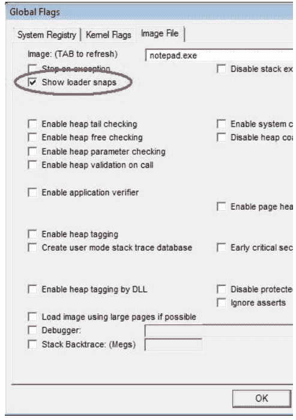

```
Microsoft (R) Windows Debugger Version 6.8.0004.0 AMD64
Copyright (c) Microsoft Corporation. All rights reserved.

CommandLine: C:\Windows\notepad.exe
Symbol search path is: srv*c:\mss*http://msdl.microsoft.com/download/symbols
Executable search path is:
ModLoad: 00000000`ffac0000 00000000`ffaef000   notepad.exe
ModLoad: 00000000`779b0000 00000000`77b2a000   ntdll.dll
LDR: NEW PROCESS
  Image Path: C:\Windows\notepad.exe (notepad.exe)
  Current Directory: C:\Program Files\Debugging Tools for Windows 64-bit\
  Search Path: C:\Windows; C:\Windows\system32; C:\Windows\system; C:\Windows;.; C:\Program Files\Debugging Tools for Windows 64-bit\winext\arcade; C:\Windows\system32;C:\Windows;
C:\Windows\System32\Wbem; C:\Program Files\ATI Technologies\ATI.ACE; c:\Program Files (x86)\Microsoft SQL Server\90\Tools\binn\; C:\Program Files (x86)\Common Files\Roxio Shared\DLLShared\
LDR: LdrLoadDll, loading kernel32.dll from
ModLoad: 00000000`777a0000 00000000`778d1000   C:\Windows\system32\kernel32.dll
LDR: kernel32.dll bound to ntdll.dll
LDR: kernel32.dll has stale binding to ntdll.dll
LDR: Stale Bind ntdll.dll from kernel32.dll

LDR: LdrGetProcedureAddress by NAME - BaseThreadInitThunk
[3d8,1278] LDR: Real INIT LIST for process C:\Windows\notepad.exe pid 984 0x3d8
[3d8,1278] C:\Windows\system32\kernel32.dll init routine 00000000777DC960
[3d8,1278] LDR: kernel32.dll loaded - Calling init routine at 00000000777DC960
LDR: notepad.exe bound to ADVAPI32.dll
ModLoad: 000007fe`fe520000 000007fe`fe61f000   C:\Windows\system32\ADVAPI32.dll
LDR: ADVAPI32.dll bound to ntdll.dll
LDR: ADVAPI32.dll has stale binding to ntdll.dll
LDR: Stale Bind ntdll.dll from ADVAPI32.dll
LDR: ADVAPI32.dll bound to KERNEL32.dll
LDR: ADVAPI32.dll has stale binding to KERNEL32.dll
LDR: ADVAPI32.dll bound to ntdll.dll via forwarder(s) from kernel32.dll
LDR: ADVAPI32.dll has stale binding to ntdll.dll
LDR: Stale Bind KERNEL32.dll from ADVAPI32.dll
LDR: LdrGetProcedureAddress by NAME - RtlAllocateHeap
LDR: LdrGetProcedureAddress by NAME - RtlReAllocateHeap
LDR: LdrGetProcedureAddress by NAME - RtlEncodePointer
LDR: LdrGetProcedureAddress by NAME - RtlDecodePointer
LDR: LdrGetProcedureAddress by NAME - RtlSizeHeap
LDR: LdrGetProcedureAddress by NAME - RtlDeleteCriticalSection
LDR: LdrGetProcedureAddress by NAME - RtlEnterCriticalSection
LDR: LdrGetProcedureAddress by NAME - RtlInitializeCriticalSection
LDR: LdrGetProcedureAddress by NAME - RtlLeaveCriticalSection
LDR: ADVAPI32.dll bound to RPCRT4.dll
...
```

此技术仅适用于本机平台加载程序跟踪。例如，它不会显示在 WOW64 下加载的 32 位模块的加载程序跟踪：

```
Microsoft (R) Windows Debugger Version 6.8.0004.0 X86
Copyright (c) Microsoft Corporation. All rights reserved.

CommandLine: C:\Apps\StackOverflow.exe
Symbol search path is: srv*c:\mss*http://msdl.microsoft.com/download/symbols
Executable search path is:
ModLoad: 00400000 00418000   StackOverflow.exe
ModLoad: 77b60000 77cb0000   ntdll.dll
LDR: NEW PROCESS
    Image Path: C:\Apps\StackOverflow.exe (StackOverflow.exe)
...
LDR: Loading (STATIC, NON_REDIRECTED) C:\Windows\system32\wow64cpu.dll
LDR: wow64cpu.dll bound to ntdll.dll
LDR: wow64cpu.dll has stale binding to ntdll.dll
LDR: Stale Bind ntdll.dll from wow64cpu.dll
LDR: wow64cpu.dll bound to wow64.dll
LDR: wow64cpu.dll has stale binding to wow64.dll
LDR: Stale Bind wow64.dll from wow64cpu.dll
LDR: wow64.dll has stale binding to wow64cpu.dll
LDR: Stale Bind wow64cpu.dll from wow64.dll
LDR: Refcount wow64cpu.dll (1)
LDR: Refcount wow64.dll (2)
LDR: Refcount wow64win.dll (1)
LDR: Refcount wow64.dll (3)
LDR: LdrGetProcedureAddress by NAME - Wow64LdrpInitialize
...
ModLoad: 77630000 77740000   C:\Windows\syswow64\kernel32.dll
ModLoad: 76030000 76100000   C:\Windows\syswow64\USER32.dll
```


```
ModLoad: 775a0000 77630000   C:\Windows\syswow64\GDI32.dll
ModLoad: 76df0000 76dbf000   C:\Windows\syswow64\ADVAPI32.dll
ModLoad: 76df0000 76ee0000   C:\Windows\syswow64\RPCRT4.dll
ModLoad: 75d60000 75dc0000   C:\Windows\syswow64\Secur32.dll
(1ec.1290): Unknown exception - code c0000135 (first chance)
(1ec.1290): Unknown exception - code c0000135 (!!! second chance !!!)
eax=00000000 ebx=77c4a174 ecx=75ce3cf9 edx=00000000 esi=7fede028 edi=7efd0000
eip=77bcf1d1 esp=0017fca4 ebp=0017fd00 iopl=0         nv up ei pl zr na pe nc
cs=0023  ss=002b  ds=002b  es=002b  fs=0053  gs=002b             efl=00000246
ntdll!_LdrpInitialize+0x6d:
77bcf1d1 8b45b8            mov     eax,dword ptr [ebp-48h] ss:002b:0017fcb8=7efde000
```

The dump file that we used can be downloaded from FTP to play with^138.

## 注释

Sometimes, we may not see exceptions, but error and status codes in the output of !teb command, for example:

```
Error code: (Win32) 0x7e (126) - The specified module could not be found.
Error code: (NTSTATUS) 0xc0000135 (3221225781) - The program can't start because %hs is missing from your computer. Try reinstalling the program to fix this problem.
```

## 缺失进程

Sometimes the functionality of a system depends on a specific application or service process. For example, in a database server environment it might be a database process, in a printing environment, it is a print spooler process, or in a terminal services environment, it is a terminal services process (*termsvc*, hosted by *svchost.exe*). In system failure scenarios, we should check these processes for their presence (and also the presence of any **耦合进程**, page 149). However, if the vital process is present in the output we should check if it is exited but references to it exist, or whether there are any **缺失线程** (page 683) or **缺失组件** (page 666) inside it, any **挂起线程** (page 964) and **特殊进程** (page 875) like a postmortem debugger. We shouldn’t also forget about service dependencies and their relevant process startup order. For example, we know that our service is hosted by *svchost.exe* and we see one such process exited, but its object is still referenced somewhere:

```
0: kd> !vm

*** Virtual Memory Usage ***
[...]
        0ed8 svchost.exe       0 (        0 Kb)
[...]
```

However, another command shows that it could be a different service hosted by the same image, *svchost.exe* if we know that ServiceA depends on our service:

```
0: kd> !process 0 0

[...]

PROCESS 8aabed88  SessionId: 0  Cid: 0854    Peb: 7ffd6000  ParentCid: 0220
    DirBase: bff4d4a0  ObjectTable: e1c867a8  HandleCount:  778.
    Image: ServiceA.exe

[...]

PROCESS 8aaa6510  SessionId: 0  Cid: 0ed8    Peb: 7ffd4000  ParentCid: 0220
    DirBase: bff4d580  ObjectTable: 00000000  HandleCount:  0.
    Image: svchost.exe

[...]
```

Another alternative is that our service was restarted but then exited. If our process is not visible, it could be possible that it was either stopped or simply crashed before.

### 注释

Another example is a GUI message **等待链** (page 1132) directed to a window that once belonged to no longer running process.

## 缺失线程

Sometimes it is possible that a process crash dump doesn’t have all usual threads inside. For example, we expect at least 4 threads including the main process thread, but in the dump, we see only 3. If we know that some access violations were reported in the event log before (not necessarily for the same PID), we may suspect that one of the threads had been terminated due to some reason. We call this pattern **缺失线程**.

In order to simulate this problem, we created a small multithreaded program in Visual C++:

```
#include "stdafx.h"
#include <process.h>

void thread_request(void *param)
{
    while (true);
}

int _tmain(int argc, _TCHAR* argv[])
{
    _beginthread(thread_request, 0, NULL);

    try
    {
        if (argc == 2)
        {
            *(int *)NULL = 0;
        }
    }
    catch (...)
    {
        _endthread();
    }

    while (true);

    return 0;
}
```

If there is a command line argument, then the main thread simulates access violation and finishes in the exception handler. In order to use SEH exceptions with C++ try/catch blocks we have to enable /EHa option in C++ Code Generation properties:

| 启用字符串池 | 否 |
|---|---|
| 启用最小重新生成 | 否 |
| 启用 C++ 异常 | 是，带有 SEH 异常 (/EHa) |
| 较小类型检查 | 否 |
| 基本运行时检查 | 默认 |
| 运行时库 | 多线程 (/MT) |
| 结构成员对齐 | 默认 |
| 缓冲区安全检查 | 是 |
| 启用函数级链接 | 否 |
| 启用增强指令集 | 未设置 |
| 浮点模型 | 精确 (/fp:precise) |
| 启用浮点异常 | 否 |

If we run the program without command line parameter and take a manual dump from it, we see 2 threads:

```
0:000> ~*kL
 .  0  Id: 1208.fdc Suspend: 1 Teb: 7efdd000 Unfrozen
ChildEBP RetAddr
0012ff70 00401403 MissingThread!wmain+0x58
0012ffc0 7d4e7d2a MissingThread!_tmainCRTStartup+0x15e
0012fff0 00000000 kernel32!BaseProcessStart+0x28

 1  Id: 1208.102c Suspend: 1 Teb: 7efda000 Unfrozen
ChildEBP RetAddr
005dff7c 004010ef MissingThread!thread_request
005dffb4 00401188 MissingThread!_callthreadstart+0x1b
005dffb8 7d4dfe21 MissingThread!_threadstart+0x73
005dffec 00000000 kernel32!BaseThreadStart+0x34

0:000> ~
 .  0  Id: 1208.fdc Suspend: 1 Teb: 7efdd000 Unfrozen
   1  Id: 1208.102c Suspend: 1 Teb: 7efda000 Unfrozen

0:000> dd 7efdd000 14
7efdd000 0012ff64 00130000 0012e000 00000000
```

We also dumped TEB of the main thread. However, if we run the program with any command line parameter and look at its manual dump we would see only one thread with the main thread missing:

```
0:000> ~*kL
 .  0  Id: 1004.12e8 Suspend: 1 Teb: 7efda000 Unfrozen
ChildEBP RetAddr
005dff7c 004010ef MissingThread!thread_request
005dffb4 00401188 MissingThread!_callthreadstart+0x1b
005dffb8 7d4dfe21 MissingThread!_threadstart+0x73
005dffec 00000000 kernel32!BaseThreadStart+0x34

0:000> ~
 .  0  Id: 1004.12e8 Suspend: 1 Teb: 7efda000 Unfrozen
```

If we try to dump TEB address and stack data from the missing main thread we would see that the memory was already decommitted:

```
0:000> dd 7efdd000 14
7efdd000 ???????? ???????? ???????? ????????
0:000> dds 0012e000 00130000
0012e000 ????????
0012e004 ????????
0012e008 ????????
0012e00c ????????
0012e010 ????????
0012e014 ????????
0012e018 ????????
0012e01c ????????
0012e020 ????????
0012e024 ????????
```

The same effect can be achieved in the similar program that exits the thread in the custom unhandled exception filter:

```
#include "stdafx.h"
#include <process.h>
#include <windows.h>

LONG WINAPI CustomUnhandledExceptionFilter(struct _EXCEPTION_POINTERS* ExceptionInfo)
{
    ExitThread(-1);
}

void thread_request(void *param)
{
    while (true);
}

int _tmain(int argc, _TCHAR* argv[])
{
    _beginthread(thread_request, 0, NULL);
    SetUnhandledExceptionFilter(CustomUnhandledExceptionFilter);

    *(int *)NULL = 0;

    while (true);

    return 0;
}
```

The solution to catch an exception that results in a thread termination would be to run the program under WinDbg or any other debugger:

```
CommandLine: C:\MissingThread\MissingThread.exe 1
Symbol search path is: SRV*c:\websymbols*http://msdl.microsoft.com/download/symbols
Executable search path is:
ModLoad: 00400000 0040f000   MissingThread.exe
ModLoad: 7d4c0000 7d5f0000   NOT_AN_IMAGE
ModLoad: 7d6d0000 7d6f0000   C:\W2K3\SysWOW64\ntdll.dll
ModLoad: 7d4c0000 7d5f0000   C:\W2K3\syswow64\kernel32.dll
(df0.12f0): Break instruction exception - code 80000003 (first chance)
eax=7d600000 ebx=7fed000 ecx=00000005 edx=00000020 esi=7d6a01f4 edi=00221f38
eip=7d61002d esp=0012fb4c ebp=0012fcac iopl=0 nv up ei pl zr na po nc
cs=0023 ss=002b ds=002b es=002b fs=0053 gs=002b efl=00010202
ntdll!DbgBreakPoint:
7d61002d cc            int    3

0:000> g
ModLoad: 71c20000 71c32000   C:\W2K3\SysWOW64\tsappcmp.dll
ModLoad: 77ba0000 77bfa000   C:\W2K3\syswow64\msvcrt.dll
ModLoad: 00410000 004ab000   C:\W2K3\syswow64\ADVAPI32.dll
ModLoad: 7da20000 7db00000   C:\W2K3\syswow64\RPCRT4.dll
ModLoad: 7d8d0000 7d920000   C:\W2K3\syswow64\Secur32.dll
(df0.12f0): Access violation - code c0000005 (first chance)
First chance exceptions are reported before any exception handling.
This exception may be expected and handled.
eax=00000070 ebx=7d4d8df9 ecx=7b8d42d9 edx=00000000 esi=00000002 edi=0000ece
eip=00401057 esp=0012ff50 ebp=0012ff70 iopl=0 nv up ei pl zr na pe nc
cs=0023 ss=002b ds=002b es=002b fs=0053 gs=002b efl=00010246
MissingThread!wmain+0x47:
00401057 c7050000000000000000 mov dword ptr ds:[0],0 ds:002b:00000000=????????

0:000> kl
ChildEBP RetAddr
0012ff70 00401403 MissingThread!wmain+0x47
0012ffc0 7d4e7d2a MissingThread!_tmainCRTStartup+0x15e
0012fff0 00000000 kernel32!BaseProcessStart+0x28
```

If live debugging is not possible and we are interested in crash dumps saved upon a first chance exception before it is processed by an exception handler we can also use MS userdump tool after we install it and enable All Exceptions in the Process Monitoring Rules dialog box. Another tool can be used is ADPlus in crash mode from Debugging Tools for Windows.


## 注释

即使线程存在，也可能丢失，并且会留下一些处于非终止状态的同步对象：

```
0:088> !locks

CritSec DLL!MyFunctionEx+178 at 67caf998
WaiterWoken No
LockCount 71
RecursionCount 17
OwningThread 1910
EntryCount 0
ContentionCount 47
*** Locked

Thread 1910 is not present in the dump. Also !analyze -v -hang reports that the critical section is orphaned:

PRIMARY_PROBLEM_CLASS: APPLICATION_HANG_Orphaned_CriticalSection
```

## 混合异常

有时我们会遇到**托管代码异常**（第 617 页），它封装了一个已处理的非托管代码异常，即**（混合）嵌套异常**（第 723 页）：

```
0:000> !analyze -v

[...]

EXCEPTION_RECORD: ffffffff -- (.exr 0xffffffffffffffff)
ExceptionAddress: 00000000
  ExceptionCode: 80000003 (Break instruction exception)
ExceptionFlags: 00000000
NumberParameters: 0

ERROR_CODE: (NTSTATUS) 0x80000003 - {EXCEPTION}  Breakpoint  A breakpoint has been reached.

FAULTING_THREAD: 00000cfc

[...]

EXCEPTION_OBJECT: !pe 1f9af1ac
Exception object: 1f9af1ac
**Exception type: System.AccessViolationException**
Message: Attempted to read or write protected memory. This is often an indication that other memory is corrupt.
InnerException: <none>
StackTrace (generated):
   SP               IP               Function
   0012EF3C 28DD9AF9 DLLALComponent.getFirstField()+0x11

   [...]
   0012EFC8 7B194170 System_Windows_Forms_ni!System.Windows.Forms.Control.OnClick(System.EventArgs)+0x70
   0012EFE0 7B6F74B4
System_Windows_Forms_ni!System.Windows.Forms.Control.WmMouseUp(System.Windows.Forms.Message ByRef,
System.Windows.Forms.MouseButtons, Int32)+0x170
   0012F06C 7BA29B66
System_Windows_Forms_ni!System.Windows.Forms.Control.WndProc(System.Windows.Forms.Message ByRef)+0x861516
   0012F0C4 7B1D1D6A
System_Windows_Forms_ni!System.Windows.Forms.ScrollableControl.WndProc(System.Windows.Forms.Message
ByRef)+0x2a
   0012F0D0 7B1C8640
System_Windows_Forms_ni!System.Windows.Forms.Control+ControlNativeWindow.OnMessage(System.Windows.Forms.M
essage ByRef)+0x10
   0012F0D8 7B1C85C1
System_Windows_Forms_ni!System.Windows.Forms.Control+ControlNativeWindow.WndProc(System.Windows.Forms.Mes
sage ByRef)+0x31
   0012F0EC 7B1C849A System_Windows_Forms_ni!System.Windows.Forms.NativeWindow.Callback(IntPtr, Int32,
IntPtr, IntPtr)+0x5a

[...]
```

我们可以看出这是一个访问违例异常，并检查 TID 为 cfc 的线程：

```
0:000> kL
ChildEBP RetAddr
0012bd54 77d70dde ntdll!KiFastSystemCallRet
0012bd58 7b1d8e48 user32!NtUserWaitMessage+0xc
0012dbec 7b1d8937 System_Windows_Forms_ni+0x208e48
0012dc44 7b1d8781 System_Windows_Forms_ni+0x208937
0012dc74 7b6edd1f System_Windows_Forms_ni+0x208781
0012dc8c 7b72246b System_Windows_Forms_ni+0x71dd1f
0012dd18 7b722683 System_Windows_Forms_ni+0x75246b
0012dd58 7b6ff776 System_Windows_Forms_ni+0x752683
0012dd64 7b6fa27c System_Windows_Forms_ni+0x7277f6
0012f148 77d6fd82 System_Windows_Forms_ni+0x72a27c
0012f174 77d6f794 user32!InternalCallWinProc+0x23
0012f1ec 77d70008 user32!UserCallWinProcCheckWow+0x14b
0012f250 77d70060 user32!DispatchMessageWorker+0x322
0012f260 0a1412fa user32!DispatchMessageW+0xf
WARNING: Frame IP not in any known module. Following frames may be wrong.
0012f27c 578439f7 0xa1412fa
0012f2ec 578430c9 WindowsBase_ni+0x939f7
0012f2f8 5784306c WindowsBase_ni+0x930c9
0012f304 55bed46e WindowsBase_ni+0x9306c
0012f310 55bec76f PresentationFramework_ni+0x1cd46e
0012f334 55bd3aa6 PresentationFramework_ni+0x1cc76f
```

如果存在异常，那一定是隐藏异常（第 457 页），因此我们检查线程的原始堆栈：

```
0:000> !teb
TEB at 7ffdf000
    ExceptionList:        0012e470
    StackBase:            00130000
    StackLimit:           0011e000
    SubSystemTib:         00000000
    FiberData:            00001e00
    ArbitraryUserPointer: 00000000
    Self:                 7ffdf000
    EnvironmentPointer:   00000000
    ClientId:             00000b6c . 00000cfc
    RpcHandle:            00000000
    Tls Storage:          7ffdf02c
    PEB Address:          7ffd4000
    LastErrorValue:       0
    LastStatusValue:      c0000139
    Count Owned Locks:    0
    HardErrorMode:        0

0:000> dps 0011e000 00130000
0011e000  00000000
0011e004  00000000
0011e008  00000000
[...]
0012e72c  00130000
0012e730  0011e000
0012e734  00ee350d
0012e738 0012ea3c
0012e73c 77f299f7 ntdll!KiUserExceptionDispatcher+0xf
0012e740 0012e750
0012e744 0012e76c
0012e738 77f17d89 ntdll!RtlLeaveCriticalSection+0x9
0012e740 0012e750
0012e744 0012e76c
0012e748 0012e750
0012e74c 0012e76c
0012e750 c0000005
0012e754 00000000
0012e758 00000000
0012e75c 77f17d89 ntdll!RtlLeaveCriticalSection+0x9
0012e760 00000002
0012e764 00000001
0012e768 00000028
0012e76c 0001003f
0012e770 00000000
0012e774 00000000
0012e778 00000000
0012e77c 00000000
[...]
```

```
0:000> .cxr 0012e76c
eax=00000020 ebx=09ca1fa0 ecx=781c1b78 edx=00000001 esi=00000020 edi=09ca1ff8
eip=77f17d89 esp=0012ea38 ebp=0012ea3c iopl=0         nv up ei pl nz na po nc
cs=001b ss=0023 ds=0023 es=0023 fs=003b gs=0000             efl=00010202
ntdll!RtlLeaveCriticalSection+0x9:
77f17d89 834608ff        add     dword ptr [esi+8],0FFFFFFFFh ds:0023:00000028=????????
```

```
0:000> kL
*** Stack trace for last set context - .thread/.cxr resets it
ChildEBP RetAddr
0012ea3c 7813e5b5 ntdll!RtlLeaveCriticalSection+0x9
0012ea44 2071c9ba msvcr80!_unlock_file+0x35
WARNING: Stack unwind information not available. Following frames may be wrong.
0012ea68 2071c31e DllB!getType+0x286a
0012ee34 206bfbfc DllB!getType+0x3eb
0012ee68 206c8abb DllC+0x8bfc
0012ee98 79e71ca7 DllC!getFirstField+0x3b
0012f148 77dfd802 mscorwks!NDirectGenericStubReturnFromCall
0012f1ec 77d70008 user32!InternalCallWinProc+0x23
0012f2f0 77db51b9 user32!DispatchMessageWorker+0x322
0012f4a4 79e95feb user32!_W32ExceptionHandler+0x18
0012f4fc 79e968b0 mscorwks!MetaSig::HasRetBuffArg+0x5
0012f50c 79e6434e mscorwks!MetaSig::MetaSig+0x3a
0012f610 79e96534 mscorwks!MethodDesc::CallDescr+0xaf
0012f62c 79e96552 mscorwks!MethodDesc::CallTargetWorker+0x1f
0012f644 79eef045 mscorwks!MethodDescCallSite::CallWithValueTypes+0x1a
0012f7a8 79eef965 mscorwks!ClassLoader::RunMain+0x223
```

因此，我们将 DllB 和 DllC 组件标记为可疑。如果检查异常链，我们会发现 .NET 运行时注册了自定义异常处理程序（第 171 页）：

```
0:000> !exchain
0012e470: mscorwks!COMPPlusNestedExceptionHandler+0 (79edd6d7)
0012f13c: mscorwks!FastNExportExceptHandler+0 (7a00a2e7)
0012f1dc: user32!except_handler4+0 (77db51ba)
0012f240: user32!except_handler4+0 (77db51ba)
0012f46c: mscorwks!COMPPlusFrameHandler+0 (79edc3bc)
0012f4c0: mscorwks!Except_Handler4+0 (79f00a82)
0012f798: mscorwks!_except_handler4+0 (79f008a2)
0012fa04: mscorwks!GetManagedNameForTypeInfo+a680 (7a328d90)
0012fed4: mscorwks!GetManagedNameForTypeInfo+82c8 (7a325a3a)
0012ff20: mscorwks!_except_handler4+0 (79f008a2)
0012ff6c: mscorwks!GetManagedNameForTypeInfo+a6e (7a319ee4)
0012ffc4: ntdll!_except_handler4+0 (77ed9834)
Invalid exception stack at ffffffff
```

我们验证 GetManagedNameForTypeInfo+a6e (7a319ee4) 确实是一个异常处理程序：

```
0:000> .asm no_code_bytes
Assembly options: no_code_bytes

0:000> uf 7a319ee4
mscorwks!_CxxFrameHandler:
78158aeb push ebp
78158aec mov ebp,esp
78158aee sub esp,8
78158af1 push ebx
78158af2 push esi
78158af3 push edi
78158af4 cld
78158af5 mov dword ptr [ebp-4],eax
78158af8 xor eax,eax
78158afa push eax
78158afb push eax
78158afc push eax
78158afd push dword ptr [ebp-4]
78158b00 push dword ptr [ebp+14h]
78158b03 push dword ptr [ebp+10h]
78158b06 push dword ptr [ebp+0Ch]
78158b09 push dword ptr [ebp+8]
78158b0c call msvcr80!_InternalCxxFrameHandler (7815897e)
78158b11 add esp,20h
78158b14 mov dword ptr [ebp-8],eax
78158b17 pop edi
78158b18 pop esi
78158b19 pop ebx
78158b1a mov eax,dword ptr [ebp-8]
78158b1d mov esp,ebp
78158b1f pop ebp
78158b20 ret

mscorwks!_CxxFrameHandler3:
79f5f258 jmp dword ptr [mscorwks!_imp___CxxFrameHandler3 (79e711c4)]

mscorwks!GetManagedNameForTypeInfo+0xa6e:
7a319e44 mov edx,dword ptr [esp+8]
7a319e08 lea eax,[edx+0Ch]
7a319eeb mov ecx,dword ptr [edx-30h]
7a319eee xor ecx,eax
7a319ef0 call mscorwks!___security_check_cookie (79e72037)
7a319ef5 mov eax,offset mscorwks!_C_T?_R0H@xcx14 (7a319f00)
7a319efa jmp mscorwks!__CxxFrameHandler3 (79f5f258)
```

## 注释

相反的情况也是可能的，即 CLR 异常被非托管异常封装，如 ntdebugging 博客中的示例 139 所示。

有人提出的一个问题：从

```
0012e73c 77f299f7 ntdll!KiUserExceptionDispatcher+0xf
0012e740 0012e750
0012e744 0012e76c
```

这是否对应对 ntdll!RtlDispatchException 的调用参数？如果是，那么 0012e76c 是否就是 ntdll!RtlDispatchException 的第 2 个参数，即上下文记录？

A. 是的，它对应，因为它调用了：

```
0:000> ub 77f299f7
ntdll!KiUserCallbackDispatcher+0x42:
77f299e2 ret 0Ch
77f299e5 lea ecx,[ecx]
ntdll!KiUserExceptionDispatcher:
77f299e8 cld
77f299e9 mov ecx,dword ptr [esp+4]
77f299ed mov ebx,dword ptr [esp]
77f299f0 push ecx
77f299f1 push ebx
77f299f2 call ntdll!RtlDispatchException (77f0d132)
```


## General

除了 **堆栈跟踪收集** (第 943 页) 外，我们通常还关注 **模块收集**（我们最初将此模式称为 **厂商收集**），特别是当我们想要检查某个特定供应商 DLL 是否存在于完整内存转储中的某个进程地址空间时（内核模块列表或来自进程内存转储的模块列表是微不足道的）。或者我们需要从问题描述中检查一些供应商信息（**lmv** 命令）。如果我们有来自 x64 系统的完整内存转储，那么为每个进程列出模块是不够的。例如，我们可能会看到：

```
0: kd> lmu
start             end                 module name
00000000`00ab0000 00000000`00ae8000 AppA        (deferred)
00000000`74fe0000 00000000`7502e000 wow64win    (deferred)
00000000`75030000 00000000`75075000 wow64       (deferred)
00000000`750c0000 00000000`750c9000 wow64cpu    (deferred)
00000000`77b70000 00000000`77cf7000 ntdll       (pdb symbols)
```

AppA 是一个 32 位进程，并有一个更有用的额外 32 位模块列表。我们可以为该进程中的线程设置 x86 上下文，并获取 32 位模块列表：

```
0: kd> .load wow64exts

0: kd> .thread /w fffffa800e372060
Implicit thread is now fffffa80`0e372060
x86 context set

0: kd:x86> .reload
Loading Kernel Symbols
Loading User Symbols
Loading unloaded module list
Loading Wow64 Symbols

0: kd:x86> lmu
start             end                 module name
00000000`00ab0000 00000000`00ae8000 AppA        (deferred)
00000000`73490000 00000000`73515000 COMCTL32    (deferred)
00000000`73520000 00000000`735c3000 MSVCR90     (deferred)
00000000`735d0000 00000000`735e5000 MSVCP90     (deferred)
00000000`74920000 00000000`7493e000 USERENV      (deferred)
00000000`74940000 00000000`74ade000 comctl32_74940000 (deferred)
00000000`74af0000 00000000`74b02000 MSASN1       (deferred)
00000000`74b10000 00000000`74c03000 CRYPT32      (deferred)
00000000`74dc0000 00000000`74e5b000 MSVCR80      (deferred)
00000000`74f60000 00000000`74f60000 NETAPI32     (deferred)
00000000`74fe0000 00000000`7502e000 wow64win    (deferred)
00000000`75030000 00000000`75075000 wow64       (deferred)
00000000`750b0000 00000000`750ba000 WTSAPI32     (deferred)
00000000`750c0000 00000000`750c9000 wow64cpu     (deferred)
00000000`75cf0000 00000000`75d50000 Secur32 (deferred)
00000000`75d50000 00000000`76861000 SHELL32 (deferred)
00000000`76a10000 00000000`76aa0000 GDI32 (deferred)
00000000`76b30000 00000000`76b90000 IMM32 (deferred)
00000000`76be0000 00000000`76cf0000 kernel32 (deferred)
00000000`76e30000 00000000`76f75000 ole32 (deferred)
00000000`76f80000 00000000`7702a000 msvcrt (deferred)
00000000`77030000 00000000`77037000 PSAPI (deferred)
00000000`77040000 00000000`77110000 USER32 (deferred)
00000000`77110000 00000000`77169000 SHLWAPI (deferred)
00000000`77170000 00000000`771ed000 USP10 (deferred)
00000000`77380000 00000000`774d0000 OLEAUT32 (deferred)
00000000`77640000 00000000`77649000 LPK (deferred)
00000000`776e0000 00000000`777d0000 RPCRT4 (deferred)
00000000`777d0000 00000000`77898000 MSCTF (deferred)
00000000`778a0000 00000000`77966000 ADVAPI32 (deferred)
00000000`77b70000 00000000`77cf7000 ntdll (pdb symbols)
00000000`77d30000 00000000`77e90000 ntdll_77d30000 (pdb symbols)
```

看来我们需要为每个线程转储模块。但是，除非我们跳过具有相同 PID 的线程，否则输出将非常巨大。经过一些摸索，我们编写了这个输出量适中的 WinDbg 脚本：

```
.load wow64exts
!for_each_thread ".thread @#Thread ;if (@$t0 != @@c++(@$thread->Cid.UniqueProcess)) {.reload /user;lmvu;thread /w @#Thread ;.reload /user;lmvu;r $t0 = @@c++(@$thread->Cid.UniqueProcess);.effmach AMD64; }"
```

## Predicate

在研究 **线程聚类** 模式（第 1003 页）时，我们意识到需要 **模块收集** 模式的谓词版本，类似于 **堆栈跟踪收集**（第 943 页）模式的谓词版本。谓词可以是任何东西：公司供应商、语义接近性、诸如打印、远程文件管理等功能，等等。这样的模块子集可以用于更复杂的模式中的模块：软件诊断模式替换和组合的一个示例。例如，我们可能能够识别由 **IPC 等待链**（第 1082 页）解释的两个语义不同的模块组之间可能存在的耦合，如下图所示：

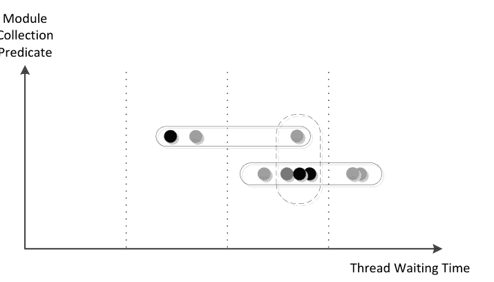

## Module Hint

此模式在动态内存损坏事件中经常被观察到。它类似于执行残留（第 371 页）或字符串参数（第 962 页）模式，其中我们拥有提供故障排除和调试提示的 ASCII 或 UNICODE 片段。因此，模块提示是一个更专业的模式，我们可以在其中将模块名称与原始数据关联。例如，在检测到池损坏（动态内存损坏模式，第 292 页）后保存的内核内存转储在池条目中显示 P12345.DLL 模块名称，这可以提供一个链接到相应功能以进行重新配置或删除：

```
BAD_POOL_HEADER (19)
    The pool is already corrupt at the time of the current request.
    This may or may not be due to the caller.
    The internal pool links must be walked to figure out a possible cause of the problem, and then special
    pool applied to the suspect tags or the driver verifier to a suspect driver.
    Arguments:
    Arg1: 00000020, a pool block header size is corrupt.
    Arg2: 8b79d078, The pool entry we were looking for within the page.
    Arg3: 8b79d158, The next pool entry.
    Arg4: 8a1c0004, (reserved)

STACK_TEXT:
b3e0aa4c 808947bb 00000019 00000020 8b79d078 nt!KeBugCheckEx+0x1b
b3e0aab4 b368c00f 8b79d080 00000000 00000000 nt!ExFreePoolWithTag+0x477
b3e0aac4 b366c668 8b79d080 00000000 00000000 DriverA!MemFree+0xf
[...]
b3e0ac44 8081e0c3 808f77c9 b3e0ac64 808f77c9 nt!IovCallDriver+0x112
b3e0ac50 808f77c9 8a8eef60 8b6862a8 8a8eef00 nt!IofCallDriver+0x13
b3e0ac64 808f856b 8ce456b0 8a8eef00 8b6862a8 nt!IopSynchronousServiceTail+0x10b
b3e0ad00 808f109a 000009dc 00000000 00000000 nt!IopXxxControlFile+0x5e5
b3e0ad34 8088b45c 000009dc 00000000 00000000 nt!NtDeviceIoControlFile+0x2a
b3e0ad34 7c82847c 000009dc 00000000 00000000 nt!KiFastCallEntry+0xfc
WARNING: Frame IP not in any known module. Following frames may be wrong.
00f5fb18 00000000 00000000 00000000 00000000 0x7c82847c

2: kd> !pool 8b79d080
Pool page 8b79d080 region is Unknown
8b79d000 size: 30 previous size: 0  (Allocated) FSFm
8b79d030 size: 28 previous size: 30 (Allocated) VadS
8b79d058 size: 20 previous size: 28 (Allocated) ReEv
*8b79d078 size: e0 previous size: 20 (Allocated) *DRV
    Owning component : Unknown (update pool.txt)
8b79d158 is not a valid large pool allocation, checking large session pool...
8b79d158 is freed (or corrupt) pool
Bad previous allocation size @8b79d158, last size was 1c

***
*** An error (or corruption) in the pool was detected;
*** Pool Region unknown (0xFFFFFFFF8B79D158)
***
***
*** Use !poolval 8b79d000 for more details.
***

2: kd> dc 8b79d078
8b79d078 [...] ...DRIV .......AP
8b79d088 [...] P12345.DLL......
8b79d098 [...] ....<%n..........
8b79d0a8 [...] ...$....:F..X.
[...]
```

## Comments

另一个示例是模块列表中存在调试或错误处理模块。

它还可以是一个有效的（非巧合性的，参见 **巧合性符号信息** 分析模式，第 137 页）符号名称，通过 **dps** 或 **dps** 命令。

我们还可以使用搜索命令 **s-sa** 和 **s-su**。

## Module Product Process

如果我们在完整内存转储中发现了模块相关模式（第 1167 页）并怀疑某个特定模块，那么如果存在，查看模块产品相关进程可能值得一试，特别是如果该模块（组件、DLL）具有产品信息或某些相关提示（!mv 或 !lmi 命令）。在复杂环境中，此类模块不仅可能通过挂钩机制加载，还可能作为插件加载。如果我们不确定是否存在这样的进程，最好的方法是获取 模块收集 (第 693 页) 并找到与问题模块具有相同供应商的进程模块。然后还应分析该进程是否存在异常。


## 模块栈跟踪

### Linux

这是之前为 Windows 平台描述的**模块栈跟踪**模式的 Linux 变体（第 700 页）。Linux 核心转储默认是**缩减转储**（第 49 页），缺少共享库代码和已分页页面。要启用保存完整进程转储，请使用此命令（有关更多详细信息，请参阅 core man page¹⁴¹）：

```
[training@localhost CentOS]$ echo 0x7f > /proc/$$/coredump_filter
```

比较在更改 `coredump_filter` 值之前（`core.3252`）和之后（`core.3268`）生成的 `sleep` 进程核心转储的文件大小：

```
[training@localhost CentOS]$ ls -1
-rwxrwxrwx. 1 root root  323584 Oct 3 07:39 core.3252
-rwxrwxrwx. 1 root root 103337984 Oct 3 07:40 core.3268
```

由于缺少符号，GDB 无法对上述两个转储获取符号栈跟踪，但 CODA 工具¹⁴² 可以显示带有模块的栈跟踪变体（带有**减少的符号信息**，第 829 页）：

```
(gdb) bt
#0 0x00000032bd4acc0 in ?? ()
#1 0x0000000000403ce8 in ?? ()
#2 0x0000000000004d42 in ?? ()
#3 0x0000000000000000 in ?? ()
```

```
[training@localhost CentOS]$ ./coda/coda -i core.3268
Welcome to coda interactive command line.
THE SOFTWARE IS PROVIDED 'AS IS', WITHOUT WARRANTY OF ANY KIND.
Supported on x86_64-linux.
Coredump generated by command line => sleep 1234
coda > bt
[0] 0x00000032bd4acc0 <0x00000032bd4accb0 - 0x00000032bd4acd0e>  _nanosleep+0x10 [RO TEXT]:/lib64/libc.so.6
[1] 0x000000000403ce8 <0x000000000403cf40 - 0x000000000403cf3>  close_stdout+0x2378 [RO TEXT]:sleep
[2] 0x0000000004033dd <0x0000000004032c0 - 0x0000000004033e3>  close_stdout+0x19fd [RO TEXT]:sleep
[3] 0x0000000004016bc <0x0000000004014c0 - 0x000000000401775>  usage+0x3fc [RO TEXT]:sleep
[4] 0x00000032bd41ed1d <0x00000032bd41ec20 - 0x00000032bd41ede7>  __libc_start_main+0xf0 [RO TEXT]:/lib64/libc.so.6
[5] 0x0000000004011f9 <0x0000000004012c0 - 0x0000000004014bb> ?? [RO TEXT]:sleep
[6] 0x00007fff89d82a68 <------RANGE UNKNOWN------> ?? [RW DATA]:
```

¹⁴¹ http://man7.org/linux/man-pages/man5/core.5.html

¹⁴² https://github.com/npammani/coda

### Windows

为完整起见，我们介绍**模块栈跟踪**分析模式，它是带有模块（或组件）及其地址范围偏移量的栈跟踪。偏移量使其与**折叠栈跟踪**¹⁴³ 区分开来。在**无组件符号**（第 734 页）或**不可识别的符号信息**（第 1045 页）的情况下，我们只能看到模块名称。有时，我们也会看到导出函数，其偏移量值减小但仍然很大。这是**减少的符号信息**（第 829 页）的情况。此类新出现的符号可能会形成**错误栈跟踪**（第 499 页）帧。在某些平台上，**模块栈跟踪**会变成**截断的栈跟踪**（第 1015 页），因为调试器无法重建栈跟踪。以下栈跟踪显示了 PHOTOSAPP_WINDOWS 的**模块栈跟踪**片段（以及 `ntdll`、`combase`、`twinapi_appcore` 的导出函数帧）：

```
0:034> kL
### Child-SP RetAddr Call Site
00 0000005b`03acc500 00007ff9`b6288935 KERNELBASE!RaiseFailFastException+0x74
01 0000005b`03acc5b0 00007ff9`b399654f combase!RoParameterizedTypeExtraGetTypeSignature+0x8db5
02 0000005b`03acccd0 00007ff9`b39965d0 twinapi_appcore!BiNotifyNewSession+0x2628f
03 0000005b`03accd10 00007ff9`b6186e1a twinapi_appcore!BiNotifyNewSession+0x26310
04 0000005b`03accd40 00007ff9`9eaca4a0 combase!RoReportUnhandledError+0xea
05 0000005b`03accdd0 00007ff9`af37be60 MSCVP140_APP!`Concurrency::details::_ExceptionHolder::ReportUnhandledError'::`1'::catch$3+0x39
06 0000005b`03acce00 00007ff9`af3729b2 VCRUNTIME140_APP!CallSettingFrame+0x20
07 0000005b`03acce30 00007ff9`b625c53 VCRUNTIME140_APP!_CxxCallCatchBlock+0x122
08 0000005b`03accef0 00007ff9`9ea99129 ntdll!RtlCaptureContext+0x3c3
09 0000005b`03acf490 00007ff9`861137e6 MSCVP140_APP!Concurrency::details::_ExceptionHandler::ReportUnhandledError+0x29
0a 0000005b`03acf4e0 00007ff9`86112142 PhotosApp_Windows+0x737e6
0b 0000005b`03acf520 00007ff9`86111e6c PhotosApp_Windows+0x72142
0c 0000005b`03acf560 00007ff9`86113e38 PhotosApp_Windows+0x71e6c
0d 0000005b`03acf590 00007ff9`8611307d PhotosApp_Windows+0x73e38
0e 0000005b`03acf5f0 00007ff9`86113619 PhotosApp_Windows+0x7307d
0f 0000005b`03acf630 00007ff9`b85caefa PhotosApp_Windows+0x73619
10 0000005b`03acf680 00007ff9`b85c97ea ntdll!EtwEventRegister+0x1e3a
11 0000005b`03acf790 00007ff9`b7df9d2a ntdll!EtwEventRegister+0x72a
12 0000005b`03acfb90 00007ff9`b8599f64 kernel32!BaseThreadInitThunk+0x22
13 0000005b`03acfbc0 00000000`00000000 ntdll!RtlUserThreadStart+0x34
```

## 模块变量

除了函数之外，我们还有模块变量，例如 Windows 7 中的 nt!MmPagedPoolCommit：

```
0: kd> x nt!MmPagedPool*
fffff800`031148d0  nt!MmPagedPoolInfo = <no type information>
fffff800`03092d20  nt!MmPagedPoolCommit = <no type information>
fffff800`031141a0  nt!MmPagedPoolEnd = <no type information>
fffff800`031175c0  nt!MmPagedPoolWs = <no type information>
```

如果我们不确定是否有函数或**模块变量**，可以尝试反汇编其地址：

```
0: kd> u nt!MmPagedPoolCommit
nt!MmPagedPoolCommit:
fffff800`03092d20 e3b2    jrcxz   nt!MmTotalNonPagedPoolQuota+0x4 (fffff800`03092cd4)
fffff800`03092d22 0000     add     byte ptr [rax],al
fffff800`03092d24 0000     add     byte ptr [rax],al
fffff800`03092d26 0000     add     byte ptr [rax],al
fffff800`03092d28 0000     add     byte ptr [rax],al
fffff800`03092d2a 0000     add     byte ptr [rax],al
fffff800`03092d2c 0000     add     byte ptr [rax],al
fffff800`03092d2e 0000     add     byte ptr [rax],al
```

这里该值可能是页，因此我们乘以 4 以获得 Kb 值，并与 !vm 命令的输出进行比较：

```
0: kd> dp nt!MmPagedPoolCommit
fffff800`03092d20  00000000`0000b2e3 00000000`00000000
fffff800`03092d30  00000000`00000000 00000000`00000000
fffff800`03092d40  00000000`00000001 00000000`00000000
fffff800`03092d50  00000000`00000001 00000000`00060107
fffff800`03092d60  fffffff800`03092d60 fffffff800`03092d60
fffff800`03092d70  00000000`00000000 00000000`0001e972
fffff800`03092d80  fffff900`c0000000 00000000`00000002
fffff800`03092d90  fffffff800`071dc0a8 fffffff800`057340a8
```

```
0: kd> ? b2e3 * 4
Evaluate expression: 183180 = 00000000`0002cb8c
```

```
0: kd> !vm

	*** Virtual Memory Usage ***
Physical Memory:		 1035228 ( 4140912 Kb)
Page File:		 \??\C:\pagefile.sys
Current:	 4448112 Kb	 Free Space: 4448108 Kb
Minimum:	 4448112 Kb	 Maximum: 12422736 Kb
Unimplemented error for MiSystemVaTypeUserCount
Available Pages:		 594029 ( 2376116 Kb)
ResAvail Pages:	 889795 ( 3559180 Kb)
Locked IO Pages:			 0 ( 0 Kb)
Free System PTEs:	 33556870 ( 134227480 Kb)
Modified Pages:	 20079 ( 80316 Kb)
Modified PF Pages:	 19441 ( 77764 Kb)
NonPagedPool Usage:	 50865104 ( 203460416 Kb)
NonPagedPoolNx Usage:	 28163 ( 112652 Kb)
NonPagedPool Max:	 763396 ( 3053584 Kb)
******************** Excessive NonPaged Pool Usage ********************
PagedPool 0 Usage:	 39420 ( 157680 Kb)
PagedPool 1 Usage:	 5194 ( 20776 Kb)
PagedPool 2 Usage:	 367 ( 1468 Kb)
PagedPool 3 Usage:	 338 ( 1352 Kb)
PagedPool 4 Usage:	 440 ( 1760 Kb)
PagedPool Usage:	 45759 ( 183036 Kb)
PagedPool Maximum:	 33554432 ( 134217728 Kb)
Session Commit:	 8112 ( 32448 Kb)
Shared Commit:	 31802 ( 127208 Kb)
Special Pool:			 0 ( 0 Kb)
Shared Process:	 10765 ( 43060 Kb)
PagedPool Commit:	 45795 ( 183180 Kb)
Driver Commit:	 13773 ( 55092 Kb)
Committed pages:		 540998 ( 2163992 Kb)
Commit limit:		 2146794 ( 8587176 Kb)
[...]
```

了解可用模块变量很有用，因为其中一些未包含在 WinDbg 扩展命令输出中。有关它们的列表，请参阅《Windows Internals》一书。其他模块中也可以找到有用的变量，例如，srv!srvcomputername¹⁴⁴：

```
0: kd> ds srv!srvcomputername
fffffa80`0344b090  "MYNOTEBOOK"
```

## 模块多样性

有时当我们查看进程地址空间中加载模块的列表时，我们会看到我们称之为**模块多样性**的模式实例。它的字面意思是，有太多不同的加载模块，以至于我们开始认为它们的共存导致了问题。我们也可以称此模式为**组件多样性**或 **DLL 多样性**，但我们更喜欢前者，因为 WinDbg 将加载的可执行文件、DLL、驱动程序、ActiveX 控件称为模块。

模块可以大致分为 4 个大类：

- 应用程序模块 - 专门为该应用程序开发的组件，其中一个是主应用程序模块。
- 第三方模块 - 如果 lmv WinDbg 命令输出中的公司名称相同，我们可以轻松识别它们。
- 通用系统模块 - 操作系统提供的 Windows DLL，实现本机操作系统调用、Windows API 以及 C/C++ 运行时函数，例如 ntdll.dll、kernel32.dll、user32.dll、gdi32.dll、advapi32.dll、msvcrt.dll。
- 特定系统模块 - Microsoft 提供的可选 Windows DLL，特定于应用程序功能和实现，例如 MFC DLL、.NET 运行时或 tapi32.dll。

虽然 **lmv** 对于快速检查组件时间戳来说很冗长，但我们可以使用 **lmt** WinDbg 命令。

以下是 Windows Server 2003 中大量模块多样性的示例：

```
Loading Dump File [application.dmp]
...
...
...
Windows Server 2003 Version 3790 (Service Pack 1)
...
...
...
0:001> lmt
```

| 起始地址 | 结束地址 | 模块名称 | 时间戳 |
|---|---|---|---|
| 00400000 | 030ba000 | app_main | Mon Dec 04 21:22:42 2006 |
| 04120000 | 04193000 | Dforrd | Mon Jan 31 02:27:58 2000 |
| 041a0000 | 04382000 | sqllib2 | Mon May 29 22:50:11 2006 |
| 04490000 | 044d3000 | udNet | Mon May 29 23:22:43 2006 |
| 04e30000 | 04f10000 | abchook | Wed Aug 01 20:47:17 2006 |
| 05e10000 | 05e15000 | token_manager | Fri Mar 12 11:54:17 1999 |
| 06030000 | 06044000 | ODBCINT | Thu Mar 24 22:59:58 2005 |
| 06150000 | 0618d000 | sgl5NET | Mon May 29 23:25:22 2006 |
| 06190000 | 0622f000 | OPENLG32 | Mon Nov 06 21:30:52 2006 |
| 06230000 | 06240000 | pwprc32 | Thu Oct 22 16:22:40 1998 |
| 06240000 | 07411000 | app_dll_1 | Tue Aug 08 12:14:39 2006 |
| 07420000 | 07633000 | app_dll_2 | Mon Dec 04 22:11:59 2006 |
| 07640000 | 07652000 | zlib | Fri Aug 30 08:12:24 2002 |
| 07660000 | 07f23000 | app_dll_3 | Wed Oct 19 11:43:34 2005 |
| 0dec0000 | 0edec000 | app_dll_4 | Mon Dec 04 22:11:36 2006 |


| Start Address | End Address | Module | Timestamp |
|---|---|---|---|
| 10000000 | 110be000 | des | 星期二 7月 18 20:42:02 2006 |
| 129c0000 | 12f1b000 | xsp2res | 星期五 3月 25 00:26:47 2005 |
| 1b000000 | 1b170000 | msjet40 | 星期二 7月 06 19:16:05 2004 |
| 1b2c0000 | 1b2c0000 | msjter40 | 星期四 5月 09 19:09:53 2002 |
| 1b2d0000 | 1b2ea000 | msjint40 | 星期四 5月 09 19:09:53 2002 |
| 1b570000 | 1b5c5000 | msjetoledb40 | 星期四 11月 13 23:40:06 2003 |
| 1b5d0000 | 1b65c5000 | msstr10 | 星期四 5月 09 19:09:56 2002 |
| 1e000000 | 1e0f0000 | python23 | 星期五 1月 30 13:03:24 2004 |
| 4b070000 | 4b0c1000 | MSCTF | 星期五 3月 25 02:10:36 2005 |
| 4b610000 | 4b64d000 | ODBC32 | 星期五 3月 25 02:09:33 2005 |
| 4b9e0000 | 4ba59000 | OLEDB32 | 星期五 3月 25 02:09:56 2005 |
| 4c310000 | 4c31d000 | OLED32R | 星期五 3月 25 02:09:57 2005 |
| 4c3b0000 | 4c3de000 | MSCTFIME | 星期五 3月 25 02:10:37 2005 |
| 5f400000 | 5f4f2000 | mfc42 | 星期三 10月 27 22:35:22 1999 |
| 62130000 | 6213d000 | mfc42loc | 星期三 3月 26 03:35:58 2003 |
| 62460000 | 6246e000 | msadrh15 | 星期五 3月 25 02:10:29 2005 |
| 65340000 | 653d2000 | OLEAUT32 | 星期三 9月 01 00:15:11 1999 |
| 68000000 | 6802f000 | rsaenh | 星期五 3月 25 00:30:55 2005 |
| 68a50000 | 68a70000 | glu32 | 星期五 3月 25 02:09:03 2005 |
| 71990000 | 71998000 | wshtcpip | 星期三 3月 26 03:34:24 2003 |
| 71a80000 | 71a91000 | mpr | 星期三 3月 26 03:34:24 2003 |
| 71aa0000 | 71aa8000 | ws2help | 星期五 3月 25 02:10:19 2005 |
| 71ab0000 | 71ac7000 | ws2_32 | 星期五 3月 25 02:10:18 2005 |
| 71ad0000 | 71ae2000 | tsappcmp | 星期五 3月 25 02:09:56 2005 |
| 71af0000 | 71b48000 | netapi32 | 星期五 8月 11 11:00:07 2006 |
| 72ec0000 | 72ee7000 | winspool | 星期五 3月 25 02:09:48 2005 |
| 73290000 | 73295000 | riched32 | 星期三 3月 26 03:34:14 2003 |
| 73ee0000 | 73ee5000 | icmp | 星期三 3月 26 03:34:09 2003 |
| 74920000 | 7493a000 | msdart | 星期五 3月 25 02:10:48 2005 |
| 74b10000 | 74b80000 | riched20 | 星期五 3月 25 02:09:36 2005 |
| 75220000 | 75281000 | usp10 | 星期五 3月 25 02:09:51 2005 |
| 75810000 | 758d0000 | uservenv | 星期五 3月 25 02:09:50 2005 |
| 75d00000 | 75d27000 | apphelp | 星期五 3月 25 02:09:21 2005 |
| 76120000 | 7613d000 | imm32 | 星期五 3月 25 02:09:37 2005 |
| 76140000 | 76188000 | comdlg32 | 星期五 3月 25 02:10:11 2005 |
| 76810000 | 76949000 | comsvcs | 星期五 8月 26 23:19:45 2005 |
| 76a60000 | 76a6b000 | psapi | 星期五 3月 25 02:09:57 2005 |
| 76c00000 | 76c1a000 | iphlpapi | 星期五 5月 19 04:21:07 2006 |
| 76de0000 | 76e0f000 | dnsapi | 星期三 7月 12 20:02:12 2006 |
| 76e20000 | 76e4e000 | wldap32 | 星期五 3月 25 02:09:59 2005 |
| 76e60000 | 76e73000 | secur32 | 星期五 3月 25 02:10:01 2005 |
| 76e80000 | 76e87000 | winrnr | 星期五 3月 25 02:09:45 2005 |
| 76e90000 | 76e98000 | rasadhlp | 星期三 7月 12 20:02:15 2006 |
| 76f20000 | 77087000 | comres | 星期三 3月 26 03:33:48 2003 |
| 77330000 | 773c7000 | comctl32 | 星期一 8月 28 09:26:02 2006 |
| 77470000 | 775a4000 | ole32 | 星期四 7月 21 04:25:12 2005 |
| 77640000 | 776c3000 | clbcatq | 星期四 7月 21 04:25:13 2005 |
| 77b30000 | 77b38000 | version | 星期五 3月 25 02:09:50 2005 |
| 77b40000 | 77b9a000 | msvcrt | 星期五 3月 25 02:11:59 2005 |
| 77ba0000 | 77be8000 | gdi32 | 星期二 3月 07 03:55:05 2006 |
| 77bf0000 | 77c8f000 | rpcrt4 | 星期五 3月 25 02:09:42 2005 |
| 77ca0000 | 77da3000 | comctl32_77ca0000 | 星期一 8月 28 09:25:59 2006 |
| 77db0000 | 77dc1000 | winsta | 星期五 3月 25 02:09:51 2005 |
| 77de0000 | 77e10000 | user32 | 星期五 3月 25 02:09:49 2005 |
| 77e80000 | 77ed2000 | shlwapi | 星期三 9月 20 01:33:12 2006 |
| 77ee0000 | 77ef1000 | regapi | 星期五 3月 25 02:09:51 2005 |
| 77f20000 | 77fcb000 | advapi32 | 星期五 3月 25 02:09:06 2005 |
| 780a0000 | 780b2000 | MSVCIRT | 星期三 6月 17 19:45:46 1998 |
| 780c0000 | 78121000 | MSVCP60 | 星期三 6月 17 19:52:10 1998 |
| 79040000 | 79085000 | fusion | 星期五 2月 18 20:57:41 2005 |
| 79170000 | 79198000 | mscoree | 星期五 2月 18 20:57:48 2005 |
| 791b0000 | 79417000 | mscorwks | 星期五 2月 18 20:59:56 2005 |
| 79510000 | 79523000 | mscorsn | 星期五 2月 18 20:30:38 2005 |
| 79780000 | 7998c000 | mscorlib | 星期五 2月 18 20:48:36 2005 |
| 79990000 | 79cce000 | mscorlib_79990000 | 星期四 11月 02 04:53:27 2006 |
| 7c340000 | 7c396000 | msvcr71 | 星期五 2月 21 12:42:20 2003 |
| 7c800000 | 7c93e000 | kernel32 | 星期二 7月 25 13:37:16 2006 |
| 7c940000 | 7ca19000 | ntdll | 星期五 3月 25 02:09:53 2005 |
| 7ca20000 | 7d20a000 | shell32 | 星期四 7月 13 13:58:56 2006 |

We can also use **lmtd** command to take the advantage of WinDbg hypertext commands. In that case, we can quickly click on a module name to view its detailed information.

We see that some components are very old, 1998-1999, and some are from 2006. We also see 3rd-party libraries: OpenGL, Visual Fortran RTL, Python language runtime. Common system modules include two versions of C/C++ runtime library, 6.0 and 7.0. Specific system modules include MFC and .NET, MSJET, ODBC and OLE DB support. There is a sign of “DLL Hell”145 here too. OLE Automation DLL in system32 folder seems to be very old and doesn’t correspond to Windows 2003 SP1 which should have file version 5.2.3790.1830:

```
0:001> lmv m OLEAUT32
start    end        module name
65340000 653d2000   OLEAUT32   (deferred)
        Image path: C:\\WINDOWS\\system32\\OLEAUT32.DLL
        Image name: OLEAUT32.DLL
        Timestamp:   Wed Sep 01 00:15:11 1999 (37CC61FF)
        CheckSum:    0009475A
        ImageSize:   00092000
        File version: 2.40.4277.1
        Product version: 2.40.4277.1
        File flags:  2 (Mask 3F) Pre-release
        File OS:     40004 NT Win32
        File type:   2.0 Dll
        File date:   00000000.00000000
        Translations: 0409.04e4
        CompanyName: Microsoft Corporation
        ProductName: Microsoft OLE 2.40 for Windows NT(TM) and Windows 95(TM) Operating Systems
        InternalName: OLEAUT32.DLL
        ProductVersion: 2.40.4277
        FileVersion: 2.40.4277
        FileDescription: Microsoft OLE 2.40 for Windows NT(TM) and Windows 95(TM) Operating Systems
        LegalCopyright: Copyright © Microsoft Corp. 1993-1998.
        LegalTrademarks: Microsoft® is a registered trademark of Microsoft Corporation. Windows NT(TM) and Windows 95(TM) are trademarks of Microsoft Corporation.
        Comments:    Microsoft OLE 2.40 for Windows NT(TM) and Windows 95(TM) Operating Systems
```

## Multiple Exceptions

## Mac OS X

The Windows pattern in user mode (page 714) now has Mac OS X equivalent. In the example below there are 3 threads, and two of them experienced Data NULL Pointer (page 749) access violation exception:

```
(gdb) thread apply all bt full

Thread 3 (core thread 2):
#0 0x00000001062ffe4e in thread_two (arg=0x0)
at main.c:24
    p = (int *) 0x0
#1 0x00007fff8abf58bf in _pthread_start ()
No symbol table info available.
#2 0x00007fff8abf8b75 in thread_start ()
No symbol table info available.

Thread 2 (core thread 1):
#0 0x00000001062ffe1e in thread_one (arg=0x0)
at main.c:16
    p = (int *) 0x0
#1 0x00007fff8abf58bf in _pthread_start ()
No symbol table info available.
#2 0x00007fff8abf8b75 in thread_start ()
No symbol table info available.

Thread 1 (core thread 0):
#0 0x00007fff854e0e42 in __semwait_signal ()
No symbol table info available.
#1 0x00007fff8ababdea in nanosleep ()
No symbol table info available.
#2 0x00007fff8ababc2c in sleep ()
No symbol table info available.
#3 0x00000001062ffe3c in main (argc=1, argv=0x7fff65feab8)
at main.c:36
    threadID_one = (pthread_t) 0x1063b4000
    threadID_two = (pthread_t) 0x106581000

(gdb) thread 2
[Switching to thread 2 (core thread 1)]
0x00000001062ffe1e in thread_one (arg=0x0)
at main.c:16
16          *p = 1;

(gdb) p/x p
$1 = 0x0
(gdb) thread 3
[Switching to thread 3 (core thread 2)]
0x00000001062ffe4e in thread_two (arg=0x0)
        at main.c:24
24        *p = 2;

(gdb) p/x p
$2 = 0x0
```

## Windows

## Kernel Mode

This pattern is about multiple exceptions or faults in kernel mode. Here we distinguish them from **Nested Exceptions** (page 723). The latter ones in the kernel result in double faults like seen in **Stack Overflow** pattern (page 900). For example, at first glance it looks like the dump was saved **Manually** (page 625):

```
0: kd> !analyze -v
[...]
MANUALLY_INITIATED_CRASH (e2)
The user manually initiated this crash dump.
Arguments:
Arg1: 00000000
Arg2: 00000000
Arg3: 00000000
Arg4: 00000000
[...]
```

However, further down in analysis report there is the presence of a page fault:

```
TRAP_FRAME: a38df520 -- (.trap 0xffffffffa38df520)
ErrCode = 00000002
eax=b6d9220f ebx=b6ab4ffb ecx=00000304 edx=eaf2fdea esi=b6d9214c edi=b6ab8189
eip=bfa10e6e esp=a38df594 ebp=a38df5ac iopl=0 nv up ei ng nz ac po cy
cs=0008 ss=0010 ds=0023 es=0023 fs=0030 gs=0000 efl=00010293
driver+0x2ae6e:
bfa10e6e 895304 mov dword ptr [ebx+4],edx ds:0023:b6ab4fff=????????
Resetting default scope

STACK_TEXT:
a38df410 b48aa532 000000e2 00000000 00000000 nt!KeBugCheckEx+0x1b
a38df440 b48a9d2c 000eba28 9282c8c6 00000000 i8042prt!I8xProcessCrashDump+0x256
a38df488 80839595 89d0c008 8a0eb970 0001000a i8042prt!I8042KeyboardInterruptService+0x225
a38df488 8083b6fa b9d0c008 8a0eb970 0001000a nt!KiInterruptDispatch+0x49
a38df520 bfa10e6e bad0d000 eaf2fdea 8867c8eb nt!KiTrap0E+0xbc
WARNING: Stack unwind information not available. Following frames may be wrong.
a38df5ac bfa22461 b6ab423b 000003dc 00000007 driver+0x2ae6e
[...]
```

Looking at the b6ab4fff address shows that it crosses a page boundary, see **Data Alignment** pattern (page 174).

We also see that this thread was running and consumed too much kernel time, see **Spiking Thread** pattern (page 885):


0: kd> !thread
THREAD 88e686d8  Cid 1e48.1f7c  Teb: 7ffdf000 Win32Thread: b669de70 RUNNING on processor 0
Not impersonating
DeviceMap            dc971120
Owning Process       889e0d88       Image:     ProcessA.EXE
Wait Start TickCount 9231345        Ticks: 0
Context Switch Count 2196221         LargeStack
UserTime             00:00:35.562
KernelTime           04:51:23.656
[...]

我们在第二个处理器上看到了另一个正在运行的线程：

```
0: kd> !running
   Prcb   Current    Next
   0 ffdff120 88e686d8  ................
   1 ff7727120 88bd33f8  ................

0: kd> !thread 88bd33f8
THREAD 88bd33f8  Cid 2fdc.27f0  Teb: 7ffdf000 Win32Thread: b6640ab8 RUNNING on processor 1
Not impersonating
DeviceMap            d7a13b40
Owning Process       89e45200       Image:     ProcessA.EXE
Wait Start TickCount 9231345        Ticks: 0
Context Switch Count 2324364         LargeStack
UserTime             00:00:21.171
KernelTime           05:02:09.500
Win32 Start Address ProcessA (0x30001e28)
Start Address kernel32!BaseProcessStartThunk (0x77e617f8)
Stack Init ac5e7bd0 Current ac5e7078 Base ac5e8000 Limit ac5e1000 Call ac5e7bd8
Priority 6 BasePriority 6 PriorityDecrement 0
ChildEBP RetAddr  Args to Child
ac5e7150 bfa10e6e bad00000 dbeaffdb 89a793d8 nt!KiTrap0E+0xbc (FPO: [0,0] TrapFrame @ ac5e7150)
WARNING: Stack unwind information not available. Following frames may be wrong.
ac5e71dc bfa22461 b701f15f fffffff 00000007 driver+0x2ae6e
[...]
```

我们看到它也在飙升CPU，并且在页故障处理程序中检测到可能的循环：

```
0: kd> .thread 88bd33f8
Implicit thread is now 88bd33f8

0: kd> ~1s

1: kd> r
eax=ffffff81c ebx=ac5e71dc ecx=88bd33f8 edx=dbeaffdb esi=b6f81168 edi=b701fff e
eip=80836bfa esp=ac5e7150 ebp=ac5e7150 iopl=0 nv up ei pl nz na pe nc
cs=0008 ss=0010 ds=0023 es=0023 fs=0030 gs=0000 efl=00000206
nt!KiTrap0E+0xbc:
80836bfa 0f84e5010000 je   nt!KiTrap0E+0x2a7 (80836de5) [br=0]
```

查看原始堆栈时，我们发现循环发生在处理此异常之后：

```
1: kd> .trap ac5e7150
ErrCode = 00000002
eax=6f8122b ebx=b701fffa ecx=ffffff4c edx=dbeaffdb esi=b6f81168 edi=b70201a0
eip=bfa10e6e esp=ac5e71c4 ebp=ac5e71dc iopl=0 nv up ei ng nz ac po cy
cs=0008 ss=0010 ds=0023 es=0023 fs=0030 gs=0000 efl=00010293
driver+0x2ae6e:
bfa10e6e 895304 mov dword ptr [ebx+4],edx ds:0023:b701fffe=????????
```

该地址也跨越了页边界：

```
1: kd> !pte b701fffe
        VA b701fffe
PDE at C0300870    PTE at C02DC07C
contains 642CF863   contains 2F336863
pfn 642cf ---DA--KWEV  pfn 2f336 ---DA--KWEV

1: kd> !pte b701fffe+3
        VA b7020001
PDE at C0300B70    PTE at C02DC080
contains 642CF863   contains 00000080
pfn 642cf ---DA--KWEV             not valid
        DemandZero
        Protect: 4 - ReadWrite
```

这是因为陷阱处理代码位于当前ESP值下方，而且第三方虚拟块驱动程序（我们猜测）正在尝试满足页故障（后者在此原始堆栈片段中未显示）：

```
1: kd> dds esp-1000 esp
[...]
ac5e6f78 00000002
ac5e6f7c 899c05b0
ac5e6f80 88bd33f8
ac5e6f84 00000010
ac5e6f88 ac5e702c
ac5e6f8c 808457ff nt!KeContextFromKframes+0x9b
ac5e6f90 00000023
ac5e6f94 f7727120
ac5e6f98 00000000
ac5e6f9c 808458fd nt!KeContextFromKframes+0x2bc
ac5e6fa0 ac5e70dc
ac5e6fa4 1f840a42
ac5e6fa8 00000000
ac5e6fac f7727000
ac5e6fb0 00000000
ac5e6fb4 f7727a7c
ac5e6fb8 ac5e6fd4
ac5e6fbc 808398d4 nt!KiDispatchInterrupt+0xd8
ac5e6fc0 00000000
ac5e6fc4 80a801ae hal!HalpDispatchSoftwareInterrupt+0x5e
ac5e6fc8 ac5e700c
ac5e6fcc ac5e7001
ac5e6fd0 00000002
ac5e6fd4 ac5e6ff0
ac5e6fd8 00a80397 hal!HalpCheckForSoftwareInterrupt+0x3f
ac5e6fdc 00000002
ac5e6fe0 ac5e700c
ac5e6fe4 ac5e700c
ac5e6fe8 ac5e70b0
ac5e6fec 00000001
ac5e6ff0 f772f120
ac5e6ff4 88bd33f8
ac5e6ff8 00000002
ac5e6ffc ac5e700c
ac5e7000 8aa88a8a
ac5e7004 88bd33f8
ac5e7008 f7727002
ac5e700c 80a8057e hal!HalEndSystemInterrupt+0x6e
ac5e7010 88bd33f8
ac5e7014 f7727002
ac5e7018 00000002
ac5e701c ac5e702c
ac5e7020 80a80456 hal!KfLowerIrql+0x62
ac5e7024 f7727000
ac5e7028 0000bb40
ac5e702c ac5e70ac
ac5e7030 808093eb nt!KiSaveProcessorState+0x20
ac5e7034 ac5e70dc
ac5e7038 00000000
ac5e703c 808093f0 nt!KiSaveProcessorState+0x25
ac5e7040 f772713c
ac5e7044 8087dcbd nt!KiFreezeTargetExecution+0x6a
ac5e7048 ac5e70dc
ac5e704c 00000000
ac5e7050 f7727120
ac5e7054 00000000
ac5e7058 80a7e501 hal!KeAcquireQueuedSpinLockRaiseToSynch+0x21
ac5e705c 88bd3401
ac5e7060 ac5e7070
ac5e7064 80a80456 hal!KfLowerIrql+0x62
ac5e7068 80a7e530 hal!KeReleaseInStackQueuedSpinLock
ac5e706c 88bd3401
ac5e7070 ac5e70b0
ac5e7074 80a7e56d hal!KeReleaseQueuedSpinLock+0x2d
ac5e7078 80823822 nt!KiDeliverApc+0x1cc
ac5e707c 00000000
ac5e7080 ac806e00
ac5e7084 00000200
ac5e7088 00000000
ac5e708c 88bd343c
ac5e7090 00000001
ac5e7094 ac5e7934
ac5e7098 89e45200
ac5e709c 809282c8 nt!CmpPostApc
ac5e70a0 00000000
ac5e70a4 0000010c
ac5e70a8 1d01f008
ac5e70ac ac5e70dc
ac5e70b0 80837c86 nt!KiIpiServiceRoutine+0x8b
ac5e70b4 ac5e70dc
ac5e70b8 00000000
ac5e70bc 80836bfa nt!KiTrap0E+0xbc
ac5e70c0 b6f81168
ac5e70c4 ac5e7150
ac5e70c8 80a7d8fc hal!HalpIpiHandler+0xcc
ac5e70cc ac5e70dc
ac5e70d0 00000000
ac5e70d4 80a80300 hal!HalpLowerIrqlHardwareInterrupts+0x10c
ac5e70d8 000000e1
ac5e70dc ac5e7150
ac5e70e0 80836bfa nt!KiTrap0E+0xbc
ac5e70e4 badbd000
ac5e70e8 dbeaffdb
ac5e70ec ac5e70fc
ac5e70f0 80a80456 hal!KfLowerIrql+0x62
ac5e70f4 2f336801
ac5e70f8 ac5e6e00
ac5e70fc ac5e7138
ac5e7100 8081a2bf nt!MmAccessFault+0x558
ac5e7104 b701ffff
ac5e7108 00000000
ac5e710c 00000000
ac5e7110 00000023
ac5e7114 00000023
ac5e7118 dbeaffdb
ac5e711c 88bd33f8
ac5e7120 fffff81c
ac5e7124 00000000
ac5e7128 ac5e72b0
ac5e712c 00000030
ac5e7130 b701ffff
ac5e7134 b6f81168
ac5e7138 ac5e71dc
ac5e713c ac5e7150
ac5e7140 00000000
ac5e7144 80836bfa nt!KiTrap0E+0xbc
ac5e7148 00000008
ac5e714c 00000206
ac5e7150 ac5e71dc
```

我们在此处可能推测的是，2个页故障同时或近乎同时发生，其中一个可能在尝试满足第二个页故障期间发生，这导致两个处理器陷入循环。整个系统冻结，并使用通过Scroll Lock的通常键盘方法生成了**手动转储**（第625页）。

## 托管空间

除了用户模式/空间（第714页）和内核模式/空间（第708页）模式中的**多个异常**外，我们还可以在“托管空间”中出现多个异常。加载SOS扩展后，可以使用以下命令列出此类异常（为格式清晰起见，部分输出已跳过）：

```
0:000> !Threads
[...]
ID OSID Exception
0 1 12c System.IO.FileNotFoundException (000000003bd6230)
8 2 e24 (Finalizer)
10 3 clc System.Reflection.TargetInvocationException (000000000492a388)
11 4 cb0 (Threadpool Completion Port)
12 5 c10
13 6 1e8 (Threadpool Completion Port)
15 7 c14 (Threadpool Worker)
16 8 edc (Threadpool Worker)
[...]
23 e 1084 System.NullReferenceException (000000000492a300)

0:000> ~*e !pe
Exception object: 0000000003bd6230
Exception type: System.IO.FileNotFoundException
Message: Could not load file or assembly [...]
InnerException: System.IO.FileNotFoundException, use !PrintException 0000000003bd6938 to see more
Stack Trace (generated):
SP IP Function
[...]
Exception object: 000000000492a388
Exception type: System.Reflection.TargetInvocationException
Message: Exception has been thrown by the target of an invocation.
InnerException: System.NullReferenceException, use !PrintException 000000000492a300 to see more
Stack Trace (generated):
SP IP Function
[...]
```

## 已存储异常

我们不为单个已存储异常（0xC000027B，应用程序内部异常）编写特定模式，因为我们将其视为混合异常（第688页）的示例（例如，作为托管代码异常（第617页），由非托管代码软件异常（第875页）封装，参见第146页的已存储异常示例）。然而，我们为它们引入了多个异常分析模式的变体，因为默认的WinDbg分析命令(!analyze -v)仅显示存储在已存储异常信息结构数组中的第一个异常或错误消息。以下示例显示了3个异常。加载转储文件时，我们会收到关于已存储异常的此指示：

```
This dump file has an exception of interest stored in it.
The stored exception information can be accessed via .ecxr.
(2784.2068): Unknown exception - code c000027b (first/second chance not available)
eax=059be538 ebx=00000000 ecx=00000000 edx=00000000 esi=059be898 edi=059be538
eip=750510c0 esp=059be81c ebp=059be940 iopl=0 nv up ei pl nz ac po nc
cs=0023 ss=002b ds=002b es=002b fs=0053 gs=002b efl=00000212
combase!RoFailFastWithErrorContextInternal2+0x109 [inlined in
combase!RoFailFastWithErrorContextInternal+0x240]:
750510c0 6a03 push 3

0:008> !error c000027b
Error code: (NTSTATUS) 0xc000027b (3221226107) - An application-internal exception has occurred.
```

我们检查存储的异常（第959页）：

```
0:008> .exr -1
ExceptionAddress: 66fc2408 (Windows_UI_Xaml!DirectUI::ErrorHelper::ProcessUnhandledError+0x00432e07)
ExceptionCode: c000027b
ExceptionFlags: 00000001
NumberParameters: 2
Parameter[0]: 8d9bfa8
Parameter[1]: 00000003
```

我们看到它有3个由数组元素指向的已存储异常：

```
0:008> dp 8d9bfa8 L3
8d9bfa8 08d8e084 08d928a8 08d928d0
```


我们检查它们所指向的什么类型的缓存信息结构：

```
0:008> dt -a3 80d9bfa8 _STOWED_EXCEPTION_INFORMATION_HEADER*
[0] @ 8d9bfa8

0x08d8e084
+0x000 Size             : 0x28
+0x004 Signature        : 0x53453032

[1] @ 8d9bfac
------------------------------------------------------------------
0x08d928a8
+0x000 Size             : 0x28
+0x004 Signature        : 0x53453032

[2] @ 8d9bfb0
------------------------------------------------------------------
0x08d928d0
+0x000 Size             : 0x28
+0x004 Signature        : 0x53453032

0:008> .formats 0x53453032
Evaluate expression:
  Hex:    53453032
  Decimal: 397043250
  Octal:  12321230062
  Binary: 01010011 01000101 00110000 00110010
  Chars:  SE02
  Time:   Wed Apr 09 12:34:10 2014
  Float:  low 8.46917e+011 high 0
  Double: 6.90231e-315
```

由于这些是版本 2 的缓存信息结构，我们使用此命令：

```
0:008> dt -a3 80d9bfa8 _STOWED_EXCEPTION_INFORMATION_V2*
[0] @ 8d9bfa8

0x08d8e084
+0x000 Header             : _STOWED_EXCEPTION_INFORMATION_HEADER
+0x008 ResultCode        : 802b000a
+0x00c ExceptionForm     : 0y01
+0x00c ThreadId          : 0y0000000000000000000000100000011010 (0x81a)
+0x010 ExceptionAddress  : 0x74f562f2 Void
+0x014 StackTraceWordsSize : 4
+0x018 StackTraceWords   : 0x3c
+0x01c StackTrace        : 0x07731c08 Void
+0x010 ErrorText         : 0x74f562f2 "趓???"
+0x020 NestedExceptionType : 0
+0x024 NestedException   : (null)

[1] @ 08d9bfac
------------------------------------------------
0x08d928a8
+0x000 Header             : _STOWED_EXCEPTION_INFORMATION_HEADER
+0x008 ResultCode         : 80044001
+0x00c ExceptionForm      : 0y01
+0x00c ThreadId           : 0y00000000000000000000000000000000000000 (0)
+0x010 ExceptionAddress   : (null)
+0x014 StackTraceWordSize : 4
+0x018 StackTraceWords    : 0x3c
+0x01c StackTrace         : 0x077d5d4c Void
+0x010 ErrorText          : (null)
+0x020 NestedExceptionType : 0
+0x024 NestedException    : (null)

[2] @ 08d9bfb0
------------------------------------------------
0x08d928b0
+0x000 Header             : _STOWED_EXCEPTION_INFORMATION_HEADER
+0x008 ResultCode         : 80044005
+0x00c ExceptionForm      : 0y01
+0x00c ThreadId           : 0y00000000000000000000000000000000000000 (0)
+0x010 ExceptionAddress   : (null)
+0x014 StackTraceWordSize : 4
+0x018 StackTraceWords    : 0x19
+0x01c StackTrace         : 0x0772df74 Void
+0x010 ErrorText          : (null)
+0x020 NestedExceptionType : 0
+0x024 NestedException    : (null)
```

现在我们查看数据库堆栈跟踪（第 919 页）中各个条目及其错误代码：

```
0:008> !error 802b000a
Error code: (HRESULT) 0x802b000a (2150301706) - <Unable to get error code text>
```

```
0:008> .lines -d
Line number information will not be loaded
```

```
0:008> dps 0x07731c08 L 3c
07731c08  74fba2ce combase!RoOriginateErrorW+0x3e
07731c0c  66d9f9d7 Windows_UI_Xaml!DirectUI::ErrorHelper::OriginateError+0x8d
07731c10  66b8f5ef Windows_UI_Xaml!CJupiterErrorServiceListener::NotifyErrorAdded+0xfaf
07731c14  66b8f6d0 Windows_UI_Xaml!ErrorService::AddError+0x130
07731c18  66b8f0f8 Windows_UI_Xaml!ErrorService::ReportParserError+0x88
07731c1c  66b8f8b8 Windows_UI_Xaml!ParserErrorService::ReportError+0xd0
07731c20  67b9f954 Windows_UI_Xaml!ParserErrorReporter::SetError+0x61
07731c24  67b0be70 Windows_UI_Xaml!XamlBinaryMetadataAdapter2::LoadError+0x6c
07731c28  67b0fb37 Windows_UI_Xaml!XamlBinaryMetadataAdapter2::LoadMetaData2::MetaDataReader::GetProperty+0x5c
07731c2c  67b32691 Windows_UI_Xaml!XamlBinaryMetadataReader::GetProperty+0xc
07731c30  66c529b9 Windows_UI_Xaml!XamlBinaryFormatSubReader2::ReadXamlProperty+0x1d0
07731c34  66d520c2 Windows_UI_Xaml!XamlBinaryFormatSubReader2::ReadValueSetConstantNode+0x3c
07731c3c  66d53b55 Windows_UI_Xaml!XamlBinaryFormatSubReader2::TryReadUInt32+0xc
07731c40  66d539ec Windows_UI_Xaml!XamlBinaryFormatSubReader2::TryReadHRESULT+0x3c
07731c44  66ca329e Windows_UI_Xaml!CParser::LoadXamlCore+0x5ae
07731c48  66da83b2 Windows_UI_Xaml!CCoreServices::ParseXamlWithExistingFrameworkRoot+0x100
07731c4c  66da8131 Windows_UI_Xaml!Application::LoadComponent+0x261
07731c50  66da7e56 Windows_UI_Xaml!Application::LoadComponent+0xaa
07731c54  66da7cfc Windows_UI_Xaml!DirectUI::FrameworkApplication::LoadComponent+0xc2
07731c58  66dab49d Windows_UI_Xaml!DirectUI::FrameworkApplicationFactory:: LoadComponentWithResourceLocationImpl+0x6a
07731c5c 66dab418 Windows_UI_Xaml!DirectUI::FrameworkApplicationFactory::LoadComponentWithResourceLocation+0x28
07731c60 6c18b695** WARNING: Unable to verify checksum for Microsoft.Msn.Weather.dll
*** ERROR: Symbol file could not be found. Defaulted to export symbols for Microsoft.Msn.Weather.dll -
Microsoft_Msn_Weather_6bb1b0000!RHBinder_ShimExeMain+0xb12515
07731c64 6c186af1 Microsoft_Msn_Weather_6bb1b0000!RHBinder_ShimExeMain+0x1b2471
07731c68 6c199d37 Microsoft_Msn_Weather_6bb1b0000!RHBinder_ShimExeMain+0x1c56b7
07731c6c 6c366cd8 Microsoft_Msn_Weather_6bb1b0000!DllGetActivationFactory+0xa4038
07731c70 6c366cd8 Microsoft_Msn_Weather_6bb1b0000!DllGetActivationFactory+0xa4efed
07731c74 6c366cdd Microsoft_Msn_Weather_6bb1b0000!DllGetActivationFactory+0xa4eefd
07731c78 6c365b50 Microsoft_Msn_Weather_6bb1b0000!DllGetActivationFactory+0xa4ade0
07731c7c 6c3c1d07 Microsoft_Msn_Weather_6bb1b0000!DllGetActivationFactory+0x114537
07731c80 6c3cb9a Microsoft_Msn_Weather_6bb1b0000!DllGetActivationFactory+0x113efa
07731c84 6c3cb9c0 Microsoft_Msn_Weather_6bb1b0000!DllGetActivationFactory+0x11312d
07731c88 6c354658 Microsoft_Msn_Weather_6bb1b0000!DllGetActivationFactory+0xa2998
07731c8c 6c0fd56 Microsoft_Msn_Weather_6bb1b0000!RHBinder_ShimExeMain+0x128eee
07731c90 6c21d3d5 Microsoft_Msn_Weather_6bb1b0000!RHBinder_ShimExeMain+0x249d55
07731c94 66e58d37 Windows_UI_Xaml!DirectUI::FrameworkApplicationGenerated::OnLaunchedProtected+0x47
07731c9c 66e599d0 Windows_UI_Xaml!DirectUI::FrameworkView::OnActivated+0x240
*,* Implements< *::DirectUI::Page,Windows::UI::Core::ICoreWindow *,Inspectable *> *> >::ComObject::Invoke+0x28
07731ca0 7053561e twinui_appcore!Microsoft::WRL::InvokeTraits<>::InvokeDelegates< <lambda_d4cd3980e6a5ff5f3a9eb289d8a61b7e3>,
Windows::Foundation::ITypedEventHandler< Windows::ApplicationModel::Core::CoreApplicationView
*,Windows::ApplicationModel::IActivatedEventArgs *> >+0x4xf
07731ca4 70355493 twinui_appcore!Microsoft::WRL::EventSource< Windows::Foundation::ITypedEventHandler<
Windows::ApplicationModel::Core::CoreApplicationView *,Windows::ApplicationModel::IActivatedEventArgs
*> *,Microsoft::WRL::InvokeModeOptions<2> >::DoInvoke< <lambda_d4cd3980e6a5ff5f3a9eb289d8a61b7e3> >+0x42
07731cac 70342ab6 twinui_appcore!Windows::ApplicationModel::Core::CoreApplicationView::Activate+0x296
07731cac 77425ebc rpcrt4!Invoke+0x34
07731cbc 773f3763 rpcrt4!NdrStubCall2+0x2e3
07731cb4 74ef1cce combase!CStdStubBuffer_Invoke+0x9de
07731cc8 74f23e64 rpcrt4!CStdStubBuffer_Invoke+0x2c
07731ccb 74f6b59b combase!ObjectMethodExceptionHandlingAction< <lambda_adf5d6ba83bff899864f8d80ca2bbf1eb> >+0x7b
07731ccb 74f83091 combase!DefaultStubInvoke+0x211
07731cc4 74f859e combase!ServerCall::ContextInvoke+0x38e
07731cc8 74f8cc5 combase!AppInvoke+0x75
07731ccc 74f81c8 combase!ComInvokeWithLockAndIPID+0x62c
07731dc0 74f66d72 combase!ComApartment::ASTAHasMessage+0x2c2
07731dc4 74f6b5fa combase!ASTAWaitContext::Wait+0x47a
07731dc8 74fb1b04 combase!ASTAWaitInNewContext+0x81
07731dcc 74f9b0e combase!ASTAThreadWaitForHandles+0x4e
07731dce 74fbafa combase!ComWaitForMultipleHandles+0xaaa
07731dd0 7035772d twinui_appcore!STAThreadArray<CostTaskCompletion::TaskContext *,4294967294,
CTPPolicyCoTaskMem<CostTaskCompletion::TaskContext *>,SimpleArrayStandardCompareHelper<CostTaskCompletion::TaskContext
*>,SimpleArrayStandardMergeHelper<CostTaskCompletion::TaskContext *> >::RemoveAt+0x9f
07731dc8 747db3e SHCore!STCSimpleArray<Microsoft::WRL::ComPtr< IWindowMonitorChangeListener>,4294967294,
CTPPolicyCoTaskMem<Microsoft::WRL::ComPtr< IWindowMonitorChangeListener> >,SimpleArrayStandardCompareHelper<Microsoft::WRL::ComPtr<
IWindowMonitorChangeListener> >,CSimpleArrayStandardMergeHelper<Microsoft::WRL::ComPtr< IWindowMonitorChangeListener > >
>::_Add<Microsoft::WRL::ComPtr< IWindowMonitorChangeListener > const &>+0x120
07731dcc 75423744 kernel32!BaseThreadInitThunk+0x24
07731fc0 7769e5d4 ntdll!_RtlUserThreadStart+0x2f
07731fc4 7769e1fd ntdll!_RtlUserThreadStart+0x1b
```

```
0:008> !error 80004001
Error code: (HRESULT) 0x80004001 (2147500033) - Not implemented
```

```
0:008> dps 0x077d54dc L 3c
077d54dc 66f42bbe Windows_UI_Xaml!DirectUI::MetadataAPI::ImportClassInfo+0x2ed89e
077d54e0 66e451ce Windows_UI_Xaml!DirectUI::MetadataAPI::ImportClassInfoFromMetadataProvider+0x86
077d54e4 66c87bf9 Windows_UI_Xaml!DirectUI::MetadataAPI::GetClassInfoByTypeName+0x219
077d54e8 66c55ea Windows_UI_Xaml!DirectUI::MetadataAPI::GetClassInfoByXamlType+0x50
077d54ec 66c53e5d Windows_UI_Xaml!DirectUI::MetadataAPI::ImportPropertyInfo+0x8a
077d54f0 66c542a0 Windows_UI_Xaml!DirectUI::MetadataAPI::TryImportPropertyInfoFromMetadataProvider+0x9f
077d54f4 66c53f94 Windows_UI_Xaml!DirectUI::MetadataAPI::TryGetPropertyByName+0xde
077d54f8 66c564e7 Windows_UI_Xaml!XamlManagedTypeInfoProvider::ResolvePropertyName+0x47
077d54fc 66c93c02 Windows_UI_Xaml!XamlType::GetProperty+0x1a2
077d54f0 66ca83a0 Windows_UI_Xaml!XamlBinaryMetadataReader2::LoadProperty+0x8b1
077d54f4 66ca9b99 Windows_UI_Xaml!XamlBinaryMetadataReader2::GetProperty+0x5c
077d54f8 66d528e0 Windows_UI_Xaml!XamlBinaryFormatSubReader2::ReadXamlProperty+0x1d0
077d54f7 66d520cc Windows_UI_Xaml!XamlBinaryFormatSubReader2::ReadSetValueConstantNode+0x3c
077d54d8 66d53655 Windows_UI_Xaml!XamlBinaryFormatSubReader2::TryRead+0x135
077d54f8 66d539ec Windows_UI_Xaml!XamlBinaryFormatterSubReader2::TryReadHRESULT+0x3c
077d54f8 66ca329e Windows_UI_Xaml!CParser::LoadXamlCore+0x5ae
077d54f8 66da83d2 Windows_UI_Xaml!CoreServices::ParseXamlWithExistingFrameworkRoot+0x100
```


```
077d5d90 66da8131 Windows_UI_Xaml!CApplication::LoadComponent+0x261
077d5d94 66da7e56 Windows_UI_Xaml!Application::LoadComponent+0xaa
077d5d98 66da7fcf Windows_UI_Xaml!DirectUI::FrameworkApplication::LoadComponent+0xc2
077d5d9c 66da4b9 Windows_UI_Xaml!DirectUI::FrameworkApplicationFactory::LoadComponentWithResourceLocationImpl+0x6a
077d5da0 66dab418 Windows_UI_Xaml!DirectUI::FrameworkApplicationFactory::LoadComponentWithResourceLocation+0x28
077d5da4 6c186b95 Microsoft_Msn_Weather_gbi10000!RibBinder__ShimExeMain+0xb2515
077d5da8 6c186af1 Microsoft_Msn_Weather_gbi10000!RibBinder__ShimExeMain+0xb2471
077d5dac 6c199d37 Microsoft_Msn_Weather_gbi10000!RibBinder__ShimExeMain+0xc56b7
077d5db0 6c366cd8 Microsoft_Msn_Weather_gbi10000!DllGetActivationFactory+0xa4038
077d5db4 6c366c84 Microsoft_Msn_Weather_gbi10000!DllGetActivationFactory+0xa4eefed
077d5db8 6c366d4d Microsoft_Msn_Weather_gbi10000!DllGetActivationFactory+0xaaeed
077d5dbc 6c365b50 Microsoft_Msn_Weather_gbi10000!DllGetActivationFactory+0xaadeb0
077d5dc0 6c3c1d7 Microsoft_Msn_Weather_gbi10000!DllGetActivationFactory+0x114537
077d5dc4 6c3cb99a Microsoft_Msn_Weather_gbi10000!DllGetActivationFactory+0x113efa
077d5dc8 6c3cb9c Microsoft_Msn_Weather_gbi10000!DllGetActivationFactory+0x113a2d
077d5dcc 6c35a658 Microsoft_Msn_Weather_gbi10000!DllGetActivationFactory+0xa29b08
077d5dd0 6c04f56e Microsoft_Msn_Weather_gbi10000!RibBinder__ShimExeMain+0x128beee
077d5dd4 6c21d635 Microsoft_Msn_Weather_gbi10000!RibBinder__ShimExeMain+0xa29d55
077d5dd8 6e5e9d37 Windows_UI_Xaml!DirectUI::FrameworkActivationGenerated::OnLaunchedProtected+0x47
077d5ddc 6e6599d0 Windows_UI_Xaml!DirectUI::FrameworkView::OnActivated+0x240
077d5de0 66f4b2b8 Windows_UI_Xaml!Microsoft::WRL::Callback<Windows::Foundation::ITypedEventHandler< Windows::UI::Core::CoreWindow *,Windows::IInspectable *>,DirectUI::Page::Windows::UI::Core::ICoreWindow *,IInspectable *>::`2'::`2'::ComObject::Invoke+0x28
077d5de4 7035361e twinapi_appcore!Microsoft::WRL::InvokeTraits<2>::InvokeDelegates< lambda_4dc53980e5aff53a9eb289da61b7e3>, Windows::Foundation::ITypedEventHandler<Windows::ApplicationModel.Core::CoreApplicationView *,Windows::ApplicationModel:: *,Windows::Activation:: IActivatedEventArgs * > +0x44
077d5de8 70353493 twinapi_appcore!Microsoft::WRL::EventSource< Windows::Foundation::ITypedEventHandler< Windows::ApplicationModel::Core::CoreApplicationView *,Windows::ApplicationModel::Activation::IActivatedEventArgs *> >::Invoke+0x4d
077d5dec 70342ab6 twinapi_appcore!Windows::ApplicationModel::Core::CoreApplicationView::Activate+0x296
077d5df0 77425e83 rpcrt4!Invoke+0x34
077d5df4 773f37e3 rpcrt4!NdrStubCall2+0x2e3
077d5df8 74efc1ce combase!CStdStubBuffer_Invoke+0x8de
077d5dfc 77423d4c rpcrt4!CStdStubBuffer_Invoke+0x2c
077d5e00 74f6659b combase!ObjectMethodExceptionHandlingAction< lambda_adf5d6ab3bff890864f8d0ca2bbflb > +0x7b
077d5e04 74f83091 combase!DefaultStubInvoke+0x211
077d5e08 74f8b59e combase!ServerCall::ContextInvoke+0x38e
077d5e0c 74f88ce5 combase!AppInvoke+0xb75
077d5e10 74f81c8c combase!ComInvokeWithLockAndIPID+0x62c
077d5e14 74f66d72 combase!ComApartment::ASTAHandleMessage+0x2c2
077d5e18 74f6b5fc combase!ASTAWaitContext::Wait+0x47a
077d5e1c 74f6b1b4 combase!ASTAWaitInNewContext+0x81
077d5e20 74f9be02 combase!ASTAThreadWaitForHandles+0x4e
077d5e24 74fbfa1a combase!CoWaitForMultipleHandles+0xaa
077d5e28 7035772d twinapi_appcore!CTSimpleArray<TaskContext * ,4294967294, CTpolicyCoTaskMem<COSTaskCompletion::TaskContext * ,CSimpleArrayStandardComparer<COSATaskCompletion::TaskContext * ,CSimpleArrayStandardMergeHelper<COSATaskCompletion::TaskContext *> > >::RemoveAt+0x9f
077d5e2c 747d5ea SHCore!SHCOrle!CSimpleArray<Microsoft::WRL::ComPtr< IWindowMonitorChangeListener>,4294967294,
CTPolicyCoTaskMem<Microsoft::WRL::ComPtr< IWindowMonitorChangeListener > >,CSimpleArrayStandardCompareHelper<Microsoft::WRL::ComPtr< IWindowMonitorChangeListener > >,CSimpleArrayStandardMergeHelper<Microsoft::WRL::ComPtr< IWindowMonitorChangeListener > > ::Insert+0x120
077d5e30 75423744 kernel32!BaseThreadInitThunk+0x24
077d5e34 776d9e1f ntdll!_RtlUserThreadStart+0x1b
077d5e38 776d9e1f ntdll!_RtlUserThreadStart+0x1b
```

```
0:008> ub 66f42bbe
Windows_UI_Xaml!DirectUI::MetadataAPI::ImportClassInfo+0x2ed87f:
66f42b9f 8bce    mov     ecx,esi
66f42ba1 e8b96ecfff call    Windows_UI_Xaml!OnFailure<1354> (66c39a5f)
66f42ba6 e92d2bd1ff jmp     Windows_UI_Xaml!DirectUI::MetadataAPI::ImportClassInfo+0x3b8 (66c556d8)
66f42bab 8bce    mov     ecx,esi
66f42bad e8ad6cefff call    Windows_UI_Xaml!OnFailure<1354> (66c39a5f)
66f42bb2 e912b1d1ff jmp     Windows_UI_Xaml!DirectUI::MetadataAPI::ImportClassInfo+0x3b8 (66c556d8)
66f42bb7 8bce    mov     ecx,esi
66f42bb9 e8a16ecfff call    Windows_UI_Xaml!OnFailure<1354> (66c39a5f)
```

```
0:008> !error 80004005
Error code: (HRESULT) 0x80004005 (2147500037) - Unspecified error
```

```
0:008> dps 0#772df474 L 19
0772df74 66bc3963 Windows_UI_Xaml!WindowsServices::CreatePalAppChromeProxy+0x23
0772df78 66bc3912 Windows_UI_Xaml!AppChromeProxy::EnsureAppChromeProxy+0x44
0772df7c 66bc3b86 Windows_UI_Xaml!AppChromeProxy::SetThemeOverride+0xf
0772df80 66e51074 Windows_UI_Xaml!DirectUI::DXamlCore::ConfigureCoreWindow+0x95
0772df84 66e58e6f Windows_UI_Xaml!DirectUI::FrameworkView::SetWindow+0x1f
0772df88 7034d2ef twinapi_appcore!Windows::ApplicationModel::Core::CoreApplicationView::SetWindowAndGetDispatcher+0x20f
0772df8c 77425ebc rpcrt4!Invoke+0x34
0772df90 773f37e3 rpcrt4!NdrStubCall2+0x2e3
0772df94 74efc1ce combase!CStdStubBuffer_Invoke+0x8de
0772df98 7742364c rpcrt4!CStdStubBuffer_Invoke+0x2c
0772df9c 74f8659b combase!ObjectMethodExceptionHandlingAction< lambda_adf5d6ba83bff890864df80ca2bbf1eb > +0x7b
0772dfa0 74f83091 combase!DefaultStubInvoke+0x211
0772dfa4 74f8f59e combase!ServerCall::ContextInvoke+0x38e
0772dfa8 74f8ec5c combase!AppInvoke+0xb75
0772dfac 74f81c8c combase!ComInvokeWithLockAndIPID+0x62c
0772dfb0 74f6e672 combase!ComApartment::ASTAHandleMessage+0x2c2
0772dfb4 74f5bd7a combase!ASTAWaitContext::Wait+0x47a
0772dfb8 74fbb1e4 combase!ASTAWaitInNewContext+0x81
0772dfbc 74fbb0be combase!ASTAThreadWaitForHandles+0x4e
0772dfc0 74fbfa4 combase!CoWaitForMultipleHandles+0xa4
0772dfc4 7035772d twinapi_appcore!CSimpleArray<COSTaskCompletion::TaskContext *,4294967294,
CTPolicyCoTaskMem<COSTaskCompletion::TaskContext * >,CSimpleArrayStandardComparer<COSTaskCompletion::TaskContext * >::RemoveAt+0x9f
0772dfc8 747d3bea SHCore!CTSimpleArray<Microsoft::WRL::ComPtr< IWindowMonitorChangeListener>,4294967294,
CTPolicyCoTaskMem<Microsoft::WRL::ComPtr< IWindowMonitorChangeListener> >,CSimpleArrayStandardCompareHelper<Microsoft::WRL::ComPtr< IWindowMonitorChangeListener> >,
ITPolicyCoTaskMem<Microsoft::WRL::ComPtr< IWindowMonitorChangeListener> const &>+0x120
0772dfcc 75423744 kernel32!BaseThreadInitThunk+0x24
0772dfd0 776d9e44 ntdll!__RtlUserThreadStart+0x2f
0772dfd4 776d9e1f ntdll!_RtlUserThreadStart+0x1b
```

```
0:008> ub 66bc3963
Windows_UI_Xaml!WindowsServices::CreatePalAppChromeProxy+0x5:
66bc3945 56              push    esi
66bc3946 8b7508          mov     esi,dword ptr [ebp+8]
66bc3949 832600          and     dword ptr [esi],0
66bc394c 8eb3d2d000      call    Windows_UI_Xaml!IsConfigureStatusBarDefaultsPresent (66e9f68f)
66bc3951 84c0            test    al,al
66bc3953 0f85c1a4100     jne     Windows_UI_Xaml!WindowsServices::CreatePalAppChromeProxy+0x411a85 (66fd53c5)
66bc3959 be05400080      mov     esi,80004005h
66bc395e e80c000000      call    Windows_UI_Xaml!OnFailure<91> (66bc396f)
```

多重异常体现了这样一个已知事实：一个进程中可能有多少个线程，就可能有多少个异常（“崩溃”）。下面的 UML 图展示了进程、线程和异常实体之间的关系：

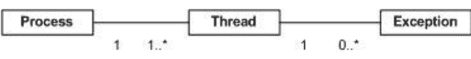

Windows 中的每个进程至少有一个执行线程，因此如果出问题，每个线程可能至少有一个异常（例如无效内存引用）。如果异常处理代码本身又遇到另一个异常，或者第一个异常已被处理，该线程中还可能出现第二个异常。

通用解决方案是查看所有线程及其调用堆栈，而不要依赖工具的输出。

下面是一个转储文件中的具体示例。Internet Explorer 崩溃了，我们在 WinDbg 中打开它并运行 !analyze -v 命令。这是我们在 WinDbg 输出中得到的内容：

```
ExceptionAddress: 7c822583 (ntdll!DbgBreakPoint)
    ExceptionCode: 80000003 (Break instruction exception)
  ExceptionFlags: 00000000
NumberParameters: 3
    Parameter[0]: 00000000
    Parameter[1]: 8fb834b8
    Parameter[2]: 00000003
```

乍一看，断点指令可能表明转储文件是从运行中的应用程序手动获取的，并未发生崩溃——客户可能发送了错误的转储文件，或误解了故障排除说明。但是，我们查看了所有线程，并注意到以下两个堆栈（线程 15 和 16）：

```
0:016>~*kL
...
15 Id: 1734.8f4 Suspend: 1 Teb: 7ffab000 Unfrozen
ntdll!KiFastSystemCallRet
ntdll!NtRaiseHardError+0xc
kernel32!UnhandledExceptionFilter+0x54b
kernel32!BaseThreadStart+0x4a
kernel32!_except_handler3+0x61
ntdll!ExecuteHandler+0x26
ntdll!ExecuteHandler+0x24
ntdll!KiUserExceptionDispatcher+0xee
componentA!xxx
componentB!xxx
mshtml!xxx
kernel32!BaseThreadStart+0x34

# 16 Id: 1734.11a4 Suspend: 1 Teb: 7ffaa000 Unfrozen
ntdll!DbgBreakPoint
ntdll!DbgUiRemoteBreakin+0x36
```


我们在此看到，真正的崩溃发生在 *componentA.dll* 中，*componentB.dll* 或 *mshtml.dll* 可能对此产生了影响。为什么会这样？客户可能在 Internet Explorer 显示异常消息框时手动对其进行了转储。*NtRaiseHardError* 显示包含错误消息的消息框。

或许还发生了其他事情。在许多我们看到一个进程转储中有多个线程异常的情况中，这是因为崩溃的线程显示了类似 Visual C++ 调试消息框的消息框，并阻止该进程终止。在我们讨论的转储中，WinDbg 自动分析命令仅识别了最后一个中断异常（显示为 # 16）。因此，我们无论如何不应过度依赖“自动分析”。

## 命名空间

和往常一样，随着传递分析结果的需求，出现了一种新模式。在分析恶意软件时，我们通常没有 **未知模块** (页 1041) 的符号文件（**无组件符号**，页 734）。通过查看 IAT（导入地址表，如果存在），我们可以推测模块的用途。有时模块本身并不恶意，但被用于更大的恶意上下文中，例如屏幕捕获：

```
[...]
10002000 76376101 gdi32!CreateCompatibleDC
10002004 763793d6 gdi32!StretchBlt
10002008 76377461 gdi32!CreateDIBSection
1000200c 763762a0 gdi32!SelectObject
10002010 00000000
10002024 77429ced user32!ReleaseDC
10002028 77423ba7 user32!NtUserGetWindowDC
1000202c 77430e21 user32!GetWindowRect
10002030 00000000
10002034 744a75e9 GdiPlus!GdiplusStartup
10002038 744976dd GdiPlus!GdipSaveImageToStream
1000203c 744cdd38 GdiPlus!GdipGetImageEncodersSize
10002040 744971cf GdiPlus!GdipDisposeImage
10002044 744a8591 GdiPlus!GdipCreateBitmapFromHBITMAP
10002048 744cdbae GdiPlus!GdipGetImageEncoders
[...]
```

还有些情况是这些 API 名称不在 IAT 中，而是作为 **字符串提示** (页 960) 出现在原始数据中，例如 `LoadLibrary / GetProcAddress`，甚至一组模块本身作为集合 API：

```
[...]
00058e20 "kernel32.dll"
00058e3c "user32.dll"
00058e54 "ws2_32.dll"
00058e6c "ntdll.dll"
00058e80 "wininet.dll"
00058e98 "nspr4.dll"
00058eac "ssl3.dll"
[...]
```

## 嵌套异常

## 托管代码

托管代码中的嵌套异常分析比非托管代码（页 726）简单得多。如果存在任何内部异常，异常对象会引用它（Exception.InnerException^147）。

WinDbg 在执行 !analyze -v 命令时，能很好地遍历所有嵌套异常。在下面的 Windows 窗体应用程序崩溃示例中，ObjectDisposedException（以粗体显示）作为带有“关键错误”消息（以粗体斜体显示）的异常对象重新抛出，该对象又多次作为带有“关键程序错误”消息（以粗体下划线显示）的异常对象重新抛出，最终导致顶级异常处理程序请求终止进程：

```
MANAGED_STACK:
(TransitionMU)
001374B0 08313757 System!System.Diagnostics.Process.Kill()+0x37
001374E4 083129C7 Component!Foo.HandleUnhandledException(System.Exception)+0x137
001374F4 E7C0A7D3 Component!Foo.FooBarProcessMenuCommand(System.String)+0x33
(TransitionUM)
(TransitionMU)
...

EXCEPTION OBJECT: !pe 3398614
Exception object: 03398614
Exception type: System.Exception
Message: Critical program error
InnerException: System.Exception, use !PrintException 03398560 to see more StackTrace (generated):
    SP       IP       Function
    001371A8 07C0CDD8 Foo.BarUserInteraction.Process(System.String)
    00137258 07C0CCA6 Foo.BarUserInteraction.ProcessUserInteraction(Sub, BarStepType)
    00137268 07C0A9BA Foo.BarMenu.Process(CMD)
    00137544 07C0A8D8 Foo.BarMenu.ProcessCMD(CMD)
    0013756C 07C0A7BE Foo+FooBar.ProcessBarMenuCommand(System.String)
StackTraceString: <none>
HResult: 80131500

EXCEPTION OBJECT: !pe 3398560
Exception object: 03398560
Exception type: System.Exception
Message: Critical program error
InnerException: System.Exception, use !PrintException 033984ac to see more StackTrace (generated):
    SP       IP       Function
    00137154 07C0D4CA Foo.BarThreads+ProcessOpenQuery.Execute()
    00137218 07C0D3B3 Foo.BarMenu.ProcessQuery()
    00137220 07C0CCF3 Foo.BarUserInteraction.Process(System.String)
StackTraceString: <none>
HResult: 80131500

EXCEPTION OBJECT: !pe 33984ac
Exception object: 033984ac
Exception type: System.Exception
Message: Critical program error
InnerException: System.Exception, use !PrintException 033983ec to see more StackTrace (generated):
    SP       IP       Function
0013704C 0A6149DD Foo.Bar.OpenQueryThreaded(Foo.BarParameter)
00137154 0A6140D0 Foo.Bar.Threads+ProcessParameter.Execute()
...

StackTraceString: <none>
HResult: 80131500

EXCEPTION OBJECT: !pe 33983ec
Exception object: 033983ec
Exception type: System.Exception
Message: Critical program error
InnerException: System.Exception, use !PrintException 033982fc to see more StackTrace (generated):
    SP       IP       Function
00137008 0ACA59F1 Foo.BarApplication.Refresh(Boolean, Boolean)
001370C4 0A6144E0 Foo.Bar.OpenQueryThreaded(Foo.Bar.Parameter)
StackTraceString: <none>
HResult: 80131500

EXCEPTION OBJECT: !pe 33982fc
Exception object: 033982fc
Exception type: System.Exception
Message: Critical program error
InnerException: System.Exception, use !PrintException 03398260 to see more StackTrace (generated):
    SP       IP       Function
00136F3C 0AE24983 Foo.BarDisplay.ShowVariableScreen(Foo.variables.BarVariables)
00136FDC 0AE204F6 Foo.variables.BarVariables.ShowVariableScreen()
00137070 0ACAFE1D Foo.Bar.Application.ShowVariableScreen(Boolean)
00137080 0ACA5977 Foo.Bar.Application.Refresh(Boolean, Boolean)
StackTraceString: <none>
HResult: 80131500

EXCEPTION_OBJECT: !pe 3398260
Exception object: 03398260
Exception type: System.Exception
Message: Critical error
InnerException: System.ObjectDisposedException, use !PrintException 03397db8 to see more StackTrace (generated):
    SP       IP       Function
00136FB4 0AE24905 Foo.BarDisplay.ShowVariableScreen(Foo.variables.BarVariables)
StackTraceString: <none>
HResult: 80131500

EXCEPTION_OBJECT: !pe 3397db8
Exception object: 03397db8
Exception type: System.ObjectDisposedException

Message: Cannot access a disposed object.
InnerException: <none>
Stack Trace (generated):
	SP	IP	Function
00136258 06D36158 System.Windows.Forms.Control.CreateHandle()
001362B8 06D38F96 System.Windows.Forms.Control.get_Handle()
001362C4 0B0C8C68 System.Windows.Forms.Control.PointToScreen(System.Drawing.Point)
001362F0 0B0CECB4 System.Windows.Forms.Button.OnMouseUp(System.Windows.Forms.MouseEventArgs)
00136314 0B0C8BB7 System.Windows.Forms.Control.WmMouseUp(System.Windows.Forms.Message ByRef,
System.Windows.Forms.MouseButtons, Int32)
00136384 06D385A0 System.Windows.Forms.Control.WndProc(System.Windows.Forms.Message ByRef)
001363E8 0A69C73E System.Windows.Forms.ButtonBase.WndProc(System.Windows.Forms.Message ByRef)
00136424 0A69C54D System.Windows.Forms.Button.WndProc(System.Windows.Forms.Message ByRef)
0013642C 06D37FAD
System.Windows.Forms.Control+ControlNativeWindow.OnMessage(System.Windows.Forms.Message ByRef)
00136430 06D37F87
System.Windows.Forms.Control+ControlNativeWindow.WndProc(System.Windows.Forms.Message ByRef)
00136440 06D37D9F System.Windows.Forms.Forms.NativeWindow.Callback(IntPtr, Int32, IntPtr, IntPtr)
StackTraceString: <none>
HResult: 80131622

EXCEPTION_MESSAGE: Cannot access a disposed object.

STACK_TEXT:
00137448 7c827c1b ntdll!KiFastSystemCallRet
0013744c 77e4201b ntdll!NtTerminateProcess+0xc
0013744c 05d78202 kernel32!TerminateProcess+0x20
...
```

## 注释

对于 **分布式异常** (页 243) 对象，我们可能还需要检查 `_remoteStackTraceString` 字段。

## 非托管代码

在第一机会异常的情况下，无法在进程崩溃转储中看到它，因为整个异常处理是在内核空间中完成的 148 ：

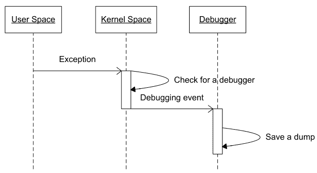

然而，当存在嵌套异常时，情况就会改变。在这种情况下，我们应期望在原始堆栈转储中看到内部异常处理的痕迹，例如异常分发器代码或异常处理程序：


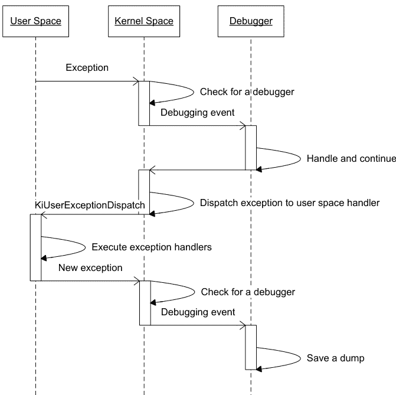

请参考带有两个异常处理程序的以下 C++ 代码：

```
__try
{
  __try
  {
    *(int *)NULL = 0; // Exception 1
    // Dump1 1st chance
  }
  __except (EXCEPTION_EXECUTE_HANDLER)
  {
    std::cout << "Inner" << std::endl;
    *(int *)NULL = 0; // Exception 2
    // Dump2 1st chance
  }
}
__except (EXCEPTION_EXECUTE_HANDLER)
{
    std::cout << "Outer" << std::endl;
    *(int *)NULL = 0;   // Exception 3
                // Dump3 1st chance
                // Dump4 2nd chance
}
```

如果我们运行实际程序，并且设置了默认的事后调试器 149，则会得到第二次机会异常转储（Dump4）。程序先在控制台输出“Inner”，然后输出“Outer”，然后崩溃。当我们查看转储时，我们会看到第二次机会异常处理代码，其中 NtRaiseException 的异常记录相同，并指向异常 3 上下文（以粗体下划线显示）：

> 此转储文件中存储了一个感兴趣的异常。
> 存储的异常信息可以通过 .ecxr 访问。
> ((1dc.f94): 访问违规 - 代码 c0000005（首次/第二次机会不可用）
> *** 错误：模块加载完成，但无法为 NestedException.exe 加载符号
> NestedException+0x1a72:
> 00000001`40001a72 c7042500000000000000 mov dword ptr [0],0 ds:00000000`00000000=????????
> 
> 0:000> !teb
> TEB at 000007fffffd0000
>     异常列表：        0000000000000000
>     堆栈基址：            0000000000130000
>     堆栈限制：           000000000012d000
>     子系统 TIB：         0000000000000000
>     纤程数据：            0000000000001e00
>     任意用户指针： 0000000000000000
>     自身：                 000007ffffffe000
>     环境指针：   0000000000000000
>     客户端 ID：             00000000000011dc . 0000000000000f94
>     RPC 句柄：            0000000000000000
>     TLS 存储：          000007ffffffe058
>     PEB 地址：          000007fffffff5000
>     上次错误值：       0
>     上次状态值：      c000000d
>     拥有锁数：    0
>     硬错误模式：        0
> 
> 0:000> dqs 000000000012d000 0000000000130000
> ...
> 00000000`0012f918 00000000`00000006
> 00000000`0012f920 00000000`00000000
> 00000000`0012f928 00000000`775a208d ntdll!KiUserExceptionDispatch+0x53
> 00000000`0012f930 00000000`00000000
> 00000000`0012f938 00000000`0012f930 ; 异常上下文
> 00000000`0012f940 01c8d5f0`00000000
> 00000000`0012f948 00000000`00000000
> ...

```
0:000> ub ntdll!KiUserExceptionDispatch+0x53
ntdll!KiUserExceptionDispatch+0x35:
00000000`775a206f xor     edx,edx
00000000`775a2071 call    ntdll!RtlRestoreContext (00000000`775a2255)
00000000`775a2076 jmp     ntdll!KiUserExceptionDispatch+0x53 (00000000`775a208d)
[...]
00000000`775a2082 mov     rdx,rsp
00000000`775a2085 xor     r8,r8b
00000000`775a2088 call    ntdll!NtRaiseException (00000000`775a1550)
0:000> .cxr 00000000`0012f930
rax=000000001400223d rbx=0000000000000000 rcx=00000000140022128
rdx=0000000000000001 rsi=0000000000000006 rdi=00000000140022120
rip=00000000140001a72 rsp=000000000012fed0 rbp=0000000000000000
r8=000007ffffffe000  r9=0000000000000001 r10=0000000000000000
r11=0000000000000246 r12=0000000000000000 r13=0000000000000002
r14=0000000000000000 r15=0000000000000000
iopl=0         nv up ei pl zr ac po nc
cs=0033  ss=002b  ds=002b  es=002b  fs=0053  gs=002b             efl=00010256
NestedException+0x1a72:
00000001`40001a72 c7042500000000000000 mov dword ptr [0],0 ds:00000000`00000000=????????
```

然而，如果我们从某个异常监控程序获得首次机会异常转储 Dump3（早期崩溃转储模式，第 312 页），我们会看到 NtRaiseException 参数指向“Inner”异常 2 上下文（一个不同且更早的地址，以斜体下划线显示）：

```
This dump file has an exception of interest stored in it.
The stored exception information can be accessed via .ecxr.
((1dc.f94): Access violation - code c0000005 (first/second chance not available)
*** ERROR: Module load completed but symbols could not be loaded for NestedException.exe
NestedException+0x1a72:
00000001`40001a72 c7042500000000000000 mov dword ptr [0],0 ds:00000000`00000000=????????
0:000> dqs 00000000`0012d000 00000000`00130000
...
00000000`0012f928 00000000`775a2068 ntdll!KiUserExceptionDispatch+0x2e
00000000`0012f930 00000000`00000000
00000000`0012f938 00000000`0012f930 ; exception context
0:000> .cxr 00000000`0012f930
[...]
NestedException+0x19fa:
00000001`400019fa c7042500000000000000 mov dword ptr [0],0 ds:00000000`00000000=????????
```

Dump2 的情况也类似，其中 NtRaiseException 参数指向异常 1 上下文。但预计 Dump1 没有任何异常处理痕迹。所有 4 个转储文件都可以从 FTP 下载以供 150 使用。

## 嵌入式罪魁祸首

有时我们怀疑某个组件，但实际是另一个 **嵌入式罪魁祸首** 引发了异常。该异常通过异常筛选器和处理程序传播，并促使怀疑的组件用诊断消息作出响应。以下是显示运行时错误消息框的线程示例：

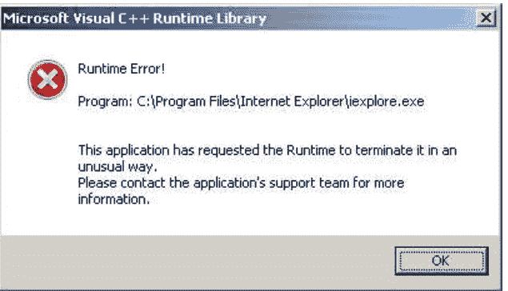

相应的 **堆栈跟踪**（第 926 页）指向 *ComponentB* 模块：

```
0:087> kL
ChildEBP RetAddr
5546ddf0 76f50dde ntdll!KiFastSystemCallRet
5546ddf4 76f3b0b2 user32!NtUserWaitMessage+0xc
5546de28 76f3bca user32!DialogBox2+0x202
5546de50 76f8ccdc user32!InternalDialogBox+0xd0
5546de0f 76f8d25e user32!SoftModalMessageBox+0x69f
5546e040 76f8d394 user32!MessageBoxWorker+0x2c7
5546e098 76f8d43e user32!MessageBoxTimeoutW+0x7f
5546e0cc 76f8d5ec user32!MessageBoxTimeoutA+0xa1
5546e0ec 67f24ac7 user32!MessageBoxExA+0x1b
5546e10c 76f8d65e ieiframe!Detour_MessageBoxExA+0x2c
5546e128 0c841c28 user32!MessageBoxA+0x45
WARNING: Stack unwind information not available. Following frames may be wrong.
5546e16c 0c83d1b9 ComponentB!DllUnregisterServer+0x9437
5546e190 0c83c7f2 ComponentB!DllUnregisterServer+0x49c8
00000000 00000000 ComponentB!DllUnregisterServer+0x4781

0:087> .asm no_code_bytes
Assembly options: no_code_bytes
```

然而，查看原始堆栈数据时，我们看到异常处理残留（**隐藏异常**模式，第 457 页），它指向 *ComponentA*，该组件尝试分配比可用内存更多的内存（*bad_alloc* C++ 异常，第 108 页）：

```
0:087> !teb
TEB at 7ffb4000
    ExceptionList:        5546e4e8
    StackBase:            55470000
    StackLimit:           55457000
    SubSystemTib:         00000000
    FiberData:            00001e00
    ArbitraryUserPointer: 00000000
    Self:                 7ffb4000
    EnvironmentPointer:   00000000
    ClientId:             0000136c . 00001714
    RpcHandle:            00000000
    Tls Storage:          5826eef0
    PEB Address:          7ffd7000
    LastErrorValue:       0
    LastStatusValue:      0
    Count Owned Locks:    0
    HardErrorMode:        0
```

```
0:087> dds 55457000 55470000
55457000 00000000
[...]
5546e694 55470000
5546e698 55457000
5546e69c 00274cb0
5546e6a0 5546e9f4
5546e6a4 772899f7 ntdll!KiUserExceptionDispatcher+0xf
5546e6a8 0046e6b8
5546e6ac 5546e6d8
5546e6b0 5546e6b8
[...]
```

```
0:087> .cxr 5546ed8
eax=5546e94a ebx=00001000 ecx=00000003 edx=00000000 esi=689a9c54 edi=6b330000
eip=771942eb esp=5546e94a ebp=5546e9f4 iopl=0 nv up ei pl nz ac po nc
cs=001b ss=0023 ds=0023 es=0023 fs=003b gs=0000 efl=00240212
kernel32!RaiseException+0x58:
771942eb c9              leave
```

```
0:087> .exr 5546e6b8
ExceptionAddress: 771942eb (kernel32!RaiseException+0x00000058)
ExceptionCode: e06d7363 (C++ EH exception)
ExceptionFlags: 00000001
NumberParameters: 3
Parameter[0]: 19930520
Parameter[1]: 5546ea3c
Parameter[2]: 688b7954
pExceptionObject: 5546ea3c
__s_ThrowInfo : 688b7954
Type : class std::bad_alloc
Type : class std::exception
```

```
0:087> kl
*** Stack trace for last set context - .thread/.cxr resets it
ChildEBP RetAddr
5546e9f4 6882dead kernel32!RaiseException+0x58
WARNING: Stack unwind information not available. Following frames may be wrong.
5546ea2c 6882a59d ComponentA!DllUnregisterServer+0x1adbe0
5546ea48 6868157b ComponentA!DllUnregisterServer+0x1aa2d0
5546ea74 6869d2c6 ComponentA!DllUnregisterServer+0x12ae
5546ea88 6868a415 ComponentA!DllUnregisterServer+0x1cfff9
5546eaa0 685a165e ComponentA!DllUnregisterServer+0xa148
5546eac8 685a9828 ComponentA+0x5165e
5546ebc8 68605fdd ComponentA+0x59828
5546ebf0 6a807aba ComponentA+0xb5fdd
5546ec08 6a807a77 mshtml!CViewDispClient::Invalidate+0x59
5546ec20 00000000 mshtml!CDispRoot::InvalidateRoot+0x1d
0:087> ub 6882dead
ComponentA!DllUnregisterServer+0x1adbc4:
6882de91 je ComponentA!DllUnregisterServer+0x1adbcd (6882de9a)
6882de93 mov dword ptr [ebp-0Ch],1994000h
6882de9a lea eax,[ebp-0Ch]
6882de9d push eax
6882de9e push dword ptr [ebp-10h]
6882dea1 push dword ptr [ebp-1Ch]
6882dea4 push dword ptr [ebp-20h]
6882dea7 call dword ptr [ComponentA!DllUnregisterServer+0x1ba0a3 (6883a370)]
```

碰巧 ComponentB 有一个显示运行时错误的异常筛选器：

```
0:087> !exchain
5546e4e8: ComponentB!DllUnregisterServer+18df (0c83a0d0)
5546e578: kernel32!ExceptHandler4+0 (7715e289)
5546e5e4: ntdll!ExecuteHandler+23a (77289bad)
5546faa8: user32!except_handler4+0 (76f951ba)
5546fb0c: user32!except_handler4+0 (76f951ba)
5546fbd0: ntdll!_except_handler4+0 (77239834)
Invalid exception stack at ffffffff
```

嵌入式罪魁祸首与嵌套异常模式（第 726 页）不同。后者是指异常处理程序经历或抛出另一个异常。


## 网络数据包构建

使用 NDIS WinDbg 扩展程序查看网络数据包池时，我们可能会看到已分配块数量增加，这可能与网络问题相关，例如：

| Pool | Allocator | BlocksAllocated | BlockSize | PktrsPerBlock | PacketLength |
| --- | --- | --- | --- | --- | --- |
| 8a467e20 | b9909f96 | 0x1 | 0x1000 | 0x14 | 0xc8   tcpip!ARPRegister+119 |
| 8a491460 | ba4eea56 | 0x1 | 0x1000 | 0x14 | 0xc8   wanarp!WanpInitializeNdis+a8 |
| 8a466508 | b905d368 | 0x1 | 0x1000 | 0xd | 0x138  tcpip!InitForwardingPools+53 |
| 8a373578 | b905becb | 0x3 | 0x1000 | 0x11 | 0xe8   tcpip!AllocIPPacketList+59 |
| 8a466580 | b9095ac5 | 0x1 | 0x1000 | 0xe | 0x118  tcpip!IPInit+e0 |
| 8a460958 | bac40a97 | 0xb | 0x1000 | 0x14 | 0xc8   vmxnet+a97 |

| Pool | Allocator | BlocksAllocated | BlockSize | PktrsPerBlock | PacketLength |
| --- | --- | --- | --- | --- | --- |
| 8a467e20 | b9909f96 | 0x1 | 0x1000 | 0x14 | 0xc8   tcpip!ARPRegister+119 |
| 8a491460 | ba4eea56 | 0x1 | 0x1000 | 0x14 | 0xc8   wanarp!WanpInitializeNdis+a8 |
| 8a466508 | b905d368 | 0x1 | 0x1000 | 0xd | 0x138  tcpip!InitForwardingPools+53 |
| 8a373578 | b905becb | 0xa3 | 0x1000 | 0x11 | 0xe8   tcpip!AllocIPPacketList+59 |
| 8a466580 | b9095ac5 | 0x1 | 0x1000 | 0xe | 0x118  tcpip!IPInit+e0 |
| 8a460958 | bac40a97 | 0x9b | 0x1000 | 0x14 | 0xc8   vmxnet+a97 |

## 无组件符号

无组件符号情况在崩溃转储中经常发生。在这种情况下，我们可以通过查看组件名称、调用它的整体线程堆栈以及其导入表来推测该组件的功能。下面是一个示例。我们在某些内核转储的线程堆栈中看到了 *component.sys* 驱动程序，但不知道该组件可能执行什么操作。因为没有符号，所以无法查看其导入的函数：

```
kd> x component!*
k>
```

我们使用 !dh 命令转储其映像标头：

```
kd> lmv m component
start             end                 module name
fffffadf`e0eb5000 fffffadf`e0ebc000   component   (no symbols)
    Loaded symbol image file: component.sys
    Image path: \?\C:\Component\x64\component.sys
    Image name: component.sys
    Timestamp:        Sat Jul 01 19:06:16 2006 (44A6B998)
    CheckSum:         00007E4F
    ImageSize:        00007000
    Translations:     0000.04b0 0000.04e0 0409.04b0 0409.04e0

kd> !dh fffffadf`e0eb5000
File Type: EXECUTABLE IMAGE
FILE HEADER VALUES
    8664 machine (X64)
      6 number of sections
44A6B998 time date stamp Sat Jul 01 19:06:16 2006
      0 file pointer to symbol table
      0 number of symbols
    F0 size of optional header
      22 characteristics
        Executable
        App can handle >2gb addresses
OPTIONAL HEADER VALUES
      20B magic #
      8.00 linker version
      C00 size of code
      A00 size of initialized data
      0 size of uninitialized data
    5100 address of entry point
    1000 base of code
------- new -------
00000000`00010000 image base
      1000 section alignment
      200 file alignment
      1 subsystem (Native)
    5.02 operating system version
    5.02 image version
    5.02 subsystem version
     7000 size of image
400 size of headers
74EF checksum
0000000000040000 size of stack reserve
0000000000001000 size of stack commit
0000000000100000 size of heap reserve
0000000000001000 size of heap commit
0 [ 0] address [size] of Export Directory
51B0 [ 28] address [size] of Import Directory
6000 [ 388] address [size] of Resource Directory
4000 [ 6C] address [size] of Exception Directory
0 [ 0] address [size] of Security Directory
0 [ 0] address [size] of Base Relocation Directory
2090 [ 1C] address [size] of Debug Directory
0 [ 0] address [size] of Description Directory
0 [ 0] address [size] of Special Directory
0 [ 0] address [size] of Thread Storage Directory
0 [ 0] address [size] of Load Configuration Directory
0 [ 0] address [size] of Bound Import Directory
2000 [ 88] address [size] of Import Address Table Directory
0 [ 0] address [size] of Delay Import Directory
0 [ 0] address [size] of COR20 Header Directory
0 [ 0] address [size] of Reserved Directory
...
```

然后我们使用 dps 命令显示导入地址表目录的内容：

```
kd> dps fffffadf`e0eb5000+2000 fffffadf`e0eb5000+2000+88
fffffadf`e0eb7000 fffffff800`01044370 nt!IoCompleteRequest
fffffadf`e0eb7008 fffffff800`01019700 nt!IoDeleteDevice
fffffadf`e0eb7010 fffffff800`012551a0 nt!IoDeleteSymbolicLink
fffffadf`e0eb7018 fffffff800`01056a90 nt!MiResolveTransitionFault+0x7c2
fffffadf`e0eb7020 fffffff800`0103a380 nt!ObDereferenceObject
fffffadf`e0eb7028 fffffff800`0103ace0 nt!KeWaitForSingleObject
fffffadf`e0eb7030 fffffff800`0103c570 nt!KeSetTimer
fffffadf`e0eb7038 fffffff800`0102d070 nt!IoBuildPartialMdl+0x3
fffffadf`e0eb7040 fffffff800`012d4480 nt!PsTerminateSystemThread
fffffadf`e0eb7048 fffffff800`01041690 nt!KeBugCheckEx
fffffadf`e0eb7050 fffffff800`010381b0 nt!KeInitializeTimer
fffffadf`e0eb7058 fffffff800`0103ceb0 nt!ZwClose
fffffadf`e0eb7060 fffffff800`012b39f0 nt!ObReferenceObjectByHandle
fffffadf`e0eb7068 fffffff800`012b7380 nt!PsCreateSystemThread
fffffadf`e0eb7070 fffffff800`01251f90 nt!FsRtlpIsDfsEnabled+0x114
fffffadf`e0eb7078 fffffff800`01275160 nt!IoCreateDevice
fffffadf`e0eb7080 00000000`00000000
fffffadf`e0eb7088 00000000`00000000
```

我们可以看到，在某些情况下，该驱动程序可以使用 KeBugCheckEx 使系统崩溃，它会创建系统线程（PsCreateSystemThread）并使用定时器（KeInitializeTimer、KeSetTimer）。

如果在导入表中看到名称+偏移量（我认为这是 OMAP 代码优化的影响，第 756 页），可以使用 ln 命令（列出最近符号）获取该函数：

```
kd> ln fffff800`01056a90
(fffff800`01056760)   nt!MiResolveTransitionFault+0x7c2   |   (fffff800`01056a92)   nt!RtlInitUnicodeString

kd> ln fffff800`01251f90
(fffff800`01251e90)   nt!FsRtlpIsDfsEnabled+0x114   |   (fffff800`01251f92)   nt!IoCreateSymbolicLink
```

如果驱动程序调用某些函数或必须成对调用某些函数时发生崩溃，此技术很有用，例如崩溃代码 0x20：

```
kd> !analyze -show 0x20
KERNEL_APC_PENDING_DURING_EXIT (20)
The key data item is the thread's APC disable count. If this is non-zero, then this is the source of the problem. The APC disable count is decremented each time a driver calls KeEnterCriticalRegion, KeInitializeMutex, or FsRtlEnterFileSystem. The APC disable count is incremented each time a driver calls KeLeaveCriticalRegion, KeReleaseMutex, or FsRtlExitFileSystem. Since these calls should always be in pairs, this value should be zero when a thread exits. A negative value indicates that a driver has disabled APC calls without re-enabling them. A positive value indicates that the reverse is true. If you ever see this error, be very suspicious of all drivers installed on the machine – especially unusual or non-standard drivers. Third party file system redirectors are especially suspicious since they do not generally receive the heavy duty testing that NTFS, FAT, RDR, etc receive. This current IRQL should also be 0. If it is not, that a driver's cancelation routine can cause this bugcheck by returning at an elevated IRQL. Always attempt to note what you were doing/closing at the time of the crash, and note all of the installed drivers at the time of the crash. This symptom is usually a severe bug in a third party driver.
```

然后我们可以至少看到可疑驱动程序是否可能使用了这些函数，如果它导入其中一个函数，我们可以查看它是否导入了相应的对应函数。

**无组件符号** 模式可以在堆栈跟踪中轻松识别，表现为巨大的函数偏移量或根本没有导出函数：

```
STACK_TEXT:
WARNING: Stack unwind information not available. Following frames may be wrong.
00b2f42c 091607aa mydll!foo+0x8338
00b2f4cc 7c83ab9e mydll+0x8fe3
```


## 当前线程缺失

当前线程缺失模式很少见，但在大量进程内存转储中我们观察到了几次出现：

```
0:???> k
WARNING: The debugger does not have a current process or thread
WARNING: Many commands will not work
^ Illegal thread error in 'k'

0:???> ~
WARNING: The debugger does not have a current process or thread
WARNING: Many commands will not work
0 Id: 95f4.6780 Suspend: 1 Teb: 7fedd000 Unfrozen
```

设置当前线程有帮助：

```
0:???> ~0s
WARNING: The debugger does not have a current process or thread
WARNING: Many commands will not work
eax=037d0010 ebx=0002bda0 ecx=03b1a010 edx=00000007 esi=037d0010 edi=03b069fc
eip=0397993f esp=0018fd98 ebp=0018ffd8 iopl=0 nv up ei pl nz na po nc
cs=0023 ss=002b ds=002b es=002b fs=0053 gs=002b efl=00200202
DllA+0x939f:
0397939f 8b10 mov edx,dword ptr [eax] ds:002b:037d0010=03b1a010

0:000> k
ChildEBP RetAddr
WARNING: Stack unwind information not available. Following frames may be wrong.
0018ffd8 03975257 DllA+0x939f
0018fdf8 03975577 DllA+0x5257
0018fe58 772bb9a0 DllA+0x5577
0018fe78 772d9b96 ntdll!LdrpCallInitRoutine+0x14
0018ff1c 772d9a38 ntdll!LdrShutdownProcess+0x1aa
0018ff30 752279f4 ntdll!RtlExitUserProcess+0x74
0018ff44 0040625d kernel32!ExitProcessStub+0x12
0018ff5c 012528e5 Application+0x625d
0018ff88 7522339a Application!foo+0xdc88f1
0018ff94 772bbf42 kernel32!BaseThreadInitThunk+0xe
0018ffd4 772bbf15 ntdll!__RtlUserThreadStart+0x70
0018ffec 00000000 ntdll!_RtlUserThreadStart+0x1b
```

但是，新当前线程的EIP不指向任何访问违例，且解引用的地址有效：

```
0:000> !address 037d0010
Usage: <unclassified>
Allocation Base: 037d0000
Base Address: 037d0000
End Address: 038dd000
Region Size: 0010d000
Type: 00020000 MEM_PRIVATE
State:            00001000 MEM_COMMIT
Protect:          00000004 PAGE_READWRITE
```

此外，如果我们检查原始堆栈数据，也不会在其中发现任何**隐藏异常**（第457页）。因此，我们得出结论：缺失的线程是例外。确实，进程内存转储中有一个保存的异常上下文：

```
0:000> .exr -1
ExceptionAddress: 08a9ae18 (<Unloaded_DllB.dll>+0x001cae18)
ExceptionCode: c0000005 (Access violation)
ExceptionFlags: 00000001
NumberParameters: 1
Parameter[0]: 00000008
```

## 无数据类型

有时我们没有符号（**无组件符号**模式，第734页），或者只有有限的符号集。例如，在基础操作系统中，我们有数据类型：

```
0:016> dt ntdll!*
ntdll!LIST_ENTRY64
ntdll!LIST_ENTRY32
ntdll!_KUSER_SHARED_DATA
ntdll!_KSYSTEM_TIME
ntdll!_KSYSTEM_TIME
ntdll!_NT_PRODUCT_TYPE
[...]
```

在“私有”版本中我们没有它们，尽管符号文件存在：

```
0:015> dt ntdll!*

0:015> !lmi ntdll
Loaded Module Info: [ntdll]
Module: ntdll
Base Address: 00000000`76de0000
Image Name: ntdll.dll
Machine Type: 34404 (X64)
Time Stamp: 4dcd9861 Fri May 13 21:45:21 2011
Size: 17f000
CheckSum: 188814
Characteristics: 2022 perf
Debug Data Dirs: Type Size VA Pointer
CODEVIEW 22, f72a8, f66a8 RSDS - GUID: {05A648A7-625D-42E7-B736-7816F0CA1E0C}
Age: 2, Pdb: ntdll.pdb
CLSID 8, f72a0, f66a0 [Data not mapped]
Image Type: MEMORY - Image read successfully from loaded memory.
Symbol Type: PDB - Symbols loaded successfully from symbol server.
c:\mss\ntdll.pdb\05A648A7625D42E7B7367816F0CA1E0C2\ntdll.pdb
Load Report: public symbols, not source indexed
c:\mss\ntdll.pdb\05A648A7625D42E7B7367816F0CA1E0C2\ntdll.pdb
```

在这种情况下，手动加载邻近模块可能有帮助⁵¹，尽管我们尚未在x64系统上测试过。我们也考虑将该模式命名为**私有修改**，但这无法涵盖许多其他情况，即类型从一开始就缺失。

## 无进程转储

当我们预期有崩溃转储时却没有，这本身可以被视为一种模式。这可能由于各种原因发生，故障排除应基于崩溃与挂起的区分^152。这里有三种组合：

- 1. 进程在任务管理器中可见且正常运行
- 2. 进程在任务管理器中可见且不再正常运行
- 3. 进程在任务管理器中不可见

如果进程在任务列表中可见且正常运行，则应考虑以下原因：

- 异常尚未发生，由于不同的代码执行路径或时机尚未到来，我们需要等待
- 异常尚未发生，由于不同的内存布局。这可能是改变环境模式（第114页）的一个实例。

如果进程在任务管理器中可见且不再正常运行，则它可能正在挂起并等待某些输入。在这种情况下，最好主动获取进程转储^153。如果进程在任务管理器中不可见，则应考虑以下原因：

- AeDebug键的调试器值无效、缺失或指向错误路径，或者命令行参数错误。示例请参阅关于自定义事后调试器^154或NTSD^155的讨论。
- 异常处理机制或WER设置有问题。使用进程监视器查看异常发生时启动了哪些进程、加载了哪些模块。在控制面板中检查WER设置。
- 尝试LocalDumps注册表项^156
- 使用活动调试技术，例如附加到进程或在调试器下运行进程来监控异常并保存初始机会异常崩溃转储（早期崩溃转储模式，第312页）。

这是依赖事后分析的技术支持环境中非常重要的一种模式。

## 无系统转储

这是一个对应的模式，类似于**无进程转储**（第740页），系统要么按需要么由于bugcheck条件蓝屏，但没有保存内核或完整转储。在这种情况下，我们建议检查保存内存转储的驱动器上的可用空间。这是因为崩溃转储首先保存到页文件中，然后在启动时复制到单独的文件，默认为memory.dmp文件^157。如果我们有足够的可用空间但页文件空间不足，可能会出现**截断转储**（第1015页）或**损坏转储**（第137页）模式的实例。

## 注释

在某些严重损坏或系统故障的情况下，系统没有机会执行系统代码来保存转储并显示蓝屏。为检查此情况，建议在控制面板中禁用“自动重新启动”选项。我曾通过从内核模式调用用户空间代码，并尝试从中调用GDI32函数来试验一个驱动程序。系统立即重新启动，没有BSOD屏幕。

^157 Savedump.exe和页文件，《内存转储分析选集》第1卷，第628页

## 不是我的线程

我们发现，在Windows 10中（至少在我们的工作系统上），记事本即使不打开任何常见对话框（如**事件转储**分析模式示例，第328页）也不再是单线程应用程序了。它至少有3个额外线程（我们用于培训的其他建模应用程序也有额外线程）：

```
0:000> ~*k

0 Id: 3a64.3b38 Suspend: 1 Teb: 00007ff6`a914d000 Unfrozen
# Child-SP RetAddr Call Site
00 00000000`6298f938 00007ffa`e57cf8e5 USER32!NtUserGetMessage+0xa
01 00000000`6298f940 00007ff6`a9603470 USER32!GetMessageW+0x25
02 00000000`6298f970 00007ff6`a96141f5 notepad!WinMain+0x178
03 00000000`6298f9f0 00007ffa`e34d2f92 notepad!WinMainCRTStartup+0x1c5
04 00000000`6298fab0 00007ffa`e5bc9f64 KERNEL32!BaseThreadInitThunk+0x22
05 00000000`6298fae0 00000000`00000000 ntdll!RtlUserThreadStart+0x34

1 Id: 3a64.38b0 Suspend: 1 Teb: 00007ff6`a914b000 Unfrozen
# Child-SP RetAddr Call Site
00 00000000`62bffa58 00007ffa`e5bf93a5 ntdll!NtWaitForWorkViaWorkerFactory+0xa
01 00000000`62bffa60 00007ffa`e3b42d92 ntdll!TppWorkerThread+0x295
02 0002bffe60 00007ffa`e5bc9f64 KERNEL32!BaseThreadInitThunk+0x22
03 0002bffe90 00000000`00000000 ntdll!RtlUserThreadStart+0x34

2 Id: 3a64.3940 Suspend: 1 Teb: 00007ff6`a9149000 Unfrozen
# Child-SP RetAddr Call Site
00 00000000`62c7f718 00007ffa`e5bf93a5 ntdll!NtWaitForWorkViaWorkerFactory+0xa
01 00000000`62c7f720 00007ffa`e3b42d92 ntdll!TppWorkerThread+0x295
02 00000000`62c7fb20 00007ffa`e5bc9f64 KERNEL32!BaseThreadInitThunk+0x22
03 00000000`62c7fb50 00000000`00000000 ntdll!RtlUserThreadStart+0x34

3 Id: 3a64.1030 Suspend: 1 Teb: 00007ff6`a9147000 Unfrozen
# Child-SP RetAddr Call Site
00 00000000`62d1f878 00007ffa`e5bf93a5 ntdll!NtWaitForWorkViaWorkerFactory+0xa
01 00000000`62d1f880 00007ffa`e3b42d92 ntdll!TppWorkerThread+0x295
02 00000000`62d1fc80 00007ffa`e5bc9f64 KERNEL32!BaseThreadInitThunk+0x22
03 00000000`62d1fcb0 00000000`00000000 ntdll!RtlUserThreadStart+0x34
```

这给了我们一个关于我们称之为**不是我的线程**的分析模式的想法，因为额外线程可以由任何其他进程DLL启动，例如由**挂钩软件**（第1175页）。但是，我们需要区分意外添加的线程、具有**特殊堆栈跟踪**（第882页）的线程和**特殊线程**（第883页），例如来自.NET支持的线程。


## 并非我的版本

### 硬件

这是软件中“并非我的版本”模式的硬件对应体（第 744 页）。某些问题会在产品测试时未使用过的不同硬件上表现出来。在这种情况下，我们可以查看内核和完整内存转储，使用 lsysinfo 命令提取硬件信息并比较差异。这与“虚拟化系统”模式（第 1075 页）类似，可能会提供故障排除提示。我们过去看到的一个例子涉及一个图形密集型应用程序，该应用严重依赖硬件加速功能。它在特定处理器和芯片组上进行了测试，但几年后，尽管操作系统映像和驱动程序相同，却无法在一台计算机上运行。lsysinfo 命令揭示了显著的硬件差异：出现故障的客户端计算机是一台更新、更快的多处理器机器。

### 软件

**并非我的版本** 是 DLL 地狱类别的另一种基本模式。当我们查看组件的时间戳和路径，并意识到生产环境中的某个模块比开发和测试期间的要旧时，就会出现这种情况。**lmft** WinDbg 命令将生成所需的输出。如果模块很多，我们可能希望创建 CAD 图（组件年龄图 158）以直观地发现异常。组件版本检查是基本故障排除和系统管理活动之一。这里有一个示例（为了视觉清晰，已移除模块起始和结束加载地址）：

```
0:000> kL
Child-SP          RetAddr           Call Site
00000000`0012fed8 00000001`40001093 MyDLL!fnMyDLL
00000000`0012fee0 00000001`40001344 2DLls+0x1093
00000000`0012ff10 00000000`773acdcd 2DLls+0x1344
00000000`0012fff0 00000000`774fc6e1 kernel32!BaseThreadInitThunk+0xd
00000000`0012ff90 00000000`00000000 ntdll!RtlUserThreadStart+0x1d
```

```
0:000> lmft
module name
MyDLL   C:\OLD\MyDLL.dll   Wed Jun 18 14:49:13 2004
user32   C:\Windows\System32\user32.dll   Thu Feb 15 05:22:33 2007
kernel32 C:\Windows\System32\kernel32.dll Thu Nov 02 11:14:48 2006
ntdll   C:\Windows\System32\ntdll.dll   Thu Nov 02 11:16:02 2006
2DLls   C:\2DLls\2DLls.exe   Thu Jun 19 10:46:44 2008 (485A2B04)
uxtheme C:\Windows\System32\uxtheme.dll Thu Nov 02 11:15:07 2006
rpcrt4 C:\Windows\System32\rpcrt4.dll Tue Jul 17 05:21:15 2007
lpk C:\Windows\System32\lpk.dll   Thu Nov 02 11:12:33 2006
oleaut32 C:\Windows\System32\oleaut32.dll Thu Dec 06 05:09:35 2007
usp10 C:\Windows\System32\usp10.dll   Thu Nov 02 11:15:03 2006
ole32   C:\Windows\System32\ole32.dll   Thu Nov 02 11:14:31 2006
advapi32 C:\Windows\System32\advapi32.dll Thu Nov 02 11:11:35 2006
gdi32   C:\Windows\System32\gdi32.dll   Thu Feb 21 04:40:51 2008
msvcrt C:\Windows\System32\msvcrt.dll   Thu Nov 02 11:13:37 2006
imm32   C:\Windows\System32\imm32.dll   Thu Nov 02 11:13:15 2006
msctf   C:\Windows\System32\msctf.dll   Thu Nov 02 11:13:42 2006
```

当我们遇到 **模块多样性**（第 703 页）的实例，尤其是 **重复模块**（第 287 页）时，应该检查此模式。请注意，当此模式应用于 **未知组件**（第 1035 页）159 时，也很容易成为反模式。

## 空指针

### Linux

#### 代码

这是先前为 Mac OS X（第 747 页）和 Windows（第 750 页）平台描述过的 **空指针**（代码）模式的 Linux 变体：

```
(gdb) bt
#0 0x0000000000000000 in ?? ()
#1 0x000000000040531 in procB ()
#2 0x00000000004005f8 in bar_four ()
#3 0x0000000000400608 in foo_four ()
#4 0x0000000000400620 in thread_four ()
#5 0x0000000000401630 in start_thread (arg=<optimized out>)
 at pthread_create.c:304
#6 0x00000000004324e9 in clone ()
#7 0x0000000000000000 in ?? ()

(gdb) disassemble procB
Dump of assembler code for function procB:
0x0000000000400516 <+0>: push %rbp
0x0000000000400517 <+1>: mov %rsp,%rbp
0x000000000040051a <+4>: sub $0x10,%rsp
0x000000000040051e <+8>: movq $0x0,-0x8(%rbp)
0x0000000000400526 <+16>: mov -0x8(%rbp),%rdx
0x000000000040052a <+20>: mov $0x0,%eax
0x000000000040052f <+25>: callq *%rdx
0x0000000000400531 <+27>: leaveq 
0x0000000000400532 <+28>: retq 
End of assembler dump.

(gdb) info r rdx
rdx 0x0 0
```

#### 数据

这是先前为 Mac OS X（第 745 页）和 Windows（第 752 页）平台描述过的 **空指针**（数据）模式的 Linux 变体：

```
(gdb) bt
#0  0x0000000000400500 in procA ()
#1  0x000000000040057a in bar_two ()
#2  0x000000000040058a in foo_two ()
#3  0x00000000004005a2 in thread_two ()
#4  0x0000000000401630 in start_thread (arg=<optimized out>) at pthread_create.c:304
#5  0x00000000004324e9 in clone ()
#6  0x0000000000000000 in ?? ()

(gdb) x/i 0x400500
=> 0x400500 <procA+16>:   movl   $0x1,(%rax)

(gdb) info r $rax
rax            0x0  0

(gdb) x $rax
0x0: Cannot access memory at address 0x0
```

### Mac OS X

#### 代码

这是空指针（代码）模式的 Mac OS X / GDB 对应体：

```
(gdb) bt
#0 0x0000000000000000 in ?? ()
#1 0x000000010e8cce73 in bar (ps=0x7fff6e4cbac0)
#2 0x000000010e8cce95 in foo (ps=0x7fff6e4cbac0)
#3 0x000000010e8cced5 in main (argc=1, argv=0x7fff6e4cbb08)

(gdb) disass 0x000000010e8cce73-3 0x000000010e8cce73
Dump of assembler code from 0x10e8cce70 to 0x10e8cce73:
0x000000010e8cce70 : callq *0x8(%rdi)
End of assembler dump.

(gdb) info r rdi
rdi 0x7fff6e4cbac0 140735043910336

(gdb) x/2 0x7fff6e4cbac0
0x7fff6e4cbac0: 0x00000000a 0x00000000

(gdb) p/x *($rdi+8)
$7 = 0x0

(gdb) bt
#0 0x0000000000000000 in ?? ()
#1 0x000000010e8cce73 in bar (ps=0x7fff6e4cbac0)
#2 0x000000010e8cce95 in foo (ps=0x7fff6e4cbac0)
#3 0x000000010e8cced5 in main (argc=1, argv=0x7fff6e4cbb08)

(gdb) ptype MYSTRUCT
type = struct _MyStruct_tag {
    int data;
    PFUNC pfunc;
}

(gdb) print {MYSTRUCT}0x7fff6e4cbac0
$2 = {data = 10, pfunc = 0}
```

以下是建模应用程序的源代码：

```c
typedef void (*PFUNC)(void);

typedef struct _MyStruct_tag
{
    int data;
    PFUNC pfunc;
} MYSTRUCT;

void bar(MYSTRUCT *ps)
{
    ps->pfunc();
}

void foo(MYSTRUCT *ps)
{
    bar(ps);
}

int main(int argc, const char * argv[])
{
    MYSTRUCT pstruct = {10, NULL};

    foo(&pstruct);

    return 0;
}
```

#### 数据

这是空指针（数据）模式的 Mac OS X / GDB 对应体：

```
(gdb) bt
#0 0x000000010d3b0e90 in bar () at main.c:15
#1 0x000000010d3b0ea9 in foo () at main.c:20
#2 0x000000010d3b0ec4 in main (argc=1,
argv=0x7fff5fc6faf8) at main.c:25

(gdb) disassemble
Dump of assembler code for function bar:
0x000000010d3b0e80 <bar+0>:   push  %rbp
0x000000010d3b0e81 <bar+1>:   mov   %rsp,%rbp
0x000000010d3b0e84 <bar+4>:   movq  $0x0,-0x8(%rbp)
0x000000010d3b0e8c <bar+12>:  mov   -0x8(%rbp),%rax
0x000000010d3b0e90 <bar+16>:  movl  $0x1,(%rax)
0x000000010d3b0e96 <bar+22>:  pop   %bp
0x000000010d3b0e97 <bar+23>:  retq
End of assembler dump.

(gdb) p/x $rax
$1 = 0x0
```

### Windows

#### 代码

空指针是无效指针模式（第 589 页）的一种专用化，根据我们的调试经验，它大多数情况下是最容易识别的模式，并且修复方法简单直接。检查指针值是否非空可能不起作用，如果指针值是随机的（野指针模式，第 1151 页），但至少它消除了这一类问题。空指针可以是空数据指针（第 752 页）或空代码指针。后者发生在我们拥有某个函数的指针并尝试调用它时。考虑这个示例：

```
0:002> r
eax=00000000 ebx=00000000 ecx=93630000 edx=00000000 esi=00000000 edi=00000000
eip=00000000 esp=0222ffbc ebp=0222ffec iopl=0 nv up ei pl zr na pe nc
cs=0023 ss=002b ds=002b es=002b fs=0053 gs=002b efl=00010246
00000000 ??
     ???
0:002> kv
ChildEBP RetAddr  Args to Child
WARNING: Frame IP not in any known module. Following frames may be wrong.
0222ffbb 7d4dfe21 00000000 00000000 00000000 0x0
0222ffec 00000000 00000000 00000000 00000000 kernel32!BaseThreadStart+0x34
```

很明显，这里有一个空代码指针，如果我们反汇编返回地址 7d4dfe21 或 BaseThreadStart+0x34 地址，我们会怀疑 BaseThreadStart 函数尝试调用一个线程启动过程：

```
0:002> ub 7d4dfe21
kernel32!BaseThreadStart+0x10:
7d4dfdfd mov      eax,dword ptr fs:[00000018h]
7d4dfe03 cmp      dword ptr [eax+10h],1E00h
7d4dfe0a jne      kernel32!BaseThreadStart+0x2e (7d4dfe1b)
7d4dfe0c cmp      byte ptr [kernel32!BaseRunningInServerProcess (7d560008)],0
7d4dfe13 jne      kernel32!BaseThreadStart+0x2e (7d4dfe1b)
7d4dfe15 call     dword ptr [kernel32!_imp__CsrNewThread (7d4d0310)]
7d4dfe1b push     dword ptr [ebp+0Ch]
7d4dfe1e call     dword ptr [ebp+8]
```

```
0:002> dp ebp+8 l1
0222fff4 00000000
```


为了确认这一猜测，我们可以编写调用 CreateThread 函数的代码，示例如下：

```
typedef DWORD (WINAPI *THREADPROC)(PVOID);

DWORD WINAPI ThreadProc(PVOID pvParam)
{
    // Does some work
    return 0;
}

void foo()
{
    //...
    THREADPROC thProc = ThreadProc;
    //...
    // thProc becomes NULL because of a bug
    //...
    HANDLE Thread = CreateThread(NULL, 0, thProc, 0, 0, NULL);
    CloseHandle(hThread);
}
```

## 数据

这是更通用的“无效指针”模式（第 589 页）的一个特殊版本，类似于“空代码指针”（第 750 页）。有效地址低于 0xFFFF，通常是一个值为 0 且带有小偏移量的寄存器，例如：

```
0: kd> r
Last set context:
eax=8923b008 ebx=00000000 ecx=00000000 edx=8923b008 esi=891312d0 edi=89f0b300
eip=8081c7c4 esp=f1b5d744 ebp=f1b5d744 iopl=0 nv up ei ng nz ac pe nc
cs=0008 ss=0010 ds=0023 es=0023 fs=0030 gs=0000 efl=00010296
nt!IopIoOperationSynchronous+0x2e:
8081c7c4 f6412c02 test byte ptr [ecx+2Ch],2 ds:0023:0000002c=?
```

这里，在向后反汇编该函数后，我们可以看到从 [EBP+8] 开始的一系列取消引用操作，这意味着一个指向结构体（此处为 IRP）的指针被传递给了该函数，并且该结构体中包含一个指向另一个结构体的数据指针，而后者又包含一个 NULL 指针：

```
0: kd> ub 8081c7c4
nt!IopIoOperationSynchronous:
8081c7b6 8bff mov edi,edi
8081c7b8 55 push ebp
8081c7b9 8bec mov ebp,esp
8081c7bb 8b4508 mov eax,dword ptr [ebp+8]
8081c7be 8b4860 mov ecx,dword ptr [eax+60h]
8081c7c1 8b4918 mov ecx,dword ptr [ecx+18h]
```

## 注释

x64 示例，同时展示 x64 上下文中的 .cxr 命令：

```
0:006> k
# Child-SP RetAddr Call Site
00 000000a9`be019378 00007ffe`1b1198f8 ntdll!NtWaitForMultipleObjects+0xa
01 000000a9`be019380 00007ffe`1b11908e KERNELBASE!WaitForMultipleObjectsEx+0xef
02 000000a9`be019680 00007ffe`1b92155c KERNELBASE!WaitForMultipleObjects+0xe
03 000000a9`be0196c0 00007ffe`1b921088 kernel32!BasepReportFault+0x54c
04 000000a9`be019c30 00007ffe`1b1403cd kernel32!BasepReportFault+0x78
05 000000a9`be019c60 00007ffe`1dd8df6f KERNELBASE!UnhandledExceptionFilter+0x1fd
06 000000a9`be019d60 00007ffe`1dd65680 ntdll!LdrpLogFatalUserCallbackException+0x56
07 000000a9`be019e90 00007ffe`1dd6666d ntdll!KiUserCallbackDispatcherHandler+0x20
08 000000a9`be019ed0 00007ffe`1dde3c00 ntdll!RtlpExecuteHandlerForException+0xd
09 000000a9`be019f00 00007ffe`1dd6577a ntdll!RtlDispatchException+0x370
0a 000000a9`be01a600 00007ffd`f98e8f69 ntdll!KiUserExceptionDispatch+0x3a
0b 000000a9`be01ad00 00007ffd`f985c944 edgehtml!CWebPlatformTridentHost::LoadNewWindowContent+0x35
0c 000000a9`be01ad90 00007ffe`1b84b0b3 edgehtml!CWebPlatform::LoadNewWindowContent+0x64
0d 000000a9`be01ae10 00007ffe`1b80521e rpcrt4!Invoke+0x73
0e 000000a9`be01aea0 00007ffe`1b83aaba rpcrt4!NdrStubCall2+0x34e
0f 000000a9`be01b4f0 00007ffe`1d414b1b rpcrt4!NdrStubCall3+0xea
10 000000a9`be01b560 00007ffe`1d4c25b2 combase!CStdStubBuffer_Invoke+0x6b
11 000000a9`be01b5a0 00007ffe`1d490845 combase!CoGetContextToken+0x262
12 000000a9`be01b610 00007ffe`1d47f95e combase!CoCreateFreeThreadedMarshaler+0x5735
13 000000a9`be01b830 00007ffe`1d48219e combase!CoGetObjectContext+0x9bce
14 000000a9`be01bb00 00007ffe`1d4842bf combase!CoGetObjectContext+0xc40e
15 000000a9`be01bcb0 00007ffe`1d47da9c combase!CoGetObjectContext+0xe52f
16 000000a9`be01bf40 00007ffe`1ba300dc combase!CoGetObjectContext+0x70dc
17 000000a9`be01c090 00007ffe`1ba2fc07 user32!UserCallWinProcCheckWow+0x1fc
18 000000a9`be01c180 00007ffe`1d4865e9 user32!DispatchMessageWorker+0x1a7
19 000000a9`be01c200 00007ffe`1d486b8f combase!CoGetObjectContext+0x10859
1a 000000a9`be01c270 00007ffe`1d491c2d combase!CoGetObjectContext+0x10dff
1b 000000a9`be01c2d0 00007ffe`1d48d7a9 combase!CoCreateFreeThreadedMarshaler+0x6b1d
1c 000000a9`be01c420 00007ffe`1d48e215 combase!CoCreateFreeThreadedMarshaler+0x2699
1d 000000a9`be01c600 00007ffe`1d41475b combase!CoCreateFreeThreadedMarshaler+0x3105
1e 000000a9`be01c7c0 00007ffe`1baa3340 combase!NdrOleDllGetClassObject+0x0f2b
1f 000000a9`be01c830 00007ffe`1d414544 rpcrt4!NdrpClientCall3+0x460
20 000000a9`be01cc20 00007ffe`1d51f192 combase!NdrOleDllGetClassObject+0x0d14
21 000000a9`be01cfb0 00007ffe`1d4a8bd8 combase!ObjectStublessClient32+0xfc32
22 000000a9`be01d0b0 00007ffe`1d4a8a65 combase!CoWaitForMultipleHandles+0x3cd
23 000000a9`be01d070 00007ffe`1d49849d combase!CoWaitForMultipleHandles+0x2a5
24 000000a9`be01d110 00007ffe`1d49cc3a combase!CoCreateFreeThreadedMarshaler+0xd38d
25 000000a9`be01d2e0 00007ffe`1d48b6d0 combase!CoCreateFreeThreadedMarshaler+0x11b2a
26 000000a9`be01d3e0 00007ffe`1d4113f7 combase!CoCreateFreeThreadedMarshaler+0x5c0
27 000000a9`be01d430 00007ffe`1d94bd66 combase!CStdStubBuffer2_QueryInterface+0x117
28 000000a9`be01d460 00007ffd`f05ebef0 oleaut32!VariantClear+0x176
29 000000a9`be01d490 00007ffd`f05ed839 eModel!CIIFrameAuto::SetOwner+0x2b0
2a 000000a9`be01d4f0 00007ffd`f05f7892 eModel!CBrowserTabBase::v_OnDestroy+0x69
2b 000000a9`be01d520 00007ffd`f05f5247 eModel!CBrowserTab::v_OnDestroy+0x12
2c 000000a9`be01d550 00007ffd`f05f1b1b eModel!CBrowserTab:::_v_WndProc+0x447
2d 000000a9`be01d710 00007ffe`1ba300dc eModel!CBrowserTab:::_s_WndProc+0x5b
2e 000000a9`be01d760 00007ffe`1ba2fe52 user32!UserCallWinProcCheckWow+0x1fc
2f 000000a9`be01d850 00007ffe`1ba3d3fe user32!DispatchClientMessage+0xa2
30 000000a9`be01d8d0 00007ffe`1dd65714 user32!_fnDWORD+0x3e
31 000000a9`be01d910 00007ffe`1ba5061a ntdll!KiUserCallbackDispatcherContinue
32 000000a9`be01d998 00007ffd`f05f6c8c user32!NtUserDestroyWindow+0xa
33 000000a9`be01d9a0 00007ffd`f05f6ebb eModel!CBrowserTab::_DoFinalCleanup+0x35c
34 000000a9`be01da50 00007ffd`f05f6620 eModel!CBrowserTab::_OnConfirmedClose+0x2f
35 000000a9`be01da80 00007ffd`f05c0f26 eModel!CBrowserTab::_OnClose+0x170
36 000000a9`be01dae0 00007ffd`f063065b eModel!CTabWindow:::_TabWindowThreadProc+0x7a6
37 000000a9`be01fd40 00007ffe`1326856f eModel!CIETab_ThreadProc+0x2bb
38 000000a9`be01fe70 00007ffe`1b912d92 iertutil!IEGetTabWindowExports+0x2f
39 000000a9`be01fea0 00007ffe`1dcd9f64 kernel32!BaseThreadInitThunk+0x22
39a 000000a9`be01fed0 00000000`00000000 ntdll!RtlUserThreadStart+0x34

0:006> .cxr 000000a9`be01a600
rax=0000000000100002 rbx=0000000000000009 rcx=0000000000000000
rdx=000000a9be2d1300 rsi=000000a9be01ade0 rdi=0000000000000000
rip=00007ffdf98e8f69 rsp=000000a9be01ad00 rbp=000000a9be2d1190
r8=000000a9be2d1190 r9=000000a9be01ade0 r10=00007fffdf98e5c30
r11=0000000000000100 r12=00007ffdfb1b47382 r13=000000a9c01fc358
r14=000000a9be2d1300 r15=000000a9be01b5a0
iopl=0 nv up ei pl zr na po nc
cs=0033 ss=002b ds=002b es=002b fs=0053 gs=002b efl=00010246
edgehtml!CWebPlatformTridentHost::LoadNewWindowContent+0x35:
00007ffd`f98e8f69 488b07 mov rax,qword ptr [rdi] ds:00000000`00000000=????????????????
```

```
0:006> kc
*** Stack trace for last set context - .thread/.cxr resets it
# Call Site
00 edgehtml!CWebPlatformTridentHost::LoadNewWindowContent
01 edgehtml!CWebPlatform::LoadNewWindowContent
02 rpcrt4!Invoke
03 rpcrt4!NdrStubCall2
04 rpcrt4!NdrStubCall3
05 combase!CStdStubBuffer_Invoke
06 combase!CoGetContextToken
07 combase!COCreateFreeThreadedMarshaler
08 combase!CoGetObjectContext
09 combase!CoGetObjectContext
0a combase!CoGetObjectContext
0b combase!CoGetObjectContext
0c user32!UserCallWinProcCheckWow
0d user32!DispatchMessageWorker
0e combase!CoGetObjectContext
0f combase!CoGetObjectContext
10 combase!CoCreateFreeThreadedMarshaler
11 combase!CoCreateFreeThreadedMarshaler
12 combase!CoCreateFreeThreadedMarshaler
13 combase!NdrOleDllGetClassObject
14 rpcrt4!NdrpClientCall3
15 combase!NdrOleDllGetClassObject
16 combase!ObjectStublessClient32
17 combase!CoWaitForMultipleHandles
18 combase!CoWaitForMultipleHandles
19 combase!CoCreateFreeThreadedMarshaler
1a combase!CoCreateFreeThreadedMarshaler
1b combase!CoCreateFreeThreadedMarshaler
1c combase!CStdStubBuffer2_QueryInterface
1d oleaut32!VariantClear
1e eModel!CIEFrameAuto::SetOwner
1f eModel!CBrowserTabBase::v_OnDestroy
20 eModel!CBrowserTab::v_OnDestroy
21 eModel!CBrowserTab:::_v_WndProc
22 eModel!CBrowserTab:::_s_WndProc
23 user32!UserCallWinProcCheckWow
24 user32!DispatchClientMessage
25 user32!fnDWORD
26 ntdll!KiUserCallbackDispatcherContinue
27 user32!NtUserDestroyWindow
28 eModel!CBrowserTab:::_DoFinalCleanup
29 eModel!CBrowserTab:::_OnConfirmedClose
2a eModel!CBrowserTab:::_OnClose
2b eModel!CTabWindow:::_TabWindowThreadProc
2c eModel!CIETab_ThreadProc
2d iertutil!IEGetTabWindowExports
2e kernel32!BaseThreadInitThunk
2f ntdll!RtlUserThreadStart
```


## x64 的另一个示例：

```
0:004> r
rax=0000000000000000 rbx=000000dd5253ce30 rcx=000000d515923a00
rdx=0000000000000000 rsi=0000000000000002 rdi=000000dd5253c940
rip=00007ffd1fbc98cc rsp=000000dd5253d660 rbp=000000dd5253d220
r8=000000dd515923a0 r9=000000000fffffff r10=0000000000000000
r11=000000dd5253d3c8 r12=00007ffd20002460 r13=000000dd636a3101
r14=000000dd51738000 r15=0000000000000c00
iopl=0 nv up ei pl nz na pe nc
cs=0033 ss=002b ds=002b es=002b fs=0053 gs=002b efl=00010200
edghtml!CComWindowProxy::PrivateAddRef+0x3c:
00007ffd`1fbc98cc 488b7868 mov rdi,qword ptr [rax+68h] ds:00000000`00000068=????????????????
```

```
0:004> k
# Child-SP RetAddr Call Site
00 000000dd`5253d060 00007ffd`1fbc9850 edghtml!CComWindowProxy::PrivateAddRef+0x3c
01 000000dd`5253d090 00007ffd`1fbc97eb edghtml!CEventPathBuilder::SetProxy+0x20
02 000000dd`5253d0c0 00007ffd`1fbcb79b edghtml!CEventPathBuilder::AppendWindowTarget+0x47
03 000000dd`5253d0f0 00007ffd`1fbc5189 edghtml!CWindow::BuildEventPath+0x1b
04 000000dd`5253d120 00007ffd`1faec7f1 edghtml!CEventMgr::Dispatch+0x5c9
05 000000dd`5253d3d0 00007ffd`1faeb7cc edghtml!CMessagePort::HandlePostMessage+0x10d
06 000000dd`5253d450 00007ffd`1fc4b667 edghtml!CMessageDispatcher::ProcessNotification+0x5c
07 000000dd`5253d480 00007ffd`1f9d21d1 edghtml!GlobalWndOnPaintPriorityMethodCall+0x457
08 000000dd`5253d570 00007ffd`43a900dc edghtml!GlobalWndProc+0x101
09 000000dd`5253d5f0 00007ffd`43a8fe52 user32!UserCallWinProcCheckWow+0x1fc
0a 000000dd`5253d6e0 00007ffd`43a9d3fe user32!DispatchClientMessage+0xa2
0b 000000dd`5253d740 00007ffd`462f5714 user32!_fnDWORD+0x3e
0c 000000dd`5253d7a0 00007ffd`43aaffba ntdll!KiUserCallbackDispatcherContinue
0d 000000dd`5253d828 00007ffd`43a8fca7 user32!NtUserDispatchMessage+0xa
0e 000000dd`5253d830 00007ffd`19c6ee8e user32!DispatchMessageWorker+0x247
0f 000000dd`5253d8b0 00007ffd`19cd0b8b eModel!CTabWindow::_TabWindowThreadProc+0x5b8
10 000000dd`5253fb10 00007ffd`3630864f eModel!LCIETab_ThreadProc+0x2bb
11 000000dd`5253fc40 00007ffd`45f42d92 iertutil!_IsoThreadProc_WrapperToReleaseScope+0x1f
12 000000dd`5253fc70 00007ffd`46269f64 kernel32!BaseThreadInitThunk+0x22
13 000000dd`5253fc0a 00000000`00000000 ntdll!RtlUserThreadStart+0x34
```

## 对象分布异常

### .NET 堆

有时我们会注意到堆和池（IRP，第 759 页）中对象分布的异常。如果存在大型对象，内存消耗可能会很高。此类异常可能指向可能的内存（第 526 页）、句柄（第 416 页）和对象泄漏。但也可能是临时状况（**内存波动**，第 634 页），由大量排队或推迟的工作引起，可通过适当的软件配置来解决。如果诊断出的异常围绕某些组件或特定功能集中，也可指导故障排除工作。可通过总内存消耗和特定类对象的总数来评估分布情况。

以下是来自 .NET 堆的 **对象分布异常** 分析模式示例。**!DumpHeap -stat** WinDbg SOS 扩展命令的输出显示了与 SQL 数据查询相关的对象的异常分布：

| 计数 | 总大小 | 类型 |
|------|--------|------|
| [...] | | |
| 2342 | 281040 | System.Reflection.RuntimeParameterInfo |
| 3868 | 309440 | System.Data.Metadata.Edm.TypeUsage |
| 13218 | 317232 | System.Object |
| 3484 | 390208 | System.Reflection.RuntimeMethodInfo |
| 6092 | 508044 | System.Int32[] |
| 2756 | 617344 | System.Data.SqlClient._SqlMetaData |
| 2770 | 822870 | System.Char[] |
| 24560 | 1375360 | System.RuntimeType |
| 18 | 4195296 | System.Int64[] |
| 449691 | 10792584 | System.Data.SqlClient.SqlGen.SqlBuilder |
| 449961 | 10799064 | System.Int64 |
| 449691 | 14390112 | System.Data.Query.InternalTrees.ComparisonOp |
| 449695 | 14390240 | System.Data.Query.InternalTrees.ConditionalOp |
| 6360 | 15509435 | System.Byte[] |
| 449690 | 17987600 | System.Data.Query.InternalTrees.ConstantOp |
| 449938 | 17997520 | System.Data.Query.InternalTrees.VarRefOp |
| 450898 | 21643104 | System.Data.Common.CommandTrees.DbPropertyExpression |
| [...] | | |

分布的异常特征也在以下图表中说明：

### 对象数量

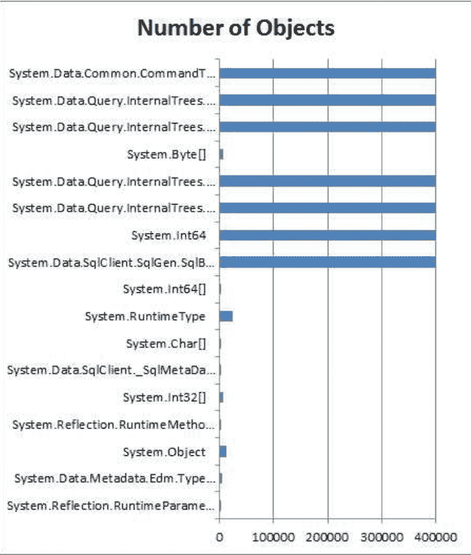

### 对象总大小

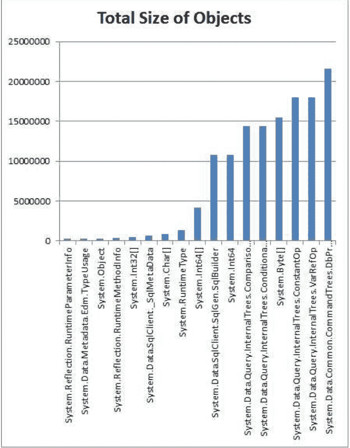

来自挂起或运行缓慢的工作站和服务器的内核或完整内存转储中，!irpfind WinDbg 命令可能会显示 IRP 对象分布异常模式，当某些驱动程序在正常情况下未观察到的大量活动 IRP 时。我们通过使用 Visual Studio 键盘宏预处理命令输出以消除已完成的 IRP，然后使用 Excel，从两个问题内核转储中创建了两个 IRP 分布图。在一个案例中，来自第三方防病毒筛选驱动程序的大量 I/O 请求数据包：

```
\Driver\3rdPartyAvFilter
```

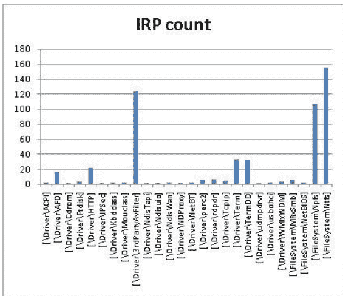

在第二个案例中，是针对内核套接字辅助功能驱动程序的大量活动 IRP：

\Driver\AFD

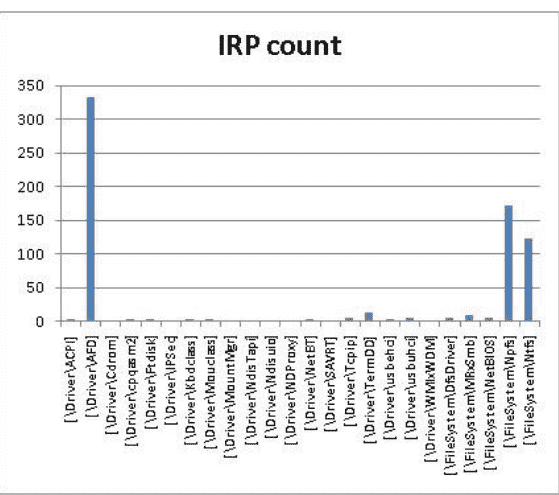

两个图表中的另外两个峰值与 NTPS 和 NTFS、管道和文件系统相关，通常是正常的。

以下是我们在首次撰写此模式时从 Vista 工作站捕获的 IRP 分布图：

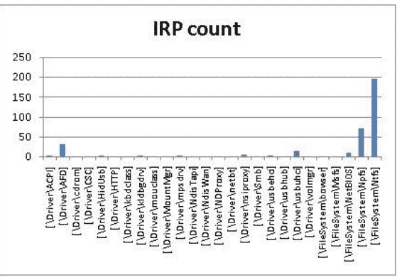

### 注释

此模式以前称为 IRP 分布异常。

## OMAP 代码优化

**OMAP 代码优化**用于缩小需要驻留在内存中的代码大小。因此，对于编译后的函数，不是采用平坦地址空间，而是将其碎片散落在各处。当我们尝试在其地址反汇编 OMAP 代码时，这会导致歧义，因为 WinDbg 不知道是应将地址范围视为函数偏移（从函数源代码开始计算）还是仅视为内存布局偏移（从该函数的地址开始计算）。我们使用 `IoCreateDevice` 函数代码来说明此模式。

让我们首先计算从函数第一个地址开始的随机地址（内存布局偏移）：

```
kd> ? nt!IoCreateDevice
Evaluate expression: -8796073668256 = fffffff800`01275160

kd> ? nt!IoCreateDevice+0x144
Evaluate expression: -8796073667932 = fffffff800`012752a4

kd> ? fffffff800`012752a4-fffff800`01275160
Evaluate expression: 324 = 00000000`00000144
```

如果我们尝试反汇编同一地址处的代码，该表达式也将被评估为内存布局偏移：

```
kd> u nt!IoCreateDevice+0x144
nt!IoCreateDevice+0x1a3:
fffff800`012752a4 or             eax,10h
fffff800`012752a7 mov            dword ptr [rsp+0B0h],eax
fffff800`012752ae test           ebp,ebp
fffff800`012752b0 mov            ebx,ebp
fffff800`012752b2 jne            nt!IoCreateDevice+0x1b3
fffff800`012752b8 add            ebx,dword ptr [rsp+54h]
fffff800`012752bc mov            rdx,qword ptr [nt!IoCreateDeviceObjectType]
fffff800`012752c3 lea            rcx,[rsp+88h]
```

我们可以看到差异：我们给出了 +0x144 偏移，但显示的代码是从 +0x1a3 开始的！这是因为 OMAP 优化将函数偏移 +0x1a3 处的代码移动到从 +0x144 开始的内存位置。下图说明了这一点：

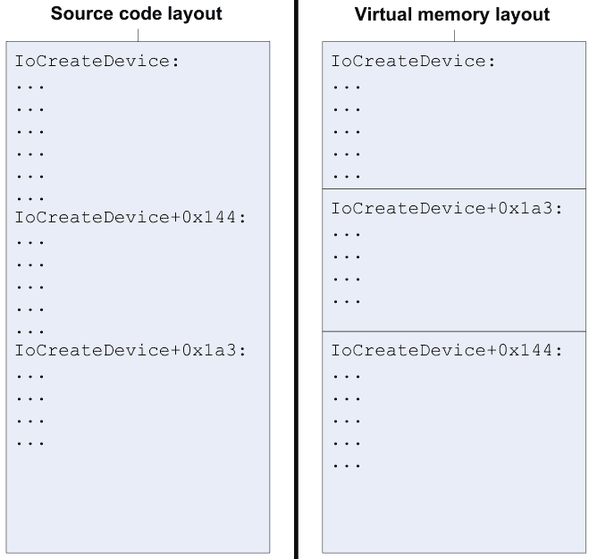

如果在从线程堆栈跟踪反汇编 *函数名+偏移* 地址时看到这种情况，可以改用原始地址：

```
kd> k
Child-SP RetAddr Call Site
fffffad`e3a18d30 fffff800`012b331e component!function+0x72
fffffad`e3a18d70 fffff800`01044196 nt!PspSystemThreadStartup+0x3e
fffffad`e3a18dd0 00000000`00000000 nt!KxStartSystemThread+0x16

kd> u fffff800`012b331e
nt!PspSystemThreadStartup+0x3e:
fffff800`012b331e nop
fffff800`012b331f test byte ptr [rbx+3FCh],40h
fffff800`012b3326 jne nt!PspSystemThreadStartup+0x4c
fffff800`012b332c mov rax,qword ptr gs:[188h]
fffff800`012b3335 cmp rbx,rax
fffff800`012b3338 jne nt!PspSystemThreadStartup+0x10c
fffff800`012b333e or dword ptr [rbx+3FCh],1
fffff800`012b3345 xor ecx,ecx
```


当我们使用 uf 命令反汇编函数体时，也能看到 OMAP 的作用：

```
kd> uf nt!IoCreateDevice
nt!IoCreateDevice+0x34d:
fffff800`0123907d or
fffff800`01239081 jmp nt!IoCreateDevice+0x351
...
...
...
nt!IoCreateDevice+0x14c:
fffff800`0126f320 mov r14w,200h
fffff800`0126f325 jmp nt!IoCreateDevice+0x158
nt!IoCreateDevice+0x3cc:
fffff800`01270bd0 lea rax,[rdi+50h]
fffff800`01270bd4 mov qword ptr [rax+8],rax
fffff800`01270bd8 mov word ptr [rax],rax
fffff800`01270bd1 jmp nt!IoCreateDevice+0x3d7
nt!IoCreateDevice+0xa4:
fffff800`01273eb9 mov r8d,1
fffff800`01273ebf lea rdx,[nt!`string']
fffff800`01273ec6 lea rcx,[rsp+0D8h]
fffff800`01273ece xadd dword ptr [nt!IopUniqueDeviceObjectNumber],r8d
fffff800`01273ed3 inc r8d
fffff800`01273ed9 call nt!swprintf
fffff800`01273ede test r13b,r13b
fffff800`01273ee1 jne nt!IoCreateDevice+0xcce
...
...
...
```

当我们尝试向后反汇编时，OMAP 优化的另一个示例：

```
ChildEBP RetAddr Args to Child
0006f87c 01034efb application!MultiUserLogonAttempt+0x5ba
0006fee4 01037120 application!LogonAttempt+0x406

1: kd> ub application!LogonAttempt+0x406
^ Unable to find valid previous instruction for 'ub application!LogonAttempt+0x406'

1: kd> u application!LogonAttempt+0x406
application!LogonAttempt+0x20b:
010348d5 add dword ptr [edx+10h],ebp
```

然后我们需要为 *多用户登录尝试* 指定返回地址：

```
1: kd> ub 01034efb
application!LogonAttempt+0x3e4:
01034ed9 mov     dword ptr [ebp-628h],ecx
01034edf mov     ecx,dword ptr [ebp-61Ch]
01034ee5 mov     dword ptr [eax+24h],ecx
01034ee8 push    dword ptr [ebp-61Ch]
01034eee lea     eax,[ebp-638h]
01034ef4 push    eax
01034ef5 push    ebx
01034ef6 call    application!MultiUserLogonAttempt (0102c822)
```

```
1: kd> u 01034efb
application!LogonAttempt+0x406:
01034efb mov     ecx,dword ptr [ebp-628h]
01034f01 mov     dword ptr [ebp-608h],eax
01034f07 mov     eax,dword ptr [ebx+8]
01034f0a mov     dword ptr [eax+24h],ecx
01034f0d cmp     dword ptr [application!g_SessionId (010742dc)],0
01034f14 je      application!LogonAttempt+0x47e (01034f73)
01034f16 lea     eax,[ebx+1078h]
01034f1c push    eax
```

## 注释

另请参阅 Microsoft 关于调试性能优化代码的文章 160。

## 单线程进程

像记事本这样的单线程进程很少见。这类进程总是可疑的，尤其是当它是服务或属于复杂产品时。通常，这种情况发生在所有其他线程都已终止，而剩余线程处于某个等待链中阻塞时。例如，该进程有一个线程在向自身（同一进程）发出 ALPC 请求时被阻塞（阻塞队列模式，第 77 页）：

```
0: kd> !process ffffffa8013ed9b30 3f
PROCESS ffffffa8013ed9b30
    SessionId: 0  Cid: 44b4    Peb: 7fffffdd8000  ParentCid: 0114
    DirBase: 2da448000  ObjectTable: ffffffa801948c670  HandleCount: 660.
    Image: ServiceA.exe
    VadRoot ffffffa801356dd10 Vads 398 Clone 0 Private 5795. Modified 204253. Locked 0.
    DeviceMap ffffff8a000008340
    Token                             fffff8a01b546060
    ElapsedTime                       01:32:37.622
    UserTime                          00:00:01.421
    KernelTime                        00:00:01.578
    QuotaPoolUsage[PagedPool]         0
    QuotaPoolUsage[NonPagedPool]      0
    Working Set Sizes (now,min,max)   (1525, 50, 345) (6100KB, 200KB, 1380KB)
    PeakWorkingSetSize                7607
    VirtualSize                       178 Mb
    PeakVirtualSize                   182 Mb
    PageFaultCount                    752709
    MemoryPriority                    BACKGROUND
    BasePriority                      8
    CommitCharge                      8043

    THREAD ffffffa8012caab50  Cid 44b4.4f70  Teb: 000007fffffa5a000 Win32Thread: 0000000000000000 WAIT: (WrLpcReply) KernelMode Non-Alertable
        ffffffa8012caaf18  Semaphore Limit 0x1
    Waiting for reply to ALPC Message fffff8a0194d4780 : queued at port ffffffa8012911c80 : owned by process ffffffa8013ed9b30
    IRP List:
        fffffa8013923300: (0006,0118) Flags: 00060000 Mdl: 00000000
    Not impersonating
    DeviceMap                 fffff8a000008340
    Owning Process            ffffffa8013ed9b30       Image:         ServiceA.exe
    Attached Process          N/A                     Image:         N/A
    Wait Start TickCount      139828         Ticks: 347372 (0:01:30:27.687)
    Context Switch Count      7380
    UserTime                  00:00:00.031
    KernelTime                00:00:04.890
    Win32 Start Address ServiceA (0x00000001401156e0)
    Stack Init fffff880014c9dd0 Current fffff880014c96b0
    Base fffff880014c9e000 Limit fffff880014c98000 Call 0
    Priority 8 BasePriority 8 UnusualBoost 0 ForegroundBoost 0 IoPriority 2 PagePriority 5
    Child-SP          RetAddr           Call Site
```

| Child-SP | RetAddr | Call Site |
|----------|---------|-----------|
| fffff880`14c9c6f0 | fffff800`01873652 | nt!KiSwapContext+0x7a |
| fffff880`14c9c830 | fffff800`01884a9f | nt!KiCommitThreadWait+0x1d2 |
| fffff880`14c9c8c0 | fffff800`0189f04f | nt!KeWaitForSingleObject+0x19f |
| fffff880`14c9c960 | fffff800`01b919f6 | nt!AlpcpSignalAndWait+0x8f |
| fffff880`14c9ca10 | fffff800`01b910f0 | nt!AlpcpReceiveSynchronousReply+0x46 |
| fffff880`14c9ca70 | fffff800`01b9519d | nt!AlpcpProcessSynchronousRequest+0x33d |
| fffff880`14c9cbb0 | fffff800`01b95276 | nt!LpcpRequestWaitReplyPort+0x9c |
| fffff880`14c9cc10 | fffff800`0187ced3 | nt!NtRequestWaitReplyPort+0x76 |
| fffff880`14c9cc60 | fffff800`01879490 | nt!KiSystemServiceCopyEnd+0x13 (TrapFrame @ fffff880`14c9cc60) |
| fffff880`14c9cdf8 | fffff880`05c31050 | nt!KiServiceLinkage |
| fffff880`14c9ce70 | fffff880`045ce005 | ModuleA+0x12468 |
| ... | ... | ... |
| fffff880`14c9da10 | fffff800`01b9d3b6 | nt!IopXxxControlFile+0x607 |
| fffff880`14c9db40 | fffff800`0187ced3 | nt!NtDeviceIoControlFile+0x56 |
| fffff880`14c9dbd0 | 00000000`76d8138a | nt!KiSystemServiceCopyEnd+0x13 (TrapFrame @ fffff880`00000000`082af028) |
| 00000000`082af028 | 0000007fe`fd366cf6 | ntdll!NtDeviceIoControlFile+0xa |
| 00000000`082af030 | 00000000`76c2683f | KERNELBASE!TlsGetValue+0x1a36 |
| 00000000`082af0a0 | 00000001`4019d38c | kernel32!DeviceIoControlImplementation+0x7f |
| ... | ... | ... |

## 优化代码

在 **优化代码** 的情况下，我们不应信任像 WinDbg 这样的崩溃转储分析工具。我们建议，如果发现工具出现任何可疑或奇怪的行为，始终怀疑编译器生成的代码已被优化。让我们考虑这个堆栈跟踪片段：

| 参数1 | 参数2 | 参数3 | 调用站点 |
|-------|-------|-------|----------|
| 77e44c24 | 000001ac | 00000000 | ntdll!KiFastSystemCallRet |
| 000001ac | 00000000 | 00000000 | ntdll!NtFsControlFile+0xc |
| 00000034 | 00000bb8 | 0013e3f4 | kernel32!WaitNamedPipeW+0x2c3 |
| 0016fc60 | 00000000 | 67c14804 | MyModule!PipeCreate+0x48 |

来自 MyModule 的第三方函数 PipeCreate 打开一个命名管道，其第一个参数 (0016fc60) 指向管道名 L"\\pipe\\MyPipe"。在源代码中，它调用 Win32 API 函数 WaitNamedPipeW 等待管道可用于连接，并传递相同的管道名。但是我们看到传递给 WaitNamedPipeW 的第一个参数是 00000034，这不可能是指向有效 Unicode 字符串的指针。如果 00000034 是一个指针值，程序本应崩溃。

如果我们查看 WaitNamedPipeW 的反汇编，一切都变得清晰：

```
0:000> uf kernel32!WaitNamedPipeW
mov	edi,edi
push	ebp
mov	ebp,esp
sub	esp,50h
push	dword ptr [ebp+8] ; Use pipe name
lea	eax,[ebp-18h]
push eax
call	dword ptr [kernel32!_imp__RtlCreateUnicodeString (77e411c8)]
...
...
...
call	dword ptr [kernel32!_imp__NtOpenFile (77e41014)]
cmp	dword ptr [ebp-4],edi
mov	esi,eax
jne	kernel32!WaitNamedPipeW+0x1d5 (77e93316)
cmp	esi,edi
jl	kernel32!WaitNamedPipeW+0x1ef (77e93331)
movzx	eax,word ptr [ebp-10h]
mov	ecx,dword ptr fs:[18h]
add	eax,0Eh
push eax
push	dword ptr [kernel32!BaseDllTag (77ecd14c)]
mov	dword ptr [ebp+8],eax ; reuse parameter slot
```

众所周知，[ebp+8] 是非 FPO 调用的第一个函数参数，我们看到它被重复使用，因为在将 LPWSTR 转换为 UNICODE_STRING 并调用 NtOpenFile 获取句柄后，我们不再需要参数槽，编译器可以重用它来存储其他信息。


还有另一种我们应该了解的编译器优化，它被称为**OMAP**（第 756 页）。它将代码节内的代码移动，并将访问频率最高的代码片段放在一起。在这种情况下，例如，如果我们在 WinDbg 中输入，

```
0:000> uf nt!someFunction
```

得到的代码将与我们输入的代码不同（假设 f4794100 是我们从堆栈跟踪或反汇编中获得的函数地址）

```
0:000> uf f4794100
```

总而言之，建议是在崩溃转储分析过程中保持警惕和意识，并仔细检查任何不一致之处。

## 注释

内核模式下参数重用的另一个示例可以在文章 161 中找到。

## 优化的 VM 布局

此模式是常规**更改环境**模式（第 114 页）的一种专用形式，其中整个模块通过更改其加载顺序和地址在虚拟内存中移动。这可能导致休眠的错误暴露出来，通常的一种解决方法是禁用此类外部优化程序和服务，或者将行为不当的应用程序添加到相应的排除列表中。某些优化的虚拟内存情况可以通过查看模块列表轻松检测，其中系统 DLL 被重新映射到较低地址，而不是 0x7X000000 范围：

| 起始 | 结束 | 模块名称 |
|------|------|----------|
| 00400000 | 00416000 | Application |
| 00470000 | 0050b000 | advapi32 |
| 00520000 | 00572000 | shlwapi |
| 02340000 | 023cb000 | oleaut32 |
| 04b80000 | 0523e000 | System_Data_ni |
| 1a400000 | 1a524000 | urlmon |
| 4dd60000 | 4df67000 | GdiPlus |
| 5f120000 | 5f12e000 | ntlmman |
| 5f860000 | 5f891000 | netui1 |
| 5fb80000 | 5fb86000 | netui0 |
| 637a0000 | 63d28000 | System_Xml_ni |
| 64890000 | 6498c000 | System_Configuration_ni |
| 64e70000 | 6515c000 | System_Data |
| 65ce0000 | 65ecc000 | System_Web_Services_ni |
| 71bd0000 | 71be1000 | mpr |
| 71bf0000 | 71bf8000 | ws2help |
| 71c00000 | 71c17000 | ws2_32 |
| 71c20000 | 71c32000 | tsappcmp |
| 71c40000 | 71c97000 | netapi32 |
| 73070000 | 73097000 | winspool |
| 75e90000 | 75e97000 | drprov |
| 75ea0000 | 75eaa000 | davclnt |
| 76190000 | 761a2000 | msasn1 |
| 761b0000 | 76243000 | crypt32 |
| 76a80000 | 76a92000 | atl |
| 76b80000 | 76be0000 | credui |
| 76dc0000 | 76de8000 | adslpdp |
| 76df0000 | 76e24000 | activeds |
| 76f00000 | 76f08000 | wtsapi32 |
| 76f10000 | 76f3e000 | wldap32 |
| 771f0000 | 77201000 | winsta |
| 77670000 | 777a9000 | ole32 |
| 77ba0000 | 77bfa000 | msvcrt |
| 78130000 | 781cb000 | msvcr80 |
| 79000000 | 79046000 | mscoree |
| 79060000 | 790b6000 | mscorjit |
| 790c0000 | 79bf6000 | mscorlib_ni |
| 79e70000 | 7a3ff000 | mscorwks |
| 7a440000 | 7ac2a000 | System_ni |
| 7ade0000 | 7af7c000 | System_Drawing_ni |
| 7afd0000 | 7bc6c000 | System_Windows_Forms_ni |
| 7c340000 | 7c396000 | msvcr71 |
| 7c8d0000 | 7d0ce000 | shell32 |
| 7d4c0000 | 7d5f0000 | kernel32 |
| 7d600000 | 7d6f0000 | ntdll |
| 7d800000 | 7d890000 | gdi32 |
| 7d8d0000 | 7d920000 | secur32 |
| 7d930000 | 7da00000 | user32 |
| 7da20000 | 7db00000 | rpcrt4 |
| 7dbd0000 | 7dcd3000 | comctl32 |
| 7df50000 | 7dfc0000 | uxtheme |
| 7e020000 | 7e02f000 | samlib |

类似的地址空间重排也发生在启用 ASLR 的应用程序 162 中，区别在于系统模块永远不会重新映射到 0x70000000 地址以下。

## 源模块

**源模块**是可能引发问题行为的模块。例如，当我们查看**堆栈跟踪**（第 926 页）时，可能会因对产品的了解而跳过**顶层模块**（第 1012 页），例如，如果它们不被称为**问题模块**（第 812 页）或被称为**经过充分测试的模块**（第 1147 页）。在**截断的堆栈跟踪**（第 1015 页）的情况下，我们可以将底层模块指定为可能的问题源。例如，对于**引用泄漏模式示例**（第 830 页），我们可以考虑检查所选模块（例如 *ModuleA* 和 *ModuleB*）的引用计数：

```
ad377ae8 +1 Dflt nt! ?? ::FNODOBFM::`string'+18f1d
nt!ObpCallPreOperationCallbacks+4ae
nt!ObpPreInterceptHandleCreate+af
nt! ?? ::NNGAKEGL::`string'+2c31f
nt!ObOpenObjectByPointerWithTag+109
nt!PsOpenProcess+1a2
nt!NtOpenProcess+23
nt!KiSystemServiceCopyEnd+13
nt!KiServiceLinkage+0
ModuleA+dca63
ModuleA+b5bc
ModuleA+c9c2e
ModuleA+bae56
ModuleA+b938d
ModuleA+0ec6
ModuleA+afce7
```

```
ad377aeb -1 Dflt nt! ?? ::FNODOBFM::`string'+4886e
nt!ObpCallPreOperationCallbacks+277
nt!ObpPreInterceptHandleCreate+af
nt! ?? ::NNGAKEGL::`string'+2c31f
nt!ObOpenObjectByPointerWithTag+109
nt!PsOpenProcess+1a2
nt!NtOpenProcess+23
nt!KiSystemServiceCopyEnd+13
nt!KiServiceLinkage+0
ModuleA+dca63
ModuleA+b5bc
ModuleA+c9c2e
ModuleA+bae56
ModuleA+b938d
ModuleA+0ec6
ModuleA+afce7
```

```
ad377af7 +1 Dflt nt! ?? ::NNGAKEGL::`string'+1fb41
nt!ObReferenceObjectByHandle+25
ModuleA+dcade
ModuleA+b5bc
ModuleA+c9c2e
ModuleA+bae56
ModuleA+b938d
ModuleA+0ec6
ModuleA+afce7
ModuleA+87ca
ModuleA+834a
ModuleA+a522c
ModuleA+a51b6
ModuleA+a4787
ModuleB+19c0c
ModuleB+19b28
```

```
ad377afa -1 Dflt nt! ?? ::FNODOBFM::'string'+4886e
ModuleA+dcbbe
ModuleA+b5bc
ModuleA+c9c2e
ModuleA+bae56
ModuleA+b938d
ModuleA+c0ec6
ModuleA+afce7
ModuleA+87ca
ModuleA+834a
ModuleA+a522c
ModuleA+a51b6
ModuleA+a4787
ModuleB+19c0c
ModuleB+19b28
ModuleB+b652
```

## 模块外指针

此模式涉及指向容器模块范围外地址的指针。典型的示例是某些内核表或结构，例如，驱动程序 IRP 分派表包含指向该驱动程序模块地址范围外的指针。其他示例可能包括 32 位 SSDT 指向 _nt_ 模块范围外，以及 IDT 条目指向 _hal_ 和预期驱动程序范围外：

```
[...]
818809dc 8193c4e7 nt!NtQueryOpenSubKeys
818809e0 8193c76b nt!NtQueryOpenSubKeysEx
818809e4 81a90b00 nt!NtQueryPerformanceCounter
818809e8 819920e7 nt!NtQueryQuotaInformationFile
818809ec 819e34f2 nt!NtQuerySection
818809f0 819f470b nt!NtQuerySecurityObject
818809f4 81a882fe nt!NtQuerySemaphore
818809f8 819eff54 nt!NtQuerySymbolicLinkObject
818809fc 81a8a223 nt!NtQuerySystemEnvironmentValue
81880a00 81a8a831 nt!NtQuerySystemEnvironmentValueEx
81880a04 96ca1a73
81880a08 81a7ac06 nt!NtQuerySystemTime
81880a0c 81a8f913 nt!NtQueryTimer
81880a10 81a7aeeb nt!NtQueryTimerResolution
81880a14 8193985a nt!NtQueryValueKey
81880a18 819e9273 nt!NtQueryVirtualMemory
81880a1c 8199274e nt!NtQueryVolumeInformationFile
81880a20 81a1a655 nt!NtQueueApcThread
[...]
```

`0: kd> lm m nt`

| 起始 | 结束 | 模块名称 |
|------|------|----------|
| 81800000 | 81ba1000 | nt |

此类指针也可能是**原始指针**（第 828 页），但也可能在没有符号的情况下所有指针都是原始指针，只有少数指针超出预期范围。

## 老旧系统

软件老化可能是某些问题的原因。有时查看以下 WinDbg 输出会让人忍不住想要建议定期重启：

```
Debug session time: Wed April 28 15:36:52.330 2008 (GMT+0)
System Uptime: 124 days 6:27:16.658
```

## 注释

一位读者为我们提供了其**老旧系统**上虚拟地址碎片化的示例：

| 堆 | 标志 | 预留 (k) | 提交 (k) | 虚拟 (k) | 空闲 (k) | 列表长度 | 块 | UCR 连续 | 虚拟锁 | 快速 |
|------|-------|------------|------------|------------|------------|-------------|--------|-----------|-----------|------|
| 006c0000 | 00001000 | 2565820 | 7232 | 658924 | 1302 | 160 | 200 | 0 | 44f3b4 | LFH |

外部碎片化 18%（160 个空闲块）
虚拟地址碎片化 98%（200 个未提交范围）

**打包代码**是加固恶意软件的常见成分。这里我们演示一些 WinDbg 命令来检测带有极少或无预期字符串的 UPX 打包模块：

```
0:000> !dh 00000000`00fd40b0

File Type: DLL
FILE HEADER VALUES
    14C machine (i386)
      3 number of sections
    time date stamp Fri Jan 18 21:27:25 2013

      0 file pointer to symbol table
      0 number of symbols
    E0 size of optional header
  2102 characteristics
        Executable
        32 bit word machine
        DLL

OPTIONAL HEADER VALUES
    10B magic #
  11.00 linker version
  6000 size of code
  1000 size of initialized data
  F000 size of uninitialized data
  15600 address of entry point
  10000 base of code
---- new ----
0000000100000000 image base
  1000 section alignment
  200 file alignment
    2 subsystem (Windows GUI)
  6.00 operating system version
  0.00 image version
  6.00 subsystem version
  17000 size of image
  1000 size of headers
      0 checksum
0000000001000000 size of stack reserve
0000000000001000 size of stack commit
0000000000100000 size of heap reserve
0000000000001000 size of heap commit
    140 DLL characteristics
        Dynamic base
        NX compatible
  16274 [   AC] address [size] of Export Directory
  161DC [   98] address [size] of Import Directory
  16000 [  1DC] address [size] of Resource Directory
```


0 [] 异常目录的地址 [size]
0 [] 安全目录的地址 [size]
16320 [] 10] 基础重定位目录的地址 [size]
0 [] 调试目录的地址 [size]
0 [] 描述目录的地址 [size]
0 [] 特殊目录的地址 [size]
0 [] 线程存储目录的地址 [size]
157CC [] 48] 加载配置目录的地址 [size]
0 [] 绑定导入目录的地址 [size]
0 [] 导入地址表目录的地址 [size]
0 [] 延迟导入目录的地址 [size]
0 [] COR20 标头目录的地址 [size]
0 [] 保留目录的地址 [size]

### 节标头 #1
UPX0 名称
F000 虚拟大小
1000 虚拟地址
0 原始数据大小
400 指向原始数据的文件指针
0 指向重定位表的文件指针
0 指向行号的文件指针
0 重定位数量
0 行号数量
E0000080 标志
未初始化的数据
(未指定对齐)
执行 读 写

### 节标头 #2
UPX1 名称
6000 虚拟大小
10000 虚拟地址
5A00 原始数据大小
400 指向原始数据的文件指针
0 指向重定位表的文件指针
0 指向行号的文件指针
0 重定位数量
0 行号数量
E0000040 标志
已初始化的数据
(未指定对齐)
执行 读 写

### 节标头 #3
.rsrc 名称
1000 虚拟大小
16000 虚拟地址
400 原始数据大小
5E00 指向原始数据的文件指针
0 指向重定位表的文件指针
0 指向行号的文件指针
0 重定位数量
0 行号数量
C0000040 标志
已初始化的数据
(未指定对齐)
读 写

```
0:000> s-sa 00000000`0fd40b0 L6600
00000000`0fd40f0d "!This program cannot be run in D"
00000000`0fd411d "OS mode."
00000000`0fd4188 "Rich"
00000000`0fd4290 "UPX0"
00000000`0fd42b8 "UPX1"
00000000`0fd42e0 ".rsrc"
00000000`0fd44b8 "3.0.8"
00000000`0fd4490 "UPX_!"
00000000`0fd449b "YhHM4"
00000000`0fd44d1 "vqx"
[...]
```

这些内存模块（尚未由加载器初始化）可以使用 .writemem 命令保存到磁盘并解包。加载并重定位到某个地址后，它们仍然具有 UPX 节，但现在拥有更多字符串：

```
0:000> s-sa 00000000`691c0000 L300
00000000`691c004d "!This program cannot be run in D"
00000000`691c006d "OS mode."
00000000`691c00d8 "Rich"
00000000`691c01e0 "UPX0"
00000000`691c0207 " UPX1"
00000000`691c022f ".rsrc"
[...]
00000000`691d620b "uGC"
00000000`691d621c "KERNEL32.DLL"
00000000`691d622a "LoadLibraryA"
00000000`691d6238 "GetProcAddress"
00000000`691d6248 "VirtualProtect"
00000000`691d6258 "VirtualAlloc"
00000000`691d6266 "VirtualFree"
[...]
0:000> s-su 00000000`691c0000 L(00000000`691d7000-00000000`691c0000)
[...]
00000000`691c8178 "http://www.patterndiagnostics.com"
00000000`691c8260 "mscoree.dll"
[...]
```

## 已换出的数据

一个经常出现的分析问题是，由于内核堆栈页已被换出，因此不存在于仅包含物理内存的完整内存转储中，导致缺少堆栈跟踪。对于内核或进程内存转储不应该是问题，因为它们包含虚拟内存。该问题通常出现在繁忙系统（第 99 页）上，此类系统几乎占用所有物理内存（内存不足，第 552 页）；或者出现在老旧系统（第 774 页）上，此类系统中的某些进程长时间未被使用。另一种情况是问题在一段时间前发生，但直到很久以后才被诊断。例如，这个用于耦合进程（第 149 页）的 LPC 等待链（第 1097 页）发生在转储保存前 2 天：

```
0: kd> !thread fffffffadfc9e8bf0 1f
THREAD fffffffadfc9e8bf0 Cid 61f0.2c70 Teb: 000007ffffddd000 Win32Thread: fffffff97ff381a480 WAIT:
(Unknown) UserMode Non-Alertable
fffffadfc9e9f858 Semaphore Limit 0x1
Waiting for reply to LPC MessageId 01e2cb39:
Current LPC port ffffffa800e5a9d10
Impersonation token: fffffa80039cd050 (Level Impersonation)
Owning Process fffffffadfc7c7c20
Image: applicationA.exe
Wait Start TickCount 12018444
Ticks: 11312740 (2:01:06:01.562)
Context Switch Count 456 LargeStack
UserTime 00:00:00.046
KernelTime 00:00:00.078
Start Address applicationA (0x0000000100061411)
Stack Init fffffffadc125d4e00 Current fffffffadc125d48e0
Base fffffffadc125d5000 Limit fffffffadc125cc000 Call 0
Priority 15 BasePriority 15 PriorityDecrement 0
Kernel stack not resident.
```

```
0: kd> !lpc message 01e2cb39
Searching message 1e2cb39 in threads ...
Server thread fffffffadff93c5bf0 is working on message 1e2cb39
```

```
0: kd> !thread fffffffadf93c5bf0 1f
THREAD fffffffadf93c5bf0  Cid 0218.5130  Teb: 000007fffffcbc000 Win32Thread: 0000000000000000 WAIT:
(Unknown) UserMode Non-Alertable
    fffffffadf6c71c70  SynchronizationEvent
Impersonation token: fffffffa803bde5060 (Level Impersonation)
Owning Process fffffffadcde439280
    Image: application.exe
Wait Start TickCount      12018444
Ticks: 11312740 (2:01:06:01.562)
Context Switch Count        12
UserTime               00:00:00.000
KernelTime             00:00:00.000
Win32 Start Address 0x0000000001e2cb39
LPC Server thread working on message Id 1e2cb39
Start Address kernel32 (0x0000000077d6b6a0)
Stack Init fffffffadc28b19e00 Current fffffffadc28b19950
Base fffffffadc28b1a000 Limit fffffffadc28b14000 Call 0
Priority 14 BasePriority 13 PriorityDecrement 0
Kernel stack not resident.
```

在这种情况下，我们可以推荐的一个技巧是在强制进行完整内存转储之前，保存可能已被换出的进程的用户转储。

## 参数流

有时我们会识别出导致异常行为的函数参数，例如，无效指针（第 589 页）访问违例，并想查看它可能来自哪个模块或函数：

```
0:009> kvL
### ChildEBP RetAddr  Args to Child
00 381f048 74e715e9 00000002 0381f098 00000001 ntdll!NtWaitForMultipleObjects+0x15
01 0381f0e4 76ce19fc 0381f098 0381f10c 00000000 KERNELBASE!WaitForMultipleObjectsEx+0x100
02 0381f12c 76ce41d8 00000002 7fde0000 00000000 kernel32!WaitForMultipleObjectsExImplementation+0xe0
03 0381f148 76d08074 00000002 0381f17c 00000000 kernel32!WaitForMultipleObjects+0x18
04 0381f1b4 76d07f33 0381f294 00000001 00000001 kernel32!WerpReportFaultInternal+0x186
05 0381f1c8 76d07828 0381f294 00000001 0381f264 kernel32!WerpReportFault+0x70
06 0381f1d8 76d077a7 0381f294 00000001 9a131a15 kernel32!BasepReportFault+0x20
07 0381f264 772577ff 00000000 772573dc 00000000 kernel32!UnhandledExceptionFilter+0x1af
08 0381f26c 772573dc 00000000 0381fdd4 772c5550 ntdll!_RtlUserThreadStart+0x62
09 0381f280 77257281 00000000 00000000 00000000 ntdll!_EH4_CallFilterFunc+0x12
0a 0381f2a8 7723b499 ffffffffe 0381ffc4 0381f3e4 ntdll!_except_handler4+0x8e
0b 0381f2cc 7723b46b 0381f394 0381ffc4 0381f3e4 ntdll!ExecuteHandler2+0x26
0c 0381f2f0 7723b40a 0381f394 0381ffc4 0381f3e4 ntdll!ExecuteHandler+0x24
0d 0381f37c 771f0133 0181f394 0381f3e4 0381f394 ntdll!RtlDispatchException+0x127
0e 0381f37c 00010101 0181f394 0381f3e4 0381f394 ntdll!KiUserExceptionDispatcher+0xf (CONTEXT @ 0381f3e4)
WARNING: Frame IP not in any known module. Following frames may be wrong.
0f 0381f844 00df3d1e 064bf018 0b925970 06501dd8 0x10101
10 0381f860 00ca0a15 064bf018 0b925970 0c86a949 ModuleA!Bar+0x3e
11 0381f888 00ca07d4 064bf018 0b925970 09584580 ModuleB!Foo2+0x75
12 0381f8e4 00ca0ae3 0b925970 00000000 09584008 ModuleB!Foo1+0xb4
[...]
```

在这里，我们将无效函数调用指针回溯到函数参数：

```
0:009> .cxr 0381f3e4
eax=06501dd8 ebx=0381f8c4 ecx=0b925970 edx=0b925527 esi=064bf018 edi=0381f898
eip=00010101 esp=0381f848 ebp=0c86a949 iopl=0 nv up ei pl nz na pe nc
cs=0023 ss=002b ds=002b es=002b fs=0053 gs=002b efl=00010206
00010101 if pop ds
```

```
0:009> k 1
*** Stack trace for last set context - .thread/.cxr resets it
# ChildEBP RetAddr
WARNING: Frame IP not in any known module. Following frames may be wrong.
00 0381f844 00df3d1e 0x10101
```

```
0:009> ub 00df3d1e
ModuleA!Bar+0x2e:
00df3d0a mov ecx,dword ptr [esp+10h]
00df3d0e mov edi,dword ptr [esp+18h]
00df3d12 push edi
00df3d13 push eax
00df3d14 mov edx,dword ptr [ecx]
00df3d16 push ecx
00df3d17 push esi
```


00df3d18 mov edx,dword ptr [edx+4]
00df3d1b call dword ptr [edx+10h]

EDX的值来自EDX+4，而EDX+4又来自ECX指针的值，它可能是函数参数之一：

```
0:009> dp ecx L1
0b925970 0b925978

0:009> dp poi(ecx)+4 L1
0b92597c 0b925527

0:009> dc 0b925527
0b925527 20202020 80202020 01010101 01010101 ................
0b925537 00010101 01010101 01010000 01000101 ................
[...]
```

由于数据来自ModuleA函数参数，它是从上一次调用传递过来的：

```
0:009> kL 4
# ChildEBP RetAddr
WARNING: Frame IP not in any known module. Following frames may be wrong.
00 0381f844 00df3d1e 0x10101
01 0381f860 00ca0a15 ModuleA!Bar+0x3e
02 0381f888 00ca07d4 ModuleB!Foo2+0x75
03 0381f8e4 00ca0ae3 ModuleB!Foo1+0xb4

0:009> ub 00ca0a15
ModuleB!Foo2+0x61:
00ca0a01 add esp,10h
00ca0a04 and edi,0FFFFFF8h
00ca0a07 lea edx,[esp+20h]
00ca0a0b push edx
00ca0a0c push ebp
00ca0a0d push edi
00ca0a0e push esi
00ca0a0f call dword ptr [ModuleA!_imp__Bar (00cc32c0)]
```

传递的参数看起来像是Bar和ModuleB!Foo2的第二个参数，以及ModuleB!Foo1的第一个参数：

```
0:009> dps 0381f860
0381f860 064bf018
0381f864 00ca0a15 ModuleB!Foo2+0x75 ; return address when calling ModuleA!Bar
0381f868 064bf018
0381f86c 0b925970
0381f870 0c86a949
0381f874 0381f898
0381f878 0b925970
0381f87c 09584580
0381f880 064bf018
0381f884 0381f8c4
0381f888 0b925970
0381f88c 00ca07d4 ModuleB!Foo1+0xb4 ; return address when calling ModuleB!Foo2
0381f890 064bf018
0381f894 0b925970
0381f898 09584580
0381f89c 064bf018
0381f8a0 00ccd7d0
0381f8a4 0381f954
0381f8a8 00000000
0381f8ac 00000001
0381f8b0 00000000
0381f8b4 0b926d18
0381f8b8 00000000
0381f8bc 00000005
0381f8c0 00000000
0381f8c4 0b925970
0381f8c8 00000000
0381f8cc 00000000
0381f8d0 00000000
0381f8d4 00000000
0381f8d8 00000000
0381f8dc 00000000
0381f8e0 00000000
0381f8e4 00000000
0381f8e8 00ca0ae3 ModuleB!Foo0+0x13 ; return address when calling ModuleB!Foo1
0381f8ec 0b925970
0381f8f0 00000000
```

我们可以看到参数流分析模式：

```
0:009> kvl 4
# ChildEBP RetAddr  Args to Child
WARNING: Frame IP not in any known module. Following frames may be wrong.
00 0381f844 00df3d1e 064bf018 0b925970 06501dd8 0x10101
01 0381f860 00ca0a15 064bf018 0b925970 0c86a949 ModuleA!Bar+0x3e
02 0381f888 00ca07d4 064bf018 0b925970 09584580 ModuleB!Foo2+0x75
03 0381f8e4 00ca0ae3 0b925970 00000000 09584008 ModuleB!Foo1+0xb4
```

本示例来自x86 Windows，其中参数通过栈传递，因此在详细堆栈跟踪输出(kv)中可见。对于x64 Windows系统，此类参数可能是**隐藏参数**（第465页），而我们在详细输出中看到的可能是**虚假函数参数**（第390页）。然而，在某些情况下，我们仍可以跟踪**执行残留**（第371页）中发现的某些值，并将它们与特定的堆栈跟踪帧关联起来（包括**过去的堆栈跟踪**，第800页）。

参数流内存分析模式与跟踪分析数据流^163模式类似。

## Linux

这是Mac OS X上**Paratext**模式的Linux变体（第785页）。由于调试器工具的限制，额外的软件日志和其他工具的输出可能有助于内存转储分析。此类模式的典型用法示例可以是带有版本和路径信息的模块列表，来自Valgrind等插桩工具的应用程序崩溃特定信息，带有归属和边界的内存区域名称，以及CPU使用情况信息。例如，`top`和`pmap`命令的输出：

top - 22:32:00 up 23 min, 1 user, load average: 0.95, 0.38, 0.17
Tasks: 64 total, 1 running, 63 sleeping, 0 stopped, 0 zombie
Cpu(s): 100.0 us, 0.0 sy, 0.0 ni, 0.0 id, 0.0 wa, 0.0 hi, 0.0 si, 0.0 st
KiB Mem: 505464 total, 174140 used, 331324 free, 11872 buffers
KiB Swap: 223228 total, 0 used, 223228 free, 122656 cached

| PID | USER | PR | NI | VIRT | RES | SHR | S | %CPU | %MEM | TIME+ | COMMAND |
|-----|------|----|----|------|-----|-----|---|------|------|-------|---------|
| 3712 | training | 20 | 0 | 42040 | 4 | 0 | S | 99.3 | 0.0 | 2:06.33 | App3 |
| 1 | root | 20 | 0 | 10648 | 836 | 704 | S | 0.0 | 0.2 | 0:01.56 | init |
| 2 | root | 20 | 0 | 0 | 0 | 0 | S | 0.0 | 0.0 | 0:00.00 | kthreadd |
| 3 | root | 20 | 0 | 0 | 0 | 0 | S | 0.0 | 0.0 | 0:00.08 | ksoftirqd/0 |
| 5 | root | 20 | 0 | 0 | 0 | 0 | S | 0.0 | 0.0 | 0:00.00 | kworker/u:0 |
| 6 | root | rt | 0 | 0 | 0 | 0 | S | 0.0 | 0.0 | 0:00.00 | migration/0 |
| 7 | root | rt | 0 | 0 | 0 | 0 | S | 0.0 | 0.0 | 0:00.01 | watchdog/0 |
| 8 | root | -20 | 0 | 0 | 0 | 0 | S | 0.0 | 0.0 | 0:00.00 | cpuset |
| 9 | root | 0 | -20 | 0 | 0 | 0 | S | 0.0 | 0.0 | 0:00.00 | khelper |
| 10 | root | 20 | 0 | 0 | 0 | 0 | S | 0.0 | 0.0 | 0:00.00 | kdevtmpfs |
| 11 | root | 0 | -20 | 0 | 0 | 0 | S | 0.0 | 0.0 | 0:00.00 | netns |
| 12 | root | 20 | 0 | 0 | 0 | 0 | S | 0.0 | 0.0 | 0:00.01 | sync_supers |
| 13 | root | 20 | 0 | 0 | 0 | 0 | S | 0.0 | 0.0 | 0:00.00 | bdi-default |
| 14 | root | 0 | -20 | 0 | 0 | 0 | S | 0.0 | 0.0 | 0:00.00 | kintegrityd |
| 15 | root | 0 | -20 | 0 | 0 | 0 | S | 0.0 | 0.0 | 0:00.00 | kblockd |
| 16 | root | 20 | 0 | 0 | 0 | 0 | S | 0.0 | 0.0 | 0:00.00 | khungtaskd |
| 17 | root | 20 | 0 | 0 | 0 | 0 | S | 0.0 | 0.0 | 0:00.00 | kswapd0 |
| 18 | root | 25 | 5 | 0 | 0 | 0 | S | 0.0 | 0.0 | 0:00.00 | ksmd |

14039: . /App1.shared

| Address | Size | Permissions | Mapping |
|-------|------|-------------|---------|
| 0000000000400000 | 4K | r-x- | /home/training/ALCDA/App1/App1.shared |
| 0000000000600000 | 4K | rw-- | /home/training/ALCDA/App1/App1.shared |
| 0000000000611000 | 132K | rw-- | [ anon ] |
| 00007fe899a0000 | 4K | ---- | [ anon ] |
| 0007fe8999a7000 | 8192K | rw-- | [ anon ] |
| 0007fe89a1a7000 | 4K | ---- | [ anon ] |
| 0007fe89a1a8000 | 8192K | rw-- | [ anon ] |
| 0007fe89a9a8000 | 4K | ---- | [ anon ] |
| 0007fe89a9a9000 | 8192K | rw-- | [ anon ] |
| 0007fe89b1a9000 | 4K | ---- | [ anon ] |
| 0007fe89b1aa000 | 8192K | rw-- | [ anon ] |
| 0007fe89b9aa000 | 4K | ---- | [ anon ] |
| 0007fe89b9ab000 | 8192K | rw-- | [ anon ] |
| 0007fe89c1ab000 | 1540K | r-x- | /lib/x86_64-linux-gnu/libc-2.13.so |
| 0007fe89c32000 | 2048K | ---- | /lib/x86_64-linux-gnu/libc-2.13.so |
| 0007fe89c52000 | 16K | r--- | /lib/x86_64-linux-gnu/libc-2.13.so |
| 0007fe89c53000 | 4K | rw-- | /lib/x86_64-linux-gnu/libc-2.13.so |
| 0007fe89c531000 | 20K | rw-- | [ anon ] |
| 0007fe89c536000 | 92K | r-x- | /lib/x86_64-linux-gnu/libpthread-2.13.so |
| 0007fe89c54d000 | 2044K | ---- | /lib/x86_64-linux-gnu/libpthread-2.13.so |
| 0007fe89c74c000 | 4K | r--- | /lib/x86_64-linux-gnu/libpthread-2.13.so |
| 0007fe89c74d000 | 4K | rw-- | /lib/x86_64-linux-gnu/libpthread-2.13.so |
| 0007fe89c74e000 | 16K | rw-- | [ anon ] |
| 0007fe89c752000 | 128K | r-x- | /lib/x86_64-linux-gnu/ld-2.13.so |
| 00007fe89c966000 | 12K | rw--- | [ anon ] |
| 00007fe89c96f000 | 8K | rw--- | [ anon ] |
| 00007fe89c971000 | 4K | r----- | /lib/x86_64-linux-gnu/ld-2.13.so |
| 00007fe89c972000 | 4K | rw--- | /lib/x86_64-linux-gnu/ld-2.13.so |
| 00007fe89c973000 | 4K | rw--- | [ anon ] |
| 00007fd458c1000 | 132K | rw--- | [ stack ] |
| 00007ffd459e9000 | 4K | r-x-- | [ anon ] |
| fffffffffff600000 | 4K | r-x-- | [ anon ] |

total 47208K

## Mac OS X

这是在将首先在Windows平台上开发的模式驱动软件诊断方法论应用于Mac OS X后出现的第一个模式。我们在使用GDB时遇到了问题，GDB的可移植性如此之强，以至于几乎没有像WinDbg调试器那样的操作系统支持。幸运的是，我们通过用操作系统（如崩溃报告和vmmap数据）的日志和报告来补充核心转储，找到了一个解决方法。此模式的名称借用自扩展软件跟踪164和软件叙事学165的概念，而软件叙事学又从文学诠释（paratext166）中借用了相同的概念。此类模式的典型用法示例可以是带有版本和路径信息的模块列表、应用程序崩溃特定信息、带有归属和边界的内存区域名称：

# // 来自 .crash 报告

```
0x108f99000 - 0x109044ff7 com.apple.FontBook (198.4 - 198) <7244D36E-4563-3E42-BA46-1F279D30AGCE> /Applications/Font Book.app/Contents/MacOS/ Font Book
Exception Type: EXC_BAD_INSTRUCTION (SIGILL)
Exception Codes: 0x0000000000000001, 0x0000000000000000
Application Specific Information:
obj[195]: garbage collection is OFF
*** error for object 0x7fd7fb818e08: incorrect checksum for freed object - object was probably modified after being freed.
```

# // 来自 vmmap 日志

```
[...]
=== Writable regions for process 966
[...]
```

| Region | Range | Size | Permissions | SM | Details |
|--------|-------|------|-------------|----|---------|
| Stack | 00000001101f7000-00000001101f3f3000 | [ 520K] | rw-/rwx | SM=PRV | thread 1 |
| MALLOC_LARGE | 0000000103398000-000000010393bb000 | [ 128K] | rw-/rwx | SM=PRV | DefaultMallocZone_0x101e6e000 |
| MALLOC_SMALL ( freed) | 000000010339b000-000000010393bb000 | [ 8K] | rw-/rwx | SM=PRV | |
| mapped file | 0000000103a50000-0000000103f32000 | [ 530K] | rw-/rwx | SM=COW | ... .box.framework/Versions/A/Resources/Extras2.rsrc |
| mapped file | 0000000104a40900-0000000104d62000 | [ 2852K] | rw-/rwx | SM=COW | /System/Library/Fonts/Helvetica.dfont |
| MALLOC_LARGE | 0000000104f6e000-0000000104f8e000 | [ 128K] | rw-/rwx | SM=PRV | DefaultMallocZone_0x101e6e000 |
| MALLOC_LARGE ( freed) | 0000000108413000-0000000108548000 | [ 1204K] | rw-/rwx | SM=COW | |
| MALLOC_LARGE ( freed) | 0000000108540000-0000000108541000 | [ 4K] | rw-/rwx | SM=PRV | |
| MALLOC_TINY | 00007fe8e0c0000-00007fe8e0d0000 | [ 1024K] | rw-/rwx | SM=COW | DefaultMallocZone_0x101e6e000 |
| MALLOC_TINY | 00007fe8e0d0000-00007fe8e0e0000 | [ 1024K] | rw-/rwx | SM=PRV | DispatchContinuations_0x101f38000 |
| MALLOC_TINY | 00007fe8e0e0000-00007fe8e0f0000 | [ 1024K] | rw-/rwx | SM=COW | DefaultMallocZone_0x101e6e000 |
| MALLOC_SMALL | 00007fe8e100000-00007fe8e107000 | [ 492K] | rw-/rwx | SM=ZER | DefaultMallocZone_0x101e6e000 |
| MALLOC_SMALL | 00007fe8e107b000-00007fe8e1083000 | [ 32K] | rw-/rwx | SM=PRV | DefaultMallocZone_0x101e6e000 |
| MALLOC_SMALL | 00007fe8e1083000-00007fe8e1149000 | [ 792K] | rw-/rwx | SM=ZER | DefaultMallocZone_0x101e6e000 |
| MALLOC_SMALL ( freed) | 00007fe8e1149000-00007fe8e1166000 | [ 116K] | rw-/rwx | SM=PRV | DefaultMallocZone_0x101e6e000 |

164 扩展软件跟踪，内存转储分析文集，第5卷，第277页
165 http://www.patterndiagnostics.com/Introduction-Software-Narratology-materials
166 http://en.wikipedia.org/wiki/Paratext


```
MALLOC_SMALL (freed) 00007fefe1166000-00007fefe1800000 [ 6760K] rw--rwx SM=ZER DefaultMallocZone_0x101e6e000
MALLOC_SMALL 00007fefe1800000-00007fefe18ff000 [ 1020K] rw--rwx SM=ZER DefaultMallocZone_0x101e6e000
MALLOC_SMALL (freed) 00007fefe18ff000-00007fefe1901000 [ 8K] rw--rwx SM=PRV DefaultMallocZone_0x101e6e000
MALLOC_SMALL 00007fefe1901000-00007fefe2000000 [ 7164K] rw--rwx SM=ZER DefaultMallocZone_0x101e6e000
MALLOC_TINY (freed) 00007fefe2000000-00007fefe2100000 [ 1024K] rw--rwx SM=PRV DispatchContinuations_0x101f38000
MALLOC_TINY 00007fefe2100000-00007fefe2200000 [ 1024K] rw--rwx SM=PRV DefaultMallocZone_0x101e6e000
Stack 00007fff61186000-00007fff61985000 [ 8188K] rw--rwx SM=ZER thread 0
Stack 00007fff61985000-00007fff61986000 [ 4K] rw--rwx SM=COW
[...]
```

## Comments

托管空间中的示例 167。

## Pass Through Function

当我们不断查看完整或内核内存转储中的堆栈跟踪集合（第 943 页）时，会注意到某些进程始终存在并记住它们。它们不再可疑。线程堆栈也是如此。有些始终存在，有些因为其功能或状态而不可疑，例如被动线程（第 793 页）或被动系统线程（第 789 页）。更深入一点，我们可以讨论组件及其特定功能。例如，某些内核空间组件具有特殊的过滤函数；它们获取一个 IRP 并将其向下传递到设备堆栈。检查 IRP 并将其转发不需要太多代码。这通常表现为较小的函数偏移量，例如：

| 子 EBP | 返回地址 | 函数 |
|---|---|---|
| aeced780 | 80833ec5 | nt!KiSwapContext+0x26 |
| aeced7ac | 80829bc0 | nt!KiSwapThread+0x2e5 |
| aeced7f4 | baddfce | nt!KeWaitForSingleObject+0x346 |
| | | 警告：堆栈展开信息不可用。以下帧可能不正确。 |
| aeced824 | bae0208 | AVFilterB+0x1ece |
| aeced868 | bae0e45a | AVFilterB+0x2208 |
| aeced8a0 | 8081e095 | AVFilterB+0x1045a |
| aeced8b4 | b946673b | nt!IoCallDriver+0x45 |
| aeced8c4 | b94626ee | driverB!FS_Dispatch+0xfb |
| aeced8d4 | 8081e095 | driverB!dispatch+0x6e |
| aeced8e8 | b96e04e1 | nt!IoCallDriver+0x45 |
| aeced90c | b96e0755 | driverA!PassThrough+0xd1 |
| aeced92c | 8081e095 | driverA!Create+0x155 |
| aeced940 | b882df08 | nt!IofCallDriver+0x45 |
| aeceda5c | 8081e095 | AVFilterA!DispatchPassThrough+0x48 |
| aeceda70 | 8088fb13 | nt!IofCallDriver+0x45 |
| aecedb58 | 80939c6a | nt!IopParseDevice+0x3a5 |
| aecedbd8 | 80935d9e | nt!ObpLookupObjectName+0x5b0 |
| aecedc2c | 808ece57 | nt!ObOpenObjectByName+0xea |
| aecedca8 | 808e0ef1 | nt!IopCreateFile+0x447 |
| aecedd04 | 808f1e31 | nt!IoCreateFile+0xa3 |
| aecedd44 | 8088ad3c | nt!NtOpenFile+0x27 |
| [...] | | |

这里，如果线程被阻塞，AVFilterB 模块比 AVFilterA 模块更可疑，因为它位于堆栈顶部正在等待，而 AVFilterA 只是将一个 IRP 传递给了驱动程序，后者模块似乎也将 IRP 中继给了 driverB，而后者又将其中继给了 AVFilterB。

另一个 x64 示例显示如何识别这些过滤函数。它们的函数名称中包含“Dispatch”或“PassThrough”：

| 子 SP | 返回地址 | 调用位置 |
|---|---|---|
| fffffa60`12610880 | fffff800`01875f8a | nt!KiSwapContext+0x7f |
| fffffa60`126109c0 | fffff800`0187776a | nt!KiSwapThread+0x2fa |
| fffffa60`12610a30 | fffff800`01ab16d6 | nt!KeWaitForSingleObject+0x2da |
| [...] | | |
| fffffa60`12610fe0 | fffffa60`06c5191a | rdbss!RxFsdCommonDispatch+0x786 |
| fffffa60`126110d0 | fffffa60`07e4f21f | rdbss!RxFsdDispatch+0x21a |
| fffffa60`12611140 | fffffa60`011e05f5 | mrxsmb!MRxSmbFsdDispatch+0xbf |
| fffffa60`12611180 | fffffa60`011e0130 | mup!MupiCallUncProvider+0x159 |
| fffffa60`126111f0 | fffffa60`011e17af | mup!MupStateMachine+0x120 |
| fffffa60`12611240 | fffffa60`00d200b4 | mup!MupCreate+0x2c3 |
| fffffa60`126112c0 | fffffa60`06d332d6 | fltmgr!FltpCreate+0xa4 |
| fffffa60`12611370 | fffffa60`06d786c7 | driverB!FS_Dispatch+0x156 |
| fffffa60`126113a0 | fffffa60`06d789d4 | driverA!PassThrough+0x177 |
| fffffa60`12611400 | fffffa60`090b3f30 | driverA!Create+0x14d |
| fffffa60`12611430 | fffffa60`01aef360 | AVDriverA!LowerDevicePassThrough+0x5c |
| fffffa60`12611700 | fffff800`01aefa59 | nt!IopParseDevice+0x5e3 |
| fffffa60`126118a0 | fffff800`01af3944 | nt!ObpLookupObjectName+0x5eb |
| fffffa60`126119b0 | fffff800`01af0ee0 | nt!ObOpenObjectByName+0x2f4 |
| fffffa60`12611a80 | fffff800`01b00a4c | nt!IopCreateFile+0x290 |
| fffffa60`12611b20 | fffff800`0186dfd3 | nt!NtCreateFile+0x78 |
| [...] | | |

## Comments

有时我们需要检查返回地址，以查看函数是否引入了替代执行路径（例如钩子）：

```
[...]
retA ntdll!NtCreateFile
retB DLL!HookCreateFile
retC kernel32!OtherFunction
[...]
```

这里我们可以检查从 kernel32!OtherFunction 调用了什么函数：

```
ub retB
[...]
call [kernel32!_imp_NtCreateFile]
```

如果语义上是同一个函数，我们可以假设钩子是透传的，但如果不是，那么我们就有执行流的分叉，需要关注这一点。

## 被动系统线程

### 内核空间

在 Windows 中，被动系统线程不在任何用户进程上下文中运行。这些线程属于所谓的系统进程，没有任何用户空间堆栈，它们的完整堆栈跟踪可以从 !process 命令的输出中看到（如果未完全分页出，第 778 页），或从 !stacks 2 命令的 [System] 部分中看到：

```
1: kd> !process 0 3f System
```

该列表中的某些系统线程属于核心操作系统功能，并非被动线程（函数偏移量可能因不同操作系统版本和服务包而异）：

```
nt!KiSwapContext+0x84
nt!KiSwapThread+0x125
nt!KeWaitForSingleObject+0x5f5
nt!MmZeroPageThread+0x180
nt!PhaseInitialization+0xe
nt!PspSystemThreadStartup+0x5b
nt!KiStartSystemThread+0x16
```

```
nt!KiSwapContext+0x84
nt!KiSwapThread+0x125
nt!KeWaitForSingleObject+0x5f5
nt!MModifiedPageWriter+0x59
nt!PspSystemThreadStartup+0x5b
nt!KiStartSystemThread+0x16
```

```
nt!KiSwapContext+0x84
nt!KiSwapThread+0x125
nt!KeWaitForMultipleObjects+0x703
nt!MmMappedPageWriter+0xad
nt!PspSystemThreadStartup+0x5b
nt!KiStartSystemThread+0x16
```

```
nt!KiSwapContext+0x84
nt!KiSwapThread+0x125
nt!KeWaitForMultipleObjects+0x703
nt!KeBalanceSetManager+0x101
nt!PspSystemThreadStartup+0x5b
nt!KiStartSystemThread+0x16
```

```
nt!KiSwapContext+0x84
nt!KiSwapThread+0x125
nt!KeWaitForSingleObject+0x5f5
nt!KeSwapProcessOrStack+0x44
nt!PspSystemThreadStartup+0x5b
nt!KiStartSystemThread+0x16
```

```
nt!KiSwapContext+0x84
nt!KiSwapThread+0x125
```

```
nt!KeWaitForSingleObject+0x5f5
nt!EtwLogger+0xddd
nt!PspSystemThreadStartup+0x5b
nt!KiStartSystemThread+0x16
```

```
nt!KiSwapContext+0x84
nt!KiSwapThread+0x125
nt!KeWaitForSingleObject+0x5f5
nt!KiExecuteDpc+0x198
nt!PspSystemThreadStartup+0x5b
nt!KiStartSystemThread+0x16
```

```
nt!KiSwapContext+0x84
nt!KiSwapThread+0x125
nt!KeWaitForMultipleObjects+0x703
nt!CcQueueLazyWriteScanThread+0x73
nt!PspSystemThreadStartup+0x5b
nt!KiStartSystemThread+0x16
```

```
nt!KiSwapContext+0x84
nt!KiSwapThread+0x125
nt!KeWaitForMultipleObjects+0x703
nt!ExpWorkerThreadBalanceManager+0x85
nt!PspSystemThreadStartup+0x5b
nt!KiStartSystemThread+0x16
```

其他线程属于各种工作队列（也可以从 !exqueue ff 命令输出中看到），它们等待数据项到达（被动线程）：

```
nt!KiSwapContext+0x84
nt!KiSwapThread+0x125
nt!KeRemoveQueueEx+0x848
nt!ExpWorkerThread+0x104
nt!PspSystemThreadStartup+0x5b
nt!KiStartSystemThread+0x16
```

或

```
nt!KiSwapContext+0x26
nt!KiSwapThread+0x2e5
nt!KeRemoveQueueEx+0x417
nt!ExpWorkerThread+0xc8c
nt!PspSystemThreadStartup+0x2e
nt!KiThreadStartup+0x16
```

非 Exp 系统线程（堆栈跟踪中没有 nt!ExpWorkerThread）且函数名称中包含“Worker”、“Logging”或“Logger”子字符串的是被动线程，它们也在等待数据，例如：

```
nt!KiSwapContext+0x84
nt!KiSwapThread+0x125
nt!KeWaitForMultipleObjects+0x703
nt!PfTLoggingWorker+0x81
nt!PspSystemThreadStartup+0x5b
nt!KiStartSystemThread+0x16
```

```
nt!KiSwapContext+0x84
nt!KiSwapThread+0x125
nt!KeWaitForSingleObject+0x5f5
nt!EtwLogger+0xdd
nt!PspSystemThreadStartup+0x5b
nt!KiStartSystemThread+0x16
```

```
nt!KiSwapContext+0x84
nt!KiSwapThread+0x125
nt!KeRemoveQueueEx+0x848
nt!KeRemoveQueue+0x21
rdrdr!RxpWorkerThreadDispatcher+0x6f
nt!PspSystemThreadStartup+0x5b
nt!KiStartSystemThread+0x16
```

```
nt!KiSwapContext+0x84
nt!KiSwapThread+0x125
nt!KeWaitForSingleObject+0x5f5
HTTP!UlpThreadPoolWorker+0x26c
nt!PspSystemThreadStartup+0x5b
nt!KiStartSystemThread+0x16
```

```
nt!KiSwapContext+0x84
nt!KiSwapThread+0x125
nt!KeRemoveQueueEx+0x848
nt!KeRemoveQueue+0x21
srv2!SrvProcWorkerThread+0x74
nt!PspSystemThreadStartup+0x5b
nt!KiStartSystemThread+0x16
```

```
nt!KiSwapContext+0x84
nt!KiSwapThread+0x125
nt!KeRemoveQueueEx+0x848
nt!KeRemoveQueue+0x21
srv!WorkerThread+0x90
nt!PspSystemThreadStartup+0x5b
nt!KiStartSystemThread+0x16
```


```
nt!KiSwapContext+0x26
nt!KiSwapThread+0x284
nt!KeWaitForSingleObject+0x346
nt!ExpWaitForResource+0xd5
nt!ExAcquireResourceExclusiveLite+0x8d
nt!ExEnterCriticalRegionAndAcquireResourceExclusive+0x19
driver!ProcessItem+0x2f
driver!DelayedWorker+0x27
nt!ExpWorkerThread+0x104
nt!PspSystemThreadStartup+0x5b
nt!KiStartSystemThread+0x16
```

## 被动线程

## 用户空间

当试图理解特定应用程序或服务为何挂起时，我们会查看 **堆栈跟踪收集** 模式（第 943 页），希望能发现一些正在等待响应的可疑线程。这些是活动阻塞线程。其他线程可能看起来正在等待，但它们只是在等待在其生命周期内可能到达也可能不到达的某些通知或数据，因此是正常的。换言之，它们是被动的，因此该模式名为 **被动线程**。来自用户空间的典型示例包括

- 主服务线程和分发线程（空闲时）。
- 线程正在等待文件或注册表通知。
- 通用 RPC/LPC/COM 线程正在等待消息。
- 工作线程正在等待队列中出现数据。
- 窗口消息循环（空闲时）。
- 套接字和网络协议线程（空闲时）。
- 其堆栈跟踪上的函数名称表明它是通知或监听线程的线程。

当然，有时这些被动线程可能是应用程序或服务挂起的原因，但根据我们的经验，大多数情况下它们不是，除非有它们阻塞的其他线程。现在让我们看看示例堆栈跟踪。

用于服务各种请求并等待数据到达的通用线程可以使用 **!uniqstack** WinDbg 命令进行过滤。从概念上讲，这些线程属于所谓的线程池软件设计模式。

## 等待请求的 LPC/RPC/COM 线程：

```
70 Id: 8f8.1100 Suspend: 1 Teb: 7ff80000 Unfrozen
ChildEBP RetAddr
0d82fe18 7c82783b ntdll!KiFastSystemCallRet
0d82fe1c 77c885ac ntdll!NtReplyWaitReceivePortEx+0xc
0d82ff84 77c88792 rpcrt4!LRPC_ADDRESS::ReceiveLotsaCalls+0x198
0d82ff8c 77c8872d rpcrt4!RecvLotsaCallsWrapper+0xd
0d82ffac 77c7b110 rpcrt4!BaseCachedThreadRoutine+0x9d
0d82fff8 77e64829 rpcrt4!ThreadStartRoutine+0x1b
0d82ffec 00000000 kernel32!BaseThreadStart+0x34

71 Id: 8f8.1e44 Suspend: 1 Teb: 7ffde000 Unfrozen
ChildEBP RetAddr
0c01fe18 7c82783b ntdll!KiFastSystemCallRet
0c01fe1c 77c885ac ntdll!NtReplyWaitReceivePortEx+0xc
0c01ff84 77c88792 rpcrt4!LRPC_ADDRESS::ReceiveLotsaCalls+0x198
0c01ff8c 77c8872d rpcrt4!RecvLotsaCallsWrapper+0xd
0c01ffac 77c7b110 rpcrt4!BaseCachedThreadRoutine+0x9d
0c01fff8 77e64829 rpcrt4!ThreadStartRoutine+0x1b
0c01ffec 00000000 kernel32!BaseThreadStart+0x34
```

```
72 Id: 8f8.1804 Suspend: 1 Teb: 7ff90000 Unfrozen
ChildEBP RetAddr
0e22fe18 7c82783b ntdll!KiFastSystemCallRet
0e22fe1c 77c885ac ntdll!NtReplyWaitReceivePortEx+0xc
0e22ff84 77c88792 rpcrt4!LRPC_ADDRESS::ReceiveLotsaCalls+0x198
0e22ff8c 77c88772 rpcrt4!RecvLotsaCallsWrapper+0xd
0e22ffac 77c7b110 rpcrt4!BaseCachedThreadRoutine+0xd
0e22ffb8 77e64829 rpcrt4!ThreadStartRoutine+0x1b
0e22ffec 00000000 kernel32!BaseThreadStart+0x34
```

```
73 Id: 8f8.1860 Suspend: 1 Teb: 7ff79000 Unfrozen
ChildEBP RetAddr
0da2fe18 7c82783b ntdll!KiFastSystemCallRet
0da2fe1c 77c885ac ntdll!NtReplyWaitReceivePortEx+0xc
0da2ff84 77c88792 rpcrt4!LRPC_ADDRESS::ReceiveLotsaCalls+0x198
0da2ff8c 77c88772 rpcrt4!RecvLotsaCallsWrapper+0xd
0da2ffac 77c7b110 rpcrt4!BaseCachedThreadRoutine+0xd
0da2ffb8 77e64829 rpcrt4!ThreadStartRoutine+0x1b
0da2ffec 00000000 kernel32!BaseThreadStart+0x34
```

```
74 Id: 8f8.f24 Suspend: 1 Teb: 7ff7e000 Unfrozen
ChildEBP RetAddr
0d20feac 7c8277db ntdll!KiFastSystemCallRet
0d20feb0 77e5bea2 ntdll!ZwRemoveIoCompletion+0xc
0d20fedc 77c7b900 kernel32!GetQueuedCompletionStatus+0x29
0d20ff18 77c7b703 rpcrt4!COMMON_ProcessCalls+0xa1
0d20ff84 77c7b9b5 rpcrt4!LOADABLE_TRANSPORT::ProcessIOEvents+0x117
0d20ff8c 77c88772 rpcrt4!ProcessIOEventsWrapper+0xd
0d20ffac 77c7b110 rpcrt4!BaseCachedThreadRoutine+0xd
0d20ffb8 77e64829 rpcrt4!ThreadStartRoutine+0x1b
0d20ffec 00000000 kernel32!BaseThreadStart+0x34
```

```
75 Id: 8f8.11f8 Suspend: 1 Teb: 7ffa1000 Unfrozen
ChildEBP RetAddr
08e0feac 7c8277db ntdll!KiFastSystemCallRet
08e0feb0 77e5bea2 ntdll!ZwRemoveIoCompletion+0xc
08e0fedc 77c7b900 kernel32!GetQueuedCompletionStatus+0x29
08e0ff18 77c7b703 rpcrt4!COMMON_ProcessCalls+0xa1
08e0ff84 77c7b9b5 rpcrt4!LOADABLE_TRANSPORT::ProcessIOEvents+0x117
08e0ff8c 77c88772 rpcrt4!ProcessIOEventsWrapper+0xd
08e0ffac 77c7b110 rpcrt4!BaseCachedThreadRoutine+0xd
08e0ffb8 77e64829 rpcrt4!ThreadStartRoutine+0x1b
08e0ffec 00000000 kernel32!BaseThreadStart+0x34
```

```
2 Id: ecc.c94 Suspend: 1 Teb: 7efac000 Unfrozen
ChildEBP RetAddr
0382f760 76e31330 ntdll!NtDelayExecution+0x15
0382f7c8 76e30dac kernel32!SleepEx+0x62
0382f7d8 75ec40f4 kernel32!Sleep+0xf
0382f7e4 75eafc0d ole32!ROIDTable::WorkerThreadLoop+0x14
0382f800 75eacf73 ole32!CRpcThread::WorkerLoop+0x26
0382f80c 76ea19f1 ole32!CRpcThreadCache::RpcWorkerThreadEntry+0x20
0382f818 7797d109 kernel32!BaseThreadInitThunk+0xe
0382f858 00000000 ntdll!_RtlUserThreadStart+0x23
```

## 等待处理数据项的工作线程：

```
43 Id: 8f8.17c0 Suspend: 1 Teb: 7ff8c000 Unfrozen
ChildEBP RetAddr
0c64ff20 7c8277db ntdll!KiFastSystemCallRet
0c64ff24 77e5bea2 ntdll!ZwRemoveIoCompletion+0xc
0c64ff50 67823549 kernel32!GetQueuedCompletionStatus+0x29
0c64ff84 77bcb530 component!WorkItemThread+0x1a9
0c64ffb8 77e64829 msvcrt!_endthreadex+0xa3
0c64ffec 00000000 kernel32!BaseThreadStart+0x34

44 Id: 8f8.7b4 Suspend: 1 Teb: 7ff8b000 Unfrozen
ChildEBP RetAddr
0c77ff20 7c8277db ntdll!KiFastSystemCallRet
0c77ff24 77e5bea2 ntdll!ZwRemoveIoCompletion+0xc
0c77ff50 67823549 kernel32!GetQueuedCompletionStatus+0x29
0c77ff84 77bcb530 component!WorkItemThread+0x1a9
0c77ffb8 77e64829 msvcrt!_endthreadex+0xa3
0c77ffec 00000000 kernel32!BaseThreadStart+0x34

45 Id: 8f8.1708 Suspend: 1 Teb: 7ff8a000 Unfrozen
ChildEBP RetAddr
0c87ff20 7c8277db ntdll!KiFastSystemCallRet
0c87ff24 77e5bea2 ntdll!ZwRemoveIoCompletion+0xc
0c87ff50 67823549 kernel32!GetQueuedCompletionStatus+0x29
0c87ff84 77bcb530 component!WorkItemThread+0x1a9
0c87ffb8 77e64829 msvcrt!_endthreadex+0xa3
0c87ffec 00000000 kernel32!BaseThreadStart+0x34

5 Id: 11fc.16f4 Suspend: 1 Teb: 7ffd9000 Unfrozen
ChildEBP RetAddr
0109bf10 7c822124 ntdll!KiFastSystemCallRet
0109bf14 77e6baa8 ntdll!NtWaitForSingleObject+0xc
0109bf84 77e6ba12 kernel32!WaitForSingleObjectEx+0xac
0109bf98 66886519 kernel32!WaitForSingleObject+0x12
0109ff84 77bcb530 component!WorkerThread+0xe8
0109ffb8 77e66063 msvcrt!_endthreadex+0xa3
0109ffec 00000000 kernel32!BaseThreadStart+0x34
```

## 等待注册表更改通知的线程：

```
1 Id: 13c4.350 Suspend: 1 Teb: 000007ff`fffd000 Unfrozen
Child-SP RetAddr Call Site
00000000`0012fd88 000007fe`fd62c361 ntdll!ZwNotifyChangeKey+0xa
00000000`0012fde0 00000000`140001181 ADVAPI32!RegNotifyChangeKeyValue+0x115
00000000`0012ff30 00000000`76d9cdcd sample12!WaitForRegChange+0xe
00000000`0012fff0 00000000`76ee6e1 kernel32!BaseThreadInitThunk+0xd
00000000`0012fff9 00000000`00000000 ntdll!RtlUserThreadStart+0x1d
```

## 空闲主服务线程和服务分发线程：

```
0 Id: 65c.660 Suspend: 1 Teb: 000007ff`fffdc000 Unfrozen
Child-SP RetAddr Call Site
00000000`0011f2c8 00000000`76d926da ntdll!NtReadFile+0xa
00000000`0011f2d0 000007fe`fd6665aa kernel32!ReadFile+0x8a
00000000`0011f360 000007fe`fd6662e3 ADVAPI32!ScGetPipeInput+0x4a
00000000`0011f440 000007fe`fd65f0f3 ADVAPI32!ScDispatcherLoop+0x9a
00000000`0011f540 00000000`ff4234a3 ADVAPI32!StartServiceCtrlDispatcherW+0x176
00000000`0011f7e0 00000000`ff042e66 spoolsv!main+0x23
00000000`0011f850 00000000`76eec6e1 kernel32!BaseThreadInitThunk+0xd
00000000`0011f880 00000000`00000000 ntdll!RtlUserThreadStart+0x1d
```

```
1 Id: 65c.664 Suspend: 1 Teb: 000007ff`fffda000 Unfrozen
Child-SP RetAddr Call Site
00000000`009f9c88 00000000`76d9d820 ntdll!NtWaitForSingleObject+0xa
00000000`009f9d00 00000000`ff4307f kernel32!WaitForSingleObjectEx+0x9c
00000000`009f9fa0 00000000`76d9cdcd spoolsv!SPOOLER_main+0x80
00000000`009fac00 00000000`76d9ccd ADVAPI32!ScSvcctrlThreadW+0x25
00000000`009fafa0 00000000`76eec6e1 kernel32!BaseThreadInitThunk+0xd
00000000`009ffb20 00000000`00000000 ntdll!RtlUserThreadStart+0x1d
```

## 空闲窗口消息循环：

```
10 Id: 65c.514 Suspend: 1 Teb: 000007ff`fffa2000 Unfrozen
Child-SP RetAddr Call Site
00000000`02c5fc18 00000000`76cae6ea USER32!ZwUserGetMessage+0xa
00000000`02c5fc20 000007fe`f88523f0 USER32!GetMessageW+0x34
00000000`02c5fc50 00000000`76d9cdcd usermon!CPNPNotifications::WindowMessageThread+0x1a0
00000000`02c5fd20 00000000`76eec6e1 kernel32!BaseThreadInitThunk+0xd
00000000`02c5fd50 00000000`00000000 ntdll!RtlUserThreadStart+0x1d
```

```
11 Id: 65c.9bc Suspend: 1 Teb: 000007ff`fffa0000 Unfrozen
Child-SP RetAddr Call Site
00000000`037cf798 00000000`76cae6ea USER32!ZwUserGetMessage+0xa
00000000`037cf7a0 000007fe`f7ea0d3a USER32!GetMessageW+0x34
00000000`037cf7d0 00000000`76d9dcdd WSDMon!Ncd::TPower::WindowMessageThread+0xe6
00000000`037cf870 00000000`76eec6e1 kernel32!BaseThreadInitThunk+0xd
00000000`037cf8a0 00000000`00000000 ntdll!RtlUserThreadStart+0x1d
```

```
13 Id: ecc.b34 Suspend: 1 Teb: 7ef85000 Unfrozen
ChildEBP RetAddr
0621fc18 75b8b458 USER32!NtUserGetMessage+0x15
0621fc3c 74aa1404 USER32!GetMessageA+0xa2
0621fc74 76ea19f1 WINMM!mcicwindow+0x102
0621fc80 7797d109 kernel32!BaseThreadInitThunk+0xe
0621fcc0 00000000 ntdll!_RtlUserThreadStart+0x23
```


## 空闲套接字和网络协议线程:

```
5 Id: ecc.920 Suspend: 1 Teb: 7efa3000 Unfrozen
ChildEBP RetAddr
0412f534 751b3b28 ntdll!ZwWaitForSingleObject+0x15
0412f574 751b2690 mswsock!SockWaitForSingleObject+0x19f
0412f660 771d3781 mswsock!WSPSelect+0x38c
0412f6d0 760f6fd0 ws2_32!select+0x456
0412fa34 760f2a78 WININET!ICASyncThread::SelectThread+0x242
0412fa3c 76ea19f1 WININET!ICASyncThread::SelectThreadWrapper+0xd
0412fa48 7797d109 kernel32!BaseThreadInitThunk+0xe
0412fa88 00000000 ntdll!_RtlUserThreadStart+0x23

6 Id: ecc.b1c Suspend: 1 Teb: 7ef9d000 Unfrozen
ChildEBP RetAddr
047afa6c 751b1b25 ntdll!NtRemoveIoCompletion+0x15
047afa44 76ea19f1 mswsock!SockAsyncThread+0x69
047afab0 7797d109 kernel32!BaseThreadInitThunk+0xe
047afaf0 00000000 ntdll!_RtlUserThreadStart+0x23

7 Id: 820.f90 Suspend: 1 Teb: 7ffd9000 Unfrozen
ChildEBP RetAddr
018dff84 7c93e9ab ntdll!KiFastSystemCallRet
018dff88 60620e6c ntdll!ZwWaitForMultipleObjects+0xc
018dffb4 7c80b683 NETAPI32!NetbiosWaiter+0x73
018dffec 00000000 kernel32!BaseThreadStart+0x37
```

## 体现线程被动特性的函数名:

```
8 Id: 65c.b40 Suspend: 1 Teb: 000007ff`fffa6000 Unfrozen
Child-SP RetAddr Call Site
00000000`0259fdc0 00000000`76d9d820 ntdll!NtWaitForSingleObject+0xa
00000000`0259fdd0 0000007e`f8258084 kernel32!WaitForSingleObjectEx+0x9c
00000000`0259fe90 0000007e`fee994e7 wsnmp32!**thrNotify**+0x9c
00000000`0259fef0 0000007e`fee9967d msvcrt!endthreadex+0x47
00000000`0259ff20 00000000`76d9ccd msvcrt!endthreadex+0x100
00000000`0259ff50 00000000`76eec6e1 kernel32!BaseThreadInitThunk+0xd
00000000`0259ff80 00000000`00000000 ntdll!RtlUserThreadStart+0x1d

12 Id: 65c.908 Suspend: 1 Teb: 000007ff`fff9e000 Unfrozen
Child-SP RetAddr Call Site
00000000`0368fd48 00000000`76d9d820 ntdll!NtWaitForSingleObject+0xa
00000000`0368fd50 0000007e`fa49afd0 kernel32!WaitForSingleObjectEx+0x9c
00000000`0368fe10 00000000`76d9cdcd FuncDisc!**CNotificationQueue**::ThreadProc+0x2ec
00000000`0368fe70 00000000`76eec6e1 kernel32!BaseThreadInitThunk+0xd
00000000`0368fea0 00000000`00000000 ntdll!RtlUserThreadStart+0x1d
```

```
13 Id: 65c.904 Suspend: 1 Teb: 000007ff`fff9c000 Unfrozen
Child-SP RetAddr
00000000`034af9f8 00000000`76d9ed73 ntdll!NtWaitForMultipleObjects+0xa
00000000`034afa00 00000000`76cae96d kernel32!WaitForMultipleObjectsEx+0x10b
00000000`034afb10 00000000`76cae85e USER32!RealMsgWaitForMultipleObjectsEx+0x129
00000000`034afbb0 00000000`76ca3680 USER32!MsgWaitForMultipleObjectsEx+0x46
00000000`034afbf0 00000000`76d9dcdd FunDisc!ListenerThread+0x1a6
00000000`034afd20 00000000`76ece6e1 kernel32!BaseThreadInitThunk+0xd
00000000`034af5d0 00000000`00000000 ntdll!RtlUserThreadStart+0x1d
```

```
64 Id: 8f8.1050 Suspend: 1 Teb: 7ff74000 Unfrozen
ChildEBP RetAddr
0ef5fa48 78c2787b ntdll!KiFastSystemCallRet
0ef5fa4c 77c80a6e ntdll!NtRequestWaitReplyPort+0xc
0ef5fa98 77c7fcf0 rpcrt4!LRPC_CCALL::SendReceive+0x230
0ef5faa4 77c80673 rpcrt4!I_RpcSendReceive+0x24
0ef5fab8 77ce315a rpcrt4!NdrSendReceive+0x2b
0ef5fea0 77f1f4bd rpcrt4!NdrClientCall2+0x22e
0ef5feb8 77f1f460 winsta!RpcWinStationWaitSystemEvent+0x1c
0ef5ff00 76f01422 winsta!WinStationWaitSystemEvent+0x51
0ef5ff24 0c922ace wtsapi32!WTSWaitSystemEvent+0x97
0ef5ff48 67823331 component!MonitorEvents+0xaf
0ef5ffb8 77e64829 msvcrt!_endthreadex+0xa3
0ef5ffec 00000000 kernel32!BaseThreadStart+0x34
```

```
11 Id: 140c.e8c Suspend: 1 Teb: 7ffaf000 Unfrozen
ChildEBP RetAddr
01e3fec0 7c822114 ntdll!KiFastSystemCallRet
01e3fec4 77e6711b ntdll!NtWaitForMultipleObjects+0xc
01e3ff6c 77e61075 kernel32!WaitForMultipleObjectsEx+0x11a
01e3ff88 76928415 kernel32!WaitForMultipleObjects+0x18
01e3fff8 77e66063 userenv!NotificationThread+0x5f
01e3ffec 00000000 kernel32!BaseThreadStart+0x34
```

当不确定时，检查非挂起进程中的线程以查看其正常空闲堆栈跟踪总是个好主意。请参阅附录 A：参考堆栈跟踪。

## 注释

提出了一些问题：

Q. 当我附加 WinDbg 时，我看到所有挂起的线程都是被动线程。在这种特定场景下，我应该如何分析？

A. 在这种情况下，您可能需要访问其源代码或了解其架构。如果是终端服务环境中运行的 GUI 应用程序，可能鼠标/键盘事件无法到达它。

Q. 我一直在调试一个从 USB 读取数据的服务。但是，所有 ReadFile 调用都从未完成（返回 ERROR_IO_PENDING），即使在调用 WaitForSingleObject 之后也是如此（我使用重叠 I/O）。有趣的是，如果将二进制文件作为应用程序运行，一切运行顺畅。此行为仅存在于 Windows Vista；XP 正常。我一直在尝试调试 Vista HIDUSB 驱动程序（它是 HID 设备），所有 IRP 都处于挂起状态。有任何建议说明为什么会发生这种情况吗？

A. 这可能是由于 Vista 中服务（会话 0）和控制台应用程序（会话 1）的分离造成的。

## 过去的堆栈跟踪

当我们查看内存转储中的堆栈跟踪时，我们只能看到函数调用的当前线程执行快照。例如，考虑来自 **激增线程**（第 888 页）的此堆栈跟踪：

```
0:000> k
Child-SP RetAddr Call Site
00000000`0012d010 00000000`76eb59ed App!WinMain+0x1eda
00000000`0012f7c0 00000000`770ec541 kernel32!BaseThreadInitThunk+0xd
00000000`0012f7f0 00000000`00000000 ntdll!RtlUserThreadStart+0x1d
```

通过查看 **粗略堆栈跟踪**（第 839 页），我们可能能够重建内存快照拍摄前刚刚发生的 **过去的堆栈跟踪**：

```
0:000> k
Child-SP RetAddr Call Site
00000000`0012cfd8 00000000`76fd9e9e user32!ZwUserGetMessage+0xa
00000000`0012cfe0 00000000`ffd91a8c user32!GetMessageW+0x34
00000000`0012d010 00000000`76eb59ed App!WinMain+0x1dca
00000000`0012f7c0 00000000`770ec541 kernel32!BaseThreadInitThunk+0xd
00000000`0012f7f0 00000000`00000000 ntdll!RtlUserThreadStart+0x1d
```

堆栈区域的“时间”区在下图中说明：

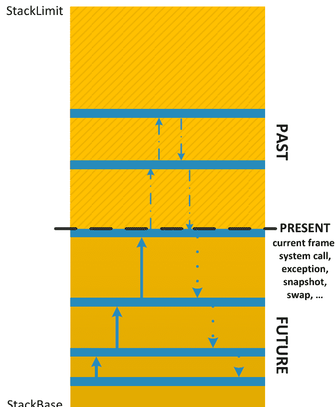

“未来”区因尚未执行的返回而得名。当然，每个堆栈子迹都会生成自己的分区。此模式的类似版本首次出现在 Debugging TV Frames 第 0x24 集。您可以观看视频^168，并在 Debugging TV 网站^169 上找到源代码、WinDbg 日志和演示文稿。

168 https://www.youtube.com/watch?v=qRaabDzY3ww
169 http://www.debugging.tv/

## 修补的代码

钩子软件（第 1175 页）模式最初来自内存转储分析模式目录，对于恶意软件分析模式目录来说过于通用。因此，我们决定拆分出 3 个独立的模式。第一个包括就地补丁等情况：

```
0:004> u ntdll!ZwQueryDirectoryFile
ntdll!ZwQueryDirectoryFile:
77814d4 b8da00000 mov eax,0DAh
77814db9 baeaf0500 mov edx,5AFE8h
77814dbe ff12 call dword ptr [edx]
77814dc0 c22c00 ret 2Ch
77814dc3 90 nop
ntdll!NtQueryDirectoryObject:
77814dc4 b8db00000 mov eax,0DBh
77814dc9 ba0003fe7f mov edx,offset SharedUserData!SystemCallStub (7ffe0300)
77814dce ff12 call dword ptr [edx]
```

和 detour 补丁：

```
0:004> u wininet!InternetReadFile
wininet!InternetReadFile:
7758654b e98044ac88 jmp 0004a9d0
77586550 83ec24 sub esp,24h
77586553 53 push ebx
77586554 56 push esi
77586555 57 push edi
77586556 33ff xor edi,edi
77586558 393db8162777 cmp dword ptr [wininet!GlobalDataInitialized (776211b8)],edi
7758655e 897df4 mov dword ptr [ebp-0Ch],edi
```

在 WinDbg 的情况下，此模式通常在崩溃点检测到，例如来自 **RIP 堆栈跟踪**（第 834 页）或来自 **!chkimg** 命令输出。

有时在查看模块列表（**lmv** WinDbg 命令）时，我们会看到此模式的完整存在。这不仅仅是执行函数（**挂钩函数**，第 484 页）或消息（**消息挂钩**，第 663 页）挂钩的模块，而是来自单一供应商的整个模块系统，该系统具有上下文感知能力（例如，从注册表读取其配置），并由多个组件组成，这些组件与其他进程通信。渗透系统应该增加一些额外价值或在更大的环境中和平共存。因此，该系统与其从未打算与之协作的其他进程变得紧密耦合（**耦合进程**，第 149 页）或松散耦合（第 151 页），而非预期的 **模块多样性**（第 703 页）。在一个极端，普遍系统中的模块可以是 **无处不在的组件**（第 1020 页），而在另一端，则是 **隐藏模块**（第 463 页）。在这种情况下，故障排除包括完全删除普遍模块，如果问题消失，则逐一排除它们以找到问题组件。


## 位置痕迹

内存转储中大多数执行残留（第365页）痕迹并非显式的时间性（参见《特殊和一般痕迹与日志分析》第170页），但可能按某些空间坐标排序，例如内存地址或页面帧编号。此外，虚拟空间可进一步细分为模块等位置，物理空间可重新结构化为进程等位置。可使用值引用（第1057页）分析模式构建某些数据值的简单空间痕迹。这些及更高级结构空间痕迹构造可命名为通用位置痕迹分析模式，如本图所示：

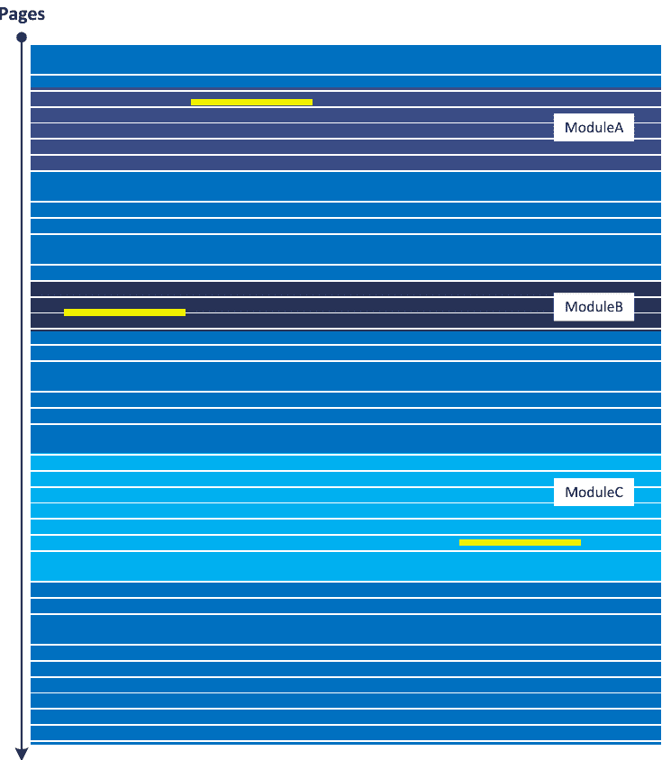

内存属性（如页面保护）或从内存内容派生的属性也可视为位置痕迹数据。有时，通过查看位置容器的时间信息（例如，经过的进程时间或进程列表中的顺序，或堆栈区域线程所有者的线程顺序和时间），可以重建时间顺序。

## 注释

数据也可跨不同线程堆栈区域进行位置痕迹分析。

## 平台特定调试器

分析 .NET 托管代码需要特定于处理器架构平台的 SOS 扩展。例如，x64 WinDbg 无法分析 32 位进程中托管代码异常（第617页）的托管堆栈：

```
0:010> !analyze -v

[...]

FAULTING_IP:
kernel32!RaiseException+53
77e4bee7 5e              pop     esi

EXCEPTION_RECORD:  ffffffff -- (.exr 0xffffffffffffffff)
ExceptionAddress: 77e4bee7 (kernel32!RaiseException+0x00000053)
  ExceptionCode: e0434f4d (CLR exception)
ExceptionFlags: 00000001
NumberParameters: 1
  Parameter[0]: 80131509

[...]

MANAGED_STACK: !dumpstack -EE
No export dumpstack found

MANAGED_BITNESS_MISMATCH:
Managed code needs matching platform of sos.dll for proper analysis. Use 'x86' debugger.

[...]
```

```
0:010> kl 100
ChildEBP RetAddr
0573f0a4 79f071ac kernel32!RaiseException+0x53
0573f104 79f07a80 mscorwks!RaiseTheExceptionInternalOnly+0x2a8
0573f1a8 058ed3b3 mscorwks!JIT_Retthrow+0xbf
WARNING: Frame IP not in any known module. Following frames may be wrong.
0573f33c 793b0d1f <Unloaded_dllA.dll>+0x58ed3b2
0573f344 79373ec3 mscorlib_ni+0x2f0d1f
0573f358 793b0c68 mscorlib_ni+0x2b3ecd
0573f370 79e7c74b mscorlib_ni+0x2f0c68
0573f380 79e7c6cc mscorwks!CallDescrWorker+0x33
0573f400 79e7c8e1 mscorwks!CallDescrWorkerWithHandler+0xa3
0573f53c 79e7c783 mscorwks!MethodDesc::CallDescr+0x19c
0573f558 79e7c90d mscorwks!MethodDesc::CallTargetWorker+0x1f
0573f56c 79fc58cd mscorwks!ThreadNative::KickOffThread_Worker+0x190
0573f754 79ef3207 mscorwks!Thread::DoADCallBack+0x32a
0573f7fc 79ef30c3 mscorwks!Thread::ShouldChangeAbortToUnload+0xe3
0573f838 79ef4826 mscorwks!Thread::ShouldChangeAbortToUnload+0x30a
0573f860 79fc57b1 mscorwks!Thread::ShouldChangeAbortToUnload+0x33e
0573f878 79fc56ac mscorwks!ManagedThreadBase::KickOff+0x13
0573f914 79f95a2e mscorwks!ThreadNative::KickOffThread+0x269
```

```
0573ffb8 77e64829 mscorwks!Thread::intermediateThreadProc+0x49
0573ffec 00000000 kernel32!BaseThreadStart+0x34
```

因此我们运行 x86 WinDbg，获得 **嵌套异常** (第723页) 的更清晰视图：

```
0:010> !analyze -v

[...]

MANAGED_STACK: !dumpstack -EE
OS Thread Id: 0xc68 (15)
Current frame:
ChildEBP RetAddr  Caller,Callee

EXCEPTION_OBJECT: !pe 16584f0
Exception object: 016584f0
Exception type: System.InvalidOperationException
Message: There is an error in XML document (12, 12182).
InnerException: System.IO.IOException, use !PrintException 0164f6dc to see more
[...]

StackTraceString: <none>
HResult: 80131509
There are nested exceptions on this thread. Run with -nested for details

EXCEPTION_OBJECT: !pe 164f6dc
Exception object: 0164f6dc
Exception type: System.IO.IOException
Message: Unable to read data from the transport connection: The connection was closed.
InnerException: <none>
[...]

StackTraceString: <none>
HResult: 80131620
There are nested exceptions on this thread. Run with -nested for details

MANAGED_OBJECT: !dumpobj 1655a38
Name: System.String
MethodTable: 790fd8c4
EEClass: 790fd824
Size: 270(0x10e) bytes
(C:\WINDOWS\assembly\GAC_32\mscorlib\2.0.0.0__[...]\mscorlib.dll)
String: Unable to read data from the transport connection: The connection was closed.

EXCEPTION_MESSAGE: Unable to read data from the transport connection: The connection was closed.

MANAGED_OBJECT_NAME: System.IO.IOException
```

当我们需要 **平台特定调试器** 时，还有此类模式的其他实例，例如，在 x64 机器上对 x86 进程进行实时调试（我们需要 x64 调试器）或为事后分析加载旧的 32 位 DLL 扩展（我们需要 x86 调试器）。

## 普列阿得斯

这是 lm WinDbg 命令输出中服务于类似功能的模块簇，例如打印缓冲区中的打印驱动程序或 Citrix 打印服务。通常，我们知道其中任何一个都可能出错。另一个示例是完整内存转储中在独立终端服务会话中服务于相同功能的一组进程模块。

## 混淆前残留

此模式与 **打包** (第775页) 和混淆代码密切相关。根据混淆和打包的程度，一些初始代码和数据结构以及包括字符串片段在内的模式可能会在混淆后的数据中泄露，从而揭示预期的软件行为：

```
0:000> s-sa 00000000`00fd4000 L6000
[...]
00000000`00fd943d  "o__"
00000000`00fd9449  "91!We"
00000000`00fd945d  "H5!"
00000000`00fd94d2  "z@!"
00000000`00fd94d4  "commandS"
00000000`00fd94f4  "IsDeb"
00000000`00fd94fd  "uggerP"
00000000`00fd9507  "Enc"
00000000`00fd950c  "v)3Po4t"
00000000`00fd9515  "DeXU"
00000000`00fd9520  "xFe"
00000000`00fd952a  "5Eb"
00000000`00fd9533  "SI=18kev"
00000000`00fd953e  "Z_1m"
00000000`00fd9547  "@IF"
[...]
```

## 问题异常处理程序

此模式通常出现于未按规定规则编写的自定义异常处理程序（例如，针对不可继续异常的处理程序（第171页））或具有常规代码中常见的其他缺陷。请参阅对前者建模的案例研究（第172页）。

在下面示例中，针对类似问题的堆栈跟踪结尾不同，显示了与自定义异常处理程序（第171页）的关系：

```
0:000> kv 1000
ChildEBP RetAddr  Args to Child
0003300c 77af9904 77b8929c 792ea99b 00000000 ntdll!RtlAcquireSRWLockShared+0x1a
00033058 77af9867 00406ef8 00033098 000330a0 ntdll!RtlLookupFunctionTable+0x2a
000330a8 77af97f9 00406ef8 00000000 00000000 ntdll!RtlIsValidHandler+0x26
00033128 77b25dd7 01033140 00033154 00033140 ntdll!RtlDispatchException+0x10b
00033128 77b40726 01033140 00033154 00033140 ntdll!KiUserExceptionDispatcher+0xf (CONTEXT @ 00033154)
00033490 77b25dd7 010334a8 000334bc 000334a8 ntdll!RtlDispatchException+0x18a
00033490 77b40726 010334a8 000334bc 000334a8 ntdll!KiUserExceptionDispatcher+0xf (CONTEXT @ 000334bc)
000337f8 77b25dd7 01033810 00033824 00033810 ntdll!RtlDispatchException+0x18a
[...]
0012f228 77b40726 0112f240 0012f254 0012f240 ntdll!KiUserExceptionDispatcher+0xf (CONTEXT @ 0012f254)
0012f590 77b8fbae 0112f5a8 0012f5d8 0012f5a8 ntdll!RtlDispatchException+0x18a
0012f590 768bfbae 0112f5a8 0012f5d8 0012f5a8 ntdll!KiUserExceptionDispatcher+0xf (CONTEXT @ 0012f5d8)
0012f8f4 0059ecad 0eedfade 00000001 00000007 kernel32!RaiseException+0x58
WARNING: Stack unwind information not available. Following frames may be wrong.
0012f918 74737599 0eedfade 00000001 00000007 Application+0x19ecad
[...]
0012ff88 768cd0e9 7ffdf000 0012ffd4 77b019bb Application+0x70f8
0012ff94 77b019bb 7ffdf000 793f6617 00000000 kernel32!BaseThreadInitThunk+0xe
0012ffd4 77b0198e 011263c0 7ffdf000 ffffffff ntdll!__RtlUserThreadStart+0x23
0012ffec 00000000 011263c0 7ffdf000 00000000 ntdll!_RtlUserThreadStart+0x1b

0:000> !exchain
00033048: ntdll!_except_handler4+0 (77ac99fa)
0012ff78: Application+6ef8 (00406ef8)
0012ffc4: ntdll!_except_handler4+0 (77ac99fa)
0012ffe4: ntdll!FinalExceptionHandler+0 (77b66f9b)
Invalid exception stack at ffffffff
```


## Comments

异常处理程序可能属于已卸载模块（第 1041 页），从而导致栈溢出（第 912 页）：

```
[...]
00000000`018cd4e0 00000000`772b96c5 ntdll!RtlpCallVectoredHandlers+0xac
00000000`018cd550 00000000`772c722a ntdll!RtlDispatchException+0x25
00000000`018cdbf0 000007fe`f992acc0 ntdll!KiUserExceptionDispatcher+0x2e
00000000`018cc188 00000000`772a38bb <Unloaded_ModuleA.dll>+0x3acc0
00000000`018ce190 00000000`772b96c5 ntdll!RtlpCallVectoredHandlers+0xac
00000000`018ce200 00000000`772c722a ntdll!RtlDispatchException+0x25
00000000`018ce8a0 00000000`772b3738 ntdll!KiUserExceptionDispatcher+0x2e
00000000`018cee40 00000000`772b3c64 ntdll!LdrpSearchResourceSection_U+0x16e
00000000`018cef70 00000000`7716e8b0 ntdll!LdrFindResource_U+0x44
00000000`018cefb0 00000000`6eadac42 kernel32!FindResourceExW+0x84
[...]
00000000`018cfef0 00000000`772a6991 kernel32!BaseThreadInitThunk+0xd
00000000`018cfff0 00000000`00000000 ntdll!RtlUserThreadStart+0x1d
```

## Problem Module

有时此模式可帮助进行故障排除。问题模块（包括进程名）是那些由于其增值行为可能会破坏正常软件行为的组件，因此需要采取从轻微配置更改到完全移除等各种故障排除变通方法。典型示例包括终端服务环境中的内存优化服务 173 或 Hooksware（第 1175 页）。我们可以在 !lmv 或 !process 0 0 WinDbg 命令的输出中查看主进程模块。lm 命令将列出进程内存转储中的模块名（例如 DLL），lmk 命令可从内核和完整内存转储中提供内核空间模块（例如驱动程序）列表，而以下命令列出完整内存转储中每个进程的所有用户空间模块：

```
!for_each_process ".process /r /p @#Process; lmu"
```

当然，如果我们对时间戳和模块信息感兴趣，也可以尝试各种 lm 命令变体。

### Comments

我们还可以在堆栈跟踪集合（第 944 页）中搜索问题模块名，例如，在完整内存转储或调试器日志中使用 !stacks 2 ModuleName。

## Problem Vocabulary

快速检查内存转储中是否存在可疑内容的一种方法是将其转换为调试器日志 174，例如堆栈跟踪集合，（第 943 页），并搜索诸如“等待中”、“终止”、“停止”、“互斥体”、“异常”、“临界”、“消息框”和“挂起计数”等文本字符串。当然，词汇表取决于操作系统，可能存在误报，并且会随时间变化。此模式类似于词汇索引软件跟踪分析模式 175。

例如，最近在一个涉及大量 ALPC 等待链（第 1097 页）且存在潜在进程间死锁的完整内存转储中，我们发现了以下具有长等待线程时间（第 1137 页，超出 ALPC 线程等待时间）的线程，指向一个待进一步检查的进程对象：

```
THREAD fffffffa801338b950 Cid 02a0.7498 Teb: 000007ffffd8000 Win32Thread: 0000000000000000 WAIT: (UserRequest) UserMode Non-Alertable
fffffa8012a39b30 ProcessObject
Not impersonating
DeviceMap fffffff8a000080a70
Owning Process fffffff8a0a31d040 Image: smss.exe
Attached Process N/A Image: N/A
Wait Start TickCount 9752080 Ticks: 5334204 (0:23:09:06.937)
Context Switch Count 38
UserTime 00:00:00.000
KernelTime 00:00:00.000
Win32 Start Address ntdll!TppWorkerThread (0x000000007722fcb0)
Stack Init fffffff8020259db0 Current fffffff8020259900
Base fffffff8802025a000 Limit fffffff88020254000 Call 0
Priority 11 BasePriority 11 UnusualBoost 0 ForegroundBoost 0 IoPriority 2 PagePriority 5
Kernel stack not resident.
Child-SP RetAddr Call Site
fffff880`20259492 fffff800`01693f92 nt!KiSwapContext+0x7a
fffff880`20259a80 fffff800`016967af nt!KiCommitThreadWait+0x1d2
fffff880`20259b10 fffff800`01984b2e nt!KeWaitForSingleObject+0x19f
fffff880`20259bb0 fffff800`0168df93 nt!NtWaitForSingleObject+0xde
fffff880`20259c20 00000000`7726135a nt!KiSystemServiceCopyEnd+0x13 (TrapFrame @ fffff880`20259c20)
00000000`048f648 00000000`48026517 ntdll!NtWaitForSingleObject+0xa
00000000`048f650 00000000`480269c4 smss!SmpTerminateCSR+0xa3
00000000`048f6a0 00000000`48023670 smss!SmpStopCsr+0x44
00000000`048f6d0 00000000`77288137 smss!SmpApiCallback+0x338
00000000`048f900 00000000`7722feff ntdll! ?? ::FNODOBFM::`string'+0x1f718
00000000`048f990 00000000`77274a00 ntdll!TppWorkerThread+0x3f8
00000000`048fc90 00000000`00000000 ntdll!RtlUserThreadStart+0x25
```

在此进程中，我们可以看到阻塞模块（第 96 页），并建议联系其供应商。

## Process Factory

在 PDP-11 系统编程的旧日子里，我们学习了生成进程的系统调用，并用汇编语言编写了一个会自行生成自身的程序。这种递归生成导致运行任务呈几何级数增长，并迅速使 RSX-11M 系统陷入停顿。最近，我们在一个内存转储中观察到了类似的非递归 **进程工厂** 模式：资源管理器不断地创建 *application.exe* 进程，等到有人注意到某种影响时，已有超过 5,000 个此类进程：

```
1: kd> !vm
[...]
5d20 application.exe 212 ( 848 Kb)
5d08 application.exe 212 ( 848 Kb)
5d04 application.exe 212 ( 848 Kb)
5cf8 application.exe 212 ( 848 Kb)
5cf0 application.exe 212 ( 848 Kb)
5ce8 application.exe 212 ( 848 Kb)
5cdc application.exe 212 ( 848 Kb)
5ccc application.exe 212 ( 848 Kb)
5cc8 application.exe 212 ( 848 Kb)
5cc0 application.exe 212 ( 848 Kb)
5ca8 application.exe 212 ( 848 Kb)
5c9c application.exe 212 ( 848 Kb)
5c98 application.exe 212 ( 848 Kb)
5c90 application.exe 212 ( 848 Kb)
5c88 application.exe 212 ( 848 Kb)
5c7c application.exe 212 ( 848 Kb)
5c70 application.exe 212 ( 848 Kb)
5c68 application.exe 212 ( 848 Kb)
5c64 application.exe 212 ( 848 Kb)
5c60 application.exe 212 ( 848 Kb)
5c50 application.exe 212 ( 848 Kb)
5c4c application.exe 212 ( 848 Kb)
5c44 application.exe 212 ( 848 Kb)
5c3c application.exe 212 ( 848 Kb)
5c34 application.exe 212 ( 848 Kb)
5c2c application.exe 212 ( 848 Kb)
5c24 application.exe 212 ( 848 Kb)
5c1c application.exe 212 ( 848 Kb)
5bf8 application.exe 212 ( 848 Kb)
5be0 application.exe 212 ( 848 Kb)
5bd4 application.exe 212 ( 848 Kb)
5bd0 application.exe 212 ( 848 Kb)
5ba4 application.exe 212 ( 848 Kb)
5b58 application.exe 212 ( 848 Kb)
5b50 application.exe 212 ( 848 Kb)
5b44 application.exe 212 ( 848 Kb)
5b38 application.exe 212 ( 848 Kb)
5b30 application.exe 212 ( 848 Kb)
5b04 application.exe 212 ( 848 Kb)
5af4 application.exe 212 ( 848 Kb)
5ad8 application.exe 212 ( 848 Kb)
5ad4 application.exe 212 ( 848 Kb)
5ac8 application.exe 212 ( 848 Kb)
5ac4 application.exe 212 ( 848 Kb)
5ab4 application.exe 212 ( 848 Kb)
5aa4 application.exe 212 ( 848 Kb)
5a9c application.exe 212 ( 848 Kb)
5a94 application.exe 212 ( 848 Kb)
5a8c application.exe 212 ( 848 Kb)
5a88 application.exe 212 ( 848 Kb)
5a74 application.exe 212 ( 848 Kb)
[...]

1: kd> !process 0 0
**** NT ACTIVE PROCESS DUMP ****
PROCESS 8b57f020 SessionId: none Cid: 0004 Peb: 00000000 ParentCid: 0000
    DirBase: cffb3020 ObjectTable: e1003da0 HandleCount: 3932.
    Image: System

PROCESS 8a9fd888 SessionId: none Cid: 01b8 Peb: 7ffdf000 ParentCid: 0004
    DirBase: cffb3040 ObjectTable: e13e3f68 HandleCount: 111.
    Image: smss.exe

PROCESS 89f0d508 SessionId: 0 Cid: 01f0 Peb: 7ffd8000 ParentCid: 01b8
    DirBase: cffb3060 ObjectTable: e16bc370 HandleCount: 1292.
    Image: csrss.exe

PROCESS 89eea7c8 SessionId: 0 Cid: 0208 Peb: 7ffde000 ParentCid: 01b8
    DirBase: cffb3080 ObjectTable: e14b4160 HandleCount: 564.
    Image: winlogon.exe

[...]

PROCESS 8607c020 SessionId: 1 Cid: 44c8 Peb: 7ffdc000 ParentCid: 4cf8
    DirBase: cffb7080 ObjectTable: e3c9fd38 HandleCount: 25407.
    Image: explorer.exe

[...]

PROCESS 85e1d020 SessionId: 1 Cid: 538c Peb: 7ffda000 ParentCid: 44c8
    DirBase: cffb8980 ObjectTable: e8065b20 HandleCount: 39.
    Image: application.exe

PROCESS 85c74610 SessionId: 1 Cid: 5394 Peb: 7ffd9000 ParentCid: 44c8
    DirBase: cffb89a0 ObjectTable: e6951878 HandleCount: 39.
    Image: application.exe

PROCESS 85c81020 SessionId: 1 Cid: 53a4 Peb: 7ffd7000 ParentCid: 44c8
    DirBase: cffb89c0 ObjectTable: e6d2f600 HandleCount: 39.
    Image: application.exe

PROCESS 85c6fb18 SessionId: 1 Cid: 53a8 Peb: 7ffd7000 ParentCid: 44c8
    DirBase: cffb89e0 ObjectTable: e54df078 HandleCount: 39.
    Image: application.exe
```


```
PROCESS 85c60020 SessionId: 1 Cid: 53bc Peb: 7ffdf000 ParentCid: 44c8 DirBase: cffb84a0 ObjectTable: e1214e90 HandleCount: 39 Image: application.exe
PROCESS 85c5d380 SessionId: 1 Cid: 53c8 Peb: 7ffde000 ParentCid: 44c8 DirBase: cffb8a60 ObjectTable: e7baf638 HandleCount: 39 Image: application.exe
PROCESS 85c648b8 SessionId: 1 Cid: 53dc Peb: 7ffde000 ParentCid: 44c8 DirBase: cffb8a80 ObjectTable: e759d060 HandleCount: 39 Image: application.exe
PROCESS 85c62528 SessionId: 1 Cid: 53e0 Peb: 7ffde000 ParentCid: 44c8 DirBase: cffb8aa0 ObjectTable: e3b8fa00 HandleCount: 39 Image: application.exe
PROCESS 85c59d88 SessionId: 1 Cid: 53e8 Peb: 7ffdc000 ParentCid: 44c8 DirBase: cffb8ac0 ObjectTable: e31751e0 HandleCount: 39 Image: application.exe
PROCESS 85c46d88 SessionId: 1 Cid: 542c Peb: 7ffd5000 ParentCid: 4d9c DirBase: cffb8b00 ObjectTable: e6fbc500 HandleCount: 136 Image: nllapplication.exe
PROCESS 85c3c020 SessionId: 1 Cid: 5464 Peb: 7ffdc000 ParentCid: 44c8 DirBase: cffb8440 ObjectTable: e218b948 HandleCount: 39 Image: application.exe
PROCESS 85c2a020 SessionId: 1 Cid: 546c Peb: 7ffdb000 ParentCid: 44c8 DirBase: cffb8b60 ObjectTable: e639a8d0 HandleCount: 39 Image: application.exe
PROCESS 85c202c8 SessionId: 1 Cid: 5474 Peb: 7ffd7000 ParentCid: 44c8 DirBase: cffb8b80 ObjectTable: e517caa8 HandleCount: 39 Image: application.exe
PROCESS 85c1b020 SessionId: 1 Cid: 547c Peb: 7ffd6000 ParentCid: 44c8 DirBase: cffb8ba0 ObjectTable: e60cbcb0 HandleCount: 39 Image: application.exe
PROCESS 85c1dd88 SessionId: 1 Cid: 5484 Peb: 7ffd5000 ParentCid: 44c8 DirBase: cffb8bc0 ObjectTable: e4a42f68 HandleCount: 39 Image: application.exe
PROCESS 85d3ed88 SessionId: 1 Cid: 5488 Peb: 7ffd5000 ParentCid: 44c8 DirBase: cffb8be0 ObjectTable: e68558f0 HandleCount: 39 Image: application.exe
```

我们可以看到，所有创建的进程都有相同的父进程，PID 为 44c8。当我们检查它时，可以看到其中有许多线程在创建 application.exe 进程：

```
1: kd> .process /r /p 8607c020
Implicit process is now 8607c020
Loading User Symbols

1: kd> !process 8607c020
PROCESS 8607c020  SessionId: 1  Cid: 44c8    Peb: 7ffdc000  ParentCid: 4cf8
    DirBase: cffb7080  ObjectTable: e3c9fd38  HandleCount: 25407.
    Image: explorer.exe
    VadRoot 88efec98 Vads 3445 Clone 0 Private 30423. Modified 71292. Locked 0.
    DeviceMap e3743340
    Token                             e29be5e0
    ElapsedTime                       00:54:31.359
    UserTime                          00:00:019.234
    KernelTime                        00:04:04.828
    QuotaPoolUsage[PagedPool]         1075132
    QuotaPoolUsage[NonPagedPool]      137800
    Working Set Sizes (now,min,max)  (15457, 50, 345) (61828KB, 200KB, 1380KB)
    PeakWorkingSetSize                48919
    VirtualSize                       585 Mb
    PeakVirtualSize                   978 Mb
    PageFaultCount                    123488
    MemoryPriority                    BACKGROUND
    BasePriority                      8
    CommitCharge                      49919

[...]

THREAD 84f25300  Cid 44c8.6288  Teb: 7ff8e000 Win32Thread: bc486830 READY
IRP List:
    88699110: (0006,0220) Flags: 00000884  Mdl: 00000000
Not impersonating
DeviceMap                 e3743340
Owning Process            8607c020       Image:         explorer.exe
Wait Start TickCount      1327981        Ticks: 29 (0:00:00:00.453)
Context Switch Count      145332         LargeStack
UserTime                  00:00:00.000
KernelTime                00:00:00.093
Win32 Start Address SHLWAPI!SHCreateThread (0x77ec3ea5)
Start Address kernel32!BaseThreadStartThunk (0x7c8217ec)
Stack Init a98e4000 Current a98e3700 Base a98e4000 Limit a98e0000 Call 0
Priority 8 BasePriority 8 PriorityDecrement 0
ChildEBP RetAddr
a98e3718 80833ec5 nt!KiSwapContext+0x26
a98e3744 80829bc0 nt!KiSwapThread+0x2e5
a98e378c 8087e0d8 nt!KeWaitForSingleObject+0x346
a98e374c 8087e397 nt!ExpWaitForResource+0x30
a98e37e4 badff32a nt!ExAcquireResourceExclusiveLite+0x8d
a98e3808 badffe35 driverA+0x132a
a98e3824 bae02028 driverA+0x1e35
a98e3868 bae0e45a driverA+0x2208
a98e38a0 8081e095 driverA+0x1045a
a98e38b4 b972c73b nt!IofCallDriver+0x45
```

```
[...]
a98e38e8 b9b194e1 nt!IofCallDriver+0x45
[...]
a98e3940 b85cbf08 nt!IofCallDriver+0x45
a98e3968 b85cbcfc driverB!LowerDevicePassThrough+0x48
a98e398c b85bd63d driverB+0x6fcc
a98e3a24 b85cb167 driverB+0x763d
a98e3a34 b85cb1b7 driverB+0x15167
a98e3a5c 8081e095 driverB!DispatchPassThrough+0x48
a98e3a70 808f13b nt!IofCallDriver+0x45
a98e3b58 80939c6a nt!IopParseDevice+0xa35
a98e3bd8 80935d9e nt!ObpLookupObjectName+0x5b0
a98e3c2c 808ece57 nt!ObOpenObjectByName+0xea
a98e3ca8 808ee0f1 nt!IoCreateFile+0x447
a98e3d04 808f1e31 nt!IoCreateFile+0xa3
a98e3d44 8088ad3c nt!NtOpenFile+0x27
a98e3d44 7c9485ec nt!KiFastCallEntry+0xfc (TrapFrame @ a98e3d64)
03bbda04 7c82bdf6 ntdll!KiFastSystemCallRet
03bbda2c 7c82dd9a kernel32!BasepSxsCreateStreams+0xe2
03bbda9c 7c82dd95 kernel32!BasepSxsCreateProcessCsrMessage+0x136
03bbec24 7c802a40 kernel32!CreateProcessInternalW+0x1943
03bbee2f 7ca36750 kernel32!CreateProcessW+0x2c
03bbd80 7ca36b45 SHELL32!_SHCreateProcess+0x387
03bbded4 7ca3617b SHELL32!CShellExecute::DoExecCommand+0xb4
03bbee0 7ca35a76 SHELL32!CShellExecute::TryInvokeApplication+0x49
03bbef4 7ca3599f SHELL32!CShellExecute::ExecuteNormal+0xb1
03bbee08 7ca35933 SHELL32!ShellExecuteNormal+0x30
03bbee24 7ca452ff SHELL32!ShellExecuteExW+0x8d
```

```
1: kd> .thread 84e6a600
```
隐式线程现为 84e6a600

```
1: kd> kv 100
```

```
[...]
03bbda04 7c82bdf6 001200a9 03bbda8c 03bbdb20 ntdll!KiFastSystemCallRet
03bbda2c 7c82dd9a 00000000 00000000 001200a9 kernel32!BasepSxsCreateStreams+0xe2
03bbda9c 7c82dd95 00000000 00000000 03bbdc38 kernel32!BasepSxsCreateProcessCsrMessage+0x136
03bbec24 7c802a40 00000000 01daf89c 01da904 kernel32!CreateProcessInternalW+0x1943
03bbee2f 7ca36750 01daf89c 01da904 00000000 kernel32!CreateProcessW+0x2c
03bbd80 7ca36b45 00010098 00000000 01daffac SHELL32!_SHCreateProcess+0x387
[...]
```

```
1: kd> du /c 100 01daf8c
```

```
01daf8c9 "C:\\Program Files\\App Package\\Application.exe"
```

此模式与类似的句柄泄漏（第 526 页）或僵尸进程（第 1158 页）之间的区别在于：泄漏通常发生在进程忘记关闭句柄时，而进程工厂会创建活跃进程，这些进程是完整的资源容器并消耗系统资源。例如，它们都拥有完整的句柄表，或者如果是 GUI 进程，则会消耗 GDI 资源。

## 间歇性内存泄漏

此模式的一个示例与进程堆 176 的大块分配泄漏有些相似。一个应用程序具有一些功能，执行每个命令后，其提交内存会增加 50 - 60 Mb。在故障发生前和每次故障发生后各获取了三个进程内存转储：

```
// Before failures

0:000> !address -summary
```

**使用情况摘要**

| 类型 | 区域数 | 总大小 | 占用百分比 | 总百分比 |
|------|----------|------------|---------|----------|
| 空闲 | 267 | 76c50000 (1.856 Gb) | | 92.79% |
| <未分类> | 270 | 4d6f000 (77.434 Mb) | 52.45% | 3.78% |
| 映像 | 620 | 31bf000 (49.746 Mb) | 33.70% | 2.43% |
| 堆栈 | 60 | 1400000 (20.000 Mb) | 13.55% | 0.98% |
| 激活上下文数据 | 48 | 35000 (212.000 kb) | 0.14% | 0.01% |
| NLS 表 | 1 | 23000 (140.000 kb) | 0.09% | 0.01% |
| TEB | 20 | 14000 (80.000 kb) | 0.05% | 0.00% |
| CSR 共享内存 | 1 | 5000 (20.000 kb) | 0.01% | 0.00% |
| PEB | 1 | 1000 (4.000 kb) | 0.00% | 0.00% |

**类型汇总（已用）**

| 类型 | 区域数 | 总大小 | 占用百分比 | 总百分比 |
|------|----------|------------|---------|----------|
| MEM_PRIVATE | 296 | 3bca000 (59.789 Mb) | 40.50% | 2.92% |
| MEM_IMAGE | 647 | 340c000 (52.047 Mb) | 35.26% | 2.54% |
| MEM_MAPPED | 78 | 23ca000 (35.789 Mb) | 24.24% | 1.75% |

**状态汇总**

| 状态 | 区域数 | 总大小 | 占用百分比 | 总百分比 |
|-------|----------|------------|---------|----------|
| MEM_FREE | 267 | 76c50000 (1.856 Gb) | | 92.79% |
| MEM_RESERVE | 125 | 50060000 (80.023 Mb) | 54.21% | 3.91% |
| MEM_COMMIT | 896 | 439a0000 (67.602 Mb) | 45.79% | 3.30% |

**保护汇总（提交）**

| 保护 | 区域数 | 总大小 | 占用百分比 | 总百分比 |
|-------|----------|------------|---------|----------|
| PAGE_EXECUTE_READ | 125 | 1f2c000 (31.172 Mb) | 21.12% | 1.52% |
| PAGE_READONLY | 363 | 1ee5000 (30.895 Mb) | 20.93% | 1.51% |
| PAGE_READWRITE | 309 | 4c2000 (4.758 Mb) | 3.22% | 0.23% |
| PAGE_WRITECOPY | 43 | 6a000 (424.000 kb) | 0.28% | 0.02% |
| PAGE_READWRITE\|PAGE_GUARD | 40 | 4b000 (300.000 kb) | 0.20% | 0.01% |
| PAGE_EXECUTE_READWRITE | 15 | 11000 (68.000 kb) | 0.04% | 0.00% |
| PAGE_EXECUTE | 1 | 1000 (4.000 kb) | 0.00% | 0.00% |


| 类别 | 基址 | 区域大小 |
|---|---|---|
| 空闲 | 6130000 | 5fb70000 ( 1.496 Gb) |
| <未分类> | abf0000 | 13d10000 ( 19.816 Mb) |
| 映像 | 75141000 | 879000 ( 8.473 Mb) |
| 堆栈 | 32900000 | fd000 (1012.000 kb) |
| 激活上下文数据 | 50000 | 4000 ( 16.000 kb) |
| NLS 表 | 7efb0000 | 23000 ( 140.000 kb) |
| 线程环境块 | 7ef6f000 | 1000 ( 4.000 kb) |
| CSR 共享内存 | 7efe0000 | 5000 ( 20.000 kb) |
| 进程环境块 | 7efde000 | 1000 ( 4.000 kb) |

## 第 1 次失败后

`0:000> !address -summary`

| 类别 | 区域数 | 总大小 | 忙碌占比 | 总占比 |
|---|---|---|---|---|
| 空闲 | 267 | 7388c000 ( 1.805 Gb) | | 90.26% |
| <未分类> | 272 | 81330000 ( 129.199 Mb) | 64.80% | 6.31% |
| 映像 | 614 | 31bf0000 ( 49.746 Mb) | 24.95% | 2.43% |
| 堆栈 | 60 | 14000000 ( 20.000 Mb) | 10.03% | 0.98% |
| 激活上下文数据 | 48 | 350000 ( 212.000 kb) | 0.10% | 0.01% |
| NLS 表 | 1 | 23000 ( 140.000 kb) | 0.07% | 0.01% |
| 线程环境块 | 20 | 14000 ( 80.000 kb) | 0.04% | 0.00% |
| CSR 共享内存 | 1 | 5000 ( 20.000 kb) | 0.01% | 0.00% |
| 进程环境块 | 1 | 1000 ( 4.000 kb) | 0.00% | 0.00% |

| 类型 | 区域数 | 总大小 | 忙碌占比 | 总占比 |
|---|---|---|---|---|
| 私有内存 | 297 | 6f8e0000 ( 111.555 Mb) | 55.95% | 5.45% |
| 映像内存 | 642 | 340c0000 ( 52.047 Mb) | 26.10% | 2.54% |
| 映射内存 | 78 | 23ca0000 ( 35.789 Mb) | 17.95% | 1.75% |

| 状态 | 区域数 | 总大小 | 忙碌占比 | 总占比 |
|---|---|---|---|---|
| 空闲内存 | 267 | 7388c000 ( 1.805 Gb) | | 90.26% |
| 已提交内存 | 892 | 775e0000 ( 119.367 Mb) | 59.87% | 5.83% |
| 已保留内存 | 125 | 50060000 ( 80.023 Mb) | 40.13% | 3.91% |

| 保护 | 区域数 | 总大小 | 忙碌占比 | 总占比 |
|---|---|---|---|---|
| 页读写 | 314 | 38a30000 ( 56.637 Mb) | 28.40% | 2.77% |
| 页执行只读 | 125 | 1f2c0000 ( 31.172 Mb) | 15.63% | 1.52% |
| 页只读 | 363 | 1ee50000 ( 30.895 Mb) | 15.49% | 1.51% |
| 页写复制 | 34 | 4d0000 ( 308.000 kb) | 0.15% | 0.01% |
| 页读写|页保护 | 40 | 4b0000 ( 300.000 kb) | 0.15% | 0.01% |
| 页执行读写 | 15 | 110000 ( 68.000 kb) | 0.03% | 0.00% |
| 页执行 | 1 | 1000 ( 4.000 kb) | 0.00% | 0.00% |

### 按使用情况划分的最大区域

| 类别 | 基址 | 区域大小 |
|---|---|---|
| 空闲 | 94f4000 | 5c7ac000 ( 1.445 Gb) |
| <未分类> | 61300000 | 33c4000 ( 51.766 Mb) |
| 映像 | 75141000 | 879000 ( 8.473 Mb) |
| 堆栈 | 32900000 | fd000 (1012.000 kb) |
| 激活上下文数据 | 50000 | 4000 ( 16.000 kb) |
| NLS 表 | 7efb0000 | 23000 ( 140.000 kb) |
| 线程环境块 | 7ef6f000 | 1000 ( 4.000 kb) |
| CSR 共享内存 | 7efe0000 | 5000 ( 20.000 kb) |
| 进程环境块 | 7efde000 | 1000 ( 4.000 kb) |

`0:000> !address -f:VAR`

| 基址 | 结束地址+1 | 区域大小 | 类型 | 状态 | 保护 | 用途 |
|---|---|---|---|---|---|---|
| 5e82000 | 5f70000 | ee000 | 私有 | 已保留 | | <未分类> |
| 61300000 | 94f40000 | 33c4000 | 私有 | 已提交 | 页读写 | <未分类> |
| 74220000 | 74221000 | 1000 | 映像 | 已提交 | 页只读 | <未分类> |

`0:000> ? 33c4000/0n1024`
求值表达式：53008 = 0000cf10

## 第 2 次失败后

`0:000> !address -summary`

| 类别 | 区域数 | 总大小 | 忙碌占比 | 总占比 |
|---|---|---|---|---|
| 空闲 | 268 | 704c8000 ( 1.755 Gb) | | 87.74% |
| <未分类> | 273 | b4f7000 ( 180.965 Mb) | 72.05% | 8.84% |
| 映像 | 614 | 31bf000 ( 49.746 Mb) | 19.81% | 2.43% |
| 堆栈 | 60 | 1400000 ( 20.000 Mb) | 7.96% | 0.98% |
| 激活上下文数据 | 48 | 35000 ( 212.000 kb) | 0.08% | 0.01% |
| NLS 表 | 1 | 23000 ( 140.000 kb) | 0.05% | 0.01% |
| 线程环境块 | 20 | 14000 ( 80.000 kb) | 0.03% | 0.00% |
| CSR 共享内存 | 1 | 5000 ( 20.000 kb) | 0.01% | 0.00% |
| 进程环境块 | 1 | 1000 ( 4.000 kb) | 0.00% | 0.00% |

| 类型 | 区域数 | 总大小 | 忙碌占比 | 总占比 |
|---|---|---|---|---|
| 私有内存 | 298 | a352000 ( 163.320 Mb) | 65.03% | 7.97% |
| 映像内存 | 642 | 340c000 ( 52.047 Mb) | 20.72% | 2.54% |
| 映射内存 | 78 | 23ca000 ( 35.789 Mb) | 14.25% | 1.75% |

| 状态 | 区域数 | 总大小 | 忙碌占比 | 总占比 |
|---|---|---|---|---|
| 空闲内存 | 268 | 704c8000 ( 1.755 Gb) | | 87.74% |
| 已提交内存 | 893 | ab22000 ( 171.133 Mb) | 68.14% | 8.36% |
| 已保留内存 | 125 | 50060000 ( 80.023 Mb) | 31.86% | 3.91% |

### 已提交内存的保护摘要

| 保护 | 区域数 | 总大小 | 忙碌占比 | 总占比 |
|---|---|---|---|---|
| 页读写 | 315 | 6c67000 ( 108.402 Mb) | 43.16% | 5.29% |
| 页执行只读 | 125 | 1f2c000 ( 31.172 Mb) | 12.41% | 1.52% |
| 页只读 | 363 | 1ee5000 ( 30.895 Mb) | 12.30% | 1.51% |
| 页写复制 | 34 | 4d000 ( 308.000 kb) | 0.12% | 0.01% |
| 页读写|页保护 | 40 | 4b000 ( 300.000 kb) | 0.12% | 0.01% |
| 页执行读写 | 15 | 11000 ( 68.000 kb) | 0.03% | 0.00% |
| 页执行 | 1 | 1000 ( 4.000 kb) | 0.00% | 0.00% |

### 按使用情况划分的最大区域

| 区域 | 基址 | 区域大小 |
|---|---|---|
| 空闲 | c8c4000 | 593dc000 ( 1.394 Gb) |
| <未分类> | 6130000 | 33c4000 ( 51.766 Mb) |
| 映像 | 75141000 | 879000 ( 8.473 Mb) |
| 堆栈 | 3290000 | fd000 (1012.000 kb) |
| 激活上下文数据 | 50000 | 4000 ( 16.000 kb) |
| NLS 表 | 7efb0000 | 23000 ( 140.000 kb) |
| 线程环境块 | 7ef6f000 | 1000 ( 4.000 kb) |
| CSR 共享内存 | 7efe0000 | 5000 ( 20.000 kb) |
| 进程环境块 | 7efde000 | 1000 ( 4.000 kb) |

`0:000> !address -f:VAR`

| 基址 | 结束地址+1 | 区域大小 | 类型 | 状态 | 保护 | 用途 |
|---|---|---|---|---|---|---|
| 5e82000 | 5f70000 | ee000 | 私有 | 已保留 | | <未分类> |
| 6130000 | 94f4000 | 33c4000 | 私有 | 已提交 | 页读写 | <未分类> |
| 9500000 | c8c4000 | 33c4000 | 私有 | 已提交 | 页读写 | <未分类> |
| 74220000 | 74221000 | 1000 | 映像 | 已提交 | 页只读 | <未分类> |

此模式的名称来源于在特定操作或事件后发生的离散大内存分配过程。在这些分配之间，内存使用量没有可见或显著的增加。

## 安静转储

我们将这种看不到任何异常甚至可疑内容的内存转储称为安静转储。例如，在这样的转储中，其**堆栈跟踪集合**（第 943 页）不会偏离参考堆栈跟踪（第 1164 页），并且我们不会看到任何**飙升线程**（第 885 页）。

## 商堆栈跟踪

很久以前，我们引入了折叠堆栈跟踪 177 的概念，即从堆栈跟踪（第 926 页，例如 kc WinDbg 命令）中移除所有函数，并移除剩余重复模块，类似于商跟踪 178 分析模式。它类似于堆栈跟踪签名（第 955 页），帧计数设置为 1。我们最初计划将此模式称为紧凑堆栈（跟踪），并且它曾列在可能的未来分析模式清单中。在准备《理论软件诊断》书籍 179 时，这再次引起了我们的注意，我们决定以商堆栈跟踪的名称发布它，作为更通用的跟踪和日志分析模式的一种专门化。

这种模式可能有助于分析模块等待链（第 1103 页）。

177 内存转储分析文集，第 3 卷，第 381 页
178 同上，第 9b 卷，第 62 页
179 《理论软件诊断》，ISBN-13：978-1-908043986

## 随机对象

有时我们会观察到罕见事件，其中通常会导致系统崩溃的异常状况却只导致较轻的问题，例如，某服务不可用且不影响其他服务和用户。有报告称，一个应用程序在用户会话注销期间冻结。当时保存了一个完整的内存转储，其堆栈跟踪集合（!stacks 命令，第 943 页）显示用户进程中存在以下可疑线程（所有其他线程均正在正常等待）：

```
0: kd> !stacks
Proc.Thread .Thread Ticks ThreadState Blocker
[...]
[89cfa960 Application.exe]
ea0.001c4c 89a11db0 0499cd1 Blocked DriverA+0x69db
[...]

0: kd> !thread 89a11db0 16
THREAD 89a11db0 Cid 0ea0.1c4c Teb: 7ffdf000 Win32Thread: bc347a48 WAIT: (Unknown) KernelMode Non-Alertable
89b87770 Unknown
b97004ac NotificationEvent
IRP List:
899e2668: (0006,0244) Flags: 00000884 Mdl: 00000000
Not impersonating
DeviceMap daf62b28
Owning Process 89cfa960 Image: Application.exe
Attached Process N/A Image: N/A
Wait Start TickCount 909331 Ticks: 4824273 (0:20:56:19.265)
Context Switch Count 186 LargeStack
UserTime 00:00:00.015
KernelTime 00:00:00.093
*** ERROR: Module load completed but symbols could not be loaded for Application.exe
Win32 Start Address Application (0x00406b2a)
Start Address kernel32!BaseProcessStartThunk (0x77e617f8)
Stack Init b60ceb30 Current b60cdf10 Base b60cf000 Limit b60cb000 Call b60ceb34
Priority 10 BasePriority 10 PriorityDecrement 0
ChildEBP RetAddr Args to Child
b60cdf28 80833485 89a11db0 00000000 00000000 nt!KiSwapContext+0x26
b60cdf54 8082949b dc399008 89b87748 b60ce01c nt!KiSwapThread+0x2e5
b60cdf88 b96d69db 00000002 b60cdffc 00000001 nt!KeWaitForMultipleObjects+0x3d7
WARNING: Stack unwind information not available. Following frames may be wrong.
b60cdfe8 b96d719e 89b87748 dc399008 b60ce01c DriverA+0x69db
[...]
```

我们注意到 "89b87770 Unknown"，并再次检查线程正在等待的对象：

```
0: kd> dp b60cdfbc L00000002
b60cdfbc 89b87770 b97004ac
```


这些正是 !thread 命令输出中列出的相同对象。我们看到第二个对象是正常的，并且位于非分页区域：

```
0: kd> dt _DISPATCHER_HEADER b97004ac
ntdll!_DISPATCHER_HEADER
   +0x000 Type             : 0 ''
   +0x001 Absolute         : 0 ''
   +0x001 NpxIrql          : 0 ''
   +0x002 Size             : 0x4 ''
   +0x002 Hand             : 0x4 ''
   +0x003 Inserted         : 0 ''
   +0x003 DebugActive      : 0 ''
   +0x000 Lock             : 262144
   +0x004 SignalState      : 0
   +0x008 WaitListHead     : _LIST_ENTRY [ 0x89a11e70 - 0x89a11e70 ]

0: kd> !address b97004ac
a71e3000 - 13e1d000
           Usage      KernelSpaceUsageNonPagedSystem
```

另一个看起来像来自空闲非分页池条目的无效随机对象（它甚至自称是坏的），过去曾属于配置管理器：

```
0: kd> !pool 89b87770
Pool page 89b87770 region is Nonpaged pool
[...]

89b87540 size:  98 previous size:  40  (Allocated)  File (Protected)
*89b875d8 size: 260 previous size:  98    (Free)     *CMpa
    Pooltag CMpa : registry post apcs, Binary : nt!cm
89b87838 size:  28 previous size:  260  (Allocated)  FSFm
[...]
```

```
0: kd> dd 89b87770
89b87770  bad0b0b0 00000000 00000000 00000000
89b87780  8a04be01 00000000 89b87788 89b87788
89b87790  00150006 e56c6946 8993e208 89ab96b8
89b877a0  00000000 00000000 bad0b0b0 c0000800
89b877b0  02110004 63426343 83ebfb80 00001000
89b877c0  00199000 00000000 8993e238 88d0d248
89b877d0  0019a000 00000000 00000000 00000000
89b877e0  00000000 00000000 00000000 00000000
```

```
0: kd> dt _DISPATCHER_HEADER 89b87770
nt!_DISPATCHER_HEADER
   +0x000 Type             : 0xb0 ""
   +0x001 Absolute         : 0xb0 ""
   +0x001 NpxIrql          : 0xb0 ""
   +0x002 Size             : 0xd0 ""
   +0x002 Hand             : 0xd0 ""
   +0x003 Inserted         : 0xba ""
   +0x003 DebugActive      : 0xba ""
   +0x000 Lock             : -1160728400
   +0x004 SignalState      : 0
   +0x008 WaitListHead     : _LIST_ENTRY [ 0x0 - 0x0 ]
```

现在来进行一些反事实思考。发生 bugcheck 的一种可能场景是：在调用 `KeWaitForMultipleObjects` 等待两个对象都变为 signaled 状态（第 3 个 WAIT_TYPE 参数）之后，空闲池槽被分配或合并，`SignalState` 巧合地变为非零，其他成员变为随机值，然后当另一个线程设置通知事件时，第二个正常对象变为 signaled 状态。

## 原始指针

这种模式涉及没有匹配符号文件的指针。它们可能位于预期的模块范围内，或以 `module + offset` 形式位于其他已知模块范围中，也可能完全超出已加载模块列表中任何模块的范围，因此仅是一个数字。例如，通常我们有一些结构或数组（表），其中我们期望带有匹配符号的指针，例如 IAT、IDT 和 32 位 SSDT，一旦出现原始指针即立即引起怀疑，例如来自 `ProcessA` 的此导入地址表：

```
[...]
00000000`3f8a9048 00000000`76e282d0 ntdll!RtlSizeHeap
00000000`3f8a9050 00000000`76bf9070 kernel32!GetStringTypeWStub
00000000`3f8a9058 00000000`76c03580 kernel32!WideCharToMultiByteStub
00000000`3f8a9060 00000000`76e33f20 ntdll!RtlReAllocateHeap
00000000`3f8a9068 00000000`76e533a0 ntdll!RtlAllocateHeap
00000000`3f8a9070 00000000`76bfc420 kernel32!GetCommandLineWStub
00000000`3f8a9078 00000001`3f8a1638 ProcessA+0x10ac
00000000`3f8a9080 00000000`76c2c590 kernel32!IsProcessorFeaturePresent
00000000`3f8a9088 00000000`76c02d60 kernel32!GetLastErrorStub
00000000`3f8a9090 00000000`76c02d80 kernel32!SetLastError
00000000`3f8a9098 00000000`76bf3ee0 kernel32!GetCurrentThreadIdStub
[...]
```

请注意，结构不仅限于上述内容，可以是任何我们拥有符号文件的操作系统甚至应用程序特定结构。超出预期模块范围的原始指针将在下一种模式中介绍。

## 符号信息缩减

有时我们为模块拥有缩减的符号信息，其范围从已剥离或公共符号文件到仅导出函数名称不等。在这种情况下，我们可以使用 API 函数原型、结构定义和可能的字符串参数（第 962 页）来理解函数参数：

```
0:000:x86> kv
ChildEBP RetAddr  Args to Child
0013fe34 75a1790d 0013fe74 00000000 00000000 user32!NtUserGetMessage+0x15
0013fe50 00fc148a 0013fe74 00000000 00000000 user32!GetMessageW+0x33
0013fe90 00fc16ec 00fc0000 00000000 00354082 notepad!WinMain+0xe6
0013ff20 758233aa 7efde000 0013ffc7 77059ef2 notepad!_initterm_e+0xa1
0013ff2c 77059ef2 7efde000 57785ae5 00000000 kernel32!BaseThreadInitThunk+0xe
0013ff6c 77059ec5 00fc3689 7efde000 ntdll!_RtlUserThreadStart+0x70
0013ff84 00000000 00fc3689 7efde000 ntdll!_RtlUserThreadStart+0x1b
```

GetMessage API 的第一个参数是指向 MSG 结构的指针：

```
0:000:x86> dt MSG 0013fe74
Symbol MSG not found.
```

从 MSDN 我们找到此结构定义：

```
typedef struct tagMSG {
    HWND   hwnd;
    UINT   message;
    WPARAM wParam;
    LPARAM lParam;
    DWORD  time;
    POINT  pt;
} MSG, *PMSG, *LPMSG;
```

```
0:000:x86> dc 0013fe74 L7
0013fe74  0007149c  00000113  0038a508  7287c5d6  .......8....r
0013fe84  2079a177  00000539  000001c0        w.y 9.......
```

## 引用泄漏

诸如进程等对象除了使用句柄外，还可能在内部被引用。如果其引用计数不平衡，我们可能会出现 **引用泄漏** 模式。例如，我们有成千上万的 **僵尸进程**（第 1158 页）实例，但如果分析 ParentCids，我们看不到来自其父进程的 **句柄泄漏**（第 416 页）：

```
0: kd> !process 0 0
[...]
PROCESS fffffa801009a060
    SessionId: 0  Cid: 2e270    Peb: 7fffffdb000  ParentCid: 032c
    DirBase: 12ba37000  ObjectTable: 00000000  HandleCount:  0.
    Image: conhost.exe

PROCESS fffffa8009b7e8e0
    SessionId: 1  Cid: 2e0c8    Peb: 7fffffd9000  ParentCid: 10a0
    DirBase: 21653e000  ObjectTable: 00000000  HandleCount:  0.
    Image: taskmgr.exe

PROCESS fffffa8009e7a450
    SessionId: 0  Cid: 2e088    Peb: 7efdf0000  ParentCid: 0478
    DirBase: 107f02000  ObjectTable: 00000000  HandleCount:  0.
    Image: AppA.exe

PROCESS fffffa8009e794b0
    SessionId: 0  Cid: 2e394    Peb: 7fffffd3000  ParentCid: 032c
    DirBase: 210ffc000  ObjectTable: 00000000  HandleCount:  0.
    Image: conhost.exe

PROCESS fffffa8009ed4060
    SessionId: 0  Cid: 2dee4    Peb: 7efdf0000  ParentCid: 0478
    DirBase: 11b7c7000  ObjectTable: 00000000  HandleCount:  0.
    Image: AppB.exe

PROCESS fffffa800a13bb30
    SessionId: 0  Cid: 2e068    Peb: 7fffffd5000  ParentCid: 032c
    DirBase: 1bb3c1000  ObjectTable: 00000000  HandleCount:  0.
    Image: conhost.exe

PROCESS fffffa80096f26b0
    SessionId: 0  Cid: 2e320    Peb: 7efdf0000  ParentCid: 0478
    DirBase: 6ad4c000  ObjectTable: 00000000  HandleCount:  0.
    Image: AppC.exe

PROCESS fffffa8009c44060
    SessionId: 0  Cid: 2e300    Peb: 7fffffd0000  ParentCid: 032c
    DirBase: 10df06000  ObjectTable: 00000000  HandleCount:  0.
    Image: conhost.exe
[...]
```

```
0: kd> !object fffffffa800a13bb30
Object: fffffffa800a13bb30  Type: (ffffffa8006cecf30) Process
ObjectHeader: fffffffa800a13bb00 (new version)
HandleCount: 0 PointerCount: 1

0: kd> !object fffffffa8009b7e8e0
Object: fffffffa8009b7e8e0 Type: (fffffa8006cecf30) Process
ObjectHeader: fffffffa8009b7e8b0 (new version)
HandleCount: 0 PointerCount: 1
```

如此数量的进程与进程结构的非分页池用量相关：

```
0: kd> !poolused 3
...
Sorting by NonPaged Pool Consumed

NonPaged Paged
Tag  Allocs  Frees   Diff  Used   Allocs Frees Diff  Used
...
Proc 55488  60      55428 80328320 0    0    0    0    Process objects, Binary: nt!ps
File 51733526 51708737 24789 7150416 0    0    0    0    File objects
[...]
```

在此我们建议启用对象引用跟踪，可以使用 gflags.exe 或直接修改注册表：

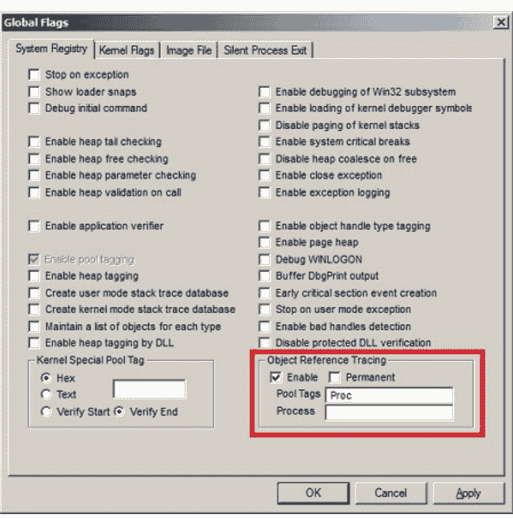


```
Key: HKEY_LOCAL_MACHINE\SYSTEM\CurrentControlSet\Control\Session Manager\kernel
Value: ObTracePoolTags
Type: REG_SZ
Data: Proc
```

排查或调试后我们需要禁用跟踪，因为它会消耗池内存（另一种**插桩副作用**模式的变体（第 520 页），并且可能导致类似的**内存不足**模式，用于堆栈跟踪数据库，第 563 页）：

| Tag | 非分页分配 | 非分页释放 | 非分页差值 | 非分页已用 | 分页分配 | 分页释放 | 分页差值 | 分页已用 | 描述 |
|-----|-------------|-------------|-------------|-------------|-----------|-----------|-----------|-----------|-------------|
| ObRt | 5688634 | 5676109 | 12525 | 4817288240 | 0 | 0 | 0 | | 对象引用堆栈跟踪，二进制: nt!ob |
| Proc | 22120 | 101 | 22019 | 25961168 | 0 | 0 | 0 | | 进程对象，二进制: nt!ps |

启用跟踪后，我们会收集完整的内存转储（在事后调试的情况下），以使用 **!obtrace** WinDbg 命令分析另一种**堆栈跟踪**模式的变体（第 919 页）：

```
0: kd> obtrace fffffffa800af9e220
Object: fffffffa800af9e220
Image: Appd.exe
Sequence (+/-) Tag Stack
--------------------------- -------------------
ad377858 +1 Dflt nt! ?? ::NNGAKEGL::`string'+21577
nt!PsPAllocateProcess+185
nt!NtCreateUserProcess+4a3
nt!KiSystemServiceCopyEnd+13

ad377882 +1 Dflt nt! ?? ::NNGAKEGL::`string'+1f9d8
nt!NtProtectVirtualMemory+119
nt!KiSystemServiceCopyEnd+13
nt!KiServiceLinkage+0
nt!RtlCreateUserStack+1e4
nt!PsAllocateThread+299
nt!NtCreateUserProcess+65d
nt!KiSystemServiceCopyEnd+13

ad377884 -1 Dflt nt! ?? ::FNODOBFM::`string'+4886e
nt!NtProtectVirtualMemory+161
nt!KiSystemServiceCopyEnd+13
nt!KiServiceLinkage+0
nt!RtlCreateUserStack+1e4
[...]
```

分析此类跟踪可能会因**堆栈跟踪截断**（第 1015 页）而变得复杂。**源模块**（第 771 页）在某些情况下可能简化计数。

## 常规数据

此模式将内存中发现的 ASCII 和 UNICODE 类型 (00xx00yy) 数据推广到特定领域的数据格式，例如位图和矢量数据。后者的示例可能是 ...0xx0yy... 序列（xxx 是十六进制数字三元组）。此模式的典型用法是分析损坏的动态内存块（进程堆、内核池），其中跨块边界的常规数据连续性指向可能的**共享缓冲区覆盖**（第 868 页）。

## 相对内存泄漏

在进程堆（第 650 页）和 .NET 堆（第 636 页，或通常有多个动态内存分配器）的并行**内存泄漏**情况下，我们关注相对增长，以查看它们是否相互依赖，即托管堆对象是否指向进程堆条目。当我们有一组连续的内存转储时，可以构建堆大小表并绘制图表，其中坐标轴表示内存快照编号和总堆大小（字节）：

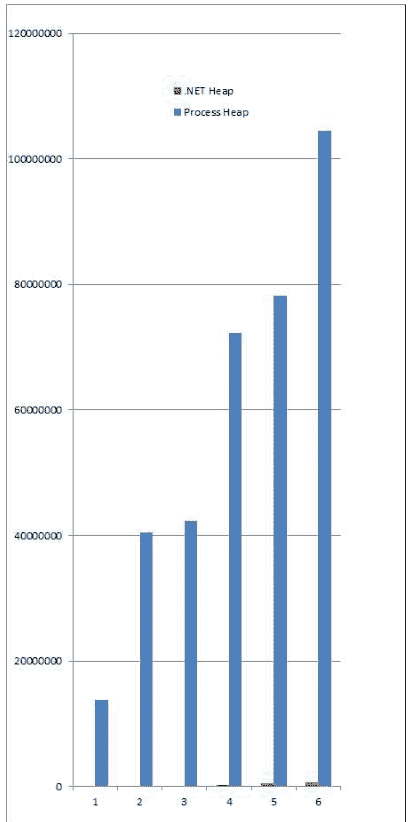

不幸的是，如上图所示，相对增长大小可能不成比例。为克服此问题，我们可以通过最低相应堆大小对大小进行归一化，即 S_n/S_1：

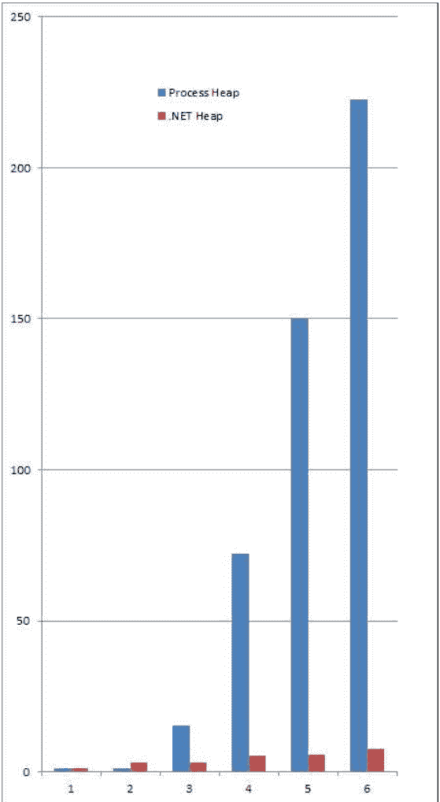

尽管如此，如果不存在相关性，这仍然无法显示没有相关性。我们可以绘制相对增长，即 S_n/S_{n-1}，n > 1：

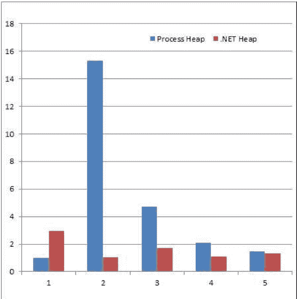

图表显示**相对堆泄漏**之间没有明显相关性。类似的图表可以针对相对对象分布（.NET 堆上的**对象分布异常**，第 756 页）构建。

## RIP 堆栈跟踪

注入代码的地址可能不在加载模块的地址范围内。在这种情况下，在执行调用历史记录中，我们会在堆栈跟踪上看到纯 EIP 和 RIP 返回地址。我们称此模式为**RIP 堆栈跟踪**，部分原因是我们在出错并导致进程崩溃后见过这些地址：

```
0:005> k
ChildEBP RetAddr
02aec974 77655620 ntdll!KiFastSystemCallRet
02aec978 77683c62 ntdll!NtWaitForSingleObject+0xc
02aec9fc 77683d4b ntdll!RtlReportExceptionEx+0x14b
02aeca3c 7769fa87 ntdll!RtlReportException+0x3c
02aeca50 7769fbd0 ntdll!RtlpTerminateFailureFilter+0x14
02aeca5c 775f9bdc ntdll!RtlReportCriticalFailure+0x6b
02aeca70 775f4f67 ntdll!_EH4_CallFilterFunc+0x12
02aeca98 77655f79 ntdll!_except_handler4+0x8e
02aecabc 77655f4b ntdll!ExecuteHandler2+0x26
02aecb6c 77655dd7 ntdll!ExecuteHandler+0x24
02aecb6c 7769fa8f ntdll!KiUserExceptionDispatcher+0xf
02aecce0 776a0704 ntdll!RtlReportCriticalFailure+0x5b
02aecef0 776a07f2 ntdll!RtlpReportHeapFailure+0x21
02aecf24 7766b1a5 ntdll!RtlpLogHeapFailure+0xa1
02aecfc6 7765730a ntdll!RtlpCoalesceFreeBlocks+0x4b9
02aecd64 77657545 ntdll!RtlpFreeHeap+0x1e2
02aed080 75e47e4b ntdll!RtlFreeHeap+0x14e
02aed0c8 77037277 kernel32!GlobalFree+0x47
02aed0dc 774b4a1f ole32!ReleaseStgMedium+0x124
02aed0ff 77517feb urlmon!ReleaseBindInfo+0x4c
02aed100 774d9a87 urlmon!CINet::ReleaseCNetObjects+0x3d
02aed118 774d93f0 urlmon!CINetHttp::OnWininetRequestHandleClosing+0x60
02aed12c 76432078 urlmon!CINet::CINetCallback+0x2de
02aed274 76438f5d wininet!InternetIndicateStatus+0xfc
02aed2a4 7643937a wininet!HANDLE_OBJECT::~HANDLE_OBJECT+0xc9
02aed2c0 7643916b wininet!INTERNET_CONNECT_HANDLE_OBJECT::~INTERNET_CONNECT_HANDLE_OBJECT+0x209
02aed2cc 76438d5e wininet!HTTP_REQUEST_HANDLE_OBJECT::`vector deleting destructor'+0xd
02aed2dc 76434e72 wininet!HANDLE_OBJECT::Dereference+0x22
02aed2e8 76439419 wininet!DereferenceObject+0x21
02aed310 76439114 wininet!InternetCloseHandle+0x9d
02aed330 0000aaff wininet!InternetCloseHandle+0x11e
WARNING: Frame IP not in any known module. Following frames may be wrong.
02aed33c 774c5d25 0x4aaaf
02aed358 774c5d95 urlmon!CINet::TerminateRequest+0x82
02aed364 774c5d7c urlmon!CINet::MyUnlockRequest+0x10
02aed370 774c5d63 urlmon!CINetProtImpl::UnlockRequest+0x10
02aed37c 774c5d49 urlmon!CINetEmbFilter::UnlockRequest+0x11
02aed388 774b743d urlmon!CINet::UnlockRequest+0x13
02aed394 774b73e1 urlmon!COInetProt::UnlockRequest+0x11
02aed3a8 774b7530 urlmon!CTransaction::UnlockRequest+0x36
02aed3b4 774b74e0 urlmon!CTransData::~CTransData+0x3a
02aed3c0 774b74c9 urlmon!CTransData::~`scalar deleting destructor'+0xd
02aed3d8 774e221f urlmon!CTransData::Release+0x25
02aed3e0 774b6d0a urlmon!CReadOnlyStreamDirect::~CReadOnlyStreamDirect+0x1a
02aed3ec 774b7319 urlmon!CReadOnlyStreamDirect::`vector deleting destructor'+0xd
02aed404 774b72be urlmon!CReadOnlyStreamDirect::Release+0x25
02aed410 774b71f4 urlmon!CBinding::~CBinding+0xb9
02aed41c 774b71dd urlmon!CBinding::`scalar deleting destructor'+0xd
02aed434 6b20b0e8 urlmon!CBinding::Release+0x25
02aed448 6b20b0ba mshtml!ATL::AtlComPtrAssign+0x2b
02aed458 6b20b8de mshtml!ATL::CComPtr<IBindCallbackInternal>::operator=+0x15
02aed464 6b20b8aa mshtml!CBindingXSSFilter::TearDown+0x2b
02aed46c 6b20b8a7 mshtml!BindingXSSFilter_TearDown+0x19
02aed478 6b0da61a mshtml!CStreamProxy::Passivate+0x12
02aed484 6b0ddf3a mshtml!CBaseFT::Release+0x1d
02aed4ac 6b0eb070 mshtml!CDwnBindData::TerminateBind+0x11d
02aed4b8 6b11a2a9 mshtml!CDwnBindData::TerminateOnApt+0x14
02aed4ec 6b105096 mshtml!GlobalWndOnMethodCall+0xfb
02aed50c 7742fd72 mshtml!GlobalWndProc+0x183
02aed538 7742fe4a user32!InternalCallWinProc+0x23
02aed5b0 7743018d user32!UserCallWinProcCheckWow+0x14b
02aed614 7743022b user32!DispatchMessageWorker+0x322
02aed624 6ecac1d5 user32!DispatchMessageW+0xf
02aef72c 6ec5337e ieframe!CTabWindow::_TabWindowThreadProc+0x54c
02aef7e4 760f426d ieframe!LCIETab_ThreadProc+0x2c1
02aef7f4 75e4d0e9 iertutil!CisoScope::RegisterThread+0xab
02aef800 776319bb kernel32!BaseThreadInitThunk+0xe
02aef840 7763198e ntdll!__RtlUserThreadStart+0x23
02aef858 00000000 ntdll!_RtlUserThreadStart+0x1b
```

但是，需要检查此类地址是否属于 .NET CLR JIT 代码（第 591 页）。

## 粗糙堆栈跟踪

此模式是更通用的**执行残留**（第 371 页）模式或托管空间中的**调用方-被调用方**（第 111 页）的示例。它只是来自线程堆栈区域或其片段的符号引用集合（也可能包含**巧合符号信息**，第 137 页）。在 WINDbg 中，我们可以通过使用 **dpS** 命令获取它：

```
0:003> !teb
TEB at 000007fffffd6000
    ExceptionList:        0000000000000000
    StackBase:            0000000024500000
    StackLimit:           00000000244b0000
    SubSystemTib:         0000000000000000
    FiberData:            000000000001e0e0
    ArbitraryUserPointer: 0000000000000000
    Self:                 000007fffffd6000
    EnvironmentPointer:   0000000000000000
    ClientId:             0000000000047fc .   000000000004824
    RpcHandle:            0000000000000000
    Tls Storage:          000007fffffd6058
    PEB Address:          000007fffffd000
    LastErrorValue:       0
    LastStatusValue:      c0000302
    Count Owned Locks:    0
    HardErrorMode:        0

0:003> dpS 000000000244b000 0000000002450000
000007fe`fd4a8a2e ole32!InternalVerifyStackAvailable+0x44 [d:\w7main\minio\safealloca\alloca.c @ 317]
000007fe`fd4a8a2e ole32!InternalVerifyStackAvailable+0x44 [d:\w7main\minio\safealloca\alloca.c @ 317]
000007fe`fd4a8a2e ole32!InternalVerifyStackAvailable+0x44 [d:\w7main\minio\safealloca\alloca.c @ 317]
00000000`771d5430 ntdll!RtlpInterceptorRoutines
00000000`771d134d ntdll!RtlAllocateHeap+0x16c
00000000`770ec9c3 ntdll!RtlAppendUnicodeStringToString+0x53
00000000`76eaebe5 kernel32!Wow64RedirectKeyPathInternal+0x2b7
00000000`770ec9c3 ntdll!RtlAppendUnicodeStringToString+0x53
00000000`7711f4fd ntdll!RtlFreeHeap+0x1a6
00000000`76eaec01 kernel32!ConstructKernelKeyPath+0x15f
00000000`76eaedd3 kernel32!Wow64NtOpenKey+0xee
00000000`7711f4fd ntdll!RtlFreeHeap+0x1a6
00000000`76ebc8aa kernel32!BaseRegOpenClassKeyFromLocation+0x3ba
00000000`76f3edf0 kernel32!'string'
00000000`771d5430 ntdll!RtlpInterceptorRoutines
00000000`76ebcb99 kernel32!BaseRegGetUserPrefixLength+0xea
00000000`76f3ee38 kernel32!'string'
00000000`76f3edc8 kernel32!'string'
00000000`76ebc3a8 kernel32!BaseRegGetKeySemantics+0x1b8
00000000`771150d3 ntdll!RtlNtStatusToDosError+0x27
00000000`76eb36b7 kernel32!LocalBaseRegOpenKey+0x276
0007fe`fd4b6c79 ole32!GetUnquotedPath+0x29 [d:\w7rtm\com\ole32\com\objbase\dlcache.cxx @ 2256]
000007fe`fd4b7019 ole32!CClassCache::CDllPathEntry::NegotiateDllInstantiationProperties+0x145 [d:\w7rtm\com\ole32\com\objbase\dlcache.cxx @ 3092]
00000000`771d5430 ntdll!RtlpInterceptorRoutines
00000000`7711d34d ntdll!RtlAllocateHeap+0x16c
00000000`77115cc4 ntdll!RtlpAllocateHeap+0xc12
0007fe`fd1c0359 usp10!USpShapingClient::AllocMem+0x49
```


```
000007fe`fdc48942 usp10!COTlsClient::AllocMem+0x12
000007fe`fdc48942 usp10!COTlsClient::AllocMem+0x12
000007fe`fdc1d4f1 usp10!UspFreeMem+0x61
000007fe`fdc4896e usp10!COTlsClient::FreeMem+0xe
000007fe`fdc6e817 usp10!ApplyFeatures+0xa17
000007fe`fdc67f22 usp10!ApplyLookup+0x592
000007fe`fdc48901 usp10!COTlsClient::GetDefaultGlyphs+0x131
000007fe`fdc60100 usp10!HangulEngineGetGlyphs+0x2c0
000007fe`fdc10359 usp10!CuspShapingClient::AllocMem+0x49
000007fe`fdc48942 usp10!COTlsClient::AllocMem+0x12
000007fe`fdc10359 usp10!CuspShapingClient::AllocMem+0x49
000007fe`fdc1d4f1 usp10!UspFreeMem+0x61
000007fe`fdc48942 usp10!COTlsClient::AllocMem+0x12
000007fe`fdc1d4f1 usp10!UspFreeMem+0x61
000007fe`fdc4896e usp10!COTlsClient::FreeMem+0xe
000007fe`fdc6e817 usp10!ApplyFeatures+0xa17
000007fe`fdc6a8a8 usp10!RePositionOtlGlyphs+0x238
000007fe`fdc48901 usp10!COTlsClient::GetDefaultGlyphs+0x131
000007fe`fdc60100 usp10!HangulEngineGetGlyphs+0x2c0
000007fe`fdc48798 usp10!COTlsClient::ReleaseOtTable+0x78
000007fe`fdc6ae85 usp10!OtlReleaseMgr::detach+0xc5
00000000`7717c63e ntdll!EtwEventWriteNoRegistration+0xae
000007fe`fdc48999 usp10!COTlsClient::Release+0x49
00000000`771150d3 ntdll!RtlNtStatusToDosError+0x27
00000000`7716bd85 ntdll!WaitForWerSvc+0x85
00000000`7717b94e ntdll!WerpAllocateAndInitializeSid+0xbe
00000000`7716bd90 ntdll! ?? ::FNODOBFM::`string'
00000000`7717d5cf ntdll!WerpReportSect+0x3f
00000000`7718123d ntdll!SendMessageToWERService+0x22d
00000000`77181260 ntdll! ?? ::FNODOBFM::`string'
00000000`77182308 ntdll!ReportExceptionInternal+0xc8
000007fe`fd061430 KERNELBASE!WaitForMultipleObjectsEx+0xe8
00000000`76ec1723 kernel32!WaitForMultipleObjectsExImplementation+0xb3
00000000`76f3b5e5 kernel32!WerpReportFaultInternal+0x215
00000000`76f3b767 kernel32!WerpReportFault+0x77
00000000`76f3b7bf kernel32!BasepReportFault+0x1f
00000000`76f3b9dc kernel32!UnhandledExceptionFilter+0x1fc
00000000`77118d7e ntdll!RtlpFindUnicodeStringInSection+0x50e
00000000`771198fc ntdll!LdrpFindLoadedDll+0x10c
00000000`770e9caa ntdll!RtlDecodePointer+0x2a
00000000`770c0000 ntdll!RtlDeactivateActivationContext <PERF> (ntdll+0x0)
00000000`771e8180 ntdll!string'+0xc040
00000000`771e818c ntdll!string'+0xc04c
00000000`77153398 ntdll! ?? ::FNODOBFM::`string'+0x2365
00000000`770d85c8 ntdll!_C_specific_handler+0x8c
00000000`770c0000 ntdll!RtlDeactivateActivationContext <PERF> (ntdll+0x0)
00000000`770ec541 ntdll!RtlUserThreadStart+0x1d
00000000`770e9d2d ntdll!RtlpExecuteHandlerForException+0xd
00000000`77220dd2 ntdll!CsrPortMemoryRemoteDelta <PERF> (ntdll+0x142dd0)
00000000`770d91cf ntdll!RtlDispatchException+0x45a
00000000`76faddaa kernel32!_PchSym_ <PERF> (kernel32+0x10dda0)
00000000`7711920a ntdll!RtlDosApplyFileIsolationRedirection_Ustr+0x3da
00000000`77220dd2 ntdll!CsrPortMemoryRemoteDelta <PERF> (ntdll+0x142dd0)
00000000`771e8180 ntdll!string'+0xc040
00000000`770c0000 ntdll!RtlDeactivateActivationContext <PERF> (ntdll+0x0)
00000000`770ec541 ntdll!RtlUserThreadStart+0x1d
00000000`770c0000 ntdll!RtlDeactivateActivationContext <PERF> (ntdll+0x0)
00000000`7720d2dd ntdll!CsrPortMemoryRemoteDelta <PERF> (ntdll+0x142dd0)
00000000`771d7718 ntdll!LdrpDefaultExtension
00000000`770d852c ntdll!_C_specific_handler
00000000`771e8180 ntdll!string'+0xc040
000007fe`ff36250c mscorlib!_szComClassName
00000000`770e7a33 ntdll!LdrpFindOrMapDll+0x138
00000000`771192a8 ntdll!LdrpApplyFileNameRedirection+0x2d3
00000000`771d5430 ntdll!RtlpInterceptorRoutines
00000000`7711d448 ntdll!RtlAllocateHeap+0xe4
00000000`76df8b88 user32!GetPropW+0x4d
00000000`76fd7931 user32!IsWindow+0x9
00000000`770f41c8 ntdll!RtlpReAllocateHeap+0x178
000007fe`fb601381 uxtheme!CThemeWnd::_PreDefWindowProc+0x31
00000000`76eb59e0 kernel32!BaseThreadInitThunk
00000000`ffdbdb32 calc!CTimerCalc::Start+0xa9
00000000`ff9d0000 calc!CCalculatorController::<C>CalculatorController <PERF> (calc+0x0)
00000000`ffeca64 calc!_dyn_tls_init_callback <PERF> (calc+0x7ac64)
00000000`76ea0000 kernel32!TestResourceDataMatchEntry <PERF> (kernel32+0x0)
00000000`76fadada kernel32!__PchSym_ <PERF> (kernel32+0x10dda0)
00000000`770c0000 ntdll!RtlDeactivateActivationContext <PERF> (ntdll+0x0)
00000000`7720d2dd ntdll!CsrPortMemoryRemoteDelta <PERF> (ntdll+0x142dd0)
00000000`76fd760e user32!RealDefWindowProc+0x5a
000007fe`fb600037 uxtheme!operator delete <PERF> (uxtheme+0x37)
000007fe`77111248 ntdll!KiUserExceptionDispatcher+0x2e
000007fe`fb63fb40 uxtheme!$VProc_ImageExportDirectory
00000000`ffdbdb27 calc!CTimedCalc::WatchDogThread+0xb2
00000000`76fe76c2 user32!DefDlgProc+0x36
00000000`76fd9bef user32!UserCallWinProcCheckWow+0x1cb
00000000`76fd9b43 user32!UserCallWinProcCheckWow+0x99
00000000`76fd9bef user32!UserCallWinProcCheckWow+0x1cb
00000000`76fd72cb user32!DispatchClientMessage+0xc3
00000000`770e46b4 ntdll!NtdllDialogWndProc_W
00000000`ffdbdb27 calc!CTimedCalc::WatchDogThread+0xb2
00000000`77101530 ntdll!NtdllDispatchMessage_W
00000000`76fe505b user32!DialogBox2+0x2ec
00000000`ff9d0000 calc!CCalculatorController::<C>CalculatorController <PERF> (calc+0x0)
00000000`76fe4edd user32!InternalDialogBox+0x135
00000000`ffedceb0 calc!CTimerCalc::TimeOutDlgProc
00000000`ff9d0000 calc!CCalculatorController::<C>CalculatorController <PERF> (calc+0x0)
00000000`76fe4f52 user32!DialogBoxIndirectParamAorW+0x58
00000000`ffdcdeb0 calc!CTimerCalc::TimeOutDlgProc
00000000`ff9d0000 calc!CCalculatorController::<C>CalculatorController <PERF> (calc+0x0)
00000000`76fd476e user32!DialogBoxParamW+0x66
00000000`ffdcdeb0 calc!CTimerCalc::TimeOutDlgProc
00000000`ffdbdafa calc!CTimerCalc::WatchDogThread+0x72
00000000`76eb59ed kernel32!BaseThreadInitThunk+0xd
00000000`770ec541 ntdll!RtlUserThreadStart+0x1d
00000000`76fb7e0e kernel32!UnhandledExceptionFilter
```

此模式的名称来源于数学中的粗糙集 180。

## 同一供应商

有时候，针对不同的应用程序或服务，我们会看到非常相似的异常软件行为表现（例如堆栈跟踪相似的崩溃）。在这种情况下，我们还应在 lmv 命令的输出中检查应用程序或服务的供应商和版权信息。与“模板模块”（第 997 页）类似，“同一供应商”模式可用于关联此类不同事件。通常，在同一家公司中，代码和人员的重用会导致代码片段和代码构建风格分布在不同的产品线中，因此，软件缺陷可能会在不同的映像中出现。例如：

```
0:000> lmv m ApplicationA
start end module name
00400000 00d99000 ApplicationA (deferred)
[...]
Image name: ApplicationA.exe
Timestamp: [...]
CheckSum: 00000000
[...]
CompanyName: CompanyA
ProductName: CompanyA Application
LegalCopyright: Copyright (c) CompanyA
[...]
0:000> lmv m ApplicationB
start end module name
00400000 019d0000 ApplicationB C (no symbols)
Image name: ApplicationB.exe
[...]
CompanyName: CompanyA
ProductName: ApplicationB
LegalCopyright: Copyright (c) CompanyA
[...]
```

## 螺栓等待链

在此，我们介绍另一个 **等待链**（第 1082 页）模式：客户端线程发出请求，服务该请求的创建的服务器线程再向客户端发出另一个请求，客户端为此创建一个新的客户端线程来服务该服务器请求。新的客户端线程再次向服务器发出请求，并创建一个新的服务器线程，该线程发出新的客户端请求，如此循环。这里的其他迹象可能是线程数量异常，以及可能出现 **句柄泄漏**（第 416 页）模式，尽管后者可能仅存在于客户端或服务器进程中。**线程生存时间**（第 1001 页）、**等待线程时间**（第 1137 页）和常见的 **阻塞模块**（第 96 页）模式可用于解开该链并诊断可能的问题模块及相应的 **模块产品进程**（第 697 页）。该模式在下图中说明：

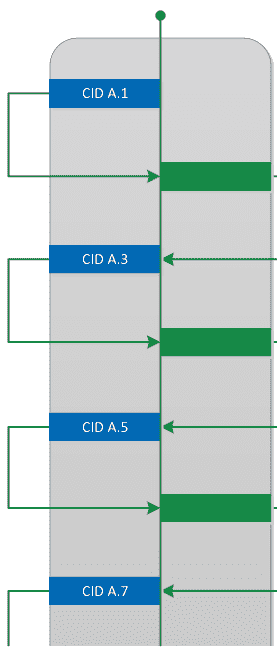

虽然我们最初发现此模式与 LPC/ALPC IPC（第 1097 页）相关，但我们认为它不仅限于此，也可能出现在不同的客户端-服务器通信实现中。


## 自我诊断

### 内核模式

此模式是用户模式中 **自我诊断**（第 847 页）的内核模式对应物。它只是一组 bugcheck 代码集合，通常在损坏导致故障、异常或陷阱之前检测到问题。典型的示例是检测到失败的断言或 **损坏的结构**（第 144 页），例如：

```
BAD_POOL_HEADER (19)
The pool is already corrupt at the time of the current request.
This may or may not be due to the caller.
The internal pool links must be walked to figure out a possible cause of the problem, and then special pool applied to the suspect tags or the driver verifier to a suspect driver.
Arguments:
Arg1: 00000020, a pool block header size is corrupt.
Arg2: 8b79d078, The pool entry we were looking for within the page.
Arg3: 8b79d158, The next pool entry.
Arg4: 8a1c0004, (reserved)
```

### 注释

另一个示例是这个 bugcheck：

```
CRITICAL_STRUCTURE_CORRUPTION (109)
This bugcheck is generated when the kernel detects that critical kernel code or
data have been corrupted. There are generally three causes for a corruption:
- A driver has inadvertently or deliberately modified critical kernel code
or data. See http://www.microsoft.com/whdc/driver/kernel/64bitPatching.mspx
- A developer attempted to set a normal kernel breakpoint using a kernel
debugger that was not attached when the system was booted. Normal breakpoints,
“bp”, can only be set if the debugger is attached at boot time. Hardware
breakpoints, “ba”, can be set at any time.
- A hardware corruption occurred, e.g. failing RAM holding kernel code or data.
Arguments:
Arg1: [...], Reserved
Arg2: [...], Reserved
Arg3: [...], Failure type dependent information
Arg4: 0000000000000002, Type of corrupted region, can be
    - 0 : A generic data region
    - 1 : Modification of a function or .pdata
    - 2 : A processor IDT
    - 3 : A processor GDT
    - 4 : Type 1 process list corruption
    - 6 : Debug routine modification
    - 5 : Type 2 process list corruption
    - 7 : Critical MSR modification
```

### 注册表

这是针对系统配置数据库（注册表）的 **自我诊断**（内核模式）模式的变体。
有时可以看到是它的哪个部分（配置单元）导致了问题。下面是一个涉及可能损坏用户配置文件的示例：

```
REGISTRY_ERROR (51)
Something has gone badly wrong with the registry. If a kernel debugger is available, get a stack trace.
It can also indicate that the registry got an I/O error while trying to read one of its files, so it can
be caused by hardware problems or filesystem corruption. It may occur due to a failure in a refresh
operation, which is used only in by the security system, and then only when resource limits are
encountered.

Arguments:
Arg1: 00000003, (reserved)
Arg2: 00000004, (reserved)
Arg3: e82372f8, depends on where Windows bugchecked, *may be pointer to hive*
Arg4: 00000000, depends on where Windows bugchecked, may be return code of HvCheckHive if the hive is
corrupt.
```

```
0: kd> !reg hivelist
```

| 蜂窝地址 | 稳定长度 | 稳定映射 | 易失长度 | 易失映射 | 映射视图 | 固定视图 | U(计数) | 基块 | 文件名 |
| --- | --- | --- | --- | --- | --- | --- | --- | --- | --- |
| e1008a68 | 13000 | e1008ac8 | 1000 | e1008c84 | 0 | 0 | 0 | e1015000 | \NONAME |
| e1014e60 | 901000 | e1023800 | 40000 | e101a67c | 202 | 0 | 0 | e1016000 | SYSTEM |
| e1938188 | d000 | e19381e8 | 4000 | e1938324 | 0 | 0 | 0 | e193a000 | \NONAME |
| e1968290 | 8000 | e19682f0 | 0 | 00000000 | 3 | 0 | 0 | e1d39000 | \SystemRoot\System32\Config\SAM |
| e1cab270 | 3d000 | e1cab2d0 | 1000 | e1cab44c | 16 | 0 | 0 | e1d32000 | \SystemRoot\System32\Config\SECURITY |
| e1c9f448 | 3f70000 | e1e37000 | 1000 | e1c9f5e4 | 256 | 0 | 0 | e1d71000 | \SystemRoot\System32\Config\DEFAULT |
| e1d75a80 | 7d50000 | e1ee3000 | 23000 | e1d75c1c | 254 | 12 | 0 | e1d37000 | \SystemRoot\System32\Config\SOFTWARE |
| e1ba30d0 | 37000 | e1ba3130 | 1000 | e1ba326c | 17 | 0 | 0 | e19e0000 | \ings\NetworkService\ntuser.dat |
| e1ba8060 | 1000 | e1ba80c0 | 0 | 00000000 | 1 | 0 | 0 | e1d8e000 | \Microsoft\Windows\UsrClass.dat |
| e1afc068 | 3b000 | e1afc0c8 | 1000 | e1afc204 | 17 | 0 | 0 | e1b3d000 | \ettings\LocalService\ntuser.dat |
| e1de62a0 | 1000 | e1de6300 | 0 | 00000000 | 1 | 0 | 0 | e1d39000 | \Microsoft\Windows\UsrClass.dat |
| [...] | [...] | [...] | [...] | [...] | [...] | [...] | [...] | [...] | [...] |
| e82372f8 | 106000 | e8237358 | 0 | 00000000 | 55 | 4 | 0 | e514c000 | \ings\User123\NTUSER.DAT |
| [...] | [...] | [...] | [...] | [...] | [...] | [...] | [...] | [...] | [...] |

```
0: kd> dt _CMHIVE e82372f8
nt!_CMHIVE
+0x000 Hive : _HHIVE
+0x2d0 FileHandles : [3] 0x80002234 Void
+0x2dc NotifyList : _LIST_ENTRY [ 0x0 - 0x0 ]
+0x2e4 HiveList : _LIST_ENTRY [ 0xe7a38d64 - 0xe4d9fc9c ]
+0x2ec HiveLock : _EX_PUSH_LOCK
+0x2f0 ViewLock : 0x8778b020 _KGUARDED_MUTEX
+0x2f4 WriterLock : _EX_PUSH_LOCK
+0x2f8 FlusherLock : _EX_PUSH_LOCK
+0x2fc SecurityLock : _EX_PUSH_LOCK
+0x300 LRUViewListHead : _LIST_ENTRY [ 0xe6160170 - 0xe3d71978 ]
+0x308 PinViewListHead : _LIST_ENTRY [ 0xe2714fe0 - 0xe108d9e0 ]
+0x310 FileObject : 0x89ecf310 _FILE_OBJECT
+0x314 FileFullPath : _UNICODE_STRING "\Device\HarddiskVolumeX\Documents and Settings\User123\NTUSER.DAT"
+0x31c FileUserName : _UNICODE_STRING "^?\E:\Documents and Settings\User123\NTUSER.DAT"
+0x324 MappedViews : 0x37
+0x326 PinnedViews : 4
+0x328 UseCount : 0
+0x32c SecurityCount : 9
+0x330 SecurityCacheSize : 9
+0x334 SecurityHitHint : 0n0
+0x338 SecurityCache : 0xe74d5008 _CM_KEY_SECURITY_CACHE_ENTRY
+0x33c SecurityHash : [64] _LIST_ENTRY [ 0xe3f80228 - 0xe5901ef0 ]
+0x53c UnloadEvent : (null)
+0x540 RootKcb : (null)
+0x544 Frozen : 0
+0x548 UnloadWorkItem : (null)
+0x54c GrowOnlyMode : 0
+0x550 GrowOffset : 0
+0x554 KcbConvertListHead : _LIST_ENTRY [ 0xe823784c - 0xe823784c ]
+0x55c KnodeConvertListHead : _LIST_ENTRY [ 0xe8237854 - 0xe8237854 ]
+0x564 CellRemapArray : (null)
+0x568 Flags : 1
+0x56c TrustClassEntry : _LIST_ENTRY [ 0xe8237864 - 0xe8237864 ]
+0x574 FlushCount : 0
+0x578 CreatorOwner : (null)
```

有时，**消息框**（第 660 页）和 **堆栈跟踪** 语义（第 926 页）等模式会揭示另一种我们称之为 **自我诊断** 的模式，该模式可能会也可能不会导致 **自我转储**（第 850 页）。诊断消息可能会揭示运行时环境内部检测到的问题。

请参阅以下堆栈跟踪（为清晰起见，以较小字体显示）：

```
0:000> kv
ChildEBP RetAddr   Args to Child
0012e8c0 77f4bf53 77f4610a 00000000 00000000 ntdll!KiFastSystemCallRet
0012e8f8 77f3965e 000101a2 00000000 00000001 user32!NtUserWaitMessage+0xc
0012e920 77f4f762 777f3000 00151768 00000000 user32!InternalDialogBox+0xd0
0012ebe0 77f4f047 0012ed3c 00000000 ffffffff user32!SoftModalMessageBox+0xf94b
0012ed30 77f4eec9 0012ed3c 00000028 00000000 user32!MessageBoxWorker+0x2ba
0012ed88 77f87fd0 00000000 001511a8 0014ef50 user32!MessageBoxTimeoutW+0x7a
0012edbc 77f742c8 00000000 0012ee70 1001d7d4 user32!MessageBoxTimeoutA+0x9c
0012edcc 77f742a4 00000000 0012ee70 1001d7d4 user32!MessageBoxExA+0x1b
0012edf8 10014c9a 00000000 0012ee70 1001d744 user32!MessageBoxA+0x45
WARNING: Stack unwind information not available. Following frames may be wrong.
0012ee2c 10010221 0012ee70 1001d7d4 00012010 component!Error+0x7e2a
...
```

转储消息框消息及其标题显示，Visual C++ 运行时检测到了缓冲区溢出条件：

```
0:000> da 0012ee70
0012ee70  "Buffer overrun detected!.Progra"
0012ee90  "m: E:\W\program.exe..A buffer ov"
0012eeb0  "errun has been detected which ha"
0012eed0  "'s corrupted the program''s.intern"
0012eef0  "al state. The program cannot sa"
0012ef10  "fely continue execution and must"
0012ef30  ".now be terminated.."

0:000> da 1001d7d4
1001d7d4  "Microsoft Visual C++ Runtime Lib"
1001d7f4  "rary"
```

### 注释

提出的问题之一：

Q. 当程序崩溃时，我们有时会看到类似“Microsoft Visual C++ 运行时错误”的对话框。该对话框之后不会创建 drwtsn32.log 文件。我们该如何处理？

A. 在这里，我们可以手动保存转储文件，方法是使用 MS userdump、procdump，或在 Vista/W2K8 中使用任务管理器。

另一个示例来自 IE：

```
0:000> kc

user32!NtUserMessageCall
user32!SendMessageWorker
user32!SendMessageW
ieframe!CTabWindow::_MakeBlockingCallToHungTabToTriggerNtUserHangDetection
ieframe!CTabWindow::MarkTabAsHung
ieframe!FrameTabWndProc
user32!InternalCallWinProc
user32!UserCallWinProcCheckWow
user32!DispatchMessageWorker
user32!DispatchMessageW
ieframe!CBrowserFrame::FrameMessagePump
ieframe!BrowserThreadProc
ieframe!BrowserNewThreadProc
ieframe!SHOpenFolderWindow
ieframe!IEWinMainEx
ieframe!IEWinMain
ieframe!LCIEsStartAsFrame
explore!WinMain
explore!_initterm_e
kernel32!BaseThreadInitThunk
ntdll_77dc0000!_RtlUserThreadStart
ntdll_77dc0000!_RtlUserThreadStart
```

另一个示例：运行时库 abort()：

```
# 2 Id: acc.13b0 Suspend: 0 Teb: 7efa9000 Unfrozen
ChildEBP RetAddr
0333f4cc 768c15f7 ntdll!NtWaitForMultipleObjects+0x15
0333f568 762c19f8 KERNELBASE!WaitForMultipleObjectsEx+0x100
0333f5b0 762c4200 kernel32!WaitForMultipleObjectsExImplementation+0xe0
0333f5cc 762e80a4 kernel32!WaitForMultipleObjects+0x18
0333f638 762e7f63 kernel32!WerpReportFaultInternal+0x186
0333f64c 762e7858 kernel32!WerpReportFault+0x70
```


```
0333f65c 762e77d7 kernel32!BasepReportFault+0x20
0333f6e8 733f267a kernel32!UnhandledExceptionFilter+0x1af
0333fa20 747371ed msvcr90!abort+0x10f
WARNING: Stack unwind information not available. Following frames may be wrong.
0333fab8 77a938aa DispatcherProxy!Singleton<_dispatcherproxyreceiver>::instance+0x5ed
0333fbcc 77a99f45 ntdll!RtlpFreeHeap+0xb7a
0333fbe4 00000000 ntdll!_RtlUserThreadStart+0x1b
```

另一个示例是 Windows 8 风格的安全中断：

```
0:112> .exr -1
ExceptionAddress: 00007ffffdb82513 (eModel!wil::details::ReportFailure+0x00000000000000ab)
ExceptionCode: c0000409 (Security check failure or stack buffer overrun)
ExceptionFlags: 00000001
NumberParameters: 1
Parameter[0]: 0000000000000007
Subcode: 0x7 FAST_FAIL_FATAL_APP_EXIT

0:112> kc 4
### Call Site
00 eModel!wil::details::ReportFailure
01 eModel!wil::details::ReportFailure_Hr
02 eModel!wil::details::in1diag3::FailFast_Hr
03 eModel!SpartanCore::LayerOwner::ConnectToLayerStateSystem

0:112> r
Last set context:
rax=0000000000000000 rbx=0000000000000000 rcx=0000000000000007
rdx=0000004d31b8421c rsi=000000000000331c rdi=0000000000000004
rip=00007ffffdb82513 rsp=0000004d32c4bff0 rbp=000000000000331c
r8=0000000000000003 r9=0000004d31b8421c r10=0000004d31b841a8
r11=0000004d32c4bf60 r12=0000000000000000 r13=0000000000000000
r14=0000000000000000 r15=0000000000000000
iopl=0 nv up ei pl zr na po nc
cs=0033 ss=002b ds=002b es=002b fs=0053 gs=002b efl=00000246
eModel!wil::details::ReportFailure+0xab:
00007fff`fdb82513 cd29 int 29h
```

## 自转储

有时，进程在遇到内部错误或出于其他调试目的时会使用 Microsoft DbgHelp API 自身转储。我们将其与未经处理的异常分开，后者通常会导致外部事后调试器进程转储内存内容，如文章“谁调用了事后调试器？”182 和“Vista 错误报告内部”183 所述。

重要的是要理解，进程可以自身转储，不仅是对硬件和 **软件异常** (第 875 页) 的反应，也可以是应用程序设计师想到的任何原因。无论如何，查看所有线程184 的原始堆栈转储并搜索诸如 c0000005 和 **自定义异常处理程序** (第 169 页) 等第一机会异常都是有用的。

我们可以将此模式视为 **特殊堆栈跟踪** 模式 (第 882 页) 的专门版本。典型的线程堆栈可能如下所示，并且可能是 **不正确的堆栈跟踪** (第 499 页)，需要手动重建185：

```
0:012> kL
ChildEBP RetAddr
0151f0c4 77e61f0c ntdll!KiFastSystemCallRet
0151f0d4 08000000 kernel32!CreateFileMappingW+0xc8
WARNING: Frame IP not in any known module. Following frames may be wrong.
0151f0f0 7c82728b 0x8000000
0151f0f4 77e63e41 ntdll!NtMapViewOfSection+0xc
0151f12c 77e6440c kernel32!MapViewOfFileEx+0x71
0151f14c 7c8262b kernel32!MapViewOfFile+0x1b
0151f1d4 028ca67c ntdll!ZwClose+0xc
0151f2a4 028cc2f1 dbghelp!GenGetClrMemory+0xec
0151f2b4 028c8e55 dbghelp!Win32LiveSystemProvider::CloseMapping+0x11
0151f414 00000000 dbghelp!GenAllocateModuleObject+0x3c5
```

原始堆栈数据应揭示 DbgHelp API 调用：

```
0151f944 00000000
0151f948 00000000
0151f94c 0151f9c0
0151f950 028c7662 dbghelp!MiniDumpWriteDump+0x1b2
0151f954 ffffffff
0151f958 0000c0b0
0151f95c 00c21ea8
0151f960 00c21f88
0151f964 00c21e90
0151f968 00c21fa0
0151f96c 00000002
0151f970 00000000
0151f974 00000000
0151f978 00000000
0151f97c 7c829f60 ntdll!CheckHeapFillPattern+0x64
0151f980 ffffffff
0151f984 7c829f59 ntdll!RtlFreeHeap+0x70f
0151f988 7c34218a msvcr71!free+0xc3
0151f98c 00000000
0151f990 00000000
0151f994 00c21e90
0151f998 00c21fa0
0151f99c 00c21ea8
0151f9a0 00c21f88
0151f9a4 00000002
0151f9a8 021a0da
0151f9ac 001875d8
0151f9b0 7c3416db msvcr71!_nh_malloc+0x10
0151f9b4 0151f998
0151f9b8 001875d8
0151f9bc 00000000
0151f9c0 0151fbe4
0151f9c4 57b77d01 application!write_problem_report+0x18d1
0151f9c8 ffffffff
0151f9cc 0000c0b0
0151f9d0 00000718
0151f9d4 00000002
0151f9d8 00000000
0151f9dc 00000000
0151f9e0 00000000
0151f9e4 00029722
0151f9e8 0151fc20
```

部分重建的堆栈跟踪可能如下所示：

```
0:012> k L=0151f94c
ChildEBP RetAddr
0151f0c4 77e61f0c ntdll!KiFastSystemCallRet
0151f94c 028c7662 kernel32!CreateFileMappingW+0xc8
0151f9c0 57b77d01 dbghelp!MiniDumpWriteDump+0x1b2
0151fbe4 57b77956 application!write_problem_report+0x18d1
0151fc30 579c83af application!TerminateThread+0x18
```

## 注释

有时，截断的堆栈跟踪 (第 1017 页) 会隐藏自转储处理：

```
4 Id: 10e4.2838 Suspend: 0 Teb: 7efa6000 Unfrozen
ChildEBP RetAddr
026beb1c 00000000 ntdll!NtGetContextThread+0x12
```

我们需要检查原始堆栈执行残留 (第 371 页) 以查看 DbgHelp API 的存在。

## 语义拆分

语义拆分是将调试命令的异常调试器输出划分为多个互不相交或弱关联的类的过程。更好地将其描述为将内存分析模式（例如，阻塞线程模式 (第 80 页)）划分为具有不同语义的类，例如，阻塞的显示线程和阻塞的远程共享线程。以下是在挂起服务器上强制生成的完整内存转储中，来自 !locks 和 !process 0 3f WinDbg 命令输出的一个简短示例。输出显示了几个阻塞的线程和执行体资源的等待链 (第 1089 页) (为清晰起见，已移除一些共享锁)：

```
0: kd> !locks
**** DUMP OF ALL RESOURCE OBJECTS ****

Resource @ 0x88eeaf0  Exclusively owned
    Contention Count = 809254
    NumberOfExclusiveWaiters = 4
    Threads: 88a26db0-01<*>
    Threads Waiting On Exclusive Access:
    88c6b6d0   8877b020   88a7e020   88938db0

Resource @ 0x88badb20  Exclusively owned
    Contention Count = 9195
    NumberOfExclusiveWaiters = 4
    Threads: 88842020-02<*>
    Threads Waiting On Exclusive Access:
    88a8b170   89069450   88c4d020   88a26db0

Resource @ 0x88859cc0  Exclusively owned
    Contention Count = 51021
    NumberOfExclusiveWaiters = 8
    Threads: 886f1c50-01<*>
    Threads Waiting On Exclusive Access:
    88e04db0   886785c0   8851edb0   896ee890
    8869fb50   886d6498   889aa918   88c2da38

Resource @ 0x8881cc38  Exclusively owned
    Contention Count = 173698
    NumberOfExclusiveWaiters = 4
    Threads: 87e72598-01<*>
    Threads Waiting On Exclusive Access:
    88392020   8918c8d8   88423020   880eba50

Resource @ 0x884ffab0  Exclusively owned
    Contention Count = 3363
    NumberOfExclusiveWaiters = 2
    Threads: 8807c5b8-02<*>
    Threads Waiting On Exclusive Access:
    87e72598   881c12a8

Resource @ 0x87cd6d48  Exclusively owned
Contention Count = 242361
NumberOfExclusiveWaiters = 5
Threads: 87540718-01<*>
Threads Waiting On Exclusive Access:
878ceaf0   8785ac50   8884a7b8   87c4ca28
89ab5db0

Resource @ 0x87c44d08  Exclusively owned
Contention Count = 2560
NumberOfExclusiveWaiters = 1
Threads: 87540718-01<*>
Threads Waiting On Exclusive Access:
87c4e468

Resource @ 0x87b5f1d8  Exclusively owned
Contention Count = 3
NumberOfSharedWaiters = 3
Threads: 89e76db0-01<*> 8739ac50-01   86f5d1c8-01   870f4db0-01

Resource @ 0x888bfc38  Exclusively owned
Contention Count = 3
NumberOfSharedWaiters = 3
Threads: 88a10db0-01<*> 86c94198-01   86dac598-01   86d85c50-01
```

上面加粗的第一组锁显示了 ComponentA 模块的各种问题：

```
0: kd> !thread 88842020 1f
THREAD 88842020 Cid 1cf8.1b28 Teb: 7ffdb000 Win32Thread: bc25e8c0 WAIT: (Unknown) KernelMode Non-Alertable
88842098 NotificationTimer
Not impersonating
DeviceMap      e3813fd0
Owning Process 888c5d88   Image:     ApplicationA.exe
Attached Process N/A      Image:     N/A
Wait Start TickCount   1163714   Ticks: 0
Context Switch Count   35781   LargeStack
UserTime    00:00:00.453
KernelTime   00:00:01.109
Win32 Start Address 0x77ec3ea5
Start Address kernel32!BaseThreadStartThunk (0x7c8217ec)
Stack Init b5cc4db0 Current b5cc4614 Base b5cc5000 Limit b5cbf000 Call b5cc4bd8
Priority 9 BasePriority 9 PriorityDecrement 0
ChildEBP RetAddr
b5cc462c 80833ec5 nt!KiSwapContext+0x26
b5cc4658 80829069 nt!KiSwapThread+0x2e5
b5cc46a0 bf8981b3 nt!KeDelayExecutionThread+0x2ab
b5cc46c4 bf898422 ComponentA!LockGUIHandle+0x6d
[...]
b5cc49e8 80a63456 nt!KiFastCallEntry+0xecd
[...]
```


上面（粗体斜体）显示的第二组锁揭示了 ComponentB 模块的问题：

```
0: kd> !thread 89e76db0 1f
THREAD 89e76db0  Cid 0004.0624  Teb: 00000000 Win32Thread: 00000000 WAIT: (Unknown) KernelMode Alertable
89e76e28  NotificationTimer
Not impersonating
DeviceMap    e1006e10
Owning Process   8b581648    Image:      System
Attached Process N/A    Image:      N/A
Wait Start TickCount  1163714    Ticks: 0
Context Switch Count  545
UserTime 00:00:00.000
KernelTime 00:00:00.015
Start Address 0xb9003c20
Stack Init b9148000 Current b9147abc Base b9148000 Limit b9145000 Call 0
Priority 16 BasePriority 8 PriorityDecrement 0
ChildEBP RetAddr
b9147ad4 80833ec5 nt!KiSwapContext+0x26
b9147b00 80829069 nt!KiSwapThread+0x2e5
b9147b48 b8fc9353 nt!KeDelayExecutionThread+0x2ab
b9147b74 b8ff9460 ComponentB!DeleteShareConnection+0x203
[...]
b9147ddc 8088f61e nt!PspSystemThreadStartup+0x2e
00000000 00000000 nt!KiThreadStartup+0x16
```

查看所有线程列表时，我们可以看到其他类的 **阻塞线程** (第 80 页)，其中涉及用户空间中的 **ComponentC** 模块：

```
0: kd> !thread 86c21db0 1f
THREAD 86c21db0  Cid 0fac.5260  Teb: 7ff6a000 Win32Thread: 00000000 WAIT: (Unknown) UserMode Non-Alertable
869f2f68  SynchronizationEvent
IRP List:
87fe3148: (0006,0220) Flags: 00000830 Mdl: 00000000
Not impersonating
DeviceMap    e1006e10
Owning Process   896ccc28    Image:      ServiceA.exe
Attached Process N/A    Image:      N/A
Wait Start TickCount  1163714    Ticks: 0
Context Switch Count  22
UserTime 00:00:00.000
KernelTime 00:00:00.000
Win32 Start Address 0x005c1de0
LPC Server thread working on message Id 5c1de0
Start Address kernel32!BaseThreadStartThunk (0x7c8217ec)
Stack Init b9787000 Current b9786c60 Base b9787000 Limit b9784000 Call 0
Priority 9 BasePriority 8 PriorityDecrement 0
ChildEBP RetAddr
b9786c78 80833ec5 nt!KiSwapContext+0x26
b9786ca4 80829b0c nt!KiSwapThread+0x2e5
b9786cec 8093b034 nt!KeWaitForSingleObject+0x346
b9786d50 8088ad3c nt!NtWaitForSingleObject+0x9a
b9786d50 7c9485ec nt!KiFastCallEntry+0xf0
03f8f984 7c821c8d ntdll!KiFastSystemCallRet
03f8f998 10097728 kernel32!WaitForSingleObject+0x12
03f8f9bc 10008164 ComponentC!ComponentB Control+0x68
[...]
03f8ffec 00000000 kernel32!BaseThreadStart+0x34
```

此线程持有一个互斥体，并阻塞了 ServiceA.exe 中的十几个其他线程，例如：

```
THREAD 8aa7cb40 Cid 0fac.0110 Teb: 7ffad000 Win32Thread: 00000000 WAIT: (Unknown) UserMode Non-Alertable
87764550 Mutant - owning thread 86c21db0
```

从函数名称可以推断，ComponentC 控制 ComponentB，这使得两个阻塞线程之间存在弱连接。

ServiceB 中的另一个线程涉及 DriverA 模块，并阻塞了 ServiceA 的一个线程：

```
0: kd> !thread 8899e778 1f
THREAD 8899e778 Cid 01b0.13e0 Teb: 7ffdc000 Win32Thread: 00000000 WAIT: (Unknown) KernelMode Non-Alertable
8aadbe60 SynchronizationEvent
8899e7f0 NotificationTimer
IRP List:
86f21de0: (0006,0220) Flags: 00000884 Mdl: 00000000
Not impersonating
DeviceMap e100e10
Owning Process 8ab3d020 Image: ServiceB.exe
Attached Process N/A Image: N/A
Wait Start TickCount 1163714 Ticks: 0
Context Switch Count 2
UserTime 00:00:00.000
KernelTime 00:00:00.000
Win32 Start Address 0x005c1a3c
LPC Server thread working on message Id 5c1a3c
Start Address 0x48589bb3
Stack Init aecee000 Current aece768 Base aecee000 Limit aeceb000 Call 0
Priority 12 BasePriority 11 PriorityDecrement 0
ChildEBP RetAddr
aeced780 8083e3c5 nt!KiSwapContext+0x26
aeced7ac 80829bc0 nt!KiSwapThread+0x2e5
aeced7f4 badffcee nt!KeWaitForSingleObject+0x346
WARNING: Stack unwind information not available. Following frames may be wrong.
aeced824 bae00208 DriverA+0x1ece
aeced868 bae0e45a DriverA+0x2208
aeced8a0 8081e095 DriverA+0x1045a
aeced8b4 b946673b nt!IofCallDriver+0x45
[...]
```

```
0: kd> !thread 8776c220 1f
THREAD 8776c220 Cid 0fac.5714 Teb: 7ff66000 Win32Thread: 00000000 WAIT: (Unknown) UserMode Non-Alertable
8776c40c Semaphore Limit 0x1
Waiting for reply to LPC MessageId 005c1a3c:
Current LPC port e213b0c8
Not impersonating
DeviceMap e1006e10
Owning Process 896ccc28 Image: ServiceA.exe
Attached Process N/A Image: N/A
Wait Start TickCount 1163714
Context Switch Count 12
UserTime 00:00:00.000
KernelTime 00:00:00.000
Win32 Start Address 0x75fddd73
Start Address kernel32!BaseThreadStartThunk (0x7c8217ec)
Stack Init aecf2000 Current aecfc108 Base aecf2000 Limit aecf0000 Call 0
Priority 8 BasePriority 8 PriorityDecrement 0
ChildEBP RetAddr
aecfc120 80833ec5 nt!KiSwapContext+0x26
aecfc14c 80829bc0 nt!KiSwapThread+0x2e5
aecfc194 80920f28 nt!KeWaitForSingleObject+0x346
aecf1d50 8088ad3c nt!NtRequestWaitReplyPort+0x776
aecf1d50 7c94e85c nt!KiFastCallEntry+0x0fc
0408f594 75fd6eb5 ntdll!KiFastSystemCallRet
0408f5fc 75fdd65e ComponentD!ServiceB_Request+0x1ae
[...]
0408ffec 00000000 kernel32!BaseThreadStart+0x34
```

在 ServiceA 中，我们还可以发现几个线程因对 ServiceC 的 RPC 请求而被阻塞：

```
0: kd> !thread 87397020 1f
THREAD 87397020 Cid 0fac.38cc Teb: 7ff80000 Win32Thread: 00000000 WAIT: (Unknown) UserMode Non-Alertable
87397098 NotificationTimer
Not impersonating
DeviceMap e1006e10
Owning Process 896ccc28 Image: ServiceA.exe
Attached Process N/A Image: N/A
Wait Start TickCount 1163714
Context Switch Count 7807
UserTime 00:00:00.125
KernelTime 00:00:00.109
Win32 Start Address 0x005c21a8
LPC Server thread working on message Id 5c21a8
Start Address kernel32!BaseThreadStartThunk (0x7c8217ec)
Stack Init b4eccf000 Current b4ece80 Base b4eccf000 Limit b4ecc000 Call 0
Priority 13 BasePriority 8 PriorityDecrement 0
ChildEBP RetAddr
b4ecec98 80833ec5 nt!KiSwapContext+0x26
b4ececc4 80829069 nt!KiSwapThread+0x2e5
b4ececd0 80996d8a nt!KeDelayExecutionThread+0x2ab
b4eced54 8088ad3c nt!NtDelayExecution+0x84
b4eced54 7c949e5c nt!KiFastCallEntry+0x0fc
03a1f178 7c8024ed ntdll!KiFastSystemCallRet
03a1f188 77c5e51a kernel32!Sleep+0xf
03a1f198 77c36a44 RPCRT4!OSF_BINDING_HANDLE::Unbind+0x3a
03a1f1b0 77c36a08 RPCRT4!OSF_BINDING_HANDLE::~OSF_BINDING_HANDLE+0x32
03a1f1bc 77c369f1 RPCRT4!OSF_BINDING_HANDLE::`scalar deleting destructor'+0xd
03a1f1cc 77c5250a RPCRT4!OSF_BINDING_HANDLE::BindingFree+0x30
03a1f1dc 77f48c00 RPCRT4!RpcBindingFree+0x4e
03a1fe8 77f48be2 ADVAPI32!RpcpUnbindRpc+0x15
03a1f1f4 77c3688e ADVAPI32!LPSAPR_ServerName_unbind+0xd
03a1f21c 77c369bb RPCRT4!GenericHandleMgr+0xca
03a1f23c 77c36983 RPCRT4!GenericHandleUnbind+0x31
03a1f260 77cb31b2 RPCRT4!NdrpClientFinally+0x5b
03a1f26c 77c3b17a RPCRT4!NdrClientCall2+0x324
03a1f64c 77f4aa01 RPCRT4!NdrClientCall2+0x2ea
03a1f664 77f4a022 ComponentD!ServiceC_Request+0x1c
[...]
03a1f8f8 77cb33e1 RPCRT4!Invoke+0x30
03a1fcf8 77cb35c4 RPCRT4!NdrStubCall2+0x299
03a1fd14 77c4ff7a RPCRT4!NdrServerCallAll2+0x19
03a1fd48 77c5042d RPCRT4!DispatchToStubInCNoAvrf+0x38
03a1fd9c 77c50353 RPCRT4!RPC_INTERFACE::DispatchToStubWorker+0x11f
03a1fdfc 77c511dc RPCRT4!RPC_INTERFACE::DispatchToStub+0x3a
03a1fdfc 77c512f0 RPCRT4!LRPC_SCALL::DealWithRequestMessage+0x42c
03a1fe20 77c58678 RPCRT4!LRPC_ADDRESS::DealWithLRPCRequest+0x127
03a1ff84 77c58792 RPCRT4!LRPC_ADDRESS::ReceiveLotsaCalls+0x430
03a1ff8c 77c5872d RPCRT4!RecvLotsaCallsWrapper+0xd
03a1ffac 77c4b110 RPCRT4!BaseCachedThreadRoutine+0x9d
03a1ffb8 7c824829 RPCRT4!ThreadStartRoutine+0x1b
03a1ffec 00000000 kernel32!BaseThreadStart+0x34
```

在 ServiceC 中，我们看到几个 RPC 处理线程被 ComponentE 阻塞：

```
0: kd> !thread 873acb40 1f
THREAD 873acb40 Cid 023c.3a00 Teb: 7ff93000 Win32Thread: 00000000 WAIT: (Unknown) UserMode Non-Alertable
89f0aeb0 Semaphore Limit 0x1
873acbb8 NotificationTimer
IRP List:
89838a00: (0006,0094) Flags: 00000900 Mdl: 00000000
8705d4a0: (0006,0094) Flags: 00000800 Mdl: 00000000
88bc9440: (0006,0094) Flags: 00000900 Mdl: 00000000
87674af8: (0006,0094) Flags: 00000900 Mdl: 00000000
86f2aa48: (0006,0094) Flags: 00000900 Mdl: 00000000
87551290: (0006,0094) Flags: 00000900 Mdl: 00000000
Not impersonating
DeviceMap e1006e10
Owning Process 89dc0508 Image: ServiceC.exe
Attached Process N/A Image: N/A
Wait Start TickCount 1163714 Ticks: 0
Context Switch Count 16571
UserTime 00:00:00.250
KernelTime 00:00:00.703
Win32 Start Address RPCRT4!ThreadStartRoutine (0x77c4b0f5)
Start Address kernel32!BaseThreadStartThunk (0x7c8217ec)
Stack Init b2a9b000 Current b2a9ac60 Base b2a9b000 Limit b2a98000 Call 0
Priority 13 BasePriority 9 PriorityDecrement 0
ChildEBP RetAddr
b2a9ac78 80833ec5 nt!KiSwapContext+0x26
```


```
b2a9aca4 80829bc0 nt!KiSwapThread+0x2e5
b2a9acec 8093b03d nt!KeWaitForSingleObject+0x346
b2a9ad50 8088ad3c nt!NtWaitForSingleObject+0x9a
b2a9ad50 7c9485ec nt!KiFastCallEntry+0xfc
022cf8d0 7c821c8d ntdll!KiFastSystemCallRet
022cf8e4 741269e5 kernel32!WaitForSingleObject+0x12
022cf8f8 7412cdca ComponentE!Enumerate+0x37
[...]
022cf944 77cb33e1 RPCRT4!Invoke+0x30
022cfd44 77cb35c4 RPCRT4!NdrStubCall2+0x299
022cfd60 77caff7a RPCRT4!NdrServerCall2+0x19
022cfd94 77c5042d RPCRT4!DispatchToStubInCNoAvrf+0x38
022cfde8 77c50353 RPCRT4!RPC_INTERFACE::DispatchToStubWorker+0x11f
022cfe0c 77c38e0d RPCRT4!RPC_INTERFACE::DispatchToStub+0xa3
022cfe40 77c38cb3 RPCRT4!OSF_SCALL::DispatchHelper+0x149
022cfe54 77c38c2b RPCRT4!OSF_SCALL::DispatchRPCCall+0x10d
022cfea8 77c38b5c RPCRT4!OSF_SCALL::ProcessReceivedPDU+0x57f
022cfea4 77c38e6b RPCRT4!OSF_SCALL::BeginRpcCall+0x194
022cfff04 77c3e7b4 RPCRT4!OSF_SCConnection::ProcessReceiveComplete+0x435
022cfff18 77c4b799 RPCRT4!ProcessConnectionServerReceiveEvent+0x21
022cfff84 77c4bb95 RPCRT4!LOADABLE_TRANSPORT::ProcessIOEvents+0x1b8
022cfff8c 77c5872d RPCRT4!ProcessIOEventsWrapper+0xd
022cfffac 77c4ab10 RPCRT4!BaseCachedThreadRoutine+0x9d
022cfffb8 7c824829 RPCRT4!ThreadStartRoutine+0x1b
022cfffec 00000000 kernel32!BaseThreadStart+0x34
```

因此，我们有 4 个主要的 *等待链*（第 1092 页）端点，涉及语义上不相交的 *组件A*、*组件B*、*组件E* 和 *驱动程序A* 模块。尽管其模块名称并不暗示不相交性，但此示例摘录自真实事件，其中各模块具有不同的系统功能，甚至来自不同的软件供应商。

## 语义结构

### PID.TID

此部分启动了称为 **语义结构** 的模式块。这些结构是具有意义的内存片段，有助于我们进行故障排除和调试。此块中的第一个模式涉及形式为 DWORD : DWORD 或 QWORD : QWORD 的 PID.TID 结构。此类内存片段对于等待链分析（第 1188 页）很有用，例如，通过查看原始堆栈上留下的 **执行残留**（第 371 页）来查找 RPC 或 (A)LPC 调用的目标或源。RPC 目标示例可在文章《寻找丢失的CID》^186 中找到。在这里，我们将查看另一个示例，这次是为了查找 ALPC 调用的发起方。

*服务A* 进程正在执行某些非预期功能，并在 *模块A* 代码上设置了断点，以便在不可重现的条件下触发它。然后保存了完整内存转储以供离线分析。在那里，我们看到触发断点的 ALPC 服务器线程，但在 WinDbg **!thread** 命令的输出中看不到消息信息，这些信息可以帮助我们轻松找到对应的 ALPC 客户端线程：

```
THREAD fffff8a005e6b060 Cid 0cc0.1838 Teb: 000007fffffe8000 Win32Thread: 0000000000000000 WAIT:
(Executive) KernelMode Non-Alertable
SuspendCount 1
fffff880094ad0a0 SynchronizationEvent
Not impersonating
DeviceMap fffff8a001aba3c0
Owning Process fffff8a00480b3b0 Image: ServiceA.exe
Attached Process N/A Image: N/A
Wait Start TickCount 1441562 Ticks: 106618 (0:00:27:43.251)
Context Switch Count 414
UserTime 00:00:00.000
KernelTime 00:00:00.031
Win32 Start Address ntdll!TppWorkerThread (0x0000000077c88f00)
Stack Init fffff880094addb0 Current fffff880094acdb0
Base fffff880094aea00 Limit fffff880094a0000 Call 0
Priority 12 BasePriority 10 UnusualBoost 0 ForegroundBoost 0 IoPriority 2 PagePriority 5
Child-SP RetAddr Call Site
fffff880`094acdf0 fffffff800`01678992 nt!KiSwapContext+0x7a
fffff880`094acf30 fffffff800`0167acff nt!KiCommitThreadWait+0x1d2
fffff880`094acfc0 fffffff800`01a150e8 nt!KeWaitForSingleObject+0x19f
fffff880`094ad060 fffffff800`01a1546c nt!DbgkpQueueMessage+0x2a8
fffff880`094ad230 fffffff800`019b9116 nt!DbgkpSendApiMessage+0x5c
fffff880`094ad270 fffffff800`016abb96 nt! ?? ::NNGAKEGL::`string'+0x3463d
fffff880`094ad3b0 fffffff800`01670d82 nt!KiDispatchException+0x316
fffff880`094ad4a0 fffff800`0166eb4 nt!KiExceptionDispatch+0xc2
fffff880`094adc20 000007fe`f79365d1 nt!KiBreakpointTrap+0x4f (TrapFrame @ fffff880`094adc20)
00000000`035e5680 000007fe`f80670b5 ModuleA+0x38611
[...]
00000000`035e5d00 000007fe`ff4bc7f5 ModuleB!Start+0x6e1
00000000`035ee770 000007fe`ff56b62e RPCRT4!Invoke+0x65
00000000`035ee7c0 000007fe`ff4bf1f6 RPCRT4!Ndr64StubWorker+0x61b
00000000`035ee8d0 000007fe`ffedf223 RPCRT4!NdrStubCall3+0xb5
00000000`035eeede 000007fe`ffedfc0d ole32!CStdStubBuffer_Invoke+0x5b
00000000`035eee10 000007fe`ffedfb83 ole32!SyncStubInvoke+0x5d
00000000`035eee80 000007fe`ffd7fd60 ole32!StubInvoke+0xdb
00000000`035eef30 000007fe`ffedfa2e ole32!CCtxComChnl::ContextInvoke+0x190
00000000`035eefc0 000007fe`ffedf76b ole32!AppInvoke+0xc2
00000000`035eff10 000007fe`ffeded6d ole32!ComInvokeWithLockAndIPID+0x52b
00000000`035eff20 000007fe`ff4b9c24 ole32!ThreadInvoke+0x3d
00000000`035ef360 000007fe`ff4b9d86 RPCRT4!DispatchToStubInCNoAvrf+0x14
00000000`035ef390 000007fe`ff4bc44b RPCRT4!RPC_INTERFACE::DispatchToStubWorker+0x146
00000000`035ef4b0 000007fe`ff4bc38b RPCRT4!RPC_INTERFACE::DispatchToStub+0x9b
00000000`035ef4f0 000007fe`ff4bc322 RPCRT4!RPC_INTERFACE::DispatchToStubWithObject+0x5b
00000000`035ef570 000007fe`ff4ba11d RPCRT4!LRPC_SCALL::DispatchRequest+0x422
00000000`035ef650 000007fe`ff4c7ddf RPCRT4!LRPC_SCALL::HandleRequest+0x20d
00000000`035ef780 000007fe`ff4c7995 RPCRT4!LRPC_ADDRESS::ProcessIO+0x3bf
00000000`035ef8c0 00000000`77c84b3f RPCRT4!LrpcIoComplete+0xa5
00000000`035ef950 00000000`77c8923f ntdll!TppAlpcpExecuteCallback+0x26b
00000000`035ef9e0 00000000`77a6f56d ntdll!TppWorkerThread+0x3f8
00000000`035efce0 00000000`77ca3281 kernel32!BaseThreadInitThunk+0xd
00000000`035efd10 00000000`00000000 ntdll!RtlUserThreadStart+0x1d
```

我们检查原始堆栈，从 RPCRT4 子跟踪的第一个顶部 Child-SP 值开始，在那里发现类似于 PID:TID 对的 NNN:NNN 数据：

```
1: kd> dpp 00000000`035ef360 l100
[...]
00000000`035ef698 00000000`00000000
00000000`035ef6a0 00000000`00000001
00000000`035ef6a8 00000000`00000000
00000000`035ef6b0 00000000`00000000
00000000`035ef6b8 00000000`00000118
00000000`035ef6c0 00000000`0000048c
00000000`035ef6c8 00000000`00495e50 000007fe`ff57d920 RPCRT4!LRPC_ADDRESS::'vftable'
00000000`035ef6d0 00000000`00000000
[...]
```

我们在堆栈跟踪集合（第 943 页）中找到此类 CID，并看到正在等待 ALPC 消息回复：

```
THREAD fffffa8003d49b60 Cid 0118.048c Teb: 000007ffffaa0000 Win32Thread: fffff900c01e4c30 WAIT:
(WrLpcReply) UserMode Non-Alertable
fffffa8003d49f20 Semaphore Limit 0x1
Waiting for reply to ALPC Message fffffa8000db6c0 : queued at port fffffa80042f8090 : owned by process fffffa8004803b30
Not impersonating
DeviceMap fffffa8000008600
Owning Process fffffa8003cf15d0 Image: ServiceB.exe
Attached Process N/A Image: N/A
Wait Start TickCount 1441554 Ticks: 106626 (0:00:27:43.376)
Context Switch Count 23180 LargeStack
UserTime 00:00:00.468
KernelTime 00:00:03.057
Win32 Start Address ntdll!TppWorkerThread (0x0000000077c8f000)
Stack Init fffff88004ffcdb0 Current fffff88004ffc620
Base fffff88004ffd000 Limit fffff88004ff7000 Call 0
Priority 6 BasePriority 6 UnusualBoost 0 ForegroundBoost 0 IoPriority 2 PagePriority 5
Kernel stack not resident.
Child-SP RetAddr Call Site
fffff880`04ffc600 fffff800`01678992 nt!KiSwapContext+0x7a
fffff880`04ffc7a0 fffff800`0167acff nt!KiCommitThreadWait+0x1d2
fffff880`04ffc830 fffff800`0168df1f nt!KeWaitForSingleObject+0x19f
fffff880`04ffc8d0 fffff800`01977ac6 nt!AlpcpSignalAndWait+0x8f
fffff880`04ffc980 fffff800`01975a50 nt!AlpcpReceiveSynchronousReply+0x46
fffff880`04ffc9e0 fffff800`01972fcb nt!AlpcpProcessSynchronousRequest+0x33d
fffff880`04ffcb00 fffff800`01670993 nt!NtAlpcSendWaitReceivePort+0x1ab
fffff880`04ffcb00 00000000`77c0707a nt!KiSystemServiceCopyEnd+0x13 (TrapFrame @ fffff880`04ffcc20)
00000000`018c3080 000007fe`ff4aca76 ntdll!ZwAlpcSendWaitReceivePort+0xa
00000000`018ce310 000007fe`ff4bf802 RPCRT4!LRPC_CALL::SendReceive+0x156
00000000`018c3d00 000007fe`ffee0900 RPCRT4!I_RpcSendReceive+0x42
00000000`018c4e00 000007fe`ffee05ef ole32!ThreadSendReceive+0x40
00000000`018c4500 000007fe`ffee0410 ole32!CRpcChannelBuffer::SwitchAptAndDispatchCall+0xa3
00000000`018c4e40 000007fe`ffd819c6 ole32!CRpcChannelBuffer::SendReceive+0x11b
00000000`018c6b00 000007fe`ffd81928 ole32!CAptRpcChnl::SendReceive+0x52
00000000`018c7800 000007fe`ffedcf50 ole32!CCtxComChnl::SendReceive+0x68
00000000`018ce830 000007fe`ff56ba3b ole32!NdrExtProcProxySendReceive+0x45
00000000`018c8600 000007fe`ffee02d0 RPCRT4!NdrpClientCall3+0x2e2
00000000`018ceb20 000007fe`ffd818a2 ole32!ObjectStublessClient+0x11d
00000000`018ceeb0 00000000`ff5afe64 ole32!ObjectStubless+0x42
[...]
00000000`018cf7a0 00000000`77c8f8eb ServiceB!Worker+0x366
00000000`018cf800 00000000`77c89df0 ntdll!RtlpTpWorkCallback+0x16b
00000000`018cf8e0 00000000`77ca65fd ntdll!TpPoolWorkerThread+0x5ff
00000000`018cfbe0 00000000`77ca3281 kernel32!BaseThreadInitThunk+0xd
00000000`018cfc10 00000000`00000000 ntdll!RtlUserThreadStart+0x1d
```

检查该消息表明，它被定向到了我们触发断点的服务器线程：

```
1: kd> !alpc /m fffff8a000bdb6c0
Message @ fffff8a000bdb6c0
MessageID : 0x0600 (1536)
CallbackID : 0x2D91D0 (2986253)
SequenceNumber : 0x0002CB50 (183120)
Type : LPC_REQUEST
DataLength : 0x0068 (104)
TotalLength : 0x0090 (144)
Canceled : No
Release : No
ReplyWaitReply : No
Continuation : Yes
OwnerPort : fffff8a004823a80 [ALPC_CLIENT_COMMUNICATION_PORT]
WaitingThread : fffff8a003d49b60
QueueType : ALPC_MSGQUEUE_PENDING
QueuePort : fffff8a0042f8090 [ALPC_CONNECTION_PORT]
QueuePortOwnerProcess : fffffa8004803b30 (ServiceA.exe)
ServerThread : fffffa8005e6b060
QuotaCharged : No
CancelQueuePort : 0000000000000000
CancelSequencePort : 0000000000000000
```


CancelSequenceNumber : 0x00000000 (0)
ClientContext : 000000000020fc0
ServerContext : 0000000000000000
PortContext : 0000000000416990
CancelPortContext : 0000000000000000
SecurityData : 0000000000000000
View : 0000000000000000

## 注释

另一个示例是两个被阻塞的COM线程，其中第二个线程在其原始堆栈上将PID.TID打包到一个qword中，清晰地显示了依赖关系。

## 共享缓冲区覆盖

## Mac OS X

这是Mac OS X上**共享缓冲区覆盖**模式的示例。最初我们想使用`malloc`/`free`函数构建一个默认C运行时堆损坏示例。不幸的是，我们无法像在Windows Visual C++环境中通过在分配块前后写入那样轻松地损坏堆。绝望之下我们打印了分配的指针，它们都指向一个接一个排列且中间没有任何头部的内存块（这可能只是默认的Apple LLVM C运行时实现，我们需要用GCC验证这一点）。因此，随后的任何重新分配也未导致损坏。所有这一切自然符合共享缓冲区覆盖或下溢的情况，其中损坏只有在被覆盖的数据被使用时（例如指针解引用）才可检测到。

```
int main(int argc, const char * argv[])
{
    char *p1 = (char *) malloc (1024);
    strcpy(p1, "Hello World!");
    printf("p1 = %p\n", p1);
    printf("*p1 = %s\n", p1);

    char *p2 = (char *) malloc (1024);
    strcpy(p2, "Hello World!");
    printf("p2 = %p\n", p2);
    printf("*p2 = %s\n", p2);

    char *p3 = (char *) malloc (1024);
    strcpy(p3, "Hello World!");
    printf("p3 = %p\n", p3);
    printf("*p3 = %s\n", p3);

    strcpy(p2-sizeof(p2), "Hello Crash!");
    strcpy(p3-sizeof(p3), "Hello Crash!");
    p2 = (char *)realloc(p2, 2048);
    printf("p2 = %p\n", p2);
    printf("*p2 = %s\n", p2);

    char *p4 = (char *) malloc (1024);
    strcpy(p4-sizeof(p4), "Hello Crash!");
    printf("p4 = %p\n", p4);
    printf("*p4 = %s\n", p4);
    printf("*p4 = %s\n", p4);

    p3 = (char *)realloc(p3, 2048);
    printf("p3 = %p\n", p3);
    printf("*p3 = %s\n", p3);

    char *p5 = NULL; // to force a core dump
    *p5 = 0;
    free (p4);
    free (p3);
    free (p2);
    free (p1);
    return 0;
}
```

当我们运行上面的程序时，得到如下输出：

```
p1 = 0x7fc6d9000000
*p1 = Hello World!
p2 = 0x7fc6d9001400
*p2 = Hello World!
p3 = 0x7fc6d9001800
*p3 = Hello World!
p2 = 0x7fc6d9001c00
*p2 = ash!
p4 = 0x7fc6d9001400
*p4 = ash!
p3 = 0x7fc6d9002400
*p3 = ash!
Segmentation fault: 11 (core dumped)
```

现在是GDB输出：

```
(gdb) x/1024bc p1
0x7fc6d9000000: 72 'H' 101 'e' 108 'l' 108 'l' 111 'o' 32 ' ' 87 'W' 111 'o'
0x7fc6d9000008: 114 'r' 108 'l' 100 'd' 33 '!' 0 '\0' 0 '\0' 0 '\0' 0 '\0' 0 '\0'
0x7fc6d9000010: 0 '\0' 0 '\0' 0 '\0' 0 '\0' 0 '\0' 0 '\0' 0 '\0' 0 '\0'
[...]
0x7fc6d90003e8: 0 '\0' 0 '\0' 0 '\0' 0 '\0' 0 '\0' 0 '\0' 0 '\0' 0 '\0'
0x7fc6d90003f0: 0 '\0' 0 '\0' 0 '\0' 0 '\0' 0 '\0' 0 '\0' 0 '\0' 0 '\0'
0x7fc6d90003f8: 0 '\0' 0 '\0' 0 '\0' 0 '\0' 0 '\0' 0 '\0' 0 '\0' 0 '\0'

(gdb) x/32bc p1+1024-sizeof(p1)
0x7fc6d90003f8: 0 '\0' 0 '\0' 0 '\0' 0 '\0' 0 '\0' 0 '\0' 0 '\0' 0 '\0'
0x7fc6d9000400: 42 '*' 112 'p' 51 '3' 32 ' ' 61 '=' 32 ' ' 97 'a' 115 's'
0x7fc6d9000408: 104 'h' 33 '!' 10 '\n' 100 'd' 57 '9' 48 '0' 48 '0' 48 '0' 50 '2'
0x7fc6d9000410: 52 '4' 48 '0' 48 '0' 48 '0' 10 '\n' 0 '\0' 0 '\0' 0 '\0' 0 '\0'

(gdb) x/2048bc p2
0x7fc6d9001c00: 97 'a' 115 's' 104 'h' 33 '!' 0 '\0' 32 ' ' 87 'W' 111 'o'
0x7fc6d9001c08: 114 'r' 108 'l' 100 'd' 33 '!' 0 '\0' 0 '\0' 0 '\0' 0 '\0'
0x7fc6d9001c10: 0 '\0' 0 '\0' 0 '\0' 0 '\0' 0 '\0' 0 '\0' 0 '\0' 0 '\0'
[...]
0x7fc6d9001fe8: 0 '\0' 0 '\0' 0 '\0' 0 '\0' 0 '\0' 0 '\0' 0 '\0' 0 '\0'
0x7fc6d9001ff0: 0 '\0' 0 '\0' 0 '\0' 0 '\0' 0 '\0' 0 '\0' 0 '\0' 0 '\0'
0x7fc6d9001ff8: 72 'H' 101 'e' 108 'l' 108 'l' 111 'o' 32 ' ' 87 'W' 111 'o'
0x7fc6d9002000: 0 '\0' 0 '\0' 0 '\0' 0 '\0' 0 '\0' 0 '\0' 0 '\0' 0 '\0'
0x7fc6d9002008: 0 '\0' 0 '\0' 0 '\0' 0 '\0' 0 '\0' 0 '\0' 0 '\0' 0 '\0'
[...]
0x7fc6d90023e8: 0 '\0' 0 '\0' 0 '\0' 0 '\0' 0 '\0' 0 '\0' 0 '\0' 0 '\0'
0x7fc6d90023f0: 0 '\0' 0 '\0' 0 '\0' 0 '\0' 0 '\0' 0 '\0' 0 '\0' 0 '\0'
0x7fc6d90023f8: 0 '\0' 0 '\0' 0 '\0' 0 '\0' 0 '\0' 0 '\0' 0 '\0' 0 '\0'
```

```
(gdb) x/64bc p2-sizeof(p2)
0x7fc6d9001bf8: 0 '\0' 0 '\0' 0 '\0' 0 '\0' 0 '\0' 0 '\0' 0 '\0' 0 '\0'
0x7fc6d9001c00: 97 'a' 115 's' 104 'h' 33 '!' 0 '\0' 32 ' ' 87 'W' 111 'o'
0x7fc6d9001c08: 114 'r' 108 'l' 100 'd' 33 '!' 0 '\0' 0 '\0' 0 '\0' 0 '\0'
0x7fc6d9001c10: 0 '\0' 0 '\0' 0 '\0' 0 '\0' 0 '\0' 0 '\0' 0 '\0' 0 '\0'
0x7fc6d9001c18: 0 '\0' 0 '\0' 0 '\0' 0 '\0' 0 '\0' 0 '\0' 0 '\0' 0 '\0'
0x7fc6d9001c20: 0 '\0' 0 '\0' 0 '\0' 0 '\0' 0 '\0' 0 '\0' 0 '\0' 0 '\0'
0x7fc6d9001c28: 0 '\0' 0 '\0' 0 '\0' 0 '\0' 0 '\0' 0 '\0' 0 '\0' 0 '\0'
0x7fc6d9001c30: 0 '\0' 0 '\0' 0 '\0' 0 '\0' 0 '\0' 0 '\0' 0 '\0' 0 '\0'
```

```
(gdb) x/64bc p2+2048-sizeof(p2)
0x7fc6d90023f8: 0 '\0' 0 '\0' 0 '\0' 0 '\0' 0 '\0' 0 '\0' 0 '\0' 0 '\0'
0x7fc6d9002400: 97 'a' 115 's' 104 'h' 33 '!' 0 '\0' 32 ' ' 87 'W' 111 'o'
0x7fc6d9002408: 114 'r' 108 'l' 100 'd' 33 '!' 0 '\0' 0 '\0' 0 '\0' 0 '\0'
0x7fc6d9002410: 0 '\0' 0 '\0' 0 '\0' 0 '\0' 0 '\0' 0 '\0' 0 '\0' 0 '\0'
0x7fc6d9002418: 0 '\0' 0 '\0' 0 '\0' 0 '\0' 0 '\0' 0 '\0' 0 '\0' 0 '\0'
0x7fc6d9002420: 0 '\0' 0 '\0' 0 '\0' 0 '\0' 0 '\0' 0 '\0' 0 '\0' 0 '\0'
0x7fc6d9002428: 0 '\0' 0 '\0' 0 '\0' 0 '\0' 0 '\0' 0 '\0' 0 '\0' 0 '\0'
0x7fc6d9002430: 0 '\0' 0 '\0' 0 '\0' 0 '\0' 0 '\0' 0 '\0' 0 '\0' 0 '\0'
```

```
(gdb) x/1024bc p3
0x7fc6d9002400: 97 'a' 115 's' 104 'h' 33 '!' 0 '\0' 32 ' ' 87 'W' 111 'o'
0x7fc6d9002408: 114 'r' 108 'l' 100 'd' 33 '!' 0 '\0' 0 '\0' 0 '\0' 0 '\0'
0x7fc6d9002410: 0 '\0' 0 '\0' 0 '\0' 0 '\0' 0 '\0' 0 '\0' 0 '\0' 0 '\0'
[...]
0x7fc6d90027e8: 0 '\0' 0 '\0' 0 '\0' 0 '\0' 0 '\0' 0 '\0' 0 '\0' 0 '\0'
0x7fc6d90027f0: 0 '\0' 0 '\0' 0 '\0' 0 '\0' 0 '\0' 0 '\0' 0 '\0' 0 '\0'
0x7fc6d90027f8: 0 '\0' 0 '\0' 0 '\0' 0 '\0' 0 '\0' 0 '\0' 0 '\0' 0 '\0'
```

```
(gdb) x/64bc p3-sizeof(p3)
0x7fc6d90023f8: 0 '\0' 0 '\0' 0 '\0' 0 '\0' 0 '\0' 0 '\0' 0 '\0' 0 '\0'
0x7fc6d9002400: 97 'a' 115 's' 104 'h' 33 '!' 0 '\0' 32 ' ' 87 'W' 111 'o'
0x7fc6d9002408: 114 'r' 108 'l' 100 'd' 33 '!' 0 '\0' 0 '\0' 0 '\0' 0 '\0'
0x7fc6d9002410: 0 '\0' 0 '\0' 0 '\0' 0 '\0' 0 '\0' 0 '\0' 0 '\0' 0 '\0'
0x7fc6d9002418: 0 '\0' 0 '\0' 0 '\0' 0 '\0' 0 '\0' 0 '\0' 0 '\0' 0 '\0'
0x7fc6d9002420: 0 '\0' 0 '\0' 0 '\0' 0 '\0' 0 '\0' 0 '\0' 0 '\0' 0 '\0'
0x7fc6d9002428: 0 '\0' 0 '\0' 0 '\0' 0 '\0' 0 '\0' 0 '\0' 0 '\0' 0 '\0'
0x7fc6d9002430: 0 '\0' 0 '\0' 0 '\0' 0 '\0' 0 '\0' 0 '\0' 0 '\0' 0 '\0'
```

```
(gdb) x/64bc p3+1024-sizeof(p3)
0x7fc6d90027f8: 0 '\0' 0 '\0' 0 '\0' 0 '\0' 0 '\0' 0 '\0' 0 '\0' 0 '\0'
0x7fc6d9002800: 0 '\0' 0 '\0' 0 '\0' 0 '\0' 0 '\0' 0 '\0' 0 '\0' 0 '\0'
0x7fc6d9002808: 0 '\0' 0 '\0' 0 '\0' 0 '\0' 0 '\0' 0 '\0' 0 '\0' 0 '\0'
0x7fc6d9002810: 0 '\0' 0 '\0' 0 '\0' 0 '\0' 0 '\0' 0 '\0' 0 '\0' 0 '\0'
0x7fc6d9002818: 0 '\0' 0 '\0' 0 '\0' 0 '\0' 0 '\0' 0 '\0' 0 '\0' 0 '\0'
0x7fc6d9002820: 0 '\0' 0 '\0' 0 '\0' 0 '\0' 0 '\0' 0 '\0' 0 '\0' 0 '\0'
0x7fc6d9002828: 0 '\0' 0 '\0' 0 '\0' 0 '\0' 0 '\0' 0 '\0' 0 '\0' 0 '\0'
0x7fc6d9002830: 0 '\0' 0 '\0' 0 '\0' 0 '\0' 0 '\0' 0 '\0' 0 '\0' 0 '\0'
```

```
(gdb) x/1024bc p4
0x7fc6d9001400: 97 'a' 115 's' 104 'h' 33 '!' 0 '\0' 32 ' ' 87 'W' 111 'o'
0x7fc6d9001408: 114 'r' 108 'l' 100 'd' 33 '!' 0 '\0' 0 '\0' 0 '\0' 0 '\0'
0x7fc6d9001410: 0 '\0' 0 '\0' 0 '\0' 0 '\0' 0 '\0' 0 '\0' 0 '\0' 0 '\0'
[...]
0x7fc6d90017e8: 0 '\0' 0 '\0' 0 '\0' 0 '\0' 0 '\0' 0 '\0' 0 '\0' 0 '\0'
0x7fc6d90017f0: 0 '\0' 0 '\##' 0 '\0' 0 '\0' 0 '\0' 0 '\0' 0 '\0' 0 '\0'
0x7fc6d90017f8: 72 'H' 101 'e' 108 'l' 108 'l' 111 'o' 32 ' ' 67 'C' 114 'r'
```

```
(gdb) x/64bc p4-sizeof(p4)
0x7fc6d90013f8: 72 'H' 101 'e' 108 'l' 108 'l' 111 'o' 32 ' ' 67 'C' 114 'r'
0x7fc6d9001400: 97 'a' 115 's' 104 'h' 33 '!' 0 '\0' 32 ' ' 87 'W' 111 'o'
0x7fc6d9001408: 114 'r' 108 'l' 100 'd' 33 '!' 0 '\0' 0 '\0' 0 '\0' 0 '\0'
0x7fc6d9001410: 0 '\0' 0 '\0' 0 '\0' 0 '\0' 0 '\0' 0 '\0' 0 '\0' 0 '\0'
0x7fc6d9001418: 0 '\0' 0 '\0' 0 '\0' 0 '\0' 0 '\0' 0 '\0' 0 '\0' 0 '\0'
0x7fc6d9001420: 0 '\0' 0 '\0' 0 '\0' 0 '\0' 0 '\0' 0 '\0' 0 '\0' 0 '\0'
0x7fc6d9001428: 0 '\0' 0 '\0' 0 '\0' 0 '\0' 0 '\0' 0 '\0' 0 '\0' 0 '\0'
0x7fc6d9001430: 0 '\0' 0 '\0' 0 '\0' 0 '\0' 0 '\0' 0 '\0' 0 '\0' 0 '\0'
```

```
(gdb) x/64bc p4+1024-sizeof(p4)
0x7fc6d90017f8: 72 'H' 101 'e' 108 'l' 108 'l' 111 'o' 32 ' ' 67 'C' 114 'r'
0x7fc6d9001800: 97 'a' 115 's' 104 'h' 33 '!' 0 '\0' 32 ' ' 87 'W' 111 'o'
0x7fc6d9001808: 114 'r' 108 'l' 100 'd' 33 '!' 0 '\0' 0 '\0' 0 '\0' 0 '\0'
0x7fc6d9001810: 0 '\0' 0 '\0' 0 '\0' 0 '\0' 0 '\0' 0 '\0' 0 '\0' 0 '\0'
0x7fc6d9001818: 0 '\0' 0 '\0' 0 '\0' 0 '\0' 0 '\0' 0 '\0' 0 '\0' 0 '\0'
0x7fc6d9001820: 0 '\0' 0 '\0' 0 '\0' 0 '\0' 0 '\0' 0 '\0' 0 '\0' 0 '\0'
0x7fc6d9001828: 0 '\0' 0 '\0' 0 '\0' 0 '\0' 0 '\0' 0 '\0' 0 '\0' 0 '\0'
0x7fc6d9001830: 0 '\0' 0 '\0' 0 '\0' 0 '\0' 0 '\0' 0 '\0' 0 '\0' 0 '\0'
```


## Windows

此模式与本地缓冲区溢出（第 611 页）和动态内存损坏（堆，第 307 页；池，第 292 页）模式的区别在于，它不会覆盖位于动态分配内存或过程帧（本地调用栈）边界上的控制结构。当缓冲区数据中包含指针，这些指针在被覆盖后变成野指针（第 1151 页），随后被解引用并导致崩溃时，其效果可见。例如，当覆盖数据包含 UNICODE 和/或 ASCII 字符时，我们可以在指针数据中看到它们：

```
1: kd> !analyze -v

[...]

SYSTEM_THREAD_EXCEPTION_NOT_HANDLED (7e)
This is a very common bugcheck. Usually the exception address pinpoints
the driver/function that caused the problem. Always note this address
as well as the link date of the driver/image that contains this address.
Arguments:
Arg1: c0000005, The exception code that was not handled
Arg2: 8086c949, The address that the exception occurred at
Arg3: f78eec54, Exception Record Address
Arg4: f78ee950, Context Record Address

[...]

EXCEPTION_RECORD: f78eec54 -- (.exr 0xfffffffff78eec54)
ExceptionAddress: 8086c949 (nt!ObDereferenceObject+0x00000023)
ExceptionCode: c0000005 (Access violation)
ExceptionFlags: 00000000
NumberParameters: 2
Parameter[0]: 00000001
Parameter[1]: 006f0058
Attempt to write to address 006f0058

CONTEXT: f78ee950 -- (.cxr 0xfffffffff78ee950)
eax=f78e0001 ebx=ffffffff ecx=006f0070 edx=00000000 esi=006f0058 edi=8087cdae
eip=8086c949 esp=f78eed1c ebp=f78eed2c iopl=0 nv up ei ng nz na pe nc
cs=0008 ss=0010 ds=0023 es=0023 fs=0030 gs=0000 efl=00010286
nt!ObDereferenceObject+0x23:
8086c949 f00fc11e lock xadd dword ptr [esi],ebx ds:0023:006f0058=????????

[...]

STACK_TEXT:
f78eed2c f707212e 886e6530 f78eed80 f706e04e nt!ObDereferenceObject+0x23
f78eed38 f706e04e e47b1258 8b2fcb40 808ae5c0 DriverA!CloseConnection+0x16
f78eed80 80880475 8835f248 00000000 8b2fcb40 DriverA!Resume+0x9f
f78eedac 80949c5a 8835f248 00000000 00000000 nt!ExpWorkerThread+0xeb
f78eeddc 8088e0c2 8088038a 00000000 00000000 nt!PspSystemThreadStartup+0x2e
00000000 00000000 00000000 00000000 00000000 nt!KiThreadStartup+0x16
```

```
1: kd> ub f707212e
DriverA!CloseConnection+0x2:
f707211a push      ebp
f707211b mov      ebp,esp
f707211d push      esi
f707211e mov      esi,dword ptr [ebp+8]
f7072121 mov      ecx,dword ptr [esi+14h]
f7072124 test     ecx,ecx
f7072126 je       DriverA!CloseConnection+0x1a (f7072132)
f7072128 call     dword ptr [DriverA!_imp_ObDereferenceObject (f70610f4)]
```

```
1: kd> db e47b1258 L20
e47b1258  61 67 65 20 57 72 69 74-65 72 00 05 77 00 69 00  age Writer..w.i.
e47b1268  6e 00 73 00 70 00 6f 00-6f 6c 00 2c 00 4e 00 4e 00  n.s.p.o.o.l.,.N.
```

```
1: kd> !pool e47b1258
Pool page e47b1258 region is Paged pool
e47b1000 size: 108 previous size: 0 (Allocated) CM39
e47b1108 size: 38 previous size: 108 (Free) CMV a
e47b1140 size: 28 previous size: 38 (Allocated) NtFs
e47b1168 size: 8 previous size: 28 (Free) CMda
e47b1170 size: 80 previous size: 8 (Allocated) FSim
e47b11f0 size: 28 previous size: 80 (Allocated) CMNb (Protected)
*e47b1218 size: 70 previous size: 28 (Allocated) *CMda
```

```
Pool tag CMda : value data cache pool tag, Binary : nt!lcm
e47b1288 size: 58 previous size: 70 (Allocated) Sect (Protected)
e47b12e0 size: 18 previous size: 58 (Allocated) NtF0
e47b12f8 size: 28 previous size: 18 (Allocated) NTs
e47b1320 size: 20 previous size: 28 (Allocated) CMNb (Protected)
e47b1340 size: 48 previous size: 20 (Allocated) NTc
e47b1388 size: 68 previous size: 48 (Allocated) Sect (Protected)
e47b13f0 size: 30 previous size: 68 (Allocated) CMV a
e47b1420 size: 38 previous size: 30 (Allocated) CMV a
e47b1458 size: 8 previous size: 38 (Free) CMV a
e47b1460 size: 48 previous size: 8 (Allocated) CMV a
e47b14a8 size: d0 previous size: 48 (Allocated) NtFo
e47b1578 size: 330 previous size: d0 (Allocated) NTff
e47b18a8 size: 10 previous size: 330 (Free) NtFE
e47b18b8 size: e0 previous size: 10 (Allocated) NTfo
e47b1998 size: 40 previous size: e0 (Allocated) MmSm
e47b19d8 size: 8 previous size: 40 (Free) Ica
e47b19e0 size: 18 previous size: 8 (Allocated) NtF0
e47b19f8 size: 68 previous size: 18 (Allocated) CMda
e47b1a60 size: 28 previous size: 68 (Allocated) ObNm
e47b1a88 size: d8 previous size: 28 (Allocated) Port (Protected)
e47b1b40 size: 58 previous size: d8 (Allocated) Sect (Protected)
e47b1b98 size: 30 previous size: 58 (Allocated) CMV a
e47b1bc8 size: 8 previous size: 30 (Free) NtFA
e47b1bd0 size: 100 previous size: 8 (Allocated) IoNm
e47b1c0d size: 18 previous size: 100 (Allocated) ObDi
e47b1c8e size: 38 previous size: 18 (Allocated) CMNb Process: 88469928
e47b1d20 size: 78 previous size: 38 (Free) NTFI
e47b1d98 size: 68 previous size: 78 (Allocated) CMda
e47b1e00 size: 18 previous size: 68 (Allocated) PSiM (Protected)
e47b1e18 size: e8 previous size: 18 (Free) TunP
e47b1f00 size: 100 previous size: 8 (Allocated) IoNm
```

Another example:

```
0: kd> !analyze -v

[...]

SYSTEM_THREAD_EXCEPTION_NOT_HANDLED (7e)
This is a very common bugcheck. Usually the exception address pinpoints
the driver/function that caused the problem.  Always note this address
as well as the link date of the driver/image that contains this address.
Arguments:
Arg1: c0000005, The exception code that was not handled
Arg2: 8083e4d6, The address that the exception occurred at
Arg3: f78cec54, Exception Record Address
Arg4: f78ce950, Context Record Address

[...]

EXCEPTION_RECORD: f78cec54 -- (.exr 0xfffffffff78cec54)
ExceptionAddress: 8083e4d6 (nt!ObDereferenceObject+0x00000023)
ExceptionCode: c0000005 (Access violation)
ExceptionFlags: 00000000
NumberParameters: 2
Parameter[0]: 00000001
Parameter[1]: 56596c2b
Attempt to write to address 56596c2b

CONTEXT: f78ce950 -- (.cxr 0xfffffffff78ce950)
eax=f78c0001 ebx=ffffffff ecx=65696c43 edx=00000000 esi=65696c2b edi=8083e407
eip=8083e4d6 esp=f78ced1c ebp=f78ced2c iopl=0 nv up ei ng nz na pe nc
cs=0008 ss=0010 ds=0023 es=0023 fs=0030 gs=0000 efl=00010286
nt!ObDereferenceObject+0x23:
8083e4d6 f00fc11e lock xadd dword ptr [esi],ebx ds:0023:56596c2b=????????
Resetting default scope

[...]

STACK_TEXT:
f78ced2c f71bd12e 87216470 f78ced80 f71b904e nt!ObDereferenceObject+0x23
f78ced38 f71b994e e49afb90 8a38e4b0 80b87e0 DriverA!CloseConnection+0x16
f78ced80 8082db10 868989e0 00000000 8a38eb40 DriverA!Resume+0x9f
f78cedac 809208bb 868989e0 00000000 8a38eb40 nt!ExpWorkerThread+0xeb
f78cedcc 8083fe9f 8082da53 00000000 00000000 nt!PspSystemThreadStartup+0x2e
00000000 00000000 00000000 00000000 00000000 nt!KiThreadStartup+0x16

[...]
```

```
0: kd> .formats 65696c2b
Evaluate expression:
  Hex: 65696c2b
  Decimal: 1701407787
  Octal: 14532266053
  Binary: 01100101 01101000 01101000 00101011
  Chars: eil+
  Time: Fri Dec 01 05:16:27 2023
  Float: low 6.88942e+022 high 0
  Double: 8.406607e-315
```

```
0: kd> db e49afb90 L20
e49afb90  41 41 22 00 1e 00 00 00-00-00 5f 07 00 01 00 00 00  AA"......._......
e49afba0  01 00 00 00 43 6c 69 65 6e-74 41 2f 41 41 41 41 41  ...ClientA/AAAAA
```

```
0: kd> !pool e49afb90
Pool page e49afb90 region is Paged pool
  e49af000 size: 330 previous size: 0    (Allocated)  Ntff
  e49af330 size: 2c0 previous size: 330 (Allocated)  Toke (Protected)
  e49af5f0 size: 78 previous size: 2c0 (Allocated)  NtFU
  e49af668 size: 10 previous size: 78 (Free)   CMVI
  e49af678 size: a8 previous size: 10 (Allocated)  Ntfo
  e49af720 size: 80 previous size: a8 (Allocated)  NtFU
  e49af7a0 size: 78 previous size: 80 (Allocated)  NtFU
  e49af818 size: 18 previous size: 78 (Allocated)  NtFo
  e49af830 size: 20 previous size: 18 (Allocated)  ObHd
  e49af850 size: 38 previous size: 20 (Allocated)  MmSm
  e49af888 size: 78 previous size: 38 (Allocated)  NtFU
  e49af900 size: 28 previous size: 78 (Allocated)  NtFs
  e49af928 size: 48 previous size: 28 (Allocated)  Ntfc
  e49af970 size: 40 previous size: 48 (Allocated)  CMNb (Protected)
  e49af9b0 size: 28 previous size: 40 (Allocated)  NtFs
  e49af9d8 size: 30 previous size: 28 (Allocated)  AtmA
  e49afa08 size: 108 previous size: 30 (Allocated)  CM39
  e49afb10 size: 18 previous size: 108 (Allocated)  Ntfo
  e49afb28 size: 30 previous size: 18 (Allocated)  CMVw (Protected)
  e49afb58 size: 28 previous size: 30 (Allocated)  MPXC
*e49afb80 size: 70 previous size: 28 (Free)   *CMda
Pool tag CMda : value data cache pool tag, Binary : nt!cm
  e49afbf0 size: b8 previous size: 70 (Allocated) Port (Protected)
  e49afca8 size: 28 previous size: b8 (Allocated) CMNb (Protected)
  e49afcd0 size: 330 previous size: 28 (Allocated) Ntff
```

请注意，在后一个示例中，指针引用了已释放的池元素。如果指针指向已覆盖的缓冲区，结果类似于悬空指针（第 187 页）指向已重新分配的已释放缓冲区。如果对象位于共享缓冲区中且其数据被覆盖，我们也可以观察到随机对象模式（第 825 页）。


## 共享结构

有时我们查看栈轨迹收集（第 943 页）或其谓词子集（第 943 页），并识别出其中一个参数实际上是相同的结构地址或句柄。在 x64 情况下，我们可能通过返回地址的反向反汇编（**ub** WinDbg 命令）看到它，但在 x86 情况下，大多数时候我们可以直接从详细栈轨迹中发现，如下面的片段所示（除非参数内存槽被重复使用，请参阅**优化代码**，第 767 页）：

```
THREAD 830f9990 Cid 0428.0e94 Teb: 7ffdf000 Win32Thread: 00000000 WAIT: (UserRequest) UserMode Non-Alertable
[...]
ChildEBP RetAddr  Args to Child
0031f74c 7784b071 00000000 00000000 7ffdb000 ntdll!RtlpWaitOnCriticalSection+0x154
0031f774 0a911500 00a9b7a8 00000000 00a91452 ntdll!RtlEnterCriticalSection+0x152
WARNING: Stack unwind information not available. Following frames may be wrong.
0031f7c8 76113833 7ffdb000 0031f814 7784a9bd Application+0x1150
0031f7d4 7784a9bd 7ffdb000 003114bf 00000000 kernel32!BaseThreadInitThunk+0xe
0031f814 00000000 00a914a9 7ffdb000 00000000 ntdll!_RtlUserThreadStart+0x23

THREAD 886ee030 Cid 0428.0ef4 Teb: 7ffde000 Win32Thread: 00000000 WAIT: (UserRequest) UserMode Non-Alertable
[...]
ChildEBP RetAddr  Args to Child
0098fcb8 77f881b1 00000000 00000000 001614a0 ntdll!RtlpUnWaitCriticalSection+0x1b
0098fce0 0a9102e 00a9b7a8 00000000 00000000 ntdll!RtlEnterCriticalSection+0x152
WARNING: Stack unwind information not available. Following frames may be wrong.
0098fd28 00a91275 0098fd3c 76113833 001614a0 Application+0x102e
0098fd30 76113833 001614a0 0098fd7c 7784a9bd Application+0x1275
0098fd3c 7784a9bd 001614a0 009811d7 00000000 kernel32!BaseThreadInitThunk+0xe
0098fd7c 00000000 00a911ff 001614a0 00000000 ntdll!_RtlUserThreadStart+0x23
```

在**多个异常**（第 714 页）的情况下，甚至是单个线程上的单个异常涉及对结构字段的无效访问时，另一个线程上对同一结构的引用可能指向可能的同步问题。

## 小值

有时我们在内存（例如原始堆栈）或 CPU 寄存器中看到所谓的**小值**，它们可以是 ASCII 或 UNICODE 值、某个 ID，甚至是句柄。当它们聚集在一起时，可以形成某个**语义结构**（第 860 页），例如 PID.TID 示例，或**常规数据**（第 833 页）模式。这里我们举例说明一个句柄示例（也是用户空间中**等待链**分析的示例，第 1092 页）：

```
0:000> kv
           Child-SP          RetAddr           : Args to Child                                                           : Call Site
Child
00000000`0016de78 000007fe`fcf010dc : 00000000`02c79fa0 00000000`08c3faf0 00000000`021551f0
00000000`08c3fb00 : ntdll!NtWaitForSingleObject+0xa
00000000`0016de80 000007fe`f90e6d7f : 00000000`10b40010 00000000`10b40010 00000000`00000000
00000000`000070e0 : KERNELBASE!WaitForSingleObjectEx+0x79
[...]
```

```
0:000> !handle 00000000000070e0 ff
Handle 00000000000070d0
 Type             Thread
 Attributes       0
 GrantedAccess    0x1fffff:
     Delete,ReadControl,WriteDac,WriteOwner,Synch
     Terminate,Suspend,Alert,GetContext,SetContext,SetInfo,QueryInfo,SetToken,
 Impersonate,DirectImpersonate
 HandleCount      5
 PointerCount     9
 Name             <none>
 Object specific information
 Thread Id        278c.a58
 Priority         13
 Base Priority    0
```

```
0:000> ~~[a58]s
ntdll!NtWaitForMultipleObjects+0xa:
00000000`770c186a c3              ret
```

```
0:002> kv
           Child-SP          RetAddr           : Args to Child                                                           : Call Site
Child
00000000`0f6af758 000007fe`fcf01430 : 00000000`00000025 00000000`00000000 00000000`00000000
000007fe`e35a1fb0 : ntdll!NtWaitForMultipleObjects+0xa
00000000`0f6af760 00000000`76e61220 : 00000000`0f6af8a8 00000000`0f6af890 00000000`00000000
00000000`00000000 : KERNELBASE!WaitForMultipleObjectsEx+0xe8
[...]
```

```
0:002> dp 000000000f6af890 L4
00000000`0f6af890 00000000`00000dbc 00000000`000007c0
00000000`0f6af8a0 00000000`00000000 00000000`00000000
```

```
0:002> !handle dbc ff
Handle 0000000000000dbc
Type Thread
Attributes 0
GrantedAccess 0x1fffff:
 Delete,ReadControl,WriteDac,WriteOwner,Synch
 Terminate,Suspend,Alert,GetContext,SetContext,SetInfo,QueryInfo,SetToken,
 Impersonate,DirectImpersonate
HandleCount 2
PointerCount 4
Name <none>
Object specific information
 Thread Id 278c.24ac
 Priority 14
 Base Priority 0
```

```
0:002> !handle 7c0 ff
Handle 00000000000007c0
Type Thread
Attributes 0
GrantedAccess 0x1fffff:
 Delete,ReadControl,WriteDac,WriteOwner,Synch
 Terminate,Suspend,Alert,GetContext,SetContext,SetInfo,QueryInfo,SetToken,
 Impersonate,DirectImpersonate
HandleCount 2
PointerCount 4
Name <none>
Object specific information
 Thread Id 278c.628
 Priority 14
 Base Priority 0
```

### 注释

有时，小值可能巧合地是一个有效的句柄值，同时也是有效的线程 ID 或进程 ID。

## 软件异常

软件异常在激活上下文（第 60 页）、异常模块（第 328 页）、缺少组件（静态链接，第 672 页）、自转储（第 850 页）、栈溢出（软件实现，第 910 页）和转换异常（第 1013 页）模式中被提及。软件异常的典型示例是 C++ 异常（第 108 页）模式。

软件异常，例如*内存不足*，与所谓的*硬件异常*不同，因为它们可预测、同步，并由软件代码本身检测。相比之下，硬件异常（例如除以零、访问违例和内存保护）是不可预测的，并由硬件检测。当然，可以在代码执行前进行一些检查，然后为可能的硬件异常抛出软件异常或诊断消息。例如，请参阅用户模式的自我诊断模式（第 847 页）及其内核模式的相应等效项（第 844 页）。

在 Windows 内存转储中，我们可能在用户空间栈轨迹中看到 *RaiseException* 调用，例如来自数据相关性模式示例（第 180 页）：

```
0:000> kl
ChildEBP RetAddr
0012e950 78158e89 kernel32!RaiseException+0x53
0012e988 7830770c msvcr80!_CxxThrowException+0x46
0012e99c 783095bc mfc80u!AfxThrowMemoryException+0x19
0012e9b4 02afa8ca mfc80u!operator new+0x27
0012e9c8 02b0992f ModuleA!std::Allocator<...>::...+0x1a
0012e9e0 02b09e7c ModuleA!std::vector<double,std::allocator >::vector<double,std::allocator >+0x3f
[...]
```

### 注释

这里是软件异常的一个示例，这些异常被收集并随后由内部软件异常封装，有关更多参考信息，请参见**多个异常（封存）**分析模式，第 714 页。

```
0:008> kc
#
00 combase!RoFailFastWithErrorContextInternal2
01 combase!RoFailFastWithErrorContextInternal
02 Windows_UI_Xaml!DirectUI::ErrorHelper::ProcessUnhandledError
03 Windows_UI_Xaml!DirectUI::FinalUnhandledErrorDetectedRegistration::OnFinalUnhandledErrorDetected
04 Windows_UI_Xaml!Microsoft::WRL::Details::InvokeHelper, Windows::Foundation::IEventHandler,
Microsoft::WRL::FtmBase,Microsoft::WRL::Details::Nil,Microsoft::WRL::Details::Nil,
Microsoft::WRL::Details::Nil,Microsoft::WRL::Details::Nil,
Microsoft::WRL::Details::Nil,Microsoft::WRL::Details::Nil, Microsoft::WRL::Details::Nil>,long
(__stdcall*)(IInspectable *,Windows::ApplicationModel::Core::IUnhandledErrorDetectedEventArgs *,2>::Invoke
05 twinapi_appcore!Windows::Internal::Details::GitInvokeHelper,Windows::Internal::GitPtr,2>::Invoke
06 twinapi_appcore!Windows::ApplicationModel::Core::UnhandledErrorInvokeHelper::Invoke
07 twinapi_appcore!Microsoft::WRL::InvokeTraits<2>::InvokeDelegates< ,Windows::Foundation::IEventHandler >
08 twinapi_appcore!Microsoft::WRL::EventSource,Microsoft::WRL::InvokeModeOptions<2> >::DoInvoke < >
09 twinapi_appcore!Windows::ApplicationModel::Core::CoreApplication::ForwardLocalError
0a twinapi_appcore!Windows::ApplicationModel::Core::CoreApplicationFactory::ForwardLocalError
0b combase!CallErrorForwarder
0c combase!RoReportFailedDelegate
0d twinapi_appcore!wil::ErrorHandlingHelpers::Instance'::`2'::`dynamic atexit destructor for 'wrapper''
0e twinapi_appcore!Microsoft::WRL::EventSource,Microsoft::WRL::InvokeModeOptions< -2> >::DoInvoke < >
0f twinapi_appcore!Windows::ApplicationModel::Core::CoreApplicationView::Activate
10 rpcrt4!Invoke
11 rpcrt4!NdrStubCall2
12 combase!CStdStubBuffer_Invoke
13 rpcrt4!CStdStubBuffer_Invoke
14 combase!InvokeStubWithExceptionPolicyAndTracing:::-17::::operator()
15 combase!ObjectMethodExceptionHandlingAction< >
16 combase!InvokeStubWithExceptionPolicyAndTracing
17 combase!DefaultStubInvoke
18 combase!SyncStubCall::Invoke
19 combase!SyncServerCall::StubInvoke
1a combase!StubInvoke
1b combase!ServerCall::ContextInvoke
1c combase!CServerChannel::ContextInvoke
1d combase!DefaultInvokeInApartment
1e combase!ASTAInvokeInApartment
1f combase!AppInvoke
20 combase!ComInvokeWithLockAndIPID
21 combase!ComInvoke
22 combase!ThreadDispatch
23 combase!ComApartment::ASTAHandleMessage
24 combase!ASTAWaitContext::Wait
25 combase!ASTAWaitInNewContext
26 combase!ASTAThreadWaitForHandles
27 combase!CoWaitForMultipleHandles
28 twinapi_appcore!CSimpleArray,CSimpleArrayStandardCompareHelper,CSimpleArrayStandardMergeHelper
>::RemoveAt
29 SHCore!CSimpleArray,4294967294,CTPolicyCoTaskMem >,CSimpleArrayStandardCompareHelper
>,CSimpleArrayStandardMergeHelper > >:::_Add const &
2a kernel32!BaseThreadInitThunk
2b ntdll!_RtlUserThreadStart
2c ntdll!_RtlUserThreadStart

0:008> !error c000027b
Error code: (NTSTATUS) 0xc000027b (3221226107) - An application-internal exception has occurred.
```


特殊堆栈跟踪模式（第 882 页）是关于不存在于正常崩溃转储中的堆栈跟踪。特殊进程是类似模式，指不在正常操作期间运行或高度特定领域的进程，它们是特定软件环境的标志，例如，在 VMWare 或 VirtualPC 188 中运行的操作系统。这里我们将看到一个示例：识别特定进程如何有助于在完整内存转储中成功定位问题。

检查运行中的进程显示 Dr. Watson 的存在：

```
5: kd> !process 0 0
**** NT ACTIVE PROCESS DUMP ****
PROCESS 89d9b648 SessionId: none Cid: 0004 Peb: 00000000 ParentCid: 0000
DirBase: 54d5d020 ObjectTable: e1000e20 HandleCount: 1711.
Image: System

PROCESS 8979b758 SessionId: none Cid: 01b0 Peb: 7ffdd000 ParentCid: 0004
DirBase: 54d5d040 ObjectTable: e181d8b0 HandleCount: 29.
Image: smss.exe

PROCESS 89793cf0 SessionId: 0 Cid: 01e0 Peb: 7ffde000 ParentCid: 01b0
DirBase: 54d5d060 ObjectTable: e13eea10 HandleCount: 1090.
Image: csrss.exe
...
...
...
PROCESS 8797a600 SessionId: 1 Cid: 17d0 Peb: 7ffdc000 ParentCid: 1720
DirBase: 54d5d8c0 ObjectTable: e2870af8 HandleCount: 243.
Image: explorer.exe

PROCESS 87966d88 SessionId: 2 Cid: 0df0 Peb: 7ffd4000 ParentCid: 01b0
DirBase: 54d5d860 ObjectTable: e284cd48 HandleCount: 53.
Image: csrss.exe

PROCESS 879767c8 SessionId: 0 Cid: 0578 Peb: 7ffde000 ParentCid: 0ca8
DirBase: 54d5d8a0 ObjectTable: e2c05268 HandleCount: 180.
Image: drwtsn32.exe
```

检查堆栈跟踪显示 drwtsn32.exe 正在等待调试器事件，因此必定存在调试目标（被调试程序）：

```
5: kd> .process /r /p 879767c8
Implicit process is now 879767c8
Loading User Symbols
```

```
5: kd> !process 879767c8
PROCESS 879767c8 SessionId: 0 Cid: 0578 Peb: 7ffde000 ParentCid: 0ca8
    DirBase: 54d58da0 ObjectTable: e2c05268 HandleCount: 180.
    Image: drwtsn32.exe
VadRoot 88a33cd0 Vads 59 Clone 0 Private 1737. Modified 10792. Locked 0.
DeviceMap e10028e8
    Token                             e2e2330
    ElapsedTime                       00:01:12.703
    UserTime                          00:00:00.203
    KernelTime                        00:00:00.031
    QuotaPoolUsage[PagedPool]         52092
    QuotaPoolUsage[NonPagedPool]      2360
    Working Set Sizes (now,min,max)   (2488, 50, 345) (9952KB, 200KB, 1380KB)
    PeakWorkingSetSize                2534
    VirtualSize                       34 Mb
    PeakVirtualSize                   38 Mb
    PageFaultCount                    13685
    MemoryPriority                    BACKGROUND
    BasePriority                      6
    CommitCharge                      1927

THREAD 87976250 Cid 0578.04bc Teb: 7ffdd000 Win32Thread: bc14a008 WAIT: (Unknown) UserMode Non-
Alertable
87976558 Thread
Not impersonating
DeviceMap      e10028e8
Owning Process   879767c8       Image:         drwtsn32.exe
Wait Start TickCount      13460       Ticks: 4651 (0:00:01:12.671)
Context Switch Count      15          LargeStack
UserTime               00:00:00.000
KernelTime             00:00:00.000
Win32 Start Address drwtsn32!mainCRTStartup (0x01007c1d)
Start Address kernel32!BaseProcessStartThunk (0x7c8217f8)
Stack Init f433b000 Current f433ac60 Base f433b000 Limit f4337000 Call 0
Priority 6 BasePriority 6 Decrement 0
ChildEBP RetAddr
f433ac78 80833465 nt!KiSwapContext+0x26
f433aca4 80829a62 nt!KiSwapThread+0x2e5
f433acec 80938dc0 nt!KeWaitForSingleObject+0x346
f433ad50 8088978c nt!NtWaitForSingleObject+0x9a
f433ad50 7c9485ec nt!KiFastCallEntry+0xfc
0007fe98 7c821c8d ntdll!KiFastSystemCallRet
0007feac 01005557 kernel32!WaitForSingleObject+0x12
0007ff0c 01007ff8 drwtsn32!NotifyWinMain+0x1ba
0007fff4 01007d4c drwtsn32!main+0x31
0007fffc 7c82f23b drwtsn32!mainCRTStartup+0x12f
0007fff0 00000000 kernel32!BaseProcessStart+0x23
THREAD 87976558 Cid 0578.0454 Teb: 7ffdc000 Win32Thread: 00000000 WAIT: (Unknown) UserMode Non-
Alertable
	89de2e50 NotificationEvent
	879765d0 NotificationTimer
Not impersonating
DeviceMap                 e10028e8
Owning Process            879767c8       Image:         drwtsn32.exe
Wait Start TickCount      18102          Ticks: 9 (0:00:00:00.140)
Context Switch Count      1163
UserTime                  00:00:00.203
KernelTime                00:00:00.031
Win32 Start Address drwtsn32!DispatchDebugEventThread (0x01003d6d)
Start Address kernel32!BaseThreadStartThunk (0x7c8217ec)
Stack Init f4e26000 Current f4e25be8 Base f4e26000 Limit f4e23000 Call 0
Priority 6 BasePriority 6 PriorityDecrement 0
ChildEBP RetAddr
f4e25c00 80833465 nt!KiSwapContext+0x26
f4e25c2c 80829a62 nt!KiSwapThread+0x2e5
f4e25c74 809a06ab nt!KeWaitForSingleObject+0x346
f4e25d4c 80889798 nt!NtWaitForDebugEvent+0xd5
f4e25d4c 7c9485ec nt!KiFastCallEntry+0xfc
0095ed20 60846f8f ntdll!KiFastSystemCallRet
0095ee6c 60816ecf dbgeng!LiveUserTargetInfo::WaitForEvent+0x1fa
0095ee88 60817d03 dbgeng!WaitForAnyTarget+0x45
0095eecc 60817270 dbgeng!RawWaitForEvent+0x15f
0095fee4 01003f8d dbgeng!DebugClient::WaitForEvent+0x80
0095ffb8 7c824829 drwtsn32!DispatchDebugEventThread+0x220
0095ffec 00000000 kernel32!BaseThreadStart+0x34
```

了解到调试器会挂起被调试程序中的线程（挂起线程模式，第 964 页），我们确实看到了问题进程：

```
5: kd> !process 0 2
**** NT ACTIVE PROCESS DUMP ****
...
...
...
PROCESS 898285b0 SessionId: 0 Cid: 0ca8 Peb: 7ffda000 ParentCid: 022c
	DirBase: 54d5d500 ObjectTable: e2776880 HandleCount:  2.
	Image: svchost.exe
THREAD 888b8668 Cid 0ca8.1448 Teb: 00000000 Win32Thread: 00000000 WAIT: (Unknown) KernelMode Non-
Alertable
SuspendCount 2
	888b87f8 Semaphore Limit 0x2
```

转储其线程堆栈仅显示一个系统线程，而我们通常期望来自用户空间的大量线程。还存在调试端口：

```
5: kd> .process /r /p 898285b0
Implicit process is now 898285b0
Loading User Symbols
```

```
5: kd> !process 898285b0
PROCESS 898285b0 SessionId: 0 Cid: 0ca8 Peb: 7ffda000 ParentCid: 022c

DirBase: 54d5d000 ObjectTable: e2776880 HandleCount: 2.
Image: svchost.exe
VadRoot 88953220 Vads 209 Clone 0 Private 901. Modified 3. Locked 0.
DeviceMap e10028e8
Token e27395b8
ElapsedTime 00:03:25.640
UserTime 00:00:00.0156
KernelTime 00:00:00.234
QuotaPoolUsage[PagedPool] 82988
QuotaPoolUsage[NonPagedPool] 8824
Working Set Sizes (now,min,max) (2745, 50, 345) (10980KB, 200KB, 1380KB)
PeakWorkingSetSize 2819
VirtualSize 82 Mb
PeakVirtualSize 83 Mb
PageFaultCount 4519
MemoryPriority BACKGROUND
BasePriority 6
CommitCharge 1380
DebugPort 89de2e50

THREAD 888B8668 Cid 0ca8.1448 Teb: 00000000 Win32Thread: 00000000 WAIT: (Unknown) KernelMode Non-
Alertable
SuspendCount 2
888B87F8 Semaphore Limit 0x2
Not impersonating
DeviceMap e10028e8
Owning Process 898285b0 Image: svchost.exe
Wait Start TickCount 13456 Ticks: 4655 (0:00:01:12.734)
Context Switch Count 408
UserTime 00:00:00.000
KernelTime 00:00:00.000

Start Address driverA! (0xf6fb8218)
Stack Init f455b000 Current f455a3ac Base f455b000 Limit f4558000 Call 0
Priority 6 BasePriority 6 PriorityDecrement 0
ChildEBP RetAddr
f455a4c4 80833465 nt!KiSwapContext+0x26
f455a3f0 80829a62 nt!KiSwapThread+0x2e5
f455a438 80833178 nt!KeWaitForSingleObject+0x346
f455a450 8082e01f nt!KiSuspendThread+0x18
f455a498 80833480 nt!KiDeliverApc+0x117
f455a4d0 80829a62 nt!KiSwapThread+0x300
f455a518 f6fb7f13 nt!KeWaitForSingleObject+0x346
f455a548 f4edd457 driverA!WaitForSingleObject+0x75
f455a55c f4edcdd8 driverB!DeviceWaitForRead+0x19
f455ad90 f6fb8265 driverB!InputThread+0x17e
f455adac 80949b7c driverA!DriverThread+0x4d
f455adcc 8088e062 nt!PspSystemThreadStartup+0x2e
00000000 00000000 nt!KiThreadStartup+0x16
```

最可能的情景是 *svchost.exe* 遇到了未处理的异常，触发了启动事后调试器 189，例如 Dr. Watson。

此模式的其他类似示例可能包括 Vista 上存在 *WerFault.exe*，以及 NTSD 和其他 JIT 调试器在运行。

## 注释

某些进程会短暂出现以执行专门任务，并且通常不存在于内存中。它们在内存转储中的存在可以指向异常情况，例如 **等待链**（第 1082 页）、**阻塞线程**（第 80 页）等许多其他情况。例如，在 W2K8 终端会话环境中存在多个 *LogonUI* 进程。

另一个错误报告示例是存在 *DW20.exe*。


## 特殊栈追踪

有时我们会遇到与调试器事件相关的线程栈，例如 *进程退出*、*模块加载* 或 *卸载*。这些线程栈在健康的进程转储中通常不会出现，从统计学角度讲，当进程终止或卸载库时，使用 *userdump.exe* 或 Vista 中的任务管理器等进程转储工具手动保存内存转储的机会非常低，除非已附加交互式调试器，或预先设置了断点。因此，在捕获的崩溃转储中出现此类线程通常表示存在某些问题，或者至少会将注意力集中在保存转储所使用的过程上。这种模式值得拥有自己的名称：**特殊栈追踪**。

例如，某个进程转储包含以下栈追踪，显示从 .NET 运行时发起的进程终止：

```
STACK_TEXT:
0012fc2c 7c827c1b ntdll!KiFastSystemCallRet
0012fc30 77e668c3 ntdll!NtTerminateProcess+0xc
0012fd24 77e66905 KERNEL32!ExitProcess+0x63
0012fd38 01256d9b KERNEL32!ExitProcess+0x14
0012ff60 01256dc7 mscorwks!SafeExitProcess+0x11a
0012ff6c 011c5fa4 mscorwks!DisableRuntime+0xd0
0012ffb0 79181b5f mscorwks!_CorExeMain+0x8c
0012fff0 77e6f23b mscorwks!_CorExeMain+0x2c
0012ffff 00000000 KERNEL32!BaseProcessStart+0x23
```

原始问题是一个错误消息框，当用户关闭该消息时，应用程序消失了。转储是如何保存的？有人建议将 NTSD 附加到该进程，按下 'g'，然后在进程再次中断进入调试器时保存内存转储。因此，到那时问题已经消失了，更好的方法是在该进程显示错误消息时创建该进程的手动用户转储。

## 注释

另一个例子是终端服务环境中会话注销期间被阻塞的 *csrss.exe*：

```
ntdll!KiFastSystemCallRet
ntdll!NtWaitForMultipleObjects
kernel32!WaitForMultipleObjectsEx
kernel32!WaitForMultipleObjects
winsrv!W32WinStationTerminate
winsrv!TerminalServerRequestThread
```

## .NET CLR

在分析来自特定应用程序平台的内存转储时，我们会看到具有明确用途并属于该特定平台架构、设计和实现一部分的线程。例如，在涉及 .NET CLR 的应用程序和服务中，我们会看到以下线程：

```
0:000> !Threads -special
ThreadCount:      9
UnstartedThread:  0
BackgroundThread: 7
PendingThread:    0
DeadThread:       1
Hosted Runtime: no
PreEmptive GC Alloc Lock

ID  OSID ThreadOBJ    State     GC       Context                               Domain   Count APT Exception
0    1 b10 002fbe88   6020      Enabled  0acbdeb c:0acbf5a4 002f17d0 0     STA
2  2 bf0 00306b18   b220      Enabled  00000000:00000000 002f17d0 0     MTA (Finalizer)
3  3 b34 0034c188   b220      Enabled  00000000:00000000 002f17d0 0     MTA
4  5    00373e0    19820     Enabled  00000000:00000000 002f17d0 0     Ukn
5   7 700 04b606c8   200b220   Enabled  00000000:00000000 002f17d0 0     MTA
6  4 ec4 04baffa0   200b220   Enabled  00000000:00000000 002f17d0 0     MTA
8  8 10c 04bf19b8   8009220   Enabled  00000000:00000000 002f17d0 0     MTA (Threadpool Completion Port)
9  11 464 0be106d8   1220      Enabled  00000000:00000000 002f17d0 0     Ukn
10  10 da0 003c7958   7220      Disabled 00000000:00000000 0be1dd0 0     STA
```

| OSID | 特殊线程类型 |
|------|-------------|
| 1 | c08 DbgHelper |
| 2 | bf0 Finalizer |
| 7 | f54 Gate |
| 8 | 10c IOCompletion |
| 9 | 464 ADUnloadHelper |

## 峰值间隔

有时，当应用程序迟缓、周期性占用 CPU 时，可以为同一进程创建一组连续的内存转储，以查看任何线程 CPU 消耗的时间发展，并找出潜在的峰值间隔。例如，以下图表是根据线程 #1 的 !runaway WinDbg 命令输出绘制的：

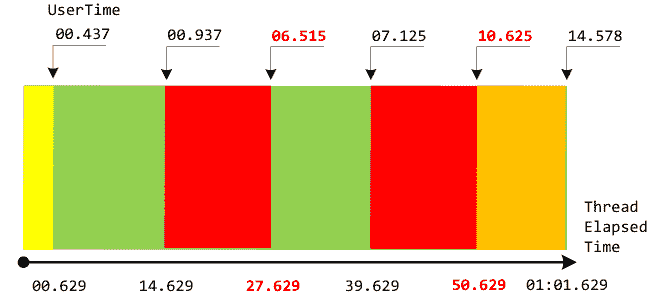

第 3 个和第 5 个用户进程内存转储除了 CPU 消耗增加外，还捕获了在执行 ModuleA 中某些 CPU 指令时的非等待栈追踪帧（未因保存上下文而被抢占）。第一个内存转储（最左侧的柱子）在 629 ms 的 elapsed time 中花费了 437 ms 的 user time，也具有非等待栈追踪，但我们将其视为正常应用程序启动 CPU 消耗峰值。

## Linux

这是先前针对 Mac OS X（第 886 页）和 Windows（第 888 页）平台描述的 **峰值线程** 模式的变体：

```
(gdb) info threads
Id Target Id Frame
6 LWP 3712 0x00000000004329d1 in nanosleep ()
* 5 LWP 3717 0x00000000004007a3 in isnan ()
4 LWP 3716 0x00000000004329d1 in nanosleep ()
3 LWP 3715 0x00000000004329d1 in nanosleep ()
2 LWP 3714 0x00000000004329d1 in nanosleep ()
* 1 LWP 3713 0x00000000004329d1 in nanosleep ()
```

我们注意到一个非等待线程并切换到它：

```
(gdb) thread 5
[Switching to thread 5 (LWP 3717)]
#0 0x00000000004007a3 in isnan ()
```

```
(gdb) bt
#0 0x00000000004007a3 in isnan ()
#1 0x0000000000400743 in sqrt ()
#2 0x0000000000400528 in procC ()
#3 0x0000000000400639 in bar_five ()
#4 0x0000000000400649 in foo_five ()
#5 0x0000000000400661 in thread_five ()
#6 0x00000000004003e0 in start_thread ()
#7 0x0000000000435089 in clone ()
#8 0x0000000000000000 in ?? ()
```

如果我们反汇编 procB 函数的返回地址以从 sqrt 调用返回，我们会看到一个无限循环：

```
(gdb) disassemble 0x400528
Dump of assembler code for function procB:
0x0000000000400500 <+0>: push %rbp
0x0000000000400501 <+1>: mov %rsp,%rbp
0x0000000000400504 <+4>: sub $0x20,%rsp
0x0000000000400508 <+8>: movabs $0x3fd5555555555555,%rax
0x0000000000400512 <+18>: mov %rax,-0x8(%rbp)
0x0000000000400516 <+22>: mov -0x8(%rbp),%rax
0x000000000040051a <+26>: mov %rax,-0x18(%rbp)
0x000000000040051e <+30>: movsd -0x18(%rbp),%xmm0
0x0000000000400523 <+35>: callq 0x400710 <sqrt@plt>
0x0000000000400528 <+40>: movsd %xmm0,-0x18(%rbp)
0x000000000040052d <+45>: mov -0x18(%rbp),%rax
0x0000000000400531 <+49>: mov %rax,-0x8(%rbp)
0x0000000000400535 <+53>: jmp 0x400516 <procB+22>
End of assembler dump.
```

## Mac OS X

这是针对 Mac OS X / GDB 的峰值线程模式对应版本：

```
(gdb) info threads
  4 0x00007fff85b542df in sqrt$fenv_access_off ()
  3 0x00007fff8616ee42 in __semwait_signal ()
  2 0x00007fff8616ee42 in __semwait_signal ()
* 1 0x00007fff8616ee42 in __semwait_signal ()
```

我们注意到一个非等待线程并切换到它：

```
(gdb) thread 4
[Switching to thread 4 (core thread 3)]
0x00007fff85b542df in sqrt$fenv_access_off ()
(gdb) bt
#0 0x00007fff85b542df in sqrt$fenv_access_off ()
#1 0x000000010cc85dc9 in thread_three (arg=0x7fff6c884ac0)
#2 0x00007fff8fac68bf in _pthread_start ()
#3 0x00007fff8fac9b75 in thread_start ()
```

如果我们反汇编从 SQRT 调用中调用的 thread_three 函数的返回地址，我们会看到一个无限循环：

```
(gdb) disass 0x000000010cc85dc9
Dump of assembler code for function thread_three:
0x000000010cc85db0 <thread_three+0>:  push %rbp
0x000000010cc85db1 <thread_three+1>:  mov %rsp,%rbp
0x000000010cc85db4 <thread_three+4>:  sub $0x10,%rsp
0x000000010cc85db8 <thread_three+8>:  mov %rdi,-0x10(%rbp)
0x000000010cc85dbc <thread_three+12>:  mov -0x10(%rbp),%rax
0x000000010cc85dc0 <thread_three+16>:  movsd (%rax),%xmm0
0x000000010cc85dc4 <thread_three+20>:  callq 0x10cc85eac <__dyld_stub_sqrt>
0x000000010cc85dc9 <thread_three+25>:  mov -0x10(%rbp),%rax
0x000000010cc85dcd <thread_three+29>:  movsd %xmm0,(%rax)
0x000000010cc85dd1 <thread_three+33>:  jmpq 0x10cc85dbc <thread_three+12>
End of assembler dump.
```

下面是建模应用程序的源代码：

```
void * thread_one (void *arg)
{
        while (1)
        {
                sleep (1);
        }

        return 0;
}
```

```
void * thread_two (void *arg)
{
    while (1)
    {
        sleep(2);
    }
    return 0;
}
```

```
void * thread_three (void *arg)
{
    while (1)
    {
        *(double*)arg=sqrt(*(double *)arg);
    }
    return 0;
}
```

```
int main(int argc, const char *argv[])
{
    pthread_t threadID_one, threadID_two, threadID_three;
    double result = 0xffffffff;

    pthread_create (&threadID_one, NULL, thread_one, NULL);
    pthread_create (&threadID_two, NULL, thread_two, NULL);
    pthread_create (&threadID_three, NULL, thread_three, &result);
    pthread_join(threadID_three, NULL);

    return 0;
}
```


## Windows

如果我们有一个包含许多线程的进程转储，有时很难看出是哪个线程导致了 CPU 飙升。
这就是为什么最好始终保留来自 QSlice 或 Process Explorer 的一些截图或笔记，显示飙升的线程 ID 和进程 ID。后一个 ID 是为了确保进程转储来自正确的进程。来自 Microsoft 的新转储工具（userdump.exe, procdump）保存线程时间信息，因此我们可以打开转储，并通过输入 !runaway 命令来查看任何线程在内核模式和用户模式下花费的时间。

但是，如果该命令显示许多具有类似 CPU 消耗的线程，它不会突出显示在保存崩溃转储时飙升的特定线程，因此在某些情况下截图仍然很有用。

如果我们没有飙升的线程 ID，该怎么办？我们需要查看所有线程，找出那些未在等待的线程。几乎所有线程大部分时间都在等待。因此，转储正常进程并看到一些活动线程的机会非常低。如果线程正在等待，其堆栈上的顶层函数通常是：

```
ntdll!KiFastSystemCallRet
```

其下方我们可以看到一些阻塞调用，正在等待同步对象、Sleep API 调用、IO 完成或 LPC 回复：

```
0:085> ~*kv
...
...
...
64 Id: 1b0.120c Suspend: -1 Teb: 7ff69000 Unfrozen
ChildEBP RetAddr  Args to Child
02defe18 7c90e399 ntdll!KiFastSystemCallRet
02defe1c 77e76703 ntdll!NtReplyWaitReceivePortEx+0xc
02defff0 77e76c22 rpcrt4!LRPC_ADDRESS::ReceiveLotsaCalls+0xf4
02defff8 77e76a3b rpcrt4!RecvLotsaCallsWrapper+0x8
02defff8 77e76c0a rpcrt4!BaseCachedThreadRoutine+0x79
02defff4 7c80b683 rpcrt4!ThreadStartRoutine+0x1a
02defff0 00000000 kernel32!BaseThreadStart+0x37

65 Id: 1b0.740 Suspend: -1 Teb: 7ff67000 Unfrozen
ChildEBP RetAddr  Args to Child
02defff4 7c90d5c ntdll!KiFastSystemCallRet
02defff48 7c8023ed ntdll!NtDelayExecution+0xc
02deffa0 57cde2dd kernel32!SleepEx+0x61
02defff4 7c80b683 component!foo+0x35
02defff0 00000000 kernel32!BaseThreadStart+0x37

66 Id: 1b0.131c Suspend: -1 Teb: 7ff66000 Unfrozen
ChildEBP RetAddr  Args to Child
02f4ff38 7c90e90c ntdll!KiFastSystemCallRet
02f4ff3c 7c8025cb ntdll!ZwWaitForSingleObject+0xc
02f4ffa0 72001f65 kernel32!WaitForSingleObjectEx+0xa8
02f4ffb4 7c80b683 component!WorkerThread+0x15
02f4ffec 00000000 kernel32!BaseThreadStart+0x37

67 Id: 1b0.1320 Suspend: -1 Teb: 7ff65000 Unfrozen
ChildEBP RetAddr  Args to Child
02f8fe1c 7c90e9ab ntdll!KiFastSystemCallRet
02f8fe20 7c8094e2 ntdll!ZwWaitForMultipleObjects+0xc
02f8febc 7e4195f9 kernel32!WaitForMultipleObjectsEx+0x12c
02f8ff18 7e4196a8 user32!RealMsgWaitForMultipleObjectsEx+0x13e
02f8ff34 720019f6 user32!MsgWaitForMultipleObjects+0x1f
02f8ffa0 72001a29 component!bar+0xd9
02f8ffb4 7c80b683 component!MonitorWorkerThread+0x11
02f8ffec 00000000 kernel32!BaseThreadStart+0x37

68 Id: 1b0.1340 Suspend: -1 Teb: 7ff63000 Unfrozen
ChildEBP RetAddr  Args to Child
0301ff1c 7c90e31b ntdll!KiFastSystemCallRet
0301ff20 7c80a746 ntdll!ZwRemoveIoCompletion+0xc
0301ff4c 57d46e65 kernel32!GetQueuedCompletionStatus+0x29
0301ffb4 7c80b683 component!AsyncEventsThread+0x91
0301ffec 00000000 kernel32!BaseThreadStart+0x37
...
...

85 Id: 1b0.17b4 Suspend: -1 Teb: 7ffd4000 Unfrozen
ChildEBP RetAddr  Args to Child
00daffc8 7c9507a8 ntdll!DbgBreakPoint
00dafff0 00000000 ntdll!DbgUiRemoteBreakin+0x2d
```

因此，如果我们有下面这样的不同线程，那么它飙升的可能性就更大：

```
58 Id: 1b0.9f4 Suspend: -1 Teb: 7ff75000 Unfrozen
ChildEBP RetAddr  Args to Child
0280f64c 500af723 componentB!DoSomething+32
0280f85c 500b5391 componentB!CheckSomething+231
0280f884 500b7a3f componentB!ProcessWorkItem+9f
0301ffec 00000000 kernel32!BaseThreadStart+0x37
```

顶部没有 KiFastSystemCallRet，如果我们查看当前正在执行的指令，可以看到它执行了一些复制操作：

```
0:085> ~58r
eax=00000000 ebx=0280fdd4 ecx=0000005f edx=00000000 esi=03d30444 edi=0280f6dc
eip=500a4024 esp=0280f644 ebp=0280f64c iopl=0 nv up ei pl nz na po nc
cs=001b ss=0023 ds=0023 es=0023 fs=003b gs=0000 efl=00010202
component!DoSomething+32:
500a4024 f3a5 rep movs dword ptr es:[edi],dword ptr [esi] es:0023:0280f6dc=00004009
ds:0023:03d30444=00004009
```

在内核转储或完整内存转储中，我们可以通过检查 KernelTime 和 UserTime 来查看 CPU 飙升：

```
0: kd> !thread 88b66768
THREAD 88b66768 Cid 01fc.1550 Teb: 7ffad000 Win32Thread: bc18f240 RUNNING on processor 1
IRP List:
89716008: (0006,0094) Flags: 00000a00 Mdl: 00000000
Impersonation token: e423a030 (Level Impersonation)
DeviceMap e3712480
Owning Process 8a0a56a0 Image: SomeSvc.exe
Wait Start TickCount 1782229 Ticks: 0
Context Switch Count 877610 LargeStack
UserTime 00:00:01.0078
KernelTime 02:23:21.0718
```

默认情况下，!runaway 命令仅显示用户模式时间。通过指定其他标志，可以同时查看内核和用户时间：

```
0:000> !runaway 3
User Mode Time
Thread Time
8:15a4 0 days 0:12:32.812
0:1c00 0 days 0:00:00.312
9:1b50 0 days 0:00:00.296
22:2698 0 days 0:00:00.046
17:22b8 0 days 0:00:00.031
14:2034 0 days 0:00:00.031
21:21b4 0 days 0:00:00.000
20:27b0 0 days 0:00:00.000
19:278c 0 days 0:00:00.000
18:2788 0 days 0:00:00.000
16:2194 0 days 0:00:00.000
15:2064 0 days 0:00:00.000
13:2014 0 days 0:00:00.000
12:1e38 0 days 0:00:00.000
11:1c54 0 days 0:00:00.000
10:1d40 0 days 0:00:00.000
7:1994 0 days 0:00:00.000
6:1740 0 days 0:00:00.000
5:1c18 0 days 0:00:00.000
4:c10 0 days 0:00:00.000
3:1774 0 days 0:00:00.000
2:1a08 0 days 0:00:00.000
1:fb8 0 days 0:00:00.000

Kernel Mode Time
Thread Time
9:1b50 0 days 1:21:54.125
8:15a4 0 days 0:02:48.390
0:1c00 0 days 0:00:00.328
14:2034 0 days 0:00:00.234
22:2698 0 days 0:00:00.156
17:22b0 0 days 0:00:00.015
21:21b4 0 days 0:00:00.000
20:27b0 0 days 0:00:00.000
19:278c 0 days 0:00:00.000
18:2788 0 days 0:00:00.000
16:2194 0 days 0:00:00.000
15:2064 0 days 0:00:00.000
13:2014 0 days 0:00:00.000
12:1e38 0 days 0:00:00.000
11:1c54 0 days 0:00:00.000
10:1d40 0 days 0:00:00.000
7:1994 0 days 0:00:00.000
6:1740 0 days 0:00:00.000
5:1c18 0 days 0:00:00.000
4:c10 0 days 0:00:00.000
3:1774 0 days 0:00:00.000
2:1a08 0 days 0:00:00.000
1:fb8 0 days 0:00:00.000
```

我们看到线程 15a4 主要在用户模式下飙升，而线程 1b50 主要在内核模式下飙升。

在内核和完整内存转储中，我们可以扫描所有 Ticks: 0 或 Elapsed Ticks: 0 的线程，以检查其内核和用户时间：

```
PROCESS 8782cd60 SessionId: 52 Cid: 4a58 Peb: 7ffdf000 ParentCid: 1ea4
DirBase: 0a260c00 ObjectTable: 88ab33a8 TableSize: 486.
Image: IEXPLORE.EXE
VadRoot 87f59ea8 Clone 0 Private 2077. Modified 123. Locked 0.
DeviceMap 880f6828
Token e8217cd0
ElapsedTime 0:03:09.0765
UserTime 0:00:00.0890
KernelTime 0:00:10.0171
QuotaPoolUsage[PagedPool] 100320
QuotaPoolUsage[NonPagedPool] 58100
Working Set Sizes (now,min,max) (4944, 50, 345) (19776KB, 200KB, 1380KB)
PeakWorkingSetSize 4974
VirtualSize 83 Mb
PeakVirtualSize 83 Mb
PageFaultCount 8544
MemoryPriority FOREGROUND
BasePriority 8
CommitCharge 2262

THREAD 87836580 Cid 4a58.57cc Teb: 7ffde000 Win32Thread: a224f1d8 WAIT: (Executive) KernelMode Non-Alertable
89dee788 Semaphore Limit 0x7fffffff
87836668 NotificationTimer
Not impersonating
Owning Process 8782cd60
Wait Start TickCount 123758 Elapsed Ticks: 0
Context Switch Count 97636 LargeStack
UserTime 0:00:00.0593
KernelTime 0:00:08.0359
Start Address 0x7c57b78c
Win32 Start Address 0x00401ee6
Stack Init ac154770 Current ac154320 Base ac155000 Limit ac14d000 Call ac15477c
Priority 11 BasePriority 8 PriorityDecrement 0 DecrementCount 0

ChildEBP RetAddr  Args to Child
ac154338 8042d8d7 00000000 8047bd00 00000001 nt!KiSwapThread+0x1b1
ac154360 80415d61 89dee788 00000000 00000000 nt!KeWaitForSingleObject+0x1a3
ac15439c 8041547c 00000000 00000001 8051c501 nt!ExpWaitForResource+0x2d
ac1543b4 8046997a 8047bd00 00000001 805225e9 nt!ExAcquireResourceSharedLite+0xc6
ac1543c0 805225e9 00000000 00000001 8051c501 nt!CmpLockRegistry+0x18
ac154430 8051c718 e7C5fd08 ac15448c 00000001 nt!CmSetValueKey+0x31
ac1544b4 8046b2a9 00000798 00125c04 00000000 nt!NtSetValueKey+0x196
ac1544b4 77f88de7 00000798 00125c04 00000000 nt!KiSystemService+0xc9
00125bb0 00000000 00000000 00000000 00000000 +0x77f88de7
```

对于完整和内核转储，我们也可以关注 !running 命令的输出和 !stacks 命令的输出（Ticks 和 ThreadState 列）。


## 注释

在某些缺少 !runaway 信息的旧版转储中，如果线程执行某种窥探消息循环，我们可以推测出飙升线程：

```
0:012> !runaway
ERROR: !runaway: extension exception 0x80004002.
"Unable to get thread times - dumps may not have time information"

6 Id: 136c.13bc Suspend: 1 Teb: 7ffd8000 Unfrozen
ChildEBP RetAddr  Args to Child
0198f914 5b2d887c 0198f938 00000000 00000000 USER32!PeekMessageA+0xfb
0198fa20 5b2d3b87 059d6704 00000000 00000000 ModuleA!Choose+0x177
[...]

0:012> ~6s
eax=0000abbb ebx=00000400 ecx=00000200 edx=00000abb esi=7ffd8000 edi=0066b3e0
eip=7e42ae35 esp=0198f908 ebp=0198f914 iopl=0 nv up ei pl nz na pe nc
cs=001b ss=0023 ds=0023 es=0023 fs=003b gs=0000 efl=00040206
USER32!PeekMessageA+0xfb:
7e42a3e5 2b470c sub eax,dword ptr [edi+0Ch] ds:0023:0066b3ec=000abbbd
```

将其与“线程年龄”模式（第 1001 页）结合使用也很有用，以查看飙升的幅度：

```
Process Uptime: 0 days 17:35:06.000
```

如果我们查看线程 CPU 消耗，与整个进程运行时间相比，飙升值相对较小：

```
0:000> !runaway f
User Mode Time
Thread Time
4:1560   0 days 0:00:08.034
7:7e0   0 days 0:00:03.338
11:1244 0 days 0:00:03.213
8:1510   0 days 0:00:02.324
3:86c   0 days 0:00:00.015
[...]
```

然而，与“线程年龄”相比，它们要大得多：

```
Elapsed Time
Thread Time
[...]
3:86c   0 days 17:35:05.213
4:1560  0 days 0:02:12.350
[...]
7:7e0  0 days 0:00:22.429
11:1244  0 days 0:00:17.655
```

如何使用 WinDbg 脚本从内核和完整内存转储中获取飙升线程（第 190 页）。

在内核转储中，我们可以使用此命令查看所有运行线程的堆栈：

```
!running -t
```

在完整内存转储中执行该命令时，如果线程进程上下文与当前 CPU 上的当前进程不同，则用户部分无效，因此建议通过 !thread 1f 进行手动线程检查。

## Stack Overflow

### Linux

这是以前针对 Mac OS X（第 897 页）和 Windows（第 912 页）平台描述过的 **栈溢出**（用户模式）模式的 Linux 变体：

```
(gdb) bt
#0 0x00000000004004fb in procF ()
#1 0x000000000040054b in procF ()
#2 0x000000000040054b in procF ()
#3 0x000000000040054b in procF ()
#4 0x000000000040054b in procF ()
#5 0x000000000040054b in procF ()
#6 0x000000000040054b in procF ()
#7 0x000000000040054b in procF ()
#8 0x000000000040054b in procF ()
#9 0x000000000040054b in procF ()
#10 0x000000000040054b in procF ()
#11 0x000000000040054b in procF ()
#12 0x000000000040054b in procF ()
[...]
```

```
(gdb) bt -10
#15409 0x000000000040054b in procF ()
#15410 0x000000000040054b in procF ()
#15411 0x000000000040054b in procF ()
#15412 0x000000000040055b in procF ()
#15413 0x0000000000400575 in bar_one ()
#15414 0x0000000000400585 in foo_one ()
#15415 0x000000000040059d in thread_one ()
#15416 0x0000000000401690 in start_thread (arg=<optimized out>)
 at pthread_create.c:304
#15417 0x0000000000432549 in clone ()
#15418 0x0000000000000000 in ?? ()
```

在栈溢出的情况下，栈指针会递减超出栈区域边界进入不可访问区域，因此任何栈内存访问都会触发访问违例：

```
(gdb) x $rsp
0x7eff46109ec0: 0x0

(gdb) frame 1
#1 0x000000000040054b in procF ()

(gdb) x $rsp
0x7eff4610a0e0: 0x0
(gdb) maintenance info sections
[...]
Core file:
[...]
0x7eff46109000->0x7eff4610a000 at 0x02034000: Load13 ALLOC LOAD READONLY HAS_CONTENTS
0x7eff4610a000->0x7eff461090a000 at 0x02035000: load14 ALLOC LOAD HAS_CONTENTS
[...]
```

### Mac OS X

这是 Mac OS X / GDB 中对应于栈溢出（用户模式）模式的示例：

```
(gdb) bt 10
#0 0x0000000105dafea8 in bar (i=0)
#1 0x0000000105dafe9 in bar (i=262102)
#2 0x0000000105dafe9 in bar (i=262101)
#3 0x0000000105dafe9 in bar (i=262100)
#4 0x0000000105dafe9 in bar (i=262099)
#5 0x0000000105dafe9 in bar (i=262098)
#6 0x0000000105dafe9 in bar (i=262097)
#7 0x0000000105dafe9 in bar (i=262096)
#8 0x0000000105dafe9 in bar (i=262095)
#9 0x0000000105dafe9 in bar (i=262094)
(More stack frames follow...)

```

至少有 262,102 个帧，因此我们不尝试全部列出。我们想做的是根据当前栈指针地址从节列表中获取堆栈跟踪边界，并转储其上半部分（栈从高地址向低地址增长），以获取底部初始堆栈跟踪：

```
(gdb) x $rsp
0x7fff651aeff0: 0x00000000
```

由于这是栈溢出，我们预期 RSP 已超出页边界，并且预期最低地址为 0x7fff651af000。

```
(gdb) maint info sections
[...]
Core file:
`/cores/core.2763', file type mach-o-le.
[...]
0x0000000105e00000->0x0000000105f00000 at 0x00035000: LC_SEGMENT. ALLOC LOAD CODE HAS_CONTENTS
0x00007fff651af000->0x00007fff651af000 at 0x00135000: LC_SEGMENT. ALLOC LOAD CODE HAS_CONTENTS
0x00007fff651af000->0x00007fff651af000 at 0x03935000: LC_SEGMENT. ALLOC LOAD CODE HAS_CONTENTS
0x00007fff659af000->0x00007fff6599e400 at 0x04135000: LC_SEGMENT. ALLOC LOAD CODE HAS_CONTENTS
0x00007fff6599e400->0x00007fff6599e6000 at 0x0416a000: LC_SEGMENT. ALLOC LOAD CODE HAS_CONTENTS
[...]

```

```
(gdb) x/250a 0x00007fff659a0000-2000
0x7fff659a830: 0x0 0x150000000
0x7fff659a840: 0x7fff659ae860 0x105dafe9 <bar+25>
0x7fff659a850: 0x0 0x140000000
0x7fff659a860: 0x7fff659ae880 0x105dafe9 <bar+25>
0x7fff659a870: 0x0 0x130000000
0x7fff659a880: 0x7fff659ae8a0 0x105dafe9 <bar+25>
0x7fff659a890: 0x0 0x120000000
0x7fff659a8a0: 0x7fff659ae8c0 0x105dafe9 <bar+25>
0x7fff659a8b0: 0x0 0x110000000
0x7fff659a8c0: 0x7fff659ae8e0 0x105dafe9 <bar+25>
0x7fff659a8d0: 0x0 0x100000000
0x7fff659a8e0: 0x7fff659ae900 0x105dafe9 <bar+25>
0x7fff659ae8f0: 0x0 0xf000000000
0x7fff659ae900: 0x7fff659ae920 0x105dafeb9 <bar+25>
0x7fff659ae910: 0x0 0xe000000000
0x7fff659ae920: 0x7fff659ae940 0x105dafeb9 <bar+25>
0x7fff659ae930: 0x0 0xd000000000
0x7fff659ae940: 0x7fff659ae960 0x105dafeb9 <bar+25>
0x7fff659ae950: 0x0 0xc000000000
0x7fff659ae960: 0x7fff659ae980 0x105dafeb9 <bar+25>
0x7fff659ae970: 0x0 0xb000000000
0x7fff659ae980: 0x7fff659ae9a0 0x105dafeb9 <bar+25>
0x7fff659ae990: 0x0 0xa000000000
0x7fff659ae9a0: 0x7fff659ae9c0 0x105dafeb9 <bar+25>
0x7fff659ae9b0: 0x0 0x9000000000
0x7fff659ae9c0: 0x7fff659ae9e0 0x105dafeb9 <bar+25>
0x7fff659ae9d0: 0x0 0x8000000000
0x7fff659ae9e0: 0x7fff659aea00 0x105dafeb9 <bar+25>
0x7fff659ae9f0: 0x0 0x7000000000
0x7fff659aea00: 0x7fff659aea20 0x105dafeb9 <bar+25>
0x7fff659aea10: 0x0 0x6000000000
0x7fff659aea20: 0x7fff659aea40 0x105dafeb9 <bar+25>
0x7fff659aea30: 0x0 0x565b9fe0
0x7fff659aea40: 0x7fff659aea60 0x105dafeb9 <bar+25>
0x7fff659aea50: 0x7fff659aea70 0x4659bd31f
0x7fff659aea60: 0x7fff659aea80 0x105dafeb9 <bar+25>
0x7fff659aea70: 0x7fff659aeaf0 0x3659b031a
0x7fff659aea80: 0x7fff659aeaa0 0x105dafeb9 <bar+25>
0x7fff659aea90: 0x7fff659af5c0 0x2000000000
0x7fff659aeaa0: 0x7fff659aeac0 0x105dafeb9 <bar+25>
0x7fff659aeab0: 0x100000000 0x1659aeb18
0x7fff659aeac0: 0x7fff659aead0 0x105dafefe <foo+14>
0x7fff659aead0: 0x7fff659aeaf0 0x105dafefeb <main+27>
0x7fff659aeae0: 0x7fff659aeb18 0x1
-Type to continue, or q to quit--
0x7fff659aeaf0: 0x7fff659aeb08 0x105daf94 <start+52>
0x7fff659aeb00: 0x0 0x0
[...]
0x7fff659aefff: 0x3139336561303363 0x3162235
```

有趣的是，如果我们将最低帧设置下来，并尝试在 GDB 核心转储中获取寄存器信息：

```
(gdb) frame 262102
#262102 0x0000000105dafeb9 in bar (i=1)
13 bar(i+1);
(gdb) info r
Segmentation fault: 11 (core dumped)
```

查看其核心转储显示它也经历了栈溢出：

```
(gdb) bt
#0 0x00007ff8c1bacf0 in __sfvwrite ()
#1 0x00007ffff8c189947 in __vfprintf ()
#2 0x00007fff8c184edb in vsnprintf_l ()
#3 0x00007ff8c1566be in __sprint_chk ()
#4 0x00000001bd14d515 in print_displacement ()
#5 0x00000001bd010ddf in OP_E ()
#6 0x00000001bd13f9b in print_insn ()
#7 0x00000001bc164ce in length_of_this_instruction ()
#8 0x00000001bc9e296 in x86_analyze_prologue ()
#9 0x00000001bc9f1f3 in x86_frame_prev_register ()
#10 0x00000001bc91d70 in frame_register_unwind ()
#11 0x00000001bc92015 in frame_unwind_register ()
#12 0x00000001bc91d70 in frame_register_unwind ()
#13 0x00000001bc92015 in frame_unwind_register ()
#14 0x00000001bc91d70 in frame_register_unwind ()
#15 0x00000001bc92015 in frame_unwind_register ()
#16 0x00000001bc91d70 in frame_register_unwind ()
#17 0x00000001bc92015 in frame_unwind_register ()
#18 0x00000001bc91d70 in frame_register_unwind ()
#19 0x00000001bc92015 in frame_unwind_register ()
#20 0x00000001bc91d70 in frame_register_unwind ()
#21 0x00000001bc92015 in frame_unwind_register ()
#22 0x00000001bc91d70 in frame_register_unwind ()
#23 0x00000001bc92015 in frame_unwind_register ()
#24 0x00000001bc91d70 in frame_register_unwind ()
#25 0x00000001bc92015 in frame_unwind_register ()
#26 0x00000001bc91d70 in frame_register_unwind ()
#27 0x00000001bc92015 in frame_unwind_register ()
#28 0x00000001bc91d70 in frame_register_unwind ()
#29 0x00000001bc92015 in frame_unwind_register ()
#30 0x00000001bc91d70 in frame_register_unwind ()
#31 0x00000001bc92015 in frame_unwind_register ()
[...]
```

我们建模应用程序的源代码：

```
void bar(int i)
{
    bar(i+1);
}

void foo()
{
    bar(1);
}

int main(int argc, const char * argv[])
{
    foo();
    return 0;
}
```


## Windows

## 内核模式

这里是 x86 Windows 内核中 **栈溢出** 模式的一个示例。当它在内核模式下发生时，我们通常会看到 bugcheck 7F，第一个参数是 EXCEPTION_DOUBLE_FAULT (8)：

```
UNEXPECTED_KERNEL_MODE_TRAP (7f)
This means a trap occurred in kernel mode, and it's a trap of a kind that the kernel isn't allowed to have/catch (bound trap) or that is always instant death (double fault). The first number in the bugcheck params is the number of the trap (8 = double fault, etc). Consult an Intel x86 family manual to learn more about what these traps are. Here is a *portion* of those codes:
If kv shows a taskGate
 use .tss on the part before the colon, then kv.
Else if kv shows a trapframe
 use .trap on that value
Else
 .trap on the appropriate frame will show where the trap was taken (on x86, this will be the ebp that goes with the procedure KiTrap)
Endif
kb will then show the corrected stack.
Arguments:
Arg1: 00000008, EXCEPTION_DOUBLE_FAULT
Arg2: f7747fe0
Arg3: 00000000
Arg4: 00000000
```

线程的内核堆栈大小在 x86 平台上限制为 12 KB（x64 平台上为 24 KB），并由一个无效页面保护。因此，当我们访问该页面上的无效地址时，处理器会产生页错误，尝试压入寄存器并再次发生页错误。这就是“双重故障”的含义。在此场景中，处理器通过 TSS（任务状态段）任务切换机制切换到另一个堆栈，因为陷阱 8 的 IDT 条目包含的不是中断处理程序地址，而是所谓的 TSS 段选择子。该选择子指向包含新内核堆栈指针的内存段。通过检查 IDT，可以看到普通 IDT 条目与双重故障条目之间的区别：

```
5: kd> !pcr 5
KPCR for Processor 5 at f7747000:
Major 1 Minor 1
NTib.ExceptionList: b044e0b8
NTib.StackBase: 00000000
NTib.StackLimit: 00000000
NTib.SubSystemTib: f7747fe0
NTib.Version: 00ae1064
NTib.UserPointer: 00000020
NTib.SelfTib: 7ffdf000
SelfPcr: f7747000
Prcb: f7747120
Irql: 00000000
IRR: 00000000
IDR: ffffffff
InterruptMode: 00000000
```

```
IDT: f774d800
GDT: f774d400
TSS: f774a2e0
CurrentThread: 8834c020
NextThread: 00000000
IdleThread: f774a090
```

```
5: kd> dt _KIDTENTRY f774d800
+0x000 Offset            : 0x97e8
+0x002 Selector          : 8
+0x004 Access            : 0x8e00
+0x006 ExtendedOffset    : 0x8088
```

```
5: kd> ln 0x808897e8
(808897e8) nt!KiTrap00   |  (808898c0)   nt!Dr_kit1_a
Exact matches:
nt!KiTrap00
```

```
5: kd> dt _KIDTENTRY f774d800+7*8
+0x000 Offset            : 0xa880
+0x002 Selector          : 8
+0x004 Access            : 0x8e00
+0x006 ExtendedOffset    : 0x8088
```

```
5: kd> ln 8088a880
(8088a880) nt!KiTrap07   |  (8088ab72)   nt!KiTrap08
Exact matches:
nt!KiTrap07
```

```
5: kd> dt _KIDTENTRY f774d800+8*8
+0x000 Offset            : 0x1238
+0x002 Selector          : 0x50
+0x004 Access            : 0x8500
+0x006 ExtendedOffset    : 0
```

```
5: kd> dt _KIDTENTRY f774d800+9*8
+0x000 Offset            : 0xac94
+0x002 Selector          : 8
+0x004 Access            : 0x8e00
+0x006 ExtendedOffset    : 0x8088
```

```
5: kd> ln 8088ac94
(8088ac94) nt!KiTrap09   |  (8088ad10) nt!Dr_kita_a
Exact matches:
nt!KiTrap09
```

如果我们显式切换到选择子 50，将看到 nt!KiTrap08 函数，它执行我们的 bugcheck 并在 KeBugCheck2 函数中保存崩溃转储：

```
5: kd> .tss 50
eax=00000000 ebx=00000000 ecx=00000000 edx=00000000 esi=00000000 edi=00000000
eip=8088ab72 esp=f774d3c0 ebp=00000000 iopl=0 nv up di pl nz na po nc
cs=0008 ss=0010 ds=0023 es=0023 fs=0030 gs=0000 efl=00000000
```

```
nt!KiTrap08:
8088ab72 fa           cli
```

```
5: kd> .asm no_code_bytes
Assembly options: no_code_bytes
```

```
5: kd> uf nt!KiTrap08
nt!KiTrap08:
8088ab72 cli
8088ab73 mov eax,dword ptr fs:[00000040h]
8088ab79 mov ecx,dword ptr fs:[124h]
8088ab80 mov edi,dword ptr [ecx+38h]
8088ab83 mov ecx,dword ptr [edi+18h]
8088ab86 mov dword ptr [eax+1Ch],ecx
8088ab89 mov cx,word ptr [edi+30h]
8088ab8d mov word ptr [eax+66h],cx
8088ab91 mov ecx,dword ptr [edi+20h]
8088ab94 test ecx,ecx
8088ab96 je nt!KiTrap08+0x2a (8088ab9c)
```

```
nt!KiTrap08+0x26:
8088ab98 mov cx,48h
```

```
nt!KiTrap08+0x2a:
8088ab9c mov word ptr [eax+60h],cx
8088aba0 mov ecx,dword ptr fs:[3Ch]
8088aba7 lea eax,[ecx+50h]
8088abaa mov byte ptr [eax+5],89h
8088abae pushfd
8088abaf dword ptr [esp],0FFFFFFFh
8088abb6 popfd
8088abb7 mov eax,dword ptr fs:[0000003Ch]
8088abbd mov ch,byte ptr [eax+57h]
8088abc0 mov cl,byte ptr [eax+54h]
8088abc3 shl ecx,10h
8088abc6 mov cx,word ptr [eax+52h]
8088abca mov eax,dword ptr fs:[00000040h]
8088abd0 mov dword ptr fs:[40h],ecx
```

```
nt!KiTrap08+0x65:
8088abd7 push 0
8088abd9 push 0
8088abdb push 0
8088abdd push eax
8088abde push 8
8088abe0 push 7Fh
8088abe2 call nt!KeBugCheck2 (80826a92)
8088abe7 jmp nt!KiTrap08+0x65 (8088abd7)
```

我们可以检查上面 !pcr 命令输出中显示的 TSS 地址：

```
5: kd> dt _KTSS f774a2e0
+0x000 Backlink         : 0x28
+0x002 Reserved0        : 0
+0x004 Esp0             : 0xf774d3c0
+0x008 Ss0              : 0x10
+0x00a Reserved1        : 0
+0x00c NotUsed1         : [4] 0
+0x01c CR3              : 0x646000
+0x020 Eip              : 0x8088ab72
+0x024 EFlags           : 0
+0x028 Eax              : 0
+0x02c Ecx              : 0
+0x030 Edx              : 0
+0x034 Ebx              : 0
+0x038 Esp              : 0xf774d3c0
+0x03c Ebp              : 0
+0x040 Esi              : 0
+0x044 Edi              : 0
+0x048 Es               : 0x23
+0x04a Reserved2        : 0
+0x04c Cs               : 8
+0x04e Reserved3        : 0
+0x050 Ss               : 0x10
+0x052 Reserved4        : 0
+0x054 Ds               : 0x23
+0x056 Reserved5        : 0
+0x058 Fs               : 0x30
+0x05a Reserved6        : 0
+0x05c Gs               : 0
+0x05e Reserved7        : 0
+0x060 LDT              : 0
+0x062 Reserved8        : 0
+0x064 Flags            : 0
+0x066 IoMapBase        : 0x20ac
+0x068 IoMaps           : [1] _KiIoAccessMap
+0x208 CIntDirectionMap : [32] "????"
```

我们看到 EIP 指向 nt!KiTrap08，并且 Backlink 值为 28，这是双重故障陷阱之前的先前 TSS 选择子值：

```
5: kd> .tss 28
eax=00000020 ebx=8bef5100 ecx=01404800 edx=8bee4aa8 esi=01404400 edi=00000000
eip=80882e4b esp=b044e000 ebp=b044e034 iopl=0 nv up ei ng nz na po nc
cs=0008 ss=0010 ds=0023 es=0023 fs=0030 gs=0000 efl=00010282
nt!_SEH_prolog+0x1b:
80882e4b push         esi
```

```
5: kd> k 100
ChildEBP RetAddr
b044e034 f7b840ac nt!SEH_prolog+0x1b
b044e054 f7b846e6 Ntfs!NtfsMapStream+0x4b
b044e0c8 f7b84045 Ntfs!NtfsReadMftRecord+0x86
b044e100 f7b84f4f Ntfs!NtfsReadFileRecord+0x7a
b044e138 f7b2cbd5 Ntfs!NtfsLookupInFileRecord+0x37
b044e210 f7b6efef Ntfs!NtfsWriteFileSizes+0x76
b044e260 f7b6eadd Ntfs!NtfsFlushAndPurgeScb+0xd4
b044e464 f7b7e302 Ntfs!NtfsCommonCleanup+0x1ca8
b044e5d4 8081dc5e Ntfs!NtfsFsdCleanup+0xcf
b044e5e8 f70fac53 nt!IofCallDriver+0x45
b044e610 8081dc5e fltmgr!FltpDispatch+0x6f
b044e624 f420576a nt!IofCallDriver+0x45
b044e634 f4202621 component2!DispatchEx+0xa4
b044e640 8081dc5e component2!Dispatch+0x53
b044e654 f4e998c7 nt!IofCallDriver+0x45
b044e67c f4e9997c component!PassThrough+0xbb
b044e688 8081dc5e component!Dispatch+0x78
b044e69c f41e72ff nt!IofCallDriver+0x45
WARNING: Stack unwind information not available. Following frames may be wrong.
b044e6c0 f41e71ed driver+0xc2ff
00000000 00000000 driver+0x1cd
```

!analyze -v 对此崩溃转储所做的是：

```
STACK_COMMAND: .tss 0x28 ; kb
```

在我们的案例中，NTFS 尝试处理一个异常，SEH 异常处理器在尝试将寄存器保存到堆栈时导致双重故障。让我们来看看堆栈跟踪和崩溃点。我们看到 ESP 指向有效堆栈页面的起始位置，但 push 操作在内存访问之前先递减 ESP，且前一页面明显无效：

```
TSS: 00000028 -- (.tss 28)
eax=00000020 ebx=8bef5100 ecx=01404800 edx=8bee4aa8 esi=01404400 edi=00000000
eip=80882e4b esp=b044e000 ebp=b044e034 iopl=0 nv up ei ng nz na po nc
cs=0008 ss=0010 ds=0023 es=0023 fs=0030 gs=0000 efl=00010282
nt!SEH_prolog+0x1b:
80882e4b 56 push esi
```

```
5: kd> dd b044e000-4
b044dffc ???????? 8bef5100 00000000 00000000
b044e00c 00000000 00000000 00000000 00000000
b044e01c 00000000 00000000 b044e0b8 8088c0c0
b044e02c 808be526 80081300 b044e54 f7b840ac
b044e03c 8ebce5e0 b044e6a4 00000400 00000001
b044e04c b044e134 b044e164 b044e0c8 f7b846e6
b044e05c b044e480 8bee4aa8 01404400 00000000
b044e06c 00000400 b044e134 b044e164 e143db08
```


```
5: kd> !pte b044e000-4
VA b044dffc

PDE at 00000000C062C010    PTE at 00000000C582268
contains 000000001A0A3C863  contains 0000000000000000
pfn 10aa3c     -DA--KWEV
```

WinDbg 无法获取所有堆栈帧，我们看不到大帧值（“Memory”列如下）：

```
5: kd> knf 100
*** Stack trace for last set context - .thread/.cxr resets it
### Memory ChildEBP RetAddr
00     b044e034 f7b840ac nt!SEH_prolog+0x1b
01     20 b044e054 f7b84e66 Ntfs!NtfsMapStream+0x4b
02     74 b044e0c8 f7b84045 Ntfs!NtfsReadMftRecord+0x86
03     38 b044e100 f7b8404f Ntfs!NtfsReadFileRecord+0x7a
04     38 b044e138 f7b7cdb5 Ntfs!NtfsLookupInFileRecord+0x37
05     d8 b044e210 f7b6efef Ntfs!NtfsWriteFileSizes+0x76
06     50 b044e260 f7b6eead Ntfs!NtfsFlushAndPurgeScb+0xd4
07     204 b044e464 f7b7e302 Ntfs!NtfsCommonCleanup+0x1ca8
08     170 b044e5d4 8081dce5 Ntfs!NtfsFsdCleanup+0xcf
09     14 b044e5e8 f70fac53 nt!IofCallDriver+0x45
0a     28 b044e610 8081dc5e fltMgr!FltpDispatch+0x6f
0b     14 b044e624 f420576a nt!IofCallDriver+0x45
0c     10 b044e634 f4202621 component2!Dispatch+0x4
0d     c   b044e640 8081dc5e component2!Dispatch+0x53
0e     14 b044e654 f4e998c7 nt!IofCallDriver+0x45
0f     28 b044e67c f4e9997c component!PassThrough+0xbb
10     c   b044e688 8081dc5e component!Dispatch+0x78
11     14 b044e69c f41e27ff nt!IofCallDriver+0x45
WARNING: Stack unwind information not available. Following frames may be wrong.
12     24 b044e6c0 f41e1ed driver+0xc2ff
13     00000000 00000000 driver+0xc1ed
```

要查看所有涉及的组件，我们需要转储原始堆栈数据（12Kb 即 0x3000）。在那里，我们还可以看到已处理的一些软件异常（第 875 页），并为它们获取一些部分堆栈跟踪。需要谨慎，因为由于堆栈数据被覆盖，堆栈跟踪可能不完整且具有误导性。

```
5: kd> dds b044e000 b044e000+3000
...
...
...
...
b044ebc4 b044ec74
b044ebc8 b044ec50
b044ebcc f41f9458 driver+0x1e458
b044ebd0 b044f140
b044ebd4 b044ef44
b044ebd8 b044f138
b044ebdc 80877290 nt!RtlDispatchException+0x8c
b044ebe0 b044ef44
b044ebe4 b044f138
b044ebe8 b044ec74
b044ebec b044ec50
b044ebf0 f41f9458 driver+0x1e458
b044ebf4 8a7668c0
b044ebf8 e16c2e80
b044ebfc 00000000
b044ec00 00000000
b044ec04 00000002
b044ec08 01000000
b044ec0c 00000000
b044ec10 00000000
...
...
...
b044ec60 00000000
b044ec64 b044ef94
b044ec68 8088e13f nt!RtlRaiseStatus+0x47
**b044ec6c b044e444**
**b044ec70 b044ec74**
b044ec74 00010007
...

b0450fe8 00000000
b0450fec 00000000
b0450ff0 00000000
b0450ff4 00000000
b0450ff8 00000000
b0450ffc 00000000
b0451000 ????????
```

```
5: kd> .exr 0b44ef44
ExceptionAddress: f41dde6d (driver+0x00002e6d)
   ExceptionCode: c0000043
ExceptionFlags: 00000001
NumberParameters: 0
```

```
5: kd> .cxr 0b44ec74
eax=c0000043 ebx=00000000 ecx=89fe1bc0 edx=b044f084 esi=e16c2e80 edi=8a7668c0
eip=f41dde6d esp=b044efaf ebp=b044f010 iopl=0 nv up ei pl zr na pe nc
cs=0008 ss=0010 ds=0023 es=0023 fs=0030 gs=0000 efl=00000246
driver+0x2e6d:
f41dde6d e92f010000 jmp driver+0x2f41 (f41ddfa1)
```

```
5: kd> knf
*** Stack trace for last set context - .thread/.cxr resets it

###       Memory ChildEBP RetAddr
WARNING: Stack unwind information not available. Following frames may be wrong.
00    b444f010 f41ddce6 driver+0x2e6d
01  b0 b044f0c0 f41dd930 driver+0x2ce6
02  38 b044f0f8 f41e88be driver+0x2930
03  2c b044f124 f6598eba driver+0xd8eb
04  24 b044f148 f41dcd40 driver2!AllocData+0x84da
05  18 b044f160 8081dc5e driver+0x1d40
06  14 b044f174 f6596741 nt!IofCallDriver+0x45
07  28 b044f19c f659dd70 driver2!AllocData+0x5d61
08  1c b044f1b8 f65967b9 driver2!EventObjectCreate+0xa60
09  40 b044f1f8 8081dc5e driver2!AllocData+0x5dd9
0a  14 b044f20c 808f8255 nt!IofCallDriver+0x45
0b  e8 b044f2f4 80936af5 nt!IopParseDevice+0xa35
0c  80 b044f374 80932de6 nt!ObpLookupObjectName+0x5a9
0d  54 b044f3c8 808ea211 nt!ObOpenObjectByName+0xea
0e  7c b044f444 808eb4ab nt!IopCreateFile+0x447
0f  5c b044f4a0 808edf2a nt!IopCreateFile+0xa3
10  40 b044f4e0 80888c6c nt!NtCreateFile+0x30
11  0 b044f4e0 8082e105 nt!KiFastCallEntry+0xfc
12  a4 b044f584 f657f2d0 nt!ZwCreateFile+0x11
13  54 b044f5d8 f65570f6 driver3+0xe2e20d
```

因此，在原始堆栈中发现的以下组件看起来可疑：driver.sys、driver2.sys 和 driver3.sys。

我们应该使用 lmv 命令检查它们的时间戳，并联系其供应商获取任何现有更新。解决方法是删除这些产品。其余的是 Microsoft 模块和驱动程序 component.sys 和 component2.sys。对于后两者，它们的函数中没有显著的局部变量使用。

OSR NT Insider 文章提供了另一个示例¹⁹¹。

## 注释

NT Debugging 博客中还有另一个示例<sup>192</sup>。

另一个示例：

```
1: kd> !analyze -v

UNEXPECTED_KERNEL_MODE_TRAP (7f)
This means a trap occurred in kernel mode, and it's a trap of a kind
that the kernel isn't allowed to have/catch (bound trap) or that
is always instant death (double fault). The first number in the
bugcheck parameters is the number of the trap (8 = double fault, etc)
Consult an Intel x86 family manual to learn more about what these
traps are. Here is a *portion* of those codes:
If kv shows a taskGate
use .tss on the part before the colon, then kv.
Else if kv shows a trapframe
use .trap on that value
Else
.trap on the appropriate frame will show where the trap was taken
(on x86, this will be the ebp that goes with the procedure KiTrap)
Endif
Kb will then show the corrected stack.
Arguments:
Arg1: 00000008, EXCEPTION_DOUBLE_FAULT
Arg2: f7727fe0
Arg3: 00000000
Arg4: 00000000

Debugging Details:
------------------
WARNING: Process directory table base AFFB7740 doesn't match CR3 00545000
Unable to get PEB pointer

WARNING: Process directory table base AFFB7740 doesn't match CR3 00545000
Unable to get PEB pointer

BUGCHECK_STR: 0x7f_8

TSS: 00000028 – (.tss 0x28)
eax=00000000 ebx=f78dd100 ecx=a53a5b40 edx=007fffff esi=80000000 edi=c0603018
eip=8085e1d0 esp=f78dcfb8 ebp=f78dd008 iopl=0 nv up ei ng nz na pe nc
cs=0008 ss=0010 ds=0023 es=0023 fs=0030 gs=0000 efl=00010286
nt!MmAccessFault+0x8:
8085e1d0 and dword ptr [ebp-1Ch],0 ss:0010:f78dcfec=00000000
Resetting default scope

DEFAULT_BUCKET_ID: DRIVER_FAULT

PROCESS_NAME: drwtsn32.exe

CURRENT_IRQL: 2

TRAP_FRAME: f78dd308 – (.trap 0xfffffffff78dd308)
ErrCode = 00000000
eax=40000000 ebx=c4000000 ecx=c0603018 edx=007fffff esi=80000000 edi=00000001
eip=8084d509 esp=f78dd37c ebp=f78dd3e8 iopl=0 nv up ei pl nz na po cy
cs=0008 ss=0010 ds=0023 es=0023 fs=0030 gs=0000 efl=00010203
nt!MiCheckPdeForPagedPool+0x73:
8084d509 mov eax,dword ptr [ecx] ds:0023:c0603018=00549063
Resetting default scope

LAST_CONTROL_TRANSFER: from 8088c798 to 8085e1d0

STACK_TEXT:
f78dd008 8088c798 00000000 c0603018 00000000 nt!MmAccessFault+0x8
```

提出了一些问题：

**Q.** 根据 dds b044e000 b044e000+3000 的结果，我想知道为什么选择“b044ef44”和“b044ec74”进行检查？之后我们需要选择“_RtlRaiseStatus+0x47_”的值吗？如果找不到“_RtlRaiseStatus+0x47_”怎么办？

**A.** 我们选择 b044e000 是因为我们想从堆栈顶部（上面加粗的 ESP 值）检查原始堆栈数据。选择其他范围可能会遗漏某些内容。

**Q.** 我有同样的问题。我想知道为什么选择“b044ef44”和“b044ec74”进行检查？

**A.** 某些函数（如 _RtlDispatchException_、_RtlRaiseStatus_ 等）的函数参数指向异常记录和上下文。例如，请参阅此源代码文件193。

## 软件实现

用户模式（第 912 页）和内核模式（第 900 页）中的栈溢出模式变体面向 ISA（指令集架构）和处理器架构。另一种模式变体是软件栈实现，其中 push 和 pop 操作检查栈 ADT 前置条件，并抛出软件异常（第 875 页，溢出或下溢）或调用断言机制以显示错误消息。对于后一种示例，我们查看 Windows 上特定栈实现的错误检查（bugcheck）：IRP 堆栈位置数组。要直观地提醒驱动程序到驱动程序通信是如何由与驱动程序堆栈对应的 IRP 堆栈实现的，请参阅 UML 图194。以下 WinDbg 命令输出来自内核内存转储：

```
0: kd> !analyze -v
[...]
NO_MORE_IRP_STACK_LOCATIONS (35)
A higher level driver has attempted to call a lower level driver through the IoCallDriver() interface,
but there are no more stack locations in the packet, hence, the lower level driver would not be able to
access its parameters, as there are no parameters for it. This is a disastrous situation, since the
higher level driver "thinks" it has filled in the parameters for the lower level driver (something it
MUST do before it calls it), but since there is no stack location for the latter driver, the former has
written off of the end of the packet. This means that some other memory has probably been trashed at this
point.
Arguments:
Arg1: fffffffa800500c9e0, Address of the IRP
Arg2: 0000000000000000
Arg3: 0000000000000000
Arg4: 0000000000000000
[...]
0: kd> KL 100
Child-SP RetAddr Call Site
fffff880`01fe2338 fffff800`016d7732 nt!KeBugCheckEx
fffff880`01fe2340 fffff800`01754f27 nt!KiBugCheck2+0x12
fffff880`01fe2370 fffff880`0177e271 nt! ?? ::FNODOBFM::`string'+0x3f31b
fffff880`01fe23a0 fffff880`0177c138 DriverA!CallProvider+0x161
[...]
fffff880`01fe2cb0 fffff880`0197a7c6 nt!ExpWorkerThread+0x111
fffff880`01fe2d40 fffff800`016b5c26 nt!PspSystemThreadStartup+0x5a
fffff880`01fe2d80 00000000`00000000 nt!KxStartSystemThread+0x16
0: kd> !irp fffffa800500c9e0
Irp is active with 1 stacks 0 is current (= 0xfffffa8006c2e960)
No Mdl: No System Buffer: Thread 00000000: Irp stack trace.
cmd flg cl Device File Completion-Context
[ 4, 0] 0 e0 fffffa8004045c50 fffffa8006c2e960 fffff88005a04460-fffffa8005b9c370 Success Error Cancel
\DriverA DriverB!CompleteRoutine
Args: 00000008 00000000 00000000 00000000
```


```
0: kd> ub fffffff880`0177e271
DriverA!CallProvider+0x13e:
fffff880`0177e24e mov     qword ptr [r11-10h],rax
fffff880`0177e252 mov     qword ptr [r11-8],r12
fffff880`0177e256 mov     byte  ptr [r11-45h],0E0h
fffff880`0177e25b mov     rcx,qword ptr [rdi+40h]
fffff880`0177e25f call    qword ptr [DriverA!_imp_IoGetAttachedDevice (fffff880`017790b0)]
fffff880`0177e265 mov     rdx,rbp
fffff880`0177e268 mov     rcx,rax
fffff880`0177e26b call    qword ptr [DriverA!_imp_IofCallDriver (fffff880`01779068)]
```

## 用户模式

用户模式下的栈溢出模式具有其自身的特征异常代码和堆栈跟踪：

```
FAULTING_IP:
StackOverflow!SoFunction+27
00401317 6a00 push 0

EXCEPTION_RECORD: fffffffd -- (.exr 0xffffffffffffffff)
ExceptionAddress: 00401300 (StackOverflow!SoFunction+0x00000010)
  ExceptionCode: c00000fd (Stack overflow)
  ExceptionFlags: 00000000
NumberParameters: 2
  Parameter[0]: 00000001
  Parameter[1]: 00882ffc
```

0:000> kL

| 子 EBP | 返回地址 | 符号 |
|---|---|---|
| 00083000 | 00401317 | StackOverflow!SoFunction+0x10 |
| 00083010 | 00401317 | StackOverflow!SoFunction+0x27 |
| 00083020 | 00401317 | StackOverflow!SoFunction+0x27 |
| 00083030 | 00401317 | StackOverflow!SoFunction+0x27 |
| 00083040 | 00401317 | StackOverflow!SoFunction+0x27 |
| 00083050 | 00401317 | StackOverflow!SoFunction+0x27 |
| 00083060 | 00401317 | StackOverflow!SoFunction+0x27 |
| 00083070 | 00401317 | StackOverflow!SoFunction+0x27 |
| 00083080 | 00401317 | StackOverflow!SoFunction+0x27 |
| 00083090 | 00401317 | StackOverflow!SoFunction+0x27 |
| 000830a0 | 00401317 | StackOverflow!SoFunction+0x27 |
| 000830b0 | 00401317 | StackOverflow!SoFunction+0x27 |
| 000830c0 | 00401317 | StackOverflow!SoFunction+0x27 |
| 000830d0 | 00401317 | StackOverflow!SoFunction+0x27 |
| 000830e0 | 00401317 | StackOverflow!SoFunction+0x27 |
| 000830f0 | 00401317 | StackOverflow!SoFunction+0x27 |
| 00083100 | 00401317 | StackOverflow!SoFunction+0x27 |
| 00083110 | 00401317 | StackOverflow!SoFunction+0x27 |
| 00083120 | 00401317 | StackOverflow!SoFunction+0x27 |
| 00083130 | 00401317 | StackOverflow!SoFunction+0x27 |

可能会有成千上万个堆栈帧：

```
0:000> kL 2000
...
000a2fa0 00401317 StackOverflow!SoFunction+0x27
000a2fb0 00401317 StackOverflow!SoFunction+0x27
000a2fc0 00401317 StackOverflow!SoFunction+0x27
000a2fd0 00401317 StackOverflow!SoFunction+0x27
000a2fe0 00401317 StackOverflow!SoFunction+0x27
000a2ff0 00401317 StackOverflow!SoFunction+0x27
```

要到达底部并避免过度滚动，我们可以转储原始堆栈数据，搜索 StackOverflow!SoFunction+0x27 的重复模式的结束位置，并尝试手动重建堆栈跟踪的底部：

0:000> !teb

| 属性 | 值 |
|---|---|
| TEB 地址 | 7efdd000 |
| 异常列表 | 0017fdf0 |
| 堆栈基址 | 00180000 |
| 堆栈限制 | 00081000 |
| 子系统 TIB | 00000000 |
| 协程数据 | 00001e00 |
| 任意用户指针 | 00000000 |
| 自身 | 7efdd000 |
| 环境指针 | 00000000 |
| 客户端 ID | 00001dc4 . 00001b74 |
| RPC 句柄 | 00000000 |
| TLS 存储 | 7efdd02c |
| PEB 地址 | 7efde000 |
| 最后错误值 | 0 |
| 最后状态值 | c0000034 |
| 拥有的锁数 | 0 |
| 硬错误模式 | 0 |

```
0:000> dds 00081000 00180000
...
0017fc74  00401317 StackOverflow!SoFunction+0x27
0017fc78  00000000
0017fc7c  a3a8ea65
0017fc80  0017fc90
0017fc84  00401317 StackOverflow!SoFunction+0x27
0017fc88  10001843
0017fc8c  a3a8ea95
0017fc90  0017fca0
0017fc94  00401317 StackOverflow!SoFunction+0x27
0017fc98  0017fcb8
0017fc9c  a3a8ea85
0017fca0  0017fcb0
0017fca4  00401317 StackOverflow!SoFunction+0x27
0017fca8  00000003
0017fcac  a3a8eab5
0017fcb0  0017fcc0
**0017fcb4  00401317 StackOverflow!SoFunction+0x27**
0017fcb8  76c68738 user32!_EndUserApiHook+0x11
0017fcbc  a3a8ea85
0017fcc0  0017fcdd
**0017fcc4  00401317 StackOverflow!SoFunction+0x27**
0017fcc8  76c6a6cc user32!DefWindowProcW+0x94
0017fccc  a3a8ead5
0017fcd0  0017fce0
**0017fcd4  00401317 StackOverflow!SoFunction+0x27**
0017fcd8  0037311e
0017fcdc  a3a8ea5
0017fce0  0017fcf0
**0017fce4  00401317 StackOverflow!SoFunction+0x27**
0017fce8  0017fcdd
0017fcec  a3a8eaf5
```

```
0017fcf0 0017fd00
0017fcf4 00401317 StackOverflow!SoFunction+0x27
0017fcf8 76c6ad0f user32!NtUserBeginPaint+0x15
0017fcfc a3a8eae5
0017fd00 0017fd5c
0017fd04 00401272 StackOverflow!WndProc+0xe2
0017fd08 00401190 StackOverflow!WndProc
0017fd0c 00000003
0017fd10 cf017ada
...
```

我们使用 k WinDbg 命令的扩展版本，并提供 EBP、ESP 和 EIP 以查看其启动的函数：

```
0:000> r
eax=a3b739e5 ebx=00000000 ecx=ac430000 edx=ffeff944 esi=0037311e edi=00000000
eip=00401300 esp=00082ff8 ebp=00083000 iopl=0 nv up ei ng nz na po nc
cs=0023 ss=002b ds=002b es=002b fs=0053 gs=002b efl=00010282
StackOverflow!SoFunction+0x10:
00401300 89442404 mov dword ptr [esp+4],eax ss:002b:00082ffc=00000000
```

0:000> k L=0017fcf0 00082ff8 00401300

| 子 EBP | 返回地址 | 符号 |
|---|---|---|
| 0017fcb0 | 00401317 | StackOverflow!SoFunction+0x10 |
| 0017fd00 | 00401272 | StackOverflow!SoFunction+0x27 |
| 0017fd5c | 76c687af | StackOverflow!WndProc+0xe2 |
| 0017fd88 | 76c68936 | user32!InternalCallWinProc+0x23 |
| 0017fe00 | 76c6a571 | user32!UserCallWinProcCheckWow+0x109 |
| 0017fe5c | 76c6a5dd | user32!DispatchClientMessage+0xe0 |
| 0017fe98 | 77ccee2e | user32!__fnDWORD+0x2b |
| 0017fedc | 0040107d | ntdll!KiUserCallbackDispatcher+0x2e |
| 0017ff08 | 0040151e | StackOverflow!wWinMain+0x7d |
| 00402ba0 | 20245c8b | StackOverflow!__tmainCRTStartup+0x176 |

我们可以看出它始于 WndProc。

## 注释

一位读者向我们发送了此程序及其对应的 WinDbg 输出：

```
void func1(void);

void __cdecl main(void)
{
    func1();
}

void func1(void)
{
    func1();
}
```

```
0:000> .lastevent
Last event: d0c.e94: Stack overflow - code c00000fd (first chance)

0:000> k L50
ChildEBP RetAddr
00103000 002a1e88 test!func1+0x3
00103008 002a1e88 test!func1+0x8
00103010 002a1e88 test!func1+0x8
00103018 002a1e88 test!func1+0x8
...
```

```
0:000> !teb
TEB at 7ffdf000
ExceptionList: 001ffa1c
StackBase: 00200000
StackLimit: 00101000
...
```

```
0:000>dds 101000 200000
...[ebp][ret addr]... mainframe...
001ff9d4 002a1e88 test!func1+0x8
001ff9d8 001ff9e0
001ff9dc 002a1e88 test!func1+0x8
001ff9e0 001ff9e8
001ff9e4 002a1f8 test!main+0x8
001ff9e8 001ffa2c
001ff9ec 002a1174 test!__mainCRTStartup+0x122
001ff9f0 00000001
001ff9f4 00551388
001ff9f8 00651928
001ff9fc bc2792b1
001ffa00 00000000
001ffa04 00000000
001ffa08 7ffdc000
001ffa0c 00000000
001ffa10 00000000
001ffa14 001ff9fc
```

```
001ffa18 b33a09b6
001ffa1c 001ffa68
001ffa20 002a1619 test!_except_handler4
001ffa24 bc124925
001ffa28 00000000
001ffa2c 001ffa38
001ffa30 75911194 kernel32!BaseThreadInitThunk+0xe
001ffa34 7ffdc000
001ffa38 001ffa78
001ffa3c 7747b495 ntdll!__RtlUserThreadStart+0x70
001ffa40 7ffdc000
001ffa44 7747f154 ntdll!_RtlpSecMemListHead
001ffa48 00000000
001ffa4c 00000000
001ffa50 7ffdc000
001ffa54 00000000
001ffa58 00000000
001ffa5c 00000000
001ffa60 001ffa44
001ffa64 00000000
001ffa68 ffffffff
001ffa6c 7743d75d ntdll!_except_handler4
001ffa70 00178d24
001ffa74 00000000
001ffa78 001ffa90
001ffa7c 7747b468 ntdll!_RtlUserThreadStart+0x1b
001ffa80 002a12dc test!mainCRTStartup
001ffa84 7ffdc000
001ffa88 00000000
001ffa8c 00000000
001ffa90 00000000
001ffa94 00000000
001ffa98 002a12dc test!mainCRTStartup
...
0:000> r
eax=00651928 ebx=00000000 ecx=6ca33714 edx=00000000 esi=00000001 edi=002a3378
eip=002a18e3 esp=00103000 ebp=00103000 iopl=0 nv up ei pl zr na pe nc
cs=001b ss=0023 ds=0023 es=0023 fs=003b gs=0000 efl=00010246
test!func1+0x3:
002a18e3 e8f8ffffff call test!func1 (002a18e0)
0:000> k 1ff9d8 103000 2a18e3
Requested number of stack frames (0x1ff9d8) is too large! The maximum number is 0xffff.
^ Range error in 'k 1ff9d8 103000 2a18e3'
0:000> k L=1ff9d8 103000 2a18e3
```

| 子 EBP | 返回地址 | 符号 |
|---|---|---|
| 001ff9d8 | 002a18e8 | test!func1+0x3 |
| 001ff9e0 | 002a18f8 | test!func1+0x8 |
| 001ff9e8 | 002a1174 | test!main+0x8 |
| 001ffa2c | 75911194 | test!__tmainCRTStartup+0x122 |
| 001ffa38 | 7747b495 | kernel32!BaseThreadInitThunk+0xe |
| 001ffa78 | 7747b468 | ntdll!__RtlUserThreadStart+0x70 |
| 001ffa90 | 00000000 | ntdll!_RtlUserThreadStart+0x1b |

## 堆栈跟踪

### Linux

这是之前为 Mac OS X（第 918 页）和 Windows（第 926 页）平台描述的 **堆栈跟踪** 模式的 Linux 变体。这里我们展示了在没有调试符号（已剥离的可执行文件）的情况下的堆栈跟踪，以及如何从保留了调试符号的可执行文件中应用调试符号：

```
(gdb) bt
#0 0x000000000043e4f1 in nanosleep ()
#1 0x0000000000043e3c0 in sleep ()
#2 0x0000000000400789 in main ()

(gdb) symbol-file ./App/App.debug
Reading symbols from /home/Apps/App/App.debug...done.

(gdb) bt
#0 0x000000000043e4f1 in nanosleep ()
#1 0x0000000000043e3c0 in sleep ()
#2 0x0000000000400789 in main (argc=1, argv=0x7fff5d1572d8) at main.cpp:85
```


## Mac OS X

这是 Mac OS X / GDB 对堆栈跟踪模式的对应版本。这里我们先显示符号不可用时的堆栈跟踪，然后展示如何应用符号：

```
(gdb) bt
#0 0x000000010d3b0e90 in ?? ()
#1 0x000000010d3b0ea9 in ?? ()
#2 0x000000010d3b0ec4 in ?? ()
#3 0x000000010d3b0e74 in ?? ()
```

```
(gdb) maintenance info sections
Exec file:
[...]
Core file:
`/cores/core.262', file type mach-o-le.
0x000000010d3b0000-0x000000010d3b1000 at 0x00001000: LC_SEGMENT. ALLOC LOAD CODE HAS_CONTENTS
0x000000010d3b1000->0x000000010d3b2000 at 0x00002000: LC_SEGMENT. ALLOC LOAD CODE HAS_CONTENTS
0x000000010d3b2000->0x000000010d3b3000 at 0x00003000: LC_SEGMENT. ALLOC LOAD CODE HAS_CONTENTS
0x000000010d3b3000->0x000000010d3b4000 at 0x00004000: LC_SEGMENT. ALLOC LOAD CODE HAS_CONTENTS
0x000000010d3b4000->0x000000010d3b5000 at 0x00005000: LC_SEGMENT. ALLOC LOAD CODE HAS_CONTENTS
0x000000010d3b5000->0x000000010d3b6000 at 0x00006000: LC_SEGMENT. ALLOC LOAD CODE HAS_CONTENTS
0x000000010d3b6000->0x000000010d3b7000 at 0x00007000: LC_SEGMENT. ALLOC LOAD CODE HAS_CONTENTS
0x000000010d3b7000->0x000000010d3c0000 at 0x0001c000: LC_SEGMENT. ALLOC LOAD CODE HAS_CONTENTS
0x000000010d3cc000->0x000000010d3cd000 at 0x0001d000: LC_SEGMENT. ALLOC LOAD CODE HAS_CONTENTS
0x000000010d3cd000->0x000000010d3d2000 at 0x0001e000: LC_SEGMENT. ALLOC LOAD CODE HAS_CONTENTS
0x000000010d3e2000->0x000000010d3e3000 at 0x00033000: LC_SEGMENT. ALLOC LOAD CODE HAS_CONTENTS
0x000000010d3e3000->0x000000010d3e4000 at 0x00034000: LC_SEGMENT. ALLOC LOAD CODE HAS_CONTENTS
0x000000010d400000->0x000000010d500000 at 0x00035000: LC_SEGMENT. ALLOC LOAD CODE HAS_CONTENTS
[...]
```

```
(gdb) add-symbol-file ~/Documents/Work/Test.sym 0x000000010d3b0000
add symbol table from file "/Users/DumpAnalysis/Documents/Work/Test.sym" at
 LC_SEGMENT.__TEXT = 0x10d3b0000
(y or n) y
Reading symbols from /Users/DumpAnalysis/Documents/Work/Test.sym...done.
```

```
(gdb) bt
#0 0x000000010d3b0e90 in bar () at main.c:15
#1 0x000000010d3b0ea9 in foo () at main.c:20
#2 0x000000010d3b0ec4 in main (argc=1,
argv=0x7fff6fcafbf8) at main.c:25
```

## Windows

## Database

某些故障排除和调试技术涉及在内存的某个区域中保存名为堆栈跟踪数据库的每个 *堆栈跟踪*（第 926 页），这些跟踪会导致特定操作，例如内存分配或打开资源句柄。典型模式用法示例包括进程堆 *内存泄漏*（第 650 页），因 *句柄泄漏*（第 416 页）导致的 *内存不足*（第 526 页）。此类数据库中的典型条目由函数调用期间保存的返回地址组成（可能是 *截断的堆栈跟踪*，第 1015 页）：

```
00000000`00325da0 000007fe`fd5e37aa KERNELBASE!InitializeCriticalSectionAndSpinCount+0xa
00000000`00325da8 00000001`3fd72239 AllocFree!_oinit+0x2cd
00000000`00325db0 00000001`3fd71115 AllocFree!_tmainCRTStartup+0xc5
00000000`00325db8 00000000`773759ed kernel32!BaseThreadInitThunk+0xd
00000000`00325dc0 00000000`774ac541 ntdll!RtlUserThreadStart+0x1d

0:001> ub 00000001`3fd72239
AllocFree!_oinit+0x2af:
00000001`3fd7221b cmp eax,3
00000001`3fd7221e jne AllocFree!_oinit+0x2be (00000001`3fd7222a)
00000001`3fd72220 movsx eax,byte ptr [rbx+8]
00000001`3fd72224 or eax,8
00000001`3fd72227 mov byte ptr [rbx+8],al
00000001`3fd7222a lea rcx,[rbx+10h]
00000001`3fd7222e mov eax,0FA0h
00000001`3fd72233 call qword ptr [AllocFree!_imp_InitializeCriticalSectionAndSpinCount
(00000001`3fd78090)
```

这与 'k-style 堆栈跟踪格式' 略有不同，在该格式中，如果向下移动，返回地址属于下一行的函数：

```
0:000> k
Child-SP RetAddr Call Site
00000000`002ff9f8 000007fe`fd5e1203 ntdll!ZwDelayExecution+0xa
00000000`002ffa00 00000001`3fd71018 KERNELBASE!SleepEx+0xab
00000000`002ffaa0 00000001`3fd71194 AllocFree!_wmain+0x18
00000000`002ffad0 00000000`773759ed AllocFree!_tmainCRTStartup+0x144
00000000`002ffbb0 00000000`774ac541 kernel32!BaseThreadInitThunk+0xd
00000000`002ffbb0 00000000`00000000 ntdll!RtlUserThreadStart+0x1d

0:000> ub 00000001`3fd71194
AllocFree!_tmainCRTStartup+0x11b:
00000001`3fd7116b je AllocFree!__tmainCRTStartup+0x124 (00000001`3fd71174)
00000001`3fd7116d mov ecx,eax
00000001`3fd7116f call AllocFree!_amsg_exit (00000001`3fd718ec)
00000001`3fd71174 mov r8,qword ptr [AllocFree!_wenviron (00000001`3fd80868)]
00000001`3fd7117b mov qword ptr [AllocFree!_winitenv (00000001`3fd80890)],r8
00000001`3fd71182 mov rdx,qword ptr [AllocFree!__wargv (00000001`3fd80858)]
00000001`3fd71189 mov ecx,dword ptr [AllocFree!_argc (00000001`3fd8084c)]
00000001`3fd7118f call AllocFree!wmain (00000001`3fd71000)
```

有时我们可以在堆栈或其他区域中将此类跟踪视为 *执行残留*（第 371 页）。如果在 gflags.exe 中启用了用户模式堆栈跟踪数据库，我们可能能够转储特定的数据库区域：

```
0:001> !gflag
Current NtGlobalFlag contents: 0x00001000
ust - Create user mode stack trace database

0:001> !address
[...]

| 基地址 | 结束地址+1 | 区域大小 | 类型 | 状态 | 保护 | 用途 |
|-------------|--------------|------------|------|-------|---------|-------|
| 0`00300000 | 0`00326000 | 0`00026000 | MEM_PRIVATE | MEM_COMMIT | PAGE_READWRITE | 其他 [堆栈跟踪数据库] |
| 0`00326000 | 0`01aff000 | 0`017d9000 | MEM_PRIVATE | MEM_RESERVE | 其他 | [堆栈跟踪数据库] |
| 0`01aff000 | 0`01b00000 | 0`00001000 | MEM_PRIVATE | MEM_COMMIT | PAGE_READWRITE | 其他 [堆栈跟踪数据库] |

[...]

0:001> dps 0`00326000-1000 0`00326000
[...]
00000000`003257e0 00000000`00000000
00000000`003257e8 00003000`1`00001801
00000000`003257f0 00000000`774c34eb ntdll!LdrpInitializeProcess+0x7e6
00000000`003257f8 00000000`774c1937 ntdll! ?? ::FNODOBFM::`string'+0x28ff0
00000000`00325800 00000000`774ac34e ntdll!LdrInitializeThunk+0xe
00000000`00325808 00000000`00000000
00000000`00325810 00000000`00000000
00000000`00325818 0030002`1`00001801
00000000`00325820 00000000`774c3511 ntdll!LdrpInitializeProcess+0x80c
00000000`00325828 00000000`774c1937 ntdll! ?? ::FNODOBFM::`string'+0x28ff0
00000000`00325830 00000000`774ac34e ntdll!LdrInitializeThunk+0xe
00000000`00325838 00000000`00000000
00000000`00325840 00000000`00000000
00000000`00325848 00040003`00001801
00000000`00325850 00000000`774bda86 ntdll!RtlCreateHeap+0x506
00000000`00325858 00000000`774c3557 ntdll!LdrpInitializeProcess+0x851
00000000`00325860 00000000`774c1937 ntdll! ?? ::FNODOBFM::`string'+0x28ff0
00000000`00325868 00000000`774ac34e ntdll!LdrInitializeThunk+0xe
00000000`00325870 00000000`00000000
00000000`00325878 00500004`00002801
00000000`00325880 00000000`775198a ntdll! ?? ::FNODOBFM::`string'+0xdc1a
00000000`00325888 00000000`774bdaae ntdll!RtlCreateHeap+0x56e
00000000`00325890 00000000`774c3557 ntdll!LdrpInitializeProcess+0x851
00000000`00325898 00000000`774c1937 ntdll! ?? ::FNODOBFM::`string'+0x28ff0
00000000`003258a0 00000000`774ac34e ntdll!LdrInitializeThunk+0xe
00000000`003258a8 00000000`00000000
00000000`003258b0 00000000`00000000
00000000`003258b8 00030005`00001801
00000000`003258c0 00000000`774c359e ntdll!LdrpInitializeProcess+0x902
00000000`003258c8 00000000`774c1937 ntdll! ?? ::FNODOBFM::`string'+0x28ff0
00000000`003258d0 00000000`774ac34e ntdll!LdrInitializeThunk+0xe
00000000`003258d8 00000000`00000000
00000000`003258e0 00000000`00000000
00000000`003258e8 00030006`00001801
00000000`003258f0 00000000`774c35af ntdll!LdrpInitializeProcess+0x913
00000000`003258f8 00000000`774c1937 ntdll! ?? ::FNODOBFM::`string'+0x28ff0
00000000`00325900 00000000`774ac34e ntdll!LdrInitializeThunk+0xe
00000000`00325908 00000000`00000000
00000000`00325910 00000000`00000000
00000000`00325918 00009007`00004801
00000000`00325920 00000000`774dba86 ntdll!RtlCreateHeap+0x506
00000000`00325928 00000000`774c47ff ntdll!CsrConnectToServer+0x41f
00000000`00325930 00000000`774ac3c5 ntdll!CsrClientConnectToServer+0x230
00000000`00325938 000007fe`fd5ee232 KERNELBASE!KernelBaseDllInitialize+0x148
00000000`00325940 00000000`774bb108 ntdll!LdrpRunInitializeRoutines+0x1fe
00000000`00325948 00000000`774c42fd ntdll!LdrGetProcedureAddressEx+0x2aa
00000000`00325950 00000000`774c1ddc ntdll!LdrpInitializeProcess+0x1a0b
00000000`00325958 00000000`774c1937 ntdll! ?? ::FNODOBFM::`string'+0x28ff0
00000000`00325960 00000000`774ac34e ntdll!LdrInitializeThunk+0xe
00000000`00325968 00000000`00000000
00000000`00325970 00000000`00000000
00000000`00325978 000a0008`00004801

00000000`00325980 00000000`7751998a ntdll! ?? ::FNODOBFM::`string'+0xdc1a
00000000`00325988 00000000`774bdaee ntdll!RtlCreateHeap+0x56e
00000000`00325990 00000000`774c47ff ntdll!CsrConnectToServer+0x41f
00000000`00325998 00000000`774ac3c5 ntdll!CsrClientConnectToServer+0x230
00000000`003259a0 000007fe`fd5ee232 KERNELBASE!KernelBaseDllInitialize+0x148
00000000`003259a8 00000000`774bb108 ntdll!LdrpRunInitializeRoutines+0x1fe
00000000`003259b0 00000000`774c42fd ntdll!LdrGetProcedureAddressEx+0x2aa
00000000`003259b8 00000000`774c1ddc ntdll!LdrpInitializeProcess+0x1a0b
00000000`003259c0 00000000`774c1937 ntdll! ?? ::FNODOBFM::`string'+0x28ff0
00000000`003259c8 00000000`774ac34e ntdll!LdrInitializeThunk+0xe
00000000`003259d0 00000000`00000000
00000000`003259d8 00008009`00003801

00000000`003259e0 000007fe`fd5edf81 KERNELBASE!NlsProcessInitialize+0x11
00000000`003259e8 000007fe`fd604439 KERNELBASE!BaseNlsDllInitialize+0x29
00000000`003259f0 000007fe`fd5ee446 KERNELBASE!KernelBaseDllInitialize+0x40c
00000000`003259f8 00000000`774bb108 ntdll!LdrpRunInitializeRoutines+0x1fe
00000000`00325a00 00000000`774c42fd ntdll!LdrGetProcedureAddressEx+0x2aa
00000000`00325a08 00000000`774c1ddc ntdll!LdrpInitializeProcess+0x1a0b
00000000`00325a10 00000000`774c1937 ntdll! ?? ::FNODOBFM::`string'+0x28ff0
00000000`00325a18 00000000`774ac34e ntdll!LdrInitializeThunk+0xe
00000000`00325a20 00000000`00000000
00000000`00325a28 0000800a`00003801

00000000`00325a30 000007fe`fd5edfa0 KERNELBASE!NlsProcessInitialize+0x30
00000000`00325a38 000007fe`fd604439 KERNELBASE!BaseNlsDllInitialize+0x29
00000000`00325a40 000007fe`fd5ee446 KERNELBASE!KernelBaseDllInitialize+0x40c
00000000`00325a48 00000000`774bb108 ntdll!LdrpRunInitializeRoutines+0x1fe
00000000`00325a50 00000000`774c42fd ntdll!LdrGetProcedureAddressEx+0x2aa
00000000`00325a58 00000000`774c1ddc ntdll!LdrpInitializeProcess+0x1a0b
00000000`00325a60 00000000`774c1937 ntdll! ?? ::FNODOBFM::`string'+0x28ff0
00000000`00325a68 00000000`774ac34e ntdll!LdrInitializeThunk+0xe
00000000`00325a70 00000000`00000000
00000000`00325a78 0007000b`00003801

00000000`00325a80 000007fe`fd604a21 KERNELBASE!BasepInitComputerNameCache+0x11
00000000`00325a88 000007fe`fd603d20 KERNELBASE!KernelBaseDllInitialize+0x419
00000000`00325a90 00000000`774bb108 ntdll!LdrpRunInitializeRoutines+0x1fe
00000000`00325a98 00000000`774c42fd ntdll!LdrGetProcedureAddressEx+0x2aa
00000000`00325aa0 00000000`774c1ddc ntdll!LdrpInitializeProcess+0x1a0b
00000000`00325aa8 00000000`774c1937 ntdll! ?? ::FNODOBFM::`string'+0x28ff0
00000000`00325ab0 00000000`774ac34e ntdll!LdrInitializeThunk+0xe
```


```
00000000`00325ab8 00000000`00000000
00000000`00325ac0 00000000`00000000
00000000`00325ac8 0000600c`00028801
00000000`00325ad0 00000000`77375699 kernel32!BaseDllInitialize+0x2f9
00000000`00325ad8 00000000`774bb108 ntdll!LdrpRunInitializeRoutines+0x1fe
00000000`00325ae0 00000000`774c42fd ntdll!LdrGetProcedureAddressEx+0x2aa
00000000`00325ae8 00000000`774c1ddc ntdll!LdrpInitializeProcess+0x1a0b
00000000`00325af0 00000000`774c1937 ntdll! ?? ::FNODOBFM::`string'+0x28ff0
00000000`00325af8 00000000`774ac34e ntdll!LdrInitializeThunk+0xe
00000000`00325b00 00000000`00000000
00000000`00325b08 0007000d`00038801
00000000`00325b10 00000000`773771f7 kernel32!InitializeConsoleConnectionInfo+0xe7
00000000`00325b18 00000000`773756ae kernel32!BaseDllInitialize+0x30e
00000000`00325b20 00000000`774bb108 ntdll!LdrpRunInitializeRoutines+0x1fe
00000000`00325b28 00000000`774c42fd ntdll!LdrGetProcedureAddressEx+0x2aa
00000000`00325b30 00000000`774c1ddc ntdll!LdrpInitializeProcess+0x1a0b
00000000`00325b38 00000000`774c1937 ntdll! ?? ::FNODOBFM::`string'+0x28ff0
00000000`00325b40 00000000`774ac34e ntdll!LdrInitializeThunk+0xe
00000000`00325b48 00000000`00000000
00000000`00325b50 00000000`00000000
00000000`00325b58 0009000e`00048801
00000000`00325b60 00000000`774bda86 ntdll!RtlCreateHeap+0x506
00000000`00325b68 00000000`773787f7 kernel32!ConsoleConnect+0x1d7
00000000`00325b70 00000000`773770de kernel32!ConnectConsoleInternal+0x147
00000000`00325b78 00000000`773756fe kernel32!BaseDllInitialize+0x35e
00000000`00325b80 00000000`774bb108 ntdll!LdrpRunInitializeRoutines+0x1fe
00000000`00325b88 00000000`774c42fd ntdll!LdrGetProcedureAddressEx+0x2aa
00000000`00325b90 00000000`774c1ddc ntdll!LdrpInitializeProcess+0x1a0b
00000000`00325b98 00000000`774c1937 ntdll! ?? ::FNODOBFM::`string'+0x28ff0
00000000`00325ba0 00000000`774ac34e ntdll!LdrInitializeThunk+0xe
00000000`00325ba8 00000000`00000000
00000000`00325bb0 000a000f`00048801
00000000`00325bc0 00000000`7751998a ntdll! ?? ::FNODOBFM::`string'+0xdc1a
00000000`00325bc8 00000000`774bdaae ntdll!RtlCreateHeap+0x56e
00000000`00325bd0 00000000`773787f7 kernel32!ConsoleConnect+0x1d7
00000000`00325bd8 00000000`773770de kernel32!ConnectConsoleInternal+0x147
00000000`00325be0 00000000`773756fe kernel32!BaseDllInitialize+0x35e
00000000`00325be8 00000000`774bb108 ntdll!LdrpRunInitializeRoutines+0x1fe
00000000`00325bf0 00000000`774c42fd ntdll!LdrGetProcedureAddressEx+0x2aa
00000000`00325bf8 00000000`774c1ddc ntdll!LdrpInitializeProcess+0x1a0b
00000000`00325c00 00000000`774c1937 ntdll! ?? ::FNODOBFM::`string'+0x28ff0
00000000`00325c08 00000000`774ac34e ntdll!LdrInitializeThunk+0xe
00000000`00325c10 00000000`00000000
00000000`00325c18 00060010`00028801
00000000`00325c20 00000000`773757dc kernel32!BaseDllInitialize+0x43c
00000000`00325c28 00000000`774bb108 ntdll!LdrpRunInitializeRoutines+0x1fe
00000000`00325c30 00000000`774c42fd ntdll!LdrGetProcedureAddressEx+0x2aa
00000000`00325c38 00000000`774c1ddc ntdll!LdrpInitializeProcess+0x1a0b
00000000`00325c40 00000000`774c1937 ntdll! ?? ::FNODOBFM::`string'+0x28ff0
00000000`00325c48 00000000`774ac34e ntdll!LdrInitializeThunk+0xe
00000000`00325c50 00000000`00000000
00000000`00325c58 00060011`00028801
00000000`00325c60 00000000`7737582c kernel32!BaseDllInitialize+0x48c
00000000`00325c68 00000000`774bb108 ntdll!LdrpRunInitializeRoutines+0x1fe
00000000`00325c70 00000000`774c42fd ntdll!LdrGetProcedureAddressEx+0x2aa
00000000`00325c78 00000000`774c1ddc ntdll!LdrpInitializeProcess+0x1a0b
00000000`00325c80 00000000`774c1937 ntdll! ?? ::FNODOBFM::`string'+0x28ff0
00000000`00325c88 00000000`774ac34e ntdll!LdrInitializeThunk+0xe
00000000`00325c90 00000000`00000000
00000000`00325c98 00060012`0000280e
00000000`00325ca0 000007fe`fd5e37aa KERNELBASE!InitializeCriticalSectionAndSpinCount+0xa
00000000`00325ca8 00000001`3fd7319f AllocFree!_mtinitlocks+0x43
00000000`00325cb0 00000001`3fd717fc AllocFree!_mtinit+0x10
00000000`00325cb8 00000001`3fd710e4 AllocFree!__tmainCRTStartup+0x94
00000000`00325cc0 00000000`773759ed kernel32!BaseThreadInitThunk+0xd
00000000`00325cc8 00000000`774ac541 ntdll!RtlUserThreadStart+0x1d
00000000`00325cd0 00000000`00000000
00000000`00325cd8 00000013`00005801
00000000`00325ce0 00000000`774c1131 ntdll!RtlpActivateLowFragmentationHeap+0x181
00000000`00325ce8 00000000`774c0f97 ntdll!RtlpPerformHeapMaintenance+0x27
00000000`00325cf0 00000000`774c0f5b ntdll!RtlpAllocateHeap+0x1819
00000000`00325cf8 00000000`774d34d8 ntdll!RtlAllocateHeap+0x16c
00000000`00325d00 00000000`774a9300 ntdll!LdrInitializeCriticalSectionAndSpinCount+0x183
00000000`00325d08 000007fe`fd5e37aa KERNELBASE!InitializeCriticalSectionAndSpinCount+0xa
00000000`00325d10 00000001`3fd7319f AllocFree!_mtinitlocks+0x43
00000000`00325d18 00000001`3fd717fc AllocFree!_mtinit+0x10
00000000`00325d20 00000001`3fd710e4 AllocFree!__tmainCRTStartup+0x94
00000000`00325d28 00000000`773759ed kernel32!BaseThreadInitThunk+0xd
00000000`00325d30 00000000`774ac541 ntdll!RtlUserThreadStart+0x1d
00000000`00325d38 00000000`00000000
00000000`00325d40 00000000`00000000
00000000`00325d48 00000714`00003801
00000000`00325d50 000007fe`fd5e37aa KERNELBASE!InitializeCriticalSectionAndSpinCount+0xa
00000000`00325d58 00000001`3fd7312f AllocFree!_mtinitlocknum+0x8f
00000000`00325d60 00000001`3fd72ff7 AllocFree!_lock+0x23
00000000`00325d68 00000001`3fd71f9b AllocFree!_initit+0x2f
00000000`00325d70 00000001`3fd71115 AllocFree!__tmainCRTStartup+0xc5
00000000`00325d78 00000000`773759ed kernel32!BaseThreadInitThunk+0xd
00000000`00325d80 00000000`774ac541 ntdll!RtlUserThreadStart+0x1d
00000000`00325d88 00000000`00000000
00000000`00325d90 00000000`00000000
00000000`00325d98 00050015`00002803
00000000`00325da0 000007fe`fd5e37aa KERNELBASE!InitializeCriticalSectionAndSpinCount+0xa
00000000`00325da8 00000001`3fd72239 AllocFree!_joinit+0x2cd
00000000`00325db0 00000001`3fd71115 AllocFree!__tmainCRTStartup+0xc5
00000000`00325db8 00000000`773759ed kernel32!BaseThreadInitThunk+0xd
00000000`00325dc0 00000000`774ac541 ntdll!RtlUserThreadStart+0x1d
00000000`00325dc8 00000000`00000000
[...]
```

此数据库对应以下简单程序：

```c
int __tmain(int argc, _TCHAR* argv[])
{
    free(malloc(256));
    Sleep(-1);
    return 0;
}
```

## 文件系统筛选器

有时与文件系统操作相关的线程可能是 **阻塞线程**（第 82 页），其不易识别的第三方 **顶层模块**（第 1012 页）中仅存在操作系统供应商模块，例如 *NTFS* 或 *fltmgr*：

```
nt!KiSwapContext+0x7a
nt!KiCommitThreadWait+0x1d2
nt!KeWaitForSingleObject+0x19f
nt!FsRtlCancellableWaitForMultipleObjects+0x5e
nt!FsRtlCancellableWaitForSingleObject+0x27
fltmgr! ?? ::FNODOBFM::`string'+0x2bfa
fltmgr!FltpCreate+0x2a9
nt!IopParseDevice+0x14d3
nt!ObpLookupObjectName+0x588
nt!ObOpenObjectByName+0x306
nt!IopCreateFile+0x2bc
nt!NtCreateFile+0x78
nt!KiSystemServiceCopyEnd+0x13
ntdll!NtCreateFile+0xa
[...]
```

我们在线程 IRP 的 I/O 请求堆栈跟踪（第 926 页）中看到了相同的模块。但是，因为看到筛选器管理器参与，可能存在一些第三方文件系统筛选器。此类筛选器在设备处理请求之前以及请求完成时均会被调用。每种情况可能注册了不同的筛选器回调，它们形成类似于 I/O 堆栈位置的结构：

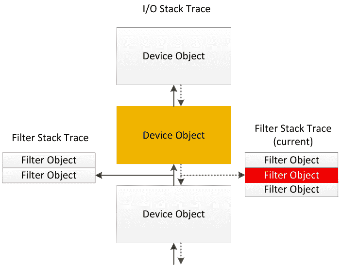

如果此类筛选器之一在等待链中被阻塞，由于可能存在异步处理，这在 I/O 请求或线程堆栈上可能不可见。但是，我们可以使用 **!fltkd.irpctrl** 调试扩展命令来检查 IRP 上下文：

```
0: kd> !irp fffffff80162aa30
cmd                 flg cl Device       File                    Completion-Context
[...]
[ 0, 0] 0 0 fffffff80cb28030 00000000     fffffff80012048f0-fffff8a016f64010
\FileSystem\Ntfs fltmgr!FltpSynchronizedOperationCompletion
Args: 00000000 00000000 00000000 00000000
> [ 0, 0] 0 1 fffffff80ca0890 fffffff8a01060d70 00000000-00000000 pending
\FileSystem\FltMgr
Args: fffffff88014450868 02000060 0000006 00000000
```

```
0: kd> !fltkd.irpctrl fffffff8016f64010
[...]
Cmd           IrpFl     OpFl CmpFl Instance FileObjt Completion-Context Node Adr
-----------------------------------------------------------------------------
[0,0] 00000884 00 0000 fffffff800d29c010 fffffff8a01060d70 fffffff800518b474-0000000000000000
fffffa8016f641e0
("luafv","luafv") luafv!LuafvPostCreate
Args: fffffff88014450868 0000000002000060 0000000000000006 0000000000000000 0000000000000000
0000000000000000
>[0,0] 00000884 00 0000 fffffff80e8051d0 fffffff8a01060d70 fffffff8006808440-0000000000000000
fffffa8016f64160
("3rdPartyFilter","3rdPartyFilter Instance") FilterA!FltDriver_PostOperationCallback
Args: fffffff88014450868 0000000002000060 0000000000000006 0000000000000000 0000000000000000
0000000000000000
[...]
```

因此我们看到 **FilterA** 模块可能参与阻塞线程。我们可以将其视为扩展到 I/O 请求和筛选器堆栈跟踪的 **阻塞模块**（第 96 页）模式。


## 常规

问题识别和解决中最重要的模式是堆栈跟踪。请参考w3wp.exe崩溃转储中!analyze -v输出的以下片段：

```
STACK_TEXT:
WARNING: Frame IP not in any known module. Following frames may be wrong.
1824f90c 5a39f97e 01057b48 01057bd0 5a3215b4 0x0
1824fa50 5a32c7fc 01057b48 00000000 79e651c0 w3core!ISAPI_REQUEST::SendResponseHeaders+0x5d
1824fa78 5a3218ad 01057bd0 79e651c0 79e64d9c w3isapi!ISSFSendResponseHeader+0xe0
1824fae8 79e76127 01057bd0 00000003 79e651c0 w3isapi!ServerSupportFunction+0x351
1824fb0c 79e763a3 80000411 00000000 00000000 aspnet_isapi!HttpCompletion::ReportHttpError+0x3a
1824fd50 79e761c3 34df6cf8 79e8e42f 79e8e442 aspnet_isapi!HttpCompletion::ProcessRequestInManagedCode+0x1d1
1824fd5c 79e8e442 34df6cf8 00000000 00000000 aspnet_isapi!HttpCompletion::ProcessCompletion+0x24
1824fd70 791d6211 34df6cf8 18e60110 793ee0d8 aspnet_isapi!CorThreadPoolWorkItemCallback+0x13
1824fd84 791d616a 18e60110 00000000 791d60fa mscorwks!ThreadpoolMgr::ExecuteWorkRequest+0x19
1824fd4a 791e695c 00000000 8083d5c7 00000000 mscorwks!ThreadpoolMgr::WorkerThreadStart+0x129
1824ffb8 77e64829 17bb9c18 00000000 00000000 mscorwks!ThreadpoolMgr::IntermediateThreadProc+0x44
1824ffec 00000000 791fe91b 17bb9c18 00000000 kernel32!BaseThreadStart+0x34
```

忽略前5个数字列，可得到以下跟踪：

```
0x0
w3core!ISAPI_REQUEST::SendResponseHeaders+0x5d
w3isapi!ISSFSendResponseHeader+0xe0
w3isapi!ServerSupportFunction+0x351
aspnet_isapi!HttpCompletion::ReportHttpError+0x3a
aspnet_isapi!HttpCompletion::ProcessRequestInManagedCode+0x1d1
aspnet_isapi!HttpCompletion::ProcessCompletion+0x24
aspnet_isapi!CorThreadPoolWorkItemCallback+0x13
mscorwks!ThreadpoolMgr::ExecuteWorkRequest+0x19
mscorwks!ThreadpoolMgr::WorkerThreadStart+0x129
mscorwks!ThreadpoolMgr::IntermediateThreadProc+0x44
kernel32!BaseThreadStart+0x34
```

通常我们会看到类似这样的内容：

```
moduleA!functionX+offsetN
moduleB!functionY+offsetM
...
...
...
```

有时函数名不可用，或者偏移量非常大（例如0x2380）。如果出现这种情况，则很可能没有moduleA和moduleB的符号文件：

```
moduleA+offsetN
moduleB+offsetM
...
...
...
```

通常，我们可以使用某种之前问题的数据库，将moduleA!functionX+offsetN与之匹配。如果没有这样的匹配项，可以尝试functionX+offsetN、moduleA!functionX或仅functionX。如果仍然没有匹配项，可以尝试下一个签名，即moduleB!functionY+offsetM和moduleB!functionY。通常，跟踪中越往后，签名对问题解决的帮助越小。例如，mscorsvr!ThreadpoolMgr::WorkerThreadStart+0x129可能会匹配许多问题，因为该签名对许多ASP.NET应用程序很常见。

如果内部数据库中没有匹配项，可以尝试使用互联网搜索引擎。就我们的示例而言，Google搜索SendResponseHeaders+0x5d给出了以下搜索结果：

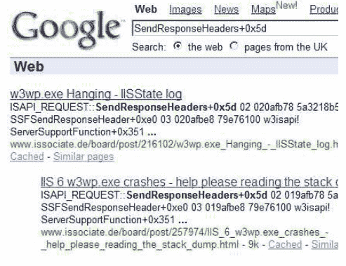

浏览搜索结果可发现讨论^195，该讨论可通过直接搜索Google群组找到：

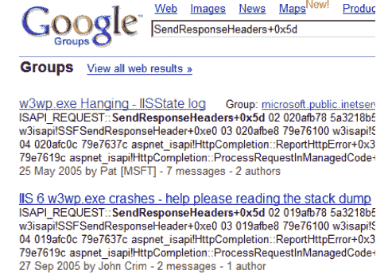

另一个示例来自BSOD完整内存转储。分析命令有以下输出：

```
MODE_EXCEPTION_NOT_HANDLED (1e)
This is a very common bugcheck. Usually the exception address pinpoints the driver/function that caused the problem. Always note this address as well as the link date of the driver/image that contains this address.
Arguments:
Arg1: c0000005, The exception code that was not handled
Arg2: bff90ca3, The address that the exception occurred at
Arg3: 00000000, Parameter 0 of the exception
Arg4: 00000000, Parameter 1 of the exception

TRAP_FRAME: bdf80834 -- (.trap ffffffffbd80834)
ErrCode = 00000000
eax=00000000 ebx=bdf80c34 ecx=89031870 edx=88096928 esi=88096928 edi=8905e7f0
eip=bff90ca3 esp=bdf808a8 ebp=bdf80a44 iopl=0 nv up ei ng nz na po nc
cs=0008 ss=0010 ds=0023 es=0023 fs=0030 gs=0000 efl=00010282
tsmvlvsa+0xfca3:
bff90ca3 8b08 mov ecx,dword ptr [eax] ds:0023:00000000=????????
Resetting default scope
```

```
STACK_TEXT:
bdf807c4 80467a15 bdf807e0 00000000 bdf80834 nt!KiDispatchException+0x30e
bdf8082c 804679c6 00000000 bdf80860 804d9f69 nt!CommonDispatchException+0x4d
bdf80838 804d9f69 00000000 00000005 e56c6946 nt!KiUnexpectedInterruptTail+0x207
00000000 00000000 00000000 00000000 00000000 nt!ObpAllocateObject+0xe1
```

因为崩溃点tsmvlvsa+0xfca3不在堆栈跟踪上，我们使用.trap命令：

```
1: kd> .trap ffffffffbd80834
ErrCode = 00000000
eax=00000000 ebx=bdf80c34 ecx=89031870 edx=88096928 esi=88096928 edi=8905e7f0
eip=bff90ca3 esp=bdf808a8 ebp=bdf80a44 iopl=0 nv up ei ng nz na po nc
cs=0008 ss=0010 ds=0023 es=0023 fs=0030 gs=0000 efl=00010282
tsmvlvsa+0xfca3:
bff90ca3 8b08 mov ecx,dword ptr [eax] ds:0023:00000000=????????

1: kd> k
*** Stack trace for last set context - .thread/.cxr resets it
ChildEBP RetAddr
WARNING: Stack unwind information not available. Following frames may be wrong.
00000000 bdf80afc tsmvlvsa+0xfca3
89080c00 00000040 nt!ObLookupObjectName+0x504
00000000 00000001 nt!ObpOpenObjectByName+0xc5
c0100080 0012b8d8 nt!IoCreateFile+0x407
c0100080 0012b8d8 nt!IoCreateFile+0x36
c0100080 0012b8d8 nt!NtCreateFile+0x2e
c0100080 0012b8d8 nt!KiSystemService+0xc9
c0100080 0012b8d8 ntdll!NtCreateFile+0xb
c0000000 00000000 KERNEL32!CreateFileW+0x343
```

```
1: kd> lmv m tsmvlvsa
bff81000 bff987c0 tsmvlvsa (no symbols)
    Loaded image file: tsmvlvsa.sys
    Image path: tsmvlvsa.sys
    Image name: tsmvlvsa.sys
    Timestamp: Thu Mar 18 06:18:51 2004 (40593F4B)
    CheckSum: 0002D102
    ImageSize: 000177C0
    Translations: 0000.04b0 0000.04e0 0409.04b0 0409.04e0
```

Google搜索`tsmvlvsa+0xfca3`没有显示任何内容，但如果只搜索`tsmvlvsa`，可能会得到一些指向问题解决的链接。

## I/O请求

如果线程具有关联的I/O请求数据包(IRP)，我们可能会看到另一种类型的堆栈跟踪。它也从下往上增长，如图196所示。我们可以使用**!irp** WinDbg命令查看此堆栈跟踪：

```
0: kd> !thread fffffa801827a4c0 1f
THREAD fffffa801827a4c0  Cid 06c0.50cc  Teb: 000007ffffec8000 Win32Thread: fffff900c1c64010 WAIT: (Executive) KernelMode Alertable
fffffa8016f64028  SynchronizationEvent
IRP List:
fffffa80162aa230:  (0006,03a0) Flags: 00000884  Mdl: 00000000
[...]
nt!KiSwapContext+0x7a
nt!KiCommitThreadWait+0x1d2
nt!KeWaitForSingleObject+0x19f
nt!FsRtlCancelableWaitForMultipleObjects+0x5e
nt!FsRtlCancelableWaitForSingleObject+0x27
fltmgr!  ?: :FNO DOBFM::`string'+0x2bfa
fltmgr!FltpCreate+0x2a9
nt!IopParseDevice+0x14d3
nt!OpLookupObjectName+0x588
nt!ObOpenObjectByName+0x306
nt!IopCreateFile+0x2bc
nt!NtCreateFile+0x78
nt!KiSystemServiceCopyEnd+0x13
ntdll!NtCreateFile+0xa
[...]
```

```
0: kd> !irp fffffa80162aa230
Irp is active with 10 stacks 10 is current (= 0xfffffa80162aa588)
No Mdl: No System Buffer: Thread fffffa801827a4c0: Irp stack trace.
cmd flg cl Device   File     Completion-Context
[ 0, 0] 0 0 00000000 00000000 00000000-00000000
  Args: 00000000 00000000 00000000 00000000
[ 0, 0] 0 0 00000000 00000000 00000000-00000000
  Args: 00000000 00000000 00000000 00000000
[ 0, 0] 0 0 00000000 00000000 00000000-00000000
  Args: 00000000 00000000 00000000 00000000
[ 0, 0] 0 0 00000000 00000000 00000000-00000000
  Args: 00000000 00000000 00000000 00000000
[ 0, 0] 0 0 00000000 00000000 00000000-00000000
  Args: 00000000 00000000 00000000 00000000
[ 0, 0] 0 0 00000000 00000000 00000000-00000000
  Args: 00000000 00000000 00000000 00000000
[ 0, 0] 0 0 fffffa800cb28030 00000000 fffffa8012048f0-fffffa8016f64010
\FileSystem\Ntfs fltmgr!FltpSynchronizedOperationCompletion
  Args: 00000000 00000000 00000000 00000000
>[ 0, 0] 0 1 fffffa800ca00890 fffffa801060d070 00000000-00000000 pending
\FileSystem\FltMgr
Args: fffffa800814450e68 02000060 00000006 00000000
```

我们可以看到当前堆栈跟踪指针指向底部I/O堆栈位置。非空顶部位置类似于过去堆栈跟踪（第800页）。进一步探索设备和文件列信息可能指向进一步的故障排除方向，例如阻塞文件（第93页）模式示例。

与基于内存转储类型从所有线程转储堆栈跟踪的堆栈跟踪收集（第943页）模式类似，还存在I/O请求堆栈跟踪收集（第933页）模式，该模式从所有可能找到的IRP转储I/O请求堆栈跟踪。


## 堆栈跟踪更改

这是一种用于差异内存转储分析的重要模式，例如，当在 CPU 飙升或挂起等问题发生前后生成内存转储时。在以下示例中，我们有一个在应用程序被报告无响应之前保存的内存转储中通常预期的线程堆栈跟踪，以及之后的另一个不同的线程堆栈跟踪：

```
3 Id: 24b8.24e4 Suspend: 0 Teb: 7efa1000 Unfrozen
ChildEBP RetAddr
037dfadc 75210bdd ntdll!ZwWaitForMultipleObjects+0x15
037dfb78 75791a2c KERNELBASE!WaitForMultipleObjectsEx+0x100
037dfbc0 7511086a kernel32!WaitForMultipleObjectsExImplementation+0xe0
037dfc14 00d17c1d user32!RealMsgWaitForMultipleObjectsEx+0x14d
037dfc3c 00ce161d ApplicationA!MsgWaitForMultipleObjects+0x2d
037dfc60 00cdc757 ApplicationA!WaitForSignal+0x1d
037dfc80 00cdaaf6 ApplicationA!WorkLoop+0x57
037dfca4 7579339a ApplicationA!ThreadStart+0x26
037dfcb0 77669ef2 kernel32!BaseThreadInitThunk+0xe
037dfcf0 77699ec5 ntdll!__RtlUserThreadStart+0x70
037dfd08 00000000 ntdll!_RtlUserThreadStart+0x1b

3 Id: 24b8.24e4 Suspend: 0 Teb: 7efa1000 Unfrozen
ChildEBP RetAddr
037df38c 752131bb ntdll!ZwDelayExecution+0x15
037df3f4 75213a8b KERNELBASE!SleepEx+0x65
037df404 00d1670b KERNELBASE!Sleep+0xf
037df40c 00d359ef ApplicationA!Sleep+0xb
037df430 6a868aab ApplicationA!PutData+0xbf
037df444 0a8662ec ModuleA!OutputData+0x1b
037df464 00d351de ModuleA!ProcessData+0x16c
037df4a4 00cacb4 ApplicationA!SendData+0xbxe
[...]
```

## 堆栈跟踪收集

### CPU

这是 **堆栈跟踪收集** 模式的另一种变体，用于显示当前在所有 CPU 上执行的线程的堆栈跟踪。虽然我们可以从对应于所有进程及其线程的堆栈跟踪中看到非空闲运行线程（第 943 页），但我们也可能希望查看空闲线程堆栈跟踪。此外，如果我们想要在出现蓝屏（BSOD）时双重检查 **!analyze -v** 命令的输出，相应的 WinDbg 命令（**!running -t -i**）速度更快。后者命令可能会显示当前 CPU 的堆栈跟踪，而不是导致 Bugcheck 的在不同 CPU 上运行的线程的堆栈跟踪。下面是一个内存转储的示例，在打开转储文件时，**!analyze -v** 命令在输出中显示了一个错误的堆栈跟踪。它报告 CPU 0 的堆栈跟踪，但 Bugcheck 发生在 CPU 1：

```
0: kd> !running -t -i

System Processors: (00000000000000ff)
Idle Processors: (00000000000000fd)

Prcb              Current             (pri) Next            (pri) Idle
0   fffff801e5d85180  fffff801e5dde00 ( 0)            fffff801e5dde00 .............

Child-SP          RetAddr             Call Site
fffff801`e8c9eb60 fffff801`e5c69b74 hal!KeQueryPerformanceCounter+0x75
fffff801`e8c9eba0 fffff801`e5c69e01 nt!KiCheckStall+0x2c
fffff801`e8c9ebd0 fffff801`e5c6aa8f nt!KiFreezeTargetExecution+0x231
fffff801`e8c9ece0 fffff801`e5bdbec2 nt!KiProcessNMI+0x3b
fffff801`e8c9ed30 fffff801`e5bd8d36 nt!KxNmiInterrupt+0x82
fffff801`e8c9ee70 fffff801`e5a2d82f nt!KiNmiInterrupt+0x176
fffff801`e8c9c8e8 fffff801`e5bb91a2 hal!HalProcessorIdle+0xf
fffff801`e8c9c8f0 fffff801`e5ad7848 nt!PpmIdleExecuteExecute+0xa
fffff801`e8c9c920 fffff801`e5ad72a6 nt!PpmIdleExecuteTransition+0x3e8
fffff801`e8c9cb10 fffff801`e5bd64bc nt!PoIdle+0x2f6
fffff801`e8c9cc60 00000000`00000000 nt!KiIdleLoop+0x2c

1   fffffd000f0975180 fffffe000d726880 (12)            fffffd000f09813c0 .............

Child-SP          RetAddr             Call Site
fffffd00`202cb618 fffff801`e5a1cc3c hal!HalpAcpiPmRegisterReadPort+0x1b
fffffd00`202cb620 fffff801`e5a417e7 hal!HalpAcpiPmRegisterRead+0x30
fffffd00`202cb650 fffff801`e5c66af5 hal!HalpHaltSystem+0x53
fffffd00`202cb690 fffff801`e5c66741 nt!KiBugCheckDebugBreak+0x99
fffffd00`202cbf60 fffff801`e5bd2aa4 nt!KeBugCheck2+0xc6d
fffffd00`202cbe00 fffff801`e5bde4e9 nt!KeBugCheckEx+0x104
fffffd00`202cbe40 fffff801`e5bdcd3a nt!KiBugCheckDispatch+0x69
fffffd00`202cbf80 fffff800`913601da nt!KiPageFault+0x23a
fffffd00`202cc118 fffff800`91363710 DriverA!memcpy+0x21a
[...]

2   fffff000f09ee180 fffffd000f09fa3c0 ( 0) fffffd000f09fa3c0 ................
Child-SP          RetAddr             Call Site
ffffff000`f09f9f88 fffff801`e5c69e01 nt!KiCheckStall+0xa
ffffff000`f09f9f90 fffff801`e5c6aa8f nt!KiFreezeTargetExecution+0x231
ffffff000`f09fa0a0 fffff801`e5bdbec2 nt!KiProcessNMI+0x3b
ffffff000`f09fa0f0 fffff801`e5bdbd36 nt!KxNmiInterrupt+0x82
ffffff000`f09fa230 fffff801`e5ad2d2f nt!KiNmiInterrupt+0x176
ffffff000`eb5938e8 fffff801`e5bb91a2 hal!HalProcessorIdle+0xf
ffffff000`eb5938f0 fffff801`e5ad7848 nt!PpmIdleDefaultExecute+0xa
ffffff000`eb593920 fffff801`e5ad72a6 nt!PpmIdleExecuteTransition+0x3e8
ffffff000`eb593b10 fffff801`e5bd64bc nt!PoIdle+0x2f6
ffffff000`eb593c60 00000000`00000000 nt!KiIdleLoop+0x2c

3   fffff000eb5e5180 fffffd000eb5f13c0 ( 0) fffffd000eb5f13c0 ................
Child-SP          RetAddr             Call Site
ffffff000`eb5f0f60 fffff801`e5c69e01 nt!KiCheckStall+0x5f
ffffff000`eb5f0f90 fffff801`e5c6aa8f nt!KiFreezeTargetExecution+0x231
ffffff000`eb5f10a0 fffff801`e5bdbec2 nt!KiProcessNMI+0x3b
ffffff000`eb5f10f0 fffff801`e5bdbd36 nt!KxNmiInterrupt+0x82
ffffff000`eb5f1230 fffff801`e5ad2d2f nt!KiNmiInterrupt+0x176
ffffff000`eb5f8ae8 fffff801`e5bb91a2 hal!HalProcessorIdle+0xf
ffffff000`eb5f8af0 fffff801`e5ad7848 nt!PpmIdleDefaultExecute+0xa
ffffff000`eb5f9a20 fffff801`e5ad72a6 nt!PpmIdleExecuteTransition+0x3e8
ffffff000`eb5fab10 fffff801`e5bd64bc nt!PoIdle+0x2f6
ffffff000`eb5fac60 00000000`00000000 nt!KiIdleLoop+0x2c

4   fffff000f08d1180 fffffd000f08dd3c0 ( 0) fffffd000f08dd3c0 ................
Child-SP          RetAddr             Call Site
ffffff000`f08dcf90 fffff801`e5c6aa8f nt!KiFreezeTargetExecution+0x227
ffffff000`f08dda00 fffff801`e5bdbec2 nt!KiProcessNMI+0x3b
ffffff000`f08dd0f0 fffff801`e5bdbd36 nt!KxNmiInterrupt+0x82
ffffff000`f08dd230 fffff801`e5ad2d2f nt!KiNmiInterrupt+0x176
ffffff000`eb85b8e8 fffff801`e5bb91a2 hal!HalProcessorIdle+0xf
ffffff000`eb85b8f0 fffff801`e5ad7848 nt!PpmIdleDefaultExecute+0xa
ffffff000`eb85b920 fffff801`e5ad72a6 nt!PpmIdleExecuteTransition+0x3e8
ffffff000`eb85bb10 fffff801`e5bd64bc nt!PoIdle+0x2f6
ffffff000`eb85bc60 00000000`00000000 nt!KiIdleLoop+0x2c

5   fffff000eb8ad180 fffffd000eb8b93c0 ( 0) fffffd000eb8b93c0 ................
Child-SP          RetAddr             Call Site
ffffff000`eb8b8f60 fffff801`e5c69e01 nt!KiCheckStall+0x75
ffffff000`eb8b8f90 fffff801`e5c6aa8f nt!KiFreezeTargetExecution+0x231
ffffff000`eb8b9a00 fffff801`e5bdbec2 nt!KiProcessNMI+0x3b
ffffff000`eb8b90f0 fffff801`e5bdbd36 nt!KxNmiInterrupt+0x82
ffffff000`eb8b9230 fffff801`e5ad2d2f nt!KiNmiInterrupt+0x176
ffffff000`eb8bd8e8 fffff801`e5bb91a2 hal!HalProcessorIdle+0xf
ffffff000`eb8bd8f0 fffff801`e5ad7848 nt!PpmIdleDefaultExecute+0xa
ffffff000`eb8bd920 fffff801`e5ad72a6 nt!PpmIdleExecuteTransition+0x3e8
ffffff000`eb8bdb10 fffff801`e5bd64bc nt!PoIdle+0x2f6
ffffff000`eb8dbc60 00000000`00000000 nt!KiIdleLoop+0x2c

6   fffff000eb92a180 fffff000eb9363c0 ( 0) fffff000eb9363c0 ................

Child-SP                RetAddr           Call Site
fffffd000`eb935f60 fffff8001`e5c69e01 nt!KiCheckStall+0x75
fffffd000`eb935f90 fffff8001`e5c6aa8f nt!KiFreezeTargetExecution+0x231
fffffd000`eb9360a0 fffff8001`e5bddec2 nt!KiProcessNMI+0x3b
fffffd000`eb9360f0 fffff8001`e5bdbb36 nt!KxNmiInterrupt+0x82
fffffd000`eb936230 fffff8001`e5ad2d2f nt!KiNmiInterrupt+0x176
fffffd000`eb93f8e8 fffff8001`e5bb91a2 hal!HalProcessorIdle+0xf
fffffd000`eb93f8f0 fffff8001`e5ad7848 nt!PpmIdleDefaultExecute+0xa
fffffd000`eb93f920 fffff8001`e5ad72a6 nt!PpmIdleExecuteTransition+0x3e8
fffffd000`eb93fb10 fffff8001`e5bd64bc nt!PoIdle+0x2f6
fffffd000`eb93fc60 00000000`00000000 nt!KiIdleLoop+0x2c

7   fffff000eb967180 fffff000eb9733c0 ( 0) fffff000eb9733c0 ................

Child-SP                RetAddr           Call Site
fffffd000`eb972f60 fffff8001`e5c69e01 nt!KiCheckStall+0x75
fffffd000`eb972f90 fffff8001`e5c6aa8f nt!KiFreezeTargetExecution+0x231
fffffd000`eb9730a0 fffff8001`e5bddec2 nt!KiProcessNMI+0x3b
fffffd000`eb9730f0 fffff8001`e5bdbb36 nt!KxNmiInterrupt+0x82
fffffd000`eb973230 fffff8001`e5ad2d2f nt!KiNmiInterrupt+0x176
fffffd000`eb97c8e8 fffff8001`e5bb91a2 hal!HalProcessorIdle+0xf
fffffd000`eb97c8f0 fffff8001`e5ad7848 nt!PpmIdleDefaultExecute+0xa
fffffd000`eb97c920 fffff8001`e5ad72a6 nt!PpmIdleExecuteTransition+0x3e8
fffffd000`eb97cb10 fffff8001`e5bd64bc nt!PoIdle+0x2f6
fffffd000`eb97cc60 00000000`00000000 nt!KiIdleLoop+0x2c
```

该命令显然比反复使用 "~s" 命令切换到后续 CPU 然后检查相应的堆栈跟踪 (k) 要快得多。它还有助于诊断内核和完整内存转储中的飙升线程（第 888 页）。


## I/O 请求

此类请求通过所谓的 I/O 请求数据包（IRP）实现，这些数据包在设备驱动程序之间“传输”，类似于从一个 C++ 类方法到另一个 C++ 类方法（其中设备对象地址类似于 C++ 对象实例地址）。IRP 堆栈用于跟踪当前正在处理 IRP 的驱动程序，该 IRP 在设备驱动程序之间复用。它基本上是一个结构数组，描述了特定驱动程序函数是如何带适当参数被调用的，类似于执行线程堆栈上的调用帧。很久以前我们创建了一个 UML 图，描绘了 IRP 通过驱动程序（设备）堆栈的流向197。I/O 堆栈位置指针递减（从底部到顶部），类似于线程堆栈指针（ESP 或 RSP）。我们可以使用 !irpfind -v WinDbg 命令列出活动和已完成的 I/O 请求及其堆栈跟踪：

```
1: kd> !irpfind -v

Scanning large pool allocation table for Tag: Irp? (832c7000 : 833c7000)

Irp [ Thread ] irpStack: (Mj,Mn) DevObj [Driver] MDL Process
8883dc18: Irp is active with 1 stacks 1 is current (= 0x8883dc88)
No Mdl: No System Buffer: Thread 888f8950: Irp stack trace.
cmd flg cl Device File Completion-Context
> [ d, 0] 5 1 88515ae8 888f82f0 00000000-00000000 pending
\FileSystem\Npfs
Args: 00000000 00000000 00110008 00000000

891204c8: Irp is active with 1 stacks 1 is current (= 0x89120538)
No Mdl: No System Buffer: Thread 889635b0: Irp stack trace.
cmd flg cl Device File Completion-Context
> [ 3, 0] 0 1 88515ae8 84752028 00000000-00000000 pending
\FileSystem\Npfs
Args: 0000002a 00000000 00000000 00000000

89120ce8: Irp is active with 1 stacks 1 is current (= 0x89120d58)
No Mdl: No System Buffer: Thread 89212030: Irp stack trace.
cmd flg cl Device File Completion-Context
> [ 3, 0] 0 1 88515ae8 8921be00 00000000-00000000 pending
\FileSystem\Npfs
Args: 00000022 00000000 00000000 00000000

Searching NonPaged pool (80000000 : ffc00000) for Tag: Irp?

[...]

892cbe48: Irp is active with 9 stacks 9 is current (= 0x892cbfd8)
No Mdl: No System Buffer: Thread 892add78: Irp stack trace.
cmd flg cl Device File Completion-Context
[ 0, 0] 0 0 00000000 00000000 00000000-00000000
Args: 00000000 00000000 00000000 00000000
[ 0, 0] 0 00000000 00000000 00000000-00000000
Args: 00000000 00000000 00000000 00000000
[ 0, 0] 0 00000000 00000000 00000000-00000000
Args: 00000000 00000000 00000000 00000000
[ 0, 0] 0 00000000 00000000 00000000-00000000
Args: 00000000 00000000 00000000 00000000
[ 0, 0] 0 00000000 00000000 00000000-00000000
Args: 00000000 00000000 00000000 00000000
[ 0, 0] 0 00000000 00000000 00000000-00000000
Args: 00000000 00000000 00000000 00000000
[ 0, 0] 0 00000000 00000000 00000000-00000000
Args: 00000000 00000000 00000000 00000000

> [ c, 2] 0 1 8474a020 892c8c80 00000000-00000000 pending
\FileSystem\Ntfs
Args: 00000080 00000002 00000000 00000000

892daa88: Irp is active with 4 stacks 4 is current (= 0x892dab64)
No Mdl: System buffer=831559c8: Thread 8322c8e8: Irp stack trace.
cmd flg cl Device File Completion-Context
[ 0, 0] 0 00000000 00000000 00000000-00000000

Args: 00000000 00000000 00000000 00000000
[ 0, 0] 0 00000000 00000000 00000000-00000000
Args: 00000000 00000000 00000000 00000000
[ 0, 0] 0 00000000 00000000 00000000-00000000
Args: 00000000 00000000 00000000 00000000

> [ e,2d] 5 1 884ba750 8319c040 00000000-00000000 pending
\Driver\AFD
Args: 890cbc44 890cbc44 88e55297 8943b6c8

892ea4e8: Irp is active with 4 stacks 4 is current (= 0x892ea5c4)
No Mdl: No System Buffer: Thread 00000000: Irp stack trace. Pending has been returned
cmd flg cl Device File Completion-Context
[ 0, 0] 0 2 00000000 00000000 00000000-00000000
Args: 00000000 00000000 00000000 c0000185
[ 0, 0] 0 0 00000000 00000000 00000000-00000000
Args: 00000000 00000000 00000000 00000000
[ f, 0] 0 2 83a34bb0 00000000 84d779ed-88958050
\Driver\atapi CLASSPNP!ClasspMediaChangeDetectionCompletion
Args: 8895850A 00000000 00000000 83992d10
> [ 0, 0] 2 0 891ee030 00000000 00000000-00000000
\Driver\cdrom
Args: 00000000 00000000 00000000 00000000

8933fcb0: Irp is active with 1 stacks 1 is current (= 0x8933fd20)
No Mdl: No System Buffer: Thread 84753d78: Irp stack trace.
cmd flg cl Device File Completion-Context
> [ 3, 0] 0 1 88515ae8 84759f40 00000000-00000000 pending
\FileSystem\Npfs
Args: 0000022a 00000000 00000000 00000000

893cf550: Irp is active with 1 stacks 1 is current (= 0x893cf5c0)
No Mdl: No System Buffer: Thread 888fd3b8: Irp stack trace.
cmd flg cl Device File Completion-Context
> [ 3, 0] 0 1 88515ae8 834d30d0 00000000-00000000 pending
\FileSystem\Npfs
Args: 00000440 00000000 00000000 00000000

893da468: Irp is active with 6 stacks 7 is current (= 0x893da5b0)
Mdl=892878f0: No System Buffer: Thread 00000000: Irp is completed. Pending has been returned
cmd flg cl Device File Completion-Context
[ 0, 0] 0 0 00000000 00000000 00000000-00000000
Args: 00000000 00000000 00000000 00000000
[ 0, 0] 0 0 00000000 00000000 00000000-00000000
Args: 00000000 00000000 00000000 00000000
[ 0, 0] 0 0 00000000 00000000 00000000-00000000
Args: 00000000 00000000 00000000 00000000
[ f, 0] 0 0 84b3e028 00000000 9747fcd0-00000000
\Driver\usbehci USBSTOR!USBSTOR_CswCompletion
Args: 00000000 00000000 00000000 00000000
[ f, 0] 0 0 892ba8f8 00000000 84d780ce-8328ef0f
\Driver\USBSTOR CLASSPNP!TransferPktComplete
Args: 00000000 00000000 00000000 00000000

893efb00: Irp is active with 10 stacks 11 is current (= 0x893efcd8)
Mdl=83159378: No System Buffer: Thread 82b7f828: Irp is completed. Pending has been returned
cmd flg cl Device File Completion-Context
[ 0, 0] 0 0 00000000 00000000 00000000-00000000
    Args: 00000000 00000000 00000000 00000000
[ 0, 0] 0 0 00000000 00000000 00000000-00000000
    Args: 00000000 00000000 00000000 00000000
[ 0, 0] 0 0 00000000 00000000 00000000-00000000
    Args: 00000000 00000000 00000000 00000000
[ 0, 0] 0 0 00000000 00000000 00000000-00000000
    Args: 00000000 00000000 00000000 00000000
[ 0, 0] 0 0 00000000 00000000 00000000-00000000
    Args: 00000000 00000000 00000000 00000000
[ 0, 0] 0 0 00000000 00000000 00000000-00000000
    Args: 00000000 00000000 00000000 00000000
[ 3, 0] 0 885a55b8 00000000 81614138-00000000
    \Driver\disk partmgr!PmReadWriteCompletion
    Args: 00000000 00000000 00000000 00000000
[ 3, 0] 0 89257c90 00000000 8042e4d4-831caab0
    \Driver\partmgr volmgr!VmpReadWriteCompletionRoutine
    Args: 00000000 00000000 00000000 00000000
[ 3, 0] 0 831ca9f8 00000000 84dad0be-00000000
    \Driver\volmgr cache!EcDispatchReadWriteCompletion
    Args: 00000000 00000000 00000000 00000000
[ 3, 0] 0 8319c020 00000000 84dcc444-8576f8ac
    \Driver\Ecache volsnap!VspSignalCompletion
    Args: 00000000 00000000 00000000 00000000
```

## 托管空间

这里我们有非托管 **堆栈跟踪收集**（第 943 页）模式的托管空间对应模式。在查看与事后分析机器不同的计算机上的崩溃转储时，我们可能需要适当的 **版本特定的 SOS 扩展**（第 1058 页）。要列出所有托管堆栈跟踪，我们使用此组合命令：

```
0:000> ~*e !CLRStack
OS Thread Id: 0x36F0 (0)
Child SP               IP Call Site
0031cf84 779b0f34 [HelperMethodFrame: 0031cf84]
0031cfd8 6b65665e System.Collections.ArrayList.GetEnumerator()
0031cfe4 059f4c92 ActiproSoftware.SyntaxEditor.EditorView.a(System.Windows.Forms.PaintEventArgs,
System.Drawing.Rectangle, ActiproSoftware.SyntaxEditor.DocumentLine,
ActiproSoftware.SyntaxEditor.DisplayLine, ActiproSoftware.SyntaxEditor.EditPositionRange, Int32 ByRef)
0031e158 05a1798 ActiproSoftware.SyntaxEditor.EditorView.OnRender(System.Windows.Forms.PaintEventArgs)
0031e748 04c5f888 ActiproSoftware.WinUICore.UIElement.Render(System.Windows.Forms.PaintEventArgs)
0031e758 04c5f602 ActiproSoftware.WinUICore.Control.OnRenderChildElements(System.Windows.Forms.PaintEventArgs)
0031e80c 04c5f1ac ActiproSoftware.WinUICore.WinUICore.UIControl.Render(System.Windows.Forms.PaintEventArgs)
0031e81c 04c5e6fe ActiproSoftware.WinUICore.UIControl.a(System.Windows.Forms.PaintEventArgs)
0031e9a4 04c5e415 ActiproSoftware.WinUICore.UIControl.OnPaint(System.Windows.Forms.PaintEventArgs)
0031e9d4 6f9156f5 System.Windows.Forms.Control.PaintWithErrorHandling(System.Windows.Forms.PaintEventArgs, Int16)
0031e9e8 69f1809e System.Windows.Forms.Control.WmPaint(System.Windows.Forms.Forms.Message ByRef)
0031ead4 69f873b1 System.Windows.Forms.Control.WndProc(System.Windows.Forms.Forms.Message ByRef)
0031ead8 69f102aa [InlinedCallFrame: 0031ead8]
0031eb2c 69f102aa System.Windows.Forms.ScrollableControl.WndProc(System.Windows.Forms.Forms.Message ByRef)
0031eb38 048269c3 ActiproSoftware.SyntaxEditor.SyntaxEditor.WndProc(System.Windows.Forms.Forms.Message ByRef)
0031ebe8 69f870f3 System.Windows.Forms.Control+ControlNativeWindow.OnMessage(System.Windows.Forms.Forms.Message
ByRef)
0031ebf0 69f07071 System.Windows.Forms.Control+ControlNativeWindow.WndProc(System.Windows.Forms.Forms.Message
ByRef)
0031eec4 69f96fb6 System.Windows.Forms.NativeWindow.CallBack(IntPtr, Int32, IntPtr, IntPtr)
0031eee4 69f22eec DomainNeutralILStubClass.IL_STUB_PInvoke(MSG ByRef)
0031eee44 69f171ff [InlinedCallFrame: 0031eee44]
System.Windows.Forms.Forms.UnsafeNativeMethods.DispatchMessageW(MSG ByRef)
0031eee88 69f171ff System.Windows.Forms.Forms.Application+ComponentManager.System.Windows.Forms.Forms.
UnsafeNativeMethods.IMsoComponentManager.FPushMessageLoop(IntPtr, Int32, Int32)
0031eee8c 69f1e62c [InlinedCallFrame: 0031eee8c]
0031ef24 69f1e62c System.Windows.Forms.Forms.Application+ThreadContext.RunMessageLoopInner(Int32,
System.Windows.Forms.Forms.ApplicationContext)
0031ef7c 69f16c81 System.Windows.Forms.Forms.Application+ThreadContext.RunMessageLoop(Int32,
System.Windows.Forms.Forms.ApplicationContext)
0031efac 69ea366d System.Windows.Forms.Forms.Application.Run(System.Windows.Forms.Forms.Form)
0031fcf0 003c3fd0 LINQPad.Program.Run(System.String, Boolean, System.String, Boolean, Boolean,
System.String)
0031f0b4 003c1515 LINQPad.Program.Go(System.String[])
0031f2e4 003c0584 LINQPad.Program.Start(System.String[])
0031f324 003c034f LINQPad.Program.Main.Run(System.String[])
0031f330 003c00f5 LINQPad.Loader.Main(System.String[])
0031f570 6c1721db [GCFrame: 0031f570]
OS Thread Id: 0x36F0 (1)
Unable to walk the managed stack. The current thread is likely not a
```


```
managed thread. You can run !threads to get a list of managed threads in
the process
OS Thread Id: 0x36fc (2)
Child SP IP       Call Site
03c2fb78 779b0f34 [DebuggerU2MCatchHandlerFrame: 03c2fb78]
OS Thread Id: 0x3700 (3)
Child SP IP       Call Site
0470f0cc 779b0f34 [InlinedCallFrame: 0470f0cc]
0470f0c8 69938b07 DomainNeutralILStubClass.IL_STUB_PInvoke(Microsoft.Win32.SafeHandles.SafePipeHandle,
IntPtr)
0470f0cc 699cc07c [InlinedCallFrame: 0470f0cc]
Microsoft.Win32.UnsafeNativeMethods.ConnectNamedPipe(Microsoft.Win32.SafeHandles.SafePipeHandle, IntPtr)
0470f130 699c0c7c System.IO.Pipes.NamedPipeServerStream.WaitForConnection()
0470f140 003c31ed LINQPad.Program.Listener()
0470f1d8 6b64ae5b System.Threading.ThreadHelper.ThreadStart_Context(System.Object)
0470f1e8 6b5d7ff4 System.Threading.ExecutionContext.Run(System.Threading.ExecutionContext,
System.Threading.ContextCallback, System.Object, Boolean)
0470f20c 6b5d7f34 System.Threading.ExecutionContext.Run(System.Threading.ExecutionContext,
System.Threading.ContextCallback, System.Object)
0470f228 6b64ade8 System.Threading.ThreadHelper.ThreadStart()
0470f44c 6c1721db [GCFrame: 0470f44c]
0470f710 6c1721db [DebuggerU2MCatchHandlerFrame: 0470f710]

OS Thread Id: 0x3704 (4)
Unable to walk the managed stack. The current thread is likely not a
managed thread. You can run !threads to get a list of managed threads in
the process

OS Thread Id: 0x3710 (5)
Unable to walk the managed stack. The current thread is likely not a
managed thread. You can run !threads to get a list of managed threads in
the process

OS Thread Id: 0x3714 (6)
Unable to walk the managed stack. The current thread is likely not a
managed thread. You can run !threads to get a list of managed threads in
the process

OS Thread Id: 0x3718 (7)
Child SP IP       Call Site
0596ee40 779b0f34 [GCFrame: 0596ee40]
0596ef34 779b0f34 [HelperMethodFrame_1OBJ: 0596ef34] System.Threading.Monitor.ObjWait(Boolean, Int32,
System.Object)
0596ef90 6b5d91d0 System.Threading.Monitor.Wait(System.Object, Int32, Boolean)
0596efa0 6bb9428a System.Threading.Monitor.Wait(System.Object)
0596fefa 003cb55a ActiproSoftware.SyntaxEditor.SemanticParserService.c()
0596f068 6b64ae5b System.Threading.ThreadHelper.ThreadStart_Context(System.Object)
0596f078 6b5d7ff4 System.Threading.ExecutionContext.Run(System.Threading.ExecutionContext,
System.Threading.ContextCallback, System.Object, Boolean)
0596f09c 6b5d7f34 System.Threading.ExecutionContext.Run(System.Threading.ExecutionContext,
System.Threading.ContextCallback, System.Object)
0596f08b 6b64ade8 System.Threading.ThreadHelper.ThreadStart()
0596f2dc 6c1721db [GCFrame: 0596f2dc]
0596f5a0 6c1721db [DebuggerU2MCatchHandlerFrame: 0596f5a0]
OS Thread Id: 0x3764 (8)
Child SP IP       Call Site
0564f148 779b0f34 [HelperMethodFrame_1OBJ: 0564f148]
System.Threading.WaitHandle.WaitOneNative(System.Runtime.InteropServices.SafeHandle, UInt32, Boolean,
Boolean)
0564f1f0 6b64b5ef System.Threading.WaitHandle.InternalWaitOne(System.Runtime.InteropServices.SafeHandle,
Int64, Boolean, Boolean)
0564f20c 6b64b5ad System.Threading.WaitHandle.WaitOne(Int32, Boolean)
0564f224 6b64b570 System.Threading.WaitHandle.WaitOne()
0564f22c 04b607d4 ActiproBridge.ReferenceManager+?15?.<StartAdvanceFeeder>b__4()
0564f268 6b64ae5b System.Threading.ThreadHelper.ThreadStart_Context(System.Object)
0564f278 6b5d7ff4 System.Threading.ExecutionContext.Run(System.Threading.ExecutionContext,
System.Threading.ContextCallback, System.Object, Boolean)
0564f29c 6b5d7f34 System.Threading.ExecutionContext.Run(System.Threading.ExecutionContext,
System.Threading.ContextCallback, System.Object)
0564f2b8 6b64ade8 System.Threading.ThreadHelper.ThreadStart()
0564f4dc 6c1721db [GCFrame: 0564f4dc]
0564f7a0 6c1721db [DebuggerU2MCatchHandlerFrame: 0564f7a0]
OS Thread Id: 0x3768 (9)
Unable to walk the managed stack. The current thread is likely not a
managed thread. You can run !threads to get a list of managed threads in
the process
OS Thread Id: 0x376c (10)
Child SP               Call Site
GetFrameContext failed: 1
OS Thread Id: 0x3798 (11)
Child SP               Call Site
GetFrameContext failed: 1
OS Thread Id: 0x37e0 (12)
Unable to walk the managed stack. The current thread is likely not a
managed thread. You can run !threads to get a list of managed threads in
the process
OS Thread Id: 0x37f8 (13)
Unable to walk the managed stack. The current thread is likely not a
managed thread. You can run !threads to get a list of managed threads in
the process
```

## 谓词

有时候，我们需要将常规堆栈跟踪收集范围缩小到满足某些谓词^198 的少数线程，例如，内核时间花费大于某个值的所有线程，或所有挂起的线程，或等待特定同步对象类型的所有线程。这可以使用 WinDbg 脚本^199 和调试器扩展来实现。

## 注释

这里的一个示例可以是 TEB.SubProcessTag 中的服务标记，用于识别 svchost.exe 中特定服务的线程。

要列出特定 WOW64 进程的 32 位堆栈跟踪：

```
!for_each_thread ".thread @#Thread; r $t0 = @#Thread; .if (@@c++(((nt!_KTHREAD *)@$t0)->Process) == ProcessAddress) {.thread /w @#Thread; .reload; kv 256; .effmach AMD64 }"
```

198 http://en.wikipedia.org/wiki/Predicate_(mathematical_logic)

199 Two WinDbg Scripts That Changed the World, Memory Dump Analysis Anthology, Volume 7, page 32

## 非托管空间

有时，问题不能仅从单个**堆栈跟踪**模式中识别，而需要从**堆栈跟踪集合**中识别。

这些包括**耦合进程**（第 149 页）、**过程调用链** 200 和**阻塞线程**（第 80 页）。此处我们仅讨论列出堆栈跟踪的各种方法。

- 包括各种进程小转储在内的进程转储：
  - ~*kv 命令列出所有进程线程。
  - !findstack module[!symbol] 2 命令筛选所有堆栈跟踪，仅显示包含模块或 module!symbol 的跟踪。
  - !uniqstack 命令。
- 内核小转储：
  - 只有一个问题线程。kv 命令或其变体足够。
- 内核和完整内存转储：
  - !process 0 3f 命令列出所有进程及其线程，包括完整内存转储的用户空间进程线程堆栈。此命令适用于 Windows XP 及更高版本。对于旧系统，可以使用 WinDbg 脚本。
  - !stacks 2 [module[!symbol]] 命令显示内核模式堆栈跟踪，我们可以根据模块或 module!symbol 筛选输出。筛选仅适用于 Windows XP 及更高版本系统的崩溃转储。
  - ~/ProcessorN|s;reload /user;kv 命令序列显示指定处理器上运行线程的堆栈跟踪。

处理器更改命令在此示例中演示：

```
0: kd> ~2s

2: kd> k
ChildEBP RetAddr
eb42bd58 00000000 nt!KiIdleLoop+0x14
```

```
2: kd> ~1s;.reload /user;k
Loading User Symbols
..
ChildEBP RetAddr
be4f8c30 eb091f43 i8042prt!I8xProcessCrashDump+0x53
be4f8c8c 8046bfe2 i8042prt!I8042KeyboardInterruptService+0x15d
be4f8c8c 8049470f nt!KiInterruptDispatch+0x32
be4f8d54 80468389 nt!NtSetEvent+0x71
be4f8d54 77f8290a nt!KiSystemService+0xc9
081cfcfc 77f88266 ntdll!ZwSetEvent+0xb
081cffc0 77f881b1 ntdll!RtlpUnWaitCriticalSection+0x1b
081cff14 1b00c7d1 ntdll!RtlLeaveCriticalSection+0x1d
081cff4c 1b0034da msjet40!Database::ReadPages+0x81
081cffb4 7c57b3bc msjet40!System::WorkerThread+0x115
081cffec 00000000 KERNEL32!BaseThreadStart+0x52
```

### !findstack 命令示例（进程转储）：

```
0:000> !findstack kernel32!RaiseException 2
Thread 000, 1 frame(s) match
* 00 0013b3f8 72e8d3ef kernel32!RaiseException+0x53
01 0013b418 72e9a26b msxml3!Exception::raiseException+0x5f
02 0013b424 72e8ff00 msxml3!Exception::_throwError+0x22
03 0013b46c 72e6abaa msxml3!COMSafeControlRoot::getBaseURL+0x3d
04 0013b4bc 72e6a888 msxml3!Document::loadXML+0x82
05 0013b510 64b73a9b msxml3!DOMDocumentWrapper::loadXML+0x5a
06 0013b538 64b7a4eb6 iepeers!CPersistUserData::initXMLCache+0xa6
07 0013b560 77d0516e iepeers!CPersistUserData::load+0xfc
08 0013b57c 77d14abf oleaut32!DispatchCallFunc+0x16a
...
...
...
66 0013fec8 0040243d shdocvw!IEWinMain+0x129
67 0013ff1c 00402744 iexplore!WinMain+0x316
68 0013ffc0 77e6f23b iexplore!WinMainCRTStartup+0x182
69 0013fff0 00000000 kernel32!BaseProcessStart+0x23
```

### !stacks 命令示例（内核转储）：

```
2: kd> !stacks 2 nt!PspExitThread
Proc.Thread .Thread Ticks ThreadState Blocker
[8a390818 System]
[8a1bbbf8 smss.exe]
[8a16cbf8 csrss.exe]
[89c14bf0 winlogon.exe]
[89dda630 services.exe]
[89c23af0 lsass.exe]
```


- [8a227470 svchost.exe]
- [89f0f3bb8 svchost.exe]
- [89de3820 svchost.exe]
- [89d09b60 svchost.exe]
- [89c03530 ccEvtMgr.exe]
- [89b8f4f0 ccSetMgr.exe]
- [89dfe8c0 SPBBCSvc.exe]
- [89c9db18 svchost.exe]
- [89dfa268 spoolsv.exe]
- [89dfa6b8 msdtc.exe]
- [89df38f0 CpSvc.exe]
- [89d97d88 DefWatch.exe]
- [89e04020 IBMSPSVC.EXE]
- [89b54710 IBMSPREM.EXE]
- [89d9e4b0 IBMSPREM.EXE]
- [89c2c4e8 svchost.exe]
- [89d307c0 SavRoam.exe]
- [89bfcd88 Rtvscan.exe]
- [89b53b60 uphclean.exe]
- [89c24020 AgentSVC.exe]
- [89d75b60 sAgInst.exe]
- [89cf0d88 CdfSvc.exe]
- [89d87020 cdmsvc.exe]
- [89daf8d8 ctxm1ss.exe]
- [89d8dd88 encsvc.exe]

- [89d06d88 ImaSrv.exe]
- [89d37b60 mfc0m.exe]
- [89c8bb18 SmaService.exe]
- [89d2ba80 svchost.exe]
- [89ce8630 XTF.exe]
- [89b64b60 XTF.exe]
- [89b7c680 ctxcpusched.exe]
- [88d94a88 ctxcpuusync.exe]
- [89ba5418 unsecapp.exe]
- [89d846e0 wmiprvse.exe]
- [89cda9d8 ctxwmisvc.exe]
- [88d6cb78 logon.scr]
- [88ba0a70 csrss.exe]
- [88961968 winlogon.exe]
- [8865f740 rdpclip.exe]
- [8858db20 wfshell.exe]
- [88754020 explorer.exe]
- [88846d88 BacsTray.exe]
- [88b66180 ccApp.exe]
- [884bc020 fppdis3a.exe]
- [885cb350 ctfmon.exe]
- [888bb918 cscript.exe]
- [8880b3c8 cscript.exe]
- [88ad2950 csrss.exe]

```
b68.00215c 88930020 00000000 RUNNING nt!KeBugCheckEx+0x1b
nt!MiCheckSessionPoolAllocations+0xe3
nt!MiDereferenceSessionFinal+0x183
nt!MmCleanProcessAddressSpace+0x6b
nt!PspExitThread+0x5F1
nt!PspTerminateThreadByPointer+0x4b
nt!PspSystemThreadStartup+0x3c
nt!KiThreadStartup+0x16
```

- [88629310 winlogon.exe]
- [88a4d9b0 csrss.exe]
- [88d9f8b0 winlogon.exe]
- [88cd5840 wfshell.exe]
- [8a252440 OUTLOOK.EXE]
- [8a194fb8 WINWORD.EXE]
- [88aabd20 ctfmon.exe]
- [889ef440 EXCEL.EXE]
- [88bec838 HoggiaGUI2.exe]
- [88692020 csrss.exe]
- [884dd508 winlogon.exe]
- [88be1d88 wfshell.exe]
- [886a7d88 OUTLOOK.EXE]
- [889baa70 WINWORD.EXE]
- [8861e3d0 ctfmon.exe]
- [887bbb68 EXCEL.EXE]
- [884e4020 csrss.exe]
- [8889d218 winlogon.exe]
- [887c8020 wfshell.exe]

已处理线程数: 1101

如果我们要从完整内存转储中使用 !process 0 0 命令获取进程列表，并希望检查特定进程，在这种情况下，我们需要切换到该进程并重新加载用户空间符号文件 (.process /r /p address)。还有一个单独的命令可以随时重新加载用户空间符号文件 (.reload /user)。

切换后，我们可以列出线程 (!process address)，转储或搜索进程虚拟内存。例如：

```
1: kd> !process 0 0
**** NT ACTIVE PROCESS DUMP ****
PROCESS 890a3320 SessionId: 0 Cid: 0008 Peb: 00000000 ParentCid: 0000
    DirBase: 00030000 ObjectTable: 890a3e08 TableSize: 405.
    Image: System

PROCESS 89dfdf60 SessionId: 0 Cid: 0144 Peb: 7ffdf000 ParentCid: 0008
    DirBase: 0b9e7000 ObjectTable: 89fdfb48 TableSize: 212.
    Image: SMSS.EXE

PROCESS 890af020 SessionId: 0 Cid: 0160 Peb: 7ffdf000 ParentCid: 0144
    DirBase: 0ce36000 ObjectTable: 8898e308 TableSize: 747.
    Image: CSRSS.EXE

PROCESS 8893d020 SessionId: 0 Cid: 0178 Peb: 7ffdf000 ParentCid: 0178
    DirBase: 0d33b000 ObjectTable: 890ab4c8 TableSize: 364.
    Image: WINLOGON.EXE

PROCESS 88936020 SessionId: 0 Cid: 0194 Peb: 7ffdf000 ParentCid: 0144
    DirBase: 0d7d5000 ObjectTable: 88980528 TableSize: 872.
    Image: SERVICES.EXE

PROCESS 8897f020 SessionId: 0 Cid: 01a0 Peb: 7ffdf000 ParentCid: 0178
    DirBase: 0d89d000 ObjectTable: 889367c8 TableSize: 623.
    Image: LSASS.EXE
```

```
1: kd> .process /r /p 8893d020
Implicit process is now 8893d020
Loading User Symbols
...
```

```
1: kd> !process 8893d020
PROCESS 8893d020 SessionId: 0 Cid: 0178 Peb: 7ffdf000 ParentCid: 0144
    DirBase: 0d33b000 ObjectTable: 890ab4c8 TableSize: 364.
    Image: WINLOGON.EXE
    VadRoot 8893a508 Clone 0 Private 1320. Modified 45178. Locked 0.
    DeviceMap 89072448
    Token e392f8d0
    ElapsedTime 9:54:06.0882
    UserTime 0:00:00.0071
    KernelTime 0:00:00.0382
    QuotaPoolUsage[PagedPool] 34828
    QuotaPoolUsage[NonPagedPool] 43440
    Working Set Sizes (now,min,max) (737, 50, 345) (2948KB, 200KB, 1380KB)
    PeakWorkingSetSize 2764
    VirtualSize 46 Mb
    PeakVirtualSize 52 Mb
    PageFaultCount 117462
    MemoryPriority FOREGROUND
BasePriority 13
CommitCharge 1861

THREAD 8893dda0 Cid 178.15c Teb: 7ffde000 Win32Thread: a2034908 WAIT: (WrUserRequest) UserMode
Non-Alertable
8893bee0 SynchronizationEvent
Not impersonating
Owning Process 8893d020
Wait Start TickCount 29932455 Elapsed Ticks: 7
Context Switch Count 28087 LargeStack
UserTime 0:00:00.0023
KernelTime 0:00:00.0084
Start Address winlogon!WinMainCRTStartup (0x0101cbb0)
Stack Init eb1b0000 Current eb1afcc8 Base eb1b0000 Limit eb1ac000 Call 0
Priority 15 BasePriority 15 PriorityDecrement 0 DecrementCount 0

ChildEBP RetAddr
eb1afce0 8042d893 nt!KiSwapThread+0x1b1
eb1afd08 a00019c2 nt!KeWaitForSingleObject+0x1a3
eb1afd44 a0013993 win32k!xxxSleepThread+0x18a
eb1afd54 a001399f win32k!xxxWaitMessage+0xe
eb1afd5c 80468389 win32k!NtUserWaitMessage+0xb
eb1afd5c 77e58b53 nt!KiSystemService+0xc9
0006ffd0 77e33630 USER32!NtUserWaitMessage+0xb
0006fe04 77e44327 USER32!DialogBox2+0x216
0006fe28 77e38d37 USER32!InternalDialogBox+0xd1
0006fe48 77e39eba USER32!DialogBoxIndirectParamAorW+0x34
0006fec8 01011749 USER32!DialogBoxParamW+0x3d
0006feaa 01018bd3 winlogon!TimeoutDialogBoxParam+0x27
0006fee0 76b93701 winlogon!WndDialogBoxParam+0x7b
0006ff08 010164c6 3rdPartyGINA!WlxDisplaySASNotice+0x43
0006ff20 01014960 winlogon!MainLoop+0x96
0006ff58 0101cd06 winlogon!WinMain+0x37a
0006fff4 00000000 winlogon!WinMainCRTStartup+0x156
```

```
THREAD 88980020 Cid 178.188 Teb: 7ffdc000 Win32Thread: 00000000 WAIT: (DelayExecution) UserMode
Alertable
88980108 NotificationTimer
Not impersonating
Owning Process 8893d020
Wait Start TickCount 29930810 Elapsed Ticks: 1652
Context Switch Count 15638
UserTime 0:00:00.0000
KernelTime 0:00:00.0000
Start Address KERNEL32!BaseThreadStartThunk (0x7c57b740)
Win32 Start Address ntdll!RtlpTimerThread (0x77faa02d)
Stack Init bf6f7000 Current bf6f6cc4 Base bf6f7000 Limit bf6f4000 Call 0
Priority 13 BasePriority 13 PriorityDecrement 0 DecrementCount 0

ChildEBP RetAddr
bf6f6cdc 8042d340 nt!KiSwapThread+0x1b1
bf6f6dd4 8052aac9 nt!KeDelayExecutionThread+0x182
bf6f6d54 80468389 nt!NtDelayExecution+0x7f
bf6f6d54 77f82831 nt!KiSystemService+0xc9
00bfffc7 77f842c4 ntdll!NtDelayExecution+0xb
00bfffb4 7c57b3bc ntdll!RtlpTimerThread+0x42
00bfffec 00000000 KERNEL32!BaseThreadStart+0x52
```

```
1: kd> dds 0006fee0
0006fee0 0006ff08
0006fee4 76b93701 3rdPartyGINA!WlxDisplaySASNotice+0x43
0006fee8 000755e8
0006feec 76b90000 3rdParty
0006fef0 00000578
0006fef4 00000000
0006fef8 76b9370b 3rdParty!WlxDisplaySASNotice+0x4d
0006fefc 00080de0
0006ff00 00000008
0006ff04 00000080
0006ff08 0006ff20
0006ff0c 010164c6 winlogon!MainLoop+0x96
0006ff10 00080de0
0006ff14 5ffa0000
0006ff18 000755e8
0006ff1c 00000000
0006ff20 0006ff58
0006ff24 01014960 winlogon!WinMain+0x37a
0006ff28 000755e8
0006ff2c 00000005
0006ff30 0072c9c
0006ff34 00000001
0006ff38 000001bc
0006ff3c 00000005
0006ff40 00000001
0006ff44 0000000d
0006ff48 00000000
0006ff4c 00000000
0006ff50 00000000
0006ff54 0000ffe4
0006ff58 006ffff4
0006ff5c 0101cd06 winlogon!WinMainCRTStartup+0x156
```

我们还可以筛选属于具有相同模块名称的进程的堆栈，例如 `svchost.exe`。

有时，收集系统中所有线程的所有堆栈跟踪可以反驳或降低某个模块涉及的假设的可信度。在一个案例中，客户声称特定驱动程序与服务器冻结有关。然而，在所有线程堆栈中都未找到该模块。

## 注释

还有 **!sprocess** 和 **!for_each_thread** 命令。

## 堆栈跟踪集

如果**堆栈跟踪收集**（第 943 页）模式涵盖了内存转储中的所有线程堆栈跟踪，则此模式仅涵盖独特的非重复线程堆栈跟踪，例如在堆栈帧模块和函数名称方面有所不同。在用户进程内存转储中，它是 **!uniqstack** WinDbg 命令（不要忘记该命令具有可选参数，例如 **-v** 可用于模拟详细 **~*kv** 输出）：

```
0:000> ~
. 0 Id: f00.f04 Suspend: 0 Teb: 7efdd000 Unfrozen
1 Id: f00.f18 Suspend: 1 Teb: 7efda000 Unfrozen
2 Id: f00.f1c Suspend: 1 Teb: 7efd7000 Unfrozen

0:000> ~*kc
. 0 Id: f00.f04 Suspend: 0 Teb: 7efdd000 Unfrozen
ntdll!NtWaitForMultipleObjects
KERNELBASE!WaitForMultipleObjectsEx
kernel32!WaitForMultipleObjectsExImplementation
kernel32!WaitForMultipleObjects
kernel32!WerpReportFaultInternal
kernel32!WerpReportFault
kernel32!BasepReportFault
kernel32!UnhandledExceptionFilter
ntdll!_RtlUserThreadStart
ntdll!EH4_CallFilterFunc
ntdll!_except_handler4
ntdll!ExecuteHandler2
ntdll!ExecuteHandler
ntdll!KiUserExceptionDispatcher
KERNELBASE!DebugBreak
Application!main
Application!_tmainCRTStartup
kernel32!BaseThreadInitThunk
ntdll!_RtlUserThreadStart
ntdll!_RtlUserThreadStart

1 Id: f00.f18 Suspend: 1 Teb: 7efda000 Unfrozen

ntdll!NtDelayExecution
KERNELBASE!SleepEx
KERNELBASE!Sleep
kernel32!WerpReportFault
kernel32!BasepReportFault
kernel32!UnhandledExceptionFilter
ntdll!_RtlUserThreadStart
ntdll!EH4_CallFilterFunc
ntdll!_except_handler4
ntdll!ExecuteHandler2
ntdll!ExecuteHandler
ntdll!KiUserExceptionDispatcher
Application!thread_two
```


```
ApplicationK!_callthreadstart
ApplicationK!_threadstart
kernel32!BaseThreadInitThunk
ntdll!_RtlUserThreadStart
ntdll!_RtlUserThreadStart

2 Id: f00.f1c Suspend: 1 Teb: 7efd7000 Unfrozen

ntdll!NtDelayExecution
KERNELBASE!SleepEx
KERNELBASE!Sleep
kernel32!WerpReportFault
kernel32!BasepReportFault
kernel32!UnhandledExceptionFilter
ntdll!_RtlUserThreadStart
ntdll!_EH4_CallFilterFunc
ntdll!_except_handler4
ntdll!ExecuteHandler2
ntdll!ExecuteHandler
ntdll!KiUserExceptionDispatcher
ApplicationK!thread_two
ApplicationK!_callthreadstart
ApplicationK!_threadstart
kernel32!BaseThreadInitThunk
ntdll!_RtlUserThreadStart
ntdll!_RtlUserThreadStart

0:000> !uniqstack
Processing 3 threads, please wait

. 0 Id: f00.f04 Suspend: 0 Teb: 7efdd000 Unfrozen
Start: ApplicationK!mainCRTStartup (013a137c)
Priority: 0 Priority class: 32 Affinity: 3
ChildEBP RetAddr
0037f1a4 77d0bdd6 ntdll!NtWaitForMultipleObjects+0x15
0037f240 7529162d KERNELBASE!WaitForMultipleObjectsEx+0x100
0037f288 75291921 kernel32!WaitForMultipleObjectsExImplementation+0xe0
0037f2a4 7529b92d kernel32!WaitForMultipleObjects+0x18
0037f310 752b9bca kernel32!WerpReportFaultInternal+0x186
0037f324 752b98f8 kernel32!WerpReportFault+0x70
0037f334 752b9875 kernel32!BasepReportFault+0x20
0037f3c0 77b10df7 kernel32!UnhandledExceptionFilter+0x1af
0037f3c8 77b10cd4 ntdll!_RtlUserThreadStart+0x62
0037f3dc 77b10b71 ntdll!_EH4_CallFilterFunc+0x12
0037f404 77a6ac6 ntdll!_except_handler4+0x8e
0037f428 77ae6a9b ntdll!ExecuteHandler2+0x26
0037f4d8 77ab010f ntdll!ExecuteHandler+0x24
0037f4d8 77d0280c ntdll!KiUserExceptionDispatcher+0xf
0037f824 013a1035 KERNELBASE!DebugBreak+0x2
0037f828 013a1325 ApplicationK!main+0x25
0037f870 75293677 ApplicationK!__tmainCRTStartup+0xfb
0037f87c 77ad9f02 kernel32!BaseThreadInitThunk+0xe
0037f8bc 77ad9ed5 ntdll!__RtlUserThreadStart+0x70
0037f8d0 00000000 ntdll!_RtlUserThreadStart+0x1b
. 1 Id: f00.f18 Suspend: 1 Teb: 7efda000 Unfrozen
Start: ApplicationK!_threadstart (013a1d01)
Priority: 0 Priority class: 32 Affinity: 3
ChildEBP RetAddr
0080f9ac 770d31bb ntdll!NtDelayExecution+0x15
0080fa14 770d3a8b KERNELBASE!SleepEx+0x65
0080fa24 752d28dd KERNELBASE!Sleep+0xf
0080fa38 752b98f8 kernel32!WerpReportFault+0x3f
0080fa48 752b9875 kernel32!BasepReportFault+0x20
0080fad4 77b10d7f kernel32!UnhandledExceptionFilter+0x1af
0080fadc 77b10cd4 ntdll!_RtlUserThreadStart+0x62
0080faf0 77b10b71 ntdll!_EH4_CallFilterFunc+0x12
0080fb18 77ae6ac9 ntdll!_except_handler4+0x8e
0080fbc3 77ae6a9b ntdll!ExecuteHandler2+0x26
0080fbec 77ab010f ntdll!ExecuteHandler+0x24
0080fbec 013a1000 ntdll!KiUserExceptionDispatcher+0xf
0080ff38 013a10ab ApplicationK!thread_two
0080ff70 013a1147 ApplicationK!_callthreadstart+0x1b
0080ff78 75293677 ApplicationK!_threadstart+0x76
0080ff84 77ad9f02 kernel32!BaseThreadInitThunk+0xe
0080ffc4 77ad9ed5 ntdll!_RtlUserThreadStart+0x70
0080ffdc 00000000 ntdll!_RtlUserThreadStart+0x1b
Total threads: 3
Duplicate callstacks: 1(windbg thread #s follow):
2
```

通常，可以从堆栈跟踪集合中选择任何属性来形成这样的集合。

## Stack Trace Signature

堆栈跟踪类似于函数：它们有序言、主体和结语。帧跟踪也类似于跟踪分区分析模式^202。底部堆栈子跟踪扮演序言的角色，例如线程初始化和 RPC 调用桩分发。中部堆栈子跟踪扮演主体或核心的角色，例如由 RPC 调用的应用程序特定函数调用。顶部堆栈子跟踪扮演结语的角色，例如系统调用。这种堆栈跟踪分区对于堆栈跟踪匹配很有用，特别是在没有符号的情况下。在这种情况下，模块名称及其帧计数的堆栈跟踪签名可能有帮助（在适用时与崩溃签名一起，第 153 页）：


```
T<name_i, p>

M<name_i, p>
M<name_j, r>
M<name_k, s>
...

B<name_i, p>
B<name_j, r>
...
```

以下堆栈跟踪可以拆分为 TMB（发音为 TOMB）：

```
0:001> kc
### Call Site
   00 ntdll!RtlEnterCriticalSection
   01 ModuleA
   02 ModuleA
   03 ModuleA
   04 ModuleA
   05 ModuleA
   06 ModuleA
   07 ModuleA
   08 ModuleA
   09 ModuleA
   0a ModuleA
   0b ModuleA
   0c ModuleA
   0d ModuleA
   0e ModuleA
   0f ModuleA
   10 rpcrt4!Invoke
   11 rpcrt4!NdrStubCall12
   12 rpcrt4!NdrServerCall12
   13 rpcrt4!DispatchToStubInCNoAvrf
   14 rpcrt4!RPC_INTERFACE::DispatchToStubWorker
   15 rpcrt4!RPC_INTERFACE::DispatchToStub
   16 rpcrt4!RPC_INTERFACE::DispatchToStubWithObject
   17 rpcrt4!LRPC_SCALL::DispatchRequest
   18 rpcrt4!LRPC_SCALL::HandleRequest
   19 rpcrt4!LRPC_SSASSOCIATION::HandleRequest
   1a rpcrt4!LRPC_ADDRESS::HandleRequest
   1b rpcrt4!LRPC_ADDRESS::ProcessIO
   1c rpcrt4!LrpIoComplete
   1d ntdll!TppAlpcpExecuteCallback
   1e ntdll!TppWorkerThread
   1f kernel32!BaseThreadInitThunk
   20 ntdll!RtlUserThreadStart
```

它具有以下签名：

```
T<ntdll,1>M<ModuleA,15>B\<rpcrt4,13>B\<ntdll,2>B\<kernel32,1>B\<ntdll,1>
```

## Stack Trace Surface

虚拟机的出现、在不中断的情况下保存完整内存快照的可能性，以及将此类快照快速转换为调试器可读取的内存转储格式（例如 VMware 中的情况）的能力，使得可以在复杂问题场景中研究堆栈跟踪集合（第 943 页）和等待链（第 1092 页）如何随时间变化。如果感兴趣的进程的 PID 发生变化，此类堆栈跟踪表面也可能显示服务重启。我们将此模式类比于内存转储表面命名，其中每一行对应一个单独的内存快照，其坐标从 0 到最高地址：


在 orbifold 内存空间^203 的情况下，我们有一个 3D 卷（我们可以称其为 3D orbifold）。

203 调试词典：Orbifold 内存空间 http://www.dumpanalysis.org/blog/index.php/2011/02/16/dictionary-of-debugging-orbifold-memory-space/

## Step Dumps

通常会按顺序保存几十个进程内存转储，例如每秒一次。然后我们可以先分析文件大小发生变化的内存转储，忽略平台期以节省分析时间。此模式之所以得名，是类比于阶跃函数²⁰⁴。例如，我们有来自 WinDbg 分析会话注释的此转储集（据报告，应用程序曾冻结一段时间，直到从用户屏幕上消失）：

```
C:\MemoryDumps>dir
[...]
12/30/2012 8:33 PM 218,252,862 AppA-1.dmp // normal
12/30/2012 8:34 PM 218,541,762 AppA-2.dmp // slightly increased CPU consumption for thread #11
12/30/2012 8:37 PM 218,735,848 AppA-3.dmp // spiking thread #11
12/30/2012 8:38 PM 218,735,848 AppA-4.dmp
12/30/2012 8:38 PM 218,735,848 AppA-5.dmp
12/30/2012 8:38 PM 218,735,848 AppA-6.dmp
12/30/2012 8:38 PM 218,735,848 AppA-7.dmp
12/30/2012 8:39 PM 218,735,848 AppA-8.dmp
12/30/2012 8:39 PM 218,735,848 AppA-9.dmp
12/30/2012 8:40 PM 218,735,848 AppA-10.dmp
12/30/2012 8:41 PM 218,735,848 AppA-11.dmp
12/30/2012 8:41 PM 218,735,848 AppA-12.dmp // spiking thread #11
12/30/2012 8:42 PM 219,749,040 AppA-13.dmp // spiking thread #11, another thread blocked in ALPC
12/30/2012 8:42 PM 219,048,842 AppA-14.dmp // only one thread left
[...]
```

此模式在转储中不存在异常线程时最有用，例如在这个罕见示例中：

```
ERROR: Unable to find_system thread 9B7E
ERROR: The thread being debugged has either exited or cannot be accessed
ERROR: Many commands will not work properly
This dump file has an exception of interest stored in it.
The stored exception information can be accessed via .ecxr.
ERROR: Exception C0000005 occurred on unknown thread 9B7E
(95f4.9b7e): Access violation - code c0000005 (first/second chance not available)
```

.ecxr 命令在此无法使用，但异常记录可通过 .exr 命令获取：

```
0:???> .exr -1
ExceptionAddress: 08a9ae18 (Dll11.dll+0x001cae18)
ExceptionCode: c0000005 (Access violation)
ExceptionFlags: 00000001
NumberParameters: 1
Parameter[0]: 00000008
```


## 字符串提示

此模式涵盖看起来可疑的 ASCII 和 UNICODE 字符串痕迹，例如网站、密码和 HTTP 表单，或根据模块或其容器进程的目的，直觉上不应该出现的奇怪名称（示例取自 Victimware 演示案例研究 205）：

```
0:005> s-sa 00040000 L1d000
0004004d  "!This program cannot be run in D"
0004006d "OS mode."
00040081 "3y@"
000400b8 "Rich"
000401d0 ".text"
000401f7 ".rdata"
0004021f ".data"
00040248 ".reloc"
[...]
00540018 "GET /stat?uptime=%d&downlink=%d&"
00540038 "uplink=%d&id=%s&statpass=%s&comm"
00540058 "ent-%s HTTP/1.0"
005400d8 "ftp://%s:%s@%s:%d"
005400fc "Accept-Encoding:"
00054118 "Accept-Encoding:"
00054130 "0123456789ABCDEF"
00054144 ": /"
00054160 "POST %s HTTP/1.0"
00054172 "Host: %s"
0005417c "User-Agent: %s"
0005418c "Accept: text/html"
0005419f "Connection: Close"
000541b2 "Content-Type: application/x-www"
000541d2 "form-urlencoded"
000541e3 "Content-Length: %d"
000541fc "id="
00054208 "POST %s HTTP/1.1"
0005421a "Host: %s"
00054224 "User-Agent: %s"
00054234 "Accept: text/html"
00054247 "Connection: Close"
0005425a "Content-Type: application/x-www"
0005427a "form-urlencoded"
0005428b "Content-Length: %d"
000542a4 "id=%s&base="
000542b8 "id=%s&bw=%d&type=%d&data="
000542d8 "POST %s HTTP/1.1"
000542ea "Host: %s"
000542f4 "User-Agent: %s"
00054304 "Accept: text/html"
00054317 "Connection: Close"
0005432a "Content-Type: application/x-www"
0005434a "form-urlencoded"
0005435b "Content-Length: %d"
00054378 "id=%s&os=%s&plist="
00054390 "POST %s HTTP/1.1"
000543a2 "Host: %s"
000543ac "User-Agent: %s"
000543bc "Accept: text/html"
000543cf "Connection: Close"
000543e2 "Content-Type: application/x-www-"
00054402 "form-urlencoded"
00054413 "Content-Length: %d"
00054430 "id=%s&data=%s"
00054440 "POST %s HTTP/1.1"
00054452 "Host: %s"
0005445c "User-Agent: %s"
0005446c "Accept: text/html"
0005447f "Connection: Close"
00054492 "Content-Type: application/x-www-"
000544b2 "form-urlencoded"
000544c3 "Content-Length: %d"
000544e0 "GET %s HTTP/1.0"
000544f1 "Host: %s"
000544fb "User-Agent: %s"
0005450b "Connection: close"
00054528 "POST /get/src.html HTTP/1.0"
00054545 "Host: %s"
0005454f "User-Agent: %s"
0005455f "Connection: close"
00054572 "Content-Length: %d"
00054586 "Content-Type: multipart/form-dat"
000545a6 "a; boundary=------------"
000545c6 "--------------%d"
000545d4 "--%d"
000545f8 "%sContent-Disposition: form-data"
00054618 "; name="id""
00054630 "%sContent-Disposition: form-data"
00054650 "; name="screen"; filename="%d""
00054670 "Content-Type: application/octet-"
00054690 "stream"
000546ac "%s failed with error %d: %s"
000546d8 "BlackwoodPRO"
000546e8 "FinamDirect"
000546f4 "GrayBox"
0005470c "MbtPRO"
00054704 "Laser"
0005470c "LightSpeed"
00054718 "LTGroup"
00054720 "Mbt"
00054724 "ScotTrader"
00054730 "SaxoTrader"
00054740 "Program: %s"
0005474f "Username: %s"
0005475e "Password: %s"
0005476d "AccountNO: %s"
[...]
```

## 字符串参数

当在函数调用栈中发现时，此分析模式常常很有用。简单情况是当函数参数是指向 ASCII 或 Unicode 字符串的指针时（**da** 和 **du** WinDbg 命令）。更有趣的情况是当我们有一个函数，它接受指向带有字符串字段的结构体的指针时（**dpa** 和 **dpu** 命令），例如：

```
0:018> kv 100
ChildEBP RetAddr  Args to Child
00de8c7c 7739bf53 7739610a 07750056 00000000 ntdll!KiFastSystemCallRet
00de8cb4 7738965e 00080126 07750056 00000001 user32!NtUserWaitMessage+0xc
00de8cdc 7739f762 77380000 0012b238 07750056 user32!InternalDialogBox+0xd0
00de8f9c 7739f047 00de90f8 00000000 ffffffff user32!SoftModalMessageBox+0x94b
00de90ec 7739eec9 00de90f8 00000028 07750056 user32!MessageBoxWorker+0x2ba
00de9144 773d7d0d 07750056 0015cd68 00132a60 user32!MessageBoxTimeoutW+0x7a
00de9178 773c42c8 07750056 00de923f 00de91ec user32!MessageBoxTimeoutA+0x9c
00de9198 773cc424 07750056 00de923f 00de91ec user32!MessageBoxExA+0x1b
00de91b4 6dfcf8c2 07750056 00de923f 00de91ec user32!MessageBoxA+0x45
00de99f0 6dfcfad2 00de9285 00de9a1c 77bc6cd5 compstui!FilterException+0x174
00dead94 7739b6e3 0038010e 00000100 ntdll!RtlUnicodeStringToAnsiString+0xf3
00deada4 7739b6e3 0038010e 00000100 compstui!CPSUIPageDlgProc+0xf3
00deadc0 7739f582 6dfcf9df 0038010e 00000110 user32!InternalCallWinProc+0x28
00deea3c 77395e22 0015d384 6dfcf9df 0038010e user32!UserCallDlgProcCheckWow+0x147
00deae84 7738aa44 00000000 00000110 00000000 user32!DefDlgProcWorker+0xa8
00deeab4 77388c01 004673d0 00461130 00000000 user32!SendMessageWorker+0x43e
00deaf6c 77387910 6dfcf000 004673d0 00000404 user32!InternalCreateDialog+0x9cf
00deaf90 7739fb5b 6dfcf000 001621d0 07750056 user32!CreateDialogIndirectParamAorW+0x33
00deafb0 774279a5 6dfcf000 001621d0 07750056 user32!CreateDialogIndirectParamW+0x1b
00deb000 77427abc 02192c78 000ddd08 07750056 comctl32!_CreatePageDlg+0x79
00deb028 77429d12 02192c78 6dff5c30 07750056 comctl32!_CreatePage+0xb1
00deb244 77428bb6 02192c78 00000001 00290110 comctl32!PageChange+0xcc
00deb604 7742c446 07750056 02192c78 00deb6ec comctl32!InitPropSheetDlg+0xbb8
00deb674 7739b6e3 07750056 00000110 00290110 comctl32!PropSheetDlgProc+0x4cb
00deb6a0 77395f82 7742bf7b 07750056 00000110 user32!InternalCallWinProc+0x28
00deb71c 77395e22 0008c33c 7742bf7b 07750056 user32!UserCallDlgProcCheckWow+0x147
00deb764 7738aa44 00000000 00000110 00290110 user32!DefDlgProcWorker+0xa8
00deb794 77388c01 004652e0 00461130 00290110 user32!SendMessageWorker+0x43e
00deb84c 77387910 77420000 004652e0 00000100 user32!InternalCreateDialog+0x9cf
00deb870 7739fb5b 77420000 02184be8 00000000 user32!CreateDialogIndirectParamAorW+0x33
00deb890 774ab1c5 77420000 02184be8 00000000 user32!CreateDialogIndirectParamW+0x1b
00deb8d8 7742ca78 77420000 02184be8 00000000 comctl32!SHFusionCreateDialogIndirectParam+0x36
00deb93c 7742ccea 00000000 00000a00 00000000 comctl32!_RealPropertySheet+0x242
00deb954 7742cd05 00deb9b4 00000000 00deb99c comctl32!_PropertySheet+0x146
00deb964 6dfd1178 00deb9b4 000000a0 00deba30 comctl32!PropertySheetW+0xf
00deb99c 6ffcf49b 00deb9b4 0256b3f8 0013bf08 compstui!PropertySheetW+0x4b
00deba14 6dfd0718 00000000 0013da4 00debae8 compstui!DoComPropSheet+0x2ef
00deba44 6dfd0799 00000000 7307c8da 00debad0 compstui!DoCommonPropertySheetUI+0xe9
00deba5c 730801c5 00000000 7307c8da 00debad0 compstui!CommonPropertySheetUIW+0x17
00debaa4 73080f5d 00000000 7307c8da 00debad0 winspool!CallCommonPropertySheetUI+0x43
00debace 4f49cdfe 00000000 0218bd84 02277fe8 winspool!PrinterPropertiesNative+0x10c
WARNING: Stack unwind information not available. Following frames may be wrong.
00debfc2 4f495a55 00deea08 00000002 02277fe8 PrintDriver!DllGetClassObject+0x0db7e
00deee18 4f4904fb 00ca6ee0 00000003 00000001 PrintDriverA!DllGetClassObject+0x5e25
00deee30 18f60282 02277fe8 00ca6ee0 00000003 PrintDriverA!DllGetClassObject+0x127b
00deee58 18f5abce 001042e4 00ca6ee0 00000003 pssui!HComOEMPrinterEvent+0x33
00deee9c 7308218c 00ca6ee0 00000003 00000001 pssui!DrvPrinterEvent+0x22e
00deeea8 761543c8 00ca6ee0 00000003 00000001 winspool!SpoolerPrinterEventNative+0x57
00deeeef04 761560d2 00ca6ee0 00000003 00000001 localspl!SplDriverEvent+0x21
00deeef28 761447f9 00cb2160 00000003 00000000 localspl!PrinterDriverEvent+0x46
00deeef3f0 76144b12 00000000 00000000 00d12020 localspl!SplAddPrinter+0x5f3
00deef41c 74070193 00000000 00000002 00d12020 localspl!LocalAddPrinterEx+0x2e
00deef6c 7407025c 00000000 00000000 00d12020 spoolss!AddPrinterExW+0x151
00deef88 01007a93 00000000 00000000 00d12020 spoolss!AddPrinterW+0x17
00deefa4 01006772 00000000 00ce74b0 021b6278 spoolss!YAddPrinter+0x75
00deef8c 77c80355 00000000 00ce74b0 021b6278 spoolsv!RpcAddPrinter+0x37
00deef80 77ce43e1 0100673b 00defae0 00000005 rpcrt4!Invoke+0x30
00defcf8 77ce45c4 00000000 00000000 0000e584 rpcrt4!NdrStubCall2+0x299
00defd14 77c8013a 000e5884 000e63d8 0000e584 rpcrt4!NdrServerCall2+0x19
00defd48 77c805ef 01002c57 000e5884 000defdec rpcrt4!DispatchToStubInCNoAvrf+0x38
00defd9c 77c80515 00000005 00000000 0100d228 rpcrt4!RPC_INTERFACE::DispatchToStubWorker+0x11f
00defdc0 77c8139e 000e5884 00000000 0100d228 rpcrt4!RPC_INTERFACE::DispatchToStub+0xa3
00defdfc 77c814b2 000e1c48 000d5b58 02154180 rpcrt4!LRPC_SCALL::DealWithRequestMessage+0x42c
00defe20 77c88848 000d85f0 000def38 000ec148 rpcrt4!LRPC_ADDRESS::DealWithLRPCRequest+0x127
00deff84 77c88962 00deffac 77c888fd 0000d5b8 rpcrt4!LRPC_ADDRESS::ReceiveLotsaCalls+0x430
00deff8c 77c888fd 000d85f8 00000000 00000000 rpcrt4!RecvLotsaCallsWrapper+0xd
00deffac 77c7b293 000b8038 00deffec 77e6482f rpcrt4!BaseCachedThreadRoutine+0x9d
00defff8 77e6482f 000bdba8 00000000 00000000 rpcrt4!ThreadStartRoutine+0x1b
00deffec 00000000 77c7b278 000bdaa8 00000000 kernel32!BaseThreadStart+0x34
```

```
0:018> da 00de923f
00de923f "Function address 0x77481456 caus"
00de925f "ed a protection fault. (exceptio"
00de927f "n code 0xc0000005).The applicati"
00de929f "on property sheet page(s) may no"
00de92bf "t function properly."
```

```
0:018> dp 00d12020
00d12020 00000000
00d12024 021b6088 "Printer A User B Server C"
00d12028 00000000
00d1202c 021b6124 "Remote Printer Address for User C"
00d12030 021b6190 "Printer Name and Family"
00d12034 021b61c4 "Printer Client Name"
00d12038 021b6228 "Printer Location"
00d1203c 00000000
00d12040 00000000
00d12044 021b6264 "Printer Module Name"
00d12048 00000000
00d1204c 00000000
00d12050 021b628c
00d12054 00008841
00d12058 00000000
00d1205c 00000000
00d12060 00000000
00d12064 00000000
[...]
```


## 挂起线程

大多数情况下，线程不会被显式挂起。如果我们查看内核中的活动线程和等待线程，并在完整内存转储中检查，它们的 `SuspendCount` 成员为 0：

```
THREAD 88951bc8 Cid 034a.0d24 Teb: 7ffaa000 Win32Thread: 00000000 WAIT: (Unknown) UserMode Non-Alertable
  889d6a78 Semaphore Limit 0x7fffffff
  88951c40 Notification Timer
Not impersonating
DeviceMap    e1b80b98
Owning Process    888a9d88    Image:    svchost.exe
Wait Start TickCount    12669    Ticks: 5442 (0:00:01:25.031)
Context Switch Count    3
UserTime    00:00:00.000
KernelTime    00:00:00.000
Win32 Start Address RPCRT4!ThreadStartRoutine (0x77c4b0f5)
Start Address kernel32!BaseThreadStartThunk (0x7c8217ec)
Stack Init f482f000 Current f482ec0c Base f482f000 Limit f482c000 Call 0
Priority 10 BasePriority 10 PriorityDecrement 0
ChildEBP RetAddr
f482ec24 80833465 nt!KiSwapContext+0x26
f482ec50 80829a62 nt!KiSwapThread+0x2e5
f482ec98 809226bd nt!KeWaitForSingleObject+0x346
f482ed48 8088978c nt!NtReplyWaitReceivePortEx+0x521
f482ed48 7c9485ec nt!KiFastCallEntry+0x8c (TrapFrame @ f482ed64)
00efff84 77c58792 ntdll!KiFastSystemCallRet
00efff8c 77c5872d RPCRT4!RecvLotsaCallsWrapper+0xd
00efffac 77c4b110 RPCRT4!BaseCachedThreadRoutine+0x9d
00efff88 78c24829 RPCRT4!ThreadStartRoutine+0x1b
00efffec 00000000 kernel32!BaseThreadStart+0x34
5: kd> dt _KTHREAD 88951bc8
ntdll!_KTHREAD
+0x000 Header       : _DISPATCHER_HEADER
+0x010 MutantListHead : _LIST_ENTRY [ 0x88951bd8 - 0x88951bd8 ]
+0x018 InitialStack : 0xf482f000
+0x01c StackLimit   : 0xf482c000
+0x020 KernelStack   : 0xf482ec0c
+0x024 ThreadLock   : 0
+0x028 ApcState     : _KAPC_STATE
...
...
...
+0x14f FreezeCount  : 0 ''
+0x150 SuspendCount : 0 ""
```

我们不会在参考堆栈跟踪中找到 `SuspendCount`（第 1164 页）。只有当另一个线程显式挂起某个线程时，后者的挂起计数才不为零。挂起的线程被排除在线程调度之外，因此可以被视为阻塞。这可能是存在调试器的迹象，例如，当用户调试器正在处理断点或访问违例异常等调试器事件时，进程中的所有线程都会被挂起。在这种情况下，`!process 0 3f` 命令输出会显示 `SuspendCount` 值：

```
THREAD 888b8668 Cid 0ca8.1448 Teb: 00000000 Win32Thread: 00000000 WAIT: (Unknown) KernelMode Non-Alertable
SuspendCount 2
888b87f8 Semaphore Limit 0x2
Not impersonating
DeviceMap e10028e8
Owning Process 898285b0 Image: processA.exe
Wait Start TickCount 13456 Ticks: 4655 (0:00:01:12.734)
Context Switch Count 408
UserTime 00:00:00.000
KernelTime 00:00:00.000
Start Address driver!DriverThread (0xf6fb8218)
Stack Init f455b000 Current f455a3ac Base f455b000 Limit f4558000 Call 0
Priority 6 BasePriority 6 PriorityDecrement 0
ChildEBP RetAddr
f455a3c4 80833465 nt!KiSwapContext+0x26
f455a3f0 80829a62 nt!KiSwapThread+0x2e5
f455a438 80833178 nt!KeWaitForSingleObject+0x346
f455a450 8082e01f nt!KiSuspendThread+0x18
f455a498 80833480 nt!KiDeliverApc+0x117
f455a4d0 80829a62 nt!KiSwapThread+0x300
f455a518 f6fb7f13 nt!KeWaitForSingleObject+0x346
f455a548 f4edd457 driver!WaitForSingleObject+0x75
f455a55c f4edcdd8 driver!DeviceWaitForRead+0x19
f455ad90 f6fb8265 driver!InputThread+0x17e
f455adac 80949b7c driver!DriverThread+0x4d
f455adc8 8088e062 nt!PspSystemThreadStartup+0x2e
00000000 00000000 nt!KiThreadStartup+0x16

5: kd> dt _KTHREAD 888b8668
ntdll!_KTHREAD
+0x000 Header : _DISPATCHER_HEADER
+0x010 MutantListHead : _LIST_ENTRY [ 0x888b8678 - 0x888b8678 ]
+0x018 InitialStack : 0xf455b000
+0x01c StackLimit : 0xf4558000
+0x020 KernelStack : 0xf455a3ac
+0x024 ThreadLock : 0
...
...
...
+0x14f FreezeCount : 0 ''
+0x150 SuspendCount : 2 "
```

这种模式应引起警惕，在某些情况下，如果与 **特殊进程** 模式（第 877 页）结合，可以立即识别问题。

## 共享锁群

有时系统上会有大量共享锁，这可能指向拥有这些锁的子系统存在某些问题。例如，在运行 90 个用户会话的系统的此内存转储中，存在两大群这样的锁：

```
0: kd> !session
Sessions on machine: 90

0: kd> !locks
**** DUMP OF ALL RESOURCE OBJECTS ****
kd> Scanning for held locks....

Resource @ nt!CmpRegistryLock (0x808ad4c0) Shared 210 owning threads
Contention Count = 1432
Threads: 88bf1590-01<*> 8a78a660-01<*> 8825a3a8-01<*>
89003358-01<*> 86723b90-01<*> 865bbb00-01<*> 89634638-01<*>
888d9508-01<*> 88da6b48-01<*> 87bd9db0-01<*> 86a9e610-01<*>
89ff7410-01<*> 8745db00-01<*> 86bdde00-01<*> 86d604c8-01<*>
88d465d8-01<*> 86c3b6a0-01<*> 87c89020-01<*> 88e73db0-01<*>
865feb5b-01<*> 88450020-01<*> 86bd9db0-01<*> 8a73e838-01<*>
88dc3db0-01<*> 88035708-01<*> 8833a2f0-01<*> 88608350-01<*>
87aca020-01<*> 87e007c0-01<*> 8ec39b8-01<*> 893be1b8-01<*>
8671ddb0-01<*> 8679a718-01<*> 89fc34c8-01<*> 86ccd720-01<*>
881b1db0-01<*> 86771b20-01<*> 86d71db0-01<*> 89574db0-01<*>
87dfac50-01<*> 86597020-01<*> 87b43488-01<*> 873b59b0-01<*>
88e792f8-01<*> 878d2430-01<*> 8853d480-01<*> 889e2020-01<*>
88c36db0-01<*> 8824f990-01<*> 8719b830-01<*> 884ba020-01<*>
88e1d768-01<*> 89523db0-01<*> 896529f8-01<*> 887e2870-01<*>
8a022db0-01<*> 867253a0-01<*> 865f0448-01<*> 87d35640-01<*>
8715d968-01<*> 87e0cc50-01<*> 87d44730-01<*> 86d69aa8-01<*>
88e5b020-01<*> 88734410-01<*> 898f2b40-01<*> 8a00a510-01<*>
87e69db0-01<*> 8722860-01<*> 86dbe308-01<*> 87263c50-01<*>
8706ddb0-01<*> 89213e8-01<*> 8875b020-01<*> 8833ca48-01<*>
8a100db0-01<*> 86b77590-01<*> 888bc020-01<*> 865c3db0-01<*>
89fba910-01<*> 8a789660-01<*> 867b02a8-01<*> 868737a8-01<*>
868326d0-01<*> 871cdaf0-01<*> 8852edb0-01<*> 882b23b8-01<*>
877e29e0-01<*> 8774f558-01<*> 876aa020-01<*> 89187518-01<*>
8664b8e0-01<*> 865b4478-01<*> 88135020-01<*> 8686f020-01<*>
866a0190-01<*> 87316758-01<*> 894dab18-01<*> 87938560-01<*>
8658f5f0-01<*> 885e4020-01<*> 867f6350-01<*> 8924af8-01<*>
86801430-01<*> 86db2af0-01<*> 865cf588-01<*> 866ab4f8-01<*>
8a4a61e8-01<*> 885f3020-01<*> 86ea9af0-01<*> 8a4a7ba8-01<*>
8a746b08-01<*> 89fc4790-01<*> 87093b10-01<*> 8659bc50-01<*>
86681db0-01<*> 87102228-01<*> 866145a0-01<*> 866ddd80-01<*>
86bda990-01<*> 88257db0-01<*> 8687d590-01<*> 867a9db0-01<*>
89898848-01<*> 8a49b920-01<*> 86596db0-01<*> 8a0f7db0-01<*>
866c1b40-01<*> 8754e020-01<*> 87fc1428-01<*> 8658c870-01<*>
880d6a90-01<*> 88e6cc50-01<*> 86bbcdb0-01<*> 8a37b8f8-01<*>
866a13e0-01<*> 873e33d0-01<*> 87d43db0-01<*> 88a5adb0-01<*>
884a5440-01<*> 883646f0-01<*> 87128020-01<*> 88e1d020-01<*>
888e6418-01<*> 875c7c50-01<*> 871dd020-01<*> 890d5838-01<*>
88d061f0-01<*> 88a09428-01<*> 8972f780-01<*> 87325b08-01<*>
86deb020-01<*> 878b31b8-01<*> 891ac8a8-01<*> 86b234c0-01<*>
86dd2190-01<*> 875f9db0-01<*> 87bbf200-01<*> 8a1a9c40-01<*>
88628020-01<*> 87919020-01<*> 87c2a660-01<*> 877dc7c0-01<*>
8a0a8adb-01<*> 87c0f628-01<*> 87ca2a28-01<*> 8880a210-01<*>
86ec0020-01<*> 85571020-01<*> 8a01edb0-01<*> 88115db0-01<*>
87a9adb0-01<*> 879ecdb0-01<*> 8868db0-01<*> 872bc58-01<*>
884a0100-01<*> 8929f020-01<*> 87087020-01<*> 886e75a8-01<*>
885a5908-01<*> 8762c020-01<*> 89550db0-01<*> 8a554768-01<*>
89f10680-01<*> 87b322e8-01<*> 87cc74d0-01<*> 883ee2d0-01<*>
8956caf8-01<*> 8788f330-01<*> 87d5c320-01<*> 86b99db0-01<*>
876f42e0-01<*> 88e812d0-01<*> 8687cdb0-01<*> 8677a310-01<*>
89711b40-01<*> 89b013a8-01<*> 8bacdbd0-01<*> 89f7db0-01<*>
877c22b0-01<*> 883fc850-01<*> 889e11f8-01<*> 892ff0e0-01<*>
878ac490-01<*> 86de5c50-01<*> 87741db0-01<*> 8679f020-01<*>
880ac6d0-01<*> 86d8fb00-01<*>
kd> Scanning for held locks...
```

```
Resource @ Ntfs!NtfsData (0xf71665b0)         Shared 1 owning threads
          Threads: 8a78d660-01<*>
kd> Scanning for held locks.
```

```
Resource @ 0x8a5c7734          Shared 1 owning threads
  Contention Count = 507565
  NumberOfSharedWaiters = 128
  NumberOfExclusiveWaiters = 1
  Threads: 894b4db0-01 87c773e0-01 88de7020-01 891c9db0-01
894d2020-01 85a6f5f8-01 87867340-01 88c964ab-01<*>
88e57c98-01 87ae3020-01 86dbe730-01 88343790-01
871102e8-01 8855f020-01 87c99920-01 8796a318-01
88028db0-01 88ad6610-01 88b73db0-01 89fba3f0-01
87d8bc00-01 86f4c5c8-01 8a028608-01 88c783f0-01
88c138e0-01 89236910-01 896ffb78-01 88523600-01
8926f3b0-01 88a49a48-01 87c19750-01 86c88c50-01
88adfad8-01 872b0020-01 87ecab18-01 88b02020-01
875f9b10-01 8755e020-01 86f9fdb0-01 86a1cab8-01
86816858-01 881eedb0-01 894a99f0-01 87c97740-01
8a3bf4b0-01 867765a8-01 8a787660-01 86810330-01
876ad268-01 87af3320-01 865fedb0-01 88eb8230-01
86b0c438-01 881c0230-01 888b67c8-01 883e3210-01
87cabc50-01 873d6648-01 86ed0db0-01 88e2d020-01
89fdadb0-01 8934e830-01 870f89f0-01 8756c5e0-01
878c88d0-01 86fec608-01 88fdb420-01 87fa0628-01
87cad8d8-01 88ee3978-01 86fc49a0-01 875d020-01
871a5020-01 896e7a60-01 87170db0-01 88254ae0-01
8775e408-01 88204db0-01 87989890-01 873b89a8-01
888e6bf8-01 88cc3db0-01 88bf1590-01 879565a0-01
86773db0-01 8731a020-01 88aa7a78-01 8759cdb0-01
87e555f8-01 86de5678-01 86e28020-01 86ec9320-01
86871af0-01 8719cba0-01 8723f820-01 884dac20-01
89249020-01 889da168-01 8900b810-01 8a78d660-01
88cac758-01 892984c8-01 87d0c020-01 87ecec50-01
87ad8c90-01 88109aa8-01 86ef5bf0-01 8a78d3f0-01
88d2b020-01 88640db0-01 86fec878-01 895b12d8-01
86dd6708-01 87386930-01 888e34e0-01 86a5c50-01
8815f768-01 886c42a0-01 898f2020-01 87ca3610-01
886dd448-01 86ada210-01 8a37adb0-01 8896c940-01
8800e898-01 8733d4b8-01 865fa358-01 88ae1af0-01
```


868dd020-01
等待独占访问的线程：
8a78b020

两组线程都围绕 NTFS 结构聚集，如线程堆栈跟踪所示，但它们还共享另一个模块：PGPpsdk

```
0: kd> !thread 88bf1590 1f
THREAD 88bf1590 Cid 4354.2338 Teb: 7ffdf000 Win32Thread: bc3e88f8 WAIT: (Unknown) KernelMode Non-Alertable
8a7a73d8 Semaphore Limit 0x7fffffff
88bf1608 NotificationTimer
IRP List:
86fb39d0: (0006,0268) Flags: 00000004 Mdl: 00000000
Not impersonating
DeviceMap e13c9ca0
Owning Process 869a6d88 Image: ApplicationA.exe
Wait Start TickCount 15423469 Ticks: 30 (0:00:00:00.468)
Context Switch Count 645 LargeStack
UserTime 00:00:00.343
KernelTime 00:00:01.062
Win32 Start Address 0x0056f122
Start Address 0x77e617f8
Stack Init 97e9d000 Current 97e9c788 Base 97e9d000 Limit 97e98000 Call 0
Priority 14 BasePriority 8 PriorityDecrement 6
ChildEBP RetAddr
97e9c7a0 8083d5b1 nt!KiSwapContext+0x26
97e9c7cc 8083df9e nt!KiSwapThread+0x2e5
97e9c814 8081e05b nt!KeWaitForSingleObject+0x346
97e9c850 80824ba8 nt!ExpWaitForResource+0x8d
97e9c870 718a707d Ntfs!NtfsAcquireSharedVcb+0x23
97e9c884 f717b2eb Ntfs!NtfsCommonFlushBuffers+0xf5
97e9c8f0 f717a2e2 Ntfs!NtfsCommonFlushBuffers+0xf5
97e9c954 80840153 Ntfs!NtfsFsdFlushBuffers+0x92
97e9c9f8 f7272c45 nt!IofCallDriver+0x45
97e9c990 80840153 fltmgr!FltpDispatch+0x6f
97e9c9a4 6fb18335 nt!IofCallDriver+0x45
WARNING: Stack unwind information not available. Following frames may be wrong.
97e9c9b8 6ffad69a PGPpsdk+0x5835
97e9c9c4 80840153 PGPpsdk+0x169a
86fb39d0 00000000 nt!IofCallDriver+0x45
```

```
0: kd> !thread 88c964a0 1f
THREAD 88c964a0 Cid 323c.43f0 Teb: 7ffad000 Win32Thread: bc2ceea8 WAIT: (Unknown) KernelMode Non-
Alertable
88268338 SynchronizationEvent
88c96518 NotificationTimer
IRP List:
86dad430: (0006,0268) Flags: 00000404 Mdl: 00000000
Not impersonating
DeviceMap e16c8eb0
Owning Process 8886ac88 Image: ApplicationB.EXE
Wait Start TickCount 15423352 Ticks: 147 (0:00:00:02.296)
Context Switch Count 1660 LargeStack
UserTime 00:00:00.078
KernelTime 00:00:00.109
Win32 Start Address 0x14225c34
Start Address 0x77e617ec
Stack Init 96835000 Current 96834640 Base 96835000 Limit 96832000 Call 0
Priority 14 BasePriority 8 PriorityDecrement 6
ChildEBP RetAddr
96834658 8083d5b1 nt!KiSwapContext+0x26
96834684 8083df9e nt!KiSwapThread+0x2e5
968346cc 8081e05b nt!KeWaitForSingleObject+0x346
96834708 8082e012 nt!ExpWaitForResource+0xd5
96834728 f714b89b nt!ExAcquireResourceExclusiveLite+0x8d
96834738 f718b194 Ntfs!NtfsAcquirePagingResourceExclusive+0x20
9683493c f718bbd9 Ntfs!NtfsCommonCleanup+0x193
96834aac 80840153 Ntfs!NtfsFsdCleanup+0xccf
96834ac0 f7272c45 nt!IofCallDriver+0x45
96834ae8 80840153 fltmgr!FltpDispatch+0x6f
96834afc 6fb196c nt!IofCallDriver+0x45
WARNING: Stack unwind information not available. Following frames may be wrong.
96834b10 6f6dad69a PGPsdk+0x596c
96834b1c 80840153 PGPsdk+0x169a
86dad430 00000000 nt!IofCallDriver+0x45
```

由于除了通过 NMI 中断处理崩溃转储请求的处理器外，没有处理器处于忙碌状态，也没有就绪线程，因此自然会认为分页问题始于一段时间前，并且需要检查第三方卷加密软件，正如模块名称 PGP 所暗示的那样：

```
0: kd> lmv m PGPsdk
start end module name
f6fac000 f6fb7000 PGPsdk (no symbols)
Loaded symbol image file: PGPsdk.sys
Image path: \SystemRoot\System32\Drivers\PGPsdk.sys
Image name: PGPsdk.sys
Timestamp: Wed Jun 09 11:44:04 2004 (40C6E9F4)
CheckSum: 00010F72
ImageSize: 0000B000
Translations: 0000.04b0 0000.04e0 0409.04b0 0409.04e0
```

```
0: kd> !running

System Processors f (affinity mask)
Idle Processors e

    Prcb     Current     Next
0 ffdff120 808a68c0 86841588 ..........
```

```
0: kd> !thread 808a68c0 1f
THREAD 808a68c0  Cid 0000.0000  Teb: 00000000 Win32Thread: 00000000 RUNNING on processor 0
Not impersonating
Owning Process      808a6b40      Image:      Idle
Wait Start TickCount      0     Ticks: 15423499 (2:18:56:32.171)
Context Switch Count      100782385
UserTime      00:00:00.000
KernelTime      2 Days 12:18:49.343
Stack Init 808a38b0 Current 808a35fc Base 808a38b0 Limit 808a08b0 Call 0
Priority 0 BasePriority 0 PriorityDecrement 0
ChildEBP RetAddr
808a07bc 808a4d4f nt!KeBugCheckEx+0x1b
808a080c 80834b83 hal!HalHandleNMI+0x1a5
808a080c 808a0853 nt!KiTrap02+0x136 (TrapFrame @ 808a0820)
808a3570 f7659ca2 hal!HalpClockInterrupt+0xff (TrapFrame @ 808a3570)
808a3600 80839b12 intelppm!AcpiC1Idle+0x12
808a3604 00000000 nt!KiIdleLoop+0xa
```

```
0: kd> !ready
Processor 0: No threads in READY state
Processor 1: No threads in READY state
Processor 2: No threads in READY state
Processor 3: No threads in READY state
```

可以在对象目录中找到某些 **系统对象**，并且可以用于查看系统和其他产品的其他活动。例如，在完整内存转储中，我们看到 _低提交条件_ 事件已被发出：

1: kd> !object \KernelObjects
对象: 85a08030 类型: (82b38ed0) 目录
对象头: 85a08018 (旧版本)
句柄计数: 0 指针计数: 19
目录对象: 85a074c0 名称: KernelObjects

| 哈希 | 地址 | 类型 | 名称 |
|------|---------|------|------|
| 02 | 82b7b0b8 | 事件 | HighCommitCondition |
| 04 | 82b7b780 | 事件 | HighMemoryCondition |
| 10 | 82b7b178 | 事件 | LowNonPagedPoolCondition |
| 11 | 82b7b138 | 事件 | HighNonPagedPoolCondition |
| 17 | 82b7b0f8 | 事件 | LowCommitCondition |
| 20 | 82b78d08 | 事件 | SuperfetchParametersChanged |
| | 82b6eb58 | 事件 | BootLoaderTraceReady |
| 23 | 84bfdd58 | 会话 | Session0 |
| | 82b78c88 | 事件 | PrefetchTracesReady |
| 24 | 84b7d1f8 | 会话 | Session1 |
| 25 | 82b7c8c8 | 事件 | SuperfetchScenarioNotify |
| | 82b7b740 | 事件 | LowPagedPoolCondition |
| 26 | 82b7b1b8 | 事件 | HighPagedPoolCondition |
| | 82b7a030 | 事件 | MemoryErrors |
| 28 | 82b7c48 | 事件 | SuperfetchTracesReady |
| 32 | 82b7b7c0 | 事件 | LowMemoryCondition |
| | 85a09d00 | 键控事件 | CritSecOutOfMemoryEvent |
| 34 | 82b7b078 | 事件 | MaximumCommitCondition |

```
1: kd> dt _DISPATCHER_HEADER 82b7b0f8
ntdll!_DISPATCHER_HEADER
+0x000 Type             : 0 ''
+0x001 Abandoned        : 0 ''
+0x001 Absolute         : 0 ''
+0x001 NpxIrql          : 0 ''
+0x001 Signalling       : 0 ''
+0x002 Size             : 0x4 ''
+0x002 Hand             : 0x4 ''
+0x003 Inserted         : 0 ''
+0x003 DebugActive      : 0 ''
+0x003 DpcActive        : 0 ''
+0x000 Lock             : 0n262144
+0x004 SignalState      : 0n1
+0x008 WaitListHead     : _LIST_ENTRY [ 0x82b7b100 - 0x82b7b100 ]
```

如果我们检查虚拟内存统计信息，会看到当前物理内存和页面文件有大量可用空间：

```
1: kd> !vm

*** Virtual Memory Usage ***
Physical Memory: 261872 ( 1047488 Kb)
Page File: \??\C:\pagefile.sys
Current: 1354688 Kb Free Space: 53120 Kb
Minimum: 1354688 Kb Maximum: 4194304 Kb
Available Pages: 180984 ( 723936 Kb)
ResAvail Pages: 216475 ( 865900 Kb)
Locked IO Pages: 0 ( 0 Kb)
Free System PTEs: 352925 ( 1411700 Kb)
Modified Pages: 129 ( 516 Kb)
Modified PF Pages: 94 ( 376 Kb)
NonPagedPool Usage: 0 ( 0 Kb)
NonPagedPoolNx Usage: 16894 ( 67576 Kb)
NonPagedPool Max: 192350 ( 769400 Kb)
PagedPool 0 Usage: 5957 ( 23828 Kb)
PagedPool 1 Usage: 3218 ( 12872 Kb)
PagedPool 2 Usage: 965 ( 3860 Kb)
PagedPool 3 Usage: 1311 ( 5244 Kb)
PagedPool 4 Usage: 1064 ( 4256 Kb)
PagedPool Usage: 12515 ( 50060 Kb)
PagedPool Maximum: 523264 ( 2093056 Kb)
Session Commit: 5021 ( 20084 Kb)
Shared Commit: 15023 ( 60092 Kb)
Special Pool: 0 ( 0 Kb)
Shared Process: 1938 ( 7752 Kb)
PagedPool Commit: 12523 ( 50092 Kb)
Driver Commit: 2592 ( 10368 Kb)
Committed pages: 402494 ( 1609976 Kb)
Commit limit: 589254 ( 2357016 Kb)
[...]
```

另一个示例来自 Windows 7 内存转储。在此，我们可以在会话 1 对象目录中找到 WER 报告互斥体，并从其名称中获取有问题的 PID：

0: kd> !object \Sessions\1\BaseNamedObjects\
对象: fffff8a0016eb290 类型: (fffff8a00426df30) 目录
对象头: fffff8a0016eb260 (新版本)
句柄计数: 57 指针计数: 217
目录对象: fffff8a0016e9220 名称: BaseNamedObjects

| 哈希 | 地址 | 类型 | 名称 |
|------|---------|------|------|
| 00 | fffffa8008437670 | 事件 | STOP_HOOKING64 |
| ... | ... | ... | ... |
| 08 | fffffa80044baa40 | 互斥体 | WERReportingForProcess1788 |
| ... | ... | ... | ... |


```
0: kd> !process 0n1788 1
Searching for Process with Cid == 6fc
Cid handle table at fffffff8a00180b000 with 21248 entries in use

PROCESS fffffff8a04364060
SessionId: 1 Cid: 06fc Peb: 7fffffdfd000 ParentCid: 0840
DirBase: 5fbc2000 ObjectTable: fffffff8a04c8e930 HandleCount: 16.
Image: ApplicationD.exe
VadRoot fffffff8a009d85170 Vads 34 Clone 0 Private 206. Modified 0. Locked 0.
DeviceMap fffffff8a001ce6b90
Token ffffff8a003eab060
ElapsedTime 00:01:51.543
UserTime 00:00:00.000
KernelTime 00:00:00.000
QuotaPoolUsage[PagedPool] 0
QuotaPoolUsage[NonPagedPool] 0
Working Set Sizes (now,min,max) (483, 50, 345) (1932KB, 200KB, 1380KB)
PeakWorkingSetSize 483
VirtualSize 13 Mb
PeakVirtualSize 13 Mb
PageFaultCount 481
MemoryPriority BACKGROUND
BasePriority 8
CommitCharge 231
```

## 篡改的内存转储

直接修改转储文件的可能性引发了这样的问题：此类内存转储可能被专门修改，以改变结构和行为诊断模式。例如，为了抑制某些模块的参与，或引入虚构的过去对象和交互痕迹，如 **执行残留**（第 365 页）和 **模块提示**（第 696 页）。此类伪迹可分为两种：*强篡改*，即将新增或修改的信息完全集成到内存结构中；以及 *弱篡改*，旨在混淆经验不足的软件支持工程师和内存取证分析师。

例如，在这样一个实验性进程内存转储中，我们看到 **异常堆栈跟踪**（第 363 页）指向 `calc` 模块中的问题：

```
0:003> k
Child-SP RetAddr Call Site
00000000`02448e58 000007fe`fd061430 ntdll!NtWaitForMultipleObjects+0xa
00000000`02448e60 00000000`76c11723 KERNELBASE!WaitForMultipleObjectsExImplementation+0xb3
00000000`0244960 00000000`76f35e5 kernel32!WaitForMultipleObjectsExImplementation+0xb3
00000000`0244e9f0 00000000`76f3b767 kernel32!WerpReportFaultInternal+0x215
00000000`0244ea90 00000000`76f3b7bf kernel32!WerpReportFault+0x77
00000000`0244eac0 00000000`76f3b9dc kernel32!BasepReportFault+0xf
00000000`0244eaf0 00000000`77153398 kernel32!UnhandledExceptionFilter+0x1fc
00000000`0244ebd0 00000000`770d85c8 ntdll! ?? ::FNODOBFM::`string'+0x2365
00000000`0244ec00 00000000`770e9d2d ntdll!_C_specific_handler+0x8c
00000000`0244ec70 00000000`770091cf ntdll!RtlpExecuteHandlerForException+0xd
00000000`0244eca0 00000000`77111248 ntdll!RtlDispatchException+0x45a
00000000`0244f380 00000000`ffdbdb27 ntdll!KiUserExceptionDispatch+0x2e
00000000`0244fab0 00000000`76eb59ed calc!CTimedCalc::WatchDogThread+0xb2
00000000`0244faf0 00000000`770ec541 kernel32!BaseThreadInitThunk+0xd
00000000`0244fb20 00000000`00000000 ntdll!RtlUserThreadStart+0x1d
```

默认分析命令（!analyze -v）诊断为“堆栈损坏”：

```
FAULTING_IP:
kernel32!UnhandledExceptionFilter+1fc
00000000`76f3b9dc 448bf0 mov r14d,eax

EXCEPTION_RECORD: ffffffff`ffffffff -- (.exr 0xffffffffffffffff)
ExceptionAddress: 0000000076f3b9dc (kernel32!UnhandledExceptionFilter+0x00000000000001fc)
ExceptionCode: 0244e9f0
ExceptionFlags: 00000000
NumberParameters: 0

DEFAULT_BUCKET_ID:  STACK_CORRUPTION

PRIMARY_PROBLEM_CLASS:  STACK_CORRUPTION

BUGCHECK_STR:  APPLICATION_FAULT_STACK_CORRUPTION

IP_ON_HEAP: 8d483674c33bfffa
The fault address is not in any loaded module, please check your build's rebase log at
<releasedir>\bin\build_logs\timebuild\ntrebase.log for module which may contain the address if it were
loaded.

UNALIGNED_STACK_POINTER: 00000000076f3b767

STACK_TEXT:
00000000`00000000 00000000`00000000 00000000`00000000 calc!CTimedCalc::WatchDogThread+0x0

FOLLOWUP_IP:
calc!CTimedCalc::WatchDogThread+0
00000000`ff92254 48895c2408 mov qword ptr [rsp+8],rbx
```

存储的异常（第 959 页）类似于本地缓冲区溢出（第 611 页）的迹象：段寄存器值和 CPU 标志具有可疑的无效值，可能来自横向损坏（第 602 页）：

```
0:003> .ecxr
rax=0000000000000000 rbx=0000000000000001 rcx=000000000244ec30
rdx=000000000244ec30 rsi=0100000000000080 rdi=0000000000000158
rip=00000000076f3b9dc rsp=00000000076f3b767 rbp=0000000000000000
r8=0000000000000000 r9=ffffffffffffffff r10=00000000076f3b7bf
r11=000000000244ec30 r12=0000000000000001 r13=0000000000000000
r14=0000000000000000 r15=0000000000000000
iopl=0 nv up di pl nz na po nc
cs=0000 ss=0000 ds=0026 es=0000 fs=0000 gs=0154 efl=00000000
kernel32!UnhandledExceptionFilter+0x1fc:
00000000`76f3b9dc 48bff0 mov r14d,eax
```

```
0:003> k
*** Stack trace for last set context - .thread/.cxr resets it
Child-SP RetAddr Call Site
00000000`76f3b767 8d483674`c33bfffa kernel32!UnhandledExceptionFilter+0x1fc
00000000`76f3b847 5aa3e800`05bfac0d 0x8d483674`c33bfffa
00000000`76f3b84f ebfcfc83`48ccfff9 0x5aa3e800`05bfac0d
00000000`76f3b857 8348c000`0409ba27 0xebfcfc83`48ccfff9
00000000`76f3b85f 54dfe8cf`8b48ffcf 0x8348c000`0409ba27
00000000`76f3b867 4c02778d`db33fff9 0x54dfe8cf`8b48ffcf
00000000`76f3b86f 4c000000`e0244a8b 0x4c02778d`db33fff9
00000000`76f3b877 ffc8f348`4e4beb8b 0x4c000000`e0244a8b
00000000`76f3b87f fffc59e9`e8cc8b49 0xffc8f348`4e4beb8b
00000000`76f3b887 42e9c78b`0775c73b 0xfffc59e9`e8cc8b49
00000000`76f3b88f fffa6fa9`8e000003 0x42e9c78b`0775c73b
00000000`76f3b897 32e9c033`0774c33b 0xfffa6fa9`8e000003
00000000`76f3b89f fa7f3d8d`4c000003 0x32e9c033`0774c33b
00000000`76f3b8a7 de15ffcf`8b490006 0xfa7f3d8d`4c000003
00000000`76f3b8af f9370d8b`4800000e 0xde15ffcf`8b490006
00000000`76f3b8b7 000014a1`15ff0006 0xf9370d8b`4800000e
00000000`76f3b8bf 840fc33b`48f08b4c 0x000014a1`15ff0006
00000000`76f3b8c7 f6158b48`00000099 0x840fc33b`48f08b4c
00000000`76f3b8cf 0238c281`480006f3 0xf6158b48`00000099
00000000`76f3b8d7 b84c7f74`c33bfff9 0x0238c281`480006f3
00000000`76f3b8e7 888b4900`06f3dc05 0xb84c7f74`c33bfff9
00000000`76f3b8ef 75083949`00000238 0x888b4900`06f3dc05
00000000`76f3b8f7 00000240`808b496c 0x75083949`00000238
00000000`76f3b8ff 8b415f75`0b403949 0x00000240`808b496c
00000000`76f3b907 00024880`3b411040 0x8b415f75`0b403949
00000000`76f3b90f 01040000`a9527500 0x00024880`3b411040
00000000`76f3b917 00025090`84d91874 0x01040000`a9527500
00000000`76f3b91f c6844418`48840900 0x00025090`8d491874
00000000`76f3b927 c33a0000`117315ff 0xc68a4418`488d4900
00000000`76f3b92f 4e15ffcf`8b493374 0xc33a0000`117315ff
00000000`76f3b937 ff41cc8b`4900000e 0x4e15ffcf`8b493374
00000000`76f3b93f 00028c4`0fc63bd6 0xff41cc8b`4900000e
00000000`76f3b947 00028484`0fc73b00 0x00028c84`0fc63bd6
00000000`76f3b94f 6ee7e819`75c33b00 0x00028484`0fc73b00
00000000`76f3b957 c0331074`c33bfffa 0x6ee7e819`75c33b00
00000000`76f3b95f cf8b4900`000270e9 0xc0331074`c33bfffa
00000000`76f3b967 8b490000`0e1b15ff 0xcf8b4900`000270e9
00000000`76f3b96f 3b000013`e215ffcc 0x8b490000`0e1b15ff
00000000`76f3b977 0253e9c7`8b0775c7 0x3b000013`e215ffcc
00000000`76f3b97f 41fff959`4ae80000 0x0253e9c7`8b0775c7
00000000`76f3b987 c6844100`000002be 0x41fff959`4ae80000
00000000`76f3b98f 15ff0000`023d850f 0xc6844100`000002be
00000000`76f3b997 850f20a8`00000f65 0x15ff0000`023d850f
00000000`76f3b99f 245c8498`0000022f 0x850f20a8`00000f65
00000000`76f3b9a7 448d4c3e`4e84d520 0x245c8498`0000022f
00000000`76f3b9af ffc933d6`8b416024 0x448d4c3e`4e84d520
00000000`76f3b9b7 7cc33b00`0009f415 0xffc933d6`8b416024
00000000`76f3b9bf 730a7024`64ba0f0f 0x7cc33b00`0009f415
00000000`76f3b9c7 00000205`e9c6b807 0x730a7024`64ba0f0f
00000000`76f3b9cf cc8b49d6`8bf8b844 0x00000205`e9c6b807
00000000`76f3b9d7 f08b44ff`fffc4e8 0xcc8b49d6`8bfb8844
00000000`76f3b9df e9c03307`7508f883 0xf08b44ff`fffc4e8
00000000`76f3b9e7 7506f883`000001e9 0xe9c03307`7508f883
00000000`76f3b9ef c33bfffa`6e4be810 0x7506f883`000001e9
00000000`76f3b9f7 0001d4e9`c0330774 0xc33bfffa`6e4be810
00000000`76f3b9ff 86850f04`fe834100 0x0001d4e9`c0330774
00000000`76f3ba07 0000024a`ba000001 0x86850f04`fe834100
00000000`76f3ba0f 00b841ce`8b45c933 0x0000024a`ba000001
00000000`76f3ba17 fff7a249`e8000010 0x00b841ce`8b45c933
00000000`76f3ba1f 0775c33b`48e88b4c 0xfff7a249`e8000010
00000000`76f3ba27 48000001`age9c033 0x0775c33b`48e88b4c
00000000`76f3ba2f 24489498`3024448d 0x48000001`age9c033
00000000`76f3ba37 0000024`8c84dc20 0x24489498`3024448d
00000000`76f3ba3f 49000001`25b84100 0x00000f24`8c84dc20
00000000`76f3ba47 8a0fe8cf`8b4d58b8 0x49000001`25b84100
00000000`76f3ba4f 4166097c`c33bfffe 0x8a0fe8cf`8b4d58b8
00000000`76f3ba57 39fe450f`44005d39 0x4166097c`c33bfffe
00000000`76f3ba5f 850f0000`00f0249c 0x39fe450f`44005d39
00000000`76f3ba67 240c849`000000bc 0x850f0000`00f0249c
00000000`76f3ba6f 40244489`48016348 0x240c849`48016348
00000000`76f3ba77 24448948`10418b48 0x40244489`48016348
00000000`76f3ba7f 75c00000`06398148 0x24448948`10418b48
00000000`76f3ba87 48b07203`18798318 0x75c00000`06398148
00000000`76f3ba8f 50244489`4830418b 0x48b07203`18798318
00000000`76f3ba97 eb50245c`89481ceb 0x50244489`4830418b
00000000`76f3ba9f 4b480b72`18713915 0xeb50245c`89481ceb
00000000`76f3baa7 eb502444`89482041 0x8b480b72`18713915
```


```
00000000`76f3baaf 02ba5024` 5c894805 0xeb502444`89482041
00000000`76f3babt 0b721851` 39000000 0x02ba5024`5c894805
00000000`76f3babt 24448948` 28418b48 0x0b721851`39000000
00000000`76f3bact 58245c89` 4805eb58 0x24448948`28418b48
00000000`76f3bact baf1d3808` 74f3b4b4 0x58245c89`4805eb58
00000000`76f3badt 48d68b02` 740006fd 0xbaf1d3808`74f3b4b4
00000000`76f3badt 48000000` e82484bd 0x48d68b02`740006fd
00000000`76f3bae7 20245489` 28244489 0x48000000`e82484bd
00000000`76f3baef c0334540` 244c8d4c 0x20245489`28244489
00000000`76f3baf7 000144b9` 04508d41 0xc0334540`244c8d4c
00000000`76f3baft baa00000`d 7215ffd0 0x000144b9`04508d41
00000000`76f3bb07 8c8bc223` c0000000 0xbaa00000`d 7215ffd0
00000000`76f3bb0b b8c23b00` 0000e824 0x8c8bc223`c0000000
00000000`76f3bb17 89c4b40f` 00000006 0x8c4b23b0`0000e824
00000000`76f3bb1f 0feb0000` 0e82484c 0x89c4b40f`00000006
00000000`76f3bb27 44000000` e8248c8b 0x0e82484c`00e8248c
00000000`76f3bb2f 7403f983` 5d74fb3b 0x44000000`e8248c8b
00000000`76f3bb37 000000f0` 249c3909 0x7403f983`5d74fb3b
00000000`76f3bb3f 0006fd4d` 05844f74 0x000000f0`249c3909
00000000`76f3bb47 f88f5ec8` 4b75c33a 0x0006fd4d`05844f74
00000000`76f3bb4f 44b83b75` 5c5838ff 0xf88f5ec8`4b75c33a
00000000`76f3bb57 894c2824` 44893024 0x448b3b75`5c5838ff
00000000`76f3bb5f 08244c8b` 4d20246c 0x894c2824`44893024
00000000`76f3bb67 fec2c748` 24048b4d 0x08244c8b`4d20246c
00000000`76f3bb6f b6e8c7f8` 48ffffff 0xfec2c748`24048b4d
00000000`76f3bb77 fd130db6` 0fffffea 0xb6e8c7f8`48ffffff
00000000`76f3bb7f 88ce4c0f` c33b0086 0xfd130db6`0fffffea
00000000`76f3bb87 ebfb8b00` 06fd080d 0x88ce4c0f`c33b0086
00000000`76f3bb8f 3a0006fc` fe058a29 0xebfb8b00`06fd080d
00000000`76f3bb97 8b240c8b` 491874c3 0x3a0006fc`fe058a29
00000000`76f3bb9f 060f15ff` c7f8b4811 0x8b240c8b`491874c3
00000000`76f3bba7 0000f824` bc8b0000 0x060f15ff`c7f8b4811
00000000`76f3bbaf 00f824bc` 8b07eb00 0x0000f824`bc8b0000
00000000`76f3bbb7 331074eb` 3b4c0000 0x00f824bc`8b07eb00
00000000`76f3bbbf 49000080` 00b841d2 0x331074eb`3b4c0000
00000000`76f3bbc7 8bff747b` 5ae8cd8b 0x49000080`00b841d2
00000000`76f3bbcf c48148c6` 8b02ebc7 0x8bff747b`5ae8cd8b
00000000`76f3bbd7 5e4154f1` 000000a0 0xc48148c6`8b02ebc7
00000000`76f3bbdf c35b5e5f` 5c415d41 0x5e4154f1`000000a0
00000000`76f3bbe7 158ead00` 00000090 0xc35b5e5f`5c415d41
00000000`76f3bbef 00000200` 00000053 0x158ead00`00000090
00000000`76f3bbf7 09bc2400` 00002500 0x00000200`00000053
00000000`76f3bbff 00000000` 09b42400 0x09bc2400`00002500
00000000`76f3bc07 7e023553` 158ead00 0x09b42400`00002500
00000000`76f3bc0f 00000400` 00000a19 0x7e023553`158ead00
00000000`76f3bc17 09b42000` 09bc2000 0x00000400`00000a19
00000000`76f3bc1f 445352bb` 03197e00 0x09b42000`09bc2000
00000000`76f3bc27 4c886225` 48e28953 0x445352bb`03197e00
00000000`76f3bc2f 4fb294af` dfbb8344 0x4c886225`48e28953
00000000`76f3bc37 7265b000` 0000020e 0x4fb294af`dfbb8344
00000000`76f3bc3f 64702e32` 336c656e 0x7265b000`0000020e
00000000`76f3bc47 00000000` 00000062 0x64702e32`336c656e
```

我们检查是否存在任何隐藏异常（第 457 页），发现它是 NULL 数据指针（第 752 页）：

```
0:003> .cxr
Resetting default scope

0:003> k
Child-SP RetAddr Call Site
00000000`0244e858 000007fe`fd061430 ntdll!NtWaitForMultipleObjects+0xa
00000000`0244e860 00000000`76ec1723 KERNELBASE!WaitForMultipleObjectsEx+0xe8
00000000`0244e960 00000000`76f3b5e5 kernel32!WaitForMultipleObjectsExImplementation+0xb3
00000000`0244e9f0 00000000`76f3b767 kernel32!WerpReportFaultInternal+0x215
00000000`0244ea90 00000000`76f3b7bf kernel32!WerpReportFault+0x77
00000000`0244eaec 00000000`76f3b9dc kernel32!BasepReportFault+0x1f
00000000`0244eaf0 00000000`77153398 kernel32!UnhandledExceptionFilter+0x1fc
00000000`0244ebd0 00000000`770d85c8 ntdll! ?? ::FNODOBFM::`string'+0x2365
00000000`0244ec00 00000000`770e9d2d ntdll!_C_specific_handler+0x8c
00000000`0244ec70 00000000`770d91cf ntdll!RtlpExecuteHandlerForException+0xd
00000000`0244eca0 00000000`77111248 ntdll!RtlDispatchException+0x45a
00000000`0244f380 00000000`ffbdbb2d ntdll!KiUserExceptionDispatch+0x2e
00000000`0244fab0 00000000`76e5b9ed calc!CTimedCalc::WatchDogThread+0xb2
00000000`0244faf0 00000000`770ec541 kernel32!BaseThreadInitThunk+0xd
00000000`0244fb20 00000000`00000000 ntdll!RtlUserThreadStart+0x1d

0:003> dps 00000000`0244eca0 00000000`0244fab0
00000000`0244eca0 00000000`02450000
00000000`0244eca8 00000000`76fadda0 kernel32!__PchSym_ <PERF> (kernel32+0x10dda0)
00000000`0244ecb0 00000000`00012f00
00000000`0244ecb8 00000000`771192da ntdll!RtlDosApplyFileIsolationRedirection_Ustr+0x3da
00000000`0244eccc 00000000`00000005
00000000`0244ecc8 00000000`00000000
00000000`0244ecdc 00000000`00000000
00000000`0244ecd8 00000000`00000000
00000000`0244ece0 00000000`0244fb20
00000000`0244ece8 00000000`00000000
00000000`0244ecf0 00000000`77202dd0 ntdll!CsrPortMemoryRemoteDelta <PERF> (ntdll+0x142dd0)
00000000`0244ecf8 00000000`00000000
00000000`0244ed00 00000000`00000000
00000000`0244ed08 00000000`02450000
00000000`0244ed10 00000000`771e8180 ntdll!'string'+0xc040
00000000`0244ed18 00000000`0244b000
00000000`0244ed20 00000000`0244f250
00000000`0244ed28 00000000`770c0000 ntdll!RtlDeactivateActivationContext <PERF> (ntdll+0x0)
00000000`0244ed30 00000000`770ec541 ntdll!RtlUserThreadStart+0xd
00000000`0244ed38 00000000`770c0000 ntdll!RtlDeactivateActivationContext <PERF> (ntdll+0x0)
00000000`0244ed40 00000000`77202dd0 ntdll!CsrPortMemoryRemoteDelta <PERF> (ntdll+0x142dd0)
00000000`0244ed48 00000000`0244fb20
00000000`0244ed50 00000000`771d7718 ntdll!LdrpDefaultExtension
00000000`0244ed58 00000000`0244ed80
00000000`0244ed60 00000000`770d852c ntdll!_C_specific_handler
00000000`0244ed68 00000000`771e8180 ntdll!'string'+0xc040
00000000`0244ed70 00000000`0244f250
00000000`0244ed78 00000000`00000000
00000000`0244ed80 00000000`00000000
00000000`0244ed88 00000000`00000000
00000000`0244ed90 00000000`00000000
00000000`0244ed98 00000000`00000000
00000000`0244eda0 00000000`00000000
00000000`0244eda8 00000000`00000000
00000000`0244edb0 00001f80`00000000
00000000`0244edb8 00000000`00000333
00000000`0244edc0 00010246`002b0000
00000000`0244edc8 00000000`00000000
00000000`0244edd0 00000000`00000000
00000000`0244edd8 00000000`00000000
00000000`0244ede0 00000000`00000000
00000000`0244ede8 000007fe`ff3625c0 msctf!s_szCompClassName
00000000`0244edf0 00000000`00200000
00000000`0244edf8 00000000`0244e440
00000000`0244ee00 00000000`0244e440
00000000`0244ee08 00000000`0244e440
00000000`0244ee10 00000000`00000000
00000000`0244ee18 00000000`0244fb70
00000000`0244ee20 00000000`00000000
00000000`0244ee28 00000000`00000000
00000000`0244ee30 00000000`00000000
00000000`0244ee38 000007fe`fd602790 ole32!`string'
00000000`0244ee40 00000000`00292170
00000000`0244ee48 00000000`770e7a33 ntdll!LdrpFindOrMapDll+0x138
00000000`0244ee50 00000000`0244ef68
00000000`0244ee58 00000000`00000000
00000000`0244ee60 00000000`00000000
00000000`0244ee68 00000000`00000000
00000000`0244ee70 00000000`00000000
00000000`0244ee78 00000000`00000000
00000000`0244ee80 00000000`000027f
00000000`0244ee88 00000000`00000000
00000000`0244ee90 00000000`00000000
00000000`0244ee98 0000ffff`0001f80
00000000`0244eea0 00000000`00000000
00000000`0244eea8 00000000`00000000
00000000`0244eeb0 00000000`00000000
00000000`0244eeb8 00000000`00000000
00000000`0244eec0 00000000`00000000
00000000`0244eec8 00000000`00000000
00000000`0244eed0 00000000`00000000
00000000`0244eed8 00000000`00000000
00000000`0244eee0 00000000`00000000
00000000`0244eee8 00000000`00000000
00000000`0244eef0 00000000`00000000
00000000`0244eef8 00000000`00000000
00000000`0244ef00 00000000`00000000
00000000`0244ef08 00000000`00000000
00000000`0244ef10 00000000`00000000
00000000`0244ef18 00000000`00000000
00000000`0244ef20 00000000`00000000
00000000`0244ef28 00000000`771192a8 ntdll!LdrpApplyFileNameRedirection+0x2d3
00000000`0244ef30 00000000`00000000
00000000`0244ef38 00000000`00000000
00000000`0244ef40 00000000`00000000
00000000`0244ef48 00000000`02080000
00000000`0244ef50 00000000`0244f028
```


```
00000000`0244ef58 00000000`0244f020
00000000`0244ef60 00000000`00000000
00000000`0244ef68 00000000`00000000
00000000`0244ef70 00000000`00000000
00000000`0244ef78 000007fe`fd602848 ole32!`string'
00000000`0244ef80 00000000`00000000
00000000`0244ef88 00000000`00000000
00000000`0244ef90 00000000`00000000
00000000`0244ef98 00000000`00000000
00000000`0244efa0 00000000`00000000
00000000`0244efa8 00000000`00000000
00000000`0244efb0 00000000`00000000
00000000`0244efb8 00000000`00000000
00000000`0244efc0 00000000`00000000
00000000`0244efc8 00000000`00000000
00000000`0244efd0 00000000`00000000
00000000`0244efd8 00000000`00000000
00000000`0244efe0 00000000`00000000
00000000`0244efe8 00000000`00000000
00000000`0244eff0 00000000`00000000
00000000`0244eff8 00000000`00000000
00000000`0244f000 00000000`00000000
00000000`0244f008 00000000`00000000
00000000`0244f010 00000000`00000000
00000000`0244f018 00000000`00000000
00000000`0244f020 00000000`0244f038
00000000`0244f028 00000000`0000011b
00000000`0244f030 00000000`024d0000
00000000`0244f038 00000080`001a024d
00000000`0244f040 00000000`01c0c8a0
00000000`0244f048 00000000`002f0101
00000000`0244f050 00000000`00000000
00000000`0244f058 00000000`00000022
00000000`0244f060 00000000`002f9b00
00000000`0244f068 00000000`01bd5390
00000000`0244f070 00000000`002f7c00
00000000`0244f078 00000000`01bd5580
00000000`0244f080 00000000`01bd57b0
00000000`0244f088 00000000`002f9b00
00000000`0244f090 00000000`00000000
00000000`0244f098 00000024`00000003
00000000`0244f0a0 00000000`002e91b0
00000000`0244f0a8 00000000`00000022
00000000`0244f0b0 00000000`771d5430 ntdll!RtlpInterceptorRoutines
00000000`0244f0b8 00000000`00000000
00000000`0244f0c0 00000000`00000010
00000000`0244f0c8 00000000`01bd0000
00000000`0244f0d0 00000000`00000008
00000000`0244f0d8 00000000`00000001
00000000`0244f0e0 00000000`01bd0288
00000000`0244f0e8 00000000`77113448 ntdll!RtlAllocateHeap+0xe4
00000000`0244f0f0 00000000`00000000
00000000`0244f0f8 00000000`00000001
00000000`0244f100 000002b2`00f002f
00000000`0244f108 00000000`01bd5780
00000000`0244f110 00000000`00250230
00000000`0244f118 00000000`000000df
00000000`0244f120 00000000`002551a0
00000000`0244f128 00000000`00255210
00000000`0244f130 00000000`002f5b00
00000000`0244f138 00000000`002551a0
00000000`0244f140 00000000`000000df
00000000`0244f148 00000000`10000010
00000000`0244f150 00000000`00250230
00000000`0244f158 00000000`00000000
00000000`0244f160 00000000`00250498
00000000`0244f168 00000000`0025026c
00000000`0244f170 00000000`002f9b00
00000000`0244f178 00000000`002551a0
00000000`0244f180 00000000`00000022
00000000`0244f188 00000000`76fd88b8 user32!GetPropW+0x4d
00000000`0244f190 00000000`00002974
00000000`0244f198 00000000`76fd88b8 user32!GetPropW+0x4d
00000000`0244f1a0 00000000`00250230
00000000`0244f1a8 00000000`76fd7931 user32!IsWindow+0x9
00000000`0244f1b0 00000000`002ed6d0
00000000`0244f1b8 00000000`76fd7931 user32!IsWindow+0x9
00000000`0244f1c0 00000000`00000000
00000000`0244f1c8 00000000`01c0c8d0
00000000`0244f1d0 00000000`01c0c8a0
00000000`0244f1d8 00000000`00000000
00000000`0244f1e0 00000000`00000008
00000000`0244f1e8 00000000`01bd0000
00000000`0244f1f0 00000000`00000000
00000000`0244f1f8 00000000`770f41c8 ntdll!RtlpReAllocateHeap+0x178
00000000`0244f200 00000000`00000002
00000000`0244f208 00000000`00000002
00000000`0244f210 00000000`00000000
00000000`0244f218 000007fe`4f00024d
00000000`0244f220 00000000`00000000
00000000`0244f228 000007fe`fb601381 uxTheme!CThemeWnd::_PreDefWindowProc+0x31
00000000`0244f230 00000000`00000082
00000000`0244f238 00000000`00000000
00000000`0244f240 00000000`7a337100
00000000`0244f248 00000000`01c0c8c0
00000000`0244f250 00000000`00000003
00000000`0244f258 00000000`76eb59e0 kernel32!BaseThreadInitThunk
00000000`0244f260 00000000`ffdbdb32 calc!CTimedCalc::Start+0xa9
00000000`0244f268 00000000`ffd90000 calc!CCalculatorController::CCalculatorController <PERF> (calc+0x0)
00000000`0244f270 00000000`ffe0ac64 calc!_dyn_tls_init_callback <PERF> (calc+0x7ac64)
00000000`0244f278 00000000`76ea0000 kernel32!TestResourceDataMatchEntry <PERF> (kernel32+0x0)
00000000`0244f280 00000000`76fadd00 kernel32!__PchSym_ <PERF> (kernel32+0x1ddad0)
00000000`0244f288 00000000`770c0000 ntdll!RtlDeactivateActivationContext <PERF> (ntdll+0x0)
00000000`0244f290 00000000`77202dd0 ntdll!CsrPortMemoryRemoteDelta <PERF> (ntdll+0x142dd0)
00000000`0244f298 00000000`76f076de user32!RealDefWindowProcW+0x5a
00000000`0244f2a0 00000000`00000001
00000000`0244f2a8 000007fe`fb600037 uxTheme!operator delete <PERF> (uxTheme+0x37)
00000000`0244f2b0 00000000`01bd0158
00000000`0244f2b8 00000000`00000082
00000000`0244f2c0 00000000`00000000
00000000`0244f2c8 00000000`00000003
00000000`0244f2d0 00000000`00111f2
00000000`0244f2d8 00000000`00000054
00000000`0244f2e0 00000000`00000000
00000000`0244f2e8 00000000`00000000
00000000`0244f2f0 00000000`00000001
00000000`0244f2f8 00000000`01c11c60
00000000`0244f300 0244f462
00000000`0244f308 00000000`01bdb230
00000000`0244f310 00000000`00000000
00000000`0244f318 00000000`00000000
00000000`0244f320 00000000`00000000
00000000`0244f328 00000000`14010015
00000000`0244f330 00000000`01c11570
00000000`0244f338 00000000`00000000
00000000`0244f340 00000000`00000000
00000000`0244f348 00000000`00000000
00000000`0244f350 00000000`0009c40
00000000`0244f358 00000000`00000000
00000000`0244f360 00000000`00000000
00000000`0244f368 00000000`00000000
00000000`0244f370 00000000`0002710
00000000`0244f378 00000000`77111248 ntdll!KiUserExceptionDispatch+0x2e
00000000`0244f380 00000000`0244f870
00000000`0244f388 00000000`0244f380
00000000`0244f390 00000000`00000000
00000000`0244f398 00000000`00000000
00000000`0244f3a0 00007ffe`fb63fb40 xtheme!$VProc_ImageExportDirectory
00000000`0244f3a8 00000000`0000ad5
00000000`0244f3b0 00001f80`0010005f
00000000`0244f3b8 0053002b`002b0033
00000000`0244f3c0 00010246`002b002b
00000000`0244f3c8 00000000`00000000
00000000`0244f3d0 00000000`00000000
00000000`0244f3d8 00000000`00000000
00000000`0244f3e0 00000000`00000000
00000000`0244f3e8 00000000`00000000
00000000`0244f3f0 00000000`00000000
00000000`0244f3f8 00012c770
00000000`0244f400 00000000`00000000
00000000`0244f408 00000000`00000000
00000000`0244f410 00000000`0002710
00000000`0244f418 00000000`0244fab0
00000000`0244f420 00000000`00000000
00000000`0244f428 00000000`00000000
00000000`0244f430 00000000`00000000
00000000`0244f438 00000000`0244f938
00000000`0244f440 00000000`0952210
00000000`0244f448 00000000`00000000
00000000`0244f450 00000000`0244f9a0
00000000`0244f458 00000000`0009c40
00000000`0244f460 00000000`00000000
00000000`0244f468 00000000`00000000
00000000`0244f470 00000000`00000000
00000000`0244f478 00000000`ffdddb27 calc!CTimedCalc::WatchDogThread+0xb2
00000000`0244f480 00000000`000027f
00000000`0244f488 00000000`00000000
00000000`0244f490 00000000`00000000
00000000`0244f498 0000ffff`0001f80
00000000`0244f4a0 00000000`00000000
00000000`0244f4a8 00000000`00000000
00000000`0244f4b0 00000000`00000000
00000000`0244f4b8 00000000`00000000
00000000`0244f4c0 00000000`00000000
00000000`0244f4c8 00000000`00000000
00000000`0244f4d0 00000000`00000000
00000000`0244f4d8 00000000`00000000
00000000`0244f4e0 00000000`00000000
00000000`0244f4e8 00000000`00000000
00000000`0244f4f0 00000000`00000000
00000000`0244f4f8 00000000`00000000
00000000`0244f500 00000000`00000000
00000000`0244f508 00000000`00000000
00000000`0244f510 00000000`00000000
00000000`0244f518 00000000`00000000
00000000`0244f520 00000000`00000000
00000000`0244f528 00000000`00000000
00000000`0244f530 00000000`00000000
00000000`0244f538 00000000`00000000
00000000`0244f540 00000000`00000000
00000000`0244f548 00000000`00000000
00000000`0244f550 00000000`00000000
00000000`0244f558 00000000`00000000
00000000`0244f560 00000000`00000000
00000000`0244f568 00000000`00000000
00000000`0244f570 00000000`00000000
00000000`0244f578 00000000`00000000
00000000`0244f580 00000000`00000000
00000000`0244f588 00000000`00000000
00000000`0244f590 00000000`00000000
00000000`0244f598 00000000`00000000
00000000`0244f5a0 00000000`00000000
00000000`0244f5a8 00000000`00000000
00000000`0244f5b0 00000000`00000000
00000000`0244f5b8 00000000`00000000
00000000`0244f5c0 00000000`00000000
00000000`0244f5c8 00000000`00000000
00000000`0244f5d0 00000000`00000000
00000000`0244f5d8 00000000`00000000
00000000`0244f5e0 00000000`00000000
00000000`0244f5e8 00000000`00000000
00000000`0244f5f0 00000000`00000000
00000000`0244f5f8 00000000`00000000
00000000`0244f600 00000000`00000000
00000000`0244f608 00000000`00000000
00000000`0244f610 00000000`00000000
00000000`0244f618 00000000`00000000
00000000`0244f620 00000000`00000000
00000000`0244f628 00000000`00000000
00000000`0244f630 00000000`00000000
00000000`0244f638 00000000`00000000
00000000`0244f640 00000000`00000000
00000000`0244f648 00000000`00000000
00000000`0244f650 00000000`00000000
```


```
00000000`0244f658 00000000`00000000
00000000`0244f660 00000000`00000000
00000000`0244f668 fffffff800`32d5e53
00000000`0244f670 00000000`00000002
00000000`0244f678 00000000`00000000
00000000`0244f680 00000000`01c11580
00000000`0244f688 00000000`00000082
00000000`0244f690 00000000`00000082
00000000`0244f698 00000000`000111e4
00000000`0244f6a0 00000000`00000002
00000000`0244f6a8 00000000`0244f6f0
00000000`0244f6b0 00000000`00000002
00000000`0244f6b8 00000000`00000000
00000000`0244f6c0 00000000`000111e4
00000000`0244f6c8 00000000`00000000
00000000`0244f6d0 00000000`00000082
00000000`0244f6d8 00000000`00000000
00000000`0244f6e0 00000000`00000000
00000000`0244f6e8 00000000`76fe76c2 user32!DefDlgProcW+0x36
00000000`0244f6f0 00000000`00000000
00000000`0244f6f8 00000000`00000000
00000000`0244f700 00000000`000111e4
00000000`0244f708 00000000`00000000
00000000`0244f710 00000000`00000082
00000000`0244f718 00000000`00000000
00000000`0244f720 00000000`0244f908
00000000`0244f728 00000000`76fd9bef user32!UserCallWinProcCheckWow+0x1cb
00000000`0244f730 00000000`0962210
00000000`0244f738 00000000`00000001
00000000`0244f740 00000000`00000000
00000000`0244f748 00000000`00000000
00000000`0244f750 00000000`0244f768
00000000`0244f758 00000000`0244f778
00000000`0244f760 00000000`00000001
00000000`0244f768 00000000`00000000
00000000`0244f770 00000000`00000000
00000000`0244f778 00000000`00000000
00000000`0244f780 00000000`00000048
00000000`0244f788 00000000`00000001
00000000`0244f790 00000000`00000000
00000000`0244f798 00000000`00000000
00000000`0244f7a0 00000000`00000070
00000000`0244f7a8 ffffffff`ffffffff
00000000`0244f7b0 ffffffff`ffffffff
00000000`0244f7b8 ffffffff`76fd9b43 user32!UserCallWinProcCheckWow+0x99
00000000`0244f7c0 00000000`76fd9bef user32!UserCallWinProcCheckWow+0x1cb
00000000`0244f7c8 00000000`00000000
00000000`0244f7d0 00000000`00000000
00000000`0244f7d8 00000000`00000000
00000000`0244f7e0 00000000`00000000
00000000`0244f7e8 00000000`76fd72cb user32!DispatchClientMessage+0xc3
00000000`0244f7f0 00000000`76fd72cb ntdll!NtdllDialogWndProc_W
00000000`0244f7f8 00000000`770e46b4
00000000`0244f800 00000000`00000000
00000000`0244f808 00000000`00000000
00000000`0244f810 00000000`00000000
00000000`0244f818 00000000`00000000
00000000`0244f820 00000000`09622338
00000000`0244f828 00000000`00000001
00000000`0244f830 00000000`00000000
00000000`0244f838 00000000`00000000
00000000`0244f840 00000000`00000000
00000000`0244f848 00000000`00000000
00000000`0244f850 0000730`fffffb30
00000000`0244f858 000004d0`fffffb30
00000000`0244f860 00000170`00000f0f
00000000`0244f868 0000002c`00000001
00000000`0244f870 00000000`c0000005
00000000`0244f878 00000000`00000000
00000000`0244f880 ffdbbd27 calc!CTimedCalc::WatchDogThread+0xb2
00000000`0244f888 00000000`00000002
00000000`0244f890 00000000`00000000
00000000`0244f898 00000000`00000000
00000000`0244f8a0 00000000`00000000
00000000`0244f8a8 00000000`00000000
00000000`0244f8b0 00000000`00000000
00000000`0244f8b8 00000000`00000000
00000000`0244f8c0 00000000`00000000
00000000`0244f8c8 00000000`00000000
00000000`0244f8d0 00000000`00000000
00000000`0244f8d8 00000000`00000000
00000000`0244f8e0 00000000`00000000
00000000`0244f8e8 00000000`00000000
00000000`0244f8f0 00000000`00000000
00000000`0244f8f8 00000000`00000000
00000000`0244f900 00000000`00000000
00000000`0244f908 00000000`09622210
00000000`0244f910 ffdbbd27 calc!CTimedCalc::WatchDogThread+0xb2
00000000`0244f918 00000000`00000000
00000000`0244f920 00000000`00000000
00000000`0244f928 00000000`0244fab0
00000000`0244f930 77101530 ntdll!NtdllDispatchMessage_W
00000000`0244f938 76fe505b user32!DialogBox+0x2ec
00000000`0244f940 00000000`00000000
00000000`0244f948 00000000`00000000
00000000`0244f950 00000000`00000000
00000000`0244f958 00000000`00000000
00000000`0244f960 00000000`00000000
00000000`0244f968 00000000`00000000
00000000`0244f970 00000000`00000000
00000000`0244f978 00000000`00000000
00000000`0244f980 00000000`00000002
00000000`0244f988 00000000`00111ff0
00000000`0244f990 00000271`0f689359
00000000`0244f998 00000000`00000030
00000000`0244f9a0 00000000`00000000
00000000`0244f9a8 00000000`00000000
00000000`0244f9b0 ffd90000 calc!CCalculatorController::CCalculatorController <PERF> (calc+0x0)
00000000`0244f9b8 001a17e0
00000000`0244f9c0 00000000`00000000
00000000`0244f9c8 76fe4edd user32!InternalDialogBox+0x135
00000000`0244f9d0 00000000`00000000
00000000`0244f9d8 00000000`ffdcedb0 calc!CTimedCalc::TimeOutDlgProc
00000000`0244f9e0 00000000`00000000
00000000`0244f9e8 00000000`00000000
00000000`0244f9f0 00000000`ffdcedb0 calc!CTimedCalc::TimeOutDlgProc
00000000`0244f9f8 00000000`00000000
00000000`0244fa00 00000000`00000001
00000000`0244fa08 00000000`00000000
00000000`0244fa10 00000000`00000000
00000000`0244fa18 00000000`00009c40
00000000`0244fa20 00000000`ffd90050 calc!CCalculatorController::CCalculatorController <PERF> (calc+0x0)
00000000`0244fa28 00000000`76fe4f52 user32!DialogBoxIndirectParamAorW+0x58
00000000`0244fa30 00000000`001a17e0
00000000`0244fa38 00000000`00000000
00000000`0244fa40 00000000`ffdcedb0 calc!CTimedCalc::TimeOutDlgProc
00000000`0244fa48 00000000`ffdcedb0 calc!CTimedCalc::TimeOutDlgProc
00000000`0244fa50 00000000`00000000
00000000`0244fa58 00000000`00000001
00000000`0244fa60 00000000`ffd90000 calc!CCalculatorController::CCalculatorController <PERF> (calc+0x0)
00000000`0244fa68 00000000`76fdd476 user32!DialogBoxParamW+0x66
00000000`0244fa70 ffffffff`ffffffff
00000000`0244fa78 00000000`ffffffff
00000000`0244fa80 00000000`ffdcedb0 calc!CTimedCalc::TimeOutDlgProc
00000000`0244fa88 00000000`00000000
00000000`0244fa90 00000000`00000000
00000000`0244fa98 00000000`00000000
00000000`0244faa0 00000000`00000000
00000000`0244faa8 00000000`ffdbdafa calc!CTimedCalc::WatchDogThread+0x72
00000000`0244fab0 00000000`0002710
```

段寄存器和标志现在看起来正常：

```
0:003> .cxr 00000000`0244f380
rax=000000000012c770 rbx=0000000000002710 rcx=0000000000000000
rdx=0000000000000000 rsi=0000000000000000 rdi=0000000000000000
rip=00000000ffdbdb27 rsp=000000000244fab0 rbp=0000000000000000
r8=0000000000244f938 r9=0000000000962210 r10=0000000000000000
r11=000000000244f9a0 r12=00000000000009c0 r13=0000000000000000
r14=0000000000000000 r15=0000000000000000
iopl=0 nv up ei pl zr na po nc
cs=0033 ss=002b ds=002b es=002b fs=0053 gs=002b efl=00010246
calc!CTimedCalc::WatchDogThread+0xb2:
00000000`ffdbdb27 488b01 mov rax,qword ptr [rcx] ds:00000000`00000000=????????????????
0:003> k
*** Stack trace for last set context - .thread/.cxr resets it
Child-SP RetAddr Call Site
00000000`0244fab0 00000000`76eb59ed calc!CTimedCalc::WatchDogThread+0xb2
00000000`0244faf0 00000000`770ec541 kernel32!BaseThreadInitThunk+0xd
00000000`0244fb20 00000000`00000000 ntdll!RtlUserThreadStart+0x1d
```

## 技术特定子痕迹

## COM 客户端调用

这里我们为 **COM 客户端调用** 添加了 **技术特定子痕迹** 模式（与服务器的 **COM 接口调用** 相比，第 988 页）。我们最近获得了一个完整的内存转储，其中我们需要查找目标服务器进程，并使用了文章 **寻找丢失的 CID**<sup>206</sup> 中描述的旧技术。我们在此重印 32 位堆栈子痕迹：

```
[...]
00faf828 7778c38b ole32!CRpcChannelBuffer::SwitchAptAndDispatchCall+0x112
00faf908 776c0565 ole32!CRpcChannelBuffer::SendReceive+0xd3
00faf974 776c04fa ole32!CAptRpcChnl::SendReceive+0xab
00faf9c8 77ce247f ole32!CctxComChnl::SendReceive+0x1a9
00faf9e4 77ce252f RPCRT4!NdrProxySendReceive+0x43
00fafdcc 77ce25a6 RPCRT4!NdrClientCall2+0x206
[...]
```

以下也是来自 **语义结构** (PID.TID) 模式（第 860 页）的 x64 片段：

```
[...]
00000000`018ce450 000007fe`ffee041b ole32!CRpcChannelBuffer::SwitchAptAndDispatchCall+0xa3
00000000`018ce4f0 000007fe`ffd819c6 ole32!CRpcChannelBuffer::SendReceive+0x11b
00000000`018ce6b0 000007fe`ffd8192e ole32!CAptRpcChnl::SendReceive+0x52
00000000`018ce780 000007fe`ffedcff5 ole32!CctxComChnl::SendReceive+0x68
00000000`018ce830 000007fe`ff56ba3b ole32!NdrExtpProxySendReceive+0x45
00000000`018ce860 000007fe`ffee02d0 RPCRT4!NdrpClientCall3+0x2e2
[...]
```

如果调用通过 ALPC 进行，则可以轻松找到服务器进程和线程（**等待链**，第 1097 页）。在模态循环的情况下，我们可以使用上述原始堆栈分析技术（另请参见案例研究<sup>207</sup>）。

其他子痕迹示例可以在 **高竞争** (.NET CLR 监视器, 第 472 页)、**等待链** (RTL_RESOURCE, 第 1122 页) 的模式示例以及案例研究<sup>208</sup> 中找到。


## COM 接口调用

堆栈跟踪（第 926 页）是一种常规模式，并且在堆栈跟踪中也总是可以找到细粒度模式。在这里，我们讨论此类堆栈跟踪模式（TSST）的一般类别，并给出与 COM 技术相关的示例。

考虑此堆栈跟踪：

```
1: kd> k250
ChildEBP RetAddr
8d5d2808 82a7eb15 nt!KiSwapContext+0x26
8d5d2840 82a7d403 nt!KiSwapThread+0x266
8d5d2868 82a772cf nt!KiCommitThreadWait+0x1df
8d5d28e0 82550d75 nt!KeWaitForSingleObject+0x393
8d5d293c 82550e10 win32k!xxxRealSleepThread+0x1d7
8d5d2958 824f4fb0 win32k!xxxSleepThread+0x2d
8d5d29cc 825547e8 win32k!xxxInternalMsgSleep+0x81c
8d5d2a1c 8255464a win32k!xxxSendMessageTimeout+0x13b
8d5d2a44 82533843 win32k!xxxSendMessage+0x28
8d5d2b08 824fb865 win32k!xxxCalcValidRects+0xf7
8d5d2b64 82502c98 win32k!xxxEndDeferWindowPosEx+0x100
8d5d2b84 825170c9 win32k!xxxSetWindowPos+0xf6
8d5d2c08 82517701 win32k!xxxActivateThisWindow+0x2b1
8d5d2c38 82517537 win32k!xxxActivateWindow+0x144
8d5d2c4c 824fd9dd win32k!xxxSWPActivate+0x44
8d5d2c44 82502c98 win32k!xxxEndDeferWindowPosEx+0x278
8d5d2c4c 824ff8f2 win32k!xxxSetWindowPos+0xf6
8d5d2d10 8253342a win32k!NtUserSetWindowPos+0x140
8d5d2d10 76ee64f4 nt!KiFastCallEntry+0x12a (TrapFrame @ 8d5d2d34)
01e2cea0 76213598 ntdll!KiFastSystemCallRet
01e2cea4 6a8fa0eb USER32!NtUserSetWindowPos+0xc
01e2cf14 6a894b13 IEFRAME!SHToggleDialogExpand+0x15a
01e2cf28 6a894d5d IEFRAME!EIeDlg::ToggleExpand+0x20
01e2d74c 6a895254 IEFRAME!EIeDlg::OnInitDlg+0x229
01e2d7b8 76218e6f IEFRAME!EIeDlg::DlgProcEx+0x189
01e2d7e4 76209eb2 USER32!InternalCallWinProc+0x23
01e2d860 7620b98e USER32!UserCallDlgProcCheckWow+0xd6
01e2d8a8 7620bb7b USER32!DefDlgProcWorker+0xa8
01e2d8c4 762186ef USER32!DefDlgProcW+0x22
01e2d8f0 76218876 USER32!InternalCallWinProc+0x23
01e2d968 76217631 USER32!UserCallWinProcCheckWow+0x14b
01e2d9a8 76209b1d USER32!SendMessageWorker+0x4d
01e2da64 76235500 USER32!InternalCreateDialog+0x80d
01e2da94 76235553 USER32!InternalDialogBox+0xa7
01e2dab4 76235689 USER32!DialogBoxIndirectParamAorW+0x37
01e2dad8 6a5d4952 USER32!DialogBoxParamW+0x3f
01e2db00 6a5d5024 IEFRAME!Detour_DialogBoxParam+0x47
01e2db24 6a895d6f IEFRAME!SHFusionDialogBoxParam+0x32
01e2db58 6a8957bb IEFRAME!EIeDlg::ShowDialog+0x398
01e2e638 6a8959d3 IEFRAME!ShowDialogBox+0xb6
01e2eb9c 6a9013ed IEFRAME!ShowElevationPrompt+0x1dd
01e2f010 7669fc8f IEFRAME!CIEUIEBrokerObject::BrokerCoCreateInstance+0x202
01e2f040 76704c53 RPCRT4!Invoke+0x2a
01e2f448 76d9d936 RPCRT4!NdrStubCall2+0x2d6
01e2f490 76d9d9c6 ole32!CStdStubBuffer_Invoke+0xb6
01e2f4d8 76d9df1f ole32!SyncStubInvoke+0x3c
01e2f524 76cb213c ole32!StubInvoke+0xb9
01e2f600 76cb2031 ole32!CCtxComChnl::ContextInvoke+0xfa
01e2f61c 76d9a754 ole32!MTAInvoke+0x1a
01e2f64c 769dccbb ole32!AppInvoke+0xab
01e2f72c 76d9a773 ole32!ComInvokeWithLockAndIPID+0x372
01e2f778 7669f34a ole32!ThreadInvoke+0x302
01e2f7b4 7669f4da RPCRT4!DispatchToStubInNoAvrf+0x4a
01e2f80c 7669f36c RPCRT4!RPPC_INTERFACE::DispatchToStubWorker+0x16c
01e2f834 766a0cef RPCRT4!RPPC_INTERFACE::DispatchToStub+0x8b
01e2f86c 7669f882 RPCRT4!RPPC_INTERFACE::DispatchToStubWithObject+0xb2
01e2f8b8 7669f7a4 RPCRT4!LRPC_SCALL::DispatchRequest+0x23b
01e2f8d8 7669f763 RPCRT4!LRPC_SCALL::QueueOrDispatchCall+0xbd
01e2f8f4 7669f5ff RPCRT4!LRPC_SCALL::HandleRequest+0x34f
01e2f928 7669f573 RPCRT4!LRPC_SSASSOCIATION::HandleRequest+0x144
01e2f960 7669ee4f RPCRT4!LRPC_ADDRESS::HandleRequest+0xbxd
01e2f9dc 7669ece7 RPCRT4!LRPC_ADDRESS::ProcessIO+0x50a
01e2f9e8 766a1357 RPCRT4!LrpcServerIoHandler+0x16
01e2f9f8 76eccd3a RPCRT4!LrpcIoComplete+0x16
01e2fa20 76ed0748 ntdll!TppAlpcpExecuteCallback+0x1c5
01e2fb88 76e11174 ntdll!TppWorkerThread+0x5a4
01e2fb94 76efbf35 kernel32!BaseThreadInitThunk+0xe
01e2fbd4 76efb3c8 ntdll!__RtlUserThreadStart+0x70
01e2fbec 00000000 ntdll!_RtlUserThreadStart+0x1b
```

在堆栈跟踪的中间部分，我们可以看到 IEFRAME 模块中的 COM 接口调用。在以下堆栈跟踪中，可以找到类似的堆栈跟踪片段，其中 COM IRemUnknown 接口实现位于 .NET CLR mscorwks 模块中：

```
0:000> kL
ChildEBP RetAddr
0018a924 6b5bf8f0 mscorwks!SafeReleaseHelper+0x77
0018a958 6bdb4a99 mscorwks!SafeRelease+0x2f
0018a98c 6b8b4860 mscorwks!IUnkEntry::Free+0x68
0018a9a0 6b8b49b5 mscorwks!RCW::ReleaseAllInterfaces+0x18
0018a9d0 6bb849e1 mscorwks!RCW::ReleaseAllInterfacesCallBack+0xbd
0018aa00 68c0a108 mscorwks!RCW::Cleanup+0x22
0018aa0c 68c0a570 mscorwks!RCWCleanupList::ReleaseRCWListRaw+0x16
0018aa3c 68db4b3d mscorwks!RCWCleanupList::ReleaseRCWListInCorrectCtx+0xdf
0018aa4c 75dd8c2e mscorwks!CtxEntry::EnterContextCallBack+0x89
0018aa68 763c586c ole32!CRemoteUnknown::DoCallBack+0x7a
0018aa84 764405f1 rpcrt4!Invoke+0x2a
0018ae88 75efd936 rpcrt4!NdrStubCall2+0x2ea
0018aed0 75efd9c6 ole32!CStdStubBuffer_Invoke+0xb6
0018af18 75efdf1f ole32!SyncStubInvoke+0x3c
0018af64 75e1223c ole32!StubInvoke+0xb9
0018b040 75e12131 ole32!CCtxComChnl::ContextInvoke+0xfa
0018b05c 75e13bfa ole32!MTAInvoke+0x1a
0018b088 75efde47 ole32!STAInvoke+0x46
0018b0bc 75efdcbb ole32!AppInvoke+0xab
0018b19c 75ef434c ole32!ComInvokeWithLockAndIPID+0x372
0018b1c4 75e12ed2 ole32!ComInvoke+0xc5
0018b1d8 75e12e91 ole32!ThreadDispatch+0x23
0018b21c 75a06238 ole32!ThreadWndProc+0x161
0018b248 75a068ea user32!InternalCallWinProc+0x23
0018b2c0 75a07d31 user32!UserCallWinProcCheckWow+0x109
0018b320 75a07dfa user32!DispatchMessageWorker+0x3bc
0018b330 75dddb6e user32!DispatchMessageW+0xf
0018b360 75ddd66e ole32!CCliModalLoop::PeekRPCAndDDEMessage+0x4c
0018b390 75ddd57e ole32!CCliModalLoop::FnHandleMessage+0x30
0018b3f0 75ddd633 ole32!CCliModalLoop::HandleWakeForMsg+0x41
0018b408 75dd1117 ole32!CCliModalLoop::BlockFn+0xc3
0018b488 68a6c905 ole32!CoWaitForMultipleHandles+0xccd
0018b4a8 68a6c866 mscorwks!NTSWaitRoutine+0x51
0018b514 68a6c7ca mscorwks!MsgWaitHelper+0xa5
0018b534 68b5fbe4 mscorwks!Thread::DoAppropriateAptStateWait+0x28
0018b5b8 68b5fc79 mscorwks!Thread::DoAppropriateWaitWorker+0x13c
0018b608 68b5fdf9 mscorwks!Thread::DoAppropriateWait+0x40
0018b664 68a1c5b6 mscorwks!CLREvent::WaitEx+0xf7
0018b678 6b11adb4 mscorwks!CLREvent::Wait+0x17
0018b6c8 68b1ab2a mscorwks!WKS::GCHeap::FinalizerThreadWait+0xfb
0018b764 08fa12c1 mscorwks!GCInterface::RunFinalizers+0x99
[...]
```

TSST 通常跨越多个模块。在任何堆栈跟踪中，我们也可以找到可能重叠的多个 TSST。例如，在上面的第一个堆栈跟踪中，我们可以辨别出 COM、RPC、LPC、GUI 对话框、窗口管理和窗口消息子跟踪的片段。在第二个跟踪中，我们还可以看到 GC、模态循环、COM 包装器和接口管理堆栈帧。

此处最接近的软件跟踪分析模式是实现话语^209。

## 注释

另一个示例：

```
App!foo
rpcrt4!Invoke
rpcrt4!NdrStubCall2
combase!CStdStubBuffer_Invoke
oleaut32!CUnivStubWrapper::Invoke
combase!SyncStubInvoke
combase!StubInvoke
combase!CCtxComChnl::ContextInvoke
combase!DefaultInvokeInApartment
combase!ClassicSTAInvokeInApartment
combase!AppInvoke
combase!ComInvokeWithLockAndIPID
combase!ComInvoke
combase!ThreadDispatch
combase!ThreadWndProc
user32!InternalCallWinProc
user32!UserCallWinProcCheckWow
user32!DispatchMessageWorker
user32!DispatchMessageA
App!bar
kernel32!BaseThreadInitThunk
```

## 动态内存

我们考虑内核空间（内核池）中的动态内存分配示例。通常，在池内存分配或释放期间会使用特殊的错误检查代码检测到池损坏，例如：

```
BAD_POOL_HEADER (19)
The pool is already corrupt at the time of the current request.
This may or may not be due to the caller.
The internal pool links must be walked to figure out a possible cause of the problem, and then special pool applied to the suspect tags or the driver verifier to a suspect driver.
Arguments:
Arg1: 00000020, a pool block header size is corrupt.
Arg2: 8b79d078, The pool entry we were looking for within the page.
Arg3: 8b79d158, The next pool entry.
Arg4: 8a1c0004, (reserved)
```

但是，池损坏可能足够深层，以至于在自诊断（第 844 页）之前就触发访问违例。在这种情况下，带有 ExFreePoolWithTag 等函数的堆栈子跟踪可能指向故障排除和调试方向：

```
ATTEMPTED_WRITE_TO_READONLY_MEMORY (be)
An attempt was made to write to readonly memory. The guilty driver is on the stack trace (and is typically the current instruction pointer).
When possible, the guilty driver's name (Unicode string) is printed on the bugcheck screen and saved in KiBugCheckDriver.
Arguments:
Arg1: 00470044, Virtual address for the attempted write.
Arg2: 06d39025, PTE contents.
Arg3: aecfb30, (reserved)
Arg4: 00000000a, (reserved)

TRAP_FRAME: aec0fb30 -- (.trap 0xffffffffaec0fb30)
ErrCode = 00000003
eax=8ac12d38 ebx=8b700040 ecx=000001ff edx=00470040 esi=8ac12d8b edi=808b0b40
eip=808949e7 esp=aec0fb44 ebp=aec0fbf0 iopl=0 nv up ei pl nz na po nc
cs=0008 ss=0010 ds=0023 es=0023 fs=0030 gs=0000 efl=00010202
nt!ExFreePoolWithTag+0x6a3:
808949e7 895a04 mov dword ptr [edx+4],ebx ds:0023:00470044=????????

STACK_TEXT:
aec0faa0 80860121 000000be 00470044 6d39025 nt!KeBugCheckEx+0x1b
aec0fb18 8088e490 00000001 00470044 00000000 nt!MmAccessFault+0xb25
aec0fb18 808949e7 00000001 00470044 00000000 nt!KiTrap0E+0xdc
aec0fb0f 808d93b5 8ac12dc0 00000000 00000000 nt!ExFreePoolWithTag+0x6a3
aec0fc08 808cd304 5Ae5770 8ac12dc0 8aa77db0 nt!CmpFreePostBlock+0x4d
aec0fc3c 8082ea53 8ac12dc0 aec0fc88 aec0fc7c nt!CmpPostApc+0xde
aec0fc8c 80833ecc 00000000 00000000 00000000 nt!KiDeliverApc+0xf9
aec0fcc4 808290bd aec0fd64 8099781c 0160fd44 nt!KiSwapThread+0x300
aec0fd0c 809978a0 00000001 00000000 f77275e0 nt!KeDelayExecutionThread+0x2ab
aec0fd54 8088b45c 00000000 0160fd74 0160fd9c nt!NtDelayExecution+0x84
aec0fd54 7c82847c 00000000 0160fd74 0160fd9c nt!KiFastCallEntry+0xfc
```


```
WARNING: Frame IP not in any known module. Following frames may be wrong.
0160fd9c 00000000 00000000 00000000 00000000 0x7c82847c
```

```
1: kd> !pool 8ac12dc0
Pool page 8ac12dc0 region is Nonpaged pool
8ac12000 size: 858 previous size: 0 (Allocated) TWPG
8ac12858 size: 8 previous size: 858 (Free) ....
8ac12860 size: 20 previous size: 8 (Allocated) VadS
8ac12880 size: 8 previous size: 20 (Free) NtFs
8ac12888 size: 20 previous size: 8 (Allocated) VadS
8ac128a8 size: 28 previous size: 20 (Allocated) NtFn
8ac128d0 size: 30 previous size: 28 (Allocated) Vad
8ac12900 size: 40 previous size: 30 (Allocated) Muta (Protected)
8ac12940 size: 38 previous size: 40 (Allocated) Sema (Protected)
8ac12978 size: 40 previous size: 38 (Allocated) Muta (Protected)
8ac129b8 size: 270 previous size: 40 (Allocated) Thre (Protected)
8ac12c28 size: 40 previous size: 270 (Allocated) Ntfr
8ac12c68 size: d0 previous size: 40 (Allocated) DRIV
8ac12d38 is not a valid large pool allocation, checking large session pool...
8ac12d38 is freed (or corrupt) pool
Bad previous allocation size @8ac12d38, last size was 1a
```

```
***
*** An error (or corruption) in the pool was detected;
*** Attempting to diagnose the problem.
***
*** Use !poolval 8ac12000 for more details.
***
```

```
Pool page [8ac12000] is INVALID.

Analyzing linked list...
[ 8ac12c68 --> 8ac12db8 (size = 0x150 bytes)]: Corrupt region
Scanning for single bit errors...

None found
```

## JIT .NET 代码

查看进程内存转储并看到 CLR 线程（第 124 页）时，我们可以在非托管堆栈跟踪中找到 JIT 编译代码返回地址片段：

```
0:011> KL
ChildEBP RetAddr
WARNING: Frame IP not in any known module. Following frames may be wrong.
0b73e120 0572232e 0x572240f
0b73e134 6af442a 0x57223e2
0b73e1b0 6af44bcc clr!CallDescrWorkerWithHandler+0x8e
0b73e1f0 6af44c01 clr!MethodDesc::CallDescr+0x194
0b73e30c 6af44c21 clr!MethodDesc::CallTargetWorker+0x21
0b73e324 6afb7856 clr!MethodDesc::CallSite::Call+0x1c
0b73e4e8 6afb7ba3 clr!CallWithValueTypes_RetArgSlotWrapper+0x5c
0b73e7b4 6afb7d65 clr!InvokeImpl+0x621
0b73e880 6963d689 clr!RuntimeMethodHandle::InvokeMethodFast+0x180
0b73e8d4 6963d30d mscorlib_ni+0x2bd689
0b73e90c 6963bfed mscorlib_ni+0x2bbfed
0b73e934 69643284 mscorlib_ni+0x2c3284
0b73e958 6af3de7e mscorlib_ni+0x2c3284
0b73eb64 05720988 clr!ListLockEntry::Release+0x68
0b73ebc0 6962ae5b 0x5720988
0b73ebd0 695b7ff4 mscorlib_ni+0x2aae5b
0b73ebc0 695b7f34 mscorlib_ni+0x237ff4
0b73eec0 6962ade8 mscorlib_ni+0x237f34
0b73ec24 6af221db mscorlib_ni+0x2aade8
0b73ec34 6af442a clr!CallDescrWorker+0x33
0b73ecb0 6af44bcc clr!CallDescrWorkerWithHandler+0x8e
0b73ede8 6af44c01 clr!MethodDesc::CallDescr+0x194
0b73ee04 6b0bb512 clr!MethodDesc::CallTargetWorker+0x21
0b73f010 6afd5c05 clr!ThreadNative::KickOffThread_Worker+0x1e1
0b73f024 6afd5c87 clr!Thread::DoExtraWorkForFinalizer+0x114
0b73f0d4 6afd5d42 clr!Thread::ShouldChangeAbortToUnload+0x101
0b73f134 6afc37a2 clr!Thread::ShouldChangeAbortToUnload+0x399
0b73f140 6b0a6465 clr!Thread::RaiseCrossContextException+0xf38
0b73f220 6afc37cf clr!Thread::DoADCallBack+0xf0
0b73f240 6afd5c87 clr!Thread::DoExtraWorkForFinalizer+0xf4a
0b73f2f0 6afd5d42 clr!Thread::ShouldChangeAbortToUnload+0x101
0b73f350 6afd5dd9 clr!Thread::ShouldChangeAbortToUnload+0x399
0b73f374 6b0bb3e5 clr!Thread::ShouldChangeAbortToUnload+0x43a
0b73f38c 6b0bb2e clr!ManagedThreadBase::KickOff+0x15
0b73f424 6afb5a08 clr!ThreadNative::KickOffThread+0x23e
0b73fb44 76573833 clr!Thread::intermediateThreadProc+0x4b
0b73fb50 77c1a9bd kernel32!BaseThreadInitThunk+0xe
```

加载正确的 CLR 版本特定扩展（第 1058 页）后，我们可以检查这些地址并使用 !IP2MD WinDbg SOS 扩展命令获取其方法名、模块和类地址：

```
0:011> !IP2MD 0x572240f
MethodDesc: 057420e8
Method Name: UserQuery+ClassMain.Main()
Class: 057341d8
MethodTable: 05742108
mdToken: 06000004
Module: 05741048
IsJitted: yes
CodeAddr: 05722400
Transparency: Critical
```

```
0:011> !IP2MD 0x57223e2
MethodDesc: 0574204c
Method Name: UserQuery.RunUserAuthoredQuery()
Class: 057340a4
MethodTable: 0574206c
mdToken: 06000001
Module: 05741048
IsJitted: yes
CodeAddr: 057223d0
Transparency: Critical
```

```
0:011> !IP2MD 0x5720988
MethodDesc: 056e601c
Method Name: LINQPad.ExecutionModel.Server.StartClrQuery()
Class: 0571f6e4
MethodTable: 056e60e4
mdToken: 06000c59
Module: 056e336c
IsJitted: yes
CodeAddr: 05720910
Transparency: Critical
```

这些方法调用也可以在 **托管堆栈跟踪**（第 624 页）中看到：

```
0:011> !CLRStack
OS Thread Id: 0xac (11)
Child SP IP       Call Site
0b73e120 0572240f UserQuery+ClassMain.Main()
0b73e128 057223e2 UserQuery.RunUserAuthoredQuery()
0b73e674 6af221dd [DebuggerU2MCatchHandlerFrame: 0b73e674]
0b73e640 6af221dd [CustomGCFrame: 0b73e640]
0b73e614 6af221dd [GCFrame: 0b73e614]
0b73e5f8 6af221dd [GCFrame: 0b73e5f8]
0b73e81c 6af221dd [HelperMethodFrame_PROTECTOBJ: 0b73e81c]
System.RuntimeMethodHandle._InvokeMethodFast(System.IRuntimeMethodInfo, System.Object, System.Object[], System.SignatureStruct ByRef, System.Reflection.MethodAttributes, System.RuntimeType)
0b73e898 6963d689 System.RuntimeMethodHandle.InvokeMethodFast(System.IRuntimeMethodInfo, System.Object, System.Object[], System.SignatureStruct, System.Reflection.MethodAttributes, System.RuntimeType)
0b73e8ec 6963d3d0 System.Reflection.RuntimeMethodInfo.Invoke(System.Object, System.Reflection.BindingFlags, System.Reflection.Binder, System.Object[], System.Globalization.CultureInfo, Boolean)
0b73e928 6963bfed System.Reflection.RuntimeMethodInfo.Invoke(System.Object, System.Reflection.BindingFlags, System.Reflection.Binder, System.Object[], System.Globalization.CultureInfo)
0b73e94c 69643284 System.Reflection.MethodBase.Invoke(System.Object, System.Object[])
0b73e958 0572134c LINQPad.ExecutionModel.Server.RunClrQuery()
0b73eb6c 0572098c LINQPad.ExecutionModel.Server.StartClrQuery()
0b73ebc8 6962ae5b System.Threading.ThreadHelper.ThreadStart_Context(System.Object)
0b73ebd8 695b7ff4 System.Threading.ExecutionContext.Run(System.Threading.ExecutionContext,
System.Threading.ContextCallback, System.Object, Boolean)
0b73ebfc 695b7f34 System.Threading.ExecutionContext.Run(System.Threading.ExecutionContext,
System.Threading.ContextCallback, System.Object)
0b73ec18 6962ade8 System.Threading.ThreadHelper.ThreadStart()
0b73ee30 6af221dd [GCFrame: 0b73ee30]
0b73f0f4 6af221db [DebuggerU2MCatchHandlerFrame: 0b73f0f4]
0b73f18c 6af221db [ContextTransitionFrame: 0b73f18c]
0b73f310 6af221db [DebuggerU2MCatchHandlerFrame: 0b73f310]
```

## 模板模块

在驱动程序开发中，从 WDK 复制/粘贴整个驱动程序示例并针对特定设备或特定驱动程序堆栈或框架中的筛选器增值功能进行修改是一种常见技术。这里的问题是，开发人员有时会忘记更改模块资源，需要进行一定的侦查工作才能找出模块厂商。下面是一个示例。在打印机后台处理程序服务中，显示对话框时有许多 **阻塞线程**（第 82 页）：

```
0:000> ~34kL 100
 Child-SP          RetAddr           Call Site
00000000`08449368 00000000`774c5118 user32!NtUserWaitMessage+0xa
00000000`08449370 00000000`774c5770 user32!DialogBox2+0x261
00000000`084493f0 00000000`774c57e6 user32!InternalDialogBox+0x134
00000000`08449450 00000000`774c3e36 user32!DialogBoxIndirectParamAorW+0x58
00000000`08449490 00000000`fa27c97  user32!DialogBoxParamW+0x66
00000000`084494d0 000007fe`fa28832b unidrvui!ICheckConstraintsDlg+0xbf
00000000`08449950 000007fe`fa29423d unidrvui!UpdateUISettingForOEM+0x2f
00000000`08449980 00000000`50036d2c unidrvui!CPrintOemDriverUI::DrvUpdateUISetting+0x1d
00000000`084499b0 00000000`50038a1d Module2!DllGetClassObject+0x1fe74
[...]
00000000`0844b250 000007fe`f759546b unidrvui!OEMDevicePropertySheets+0x56
00000000`0844b280 000007fe`f759653e compstui!CallpfnPSUI+0x137
00000000`0844b330 000007fe`f7596b84 compstui!InsertPSUIPage+0x24a
00000000`0844b5f0 000007fe`fa2880e9 compstui!CPSUICallBack+0x3ec
00000000`0844b4a0 000007fe`fa2836c4 unidrvui!AddOemUIPluginPages+0x12d
00000000`0844b6d0 000007fe`f759546b unidrvui!DrvDevicePropertySheets+0x2c8
00000000`0844bb60 000007fe`f759653e compstui!CallpfnPSUI+0x137
00000000`0844bc10 000007fe`f7596b84 compstui!InsertPSUIPage+0x24a
00000000`0844bbed 000007fe`fb452838 compstui!CPSUICallBack+0x3ec
00000000`0844bf80 000007fe`f759546b winspool!DevicePropertySheets+0x108
00000000`0844fbf0 000007fe`f759653e compstui!CallpfnPSUI+0x137
00000000`0844c060 000007fe`f7596b84 compstui!InsertPSUIPage+0x24a
00000000`0844c320 000007fe`f759758e compstui!CPSUICallBack+0x3ec
00000000`0844c3d0 000007fe`f75976b2 compstui!DoCommonPropertySheetUI+0xbe
00000000`0844c430 000007fe`fb446339 compstui!CommonPropertySheetUIW+0xe
00000000`0844c470 000007fe`fb44b425 winspool!CallCommonPropertySheetUI+0x65
00000000`0844c4c0 00000000`5003623c winspool!PrinterPropertiesNative+0x121
00000000`0844c950 00000000`50035d16 Module2!DllGetClassObject+0x1f384
[...]
00000000`0844dd70 000007fe`fb4472d8 unidrvui!DrvPrinterEvent+0x419
00000000`0844de00 000007fe`fb4473f winspool!SpoolerPrinterEventNative+0x84
00000000`0844de60 000007fe`faedc957 winspool!SpoolerPrinterEvent+0x13
00000000`0844dea0 000007fe`faedc8c7 localspl!SplDriverEvent+0x4f
00000000`0844def0 000007fe`faec3d74 localspl!PrinterDriverEvent+0xcf
00000000`0844df30 000007fe`fa771f20 localspl!SplAddPrinter+0xae0
00000000`0844e4e0 000007fe`fa7941d8 win32spl!NCSRCommon::TLocalPrinter::AddPrinterW+0xb4
00000000`0844e5b0 000007fe`fa747511 win32spl!TPrintOpen::AddLocalPrinter+0xb8
00000000`0844e6b0 000007fe`fa746dbf win32spl!TPrintOpen::AddAndInstallLocalPrinter+0x34d
00000000`0844e830 000007fe`fa746bb0 win32spl!TPrintOpen::ReEstablishCacheConnectionNoGuidPrinter+0x157
00000000`0844e900 000007fe`fa7467d1 win32spl!TPrintOpen::ReEstablishCacheConnection+0x178
00000000`0844e980 000007fe`fa7465c1 win32spl!TPrintOpen::ReEstablishPrinterConnection+0x16d
00000000`0844ea30 000007fe`fa73e5ad win32spl!TPrintOpen::ReEstablishConnectionFromKey+0x1fd
00000000`0844eb30 000007fe`fa733492 win32spl!TPrintOpen::RediscoverPrinterConnections+0xd7
```


```
00000000`08a4ebe0 000007fe`fb3f2332 win32spl!TPrintProviderTable::forwardEnumPrinters+0x47
00000000`08a4ec70 00000000`ff3414c8 spools!EnumPrinters+0x176
00000000`08a4ed20 00000000`ff3413cc spoolsv!YEnumPrinters+0x112
00000000`08a4eda0 000007fe`fe225ec5 spoolsv!RpcEnumPrinters+0x30
00000000`08a4edf0 000007fe`fe2bebed rpcrt4!Invoke+0x65
00000000`08a4ee70 000007fe`fe15fd0f rpcrt4!Ndr64StubWorker+0x5a9
00000000`08a4f440 000007fe`fe226844 rpcrt4!NdrServerCallAll1+0x40
00000000`08a4f490 000007fe`fe2269f0 rpcrt4!DispatchToStubInCNoAvrf+0x14
00000000`08a4f4c0 000007fe`fe227402 rpcrt4!RPC_INTERFACE::DispatchToStubWorker+0x100
00000000`08a4f5b0 000007fe`fe227080 rpcrt4!LRPC_SCALL::DispatchRequest+0x1c2
00000000`08a4f620 000007fe`fe2262bb rpcrt4!LRPC_SCALL::HandleRequest+0x200
00000000`08a4f740 000007fe`fe225e1a rpcrt4!LRPC_ADDRESS::ProcessIO+0x44a
00000000`08a4f860 000007fe`fe207769 rpcrt4!LOADABLE_TRANSPORT::ProcessIOEvents+0x24a
00000000`08a4f910 000007fe`fe207714 rpcrt4!ProcessIOEventsWrapper+0x9
00000000`08a4f940 000007fe`fe2077a4 rpcrt4!BaseCachedThreadRoutine+0x94
00000000`08a4f980 00000000`7758be3d rpcrt4!ThreadStartRoutine+0x24
00000000`08a4f9b0 00000000`776c6a51 kernel32!BaseThreadInitThunk+0xd
00000000`08a4f9e0 00000000`00000000 ntdll!RtlUserThreadStart+0x1d
```

We suspect ModuleZ but its module information points to Microsoft:

```
0:000> lmv m ModuleZ
start             end                 module name
00000000`50000000 00000000`500a4000   ModuleZ   (export symbols)       ModuleZ.DLL
    Loaded symbol image file: ModuleZ.DLL
    Image path: C:\\Windows\\System32\\spool\\drivers\\x64\\3\\ModuleZ.DLL
    Image name: ModuleZ.DLL
    Timestamp:    Feb [...] 2010
[...]
    File version:     2.5.0.0
    Product version:  2.5.0.0
    File flags:       0 (Mask 3F)
    File OS:          40004 NT Win32
    File type:        2.0 Dll
    File date:        00000000.00000000
    Translations:     0407.04b0
    CompanyName:      Microsoft Corp.
    ProductName:      Microsoft PS UI Replacement Sample
    InternalName:     PSUIREP
    OriginalFilename: PSUIREP.dll
    ProductVersion:   2.5
    FileVersion:      2.5.0.0
    FileDescription:  PS UI Replacement Sample
    LegalCopyright:   Copyright © 1998 - 2009 Microsoft Corp.
    LegalTrademarks:  Microsoft® is a registered trademark of Microsoft Corporation. Windows(TM) is a
                      trademark of Microsoft Corporation
    Comments:         Written by Windows Printing & Imaging Team
```

Having never seen ModuleZ in Microsoft module lists and suspecting the word “Sample” in a file and product description we did an Internet search and found the module name on various “DLL fixing” websites but still pointing to Microsoft in module description. However, in a full module list (!lm WinDbg command) we found more modules having Module* name structure:

```
0:000> lmv m ModuleC
start             end                 module name
00000000`10000000 00000000`100b7000   ModuleC (deferred)
Image path: C:\Windows\System32\spool\drivers\x64\3\ModuleC.DLL
Image name: ModuleC.DLL
Timestamp:        Feb [...] 2010
[...]
File version:     20.1.0.0
Product version:  20.1.0.0
File flags:       0 (Mask 17)
File OS:          4 Unknown Win32
File type:        2.0 Dll
File date:        00000000.00000000
Translations:     0409.04b0
CompanyName:
ProductName:      Printer Driver
InternalName:     MC.dll
OriginalFilename: MC.dll
ProductVersion:   20.1.0.0
FileVersion:      20.1.0.0
FileDescription:  Printer Driver
LegalCopyright:
```

```
0:000> lmv m ModuleO
start             end                 module name
00000000`6f280000 00000000`6f2e2000   ModuleO (deferred)
Image path: C:\Windows\System32\spool\drivers\x64\3\ModuleO.DLL
Image name: ModuleO.DLL
Timestamp:        Feb [...] 2010
[...]
File version:     2.4.0.0
Product version:  2.4.0.0
File flags:       8 (Mask 3F) Private
File OS:          40004 NT Win32
File type:        3.1 Driver
File date:        00000000.00000000
Translations:     0409.04b0
CompanyName:      CompanyA
ProductName:      CompanyA Printer driver
InternalName:     ModuleO.dll
OriginalFilename: ModuleO.dll
ProductVersion:   2.4
FileVersion:      2.4.0.0
FileDescription:  CompanyA Printer driver
LegalCopyright:   Copyright © CompanyA
Comments:
```

We see that both module names and time stamps follow the same pattern, so our “Microsoft” ModuleZ is definitely from CompanyA instead. We also check more detailed information:

```
0:000> !lm i 00000000`50000000
Loaded Module Info: [00000000`50000000]
Module: ModuleZ
[...]
    Pdb: N:\ServerQ[...]
[...]
0:000> !lm i 00000000`10000000
Loaded Module Info: [00000000`10000000]
Module: ModuleC
[...]
    Pdb: N:\ServerQ[...]
[...]
0:000> !lm i 00000000`6f280000
Loaded Module Info: [00000000`6f280000]
Module: ModuleO
[...]
    Pdb: N:\ServerQ[...]
[...]
```

All three modules have the same build server in their PDB file name path. We advise contacting CompanyA for updates.

## Thread Age

Sometimes, it is useful to know how much time ago a thread was created in order to understand when other behavioral patterns possibly started to appear. For example, in the user process memory dumps with saved thread time information we can see the latter using **!runaway** WinDbg extension command or using **.ttime** command. Looking at **堆栈跟踪集合** (第 943 页) we notice a thread blocked in LPC call (**等待链**, 第 1097 页):

```
0:000> ~40 kc
Call Site
ntdll!NtAlpcSendWaitReceivePort
rpcrt4!LRPC_CCALL::SendReceive
rpcrt4!NdrpClientCall3
rpcrt4!NdrClientCall3
[...]
kernel32!BaseThreadInitThunk
ntdll!RtlUserThreadStart
```

We are interested when all this started because we want to compare with other **耦合进程** (第 149 页) memory dumps saved at different times:

```
0:000> !runaway f
 User Mode Time
 [...]
 Kernel Mode Time
 Thread Time
 [...]
 Elapsed Time
 Thread Time
0:8ac 4 days 11:42:14.484
1:8b4 4 days 11:42:14.296
 [...]
35:868 4 days 10:18:48.255
36:73ec 0 days 15:55:31.938
37:c0bc 0 days 10:36:53.447
38:782c 0 days 0:02:01.683
39:5864 0 days 0:00:52.236
40:5ffc 0 days 0:00:02.565

0:000> ~40s
ntdll!NtAlpcSendWaitReceivePort+0xa:
00000000`76d3ff0a c3 ret

0:040> .ttime
Created: Tue Jun 14 15:15:28.444 2011
Kernel: 0 days 0:00:00.000
User: 0 days 0:00:00.000
```

```
0:040> .time
Debug session time: Tue Jun 14 15:15:31.000 2011
System Uptime: 4 days 11:43:21.389
Process Uptime: 4 days 11:42:15.000
Kernel time: 0 days 0:00:10.000
User time: 0 days 0:04:22.000
```

We see that our blocked thread had only recently started compared to other threads and actually started after other dumps were saved when we look at their debug session time.

## Thread Cluster

One of the useful patterns for analysis of system hangs is **等待线程时间** (第 1137 页). If there are many such threads of interest, they can be partitioned by waiting time and modules of interest (第 1175 页) from their **堆栈跟踪** (第 926 页). Modules of interest may include **导向模块** (第 235 页), **耦合模块** (第 147 页), **阻塞模块** (第 96 页), **顶层模块** (第 1012 页), and **问题模块** (第 812 页) depending on the problem description. Extra-dimensional information can also be added such as the number of threads having the same or similar waiting time and other attributes by using different colors. For example, on the following diagram illustrating a real system hang we see clustering of threads running through one 3rd-party module of interest and having the longest waiting time. Also, we are able to identify possibly coupled (semantically related) threads running through another module of interest:


Predicate Stack Trace Collections (第 943 页) allow us to get a subset of stack traces, for example, by showing only stack traces where a specific module is used (for example, !stacks 2 module WinDbg command). From a diagnostic analysis perspective, the order in which threads from the subset appear is also important, especially when the output is sorted by thread creation time or simply the order is given by a global thread linked list. We call this analysis pattern **线程半序集** by analogy with a mathematical concept of poset (partially ordered set^210):

```
Kernel

------------- PID.TID 4.8

------------- PID.TID 4.10 ModuleA!Func

------------- PID.TID 4.18 ModuleA!WorkerThread

------------- PID.TID 4.20

------------- PID.TID 4.28 ModuleA!WorkerThread

Creation Time

Process

------------- PID.TID 200.400

------------- PID.TID 200.408

------------- PID.TID 200.410

------------- PID.TID 200.418

Creation Time
```


这种分析模式在比较堆栈跟踪差异时非常有用，或者在某些问题版本没有符号、但希望将线程映射到其他先前正常运行（其中符号文件可用）的版本时也非常有用。任何不一致都可能指向进一步诊断分析的方向。例如，我们得到了堆栈跟踪集合（第 943 页）的这段片段：

```
4.000188 fffffa800d3d3b50 ffd0780f Blocked ModuleA+0x1ac1
4.00018c fffffa800d3f9950 ffd07b53 Blocked ModuleA+0xd802
4.000190 fffffa800d4161b0 fffffda6 Blocked ModuleA+0x9ce4
4.000194 fffffa800d418b50 fffffda6 Blocked ModuleA+0x9ce4
4.000198 fffffa800d418660 fffffda6 Blocked ModuleA+0x9ce4
4.0001ac fffffa800d41eb50 ffd078d2 Blocked ModuleA+0x7cf
4.0001b0 fffffa800d41e660 ffd0780f Blocked ModuleA+0x9ce4
4.0001c0 fffffa800d48f300 ffd0e5c0 Blocked ModuleA+0x7ee5
```

我们没有符号，因此不知道这些线程是否存在任何问题。幸运的是，我们从先前的 32 位版本中拥有了可用符号文件的线程部分序：

```
4.0000ec 85d8dc58 000068c Blocked ModuleA!FuncA+0x9b
4.0000f0 85d9fc78 001375a Blocked ModuleA!FuncB+0x67
**4.0000fc 85db8a58 000068c Blocked ModuleA!WorkerThread+0xa2**
**4.000104 85cdbdb4 000ff44 Blocked ModuleA!WorkerThread+0xa2**
**4.000108 85da2788 000ff47 Blocked ModuleA!WorkerThread+0xa2**
4.000110 857862e0 0013758 Blocked ModuleA!FuncC+0xe4
4.000114 85dda250 000ff44 Blocked ModuleA!FuncD+0xf2
```

如果将工作线程映射到 x64 版本的中间部分，我们会发现只是多了一个工作线程，但整体顺序相同：

```
4.000188 fffffa800d3d3b50 ffd0780f Blocked ModuleA+0x1ac1
4.00018c fffffa800d3f9950 ffd07b53 Blocked ModuleA+0xd802
4.000190 fffffa800d4161b0 fffffda6 Blocked ModuleA+0x9ce4
4.000194 fffffa800d418b50 fffffda6 Blocked ModuleA+0x9ce4
4.000198 fffffa800d418660 fffffda6 Blocked ModuleA+0x9ce4
4.0001ac fffffa800d41eb50 ffd078d2 Blocked ModuleA+0x7cf
4.0001b0 fffffa800d41e660 ffd0780f Blocked ModuleA+0x9ce4
4.0001c0 fffffa800d48f300 ffd0e5c0 Blocked ModuleA+0x7ee5
```

如果 x86 线程部分序也正常，那么我们可以认为 x64 线程部分序是正常的。当然，这仅是初步判断，随后需要继续寻找其他异常行为模式。如果有必要，我们可能需要更深入地检查堆栈跟踪，因为两个线程部分序中各个线程的堆栈跟踪深度、子跟踪以及对其他组件的使用可能有所不同。尽管顺序相同，但某些线程实际上可能是异常的。

## 线程饥饿

### 正常优先级

这里展示了经典线程饥饿的可能迹象。假设我们有两个优先级为 8 的运行线程：

```
0: kd> !running

System Processors 3 (affinity mask)
Idle Processors 0

PRCBs Current Next
0 ffdff120 89a92020 O..............
1 f7737120 89275020 W..............

0: kd> !thread 89a92020
THREAD 89a92020 Cid 11d8.27d8 Teb: 7ffd9000 Win32Thread: bc1e6860 RUNNING on processor 0
[...]
Priority 8 BasePriority 8 PriorityDecrement 0

0: kd> !thread 89275020
THREAD 89275020 Cid 1cd0.2510 Teb: 7ffa9000 Win32Thread: bc343180 RUNNING on processor 1
[...]
Priority 8 BasePriority 8 PriorityDecrement 0
```

如果有其他具有相同优先级且竞争相同处理器（高竞争，第 480 页）的就绪线程，优先级较低的其他线程可能会饥饿（以粗体斜体显示）：

```
0: kd> !ready
Processor 0: Ready Threads at priority 8
THREAD 894a1db0 Cid 1a98.25c0 Teb: 7ffde000 Win32Thread: bc19cea8 READY
THREAD 897c4818 Cid 11d8.1c5c Teb: 7ffa2000 Win32Thread: bc2c5ba8 READY
THREAD 8911fdf18 Cid 2730.03f4 Teb: 7ffd9000 Win32Thread: bc305830 READY
Processor 0: Ready Threads at priority 7
THREAD 8a9e5ab0 Cid 0250.0470 Teb: 7fff9f000 Win32Thread: 00000000 READY
THREAD 8a086838 Cid 0250.0654 Teb: 7ff93000 Win32Thread: 00000000 READY
THREAD 8984b8b8 Cid 0250.1dc4 Teb: 7fff99000 Win32Thread: 00000000 READY
THREAD 8912a4c0 Cid 0f4c.2410 Teb: 7ff81000 Win32Thread: 00000000 READY
THREAD 89e5c570 Cid 0f4c.01c8 Teb: 00000000 Win32Thread: 00000000 READY
Processor 0: Ready Threads at priority 6
THREAD 8a9353b0 Cid 1584.1598 Teb: 7ffb8000 Win32Thread: bc057698 READY
THREAD 8aba2020 Cid 1584.15f0 Teb: 7ff9f000 Win32Thread: bc20aea8 READY
THREAD 8aab17a0 Cid 1584.01a8 Teb: 7ff92000 Win32Thread: bc316ea8 READY
THREAD 8a457020 Cid 1584.0634 Teb: 7ff8d000 Win32Thread: bc30fea8 READY
THREAD 8a3d4020 Cid 1584.1510 Teb: 7ff8f000 Win32Thread: bc15b8a0 READY
THREAD 8a5f5db0 Cid 1584.165c Teb: 7ff9d000 Win32Thread: bc171e8 READY
THREAD 8a297020 Cid 0f4c.0f54 Teb: 7ffde000 Win32Thread: bc20fda0 READY
THREAD 8a126020 Cid 1584.175c Teb: 7ffa9000 Win32Thread: 00000000 READY
THREAD 8a548478 Cid 0250.07b0 Teb: 7ff9a000 Win32Thread: 00000000 READY
THREAD 8a478020 Cid 0944.0988 Teb: 7ffd9000 Win32Thread: 00000000 READY
THREAD 8986ad08   Cid 1d2c.1cf0    Teb: 7ffa8000 Win32Thread: bc285800 READY
THREAD 897f4db0   Cid 1d2c.2554    Teb: 7ffbd000 Win32Thread: bc238e80 READY
THREAD 89a2e618   Cid 1d2c.1de4    Teb: 7ffdd000 Win32Thread: bc203908 READY
Processor 0: Ready Threads at priority 0
THREAD 8b184db0   Cid 0004.0008    Teb: 00000000 Win32Thread: 00000000 READY
Processor 1: Ready Threads at priority 8
THREAD 89d89db0   Cid 1b10.20ac    Teb: 7ffd7000 Win32Thread: bc16e680 READY
THREAD 891f24a8   Cid 1e2c.20d0    Teb: 7ffda000 Win32Thread: bc1b9ea8 READY
THREAD 89214db0   Cid 1e2c.24d4    Teb: 7ffd7000 Win32Thread: bc24ed48 READY
THREAD 89a28020   Cid 1b10.21b4    Teb: 7ffa7000 Win32Thread: bc253b8 READY
THREAD 891e03b0   Cid 1a98.05c4    Teb: 7ffbd000 Win32Thread: bc228bb0 READY
THREAD 891b0020   Cid 1cd0.0144    Teb: 7ffde000 Win32Thread: bc205e8 READY
Processor 8: Ready Threads at priority 7
THREAD 898367a0   Cid 0f4c.1cd4    Teb: 00000000 Win32Thread: 00000000 READY
THREAD 8a1ac020   Cid 0f4c.1450    Teb: 00000000 Win32Thread: 00000000 READY
THREAD 8aa1ab90   Cid 0f4c.11b0    Teb: 00000000 Win32Thread: 00000000 READY
THREAD 89cc9e0    Cid 0f4c.1b34    Teb: 00000000 Win32Thread: 00000000 READY
THREAD 89579020   Cid 0f4c.2220    Teb: 00000000 Win32Thread: 00000000 READY
Processor 1: Ready Threads at priority 6
THREAD 8a487db0   Cid 1584.14bc    Teb: 7ffa2000 Win32Thread: bc304ea8 READY
THREAD 8a43ce20   Cid 1584.0630    Teb: 7ff8e000 Win32Thread: bc293c20 READY
THREAD 8a1b6db0   Cid 1584.1590    Teb: 7ff8c000 Win32Thread: bc310ea8 READY
THREAD 8a1fe6e0   Cid 1584.15ec    Teb: 7ffa1000 Win32Thread: bc15bea8 READY
THREAD 8ac0adb0   Cid 1584.156c    Teb: 7ff8a000 Win32Thread: bc153be8 READY
THREAD 8b1e35a0   Cid 1584.15f4    Teb: 7ff9e000 Win32Thread: bc0567e8 READY
THREAD 8a3288e8   Cid 1584.14b8    Teb: 7ff9a000 Win32Thread: bc2fbea8 READY
THREAD 8a5055a0   Cid 1584.1518    Teb: 7ff91000 Win32Thread: bc337ea8 READY
THREAD 891afdb0   Cid 1d2c.27e8    Teb: 7ffaf000 Win32Thread: bc217c18 READY
THREAD 8a07d308   Cid 1d2c.2548    Teb: 7ffae000 Win32Thread: bc235750 READY
THREAD 8a055d18   Cid 1584.17d0    Teb: 7ffd5000 Win32Thread: 00000000 READY
THREAD 8ac0b770   Cid 0250.0268    Teb: 7ffde000 Win32Thread: bc349d8 READY
THREAD 8a0eeb40   Cid 1584.1560    Teb: 7ffdc000 Win32Thread: 00000000 READY
```

这里我们还应分析优先级为 8 的运行线程和就绪线程的堆栈跟踪（第 926 页），并检查内核时间和用户时间（飙升线程，第 888 页）。如果在它们之间发现任何共同点，还应检查优先级较低的就绪线程，以查看这种共同性是否仅存在于优先级为 8 的线程中。另请参见类似模式“繁忙系统”（第 99 页），以及由实时优先级线程导致的类似饥饿模式（第 1008 页）。

### 实时优先级

当某些线程或进程具有更高优先级并受到操作系统线程调度器的青睐，从而实际导致其他线程饥饿时，就会出现这种模式。如果优先级线程是 CPU 密集型的，我们也会看到 CPU 飙升（飙升线程模式，第 888 页）。但是，如果它们的线程优先级是正常的，它们会被其他线程抢占，而后者线程就不会饥饿。以下是一个示例：来自两个不同应用程序但同一用户会话的两个线程在两个处理器上飙升（运行在其他处理器上的线程具有高于正常和正常优先级）：

```
System Uptime: 0 days 6:40:41.143

0: kd> !running

System Processors f (affinity mask)
Idle Processors None

        Prcb      Current     Next
0   f773a120  89864c86 ............
1   f773d120  89f243d2 ............
2   f7737120  89f61398 ............
3   f773f120  897228a0 ............

0: kd> .thread /r /p 89f61398
Implicit thread is now 89f61398
Implicit process is now 88bcc2e0
Loading User Symbols

0: kd> !thread 89f61398 1f
THREAD 89f61398  Cid 16f8.2058  Teb: 7ffdf000 Win32Thread: bc41aea8 RUNNING on processor 2
Not impersonating
DeviceMap            e48a6508
Owning Process       88bcc2e0       Image:         application.exe
Wait Start TickCount 1569737       Ticks: 0
Context Switch Count 7201654        LargeStack
UserTime             01:24:06.687
KernelTime           00:14:53.828
Win32 Start Address application (0x0040a52c)
Start Address kernel32!BaseProcessStartThunk (0x77e617f8)
Stack Init ba336000 Current ba335d00 Base ba336000 Limit ba330000 Call 0
Priority 24 BasePriority 24 PriorityDecrement 0
ChildEBP RetAddr
0012e09c 762c3b7d USER32!IsWindowVisible
0012e0c4 762d61bb MSVBMV50!RbyCountVisibleDesks+0x3c
0012e0d0 004831f6 MSVBMV50!rtcDoEvents+0x7
0012e348 0046daae application+0x831f6
0012e3a0 762c5ea9 application+0x6d1ae
0012e3dc 762c583 MSVBMV50!CallProcWithArgs+0x20
0012e3f8 762d8781 MSVBMV50!InvokeVtblEvent+0x33
0012e434 762cfbc2 MSVBMV50!InvokeEvent+0x32
0012e514 762cfa4a MSVBMV50!EvtdErrFireWorker+0x175
0012e55c 762b1aa MSVBMV50!EvtdErrFire+0x18
0012e5ac 7739bffa MSVBMV50!CThreadPool::GetThreadData+0xf
0012e58c 762cd13b USER32!CallHookWithSEH+0x21
0012e5ac 7739bffa MSVBMV50!VBDefControlProc_2787+0xad


```
0012e618 762d3348 USER32!CallHookWithSEH+0x21
0012e640 762cd4a4 MSVBVM50!PushCtlProc+0x2e
0012e668 762cd564 MSVBVM50!CommonGizWndProc+0x4e
0012e6b8 7739b6e3 MSVBVM50!StdCtlWndProc+0x171
0012e6e4 7739b874 USER32!InternalCallWinProc+0x28
0012e75c 7739ab92 USER32!UserCallWinProcCheckWow+0x151
0012e7c4 773a1e65 USER32!DispatchMessageWorker+0x327
0012e7d4 762d616e USER32!DispatchMessageA+0xf
0012e828 762d6954 MSVBVM50!ThunderMsgLoop+0x97
0012e874 762d5f55 MSVBVM50!SCM::FPushMessageLoop+0xaf
0012e8b4 004831f6 MSVBVM50!CMSOComponent::PushMsgLoop+0x24
0012e8c0 00d3b3c8 application+0x831f6
00184110 00000000 0xd3b3c8

0: kd> .thread /r /p 897228a0
Implicit thread is now 897228a0
Implicit process is now 897348a8
Loading User Symbols

0: kd> !thread 897228a0 1f 100
THREAD 897228a0 Cid 2984.2988 Teb: 7ffd0000 Win32Thread: bc381488 RUNNING on processor 3
IRP List:
89794bb8: (0006,0220) Flags: 00000000 Mdl: 8a145878

Not impersonating
DeviceMap e3ec0360
Owning Process 897348a8 Image: application2.exe
Wait Start TickCount 1569737 Ticks: 0
Context Switch Count 10239625 LargeStack
UserTime 02:38:18.890
KernelTime 00:29:36.187
Win32 Start Address application2 (0x00444e4c)
Start Address kernel32!BaseProcessStartThunk (0x77e617f8)
Stack Init fld90000 Current f1d8fd00 Base fld90000 Limit f1d88000 Call 0
Priority 24 BasePriority 24 PriorityDecrement 0
ChildEBP RetAddr

0012f66c 762d61bb USER32!_SEH_prolog+0x5
0012f678 00fdb0b9 MSVBVM50!rtcDoEvents+0x7
0012f92c 00fca760 application+0xbdb0b9
0012fa20 762ce5a9 application2+0xbca760
0012fa40 762ce583 MSVBVM50!CallProcWithArgs+0x20
0012fa5c 762db781 MSVBVM50!InvokeVtblEvent+0x33
0012fa98 762cfbc2 MSVBVM50!InvokeEvent+0x32
0012fb78 762cf4a4 MSVBVM50!EvtErrFireWorker+0x175
0012fb90 76330b2b MSVBVM50!EvtErrFire+0x18
0012fbf0 762cd13b MSVBVM50!ErrDefMouse_100+0x16d
0012fca4 762cd444 MSVBVM50!VBDefControlProc_2787+0xad
0012fccc 7631c826 MSVBVM50!CommonGizWndProc+0x4e
0012fd08 762cd523 MSVBVM50!StdCtlPreFilter_50+0x9e
0012fd5c 7739b6e3 MSVBVM50!StdCtlWndProc+0x130
0012fd88 7739b874 USER32!InternalCallWinProc+0x28
0012fe00 7739ab92 USER32!UserCallWinProcCheckWow+0x151
0012fe68 773a1e65 USER32!DispatchMessageWorker+0x327
0012fe78 762d616e USER32!DispatchMessageA+0xf
0012fea8 762b787f MSVBVM50!ThunderMsgLoop+0x97
0012fef8 762d60cb MSVBVM50!MSOFInitPx+0x39
0012fecc 762d6054 MSVBVM50!CMSOOCMHandler::FPushMessageLoop+0x1a
0012ff18 762d5f55 MSVBVM50!SCM::FPushMessageLoop+0xaf
```

## 1010 | 线程饥饿

```
0012ffa0 8082ea41 MSVBVM50!CMSOComponent::PushMsgLoop+0x24
0012fef8 762d5f8e nt!KiDeliverApc+0x11f
0012fff0 762df55 MSVBVM50!SCM_MsoCompMgr::FPushMessageLoop+0x2f
0012ffa0 8082ea41 MSVBVM50!CMSOComponent::PushMsgLoop+0x24
0012fff8 762d5f55 nt!KiDeliverApc+0x11f
0012ffa0 8082ea41 MSVBVM50!CMSOComponent::PushMsgLoop+0x24
0012fff4 0012ffc8 nt!KiDeliverApc+0x11f
00000000 00000000 0x12ffc8
```

这里我们看到异常高的 Priority（优先级）和 BasePriority（基础优先级）值（24 和 24）。这意味着这些进程的基础优先级很可能被人为提高到了 Realtime（实时级别）。大多数进程的基础优先级为 8（Normal，普通）：

```
0: kd> !thread 88780db0 1f
THREAD 88780db0 Cid 44a8.1b8c Teb: 7ffaf000 Win32Thread: bc315d20 WAIT: (Unknown) UserMode Non-Alertable
	8878b650 Semaphore Limit 0x7fffffff
	88780e28 NotificationTimer
Not impersonating
DeviceMap e1085298
Owning Process 889263a0 Image: explorer.exe
Wait Start TickCount 1565543 Ticks: 4194 (0:00:01:05.531)
Context Switch Count 7 LargeStack
UserTime 00:00:00.000
KernelTime 00:00:00.000
Start Address kernel32!BaseThreadStartThunk (0x77e617ec)
Stack Init b6754000 Current b6753c0c Base b6754000 Limit b6750000 Call 0
Priority 9 BasePriority 8 PriorityDecrement 0

ChildEBP RetAddr
b6753c24 80833e8d nt!KiSwapContext+0x26
b6753c50 80829b74 nt!KiSwapThread+0x2e5
b6753c98 809249cd nt!KeWaitForSingleObject+0x346
b6753d48 8088ac4c nt!NtReplyWaitReceivePortEx+0x521
b6753d48 7c8285ec nt!KiFastCallEntry+0x8fc
01a2fe18 7c82783b ntdll!KiFastSystemCallRet
01a2fe1c 77c885ac ntdll!NtReplyWaitReceivePortEx+0xc
01a2ff84 77c88792 RPCRT4!LRPC_ADDRESS::ReceiveLotsaCalls+0x198
01a2ff8c 77c8872d RPCRT4!RecvLotsaCallsWrapper+0xd
01a2ffac 77c7b110 RPCRT4!BaseCachedThreadRoutine+0x9d
01a2ffb8 77e64829 RPCRT4!ThreadStartRoutine+0x1b
01a2ffc 00000000 kernel32!BaseThreadStart+0x34
```

某些重要的系统进程，如 *csrss.exe*，其基础优先级为 13（High，高），但它们的线程大部分时间都在等待，这并不会造成任何问题：

```
0: kd> !thread 887eb3d0 1f
THREAD 887eb3d0 Cid 4cf4.2b4d Teb: 7ffaf000 Win32Thread: bc141cc0 WAIT: (Unknown) UserMode Non-Alertable
888769b0 SynchronizationEvent
Not impersonating
DeviceMap e1000930
Owning Process 8883f7c0 Image: csrss.exe
Wait Start TickCount 1540456 Ticks: 29281 (0:00:07:37.515)
Context Switch Count 40 LargeStack
UserTime 00:00:00.000
KernelTime 00:00:00.000
Start Address winrsrv!ConsoleInputThread (0x75a81b18)
Stack Init b5c5a000 Current b5c59bac Base b5c5a000 Limit b5c5000 Call 0
Priority 15 BasePriority 13 PriorityDecrement 0
Kernel stack not resident.
ChildEBP RetAddr
b5c59bc4 80833e8d nt!KiSwapContext+0x26
b5c59bf0 80829784 nt!KiSwapThread+0x2e5
b5c59c38 bf89b1c3 nt!KeWaitForSingleObject+0x346
b5c59c94 bf89b986 win32k!xxxSleepThread+0x1be
b5c59cec bf89da22 win32k!xxxRealInternalGetMessage+0x46a
b5c59d4c 8088ac4 win32k!NtUserGetMessage+0x3f
b5c59d4c 7c8285ec nt!KiFastCallEntry+0xfc
00ffffff 7739c811 ntdll!KiFastSystemCallRet
00ffff84 75a81c47 USER32!NtUserGetMessage+0xc
00ffffff 00000000 winrsrv!ConsoleInputThread+0x16c
```

进程拥有 Realtime（实时）基础优先级非常罕见。我们可以推测，在系统被迫崩溃之前实际上发生了什么。系统管理员注意到有两个应用程序长时间占用 CPU，并决定进行干预。不幸的是，在浏览任务管理器“设置优先级”菜单时手滑，选择了 Realtime（实时）而非 Low（低）。这可能是一次 *人为失误*。

## 顶层模块

此模式与阻塞模块模式（第 96 页）类似，仅在堆栈跟踪语法上有所不同。顶层模块是我们选择的、位于堆栈跟踪顶部的任何模块。大多数情况下，它很可能是非操作系统厂商的模块。无论堆栈跟踪是结构良好且语义正确，还是错误堆栈跟踪（第 499 页），都无关紧要：

```
0:005> kL
ChildEBP RetAddr
01abc4d8 6efba23d ntdll!KiFastSystemCallRet
WARNING: Stack unwind information not available. Following frames may be wrong.
01abc988 7c820833 ModuleB+0x2a23d
01abce4 7c8207f6 kernel32!GetVolumeNameForRoot+0x26
01abcc0 7c82e6de kernel32!BasepGetVolumeNameForVolumeMountPoint+0x75
01abcc54 6efaf70b kernel32!GetVolumePathNameW+0x18a
01abccdc 6efbd1a6 ModuleB+0x1f70b
01abcce0 00000000 ModuleB+0x2d1a6
```

在此，我们还可以通过反汇编 6efba23d 返回地址（ub 命令）来检查 ModuleB 代码的有效性。如果我们有缩减转储（第 49 页）文件（minidump），需要在 WinDbg 中指定映像文件路径。

顶层模块为什么重要？在各种故障排除场景中，我们可以检查模块时间戳（并非我的版本模式，第 744 页）和其他有用信息（!mv 和 !lmi WinDbg 命令）。如果我们怀疑该模块为挂钩软件（第 1175 页），还可以建议将其或其软件供应商包移除以进行测试。

## 转换的异常

运行时 **软件异常**（第 875 页，例如 C++ 异常，第 108 页）可以通过 **自定义异常处理程序**（第 171 页）更改异常数据来转换为其他异常。这与 **嵌套异常**（第 726 页）不同，后者会抛出另一个异常。我们在最近检查原始堆栈数据（**lteb -> dps**）时遇到的一种可能转换示例，该数据显示有 **隐藏异常**（多个 **RaiseException** 调用，第 457 页）迹象，还包含 CLR **执行残留**（*clr* 模块的有效返回地址，第 371 页）。除了最终 **无效句柄** 异常（第 574 页）和一个隐藏的访问违例外，还有许多异常代码 c0000027。Google 搜索指向一篇关于跳过 C++ 析构函数<sup>211</sup> 的文章，这促使我们引入此模式。


## 截断转储

Mac OS X

这是 Mac OS X / GDB 中对应于截断转储模式的情况：

```
(gdb) info threads
Cannot access memory at address 0x7fff885e9e42
4 0x00007fff885e9e42 in ?? ()
3 0x00007fff885e9e42 in ?? ()
2 0x00007fff885e9e42 in ?? ()
* 1 0x00007fff885e9e42 in ?? ()
warning: Couldn't restore frame in current thread, at frame 0
0x00007fff885e9e42 in ?? ()

(gdb) disass 0x00007fff885e9e42
No function contains specified address.

(gdb) info r rsp
rsp 0x7fff67fe8a18 0x7fff67fe8a18

(gdb) x/100a 0x7fff67fe8a18
0x7fff67fe8a18: Cannot access memory at address 0x7fff67fe8a18
```

这通常发生在没有足够空间保存完整核心转储时。

## Windows

有时候页面文件大小小于物理内存大小。如果出现这种情况，并且我们在控制面板的“启动和恢复”设置中配置了“完整内存转储”，则会得到 **截断内存转储**。当我们打开此类转储文件时，WinDbg 会打印一条警告：

```
***********************************************************************
WARNING: Dump file has been truncated.  Data may be missing.
***********************************************************************
```

我们可以使用 !vm 命令再次确认：

```
kd> !vm

*** Virtual Memory Usage ***
        Physical Memory:    511859  (  2047436 Kb)
        Paging File Name paged out
        Current:    1536000 Kb  Free Space:   1522732 Kb
        Minimum:    1536000 Kb  Maximum:      1536000 Kb
```

我们看到页面文件大小为 1.5 GB，但物理内存大小为 2 GB。发生蓝屏（BSOD）时，物理内存内容将保存到页面文件中，转储文件大小实际不超过 1.5 GB，从而有效截断了崩溃转储分析所需的数据。

有时我们仍然可以访问截断转储中的一些数据，但需要注意 WinDbg 的提示。例如，在上面所示的 **截断转储** 中，堆栈和驱动程序代码不可用：

```
kd> kv
ChildEBP RetAddr  Args to Child
WARNING: Stack unwind information not available. Following frames may be wrong.
f408b004  00000000 00000000 00000000 00000000 driver+0x19237

kd> r
Last set context:
eax=89d5230 ebx=89d21130 ecx=89d21130 edx=89c8cc20 esi=89e24ac0 edi=89c8cc20
eip=f7242237 esp=f408afec ebp=f408b004 iopl=0 nv up ei ng nz ac po nc
cs=0008  ss=0010  ds=0023  es=0023  fs=0030  gs=0000             efl=00010292
driver+0x19237:
f7242237 ??              ???

kd> dds esp
f408afec  ????????
f408aff0  ????????
f408aff4  ????????
f408aff8  ????????
f408affc  ????????
f408b000  ????????
f408b004  ????????
f408b008  ????????
f408b00c  ????????
f408b010 ????????
f408b014 ????????
f408b018 ????????
f408b01c ????????
f408b020 ????????
f408b024 ????????
f408b028 ????????
f408b02c ????????
f408b030 ????????
f408b034 ????????
f408b038 ????????
f408b03c ????????
f408b040 ????????
f408b044 ????????
f408b048 ????????
f408b04c ????????
f408b050 ????????
f408b054 ????????
f408b058 ????????
f408b05c ????????
f408b060 ????????
f408b064 ????????
f408b068 ????????
```

```
kd> lmv m driver
start            end                module name
f7229000 f725f000   driver   T (no symbols)
    Loaded symbol image file: driver.sys
    Image path: driver.sys
    Image name: driver.sys
    Timestamp:        unavailable (FFFFFFFE)
    CheckSum:         missing
    ImageSize:        00036000
```

```
kd> dd f7229000
f7229000 ???????? ???????? ???????? ????????
f7229010 ???????? ???????? ???????? ????????
f7229020 ???????? ???????? ???????? ????????
f7229030 ???????? ???????? ???????? ????????
f7229040 ???????? ???????? ???????? ????????
f7229050 ???????? ???????? ???????? ????????
f7229060 ???????? ???????? ???????? ????????
f7229070 ???????? ???????? ???????? ????????
```

如果出于某种原因无法增加页面文件大小，我们应该在“启动和恢复”中配置“内核内存转储”。对于大多数错误检查，内核内存转储已经足够，除非是 **手动转储**（第 625 页），此时我们需要检查用户进程空间。

## 截断堆栈跟踪

有时我们会看到带有缺失堆栈帧的这种模式。例如，在一次事件中，为 **内存泄漏**（第 650 页）应用程序启用用户模式堆栈跟踪数据库后，我们从增长的堆段中得到了这些条目（其他段具有未截断的保存堆栈跟踪）：

```
0bdc1350: 40010 . 40010 [101] - busy (3fff8) Internal

7702fbd2: ntdll!RtlAllocateHeap+0x0000021d
77005eef: ntdll!RtlpAllocateUserBlock+0x000000a2
77026a65: ntdll!RtlpLowFragHeapAllocFromContext+0x00000785
7702661f: ntdll!RtlAllocateHeap+0x00000017c
```

```
0be01360: 40010 . 40010 [101] - busy (3fff8) Internal

7702fbd2: ntdll!RtlAllocateHeap+0x0000021d
77005eef: ntdll!RtlpAllocateUserBlock+0x000000a2
77026a65: ntdll!RtlpLowFragHeapAllocFromContext+0x00000785
7702661f: ntdll!RtlAllocateHeap+0x00000017c
```

```
0be41370: 40010 . 40010 [101] - busy (3fff8) Internal

7702fbd2: ntdll!RtlAllocateHeap+0x0000021d
77005eef: ntdll!RtlpAllocateUserBlock+0x000000a2
77026a65: ntdll!RtlpLowFragHeapAllocFromContext+0x00000785
7702661f: ntdll!RtlAllocateHeap+0x00000017c
```

**截断堆栈跟踪**与**不正确堆栈跟踪**（第 499 页）不同，因为其幸存部分是正确的。我们如何找到此类堆栈跟踪的其余部分？这里我们可以建议查看其他堆段并查看相同大小的分配。如果 **截断堆栈跟踪** 来自 **堆栈跟踪收集**（第 943 页），我们可以将其与另一进程实例中具有相同线程位置的非截断线程堆栈进行比较。

### 注释

另一个示例是调试器截断输出的情况。在 WinDbg 中，有一个名为 .kframes 的命令，用于设置堆栈跟踪帧的默认数量。

以下是来自 x64 Windows 10 的另一个 **截断堆栈跟踪** 示例，该示例发生在调用了 **NULL 代码指针**（第 750 页）之后。

```
0:003> kL
### Child-SP RetAddr Call Site
00 0000005b`056ae1f8 00007ffa`e2f2916f ntdll!NtWaitForMultipleObjects+0xa
01 0000005b`056ae200 00007ffa`e2f2906e KERNELBASE!WaitForMultipleObjectsEx+0xef
02 0000005b`056ae500 00007ffa`e3b5155c KERNELBASE!WaitForMultipleObjects+0xe
03 0000005b`056ae540 00007ffa`e3b51088 kernel32!WerpReportFaultInternal+0x494
04 0000005b`056aeab0 00007ffa`e2f503ad kernel32!WerpReportFault+0x48
05 0000005b`056aeae0 00007ffa`e5c58cd2 KERNELBASE!UnhandledExceptionFilter+0x1fd
06 0000005b`056aebe0 00007ffa`e5c44296 ntdll!RtlUserThreadStart$filt$0+0x3e
07 0000005b`056aec20 00007ffa`e5c5666d ntdll!_C_specific_handler+0x96
08 0000005b`056aec90 00007ffa`e5bd3c00 ntdll!RtlpExecuteHandlerForException+0xd
09 0000005b`056aecc0 00007ffa`e5c5577a ntdll!RtlDispatchException+0x370
0a 0000005b`056af3c0 00000000`00000000 ntdll!KiUserExceptionDispatch+0x3a
```

我们可以查看陷阱帧 RSP 地址并恢复返回地址：

```
0:003> dt _KTRAP_FRAME RSP 0000005b`056af7e8
ntdll!_KTRAP_FRAME
+0x180 Rsp : 0x0000005b`056afad8
0:003> dps 0x0000005b`056afad8 L1
0000005b`056afad8  00007ff7`f6381266 ApplicationM!thread_two+0x16
0:003> ub 00007ff7`f6381266
[...]
ApplicationM!thread_two:
00007ff7`f6381250 48894c2408        mov qword ptr [rsp+8],rcx
00007ff7`f6381255 4883ec38          sub rsp,38h
00007ff7`f6381259 48c744242000000000 mov qword ptr [rsp+20h],0
00007ff7`f6381262 ff542420          call qword ptr [rsp+20h]
```

并重建堆栈跟踪的底部：

```
0:003> k L=0x0000005b`056afad8
### Child-SP RetAddr Call Site
00 0000005b`056afad8  00007ff7`f6381266 ntdll!NtWaitForMultipleObjects+0xa
01 0000005b`056afae0  00007ff7`f6382bd1 ApplicationM!thread_two+0x16
02 (Inline Function) -------- ApplicationM!invoke_thread_procedure+0xe
03 0000005b`056afb20 00007ffa`e3b42d92 ApplicationM!thread_start+0x5d
04 0000005b`056afb50 00007ffa`e5bc9f64 kernel32!BaseThreadInitThunk+0x22
05 0000005b`056afb80 00000000`00000000 ntdll!RtlUserThreadStart+0x34
```

然后构建粘合堆栈跟踪（第 413 页）：

```
0000005b`056ae1f8 00007ffa`e2f2916f ntdll!NtWaitForMultipleObjects+0xa
0000005b`056ae200 00007ffa`e2f2906e KERNELBASE!WaitForMultipleObjectsEx+0xef
0000005b`056ae500 00007ffa`e3b5155c KERNELBASE!WaitForMultipleObjects+0xe
0000005b`056ae540 00007ffa`e3b51088 kernel32!WerpReportFaultInternal+0x494
0000005b`056aeab0 00007ffa`e2f503ad kernel32!WerpReportFault+0x48
0000005b`056aeae0 00007ffa`e5c58cd2 KERNELBASE!UnhandledExceptionFilter+0x1fd
0000005b`056aebe0 00007ffa`e5c44296 ntdll!RtlUserThreadStart$filt$0+0x3e
0000005b`056aec20 00007ffa`e5c5666d ntdll!_C_specific_handler+0x96
0000005b`056aec90 00007ffa`e5bd3c00 ntdll!RtlpExecuteHandlerForException+0xd
0000005b`056aecc0 00007ffa`e5c5577a ntdll!RtlDispatchException+0x370
```


```
00000005`b56af3c0 00000000`00000000 ntdll!KiUserExceptionDispatch+0x3a
00000005`b56afa00 00007ff7`f6382bd1 ApplicationM!thread_two+0x16
(Inline Function) --------`-------- ApplicationM!invoke_thread_procedure+0xe
00000005`b56afb20 00007ffa`e3b429d2 ApplicationM!invoke_thread_start+0x5d
00000005`b56afb50 00007ffa`e5bc9f64 kernel32!BaseThreadInitThunk+0x22
00000005`b56afb80 00000000`00000000 ntdll!RtlUserThreadStart+0x34
```

一些截断的堆栈跟踪源自 JIT 代码（第 591 页）：

```
00007ffa86d9952c: ntdll!RtlAllocateHeap+0x00000000000788fc
0000000058248d17: msvcr100!malloc+0x000000000000005b
00000005058248dd: msvcr100!operator new+0x000000000000001f
00007ffaf1a177f8: +0x00007ffaf1a177f8

0:000> ub 0x0007ffa1fa1fa77f8
00007ffa`1fa177d5 488b4320 mov rax,qword ptr [rbx+20h]
00007ffa`1fa177d9 48895d18 mov qword ptr [rbp+18h],rbx
00007ffa`1fa177dd 488d1514000000 lea rdx,[00007ffa`1fa177f8]
00007ffa`1fa177e4 48895530 mov qword ptr [rbp+30h],rdx
00007ffa`1fa177e8 c714c000000000 mov dword ptr [rcx+0Ch],0
00007ffa`1fa177ef 488b4d40 mov rcx,qword ptr [rbp+40h]
00007ffa`1fa177f3 4533db xor r11d,r11d
00007ffa`1fa177f6 ff10 call qword ptr [rax]

0:000> !IP2MD 0x00007ffa1fa177f8
MethodDesc: 00007ffaf1292678
Method Name: ModuleA.Foo(UInt64)
Class: 00007ffa1f204b90
MethodTable: 00007ffaf1204ca8
mdToken: 0000000060000000
Module: 00007ffaf1203760
IsJitted: yes
CodeAddr: 00007ffaf1a17790
Transparency: Safe critical
*** ERROR: Module load completed but symbols could not be loaded for Company.Subsystem.Component.dll
```

有时 WinDbg 命令仅显示有限数量的帧。例如，!cs -l -o -s 命令可能不会在未经处理的异常处理时间过长时将堆损坏显示为堆加载器死锁的原因。我们需要使用 k 命令再次检查堆栈跟踪。另请参阅常见错误（第 212 页）。

## 无处不在的组件

## 内核空间

这是 Ubiquitous Component 模式的内核空间对应物。此类组件（尤其是当它是 Top Module（第 1012 页）时）可能是 Wait Chain(s)（第 1092 页）和 Blocking Module（第 96 页）的迹象，如果它出现在相同的进程名称中，则是 Distributed Wait Chain（第 253 页）的迹象。

```
0: kd> !stacks 0 ModuleA
Proc.Thread  .Thread Ticks    ThreadState Blocker

[[fffffa800e673b30] svchost.exe]
534.006240  fffffa801388f5f0  ffffd41d9  Blocked    ModuleA+0x12468

[[fffffa800e705b30] svchost.exe]
630.000e14  fffffa800edacb50  ffffdcf7a  Blocked    ModuleA+0x12468
630.000f04  fffffa8012c2fb50  ffffdcf49  Blocked    ModuleA+0x12468
630.006610  fffffa80134f5b50  ffffdcf46  Blocked    ModuleA+0x12468
630.001cfc  fffffa800f55a2d0  ffffdcf44  Blocked    ModuleA+0x12468
630.0003d8  fffffa80121f1540  ffffdcf43  Blocked    ModuleA+0x12468
630.000b9c  fffffa80133d1780  ffffdcf3c  Blocked    ModuleA+0x12468
630.0041c4  fffffa8013c77b50  ffffdcf43  Blocked    ModuleA+0x12468
630.00641c  fffffa8012476b50  ffffdcf43  Blocked    ModuleA+0x12468
630.006424  fffffa8013207b50  ffffdcf40  Blocked    ModuleA+0x12468
630.002fcc  fffffa80128f9060  ffffdcf3e  Blocked    ModuleA+0x12468
630.003de8  fffffa80139edb50  ffffdcf3d  Blocked    ModuleA+0x12468
630.0062c4  fffffa800f5f2d0  ffffdcf3c  Blocked    ModuleA+0x12468
630.0065e8  fffffa80139dcb50  ffffdcf3b  Blocked    ModuleA+0x12468
630.004524  fffffa8011e51b50  ffffdcf3a  Blocked    ModuleA+0x12468
630.004570  fffffa801346b060  ffffdcf39  Blocked    ModuleA+0x12468
630.00173c  fffffa801b099b50  ffffdcf39  Blocked    ModuleA+0x12468

[[fffffa800f63db30] iexplore.exe]
24c4.0024c8  fffffa800fe854e0  ffffcb6cf  Blocked    ModuleA+0x12468

[[fffffa8010b9ab30] explorer.exe]
2b64.0043d0  fffffa8012e8ab00  fffd9095  Blocked    ModuleA+0x12468

[[fffffa800fe55060] explorer.exe]
2c80.002e58  fffffa8012e75060  ffbba7af  Blocked    ModuleA+0x12468

[[fffffa8010c54b30] iexplore.exe]
2e3c.002e98  fffffa8010c75620  ffffcbb7f  Blocked    ModuleA+0x12468

[[fffffa80111c3720] iexplore.exe]
32d8.003230  fffffa80111b1b00  ffffd41d9  Blocked    ModuleA+0x12468

[[fffffa80110cb690] iexplore.exe]
2e74.002854 fffffa8011121b00 fffbe8a4 Blocked ModuleA+0x12468

[[fffffa801146cb30] OUTLOOK.EXE]
35cc.0035e8 fffffa8013831b00 ffffa33a Blocked ModuleA+0x12468

[[fffffa80105a5640] OUTLOOK.EXE]
3858.00385c fffffa801133ab00 fffd3691 Blocked ModuleA+0x12468

[[fffffa8011998060] explorer.exe]
3d70.004a0c fffffa80139ddb00 fffd0482 Blocked ModuleA+0x12468

[[fffffa8010ff5850] OUTLOOK.EXE]
3540.000458 fffffa8011052b00 fffdbd07 Blocked ModuleA+0x12468

[[fffffa8011d3d060] OUTLOOK.EXE]
49f8.0049fc fffffa8011c78060 fffdbdf9 Blocked ModuleA+0x12468

[[fffffa801241b060] OUTLOOK.EXE]
4888.005af0 fffffa8012e8eab0 fffea442 Blocked ModuleA+0x12468
4888.003d24 fffffa800eca7b00 fffea443 Blocked ModuleA+0x12468

[[fffffa8012687b30] explorer.exe]
5048.0051fc fffffa801129cb00 fffca8bf Blocked ModuleA+0x12468

[[fffffa8011c1e060] OUTLOOK.EXE]
52c4.00117c fffffa80130f8710 fffaa157 Blocked ModuleA+0x12468
52c4.0045fc fffffa801374f060 fffaa15e Blocked ModuleA+0x12468

[[fffffa8011c42b30] explorer.exe]
5898.0001ec fffffa80137a1b00 fffd8da0 Blocked ModuleA+0x12468

[[fffffa8012e04b30] OUTLOOK.EXE]
5a74.004954 fffffa8012e05060 fffa9ff8 Blocked ModuleA+0x12468

[[fffffa8010908b30] spoolsv.exe]
2724.004190 fffffa8011ea1060 fffdcafb Blocked ModuleA+0x12468

[[fffffa801206eb30] WerFault.exe]
3e50.005424 fffffa8013c5eb00 fffdc39 Blocked ModuleA+0x12468

[[fffffa800f8cf2a0] WerFault.exe]
9f4.00570c fffffa8013c8ab00 fffdca9f Blocked ModuleA+0x12468

[[fffffa8013af1060] WerFault.exe]
3c74.002b80 fffffa8013c5c060 fffd9dc8 Blocked ModuleA+0x12468

[[fffffa800f8053a0] WINWORD.EXE]
3dd0.0066a8 fffffa800ce618c0 fffd70c2 Blocked ModuleA+0x12468

[[fffffa8010b66b30] WINWORD.EXE]
62a4.001934 fffffa801368c430 fffd7ce7 Blocked ModuleA+0x12468

[[fffffa80141dc060] WerFault.exe]
17d0.0052e4 fffffa801347a060 ffffd57b8 Blocked ModuleA+0x12468

[[fffffa8012629760] WerFault.exe]
621c.005b64 fffffa8011e395d0 ffffc8dc2 Blocked ModuleA+0x12468

[[fffffa80131a75d0] explorer.exe]
4884.002b34 fffffa8013dc3b00 ffffd67bc Blocked ModuleA+0x12468

[[...]]

Threads Processed: 5948
```

## 用户空间

有时我们会查看 **堆栈跟踪收集**（第 943 页），并看到数十个线程正在通过某个第三方组件运行。我们通常不希望此组件出现，或只希望有一两个线程正在通过它运行。以下是安装成为无处不在的组件的第三方工具栏后的 IE 示例：

```
  #  0  Id: 136c.fa0 Suspend: 0 Teb: 7ffd0000 Unfrozen

  ntdll!KiFastSystemCallRet
  ntdll!ZwWaitForMultipleObjects
  kernel32!WaitForMultipleObjectsEx
  user32!RealMsgWaitForMultipleObjectsEx
  ieuil!CoreSC::Wait
  ieuil!CoreSC::WaitMessage
  ieuil!WaitMessageEx
  ieiframe!CBrowserFrame::FrameMessagePump
  ieiframe!BrowserThreadProc
  ieiframe!BrowserNewThreadProc
  ieiframe!SHOpenFolderWindow
  ieframe!IEWinMain
  iexplore!WinMain
  iexplore!_initterm_e
  kernel32!BaseThreadInitThunk
  ntdll!__RtlUserThreadStart
  ntdll!_RtlUserThreadStart
```

```
  1  Id: 136c.12c0 Suspend: 0 Teb: 7ffdc000 Unfrozen

  ntdll!KiFastSystemCallRet
  ntdll!ZwWaitForMultipleObjects
  ntdll!TppWaiterThread
  kernel32!BaseThreadInitThunk
  ntdll!__RtlUserThreadStart
  ntdll!_RtlUserThreadStart
```

```
  2  Id: 136c.1120 Suspend: 0 Teb: 7ffda000 Unfrozen

  ntdll!KiFastSystemCallRet
  ntdll!ZwWaitForMultipleObjects
  kernel32!WaitForMultipleObjectsEx
  user32!RealMsgWaitForMultipleObjectsEx
  ieuil!CoreSC::Wait
  ieuil!CoreSC::xwProcessNL
  ieuil!GetMessageExA
  ieuil!ResourceManager::SharedThreadProc
  msvcrt!_endthreadex
  msvcrt!_endthreadex
  kernel32!BaseThreadInitThunk
  ntdll!__RtlUserThreadStart
  ntdll!_RtlUserThreadStart
```

```
  3  Id: 136c.1588 Suspend: 0 Teb: 7ffd9000 Unfrozen

  ntdll!KiFastSystemCallRet
  user32!NtUserWaitMessage
  ieiframe!CTabWindow::_TabWindowThreadProc
  kernel32!BaseThreadInitThunk
  ntdll!__RtlUserThreadStart
  ntdll!_RtlUserThreadStart
```

```
  4  Id: 136c.15a4 Suspend: 0 Teb: 7ffd8000 Unfrozen

  ntdll!KiFastSystemCallRet
  ntdll!ZwWaitForMultipleObjects
  kernel32!WaitForMultipleObjectsEx
  kernel32!WaitForMultipleObjects
  WARNING: Stack unwind information not available. Following frames may be wrong.
  ToolbarA!DllGetClassObject
  ToolbarA!ToolBarMain
  ToolbarA!DllCanUnloadNow
  ntdll!__RtlUserThreadStart
  ntdll!_RtlUserThreadStart
```

```
  5  Id: 136c.111c Suspend: 0 Teb: 7ffd6000 Unfrozen

  ntdll!KiFastSystemCallRet
  ntdll!ZwWaitForWorkViaWorkerFactory
  ntdll!TppWorkerThread
  kernel32!BaseThreadInitThunk
  ntdll!__RtlUserThreadStart
  ntdll!_RtlUserThreadStart
```

```
  6  Id: 136c.10a8 Suspend: 0 Teb: 7ffd5000 Unfrozen

  ntdll!KiFastSystemCallRet
  ntdll!ZwWaitForSingleObject
  kernel32!WaitForSingleObjectEx
  kernel32!WaitForSingleObject
  WARNING: Stack unwind information not available. Following frames may be wrong.
  ToolbarA!DllGetClassObject
  ntdll!__RtlUserThreadStart
  ntdll!_RtlUserThreadStart
```

```
  7  Id: 136c.fb0 Suspend: 0 Teb: 7ffd3000 Unfrozen

  ntdll!KiFastSystemCallRet
  ntdll!ZwWaitForMultipleObjects
  kernel32!WaitForMultipleObjectsEx
  kernel32!WaitForMultipleObjects
```


警告：栈展开信息不可用。
以下帧可能不正确。
Toolbar!ADllGetClassObject
Toolbar!AToolbarMain
ToolbarA!DllCanUnloadNow
ntdll!_RtlUserThreadStart
ntdll!_RtlUserThreadStart

8 Id: 136c.1728 挂起: 0 Teb: 7f6ae000 未冻结
```
ntdll!KiFastSystemCallRet
ntdll!ZwWaitForMultipleObjects
kernel32!WaitForMultipleObjectsEx
kernel32!WaitForMultipleObjects
WARNING: Stack unwind information not available.
Following frames may be wrong.
ToolbarA!ADllCanUnloadNow
ToolbarA!DllCanUnloadNow
ToolbarA!ADllCanUnloadNow
ntdll!_RtlUserThreadStart
ntdll!_RtlUserThreadStart
```

9 Id: 136c.918 挂起: 0 Teb: 7ffad000 未冻结
```
ntdll!KiFastSystemCallRet
ntdll!ZwWaitForMultipleObjects
kernel32!WaitForMultipleObjectsEx
kernel32!WaitForMultipleObjects
WARNING: Stack unwind information not available.
Following frames may be wrong.
ToolbarA!ADllCanUnloadNow
ToolbarA!DllCanUnloadNow
ToolbarA!ADllCanUnloadNow
ntdll!_RtlUserThreadStart
ntdll!_RtlUserThreadStart
```

10 Id: 136c.11c4 挂起: 0 Teb: 7ffd4000 未冻结
```
ntdll!KiFastSystemCallRet
ntdll!ZwWaitForSingleObject
mswsock!SockWaitForSingleObject
mswsock!WSPSelect
ws2_32!select
wininet!ICAsyncThread::SelectThread
wininet!ICAsyncThread::SelectThreadWrapper
kernel32!BaseThreadInitThunk
ntdll!_RtlUserThreadStart
ntdll!_RtlUserThreadStart
```

11 Id: 136c.13bc 挂起: 0 Teb: 7ffa8000 未冻结
```
ntdll!KiFastSystemCallRet
ntdll!ZwWaitForSingleObject
kernel32!WaitForSingleObjectEx
kernel32!WaitForSingleObject
WARNING: Stack unwind information not available.
Following frames may be wrong.
ToolbarA!ADllGetClassObject
ToolbarA!AToolbarMain
ToolbarA!ADllCanUnloadNow
ntdll!_RtlUserThreadStart
ntdll!_RtlUserThreadStart
```

12 Id: 136c.178 挂起: 0 Teb: 7ffab000 未冻结
```
ntdll!KiFastSystemCallRet
user32!NtUserGetMessage
user32!GetMessageA
winmm!mcicmdwindow
kernel32!BaseThreadInitThunk
ntdll!_RtlUserThreadStart
ntdll!_RtlUserThreadStart
```

13 Id: 136c.1594 挂起: 0 Teb: 7ffa9000 未冻结
```
ntdll!KiFastSystemCallRet
ntdll!ZwWaitForMultipleObjects
kernel32!WaitForMultipleObjectsEx
wmdm!CWorker::_ThreadProc
wmdm!CWorker::_StaticThreadProc
kernel32!BaseThreadInitThunk
ntdll!_RtlUserThreadStart
ntdll!_RtlUserThreadStart
```

14 Id: 136c.b50 挂起: 0 Teb: 7ffa0000 未冻结
```
ntdll!KiFastSystemCallRet
ntdll!ZwRemoveIoCompletion
kernel32!GetQueuedCompletionStatus
dxtrans!TMThreadProc
kernel32!BaseThreadInitThunk
ntdll!_RtlUserThreadStart
ntdll!_RtlUserThreadStart
```

15 Id: 136c.eec 挂起: 0 Teb: 7ff9e000 未冻结
```
ntdll!KiFastSystemCallRet
ntdll!ZwRemoveIoCompletion
kernel32!GetQueuedCompletionStatus
dxtrans!TMThreadProc
kernel32!BaseThreadInitThunk
ntdll!_RtlUserThreadStart
ntdll!_RtlUserThreadStart
```

16 Id: 136c.664 挂起: 0 Teb: 7ff9d000 未冻结
```
ntdll!KiFastSystemCallRet
ntdll!ZwRemoveIoCompletion
kernel32!GetQueuedCompletionStatus
dxtrans!TMThreadProc
kernel32!BaseThreadInitThunk
ntdll!_RtlUserThreadStart
ntdll!_RtlUserThreadStart
```

17 Id: 136c.2cc 挂起: 0 Teb: 7ff9b000 未冻结
```
ntdll!KiFastSystemCallRet
ntdll!ZwRemoveIoCompletion
kernel32!GetQueuedCompletionStatus
dxtrans!TMThreadProc
kernel32!BaseThreadInitThunk
ntdll!_RtlUserThreadStart
ntdll!_RtlUserThreadStart
```

18 Id: 136c.e00 挂起: 0 Teb: 7ff9c000 未冻结
```
ntdll!KiFastSystemCallRet
ntdll!ZwWaitForSingleObject
kernel32!WaitForSingleObjectEx
kernel32!WaitForSingleObject
mshtml!CTimerMan::ThreadExec
mshtml!CECExec::ThreadProc
kernel32!BaseThreadInitThunk
ntdll!_RtlUserThreadStart
ntdll!_RtlUserThreadStart
```

19 Id: 136c.620 挂起: 0 Teb: 7ff95000 未冻结
```
ntdll!KiFastSystemCallRet
ntdll!ZwRemoveIoCompletion
kernel32!GetQueuedCompletionStatus
dxtrans!TMThreadProc
kernel32!BaseThreadInitThunk
ntdll!_RtlUserThreadStart
ntdll!_RtlUserThreadStart
```

20 Id: 136c.1158 挂起: 0 Teb: 7ff91000 未冻结
```
ntdll!KiFastSystemCallRet
ntdll!ZwRemoveIoCompletion
kernel32!GetQueuedCompletionStatus
dxtrans!TMThreadProc
kernel32!BaseThreadInitThunk
ntdll!_RtlUserThreadStart
ntdll!_RtlUserThreadStart
```

21 Id: 136c.10cc 挂起: 0 Teb: 7ff90000 未冻结
```
ntdll!KiFastSystemCallRet
ntdll!ZwRemoveIoCompletion
kernel32!GetQueuedCompletionStatus
dxtrans!TMThreadProc
kernel32!BaseThreadInitThunk
ntdll!_RtlUserThreadStart
ntdll!_RtlUserThreadStart
```

22 Id: 136c.1264 挂起: 0 Teb: 7ff8f000 未冻结
```
ntdll!KiFastSystemCallRet
ntdll!ZwRemoveIoCompletion
kernel32!GetQueuedCompletionStatus
dxtrans!TMThreadProc
kernel32!BaseThreadInitThunk
ntdll!_RtlUserThreadStart
ntdll!_RtlUserThreadStart
```

23 Id: 136c.13fc 挂起: 0 Teb: 7ffde000 未冻结
```
ntdll!KiFastSystemCallRet
user32!NtUserWaitMessage
ieframe!CTabWindow::_TabWindowThreadProc
kernel32!BaseThreadInitThunk
ntdll!_RtlUserThreadStart
ntdll!_RtlUserThreadStart
```

24 Id: 136c.914 挂起: 0 Teb: 7ffdb000 未冻结
```
ntdll!KiFastSystemCallRet
ntdll!ZwWaitForMultipleObjects
kernel32!WaitForMultipleObjectsEx
kernel32!WaitForMultipleObjects
WARNING: Stack unwind information not available.
Following frames may be wrong.
Toolbar!DllGetClassObject
Toolbar!ToolbarMain
Toolbar!DllCanUnloadNow
ntdll!_RtlUserThreadStart
ntdll!_RtlUserThreadStart
```

25 Id: 136c.1194 挂起: 0 Teb: 7ffac000 未冻结
```
ntdll!KiFastSystemCallRet
ntdll!ZwWaitForMultipleObjects
kernel32!WaitForMultipleObjectsEx
kernel32!WaitForMultipleObjects
WARNING: Stack unwind information not available.
Following frames may be wrong.
Toolbar!DllCanUnloadNow
Toolbar!DllCanUnloadNow
Toolbar!DllCanUnloadNow
ntdll!_RtlUserThreadStart
ntdll!_RtlUserThreadStart
```

26 Id: 136c.1548 挂起: 0 Teb: 7ffa6000 未冻结
```
ntdll!KiFastSystemCallRet
ntdll!ZwWaitForMultipleObjects
kernel32!WaitForMultipleObjectsEx
kernel32!WaitForMultipleObjects
WARNING: Stack unwind information not available.
Following frames may be wrong.
Toolbar!DllCanUnloadNow
Toolbar!DllCanUnloadNow
Toolbar!DllCanUnloadNow
ntdll!_RtlUserThreadStart
ntdll!_RtlUserThreadStart
```

27 Id: 136c.a00 挂起: 0 Teb: 7ff99000 未冻结
```
ntdll!KiFastSystemCallRet
ntdll!ZwRemoveIoCompletion
kernel32!GetQueuedCompletionStatus
dxtrans!TMThreadProc
kernel32!BaseThreadInitThunk
ntdll!_RtlUserThreadStart
ntdll!_RtlUserThreadStart
```

28 Id: 136c.1360 挂起: 0 Teb: 7ff97000 未冻结
```
ntdll!KiFastSystemCallRet
ntdll!ZwRemoveIoCompletion
kernel32!GetQueuedCompletionStatus
dxtrans!TMThreadProc
kernel32!BaseThreadInitThunk
ntdll!_RtlUserThreadStart
ntdll!_RtlUserThreadStart
```

29 Id: 136c.dc0 挂起: 0 Teb: 7ff96000 未冻结
```
ntdll!KiFastSystemCallRet
ntdll!ZwRemoveIoCompletion
kernel32!GetQueuedCompletionStatus
dxtrans!TMThreadProc
kernel32!BaseThreadInitThunk
ntdll!_RtlUserThreadStart
ntdll!_RtlUserThreadStart
```

30 Id: 136c.a80 挂起: 0 Teb: 7ff94000 未冻结
```
ntdll!KiFastSystemCallRet
ntdll!ZwRemoveIoCompletion
kernel32!GetQueuedCompletionStatus
dxtrans!TMThreadProc
kernel32!BaseThreadInitThunk
ntdll!_RtlUserThreadStart
ntdll!_RtlUserThreadStart
```

31 Id: 136c.1390 挂起: 0 Teb: 7ffa1000 未冻结
```
ntdll!KiFastSystemCallRet
ntdll!ZwWaitForSingleObject
kernel32!WaitForSingleObjectEx
kernel32!WaitForSingleObject
WARNING: Stack unwind information not available. Following frames may be wrong.
Flash1b!IDLLUnregisterServer
ntdll!_RtlUserThreadStart
ntdll!_RtlUserThreadStart
```

32 Id: 136c.123c 挂起: 0 Teb: 7ff9f000 未冻结
```
ntdll!KiFastSystemCallRet
ntdll!ZwWaitForSingleObject
kernel32!WaitForSingleObjectEx
kernel32!WaitForSingleObject
WARNING: Stack unwind information not available. Following frames may be wrong.
Flash1b!IDLLUnregisterServer
ntdll!_RtlUserThreadStart
ntdll!_RtlUserThreadStart
```

33 Id: 136c.1398 挂起: 0 Teb: 7ff82000 未冻结
```
ntdll!KiFastSystemCallRet
ntdll!ZwWaitForMultipleObjects
winmm!timeThread
```

34 Id: 136c.ca0 挂起: 0 Teb: 7ff7d000 未冻结
```
ntdll!KiFastSystemCallRet
ntdll!ZwWaitForMultipleObjects
kernel32!WaitForMultipleObjectsEx
user32!RealMsgWaitForMultipleObjectsEx
ieu1!CoreSC::Wait
ieu1!CoreSC::WaitMessage
ieu1!WaitMessageEx
ieframe!CBrowserFrame::FrameMessagePump
ieframe!BrowserThreadProc
ieframe!BrowserNewThreadProc
ieframe!SHOpenFolderWindow
kernel32!BaseThreadInitThunk
ntdll!_RtlUserThreadStart
ntdll!_RtlUserThreadStart
```

35 Id: 136c.135c 挂起: 0 Teb: 7ff7c000 未冻结
```
ntdll!KiFastSystemCallRet
user32!NtUserWaitMessage
ieframe!CTabWindow::_TabWindowThreadProc
kernel32!BaseThreadInitThunk
ntdll!_RtlUserThreadStart
ntdll!_RtlUserThreadStart
```

36 Id: 136c.c34 挂起: 0 Teb: 7ff7b000 未冻结
```
ntdll!KiFastSystemCallRet
ntdll!ZwWaitForMultipleObjects
kernel32!WaitForMultipleObjectsEx
kernel32!WaitForMultipleObjects
WARNING: Stack unwind information not available. Following frames may be wrong.
Toolbar!DllGetClassObject
Toolbar!ATL::CAtlModule
Toolbar!DllCanUnloadNow
ntdll!_RtlUserThreadStart
ntdll!_RtlUserThreadStart
```

37 Id: 136c.a08 挂起: 0 Teb: 7ff7a000 未冻结
```
ntdll!KiFastSystemCallRet
ntdll!ZwWaitForMultipleObjects
kernel32!WaitForMultipleObjectsEx
kernel32!WaitForMultipleObjects
WARNING: Stack unwind information not available. Following frames may be wrong.
Toolbar!DllCanUnloadNow
Toolbar!DllCanUnloadNow
Toolbar!ATL::CAtlCanUnloadNow
ntdll!_RtlUserThreadStart
ntdll!_RtlUserThreadStart
```


- 38 Id: 136c.1108 Suspend: 0 Teb: 7ff79000 Unfrozen
  ntdll!KiFastSystemCallRet
  ntdll!ZwWaitForMultipleObjects
  kernel32!WaitForMultipleObjectsEx
  kernel32!WaitForMultipleObjects
  警告：栈展开信息不可用。
  以下帧可能不正确。
  ToolbarA!DllCanUnloadNow
  ToolbarA!DllCanUnloadNow
  ToolbarA!DllCanUnloadNow
  ntdll!_RtlUserThreadStart
  ntdll!_RtlUserThreadStart

- 39 Id: 136c.c20 Suspend: 0 Teb: 7ff77000 Unfrozen
  ntdll!KiFastSystemCallRet
  ntdll!ZwRemoveIoCompletion
  kernel32!GetQueuedCompletionStatus
  dxtrans!TMThreadProc
  kernel32!BaseThreadInitThunk
  ntdll!_RtlUserThreadStart
  ntdll!_RtlUserThreadStart

- 40 Id: 136c.e48 Suspend: 0 Teb: 7ff74000 Unfrozen
  ntdll!KiFastSystemCallRet
  ntdll!ZwRemoveIoCompletion
  kernel32!GetQueuedCompletionStatus
  dxtrans!TMThreadProc
  kernel32!BaseThreadInitThunk
  ntdll!_RtlUserThreadStart
  ntdll!_RtlUserThreadStart

- 41 Id: 136c.298 Suspend: 0 Teb: 7ff73000 Unfrozen
  ntdll!KiFastSystemCallRet
  ntdll!ZwRemoveIoCompletion
  kernel32!GetQueuedCompletionStatus
  dxtrans!TMThreadProc
  kernel32!BaseThreadInitThunk
  ntdll!_RtlUserThreadStart
  ntdll!_RtlUserThreadStart

- 42 Id: 136c.11c8 Suspend: 0 Teb: 7ff72000 Unfrozen
  ntdll!KiFastSystemCallRet
  ntdll!ZwRemoveIoCompletion
  kernel32!GetQueuedCompletionStatus
  dxtrans!TMThreadProc
  kernel32!BaseThreadInitThunk
  ntdll!_RtlUserThreadStart
  ntdll!_RtlUserThreadStart

- 43 Id: 136c.1180 Suspend: 0 Teb: 7ff68000 Unfrozen
  ntdll!KiFastSystemCallRet
  ntdll!ZwRemoveIoCompletion
  kernel32!GetQueuedCompletionStatus
  dxtrans!TMThreadProc
  kernel32!BaseThreadInitThunk
  ntdll!_RtlUserThreadStart
  ntdll!_RtlUserThreadStart

- 44 Id: 136c.1750 Suspend: 0 Teb: 7ff66000 Unfrozen
  ntdll!KiFastSystemCallRet
  ntdll!ZwRemoveIoCompletion
  kernel32!GetQueuedCompletionStatus
  dxtrans!TMThreadProc
  kernel32!BaseThreadInitThunk
  ntdll!_RtlUserThreadStart
  ntdll!_RtlUserThreadStart
  ntdll!_RtlUserThreadStart

- 45 Id: 136c.16d8 Suspend: 0 Teb: 7ff65000 Unfrozen
  ntdll!KiFastSystemCallRet
  ntdll!ZwRemoveIoCompletion
  kernel32!GetQueuedCompletionStatus
  dxtrans!TMThreadProc
  kernel32!BaseThreadInitThunk
  ntdll!_RtlUserThreadStart
  ntdll!_RtlUserThreadStart

- 46 Id: 136c.15b8 Suspend: 0 Teb: 7ff64000 Unfrozen
  ntdll!KiFastSystemCallRet
  ntdll!ZwRemoveIoCompletion
  kernel32!GetQueuedCompletionStatus
  dxtrans!TMThreadProc
  kernel32!BaseThreadInitThunk
  ntdll!_RtlUserThreadStart
  ntdll!_RtlUserThreadStart

- 47 Id: 136c.b88 Suspend: 0 Teb: 7ff6f000 Unfrozen
  ntdll!KiFastSystemCallRet
  ntdll!ZwRemoveIoCompletion
  kernel32!GetQueuedCompletionStatus
  dxtrans!TMThreadProc
  kernel32!BaseThreadInitThunk
  ntdll!_RtlUserThreadStart
  ntdll!_RtlUserThreadStart

- 48 Id: 136c.434 Suspend: 0 Teb: 7ff6e000 Unfrozen
  ntdll!KiFastSystemCallRet
  ntdll!ZwRemoveIoCompletion
  kernel32!GetQueuedCompletionStatus
  dxtrans!TMThreadProc
  kernel32!BaseThreadInitThunk
  ntdll!_RtlUserThreadStart
  ntdll!_RtlUserThreadStart

- 49 Id: 136c.16e8 Suspend: 0 Teb: 7ff6d000 Unfrozen
  ntdll!KiFastSystemCallRet
  ntdll!ZwRemoveIoCompletion
  kernel32!GetQueuedCompletionStatus
  dxtrans!TMThreadProc
  kernel32!BaseThreadInitThunk
  ntdll!_RtlUserThreadStart
  ntdll!_RtlUserThreadStart

- 55 Id: 136c.1240 Suspend: 0 Teb: 7ff69000 Unfrozen
  ntdll!KiFastSystemCallRet
  user32!NtUserWaitMessage
  ieframe!CTabWindow::_TabWindowThreadProc
  kernel32!BaseThreadInitThunk
  ntdll!_RtlUserThreadStart
  ntdll!_RtlUserThreadStart

- 50 Id: 136c.f04 Suspend: 0 Teb: 7ff6c000 Unfrozen
  ntdll!KiFastSystemCallRet
  ntdll!ZwRemoveIoCompletion
  kernel32!GetQueuedCompletionStatus
  dxtrans!TMThreadProc
  kernel32!BaseThreadInitThunk
  ntdll!_RtlUserThreadStart
  ntdll!_RtlUserThreadStart

- 56 Id: 136c.1604 Suspend: 0 Teb: 7ff61000 Unfrozen
  ntdll!KiFastSystemCallRet
  ntdll!ZwWaitForMultipleObjects
  kernel32!WaitForMultipleObjectsEx
  kernel32!WaitForMultipleObjects
  警告：栈展开信息不可用。
  以下帧可能不正确。
  Toolbar!ADLLGetClassObject
  Toolbar!AToolBarMain
  Toolbar!ADLLCanUnloadNow
  ntdll!_RtlUserThreadStart
  ntdll!_RtlUserThreadStart

- 51 Id: 136c.128c Suspend: 0 Teb: 7ff67000 Unfrozen
  ntdll!KiFastSystemCallRet
  ntdll!ZwRemoveIoCompletion
  kernel32!GetQueuedCompletionStatus
  dxtrans!TMThreadProc
  kernel32!BaseThreadInitThunk
  ntdll!_RtlUserThreadStart
  ntdll!_RtlUserThreadStart

- 57 Id: 136c.6a4 Suspend: 0 Teb: 7ff5f000 Unfrozen
  ntdll!KiFastSystemCallRet
  ntdll!ZwWaitForMultipleObjects
  kernel32!WaitForMultipleObjectsEx
  kernel32!WaitForMultipleObjects
  警告：栈展开信息不可用。
  以下帧可能不正确。
  Toolbar!ADLLCanUnloadNow
  Toolbar!ADLLCanUnloadNow
  Toolbar!ADLLCanUnloadNow
  ntdll!_RtlUserThreadStart
  ntdll!_RtlUserThreadStart

- 52 Id: 136c.1074 Suspend: 0 Teb: 7ff63000 Unfrozen
  ntdll!KiFastSystemCallRet
  ntdll!ZwRemoveIoCompletion
  kernel32!GetQueuedCompletionStatus
  dxtrans!TMThreadProc
  kernel32!BaseThreadInitThunk
  ntdll!_RtlUserThreadStart
  ntdll!_RtlUserThreadStart

- 58 Id: 136c.1258 Suspend: 0 Teb: 7ff5e000 Unfrozen
  ntdll!KiFastSystemCallRet
  ntdll!ZwWaitForMultipleObjects
  kernel32!WaitForMultipleObjectsEx
  kernel32!WaitForMultipleObjects
  警告：栈展开信息不可用。
  以下帧可能不正确。
  Toolbar!ADLLCanUnloadNow
  Toolbar!ADLLCanUnloadNow
  Toolbar!ADLLCanUnloadNow
  ntdll!_RtlUserThreadStart
  ntdll!_RtlUserThreadStart

- 53 Id: 136c.2dc Suspend: 0 Teb: 7ff62000 Unfrozen
  ntdll!KiFastSystemCallRet
  ntdll!ZwRemoveIoCompletion
  kernel32!GetQueuedCompletionStatus
  dxtrans!TMThreadProc
  kernel32!BaseThreadInitThunk
  ntdll!_RtlUserThreadStart
  ntdll!_RtlUserThreadStart

- 59 Id: 136c.8c0 Suspend: 0 Teb: 7ff5b000 Unfrozen
  ntdll!KiFastSystemCallRet
  ntdll!ZwRemoveIoCompletion
  kernel32!GetQueuedCompletionStatus
  dxtrans!TMThreadProc
  kernel32!BaseThreadInitThunk
  ntdll!_RtlUserThreadStart
  ntdll!_RtlUserThreadStart

- 54 Id: 136c.172c Suspend: 0 Teb: 7ff60000 Unfrozen
  ntdll!KiFastSystemCallRet
  ntdll!ZwRemoveIoCompletion
  kernel32!GetQueuedCompletionStatus
  dxtrans!TMThreadProc
  kernel32!BaseThreadInitThunk
  ntdll!_RtlUserThreadStart
  ntdll!_RtlUserThreadStart

- 60 Id: 136c.868 Suspend: 0 Teb: 7ff58000 Unfrozen
  ntdll!KiFastSystemCallRet
  ntdll!ZwRemoveIoCompletion
  kernel32!GetQueuedCompletionStatus
  dxtrans!TMThreadProc
  kernel32!BaseThreadInitThunk
  ntdll!_RtlUserThreadStart
  ntdll!_RtlUserThreadStart

- 61 Id: 136c.a54 Suspend: 0 Teb: 7ff57000 Unfrozen
  ntdll!KiFastSystemCallRet
  ntdll!ZwRemoveIoCompletion
  kernel32!GetQueuedCompletionStatus
  dxtrans!TMThreadProc
  kernel32!BaseThreadInitThunk
  ntdll!_RtlUserThreadStart
  ntdll!_RtlUserThreadStart

- 62 Id: 136c.77c Suspend: 0 Teb: 7ff56000 Unfrozen
  ntdll!KiFastSystemCallRet
  ntdll!ZwRemoveIoCompletion
  kernel32!GetQueuedCompletionStatus
  dxtrans!TMThreadProc
  kernel32!BaseThreadInitThunk
  ntdll!_RtlUserThreadStart
  ntdll!_RtlUserThreadStart

- 63 Id: 136c.1290 Suspend: 0 Teb: 7ff59000 Unfrozen
  ntdll!KiFastSystemCallRet
  ntdll!ZwRemoveIoCompletion
  kernel32!GetQueuedCompletionStatus
  dxtrans!TMThreadProc
  kernel32!BaseThreadInitThunk
  ntdll!_RtlUserThreadStart
  ntdll!_RtlUserThreadStart

- 64 Id: 136c.1480 Suspend: 0 Teb: 7ff55000 Unfrozen
  ntdll!KiFastSystemCallRet
  ntdll!ZwRemoveIoCompletion
  kernel32!GetQueuedCompletionStatus
  dxtrans!TMThreadProc
  kernel32!BaseThreadInitThunk
  ntdll!_RtlUserThreadStart
  ntdll!_RtlUserThreadStart

- 65 Id: 136c.1270 Suspend: 0 Teb: 7ff54000 Unfrozen
  ntdll!KiFastSystemCallRet
  ntdll!ZwRemoveIoCompletion
  kernel32!GetQueuedCompletionStatus
  dxtrans!TMThreadProc
  kernel32!BaseThreadInitThunk
  ntdll!_RtlUserThreadStart
  ntdll!_RtlUserThreadStart

- 66 Id: 136c.b8c Suspend: 0 Teb: 7ff53000 Unfrozen
  ntdll!KiFastSystemCallRet
  ntdll!ZwRemoveIoCompletion
  kernel32!GetQueuedCompletionStatus
  dxtrans!TMThreadProc
  kernel32!BaseThreadInitThunk
  ntdll!_RtlUserThreadStart
  ntdll!_RtlUserThreadStart

- 67 Id: 136c.167c Suspend: 0 Teb: 7ff92000 Unfrozen
  ntdll!KiFastSystemCallRet
  user32!NtUserWaitMessage
  ieframe!CTabWindow::_TabWindowThreadProc
  iepeers!BaseThreadInitThunk
  ntdll!_RtlUserThreadStart
  ntdll!_RtlUserThreadStart

- 68 Id: 136c.176c Suspend: 0 Teb: 7ff8e000 Unfrozen
  ntdll!KiFastSystemCallRet
  ntdll!ZwWaitForMultipleObjects
  kernel32!WaitForMultipleObjectsEx
  kernel32!WaitForMultipleObjects
  警告：栈展开信息不可用。以下帧可能不正确。
  Toolbar!DllCanUnloadNow
  Toolbar!ToolbarMain
  Toolbar!DllCanUnloadNow
  ntdll!_RtlUserThreadStart
  ntdll!_RtlUserThreadStart

- 69 Id: 136c.80c Suspend: 0 Teb: 7ff8b000 Unfrozen
  ntdll!KiFastSystemCallRet
  ntdll!ZwWaitForMultipleObjects
  kernel32!WaitForMultipleObjectsEx
  kernel32!WaitForMultipleObjects
  警告：栈展开信息不可用。以下帧可能不正确。
  Toolbar!DllCanUnloadNow
  Toolbar!DllCanUnloadNow
  Toolbar!DllCanUnloadNow
  ntdll!_RtlUserThreadStart
  ntdll!_RtlUserThreadStart

- 70 Id: 136c.1570 Suspend: 0 Teb: 7ff8a000 Unfrozen
  ntdll!KiFastSystemCallRet
  ntdll!ZwWaitForMultipleObjects
  kernel32!WaitForMultipleObjectsEx
  kernel32!WaitForMultipleObjects
  警告：栈展开信息不可用。以下帧可能不正确。
  Toolbar!DllCanUnloadNow
  Toolbar!DllCanUnloadNow
  Toolbar!DllCanUnloadNow
  ntdll!_RtlUserThreadStart
  ntdll!_RtlUserThreadStart


71 ID: 136c.e74 挂起: 0 Teb: 7ff78000 未冻结
ntdll!KiFastSystemCallRet
ntdll!ZwRemoveIoCompletion
kernel32!GetQueuedCompletionStatus
dxtrans!TMThreadProc
kernel32!BaseThreadInitThunk
ntdll!__RtlUserThreadStart
ntdll!_RtlUserThreadStart

72 ID: 136c.1490 挂起: 0 Teb: 7ff76000 未冻结
ntdll!KiFastSystemCallRet
ntdll!ZwRemoveIoCompletion
kernel32!GetQueuedCompletionStatus
dxtrans!TMThreadProc
kernel32!BaseThreadInitThunk
ntdll!__RtlUserThreadStart
ntdll!_RtlUserThreadStart

73 ID: 136c.d28 挂起: 0 Teb: 7ff6a000 未冻结
ntdll!KiFastSystemCallRet
ntdll!ZwRemoveIoCompletion
kernel32!GetQueuedCompletionStatus
dxtrans!TMThreadProc
kernel32!BaseThreadInitThunk
ntdll!__RtlUserThreadStart
ntdll!_RtlUserThreadStart

74 ID: 136c.8d8 挂起: 0 Teb: 7ff5c000 未冻结
ntdll!KiFastSystemCallRet
ntdll!ZwRemoveIoCompletion
kernel32!GetQueuedCompletionStatus
dxtrans!TMThreadProc
kernel32!BaseThreadInitThunk
ntdll!__RtlUserThreadStart
ntdll!_RtlUserThreadStart

75 ID: 136c.1064 挂起: 0 Teb: 7ff4a000 未冻结
ntdll!KiFastSystemCallRet
ntdll!ZwRemoveIoCompletion
kernel32!GetQueuedCompletionStatus
dxtrans!TMThreadProc
kernel32!BaseThreadInitThunk
ntdll!__RtlUserThreadStart
ntdll!_RtlUserThreadStart

76 ID: 136c.1478 挂起: 0 Teb: 7ff47000 未冻结
ntdll!KiFastSystemCallRet
ntdll!ZwRemoveIoCompletion
kernel32!GetQueuedCompletionStatus
dxtrans!TMThreadProc
kernel32!BaseThreadInitThunk
ntdll!__RtlUserThreadStart
ntdll!_RtlUserThreadStart

77 ID: 136c.1470 挂起: 0 Teb: 7ff44000 未冻结
ntdll!KiFastSystemCallRet
ntdll!ZwRemoveIoCompletion
kernel32!GetQueuedCompletionStatus
dxtrans!TMThreadProc
kernel32!BaseThreadInitThunk
ntdll!__RtlUserThreadStart
ntdll!_RtlUserThreadStart

78 ID: 136c.aa0 挂起: 0 Teb: 7ff43000 未冻结
ntdll!KiFastSystemCallRet
ntdll!ZwRemoveIoCompletion
kernel32!GetQueuedCompletionStatus
dxtrans!TMThreadProc
kernel32!BaseThreadInitThunk
ntdll!__RtlUserThreadStart
ntdll!_RtlUserThreadStart

79 ID: 136c.1210 挂起: 0 Teb: 7ff48000 未冻结
ntdll!KiFastSystemCallRet
ntdll!ZwRemoveIoCompletion
kernel32!GetQueuedCompletionStatus
dxtrans!TMThreadProc
kernel32!BaseThreadInitThunk
ntdll!__RtlUserThreadStart
ntdll!_RtlUserThreadStart

80 ID: 136c.954 挂起: 0 Teb: 7ff46000 未冻结
ntdll!KiFastSystemCallRet
ntdll!ZwRemoveIoCompletion
kernel32!GetQueuedCompletionStatus
dxtrans!TMThreadProc
kernel32!BaseThreadInitThunk
ntdll!__RtlUserThreadStart
ntdll!_RtlUserThreadStart

81 ID: 136c.9d4 挂起: 0 Teb: 7ff45000 未冻结
ntdll!KiFastSystemCallRet
ntdll!ZwRemoveIoCompletion
kernel32!GetQueuedCompletionStatus
dxtrans!TMThreadProc
kernel32!BaseThreadInitThunk
ntdll!__RtlUserThreadStart
ntdll!_RtlUserThreadStart

82 ID: 136c.f30 挂起: 0 Teb: 7ff42000 未冻结
ntdll!KiFastSystemCallRet
ntdll!ZwRemoveIoCompletion
kernel32!GetQueuedCompletionStatus
dxtrans!TMThreadProc
kernel32!BaseThreadInitThunk
ntdll!__RtlUserThreadStart
ntdll!_RtlUserThreadStart

83 ID: 136c.cc4 挂起: 0 Teb: 7ff34000 未冻结
ntdll!KiFastSystemCallRet
ntdll!ZwRemoveIoCompletion
kernel32!GetQueuedCompletionStatus
dxtrans!TMThreadProc
kernel32!BaseThreadInitThunk
ntdll!_RtlUserThreadStart
ntdll!_RtlUserThreadStart

84 ID: 136c.1018 挂起: 0 Teb: 7ff33000 未冻结
ntdll!KiFastSystemCallRet
ntdll!ZwRemoveIoCompletion
kernel32!GetQueuedCompletionStatus
dxtrans!TMThreadProc
kernel32!BaseThreadInitThunk
ntdll!_RtlUserThreadStart
ntdll!_RtlUserThreadStart

85 ID: 136c.940 挂起: 0 Teb: 7ff32000 未冻结
ntdll!KiFastSystemCallRet
ntdll!ZwRemoveIoCompletion
kernel32!GetQueuedCompletionStatus
dxtrans!TMThreadProc
kernel32!BaseThreadInitThunk
ntdll!_RtlUserThreadStart
ntdll!_RtlUserThreadStart

86 ID: 136c.bd8 挂起: 0 Teb: 7ff31000 未冻结
ntdll!KiFastSystemCallRet
ntdll!ZwRemoveIoCompletion
kernel32!GetQueuedCompletionStatus
dxtrans!TMThreadProc
kernel32!BaseThreadInitThunk
ntdll!_RtlUserThreadStart
ntdll!_RtlUserThreadStart

87 ID: 136c.1714 挂起: 0 Teb: 7ff84000 未冻结
ntdll!KiFastSystemCallRet
user32!NtUserWaitMessage
user32!DialogBox2
user32!InternalDialogBox
user32!SoftModalMessageBox
user32!MessageBoxWorker
user32!MessageBoxTimeoutW
user32!MessageBoxTimeoutA
user32!MessageBoxExA
ieframe!Detour_MessageBoxExA
user32!MessageBoxA
警告: 无法获取堆栈展开信息。
以下帧可能不正确。
MathMLMiner!DllUnregisterServer
MathMLMiner!DllUnregisterServer
MathMLMiner!DllUnregisterServer

88 ID: 136c.1744 挂起: 0 Teb: 7ff83000 未冻结
ntdll!KiFastSystemCallRet
ntdll!ZwWaitForMultipleObjects
kernel32!WaitForMultipleObjectsEx
kernel32!WaitForMultipleObjects
警告: 无法获取堆栈展开信息。
以下帧可能不正确。
Toolbar!DllGetClassObject
Toolbar!A!ToolBarMain
Toolbar!A!DllCanUnloadNow
ntdll!_RtlUserThreadStart
ntdll!_RtlUserThreadStart

89 ID: 136c.9cc 挂起: 0 Teb: 7ff81000 未冻结
ntdll!KiFastSystemCallRet
ntdll!ZwWaitForMultipleObjects
kernel32!WaitForMultipleObjectsEx
kernel32!WaitForMultipleObjects
警告: 无法获取堆栈展开信息。
以下帧可能不正确。
Toolbar!A!DllCanUnloadNow
Toolbar!A!DllCanUnloadNow
ntdll!_RtlUserThreadStart
ntdll!_RtlUserThreadStart

90 ID: 136c.f68 挂起: 0 Teb: 7ff5a000 未冻结
ntdll!KiFastSystemCallRet
ntdll!ZwWaitForMultipleObjects
kernel32!WaitForMultipleObjectsEx
kernel32!WaitForMultipleObjects
警告: 无法获取堆栈展开信息。
以下帧可能不正确。
Toolbar!A!DllCanUnloadNow
Toolbar!A!DllCanUnloadNow
ntdll!_RtlUserThreadStart
ntdll!_RtlUserThreadStart

91 ID: 136c.17f4 挂起: 0 Teb: 7ff49000 未冻结
ntdll!KiFastSystemCallRet
ntdll!ZwRemoveIoCompletion
kernel32!GetQueuedCompletionStatus
dxtrans!TMThreadProc
kernel32!BaseThreadInitThunk
ntdll!_RtlUserThreadStart
ntdll!_RtlUserThreadStart

92 ID: 136c.13c 挂起: 0 Teb: 7ff41000 未冻结
ntdll!KiFastSystemCallRet
ntdll!ZwRemoveIoCompletion
kernel32!GetQueuedCompletionStatus
dxtrans!TMThreadProc
kernel32!BaseThreadInitThunk
ntdll!_RtlUserThreadStart
ntdll!_RtlUserThreadStart

93 ID: 136c.110 挂起: 0 Teb: 7ff3f000 未冻结
ntdll!KiFastSystemCallRet
ntdll!ZwRemoveIoCompletion
kernel32!GetQueuedCompletionStatus
dxtrans!TMThreadProc
kernel32!BaseThreadInitThunk
ntdll!_RtlUserThreadStart
ntdll!_RtlUserThreadStart

94 ID: 136c.8e4 挂起: 0 Teb: 7ff3e000 未冻结
ntdll!KiFastSystemCallRet
ntdll!ZwRemoveIoCompletion
kernel32!GetQueuedCompletionStatus
dxtrans!TMThreadProc
kernel32!BaseThreadInitThunk
ntdll!_RtlUserThreadStart
ntdll!_RtlUserThreadStart

95 ID: 136c.fcc 挂起: 0 Teb: 7ff4c000 未冻结
ntdll!KiFastSystemCallRet
ntdll!ZwWaitForMultipleObjects
kernel32!WaitForMultipleObjectsEx
user32!RealMsgWaitForMultipleObjectsEx
ieuui!CoreSC::Wait
ieuui!CoreSC::WaitMessage
ieuui!WaitMessageEx
ieframe!CBrowserFrame::FrameMessagePump
ieframe!BrowserThreadProc
ieframe!BrowserNewThreadProc
kernel32!SHOpenFolderWindow
kernel32!BaseThreadInitThunk
ntdll!_RtlUserThreadStart
ntdll!_RtlUserThreadStart

96 ID: 136c.1378 挂起: 0 Teb: 7ff4b000 未冻结
ntdll!KiFastSystemCallRet
user32!NtUserWaitMessage
ieframe!CTabWindow::_TabWindowThreadProc
kernel32!BaseThreadInitThunk
ntdll!_RtlUserThreadStart
ntdll!_RtlUserThreadStart

97 ID: 136c.8ec 挂起: 0 Teb: 7ff40000 未冻结
ntdll!KiFastSystemCallRet
ntdll!ZwWaitForMultipleObjects
kernel32!WaitForMultipleObjectsEx
kernel32!WaitForMultipleObjects
警告: 无法获取堆栈展开信息。
以下帧可能不正确。
ToolbarA!DllGetClassObject
ToolbarA!ToolBarMain
ToolbarA!DllCanUnloadNow
ntdll!_RtlUserThreadStart
ntdll!_RtlUserThreadStart

98 ID: 136c.ac 挂起: 0 Teb: 7ff3d000 未冻结
ntdll!KiFastSystemCallRet
ntdll!ZwWaitForMultipleObjects
kernel32!WaitForMultipleObjectsEx
kernel32!WaitForMultipleObjects
警告: 无法获取堆栈展开信息。
以下帧可能不正确。
ToolbarA!DllCanUnloadNow
ToolbarA!DllCanUnloadNow
ToolbarA!DllCanUnloadNow
ntdll!_RtlUserThreadStart
ntdll!_RtlUserThreadStart

99 ID: 136c.79c 挂起: 0 Teb: 7ff3c000 未冻结
ntdll!KiFastSystemCallRet
ntdll!ZwWaitForMultipleObjects
kernel32!WaitForMultipleObjectsEx
kernel32!WaitForMultipleObjects
警告: 无法获取堆栈展开信息。
以下帧可能不正确。
ToolbarA!DllCanUnloadNow
ToolbarA!DllCanUnloadNow
ToolbarA!DllCanUnloadNow
ntdll!_RtlUserThreadStart
ntdll!_RtlUserThreadStart

100 ID: 136c.bd0 挂起: 0 Teb: 7ff3a000 未冻结
ntdll!KiFastSystemCallRet
ntdll!ZwWaitForMultipleObjects
kernel32!WaitForMultipleObjectsEx
kernel32!WaitForMultipleObjects
msiltcfg!WorkerThread
kernel32!BaseThreadInitThunk
ntdll!_RtlUserThreadStart
ntdll!_RtlUserThreadStart
ntdll!_RtlUserThreadStart

101 ID: 136c.1504 挂起: 0 Teb: 7ff36000 未冻结
ntdll!KiFastSystemCallRet
ntdll!ZwRemoveIoCompletion
kernel32!GetQueuedCompletionStatus
dxtrans!TMThreadProc
kernel32!BaseThreadInitThunk
ntdll!_RtlUserThreadStart
ntdll!_RtlUserThreadStart

102 ID: 136c.5c0 挂起: 0 Teb: 7ff35000 未冻结
ntdll!KiFastSystemCallRet
ntdll!ZwRemoveIoCompletion
kernel32!GetQueuedCompletionStatus
dxtrans!TMThreadProc
kernel32!BaseThreadInitThunk
kernel32!BaseThreadInitThunk


```
ntdll!_RtlUserThreadStart
ntdll!_RtlUserThreadStart
103 Id: 136c.17a0 Suspend: 0 Teb: 7ff2d000 Unfrozen
ntdll!KiFastSystemCallRet
ntdll!ZwRemoveIoCompletion
kernel32!GetQueuedCompletionStatus
dtrans!TMThreadProc
kernel32!BaseThreadInitThunk
ntdll!_RtlUserThreadStart
ntdll!_RtlUserThreadStart

104 Id: 136c.17c4 Suspend: 0 Teb: 7ff2c000 Unfrozen
ntdll!KiFastSystemCallRet
ntdll!ZwRemoveIoCompletion
kernel32!GetQueuedCompletionStatus
dtrans!TMThreadProc
kernel32!BaseThreadInitThunk
ntdll!_RtlUserThreadStart
ntdll!_RtlUserThreadStart

105 Id: 136c.f08 Suspend: 0 Teb: 7ffa0000 Unfrozen
ntdll!KiFastSystemCallRet
ntdll!ZwRemoveIoCompletion
kernel32!GetQueuedCompletionStatus
dtrans!TMThreadProc
kernel32!BaseThreadInitThunk
ntdll!_RtlUserThreadStart
ntdll!_RtlUserThreadStart

106 Id: 136c.1268 Suspend: 0 Teb: 7ff28000 Unfrozen
ntdll!KiFastSystemCallRet
ntdll!ZwRemoveIoCompletion
kernel32!GetQueuedCompletionStatus
dtrans!TMThreadProc
kernel32!BaseThreadInitThunk
ntdll!_RtlUserThreadStart
ntdll!_RtlUserThreadStart

107 Id: 136c.12c8 Suspend: 0 Teb: 7ff27000 Unfrozen
ntdll!KiFastSystemCallRet
ntdll!ZwRemoveIoCompletion
kernel32!GetQueuedCompletionStatus
dtrans!TMThreadProc
kernel32!BaseThreadInitThunk
ntdll!_RtlUserThreadStart
ntdll!_RtlUserThreadStart

108 Id: 136c.1634 Suspend: 0 Teb: 7ff26000 Unfrozen
ntdll!KiFastSystemCallRet
ntdll!ZwRemoveIoCompletion
kernel32!GetQueuedCompletionStatus
dtrans!TMThreadProc

kernel32!BaseThreadInitThunk
ntdll!_RtlUserThreadStart
ntdll!_RtlUserThreadStart
109 Id: 136c.120c Suspend: 0 Teb: 7ff21000 Unfrozen
ntdll!KiFastSystemCallRet
ntdll!ZwRemoveIoCompletion
kernel32!GetQueuedCompletionStatus
dtrans!TMThreadProc
kernel32!BaseThreadInitThunk
ntdll!_RtlUserThreadStart
ntdll!_RtlUserThreadStart

110 Id: 136c.13f4 Suspend: 0 Teb: 7ff20000 Unfrozen
ntdll!KiFastSystemCallRet
ntdll!ZwRemoveIoCompletion
kernel32!GetQueuedCompletionStatus
dtrans!TMThreadProc
kernel32!BaseThreadInitThunk
ntdll!_RtlUserThreadStart
ntdll!_RtlUserThreadStart

111 Id: 136c.1494 Suspend: 0 Teb: 7ff1f000 Unfrozen
ntdll!KiFastSystemCallRet
ntdll!ZwRemoveIoCompletion
kernel32!GetQueuedCompletionStatus
dtrans!TMThreadProc
kernel32!BaseThreadInitThunk
ntdll!_RtlUserThreadStart
ntdll!_RtlUserThreadStart

112 Id: 136c.16ec Suspend: 0 Teb: 7ff1e000 Unfrozen
ntdll!KiFastSystemCallRet
ntdll!ZwRemoveIoCompletion
kernel32!GetQueuedCompletionStatus
dtrans!TMThreadProc
kernel32!BaseThreadInitThunk
ntdll!_RtlUserThreadStart
ntdll!_RtlUserThreadStart

113 Id: 136c.d68 Suspend: 0 Teb: 7ff4a000 Unfrozen
ntdll!KiFastSystemCallRet
ntdll!ZwRemoveIoCompletion
kernel32!GetQueuedCompletionStatus
rpcrt4!COMMON_ProcesCalls
rpcrt4!LOADABLE_TRANSPORT::ProcessIOEvents
rpcrt4!ProcessIOEventsWrapper
rpcrt4!BaseCachedThreadRoutine
rpcrt4!ThreadStartRoutine
kernel32!BaseThreadInitThunk
ntdll!_RtlUserThreadStart
ntdll!_RtlUserThreadStart

114 Id: 136c.5fc Suspend: 0 Teb: 7fffd000 Unfrozen
ntdll!KiFastSystemCallRet
ntdll!ZwWaitForWorkViaWorkerFactory
ntdll!TppWorkerThread
kernel32!BaseThreadInitThunk
ntdll!_RtlUserThreadStart
ntdll!_RtlUserThreadStart
```

相比之下，Flash10b 模块（如上文所示的粗斜体）并非无处不在；它仅出现在两个线程（#31 和 #32）中。

我们从火焰图<sup>213</sup>中得到了 **统一堆栈跟踪** 分析模式的想法。与后者一样，我们将 **堆栈跟踪收集**（第 933 页）合并为一个汇总跟踪，但对于重复帧我们可以使用相同长度，并可以使用不同的颜色强度来表示重复次数。还可以使用不同的帧高度来统一顶部帧，例如等待 API。除了类似数据库的（第 919 页）堆栈跟踪之外，还可以使用不同的集合（**非托管空间**，第 943 页，**托管空间**，第 940 页，**谓词**，第 943 页，**I/O 请求**，第 936 页，**CPU**，第 933 页）。这些集合可以由不同种类的堆栈跟踪组成，例如 **通用**，第 926 页，**托管**，第 624 页，**模块**，第 699 页，**商**，第 824 页，**筛选器**，第 924 页）。

```
0:003> ~*kc

 0  Id: 984.994 Suspend: 1 Teb: 00007ff6`f411d000 Unfrozen
 # Call Site
00 USER32!NtUserGetMessage
01 USER32!GetMessageW
02 notepad!WinMain
03 notepad!WinMainCRTStartup
04 KERNEL32!BaseThreadInitThunk
05 ntdll!RtlUserThreadStart

 1  Id: 984.eb8 Suspend: 1 Teb: 00007ff6`f411b000 Unfrozen
 # Call Site
00 ntdll!NtWaitForWorkViaWorkerFactory
01 ntdll!TppWorkerThread
02 KERNEL32!BaseThreadInitThunk
03 ntdll!RtlUserThreadStart

 2  Id: 984.1a8c Suspend: 1 Teb: 00007ff6`f4119000 Unfrozen
 # Call Site
00 ntdll!NtWaitForWorkViaWorkerFactory
01 ntdll!TppWorkerThread
02 KERNEL32!BaseThreadInitThunk
03 ntdll!RtlUserThreadStart

 # 3  Id: 984.11b0 Suspend: 1 Teb: 00007ff6`f4117000 Unfrozen
 # Call Site
00 ntdll!DbgBreakPoint
01 ntdll!DbgUiRemoteBreakin
02 KERNEL32!BaseThreadInitThunk
03 ntdll!RtlUserThreadStart
```

该集合可以表示为一种带有重复次数的更紧凑形式：

```
USER32!NtUserGetMessage
USER32!GetMessageW
notepad!WinMain | 2* ntdll!NtWaitForWorkViaWorkerFactory | ntdll!DbgBreakPoint
notepad!WinMainCRTStartup | 2* ntdll!TppWorkerThread | ntdll!DbgUiRemoteBreakin
4* KERNEL32!BaseThreadInitThunk
4* ntdll!RtlUserThreadStart
```

它还可以在下图中所示：


此类图表可能有助于快速发现无处不在的组件（第 1020 页）。

**统一堆栈跟踪** 也是 **堆栈跟踪集**（第 952 页）的一种推广，后者仅排除完全重复的堆栈跟踪，但前者考虑了 **常量子跟踪**（第 141 页）。

## 未知组件

有时我们怀疑问题是由某个模块引起的，但 WinDbg lmv 命令不显示其公司名称和其他详细信息，且 Google 搜索对该文件名没有结果。我们将此模式称为未知组件。

在这种情况下，可以通过转储模块资源节或整个模块地址范围并查找 ASCII 和 UNICODE 字符串来获取更多信息。例如（为清晰起见，db 输出中的字节值已省略）：

```
2: kd> lmv m driver
start end module name
f5022000 f503e400 driver (deferred)
Image path: \SystemRoot\System32\drivers\driver.sys
Image name: driver.sys
Timestamp: Tue Jun 12 11:33:16 2007 (466E766C)
CheckSum: 00021A2C
ImageSize: 0001C400
Translations: 0000.04b0 0000.04e0 0409.04b0 0409.04e0
2: kd> db f5022000 f503e400
f5022000 MZ.......
f5022010 .......@.....
f5022020 .............
f5022030 ............!
f5022040 !.L!Th
f5022050 is program canno
f5022060 t be run in DOS
f5022070 mode....$....
f5022080 .g.._B.._B.._B.
f5022090 _C.=B..%Q.X.B.
f50220a0 _B.B].B.Y%H..|.B.
f50220b0 ..D^.B.Rich..B.
f50220c0 ......PE..L...
f50220d0 lvnF.......
...
f503ce30 .............
f503ce40 .............
f503ce50 .............
f503ce60 .......0...
f503ce70 .............
f503ce80 ....H......
f503ce90 ......4...V.
f503cea0 S_.V.E.R.S.I.O.
f503ceb0 N_..I.N.F.O....
f503cec0 .............
f503ced0 ......?......
f503cee0 .............
f503cef0 ....P....S.tr.
f503cf00 i.n.g.File.I.
f503cf10 n.f.o.......0.
f503cf20 4.0.9.0.4.b.0...
f503cf30 4...C.o.m.p.p.a
f503cf40 n.y.N.a.m.e...
f503cf50 M.y.C.o.m.p. .A.
f503cf60 G...p.$...F.i.l
f503cf70 e.D.e.s.c.r.i.p.
f503cf80 t.i.o.n...M.y
f503cf90 .B.i.g. .P.r.o.
f503cfa0 d.u.c.t .H.o.o.o
f503cfb0 k..........
f503cfc0 ............
f503cfd0 ....4...F.i.l
f503cfe0 e.V.e.r.s.i.o.n
f503cff0 ...5...1.0...
f503d000 ???????????????
f503d010 ????????????????
f503d020 ???????????????
f503d030 ???????????????
...
...
...
```

我们可以看到 CompanyName 为 MyComp AG，FileDescription 为 My Big Product Hook，FileVersion 为 5.0.1。

在我们的示例中，同样可以通过转储映像文件头，然后查找并转储资源节来获取该信息：

```
2: kd> lmv m driver
start end module name
f5022000 f503e400 driver (deferred)
Image path: \SystemRoot\System32\drivers\driver.sys
Image name: driver.sys
Timestamp: Tue Jun 12 11:33:16 2007 (466E766C)
CheckSum: 00021A2C
ImageSize: 0001C400
Translations: 0000.04b0 0000.04e0 0409.04b0 0409.04e0

2: kd> !dh f5022000 -f
File Type: EXECUTABLE IMAGE
FILE HEADER VALUES
14C machine (i386)
6 number of sections
466E766C time date stamp Tue Jun 12 11:33:16 2007
0 file pointer to symbol table
0 number of symbols
E0 size of optional header
10E characteristics
Executable
Line numbers stripped
Symbols stripped
32 bit word machine
```


## 可选标头值

```
10B magic #
6.00 linker version
190A0 size of code
30A0 size of initialized data
0 size of uninitialized data
1A340 address of entry point
2C0 base of code
---- new ----
00010000 image base
20 section alignment
20 file alignment
1 subsystem (Native)
4.00 operating system version
0.00 image version
4.00 subsystem version
1C400 size of image
2C0 size of headers
21A2C checksum
00100000 size of stack reserve
00001000 size of stack commit
00100000 size of heap reserve
00001000 size of heap commit
0 [ 0] address [size] of Export Directory
1A580 [ 50] address [size] of Import Directory
1AE40 [ 348] address [size] of Resource Directory
0 [ 0] address [size] of Exception Directory
0 [ 0] address [size] of Security Directory
1B1A0 [ 1084] address [size] of Base Relocation Directory
420 [ 1C] address [size] of Debug Directory
0 [ 0] address [size] of Description Directory
0 [ 0] address [size] of Special Directory
0 [ 0] address [size] of Thread Storage Directory
0 [ 0] address [size] of Load Configuration Directory
0 [ 0] address [size] of Bound Import Directory
2C0 [ 15C] address [size] of Import Address Table Directory
0 [ 0] address [size] of Delay Import Directory
0 [ 0] address [size] of COR20 Header Directory
0 [ 0] address [size] of Reserved Directory
```

```
2: kd> db f5022000+1AE40 f5022000+1AE40+348
f503ce40 ...............
f503ce50 ...............
f503ce60 ...........0...
f503ce70 ...............
f503ce80 .......H.......
f503ce90 ...........4...V.
f503cea0 S_.V.E.R.S.I.O.
f503ceb0 N_.I.N.F.O......
f503cec0 ...............
f503ced0 .........?.....
f503cee0 ...........S.t.r.
f503cef0 ....P.....S.t.r.
f503cf00 i.n.g.F.i.l.e.I.
f503cf10 n.f.o........0.
f503cf30 4....C.o.m.p.a.
f503cf40 n.y.N.a.m.e....
f503cf50 M.y.C.o.m.p..A.
f503cf60 G..p.$..Fi.l
f503cf70 e.D.e.s.c.r.i.p.
f503cf80 t.i.o.n.....M.y.
f503cf90 .B.i.g...P.r.o.
f503cfa0 d.u.c.t..H.o.o.
f503cfb0 k..............
f503cfc0 ...............
f503cfd0 ....4...Fi.l
f503cfe0 e.V.e.r.s.i.o.n.
f503cff0 ....5...1..0..
f503d000 ????????????????
f503d010 ????????????????
...
...
...
```

## 未加载的模块

一个常见问题是访问违例发生在属于未加载模块的地址上。下面是一个在我们的机器上最近发生的示例，当时流行软件包正在进行自动更新，因此在看到 WER 对话框后，我们立即连接了调试器：

```
0:000> ~*k

. 0 Id: bc8.bcc Suspend: 1 Teb: 7efdd000 Unfrozen
ChildEBP RetAddr
0035f1c4 771a0bdd ntdll!ZwWaitForMultipleObjects+0x15
0035f260 75771a2c KERNELBASE!WaitForMultipleObjectsEx+0x100
0035f2a8 75774208 kernel32!WaitForMultipleObjectsExImplementation+0xe0
0035f2c4 757980a4 kernel32!WaitForMultipleObjects+0x18
0035f330 75797f63 kernel32!WerpReportFaultInternal+0x186
0035f344 75797858 kernel32!WerpReportFault+0x70
0035f354 757977d7 kernel32!BasepReportFault+0x20
0035f3e0 77ec74df kernel32!UnhandledExceptionFilter+0x1af
0035f3e8 77ec73bc ntdll!_RtlUserThreadStart+0x62
0035f3fc 77ec7261 ntdll!EH4_CallFilterFunc+0x12
0035f424 77eab459 ntdll!_except_handler4+0x8e
0035f448 77eab42b ntdll!ExecuteHandler2+0x26
0035f46c 77eab3cc ntdll!ExecuteHandler+0x24
0035f4f8 77e60133 ntdll!RtlDispatchException+0x127
0035f4f8 73be2200 ntdll!KiUserExceptionDispatcher+0xf
WARNING: Frame IP not in any known module. Following frames may be wrong.
0035f844 76e462fa <Unloaded_fpb.tmp>+0x12200
0035f870 76e46d3a USER32!InternalCallWinProc+0x23
0035f8e8 76e4965e USER32!UserCallWinProcCheckWow+0x109
0035f92c 76e496c5 USER32!SendMessageWorker+0x581
0035f950 7269c05c USER32!SendMessageW+0x7f
0035f9ec 7270be62 comctl32!CCSendNotify+0xc19
0035fa28 75f6f52a comctl32!SendNotify+0x36
0035fa4c 75f61d66 SHELL32!SetAppStartingCursor+0x6d
0035fa64 75f61ee2 SHELL32!CShellExecute::ExecuteNormal+0x16
0035fa78 75f61e70 SHELL32!ShellExecuteNormal+0x33
0035fa90 75f53cd0 SHELL32!ShellExecuteExW+0x62
0035fae4 003e2211 SHELL32!ShellExecuteW+0x77
0035fbc4 77e838be InstallFlashPlayer+0x2211
0035fcb4 77e83492 ntdll!RtlpFreeHeap+0xbb1
0035fcd4 75771f4d ntdll!RtlFreeHeap+0x142
0035fce8 003f0324 kernel32!HeapFree+0x14
0035fd80 003f0241 InstallFlashPlayer+0x10324
0035fe10 7577339a InstallFlashPlayer+0x10241
0035fe1c 77e89ef2 kernel32!BaseThreadInitThunk+0xe
0035fe5c 77e89ec5 ntdll!__RtlUserThreadStart+0x70
0035fe74 00000000 ntdll!_RtlUserThreadStart+0x1b

1 Id: bc8.6b0 Suspend: 2 Teb: 7efda000 Unfrozen
ChildEBP RetAddr
03e1f9e0 77ea2f51 ntdll!ZwWaitForMultipleObjects+0x15
03e1fb74 7577339a ntdll!TppWaiterpThread+0x33d
03e1fb80 77e89ef2 kernel32!BaseThreadInitThunk+0xe
03e1fbc0 77e89ec5 ntdll!_RtlUserThreadStart+0x70
03e1fbd8 00000000 ntdll!_RtlUserThreadStart+0x1b

2 Id: bc.8dc Suspend: 2 Teb: 7efd7000 Unfrozen
ChildEBP RetAddr
03f5fd50 77ea3352 ntdll!NtWaitForWorkViaWorkerFactory+0x12
03f5feb0 7577339a ntdll!TppWorkerThread+0x216
03f5febc 77e89ef2 kernel32!BaseThreadInitThunk+0xe
03f5fefc 77e89ec5 ntdll!_RtlUserThreadStart+0x70
03f5fff4 00000000 ntdll!_RtlUserThreadStart+0x1b

3 Id: bc.944 Suspend: 2 Teb: 7efaf000 Unfrozen
ChildEBP RetAddr
0416f8b4 77ea3352 ntdll!NtWaitForWorkViaWorkerFactory+0x12
0416fa14 7577339a ntdll!TppWorkerThread+0x216
0416fa20 77e89ef2 kernel32!BaseThreadInitThunk+0xe
0416fa60 77e89ec5 ntdll!_RtlUserThreadStart+0x70
0416fa78 00000000 ntdll!_RtlUserThreadStart+0x1b
```

异常线程显示 fpb.tmp 模块为未加载：

```
0:000> lmv m fpb.tmp
start    end        module name

Unloaded modules:
00cb0000 00d5a000   fpb.tmp
Timestamp: Fri Jun 01 02:56:00 2012 (4FC82130)
Checksum: 000B0CD5
ImageSize: 000AA000
73ea0000 73f15000   fpb.tmp
Timestamp: Fri Jun 01 02:49:25 2012 (4FC81FA5)
Checksum: 0007A7CE
ImageSize: 00075000
```

我们更改异常线程上下文以获取异常发生时的寄存器：

```
0:000> kv
ChildEBP RetAddr  Args to Child
0035f1c4 771a0bdd 00000002 0035f214 00000001 ntdll!ZwWaitForMultipleObjects+0x15
0035f260 75771a2c 0035f214 0035f288 00000000 KERNELBASE!WaitForMultipleObjectsEx+0x100
0035f2a8 75774208 00000002 7efde000 00000000 kernel32!WaitForMultipleObjectsExImplementation+0xe0
0035f2c4 757980a4 00000002 0035f2f8 00000000 kernel32!WaitForMultipleObjects+0x18
0035f330 75797f63 0035f410 00000001 00000001 kernel32!WerpReportFaultInternal+0x186
0035f344 75797858 0035f410 00000001 0035f3e0 kernel32!WerpReportFault+0x70
0035f354 757977d7 0035f410 00000001 658587c7 kernel32!BasepReportFault+0x20
0035f3e0 77ec74df 00000000 77ec73bc 00000000 kernel32!UnhandledExceptionFilter+0x1af
0035f3e8 77ec73bc 00000000 0035f5ec 77e7c330 ntdll!_RtlUserThreadStart+0x62
0035f3fc 77ec7261 00000000 00000000 00000000 ntdll!__EH4_CallFilterFunc+0x12
0035f424 77eab459 ffffffde 0035f4e4 0035f560 ntdll!_except_handler4+0x8e
0035f448 77eab42b 0035f510 0035f4e4 0035f560 ntdll!ExecuteHandler2+0x26
0035f46c 77eab3ce 0035f510 0035f4e4 0035f560 ntdll!ExecuteHandler+0x24
0035f4f8 77e60133 0135f510 0035f560 0035f510 ntdll!RtlDispatchException+0x127
0035f4f8 73eb2200 0135f510 0035f560 0035f510 ntdll!KiUserExceptionDispatcher+0x0f (CONTEXT @ 0035f560)
WARNING: Frame IP not in any known module. Following frames may be wrong.
0035f844 76e462fa 000201ce 0000004e 00000000 <Unloaded_fpb.tmp>+0x12200
0035f870 76e46d3a 73eb2200 00021000 0000004e USER32!InternalCallWinProc+0x23
0035f8e8 76e4965e 00000000 73eb2200 000201ce USER32!UserCallWinProcCheckWow+0x109
0035f92c 76e496c5 013907f0 00000000 73eb2200 USER32!SendMessageWorker+0x581
0035f950 7269c05c 000201ce 0000004e 00000000 USER32!SendMessageW+0x7f
0035f9ec 7270be62 0035fa00 ffffffff 00000000 comctl32!CCSendNotify+0xc19
0035fa28 75f6f52a 000201ce 00000000 ffffffff comctl32!SendNotify+0x36
0035fa4c 75f61d66 000201ce 00000001 00001500 SHELL32!SetAppStartingCursor+0x6d
0035fa64 75f61ee2 0035faa4 00001500 0035faa4 SHELL32!CShellExecute::ExecuteNormal+0x16
0035fa78 75f61e70 0035faa4 00001500 00000200 SHELL32!ShellExecuteNormal+0x33
0035fa90 75f53cd0 0035faa4 003fb654 003fa554 SHELL32!ShellExecuteExW+0x62
0035fae4 003e2211 000201ce 003fa554 0035fb14 SHELL32!ShellExecuteW+0x77
0035fbc4 77e838be 00da0138 77e8389a 77c467ad InstallFlashPlayer+0x2211
0035fcb4 77e83492 00000000 00da2320 00da2320 ntdll!RtlpFreeHeap+0xbb1
0035fcd4 757714fd 00da0000 00000000 00da2320 ntdll!RtlFreeHeap+0x142
0035fce8 003f0324 00da0000 00000000 003f0343 kernel32!HeapFree+0x14
0035fd00 003f0241 003e0000 00000000 010d3135 InstallFlashPlayer+0x10324
0035fe10 7577339a 7efde000 0035fe5c 77e89ef2 InstallFlashPlayer+0x10241
0035fe1c 77e89ef2 7efde000 77c46545 00000000 kernel32!BaseThreadInitThunk+0xe
0035fe5c 77e89ec5 003f02ac 7efde000 ffffffff ntdll!__RtlUserThreadStart+0x70
0035fe74 00000000 003f02ac 7efde000 00000000 ntdll!_RtlUserThreadStart+0x1b
```

```
0:000> .cxr 0035f560
eax=73eb2200 ebx=00000000 ecx=01080d68 edx=00000000 esi=73eb2200 edi=00000000
eip=73eb2200 esp=0035f848 ebp=0035f870 iopl=0 nv up ei pl nz na pe nc
cs=0023 ss=002b ds=002b es=002b fs=0053 gs=002b efl=00210206
<Unloaded_fpb.tmp>+0x12200:
73eb2200 ?? ????
```

然后我们再次确认确实是从该模块范围调用了窗口过程：

```
0:000> kv
*** Stack trace for last set context - .thread/.cxr resets it
ChildEBP RetAddr  Args to Child
WARNING: Frame IP not in any known module. Following frames may be wrong.
0035f844 76e462fa 000201ce 0000004e 00000000 <Unloaded_fpb.tmp>+0x12200
0035f870 76e46d3a 73eb2200 00021000 0000004e USER32!InternalCallWinProc+0x23
0035f8e8 76e4965e 00000000 73eb2200 000201ce USER32!UserCallWinProcCheckWow+0x109
0035f92c 76e496c5 013907f0 00000000 73eb2200 USER32!SendMessageWorker+0x581
0035f950 7269c05c 000201ce 0000004e 00000000 USER32!SendMessageW+0x7f
0035f9ec 7270be62 0035fa00 ffffffff 00000000 comctl32!CCSendNotify+0xc19
0035fa28 75f6f52a 000201ce 00000000 ffffffff comctl32!SendNotify+0x36
0035fa4c 75f61d66 000201ce 00000001 00001500 SHELL32!SetAppStartingCursor+0x6d
0035fa64 75f61ee2 0035faa4 00001500 0035faa4 SHELL32!CShellExecute::ExecuteNormal+0x16
0035fa78 75f61e70 0035faa4 00001500 00000200 SHELL32!ShellExecuteNormal+0x33
0035fa90 75f53cd0 0035faa4 003fb654 003fa554 SHELL32!ShellExecuteExW+0x62
0035fae4 003e2211 000201ce 003fa554 0035fb14 SHELL32!ShellExecuteW+0x77
0035fbc4 77e838be 00da0138 77e8389a 77c467ad InstallFlashPlayer+0x2211
0035fcb4 77e83492 00000000 00da2320 00da2320 ntdll!RtlpFreeHeap+0xbb1
0035fcd4 757714fd 00da0000 00000000 00da2320 ntdll!RtlFreeHeap+0x142
00da15a0 00000000 00da1780 02971450 003e1000 ntdll!RtlFreeHeap+0x142
```


```
0:000> ub 76e462fa
USER32!InternalCallWinProc+0x6:
76e462dd 68cdabbadc    push    0DCBAABCh
76e462e2 56            push    esi
76e462e3 ff7518        push    dword ptr [ebp+18h]
76e462e6 ff7514        push    dword ptr [ebp+14h]
76e462e9 ff7510        push    dword ptr [ebp+10h]
76e462ec ff750c        push    dword ptr [ebp+0Ch]
76e462ef 64880dca0f00001 or      byte ptr fs:[0FCAh],1
76e462f7 ff5508         call    dword ptr [ebp+8]
```

现在我们得到由 EBP+8 地址指向的内存值：

```
0:000> r
Last set context:
eax=73eb2200 ebx=00000000 ecx=01080d68 edx=00000000 esi=73eb2200 edi=00000000
eip=73eb2200 esp=0035f848 ebp=0035f870 iopl=0 nv up ei pl nz na pe nc
cs=0023 ss=002b ds=002b es=002b fs=0053 gs=002b efl=00210206
<Unloaded_fpb.tmp>+0x12200:
73eb2200 ?? ???
```

```
0:000> dp 0035f870+8 11
0035f878  73eb2200
```

```
0:000> dd 73eb2200
73eb2200  ????????  ????????  ????????  ????????
73eb2210  ????????  ????????  ????????  ????????
73eb2220  ????????  ????????  ????????  ????????
73eb2230  ????????  ????????  ????????  ????????
73eb2240  ????????  ????????  ????????  ????????
73eb2250  ????????  ????????  ????????  ????????
73eb2260  ????????  ????????  ????????  ????????
73eb2270  ????????  ????????  ????????  ????????
```

该值确实属于已卸载 fpb.tmp 模块的地址范围：

```
0:000> !n 73eb2200
(73eb2200)   <Unloaded_fpb.tmp>+0x12200
```

## 无法识别的符号信息

有时，内存转储中的模块信息缺少调试信息，调试器无法识别并自动加载符号文件。例如，我们看到以下未加载组件符号的堆栈跟踪：

```
THREAD 8a17c6d8 Cid 02ec.02f0 Teb: 7ffdf000 Win32Thread: e17b4420 WAIT: (UserRequest) UserMode Non-Alertable
89873d00 SynchronizationEvent
IRP List:
89d9fd20: (0006,0094) Flags: 00000800 Mdl: 00000000
Not impersonating
DeviceMap e10086c8
Owning Process 0 Image: <Unknown>
Attached Process 8a17cda0 Image: ApplicationA.exe
Wait Start TickCount 8164394 Ticks: 2884 (0:00:00:45.062)
Context Switch Count 1769160 LargeStack
UserTime 00:00:55.250
KernelTime 00:01:56.109
Start Address 0x0103e5e1
Stack Init ba390000 Current ba38fc00 Base ba390000 Limit ba38b000 Call 0
Priority 15 BasePriority 15 PriorityDecrement 0 DecrementCount 0
*** ERROR: Module load completed but symbols could not be loaded for ModuleA.dll
ChildEBP RetAddr
ba38fcb8 80503836 nt!KiSwapContext+0x2f
ba38fc44 804fb068 nt!KiSwapThread+0x8a
ba38fcec 805c0750 nt!KeWaitForSingleObject+0x1c2
ba38fd50 8054161c nt!NtWaitForSingleObject+0x9a
ba38fd50 7c90e4f4 nt!KiFastCallEntry+0x8c (TrapFrame @ ba38fd64)
0006f648 7c90df3c ntdll!KiFastSystemCallRet
0006f64c 7c91b22b ntdll!NtWaitForSingleObject+0xc
0006f6d4 7c901046 ntdll!RtlpWaitForCriticalSection+0x132
0006f6dc 01373df7 ntdll!RtlEnterCriticalSection+0x46
WARNING: Stack unwind information not available. Following frames may be wrong.
0006f7a4 0132b785 ModuleA+0x53df7
0006f7cc 0132c728 ModuleA+0xb785
0006f7e4 01346426 ModuleA+0xc728
0006f848 7e418734 ModuleA+0x26426
0006f874 7e418816 USER32!InternalCallWinProc+0x28
0006f8dc 7e4189cd USER32!UserCallWinProcCheckWow+0x150
0006f93c 7e418a10 USER32!DispatchMessageWorker+0x306
0006f94c 0084367e USER32!DispatchMessageW+0xf
```

0: kd> .process /r /p 8a17cda0
当前隐式进程现为 8a17cda0
正在加载用户符号

0: kd> lmv m ModuleA

| 起始 | 结束 | 模块名 |
|------|------|--------|
| 01320000 | 013bb000 | ModuleA (延迟) |

映像路径: C:\Program Files\VendorA\ModuleA.dll
映像名称: ModuleA.dll
时间戳:        Thu Aug 11 21:42:08 2011 (4E4484F0)
校验和:         000A9C8B
映像大小:        0009B000
转换:     0000.04b0 0000.04e4 0409.04b0 0409.04e4

```
0: kd> !lmi ModuleA
Loaded Module Info: [ModuleA]
    Module: ModuleA
Base Address: 01320000
Image Name: ModuleA.dll
Machine Type: 332 (I386)
Time Stamp: 4e4484f0 Thu Aug 11 21:42:08 2011
Size: 9b000
CheckSum: a9c8b
Characteristics: 2102
Debug Data Dirs: Type Size VA Pointer
CODEVIEW 5e, 830a0, 830a0 [Debug data not mapped] - can't validate symbols, if present.
Symbol Type: DEFERRED - No error - symbol load deferred
Load Report: no symbols loaded
```

然而，在堆栈跟踪集（第 943 页，!process 0 3f WinDbg 命令）中，我们找到了另一个来自不同进程的堆栈跟踪，但其中 ModuleA 已加载符号文件：

```
THREAD 89703020 Cid 1068.1430 Teb: 7ffdf000 Win32Thread: e34d43a8 WAIT: (UserRequest) UserMode Non-Alertable
89a3ac58 NotificationEvent
89703110 NotificationTimer
IRP List:
899ab488: (0006,0094) Flags: 00000900 Mdl: 00000000
Not impersonating
DeviceMap e10086c8
Owning Process 0 Image: <Unknown>
Attached Process 89825020 Image: ApplicationB.exe
Wait Start TickCount 8164457 Ticks: 2821 (0:00:00:44.078)
Context Switch Count 552 LargeStack
UserTime 00:00:00.296
KernelTime 00:00:00.890
Start Address 0x0103e5e1
Stack Init b8796000 Current b8795ca0 Base b8796000 Limit b8791000 Call 0
Priority 15 BasePriority 15 PriorityDecrement 0 DecrementCount 0
ChildEBP RetAddr
b8795cb8 80503836 nt!KiSwapContext+0x2f
b8795cc4 804fb068 nt!KiSwapThread+0x8a
b8795cec 805c0750 nt!KeWaitForSingleObject+0x1c2
b8795d50 8054161c nt!NtWaitForSingleObject+0x9a
b8795d50 7c90e4f4 nt!KiFastCallEntry+0x8fc (TrapFrame @ b8795d64)
0006fa1c 7c90d3f3 ntdll!KiFastSystemCallRet
0006fa20 7c8025db ntdll!NtWaitForSingleObject+0xc
0006fa84 010ae96a kernel32!WaitForSingleObjectEx+0xa8
0006fafc 010aeaaf ModuleA!Wait+0xaa
0006fb38 010b84ce ModuleA!Read+0x6f
[...]
```

0: kd> lmi ModuleA
已加载模块信息: [ModuleA]
模块: ModuleA
基址: 01090000
映像名称: ModuleA.dll
计算机类型: 332 (I386)
时间戳: 4e4484f0 Thu Aug 11 21:42:08 2011
大小: 9b000
校验和: a9c8b
特性: 2102
调试数据目录: 类型 大小 VA 指针
CODEVIEW: 5e, 830a0, 830a0 RSDS - GUID: {C14E734A-367F-4DD0-974D-FA47C1194F28}
年龄: 1, Pdb: Y:\src\...\ModuleA.pdb
符号类型: 延迟 - 无错误 - 符号加载延迟
加载报告: 未加载符号

0: kd> lm v m ModuleA

| 起始 | 结束 | 模块名 |
|------|------|--------|
| 01090000 | 0112b000 | ModuleA (延迟) |

映像路径: C:\Program Files\VendorA\ModuleA.dll
映像名称: ModuleA.dll
时间戳: Thu Aug 11 21:42:08 2011 (4E4484F0)
校验和: 000A9C8B
映像大小: 0009B000
文件版本: 1.3.0.0
产品版本: 1.3.0.0
文件标志: 8 (掩码 3F) 私有
文件操作系统: 40004 NT Win32
文件类型: 2.0 DLL
文件日期: 00000000.00000000
转换: 0409.04b0
公司名称: VendorA
产品名称: VendorA
内部名称: ModuleA.dll
原始文件名: ModuleA.dll
产品版本: 1.3
文件版本: 1.3.0.0
文件描述: ModuleA GUI
法律版权: Copyright VendorA

因此，我们切换到该线程（使用新的进程上下文）以获取所需的符号路径：

0: kd> .thread /r /p 89703020
当前隐式线程现为 89703020
当前隐式进程现为 89825020
正在加载用户符号

```
0: kd> kL
*** Stack trace for last set context - .thread/.cxr resets it
ChildEBP RetAddr
b8795cb8 80503836 nt!KiSwapContext+0x2f
b8795cc4 804fb068 nt!KiSwapThread+0x8a
b8795cec 805c0750 nt!KeWaitForSingleObject+0x1c2
b8795d50 8054161c nt!NtWaitForSingleObject+0x9a
b8795d50 7c90e4f4 nt!KiFastCallEntry+0xfc
0006fa1c 7c90df3c ntdll!KiFastSystemCallRet
0006fa20 7c8025d5 ntdll!NtWaitForSingleObject+0xc
0006fa84 010a0e9a kernel32!WaitForSingleObjectEx+0xa8
0006fafc 010aeaaf ModuleA!Wait+0xaa
0006fb38 010b84ce ModuleA!Read+0x6f
[...]
```

0: kd> lm m ModuleA

| 起始 | 结束 | 模块名 |
|------|------|--------|
| 01090000 | 0112b000 | ModuleA (专用 PDB 符号) c:\sym\ModuleA.pdb\C14E734A367F4D0D974DFA47C1194F281\ModuleA.pdb |

已加载符号映像文件: ModuleA.dll
[...]

现在我们切换回问题堆栈跟踪，并显式设置找到的符号路径：

0: kd> .thread /r /p 8a17c6d8
当前隐式线程现为 8a17c6d8
当前隐式进程现为 8a17cda0
正在加载用户符号

```
0: kd> kL
*** Stack trace for last set context - .thread/.cxr resets it
ChildEBP RetAddr
ba38fcb8 80503836 nt!KiSwapContext+0x2f
ba38fcc4 804fb068 nt!KiSwapThread+0x8a
ba38fcec 805c0750 nt!KeWaitForSingleObject+0x1c2
ba38fd50 8054161c nt!NtWaitForSingleObject+0x9a
ba38fd50 7c90e4f4 nt!KiFastCallEntry+0xfc
0006f648 7c90df3c ntdll!KiFastSystemCallRet
0006f64c 7c91b22b ntdll!NtWaitForSingleObject+0xc
0006f6d4 7c901046 ntdll!RtlpWaitForCriticalSection+0x132
*** ERROR: Module load completed but symbols could not be loaded for ModuleA.dll
0006f6dc 01373df7 ntdll!RtlEnterCriticalSection+0x46
WARNING: Stack unwind information not available. Following frames may be wrong.
0006f7a4 0132b785 ModuleA+0x53df7
0006f7cc 0132c728 ModuleA+0xb785
0006f7e4 01346426 ModuleA+0xc728
0006f848 7e418734 ModuleA+0x26426
0006f874 7e41818e USER32!InternalCallWinProc+0x28
0006f8dc 7e4189cd USER32!UserCallWinProcCheckWow+0x150
0006f93c 7e418a10 USER32!DispatchMessageWorker+0x306
0006f94c 0084367e USER32!DispatchMessageW+0xf
[...]


```
0: kd> .sympath+ c:\sym\ModuleA.pdb\C14E734A367F4DD0974DFA47C1194F281
Symbol search path is: SRV*c:\mss*http://msdl.microsoft.com/download/symbols;
c:\sym\ModuleA.pdb\C14E734A367F4DD0974DFA47C1194F281
[...]

0: kd> .reload
Loading Kernel Symbols
Loading User Symbols
Loading unloaded module list

0: kd> kL
*** Stack trace for last set context - .thread/.cxr resets it
ChildEBP RetAddr
ba38fcb8 80503836 nt!KiSwapContext+0x2f
ba38fcc4 804fb068 nt!KiSwapThread+0x8a
ba38fcec 805c0750 nt!KeWaitForSingleObject+0x1c2
ba38fd50 8054161c nt!NtWaitForSingleObject+0x9a
ba38fd50 7c90e4f4 nt!KiFastCallEntry+0xfc
0006f648 7c90df3c ntdll!KiFastSystemCallRet
0006f64c 7c91b22b ntdll!NtWaitForSingleObject+0xc
0006fd4 7c901046 ntdll!RtlpWaitForCriticalSection+0x132
0006f6dc 01373d7f ntdll!RtlEnterCriticalSection+0x46
0006f64e 0132b22e ModuleA!CSLock+0x7
0006f7a4 0132b785 ModuleA!SignalEvent+0x5e
[...]

0006f848 7e418734 ModuleA!WindowProc+0x136
0006f874 7e418816 USER32!InternalCallWinProc+0x28
0006f8dc 7e4189cd USER32!UserCallWinProcCheckWow+0x150
0006f93c 7e418a10 USER32!DispatchMessageWorker+0x306
0006f94c 0084367e USER32!DispatchMessageW+0xf
[...]
```

## 非同步转储

分析来自**耦合进程**（第 149 页）或一般情况下来自纤维束内存空间的内存纤维²¹⁴时，我们需要了解其创建时间（称为调试会话时间）。在某些情况下，我们需要知道它们的时间顺序：哪个进程内存转储先被保存，以及在第二个进程内存转储被保存之前过了多长时间。除了打开转储时的初始输出外，**.time** 和 **version** WinDbg 命令可在分析过程中的任何时候用于检查此信息。

在一个涉及打印的示例中，我们看到**阻塞线程**（82）正尝试使用 LPC 联系打印机后台处理程序服务。其**线程年龄**（第 1001 页）不超过 3 秒。我们还有打印机后台处理程序服务进程的内存转储，据称是同时获取的。但是，检查时发现，它是在 2 分钟前保存的。此外，*PrintIsolationHost.exe* 进程内存转储的保存时间更早。因此，整个序列被颠倒了，因为打印应用程序调用后台处理程序，而后者调用相应的驱动程序，而不是反过来。

## 用户空间证据

提出的一个问题是：如果我们得到的是内核内存转储，而不是请求的完整内存转储，该怎么办？它有用吗？当然，如果在分析内核内存转储后请求了完整内存转储，那么第二个内核转储可能有助于双重验证。因此，我们假设这是第一次获得内核内存转储，而问题与性能或系统冻结有关，而不是 bugcheck。如果存在 bugcheck，大多数情况下内核内存转储就足够了，因此我们不考虑此模式中的内核转储。

这样的内核内存转储仍然有用，因为用户空间诊断指标指向用户空间或“进程间空间”中的可能模式。我们将此模式称为**用户空间证据**。它是一个集合型超模式，类似**历史信息**（第 483 页）。

在内核内存转储中，我们可以看到诸如**等待链**（例如，**ALPC**，第 1097 页，或**进程对象**，第 1108 页）、**死锁**（例如 ALPC，第 197 页）、与特定**双重栈跟踪**（第 282 页，例如，异常处理）对应的内核栈跟踪、**句柄泄漏**（第 416 页）、**缺失线程**（第 683 页）、**模块产品进程**（第 698 页）、**单线程进程**（第 765 页）、**飙升线程**（第 885 页）、**进程工厂**（第 814 页，例如，**僵尸进程**的父 PID，第 1158 页）等模式。

发现的证据可能指向特定进程和进程组（**耦合进程**，第 148 页，以及会话进程），并建议收集进程内存转储（尤其是强制获取进一步的完整内存转储存在问题）或针对已诊断进程的故障排除步骤。

## 增值进程

这是终端服务环境中常见的模式：在每个会话中都列出了一个或多个进程名称，但并非必然需要。这些进程通常运行以提供用户体验增强。在这种情况下，如果观察到的功能问题与运行附加进程的目的相符，我们可能希望出于测试和故障排除目的将其消除。

```
0: kd> !sprocess 12
Dumping Session 12

__MM_SESSION_SPACE fffff880e5d5000
__MMSESSION fffff880e5d5b40
PROCESS fffffa800d50b30
SessionId: 12 Cid: 0b04 Peb: 7ffffffdc000 ParentCid: 1478
DirBase: 6bb77000 ObjectTable: fffff8a003f280b0 HandleCount: 158.
Image: csrss.exe

PROCESS fffffa80030c7060
SessionId: 12 Cid: 1a48 Peb: 7fffffd8000 ParentCid: 1478
DirBase: 0a33c000 ObjectTable: fffff8a003c46c00 HandleCount: 179.
Image: winlogon.exe

PROCESS fffffa8008250b30
SessionId: 12 Cid: 18c8 Peb: 7fffffd000 ParentCid: 1a48
DirBase: 0350d000 ObjectTable: fffff8a0025b6840 HandleCount: 226.
Image: LogonUI.exe

PROCESS fffffa8008b00530
SessionId: 12 Cid: 1508 Peb: 7fffffd000 ParentCid: 02f0
DirBase: 02f65000 ObjectTable: fffff8a003b7e530 HandleCount: 197.
Image: ExcitingFeatureX.exe

[...]
```

## 值偏差

### 栈跟踪

内存转储分析关乎偏差，其中一种就是**值偏差**（一种超模式），无论是打开句柄数量（**内存不足**，第 526 页）、堆大小（**内存泄漏**，第 650 页）、竞争锁数量（**共享锁蜂拥**，第 966 页）、在内核中花费的时间（**飙升线程**，第 888 页）等，还有许多其他指标。每个系统或进程属性都有其平均值和均值，大的偏差会表现为所谓的异常。下面我们提供一个栈跟踪大小（深度）偏差的示例。大多数栈跟踪的平均帧数取决于内存转储的类型：用户、内核和完整，但明显更长或更短的栈跟踪在**栈跟踪集合**（第 943 页）中清晰可见。我们最初计划将此模式称为**黑天鹅**，但稍加思考后放弃了这个想法，因为此类偏差毕竟并不真正罕见。以下是来自 CPU 飙升进程的**栈跟踪集合**示例，其中包含大量仅有三个帧的相同栈跟踪：

```
0:000> ~*kL

[...]

  19 Id: 1054.1430 Suspend: 1 Teb: 7ff9c000 Unfrozen
ChildEBP RetAddr
1ac6ff50 7739bf53 ntdll!KiFastSystemCallRet
1ac6ffb8 77e6482f user32!NtUserWaitMessage+0xc
1ac6ffec 00000000 kernel32!BaseThreadStart+0x34

  20 Id: 1054.c90 Suspend: 1 Teb: 7ffaf000 Unfrozen
ChildEBP RetAddr
1b30ff50 7739bf53 ntdll!KiFastSystemCallRet
1b30ffb8 77e6482f user32!NtUserWaitMessage+0xc
1b30ffec 00000000 kernel32!BaseThreadStart+0x34

  21 Id: 1054.a34 Suspend: 1 Teb: 7ff9a000 Unfrozen
ChildEBP RetAddr
1b63ff50 7739bf53 ntdll!KiFastSystemCallRet
1b63ffb8 77e6482f user32!NtUserWaitMessage+0xc
1b63ffec 00000000 kernel32!BaseThreadStart+0x34

  22 Id: 1054.1584 Suspend: 1 Teb: 7ff99000 Unfrozen
ChildEBP RetAddr
1ba9ff50 7739bf53 ntdll!KiFastSystemCallRet
1ba9ffb8 77e6482f user32!NtUserWaitMessage+0xc
1ba9ffec 00000000 kernel32!BaseThreadStart+0x34

[...]
```

这些栈跟踪从 RetAddr 分析角度来看是正确的：

```
0:000> ub 7739bf53
user32!PeekMessageW+0x11e:
7739bf42 nop
7739bf43 nop
7739bf44 nop
7739bf45 nop
7739bf46 nop
user32!NtUserWaitMessage:
7739bf47 mov eax,1244h
7739bf4c mov edx,offset SharedUserData!SystemCallStub (7ffe0300)
7739bf51 call dword ptr [edx]
```

```
0:000> ub 77e6482f
kernel32!BaseThreadStart+0x10:
77e6480b mov eax,dword ptr fs:[00000018h]
77e64811 cmp dword ptr [eax+10h],1E00h
77e64818 jne kernel32!BaseThreadStart+0x2e (77e64829)
77e6481a cmp byte ptr [kernel32!BaseRunningInServerProcess (77ecb008)],0
77e64821 jne kernel32!BaseThreadStart+0x2e (77e64829)
77e64823 call dword ptr [kernel32!_imp__CsrNewThread (77e4132c)]
77e64829 push dword ptr [ebp+0Ch]
77e6482c call dword ptr [ebp+8]
```

查看它们的线程时间表明它们是最主要的飙升者：

```
0:000> !runaway
User Mode Time
Thread Time
19:1430 0 days 0:01:34.109
22:1584 0 days 0:01:28.140
21:a34 0 days 0:01:26.765
20:c90 0 days 0:01:24.218
0:e78 0 days 0:00:01.687
10:398 0 days 0:00:01.062
7:14e8 0 days 0:00:00.250
4:1258 0 days 0:00:00.093
6:2e8 0 days 0:00:00.015
1:11c0 0 days 0:00:00.015
26:1328 0 days 0:00:00.000
25:7ec 0 days 0:00:00.000
[ ... ]
```

为了推测可能的罪魁祸首组件，我们查看其原始堆栈数据上留下的执行残留（第 371 页）。确实，我们看到大量指向 3rdPartyExtension 模块的非巧合符号信息引用（第 137 页）：


```
0:000> ~2s
eax=00000000 ebx=00000000 ecx=1ba9f488 edx=00000001 esi=1952bd40 edi=00000000
eip=7c82860c esp=1ba9fff54 ebp=1ba9ffb8 iopl=0 nv up ei pl zr na pe nc
cs=001b ss=0023 ds=0023 es=0023 fs=003b gs=0000 efl=00240246
ntdll!KiFastSystemCallRet:
7c82860c ret
```

```
0:022> !teb
TEB at 7ff99000
ExceptionList: 1ba9ffdc
StackBase: 1baa0000
StackLimit: 1ba8f000
SubSystemTib: 00000000
FiberData: 00001e00
ArbitraryUserPointer: 00000000
Self: 7ff99000
EnvironmentPointer: 00000000
ClientId: 00001054 . 00001584
RpcHandle: 00000000
Tls Storage: 00000000
PEB Address: 7ffd5000
LastErrorValue: 0
LastStatusValue: c0000034
Count Owned Locks: 0
HardErrorMode: 0
```

```
0:022> dds 1ba8f000 1ba00000
1ba8f000 00000000
1ba8f004 00000000
[...]
1ba939e8 00000000
1ba939ec 00000000
1ba939f0 00000037
1ba939f4 1906e6c0
1ba939f8 064e1112 3rdPartyExtension!DllUnregisterServer+0xe1f1f
1ba939fc 1a042678
1ba93a00 034d2918
1ba93a04 00000000
1ba93a08 1a422660
1ba93a0c 00000008
1ba93a10 064e18ea 3rdPartyExtension!DllUnregisterServer+0xe26f7
1ba93a14 1a422678
1ba93a18 00000001
1ba93a1c 034d2870
1ba93a20 034d2b78
1ba93a24 0000001f
1ba93a28 00000007
1ba93a2c 034d2870
1ba93a30 1a01fc68
1ba93a34 00000001
1ba93a38 1ba93a54
1ba93a3c 064e1bf5 3rdPartyExtension!DllUnregisterServer+0xe2952
1ba93a40 034d2b78
1ba93a44 00000000
1ba93a48 00000000
1ba93a4c 06e7b498
1ba93a50 00000212
1ba93a54 1ba93c00
1ba93a58 6e4e3bce 3rdPartyExtension!DllUnregisterServer+0xe49db
1ba93a5c 00000001
1ba93a60 00000001
1ba93a64 00000000
1ba93a68 115d7fbc
1ba93a6c 0e67b498
1ba93a70 062de91d 3rdPartyExtension+0xe91d
1ba93a74 0000020c
1ba93a78 1ba93b78
1ba93a7c 06363797 3rdPartyExtension+0x93797
1ba93a80 00000024
1ba93a84 00000000
1ba93a88 00000000
1ba93a8c 1ba93ee0
[...]
```

```
0:022> ub 064e1112
3rdPartyExtension!DllUnregisterServer+0xe1f0d:
064e1100 jge 3rdPartyExtension!DllUnregisterServer+0xe1f16 (064e1109)
064e1102 mov ecx,dword ptr [ecx+10h]
064e1105 cmp ecx,eax
064e1107 jne 3rdPartyExtension!DllUnregisterServer+0xe1f0a (064e10fd)
064e1109 push ecx
064e110a push ebx
064e110b mov ecx,edi
064e110d call 3rdPartyExtension!DllUnregisterServer+0xe1d17 (064e0f0a)
```

## 值引用

有时我们有一个值或指针或句柄，想要知道所有引用它的内存地址。这可以通过虚拟内存搜索（s WinDbg 命令）来完成。如果我们要在代码中查找引用（例如，对于池标记，请参阅案例研究 215），可以将搜索与 !for_each_module WinDbg 扩展命令结合使用。还有用于物理页面的 !search 命令。我们在高级 Windows 内存转储分析培训 216 中介绍了此值引用模式，包含逐步完整的内存转储分析练习。对于对象引用，还有最近添加的 !obtrace 命令，WinDbg 帮助中有很好的示例。

## 注释

查找整个虚拟地址空间中指向某个值的指针的有用命令：!heap -x -v。

如果我们有一个带有句柄引用的对象，可以搜索其进程句柄容器，例如，对于僵尸进程，可以转储所有进程的所有句柄表：!handle 0 3 0 Process。

如果我们有对象地址，可以使用 !findhandle 来查找其进程容器：

```
002c: Object: fffffa80a95cb610 GrantedAccess: 001fffff Entry: fffff8a0000030b0
Object: fffffa80a95cb610 Type: (fffffa80a943bf30) Thread
ObjectHeader: fffffa80a95cb5e0 (new version)
HandleCount: 1 PointerCount: 2

0: kd> !findhandle fffffa80a95cb610
Now checking process fffffa80a943b6d0...
[fffffa80a943b6d0 System]
2c: Entry fffff8a0000030b0 Granted Access 1fffff
```

## 变量子迹

在分析 **Spiking 线程**（第 885 页）跨 **快照集合<sup>217</sup>** 时，我们有兴趣找出最可能负责的模块（或函数）（例如，内部“循环”）。在这里，我们可以比较来自不同内存转储的相同线程堆栈轨迹，并找到它们的**变量子迹**。对于这种子迹，我们会在 **kv 样式输出** 中看到变化：在返回地址、堆栈帧值和可能的参数中。启动变量子迹的调用点是最可能的候选者（取决于快照数量）。例如，考虑以下伪代码：

```
ModuleA!start()
{
    ModuleA!func1();
}
ModuleA!func1()
{
    ModuleB!func2();
}
ModuleB!func2()
{
    while (...)
    {
        ModuleB!func3();
    }
}
ModuleB!func3()
{
    ModuleB!func4();
}
ModuleB!func4()
{
    ModuleB!func5();
}
ModuleB!func5()
{
    // ...
}
```

这里，变量堆栈轨迹部分将对应于 _ModuleB_ 帧。内存转储可以保存在“while”循环内部的任何位置以及向下的调用中，堆栈轨迹向下的最后一个可变返回地址将属于 _ModuleB!func2_ 地址范围。不可变部分将从 _ModuleA!func1_ 地址范围开始：

```
// snapshot 1

RetAddr
ModuleB!func4+0x20
ModuleB!func3+0x10
ModuleB!func2+0x40
ModuleA!func1+0x10
ModuleA!start+0x300
```

```
// snapshot 2

RetAddr
ModuleB!func2+0x20
ModuleA!func1+0x10
ModuleA!start+0x300
```

```
// snapshot 3

RetAddr
ModuleB!func3+0x20
ModuleB!func2+0x40
ModuleA!func1+0x10
ModuleA!start+0x300
```

为了说明这种分析模式，我们采用了来自“加速反汇编、重构与反编译218”培训的内存单元图（MCD）方法，并在此介绍抽象堆栈轨迹记法（ASTN）图，其中不同模块使用不同颜色，变化使用不同填充模式突出显示。以下来自后续保存的进程内存转储的三个 ASTN 图说明了我们不久前分析的实际堆栈轨迹。我们看到，变量子迹仅包含第三方 ModuleB 调用。此外，循环可能包含在 ModuleB 内部，因为所有 ModuleA 帧都是不可变的，包括 Child-SP 和 Args 列的值。


| 标签 |
|-------|
| ModuleA |
| ModuleA |
| ModuleA |
| ModuleA |
| ModuleA |
| ModuleA |
| ModuleA |
| ModuleA |
| ModuleA |
| kernel32 |
| ntdll |

| 标签 |
|-------|
| kernel32 |
| ModuleB |
| ModuleB |
| ModuleB |
| ModuleB |
| ModuleA |
| ModuleA |
| ModuleA |
| ModuleA |
| ModuleA |
| ModuleA |
| ModuleA |
| ModuleA |
| ModuleA |
| ModuleA |
| ModuleA |
| ModuleA |
| ModuleA |
| ModuleA |
| ModuleA |
| ModuleA |
| ModuleA |
| ModuleA |
| kernel32 |
| ntdll |


如果我们有下面的 ASTN 图，我们将得出结论：循环位于 *ModuleA* 中，而 *ModuleB* 列的变化是执行的副作用：


| | | | | | ModuleA |
| | | | | | ModuleA |
| | | | | | ModuleA |
| | | | | | ModuleA |
| | | | | | ModuleA |
| | | | | | ModuleA |
| | | | | | ModuleA |
| | | | | | ModuleA |
| | | | | | ModuleA |
| | | | | | ModuleA |
| | | | | | kernel32 |
| | | | | | ntdll |

## 版本特定扩展

这是一种与 **平台特定调试器** 模式（第 804 页）类似的模式，通过建议进一步调试操作的方向来实现。当调试器依赖于与平台（或应用程序）版本不同的专用模块时，会给出类似说明。我们在此考虑一个 .NET 示例，其中打开转储仅显示它可能是手动保存的（**手动转储**，第 630 页），并可能带有需要挖掘的 **隐藏异常**（第 457 页）：

```
0:000> !analyze -v

FAULTING_IP:
+
00000000`00000000 ?? ???

EXCEPTION_RECORD: ffffffff`ffffffff -- (.exr 0xffffffffffffffff)
ExceptionAddress: 0000000000000000
ExceptionCode: 80000003 (Break instruction exception)
ExceptionFlags: 00000000
NumberParameters: 0
```

我们注意到 .NET 分析尝试失败，以及如何纠正它的以下说明：

```
_MANAGED_STACK: !dumpstack -EE
Failed to load data access DLL, 0x80004005
Verify that 1) you have a recent build of the debugger (6.2.14 or newer)
2) the file mscordacwks.dll that matches your version of mscorwks.dll is in the version directory
3) or, if you are debugging a dump file, verify that the file mscordacwks_<arch>_<arch>_<version>.dll is on your symbol path.
4) you are debugging on the same architecture as the dump file. For example, an IA64 dump file must be debugged on an IA64 machine.
```

您也可以运行调试器命令 .cordll 来控制调试器对 mscordacwks.dll 的加载。.cordll -ve -u -l 将执行详细重新加载。如果成功，SOS 命令应在重试后正常工作。

如果您正在调试小型转储，需要确保可执行文件路径也指向 mscorwks.dll。

因为我们知道在事后调试机器上安装了 .NET 框架，所以我们检查目标模块版本：

```
0:000> lmv m mscorwks
start end module name
00007fe`ee380000 00007fe`000007fe`eed1000 mscorwks (pdb symbols)
Loaded symbol image file: mscorwks.dll
Image path: C:\Windows\Microsoft.NET\Framework64\v2.0.50727\mscorwks.dll
Image name: mscorwks.dll
Timestamp: Sun Feb 06 20:53:54 2011 (4D4F0A62)
CheckSum: 00990593
ImageSize: 00990000
File version: 2.0.50727.5444
```


产品版本: 2.0.50727.5444
文件标志: 0 (掩码 3F)
文件操作系统: 4 未知 Win32
文件类型: 2.0 Dll
文件日期: 00000000.00000000
翻译: 0409.04b0
公司名称: Microsoft Corporation
产品名称: Microsoft® .NET Framework
内部名称: mscorwks.dll
原始文件名: mscorwks.dll
产品版本: 2.0.50727.5444
文件版本: 2.0.50727.5444 (Win7SP1GDR.050727-5400)
文件描述: Microsoft .NET 运行库 公共语言运行时 - 工作站
法律版权: © Microsoft Corporation. 保留所有权利。
注释: Flavor=Retail

它比我们已安装的版本略新（.5444 对 .3619）。客户还将其框架版本连同内存转储文件一起发送过来。因此我们卸载当前的 SOS 扩展（有关详细信息，请参阅 **托管代码异常模式**，第 617 页）：

```
0:000> .chain
Extension DLL chain:
C:\Windows\Microsoft.NET\Framework64\v2.0.50727\sos: image 2.0.50727 3619, API 1.0.0, built Mon Oct 25 06:52:09 2010
[path: C:\Windows\Microsoft.NET\Framework64\v2.0.50727\sos.dll]
dbghelp: image 6.11.0001.404, API 6.1.6, built Thu Feb 26 02:10:27 2009
[path: C:\Program Files\Debugging Tools for Windows (x64)\dbghelp.dll]
ext: image 6.11.0001.404, API 1.0.0, built Thu Feb 26 02:10:26 2009
[path: C:\Program Files\Debugging Tools for Windows (x64)\winext\ext.dll]
exts: image 6.11.0001.404, API 1.0.0, built Thu Feb 26 02:10:17 2009
[path: C:\Program Files\Debugging Tools for Windows (x64)\WINXP\exts.dll]
ntsdexts: image 6.1.7601.5, API 1.0.0, built Thu Feb 26 02:09:22 2009
[path: C:\Program Files\Debugging Tools for Windows (x64)\WINXP\ntsdexts.dll]
0:000> .unload C:\Windows\Microsoft.NET\Framework64\v2.0.50727\sos
Unloading C:\Windows\Microsoft.NET\Framework64\v2.0.50727\sos extension DLL
```

加载客户版本：

```
0:000> .load \\MyData\\sos.dll
0:000> .chain
Extension DLL chain:
\\MyData\\sos.dll: image 2.0.50727.5444, API 1.0.0, built Sun Feb 06 21:14:12 2011
[path: \\MyData\\sos.dll]
dbghelp: image 6.11.0001.404, API 6.1.6, built Thu Feb 26 02:10:27 2009
[path: C:\Program Files\Debugging Tools for Windows (x64)\dbghelp.dll]
ext: image 6.11.0001.404, API 1.0.0, built Thu Feb 26 02:10:26 2009
[path: C:\Program Files\Debugging Tools for Windows (x64)\winext\ext.dll]
exts: image 6.11.0001.404, API 1.0.0, built Thu Feb 26 02:10:17 2009
[path: C:\Program Files\Debugging Tools for Windows (x64)\WINXP\exts.dll]
uext: image 6.11.0001.404, API 1.0.0, built Thu Feb 26 02:10:20 2009
[path: C:\Program Files\Debugging Tools for Windows (x64)\winext\uext.dll]
ntsdexts: image 6.1.7015.0, API 1.0.0, built Thu Feb 26 02:09:22 2009
[path: C:\Program Files\Debugging Tools for Windows (x64)\WINXP\ntsdexts.dll]

0:000> .cordll -ve -u -1
CLR DLL status: No load attempts
```

然后我们尝试加载：

```
0:000> !CLRStack
CLR DLL: C:\Windows\Microsoft.NET\Framework64\v2.0.50727\mscordacwks.dll:2.0.50727.3619 f:0
doesn't match desired version 2.0.50727.5444 f:0
CLR DLL: Unable to find mscordacwks_AMD64_AMD64_2.0.50727.5444.dll by mscorwks search
CLR DLL: Unable to find 'mscordacwks_AMD64_AMD64_2.0.50727.5444.dll' on the path
CLR DLL: Unable to get version info for
'c:\ms\mscorwks.dll\4D4F0A6299d000\mscordacwks_AMD64_AMD64_2.0.50727.5444.dll', Win32 error 0n87
CLR DLL: ERROR: Unable to load DLL mscordacwks_AMD64_AMD64_2.0.50727.5444.dll, Win32 error 0n87
Failed to load data access DLL, 0x80004005
Verify that:
- you have a recent build of the debugger (6.2.14 or newer)
- the file mscordacwks.dll that matches your version of mscorwks.dll is in the version directory
- or, if you are debugging a dump file, verify that the file mscordacwks_<arch>_<arch>_<version>.dll is on your symbol path.
- you are debugging on the same architecture as the dump file. For example, an IA64 dump file must be debugged on an IA64 machine.

You can also run the debugger command .cordll to control the debugger's load of mscordacwks.dll. .cordll
-ve -u -l will do a verbose reload. If that succeeds, the SOS command should work on retry.

If you are debugging a minidump, you need to make sure that your executable path is pointing to
mscorwks.dll as well.
```

按照说明，我们将 mscordacwks.dll 重命名为 mscordacwks_AMD64_AMD64_2.0.50727.5444.dll，然后重试：

```
0:000> .cordll -ve -u -1
CLR DLL status: No load attempts

0:000> !CLRStack
CLR DLL: C:\Windows\Microsoft.NET\Framework64\v2.0.50727\mscordacwks.dll:2.0.50727.3619 f:0
doesn't match desired version 2.0.50727.5444 f:0
CLR DLL: Loaded DLL \MyData\mscordacwks_AMD64_AMD64_2.0.50727.5444.dll
OS Thread Id: 0x16e8 (0)
Child-SP RetAddr Call Site
0000000002fe570 00007feeb8e378 System.Windows.Forms.Application+ComponentManager.System.Windows.Forms.UnsafeNativeMethods.IMsoComponentManager.FPushMessageLoop(Int32, Int32, Int32)
0000000002fe7c0 00007feebf8de5 System.Windows.Forms.Application+ThreadContext.RunMessageLoopInner(Int32,
System.Windows.Forms.ApplicationContext)
0000000002fe910 00007ff002364b6 System.Windows.Forms.Application+ThreadContext.RunMessageLoop(Int32,
System.Windows.Forms.ApplicationContext)
00000000002fe970 00007feee6414c2 MyApplication.Main(System.String[])
```

```
0:000> !pe
Exception object: 0000000034a13f8
Exception type: System.IO.FileNotFoundException
Message: Could not load file or assembly 'System.Windows.Forms.XmlSerializers, Version=2.0.0.0,
Culture=neutral, PublicKeyToken = ...' or one of its dependencies. The system cannot find the file
specified.
InnerException: System.IO.FileNotFoundException, use !PrintException 0000000034a1b28 to see more
StackTrace (generated):
SP IP Function
000000002FD0A0 0000000000000001
mscorlib_ni!System.Reflection.Assembly._nLoad(System.Reflection.AssemblyName, System.String,
System.Security.Policy.Evidence, System.Reflection.Assembly, System.Threading.StackCrawlMark ByRef,
Boolean, Boolean)+0x2
000000002FD0A0 0000007FEED7ABF61
mscorlib_ni!System.Reflection.Assembly.InternalLoad(System.Reflection.AssemblyName,
System.Security.Policy.Evidence, System.Threading.StackCrawlMark ByRef, Boolean)+0x1a1
000000002FD130 0000007FEED7E4804
mscorlib_ni!System.Reflection.Assembly.Load(System.Reflection.AssemblyName)+0x24
0000000002FD170 0000007FEE7855C0A
System.Xml_ni!System.Xml.Serialization.TempAssembly.LoadGeneratedAssembly(System.Type, System.String,
System.Xml.Serialization.XmlSerializerImplementation ByRef)+0x11a

StackTraceString: <none>
HResult: 80070002

0:000> !PrintException 0000000034a1b28
Exception object: 0000000034a1b28
Exception type: System.IO.FileNotFoundException
Message: Could not load file or assembly 'System.Windows.Forms.XmlSerializers, Version=2.0.0.0,
Culture=neutral, PublicKeyToken = ...' or one of its dependencies. The system cannot find the file
specified.
InnerException: <none>
StackTrace (generated):
<none>
StackTraceString: <none>
HResult: 80070002
```

## WOW64

有时我们会从 x64 Windows 获取进程转储，并在 WinDbg 中加载它，输出会告知我们异常或断点源自 wow64.dll。例如：

```
Loading Dump File [X:\ppid2088.dmp]
User Mini Dump File with Full Memory: Only application data is available

Comment: 'Userdump generated complete user-mode minidump with Exception Monitor function on SERVER01'
Symbol search path is: srv*c:\mss*http://msdl.microsoft.com/download/symbols
Executable search path is:
Windows Server 2003 Version 3790 (Service Pack 2) MP (4 procs) Free x64
Product: Server, suite: TerminalServer
Debug session time: Tue Sep  4 13:36:14.000 2007 (GMT+2)
System Uptime: 6 days 3:32:26.081
Process Uptime: 0 days 0:01:54.0000
WARNING: tsappcmp overlaps ws2_32
WARNING: msvcp60 overlaps oleacc
WARNING: tapij32 overlaps rasapi32
WARNING: rtutils overlaps rasman
WARNING: dnsapi overlaps rasapi32
WARNING: wldap32 overlaps dnsapi
WARNING: ntshrui overlaps userenv
WARNING: wtsapi32 overlaps dnsapi
WARNING: winsta overlaps setupapi
WARNING: activds overlaps rtutils
WARNING: actedvs overlaps rasman
WARNING: adsldpc overlaps actedvs
WARNING: drprov overlaps apphelp
WARNING: netui1 overlaps netui0
WARNING: davclnt overlaps apphelp
...
This dump file has an exception of interest stored in it.
The stored exception information can be accessed via .ecxr.
(2088.2fe4): Unknown exception - code 000006d9 (first/second chance not available)
wow64!Wow64NotifyDebugger+0x9:
00000000`b606369 b001    mov     al,1
```

分析表明，引发了运行时异常（**软件异常**，第 875 页），但堆栈跟踪显示所有进程线程中仅有 WOW64 CPU 模拟代码：

```
0:000> !analyze -v
****************************************************************************************
*                                                                                      *
*                                  Exception Analysis                                  *
*                                                                                      *
****************************************************************************************
```


故障指令指针:
kernel32!RaiseException+53
00000000`7d4e2366 5e      pop     rsi

异常记录: ffffffff`ffffffff -- (.exr 0xffffffffffffffff)
异常地址: 00000000`7d4e2366 (kernel32!RaiseException+0x0000000000000053)
异常代码: 000006d9
异常标志: 00000001
参数数量: 0

默认桶 ID:  STACK_CORRUPTION

进程名:  App.exe

错误代码: (NTSTATUS) 0x6d9 - 终结点映射器没有更多可用的终结点。

NT 全局标志: 0

应用程序验证器标志: 0

上次控制转移: 从 000000006b0064f2 到 000000006b006369

后续指令指针:
wow64!Wow64NotifyDebugger+9
00000000`6b006369 b001      mov     al,1

符号堆栈索引: 0

符号名:  wow64!Wow64NotifyDebugger+9

后续处理人:  MachineOwner

模块名: wow64

映像名:  wow64.dll

调试映像时间戳:  45d6943d

故障线程:  0000000000002fe4

主要问题类:  STACK_CORRUPTION

错误检查字符串:  APPLICATION_FAULT_STACK_CORRUPTION

堆栈命令:  ~0s ; .ecxr ; dt ntdll!LdrpLastDllInitializer BaseDllName ; dt ntdll!LdrpFailureData ; kb

失败桶 ID:  X64_APPLICATION_FAULT_STACK_CORRUPTION_wow64!Wow64NotifyDebugger+9

桶 ID:  X64_APPLICATION_FAULT_STACK_CORRUPTION_wow64!Wow64NotifyDebugger+9

```
Followup: MachineOwner
-------
0:000> ~*k
.
 0 Id: 2088.2fe4 Suspend: 1 Teb: 00000000`7efdb000 Unfrozen
Child-SP          RetAddr           Call Site
fffff800`0016e190 00000000`00000000 6b0064f2 wow64!Wow64NotifyDebugger+0x9
fffff800`0016e1c0 00000000`00000000 6b006866 wow64!Wow64KiRaiseException+0x172
fffff800`0016e530 00000000`00000000 78b83c7d wow64!Wow64SystemServiceEx+0xd6
fffff800`0016edf0 00000000`00000000 6b006a5a wow64+cpu!ServiceNoTurbo+0x28
fffff800`0016ee80 00000000`00000000 6b005e0d wow64!RunCpuSimulation+0xa
fffff800`0016eeb0 00000000`00000000 77ed8030 wow64!Wow64LdrpInitialize+0x2ed
fffff800`0016f3f0 00000000`00000000 77ed582f ntdll!LdrpInitializeProcess+0x1538
fffff800`0016f6f0 00000000`00000000 77ef30a5 ntdll!LdrpInitialize+0x18f
fffff800`0016f7f0 00000000`00000000 74ad1510 ntdll!KiUserApcDispatcher+0x15
fffff800`0016fcc8 00000000`00000000 00000000 kernel32!BaseProcessStartThunk
fffff800`0016fcd0 00000000`00000000 00000000 0x0
fffff800`0016fcd8 00000000`00000000 00000000 0x0
fffff800`0016fce0 00000000`00000000 00000000 0x0
fffff800`0016fce8 00000000`00000000 00000000 0x0
fffff800`0016fcf0 00000000`00000000 00000000 0x0
fffff800`0016fcf8 00000000`00000000 00000000 0x0
fffff800`0016fd00 00010007`00000000 00000000 0x0
fffff800`0016fd08 00000000`00000000 00000000 0x10007`00000000
fffff800`0016fd10 00000000`00000000 00000000 0x0
fffff800`0016fd18 00000000`00000000 00000000 0x0
```

```
 1 Id: 2088.280c Suspend: 1 Teb: 00000000`7efd8000 Unfrozen
Child-SP          RetAddr           Call Site
fffff800`0200fd88 00000000`00000000 6b006a5a wow64cpu!WaitForMultipleObjects32+0x3a
fffff800`0200f180 00000000`00000000 6b005e0d wow64!RunCpuSimulation+0xa
fffff800`0200f1b0 00000000`00000000 77f109fd wow64!Wow64LdrpInitialize+0x2ed
fffff800`0200f6f0 00000000`00000000 77ef30a5 ntdll!LdrpInitialize+0x2aa
fffff800`0200f7d0 00000000`00000000 74ad1504 ntdll!KiUserApcDispatcher+0x15
fffff800`0200fccc 00000000`00000000 00000000 kernel32!BaseThreadStartThunk
fffff800`0200fcd0 00000000`00000000 00000000 0x0
fffff800`0200fcd8 00000000`00000000 00000000 0x0
fffff800`0200fce0 00000000`00000000 00000000 0x0
fffff800`0200fce8 00000000`00000000 00000000 0x0
fffff800`0200fcf0 00000000`00000000 00000000 0x0
fffff800`0200fcf8 00000000`00000000 00000000 0x0
fffff800`0200fd00 0001002f`00000000 00000000 0x0
fffff800`0200fd08 00000000`00000000 0x1002f`00000000
fffff800`0200fd10 00000000`00000000 00000000 0x0
fffff800`0200fd18 00000000`00000000 00000000 0x0
fffff800`0200fd20 00000000`00000000 00000000 0x0
fffff800`0200fd28 00000000`00000000 00000000 0x0
fffff800`0200fd30 00000000`00000000 00000000 0x0
fffff800`0200fd38 00000000`00000000 00000000 0x0
```

```
2 Id: 2088.1160 Suspend: 1 Teb: 00000000`7efd5000 Unfrozen
Child-SP            RetAddr           Call Site
00000000`0272e7c0 00000000`00000000 6b29c464 wow64win!ZwUserGetMessage+0xa
00000000`0272e7d0 00000000`00000000 6b0d6866 wow64win!WhNTUserGetMessage+0x34
00000000`0272e830 00000000`00000000 7b83c7d wow64!Wow64SystemServiceEx+0xd6
00000000`0272f0f0 00000000`00000000 6b06a5sa wow64cpu!ServiceNoTurbo+0x28
00000000`0272f1f0 00000000`00000000 6b05e0d wow64!RunCpuSimulation+0xa
00000000`0272f1b0 00000000`00000000 77f109f wow64!Wow64LdrpInitialize+0x2ed
00000000`0272f6f0 00000000`00000000 77ef30a5 ntdll!LdrpInitialize+0x2aa
00000000`0272f7d0 00000000`00000000 7d41504 ntdll!KiUserApcDispatcher+0x15
00000000`0272fcc8 00000000`00000000 00000000 kernel32!BaseThreadStartThunk
00000000`0272fcd0 00000000`00000000 0x0
00000000`0272fcd0 00000000`00000000 0x0
00000000`0272fce8 00000000`00000000 0x0
00000000`0272fcf0 00000000`00000000 0x0
00000000`0272fcf8 00000000`00000000 0x0
00000000`0272fd00 00000000`00000000 0x0
00000000`0272fd08 00010003`00000000 0x0
00000000`0272fd08 00000000`00000000 0x10003`00000000
00000000`0272fd10 00000000`00000000 0x0
00000000`0272fd18 00000000`00000000 0x0
00000000`0272fd20 00000000`00000000 0x0
```

```
3 Id: 2088.2d04 Suspend: 1 Teb: 00000000`7efad000 Unfrozen
Child-SP            RetAddr           Call Site
00000000`0289f108 00000000`00000000 7b884191 wow64cpu!CpupSyscallStub+0x9
00000000`0289f110 00000000`00000000 6b06a5sa wow64cpu!Thunk2ArgNSpNSpReloadState+0x21
00000000`0289f180 00000000`00000000 6b05e0d wow64!RunCpuSimulation+0xa
00000000`0289f1b0 00000000`00000000 77f109f wow64!Wow64LdrpInitialize+0x2ed
00000000`0289f6f0 00000000`00000000 77ef30a5 ntdll!LdrpInitialize+0x2aa
00000000`0289f7d0 00000000`00000000 7d41504 ntdll!KiUserApcDispatcher+0x15
00000000`0289fcc8 00000000`00000000 00000000 kernel32!BaseThreadStartThunk
00000000`0289fcd0 00000000`00000000 0x0
00000000`0289fcd0 00000000`00000000 0x0
00000000`0289fce8 00000000`00000000 0x0
00000000`0289fcf0 00000000`00000000 0x0
00000000`0289fcf8 00000000`00000000 0x0
00000000`0289fd00 00000000`00000000 0x0
00000000`0289fd08 0001002f`00000000 0x0
00000000`0289fd08 00000000`00000000 0x1002f`00000000
00000000`0289fd10 00000000`00000000 0x0
00000000`0289fd18 00000000`00000000 0x0
00000000`0289fd20 00000000`00000000 0x0
00000000`0289fd28 00000000`00000000 0x0
00000000`0289fd30 00000000`00000000 0x0
```

```
4 Id: 2088.15c4 Suspend: 1 Teb: 00000000`7efa4000 Unfrozen
Child-SP            RetAddr           Call Site
00000000`02def0a8 00000000`00000000 6b06a5sa wow64cpu!RemoveIoCompletionFault+0x41
00000000`02def180 00000000`00000000 6b05e0d wow64!RunCpuSimulation+0xa
00000000`02def1b0 00000000`00000000 77f109f wow64!Wow64LdrpInitialize+0x2ed
00000000`02def6f0 00000000`00000000 77ef30a5 ntdll!LdrpInitialize+0x2aa
00000000`02def7d0 00000000`00000000 7d41504 ntdll!KiUserApcDispatcher+0x15
00000000`02defcc8 00000000`00000000 00000000 kernel32!BaseThreadStartThunk
00000000`02defcd0 00000000`00000000 0x0
00000000`02defcd0 00000000`00000000 0x0
00000000`02defce0 00000000`00000000 0x0
00000000`02defce8 00000000`00000000 0x0
00000000`02defcf0 00000000`00000000 0x0
00000000`02defcf8 00000000`00000000 0x0
00000000`02defd00 0001002f`00000000 0x0
00000000`02defd08 00000000`00000000 0x1002f`00000000
00000000`02defd10 00000000`00000000 0x0
00000000`02defd18 00000000`00000000 0x0
00000000`02defd20 00000000`00000000 0x0
00000000`02defd28 00000000`00000000 0x0
00000000`02defd30 00000000`00000000 0x0
00000000`02defd38 00000000`00000000 0x0
```

这清楚地表明该进程实际上是 32 位的，但转储是 64 位的。这种情况在关于内存转储、调试器和虚拟化的文章 219 中有所描述，我们需要一个调试器插件来理解虚拟化 CPU 架构。

此崩溃转储模式可称为 **虚拟化进程**。在本例中，我们需要加载 *wow64exts.dll* WinDbg 扩展，并通过使用 `.effmach` 命令将目标处理器模式设置为 x86。

```
0:000> .load wow64exts

0:000> .effmach x86
Effective machine: x86 compatible (x86)
```

然后分析会给出更有意义的结果：

```
0:000:x86> !analyze -v
********************************************************************************
*                                                                             *
*                        Exception Analysis                                   *
*                                                                             *
********************************************************************************

FAULTING_IP:
kernel32!RaiseException+53
00000000`7d4e2366 5e              pop     esi

EXCEPTION_RECORD:  ffffffff`ffffffff -- (.exr 0xffffffff`ffffffff)
ExceptionAddress: 00000000`7d4e2366 (kernel32!RaiseException+0x0000000000000053)
   ExceptionCode: 000006d9
  ExceptionFlags: 00000001
NumberParameters: 0

BUGCHECK_STR:  6d9

DEFAULT_BUCKET_ID:  APPLICATION_FAULT
```


PROCESS_NAME: App.exe

ERROR_CODE: (NTSTATUS) 0x6d9 - 终结点映射器没有更多可用的终结点。

NTGLOBALFLAG: 0

APPLICATION_VERIFIER_FLAGS: 0

LAST_CONTROL_TRANSFER: from 000000007da4a631 to 000000007d4e2366

```
STACK_TEXT:
0012d98c 7da4a631 kernel32!RaiseException+0x53
0012d9a4 7da4a5f7 rpcrt4!RpcpRaiseException+0x24
0012d9b4 7dac0140 rpcrt4!NdrGetBuffer+0x46
0012dda0 5f2a2fba rpcrt4!NdrClientCall2+0x197
0012ddbc 5f29c6a6 hnetcfg!FwOpenDynamicFwPort+0x1d
0012de68 7db4291f hnetcfg!FwCOfOpenDynamicFwPort+0x6a
0012dff0 71c043db mswsock!WSPBind+0x2e3
WARNING: Frame IP not in any known module. Following frames may be wrong.
0012df24 76ed91c8 ws2_32+0x43db
0012df6c 76ed9128 rasapi32+0x491c8
0012df98 76ed997c rasapi32+0x49128
0012dfc0 76ed8ac2 rasapi32+0x4997c
0012fdf4 76ed89cd rasapi32+0x48ac2
0012fdff 76ed82e5 rasapi32+0x489cd
0012e010 76ed827f rasapi32+0x482e5
0012e044 76ed8bf0 rasapi32+0x4827f
0012e0c8 76ed844d rasapi32+0x48bf0
0012e170 76ed74b5 rasapi32+0x4844d
0012e200 76ed544f rasapi32+0x474b5
0012e22c 76ed944d rasapi32+0x4544f
0012e24c 76ed93a4 rasapi32+0x493a4
0012e298 76ed509f rasapi32+0x4509f
0012e2bc 7db442bf rasapi32+0x4509f
0012e2ec 7db4418b mswsock!SaBlob_Query+0x2d
0012e330 7db4407c mswsock!Rnr_DoNsLookup+0xf0
0012e5c8 71c06dc0 mswsock!Dns_NSLookupServiceNext+0x24b
0012e5e0 71c06da0 ws2_32+0x6dc0
0012e5fc 71c06d6a ws2_32+0x6da0
0012e628 71c06d08 ws2_32+0x6d08
0012e648 71c08282 ws2_32+0x6d08
0012fef0 71c07f68 ws2_32+0x7f68
0012ef34 71c08433 ws2_32+0x8433
0012fea0 71c03236 ws2_32+0x3236
0012f094 71c03340 ws2_32+0x3340
0012f0bc 7dab22fb ws2_32+0x3340
0012f11c 7dab3a0e rpcrt4!IP_ADDRESS_RESOLVER::NextAddress+0x13e
0012f238 7dab3c11 rpcrt4!TCPRorHTTP_Open+0xdb
0012f270 7da44c85 rpcrt4!TCP_Open+0x55
0012f2b8 7da44b53 rpcrt4!OSF_SC_CONNECTION::TransOpen+0x5e
0012f31c 7da447d7 rpcrt4!OSF_CCONNECTION::OpenConnectionAndBind+0xbe
0012f360 7da44720 rpcrt4!OSF_SCALL::BindToServer+0x4fa
0012f378 7da3a9df rpcrt4!OSF_BINDING_HANDLE::InitCCallWithAssociation+0x63
0012f3f4 7da3a8dd rpcrt4!OSF_BINDING_HANDLE::AllocateCCall+0x49d
0012f428 7da37a1c rpcrt4!OSF_BINDING_HANDLE::NegotiateTransferSyntax+0x2e
0012f440 7da3642c rpcrt4!I_RpcGetBufferWithObject+0x5b
0012f450 7da37bff rpcrt4!I_RpcGetBuffer+0xf
0012f460 7dac0140 rpcrt4!NdrGetBuffer+0x2e
0012f84c 766f41f1 rpcrt4!NdrClientCall2+0x1897
0012f864 766f40b8 ntdspapi!_IDL_DRSBind+0x1c
0012f930 7d8ecaa2 ntdsapi!DsBindWithSpnExW+0x223
0012f90b 7d8e0d28 secure32!SecpTranslateName+0x1f3
0012f9d0 00434aa0 secure32!TranslateNameW+0x2d
0012fab4 00419a7f App+0x34aa0
0012fb0c 0041a61b App+0x19a7f
0012fbc0 0045a293 App+0x1a61b
0012fbc8 004368f2 App+0x5a293
0012fbcc 004188f3 App+0x368f2
0043682f 00000000 App+0x188f3
```

STACK_COMMAND: kb

FOLLOWUP_IP:
hnetcfg!FwOpenDynamicFwPort+1d
00000000`5f2a2fba 83c40c       add       esp,0Ch

SYMBOL_STACK_INDEX: 4

SYMBOL_NAME: hnetcfg!FwOpenDynamicFwPort+1d

FOLLOWUP_NAME:  MachineOwner

MODULE_NAME: hnetcfg

IMAGE_NAME: hnetcfg.dll

DEBUG_FLR_IMAGE_TIMESTAMP:  45d6cc2a

FAULTING_THREAD:  000000000002fe4

FAILURE_BUCKET_ID:  X64_6d9_hnetcfg!FwOpenDynamicFwPort+1d

BUCKET_ID:  X64_6d9_hnetcfg!FwOpenDynamicFwPort+1d

Followup: MachineOwner
--------

0:000:x86> ~*k

.  0 Id: 2088.2fe4 Suspend: 1 Teb: 00000000`7efdb000 Unfrozen
ChildEBP          RetAddr

0012d98c 7da4a631 kernel32!RaiseException+0x53
0012d9a4 7da4a5f7 rpcrt4!RpcpRaiseException+0x24
0012d9b4 7dac0140 rpcrt4!NdrGetBuffer+0x46
0012dda0 5f2a2fba rpcrt4!NdrClientCall2+0x197
0012ddbc 5f29c6a6 hnetcfg!FwOpenDynamicFwPort+0x1d
0012de68 7db4291f hnetcfg!FwCOfOpenDynamicFwPort+0x6a
```

```
0012df00 71c043db mswsock!WSPBind+0x2e3
WARNING: Frame IP not in any known module. Following frames may be wrong.
0012df24 76ed91c8 ws2_32+0x43db
0012df6c 76ed9128 rasapi32+0x491c8
0012df98 76ed997c rasapi32+0x49128
0012dfc0 76ed8ac2 rasapi32+0x4997fc
0012dfd4 76ed89cd rasapi32+0x48ac2
0012dff0 76ed82e5 rasapi32+0x489cd
0012e010 76ed827f rasapi32+0x482e5
0012e044 76ed8bf0 rasapi32+0x4827f
0012e0c8 76ed844d rasapi32+0x48bf0
```

1 Id: 2088.280c Suspend: 1 Teb: 00000000`7efd8000 Unfrozen
ChildEBP RetAddr
01fcefa4 7d63f501 ntdll!_NtWaitForMultipleObjects+0x15
01fcfff48 7d63f988 ntdll!_RtlpWaitForMultipleObjectsEx+0xf7
01fcfff8 7d4dfe21 ntdll!_RtlpWaitEventPump+0x27f
01fcffec 00000000 kernel32!BaseThreadStart+0x34

2 Id: 2088.1160 Suspend: 1 Teb: 00000000`7efd5000 Unfrozen
ChildEBP RetAddr
026eff50 0042f13b user32!NtUserGetMessage+0x15
WARNING: Stack unwind information not available. Following frames may be wrong.
026effb8 7d4dfe21 App+0x2f13b
026effec 00000000 kernel32!BaseThreadStart+0x34

3 Id: 2088.2d04 Suspend: 1 Teb: 00000000`7efad000 Unfrozen
ChildEBP RetAddr
0285ffa0 7d634d69 ntdll!_RtlpWaitExecution+0x15
0285ffb8 7d4dfe21 ntdll!_RtlpTimerThread+0x47
0285ffec 00000000 kernel32!BaseThreadStart+0x34

4 Id: 2088.15c4 Suspend: 1 Teb: 00000000`7efa4000 Unfrozen
ChildEBP RetAddr
02dafff80 7db4b6c6 ntdll!_RtlpRemoveIoCompletion+0x15
02dafffb8 7d4dfe21 mswsock!SockAsyncThread+0x69
02dafffec 00000000 kernel32!BaseThreadStart+0x34

## 注释

我们还可以使用此命令在模式之间切换：!wow64exts.sw。

在 x64 Windows 上捕获 32 位进程内存转储时，请使用合适的工具。220

220 https://blogs.msdn.microsoft.com/tess/2010/09/29/capturing-memory-dumps-for-32-bit-processes-on-an-x64-machine/

## 虚拟化系统

有时我们会遇到罕见或与硬件相关的错误检查（bugcheck），这些可能受到硬件虚拟化的影响（虚拟化本身也是软件，可能存在自身缺陷）。因此，识别系统是否在虚拟机（VM）下运行是有益的：

- 基于 Xen 虚拟化 Windows 的内存转储^221
- 基于 VMware 镜像的内存转储^222
- 基于 Hyper-V 来宾系统的内存转储^223

例如，我们针对第一个处理器获得了以下错误检查和堆栈跟踪：

```
0: kd> !analyze -v

[...]
CLOCK_WATCHDOG_TIMEOUT (101)
An expected clock interrupt was not received on a secondary processor in an MP system within the allocated interval. This indicates that the specified processor is hung and not processing interrupts.
Arguments:
Arg1: 00000060, Clock interrupt time out interval in nominal clock ticks.
Arg2: 00000000, 0.
Arg3: 805d8120, The PRCB address of the hung processor.
Arg4: 00000001, 0.

CURRENT_IRQL: 1c

STACK_TEXT:
8d283694 816df8a5 nt!KeBugCheckEx+0x1e
8d2836c8 816e16d3 nt!KeUpdateRunTime+0xd5
8d2836c8 84617008 nt!KeUpdateSystemTime+0xed
WARNING: Frame IP not in any known module. Following frames may be wrong.
8d283748 816f46a1 0x84617008
8d283758 816fa6aa nt!HvlpInitiateHypercall+0x21
8d283784 8166aca5 nt!HvlNotifyLongSpinWait+0x2b
8d2837a0 816cce7e nt!KeFlushSingleTb+0xc4
8d283808 81681db4 nt!MmAccessFault+0xc1d
8d283808 816dd033 nt!KiTrap0e+0xdc
8d28389c 816ed58 nt!memcpy+0x33
8d283954 816712bf nt!MmCopyToCachedPage+0x1193
8d2839ec 81663053 nt!CcMapAndCopy+0x210
8d283a74 8c688218 nt!CcFastCopyWrite+0x283
8d283b98 8c40badc Ntfs!NtfsCopyWriteA+0x23e
8d283bcc 8c40bcab fltmgr!FltpPerformFastIoCall+0x22e
```

221 基于 Xen 虚拟化 Windows 的内存转储，《内存转储分析文集》，第 2 卷，第 401 页

222 基于虚拟镜像的内存转储，《内存转储分析文集》，第 1 卷，第 219 页

223 基于 Hyper-V 虚拟化 Windows 的内存转储，《内存转储分析文集》，第 4 卷，第 354 页

```
8d283b8f 8c41dc30 fltmgr!FltpPassThroughFastIo+0x7d
8d283c3c 818471cd fltmgr!FltpFastIoWrite+0x146
8d283d38 8167ec7a nt!NtWriteFile+0x34c
8d283d38 77115e74 nt!KiFastCallEntry+0x12a
01cfee80 00000000 0x77115e74
```

该线程正在处理页故障。如果仔细观察，KeUpdateSystemTime 和 HvlpInitiateHypercall 之间的间隔是正常的，且代码一致：

```
0: kd> .asm no_code_bytes
Assembly options: no_code_bytes

0: kd> uf HvlpInitiateHypercall
nt!HvlpInitiateHypercall:
816f4680 push edi
816f4681 push esi
816f4682 push ebx
816f4683 mov eax,dword ptr [esp+10h]
816f4687 mov edx,dword ptr [esp+14h]
816f468b mov ecx,dword ptr [esp+18h]
816f468f mov ebx,dword ptr [esp+1Ch]
816f4693 mov esi,dword ptr [esp+20h]
816f4697 mov edi,dword ptr [esp+24h]
816f469b call dword ptr [nt!HvlpHypercallCodeVa (8176bb8c)]
816f46a1 pop ebx
816f46a2 pop esi
816f46a3 pop edi
816f46a4 ret 18h

0: kd> dp 8176bb8c l1
8176bb8c 84617000

0: kd> uf 84617000
84617000 or eax,80000000h
84617005 vmcall
84617008 ret
```

我们在堆栈跟踪中得到了 RET 指令的地址 (84617008)：

```
0: kd> kv
ChildEBP RetAddr Args to Child
8d283694 816df8a5 00000101 00000060 00000000 nt!KeBugCheckEx+0x1e
8d2836c8 816e163d 84e1521b 00000001 8d283784 nt!KeUpdateRunTime+0xd5
8d2836c8 84617008 84e1521b 00000001 8d283784 nt!KeUpdateSystemTime+0xed (TrapFrame @ 8d2836d8)
WARNING: Frame IP not in any known module. Following frames may be wrong.
8d283748 816f46a1 84e6c900 22728000 8172e28c 0x84617008
8d283758 816f46aa 00010008 00000000 22728000 nt!HvlpInitiateHypercall+0x21
8d283784 8166aca5 22728000 00000000 00000000 nt!HvlNotifyLongSpinWait+0x2b
[...]
```


第二个处理器也很忙：

```
0: kd> !running

System Processors 3 (affinity mask)
Idle Processors 0

Prcbs Current Next
0 8172c920 84e6c900 .........
1 805d8120 85138030 85a50d78 .........
0: kd> !thread 85138030
THREAD 85138030 Cid 0564.11c8 Teb: 7ff9f000 Win32Thread: 00000000 RUNNING on processor 1
IRP List:
85ab5d00: (0006,01fc) Flags: 00000884 Mdl: 00000000
85445ab8: (0006,0094) Flags: 00060000 Mdl: 00000000
Not impersonating
DeviceMap 98a7d558
Owning Process 84f0d938 Image: Application.exe
Attached Process N/A Image: N/A
Wait Start TickCount 695643 Ticks: 224 (0:00:00:03.500)
Context Switch Count 20
UserTime 00:00:00.000
KernelTime 00:00:00.000
Win32 Start Address 0x705e2679
Stack Init a1d13000 Current a1d10a70 Base a1d13000 Limit a1d10000 Call 0
Priority 9 BasePriority 8 PriorityDecrement 0 IoPriority 2 PagePriority 5
ChildEBP RetAddr Args to Child
00000000 00000000 00000000 00000000 0x0
```

由于我们拥有线程的 (Limit, Current, Base) 三元组，我们在内核原始堆栈上检查其 **执行残留**（第 371 页）。我们还发现了超调用的痕迹：

```
0: kd> dds a1d10000 a1d13000
[...]
a1d1215c 816fa6da nt!HvlEndSystemInterrupt+0x20
a1d12160 40000070
a1d12164 00000000
a1d12168 81608838 hal!HalEndSystemInterrupt+0x7a
a1d1216c 805d8000
a1d12170 a1d12180
a1d12174 81618c9 hal!HalpIpiHandler+0x189
a1d12178 84f4841b
a1d1217c 000000e1
a1d12180 a1d122cc
a1d12184 84617008
a1d12188 badb0d00
a1d1218c 00000000
a1d12190 81665699 nt!RtlWalkFrameChain+0x58
a1d12194 816659c4 nt!RtlWalkFrameChain+0x377
a1d12198 11c4649e
a1d1219c 00000002
a1d121a0 00000003
a1d121a4 85478444
a1d121a8 0000001f
a1d121ac 00000000
a1d121b0 00000000
**a1d121b4 816f46a1 nt!HvlpInitiateHypercall+0x21**
a1d121b8 8172c800 nt!KiInitialPCR
a1d121bc 85138030
a1d121c0 85a72ac0
a1d121c4 8171b437 nt!HvlSwitchVirtualAddressSpace+0x28
a1d121c8 00010001
a1d121cc 00000000
a1d121d0 85a72ac0
a1d121d4 85138030
a1d121d8 8172c802 nt!KiInitialPCR+0x2
a1d121dc 00000000
a1d121e0 85138030
a1d121e4 816f46da nt!HvlEndSystemInterrupt+0x20
a1d121e8 40000070
a1d121ec 00000000
**a1d121f0 816f46a1 nt!HvlpInitiateHypercall+0x21**
a1d121f8 805d8000
a1d121fc 85138030
a1d12200 805dc1e0
a1d12204 8171b437 nt!HvlSwitchVirtualAddressSpace+0x28
a1d12208 00010001
a1d1220c 00000000
a1d12210 00000000
a1d12214 81608468 hal!HalpDispatchSoftwareInterrupt+0x5e
a1d12218 00000000
a1d1221c 00000000
a1d12220 00000206
a1d12224 a1d12240
a1d12228 81608668 hal!HalpCheckForSoftwareInterrupt+0x64
a1d1222c 00000002
a1d12230 00000000
a1d12234 816086a8 hal!KfLowerIrql
a1d12238 00000000
a1d1223c 00000002
a1d12240 a1d12250
a1d12244 8160870c hal!KfLowerIrql+0x64
a1d12248 00000000
a1d1224c 00000000
a1d12250 a1d12294
a1d12254 816e035a nt!KiSwapThread+0x477
a1d12258 85138030
a1d1225c 851380d8
a1d12260 805d8120
a1d12264 0014d1f8
[...]
```

继续查看原始堆栈，我们甚至可以看到它正在处理一个页故障，并手动重建其堆栈跟踪 224 ：

```
[...]
a1d1074c  85aef510
a1d10750  a1d10768
a1d10754  81678976 nt!IofCallDriver+0x63
a1d10758  84c87d50
a1d1075c  85aef510
a1d10760  00000000
a1d10764  84c87d50
a1d10768  a1d10784
a1d1076c  8166d74e nt!IoPageRead+0x172
a1d10770  85138030
a1d10774  84a1352c
a1d10778  84a134f8
a1d1077c  84a13538
a1d10780  84c87d50
a1d10784  a1d10840
a1d10788  816baf07 nt!MiDispatchFault+0xd14
a1d1078c  00000043
a1d10790  85138030
a1d10794  84a13538
a1d10798  84a1350c
a1d1079c  84a1352c
a1d107a0  8174c800 nt!MmSystemCacheWs
a1d107a4  00000000
a1d107a8  85138030
a1d107ac  a5397bf8
a1d107b0  85b01c48
a1d107b4  00000000
a1d107b8  00000000
a1d107bc  a5397bf8
a1d107c0  84a1358c
a1d107c4  a1d10864
a1d107c8  00000000
a1d107cc  8463a590
a1d107d0  84a134f8
a1d107d4  c0518000
a1d107d8  00000000
a1d107dc  00000000
a1d107e0  00000028
a1d107e4  a1d107f4
a1d107e8  00000000
a1d107ec  00000038
a1d107f0  859f5640
a1d107f4  a4bfa390
a1d107f8  00000000
a1d107fc  00000000
a1d10800  00000000
a1d10804  a1d10938
a1d10808  818652bd  nt!MmCreateSection+0x98f
a1d1080c  00000000
a1d10810  846652e8
a1d10814  00000000
a1d10818  00000000
a1d1081c  00000000
a1d10820  00000028
a1d10824  00000000
a1d10828  00000080
a1d1082c  0000000a
a1d10830  85a1ec98
a1d10834  85a1ec20
a1d10838  00000000
a1d1083c  00000000
**a1d10840  a1d108b8**
a1d10844  816cd325  nt!MmAccessFault+0x10c6
a1d10848  a3000000
a1d1084c  a5397bf8
a1d10850  00000000
a1d10854  8174c800  nt!MmSystemCacheWs
a1d10858  00000000
a1d1085c  00000000
a1d10860  a5397bf8
a1d10864  00000000
[...]
```

```
0: kd> k L=a1d10750 a1d10750 a1d10750
ChildEBP RetAddr
WARNING: Frame IP not in any known module. Following frames may be wrong.
a1d10750 81678976 0xa1d10750
a1d10768 8166d74e  nt!IoCallDriver+0x63
a1d10784 816afb0f  nt!IoPageRead+0x172
a1d10840 816cd325  nt!MiDispatchFault+0xd14
a1d108b8 816f0957  nt!MmAccessFault+0x10c6
a1d10924 8181c952  nt!MmCheckCachedPageState+0x801
a1d109b0 8c60f850  nt!CcCopyRead+0x435
a1d109dc 8c61c352  Ntfs!NtfsCachedRead+0x13b
a1d10abc 8c612b6f  Ntfs!NtfsCommonRead+0x105a
a1d10b2c 81678976  Ntfs!NtfsFsdRead+0x273
a1d10b44 8c40cba7  nt!IofCallDriver+0x63
a1d10b68 8c40d7c7  fltmgr!FltpLegacyProcessingAfterPreCallbacksCompleted+0x251
a1d10ba0 8c40dbe7  fltmgr!FltPerformSynchronousIo+0xb9
a1d10c10 9ca680e5  fltmgr!FltReadFile+0x2ed
[...]
```

我们还看到，陷阱的缺失意味着缓存处理 NTFS 代码重用了页故障处理代码。

## 等待链

### C++11，条件变量

这是 C++11 条件变量 225 等待链（第 1092 页）模式的变体。当我们有一个显示条件变量实现函数的等待阻塞线程（第 82 页）堆栈跟踪时，我们关心的是所有者线程：

```
0:012> kL
### ChildEBP RetAddr
00 03a6f684 748d8ee9 ntdll!NtWaitForSingleObject+0xc
01 03a6f6f8 5f5fcba5 KERNELBASE!WaitForSingleObjectEx+0x99
02 03a6f70c 5f5fb506 msvcr120!Concurrency::details::ExternalContextBase::Block+0x37
03 03a6f778 639cea79 msvcr120!Concurrency::details::_Condition_variable::wait+0xab
04 03a6f7ac 639ceb58 msvcp120!do_wait+0x42
05 03a6f7c0 5c8c5a43 msvcp120!_Cond_wait+0x10
WARNING: Stack unwind information not available. Following frames may be wrong.
06 03a6f7d0 5c8c4ee6 AppA!foo+0x48883
07 03a6f804 5c8c4bde AppA!foo+0x47d26
08 03a6f834 5c8c4b9c AppA!foo+0x47a1e
09 03a6f848 5c8c4a27 AppA!foo+0x479dc
0a 03a6f854 00dcc4e9 AppA!foo+0x47867
0b 03a6f86c 75823744 AppA+0x1c4e9
0c 03a6f880 76ef9e54 kernel32!BaseThreadInitThunk+0x24
0d 03a6f88c 76ef9e1f ntdll!__RtlUserThreadStart+0x2f
0e 03a6f8d8 00000000 ntdll!_RtlUserThreadStart+0x1b
```

我们看到线程正在等待一个事件 4ac：

```
0:012> kv 2
 # ChildEBP RetAddr  Args to Child
00 03a6f684 748d8ee9 000000ac 00000000 00000000 ntdll!NtWaitForSingleObject+0xc
01 03a6f6f8 5f5fcba5 000004ac ffffffff 00000000 KERNELBASE!WaitForSingleObjectEx+0x99

0:012> !handle 4ac
Handle 000004ac
Type Event
```

与其深入研究实现细节，我们展示了一种不同的方法。我们可以使用常量子迹（第 137 页）分析模式来找出可能的所有者线程候选项，并且还可以检查不同线程的原始堆栈区域执行残留（第 371 页）中同步原语的位置迹（第 804 页）及相关符号引用（但要警惕第 137 页的 **巧合符号信息**），如果可能的话，还可以检查涉及同步的 **过去堆栈跟踪**（第 800 页）。

如果我们查看 **堆栈跟踪集合**（第 943 页），可以匹配以下线程，它具有与上面原始等待线程相同的 **常量子迹**：

```
14 Id: 17a0.39d0 Suspend: 1 Teb: fee4f000 Unfrozen
### ChildEBP RetAddr
00 0679f9f0 748d9edc ntdll!NtReadFile+0xc
01 0679fa54 5c8f38f2 KERNELBASE!ReadFile+0xec
WARNING: Stack unwind information not available. Following frames may be wrong.
02 0679fa84 5c8f3853 AppA!foo+0x76732
03 0679fac8 5c8f37cd AppA!foo +0x76693
04 0679fae0 5c8c4a2c AppA!foo +0x7660d
05 0679faec 00dcc4e9 AppA!foo +0x47867
06 0679fb04 75823744 AppA+0x1c4e9
07 0679fb18 76ef9e54 kernel32!BaseThreadInitThunk+0x24
08 0679fb60 76ef9e1f ntdll!__RtlUserThreadStart+0x2f
09 0679fb70 00000000 ntdll!_RtlUserThreadStart+0x1b
```

当我们使用 WinDbg 脚本<sup>226</sup> 转储所有线程的原始堆栈数据并搜索 000004ac 时，我们在线程 #14 的原始堆栈中找到了它的出现，该线程我们已经找到：

```
[...]
TEB at fee4f000
ExceptionList: 0679fa44
StackBase: 067a0000
StackLimit: 0679e000
[...]
0679f90c 0679f918
0679f910 5f5a4894 msvcr120!Concurrency::details::SchedulerBase::CurrentContext+0x1e
0679f914 00000033
0679f918 0679f950
0679f91c 5f5a48ca msvcr120!Concurrency::details::LockQueueNode::LockQueueNode+0x2a
0679f920 0679f998
0679f924 071cf9ac
0679f928 0679f94c
0679f92c 5f5ff57e msvcr120!Concurrency::critical_section::_Acquire_lock+0x2e
0679f930 071cf9ac
0679f934 0679f994
0679f938 0679f998
0679f93c 00000001
0679f940 070f4bfc
0679f944 0679f970
0679f948 5f5ff41f msvcr120!Concurrency::critical_section::lock+0x31
0679f94c 0679f980
0679f950 5f5ffd6c msvcr120!Concurrency::critical_section::scoped_lock::scoped_lock+0x3b
0679f954 0679f998
```


0679f958 76f08bcc ntdll!NtSetEvent+0xc
0679f95c 748e3b0b KERNELBASE!SetEvent+0x10
0679f960 000004ac
0679f964 00000000
0679f968 0679f984
0679f96c 5f5fcbe6 msvcr120!Concurrency::details::ExternalContextBase::Unblock+0x3f
0679f970 0000004ac
0679f974 03a6f750
0679f978 03a6f750
0679f97c 0679f9b4
0679f980 5f5fb70d msvcr120!Concurrency::details::_Condition_variable::notify_all+0x3f
0679f984 0679f9b4
0679f988 5f5fb722 msvcr120!Concurrency::details::_Condition_variable::notify_all+0x54
0679f98c 07481380
0679f990 05ba6f60
0679f994 071cf9ac
[...]

Both methods point to the same possible owner thread which is also blocked in reading a file.

## CLR Monitors

This is a variation of a general **等待链** (第 1092 页) 模式，与 **CLR 线程** (第 124 页) 相关。在查看完整内存转储中的 **堆栈跟踪收集** (第 943 页) 时，我们可能会发现使用监视器同步机制的线程：

```
[... 32-bit ...]
09d2e908 6bda4d409 clr!CLREvent::WaitEx+0x106
09d2e91c 6bb90160 clr!CLREvent::Wait+0x19
09d2e9ac 6bb90256 clr!AwareLock::EnterEpilogHelper+0xa8
09d2e9ec 6bb9029b clr!AwareLock::EnterEpilog+0x42
09d2ea0c 6b9a0f78 clr!AwareLock::Enter+0x5f
09d2eaa8 05952499 clr!JIT_MonEnterWorker_Portable+0xf8
[...]
```

or

```
[... 64-bit ...]
00000000`2094e230 000007fe`eecd3e3a clr!CLREvent::WaitEx+0xc1
00000000`2094e2d0 000007fe`eecd3d43 clr!AwareLock::EnterEpilogHelper+0xca
00000000`2094e3a0 000007fe`eee3e613 clr!AwareLock::EnterEpilog+0x63
00000000`2094e400 000007ff`007f4c38 clr!JIT_MonEnterWorker_Portable+0x14f
[...]
```

看到此类线程时，我们可以请求进程内存转储，以使用 SOS 或其他 WinDbg 扩展（例如 **死锁** (第 202 页) 模式示例中针对 CLR 2 (mscorwks) 的示例）进行 .NET 内存转储分析。

## Critical Sections

这里是另一个一般等待链模式 (第 1092 页) 的示例，其中对象是临界区。

如果我们使用 **!analyze -v -hang** 命令，WinDbg 可以检测到它们，但在存在多个等待链的情况下，它只检测一个，不一定是最长或最宽的链：

| DL | Eid | Cid | WaitType |
|---|---|---|---|
| 2 | 8d8.90c | 临界区 | --> |
| 4 | 8d8.914 | 临界区 | --> |
| 66 | 8d8.f9c | 未知 | |

查看线程时，我们可以看到此链，并且还可以看到最终线程正在阻塞等待套接字。

```
0:167> ~~[90c]kvL
ChildEBP RetAddr Args to Child
00bffd9c 7c942124 7c95970f 00000ea0 00000000 ntdll!KiFastSystemCallRet
00bbfda0 7c95970f 00000ea0 00000000 00000000 ntdll!NtWaitForSingleObject+0xc
00bbfdcc 7c959620 00000000 00000004 00000000 ntdll!RtlpWaitOnCriticalSection+0x19c
00bbfdfc 6748d2f9 06018b50 00000000 00000000 ntdll!RtlEnterCriticalSection+0xa8
...
00bbffb8 7c82680b 00315218 00000000 00000000 msvcrt!_endthreadex+0xa3
00bbffec 00000000 77b9b4bc 00315218 00000000 kernel32!BaseThreadStart+0x34

0:167> ~~[914]kvL 100
ChildEBP RetAddr Args to Child
00dbf1cc 7c942124 7c95970f 000004b0 00000000 ntdll!KiFastSystemCallRet
00dbf1d0 7c95970f 000004b0 00000000 00000000 ntdll!NtWaitForSingleObject+0xc
00dbf20c 7c959620 00000000 00000004 0031abcc ntdll!RtlpWaitOnCriticalSection+0x19c
00dbf22c 6748d244 0031abd8 003174e0 00dbf254 ntdll!RtlEnterCriticalSection+0xa8
...
00dbfbf8 7c82680b 00315218 00000000 00000000 msvcrt!_endthreadex+0xa3
00dbffec 00000000 77b9b4bc 00315218 00000000 kernel32!BaseThreadStart+0x34

0:167> ~~[f9c]kvL 100
ChildEBP RetAddr Args to Child
0fe2a09c 7c942124 71933a89 00000b50 00000001 ntdll!KiFastSystemCallRet
0fe2a0a0 71933a89 00000b50 00000001 0fe2a0c8 ntdll!NtWaitForSingleObject+0xc
0fe2a0dc 7194576e 00000b50 00000234 00000000 mswsock!SockWaitForSingleObject+0x19d
0fe2a154 71a12679 00000234 0fe2a1b4 00000001 WS2_32!WSARecv+0x77
0fe2a190 62985408 00000234 0fe2a1b4 00000001 WS2_32!WSARecv+0x77
0fe2a1d0 6298326b 00000234 0274ebc6 00000810 component!wait+0x338
...
0fe2ffb8 7c82680b 060cfc70 00000000 00000000 msvcrt!_endthreadex+0xa3
0fe2ffec 00000000 77b9b4bc 060cfc70 00000000 kernel32!BaseThreadStart+0x34
```

如果我们查看所有持有的临界区，可以看到另一个阻塞了超过 125 个其他线程的线程：

```
0:167> !locks

CritSec +31abd8 at 0031abd8
WaiterWoken   No
LockCount     6
RecursionCount 1
OwningThread  f9c
EntryCount    0
ContentionCount 17
*** Locked

CritSec +51e4bd8 at 051e4bd8
WaiterWoken   No
LockCount     125
RecursionCount 1
OwningThread  830
EntryCount    0
ContentionCount 7d
*** Locked

CritSec +5f40620 at 05f40620
WaiterWoken   No
LockCount     0
RecursionCount 1
OwningThread  920
EntryCount    0
ContentionCount 0
*** Locked

CritSec +60b6320 at 060b6320
WaiterWoken   No
LockCount     1
RecursionCount 1
OwningThread  8a8
EntryCount    0
ContentionCount 1
*** Locked

CritSec +6017c60 at 06017c60
WaiterWoken   No
LockCount     0
RecursionCount 1
OwningThread  914
EntryCount    0
ContentionCount 0
*** Locked
```

```
CritSec +6018b50 at 06018b50
WaiterWoken No
LockCount 3
RecursionCount 1
OwningThread 914
EntryCount 0
ContentionCount 3
*** Locked
```

```
CritSec +6014658 at 06014658
WaiterWoken No
LockCount 2
RecursionCount 1
OwningThread 928
EntryCount 0
ContentionCount 2
*** Locked
```

```
0:167> ~~[830]kvL 100
ChildEBP RetAddr Args to Child
0ff2f300 7c942124 7c95970f 000004b0 00000000 ntdll!KiFastSystemCallRet
0ff2f304 7c95970f 000004b0 00000000 00000000 ntdll!NtWaitForSingleObject+0xc
0ff2f340 7c959620 00000000 00000000 0031abcc ntdll!RtlpWaitOnCriticalSection+0x19c
0ff2f360 6748d244 0031abd8 003174e0 0ff2f388 ntdll!RtlEnterCriticalSection+0xa8
...
0ff2ffb8 7c82680b 060cf9a0 00000000 00000000 msvcrt!_endthreadex+0xa3
0ff2ffec 00000000 77b9b4bc 060cf9a0 00000000 kernel32!BaseThreadStart+0x34
```

搜索任何正在等待临界区 051e4bd8 的线程，得到：

```
8 Id: 8d8.924 Suspend: 1 Teb: 7ffd5000 Unfrozen
ChildEBP RetAddr Args to Child
011efe80 7c942124 7c95970f 00000770 00000000 ntdll!KiFastSystemCallRet
011efe84 7c95970f 00000770 00000000 00000000 ntdll!NtWaitForSingleObject+0xc
011efe90 7c959620 00000000 00000000 00000000 ntdll!RtlpWaitOnCriticalSection+0x19c
011ef940 677b209d 051e4bd8 011efa8c 057bd36c ntdll!RtlEnterCriticalSection+0xa8
...
011effb8 7c82680b 00315510 00000000 00000000 msvcrt!_endthreadex+0xa3
011effec 00000000 77b9b4bc 00315510 00000000 kernel32!BaseThreadStart+0x34
```

并且我们可以构建另一个等待链：

| 8 | 8d8.924 | 临界区 | --> |
| 67 | 8d8.830 | 临界区 | --> |
| 66 | 8d8.f9c | 未知 | |

## Executive Resources

在内核和完整内存转储中，**等待链** (第 1092 页) 模式最常见且最容易检测的示例是对象为执行资源（**死锁**，第 194 页）时。在某些复杂情况下，我们甚至可以有多个等待链。例如，在下面 **!locks** WinDbg 命令的输出中，我们可以找到至少三个用粗体、斜体和粗斜体标记的等待链：

```
883db310 -> 8967d020 -> 889fa230
89a74228 -> 883dad4e0 -> 88d7a3e0
88e13990 -> 899da538 -> 8805fac8
```

手动查找链的过程很简单。选取标记为 <*> 的线程。这是当前持有该资源的线程。查看哪些线程正在等待对该资源的独占访问。然后搜索 <*> 线程的其他出现，以查看它是否正在独占等待被其他线程阻塞的另一个资源，以此类推。

```
1: kd> !locks
**** DUMP OF ALL RESOURCE OBJECTS ****

Resource @ 0x8b4425c8  Shared 1 owning threads
Contention Count = 45
NumberOfSharedWaiters = 43
NumberOfExclusiveWaiters = 2
Threads: **8967d020-01-<*>** 88748b10-01 88b8b020-01 8b779ca0-01
88673248-01 8b7797c0-01 889c8358-01 8b777b40-01
8b7763f0-01 8b776b40-01 8b778040-01 8841b020-01
8b7788d0-01 88c7b000-01 8b776020-01 8b775020-01

[...]

8b778020-01 8b779a30-01 8b778660-01 8943a020-01
88758020-01 8b777bd0-01 88ee3590-01 896f3020-01
89fc4b98-01 89317938-01 8867f1e0-01 89414118-01
88e899a8-01 88de5b70-01 88c4b588-01 8907dd48-01

Threads Waiting On Exclusive Access:
**883db310**       8907d280

Resource @ 0x899e27ac  Exclusively owned
Contention Count = 1
NumberOfExclusiveWaiters = 1
Threads: **889fa230-01-<*>**
Threads Waiting On Exclusive Access:
**8967d020**

Resource @ 0x881a38f8  Exclusively owned
Contention Count = 915554
NumberOfExclusiveWaiters = 18
Threads: 883dad4e0-01-<*>
Threads Waiting On Exclusive Access:
89a74228   8844c630   8955e020   891aa440
894a6270   889b7ab0   8947d020   881e5760
8b594af8   88dc0e20   899df328   8aa86900
897ff020   8920adb0   8972b1c0   89657c70
88bcc868   88cb0cb0
```


资源 @ 0x88a8d5b0  独占拥有
  争用计数 = 39614
  独占等待者数量 = 3
  线程: 88d7a3e0-01<*>
  等待独占访问的线程:
    883d4e40   89a5f020   87d00020

资源 @ 0x89523658  独占拥有
  争用计数 = 799193
  独占等待者数量 = 18
  线程: 899da538-01<*>
  等待独占访问的线程:
    88e13990   89a11cc0   88f4b2f8   898faab8
    8b3200c0   88758468   88b289f0   89fa4a58
    88bf2510   8911a020   87feb548   8b030db0
    887ad2c8   8872e758   89665020   89129810
    886be480   898a6020

资源 @ 0x897274b0  独占拥有
  争用计数 = 37652
  独占等待者数量 = 2
  线程: 8805fac8-01<*>
  等待独占访问的线程:
    899da538   88210db0

资源 @ 0x8903db88  独占拥有
  争用计数 = 1127998
  独占等待者数量 = 17
  线程: 882c9b68-01<*>
  等待独占访问的线程:
    8926fdb0   8918fd18   88036430   89bc2c18
    88fca478   885d6710   882778f0   887c3240
    88ee15e0   889d3640   89324c68   8887b020
    88d826a0   8912ca08   894edb10   87e518f0
    89896688

资源 @ 0x89351430  独占拥有
  争用计数 = 51202
  独占等待者数量 = 1
  线程: 882c9b68-01<*>
  等待独占访问的线程:
    88d01378

资源 @ 0x87d6b220  独占拥有
  争用计数 = 303813
  独占等待者数量 = 14
  线程: 8835d020-01<*>
  等待独占访问的线程:
    8b4c52a0   891e2ae0   89416888   897968e0
    886e58a0   89b327d8   894ba4c0   8868d648
    88a10968   89a1da88   8985a1d0   88f58a30
    89499020   89661220

资源 @ 0x88332cc8  独占拥有
  争用计数 = 21214
  独占等待者数量 = 3
  线程: 88d15b50-01<*>
  等待独占访问的线程:
    88648020         8835d020         88a20ab8

资源 @ 0x8986ab80  独占拥有
  争用计数 = 753246
  独占等待者数量 = 13
  线程: 88e6ea60-01<*>
  等待独占访问的线程:
    89249020         87e01d50         889fb6c8         89742cd0
    8803b6a8         888015e0         88a89ba0         88c09020
    8874d470         88d97db0         8919a2d0         882732c0
    89a9eb28

资源 @ 0x88c331c0  独占拥有
  争用计数 = 16940
  独占等待者数量 = 2
  线程: 8b31c748-01<*>
  等待独占访问的线程:
    896b3390         88e6ea60

共 33816 个锁，当前持有 20 个锁

现在我们可以转储所选等待链中的顶层线程，以查看其调用堆栈以及它为何卡住而占用其他线程。例如，

```
883db310 -> 8967d020 -> 889fa230

1: kd> !thread 889fa230
THREAD 889fa230  Cid 01e8.4054  Teb: 7ffac000 Win32Thread: 00000000 RUNNING on processor 3
IRP List:
889fc008: (0006,0094) Flags: 00000a00  Mdl: 00000000
Impersonation token: e29c1630 (Level Impersonation)
DeviceMap            d7030620
Owning Process       89bc480      Image:         MyService.exe
Wait Start TickCount 113612852     Ticks: 6 (0:00:00:00.093)
Context Switch Count 19326191
UserTime             00:00:11.0765
KernelTime           18:52:35.0750
Win32 Start Address 0x0818f190
LPC Server thread working on message Id 818f190
Start Address 0x77e6b5f3
Stack Init 8ca60000 Current 8ca5fb04 Base 8ca60000 Limit 8ca5d000 Call 0
Priority 8 BasePriority 8 PriorityDecrement 0
ChildEBP RetAddr  Args to Child
8ca5fbb8 86c1c93 00000006 00000003 8ca5fbfc driver!foo5+0x67
8ca5fbdc 8b6ddb8a 8a4742e0 00000003 8ca5fbfc driver!foo4+0x71
8ca5fc34 8b6bf682 8b4742e0 889fc008 889fc078 driver!foo3+0xd8
8ca5fc50 8b6dc74a 889fc008 889fc078 889fc008 driver!foo2+0x40
8ca5fc68 8081dcf8 8b45a3c8 889fc008 889fa438 driver!foo+0xd0
8ca5fc7c 808f47b7 889fc078 00000001 889fc008 nt!IofCallDriver+0x45
8ca5fc90 808f24ee 8b45a3c8 889fc008 89507e90 nt!IopSynchronousServiceTail+0x10b
8ca5fd38 80888c7c 00000025 0000029d 00000000 nt!NtWriteFile+0x65a
8ca5fd38 7c82ed54 00000025 0000029d 00000000 nt!KiFastCallEntry+0xfc
```

由于内核时间大、争用计数高且状态为 RUNNING，这很可能是 **尖峰线程模式** (第 888 页) 的实例，涉及在 MyService.exe 进程上下文中调用的 driver.sys。

## 常规

**等待链**模式仅仅是事件之间因果关系的序列：*线程 A* 正在等待 *事件 E* 发生，而 *线程 B、C 或 D* 应在未来某个时间发出信号，但它们都在等待 *事件 F* 发生，*线程 G* 将在处理完某个关键任务后立即发出该信号：


这也涵盖了各种 **死锁** 模式 (第 1169 页)，即因果循环：*线程 A* 正在等待 *事件 AB*，*线程 B* 将在 *线程 A* 发出 *事件 BA* 信号后立即发出该信号，*线程 B* 正在等待：


在此上下文中，“*事件*”不仅指 Win32 事件对象或内核 _KEVENT，还指任何类型的同步对象、临界区、LPC/RPC 回复或通过某些 IPC 通道到达的数据。

作为 **等待链** 模式的第一个示例，我们展示一个正在终止并等待另一个线程完成的进程，换句话说，将线程终止视为一个事件本身，主进程线程正在等待第二个线程对象收到信号。第二个线程尝试取消之前发往某个设备的 I/O 请求。然而，该 IRP 不可取消，进程挂起。可以用以下图表表示：


其中，线程 A 是我们的主线程，正在等待事件 A，而事件 A 本身就是线程 B，线程 B 正在等待 I/O 取消（事件 B）。它们的堆栈跟踪如下：

```
THREAD 8a3178d0 Cid 04bc.01cc Teb: 7ffdf000 Win32Thread: bc1b6e70 WAIT: (Unknown) KernelMode Non-Alertable
8af2c920 Thread
Not impersonating
DeviceMap e1032530
Owning Process 89ff8d8 Image: processA.exe
Wait Start TickCount 80444 Ticks: 873 (0:00:00:13.640)
Context Switch Count 122 LargeStack
UserTime 00:00:00.015
KernelTime 00:00:00.156
Win32 Start Address 0x01014844
Start Address 0x776e17f8
Stack Init f3f29000 Current f3f28be8 Base f3f29000 Limit f3f25000 Call 0
Priority 15 BasePriority 13 PriorityDecrement 0
ChildEBP RetAddr
f3f28c00 80833465 nt!KiSwapContext+0x26
f3f28c2c 80829a62 nt!KiSwapThread+0x2e5
f3f28c74 8094c0ea nt!KeWaitForSingleObject+0x346 ; stack trace with arguments shows the first parameter as 8af2c920
f3f28d0c 8094c63f nt!PspExitThread+0x1f0
f3f28d24 8094c839 nt!PspTerminateThreadByPointer+0x4b
f3f28d54 8088978c nt!NtTerminateProcess+0x125
f3f28d54 7c828d5c nt!KiFastCallEntry+0xfc
```

```
THREAD 8af2c920 Cid 04bc.079c Teb: 7ffd7000 Win32Thread: 00000000 WAIT: (Unknown) KernelMode Non-Alertable
8af2c998 NotificationTimer
IRP List:
8ad26260: (0006,0220) Flags: 00000000 Mdl: 00000000
Not impersonating
DeviceMap e1032530
Owning Process 89ff8d88 Image: processA.exe
Wait Start TickCount 81312 Ticks: 5 (0:00:00:00.078)
Context Switch Count 169 LargeStack
UserTime 00:00:00.000
KernelTime 00:00:00.000
Win32 Start Address 0x77da3ea5
Start Address 0x776e17ec
Stack Init f3e09000 Current f3e08bac Base f3e09000 Limit f3e05000 Call 0
Priority 13 BasePriority 13 PriorityDecrement 0
ChildEBP RetAddr
f3e08bc4 80833465 nt!KiSwapContext+0x26
f3e08bf0 80828f0b nt!KiSwapThread+0x2e5
f3e08c38 808e7a4 nt!KeDelayExecutionThread+0x2ab
f3e08c68 8094ac360 nt!IoCancelThreadIo+0x62
f3e08cf0 8094c569 nt!PsExitThread+0x466
f3e08cfc 8082e0b6 nt!PsExitSpecialApc+0x1d
f3e08d4c 80889837 nt!KiDeliverApc+0x1ae
f3e08d4c 7c8285ec nt!KiServiceExit+0x56
```

通过检查 IRP，我们可以看到它指向的设备，并看到它设置了取消位但没有取消例程：

```
0: kd> !irp 8ad26260 1
Irp is active with 5 stacks 4 is current (= 0x8ad2633c)
No Mdl: No System Buffer: Thread 8af2c920: Irp stack trace.
Flags = 00000000
ThreadListEntry.Flink = 8af2cb28
ThreadListEntry.Blink = 8af2cb28
IoStatus.Status = 00000000
IoStatus.Information = 00000000
RequestorMode = 00000001
Cancel = 01
CancelIrql = 0
ApcEnvironment = 00
UserIosb = 77ecb700
UserEvent = 00000000
Overlay.AsynchronousParameters.UserApcRoutine = 00000000
Overlay.AsynchronousParameters.UserApcContext = 00000000
Overlay.AllocationSize = 00000000 - 00000000
CancelRoutine = 00000000
UserBuffer = 77ecb720
&Tail.Overlay.DeviceQueueEntry = 8ad262a0
Tail.Overlay.Thread = 8af2c920
Tail.Overlay.AuxiliaryBuffer = 00000000
Tail.Overlay.ListEntry.Flink = 00000000
Tail.Overlay.ListEntry.Blink = 00000000
Tail.Overlay.CurrentStackLocation = 8ad2633c
Tail.Overlay.OriginalFileObject = 89f88920
```


```
Tail.Apc = 00000000
Tail.CompletionKey = 00000000
    cmd   flg cl  Device  File     Completion-Context
[ 0, 0]   0   0 00000000 00000000 00000000-00000000

    Args: 00000000 00000000 00000000 00000000
[ 0, 0]   0   0 00000000 00000000 00000000-00000000

    Args: 00000000 00000000 00000000 00000000
[ 0, 0]   0   0 00000000 00000000 00000000-00000000

    Args: 00000000 00000000 00000000 00000000
>[c, 2]   0   1 8ab20388 89ff8920 00000000-00000000    pending
    \Device\DeviceA
    Args: 00000020 00000017 00000000 00000000
[c, 2]   0   0 8affa4b8 89ff8920 00000000-00000000
    \Device\DeviceB
    Args: 00000020 00000017 00000000 00000000
```

## 注释

Windows Server 2008 中的等待链遍历 API^227。

涉及 LPC 调用的等待链（第 1092 页）可以通过在 `!process 0 3f` 命令的输出中搜索“等待回复”轻松识别，或者如果我们知道某个特定进程挂起并且在其线程信息输出中看到了该消息。例如，在 AppA 挂起时保存的一个内核内存转储文件中，我们看到了阻塞线程模式（第 82 页）的示例：

```
7: kd> !process 88556778 3f
PROCESS 88556778 SessionId: 0 Cid: 1f88 Peb: 7ffdc000 ParentCid: 0f74
DirBase: 96460000 ObjectTable: e65a5348 HandleCount: 80.
Image: AppA.exe
VadRoot 870d2208 Vads 54 Clone 0 Private 234. Modified 0. Locked 0.
DeviceMap e22ba7c0
Token e5e47cf0
ElapsedTime 00:04:44.017
UserTime 00:00:00.000
KernelTime 00:00:00.000
QuotaPoolUsage[PagedPool] 20092
QuotaPoolUsage[NonPagedPool] 2160
Working Set Sizes (now,min,max) (748, 50, 345) (2992KB, 200KB, 1380KB)
PeakWorkingSetSize 748
VirtualSize 16 Mb
PeakVirtualSize 16 Mb
PageFaultCount 810
MemoryPriority BACKGROUND
BasePriority 8
CommitCharge 252

PEB NULL...

THREAD 8861aa88 Cid 1f88.1bd4 Teb: 7ffdf000 Win32Thread: bc161ea8 WAIT: (Unknown) UserMode Non-
Alertable
8861aca4 Semaphore Limit 0x1
Waiting for reply to LPC MessageId 00037bb2:
Current LPC port e625bbd0
Not impersonating
DeviceMap e22ba7c0
Owning Process 88556778 Image: AppA.exe
Wait Start TickCount 426549 Ticks: 18176 (0:00:04:44.000)
Context Switch Count 76 LargeStack
UserTime 00:00:00.000
KernelTime 00:00:00.000
Win32 Start Address 0x010043ab
Start Address 0x776e17f8
Stack Init bab4b000 Current bab4ac08 Base bab4b000 Limit bab47000 Call 0
Priority 11 BasePriority 8 PriorityDecrement 2
Kernel stack not resident.
ChildEBP RetAddr
bab4ac20 8083d5b1 nt!KiSwapContext+0x26
bab4ac4c 8083df9e nt!KiSwapThread+0x2e5
bab4ac94 8093eda1 nt!KeWaitForSingleObject+0x346
bab4ad50 80833bef nt!NtRequestWaitReplyPort+0x776
bab4ad50 7c8288ec nt!KiFastCallEntry+0xfc
```

现在我们查找正在处理消息 00037bb2 的服务器线程：

```
7: kd> !lpc message 00037bb2
Searching message 37bb2 in threads ...
Server thread 89815db0 is working on message 37bb2
Client thread 8861aab8 waiting a reply from 37bb2
Searching thread 8861aab8 in port rundown queues ...

Server communication port 0xe1216be8
 Handles: 1  References: 1
 The LpcDataInfoChainHead queue is empty
 Connected port: 0xe625bbd0         Server connection port: 0xe1323f68

Client communication port 0xe625bbd0
 Handles: 1  References: 2
 The LpcDataInfoChainHead queue is empty

Server connection port e1323f68 Name: ApiABC
 Handles: 1  References: 43
 Server process : 887d32d0 (svchost.exe)
 Queue semaphore : 884df210
 Semaphore state 0 (0x0)
 The message queue is empty

 Messages in LpcDataInfoChainHead:
 0000 e6067418 - Busy Id=00020695 From: 0224.134c Context=80050003 [e1323fe8 . e65fa5a8]
         Length=0044002c Type=00380001 (LPC_REQUEST)
         Data: 00000001 00050242 00000000 00000000 00000000 00000000

 0000 e65fa5a8 - Busy Id=0002e1dd From: 0f0d8.0fe0 Context=80110002 [e6067418 . e5f6a360]
         Length=0044002c Type=00380001 (LPC_REQUEST)
         Data: 00000001 00050242 c3007fc0 c01fff7c 00000000 80a84456

 0000 e5f6a360 - Busy Id=00037bb2 From: 1f88.1b4d Context=8017000f [e65fa5a8 . e1323fe8]
         Length=0044002c Type=00380001 (LPC_REQUEST)
         Data: 00000001 00050242 88572278 88572290 8a386990 000015e7

 The LpcDataInfoChainHead queue contains 3 messages
 Threads in RunDown queue : 0xe6067258 0xe65fa3e8 0xe5f61a10

Done.
```

```
7: kd> !thread 89815db0
THREAD 89815db0 Cid 1218.0c00 Teb: 7ff8f000 Win32Thread: 00000000 WAIT: (Unknown) UserMode Non-
Alertable

88603e40 Mutant - owning thread 884d7db0

Not impersonating
DeviceMap            e10018b8
Owning Process       887d32d0       Image:         svchost.exe
Wait Start TickCount 426549          Ticks: 18176 (0:00:04:44.000)
Context Switch Count 42
UserTime             00:00:00.000
KernelTime           00:00:00.000
Win32 Start Address 0x00037bb2
LPC Server thread working on message Id 37bb2
Start Address 0x77e617ec
Stack Init f60e0000 Current f60dfc60 Base f60e0000 Limit f60dd000 Call 0
Priority 9 BasePriority 8 PriorityDecrement 0
Kernel stack not resident.
ChildEBP RetAddr   Args to Child
f60dfc78 8083d5b1 89815db0 89815e58 00000006 nt!KiSwapContext+0x26
f60dfca4 8083df9e 00000000 00000000 00000000 nt!KiSwapThread+0x2e5
f60dfcec 8092ae57 88603e40 00000006 00000001 nt!KeWaitForSingleObject+0x346
f60dfd50 80833bef 000004fc 00000000 00000000 nt!NtWaitForSingleObject+0x9a
f60dfd50 7c8285ec 000004fc 00000000 00000000 nt!KiFastCallEntry+0xfc
```

我们看到它正在阻塞并等待一个同步对象（互斥体，如上文所示，以粗斜体显示），我们检查拥有它的线程 884d7db0：

```
7: kd> !thread 884d7db0
THREAD 884d7db0 Cid 1218.1ec2 Teb: 7ffdd000 Win32Thread: 00000000 WAIT: (Unknown) UserMode Non-
Alertable
884d7f9c Semaphore Limit 0x1
Waiting for reply to LPC MessageId 0000fa9e:
Current LPC port e121fdb8
Not impersonating
DeviceMap e10018b8
Owning Process 887d32d0 Image: svchost.exe
Wait Start TickCount 11800 Ticks: 432925 (0:01:52:44.453)
Context Switch Count 111
UserTime 00:00:00.000
KernelTime 00:00:00.000
Win32 Start Address 0x0000fa9b
LPC Server thread working on message Id fa9b
Start Address 0x77e617ec
Stack Init f4598000 Current f4597c08 Base f4598000 Limit f4595000 Call 0
Priority 9 BasePriority 8 PriorityDecrement 0
Kernel stack not resident.
ChildEBP RetAddr Args to Child
f4597c20 8083d5b1 884d7db0 884d7e58 00000007 nt!KiSwapContext+0x26
f4597c4c 8083df9e 884d7f9c 884d7f70 884d7db0 nt!KiSwapThread+0x2e5
f4597c94 8093eda1 884d7f9c 00000011 80939091 nt!KeWaitForSingleObject+0x346
f4597d50 80833bef 00000560 0000ebfe 0000ebfe nt!NtRequestWaitReplyPort+0x776
f4597d50 7c8285ec 00000560 0000ebfe 0000ebfe nt!KiFastCallEntry+0xfc
```

该线程正在等待 LPC 消息 0000fa9e，我们查找正在处理该消息的服务器线程：

```
7: kd> !thread 898c6db0
THREAD 898c6db0 Cid 0b38.188c Teb: 7ff4d000 Win32Thread: 00000000 WAIT: (Unknown) UserMode Non-
Alertable
884362c8 SynchronizationEvent
Not impersonating
DeviceMap e11399e8
Owning Process 88340758 Image: AppB.exe
Wait Start TickCount 11801 Ticks: 432924 (0:01:52:44.437)
Context Switch Count 7
UserTime 00:00:00.000
KernelTime 00:00:00.000
Win32 Start Address 0x0000fa9e
LPC Server thread working on message Id fa9e
Start Address 0x77e617ec
Stack Init f5138000 Current f5137c60 Base f5138000 Limit f5135000 Call 0
Priority 9 BasePriority 8 PriorityDecrement 0
Kernel stack not resident.
ChildEBP RetAddr  Args to Child
f5137c78 8083d5b1 898c6db0 898c6e58 00000006 nt!KiSwapContext+0x26
f5137ca4 8083df9e 00000000 00000000 00000000 nt!KiSwapThread+0x2e5
f5137cec 8092ae57 884362c8 00000006 00000001 nt!KeWaitForSingleObject+0x346
f5137d50 80833bef 000005c0 00000000 00000000 nt!NtWaitForSingleObject+0x9a
f5137d50 7c8285ec 000005c0 00000000 00000000 nt!KiFastCallEntry+0xfc
```

我们还看到线程 884d7db0 正在处理消息 fa9b（如上文所示，以带下划线加粗显示），因此我们可以找到其客户端线程：

```
7: kd> !lpc message fa9b
Searching message fa9b in threads ...
Server thread 884d7db0 is working on message fa9b
Client thread 871ab9a0 waiting a reply from fa9b
Searching thread 871ab9a0 in port rundown queues ...

Server communication port 0xe23f68b8
Handles: 1 References: 1
The LpcDataInfoChainHead queue is empty
Connected port: 0xe1325c10         Server connection port: 0xe1323f68

Client communication port 0xe1325c10
Handles: 1 References: 2
The LpcDataInfoChainHead queue is empty

Server connection port e1323f68 Name: ApiABC
Handles: 1 References: 43
Server process : 887d32d0 (svchost.exe)
Queue semaphore : 884df210
Semaphore state 0 (0x0)
The message queue is empty

Messages in LpcDataInfoChainHead:
0000 e6067418 - Busy Id=00020695 From: 0224.134c Context=80050003 [e1323fe8 . e65fa5a8]
Length=0044002c Type=00380001 (LPC_REQUEST)
Data: 00000001 00050242 00000000 00000000 00000000 00000000
0000 e65fa5a8 - Busy Id=00021edd From: 0fd8.0fe0 Context=80110002 [e6067418 . e5f6a360]
Length=0044002c Type=00380001 (LPC_REQUEST)
Data: 00000001 00050242 c03007fc c01fff7c 00000000 80a84456
0000 e5f6a360 - Busy Id=00037bb2 From: 1f88.1bd4 Context=8017000f [e65fa5a8 . e1323fe8]
Length=0044002c Type=00380001 (LPC_REQUEST)
Data: 00000001 00050242 88572278 88572290 8a386990 000015e7
The LpcDataInfoChainHead queue contains 3 messages

Threads in RunDown queue :    0xe6067258    0xe65fa3e8    0xe5f6a1a0
Done.
```


```
0: kd> !thread 871ab9a0
THREAD 871ab9a0 Cid 180c.1810 Teb: 7ffdf000 Win32Thread: bc011008 WAIT: (Unknown) UserMode Non-Alertable
871abb8c Semaphore Limit 0x1
Waiting for reply to LPC MessageId 0000fa9b:
Current LPC port e1325c10
Not impersonating
DeviceMap e10018b8
Owning Process 8963c388 Image: AppC.exe
Wait Start TickCount 11796 Ticks: 432929 (0:01:52:44.515)
Context Switch Count 540 LargeStack
UserTime 00:00:00.046
KernelTime 00:00:00.062
Start Address 0x0103e1b0
Stack Init f68a4000 Current f68a3c08 Base f68a4000 Limit f689f000 Call 0
Priority 15 BasePriority 15 PriorityDecrement 0
Kernel stack not resident.
ChildEBP RetAddr Args to Child
f68a3c20 8083d5b1 871ab9a0 871ab4a8 00000004 nt!KiSwapContext+0x26
f68a3c4c 8083f9fe 871abb8c 871ab6b0 871ab9a0 nt!KiSwapThread+0x2e5
f68a3c94 8093eda1 871abb8c 00000011 e24f0401 nt!KeWaitForSingleObject+0x346
f68a3d50 80833bef 00000150 0007fc70 0007fc70 nt!NtRequestWaitReplyPort+0x776
f68a3d50 7c8285ec 00000150 0007fc70 0007fc70 nt!KiFastCallEntry+0xfc
```

最后，我们可以绘制此等待链图，其中 LPC 调用显示为粗体箭头：


## 模块

几乎所有等待链模式（第 1188 页）都涉及等待某些同步对象。涉及线程的堆栈跟踪（第 926 页）可能指向阻塞模块（第 96 页）和顶层模块（第 1012 页）。在某些情况下，我们可以将一个模块（即其函数被调用的模块）本身视为伪同步对象，其中另一个模块（即调用该模块的模块）正在等待它返回（以变为“信号”状态）。这一切都取决于问题和上下文，其中某些中间模块可能是直通模块（第 787 页）或经过良好测试的模块（第 1147 页）。当我们看到模块反转（例如在回调的情况中）时，可以暂时怀疑存在某种死锁，然后从同步对象或其对应源代码的角度调查这些线程：


## 注释

另请参见 商数堆栈跟踪（第 824 页）。

## 互斥对象

这是通用 **等待链**（第 1092 页）模式的另一种变体，其中互斥量（mutant）参与线程等待链，例如：

```
THREAD fffffa8019388b60 Cid 02e8.cfd0 Teb: 000007fffffa2000 Win32Thread: 0000000000000000 WAIT: (UserRequest) UserMode Non-Alertable
fffffa800d75daf0 Mutant - owning thread fffffa800ea2ab60
[...]
```

```
THREAD fffffa8016abab60 Cid 02e8.ec34 Teb: 000007fffffae000 Win32Thread: 0000000000000000 WAIT: (UserRequest) UserMode Non-Alertable
fffffa800d75daf0 Mutant - owning thread fffffa800ea2ab60
[...]
```

我们在各种先前的模式交互案例研究中见过此类依赖关系，例如：

- 不一致的转储、堆栈跟踪收集、LPC、线程、进程、执行资源等待链、缺失线程和等待线程时间²²⁸
- 不一致的转储、阻塞线程、等待链、不正确的堆栈跟踪和进程工厂²²⁹
- **语义拆分** 模式示例（第 853 页）
- 内存不足、句柄泄漏、等待链、死锁、不一致的转储和老化系统²³⁰
- 阻塞 GUI 线程、等待链和虚拟化进程²³¹
- LPC/ALPC **等待链** 模式示例（第 1097 页）
- 混合对象 **死锁** 模式示例（第 205 页）
- LPC **死锁** 模式示例（第 197 页）

这里展示的另一个示例是来自挂起系统的一个完整内存转储中异常数量的 mutant 依赖关系：

```
AppA(KTHREAD-1) -> AppB(KTHREAD-2)
AppB(KTHREAD-3) -> ServiceA(KTHREAD-4)
AppA(KTHREAD-5) -> ServiceA(KTHREAD-4)
AppB(KTHREAD-6) -> AppA(KTHREAD-7)
AppB(KTHREAD-6) -> AppC(KTHREAD-8)
AppC(KTHREAD-9) -> ServiceA(KTHREAD-4)
AppC(KTHREAD-10) -> AppB(KTHREAD-11)
```

此处的表示法 AppX(N)->AppY(M) 意味着 AppX 进程中的线程 N 正在等待由 AppY 进程中的线程 M 拥有的 mutant。由于 AppB、AppC 和 ServiceA 属于同一供应商（第 842 页），我们建议与该 ISV 联系。

## 命名管道

这是通用 **等待链** 模式（第 1092 页）的一种变体，其中线程正在等待命名管道。当我们检查来自 **阻塞线程**（第 82 页）的挂起 IRP 时，这很明显：

```
THREAD 88ec9020 Cid 17a0.2034 Teb: 7ffad000 Win32Thread: bc28c6e8 WAIT: (Unknown) UserMode Non-Alertable
89095f48 Semaphore Limit 0x10000
IRP List:
89a5a370: (0006,0094) Flags: 00000900 Mdl: 00000000
Not impersonating
DeviceMap d630c48
Owning Process 88ffff88 Image: ApplicationA.exe
Attached Process N/A Image: N/A
Wait Start TickCount 563294 Ticks: 2980 (0:00:00:46.562)
Context Switch Count 2269 LargeStack
UserTime 00:00:00.000
KernelTime 00:00:00.000
Win32 Start Address 0x00a262d0
Start Address kernel32!BaseThreadStartThunk (0x77e617ec)
Stack Init b204c000 Current b204bc60 Base b204c000 Limit b2048000 Call 0
Priority 8 BasePriority 8 PriorityDecrement 0
ChildEBP RetAddr
b204bc78 80833ec5 nt!KiSwapContext+0x26
b204bca4 80829c14 nt!KiSwapThread+0x2e5
b204bce8 8093b174 nt!KeWaitForSingleObject+0x346
b204bd50 8088b41c nt!NtWaitForSingleObject+0x9a
b204bd50 7c82860c nt!KiFastCallEntry+0x8fc (TrapFrame @ b204bd64)
058fcabc 7c827d29 ntdll!KiFastSystemCallRet
058fcac0 776e1d1e ntdll!ZwWaitForSingleObject+0xc
058fcb30 776e1c8d kernel32!WaitForSingleObjectEx+0xac
058fcb44 00f98b4a kernel32!WaitForSingleObject+0x12
[...]
058ffffc 00000000 kernel32!BaseThreadStart+0x34

0: kd> !irp 89a5a370
Irp is active with 1 stacks 1 is current (= 0x89a5a3e0)
No Mdl: No System Buffer: Thread 88ec9020: Irp stack trace.
cmd   flg cl Device   File     Completion-Context
>[ 3, 0] 0 1  89ebe90 891d4f90 00000000-00000000 pending
 \FileSystem\Npfs
Args: 00000100 00000000 00000000 00000000
```

```
0: kd> !fileobj 891d4f90

\ServiceB\SVC

Device Object: 0x89ebee90 \FileSystem\Npfs
Vpb is NULL

Flags: 0x40080
Named Pipe
Handle Created

FsContext: 0xd4eca230 FsContext2: 0x8949bdb0
Private Cache Map: 0x00000001
CurrentByteOffset: 0
```

管道链还可以从一个线程延伸到另一个线程，甚至跨越机器边界。

## 非标准同步

有时开发人员会引入他们自己的同步代码变体，而不是使用语言运行时和操作系统提供的同步 API。如果我们运气好，可以在函数和类方法名称中发现它，然后使用 **常量 Subtrace**（第 137 页）分析模式：

```
0: kd> kc
*** Stack trace for last set context - .thread/.cxr resets it
 # Call Site
00 nt!KiSwapContext
01 nt!KiCommitThreadWait
02 nt!KeWaitForSingleObject
03 nt!NtWaitForSingleObject
04 nt!KiSystemServiceCopyEnd
05 ntdll!ZwWaitForSingleObject
06 KERNELBASE!WaitForSingleObjectEx
**07 wbemcom!CWbemCriticalSection::Enter**
**08 wbemcore!EnsureInitialized**
09 wbemcore!InitAndWaitForClient
0a wbemcore!CWbemLevel1Login::ConnectorLogin
0b wbemcore!CWbemLevel1Login::NTLMLogin
0c RPCRT4!Invoke
0d RPCRT4!NdrStubCall2
0e ole32!CStdStubBuffer_Invoke
0f ole32!SyncStubInvoke
10 ole32!StubInvoke
11 ole32!CCtxComChnl::ContextInvoke
12 ole32!AppInvoke
13 ole32!ComInvokeWithLockAndIPID
14 ole32!ThreadInvoke
15 RPCRT4!DispatchToStubInCNoAvrf
16 RPCRT4!RPC_INTERFACE::DispatchToStubWorker
17 RPCRT4!RPC_INTERFACE::DispatchToStub
18 RPCRT4!RPC_INTERFACE::DispatchToStubWithObject
19 RPCRT4!LRPC_SCALL::DispatchRequest
1a RPCRT4!LRPC_SCALL::HandleRequest
1b RPCRT4!LRPC_SSASSOCIATION::HandleRequest
1c RPCRT4!LRPC_ADDRESS::HandleRequest
1d RPCRT4!LRPC_ADDRESS::ProcessIO
1e RPCRT4!LrpIoComplete
1f ntdll!TppAlpcpExecuteCallback
20 ntdll!TppWorkerThread
21 kernel32!BaseThreadInitThunk
22 ntdll!RtlUserThreadStart
```

```
0: kd> kc
 *** Stack trace for last set context - .thread/.cxr resets it
  Call Site
00 repdrvfs!SCachePage::operator=
01 repdrvfs!std::vector<scachepage,wbem_allocator<scachepage> >::erase
02 repdrvfs!CPageCache::Read
03 repdrvfs!CPageFile::GetPage
04 repdrvfs!ValidateBTreeAgainstObjHeap
05 repdrvfs!PerformAllValidations
06 repdrvfs!VerifyRepositoryOnline
07 repdrvfs!VerifyRepository
08 repdrvfs!CPageSource::Startup
09 repdrvfs!CPageSource::Init
0a repdrvfs!CFileCache::InnerInitialize
0b repdrvfs!CFileCache::Initialize
0c repdrvfs!CRepository::Initialize
0d repdrvfs!CRepository::Logon
0e wbemcore!CRepository::Init
0f wbemcore!InitSubsystems
10 wbemcore!ConfigMgr::InitSystem
11 wbemcore!EnsureInitialized
12 wbemcore!InitAndWaitForClient
13 wbemcore!CWbemLevel1Login::ConnectorLogin
14 wbemcore!CWbemLevel1Login::NTLMLogin
15 RPCRT4!Invoke
16 RPCRT4!NdrStubCall2
17 ole32!CStdStubBuffer_Invoke
18 ole32!SyncStubInvoke
19 ole32!StubInvoke
1a ole32!CCtxComChnl::ContextInvoke
1b ole32!AppInvoke
1c ole32!ComInvokeWithLockAndIPID
1d ole32!ThreadInvoke
1e RPCRT4!DispatchToStubInCNoAvrf
1f RPCRT4!RPC_INTERFACE::DispatchToStubWorker
20 RPCRT4!RPC_INTERFACE::DispatchToStub
21 RPCRT4!RPC_INTERFACE::DispatchToStubWithObject
22 RPCRT4!LRPC_SCALL::DispatchRequest
23 RPCRT4!LRPC_SCALL::HandleRequest
24 RPCRT4!LRPC_SSASSOCIATION::HandleRequest
25 RPCRT4!LRPC_ADDRESS::HandleRequest
26 RPCRT4!LRPC_ADDRESS::ProcessIO
27 RPCRT4!LrpIoComplete
28 ntdll!TppAlpcpExecuteCallback
29 ntdll!TppWorkerThread
2a kernel32!BaseThreadInitThunk
2b ntdll!RtlUserThreadStart
```

这两个线程堆栈跟踪是从完整内存转储的堆栈跟踪收集（第 943 页）中发现的，作为更大的 ALPC 等待链（第 1097 页）的一部分。我们使用 .thread /r /p WinDbg 命令切换到这些线程，以通过 kc 命令获取精简的堆栈跟踪，以便更好地说明。


我们看到 **常量子迹** (第 137 页) 直到 `wbemcore!EnsureInitialized` 函数，该函数作为分叉堆栈帧。与第二个堆栈跟踪相比，第一个堆栈跟踪在分叉堆栈帧后具有 `CriticalSection::Enter`，而第二个堆栈跟踪看起来像用户空间中的 **激增线程** (第 885 页)。

与该进程相关的没有隐藏关键段，除了那个可能与激增的 **变量子迹** (第 1058 页) 相关的，因为它没有任何 `LockCount`:

```
0: kd> !cs -l -o -s
DebugInfo       = 0x0000000004a774d0
Critical section = 0x0000000000308d690 (+0x308D690)
LOCKED
LockCount       = 0x0
WaiterWoken     = No
OwningThread    = 0x0000000000000928
RecursionCount  = 0x1
LockSemaphore   = 0x0
SpinCount       = 0x0000000000000000
OwningThread    = .thread ffffa806ebd8060
ntdll!RtlpStackTraceDataBase is NULL. Probably the stack traces are not enabled
```

我们还可以反汇编 `wbemcomm!CWbemCriticalSection::Enter`，发现它确实只调用一次 `WaitForSingleObject`，没有其他同步 API:

```
0: kd> uf wbemcomm!CWbemCriticalSection::Enter
[...]
wbemcomm!CWbemCriticalSection::Enter+0x41:
000007fe`f78ad1c0 mov     rcx,qword ptr [rbx+10h]
000007fe`f78ad1c4 mov     edx,r12d
000007fe`f78ad1c7 call    qword ptr [wbemcomm!_imp_WaitForSingleObject (000007fe`f78ee4f0)]
000007fe`f78ad1cd cmp     eax,esi
000007fe`f78ad1cf je      wbemcomm!CWbemCriticalSection::Enter+0x52 (000007fe`f78a62a3) Branch
```

我们将此 **非标准同步** 内存分析模式添加到 **等待链** 分析模式类别中。

## 进程对象

这里我们展示一个涉及进程对象的等待链 (第 1092 页) 示例。此变体类似于线程等待线程对象 (第 1128 页)。在从完整内存转储文件中查看堆栈跟踪集合 (第 943 页) 时，我们看到一组进程中的多个线程在 ALPC 等待链 (第 1097 页) 中被阻塞：

```
THREAD fffffa8010b8700 Cid 12f8.1328 Teb: 000000007ef9a000 Win32Thread: 0000000000000000 WAIT:
(WrLpcReply) UserMode Non-Alertable
fffffa8010b8a90 Semaphore Limit 0x1
Waiting for reply to ALPC Message fffffa8801c7096e0 : queued at port fffffa8010c9d9a0 : owned by process fffffa80109c8c10
Not impersonating
DeviceMap fffffa80097ce5e0
Owning Process fffffa80110ad510 Image: ProcessA.exe
Attached Process N/A Image: N/A
Wait Start TickCount 14004580 Ticks: 62149 (0:00:16:09.530)
Context Switch Count 25100
UserTime 00:00:00.421
KernelTime 00:00:00.218
Win32 Start Address 0x0000000074ca29e1
Stack Init fffffa6003bc4db0 Current fffffa6003bc4670
Base fffffa6003bc5000 Limit fffffa6003bbf000 Call 0
Priority 8 BasePriority 8 PriorityDecrement 0 IoPriority 2 PagePriority 5
Child-SP RetAddr Call Site
fffffa60`03bc46b0 fffff800`01cba0fa nt!KiSwapContext+0x7f
fffffa60`03bc47b0 fffff800`01caebad nt!KiSwapThread+0x13a
fffffa60`03bc4860 fffff800`01ce4e72 nt!KeWaitForSingleObject+0x2cb
fffffa60`03bc48f0 fffff800`01f32f34 nt!AlpcpSignalAndWait+0x92
fffffa60`03bc4980 fffff800`01f2f9c6 nt!AlpcpReceiveSynchronousReply+0x44
fffffa60`03bc4b00 fffff800`01cb7973 nt!NtAlpcSendWaitReceivePort+0x19f
fffffa60`03bc4bb0 00000000`771375a6 nt!KiSystemServiceCopyEnd+0x13 (TrapFrame @ fffffa60`03bc4c20)
00000000`016e5eb8 00000000`74f9993f ntdll!ZwAlpcSendWaitReceivePort+0xa
00000000`016e5c00 00000000`74f8a996 wow64!whNtAlpcSendWaitReceivePort+0x5f
00000000`016e6e10 00000000`75183688 wow64!Wow64SystemServiceEx+0xca
00000000`016eecc0 00000000`74f8ab46 wow64!cpu!ServiceNoTurbo+0x28
00000000`016eef50 00000000`74f8a14c wow64!RunCpuSimulation+0xa
00000000`016eef80 00000000`771605a8 wow64!Wow64LdrpInitialize+0x4b4
00000000`016efe40 00000000`771168d6 ntdll! ?? ::FNODOBFM::`string'+0x20aa1
00000000`016ef590 00000000`00000000 ntdll!LdrInitializeThunk+0xe
```

```
1: kd> !alpc /m fffffa801c7096e0

Message @ fffffa8801c7096e0
MessageID : 0x263C (9788)
CallbackID : 0x29F2A02 (43985410)
SequenceNumber : 0x000009FE (2558)
Type : LPC_REQUEST
DataLength : 0x0058 (88)
TotalLength : 0x0080 (128)
Canceled : No
Released : No
ReplyWaitReply : No
Continuation : Yes
```

OwnerPort            : fffffa8015128040 [ALPC_CLIENT_COMMUNICATION_PORT]
WaitingThread        : fffffa80110b8700
QueueType            : ALPC_MSGQUEUE_PENDING
QueuePort            : fffffa801c0c9d90 [ALPC_CONNECTION_PORT]
QueuePortOwnerProcess: fffffa80109c8c10 (ProcessB.exe)
ServerThread         : fffffa8013b87bb0
QuotaCharged         : No
CancelQueuePort      : 0000000000000000
CancelSequencePort   : 0000000000000000
CancelSequenceNumber : 0x00000000 (0)
ClientContext        : 00000000b94b298
ServerContext        : 0000000000000000
PortContext          : 0000000000280fd0
CancelPortContext    : 0000000000000000
SecurityData         : 0000000000000000
View                 : 0000000000000000

如果我们查看进程 fffffa80109c8c10 及其线程 fffffa8013b87bb0，我们会发现它也被某种锁阻塞:

```
THREAD fffffa8013b87bb0 Cid 0358.2c60 Teb: 000007fffff7e000 Win32Thread: 0000000000000000 WAIT:
 (UserRequest) UserMode Non-Alertable
   fffffa801b0ca370  Semaphore Limit 0x7fffffff
   fffffa8013b87c68  NotificationTimer
Impersonation token: fffffa801e614060 (Level Impersonation)
DeviceMap            fffffa80097c5e0
Owning Process       fffffa80109c8c10       Image:         ProcessB.exe
Attached Process     N/A               Image:         N/A
Wait Start TickCount 14004580         Ticks: 6219 (0:00:16:09.530)
Context Switch Count 134
UserTime             00:00:00.000
KernelTime           00:00:00.000
Win32 Start Address RPCTR4!ThreadStartRoutine (0x000007ffeff267780)
Stack Init fffffa603a51fdb0 Current fffffa603a51f940
Base fffffa603a520000 Limit fffffa603a51a000 Call 0
Priority 11 BasePriority 10 PriorityDecrement 0 IoPriority 2 PagePriority 5
Child-SP             RetAddr           Call Site
fffffa60`35a1ff90 fffff800`01cba0fa nt!KiSwapContext+0x7f
fffffa60`35a1fac0 fffff800`01caeadb nt!KiSwapThread+0x13a
fffffa60`35a1fb30 fffff800`01fd608 nt!KeWaitForSingleObject+0x2cb
fffffa60`35a1bfc0 fffff800`01cb7973 nt!NtWaitForSingleObject+0x98
fffffa60`35a1fc20 00000000`77136d5a nt!KiSystemServiceCopyEnd+0x13 (TrapFrame @ fffffa60`35a1fc20)
00000000`0486ec28 00000000`770f559f ntdll!ZwWaitForSingleObject+0xa
00000000`0486ec30 00000000`ff77de4e ntdll!RtlAcquireResourceShared+0xd1
00000000`0486ec70 00000000`ff77f84d ProcessB!Lock::Clock+0x61
 [...]
00000000`0486eee0 000007fe`ff261f46 RPCTR4!Invoke+0x65
00000000`0486ef40 000007fe`ff26254d RPCTR4!NdrStubCall12+0x348
00000000`0486f520 000007fe`ff2686d4 RPCTR4!NdrServerCall2+0x1d
00000000`0486f550 000007fe`ff2869f0 RPCTR4!DispatchToStubInCnoAvrf+0x14
00000000`0486f580 000007fe`ff287402 RPCTR4!RPC_INTERFACE::DispatchToStubWorker+0x100
00000000`0486f670 000007fe`ff287080 RPCTR4!RPC_SCALL::DispatchRequest+0x1c2
00000000`0486f6e0 000007fe`ff2862bb RPCTR4!LRPC_SCALL::HandleRequest+0x200
00000000`0486f800 000007fe`ff285e1a RPCTR4!LRPC_ADDRESS::ProcessIO+0x44a
00000000`0486f920 000007fe`ff267769 RPCTR4!LOADABLE_TRANSPORT::ProcessIOEvents+0x24a
```

```
00000000`0486f9d0 000007fe`ff267714 RPCTR4!ProcessIOEventsWrapper+0x9
00000000`0486fa00 000007fe`ff2677a4 RPCTR4!BaseCachedThreadRoutine+0x94
00000000`0486fa40 00000000`76f6be3d RPCTR4!ThreadStartRoutine+0x24
00000000`0486fa70 00000000`771d6a51 kernel32!BaseThreadInitThunk+0x0d
00000000`0486faa0 00000000`00000000 ntdll!RtlUserThreadStart+0x1d
```

有许多这样的线程，检查进程 fffffa80109c8c10 中的所有线程会发现另一个正在等待 ALPC 回复的线程:

```
THREAD fffffa8010c9b060  Cid 0358.02ac  Teb: 000007ffffffd3000 Win32Thread: 0000000000000000 WAIT: (WrLpcReply) UserMode Non-Alertable
fffffa8010c9b3f0  Semaphore Limit 0x1
Waiting for reply to ALPC Message fffff88011994cf0 : queued at port fffffa8010840360 : owned by
process fffffa801083e120
Not impersonating
DeviceMap                 fffffa80000073d0
Owning Process            fffffa80109c8c10       Image:             ProcessB.exe
Attached Process          N/A                    Image:             N/A
Wait Start TickCount      13986969               Ticks: 79760 (0:00:20:44.263)
Context Switch Count      719
UserTime                  00:00:00.000
KernelTime                00:00:00.000
Win32 Start Address ntdll!TppWorkerThread (0x0000000077107cb0)
Stack Init fffffa6004bfbdb0 Current fffffa6004bfb670
Base fffffa6004bfc000 Limit fffffa6004bf6000 Call 0
Priority 10 BasePriority 10 PriorityDecrement 0 IoPriority 2 PagePriority 5
Kernel stack not resident.
Child-SP          RetAddr           Call Site
fffffa60`04bfb6b0 fffff800`01cba0fa nt!KiSwapContext+0x7f
fffffa60`04bfb7f0 fffff800`01cacbad nt!KiSwapThread+0x13a
fffffa60`04bfb860 fffff800`01ce4e72 nt!KeWaitForSingleObject+0x2cb
fffffa60`04bfb8f0 fffff800`01f32f34 nt!AlpcpSignalAndWait+0x92
fffffa60`04bfb980 fffff800`01f2f9c6 nt!AlpcpReceiveSynchronousReply+0x44
fffffa60`04bfbb00 fffff800`01cb7973 nt!NtAlpcSendWaitReceivePort+0x19f
fffffa60`04bfbb00 00000000`7713756a nt!KiSystemServiceCopyEnd+0x13 (TrapFrame @ fffffa60`04bfbc20)
00000000`00c3f2f8 00000000`771872c9 ntdll!ZwAlpcSendWaitReceivePort+0xa
[...]
00000000`00c3f810 00000000`77107fd0 ntdll!RtlTpWorkCallback+0xf2
00000000`00c3f8c0 00000000`76f6be3d ntdll!TppWorkerThread+0x3d6
00000000`00c3fb40 00000000`771d6a51 kernel32!BaseThreadInitThunk+0xd
00000000`00c3fb70 00000000`00000000 ntdll!RtlUserThreadStart+0x1d
```

```
1: kd> !alpc /m fffff88011994cf0

Message @ fffff88011994cf0

MessageID             : 0x033C (828)
CallbackID            : 0x29C5F57 (43839319)
SequenceNumber        : 0x000000D8 (216)
Type                  : LPC_REQUEST
DataLength            : 0x0000C (12)
TotalLength           : 0x00034 (52)
Canceled              : No
Released              : No
ReplyWaitReply        : No
```


```text
Continuation : Yes
OwnerPort : ffffa88010c99040 [ALPC_CLIENT_COMMUNICATION_PORT]
WaitingThread : ffffa8010c9b060
QueueType : ALPC_MSGQUEUE_PENDING
QueuePort : ffffa8010840360 [ALPC_CONNECTION_PORT]
QueuePortOwnerProcess : ffffa801083e120 (ProcessC.exe)
ServerThread : ffffa80109837d0
QuotaCharged : No
CancelQueuePort : 0000000000000000
CancelSequencePort : 0000000000000000
CancelSequenceNumber : 0x00000000 (0)
ClientContext : 0000000000000000
ServerContext : 0000000000000000
PortContext : 0000000005f3400
CancelPortContext : 0000000000000000
SecurityData : 0000000000000000
View : 0000000000000000
```

我们看到 ProcessC 线程 ffffa80109837d0 正在等待进程对象 ffffa801434cb40：

```text
THREAD ffffa80109837d0 Cid 027c.02b0 Teb: 000007fffffdb000 Win32Thread: 0000000000000000 WAIT: (UserRequest) UserMode Non-Alertable
fffffa801434cb40 ProcessObject
Not impersonating
DeviceMap ffffa880000073d0
Owning Process ffffa801083e120 Image: ProcessC.exe
Attached Process N/A Image: N/A
Wait Start TickCount 13986969 Ticks: 79760 (0:00:20:44.263)
Context Switch Count 520
UserTime 00:00:00.000
KernelTime 00:00:00.062
Win32 Start Address 0x000000004826dcf4
Stack Init ffffa6002547b000 Current ffffa6002547940
Base ffffa6002548000 Limit ffffa6002542000 Call 0
Priority 13 BasePriority 11 PriorityDecrement 0 IoPriority 2 PagePriority 5
Kernel stack not resident.
Child-SP RetAddr Call Site
ffffa60`02547980 fffff800`01cba0fa nt!KiSwapContext+0x7f
ffffa60`02547ac0 fffff800`01caead nt!KiSwapThread+0x13a
ffffa60`02547b30 fffff800`01f1d608 nt!KeWaitForSingleObject+0x2cb
ffffa60`02547bc0 fffff800`01cb7973 nt!NtWaitForSingleObject+0x98
ffffa60`02547c20 00000000`77136d5a nt!KiSystemServiceCopyEnd+0x13 (TrapFrame @ ffffa60`02547c20)
00000000`024f7c8 00000000`4826ea97 ntdll!ZwWaitForSingleObject+0xa
00000000`024f7d0 00000000`4826ef44 ProcessC!TerminatePID+0xa3
[...]
00000000`024fc90 00000000`00000000 ntdll!RtlUserThreadStart+0x29
```

当我们检查进程 ffffa801434cb40 时，我们看到它只有一个线程，伴有许多异常的“缺少线程”（第 683 页）。阻塞线程（第 82 页）堆栈跟踪中有 DriverA 模块代码正在等待一个事件：

1: kd> !process fffffa801434cb40 3f

```text
PROCESS fffffa801434cb40
SessionId: 1 Cid: a0c8 Peb: 7fffffdc000 ParentCid: 1c08
DirBase: 19c6cc000 ObjectTable: fffff8801676ee00 HandleCount: 287.
Image: ProcessD.exe
VadRoot ffff a80821be17d0 Vads 71 Clone 0 Private 955. Modified 1245. Locked 0.
DeviceMap fffff880000073d0
Token fffffa8081087c3bc0
ElapsedTime 00:49:23.432
UserTime 00:00:00.686
KernelTime 00:00:00.904
QuotaPoolUsage[PagedPool] 208080
QuotaPoolUsage[NonPagedPool] 6720
Working Set Sizes (now,min,max) (3620, 50, 345) (10480KB, 200KB, 1380KB)
PeakWorkingSetSize 3136
VirtualSize 101 Mb
PeakVirtualSize 222 Mb
PageFaultCount 13495
MemoryPriority BACKGROUND
BasePriority 13
CommitCharge 1154

[...]

THREAD fffffa8012249b30 Cid a0c8.31b4 Teb: 0000000000000000 Win32Thread: 0000000000000000 WAIT:
(Executive) KernelMode Non-Alertable
fffffa801180a6a0 SynchronizationEvent
Not impersonating
DeviceMap fffffa800000073d0
Owning Process fffffa801434cb40 Image: ProcessD.exe
Attached Process N/A Image: N/A
Wait Start TickCount 13986969 Ticks: 79760 (0:00:20:44.263)
Context Switch Count 97
UserTime 00:00:00.000
KernelTime 00:00:00.000
Win32 Start Address DllA (0xffffff960000eada0)
Stack Init fffffa601b841db0 Current fffffa601b841960
Base fffffa601b842000 Limit fffffa601b83c000 Call 0
Priority 13 BasePriority 13 PriorityDecrement 0 IoPriority 2 PagePriority 5
Child-SP RetAddr Call Site
fffffa60`1b8419a0 fffff800`01cba0fa nt!KiSwapContext+0x7f
fffffa60`1b841ae0 fffff800`01caadab nt!KiSwapThread+0x13a
fffffa60`1b841b50 fffff960`00eeb281 nt!KeWaitForSingleObject+0x2cb
fffffa60`1b841c20 fffff800`01ec7bc7 DriverA+0x4b281
fffffa60`1b841d50 fffff800`01cf65a6 nt!PspSystemThreadStartup+0x57
fffffa60`1b841d80 00000000`00000000 nt!KiStartSystemThread+0x16
```

因此，我们建议联系 DriverA 组件的供应商。

## 推锁（Pushlocks）

这里我们提供线程等待 pushlocks^232 的示例，因为它们在崩溃转储中通常不可见：

```text
THREAD fffffa80033b5b50 Cid 0004.0030 Teb: 0000000000000000 Win32Thread: 0000000000000000 WAIT:
(WrPushLock) KernelMode Non-Alertable
fffff880021d9750 SynchronizationEvent
Not impersonating
DeviceMap fffff8a0000088f0
Owning Process fffffa80033879e0 Image: System
Attached Process fffffa800439c620 Image: AppA.exe
Wait Start TickCount 30819 Ticks: 14746574 (2:15:54:08.028)
Context Switch Count 2800
UserTime 00:00:00.000
KernelTime 00:00:00.374
Win32 Start Address nt!ExpWorkerThread (0xfffff8800189e530)
Stack Init fffff880021d9000 Current fffff880021d9470
Base fffff880021da000 Limit fffff880021d0000 Call 0
Priority 12 BasePriority 12 UnusualBoost 0 ForegroundBoost 0 IoPriority 2 PagePriority 5
Child-SP RetAddr Call Site
fffff880`021d94b0 fffff800`0188aa32 nt!KiSwapContext+0x7a
fffff880`021d95f0 fffff800`0189d8df nt!KiCommitThreadWait+0x1d2
fffff880`021d9680 fffff800`018c4bf8 nt!KeWaitForSingleObject+0x19f
fffff880`021d9720 fffff800`01c2915d nt!ExpAcquirePushLockShared+0x138
fffff880`021d97a0 fffff800`01c6da31 nt!MmEnumerateAndReferenceImages+0x6d
[...]
fffff880`021d9cb0 fffff800`01b2be5a nt!ExpWorkerThread+0x111
fffff880`021d9d40 fffff800`0188d526 nt!PspSystemThreadStartup+0x5a
fffff880`021d9d80 00000000`00000000 nt!KxStartSystemThread+0x16
```

```text
THREAD fffffa8003c9d600 Cid 0004.00ac Teb: 0000000000000000 Win32Thread: 0000000000000000 WAIT:
(WrPushLock) KernelMode Non-Alertable
fffff880023d1b30 SynchronizationEvent
Not impersonating
DeviceMap fffff8a0000088f0
Owning Process fffffa80033879e0 Image: System
Attached Process N/A Image: N/A
Wait Start TickCount 177686 Ticks: 14599707 (2:15:15:56.888)
Context Switch Count 1590
UserTime 00:00:00.000
KernelTime 00:00:00.124
Win32 Start Address 0xfffff880001bac754
Stack Init fffff880023d1b00 Current fffff880023d1850
Base fffff880023d2000 Limit fffff880023cc000 Call 0
Priority 15 BasePriority 15 UnusualBoost 0 ForegroundBoost 0 IoPriority 2 PagePriority 5
Child-SP RetAddr Call Site
fffff880`023d1890 fffff800`0188aa30 nt!KiSwapContext+0x7a
fffff880`023d19d0 fffff800`0189d8df nt!KiCommitThreadWait+0x1d2
fffff880`023d1a60 fffff800`01886183 nt!KeWaitForSingleObject+0x19f
fffff880`023d1b00 fffff800`01cd9982 nt!ExpAcquirePushLockExclusive+0x188
[...]
fffff880`023d1d40 fffff800`01885d26 nt!PspSystemThreadStartup+0x5a
fffff880`023d1d80 00000000`00000000 nt!KxStartSystemThread+0x16
```

## RPC

除了 LPC / ALPC 等待链（第 1097 页）之外，我们还可以在完整内存转储中看到 RPC 链，甚至混合的 (A)LPC / RPC 链。如何区分 RPC 与 (A)LPC（以及通过 LPC 的 RPC）线程？以下是一个通过 LPC 的 RPC 线程片段（它们在 THREAD 输出中也有“正在等待 ...”或“正在处理 ...”字符串）：

```text
f50e4c20 80833491 nt!KiSwapContext+0x26
f50e4c4c 80829a82 nt!KiSwapThread+0x2e5
f50e4c94 8091ecf2 nt!KeWaitForSingleObject+0x346
f50e4d50 808897cc nt!NtRequestWaitReplyPort+0x776
f50e4d50 7c82860c nt!KiFastCallEntry+0xfc (TrapFrame @ f50e4d64)
00e5f2b8 7c827899 ntdll!KiFastSystemCallRet
00e5f2bc 77c80a6e ntdll!ZwRequestWaitReplyPort+0xc
00e5f308 77c7fcf0 RPCRT4!LRPC_CCALL::SendReceive+0x230
00e5f314 77c80673 RPCRT4!I_RpcSendReceive+0x24
00e5f328 77ce315a RPCRT4!NdrSendReceive+0xb2
00e5f710 771f40c4 RPCRT4!NdrClientCall2+0x22e
```

以下是一个等待 RPC 的线程堆栈（该连接是通过管道建立的）：

```text
THREAD 8a4b7320 Cid 0208.0220 Teb: 7ffa4000 Win32Thread: bc3eaea8 WAIT: (Unknown) UserMode Non-Alertable
8bc379f8 NotificationEvent
IRP List:
891879a8: (0006,0094) Flags: 00000800 Mdl: 00000000
Not impersonating
DeviceMap e1002270
Owning Process 8a5c8828 Image: ApplicationA.exe
Attached Process N/A Image: N/A
Wait Start TickCount 3044574 Ticks: 37746 (0:00:09:49.781)
Context Switch Count 54673 LargeStack
UserTime 00:00:00.015
KernelTime 00:00:00.046
Win32 Start Address MSVCR90!_threadstartrex (0x7854345e)
Start Address kernel32!BaseThreadStartThunk (0x77e617ec)
Stack Init f473b000 Current f473ac60 Base f473b000 Limit f4737000 Call 0
Priority 11 BasePriority 10 PriorityDecrement 0
ChildEBP RetAddr
f473aca4 80833491 nt!KiSwapContext+0x26
f473aca4 80829a82 nt!KiSwapThread+0x2e5
f473accc 80938dea nt!KeWaitForSingleObject+0x346
f473ad50 808897cc nt!NtWaitForSingleObject+0x9a
f473ad50 7c82860c nt!KiFastCallEntry+0xfc (TrapFrame @ f473ad64)
0155f0f4 7c827d29 ntdll!KiFastSystemCallRet
0155f0f8 77e61de ntdll!ZwWaitForSingleObject+0xc
0155f168 77c6a85f kernel32!WaitForSingleObjectEx+0xac
0155f184 77c69bf7 RPCRT4!UTIL_WaitForSyncIO+0x20
0155f1a8 77c6a935 RPCRT4!UTIL_GetOverlappedResultEx+0x1d
0155f1c4 77c60af3 RPCRT4!UTIL_GetOverlappedResult+0x17
0155f1e4 77c6944f RPCRT4!NMP_SyncSendRecv+0x73
0155f20c 77c69667 RPCRT4!OSF_CCONNECTION::TransSendReceive+0x7d
0155f294 77c695d4 RPCRT4!OSF_CCONNECTION::SendFragment+0x2ae
```


```
0155f2ec 77c6977a RPCRT4!OSF_CCALL::SendNextFragment+0x1e2
0155f334 77c699f2 RPCRT4!OSF_CCALL::FastSendReceive+0x148
0155f350 77c69975 RPCRT4!OSF_CCALL::SendReceiveHelper+0x5b
0155f380 77c7fcf0 RPCRT4!OSF_CCALL::SendReceive+0x41
0155f38c 77c80673 RPCRT4!I_RpcSendReceive+0x24
0155f3a0 77ce315a RPCRT4!NdrSendReceive+0x2b
0155f788 7d1fa0b1 RPCRT4!NdrClientCall2+0x22e
[...]
0155ffac 785434c7 MSVCR90!_callthreadstartex+0x1b
0155ffb8 77e648f2 MSVCR90!_threadstartex+0x69
0155ffec 00000000 kernel32!BaseThreadStart+0x34
```

这里是处理客户端调用的 RPC 服务中的端点线程堆栈：

```
THREAD 8a631d80 Cid 0244.0290 Teb: 7ffd4000 Win32Thread: 00000000 WAIT: (Unknown) UserMode Non-Alertable
8a635d48 SynchronizationEvent
IRP List:
8820d008: (0006,0094) Flags: 00000900 Mdl: 00000000
8811c450: (0006,0094) Flags: 00000900 Mdl: 00000000
8a4d1b28: (0006,0190) Flags: 00000000 Mdl: 8a4d2e40
8a634188: (0006,0094) Flags: 00000800 Mdl: 00000000
Not impersonating
DeviceMap e1002270
Owning Process 8a5b3ac8 Image: ServiceB.exe
Attached Process N/A Image: N/A
Wait Start TickCount 3041752 Ticks: 40568 (0:00:10:33.875)
Context Switch Count 36194
UserTime 00:00:00.562
KernelTime 00:00:01.093
Win32 Start Address RPCRT4!ThreadStartRoutine (0x77c7b0f5)
Start Address kernel32!BaseThreadStartThunk (0x77e617ec)
Stack Init f53e0000 Current f5f3dc60 Base f5f3e000 Limit f5f3b000 Call 0
Priority 12 BasePriority 10 PriorityDecrement 0
ChildEBP RetAddr
f5f3dc78 80833491 nt!KiSwapContext+0x26
f5f3dca4 80829a82 nt!KiSwapThread+0x2e5
f5f3dcec 80938dea nt!KeWaitForSingleObject+0x346
f5f3dd50 808897cc nt!NtWaitForSingleObject+0x9a
f5f3dd50 7c82860c nt!KiFastCallEntry+0xfc (TrapFrame @ f5f3dd64)
00def83c 7c827d29 ntdll!KiFastSystemCallRet
00def840 7c83d266 ntdll!ZwWaitForSingleObject+0xc
00def87c 7c8372db ntdll!RtlpWaitOnCriticalSection+0x1a3
00def89c 4ab773ea ntdll!RtlEnterCriticalSection+0xa8
00def8ac 4ab78726 ServiceB!AcquireLock+0x7c
[...]
00def944 77ce33e1 RPCRT4!Invoke+0x30
00def944 77ce35c4 RPCRT4!NdrStubCall2+0x299
00defd60 77c7ff7a RPCRT4!NdrServerCall2+0x19
00defd94 77c8042d RPCRT4!DispatchToStubInCNoAvrf+0x38
00defde8 77c80353 RPCRT4!RPC_INTERFACE::DispatchToStubWorker+0x11f
00defe0c 77c68e0d RPCRT4!RPC_INTERFACE::DispatchToStub+0xa3
00defe40 77c68cb3 RPCRT4!OSF_SCALL::DispatchHelper+0x149
00defe54 77c68c2b RPCRT4!OSF_SCALL::DispatchRPCCall+0x10d
00defe84 77c68b5e RPCRT4!OSF_SCALL::ProcessReceivedPDU+0x57f
00defea4 77c6e8db RPCRT4!OSF_SCALL::BeginRpcCall+0x194
00defff04 77c6e7b4 RPCRT4!OSF_SCConnection::ProcessReceiveComplete+0x435
00defff18 77c7b799 RPCRT4!ProcessConnectionServerReceivedEvent+0x21
00defff84 77c7bb95 RPCRT4!LOADABLE_TRANSPORT::ProcessIOEvents+0x1b8
00defff8c 77c8872d RPCRT4!ProcessIOEventsWrapper+0xd
00deffac 77c7b110 RPCRT4!BaseCachedThreadRoutine+0x9d
00defff88 776e482f RPCRT4!ThreadStartRoutine+0x1b
00deffec 00000000 kernel32!BaseThreadStart+0x34
```

我们还可以看到后一个线程正在等待临界区，因此这里也有一个混合等待链的示例。另一个示例是同时也是 RPC 客户端线程的基于 LPC 的 RPC 服务器线程：

```
THREAD 898f9020 Cid 0170.1cfc Teb: 7ff8c000 Win32Thread: 00000000 WAIT: (Unknown) UserMode Non-Alertable
89a1c368 NotificationEvent
IRP List:
887aac68: (0006,0094) Flags: 00000800 Mdl: 00000000
Not impersonating
DeviceMap e1002270
Owning Process 8a056b80 Image: ServiceC.exe
Attached Process N/A Image: N/A
Wait Start TickCount 3075354 Ticks: 6966 (0:00:01:48.843)
Context Switch Count 2521
UserTime 00:00:00.031
KernelTime 00:00:00.015
Win32 Start Address 0x00750d91
LPC Server thread working on message Id 750d91
Start Address kernel32!BaseThreadStartThunk (0x77e617ec)
Stack Init f26da000 Current f26d9c60 Base f26da000 Limit f26d7000 Call 0
Priority 8 BasePriority 8 PriorityDecrement 0
ChildEBP RetAddr
f26d9c78 80833491 nt!KiSwapContext+0x26
f26d9c4 80829a82 nt!KiSwapThread+0x2e5
f26d9cec 80938dea nt!KeWaitForSingleObject+0x346
f26d9d50 808897cc nt!NtWaitForSingleObject+0x9a
f26d9d50 7c82860c nt!KiFastCallEntry+0xfc (TrapFrame @ f26d9d64)
03e9efa8 7c827d29 ntdll!KiFastSystemCallRet
03e9efac 77e61d1e ntdll!ZwWaitForSingleObject+0xc
03e9f01c 77c6a85f kernel32!WaitForSingleObjectEx+0xac
03e9f038 77c69bf7 RPCRT4!UTIL_WaitForSyncIO+0x20
03e9f05c 77c6a935 RPCRT4!UTIL_GetOverlappedResultEx+0x1d
03e9f078 77c6a8f3 RPCRT4!UTIL_GetOverlappedResult+0x17
03e9f098 77c6944f RPCRT4!NMP_SyncSendRecv+0x73
03e9f0c0 77c69667 RPCRT4!OSF_SCConnection::TransSendReceive+0x7d
03e9f148 77c695d4 RPCRT4!OSF_CCONNECTION::SendFragment+0x2ae
03e9f1a0 77c6977a RPCRT4!OSF_SCALL::SendNextFragment+0x1e2
03e9f1f8 77c699f2 RPCRT4!OSF_CCALL::FastSendReceive+0x148
03e9f214 77c69975 RPCRT4!OSF_CCALL::SendReceiveHelper+0x5b
03e9f244 77c7fcf0 RPCRT4!OSF_SCALL::SendReceive+0x41
03e9f250 77c80673 RPCRT4!I_RpcSendReceive+0x24
03e9f264 77ce315a RPCRT4!NdrSendReceive+0x2b
03e9f64c 7d1fa0b1 RPCRT4!NdrClientCall2+0x22e
03e9f8ac 7654fa50 ServiceC!QueryInformation+0x801
[...]
03e9f8f8 77ce33e1 RPCRT4!Invoke+0x30
03e9fcf8 77ce35c4 RPCRT4!NdrStubCall2+0x299
03e9fd14 77c7ff7a RPCRT4!NdrServerCall2+0x19
03e9fd48 77c8042d RPCRT4!DispatchToStubInCNoAvrf+0x38
03e9fd9c 77c80353 RPCRT4!RPC_INTERFACE::DispatchToStubWorker+0x11f
03e9fdc0 77c811dc RPCRT4!RPC_INTERFACE::DispatchToStub+0xa3
03e9fdfc 77c812f0 RPCRT4!LRPC_SCALL::DealWithRequestMessage+0x42c
03e9fe20 77c88678 RPCRT4!LRPC_ADDRESS::DealWithLRPCRequest+0x127
03e9ff84 77c88792 RPCRT4!LRPC_ADDRESS::ReceiveLotsaCalls+0x430
03e9ff8c 77c8872d RPCRT4!RecvLotsaCallsWrapper+0xd
03e9ffac 77c7b110 RPCRT4!BaseCachedThreadRoutine+0x9d
03e9ffb8 77e6482f RPCRT4!ThreadStartRoutine+0x1b
03e9ffec 00000000 kernel32!BaseThreadStart+0x34
```

## RTL_RESOURCE

这里我们提供与 RtlAcquireResourceShared 和 RtlAcquireResourceExclusive 调用相关的另一种等待链模式变体（第 1092 页）：

```
THREAD fffffffa8052d66060  Cid 03c0.3240  Teb: 000007fffff90000 Win32Thread: 0000000000000000 WAIT: (UserRequest) UserMode Non-Alertable
fffffa804a79ad50  Semaphore Limit 0x7fffffff
Impersonation token: fffff8a01b19d060 (Level Impersonation)
DeviceMap            fffff8a0035276c0
Owning Process       fffffa804a16b260    Image:             lsm.exe
Attached Process     N/A               Image:             N/A
Wait Start TickCount 73343513          Ticks: 1460259 (0:06:20:16.546)
Context Switch Count 17                IdealProcessor: 1
UserTime             00:00:00.000
KernelTime           00:00:00.000
Win32 Start Address ntdll!TppWorkerThread (0x000000007735fbf0)
Stack Init fffffff8800e870db0 Current fffff8800e870890
Base fffff8800e871000 Limit fffff8800e86b000 Call 0
Priority 9 BasePriority 8 UnusualBoost 0 ForegroundBoost 0 IoPriority 2 PagePriority 5
Kernel stack not resident.
Child-SP          RetAddr           Call Site
fffff880`0e870940 fffff800`01c76972 nt!KiSwapContext+0x7a
fffff880`0e870a80 fffff800`01c87dbf nt!KiCommitThreadWait+0x1d2
fffff880`0e870b10 fffff800`01f7b2be nt!KeWaitForSingleObject+0x19f
fffff880`0e870bb0 fffff800`01c801d3 nt!NtWaitForSingleObject+0xde
fffff880`0e870c20 00000000`773912fa nt!KiSystemServiceCopyEnd+0x13 (TrapFrame @ fffff880`0e870c20)
00000000`022ae6c8 00000000`773470b4 ntdll!NtWaitForSingleObject+0xa
00000000`022ae6d0 00000000`f4013a3 ntdll!RtlAcquireResourceShared+0xd0
00000000`022ae710 00000000`ff401675 lsm!CAutoSharedLock::CAutoSharedLock+0x61
00000000`022ae7e0 00000000`ff402c68 lsm!CTSSession::getTerminal+0x21
00000000`022ae820 000007fe`fd8bff85 lsm!RpcGetEnumResult+0x202
00000000`022ae980 000007fe`fd8b4de2 RPCRT4!Invoke+0x65
00000000`022ae9e0 000007fe`fd8b17bd RPCRT4!NdrStubCall2+0x32a
00000000`022af000 000007fe`fd8b3254 RPCRT4!NdrServerCall2+0x1a
00000000`022af030 000007fe`fd8b33b6 RPCRT4!DispatchToStubInCNoAvrf+0x14
00000000`022af060 000007fe`fd8b3aa9 RPCRT4!RPC_INTERFACE::DispatchToStubWorker+0x146
00000000`022af180 000007fe`fd8b375d RPCRT4!RPC_SCAL::DispatchRequest+0x149
00000000`022af260 000007fe`fd8d09ff RPCRT4!LRPC_SCALL::HandleRequest+0x20d
00000000`022af390 000007fe`fd8d05b5 RPCRT4!LRPC_ADDRESS::ProcessIO+0x3bf
00000000`022af4d0 00000000`7735b6bb RPCRT4!lrpcIoComplete+0xa5
00000000`022af560 00000000`7735ff2f ntdll!TppAlpcpExecuteCallback+0x26b
00000000`022af5f0 00000000`7713652d ntdll!TppWorkerThread+0x3f8
00000000`022af8f0 00000000`7736c541 kernel32!BaseThreadInitThunk+0xd
00000000`022af920 00000000`00000000 ntdll!RtlUserThreadStart+0x1d
```

这些函数未经文档化，但 ReactOS 源代码显示它们都接受指向 RTL_RESOURCE 结构的指针 233，该结构包含共享和独占信号量的句柄：


- RTL_CRITICAL_SECTION 锁
- HANDLE 共享信号量
- ULONG 共享等待者
- HANDLE 独占信号量
- ULONG 独占等待者
- LONG 活跃数量
- HANDLE 拥有线程
- ULONG 超时提升
- PVOID 调试信息

为双重检查，我们反汇编 RtlAcquireResourceShared 并检查来自 NtWaitForSingleObject 调用的返回地址 (00000000`773470b4)：

```
0: kd> .thread /r /p fffffa8052d66000
Implicit thread is now fffffa80`52d66060
Implicit process is now fffffa80`4a16b260
Loading User Symbols
................
0: kd> uf ntdll!RtlAcquireResourceShared
[...]
ntdll!RtlAcquireResourceShared+0xc2:
00000000`773470a6 4888b428 mov rcx,qword ptr [rbx+28h]
00000000`773470aa 4c8bc6 mov r8,rsi
00000000`773470ad 33d2 xor edx,edx
00000000`773470af e83ca20400 call ntdll!NtWaitForSingleObject (00000000`773912f0)
00000000`773470b4 3d02010000 cmp eax,102h
00000000`773470b9 0f8402080600 je ntdll! ?? ::FNODOBFM::`string'+0x12629 (00000000`773af0c1)
[...]
ntdll!RtlAcquireResourceShared:
00000000`77352af0 48895c2420 mov qword ptr [rsp+20h],rbx
00000000`77352af4 57 push rdi
00000000`77352af5 4883ec30 sub rsp,30h
00000000`77352afa 448b4944 mov r9d,dword ptr [rcx+44h]
00000000`77352afe 0fb6fa movzx edi,dl
00000000`77352b01 488bd9 mov rbx,rcx
00000000`77352b04 4585c9 test r9d,r9d
00000000`77352b07 0f88a7000000 js ntdll!RtlAcquireResourceShared+0x65 (00000000`77352bb4)
[...]
```

我们可以看到句柄从 [RBX+28] 获取，并且可以看到 RBX 在函数序言中被保存，然后 RCX 的值被赋给了 RBX。RCX 作为调用约定的第一个参数，应该是指向 RTL_RESOURCE 的指针，该结构体以 RTL_CRITICAL_SECTION 作为第一个成员，其大小为 0x28：

0: kd> dt ntdll!_RTL_CRITICAL_SECTION

| 偏移 | 字段 | 类型 |
|------|------|------|
| +0x000 | 调试信息 | Ptr64 _RTL_CRITICAL_SECTION_DEBUG |
| +0x008 | 锁计数 | Int4B |
| +0x00c | 递归计数 | Int4B |
| +0x010 | 拥有线程 | Ptr64 Void |
| +0x018 | 锁信号量 | Ptr64 Void |
| +0x020 | 自旋计数 | Uint8B |

因此 [RBX+28] 包含共享信号量字段，该字段作为第一个参数赋给 RCX 传递给 NtWaitForSingleObject。RtlAcquireResourceExclusive 的类似片段具有 [RBX+38]，它比 0x28 多 0x10，对应独占信号量句柄字段：

```
ntdll!RtlAcquireResourceExclusive+0xd2:
00000000`770c2a12 488b4b38        mov     rcx,qword ptr [rbx+38h]
00000000`770c2a16 4c8bc6          mov     r8,rsi
00000000`770c2a19 33d2            xor     edx,edx
00000000`770c2a1b e8d0e84000      call    ntdll!NtWaitForSingleObject (00000000`771112f0)
00000000`770c2a20 3d02010000      cmp     eax,102h
00000000`770c2a25 0f8401c60600      je      ntdll ?? ::FNODOBFM::`string'+0x12591 (00000000`7712f02c)
```

因此，我们只需要知道 RBX 的值并转储结构体以查找拥有线程字段。我们可以从 RSP 计算它，或者使用 .frame 命令的 /c 开关：

```
0: kd> kn
*** Stack trace for last set context - .thread/.cxr resets it
### Child-SP          RetAddr           Call Site
00 fffff800`0e870940 fffff800`01c76972 nt!KiSwapContext+0x7a
01 fffff800`0e870a80 fffff800`01c8d748 nt!KiCommitThreadWait+0x1d2
02 fffff800`0e870b10 fffff800`01f7b2be nt!KeWaitForSingleObject+0x19f
03 fffff800`0e870bb0 fffff800`01c801d3 nt!NtWaitForSingleObject+0xde
04 fffff800`0e870c20 00000000`773912fa nt!KiSystemServiceCopyEnd+0x13
05 00000000`022ae6c8 00000000`773470b4 ntdll!NtWaitForSingleObject+0xa
06 00000000`022ae6d0 00000000`ff4013a3 ntdll!RtlAcquireResourceShared+0xd0
07 00000000`022ae710 00000000`ff401675 lsm!CAutoSharedLock::<AutoSharedLock+0x61
08 00000000`022ae7e0 00000000`ff402c68 lsm!CTSSession::getTerminal+0x21
09 00000000`022ae820 0000007fe`fd8bff85 lsm!RpcGetEnumResult+0x202
0a 00000000`022ae980 0000007fe`fd8b4de2 RPCRT4!Invoke+0x65
0b 00000000`022ae9e0 0000007fe`fd8b17bd RPCRT4!NdrStubCall2+0x32a
0c 00000000`022aef00 0000007fe`fd8b3254 RPCRT4!NdrServerCall2+0x1d
0d 00000000`022af030 0000007fe`fd8b33b6 RPCRT4!DispatchToStubInCNoAvrf+0x14
0e 00000000`022af060 0000007fe`fd8b3aa9 RPCRT4!RPC_INTERFACE::DispatchToStubWorker+0x146
0f 00000000`022af180 0000007fe`fd8b375d RPCRT4!LRPC_SCALL::DispatchRequest+0x149
10 00000000`022af260 0000007fe`fd8d09ff RPCRT4!LRPC_SCALL::HandleRequest+0x20d
11 00000000`022af390 00000000`7735b6bb RPCRT4!LrpIoComplete+0xa5
12 00000000`022af560 00000000`7735ff2f ntdll!TppAlpcpExecuteCallback+0x26b
14 00000000`022af5f0 00000000`7713652d ntdll!TppWorkerThread+0x3f8
15 00000000`022af8f0 00000000`7736c541 kernel32!BaseThreadInitThunk+0xd
16 00000000`022af920 00000000`00000000 ntdll!RtlUserThreadStart+0x1d
```

```
0: kd> .frame /c 6
06 00000000`022ae6d0 00000000`ff4013a3 ntdll!RtlAcquireResourceShared+0xd0
rax=0000000000000000 rbx=00000000023ac128 rcx=0000000000000000
rdx=0000000000000000 rsi=0000000077472410 rdi=0000000000000001
rip=00000000773470b4 rsp=00000000022ae6d0 rbp=0000000000000000
r8=0000000000000000 r9=0000000000000000 r10=00000000`00000000
r11=0000000000000000 r12=29406b2a1a85bd43 r13=0000000000000009
r14=000000000000000c r15=00000000022aef20
iopl=0         nv up di pl nz na po nc
cs=0000  ss=0000  ds=0000  es=0000  fs=0000  gs=0000             efl=00000000
ntdll!RtlAcquireResourceShared+0xd0:
00000000`773470b4 3d02010000      cmp     eax,102h
```

```
0: kd> dp rbx+28 L10
00000000`023ac150 00000000`00001244 00000000`000001b5
00000000`023ac160 00000000`0000f3fc ffffffff`00000000
00000000`023ac170 00000000`000021ac 00000000`00000000
00000000`023ac180 00000000`02735fc0 00000000`00000001
00000000`023ac190 00000000`00000000 01cf07ac`9fa06d27
00000000`023ac1a0 00000000`00000000 00000000`00000000
00000000`023ac1b0 ffffffff`ffffffff 00000000`00000000
00000000`023ac1c0 00000000`00000000 00000000`00000000
```

我们检查所有这些句柄（拥有线程似乎更早出现，且缺少活跃数量字段，但这可能只是 ReactOS 中旧 x86 结构与 x64 Windows 之间的差异）：

```
0: kd> !handle 00000000`00001244

PROCESS fffff8a04a16b260
SessionId: 0 Cid: 03c0    Peb: 7fffffdc000  ParentCid: 0350
DirBase: 195950000  ObjectTable: fffff8a0032424e0  HandleCount: 5252.
Image: lsm.exe

Handle table at fffff8a0032424e0 with 5252 entries in use

1244: Object: fffff8a04a79ad50  GrantedAccess: 00100003 Entry: fffff8a022b39910
Object: fffff8a04a79ad50  Type: (fffff8a048fc8790) Semaphore
ObjectHeader: fffff8a04a79ad20 (new version)
HandleCount: 1  PointerCount: 438
```

```
0: kd> !handle 00000000`00000f3c

PROCESS fffff8a04a16b260
SessionId: 0 Cid: 03c0    Peb: 7fffffdc000  ParentCid: 0350
DirBase: 195950000  ObjectTable: fffff8a0032424e0  HandleCount: 5252.
Image: lsm.exe

Handle table at fffff8a0032424e0 with 5252 entries in use

0f3c: Object: fffff8a04fa81f60  GrantedAccess: 00100003 Entry: fffff8a02cd3ecf0
Object: fffff8a04fa81f60  Type: (fffff8a048fc8790) Semaphore
ObjectHeader: fffff8a04fa81f30 (new version)
HandleCount: 1  PointerCount: 1
```

```
0: kd> !thread -t 00000000`000021a0 1f
THREAD fffff8a04d5d1b0 Cid 03c0.21a0 Teb: 000007fffff9c000 Win32Thread: 0000000000000000 WAIT: (WrLpcReply) UserMode Non-Alertable
fffff8a04d5d5578 Semaphore Limit 0x1
Waiting for reply to ALPC Message fffff8a02c9a9500 : queued at port fffff8a04ac4e7d0 : owned by process fffff8a04acd8730
Not impersonating
DeviceMap fffffa0000088c0
Owning Process fffff8a04a1b6260 Image: lsm.exe
Attached Process N/A Image: N/A
Wait Start TickCount 73337319 Ticks: 1466453 (0:06:21:53.328)
Context Switch Count 69 IdealProcessor: 1
UserTime 00:00:00.000
KernelTime 00:00:00.000
Win32 Start Address ntdll!TppWorkerThread (0x000000007735fbf0)
Stack Init fffff8a00aa1fdb0 Current fffff8a00aa1f600
Base fffff8a00aa20000 Limit fffff8a00aa1a000 Call 0
Priority 9 BasePriority 8 UnusualBoost 0 ForegroundBoost 0 IoPriority 2 PagePriority 5
Kernel stack not resident.

Child-SP RetAddr Call Site
fffff880`0aalf640 fffff800`01c76972 nt!KiSwapContext+0x7a
fffff880`0aalf780 fffff800`01c87d8f nt!KiCommitThreadWait+0x1d2
fffff880`0aalf810 fffff800`01ca25af nt!KeWaitForSingleObject+0x19f
fffff880`0aalf8b0 fffff800`01f96b6b nt!AlpcpSignalAndWait+0x8f
fffff880`0aalf960 fffff800`01f95fb0 nt!AlpcpReceiveSynchronousReply+0x46
fffff880`0aalf9c0 fffff800`01f93dab nt!AlpcpProcessSynchronousRequest+0x33d
fffff880`0aalfb00 fffff800`01c801d3 nt!NtAlpcSendWaitReceivePort+0x1ab
fffff880`0aalfbb0 00000000`77391bda nt!KiSystemServiceCopyEnd+0x13 (TrapFrame @ fffff880`0aalfc20)
00000000`01dddb48 000007fe`fd8c8306 ntdll!ZwAlpcSendWaitReceivePort+0xa
00000000`01dddb50 000007fe`fd8c2a02 RPCRT4!RPC_CCALL::SendReceive+0x156
00000000`01dddc10 000007fe`fd5b28c0 RPCRT4!_RpcSendReceive+0x42
00000000`01dddc40 000007fe`ff5b282f ole32!ThreadSendReceive+0x40
[d: w7rtm\com\ole32\com\dcomrem\channelb.cxx @ 5003]
00000000`01dddc90 000007fe`ff5b265b ole32!CRpcChannelBuffer::SwitchAptAndDispatchCall+0xa3
[d: w7rtm\com\ole32\com\dcomrem\channelb.cxx @ 4454]
00000000`01dddd30 000007fe`ff46daaa ole32!CRpcChannelBuffer::SendReceive2+0x11b
[d: w7rtm\com\ole32\com\dcomrem\channelb.cxx @ 4074]
00000000`01dddef0 000007fe`ff46da0c ole32!CAptRpcChnl1::SendReceive+0x52
[d: w7rtm\com\rpc\ndrole\proxy.cxx @ 1932]
00000000`01dddfc0 000007fe`ff5b205d ole32!CCtxComChnl::SendReceive+0x68
[d: w7rtm\com\rpc\ndrole\ctxchnl.cxx @ 734]
00000000`01dde070 000007fe`fd96b949 ole32!NdrExtpProxySendReceive+0x45 [d: w7rtm\com\rpc\ndrole\proxy.cxx @ 1932]
00000000`01dde0a0 000007fe`ff5b21d0 RPCRT4!NdrpClientCall3+0x2e2
00000000`01dde360 000007fe`ff46d8a2 ole32!ObjectStublessClient+0x11d
[d: w7rtm\com\rpc\ndrole\amd64\stblsclt.cxx @ 621]
00000000`01dde6f0 00000000`ff417d26 ole32!ObjectStubless+0x42 [d: w7rtm\com\rpc\ndrole\amd64\stubless.asm @ 117]
00000000`01dde740 00000000`ff4186ba lsm!CTSSession::Disconnect+0x3a5
00000000`01dde810 0000007fe`fd8bff85 lsm!RpcDisconnect+0x15e
00000000`01dde850 0000007fe`fd96b68e RPCRT4!Invoke+0x65
00000000`01dde8a0 0000007fe`fd8a92e0 RPCRT4!Ndr64StubWorker+0x61b
00000000`01ddee60 0000007fe`fd8b3254 RPCRT4!NdrServerCallAll+0x40
00000000`01ddeeb0 0000007fe`fd8b33b6 RPCRT4!DispatchToStubInCNoAvrf+0x14
00000000`01ddeee0 0000007fe`fd8b3aa9 RPCRT4!RPC_INTERFACE::DispatchToStubWorker+0x146


```
00000000`01ddff00 000007fe`fd8b375d RPCRT4!LRPC_SCALL::DispatchRequest+0x149
00000000`01ddfe00 000007fe`fd8d09ff RPCRT4!LRPC_SCALL::HandleRequest+0x20d
00000000`01ddf210 000007fe`fd8d0b55 RPCRT4!LRPC_ADDRESS::ProcessIO+0x3bf
00000000`01ddf350 00000000`7735b6bb RPCRT4!lrpcIoComplete+0xa5
00000000`01ddf3e0 00000000`7735ff2f ntdll!TppAlpcpExecuteCallback+0x26b
00000000`01ddf470 00000000`7713652d ntdll!TppWorkerThread+0x3f8
00000000`01ddf770 00000000`7736c541 kernel32!BaseThreadInitThunk+0xd
00000000`01ddf7a0 00000000`00000000 ntdll!RtlUserThreadStart+0x1d
```

我们可以看到等待链继续，正在等待一个 ALPC 请求。

## 线程对象

在内核和完整内存转储中，对于具有所有权语义的对象，可以看到另一个等待链模式（第 1092 页）示例，其中线程正在等待线程对象。线程对象是一种同步对象，其所有者是一个线程，因此可以轻松识别。例如，主应用程序线程（主线程，第 614 页）正在等待此类对象：

```
1: kd> !thread 8818e660 16
THREAD 8818e660 Cid 1890.1c50 Teb: 7ffdf000 Win32Thread: b8411008 WAIT: (Unknown) UserMode Non-Alertable
87d569d8 Thread
8818e660 NotificationTimer
Not impersonating
DeviceMap e10008d8
Owning Process 87db5d88 Image: App.exe
Wait Start TickCount 299006 Ticks: 255 (0:00:00:03.984)
Context Switch Count 1208 LargeStack
UserTime 00:00:00.203
KernelTime 00:00:00.203
Start Address kernel32!BaseThreadStartThunk (0x77e617ec)
Stack Init b42c3000 Current b42c2c60 Base b42c3000 Limit b42be000 Call 0
Priority 15 BasePriority 15 PriorityDecrement 0
ChildEBP RetAddr Args to Call
b42c2c78 808338ed 8818e660 8818e708 00000003 nt!KiSwapContext+0x26
b42c2ca4 80829b74 00000000 b42c2d14 00000000 nt!KiSwapThread+0x2e5
b42c2cec 8093b034 87d569d8 00000000 0080c01 nt!KeWaitForSingleObject+0x346
b42c2d50 8088ac4c 000001ec 00000000 b42c2d14 nt!NtWaitForSingleObject+0x9a
b42c2d50 7c8285ec 000001ec 00000000 b42c2d14 nt!KiFastCallEntry+0xfc
0006fde4 7c827db0 77e61d1e 000001ec 00000000 ntdll!KiFastSystemCallRet
0006fde8 77e61d1e 000001ec 00000000 0006fe2c ntdll!NtWaitForSingleObject+0xc
0006fde8 77e61c8d 000001ec 000001388 00000000 kernel32!WaitForSingleObjectEx+0xac
0006fe6c 01039308 000001ec 00001388 00000000 kernel32!WaitForSingleObject+0x12
0006fe94 010204ac 0007cc00 00000001 00000002 App!WaitForNotifyList+0xf2
[...]
```

该对象也是一个线程：

```
THREAD 87d569d8 Cid 1890.1ec0 Teb: 7ffd9000 Win32Thread: b869ba48 WAIT: (Unknown) UserMode Non-Alertable
8a1f8870 Thread
```

因此，我们可以看到线程 8818e660 正在等待另一个线程 87d569d8（该线程属于 PID 为 1890 的同一进程），而线程 87d569d8 本身正在等待线程 8a1f8870，后者具有以下堆栈跟踪：

```
1: kd> !thread 8a1f8870 16
THREAD 8a1f8870 Cid 1890.07d8 Teb: 7ff95000 Win32Thread: 00000000 WAIT: (Unknown) UserMode Non-Alertable
8a0ce4c0 NotificationEvent
886f1870 NotificationEvent
Not impersonating
DeviceMap e10008d8
Owning Process 87db5d88 Image: App.exe
Wait Start TickCount 292599 Ticks: 6662 (0:00:01:44.093)
Context Switch Count 17
UserTime 00:00:00.000
KernelTime 00:00:00.000
Win32 Start Address Dll!StartMonitoring (0x758217b8)
Start Address kernel32!BaseThreadStartThunk (0x776e17ec)
Stack Init b6d4f000 Current b6d4e900 Base b6d4f000 Limit b6d4c000 Call 0
Priority 14 BasePriority 13 PriorityDecrement 0
ChildEBP RetAddr Args to Child
b6d4e918 80833e8d 8a1f8870 00000002 00140000 nt!KiSwapContext+0x26
b6d4e944 808295ab 8a1f8870 00000000 00000000 nt!KiSwapThread+0x2e5
b6d4e978 80932b90 00000002 b6d4eacc 00000001 nt!KeWaitForMultipleObjects+0x3d7
b6d4ebf4 8093bf3f 00000002 b6d4ec1c 00000001 nt!ObpWaitForMultipleObjects+0x202
b6d4ed48 8088ac4c 00000002 026bfc08 00000001 nt!NtWaitForMultipleObjects+0xc8
b6d4ed48 7c8285ec 00000002 026bfc08 00000001 nt!KiFastCallEntry+0xfc
026bfbb8 7c827cfb 776e202c 00000002 026bfc08 ntdll!KiFastSystemCallRet
026bfbbc 776e202c 00000002 026bfc08 026bfc08 ntdll!NtWaitForMultipleObjects+0xc
026bfc64 77e62fbe 00000002 026bfca4 00000000 kernel32!WaitForMultipleObjectsEx+0x11a
026bfc80 77e64829 00000002 026bfca4 00000000 kernel32!WaitForMultipleObjects+0x18
026bfcfc 758237a3 cd050002 fffffff ffff 026bfd4c Dll!GetStatusChange+0x7bf
026bffb8 77e64829 75833120 00000000 00000000 Dll!StartMonitoring+0x14b
026bffec 00000000 758217b8 75833120 00000000 kernel32!BaseThreadStart+0x34
```

线程 8a1f8870 正在等待两个独立的通知事件，并且通过转储 WaitForMultipleObjects 函数参数可以确认这一点。两者都处于非信号状态，其中一个是名为 "MyEventObject" 的命名事件：

```
1: kd> dd 026bfc08 12
026bfc08 0000008c 00000084
1: kd> !handle 0000008c
processor number 1, process 87db5d88
PROCESS 87db5d88 SessionId: 4 Cid: 1890 Peb: 7ffdc000 ParentCid: 01d0
DirBase: cfe438e0 ObjectTable: e178c228 HandleCount: 439.
Image: App.exe
Handle table at e50d2000 with 439 Entries in use
008c: Object: 8a0ce4c0 GrantedAccess: 001f0003 Entry: e50d2118
Object: 8a0ce4c0 Type: (8b26c8c0) Event
ObjectHeader: 8a0ce4a8 (old version)
HandleCount: 1 PointerCount: 3
```

1: kd> !handle 00000084
processor number 1, process 87db5d88
PROCESS 87db5d88 SessionId: 4 Cid: 1890 Peb: 7ffdc000 ParentCid: 01d0
DirBase: cfe438e0 ObjectTable: e178c228 HandleCount: 439.
Image: App.exe

Handle table at e50d2000 with 439 Entries in use
0084: Object: 886f1870 GrantedAccess: 001f0003 (Inherit) Entry: e50d2108
Object: 886f1870 Type: (8b26ec00) Event
ObjectHeader: 886f1858 (old version)
HandleCount: 1 PointerCount: 4
Directory Object: e43ee320 Name: MyEventObject

1: kd> dt _DISPATCHER_HEADER 8a0ce4c0
+0x000 Type            : 0
+0x001 Absolute        : 0
+0x002 Size            : 0x4
+0x003 Inserted        : 0
+0x003 DebugActive     : 0
+0x000 Lock            : 262144
+0x004 SignalState     : 0
+0x008 WaitListHead    : _LIST_ENTRY [ 0x88519d18 - 0x8a1f8918 ]

1: kd> dt _DISPATCHER_HEADER 886f1870
+0x000 Type            : 0
+0x001 Absolute        : 0
+0x002 Size            : 0x4
+0x003 Inserted        : 0
+0x003 DebugActive     : 0
+0x000 Lock            : 262144
+0x004 SignalState     : 0
+0x008 WaitListHead    : _LIST_ENTRY [ 0x88519d30 - 0x8a1f8930 ]
```

这里有一个图表显示了该等待链：


## 窗口消息

这是通用等待链（第 1092 页）模式的另一个变体，其中阻塞线程（第 82 页）正在等待同步窗口消息调用（发送的消息）。例如，这里来自不同进程的三个线程在此类链中被阻止（SendMessage 调用的 hWnd 参数和关联的窗口过程使用粗体斜体、粗体和下划线标记）：

```
0:000> ~*kbL

. 0 Id: 116c.1174 Suspend: 1 Teb: 7efdd000 Unfrozen
ChildEBP RetAddr  Args to Child
0034f83c 76261c01 000ae54 00000111 00000068 USER32!NtUserMessageCall+0x15
0034f87c 7625cd81 0111a04d 00000000 00d41190 USER32!SendMessageWorker+0x5e9
0034f8a0 00fa125e 00000ae54 00000111 00000068 USER32!SendMessageW+0x7f
0034f90c 76256238 00040eb0 00000111 00000068 WCM_A!WndProc+0xc6
0034f938 762568ea 000fa1190 00040eb0 00000111 USER32!InternalCallWinProc+0x23
0034f9b0 76257d31 00000000 00fa1190 00040eb0 USER32!UserCallWinProcCheckWow+0x109
0034fa10 76257d4a 00fa1190 00000000 76257d79 USER32!DispatchMessageWorker+0x3bc
0034fa20 00fa1d03 0034fa3c 0034fae8 00000000 USER32!DispatchMessageW+0xf
0034fa54 00fa14b6 00fa0000 00000000 00571bee WCM_A!wWinMain+0xd3
0034fae8 76493677 7efde000 0034fb34 77399d72 WCM_A!_tmainCRTStartup+0x150
0034faf4 77399d72 7efde000 72afcb2e 00000000 kernel32!BaseThreadInitThunk+0xe
0034fb34 77399d45 00fa1625 7efde000 ffffffff ntdll!__RtlUserThreadStart+0x70
0034fb4c 00000000 00fa1625 7efde000 00000000 ntdll!_RtlUserThreadStart+0x1b
```

```
0:000> ~*kbL

. 0 Id: 10dc.e14 Suspend: 1 Teb: 7efdd000 Unfrozen
ChildEBP RetAddr  Args to Child
0017f7c4 76261c01 000c0ea4 00000111 00000068 USER32!NtUserMessageCall+0x15
0017f804 7625cd81 00ec3ec0 00000000 012e1190 USER32!SendMessageWorker+0x5e9
0017f828 004d125e 000c0ea4 00000111 00000068 USER32!SendMessageW+0x7f
0017f890 76256238 000a0e54 00000111 00000068 WCM_B!WndProc+0xc6
0017f8bc 762568ea 00d41190 000a0e54 00000111 USER32!InternalCallWinProc+0x23
0017f934 76257177 00000000 00d41190 000a0e54 USER32!UserCallWinProcCheckWow+0x109
0017f990 762572f1 00eb1d40 00000000 00000111 USER32!DispatchClientMessage+0xe0
0017f9cc 77370e6e 0017f9e4 00000000 0017fae USER32!__fnDWORD+0x2b
0017f9e0 00eb1d40 00000000 00000111 00000068 ntdll!KiUserCallbackDispatcher+0x2e
WARNING: Frame IP not in any known module. Following frames may be wrong.
0017fa20 00d41e0a 0017fa48 00000000 00000000 0xeb1d40
0017fa60 00d414b6 00d40000 00000000 00601bee WCM_B!wWinMain+0xe0
0017faf4 76493677 7efde000 0017fb40 77399d72 WCM_B!_tmainCRTStartup+0x150
0017fb00 77399d72 7efde000 728cf6de 00000000 kernel32!BaseThreadInitThunk+0xe
0017fb40 77399d45 00d41625 7efde000 ffffffff ntdll!__RtlUserThreadStart+0x70
0017fb58 00000000 00d41625 7efde000 00000000 ntdll!_RtlUserThreadStart+0x1b
```


```
0:000> ~*kbL
. 0 Id: e68.fbc Suspend: 1 Teb: 7efdd000 Unfrozen
ChildEBP RetAddr  Args to Child
0017f4c8 76272674 000c0ea4 00000000 00000000 USER32!NtUserWaitMessage+0x15
0017f504 7627288a 00070ee6 000c0ea4 00000000 USER32!DialogBox+0x222
0017f530 7627277b 012e0000 012efc54 000c0ea4 USER32!InternalDialogBox+0xe5
0017f550 76272aa1 012e0000 012efc54 000c0ea4 USER32!DialogBoxIndirectParamAorW+0x37
0017f574 012e124d 012e0000 00000067 000c0ea4 USER32!DialogBoxParamW+0x3f
0017f5e4 76256238 000c0ea4 00000111 00000068 WCM C!WndProc+0xbd
0017f610 762568ea 012e1190 000c0ea4 00000111 USER32!InternalCallWinProc+0x23
0017f688 76257177 00000000 012e1190 000c0ea4 USER32!UserCallWinProcCheckWow+0x109
0017f6e4 762572f1 01463ec0 00000000 00000111 USER32!DispatchClientMessage+0xe0
0017f720 77370e6e 0017f738 00000000 0017f838 USER32!___fnDWORD+0x2b
0017f734 01463ec0 00000000 00000111 00000068 ntdll!KiUserCallbackDispatcher+0x2e
WARNING: Frame IP not in any known module. Following frames may be wrong.
0017f774 012e1e00 0017f79c 00000000 00000000 0x1463ec0
0017f7b4 012e1496 012e0000 00000000 00471bee WCM C!_lwWinMain+0xe0
0017f848 76493677 7fefde00 0017f894 77399d72 WCM C!___tmainCRTStartup+0x150
0017f854 77399d72 7fefde00 728ca9cf 00000000 kernel32!BaseThreadInitThunk+0xe
0017f894 77399d45 012e1605 7fefde00 ffffffff ntdll!___RtlUserThreadStart+0x70
0017f8ac 00000000 012e1605 7fefde00 00000000 ntdll!___RtlUserThreadStart+0x1b
```

发送消息调用也可以定向到同一线程：

```
0: kd> kv 100
ChildEBP RetAddr  Args to Child
aa839180 80833ed1 8c446b60 8c446c08 00000002 nt!KiSwapContext+0x26
aa8391ac 80829c14 8c446d4c 8c446d20 8c446b60 nt!KiSwapThread+0x2e5
aa8391f4 80921102 8c446d4c 00000011 8c4ac001 nt!KeWaitForSingleObject+0x346
aa83920b 8088b41c 000006a8 00172e58 00172e58 nt!NtRequestWaitReplyPort+0x776
aa8392b0 7c82860c 000006a8 00172e58 00172e58 nt!KiFastCallEntry+0xfc
0012f194 7c827899 77c8a6e 000006a8 00172e58 ntdll!KiFastSystemCallRet
0012f198 77c80a6e 000006a8 00172e58 00172e58 ntdll!ZwRequestWaitReplyPort+0xc
0012f1e4 77c7fcf0 0012f220 0012f204 77c80673 RPCRT4!LRPC_CALL::SendReceive+0x230
0012f1f0 77c80673 0012f220 771f2918 0012f60c RPCRT4!I_RpcSendReceive+0x24
0012f204 77ce315a 0012f24c 00172ea8 77e63e5f RPCRT4!NdrSendReceive+0x2b
0012f2ec 771f4fbd 771f2918 771f1858 0012f60c RPCRT4!NdrClientCall2+0x2e
[...]
0012f698 7739b6e3 0004001a 00000016 00000001 ApplicationA!WndProc+0xcc
0012f6c4 7739b874 00407440 0004001a 00000016 USER32!InternalCallWinProc+0x28
0012f73c 7739cb8b 00000000 00407440 0004001a USER32!UserCallWinProcCheckWow+0x151
0012f798 7739c9c6 00607890 00000016 00000001 USER32!DispatchClientMessage+0xd9
0012f7c0 7c828556 0012f7d8 00000018 0012f894 USER32!___fnDWORD+0x24
0012f7c0 80831378 0012f7d8 00000018 0012f894 ntdll!KiUserCallbackDispatcher+0x2e
aa83957c 8091fbbb aa839634 aa839638 aa839608 nt!KiCallUserMode+0x4
aa8395d4 bf8a2492 00000002 aa839618 00000018 nt!KeUserModeCallback+0x8f
aa839658 bf8a229d be487890 00000016 00000001 win32k!SfnDWORD+0xb4
aa8396a0 bf8a1249 02487890 00000016 00000001 win32k!xxxSendMessageToClient+0x176
aa8396ec bf8a115e be487890 00000016 00000001 win32k!xxxSendMessageTimeout+0x1a6
aa839710 bf92e60d be487890 00000016 00000001 win32k!xxxSendMessage+0x1b
aa83974c bf926eb5 bc18cbc8 00000016 00000001 win32k!xxxClientShutdown2+0x87
aa839768 bf8ad9fa be487890 80000009 0000029e win32k!xxxClientShutdown+0x47
aa8397c4 bf8845d4 be487890 00000003 b8000009 win32k!xxxRealDefWindowProc+0x364
aa8397dc bf884604 be487890 00000003 b8000009 win32k!xxxWrapRealDefWindowProc+0x16
aa8397f8 bf8c1259 be487890 0000003b 80000009 win32k!NtUserfnNCDESTROY+0x27
aa839830 8088b41c 0004001a 0000003b 80000009 win32k!NtUserMessageCall+0xc0
aa839830 7c82860c 0004001a 0000003b 80000009 nt!KiFastCallEntry+0xfc (TrapFrame @ aa839854)
0012f70c 7c828556 0012f7d8 00000018 0012f894 ntdll!KiFastSystemCallRet
0012f7c0 80831378 0012f7d8 00000018 0012f894 ntdll!KiUserCallbackDispatcher+0x2e
aa839b08 8091fbbb aa839bc0 aa839bc4 aa839b94 nt!KiCallUserMode+0x4
aa839b60 bf8a2492 00000002 aa39ba4b 00000018 nt!KeUserModeCallback+0x8f
aa839be4 bf8a229d be487890 0000003b 80000009 win32k!SfnDWORD+0xb4
aa839c2c bf8c3f77 02487890 0000003b 80000009 win32k!xxxSendMessageToClient+0x176
aa839c9c bf89b88e bc1e8e38 aa839d64 0012fa38 win32k!xxxReceiveMessage+0x2b5
aa839cec bf89d201 aa839d18 0004001a 00000000 win32k!xxxRealInternalGetMessage+0x2d7
aa839d4c 8088b41c 0012fa5c 0004001a 00000000 win32k!NtUserGetMessage+0x3f
aa839d4c 7c82860c 0012fa5c 0004001a 00000000 nt!KiFastCallEntry+0xfc (TrapFrame @ aa839d64)
0012f9f0 7c828556 0012fa08 00000018 0012ffb0 ntdll!KiFastSystemCallRet
0012fa1c 7739c811 7739c844 0012fa5c 0004001a ntdll!KiUserCallbackDispatcher+0x2e
0012fa3c 0040634e 0012fa5c 0004001a 00000000 USER32!NtUserGetMessage+0xc
0012fff8 00408fd9 00000032 00000000 00142546 ApplicationA!WinMain+0x80f
0012fffc 776ef22b 00000000 00000000 7ffdf000 ApplicationA!WinMainCRTStartup+0x185
0012ffff 00000000 00408c18 00000000 78746341 kernel32!BaseProcessStart+0x23
```

阻塞的发送消息调用也可以在内核空间中体现，并与如 **消息框** (第 660 页) 和 **主线程** (第 614 页) 等模式混合，例如：

```
1: kd> k250
ChildEBP RetAddr
8d5d2808 82a7eb15 nt!KiSwapContext+0x26
8d5d2840 82a7d403 nt!KiSwapThread+0x266
8d5d2868 82a772cf nt!KiCommitThreadWait+0x1df
8d5d28e0 82550d75 nt!KeWaitForSingleObject+0x393
8d5d293c 82550e10 win32k!xxxRealSleepThread+0x1d7
8d5d2958 824ff4bb win32k!xxxSleepThread+0x2d
8d5d29cc 825547e8 win32k!xxxInterSendMsgEx+0xb1c
8d5d2a1c 82554a64 win32k!xxxSendMessageTimeout+0x13b
8d5d2a44 82533843 win32k!xxxSendMessage+0x28
8d5d2b08 8244bd85 win32k!xxxCalcValidRects+0xf7
8d5d2b64 82502c98 win32k!xxxEndDeferWindowPosEx+0x100
8d5d2b84 825170c9 win32k!xxxSetWindowPos+0xf6
8d5d2c08 82517701 win32k!xxxActivateThisWindow+0x2b1
8d5d2c38 82517537 win32k!xxxActivateWindow+0x144
8d5d2c4c 824fd9dd win32k!xxxSswActivate+0x44
8d5d2c4a 82502c98 win32k!xxxEndDeferWindowPosEx+0x278
8d5d2c44 824ffff8 win32k!xxxSetWindowPos+0xf6
8d5d2d10 82a5342a win32k!NtUserSetWindowPos+0x140
8d5d2d10 76ee64f4 nt!KiFastCallEntry+0x12a (TrapFrame @ 8d5d2d34)
01e2cea0 7621358d ntdll!KiFastSystemCallRet
01e2cea4 6a8fa0eb USER32!NtUserSetWindowPos+0xc
01e2cf14 6a894b13 IEFRAME!SHToggleDialogExpand+0x15a
01e2cf28 6a894d5d IEFRAME!EleDlg::ToggleExpand+0x20
01e2d74c 6a895254 IEFRAME!EleDlg::OnInitDlg+0x229
01e2d7b8 762186ef IEFRAME!EleDlg::DlgProcEx+0x189
01e2d7e4 76209be2 USER32!InternalCallWinProc+0x23
01e2d860 76209b98 USER32!UserCallDlgProcCheckWow+0xd6
01e2d8a8 7620bb7b USER32!DefDlgProcWorker+0xa8
01e2d8c4 762186ef USER32!DefDlgProc+0x22
01e2d8f0 76218876 USER32!InternalCallWinProc+0x23
01e2d968 76217631 USER32!UserCallWinProcCheckWow+0x14b
01e2d9a8 76209b1d USER32!SendMessageWorker+0x4d0
01e2da64 76235500 USER32!InternalCreateDialog+0x0bd
01e2da94 76235553 USER32!InternalDialogBox+0xa7
01e2dab4 76235689 USER32!DialogBoxIndirectParamAorW+0x37
01e2dad8 6a5d4952 USER32!DialogBoxParamW+0x3f
01e2db00 6a5d5024 IEFRAME!Detour_DialogBoxParamW+0x47
01e2db24 6a8956df IEFRAME!SHFusionDialogBoxParam+0x32
01e2db58 6a8957bb IEFRAME!EleDlg::ShowDialog+0x398
01e2e636 6a8959d3 IEFRAME!ShowDialogBox+0x6b
01e2eb9c 6a9013de IEFRAME!ShowElevationPrompt+0x1dd
01e2f010 7669fc8f IEFRAME!CIEUserBrokerObject::BrokerCoCreateInstance+0x202
01e2f040 76704c53 RPCRT4!Invoke+0x2a
01e2f448 76d9d936 RPCRT4!NdrStubCall2+0x2d6
01e2f490 76d9d9c6 ole32!CStdStubBuffer_Invoke+0xb6
01e2f4d8 76d9df1f ole32!SyncStubInvoke+0x3c
01e2f524 76cb213c ole32!StubInvoke+0xb9
01e2f600 76cb2031 ole32!CtcComChnl1::ContextInvoke+0xfa
01e2f61c 76d9a754 ole32!MTAInvoke+0x1a
01e2f64c 76d9dcbb ole32!AppInvoke+0xaab
01e2f72c 76d9a773 ole32!ComInvokeWithLockAndIPID+0x372
01e2f778 7669f34a ole32!ThreadInvoke+0x302
01e2f7b4 7669f4da RPCRT4!DispatchToStubInNoAvrf+0x4a
01e2f80c 7669f3c6 RPCRT4!RPC_INTERFACE::DispatchToStubWorker+0x16c
01e2f834 766a0cef RPCRT4!RPC_INTERFACE::DispatchToStub+0x8b
01e2f86c 7669f882 RPCRT4!RPC_INTERFACE::DispatchToStubWithObject+0xb2
01e2f8b8 7669f7a4 RPCRT4!LRPC_SCALL::DispatchRequest+0x23b
01e2f8d8 7669f763 RPCRT4!LRPC_SCALL::QueueOrDispatchCall+0xbd
01e2f8f4 7669f5ff RPCRT4!LRPC_SCALL::HandleRequest+0x34f
01e2f928 7669f573 RPCRT4!LRPC_SSASSOCIATION::HandleRequest+0x144
01e2f960 7669ee4f RPCRT4!LRPC_ADDRESS::HandleRequest+0xbd
01e2f9dc 7669ece7 RPCRT4!LRPC_ADDRESS::ProcessIO+0x50a
01e2f9e8 766a1357 RPCRT4!LrpcServerIoHandler+0x16
01e2f9f8 76ecd3a3 RPCRT4!LrpcIoComplete+0x16
01e2fa20 76ed0748 ntdll!TppAlpcpExecuteCallback+0x1c5
01e2fb88 76e11174 ntdll!TppWorkerThread+0x5a4
01e2fb94 76efbf35 kernel32!BaseThreadInitThunk+0xe
01e2fbd4 76efb3c8 ntdll!_RtlUserThreadStart+0x70
01e2fbec 00000000 ntdll!_RtlUserThreadStart+0x1b
```

```
2: kd> !process 890ff430 1f
PROCESS 890ff430 SessionId: 1 Cid: 18a4 Peb: 7ffdc000 ParentCid: 1fdc
DirBase: 7fb04e00 ObjectTable: da89fb80 HandleCount: 852.
Image: iexplore.exe

THREAD 89141db0 Cid 18a4.19c8 Teb: 7ffdf000 Win32Thread: bc373d18 WAIT: (Unknown) UserMode Non-Alertable
8915b020 SynchronizationEvent
Not impersonating
DeviceMap           da7f9680
Owning Process      890ff430 Image: iexplore.exe
Attached Process    N/A Image: N/A
Wait Start TickCount 56879 Ticks: 1634 (0:00:00:25.531)
Context Switch Count 12410 NoStackSwap LargeStack
UserTime     00:00:00.78
KernelTime   00:00:01.234
Win32 Start Address iexplore!WinMainCRTStartup (0x004031b9)
```


```
Start Address kernel32!BaseProcessStartThunk (0x77e617f8)
Stack Init b5672000 Current b56717c4 Base b5672000 Limit b566c000 Call 0
Priority 4 BasePriority 4 PriorityDecrement 0
ChildEBP RetAddr
b56717dc 80833ec5 nt!KiSwapContext+0x26
b5671808 80829cc1 nt!KiSwapThread+0x2e5
b5671850 bf89ab73 nt!KeWaitForSingleObject+0x346
b56718ac bf8c4ba6 win32k!xxxSleepThread+0x1be
b5671948 bf8a13e0 win32k!xxxInterSendMsgEx+0x798
b5671994 bf8a13f2 win32k!xxxSendMessageTimeout+0x1f3
b56719bb bf85ca01 win32k!xxxSendMessage+0x1b
b5671a7c bf85da04 win32k!xxxCalcValidRects+0xea
b5671ad8 bf85de2e win32k!xxxEndDeferWindowPosEx+0xf2
b5671af4 bf8c1f42 win32k!xxxSetWindowPos+0xb1
b5671b3c bf882098 win32k!xxxProcessEventMessage+0x232
b5671c7c bf89b89e win32k!xxxScanSysQueue+0x21e
b5671ce4 bf89c529 win32k!xxxRealInternalGetMessage+0x2aa
b5671d48 8088b41c win32k!NtUserPeekMessage+0x42
b5671d48 7c82860c nt!KiFastCallEntry+0xfc (TrapFrame @ b5671d64)
0012e6e8 7739bde5 ntdll!KiFastSystemCallRet
0012e714 7739be5e USER32!NtUserPeekMessage+0xc
0012e740 02935f8c IEUI!DUserRegisterSuper+0x920
0012e7d4 40d2ee98 IEUI!PeekMessageExW+0x42
0012e818 40d2abf4 IEFRAME!CBrowserFrame::FrameMessagePump+0x23
0012e824 40d2bc63 IEFRAME!BrowserThreadProc+0x3f
0012e848 4d02bbb1 IEFRAME!BrowserNewThreadProc+0x7b
0012f8b8 40d2ba61 IEFRAME!SHOpenFolderWindow+0x188
0012fae8 00401484 IEFRAME!IEWinMain+0x2d9
0012ff2c 0040131f explore!WinMain+0x2c6
0012ffc0 77e6f23b iexplore!_initterm_e+0x1b1
0012fff0 00000000 kernel32!BaseProcessStart+0x23
```

## 等待线程时间

## 内核转储

任何系统中几乎所有线程都在等待资源，或在可运行就绪队列中等待被调度。在任意时刻，运行中的线程数等于处理器数量。其余成百上千个线程都在等待。查看内核和完整内存转储中它们的等待时间，能得出一些值得单独命名为模式的有趣观察：**等待线程时间**。

当线程开始等待时，该时间会记录在 _KTHREAD 结构的 WaitTime 字段中：

```
1: kd> dt _KTHREAD 8728a020
+0x000 Header : _DISPATCHER_HEADER
+0x010 MutantListHead : _LIST_ENTRY [ 0x8728a030 - 0x8728a030 ]
+0x018 InitialStack : 0xa3a1f000
+0x01c StackLimit : 0xa3a1a000
+0x020 KernelStack : 0xa3a1ec08
+0x024 ThreadLock : 0
+0x028 ApcState : _KAPC_STATE
+0x028 ApcStateFill : [23] "H???"
+0x03f ApcQueueable : 0x1 ''
+0x040 NextProcessor : 0x3 ''
+0x041 DeferredProcessor : 0x3 ''
+0x042 AdjustReason : 0 ''
+0x043 AdjustIncrement : 1 ''
+0x044 ApcQueueLock : 0
+0x048 ContextSwitches : 0x6b7
+0x04c State : 0x5 ''
+0x04d NpxState : 0xa ''
+0x04e WaitIrql : 0 ''
+0x04f WaitMode : 1 ''
+0x050 WaitStatus : 0
+0x054 WaitBlockList : 0x8728a0c8 _KWAIT_BLOCK
+0x054 GateObject : 0x8728a0c8 _KGATE
+0x058 Alertable : 0 ''
+0x059 WaitNext : 0 ''
+0x05a WaitReason : 0x11 ''
+0x05b Priority : 12 ''
+0x05c EnableStackSwap : 0x1 ''
+0x05d SwapBusy : 0 ''
+0x05e Alerted : [2] ""
+0x060 WaitListEntry : _LIST_ENTRY [ 0x88091e10 - 0x88029ce0 ]
+0x060 SwapListEntry : _SINGLE_LIST_ENTRY
+0x068 Queue : (null)
+0x06c TickTime : 0x82de0b
+0x070 KernelApcDisable : 0
...
```

当我们列出线程或使用 !thread 命令时，此值也以十进制格式显示为 Wait Start TickCount：

```
0: kd> ? 0x82de9b
Evaluate expression: 8576667 = 0082de9b
1: kd> !thread 8728a020
THREAD 8728a020  Cid 4c9c.59a4  Teb: 7ffdf000 Win32Thread: bc012008 WAIT: (Unknown) UserMode Non-Alertable
8728a20c  Semaphore Limit 0x1
Waiting for reply to LPC MessageId 017db413:
Current LPC port e5fcff68
Impersonation token: e2b07028 (Level Impersonation)
DeviceMap      e1da6518
Owning Process         89d20740       Image:         winlogon.exe
Wait Start TickCount   8576667        Ticks: 7256 (0:00:01:53.375)
Context Switch Count   1719           LargeStack
UserTime               00:00:00.0359
KernelTime             00:00:00.0375
```

Tick 是系统时间单位，KeTimeIncrement 双字值包含其对应的 100 纳秒单位数量：

```
0: kd> dd KeTimeIncrement l1
808a6304  0002625a

0: kd> ? 0002625a
Evaluate expression: 156250 = 0002625a

0: kd> ?? 156250.0/10000000.0
double 0.015625
```

因此，在该系统中，一个 tick 等于 0.015625 秒。

当前 tick 计数可通过 KeTickCount 变量获取：

```
0: kd> dd KeTickCount l1
8089c180  0082faf3
```

如果用当前 tick 计数减去记录的等待开始时间，就能得到线程开始等待以来经过的 tick 数量：

```
0: kd> ? 0082faf3-82de9b
Evaluate expression: 7256 = 00001c58
```

使用先前计算的每个 tick 的秒数常数（0.015625），可以得到经过的秒数：

```
0: kd> ?? 7256.0 * 0.015625
double 113.37499999999999
```

113.375 秒等于 1 分 53 秒 375 毫秒：

```
0: kd> ?? 113.375-60.0
double 53.374999999999986
```

我们可以看到，这个值与 WinDbg 为线程显示的 Ticks 值相对应：

```
Wait Start TickCount 8576667 Ticks: 7256 (0:00:01:53.375)
```

我们为什么要关心这些 tick 呢？如果知道某项活动冻结了 15 分钟，我们就可以从搜索空间中筛选掉线程，因为 tick 数量明显较少的线程在某个时间点曾在运行，并没有等待 15 分钟。

tick 数量较少的线程最近曾在运行：

```
THREAD 86ced020 Cid 0004.3908 Teb: 00000000 Win32Thread: 00000000 WAIT: (Unknown) KernelMode Non-Alertable
 b99cb7d0 QueueObject
 86ced098 NotificationTimer
Not impersonating
DeviceMap e10038e0
Owning Process 8ad842a8 Image: System
Wait Start TickCount 8583871 Ticks: 52 (0:00:00:00.812)
Context Switch Count 208
UserTime 00:00:00.0000
KernelTime 00:00:00.0000
Start Address rdbs!RxWorkerThreadDispatcher (0xb99cdc2e)
Stack Init ad21d000 Current ad21ccd8 Base ad21d000 Limit ad21a000 Call 0
Priority 8 BasePriority 8 PriorityDecrement
ChildEBP RetAddr
ad21ccf0 808330c6 nt!KiSwapContext+0x26
ad21cd1c 8082af7f nt!KiSwapThread+0x284
ad21cd64 b99c0ee9 nt!KeRemoveQueue+0x417
ad21cdc9 b99cdc48 rdbs!RxpWorkerThreadDispatcher+0x4b
ad21cdac 80948e74 rdbs!RxWorkerThreadDispatcher+0x1a
ad21cddc 8088d632 nt!PspSystemThreadStartup+0x2e
00000000 00000000 nt!KiThreadStartup+0x16
```

另一个应用是查找不同进程中等待时间大约对应 15 分钟的所有线程，因此它们可能与同一冻结活动相关。例如，下面来自不同进程的这些 RPC 线程很可能相关，因为一个是 RPC 客户端线程，另一个是等待某个对象的 RPC 服务器线程，且它们的共同 Ticks 值相同：15131。

```
THREAD 89cc9750 Cid 0f1c.0f60 Teb: 7ffd6000 Win32Thread: 00000000 WAIT: (Unknown) UserMode Non-Alertable
89cc993c Semaphore Limit 0x1
Waiting for reply to LPC MessageId 0000a7e7:
Current LPC port e18fcae8
Not impersonating
DeviceMap e10018a8
Owning Process 883db938 Image: svchost.exe
Wait Start TickCount 29614 Ticks: 15131 (0:00:03:56.421)
Context Switch Count 45
UserTime 00:00:00.0000
KernelTime 00:00:00.0000
Win32 Start Address 0x0000a7e6
LPC Server thread working on message Id a7e6
Start Address kernel32!BaseThreadStartThunk (0x7c82b5bb)
Stack Init f29a6000 Current f29a5c08 Base f29a6000 Limit f29a3000 Call 0
Priority 11 BasePriority 10 PriorityDecrement 0
Kernel stack not resident.
ChildEBP RetAddr
f29a5c20 80832f7a nt!KiSwapContext+0x26
f29a5c4c 8082927a nt!KiSwapThread+0x284
f29a5c94 8091df86 nt!KeWaitForSingleObject+0x346
f29a5d50 808886c6 nt!NtRequestWaitReplyPort+0x776
f29a5d50 7c94ed54 nt!KiFastCallEntry+0x0fc
0000fd68 7c94c194 ntdll!KiFastSystemCallRet
0000fe6c 77c42700 ntdll!NtRequestWaitReplyPort+0xc
0000f708 77c413ba RPCRT4!LRPC_CALL::SendReceive+0x230
0000f714 77c42c7f RPCRT4!I_RpcSendReceive+0x24
0000f728 77cb5d63 RPCRT4!NdrSendReceive+0x2b
0000f9cc 67b61c0a RPCRT4!NdrClientCall+0x334
0000f9dc 67b61c07 component!NotifyOfEvent+0x14
...
0000ffec 00000000 kernel32!BaseThreadStart+0x34
```

```
THREAD 89b49590 Cid 098c.01dc Teb: 7ff92000 Win32Thread: 00000000 WAIT: (Unknown) UserMode Non-Alertable
88c4e020 Thread
89b49608 NotificationTimer
Not impersonating
DeviceMap e10018a8
Owning Process 89d399c0 Image: MyService.exe
Wait Start TickCount 29614 Ticks: 15131 (0:00:03:56.421)
Context Switch Count 310
UserTime 00:00:00.0015
KernelTime 00:00:00.0000
Win32 Start Address 0x0000a7e7
LPC Server thread working on message Id a7e7
Start Address kernel32!BaseThreadStartThunk (0x7c82b5bb)
Stack Init f2862000 Current f2861c60 Base f2862000 Limit f285f000 Call 0
Priority 11 BasePriority 10 PriorityDecrement 0
Kernel stack not resident.
ChildEBP RetAddr
f2861c78 80832f7a nt!KiSwapContext+0x26
f2861ca4 8082927a nt!KiSwapThread+0x284
f2861cec 80937e4c nt!KeWaitForSingleObject+0x346
f2861d50 80888c6c nt!NtWaitForSingleObject+0x9a
```


f2861d50 7c94ed54 nt!KiFastCallEntry+0xfc
0a6cf590 7c942124 ntdll!KiFastSystemCallRet
0a6cf594 7c82baa8 ntdll!NtWaitForSingleObject+0xc
0a6cf604 7c82ba12 kernel32!WaitForSingleObjectEx+0xac
0a6cf618 3f691c11 kernel32!WaitForSingleObject+0x12
0a6cf658 09734436 component2!WaitForResponse+0x75
...
0a6cfb4 77cb23f7 RPCRT4!Invoke+0x30
0a6cfcb4 77cb26ed RPCRT4!NdrStubCall2+0x299
0a6cfcd0 77c409be RPCRT4!NdrServerCall2+0x19
0a6cfd04 77c4093f RPCRT4!DispatchToStubInCNoAvrf+0x38
0a6cfd58 77c40865 RPCRT4!RPC_INTERFACE::DispatchToStubWorker+0x117
0a6cfd7c 77c357eb RPCRT4!RPC_INTERFACE::DispatchToStub+0xa3
0a6cfdbc 77c41e26 RPCRT4!RPC_INTERFACE::DispatchToStubWithObject+0xc0
0a6cfdfc 77c41bb3 RPCRT4!LRPC_SCALLO::DealWithRequestMessage+0x42c
0a6cfe20 77c45458 RPCRT4!LRPC_ADDRESS::DealWithLRPCRequest+0x127
0a6cfff4 77c277f8 RPCRT4!LRPC_ADDRESS::ReceiveLotsaCalls+0x430
0a6cff8c 77c2f7dd RPCRT4!RecvLotsaCallsWrapper+0x9d
0a6cffac 77c2de88 RPCRT4!BaseCachedThreadRoutine+0x9d
0a6cfff8 7c826063 RPCRT4!ThreadStartRoutine+0x1b
0a6cfff 00000000 kernel32!BaseThreadStart+0x34

要将滴答数转换为时间间隔，可以使用 !whatttime 命令：

```
3: kd> !whatttime 0n7256
7256 Ticks in Standard Time: 01:53.375s
```

另外，!stacks 命令显示线程的 Ticks 数据。

## 注释

另一个示例：客户端 LPC 线程正在等待，但 !lpc 扩展输出中缺少相应的服务器线程值。由于从输出中已知服务器进程名称，因此通过相同的等待值找到了服务器线程：

```
THREAD 894e13a8 Cid 02d4.0e28 Teb: 7ffdf000 Win32Thread: e6e7cea8 WAIT: (Unknown) KernelMode Non-Alertable
894e1594 Semaphore Limit 0x1
Waiting for reply to LPC MessageId 3786440d:
Current LPC port e6edd680
IRP List:
894cb818: (0006,01d8) Flags: 00000884 Mdl: 00000000
Impersonation token: e76aa028 (Level Impersonation)
DeviceMap e558a008
Owning Process 895497d0 Image: ApplicationA.exe
Attached Process N/A Image: N/A
Wait Start TickCount 9426151 Ticks: 162368 (0:00:42:17.000)
Context Switch Count 1297 LargeStack
UserTime 00:00:00.031
KernelTime 00:00:00.359
Start Address 0x0103e100
Stack Init b7ad8000 Current b7ad7174 Base b7ad8000 Limit b7ad3000 Call 0
Priority 15 BasePriority 15 PriorityDecrement 0

0: kd> !lpc message 3786440d
Searching message 3786440d in threads ...
Client thread 894e13a8 waiting a reply from 3786440d
Searching thread 894e13a8 in port rundown queues ...

Server communication port 0xe7e7f08
Handles: 1 References: 1
The LpcDataInfoChainHead queue is empty
Connected port: 0xe6edd680 Server connection port: 0xe4f348e0

Client communication port 0xe6edd680
Handles: 0 References: 1
The LpcDataInfoChainHead queue is empty

Server connection port e4f348e0 Name: ServiceBPort
Handles: 1 References: 156
Server process : 8a75f438 (ServiceB.exe)
Queue semaphore : 8a6c4908
Semaphore state 0 (0x0)
The message queue is empty
The LpcDataInfoChainHead queue is empty
Done.
```

```
THREAD 8a6439d8 Cid 0234.02b0 Teb: 7ffa5000 Win32Thread: 00000000 WAIT: (Unknown) UserMode Alertable
8a63b7f0 NotificationEvent
IRP List:
8a229a59: (0006,0094) Flags: 00000900 Mdl: 00000000
Not impersonating
DeviceMap e1001840
Owning Process 8a754f38 Image: ServiceB.exe
Attached Process N/A Image: N/A
Wait Start TickCount 9426151 Ticks: 162368 (0:00:42:17.000)
Context Switch Count 31433
UserTime 00:00:00.375
KernelTime 00:00:02.625
Win32 Start Address 0x4ab8f3f1
Start Address kernel32!BaseThreadStartThunk (0x77e617ec)
Stack Init ba466000 Current ba465c60 Base ba466000 Limit ba463000 Call 0
Priority 13 BasePriority 9 PriorityDecrement 0
ChildEBP RetAddr
ba465c78 80833491 nt!KiSwapContext+0x26
ba465c44 80829a82 nt!KiSwapThread+0x2e5
ba465cec 80938e0a nt!KeWaitForSingleObject+0x346
ba465d50 808897ec nt!NtWaitForSingleObject+0x9a
ba465d50 7c82845c nt!KiFastCallEntry+0xfc (TrapFrame @ ba465d64)
00eef250 7c827b79 ntdll!KiFastSystemCallRet
00eef254 77e61d1e ntdll!ZwWaitForSingleObject+0xc
00eef2c4 77c6a927 kernel32!WaitForSingleObjectEx+0xac
00eef2e0 77c69cbf RPCRT4!UTIL_WaitForSyncIO+0x20
00eef304 77c6cef0 RPCRT4!UTIL_GetOverlappedResultEx+0x1d
00eef32c 77c6bb02a RPCRT4!CO_SyncRecv+0x71
00eef354 77c697f2 RPCRT4!OSF_CONNECTION::TransSendReceive+0xb8
00eef3dc 77c6969c RPCRT4!OSF_CONNECTION::SendFragment+0x2ae
00eef434 77c69842 RPCRT4!OSF_SCALL::SendNextFragment+0x1e2
00eef47c 77c69aba RPCRT4!OSF_SCALL::FastSendReceive+0x148
00eef498 77c69a3d RPCRT4!OSF_SCALL::SendReceiveHelper+0x5b
00eef4c8 77c7fef0 RPCRT4!OSF_SCALL::SendReceive+0x41
00eef4d4 77c80845 RPCRT4!I_RpcSendReceive+0x24
00eef4e8 77ce415a RPCRT4!NdrSendReceive+0x2b
00eef8d8 7d1fac12 RPCRT4!NdrClientCall2+0x22e
[...]
```

## 用户转储

等待线程时间内核模式（第 1137 页）展示了如何在内核中计算线程等待时间和完整内存转储。不幸的是，用户空间中无法获取内核信息，因此这只能通过计算平均或最大等待时间来近似完成。

关键在于利用 **!runaway** WinDbg 命令。现代事后调试器和进程转储工具的版本通常会额外保存线程时间信息。例如，**.dump** 命令的 **/ma** 开关会这样做。_procdump.exe_ 和 _userdump.exe_ 的较新版本也会这样做。

当以 0y111（7）标志调用 **!runaway** 时，它会显示每个线程的用户时间和内核时间，以及每个线程创建以来经过的时间。因此，对于未进行大量 CPU 密集型计算的线程，其平均等待时间几乎等于其经过时间。不幸的是，我们无法说明该计算发生的时间。可能的情况是，相关线程有 98.9% 的时间在等待，然后进行了 0.01% 的计算，接着又有 1% 的时间在等待；或者可能的情况是，它最初有 0.01% 的时间在进行计算，然后在剩余时间（99.9%）内一直等待，直到保存转储。

考虑一个休眠线程的示例：

```
0:000> ~32kL 100
ChildEBP RetAddr
0a18f03c 7c82f64b ntdll!KiFastSystemCallRet
0a18f040 77e41ed1 ntdll!NtDelayExecution+0xc
0a18f0a8 77e42aed kernel32!SleepEx+0x68
0a18f0b8 0ba0c343 kernel32!Sleep+0xf
0a18f100 1b00ba49 msjet40!System::AllocatePages+0x15e
0a18f11c 1b00ba08 msjet40!PageDesc::WireCurrentPage+0x2f
0a18f13c 1b00b8dd msjet40!PageDesc::ReadPage+0x119
0a18f164 1b01b567 msjet40!Database::ReadPage+0x7a
0a18f190 1b00e309 msjet40!TableMover::GetNextRow+0xc9
0a18f1a8 1b015de9 msjet40!TableMover::Move+0xc4
0a18f1d8 1b015d9c msjet40!ErrIsamMove+0x6c
0a18f1f0 1b038aa4 msjet40!ErrRispMove+0x43
0a18f43c 1b015d9c msjet40!ErrRJPMoveRange+0x350
0a18f454 1b0200b3 msjet40!ErrDispMove+0x43
0a18f6a0 1b021e4d msjet40!ErrMaterializeRows+0x1fd
0a18f6f0 1b021c0d msjet40!ErrJPSetColumnSort+0x191
0a18f718 1b0210a4 msjet40!ErrJPOpenSort+0x105
0a18f750 1b020de5 msjet40!ErrJPOpenRvt+0x171
0a18f9f0 1b039b82 msjet40!ErrExecuteQuery+0x548
0a18fa3c 1b05548b msjet40!ErrExecuteTempQuery+0x13d
0a18fa6c 4c23b01e msjet40!JetExecuteTempQuery+0xc9
0a18fa94 4c23a8d1 odbcjt32!DoJetCloseTable+0x64
0a18fd10 4c23a6b6 odbcjt32!SQLInternalExecute+0x217
0a18fd20 4c23a694 odbcjt32!SQLExecuteCover+0x1f
0a18fd28 48b3fc1 odbcjt32!SQLExecute+0x9
0a18fd44 0c4898b5 odbc32!SQLExecute+0xd3
...
```

进程运行时间可以从 vertarget WinDbg 命令中查看：

```
0:000> vertarget
...
Process Uptime: 0 days 1:17:22.000
...
```

然后我们转储线程时间（输出很长，此处仅显示第 32 个线程的信息）：

```
0:000> !runaway 0y111
User Mode Time
  Thread    Time
  32:cfc    0 days 0:00:00.109
...
Kernel Mode Time
  Thread    Time
  32:cfc    0 days 0:00:00.062
...
Elapsed Time
  Thread    Time
...
  32:cfc    0 days 1:17:20.703
...
```

我们可以看出，自线程创建以来已过去 1 小时 17 分钟 近 21 秒。从进程运行时间中减去此时间可知，该线程在最初 2 秒内创建，且 CPU 耗时不足一秒。因此，该线程大部分时间都在等待。不幸的是，我们无法说明它大部分时间是在开始休眠之前还是之后等待的。幸运的是，我们可以通过查看 Sleep 函数的参数继续推测：

```
0:032> kv
ChildEBP RetAddr  Args to Child
0a18f03c 7c8264fb 77e41ed1 00000000 0a18f080 ntdll!KiFastSystemCallRet
0a18f040 77e41ed1 00000000 0a18f080 00000000 ntdll!NtDelayExecution+0xc
0a18f0a8 77e424ed 00000032 00000000 43990000 kernel32!SleepEx+0x68
0a18f0b8 1b0ac343 00000032 042a34b4 0a18f1c8 kernel32!Sleep+0xf
...
```

我们可以看出，它最多休眠了 32 毫秒，也许这是一个重试/休眠循环。我们可以推测，该线程最近一直在该循环中旋转，因此在此之前一直在等待。或者，我们可以推测重试部分非常小且快，32 毫秒分布在所有经过时间中，该线程在该循环中度过了相当大的时间比例。我们可以确定的是，最后一次等待时间不超过 32 毫秒。例如，在等待事件的情况下，目前似乎没有可靠的方法来计算此时间。

## 注释

请注意，“最多休眠 32 毫秒”表示 32 个十六进制毫秒。


## 经过充分测试的函数

查看堆栈跟踪时，软件工程师会立即定位到要深入研究其源代码的正确函数：

```
STACK_TEXT:
05b3f514 66ed52d3 08d72fee 08da6fc4 05b3f540 msvcrt!wcscpy+0xe
05b3f53c 77c50193 07516fc8 06637fc4 00000006 ModuleA!Add+0xd8
05b3f568 77cb33e1 66ed51fb 05b3f750 00000006 rpcrt4!Invoke+0x30
05b3f968 77cb1968 08d6afe0 0774cf4c 0660af28 rpcrt4!NdrStubCall2+0x299
[...]
```

大多数人会从 `ModuleA!Add` 开始，并检查 `wcscpy` 函数的参数。这是因为 `wcscpy`（`strcpy` 的 UNICODE 版本）被认为是 **经过充分测试的**。为了通过 `!analyse -v` 命令进行默认分析，如果确定我们自己的函数和模块是 **经过充分测试的** 或 **直通的**（第 787 页），也可以配置 WinDbg 忽略它们。有关详细信息，请参阅小型转储分析案例研究 <sup>235</sup>。

## 经过充分测试的模块

我们通过类比 **经过充分测试的函数**（第 1145 页）来介绍这种模式。**经过充分测试的模块** 是分析 **堆栈跟踪**（第 926 页）时通常会跳过的模块，因为我们最不怀疑它。WinDbg 也可以定制，如组件识别小型转储分析示例 236 所示，在默认分析命令中跳过此类模块。

## 野生代码

当函数指针或返回地址变成 **野指针**（第 1150 页），并且 EIP 或 RIP 值位于有效内存区域时，执行路径可能会继续通过称为 **野生代码** 的区域。这可能会自我循环，或最终到达不可执行或无效页面并产生异常。**本地缓冲区溢出**（第 611 页）可能导致此行为，也可能导致数据损坏，用有效内存地址覆盖函数指针。

我们最喜欢的例子是当函数指针指向具有 EXECUTE 页面属性的零页面时。当我们解引用它时，接下来会发生什么？全零是完美的 x86/x64 代码：

```
0:001> dd 00000000`771afdf0
00000000`771afdf0 00000000 00000000 00000000 00000000
00000000`771afe00 00000000 00000000 00000000 00000000
00000000`771afe10 00000000 00000000 00000000 00000000
00000000`771afe20 00000000 00000000 00000000 00000000
00000000`771afe30 00000000 00000000 00000000 00000000
00000000`771afe40 00000000 00000000 00000000 00000000
00000000`771afe50 00000000 00000000 00000000 00000000
00000000`771afe60 00000000 00000000 00000000 00000000
0:001> u
ntdll!DbgUserBreakPoint:
00000000`771afe00 0000 add byte ptr [rax],al
00000000`771afe02 0000 add byte ptr [rax],al
00000000`771afe04 0000 add byte ptr [rax],al
00000000`771afe06 0000 add byte ptr [rax],al
00000000`771afe08 0000 add byte ptr [rax],al
00000000`771afe0a 0000 add byte ptr [rax],al
00000000`771afe0c 0000 add byte ptr [rax],al
00000000`771afe0e 0000 add byte ptr [rax],al
```

现在如果 RAX 指向具有 WRITE 属性的有效内存页面，代码将修改该地址的第一个字节：

```
0:001> dq @rax
000007ff`fffdcc00 00000000`00000000 00000000`00000000 035a0000
000007ff`fffdcc10 00000000`0359c000 00000000`00000000
000007ff`fffdcc20 00000000`00001e00 00000000`00000000
000007ff`fffdcc30 000007ff`fffdcc00 00000000`00000000
000007ff`fffdcc40 00000000`0000142c 00000000`00000000
000007ff`fffdcc50 00000000`00000000 00000000`00000000
000007ff`fffdcc60 000007ff`fffd8000 00000000`00000000
000007ff`fffdcc70 00000000`00000000 00000000`00000000
```

因此，代码将被完美执行：

```
0:001> t
ntdll!DbgBreakPoint+0x2:
00000000`771afdf2 0000 add byte ptr [rax],al ds:000007ff`fffdcc00=00

0:001> t
ntdll!DbgBreakPoint+0x4:
00000000`771afdf4 0000      add     byte ptr [rax],al ds:000007ff`fffdc000=00

0:001> t
ntdll!DbgBreakPoint+0x6:
00000000`771afdf6 0000      add     byte ptr [rax],al ds:000007ff`fffdc000=00

0:001> t
ntdll!DbgBreakPoint+0x8:
00000000`771afdf8 0000      add     byte ptr [rax],al ds:000007ff`fffdc000=00

0:001> t
ntdll!DbgBreakPoint+0xa:
00000000`771afdfa 0000      add     byte ptr [rax],al ds:000007ff`fffdc000=00
```

## 注释

有时我们会看到 **错误的堆栈跟踪**（第 499 页）模式，因为等待函数调用 GDI 和其他模块说不通：

```
0:000> k
ChildEBP RetAddr
03ced1b0 771d6aec ntdll!KiFastSystemCallRet
03ced1b4 75406a8e ntdll!NtWaitForMultipleObjects+0xc
03ced250 7734be76 KERNELBASE!WaitForMultipleObjectsEx+0x100
03ced298 7734be4e kernel32!WaitForMultipleObjectsExImplementation+0xe0
03ced2b4 7736072f kernel32!WaitForMultipleObjects+0x18
03ced320 773609ca kernel32!WerpReportFaultInternal+0x186
03ced334 77360978 kernel32!WerpReportFault+0x70
03ced344 773608f3 kernel32!BasepReportFault+0x20
03ced3d0 7720820a kernel32!UnhandledExceptionFilter+0x1af
03ced3d8 771ae364 ntdll!__RtlUserThreadStart+0x62
03ced3ec 771ae1fc ntdll!_Eh4CallFilterFunc+0x12
03ced414 771d72b9 ntdll!_except_handler4+0x8e
03ced438 771d728b ntdll!ExecuteHandler2+0x26
03ced45c 771af9d7 ntdll!ExecuteHandler+0x24
03ced4e8 771d7117 ntdll!RtlDispatchException+0x127
03ced4e8 63050001 ntdll!KiUserExceptionDispatcher+0xf
03ceda64 771e73e2 ModuleA!FunctionA+0xc1
03ceda84 0141b848 ntdll!_SEH_epilog4_GS+0xa
03cedcb4 767cbbf4 ModuleB!FunctionB+0x188
03cedcc8 767cbcb5 gdi32!NTGdiDopenDCw+0xc
03cedf70 013cb7df gdi32!hdcCreateDcW+0x517
03cee0c8 7734c413 ModuleB!FunctionC+0xff
03cee0e0 7734c3c2 kernel32!WaitForSingleObjectExImplementation+0x75
03cee0f4 65e66c9c kernel32!WaitForSingleObject+0x12
WARNING: Frame IP not in any known module. Following frames may be wrong.
00000000 00000000 0x65e66c9c
```

另外，ModuleA!FunctionA 的返回地址看起来是巧合：63050001。虽然我们能看到代码，但无法将其反汇编：

```
0:000> u 63050001
ModuleA!FunctionA+0xc1:
63050001 a105638c34 mov eax,dword ptr ds:[C4836305h]
63050006 108d4c241051 adc byte ptr [ebp+5110244Ch],cl
6305000c ff15b4a00563 call dword ptr [ModuleA!_imp__OutputDebugStringA (6305a0b4)]
63050012 84e14 mov ecx,dword ptr [esi+14h]
63050015 85c9 test ecx,ecx
63050017 740e je ModuleA!FunctionA+0xe7 (63050027)
63050019 8b11 mov edx,dword ptr [ecx]
6305001b 8b4204 mov eax,dword ptr [edx+4]

0:000> ub 63050001
^ Unable to find valid previous instruction for 'ub 63050001'

0:000> ub 63050001-1
^ Unable to find valid previous instruction for 'ub 63050001-1'

0:000> ub 63050001-2
^ Unable to find valid previous instruction for 'ub 63050001-2'

0:000> ub 63050001-3
ModuleA!FunctionA+0xa4:
6304ffe4 ffd2 call edx
6304ffe6 84c0 test al,al
6304ffe8 7541 jne ModuleA!FunctionA+0xeb (6305002b)
6304ffea 6818c20563 push offset ModuleA!`string' (6305c218)
6304ffef 68bcc10563 push offset ModuleA!`string' (6305c1bc)
6304fff4 8d442418 lea eax,[esp+18h]
6304fff8 6800010000 push 100h
6304fffd 50 push eax
```

## 野指针

这种模式在 **本地缓冲区溢出**（第 611 页）中被简要提及，其中显示了值中具有 UNICODE 结构的指针示例。我们还可以观察具有 ASCII 结构的指针，如 .formats WinDbg 命令所示：

```
FAILED_INSTRUCTION_ADDRESS:
 65747379`735c5357  ??
          ???
IP_ON_HEAP:  65747379735c5357
0:012> .formats rip
Evaluate expression:
  Hex:     65747379`735c5357
  Decimal: 7310595060592825175
  Octal:   0625643467456327051527
  Binary:  01100101 01110100 01110011 01110011 01110111 00110100 01011100 01010111
  Chars:   etsys\Sw
  Time:    Wed May 10 22:00:59.282 24767 (GMT+1)
  Float:   low 1.7456e+031 high 7.21492e+022
  Double:  5.30388e+180
```

以下是另一个具有 UNICODE 结构的指针示例：

```
FAILED_INSTRUCTION_ADDRESS:
 0045004c`00490046  ??
          ???
0:014> .formats rip
Evaluate expression:
  Hex:     0045004c`00490046
  Decimal: 19422099815333958
  Octal:   0010505004600022200106
  Binary:  00000000 01000101 00000000 01001100 00000000 01001001 00000000 01000110
  Chars:   ..E.L.I.F
  Time:    Wed Jul 19 07:46:21.533 1662 (GMT+1)
  Float:   low 6.70409e-039 high 6.33676e-039
  Double:  2.33646e-307
```

当我们有 EIP 或 RIP 指针时，当值碰巧位于某个有效内存区域内时，有另一种模式需要命名：**野生代码**（第 1148 页）。以下是后一种模式的一个示例：

```
IP_ON_STACK:
 +e11ffa8
STACK_TEXT:
 0e11ff7c 098eefe2 0xe11ffa8
 0e11ff84 77b6b530 dll1!StartWorking+0xcab
 0e11ffb8 7c826063 msvcrt!_endthreadex+0xa3
 0e11ffec 00000000 kernel32!BaseThreadStart+0x34
```


```
0:020> u
0e11ffa8 dcff fdiv st(7),st
...
```

我们看到 EIP 与 EBP/ESP 非常接近，这解释了为什么 !analyze -v 报告 IP_ON_STACK。显然，浮点代码不是我们应该期望的。此示例表明，野指针有时是有效的，但无论是通过代码链还是指针链，执行都会到达无效指针（第 589 页），导致进程或系统崩溃。

## 注释

以下示例显示 RCX 寄存器中的 UNICODE 数据：

```
0:001> k
 # Child-SP RetAddr Call Site
00 00000000`8d71deb8 00007ffb`322b918f ntdll!NtWaitForMultipleObjects+0xa
01 00000000`8d71dec0 00007ffb`322b908e KERNELBASE!WaitForMultipleObjectsEx+0xef
02 00000000`8d71e1c0 00007ffb`32c2155c KERNELBASE!WaitForMultipleObjects+0xe
03 00000000`8d71e200 00007ffb`32c21088 kernel32!WerpReportFaultInternal+0x494
04 00000000`8d71e770 00007ffb`322e03cd kernel32!WerpReportFault+0x48
05 00000000`8d71e7a0 00007ffb`34e48cd2 KERNELBASE!UnhandledExceptionFilter+0x1fd
06 00000000`8d71e8a0 00007ffb`34e34296 ntdll!RtlUserThreadStart$filt$0+0x3e
07 00000000`8d71e8e0 00007ffb`34e46660 ntdll!_C_specific_handler+0x96
08 00000000`8d71e950 00007ffb`34dc3c00 ntdll!RtlpExecuteHandlerForException+0xd
09 00000000`8d71e980 00007ffb`34e4577a ntdll!RtlDispatchException+0x370
0a 00000000`8d71f080 00007ffb`2fb57749 ntdll!KiUserExceptionDispatch+0x3a
0b 00000000`8d71f790 00007ffb`2f2baf5a uWM!CBaseObject::~Release+0x15
0c 00000000`8d71f7c0 00007ffb`2fb9fd6c uDWM!CWindowData::SetIconicBitmap+0x21
0d 00000000`8d71f7f0 00007ffb`2fbaddde uDWM!`ScalingCompatLogging::Instance'::`2'::`dynamic atexit
destructor for 'wrapper''+0x1497c
0e 00000000`8d71f820 00007ffb`2fbae13b uDWM!CIconicBitmapRegistry::AcceptBitmap+0x56
0f 00000000`8d71f860 00007ffb`2fbb9d09 uDWM!CIconicBitmapRegistry::BitmapReceived+0x267
10 00000000`8d71fa50 00007ffb`2fb9d9b0 uDWM!CWindowList::SetIconicThumbnail+0x105
11 00000000`8d71fac0 00007ffb`2fb12c0f uDWM!`ScalingCompatLogging::Instance'::`2'::`dynamic atexit
destructor for 'wrapper''+0x12c50
12 00000000`8d71fc40 00007ffb`2fbb1d71 dwmredir!CSessionPort::ProcessCommand+0x34f
13 00000000`8d71fcf0 00007ffb`2fb1c889 dwmredir!CPortBase::PortThreadInternal+0x241
14 00000000`8d71fda0 00007ffb`32c12d92 dwmredir!CPortBase::PortThread+0x9
15 00000000`8d71fdd0 00007ffb`34d9f64e kernel32!BaseThreadInitThunk+0x22
16 00000000`8d71fe00 00000000`00000000 ntdll!RtlUserThreadStart+0x34

0:001> .cxr 00000005`8d71f080
rax=0000000000000001 rbx=00390035003a0039 rcx=00390035003a0039
rdx=0000000000000000 rsi=00000000ffffffff rdi=000000005919e6f0
rip=00007ffb2fb57749 rsp=000000008d71f790 rbp=0000000058d71f960
r8=000000000000002e3 r9=000000000000002e3 r10=0000000058bcc7630
r11=0000000059400fbd0 r12=0000000058bcc7620 r13=000000005920e0000
r14=0000000000000047 r15=000000000000006c
iopl=0         nv up ei ng nz na po nc
cs=0033  ss=002b  ds=002b  es=002b  fs=0053  gs=002b             efl=00010286
uDWM!CBaseObject::~Release+0x15:
00007ffb`2fb57749 f00fc1708       lock xadd dword ptr [rcx+8],esi ds:00390035`003a0041=????????
```

## 窗口提示

Windows 进程可能包含**执行残留**（第 365 页），例如映射内存区域中指向其他运行中进程的 ASCII 窗口类名（也许是由**钩子软件**（第 1175 页）造成的）。例如，保存在我的 Windows 10 笔记本上的 *calc.exe* 进程内存转储“知道”当时打开的 Visio 和 WinDbg 窗口：

```
0:000> s-a 0 L?FFFFFFFFFFFFFFFF "VISIOA"
000000015`42c6bd00  56 49 53 49 4f 41 00 00 00-00 00 00 00 00 00 00 VISIOA...........

0:000> s-a 0 L?FFFFFFFFFFFFFFFF "WinDbg"
000000015`42d19720  57 69 6e 44 62 47 46 72 61 6d 65 43 6c 61 73 73 WinDbgFrameClass
```

这在某些故障排除场景中可能很有用，例如，指向以问题行为著称的进程或**特殊进程**（第 877 页）。当然，我们假设这些窗口或类是真实的，而不是伪造的。我们将此分析模式称为**窗口提示**，类似于**环境提示**（第 324 页）和**模块提示**（第 696 页）分析模式。

更深入地，我们可以转储整个区域中的字符串，并将输出限制为长度大于 5 的字符串：

```
0:000> !address 0000015`42d19720

Usage:                 <unknown>
Base Address:          000000015`42b20000
End Address:           000000015`42d3a000
Region Size:           00000000`0021a000 (  2.102 MB)
State:                 00001000          MEM_COMMIT
Protect:               00000002          PAGE_READONLY
Type:                  00040000          MEM_MAPPED
Allocation Base:       000000015`42b20000
Allocation Protect:    00000002          PAGE_READONLY

Content source: 1 (target), length: 208e0

0:000> s-[15]sa 00000015`42b20000 00000015`42d3a000
00000015`42b20a60  "#32769"
00000015`42b20cc0  "Message"
00000015`42b20f40  "#32774"
00000015`42b21060  "#32772"
00000015`42b21510  "Ghost"
00000015`42b215e0  "LivePreview"
00000015`42b216f0  "UserAdapterWindowClass"
00000015`42b21ce0  "MSCTFIME Composition"
00000015`42b222a0  "#32772"
00000015`42b22390  "#32772"
00000015`42b22460  "RichEdit20W"
00000015`42b22530  "RichEdit20A"
00000015`42b22600  "ToolbarWindow32"
00000015`42b226e0  "tooltips_class32"
00000015`42b227c0  "msctls_statusbar32"
00000015`42b28a0   "SysListView32"
00000015`42b22980  "SysHeader32"
00000015`42b22a50  "SysTabControl32"
00000015`42b22b30  "SysTreeView32"
00000015`42b221c0  "msctls_trackbar32"
00000015`42b22cf0  "msctls_updown32"
00000015`42b22dd0  "msctls_progress32"
00000015`42b22eb0  "msctls_hotkey32"
00000015`42b2f8f   "SysAnimate32"
00000015`42b23f0   "SysIPAddress32"
00000015`42b231d0  "ReBarWindow32"
00000015`42b232b0  "ComboBoxEx32"
00000015`42b23390  "SysMonthCal32"
00000015`42b23470  "SysDateTimePick32"
00000015`42b23550  "DropDown"
00000015`42b23620  "SysLink"
00000015`42b236f0  "SysPager"
00000015`42b23960  "msctls_netaddress"
[...]
00000015`42d175e0  "OutlookFbThreadWnd"
00000015`42d19720  "WinDbgFrameClass"
00000015`42d19750  "DockClass"
00000015`42d19770  "GhostClass"
00000015`42d19a30  "ATL:00007FF60D792730"
00000015`42d1a0f   "MSCTIME Composition"
00000015`42d1a4f   "%OleMainThreadWndClass"
00000015`42d1be10  "CicMarshalWndClass"
00000015`42d1c0e0  "VSyncHelper-00000040EC4CA5F0-1f8"
00000015`42d1c100  "8855daf"
00000015`42d1c190  "URL Moniker Notification Window"
00000015`42d1c390  "UserAdapterWindowClass"
00000015`42d1d080  "@zg#"
00000015`42d1dcaf  "!VSyncHelper-00000040D60C5850-1e"
00000015`42d1dccf  "ef0477df"
00000015`42d20d50  "VSyncHelper-00000040F39C5650-1f0"
00000015`42d20d70  "313c5a0"
00000015`42d25d0   "#32770"
00000015`42d250f0  "URL Moniker Notification Window"
00000015`42d29270  "VSyncHelper-00000079321C32E0-1f2"
00000015`42d29290  "fb1f8fc"
00000015`42d21ad0  "MSCTIME Composition"
00000015`42d2a480  "CicMarshalWndClass"
00000015`42d2ac80  "MSCTIME Composition"
00000015`42d2b8d0  "ShockwaveFlashFullScreen"
00000015`42d2bbb8  "P?U!\"
00000015`42d2c690  "Xaml_WindowedPopupClass"
00000015`42d30a10  "ShockwaveFlashFullScreen"
00000015`42d30b50  "MSCTIME UI"
00000015`42d30b90  "WinBaseClass"
00000015`42d3441f  "!Alternate Owner"
00000015`42d34460  "ShockwaveFlashFullScreen"
00000015`42d344a0  "ATL:00007FF60D792530"
00000015`42d34a50  "SysAnimate32"
00000015`42d34a7f  "ComboBoxEx32"
00000015`42d34ed0  "tooltips_class32"
00000015`42d34f00  "msctls_statusbar32"
00000015`42d35e70  "RawInputClass"
00000015`42d36a10  "SysTabControl32"
00000015`42d38650  "CicMarshalWndClass"
00000015`42d38be0  "#32772"
00000015`42d3951f  "!VSyncHelper-000000C9DA06CD10-1f"
00000015`42d3953f  "110e8d16"
```

## 年轻系统

与**老旧系统**（第 774 页）相反，有时我们可以看到**年轻系统**模式。这意味着系统没有时间进行初始化，随后成熟或达到问题可能出现的状态。常见迹象是系统运行时间不到一分钟（或更长，取决于问题上下文）以及运行中的进程和服务数量较少。此外，有时问题描述中提到终端服务会话，但转储中只有一个控制台会话，或者像 Vista 和 Windows Server 2008 中那样有两个：

```
System Uptime: 0 days 0:00:18.562

3: kd> !vm
...
    0248 lssass.exe        1503 (      6012 Kb)
    020c winlogon.exe      1468 (      5872 Kb)
    03b8 svchost.exe        655 (      2620 Kb)
    023c services.exe       416 (      1664 Kb)
    01f0 csrss.exe         356 (      1424 Kb)
    0338 svchost.exe       298 (      1192 Kb)
    02dc svchost.exe       259 (      1036 Kb)
    0374 svchost.exe       240 (       960 Kb)
    039c svchost.exe       224 (       896 Kb)
    01bc smss.exe           37 (       148 Kb)
    0004 System              8 (        32 Kb)

3: kd> !session
Sessions on machine: 1
Valid Sessions: 0
```

在完全初始化的系统中，**手动转储**（第 625 页）可能是在重启后捕获的，此时错误检查已发生，或者由于通常在崩溃和挂起（第 237 页）之间的混淆等其他原因。

类似的考虑也适用于年轻进程，其中用户转储中的*进程运行时间*值或内核或完整内存转储中的*经过时间*值太小，除非我们内部有明显的崩溃或挂起迹象，例如异常、**死锁**（第 182 页）、**等待链**（第 1082 页）或**阻塞线程**（第 82 页）正在等待另一个**耦合进程**（第 148 页）：


```
Process Uptime: 0 days 0:00:10.000

3: kd> !process 8a389d88
PROCESS 8a389d88  SessionId: 0  Cid: 020c    Peb: 7ffdf000  ParentCid: 01bc
    DirBase: 7fbe6080  ObjectTable: e1721008  HandleCount:  455.
    Image: winlogon.exe

VadRoot 8a650d70 Vads 194 Clone 0 Private 1166. Modified 45. Locked 0.
DeviceMap e10030f8
    Token                             e139be0
    ElapsedTime                       00:00:01.062
    UserTime                          00:00:00.046
    KernelTime                        00:00:00.015
    QuotaPoolUsage[PagedPool]         71228
    QuotaPoolUsage[NonPagedPool]      72232
    Working Set Sizes (now,min,max) (2265, 50, 345) (9060KB, 200KB, 1380KB)
    PeakWorkingSetSize                2267
    VirtualSize                       41 Mb
    PeakVirtualSize                   42 Mb
    PageFaultCount                    2605
    MemoryPriority                    BACKGROUND
    BasePriority                      13
    CommitCharge                      1468
```

## 注释

无会话的另一个示例：

```
0: kd> !session
There are ZERO session on machine.

0: kd> !process 0 0
***** NT ACTIVE PROCESS DUMP *****
PROCESS fffffa8003c77b10
    SessionId: none Cid: 0004 Peb: 00000000 ParentCid: 0000
    DirBase: 00187e00  ObjectTable: fffffa80000012f0  HandleCount:  231.
    Image: System

PROCESS fffffa80050afb10
    SessionId: none Cid: 0198 Peb: 7fffffdf000 ParentCid: 0004
    DirBase: a9cf0000  ObjectTable: fffffa8000525970 HandleCount:  22.
    Image: smss.exe
```

## 僵尸进程

有时，在列出进程时，我们会看到所谓的僵尸进程。它们在 !vm 命令的输出中表现为私有内存大小为零的进程，因此更容易被发现：

```
0: kd> !vm

*** Virtual Memory Usage ***
Physical Memory: 999294 ( 3997176 Kb)
Page File: \??\C:\pagefile.sys
Current: 5995520 Kb Free Space: 5324040 Kb
Minimum: 5995520 Kb Maximum: 5995520 Kb
Available Pages: 626415 ( 2505660 Kb)
ResAvail Pages: 902639 ( 3610556 Kb)
Locked IO Pages: 121 ( 484 Kb)
Free System PTEs: 201508 ( 806032 Kb)
Free NP PTEs: 32766 ( 131064 Kb)
Free Special NP: 0 ( 0 Kb)
Modified Pages: 256 ( 1024 Kb)
Modified PF Pages: 256 ( 1024 Kb)
NonPagedPool Usage: 12304 ( 49216 Kb)
NonPagedPool Max: 65359 ( 261436 Kb)
PagedPool 0 Usage: 18737 ( 74948 Kb)
PagedPool 1 Usage: 2131 ( 8524 Kb)
PagedPool 2 Usage: 2104 ( 8416 Kb)
PagedPool 3 Usage: 2140 ( 8560 Kb)
PagedPool 4 Usage: 2134 ( 8536 Kb)
PagedPool Usage: 27246 ( 108984 Kb)
PagedPool Maximum: 67072 ( 268288 Kb)
Shared Commit: 60867 ( 243468 Kb)
Special Pool: 0 ( 0 Kb)
Shared Process: 14359 ( 57436 Kb)
PagedPool Commit: 27300 ( 109200 Kb)
Driver Commit: 1662 ( 6648 Kb)
Committed pages: 501592 ( 2006368 Kb)
Commit limit: 2456879 ( 9827516 Kb)

Total Private: 368810 ( 1475240 Kb)

...
3654 explorer.exe 2083 ( 8332 Kb)
037c MyService.exe 2082 ( 8328 Kb)
315c explorer.exe 2045 ( 8180 Kb)

...
0588 svchost.exe 360 ( 1440 Kb)
3f94 csrss.exe 288 ( 1152 Kb)
0acc svchost.exe 245 ( 980 Kb)
0380 smss.exe 38 ( 152 Kb)
0004 System 7 ( 28 Kb)
6ee8 cmd.exe 0 ( 0 Kb)
6d7c cmd.exe 0 ( 0 Kb)
6ca8 cmd.exe 0 ( 0 Kb)
6b48 IEXPLORE.EXE     0 (     0 Kb)
6ac4 cmd.exe          0 (     0 Kb)
69e8 cmd.exe          0 (     0 Kb)
69dc cmd.exe          0 (     0 Kb)
68dc AcroRd32.exe     0 (     0 Kb)
6860 cmd.exe          0 (     0 Kb)
6858 cmd.exe          0 (     0 Kb)
67d8 cmd.exe          0 (     0 Kb)
6684 AcroRd32.exe     0 (     0 Kb)
6484 cmd.exe          0 (     0 Kb)
6464 cmd.exe          0 (     0 Kb)
6288 cmd.exe          0 (     0 Kb)
626c cmd.exe          0 (     0 Kb)
6260 cmd.exe          0 (     0 Kb)
6258 cmd.exe          0 (     0 Kb)
620c IEXPLORE.EXE     0 (     0 Kb)
60f0 cmd.exe          0 (     0 Kb)
5fa4 cmd.exe          0 (     0 Kb)
5f60 cmd.exe          0 (     0 Kb)
5eec cmd.exe          0 (     0 Kb)
5d24 IEXPLORE.EXE     0 (     0 Kb)
5bd4 cmd.exe          0 (     0 Kb)
5b9c cmd.exe          0 (     0 Kb)
5b10 cmd.exe          0 (     0 Kb)
5b08 cmd.exe          0 (     0 Kb)
5a4c cmd.exe          0 (     0 Kb)
5a08 cmd.exe          0 (     0 Kb)
5934 cmd.exe          0 (     0 Kb)
58b8 cmd.exe          0 (     0 Kb)
56dc cmd.exe          0 (     0 Kb)
558c cmd.exe          0 (     0 Kb)
5588 cmd.exe          0 (     0 Kb)
5574 cmd.exe          0 (     0 Kb)
5430 cmd.exe          0 (     0 Kb)
5424 cmd.exe          0 (     0 Kb)
53b0 cmd.exe          0 (     0 Kb)
5174 explorer.exe     0 (     0 Kb)
5068 cmd.exe          0 (     0 Kb)
5028 IEXPLORE.EXE     0 (     0 Kb)
5004 cmd.exe          0 (     0 Kb)
4f3c javaw.exe        0 (     0 Kb)
4de4 cmd.exe          0 (     0 Kb)
4dd8 cmd.exe          0 (     0 Kb)
4c50 cmd.exe          0 (     0 Kb)
4c48 cmd.exe          0 (     0 Kb)
4c08 cmd.exe          0 (     0 Kb)
4a8c cmd.exe          0 (     0 Kb)
49ac cmd.exe          0 (     0 Kb)
4938 cmd.exe          0 (     0 Kb)
4928 cmd.exe          0 (     0 Kb)
491c cmd.exe          0 (     0 Kb)
4868 POWERPNT.EXE     0 (     0 Kb)
4724 cmd.exe          0 (     0 Kb)
46cc cmd.exe          0 (     0 Kb)
44a8 cmd.exe          0 (     0 Kb)
43cc cmd.exe          0 (     0 Kb)
4350 cmd.exe          0 (     0 Kb)
4208 cmd.exe          0 (     0 Kb)
41f4 cmd.exe          0 (     0 Kb)
41ec cmd.exe          0 (     0 Kb)
4170 cmd.exe          0 (     0 Kb)
40bc cmd.exe          0 (     0 Kb)
3dbc cmd.exe          0 (     0 Kb)
3dcc cmd.exe          0 (     0 Kb)
3db8 cmd.exe          0 (     0 Kb)
3d88 cmd.exe          0 (     0 Kb)
3d10 cmd.exe          0 (     0 Kb)
3cac cmd.exe          0 (     0 Kb)
3ca4 cmd.exe          0 (     0 Kb)
3c88 cmd.exe          0 (     0 Kb)
337c cmd.exe          0 (     0 Kb)
3310 cmd.exe          0 (     0 Kb)
3308 cmd.exe          0 (     0 Kb)
32f0 cmd.exe          0 (     0 Kb)
32b8 cmd.exe          0 (     0 Kb)
2ed0 cmd.exe          0 (     0 Kb)
2eb8 cmd.exe          0 (     0 Kb)
2e28 cmd.exe          0 (     0 Kb)
2d44 AcroRD32.exe     0 (     0 Kb)
2d24 cmd.exe          0 (     0 Kb)
2c94 cmd.exe          0 (     0 Kb)
2c54 IEXPLORE.EXE     0 (     0 Kb)
2a28 cmd.exe          0 (     0 Kb)
29e4 cmd.exe          0 (     0 Kb)
2990 cmd.exe          0 (     0 Kb)
28c9 cmd.exe          0 (     0 Kb)
25a0 cmd.exe          0 (     0 Kb)
2558 cmd.exe          0 (     0 Kb)
2478 cmd.exe          0 (     0 Kb)
244c cmd.exe          0 (     0 Kb)
23dc cmd.exe          0 (     0 Kb)
2320 cmd.exe          0 (     0 Kb)
2280 cmd.exe          0 (     0 Kb)
2130 cmd.exe          0 (     0 Kb)
205c cmd.exe          0 (     0 Kb)
2014 cmd.exe          0 (     0 Kb)
1fd8 cmd.exe          0 (     0 Kb)
1fa0 cmd.exe          0 (     0 Kb)
1eb8 cmd.exe          0 (     0 Kb)
1d68 IEXPLORE.EXE     0 (     0 Kb)
1cb8 cmd.exe          0 (     0 Kb)
1c9c cmd.exe          0 (     0 Kb)
1c50 cmd.exe          0 (     0 Kb)
1a74 cmd.exe          0 (     0 Kb)
1954 cmd.exe          0 (     0 Kb)
1948 cmd.exe          0 (     0 Kb)
06e4 cmd.exe          0 (     0 Kb)
0650 cmd.exe          0 (     0 Kb)
```

我们看到大量 cmd.exe 进程。让我们检查其中几个：

```
0: kd> !process 0650
Searching for Process with Cid == 650
PROCESS 89237d88 SessionId: 0 Cid: 0650 Peb: 7ffde000 ParentCid: 037c
    DirBase: f3b31940 ObjectTable: 00000000 HandleCount:  0.
    Image: cmd.exe
    VadRoot 00000000 Vads 0 Clone 0 Private 0. Modified 2. Locked 0.
    DeviceMap e10038a8
    Token                             e4e5b9b8
    ElapsedTime                       1 Day 00:16:11.706
    UserTime                          00:00:00.015
    KernelTime                        00:00:00.015
    QuotaPoolUsage[PagedPool]         0
    QuotaPoolUsage[NonPagedPool]      0
    Working Set Sizes (now,min,max) (7, 50, 345) (28KB, 200KB, 1380KB)
    PeakWorkingSetSize                588
    VirtualSize                       11 Mb
    PeakVirtualSize                   14 Mb
    PageFaultCount                    663
    MemoryPriority                    BACKGROUND
    BasePriority                      8
    CommitCharge                      0
```

无活动线程

```
0: kd> !process 2130
Searching for Process with Cid == 2130
PROCESS 89648020 SessionId: 0 Cid: 2130 Peb: 7ffdc000 ParentCid: 037c
    DirBase: f3b31060 ObjectTable: 00000000 HandleCount:  0.
    Image: cmd.exe
    VadRoot 00000000 Vads 0 Clone 0 Private 0. Modified 2. Locked 0.
    DeviceMap e10038a8
    Token                             e5167bb8
    ElapsedTime                       15:40:17.643
    UserTime                          00:00:00.015
    KernelTime                        00:00:00.000
    QuotaPoolUsage[PagedPool]         0
    QuotaPoolUsage[NonPagedPool]      0
    Working Set Sizes (now,min,max) (7, 50, 345) (28KB, 200KB, 1380KB)
    PeakWorkingSetSize                545
    VirtualSize                       11 Mb
    PeakVirtualSize                   14 Mb
    PageFaultCount                    621
    MemoryPriority                    BACKGROUND
    BasePriority                      8
    CommitCharge                      0
```

无活动线程


大多数进程的父进程 ID 为 037c，即 MyService.exe。让我们查看一下其句柄表：

```
0: kd> !kdexts.handle 0 3 037c
processor number 0, process 00000037c
Searching for Process with Cid == 37c
PROCESS 8a8fa8c0 SessionId: 0 Cid: 037c Peb: 7ffd8000 ParentCid: 04ac
    DirBase: f3b10360 ObjectTable: e1c276b8 HandleCount: 500.
    Image: MyService.exe

Handle table at e272d000 with 500 Entries in use
0004: Object: e1000638 GrantedAccess: 00000003 Entry: e1caf008
Object: e1000638 Type: (8ad79ad0) KeyedEvent
    ObjectHeader: e100e620 (old version)
    HandleCount: 151 PointerCount: 152
    Directory Object: e1001898 Name: CritSecOutOfMemoryEvent
0008: Object: 8a8cfdf8 GrantedAccess: 001f0003 Entry: e1caf010
Object: 8a8cfdf8 Type: (8ad7a990) Event
    ObjectHeader: 8a8cfde0 (old version)
    HandleCount: 1 PointerCount: 1
000c: Object: e186d690 GrantedAccess: 00000003 Entry: e1caf018
Object: e186d690 Type: (8ad84e70) Directory
    ObjectHeader: e186d678 (old version)
    HandleCount: 150 PointerCount: 181
    Directory Object: e1003b28 Name: KnownDlls
0010: Object: 8a8d1328 GrantedAccess: 00100020 (Inherit) Entry: e1caf020
Object: 8a8d1328 Type: (8ad74990) File
    ObjectHeader: 8a8d1310 (old version)
    HandleCount: 1 PointerCount: 1
    Directory Object: 00000000 Name: \\WINDOWS\\system32 {HarddiskVolume1}
...
...
0484: Object: 89648020 GrantedAccess: 001f0fff Entry: e1caf908
Object: 89648020 Type: (8ad84990) Process
    ObjectHeader: 89648008 (old version)
    HandleCount: 1 PointerCount: 2
...
...
0510: Object: 89237d88 GrantedAccess: 001f0fff Entry: e1cafa20
Object: 89237d88 Type: (8ad84990) Process
    ObjectHeader: 89237d70 (old version)
    HandleCount: 1 PointerCount: 2
...
...
...
```

我们可以推测，MyService.exe 可能在启动 cmd.exe 后或等待进程退出（当进程对象变为有信号状态）后，忘记关闭进程句柄：

```
0510: Object: 89237d88 GrantedAccess: 001f0fff Entry: e1cafa20
Object: 89237d88 Type: (8ad84900) Process
  ObjectHeader: 89237d70 (old version)
  HandleCount: 1 PointerCount: 2

0: kd> dt _DISPATCHER_HEADER 89237d88
ntdll!_DISPATCHER_HEADER
+0x000 Type            : 0x3 '' ; PROCESS OBJECT
+0x001 Absolute        : 0 ''
+0x001 NpxIrql         : 0 ''
+0x002 Size            : 0x1e ''
+0x002 Hand            : 0x1e ''
+0x003 Inserted        : 0 ''
+0x003 DebugActive     : 0 ''
+0x000 Lock            : 1966083
+0x004 SignalState     : 1
+0x008 WaitListHead    : _LIST_ENTRY [ 0x89237d90 - 0x89237d90 ]
```

此模式也可视为更通用的句柄泄漏模式（第 526 页）的一种专门化形式。

## 注释

如果我们拥有非常多数量的此类进程（尤其是当它们未体现为某个父进程句柄泄漏时），可能需要为 _Proc_ 池标记启用对象引用跟踪。请参阅 WinDbg 帮助中的 **!obtrace** 示例。还有 **引用泄漏** 模式（第 830 页）。

如果父进程 ID 已不存在，我们可以转储所有进程的句柄表并搜索我们的进程对象：

```
!handle 0 3 0 Process
```

曾有一个问题：

Q. 以下输出来自 LiveKD；在 VM 中，我们观察到在 System 上下文中运行了 8000+ 个 cmd.exe 实例。系统运行时间怎么可能是 22 天，而该处理器的内核时间却有 700+ 天？

```
lkd> .time
Debug session time: Mon Apr 12 06:07:15.797 2010 (GMT-4)
System Uptime: 22 days 10:41:32.579

lkd> !process 00a4
Searching for Process with Cid == a4
Cid  Handle table at e29a6000 with 10925 Entries in use
PROCESS fb32cd88 SessionId: 0 Cid: 00a4 Peb: 7ffff000 ParentCid: 2ce0
DirBase: bff54960 ObjectTable: e3c046a0 HandleCount: 0.
Image: cmd.exe
VadRoot fcc99398 Vads 6 Clone 0 Private 4. Modified 0. Locked 0.
DeviceMap e16008e8
Token e3ce6030
ElapsedTime 21 Days 14:20:04.071
UserTime 00:00:00.0000
KernelTime 762 Days 03:42:46.250
QuotaPoolUsage[PagedPool] 6780
QuotaPoolUsage[NonPagedPool] 160
Working Set Sizes (now,min,max) (16, 50, 345) (64KB, 200KB, 1380KB)
PeakWorkingSetSize 16
VirtualSize 1 Mb
PeakVirtualSize 1 Mb
PageFaultCount 9
MemoryPriority BACKGROUND
BasePriority 10
CommitCharge 39

No active threads
```

A. 我们在许多转储中发现这种情况，并怀疑它与 "孤儿" 进程有关：

```
HandleCount: 0
No active threads
```

## 参考书目

- 加速 .NET 内存转储分析，第二版：培训课程记录和 WinDbg 实践练习（ISBN: 978-1-908043597）
- 加速反汇编、重构与逆向：培训课程记录和带内存单元图的 WinDbg 实践练习（ISBN: 978-1-908043672）
- 加速 Linux 内核转储分析：带 GDB 实践练习的培训课程记录（ISBN: 978-1-908043979）
- 加速 Mac OS X 内核转储分析，第二版：带 GDB 和 LLDB 实践练习的培训课程记录（ISBN: 978-1-908043719）
- 加速 Windows 调试 3：培训课程记录和 WinDbg 实践练习（ISBN: 978-1-908043566）
- 基于内存转储的加速 Windows 恶意软件分析：培训课程记录和 WinDbg 实践练习（ISBN: 978-1-908043443）
- 加速 Windows 内存转储分析：带注释的培训课程记录和 WinDbg 实践练习，第四版（ISBN: 978-1-908043467）
- 带数据结构的高级 Windows 内存转储分析：带注释的培训课程记录和 WinDbg 实践练习，第二版（ISBN: 978-0-955832888）
- 高级 Windows RT 内存转储分析，ARM 版：培训课程记录和 WinDbg 实践练习（ISBN: 978-1-908043733）
- 物理内存分析基础（ISBN: 978-1-906717155）
- 模式驱动的软件问题解决导论（ISBN: 978-1-908043177）
- 内存转储分析文选，第 1 卷（ISBN: 978-0-955832802）
- 内存转储分析文选，第 2 卷（ISBN: 978-0-955832871）
- 内存转储分析文选，第 3 卷（ISBN: 978-1-906717438）
- 内存转储分析文选，第 4 卷（ISBN: 978-1-906717865）
- 内存转储分析文选，第 5 卷（ISBN: 978-1-906717964）
- 内存转储分析文选，第 6 卷（ISBN: 978-1-908043191）
- 内存转储分析文选，第 7 卷（ISBN: 978-1-908043511）
- 内存转储分析文选，第 8a 卷（ISBN: 978-1-908043535）
- 内存转储分析文选，第 8b 卷（ISBN: 978-1-908043542）
- 内存转储分析文选，第 9a 卷（ISBN: 978-1-908043351）
- 内存转储分析文选，第 9b 卷（ISBN: 978-1-908043368）
- 基于模式的软件诊断：导论（ISBN: 978-1-908043498）
- 模式驱动的软件诊断：导论（ISBN: 978-1-908043382）
- 模式导向的内存取证：一种模式语言方法（ISBN: 978-1-908043764）
- Windows 调试、反汇编与逆向的实用基础：培训课程（ISBN: 978-1-908043948）
- 软件跟踪和内存转储分析：模式、工具、流程和最佳实践（ISBN: 978-1-908043238）
- 系统性软件诊断：导论（ISBN: 978-1-908043399）
- 旧式新崩溃：云内存转储分析（ISBN: 978-1-908043283）
- 理论软件诊断：收集的文章（ISBN: 978-1-908043986）
- 受害软件：方程中缺失的部分（ISBN: 978-1-908043634）

## 附录 A

### 参考堆栈跟踪

以下卷包含来自 Windows 完整内存转储的正常线程堆栈和其他信息：

- http://www.dumpanalysis.org/reference/ReferenceStackTraces_Vista_x86.pdf
- http://www.dumpanalysis.org/reference/ReferenceStackTraces_Vista_x64.pdf
- http://www.dumpanalysis.org/reference/ReferenceStackTraces_Windows2003_x86.pdf

在尝试从问题服务器和工作站的完整和内核内存转储中发现异常时，这些参考很有用。如需更新和未来卷册，请查看 DumpAnalysis.org。

## 附录 B

### .NET / CLR / 托管空间模式

Windows:

- 带注释的反汇编（JIT .NET 代码）（第 75 页）
- 调用者-被调用者（第 111 页）
- CLR 线程（第 124 页）
- 死锁（托管空间，第 202 页）
- 分布式异常（托管代码，第 243 页）
- 重复扩展（第 283 页）
- 动态内存损坏（托管堆，第 301 页）
- 执行残留（托管空间，第 369 页）
- 已处理异常（.NET CLR，第 428 页）
- 内联函数优化（托管代码，第 512 页）
- JIT 代码（.NET）（第 591 页）
- 托管代码异常（第 617 页）
- 托管堆栈跟踪（第 624 页）
- 内存泄漏（.NET 堆，第 636 页）
- 混合异常（第 688 页）
- 多重异常（托管空间，第 713 页）
- 嵌套异常（托管代码，第 723 页）
- 对象分布异常（.NET 堆，第 756 页）
- 特殊线程（.NET CLR，第 883 页）
- 堆栈跟踪集合（托管空间，第 940 页）
- 技术特定子跟踪（JIT .NET 代码，第 994 页）
- 版本特定扩展（第 1058 页）
- 等待链（CLR 监视器，第 1082 页）


## 竞争模式

Windows:
- **高竞争** (.NET CLR 监视器, 第 472 页)
- **高竞争** (临界段, 第 475 页)
- **高竞争** (执行资源, 第 477 页)
- **高竞争** (处理器, 第 480 页)

Linux:
- **关键区域** (第 157 页)

## 死锁和活锁模式

Windows:
- 死锁 (临界段, 第 182 页)
- 死锁 (执行资源, 第 194 页)
- 死锁 (LPC/ALPC, 第 197 页)
- 死锁 (托管空间, 第 202 页)
- 死锁 (混合对象, 内核空间, 第 205 页)
- 死锁 (混合对象, 用户空间, 第 210 页)
- 死锁 (自身, 第 218 页)
- 活锁 (第 606 页)

## DLL 链接模式

Windows:
- 重复模块 (第 287 页)
- 缺失组件 (常规, 第 668 页)
- 缺失组件 (静态链接, 用户模式, 第 672 页)
- 已卸载模块 (第 1041 页)

## 动态内存损坏模式

Windows:
- 双重释放 (内核池, 第 260 页)
- 双重释放 (进程堆, 第 267 页)
- 动态内存损坏 (内核池, 第 292 页)
- 动态内存损坏 (托管堆, 第 301 页)
- 动态内存损坏 (进程堆, 第 307 页)

Mac OS X:
- 双重释放 (进程堆, 第 278 页)
- 动态内存损坏 (进程堆, 第 305 页)

Linux:
- 动态内存损坏 (进程堆, 第 304 页)

## 执行资源模式

执行资源 (ERESOURCE) 模式可帮助分析来自 Windows 内核和完整内存转储的 **!locks** WinDbg 命令输出：

- **意外锁** (第 53 页)
- **死锁** (执行资源, 第 194 页)
- **死锁** (混合对象, 内核空间, 第 205 页)
- **死锁** (自身, 第 218 页)
- **高竞争** (执行资源, 第 477 页)
- **活锁** (第 606 页)
- **语义分割** (第 853 页)
- **共享锁群** (第 966 页)
- **等待链** (执行资源, 第 1089 页)

## 异常模式

Windows:
- C++ 异常 (第 110 页)
- 自定义异常处理程序 (内核空间, 第 169 页)
- 自定义异常处理程序 (用户空间, 第 171 页)
- 分布式异常 (托管代码, 第 243 页)
- 异常模块 (第 328 页)
- 异常堆栈跟踪 (第 363 页)
- FPU 异常 (第 398 页)
- 已处理异常 (.NET CLR, 第 428 页)
- 已处理异常 (内核空间, 第 433 页)
- 已处理异常 (用户空间, 第 434 页)
- 隐藏异常 (内核空间, 第 455 页)
- 隐藏异常 (用户空间, 第 457 页)
- 无效异常信息 (第 568 页)
- 托管代码异常 (第 617 页)
- 混合异常 (第 688 页)
- 多重异常 (内核模式, 第 708 页)
- 多重异常 (托管空间, 第 713 页)
- 多重异常 (用户模式, 第 714 页)
- 嵌套异常 (托管代码, 第 723 页)
- 嵌套异常 (非托管代码, 第 726 页)
- 有问题的异常处理程序 (第 810 页)
- 软件异常 (第 875 页)
- 存储异常 (第 959 页)
- 转换异常 (第 1013 页)

Mac OS X:
- C++ 异常 (第 109 页)
- 多重异常 (第 706 页)

Linux:
- C++ 异常 (第 108 页)

## 虚假和巧合模式

Windows:
- 巧合错误代码 (第 128 页)
- 巧合帧 (第 130 页)
- 巧合符号信息 (第 137 页)
- 虚假有效地址 (第 389 页)
- 虚假函数参数 (第 390 页)
- 假阳性转储 (第 393 页)

Mac OS X:
- 巧合符号信息 (第 135 页)

Linux:
- 巧合符号信息 (第 134 页)

“Hooksware”一词描述高度依赖各种钩子的应用程序，这些钩子要么通过常规 Windows 钩入机制、注册表注入，要么通过远程线程或代码修补等更复杂的技巧注入。内存转储分析中存在多种模式，有助于检测、排查和调试钩子软件：

- **环境已更改** (第 114 页)

  已加载的钩子通过更改其他模块的加载地址来移动它们，可能会暴露休眠错误。

- **巧合符号信息** (第 137 页)

  有时钩子会加载到像 0x10000000 这样的整地址，这些值也经常被用作标志或常量。

- **执行残留** (第 371 页)

  这里可以找到使用常规 Windows 钩入机制的各种钩子。有时在 dds 命令的符号原始堆栈输出中搜索“hook”一词可以揭示它们，但要警惕巧合符号信息。另请参阅如何从 x64/x86 进程转储文件转储原始堆栈（第 238 页）、将 x86 进程另存为 x64 进程转储文件（第 239 页）、从 x86 完整内存转储中提取进程空间（第 240 页）以及从 x64 完整内存转储中提取 x86/x64 进程空间（第 241 页）。

- **隐藏模块** (第 463 页)

  某些钩子可能会隐藏自身。

- **挂钩函数** (内核空间, 第 1 卷, 第 468 页)

- **挂钩函数** (用户空间, 第 1 卷, 第 468 页)

- **钩入级别** (第 489 页)

这是用于检测修补代码的钩子的主要机制 (修补代码, 第 802 页)。

另请参阅原始指针 (第 828 页) 和模块外指针 (第 773 页) 模式。

- **挂钩模块** (第 489 页)

  当不知道哪个模块被修补时要运行的 WinDbg 脚本。

- **内存不足** (模块碎片化, 第 544 页)

  加载在地址空间中间的钩子限制了一次可以分配的最大内存量。例如，各种虚拟机在启动时会预留大块内存。

- **消息钩子** (第 663 页)

  Windows 消息钩入模式示例。另请参阅建模示例（第 242 页）。

- **无组件符号** (第 734 页)

  我们可以通过查看其导入表，或者在修补的情况下查看 .chkimg 命令返回的偏差列表，来大致了解第三方钩子模块的功能。

- **未知组件** (第 1035 页)

  此模式可能会让人了解钩子的作者。

- **野生代码** (第 1148 页)

  当钩入出错时，执行路径会进入野生区域。

## 内存消耗模式

Windows:
- 句柄泄漏 (第 416 页)
- 句柄限制 (GDI, 内核空间, 第 417 页)
- 句柄限制 (GDI, 用户空间, 第 423 页)
- 内存不足 (提交内存, 第 523 页)
- 内存不足 (控制块, 第 525 页)
- 内存不足 (句柄泄漏, 第 526 页)
- 内存不足 (内核池, 第 535 页)
- 内存不足 (模块碎片化, 第 544 页)
- 内存不足 (物理内存, 第 552 页)
- 内存不足 (PTE, 第 555 页)
- 内存不足 (区域, 第 556 页)
- 内存不足 (预留虚拟内存, 第 559 页)
- 内存不足 (会话池, 第 562 页)
- 内存不足 (堆栈跟踪数据库, 第 563 页)
- 内存波动 (进程堆, 第 634 页)
- 内存泄漏 (.NET 堆, 第 636 页)
- 内存泄漏 (I/O 完成数据包, 第 643 页)
- 内存泄漏 (页表, 第 644 页)
- 内存泄漏 (进程堆, 第 650 页)
- 内存泄漏 (区域, 第 657 页)
- 对象分布异常 (.NET 堆, 第 756 页)
- 间歇性内存泄漏 (第 819 页)
- 引用泄漏 (第 830 页)
- 相对内存泄漏 (第 834 页)

## 元内存转储模式

Windows:
- 精简转储 (第 49 页)
- 克隆转储 (第 118 页)
- 损坏转储 (第 137 页)
- 早期崩溃转储 (第 312 页)
- 事件转储 (第 328 页)
- 假阳性转储 (第 393 页)
- 肥进程转储 (第 395 页)
- 不一致转储 (第 498 页)
- 晚期崩溃转储 (第 601 页)
- 横向损害 (第 602 页)
- 手动转储 (内核, 第 625 页)
- 手动转储 (进程, 第 630 页)
- 镜像转储集 (第 666 页)
- 无进程转储 (第 740 页)
- 无系统转储 (第 741 页)
- 安静转储 (第 823 页)
- 自转储 (第 850 页)
- 步进转储 (第 955 页)
- 篡改转储 (第 974 页)
- 截断转储 (第 1015 页)
- 未同步转储 (第 1050 页)

Mac OS X:
- 截断转储 (第 1014 页)


## 模块模式

### Windows:

- 阻塞模块（第 96 页）
- 耦合模块（第 147 页）
- 偏离模块（第 222 页）
- 历时模块（第 230 页）
- 导向模块（第 235 页）
- 干重（第 281 页）
- 重复模块（第 287 页）
- 效应组件（第 315 页）
- 异常模块（第 328 页）
- 外来模块帧（第 398 页）
- 隐藏模块（第 463 页）
- 挂钩模块（第 489 页）
- 内存不足（模块碎片化，第 544 页）
- 缺失组件（通用，第 668 页）
- 缺失组件（静态链接，用户模式，第 672 页）
- 模块集合（通用，第 693 页）
- 模块集合（谓词，第 695 页）
- 模块提示（第 696 页）
- 模块产品过程（第 697 页）
- 模块品种（第 703 页）
- 嵌套违规模块（第 730 页）
- 无组件符号（第 734 页）
- 源模块（第 771 页）
- 问题模块（第 812 页）
- 模板模块（第 997 页）
- 顶层模块（第 1012 页）
- 无处不在的组件（内核空间，第 1020 页）
- 无处不在的组件（用户空间，第 1023 页）
- 未知组件（第 1035 页）
- 已卸载模块（第 1041 页）
- 经过充分测试的模块（第 1147 页）

## 优化模式

### Windows:

- 虚假函数参数（第 390 页）
- 隐藏参数（第 465 页）
- 内联函数优化（托管代码，第 512 页）
- 内联函数优化（非托管代码，第 514 页）
- OMAP 代码优化（第 756 页）
- 优化后的代码（第 767 页）
- 优化的 VM 布局（第 769 页）

## 进程模式

### Windows:

- 耦合进程（语义，第 148 页）
- 耦合进程（强，第 149 页）
- 耦合进程（弱，第 151 页）
- 崩溃进程（第 156 页）
- 完整进程转储（第 395 页）
- 冻结进程（第 407 页）
- 隐藏进程（第 467 页）
- 手动转储（进程，第 630 页）
- 缺失进程（第 682 页）
- 无进程转储（第 740 页）
- 单线程进程（第 765 页）
- 进程工厂（第 814 页）
- 特殊进程（第 877 页）
- 增值进程（第 1052 页）
- 虚拟化进程（WOW64，第 1068 页）
- 等待链（进程对象，第 1108 页）
- 僵尸进程（第 1158 页）

## RPC、LPC 和 ALPC 模式

以下模式可能有助于分析来自 Windows 内核和完整内存转储的 !lpc 和 !alpc WinDbg 命令的输出。

### Windows:

- 阻塞队列（LPC/ALPC，第 77 页）
- 死锁（LPC，第 197 页）
- 已换出数据（第 778 页）
- 螺栓等待链（第 843 页）
- 语义结构（PID.TID，第 860 页）
- 等待链（LPC/ALPC，第 1097 页）
- 等待链（进程对象，第 1111 页）
- 等待链（RPC，第 1118 页）

## 栈溢出模式

### Windows:

- 栈溢出（内核模式，第 900 页）
- 栈溢出（软件实现，第 910 页）
- 栈溢出（用户模式，第 912 页）

### Mac OS X:

- 栈溢出（第 897 页）

### Linux:

- 栈溢出（第 895 页）

## 堆栈跟踪模式

### Windows:

- 巧合帧（第 130 页）
- 常量减法（第 141 页）
- 关键堆栈跟踪（第 168 页）
- 双重堆栈跟踪（第 282 页）
- 空堆栈跟踪（第 321 页）
- 异常堆栈跟踪（第 363 页）
- 首次故障堆栈跟踪（第 397 页）
- 外来模块帧（第 398 页）
- 粘合堆栈跟踪（第 413 页）
- 隐藏堆栈跟踪（第 469 页）
- 错误堆栈跟踪（第 499 页）
- 内部堆栈跟踪（第 568 页）
- 最小公共帧（第 606 页）
- 托管堆栈跟踪（第 624 页）
- 模块堆栈跟踪（第 700 页）
- 先前堆栈跟踪（第 800 页）
- 商堆栈跟踪（第 824 页）
- RIP 堆栈跟踪（第 834 页）
- 粗略堆栈跟踪（第 839 页）
- 特殊堆栈跟踪（第 882 页）
- 堆栈跟踪（数据库，第 919 页）
- 堆栈跟踪（文件系统筛选器，第 924 页）
- 堆栈跟踪（通用，第 926 页）
- 堆栈跟踪（I/O 请求，第 930 页）
- 堆栈跟踪更改（第 919 页）
- 堆栈跟踪收集（CPU，第 933 页）
- 堆栈跟踪收集（I/O 请求，第 933 页）
- 堆栈跟踪收集（托管空间，第 940 页）
- 堆栈跟踪收集（谓词，第 943 页）
- 堆栈跟踪收集（非托管空间，第 943 页）
- 堆栈跟踪集（第 952 页）
- 堆栈跟踪签名（第 955 页）
- 堆栈跟踪表面（第 957 页）
- 技术特定子跟踪（COM 客户端调用，第 987 页）
- 技术特定子跟踪（COM 接口调用，第 988 页）
- 技术特定子跟踪（动态内存，第 992 页）
- 技术特定子跟踪（JIT .NET 代码，第 994 页）
- 截断堆栈跟踪（第 1015 页）
- 统一堆栈跟踪（第 1035 页）
- 变量子跟踪（第 1058 页）

### Mac OS X:

- 不完整堆栈跟踪（第 495 页）
- 堆栈跟踪（第 918 页）

### Linux:

- 不完整堆栈跟踪（第 495 页）
- 模块堆栈跟踪（第 699 页）
- 堆栈跟踪（第 917 页）

## 符号模式

### Windows:

- 巧合符号信息（第 137 页）
- 错误符号信息（第 505 页）
- 注入符号（第 510 页）
- 无组件符号（第 734 页）
- 精简符号信息（第 829 页）
- 无法识别的符号信息（第 1045 页）

### Mac OS X:

- 巧合符号信息（第 135 页）

### Linux:

- 巧合符号信息（第 134 页）

### Windows:

- 活动线程（第 66 页）
- 关联线程（第 72 页）
- 阻塞线程（硬件，第 80 页）
- 阻塞线程（软件，第 82 页）
- 阻塞线程（超时，第 92 页）
- CLR 线程（第 124 页）
- 幽灵线程（第 411 页）
- 主线程（第 614 页）
- 缺失线程（第 683 页）
- 无当前线程（第 737 页）
- 非当前线程（第 742 页）
- 单线程进程（第 765 页）
- 被动系统线程（内核空间，第 789 页）
- 被动线程（用户空间，第 793 页）
- 特殊线程（.NET CLR，第 883 页）
- 飙升线程（第 888 页）
- 挂起线程（第 964 页）
- 线程年龄（第 1001 页）
- 线程集群（第 1003 页）
- 线程半序集 (page )
- 线程饥饿（普通优先级，第 1006 页）
- 线程饥饿（实时优先级，第 1008 页）
- 等待链（线程对象，第 1128 页）
- 等待线程时间（内核转储，第 1137 页）
- 等待线程时间（用户转储，第 1144 页）

### Mac OS X:

- 活动线程（第 64 页）
- 飙升线程（第 886 页）

### Linux:

- 活动线程（第 63 页）
- 飙升线程（第 885 页）

## 等待链模式

### Windows:

- 分布式等待链（第 253 页）
- 螺栓等待链（第 843 页）
- 等待链（C++11，条件变量，第 1082 页）
- 等待链（CLR 监视器，第 1082 页）
- 等待链（临界区，第 1086 页）
- 等待链（执行资源，第 1089 页）
- 等待链（通用，第 1092 页）
- 等待链（LPC/ALPC，第 1097 页）
- 等待链（模块，第 1103 页）
- 等待链（互斥体对象，第 1104 页）
- 等待链（命名管道，第 1106 页）
- 等待链（非标准同步，第 1108 页）
- 等待链（进程对象，第 1108 页）
- 等待链（推锁，第 1116 页）
- 等待链（RPC，第 1118 页）
- 等待链（RTL_RESOURCE，第 1122 页）
- 等待链（线程对象，第 1128 页）
- 等待链（窗口消息，第 1132 页）

## 附录 C

## 崩溃转储分析清单

### 常规:

- 符号服务器（.symfix）
- 内部数据库搜索
- 为疑似组件进行 Google 或 Microsoft 搜索，因为这可能是已知问题。有时简单的搜索会立即指向供应商网站上的修复程序。
- 用于保存转储的工具（用于标记误报、不完整或不一致的转储）
- OS/SP 版本（版本）
- 语言
- 调试时间
- 系统运行时间
- 计算机名（dS srv!srvcomputername 或 !envvar COMPUTERNAME）
- 已加载和未加载模块列表（!mv 或 !dlls）
- 硬件配置（!sysinfo）
- .kframes 1000

### 应用程序或服务:

- 默认分析（!analyze -v 或针对挂起的 !analyze -v -hang）
- 崩溃和挂起均需检查临界区（!cs -s -l -o, !locks）
- 组件时间戳、重复项和路径。DLL 地狱？（!mv 和 !dlls）
- 是否存在更新的组件？
- 多个异常和阻塞函数的进程线程（kv 或 !uniqstack）
- 进程运行时间
- 问题线程完整原始堆栈上的您的组件
- 主应用程序线程完整原始堆栈上的您的组件
- 进程大小
- 线程数
- Gflags 值（!gflag）
- 线程消耗的时间（!runaway）
- 环境（!peb）
- 导入表（!dh）
- 挂钩函数（!chkimg）
- 异常处理程序（!exchain）
- 计算机名（!envvar COMPUTERNAME）
- 进程堆统计信息和验证（!heap -s, !heap -s -v）
- CLR 线程？（堆栈跟踪上的 mscorwks 或 clr 模块）是：使用下面的 .NET 清单
- 线程原始堆栈上的隐藏（未处理和已处理）异常


## System hang:

- 默认分析 (!analyze -v -hang)
- ERESOURCE 竞争 (!locks)
- 进程和虚拟内存（包括会话空间）(!vm 4)
- 重要服务存在且未挂起（例如，Citrix 环境中的终端或 IMA 服务）
- 池 (!pooled)
- 等待线程 (!stacks)
- 关键系统队列 (!exqueue f)
- I/O (!irpfind)
- 所有线程堆栈跟踪列表 (!process 0 3f)
- 嫌疑线程的 LPC/ALPC 链（在 !process 0 3f 输出中搜索 "Waiting for reply to LPC" 或 "Waiting for reply to ALPC" 后，使用 !lpc message 或 !alpc /m）
- RPC 线程（在 !process 0 3f 输出中搜索 "RPCRT4!OSF"）
- 互斥体（在 !process 0 3f 输出中搜索 "Mutants - owning thread"）
- 嫌疑进程的临界区 (!cs -l -o -s)
- 会话，会话进程 (!session, !sprocess)
- 进程（大小，句柄表大小）(!process 0 0)
- 运行中的线程 (!running)
- 就绪线程 (!ready)
- DPC 队列 (!dpcs)
- APC 列表 (!apc)
- 内部排队自旋锁 (!qlocks)
- 计算机名 (ds srv!srvcomputername)
- 文件缓存，VACB (!filecache)
- 阻塞线程 IRP 的文件对象 (!irp -> !fileobj)
- 网络 (!indiskd.miniports 和 !indiskd.pktpools)
- 磁盘 (!scsikd.classext -> !scsikd.classext class_device 2)
- 堆栈跟踪中的模块 rdbss、mrxdav、mup、mrxsmb
- 堆栈跟踪中的函数 Ntfs!Ntfs*、nt!Fs* 和 fltmgr!Flt*

## BSOD:

- 默认分析 (!analyze -v)
- 池地址 (!pool)
- 组件时间戳 (!mv)
- 进程和虚拟内存 (!vm 4)
- 其他处理器上的当前线程
- 原始堆栈
- Bugcheck 描述（包括针对损坏或截断转储的异常地址 !in）
- Bugcheck 回调数据（适用于 Windows XP SP1 之前系统的 !bugdump）
- Bugcheck 二级回调数据 (.enumtag)
- 计算机名 (ds srv!srvcomputername)
- 硬件配置 (!sysinfo)

## .NET application or service:

- CLR 模块和 SOS 扩展版本 (!mv 和 .chain)
- 托管异常 (~*e !pe)
- 嵌套托管异常 (!pe -nested)
- 托管线程 (!Threads -special)
- 托管堆栈跟踪 (~*e !CLRStack)
- 托管执行残留 (~*e !DumpStackObjects 和 !DumpRuntimeTypes)
- 托管堆 (!VerifyHeap, !DumpHeap -stat 和 !eeheap -gc)
- GC 句柄 (!GCHandles, !GCHandleLeaks)
- 终结器队列 (!FinalizeQueue)
- 同步块 (!syncblk)

## Index

| 命令 | 页码 |
|---------|-------|
| !address | 119, 128, 154, 161, 162, 166, 167, 222, 226, 281, 476, 545, 547, 551, 557, 558, 560, 564, 657, 658, 737, 819, 820, 821, 822, 826, 920, 1153 |
| !alpc | 78, 221, 483, 862, 1111, 1113, 1182, 1189 |
| !analyze | 53, 143, 220, 243, 260, 292, 293, 403, 457, 470, 499, 523, 575, 617, 623, 673, 720, 723, 736, 904, 926, 933, 1068, 1072, 1086, 1152, 1188, 1189 |
| !analyze -v | 53, 60, 153, 169, 205, 255, 256, 260, 265, 279, 284, 309, 310, 363, 394, 396, 457, 523, 570, 587, 617, 623, 687, 688, 708, 720, 806, 807, 868, 870, 904, 908, 910, 926, 974, 1064, 1068, 1072, 1076, 1086, 1188 |
| !analyze -v -hang | 1086 |
| !avrf | 517 |
| !bugdump | 1189 |
| !chkring | 177, 178, 385, 484, 487, 488, 489, 490, 491, 492, 493, 802, 1188 |
| !CLRStack | 75, 284, 286, 452, 582, 584, 585, 620, 621, 624, 940, 995, 1066, 1190 |
| !cppxer | 110 |
| !cs | 184, 191, 192, 193, 254, 412, 1019, 1110, 1188, 1189 |
| !dd | 644 |
| !ddstack | 383 |
| !devobj | 462 |
| !devstack | 462 |
| !dh | 220, 222, 226, 227, 387, 463, 549, 734, 775, 1038, 1188 |
| !dlk | 202, 204 |
| !dlls | 289, 290, 678, 1188 |
| !do | 583, 585 |
| !dpcs | 76, 1189 |
| !dso | 369, 582, 584 |
| !DumpHeap | 303, 637, 639, 640, 642, 756, 1190 |
| !dmpobj | 243, 303, 369, 807 |
| !DumpRuntimeTypes | 370, 1190 |
| !DumpStack | 111, 112, 113, 369, 382, 432, 617, 618, 624, 806, 807, 1064 |
| !DumpStackObjects | 369, 1190 |
| !eeheap | 637, 639, 640, 1190 |
| !EEStack | 382, 618, 624 |
| !envvar | 1188 |
| !error | 95, 142, 402, 672, 714, 716, 717, 718, 876 |
| !errpkt | 448 |
| !errrec | 448 |
| !exchain | 170, 171, 172, 691, 732, 810, 1188 |
| !exqueue | 790, 1189 |
| !filecache | 525, 1189 |
| !fileobj | 94, 1107, 1189 |
| !FinalizeQueue | 1190 |
| !findhandle | 1057 |
| !findstack | 944, 945 |
| !fltkd | 925 |
| !for_each_module | 385, 387, 487, 490, 491, 1057 |
| !for_each_process | 324, 812 |
| !for_each_thread | 97, 597, 694, 943, 951 |
| !GCHandleLeaks | 1190 |
| !GCHandles | 1190 |
| !gcroot | 642 |
| !gflag | 273, 275, 517, 518, 520, 583, 586, 652, 920, 1188 |
| !gle | 596, 597, 674 |
| !handle | 95, 211, 527, 532, 533, 577, 873, 874, 1057, 1082, 1125, 1129, 1130, 1164 |
| !heap | 120, 128, 267, 268, 269, 270, 273, 275, 277, 307, 308, 309, 312, 460, 476, 499, 523, 557, 558, 559, 560, 563, 565, 636, 637, 638, 639, 640, 650, 651, 652, 653, 654, 655, 656, 735, 774, 1039, 1057, 1188 |
| !help | 621, 623 |
| !htrace | 483, 530, 532, 577, 585 |
| !IP2MD | 75, 513, 593, 994, 995, 1019 |
| !irp | 93, 279, 462, 483, 662, 910, 925, 930, 931, 1095, 1106, 1189 |
| !irpfind | 462, 483, 759, 936, 1189 |
| !kdexts.handle | 1162 |
| !list | 99, 182, 194, 195, 483, 498, 527, 542, 603, 621, 653, 703, 735, 789, 944, 948, 949, 1138 |
| !lmi | 128, 129, 388, 698, 1046, 1047 |
| !locks | 53, 54, 56, 59, 162, 163, 164, 167, 182, 184, 189, 190, 191, 194, 195, 199, 205, 206, 210, 211, 297, 475, 477, 479, 498, 542, 553, 606, 687, 853, 966, 1087, 1089, 1172, 1188, 1189 |
| !lpc | 198, 200, 483, 778, 1098, 1100, 1142, 1182, 1189 |
| !indiskd.miniport | 236 |
| !indiskd.miniports | 236, 1189 |
| !indiskd.pktpools | 733, 1189 |
| !ntsdexts.locks | 184, 199 |
| !object | 84, 280, 534, 831, 971, 972 |
| !obtrace | 483, 832, 1057, 1164 |
| !pcr | 900, 903 |
| !pe | 579, 584, 624, 688, 713, 807, 1067, 1190 |
| !peb | 289, 324, 387, 677, 1188 |
| !pool | 175, 176, 260, 262, 263, 295, 299, 308, 523, 524, 526, 527, 535, 536, 537, 538, 539, 542, 696, 793, 826, 869, 871, 993, 1189 |
| !poolfind | 97, 264, 467, 643 |
| !pooled | 147, 416, 417, 522, 527, 535, 538, 539, 541, 543, 562, 643, 831, 832, 1189 |
| !poolval | 262, 295, 299, 697, 993 |
| !PrintException | 620, 713, 723, 807, 1067 |
| !process | 83, 97, 98, 156, 325, 326, 327, 408, 416, 467, 478, 505, 507, 527, 532, 533, 554, 643, 644, 660, 682, 765, 789, 812, 815, 817, 830, 853, 877, 878, 879, 880, 944, 948, 949, 964, 973, 1046, 1097, 1115, 1135, 1157, 1161, 1164, 1189 |
| !pte | 174, 649, 710, 905 |
| !ptov | 645, 646, 647 |
| !qlocks | 242, 1189 |
| !ready | 83, 91, 99, 102, 103, 480, 970, 1006, 1137, 1189 |
| !reg | 845 |
| !runaway | 49, 65, 68, 171, 245, 249, 250, 472, 521, 566, 884, 888, 890, 893, 1001, 1054, 1144, 1145, 1188 |
| !running | 70, 74, 82, 90, 99, 102, 103, 114, 480, 606, 640, 709, 720, 892, 894, 933, 944, 970, 1006, 1008, 1078, 1137, 1139, 1189 |
| !scsikd.classext | 238, 239, 1189 |
| !search | 1057 |
| !session | 171, 313, 314, 496, 536, 562, 626, 630, 631, 966, 1068, 1156, 1189 |
| !sprocess | 407, 496, 497, 543, 951, 1052, 1189 |
| !stacks | 96, 184, 483, 498, 618, 621, 720, 789, 825, 882, 892, 944, 945, 951, 1004, 1020, 1095, 1141, 1189 |
| !syncblk | 202, 474, 1190 |
| !sysinfo | 743, 1188, 1189 |
| !sysptes | 556 |
| !teb | 321, 373, 383, 404, 434, 457, 500, 597, 598, 612, 663, 668, 674, 681, 689, 728, 731, 839, 913, 915, 1013, 1055 |
| !thread | 49, 56, 58, 59, 70, 71, 72, 74, 76, 81, 82, 83, 84, 85, 90, 99, 100, 103, 104, 105, 106, 131, 176, 193, 198, 199, 200, 207, 208, 241, 282, 315, 412, 437, 455, 456, 462, 477, 480, 481, 529, 552, 661, 709, 778, 779, 825, 826, 854, 855, 856, 857, 858, 860, 890, 894, 930, 968, 969, 970, 1006, 1008, 1009, 1010, 1011, 1078, 1091, 1098, 1099, 1101, 1126, 1128, 1129, 1138 |
| !Threads | 713, 883, 1190 |
| !token | 229 |
| !U | 75, 513 |
| !uniqstack | 793, 944, 952, 953, 1188 |
| !validatelist | 97 |
| !verifier | 263, 516 |
| !VerifyHeap | 302, 303, 1190 |
| !vm | 97, 219, 524, 526, 535, 536, 537, 538, 539, 541, 553, 555, 562, 682, 701, 702, 812, 814, 972, 1015, 1156, 1158, 1189 |
| !w2kfre\kdex2x86.xpool | 540 |
| !whattime | 616, 1141 |
| !whea | 448 |
| !wow64exts.sw | 1075 |
| .asm | 100, 249, 296, 423, 513, 592, 691, 730, 902, 1077 |
| .bugcheck | 263, 552 |
| .catch | 312, 589, 683, 686, 900 |
| .chain | 283, 284, 285, 618, 1065, 1190 |
| cordll | 1064, 1066 |
| .cxr | 60, 86, 95, 153, 180, 256, 326, 385, 389, 401, 417, 442, 455, 456, 459, 460, 461, 465, 470, 570, 573, 605, 690, 729, 731, 732, 780, 868, 870, 905, 906, 907, 928, 975, 978, 986, 1043, 1048, 1049, 1108, 1109, 1124 |
| .dump | 49, 290, 1144 |
| .ecxr | 313, 314, 471, 572, 603, 631, 673, 728, 729, 959, 975, 1068, 1069 |
| .effmach | 326, 694, 943, 1072 |
| .enumtag | 1189 |
| .exptr | 364, 592 |
| .exr | 60, 133, 169, 259, 401, 442, 470, 570, 575, 576, 603, 617, 632, 668, 673, 676, 688, 714, 732, 738, 806, 849, 868, 870, 906, 912, 959, 974, 1064, 1069, 1072 |
| .for | 54, 56, 99, 102, 105, 116, 138, 150, 172, 182, 184, 194, 195, 196, 197, 198, 199, 200, 201, 210, 211, 217, 261, 272, 307, 308, 312, 313, 314, 393, 459, 460, 477, 483, 488, 489, 498, 502, 523, 535, 537, 539, 540, 542, 589, 614, 615, 618, 620, 622, 626, 650, 652, 653, 683, 686, 703, 705, 763, 764, 767, 768, 789, 790, 791, 792, 793, 795, 888, 900, 904, 905, 907, 926, 927, 928, 929, 944, 951, 1015, 1037, 1086, 1088, 1092, 1093, 1094, 1137, 1138, 1139, 1140, 1141 |
| .foreach | 212 |
| .formats | 181, 508, 509, 715, 871, 1151 |
| .frame | 390, 581, 1124 |
| .if | 597, 943 |
| .imgscan | 220, 222, 228, 463, 464 |
| .kframes | 1017, 1188 |


-   .lastevent, 674
-   .lines, 716
-   .load, 238, 284, 326, 579, 623, 693, 694, 1065, 1072
-   .loadby, 618, 622, 623, 637, 641
-   .logopen, 653
-   .NET 运行时, 591
-   .printf, 212
-   .process, 86, 94, 199, 254, 326, 411, 505, 507, 527, 530, 543, 649, 661, 812, 817, 877, 879, 948, 949, 1045
-   .reload, 95, 506, 511, 527, 559, 693, 694, 943, 944, 945, 948, 949, 1049
-   .symfix, 559, 1188
-   .sympath+, 510, 1049
-   .thread, 54, 82, 85, 86, 94, 95, 180, 254, 326, 385, 412, 465, 482, 573, 597, 605, 690, 693, 694, 709, 732, 818, 905, 907, 928, 943, 975, 986, 1008, 1009, 1043, 1047, 1048, 1049, 1123, 1124
-   .time, 1002, 1050, 1123, 1124
-   .trap, 86, 169, 174, 175, 241, 255, 307, 389, 523, 629, 708, 710, 900, 903, 908, 909, 928, 992
-   .tss, 255, 900, 901, 903, 904, 908, 909
-   .ttime, 1001
-   .unload, 285, 1065
-   .while, 426, 427

## ?

-   ?, 180, 426, 427
-   ??, 1138, 1139

## ~

-   ~, 425, 472, 601, 737, 873, 918, 1041, 1188, 1190
-   ~*e, 713, 940
-   ~*k, 118, 469, 472, 601, 742, 1041
-   ~*kbl, 1132, 1133
-   ~*kc, 329, 1023
-   ~*kv, 183, 189, 191, 460, 612, 888, 944, 1188
-   ~~, 475
-   ~e, 99, 182, 211, 312, 589, 616, 685, 720, 736, 888, 1037, 1039

## A

-   缩减转储, 49, 699, 1012, 1178
-   意外锁, 53, 1172
-   激活上下文, 60, 875
-   活动线程, 63, 66, 68, 230, 328, 1186
-   活动共振, 70
-   add-symbol-file (GDB), 918
-   相邻空间, 328
-   仿射线程, 72, 1186
-   异组件, 603, 744
-   已注释反汇编, 75, 1167

## B

-   分叉点, 141
-   阻塞的 DPC, 76
-   阻塞队列, 77, 221, 765, 1182
-   阻塞线程, 80, 82, 89, 92, 93, 96, 209, 614, 660, 853, 855, 856, 881, 924, 944, 997, 1082, 1097, 1104, 1106, 1114, 1132, 1156, 1186
-   阻塞文件, 93, 931
-   阻塞模块, 93, 96, 168, 230, 607, 813, 843, 925, 1012, 1020, 1103, 1179
-   阻塞线程, 1050
-   链接中断, 97
-   bt (GDB), 63, 64, 65, 108, 109, 258, 278, 304, 305, 365, 367, 608, 609, 745, 746, 747, 749, 885, 886, 895, 897, 899, 917, 918
-   忙碌系统, 66, 99, 102, 778, 1007

## C

-   C++ 异常, 108, 109, 180, 731, 875, 1173
-   调用方-被调用方, 111, 369, 432, 453, 839, 1167
-   环境已更改, 114, 740, 769, 1175
-   克隆转储, 118, 120, 633
-   云环境, 122
-   CLR 线程, 124, 204, 450, 579, 994, 1085, 1167, 1186
-   代码路径局部性, 175
-   巧合错误代码, 128, 1174
-   巧合帧, 130, 1174
-   巧合符号信息, 112, 130, 134, 135, 137, 221, 361, 366, 373, 440, 504, 569, 697, 839, 1054, 1083, 1174, 1175, 1185
-   折叠堆栈跟踪, 700, 824
-   紧凑堆栈跟踪, 824
-   组件多样性, 703
-   常量差值, 141, 1036, 1082, 1083, 1108, 1110
-   损坏转储, 142, 603, 741, 1178
-   损坏结构, 144, 161, 844
-   耦合活动, 328
-   耦合计算机, 146
-   耦合模块, 147, 1003, 1179
-   耦合进程, 146, 148, 149, 151, 245, 250, 328, 660, 682, 778, 803, 944, 1001, 1050, 1051, 1156, 1181
-   崩溃签名, 153, 155, 604, 955
-   崩溃签名不变量, 155
-   崩溃进程, 156, 1181
-   关键区域, 157
-   关键区损坏, 161, 191
-   关键堆栈跟踪, 168
-   自定义异常处理程序, 169, 171, 172, 690, 810, 850, 1013, 1173

## D

-   da, 189, 847, 962, 963
-   dA, 661
-   数据对齐, 174, 708
-   数据内容局部性, 175
-   数据相关性, 180, 875
-   数据流, 782
-   db, 490, 548, 669, 869, 871, 1037, 1039
-   dc, 97, 232, 233, 234, 464, 697, 781, 829
-   dd, 52, 62, 75, 128, 176, 469, 644, 826, 904, 1016, 1044, 1129, 1138, 1148
-   dds, 131, 212, 263, 373, 377, 404, 437, 458, 485, 500, 550, 613, 669, 675, 685, 710, 731, 905, 909, 913, 915, 951, 1015, 1055, 1078, 1175
-   死锁, 148, 182, 184, 196, 197, 201, 202, 205, 210, 218, 1051, 1085, 1089, 1093, 1104, 1156, 1167, 1169, 1172, 1182
-   调试器错误, 219, 220
-   调试器遗漏, 220, 228, 464
-   设计值, 221
-   异常模块, 222, 1179
-   异常标记, 229
-   二元模块, 230
-   对话框, 232, 423, 997
-   主导模块, 147, 235, 1003, 1179
-   disass (GDB), 135, 136, 747, 886, 1014
-   disassemble (GDB), 134, 159, 745, 749, 885
-   断开的网络适配器, 236
-   不连续性, 230
-   磁盘数据包堆积, 238
-   调度级自旋, 72, 241
-   分布式异常, 244
-   分布式尖峰, 245, 472, 563
-   分布式等待链, 253, 1020
-   除以零, 255, 257, 258
-   dl, 677
-   DLL 多样性, 703
-   重复释放, 161, 260, 264, 267, 276, 278, 279, 517, 586, 1171
-   双重 IRP 完成, 279
-   dp, 129, 203, 204, 424, 701, 714, 750, 781, 825, 873, 1044, 1077, 1125
-   dpa, 670, 962
-   dpp, 861
-   dps, 50, 111, 227, 263, 277, 296, 299, 309, 310, 315, 321, 401, 435, 455, 456, 474, 566, 576, 663, 670, 689, 716, 717, 719, 735, 781, 920, 978, 1013, 1018
-   dpS, 121, 382, 383, 839
-   dpu, 466, 670, 962, 963
-   dq, 424, 426, 1148
-   dqs, 728, 729
-   驱动程序设备集合, 280
-   干重, 281, 1179
-   ds, 702, 1188, 1189
-   dt, 61, 62, 73, 74, 121, 144, 145, 161, 162, 166, 176, 194, 207, 238, 407, 408, 446, 482, 511, 530, 715, 739, 826, 827, 829, 845, 901, 903, 964, 965, 971, 1018, 1069, 1123, 1130, 1137, 1163
-   du, 167, 464, 549, 677, 818, 962
-   双堆栈跟踪, 282, 1051
-   重复扩展, 283, 1167
-   重复模块, 283
-   已重复的模块, 287, 744
-   dv, 390, 391
-   dw, 426
-   dyd, 242
-   动态内存损坏, 161, 267, 292, 301, 304, 305, 586, 632, 696, 868, 1167, 1171

## F

-   假模块, 385
-   虚假有效地址, 389, 1174
-   虚假函数参数, 221, 389, 390, 782, 1174, 1180
-   假阳性转储, 172, 320, 393, 1174, 1178
-   肥大进程转储, 395, 1178, 1181
-   故障上下文, 396
-   第一个堆栈跟踪, 397
-   外来模块帧, 398
-   FPU 异常, 401, 1173
-   frame (GDB), 278, 895, 898
-   帧指针省略, 180, 403

## I

-   实现讨论, 990
-   不完整会话, 496, 497, 600
-   不一致转储, 498, 666, 1104, 1178
-   不正确堆栈跟踪, 154, 499, 503, 700, 850, 1012, 1017, 1149
-   不正确符号信息, 505, 1185
-   info r (GDB), 257, 258, 610, 745, 746, 747, 1014
-   info threads (GDB), 63, 64, 602, 885, 886, 1014
-   注入符号, 510, 1185
-   内联函数优化, 133, 389, 512, 1167, 1180
-   插桩信息, 279, 516, 586
-   插桩副作用, 520, 563, 832
-   内存不足, 147, 416, 417, 523, 557, 562, 563, 643, 650, 657, 778, 832, 919, 1053, 1104, 1176, 1177, 1179
-   互相关, 141
-   内部堆栈跟踪, 568
-   内相关, 141
-   无效异常信息, 154, 570, 1173
-   无效句柄, 574, 578, 588, 1013
-   无效参数, 586, 588
-   无效指针, 417, 589, 750, 752, 780, 1152
-   IRP 分布异常, 760

## G

-   g, 254, 278, 560, 574, 686
-   幽灵线程, 411, 1186
-   粘合活动, 412
-   粘合堆栈跟踪, 413, 1018

## H

-   句柄泄漏, 416, 526, 535, 818, 830, 843, 919, 1051, 1104, 1163, 1177
-   句柄限制, 417, 423
-   已处理异常, 370, 428, 433, 434, 435, 1167, 1173
-   硬件活动, 437
-   硬件错误, 441
-   隐藏调用, 450, 470
-   隐藏异常, 121, 363, 371, 397, 433, 455, 461, 469, 470, 601, 633, 676, 689, 731, 738, 875, 978, 1013, 1064, 1173
-   隐藏 IRP, 462
-   隐藏模块, 463, 803, 1175
-   隐藏参数, 465, 782, 1180
-   隐藏进程, 467, 1181
-   隐藏堆栈跟踪, 469, 471
-   高竞争, 53, 472, 475, 477, 479, 480, 542, 606, 987, 1006, 1168, 1172
-   历史信息, 371, 483, 1051
-   钩子函数, 177, 442, 484, 488, 490, 492, 663, 803, 1175
-   钩子模块, 490, 1176, 1179
-   钩子级别, 492, 1175

## J

-   JIT 代码, 591, 594, 838, 1019, 1167

## K

-   k, 52, 242, 261, 264, 323, 326, 385, 414, 448, 474, 524, 559, 580, 583, 594, 626, 737, 762, 800, 837, 904, 919, 928, 944, 974, 975, 978, 986, 1081
-   kbnL, 390
-   kc, 155, 361, 423, 520, 565, 824, 848, 849, 875, 952, 956, 1001, 1108, 1109
-   kn, 581, 1124
-   knf, 905, 907
-   kv, 95, 146, 153, 177, 180, 183, 232, 233, 255, 390, 403, 457, 469, 482, 499, 511, 572, 573, 588, 592, 750, 782, 810, 818, 829, 847, 873, 888, 900, 944, 952, 962, 1015, 1042, 1043, 1077, 1082, 1133, 1145
-   kvL, 92, 780, 782


## L

上次错误收集, 596
上次对象, 156, 599
延迟崩溃转储, 601, 1178
侧面损害, 49, 97, 154, 602, 603, 975, 1178
最少公共帧, 604
活锁, 606, 1169, 1172
lm, 114, 122, 138, 139, 179, 287, 288, 290, 463, 510, 511, 544, 546, 769, 773, 808, 812
lmft, 744
lmn, 118
lmp, 385
lmt, 281, 507, 703, 998
lmtD, 705
lmu, 506, 693, 812
lmv, 122, 123, 127, 128, 222, 228, 261, 283, 289, 291, 386, 400, 542, 548, 579, 693, 698, 703, 705, 734, 803, 842, 907, 929, 969, 998, 999, 1012, 1016, 1037, 1038, 1042, 1046, 1047, 1048, 1064, 1188, 1189, 1190
ln, 128, 129, 735, 736, 901, 1044, 1189
本地缓冲区溢出, 162, 403, 608, 609, 611, 868, 975, 1148, 1151
丢失的机会, 612

模块变量, 701
模块多样性, 281, 287, 703, 744, 803, 1179
多重异常, 174, 259, 307, 457, 471, 633, 706, 708, 713, 714, 720, 872, 875, 1167, 1173

## M

主线程, 89, 92, 410, 423, 614, 1128, 1134, 1186
maintenance info sections (GDB), 896, 897, 918
托管代码异常, 110, 124, 579, 617, 668, 688, 714, 806, 1065, 1167, 1173
托管堆栈跟踪, 124, 452, 579, 618, 624, 995, 1035
手动转储, 205, 241, 320, 625, 630, 708, 712, 1016, 1064, 1156, 1178, 1181
内存波动, 563, 634, 756, 1177
内存泄漏, 235, 563, 634, 636, 650, 657, 819, 834, 919, 1017, 1053, 1167, 1177
消息框, 89, 232, 660, 847, 1134
消息钩子, 400, 569, 663, 803, 1176
镜像转储集, 498, 666
缺失组件, 668, 672, 682, 875, 1170, 1179
缺失进程, 682, 1181
缺失线程, 411, 682, 683, 1051, 1104, 1114, 1186
混合异常, 688, 714, 1167, 1173
模块集合, 693, 695, 698, 1179
模块提示, 559, 601, 659, 696, 974, 1153, 1179
模块产品流程, 569, 698, 843, 1051, 1179
模块堆栈跟踪, 699, 700, 1035

## N

命名空间, 722
嵌套异常, 243, 397, 688, 708, 723, 726, 732, 807, 1013, 1167, 1173
嵌套违规源, 397, 730, 732, 1179
网络数据包堆积, 238, 733
无组件符号, 549, 700, 722, 734, 736, 739, 1176, 1179, 1185
无当前线程, 737, 1186
无数据类型, 739
无进程转储, 740, 741
无系统转储, 741, 1178
不是我的线程, 742
不是我的版本, 410, 743, 744, 1012
NULL代码指针, 371, 750, 752
NULL数据指针, 389, 750, 978
NULL指针, 169, 389, 590, 706, 745, 746, 747, 749, 750

## O

对象分布异常, 238, 635, 642, 756, 836
OMAP代码优化, 735, 761, 1180
单线程进程, 765, 1051, 1181, 1186
优化代码, 391, 588, 767, 872, 1180
优化的VM布局, 769, 1180
源模块, 771, 832, 1179
模块外指针, 773, 1175
老旧系统, 774, 778, 1104, 1156

## P

p (GDB), 304, 706, 707, 747, 749
压缩代码, 775, 809
已换出数据, 327, 397, 778, 789, 1182
参数流, 780, 782
旁注文本, 63, 64, 783, 785
透传函数, 787, 1103, 1146
被动系统线程, 787, 789, 1186
被动线程, 89, 151, 614, 787, 793, 1186
过去堆栈跟踪, 470, 568, 782, 800, 931, 1083
已修补代码, 802, 1175
普遍系统, 803
位置跟踪, 804, 805, 1082
平台多态故障, 389
平台特定调试器, 806, 807, 1064
普列阿得斯, 808
poi, 781
混淆前残留, 809
print (GDB), 747
私有修改, 739
问题异常处理程序, 810, 1173
问题模块, 771, 812, 1003, 1179
问题词汇, 813
过程调用链, 149, 944
进程工厂, 814, 818, 1051, 1104, 1181
ptype (GDB), 747
断续内存泄漏, 819

## Q

静默转储, 823, 1178
商堆栈跟踪, 824, 1035, 1103
商跟踪, 824

## R

r, 149, 155, 183, 187, 199, 220, 254, 269, 274, 326, 401, 426, 427, 499, 511, 513, 604, 611, 618, 632, 649, 694, 704, 709, 752, 793, 794, 798, 812, 817, 829, 865, 866, 867, 888, 898, 948, 949, 1015, 1037, 1039, 1044, 1045, 1047, 1048, 1073, 1074
随机对象, 825, 826, 871
罕见堆栈跟踪, 568
原始指针, 828, 1175
减少的符号信息, 510, 699, 700, 829, 1185
引用泄漏, 771, 830, 1164, 1177
常规数据, 144, 300, 833, 873
相对内存泄漏, 834
RIP堆栈跟踪, 837
rMF, 402
粗略堆栈跟踪, 568, 800, 839

## S

s, 220, 254, 278, 305, 327, 368, 401, 465, 559, 560, 562, 748, 777, 809, 845, 864, 865, 866, 867, 872, 873, 884, 886, 960, 1020, 1041, 1057, 1188, 1189
s-a, 1153
同一供应商, 521, 842, 1105
螺栓等待链, 843
自我诊断, 279, 844, 845, 847, 875, 992
自我转储, 847, 850, 875, 1178
语义分割, 853, 1104, 1172
语义结构, 860, 873, 987, 1182
set backtrace (GDB), 495
共享缓冲区覆盖, 833, 864
共享结构, 872
单例事件, 156
小值, 221, 580, 873
快照集合, 1058
软件异常, 60, 361, 574, 672, 714, 850, 875, 905, 910, 1013, 1068, 1173
特殊进程, 156, 410, 682, 877, 965, 1153, 1181
特殊堆栈跟踪, 568, 601, 672, 742, 850, 877, 882
特殊线程, 742, 883, 1167, 1186
尖峰间隔, 230, 884
尖峰线程, 63, 64, 66, 68, 70, 141, 152, 171, 230, 241, 245, 477, 521, 563, 565, 568, 606, 708, 800, 823, 885, 886, 935, 1007, 1008, 1051, 1053, 1058, 1091, 1110, 1186
s-sa, 1153
栈溢出, 397, 708, 811, 875, 895, 897, 899, 900, 910, 912, 1183
堆栈跟踪, 93, 131, 154, 168, 196, 235, 253, 269, 272, 274, 282, 321, 327, 363, 371, 389, 404, 450, 495, 499, 514, 564, 606, 618, 625, 655, 665, 716, 730, 771, 798, 802, 824, 832, 847, 850, 917, 918, 919, 920, 924, 926, 944, 988, 1003, 1007, 1053, 1080, 1103, 1104, 1147, 1166, 1167, 1173, 1175, 1184, 1185
堆栈跟踪变更, 932
堆栈跟踪集合, 93, 141, 168, 253, 282, 327, 328, 363, 410, 469, 471, 563, 568, 599, 606, 693, 695, 787, 793, 812, 813, 823, 825, 861, 872, 931, 933, 940, 944, 952, 957, 1001, 1004, 1005, 1017, 1023, 1035, 1046, 1053, 1083, 1085, 1104, 1109, 1111, 1167, 1184
堆栈跟踪数据库, 235, 483, 563, 564, 920
堆栈跟踪集, 952, 1036
堆栈跟踪签名, 824, 955
堆栈跟踪表面, 957
逐步转储, 958, 1178
存储异常, 470, 714, 959, 975, 1173
字符串提示, 300, 722, 960
字符串参数, 232, 465, 696, 829, 962
挂起线程, 410, 682, 879, 964
共享锁群, 966, 1053, 1172
symbol-file (GDB), 917
系统对象, 382, 971

## T

t, 1148, 1149
篡改转储, 974, 1178
技术特定子跟踪, 141, 987, 1167
模板模块, 842, 997, 1179
thread (GDB), 65, 602, 706, 707, 885, 886
线程年代, 843, 893, 1001, 1050, 1186
thread apply all (GDB), 158, 602
线程集群, 695, 1003, 1186
活动线程, 230
线程偏序集, 1004, 1005
线程饥饿, 72, 1006, 1008, 1186
时间差, 230
顶层模块, 168, 230, 235, 453, 521, 771, 924, 1003, 1012, 1020, 1103, 1179
转换异常, 875, 1013, 1173
截断转储, 97, 142, 154, 205, 741, 1014, 1015, 1178
截断堆栈跟踪, 413, 700, 771, 832, 852, 919, 1017

## U

u, 85, 128, 133, 140, 296, 327, 393, 474, 486, 487, 488, 489, 493, 494, 592, 593, 629, 701, 761, 762, 763, 764, 802, 1038, 1040, 1148, 1152
ub, 68, 81, 85, 112, 130, 131, 139, 140, 203, 204, 249, 261, 297, 390, 404, 405, 433, 435, 440, 445, 465, 504, 576, 582, 588, 593, 594, 595, 664, 692, 718, 719, 729, 731, 732, 750, 752, 763, 764, 780, 781, 869, 872, 911, 919, 1012, 1018, 1019, 1044, 1054, 1056, 1150
无处不在的组件, 231, 803, 1020, 1036, 1179
uf, 100, 216, 242, 391, 405, 423, 691, 763, 767, 768, 902, 1077, 1110, 1123
统一堆栈跟踪, 1035
未知组件, 261, 463, 548, 744, 1037, 1176, 1179
未知模块, 722
已卸载模块, 811, 1041, 1170, 1179
无法识别的符号信息, 700, 1045, 1185
不同步转储, 1050, 1178
用户空间证据, 1051

## V

增值流程, 1052, 1181
数值偏差, 1053
值引用, 535, 804, 1057

变量子跟踪, 141, 1058, 1110
供应商集合, 693
版本, 95, 122, 123, 283, 285, 739, 752, 1050, 1064, 1065, 1066, 1129, 1130
版本特定扩展, 940
版本特定扩展, 283, 286, 994, 1064, 1167
vertarget, 171, 556, 1145
虚拟化进程, 94, 191, 325, 425, 597, 1068, 1072, 1104, 1181
虚拟化系统, 94, 191, 325, 462, 626, 743, 1076, 1181
词汇索引, 813

## W

W2K, 553
等待链, 72, 93, 96, 141, 209, 221, 230, 253, 328, 411, 568, 599, 667, 682, 695, 778, 813, 824, 843, 853, 859, 873, 881, 957, 987, 1001, 1020, 1051, 1082, 1085, 1086, 1088, 1089, 1091, 1092, 1093, 1096, 1097, 1102, 1103, 1104, 1106, 1109, 1110, 1111, 1118, 1122, 1128, 1131, 1132, 1156, 1167, 1172, 1181, 1182, 1186, 1187
等待线程时间, 483, 813, 843, 1003, 1104, 1137, 1144, 1186
经过充分测试的函数, 1146, 1147
经过充分测试的模块, 361, 771, 1103, 1146, 1147, 1179
where (GDB), 495
野代码, 176, 443, 591, 1148, 1151, 1176
野指针, 162, 588, 611, 750, 868, 1148, 1151
窗口提示, 1153

## X

x, 514, 515, 701, 734
x (GDB), 135, 136, 258, 278, 304, 367, 610, 746, 747, 865, 866, 867, 895, 897, 1014
x/a (GDB), 365, 608
x/i, 134
x/i (GDB), 63, 257, 304, 746
x/w (GDB), 257

## Y

年轻系统, 462, 1156

## Z

僵尸进程, 156, 644, 818, 830, 1051, 1158, 1181


