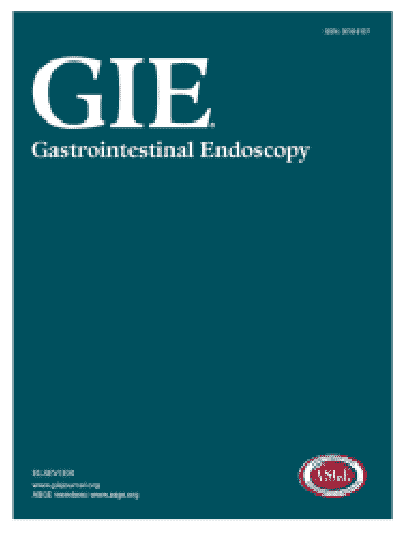

# 基于监督机器学习的内镜下袖状胃成形术再干预评分 (ESG-RS)

# 利用机器学习预测内镜胃管形成术后 30 天再干预风险

## 方法与队列

**数据集**：来自 MBSAQIP 数据库（2016-2021）的 3,583 名患者

**方法**：用于预测因子选择的 LASSO 罚回归，用于 ESG-RS 的多因素分析

## 结果

**选择了 11 个变量，5 个影响再干预风险的关键因素：**

- 前胃部手术史
- 术前 AC（抗酸/质抑制剂）使用
- 女性
- ASA 评分 >= 2
- 高血压

**模型性能**：AUC = 0.74 (95% CI: 0.70, 0.78)

**最佳截断点**：67.9（高风险 vs. 低风险）；灵敏度：0.76，特异性：0.71

### 结论

ESG-RS 有助于临床医生进行术前风险分层，并帮助识别再干预风险较高的患者，从而实现更好的决策和患者管理。

Hassam Ali, 等 2023

图片致谢，Freepik.com: geotatah, Mehuwish

Hassam Ali¹, Pratik Patel², Talia Farrukh Malik³, Rahul Pamarthy¹, Babu P. Mohan MD MS⁴, Ravishankar Assokkummar MBBS MRCP⁵, Grand Lopez-Nava MD PhD⁶, Douglas G. Adler MD⁷

- ¹ 美国北卡罗来纳州格林维尔，东部卡罗来纳大学/布罗迪医学院，内科，27834
- ² 美国纽约州波特杰斐逊港，马瑟瑟医院/霍夫斯特拉大学医学院，胃肠病科，11777
-  ³ 美国伊利诺伊州北芝加哥，罗莎林德·富兰克林医学科学大学芝加哥医学院，内科，60064
-  四 美国犹他州盐湖城，犹他大学医学院，胃肠病与肝脏科
-  五 新加坡，新加坡总医院，杜克国家医院，胃肠病科
-  六 西班牙马德里，马德里·桑奇纳罗大学立医院，减重内镜中心主任
-  七 美国科罗拉多州丹佛，Centura Health，波特·阿德文斯特医院，先进治疗性内镜中心主任

通讯作者：
Douglas G. Adler: dougraham2001@gmail.com: 美国科罗拉多州丹佛，Centura Health，波特·阿德文斯特医院，先进治疗性内镜中心主任。

所有作者电子邮箱：

Hassam Ali: alih220@ecu.edu

Pratik Patel: ppatel73@northwell.edu

Talia F. Malik: taliamalik@gmail.com

Rahul Pamarthty: pamamthyr20@ecu.edu

Babu P. Mohan: dr.babu.pm@gmail.com

Ravishankar Asokkumar: ravishnkr03@yahoo.com

Gontrand Lopez-Nava: glopeznava@digestivoleznava.com

Douglas G. Adler: dougraham001@gmail.com

# 作者贡献：

Hassam Ali: 概念化、方法论、软件、数据整理、验证、初稿撰写、文章最终批准。Pratik Patel: 数据整理、初稿撰写、文章最终批准。Talia F. Malik: 可视化、调查、初稿撰写、文章最终批准。Rahul Pamarthty: 可视化、调查、初稿撰写、文章最终批准。Babu P. Mohan: 编辑、管理、监督。Douglas G. Adler: 编辑、管理、监督。# 利益冲突/披露：

作者证明他们与任何利益利益组织没有关联。# 伦理声明：

本研究不需要伦理委员会审查，因为 MBSAQIP 数据库是开放的。

患者知情同意：

MBSAQIP 数据库不识别患者。因此，不需要同意。

## 摘要

### 背景与目的

内镜胃管形成术 (ESG) 后的再干预。我们开发并内部验证了一个评分 (ESG-RS)，用于预测 30 天内的个体再干预风险。

### 方法

我们使用了来自减重手术质量改进计划 (MBSAQIP) 数据库（2016-2021）的 3,583 名接受 ESG 患者的数据。利用最小收缩和选择算 (LASSO) 回归选择预测因子。将 LASSO 提取的变量纳入多因素分析以生成 ESG-RS。

## 结果

LASSO 选择了 11 个变量。影响再干预风险的五个关键因素是：前胃手术史、术前 AC 使用、女性、ASA 评分 >= 2 以及高血压。模型性能显示为 0.74 (95% CI: 0.70, 0.78)。ESG-RS 的最佳截断点为 67.9（高风险 vs. 低风险），灵敏度为 0.76，特异性为 0.71。

### 结论

ESG-RS 有助于临床医生进行术前风险分层，并帮助识别再干预风险较高的患者，从而实现更好的决策和患者管理。

# 引言

内镜胃管形成术 (ESG) 是一种微创手术，用于对饮食和生活方式改变无反应的患者减肥。它由 Dayyeh 等于 2013 年首次引入。以来，ESG 经历了快速增长，由于其更短的手术时间和相当的事件发生率，相比传统的减重手术（如腹镜胃管切除术）具有某些优势。ESG 涉及使用全层内镜缝合装置缩小胃容量。在 12 个月后，ESG 导致总体重减轻和超重减轻分别为 16% 和 60%。之前的比较显示，SG 后的并发症风险相当，且在减轻方面具有非劣势性。最近关于 ESG 和 LSG 的数据显示，两者相当，但 30 天内入院和再干预的比例更高。由于 ESG 是项新技术，医疗人员可能因为不熟悉过程而降低干预阈值，导致再干预率高于 SG。虽然 SG 再干预相关的因素此前已探讨，但 ESG 再干预相关的因素尚未被研究。

## 材料与方法：

本研究利用代谢和减胖手术认证质量改进计划（MBSAQIP）数据库，这是全球最大的减胖手术特定数据库，时间范围为 2016 年 1 月至 2021 年 12 月。[10] 所有经过认证的减胖中心都报告了在其中心进行的减胖手术数据。MBSAQIP 数据库包含了术前、术中和术后变量，包括合并症和30 天后结局。由于隐私考虑，MBSAQIP 数据库不报告医院位置、患者标识符或医生数据。仅包含完整病例。MBSAQIP 注册中心定期进行审计，并排除30 天随访率低于 80% 的中心。[11] 研究人群

本研究利用 2016-2021 年 MBSAQIP 数据库识别接受了内镜下胃固定术（ESG）的患者。干预定义为 ESG 手术后 30 天内完成内镜、手术或放射干预。[12] 如果年龄小于 18 岁、体重过轻（BMI < 30）、数据不完整、编码错误或正在接受修复或转换手术，则排除病例。[13] 根据先验知识和近期文献中的预测因子对数据库中的潜在临床变量进行评估。使用相关矩阵评估所有解释变量的共线性（补充文件 1）。相关系数 > 0.7 的变量被排除。候选因素包括人口统计学特征（如年龄、体重指数、性别）、临床变量、实验室数据（如白蛋白、血细胞比容）以及合并症数据（如血栓形成史、心肌梗死等）。所有 26 个候选变量见表 1。

统计学分析：

我们利用 STATA 中的 "pmsample" 命令计算最小样本量，以开发一个具有二分类结局的新多变量预测模型；预期 C 统计量为 0.95，新预测模型中的潜在入选变量为 26 个。ESGRS 需要的最小样本量为 203。利用最小绝对收缩和选择算（LASSO）回归来确定30 天再次干预的充分预测因子。LASSO 通过将微贡献变量的系数压缩为零来选择预测因子子，从而将其从模型中排除。通过交叉验证选择决定系数收缩的调优参数 lambda。[14] 评估 LASSO 选择变量的独立优势比（OR），并将 LASSO 回归识别出的预测因子进入多变量逻辑回归模型。我们利用后向逐步法选择 P 值低于 0.05 的变量用于最终的多变量逻辑回归模型。如前所述，任何 P 值 < 0.05 的变量均从最终风险评分模型中排除。[15] 十折交叉验证生成了新病例预测性能 (曲线下面积 (AUC)) 的务实估计，因为它防止了忽略病例中预测性能的过度估计。[14] AUC 值表示模型预测 30 天再次干预的能力。AUC 为 0.5 到 0.6 表示区分能力不佳，0.6-0.7 表示满意，0.7 到 0.8 为良好，0.8 到 0.9 为优秀，超过 0.9 为极佳。[16] 我们还为 AUC 生成了偏偏修正自助法（BC）95% 置信区间。

通过校准线图评估模型预测与实际 30 天再次干预的一致性。这允许直观检查观察频率与预期概率之间的任何显著差异以及校准偏差。[17] 校准线图中还包含指示偏离分界线 [45° 完美拟合线] 是否显著的校准测试。[18, 19] Brier 分作为预测与观察结果之间的方差测量，用于评估整体性能。[16] 其值范围从 0（不一致）到 1（完全不一致），越低越好。

## 结果

本分析共纳入 3583 名患者。人口统计学和临床特征见表 1。ESG 病例的 30 天内镜再次干预率为 3.3%，在 26 个预测因子中，通过 LASSO 回归留下了用于预测 30 天再次干预的因子，平均 lambda 为 0.003，其中 LASSO 选择了十一个变量，包括前道手术史、术前抗凝（AC）使用、女性性别、长期类固醇使用、经皮冠动脉干预史、ASA 评分 >=2、高血压、术前 GERD 诊断、深静脉血栓史、术前白蛋白和血细胞比容（表 2）。

经过多变量逻辑回归后，五个变量具有统计学意义，包括前道手术史（OR 4.98, 95% CI 3.08–8.06, P < 0.001）、术前 AC 使用（OR 2.22, 95% CI 1.10–4.51, P = 0.011）、女性性别（OR 1.48, 95% CI 1.05–2.01, P = 0.012）、长期类固醇使用（OR 1.85, 95% CI 1.02–3.35, P = 0.025）、经皮冠动脉干预史（OR 2.12, 95% CI 1.15–3.90, P = 0.005）、ASA 评分 >=2（OR 2.45, 95% CI 1.45–4.12, P = 0.001）、高血压（OR 1.68, 95% CI 1.12–2.51, P = 0.002）、术前 GERD 诊断（OR 1.32, 95% CI 0.85–2.01, P = 0.125）、深静脉血栓史（OR 1.55, 95% CI 0.98–2.45, P = 0.045）、术前白蛋白（OR 1.42, 95% CI 0.95–2.12, P = 0.065）和血细胞比容（OR 1.28, 95% CI 0.82–1.98, P = 0.110）。

## 讨论

ESGRS 是使用监督学习选择的变量生成的，显示没有校准偏差且性能良好 (AUC >0.7)。我们的结果表明，通过五个术前预测因子可以预测30 天再次干预的个体化风险：前道手术史、术前 AC 使用、女性性别、ASA 评分 >=2 和高血压。我们提供了一种有助于的方法来确定 ESG 后再次干预的个体化风险，据我们所知，这是首项此类研究。

大小（优势值比）在无显著性时最小（补充文件 2）。此外，将它们排除在生成 ESGRS 的最终模型之外并未改变其预测能力（补充文件 2）。

虽然与镜下胃切除术和 Roux-en-Y 胃绕道术相比，ESG 的副作用特征较良好，但对于高 ESGRS 分数的患者，应考虑进行更密切的监测。[23, 24] 我们研究中与再次干预风险增加相关的变量，此前已被确定为术后并发症的风险因素。[25, 26, 27, 28, 29] 基于这些变量，使用评分系统在 ESG 之前对患者进行分层和教育，有助于预测并从而防止未来的并发症，包括再次干预。

本研究存在某些局限性。虽然我们使用了术前预测因子来推导风险评分系统，但遗了一些额外的预测因子，例如医院级信息，这些因素本提高 AUC。0.7-0.8 之间的 AUC 具有良好的预测能力和内部效度；然而，需要外部效度来优化其在临床判断中的精确度。由于研究局限于北美患者，其对全球的普适性可能有限。目前不清楚哪些手术是由胃肠科医生执行，哪些是由外科医生执行，以确定这是否会增加需要进一步干预的概率。某些变量可能与再次干预显著相关，但可能预测能力，因此在 LASSO 回归后被排除。此外，数据库没有 MBSQIP 中心认证的信息，因此与“ESG 执行量”相关的因素在目前的研究中无法予以考虑。尽管存在上述局限性，我们使用了有力的 10 折交叉验证进行内部验证，这比分样本验证提供了更低的估计偏差，产生了更多的预测。尽管这是一项回顾性研究，但数据的纵向结构证实，在减重手术病例的总量上，ESGRS 分数可以提高对患者 30 天内再次干预风险的认知；未来需要纵向研究来观察前瞻性地处理已识别因素是否能减轻 30 天内内镜再次干预的需求。

- 1. Abu Dayeh BK, Rajan E, Gostout CJ. Endoscopic sleeve gastroplasty: a potential alternative to surgical gastrectomy for treatment of obesity. Gastrointest. 2013;78(3):530-535.
- 2. Gudur AR, G CX, Khatri S, et al. Comparison of endoscopic sleeve gastroplasty versus surgical gastrectomy: Metabolic and Bariat Surgery Accreditation and Quality Improvement database. Gastrointest Endosc. 2023;97(1):11-21.
- 3. Amirian H, Torquati A, Otomosho P. Racial disparity in 30-day outcomes of metabolic and bariat gastrectomy. Obesity Surg. 2020;30(3):1011-1020.
- 4. Lopez-Nava G, Galvao MP, Batista-Castaño I, Fernandez-Corbelle JP. Endoscopic sleeve gastroplasty: how do it? Obs Surg. 2015;25(8):1534-1538.
- 5. Yoon JY, Arau RT, Study Group for Endoscopic Bariatric and Metabolic Therapies of the Korean Society of Gastrointestinal Endocrinology. The efficacy and safety of endoscopic sleeve gastroplasty as an alternative to laparoscopic gastrectomy. Clin Endosc. 2021;54(1):17-24.
- 6. Alqahtani AR, Elahmedi M, Aldarwish A, Abduraby HY, Alqahtani S. Endoscopic gastroplasty versus laparoscopic gastrectomy: a noninferior propensity score-matched comparative study. Gastrointest Endosc. 2022;96(1):44-50.
- 7. Gribben JL, Ilonzo N, Neifert S, Michael Leitman L. Predictors of reoperation and failure to rescue in bariatric surgery. JSLS. 2018;22(1):e2017.0074.
- 8. Mohan BP, Asokkumar R, Khan SR, et al. Outcomes of endoscopic sleeve gastroplasty; how does it compare to laparoscopic gastrectomy? a systematic review and meta-analysis. Endosc Int Open. 2020;8(4):E558-E565.
- 9. Hedjoudjie A, Abu Dayeh BK, Cheskin LJ, et al. Efficacy and safety of endoscopic sleeve gastroplasty: a systematic review and meta-analysis. Clin Gastroenterol Hepatol. 2020;18(5):1043-1053.e4.
- 10. ASMBS, 2022. MBSQIP participants use data files (PUF). [online] American College of Surgeons. Available at: https://www.facs.org/quality-programs/accreditation-and-verification
- 11. Gudur AR, Geng C, Hallowell P, et al. Impact of proceduralist specialty on outcomes following endoscopic sleeve gastroplasty. Obes Surg. 2022;32(11):3714-3721.
- 12. Abu Dayeh BK, Bazerachi F, Vargas EJ, et al. Endoscopic sleeve gastroplasty for treatment of class 1 and 2.
- 13. Bazerachi F, Abu Dayeh BK, Neto MG, Boskoski I. Limitations in gastroplasty derived from surgery. Gastroenterosc. 97.
- 14. Steyerberg EW, Vergoue Y. Towards better clinical prediction: seven steps for development and validation. Eur Heart J. 2014;35(29):1925-1931.
- 15. Yuan L, Shen L, Ji M. New score to predict intensive care unit admission for pancreatitis 48 hours after.
- 16. Steyerberg EW, Vickers AJ, Cook NR. Assessing the performance of prediction models: a framework for traditional and novel measures. Epidemiology. 2010;21(1):128-138.
- 17. Fenlon C, O'Grady L, Dunn J. When odds ratios mislead? BMJ. 1998;316(7136):989-991.
- 18. Nattino G, Finazzi S, Poole D, Cogo PE, Bertolini G. A new calibration test for reappraisal of the belt. Stat Med. 2014;33(14):2390-2407.
- 19. Finazzi S, Poole D, Luciani D. Calibration belt for quality-of-care assessment on binary outcomes. PLoS One. 2011;6(2):e1611.
- 20. Saltelli A. Sensitivity analysis for importance. Risk An. 2002;22(3):579-590.
- 21. Park KV, Oh KH, Jeong YY. Machine learning models for prognosis in sudden hearing loss. Clin Exp Otorhin. 2020;13(2):148-156.
- 22. Davies HT, Crombie IK, Tavakoli M.
- 23. Fayad L, Adam A, Schweitzer M, et al. Endoscopic sleeve gastrectomy versus laparoscopic gastrectomy: do they differ at 2 years? Gastroend. 2019;89(4):782-788.
- 24. Lopez-Nava G, Ashokumar R, Batista-Castaño I, et al. Endoscopic sleeve gastrectomy, laparoscopic sleeve gastrectomy, and laparoscopic plication. Endoscopy. 2021;53(3):235-243.
- 25. DeMaria EJ, Portier D, Wolfe L. Obesity surgery risk score: proposal for a clinically useful score to predict mortality risk in patients undergoing gastric bypass. Surg Obes Relat Dis. 2007;3(2):134-140.
- 26. Liu JY, Birkmeyer NJ, Sanders JH, et al. Risks of morbidity and mortality in dialysis patients coronary bypass surgery. New England Cardiovascular Disease Study. Circulation. 2000;102(24):2973-2977.
- 27. Sjjöström L, Narbro K, Sjjöström CD, et al. Effects of bariatric surgery on mortality in Swedish subjects. N Engl J Med. 2007;357(8):741-752.
- 28. Sanni A, Perez S, Medbery R, et al. Postoperative complications in bariatric surgery using age and BMI stratification: a study using ACS-NSQIP data. Surg Endosc. 2014;28(12):3302-3309.
- 29. Kellogg TA, Swan T, Leslie DA, Buchwald H, Ikramuddin S. Patterns of readmission and reoperation within 90 days after Roux-en-Y gastric bypass. Surg Obes Relat Dis. 2009;5(4):416-423.

| 变量 | N (%) |
|--- |--- |
| 总人数 | 3583 |
| 性别 | |
| 女性 | 521 (14.5 %) |
| 男性 | 3062 (85.5 %) |
| 年龄，中位数 (IQR) | 48.0 (40.8, 56.0) |
| 术前接近减重手术的 BMI，中位数 (IQR) | 38.0 (34.1, 43.6) |
| 术前接近减重手术的体重，中位数 (IQR) | 231.0 (203.9, 268.0) |
| 术前需要治疗的静脉血栓形成 | 87 (2.4 %) |
| 术前糖尿病 | 484 (13.5 %) |
| 术前静脉淤血 | 26 (0.7 %) |
| 术前需要或正在接受透析 | 2 (0.1 %) |
| 术前肾功能不全 | 8 (0.2%) |
| 术前治疗性抗凝 | 93 (2.6%) |
| 既往前胃手术 | 1764 (49.2%) |
| 1年内现吸吸 | 207 (5.8%) |
| 术前慢性阻塞性肺疾病 (COPD) 病史 | 29 (0.8%) |
| 术前肺栓塞病史 | 2 (0.1%) |
| 术前阻塞性睡眠呼吸 | 670 (18.7%) |
| 术前因慢性疾病使用类固醇/免疫抑制剂 | 60 (1.7%) |
| 术前下腔静脉滤滤器 | 13 (0.4%) |
| 术前需要药物治疗的胃食管反流 (GERD) | 1041 (29.1%) |
| 术前心肌梗死 (MI) 病史 | 33 (0.9%) |
| 既往经皮冠动脉干预 (PCI) | 57 (1.6%) |
| 既往心脏手术 | 39 (1.1%) |
| 术前需要药物治疗的高血压患者 | 1256 (35.1%) |
| 术前高脂血症 | 574 (16.0%) |
| 术前红细胞压积 (%)，中位数 (IQR) | 40 (37.7, 42.5) |
| 术前白蛋白 (g/dL)，中位数 (IQR) | 4.1 (3.9, 4.4) |
| 术前血清肌酐 (mg/dL)，中位数 (IQR) | 0.79 (0.7, 0.9) |
| 术前糖化血红蛋白 (%)，中位数 (IQR) | 5.6 (5.3, 6) |
| ASA 分级 >= 2 | 1848 (51.6%) |
| 术后30天内再次干预 | 117 (3.3%) |
| 再次干预天数，中位数 (IQR) | 13.0 (4.0, 21.0) |
| 术后30天内再次入院 | 164 (4.6%) |
| 再次入院后的再次干预（并发症背景） | 69 (42.1%) |

表2：预测内镜下袖形成的胃术后30天再次干预的 lasso 模型保留的预测因子惩罚回归系数

| 预测因子 | 使用 lasso 回归得到的模型 (N = 3583) |
|---|---|
| 性别 | - |
| 女性* | -.70 |
| 男性 | - |
| 年龄，中位数 (IQR) | - |
| 术前接近减重手术的 BMI，中位数 (IQR) | - |
| 术前接近减重手术的体重，中位数 (IQR) | - |
| 术前需要治疗的静脉血栓形成 | .07 |
| 术前糖尿病 | - |
| 术前静脉淤血 | - |
| 术前需要或正在接受透析 | - |
| 术前肾功能不全 | - |
| 术前治疗性抗凝* | .82 |
| 既往前胃手术* | 1.30 |
| 1年内现吸烟 | - |
| 术前慢性阻塞性肺疾病 (COPD) 病史 | - |
| 术前肺栓塞病史 | - |
| 术前阻塞性睡眠呼吸 | - |
| 术前因慢性疾病使用类固醇/免疫抑制剂 | -.49 |
| 术前下腔静脉滤滤器 | - |
| 术前需要药物治疗的胃食管反流 (GERD) | .13 |
| 术前心肌梗死 (MI) 病史 | - |
| 既往经皮冠动脉干预 (PCI) | -.46 |
| 既往心脏手术 | - |
| 术前需要药物治疗的高血压患者* | .26 |
| 术前高脂血症 | - |
| 术前红细胞压积 (%)，中位数 (IQR) | .003 |
| 术前白蛋白 (g/dL)，中位数 (IQR) | .003 |
| 术前血清肌酐 (mg/dL)，中位数 (IQR) | 0.79 (0.7, 0.9) |
| 术前糖化血红蛋白 (%)，中位数 (IQR) | 5.6 (5.3, 6) |
| ASA 分级 >= 2 | 1848 (51.6%) |

