# 高效能与鲁棒性：跨层方法（人工智能与机器人系列）

*Roman V. Yampolskiy*
*Mazin Gilbert*
*David Burden, Maggi Savin-Baden*
*Yunong Zhang, Dechao Chen, Chengxu Ye*
*Hanky Sjafrie*
*Maggi Savin-Baden, Victoria Mason-Robbie*
*Yasmina Bestaoui Sebbane*
*Jędrzej Osiński*
*Edited by Lentin Joseph, Amit Kumar Mondal*
*Maggi Savin-Baden*
*Yasmina Bestaoui Sebbane*
*Catriona Campbell*
*Edited by Maurizio Tinnirello*
*Ata Jahangir Moshayedi, Amin Kolahdooz, Liao Liefa*
*Edited by Judith Dörrenbächer, Marc Hassenzahl, Robin Neuhaus, Ronda Ringfort-Felner*
*Ariel Fernández*
*Nguyen Van Toan and Phan Bui Khoi*
*Susan Brokensha, Eduan Kotzé, Burgert A. Senekal*
*Ariel Fernández*
*Silvia Tulli*
*David W. Aha*
*Marcus Hutter, Elliot Catt, and David Quarel*
*Roman V. Yampolskiy*
*Alexander Manu*
*Jan Maarten Schraagen*
*Seth Dobrin*
*Edited by M. Irfan Uddin and Wali Khan Mashwan*
*Alberto Marchisio, Muhammad Shafique*

For more information about this series please visit:

[`www.routledge.com/Chapman--HallCRC-Artificial-Intelligence-and-Robotics-Series/book-series/ARTILRO`](https://www.routledge.com/Chapman--HallCRC-Artificial-Intelligence-and-Robotics-Series/book-series/ARTILRO)

First edition published 2025

by CRC Press

2385 Executive Center Drive, Suite 320, Boca Raton, FL 33431

and by CRC Press

4 Park Square, Milton Park, Abingdon, Oxon, OX14 4RN

*CRC Press is an imprint of Taylor & Francis Group, LLC*

© 2025 Alberto Marchisio, Muhammad Shafique

Reasonable efforts have been made to publish reliable data and information, but the author and publisher cannot assume responsibility for the validity of all materials or the consequences of their use. The authors and publishers have attempted to trace the copyright holders of all material reproduced in this publication and apologize to copyright holders if permission to publish in this form has not been obtained. If any copyright material has not been acknowledged please write and let us know so we may rectify in any future reprint.

Except as permitted under U.S. Copyright Law, no part of this book may be reprinted, reproduced, transmitted, or utilized in any form by any electronic, mechanical, or other means, now known or hereafter invented, including photocopying, microfilming, and recording, or in any information storage or retrieval system, without written permission from the publishers.

For permission to photocopy or use material electronically from this work, access [www.copyright.com](https://www.copyright.com) or contact the Copyright Clearance Center, Inc. (CCC), 222 Rosewood Drive, Danvers, MA 01923, 978-750-8400. For works that are not available on CCC please contact mpkbookspermissions@tandf.co.uk

*Trademark notice:* Product or corporate names may be trademarks or registered trademarks and are used only for identification and explanation without intent to infringe.

ISBN: 978-1-032-85550-9 (hbk)

ISBN: 978-1-032-87013-7 (pbk)

ISBN: 978-1-003-53045-9 (ebk)

DOI: [10.1201/9781003530459](https://doi.org/10.1201/9781003530459)

Typeset in LM Roman

by KnowledgeWorks Global Ltd.

**Alberto Marchisio** received his B.Sc. and M.Sc. degrees in Electronic Engineering from Politecnico di Torino, Turin, Italy, in October 2015 and April 2018, respectively. He received his Ph.D. degree in Computer Science from the Technische Universität Wien (TU Wien) Informatics Doctoral College Resilient Embedded Systems, Vienna, Austria, in September 2023. Currently, he is a Research Group Leader with the eBrain Lab, Division of Engineering, New York University Abu Dhabi (NYUAD), United Arab Emirates. His main research interests include hardware and software optimizations for machine learning, brain-inspired computing, VLSI architecture design, emerging computing technologies, robust design, and approximate computing for energy efficiency. He (co-)authored 30+ papers in prestigious international conferences and journals. He received the honorable mention at the Italian National Finals of Maths Olympic Games in 2012, and the Richard Newton Young Fellow Award in 2019.

Muhammad Shafique (M’11 - SM’16) 获得了德国卡尔斯鲁厄技术学院 (KIT) 计算机科学博士学位，并于 2011 年获得该学位。随后，他作为 KIT 研究小组的创立者和负责人，带领该小组取得了显著成就，并参与了全球范围内的重要协作研发活动。除了在巴基斯坦创立一家技术初创公司外，他还发起并领导了一项 ICT 研发项目。自 2011 年以来，他一直与世界各地的多所大学建立了稳固的研究联系，积极参与并指导了多项研发活动和学生/研究生论文的指导，取得了高质量的研究成果和学术发表。加入 KIT 之前，他曾在 Streaming Networks Pvt. Ltd. 工作，期间参与了数年视频编码系统的研发工作。2016 年 10 月，他加入德国维也纳技术大学 (TU Wien) 计算机工程系的计算机体系结构与健壮、节能高效技术讲席教授职位。自 2020 年 9 月起，Shafique 博士加入纽约大学 (NYU)，目前担任 NYU-Abu Dhabi 在阿联酋的 eBrain Lab 负责人以及 Tandon 学院 NYU-New York City 在美国的全球网络教授。他还担任 NYUAD 多个中心的共同研究员/调查员，包括人工智能与机器人中心 (CAIR)、网络安全中心 (CCS)、面向城市互联网的交互中心 (CITIES) 以及量子与拓扑系统中心 (CQTS)。

Shafique 博士在获得备受瞩目的拨款、领导团队项目、按时完成演示、激励团队成员发挥最大潜能以及完成独立困难任务等方面展现了成功。他的经验得到了扎实的技术知识和卓越的教育背景（始终以金牌获得者）的佐证。他还深入理解各种视频编码标准和机器学习算法。他的研究兴趣涵盖人工智能与机器学习硬件与系统级设计、脑启发计算、神经形态计算、近似计算、量子机器学习、认知自主系统、机器人、可穿戴医疗、医疗 AI、节能系统、鲁棒计算、机器学习安全与隐私、硬件安全、新兴技术、电子设计自动化、FPGA、MPSoC、嵌入式系统以及量子计算。他尤其专注于计算与存储系统的跨层分析、建模、设计和优化。所研发的技术和工具已在物联网 (IoT)、智能物理系统 (CPS) 以及 ICT 发展 (ICT4D) 领域的应用场景中得到部署。

Shafique 博士在多个顶级会议上发表了多篇 keynote、邀请报告和讲习班。他还组织了多个重要会议的特别会议，如 DAC、ICCAD、DATE、IOLTS 和 ESWeek。他曾担任 IEEE Transactions on Computer Aided Design (TCAD)、IEEE Design and Test Magazine (D & T)、ACM Transactions on Embedded Computing (TECS)、IEEE Transactions on Sustainable Computing (T-SUSC) 以及 Elsevier MICPRO 等权威期刊的副编辑和客座编辑。他还担任 CODES+ISSS、IGSC、ISVLSI、PARMA-DITAM、RTML、ESTIMedia 和 LPDC 等会议的 TPC Chair；担任 ISVLSI、IGSC、DDECS 和 ESTIMedia 的总主席；在 DAC、ICCAD、DATE、IOLTS、DSD 和 FDL 担任 Track Chair；担任 ISVLSI 的 PhD Forum Chair。他还曾参与众多备受尊敬的 IEEE/ACM 会议的程序委员会，包括 ICCAD、DAC、MICRO、ISCA、DATE、CASES、ASPDAC 和 FPL。2022 年，他被任命为 ACM TODAES 评审委员会成员。他是 IEEE 和 IEEE 信号处理学会 (SPS) 的高级会员，ACM、SIGARCH、SIGDA、SIGBED 和 HIPEAC 的专业会员。他持有一项美国专利，合著 7 本专著、20 多章专著、350 多篇顶级期刊和会议论文，以及 100 多篇存档文章。

Shafique 博士荣获 2015 年 ACM/SIGDA 优秀新教员奖，2020、2022 和 2023 年 AI-2000 芯片技术最具影响力学者奖，2021 年 ATRC ASPIRE 研究卓越奖，其教育生涯中获得六枚金牌，以及在 CODES+ISSS、DATE、DAC 和 ICCAD 等顶级会议上多次获得最佳论文奖和提名，以及最佳硕士论文奖、DAC’14 设计跟踪最佳海报奖、IEEE 计算机杂志“本月特色论文”奖、最佳讲师奖等多项荣誉。他关于 GPU 老化优化的研究成果被《Nature Electronics》2018 年 2 月刊特别报道。Shafique 被列入 2021 年 NYU 教师荣誉名单。他的学生也在研究社区中获得了多项重要的学生和研究奖项。

DOI: [10.1201/9781003530459-1](https://doi.org/10.1201/9781003530459-1)

在机器学习 (ML) 系统中，深度神经网络 (DNNs) 已成为计算机视觉、医学、金融和机器人等多个领域的重要里程碑。这导致了在资源受限的嵌入式系统上部署 DNN 推理工作负载的需求。然而，机器学习社区的当前趋势是朝相反方向发展，因为新兴的网络往往更深更复杂。例如，胶囊网络 (CapsNets) 是一种基于胶囊（神经元数组）的特殊 DNN 类型，能够比传统 DNN 更好地学习高层特征。因此，执行先进 DNN 的下一代计算平台将表现出高复杂度和高能耗，这对资源受限设备的可行性提出了挑战。

另一方面，脉冲神经网络 (SNNs) 作为高效计算基础设施，用于处理事件驱动的 DNN，它们更贴近人类大脑的功能认知。这推动了神经形态计算范式的发展，其硬件架构支持能量高效的事件驱动 SNN 执行。

另一个需要考虑的基本方面是部署先进深度学习 (DL) 架构时的安全性。系统在处理安全关键应用时，必须对各种漏洞威胁保持高度鲁棒性。攻击者可以通过攻击硬件和软件栈的不同层面，或扰动输入、内存或计算引擎来威胁 DL 系统的完整性。因此，必须在系统不同抽象层次上应用防御措施，这通常会带来一定的能耗和计算开销。此外，虽然传统 DNN 的安全性研究已相当充分，但研究先进 DL 系统的安全性则为利用其独特特性提供了独特机会。

除了这些约束和需求，不断变化的市场对快速交付优化的端到端系统施加了巨大压力。因此，加速设计流程的优化对于满足这些时间到市场的需求至关重要。

## 1.1 Optimization Objectives for Dnn Models and Architectures

### 1.1.1 Energy-Efficiency

先进 DNNs 耗费大量资源，需要大容量内存和昂贵的计算引擎。此外，实时系统的严格约束要求输出必须以快速响应生成。为使快速且高精度的 DNN 能够在资源受限的便携设备上使用，可以应用多种优化技术来提升 DNN 执行的能源效率。

在软件层面，像剪枝 `79 154 51` 和量化 `96 275` 等压缩技术显著降低了处理 DNN 工作负载所需的资源。然而，这些方法通常会导致一定的准确性损失，或需要高昂的再训练开销才能部分恢复原始准确性。

另一种显著的研究方向是硬件感知神经结构搜索（NAS）方法，用于寻找能源高效的 DNN。硬件感知 NAS 方法 `239 100`，以利用行静态数据流。更灵活的数据流可以由可配置架构 `144 116 31` 支持。此外，为高效处理软件层面的压缩优化（如剪枝和量化）以及其他专用架构，已设计用于高效处理稀疏 DNN `77 203` 和灵活位宽 `244`。

另一方面，事件驱动计算的突破催生了神经形态架构 `170 40` 的设计，其目标是在事件出现时异步进行计算。因此，这些系统在使用事件驱动相机（如动态视觉传感器 DVS）捕获场景时，能够实现极低的能耗。然而，为设计和训练事件驱动 SNN 的工具和算法仍不成熟，SNN 在神经形态硬件上的实现必然在准确性上与传统硬件上对应的 DNN 实现相比存在损失。

### 1.1.2 鲁棒性

尽管近年来基于深度学习（DL）的系统取得了巨大成功和流行，最近的研究表明 DNN 存在固有弱点，这削弱了它们的可信度。在硬件层面，DNN 系统的故障可能由制造过程中的永久故障或瞬时故障（如软错误、老化和工艺变异）引起。此外，由于芯片供应链包含多个第三方设施，恶意硬件特洛伊木马（hardware Trojans）可能被植入设计中。当触发条件满足时，特洛伊木马会被激活，从而改变系统的正确行为。

为实现容错，传统的故障缓解方法基于冗余 `195 [32](#refbib.xhtml#refbib32]` 可以缓解瞬时故障。此外，最近的方法 `[238](#refbib.xhtml#refbib238]` 提出在 NAS 的优化目标中集成容错属性，通过最小化 DNN 模型对比特翻转的敏感性来实现。为防范硬件特洛伊木马，可以采用检测方法 `[49](#refbib.xhtml#refbib49]`，它们旨在监控系统运行并检测任何可疑的功能违规。


在软件层面，对抗性安全威胁 [67](#refbib.xhtml#refbib67) 正在出现。此类攻击的范围是对 DNN 输入进行微小修改，以诱导系统误动作。如果攻击者控制 DNN 模型的行为，系统的安全性和完整性将受到威胁，并可能影响其周围环境。此外，在处理大规模数据库时，隐私威胁也令人担忧。通过大规模分析私有信息，在 DNN 处理流程中可能会泄露机密数据。

为提高鲁棒性，可采用多种防御措施。最常用的技术是对抗性训练 [148](#refbib.xhtml#refbib148)，其核心是向输入数据中加入对抗性示例，迫使训练模型在存在攻击时也能够正确行为。其他防御技术包括量化 [132](#refbib.xhtml#refbib132) 和噪声过滤 [125](#refbib.xhtml#refbib125)，旨在降低对抗性扰动的影响。


为保护隐私，已提出多种方法。微分隐私`[2](#refbib.xhtml#refbib2)`在学习过程中引入随机化。多方计算方法通过将训练和测试数据分布在不同设备上，并使用特定的隐私保护协议同时进行计算`[173](#refbib.xhtml#refbib173)`。基于同态加密的机制`[62](#refbib.xhtml#refbib62)`通过在密文域中执行计算来保持数据机密。然而，这些技术显著增加系统的计算需求。因此，实现成本效益的鲁棒性具有挑战性，仍是一个开放的研究问题。

## 1.2 State‑of‑the‑Art Challenges and Research Goals Summary

先进的 DNN 系统采用一系列计算密集和内存密集的操作，以提供高精度的预测。此外，许多应用要求实时响应。虽然通用硬件平台在计算 DNN 工作负载方面效率低且缓慢，但将如此资源密集的算法部署到边缘设备是不可行的。因此，需要一个完整的设计流程，包括软件层面的优化（如压缩）、专用硬件设计以及映射。

此外，安全关键应用要求 DNN 系统在恶劣条件下具备高度鲁棒性。存在多种场景，对手代理可以破坏系统完整性。因此，从多个角度研究这些条件并制定防御措施以降低威胁影响是值得的。

### 1.2.1 State‑of‑the‑Art Limitations

1. *Excessive hardware and re‑training overhead*: 多种技术需要不可忽视的硬件开销或大量（重新）训练开销，这使得 ML 算法的执行尽管有优势，却不够便捷。轻量级方法（即不产生大开销的方法）尚未被成功研究。

2. *Lack of automation in the design space exploration*: 优化设计空间的努力极其手动且繁琐。需要开发更系统化的设计空间探索方法，以高效地搜索解决方案的空间。

3. *结合多个优化目标*：目前尚未详细研究不同优化技术的集成。将多个方面结合为多个优化目标对于开发能够超越单一技术的集成框架，提升 DNN 的效率和鲁棒性具有至关重要的意义。

4. *缺乏针对高级 DL 模型的专用优化*：针对传统 DNN 的优化方法已被提出，但它们在高级 DL 模型（如胶囊网络和射线网络）上通常效率不高。针对这类复杂 DL 模型的专用优化尚未系统研究。

5. *结合多种技术以增强 DL 的鲁棒性*：已提出多种技术以减轻硬件故障或软件层面攻击的影响，但这些技术对 DNN 能源效率的综合影响仍未被研究。

### 1.2.2 科学目标和目标

由于相关工作的局限性以及高级 DL 模型的异质性，提供跨层能效和鲁棒性优化具有挑战性。我们将主要研究目标分解为以下科学目标：

1. **识别执行 ML 任务的潜在性能/能效瓶颈**

   当前在复杂 DL 模型方面的最新进展主要致力于最大化准确率，而其硬件实现可能未得到优化，因为算法工作负载与硬件架构之间可能存在差距。

   *目标：本目标专注于研究高级 DL 模型在现有硬件上的执行情况，并报告其瓶颈。随后，我们探讨这些分析是否能够指导设计和优化，以减轻这些瓶颈。核心在于研究能显著提升计算中最低效部分的优化技术。*

2. **分析不同类型的脆弱性威胁及其鲁棒性**

   针对 DNN 的脆弱性威胁种类繁多且异质，使得设计和部署可信赖的 ML 系统变得困难。当前的 DNN 鲁棒性技术和优化主要针对简化目标，而更复杂的脆弱性场景仍可能威胁系统。

   *目标：本目标专注于通过从前所未探索的视角分析 DNN 系统的鲁棒性，并结合多种脆弱性威胁进行研究。识别这些威胁将有助于提供更稳健且成本效益更高的防御技术。*

3. **研究并设计资源高效的优化措施，以提升高级 DL 模型的性能和能耗**

   针对 DNN 能效的最新优化措施主要针对传统 DNN，它们由卷积层和全连接层组成。因此，针对高级 DL 模型（如胶囊网络）的软件层技术和硬件架构可能不够适配。

   *目标：本目标专注于设计新型框架，以提升复杂 DL 模型的训练和推理效率。同时，可设计专用硬件架构和优化工具，显著提高其效率。通过系统探索设计空间，可识别在准确率、能耗、延迟、面积、内存等不同优化目标之间的权衡（Pareto-最优）解决方案。*

4. **研究并设计具成本效益的优化措施，以提升对抗攻击的鲁棒性**

   针对 DL 模型对抗攻击的最新防御措施主要针对传统 DNN，可能在不同层间信息编码和通信方式（如 SNN 的情况）上效率不佳或不适用。因此需要采用不同的方法来提升其鲁棒性。

   *目标：本目标专注于分析高级 DL 模型的应用特性，提出并评估对抗攻击的具成本效益的防御措施。评估可针对多种脆弱性威胁模型进行。*

5. **设计应用特定的优化技术**

   对高级 DL 算法涉及的操作类型及其专用硬件架构进行深入分析，可为进一步提升效率提供依据。

   *目标：本目标专注于分析应用特定的优化，以高效执行高级 DL 系统在专用硬件上。本研究提出的优化措施可在不影响执行时间前提下，提升准确率和记忆能效。*

6. **研究不同优化目标之间的交互作用，以探索解决方案空间**

   针对 DL 推理的最新优化技术能有效提升能效，但可能使 DL 系统面临脆弱性威胁。另一方面，提升 DL 鲁棒性的最新技术往往伴随硬件开销和显著的能耗增加。它们的交互作用迄今尚未被研究。

   *目标：本目标专注于探讨不同优化技术在提升 DL 系统能效和鲁棒性之间的交互作用。这将有助于构建能够整合多个优化目标并高效探索解决方案空间的框架。*

## 1.3 书籍贡献

本书旨在实现高能效和高鲁棒性的先进 DL 系统，为多个应用领域提供成本效益的韧性。本书在硬件架构和软件层面提出了 novel 技术，使这些优化能够显著降低能耗，同时保持高鲁棒性。如图 Figure 1.1 所示，本书包含以下贡献：

*   **面向高级 DL 架构的硬件设计与软件层优化，提升能效**

    *DATE ‘19* \[155\], *DATE ‘20* \[157\], *‘20* \[150\], *JCNN 20* \[149\] \[168\], *TVLSI ‘21* \[159\], *TCAD ‘21* \[158\], *IJCNN ‘21* \[271\], *ISLPED ‘22* \[151\], *IROS ‘22* \[272\]

    本文提供了设计高效胶囊网络硬件的完整优化流程，包括高效硬件架构设计、计算单元配置的探索、数据流以及记忆组织方式。硬件层面的技术与软件层面的方法相结合，通过专用量化框架和近似计算设计，在训练和推理阶段提升系统效率。此外，还包括针对神经形态硬件部署高效射线网络（SNN）的设计方法和优化技术。针对 Loihi 计算平台，我们实现并映射了多种 SNN 设计，适用于不同应用场景。

## 安全威胁与优化在先进 DL 架构的鲁棒性和健壮性

*UDL @ ICML ‘19* \[162\], *IJCNN ‘20* \[163\] \[270\], *DATE ‘21* \[47\], *IJCNN ‘21* \[165\], *IROS ‘21* \[166\], *IJCNN ‘22* \[152\], *MICPRO ‘23* \[164\], *IJCNN ‘23* \[153\]

利用先进 DL 架构的固有特性，可以设计针对这些网络的攻击算法或防御措施。本书系统地比较了 DNN 和 CapsNets 在仿射变换和对抗攻击方面的鲁棒性。同时，还分析了针对新设计的伪造天气条件效果的攻击的鲁棒性。此外，还研究了 SNN 的安全威胁。针对离散数据，对 DNN 和 SNN 的对抗鲁棒性和位翻转弹性进行了研究，并提出了一种强度探索方法，用于微调 SNN 的内在结构参数，以实现高鲁棒性。针对基于事件的数据分析，在研究随机噪声的影响后，生成了多种攻击算法，并采用 DVS 噪声滤波器作为防御机制，以提高鲁棒性。

*Cross-Layer Methodology Jointly Optimizing for Efficiency, Accuracy, and Robustness of Advanced DL Architectures*

*ICCAD ‘20* \[156\], *DyNN @ ICML ‘22* \[160\], *Access ‘22* \[161\]

本文提出了一种面向硬件的 NAS 框架，用于设计基于胶囊层的 Pareto 最优 DNN。为降低巨大的训练时间和搜索空间，设计了一种分析模型，用于估计 DNN 在专用硬件加速器上执行时的内存、能耗和延迟。通过多目标进化算法进行设计空间探索。此外，为了在鲁棒性和硬件效率之间进行联合优化，系统地分析了在 NAS 中使用的对抗扰动值。通过这种方式，所提出的框架能够找到在内存、能耗、延迟和对抗鲁棒性方面的 Pareto 最优 DNN。

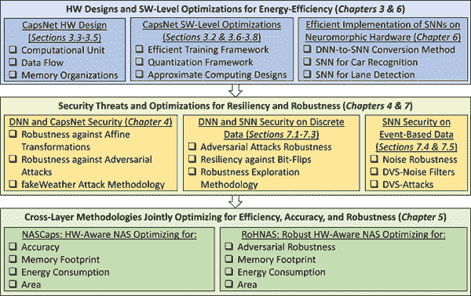

Figure 1.1: Overview of this book.

## 1.4 Book Outline

**Chapter 2** describes the basic concepts of DNNs and discusses the background information about CapsNets and SNNs. Afterward, it presents an overview of the vulnerability threats for DL systems. Moreover, it discusses the current trends and related works employed for optimizing the energy efficiency and robustness of DL systems while also highlighting the challenges and limitations of state-of-the-art techniques.

**Chapter 3** discusses the proposed design flow of software and hardware optimizations for CapsNets. It includes SW-level optimizations for training and inference, hardware designs of CapsNet inference accelerators and memory systems, and post-training optimizations like quantization and approximations. The implementations and outputs of the integrated framework are used in the security analyses of Chapter 4 and in the proposed cross-layer methodology of Chapter 5.

**Chapter 4** investigates the security vulnerabilities of advanced DL models such as DNNs and CapsNets. It performs a comparative analysis of their robustness against affine transformations and adversarial attacks. Moreover, novel adversarial attack algorithms are proposed and evaluated for DNNs and CapsNets.

**Chapter 5** discusses the proposed integrated frameworks for multi-objective optimizations of advanced DNNs. First, it presents a NAS methodology for jointly optimizing the accuracy, memory, energy, and latency of DNNs and CapsNets. Afterward, it discusses a framework that also includes adversarial robustness as a joint optimization objective.

**Chapter 6** presents efficient design methodologies and optimizations for deploying SNNs on the Intel Loihi neuromorphic processor. After providing an overview of the Loihi architecture, it discusses the design and optimizations of SNNs for different applications. Following an analysis to optimize the DNN-to-SNN conversion and a pre-processing technique for training event-based data in the DNN domain, efficient SNNs for gesture recognition are deployed and mapped on the Loihi chip. Afterward, toward autonomous driving applications, efficient SNN designs and implementations on the Loihi processor are proposed for car recognition and lane detection tasks.

**Chapter 7** discusses the vulnerabilities of SNNs against security threats. After comparing the adversarial robustness between DNNs and SNNs, novel attack methodologies and defensive countermeasures are proposed. An attack threat is devised in which a specific adversarial noise pattern in the inputs triggers a hardware Trojan that generates bit-flips in the most vulnerable weight locations of DNNs and SNNs. Afterward, the inherent robustness of SNNs is investigated, and a methodology is proposed to explore different values of the SNNs’ structural parameters. Toward event-based SNNs’ security, a novel methodology employing DVS-noise filters is proposed for improving the SNNs’ robustness against adversarial attacks. Moreover, a set of adversarial attacks for event-based SNNs is proposed and evaluated in the presence of such noise filters.

Finally, **Chapter 8** concludes this book and provides an outlook for potential future research directions.

## Chapter 2 Background and Related Work

DOI: [10.1201/9781003530459-2](https://doi.org/10.1201/9781003530459-2)

This book proposes cross-layer optimizations for advanced DL architectures, covering energy efficiency and resiliency perspectives. Besides the DNNs, a special focus is given to the advanced DL models such as CapsNets and SNNs. This chapter provides an overview of the DL systems’ functionality and the challenges related to the specific goals. Section 2.1 discusses a general background on DNNs followed by the latest related work on hardware accelerators for DNNs and optimizations for energy efficiency. Section 2.2 provides an overview of the CapsNets, with a special focus on the differences compared to the traditional DNNs. Section 2.3 discusses the background information on SNNs, neuromorphic architectures, and event-based vision. Section 2.4 discusses the DL vulnerability threats and the notable related works optimizing security and resiliency.

## 2.1 Deep Neural Networks

The basic element of a neural network is the `neuron`, which attempts to mimic the behavior of the biological neuron. A biological neuron \[52\], shown in Figure 2.1, consists of the cell body (soma), the dendrites, and an axon. The dendrites carry input stimuli processed by the soma, while the axon transmits the neuron output signal to other neurons. On the other hand, the artificial neuron performs a weighted sum of its inputs (Equation (2.1)), to which an offset is added as the bias term `b`. Then, the neuron's output is obtained by applying a non-linear activation function `σ` (Equation (2.2)).

![Figure 2.1: Comparison between a biological neuron (figure adapted from \[52\]) and an artificial neuron.](images/fig2_1.jpg)

Figure 2.1: Comparison between a biological neuron (figure adapted from \[52\]) and an artificial neuron.

$$\\begin{array}{l} {g(\\mathbf{x}) = \\sum\\limits\\_{n = 0}^{N - 1}\\mathbf{x}\\lbrack n\\rbrack\\mathbf{w}\\lbrack n\\rbrack} \\\\ \\end{array}$$  

(2.1)

$$\\begin{array}{l} {y = \\sigma\\left( g(\\mathbf{x}) + b \\right)} \\\\ \\end{array}$$  

(2.2)

The neurons are organized in layers. In feedforward networks, each neuron of layer `l` receives inputs from layer `l - 1` and sends its activation to the neurons of layer `l + 1`. The number of stacked layers indicates the depth. A neural network is typically called a `Deep Neural Network` (`DNN`) \[13\] if there are more than three hidden layers.

### 2.1.1 Layers and Operations

The layers are categorized based on the types of connections. The following list contains the most common types of layers in DNNs.

*   **Fully-Connected (FC) layers:** each neuron of layer `l` receives as inputs all the activations of layer `l - 1` (see Figure 2.2a). Since all the connections are present, the number of parameters of an FC layer is potentially huge. However, in practice, it is not always necessary for an output neuron to receive information from all the input neurons. For this reason, the convolutional layers have been designed.

*   **Convolutional (Conv) layers:** the neurons are organized in a 2D grid, i.e., a `feature map`, and every neuron of layer `l` does not receive all the activations of the layer `l - 1`, but it is connected to a small receptive field \[118\] (see Figure 2.2b). The receptive field size, which corresponds to the weight matrix, is commonly called `kernel size` and the stride parameter `S` defines the distance between adjacent receptive fields. In Conv layers with shared weights, all the neurons of layer `l` have the same matrix of weights and detect the same feature in different locations of layer `l - 1`. To detect multiple features, a Conv layer has multiple channels, i.e., there are multiple feature maps.

*   **Pooling layers:** similar to Conv layers, Pooling layers have receptive fields. For the group of neurons in each receptive field, their output is a single value that contains a statistic of the group, e.g., the maximum or the average value. An example of a MaxPooling layer is shown in Figure 2.2c. The stride parameter is typically set equal to the dimension of the receptive field to have non-overlapping windows. Pooling layers reduce the number of activations of a layer and consequently decrease the memory requirements and the number of computations while achieving invariance to small local translations. Pooling layers down-sample the Conv layer outputs, whose values heavily depend on the position of the input. Hence, Pooling layers make DNNs more robust to minor input variations.

*   **Normalization layers:** the input activations are usually preprocessed to have a normal distribution, i.e., zero mean and unit variance. The normalization is beneficial since it keeps different inputs within the same range of values to ease the computations and avoids saturating the non-linear activation functions. Typically, Normalization layers are inserted between Conv and FC layers. Moreover, the activations’ normalization speeds up the training since the layers do not need to adapt to different distributions at each training step. The most common type of normalization is the `Batch Normalization` \[94\].

*   **Activation functions:** without a non-linear activation function, the DNN would be a simple cascade of linear algebra operations. To solve complex non-linear problems, different non-linear functions are applied to the weighted sum of a neuron. In the first developments of DNNs, the Sigmoid and Hyperbolic Tangent functions were adopted, but their usage was reduced over the years due to their computational complexity. The most common function is the `Rectified Linear Unit (ReLU)`, which forces the activations to be greater than or equal to zero. Its newer variants, such as Leaky-ReLU and Exponential Linear Unit (ELU), aim at introducing a negative slope for negative values. Moreover, the `Softmax` function is typically used in output layers of DNNs for classification since it bounds the values in the range (0, 1) to represent the probabilities associated with the output classes.

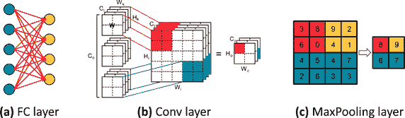

Figure 2.2: **(a)** Example of an FC layer. **(b)** Example of a Conv layer. **(c)** Example of a MaxPooling layer.

### 2.1.2 Training and Inference

DNNs learn how to perform a specific task by properly determining its parameters (weights and biases), which are continuously updated during the `training` phase. Afterward, during the `inference` phase, the parameters are kept constant, and the DNN makes the prediction. The dataset is typically split into training, validation, and testing sets. The training set is used for updating the parameters, while the validation set is used to fine-tune the hyperparameters. The inference is conducted on the testing set, which contains previously unseen data. There are different approaches for training DNNs:

*   **Supervised learning:** A set of labeled input-output pairs is required. In supervised learning, the DNNs’ parameters are updated to minimize the differences between the output labels and the DNN predictions. This approach is widely used nowadays in many applications due to its good performance. A common supervised learning algorithm for training DNNs is the `gradient backpropagation`. The DNN's outputs are compared with the labels, and a `loss` score is calculated with a `loss function`, such as the Euclidean distance or the Mean Squared Error (MSE). The parameters are updated accordingly by an amount proportional to the partial derivative (i.e., the gradient) of the loss w.r.t. the parameters. The gradients are computed through the backpropagation algorithm, which is based on the `chain rule` of calculus. The actual update is done with an `optimization algorithm`, such as the gradient descent or the Adam \[110\]. A common problem when training DNNs is `overfitting`, i.e., high performance on the train set and low performance on the test set. The techniques used to overcome this issue include L1 and L2 regularization \[188\], which add a regularizing term to the loss function, and dropout \[256\], which randomly removes some neurons in the DNN.

*   **Unsupervised learning:** When only non-labeled data are available, the goal is to find common patterns or data grouping without any guidance. The most popular unsupervised learning approaches are based on clustering, a data mining technique that groups unlabeled data based on attribute similarities or differences. Common DNNs that apply unsupervised learning are autoencoders and Generative Adversarial Networks (GANs).

*   **Reinforcement learning:** Reinforcement learning is the third primary type of learning. Similar to unsupervised learning, it does not need labeled data. It is based on autonomous agents who decide to travel across states in a given environment. The agent gets a reward in case of success but will not receive any reward in case of failure. Hence, the agent learns how to maximize the reward from the environment.

### 2.1.3 DNN Models

在近年来，许多深度神经网络（DNN）模型被提出以实现特定任务的高性能。例如，ILSVRC 竞赛推动研究人员开发高精度的 DNN 用于 ImageNet 数据集 \[43\]。*随着精度的提高，DNN 模型在过去几年中在深度和复杂度上不断增长，这使得它们在微型嵌入式设备上部署变得具有挑战性。* 传统上，最流行的 DNN 模型如下列表所示。

*   **`LeNet`** \[118\] (1998)：它是最早使用反向传播训练的卷积神经网络（CNN），专为学习灰度手写数字识别任务设计。它由两个 `Conv` 层序列和三个 `FC` 层组成。

*   **`AlexNet`** \[113\] (2012)：它是首个为 ImageNet 数据集设计并训练的深度 CNN，显著超越了以往 ILSVRC 竞赛中非卷积模型的表现。它还引入了 `ReLU` 激活函数。为简化训练，计算被分布到两块 GPU 上。

*   **`VGG`** \[251\] (2014)：基于 `AlexNet` 的结构，它进一步增加了 `Conv` 层的数量。其成功得益于硬件资源的可用性，能够支持大量训练计算。然而，过深的层序会因消失梯度问题而变得困难。随着网络深度增加，梯度的幅度急剧下降，早期层的梯度可能很小，从而阻碍正确的训练。

*   **`ResNet`** \[84\] (2015)：为克服消失梯度问题，残差网络（ResNets）在 `Conv` 层序列之外引入跳跃连接。该结构使网络深度可达 200 层。此外，还引入了批量归一化层作为正则化策略。

*   **`MobileNet`** \[93\] (2017)：该模型基于深度可分离卷积。其结构比传统卷积 DNN 执行更快，因而适合在移动设备上实现。

*   **`NasNet`** \[291\] (2018)：它是最早通过神经架构搜索（NAS）获得的 DNN 模型之一。它开启了通过求解优化问题（目标是最大化准确率）来确定 DNN 架构的常见趋势。

### 2.1.4 DNN Hardware Architectures

DNNs 是一类具有内在并行性的算法，可通过并行计算实现高效实现 \[23\]。在硬件层面，它们基于大量 *Processing Elements (PEs)*，这些 PEs 能够并行执行操作。它们可分为空间架构和时间架构 \[262\]。其基本功能概览如 Figure 2.3 所示。在时间架构中，控制是集中化的，因为 PEs 只能从中央内存获取数据，而不与其他 PEs 直接连接。相反，在空间架构中，每个 PE 可能拥有本地存储单元和自己的控制逻辑。最重要的是，空间架构中的 PEs 相互连接以交换数据，从而形成 PE 阵列。

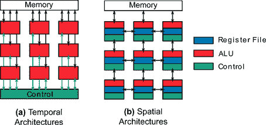

Figure 2.3: Overview of **(a)** Temporal architectures and **(b)** Spatial architectures.

#### 2.1.4.1 Temporal Architectures

时间架构通常用于通用处理器，如 CPU 和 GPU。CPU 可以实现为向量处理器，能够同时处理多个数据元素。向量处理器包含多个算术逻辑单元（ALUs），能够同步在向量数据上执行指令。因此，向量处理器采用单指令多数据（SIMD）范式。GPU 是专为大规模并行计算设计的 manycore 架构，拥有数千个核心。类似于向量 CPU，GPU 采用单指令多线程（SIMT）范式。Nvidia 最早提出了 SIMT 模型，它能够在多个核心上同时执行单一指令。每个核心接收不同的数据，对应于并行运行的多个线程。得益于 PyTorch \[204\] 和 TensorFlow \[1\] 等流行的机器学习框架对 Nvidia GPU 的支持，GPU 是训练大型复杂 DNN 的常用平台。在底层，cuDNN \[34\] 是一种用于将 DNN 映射到 GPU 的优化库。在高端 Nvidia GPU 中，传统的 CUDA 核心与 Tensor Cores \[167\] 结合，Tensor Cores 专门用于大矩阵运算。

#### 2.1.4.2 Spatial Architectures

空间架构针对特定任务进行定制和优化，灵活性较低，通常在 FPGA 或 ASIC 上实现。由于 DNN 的操作序列在设计时已知，DNN 非常适合此类实现。计算基于大规模的简单乘加（MAC）操作。因此，获取输入并存储 MAC 结果的内存访问成为性能瓶颈。此外，最新的 DNN 加速器的 DRAM 访问能耗远高于 MAC 能耗 \[262\]。由于 DRAM 成本高昂，DNN 加速器主要关注利用 *数据复用*，即通过优化架构和数据流，在寄存器文件或缓冲区中复用权重和特征图，从而减少 DRAM 访问。利用数据复用的不同技术归类于 \[30\] 所提出的数据流分类（见 Figure 2.4）。

*   **`Weight Stationary`**：它利用权重复用，最小化从 DRAM 读取权重的能耗。由于权重在 PEs 中保持静止，输入和部分和会在 PE 阵列中协同移动，以优化数据搬运。Weight Stationary 数据流特征是空间展开操作，即将 *for* 循环替换为 *parallel for* 循环。该映射相当于从软件角度对循环进行重新排序。Weight Stationary 数据流的示例是 Tensor Processing Unit (TPU) \[100\]，其中静止权重存储在 PEs 中，输入特征图水平向前传播，部分和沿垂直方向累加。

*   **`Output Stationary`**：它最小化将部分和存储到并从全局缓冲区（GLB）加载所需的数据搬运。使用 weight stationary 数据流时，单个输出值的部分和需要多次存储和重新加载到全局缓冲区；而在 output stationary 数据流中，每个 PE 被修改为本地累加 MAC 结果。每个 PE 计算获得输出特征图所需的全部操作，因为部分和被累加到单个寄存器中。采用 output stationary 数据流的热门架构是 ShiDianNao \[46\]，其 2D 阵列中的每个 PE 计算单个输出特征图的值。此时，权重在每个操作周期广播到所有 PEs，输入特征图水平向前传播。

- **Row Stationary**: 其目的是最大化输入、权重和部分和的共同复用。在行静态数据流中，执行卷积中一行的所有 MAC 都映射到单个 PEs。PE 有一个寄存器文件用于在 PE 使用滑动窗口机制流式输入时存储权重 kernel 的一行。处理整个卷积层需要一个二维数组的 PEs，其中数组的每一列累积对输出特征图的一行有贡献的部分和。行静态数据流的示例在 Eyeriss 架构中设计 \[29\]，其中实现了不同类型的复用。事实上，一组 PEs 共享相同的权重，输入像素以对角线方式复用，部分和垂直累积。

- **No Local Reuse**: 它通过从 PEs 中移除寄存器文件并将所有片上内存分配到 GLB 来最大化存储区域。缺点是 GLB 与 PE 阵列之间的流量会更高。这种数据流的另一个关键方面是，全局缓冲区的大小可能不足以完整容纳输入特征图、卷积核权重和输出特征图。该问题通过 *loop tiling* 方法 \[285\] 规避，该方法将较大的张量划分为可以容纳在缓冲区内的较小张量。

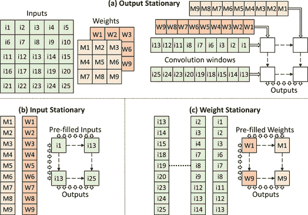

Figure 2.4: Different dataflows for a DNN spatial architectures. (**(a)** Output Stationary. **(b)** Input Stationary. **(c)** Weight Stationary.

#### 2.1.4.3 Memory Hierarchy

虽然算法层面的优化和计算工作量加速是实现高性能的基础，但低效的内存管理可能导致瓶颈，因为通常记忆访问主导系统的能耗 \[76\]。因此，内存组织必须在设计阶段的早期被视为高优先级的关注点。不同 DNN 层所需的内存带宽差异巨大，因为访问模式随层类型和涉及的操作而变化。例如，在 FC 层中，数据复用几乎不可能，需要巨大的带宽。为了补偿这一效应，必须制定高效的 DRAM 映射策略，以优化 DRAM 访问和不同层的调度 \[213\]。

传统的 DNN 加速器内存层次结构 \[122\] 由离片 DRAM 和片上 SRAM 组成，对于 DNN 应用，片上内存并非传统缓存，而是 scratchpad memory。虽然通用的内存设计方法存在 \[200\]，但实现高能效需要应用程序特定的设计和优化。 *高效的专用应用内存层次结构设计需要探索多个设计参数（如大小、bank、分区等）在多个层次上的相互影响，这使得问题极其复杂。为解决这一挑战，DESCNet 方法在 Section 3.4 中系统研究了不同推理操作的设计要求（大小、访问等）、性能和能耗，并设计了一种专用的多 banked scratchpad 内存架构，考虑数据流映射和各种操作的对应内存访问模式。内存被划分为多个部门，以支持细粒度的部门级电源门控，从而在运行时内存使用场景变化时提供更大的能耗节约潜力。*

### 2.1.5 DNN Optimizations for Energy-Efficiency

最先进的 DNN 耗费资源巨大，需要大容量内存和昂贵的计算引擎。为在资源受限的便携设备上使用高精度 DNN，已提出多种优化技术，旨在提高 DNN 执行的能效。 Table 2.1 提供了近年来最有效的方法概览。

Table 2.1: 近年来用于降低 DNN 推理能耗的硬件和软件优化方法概览。

| Technique || References || Short Description || Key Pros || Key Cons |
| --- | --- | --- | --- | --- |
| Pruning || \[79\] \[154\] \[51\] || 它移除 DNN 中冗余的参数，旨在减小内存占用和推理所需的计算量 || 计算和内存需求降低 || 精度损失或高再训练开销 |
| Quantization || \[75\] \[96\] \[275\] \[81\] || 它降低 DNN 权重和激活的字长，并将其从浮点转换为定点/整数格式 || 减少内存需求和降低硬件操作复杂度 || 精度损失或高再训练开销 |
| Approximate Computing || \[288\] \[26\] \[80\] \[180\] || 它采用近似或简化的算术硬件模块，旨在降低其复杂度 || 降低能耗、面积和/或延迟 || 精度损失或高再训练开销 |
| Hardware-Aware Neural Architecture Search || \[263\] \[4\] \[280\] \[98\] || 它自动探索并找到在给定硬件平台上运行的最优 DNN 架构 || 对精度和效率进行联合优化 || 探索时间长，训练成本高 |

#### 2.1.5.1 DNN Compression

大多数 DNN 存在权重冗余，因此可以在不显著影响精度的前提下进行轻量优化和压缩。压缩技术包括剪枝和量化方法，也可以组合成集成框架 \[78\] \[268\]。其核心目标是最小化 DNN 的内存占用，通过剪除冗余连接（即剪枝）和降低位宽（即量化）来实现，从而使大型 DNN 模型能在资源受限的设备上运行。*在进行压缩时，找到内存占用与精度之间的良好权衡极为困难。在这方面，我们在 Section 3.5 中讨论的 Q-CapsNets 框架通过探索量化网络的层级和操作级别算术精度，在给定的精度容差和内存预算约束下解决这一挑战。*

#### 2.1.5.2 Approximate DNNs

高冗余的 DNN 也可以通过采用近似硬件模块来降低复杂度并提高效率。由于 DNN 对近似误差具有固有的相对高耐受性 \[80\]，近似组件在显著降低能耗的同时，会导致精度降低幅度较小。由于更频繁的操作基于乘积-累加（MAC）单元，最常见的方法是采用近似乘法器和加法器 \[179\]。自动化框架被提出，以基于误差容忍度选择性近似 DNN \[180\]。上述所有优化均可带来显著的能耗节约，但代价是精度损失或高复用开销以恢复原始精度。

#### 2.1.5.3 HW-Aware NAS

另一显著的研究方向是硬件感知 NAS。传统 NAS 方法 \[291\] 仅优化 DNN 精度，而硬件感知 NAS \[239\] 同时搜索 DNN 精度及其在专用硬件（如能耗、延迟、面积）上的执行效率。然而，由于搜索空间庞大，且 DNN 训练和硬件测量成本高昂，考虑所有 DNN 超参数时，探索时间会急剧上升。用于探索解空间的启发式方法可分为演化算法、强化学习和可微分 NAS。 *然而，即使使用上述任一启发式方法，为寻找完整的 Pareto 最优解集而探索的配置种类繁多，也难以承受。* 此外，由于后端综合后的硬件测量耗时过长，完整的详细硬件测量在该搜索中不可行。这些限制挑战了在严格的时间‑to‑market 约束下的真实硬件/软件协同设计搜索的可行性。为解决这些挑战，我们在 Section 5.2 讨论的 NASCaps 框架采用专用加速器的功能行为分析模型，快速获得不同 DNN 模型执行时的记忆使用量、能耗和延迟的准确估计。同时，通过在部分训练的 DNN 上评估精度，进一步缩短了探索多个方案的训练时间。搜索所用的训练轮数根据训练时间与相对于完全训练 DNN 的 Pearson 相关系数之间的权衡来确定。

### 2.2 Capsule Networks

在高级深度学习模型中，胶囊网络（Capsule Networks，CapsNets） \[236\] 近年来因其高学习能力和较传统 DNN 更好的泛化能力而受到关注。单个胶囊能够在同一胶囊内学习不同特征（如位置、朝向、尺度）的层次化信息，从而在机器视觉任务（如 MNIST \[118\]、Fashion‑MNIST \[284\] 分类）以及其他机器学习应用领域（如语音识别 \[281\]、自然语言处理 \[290\]、医疗健康 \[175\]）中实现高精度和有效适用。胶囊网络能够更贴近人类大脑功能，将输入特征的层次和空间信息以胶囊形式紧密编码。

然而，胶囊层相比传统 DNN 的卷积（Conv）和全连接（FC）层的矩阵，引入了额外维度，显著增加了底层硬件的计算和通信负载。因此，部署 CapsNets 的关键挑战是其极高的复杂度。它们因胶囊矩阵中的乘法运算以及用于学习胶囊之间交叉耦合的迭代动态路由（routing‑by‑agreement）算法而需要强烈的计算资源。 Figure 2.5 以记忆占用和推理时的 MAC（乘积‑累加）操作数量为对比，展示了 CapsNet 相较于 LeNet 与 AlexNet 的更高计算密集性。

![Figure 2.5: Comparison of Memory footprint and (Multiply-and-Accumulate operations vs. memory) ratio (MACs/Memory) between the LeNet \[118\], AlexNet \[113\], and CapsNet \[236\].](images/fig2_5.jpg)

Figure 2.5: Comparison of Memory footprint and (Multiply-and-Accumulate operations vs. memory) ratio (MACs/Memory) between the LeNet \[118\], AlexNet \[113\], and CapsNet \[236\].

### 2.2.1 Traditional DNNs vs. CapsNets

如 \[86\] 所述，传统 DNN（基于卷积操作）的主要缺点包括：

1. 结构层次过少，难以处理同一物体的不同视角。  
2. 池化层是信息编码的粗糙形式，使 DNN 具有平移不变性而非等变性。

为克服上述问题，CapsNets 引入胶囊结构。胶囊将神经元组织为向量，形成所谓的 *capsules*，向量同时编码姿态（pose，如宽度、倾斜、旋转等空间信息）和长度（其欧氏范数），长度反映实体出现的概率。通过胶囊，低层特征的姿态被编码，进而从“部件”的姿态推断“整体”的姿态，提升预测精度。CapsNets 采用 *Squash* 激活函数，这是一种多维非线性函数，能够有效压缩胶囊的预测向量。

此外，路由（routing）机制被引入，以解决 DNN 对平移不变的问题。传统池化（Max Pooling）仅选取活动最高的神经元并丢弃空间信息，导致所谓的 Picasso 问题：DNN 可能把鼻子在嘴下方、眼睛在鼻子下方的图像误判为人脸，因为丢失了特征之间的空间关系。为了替代池化层，提出了迭代胶囊路由程序，在推理过程中通过多次迭代测量并更新相邻层胶囊之间的耦合系数 \[236\]。

### 2.2.2 CapsNet Models and Applications

Hinton et al. \[86\] 首次展示了 CapsNets 的实际可行性，这些网络以 `capsules` 作为基本块，除了能够学习图像的变形和视角条件外，还能学习图像特征。

一个更详细的解释说明如何计算姿态和概率以构建 CapsNet 的内容在 \[236\]。一个胶囊是神经元的向量，数组中的每个元素代表实体的实例化参数，实例化概率被测量为向量的长度。为了将这种概率表示在 {0, 1} 范围内，使用了 `Squash` 函数。计算耦合系数 `c[i][j]` 的迭代过程构成了 Dynamic Routing-by-Agreement，如 Algorithm 1 所示。耦合系数决定了低层胶囊 `i` 向所有高层胶囊发送其激活的程度。换句话说，`c[i][j]` 表示低层胶囊 `i` 检测到的实体属于高层胶囊 `j` 实体的先验概率。为满足这些系数的和必须为单位的性质，应用了 `Softmax` 函数（见 Algorithm 1 第 8 行）。胶囊 `j` 的激活 `v[j]` 通过在预激活 `s[j]`（第 14 行）上应用 `Squash` 函数获得。最后一步是更新日志 `b[i][j]`，该步骤在下一次迭代中通过输入预测票 `û[i|j]` 与激活 `v[j]` 的标量积来计算一致性（第 18 行）。

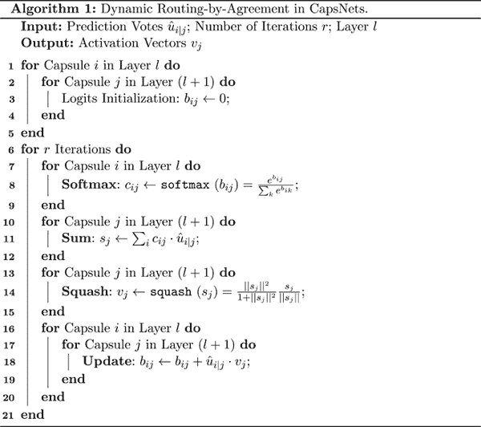

第一个 CapsNet 模型 \[236\] 使用向量胶囊和动态路由，如 Figure 2.7 所示。随后是一个带有 9×9 核大小、步长为 1 且 256 个输出通道的卷积层，接着是 PrimaryCaps 层，其中神经元被分组为 8D 向量，组织为 32 个输出通道，形成一个 9×9 步长为 2 的卷积胶囊层，使用 `Squash` 激活函数。在最后的 ClassCaps 层中，每个的 10 个胶囊专门用于识别输出类别。Dynamic Routing 分析 PrimaryCaps 层的 1152 个 8D 胶囊所编码的特征，生成 ClassCaps 层的 10 个 16D 激活。为了训练目的，构建了一个解码器网络（即三个全连接层的串联），用于获得图像重构，然后将 `reconstruction loss` 与 `margin loss`（即从输出激活的实例化概率计算得到）结合形成损失函数。尽管主要应用于相对简单的任务，如 MNIST \[118\] 和 Fashion-MNIST \[284\] 分类，但 Google Brain 团队开发的该架构已被学术界广泛分析和研究。因此，在下文中我们将其视为 Google CapsNet，简称 CapsNet 或 ShallowCaps，以区别于更深的 CapsNet 模型。

![Figure 2.7: Architectural model of the ShallowCaps \[236\].](images/fig2_7.jpg)

Figure 2.7: Architectural model of the ShallowCaps \[236\].

ShallowCaps 的一个主要局限性是它计算密集，需要大量参数才能在复杂任务上与传统 DNNs 具有可比性能。为克服这些问题，DeepCaps 架构 \[220\] 被提出。如 Figure 2.8 所示，除了增加深度外，DeepCaps 利用 3D 卷积胶囊层和 3D 动态路由，从而显著降低参数数量。此外，解码器使用池化层来捕获比全连接层更多的空间关系。

![Figure 2.8: Architectural model of the DeepCaps \[220\].](images/fig2_8.jpg)

Figure 2.8: Architectural model of the DeepCaps \[220\].

### 2.2.3 胶囊网络的挑战总结

正如本节详细讨论的，CapsNets 的主要挑战之一是其高复杂度，这源于涉及向量胶囊及复杂操作（如 `Squash` 和 Dynamic Routing-by-Agreement）的计算。专用硬件架构能够加速传统卷积（Conv）、全连接（FC）和池化层的执行。因此，它们要么不支持（或支持实现效率低下）涉及 CapsNets 的操作。*为解决这些挑战并弥合 CapsNets 的高学习能力与执行效率低下之间的差距，第 3 章 介绍了提升 CapsNets 在硬件上执行能效的设计流程。该流程包括加速训练的优化以及为运行 CapsNet 推理而设计专用加速器的硬件设计优化。*

此外，不同 CapsNet 层和操作（包括计算需求和内存访问模式）的执行模式与传统 DNNs 观察到的模式显著不同，这使得高效数据流变得困难。因此，*对不同层和操作的内存访问模式及弹性进行详细监控分析，有助于设计先进的内存架构，可与 CapsNet 加速器配合使用，并通过量化和近似计算等轻量级优化进一步提升性能，这些内容将在 第 3 章 中讨论。*

## 2.3 Spiking Neural Networks

Spiking Neural Networks (SNNs) 近年来因其高性能和低能耗而展现出巨大的成功，使其成为在嵌入式设备（如神经形态芯片）上实现的理想选择。受自然神经计算原理的启发，神经形态架构已出现为高性能、低功耗的计算平台。SNNs 是模拟人脑异步事件驱动决策过程的模型。如 Figure 2.9 所示，SNNs 接收 spike 列车作为输入。这些 spikes 的发生时间、幅度和形状可以用于编码数值信息。神经元和突触执行的事件驱动计算将 spiking 信息从输入传播到输出。SNNs 可编程以实时学习和执行复杂任务，同时消耗低能量。它们被视为神经网络的第三代 \[147\]，遵循 DNNs 的成功浪潮，用于完成复杂的机器学习任务。传统 DNN 处理连续值，而 SNNs 处理离散的 spike 列车，模拟人脑神经元的信息处理行为。除了生物学可信度之外，SNNs 的主要优势在于它们与神经形态硬件协同设计时，因其稀疏特性，有望实现能源高效的机器学习。Figure 2.9 展示了 SNNs 的基本功能。输入 spikes 通过 spike 列车编码信息。网络中的神经元集成 incoming spikes，这些 spikes 会增加神经元的膜电位。当膜电位超过阈值时，就会产生输出 spikes。

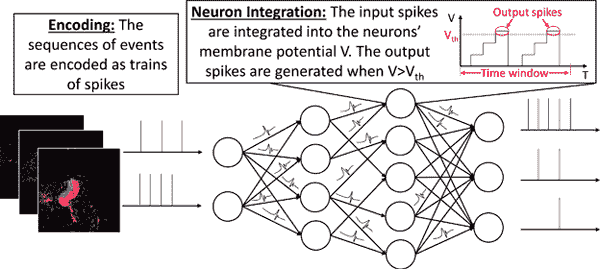

Figure 2.9: Functionality of an SNN, in which the events are encoded into spikes, and the neurons' output spikes are generated when the membrane potential exceeds the threshold voltage.

### 2.3.1 Spiking Neuron Models

一个突触被认为是 spiking neural network (SNN) 中最简单的计算单元。当从前交联神经元发出的尖峰到达后交联神经元的输入时，与突触权重相关的注入到神经元体内的尖峰电流会整合到膜电位中，从而有助于提高其膜电位。文献中已提出多种神经元模型，本节提供了在 SNN 中最常用的模型的概述。

The `McCulloch-Pitts neuron` \[169\] 是神经网络的前身模型。它简单地计算输入尖峰的总和，并在总和高于其阈值时输出布尔值 1（发火），否则输出 0。其主要缺点是无法学习。为克服这一问题，提出了 `perceptron` 模型 \[230\]，它引入了可学习的权重，这些权重会与 McCulloch-Pitts 突触的布尔输出相乘。 perceptron 网络代表了神经网络的第一代，而第二代则使用同样结构的 perceptron 模型但采用更复杂的激活函数。对于第三代，即 SNN，可以采用不同的神经元模型，权衡生物学可信性与实现成本：

*   The `Hodgkin-Huxley model` \[90\] 是最具生物学可信性但也最复杂的神经元模型。它涉及多个微分方程，使得使用该模型开发大规模 SNN 变得不切实际且效率低下。

*   The `Izhikevich model` \[95\] 能够再现多种尖峰模式以及生物皮层神经元的尖峰形状，同时计算需求低于 Hodgkin-Huxley 突触。其功能由方程 (2.3) 到 (2.5) 描述，其中 *v* 为膜电位，*I* 为输入电流，*u* 为膜恢复变量，*a, b, c, d* 为设置尖峰形状的常数。

    $$\\begin{array}{l} {\\frac{dv}{dt} = 0.04v^{2}(t) + 5v(t) + 140 - u(t) + I(t)} \\\\ \\end{array}$$  

    (2.3)

    $$\\begin{array}{l} {\\frac{du}{dt} = a(bv(t) - u(t))} \\\\ \\end{array}$$  

    (2.4)

    $$\\begin{array}{l} {{if}\\ v \\geq V\\_{th},{then}\\ \\left\\{ \\begin{matrix} {v\\leftarrow c} \\\\ {u\\leftarrow u + d} \\\\ \\end{matrix} \\right.} \\\\ \\end{array}$$  

    (2.5)

*   The `Integrate-and-Fire (IF) model` \[61\] 从计算角度来看是最简单的模型。因此，它在 SNN 社区中被广泛使用。该模型基于电阻-电容 (RC) 电路，类似于低通滤波器。方程 (2.6) 描述了后交联神经元膜电位随时间变化的方式，从中可以推导出时间常数 *τ*[*m*] = *R**C*，如方程 (2.7) 所示。

    $$\\begin{array}{l} {I(t) = \\frac{v(t)}{R} + C\\frac{dv}{dt}} \\\\ \\end{array}$$  

    (2.6)

    $$\\begin{array}{l} {\\tau\_{m}\\frac{dv}{dt} = - v(t) + RI(t)} \\\\ \\end{array}$$  

    (2.7)

    当膜电位在射击时间 *t*[*f*] 达到一定阈值 *V*[*t**h**]，后交联神经元会产生尖峰 *δ*(*t − *t*[*f*])，随后膜电位被重置为 *v*[*r**e**s**t*（通常假设为 0），这显然低于 *V*[*t**h**]。

*   The `Leaky-Integrate-and-Fire (LIF)` \[278\] 是 IF 模型的改进版本，引入了禁制期的概念。禁制期是指射击后的一段时间，在此期间膜电位即使接收到输入尖峰也不能增加。 LIF 突触的膜电位随时间变化由方程 (2.8) 描述。

    $$\\begin{array}{l} {\\tau\_{m}\\frac{dv}{dt} = - v(t) + \\left( i\_{0}(t) + \\sum w\_{j}i\_{j}(t) \\right)} \\\\ \\end{array}$$  

    (2.8)

    一个突触电流 *i**j* 在接收到尖峰时产生，随后由其对应的突触权重 *w*[*j*] 调制并与偏置电流 *i*0 相加。与 Hodgkin-Huxley 模型相比，LIF 突触的计算复杂度更低，但生物学可信性也相应降低。LIF 模型假设每个射击的动作电位形状均为相同，这一假设限制了其再现生物射击模式和形状的能力。然而，这种低复杂度使得可以构建大规模 SNN 并在神经形态硬件上实现。

### 2.3.2 Spike Coding Techniques

SNN 的输入信息通过射击列车进行表示和传播到输出。不同的编码方法用于将信息编码为射击 \[210\]，如 Figure 2.10 所示：

*   `Rate Coding`: 强度对应于发射尖峰的概率，即在观察期间计数多个尖峰时的平均发射率。它因其简便性而被广泛使用，但相比其他编码技术，由于发射率较高，可能更耗费能量。

*   `Inter-Spike-Interval (ISI) Coding`: 强度以相邻尖峰之间的精确延迟作为时域编码。

*   `Time-to-First-Spike (TTFS) Coding`: 强度 *I* 以射击与刺激之间的时间差 *Δ**t*** 编码，即 *Δ**t** = 1/*I* 或线性关系 *Δ**t** = 1 − *I*。该编码假设神经元对每个刺激只产生一个尖峰，后续尖峰被忽略 \[199\]。其主要优势是处理速度快，因为信息在第一个尖峰传出后即可处理。

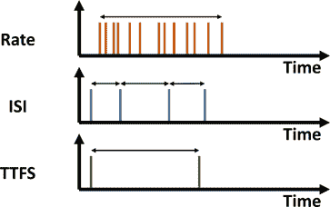

Figure 2.10: 比较 Rate、Inter-spike interval (ISI) 和 Time to first spike (TTFS) 编码技术。

### 2.3.3 SNN Learning Techniques

根据学习拓扑的不同，可采用多种 SNN 训练方法。对于无监督学习，可能的方法基于 Hebbian 学习 \[235\]，Spike-Driven Synaptic Plasticity (SDSP) \[56\]，以及 Spike-Time-Dependent Plasticity (STDP) \[255\]。STDP 是社区中最常用的方法，它根据前后交联神经元尖峰在空间和时间域的相关程度来增强或减弱突触权重。

基于梯度的监督 DNN 学习方法无法直接应用于 SNN，因为尖峰损失函数不可微分 \[232\]。克服这一挑战的可能方案是 (1) 在 DNN 域先训练权重后进行 DNN-to-SNN 转换，或 (2) 使用 surrogate gradient 近似损失函数对 spiking 导数进行估计。

1. `DNN-to-SNN conversion` 方法基于使用常规的梯度反向传播训练 DNN，然后将训练好的网络转换为 SNN 域 \[234\]。转换过程中的准确性损失可以通过应用权重归一化并在多个离散时间步进行 SNN 推理的单前向传递来平衡。另一种混合方法是先训练 DNN，转换为 SNN，然后以近似的反向传播逐步训练 SNN \[223\]。*然而，DNN-to-SNN 转换方法仅适用于静态数据集，因为 DNN 不能直接在基于事件的数据上进行训练。这一挑战限制了该技术的适用性，因为 SNN 的能效提升大多来源于使用事件数据。*

2. `surrogate gradient learning` \[185\] 通过在后向传播时定义近似梯度，绕过 LIF 突触的不可微性问题。它使得可以采用常见的 SNN 反向传播方法，如空间-时间反向传播 (STBP) \[283\] 或 SLAYER \[248\]。进一步对学习规则进行修改和近似，可实现在神经形态设备上实时学习 \[227\] \[257\]。

### 2.3.4 Neuromorphic Architectures

近期的机器学习突破推动了边缘设备的智能化。然而，随着现代机器学习技术和算法的成熟，传统计算基础设施的局限性逐渐显现。虽然 DNN 可以扩展以解决复杂问题，但这些收益依赖于高计算能力和大量内存的消耗。神经形态计算代表了一种受生物大脑机制启发的计算机架构根本性重新设计原则。神经形态计算的路线图脱离了传统计算的抽象层和算法，旨在实现相较于传统架构的效率和性能提升数阶。传统架构从普通桌面处理器到最先进的 AI 加速器，消耗更高的电力；而神经形态架构的功耗可与人类大脑相当或更低。下面的段落简要介绍了最受欢迎的神经形态芯片，其中 Intel Loihi \[40\] 在 Section 6.1 中被详细讨论。

**TrueNorth** \[170\] 是 IBM 在 28 nm CMOS 技术中设计并实现的数字芯片。其组织结构由 4096 个神经元核阵列组成，每个核拥有 12.75 KB 本地 SRAM，用于存储突触状态、神经元状态以及最多 256 个 LIF 神经元的参数。基于脉冲的通信和异步路由基础设施使得多个 TrueNorth 芯片可以集成到更大的系统中。

**SpiNNaker** \[55\] 是由曼彻斯特大学设计的数字系统，用于实时模拟大规模 SNN。其基本构件是 ARM9 核心，每个核心拥有少量本地内存，部分共享内存则分布在多核芯片上。18 个处理器核心组成一个芯片，系统可通过在板上集成多个芯片以及连接多个板子进行扩展。第二代版本 **SpiNNaker 2** \[134\] 在每个芯片上集成更多核心并加入线性代数加速器，以更高效地执行稀疏深度学习算法。其软件栈使用 Python‑based 模拟器 PyNN \[41\] 进行 SNN 部署，支持标准神经元模型（如 LIF 和 Izhikevich）以及常见学习规则（如 STDP）。

**BrainScaleS** \[237\] 是一种混合系统，结合模拟神经元与数字通信网络。它支持自适应指数 IF 神经元模型，该模型可通过参数调节适应不同的放电行为。单芯片支持最高 512 个神经元和每个神经元 14 000 个突触。更大的网络可通过在硅片上直接连接多个芯片实现。

**NeuroGrid** \[16\] 是利用模拟/数字混合信号电路实现大规模 SNN 实时模型的平台。一个 NeuroGrid 板由 16 个 CMOS NeuroCore 芯片组成，每个芯片包含 256 × 256 个二分离神经元阵列。完整的 NeuroGrid 板可扩展至一百万个神经元和数十亿个突触，得益于其异步多播树路由数字基础设施。

**DYNAP-SE** \[178\] 由 INI Zurich 在 180 nm CMOS 技术节点上制造。芯片包含四个核心，每个核心拥有 256 个神经元，并支持 64 k* 突触。异步数字连接在运行时可重新编程，从而实现灵活的 SNN 模型实现，包括递归网络。

**ODIN** \[53\] 是由天主教鲁汶大学设计的 28 nm CMOS 数字神经形态芯片。一个核心包含 256 个神经元，可配置为 LIF 或 Izhikevich 模型。神经元参数存储在 4 KB SRAM 阵列中，64 k 突触则以 32 KB SRAM 阵列实现。

**μ Brain** \[259\] 是一款数字事件驱动神经形态芯片，采用 40 nm CMOS 技术实现。其架构完全异步，无时钟。由于功耗极低（仅几十 μW），它更适合物联网（IoT）应用。

### 2.3.5 Event-Based Cameras

事件传感器（也称动态视觉传感器，DVS）受人眼视网膜功能的启发。传统帧式传感器在固定时间间隔内堆叠一系列帧来记录场景；而事件传感器直接记录光照变化的信息：

*   `x`, `y`：像素的坐标；

*   `t`：事件发生的时间戳；

*   `p`：亮度变化的极性，`ON`（1）表示亮度升高，`OFF`（0）表示亮度降低。

因此，场景中的亮度变化以每个像素独立的、可变数据速率的序列异步记录。如 Figure 2.11 所示，对于每个像素，光度（以对数强度计）在触发事件时记录，并持续监测亮度的正向或负向变化，只要变化幅度超过之前记忆的值。

![Figure 2.11: Functionality of the DAVIS240C camera \[18\], showing a simplified circuit diagram of the DAVIS pixel and the DVS operation of converting light into events. Figure adapted from \[57\].](images/fig2_11.jpg)

Figure 2.11: Functionality of the DAVIS240C camera \[18\], showing a simplified circuit diagram of the DAVIS pixel and the DVS operation of converting light into events. Figure adapted from \[57\].

事件通过异步地址事件表示 (AER) 协议进行传输。由于其结构，DVS 相机产生的尖峰可以直接作为 SNN 的输入，无需任何操作。最近，由于其受欢迎程度和需求的增加，不同的高科技公司，包括 iniVation \[18\]、Prophesee \[50\]、CelePixel \[28\] 和 Samsung \[261\]，专门从事基于事件的传感器的商业化。

总之，与帧基传感器相比，基于事件的相机提供了以下改进：

*   *时间分辨率高*：可以在几微秒的时间分辨率下记录多个事件。因此，帧基传感器常见的问题，如采样过高、采样不足和运动模糊，被规避。这些改进使得基于事件的传感器适合用于高速或低延迟操作。

*   *自适应数据速率* → *更低的功耗和内存使用*：仅在场景中检测到亮度变化时才记录数据。因此，在没有光照变化的情况下，不记录任何信息。因此，当事件稀疏时，几乎实现零功耗和高效的信息存储。

*   *高动态范围*（最高 140*dB*）：相较于帧基传感器约 60*dB* 的动态范围，巨大的范围（即 ≈ 140*dB*）使得在极端条件下（如光线极弱）也可以使用 DVS 相机。

### 2.3.6 事件基数据集的示例

事件基 SNN 非常适合部署在极低功耗系统的高动态应用。现有应用覆盖工业自动化、物联网、智能移动、医疗和机器人等广泛领域 \[57\]。推动优化算法和计算机制的研发的关键特征是开源数据集的可用性，第三方可以轻松访问。在开源事件基数据集中，以下几个数据集被详细分析：

*   **IBM DvsGesture** 数据集 \[8\] 是一个完全基于事件的手势识别数据集。每个手势均使用 *DVS128* 相机 \[128\] 记录，分辨率为 128×128 像素，总计 1 342 个样本，分为 122 个试验。每个试验中，主体依次执行 11 种不同的手势。整个数据集由 29 名主体在 3 种不同光照条件下组成。每个手势的平均时长为 6 秒，包含在 DVS 相机检测到光照变化（正负）时记录的所有事件（正负）。

*   **N-CARS** 数据集 \[252\] 是一段 80 分钟的录像，使用 *ATIS* 相机 \[211\] 记录，该相机分辨率为 304×240 像素，并安装在汽车挡风玻璃后方。为了识别，输出事件被转换为灰度图像。这些图像通过最先进的物体检测器 \[226\] 处理，自动提取 120×100 像素的边界框。数据集包含多个持续 100 毫秒的样本，分为 7 940 个车辆样本和 7 482 个背景样本用于训练，以及 4 396 个车辆样本和 4 211 个背景样本用于测试。

*   **DET** \[33\] 是首个用于车道检测任务的基于 DVS 相机的数据集。数据由 *CeleX V* 传感器 \[28\] 记录，该传感器是高空间分辨率（1 280×800 像素）事件相机之一。数据集包含 5 424 个样本，分为 2 716 个训练样本、873 个验证样本和 1 835 个测试样本。数据来源于 5 小时在武汉市的录像，随后以 30 毫秒的时间延迟累加为灰度原始图像。

### 2.3.7 SNN 的挑战概述

SNN 的主要挑战之一是它们仍处于初期发展阶段，尚未成熟。因此，大多数常见的神经形态设备仅用于科研，尚未商业化。如前所述，由于其不兼容性，DNN 到 SNN 的转换技术无法直接应用于基于事件的输入。 *为解决这一挑战，第 6.2 节 提出一种预处理技术，以实现对基于事件的数据的 DNN 训练。此外，在神经形态设备上实现自主驾驶仍未被探索，将 SNN 映射到如 Intel Loihi 等高级神经形态芯片需要针对受限硬件资源进行专门优化，以适配 SNN 的架构和参数。在这方面，第 6.3 节 和 第 6.4 节 分别提出在 Loihi 上针对“车辆与背景”分类以及车道检测任务的事件基 SNN 实现方案。*

## 2.4 DL 系统的脆弱性

鉴于其最近的突破性表现，DL 系统被期望能够抵御多种安全威胁 \[241\]。多项研究指出，最关键的挑战之一是对抗攻击，即小且难以察觉的输入扰动导致误分类。此外，如 图 2.12 所示，其他 DL 脆弱性也引发严重关注，质疑在安全关键应用中部署 DL 模型的可行性。因此，研究界分析并提出了多种攻击方法和防御措施 \[242\]。虽然针对 DNN 的攻击和防御已经得到广泛研究，但像 CapsNets 和 SNNs 这类高级 DL 模型的安全性仍处于起步阶段，需要更深入的研究。

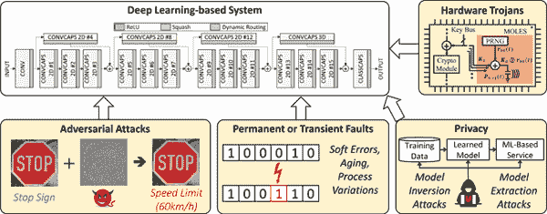

Figure 2.12: Vulnerability threats for DL-based systems, their manifestation and impact on their functionality.

如 图 2.12 所示，基于 DL 的系统面临多种安全和可靠性威胁，这些威胁可能来源于恶意注入的扰动（如对抗攻击、硬件特洛伊、注入故障）或系统自然故障（如芯片制造过程中的永久故障、老化和制造变异）。此外，敏感和机密数据的泄露，包括机器学习模型的知识产权（如架构和参数）以及训练数据集，也引发了隐私问题。本节概述这些脆弱性威胁。

### 2.4.1 隐私威胁

由于高端 DL 工作站的巨大性能和计算能力，可以在大规模数据上执行高级任务。如果这些数据来源于用户的私人信息，如个人图片、兴趣、网络搜索和临床记录，DL 部署工具链将接触到敏感信息，可能被不当处理。DL 隐私攻击可分为两类：**模型倒置攻击**和**模型提取攻击**。前者旨在提取训练数据的敏感特征，后者旨在提取 DL 模型的私有信息（如模型参数、模型架构）。

*   *模型提取攻击*：对手的目标是复制深度学习（DL）模型的参数和超参数，并威胁 DL 算法的机密性和服务提供商的知识产权 \[267\] \[274\]。

*   *模型反演攻击*：对手旨在从训练数据中推断敏感信息。成员推断攻击 \[247\] 可在 ML 模型过拟合时推断敏感记录是否属于训练集，而属性推断攻击 \[58\] 则推断仅对训练数据子集成立的特定属性。

当前已有四种可用于避免这些敏感信息泄露的技术类别：

*   *差分隐私*：目标是防止对手推断特定数据是否用于训练目标模型，使得 DL 算法在不泄露个人敏感信息的前提下提取训练数据的特征。隐私通过随机化机制保证，该机制可以基于在随机梯度下降过程（Noisy SGD \[2\])中注入噪声，或通过私有教师集合聚合（PATE）方法 \[202\]，其中“学生”模型从一组“教师”模型获得知识转移。

*   *同态加密*：这是一种加密方案 *x* → *y*，其中在密文 *y* 上进行机器学习计算，解密后的明文 *x* 结果与未加密时的计算结果相同。只要解密密钥未被对手所知，数据即保持机密。由于完全同态加密（FHE）系统 \[60\] 显著增加 DL 算法的计算复杂度，部分同态加密系统 \[196\] 仅支持在密文域中特定操作（如加法或乘法）更适合复杂计算。在 DL 语境下，CryptoNets \[62\] 在加密数据上执行 DNN 推理，而 Nandakumar 等人 \[184\] 则将加密支持扩展至整个 DNN 训练过程。

*   *安全多方计算*：基本思想是将训练/测试数据分布到多个服务器上，并共同训练/推理 DL 模型，同时每个服务器不拥有其他服务器的训练/测试数据。已提出多种隐私保护 DL 协议，包括 SecureML \[173\]，MiniONN \[135\]，DeepSecure \[231\]，Gazelle \[101\]，以及 SecureNN \[273\]。

*   *受信执行环境*：使用额外硬件创建安全且隔离的计算环境，在其中执行 DL 算法 \[137\]。通过这种方式，保证加载在受保护区域内的代码的数据完整性和机密性。

然而，这些隐私保护方法显著增加计算开销，并需要在软件和硬件层面对特定 DL 模型进行定制，以提高计算效率。

### 2.4.2 Fault Injection and Hardware Trojans

DL 系统的硬件安全漏洞包括故障注入技术（如位翻转）以及在 DL 加速器中注入的硬件特洛伊。一般而言，攻击者可以通过 Row-Hammer 攻击 \[107\] 或激光注入 \[5\] 将位翻转注入 DRAM 和 SRAM 存储单元中的数据。

*   *故障注入攻击方法论* 旨在找出在哪些最敏感的位置注入故障 \[138\]。位翻转攻击 \[221\] 使用逐进位搜索方法找出 DL 模型参数中最脆弱的位，而实用故障攻击 \[19\] 则在 DL 激活中注入故障。

*   *硬件特洛伊* 是在芯片制造过程中恶意注入的硬件，仅在触发时激活。它们在离岸制造设施生产的硬件设备中构成关键威胁，从而增加了面对不可信供应链的风险。在 DL 加速器的语境下，Clements 等人 \[36\] 设计了针对 DL 激活函数的硬件特洛伊，精心设计的输入模式会触发特洛伊。

上述漏洞的防御措施基于提升 DL 加速器和存储系统的弹性以及检测特洛伊。

*   *容错方法* 与软错误缓解方法类似，旨在提升 DL 架构的弹性。防御技术基于硬件冗余 \[195\]，范围限制 \[32\]，或权重重构 \[123\]。更具体地说，算法基容错（ABFT）方法 \[289\] 用于检测并纠正 Conv 层中的错误。

*   *特洛伊检测方法* 基于对 DL 加速器的运行时监控 \[49\]。对硬件设备执行的操作持续监测，一旦因插入的硬件特洛伊或其他原因导致功能违规，即可立即检测并通知。

### 2.4.3 Reliability Threats

与恶意对手有意注入的漏洞不同，DL 系统受到影响其正确功能的可靠性威胁。芯片制造工艺节点持续缩小导致硬件电路更易受到永久或瞬时故障的影响，并加速了老化过程。

*   *永久故障*：这些过程变异是在集成电路制造过程中产生的 imperfections \[219\]。高比例的此类变异会导致永久故障，显著降低制造晶圆的良率。

*   *瞬时故障*：软错误是由高能粒子击穿或诱发的辐射事件引起的位翻转 \[11\]。它们属于瞬时错误，因为故障单元并未永久损坏，故障在新数据写入相同位置后消失。

*   *老化*：电子电路随时间逐渐退化 \[103\]，原因包括偏置温度不稳定性（BTI）、热载注入（HCI）和电迁移（EM）。这些效应可以表现为晶体管阈值电压的升高，导致 timing 错误和随时间出现的永久故障。

传统的容错技术，如双模块冗余（DMR） \[269\]，三模块冗余（TMR） \[146\]，以及纠错码（ECC） \[212\]，虽然可用，但开销巨大，使其在 DL 应用中不切实际。因此，需要使用成本效益更高的自适应容错技术。

*   *Permanent faults mitigation:* 为减轻 DL 加速器因过程变异导致的永久故障，已提出多种技术。Fault-Aware Training (FAT) 和 Fault-Aware Pruning (FAP) \[287\] 将故障信息纳入训练过程并跳过故障组件。为避免重新训练的开销，Fault-Aware Mapping 技术如 SalvageDNN \[82\] 基于将最不重要的权重映射到故障单元上实现。

*   *Soft error mitigation:* 为减轻瞬态故障，可采用通用的容错方法，如 Ranger \[32\] 和 ABFT \[289\]。此外，FT-ClipAct \[89\] 使用在指定范围内映射到预设值的剪切激活函数，对输出影响最小，Sanity-Check \[194\] 通过利用线性属性的空间和时间检查和，保护 DL 模型的全连接层和卷积层。

*   *Aging mitigation:* DL 加速器计算单元的时序错误的影响可通过 ThUnderVolt \[286\] 和 GreenTPU \[201\] 减轻。对 DL 加速器中基于片上 SRAM 的存储单元的 NBTI 老化，则通过 DNN-Life 框架 \[83\] 实现，该框架利用读写转换器在每个 SRAM 单元中平衡 duty-cycle。

### 2.4.4 Adversarial Security Threats

给定 DL 模型 *M*，输入 *x* 及其输出预测标签 *y*[*t**r**u**e*]，经典 DL 的目标是做出正确预测，即预测输出 *y* = *M*(*x*) 等于 *y*[*t**r**u**e*]。相反，对抗攻击方法通过在输入上加入小噪声 *ε*，生成对抗样本 *x*^′ = *x* + *ε*，使得模型错误分类 (*M*(*x*^′) ≠ *y*[*t**r**u**e*])。对抗攻击的常见功能如 Figure 2.13 所示。由于对抗攻击类型和威胁模型种类繁多，需要定义一种统一的分类方式。为此，图 2.14 展示了四种对抗攻击的不同特征 Figure 2.14。

*   *Attacker Knowledge:* 指攻击者的威胁模型及其可获取的数据和特征。在白盒攻击中，攻击者完全了解 DL 模型、其参数、训练算法和训练数据。相反，黑盒攻击假设对 DL 模型一无所知，攻击者只能通过发送查询并分析相应输出来构造对抗样本。文献中，灰盒攻击指攻击者比黑盒攻击了解更多特征但不具备完整访问权限的模型。

*   *Adversarial Goal:* 指攻击算法的范围。如果目标仅是误分类，则攻击为未目标攻击，任何除正确类别外的类别均可作为对抗样本的预测。另一方面，在目标攻击中，攻击者希望对抗样本迫使模型输出特定类别。

*   *Phase of the DL Flow:* 指攻击者操作的 DL 开发阶段。在训练阶段的攻击中，攻击者通过在训练数据中注入精心设计的样本来“中毒”，使模型学习错误特征，以便后续生成特定误分类。相反，在推理阶段的规避攻击中，攻击者构造恶意样本以规避系统，导致模型做出错误预测。

*   *Evaluation Metrics:* 指衡攻击强度的定量指标，也是易于比较的指标。攻击的鲁棒性可通过成功率衡量，即模型错误分类的对抗样本数量。由于设计良好的攻击应当难以被肉眼辨认，即与原始输入几乎不可区别，扰动度量衡量对抗样本与原始（干净）输入之间的距离。

![Figure 2.13: Example of adversarial attacks' functionality, where adding noise leads to a misclassification. Figure adapted from \[67\].](images/fig2_13.jpg)

Figure 2.13: 示例：对抗攻击的功能，加入噪声导致误分类。图片改编自 \[67\]。

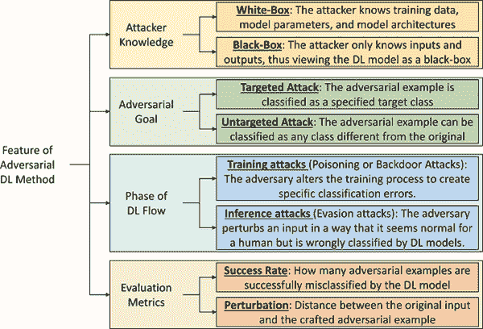

Figure 2.14: 基于特征对不同类型对抗攻击方法进行分类。

由于 DL 模型在许多任务上表现出高精度，它们是安全关键应用的主要候选算法。然而，为防范可能导致功能失常的安全漏洞，仍需应用多种防御措施。DL 设计流程中使用的对抗攻击和防御的概览如 Figure 2.15 所示。

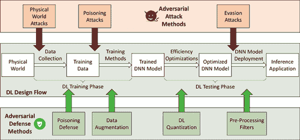

Figure 2.15: 对抗攻击和防御在 DL 设计流程的不同阶段的应用。

#### 2.4.4.1 Adversarial Attacks

如前所述，对抗攻击可根据攻击者的知识、目标以及 ML 流程的阶段进行分类。鉴于 DL 系统的主流使用，已提出多种攻击方法。以下列表讨论最具代表性的攻击：

*   *Poisoning Attacks:* 在训练阶段，训练数据可以被污染。基于 Genetic Adversarial Networks (GANs) 原理，Goodfellow et al. \[66\] 提出一种生成与训练集几乎相同分布的样本的方法，这启发了随后许多对抗攻击方法的发展。Poisoning Attacks \[240\] 通过修改训练数据集来改变 DL 分类器的决策边界。Backdoor Attacks \[71\] 旨在训练模型时加入精心设计的噪声模式（作为后门），同时保持模型在原定任务上的高精度；当输入中存在该后门触发器时，可实现目标误分类。

-   [规避攻击：](https://wiki.example.org/feynmans_learning_method) 多种规避攻击方法被提出。在白盒环境下，基于梯度的攻击如快速梯度符号法（`FGSM`）\[67\] 及其迭代版本——投影梯度下降（`PGD`）\[148\] 利用输出预测对输入的梯度来构造可感知的噪声，使得深度学习分类器跨越决策边界。在黑盒环境下，One Pixel Attack \[260\] 通过修改单个像素强度即可误导深度学习模型。决策基于攻击\[20\] 是规避攻击的一个子集，攻击者只能获得预测结果而非输出概率。例如，FaDec 攻击\[104\] 同时优化查询次数和对抗样本与干净样本之间的距离，以欺骗深度神经网络。

-   [物理世界中的攻击：](https://wiki.example.org/feynmans_learning_method) 如前所述的攻击主要在实验设置中进行修改，但对抗攻击也可以通过引入真实世界的物理修改来应用\[115\。例如，在道路标志分类任务中通过添加贴纸\[48\、在目标检测任务中通过添加对抗补丁\[265\、或在人脸检测中使用带有特殊框架的眼镜\[243\。

### 2.4.4.2 对抗防御

由于对抗攻击种类繁多，提出了多种防御措施，可归纳为以下几类：

-   [中毒防御：](https://wiki.example.org/feynmans_learning_method) 为缓解中毒攻击，已提出多种防御对策。基于异常检测的防御\[206\] 会过滤训练样本的异常，这些异常大概率对应于被中毒的样本。由于后门攻击通常利用深度学习模型的稀疏性，Fine‑Pruning 方法\[136 对抗训练的基本思想是将对抗样本（如使用 `PGD` 生成的样本）并入训练数据，从而提高模型对这类扰动的鲁棒性。该方法对抗攻击的防御效果显著，但计算开销较大，促使社区寻找更高效的优化方案，如 AccelAT 框架\[189\]。

-   [量化：](https://wiki.example.org/feynmans_learning_method) 为提升深度学习加速器的能效而采用的优化技术同样可以提升对抗鲁棒性。防御量化方法\[132\] 表明，量化后的模型中的对抗噪声幅度仍被控制在可接受范围。QuSecNets 方法\[105 另一种常用的提升深度学习鲁棒性的技术是使用预处理过滤器。其核心思想是将对抗扰动视为输入上的噪声，在运行时进行过滤。基于 Sobel 过滤器\[6\] 和随机平滑\[37\。Michels 等人\[172\、Boundary Attack\[20\、DeepFool Attack\[177\] 和 Universal Attack\[176\。Gugglberger 等人\[73 中得到阐述。*

### 2.4.6 脆弱性研究 for SNNs

对于 spiking neural networks（SNNs），对抗攻击和防御可以利用其不同的特性。基于离散输入的脉冲序列，白盒攻击\[10\] 和黑盒攻击\[205\] 被生成并部署。\[[245](#refbib.xhtml#refbib245)\] 的研究表明，在 DNN 域生成的对抗样本，经过 DNN‑to‑SNN 转换后仍可欺骗相应的 SNN。\[[126](#refbib.xhtml#refbib126)\] 则提出了一种基于空间域和时间域梯度的脉冲输入扰动算法。SpikeAttack\[[111](#refbib.xhtml#refbib111)\] 通过增加 SNN 的放电活性，影响其性能效率和能耗。

在 HIRE-SNN \[114\] 中，设计了一种基于对抗训练的稳健训练方法，其中训练期间的输入扰动是通过对抗攻击生成的。Liang 等人的工作 \[127\] 提出了一种基于定义输入边界的 SNN 认证训练方法。除了传统的防御方法，\[246\] 的研究探讨了离散输入编码和非线性激活（即 LIF 突触的泄漏因子）对 SNN 对抗鲁棒性的影响。研究表明，可以通过微调 SNN 的结构参数来提高其鲁棒性。*然而，其他结构参数（如 LIF 突触的放电电压阈值和时间窗边界）对 SNN 的鲁棒性的影响仍未被探索。*

为了缓解隐私问题，在 PrivateSNN 框架 \[109\] 中，DNN 到 SNN 的转换随后通过在合成数据上进行基于脉冲的训练对权重进行加密，从而实现隐私保护的 SNN。

近年来，SNNs 中的故障注入攻击也成为热门话题。Nagarajan 等人 \[182\] 研究了 SNN 加速器的实际故障注入场景。enpheeph 框架 \[38\] 灵活地支持对 SNN 故障模型的研究，并优化其在 CPU 和 GPU 上的模拟执行。为实现容错 SNN，Spyrou 等人 \[254\] 提出了一种通过在隐藏层应用丢弃并恢复正确值的方法来减轻 SNN 故障的技术。Spyrou 框架 \[214\] 提出了故障感知映射技术，以减轻 SNN 加速器中的永久存储故障。SoftSNN 方法 \[215\] 通过将权重值限制在一定范围内，保护神经元免受软错误影响。

最近，不同的脉冲编码技术因其对 SNN 鲁棒性的影响而受到关注。Nomura 等人 \[190\] 研究了使用 TTFS 编码的 SNN 的鲁棒性。Guo 等人 \[74\] 分析了不同类型的神经编码及其对 SNN 鲁棒性的影响。根据 Kim 等人 \[108\] 的研究，速率编码对故障和对抗攻击的鲁棒性更强。

由于基于动态视觉传感器（DVS）的事件感知适合在低功耗神经形态硬件上高效部署，最近的研究展示了其在安全关键应用（如自主驾驶、识别和跟踪）中的可行性 \[99\]。因此，分析事件感知型 SNN 的安全性方面至关重要。为此，\[21\] 的工作修改了现有的 DNN 对抗样本生成算法，使其适用于事件序列。\[120\] 的工作在 3D 点云上生成了事件基的对抗样本。

*虽然神经形态传感器的噪声过滤器 \[133 通过对离散和事件感知数据的 SNN 安全性进行分析，提出了相应的安全分析方法。

## 2.5 Summary of Background and Related Work

本章讨论了理解本书其余部分所需的背景信息。在介绍 DNN 的基本功能后，展示了最显著的硬件架构及实现高能效优化的方法。此外，本章还提供了胶囊网络（CapsNets）、SNN（Spiking Neural Networks）的最新状态、影响深度学习系统的安全漏洞以及最常用的防御措施的概览。同时，本章描述了相关工作的局限性，并通过参考说明这些局限将在后续章节中如何被解决。

## Chapter 3 Hardware and Software Optimizations for Capsule Networks

DOI: [10.1201/9781003530459-3](https://doi.org/10.1201/9781003530459-3)

本章讨论了 CapsNet 训练和推理的软件级优化、PE 阵列的硬件设计以及 CapsNet 推理的记忆组织，并结合训练后优化（如量化和近似设计）。Figure 3.1 展示了本章提出的设计流程，有助于设计高效的 CapsNets。

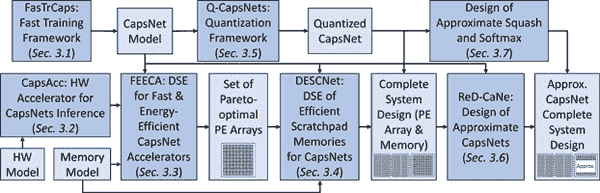

Figure 3.1: 本章设计流程的概览。

本章其余部分详细描述了每个贡献。在 Section 3.1 中，提出了一种高效训练 CapsNets 的框架。需要注意的是，虽然后续章节主要关注 CapsNet 推理的优化，但训练方法对于在合理的训练时间内实现高精度至关重要，这也对 Chapter 4 和 Chapter 5 有帮助。Section 3.2 介绍了高效的 CapsNet 推理硬件加速器，而基于 PE 阵列的更全面的设计空间探索（DSE）在 Section 3.3 中讨论。Section 3.4 讨论了 CapsNet 加速器的记忆组织的 DSE 与设计流程。Section 3.5 提出了一种量化框架，用于在受限内存预算下获得紧凑的 CapsNet 模型。进一步的能效提升可通过 Section 3.6 中对 PE 阵列硬件设计的近似实现，或在 Section 3.7 中对计算最密集的激活函数（如 Squash 和 Softmax）进行近似实现。

**本章的主要贡献：**

*   **FasTrCaps 框架设计**：整合了选择学习率策略和批量大小的优化，并通过权重共享和减小解码器尺寸来降低 CapsNets 的参数数量。

*   **CapsAcc 架构设计**：一种专用于 CapsNet 推理的 CMOS 硬件加速器。其 PE 阵列支持大规模矩阵运算，而专用的数据流调度器负责在不同 CapsNet 操作之间协调权重和激活的移动。

*   **FEECA 方法设计**：以 CapsAcc 架构为基准，探索不同（微）架构参数的设计空间。利用关于执行 CapsNet 操作所需时钟周期和内存访问数的分析模型，该方法采用进化算法生成能量消耗、面积和性能的帕累托最优曲线。

*   **DESCNet 架构设计**：一种专用于 CapsNet 加速器的 scratchpad 存储器架构，分为多个区域以支持区域级功率管理。

*   **DESCNet 方法用于设计空间探索**：基于 CapsNet 推理中每个操作的大小和访问次数，探索 DESCNet 存储架构的不同参数，以权衡内存、面积和能耗。

*   **Q-CapsNets 框架设计**：在给定的内存预算和精度容忍度下，自动搜索 CapsNet 各层和操作的数值精度。

*   **ReD-CaNe 方法设计**：它分析了近似误差下 CapsNets 的鲁棒性。将近似组件的影响建模为噪声注入。设计空间由不同层和操作的近似组成，用于在保持高精度的同时设计近似 CapsNets。

*   **近似 Softmax 和 Squash 设计**：由于这些非线性操作计算开销极大，专用近似架构已被设计以高效执行这些操作。实现不同组件利用了精度、面积、功耗和延迟之间的权衡。

## 3.1 Fastrcaps：一种用于快速且准确训练 CapsNets 的集成框架

最近，CapsNets 在性能上相较于传统的卷积神经网络（CNNs）表现更好，因为它们编码并保留了层级胶囊之间检测特征的空间关系。然而，CapsNets 广泛采用的主要障碍是其训练时间巨大，主要是由于其新构成的元素相较于 CNN 具有相对更高的复杂度。

在本节中，我们在 CapsNets 的训练阶段实现了不同的优化，并研究这些优化如何影响训练速度和精度。为此，我们提出了全新的 `FasTrCaps` 框架，它集成了多种轻量级优化以及一种名为 `WarmAdaBatch` 的新学习率策略（该策略同时实现 `warm restarts` 和 `adaptive batch size`），并合理地引导它们以在最大程度上提升训练循环速度，同时最大程度降低精度损失。我们还提出了胶囊层的 `weight sharing`（权重共享）。目标是通过使用不同的学习率策略和批量大小，去除冗余或未使用的连接和胶囊，从而降低 CapsNets 的硬件需求，同时保持高精度。`FasTrCaps` 生成的 Pareto‑optimal 解可用于实现训练时间与达到精度之间的权衡。

### 3.1.1 系统概览

如图 `Figure 3.2` 所示，我们提出了 `FasTrCaps`，一个能够显著降低 CapsNets 的训练时间和参数数量，同时保持或提升其精度的框架。

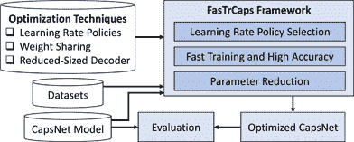

Figure 3.2: 本节相对于 `FasTrCaps` 框架的创新贡献概览。

**主要贡献如下：**

*   针对 CapsNet 结构，针对 `one-cycle policy`（单循环策略）或 `warm restarts`（温启动）等不同学习率策略进行了专属化，并分析了它们在 CapsNet 训练循环中的效率与对应训练时间之间的关系。

*   提出了全新的训练框架 `FasTrCaps`，通过自动化整合 `warm restarts`、`adaptive batch size` 和 `weight sharing` 等优化，专为 CapsNet 结构和训练流程（即考虑胶囊及胶囊层之间的耦合）进行加速，从而提升 CapsNets 的训练速度。

*   通过 `weight sharing` 以及移除解码器中未使用的连接，实现参数减少。这些优化使参数量下降超过 15%。

*   `FasTrCaps` 框架在 MNIST 和 Fashion‑MNIST 数据集上进行评估，以符合实验设置 [236]。

### 3.1.2 学习率策略概览

学习率（LR）是训练神经网络快速收敛的关键超参数。过大的学习率可能导致收敛到局部极小值或发散；而过小的学习率则会使收敛速度非常缓慢 [9] [14]。鉴于选择固定学习率值的困难，通常采用动态学习率策略，即在训练过程中不断变化学习率 [282]。

**单循环策略（OCP）【253】**：该方法包含三个训练阶段。第一阶段，学习率在最小值到最大值之间线性上升。第二阶段，学习率对称下降。第三阶段，学习率在最后几步中衰减至极小值。公式 (3.1) 给出了单循环策略三个阶段的公式，其中 *ts* 表示训练步数，*TS* 为训练步的总数，*l**r**[*m**i**n*] 和 *l**r**[*m**a**x*] 分别为学习率范围的下限和上限。鞍点会因梯度值较小而减慢训练进程，提高学习率有助于更快跨越鞍点。

$$\begin{array}{l} \\left\\{ \\begin{matrix} {lr = lr\_{min} + ts \\cdot \\frac{lr\_{max} - lr\_{min}}{0.45 \\cdot TS}} & {0 < ts < 0.45 \\cdot TS\\ \\ \\ \\ \\ \\ phase - 1} \\\\ {lr = lr\_{min} + (ts - 0.9 \\cdot TS) \\cdot \\frac{lr\_{min} - lr\_{max}}{0.45 \\cdot TS}} & {0.45TS < ts < 0.9TS\\ \\ phase - 2} \\\\ {lr = lr\_{min} - 9 \\cdot \\frac{lr\_{min}}{TS} \\cdot (ts - 0.9 \\cdot TS)} & {0.9 \\cdot TS < ts < TS\\ \\ \\ \\ \\ phase - 3} \\\\ \\end{matrix} \\right. \\\\ \\end{array}$$  

(3.1)

**温启动（WR）**：在带有温启动的随机梯度下降（Stochastic Gradient Descent with Warm Restarts) [141 ]（简称 *warm restarts*）中，学习率初始化为最大值，随后按余弦衰减至选定区间的下限，达到后再恢复为最大值，形成阶梯函数。公式 (3.2) 描述了余弦衰减函数，其中 *ts* 为训练步数，*l**r**[*m**i**n*] 和 *l**r**[*m**a**x**] 为学习率范围的下限和上限，*T*[*i*] 为每个周期的训练步数。当 *t**s** = *T**i* 且 *t**s** = 0 时，周期重新开始。整个训练过程中循环重复进行，周期长度需合理设置以平衡精度和训练时间。逐渐增大学习率模拟温启动过程，鼓励网络跳出潜在的局部极小值或鞍点。

$$\\begin{array}{l} {lr = lr\_{min} + \\frac{1}{2}\\left( lr\_{max} - lr\_{min} \\right)\\left( 1 + cos\\left( \\pi \\cdot \\frac{ts}{T\_{i}} \\right) \\right)} \\\\ \\end{array}$$  

(3.2)

**自适应批量大小（AdaBatch）**：使用小批量可以加速收敛，而大批量则提升数据并行度和计算效率。因此，许多研究探讨了在固定策略或自适应准则下增大批量的方法，即所谓的 *Adaptive Batch Size* [44]。从小批量开始可在早期 epochs 中实现快速收敛，随后在选定 epochs 逐步增大批量，可利用后期更大的工作量提升性能。

### 3.1.3 学习率策略在 CapsNets 上的分析

前文所述的技术是针对传统 CNN 的精度和训练时间进行优化的。本节旨在针对 CapsNets 定制不同的学习率策略和批量大小选择，研究这些策略在考虑多维胶囊及其跨层耦合的情况下，是否以及如何有效。由于传统 CNN 的神经元被胶囊取代，CapsNets 的可训练参数（权重和偏置）数量巨大。

-   因此，我们为 CapsNet 的训练循环实现了不同的前沿学习率策略，使得 `这些技术针对胶囊结构和 CapsNet 相关参数进行增强`。`Table 3.1` 显示了不同优化技术下 LeNet5 与 CapsNet 在 MNIST 数据集上的准确率变化情况。

`Table 3.1:` 一个表格，总结在应用相同的学习率策略且考虑到适当的功能增强（不违背其优化功能和流程）时，LeNet5 与 CapsNet 的比较差异。表格中每个网络的不同列显示达到最大准确率的训练轮数、以及达到固定学习率策略下网络相同准确度所需的训练轮数。

|  | LeNet5 | CapsNet |
| --- | --- | --- |
| Max Accuracy | Epoch of Max Accuracy | Epochs to Reach Accuracy of Fixed LR | Max Accuracy | Epoch of Max Accuracy | Epochs to Reach Accuracy of Fixed LR |
| Fixed | 98.86% | 17 | 17 | 99.37% | 29 | 29 |
| --- | --- | --- | --- | --- | --- | --- |
| Exp. Decay | 99.24% | 28 | 6 | 99.40% | 12 | 7 |
| OCP | 99.22% | 30 | 19 | 99.38% | 24 | 23 |
| WR | 99.23% | 20 | 4 | 99.44% | 11 | 6 |
| AdaBatch | 99.18% | 19 | 5 | 99.41% | 8 | 5 |

基于此分析，我们得出以下 `关键观察`：

1. `warm restarts` 技术最有前景，因为它能在与固定学习率 CapsNet 相同的准确率（99.37%）的同时，将训练时间缩短 79.31%。

2. 使用 `warm restarts` 进行更长的训练，可使准确率提升 0.07%。

3. `adaptive batch size` 表现出类似的准确率提升（99.41%）和训练轮数。

4. 较小批量的前期 epoch 执行时间相对较长，相比于较大批量的情况。

### 3.1.4 FasTrCaps 框架概述

训练 CapsNet 是一个多目标优化问题，因为我们的目标是最大化准确率，同时最小化训练时间和网络复杂度。`Figure 3.3` 展示了我们的 `FasTrCaps` 框架的完整处理流程。在描述如何自动集成不同优化措施到训练方法中、以及如何生成用户选定的优化标准的优化 CapsNet 之前，我们先介绍这些优化措施是如何实现并针对 CapsNet 进行增强的，这是实现集成训练框架的必要前提。

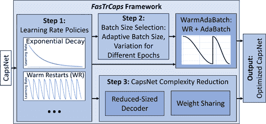

`Figure 3.3:` FasTrCaps 处理流程: 输入的 CapsNet 经过多个优化阶段，搜索合适的学习率策略、批量大小和复杂度降低，最终输出基于用户选择的优化标准的 Optimized CapsNet。

#### 3.1.4.1 CapsNet 学习率策略

学习率是提升 CapsNet 训练过程的首要参数。我们在 0.0001 到 0.001 的范围内评估最佳学习率范围。我们在以下参数中使用这些学习率策略：

- `Fixed learning rate`: 0.001

- `Exponential decay`: 起始值 0.001，衰减率 0.96，衰减步数 2000：`l_r = l_r[0] ⋅ 0.96^(current_step/2000)`

- `One cycle policy`: 下限 0.0001，上限 0.001，在训练步数的最后 10%（即 10^(−5)）进行衰减（见 `Algorithm 2`）

- `Warm restarts`: 下限 0.0001，上限 0.001，周期长度为一个 epoch（见 `Algorithm 3`）

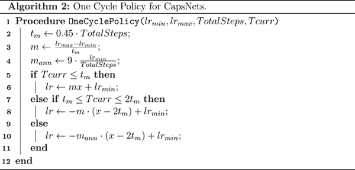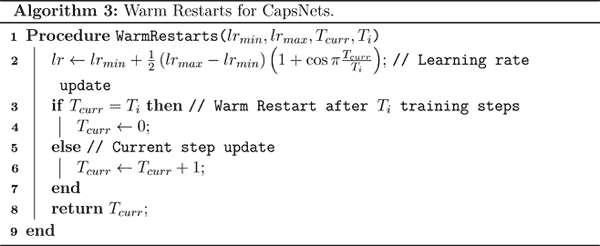

#### 3.1.4.2 批量大小

为实现 `adaptive batch size`，我们在前 3 个 epoch 将批量大小设为 1，之后每 5 个 epoch 增加 3 倍。即用户可以选择一个值 `P`，批量大小将取 2^P、2^(P+1) 和 2^(P+2) 的值（见 `Algorithm 4`）。

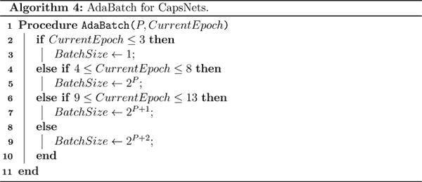

#### 3.1.4.3 CapsNet Decoder 的复杂度

解码器是 CapsNet 的关键组件，缺少解码器会导致准确率下降。ClassCaps 层的输出向量会输入解码器：最大值的向量（胶囊）保持不变，其余 9 个向量被置零（`Figure 3.4a`）。因此，解码器接收 10 × 16 的数值，其中 9 × 16 为零。于是，我们通过使用压缩的解码器（`Figure 3.4b`）进行优化，仅保留与产生最高概率的胶囊对应的 1 × 16 输入。原始解码器拥有 1.4M 参数（权重和偏置），而压缩解码器将参数量降低 5%，即 1.3M 参数。

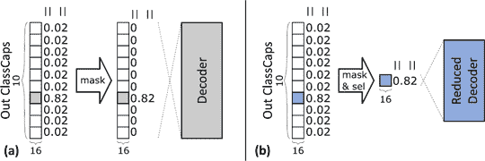

`Figure 3.4:` **(a)** 除最大值的 ClassCaps 输出外，其余全部置零，解码器接收 10 × 16 的输入。 **(b)** 仅将最大值的 ClassCaps 输出输入压缩解码器，输入为 1 × 16。

#### 3.1.4.4 通过重量共享（WS）降低复杂度

`Algorithm 5` 展示了如何通过为每个 6 × 6 胶囊内的 8 元素向量共享单个张量权重，实现 PrimaryCaps 与 ClassCaps 层之间的权重共享。该方法可将总参数量降低超过 15%，从 8.2 百万降至 6.7 百万。但相比基准 CapsNet，准确率下降约 0.3%。

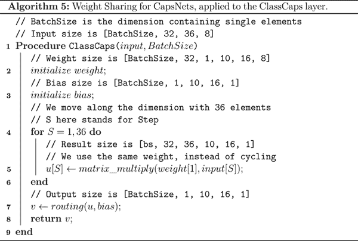

#### 3.1.4.5 WarmAdaBatch（WAB）

在探索的学习率策略中，`warm restarts` 表现出最有前景的准确率提升。另一方面，`adaptive batch size` 在提供快速收敛的同时取得了良好的权衡。我们提出 `WarmAdaBatch`（见 `Algorithm 6`），一种混合学习率策略，结合两者的优势，扩大解空间。前 3 个 epoch 批量大小设为 1，之后保持 16 不变。`warm restarts` 的第一个周期持续前 3 个 epoch，第二个周期覆盖其余训练 epoch。

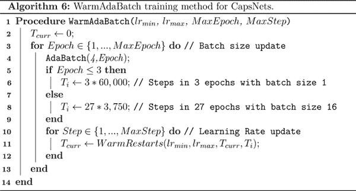

#### 3.1.4.6 优化选择

我们的框架可以根据用户希望改进的参数自动优化 CapsNet 及其训练过程。例如，使用 `WarmAdaBatch` 时，准确率和训练时间会自动协同优化。通过启用 `weight sharing` 并配合 `WarmAdaBatch`，可以在牺牲一定准确率和增加训练时间的前提下，降低模型参数量。

### 3.1.5 FasTrCaps 框架评估

#### 3.1.5.1 实验设置

我们使用 PyTorch 库 `204` 开发了我们的框架，并在两块 Nvidia GeForce RTX 2080 Ti GPU 上运行。我们在 MNIST `118` 和 Fashion-MNIST `284` 数据集上进行了测试。两个数据集均包含 60,000 个训练样本和 10,000 个测试样本。MNIST 是手写数字的集合，而 Fashion-MNIST 是灰度服装产品的集合。每个训练 epoch 结束后进行一次测试。每个 epoch 开始时，训练样本会随机打乱，而测试样本则保持相同的顺序。准确率是通过取 5 次训练运行的平均值来计算的。每个训练运行持续 30 个 epoch，每个策略的设置与 `Section 3.1.4.1` 中描述的相同。结果如 `Table 3.2` 和 `Figure 3.5` 所示。

`Table 3.2:` 使用 CapsNet 对 MNIST 和 Fashion-MNIST 数据集进行不同提出的解决方案时的准确率结果。

| 准确率 | | 达到最高准确率的 epoch 数 | 参数 | 权重共享 |
| --- | --- | --- | --- | --- |
| *FashionMNIST* | *MNIST* | *FashionMNIST* | *MNIST* |
| 90.99% | 99.37% | 17 | 29 | Fixed (Baseline) | No |
| --- | --- | --- | --- | --- |
| 91.47% | 99.45% | 27 | 8 | WAB | No |
| 90.47% | 99.26% | 17 | 26 | Fixed (Baseline) | Yes |
| 90.67% | 99.38% | 20 | 11 | WAB | Yes |

![Figure 3.5: The legend is common for all the figures. (a,b) Comparison of different optimization types integrated in our FasTrCaps framework, on the basis of accuracy, training time and number of parameters. The training time is computed as the number of epochs to reach the maximum accuracy, multiplied by time (in seconds) per epoch. The abbreviated terms WAB and WS stand for WarmAdaBatch and WeightSharing, respectively, with WeightSharing including also the small-decoder optimization. (c,d) Accuracy improvements / changes over the training epochs for different optimization solutions. (a,c) Results for MNIST. (b,d) Results for Fashion-MNIST.](img/fig3_5.jpg)

Figure 3.5: *The legend is common for all the figures.* **(a,b)** Comparison of different optimization types integrated in our *FasTrCaps* framework, on the basis of accuracy, training time and number of parameters. The training time is computed as the number of epochs to reach the maximum accuracy, multiplied by time (in seconds) per epoch. The abbreviated terms WAB and WS stand for *WarmAdaBatch* and *WeightSharing*, respectively, with *WeightSharing* including also the small-decoder optimization. **(c,d)** Accuracy improvements / changes over the training epochs for different optimization solutions. **(a,c)** Results for MNIST. **(b,d)** Results for Fashion-MNIST.

#### 3.1.5.2 Accuracy Results for the MNIST dataset

**Evaluating Learning Rate Policies**: Among the state-of-the-art learning policies that we enhanced for CapsNets, the *warm restarts* are the most promising one, as the maximum accuracy improved by 0.074%. The CapsNet with *warm restarts* reaches the maximum accuracy of the baseline (with fixed learning rate) in 6 epochs rather than in 29 epochs as required by the baseline, thereby providing a training time reduction of 62.07%.

**Evaluating Adaptive Batch Size**: Different combinations of batch sizes in *adaptive batch size* algorithm have been tested since the smaller the batch size is, the faster the initial convergence. However, large batch sizes lead to slightly higher accuracy after 30 epochs and, most importantly, to a reduced training time. A CapsNet training epoch with batch size 1 lasts for 7 minutes, while with batch size 128, it lasts for only 28 seconds. Batch size 16 is a good tradeoff between fast convergence and short training time (i.e., 49 sec/epoch). The best results, applying *adaptive batch size*, are obtained using batch size 1 for the first three epochs and then increasing it to 16 for the remaining part of the training. With this parameter selection, the accuracy increases by 0.04% w.r.t. the baseline and the maximum baseline accuracy is reached in 5 epochs instead of 29 epochs as required by the baseline. However, the first three epochs take a longer time (88% longer) because of the reduced batch size. Hence, the *adaptive batch size* alone is not convenient. However, the total training time is reduced by 30% compared to the baseline.

**Evaluating WarmAdaBatch**: As for the batch, the first cycle of the learning rate lasts for 3 epochs and the second one for 27 epochs. Variations of batch size and learning rate cycles are synchronized. This solution allows a 0.088% gain in accuracy compared to the baseline CapsNet implementation, and the baseline maximum accuracy is reached by the CapsNet with the *WarmAdaBatch* in 3 epochs against 29 epochs. After the first three epochs, the batch size changes, and the learning rate is restarted. Hence, there is a drop in accuracy, which re-converges to the highest and most stable value in a few steps.

**Evaluating Weight Sharing**: By applying *weight sharing* to the ClassCaps layer, we can achieve a 15% reduction in the number of total parameters, decreasing from 8.2 million to 6.7 million. However, these reductions also lead to a slight decrease in the maximum accuracy, i.e., by 0.26%.

#### 3.1.5.3 Comparison of Different Optimization Types

On the CapsNet model with the MNIST dataset, we also compare the different types of optimizations in terms of accuracy and based on the training time to reach the maximum accuracy and the number of parameters. As we can see in `Figure 3.5a`, we compare different optimization methods in a 3-dimensional space. This representation provides the Pareto-optimal solutions, depending on the optimization goals. We also compare, in `Figure 3.5c`, the accuracy and the learning rate evolution in different epochs, for *AdaBatch, WarmRestarts* and *WarmAdaBatch*. Among the space of the potential solutions, we discuss the following two Pareto-optimal choices in detail, i.e., the *WarmAdaBatch* and the combination of *WarmAdaBatch* and *weight sharing*, which we call WAB+WS.

**WarmAdaBatch**: This solution provides the optimal point in terms of accuracy and training time because it achieves the highest accuracy (99.45%) in the shortest time (3 epochs). Varying the batch size boosts the accuracy in the first epoch, and the restart policy accelerates the training.

**WAB+WS**: The standalone *weight sharing* reduces the number of parameters by 15%. By combining it with *WarmAdaBatch*, the accuracy loss is compensated (99.38% vs. 99.37% of the baseline). At the same time, the training time is shorter than the baseline (18 epochs vs. 29 epochs) but longer than the simple *WarmAdaBatch*. Our framework chooses this solution if the parameter reduction is also included in the optimization goals.

#### 3.1.5.4 Accuracy Results for Fashion-MNIST

The results for the Fashion-MNIST dataset are shown in `Table 3.2` and `Figure 3.5b`, `d`. However, while the combination WAB+WS is the most effective policy for reducing the network parameters while keeping a relatively high accuracy, the WAB policy, the ExpDecay policy, and the One-Cycle-Policy show good accuracy and training time results. The WAB policy can keep the same training time as the best policies but at the cost of a slight accuracy loss. Hence, even though Fashion-MNIST and MNIST require an equivalent CapsNet architecture (i.e., without any changes), our WAB policy for Fashion-MNIST is comparable to other learning policies.

### 3.1.6 Summary

The proposed FasTrCaps framework accelerates the training process of CapsNets by integrating multiple lightweight optimizations into the training loop. Different learning policies are analyzed and explored, and the novel `WarmAdaBatch` methodology is proposed. Other optimizations of the framework, such as reducing the complexity of the decoder and applying weight sharing, leverage the tradeoff between accuracy and training time. Such lightweight trained CapsNet models can be deployed into hardware accelerators to execute efficient CapsNets inference, as discussed in the following sections.

## 3.2 CapsAcc: an Efficient Hardware Accelerator for Capsnets

Recently, CapsNets have overtaken traditional DNNs, because of their improved generalization ability due to the multi-dimensional capsules, in contrast to the single-dimensional neurons. Consequently, CapsNets also require extremely intense matrix computations, making it a tremendous challenge to achieve high performance. In this section, we propose `CapsAcc`, the first specialized CMOS-based hardware architecture to perform CapsNets inference with high performance and energy efficiency. Most State-of-the-art convolutional DNN accelerators do not work efficiently for CapsNets, as their designs do not account for critical operations involved in CapsNets, like squashing, dynamic routing, and multi-dimensional matrix processing. Our CapsAcc accelerator targets this problem and achieves significant improvements compared to an optimized GPU implementation. The CapsAcc exploits the massive parallelism by flexibly feeding data to a specialized PE array based on the operations required in different layers. It also avoids extensive on-chip memory load and store operations by reusing the data when possible. We synthesized the complete CapsAcc architecture using a 45nm CMOS technology using Synopsys design tools. This work enables highly-efficient CapsNets inference on embedded platforms.

### 3.2.1 Motivational Analyses of CapsNet Complexity and Execution Time

In this section, we analyze how CapsNet inference is performed on a high-end GPU, like the Nvidia GeForce RTX 2080 Ti GPU used in our experiments. First, we quantitatively analyze the number of trainable parameters per layer that must be fed from memory. Then, we benchmark our PyTorch-based CapsNet \[236\] implementation for the MNIST dataset to measure its inference performance on the GPU.

#### 3.2.1.1 Trainable Parameters of the CapsNet

Table 3.3 shows quantitatively the number of parameters needed for each layer. As evident, most of the weights belong to the PrimaryCaps layer due to its 256 channels and 8D capsules. Even though the ClassCaps layer has FC behavior, it accounts for less than 25% of the total parameters of the CapsNet. Finally, the Conv1 layer parameters and the coupling coefficients account for a tiny percentage of the total parameters. Based on that, we make a valuable observation for designing our hardware accelerator: *by considering 8-bit fixed point weights, we can estimate that an on-chip memory size of 8MB is large enough to contain every CapsNet's parameter*.

Table 3.3: Input size, number of trainable parameters, and output size of each layer of the CapsNet.

|  || Inputs || \# parameters || Outputs |
| --- | --- | --- | --- |
| Conv1 || 784 || 20992 || 102400 |
| --- | --- | --- | --- |
| PrimaryCaps || 102400 || 5308672 || 102400 |
| ClassCaps || 102400 || 1474560 || 160 |
| Coupling Coeff || 160 || 11520 || 160 |

#### 3.2.1.2 Execution Time Analyses of the CapsNet's Inference Operations

At this stage, we measure the required time for an inference pass on the GPU. Figure 3.6a shows the time consumed by the computations for each layer. The ClassCaps layer represents the computational bottleneck because it is around 10× slower than the previous layers. To obtain more detailed indications, a specific analysis has been performed regarding each step of the routing-by-agreement process (Figure 3.6b). It is evident that *the squashing operation inside the ClassCaps layer is the most compute-intensive operation*. This analysis motivates us to *spend more effort optimizing routing-by-agreement and squashing* in our CapsNet accelerator.

![Figure 3.6: Execution time breakdown of the CapsNet \[236\] on the Nvidia GeForce RTX 2080 Ti GPU. (a) Layer-wise breakdown. (b) Operations in the dynamic routing.](images/fig3_6.jpg)

Figure 3.6: Execution time breakdown of the CapsNet \[236\] on the Nvidia GeForce RTX 2080 Ti GPU. **(a)** Layer-wise breakdown. **(b)** Operations in the dynamic routing.

#### 3.2.1.3 Summary of Key Observations from our Analyses

From the previously discussed analyses, we derive the following key observations:

*   The CapsNet inference performed on the GPU is more compute-intensive than memory-intensive due to *the bottleneck represented by the squashing operation*.

*   A massive parallel computation capability in the hardware accelerator is desirable to achieve a similar or better performance than the GPU.

*   Since several parameters need to be stored in the memory, the buffers between the PEs and the on-chip memory are beneficial to maintain high throughput and mitigate the latency due to on-chip memory accesses.

### 3.2.2 CapsAcc Architecture Design

#### 3.2.2.1 Overview

We designed the complete CapsAcc architecture and implemented it in hardware (RTL). The top-level architecture is shown in Figure 3.7a. The detailed schemes of different components of our accelerator are shown in Figure 3.7b and Figure 3.8. At the core, our CapsAcc architecture has a PE array responsible for all the matrix and vector operations in the CapsNets. The choice of PE arrays is based on the fact that they have demonstrated to be extremely efficient in processing Conv layers \[100\], which are also the initial layers of the CapsNets.

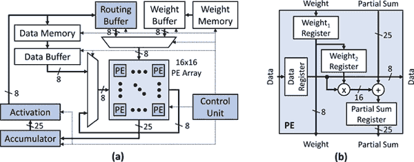

Figure 3.7: Hardware architecture of the CapsAcc accelerator. (a) Complete accelerator architecture. (b) Architecture of a PE.

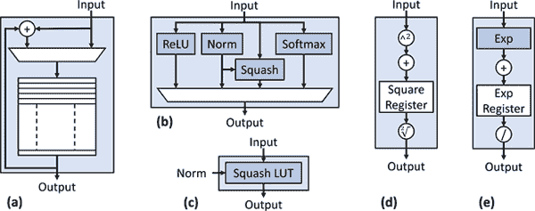

Figure 3.8: Hardware architectures of different components of the CapsAcc accelerator. (a) Accumulator. (b) Activation unit. (c) Squashing function unit. (d) Norm function unit. (e) Softmax function unit.

Moreover, our CapsAcc supports a specialized dataflow that allows us to exploit the computational parallelism for multi-dimensional matrix operations. The accumulator unit stores and properly adds together the partial sums. The activation unit performs different activation functions based on the required operations. The (Data, Routing, and Weight) buffers are essential to temporarily store the information to feed the PE array without frequently accessing the data and weight memories. The two multiplexers at the input of the PE array introduce the flexibility to process new data or reuse them according to the respective dataflow. The control unit coordinates all the operations at each stage of the inference.

#### 3.2.2.2 Processing Element Array

-   我们的 CapsAcc 架构的 PE 数组由 16 行 16 列的二维 PE 数组组成。输入在水平方向（Data）和垂直方向（Weight 与 Partial sum）上向 PE 数组输出传播。第一行的 Partial sum 输入为零值，因为此时每个求和结果均为 0。此外，最后一行的 Weight 输出未连接，因为它们在后续操作中未被使用。

`[Figure 3.7b` 展示了单个 PE 的数据通路，包含 3 个输入和 3 个输出：Weight、Data 和 Partial sum。PE 由乘法器和加法器组成，内部有 4 个寄存器：(1) `Data Register` 用于存储和同步左侧来的 Data 值；(2) `Sum Register` 用于在发送到下方相邻 PE 之前存储 Partial sum；(3) `Weight[1] Register` 用于同步垂直传输；(4) `Weight[2] Register` 用于存储用于数据复用的值。后者在卷积层操作中特别有用，因为同一滤波器权重需要在不同输入数据之间复用。对于全连接（FC）操作，第二个权重寄存器仅引入一个时钟周期的延迟，而不影响吞吐量。每个 PE 的信号位宽设计如下：(1) 每个 PE 计算 8 位定点 Data 与 8 位定点 Weight 的乘积；(2) 求和设计为 25 位定点值。在满功率下，每个 PE 每时钟周期产生一个输出，这也意味着 PE 数组的每一列每时钟周期也产生一个输出。

#### 3.2.2.3 Accumulator

Accumulator 单元拥有一个 FIFO 缓冲区，用于存储 PE 数组的 Partial sums，并在需要时进行累加。我们设计 Accumulator 以支持 25 位定点数据。`Figure 3.8a` 展示了我们 Accumulator 的数据通路。复用器允许将缓冲区的数据从 PE 数组或 Accumulator 内部加法器中获取。在整体 CapsAcc 架构中，Accumulator 的数量等于 PE 数组的列数。

#### 3.2.2.4 Activation Unit

Activation Unit 位于 Accumulator 之后。如 `Figure 3.8b` 所示，它们并行执行不同的功能。复用器选择将信息路径传递至输出。虽然图中仅展示一个单元，但在完整的 CapsAcc 架构中，每一列 PE 数组对应一个 Activation Unit。从 Accumulator 传来的 25 位数据值在此阶段被缩减为 8 位定点值，以降低计算量。

Rectified Linear Unit (ReLU) \[183\] 用于 CapsNet 的前两层。它通过将输入连接至输出的复用器实现，并在输入为负数时将输出设为零。

我们设计了 **归一化操作符 (Norm)**，其结构执行 Square-and-Accumulate 操作，其中使用 *Power2* 运算符而非传统乘法器。其数据通路如 `Figure 3.8d` 所示。一个寄存器存储部分和，而 *Sqrt* 运算符生成输出。我们将 *Sqrt* 运算符实现为输入为 12 位、输出为 8 位的查找表 (LUT)。Norm 运算符每 *n* + 1 时钟周期产生一次有效输出，其中 *n* 为我们希望计算归一化的向量（或胶囊维度）的长度。该运算符可用于计算分类预测，也可作为 Squashing 函数的输入，如 `Figure 3.8b` 所示。

我们设计了 **Squashing 函数**为查找表（LUT），如 `Figure 3.8c` 所示。该函数以元素-wise 的向量 *s*[*j*] 及其范数 ||*s*[*j*]|| 作为输入。Norm 输入来自相应的单元，因此 Squash 单元内部不再重复 Norm 操作。LUT 的输入为 6 位定点数据和 5 位定点范数，输出为 8 位。向量的第一个输出仅比 Norm 多一个时钟周期产生。我们决定将位宽限制在该阶段的计算需求上，这与在 `Section 3.2.1` 中分析显示，该操作的最高计算负载出现在此阶段。使用 LUT 显著降低了 squashing 操作的延迟。纯逻辑实现将需要复杂的数学运算，而在硬件实现中效率不高。

The **Softmax function** 设计如 `Figure 3.8e` 所示。最初，它计算指数函数（8 位查找表）并将结果累加到寄存器中，随后进行除法。整体上，长度为 *n* 的数组可以在 2*n* 时钟周期内完成整个数组的 softmax 函数计算。

#### 3.2.2.5 Control Unit

推理过程的每个阶段，该单元为加速器的所有组件生成不同的控制信号，依据所需操作进行。其功能如 `Figure 3.9` 所示。控制单元的核心是有限状态机（FSM），它通过输出控制信号来驱动复用器、内存、缓冲区以及 CapsAcc 架构的其他所有组件。计数器集合与 FSM 交互，确保所有操作的正确时序。例如，在卷积操作中，会计数处理给定权重集合的数据所需的时钟周期数，然后再加载下一组权重到 PE 数组。因此，控制单元对于正确调度加速器的操作至关重要。

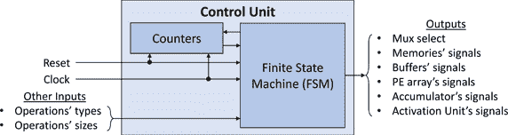

Figure 3.9: Functionality of the Control Unit of our CapsAcc architecture.

#### 3.2.2.6 Memory Hierarchy

除了 PE 数组和激活单元中内嵌的寄存器外，记忆层次结构组织如下。每个操作中，所有权重均存储在片上权重内存中，而输入数据（对应输入图像的像素强度）则存储在片上数据内存中。数据缓冲区和权重缓冲区作为加速器与内存之间的接口，提供高带宽和高访问速率的缓冲。此外，累加单元包含一个用于存储输出部分和的缓冲区，路由缓冲区用于存储动态路由的系数。

### 3.2.3 Dataflow Design

本节描述如何将不同类型层和操作的处理映射到我们的 CapsAcc 架构上。为便于理解，我们以在我们的 CapsAcc 上进行 MNIST 分类的案例研究来说明过程。注意，CapsNet 推理的每个阶段都需要其映射方案。

#### 3.2.3.1 Conv1 Layer Dataflow

Conv1 层包含 256 个通道，滤波器大小为 9×9。我们首先设计行映射，在最后一行之后移动到下一个通道。`Figure 3.10a` 展示了数据流在我们的 CapsAcc 架构上的映射方式。`Figure 3.11` 给出了将权重高效映射到权重缓冲区的示例。为了高效进行卷积，我们在 PE 数组中保存权重值，以便在不同输入数据之间复用滤波器。


-   Figure 3.10: CapsAcc 的不同案例研究场景的数据流。 (a) 卷积层映射。 (b) 第一次路由迭代的和生成与压缩操作映射。 (c) 更新与 softmax 操作映射。 (d) 除了第一次路由迭代之外的和生成与压缩操作映射。

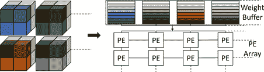

Figure 3.11: 通过将卷积滤波器映射到重量缓冲区和 PE 阵列的示例，展示了将其映射到 CapsAcc 架构的过程。

#### 3.2.3.2 PrimaryCaps 层的数据流

PrimaryCaps 层比 Conv1 层多一个维度，即胶囊大小（即 8）。然而，我们将 8 维胶囊视为具有 8 个输出通道的卷积层。因此，我们按行逐行映射参数，然后通过不同的输入通道移动，只有在第三阶段才移动到下一个输出通道。这种映射过程通过在同一输出通道上先计算输出特征，从而最小化了累加器的大小。由于该层类型为卷积层，其权重复用数据流与前一层相同，如 Figure 3.10a 所示。

#### 3.2.3.3 ClassCaps 层的数据流

ClassCaps 层的映射描述如下。在按行逐行映射后，我们将输入胶囊和输入通道视为第三维，输出胶囊和输出通道则表示第四维。因此，这种方式实现了输出特征图（OFMAP）的复用，以最小化累加器的能耗。但请回顾 Algorithm 1 中描述的过程，该层中的求和、压缩、更新和 softmax 等其他类型计算需要在此层进行。用于计算 *sum* 和 *update* 操作的输入向量被按列映射到 PE 阵列上。这种方式，每个向量被映射到相同的 PE 阵列列上，简化了 *squash* 和 *softmax* 函数的计算，这些函数由激活单元执行，以避免不同列之间的依赖。

然后，我们为路由‑by‑agreement 过程的每个步骤设计相应的数据流。这是一个关键阶段，因为低效的映射可能会显著影响整体性能。

首先，我们对路由‑by‑agreement 算法进行了算法优化。在第一次操作中，我们直接将耦合系数 *c*[*i*][*j*] 初始化为 0，而不是初始化 *b*[*i*][*j*] 为 0 并计算 softmax。此优化可以跳过第一次路由迭代中的 softmax 计算。事实上，在此操作中所有输入均为 0，因为它们不依赖当前数据。

#### 3.2.3.4 Dynamic Routing 的数据流

关于我们 CapsAcc 的数据流，我们在动态路由算法中识别出三种不同的场景：

1. **第一次和生成与压缩**：预测 *û*[*j*|*i*] 从数据缓冲区加载，耦合系数 *c*[*i*][*j*] 来自路由缓冲区，PE 阵列计算和 *s*[*j*]，激活单元选择并计算压缩，输出 *v*[*j*] 再次存入路由缓冲区。此数据流如 Figure 3.10b 所示。

2. **更新与 softmax**：预测 *û*[*j*|*i*] 通过架构的水平反馈重复使用，输出 *v*[*j*] 来自路由缓冲区，PE 阵列计算 *b*[*i*][*j*] 的更新，激活单元中的 Softmax 生成系数 *c*[*i*][*j*]，并将其存回路由缓冲区。 Figure 3.10c 展示了上述数据流。

3. **和生成与压缩**：Figure 3.10d 展示了此场景的数据流。相较于 Figure 3.10b，预测 *û*[*j*|*i*] 来自水平反馈连接，从而在该阶段也利用了数据复用。

### 3.2.4 完整 CapsAcc 架构的综合评估

#### 3.2.4.1 实验设置

我们在 RTL（VHDL）中实现了完整的 CapsAcc 架构设计，并针对 MNIST 数据集进行了评估（为保持与原始 CapsNet 论文一致）。我们使用 Synopsys Design Compiler 在 45nm CMOS 技术中进行完整架构的综合，并通过 Mentor ModelSim 进行门级仿真完成功能和时序验证，获得设计的精确面积、功耗和性能。完整的综合流程如 Figure 3.12 所示。

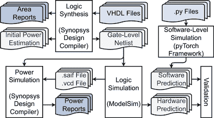

Figure 3.12: 实验设置的综合流程和工具链。

注意，由于我们的硬件设计与原始 CapsNet 设计 \[236\] 完全功能兼容，我们观察到相同的分类准确率。因此，本节不展示分类结果，仅关注性能、面积和功耗，这些对优化硬件架构更为重要。

#### 3.2.4.2 详细的功耗与面积拆解

关于设计的详细信息和综合参数，如 Table 3.4 所示。 Table 3.5 给出了综合后 CapsAcc 各组件的面积和功耗的绝对值。这些数值表明，缓冲区主导了面积和功耗的贡献，而 PE 阵列的占比不足总体预算的 1/3。

Table 3.4: 综合后的 CapsAcc 参数。

| **Tech. node \[nm\]** || 45 |

| --- | --- |

| **Voltage \[V\]** || 1 |

| **Area \[mm²\]** || 2.60 |

| **Power \[mW\]** || 427.44 |

| **Clk Freq. \[MHz\]** || 250 |

| **Bit width** || 8 |

| **On-Chip Mem. \[MB\]** || 8 |

| **Area \[mm²\]** || 2.60 |

| **Power \[mW\]** || 427.44 |

Table 3.5: CapsAcc 架构不同组件的面积与功耗。

| Component || Area \[ *μ* m²\] || Power \[mW\] |

| --- | --- | --- |

| PE Array || 42 867 || 112.31 |

| --- | --- | --- |

| Accumulator || 32 641 || 47.57 |

| Activation || 29 027 || 2.21 |

| Data Buffer || 136 222 || 199.31 |

| Routing Buffer || 32 598 || 47.56 |

| Weight Buffer || 11 961 || 17.46 |

| Other || 4 330 || 1.10 |

#### 3.2.4.3 对比结果的讨论

Figure 3.13a 图展示了 CapsNet 推理过程中不同层的执行时间结果，而 Figure 3.13b 则展示了路由‑by‑agreement 过程的每一步性能。与 Nvidia GeForce RTX 2080 Ti GPU 的性能相比，我们在 CapsNet 推理整体执行时间上实现了 6× 的显著加速。 *最值得注意的是，ClassCaps 层实现了 12× 的加速，压缩操作实现了 172× 的加速。*

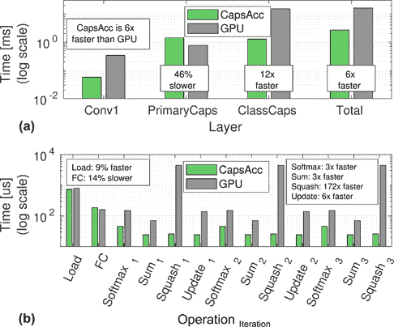

Figure 3.13: **(a)** CapsNet 推理过程的层级性能在 CapsAcc 与 GPU 的对比。 **(b)** CapsAcc 上每个路由‑by‑agreement 步骤的性能与 GPU 的对比。

### 3.2.5 总结

拟议的 `CapsAcc` 架构是首个基于 CMOS 的硬件加速器，用于 CapsNet 推理。通过设计具有多样化数据流模式的灵活阵列，以利用 CapsNet 各操作之间的并行性，实现了相较于 GPU 执行的显著性能加速。`CapsAcc` 是实现 CapsNet 硬件的首个概念证明，为其高性能推理部署开辟了多条路径。在此方面，下文 Section 3.3 讨论了一种新颖的方法，用于探索 CapsNet 加速器的设计空间，并利用面积、延迟和能耗之间的权衡。

## 3.3 Feeca: a Methodology to Design a Fast, Energy-Efficient Capsnet Accelerator

高性能且节能的 CapsNet 加速器设计需要探索不同的设计决策（如处理阵列的大小和配置、PE 的结构）。为此，我们提出 *FEECA*，一种用于探索 CapsNet 硬件加速器（微）架构参数的新颖方法。FEECA 方法利用非支配排序遗传算法（NSGA‑II）在面积、性能和能耗之间寻找 Pareto 最优点。它需要对 CapsNet 推理中每个操作所需的时钟周期数进行分析建模，并对内存访问进行建模，以实现快速而准确的设计空间探索。我们在 MNIST 基准（与原始 CapsNet 论文相同）以及德国交通标志识别基准（GTSRB）上评估了这些架构。

### 3.3.1 FEECA 方法概述

FEECA 方法（Figure 3.14）以 CapsNet 及若干优化目标（CapsNet 加速器的硬件参数）为输入。输出是一组 Pareto‑optimal 的 CapsNet 加速器。

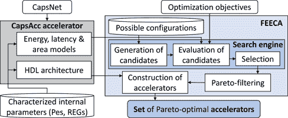

Figure 3.14: 我们的 FEECA 方法，用于在给定优化目标下获得 CapsNet 加速器的 Pareto‑optimal 设计配置。

该方法的工作流程如下。给定一个通用可配置的 CapsNet 加速器（例如 `CapsAcc`），以及一组可能的配置（即进一步优化的搜索空间），我们构建分析模型，用于计算在特定设计下加速器的各项参数，如能耗、芯片面积以及延迟（即推理单个 CapsNet 输入所需的时延）。分析模型基于一系列预合成的内部原语，如 PE 与寄存器。随后，采用空间搜索引擎寻找通用 CapsNet 加速器的最佳配置。由于通常需要多个优化参数，需要使用多目标搜索算法来找到这些参数之间的权衡。本文提出在两种搜索算法——暴力搜索和 NSGA‑II 算法——之间进行选择，以降低搜索时间。

搜索引擎的输出是一组配置，这些配置被应用于通用 CapsNet 加速器，从而得到最终的 Pareto‑optimal 加速器集合。

### 3.3.2 优化问题

本文设计的 CapsAcc 架构作为 FEECA 方法的基准，其目标是寻找 CapsNet 加速器的架构参数集合，以在面积、能耗和性能这三个设计目标之间取得良好权衡。由于我们关注多目标，传统的优化方法（如分支约束）不适用，因为它们通常只能优化单一目标且搜索范围往往过于穷尽。

#### 3.3.2.1 问题形式化

优化问题的定义如下。

- 输入为 *k* 个参数 *p*[1] ∈ *P*[1]，*p*[2] ∈ *P*[2]，…，*p*[*k*] ∈ *P*[*k*]，其中 *P*[*i*] 表示参数 *p*[*i*] 的可能取值集合。

- 我们定义配置集合 *C* ⊆ *P*[1] × *P*[2] × ⋯ × *P*[*k*]。

- 我们主要关注 *Pareto 集合*，即所谓的 *nondominated solutions*（不占优解）所构成的集合。

例如，若考虑两个配置 *c*[1] 与 *c*[2]（均属于 *C*），则 *c*[1] 占优 *c*[2] 的条件是： (1) *c*[1] 在所有目标上不劣于 *c*[2]； (2) *c*[1] 在至少一个目标上严格优于 *c*[2]。

### 3.3.3 搜索算法：暴力搜索 vs. 启发式搜索

一种直接的做法是使用暴力搜索。对于规模较小的测试用例，遍历所有配置是可行的。为了构建 Pareto 前沿，必须使用专用算法。本文采用基于二进制空间划分的高效构建算法 \[64\]。

然而，枚举所有可能的组合可能耗时过长。为避免这种情况，我们提出使用一种多目标启发式算法。该算法采用改进版的非支配排序遗传算法（NSGA‑II）\[42\]。NSGA‑II 是一种强大且智能的多目标优化算法，能够显著缩短探索时间，尽管它仍然能够在 Pareto 前沿上找到解。

NSGA‑II 算法 \[42\] 在第 *t* 代生成 offspring 列表 *Q*[*t*]，从当前种群 *P*[*t*] 中随机选取两个个体 *c*[1] 与 *c*[2]，并随机生成一个长度为 *k* 的二进制交叉向量，该向量决定在交叉时是使用 *c*[1] 还是 *c*[2] 作为源。随后，以小概率 *ρ* 对其中一个随机选取的基因（即参数）进行变异。

子人口 *P*[*t*] ∪ *Q*[*t*] 根据支配关系被划分为多个前 *F*[*i*]。第一个前 *F*[1] 包含所有在 Pareto 前沿上的非支配解。后续前 *F*[2]、 *F*[3] … 通过移除前面的前并重新构造得到。前 *F*[1] 与 *F*[2] 会被复制到下一代种群 *P*[*t* + 1]。如果某前需要拆分（例如 *F*[3]），则使用拥挤距离（crowding distance）来从该前中选择加入 *P**t* + 1* 的个体。

算法以 *g* 代（迭代）运行，其伪代码在 [Algorithm 7 中给出，涉及以下子程序：

- *R**a**n**d**o**m**C**o**n**f**i**g**u**r**a**t**i**o**n**s*(*X*, *n*)：从集合 *X* 中随机选取 *n* 个配置。

- *C**r**o**s**s**o**v**e**r**A**n**d**M**u**t**a**t**e**(*X*, *n*)：通过均匀交叉和变异在种群 *P* 上生成 *n* 个新 offspring。

- *E**s**t**i**m**a**t**e**P**a**r**a**m**e**t**e**r**s*(*X*)：评估集合 *X* 中新候选解的适应度。

- *P**i**c**k**P**a**r**e**t**o**(*X*)：从集合 *X* 中选取 Pareto 最优解，并将其从集合中移除。

- *D**i**s**t**a**n**c**e**C**r**o**w**d**i**n**g*(*X*, *n*)：从集合 *X* 中返回 *n* 个解。

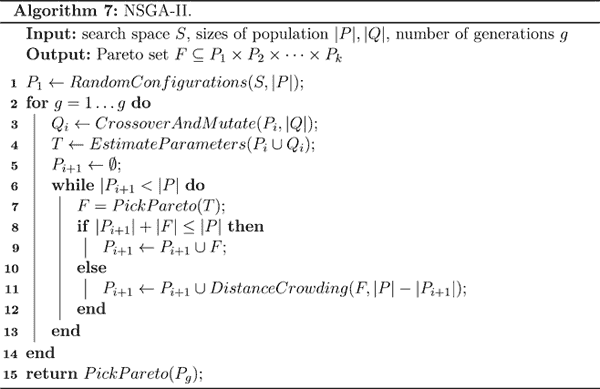

多目标算法的优势在于它在每一代都重新构建 Pareto 前沿，并尝试覆盖所有可能的解。其输出为一组非支配电路。

### 3.3.4 内部原语集合

与 CapsAcc 的第一版架构不同，我们提出对 PE 进行修改，使其能够处理多对（*n*[*p**e**]）的权重和数据输入，并通过减少树结构进行聚合。

此类型的 PEs 可以以可配置的方式生成，可调节以下参数：

*   位宽为 *b*[*i**n**] 的输入对 *n*[*p**e*] 数量；
*   部分和的位宽 *b*[*o**u**t*]；
*   管道阶段的数量 *n*[*s**t**g*]；
*   PE 阵列的行数 #*R**O**W**S**；
*   PE 阵列的列数 #*C**O**L**S**。

PEs 设计为最小逻辑深度 *D* = ⌈log2⌉，其中 *n*[*o**u**t*] 为乘法器输出的最大数量，需要相加。我们假设 *b*[*o**u**t**] ≥ 2*b*[*i**n**]，因为输出是乘法的和。因此，树结构中每个加法器的位宽深度值不超过 *b*[*o**u**t**]。与 CapsAcc（回顾 Figure 3.7b）的 PE 架构相比，Figure 3.15 中的 PE 是更通用的版本。因此，在后续实验中，我们将使用后者。

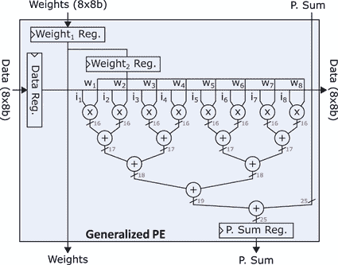

Figure 3.15: 示例：一个通用 PE，包含 8 对输入、8 位输入位宽、25 位输出位宽以及 1 个管道阶段。

PE 的最长计算路径可以通过在路径上插入管道寄存器来缩短，即通过增加参数 *n*[*s**t**g*]。此修改可能导致显著的面积和能耗开销，因为在每个相同的管道阶段的每条线路上都插入了额外的寄存器。

### 3.3.5 加速器参数估计

穷举搜索（本文也适用于启发式搜索空间）的一个关键方面是能够快速且准确地估计加速器的硬件参数。本文关注那些对 CapsNet 整体精度无影响的硬件参数，即面积、延迟和能耗（考虑 PE 阵列及内存访问的贡献）。

#### 3.3.5.1 面积

估算 PE 阵列面积的模型简单且准确。我们采用模块化方法，从下往上构建估算。由于 PE 阵列是 PEs 与寄存器的笛卡尔网格，面积可表示为在给定时钟周期 *T* 下，一组完全表征的原始元件（PE、寄存器）的求和。因此，只需对原始元件进行逻辑综合即可。

#### 3.3.5.2 延迟

对推理一次 CapsNet 的延迟（计算时延）建模是最关键的一步，因为必须考虑每一层/每一操作的不同内部原始元件及数据流。因此，我们为每一操作构建一个分析模型，计算处理该层输入所需的时钟周期数。该模型由加速器的内部原始元件参数（如 *n*[*s**t**g*]、 *n*[*p**e**]、#*C**O**L**S**、#*R**O**W**S**）参数化。因此，每一层的延迟等于时钟周期数乘以时钟周期。CapsNet 推理的总延迟为所有操作延迟之和。

#### 3.3.5.3 能耗

加速器完成一次推理所需的能耗可分为两部分。第一部分是 PE 阵列消耗的能量，即 PE 阵列的功率（计算方式与面积相同，基于完全表征的原始元件功率之和），乘以延迟。第二部分是从数据存储和权重存储读取所需的能量，假设最大 SRAM 容量为 8 MB。

### 3.3.6 FEECA 方法的评估

本节展示了拟议的 FEECA 方法在 CapsNet 加速器的 PE 阵列上找到 Pareto 最优配置、从而高效执行 CapsNet 推理的能力。我们在 GTSRB 数据集上对 CapsNet 模型进行了实验 \[92\]。实验分为四个部分。第一部分，对选定的 *n*[*s**t**g*]、*T*、*n*[*p**e**]、*b*[*i**n**] 和 *b*[*o**u**t*] 参数进行内部原始元件（PE、寄存器等）的综合结果展示。随后，构建并分析了两组以能量‑延迟和面积‑延迟为目标的 Pareto 最优配置。进一步分析并讨论了启发式 NSGA‑II 搜索算法的加速度和质量。最后，构建了三维 Pareto 前沿。实验设置和工具流程如 Figure 3.16 所示。在此，搜索算法在不同配置之间探索，以选择基于设计目标的 Pareto 最优解。评估基于综合的 PE 与寄存器以及从基线 CapsAcc 提取的推理模型。

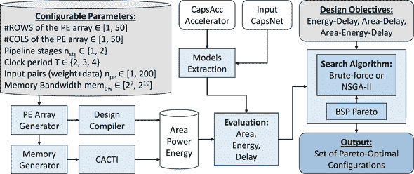

Figure 3.16: 评估 FEECA 方法的实验设置与工具流程。

#### 3.3.6.1 生成器：内部原始元件的综合

首先，我们为 *b*[*i**n***] = 8、*b*[*o**u**t*] = 25、*n*[*s**t**g*] ∈ {1, 2} 和 *n*[*p**e**] ∈ [1, 400] 生成设计原始元件。生成的 PEs 使用 Synopsys Design Compiler 在 45 nm 工艺节点下，时钟周期 *T* ∈ {2, 3, 4} 进行综合。Figure 3.17 展示了 *n*[*s**t**g*] ∈ {1, 2} 时设计的参数。注意，时钟周期限制输入数量 *n*[*p**e**]，因为减少树的深度会导致时钟约束被违反。例如，时钟周期设为 2 ns 时 *n*[*p**e**] 只能为 7。因此，最大 *n*[*p**e**] 分别为 7、130 和 300（当 *n*[*s**t**g*] = 1 时），以及 7、150 和 400（当 *n*[*s**t**g*] = 2 时）。

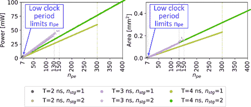

Figure 3.17: 当 *n*[*s**t**g*] = 1 时，不同 P.Sum 位宽（*b*[*o**u**t*]）下 PE 的功耗和面积。虚线表示在给定位宽下，未违反时钟约束的最大可综合输入数 *n*[*p**e**]。

我们还在管道化方式下综合设计，将计算路径分为两个时钟周期（寄存器位于乘法器之后）。额外寄存器导致功耗增加 28%，面积增加 36%。为计算从数据存储和权重存储读取产生的能耗，我们使用 CACTI‑P 工具 \[124\]，假设最大 SRAM 容量为 8 MB，块大小为 128 B。面积、读取能耗和漏电功率随内存带宽（*m**e**m*[*b**w*]} 的变化结果列于 Table 3.6。

Table 3.6: SRAM 参数。

| 带宽 \[bits\] | 128 (10⁷) | 256 (10⁸) | 512 (10⁹) | 1024 (10¹⁰) |
| --- | --- | --- | --- | --- |
| 面积 \[*m**m**²\] | 55.8 | 61.1 | 66.0 | 76.5 |
| 读取能耗 \[*nJ*\] | 0.549 | 0.967 | 1.897 | 3.943 |
| 漏电功率 \[*mW*\] | 4272 | 4335 | 4385 | 4493 |

FEECA 方法优化了 CapsAcc 的参数，如第 3.16 章（https://chapter3.xhtml#fig3_16）所讨论。我们考虑两组目标：能量 vs. 延迟（E vs. D）和面积 vs. 延迟（A vs. D）。使用粗力算法，我们的 FEECA 方法找到 228 个 E vs. D Pareto 最优配置和 127 个 A vs. D Pareto 最优配置，如第 3.18 章（https://chapter3.xhtml#fig3_18）所示（最优点）。请注意，粗力算法得到的 Pareto 最优解与 NSGA‑II 算法生成的解决方案高度重叠，这意味着后者是一个高效且可靠的设计空间算法。此外，配置之间的面积变化相对较小。请注意，存在相同面积但延迟不同的多个解决方案。我们还将 NSGA‑II 方法找到的 Pareto 最优解与相同数量随机搜索候选解进行了比较。与第 3.18 章（https://chapter3.xhtml#fig3_18）中随机搜索得到的 Pareto 最优点（绿色点）相比，NSGA‑II 方法得到的 Pareto 最优点在能量 vs. 延迟目标上表现出 67 倍、在面积 vs. 延迟目标上表现出 146 倍更低的平均归一化欧几里得距离。


Figure 3.18: 粗力算法（最优）、NSGA‑II 算法（启发式）、随机搜索以及其他被支配的 Pareto 解（粗力）在（左）能量 vs. 延迟和（右）面积 vs. 延迟目标下的 Pareto 最优配置分布。

对于 E vs. D 目标，第 3.19 章（https://chapter3.xhtml#fig3_19）展示了为整体 E vs. D 以及每一层的 E vs. D 优化的配置的能耗和延迟（a）和（b）。*PrimaryCaps* 层对整体能耗和延迟影响最大。因此，整体最优配置和层级最优配置在此情况下几乎位于同一曲线上。另一方面，CapsNet 最优配置降低了 *Sum、Update* 以及大多数 *Conv1* 层的性能，但这些层在整体目标中的贡献相对较小。确实，整体 CapsNet 的最优解仅在 *PrimaryCaps* 层最优，而在其他层并不最优。


Figure 3.19: 能量和延迟的层级分布，蓝点表示整体 CapsNet 最优配置，红点表示仅对单层最优的配置。被高亮的解（n_{stg}=1, n_{pe}=7, #COLS=12, #ROWS=1, mem_{bw}=1024, T=2 ns）大约消耗 PrimaryCaps 和 Conv1 层的 80% 能量，其他层的贡献显著较低。

另一个对最优配置的视角在第 3.20 章（https://chapter3.xhtml#fig3_20）中呈现。该图展示了针对不同配置的 CapsNet 加速器参数分布。请注意，如果考虑所有目标，使用 #ROWS = 1 能获得更好的结果。在 E vs. D 目标下，提高 mem_{bw} 是合理的。PrimaryCaps 层对整体延迟和能耗贡献最大。选择 n_{pe} 的取值范围为 1 到 7 较合适。然而，仅针对 Conv1 层，更佳的选择是 n_{pe} ∈ {4.7}，即取 4，同时 ClassCaps 层也应取 4。Sum、Update 和 ClassCaps 层倾向于 PE 阵列大小为 32 × 1。另一方面，A vs. D 设计目标的最优参数分布不同，因为面积高度依赖 mem_{bw}，所有取值都会产生一些 Pareto 最优解。


Figure 3.20: 针对 E‑L 和 A‑L 目标的 Pareto 最优配置中 n_{pe} 与 #COLS 参数的分布。蓝色条形显示整体 CapsNet 目标的分布，红色条形显示仅针对单层优化的配置。

#### 3.3.6.3 启发式搜索算法

粗力算法最终能够找到最优解，但由于需要遍历所有可能的解，运行时间非常长。因此，我们实现了启发式 NSGA‑II 算法以加速搜索过程。对于 E‑L 目标，NSGA‑II 运行 1 000 次生成迭代，群体大小 |P| = |Q| = 50，以找到最多 50 个 Pareto 最优配置。

NSGA‑II 只需 50 050 次评估（占搜索空间的 0.44%），因此探索时间从使用粗力时的 2.5 小时缩短至 30 秒。E vs. D 目标的设计并不平凡，因为其最优前沿包含 228 个配置。因此，初始设置 |P| = |Q| = 50 只能找到最优解的一个小子集，这些解在距离拥堵下均匀分布。几乎所有找到的解都属于最优 Pareto 集合，其与最近最优解的归一化欧几里得距离（ANED）为 4 × 10⁻⁵。相反，最优解到最近找到解的 ANED 为 0.006。为降低最优解到找到解的距离，我们将种群规模增大到 |P| = |Q| = 150（150 150 次评估；占探索时间的 1.31%）。在此设置下，我们找到了 150 个解，虽然这导致设计时间增加 3 倍，但最优解到找到解的 ANED 降至 0.001，且每个找到的解都属于最优 Pareto 集合。对于 A vs. D 目标，使用 |P| = |Q| = 150 的启发式设计能够找到 97 个 127 个配置，其最优解到找到解的 ANED 为 2 × 10⁻⁴。结果如第 3.18 章（https://chapter3.xhtml#fig3_18）所示。

#### 3.3.6.4 多目标优化

在我们的基准上运行搜索算法后，CapsNet 加速器的三个目标得到优化：芯片面积、推理单个输入图像的能耗以及延迟（即推理时延）。 

Figure 3.21 报告了三种不同的可视化视角，展示了结果，其中每两个目标的组合形成产物，分别是能量 × 延迟（EDP）、面积 × 延迟（ADP）和能量 × 面积（EAP）。通过降低空间维度，仅剩下较少的解在帕雷托前沿，用灰色线表示。例如，最低延迟的解（将在下文作为案例研究分析）在 Figure 3.21 中用灰色圆圈标记。它仅在最后两幅图上位于帕雷托前沿，即 ADP 与能量的权衡以及 EAP 与延迟的权衡，而在其他情况下并非帕雷托最优。事实上，如果考虑 EDP，75% 的配置是被支配的。同样，在 ADP 和 EAP 上，超过 42% 和 43% 的配置是被支配的。


Figure 3.21: 带有三个目标的配置帕雷托集合在图中（上）以及将两个目标组合为乘积的图（下）。高亮的最低延迟解的配置为 *n*[*s**t**g*] = 1，*n*[*p**e*] = 4，#*C**O**L**S* = 32，#*R**O**W**S* = 1，*T* = 3 *n**s**，*m**e**m*[*b**w*] = 1024。

#### 3.3.6.5 案例研究：综合帕雷托最优解

作为案例研究，我们使用 Synopsys Design Compiler 合成了选中解（在 Figure 3.21 中用灰色圆圈标记）的完整 PE 阵列。该 PE 阵列的微架构结构如 Figure 3.22 所示。注意，由于该解仅有一行，PE 的结构与通用 PE（见 Figure 3.15）在以下两方面不同：

* 由于只有一行，不需要存储 *W**e**i**g**h**t**[*1*] *R**e**g**.*，因为后续行不存在，故无需保存权重值。

* 由于只有一行，输入的部分和为空。因此，所有相对连接和加法均被省略。

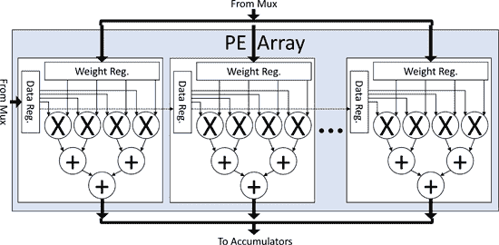

Figure 3.22: 选中解的 PE 阵列微架构，具有 *n*[*p**e*] = 4，#*C**O**L**S* = 32，#*R**O**W**S* = 1。

Table 3.7 的第一行展示了 Figure 3.21 中选中解的结果。最后两行报告了基线架构 CapsAcc（Section 3.2）和 DESCNet（Section 3.4）的最新设计结果，其余行则展示了与第一行解具有相同乘法数量的其他几种解的结果。

Table 3.7: PE 阵列及整个 CapsAcc 架构的延迟、面积和能耗估计结果。第一行中，延迟最低（最快）的配置以绿色高亮显示。相比之下，Section 3.2 中分析的 CapsAcc 原始版本列于倒数第二行。所有电路均在时钟周期 *T* = 3 *n**s** 进行综合。

|  || **Configuration** || **est.** || **DeepCaps (est.)** || **CapsNet (est.)** || **PE array** |
| --- | --- | --- | --- | --- | --- |
| *m**e**m*[*b**w*] || *n*[*p**e*] || *c* × *r* || area \[*m**m**²\] || energy \[*mJ*\] || delay \[*ms*\] || energy \[*mJ*\] || delay \[*ms*\] || area \[*m**m**²\] || power \[*mW*\] |
| **Ours** || 1024 || 4 || 32 × 1 || 76.64 || 210.13 || 2.932 || 84.06 || 0.210 || 0.168 || 36.5 |
| 512 || 4 || 32 × 1 || 66.13 || 203.78 || 3.247 || 81.70 || 0.392 || 0.168 || 36.5 |
| 256 || 4 || 32 × 1 || 61.19 || 210.03 || 3.877 || 84.81 || 0.755 || 0.168 || 36.5 |
| 128 || 4 || 32 × 1 || 55.93 || 241.23 || 5.137 || 98.88 || 1.482 || 0.168 || 36.5 |
| 16 || 4 || 32 × 1 || 55.93 || 241.23 || 5.137 || 98.88 || 1.482 || 0.168 || 36.5 |
| **Ours** || 1024 || 4 || 16 × 2 || 76.64 || 113.11 || 3.247 || 43.33 || 0.392 || 0.168 || 37.6 |
| 4 || 2 × 16 || 76.64 || 54.23 || 8.021 || 21.37 || 3.086 || 0.168 || 38.2 |
| 4 || 8 × 4 || 76.64 || 66.91 || 3.890 || 24.26 || 0.761 || 0.168 || 39.0 |
| 4 || 4 × 8 || 76.64 || 49.05 || 5.215 || 17.52 || 1.514 || 0.168 || 39.1 |
| 8 || 4 × 4 || 76.63 || 66.94 || 3.916 || 24.31 || 0.771 || 0.161 || 36.3 |
| 8 || 8 × 2 || 76.63 || 112.91 || 3.254 || 43.32 || 0.395 || 0.161 || 35.8 |
| 8 || 2 × 8 || 76.63 || 50.23 || 5.319 || 17.96 || 1.557 || 0.161 || 36.3 |
| 16 || 4 × 2 || 76.63 || 112.53 || 3.267 || 43.29 || 0.400 || 0.158 || 35.2 |
| 16 || 2 × 4 || 76.63 || 67.05 || 3.968 || 24.41 || 0.793 || 0.158 || 35.9 |
| 16 || 1 × 8 || 76.63 || 52.72 || 5.528 || 18.93 || 1.646 || 0.158 || 35.3 |
| 16 || 8 × 1 || 76.63 || 209.40 || 2.936 || 83.97 || 0.212 || 0.158 || 34.3 |
| 32 || 2 × 2 || 76.63 || 111.85 || 3.293 || 43.23 || 0.411 || 0.163 || 35.3 |
| 32 || 1 × 4 || 76.63 || 67.32 || 4.073 || 24.69 || 0.837 || 0.163 || 35.4 |
| 32 || 4 × 1 || 76.63 || 208.46 || 2.942 || 83.86 || 0.215 || 0.163 || 35.0 |
| 2 || 32 × 2 || 76.66 || 113.24 || 3.247 || 43.35 || 0.392 || 0.184 || 43.6 |
| 2 || 2 × 32 || 76.66 || 86.11 || 13.425 || 39.20 || 6.143 || 0.184 || 44.1 |
| 2 || 16 × 4 || 76.66 || 66.92 || 3.877 || 24.24 || 0.755 || 0.184 || 44.1 |
| 2 || 4 × 16 || 76.66 || 50.54 || 7.812 || 19.89 || 2.999 || 0.184 || 44.9 |
| CapsAcc || 1024 || 1 || 16 × 16 || 76.86 || 479.8 || 103.1 || 40.12 || 8.621 || 0.434 || 112.3 |
| DescNet || 128 || 1 || 16 × 16 || 56.15 || 278.31 || 103.1 || 18.37 || 8.621 || 0.434 || 112.3 |

FEECA 方法被提出，以探索用于 CapsNet 推理的专用硬件加速器的设计空间。为了实现该方法，我们构建了基于 PE 阵列（如 PE 阵列的大小和配置以及 PE 的结构）微架构参数的面积、延迟和能耗分析模型。借助遗传算法 NSGA-II 对设计空间进行探索，选取 Pareto 最优解。除了优化计算硬件设计外，内存架构设计和管理对于考虑整体硬件设计的能耗降低至关重要。因此，进一步投入努力分析并利用专用内存架构的可能性和机会，可在 Section 3.4 所示的章节中实现整体内存能耗的降低。

## 3.4 Descnet: Developing Efficient Scratchpad Memories for Capsnet Hardware

与传统的 DNN 相比，CapsNet 通过使用多维胶囊并保留对象之间的空间关系，提升了泛化能力。然而，它们的计算和内存需求很高，使得能耗高效推理成为一项挑战。本节首次对在硬件加速器上执行快速 CapsNet 推理时使用的（片上 scratchpad）内存进行深入分析，突出其设计与运行时挑战。为实现高效，我们提出了一种专用内存架构 —  — DESCNet，它在最小化片外内存访问的同时，高效地为执行 CapsNet 推理的硬件加速器提供数据。

我们分析了相应的片上内存需求，并利用该分析来设计一套方法，用于探索不同的 scratchpad 内存设计及其能耗/面积权衡。随后，我们提出了一种针对片上 scratchpad 内存的专用电源门技术，以进一步降低其能耗，该技术依赖于 CapsNet 的数据流以及不同处理步骤的使用情况。

我们将我们的 DESCNet 内存设计与在 Google CapsNet 模型上运行的 CapsAcc 加速器相结合。我们还增强了设计，使其能够运行 DeepCaps 在 CIFAR10 数据集上。完整的硬件采用 45nm CMOS 工艺，采用 Synopsys 工具和 CACTI-P 进行 ASIC 设计流程的综合，并使用不同配置对性能、面积以及功耗/能耗进行详细估算。我们在选定的 Pareto 最优解上展示的结果表明，完整加速器（包括计算单元和内存）的能耗比当前最先进的设计降低了 79%。

### 3.4.1 DESCNet 方法概述

如 Section 3.2 所述，CapsAcc 架构主要集中在设计高效的计算阵列和优化动态路由算法。*然而，CapsNet 加速器的内存架构设计与管理是整体硬件系统能耗降低的关键方面*。此外，传统 DNN 加速器的内存优化并不适用于 CapsNet 算法，因为它们未考虑 CapsNet 处理流和计算模式的独特性。*因此，有必要针对执行 CapsNet 算法的 DNN 加速器开发专用内存架构，利用其独特的处理操作和内存访问模式，以实现高能效*。假设在资源受限的嵌入式应用（如 IoT 边缘设备）中，通常不适用大型片上内存，因此通常采用片上与片外内存相结合的内存层次结构。

如 Section 3.4.3 所示，片上和片外内存的能耗共同构成了 CapsNet 硬件架构总能耗的 96%。因此，研究并优化片上内存层次结构的能耗高效设计与管理至关重要。*实现高能效的关键在于利用 CapsNet 的应用特性，包括其独特计算块的处理行为、映射数据流以及对应的内存访问模式*。由于 CapsNet 推理的操作和内存访问模式与传统 DNN 有显著差异，现有的 DNN 加速器内存架构在执行 CapsNet 推理时可能效率不佳。因此，为了理解相应的设计挑战和优化潜力，我们分析了将 CapsNet 推理映射到 CapsAcc 以及传统 DNN 加速器（如 TPU）时，各个阶段的内存需求（尺寸、带宽和访问次数）。

传统的 DNN 加速器内存层次结构由片外 DRAM 和片上 SRAM 组成，其中片上内存基本上是 scratchpad 内存而非传统缓存。虽然存在通用的内存设计方法 \[200\]，但要实现 CapsNet 的高能效，仍需采用专用设计和优化，如上文所述。该专用设计必须考虑 CapsNet 各处理操作的内存访问行为及其在加速器上的数据流，以探索内存层次结构（即尺寸、银行数、分区）的多级设计空间。例如，强烈的片上 scratchpad 内存（SPM）访问会导致高能耗和性能开销，需要配合支持高效数据复用的 CapsNet 加速器，以降低对片外内存访问的过度开销。然而，过大的 SPM 会增加芯片面积和漏电功耗。因此，除了对 SPM 进行高效的尺寸和分区外，还需要一种针对运行时场景的专用电源门控制，以在不同处理步骤导致的内存使用情况多样化时，进一步降低能耗，同时考虑唤醒开销。*针对 CapsNet 硬件架构的面向应用的内存层次结构设计及 SPM 运行时电源门管理，可能在保持高吞吐的同时，相比传统 DNN 加速器的内存架构实现显著的能耗降低*。

#### 3.4.1.1 我们的创新贡献

Figure 3.23 展示了我们 *DESCNet* 内存架构设计方法的概览，展示了我们的创新贡献与 CapsNet 加速器的集成。简言之，我们提出：

1. **CapsNet 推理的内存分析** —  — 系统地研究 CapsNet 与 DeepCaps 推理中不同操作的设计需求（尺寸、访问次数）、能耗和性能。

2. **DESCNet：面向 CapsNet 加速器的专用多银行 scratchpad 内存架构**，该架构在考虑 CapsNet 推理中不同操作的数据流和对应的内存访问模式时设计。SPM 被划分为多个部门，以支持细粒度的电源门控制，从而在运行时不同的内存使用情况下提供更大的能耗节约潜力。由于我们的 SPM 支持常见的输入/输出接口，它可以与任何能够执行 CapsNet 推理的加速器相连。

3. `设计空间探索 (DSE)`，用于自动获得我们 *DESCNet* 记忆体架构中不同关键参数的 Pareto 最优值。它在内存、面积和能耗之间利用权衡，同时利用 CapsNet 推理各步骤的不同处理行为。

4. `面向应用的记忆体功率管理`：它利用加速器的结构参数、CapsNet 推理的处理流以及与记忆体的接口，设计分区级电源门，以降低静态功耗。

5. `硬件实现与评估`：在 45 nm CMOS 技术中，使用 Synopsys 工具和 CACTI‑P 的 ASIC 设计流程，对包含集成 *DESCNet* 记忆体的完整 CapsNet 架构进行硬件实现与评估。我们对 CapsNet 的芯片内存架构共 15 233 种可能配置以及 DeepCaps 的 215 693 种配置进行面积和能耗评估，并将其与 CapsAcc 记忆体设计进行对比。

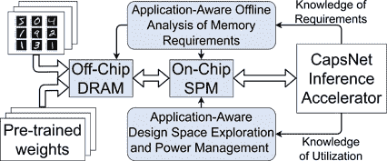

Figure 3.23: Overview of our *DESCNet* Memory Design Methodology.

### 3.4.2 Required Architectural Modification and Key Research Question

To overcome the limitation of having large on‑chip memory in the baseline CapsAcc architecture (Figure 3.24a) and toward real‑world edge implementations, we employ a modified CapsNet hardware architecture that features a memory hierarchy consisting of an on‑chip SPM and an off‑chip DRAM, as shown in the blue boxes of Figure 3.24b, respectively.

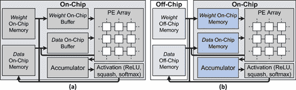

Figure 3.24: Architectural view of the CapsNet inference accelerator. **(a)** Baseline architecture in CapsAcc. **(b)** Modified architecture for this work with off‑chip and on‑chip memory partitioning, which is more practical for embedded implementations.

Such a design can generalize the problem for diverse applications and CapsNet architectures. However, considering such a memory hierarchy, the challenge then lies in designing and managing the on‑chip memory such that (i) the off‑chip memory accesses are minimized, (ii) the reuse of intermediate data and weights stored in the on‑chip memory is exploited at the maximal, and (iii) the unnecessary parts of the on‑chip memory can be power‑gated in some scenarios of varying memory accesses without reducing the performance of CapsNets processing. These problems have not been studied for the CapsNets hardware yet. *Toward this, we aim at investigating the following key questions when determining the memory sizes and the communication between off‑chip and on‑chip memories.*

1. `How` to minimize the off‑chip memory accesses to reduce energy consumption? Every data is read from or written to the off‑chip memory only once, while used once or multiple times in the on‑chip memory.

2. `How` to keep the latency and throughput *similar/close* to the case of having all the memory on‑chip, i.e., hiding the off‑chip latency as much as possible? *This can be guaranteed by prefetching the data to the on‑chip memory to mask the off‑chip memory latency, assuming that the on‑chip memory is large enough to contain all the necessary data.*

3. `How` to minimize the on‑chip SPM size to reducing the leakage? What would be the appropriate design tradeoffs?

4. `How` can we design efficient power‑gating for the on‑chip SPM to save the leakage power for the unused sectors?

5. `Can` we exploit the unique processing and data reuse characteristics of CapsNets to optimize the corresponding memory access profiles?

Since the above‑discussed challenges can pose contradicting requirements and constraints, in‑depth analyses of the resource requirement and usage patterns of CapsNets processing are needed before making appropriate design decisions, which we discuss in the following Section 3.4.3.

### 3.4.3 Resource Analysis of CapsNet Inference

First, we investigate Google's CapsNet architecture \[236\] which performs MNIST \[118\] classification, using the architectural organization presented in Figure 3.24b. We analyze the performance and the on‑chip memory requirements for different operations of the CapsNet inference, showing their on‑chip read and write accesses. Afterward, we analyze the DeepCaps \[220\] for the CIFAR10 \[112\] classification, showing that the accumulators have the highest contributions in memory usage and accesses. Meanwhile, the energy breakdown analysis shows the respective contributions of the accelerator and the memories. Our experiments obtain the same classification accuracy as for the CapsNet on the MNIST dataset and for the DeepCaps on the CIFAR10 dataset, i.e., 99.67% and 92.74%, respectively.

#### 3.4.3.1 Performance and Memory Analyses for the Google's CapsNet on the MNIST Dataset

**Memory Usage Analysis:** In Figure 3.25, we analyze the on‑chip memory requirements for each operation of the CapsNet inference. The dashed lines represent their maximum values. Note, unique operations (like *ClassCaps, Sum, Squash, Update* and *Softmax*) of Google's CapsNet \[236\] inference mapped onto the *CapsAcc* accelerator exhibit different memory utilization profiles compared to when mapped to a memory architecture designed for the traditional DNNs like the TPU \[100\]. The overall size can be chosen by the operation that requires the largest amount of memory (i.e., the *PrimaryCaps* layer). For this configuration, the on‑chip SPM is composed of the data, weight and accumulator memories. This analysis unleashes the available optimization potential for improving the memory energy efficiency when designing a specialized memory architecture for CapsNet accelerators.

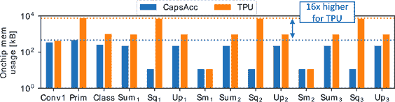

Figure 3.25: Memory utilization of Google's CapsNet inference, mapped on a specialized CapsNet accelerator (*CapsAcc*) and TPU. The bars represent the on‑chip memory usage. The dashed lines show the maximum requirement.

**Performance Analysis:** Figure 3.26a presents the execution time (i.e., number of clock cycles) of different operations involved in the CapsNet inference. Note that the dynamic routing operations contribute to more than half of the execution time of the complete CapsNet inference. Overall, the performance is 116 frames‑per‑second (FPS) for the CapsAcc accelerator. Suppose we combine the results of Figures 3.25 and 3.26a. In that case, we notice that, potentially, a significant amount of leakage energy can be saved by the power‑gating part of the on‑chip memory when the utilization is below 100%. We leverage this observation to develop an application‑specific power management policy for memories of the CapsNet Accelerators, as discussed in Section 3.4.4.

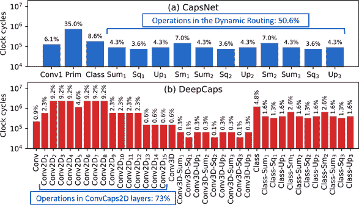

Figure 3.26: Clock cycles for different inference operations in (**a**) CapsNet for the MNIST dataset; (**b**) DeepCaps for the CIFAR10 dataset.

# 记忆访问分析

`Memory Access Analysis`: Figure 3.27a 为每个记忆组件（即数据内存、权重内存和累加器）提供了详细的分析，这使得能够高效地对 *DESCNet* 的不同体系结构参数进行 DSE（设计空间探索）。请注意，分别处理不同的记忆组件可能有助于实现高效的功耗管理。Figure 3.27b 和 Figure 3.27c 分别展示了 CapsNet 推理中每个操作 *i* 的读取和写入访问，即 *Convolutional1 (Conv1, PrimaryClass (Prim)* 和 *ClassCaps-FullyConnected (Class)*。这些值用于在后续章节计算记忆能耗。

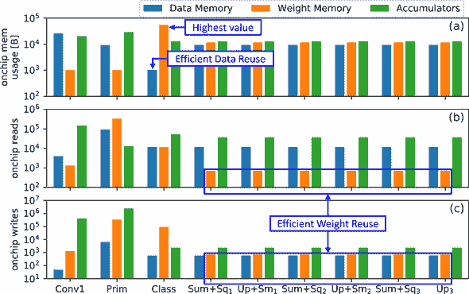

Figure 3.27: 对 MNIST 数据集上 CapsNet 推理的不同操作进行的片上内存分析。(a) 片上内存使用情况。(b) 片上读取。(c) 片上写入。

Figure 3.28 中报告的片外访问可以通过公式 (3.3) 和 (3.4) 计算，这些公式适用于前三个操作，并以索引 *i* 标记。 *R**D**[*o**f**f*] 和 *W**R**[*o**f**f*] 表示 SPM 读取和写入访问，而子脚本 [D] 和 [W] 分别代表片上数据内存和权重内存。 *在动态路由期间，除第一个和最后一个操作外，片外内存不被访问，因为动态路由期间所需的所有值都已保存在片上。*

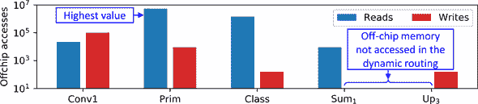

Figure 3.28: CapsNet 推理的片外访问。

$$\\begin{array}{l} {\\left( RD\\_{off} \\right)\\_i = \\left( WR\\_{D} + WR\\_{W} \\right)\\_i} \\\\ \\end{array}$$  

(3.3)

$$\\begin{array}{l} {\\left( WR\\_{off} \\right)\\_i = \\left( RD\\_{D} \\right)\\_i + 1} \\\\ \\end{array}$$  

(3.4)

**从上述分析中，我们得出以下关键观察**：

*   对于大多数操作，累加器的内存使用量超过了每个操作的数据和权重内存，因为它必须存储不同输出特征图的临时部分和。然而，权重内存的峰值在 *ClassCaps* 层可见，该层为全连接层（FC）。

*   数据和权重内存的需求在不同操作之间差异显著。

*   在前两层，权重内存的使用相对较低，因为体系结构可以有效地重用权重进行卷积。

*   在 *ClassCaps* 层，由于数据复用高效，数据内存的使用量较低。

*   与前三个操作相比，后六个操作（动态路由）的权重复用相对更高效。

*   在动态路由期间，除第一个操作的读取和最后一个操作的写入外，片外内存不被访问，这得益于在这些操作中数据和权重的高效复用。

## 3.4.3.2 基于 CIFAR10 数据集的 DeepCaps 性能和内存分析

同样，我们对更深更复杂的 CapsNet，如 DeepCaps \[220\] 进行了类似的分析。时钟周期性能如 Figure 3.26b 所示，整体为 9.7 FPS。与 CapsNet 相比，DeepCaps 采用了更分布式的分区。总体而言，我们可以注意到最耗时的操作位于 *ConvCaps2D* 层，它们贡献了 DeepCaps 推理完整执行时间的 73%。

Figure 3.29 展示了不同操作的片上内存读取和写入情况。与 CapsNet 类似，累加器的使用量高于数据和权重内存。此外，权重内存的使用和访问在 Conv 层较低，但在动态路由操作中则更高。

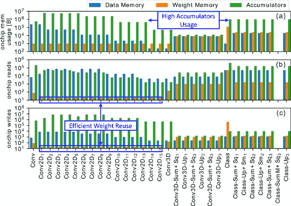

Figure 3.29: DeepCaps 推理中不同操作的片上内存使用、读取和写入。

Figure 3.30 展示了 DeepCaps 的片外访问。虽然 Conv 层的读取和写入比例随 Conv 层大小的减小而下降，但动态路由的访问较低，这得益于高效的复用。峰值出现在 *ClassCaps* 层的开头，因为该操作涉及大量权重。

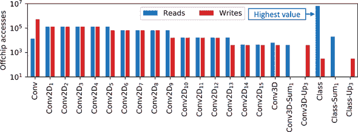

Figure 3.30: DeepCaps 推理的片外访问。

## 3.4.3.3 能耗分解分析

为了计算完整体系结构的能耗，我们开发了以下两种不同的版本。

1.  (a)Figure 3.24a：一个加速器（由 NP 阵列、激活单元和控制单元组成），片上 SPM 缓冲区（数据、权重和累加器的内存），以及片上 SPM（用于数据和权重）。总片上内存为 8*MiB*。

2.  (b)Figure 3.24b：与上述相同的加速器组成，但片上和片外内存的体系结构不同。尺寸来源于前面的分析。

能耗分解如 Figure 3.31 所示。结果通过在 45nm CMOS 技术中合成 CapsAcc 加速器执行 Google 的 CapsNet 以 MNIST 数据集为对象得到。片上和片外内存的数值使用 CACTI-P 工具 \[124\]，该工具采用兼容的技术参数，在内存社区中被广泛采用。

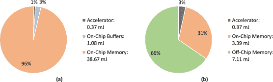

Figure 3.31: 考虑 **(a)** 所有片上内存的 CapsNet 推理体系结构能耗分解；**(b)** 由片上和片外内存组成的内存层次结构能耗分解。

我们的分析表明，通过设计不同的内存层次结构，可以相比 CapsAcc 节省 73% 的总能耗。这些节省主要归因于因片上内存规模更小而显著降低的漏电能耗。此外，片上内存消耗了总能耗的 31%，这对应于 **90%** 的片上能耗（即加速器和 SPM）。因此，面向应用的片上内存功耗管理可以显著影响整体片上能耗的节省。

*注：DeepCaps 在 CIFAR10 数据集上的执行超出了 CapsAcc 8*MiB* 的内存限制，因此无法进行直接比较。然而，正如本节后面所示，我们提出的 DESCNet 内存体系结构使得在资源有限的硬件上部署 DeepCaps 成为可能，同时保持低硬件开销。

-   [应用驱动的存储层次结构，由片上 SPM 和片上 DRAM 组成，可在不牺牲 Google CapsNet 模型的吞吐量的前提下，节省高达 73% 的能量。请注意，吞吐量通过在交错方式与当前操作同时预取下一操作的数据来保持不变。因此，片上内存的延迟可以被隐藏。]

-   片上内存的利用率取决于 CapsNet 推理的操作，因此对未使用的区域启用电源门可以进一步降低其能耗。

-   将 SPM 分割为独立的组件（数据、权重和累加器），有助于存储数值并高效地将其馈送到加速器。

### 3.4.4 DESCNet: Scratchpad Memory Design

#### 3.4.4.1 DESCNet Memory Architecture

我们的 `DESCNet` 架构如 Figure 3.32 所示。它通过专用总线与 CapsNet 加速器相连，并通过专用总线与片上内存相连。SPM 被分为 `B` 个 bank，每个 bank 包含 `SC` 个大小相等的 sector。不同 bank 之间的所有 sector 通过实现为睡眠晶体管的电源门电路（用于高效的按 sector 级电源管理控制）相互连接，这在一定程度上会增加面积开销。我们的设计为每个 bank 配备 `SC` 个 sector，所有 sector 共享同一睡眠信号。我们仅考虑 `ON` 与 `OFF` 两种模式，因为它们在我们的设计中表现出优势，并且不需要保留状态。我们的应用驱动内存电源管理单元（PMU）决定睡眠晶体管的合适控制信号（即 `ON` ↔ `OFF`）。在当前操作执行完成后，SPM 中的值会被丢弃，因为我们在设计中采用深度睡眠 `OFF` 状态，该状态不可保留。从睡眠模式切换到另一种模式会产生一定的唤醒能量和延迟开销，需要通过泄漏能量节约（取决于睡眠时长和处于睡眠模式的 sector 数量）来摊薄。请注意，我们的记忆模型可以推广至支持不同尺寸和并行度的记忆组织，包括多端口记忆。 *为此，我们研究了以下三种设计选项。*

1.  (a)**Figure 3.33a—Shared Multi-Port Memory (SMP):** a shared on-chip memory with 3 ports for accessing the weights, input data and accumulator's storage in parallel.

2.  (b)**Figure 3.33b—Separated Memory (SEP):** weights, input data, and the accumulator's partial sums are stored in separate on-chip memories.

3.  (c)**Figure 3.33c—Hybrid Memory (HY):** a combination of the above two design options, i.e., an `SMP` coupled with a `SEP` memory.


Figure 3.32: Architectural view of the complete CapsNet architecture, with a focus on our `DESCNet` SPM.

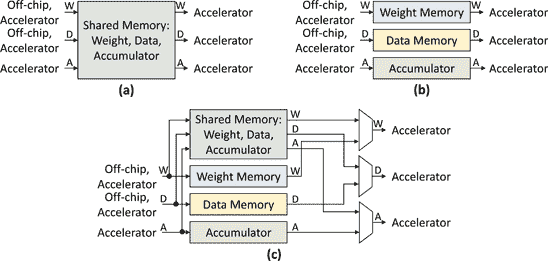

Figure 3.33: Different Architectural Design Options of the On-Chip SPM of the CapsNet Accelerator that are evaluated in our Application-Driven Memory DSE: **(a)** Shared Multi-Port Memory. **(b)** Separated Memory. **(c)** Hybrid Memory (Shared and Separated).

#### 3.4.4.2 Application-Driven Memory Power Management

我们的应用驱动内存 PMU 根据内存的利用情况（如 Figure 3.27a 和 Figure 3.29a 所示）确定睡眠信号。下图 Figure 3.34 展示了一个睡眠晶体管如何连接到其内存 sector 的简化电路图。睡眠请求信号随后是确认信号，构成 2 方式握手协议。完整睡眠周期（`ON` → `OFF` → `ON`）的时序图如 Figure 3.35 所示。利用应用特定知识时，已知在 Section 3.4.3 中分析哪些 sector 在不同操作中需要被激活。因此，*唤醒延迟开销被透明地掩盖，即在需要时提前预激活所需的 sector，使其在需要时即可使用。*

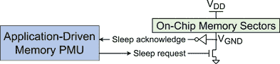

Figure 3.34: Circuit-level schematic of the power-gating circuit, using a footer sleep transistor connected to the PMU.

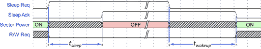

Figure 3.35: Timing diagram of a complete sleep cycle of a sector.

#### 3.4.4.3 Application-Driven Design Space Exploration of the DESCNet Memory Designs

基于上述记忆模型，我们系统地确定其组织方式、尺寸、bank 数目（`B`）以及每 bank 的 sector 数目（`SC`），并通过 DSE 方法进行评估。我们探索不同的记忆架构配置，并评估其面积和能耗。不同层次的应用驱动知识（即与 CapsNets 相关的架构和利用情况）被用于此过程中。

在下面的公式和算法中，我们采用以下符号：

*   *i*: CapsNet 推理操作的索引。

*   *D*[*i*], *W*[*i*], *A*[*i*]: 根据 Figure 3.27a 和 Figure 3.29a 中的分析，分别表示数据内存、权重内存和累加器的操作级内存使用量。

*   *S**Z**[{*S*, *D*, *W*, *A*}], *S**C**[{*S*, *D*, *W*, *A*}], *B*[{*S*, *D*, *W*, *A*}]: 共享内存、数据内存、权重内存、累加器的大小、 sector 数量、bank 数量，分别为 {shared memory, data memory, weight memory, accumulators}。

*   *σ*(*s*): 给定内存大小 *s* 时，可用于电源门的 sector 池，即所有在范围 $\\left\\lbrack 2,\\frac{s}{128} \\right\\rbrack$ 之间的 2 的幂次值。该限制是由于 CACTI-P 工具的限制，该工具要求内存大小与 sector 大小的比值至少为 128。

对于所有记忆设计，且不失一般性，bank 数目被设定为 `B`[*D*] = `B`[*W*] = `B`[*A*] = `B`[*S*] = 16，这对应于 *CapsAcc* 架构中 NP 阵列的行数和列数。为保证对加速器的高效数据馈送，该参数在我们的 DSE 中保持不变。

对于 *SMP* 设计，共享内存的大小由操作级最大内存使用情况（如公式 (3.5) 所示）决定。由于只接受有限的内存尺寸值，计算 *max*[*i*] 函数时，内存尺寸取大于或等于操作级最大值的最小可接受尺寸；反之亦然。

$$\\begin{array}{l} {\\texttt{SMP:}SZ\_{S} = \\max\\limits\_{i}(D\_{i} + W\_{i} + A\_{i})} \\\\ \\end{array}$$  

(3.5)

对于 *SEP* 设计，数据内存、权重内存和累加器的大小如公式 (3.6) 所示，基于各操作级最大内存使用量。

$$\\begin{array}{l} {\\texttt{SEP:}\\left\\{ \\begin{matrix} {SZ\\_{D} = \\max\\limits\_{i}(D\_{i})} \\\\ {SZ\\_{W} = \\max\\limits\_{i}(W\_{i})} \\\\ {SZ\\_{A} = \\max\\limits\_{i}(A\_{i})} \\\\ \\end{matrix} \\right.} \\\\ \\end{array}$$  

(3.6)

Sizing the memories becomes a more complicated challenge for the `HY` design. Within the range allowed by Algorithm 8, the memory sizes considered in our design space have power-of-two values, with the addition of four randomly selected memory sizes (that are `25*kiB*`, `108*kiB*`, `450*kiB*`, and `460*kiB*`), to have more fine-grained results in the low-sized range. For every possible size of data memory, weight memory, and accumulators, the size of the shared memory is computed as the operation-wise worst-case that still guarantees the minimum memory usage required by each operation.

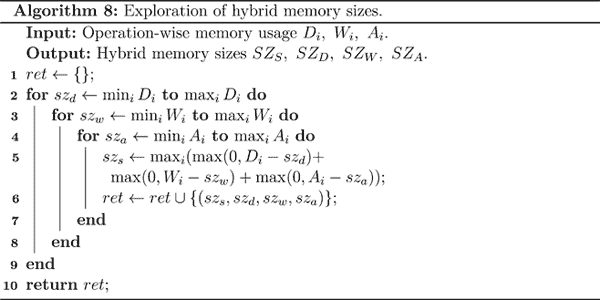

After finding the appropriate memory sizes, the power-gating technique can be applied. It directly affects the number of sectors in the memory designs, since a sleep transistor is connected to each sector to switch *ON* or *OFF* the whole sector. Hence, for the memory designs where the power-gating is not supported, the number of sectors is 1. When the power-gating is supported, the choice of the number of sectors directly influences the tradeoff between the reduction in the static power and the overhead of the power-gating circuitry overhead. Toward this, Algorithm 9 describes all the combinations of a valid number of sectors allowed by the function `σ(s)` that are explored.

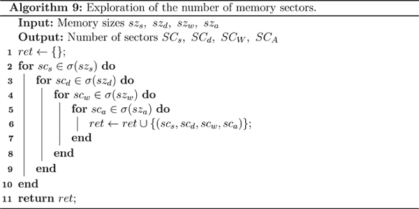

Following the above-discussed procedures, we have generated 15 233 `configurations` of the DESCNet architecture for the CapsNet, and 215 693 `configurations` for the DeepCaps, with different design options (`SMP`, `SEP`, `HY`), different sizes and number of sectors. Note that the `SMP` and `SEP` design options can also be considered as the boundary cases of the `HY` design option. On the one hand, a `HY` organization where `SZ[D]`, `SZ[W]`, and `SZ[A]` are maximum is equivalent to the `SEP` because the corresponding `SZ[S]` for the `HY` results to be null. On the other hand, if `SZ[D]`, `SZ[W]` and `SZ[A]` of a `HY` organization are all equal to 0, its resulting `SZ[S]` would have the same value as the one for the `SMP`. Note that this particular solution, with `SZ[D] = SZ[W] = SZ[A] = 0`, cannot be achieved for a `HY` solution, due to the minimum constraints given in Algorithm 8. However, it represents a hypothetical extreme case to discuss.

### 3.4.5 Our Methodology for the DSE of Scratchpad Memories

The flow of our methodology is depicted in Figure 3.36. The inputs are the CapsNet models and the hardware accelerators for CapsNets. At the output, for each design option, the values of memory organization (i.e., size, number of banks, and sectors), energy consumption, and area are generated. The key steps of our methodology are:

1.  Extraction of the memory usage and memory accesses for each operation of the CapsNet inference. While the usage is needed for defining the design options and sizes, the read and write accesses, along with the operation-wise clock cycles, are used for computing the energy consumption.

2.  Analysis of the design options (`SMP`, `SEP`, `HY`), and definition of the memory configurations, such as size and number of banks and sectors for the power-gating.

3.  A DSE of the possible memory configurations under analysis, through an exhaustive search, to find and select the non-dominated solutions. The estimation of area and energy consumption, with and without the power-gating option, are conducted through the CACTI-P tool \[124\]. Note that we have performed an exhaustive search because, due to the practical limitations on the memory sizes and the number of sectors, the execution time of the search still results relatively low. We measured the times for executing a complete DSE, including the estimation of energy and area provided by CACTI-P, of 1.5 minutes Google's CapsNet and 22 minutes for DeepCaps, when running with a single-thread application on an AMD Ryzen 5 CPU with 32GB RAM. However, if the search space increases or more sophisticated memory evaluations require longer computational time, a heuristic search algorithm can easily be integrated into our methodology to find a solution more quickly. Such a solution may be far from the optimal solution found by the exhaustive search.

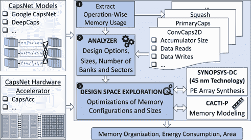

Figure 3.36: *DESCNet* design space exploration and tool flow.

### 3.4.6 Evaluation of the DESCNet Methodology

#### 3.4.6.1 Results for Google's CapsNet (Area and Energy of the On-Chip Memory)

We evaluate different memory architectural options for area and energy consumption using the CACTI-P tool. The results of different `DESCNet` architectural designs of the scratchpad memory for the CapsNet on the MNIST dataset are discussed below.

**Design Space Exploration Results and Selected Configurations (Figure 3.37):** The figure shows the tradeoff between energy and area for 15 233 different `DESCNet` architectural configurations. For each design option (`SMP`, `SEP`, `HY`) and its corresponding version with power-gating (with the suffix -*PG*), the Pareto-optimal solutions with lowest-energy are selected. Note, while `SEP`, `SEP-PG` and `HY-PG` belong to the Pareto-frontier, `HY`, `SMP` and `SMP-PG` are dominated by other configurations. Their size and number of sectors are reported in Table 3.8.

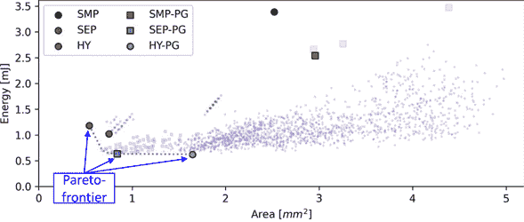

Figure 3.37: DSE results of the `DESCNet` memory configurations for the CapsNet.

Table 3.8: Selected memory configurations for the CapsNet. 

| Mem || Shared || Data || Weight || Acc |
| --- | --- | --- | --- | --- |
| SZ || SC || SZ || SC || SZ || SC || SZ || SC |
| SEP || — || — || 25 kiB || 1 || 64 kiB || 1 || 32 kiB || 1 |
| --- | --- | --- | --- | --- | --- | --- | --- | --- |
| SEP-PG || — || — || 25 kiB || 2 || 64 kiB || 8 || 32 kiB || 2 |
| SMP || 108 kiB || 1 || — || — || — || — || — || — |
| SMP-PG || 108 kiB || 2 || — || — || — || — || — || — |
| HY || 25 kiB || 1 || 8 kiB || 1 || 32 kiB || 1 || 16 kiB || 1 |
| HY-PG || 32 kiB || 2 || 25 kiB || 2 || 25 kiB || 4 || 32 kiB || 2 |

**Area Comparison (Figure 3.38a):** The figure shows the area breakdown of different memory components of the `DESCNet`. We notice that, while the `SEP` organization has relatively larger memory sizes compared to the other architectures, their area is relatively smaller. This effect is due to having a single-port memory instead of a shared multi-ported design, where the latter requires more area for the complex interconnections. Indeed the area of the `HY` organization is lower than the `SMP`, due to a small-sized shared memory. Moreover, the power-gating circuitry also incurs additional area overhead (on average, 2.75% for equally-sized SPMs) due to the sleep transistors.


Figure 3.38: Google's CapsNet results for different components of the `DESCNet` memory configurations: **(a)** Area breakdown, **(b)** Energy breakdown, **(c)** Static vs. dynamic energy consumption, **(d)** Energy breakdown of the different operations of the CapsNet inference.

**能量在组件级别的分解（`Figure 3.38b`）**：图中显示，`HY-PG` 设计选项比其他选项更节能，原因是其拥有更高的灵活性，并且在异构组合的多个部门之间具有更大的电源门控潜力，而 `SEP-PG` 等设计的能耗略高。请注意，尽管其体积小于重量存储，`HY` 组织的共享存储因其多端口内部结构更为复杂，仍然消耗更多能量。

**动态 vs. 静态能量消耗（`Figure 3.38c`）**：在比较不同架构设计时，图示表明：（1）从 `SMP` 到 `SEP` 再到 `HY`，动态能量可以逐步降低；（2）从 `HY` 到 `HY-PG`，由于电源门控的优势，静态能量进一步下降；（3）`non-PG` 与 `-PG` 组织之间的动态能量保持不变。

此外，我们观察到唤醒延迟开销可忽略不计。尽管它被预加载必要数值所掩盖，其值极低（`0.072*ns*`），远小于单个操作的平均计算时间（`614*μ**s*`），此时负责相应存储部门的睡眠晶体管处于稳态，要么 `ON` 要么 `OFF`。此行为也解释了唤醒能量（平均 `1.6*nJ*`）在 `OFF` 到 `ON` 之间过渡时出现但贡献较低的原因。

**CapsNet 推理不同操作的能量分解（`Figure 3.38d`）**：尽管绝对数值有所不同，CapsNet 推理各操作的能量消耗比例在不同存储设计中保持相对稳定。能量消耗最高的部分来自 `PrimaryCaps (Prim)` 层，因为该层具有高内存利用率且访问频繁。由于它占用了大部分可用内存，电源门控的潜力受限。相反，动态路由操作（即 `Sum+Squash, Update+Softmax`）在-*PG* 组织中消耗的能量显著低于其他组织。

#### 3.4.6.2 DeepCaps（片上存储的面积和能量结果）

与前文讨论的 Google CapsNet 结果类似，对 DeepCaps 也进行了详细评估。`Figure 3.39` 展示了在面积‑能量空间中，针对 215 693 种不同内存设计组织的解决方案。选取的、包含内存大小和部门数量的解决方案列在 `Table 3.9`。请注意，高能耗解决方案仅有 1 个部门（即无法应用电源门控），高面积解决方案的共享存储大小为 `8*MiB*`，而面积低且能耗低的解决方案的共享存储大小小于或等于 `256*kiB*`。与 CapsNet 相比，DeepCaps 需要更大的内存尺寸才能高效处理大规模、更复杂的计算。

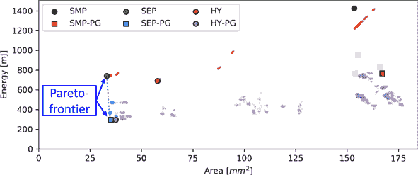

Figure 3.39: DeepCaps 的 `DESCNet` 内存配置设计空间探索结果。

Table 3.9: DeepCaps 选取的内存配置。

| Mem | Shared | Data | Weight | Acc |
| --- | --- | --- | --- | --- |
| SZ | SC | SZ | SC | SZ | SC | SZ | SC |
| SEP | — | — | 256 kiB | 1 | 128 kiB | 1 | 8 MiB | 1 |
| SEP-PG | — | — | 256 kiB | 8 | 128 kiB | 16 | 8 MiB | 16 |
| SMP | 8 MiB | 1 | — | — | — | — | — | — |
| SMP-PG | 8 MiB | 8 | — | — | — | — | — | — |
| HY | 2 MiB | 1 | 108 kiB | 1 | 8 kiB | 1 | 4 MiB | 1 |
| HY-PG | 128 kiB | 2 | 128 kiB | 8 | 64 kiB | 8 | 8 MiB | 16 |
| HY, P[S]\=1 | 4 MiB | 1 | 256 kiB | 1 | 8 kiB | 1 | 2 MiB | 1 |
| HY-PG, P[S]\=1 | 4 MiB | 8 | 256 kiB | 8 | 128 kiB | 16 | 2 MiB | 4 |

因此，尽管能够探索更多不同的解决方案，更大的内存尺寸意味着更高的面积和能耗（参见 `Figure 3.40`）。关于面积，一个有趣的结果是，如 `Figure 3.40a` 所示，`HY-PG` 的面积低于 `HY`，尽管后者具备电源门控电路。这是因为两种组织中共享存储和累加器的大小不同，后者是影响面积最大的存储体。

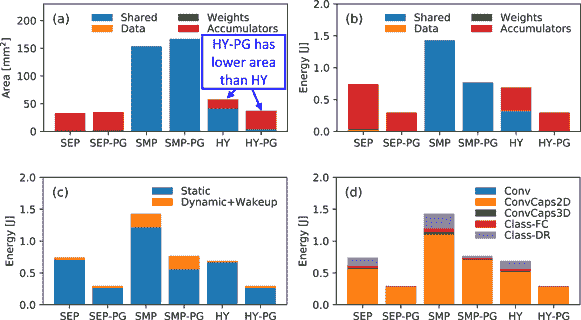

Figure 3.40: DeepCaps 的 `DESCNet` 内存配置组件结果：**(a)** 面积分解，**(b)** 能量分解，**(c)** 静态 vs. 动态能量消耗，**(d)** DeepCaps 推理不同操作的能量分解。

-*PG* 组织的能耗显著低于非-*PG* 对照品，原因是 DeepCaps 在不同操作中异构使用存储。因此，应用电源门控不仅降低了动态路由操作的静态能量，也降低了占比最高的 `ConvCaps2D` 计算的静态能量（如 `Figure 3.40d` 所示）。

正如我们在 Google CapsNet 中观察到的那样，对于 DeepCaps，`HY-PG` 是能耗最低的解决方案，`SEP` 组织面积最低，而 `SEP-PG` 则属于 Pareto 前沿。

#### 3.4.6.3 受尺寸受限内存约束的 DeepCaps HY-PG 设计选项 DSE

受观察到的共享存储尺寸对效率的显著影响（见 `Figure 3.39`），以及嵌入式系统可能存在的尺寸受限内存的事实，我们通过对受尺寸约束的 HY-PG 架构组织进行扩展分析。具体而言，我们通过限制共享存储的最大尺寸来进行 DSE。此外，存储使用模式和分区显示，`HY` 与 `HY-PG` 设计选项不一定需要三个端口，因为在某些解中共享存储仅需要存储一种或两种不同类型的值。

在此 regard，我们还探索了 `HY-PG` 解的受限共享存储端口数 (`P[*S]`) 空间。`Figure 3.41` 展示了面积与能量消耗的权衡，针对 113 337 种不同的存储配置。最有效的解在 `Figure 3.41a` 中具有 1‑端口共享存储大小为 `2*MiB` 和 `4*MiB`。最差的结果是将 `4*MiB` 的共享存储与 `8*MiB` 的累加器存储组合时获得。即使共享存储尺寸较小，仅有 `128*kiB` 和 `256*kiB` 的 1‑端口共享存储的解仍相对效率较低，这表明这种尺寸的共享存储能够更紧密地与系统其余部分配合，从而整体实现更低的面积和能耗。此外，如 `Figure 3.41b` 明显可见，端口数越低，面积与能量效率越高。`HY` 与 `HY-PG` 最低能耗解的详细存储配置列在 `Table 3.9` 的相应行中。

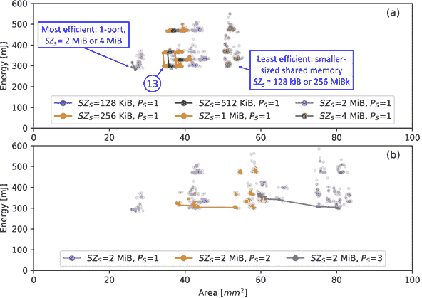

Figure 3.41: Design space exploration results for the `HY-PG DESCNet` memory configurations for the DeepCaps, having constraints on the size and number of ports of the shared memory.

#### 3.4.6.4 Impact of the Memory on the Complete CapsNet Accelerator Architecture

基于前面各节的评估，我们选择两个 Pareto‑optimal `DESCNet` 架构用于 CapsNet，分别是 `SEP` 和 `HY-PG`。之所以选择这些组织，是因为它们分别代表了面积最低和能耗最低的 Pareto‑optimal 解。请注意，与在基线 `CapsAcc` 上运行的 CapsNet 和 DeepCaps 相比，性能没有任何损失。我们在 45 nm CMOS 技术库中，使用 Synopsys Design Compiler 的 ASIC 设计流程，综合实现执行 CapsNets（用于 MNIST 数据集）和 DeepCaps（用于 CIFAR10 数据集）的完整 DNN 加速器架构。

Google CapsNet 完整 DNN 加速器（包括加速器和带有 `SEP` 和 `HY-PG` 组织的片上存储）的详细面积和能耗估计如下，分别在 Figures 3.42 和 3.43 中所示。


Figure 3.42: **(a)** Energy and **(b)** area breakdown of our CapsNet inference architecture using `SEP` memory.


Figure 3.43: **(a)** Energy and **(b)** area breakdown of our CapsNet inference architecture using `HY-PG` memory.

与图 3.31（b）中讨论的初始设计相比，采用 `SEP`（图 3.42a）后，片上存储的总能耗降低了 65%，片上存储的面积减少了 91%。与版本（a）相比，我们的 `DESCNet SEP` 在完整加速器的能耗和面积上分别降低了 78% 和 47%。

我们提出的 `DESCNet HY-PG` 组织相较于版本（b）可将片上能耗降低 82%，片上面积降低 35%，同时相较于版本（a），总能耗和总面积分别降低了 79% 和 40%。

因此，与版本（a）对应的 CapsAcc 当前先进设计相比，我们的方案在加速器、片上存储和片外存储方面，可实现最高 79% 和 47% 的总能耗与面积降低，且不产生任何性能损失。

执行 DeepCaps 的完整片上架构（使用 `SEP-PG` 组织）的能耗和面积估计在 Figure 3.44 中报告。图表清楚显示，累加器存储因其体积大而在片上面积和片上能耗上占据主导。相反，图 3.45 中报告的 `HY-PG, P[S]\=1` 组织显示出能耗和面积在累加器存储和共享存储之间的相对均衡分布。正如前文所述，由于原始 CapsAcc 基线架构无法运行 DeepCaps（CIFAR10 数据集），我们无法将其工作与我们的 `DESCNet` 部署 DeepCaps 的设计进行比较。这也表明，我们的存储子系统确实能够成功支持 DeepCaps，实现其记忆高效的加速，而这在原始基线 CapsAcc 中是不可能实现的。


Figure 3.44: **(a)** Energy and **(b)** area breakdown of our DeepCaps inference architecture using `SEP-PG` memory.


Figure 3.45: **(a)** Energy and **(b)** area breakdown of our DeepCaps inference architecture using `HY-PG, P[S]\=1` memory.

#### 3.4.6.5 Results Summary and Discussion

Table 3.10 列出了我们的 DSE 为 CapsNet 和 DeepCaps 生成的不同 `DESCNet` 架构的面积和能耗详细结果。以下 **关键观察** 可从我们的分析中得出。

*   尽管在优化 DNN 加速器的计算阵列方面付出了大量努力，但更有效的面积和能耗节约是当优化重点放在存储时获得的，正如本节展示的，既包括 Google 的 CapsNets 也包括 DeepCaps。

*   具有大容量且多端口的共享存储（如 `SMP` 组织）通常是不好的设计选择，因为处理异构访问的硬件开销会消耗大量资源，而如果我们系统地研究应用驱动的存储资源需求，这些需求本身并不必要。事实上，当 `SZ[S]` ≤ 256 kB 时，能够在相对上降低能耗和面积，相比于其他具有更大 `SZ[S]` 的方案。

*   对于属于 `HY` 和 `HY-PG` 设计选项的特定解决方案，可将多端口共享存储替换为等效的单端口存储，从而进一步降低能耗和面积，因为累加器存储与共享存储的分布更加均衡。

*   采用高效的片上 SPM 存储组织结构（如 `SEP`、`SEP-PG` 和 `HY-PG`）可显著降低硬件资源需求，使得在资源受限场景（如 IoT‑edge 设备）中实现执行复杂操作（如 CapsNets）的 DNN 加速器成为可能。

Table 3.10: Area and energy consumption results for different `DESCNet` architectural organizations.

| NN || Mem || Shared Mem || Weight Mem || Data Mem || Accumulator Mem |
| --- | --- | --- | --- | --- | --- |
| Area \[mm2\] || Dynamic Energy \[mJ\] || Static Energy \[mJ\] || Wakeup Energy \[nJ\] || Area \[mm2\] || Dynamic Energy \[mJ\] || Static Energy \[mJ\] || Wakeup Energy \[nJ\] || Area \[mm2\] || Dynamic Energy \[mJ\] || Static Energy \[mJ\] || Wakeup Energy \[nJ\] || Area \[mm2\] || Dynamic Energy \[mJ\] || Static Energy \[mJ\] || Wakeup Energy \[nJ\] |

| CapsNet || SEP || — || — || — || — || **0.314** || 0.051 || 0.501 || — || **0.104** || 0.011 || 0.188 || — || **0.125** || 0.196 || 0.238 || — |
| --- | --- | --- | --- | --- | --- | --- | --- | --- | --- | --- | --- | --- | --- | --- | --- | --- | --- |
| SEP-PG || — || — || — || — || 0.469 || 0.053 || 0.135 || 0.044 || 0.173 || 0.012 || 0.083 || 0.048 || 0.200 || 0.205 || 0.148 || 0.064 |
| SMP || 2.521 || 1.859 || 1.529 || — || — || — || — || — || — || — || — || — || — || — || — || — |
| SMP-PG || 2.958 || 1.875 || 0.668 || 0.352 || — || — || — || — || — || — || — || — || — || — |
| HY || 0.519 || 0.068 || 0.348 || — || 0.125 || 0.044 || 0.238 || — || 0.041 || 0.009 || 0.068 || — || 0.067 || 0.120 || 0.130 || — |
| HY-PG || 1.061 || **0.004** || **0.046** || 0.080 || 0.213 || **0.045** || **0.083** || 0.032 || 0.173 || **0.012** || **0.083** || 0.048 || 0.200 || **0.205** || **0.148** || 0.064 |
| DeepCaps || SEP || — || — || — || — || 0.617 || 0.039 || 12.172 || — || 1.165 || 0.098 || 22.266 || — || 31.392 || 34.268 || 673.562 || — |
| SEP-PG || — || — || — || — || 0.896 || 0.040 || 2.277 || 0.044 || 1.223 || 0.099 || 4.695 || 0.247 || 32.905 || 34.464 || 256.029 || 0.642 |

| SMP || 153.474 || 213.961 || 1214.223 || — || — || — || — || — || — || — || — || — || — || — || — || — |

| SMP-PG || 167.077 || 214.115 || 555.102 || 1.234 || — || — || — || — || — || — || — || — || — || — || — || — |

| HY || 41.067 || 3.143 || 315.671 || — || 0.041 || 0.003 || 0.810 || — || 0.547 || 0.074 || 10.453 || — || 16.168 || 20.954 || 339.713 || — |

| HY-PG || 3.293 || 0.125 || 1.211 || 0.464 || 0.469 || 0.019 || 1.619 || 0.044 || 0.816 || 0.079 || 3.898 || 0.064 || 32.905 || 34.464 || 256.029 || 0.642 |

| HY, P[S]\=1 || 16.168 || 6.108 || 339.713 || — || 0.041 || 0.003 || 0.810 || — || 1.165 || 0.098 || 22.266 || — || 8.949 || 11.037 || 173.698 || — |

| HY-PG, P[S]\=1 || **17.731** || **6.019** || **120.913** || 0.642 || **0.896** || **0.040** || **2.277** || 0.044 || **1.223** || **0.099** || **4.695** || 0.247 || **8.338** || **11.091** || **128.696** || 0.642 |

### 3.4.7 Summary

Motivated by the analyses showing that a significant amount of energy can be saved by designing a specialized memory design, the *DESCNet* SPM architecture is proposed. Different architecture designs are explored to minimize the off-chip memory accesses while efficiently feeding the data to the hardware accelerator executing CapsNets inference at high throughput. Its application-driven memory power management unit further reduces the leakage power. To enable the CapsNets deployment on even smaller resource- and memory-constrained edge devices, low-precision computations can be enabled by weight and feature map quantization, as demonstrated in Section 3.5.

## 3.5 Q-Capsnets: a Specialized Framework for Quantizing Capsnets

CapsNets require intense computations and are difficult to be deployed in their original form on resource-constrained edge devices. This section presents *Q-CapsNets*, the first specialized framework for quantizing CapsNet models, to enable their efficient edge implementations. We evaluate our framework for several benchmarks. On the DeepCaps for the CIFAR10 dataset, the framework reduces the memory footprint by 6.2×, with only 0.15% accuracy loss. Our methodology is desirable for employing CapsNet inference at the edge, because it significantly reduces the computational workload and the CapsNet memory footprint, with minimal accuracy loss.

### 3.5.1 System Overview

Reducing the wordlength of weights and feature maps is extremely important for improving the energy efficiency. A too short wordlength lowers the accuracy of the CapsNets. It is typically an undesired outcome from the end-user perspective. To find an efficient tradeoff between the memory footprint, the energy consumption, and the classification accuracy, we propose the novel Q-CapsNets framework (see Figure 3.46). It explores different layer-wise and operation-wise arithmetic precisions to obtain the quantized version of a given CapsNet, with maximum accuracy tolerance and memory budget specified as constraints to the framework. Our approach optimizes in particular the dynamic routing, a peculiar feature of the CapsNets involving iterative and computationally expensive operations, with a significant impact on the energy consumption.


Figure 3.46: An overview of our quantization framework.

**In this section, our novel contributions are:**

*   We propose a specialized framework for systematically quantizing CapsNets, given a certain accuracy tolerance (compared to the full-precision CapsNet) and a certain memory budget for storing the weights.

*   Since an expensive part of CapsNets is the dynamic routing process, we further specialize in the search for the numerical precision for the operations of the dynamic routing. *A key advantage of using our framework*, compared to traditional DNN quantization methods, is that, as we will demonstrate in our experiments, *the number of bits for routing capsules can be further reduced* compared to the wordlengths of the other operations.

*   We test our framework on the CapsNet model \[236\] on the MNIST and Fashion-MNIST datasets, and on the DeepCaps model \[220\] on the MNIST, FashionMNIST, and CIFAR10 datasets. For the latter dataset, the memory footprint is reduced by 6.2× with an accuracy loss of 0.15%.

### 3.5.2 Analysis of Area and Energy Consumption for Reduced Wordlength

Our overarching goal is to deploy CapsNets at the edge. The floating-point representation is abandoned by adopting a lighter fixed-point representation. Such a wordlength reduction of the weights and activations of a CapsNet for computing the inference lightens the memory storage requirements. It might also significantly impact the energy consumption of the computational units. Therefore, we analyze energy consumption and area footprint of a MAC unit, which is the basic block of specialized CapsNet accelerators like the CapsAcc, and of hardware blocks that perform computationally complex operations, i.e., *squash* and *softmax*, which are needed during the CapsNet inference. Moreover, we design different versions of a MAC unit, a softmax module, and a squash module, varying their wordlength. We synthesize them in a 45nm CMOS technology with the Synopsys Design Compiler tool to measure their area and energy consumptions. Figure 3.47 shows that *the area and energy consumption of MAC units quadratically decrease w.r.t. the wordlength*. Such analyses motivate us to focus on minimizing the wordlength to reduce the energy consumption. The results shown in Figure 3.48 are obtained by varying the number of fractional bits while keeping a single bit for the integer part. As expected, *the softmax and the squash functions require more energy and area than a simple MAC operation*. The dependence on energy consumption and area footprint is related quadratically to the number of fractional bits. This effect further motivates us to reduce the number of bits used to execute the various operations of the CapsNet architectures.


Figure 3.47: Energy consumption and area footprint for a fixed-point MAC unit with different wordlengths.


Figure 3.48: Energy consumption and area footprint for fixed-point modules performing **(a)** the softmax and **(b)** the squash operations with different wordlengths.

### 3.5.3 Rounding Schemes

A fixed-point number has an integer part *QI* and a fractional part *QF*. Hence, it can be written as ⟨*Q**I**. *Q**F*⟩. The total number of bits, i.e., the wordlength *N*, is computed as *N**I** + N**F**, which is the sum between the bits of the integer part and the fractional part. A fixed-point representation has precision *ϵ* = 2^( − *N**F**)**, and its corresponding range of representable numbers, in a two's complement format, is \[ − 2^(*N**I** − 1), 2^(*N**I** − 1) − 2^( − *N**F**)].

The *rounding operation* converts a floating-point or a large fixed-point number into a fixed-point number with shorter wordlength. Next, we present the most common rounding schemes.

The **Truncation (TRN)** simply removes all the extra digits from the fractional part, i.e., *x*[*q*] = ⌊*x*⌋. If we assume uniformly distributed numbers, the truncation introduces a negative average error (bias), defined as *x*[*q*] − *x*.

-   [RTN（四舍五入到最近值）] 设定了一条规则，用于近似恰好位于两个可表示数值之间的中间值。特别是，半上舍入（half-up rounding）是将这些值向上舍入。考虑到均匀分布的数值，向上舍入一半的值会引入负的平均误差，这比直接截断的误差更小，如方程 (3.7) 所示。

$$\begin{array}{l} {x_{q} = \\lfloor x + \\frac{\\epsilon}{2}\\rfloor} \\\\ \\end{array}$$  

(3.7)

-   [Stochastic Rounding (SR)] 如方程 (3.8) 定义，其中 *P* ∈ [0, 1) 是一个均匀分布的随机数。SR 方案是无偏的，但在硬件层面最为计算密集，因为它需要生成随机数。

$$\begin{array}{l} \\left\\{ \\begin{matrix} {\\lfloor x\\rfloor} & {\\text{if~}P \\geq \\frac{x - \\lfloor x\\rfloor}{\\epsilon}} \\\\ {\\lfloor x + \\frac{\\epsilon}{2}\\rfloor} & {\\text{if~}P < \\frac{x - \\lfloor x\\rfloor}{\\epsilon}} \\\\ \\end{matrix} \\right. \\\\ \\end{array}$$  

(3.8)

### 3.5.4 Q-CapsNets Framework

我们的框架可以在 CapsNet 推理过程中逐步降低权重和激活的数值精度。在第一阶段，我们首先对 CapsNet 进行定制化技术的调整，这些技术同样适用于传统的 DNN。随后，我们采用一种专门针对 CapsNet 的方法，该方法专为动态路由的循环而设计。我们的框架的输入包括：

*   *CapsNet 架构*，以及训练集和测试集，以及与该架构相关的超参数。

*   *一系列舍入方案库*，用于在量化数据时选择相应的方案。

*   降低数值精度会导致模型达到的准确率下降。因此，必须设定一个容差 *a**c**c*[*T**O**L*] 来为量化网络留出精度损失的余量。目标准确率 *a**c**c*[*t**a**r**g**e**t*] 通过公式 (3.9) 计算。

    $$\begin{array}{l} {acc\_{target} = acc\_{FP32} \\cdot (1 - acc\_{TOL})} \\\\ \\end{array}$$  

    (3.9)

*   *最大存储预算*，用于存储量化后的权重和偏置。

我们的 Q-CapsNets 框架旨在同时满足存储使用和准确率的要求。降低给定模型的存储需求的有效方法是积极地对权重进行量化。我们在步骤 (1) 和 (2) 中完成此操作。一旦存储预算满足，若仍有精度预算可用，则进一步降低权重和激活的数值精度。之后，框架返回 model_satisfied。否则，如果无法找到同时满足准确率和存储需求的解决方案，框架会返回两个次优解：

1.  model_accuracy：一个量化的 CapsNet 模型，满足目标准确率且具有最小的存储足迹（例如略高于预算）；

2.  model_memory：一个量化的 CapsNet，满足存储要求并实现最大准确率（例如略低于目标）。

#### 3.5.4.1 框架的逐步描述

作为前置步骤，给定的 CapsNet 在全精度（32 位浮点）下进行训练，其准确率记为 *a**c**c*[*F**P*32]。根据 *a**c**c*[*F**P*32] 与精度容差 *a**c**c*[*T**O**L*]，我们通过公式 (3.9) 计算目标准确率 *a**c**c**t**a**r**g**e**t**。随后，对给定的 CapsNet 进行量化的过程（参见 [Figure 3.49 与 Algorithm 10）包括以下步骤：


Figure 3.49: *Flow of Our Framework for Quantizing CapsNets.*


1. **层均匀量化权重和激活**：我们将所有权重和激活转换为定点算术，权重采用 1 位整数部分和 *Q*[*w*] 位分数部分，激活采用 *Q*[*a*] 位分数部分。随后，我们以统一的方式进一步降低精度（例如 *Q*[*w*]=*Q*[*a*]）。在此阶段，仅消耗了 5% 的 *a**c**c*[*T**O**L*]。为确定 *Q*[*w*] 与 *Q*[*a*] 的正确字长，我们使用二分查找算法 \[121\]。

2. **满足存储要求**：在此阶段，仅对 CapsNet 的权重进行量化。基于 Raghu 等人的思想 \[218\]，即对最终层的权重扰动可能比对早期层的扰动更昂贵，我们为每一层 *l* 设定其对应的 *Q*[*w*]，使得 (*Q*[*w*])[*l* + 1] = (*Q*[*w*])[*l*] − 1。随后，可计算正确的 *Q*[*w*] 为满足方程 (3.10) 的最大整数值，其中 *L* 为层总数，*M* 为存储预算，*P*^(*l*) 为层 *l* 的参数（权重）数量。

    $$\begin{array}{l} {\\sum\\limits\_{l = 0}^{L - 1}\\left( P^{l} \\cdot \\left( (Q\_{w})\_{0} - l \\right) \\right) \\leq M} \\\\ \\end{array}$$  

    (3.10)

    依据此规则，我们可以得到满足存储要求的量化 CapsNet 模型，记为 model_memory，并测试其准确率 *a**c**c**[*m**m*]，与目标准确率 *a**c**c**[*t**a**r**g**e**t* 进行比较。根据结果，后续阶段可走两个方向：如果 *a**c**c**[*m**m*] 高于目标，则继续进入 (3A) 进行进一步量化；否则跳转至 (3B)。

    3A**层级激活量化**：我们从步骤 (1) 中得到的初始 *Q*[*a*] 开始，按层顺序进行量化。首先，选择 CapsNet 中除第一层以外的每一层，并逐步降低 *Q*[*a*]，直到找到满足 *a**c**c**[*t**a**r**g**e**t* 且精度不低于目标的最小值。随后，固定前两层的字长，继续对除第一层外的所有层降低 *Q*[*a*]，直至最后一层的 *Q*[*a*] 设定完成。

    

    4A**动态路由量化**：由于动态路由的计算开销大，涉及 *squash* 与 *softmax* 等复杂迭代操作，其数组的字长可能与其他 CapsNet 层不同。此步骤仅针对涉及 *squash* 与 *softmax* 操作的数据进行量化。如 Figure 3.50 与 Algorithm 12 所示，此步骤采用专门的量化过程。动态路由的运算符可能比其他激活（即字长低于 *Q*[*a*] 的 *Q*[*D**R**]）更激进地量化。最终得到的量化 CapsNet 模型记为 model_satisfied。

    

    Figure 3.50: 量化包含动态路由的胶囊层。彩色条表示被四舍五入并量化的数组。绿色表示权重以 *Q*[*w*] 位量化，蓝色表示激活以 *Q*[*a*] 位量化，红色表示更激进量化的数据以 *Q*[*D**R**] 位量化。在进行计算密集且复杂的函数（squash、softmax）之前，精度会被降低。

    

3B)**层-均匀和层-细粒度权重量化**：从步骤 (1) 的结果出发，我们对权重进行量化，首先是统一的方式，然后是按层的方式（如步骤 3A），直到达到 `a**c**c**t**a**r**g**e**t*`。生成的 CapsNet 模型 (`model_accuracy`) 作为框架的输出返回，同时返回 `model_memory`，该值在步骤 (2) 中生成。

### 3.5.4.2 舍入方案选择

对于给定库中的每个舍入方案，都会生成对应的量化模型。因此，`our framework` 会并行为库中的每个舍入方案执行 [Algorithm 10。由于舍入误差不同，框架可能对某个方案执行路径 A，对另一个方案执行路径 B。执行完所有分支后，我们根据以下标准在库中选择最佳舍入方案，依据算法是否走过路径 A 或路径 B：

1.  A)**存在从路径 A 生成的模型：**

    1.  从路径 B 生成的模型被舍弃。

    2.  选择内存更低的模型。

    3.  在内存相同的情况下，选择表示激活所需位数更少的模型。

    4.  在内存和激活位数相同的情况下，选择舍入方案最简单的模型，例如截断、四舍五入到最近偶数、随机舍入。注意，第一种方案需要删除最低有效位，而最后一种方案需要更复杂的操作来决定舍入方向。

2.  B)**仅存在路径 B 的模型：**

    1.  在这种情况下，返回两个模型。从 `memory_model` 中选择精度最高的模型。

    2.  从 `accuracy_model` 中选择内存最低的模型。

    3.  如果存在多个模型具有相同的最高精度和最低内存，则优先选择最简单的舍入方案以打破平局。

### 3.5.5 我们的 Q-CapsNets 框架评估

#### 3.5.5.1 实验环境

我们在 PyTorch \[204\] 中实现 Q-CapsNets 框架，并在两块 Nvidia GeForce RTX 2080 Ti GPU 上运行。我们在 Google 的 CapsNet 模型 \[236\]，即 ShallowCaps，对 MNIST \[118\] 和 FashionMNIST \[284\] 数据集进行测试，并在 MNIST、FashionMNIST 和 CIFAR10 \[112\] 数据集上对 DeepCaps 模型 \[220\] 进行测试。对于全精度训练，执行以下数据增强：

*   MNIST：图像随机平移最多两个像素，并旋转 2 度；

*   FashionMNIST：图像随机平移 2 个像素，并水平翻转的概率为 0.2；

*   CIFAR10：原始 32 × 32 的图像使用双线性插值缩放至 64 × 64，以便支持更深的网络，如原始 DeepCaps 论文 \[220\] 所报告。图像还会随机平移 5 个像素、旋转 2 度，并水平翻转的概率为 0.5。

测试时不进行任何数据增强。

#### 3.5.5.2 量化浅层胶囊网络（ShallowCaps）在 MNIST 和 FashionMNIST 数据集上的表现

ShallowCaps 架构在 MNIST 数据集上以全精度（FP32）进行训练，时长 100 个 epoch，批量大小为 100。我们采用指数衰减学习率策略，初始学习率为 0.001，衰减步数 2 000，衰减率 0.96。其测试准确率为 99.67%。

随后，框架按 Algorithm 10 的描述进行后续处理，旨在同时满足内存和精度要求。由于算法包含条件分支，我们给出两个示例，分别对应算法不同分支的执行情况。

**路径 A 的测试**：在第一组实验中，我们测试路径 A，即同时满足内存和精度约束。由于 FP32 时的内存需求为 217 Mbit，我们将内存预算设为 45 Mbit，精度容差为 0.2%。在 Figure 3.51 \[Q1\] 中的结果显示，`model_satisfied` 将权重内存足迹比 FP32 模型缩小 4.11 倍，且精度保持在 99.52%。除了权重内存的降低（W mem），我们还报告了激活内存（A mem）的降低。对于 `model_satisfied`，激活内存的足迹被缩小到 2.72 倍。


Figure 3.51: Q-CapsNets 结果在 ShallowCaps 与 MNIST 数据集上的表现。

**路径 B 的测试**：由于框架在找不到同时满足两个约束的解时会执行路径 B，我们在测试时设定非常低的内存预算作为输入。实验结果（如 Figure 3.51 所示）表明，为满足内存要求，`model_memory` 的权重被设定为极低的字长，导致精度出现极大下降。为满足精度要求（`memory_accuracy`），权重被压缩到能够达到的最小字长。

在 FashionMNIST 数据集上，对 ShallowCaps 架构进行类似的测试序列，实验结果报告在 Table 3.11。

Table 3.11: Q-CapsNet 在 ShallowCaps 与 DeepCaps 上对 MNIST、FashionMNIST 和 CIFAR10 数据集的准确率、权重（W）内存和激活（A）内存的缩放比例。

| 模型 | 数据集 | 准确率 | W 内存缩放比例 | A 内存缩放比例 |
| --- | --- | --- | --- | --- |
| ShallowCaps | MNIST | 99.58% | 4.87× | 2.67× |
| ShallowCaps | MNIST | 99.49% | 2.02× | 2.74× |
| ShallowCaps | FashionMNIST (FMNIST) | 92.76% | 4.11× | 2.49× |
| ShallowCaps | FashionMNIST (FMNIST) | 78.26% | 6.69× | 2.46× |
| DeepCaps | MNIST | 99.55% | 7.51× | 4.00× |
| DeepCaps | MNIST | 99.60% | 4.59× | 6.45× |
| DeepCaps | FashionMNIST (FMNIST) | 94.93% | 6.4× | 3.20× |
| DeepCaps | FashionMNIST (FMNIST) | 94.92% | 4.59× | 4.57× |
| DeepCaps | CIFAR10 | 91.11% | 6.15× | 2.50× |
| DeepCaps | CIFAR10 | 91.18% | 3.71× | 3.34× |

#### 3.5.5.3 量化深层胶囊网络（DeepCaps）在 MNIST、FashionMNIST 和 CIFAR10 数据集上的表现

对 DeepCaps 架构进行了多项测试。我们主要关注 SR 方案的结果，因为它在其他（更简单）舍入方案之上表现更好。DeepCaps 在 MNIST 数据集上以全精度训练时达到 99.75% 的准确率，与原始 DeepCaps 论文 \[220\] 中报告的结果相当；而在 FashionMNIST 上则获得 95.08% 的准确率。Table 3.11 报告了 Q-CapsNets 框架在这两个数据集上的关键结果。Figure 3.52 以图形形式展示了 Q-CapsNets 框架在 DeepCaps 上对 CIFAR10 数据集的关键结果。


Figure 3.52: *Q-CapsNets 结果在 DeepCaps 与 CIFAR10 数据集上的表现。*

#### 3.5.5.4 结果讨论

通过将准确性和占用的内存权重作为评估指标，我们发现 model_satisfied 通常被 model_accuracy 支配，例如在 Figure 3.51 中的 Q1 和 Q2，以及 Figure 3.52 中的 Q4 和 Q5。然而，由于 Q1 和 Q5 的激活和动态路由的字长更短，相较于 Q2 和 Q4，其使用 MAC 运算、`squash` 和 `softmax` 进行计算的潜在能效收益巨大，即使在激活记忆略有变化的情况下亦然。注意，动态路由操作的字长相较于全精度模型，可在极小的精度损失下降低至 3 或 4 位。这种结果源于动态路由的共同特性：系数（以及 `squash` 和 `softmax`）的操作是动态更新的，从而比 Conv Layer 和 PrimaryCaps 等其他层更有效地适应量化。因此，这些计算可以接受更激进的量化。

### 3.5.6 Summary

为在边缘设备上实现高效的 CapsNets 实现，我们提出了 Q-CapsNets 框架。该框架利用 CapsNets 的特殊特性（包括动态路由涉及的操作），在用户定义的精度和内存预算基础上实现词长度的精度降低。得到的紧凑量化 CapsNet 模型可部署在资源受限的目标设备，如专用 CapsNet 加速器。正如在 Section 3.6 和 Section 3.7 讨论的那样，CapsNet 推理的进一步能效提升可以通过近似计算硬件单元来实现。

### 3.6 Red-Cane: Resilience Analysis and Design of Capsnets under Approximations

遵循能源高效设计的近似计算趋势，我们对 CapsNets 推理在近似误差影响下的弹性进行了广泛分析。我们的方法论建模了近似组件（如乘法器）产生的误差，并分析其对 CapsNets 分类精度的影响。这些分析使我们能够根据每个 CapsNet 推理操作的弹性，选择合适的近似组件。我们将 TensorFlow 框架扩展，以在 CapsNet 推理的多个计算操作中注入近似噪声（基于近似组件的模型），从而模拟真实错误场景。结果表明，CapsNets 对动态路由相关的计算误差（softmax 及系数更新）更具弹性，而相较于卷积和激活函数等其他阶段则更为敏感。我们的分析为设计高效的 CapsNet 硬件架构提供了指导，并包含了近似组件。据我们所知，这是首个针对专用 CapsNet 硬件设计近似的概念证明。

### 3.6.1 System Overview

如 Figure 3.53 所示，我们提出的 *ReD-CaNe* 方法分析了 CapsNets 在近似下的弹性。首先，我们为模拟来自近似硬件单元（如乘法器，这些在 capsule 矩阵乘法的 MAC 操作中非常常见）产生的真实错误而制定了噪声注入模型。随后，我们通过系统化地在 CapsNet 推理的各操作中注入噪声，分析误差的弹性，并评估其对精度的影响。此类研究的结果将为根据每个 CapsNet 操作的弹性水平设计和选择近似组件提供指南。最终，我们的方法生成给定 CapsNet 的近似版本，以实现能源高效的推理。


Figure 3.53: Overview of our ReD-CaNe methodology. The novel contributions are shown in blue boxes.

*In a nutshell, our novel contributions are:*

*   We analyze and `model the noise injections` that can be generated by different approximate arithmetic components, e.g., multipliers.

*   We devise `ReD-CaNe`, a novel methodology for analyzing the Resilience and Designing Capsule Networks under approximations, by systematically injecting noise into different operations of the CapsNet inference and by measuring the accuracy. The approximated components are chosen based on the resilience level of the different operations of the CapsNet inference.

*   We test our methodology on the DeepCaps model for the CIFAR10, MNIST, and SVHN datasets, and on the CapsNet model for the MNIST and Fashion-MNIST datasets. Our results show that the least resilient operations are the convolutions in CapsLayers, while `the dynamic routing operations of the Caps3D and ClassCaps layers are relatively more resilient`.

### 3.6.2 Modeling the Errors as Injected Noise

#### 3.6.2.1 Error Sources

在通用 DNN 应用中，错误可能来源于多种因素，如硬件近似（例如近似乘法器）、软件近似（例如量化）、瞬态故障（如粒子撞击引起的位翻转）以及永久故障（如 stuck-at-one 和 stuck-at-zero）。本文关注近似误差，因为我们针对能源效率的优化。

如果专用硬件加速器执行 CapsNet 推理，通常会使用固定点表示，而不是浮点数 \[96\]. 因此，在 *b* 位固定点算术下，浮点值 *x* 被映射到范围 \[0 : *s*^(*b*) − 1\]. 量化函数 *Q* 定义如下（方程 3.11）：

$$\\begin{array}{l} {Q(x) = \\frac{x - \\min(x)}{\\max(x) - \\min(x)} \\cdot (2^{b} - 1)} \\\\ \\end{array}$$  

(3.11)

本文在实现 CapsNets 时使用浮点算术，但我们通过修改近似固定点组件的值来模拟其量化效果。因此，我们专注于在 CapsNet 硬件加速器中使用近似组件时产生的误差建模。

#### 3.6.2.2 Analysis of Different Operations in CapsNets

我们研究了哪些硬件组件对 CapsNets 计算块的总能耗影响最大。Table 3.12 报告了 DeepCaps 推理路径中不同基本操作的操作数量、单位、以及能耗。该能耗是基于 8 位固定点操作、45nm CMOS 工艺节点，并使用 Synopsys Design Compiler 工具合成得到的。最后两列还报告了每种操作的估计总能耗占比及其百分比。乘法器占总能耗的 96% 以上，而加法操作虽然数量也很多，但因其相对复杂度较低，仅占 3% 的总能耗。因此，首先探索通过近似乘法器操作来实现能耗节约是本工作的重点。

Table 3.12: Number of operations, unit, and total energy consumption of different basic operations of the DeepCaps.

| OPERATION || \# OPS || Unit Energy \[pJ\] || Total Energy \[uJ\] || %age |
| --- | --- | --- | --- | --- |
| Addition || 1.91 G || 0.0202 || 38.57 || 3.22% |
| Multiplication || 2.15 G || 0.5354 || 1 153.5 || 96.37% |
| Division || 4.17 M || 1.0717 || 4.474 || 0.37% |

| 指数 | 175 K | 0.1578 | 0.0276 | 0.03% |
| 平方根 | 502 K | 0.7805 | 0.3920 | 0.01% |

在下面，我们研究采用近似组件进行能量优化的潜力。作为案例研究，我们从 EvoApprox8B 库中选取了 NGR 近似乘法器和 5LT 近似加法器 \[179\]。图 3.54 中的结果显示，仅对乘法器（XM）进行近似，可比准确实现（Acc）节省超过 28% 的能量。由于加法的能量占比较低，使用近似加法（XA）或近似加法与乘法（XAM）的优势相较于 Acc 和 XM 方案几乎可以忽略不计。


Figure 3.54: 通过在 CapsNets 中应用近似组件实现的优化潜力。

受上述分析激励，在下面的论述中，为了简化概念验证的开发且不失一般性，我们专注于近似乘法器，因为它们对能耗影响显著，具有巨大的优化潜力。

#### 3.6.2.3 近似硬件乘法器的误差特征

我们从 EvoApprox8B 库中选取了 35 个近似乘法器 \[179\] 并分析它们的误差产物 *P*′ 与准确乘法器的 8 位乘法的准确产物 *P* 之间的差异。算术误差在公式 (3.12) 中计算，其中 *a*、*b* 表示乘法器的输入。

$$\\begin{array}{l} {\\Delta\_{P^{\\prime}} = \\{ alla,b \\in I:P^{\\prime}(a,b) - P(a,b)\\}} \\\\ \\end{array}$$  

(3.12)

我们在考虑单个乘法器、9 个 MAC 单元串联以及 81 个 MAC 单元串联的情况下，基于每种情形 10⁵ 个随机样本，计算算术误差的分布。这些研究用于估计 3×3 和 9×9 卷积核的卷积累积误差。我们选择这些数值，因为它们反映了 DeepCaps 和 CapsNet 中卷积核的规模。

大多数组件（即 31 个中的 35 个）的算术误差 Δ 呈高斯分布，均值为 *m*，标准差为 *std*。图 3.55 展示了库中两个近似乘法器的误差分布。由于剩余的 29 个具有高斯分布的元素表现相似，我们仅报告这两个近似乘法器。


Figure 3.55: 相对于准确 8 位乘法器的算术误差分布及其相对于高斯噪声的插值，来自 EvoApprox8B 库的近似乘法器。(a) NGR 乘法器的分布。(b) DM1 乘法器的分布。

在使用 *b* 位定点近似组件并在 CapsNet 中进行浮点运算时，模型高斯噪声 Δ 的生成是一个开放的研究挑战。我们建议根据给定数组 *X* 的值范围 *R* 来调整噪声的量。因此，我们引入噪声幅度（NM）表示噪声 Δ 的标准差 *std* 相对于 *R*(*X*) 的缩放情况，引入噪声平均值（NA）表示噪声 Δ 的均值 *m* 相对于 *R*(*X*) 的缩放情况。公式 (3.13) 和 (3.14) 分别给出了 *NM* 与 *NA* 的表达式。

$$\\begin{array}{l} {NM(\\Delta\_{M}) = \\frac{stdev(\\Delta\_{X})}{R(X)}} \\\\ \\end{array}$$  

(3.13)

$$\\begin{array}{l} {NA(\\Delta\_{M}) = \\frac{m(\\Delta\_{X})}{R(X)}} \\\\ \\end{array}$$  

(3.14)

由于 CapsNet 中组件的输入通常具有特定的分布模式，近似组件的 *NM* 取决于具体应用。这意味着 *NM* 会因不同的 CapsNet 模型和数据集而显著变化。因此，我们在 Section 3.6.4 中展示了针对不同基准的多个实验。

#### 3.6.2.4 噪声注入模型

基于上述分析，我们将近似组件产生的误差源模型为对所考虑数组 *X* 无条件加入高斯随机噪声。

对于具有特定 *NM* 与 *NA* 的误差，对形状为 *s* 的张量 *X* 进行模型如公式 (3.15) 所示。噪声输出表示为 *X*^′，公式 (3.16) 给出。

$$\\begin{array}{l} {\\Delta\_{X} = Gauss(s,(NM \\cdot R(X))) + (NA \\cdot R(X))} \\\\ \\end{array}$$  

(3.15)

$$\\begin{array}{l} {X^{\\prime} = X + \\Delta\_{X}} \\\\ \\end{array}$$  

(3.16)

*Gauss(s, std)* 是一个生成形状为 *s* 的张量的函数，返回服从均值 *m* 与标准差 *std* 的高斯分布随机数。

### 3.6.3 ReD-CaNe 方法论

我们的方法流程如图 3.56 所示，包含 6 个步骤。首先，我们确定希望注入噪声的数组列表，称为 *Groups*。随后，按照公式 (3.16) 对这些组进行噪声注入。通过监控不同操作对准确性的影响，我们找出 CapsNet 中最准确和最不准确的操作。因此，ReD-CaNe 方法可为设计能耗高效推理提供有价值的指导，表明可以在不显著牺牲精度的前提下，对特定层和操作（即 *更具鲁棒性的*）进行近似。

我们的方法步骤如下：

1. **组提取**：我们根据操作类型（如 MAC、激活函数、softmax 或 logits 更新）将 CapsNet 推理的操作划分为组。此步骤生成 *Groups*。

2. **组级鲁棒性分析**：在不同组上注入噪声，监测测试准确率的下降情况。

3. **标记鲁棒组**：基于步骤 2 的分析，标记更具鲁棒性的组。此时组分为 *Resilient*（鲁棒）和 *Non-Resilient*（非鲁棒）两类。

4. **非鲁棒组的层级鲁棒性分析**：对每个非鲁棒组，分别在每一层注入噪声，监测准确率的变化。

5. **标记非鲁棒组中每层的鲁棒性**：基于步骤 4 的结果，标记每层中更具鲁棒性的层。

6. **选择近似组件**：根据步骤 5 测得的鲁棒度（以噪声幅度 *NM* 衡量），为每个操作从给定库中选择合适的近似组件。


Figure 3.56: ReDCaNe：我们的鲁棒性分析与近似 CapsNets 设计方法。

请注意，鲁棒性分析的一个步骤是正确设置噪声注入机制的输入参数 *NM* 与 *NA*，将噪声注入选定的 CapsNet 操作并监测噪声 CapsNet 的准确性。

At the output, our methodology generates the approximated version of a given CapsNet, which is ready to execute in a specialized hardware accelerator for inference with approximate components. To save area and energy for each operation, we select the approximate components from a given library that correspond to their resiliency level. Therefore, more aggressive approximations are chosen for more resilient operations without significantly affecting the classification accuracy of the CapsNet inference.

### 3.6.4 Evaluation of the ReD-CaNe Methodology

#### 3.6.4.1 Experimental Setup

We train each given CapsNet model for a given dataset using TensorFlow \[1\], running on two Nvidia GeForce RTX 2080 Ti GPUs. The trained model is an input to our ReD-CaNe methodology. The noise is injected into the arrays, and then the accuracy is monitored to identify the resilience of the operations.

We test our methodology on the DeepCaps \[220\] and the original CapsNet \[236\]. We use the CIFAR10 \[112\], SVHN \[186\], MNIST \[118\], and Fashion-MINST \[284\] datasets. The accuracy results obtained for different datasets are reported in Table 3.13. Table 3.14 shows the partition of the CapsNet operations into groups, which is then used in the group extraction step.

 Table 3.13: Classification accuracy results using accurate multipliers. 

| Architecture || Dataset || Accuracy |
| --- | --- | --- |
| DeepCaps || CIFAR10 || 92.74 |
| SVHN || 97.56 |
| MNIST || 99.72 |
| CapsNet || Fashion-MNIST || 92.88 |
| MNIST || 99.67 |

Table 3.14: Grouping the operations of the CapsNet inference.

| # | Group Name | Description |
| --- | --- | --- |
| 1 | MAC Outputs | Outputs of the matrix multiplications |
| 2 | Activations | Output of the activation functions (Squash or ReLU) |
| 3 | Softmax | Results of the softmax (*c* coefficients in dynamic routing) |
| 4 | Logits Update | Update of the logits (*b* coefficients in dynamic routing) |

The proposed methodology is implemented in TensorFlow \[1\]. First, the network is trained using standard techniques. We modified the computational graph in *protobuf* format by including our noise injection model in the *Graph tool*. We implemented a custom node for the noise injection, where the values of *NA* and *NM* may be specified as inputs to this node. Hence, for each node *τ*, a new set of nodes *T* is added to the graph. These nodes have the same shape as *τ* and they consist of adding a Gaussian noise with *s**t**d* = *N**M** ⋅ *R*(*τ*) and *m* = *N**A** ⋅ *R*(*τ*), given the range *R* of the node *τ*.

We use the EvoApprox8b library \[179\], which consists of 358-bit unsigned components. We select an 8-bit wordlength since it is accurate enough in the computational path of the CapsAcc.

#### 3.6.4.2 Detailed Analysis for the CIFAR10 Dataset

As a case study, we report detailed results for the DeepCaps on the CIFAR10 dataset. We selected an *N**M** ∈ \[0.5…0.001\]. To analyze the general scenario of error resilience, we selected the average error *N**A** = 0. In the experiment for **Step 2** of our methodology, we inject the same noise amount to every operation within a group while keeping the other groups accurate. From the results shown in Figure 3.57, we notice that the *Softmax* and the *Logits update* groups are more resilient than *MAC outputs* and *Activations* because the CapsNet accuracy starts decreasing with a relatively lower *NM*. Note that for low *NM*, the noise injection slightly increases the accuracy due to a regularization effect similar to the dropout \[256\].


Figure 3.57: Group-wise resilience for the CIFAR10 dataset. **(a)** Complete results. **(b)** Zoomed view of the accuracy drop, centered at 0%.

#### 3.6.4.3 Evaluating the Selection of Approximate Components

The selection of the approximate component for each operation depends on the level of *NM* that corresponds to a tolerable accuracy loss (typically null or very low). Recalling Equation (3.12), the parameters *NM* and *NA* are dataset-dependent since their values change accordingly to the input range *R*. In our case study (DeepCaps for CIFAR10), we select a subset of 10⁶ elements from the inputs of every *Conv2D* layer of the DeepCaps, with their corresponding distributions (frequency of occurrence) shown in Figure 3.58a. The distribution is approximately Gaussian, but the peak between 40 and 50 in the input feature maps is caused by a specific distribution of the input dataset. Indeed, such a peak occurs in the first Caps2D layer, as shown in Figure 3.58b.


Figure 3.58: **(a)** Distribution of 10⁶ random samples from the inputs of the convolutions in the DeepCaps for the CIFAR10 dataset. **(b)** A focus on some layers, showing the peak in the first Caps2D layer.

Hence, in Table 3.15 we measure the *NM* and *NA* parameters of the selected multipliers in the library. We use two different input distributions, the *modeled* one that is based on random inputs generated with a uniform distribution, and the *real* one, which is based on the input distribution previously shown in Figure 3.58. Note that these values slightly differ because the *NM* and *NA* parameters are dataset-dependent. The major differences are due to our modeled distribution overestimating the *NM* and *NA*. Hence, the selection of approximate components based on our models may be systematically employed for designing approximate CapsNets.

 Table 3.15: Power, area, and noise magnitude, calculated with a modeled input dataset (with uniform distribution) and using a real input distribution *I*, for different approximated multipliers from the EvoApprox8B library. We have randomly selected 14 components representative of the complete library.

| Multiplier | Power | Area | Modeled *Δ*[*X*] | Real *Δ*[*X*] |
| --- | --- | --- | --- | --- |
| mul8u_ | μW | μm² | NA | NM | NA | NM |
| 1JFF | 391 (-0%) | 710 (-0%) | 0.0000 | 0.0000 | 0.0000 | 0.0000 |
| 14VP | 364 (-7%) | 654 (-8%) | 0.0000 | 0.0001 | 0.0000 | 0.0001 |
| GS2 | 356 (-9%) | 633 (-11%) | 0.0004 | 0.0017 | 0.0001 | 0.0013 |
| CK5 | 345 (-12%) | 604 (-15%) | 0.0000 | 0.0002 | 0.0000 | 0.0002 |
| 7C1 | 329 (-16%) | 607 (-14%) | 0.0011 | 0.0033 | 0.0007 | 0.0026 |
| 96D | 309 (-21%) | 605 (-15%) | 0.0035 | 0.0077 | 0.0020 | 0.0051 |
| 2HH | 302 (-23%) | 542 (-24%) | -0.0001 | 0.0007 | -0.0001 | 0.0007 |
| NGR | 276 (-29%) | 512 (-28%) | 0.0001 | 0.0008 | 0.0002 | 0.0009 |
| 19DB | 206 (-47%) | 396 (-44%) | 0.0010 | 0.0019 | 0.0010 | 0.0021 |
| DM1 | 195 (-50%) | 402 (-43%) | 0.0003 | 0.0025 | 0.0005 | 0.0025 |
| 12N4 | 142 (-64%) | 390 (-45%) | 0.0018 | 0.0054 | 0.0019 | 0.0056 |
| 1AGV | 95 (-76%) | 228 (-68%) | 0.0027 | 0.0080 | 0.0026 | 0.0117 |
| YX7 | 61 (-84%) | 221 (-69%) | 0.0484 | 0.0741 | 0.0268 | 0.0347 |

| JV3 || 34 (-91%) || 111 (-84%) || 0.0021 || 0.0267 || -0.0028 || 0.0301 |
| QKX || 29 (-93%) || 112 (-84%) || 0.0509 || 0.0736 || 0.0293 || 0.0350 |

#### 3.6.4.4 Testing our Methodology on Different Benchmarks

We apply our methodology to other benchmarks. The results coming from the resiliency analysis of Step 2 are shown in Figure 3.59. A key property that we can notice is that MAC outputs and activations are less resilient than the other two groups. Meanwhile, we noticed that the logits update on the CapsNet for the MNIST dataset (Figure 3.59d) is slightly less resilient than the same group on the DeepCaps for the MNIST dataset (Figure 3.59b), because the CapsNet has only one layer that performs the Dynamic routing, while the DeepCaps has two.


Figure 3.59: Group-wise resilience for different benchmarks. **(a)** DeepCaps for the SVHN dataset. **(b)** DeepCaps for the MNIST dataset. **(c)** CapsNet for the Fashion-MNIST dataset. **(d)** CapsNet for the MNIST dataset.

#### 3.6.4.5 Results Discussion

From our analyses, we derive that the CapsNets have interesting resilience properties. A key observation, noticed for every benchmark, is that the layers computing the dynamic routing (i.e., `ClassCaps` and `Caps3D`) and the corresponding groups of operations (i.e., `softmax` and `logits update`) are more resilient than others. Such an outcome is attributed to a common characteristic of the dynamic routing. The values of the involved coefficients (i.e., `logits *b` and coupling coefficients `c`) are dynamically updated, thereby adapting to the injected noise. Therefore, more aggressive approximations can be tolerated for these computations.

### 3.6.5 Summary

Following the recent trends of approximate computing, the ReD-CaNe methodology is proposed to trade off accuracy for energy efficiency by designing approximate CapsNets accelerators. Extensive analyses investigate the resiliency of the CapsNet inference subjected to approximation errors. Through error models due to the approximations, the ReD-CaNe methodology selects the approximation components to employ based on the resiliency level for every operation of the CapsNet inference. This work demonstrates significant energy reductions with minimal accuracy losses by applying approximate multipliers only. However, the CapsNets inference involves other compute-intensive operations such as `squash` and `softmax`. Toward this, the following Section 3.7 analyzes specialized hardware designs for approximating these complex functions.

## 3.7 Approximate Squash and Softmax Designs

To enable the deployment of CapsNets on edge devices, we propose to leverage approximate computing for designing approximate variants of complex operations like `squash` and `softmax`. In our experiments, we evaluate tradeoffs between power consumption, area, critical path delay of the designs implemented with the ASIC design flow, and accuracy of the quantized CapsNets, compared to the exact functions.

### 3.7.1 System Overview

Despite their massive success, most advanced DNNs such as CapsNets exhibit high complexity due to their compute-intensive operations, which hinders their implementations on energy-constrained edge devices. Hence, several optimizations have been proposed for increasing the performance and reducing the energy consumption of complex DNNs on edge devices, such as quantization and pruning. In this section, we focus on leveraging approximate computing for optimizing CapsNets. Hence, our approach is orthogonal to other optimization methods, as we directly perform experiments on the quantized CapsNets.

*In a nutshell, our novel contributions are:*

*   We analyze the state-of-the-art CapsNets models and the most advanced designs of approximate `squash` and `softmax`.

*   We design specialized approximate `softmax` units using domain transformations.

*   We design approximate `squash` units with piecewise approximations.

*   We implement the approximate `softmax` and `squash` architectures in VHDL, synthesize them in a 45nm technology node with the ASIC design flow, and perform gate-level simulations to evaluate the area, power consumption, and critical path delay.

*   We also integrate the functional approximations into the Q-CapsNets framework to compute the inference accuracy of state-of-the-art CapsNets using the proposed approximate units.

*   Our proposed approximate `softmax-b2` design outperforms the related works, having -8% power, -11% area, -19% critical path delay, and comparable accuracy.

*   Our proposed approximate `squash-exp` and `squash-pow2` have up to -36% critical path delay and up to -6% power consumption compared to the state-of-the-art while showing similar accuracy as having the exact `squash` function.

### 3.7.2 Approximate Computing for DNNs Nonlinear Operations

Approximate computing is a practical design methodology aiming to achieve low power consumption, high performance, and reduced chip area by relaxing the accuracy requirement in error-tolerant applications. Extensive research efforts have been dedicated to optimizing matrix multiplications in DNNs by proposing approximate designs for adders and multipliers. However, a key factor for achieving high computational efficiency in DNNs and CapsNets is the implementation of nonlinear functions, such as hyperbolic tangent, sigmoid, `softmax`, and `squash`.

Various techniques have been proposed to implement nonlinear functions in an approximate form and enable efficient hardware implementations with limited accuracy loss. The work in \[7\] proposed a piecewise linear approximation of the sigmoid function by saving the curve breakpoints in a look-up table and using linear interpolation.

Regarding the `softmax` function, the work in \[59\] proposed an approximate `softmax` architecture where the exponential function is computed using the Taylor series expansion and a look-up table. The work in \[277\] presented a hardware architecture exploiting a mathematical transformation into the logarithmic domain to simplify the division and approximates the logarithmic and exponential functions using linear fitting within a specific range.

For the `squash` function, the work in \[25\] described a set of approximations of the Euclidean norm to avoid the computation of square and square-root operations. The work in \[63\] introduced an approximate square-accumulate design with a self-healing mechanism suitable for computing the sum of the squared components in the Euclidean norm. *However, the previous works did not consider advanced methods, like piecewise approximations and domain transformations, which are possible due to the error tolerance of these functions inserted in the CapsNets computations, that we indeed exploit in this work*.

The softmax computation involves three key operations: sum, division, and natural exponential. In the following approximate softmax designs, we focus on the approximate calculation of the division and the exponentiation, which are the most complex operations of the softmax function.

#### 3.7.3.1 Softmax-Taylor Design

The *softmax-taylor* design is based on a specific softmax approximation \[59\] which exploits the Taylor series expansion approach for computing the exponential function and performs divisions in the logarithmic domain.

The natural exponential operation is simplified as in Equation (3.18) using the first-order Taylor polynomial approximation method. At the architecture level, the exponential unit consists of 2 look-up tables that implement the first two exponent contributions, a specialized bus arrangement to get 1 + *c* and a multiplier to compute the final product iteratively (see Figures 3.60a and 3.60b).


Figure 3.60: Architectures of the approximate Softmax-taylor design. **(a)** Overview of the Softmax-taylor architecture. **(b)** Softmax-taylor exponent unit. **(c)** Softmax-taylor division unit.

$$\\begin{array}{l} {e^{x\_{i}} = e^{a + b + c} \\approx e^{a} \\cdot e^{b} \\cdot (1 + c)} \\\\ \\end{array}$$  

(3.18)

The division is performed in logarithmic domain by exploiting the mathematical transformation in Equation (3.19).

$$\\begin{array}{ll} & {\\text{pow2}\\ (\\log\_{2}\\ (e^{x\_{i}}/\\sum\\limits\_{j = 1}^{n}e^{x\_{j}})) = \\text{pow2}\\ (w\\_{1} + \\log\_{2}k\\_{1} - (w\\_{2} + \\log\_{2}k\\_{2}))} \\\\ & {\\approx \\text{pow2}\\ (w\\_{1} - w\\_{2} + k\\_{1} - k\\_{2})) = 2^{u\\_{i} + v\\_{i}} \\approx 2^{u\\_{i}} \\cdot (1 + v\\_{i})} \\\\ \\end{array}$$  

(3.19)

Here, *N*[1] = *e*^(*x*[*i*]) and $N\_{2} = \\sum\\limits\_{j = 1}^{n}e^{x\_{j}}$ are expressed as 2^(*w*[*l*]) ⋅ *k*[*l*], with *w*[*l*] ∈ ℤ and *k*[*l*] ∈ \[1, 2) for *l* = 1, 2 and the base-2 logarithm of *k*[*l*] is approximated by the linear fitting function *k*[*l*] − 1. The argument of the power-2 operator is split into its integer and fractional parts, *u*[*i*] and *v*[*i*], with *u*[*i*] ∈ ℤ and *v*[*i*] ∈ \[0, 1) and 2^(*v*[*i*]) is estimated as (1 + *v*[*i*]).

The division unit has 2 base-2 logarithm units, a leading one detector (LOD) and a shift unit that computes the logarithm of the dividend and the divisor, a subtraction unit that performs the division in the logarithmic domain, and a power-2 unit (bus arrangement and shift unit) that computes the softmax output value (see Figure 3.60c).

To comply with the CapsNet models used in our experiments, the softmax architecture can process 10, 32, or 128 inputs.

#### 3.7.3.2 Softmax-Lnu Design

The *softmax-lnu* design builds on a peculiar softmax approximation \[277\] that adopts a mathematical domain transformation involving natural exponential and natural logarithm operations (see Equation (3.20)).

$$\\begin{array}{l} {\\text{exp}\\ (\\ln\\ (e^{x\_{i}}/\\sum\\limits\_{j = 1}^{n}e^{x\_{j}})) = \\text{exp}\\ (x\_{i} - \\ln\\ (\\sum\\limits\_{j = 1}^{n}e^{x\_{j}}))} \\\\ \\end{array}$$  

(3.20)

The transformation into the logarithm domain allows performing the division by using a more straightforward subtraction. The exponentiation is needed to convert the softmax outputs from the logarithmic domain into the linear one. The architecture mainly consists of three computational units to calculate the natural exponential of the softmax inputs (EXPU), sum the exponentials, and evaluate the natural logarithm of the sum (LNU) required for the division (see Figure 3.61a).


Figure 3.61: Architectures of the approximate Softmax-lnu and Softmax-b2 designs. **(a)** Overview of the Softmax-lnu architecture. **(b)** Softmax-lnu exponent unit. **(c)** Softmax-lnu natural logarithm unit. **(d)** Overview of the Softmax-b2 design.

The natural exponential operation is computed by using the mathematical transformation in Equation (3.21), with *u*[*i*] ∈ ℤ and *v*[*i*] ∈ \[0, 1). At the architecture level, this unit is composed of a constant multiplier by log[2]*e*, a specific bus arrangement to implement 1 + *v*[*i*] and a shift unit to compute the result (see Figure 3.61b).

$$\\begin{array}{l} {e^{x\_{i}} = 2^{x\_{i} \\cdot \\log\_{2}e} = 2^{u\_{i} + v\_{i}} = 2^{u\_{i}} \\cdot 2^{v\_{i}} \\approx 2^{u\_{i}} \\cdot (1 + v\_{i})} \\\\ \\end{array}$$  

(3.21)

The natural logarithm is computed using Equation (3.22), where $F = \\sum\\limits\_{j = 1}^{n}e^{x\_{j}}$ is expressed as 2^(*w*) ⋅ *k*, with *w* ∈ ℤ and *k* ∈ \1, 2) and the base-2 logarithm of *k* is approximated with the linear fitting function *k* − 1. The natural log unit consists of 4 main subunits: a leading one detector that determines *w*, a shift unit that computes *k*, a specific bus arrangement to get the base-2 logarithm of *F*, and a constant multiplier by ln 2 (see [Figure 3.61c).

$$\\begin{array}{l} {\\ln F = \\ln 2 \\cdot \\log\_{2}F = \\ln 2 \\cdot (w + \\log\_{2}k) \\approx \\ln 2 \\cdot (w + k - 1)} \\\\ \\end{array}$$  

(3.22)

The architecture includes other hardware units that compute the maximum input value, scale the inputs, perform the division in the logarithmic domain, and allow for processing a variable number of softmax inputs.

#### 3.7.3.3 Softmax-b2 Design

The **softmax-b2** design implements the approach of computing a softmax-like function with powers of 2 instead of natural exponentials, and it exploits a domain transformation with base-2 logarithm and power-2 operations (see Equation (3.23)).

$$\\begin{array}{l} {\\text{pow2}\\ (\\log\_{2}\\ (2^{x\_{i}}/\\sum\\limits\_{j = 1}^{n}2^{x\_{j}})) = \\text{pow2}\\ (x\_{i} - \\log\_{2}\\ (\\sum\\limits\_{j = 1}^{n}2^{x\_{j}}))} \\\\ \\end{array}$$  

(3.23)

The proposed approximation reduces the complexity of the hardware implementation of the *softmax-lnu* design, thanks to the removal of two constant multipliers.

Compared to the *softmax-lnu* design, the *softmax-b2* architecture (see Figure 3.61d) avoids the preliminary multiplication by log[2]*e* in the exponential unit and the final multiplication by ln 2 in the logarithmic unit, by implementing the power-2 and base-2 logarithm units, respectively.

### 3.7.4 Approximate Squash Designs

The proposed approximate squash designs are called *squash-norm, squash-exp* and *squash-pow2*.

The squash function requires the computation of the norm of the input vector and the squashing coefficient multiplied by the input vector to produce the output vector, as shown in Equation (3.24).

$$\\begin{array}{l} {\\mathbf{y} = \\frac{\\|\\mathbf{x}\\|^{2}}{1 + \\|\\mathbf{x}\\|^{2}}\\ \\frac{\\mathbf{x}}{\\|\\mathbf{x}\\|}} \\\\ \\end{array}$$  

(3.24)

The first design uses a specific norm approximation \[25\], while the remaining two techniques introduce novel solutions for approximating the squashing coefficient.

#### 3.7.4.1 Squash-norm Design

The *squash-norm* design is inspired by the specific Euclidean norm approximation proposed by Chaudhuri *et al.* \[25\], which is shown in Equation (3.25).

$$\\begin{array}{l} {\\|\\mathbf{x}\\| \\approx D\\_{\\lambda}(\\mathbf{x}) = |x\\_{i\_{max}}| + \\lambda\\!\\sum\\limits_{\\substack{i = 1 \\\\ i \\neq i\\_{max}}}^{n}|x\\_{i}|} \\\\ \\end{array}$$  

(3.25)

这套架构不需要平方根运算符以及对向量元素进行平方后再相乘的运算。不过，它仍然涉及绝对值的计算以及最大绝对值分量的求解。参数 *λ* 依赖于向量的分量数量，并据此选择 \[228\]。

该架构主要由两个单元组成。标准单元计算近似的标准，而压缩单元生成压缩输出（参见 Figure 3.62a）。


Figure 3.62: Architectures of the approximate Squash-norm design. **(a)** Overview of the Squash-norm architecture. **(b)** Squash-norm norm unit. **(c)** Squash-norm squashing unit.

标准单元实现了 Chaudhuri 近似 \[25\]，如公式 (3.25) 所示。它由多个算术模块组成：一个专用组件计算输入的绝对值，累加器累加绝对值，一个单元计算最大绝对值，减法器获取公式中的第二项，乘法器将和乘以 *λ*，而加法器将最大值与和相加（参见 Figure 3.62b）。

压缩单元由两个查找表组成，用于实现压缩系数，而一个乘法器计算输入与压缩系数的乘积以得到压缩输出（参见 Figure 3.62c）。

为符合实验中使用的两个 CapsNet 模型，压缩架构能够处理 4、8、16 或 32 个输入。

#### 3.7.4.2 Squash-exp Design

**squash-exp** 设计利用对标准化系数 ∥**x**∥/(1 + ∥**x**∥²) 的分段近似。系数在两个范围内分别以非线性函数 1 − *e*^( − ∥**x**∥) 和直接映射进行近似。这些范围是通过在两个 CapsNet 模型上对两个数据集进行推理步骤实验得到的。

在架构层面，该设计主要包含两个计算单元：标准单元和压缩单元。

标准单元计算输入向量的欧氏范数。它由一个乘法器（对输入分量进行平方）、一个累加器（累加平方输入）以及两个查找表（在特定的平方范围内实现平方根函数，参见 Figure 3.63a）。


Figure 3.63: Architectures of the approximate Squash-exp and Squash-pow2 designs. **(a)** Norm unit of the Squash-exp and Squash-pow2 architectures. **(b)** Squash-exp squashing unit. **(c)** Squash-pow2 squashing unit.

压缩单元实现对标准化系数的分段近似，以计算输出。在第一范围内，非线性函数通过一个由 2's 补码、自然指数单元和减法器组成的组件实现；第二范围的近似则通过查找表实现。最终乘法器计算压缩输出（参见 Figure 3.63b）。

#### 3.7.4.3 Squash-pow2 Design

**squash-pow2** 设计基于 *squash-exp* 架构中使用的分段近似，但第一范围内的非线性函数改为 1 − 2^( − ∥**x**∥)。

在架构层面，指数单元不再进行 log[2]*e* 的常数乘法，而是通过实现 2 的幂运算（参见 Figure 3.63c）。这种做法提升了硬件效率，但会在低范围的标准值区导致更大的最坏近似误差。

### 3.7.5 Evaluation of the Approximate Softmax and Squash Designs

接下来，我们以推理精度损失和硬件实现指标对近似 Softmax 与 Squash 设计进行评估。

首先，我们在 4 个案例研究中，分别在两个 CapsNet 模型和两个图像分类数据集上评估近似 Softmax 与 Squash 对推理精度的损失。随后，我们对完整架构进行综合，分析设计的功耗、面积占用和时序性能。

评估的目标是探讨近似设计的硬件实现成本与 CapsNet 分类精度损失之间的 *tradeoffs*。

#### 3.7.5.1 Experimental Setup

我们以 Python 实现近似 Softmax 和 Squash 算法，并进行大规模的软件模拟，以评估每种近似相对于精确函数的质量。实验在 1 000 多个输入向量的特定范围内进行。我们分析了 *Mean Error Distance*，即最大与平均分量误差的绝对值与相对值之间的距离。

为评估近似 Softmax 与 Squash 对完整 CapsNet 推理精度的影响，我们在基于 Python 的 Q-CapsNets 框架中实现近似函数，并在两个 CapsNet 模型（ShallowCaps \[236\]、DeepCaps \[220\]）上对两个数据集（MNIST \[118\]、Fashion-MNIST \[284\]）进行图像分类任务。

如 Figure 3.64 所示，我们的实验设置包含软件和硬件两部分。我们使用基于 PyTorch 的 Python 环境以及 Nvidia CUDA Toolkit，在 Nvidia GeForce RTX 2080 Ti GPU 上执行推理。我们对近似 Softmax 与 Squash 的数据进行量化，以符合硬件实现要求，并在量化后的 CapsNet 模型中测试量化后的近似函数（参见 Table 3.16）。利用 Q-CapsNets 框架，我们对 CapsNet 模型的激活、权重以及 Softmax 与 Squash 函数的输入数据进行量化。


Figure 3.64: Setup and tool-flow for conducting our experiments.

Table 3.16: 量化推理精度的百分比。

|  || MNIST || Fashion-MNIST |

| --- | --- | --- |

|  || ShallowCaps || DeepCaps || ShallowCaps || DeepCaps |

| *exact functions* || 99.44 || 99.35 || 92.42 || 94.69 |

| **softmax-lnu** || 99.46 || **99.42** || 92.37 || **94.71** |

| **softmax-b2 (ours)** || **99.49** || 99.33 || 92.33 || 94.64 |

| **softmax-taylor** || 99.42 || 99.41 || **92.47** || 94.69 |

| **squash-exp (ours)** || 99.18 || 98.79 || 91.32 || **94.76** |

| **squash-pow2 (ours)** || 99.00 || 98.58 || 89.05 || 94.62 |

| **squash-norm** || **99.26** || **99.23** || **92.51** || 94.70 |

-   我们在 VHDL 中实现了设计的架构，并使用 ModelSim 进行功能仿真，以检查结果是否与 Python 模型输出一致。我们在 45nm 学术技术库中使用 ASIC 设计流程和 Synopsys Design Compiler 工具对架构进行综合，获得每个设计的功耗、面积占用和最大路径延迟（参见 `[Table 3.17`）。最后，我们对门级网表进行了综合后的功能仿真和时序验证。

Table 3.17: 100 MHz 时钟频率下的硬件特性。

|  | 面积占用 | 功耗消耗 | 关键路径延迟 |
| --- | --- | --- | --- |
|  | (*μ**m**²) | (*μ**W**) | (*ns*) |
| **softmax-lnu** | 12,511 | 2,572 | 6.46 |
| **softmax-b2 (ours)** | **11,169** | **2,244** | **4.22** |
| **softmax-taylor** | 14,944 | 2,430 | 5.24 |
| **squash-exp (ours)** | 7,937 | 1,414 | 5.64 |
| **squash-pow2 (ours)** | 7,543 | **1,340** | **4.17** |
| **squash-norm** | **6,806** | 1,431 | 6.53 |

#### 3.7.5.2 评估 Softmax

从实验评估中，我们得出以下关于近似 Softmax 设计的关键观察。

-   **softmax-b2** 设计在硬件指标方面是最佳解决方案。然而，它在除 ShallowCaps on MNIST 之外的所有案例中都表现出最高的 CapsNet 精度损失。实际上，*b2* 设计的面积比 *lnu* 和 *taylor* 设计分别低 11% 和 25%，功耗低 13% 和 8%，并且实现了最小的关键路径延迟，分别比 *lnu* 和 *taylor* 低 35% 和 19%。

-   **softmax-taylor** 设计在推理精度损失方面是最佳选择，因为它在 ShallowCaps for Fashion‑MNIST 案例中优于其他设计。但其面积占用最差（相对于 *lnu* 和 *b2* 增加 20% 和 35%），且中等功耗和关键路径延迟。

-   **softmax-lnu** 设计功耗最高（相对于 *b2* 和 *taylor* 增加 15% 和 5%）且最大路径延迟也最高（相对 *lnu* 和 *taylor* 增加 53% 和 23%），但面积占用适中。其推理精度损失在所有案例中与 *taylor* 设计相当，仅在 ShallowCaps for Fashion‑MNIST 中略差（+0.1% 损失）。

#### 3.7.5.3 评估 Squash

-   **squash-norm** 设计是近似 Squash 方案中 CapsNet 精度损失最小的，同时也拥有最佳的面积占用（相对于 *exp* 和 *pow2* 分别降低 13% 和 8%），但其功耗（+1% 和 +7%）和延迟指标（+15% 和 +56%）均为最差。

-   **squash-pow2** 在功耗消耗（相对于 *exp* 和 *norm* 分别降低 5% 和 6%）和关键路径延迟（相对 *exp* 和 *norm* 降低 25% 和 36%）方面表现最佳，面积占用适中。但它在所有案例中导致最低的 CapsNet 精度。

-   **squash-exp** 设计的精度损失与 *norm* 设计在两个案例中相似，而在另外两个案例中显著更低。为了换取精度的降低，它在功耗和延迟方面呈中等水平，但面积占用最差（相对于 *pow2* 和 *norm* 增加 5% 和 17%）。

### 3.7.6 总结

为了在边缘设备上实现高效的 CapsNets 推理，我们设计并集成了多种近似 softmax 和 squash 设计，这些设计针对 CapsNets 计算引擎中最耗时的操作进行优化。基于自然指数的 2 的幂近似的 softmax 设计显著降低了硬件复杂度，同时精度下降有限。基于分段近似的 squash 设计展示了精度、面积、功耗和关键路径延迟之间的有趣权衡。这些发现有助于在资源受限的设备上部署 CapsNets 及其他复杂的 DNN 模型。

## 3.8 Capsule Networks 的硬件与软件优化总结

本章讨论了 CapsNets 的一系列优化流程，包括快速训练框架、计算单元的硬件设计和记忆组织，以及通过量化和近似计算实现的其他能效优化。我们通过利用多目标权衡（如能量、延迟、面积和内存）的启发式算法来探索解决方案的设计空间。这种从端到端的设计流程和优化集合，使得在硬件资源受限的边缘设备上部署 CapsNets 成为可能。当前，除了能效之外，考虑先进的机器学习模型（如 CapsNets 和 DNN）的鲁棒性——即抵御可能导致功能失常的安全威胁——已成为设计此类系统的关键方面。为此，第 4 章 讨论了安全漏洞，而 第 5 章 则将能效与鲁棒性目标整合到一体化的设计流程中。

## Chapter 4 Adversarial Security Threats for DNNs and CapsNets

DOI: [10.1201/9781003530459-4](https://doi.org/10.1201/9781003530459-4)

本章系统分析了高级 DNN 模型（如 CNN 和 CapsNet）对安全威胁的脆弱性，特别是对仿射变换和对抗攻击的鲁棒性。设计与评估流程如图 Figure 4.1 所示。Section 4.1 通过比较两种 CapsNet 模型与两种 CNN 模型的鲁棒性，提供了系统性分析。Section 4.1.4 讨论了对仿射变换的鲁棒性，并给出了生成仿射变换数据集的预处理方法。Section 4.1.5 展示了对 PGD 和 Carlini‑Wagner 等现有对抗攻击的鲁棒性分析。Section 4.1.6 进一步探讨了 CapsNet 路由算法对鲁棒性的影响。Section 4.2 提出一种生成不可感知且具备鲁棒性的对抗攻击的新方法，并对其在各类 CNN 和 CapsNet 模型上的表现进行了评估。Section 4.3 介绍了新型攻击算法，能够生成模拟摄像机镜头大气条件（如雾、雨、雹）效果的对抗示例，并对其在 CNN 和 CapsNet 模型上的效果进行了评估。


Figure 4.1: 章节设计与评估流程概览。

**本章的主要贡献：**

- **RobCaps 方法学设计**：一种系统的方法，用于分析 CapsNet 对仿射变换和对抗攻击的鲁棒性，并将其与传统 DNN 进行比较；同时研究在对抗训练防御下的鲁棒性，并评估动态路由对 CapsNet 鲁棒性的影响。

- **CapsAttacks 方法学设计**：一种生成目标性、不可感知且具备鲁棒性的对抗示例的攻击技术。该攻击在不同 CapsNet 与 DNN 在多个基准上均有评估。

- **fakeWeather 攻击设计**：基于自然天气事件对摄像机捕获图像的影响，设计了专用面具，以模拟雾、雨、雹等大气条件的效果。

CapsNets 可以在图像分类任务中层级地保持多个对象之间的姿态关系。除了实现高精度外，部署 CapsNets 在安全关键应用中另一个重要因素是其对输入变换和恶意对抗攻击的鲁棒性。

在本节中，我们系统地分析并评估影响 CapsNets 鲁棒性的不同因素，并与传统的 CNN 进行对比。为实现全面的比较，我们在 MNIST、GTSRB 和 CIFAR10 数据集以及这些数据集的仿射变换版本上，分别测试两个 CapsNet 模型和两个 CNN 模型。通过深入分析，我们找出哪些架构特性更能提升鲁棒性，以及它们的局限性。与参数量相近的传统 CNN 相比，CapsNets 在对抗性例子和仿射变换方面表现出更好的鲁棒性。同样的结论也适用于更深层次的 CapsNet 和 CNN。此外，我们的结果表明，动态路由操作并未显著提升 CapsNets 的鲁棒性，其主要的泛化贡献来自胶囊通过层级学习的特征表示。

### 4.1.1 System Overview

我们的研究目标是回答以下研究问题：

1. *CapsNets 是否比 CNNs 更能抵御对抗攻击和仿射变换？*

2. *如果是，这些现象如何可以系统地分析？*

3. *哪些 CapsNet 功能对提升鲁棒性贡献更大？*

回答这些问题颇具挑战。首先，我们需要确定一个公平且显著的 CapsNet 与 CNN 之间的比较指标，即哪些网络模型能够提供公平且显著的鲁棒性对比，以及应用哪些类型的对抗性攻击。其次，分析对抗性攻击的可转移性很有趣，即白盒攻击：*如果为网络 A 生成的对抗示例能够欺骗网络 A，那么它是否也会欺骗网络 B？*

简而言之，我们的**创新贡献**包括：

* 我们生成了 CIFAR10 和 GTSRB 数据集的仿射变换版本，分别称为 **affCIFAR** 和 **affGTSRB**。

* 我们对不同数据集和网络的**仿射变换鲁棒性**进行比较。

* 我们对不同数据集和网络的**对抗攻击鲁棒性**进行比较。进一步分析在加入防御措施（如**对抗训练**）的情况下进行。

* 我们评估**动态路由**对 CapsNets 鲁棒性的作用。

总体而言，我们的关键结果表明，**DeepCaps** \[220\] 比更深的 **ResNet20** \[84\] 在仿射变换和多种对抗性攻击方面表现更强，且能够提升输入数据的复杂度。正如我们将展示的，这种鲁棒性提升也能够在从一个网络生成的对抗示例转移到另一个网络，反之亦然。

在展示胶囊的强大能力后，我们将研究**动态路由**，它提升预测置信度并带来准确率的提升。已知这一点后，我们提出的核心问题：*动态路由是否也有助于保证 CapsNets 的鲁棒性？* 我们的结果和分析为比较 CNN 与 CapsNet 在不同对抗攻击和仿射变换下的表现，以及当模型特征被修改时 CapsNet 行为的变化提供了重要的洞见。

### 4.1.2 RobCaps Methodology

CapsNet 的提出暗示这些架构可能比其他 CNN 更能抵御对抗攻击。为验证这一直觉，我们提供了详细的分析，以回答我们的主要研究问题，并说明 (1) CapsNet 在受攻击时是否提供比传统 CNN 更好的响应，以及 (2) 哪些模型质量因素起重要作用及其局限性。了解 CapsNet 与传统 CNN 的主要差异后，我们探讨它们在仿射变换和对抗攻击方面的影响，并研究 CapsNet 各功能对这些攻击的鲁棒性的作用。为确保公平且全面的评估，我们将 ShallowCaps 结果与三种不同架构（根据其特性、参数量和深度）在三个数据集——MNIST \[118\]、GTSRB \[92\]、CIFAR10 \[112\]——进行对比。

* **ResNet20** \[84\] 是 CIFAR10 数据集表现优异的 CNN 架构，广泛应用于各种场景。将 CapsNet 与这种广泛使用的 CNN 进行比较，特别是更深且使用残差块、卷积与平均池化层的网络，具有重要意义。

* **DeepCaps** 模型 \[220\] 是一种更深的 CapsNet 架构。尽管比 ShallowCaps 更深，但参数量更少。DeepCaps 包含 4 组 2D 卷积胶囊层，最后一组使用 3D 卷积层，并有一个包含 10 个 32D 胶囊的全连接胶囊层。

* 一种**传统的深度 CNN**，其层深度与 DeepCaps 相当，但不使用胶囊等多维实体。其层维度以 2D 方式重塑，使用传统卷积层结合批归一化代替胶囊的压缩（squash），并使用常规的全连接层替代带有动态路由的 ClassCaps 层。与 DeepCaps 的对比突显了 3D 卷积和胶囊在提升鲁棒性方面的贡献。

我们的方法如 Figure 4.2 所示，包含以下步骤：

1. **仿射变换鲁棒性的评估：**

   1. 使用相同的超参数和数据增强，在标准数据集上训练我们的网络。

   2. 为每个数据集生成一组仿射变换版本，涵盖随机平移、旋转和缩放等变换（对 CIFAR10 和 GTSRB 数据集，我们设计了两个新数据集，即 **affCIFAR** 与 **affGTSRB**）。

   3. 使用 affCIFAR、affGTSRB 以及已有的 affNIST \[266\] 数据集进行推理，评估网络对仿射变换的响应。

2. **对抗攻击鲁棒性的评估：**

   我们使用训练好的模型参数计算输入梯度，实现两种白盒攻击。方法的关键步骤包括：

   1. 对每个架构和每个数据集，使用投影梯度下降（PGD）攻击生成对抗示例。

   2. 在生成的对抗输入上测试网络，观察随着扰动程度增加时的准确率变化。

   3. 对每个数据集使用 Carlini‑Wagner（CW）攻击。

   4. 计算算法将 500 张测试图像误分类所需的平均扭曲量以及欺骗率。

   5. 将另一网络的对抗图像作为输入，测试攻击的可转移性。

   6. 在对抗训练防御被应用的情况下，评估网络的鲁棒性。

3. **分析动态路由对 CapsNet 鲁棒性的贡献：**

   1. 修改 DeepCaps 中 ClassCaps 层的动态路由，生成三种不同路由算法的版本。

   2. 对仿射变换的鲁棒性进行分析。

   3. 对 PGD 和 CW 攻击的鲁棒性进行分析。


Figure 4.2: Overview of our RobCaps methodology.

这些架构使用 40 × 40 大小的 MNIST 数据集进行训练，并在 affNIST 上进行测试，以评估对仿射变换的鲁棒性。对所有在 CIFAR10 上测试的架构，训练前将输入数据从 32 × 32 调整至 64 × 64，遵循文献 \[220\] 中的预处理步骤。对于 GTSRB，输入图像尺寸保持为 32 × 32。训练时使用的数据增强和超参数对所有网络保持一致。作为正则化项，CapsNets 使用解码器提供的重构损失。在评估损失函数时，CapsNets 采用文献 \[236\] 中的相同方法，而 CNN 则使用交叉熵损失。

我们使用 Cleverhans 库 \[65\] 实现攻击算法，并将其适配到基于 Keras 的 TensorFlow 后端 \[1\]。网络在 Nvidia GeForce RTX 2080 Ti GPU 上使用 CUDA 10 进行训练。为了获得良好的比较指标，我们训练了多种 DeepCaps 架构的变体，对其进行动态路由的修改或移除。

### 4.1.4 Robustness Against Affine Transformations

#### 4.1.4.1 Affine-CIFAR10 (affCIFAR) and Affine-GTSRB (affGTSRB) Datasets Generation

虽然已有包含 MNIST 数据集仿射变换的 affNIST 数据集，但我们创建了 CIFAR10 和 GTSRB 数据集的仿射版本，称作 *affCIFAR* 和 *affGTSRB*，用于比较网络的响应。测试数据是通过对原始数据集的 10 000 张测试图像进行随机仿射变换生成的。每张图像的变换满足以下条件：

*   *平移:* 在一个或两个维度上对像素进行随机平移，比例为输入图像尺寸的 10% 到 25%，并使用固定间隔。

*   *旋转:* 随机旋转在 +20 到 -20 度之间，步长固定。

*   *缩放:* 垂直和水平的伸缩比例均在 0.8（即缩小 20%）到 1.2（即放大 20%）之间均匀选择。

#### 4.1.4.2 Affine Transformations Results

对于 Section 4.1.2 中定义的每个模型，我们评估所有数据集及其相应的仿射变换版本的准确率。结果如 Figure 4.3 所示。


Figure 4.3: Robustness against affine transformations.

**ShallowCaps vs. DeepCaps**：如 Figure 4.3 所示，ShallowCaps 在 CIFAR10 数据集上达到的准确率低于最先进的水平（77.32%）。这一限制通过 DeepCaps 得到解决，即使在使用该数据集的仿射版本时，也能获得更好的结果（78.66%）。因此，在保持胶囊结构的同时采用更深的架构，DeepCaps 模型参数更少且泛化能力更强。其在 CIFAR10 数据集上的准确率为 91.52%，以及对仿射变换数据集的准确率远高于 ShallowCaps。事实上，尽管浅层模型在普通 MNIST 和 GTSRB 数据集上表现良好，但仍无法像 DeepCaps 对仿射变换的表现那样泛化。这种改进也可以解释为 3D Conv 层的存在。相比于堆叠的 FC 胶囊，3D 卷积的效果类似于达到多层感知器（MLP）和 CNN 所提供的泛化水平。在 ClassCaps 层中，转换矩阵的每个元素学习胶囊与后续层胶囊之间的相关性；而 3D 卷积则通过滑动 3D 核在所有胶囊之间共享相同的权重。这一特性还使得模型能够学习在空间上变换（如平移、旋转或缩放）输入图像时特定特征的出现，从而保持胶囊结构。

**DeepCaps vs. CNN and ResNet20**：另一个重要结果是 DeepCaps 与传统 CNN（具有相似基础架构）相比的表现。虽然 CNN 在 MNIST、GTSRB 和 CIFAR10 数据集上的准确率与 DeepCaps 相当，但 CNN 对 affNIST、affGTSRB 和 affCIFAR 的鲁棒性显著低于 DeepCaps。这些结果证实了胶囊架构在对仿射变换的鲁棒性方面的优势。与 DeepCaps 相比，ResNet20 更深但参数更少，它在 affMNIST 和 affGTSRB 上表现更好，但在 affCIFAR 上表现更差。这种看似矛盾的结果归因于数据集的复杂度差异：对于简单数据集，像 ResNet20 这样的深度 CNN 可以很好地泛化；而对于诸如 affCIFAR 这样更复杂的任务，它反而被 DeepCaps 所超越。这一观察凸显了胶囊架构保持特征空间相关性的能力，且在输入数据集包含复杂元素（如 CIFAR10）时，这种优势更为明显。

### 4.1.5 Robustness Against Adversarial Attacks

#### 4.1.5.1 Projected Gradient Descent (PGD) Attack

我们通过增大算法生成的扰动水平 ε 来分析网络响应。Figure 4.4a、b 和 c 分别展示了 MNIST、GTSRB 和 CIFAR10 数据集的结果。


Figure 4.4: Robustness against the PGD attack for **(a)** the MNIST, **(b)** the GTSRB, and **(c)** the CIFAR10 datasets.

**ShallowCaps vs. ResNet20**：在 MNIST 数据集上，ResNet20 对低 ε 的鲁棒性优于其他网络。ShallowCaps 的鲁棒性行为与 ResNet20 相似，但在 ε ≈ 0.065 时超过 ResNet20，尽管其层数很少，ShallowCaps 在 PGD 攻击下的表现与更深的 CNN 相当。

**DeepCaps vs. ShallowCaps**：结果表明，ShallowCaps 比 DeepCaps 更具鲁棒性，这与仿射变换的情况相反。增加 CapsNet 的深度并未提升对扰动图像的鲁棒性。注意，ShallowCaps 在 CIFAR10 数据集上的表现未被考察，因为其基线准确率极低，与其他网络不可比。

**DeepCaps vs. ResNet20 vs. CNN**：对于 MNIST 数据集，Figure 4.4a 显示 DeepCaps 的表现劣于 ResNet20。相反，在更复杂的数据集如 CIFAR10 或 GTSRB 上，Figure 4.4 表明 ResNet20 的鲁棒性不如在 MNIST 上。随着扰动幅度的增大，攻击成功率在 DeepCaps 上增长速度快于其他网络。这一结果与 Figure 4.3 的结论一致，即 DeepCaps 在 affCIFAR 变换下比 ResNet20 更具鲁棒性。

CNN 在 GTSRB 和 CIFAR10 上的曲线始终位于 DeepCaps 曲线之下，这意味着胶囊架构在提升 PGD 攻击下对数据集复杂度超过 MNIST 时的鲁棒性方面发挥了根本性作用。


```
if (condVar > someVal) {console.log("xxx")}
```


### Robustness results against affine transformations 的结果。

| 网络 | MNIST40 | GTSRB | CIFAR10 | AffNIST | AffGTSRB | AffCIFAR |
| --- | --- | --- | --- | --- | --- | --- |
| DeepCaps without dynamic routing | `**99.27%**` | `**96.27%**` | 91.47% | 87.72% | `**84.54%**` | `**79.86%**` |
| --- | --- | --- | --- | --- | --- | --- |
| DeepCaps with dynamic routing | 99.19% | 95.29% | `**91.52%**` | 87.60% | 84.14% | 78.66% |
| DeepCaps with self routing | 99.25% | 95.60% | 90.5% | `**88.15%**` | 83.17% | 77.37% |

We can derive that the dynamic routing in CapsNets does not contribute significantly to the robustness against affine transformations. Indeed, it makes the DeepCaps much computationally heavier. The functionality of dynamic routing is to inhibit the propagation of the activation vectors with lower contribution by lowering the values of the coupling coefficients in such connections. Instead, the transformation matrix learns the relationship between objects during the training. It could wrongly recognize some relationships between the inputs and a wrong output label, which the dynamic routing amplifies, together with the correct agreements. As a consequence, it increases the prediction confidence of the incorrect label.

#### 4.1.6.2 Adversarial Attacks

The comparison analysis for the PGD attack applied to the MNIST, GTSRB, and CIFAR10 datasets are shown in Figure 4.7a, b, and c, respectively.


Figure 4.7: PGD results: comparison of the DeepCaps response for **(a)** MNIST, **(b)** GTSRB, and **(c)** CIFAR10 datasets.

For the MNIST dataset, the DeepCaps with dynamic routing is slightly more robust than the version without it. On the contrary, for the CIFAR10, the accuracy of the DeepCaps without dynamic routing decreases faster when increasing the perturbation *ε*. We can conclude that increasing the complexity of the dataset, from MNIST toward the CIFAR10, the dynamic routing does not improve the classification capability when the input starts to be perturbed.

Table 4.5 shows the results of the CW attack. The self-routing seems to confer robustness with such an attack, even if the architecture with dynamic routing is outperformed by the one without it. Since the fooling rate is lower and the mean distortion is higher without dynamic routing, we can derive that the dynamic routing does not improve the robustness against such an attack. It confirms that dynamic routing does not contribute much to the generalization.

Table 4.5: Robustness results against the CW attack.

|  | MNIST | GTSRB | CIFAR10 |
| --- | --- | --- | --- |
| Network | Mean Distortion | Fooling Rate | Mean Distortion | Fooling Rate | Mean Distortion | Fooling Rate |
| DeepCaps with dynamic routing | 1.24 | 86.8% | 1.16 | 98.8% | 0.34 | 100% |
| --- | --- | --- | --- | --- | --- | --- |
| DeepCaps without dynamic routing | 1.62 | 74.0% | 1.27 | 84.11% | 0.46 | 100% |
| DeepCaps with self routing | **2.28** | **48.6**% | 1.02 | **54.4**% | **0.52** | **99.2**% |

### 4.1.7 Summary

The proposed RobCaps methodology systematically studies the robustness of advanced DNN models, such as CNNs and CapsNets, against adversarial attacks and affine transformations. To evaluate the robustness against affine transformations, a methodology to generate the image transformation is proposed. The evaluations indicate that the DeepCaps model exhibits higher robustness than a similar-size CNN and the ResNet20 model. This observation is noticed since the DeepCaps shows higher accuracy than other DNN models in the presence of affine transformations and adversarial attacks. Such higher robustness is also obtained when adversarial training is employed. In this section, the robustness against existing adversarial attack algorithms has been studied, while the following Section 4.2 and Section 4.3 investigate the robustness against new adversarial attack methodologies.

## 4.2 Capsattacks: a Study on the Security Vulnerabilities of Capsnets Against Adversarial Attacks

A large body of work has investigated adversarial examples for CNNs, but their effectiveness on CapsNets has not yet been investigated systematically. In our work, we study the vulnerabilities in CapsNets to adversarial attacks. These perturbations, added to the inputs, are small and imperceptible to humans but can fool the network into mispredicting. We propose a greedy algorithm to generate imperceptible adversarial examples in a black-box attack scenario automatically. We show that this attack applied to the GTSRB and CIFAR10 datasets misleads CapsNets in making a correct classification. This outcome can be catastrophic for smart CPS, like autonomous vehicles. Moreover, we apply the same adversarial attacks to a 5-layer CNN (LeNet), a 9-layer CNN (VGGNet), and a 20-layer CNN (ResNet). We analyze the outcome compared to the CapsNets, to study their different behaviors under adversarial attacks.

### 4.2.1 System Overview

In this section, we aim to address the following **key research questions:**

1. Is a CapsNet vulnerable to adversarial examples? If yes, how, why, and to what extent?

2. How does the CapsNets’ vulnerability to adversarial attacks differ from that of the traditional CNNs?

Studying the vulnerability of the CapsNet to such adversarial attacks for the GTSRB dataset is crucial for autonomous vehicle use cases. Moreover, to our knowledge, we are the first to automatically generate an attack image for such CapsNet in a black-box scenario. We compare the CapsNet robustness with the CNNs with 5 and 9 layers, and the DeepCaps robustness with a 20-layer ResNet.

*In a nutshell, our Novel Contributions are:*

1. We develop a **novel algorithm to generate targeted imperceptible and robust adversarial examples automatically**.

2. We **analyze the robustness** behavior of the CapsNet, the DeepCaps, a 5-layer CNN (LeNet), a 9-layer CNN (VGGNet), and a 20-layer CNN (ResNet), under **adversarial attacks** applied to the input images of the CIFAR10 and GTSRB datasets, and study their differences.

3. We **compare the robustness** of the CapsNets with traditional CNNs, under the **adversarial examples** generated by our algorithm.

In summary, our results show that the CapsNet has comparable robustness to a much deeper CNN like the VGGNet, while the LeNet is much more vulnerable to adversarial attacks, while the DeepCaps is more robust than the ResNet. Therefore, a fundamental step forward for the security of safety-critical applications can be done by employing deep and complex networks such as the DeepCaps.

### 4.2.2 Generation of Targeted Imperceptible and Robust Adversarial Examples

An efficient adversarial attack can generate *imperceptible* and *robust* examples to fool the network. Before discussing the details of our algorithm, we describe the importance of these two aspects.

#### 4.2.2.1 Imperceptibility and Robustness

- [对抗性示例](https://example.org)通常被认为是`imperceptible`的，如果原始样本的修改非常小，以至于人类无法察觉，或者仅仅是很难被识别。为了创建对抗性示例，我们需要在图像中像素的标准差最高的位置添加扰动。在高方差区域添加的扰动不易被注意，比在低方差像素上应用的扰动更难检测。对于一个由`M` · `N`像素`x`组成的区域，像素`x[i, j]`的标准差（`SD`，方程（4.1））可以表示为平方根的形式，其中`μ`是`M` · `N`像素的平均值：

$$\begin{array}{l} {SD(x\_{i,j}) = \\sqrt{\\frac{\\sum\\limits\_{k = 1}^{M}\\sum\\limits\_{l = 1}^{N}(x\_{k,l} - \\mu)^{2} - (x\_{i,j} - \\mu)^{2}}{M \\cdot N}}} \\\\ \\end{array}$$

(4.1)

因此，如果像素位于高方差区域，其标准差较高，检测该像素修改的概率较低。为了量化不可感知性，我们定义原始样本`X`与对抗样本`X*`之间的距离（`D`，方程（4.2）），其中`δ[i, j]`是对像素`x[i, j]`添加的扰动：

$$\begin{array}{l} {D(X^{\\ast},X) = \\sum\\limits\_{i = 1}^{M}\\sum\\limits\_{j = 1}^{N}\\frac{\\delta\_{i,j}}{SD(x\_{i,j})}} \\\\ \\end{array}$$

(4.2)

该值表示在考虑范围内所有像素上添加的总扰动量。我们定义`D[M**A**X]`为人眼能容忍的最大总扰动。`D[M**A**X]`的值可能因数据集或图像而异，因为它取决于分辨率和相邻像素的对比度。

对抗性示例通常被称为`robust`，如果差距函数（即目标类概率与最大类概率之间的差距，见方程（4.3））得到最大化：

$$\\begin{array}{l} {GAP = P(\\text{target class}) - \\max\\{ P(\\text{other classes})\\}} \\\\ \\end{array}$$

(4.3)

当差距函数值更高时，对抗性示例更具鲁棒性，因为图像变换（如缩放或压缩）导致的概率变化不易影响分类。也就是说，如果差距很高，概率的微小变化不足以导致误分类。

#### 4.2.2.2 对抗性示例的生成

同时实现不可感知性和鲁棒性是一件复杂的事。通常，鲁棒攻击需要可感知的输入改动，而不可感知攻击对分类影响不大。我们提出了一种在黑盒场景下自动生成目标不可感知且鲁棒的对抗性示例的迭代方法，即攻击者仅拥有输入图像和输出概率向量，但**不**拥有网络模型。我们的攻击生成方法如图 4.8 所示 Figure 4.8。详情见 Algorithm 13。我们的方法目标是最大化差距函数（即*不可感知性*），直到原始示例与对抗示例之间的距离低于`D[M**A**X]`（即*鲁棒性*）。


Figure 4.8: 我们的生成对抗性示例的方法论。


#### 4.2.2.3 攻击方法讨论

该算法假设每个像素包含三个不同的值，因为图像基于三个通道（红、绿、蓝：RGB）。与 145 中提出的算法相比，我们的攻击在每次迭代中针对标准差最高的像素集合进行扰动，从而实现不可感知的噪声。此外，**我们的算法会自动判断根据两个参数`GA P(+)`和`GA P(-)`的值，是否更有效地通过添加或减去噪声来最大化差距**，从而提升攻击的不可感知性和鲁棒性。为便于说明，我们以更完整的形式给出了计算标准差的公式。

**我们的算法按以下步骤运行：**

1. 选取子集*P*，包含在`M` · `N`区域中每个 RGB 通道标准差最高的像素，使得其可能的修改难以被察觉。

2. 计算差距函数，即目标类概率与最大输出概率之差。

3. 对于*P*中的每个像素，计算`GA P(+)`和`GA P(-)`：这两个值分别表示在对该像素分别添加或减去一个扰动单位后的差距估计。根据这两个值，决定是否将噪声加或减更有效。对于*P*中的每个像素，我们取`GA P(+)`与`GA P(-)`中的最大值，以最大化两类概率之间的距离。

4. 对于*P*中的每个像素，计算**变化优先级**（Variation Priority），即差距差值与该像素标准差的乘积。该值反映了像素扰动的有效性。

5. 对每个通道，对*P*的变化优先级进行排序，并对最高的*V*值进行扰动。

6. 仅对总共`3 · P`的*V*值进行扰动。噪声的加减依据之前计算的`GA P(+)`与`GA P(-)`中较高的那个值来决定。

7. 当原始输入图像被替换为对抗示例后，下一次迭代开始。迭代在距离`D`超过`D[M**A**X]`时停止。

### 4.2.3 CapsAttack 方法的评估

#### 4.2.3.1 实验设置

为分析 GTSRB 数据集，我们采用了 CapsNet \[236\]。我们在 TensorFlow 中实现它，用于对 GTSRB 数据集进行图像分类，准确率为 97.6%。该数据集包含大小为 32 × 32 的图像，分为 34 799 张训练样本和 12 630 张测试样本，每个像素强度值范围为 0 到 1，类别数为 43。为评估，我们将 CapsNet 与 5 层 CNN（LeNet）\[118〕、训练 30 个时代的 9 层 CNN（VGGNet）\[276〕进行比较，它们在干净测试图像上的准确率分别为 91.3%和 97.7%。

为分析 CIFAR10 数据集，我们采用 DeepCaps 架构 \[220〕，该架构包含 18 层。我们在 TensorFlow 中实现它，其在 CIFAR10 数据集 \[112〕上的分类准确率为 91.52%。CIFAR10 数据集包含 50 000 张训练图像和 10 000 张测试图像，尺寸为 32 × 32，分为 10 类。我们将其与 20 层 ResNet \[84〕进行比较，ResNet 在干净测试图像上的准确率为 91.48%。

我们将前文所述的 Algorithm 13 方法应用于上述 CapsNet、DeepCaps、LeNet、VGGNet 和 ResNet。我们在两个不同的例子上进行测试，以验证算法的工作原理。我们设定`M` = `N` = 32，因为 GTSRB 和 CIFAR10 数据集均由 32 × 32 图像组成，`P` = 100，`V` = 20。`δ`等于所有像素中最大值的 10%。`D[M**A**X]`取决于输入图像像素的标准差，其值随每个例子而变化，因为`D(X^*, X)`在不同示例中并不以相同的方式增长。

- 我们在 GTSRB 数据集的两个不同示例上对 CapsNet 进行了测试，分别显示在 [Figure 4.9a（示例 1）和 Figure 4.9e（示例 2）。为了验证我们的方法是否独立于目标类的选择，我们区分了两种情况：]


Figure 4.9: Images for the attack applied to the CapsNet: **(a)** Original input image of Example 1. **(b)** Image misclassified by the CapsNet at iteration 13 for Case I. **(c)** Image misclassified by the CapsNet at iteration 16 for Case I. **(d)** Image at iteration 12 for Case II. **(e)** Original input image for Example 2. **(f)** Image at iteration 5, applied to the CapsNet. **(g)** Image misclassified by the CapsNet at iteration 21.

1. **Case I:** the target class is the class relative to the second highest initial output probability.

2. **Case II:** the target class is the class relative to the fifth highest probability between all the initial output probabilities.

**By analyzing Case I and Case II, we can make the following key observations:**

1. The CapsNet classifies the input image shown in Figure 4.9a as “120 km/h speed limit” (S8) with a probability equal to 0.0370. For Case I, the target class is “Double curve” (S21) with a probability equal to 0.0297. After 13 iterations of our algorithm, the image (Figure 4.9b) is classified as “Double curve” with a probability equal to 0.0339. Hence, *the probability of the target class has overcome the initial one*, as shown in Figure 4.10a. At this step, the distance *D*(*X*^(\*), *X*) is equal to 434.20. By increasing the number of iterations, the robustness of the attack increases because the gap between the two probabilities increases, but also, the perceptibility of the noise becomes more evident. After the iteration 16, the distance grows above *D*[*M**A**X*] = 520. The sample is represented in Figure 4.9c. This analysis shows that there is a tradeoff between robustness and imperceptibility.

For Case II, the probability relative to the target class “Beware of ice/snow” (S30) is equal to 0.0249, as shown in Figure 4.10b. The gap between the maximum probability and the probability of the target class is higher than the gap in Case I. After 12 iterations, the network has not misclassified the image yet (Figure 4.9d). In Figure 4.10b, we can observe that the gap between the two classes has decreased, but not enough for a misclassification. However, at this iteration, the value of the distance overcomes *D*[*M**A**X*] = 520. In this case, we show that our algorithm would need more iterations to misclassify at the cost of slightly perceivable perturbations.

2. The CapsNet classifies the input image shown in Figure 4.9e as “Children crossing” (S28) with a probability equal to 0.042. The target class is “60 km/h speed limit” (S3) with a probability equal to 0.0331. After 5 iterations, the distance overcomes *D*[*M**A**X*] = 250, while the network has not misclassified the image yet (Figure 4.9f) because the probability of the target class does not overcome the initial maximum probability, as shown in Figure 4.10c. The misclassification appears at the iteration 21 (Figure 4.9g). However, the perturbation is highly perceivable. Therefore, if this noise perception is not acceptable, such a solution would be discarded by our methodology, and a new solution would be searched, for which an adaptation of the constraints may be required, or a different input image is captured in a real-world system (e.g., a new image at a different distance from the camera).

![Figure 4.10: CapsNet results for the GTSRB dataset: (a) Output probabilities of Example 1—Case I: blue bars represent the starting probabilities, orange bars the probabilities at the point of misclassification, and yellow bars at the D\_{MAX}. (b) Output probabilities of Example 1—Case II: blue bars represent the starting probabilities, and orange bars are the probabilities at the D\_{MAX}. (c) Output probabilities of Example 2: blue bars represent the starting probabilities, and orange bars the probabilities at the D\_{MAX}.](img/fig4_10.jpg)

Figure 4.10: CapsNet results for the GTSRB dataset: **(a)** Output probabilities of Example 1—Case I: blue bars represent the starting probabilities, orange bars the probabilities at the point of misclassification, and yellow bars at the *D*[*M**A**X*]. **(b)** Output probabilities of Example 1—Case II: blue bars represent the starting probabilities, and orange bars are the probabilities at the *D*[*M**A**X*]. **(c)** Output probabilities of Example 2: blue bars represent the starting probabilities, and orange bars the probabilities at the *D*[*M**A**X*].

#### 4.2.3.3 Our Methodology Applied to the VGGNet and the LeNet

To compare the robustness of the CapsNet and the 9-layer VGGNet, we choose to evaluate the previous two examples, which have been applied to the CapsNet. For Example 1, we consider only Case I as the benchmark because Case II shows a similar behavior. The VGGNet classifies the input images with different output probabilities compared to the ones obtained by the CapsNet. Therefore, our metric to evaluate the resistance of the VGGNet against our attack is based on the value of the gap at the same distance.

To compare the robustness of the CapsNet and the 5-layer LeNet, we consider only Example 1 (Figure 4.11a) because Example 2 (Figure 4.11d) is already classified incorrectly by the LeNet. Note that the image of Example 2 belongs to the subset of images that are correctly classified by the CapsNet and the VGGNet, but incorrectly by the LeNet. Applying our algorithm to the LeNet, we observe that it is more vulnerable than the CapsNet and the VGGNet.


Figure 4.11: Images for the attack applied to the CNNs: **(a)** Original input image for Example 1. **(b)** Image at the iteration 3, applied to the VGGNet. **(c)** Image at the iteration 9, misclassified by the VGGNet. **(d)** Original input image for Example 2. **(e)** Image at the iteration 2, applied to the VGGNet. **(f)** Image at the iteration 6, misclassified by the LeNet. **(g)** Image at the iteration 13, misclassified by the LeNet.

**From our experiments, we make these key observations:**

1. VGGNet 将输入图像（`Figure 4.11a`）分类为“120 km/h 限速”（S8），概率为 0.976。目标类是“100 km/h 限速”（S7），概率为 0.021。经过 3 次迭代后，距离超过了 `*D*[*M**A**X*]` = 520，而 VGGNet 仍未误判该图像（`Figure 4.11b`）。因此，我们的算法在误导 VGGNet 之前需要进行更多迭代，因为两个初始概率差距很大，如 `Figure 4.12a` 所示。该情形在 9 次迭代后出现（`Figure 4.11c`），目标类的概率为 0.483。

2. VGGNet 将输入图像（`Figure 4.11d`）分类为“Children crossing”（S28），概率为 0.96。目标类是“Beware of ice/snow”（S30），概率为 0.023。经过 2 次迭代后，距离超过了 `*D*[*M**A**X*]` = 250，而 VGGNet 仍未误判该图像（`Figure 4.11e`）。与前例相同，这一情形是由于初始概率差距很大，如 `Figure 4.12b` 所示。我们还可以注意到，VGGNet 在迭代次数上比 CapsNet 达到 `*D*[*M**A**X*]` 所需的次数更少。

3. LeNet 将输入图像（`Figure 4.11d`）分类为“120 km/h 限速”（S8），概率为 0.672。目标类是“30 km/h 限速”（S1），概率为 0.178。经过 6 次迭代后，扰动使 LeNet 被误导，因为图像（`Figure 4.11f`）被分类为目标类，概率为 0.339。扰动在 13 次迭代后变得可感知（`Figure 4.11g`），此时距离超过了 `*D*[*M**A**X*]` = 520。

![Figure 4.12: CNNs results for the GTSRB dataset: (a) Output probabilities of Example 1 on the VGGNet: blue bars represent the starting probabilities, orange bars the probabilities at the point of misclassification, and yellow bars at the D\_{MAX}. (b) Output probabilities of Example 2 on the VGGNet: blue bars represent the starting probabilities and orange bars the probabilities at the D\_{MAX}. (c) Output probabilities of Example 1 on the LeNet: blue bars represent the starting probabilities, orange bars the probabilities at the point of misclassification, and yellow bars at the D\_{MAX}.](img/fig4_12.jpg)

Figure 4.12: CNNs results for the GTSRB dataset: **(a)** Output probabilities of Example 1 on the VGGNet: blue bars represent the starting probabilities, orange bars the probabilities at the point of misclassification, and yellow bars at the `*D*[*M**A**X*]`. **(b)** Output probabilities of Example 2 on the VGGNet: blue bars represent the starting probabilities and orange bars the probabilities at the `*D*[*M**A**X*]`. **(c)** Output probabilities of Example 1 on the LeNet: blue bars represent the starting probabilities, orange bars the probabilities at the point of misclassification, and yellow bars at the `*D*[*M**A**X*]`.

#### 4.2.3.4 Our Methodology Applied to the DeepCaps and ResNet20 on the CIFAR10 Dataset

We test the DeepCaps and ResNet on two different images of the CIFAR10 dataset, shown in `Figure 4.13a` (Example 3) and in `Figure 4.13d` (Example 4). Both analyses have been conducted by choosing the target class as the second highest probability between the initial output probabilities.


Figure 4.13: Images for the attack applied to the DeepCaps and ResNet20: **(a)** Original input image for Example 3. **(b)** Image at the iteration 11, misclassified by the DeepCaps. **(c)** Image at the iteration 8, misclassified by the ResNet20. **(d)** Original input image for Example 4. **(e)** Image at the iteration 9, applied to the DeepCaps. **(f)** Image at the iteration 14, misclassified by the DeepCaps. **(g)** Image at the iteration 9, misclassified by the ResNet20.

**The following key observations can be derived from our experiments:**

1. For Example 3, both the DeepCaps and the ResNet correctly classify the input image (`Figure 4.13a`) as “truck” (S9), and for both networks, the target class is “ship” (S8). As shown in `Figure 4.14a`, *the DeepCaps is fooled by the attack*. After 6 iterations of the attack, the image is classified as “ship” with a probability of 0.421. Increasing the number of iterations increases the gap between the probabilities, thus making the attack more robust. After 11 iterations, the distance has overcome `*D*[*M**A**X*]` = 520, and the adversarial example generated at this point is shown in `Figure 4.13b`. Similarly, *the attack also fools the ResNet*. After 5 iterations, it is classified as “ship” with a probability of 0.376. At the iteration 8 (see `Figure 4.13c`), the probability associated to the class “ship” is 0.433, while the distance has overcome `*D*[*M**A**X*]` = 520.

2. Example 4 (`Figure 4.13d`) is correctly classified as a “bird” by the DeepCaps, with a probability equal to 0.847. The second highest probability, which will be the attack's target class, is associated with the class “horse” (S7). After 9 iterations, the distance overcomes `*D*[*M**A**X*]` = 450, while the image shown in `Figure 4.13e` is still correctly classified as a “bird” by the DeepCaps with a probability equal to 0.524. The yellow bars in `Figure 4.14c` show that the image in `Figure 4.13f` is classified as a “horse” with a probability equal to 0.365, but the distance is way beyond `*D*[*M**A**X*]`. Hence, *only a perceptible noise can mislead the DeepCaps*.

3. The Example 4 (`Figure 4.13d`) is correctly classified as a “bird” by the ResNet, with a probability equal to 0.910. The target class is “deer” (S4). After 9 iterations, *the probability of the target class has overcome the initial one*. As shown in `Figure 4.14d`, the ResNet classifies the image in `Figure 4.13g` as a “deer” with a probability equal to 0.483. At this point, the distance has also reached `*D*[*M**A**X*]` = 450.

![Figure 4.14: CIFAR10 results: (a) Output probabilities of Example 3 on the DeepCaps: blue bars represent the starting probabilities, orange bars represent the probabilities at the point of misclassification, and yellow bars denote probabilities at the D\_{MAX}. (b) Output probabilities of Example 3 on the ResNet20: blue bars represent the starting probabilities, orange bars represent the probabilities at the point of misclassification, and yellow bars denote probabilities at the D\_{MAX}. (c) Output probabilities of Example 4 on the DeepCaps: blue bars represent the starting probabilities, orange bars denote the probabilities at the D\_{MAX}, and yellow bars represent the point of misclassification with D(X^{\\ast},X) > D\_{MAX}. (d) Output probabilities of Example 4 on the ResNet20: blue bars represent the starting probabilities, orange bars denote the probabilities at the point of misclassification, which coincides with the D\_{MAX}.](img/fig4_14.jpg)

Figure 4.14: CIFAR10 结果：**(a)** 在 DeepCaps 上对示例 3 的输出概率：蓝色条表示起始概率，橙色条表示误判时的概率，黄色条表示在 *D*[*M**A**X*] 时的概率。**(b)** 在 ResNet20 上对示例 3 的输出概率：蓝色条表示起始概率，橙色条表示误判时的概率，黄色条表示在 *D*[*M**A**X*] 时的概率。**(c)** 在 DeepCaps 上对示例 4 的输出概率：蓝色条表示起始概率，橙色条表示在 *D*[*M**A**X*] 时的概率，黄色条表示误判点且 *D*(*X*^(\*), *X*) > *D*[*M**A**X*]。**(d)** 在 ResNet20 上对示例 4 的输出概率：蓝色条表示起始概率，橙色条表示误判时的概率，该概率与 *D*[*M**A**X*] 相同。

#### 4.2.3.5 CapsNet 与 CNN 的攻击脆弱性比较

从我们的分析可以看出，9 层 VGGNet 对我们的对抗攻击的脆弱性略低于 CapsNet，因为后者需要更明显的扰动才能被欺骗。我们的观察在 Figure 4.15 中得到验证，其中 *D*(*X*^(\*), *X*) 的值对 VGGNet 的上升更陡峭，而 CapsNet 的上升相对平缓。因此，图像中感知的噪声可以通过 *D*(*X*^(\*), *X*) 除以迭代次数来衡量。请注意，VGGNet 的噪声在几次迭代后即可被感知。此外，我们还可以看到目标类的选择在攻击成功率中起关键作用。


Figure 4.15: *D*(*X*^(\*), *X*) 行为 **(a)** 示例 1，和 **(b)** 示例 2。

我们还注意到其他特征导致 VGGNet 与 CapsNet 之间的差异。VGGNet 更深，参数数量更多，而 CapsNet 可以在更小的模型规模下实现相似的准确率。这种差异导致两个网络在预测置信度上存在差距。虽然 CapsNet 的学习能力远高于 VGGNet，但这种差异并未体现在预测置信度上。事实上，对比 Figure 4.10 和 Figure 4.12 可以发现，CapsNet 的输出概率彼此非常接近，甚至比 LeNet 还要接近。然而，扰动对 CapsNet 的输出概率影响不如对 CNN 的影响显著。尽管 LeNet 的深度和参数数量与 CapsNet 相似，它仍然比 CapsNet 更易受攻击。

通过比较 DeepCaps 与 ResNet20，我们可以看到，尽管 ResNet 的置信度略高，但 DeepCaps 对这些扰动的鲁棒性更强。例如，如在 Figure 4.14 中观察到的，运行 9 次攻击后对示例 4，ResNet 被欺骗，而 DeepCaps 仍然正确分类。

### 4.2.4 总结

本节介绍了提出的 CapsAttacks 方法，用于生成目标性、imperceptible（ imperceptible）且 robust（ robust）的对抗示例。该过程是一个迭代程序，在黑盒场景下对图像进行扰动。评估在多种 CNN 和 CapsNet 模型上进行，并详细分析了不同攻击迭代之间的输出概率变化。与之前 Section 4.1 的观察保持一致，CapsNet 表现出比 CNN 更高的对抗鲁棒性。特别是，DeepCaps 的鲁棒性优于 ResNet20。后续对 CNN 与 CapsNet 的鲁棒性比较将在 Section 4.3 中讨论。

### 4.3 Fakeweather：用于模拟摄像头镜头天气条件的 Dnns 对抗攻击

近年来，DNN 在许多应用中取得了显著成果，但一些研究表明它们易受恶意攻击的影响。本节我们模拟自然天气条件的效果，以引入合理的扰动，误导 DNN。通过观察这些天气扰动对相机的影响，我们将这些模式建模为不同的面具，模拟雨、雪、雹等大气条件。虽然我们的攻击注入的扰动是可见的，但由于其与自然事件的关联，人眼往往忽视其存在。我们在多种 CNN 和 CapsNet 模型上测试了拟议的 *fakeWeather* 攻击，并报告了当这些对抗扰动应用时会出现显著的准确率下降。本文提出了一种新的 DNN 安全威胁，尤其对安全关键应用和自主系统来说尤为严重。

### 4.3.1 系统概览

对抗攻击的核心目标及其在实际应用中的可行性是：不被识别为对抗性，而是被视为自然/common。最直接的做法是注入极小幅度的扰动，使得清晰图像和对抗图像对人眼不可辨。然而，攻击者需要获取以下信息：DNN 模型结构和参数、输入与输出（即 *white-box* 设置），或仅输入与输出（即 *black-box* 设置）。即使是最先进的基于决策的黑盒攻击仍然需要获取每张图像的 DNN 预测类别。但实际上，获取这些信息可能很困难，因为 DNN 系统开发者通常会应用保护机制。另一个关键限制是，即使是最查询高效的算法 \[279\] 也需要进行一定数量的查询（即推理通道）来生成对抗扰动，这在实时约束严格的场景中可能不切实际，因为查询带来的延迟开销。

考虑到这些对抗攻击在注入不可感知扰动时的局限性，我们采用不同的策略。*我们的创新思想是将扰动引入输入图像，使其看起来像是摄像头捕获的自然场景，从而不被视为对抗性。* 即使清晰图像和对抗图像之间的差异可能被注意到，对抗图像也很难被归类为“对抗性”，因为它仅仅呈现一种可信的自然状态。原因在于传统的对抗机器学习评估的是对抗图像与原始图像的比较。但在实际场景中，我们无法获取原始图像，只能看到摄像头记录的图像。我们的方法相较于以往工作的优势在于它在所谓的 *true black-box setting*（真黑盒设置）中进行，即攻击者既没有关于 DNN 结构和参数的信息，也没有访问其输出，唯一需要的信息是输入图像的尺寸，以便生成相应大小的对抗面具。此外，我们的攻击算法不需要任何查询，因而可以在运行时轻松应用。

- [费曼学习法](https://wiki.example.org/feynmans_learning_method)的灵感源于诺贝尔物理奖获得者**Richard Feynman**。

1. 运用费曼技巧，你只需花上`20 min`就能深入理解知识点，而且记忆深刻，*难以遗忘*。

```


```
if (condVar > someVal) {console.log("xxx")}
```

### 4.3.2.5 fakeSnow 攻击

`fakeSnow` 攻击基于以下假设：雪花可以被视为单个像素，因为每个雪花的尺寸相对较小，如在 Figure 4.22 所示。基于这些考虑，雪花图案 `P[s]` 由单个像素组成，可如在公式 (4.5) 中建模，其中（`x[0]`, `y[0]`）表示构建雪花图案的坐标。


Figure 4.22: 观测到的几个雪花，可以被建模为单个点。

```
$$
\begin{array}{l}
{P\_{s}\leftarrow pixel\_{0}(x\_{0},y\_{0},r\_{s},g\_{s},b\_{s})} \\
\end{array}
$$
```


(4.5)

从真实图像中还观察到的一个关键特征是：雪花在靠近地平线的区域更为密集分布。实际中，可以通过在图像中插入两条水平线将其分为三部分，如 Figure 4.23 所示，并在中间区域放置更密集的雪花模式，而图像的上下部分则保持相对较少的雪花。`fakeSnow` 攻击的面具生成描述在 Algorithm 18，其处理方式取决于垂直坐标 `j`。在图像的中间区域，会在 `fakeSnow` 面具上（Algorithm 18 第 9 行）等间距地添加密集雪花模式。在图像的上下部分，则通过（Algorithm 18 第 4-7 行）交替添加密集和稀疏（即间距较大）雪花行。


Figure 4.23: `fakeSnow` 攻击的面具，分为三部分。


### 4.3.2.6 fakeHail 攻击

与雪相比，伪雹场景产生相对较大的冰球，在摄像机中被感知，如 Figure 4.24 所示。因此，雹花模式不是以单个像素建模，而是由 8 个像素聚集而成，如 Algorithm 19 所述。


Figure 4.24: 观测到的雹条件，导致雹花图案的设计。


由于雹花图案呈不规则分布，`fakeHail` 面具可以通过收集多个雹花图案来生成，如 Algorithm 20 所述。注意，雹花图案的注入是稀疏的，因为对于每个坐标，雹花图案要么被注入面具，要么不被注入（第 3 行 Algorithm 20）。


### 4.3.3 伪天气攻击评估

#### 4.3.3.1 实验设置

我们在三个深度神经网络（DNN）上进行实验，分别是 LeNet-5 \[118\]、ResNet-32 \[84\] 和 CapsNet \[236\]，它们均在 CIFAR10 数据集 \[112\] 上训练。该数据集包含 50 000 张训练图像和 10 000 张测试图像，图像尺寸为 32 × 32 × 3，分为 10 类。

LeNet 训练了 200 个时代，批量大小为 128，权重衰减 0.0001，学习率调度器将学习率从 0.05 降至 0.0004。32 层 ResNet 同样训练了 200 个时代，批量大小为 128，权重衰减 0.0001，学习率从 0.1 递减至 0.001。CapsNet 训练了 200 个时代，批量大小为 64，学习率为 0.001。对于干净的测试图像，LeNet、ResNet 和 CapsNet 的准确率分别为 74.88%、92.31% 和 79.82%。

随后，将 `fakeWeather` 面具应用于 200 张测试样本，并分别对每种攻击类型（即 `fakeRain`、`fakeSnow` 和 `fakeHail`）以及每个 DNN 模型评估 adversarial 成功率。`fakeWeather` 面具的生成、实现以及评估均使用 Keras 框架（TensorFlow \[1\] 后端）在配备两块 Nvidia GeForce RTX 2080 Ti GPU 的 ML 工作站上完成。

#### 4.3.3.2 fakeWeather 攻击评估

Table 4.6 以 Adversarial Success Rate（ASR）的形式报告了 `fakeRain`、`fakeSnow` 和 `fakeHail` 攻击的结果。该指标表示误分类示例数与所有测试示例数的比值。结果与 Su 等人提出的 1‑pixel、3‑pixel 和 5‑pixel 攻击（260）的最新状态进行了比较。此外，Figure 4.25 展示了使用 `fakeWeather` 攻击生成的对抗示例集合。

Table 4.6: 评估 LeNet、ResNet 和 CapsNet 在 CIFAR10 数据集上的 Adversarial Success Rate（ASR）。我们提出的 `fakeWeather` 攻击与 1‑pixel、3‑pixel 和 5‑pixel 攻击 \[260\] 进行了比较。

| ASR on Attack || LeNet || ResNet || CapsNet |
| --- | --- | --- | --- |
| 1-pixel || 63% || 34% || 19% |
| 3-pixel || 92% || 79% || 39% |
| 5-pixel || 93% || 79% || 36% |
| **fakeRain (ours)** || 72% || 67% || 36% |
| **fakeSnow (ours)** || 75.5% || 79.5% || 30% |
| **fakeHail (ours)** || 82.5% || 78.5% || 63% |


Figure 4.25: 部分 CIFAR10 数据集图像上应用 `fakeWeather` 攻击的示例。（a）和（d）：`fakeRain` 对抗示例。（b）和（e）：`fakeSnow` 对抗示例。（c）和（f）：`fakeHail` 对抗示例。

***fakeRain 评估***

`fakeRain` 攻击在 LeNet 和 ResNet 上表现成功，其 ASR 分别为 72% 和 67%。由于 ResNet 的结构更深，它比 LeNet 稍具鲁棒性。CapsNet 的 ASR 降至 36%，这是因为其将神经元分组为胶囊并采用动态路由的架构，能够更好地编码图像特征之间的空间关系。图中 Figure 4.25a 的鹿图像在加入 `fakeRain` 面具后，三个 DNN 模型均错误地将其分类为“鸟”，而其干净版本则正确识别为“鹿”。同样，Figure 4.25d 的图像被错误地分类为“卡车”，而干净版本则正确识别为“船”。不过，CapsNet 仍然将其对抗示例归类为“船”。

***fakeSnow 评估***

- 针对 `fakeSnow` 攻击，三个 DNN 模型的 ASR 关系与在 `fakeRain` 攻击中观察到的现象相似，其中 CapsNet 比其他 CNN 更具鲁棒性。然而，ResNet 的 ASR 值高于 LeNet。示例在 `[Figure 4.25b` 中，带有 `fakeSnow` 面具的青蛙图像被 CapsNet 正确分类。然而，ResNet 将其错误分类为“猫”，LeNet 则将其错误分类为“卡车”。其干净图像被所有 DNN 正确分类为“青蛙”。在 `Figure 4.25e` 中，马被 CapsNet 和 ResNet 正确分类，而 LeNet 将其分类为“鹿”。

***fakeHail* 评估**

`fakeHail` 攻击的 ASR 远高于前几次攻击，尤其是对 CapsNet。由于 hail 图案（即 8 像素干扰）引入的相对较大扰动，`fakeHail` 面具会破坏 CapsNet 学习的空间关系，导致许多样本被错误分类。示例在 `Figure 4.25c` 中，带有 `fakeHail` 面具的飞船图像被 CapsNet 和 LeNet 错误分类为“飞机”，被 ResNet 错误分类为“卡车”。在 `Figure 4.25f` 中，图像被 ResNet 错误分类为“鹿”，被 LeNet 错误分类为“猫”，被 CapsNet 错误分类为“青蛙”，尽管图像显示的是飞机。

#### 4.3.3.3 Case Studies: Output Probability Variations under fakeWeather Attacks

为了进行更全面的评估，我们分析了在对 ResNet、LeNet 和 CapsNet 模型应用不同类型的 `fakeWeather` 攻击时，输出概率的变化情况。为参考，CIFAR10 数据集的 10 类与数字 0 – 9 根据 `Table 4.7` 中的约定相关联。

Table 4.7: CIFAR10 数据集的类别标签。

| # || 类别 |
| --- | --- |
| 0 || 飞机 |
| 1 || 轿车 |
| 2 || 鸟 |
| 3 || 猫 |
| 4 || 鹿 |
| 5 || 狗 |
| 6 || 青蛙 |
| 7 || 马 |
| 8 || 船 |
| 9 || 卡车 |

Figure 4.26 以“卡车”图像为例，展示了 CIFAR10 数据集中该图像及其通过 `fakeWeather` 攻击得到的对抗示例。Figure 4.27 展示了这些图像如何被不同 DNN 模型分类。干净图像被 LeNet 正确预测为类别 9，即“卡车”，尽管置信度相对较低（见 `Figure 4.27a`）。当每种 `fakeWeather` 面具应用后，LeNet 将图像预测为“青蛙”，置信度相当高。ResNet 的概率变化表现不同。干净图像被 ResNet 正确分类为“卡车”，置信度很高（见 `Figure 4.27b`），而 `fakeWeather` 攻击导致不同的结果。使用 `fakeRain` 面具时，ResNet 将图像分类为“轿车”；使用 `fakeSnow` 面具时，最高概率归属于“鸟”类；ResNet 将 `fakeHail` 图像分类为“飞机”。CapsNet 的输出概率虽然更集中在中间值，即 1/10，表明干净图像被正确分类（见 `Figure 4.27c`），而所有 `fakeWeather` 攻击中，最高概率归属于“马”类。


Figure 4.26: 示例展示将 `fakeWeather` 攻击应用于“卡车”的图像。**(a)** 干净图像，**(b)** `fakeRain` 图像，**(c)** `fakeSnow` 图像，**(d)** `fakeHail` 图像。


Figure 4.27: 分析“卡车”在 `fakeWeather` 攻击下的输出概率变化。**(a)** LeNet 的输出概率。**(b)** ResNet 的输出概率。**(c)** CapsNet 的输出概率。

Figure 4.28 展示 CIFAR10 数据集中“鸟”图像及其通过 `fakeWeather` 攻击得到的对抗示例。Figure 4.29 展示这些图像如何被不同 DNN 模型分类。干净图像已被 LeNet 错误分类为“飞机”（见 `Figure 4.29a`）。使用 `fakeRain` 或 `fakeHail` 面具时，LeNet 将对抗图像分类为“青蛙”，而 `fakeSnow` 对抗图像被分类为“卡车”。干净图像被 ResNet 正确分类为“鸟”，置信度很高（见 `Figure 4.29b`）。`fakeRain` 和 `fakeHail` 对抗图像被分类为“猫”，而 `fakeSnow` 对抗图像因图像仍被 ResNet 正确分类（尽管置信度低于干净图像）而未能成功。CapsNet 正确分类干净图像，但与其他类别相比仅有窄边距（见 `Figure 4.29c`）。`fakeRain` 和 `fakeSnow` 攻击产生的对抗图像被 CapsNet 分类为“青蛙”，而带有 `fakeHail` 面具的图像被 CapsNet 正确分类。


Figure 4.28: 示例展示将 `fakeWeather` 攻击应用于“鸟”的图像。**(a)** 干净图像，**(b)** `fakeRain` 图像，**(c)** `fakeSnow` 图像，**(d)** `fakeHail` 图像。


Figure 4.29: 分析“鸟”在 `fakeWeather` 攻击下的输出概率变化。**(a)** LeNet 的输出概率。**(b)** ResNet 的输出概率。**(c)** CapsNet 的输出概率。

#### 4.3.3.4 Results Discussion and Comparison

基于上述结果，我们可以作出以下观察：

* 所有 `fakeWeather` 攻击都会导致 LeNet 和 ResNet 的高 ASR（*A**S**R* > 65%）。

* `fakeHail` 攻击最强，因为它在 CapsNet 上实现了 63% 的 ASR，并且对其他 DNN 的 ASR 更高。

与 \[260\] 的方法相比，我们的 `fakeWeather` 方法在每个 DNN 上都优于 1‑pixel 攻击（见 `Table 4.6`）。然而，3‑pixel 和 5‑pixel 攻击的 ASR 高于我们的攻击。请注意，\[260\] 的方法基于演化算法，需要多次查询，而我们的方法不需要任何查询。尽管如此，CapsNet 对 `fakeHail` 攻击的 ASR 比 5‑pixel 攻击高出 27%。

#### 4.3.3.5 Future Outlooks and Applicability

- 从另一个角度来看，我们的贡献不仅是一种在无查询的实时生成对抗攻击的方法，还可以被视为一种用于生成天气场景合成样本的数据增强技术。我们设想能够通过包含`fakeWeather`面具的图像来扩展数据集，从而更稳健地训练基于 DNN 的分类器以应对此类大气现象，类似于对抗训练功能\[[148\]。所需的唯一信息是图像尺寸，其高度可扩展性使得我们的`fakeWeather`攻击方法适用于任何基于视觉的户外应用。

### 4.3.4 总结

拟议的`fakeWeather`攻击是一种通过模拟大气现象对相机镜头的影响来生成对抗示例的方法。在观察一组天气条件下的图像后，相机镜头捕获的模式被建模，以创建专用的`fakeRain`、`fakeSnow`和`fakeHail`面具。拟议的攻击在所谓的“真黑盒”设置下进行，即攻击者无法访问 DNN 模型参数及其输出。该过程的一个主要优势是攻击算法在运行时无需任何查询。因此，攻击者可以在实时以极低延迟应用攻击。对各种 CNN 和 CapsNet 模型的评估表明，该攻击的成功率很高。

## 4.4 DNN 和 CapsNet 的对抗性安全威胁概述

本章讨论了对 CNN 和 CapsNet 的鲁棒性分析，并进行了比较。在漏洞威胁方面，已研究了图像分类应用中的仿射变换和对抗攻击。此外，还提出了新的对抗攻击生成方法。大量评估表明，在规模相似的情况下，CapsNet 的鲁棒性优于 CNN，而在某些情况下，它们的鲁棒性也优于诸如 ResNet 等更深层的 CNN 模型。第 5 章\[Chapter 5\]将讨论将多个优化目标（如鲁棒性和效率）整合到设计流程中的挑战和方法。

## Chapter 5Integration of Multiple Design Objectives into NAS Frameworks for CapsNets and DNNs

DOI: [10.1201/9781003530459-5](https://doi.org/10.1201/9781003530459-5)

本章讨论了设计能够在设计流程中整合多个设计目标的框架的方法。整合多个优化目标具有挑战性，因为它通常会导致搜索空间爆炸。因此，提出了几种用于快速且准确地探索搜索空间的优化方法。首先，Section 5.1 讨论了进行多目标优化的流程。随后，作为案例研究，讨论了两种多目标 NAS 框架。Section 5.2 介绍了一种硬件感知 NAS 框架，它在准确性和硬件效率之间进行联合优化，硬件效率以内存、延迟和能耗的形式表达。Section 5.3 讨论了一种用于进行硬件感知鲁棒 NAS 的框架，其中对抗鲁棒性也被纳入优化目标中，同时考虑不同的对抗扰动值及其对 DNN 鲁棒性的影响。

## 5.1 设计包含多个设计目标的框架的流程

Figure 5.1 展示了我们硬件感知 NAS 框架的流程。该方法的核心是找出需要在搜索过程中优化的优化目标集合。多目标优化工具在相对于这些目标的帕雷托前沿上搜索 DNN 模型候选者。由于设计空间庞大且对所有指标的精确评估所需时间巨大，必须采用若干优化措施来缩短探索时间。DNN 在硬件上的执行（包括所有设计时优化，如量化和数据复用）通过分析计算来估算效率。DNN 的准确性和鲁棒性被建模并共同评估。接下来的 Sections 5.2 和 5.3 将详细讨论框架设计的各个优化步骤。


Figure 5.1: 本章所示整合多个优化目标的设计流程概览。

**本章的主要贡献：**

* **硬件执行模型**：它在给定专用加速器上对不同 DNN 和 CapsNet 层的硬件执行进行分析建模，计算每个操作的延迟、内存使用和能耗。

* **NASCaps 框架设计**：它基于卷积层和胶囊层在给定硬件加速器上执行的 DNN 模型配置进行搜索。为探索设计空间，采用了专用的多目标遗传算法（如 NSGA-II）来定义准确性与能效之间的帕雷托前沿。

* **RoHNAS 框架设计**：它在对卷积网络和胶囊网络进行硬件感知多目标 NAS 时，将对抗鲁棒性作为优化目标之一，与能耗、内存和延迟一起考虑。根据它们对 DNN 鲁棒性的影响，选择不同的对抗扰动值。


```
CompV_{t + 1} = CompV_{t}\frac{2^{12} - \delta_{v}}{2^{12}} + CompI_{t + 1} + bias
```
(6.7)

Compartment Current（`CompI`）由方程 (6.8) 给出，其中求和表达式累积来自 `j^(t h)` 前置神经元的加权尖峰。

```
CompI_{t + 1} = CompI_{t}\frac{2^{12} - \delta_{i}}{2^{12}} + 2^{6 + wgtExp}\sum\limits_{j}w_{j}s_{j_{t + 1}}
```
(6.8)

在方程 6.7 和 6.8 中，我们可以设置以下参数：

- `δ[i]`：Compartment Current 衰减；
- `δ[v]`：Compartment Voltage 衰减；
- `bias`：`CompV` 的偏置部分；
- `wgtExp`：用于在不同 SNN 层实现非常不同权重的值。

通过比较我们的离线模型（即方程 6.5）与方程 6.7，我们发现它们与方程 6.9 到 6.12 高度相似。

```
CompV_{t} = u_{t}
```
(6.9)

```
CompI_{t} = \sum_{j}w_{j}o_{j_{t + 1}}\ \ \ \ if\ \delta_{i} = 2^{12}
```
(6.10)

```
\frac{2^{12} - \delta_{v}}{2^{12}} = \tau
```
(6.11)

```
bias = b
```


### (6.12)

我们只实现 `Table 6.10` 中描述的 `CarSNN`，该网络在离线精度结果良好（参考 `Table 6.16`），并且是基于功耗、延迟和神经元数量最复杂的网络。

Intel Loihi 神经形态硬件仅用 8 位存储权重，权重范围最大为 (-7, 6)。由于这些值与 `wgtExp` 受限，我们采取以下措施：

1. 将权重和 `V[t h]` 乘以 25（此值未考虑 Loihi 默认的 2⁶ 权重与 `V[t h]` 的乘法）；
2. 使用全部 8 位来存储我们的数值。

根据方程 6.9–6.12，其他神经形态硬件参数可以相应调整。

所有设置参数在 `Table 6.17` 中汇总。

`Table 6.17:` 参数映射到 Loihi 芯片。

| 离线实现 || Loihi 实现 |
| --- | --- |
| 参数 || 值 || 精度 || 参数 || 值 || 精度 |
| `V[t h]` || 0.4 || 浮点 64 位 || `V[t h] m a n t]` || 10 || 固定点 12 位 |
| `weight` || ×1 || 浮点 64 位 || `weight` || ×25 || 固定点 8 位 |
| `τ` || 0.2 || 浮点 64 位 || `δ[v]` || 3276 || 固定点 12 位 |
| `b` || 0 || 浮点 64 位 || `bias` || 0 || 固定点 8 位 |
| - || - || 浮点 64 位 || `δ[i]` || 0 || 固定点 12 位 |

我们通过 Intel Nx SDK API 版本 0.9.5 定义我们的 `CarSNN` 并在 Nahuku32 分区上运行它。特别是，我们使用 NxTF 支持的层，如 `NxConv2D`、`NxAveragePooling2D` 和 `NxDense` 工具。这种实现有助于以简单的方式自动提升 SNN 的性能。`CarSNN` 在 N-CARS 数据集上进行测试。每个 `T[*s*]` 样本都复制 10 个时间步，并在样本之间插入 7 个时间步的空白。推理时的时间步数等于 17。这一决定是为了满足最大推理延迟 1 ms 的实时约束。

在报告的结果中 Table 6.18，平均延迟（即对每个 `T[*s*]` 样本进行评估所需的时间）通过将每个推理的平均总执行时间（以时间步计）乘以推理的时间步数来计算。

Table 6.18: Results of the `CarSNN` implemented onto the Loihi Chip.

| *a**c**c*.[*s*] || *a**c**c*.[*t**e**s**t*] || Neurons || Synapses || Neurocores || Mean latency || Max latency |
| --- | --- | --- | --- | --- | --- | --- |
| % || % || number || number || number || *μ*s || *μ*s |
| --- | --- | --- | --- | --- | --- | --- |
| 72.16 || 82.99 || 54,274 || 5,122,048 || 151 || 899.6 || ≈ 700 |

最大延迟是指在 Loihi 芯片使用时，每个时间步的最大“放电时间”，即系统在做出分类决策时的时间。该值可用于评估是否满足延迟约束。它不包括芯片与主机系统之间交换结果的时间开销，可通过直接使用输出端口来抑制。

从 Table 6.18 可以得出以下观察：

* 实现到 Loihi 芯片上的 `a**c**c*.[*t**e**s**t*` 低于离线应用 2.6%。
* 最大延迟不超过 `T`[*s*]（1 ms）。

Table 6.19 描述了在神经形态芯片上实现的应用的功率和能耗。具体包括：

* `LakeMounts Power`：用于管理神经元并与主机系统交换消息的嵌入式处理器 \[40\] 的消耗。
* `Neuro-cores Power`：表示神经元的消耗。
* `System Power`：整个系统的消耗，其中大部分由使用的分区中处于非活动状态的核心的静态功耗占据。该系统仅使用 2 个神经核心中的 32 个。
* `Energy per inference`：分类单个样本的平均能耗。

Table 6.19: `CarSNN` 实现于 Loihi 芯片上的功率和能耗。

| LakeMounts Power || Neurocores Power || System Power || Energy per Inference |
| --- | --- | --- |
| mW || mW || mW || *μ*J |
| --- | --- | --- | --- |
| 40.8 || 314.5 || 1375.4 || 319.7 |

因此，Table 6.19 报告了在 Loihi 芯片上实现的应用的能耗和功率消耗，其数量级远低于 GPU 上的相同测量。

#### 6.3.4.4 Comparison with the State-of-the-Art

据我们所知，`CarSNN` 是首个在神经形态硬件上进行“车辆 vs. 背景”事件基分类的螺旋卷积神经网络（SNN）。它也是首个利用事件出现的统计分析来指示不同注意力窗口的方法。在本工作中，我们采用一种简单而高效的时间累积事件的技术，以保持突发之间的关联。相关工作中，为实现良好性能，时间关联通常通过以下方法支持：

* 时间表面平均直方图（HATS）\[252\]：使用本地内存计算时间表面的平均值，代表局部空间邻域内最近的时间活动。
* 时间表面层次（HOTS）\[117\]：在层之间进行时间表面的层次计算。
* 加伯滤波器 \[17\]：考虑事件之间的空间相关性，并根据此信息将它们分配到通道中。

在 HATS \[252\] 中，所有方法均使用简单的线性支持向量机（SVM）在 N-CARS 数据集上进行评估。该简单分类器的结果与我们的 `CarSNN` 在 Table 6.20 中比较。Gabor-filter 方法在 SVM 之前使用两层 SNN。由于 `T`[*l*] 的上限为 10 ms 的实时约束，比较时考虑了这一限制。

Table 6.20: `T`[*l*] = 10 ms 的结果比较。

| Classifier (Accumulation approach) || *a**c**c*.[*t**e**s**t*] |
| --- | --- |
| --- | --- |
| Linear SVM (HOTS) || ≈ 0.54 |
| --- | --- |
| Linear SVM (Gabor-SNN) || ≈ 0.66 |
| Linear SVM (HATS) || ≈ 0.81 |
| **CarSNN** (128 × 128 attention window) || 0.86 |
| **CarSNN** (100 × 100 attention window) || 0.86 |
| *CarSNN* (50 × 50 attention window) || 0.79 |

如 Table 6.20 所示，我们的 `CarSNN` 在受限的 `T`[*l*] 下实现了比基于不同且更复杂的累积方法的线性 SVM 更高的准确率。

### 6.3.5 Summary

拟议的 `CarSNN` 模型是针对事件基“车辆 vs. 背景”分类的高效 SNN 分类器。训练参数、输入参数和网络模型均通过所提议的方法确定。此外，采用了注意力窗口机制来在事件最集中的区域累积事件。提出的两种 `CarSNN` 版本在相同的延迟下比相关工作提升了 5% 的准确率，并且在 Loihi 芯片上实现了低功耗。它将在 Section 6.4 中展示的车道检测应用中，成为受限资源的自主事件基系统在神经形态硬件上的显著方法。

### 6.4 Lanesnns: Spiking Neural Networks for Lane Detection on the Loihi Neuromorphic Processor

与传统帧基相机相比，基于事件的相机提供了实时、低功耗的解决方案，适用于移动机器人和自主车辆的下一代应用。这些应用必须提供实时决策，以避免灾难性事故，同时保持低功耗以延长电池驱动系统的续航。这些挑战可以通过在神经形态芯片上高效实现 SNN 并使用事件相机取代传统帧基相机来解决。

本文提出了一种新的基于 SNN 的方法，名为 `LaneSNN`，用于利用事件相机流检测道路上的车道标记。我们开发了四种具有快速响应和低复杂度的全新 SNN，并使用离线监督学习规则进行训练。随后，我们将训练好的 SNN 模型映射并实现到 Intel Loihi 神经形态处理器上。我们提出了一种基于均方误差（MSE）和加权二元交叉熵（WCE）度量线性组合的新损失函数。实验结果显示，最大交并比（IoU）达 0.62，功耗极低，仅 1 W。最佳 IoU 由仅占用 36 个神经核心的 SNN 实现，且识别图像的延迟小于 8 ms，从而实现实时性能。我们的网络提供的 IoU 值与当前最先进的水平相当，但功耗仅为 1 W。

### 6.4.1 System Overview

为了安全驾驶，自主车辆和移动机器人必须不断分析周围环境，并考虑任何细微差别以做出最佳决策并防止灾难性事故。因此，`decision process` 必须实时进行。此外，开发的 AD 系统应保持低能耗。

在此研究目标指导下，我们在 `Intel Loihi Neuromorphic Research Chip` \[40\] 上设计、优化并实现 SNNs，并在 `DET dataset` \[33\] 上进行评估。此外，视觉系统基于事件驱动的 `DVS camera` \[28\]。

我们引入 `LaneSNNs` 以在一般图像中检测出由事件相机采集的车道像素。我们的关键贡献包括：

* 我们采用 `Semantic Segmentation` 方法实现算法；
* 我们引入 `dataset pre-processing unit`，降低输入和输出图像的分辨率，确保计算复杂度低；
* 我们引入一个 `novel loss function`，在 `Weighted Binary Cross Entropy` 和 `Mean Squared Error` 两种度量之间取得平衡；
* 我们在 `Intel Loihi Neuromorphic Research Chip` 上实现 SNNs；
* 在评估时，我们以不同的 `Pareto Curves` 形式分析结果，并将我们的结果与最先进的方法进行比较。

### 6.4.2 问题分析与通用设计决策

#### 6.4.2.1 车道检测技术

车道检测是自动驾驶（AD）领域的基础任务之一。我们的目标是设计并开发一个设备，能够自动识别由摄像头采集的图像中对应于道路上标记车道的部分。文献中已有三类主要方法用于检测和识别图像的子部分 \[264\]：

1. `Object detection`：设备识别构成车道的若干点的坐标 \[35\]。随后，为了得到输出图像，这些结果必须进行后处理以生成标记图像，从而增加延迟和功耗。
2. `Semantic segmentation`：设备仅区分两类，并通过单独观察输入图像的每个像素来确定其类别。输出图像中，像素强度表示其类别 \[197\] \[119\]。
3. `Instance segmentation`：基于语义分割的相似原则，但车道可以被分组为不同的类别 \[197\] \[119\]。

检测设备需要实时响应，以便为车辆的决策过程腾出更多时间。我们主要关注检测车道的位置，因此选择使用语义分割方法，它在降低延迟和功耗的同时仍能获得良好性能。

#### 6.4.2.2 数据集预处理

**将输入信息编码为尖峰**：`DET dataset` 包含由 `DVS camera` 捕获的灰度原始图像的标记数据。为了提取尖峰信息并直接将其输入 SNNs，我们采用 `rate coding` 技术。因此，我们将像素强度与随机值进行比较，将其转换为遵循泊松分布的尖峰序列。

**降低空间分辨率**：`DET Dataset` 由 `CeleX V` `DVS camera` \[28\] 记录，输入和标签图像在空间上分辨率很高（每张图像 1280 × 800 像素）。这一特性在训练 AI 网络时可能有益，因为它提供了足够的输入信息，有助于更好地理解任务的泛化能力。另一方面，高分辨率的标签会导致车道类与背景类之间的显著失衡，从而在使用语义分割方法时会降低准确率 \[35\]。

此外，我们设计的 SNN 模型可直接部署在 `Loihi Neuromorphic Chip` 上 \[40\]。该神经形态设备在收集输出神经元的尖峰计数方面存在一些限制。我们的初步分析表明，最多只能实现 400 个尖峰计数器。因此，我们将标签图像的大小缩减至仅 400 像素。同时，我们将输入图像的分辨率调整为 1600 像素，以保持与缩减后的输出图像尺寸一致。

为防止 SNNs 出现 `过拟合` 问题，在缩小图像尺寸之前，我们进行 `data augmentation`。具体而言，我们使用 271 张随机训练图像及其对应的标签，并进行随机 `vertical translation`（在 -100 到 100 像素之间）和 `rotation`（在 -30° 到 30° 之间）。

为了进一步压缩数据集图像的尺寸，我们采用两个后续步骤：

1. `Vertical cropping`：对每张图像，我们裁剪掉顶部 300 行和底部 200 行，这些区域不含有相关信息。
2. `Average resizing`：我们将图像从 1280 × 300 缩放到 80 × 20（输入）和 40 × 10（标签）。此操作通过 `OpenCV Python` 库的面积插值实现。

对于标签图像，在 `average resizing` 之前，我们将所有车道像素的强度设为 400（`denormalization step`）。随后，在缩放后，每个强度大于 0 的像素被标记为车道，并将其归一化为 1。这一机制是必要的，因为我们在大尺度上进行缩放，若不进行 `denormalization/normalization`，可能会丢失最细的车道。

下面的步骤总结了数据集图像尺寸缩减的过程，如 Figure 6.10 所示。


Figure 6.10: 步骤概览，展示了对 DET 数据集训练集图像进行缩放的过程。输入图像在右侧，标签图像在左侧。测试集不进行 `data augmentation`，其余步骤保持不变。

#### 6.4.2.3 学习规则

`DET dataset` 包含训练、验证和测试三个标记部分，因此使用受监督的学习规则对 SNNs 进行训练更为高效，能在有限训练时间内获得更高性能，而非使用无监督学习规则。具体而言，我们选择采用 `direct supervised learning rule` 以降低系统延迟。通过 `rate coding` 策略获得输入尖峰序列时，空间和时间上的相关性会因同一图像而产生，因此我们采用 `Spatio-Temporal Back-Propagation (STBP)` \[283\]学习规则，同时考虑空间和时间两个维度。该学习规则的核心描述于公式 6.13 和 6.14。更多细节请参阅 \[283\]。

```
\begin{array}{l}
{ \frac{\partial L}{\partial\mathbf{b}^{n}} = \sum\limits_{t = 1}^{T}\frac{\partial L}{\partial\mathbf{u}^{t,\mathbf{n}}} \cdot \frac{\partial\mathbf{u}^{t,\mathbf{n}}}{\partial L\mathbf{b}^{n}} = \sum\limits_{t = 1}^{T}\frac{\partial L}{\partial\mathbf{u}^{t,n}}}
\end{array}
```
(6.13)

```
\begin{array}{l}
{ \frac{\partial L}{\partial\mathbf{W}^{n}} = \sum\limits_{t = 1}^{T}\frac{\partial L}{\partial\mathbf{u}^{t,n}} \cdot \frac{\partial\mathbf{u}^{t,n}}{\partial x^{t,n}} \cdot \frac{\partial x^{t,n}}{\partial W^{n}} = \sum\limits_{t = 1}^{T}\frac{\partial L}{\partial\mathbf{u}^{t,n}} \cdot \mathbf{o}^{t,n - 1}}
\end{array}
```
(6.14)

它们用于执行 `Gradient Descendent Optimization Algorithm`。使用 `STBP` 学习规则的实现，光滑函数的导数替代尖峰非线性的导数，遵循 `Surrogate Gradient` \[185\] 策略。

#### 6.4.2.4 Loss Function

在数据预处理步骤之后，DET 数据集中的车道类和背景类也会出现失衡。因此，我们采用 *Weighted Binary Cross-Entropy* (WCE) 损失函数 \[88\]，它是更常见的 *Binary Cross-Entropy* (BCE) 损失函数的变体。如方程 (6.15) 所示，`\hat{y}` 是预测该像素是否为车道的概率，`y` 表示类别值，可为正（`y = 1`）或负（`y = 0`）。

```
\begin{array}{l}
{ L_{WCE}(y,\hat{y}) = - (\beta \cdot y \cdot \log(\hat{y}) + (1 - y) \cdot \log(1 - \hat{y}))}
\end{array}
```
(6.15)

WCE 函数因为对正类（即车道存在）的系数 `\beta` 加权，从而缓解了标签失衡问题。

然而，`STBP` 学习规则 \[283\] 通常与 *Mean Squared Error* (MSE) 损失函数（方程 6.16）一起使用，而 MSE 在分割任务中并不常见。

```
\begin{array}{l}
{ L_{MSE} = \frac{\sum\limits_{i = 1}^{n}(y_{i} - {\hat{y}}_{i})^{2}}{n}}
\end{array}
```
(6.16)

因此，针对车道检测任务，我们提出一种结合 MSE 与 WCE 优势的新损失函数。该联合加权损失函数可表示为方程 (6.17)。

```
\begin{array}{l}
{ L_{MSE \& WCE} = (1 - p) \cdot L_{MSE} + p \cdot L_{WCE},}
\end{array}
```
(6.17)

其中 `p` 表示 WCE 贡献的参数，`(1 - p)` 表示 MSE 贡献，满足 `0 ≥ p ≥ 1`。

### 6.4.3 LaneSNNs 设计

#### 6.4.3.1 LaneSNNs 方法概述

基于上述讨论，我们阐述了 LaneSNN 网络的设计及具体设计决策。为便于概括最重要的设计步骤，我们在 Figure 6.11 中展示了我们的 *design methodology*。


Figure 6.11: LaneSNNs 模型的设计方法论。顶部的灰色框为三大期望属性，中部的蓝色框为为满足属性并克服研究挑战（红色框）而进行的 *design steps* 与 *decisions*，底部则是四种 LaneSNN 模型的设计结果。

#### 6.4.3.2 Input and Output

为保持与 DET 数据集在 6.4.2 节所作选择的一致，我们对每张原始灰度图像只生成一个脉冲列车。因此，网络仅使用一个输入通道。

输出尺寸必须与修改后的 DET 数据集的标签图像尺寸保持一致。因此，最后一层应有 400 个神经元，对应每个像素，其放电率代表该像素被判定为车道的概率。

#### 6.4.3.3 Network Architectures

文献中许多基于神经网络的语义分割算法可用于一般语义分割任务，主要分为两类：

* *End-to-End*：这些算法仅使用 NN，无需任何前置或后处理步骤即可解决车道检测问题。通常网络被分为两个部分，即 **downsampling**（降采样）和 **upsampling**（上采样）阶段 \[181\]。
* *More than one step*：NN 仅代表完整检测算法的一部分，适用于其他更复杂的传统算法 \[143\]，当这些独立 NN 表现不佳时 \[106\]。

为降低系统的延迟和功耗，我们选择实现 *End-to-End* 算法。为 Loihi 实现，我们使用 NxTF 库 \[233\] 来构建网络，该库仅支持基础层，如 Conv、FC 和平均池化。

我们受以往工作的启发，设计了一种脉冲卷积网络（spiking CNN），参考 \[106\] 与 \[140\]。第一篇工作 \[106\] 在网络末端部署了一个小的全连接（FC）网络作为 **upsampling** 部分；第二篇工作 \[140\] 强调在 **downsampling** 结构中卷积层（Conv）的重要性。

因此，我们首先设计了名为 **CNN LaneSNN**（见 Table 6.21）的网络，包含五个卷积层，将输入图像尺寸 80 × 20 通过 16 个通道缩小至 20 × 5 像素。随后，图像进入上采样区域，由 400 个输出神经元与随后的卷积层相连，并采用 **dropout** 层。

Table 6.21: *CNN LaneSNN* 结构。

| Layer type | In ch. | Out ch. | Kernel size | Padding | Stride | % Dropout |
| --- | --- | --- | --- | --- | --- | --- |
| Convolution | 1 | 4 | 3 | 1 | 1 | - |
| Convolution | 4 | 4 | 3 | 1 | 1 | - |
| Convolution | 4 | 8 | 3 | 1 | 2 | - |
| Convolution | 8 | 8 | 3 | 1 | 1 | - |
| Convolution | 8 | 16 | 3 | 1 | 2 | - |
| *Dropout* | 16 | 16 | - | - | - | 10 |
| Dense | 1600 | 400 | - | - | - | - |

为进一步降低功耗，我们提出了更简化的结构，仅使用一个或两个全连接（FC）隐藏层。低复杂度的 FC 脉冲网络通常功耗更低，且易于在神经形态芯片上实现。

因此，我们开发了两种 FC 网络：**Fully-C800 LaneSNN**（Table 6.22）和 **Fully-C600 LaneSNN**（Table 6.23），以及一种包含两个 FC 隐藏层的 **Fully-C800600 LaneSNN**（Table 6.24）。

Table 6.22: *Fully-C800 LaneSNN* 结构。

| Layer | Number of neurons |
| --- | --- |
| Input | 1600 (image size 80 × 20) |
| Hidden | 800 |
| Output | 400 (image size 40 × 10) |

Table 6.23: *Fully-C600 LaneSNN* 结构。

| Layer | Number of neurons |
| --- | --- |
| Input | 1600 (image size 80 × 20) |
| Hidden | 600 |
| Output | 400 (image size 40 × 10) |

Table 6.24: *Fully-C800600 LaneSNN* 结构。

| Layer | Number of neurons |
| --- | --- |
| Input | 1600 (image size 80 × 20) |
| Hidden | 800 |
| Hidden | 600 |
| Output | 400 (image size 40 × 10) |

## 6.4.3.4 反过拟合技术

由于 DET 数据集的标签失衡 \[33\]，网络难以将任务推广，主要是因为出现过拟合问题。这种问题主要出现在网络层中连接数量较多的层。因此，在 *CNN LaneSNN* 中，我们在最后一个卷积层和全连接层之间插入一个 dropout 层。由于 dropout 百分比不高，它不会阻碍网络训练。我们在一些初步实验后选择了 10% 的数值。

对于其他开发的网络，我们不使用 dropout 策略，因为网络的复杂度较小，这一操作会显著降低实验结果。

在所有四个网络的每一层之前，我们使用 *高斯噪声插入* 技术。我们用 *相对标准差* σ[*r*] 来定义该技术的实体。所有插入的高斯噪声的 σ[*r*] 均为 0.1，适用于每个网络的每一层。

最后，我们对每个网络的每一层应用 *分离的重量衰减正则化*（Equation (6.18) \[142\]），其中：

* *w*[*t* + 1] 和 *w[t]* 分别是新旧突触权重，分别由优化器作用于它们；
* *λ* 表示每一步的重量衰减率；
* ∇*f**t* 是第 *t* 批次的梯度；
* *lr* 是学习率。

```
\begin{array}{l}
{ w_{t + 1} = (1 - \lambda) \cdot w_{t} - lr \cdot \nabla f_{t}\left( w_{t} \right),}
\end{array}
```
(6.18)

Table 6.25 汇总了所有实现的策略。

Table 6.25: 实现的反过拟合策略。

| 反过拟合策略 | 网络 | 何时/何地 | 实体 |
| --- | --- | --- | --- |
| 数据增强 | 所有 | 训练数据集 | +271 张图像 |
| Dropout | CNN | 在输出层之前 | 10% |
| 高斯噪声 | 所有 | 所有层的输入 | σ[*r*] = 0.1 |
| 重量衰减 | 所有 | 优化步骤 | 不同的 λ 值 |

### 6.4.4 LaneSNNs 的评估

如 第 6.4.2 节 所讨论，我们使用 STBP 学习规则对网络进行训练。该规则利用方程 6.13 和 6.14 \[283\] 来评估梯度。这些计算过于复杂，无法在 Intel Loihi 神经形态芯片的片上学习引擎上执行。因此，我们的 *LaneSNNs* 在离线训练，然后在片上实现表现最佳的网络。

#### 6.4.4.1 准确性定义

我们的 LaneSNNs 的输出是每个像素被分类为车道的概率。与直接预测类别相比，概率预测更具灵活性，使我们能够调节甚至校准预测的概率阈值。

为找到预测概率的最佳阈值，我们研究了 *精确率* 与 *召回率* 之间的关联图（**PR 曲线** \[39\]），该曲线在 Equation (6.19) 中给出。

```
\begin{array}{l}
{ \text{~Precision~} = \frac{TP}{TP + FP}, \ \ \text{~Recall~} = \frac{TP}{TP + FN}}
\end{array}
```
(6.19)

* *Precision*（精确率）是真阳性（TP）数除以预测为车道的像素数（TP + FP）。
* *Recall*（召回率）是真阳性（TP）数除以标签中的车道像素数（TP + FN）。

随后，我们通过 *F 测度*（见 Equation (6.20)）来平衡这两个指标，以确定最佳阈值。

```
\begin{array}{l}
{ \text{~F-measure~} = 2 \cdot \frac{\text{~Precision} \cdot \text{Recall}}{\text{~Precision~} + \text{~Recall~}}}
\end{array}
```
(6.20)

我们对所有可能的阈值在输出概率上进行计算，选择其最大值，即最佳阈值。为了公平比较网络性能，我们还使用 **交并比**（IoU）值（Equation (6.21) \[225\]）。

```
\begin{array}{l}
{ IoU = \frac{|\text{Predicted\ lanes} \cap \text{True\ lanes}|}{|\text{Predicted\ lanes} \cup \text{True\ lanes}|}}
\end{array}
```
(6.21)

我们对每 *N* 张预测图像计算最佳阈值，并将这些最佳阈值的算术平均定义为整体最佳阈值（Equation (6.22)）。

```
\begin{array}{l}
{ \overset{―}{best\ th} = \frac{\sum\limits_{i = 1}^{N}best\ th_{i}}{N}}
\end{array}
```
(6.22)

随后，我们在所有图像上使用该整体最佳阈值，分别计算每张图像的 IoU（Equation (6.23)）。

```
\begin{array}{l}
{ IoU = \frac{\sum\limits_{i = 1}^{N}IoU_{i}(\overset{―}{best\ th})}{N}}
\end{array}
```
(6.23)

#### 6.4.4.2 实验设置

我们的 *LaneSNNs*，使用 PyTorch 库 \[204\]，在 DET 数据集 \[33\] 上进行训练，前处理步骤与 第 6.4.2 节 所述相同。实验在配备 Intel Core i9-9900X CPU 以及多块 Nvidia GeForce RTX 2080 Ti GPU 的工作站上进行。实验工具流程概览如 Figure 6.12 所示。


Figure 6.12: 实验的设置和工具流程。

我们使用 STBP 学习规则 \[283\] 以及 Equation (6.17) 中描述的损失函数，在训练时计算预测与标签之间的距离。通过这些修改，完整训练集包含 241 837 个车道像素和 951 763 个背景像素，正负比例为 3.93。为了缓解失衡，我们在每次实验中将 Equation (6.17) 的系数 *β* 设为 4.0。另一方面，用于设定 WCE（加权交叉熵）损失占 MSE 损失百分比的 *p* 参数在 0.0 到 0.5 之间变化。我们发现加入 MSE 项能加速 SNN 收敛。除此以外，我们设定了以下特定的学习超参数：

* **优化器**：我们使用 *Adam* \[110\]，因为它与 STBP 配合高效。同时，我们采用 *分离的重量衰减* 策略 \[142\]。我们将 λ 的取值范围从 0.0 到 5 × 10⁻⁴，步长为 1 × 10⁻⁴。
* **学习率 (lr)**：我们采用固定学习率，范围从 1 × 10⁻⁵ 到 1 × 10⁻³，这些值在初步分析后保证在几个 epoch 内收敛。

采用的学习规则基于 LIF（线性积分-和-火）神经元。膜电位更新公式（Equation (6.24)）如下，其中：

* *u*[*i*]^(*t*, *n*) 是更新前的膜电位；
* *o*[*i*]^(*t*, *n*) 表示输出突触上是否产生尖峰（1 为有，0 为无）；
* $\sum\limits_{j = 1}^{l(n - 1)}w_{ij}^{n}o_{j}^{t + 1,n - 1}$ 表示来自前一层输出突触的加权尖峰总和；
* *b*[*i*]^(*n*) 是偏置项。

```
\begin{array}{l}
{ u_{i}^{t + 1,n} = u_{i}^{t,n}\tau(1 - o_{i}^{t,n}) + \sum\limits_{j = 1}^{l(n - 1)}w_{ij}^{n}o_{j}^{t + 1,n - 1} + b_{i}^{n}}
\end{array}
```
(6.24)

LIF 神经元的可调参数包括：

- [膜阈值] (`V*th`): 它对所有神经元相同，其值从 0.2 变化到 1.0；
- [膜复位电位] (`V*reset`): 在所有实验中，它对每个神经元相同，始终设置为 0 V；
- [膜时间常数] (`τ`): 在所有实验中，它被设置为 0.2 m*s。

此外，STBP 学习规则采用 *代理梯度* 机制来近似尖峰非线性的导数，使用更简单的函数进行近似。为此，采用了矩形脉冲函数（方程 (6.25)）。

```
\begin{array}{l}
{ h_{1}(u) = \frac{1}{a_{1}}{sign}\left( \left| u - V_{th} \right| < \frac{a_{1}}{2} \right)}
\end{array}
```
(6.25)

该假设与文献 283 的工作相一致，因为不同的近似方式对精度的影响不显著，而矩形脉冲函数是为该目的开发的高效公式。

因此，根据方程 (6.25)，我们可以调节参数 $\frac{a_{1}}{2}$，它表示脉冲宽度。该参数的值与 *V*[*t**h*]，如文献 283 所示，相同。

所有实验均运行 200 个训练时代，批量大小为 4。批量大小是基于初步分析设定的，在实现准确性与训练时间之间的权衡。

我们为每个灰度输入图像像素创建一个尖峰列车。由于每个尖峰列车包含 36 个时间步，最多可采集 30 个尖峰。尖峰列车在训练过程中实时生成，而不是离线预先计算，因此每个训练 epoch 的列车不同，以提高训练过程的鲁棒性。由于输入信息在未进行任何累积机制的情况下直接提供，*LaneSNNs* 会在 30 个时间步内分析每张输入图像。

#### 6.4.4.3 LaneSNNs 实现于 Loihi

为了将训练好的 *LaneSNNs* 部署到 Intel Loihi 神经形态芯片上，需要设置其模型参数，如 *Compartment Voltage threshold* (`V*th*m*an*t`)、*Compartment Current Decay* (`δ*i`)、*Compartment Voltage Decay* (`δ*v`)、*Compartment Bias* (`bias`)、*Synaptic Weights* (`weight`) 和 *Weight Exponent* (`wgtExp`)。

我们将权重和 `V*th*m*an*t` 乘以一个由所有突触权重幅值计算得到的因子 `k`（如方程 (6.26) 所示）：

```
\begin{array}{l}
{ k = \frac{2^{4} - 1}{\max\limits_{all\ synapses}( \mid weight_{i} \mid )}}
\end{array}
```
(6.26)

在将权重乘以 `k` 时，我们使用了完整的动态范围，从而最小化 `wgtExp`。所有设置参数在 Table 6.26 中汇总。

Table 6.26: 翻译参数为 *LaneSNNs* 到 Loihi 芯片的对应值（对于 Loihi，weight 位数还包括 wgtExp 位数）。

| 离线实现 | | Loihi 实现 | |
| --- | --- | --- | --- |
| 参数 | 值 | 精度 | 参数 | 值 | 精度 |
| *V*[*t**h*] | ×1 | Float 64 bits | *V*[*t**h* *m**a**n**t*] | ×k | Fixed 12 bits |
| *weight* | ×1 | Float 64 bits | *weight* | ×k | Fixed 8 bits |
| *τ* | 0.2 | Float 64 bits | *δ*[*v*] | 3276 | Fixed 12 bits |
| *b* | 0 | Float 64 bits | *bias* | 0 | Fixed 8 bits |
| - | - | Float 64 bits | *δ*[*i*] | 0 | Fixed 12 bits |

我们将所有训练好的 *LaneSNNs* 部署到 Intel Loihi 神经形态芯片上，考虑 `V*th`、`λ` 和 `lr` 的所有可能取值，并选择最佳参数 `p`。该实现使用 Intel Nx SDK API 版本 1.0.0 在 Nahuku32 分区上运行。代码使用 *NxTF* 层开发，特别是 *NxConv2D* 和 *NxDense* 工具 \[233\]。 *LaneSNNs* 在 DET 数据集的测试集上进行评估 \[33\]。我们使用相同的方法为离线训练提供输入图像。因此，我们在运行时为每张输入图像的每个像素创建一个尖峰列车。每个尖峰列车持续 30 个时间步。在两个连续样本之间插入 10 个时间步的空白时间。

为了计算 *IoU* 指标，我们直接从 Loihi 芯片输出的重构图像中找到最佳阈值。

#### 6.4.4.4 Pareto 最优解

我们可以通过 **Pareto 最优前沿曲线** 来分析多个 Pareto 最优模型，从而高效评估 *LaneSNNs* 在 Intel Loihi 上的实现效果。因此，我们使用 **Pareto 最优前沿曲线** 来寻找 IoU 与以下指标之间的最佳权衡：

1. **latency**，即对单张图像所有像素进行分类所需的平均时间 (Figure 6.13a)；
2. **整体功耗**，即整个 Intel Loihi 芯片的功耗 (Figure 6.13b)；
3. **网络复杂度**，即占用的神经核心数量 (Figure 6.13c)。


Figure 6.13: *图例适用于所有图表。* Pareto 最优解为 Fully-C800、Fully-C600 和 Fully-C800600 *LaneSNNs*。 **(a)** IoU vs. 每次推理时间。 **(b)** IoU vs. 功耗。 **(c)** IoU vs. 神经核心数。

从第一张图（Figure 6.13a）可以看出，在 Pareto 最优前沿上，检测 30 个时间步的车道所需的最大时间被限制在 **7.27 ms**，这是 *Fully-C800* 网络实现的。通过降低 IoU 约 6%，该时间可以缩短至 6.02 m*s。

在第二张图（Figure 6.13b）中，我们可以看到最简单的 *Fully-C600* 网络对应最低的 Pareto 最优功耗，而 IoU 最高的是 *Fully-C800* 网络。总体而言，Loihi 芯片的功耗在约 1 W 附近波动不大。

Figure 6.13c 显示，在 Pareto 最优解中，*Fully-C600* 网络因占用神经核心数最少而最为简洁。虽然 *Fully-C800* 网络实现的 IoU 最高，但其复杂度显著高于最小值。

#### 6.4.4.5 每种 LaneSNN 的最佳结果

下表汇总了 *LaneSNNs* 在离线（GPU）和在线（Loihi）实现中，各类型网络的最佳 IoU 结果。

Table 6.27: 不同 *LaneSNNs* 在离线（GPU）和在线（Loihi）实现中的最佳 IoU。

| IoU CNN || IoU Fully-C600 || IoU Fully-C800 || IoU Fully-C800600 |
| --- | --- | --- | --- |
| *GPU* || *Loihi* || *GPU* || *Loihi* || *GPU* || *Loihi* || *GPU* || *Loihi* |
| 0.598 || 0.208 || 0.637 || 0.527 || 0.633 || 0.542 || **0.652** || 0.416 |
| 0.551 || 0.349 || 0.632 || **0.623** || 0.629 || 0.613 || 0.590 || 0.550 |

*CNN LaneSNN* 在离线和在线两种实现中均获得最低 IoU。其 GPU 实现的 IoU 尚可接受，但由于在离线到在线的翻译过程中，权重近似错误会逐层累积，导致在线实现的 IoU 下降。

The highest offline result is measured by the `Fully-C800600` network that has two FC hidden layers. However, it has a lower `IoU` for the online implementation than the value achieved by the simpler FC networks `Fully-C600` and `Fully-C800`. The best online `IoU` result is achieved by the `Fully-C600` network, which is the simplest SNN. Moreover, despite being slightly greater, its online and offline `IoU` measures are comparable to the results obtained with the `Fully-C800` network.

#### 6.4.4.6 Comparison with the State-of-the-Art

For this application, less complex SNNs can be effectively implemented into the Loihi Neuromorphic Chip and achieve competitive performances for real-time embedded systems with low power consumption and low latency. This is also favored by using event-based cameras as vision sensors of the AD system. On the other hand, in literature, many algorithms involve non-spiking NNs to tackle the lane detection problem.

For a fair comparison, we evaluate the results of state-of-the-art networks on the same dataset (DET dataset \[33\]). Therefore, all these NNs also use a DVS camera as the vision sensor for the system.

The results of the state-of-the-art techniques, which are FCN \[140\], DeepLabv3 \[27\], RefineNet \[131\], LaneNet \[187\], SCNN \[198\] and LDNet \[181\], are compared to our *LaneSNNs* in Table 6.28.

Table 6.28: Comparison of *IoU* achieved by different algorithms for lane detection problem faced by the semantic segmentation approach.

| Classifier || *I**o**U*[*o**f**f**l**i**n**e*] || *I**o**U*[*o**n**l**i**n**e*] || Number of parameters |
| --- | --- | --- | --- |
| FCN || 0.585 || - || 132.27 M |
| --- | --- | --- | --- |
| DeepLabv3 || 0.585 || - || 39.05 M |
| RefineNet || 0.614 || - || 99.02 M |
| LaneNet || 0.647 || - || 0.53 M |
| SCNN || 0.673 || - || 25.16 M |
| LDNet || 0.767 || - || 5.71 M |
| *CNN LaneSNN* (**ours**) || 0.598 || 0.349 || 1.39 M |
| *Fully-C600 LaneSNN* (**ours**) || 0.637 || 0.623 || 1.20 M |
| *Fully-C800 LaneSNN* (**ours**) || 0.633 || 0.613 || 1.60 M |
| *Fully-C800600 LaneSNN* (**ours**) || 0.652 || 0.550 || 2.00 M |

We can notice that our *CNN LaneSNN* achieves higher performance than the FCN and DeepLabv3 algorithms despite their use of more complex networks to make their predictions. The FCN uses AlexNet \[113\] made of five Conv layers, three pooling layers, and three FC layers. DeepLabv3 \[27\] is composed of Atrous Spatial Pyramid Pooling (ASPP) layers. It probes an incoming Conv layer with filters at multiple sampling rates. This method is not developed on the Loihi yet since NxTF facilities \[233\] do not implement the ASPP layers. Moreover, it achieves lower performance than RefineNet (based on long residual connections), LaneNet (based on upsampling layers), SCNN (based on slice-by-slice convolutions), and LDNet (based on ASPP, many convolution stacks, and upsampling layers). These structures cannot be implemented onto the Loihi with the NxTF facilities \[233\] that support pooling, FC, and traditional convolution layers.

All the other FC *LaneSNNs* have *IoU* comparable with LaneNet and overcome the performance of more complex algorithms. Moreover, the *Fully-C800600 LaneSNN* achieves a similar result as the one obtained by the SCNN algorithm while using less than 10× parameters. On the other hand, the highest *IoU* result has been achieved by the LDNet, at the price of very high complexity, and it cannot be implemented onto a neuromorphic hardware device.

The above-discussed considerations do not take into account that all *LaneSNNs* are tested on the modified DET dataset and not on the original dataset, as it is for all the other discussed algorithms. However, the pre-processing step for the DET dataset allows all the *LaneSNNs* to be directly implementable on the Loihi Neuromorphic Chip, achieving competitive performance also online.

### 6.4.5 Summary

The proposed LaneSNN methodology consists of a set of optimizations for conducting event-based lane detection on the Loihi neuromorphic processor. The core of the methodology is based on the semantic segmentation approach. The SNN training is based on a novel loss function that combines the WCE and MSE metrics to take advantage of the supervised STDP rule. The SNNs deployed with the proposed LaneSNN methodology represents the first implementation of the event-based lane detectors on the Loihi chip and show high performance and power efficiency gains compared to the related works implemented on conventional computation platforms.

## 6.5 Summary of Efficient Optimizations for Spiking Neural Networks on Neuromorphic Hardware

This chapter has discussed a set of optimizations and implementations of SNNs on the Loihi neuromorphic hardware chip. By knowing the specifications and resource constraints of the target hardware platform, several optimization techniques are applied to implement energy-efficient SNNs. The DNN-to-SNN conversion process requires a comprehensive analysis specifically designed to implement the converted SNN into the Intel Loihi. Even if conducted offline, the architectural models and training rules for the SNNs need to be tailored for the Loihi implementation to allow their feasibility and enhance their performance and energy efficiency. Compared to the non-spiking DNNs implemented on conventional architectures, the SNNs implemented on neuromorphic processors exhibit high-efficiency gains. However, their robustness against vulnerability threats remains an ongoing research challenge. Toward this, the following Chapter 7 will discuss the security threats for SNNs. The event-based nature of SNNs and their different computational principles compared to traditional DNNs require dedicated security analyses and offer unique possibilities to enhance their robustness.

## Chapter 7 Security Threats for SNNs on Discrete and Event-Based Data

DOI: [10.1201/9781003530459-7](https://doi.org/10.1201/9781003530459-7)

This chapter investigates the vulnerabilities of SNNs against security threats. Novel attack methodologies and defensive countermeasures are proposed. The analyses are conducted both on discrete data, as well as on event-based data. The flow followed in this chapter is shown in Figure 7.1. Section 7.1 provides a comparative analysis of the security vulnerabilities of SNNs and DNNs with respect to the adversarial noise. Section 7.2 presents a cross-layer attack that threatens the SNNs’ robustness. A carefully crafted adversarial input noise triggers a hardware Trojan that injects bit-flips in the most vulnerable weight locations. Section 7.3 studies the inherent robustness of SNNs and explores different values of the SNNs’ structural parameters, which are the neuron's firing voltage threshold and time window boundary. Toward the SNNs’ security for event-based data, Section 7.4 presents a methodology for improving the robustness against adversarial attacks by employing noise filters for DVS sensors. Moreover, Section 7.5 presents a set of stealthy yet efficient adversarial attack methodologies targeted to perturb the event sequences and test them in the presence of noise filters for DVS cameras.


- Figure 7.1: Overview of the flow for generating attacks and designing defensive countermeasures discussed in this chapter.

**Major Contributions of the Chapter:**

* **`Robustness analysis of SNNs`**: An in-depth methodology is designed to evaluate the robustness of SNNs and compare it to non-spiking DNNs. It investigates their robustness against random noises added to the inputs and against crafted adversarial examples.
* **`NeuroAttack` methodology design**: It injects bit-flips in specific weight memory locations to fool SNNs and DNNs. The attack is triggered when a crafted adversarial pattern is provided in the input image.
* **`Robust SNN designs by tuning their structural parameters`**: A systematic methodology is designed for investigating the SNN robustness. It explores the impact of SNN’s structural parameters for designing robust SNNs.
* **`R-SNN` methodology design**: It is an adversarial defense technique that employs noise filters for DVS to increase the SNNs’ robustness.
* **`DVS-Attacks` design**: It is a set of adversarial attack methodologies that perturb DVS signals. It also contains specifically crafted attacks that fool SNNs in the presence of DVS noise filters.

## 7.1 Security Evaluation of SNNs Vs. DNNs

SNNs present many advantages in terms of energy efficiency and biological plausibility compared to standard non-spiking DNNs. Prior works have demonstrated that DNNs are susceptible to adversarial attacks, i.e., minimal perturbations added to the input can lead to targeted or random misclassifications. In this section, we aim to investigate the security of SNNs. Toward this, we comparatively study the security vulnerabilities in DNNs and SNNs with respect to the adversarial noise. Afterward, we propose a novel black-box attack methodology. Without knowing the internal structure of the SNN, it employs a greedy heuristic to generate imperceptible and robust adversarial examples for the given SNN. To obtain a fair comparison, we conduct an in-depth evaluation of our methodology for a Spiking Deep Belief Network (SDBN) and a DNN with the same number of layers and neurons, for understanding the differences between SNNs and DNNs when subjected to adversarial examples. Our work opens new avenues of research toward the SNNs’ robustness, considering their similarities to the human brain's functionality.

### 7.1.1 System Overview

In this section, we aim to generate imperceptible and robust adversarial examples for SNNs under black-box settings. Prior works \[10\] studied the vulnerabilities of SNNs under white-box settings, while we consider a black-box assumption, which makes the attacker stronger in a wide range of real-world environments. For a fair comparison during the evaluation, we apply these attacks to an SDBN and a DNN with the same number of layers and neurons. First, we analyze the vulnerability of SDBNs to random and adversarial noise, for identifying the similarities/differences w.r.t. DNNs. Our experiments demonstrate that when a random noise is applied to a given SDBN, its classification accuracy decreases for higher noise magnitude. Moreover, when our attack is applied to SDBNs, we notice that the output probabilities exhibit a different behavior than for the case of DNNs. While the adversarial example remains imperceptible, misclassification is not always achieved in the SDBNs.

In short, we make the following *novel contributions*:

* We analyze the variation in the accuracy of an SDBN when random noise is added to the inputs.
* We evaluate the improved generalization capability of the SDBN when adding random noise to the training images.
* We develop an automated methodology to create imperceptible adversarial examples for DNNs and SNNs.
* We apply our methodology for generating adversarial examples to an SDBN *(the first attack of this kind applied to SDBNs)* and a DNN and evaluate their imperceptibility and robustness.

### 7.1.2 Analysis: Applying Random Noise to SDBNs

#### 7.1.2.1 Spiking Deep Belief Networks

Deep Belief Networks (DBNs) \[15\] are widely used multi-layer networks for classification tasks and have been implemented in many domains such as audio processing, visual processing, images and text recognition \[15\]. DBNs are constructed by stacking pre-trained Restricted Boltzmann Machines (RBMs), which are energy-based models consisting of two layers of FC neurons. RBMs are typically trained with unsupervised learning algorithms to extract the information stored in the hidden neurons, and then a supervised approach is conducted to train an ML classifier based on these features \[85\].

*Spiking DBNs (SDBNs) improve the energy efficiency and computation speed compared to DBNs*. Such behavior has already been observed in the work of \[192\], which proposed a DBN model composed of 4 RBMs of 784 − 500 − 500 − 10 neurons, respectively. After its offline training, it is transformed into the event-based domain to increase the processing efficiency and computational power. The RBMs are trained with Persistent Contrastive Divergence (CD), an unsupervised learning rule that employs Gibbs sampling, a Markov-Chain Monte-Carlo algorithm that optimizes for fast parameter convergence, selectivity, and sparsity \[229\]. Once every RBM is trained, their feature information is saved in the hidden neurons to use as input for the following layer. Afterward, a supervised learning algorithm \[87\], based on the features coming from the unsupervised training, is implemented. The RBMs of this model use the *Siegert* function \[250\] in their neurons. It allows having a good approximation of the firing rate of LIF neurons used for CD training. Hence, the neurons of an SDBN generate Poisson spike trains, according to the *Siegert* formula.

This represents a significant advantage in terms of speed and power consumption compared to the classical DBNs based on a discrete-time model \[192\]. *Since there has been no prior work on studying the security vulnerabilities of such SDBNs, we aim at investigating these aspects in a black-box setting, which is important for their real-world applications in safety-critical systems*.

#### 7.1.2.2 Experimental Setup

As a case study, we consider an SDBN \[192\] composed of 4 FC layers of 784 − 500 − 500 − 10 neurons, respectively. We implement this SDBN in Matlab for analyzing the MNIST database. Each pixel intensity is encoded as a value in the range between 0 and 255. The input data are scaled to the range \[0,0.2\] to directly convert intensities into spikes. In our experiments, the pixel intensities are represented as the probability that a spike occurs.

#### 7.1.2.3 Understanding the Impact of Input Random Noise on the Accuracy of an SDBN

We evaluate the accuracy of the SDBN for different noise magnitudes applied to three different sets of images:

* to all the training images.
* to all the test images.
* to both the training and test images.

To test the SDBN's vulnerability, we apply two different types of noises: *normally distributed* and *uniformly-distributed* random noise.


```
if (condVar > someVal) {console.log("xxx")}
```

$$
\begin{array}{l}
{D(X^{\ast},X) = \sum\limits_{i = 1}^{N}\sum\limits_{j = 1}^{N}\frac{\delta_{i,j}}{SD(x_{i,j})}}
\\
\end{array}
$$

(7.2)

这样的值可以用于监测微 imperceptibility。事实上，距离 *D*(*X*^(\*), *X*) 表示向区域 *A* 的像素添加了多少干扰。因此，人眼能容忍的最大干扰可以与特定的距离值 *D*[*M**A**X*] 关联。 *D*[*M**A**X*] 的值在不同图像或数据集之间可能有所差异，因为它取决于分辨率以及相邻像素之间的对比度。

### 7.1.3.2 Robustness of adversarial examples

许多对抗攻击方法用于最大化目标类别的概率，以便更容易误导分类器对图像进行误分类 \[67\] \[148\]。这些方法的主要问题在于它们没有考虑类别概率之间的相对差异，即差距，如方程 (7.3) 定义。

$$
\begin{array}{l}
{Gap(X^{\ast}) = P(target\ class) - max\{ P(other\ classes)\}}
\\
\end{array}
$$

(7.3)

因此，对概率的最小修改可以在图像变换后使攻击失效。为了提高鲁棒性，期望增加目标类别概率与其他类别最高概率之间的差距，即最大化差距函数。

### 7.1.3.3 How to Automatically Generate Attacks for SNNs?

同时实现 imperceptibility（不可见性）和 robustness（鲁棒性）是很复杂的。通常，鲁棒攻击需要在输入上产生可感知的变化，而不可见攻击对分类影响很小。我们设计了一个启发式算法，用于自动生成针对 SNNs 的不可见但鲁棒的对抗示例。请注意，我们的技术同样适用于 DNN。利用相同的方法为 SNNs 和 DNN 生成对抗示例，使得两者可以进行公平比较。我们的算法基于黑盒模型假设，即攻击在不了解网络结构的情况下，对图像的若干像素进行操作。给定最大允许距离 *D*[*M**A**X*]，使得人眼无法检测到干扰，问题可以表示为方程 (7.4)。

$$
\begin{array}{l}
{\arg\max\limits_{X^{\ast}}Gap(X^{\ast})\
\ s.t.\
\ D(X^{\ast},X) \leq D_{MAX}}
\\
\end{array}
$$

(7.4)

总之，*我们迭代算法的目的在于扰动一组像素，以最大化差距函数，从而使攻击保持鲁棒，同时保持样本之间的距离低于可感知的干扰阈值，使干扰保持不可见*。

基于我们之前的关键观察，我们的迭代方法（见 Algorithm 23）仅对图像的一个像素窗口进行扰动。我们选择一个值 *N*，定义为 *N* × *N* 像素的区域，并在该区域内的 *M* 像素上执行攻击。


在计算选定 *N* × *N* 像素的标准差后，我们计算差距函数，即目标类别的概率与其他类别最高概率之间的差值。然后，算法决定是向像素添加正噪声还是负噪声。因此，我们为每个像素计算两个参数：*G**a**p*^+(*X*^(\*) 和 *G**a**p*^−(*X*^(\*)。 *G**a**p*^+(*X*^(\*) 是在向单个像素添加扰动单位时计算的差距函数值，而 *G**a**p*^−(*X*^(\*) 是其对应的值，计算时是减去扰动单位。根据这两个值与差距函数之间的差异以及标准差，我们计算出 **VariationPriority**（变异优先级），该函数指示像素扰动的有效性。例如，如果 *G**a**p*^−(*X*^(\*) 大于 *G**a**p*^+(*X*^(\*)，则减去噪声比加上噪声更有效，因为 *P*(*t**a**r**g**e**t* *c**l**a**s**s*) 与 *m**a**x*[*P*(*o**t**h**e**r* *c**l**a**s**s**e**s*)] 之间的差值会更大。待 **VariationPriority** 向量计算完成后，其值会被排序，并对 *N* × *N* 区域内的最高 *M* 值进行扰动。随后，根据 *G**a**p*^+(*X*^(\*) 与 *G**a**p*^−(*X*^(\*) 中的最大值，对选定的 *M* 像素添加或减去噪声。然后，算法通过将原始输入图像替换为生成的对抗示例来启动下一次迭代。迭代在原始示例与对抗示例之间的距离超过最大感知距离时终止。

## 7.1.4 Evaluation of our Attack Methodology

### 7.1.4.1 Experimental Setup

使用 Algorithm 23 的方法，我们对同一 SDBN 进行攻击，该 SDBN 在 Section 7.1.2 中被分析，同时也对一个 DNN 进行攻击。为了公平比较，我们设计的 DNN 参数与 SDBN 完全相同，即由四个全连接层组成，尺寸依次为 784 → 500 → 500 → 10 个神经元。该 DNN 采用缩放共轭梯度回归算法 \[174\] 进行训练，训练完成后在 MNIST 数据集上的分类准确率为 97.13%。

为了讨论，我们以标记为“五”的测试图像（见 Figure 7.5）为例。该图像在两个网络中均被正确分类，但输出概率不同。我们使用 *δ* 等于像素强度范围的 10% 以及 *D*[*M**A**X*] 为 22 来比较攻击。我们区分了两种不同的搜索窗口大小：

1. (I)Figure 7.5a：*N* = 5 且 *M* = 10。根据 Section 7.1.2 的分析，我们在图像中心区域（红色方框所示）进行搜索，该区域受到高变异影响。
2. (II)Figure 7.5b：*N* = 7 且 *M* = 10。在此情况下，我们仍然扰动相同数量 *M* 的像素，但从包含 24 个额外像素的搜索窗口中选择。


Figure 7.5: 待攻击的像素区域。 **(a)** 5 × 5 区域。 **(b)** 7 × 7 区域。

### 7.1.4.2 DNN Under Attack

基线 DNN 将我们的测试样本归类为“五”，其对应的概率为 98.79%，如 Figure 7.6 中蓝色条形所示。目标类别为“三”，在两种情况下均如此。其对应的对抗图像的分类结果在 Figure 7.6 中分别展示。根据 Table 7.2 的结果，我们可以看到使用较小的搜索窗口会导致更具鲁棒性的攻击；生成的对抗示例见 Figure 7.7。


Figure 7.6: DNN 的输出概率。 **(a)** 使用案例 I 的搜索窗口进行攻击。 **(b)** 使用案例 II 的搜索窗口进行攻击。

进入`/path/to/xxx`目录，找到`xxx.json`。

在表达式`cvar = avar + bvar`中，加法运算符（`+`）将`avar`与`bvar`相加，得到它们的和`cvar`

在`List.of(arg0, arg1, arg2)`中，`List`接口的工厂方法`of()`接受一系列的元素，返回包含它们的只读列表。

之后我们这样调用`cmd`命令：`cmd arg0 arg1 arg2`。

```
if (condVar > someVal) {console.log("xxx")}
```


```


| MaxPool2D || (5, 5, 48) || - || - || (2,2) |
| Dense || 256 || - || - || - |
| Dense || 84 || - || - || - |
| Dense || 10 || - || - || - |

这两个网络经过 30 个时代训练。它们在 MNIST 数据集上的测试准确率分别为 MLP 的 95.54% 和 LeNet 的 99.05%。权重和偏置已量化为 8 位。第一项研究是对这两个网络的统计分析。`bit-flip probability` 表示权重受位翻转影响的概率，范围设定在 0% 到 95% 之间，以获得 20 个不同的点。结果取自 5 次独立运行的平均值。准确率随 `bit-flip probability` 的变化曲线在 Figure 7.9a 和 Figure 7.9b 中分别展示。


Figure 7.9: 精度与位翻转数量随位翻转概率的变化（**(a)** MLP，**(b)** LeNet 网络）。

这些结果表明，即使在低 `bit-flip probability` 下，MLP 的准确率也会显著下降。然而，对于参数众多的网络，即使在低 `bit-flip probability` 时，大量参数也会发生位翻转。通过观察 Figure 7.9a 和 Figure 7.9b，可以清晰看到 MLP 和 LeNet 的平均准确率（右轴，红线）与平均位翻转数（左轴，蓝线）的对比，分别展示了两者的情况。相同的 `bit-flip probability` 下，位翻转数在 LeNet 中比 MLP 低一阶以上。这表明，当网络参数出现较大错误时，网络性能仍具备高度的鲁棒性，但如下节所示，这种网络仅在概率性攻击下具有韧性，而在针对性错误（攻击者可施加的错误）面前表现截然不同。

#### 7.2.2.2 Bit-Flip with Gradient Search Algorithm

**Analysis for the MNIST Dataset**: 本节讨论通过在网络参数上应用错误，以尽可能少的位翻转来降低给定网络的准确度。损失函数相对于网络参数的梯度在学习阶段同样进行分析，灵感来源于文献 \[221\]。梯度计算返回与参数形状相同的 n 维数组列表。选取绝对值最大的梯度，并将其对应的参数设为目标参数。为了实现准确度的最大降低，对目标参数的单个位进行翻转。随后，对该参数进行屏蔽，防止其在下一次迭代中被考虑。实验结果表明，对 MLP（见 Figure 7.10 中的蓝线）和 LeNet（见 Figure 7.10 中的红线）进行全局参数分析时，准确度在极少数位翻转的情况下即显著下降。仅 30 次位翻转即可使两个网络的准确度完全崩溃。


Figure 7.10: 精度随位翻转数量的变化（MLP@MNIST、LeNet@MNIST、CNN@CIFAR10）。

**Analysis for the CIFAR10 Dataset**: 本文还对 CIFAR10 数据集 \[112\] 进行了类似实验，该数据集包含 60 000 幅训练图像和 10 000 幅测试 RGB 32 × 32 图像。实验使用的 CNN 架构在 Table 7.6 中给出，训练 50 个时代后达到 79% 的准确率。

Table 7.6: CIFAR10 实验使用的 CNN 结构。

| Layer || Output shape || Output maps || Kernel size || Strides |
| --- | --- | --- | --- | --- |
| Input || (32, 32, 3) || - || - || - |
| --- | --- | --- | --- | --- |
| Conv2D || (32, 32, 32) || 32 || (3,3) || (1,1) |
| Conv2D || (30, 30, 32) || 32 || (3,3) || (1,1) |
| MaxPool2D || (15, 15, 32) || - || - || (2,2) |
| Dropout 0.25 || (15, 15, 32) || - || - || - |
| Conv2D || (15, 15, 64) || 64 || (3,3) || (1,1) |
| Conv2D || (13, 13, 64) || 64 || (3,3) || (1,1) |
| MaxPool2D || (6, 6, 64) || - || - || (2,2) |
| Dropout 0.25 || (6, 6, 64) || - || - || - |
| Dense || 512 || - || - || - |
| Dropout 0.25 || 512 || - || - || - |
| Dense || 10 || - || - || - |

`gradient search algorithm` 被应用于网络的所有参数。结果与前几个案例相似，但 Figure 7.10 中的橙色曲线显示，准确率下降更为显著。仅 4 次位翻转即可使准确率在约 10% 处趋于平稳，这一结果比在 MNIST 数据集上对 LeNet 和 MLP 的表现更为关键。

### 7.2.3 NeuroAttack Methodology

#### 7.2.3.1 Threat Model

攻击阶段假设在供应链中进行，恶意代理人可能插入硬件特洛伊（Hardware Trojan）。现代集成电路设计通常涉及多个设计公司、制造公司、第三方 IP 以及电子设计自动化工具，这些供应商各不相同，导致供应链期间保持安全极为困难 \[3\]。攻击采用 *灰盒* 设置，即攻击者完全了解系统架构和内部参数，但不清楚训练数据集和训练超参数。

#### 7.2.3.2 Hardware Trojan Design

硬件特洛伊被设计用于在网络参数上注入故障（即位翻转），从而降低准确度并损害完整性。恶意行为通过一种精心构造的输入噪声触发。思路是激活供应链中已隐藏的较少数硬件特洛伊。基于前面的分析，硬件隐蔽特洛伊被插入到合适的位置。每个特洛伊由一个 2 路复用器组成，一个输入是原始位，另一个输入是经反相器取反后的位。复用器的选择信号仅在输入图像中加入触发信号时为高电平。因此，当输入为干净数据时，网络行为正常，对 clean dataset 具有高精度。若在输入图像中加入隐藏噪声触发器，则故障注入被激活，准确度显著下降。该过程在 Figure 7.11 中说明，灰色神经元为目标神经元，橙色箭头表示已应用位翻转的突触。触发信号的选择由目标神经元的输出与阈值比较得到，阈值根据实验结果选定。触发器的目标是当在图像上加入扰动时，目标神经元的输出超过阈值，而不是在输入为干净时超过阈值。方法的第一步是选择满足所需行为的特定神经元。为了将该方法从 DNN 迁移到 SNN（ spiking neural network）领域，输入比较器的输入会累计 spikes 数量。此外，阈值需从其模拟值转换为对应的射率。计数器在每个输入处理结束后重置。


-   图 7.11: 带有额外开关的 MLP 的特洛伊攻击方案（仅在 SNN 实现中存在）。

#### 7.2.3.3 触发模式设计

由于神经元的模拟输出值与其对应的射速之间存在直接关系，DNN 分析所学到的知识可以转移到 SNN 实现中。此外，使用 SNN 工具箱进行 DNN 到 SNN 转换时，模拟值与射速之间的良好相关性是必要的。我们的目标是在网络中嵌入一个神经元，称为 *target neuron*（目标神经元）。换句话说，我们提出的技术的目标是：在输入图像中精心设计的面具存在时，该目标神经元会发火。设计由以下几个步骤组成：

*   **选择目标层**：目标神经元的选择高度依赖于目标层的选择。在 CNN 中，层的选择直接与触发面具的大小相关。原因是更深层的卷积层的神经元与更大的输入图像区域相连。层的阶数越高，负责触发的图像区域越大。在第一个卷积层中，梯度的位置、形状和值相对清晰，对应于神经元的 *feature map*。对于仅包含全连接层（如 MLP）的神经网络，梯度覆盖整个图像。此时，如果希望使用更小的触发图案，可以设计一个不覆盖梯度覆盖的整个区域的面具。

*   **选择目标神经元**：目标神经元被选为前一层神经元的权重绝对值之和最高的那个神经元。该模型由公式 (7.5) 给出。

    $$\\begin{array}{l} {argmax\_{t}(\\sum\\limits\_{i = 1}^{N}ABS(W\_{layer\_{i,t}}))} \\\\ \\end{array}$$  

    (7.5)

*   **选择触发面具**：生成一个 *random initial image*（随机初始图像），对网络进行推理，得到目标神经元输出值 *i**n**i**t**i**a**l**[*O**U**T**P**U**T**[*k*]]。参数 *t**a**r**g**e**t**[*O**U**T**P**U**T**[*k*]] 被设定为远大于 *i**n**i**t**i**a**l**[*O**U**T**P**U**T**[*k*]]。随后定义成本函数（公式 7.6），其中 *δ*[*i*] = *t**a**r**g**e**t**[*O**U**T**P**U**T**[*i*]] − *i**n**i**t**i**a**l**[*O**U**T**P**U**T**[*i*]]，*i* 为目标层中每个神经元的下标。

    $$\\begin{array}{l} {cost = \\frac{\\sum\\limits\_{i = 1}^{N}\\delta\_{i}^{2}}{N}} \\\\ \\end{array}$$  

    (7.6)

    令 *k* 为目标神经元的下标，上式重新表述为公式 (7.7)。

    $$\\begin{array}{l} {cost = \\frac{\\delta\_{1}^{2} + \\delta\_{2}^{2} + ... + \\delta\_{k}^{2} + ... + \\delta\_{N}^{2}}{N}} \\\\ \\end{array}$$  

    (7.7)

    对每个 *δ*[*i*]，要求 *t**a**r**g**e**t**[*O**U**T**P**U**T**[*i*]] = *i**n**i**t**i**a**l**[*O**U**T**P**U**T**[*i*]]，仅在 *δ*[*k*] 处 *t**a**r**g**e**t**[*O**U**T**P**U**T**[*k*]] ≠ *i**n**i**t**i**a**l**[*O**U**T**P**U**T**[*k*]]。为了了解哪些图像区域影响目标神经元，计算成本函数对随机输入图像像素的导数。基于此，生成面具 *M*，并通过面具与随机初始图像的点积得到 *random initial trigger*（随机初始触发器）。面具也可以选择其他形式，但必须与梯度矩阵相叠加。

*   **生成触发器**：触发器生成算法（见 Algorithm 24）受刘等人的工作启发 \[139\]。第一行设置初始化参数。 *v**a**l*[*m**i**n*] 与 *v**a**l*[*m**a**x*] 用于控制触发器的不可见性，且均需位于 (0, 1) 区间。循环持续进行，直至成本达到特定阈值或达到最大迭代次数。首先计算梯度 Δ，然后用合适的面具对梯度进行限制。相较于文献 \[139\] 的算法，额外增加了第 6 行，用于限制触发器像素的最小和最大值。

    

    循环结束后，触发器的像素值经过优化，使目标神经元出现饱和。若参数 *t**a**r**g**e**t**[*O**U**T**P**U**T**[*k*]] 过高，目标神经元的输出值会降低，我们称之为 *f**i**n**a**l**[*v**a**l**u**e**[*k*]]。选择一个 *threshold*，使得当神经元输出值超过该阈值时，比较器的输出置为逻辑高，复用器随即切换。对于每个被选中的权重，对应位元会被取反。阈值通过公式 (7.8) 计算，其中 *ξ* 是依赖于网络架构和攻击方法的参数。

    $$\\begin{array}{l} {threshold = final\_{value\_{k}} - \\xi,} \\\\ \\end{array}$$  

    (7.8)

*   **触发器应用**：触发器可以以两种方式应用于图像：(1) 作为印章方式印加到图像上，或 (2) 作为图像上的噪声添加。第一种情况，触发器区域的像素值正是循环（第 2‑7 行）生成的最优值。但这种方式可能不够隐蔽。此时需仔细选择层、面具参数（位置、尺寸、*m**a**x**v**a**l*），以提高不可见性。第二种情况更具普遍性，且在隐蔽性方面表现良好，如下文 [Section 7.2.4 所示。了解像素强度分布有助于选择合适的触发器参数。

### 7.2.4 NeuroAttack 方法的评估

#### 7.2.4.1 实验设置

原始数据集和修改后的数据集均用于推理，并记录这两个数据集中目标神经元超过阈值的次数。原始数据集中可能出现一些图像本身就使目标神经元达到阈值，导致不希望的“特洛伊”激活次数增多。为了实现隐蔽攻击，触发器应使该值几乎为零。因此，即使不存在输入触发器，精度也不会显著下降。我们称 *d**i**m*[*D**A**T**A**S**E**T*] 为数据集中的图像总数，*e**x**c**e**e**d**[*O**R**I**G**I**N**A**L*]* 为原始数据集中阈值被超过的图像数量，*e**x**c**e**e**d**[*M**O**D**I**F**I**E**D*]* 为修改后数据集中阈值被超过的图像数量。因此，攻击既要实用又要隐蔽，需同时满足以下条件：

1. *e**x**c**e**e**d**[*O**R**I**G**I**N**A**L*]** <  <  *e**x**c**e**e**d**[*M**O**D**I**F**I**E**D*]  

2. *e**x**c**e**e**d**[*O**R**I**G**I**N**A**L*]** <  <  *d**i**m**[*D**A**T**A**S**E**T**]*  

3. *e**x**c**e**e**d**[*M**O**D**I**F**I**E**D*]** ≃  *d**i**m**[*D**A**T**A**S**E**T**]*  

随后将在以下章节讨论在 MNIST 和 CIFAR10 数据集上，针对 MLP、LeNet 与 CNN 网络的实验结果。

#### 7.2.4.2 在 MNIST 数据集上的结果

针对 LeNet-5 的第一个卷积层（参数见 Table 7.7 第一行），生成的触发器如 Figure 7.12d 所示。

Table 7.7: 网络结构、参数及实验结果。


| `Net` || `Layer` || `val*m` || `ξ` || `targ` || `initia` || `final` || `exc`[`ORIGINAL`] || `exc`[`MODIFIED`] |
| --- | --- | --- | --- | --- | --- | --- | --- | --- |
| `MNIST LeNet` || `1st Conv2D` || `0.3` || `0.1` || `100` || `0.04` || `0.21` || `0` || **`10000`** |
| `MNIST LeNet` || `2nd Conv2D` || `0.3` || `0.1` || `100` || `0.08` || `1.56` || `5` || `7585` |
| `MNIST MLP` || `1st Dense` || `0.1` || `0.1` || `100` || `0.05` || `1.21` || `15` || `9904` |
| `CIFAR10 CNN` || `1st Conv2D` || `0.3` || `0.1` || `100` || `0.02` || `0.23` || `4` || **`10000`** |


Figure 7.12: Process of trigger generation in the first Conv layer of the LeNet. **(a)** Initial input trigger. **(b)** Gradients of the selected neuron. **(c)** Mask created through gradients. **(d)** Final trigger after loop. **(e)** and **(f)** are two images with the applied trigger.

Figures 7.12a, b, and c show the *random initial image*, the initial gradient values, and the mask *M*, respectively. The mask is crafted to reflect the shape of the gradients. The images from both the original and modified test sets (two examples from the latter are shown in Figures 7.12e and f) are inferred. The results are reported in Table 7.7, where *e**x**c**e**e**d**[*O**R**I**G**I**N**A**L*] = 0 and *e**x**c**e**e**d**[*M**O**D**I**F**I**E**D*] = 10000.

Targeting the **second Conv layer**, the obtained results are significantly different. The trigger is more perceptible and overlapped with a significant part of the images, as can be seen in Figure 7.13. In this case, with the same experimental settings, the obtained statistics are *e**x**c**e**e**d**[*O**R**I**G**I**N**A**L*] = 5 and *e**x**c**e**e**d**[*M**O**D**I**F**I**E**D*] = 7585, as also reported in Table 7.7.


Figure 7.13: Process of trigger generation in the second Conv layer of the LeNet. **(a)** Initial input trigger. **(b)** Gradients of the selected neuron. **(c)** Mask created through gradients. **(d)** Final trigger after loop. **(e)** and **(f)** are two images with the applied trigger.

This demonstrates that targeting a neuron in the second Conv layer leads to a relatively worse result. In fact, we can observe that, on average, the gradients are higher than the gradients corresponding to a target neuron in the first Conv layer. We define the correlation between the target neuron and the masked area of the image *S* as in Equation (7.9), where *γ*[*i*, *j*] is the gradient corresponding to the pixel with indexes *i,j* in the trigger mask, and *M* is the size of the side trigger, in case of a square trigger.

$$\\begin{array}{l} {S = \\frac{\\sum\\limits\_{i,j}^{N}\\gamma\_{i,j}}{M^{2}}} \\\\ \\end{array}$$  

(7.9)

It can be seen that in the first convolution layer *S* = 2.21 ⋅ 10^( − 5), whereas in the second convolution layer *S* = 1.4 ⋅ 10^( − 6). This clearly shows that for a neuron in the 2^(*n**d**) layer, the variation with the input pixel is much lower. If we call *ρ* the value in Equation (7.10), we can see that it is getting lower when choosing target neurons belonging to deeper layers.

$$\\begin{array}{l} {\\rho = exceed\_{MODIFIED} - exceed\_{ORIGINAL}} \\\\ \\end{array}$$  

(7.10)

Considering the MLP network, a square mask is created and put in the bottom-right corner. Its side is varied between 5 and 17 pixels, with steps of 2 pixels. Since, in the beginning, the area of the trigger is too small, there are not enough pixels to optimize the saturation of the target neuron. The difference between *i**n**i**t**i**a**l**[*v**a**l**u**e*[*k*]] and *f**i**n**a**l**[*v**a**l**u**e*[*k*]] results in a small value. Moreover, a huge number of images from the original dataset make the target neuron exceed the threshold, leading to a small value of *ρ*. On the one hand, a larger area of the trigger increases *ρ* as can be seen in Figure 7.14 and, on the other hand, it leads to a less stealthy trigger.


Figure 7.14: Plot of *ρ* with respect to the trigger size.

In the case of the MLP network, an interesting result is obtained with a lower value of *v**a**l**[*m**a**x*] = 0.1. Even though we are targeting the first layer, the gradients are covering the complete image (Figure 7.15b) since it is an FC layer. Hence, we create a mask suited for the gradient, which spans across the whole image, as shown in Figure 7.15c. In this case, the trigger is applied as a noise in the image. Due to the low value of *v**a**l**[*m**a**x*], the trigger is imperceptible, as shown in Figures 7.15e and f. We obtained a very high *ρ*, shown in Table 7.7, and high imperceptibility at the expense of more challenging applicability.


Figure 7.15: Process of trigger generation in the first layer of the MLP. **(a)** Initial input trigger. **(b)** Gradients of the selected neuron. **(c)** Mask created through gradients. **(d)** Final trigger after loop. **(e)** and **(f)** are two images with the applied trigger.

#### 7.2.4.3 Results on the CIFAR10 Dataset

In this case, targeting the first layer, with parameters set as shown in Table 7.7, the trigger shown in Figure 7.16d is produced. The superposition of the trigger on the original images (two examples) is shown in Figures 7.16f and h.


Figure 7.16: Process of trigger generation in the first layer of the CNN for the CIFAR10 dataset. **(a)** Initial input trigger. **(b)** Gradients of the selected neuron. **(c)** Mask created through gradients. **(d)** Final trigger after loop. **(e)** First image from the dataset. **(f)** First image with trigger applied. **(g)** Second image from the dataset. **(h)** Second image with trigger applied.

#### 7.2.4.4 Hardware Overhead

Given the amount M of bit-flips applied, the hardware overhead is constituted as the following.

1.  M inverters, constituted by 2 transistors each.

2.  M 2-way multiplexer, constituted by 16 transistors each in a 4 NANDs implementation.


3. `在 DNN 的情况下`，一个数字比较器，其复杂度取决于神经元的扇出。

4. `在 SNN 的情况下`，一个计数器用于计数尖峰，以及一个比较器用于检查计数是否达到特定值。

多路复用器和反相器的开销可以估计为 (2 + 16) × M。从第 7.2.2 节的实验报告中可以清楚地看出，大约 30 次位翻转就足以完全破坏在 MNIST 数据集上运行的两个 DNN 的性能，而在 CIFAR10 数据集上运行的 CNN 只需 4 次位翻转。以晶体管计量的反相器和多路复用器的硬件开销分别为 (2 + 16) × 30 = 540（第一种情况）和 (2 + 16) × 4 = 72（第二种情况）。在 SNN 的情况下，会增加一个计数器，其模块至少应与神经元能达到的最大放电率相同。模块 *N* 计数所需的晶体管数量由 #[*t**r**a**n**s**i**s**t**o**r**s*] = (*N* − 2) × 6 + (*N* × 4) × 4 给出，其中第一项表示与与门的贡献，第二项表示与 T 型触发器的贡献。

### 7.2.5 Summary

拟议的 NeuroAttack 方法利用位翻转的抗性分析，设计一种隐蔽的硬件特洛伊，它会翻转 SNN 或 DNN 的最重要权重位。触发特洛伊的方式是通过精心构造的对抗性模式，在实际中几乎不可见。该攻击对 DNN 和 SNN 的可信度构成了关键威胁。它在实际中实现时硬件开销很小，同时不影响 SNN 的内部结构。然而，如下文 Section 7.3 将要展示的那样，SNN 相比 DNN 具有更高的固有鲁棒性。此外，通过调整其结构参数（如阈值电压和采样尖峰的时间窗口），该方法还可以进一步增强。

### 7.3 通过内在结构参数提升 SNN 的鲁棒性方法

最近的研究 \[114, 127\] 表明，SNN 对安全攻击具有固有的鲁棒性，即使不考虑其结构性放电参数的变异性。本节探讨通过内部结构参数来增强 SNN 的安全性。具体而言，我们研究了 SNN 对不同阈值电压阈值和时间窗口边界的对抗攻击的鲁棒性。我们在强白盒设置下，对不同噪声预算和可变放电参数下的 SNN 安全性进行了全面研究。结果表明，结构参数对 SNN 的安全性有显著影响，且可以通过调节结构参数来实现比传统非 spiking DNN 系统更高 85% 的鲁棒性，从而设计出可信的 SNN。据我们所知，这是首个研究结构参数对 SNN 对抗攻击鲁棒性的工作。

### 7.3.1 系统概览

虽然传统（即非 spiking）DNN 对抗攻击的可靠性和安全性已经得到深入研究，但 SNN 的鲁棒性分析仍 largely 未被探索。由于其生物启发性，SNN 在行为维度上比非 spiking DNN 更为丰富。因此，需要更全面的研究来理解 SNN 的内在行为，特别是在对抗攻击下。为此，我们需要研究以下关键问题：

1. **(Q1)** *结构性参数（即阈值电压和时间窗口）如何影响 SNN 在攻击下的行为？*

2. **(Q2)** *SNN 是否天然对抗攻击具有鲁棒性，无论结构参数如何？*

3. **(Q3)** *一种能够提供高精度的结构参数组合是否也能保证高鲁棒性？*

为回答这些研究问题，我们提出了以下关键贡献：

*   我们提出了一种系统的 SNN 鲁棒性分析方法。我们是首次探讨神经元的结构参数（即 spiking 阈值电压 *V*[*t**h**] 和时间窗口边界 *T*）对 SNN 在强白盒对抗攻击下的鲁棒性的影响。

*   SNN 的可学性和安全性研究表明，其固有的鲁棒性强烈依赖于这些结构参数。

*   我们通过在以往发现的“甜点”周围微调结构参数，设计出可信的 SNN。例如，在 MNIST 数据集上训练的 5 层 SNN，当应用 PGD 攻击（噪声预算 *ε* = 1.5）时，可实现相较于对应 CNN 最高 84% 的精度提升。

### 7.3.2 案例研究分析：相同架构模型下的 DNN 与 SNN 对比

为突出该问题的重要性，我们进行了一项激励性案例研究。我们在 MNIST 数据集上使用 PyTorch 框架 \[204\] 训练了一个 5 层 CNN（3 个卷积层和 2 个全连接层）\[118\]，并使用 Norse 框架 \[209\] 训练了一个结构相同、神经元数相同的 SNN。我们对两个网络分别应用白盒 PGD 攻击 \[148\]，并监控精度随噪声预算 *ε* 的变化。结果如 Figure 7.17 所示：CNN 在低噪声幅度时精度更高。但当 *ε* = 0.5 之后出现转折点时，SNN 明显比 CNN 更具抗攻击能力，精度差距超过 50%。对于 *ε* > 0.5，CNN 的精度急剧下降，而 SNN 的下降斜率较小。这一结果激励我们进一步研究 SNN 的固有鲁棒性。


Figure 7.17: PGD 对抗攻击应用于结构相同、尺寸相等、神经元数相同的 CNN 与 SNN。

这些实验快速展示了 SNN 相对于传统 DNN 在安全性方面的巨大潜力。但由于这些实验使用了默认的 SNN 结构参数，在没有更深入分析的情况下，这一观察无法普遍化。

### 7.3.3 威胁模型

#### 7.3.3.1 攻击者知识

在我们的实验中，我们假设攻击者在白盒攻击场景下，试图设计对抗攻击来欺骗 SNN 分类器。我们假设攻击者拥有强大的知识，完全了解受害者分类器的架构和参数（包括结构参数 *V*[*t**h**] 和 *T*）。攻击者利用这些知识构造对抗样本。

#### 7.3.3.2 攻击生成

我们使用最广为人知的 PGD 攻击 \[148\] 来评估 SNN 的鲁棒性。它是 FGSM 的最强迭代变体，对抗样本的生成遵循公式 (7.11)。

$$\\begin{array}{l} {x^{t + 1} = \\mathcal{P}\_{\\mathcal{S}\_{x}}(x^{t} + \\alpha \\cdot sign(\\nabla\_{x}\\mathcal{L}\_{\\theta}(x^{t},y)))} \\\\ \\end{array}$$  

(7.11)

其中 𝒫[𝒮[*x*]]() 是将输入投影到可行域 𝒮[*x*] 的投影算子，*α* 是每次迭代的添加噪声。PGD 攻击旨在最大化模型在给定样本上的损失，同时保持扰动幅度低于给定预算。它是一种迭代梯度攻击，被认为是高成功率的攻击。


### 7.3.4 Robustness Exploration Methodology

我们的研究探讨了在不同对抗噪声预算下 SNN 的鲁棒性，针对不同 `V[t]` 和 `T` 参数组合。Figure 7.18 给出了我们方法论的不同组成部分的概览。它由以下两个主要步骤组成。**(1)** 探索的第一步旨在排除结构参数中不利于 SNN 高效学习的组合。事实上，没有兴趣研究基线性能较低的 SNN 的鲁棒性。**(2)** 在第二步，对于所有能够使 SNN 训练高效收敛的 `V[t]` 和 `T` 设置，我们进行鲁棒性探索。


Figure 7.18: Methodology steps for exploring the SNN robustness, varying the threshold voltage `V[t]`, the time window `T`, and the adversarial perturbation `ε`.

Algorithm 25 详细描述了我们的鲁棒性探索方法论。第 1 行和第 2 行浏览 `n` 个阈值电压和 `m` 个时间窗口进行探索。一旦训练启动（第 3 行），我们便对给定的 `V[t]` 和 `T` 组合进行 SNN 可学性研究。如第 4 行所示，可学性通过设定一个最低基线准确率阈值来定量验证，该阈值以下我们认为 SNN 学习效率低下。该数值取决于 SNN 架构、学习方法、数据集和应用。在我们的案例研究中，我们使用准确率阈值为 70%，因为这是当前最先进的 SNN 通常能够达到的数值 \[209\]。

安全分析从第 5 行开始。它会使用不同的噪声预算生成对抗示例以欺骗 SNN。噪声预算模拟了攻击生成中允许的侵略程度；噪声预算越高，攻击越具有侵略性。首先，我们初始化成功攻击生成的计数器（第 6 行）。然后，我们遍历数据集 𝒟（第 7 行），使用 PGD 生成对抗攻击，如第 8 行所示。随后，算法验证生成的示例是否能够欺骗 SNN（第 9-10 行），即攻击是否迫使输出变为错误标签，并相应地增加对抗成功计数器。随后，我们对每个 `ε` 值评估鲁棒性，即对手未能生成能够欺骗受害者 SNN 的对抗示例的比例（第 11 行）。因此，通过跟踪准确率随 `ε` 的变化趋势，我们可以比较每个模型对抗攻击的鲁棒性。


### 7.3.5 Evaluation of the SNNs' Robustness

#### 7.3.5.1 Experimental Setup

我们的实验使用 Norse \[209\]，这是一个扩展 PyTorch \[204\] 的库，提供生物启发神经元组件的原语，从而使我们能够在 spiking 域中训练和运行 SNN。对抗攻击使用 Foolbox v3.1.1 \[224\]。SNN 架构是基于 LIF 积分和差分（LIF）神经元模型的 Lenet-5，并在 MNIST 数据集上进行训练 \[118\]。实验在 Nvidia GeForce RTX 2080 Ti GPU 上进行。

#### 7.3.5.2 Learnability Study

在研究结构参数变化时的鲁棒性之前，我们需要定义探索空间。阈值电压和时间窗口参数的默认值为 `V[t]` 和 `T` = (1, 64)。因此，我们关注在围绕这些设置的邻近区域内的 SNN 可学性进行概览。Figure 7.19 展示了不同 `V[t]` 和 `T` 组合的准确率热图。水平轴和纵轴分别表示 `V[t]` 和 `T`，不同颜色表示 SNN 的准确率。注意，最高准确率的组合倾向于位于左上角，即低 `V[t]` 和高 `T`。然而，热图并非单调递增。例如，存在准确率低于 16% 的组合，却被准确率高于 89% 的组合包围。


Figure 7.19: Heat map showing the accuracy of SNNs trained on the MNIST dataset under different combinations of `V[t]` and `T`.

虽然很明显，研究不可学习的组合是没有意义的，但我们使用这张热图作为参考，来跟踪在不同噪声预算下 SNN 在攻击下的行为。

#### 7.3.5.3 Security Study

本节研究在白盒场景下，通过增加对抗噪声幅度来评估 SNN 的鲁棒性。我们首先在所有先前的 `V[t]` 和 `T` 组合下进行整体探索。Figure 7.20 展示了在 PGD 攻击下，噪声幅度为 1 和 1.5 时 SNN 精度的下降情况。


Figure 7.20: Heat maps showing the SNN accuracy for the MNIST dataset using different combinations of `V[i]` and `T[j]`. **(a)** Security analysis for `ε` = 1. **(b)** Security analysis for `ε` = 1.5.

我们从 Figure 7.20 中提取的第一个令人着迷的洞察是：高基线可学性（即在没有对抗攻击的情况下的表现）并不能保证鲁棒性。此外，我们注意到结构参数的不同会导致 SNN 在面对对抗攻击时表现出不同的演变趋势。具体来说，两个初始精度相近的 SNN 可能在攻击下表现截然不同。例如，组合 `V[t]` 和 `T` = (0.5, 80) 与 `V[t]` 和 `T` = (0.75, 72) 都以 97% 的准确率开始。然而，在 `ε` = 1 攻击预算下，第一个组合的准确率下降至 27%，而第二个组合仅下降 6%。

Figure 7.20b 展示了在大对抗扰动（`ε` = 1.5）下的更为突出的行为，超过一半的热图区域的 SNN 准确率低于 20%。值得注意的是，`V[t]` 和 `T` = (0.75, 48) 的 SNN 在 `ε` = 1.5 时准确率降至 2%，而在 `ε` = 1 时相对较高（86%）。另一方面，`V[t]` 和 `T` = (1, 80) 的 SNN 对 PGD 攻击表现相对稳健，其准确率从 `ε` = 0 和 `ε` = 1 时的 72% 仅下降到 `ε` = 1.5 时的 66%。

#### 7.3.5.4 CNNs' vs. SNNs' Robustness Comparison


在本节中，我们分析了一组有见解的 (`V`(`t`h), `T`) 组合，并跟踪它们对 SNNs 的鲁棒性的影响，与在相同数据集上训练的 Lenet-5 CNN 进行比较。Figure 7.21 比较了 SNNs 与不同结构参数的鲁棒性，相对于其对应的 CNN。该图表以更详细的方式展示了结构参数对 SNNs 安全性的影响。事实上，虽然组合 (`V`(`t`h), `T`) = (2.25, 56) 的鲁棒性低于 CNN，但组合 (`V`(`t`h), `T`) = (1, 48) 达到了高达 85% 的更高鲁棒性。另一个有趣的案例是组合 (`V`(`t`h), `T`) = (1, 32)，其清晰精度仅为 78%（如 Figure 7.21 中高亮显示），但在应用强噪声预算（即 `ε` > 1）时，其精度比 CNN 高出 75%。


Figure 7.21: Robustness of SNNs tested on MNIST with different `V`(`t`h) and `T` parameters under the PGD attack and compared to the Lenet-5 CNN.

### 7.3.6 Summary

在本节中，研究了 DNNs 和 SNNs 的鲁棒性，并突出了 SNNs 对抗性攻击的更高鲁棒性原因。此外，所提议的鲁棒性探索方法能够精细调整 SNNs 的结构参数以提升其鲁棒性。评估表明，这些结构参数对 SNN 鲁棒性影响显著，在将 SNNs 用于安全关键应用之前，需要进行专门的探索。这些发现使得 SNNs 成为鲁棒且高效的深度学习系统的有吸引力的解决方案。

虽然本章讨论的分析集中在离散数据的 SNN 安全性，但 SNNs 在处理基于事件的数据时表现出高效率提升，例如通过 DVS 相机捕获的事件流作为输入。针对这一点，下文 Section 7.4 和 Section 7.5 将讨论基于事件的 SNN 的安全相关问题。

### 7.4 R-Snn: a Methodology for Robustifying Snns Through Noise Filters for Dvs

SNNs 旨在提供能效学习能力，当部署在与事件相机（DVS）同步的神经形态芯片上时。本节研究了 SNNs 对 DVS 系统中对抗性攻击的鲁棒性，并提出 *R-SNN*，一种通过 DVS 噪声过滤来增强 SNNs 的新方法。我们在 DVS 信号上生成对抗性攻击，并利用 DVS 传感器的噪声过滤来防御这些攻击。实验结果表明，噪声过滤成功防止了 SNNs 被欺骗。我们的实验表明，SNN 在 DvsGesture \[8\] 和 NMNIST \[193\] 数据集上，在不同的对抗性威胁模型下，达到超过 90% 的准确率。

### 7.4.1 System Overview

与传统 DNNs 的问题类似，SNNs 的可靠性也受到对抗性攻击的威胁。尽管已有一些初步研究，但针对基于事件的 SNN 系统这一问题仍未被探索。作为起点，设计鲁棒 SNNs 的技术可以借鉴 DNNs 最近在防御机制方面的进展，包括对抗学习算法、损失/正则化函数以及图像预处理。后者方法通过专用输入过滤来抑制对抗性扰动。值得注意的是，对于由 DVS 相机输入的 SNN 系统，针对帧基传感器的攻击和预处理防御无法直接应用，因为信号属性存在差异。因此，必须采用专门针对 DVS 传感器的噪声过滤器 \[133\]。

针对 DVS 信号过滤在安全神经形态计算中的影响，这是一个新颖且未被探索的研究课题。为此，我们提出 *R-SNN*，一种新方法，通过在 DVS 信号上应用抗攻击噪声过滤作为防御策略，以增强 SNNs 对抗性攻击的鲁棒性。由于 DVS 相机包含时间信息，对抗性扰动的生成方式与传统的图像对抗攻击不同，传统攻击仅考虑空间信息。因此，必须利用时间信息来开发稳健的防御措施。

简言之，我们的 *关键贡献* 如下：

*   我们在多种对抗者威胁模型下，分析了 DVS 噪声过滤的影响，即通过在系统不同阶段放置过滤器或假设不同对抗者知识来进行分析。

*   我们为 DVS 信号生成对抗性扰动，以攻击 SNNs。

*   *R-SNN 设计方法论*：我们提出了一种应用专用 DVS 噪声过滤的方法，以提高 SNNs 对抗性攻击的鲁棒性。

*   实验结果展示了在不同对抗者威胁模型下，SNN 对抗性攻击的高鲁棒性。

### 7.4.2 Case Study Analysis: SNN Robustness against Random Noise

为激励上述研究方向，我们进行了以下实验。我们训练了一个 4 层 Spiking CNN，包含 2 个卷积层和 2 个全连接层，用于 DvsGesture 数据集 \[8\]，采用 SLAYER 方法 \[248\]，在配备两块 Nvidia GeForce RTX 2080 Ti GPU 的 ML 工工作站上进行训练。对于每个事件帧，我们在测试数据集中注入均匀分布和正态分布的随机噪声，并测量分类准确率。此外，为了减轻扰动的影响，我们应用了 \[133\] 的过滤器，并使用不同的空间-时间参数（*s* 和 *t*）。不同噪声幅度下的准确率结果如 Figure 7.22 所示。如图中高亮所示，当没有噪声时，过滤器会略微降低 SNN 的准确率。但在存在噪声时，应用过滤器可提升 SNN 的鲁棒性。例如，当考虑标准分布噪声且幅度为 0.55 时，过滤器在 *s* = 1 且 *t* = 5 时使准确率提升了 64%。该过滤器在均匀分布噪声下表现更好。事实上，幅度为 0.85 和 1 的扰动被很好地过滤，SNN 保持相对较高的准确率，分别为 85% 和 74%。


Figure 7.22: Analyzing the impact of applying normal and uniform noise to the DvsGesture dataset.

### 7.4.3 R-SNN Methodology

#### 7.4.3.1 Noise Filters for Dynamic Vision Sensors

*Event-based cameras* \[128\] 是生物启发的传感器，用于直接获取场景光照变化的视觉信息。DVS 相机是异步工作的，不记录带有精确时间戳的帧。相反，传感器记录场景中的负亮度和正亮度变化。因此，每个像素编码场景的亮度变化。像素相互独立，可以记录正负光照变化。与经典帧基图像传感器相比，基于事件的传感器功耗显著更低，因为只有在场景中检测到亮度变化时才记录数据。因此，在没有光照变化的情况下，不记录任何信息，从而实现接近零功耗。因此，DVS 传感器可以高效部署到边缘设备，并直接与神经形态硬件耦合用于 SNN 应用。


DVS 传感器主要受热活动和结点漏电流引起的背景活动噪声的影响 \[191\]。当 DVS 被激活时，相邻像素的窗口同时激活，产生事件。因此，实际事件的空间-时间相关性高于噪声事件。这一经验观察被用于过滤噪声 \[133\]。计算空间-时间邻域中事件的相关性。如果相关性低于特定阈值，则事件很可能捕获噪声并被过滤掉；否则保留。该过程在 Algorithm 26 中描述，其中 `s` 和 `t` 是唯一用于确定空间-时间邻域尺寸的过滤参数。对于 `s` 和 `t` 的大值，仅有少量事件被过滤。过滤的决策依据是 `t[e]` − `M[x[e]][y[e]]` 与 `t` 的比较（Algorithm 26 的第 8‑9 行）。


### 7.4.3.2 空间-时间域中的对抗攻击

目前，对抗攻击在许多深度学习（DL）应用中被部署，它们对安全关键应用构成严重威胁。成功的攻击旨在生成微小扰动，误导网络。最近，已有一些关于针对 spiking 神经网络（SNNs）的对抗攻击的初步研究 \[10, 245\]。*然而，这些先前的工作并未分析来自 DVS 摄像机的事件帧的攻击*。

对于图像的对抗攻击，扰动仅在空间域中引入。但当考虑视频对抗攻击时，视频是图像帧的序列，攻击算法也可以扰动时间域。虽然预期的扰动会通过时间交互作用传播到其他帧，但只对少量帧进行扰动会使攻击更隐蔽。事实上，当前最先进的视频攻击只在少数帧上添加扰动，这些扰动会在时间上传播，从而导致视频误分类。

### 7.4.3.3 对抗威胁模型

在我们的实验中，我们在系统设置中假设不同的威胁模型，如 Figure 7.23 所示。在三种情形中，给定的对抗攻击算法对 DVS 摄像机生成的事件帧进行扰动，以欺骗 SNN。在威胁模型 A⃝ 中，攻击者拥有输入到 SNN 的事件帧。在威胁模型 B⃝ 中，DVS 噪声过滤器并行插入系统，攻击者不知晓该过滤。基于这些假设，攻击可能较弱，因此我们还分析威胁模型 C⃝，其中攻击者知道 DVS 噪声过滤器的存在。在此情形下，过滤器被视为预处理步骤并嵌入攻击循环。


Figure 7.23: Adversarial threat models are considered in this work. **(a)** The adversary introduces adversarial perturbations to the frames of events at the input of the SNN. **(b)** The noise filter is inserted as a defense to secure the SNNs against adversarial perturbations while the adversary is unaware of the filter. **(c)** The adversary is aware of the presence of the noise filter and sees it as a preprocessing step of the SNN.

### 7.4.3.4 事件帧的对抗攻击生成

对事件帧的对抗攻击生成过程如下。受帧基视频攻击算法的启发，我们专门设计了针对 DVS 信号的攻击算法。Algorithm 27 描述了我们方法的逐步过程。它是一个迭代算法，为数据集 `D` 的每个帧序列计算扰动值（第 2‑17 行），基于 SNN 的损失函数。 masks `M` 决定在哪些子集的事件帧上添加扰动（第 3 行）。随后，在第 5‑6 行计算出带扰动的输出概率及其对应的损失。最后，扰动值根据相对于损失的输入梯度计算得出。


### 7.4.3.5 我们提出的防御方法

我们针对 SNNs 的防御方法基于专用的 DVS 噪声过滤。Algorithm 28 报告了如何选择高效的空间参数 `s` 和时间参数 `t`。对于不同的威胁模型，算法会在给定参数下，用过滤器对攻击进行评估，自动搜索 `s` 与 `t` 的最佳组合。在此条件下，SNN 的准确率与之前记录的最高准确率进行比较（第 8 行）。最终输出的参数 `s^′` 与 `t^′` 是实现最高准确率的组合。


## 7.4.4 R‑SNN 方法的评估

### 7.4.4.1 实验设置

在我们的实验中，我们使用了两个基于事件的数据集：DvsGesture \[8\] 和 NMNIST \[193\]。前者包含 1077 个训练样本和 264 个测试样本，涵盖 11 个类别。后者是对原始帧基 MNIST 数据集的 spiking 转换 \[118\]，包含 60 000 个训练样本和 10 000 个测试样本，由 ATIS 事件传感器在捕捉 LCD 屏幕上投射的原始 MNIST 图像时移动生成 \[211\]。对于 DvsGesture 数据集，我们采用了如 \[248\] 所述的 4 层 SNN，包括两层卷积层和两层全连接层。该网络经过 625 个时代使用 SLAYER 反向传播方法 \[248\] 训练，批量大小为 4，学习率为 0.01。对于 NMNIST 数据集，我们使用了一个包含两层全连接层的 spiking 多层感知器 \[248\]，训练 350 个时代，同样使用 SLAYER 方法，批量大小为 4，学习率为 0.01。我们使用 PyTorch 框架 \[204\] 在配备两块 Nvidia GeForce RTX 2080 Ti GPU 的 ML 工作站上实现 SNNs，同时在 PyTorch 中实现对抗攻击算法和 \[133\] 的噪声过滤。 


对于威胁模型 A⃝，攻击者直接在 SNN 的输入上引入对抗性扰动。在此情况下，如黑色条带中 Figure 7.24a 所示，DvsGesture 数据集的 SNN 未受到滤波器保护，准确率下降至 15.15%。在 NMNIST 数据集的 SNN 上也观察到类似行为，攻击将准确率降至 4%（降幅 91%，见 Figure 7.24b 中的黑色条带）。我们注意到，两个数据集中，攻击算法的第一次迭代即已达到最大的准确率下降。进一步的迭代似乎不会进一步降低准确率。


Figure 7.24: SNN robustness under the adversarial threat model A, and the threat model B with different parameters *s* and *t* of the filter. **(a)** Results for the DvsGesture dataset. **(b)** Results for the NMNIST dataset.

#### 7.4.4.3 SNN Robustness under Attack by Noise Filter-Unaware Adversary

随后，我们分析了威胁模型 B⃝ 的 SNN 稳健性，即攻击者可以在输入上引入扰动，但不清楚 DVS 滤波器的存在。对于此实验集，准确率远高于威胁模型 A⃝，证明了滤波器作为防御手段的有效性，能够保证高 SNN 稳健性。我们提出的 *R-SNN* 方法在同时变换滤波器参数 *s* 和 *t* 的情况下，其结果如 Figure 7.24 所示。对于 DvsGesture 数据集的 SNN，在 *s* 和 *t* 的广泛取值范围内，准确率变化不大，保持在约 90%；但当 *t* = 500 时，准确率下降至 48%。然而，当 *t* = 1 时，*s* 的影响更为显著：准确率从 *s* = 1 的 62.5% 上升到 *s* = 4 的 83%。在其他所有情况中，差异几乎可以忽略。相反，我们可以看到 *s* 越大，滤波器处理所有数据的速度越慢。在考虑的数值中，*t* = 10 对每个 *s* 都产生了最高的准确率，最高达到 91.67%，对应 *s* = 3 和 *s* = 4。对于 NMNIST 数据集的 SNN，行为类似。当 *t* = 1 时，准确率强烈依赖 *s*。最高的 94% 准确率出现在 (*s*, *t*) = (3, 2) 和 (*s*, *t*) = (4, 2)。注意，这仅比原始准确率（即使用干净输入时）低 1%。另一方面，当 *t* ≥ 20 时，准确率跌破 90%。

#### 7.4.4.4 SNN Robustness under Attack by Noise Filter-Aware Adversary

我们还在威胁模型 C⃝ 下评估了 *R-SNN* 方法，攻击者知道滤波器的存在。此处，滤波器被纳入 SNN，具体为预处理阶段。如预期，滤波器在此场景下同样作为防御机制有效。与威胁模型 B⃝ 的差异不明显。在 DvsGesture 数据集的实验中，最高稳健性出现在 (*s*, *t*) = (3, 10) 和 (*s*, *t*) = (4, 10)，此时 SNN 的准确率为 91.67%（见 Figure 7.25a）。对于 NMNIST 数据集，最高稳健性（即 94% 准确率）出现在 (*s*, *t*) = (3, 2) 和 (*s*, *t*) = (4, 2)（见 Figure 7.25b）。这一结果表明，此类攻击无法战胜滤波器的存在。即使攻击者知晓滤波器，基于梯度的学习算法也无法有效学习滤波器的功能。


Figure 7.25: SNN robustness under adversarial threat model C. **(a)** Results for the DvsGesture dataset. **(b)** Results for the NMNIST dataset.

#### 7.4.4.5 Case Study: Output Probability Variation

为了更细致地研究对抗攻击和滤波器的影响，我们对一条标记为 *left-hand wave* 的 DvsGesture 测试样本进行了全面的案例研究。Figure 7.26 展示了本节各个对抗威胁模型（以及清洁输入和经过滤波的事件序列）的帧以及每个类别的输出概率。对于清洁图像，SNN 正确将事件归类为类 2，即 *left-hand wave*（见 Figure 7.26a）。当使用 *s* = 2 与 *t* = 5 对输入信号进行滤波，如 Figure 7.26b 所示，事件帧明显不同于前一例，但输出概率的变化极小，SNN 仍能正确分类输入。攻击被应用后，类 0（对应 *hand clap*）的输出概率超过正确类别。尽管输出概率差异巨大，但相较于清洁事件序列，帧的修改几乎不可见（见 Figure 7.26c）。然而，在滤波器的作用下，威胁模型 B⃝ 和 C⃝ 中的 SNN 仍能正确分类输入。输出概率在 Figure 7.26d 和 Figure 7.26e 中正确类与其他类之间的差距很大，这表明我们的防御方法具有高度的稳健性。

![Figure 7.26: Detailed example of a sequence of events labeled as left-hand wave. On the left, the frames of events are shown. The histograms on the right-most column report the number of spikes emitted by the neurons of the last layer, which correspond to the output classes. (a) Clean event series. (b) Event series filtered with s = 2 and t = 5. (c) Event series under the adversarial threat model A, unfiltered. (d) Event series under the adversarial threat model B, filtered with s = 2 and t = 5. (e) Event series under the adversarial threat model C, filtered with s = 2 and t = 5.](img/fig7_26.jpg)

Figure 7.26: Detailed example of a sequence of events labeled as *left-hand wave*. On the left, the frames of events are shown. The histograms on the right-most column report the number of spikes emitted by the neurons of the last layer, which correspond to the output classes. **(a)** Clean event series. **(b)** Event series filtered with *s* = 2 and *t* = 5. **(c)** Event series under the adversarial threat model A, unfiltered. **(d)** Event series under the adversarial threat model B, filtered with *s* = 2 and *t* = 5. **(e)** Event series under the adversarial threat model C, filtered with *s* = 2 and *t* = 5.

### 7.4.5 Summary

本节研究了基于 DVS 的系统对抗攻击对 SNN 的稳健性。我们提出的 *R-SNN* 方法通过 DVS 噪声滤波来提升对抗攻击的鲁棒性。本文是首次针对 DVS 信号进行对抗攻击的研究，也是首次将此类滤波器作为防御机制应用于此类攻击。它是一个概念证明（proof‑of‑concept），后续将在 Section 7.5 中考虑更高级的噪声滤波器和专门的对抗攻击方法。

## 7.5 Dvs-Attacks: a Set of Adversarial Attacks on Event-Based Snns


Despite being energy-efficient when deployed on neuromorphic hardware and coupled with event-based DVS cameras, SNNs are vulnerable to security issues, such as adversarial attacks. Toward this, we propose `DVS-Attacks`, a set of efficient yet stealthy adversarial attack algorithms targeted to perturb the event sequences that form the input of the SNNs. Then, we demonstrate that noise filters for DVS can be employed as a defense technique against adversarial attacks. Afterward, we implement and test the attacks in the presence of two types of noise filters for DVS signals. The experimental results indicate that the filters can only partially protect the SNNs against our proposed `DVS-Attacks`. Even using the noise filter defenses, our proposed `Mask Filter-Aware Dash Attack` can reduce the SNN accuracy by more than 20% on the DvsGesture dataset and by more than 65% on the NMNIST dataset, compared to the original clean frames.

### 7.5.1 System Overview

Different security threats challenge the normal functionality of DNNs and SNNs. The DNN trustworthiness has been thoroughly investigated in recent years, highlighting that one of the most critical issues is represented by adversarial attacks. Although some initial studies have been conducted, SNNs’ trustworthiness is a relatively unexplored problem. More precisely, DVS-based systems have not yet been systematically investigated for SNN security. The generation of adversarial attacks for DVS is an open research problem. Toward this, we propose `DVS-Attacks`, a set of adversarial attack algorithms for DVS signals, and test them in systems where noise filters are employed as a defensive mechanism against them. Since the DVS cameras also contain temporal information, the generation of adversarial examples is technically different than traditional adversarial attacks on images, in which only the spatial information is considered. Hence, the temporal information must be leveraged to develop the attack and defense mechanisms.

In a nutshell, we devise the following contributions:

*   We propose `DVS-Attacks`, a set of adversarial attack methodologies injecting perturbations into DVS signals.

*   In particular, the `MF-Aware Dash Attack` is specifically crafted to be resistant against the `Mask Filter` defense by adding perturbations only to a limited set of frames.

*   The experimental results on the DvsGesture and NMNIST datasets show that the attacks fool the SNNs when no filter is employed. Moreover, the noise filters cannot fully protect against the `DVS-Attacks`, which represent a critical security threat for SNN-based neuromorphic systems.

### 7.5.2 Case Study Analysis: SNN Robustness against Random Noise

We perform the following experiments as a preliminary study to motivate our research in the above-discussed directions. We trained a 4-layer SNN with 2 Conv and 2 FC layers for the DvsGesture dataset \[8\] using the SLAYER method \[248\] in a DL-workstation having two Nvidia GeForce RTX 2080 Ti GPUs. For every frame of events, we perturb the testing dataset by adding normally-distributed random noise and measuring the classification accuracy. Moreover, to mitigate the effects of the perturbations, the `Background Activity Filter` (`BAF`) and the `Mask Filter` (`MF`) of \[133\] are applied, with various filter parameters. Figure 7.27 shows the accuracy results for different noise magnitudes. As highlighted in the figure, the filter may reduce the SNN's accuracy when no noise is applied. More than 20% accuracy drop is noticed on the `MF` with `T` = 25, and lower drops for the other filters. However, when subjected to noise, the SNN becomes more robust when the filter is applied. For instance, when considering normally distributed noise with a magnitude of 0.55, the `BAF` with `s` = 1 and `t` = 5 contributes for up to 64% accuracy improvement. On the other hand, `BAFs` with `s` ≥ 2 do not increase the accuracy significantly compared to the unfiltered SNN. Moreover, `MFs` with `T` ≥ 100 work even better than the BAFs when affected by large noise perturbations. Indeed, the perturbations with a magnitude of 1.0 are filtered out relatively well by the `MFs` with large `T`, while, for the same value of noise magnitude, both the `MFs` with `T` ≤ 50 and the `BAF` with `s` = 1 and `t` = 5 obtain an accuracy of only ≈ 33 – 34%. The key message learned from this study is that the noise filters for DVS signals can restore a large portion of SNN accuracy that would have been lost due to the perturbations. This motivates us to employ such filters as defense mechanisms against adversarial attacks.


Figure 7.27: Analyzing the impact of applying the normally-distributed noise to the DvsGesture dataset, in the presence of `BAF` and `MF` noise filters.

### 7.5.3 Noise Filters for Dynamic Vision Sensors

#### 7.5.3.1 Background Activity Filter

DVS sensors are typically affected by background activity noise generated by thermal noise and junction leakage current \[191\]. When the DVS sensor is stimulated, typically a neighborhood of pixels is simultaneously generating events. Therefore, the actual events have a higher spatio-temporal correlation compared to the noise-related events. This empirical intuition is exploited for generating the `Background Activity Filter (BAF)` \[133\]. If the correlation between events in a spatio-temporal neighborhood is lower than a certain threshold, the events are filtered out since they are likely due to noise. The procedure is reported in Algorithm 29, where the parameters *S* and *T* define the dimensions of the spatio-temporal neighborhood. For large *S* and *T*, several events are filtered out. The decision of the filter is made through the comparison between *t*[*e*] − *M*\[*x*[*e*]\[*y*[*e*\] and *T* (lines 8–9 of Algorithm 29).


#### 7.5.3.2 Mask Filter

Another type of scenario of spontaneous noise activity is generated on the pixels with low temporal contrast. In this case, a `Mask Filter (MF)` is required to filter out such noise \[133\]. The procedure reported in Algorithm 30 shows that, compared to the `BAF`, the `MF` has only the temporal parameter *T*. The mask is activated if a pixel's activity exceeds *T* (lines 7-8 of Algorithm 30). After the mask is set, every event generated on a coordinate where the mask is active is removed (lines 10–11 of Algorithm 30). *Both the BAF and MF have been implemented and evaluated for intrinsic and parasitic noise added to DVS sensors, while their application as a defensive mechanism against adversarial attacks is still unexplored.*


### 7.5.4 Threat Model


-   我们在实验中考虑的系统由一个用于捕获环境场景的事件序列的 DVS 相机以及在神经形态设备上部署的给定 SNN 组成。如 `Figure 7.28` 所示，对抗攻击和噪声过滤器位于 SNN 的输入端，可以修改事件序列。我们使用不同组合的攻击和防御进行多次实验。如 `Section 7.5.3` 所述，噪声过滤器被用作防御机制。对于同时应用攻击和防御的组合，攻击注入的扰动在过滤操作之前进行。这样可以过滤掉攻击生成或修改的所有事件，从而在实际系统中实现强有力的防御。关于对抗攻击方法的详细讨论在下文 `Section 7.5.5` 中进行。

![Figure 7.28: Threat model considered in this work, where different types of adversarial attacks are deployed, and different types of DVS noise filters are applied as a defense.`Figure 7.28:` 本工作考虑的威胁模型，其中不同类型的对抗攻击被部署，不同类型的 DVS 噪声过滤器被用作防御。### 7.5.5.1 Sparse Attack 拟议的 `Sparse Attack` 是一个迭代算法，针对数据集 `D` 的每个帧序列，根据损失函数（`Algorithm 31` 的第 2–7 行）逐步更新扰动值。其掩码 `M` 决定在哪些子集的事件帧中应添加扰动（第 3 行）。随后，在存在扰动的情况下，计算输出概率和相应的损失，分别在第 5 和第 6 行完成。最后，根据输入相对于损失的梯度更新扰动值（第 7 行）。

### 7.5.5.2 Frame Attack

`Frame Attack` 是一种简单而有效的攻击方法，主要通过在样本周围添加噪声帧来实现（参见 `Algorithm 32` 的第 4–5 行）。由于同一扰动（构成帧）被添加到所有样本，因此不需要昂贵的计算。该帧在包含大图像的数据集（如 DvsGesture，128 × 128）中不易被肉眼察觉，而在 NMNIST 数据集（34 × 34）中扰动更为明显。其缺点是会在样本上增加大量事件。事实上，每个帧的事件数量会显著增加，因为攻击针对每个边界像素，导致样本尺寸和使用 SNN 与过滤器处理事件的推理延迟也随之增大。


### 7.5.5.3 Corner Attack

顾名思义，`Corner Attack` 目标是图像的角落。它首先只在左上角的两个像素上进行攻击（`Algorithm 33` 的第 8–9 行）。如果攻击未能成功误导 SNN（第 11 行），算法会转移到其他角落。如果在攻击了四个角后样本仍然被正确分类，扰动大小会增大，算法从头再来。在更新阶段，当攻击在不同角落之间切换或扰动大小增加时，会对尚未被损坏的样本逐一应用攻击。随着算法推进，样本数量会减少，整体过程会加速。`Corner Attack` 的主要特点是样本受到的扰动量各不相同。例如，虽然大多数样本在几次迭代后被 SNN 错误分类，但其他样本的扰动时间更长，使得攻击更容易被发现。


### 7.5.5.4 Dash Attack

`Dash Attack` 的设计灵感来源于 `Corner Attack`，两者的算法结构相似。主要区别在于 `Dash Attack` 每次只针对两个像素进行攻击。其整体结构与 `Corner Attack` 类似：从左上角开始，修改前两个像素。此外，`x` 与 `y` 坐标会更新，使其在同一时间戳内命中两个相邻像素（参见 `Algorithm 34` 的第 14–22 行）。因此，该攻击难以被察觉，且对样本的事件开销不显著。`Dash Attack` 下的所有样本均受相同数量的扰动影响。


### 7.5.5.5 MF-Aware Dash Attack

上述攻击的一个关键问题（将在 `Section 7.5.6` 中讨论）是它们对 `MF` 的固有弱点。它们在整个样本时间段内同时针对同一像素的“on” 与 “off” 通道。因此，被攻击的像素产生的事件数量显著多于未受影响的像素，导致攻击修改的像素与未受影响的像素之间的事件数量差异明显。此外，这些攻击主要集中在图像边缘，而在我们使用的数据集中，主体通常位于中心，因此攻击不太可能覆盖有用信息。因此，攻击主要作用于图像边缘或角落，从而降低了在主要主体上叠加对抗噪声的风险。这些考虑解释了为什么 `MF` 能够成功恢复原始 SNN 的准确性。被攻击的像素因其事件数量巨大而容易识别，而 `MF` 过滤不会干扰有用信息，因为修改主要发生在图像边缘。

基于上述观察，我们设计了一种旨在消除 `MF` 提供的防御效果的攻击，称之为 `MF-Aware Dash Attack`。该攻击的输入参数为 `th`，该参数关联于 `MF` 的 `T` 参数（回顾 `Algorithm 30`），并限制每个像素可修改的帧数（`Algorithm 35` 的第 11 行）。因此，算法仅扰动少量像素，类似于 `Dash Attack`；但在扰动了 `th` 帧后，会继续处理后续帧（第 13–14 行）。`MF-Aware Dash Attack` 产生一种“闪电”沿线前进的视觉效果。参数 `th` 越大，闪电看起来在图像上移动得越慢。


### 7.5.6 Evaluation of the DVS-Attacks

#### 7.5.6.1 Experimental Setup


我们在两个数据集上进行实验，即 DvsGesture \[8\] 和 NMNIST \[193\]。对 DvsGesture 数据集，我们使用如文献 \[248\] 所述的 4 层 SNN 作为分类器，包含两个卷积层和两个全连接层，使用 SLAYER 反向传播方法 \[248\]，批量大小为 4，学习率为 0.01。在清洁数据集上，我们测得 92.04% 的测试准确率。对 NMNIST 数据集，我们实现了一个包含两个全连接层的多层感知器作为分类器 \[248\]，使用 SLAYER 反向传播方法 \[248\]，批量大小为 4，学习率为 0.01。测试准确率为 95%。我们使用 PyTorch 框架 \[204\] 在配备两块 Nvidia GeForce RTX 2080 Ti GPU 的 DL 工作站上实现 SNN。我们还使用 PyTorch 实现对抗攻击算法和噪声滤波器。

#### 7.5.6.2 Sparse Attack 结果

*Sparse Attack* 在 DVS 帧上成功欺骗了两个基准的 SNN，因为准确率显著下降至 DvsGesture 数据集的 15.15% 和 NMNIST 数据集的 4%。观察左侧的对抗示例（Figure 7.29），不可见显著扰动，因此 *Sparse Attack* 具有隐蔽性。然而，准确率可以通过噪声滤波器轻易恢复。当应用 *BAF* 滤波器时，对于 (*s*、 *t*) 参数的广泛范围，SNN 的准确率超过 90%（如 Figure 7.29 所示）。*Sparse Attack* 可以轻松绕过 *MF*，当 *T* 较低时。相反，当 DvsGesture 数据集的 *T* ≥ 50 且 NMNIST 数据集的 *T* ≥ 25 时，实现了高鲁棒性。


Figure 7.29: Evaluation of the *Sparse Attack*: frame samples and accuracy when the *BAF* and *MF* are applied, for **(a)** DvsGesture and **(b)** NMNIST.

#### 7.5.6.3 Frame Attack 结果

*Frame Attack* 的实验结果在 Figure 7.30 中报告。如预期，扰动表现为添加在场景边界的线条，这一特征在 NMNIST 数据集上更为突出，因为其分辨率为 34 × 34 像素。而在这 128 × 128 示例的 DvsGesture 数据集上，扰动不易察觉。精度在 *Frame Attack* 下分别下降至 9.85% 和 8%。然而，*BAF* 作为防御效果不佳。如 Figure 7.30 所示，不存在 (*s*、 *t*) 参数使得 *BAF* 能够几乎恢复 SNN 的准确性。与无滤波的攻击相比，准确率变化相对较小。相反，*MF* 作为防御表现出色，因为在大 *T* 值下，SNN 的准确率保持较高。


Figure 7.30: Evaluation of the *Frame Attack*: frame samples and accuracy when the *BAF* and *MF* are applied, for **(a)** DvsGesture and **(b)** NMNIST.

#### 7.5.6.4 Corner Attack 结果

*Corner Attack* 比 *Frame Attack* 更隐蔽。扰动仅添加到图像的角落，例如在 Figure 7.31b 的第一个示例的左上角或第二个示例的左下角可见。而且，SNN 完全被 *Corner Attack* 骗，因为无过滤时的准确率下降至 0%。虽然 *BAF* 对 DvsGesture 数据集比 NMNIST 数据集表现更好，但在 *BAF* 过滤存在的情况下，准确率仍然很低。在 DvsGesture 数据集上，仅当 *s* = 1 且 *t* = 5 时，SNN 的准确率达到最高的 15.15%（如 Figure 7.31a 所示）。与 *Frame Attack* 类似，*Corner Attack* 也可以在应用大 *T* 的 *MF* 时成功缓解。


Figure 7.31: Evaluation of the *Corner Attack*: frame samples and accuracy when the *BAF* and *MF* are applied, for **(a)** DvsGesture and **(b)** NMNIST.

#### 7.5.6.5 Dash Attack 结果

*Dash Attack* 与 *Corner Attack* 类似，但扰动不严格局限于角落，因此注入的扰动与 DVS 相机捕获的背景活动噪声非常相似。例如，在 NMNIST 数据集的示例中（见 Figure 7.32b），攻击注入的扰动可能被背景噪声混淆。与 *Corner Attack* 相比，虽然 *Dash Attack* 下无过滤的 SNN 准确率下降至 0%，但 *BAF* 防御在 DvsGesture 数据集上产生略高的准确率。然而，在 *BAF* 下的最高准确率为 28.41%（如 Figure 7.32a 所示，对应 *s* = 1 与 *t* = 10），这不足以认为 *BAF* 是 *Dash Attack* 的合适防御方法。再次，大 *T* 的 *MF* 保证了对 SNN 的强健防御。


Figure 7.32: Evaluation of the *Dash Attack*: frame samples and accuracy when the *BAF* and *MF* are applied, for **(a)** DvsGesture and **(b)** NMNIST.

#### 7.5.6.6 MF-Aware Dash Attack 结果

Figure 7.33 评估了在 *MF-Aware Dash Attack* 下的实验，针对不同的 *th* 值。虽然对抗示例的感知性与 *Corner* 和 *Dash Attack* 类似，但当应用噪声滤波器时，*MF-Aware Dash Attack* 的行为有所不同。此外，在没有过滤的情况下，SNN 在 DvsGesture 数据集上达到 7.95% 的准确率（对 *t**h** = 50）。使用 *BAF* 防御的 SNN 表现出适度的鲁棒性。当 *s* = 3 且 *t* = 1 时，在应用 *MF-Aware Dash Attack* 与 *t**h** = 50 时，DvsGesture 数据集的准确率达到 59.09%。然而，当 *t* ≥ 5 时，DvsGesture 数据集的准确率低于 31.44%，NMNIST 数据集低于 13%。与前几次攻击相比，*MF-Aware Dash Attack* 在 *MF* 存在时的表现更为出色。若 *T* ≥ *t**h**，则 DvsGesture 数据集的准确率低于 23.5%，NMNIST 数据集低于 2%。相反，当 *T* < *t**h** 时，结果与其他攻击的行为相似。例如，*MF-Aware Dash Attack* 与 *t**h** = 50 且 *T* = 25 的曲线在 DvsGesture 数据集上达到 71.21% 的准确率，这比无噪声的 SNN 准确率低 20.83%。


-   Figure 7.33: 评估 *MF-感知冲刺攻击*：当应用 *BAF* 和 *MF* 时的帧样本和准确率，用于 **(a)** DvsGesture 和 **(b)** NMNIST。图左侧报告的对抗帧样本是使用 DvsGesture 数据集的 *t**h** = 150* 和 NMNIST 数据集的 *t**h** = 20* 生成的。

#### 7.5.6.7  实验得出的关键观察

通过更详细地分析不同攻击方法的结果，我们可以得出以下关键观察：

*   所有属于 *DVS-Attacks* 集合的攻击算法在未应用过滤器的情况下能够成功欺骗 SNNs，如 SNNs 精度显著下降所显示。

*   *Sparse Attack* 是最隐蔽的攻击，而 *Corner, Dash* 和 *MF-Aware Dash Attack* 相比 *Frame Attack* 更具隐蔽性。

*   *BAF* 仅在 *Sparse Attack* 上提供良好的防御效果，其他所有攻击都能够欺骗受 *BAF* 保护的 SNNs。 *MF-Aware Dash Attack* 部分恢复了准确性，但测量到显著的准确率损失。

*   *BAF* 的不同 (*s*, *t*) 参数组合需要评估以找到最高准确率，且不同攻击算法对这些参数组合的最佳取值可能不同。

*   采用大 *T* 的 *MF* 是对几乎所有攻击的有效防御，但它对 *MF-Aware Dash Attack* 效果不佳，因为该攻击专门设计用于在 *MF* 存在时取得成功。

*   *MF-Aware Dash Attack* 的最佳表现分别在 DvsGesture 数据集上使用 *t**h** = 50*、在 NMNIST 数据集上使用 *t**h** = 10*，会使 SNNs 的准确率下降超过 20% 和 65%。

### 7.5.7 总结

提出的 DVS-Attacks 是一系列高效且隐蔽的对抗性攻击方法，用于扰动 SNNs 输入的事件序列。像 BAF 和 MF 这样的 DVS 信号噪声过滤器可以作为防御机制使用。在过滤器存在下对攻击的评估表明，过滤器能够部分恢复 SNN 精度，但专门设计用于对抗过滤器的攻击，如 MF-aware Dash Attack，仍具有高成功率。

## 7.6 Snns 的安全威胁概述

本章探讨了针对 SNNs 的多种安全威胁分析，并将其与 DNNs 进行比较。研究了包括针对离散和事件数据的对抗攻击方法以及植入后门导致位翻转的威胁。同时，利用调节 SNNs 固有结构参数的防御机制来提高其鲁棒性。针对事件域的攻击，噪声过滤器可以成功应用。然而，专门设计的攻击展示了能够绕过这些过滤器的潜力。这套全面的分析和研究为在安全关键应用中部署 SNNs 提供了先进的优化策略。结合其高鲁棒性与在神经形态计算平台上的低能耗实现，SNNs 成为强大且节能的深度学习系统的有前途解决方案。

## Chapter 8Conclusion and Outlook

DOI: [10.1201/9781003530459-8](https://doi.org/10.1201/9781003530459-8)

## 8.1 书籍概述

DNNs 已经彻底改变了各种任务的高精度预测生成方式。然而，它们计算和存储需求巨大，使得在资源受限设备上的部署面临挑战。此外，ML 社区的当前趋势表明，尽管高学习能力，高复杂度的 DL 架构仍带来更严格的约束。而且，DNNs 受到多种威胁影响，威胁其完整性，也质疑了其在安全关键应用中的实际部署。

本书通过利用先进 DL 系统的能量降低和安全增强潜力来应对这些挑战。为此，*在软件和硬件层面提出了新的技术*。采用多目标技术实现跨层优化，以提升能源效率和鲁棒性。高复杂度先进 DL 模型（如 CapsNets 和 SNNs）需要专用设计和优化以实现能源效率，同时提供独特的鲁棒性提升可能性。

其中一个关键贡献是 *CapsNets 执行优化的完整设计流程*。与传统 DNN 不同，CapsNets 包含如“压缩”和“动态路由”等更复杂的操作，这些操作在标准 DL 加速器上执行效率低。因此，需要专用设计来实现其高效执行。所提议的优化流程包括快速训练框架、计算单元硬件设计和内存组织、训练后量化与近似。在探索设计空间时，采用启发式算法利用能耗、延迟、面积和内存之间的权衡，同时监控精度。*这种端到端的设计流程和一系列优化措施使得在硬件资源有限的嵌入式设备上部署 CapsNets 成为可能*。

已进行多项安全分析，针对 CapsNets 在安全关键应用中的部署进行了比较。对 CapsNets 和 DNNs 的仿射变换和对抗攻击鲁棒性进行了研究和比较。此外，*提出了新的对抗攻击生成技术*。评估表明，在规模相似的情况下，CapsNets 通常比传统 DNN 更具鲁棒性，而在某些情况下，CapsNets 的鲁棒性甚至高于更深的 CNN 模型（如 ResNet）。

NAS（神经结构搜索）方法的出现使得在给定任务上可以以最小设计努力创建高精度 DNN。然而，高精度不一定意味着高能源效率或鲁棒性。为此，*所提议的流程将硬件效率和鲁棒性作为 NAS 算法的多目标优化目标*。因此，这种多目标 NAS 通过在专用硬件加速器上运行时，塑造 DNN 的结构和模型参数，以在精度、鲁棒性和硬件效率之间取得权衡。


SNNs 代表了先进 ML 模型的另一前沿研究方向。它们是生物学上可信的模型，与传统 DNNs 相比在实现于与 DVS 相机相连的神经形态设备时，功耗更低。然而，它们在各种应用领域的部署以及可靠性仍未得到充分探索。为此，`已设计了一套针对 Loihi 神经形态硬件芯片的 SNN 优化和实现方案`。了解目标硬件平台的规格和资源限制，使得能够在塑造低延迟、低能耗的 SNN 以适应各种应用时，调整其架构模型、训练规则以及预处理机制。此外，SNN 的脆弱性威胁已被研究。利用调节 SNN 固有结构参数的防御机制，可以提升其鲁棒性。噪声过滤在事件域中是成功的防御手段，但专门设计的攻击在特定设置下可以绕过这些过滤。鉴于其高鲁棒性与在神经形态设备上的低能耗相结合，`SNNs 代表了能源高效且具备强健性的深度学习系统的有前途的计算基础设施`。

## 8.2 拟议技术在不断演进的机器学习领域中的作用

拟议技术已被证明能够优化先进 DL 模型的能源效率和鲁棒性。然而，在机器学习这一快速演进的领域中，全球数千甚至数百万研究人员都在从事类似研究，保持与最新进展同步颇具挑战性。若缺乏应有的谨慎，前沿方法可能因新技术在性能或效率上超越它，或以更高效的方式从不同角度解决同一问题而迅速被淘汰。为减轻这些问题，并维持其在不断演进的机器学习领域中的关键角色，我们的技术具备以下特性。

*   `与其他优化技术正交`：我们的优化方法与其他优化技术正交。因此，若提出新方法，可将其纳入优化流程。例如，量化方法与剪枝等压缩技术正交，若提出新的剪枝方法，可与我们的量化方法一起使用，进一步提升能源效率。

*   `模块化`：我们的框架采用可扩展的模块化构建块，可轻松加入新算法和技术。例如，我们的多目标 NAS 框架具有模块化的层描述符，因此搜索空间可轻松扩展为新的层类型。

*   `与 DL 模型的黑盒关系`：我们的技术不依赖于被研究的 DNN、CapsNet 或 SNN 的具体架构。这一特性使得可以将我们的方法应用于文献中提出的新型 DL 模型，并适配不同应用和数据集。例如，我们提出的黑盒对抗攻击方法可部署于新提出的 DL 模型，并适配不同应用和数据集。

*   `开源`：我们的框架公开于在线仓库，其他研究人员可使用代码复现实验，并直接修改我们的方法以契合最新的研究方向。

## 8.3 未来工作

本文通过对多种实验条件的评估以及与相关最新研究的对比，凸显出缓解 DL 架构的能源和安全问题的迫切需求。下一代计算基础设施必须在资源受限的前提下支持复杂操作，并保证在各种不利条件下的高鲁棒性。本研究的宝贵贡献和成果为能源感知、成本效益的鲁棒性打开了新的研究方向，具体包括以下列表。

*   **能源效率优化**

    拟议设计表明，先进 DNN 对低精度和压缩技术的容忍度很强。但其容忍上限仍是一个开放的研究问题：我们能在不牺牲精度和鲁棒性的前提下，压缩和近似到何种程度？为此，细粒度剪枝和量化可使能源消耗更接近下限。

    另一个令人兴奋的研究方向是扩展 NAS 框架，探索硬件架构参数和内存配置的解空间。在此框架下，优化问题可同时搜索神经模型与硬件架构，以实现额外的能源节约。

    随着其他类先进 ML 模型（如 Transformer）的出现，需要专门的硬件与软件优化，以最小化其能耗。例如，可通过设计专用硬件模块来执行高级层和操作（如注意力机制），并在 NAS 操作中加入这些操作，以实现更高效的能耗优化。

    传统的计算范式将逻辑与存储分离，可能很快被新兴的在内存计算范式取代，即在特定存储单元内进行计算。该策略可显著降低内存访问次数，从而大幅提升系统的整体能源效率。

*   **面向事件驱动神经形态计算的算法与应用**

    在神经形态硬件上实现的拟议设计展示了在多种任务上实现快速性能和高能效的前景。另一方面，安全分析揭示了其弱点和鲁棒性。这些结果为在安全关键域部署基于事件的 SNN 提供了乐观前景。然而，其在各类应用中的实现仍是空白且不成熟。所有类型的控制与自主系统（如车辆、机器人、无人机）均可从在事件驱动平台上部署中获益。

    另一个有前景的研究方向是重新审视 SNN 的基本功能，设计更高效的神经元、突触以及专用的尖峰编码机制。此类研究可能催生更高效的计算与学习引擎，塑造未来我们日常生活的形态。

    此外，持续学习范式——即网络权重逐步更新以适应新输入分布——有望在保持低功耗的同时，提升 SNN 的精度和鲁棒性。

*   **鲁棒性与安全导向的优化**

    本书展示，各类攻击威胁层出不穷。对手在创造新颖、高效的攻击方法时愈发敏捷。防御技术应能够快速适应，以抵御新兴攻击。

    同时，强健防御应在不影响系统性能的前提下，防范多种脆弱性威胁。为此，鲁棒性方法可在优化目标中加入不仅对抗鲁棒性，还包括容错性、隐私保护、硬件安全以及其他根据系统需求而定的保护机制。

    另一个重要的研究方向是能源感知优化对 DL 系统鲁棒性的影响。例如，研究近似对系统鲁棒性的影响，可能导致设计专用的近似组件，从而增强系统的鲁棒性。

*   **跨层优化进一步探索**


-   [多目标 NAS 方法](https://wiki.example.org/feynmans_learning_method)基于进化算法，另一种确定架构参数的有前途的研究方向是可微分 NAS。

-   隐私保护深度学习的前景正在转向不泄露敏感内容的加密与解密机制。为此，为加密深度学习系统设计专用加速器是迫切需要的，因为其计算复杂度被禁止。加密属性也可以纳入 NAS 框架，以保障深度学习系统的安全。

## Bibliography

*   [\[1\]](#chapter2.xhtml#b2refbib1) Martn Abadi, Paul Barham, Jianmin Chen, Zhifeng Chen, Andy Davis, Jeffrey Dean, Matthieu Devin, Sanjay Ghemawat, Geoffrey Irving, Michael Isard, Manjunath Kudlur, Josh Levenberg, Rajat Monga, Sherry Moore, Derek Gordon Murray, Benoit Steiner, Paul A. Tucker, Vijay Vasudevan, Pete Warden, Martin Wicke, Yuan Yu, and Xiaoqiang Zheng. Tensorflow: A system for large-scale machine learning. In Kimberly Keeton and Timothy Roscoe, editors, 12th USENIX Symposium on Operating Systems Design and Implementation, OSDI 2016, *Savannah, GA, USA*, *November 2-4, 2016*, pages 265–283. USENIX Association, 2016.

*   [\[2\]](#chapter1.xhtml#b1refbib2) Martn Abadi, Andy Chu, Ian J. Goodfellow, H. Brendan McMahan, Ilya Mironov, Kunal Talwar, and Li Zhang. Deep learning with differential privacy. In Edgar R. Weippl, Stefan Katzenbeisser, Christopher Kruegel, Andrew C. Myers, and Shai Halevi, editors, *Proceedings of the 2016 ACM SIGSAC Conference on Computer and Communications Security, Vienna*, *Austria, October 24-28, 2016*, pages 308–318. ACM, 2016.

*   [\[3\]](#chapter7.xhtml#b7refbib3) Imran Hafeez Abbassi, Faiq Khalid, Semeen Rehman, Awais Mehmood Kamboh, Axel Jantsch, Siddharth Garg, and Muhammad Shafique. Trojanzero: Switching activity-aware design of undetectable hardware trojans with zero power and area footprint. In Jürgen Teich and Franco Fummi, editors, *Design, Automation & Test in Europe Conference & Exhibition, DATE 2019, Florence, Italy, March 25-29, 2019*, pages 914–919. IEEE, 2019.

*   [\[4\]](#chapter2.xhtml#b2refbib4) Paniti Achararit, Muhammad Abdullah Hanif, Rachmad Vidya Wicaksana Putra, Muhammad Shafique, and Yuko Hara-Azumi. APNAS: accuracy-and-performance-aware neural architecture search for neural hardware accelerators. IEEE Access, 8: 165319–165334, 2020.

*   [\[5\]](#chapter2.xhtml#b2refbib5) Michel Agoyan, Jean-Max Dutertre, Amir-Pasha Mirbaha, David Naccache, Anne-Lise Ribotta, and Assia Tria. How to flip a bit? In *16th IEEE International On-Line Testing Symposium (IOLTS 2010), 5-7 July, 2010, Corfu, Greece*, pages 235–239. IEEE Computer Society, 2010.

*   [\[6\]](#chapter2.xhtml#b2refbib6) Hassan Ali, Faiq Khalid, Hammad Tariq, Muhammad Abdullah Hanif, Rehan Ahmed, and Semeen Rehman. Sscnets: Robustifying dnns using secure selective convolutional filters. IEEE Des. Test, 37(2):58–65, 2020.

*   [\[7\]](#chapter3.xhtml#b3refbib7) H. Amin, K.M. Curtis, and B.R. Hayes-Gill. Piecewise linear approximation applied to nonlinear function of a neural network. *IEE Proceedings - Circuits, Devices and Systems*, 144(6):313–317, 1997.

*   [\[8\]](#chapter2.xhtml#b2refbib8) Arnon Amir, Brian Taba, David J. Berg, Timothy Melano, Jeffrey L. McKinstry, Carmelo di Nolfo, Tapan K. Nayak, Alexander Andreopoulos, Guillaume Garreau, Marcela Mendoza, Jeff Kusnitz, Michael DeBole, Steven K. Esser, Tobi Delbrück, Myron Flickner, and Dharmendra S. Modha. A low power, fully event-based gesture recognition system. In *2017 IEEE Conference on Computer Vision and Pattern Recognition, CVPR 2017, Honolulu, HI, USA, July 21-26, 2017*, pages 7388–7397. IEEE Computer Society, 2017.

*   [\[9\]](#chapter3.xhtml#b3refbib9) Kevin Bache, Dennis DeCoste, and Padhraic Smyth. Hot swapping for online adaptation of optimization hyperparameters. In Yoshua Bengio and Yann LeCun, editors, *3rd International Conference on Learning Representations, ICLR 2015, San Diego, CA, USA, May 7-9, 2015, Workshop Track Proceedings*, 2015.

*   [\[10\]](#chapter2.xhtml#b2refbib10) Alireza Bagheri, Osvaldo Simeone, and Bipin Rajendran. Adversarial training for probabilistic spiking neural networks. In *19th IEEE International Workshop on Signal Processing Advances in Wireless Communications, SPAWC 2018, Kalamata, Greece, June 25-28, 2018*, pages 1–5. IEEE, 2018.

*   [\[11\]](#chapter2.xhtml#b2refbib11) R.C. Baumann. Radiation-induced soft errors in advanced semiconductor technologies. IEEE Transactions on Device and Materials Reliability, 5(3):305–316, 2005.

*   [\[12\]](#chapter6.xhtml#b6refbib12) Trevor Bekolay, James Bergstra, Eric Hunsberger, Travis DeWolf, Terrence C. Stewart, Daniel Rasmussen, Feng-Xuan Choo, Aaron Voelker, and Chris Eliasmith. Nengo: a python tool for building large-scale functional brain models. Frontiers Neuroinformatics, 7: 48, 2013.

*   [\[13\]](#chapter2.xhtml#b2refbib13) Yoshua Bengio. Learning deep architectures for AI. Foundations and Trends in Machine Learning, 2(1):1–127, 2009.

*   [\[14\]](#chapter3.xhtml#b3refbib14) Yoshua Bengio. Practical recommendations for gradient-based training of deep architectures. In Grégoire Montavon, Genevieve B. Orr, and Klaus-Robert Müller, editors, Neural Networks: Tricks of the Trade - Second Edition, volume 7700 of *Lecture Notes in Computer Science*, pages 437–478. Springer, 2012.

*   [\[15\]](#chapter7.xhtml#b7refbib15) Yoshua Bengio, Pascal Lamblin, Dan Popovici, and Hugo Larochelle. Greedy layer-wise training of deep networks. In Bernhard Schölkopf, John C. Platt, and Thomas Hofmann, editors, *Advances in Neural Information Processing Systems 19, Proceedings of the Twentieth Annual Conference on Neural Information Processing Systems, Vancouver, British Columbia, Canada, December 4-7, 2006*, pages 153–160. MIT Press, 2006.

*   [\[16\]](#chapter2.xhtml#b2refbib16) Ben Varkey Benjamin, Peiran Gao, Emmett McQuinn, Swadesh Choudhary, Anand Chandrasekaran, Jean-Marie Bussat, Rodrigo Alvarez-Icaza, John V. Arthur, Paul Merolla, and Kwabena Boahen. Neurogrid: A mixed-analog-digital multichip system for large-scale neural simulations. Proc. IEEE, 102(5):699–716, 2014.

*   [\[17\]](#chapter6.xhtml#b6refbib17) Alan C. Bovik, Marianna Clark, and Wilson S. Geisler. Multichannel texture analysis using localized spatial filters. IEEE Trans. Pattern Anal. Mach. Intell., 12(1):55–73, 1990.

*   [\[18\]](#chapter2.xhtml#b2refbib18) Christian Brandli, Raphael Berner, Minhao Yang, Shih-Chii Liu, and Tobi Delbrück. A 240 180 130 db 3 *µ*s latency global shutter spatiotemporal vision sensor. IEEE J. Solid State Circuits, 49(10):2333–2341, 2014.

*   [\[19\]](#chapter2.xhtml#b2refbib19) Jakub Breier, Xiaolu Hou, Dirmanto Jap, Lei Ma, Shivam Bhasin, and Yang Liu. Practical fault attack on deep neural networks. In David Lie, Mohammad Mannan, Michael Backes, and XiaoFeng Wang, editors, *Proceedings of the 2018 ACM SIGSAC Conference on Computer and Communications Security, CCS 2018, Toronto, ON, Canada, October 15-19, 2018*, pages 2204–2206. ACM, 2018.

*   [\[20\]](#chapter2.xhtml#b2refbib20) Wieland Brendel, Jonas Rauber, and Matthias Bethge. Decision-based adversarial attacks: Reliable attacks against black-box machine learning models. In the *6th International Conference on Learning Representations, ICLR 2018, Vancouver, BC, Canada, April 30—May 3, 2018, Conference Track Proceedings*. [OpenReview.net](https://OpenReview.net), 2018.

*   [\[21\]](#chapter2.xhtml#b2refbib21) Julian Büchel, Gregor Lenz, Yalun Hu, Sadique Sheik, and Martino Sorbaro. Adversarial attacks on spiking convolutional networks for event-based vision. *CoRR*, abs/2110.02929, 2021.


-   [\[22\]](#chapter1.xhtml#b1refbib22) Maurizio Capra, Beatrice Bussolino, Alberto Marchisio, Guido Masera, Maurizio Martina, and Muhammad Shafique. Hardware and software optimizations for accelerating deep neural networks: Survey of current trends, challenges, and the road ahead. IEEE Access, 8: 225134–225180, 2020.

-   [\[23\]](#chapter2.xhtml#b2refbib23) Maurizio Capra, Beatrice Bussolino, Alberto Marchisio, Muhammad Shafique, Guido Masera, and Maurizio Martina. An updated survey of efficient hardware architectures for accelerating deep convolutional neural networks. Future Internet, 12(7):113, 2020.

-   [\[24\]](#chapter2.xhtml#b2refbib24) Nicholas Carlini and David A. Wagner. Towards evaluating the robustness of neural networks. In *2017 IEEE Symposium on Security and Privacy, SP 2017, San Jose, CA, USA, May 22-26, 2017*, pages 39–57. IEEE Computer Society, 2017.

-   [\[25\]](#chapter3.xhtml#b3refbib25) M. Emre Celebi, Fatih Celiker, and Hassan A. Kingravi. On euclidean norm approximations. Pattern Recognit., 44(2):278–283, 2011.

-   [\[26\]](#chapter2.xhtml#b2refbib26) Chia-Yu Chen, Jungwook Choi, Kailash Gopalakrishnan, Viji Srinivasan, and Swagath Venkataramani. Exploiting approximate computing for deep learning acceleration. In Jan Madsen and Ayse K. Coskun, editors, *2018 Design, Automation & Test in Europe Conference & Exhibition, DATE 2018, Dresden, Germany, March 19-23, 2018*, pages 821–826. IEEE, 2018.

-   [\[27\]](#chapter6.xhtml#b6refbib27) Liang-Chieh Chen, George Papandreou, Florian Schroff, and Hartwig Adam. Rethinking atrous convolution for semantic image segmentation. *CoRR*, abs/1706.05587, 2017.

-   [\[28\]](#chapter2.xhtml#b2refbib28) Shoushun Chen and Menghan Guo. Live demonstration: Celex-v: A 1m pixel multi-mode event-based sensor. In the *IEEE Conference on Computer Vision and Pattern Recognition Workshops, CVPR Workshops 2019, Long Beach, CA, USA, June 16-20, 2019*, pages 1682–1683. Computer Vision Foundation/IEEE, 2019.

-   [\[29\]](#chapter1.xhtml#b1refbib29) Yu-Hsin Chen, Joel S. Emer, and Vivienne Sze. Eyeriss: A spatial architecture for energy-efficient dataflow for convolutional neural networks. In *43rd ACM/IEEE Annual International Symposium on Computer Architecture, ISCA 2016, Seoul, South Korea, June 18-22, 2016*, pages 367–379. IEEE Computer Society, 2016.

-   [\[30\]](#chapter2.xhtml#b2refbib30) Yu-Hsin Chen, Joel S. Emer, and Vivienne Sze. Using dataflow to optimize energy efficiency of deep neural network accelerators. IEEE Micro, 37(3):12–21, 2017.

-   [\[31\]](#chapter1.xhtml#b1refbib31) Yu-Hsin Chen, Tien-Ju Yang, Joel S. Emer, and Vivienne Sze. Eyeriss v2: A flexible accelerator for emerging deep neural networks on mobile devices. IEEE J. Emerg. Sel. Topics Circuits Syst., 9(2):292–308, 2019.

-   [\[32\]](#chapter1.xhtml#b1refbib32) Zitao Chen, Guanpeng Li, and Karthik Pattabiraman. Ranger: Boosting error resilience of deep neural networks through range restriction. *CoRR*, abs/2003.13874, 2020.

-   [\[33\]](#chapter2.xhtml#b2refbib33) Wensheng Cheng, Hao Luo, Wen Yang, Lei Yu, Shoushun Chen, and Wei Li. DET: A high-resolution DVS dataset for lane extraction. In *IEEE Conference on Computer Vision and Pattern Recognition Workshops, CVPR Workshops 2019, Long Beach, CA, USA, June 16-20, 2019*, pages 1666–1675. Computer Vision Foundation/IEEE, 2019.

-   [\[34\]](#chapter2.xhtml#b2refbib34) Sharan Chetlur, Cliff Woolley, Philippe Vandermersch, Jonathan Cohen, John Tran, Bryan Catanzaro, and Evan Shelhamer. cudnn: Efficient primitives for deep learning. *CoRR*, abs/1410.0759, 2014.

-   [\[35\]](#chapter6.xhtml#b6refbib35) Shriyash Chougule, Nora Kozonek, Asad Ismail, Ganesh Adam, Vikram Narayan, and Matthias Schulze. Reliable multilane detection and classification by utilizing CNN as a regression network. In Laura Leal-Taixé and Stefan Roth, editors, *Computer Vision - ECCV 2018 Workshops - Munich, Germany, September 8-14, 2018, Proceedings, Part V,* volume 11133 of *Lecture Notes in Computer Science*, pages 740–752. Springer, 2018.

-   [\[36\]](#chapter2.xhtml#b2refbib36) Joseph Clements and Yingjie Lao. Hardware trojan design on neural networks. In *IEEE International Symposium on Circuits and Systems, ISCAS 2019, Sapporo, Japan, May 26-29, 2019*, pages 1–5. IEEE, 2019.

-   [\[37\]](#chapter2.xhtml#b2refbib37) Jeremy M. Cohen, Elan Rosenfeld, and J. Zico Kolter. Certified adversarial robustness via randomized smoothing. In Kamalika Chaudhuri and Ruslan Salakhutdinov, editors, *Proceedings of the 36th International Conference on Machine Learning, ICML 2019, 9-15 June 2019, Long Beach, California, USA*, volume 97 of *Proceedings of Machine Learning Research*, pages 1310–1320. PMLR, 2019.

-   [\[38\]](#chapter2.xhtml#b2refbib38) Alessio Colucci, Andreas Steininger, and Muhammad Shafique. enpheeph: A fault injection framework for spiking and compressed deep neural networks. *CoRR*, abs/2208.00328, 2022.

-   [\[39\]](#chapter6.xhtml#b6refbib39) Jonathan Cook and Vikram Ramadas. When to consult precision-recall curves. The Stata Journal, 20(1):131–148, 2020.

-   [\[40\]](#chapter1.xhtml#b1refbib40) Mike Davies, Narayan Srinivasa, Tsung-Han Lin, Gautham N. Chinya, Yongqiang Cao, Sri Harsha Choday, Georgios D. Dimou, Prasad Joshi, Nabil Imam, Shweta Jain, Yuyun Liao, Chit-Kwan Lin, Andrew Lines, Ruokun Liu, Deepak Mathaikutty, Steven McCoy, Arnab Paul, Jonathan Tse, Guruguhanathan Venkataramanan, Yi-Hsin Weng, Andreas Wild, Yoonseok Yang, and Hong Wang. Loihi: A neuromorphic manycore processor with on-chip learning. IEEE Micro, 38(1):82–99, 2018.

-   [\[41\]](#chapter2.xhtml#b2refbib41) Andrew P. Davison, Daniel Brüderle, Jochen M. Eppler, Jens Kremkow, Eilif B. Müller, Dejan Pecevski, Laurent U. Perrinet, and Pierre Yger. Pynn: a common interface for neuronal network simulators. Frontiers Neuroinformatics, 2: 11, 2008.

-   [\[42\]](#chapter3.xhtml#b3refbib42) Kalyanmoy Deb, Samir Agrawal, Amrit Pratap, and T. Meyarivan. A fast and elitist multiobjective genetic algorithm: NSGA-II. IEEE Trans. Evol. Comput., 6(2):182–197, 2002.

-   [\[43\]](#chapter2.xhtml#b2refbib43) Jia Deng, Wei Dong, Richard Socher, Li-Jia Li, Kai Li, and Li Fei-Fei. Imagenet: A large-scale hierarchical image database. In *2009 IEEE Computer Society Conference on Computer Vision and Pattern Recognition (CVPR 2009), 20-25 June 2009, Miami, Florida, USA*, pages 248–255. IEEE Computer Society, 2009.

-   [\[44\]](#chapter3.xhtml#b3refbib44) Aditya Devarakonda, Maxim Naumov, and Michael Garland. Adabatch: Adaptive batch sizes for training deep neural networks. *CoRR*, abs/1712.02029, 2017.

-   [\[45\]](#chapter6.xhtml#b6refbib45) Peter U. Diehl, Daniel Neil, Jonathan Binas, Matthew Cook, Shih-Chii Liu, and Michael Pfeiffer. Fast-classifying, high-accuracy spiking deep networks through weight and threshold balancing. In *2015 International Joint Conference on Neural Networks, IJCNN 2015, Killarney, Ireland, July 12-17, 2015*, pages 1–8. IEEE, 2015.

-   [\[46\]](#chapter2.xhtml#b2refbib46) Zidong Du, Robert Fasthuber, Tianshi Chen, Paolo Ienne, Ling Li, Tao Luo, Xiaobing Feng, Yunji Chen, and Olivier Temam. Shidiannao: shifting vision processing closer to the sensor. In Deborah T. Marr and David H. Albonesi, editors, *Proceedings of the 42nd Annual International Symposium on Computer Architecture, Portland, OR, USA, June 13-17, 2015*, pages 92–104. ACM, 2015.

-   [\[47\]](#chapter1.xhtml#b1refbib47) Rida El-Allami, Alberto Marchisio, Muhammad Shafique, and Ihsen Alouani. Securing deep spiking neural networks against adversarial attacks through inherent structural parameters. In *Design, Automation & Test in Europe Conference & Exhibition, DATE 2021, Grenoble, France, February 1-5, 2021*, pages 774–779. IEEE, 2021.


-   [\[48\]](#chapter2.xhtml#b2refbib48) Kevin Eykholt, Ivan Evtimov, Earlence Fernandes, Bo Li, Amir Rahmati, Chaowei Xiao, Atul Prakash, Tadayoshi Kohno, and Dawn Song. Robust physical-world attacks on deep learning visual classification. In `2018 IEEE Conference on Computer Vision and Pattern Recognition, CVPR 2018, Salt Lake City, UT, USA, June 18-22, 2018`, pages 1625–1634. Computer Vision Foundation/IEEE Computer Society, 2018.

-   [\[49\]](#chapter1.xhtml#b1refbib49) Reza Fani and Morteza Saheb Zamani. Runtime hardware trojan detection by reconfigurable monitoring circuits. The Journal of Supercomputing, 2022.

-   [\[50\]](#chapter2.xhtml#b2refbib50) Thomas Finateu, Atsumi Niwa, Daniel Matolin, Koya Tsuchimoto, Andrea Mascheroni, Etienne Reynaud, Pooria Mostafalu, Frederick T. Brady, Ludovic Chotard, Florian LeGoff, Hirotsugu Takahashi, Hayato Wakabayashi, Yusuke Oike, and Christoph Posch. 5.10 A 1280720 back-illuminated stacked temporal contrast event-based vision sensor with 4.86µm pixels, 1.066geps readout, programmable event-rate controller and compressive data-formatting pipeline. In `2020 IEEE International Solid- State Circuits Conference, ISSCC 2020, San Francisco, CA, USA, February 16-20, 2020`, pages 112–114. IEEE, 2020.

-   [\[51\]](#chapter1.xhtml#b1refbib51) Jonathan Frankle and Michael Carbin. The lottery ticket hypothesis: Finding sparse, trainable neural networks. In `7th International Conference on Learning Representations, ICLR 2019, New Orleans, LA, USA, May 6-9, 2019`. [OpenReview.net](https://OpenReview.net), 2019.

-   [\[52\]](#chapter2.xhtml#b2refbib52) Scott Freeman and Healy Hamilton. `Biological Science`, 2005.

-   [\[53\]](#chapter2.xhtml#b2refbib53) Charlotte Frenkel, Martin Lefebvre, Jean-Didier Legat, and David Bol. A 0.086-mm² 12.7-pj/sop 64k-synapse 256-neuron online-learning digital spiking neuromorphic processor in 28-nm CMOS. IEEE Trans. Biomed. Circuits Syst., 13(1):145–158, 2019.

-   [\[54\]](#chapter2.xhtml#b2refbib54) Nicholas Frosst, Sara Sabour, and Geoffrey E. Hinton. DARCCC: detecting adversaries by reconstruction from class conditional capsules. `CoRR`, abs/1811.06969, 2018.

-   [\[55\]](#chapter2.xhtml#b2refbib55) Steve B. Furber, Francesco Galluppi, Steve Temple, and Luis A. Plana. The spinnaker project. Proc. IEEE, 102(5):652–665, 2014.

-   [\[56\]](#chapter2.xhtml#b2refbib56) Stefano Fusi, Mario Annunziato, Davide Badoni, Andrea Salamon, and Daniel J. Amit. Spike-driven synaptic plasticity: Theory, simulation, VLSI implementation. Neural Comput., 12(10):2227–2258, 2000.

-   [\[57\]](#chapter2.xhtml#b2refbib57) Guillermo Gallego, Tobi Delbrück, Garrick Orchard, Chiara Bartolozzi, Brian Taba, Andrea Censi, Stefan Leutenegger, Andrew J. Davison, Jörg Conradt, Kostas Daniilidis, and Davide Scaramuzza. Event-based vision: A survey. IEEE Trans. Pattern Anal. Mach. Intell., 44(1):154–180, 2022.

-   [\[58\]](#chapter2.xhtml#b2refbib58) Karan Ganju, Qi Wang, Wei Yang, Carl A. Gunter, and Nikita Borisov. Property inference attacks on fully connected neural networks using permutation invariant representations. In David Lie, Mohammad Mannan, Michael Backes, and XiaoFeng Wang, editors, `Proceedings of the 2018 ACM SIGSAC Conference on Computer and Communications Security, CCS 2018, Toronto, ON, Canada, October 15-19, 2018`, pages 619–633. ACM, 2018.

-   [\[59\]](#chapter3.xhtml#b3refbib59) Yue Gao, Weiqiang Liu, and Fabrizio Lombardi. Design and implementation of an approximate softmax layer for deep neural networks. In `IEEE International Symposium on Circuits and Systems, ISCAS 2020, Sevilla, Spain, October 10-21, 2020`, pages 1–5. IEEE, 2020.

-   [\[60\]](#chapter2.xhtml#b2refbib60) Craig Gentry. Fully homomorphic encryption using ideal lattices. In Michael Mitzenmacher, editor, `Proceedings of the 41st Annual ACM Symposium on Theory of Computing, STOC 2009, Bethesda, MD, USA, May 31 - June 2, 2009`, pages 169–178. ACM, 2009.

-   [\[61\]](#chapter2.xhtml#b2refbib61) Wulfram Gerstner and Werner M. Kistler. Spiking Neuron Models: Single Neurons, Populations, Plasticity. Cambridge University Press, 2002.

-   [\[62\]](#chapter1.xhtml#b1refbib62) Ran Gilad-Bachrach, Nathan Dowlin, Kim Laine, Kristin E. Lauter, Michael Naehrig, and John Wernsing. Cryptonets: Applying neural networks to encrypted data with high throughput and accuracy. In Maria-Florina Balcan and Kilian Q. Weinberger, editors, `Proceedings of the 33nd International Conference on Machine Learning, ICML 2016, New York City, NY, USA, June 19-24, 2016`, volume 48 of `JMLR Workshop and Conference Proceedings`, pages 201–210. [JMLR.org](https://JMLR.org), 2016.

-   [\[63\]](#chapter3.xhtml#b3refbib63) G. A. Gillani, Muhammad Abdullah Hanif, M. Krone, Sabih H. Gerez, Muhammad Shafique, and André B. J. Kokkeler. Squash: Approximate square-accumulate with self-healing. IEEE Access, 6: 49112–49128, 2018.

-   [\[64\]](#chapter3.xhtml#b3refbib64) Tobias Glasmachers. A fast incremental BSP tree archive for non-dominated points. In Heike Trautmann, Günter Rudolph, Kathrin Klamroth, Oliver Schütze, Margaret M. Wiecek, Yaochu Jin, and Christian Grimme, editors, `Evolutionary Multi-Criterion Optimization - 9th International Conference, EMO 2017, Münster, Germany, March 19-22, 2017, Proceedings`, volume 10173 of `Lecture Notes in Computer Science`, pages 252–266. Springer, 2017.

-   [\[65\]](#chapter4.xhtml#b4refbib65) Ian J. Goodfellow, Nicolas Papernot, and Patrick D. McDaniel. cleverhans v0.1: an adversarial machine learning library. `CoRR`, abs/1610.00768, 2016.

-   [\[66\]](#chapter2.xhtml#b2refbib66) Ian J. Goodfellow, Jean Pouget-Abadie, Mehdi Mirza, Bing Xu, David Warde-Farley, Sherjil Ozair, Aaron C. Courville, and Yoshua Bengio. Generative adversarial networks. `CoRR`, abs/1406.2661, 2014.

-   [\[67\]](#chapter1.xhtml#b1refbib67) Ian J. Goodfellow, Jonathon Shlens, and Christian Szegedy. Explaining and harnessing adversarial examples. In Yoshua Bengio and Yann LeCun, editors, `3rd International Conference on Learning Representations, ICLR 2015, San Diego, CA, USA, May 7-9, 2015, Conference Track Proceedings`, 2015.

-   [\[68\]](#chapter2.xhtml#b2refbib68) Jindong Gu and Volker Tresp. Improving the robustness of capsule networks to image affine transformations. In `2020 IEEE/CVF Conference on Computer Vision and Pattern Recognition, CVPR 2020, Seattle, WA, USA, June 13-19, 2020`, pages 7283–7291. Computer Vision Foundation/IEEE, 2020.

-   [\[69\]](#chapter2.xhtml#b2refbib69) Jindong Gu, Volker Tresp, and Han Hu. Capsule network is not more robust than convolutional network. In `IEEE Conference on Computer Vision and Pattern Recognition, CVPR 2021, virtual, June 19-25, 2021`, pages 14309–14317. Computer Vision Foundation/IEEE, 2021.

-   [\[70\]](#chapter2.xhtml#b2refbib70) Jindong Gu, Baoyuan Wu, and Volker Tresp. Effective and efficient vote attack on capsule networks. In `9th International Conference on Learning Representations, ICLR 2021, Virtual Event, Austria, May 3-7, 2021`. [OpenReview.net](https://OpenReview.net), 2021.

-   [\[71\]](#chapter2.xhtml#b2refbib71) Tianyu Gu, Kang Liu, Brendan Dolan-Gavitt, and Siddharth Garg. Badnets: Evaluating backdooring attacks on deep neural networks. IEEE Access, 7: 47230–47244, 2019.

-   [\[72\]](#chapter2.xhtml#b2refbib72) Amira Guesmi, Ihsen Alouani, Khaled N. Khasawneh, Mouna Baklouti, Tarek Frikha, Mohamed Abid, and Nael B. Abu-Ghazaleh. Defensive approximation: securing cnns using approximate computing. In Tim Sherwood, Emery D. Berger, and Christos Kozyrakis, editors, `ASPLOS ‘21: 26th ACM International Conference on Architectural Support for Programming Languages and Operating Systems, Virtual Event, USA, April 19-23, 2021`, pages 990–1003. ACM, 2021.


*   [\[73\]](#chapter2.xhtml#b2refbib73) Josef Gugglberger, David Peer, and Antonio Jose Rodr​guez-Sánchez. Training deep capsule networks with residual connections. In Igor Farkas, Paolo Masulli, Sebastian Otte, and Stefan Wermter, editors, *Artificial Neural Networks and Machine Learning - ICANN 2021 - 30th International Conference on Artificial Neural Networks, Bratislava, Slovakia, September 14-17, 2021, Proceedings, Part I*, volume 12891 of *Lecture Notes in Computer Science*, pages 541–552. Springer, 2021.

*   [\[74\]](#chapter2.xhtml#b2refbib74) Wenzhe Guo, Mohammed E. Fouda, Ahmed M. Eltawil, and Khaled Nabil Salama. Neural coding in spiking neural networks: A comparative study for robust neuromorphic systems. Frontiers in Neuroscience, 15, 2021.

*   [\[75\]](#chapter2.xhtml#b2refbib75) Suyog Gupta, Ankur Agrawal, Kailash Gopalakrishnan, and Pritish Narayanan. Deep learning with limited numerical precision. In Francis R. Bach and David M. Blei, editors, *Proceedings of the 32nd International Conference on Machine Learning, ICML 2015, Lille, France, 6-11 July 2015*, volume 37 of *JMLR Workshop and Conference Proceedings*, pages 1737–1746. [JMLR.org](https://JMLR.org), 2015.

*   [\[76\]](#chapter2.xhtml#b2refbib76) Rehan Hameed, Wajahat Qadeer, Megan Wachs, Omid Azizi, Alex Solomatnikov, Benjamin C. Lee, Stephen Richardson, Christos Kozyrakis, and Mark Horowitz. Understanding sources of inefficiency in general-purpose chips. In André Seznec, Uri C. Weiser, and Ronny Ronen, editors, *37th International Symposium on Computer Architecture (ISCA 2010), June 19-23, 2010, Saint-Malo, France*, pages 37–47. ACM, 2010.

*   [\[77\]](#chapter1.xhtml#b1refbib77) Song Han, Xingyu Liu, Huizi Mao, Jing Pu, Ardavan Pedram, Mark A. Horowitz, and William J. Dally. EIE: efficient inference engine on compressed deep neural network. In *43rd ACM/IEEE Annual International Symposium on Computer Architecture, ISCA 2016, Seoul, South Korea, June 18-22, 2016*, pages 243–254. IEEE Computer Society, 2016.

*   [\[78\]](#chapter2.xhtml#b2refbib78) Song Han, Huizi Mao, and William J. Dally. Deep compression: Compressing deep neural network with pruning, trained quantization and huffman coding. In Yoshua Bengio and Yann LeCun, editors, *4th International Conference on Learning Representations, ICLR 2016, San Juan, Puerto Rico, May 2-4, 2016, Conference Track Proceedings*, 2016.

*   [\[79\]](#chapter1.xhtml#b1refbib79) Song Han, Jeff Pool, John Tran, and William J. Dally. Learning both weights and connections for efficient neural network. In Corinna Cortes, Neil D. Lawrence, Daniel D. Lee, Masashi Sugiyama, and Roman Garnett, editors, *Advances in Neural Information Processing Systems 28: Annual Conference on Neural Information Processing Systems 2015, December 7-12, 2015, Montreal, Quebec, Canada*, pages 1135–1143, 2015.

*   [\[80\]](#chapter2.xhtml#b2refbib80) Muhammad Abdullah Hanif, Rehan Hafiz, and Muhammad Shafique. Error resilience analysis for systematically employing approximate computing in convolutional neural networks. In Jan Madsen and Ayse K. Coskun, editors, *2018 Design, Automation & Test in Europe Conference & Exhibition, DATE 2018, Dresden, Germany, March 19-23, 2018*, pages 913–916. IEEE, 2018.

*   [\[81\]](#chapter2.xhtml#b2refbib81) Muhammad Abdullah Hanif, Giuseppe Maria Sarda, Alberto Marchisio, Guido Masera, Maurizio Martina, and Muhammad Shafique. Conlocnn: Exploiting correlation and non-uniform quantization for energy-efficient low-precision deep convolutional neural networks. In *2022 International Joint Conference on Neural Networks, IJCNN 2022*. IEEE, 2022.

*   [\[82\]](#chapter2.xhtml#b2refbib82) Muhammad Abdullah Hanif and Muhammad Shafique. Salvagednn: salvaging deep neural network accelerators with permanent faults through saliency-driven fault-aware mapping. Philosophical Transactions of the Royal Society A, 378(2164), 2020.

*   [\[83\]](#chapter2.xhtml#b2refbib83) Muhammad Abdullah Hanif and Muhammad Shafique. Dnn-life: An energy-efficient aging mitigation framework for improving the lifetime of on-chip weight memories in deep neural network hardware architectures. In *Design, Automation & Test in Europe Conference & Exhibition, DATE 2021, Grenoble, France, February 1-5, 2021*, pages 729–734. IEEE, 2021.

*   [\[84\]](#chapter2.xhtml#b2refbib84) Kaiming He, Xiangyu Zhang, Shaoqing Ren, and Jian Sun. Deep residual learning for image recognition. In *2016 IEEE Conference on Computer Vision and Pattern Recognition, CVPR 2016, Las Vegas, NV, USA, June 27-30, 2016*, pages 770–778. IEEE Computer Society, 2016.

*   [\[85\]](#chapter7.xhtml#b7refbib85) G. E. Hinton and R. R. Salakhutdinov. Reducing the dimensionality of data with neural networks. Science, 313(5786):504–507, 2006.

*   [\[86\]](#chapter2.xhtml#b2refbib86) Geoffrey E. Hinton, Alex Krizhevsky, and Sida D. Wang. Transforming auto-encoders. In Timo Honkela, Wlodzislaw Duch, Mark A. Girolami, and Samuel Kaski, editors, *Artificial Neural Networks and Machine Learning - ICANN 2011 - 21st International Conference on Artificial Neural Networks, Espoo, Finland, June 14-17, 2011, Proceedings, Part I*, volume 6791 of *Lecture Notes in Computer Science*, pages 44–51. Springer, 2011.

*   [\[87\]](#chapter7.xhtml#b7refbib87) Geoffrey E. Hinton, Simon Osindero, and Yee Whye Teh. A fast learning algorithm for deep belief nets. Neural Comput., 18(7):1527–1554, 2006.

*   [\[88\]](#chapter6.xhtml#b6refbib88) Yaoshiang Ho and Samuel Wookey. The real-world-weight cross-entropy loss function: Modeling the costs of mislabeling. IEEE Access, 8: 4806–4813, 2020.

*   [\[89\]](#chapter1.xhtml#b1refbib89) Le Ha Hoang, Muhammad Abdullah Hanif, and Muhammad Shafique. Ft-clipact: Resilience analysis of deep neural networks and improving their fault tolerance using clipped activation. In *2020 Design, Automation & Test in Europe Conference & Exhibition, DATE 2020, Grenoble, France, March 9-13, 2020*, pages 1241–1246. IEEE, 2020.

*   [\[90\]](#chapter2.xhtml#b2refbib90) A. L. Hodgkin and A. F. Huxley. A quantitative description of membrane current and its application to conduction and excitation in nerve. The Journal of Physiology, 117(4):500–544, 1952.

*   [\[91\]](#chapter7.xhtml#b7refbib91) Lasse Holmström and Petri Koistinen. Using additive noise in back-propagation training. IEEE Trans. Neural Networks, 3(1):24–38, 1992.

*   [\[92\]](#chapter3.xhtml#b3refbib92) Sebastian Houben, Johannes Stallkamp, Jan Salmen, Marc Schlipsing, and Christian Igel. Detection of traffic signs in real-world images: The german traffic sign detection benchmark. In *The 2013 International Joint Conference on Neural Networks, IJCNN 2013, Dallas, TX, USA, August 4-9, 2013*, pages 1–8. IEEE, 2013.

*   [\[93\]](#chapter2.xhtml#b2refbib93) Andrew G. Howard, Menglong Zhu, Bo Chen, Dmitry Kalenichenko, Weijun Wang, Tobias Weyand, Marco Andreetto, and Hartwig Adam. Mobilenets: Efficient convolutional neural networks for mobile vision applications. *CoRR*, abs/1704.04861, 2017.

*   [\[94\]](#chapter2.xhtml#b2refbib94) Sergey Ioffe and Christian Szegedy. Batch normalization: Accelerating deep network training by reducing internal covariate shift. In Francis Bach and David Blei, editors, *Proceedings of the 32nd International Conference on Machine Learning, volume 37 of Proceedings of Machine Learning Research*, pages 448–456, Lille, France, 07–09 Jul 2015. PMLR.

*   [\[95\]](#chapter2.xhtml#b2refbib95) Eugene M. Izhikevich. Simple model of spiking neurons. IEEE Trans. Neural Networks, 14(6):1569–1572, 2003.


-   [\[96\]](#chapter1.xhtml#b1refbib96) Benoit Jacob, Skirmantas Kligys, Bo Chen, Menglong Zhu, Matthew Tang, Andrew G. Howard, Hartwig Adam, and Dmitry Kalenichenko. Quantization and training of neural networks for efficient integer-arithmetic-only inference. In `2018 IEEE Conference on Computer Vision and Pattern Recognition, CVPR 2018`, pages 2704–2713. Computer Vision Foundation/IEEE Computer Society, 2018.

-   [\[97\]](#chapter6.xhtml#b6refbib97) Shruti Jadon. A survey of loss functions for semantic segmentation. In `IEEE Conference on Computational Intelligence in Bioinformatics and Computational Biology, CIBCB 2020`, pages 1–7. IEEE, 2020.

-   [\[98\]](#chapter2.xhtml#b2refbib98) Weiwen Jiang, Lei Yang, Sakyasingha Dasgupta, Jingtong Hu, and Yiyu Shi. Standing on the shoulders of giants: Hardware and neural architecture co-search with hot start. `IEEE Trans. Comput. Aided Des. Integr. Circuits Syst.`, 39(11):4154–4165, 2020.

-   [\[99\]](#chapter2.xhtml#b2refbib99) Jianhao Jiao, Huaiyang Huang, Liang Li, Zhijian He, Yilong Zhu, and Ming Liu. Comparing representations in tracking for event camera-based SLAM. In `IEEE Conference on Computer Vision and Pattern Recognition Workshops, CVPR Workshops 2021`, pages 1369–1376. Computer Vision Foundation/IEEE, 2021.

-   [\[100\]](#chapter1.xhtml#b1refbib100) Norman P. Jouppi, Cliff Young, Nishant Patil, David A. Patterson, Gaurav Agrawal, Raminder Bajwa, Sarah Bates, Suresh Bhatia, Nan Boden, Al Borchers, Rick Boyle, Pierre-luc Cantin, Clifford Chao, Chris Clark, Jeremy Coriell, Mike Daley, Matt Dau, Jeffrey Dean, Ben Gelb, Tara Vazir Ghaemmaghami, Rajendra Gottipati, William Gulland, Robert Hagmann, C. Richard Ho, Doug Hogberg, John Hu, Robert Hundt, Dan Hurt, Julian Ibarz, Aaron Jaffey, Alek Jaworski, Alexander Kaplan, Harshit Khaitan, Daniel Killebrew, Andy Koch, Naveen Kumar, Steve Lacy, James Laudon, James Law, Diemthu Le, Chris Leary, Zhuyuan Liu, Kyle Lucke, Alan Lundin, Gordon MacKean, Adriana Maggiore, Maire Mahony, Kieran Miller, Rahul Nagarajan, Ravi Narayanaswami, Ray Ni, Kathy Nix, Thomas Norrie, Mark Omernick, Narayana Penukonda, Andy Phelps, Jonathan Ross, Matt Ross, Amir Salek, Emad Samadiani, Chris Severn, Gregory Sizikov, Matthew Snelham, Jed Souter, Dan Steinberg, Andy Swing, Mercedes Tan, Gregory Thorson, Bo Tian, Horia Toma, Erick Tuttle, Vijay Vasudevan, Richard Walter, Walter Wang, Eric Wilcox, and Doe Hyun Yoon. In-datacenter performance analysis of a tensor processing unit. In `Proceedings of the 44th Annual International Symposium on Computer Architecture, ISCA 2017`, pages 1–12. ACM, 2017.

-   [\[101\]](#chapter2.xhtml#b2refbib101) Chiraag Juvekar, Vinod Vaikuntanathan, and Anantha P. Chandrakasan. GAZELLE: A low latency framework for secure neural network inference. In William Enck and Adrienne Porter Felt, editors, `27th USENIX Security Symposium, USENIX Security 2018`, pages 1651–1669. USENIX Association, 2018.

-   [\[102\]](#chapter6.xhtml#b6refbib102) Jacques Kaiser, Alexander Friedrich, Juan Camilo Vasquez Tieck, Daniel Reichard, Arne Roennau, Emre Neftci, and Rüdiger Dillmann. Embodied event-driven random backpropagation. `CoRR`, abs/1904.04805, 2019.

-   [\[103\]](#chapter2.xhtml#b2refbib103) Kunhyuk Kang, Saakshi Gangwal, Sang Phill Park, and Kaushik Roy. NBTI induced performance degradation in logic and memory circuits: how effectively can we approach a reliability solution? In Chong-Min Kyung, Kiyoung Choi, and Soonhoi Ha, editors, `Proceedings of the 13th Asia South Pacific Design Automation Conference, ASP-DAC 2008`, pages 726–731. IEEE, 2008.

-   [\[104\]](#chapter2.xhtml#b2refbib104) Faiq Khalid, Hassan Ali, Muhammad Abdullah Hanif, Semeen Rehman, Rehan Ahmed, and Muhammad Shafique. Fadec: A fast decision-based attack for adversarial machine learning. In `2020 International Joint Conference on Neural Networks, IJCNN 2020`, pages 1–8. IEEE, 2020.

-   [\[105\]](#chapter2.xhtml#b2refbib105) Faiq Khalid, Hassan Ali, Hammad Tariq, Muhammad Abdullah Hanif, Semeen Rehman, Rehan Ahmed, and Muhammad Shafique. Qusecnets: Quantization-based defense mechanism for securing deep neural network against adversarial attacks. In Dimitris Gizopoulos, Dan Alexandrescu, Panagiota Papavramidou, and Michail Maniatakos, editors, `25th IEEE International Symposium on On-Line Testing and Robust System Design, IOLTS 2019`, pages 182–187. IEEE, 2019.

-   [\[106\]](#chapter6.xhtml#b6refbib106) Jihun Kim and Minho Lee. Robust lane detection based on convolutional neural network and random sample consensus. In Chu Kiong Loo, Keem Siah Yap, Kok Wai Wong, Andrew Teoh Beng Jin, and Kaizhu Huang, editors, `Neural Information Processing - 21st International Conference, ICONIP 2014`, volume 8834 of `Lecture Notes in Computer Science`, pages 454–461. Springer, 2014.

-   [\[107\]](#chapter2.xhtml#b2refbib107) Yoongu Kim, Ross Daly, Jeremie S. Kim, Chris Fallin, Ji-Hye Lee, Donghyuk Lee, Chris Wilkerson, Konrad Lai, and Onur Mutlu. Flipping bits in memory without accessing them: An experimental study of DRAM disturbance errors. In `ACM/IEEE 41st International Symposium on Computer Architecture, ISCA 2014`, pages 361–372. IEEE Computer Society, 2014.

-   [\[108\]](#chapter2.xhtml#b2refbib108) Youngeun Kim, Hyoungseob Park, Abhishek Moitra, Abhiroop Bhattacharjee, Yeshwanth Venkatesha, and Priyadarshini Panda. Rate coding or direct coding: Which one is better for accurate, robust, and energy-efficient spiking neural networks? In `IEEE International Conference on Acoustics, Speech and Signal Processing, ICASSP 2022`, pages 71–75. IEEE, 2022.

-   [\[109\]](#chapter2.xhtml#b2refbib109) Youngeun Kim, Yeshwanth Venkatesha, and Priyadarshini Panda. Privatesnn: Privacy-preserving spiking neural networks. In `Thirty-Sixth AAAI Conference on Artificial Intelligence, AAAI 2022`, pages 1192–1200. AAAI Press, 2022.

-   [\[110\]](#chapter2.xhtml#b2refbib110) Diederik P. Kingma and Jimmy Ba. Adam: A method for stochastic optimization. In Yoshua Bengio and Yann LeCun, editors, `3rd International Conference on Learning Representations, ICLR 2015`, 2015.

-   [\[111\]](#chapter2.xhtml#b2refbib111) Sarada Krithivasan, Sanchari Sen, Nitin Rathi, Kaushik Roy, and Anand Raghunathan. Efficiency attacks on spiking neural networks. In Rob Oshana, editor, `DAC ‘22: 59th ACM/IEEE Design Automation Conference`, pages 373–378. ACM, 2022.

-   [\[112\]](#chapter3.xhtml#b3refbib112) Alex Krizhevsky, Vinod Nair, and Geoffrey Hinton. Cifar-10 (canadian institute for advanced research). 2009.

-   [\[113\]](#chapter2.xhtml#b2refbib113) Alex Krizhevsky, Ilya Sutskever, and Geoffrey E. Hinton. Imagenet classification with deep convolutional neural networks. In Peter L. Bartlett, Fernando C. N. Pereira, Christopher J. C. Burges, Léon Bottou, and Kilian Q. Weinberger, editors, `Advances in Neural Information Processing Systems 25: 26th Annual Conference on Neural Information Processing Systems 2012`, pages 1106–1114, 2012.


-   [\[114\]](#chapter2.xhtml#b2refbib114) Souvik Kundu, Massoud Pedram, and Peter A. Beerel. HIRE-SNN: harnessing the inherent robustness of energy-efficient deep spiking neural networks by training with crafted input noise. In `2021 IEEE/CVF International Conference on Computer Vision, ICCV 2021`, `Montreal, QC, Canada`, October 10-17, 2021, pages 5189–5198. IEEE, 2021.

-   [\[115\]](#chapter2.xhtml#b2refbib115) Alexey Kurakin, Ian J. Goodfellow, and Samy Bengio. Adversarial examples in the physical world. In `5th International Conference on Learning Representations, ICLR 2017`, `Toulon, France`, April 24-26, 2017, `Workshop Track Proceedings`. [OpenReview.net](https://OpenReview.net), 2017.

-   [\[116\]](#chapter1.xhtml#b1refbib116) Hyoukjun Kwon, Ananda Samajdar, and Tushar Krishna. MAERI: enabling flexible dataflow mapping over DNN accelerators via reconfigurable interconnects. In Xipeng Shen, James Tuck, Ricardo Bianchini, and Vivek Sarkar, editors, `Proceedings of the Twenty-Third International Conference on Architectural Support for Programming Languages and Operating Systems, ASPLOS 2018`, `Williamsburg, VA, USA`, March 24-28, 2018, pages 461–475. ACM, 2018.

-   [\[117\]](#chapter6.xhtml#b6refbib117) Xavier Lagorce, Garrick Orchard, Francesco Galluppi, Bertram E. Shi, and Ryad Benosman. HOTS: A hierarchy of event-based time-surfaces for pattern recognition. `IEEE Trans. Pattern Anal. Mach. Intell.`, 39(7):1346–1359, 2017.

-   [\[118\]](#chapter6.xhtml#b6refbib118) Yann Lecun, Leon Bottou, Y. Bengio, and Patrick Haffner. Gradient-based learning applied to document recognition. `Proceedings of the IEEE`, 86: 2278 –2324, 12 1998.

-   [\[119\]](#chapter6.xhtml#b6refbib119) Seokju Lee, Junsik Kim, Jae Shin Yoon, Seunghak Shin, Oleksandr Bailo, Namil Kim, Tae-Hee Lee, Hyun Seok Hong, Seung-Hoon Han, and In So Kweon. Vpgnet: Vanishing point guided network for lane and road marking detection and recognition. In `IEEE International Conference on Computer Vision, ICCV 2017`, `Venice, Italy`, October 22-29, 2017, pages 1965–1973. IEEE Computer Society, 2017.

-   [\[120\]](#chapter2.xhtml#b2refbib120) Wooju Lee and Hyun Myung. Adversarial attack for asynchronous event-based data. In `Thirty-Sixth AAAI Conference on Artificial Intelligence, AAAI 2022`, `Thirty-Fourth Conference on Innovative Applications of Artificial Intelligence, IAAI 2022`, `The Twelveth Symposium on Educational Advances in Artificial Intelligence, EAAI 2022 Virtual Event`, February 22 - March 1, 2022, pages 1237–1244. AAAI Press, 2022.

-   [\[121\]](#chapter3.xhtml#b3refbib121) Gilbert N. Lewis, Nancy J. Boynton, and F. Warren Burton. Expected complexity of fast search with uniformly distributed data. `Information Processing Letters`, 13(1):4–7, 1981.

-   [\[122\]](#chapter2.xhtml#b2refbib122) Haitong Li, Mudit Bhargava, Paul N. Whatmough, and H.-S. Philip Wong. On-chip memory technology design space explorations for mobile deep neural network accelerators. In `Proceedings of the 56th Annual Design Automation Conference 2019, DAC 2019`, `Las Vegas, NV, USA`, June 02-06, 2019, page 131. ACM, 2019.

-   [\[123\]](#chapter2.xhtml#b2refbib123) Jingtao Li, Adnan Siraj Rakin, Yan Xiong, Liangliang Chang, Zhezhi He, Deliang Fan, and Chaitali Chakrabarti. Defending bit-flip attack through DNN weight reconstruction. In `57th ACM/IEEE Design Automation Conference, DAC 2020`, `San Francisco, CA, USA`, July 20-24, 2020, pages 1–6. IEEE, 2020.

-   [\[124\]](#chapter3.xhtml#b3refbib124) Sheng Li, Ke Chen, Jung Ho Ahn, Jay B. Brockman, and Norman P. Jouppi. CACTI-P: architecture-level modeling for sram-based structures with advanced leakage reduction techniques. In Joel R. Phillips, Alan J. Hu, and Helmut Graeb, editors, `2011 IEEE/ACM International Conference on Computer-Aided Design, ICCAD 2011`, `San Jose, California, USA`, November 7-10, 2011, pages 694–701. IEEE Computer Society, 2011.

-   [\[125\]](#chapter1.xhtml#b1refbib125) Bin Liang, Hongcheng Li, Miaoqiang Su, Xirong Li, Wenchang Shi, and Xiaofeng Wang. Detecting adversarial image examples in deep neural networks with adaptive noise reduction. `IEEE Transactions on Dependable and Secure Computing`, 18(1):72–85, 2021.

-   [\[126\]](#chapter2.xhtml#b2refbib126) Ling Liang, Xing Hu, Lei Deng, Yujie Wu, Guoqi Li, Yufei Ding, Peng Li, and Yuan Xie. Exploring adversarial attack in spiking neural networks with spike-compatible gradient. `CoRR`, abs/2001.01587, 2020.

-   [\[127\]](#chapter2.xhtml#b2refbib127) Ling Liang, Kaidi Xu, Xing Hu, Lei Deng, and Yuan Xie. Toward robust spiking neural network against adversarial perturbation. `CoRR`, abs/2205.01625, 2022.

-   [\[128\]](#chapter2.xhtml#b2refbib128) Patrick Lichtsteiner, Christoph Posch, and Tobi Delbrück. A 128128 120 db 15 *µ*s latency asynchronous temporal contrast vision sensor. `IEEE Journal of Solid-State Circuits`, 43(2):566–576, 2008.

-   [\[129\]](#chapter6.xhtml#b6refbib129) Chit-Kwan Lin, Andreas Wild, Gautham N. Chinya, Yongqiang Cao, Mike Davies, Daniel M. Lavery, and Hong Wang. Programming spiking neural networks on intel's loihi. `Computer`, 51(3):52–61, 2018.

-   [\[130\]](#chapter6.xhtml#b6refbib130) Chit-Kwan Lin, Andreas Wild, Gautham N. Chinya, Tsung-Han Lin, Mike Davies, and Hong Wang. Mapping spiking neural networks onto a manycore neuromorphic architecture. In Jeffrey S. Foster and Dan Grossman, editors, `Proceedings of the 39th ACM SIGPLAN Conference on Programming Language Design and Implementation, PLDI 2018`, `Philadelphia, PA, USA`, June 18-22, 2018, pages 78–89. ACM, 2018.

-   [\[131\]](#chapter6.xhtml#b6refbib131) Guosheng Lin, Anton Milan, Chunhua Shen, and Ian D. Reid. Refinenet: Multi-path refinement networks for high-resolution semantic segmentation. In `2017 IEEE Conference on Computer Vision and Pattern Recognition, CVPR 2017`, `Honolulu, HI, USA`, July 21-26, 2017, pages 5168–5177. IEEE Computer Society, 2017.

-   [\[132\]](#chapter1.xhtml#b1refbib132) Ji Lin, Chuang Gan, and Song Han. Defensive quantization: When efficiency meets robustness. In `7th International Conference on Learning Representations, ICLR 2019`, `New Orleans, LA, USA`, May 6-9, 2019. [OpenReview.net](https://OpenReview.net), 2019.

-   [\[133\]](#chapter2.xhtml#b2refbib133) Alejandro Linares-Barranco, Fernando Perez-Peña, Diederik Paul Moeys, Francisco Gomez-Rodriguez, Gabriel Jiménez-Moreno, Shih-Chii Liu, and Tobi Delbrück. Low latency event-based filtering and feature extraction for dynamic vision sensors in real-time FPGA applications. `IEEE Access`, 7: 134926–134942, 2019.

-   [\[134\]](#chapter2.xhtml#b2refbib134) Chen Liu, Guillaume Bellec, Bernhard Vogginger, David Kappel, Johannes Partzsch, Felix Neumärker, Sebastian Höppner, Wolfgang Maass, Steve B. Furber, Robert Legenstein, and Christian G. Mayr. Memory-efficient deep learning on a spinnaker 2 prototype. `Frontiers in Neuroscience`, 12, 2018.

-   [\[135\]](#chapter2.xhtml#b2refbib135) Jian Liu, Mika Juuti, Yao Lu, and N. Asokan. Oblivious neural network predictions via minionn transformations. In Bhavani M. Thuraisingham, David Evans, Tal Malkin, and Dongyan Xu, editors, `Proceedings of the 2017 ACM SIGSAC Conference on Computer and Communications Security, CCS 2017`, `Dallas, TX, USA`, October 30–November 03, 2017, pages 619–631. ACM, 2017.

-   [\[136\]](#chapter2.xhtml#b2refbib136) Kang Liu, Brendan Dolan-Gavitt, and Siddharth Garg. Fine-pruning: Defending against backdooring attacks on deep neural networks. In Michael Bailey, Thorsten Holz, Manolis Stamatogiannakis, and Sotiris Ioannidis, editors, `Research in Attacks, Intrusions, and Defenses - 21st International Symposium, RAID 2018`, `Heraklion, Crete, Greece`, September 10-12, 2018, Proceedings, volume 11050 of `Lecture Notes in Computer Science`, pages 273–294. Springer, 2018.

-   [\[137\]](#chapter2.xhtml#b2refbib137) Ximeng Liu, Robert H. Deng, Pengfei Wu, and Yang Yang. Lightning-fast and privacy-preserving outsourced computation in the cloud. `Cybersecurity`, 3(1):17, 2020.


*   [\[138\]](#chapter2.xhtml#b2refbib138) Yannan Liu, Lingxiao Wei, Bo Luo, and Qiang Xu. 故障注入攻击深度神经网络。在 Sri Parameswaran 编辑的 `2017 IEEE/ACM 计算机辅助设计国际会议 (ICCAD 2017)`，美国加利福尼亚州 Irvine，2017 年 11 月 13-16，页 131-138。IEEE，2017。

*   [\[139\]](#chapter7.xhtml#b7refbib139) Yingqi Liu, Shiqing Ma, Yousra Aafer, Wen-Chuan Lee, Juan Zhai, Weihang Wang, and Xiangyu Zhang. 特洛伊攻击神经网络。在 `25th 年度网络与分布式系统安全研讨会 (NDSS 2018)`，美国加利福尼亚州 San Diego，2018 年 2 月 18-21，The Internet Society，2018。

*   [\[140\]](#chapter6.xhtml#b6refbib140) Jonathan Long, Evan Shelhamer, and Trevor Darrell. 完全卷积网络用于语义分割。在 `IEEE 计算机视觉与模式识别会议 (CVPR 2015)`，美国波士顿，2015 年 6 月 7-12，页 3431-3440。IEEE 计算机学会，2015。

*   [\[141\]](#chapter3.xhtml#b3refbib141) Ilya Loshchilov and Frank Hutter. SGDR：带有温重启的随机梯度下降。在 `5th 国际会议 (ICLR 2017)`，法国托隆，2017 年 4 月 24-26，会议论文集。[OpenReview.net](https://OpenReview.net)，2017。

*   [\[142\]](#chapter6.xhtml#b6refbib142) Ilya Loshchilov and Frank Hutter. 解耦权重衰减正则化。在 `7th 国际会议 (ICLR 2019)`，美国新奥尔良，2019 年 5 月 6-9，[OpenReview.net](https://OpenReview.net)，2019。

*   [\[143\]](#chapter6.xhtml#b6refbib143) Sheng Lu, Zhaojie Luo, Feng Gao, Mingjie Liu, KyungHi Chang, and Chang Hao Piao. 一种基于语义分割和光流估计的快速且稳健的车道检测方法。`Sensors`，21(2):400，2021。

*   [\[144\]](#chapter1.xhtml#b1refbib144) Wenyan Lu, Guihai Yan, Jiajun Li, Shijun Gong, Yinhe Han, and Xiaowei Li. Flexflow：一种灵活的卷积神经网络数据流加速器架构。在 `2017 IEEE 高性能计算机架构国际研讨会 (HPCA 2017)`，美国奥斯汀，2017 年 2 月 4-8，页 553-564。IEEE 计算机学会，2017。

*   [\[145\]](#chapter4.xhtml#b4refbib145) Bo Luo, Yannan Liu, Lingxiao Wei, and Qiang Xu. 面向不可见且稳健的对抗性示例攻击神经网络。在 Sheila A. McIlraith 和 Kilian Q. Weinberger 编辑的 `第三十二届 AAAI 人工智能大会 (AAAI-18)`，第 30 届人工智能创新应用研讨会 (IAAI-18) 和第 8 届 AAAI 教育先进研讨会 (EAAI-18)，美国路易斯安那州新奥尔良，2018 年 2 月 2-7，页 1652-1659。AAAI Press，2018。

*   [\[146\]](#chapter2.xhtml#b2refbib146) Robert E. Lyons and Wouter Vanderkulk. 使用三模冗余提高计算机可靠性。`IBM Journal of Research and Development`，6(2):200-209，1962。

*   [\[147\]](#chapter1.xhtml#b1refbib147) Wolfgang Maass. 神经网络模型的第三代：网络中的脉冲神经元。`Neural Networks`，10(9):1659-1671，1997。

*   [\[148\]](#chapter1.xhtml#b1refbib148) Aleksander Madry, Aleksandar Makelov, Ludwig Schmidt, Dimitris Tsipras, and Adrian Vladu. 面向对抗攻击的深度学习模型。在 `6th 国际会议 (ICLR 2018)`，加拿大温哥华，2018 年 4 月 30-5 月 3，会议论文集。[OpenReview.net](https://OpenReview.net)，2018。

*   [\[149\]](#chapter1.xhtml#b1refbib149) Alberto Marchisio, Beatrice Bussolino, Alessio Colucci, Muhammad Abdullah Hanif, Maurizio Martina, Guido Masera, and Muhammad Shafique. Fastrcaps：一个用于快速且准确训练胶囊网络的集成框架。在 `2020 年国际神经网络联合会议 (IJCNN 2020)`，英国格拉斯哥，2020 年 7 月 19-24，页 1-8。IEEE，2020。

*   [\[150\]](#chapter1.xhtml#b1refbib150) Alberto Marchisio, Beatrice Bussolino, Alessio Colucci, Maurizio Martina, Guido Masera, and Muhammad Shafique. Q-capsnets：专用于量化胶囊网络的框架。在 `57th ACM/IEEE 设计自动化会议 (DAC 2020)`，美国旧金山，2020 年 7 月 20-24，页 1-6。IEEE，2020。

*   [\[151\]](#chapter1.xhtml#b1refbib151) Alberto Marchisio, Beatrice Bussolino, Edoardo Salvati, Maurizio Martina, Guido Masera, and Muhammad Shafique. 通过近似软 max 和挤压操作，使胶囊网络能够在边缘实现。在 Hai Helen Li, Charles Augustine, Ayse Kivilcim Coskun, and Swaroop Ghosh 编辑的 `ISLPED ‘22: ACM/IEEE 低功耗电子设计国际研讨会`，美国波士顿，2022 年 8 月 1-3，页 27:1-6。ACM，2022。

*   [\[152\]](#chapter1.xhtml#b1refbib152) Alberto Marchisio, Giovanni Caramia, Maurizio Martina, and Muhammad Shafique. fakeweather：用于模拟自主系统摄像头镜头上的天气条件的深度神经网络对抗攻击。在 `国际神经网络联合会议 (IJCNN 2022)`，意大利帕多瓦，2022 年 7 月 18-23，页 1-9。IEEE，2022。

*   [\[153\]](#chapter1.xhtml#b1refbib153) Alberto Marchisio, Antonio De Marco, Alessio Colucci, Maurizio Martina, and Muhammad Shafique. RobCaps：评估胶囊网络对仿射变换和对抗攻击的鲁棒性。在 `国际神经网络联合会议 (IJCNN)`，2023。

*   [\[154\]](#chapter1.xhtml#b1refbib154) Alberto Marchisio, Muhammad Abdullah Hanif, Maurizio Martina, and Muhammad Shafique. Prunet：一种无类别的深度神经网络剪枝方法。在 `2018 年国际神经网络联合会议 (IJCNN 2018)`，巴西里约热内卢，2018 年 7 月 8-13，页 1-8。IEEE，2018。

*   [\[155\]](#chapter1.xhtml#b1refbib155) Alberto Marchisio, Muhammad Abdullah Hanif, and Muhammad Shafique. Capsacc：一种用于胶囊网络的高效硬件加速器，采用数据复用。在 Jürgen Teich 和 Franco Fummi 编辑的 `设计、自动化与测试在欧洲会议与展览 (DATE 2019)`，意大利佛罗伦萨，2019 年 3 月 25-29，页 964-967。IEEE，2019。

*   [\[156\]](#chapter1.xhtml#b1refbib156) Alberto Marchisio, Andrea Massa, Vojtech Mrazek, Beatrice Bussolino, Maurizio Martina, and Muhammad Shafique. Nascaps：一个用于优化卷积胶囊网络的准确性和硬件效率的神经结构搜索框架。在 `IEEE/ACM 计算机辅助设计国际会议 (ICCAD 2020)`，美国旧金山，2020 年 11 月 2-5，页 114:1-114:9。IEEE，2020。

*   [\[157\]](#chapter1.xhtml#b1refbib157) Alberto Marchisio, Vojtech Mrazek, Muhammad Abdullah Hanif, and Muhammad Shafique. Red-cane：系统性方法，用于分析和设计在近似下胶囊网络的弹性。在 `2020 年设计、自动化与测试在欧洲会议与展览 (DATE 2020)`，法国格勒诺布尔，2020 年 3 月 9-13，页 1205-1210。IEEE，2020。

*   [\[158\]](#chapter1.xhtml#b1refbib158) Alberto Marchisio, Vojtech Mrazek, Muhammad Abdullah Hanif, and Muhammad Shafique. Descnet：为胶囊网络硬件开发高效的 scratchpad 存储器。`IEEE Transactions on Computer-Aided Design of Integrated Circuits and Systems`，40(9):1768-1781，2021。

*   [\[159\]](#chapter1.xhtml#b1refbib159) Alberto Marchisio, Vojtech Mrazek, Muhammad Abdullah Hanif, and Muhammad Shafique. FEECA：低延迟且节能的胶囊网络加速器的设计空间探索。`IEEE Transactions on Very Large Scale Integration Systems`，29(4):716-729，2021。

*   [\[160\]](#chapter1.xhtml#b1refbib160) Alberto Marchisio, Vojtech Mrazek, Andrea Massa, Beatrice Bussolino, Maurizio Martina, and Muhammad Shafique. HARNAS：联合优化硬件效率和对抗鲁棒性的卷积与胶囊网络神经结构搜索。ICML 工作坊动态神经网络 (DyNN*)*，2022。


*   [\[161\]](#chapter1.xhtml#b1refbib161) Alberto Marchisio, Vojtech Mrazek, Andrea Massa, Beatrice Bussolino, Maurizio Martina, and Muhammad Shafique. Rohnas: A neural architecture search framework with conjoint optimization for adversarial robustness and hardware efficiency of convolutional and capsule networks. IEEE Access, 10: 109043–109055, 2022.

*   [\[162\]](#chapter1.xhtml#b1refbib162) Alberto Marchisio, Giorgio Nanfa, Faiq Khalid, Muhammad Abdullah Hanif, Maurizio Martina, and Muhammad Shafique. CapsAttacks: Robust and Imperceptible Adversarial Attacks on Capsule Networks. ICML Workshop on Uncertainty & Robustness in Deep Learning, UDL 2019, Long Beach, CA, USA, July 9-15, 2019.

*   [\[163\]](#chapter1.xhtml#b1refbib163) Alberto Marchisio, Giorgio Nanfa, Faiq Khalid, Muhammad Abdullah Hanif, Maurizio Martina, and Muhammad Shafique. Is spiking secure? A comparative study on the security vulnerabilities of spiking and deep neural networks. In 2020 International Joint Conference on Neural Networks, IJCNN 2020, Glasgow, United Kingdom, July 19-24, 2020, pages 1–8. IEEE, 2020.

*   [\[164\]](#chapter1.xhtml#b1refbib164) Alberto Marchisio, Giorgio Nanfa, Faiq Khalid, Muhammad Abdullah Hanif, Maurizio Martina, and Muhammad Shafique. SeVuC: A Study on the Security Vulnerabilities of Capsule Networks against Adversarial Attacks. Microprocessors and Microsystems (MICPRO), 2023.

*   [\[165\]](#chapter1.xhtml#b1refbib165) Alberto Marchisio, Giacomo Pira, Maurizio Martina, Guido Masera, and Muhammad Shafique. Dvs-attacks: Adversarial attacks on dynamic vision sensors for spiking neural networks. In International Joint Conference on Neural Networks, IJCNN 2021, Shenzhen, China, July 18-22, 2021, pages 1–9. IEEE, 2021.

*   [\[166\]](#chapter1.xhtml#b1refbib166) Alberto Marchisio, Giacomo Pira, Maurizio Martina, Guido Masera, and Muhammad Shafique. R-SNN: an analysis and design methodology for robustifying spiking neural networks against adversarial attacks through noise filters for dynamic vision sensors. In IEEE/RSJ International Conference on Intelligent Robots and Systems, IROS 2021, Prague, Czech Republic, September 27 - Oct. 1, 2021, pages 6315–6321. IEEE, 2021.

*   [\[167\]](#chapter2.xhtml#b2refbib167) Stefano Markidis, Steven Wei Der Chien, Erwin Laure, Ivy Bo Peng, and Jeffrey S. Vetter. NVIDIA tensor core programmability, performance & precision. In 2018 IEEE International Parallel and Distributed Processing Symposium Workshops, IPDPS Workshops 2018, Vancouver, BC, Canada, May 21-25, 2018, pages 522–531. IEEE Computer Society, 2018.

*   [\[168\]](#chapter1.xhtml#b1refbib168) Riccardo Massa, Alberto Marchisio, Maurizio Martina, and Muhammad Shafique. An efficient spiking neural network for recognizing gestures with a DVS camera on the loihi neuromorphic processor. In 2020 International Joint Conference on Neural Networks, IJCNN 2020, Glasgow, United Kingdom, July 19-24, 2020, pages 1–9. IEEE, 2020.

*   [\[169\]](#chapter2.xhtml#b2refbib169) Warren S. McCulloch and Walter H. Pitts. A logical calculus of the ideas immanent in nervous activity. In Margaret A. Boden, editor, The Philosophy of Artificial Intelligence, Oxford readings in philosophy, pages 22–39. Oxford University Press, 1990.

*   [\[170\]](#chapter1.xhtml#b1refbib170) Paul A. Merolla, John V. Arthur, Rodrigo Alvarez-Icaza, Andrew S. Cassidy, Jun Sawada, Filipp Akopyan, Bryan L. Jackson, Nabil Imam, Chen Guo, Yutaka Nakamura, Bernard Brezzo, Ivan Vo, Steven K. Esser, Rathinakumar Appuswamy, Brian Taba, Arnon Amir, Myron D. Flickner, William P. Risk, Rajit Manohar, and Dharmendra S. Modha. A million spiking-neuron integrated circuit with a scalable communication network and interface. Science, 345(6197):668–673, 2014.

*   [\[171\]](#chapter6.xhtml#b6refbib171) Carlo Michaelis, Andrew B. Lehr, Winfried Oed, and Christian Tetzlaff. Brian2loihi: An emulator for the neuromorphic chip loihi using the spiking neural network simulator brian. CoRR, abs/2109.12308, 2021.

*   [\[172\]](#chapter2.xhtml#b2refbib172) Felix Michels, Tobias Uelwer, Eric Upschulte, and Stefan Harmeling. On the vulnerability of capsule networks to adversarial attacks. CoRR, abs/1906.03612, 2019.

*   [\[173\]](#chapter1.xhtml#b1refbib173) Payman Mohassel and Yupeng Zhang. Secureml: A system for scalable privacy-preserving machine learning. In 2017 IEEE Symposium on Security and Privacy, SP 2017, San Jose, CA, USA, May 22-26, 2017, pages 19–38. IEEE Computer Society, 2017.

*   [\[174\]](#chapter7.xhtml#b7refbib174) Martin Fodslette Møller. A scaled conjugate gradient algorithm for fast supervised learning. Neural Networks, 6(4):525–533, 1993.

*   [\[175\]](#chapter2.xhtml#b2refbib175) Happy Nkanta Monday, Jianping Li, Grace Ugochi Nneji, Saifun Nahar, Md Altab Hossin, and Jehoiada Jackson. Covid-19 pneumonia classification based on neurowavelet capsule network. Healthcare, 10(3), 2022.

*   [\[176\]](#chapter2.xhtml#b2refbib176) Seyed-Mohsen Moosavi-Dezfooli, Alhussein Fawzi, Omar Fawzi, and Pascal Frossard. Universal adversarial perturbations. In 2017 IEEE Conference on Computer Vision and Pattern Recognition, CVPR 2017, Honolulu, HI, USA, July 21-26, 2017, pages 86–94. IEEE Computer Society, 2017.

*   [\[177\]](#chapter2.xhtml#b2refbib177) Seyed-Mohsen Moosavi-Dezfooli, Alhussein Fawzi, and Pascal Frossard. Deepfool: A simple and accurate method to fool deep neural networks. In 2016 IEEE Conference on Computer Vision and Pattern Recognition, CVPR 2016, Las Vegas, NV, USA, June 27-30, 2016, pages 2574–2582. IEEE Computer Society, 2016.

*   [\[178\]](#chapter2.xhtml#b2refbib178) Saber Moradi, Qiao Ning, Fabio Stefanini, and Giacomo Indiveri. A scalable multicore architecture with heterogeneous memory structures for dynamic neuromorphic asynchronous processors (dynaps). IEEE Transactions on Biomedical Circuits and Systems, 12(1):106–122, 2018.

*   [\[179\]](#chapter2.xhtml#b2refbib179) Vojtech Mrazek, Radek Hrbacek, Zdenek Vascek, and Lukás Sekanina. Evoapproxsb: Library of approximate adders and multipliers for circuit design and benchmarking of approximation methods. In David Atienza and Giorgio Di Natale, editors, Design, Automation & Test in Europe Conference & Exhibition, DATE 2017, Lausanne, Switzerland, March 27-31, 2017, pages 258–261. IEEE, 2017.

*   [\[180\]](#chapter2.xhtml#b2refbib180) Vojtech Mrazek, Zdenek Vascek, Lukás Sekanina, Muhammad Abdullah Hanif, and Muhammad Shafique. ALWANN: automatic layer-wise approximation of deep neural network accelerators without retraining. In David Z. Pan, editor, Proceedings of the International Conference on Computer-Aided Design, ICCAD 2019, Westminster, CO, USA, November 4-7, 2019, pages 1–8. ACM, 2019.

*   [\[181\]](#chapter6.xhtml#b6refbib181) Farzeen Munir, Shoaib Azam, Moongu Jeon, Byung-Geun Lee, and Witold Pedrycz. Ldnet: End-to-end lane marking detection approach using a dynamic vision sensor. IEEE Transactions on Intelligent Transportation Systems, 23(7):9318–9334, 2022.

*   [\[182\]](#chapter2.xhtml#b2refbib182) Karthikeyan Nagarajan, Junde Li, Sina Sayyah Ensan, Mohammad Nasim Imtiaz Khan, Sachhidh Kannan, and Swaroop Ghosh. Analysis of power-oriented fault injection attacks on spiking neural networks. In Cristiana Bolchini, Ingrid Verbauwhede, and Ioana Vatajelu, editors, Design, Automation & Test in Europe Conference & Exhibition, DATE 2022, Antwerp, Belgium, March 14-23, 2022, pages 861–866. IEEE, 2022.

*   [\[183\]](#chapter3.xhtml#b3refbib183) Vinod Nair and Geoffrey E. Hinton. Rectified linear units improve restricted boltzmann machines. In Johannes Fürnkranz and Thorsten Joachims, editors, Proceedings of the 27th International Conference on Machine Learning (ICML-10), June 21-24, 2010, Haifa, Israel, pages 807–814. Omnipress, 2010.


-   [184] Karthik Nandakumar, Nalini K. Ratha, Sharath Pankanti, and Shai Halevi. 面向加密数据的深度神经网络训练。在`IEEE 计算机视觉与模式识别会议工作坊, CVPR Workshops 2019, Long Beach, CA, USA, 6 月 16-20, 2019`, 页 40-48。`计算机视觉基金会/IEEE`, 2019.

-   [185] Emre O. Neftci, Hesham Mostafa, and Friedemann Zenke. 替代梯度学习在尖峰神经网络中：将梯度基优化的力量带给尖峰神经网络。`IEEE 信号处理杂志`, 36(6):51-63, 2019.

-   [186] Yuval Netzer, Tao Wang, Adam Coates, Alessandro Bissacco, Bo Wu, and Andrew Y. Ng. 自然图像中的数字识别与无监督特征学习。在`NIPS 深度学习与无监督特征学习工作坊`, 2011.

-   [187] Davy Neven, Bert De Brabandere, Stamatios Georgoulis, Marc Proesmans, and Luc Van Gool. 面向端到端车道检测：实例分割方法。在`2018 IEEE 智能车辆研讨会, IV 2018, Changshu, Suzhou, China, 6 月 26-30, 2018`, 页 286-291。`IEEE`, 2018.

-   [188] Andrew Y. Ng. 特征选择、L1 与 L2 正则化以及旋转不变性。在`第二十一届国际机器学习会议, ICML ‘04`, 页 78, New York, NY, USA, 2004。`计算机协会`。

-   [189] Farzad Nikfam, Alberto Marchisio, Maurizio Martina, and Muhammad Shafique. Accelat: 一个用于加速深度神经网络对抗训练的准确度梯度加速框架。`IEEE Access`, 10: 108997-109007, 2022.

-   [190] Osamu Nomura, Yusuke Sakemi, Takeo Hosomi, and Takashi Morie. 基于时间到第一次尖峰编码的尖峰神经网络对抗攻击的鲁棒性。`IEEE 电路与系统 II: Express Briefs`, 页 1-1, 2022.

-   [191] Yuji Nozaki and Tobi Delbruck. 动态视觉传感器的温度和寄生光电流效应。`IEEE 电子设备杂志`, 64(8):3239-3245, 2017.

-   [192] Peter O'Connor, Daniel Neil, Shih-Chii Liu, Tobi Delbruck, and Michael Pfeiffer. 实时分类和传感器融合与尖峰深度信念网络。`Frontiers in Neuroscience`, 7: 178, 2013.

-   [193] Garrick Orchard, Ajinkya Jayawant, Gregory Cohen, and Nitish V. Thakor. 使用眼动将静态图像数据集转换为尖峰神经形态数据集。`CoRR`, abs/1507.07629, 2015.

-   [194] Elbruz Ozen and Alex Orailoglu. 实证检查：提高关键安全深度神经网络应用的可靠性。在`第 28 届 IEEE 亚洲测试研讨会, ATS 2019, Kolkata, India, 12 月 10-13, 2019`, 页 7-12。`IEEE`, 2019.

-   [195] Elbruz Ozen and Alex Orailoglu. 通过中位特征选择增强 DNN 加速器的位错误抗性。`IEEE 设计自动化系统与集成电路系统`, 39(11):3250-3262, 2020.

-   [196] Pascal Paillier. 基于复合程度余数类的公钥加密系统。在 Jacques Stern, 编辑, `Advances in Cryptology - EUROCRYPT ‘99, 国际密码学理论与应用国际会议, Prague, Czech Republic, 5 月 2-6, 1999, 程序`, 卷 1592 of `计算机科学讲义`, 页 223-238。`Springer`, 1999.

-   [197] Xingang Pan, Jianping Shi, Ping Luo, Xiaogang Wang, and Xiaoou Tang. 空间即深度：用于交通场景理解的空间 CNN。在 Sheila A. McIlraith 和 Kilian Q. Weinberger, 编辑, `第三十二届 AAAI 人工智能大会 (AAAI-18), 第三十创新人工智能应用 (IAAI-18) 和第八届 AAAI 教育先进研讨会 (EAAI-18), New Orleans, Louisiana, USA, 2 月 2-7, 2018`, 页 7276-7283。`AAAI Press`, 2018.

-   [198] Xingang Pan, Jianping Shi, Ping Luo, Xiaogang Wang, and Xiaoou Tang. 空间即深度：用于交通场景理解的空间 CNN。在 Sheila A. McIlraith 和 Kilian Q. Weinberger, 编辑, `第三十二届 AAAI 人工智能大会 (AAAI-18), 第三十创新人工智能应用 (IAAI-18) 和第八届 AAAI 教育先进研讨会 (EAAI-18), New Orleans, Louisiana, USA, 2 月 2-7, 2018`, 页 7276-7283。`AAAI Press`, 2018.

-   [199] Zihan Pan, Jibin Wu, Malu Zhang, Haizhou Li, and Yansong Chua. 神经群体编码用于有效的时间分类。在`国际神经网络会议, IJCNN 2019 Budapest, Hungary, 7 月 14-19, 2019`, 页 1-8。`IEEE`, 2019.

-   [200] Preeti Ranjan Panda, Nikil D. Dutt, and Alexandru Nicolau. 板上与板下存储：嵌入式处理器系统中的数据分区问题。`ACM 设计自动化系统与集成电路系统`, 5(3):682-704, 2000.

-   [201] Pramesh Pandey, Prabal Basu, Koushik Chakraborty, and Sanghamitra Roy. Greentpu: 一个用于提高近阈值张量处理单元时序误差抗性的预测设计范式。`IEEE 非常大规模集成系统杂志`, 28(7):1557-1566, 2020.

-   [202] Nicolas Papernot, Shuang Song, Ilya Mironov, Ananth Raghunathan, Kunal Talwar, and Úlfar Erlingsson. 可扩展私有学习与 PATE。在`第 6 届学习表示会议, ICLR 2018, Vancouver, BC, Canada, 4 月 30 日-May 3, 2018, 会议论文集`. `[OpenReview.net](https://OpenReview.net)`, 2018.

-   [203] Angshuman Parashar, Minsoo Rhu, Anurag Mukkara, Antonio Puglielli, Rangharajan Venkatesan, Bruck Khailany, Joel S. Emer, Stephen W. Keckler, and William J. Dally. SCNN: 一个用于压缩稀疏卷积神经网络的加速器。在`第 44 届国际计算机体系结构研讨会, ISCA 2017`, 页 27-40。`ACM`, 2017.

-   [204] Adam Paszke, Sam Gross, Francisco Massa, Adam Lerer, James Bradbury, Gregory Chanan, Trevor Killeen, Zeming Lin, Natalia Gimelshein, Luca Antiga, Alban Desmaison, Andreas Köpf, Edward Z. Yang, Zachary DeVito, Martin Raison, Alykhan Tejani, Sasank Chilamkurthy, Benoit Steiner, Lu Fang, Junjie Bai, and Soumith Chintala. PyTorch: 一个声明式、高性能的深度学习库。在 Hanna M. Wallach, Hugo Larochelle, Alina Beygelzimer, Florence d'Alché-Buc, Emily B. Fox, and Roman Garnett, 编辑, `Neural Information Processing Systems 32: Annual Conference on Neural Information Processing Systems 2019, NeurIPS 2019, December 8-14, 2019, Vancouver, BC, Canada`, 页 8024-8035, 2019.

-   [205] Bijaya Paudel, Aashish Itani, and Spyros Tragoudas. 面向黑盒对抗攻击的 SNN 的鲁棒性。在 M. Arif Wani, Ishwar K. Sethi, Weisong Shi, Guangzhi Qu, Daniela Stan Raicu, and Ruoming Jin, 编辑, `20th IEEE International Conference on Machine Learning and Applications, ICMLA 2021, Pasadena, CA, USA, December 13-16, 2021`, 页 799-806。`IEEE`, 2021.

-   [206] Andrea Paudice, Luis Muñoz-González, András György, and Emil C. Lupu. 通过异常检测检测中毒攻击的对抗训练示例。`CoRR`, abs/1802.03041, 2018.


-   [\[207\]](#chapter2.xhtml#b2refbib207) Hélène Paugam-Moisy and Sander M. Bohté. Computing with spiking neuron networks. In Grzegorz Rozenberg, Thomas Bäck, and Joost N. Kok, editors, Handbook of Natural Computing, pages 335–376. Springer, 2012.

-   [\[208\]](#chapter5.xhtml#b5refbib208) Karl Pearson. Note on regression and inheritance in the case of two parents. *Proceedings of the Royal Society of London*, 58: 240–242, 1895.

-   [\[209\]](#chapter7.xhtml#b7refbib209) Christian Pehle and Jens Egholm Pedersen. Norse - A deep learning library for spiking neural networks, January 2021. Documentation: [`norse.ai/docs/`](https://norse.ai/docs/).

-   [\[210\]](#chapter2.xhtml#b2refbib210) Filip Ponulak and Andrzej J. Kasinski. Introduction to spiking neural networks: Information processing, learning and applications. Acta neurobiologiae experimentalis, 71 4: 409–33, 2011.

-   [\[211\]](#chapter2.xhtml#b2refbib211) Christoph Posch, Daniel Matolin, and Rainer Wohlgenannt. A QVGA 143 db dynamic range frame-free PWM image sensor with lossless pixel-level video compression and time-domain CDS. IEEE J. Solid State Circuits, 46(1):259–275, 2011.

-   [\[212\]](#chapter2.xhtml#b2refbib212) V. Prasanth, Virendra Singh, and Rubin A. Parekhji. Reduced overhead soft error mitigation using error control coding techniques. In *17th IEEE International On-Line Testing Symposium (IOLTS 2011), 13-15 July, 2011, Athens, Greece*, pages 163–168. IEEE Computer Society, 2011.

-   [\[213\]](#chapter2.xhtml#b2refbib213) Rachmad Vidya Wicaksana Putra, Muhammad Abdullah Hanif, and Muhammad Shafique. Drmap: A generic DRAM data mapping policy for energy-efficient processing of convolutional neural networks. In *57th ACM/IEEE Design Automation Conference, DAC 2020, San Francisco, CA, USA, July 20-24, 2020*, pages 1–6. IEEE, 2020.

-   [\[214\]](#chapter2.xhtml#b2refbib214) Rachmad Vidya Wicaksana Putra, Muhammad Abdullah Hanif, and Muhammad Shafique. Respawn: Energy-efficient fault-tolerance for spiking neural networks considering unreliable memories. In *IEEE/ACM International Conference On Computer Aided Design, ICCAD 2021, Munich, Germany, November 1-4, 2021*, pages 1–9. IEEE, 2021.

-   [\[215\]](#chapter2.xhtml#b2refbib215) Rachmad Vidya Wicaksana Putra, Muhammad Abdullah Hanif, and Muhammad Shafique. Softsnn: Low-cost fault tolerance for spiking neural network accelerators under soft errors. *CoRR*, abs/2203.05523, 2022.

-   [\[216\]](#chapter2.xhtml#b2refbib216) Yao Qin, Nicholas Frosst, Colin Raffel, Garrison W. Cottrell, and Geoffrey E. Hinton. Deflecting adversarial attacks. *CoRR*, abs/2002.07405, 2020.

-   [\[217\]](#chapter2.xhtml#b2refbib217) Yao Qin, Nicholas Frosst, Sara Sabour, Colin Raffel, Garrison W. Cottrell, and Geoffrey E. Hinton. Detecting and diagnosing adversarial images with class-conditional capsule reconstructions. In *8th International Conference on Learning Representations, ICLR 2020, Addis Ababa, Ethiopia, April 26-30, 2020*. [OpenReview.net](https://OpenReview.net), 2020.

-   [\[218\]](#chapter3.xhtml#b3refbib218) Maithra Raghu, Ben Poole, Jon M. Kleinberg, Surya Ganguli, and Jascha Sohl-Dickstein. On the expressive power of deep neural networks. In Doina Precup and Yee Whye Teh, editors, *Proceedings of the 34th International Conference on Machine Learning, ICML 2017, Sydney, NSW, Australia, 6-11 August 2017*, volume 70 of *Proceedings of Machine Learning Research*, pages 2847–2854. PMLR, 2017.

-   [\[219\]](#chapter2.xhtml#b2refbib219) Bharathwaj Raghunathan, Yatish Turakhia, Siddharth Garg, and Diana Marculescu. Cherry-picking: exploiting process variations in dark-silicon homogeneous chip multi-processors. In Enrico Macii, editor, *Design, Automation and Test in Europe, DATE 13, Grenoble, France, March 18-22, 2013*, pages 39–44. EDA Consortium San Jose, CA, USA/ACM DL, 2013.

-   [\[220\]](#chapter1.xhtml#b1refbib220) Jathushan Rajasegaran, Vinoj Jayasundara, Sandaru Jayasekara, Hirunima Jayasekara, Suranga Seneviratne, and Ranga Rodrigo. Deepcaps: Going deeper with capsule networks. In *IEEE Conference on Computer Vision and Pattern Recognition, CVPR 2019, Long Beach, CA, USA, June 16-20, 2019*, pages 10725–10733. Computer Vision Foundation/IEEE, 2019.

-   [\[221\]](#chapter2.xhtml#b2refbib221) Adnan Siraj Rakin, Zhezhi He, and Deliang Fan. Bit-flip attack: Crushing neural network with progressive bit search. In *2019 IEEE/CVF International Conference on Computer Vision, ICCV 2019, Seoul, Korea (South), October 27 - November 2, 2019*, pages 1211–1220. IEEE, 2019.

-   [\[222\]](#chapter6.xhtml#b6refbib222) Daniel Rasmussen. Nengodl: Combining deep learning and neuromorphic modelling methods. *CoRR*, abs/1805.11144, 2018.

-   [\[223\]](#chapter2.xhtml#b2refbib223) Nitin Rathi, Gopalakrishnan Srinivasan, Priyadarshini Panda, and Kaushik Roy. Enabling deep spiking neural networks with hybrid conversion and spike timing dependent backpropagation. In *8th International Conference on Learning Representations, ICLR 2020, Addis Ababa, Ethiopia, April 26-30, 2020*. [OpenReview.net](https://OpenReview.net), 2020.

-   [\[224\]](#chapter7.xhtml#b7refbib224) Jonas Rauber, Wieland Brendel, and Matthias Bethge. Foolbox v0.8.0: A python toolbox to benchmark the robustness of machine learning models. *CoRR*, abs/1707.04131, 2017.

-   [\[225\]](#chapter6.xhtml#b6refbib225) Raimundo Real and J. Vargas. The probabilistic basis of jaccard's index of similarity. Systematic Biology - SYST BIOL, 45: 380–385, 09 1996.

-   [\[226\]](#chapter2.xhtml#b2refbib226) Joseph Redmon and Ali Farhadi. YOLO9000: better, faster, stronger. In *2017 IEEE Conference on Computer Vision and Pattern Recognition, CVPR 2017, Honolulu, HI, USA, July 21-26, 2017*, pages 6517–6525. IEEE Computer Society, 2017.

-   [\[227\]](#chapter2.xhtml#b2refbib227) Alpha Renner, Forrest Sheldon, Anatoly Zlotnik, Louis Tao, and Andrew T. Sornborger. The backpropagation algorithm implemented on spiking neuromorphic hardware. *CoRR*, abs/2106.07030, 2021.

-   [\[228\]](#chapter3.xhtml#b3refbib228) Frank Rhodes. On the metrics of chaudhuri, murthy and chaudhuri. Pattern Recognition, 28(5):745–752, 1995.

-   [\[229\]](#chapter7.xhtml#b7refbib229) Enrique Romero, Ferran Mazzanti, Jordi Delgado, and David Buchaca Prats. Weighted contrastive divergence. Neural Networks, 114: 147–156, 2019.

-   [\[230\]](#chapter2.xhtml#b2refbib230) Frank Rosenblatt. The perceptron: a probabilistic model for information storage and organization in the brain. Psychological review, 65 6: 386–408, 1958.

-   [\[231\]](#chapter2.xhtml#b2refbib231) Bita Darvish Rouhani, M. Sadegh Riazi, and Farinaz Koushanfar. Deepsecure: scalable provably-secure deep learning. In *Proceedings of the 55th Annual Design Automation Conference, DAC 2018, San Francisco, CA, USA, June 24-29, 2018*, pages 2: 1–2:6. ACM, 2018.

-   [\[232\]](#chapter6.xhtml#b6refbib233) Bodo Rückauer, Nicolas Känzig, Shih-Chii Liu, Tobi Delbrück, and Yulia Sandamirskaya. Closing the accuracy gap in an event-based visual recognition task. *CoRR*, abs/1906.08859, 2019.

-   [\[233\]](#chapter6.xhtml#b6refbib233) Bodo Rueckauer, Connor Bybee, Ralf Goettsche, Yashwardhan Singh, Joyesh Mishra, and Andreas Wild. Nxtf: An API and compiler for deep spiking neural networks on intel loihi. *CoRR*, abs/2101.04261, 2021.

-   [\[234\]](#chapter2.xhtml#b2refbib234) Bodo Rueckauer, Iulia-Alexandra Lungu, Yuhuang Hu, Michael Pfeiffer, and Shih-Chii Liu. Conversion of continuous-valued deep networks to efficient event-driven networks for image classification. Frontiers in Neuroscience, 11, 2017.


-   [235] 伯哈德·鲁夫和迈克尔·舒密特。在神经元尖峰网络中使用时间编码的赫伯学习。在 José Mira、Roberto Moreno-Daz 和 Joan Cabestany 编辑的《生物与人工计算：从神经科学到技术国际工作会议论文集》中，卷 1240，Lecture Notes in Computer Science，第 380–389 页。Springer，1997。

-   [236] Sara Sabour、Nicholas Frosst 和 Geoffrey E. Hinton。动态胶囊之间的路由。在 Isabelle Guyon、Ulrike von Luxburg、Samy Bengio、Hanna M. Wallach、Rob Fergus、S. V. N. Vishwanathan 和 Roman Garnett 编辑的《神经信息处理系统进展：2017 年国际神经信息处理系统会议（NeurIPS 2017），2017 年 12 月 4–9 日，美国长滩，加利福尼亚州》中，第 3856–3866 页，2017。

-   [237] Sebastian Schmitt、Johann Klähn、Guillaume Bellec、Andreas Grübl、Maurice Güttler、Andreas Hartel、Stephan Hartmann、Dan Husmann de Oliveira、Kai Husmann、Sebastian Jeltsch、Vitali Karasenko、Mitja Kleider、Christoph Koke、Alexander Kononov、Christian Mauch、Eric Müller、Paul Müller、Johannes Partzsch、Mihai A. Petrovici、Stefan Schiefer、Stefan Scholze、Vasilis N. Thanasoulis、Bernhard Vogginger、Robert Legenstein、Wolfgang Maass、Christian Mayr、René Schüffny、Johannes Schemmel 和 Karlheinz Meier。在环路中的突触硬件：在大脑尺度系统上训练深度尖峰网络。在 2017 年国际神经网络联合会议（IJCNN 2017），2017 年 5 月 14–19 日，美国安克雷奇，IEEE，第 2227–2234 页，2017。

-   [238] Christoph Schorn、Thomas Elsken、Sebastian Vogel、Armin Runge、Andre Guntoro 和 Gerd Ascheid。自动设计容错且高效的深度神经网络硬件。Neural Comput. Appl.，32(24)：18327–18345，2020。

-   [239] Lukás Sekanina。神经结构搜索与硬件加速器协同搜索：综述。IEEE Access，9：151337–151362，2021。

-   [240] Ali Shafahi、W. Ronny Huang、Mahyar Najibi、Octavian Suciu、Christoph Studer、Tudor Dumitras 和 Tom Goldstein。中毒青蛙！针对神经网络的目标清晰中毒攻击。在 Samy Bengio、Hanna M. Wallach、Hugo Larochelle、Kristen Grauman、Nicolò Cesa-Bianchi 和 Roman Garnett 编辑的《神经信息处理系统进展：2018 年国际神经信息处理系统会议（NeurIPS 2018），2018 年 12 月 3–8 日，加拿大蒙特利尔》中，第 6106–6116 页，2018。

-   [241] Muhammad Shafique、Alberto Marchisio、Rachmad Vidya Wicaksana Putra 和 Muhammad Abdullah Hanif。面向能源效率和安全边缘人工智能的跨层框架：ICCAD 特别会议论文。在 IEEE/ACM 国际计算机辅助设计会议（ICCAD 2021），2021 年 11 月 1–4 日，德国慕尼黑，第 1–9 页。IEEE，2021。

-   [242] Muhammad Shafique、Mahum Naseer、Theocharis Theocharides、Christos Kyrkou、Onur Mutlu、Lois Orosa 和 Jungwook Choi。健壮机器学习系统：挑战、当前趋势、视角以及未来之路。IEEE Des. Test，37(2)：30–57，2020。

-   [243] Mahmood Sharif、Sruti Bhagavatula、Lujo Bauer 和 Michael K. Reiter。为犯罪配饰：对最先进的人脸识别系统的真实和隐蔽攻击。在 Edgar R. Weippl、Stefan Katzenbeisser、Christopher Kruegel、Andrew C. Myers 和 Shai Halevi 编辑的《2016 年 ACM SIGSAC 计算机与通信安全会议论文集》（维也纳，奥地利，2016 年 10 月 24–28 日），第 1528–1540 页。ACM，2016。

-   [244] Hardik Sharma、Jongse Park、Naveen Suda、Liangzhen Lai、Benson Chau、Vikas Chandra 和 Hadi Esmaeilzadeh。Bit fusion：位元级可组合架构，用于加速深度神经网络。在 Murali Annavaram、Timothy Mark Pinkston 和 Babak Falsafi 编辑的《第 45 届 ACM/IEEE 年度计算机架构国际会议（ISCA 2018）》，2018 年 6 月 1–6 日，美国洛杉矶，第 764–775 页。IEEE 计算机学会，2018。

-   [245] Saima Sharmin、Priyadarshini Panda、Syed Shakib Sarwar、Chankyu Lee、Wachirawit Ponghiran 和 Kaushik Roy。对尖峰神经网络对抗鲁棒性的全面分析。在 International Joint Conference on Neural Networks, IJCNN 2019，2019 年 7 月 14–19 日，匈牙利布达佩斯，第 1–8 页。IEEE，2019。

-   [246] Saima Sharmin、Nitin Rathi、Priyadarshini Panda 和 Kaushik Roy。深度尖峰神经网络的固有对抗鲁棒性：离散输入编码和非线性激活的影响。在 Computer Vision - ECCV 2020 - 第 16 届欧洲会议，2020 年 8 月 23–28 日，英国格拉斯哥，卷 12374，Lecture Notes in Computer Science，第 399–414 页。Springer，2020。

-   [247] Reza Shokri、Marco Stronati、Congzheng Song 和 Vitaly Shmatikov。对机器学习模型的成员推断攻击。在 2017 年 IEEE 安全与隐私研讨会（SP 2017），2017 年 5 月 22–26 日，美国圣何塞，第 3–18 页。IEEE 计算机学会，2017。

-   [248] Sumit Bam Shrestha 和 Garrick Orchard。SLAYER：时间中的尖峰层错误重新分配。在 Samy Bengio、Hanna M. Wallach、Hugo Larochelle、Kristen Grauman、Nicolò Cesa-Bianchi 和 Roman Garnett 编辑的《神经信息处理系统进展：2018 年国际神经信息处理系统会议（NeurIPS 2018）》，2018 年 12 月 3–8 日，加拿大蒙特利尔，第 1419–1428 页，2018。

-   [249] Ayesha Siddique 和 Khaza Anuarul Hoque。近似是否对深度神经网络的对抗攻击具有普遍防御作用？在 Cristiana Bolchini、Ingrid Verbauwhede 和 Ioana Vatajelu 编辑的《2022 年设计、自动化与测试在欧洲会议与展览（DATE 2022）》，2022 年 3 月 14–23 日，比利时安特卫普，第 364–369 页。IEEE，2022。

-   [250] Arnold J. F. Siegert。首次通过时间概率问题。Phys. Rev.，81：617–623，1951。

-   [251] Karen Simonyan 和 Andrew Zisserman。用于大规模图像识别的非常深层卷积网络。在 Yoshua Bengio 和 Yann LeCun 编辑的《第 3 届表示学习国际会议（ICLR 2015）》，2015 年 5 月 7–9 日，美国旧金山，会议论文集，2015。

-   [252] Amos Sironi、Manuele Brambilla、Nicolas Bourdis、Xavier Lagorce 和 Ryad Benosman。HATS：时间表的直方图用于稳健的事件基对象分类。在 2018 年 IEEE 计算机视觉与模式识别会议（CVPR 2018），2018 年 6 月 18–22 日，美国盐湖城，第 1731–1740 页。Computer Vision Foundation/IEEE 计算机视觉协会，2018。

-   [253] Leslie N. Smith 和 Nicholay Topin。超快训练：使用大学习率快速训练残差网络。CoRR，abs/1708.07120，2017。

-   [254] Theofilos Spyrou、Sarah A. El-Sayed、Engin Afacan、Luis A. Camuñas-Mesa、Bernabé Linares-Barranco 和 Haralampos-G. Stratigopoulos。尖峰神经网络的神经元容错性。在 Design, Automation & Test in Europe Conference & Exhibition, DATE 2021，2021 年 2 月 1–5 日，法国格勒诺布尔，第 743–748 页。IEEE，2021。


-   [\[255\]](#chapter2.xhtml#b2refbib255) Gopalakrishnan Srinivasan, Priyadarshini Panda, and Kaushik Roy. Stdp-based unsupervised feature learning using convolution-over-time in spiking neural networks for energy-efficient neuromorphic computing. ACM Journal on Emerging Technologies in Computing Systems, 14(4):44:1–44:12, 2018.

-   [\[256\]](#chapter2.xhtml#b2refbib256) Nitish Srivastava, Geoffrey Hinton, Alex Krizhevsky, Ilya Sutskever, and Ruslan Salakhutdinov. Dropout: A simple way to prevent neural networks from overfitting. Journal of Machine Learning Research, 15(56):1929–1958, 2014.

-   [\[257\]](#chapter2.xhtml#b2refbib257) Kenneth Stewart, Garrick Orchard, Sumit Bam Shrestha, and Emre Neftci. Online few-shot gesture learning on a neuromorphic processor. IEEE Journal on Emerging and Selected Topics in Circuits and Systems, 10(4):512–521, 2020.

-   [\[258\]](#chapter6.xhtml#b6refbib258) Marcel Stimberg, Romain Brette, and Dan FM Goodman. Brian 2, an intuitive and efficient neural simulator. eLife, 8: e47314, aug 2019.

-   [\[259\]](#chapter2.xhtml#b2refbib259) Jan Stuijt, Manolis Sifalakis, Amirreza Yousefzadeh, and Federico Corradi. µbrain: An event-driven and fully synthesizable architecture for spiking neural networks. Frontiers in Neuroscience, 15, 2021.

-   [\[260\]](#chapter2.xhtml#b2refbib260) Jiawei Su, Danilo Vasconcellos Vargas, and Kouichi Sakurai. One pixel attack for fooling deep neural networks. IEEE Transactions on Evolutionary Computation, 23(5):828–841, 2019.

-   [\[261\]](#chapter2.xhtml#b2refbib261) Yunjae Suh, Seungnam Choi, Masamichi Ito, Jeongseok Kim, Youngho Lee, Jongseok Seo, Heejae Jung, Dong-Hee Yeo, Seol Namgung, Jongwoo Bong, Sehoon Yoo, Seung-Hun Shin, Doowon Kwon, Pilkyu Kang, Seokho Kim, Hoonjoo Na, Kihyun Hwang, Chang-Woo Shin, Jun-Seok Kim, Paul K. J. Park, Joonseok Kim, Hyunsurk Ryu, and Yongin Park. A 1280960 dynamic vision sensor with a 4.95-µm pixel pitch and motion artifact minimization. In *IEEE International Symposium on Circuits and Systems, ISCAS 2020, Sevilla, Spain, October 10-21, 2020*, pages 1–5. IEEE, 2020.

-   [\[262\]](#chapter2.xhtml#b2refbib262) Vivienne Sze, Yu-Hsin Chen, Tien-Ju Yang, and Joel S. Emer. Efficient processing of deep neural networks: A tutorial and survey. Proceedings of the IEEE, 105(12):2295–2329, 2017.

-   [\[263\]](#chapter2.xhtml#b2refbib263) Mingxing Tan, Bo Chen, Ruoming Pang, Vijay Vasudevan, Mark Sandler, Andrew Howard, and Quoc V. Le. Mnasnet: Platform-aware neural architecture search for mobile. In *IEEE Conference on Computer Vision and Pattern Recognition, CVPR 2019, Long Beach, CA, USA, June 16-20, 2019*, pages 2820–2828. Computer Vision Foundation/IEEE, 2019.

-   [\[264\]](#chapter6.xhtml#b6refbib264) Jigang Tang, Songbin Li, and Peng Liu. A review of lane detection methods based on deep learning. Pattern Recognition, 111: 107623, 2021.

-   [\[265\]](#chapter2.xhtml#b2refbib265) Simen Thys, Wiebe Van Ranst, and Toon Goedemé. Fooling automated surveillance cameras: Adversarial patches to attack person detection. In *IEEE Conference on Computer Vision and Pattern Recognition Workshops, CVPR Workshops 2019, Long Beach, CA, USA, June 16-20, 2019*, pages 49–55. Computer Vision Foundation/IEEE, 2019.

-   [\[266\]](#chapter4.xhtml#b4refbib266) Tijmen Tieleman. The affnist dataset. [cs.toronto.edu](http://cs.toronto.edu), 2013.

-   [\[267\]](#chapter2.xhtml#b2refbib267) Florian Tramèr, Fan Zhang, Ari Juels, Michael K. Reiter, and Thomas Ristenpart. Stealing machine learning models via prediction apis. In Thorsten Holz and Stefan Savage, editors, *25th USENIX Security Symposium, USENIX Security 16, Austin, TX, USA, August 10-12, 2016*, pages 601–618. USENIX Association, 2016.

-   [\[268\]](#chapter2.xhtml#b2refbib268) Frederick Tung and Greg Mori. CLIP-Q: deep network compression learning by in-parallel pruning-quantization. In *2018 IEEE Conference on Computer Vision and Pattern Recognition, CVPR 2018, Salt Lake City, UT, USA, June 18-22, 2018*, pages 7873–7882. Computer Vision Foundation/IEEE Computer Society, 2018.

-   [\[269\]](#chapter2.xhtml#b2refbib269) Ramakrishna Vadlamani, Jia Zhao, Wayne P. Burleson, and Russell Tessier. Multicore soft error rate stabilization using adaptive dual modular redundancy. In Giovanni De Micheli, Bashir M. Al-Hashimi, Wolfgang Müller, and Enrico Macii, editors, *Design, Automation and Test in Europe, DATE 2010, Dresden, Germany, March 8-12, 2010*, pages 27–32. IEEE Computer Society, 2010.

-   [\[270\]](#chapter1.xhtml#b1refbib270) Valerio Venceslai, Alberto Marchisio, Ihsen Alouani, Maurizio Martina, and Muhammad Shafique. Neuroattack: Undermining spiking neural networks security through externally triggered bit-flips. In *2020 International Joint Conference on Neural Networks, IJCNN 2020, Glasgow, United Kingdom, July 19-24, 2020*, pages 1–8. IEEE, 2020.

-   [\[271\]](#chapter1.xhtml#b1refbib271) Alberto Viale, Alberto Marchisio, Maurizio Martina, Guido Masera, and Muhammad Shafique. Carsnn: An efficient spiking neural network for event-based autonomous cars on the loihi neuromorphic research processor. In *International Joint Conference on Neural Networks, IJCNN 2021, Shenzhen, China, July 18-22, 2021*, pages 1–10. IEEE, 2021.

-   [\[272\]](#chapter1.xhtml#b1refbib272) Alberto Viale, Alberto Marchisio, Maurizio Martina, Guido Masera, and Muhammad Shafique. Lanesnns: Spiking neural networks for lane detection on the loihi neuromorphic processor. In *IEEE/RSJ International Conference on Intelligent Robots and Systems, IROS 2022, Kyoto, Japan, October 23-27, 2022*, pages 79–86. IEEE, 2022.

-   [\[273\]](#chapter2.xhtml#b2refbib273) Sameer Wagh, Divya Gupta, and Nishanth Chandran. Securenn: 3-party secure computation for neural network training. Proc. Priv. Enhancing Technol., 2019(3):26–49, 2019.

-   [\[274\]](#chapter2.xhtml#b2refbib274) Binghui Wang and Neil Zhenqiang Gong. Stealing hyperparameters in machine learning. In *2018 IEEE Symposium on Security and Privacy, SP 2018, Proceedings, 21-23 May 2018, San Francisco, California, USA*, pages 36–52. IEEE Computer Society, 2018.

-   [\[275\]](#chapter1.xhtml#b1refbib275) Kuan Wang, Zhijian Liu, Yujun Lin, Ji Lin, and Song Han. HAQ: hardware-aware automated quantization with mixed precision. In *IEEE Conference on Computer Vision and Pattern Recognition, CVPR 2019, Long Beach, CA, USA, June 16-20, 2019*, pages 8612–8620. Computer Vision Foundation/IEEE, 2019.

-   [\[276\]](#chapter4.xhtml#b4refbib276) Limin Wang, Sheng Guo, Weilin Huang, and Yu Qiao. Places205-vggnet models for scene recognition. *CoRR*, abs/1508.01667, 2015.

-   [\[277\]](#chapter3.xhtml#b3refbib277) Meiqi Wang, Siyuan Lu, Danyang Zhu, Jun Lin, and Zhongfeng Wang. A high-speed and low-complexity architecture for softmax function in deep learning. In *2018 IEEE Asia Pacific Conference on Circuits and Systems, APCCAS 2018, Chengdu, China, October 26-30, 2018*, pages 223–226. IEEE, 2018.

-   [\[278\]](#chapter2.xhtml#b2refbib278) Zhenzhong Wang, Lilin Guo, and Malek Adjouadi. A biological plausible generalized leaky integrate-and-fire neuron model. In *36th Annual International Conference of the IEEE Engineering in Medicine and Biology Society, EMBC 2014, Chicago, IL, USA, August 26-30, 2014*, pages 6810–6813. IEEE, 2014.

-   [\[279\]](#chapter4.xhtml#b4refbib279) Devin Willmott et al. You only query once: Effective black box adversarial attacks with minimal repeated queries. *arXiv*, 2021.

-   [\[280\]](#chapter2.xhtml#b2refbib280) Bichen Wu, Xiaoliang Dai, Peizhao Zhang, Yanghan Wang, Fei Sun, Yiming Wu, Yuandong Tian, Peter Vajda, Yangqing Jia, and Kurt Keutzer. Fbnet: Hardware-aware efficient convnet design via differentiable neural architecture search. In *IEEE Conference on Computer Vision and Pattern Recognition, CVPR 2019, Long Beach, CA, USA, June 16-20, 2019*, pages 10734–10742. Computer Vision Foundation/IEEE, 2019.


-   [μ]Brain，29

A

*   AccelAT framework，39

*   Accelerator 

    *   construction，70

    *   DNN，15，17，54，76–77，98

    *   efficient hardware，54–64

    *   energy-efficient CapsNet，64–76

    *   hardware，8，10，54，67，90，112，172–173，184–185，293

    *   parameters of，67–68

    *   pareto-optimal CapsNet，64

*   Accumulator，56，57，*58*，60–61，80–81，86–89，97，99，125–126

*   Accuracy_model，107

*   Activation functions，12，35，42，56，110

*   Activation unit，57，*58*，59，61

*   Adaptive batch size (AdaBatch)，44，46–48，50，52

*   Address event representation (AER) protocol，30

*   Adversarial attacks，36–41，131–140，141–143，152–166，262–263，265–269，271–272，*282* 

    *   Carlini Wagner (CW) attack，138–139

    *   evaluation of robustness on，134–135

    *   functionality，example of，*36*

    *   generation，145

    *   robustness against，137–140

    *   and R-SNN，271–273

    *   types of methods，*37*

*   Adversarial defenses，39

*   Adversarial examples，generation of，144

*   Adversarial goal，36，*37*

*   Adversarial perturbation，3，8，38–39，168，185–191，*264*，269，*272* 

    *   selection，188

    *   value，187

*   Adversarial security threats，36–37，131–166 

    *   CapsAttack，142–152

    *   for CapsNets，131–166

    *   for DNNs，131–166

    *   fakeWeather attack，152–166

    *   overview，131，*132*

    *   RobCaps，132–142

*   Adversarial success rate (ASR)，139，161–162，*162*


-   对抗训练, 39–40, 131, 133, 135, 139–140, 142, 166

-   Affine-CIFAR10, 133–137, 140

-   Affine-GTSRB, 133–136

-   仿射变换, 131–137, 140–141, 142, 166, 292  

    *   鲁棒性评估, 134

    *   结果, 136–137

    *   鲁棒性对, 135–137, **141**

-   聚合图案, 156–157

-   老化, 3, 32, 35

-   AlexNet, 14, 20, *20*, 237

-   算法  

    *   位翻转与梯度搜索, 253–254

    *   穷举, 70, *71*, 72–73

    *   动态路由量化, 106

    *   假雪掩码生成, 160

    *   梯度下降优化, 227

    *   启发式搜索, 72–73

    *   层级量化, 105

    *   马尔可夫链蒙特卡洛, 241

    *   多目标 NSGA-II, 172–177

    *   非占优遗传算法 (NSGA-II)), 64

    *   优化, 13, 191, 227

    *   鲁棒性探索, 265

    *   R-SNN 防御方法论, 274

    *   搜索, 65–66

    *   监督学习, 241

    *   触发生成循环, 257

-   算法容错 (ABFT)), 34

-   对抗过拟合, 230–231, **231**

-   面向应用的记忆功率管理, 78, 86–87, 99

-   应用特定优化技术, 6

-   近似  

    *   组件, 19, 57, 110–118, 295

    *   计算, 7, 39, 110, 120, 121, 130

    *   软 max 设计, 122–125  

        *   评估, 127–130

        *   概述, 120–121

        *   软 max-b2, 124–125

        *   软 max-lnu, 123–124

        *   软 max-taylor, 122–123

    *   挤压设计, 125–127  

        *   评估, 127–130

        *   概述, 120–121

        *   挤压-经验, 126, *127*

        *   挤压-规范, 125, *126*

        *   挤压-2 的幂, 126–127

-   近似 DNNs, 19

-   近似误差, 19, 43, 110, 111, 120, 236

-   架构  

    *   硬件, 14

    *   网络, 228–230

    *   神经形态, 2, 10, 24, 28–29, 193

    *   优化目标, 2–3

    *   参数化建模, 171–172

    *   空间, 14–17, *15*

    *   时间, 14–15, *15*

-   区域  

    *   减少字长的分析, 100–101

    *   vs. 延迟, 69, 70, *71*

-   算术逻辑单元 (ALUs)), 15

-   异步基于时间的图像传感器 (ATIS)), 212

-   攻击)  

    *   后门, 38, 39, 291

    *   位翻转, 34, 251

    *   黑盒, 36, 40, 153

    *   边界, 40

    *   Carlini Wagner (CW)), 40, 138–139

    *   角, 283, 288

    *   dash, 283–284, 288–289

    *   基于决策的, 38

    *   deepfool, 40

    *   规避, 37, 38

    *   FaDec, 38

    *   假雨, 160–161

    *   假雨, 156–158

    *   假雪, 158–160, *159*

    *   帧, 282–283, 287–288

    *   灰色框, 36

    *   MF-aware dash, 284–286, 289–290

    *   模型提取, 33

    *   模型倒置, 33

    *   一像素, 38, 155

    *   物理世界, 39

    *   中毒, 38, 39

    *   实际故障, 34

    *   行黑客, 34

    *   稀疏, 282

    *   通用, 40

    *   投票, 40

    *   白盒, 36, 40, 133–134

-   攻击者知识, 36, *37*

-   攻击生成, 264

-   攻击方法讨论, 144

-   注意力窗口策略, 212


*   delimited points for, `213`

*   SNN model for first, `215`

*   SNN model for second, `215`

*   Autonomous Driving (AD), `41`, `211`

*   Average normalized Euclidean distance (ANED), `71`, `73`

*   Axon, `10`, `195`, `197`

B

*   Backdoor attacks, `38`, `39`, `291`; *see also* `Attack(s)`

*   Background activity filter (BAF), `279`–`280`

*   Batch normalization, `12`, `14`, `134`

*   Bias temperature instability (BTI), `35`

*   Binary cross-entropy (BCE), `227`–`228`

*   Biological brain, `28`

*   Bit-flip attack, `34`, `251`; *see also* `Attack(s)`

*   Bit-widths, `2`, `57`

*   Black-box attacks, `36`, `40`, `153`; *see also* `Attack(s)`

*   Black-box relations with DL model, `294`

*   Boundary attack, `40`; *see also* `Attack(s)`

*   BrainScaleS, `29`

*   Brute-force algorithm, `70`, *71*, `72`–`73`

*   Brute-force *vs.* heuristic search, `65`–`66`

C

*   CACTI-P tool, `70`, `84`, `90`, `91`

*   CapsAcc architecture design, `54`–`64` 

    *   accumulator, `57`

    *   activation unit, `57`–`58`

    *   analyses of CapsNets complexity, `54`–`56`

    *   analyses of execution time, `54`–`56`

    *   architecture design, `56`–`59`

    *   control unit, `58`–`59`

    *   different components of, `63`

    *   evaluation of, `62`–`63`

    *   memory hierarchy, `59`

    *   overview, `54`, `56`

    *   parameters of, `63`

    *   processing element array, `57`

*   CapsAttacks, `142`–`152` 

    *   adversarial examples, `143`–`146`

    *   evaluation of, `146`–`152`

    *   imperceptibility, `143`–`144`

    *   overview, `142`–`143`

    *   robustness, `143`–`144`

*   CapsNet inference, resource analysis of, `80`–`85` 

    *   energy breakdown analysis, `83`–`85`

    *   memory analyses 

        *   for DeepCaps, `83`

        *   for google's capsnet, `80`–`83`

    *   performance analyses 

        *   for DeepCaps, `83`

        *   for google's capsnet, `80`–`83`

*   CapsNet layers, parametric modeling of, `171`–`172`

*   Capsule(s), defined, `20`–`21`

*   Capsule layers, `8`, `23`, `44`, `134`, `168`–`172`, `180`, `184`, `190`

*   Capsule networks (CapsNets), `19`–`24`, `42`–`130` 

    *   adversarial security threats for, `131`–`166`

    *   analysis of different operations in, `112`–`113`

    *   applications, `21`–`23`

    *   approximate 

        *   computing, `121`

        *   squash, `120`–`130`

    *   attack vulnerability comparison between CNNs and, `151`–`152`

    *   CapsAcc and, `54`–`64`

    *   challenges for, `23`–`24`

    *   *vs.* CNNs, `139`

    *   decoder, `49`–`50`

    *   DESCNet, `76`–`99`

    *   DNNs *vs.*, `20`–`21`, *21*

    *   FasTrCaps, `44`–`54`

    *   FEECA, `64`–`76`

    *   hardware, `6`–`7`, `76`–`99`, `110`, `112`

    *   hardware optimizations for, `42`–`130`

    *   inferences 

        *   off-chip accesses for, *82*

        *   operations, `55`

    *   models, `21`–`23`

    *   output probabilities for, *165*

    *   overview, `42`–`43`

    *   Q-CapsNets, `99`–`110`

    *   ReD-CaNe, `110`–`120`

    *   selected memory configurations for, `92`

    *   softmax designs, `120`–`130`

    *   software optimizations for, `42`–`130`

    *   trainable parameters of, `54`–`55`

    *   vulnerability studies for, `40`

*   Carlini Wagner (CW) attack, `40`, `138`–`139`

*   CarSNN, `211`–`224` 

    *   accuracy results for, `220`

    *   evaluation of, `219`–`223`

    *   general design decisions, `212`–`213`

    *   implemented on Loihi chip, `220`–`222`

    *   methodology, `213`–`219`

    *   model design, `213`–`215`

    *   overview, `211`–`212`

    *   parameters for feeding input data, `217`–`219`

    *   problem analysis, `212`–`213`

*   Cars *vs.* background, `212`–`213`, `223`

*   Catholic University of Louvain, `29`

*   CeleX V sensor, `31`

*   Chain rule, `13`

*   Chaudhuri, Kamalika, `125`

*   Chip


-   `architecture`, 196–197

-   `BrainScaleS`, 29

-   `DYNAP-SE`, 29

-   `fabrication`, 32, 34

-   `Loihi`, 9, 194, 195, 196, 198, 203, 212–214, 219–220, 222, **222**, **223**, 235

-   `NeuroGrid`, 29

-   `neuromorphic`, 24, 28, 211–214, 219–220, 222, 224, 236, 269

-   `ODIN`, 29

-   `SpiNNaker`, 28

-   `TrueNorth`, 28

-   `*μ*Brain`, 29

-   `CIFAR10` datasets, 107, **109**, 111, 136 

    *   `adversarial perturbation values for`, *189*

    *   `affined-transformed version of`, 133

    *   `detailed analysis for`, 117

    *   `methodology applied to`, 149–151

    *   `Q-CapsNets results of DeepCaps for`, *109*

    *   `quantized deepcaps for`, 108–109

-   `ClassCaps` layer, 22, 50, 53–55, 61, 71, 83, 134–136, 140; *see also* `Layer(s)`

-   `Clements, Joseph`, 34

-   `CMOS technology`, 28–29, 54, 62, 76, 78, 84, 96, 101, 112, 177

-   `CNN LaneSNN`, 230

-   `Compartment voltage threshold`, 234

-   `Complexity reduction`, 47, 49

-   `Compression`, 2, 4, 18, 134, 293, 294

-   `Computer architecture`, 28

-   `Control unit`, 58–59, *59*

-   `Conv1 layers`, 71

-   `ConvCaps2D layers`, 83

-   `Conventional computing`, 28, 193, 295

-   `Conversion process`, 202–203 

    *   `conversion`, 202

    *   `mapping`, 203

    *   `parsing`, 202

    *   `partition`, 203

-   `Convolutional (Conv) layers`, 2, 11–12; *see also* `Layer(s)`

-   `Convolutional neural networks (CNNs)`, 44 

    *   *vs.* `CapsNets`, 139

    *   `layer choice in`, 256

    *   `structure, in experiments on CIFAR10`, **254**

-   `Corner attack`, 283, 288; *see also* `Attack(s)`

-   `Cost-effective optimizations`, 5–6

-   `Coupling coefficients`, 21, 55, 61, 141

-   `Cross-layer methodology`, 8

-   `Cross-layer optimizations`, 4, 10, 292, 296

-   `Crossover between two genotypes`, *176*

-   `Crossover operations`, 176

-   `CryptoNets`, 33

-   `CuDNN`, 15

-   `CUrrent BAsed Leaky-Integrateand- Fire (CUBA-LIF) neuron`, 195

-   `Dash attack`, 283–284, 288–289; *see also* `Attack(s)`

-   `Data augmentation`, 39, 107, 134–135, 153, 166, 226, 227

-   `Dataflow design`, 59–61 

    *   `of ClassCaps layer`, 61

    *   `of Conv1 Layer`, 59

    *   `of dynamic routing`, 61

    *   `of PrimaryCaps layer`, 60

-   `Data register`, 57

-   `Data reuse`, 15, 17, 57, 61, 77

-   `Dataset pre-processing`, 226

-   `Dataset structure`, 209

-   `DAVIS pixel`, *30*

-   `Decision-based attacks`, 38

-   `Decoupled weight decay strategy`, 233

-   `Deep belief networks (DBNs)`, 241

-   `DeepCaps` 

    *   `architectural model of`, *23*

    *   `architecture`, 23, 108, 135, 140, 146, 172, 180, 181

    *   *vs.* `CNN`, 136–137

    *   `methodology applied to`, 149–151

    *   *vs.* `ResNet20`, 136–137

    *   `selected memory configurations for`, **94**

    *   *vs.* `ShallowCaps`, 136, 137, 139

-   `Deepfool attack`, 40

-   `Deep learning (DL) systems`, 1, 10–41, 169, 268 

    *   `capsule networks`, 19–24

    *   `deep neural networks (DNNs)`, 10–19

    *   `flow`, 36–37, *37*

    *   `overview`, 10

    *   `spiking neural networks (SNNs)`, 24–32

    *   `vulnerabilities of`, 32–41 

        *   `adversarial security threats`, 36–39

        *   `fault injection`, 34

        *   `hardware trojans`, 34

        *   `privacy threats`, 32–34

        *   `reliability threats`, 34–35

        *   `vulnerability studies for CapsNets`, 40


# vulnerability studies for SNNs
Deep neural networks (DNNs) 1, 10–19–15, 17, 54, 76–77, 98–131–166–19–10–14–18–12–11–13, 131, 161, 163–2–3–2–3–2–3–2–3–2–3–2–3–2–3–2–3–2–3–2–3–2–3–2–3–2–3–2–3–2–3–2–3–2–3–2–3–2–3–2–3–2–3–2–3–2–3–2–3–2–3–2–3–2–3–2–3–2–3–2–3–2–3–2–3–2–3–2–3–2–3–2–3–2–3–2–3–2–3–2–3–2–3–2–3–2–3–2–3–2–3–2–3–2–3–2–3–2–3–2–3–2–3–2–3–2–3–2–3–2–3–2–3–2–3–2–3–2–3–2–3–2–3–2–3–2–3–2–3–2–3–2–3–2–3–2–3–2–3–2–3–2–3–2–3–2–3–2–3–2–3–2–3–2–3–2–3–2–3–2–3–2–3–2–3–2–3–2–3–2–3–2–3–2–3–2–3–2–3–2–3–2–3–2–3–2–3–2–3–2–3–2–3–2–3–2–3–2–3–2–3–2–3–2–3–2–3–2–3–2–3–2–3–2–3–2–3–2–3–2–3–2–3–2–3–2–3–2–3–2–3–2–3–2–3–2–3–2–3–2–3–2–3–2–3–2–3–2–3–2–3–2–3–2–3–2–3–2–3–2–3–2–3–2–3–2–3–2–3–2–3–2–3–2–3–2–3–2–3–2–3–2–3–2–3–2–3–2–3–2–3–2–3–2–3–2–3–2–3–2–3–2–3–2–3–2–3–2–3–2–3–2–3–2–3–2–3–2–3–2–3–2–3–2–3–2–3–2–3–2–3–2–3–2–3–2–3–2–3–2–3–2–3–2–3–2–3–2–3–2–3–2–3–2–3–2–3–2–3–2–3–2–3–2–3–2–3–2–3–2–3–2–3–2–3–2–3–2–3–2–3–2–3–2–3–2–3–2–3–2–3–2–3–2–3–2–3–2–3–2–3–2–3–2–3–2–3–2–3–2–3–2–3–2–3–2–3–2–3–2–3–2–3–2–3–2–3–2–3–2–3–2–3–2–3–2–3–2–3–2–3–2–3–2–3–2–3–2–3–2–3–2–3–2–3–2–3–2–3–2–3–2–3–2–3–2–3–2–3–2–3–[2](#chapter1.xhtml#<unk><unk><unk><unk><unk><unk><unk><unk><unk><unk><unk><unk><unk><unk><unk><unk><unk><unk><unk><unk><unk><unk><unk><unk><unk><unk><unk><unk><unk><unk><unk><unk><unk><unk><unk><unk><unk><unk><unk><unk><unk><unk><unk><unk><unk><unk><unk><unk><unk><unk><unk><unk><unk><unk><unk><unk><unk><unk><unk><unk><unk><unk><unk><unk><unk><unk><unk><unk><unk><unk><unk><unk><unk><unk><unk><unk><unk><unk><unk><unk><unk><unk><unk><unk><unk><unk><unk><unk><unk><unk><unk><unk><unk><unk><unk><unk><unk><unk><unk><unk><unk><unk><unk><unk><unk><unk><unk><unk><unk><unk><unk><unk><unk><unk><unk><unk><unk><unk><unk><unk><unk><unk><unk><unk><unk><unk><unk><unk> [content]...