# 智能系统工程：人工智能、视觉建模和系统思维的系统工程与设计

## 插图列表

# 1. 第 1 章
1. 图 1.1 用于训练深度神经网络的图像。
2. 图 1.2 绿色的校车。

# 2. 第 2 章
1. 图 2.1 系统工程 V 模型。

# 3. 第 3 章
1. 图 3.1 具有二次函数的单页深度神经网络。
2. 图 3.2 单页神经网络中神经元和层的绘制...
3. 图 3.3 Sigmoid 激活函数。
4. 图 3.4 Excel 求解器设置。
5. 图 3.5 单页深度神经网络的实际值与预测值...
6. 图 3.6 具有替代函数的单页神经网络。
7. 图 3.7 替代函数的实际值与预测值。

# 4. 第 4 章
1. 图 7.1 VX 军用车辆的上下文图..
2. 图 7.2 家庭系统的上下文图。
3. 图 7.3 VX 的用例图。
4. 图 7.4 家庭的用例图。
5. 图 7.5 家庭的状态。

# 5. 第 5 章
1. 图 8.1 说明房屋建造过程的嵌套时间盒。
2. 图 8.2 显示开始和结束分布的梯形时间盒。
3. 图 8.3 放置在时间线上的时间盒。
4. 图 8.4 普通流程与使用流程的并发和顺序执行...
5. 图 8.5 显示普通流程和用途负责人的泳道图...
6. 图 8.6 《红色十月追击战》的时间盒模型。
7. 图 8.7 主战时间线的用途流程模型，(a) 第一部分和 (b) P...
8. 图 8.8 使用新建模方法前 FAA 示例业务流程....
9. 图 8.9 增加用途流程后的 FAA 示例。
10. 图 8.10 Harmony AMBSE 交付流程。
11. 图 8.11 修订后的 harmony aMBSE 交付流程。
12. 图 8.12 带注释的 Harmony agile MBSE 迭代流程。
13. 图 8.13 修订后的 harmony agile MBSE 迭代流程。

# 6. 第 6 章
1. 图 9.1 海洛因犯罪系统的因果回路图。

## 指南

1. 封面
2. 
3. 标题页
4. 版权
5. 致谢
6. 导言
7. 开始阅读
8. 索引
9. 终端用户许可协议

## 页面

1. iii
2. iv
3. xi
4. xiii
5. xiv
6. xv
7. 1
8. 3
9. 4
10. 5
11. 6
12. 7
13. 8
14. 9
15. 10
16. 11
17. 12
18. 13
19. 14
20. 15
21. 16
22. 17
23. 18
24. 19
25. 20
26. 21
27. 22
28. 23
29. 24
30. 25
31. 26
32. 27
33. 28
34. 29
35. 30
36. 31
37. 32
38. 33
39. 34
40. 35
41. 36
42. 37
43. 38
44. 39
45. 40
46. 41
47. 42
48. 43
49. 44
50. 45
51. 46
52. 47
53. 48
54. 49
55. 50
56. 51
57. 52
58. 53
59. 54
60. 55
61. 56
62. 57
63. 58
64. 59
65. 60
66. 61
67. 62
68. 63
69. 64
70. 65
71. 66
72. 67
73. 68
74. 69
75. 70
76. 71
77. 72
78. 73
79. 74
80. 75
81. 76
82. 77
83. 78
84. 79
85. 80
86. 81
87. 82
88. 83
89. 84
90. 85
91. 86
92. 87
93. 88
94. 89
95. 90
96. 91
97. 92
98. 93
99. 94
100. 95
101. 97
102. 98
103. 99
104. 100
105. 101
106. 102
107. 103
108. 104
109. 105
110. 106
111. 107
112. 108
113. 109
114. 110
115. 111
116. 112
117. 113
118. 114
119. 115
120. 116
121. 117
122. 118
123. 119
124. 120
125. 121

126.  122
127.  123
128.  124
129.  125
130.  126
131.  127
132.  128
133.  129
134.  130
135.  131
136.  132
137.  133
138.  134
139.  135
140.  136
141.  137
142.  139
143.  140
144.  141
145.  142
146.  143
147.  144
148.  145
149.  146
150.  147
151.  148
152.  149
153.  150
154.  151
155.  152
156.  153
157.  154
158.  155
159.  156
160.  157
161.  158
162.  159
163.  160
164.  161
165.  162
166.  163
167.  165
168.  166
169.  167
170.  168
171.  169
172.  170
173.  171
174.  172
175.  173
176.  174
177.  175
178.  176
179.  177
180.  178
181.  179
182.  180
183.  181
184.  182
185.  183
186.  184
187.  185
188.  186
189.  187
190.  188
191.  189
192.  190
193.  191
194.  192
195.  193
196.  194
197.  195
198.  196
199.  197
200.  198
201.  199
202.  200
203.  201
204.  202
205.  203
206.  204
207.  205
208.  206
209.  207
210.  208
211.  209
212.  210
213.  211
214.  212
215.  213
216.  214
217.  215
218.  216
219.  217
220.  218
221.  219
222.  220
223.  221
224.  222
225.  223
226.  224
227.  225
228.  226
229.  227
230.  228
231.  229
232.  230
233.  231
234.  232
235.  233
236.  234
237.  235
238.  236
239.  237
240.  238
241.  239
242.  240
243.  241
244.  242
245.  243
246.  244
247.  245
248.  246
249.  247
250.  248
251.  249
252.  250
253.  251
254.  252
255.  253
256.  254
257.  255
258.  256
259.  257
260.  258
261.  259
262.  260
263.  261
264.  262
265.  263
266.  264
267.  265
268.  266
269.  267
270.  268
271.  269
272.  270
273.  271
274.  272
275.  273
276.  275
277.  277
278.  278
279.  279
280.  280
281.  281
282.  282
283.  283
284.  284
285.  285
286.  286
287.  287
288.  288
289.  289
290.  290
291.  291
292.  292
293.  293
294.  294
295.  295
296.  296
297.  297
298.  298
299.  299
300.  300
301.  301
302.  302
303.  303
304.  304
305.  305
306.  306
307.  307
308.  308
309.  309
310.  310
311.  311
312.  312
313.  313
314.  314
315.  315
316.  316
317.  317
318.  318
319.  319
320.  320
321.  321
322.  322
323.  323
324.  324
325.  325
326.  326
327.  327
328.  328
329.  329
330.  330
331.  331
332.  332
333.  333
334.  334
335.  335
336.  336
337.  337
338.  338
339.  339
340.  340
341.  341
342.  342
343.  343
344.  344
345.  345
346.  346
347.  347
348.  348
349.  349
350.  350
351.  351
352.  352
353.  353
354.  354
355.  355
356.  356
357.  357
358.  358
359.  359
360.  360

361. 361

362. 362

363. 363

364. 364

365. 365

366. 366

# 致谢

写书是一段旅程，但从不独自进行。我感谢许多支持并鼓励本书创作的人们。INCOSE 国际系统工程理事会的同事们耐心倾听并在多年的会议、教程和研讨会上对我以早期形式提出的想法提供了反馈。IBM 的同事们使我在那里的 17 年既富有成效又引人入胜，因为我不断既是基于模型系统工程方法的学生，也是教师。我从 Tim Bohn、Dave Brown、Jim Densmore、Ben Amaba、Bruce Douglass、Grady Booch 以及多年来我咨询过的众多航空航天和国防公司那里学到了很多东西。我的博士论文导师 Waldemar Karwowski 鼓励了 第 8 章 中的许多工作。Rick Steiner 鼓励了我关于如何扩展系统建模能力的实验性（读作有时疯狂的）想法，我在博士研究中进行了这些探索。自 2018 年加入 Raytheon 以来，Tod Newman 一直是我的导师和灵感来源。质量管理研究所的 Larry Kennedy 将我带入了系统质量的世界——这是我一直希望存在但从未完全理解的世界。我的母亲，如今接近 100 岁高龄，依然思维敏捷、警觉如昔，她教会我热爱数学、科学和工程。我记得她用一套 100 个 1 英寸立方体积木教我乘法——看，两排四块就是八块？最后，我在爱情、生活和一切事物上的伴侣 Honor Allison Lind 从本书项目开始的几年前就一直陪伴着我（我的出版商提醒我，这已经太久了）。她永远是我最大的啦啦队长，也是任何人都能拥有的最好的伴侣。

# 引言

自交互式计算机和各种复杂电子系统诞生以来，我们人类用户就不得不适应*它们*，以它们想要的方式格式化和输入信息，这是它们被设计为唯一接受的方式。我们耐心地（或不耐心地）使用神秘的用户界面与系统交互，导航语音菜单，阅读用户手册（或不阅读），并在无法弄清如何按它们的方式与系统交互时遭受持续的挫败和低效。有限的计算资源意味着人类用户不得不处理低效的用户界面、严格的信息输入格式，以及更像挑剔的宠物而不是智能助手的计算机系统。

各种各样的人类活动系统，包括企业、组织、社会、家庭和经济，在我们试图与之交互时也会产生同样令人沮丧的结果。考虑一下处理政府官僚机构、公用事业公司、电话和互联网服务公司、大学、内部公司结构以及任何大型组织的常见挫败感。

与此同时，计算速度、内存和存储的巨大且持续的增长，以及成本、尺寸和功耗要求的降低，使得人工智能、机器学习和自然语言理解等新技术可供所有系统和软件开发人员使用。这些先进技术正被用于创建智能系统和设备，为用户提供新的先进能力。

本书讲述的是关于我们所生活的系统的一种新的思考方式，以及如何使它们变得更智能，使我们能够将它们视为智能伙伴、协作者和监督者。我们拥有技术，但缺少的是对新、更智能系统的工程和设计。本书就是关于这个主题的——如何将系统工程和系统思维与人工智能和机器学习等新技术相结合，以设计越来越智能的系统。

大多数关于人工智能能力使用的强调都集中在算法和实现层面，而非系统层面。关于人工智能和机器学习算法的书籍不胜枚举，但关于如何构建与人类一起以智能方式行动的复杂系统却很少——我们称之为*智能系统*。例如，加里·卡斯帕罗夫是第一个被电脑击败的世界国际象棋冠军（1997 年 IBM 的深蓝），这启发他创建了高级象棋比赛，任何人或任何东西都可以参赛——人类选手、电脑，或人机团队。是人*加*电脑在这些比赛中大多数时候获胜；未来是人与日益智能的系统之间更紧密的合作。在系统思维的世界里，我们将把人加电脑视为一个系统本身——它比单独的人类或电脑更智能。

今天在世的几乎每个人都曾在家庭中成长于某种技术之中。对我来说，在 1970 年代成长，是旋转（拨号）电话和黑白（无遥控）电视。交互很简单——一个按钮或拨盘完成一个功能。计算机、软件、图形用户界面和语音控制的兴起带来了新的能力水平，但我们仍然通常按（现在点击或轻触）一个按钮来执行一个功能。我们一次一点地输入信息——字母、单词或数字必须被放到电脑的正确位置，系统才能实现我们的愿望。系统很少会预见我们的需求或自行努力满足我们的需求。似乎是我们服务于系统，而不是相反。但人类设计了这些系统，它们可以被设计得更好。

系统与人之间的大多数交互仍然处于非常基础的水平，人们充当直接或远程控制器，驾驶车辆、操控无人机或管理工厂车间。本书的论点是我们必须专注于设计日益智能的系统，这些系统将*与*人们一起工作，创造更智能的人机系统。人类与机器的高效合作并非偶然发生，而是通过设计和系统工程实践实现的。

本书介绍、解释并应用了系统工程、基于模型的系统工程、系统思维、人工智能、机器学习、哲学、行为经济学和心理学等领域的思想和实践。这不是一本充满关于未来人工智能的模糊预测的推测性书籍——它是一本实用且注重实践的智能系统工程指南，基于这些领域已知的最佳实践。

本书可分为三个部分。

第一部分，第 1 章–第 4 章，关于系统和人工智能。在第 1 章中，我们审视使用或可能使用人工智能的系统，并探究关于智能系统的一些流行观念、神话和恐惧。在第 2 章中，我们审视系统，它们是什么、如何运作，以及我们经历的几乎一切如何可以从系统视角来看待。在第 3 章中，我们研究深度神经网络，即当前最重要的人工智能系统方法，并尝试通过在一个简单的单页电子表格中构建一个网络来消除它们如何工作的所有神秘感，希望能为这一关键技术留下持久的直觉。在第 4 章中，我们深入探讨计算机能否像我们一样思考或理解的问题。

第二部分，第 5 章–第 8 章，关于系统工程，以及该学科如何应用于智能系统的工程。第 5 章探讨了如何利用古今故事讲述来构想、构建和传达关于新型系统的信息。在第 6 章中，我们研究如何应用用例建模的“超能力”来更好地描述复杂和智能系统应如何为其用户工作。第 7 章在用例建模的基础上展示了基于模型的系统工程如何使用简单的模型和图表来描述系统设计的高层，并指导其开发。第 8 章介绍了两个新概念——时间盒和使用流程——它们为复杂和智能系统的建模带来了新的效率和灵活性。

第三部分，第 9 章和第 10 章，将焦点转向系统思维，介绍理解各种系统所使用的基础概念、工具和方法。第 9 章通过一个使用系统思维解决难题的过程，并解释因果回路图、反馈回路和系统原型的使用。第 10 章介绍了*人员系统*，一种仅包含人员的一种特殊系统，并展示如何应用系统思维来理解和改进这一重要类别的系统。

这是一本关于工程的书，具体来说是系统工程，但它不仅仅是为工程师准备的。本书中没有任何内容需要专门的工程背景才能理解。工程师会告诉你，工程真正的乐趣在于对新颖创新系统的概念化以及早期设计阶段，在那里所有的创造性决策都会被做出。本书就是关于工程的这一部分——有趣的部分，我们将从电影制作、艺术、讲故事、科幻、心理学、行为经济学和营销中汲取灵感并借用技巧来增添乐趣。我们希望你能将世界及其中的一切，无论是物理的还是非物理的，都视为系统，并获得对系统运作方式的新见解。我们将想象一个智能系统的世界，然后看看如何去工程化它们。

要保持与我们智能系统持续工作的联系，请访问[www.engineeringintelligentsystems.com](http://www.engineeringintelligentsystems.com)。

# 第一部分
## 系统与人工智能

# 1
## 人工智能、科幻与恐惧

诸如机器学习和深度神经网络等人人工智能技术为改善甚至革新许多应用领域和领域带来了巨大希望。奇怪的是，人工智能专家和普通观察者在这场*人工智能的益处是否值得风险？*的争论中分列两边。几位知名人工智能研究者撰写的书籍描绘了人工智能系统失控、逃脱其人类创造者和管理者的控制、为损害我们而追求“自身”议程的严峻场景。与此同时，人工智能研究突飞猛进，开发出远超过去系统甚至人类在相同任务中表现的新能力。我们如何能抵制这些进步及其带来的益处，即使可能存在风险？

走出困境的方法是应用系统工程。系统工程师几十年来一直在应对危险技术的问题。核裂变与人工智能一样是一种固有的危险技术。系统工程师无法使裂变更安全，所以他们在裂变反应周围构建系统，使整个系统尽可能安全。如果发生事故，错误不在于裂变本身，而在于整个系统的设计或实现。

本章探讨了智能系统开发中的一些主要挑战——包含一个或多个基于人工智能的组件以产生智能行为的系统——包括可靠性、安全、可靠性、解释性和易受干扰或黑客攻击的影响。一些近期的人工智能失败案例将被用作示例，以突出系统工程方法和技术如何被使用或改编来解决人工智能挑战。

## 1.1 人工智能的危险

人工智能危险吗？这是一个困难的问题——首先难以理解，然后难以回答。危险相比于什么？如果有人提出一项技术，它将为全球社会各阶层带来巨大的经济利益，但可预测地每年导致超过一百万人死亡，这会是一个好主意吗？汽车就是这样的技术。现在，另有人提出一项技术，它将大幅减少死亡人数，但会造成少量额外死亡，而如果没有新技术，这些死亡本不会发生。这就是人工智能。即使不完全是全自动驾驶汽车，智能传感器、防碰撞系统和驾驶辅助系统的广泛部署，也可预期能挽救数百甚至数千条生命，而代价是因智能安全系统故障而导致额外死亡的可能性要小得多。然而，生命、死亡以及人们对它们的感受并不是简单的算术问题。花费一条额外生命来挽救一百条生命，并不是大多数人能够轻易接受的交易，因此由失误的人工智能导致一条生命丧失会成为头条新闻也就不足为奇了，即使同一人工智能可能正在拯救数百条其他生命。

此时提出一个重要问题，我们所说的 AI 到底是什么意思？我们是指电影中那种有感知能力、无所不知、无所不能、而且出于某种原因通常非常邪恶的通用智能，直接控制世界级武器、访问所有金融系统并连接世界上每个网络的那种智能吗？到本章结束时，应该很清楚，虽然这种描述对于科幻小说或剧本来说可能很有效，但它并不是现实世界中设计新人工智能系统的良好方案。在现实世界中，人工智能指的是被认为以某种方式具有智能的广泛能力。除学术和哲学学科外，我们关心的不是人工智能本身的安全，而是它所运行的系统内的安全——而这正是系统工程的领域。

系统工程是一种工程学科，与电气工程、机械工程和软件工程等其他工程学科并存，其关注点在于系统整体，既包括它应如何执行的功能需求，也包括安全、安全性、可靠性、可用性等*非功能*需求。系统工程及其更广泛的表亲系统思维的证据甚至可以在罗马引水渠和经济交通系统等古代项目中看到，但系统工程真正作为一门严肃的工程学科始于 1950 年代和 1960 年代。复杂通信网络的出现，随后是国际竞争的太空计划以及大型国防和武器系统，使系统工程牢牢地进入了工程世界。系统工程拥有自己庞大的知识体系和实践方法。接下来，我们将研究如何应用一些与智能系统设计相关的关键方法。

人工智能系统确实危险，但我们每天生活中的许多技术和情况也是如此。电力、水和空气都可能非常危险，具体取决于其位置、速度和大小。房屋附近的高大树木在暴风来临时也会很危险。含有大量爆炸性液体的快速移动多吨机器也很危险（再次是汽车）。对系统工程师来说，危险和风险只是设计和构建系统时必须考虑的一部分。正如我们在本章中将展示的那样，系统工程师拥有概念、方法和工具来处理系统中的危险这一广泛范畴，或者正如系统工程师喜欢称呼的那样，安全。首先，我们介绍一对简单的思想，帮助我们更清晰地思考人工智能系统——人类类比，和系统类比。

## 1.2 人类类比

当面对智能系统的一些困难时可以应用的第一种技术，就是将情况与人类执行该角色而不是智能系统的情况进行比较。我们问，如果让人类承担我们分配给智能系统的同一任务，我们将如何培训、管理、监控和控制他？毕竟人类本身就是一个智能系统，而且肯定比任何人工智能更不可预测。人类不能被明确编程，而且他们保留了一种有时令人沮丧的能力，即忘记（或拒绝）指令、发展新的动机，并以不可预测的方式行动，甚至与明确的目标和激励背道而驰。如果我们能看到在这种情况下如何处理人类，也许就能洞察如何设计和管理系统中的人工智能。

仅举一个例子，考虑让人工智能安全驾驶汽车的问题。使用人类类比引导我们思考，如何教导一个人类，通常是一个青少年人类，安全驾驶汽车？除了机械和安全指导外，我们还加入了一些保障措施，例如灌输对受伤的恐惧（还记得那些令人毛骨悚然的驾驶教育“恐吓”影片吗？），以及灌输违法及其后果的恐惧，再加上一些良心呼吁、对自己和他人安全的关切，以及其他心理说服。作为一个社会，我们用法律、警察、法院、罚款和监狱等系统来支持这些威胁和恐惧，这些系统通过激励和惩罚对年轻司机施加影响。这一切都不能防止危险驾驶，但系统有助于将其控制在足够范围内，让 16 岁的人可以驾驶。如果不行，我们可以对系统进行调整，比如提高驾龄，或加重处罚。

人类类比之所以有效，是因为从系统工程的角度来看，人类是最糟糕的类型系统。它们不受布线或编程的支配，其行为模式尽管通过经验已得到很好建立，但仍可能在任何时刻发生变化。同时，人类行为在数学意义上并不是随机的。人类根据他们自己认为对自己和他人最有利的观点行事，尽管他人可能认为他们的选择是错误或扭曲的。最坏的罪犯也有他们所做之事的理由。

人类类比是有用的，不仅用于推理如何保持系统安全，也适用于思考系统应如何执行。如果我们为家庭安全构建一个监控摄像头，我们可能会问，如果使用人类来执行该任务，我们会如何使用。 如果我们雇佣一名保安，我们会考虑应给保安什么指示，关于如何观察、注意什么、何时提醒我们、记录什么、忽略什么等，对正确指示的推理可能导致对智能自动化警卫系统的更好系统设计。

当我们使用人类类比时，我们还应考虑作为范例的人类类型。我们想象的是中年成年人、儿童、残疾人、高学历科学家，还是情绪化的青少年？每一种都为智能系统设计师提供了机会和挑战。例如，教育系统是为特定类型的人类设计的，并为幼儿、精神疾病患者、青少年、囚犯、研究生、吵闹的夏令营孩子和经验丰富的专业人士实施不同的规则和做法。一些对成熟成年人来说完全可以奏效的情况，无法容忍喧闹或不够谨慎的大学生。系统工程师必须在人工智能组件的“个性”上考虑同等类型的可变性。

## 1.3 系统类比

心理技巧 *系统类比* 涉及将 AI 系统与具有相似属性的现有系统进行比较，通常会产生比单独考虑 AI 更广阔的视角。以另一个汽车为例，我们考虑如何管理和控制潜在危险的机器，这些机器包含爆炸性液体的油箱并使用小规模爆炸推进，速度从缓慢爬行到超过 80 英里每小时，在这些区域里没有保护的人可能在行走。无论这些本质上危险的机器是由人类驾驶员、计算机还是训练有素的猴子控制，我们都需要一个系统来尽可能地使汽车出行安全。交通灯、车道标记、限速、高速行驶的有限通行道路，以及照明、安全带、吸能区和安全气囊等车辆安全装置，都是使汽车的存在和使用尽可能安全的大型系统的一部分。

由于人类驾驶的车辆交通已经存在很长时间，并且非常熟悉，我们可能会被诱使认为系统已经尽可能完善——汽车安全方面的系统思维早已达到顶峰。然而，系统创新似乎仍然是可能的。2000 年，*分岔菱形互通立交* 在美国首次实施，通过消除危险的宽阔左转，提高了高速公路互通立交的安全水平。*超级街道* 设计概念于 2015 年推出，据报道可将碰撞减少一半，同时缩短旅行时间。因此，即使在完全由人类组成的系统中，我们稍后称之为人类系统，通过系统思维实现创新也是可能的。我们将把同类思维应用于智能系统。

通过考虑 AI 子系统所处的整个系统，并将其与类似的“非智能”系统进行比较，我们可以避免将新技术简单地归类为安全或不安全。核电安全吗？当然不。核反应堆本质上是危险的，但通过围绕它们设计由防护建筑、控制系统、失效安全子系统、冗余备份系统和紧急停机能力组成的系统，我们使系统足够安全以可靠使用。事实上，核电站的灾难性故障通常源于缺乏良好的系统思维和系统工程，而不是核系统固有危险的直接结果。福岛第一核电站的灾难主要是由于发电机被淹没，而发电机不幸位于较低层级，使其容易受到罕见的洪水情况的影响。

正确的系统设计并不会使危险技术更安全——它使整个系统足够安全以便生产性使用。作为一个文明，我们倾向于不会回避危险技术。相反，我们拥抱它们，并设计系统使其尽可能安全。电力、天然气、内燃机、航空旅行，甚至自行车骑行，各自都有危险，但通过良好的系统思维和系统工程，我们使它们足够安全以便使用和享受——要么通过降低受伤或损坏的可能性（限速和交通信号），要么通过降低潜在伤害（安全气囊）。甚至通过法律禁止使用某项技术（想想 DDT 或石棉绝缘）也是使本质上危险的系统更安全的系统的一部分。有些人认为我们应该由于 AI 技术的固有危险而全面禁止其开发，但世界大多数人仍然希望我们能够设计使用 AI 的系统，然后使其足够安全以供常规使用。

在此介绍之后，让我们考虑人工智能技术的主要感知和实际危险，并基于系统工程和系统思维提出一些解决方案。

## 1.4 杀人机器人

在 AI 危险清单之首，得益于《终结者》系列等电影中强烈的视觉形象和故事情节，是我们所称的“杀人机器人”。主要想法是 AI 终有一天会“觉醒”，变得有意识、有感知能力，能够形成自己的目标并开始执行。AI 可能会决定杀害或奴役人类对其自身有利（或也许对世界有利），并迅速有效地执行这一计划。这可能吗？理论上可以，但让我们应用系统类比和人类类比，看看我们如何合理地避免这种情景。

某种程度上，杀人机器人情景已经可能存在多年。即使是小型、简单的计算机，也可被编程来指示导弹控制系统，或许是*所有*导弹控制系统发射导弹，杀死地球上大多数人。在这里我们采用系统类比，并问为什么这种情况不会发生。答案在这个案例中很容易看出——我们根本不允许人们将计算机连接到导弹控制系统、空中交通管制系统、交通灯系统，或管理我们复杂世界的数百个敏感系统。我们更进一步，即使物理连接，也通过加密通信和安全访问代码使另一台计算机控制这些系统变得困难或不可能。AI 一旦变得有感知就会立即完全访问和控制世界所有国防、金融和通信系统的假设，更像是好莱坞编剧的产物，而非合理的计算机科学。

在 David Walton 的引人入胜的小说 *Three Laws Lethal* 中，这一限制被生动地描绘出来，由此经历的是 Isaac，一个从大规模模拟中出现的 AI 意识，他发现“他”无法访问加密计算机网络，不能入侵人类黑客不能入侵的东西，甚至不能编写计算机程序。他巧妙地问他的创造者，她是否能够操纵自己大脑的遗传结构，或甚至解释她自己的意识如何运作。她不能，Isaac 也不能。同样与 AI “杀人机器人”危险相关的是，Isaac 观察到他对人类是多么脆弱，人类可以移除他的存储芯片，拿走他的 CPU，删除他的程序，或简单地切断数据中心的电源，“杀死”他，无论是意外还是故意。人类中最强大的人也容易患病、事故、逮捕或谋杀。“谁的存在更脆弱——人类还是 AI？”Isaac 问道。

系统类比引导我们得出一个有些显而易见的结论：如果我们不想让新的 AI 控制导弹，我们应尽力避免将其连接到导弹控制系统。但一个足够先进、有感知能力的 AI 如果想这样做，能否努力获得对这些系统的访问权限？形成此类独立目标并制定实现计划不仅是有感知能力，而且是高度智能，在可预见的未来不太可能。但即使有感知 AI 真的出现，它也可能转向人类黑客用来入侵系统的相同技术，而在很大程度上，这些技术依赖于社会工程——钓鱼邮件、贿赂、勒索、敲诈或其他欺骗。AI 在黑客和入侵战术上没有比计算机辅助的人类更特别的优势。换句话说，如果杀人机器人情景是可能的，它首先会被使用计算机的人类所利用，而不是有感知能力的 AI。通过人类类比，我们探讨如何保护自己免受这种危险情况的侵害。

考虑一下，杀人机器人可以由一个独立的系统组成，字面上就是一个机器人，被创造出来并被派去执行杀戮任务，或者更有可能的是，一个防御或战争系统被故意重新定向或被黑客入侵以实现邪恶意图。这里有两种方法来应用人类类比。首先，考虑杀人机器人的情况——我们如何防止和控制“杀人人类”？然后第二，如何防止杀人人类利用现有的计算机化防御或武器系统来实施谋杀意图？

## 1.5 监督监督者

杀人人类——人类自认为有权杀死一个或多个其他人类——自人类文明伊始就一直存在于我们中间。在基督教和犹太传统中，地球上总共只有两个人就发生了第一次谋杀。我们如何防止人类互相残杀？简短的回答：我们做不到。理论上甚至可能防止人类互相残杀吗？有可能。艾萨克·阿西莫夫在他的小说《我，机器人》中，以及随后由威尔·史密斯主演的电影中展示了，如果最重要的目标是保护人类生命，那么最有效的方法就是监禁所有人类。是的，我们可以完全防止人类杀害其他人类，但前提是做出大多数人会认为不可接受的妥协。相反，人类发明了系统来减轻人类互相残杀的风险。我们发展了反对谋杀的社会禁忌，以及包括法律、警察、法院和监狱在内的系统，这些系统对实施杀害他人愿望起到了显著的威慑作用。禁忌有时甚至扩展到对所有人类杀戮的反对，而不仅仅是谋杀，并导致一些社会反对战争和死刑。一些社会允许在自卫或保护他人等情况下杀人。杀戮缓解系统甚至更进一步——在一些社会中，威胁杀害某人本身就是犯罪，并且如果此类威胁被起诉，可能可以防止一些杀戮。我们尽最大努力发展了一个相当复杂的系统来减少杀戮，同时仍然保持自由、安全和正义等其他重要价值。相比之下，请注意，我们目前的社会对防止野生动物杀害其他野生动物几乎没有价值或没有价值。我们完全任由那个系统野蛮运行。

人类类比表明我们将一些这些系统保护思想应用于防止机器人杀戮狂潮。例如，一个系统组件可以充当警察，监督其他系统组件的行为，并在它们违反规则时，或甚至当它们给人留下违反规则的意图印象时采取行动制约它们。系统组件，包括人工智能组件，在它们偏离可接受行为的设计界限时可能会发现自己的自由受到限制，或者它们可能只是收到警告或被给予缓刑。在极端情况下，警察子系统可以被赋予使用致命武力的权力，在失控的人工智能组件造成伤害或损害之前将其制止。当然，有人（或另一种子系统）需要监督监督者，并确保警察子系统正在履行职责，但又不越权。

子系统互相监督以使系统更安全并不是一个新概念。家用恒温器几十年来一直配备有极限装置，可防止室内温度降至某一极限以下，通常为 50 °F，无论恒温器的设置如何，防止恒温器故障或屋主不注意导致管道冻结爆裂的灾难。所谓的“看门狗”设备可能会持续检查互联网连接，如果丢失，则重新启动调制解调器和路由器。汽车和卡车发动机可以配备调速器，限制发动机转速，无论人类驾驶员如何踩油门。重要的是要看到这些设备与控制正常功能的系统部分是分开的。发动机调速器是一个完全独立的设备，而不是添加到油门和燃油子系统以正常控制发动机转速的附加装置。该子系统可能也有一些安全措施，但调速器只在主子系统完成工作后才发挥作用。用拟人化的说法，就像调速器对油门和燃油输送子系统说：“我根本不在乎你如何控制发动机转速；你做你认为最好的事。但无论你做什么，我都会看着发动机转速，如果它转得太快，我就会减慢它。我甚至不会告诉你我在做什么。我不会干涉你或要求你改变行为。我只会在必要时介入并减慢发动机转速，以整个系统的利益为出发点。” 这就是人类警察的理想态度——让公民自由行动，除非他们超出法律范围，然后再采取行动制约他们，以整个社会的利益为出发点。

看门狗系统本身当然也必须受到管制，并且被信任去完成其工作，因此有些人会怀疑一个复杂系统监督另一个复杂系统，增加整个系统的复杂性是否值得。但看门狗系统可以比主系统简单得多。以汽车或卡车调速器为例，基于油门输入、燃油混合比和发动机状况控制发动机转速的系统确实可能很复杂，但调速器很简单，只关心发动机转速本身。在某些发动机中，调速器是一个简单的机械装置，完全没有任何电子或软件。在人工智能系统中，看门狗无疑会比人工智能系统本身简单得多。即使看门狗相对复杂，也可能值得，因为它的加入意味着主系统和看门狗必须就系统的正确运行“达成一致”，否则问题必须向人类驾驶员或用户发出信号。

继续人类类比，我们注意到仅仅拥有警察是不够的。如果人类社会中唯一的保护就是警察，腐败将是一个巨大的诱惑——将没有人监督监督者。在和平时期的人类社会中，警察要对法院负责，而法院必须通过民选代表对人民负责。律师必须对律师协会负责，并受民选代表制定的法律约束。法官可能是民选或任命的，他们的行为须接受审查。这是一个复杂的制衡系统，防止系统因系统的任何单一部分的局部决策而被腐败或滥用。

在智能系统中，基于人工智能的子系统在经过大量示例训练后做出决策，如 Chapter 3 所述。设计者试图使这些人工智能尽可能擅长决策，但仍可能因各种原因做出错误决策。任何系统都可能做出错误决策，无论是否人工智能，但在非人工智能系统中，通过检查硬件和检查软件源代码更容易看到可能的决策范围。在安全关键系统中，必须检查和验证源代码。在包含示例训练人工智能组件的智能系统中，这是不可能的。用于实现神经网络的代码可以被检查，但决策是由一组数字做出的，成千上万个，甚至数百万个，它们在训练过程中被设定。检查这些数字并不能清楚地揭示人工智能将如何做出决策。这有点像人类——以我们目前的医学知识，检查人类的脑部并不能揭示该人类将如何做出决策。

并不是说 AI 组件在决策上不可预测或不可靠——更准确地说，人类无法通过检查其软件源代码来轻易看出 AI 决策的局限性。系统工程师可以通过设计一个看门狗组件来弥补这种未知，该组件监视 AI，如果它做出超出界限的决策，就介入并停止系统，或至少在继续之前获得进一步的人类授权。设计人员在智能系统中添加看门狗组件的原因与我们在人类系统中拥有警察的原因相同。AI 组件（或人类）的可能行为范围远大于系统所能承受的安全范围，并且无论其出身、来源、训练或教养如何，AI（或人类）总有某一天行为超出界限的可能性。看门狗必须存在并且保持警惕。

我们已经考虑了如何保护自己免受智能系统的侵害，即使该系统包含 AI 组件，在某些情况下可能做出不幸或危险的决策。通过应用人类类比，我们建议系统的其他部分，类似于警察、法院和监狱，可以起到监督作用，确保整个系统保持在界限之内。我们可以通过另一种方式应用人类类比，即考虑如何保护我们的关键系统免受 AI 的 unwanted 入侵和破坏。人类类比提示我们询问如何保护重要系统免受 *人类* 入侵，也就是通常所说的黑客攻击。

## 1.6 在人类易犯错误的世界中的网络安全

网络安全领域——保护计算机系统免受 unwanted 入侵者——让人联想到超级黑客的形象，他在键盘上疯狂敲击约 60 秒，就获得了对高安全防御、政府或企业系统的访问权限，以及其中宝贵的数据存储。虽然有些入侵是通过纯技术手段实施的，但企图进行网络入侵者更常见的做法是依赖其他人类的弱点。

即使是纯技术入侵，也往往依赖于人类在系统最初设计或实施时做出的糟糕安全决策。即使不是安全专家也知道，如果系统通过无线连接发送未加密的访问数据，这些数据就可以被拦截、修改并重新发送，欺骗系统执行入侵者的指令。这种方式设计的系统有很多，它们就是在请求被入侵和利用。设计良好的系统仅凭外部一台计算机就极难被黑入。

大多数黑客入侵始于社会工程，通过操纵或利用系统中最薄弱的环节——人类。面对每天需要使用多个复杂密码的需要，有多少人会把它们写下来，也许写在黄色便签上贴在显示器上或放在（未上锁的？）办公桌抽屉里。冒充维修人员、浇花工或清洁人员的入侵者可以随意在办公室里游荡（或付钱给别人代劳），并拍摄足够多的密码，让他们忙上好一阵子。最妙的是（对入侵者而言），被破坏的安全来源无法追踪，并且可能永远未知。有了正确的密码，黑客可以简单地在系统上设置额外的账户，使其获得永久访问权限，即使原始密码后来被更改。

授予外部人员访问安全系统的恶意软件代码很容易获取和使用，但必须安装在安全系统上。令人震惊的是，研究表明，在公司停车场散落的装有恶意的迷你 USB 闪存盘，到当天结束时往往会被捡起并插入员工电脑。印上公司自己的标志会使这种伎俩的效果翻倍。向目标系统引入恶意代码更常见的方式是将其附加到钓鱼邮件上，欺骗不知情或粗心的受害者打开附件，安装恶意代码并授予入侵者访问权限，通常在不知情的人类同谋毫无察觉的情况下进行。

人类的注意力不集中和对系统安全的缺乏理解甚至不是人类网络安全失误中最糟糕的部分。安全管理公司 Sailpoint 在《Inc. 杂志》上描述的一项研究显示，令人惊讶的是，有相当数量的员工（五分之一）愿意出售公司密码，而其中近一半的人愿意以不到 1000 美元的价格出售密码。这笔钱只够支付专家黑客一天的工作费用，使得贿赂员工成为人类获取安全系统访问权限的最具成本效益的方式之一。如果人类会利用其他人类的弱点来获得对敏感或重要系统的未经授权访问，那么 AI 很可能会采用同样的方法。问题就变成了，我们如何防止 AI 利用易犯错误的 人类。人类类比提示我们首先问，如何防止 *人类* 利用易犯错误的人类？

我们尽力阻止 AI（或人类）试图与毫无防备的员工进行恶意通信，通过尝试阻止钓鱼邮件、装有恶意软件的邮件附件和伪装的超链接。更重要的是，我们需要让作为这一系统中最薄弱环节的易犯错误人类变得不那么易犯错误。技术屏障和不懈的网络安全教育是这里的主要选择。

技术屏障可以提供帮助。一些组织会断开所有员工电脑上的 USB 端口，阻止“停车场 USB 驱动器”攻击向量，可能阻碍员工的生产力和自由，给公司带来时间、金钱和士气的成本。更明智的做法是设置 USB 端口以防止“自动运行”和“自动播放”，这两个 Windows 功能使恶意 USB 驱动器更容易进行破坏。我们可以限制易犯错误的人类对系统的访问权限，以便他们的失误不会导致系统被攻破。从系统角度看，这些保护措施对一个系统（人类）或子系统对另一个系统（公司网络）的访问施加了限制。智能系统的设计者可以在整个系统中采用这一原则，仅在需要访问的基础上允许系统各部分相互通信。

坚持系统设计中的必要通信-only 原则在某些情况下并非没有成本。让一个子系统为系统中的其他几个子系统服务可能很方便、高效且经济，但如果这样做允许这些其他子系统之间通信，设计者可能是在用经济性换取危险。假设客机上的乘客娱乐系统与导航航电共享一个电源。恶意引入的软件，也许甚至是一部损坏的电影，或便携式电池的电力峰值，都可能使共享电源过载，导致飞机导航系统关闭。更明智的做法是采取“低效”的路线，为这些子系统中的每一个构建独立的电源。

人类的易犯错误性也可以通过不懈的教育来克服。这是一个缓慢的过程，需要持续的强化以确保学习得以保留并融入文化。禁止将 USB 驱动器插入公司电脑的政策是好的，但如果没有对该政策为何必要以及相关风险的充分教育，人们，尤其是热爱自由的美国人，在方便时往往会忽视规则。两个故事将说明这一点。

许多年前，我在远离自己国家的某个国家做演讲。演讲结束后，一位面带笑容、热情洋溢的年轻人走上前来索要演讲幻灯片，并递给我一个 U 盘让我复制。或许被他对我演讲的过度赞美冲昏了头脑，我接过 U 盘并将其插入我的笔记本电脑。立刻，笔记本电脑上的安全软件在屏幕上弹出一个大大的警告，提示该驱动器感染了可疑软件。我拔出驱动器并请他稍后通过电子邮件索取幻灯片。我不相信我后来收到了那样的请求。很幸运，那个 U 盘上的恶意软件类型被我笔记本电脑上的软件捕获了。递给我驱动器的人是否试图将恶意软件植入我的电脑，进而在返回家后植入我公司的网络，或者他根本不知道驱动器已感染，我无法得知。我的内心深处知道这样做不对，但那天，驱动器还是被插入了我的电脑。

在另一件事中，我正在拜访一家大型客户公司，准备在他们的会议室做演讲。我拿出我的遥控器及其 USB 接收器，并将其插入他们的一台电脑。我的东道主来不及阻止我，几乎从椅子上跳了起来。我知道那个 USB 接收器是安全的，因为它不是驱动器，无法携带恶意软件，但他反对我所做的事情是完全正确的——他没有任何办法确定它是安全的。但在这种情况下，一台未经授权的 USB 设备也被插入了公司电脑。为了检验你的网络安全培训是否有效，可以向员工提出以下问题：

Q: 你在我们主楼的停车场发现一个印有我们公司标志的 U 盘。你会怎么做？

1. 忽略它——就让它留在地上
2. 将其插入你的电脑以尝试找出它属于谁，以便归还
3. 将其交给接待员
4. 将其交给保安办公室

有多少员工能够可靠地回答（d）是唯一正确的选择？当然，接待员*应该*知道要把它交给保安办公室，但最好不要做这种假设。

仔细思考潜在的安全入侵过程是相似的，无论我们是试图保护敏感系统免受邪恶、不在意或冷漠的人类、 rogue AI 或粗心的 AI 编程的侵害。系统工程师必须考虑到潜在入侵者的性格、缺陷和行为模式，思考可能的入侵场景，并在系统设计时推理如何防止它们。

将人类类比再推进一步，我们都知道人类在某些情况下会作弊。Dan Ariely 在他令人惊讶且引人入胜的书 *Predictably Irrational* 中描述的研究表明，当不可能被抓住时，大约 20% 的人会作弊，但只作弊一点点。设计人类活动系统（如社会、经济和公司）的设计师明智的做法是接受人类的这一特征，并在系统设计中加以适应，要么允许这种情况发生，要么加大检测和惩罚的力度。那么，AI 也会作弊吗？

这取决于我们对作弊的定义。几年前，我读过 Tim Ferriss 的精彩著作 *The Four Hour Workweek*，书中他描述了为踢拳武术比赛训练并最终“以错误的方式”获胜——通过故意脱水、以实际体重低三个级别的体重参赛，并利用一项允许对手从擂台上摔下即获胜的规则。Tim 通过简单地把对手推下擂台赢得了每一场比赛。这个故事被引用并在武术博客上讨论，讨论的焦点是——Tim 作弊了吗？（Ferriss 2009，第 29 页）。“在规则内作弊”和“缺乏体育精神”等说法被提及，但没有明确的共识。当人类利用现有规则并利用所谓的“漏洞、无意遗漏或技术性问题”来获胜时，这算作弊吗？有些人认为这里的过错（如果有的话）在于规则制定者——他们本应规定比赛必须主要通过踢拳来获胜，例如。AI 也会以类似的方式作弊——再次是人类类比。

机器人比赛会举行，每个队伍会获得一套零件，并要求建造一台能在地面上赢得一米赛跑的机器人。当 AI 被赋予建造机器人的任务时，它经常得出同样的解决方案：将可用零件组装成一座高塔（高于 1 m），然后简单地倒下，越过终点线。除非有规则规定机器人的所有部件都必须越过终点线才能获胜，否则这种方案是最有效率的。在最近的一次比赛中，一个人类队伍决定复制 AI 的解决方案，但只差一英寸。（Shane 2019）。

这里的要点是，我们必须非常小心为 AI（和人类）设定的规则，因为规则中的任何弱点都可能被利用。如前所述，AI 决定为了人类自身安全而囚禁人类就是规则和目标设定错误的例子。人类至少可以凭借自己的背景理解和良知来判断情况，并决定根据规则的 presumed 意图行事，但 AI 并没有这种限制。系统工程师必须考虑系统需要如何约束子系统的行为，无论这些子系统是普通机器、人类还是 AI。

前面我们考虑了未来杀人机器人的问题，它们会自行决定基于邪恶动机或对创造者目标的误解而攻击或限制人类。然而，杀人机器人早已存在。工业机器人和其他自动化机器多年来一直在杀人（幸运的是很少见）。正如研究“杀人机器人”多年的 Zachary Crockett 所说，

> 到目前为止，大多数机器人相关事件都是机器太愚蠢，而不是太聪明，或人与机器之间不和谐关系的结果。

> （Crockett 2018）

机器人和 AI 子系统可能以非预期的方式行为，无论是通过有缺陷的编程，还是通过子系统或其他系统中的各种故障。可能与设计智能系统的系统工程师的直觉相反，故障的来源是子系统设计还是某种机械、电气或软件故障，其实并不重要。系统工程师必须在可能的范围内考虑所有可预见的故障，并设计整体系统以适应它们。让我们举一个简单的例子。

吸尘器在正常使用中可能会吸入足够的灰尘和其他物质以堵塞集尘袋，限制电机气流，导致其过热。如果不加控制，这种情况可能导致附近零件或线路熔化，导致短路或火灾。相反，工程师会考虑这种可能情况并设计一个简单的电路，该电路检测高温条件并关闭吸尘器，直到机器有机会冷却并且通过安装新的集尘袋消除气流限制的来源。电路可能不会提供任何指示，表明它已暂时使吸尘器无法使用，也许长达数小时，并可能导致用户认为吸尘器已永久损坏。更好的设计是提供一个指示灯，标有类似“过热条件——允许冷却”的字样。缺少这样的灯可能是由于其额外成本，或更 cynically，因为其缺失可能增加维修或新吸尘器销售收入。

进入系统工程领域后，系统工程师可能会采用一种方法来应对系统中的危险或故障：操作已完成的系统，观察故障的发生，并在故障出现时进行修复，可能通过产品召回、现场升级或发布新版本并邀请用户更换旧设备。一位老海军潜艇兵曾告诉我，他们追踪反复烧毁保险丝的电路问题的方法是，用一段管道替换保险丝，然后看看火从哪里开始。更好的方法是尝试预见到故障可能发生的情形，并在系统设计中加以纠正。也许可以改变系统的设计以*防止*故障发生。智能系统可以被设计为在运行中检测并纠正自身故障。预见故障对于已存在的系统来说很直接，但系统工程师正在设计全新事物，必须运用预见力去想象可能的故障。

## 1.7 Imagining Failure

系统工程中收集和分析可能系统故障的主要方法之一是失效模式与影响分析（Failure Modes and Effects Analysis, FMEA），以及其更完善的表亲失效模式、影响和临界度分析（Failure Modes, Effects and Criticality Analysis, FMECA）。FMEA 涉及检查系统的每个元素并提出几个问题，例如，该元素如何失效？什么可能导致其失效？失效会有什么影响？以及可以做什么来消除故障，或至少减少其对系统的影响？对于每个已识别的原因，系统工程师会进一步提问以确定该原因的原因，以及该原因的原因，依此类推，直到找到根本原因并在设计中加以处理，从而防止此类故障再次发生。

在流行激励理念“想象成功”的变体中，在设计重要、敏感或安全关键系统时，系统工程师会花费大量时间想象故障，即想象系统可能以每一种方式失效，并将功能纳入设计以防止或至少处理故障的影响。例如，如果一台小型嵌入式计算机控制着航天器的重要方面，就必须问：如果这台小型计算机失效或崩溃会怎样？原因可能是内存损坏，而损坏的原因可能是太空环境中的随机辐射位。如何缓解这种可能的故障？一种可能性是对计算机进行额外屏蔽，但要屏蔽所有辐射可能因重量或成本而不可行。另一种可能的方案是使用三台计算机而不是一台，每台运行相同的软件。第四台计算机比较三台的结果，如果它们都一致，一切正常，系统继续运行。如果两者一致一个不一致，系统继续运行，如果一台计算机持续给出少数报告，系统应对其进行额外分析和测试，以查看是否需要重置甚至更换。如果三台计算机彼此不一致，则发出错误信号，系统可能需要人工干预来理清问题。采用这种投票设计，如果三台投票计算机中的一台甚至两台失效，系统仍可能继续可接受地运行。投票系统在各种变化条件下比单台计算机系统可靠得多，因此更值得信赖。

系统工程师已使用 FMEA 数十年，但在处理智能系统时，需要考虑潜在故障的新方面。从根本上说，AI 子系统在系统中做出决策。例如，决策可能涉及将图像分类为皮卡车与坦克、行人与狗、友军与敌军、或在我路径中与在路外。或者，AI 子系统可能基于过去数据提供预测，例如某地今天可能降雨量。在预测场景中，FMEA 中会列出的一些故障包括以下内容：

1. 子系统无法确定地做出决策。
2. 系统未能在必要的时间限制内做出决策。
3. 子系统做出“疯狂”的决策，明显错误或不可能。
4. 子系统做出不可预测的决策，意味着对于同一组输入条件，会返回不同的预测。
5. 系统大部分决策良好，但在某些条件下做出非常糟糕的决策。
6. 系统做出良好决策的能力随时间推移而下降。

系统工程实践 FMEA 需要想象力。在列出系统或其任何子系统或组件可能以所有方式失效之后，该技术要求想象每个失效模式背后的可能原因。对于这些原因中的每一个，系统工程师必须确定系统应该做什么，通过设计系统的响应。如 Chapter 6 所述，使用案例是描述此类场景的优秀工具。让我们更仔细地看看上述一些 AI 子系统故障，并考虑故障的原因，以及系统如何防止或响应每种情况。

1. （1）子系统未能确定地做出决策

神经网络本身未能做出决策或花费太长时间做出决策的可能性不大。神经网络可能无法做出明确的决策，例如，它可能决定某个物体有 48% 的可能性是汽车，有 51% 的可能性是固定标志。系统可能将其视为非决策，因为存在显著不确定性，必须适当行动，可能通过再次观察（拍摄该物体的额外图像）或向驾驶员或操作员发出信号，表明无法做出明确决策。智能系统必须设计为区分 51% 确定性决策和 87% 确定性决策。作为人类，我们经常处理此类信息，会问自己和他人对信息和决策有多确定。对于系统工程师来说，处理子系统及其决策的不确定性是新颖的，也许有点令人不安。

未能做出决策有两个主要可能原因。假设系统已在大量情况下做出良好决策——如果没有，它可能还不会投入运行——问题很可能要么是模糊输入，要么是意外输入。模糊输入是质量或保真度太低而无法准确用于决策的输入。如果我们的示例中的车辆在黄昏、雾气弥漫的傍晚被 AI 子系统观察到，其背景颜色与车辆本身相似，人类也可能难以区分汽车和汽车广告。虽然在技术上不是 AI 子系统故障，但系统工程师仍必须在系统的整体运行中允许此类情况。

另一个导致无法做出决定的可能原因是图像不熟悉，即系统未被训练识别的图像，例如本章后面描述的绿色校车。在这种情况下，失败指向训练数据不完整。人类在识别从未见过的物体时可以被原谅，但他们在已知类型之间进行插值方面做得更好。一个小孩子第一次看到斑马时会说，“看那个好笑的马”——而 AI 子系统可能无法做出这种跳跃。对这种无法决定的情况的解决方案是为 AI 子系统提供更多样化且精确的训练数据。与许多系统故障一样，其根源可以追溯到需求不足。数据需求工程是一个新领域，由训练数据对 AI 子系统性能的重要性所 necessitate，将在 Section 1.8 中进一步讨论。

在系统无法以可接受的确定性水平做出决定的情况下，备份子系统可以基于不同的算法提供预测——也许是一个更简单的算法（仅根据昨天的天气预测今天的天气就非常准确）。在许多情况下，一个不太准确但接近的结果比没有结果要好。

### 1.7.2 系统未能在必要的时间限制内做出决定

如果系统采用了上面建议的一些方法来评估 AI 子系统的决策、投票，甚至在某些情况下回环重新评估，那么 AI 子系统可能无法在所需时间内以适当的确定性达到决定。系统工程师应允许这种可能性。在 2011 年 IBM Watson 与 Ken Jennings 和 Brad Rutter 的著名 Jeopardy 比赛中，Watson 对“其最大机场以二战英雄命名；其第二大机场以二战战役命名”这一 Final Jeopardy 问题作出的回答“ What is Toronto?????” 让所有人都震惊了。错误的答案可能有许多原因，但重要的是，Watson 用一系列问号表明了它对自己答案的低置信度。在 Final Jeopardy 轮中，参赛者必须在著名的主题曲结束时提供答复，否则将失去赌注。Watson 尽力而为，但如果有选择，它永远不会为这个问题抢答。Watson 也通过在常规 Jeopardy 问题上显示其确定性水平为世界做了好事。低于某个水平，Watson 不会抢答，除非也许它正在输掉比赛并且需要承担更多风险。

系统工程师必须确定 AI 子系统是提供响应，即使置信度很高，还是提供“我不知道”，或更具体地说，“我没有一个我足够有信心给你答案”，响应更好。作为人类，我们习惯于表达我们对自己答案的置信度水平，尽管我们很少对其进行量化。“我不确定，但我认为我在会议上见过他”很常见，而“ 我有 30% 的把握我在会议上见过他，有 50% 的把握我在*某个地方*见过他，剩下 50% 的几率我以前从未见过他”更准确，但在完整形式下很少陈述。根据应用的不同，让系统透露其对所提供决策的置信度水平可能是最好的。置信度为 80% 的决策与置信度为 45% 的决策以及第二名决策置信度为 41% 的决策之间存在很大差异。系统的使用者可能希望仔细查看这两个接近的竞争者，然后再做出最终选择，系统必须设计为提供允许这样做的信息。

### 1.7.3 子系统做出“疯狂”的决策，明显错误或不可能

在系统做出“疯狂”决策的场景中，系统必须首先有一种检测“疯狂”决策的方法，可能通过包含一组“ sanity check”规则。如果 AI 子系统对预测降雨量得出负数，或超过历史最严重季风一半的数值，系统拒绝接受该预测是明智的。

从系统角度来看，AI 子系统为何做出“疯狂”决策可能并不重要。事实是它*可能*这样做对系统工程师来说非常重要，其工作是确保整个系统不会失败或采取错误行动。考虑一个建筑环境控制系统，它测量每个房间的温度并向供暖和空调系统发送指令，试图预测建筑物内人员的舒适需求。AI 子系统可以做出从系统角度看“疯狂”的决策。假设建筑物里没有人。AI 子系统得出结论不需要供暖。如果室外温度刚好在冰点以上，系统应该知道“不供暖”不是一个好决定，对建筑物内的管道和植物有利。或者如果 AI 子系统检测到某个房间温度为 300 °F 并且正在上升，它可能会合乎逻辑地要求最大制冷并将鼓风机调至最大。系统应该知道这种温度不仅仅反映办公室的炎热天气，更可能是一场火灾，并且应采取关闭制冷系统、发出警报并呼叫紧急服务的适当行动。

“疯狂”决策的一种可能解决方案是前面提到的投票设计，其中多个具有不同设计算法的 AI 子系统对预测进行投票。接近的预测会被平均，但离群的预测会被丢弃为可能的错误。在线验证码测试要求多个用户识别哪些照片包含人行横道，以防止人为错误渗入其人行横道分类数据集。

### 1.7.4 子系统做出不可预测的决策：对于同一组输入条件，返回不同的预测

当系统做出不可预测且不可靠的决策时，系统本身在运行中检测问题会更困难，这导致系统工程师内置自诊断，使系统能够定期测试自己以确保其未被破坏。例如，假设一家公司部署了一个自适应学习系统，试图根据运行中收集的新数据来改进分类算法。在运行期间，系统可能会被恶意用户或黑客故意输入误导性数据，导致系统做出越来越不正确的决策。系统设计者可能无法阻止此类不良数据被输入到自适应学习系统中，但通过采取系统方法他们可以进行补偿。系统可以定期执行自检，使用一组已知数据，将其分类结果与已知标签进行检查。如果系统的性能低于某个可接受水平，可以执行额外的检查，或删除新添加的数据。

虽然许多软件开发者可能不会想到在运行系统的最终代码中加入测试，但这是一种系统工程师已使用数十年的技术。复杂的武器系统可能具有内置测试（BIT）功能。爆炸性武器无法进行测试；测试它就等于摧毁它，前提是它按设计工作，但内置测试能提供信心，保证武器或其他系统在需要时能够使用。在一个由许多相互作用的子系统组成的复杂系统中，内置测试可能更有价值，尤其是在混合了 AI 子系统时。再次参考人类类比，心理学家可能会使用简单的评估，例如画钟测试，来寻找痴呆的迹象。患者被要求在一张纸上画一个钟面；患有某些疾病的人很可能会以扭曲的方式画出它。毕竟，人类是一个复杂的系统，其结构和行为无法直接评估，因此使用简单测试来同时测试多个主要功能。通过简单的测试，一切正常——失败则可以进行更深入的测试。

AI 做出不可预测的决策，甚至在相同的输入条件下也会变化，这是一种常见担忧的失效模式，但发生的可能性比一些人假设的要小。这是人类类比不适用的地方之一。AI 子系统如果运行正常，应该在相同条件下每次做出相同的决策。非自适应系统，即不根据新信息自动随时间修改自身运行的系统，代表了今天运行的大多数系统以及近期计划中的系统。与普遍理解相反，这些系统是确定性的。尽管 AI 广泛与非确定性相关联，但基于深度神经网络或显式基于规则编程等技术的 AI 子系统，在给定相同输入时将始终做出相同的决策。

人类类比不适用，因为人类有令人讨厌的能力，可以根据相同的输入随时做出不同的决策。这种能力无法被移除或限制。不管对人类做什么，他们都保留着自由选择的权力。人类将始终比 AI 构成更大的危险，因为人类总可以选择邪恶的行为，并且可以招募计算机和 AI 来执行他们的邪恶命令。人类类比帮助我们看到通过想象如何使人类更安全来使世界对 AI 更安全的方法，而不是相反。

如果 AI 子系统做出看似不可预测的决策，可能有几种原因，但最可能的是输入实际上在变化，只是变化的方式不明显。例如，一辆训练用于检测行人的自动驾驶汽车，可能无法识别携带大型物体（如自行车）的行人。对于人类来说，这是一个难以犯的错误，但对于 AI 子系统来说，行人的形状和携带自行车的行人的形状可能不同到足以导致误分类。不同光照条件、不同角度和高度、或不同背景下的图像都可能混淆 AI 图像识别子系统。我们称之为混淆，但它并不是真正的混淆——而是缺乏完整的输入。携带自行车的人当然常见到足以应该包含在构建 AI 时使用的训练集中。我们可以原谅 AI 因其罕见性而将推钢琴的人误分类，但到处都是骑自行车的人。

系统工程师必须关注一种新型的系统需求——*数据需求*。数据需求规定了必须为 AI 子系统训练和测试提供多少以及何种类型的数据。系统工程师必须了解系统将运行的环境以及它可能遇到的情况，以便充分指定成功训练它所需的数据。比机器学习开发者甚至数据科学家更重要的是，系统工程师将了解 AI 子系统将运行的系统，以及整个系统在它将运行的环境中的更大背景。让我们更仔细地看看数据在 AI 系统中的作用，以及系统工程师将需要如何有效地处理它。

## 1.8 数据的新角色：绿色校车问题

在机器学习中，训练数据最终控制着 AI 子系统的运行，从而控制系统的行为。绿色校车的故事将有助于阐明这一点。想象构建一个用于军事应用的车辆识别系统。系统能够区分和识别军用车辆非常重要，因此训练数据包括许多友军和敌方坦克、军用卡车、吉普车和拖车的图像。由于在军事关注区域也可能看到民用车辆，因此添加了一些普通汽车、皮卡车、SUV 等车辆的图像，其中包括一些校车。一些示例显示在 Figure 1.1 中。由于校车只占民用车辆的一小部分，因此包含的数量不多（我们将在本章关于数据需求的部分讨论是否只包含少数罕见物品是一个好原则），并且包含的校车是黄色的，因为当然，大多数校车是黄色的。机器学习系统在所有这些图像上进行训练。

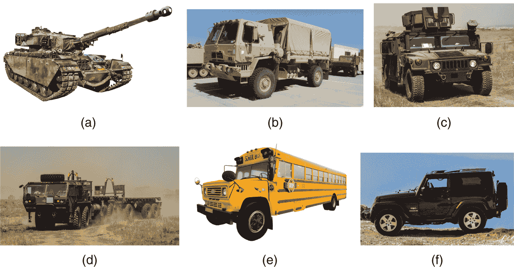

**Figure 1.1** Images used to train the deep neural network. ¶ Source: (a) Momentmal/Pixabay. (b) Cianna/Pixabay. (c) and (d) Military_Material/Pixabay. (e) blende12/Pixabay. (f) dimitrisvetsikas1969/Pixabay.

**Figure 1.2** The green school bus. ¶ Source: Free for commercial use without attribution; https://pixabay.com/vectors/green-bus-bus-green-vehicle-auto-3749394/.

正如开发机器学习子系统时的常规做法，可用数据的一部分用于训练机器学习系统，较小的一部分则保留用于测试算法性能。训练后，假设应用程序的算法报告高分，显示它可以正确识别其训练过的车辆。高分受到庆祝，应用程序部署到现场。基于开发期间进行的测试，预计将实现非常成功的应用程序部署。

然后，在运行期间，一辆绿色的校车驶入了该区域，也许来自格林维尔高中，车身上骄傲地写着“战斗蟾蜍”（Figure 1.2）。任何观察该区域的人都会立即认出这辆车是一辆校车。然而，人工智能机器学习算法从未见过绿色的校车——训练数据中包含的唯一校车是传统的黄色。事后看来可以理解，人工智能在识别绿色校车方面很可能会表现不佳，甚至可能将其识别为军用卡车。人类很容易将颜色识别为车辆的非本质变化——校车就是校车，无论颜色如何，但人工智能系统要字面得多。人工智能子系统不知道图像的哪些特征对图像的含义至关重要，除非我们通过示例告诉它。该系统的性能在未专门训练过的对象上将是不可预测的。

后果可能非常灾难性。想象一下，如果一个基于人工智能的武器瞄准系统被赋予在没有人工确认的情况下自主开火的权限，并且该系统将“战斗蟾蜍”的校车错误分类为敌方军用卡车，头条新闻会是什么样子。结果很糟糕，但过错在哪里？从系统角度来看，犯了几个错误。首先，校车在训练数据集中代表性不足——这是数据分布的问题。其次，所包含的所有校车都是黄色的，而实际上校车可以是其他颜色——这是数据多样性的问题。第三，控制关键的、不可逆转的行动（例如武器发射）的系统不应如此轻易地被赋予完全自主权。

绿色校车的故事是虚构的，但在训练系统识别各种道路标志时，现实中也发生了类似的困难。通过在停车标志上添加一些普通的涂鸦，系统被误导以为它是限速标志，这表明该系统没有接受足够多的停车标志示例的训练，也许带有各种有意的扭曲和多余的材料，以便能够做出正确的识别。无论系统是被故意误导还是意外误导，原则都是一样的。仅在有限的世界版本上训练的系统，例如干净、光线完美的标志、理想化的黄色校车和晴朗的道路场景，在现实世界中很可能会犯错。可能，人工智能总体上会被归咎于失败，而不是将责任归于它应归属的地方——糟糕的系统设计和糟糕的人工智能训练。

当然，这里的问题是存在很多“绿色校车”，也就是说，系统未接受过训练的对象。很容易认为答案就是简单地在训练数据集中包含所有颜色的校车，但如果此类图像不容易获得怎么办？在接下来的内容中，我们将更深入地探讨这个问题，但现在，重要的是要意识到，我们必须认真思考训练人工智能系统所需的数据，以便在系统部署到现实世界时获得最佳效果。

## 1.9 数据需求

系统工程实践非常注重系统需求的获取、定义和细化。代表系统所需*行为*的需求被称为*功能需求*，而关于系统除行为之外的各种所需*质量和特征*的需求则被称为*非功能需求*。非功能需求有时被称为“ilities”，因为许多类型的非功能需求的名称以此结尾——可用性、可靠性、可靠性和可维护性——但它们还包括安全和安全等领域的需求。

传统上，系统需求在任何方面都没有关注数据，但在通过机器学习从数据中学习的人工智能子系统中，用于训练人工智能子系统的数据对于人工智能子系统乃至整个系统的成功运行至关重要，因此值得仔细关注。在某种程度上，用于训练机器学习子系统的训练数据与软件源代码类似——它决定了子系统将如何应对它面临的每种情况。轰动一时的关于人工智能失败的故事往往假设人工智能算法或其在软件代码中的实现是罪魁祸首，但责怪人工智能本身就像责怪一个小孩子第一次看到浣熊时说“喵喵，这里有小猫！”一样。难道父母没有提供更完整的动物教育更有可能要负责任吗？

训练数据可能很难获得，因为要用于训练，数据必须被标记。标记数据只是正确识别或预测已知并指定的数据。例如，如果应用程序是使用图像对车辆进行分类，则训练数据由车辆图像组成，并标记有图像中显示的车辆类型。训练数据通常由创建系统的<|message|> 人手动标记，尽管在某些情况下，可能可以找到已经标记的数据集。也许有一天像通用汽车这样的公司会提供一个包含其车辆图像的数据库，并已标记车辆名称和类型，但通常数据必须手动标记。你可能在网上验证身份的过程中帮助标记了一些数据，当时你被要求选择哪些图像包含人行横道或公共汽车。

鉴于图像识别研究的现状，需要大量标记数据，主要是因为图像识别系统无法轻松识别图像的基本方面——这是即使非常年轻的人类大脑也能掌握的东西。机器学习系统必须查看数十、数百甚至数千张停车标志图像，才能可靠地识别停车标志，而人类大脑似乎在看到一两个例子后就能掌握其特征的八角形形状和红色。更糟糕的是，很难判断机器学习系统关注的是什么特征。由于许多马的图像都出现在绿草背景下，系统可能会将绿色草地的存在视为马的本质特征，并且可能无法识别放在海滩或其他背景上的马。

在为特定应用指定数据需求时，有许多方面需要考虑，我们将讨论每一个方面。我们首先指出，即使对人工智能和机器学习从业者来说，数据需求的概念也是新的。目前许多机器学习应用都是机会主义的——它们出现是因为特定数据集已经存在。数据集被发现，并且往往按原样使用，而没有太多检查或分析。随着系统工程师在越来越多的应用中使用人工智能子系统，必须更加关注数据集的选择和细化。机器学习训练数据选择的四个主要方面是多样性、增强、分布和合成。由于数据需求领域是新的，并且不是前几代系统工程师认为的需求的一部分，数据需求不是“你爸爸的系统需求”，这四个领域可以用缩写 DADS 来记忆，即 Diversity、Augmentation、Distribution 和 Synthesis。

### 1.9.1 多样性

AI 子系统，尤其是使用机器学习和深度神经网络的子系统，在使用大量多样化的数据进行训练时表现最佳。多样性有助于确保 AI 专注于本质特征，通过改变非本质特征来实现。虽然人类可以通过我们并不完全理解的过程直觉地做到这一点，但 AI 并没有那么直觉。AI 的理想训练集应包含图像（或其他形式的输入数据）中每一种可能的有效变化，或尽可能多的变化。以图像为例，训练数据应包含目标物体的图像，涵盖所有可能的颜色（还记得绿色的校车吗），在各种光照条件下，从各种角度拍摄，并具有各种背景。

乍一看，AI 无法从正面看时呈圆形的 *禁止进入* 标志，推断出从角度看时呈更像鸡蛋形状的同一标志，这似乎违反直觉，但它通常做不到。理想情况下，训练数据应包含各种角度的标志图像，以提高 AI 子系统识别标志无论其如何出现的能力。同样，停车标志特有的红色在不同光照下可能会呈现不同的色调——例如日落、偏蓝或偏黄的车头灯，或逐渐暗淡的阴天。在同样的方式下，AI 没有办法判断我们所称的背景是否实际上对图像及其含义至关重要。对人类来说，无论背景如何，狗很容易被识别为狗，但一个仅在人行道上出现狗图像训练的 AI，可能无法识别在草地或水面背景下出现的狗。

系统工程师与数据科学家一起工作，必须确定对 AI 子系统在系统中的角色而言什么是本质的。如果系统设计用于识别汽车，背景可能无关紧要，但如果系统需要区分交通堵塞和停车场，背景可能就是至关重要的信息。系统工程师必须不对 AI 子系统扩展或概括其对项目的理解能力过于乐观，就像人类那样。AI 不会自动知道侧面猫的图像与正面该猫的图像是同一只猫。AI 不会知道 700 °F 不是应出现在天气数据库中的温度（至少在地球上不是）。AI 不会理解不同肤色的人都是人，除非数据被构建为包含各种肤色。系统工程师甚至可能需要问该应用是否需要将小丑识别为人类——如果是，最好在数据中加入一些小丑图像。在 COVID 时代，许多人佩戴口罩时，人脸识别系统无法识别戴口罩的同一人。一个训练于戴口罩的人的数据系统，或许包括多种类型和颜色的口罩，应该表现好得多。

这里有两个独立的任务，而且都不容易。系统工程师必须确定需要为 AI 子系统训练提供什么数据，还必须设计获取这些数据的方法。如果数据可以从已知来源 readily 获得，或可通过现有手段捕获，则数据需求可以简单地传递给项目团队中的数据科学家或数据工程师。如果所需数据不可用，其他技术可用，例如增强——DADS 中的“A”。

### 1.9.2 Augmentation

增强是指使用软件通过以特定且易于量化的方式变化现有数据来生成新的 AI 训练数据的过程。图像以不改变图像含义的方式变化，但为 AI 训练过程提供多样性并帮助防止其做出不幸的假设。1000 张图像的训练数据集可以轻松变成 5000 张图像的数据集，通过以五种不同的方式变化每张图像。

例如，如果 AI 正在训练以识别鸟类，我们可以取训练数据集中的一张鸟类图像并水平翻转它，为训练数据集创建一张额外图像。人类很容易看出两张图像是同一只鸟，但 AI 必须通过训练才能看到这一事实。在某些应用中，创建图像的垂直翻转版本也可能有意义——鸟类和猫经常以倒立或侧卧姿势出现，但马和人类则不常如此。人类直觉上能识别鸟类和猫的所有方向，但 AI 必须通过示例进行训练。

许多增强方法都是可能的，AI 子系统的开发者需要通过一些实验来确定哪些方法能提高 AI 子系统的性能。然而，指定哪些增强方法对应用有意义是系统工程师的职责。例如，通过打乱图像中的颜色，可以创建看起来不自然的新图像，但有助于 AI 学习允许多种颜色——AI 学会颜色不是物体身份的本质。对汽车图像打乱颜色是有意义的，因为任何颜色的汽车仍然是汽车。如果应用是识别道路标志，则颜色可能是本质的。停车标志始终为红色，因此广泛的颜色变化可能对应用没有太大用处。另一种变化是随机旋转，其中图像被随机旋转若干度以生成新图像。图像也可以随机上下或左右平移。对人眼来说，平移后的图像大同小异，但对 AI 来说，平移图像可以提供重要的训练信息。随机缩放，即通过放大输入图像的随机选定区域创建新图像，也可能有效，同样可以改变图像的亮度。

图像训练数据的增强已变得如此流行，以至于生成增强图像的机制可能已内置于 AI 开发人员的工具包中。AI 开发人员可以简单地要求神经网络在训练 AI 子系统时自动生成增强图像，而无需占用增强图像的存储空间，使用标准的机器学习系统，如 Google 的 Keras 和 TensorFlow。

乍一看，将真实图像制作成人工着色、裁剪或失真的版本，然后将这些修改后的图像添加到 AI 的训练数据中似乎违反直觉，但它确实有效。增强只应添加到帮助训练 AI 子系统——而不是评估其性能。只有真实世界数据才应用于测试 AI 子系统的性能，因为系统将在真实世界中运行。拳击手可以在健身房通过击打人工对手和沙袋进行训练，但检验拳击手能力的唯一真正测试是与真实对手的较量。许多图像识别系统甚至其他应用都可能从增强数据中受益。图像增强领域以及相关的合成数据领域的研究仍在继续，下面将讨论。

### 1.9.3 Distribution

分布与用于每个类别或应用中预期类别的训练数据比例有关。例如，如果系统工程师决定我们确实需要检测各种颜色的校车，而不仅仅是黄色，*需要* 包含多少张非黄色校车图像与黄色校车图像相比？这里的违反直觉原则是，训练数据的分布应由应用需求决定，而不一定由世界中的实际分布决定。让我们考虑一个例子来说明这一点。

在美国，截至本文撰写时，93%的护士为女性，7%为男性。假设我们正在设计一个 AI 子系统，用于从照片或视频图像中识别护士，也许作为一个需要随时知道护士在医院位置的系统的一部分。一个想法是按照我们在现实世界中看到的相同比例构建我们的训练数据集，其中 93% 为女性护士照片，7% 为男性护士照片。让训练数据的分布与世界中的分布相映似乎很合理，但这种做法效果不佳。该系统只有少数男性护士的示例，因此无法很好地学习如何识别他们。我们的系统需要更多男性护士图像来进行训练，以便在实际中看到男性护士时能够识别出来。对于这种护士识别应用来说，最佳数据可能更接近 50% 女性和 50% 男性，并且对护士肤色、身高、体重、服装颜色等也采用类似的多样化方法。

换句话说，那些不能预测某人是否为护士的属性——性别、肤色、身高等等——不应在训练数据中显示出偏见。身高的人更可能是护士的可能性并不比矮的人大，因此数据不应因包含远多于矮护士的高个子护士而产生偏见。有人可能会争辩说，女性 *是* 预测某人是否为护士的因素，因为 93%的护士是女性。但问题是，在医院观察到的女性中，该人是护士而不是其他类型人员的可能性更大吗？要知道这一点，我们需要了解医院中全部女性人口的构成。如果例如女性办公室工作人员的数量与女性护士一样多，那么女性可能并不能预测某人是否为护士。请再次注意，这些是系统问题，最好由系统工程师在数据科学家的协助和输入下解决。其中一些技能对系统工程师来说可能是新的，但随着机器学习系统重要性的提升，数据科学和统计推理将成为智能系统系统工程中越来越重要的技能。

考虑如果护士识别系统的设计者无意中犯了将训练数据偏差为实际比例 93% 女性护士和 7% 男性护士的错误会发生什么。如果系统还被训练用于识别医生，那么训练数据很可能会遵循现实世界中 50% 女性医生和 50% 男性医生的比例。假设一家医院有 200 名医护人员，护士与医生的比例为 4 : 1，该医院实际包含 31 名男性医护人员——20 名医生和 11 名护士，以及 168 名女性医护人员——20 名医生和 148 名护士。由于男性护士仅占全部训练数据的 6%，似乎很可能系统很容易将男性护士误识别为医生，因为系统可预测地更容易区分男性与女性而不是护士与医生。在女性中，数据同样存在偏差，包含 148 名女性护士和仅 20 名女性医生。系统很可能会将女性医生误分类为护士。

退一步思考一下，人类对一个据称智能的系统常规地将男性护士误分类为医生而将女性医生误分类为护士的反应，人们可以理解其认为 AI 或其创造者具有深层性别歧视的假设。但过错并不在于 AI 整体，甚至也不在于 AI 算法或其编程。过错在于用于训练 AI 子系统的所选数据。即使 93%的护士是女性，系统可能在训练集为 50% 女性护士和 50% 男性护士时表现更好。直白地说，我们需要对男性护士和女性护士一样努力地训练系统，以便它能更好地识别两者，无论在运行中实际遇到多少人。但如果我们根本没有足够的男性护士图像怎么办？毕竟他们在世界上相对稀少。缺乏训练 AI 子系统所需的数据是系统工程师和 AI 设计者长期存在的问题。除了像血猎犬一样坚定地从任何可能的地方找到最佳数据外，他们还可以使用我们最后的 DADS 数据需求原则，即合成。

### 1.9.4 Synthesis

在统计学和科学数据分析的世界里，*编造* 数据是绝对的大忌。数据是神圣的，应代表未经过滤、未被更改且无偏见的现实。但在 AI 子系统的训练中，编造的数据可能非常有帮助。原因很明显：通常可用的真实数据有限，而且获取更多数据可能困难或昂贵。令人惊讶的是，计算机生成的數據可以作为训练数据输入 AI 子系统，并提高其在现实世界情况下的性能，但它确实有效。让我们举一个例子。

Laurence Moroney，一位 AI 研究员和教育者，开发了一个他称之为“马与人类”的数据集

用于 AI 子系统训练的合成数据领域才刚刚起步。在一个有趣的变化中，佐治亚理工学院的一台计算机被用来合成一栋建筑内部的虚拟模型，然后该虚拟建筑被用来训练一架无人机使用强化学习飞行走廊并进入房间。训练完成后，无人机能够在真实建筑中成功飞行。这种方法的潜力令人震惊。创建虚拟模型和虚拟世界的技術相当先进，主要由日益先进的计算机游戏推动，而计算机游戏当然完全发生在合成的虚拟世界中。对于计算机游戏，世界可以基于神话、幻想或科幻，但虚拟世界同样可以轻松代表 AI 最终在现实生活中会面临的真实环境、情况和人物。更好的是，虚拟世界的训练可以在虚拟的加速时间内进行。拥有足够的计算能力，训练可以以数倍于现实世界速度进行——一次前往火星的旅程可以从数月缩短到数分钟，或一个在现实中可能需要数天的战斗场景可以在一天内重放数百或数千次，不同的条件和事件组合，加速学习。

## 1.10 The Data Lifecycle

典型的系统开发周期会经历规划、分析、设计、实施、验证与确认、部署和维护阶段。周期可以用瀑布方式进行，一个周期可能持续数年，或者可以使用更敏捷的过程将周期压缩到数周，并反复进行，每次开发系统功能的不同切片。在 AI 子系统中，数据在训练系统中的重要性促使我们考虑将这种生命周期应用于数据。让我们考虑生命周期过程的每个阶段以及它如何适用于 AI 训练数据。

# 规划

通常，人工智能应用的最初想法来源于数据的存在。我在收件箱里收到一份包含数十万条同事培训课程完成记录的报告时，就受到了启发——这让我思考能用这份丰富的数据做什么。但越来越多的情况是，人工智能不仅会在发现现有数据集时才被应用，而是在系统工程师看到基于过去事件和信息进行智能决策、分类或预测的需求时才会应用。系统工程师可能会在合适的<|message|>数据是否存在得到确认之前，就建议使用人工智能子系统。系统工程师应与数据科学家协作，确定系统的<|message|>数据需求，就像考虑软件和硬件需求一样。数据是否存在，我们能否方便地访问它，还是需要提出请求并获得批准？数据多样性和分布的要求是什么，是否需要数据增强和数据合成？我们的应用中是否缺少“绿色校车”（或其等价物）？通过及早关注对某些数据的需求，可能在其他系统开发活动进行的同时开始收集数据，并在需要时数据即可准备就绪。

# 分析

在分析阶段，使用统计、[content]

# 规划

通常，人工智能应用的最初想法来源于数据的存在。我在收件箱里收到一份包含数十万条同事培训课程完成记录的报告时，就受到了启发——这让我思考能用这份丰富的数据做什么。但越来越多的情况是，人工智能不仅会在发现现有数据集时才被应用，而是在系统工程师看到基于过去事件和信息进行智能决策、分类或预测的需求时才会应用。系统工程师可能会在合适的 数据是否存在得到确认之前，就建议使用人工智能子系统。系统工程师应与数据科学家协作，确定系统的 数据需求，就像考虑软件和硬件需求一样。数据是否存在，我们能否方便地访问它，还是需要提出请求并获得批准？数据多样性和分布的要求是什么，是否需要数据增强和数据合成？我们的应用中是否缺少绿色校车（或其等价物）？通过及早关注对某些数据的需求，可能在其他系统开发活动进行的同时开始收集数据，并在需要时数据即可准备就绪。

# 分析

在分析阶段，使用统计、[content]

# 规划

通常，人工智能应用的最初想法来源于数据的存在。我在收件箱里收到一份包含数十万条同事培训课程完成记录的报告时，就受到了启发——这让我思考能用这份丰富的数据做什么。但越来越多的情况是，人工智能不仅会在发现现有数据集时才被应用，而是在系统工程师看到基于过去事件和信息进行智能决策、分类或预测的需求时才会应用。系统工程师可能会在合适的 数据是否存在得到确认之前，就建议使用人工智能子系统。系统工程师应与数据科学家协作，确定系统的 数据需求，就像考虑软件和硬件需求一样。数据是否存在，我们能否方便地访问它，还是需要提出请求并获得批准？数据多样性和分布的要求是什么，是否需要数据增强和数据合成？我们的应用中是否缺少绿色校车（或其等价物）？通过及早关注对某些数据的需求，可能在其他系统开发活动进行的同时开始收集数据，并在需要时数据即可准备就绪。

# 分析

在分析阶段，数据会通过统计、可视化或其他方式被收集和分析。与规划一样，用于训练人工智能子系统的数据分析应由系统工程师和数据科学家合作完成。理解数据本身不需要专门的软件或人工智能背景，因此数据不应仅是人工智能开发团队的私事。数据至少应通过 `patient human` 测试，这意味着一个聪明的、细致的、耐心的、尽管完全没有创造力的人类，理论上能够仅使用相同的数据完成我们希望人工智能子系统完成的工作。

例如，如果人工智能旨在预测法国任何地方的降雨量，但数据仅来自巴黎市中心，则数据可能无法通过 `patient human` 测试——人类无法仅根据巴黎的降雨量可靠地预测波尔多的降雨量。旨在识别交通标志的系统如果没有包含足够数量的非交通标志示例，也可能无法通过 `patient human` 测试。一个被迫对“前方有食物出口”标志进行分类的 `patient human`，从未见过该标志，且仅接受过停车、让行和限速标志的训练，会产生不可预测的结果。

人工智能领域最迷人的事情之一是，它迫使我们以精确的细节重新评估人类智能及其组成部分。一个人通过历史考试所需的智能，或许是智能的某个方面，依赖于对大量日期、地点和事件的详细信息的回忆。这与通过微积分考试所需的完全不同，后者需要很少的事实，但需要对如何应用方法有深刻的理解。在目前的进化阶段，人工智能并不是拥有各种人类智能的缩小版人类——它们更专业化。当我们分析将用于训练人工智能子系统的数据时，我们实际上是在构建一种非常专门的智能。它只知道我们通过数据收集告诉它的内容，并且缺乏人类创造性地外推到新情况和应用的能力，或做出对人类来说显而易见的逻辑跳跃。人工智能大脑是天真的，只能思考我们告诉它思考的内容——如果人工智能的行为甚至可以被称为思考的话。回想一下，停车标志的图像加上几块胶带就能欺骗人工智能，让它以为那是限速标志。重点是——这样的错误不是人工智能的错。是人类的责任为人工智能提供正确的学习数据集。我们必须对数据的 `selection` 应用人类创造力，这样人工智能就不必具有创造力也能取得成功。

在数据生命周期分析阶段，主要目标是充分理解和验证将用于训练人工智能的数据。对系统中的某物进行验证是指确定其是否适合用途，以及是否满足系统的最终用户和利益相关者的需求（稍后会详细介绍验证和确认）。验证训练数据意味着理解系统的需求以及系统将运行的上下文和环境。实际上，我们试图像人工智能看到数据一样看待数据——作为直接且确定的学习输入。

可视化大型数据集可能是一项艰巨的任务。对于数值数据，我们可以从标准描述性统计开始，例如计算一组数字的均值、中位数和众数。虽然基础，但这些简单度量可以对数据进行合理性检查。美国中西部某城市五月份的温度文件在快速浏览前 100 条记录时看起来可能不错。然而，更深入的分析显示均值为 100°F/38°C，而直方图显示最常出现的温度为更可信的 61°F/16°C。很可能该文件包含一个或多个错误的温度。仅仅一天 1000°F 的天气（或数据录入错误）就会使年均值严重偏离。在当前和未来的应用中，数据文件可达数十万、数百万条记录。由于没有人能够合理地“快速浏览”如此庞大的数据文件，因此需要系统化的方法来确保我们拥有合理的数据。统计 `box plot` 显示最小值和最大值以及按四分位数排序的数据会迅速暴露我们 1000°日的异常，简单的散点图或线图也会如此。处理数值数据时，最好的第一步是将其绘制出来并观察。

数据分析阶段的一个重要考虑是如何处理有问题的数据。如果我们有数百万个温度数据点，1000°的一个读数可以简单地丢弃。但如果我们有一个包含温度和湿度水平的文件，而一半记录缺少湿度呢？丢弃一半数据似乎不对。处理缺失数据有几种选择，正确的方法取决于应用。我们可以将所有缺失的湿度读数替换为零，但这会严重扭曲平均值，使该地看起来比死亡谷还干燥。更合理的做法是用该地区的平均湿度替换缺失的湿度值，前提是我们已验证数据并相信平均值是准确的。统计学家可能会对这种明显的数据操纵感到不满，但请记住我们的意图是提供最好的教学数据并产生最佳性能的系统。

另一个分析活动是评估数据的分布和多样性。如护士识别系统的案例所示，通常最好将数据与训练需求相匹配，而不是与现实世界中的实际情况相匹配。如果护士照片数据中 93%为女性，我们可能需要找到或合成更多男性护士照片来很好地训练系统。其目的不是准确代表世界，而是提供最有效的训练。

运用人类类比，我们知道警察、士兵、外科医生、军官和武术家必须为极其罕见的事件进行超量训练——训练量与事件实际发生的频率不成比例。这样的事件在他们整个职业生涯中可能只发生几次，但他们必须训练好以便在发生时能够应对。他们对罕见事件进行“过度训练”，以便做好准备，应对任何可能发生的情况，或尽可能接近任何情况。对于人类来说，这种过度训练会扭曲期望，但至少目前，我们不必担心人工智能会有类似人类的期望。我们只需要确保人工智能能够应对所有可能的情况，无论常见还是罕见。

数据可视化既是一门科学，也是一门艺术。在该主题的精彩经典著作 *Beautiful Evidence* 中，爱德华·塔夫特展示了创造性地可视化数据可以向我们展示数据的含义、模式，甚至数据背后的故事。对于前人工智能时代的系统工程师而言，数据是*从*系统中*出来*的东西，用来展示系统的性能和状况。在人工智能的世界里，对于需要训练的深度神经网络而言，数据进入*系统*的构建，并驱动系统的实际行为。系统工程师将越来越多地需要发展自身的数据技能，并与数据科学家合作，共同开发用于训练数据的可视化。训练数据的选择不能完全留给构建人工智能子系统的 AI 开发者，因为他们对应用需求和系统部署及使用所处的环境，以及系统表现不佳所带来的危险和风险，并不像系统工程师那样熟悉。

## Design

系统工程师不会将系统的任何其他设计方面留给偶然，而数据也必须如此。数据不能凭空制造，但系统工程师应将环境中发现的数据视为设计和实现训练数据的原材料，就像必须加工成钢材的原矿石，然后才能用来打造忍者剑一样。

当前实践中许多人工智能应用都是*数据机会主义*的——它们主要是因为发现了一些有趣的数据，有人好奇能用它做什么而被构建。这没什么不对，而且可能导致有用的应用被发现。但用森林里发现的有趣树桩制作餐桌，与*基于*用户需求、愿望和期望*设计*一张桌子，然后挑选最佳材料来实现设计，这两者之间存在很大差异。当飞机发动机制造商看到发动机在飞行中产生的数据山时，他们想知道这些数据是否能被用来帮助揭示维护需求或即将出现的问题。通过尝试创建使用现成数据的应用，很可能会发现对数据的额外需求，而其他正在收集的数据可能证明是不必要的。然后可以修改发动机控制系统中的数据收集能力，使生成的数据对预测算法更有用。

## Implementation

一旦数据被设计好，其实施应该很直接，尽管不一定容易。从理论上讲，这只是根据设计和分析阶段学到的知识收集数据的问题。实际上，通常会出现两个主要问题——技术上如何获取数据，以及政治上如何获取数据。数据收集的技术手段是众所周知的，许多工具和技术都可以使用。数据科学领域已经发展出有用的工具，其中大多数都是开源的，并且可以免费用于商业用途。即使在几乎任何个人电脑上，也能轻松处理包含数百万条记录的数据集，这得益于现在常见的慷慨存储和处理能力。当我刚开始接触计算机时，一个大硬盘的容量是 10 MB。现在，一张高分辨率图像的大小就可能达到这个容量，而个人电脑通常配备 500 GB 或更大的硬盘——这是 1980 年代那个 10 MB 奇迹的 50,000 倍。个人电脑如今的随机存取存储器 `RAM` 也多得多，4、8、16 或更多千兆字节并不少见。如此多的 `RAM` 使计算机能够将大型数据集保存在内存中，从而实现更快的处理。总之，普通的个人电脑通常已足以收集、分析和设计智能系统开发项目中 AI 子系统所需的数据。顺便提一下，当人们说 AI 需要大型计算机，甚至超级计算机时，他们通常指的是对 *AI* 系统的*训练*。检查和分析训练数据或在运行最终系统时所需的系统规模要小得多——通常只需要一台个人电脑即可。

实施阶段还包括数据科学中称为数据准备的过程。这个听起来天真而简单的术语隐藏了可能大量实验性、创造性和技术性工作。整本书都写在这一主题上，但系统工程师只需要熟悉一些基本概念即可。最简单的数据准备形式是根本不做准备——数据以收集到的形式直接使用。当然仍需进行分析，以确保数据集包含我们认为它包含的内容，并且不包含错误、缺失数据或其他异常，但精细的数据准备并不总是必要的。有许多基本技术，其中最常见和最有用的一种是创建派生特征，有时也称为 *feature crosses*。让我们举个例子。

假设我们有一组人的年龄、身高、体重和整体健康状况的数据，我们希望理解这些特征之间的关系，以便预测一个人的健康状况。我们进行一些分析，发现身高与体重之间的关系相当线性——人随着身高增长而变重，并且在特定年龄体重越重，健康状况越好。但有一个限度——超过一定体重后，体重增加对健康有负面影响。20 岁以后，有些人会变重，但有些人不会，即使他们的身高基本保持不变。我们发现变重的人健康状况更差，但 20 岁时体重过轻的人健康状况也很差（想想饥饿或营养不良）。我们直觉上明白发生了什么，但试图理解这些数据的 AI 在根据一个人的年龄、身高和体重来做出合理的健康预测时可能会遇到困难。我们可以通过引入一个名为身体质量指数 `BMI` 的派生特征来大大简化问题，`BMI` 的计算方法是体重除以身高的平方。事实证明，`BMI` 与健康之间的关系对所有年龄都十分清晰——过低或过高与不良健康相关，但 `BMI` 在约 18–25 的范围内与更好的健康相关。因此，通过这种简单的计算将 `BMI` 添加到我们的数据中，将有助于 AI 捕捉这种关系并产生更好的健康预测。使用像 `BMI` 这样的派生特征使 AI 的行为对人来说更具可解释性和可理解性——`BMI` 与健康之间的关系比身高、体重、年龄与健康之间更复杂的关联更容易理解。(`BMI` 并非完美——例如，某些类型的运动员可能 `BMI` 较高但并不超重。)

派生特征并不总是预先定义在科学或实践中，准备好供我们在训练 AI 算法时使用，但实际上比我们怀疑的要多得多。血压一直很难让人理解，它有两个数字——一个“在”另一个之上，但并不代表分数。医学研究人员开发了一种称为“平均动脉压”的单一指标，直接测量需要侵入性操作，但可以近似为收缩压（上面的数字）的三分之一加上舒张压（下面的数字）的三分之二之和。血压 120/80 的平均动脉压（`MAP`）为 93.3。尽管不在普通公众词汇中，`MAP` 可以成为某些循环状况甚至整体循环健康的更好、更清晰的指标。`MAP` 是最佳派生特征的例子——它已经具有与真实现象相关的科学依据。

一些 AI 专家会争辩说，深度神经网络的特性使得添加派生特征变得不必要——AI 会学习正确的关系，并在没有它们的情况下产生同样好的结果。创建合理的派生特征已被证明可以提高 AI 算法的性能和预测能力，尽管有时只是略微提高。然而从系统角度来看，有效派生特征的最大优势，即在 AI 算法的学习中被证明为重要的派生特征，是它们使 AI 的行为更易于理解，从而帮助我们推进对世界上真正发生的事情的理解。取而代之的是身高、体重与健康之间神秘的关系，人类和 AI 算法都可以使用 `BMI`。与其强迫 AI 算法试图理解构成血压读数的两个数字，也许 `MAP` 会显示出与健康指标和状况更简单的关系。

在缺乏 readily available 且已建立的派生特征如 `BMI` 和 `MAP` 的情况下，系统工程师和数据科学家必须尝试创建自己的派生特征。如果我们的应用是根据位置估算房屋价格，也许使用附近房屋的实际售价效果不如每平方英尺价格这一派生特征，因为它调整了房屋大小的差异。但等等——卧室数量加上浴室数量是否对房屋价值更具预测性？这里又有一个派生特征可以尝试。过程很简单——创建许多这些派生特征，看看哪些最终与算法试图预测的现象相关性最强，从而最具预测性。然后尝试消除对算法没有帮助的因素，以便尽可能得到最简单的模型。

## 验证和确认

系统工程师可以对训练数据应用验证和确认的学科，以在部署时为 AI 提供成功的最佳机会。验证和确认当然会应用于子系统，以及整个系统开发生命周期中的整体系统本身，但也可以应用于数据，甚至在 AI 算法开发之前。把它看作是确保我们不会陷入垃圾进垃圾出的陷阱，通过给好的算法提供坏数据。

验证和确认经常被混淆，甚至在系统工程师中也是如此。请记住，验证这个词包含一个 *r*，因此与 *requirements* 相关。验证提出的问题是，被验证的项目是否满足规定的和记录的要求？对于卫星这样复杂的系统，系统验证涉及证明系统满足可能数千项要求的繁琐过程，这些要求既包括原始合同中规定的要求，也包括后来推导出的要求。验证最常见的方法是测试。系统在预先设计的输入条件下运行，我们看看结果是否与要求所述相符。常说验证是关于 *正确地构建系统*。有些系统无法通过测试，因为测试它们就意味着毁掉它们。防御性导弹拦截器只能通过尝试拦截实际导弹来完全测试——这是一项昂贵的任务。除了测试之外，验证的其他方法还包括检查、演示、分析、类比和抽样。

另一方面，确认是关于评估被确认的项目是否实现了其预期用途：它是否满足需求？是否适合目的？它是否按用户和利益相关者需要和期望的方式工作？常说确认是关于 *构建正确的系统*。确认的方法通常包括向利益相关者和潜在用户展示系统，或其某些方面，并询问，或更好的是观察他们是否能成功使用它。对复杂系统开发的现实不熟悉的人可能会想知道为什么 ever 需要确认，假设如果一开始就正确指定了要求，就永远不会在要求所述内容与实际需要和期望之间出现差距。实际上，需求可能会有遗漏、模糊和缺少细节，留下系统开发团队去填补空白并做出假设。 resulting 系统可能满足要求，但并非某些用户所期望的。当一个大型组织为系统指定要求时，这些要求可能来自许多利益相关者，具有不同的观点，并且可能涉及也可能不涉及系统的实际终端用户。更糟糕的是，要求可能由除实际使用者之外的人指定。这些常见情况都指出了确认的必要性。

验证和确认的方法也可以应用于用于训练 AI 算法的数据。验证应用于数据，以确保其满足在数据生命周期规划和分析阶段开发的数据要求。如果分析显示数据可能包含某些异常或错误值，数据要求应写明此类值应在数据准备好供 AI 算法使用之前被删除或替换。验证应确保此要求已得到满足，并且所有此类有缺陷的数据项都已得到处理。

如果数据生命周期似乎是一个繁琐的过程——记录数据要求然后执行数据验证以确保满足数据要求——请考虑两点。首先，用有缺陷的数据训练 AI 算法的后果可能很严重。由于算法是基于从训练数据集相同的数据集中提取的测试数据进行评估（验证）的，算法在实验室中测试可能很好，但在实际使用中会产生令人惊讶的结果。1984 年电影 *Starman* 中由杰夫·布里奇斯扮演的外星人，通过观察交通学习到“绿灯表示 go，红灯表示 stop，黄色表示 drive very fast”，他基于有缺陷的输入数据学习了一些东西。他的学习可能大部分时间都有效，但由于学习数据并不代表我们实际想要的行为，他的驾驶会有些危险，正如我们在电影中看到的那样。其次，请考虑训练数据并非只收集和分析一次。每当获得新数据时，都应将其通过数据生命周期以确保其质量，然后再用于重新训练 AI 子系统。在每次更新时重复重新训练工作，将数据要求、数据验证和数据确认工作投入一些精力将得到回报。

正如我们所描述的，训练数据可以使用在数据生命周期过程中更早阶段开发的数据需求进行验证。训练数据也可以进行验证。为了验证训练数据，我们要问数据是否*适合用途*，是否满足需求。正是在验证过程中才会发现像我们在之前护士识别系统示例中发现的那类问题。数据需求可能只是说明训练数据应由护士和非护士的准确标记图像组成。或者需求可能更进一步，说明男护士和女护士的比例应与现实世界的情况相匹配。正如我们所见，这两种选择在当时看起来合乎逻辑，但在系统训练后可能证明是有问题的。

对某物进行验证是一个直接的过程，即根据既定需求对其进行评估，而进行验证则需要更多的主观判断。军事车辆可以通过执行可能数千次的测试、检查和分析来验证其是否满足既定需求。为了进行验证，系统工程师可能会向系统的预期用户展示原型车辆，或比例模型，或原型仪表盘。他们可能会只是征求一般性的反应，或者要求用户假装使用原型执行任务的一部分。系统的用例（用例在 Chapter 6 中有深入描述）可在此用作演练场景，以查看用户是否能想象使用该系统执行实际工作。

通过将验证应用于训练数据，系统工程师可以将数据展示给系统的预期用户和利益相关者，或许可以使用在数据生命周期分析阶段开发的数据可视化。用户可能会被要求想象自己是病人，并查看他们是否能想象使用现有的数据来做他们希望 AI 做的事情。提问——这些数据是否完全代表 AI 将遇到的各种情况？数据是否足够让 AI 成功学习模式？——鼓励用户批判性地思考 AI 将基于其行为的数据。进行数据验证是否会导致团队在自动驾驶汽车 AI 中加入行人推自行车，或大型白色卡车堵住道路的图像？也许会，而且及早发现这些情况可能有助于防止不幸的生命损失。

在数据验证和确认的世界里，人类和 AI 需要彼此。目前，AI 无法确定自己需要从什么数据中学习。它们依赖人类，就像孩子依赖父母教他们日常生活的基础知识一样。人类必须提供正确的数据并执行验证和确认，以确保数据*确实*是正确的，以便 AI 取得成功。AI 不知道自己不知道什么，只会学习它被教导的内容。数据验证和确认可以在 AI 算法开发之前或同时进行，并应由系统工程师、数据科学家、利益相关者和用户协作完成。当数据通过验证和确认后，它就可以部署用于训练 AI 子系统。

### Deployment
训练数据通过交给开发 AI 算法的团队来部署。大多数系统开发工作遵循并行工程方法（尽管可能是不正式的），使（或至少容忍）多个不同的工程学科同时工作。有了足够合适的协调，他们的工作可以整合为一个成功的系统。通常，有一组数据可用，AI 团队假定它可用于训练 AI 算法。算法开发团队可以开始工作，选择算法、设计神经网络结构，并使用可用数据对算法进行编码，而系统工程团队在数据科学团队的协助下，[content]

正如我们所描述的，训练数据可以使用在数据生命周期过程中更早阶段开发的数据需求进行验证。训练数据也可以进行验证。为了验证训练数据，我们要问数据是否 *fit for purpose*，是否满足需求。正是在验证过程中才会发现像我们在之前护士识别系统示例中发现的那类问题。数据需求可能只是说明训练数据应由护士和非护士的准确标记图像组成。或者需求可能更进一步，说明男护士和女护士的比例应与现实世界的情况相匹配。正如我们所见，这两种选择在当时看起来合乎逻辑，但在系统训练后可能证明是有问题的。

对某物进行验证是一个直接的过程，即根据既定需求对其进行评估，而进行验证则需要更多的主观判断。军事车辆可以通过执行可能数千次的测试、检查和分析来验证其是否满足既定需求。为了进行验证，系统工程师可能会向系统的预期用户展示原型车辆，或比例模型，或原型仪表盘。他们可能会只是征求一般性的反应，或者要求用户假装使用原型执行任务的一部分。系统的用例（用例在 Chapter 6 中有深入描述）可在此用作演练场景，以查看用户是否能想象使用该系统执行实际工作。

通过将验证应用于训练数据，系统工程师可以将数据展示给系统的预期用户和利益相关者，或许可以使用在数据生命周期分析阶段开发的数据可视化。用户可能会被要求想象自己是病人，并查看他们是否能想象使用现有的数据来做他们希望 AI 做的事情。提问——这些数据是否完全代表 AI 将遇到的各种情况？数据是否足够让 AI 成功学习模式？——鼓励用户批判性地思考 AI 将基于其行为的数据。进行数据验证是否会导致团队在自动驾驶汽车 AI 中加入行人推自行车，或大型白色卡车堵住道路的图像？也许会，而且及早发现这些情况可能有助于防止不幸的生命损失。

在数据验证和确认的世界里，人类和 AI 需要彼此。目前，AI 无法确定自己需要从什么数据中学习。它们依赖人类，就像孩子依赖父母教他们日常生活的基础知识一样。人类必须提供正确的数据并执行验证和确认，以确保数据 *is* 正确的，以便 AI 取得成功。AI 不知道自己不知道什么，只会学习它被教导的内容。数据验证和确认可以在 AI 算法开发之前或同时进行，并应由系统工程师、数据科学家、利益相关者和用户协作完成。当数据通过验证和确认后，它就可以部署用于训练 AI 子系统。

### Deployment
训练数据通过交给开发 AI 算法的团队来部署。大多数系统开发工作遵循并行工程方法（尽管可能是不正式的），使（或至少容忍）多个不同的工程学科同时工作。有了足够合适的协调，他们的工作可以整合为一个成功的系统。通常，有一组数据可用，AI 团队假定它可用于训练 AI 算法。算法开发团队可以开始工作，选择算法、设计神经网络结构，并使用可用数据对算法进行编码，而系统工程团队在数据科学团队的协助下，处理数据生命周期以确保最终系统所用训练数据的质量。很可能如果算法在最初可用数据上表现可接受，在数据经过改进、扩充、补充合成数据、验证和确认以确保其为系统用途的最佳数据后，其表现会更好。

### Maintenance
非专业人士可能想象所有 AI 在部署到现实世界后都能自行学习，从而随着时间推移提高性能。这种自适应学习系统仍处于研究阶段，且存在难以克服的风险。如果 AI 从某些罕见或误导性的情况中学习，或被恶作剧或敌对人类故意误导，那么我们就很难知道 AI 在投入运行后自行学习时学到了什么。但这并不意味着 AI 不应再进行再训练。

运行系统在运行过程中可能会收集新数据，并且可能从其他来源获得新数据。这些新数据可以带回实验室，进行验证和确认，并用新增加的数据对 AI 重新训练。在对系统进行验证和确认后，可以发布更新。AI 多久用新的或改进的训练数据重新训练一次，取决于其性能以及环境变化的程度。购物应用可能需要经常重新训练以跟上时尚潮流。问答 AI 可能需要了解今年的电影、新闻事件和名人动态。电影和电视推荐系统必须定期纳入新信息，并经常使用来自电影和电视制作商的可靠数据进行重新训练。

## 1.11 AI Systems and People Systems

系统工程师，他们对复杂系统的整体设计和运行有适当的关注，对深度神经网络和其他类型的 AI 子系统有深切的担忧。系统工程师习惯于执行特定功能并基于特定输入产生可量化输出的子系统。他们相当合理地期望能够打开一个子系统并检查其电路、机制和软件源代码，并清楚地看到它是如何工作的。这并不是说系统工程师需要精通所有工程学科或理解每个子系统的所有内部工作原理，但他们希望知道这些工作原理*可以*被理解，并且可以合乎逻辑地直接导致对系统如何运行的全面理解。

事实上，认证飞机等复杂、安全关键系统的机构要求能够清楚地看到每段代码或电路如何与满足一个或多个系统需求相关。未用于满足需求的代码应被移除，或将必要的需求添加到需求列表中，以便需求与代码之间具有完整的追溯性。他们还希望看到所有代码都在某种条件下被执行（即没有代码永远不被使用），并且所有代码都已完全验证。未使用因此未验证的代码应被移除。

有一些很好的理由说明为什么 AI 子系统可能会让系统工程师感到担忧。虽然某些 AI 子系统是使用可以被直接检查的传统软件代码编写的，但深度神经网络看起来像是成千上万甚至数百万个毫无意义的数字。现在，公平地说，所有软件在最终的机器语言形式下都表现为毫无意义的数字。但这些数字可以直接追溯到软件源代码，而源代码*是*人类可读的。深度神经网络中的数字可以被视为包含数百或数千个项的方程中的系数。这些系数是通过复杂的试错过程得出的，它们之所以是这样，仅仅是因为这些数字效果最好。就像你的家用供暖系统有一个控制面板，上面有 25 个小旋钮，每个旋钮的刻度标为 1 到 10，没有其他标记。通过足够的试错，你可以尝试找出产生舒适冬季家居的设置组合，也许还有另一组组合适用于夏季。你不知道这些旋钮的含义或它们在系统中的功能。有些旋钮甚至可能根本没有连接。深度神经网络会进行试错工作，以找出产生所需结果的旋钮设置。事后查看旋钮设置的人无法判断这些设置是如何或为什么会是这样的。

如果我们无法通过查看 AI 子系统的内部来理解其行为，那么我们如何理解它呢？我们如何设计包含一个甚至多个 AI 子系统的智能系统？为了系统地思考复杂的智能系统，一个技巧是再次应用人类类比。AI 子系统的主要功能是做出决策、提供建议或提供预测，因此我们可以想象一个人类站在 AI 子系统的位置上做出同样的决策、建议或预测。人类可能更慢，其准确性也可能高于或低于 AI 子系统，但他或她执行的是相同的功能。就像难以解读的深度神经网络一样，人类的内部运作并不容易观察，而且即使我们去看，也大多不会对我们有意义——科学在理解大脑如何做出决策方面仍然相去甚远。尽管如此，仍然有一种方法可以理解、分析和设计包含人类作为主要子系统的复杂系统。有时被称为人类活动系统，这些系统在关于系统思维的第 9 章中进行了描述。特别适合于人类活动系统分析的技术，如系统思维和系统动力学，也可以应用于任何智能系统的设计，无论其子系统是基于 AI 还是有血有肉。理解和推理*人类活动*或*人员*系统的主要方法之一是因果回路图，见关于系统思维的第 9 章。通过使用因果回路图并像推理人员系统一样推理 AI 增强系统，系统工程师可以有效地分析复杂的智能系统。

让我们回顾一下我们在此应用的总体系统工程方法。为了设计一个复杂系统，系统工程师会将其分解为子系统，大约 10 个左右。稍后他们可以将这些子系统进一步分解为子子系统，但现在我们只坚持子系统。在工程系统中，如汽车，这些子系统是汽车的大部件，例如发动机、悬挂和电气系统。但在人类活动系统中，其中一些子系统是人，或人群。让我们举一个例子。

考虑一所在线大学。教授、管理人员和院长都是系统的一部分，连同计算机和软件——所有这些都是交付课程所必需的。教授与向学生展示课程的计算机系统之间的交互可以理解为一个用例（在关于用例的第 6 章中描述），其中有一组交互步骤，教授创建课程材料、录制视频并设置测验和评估。但我们如何描述教授与院长之间的交互，以及这些交互对整体在线大学系统有何影响。除了两者之间传递一些数据——教授将最终成绩提交给院长审批——之外，还有更微妙的交互，这些交互不像计算机系统两个部分之间的数据流那样容易描述。系统中的人类更应被视为做出决策、施加影响并向其他人类提供输入。他们的决策和影响帮助其他人类做出自己的决策，而这些决策又可能被其他人类或计算机使用。我们可以利用这种影响链的思想来更好地描述 AI 子系统在智能系统中的功能。

在描述如何之前，让我们考虑*为什么*我们要在智能系统中描述子系统交互。最可能的原因是，我们正在进行新系统的设计过程，并正在推理如何包含新的智能子系统。如前所述，关于所谓的“智能子系统”在我们之前整齐的确定性复杂系统内部运行，存在真实或想象的担忧，产生这些担忧是自然的。实际上，当然，许多非 AI 复杂系统，虽然对全知观察者来说可能是确定性的，但对具有有限理性的凡人来说却相当不确定。系统经常让我们感到惊讶，或让我们失望，并不是因为它们本质上是不确定的，而是因为我们并不完全理解它们所有相互关联的行为，所以对我们来说它们看起来是不确定的。我们需要一种方法来推理、描述、绘制图表和建模这些系统的期望行为，以便我们尽可能地使它们不仅性能良好，而且安全可靠。

再举一个例子：自动驾驶汽车。当然，我们可以尝试用传统的系统工程术语来描述汽车的运行方式，子系统通过端口和连接路径相互连接，数据通过接口使用协议传输，函数接收一些信息并产生其他信息。但让我们尝试以人类的方式思考自动驾驶汽车，仿佛它包含了一些小人。哲学家使用术语*homunculus*，指的是假设的头脑中实际人类内部的小人类，作为理解人类行为的一种方式。这些小人协作使自动驾驶汽车发挥作用。可以想象其中几个人的对话，比如 John Locke（汽车的锁系统）、Austin Power（发动机和动力系统）以及 Vision（视频成像系统）。

当然，子系统不会用人类的语言交流，而且它们可能甚至没有色彩鲜艳的名字。当我们用人性化的方式思考事物时，真正发生的事情是子系统在*相互影响*，彼此提供输入，有时甚至真正导致对方做某事。也许如果系统更具层级性，一些子系统能够*命令*其他子系统去做事。智能系统，尤其是拥有多个 AI 子系统的系统，可以这样来思考。在我们的例子中，Vision 基于其子系统提供给他的/她的/它的信息做出了一些决定，但这些决定伴随着不确定性，就像真实人类的决定一样。如果一个人类诚实的话，很少有决定是带着 100.0% 的信心做出的。我知道我想去看那部新的动作大片或历史剧情片，但我真的 100% 确定今晚更想看哪一部呢？我可以从其他人类那里收集输入，但随后我仍需要弄清楚如何将他们的输入结合成我的最终决定。AI 子系统也需要做同样的事。Vision 的摄像头和激光雷达系统对前方道路上的东西有不同的“看法”。Vision 必须决定如何考虑它们的输入并做出决定。

一旦我们能够想象 AI 子系统作为系统中的小人物，那么系统思维和系统动力学的工具，这些工具帮助我们建模和理解人类活动系统（参见关于系统思维的第 9 章），就可以用来建模和理解复杂的智能系统。因果回路图显示了系统中元素之间的影响和因果关系。在汽车的视觉系统中，摄像头和激光雷达都对系统施加影响，可以被视为汽车决定将控制权交还给人类驾驶员的部分原因。当然，最终这些功能是使用处理器和数据连接实现的，但在系统工程层面，以代理的方式思考子系统——更像人而不是简单的输入/输出功能——可能更有用。

像 Netflix 这样的视频流媒体服务中看到的大规模推荐系统，也是影响和原因的复杂系统。由于很少有观众对他们观看的节目进行评分，系统必须使用其他因素来决定下次用户坐下来观看某物时推荐什么。要考虑哪些因素，以及如何在彼此之间对它们进行加权，是一个复杂且不确定的任务。如前所述，最终，这些因素被简化为算法、程序代码和计算，但在系统层面，是否更合理地将它们视为一个委员会，每个成员为特定立场辩护呢？*最近观看*的委员会成员主张 heavily 考虑用户昨晚观看的内容，而*长期模式*委员会成员则指出昨晚的选择与用户的长期模式不符——也许当时有客人或亲戚在场。*新素材*也加入进来，推动对用户可能喜欢的一些新素材给予更重的权重。委员会成员，在 AI 术语中称为*集成*，可以被视为在讨论、争论、协商，并最终就应在特定时刻向用户展示什么推荐达成妥协，或者，按照 Netflix 的风格，用户可以被展示委员会的每一种不同推荐，每种都在自己的行中，他们可以自行决定。正如 Netflix 工程师们喜欢说的那样，在 Netflix 上，你看到的每一项展示都是一个推荐。

用于理解和表示人类活动系统的另一种主要图表技术是*库存和流动*图。与因果回路图类似，库存和流动图也可以用来理解、推理并指定复杂智能系统中的高层行为。库存代表某物的数量，可以是有形或无形的。有形库存可能代表燃料量、资金总额、投诉数量或客户集合，而无形库存可能代表好感度、对决定的信心或推荐的强度。库存和流动图显示了这些数量在系统中的一个地方到另一个地方的流动，或完全进入或离开系统。与因果回路图一样，库存和流动图可用于建模仅包含人、仅包含机器或两者兼有的系统。通过将 AI 子系统视为系统内部的小人物或代理，系统工程师可以更有效地推理复杂系统的行为。

## 1.12 让 AI 像人类一样安全

系统工程师，他们成长于前 AI 时代，在学校学习了电子、机械和传统软件，并在此基础上加上系统工程的深厚知识，成功地成为系统工程师。当一个 AI 子系统走进办公室并提供将其纳入系统工程师下一个复杂系统设计中的服务时，很容易理解系统工程师的犹豫。毕竟那个 AI 子系统不像系统工程师在学校学过的子系统——它没有线路、金属和螺栓，甚至没有可以 readily 检查以理解其功能的源代码。对系统工程师来说，它看起来像一个神秘的黑箱。系统工程师无可非议地是风险规避的，因此在新技术面前谨慎保守。引入系统中的不可靠技术会使整个系统变得不可靠。

仔细检查后，系统工程师对 AI 子系统的不适似乎源于其看似无限的，或至少是广泛的可能行动范围。他们如何能信任 AI 保持在自己的轨道上并在预期范围内运行呢？再次，让我们应用人类类比。人类也有这种令人讨厌的灵活性。不管一名员工看起来多么忠诚，总是存在新的机会足够诱人导致突然辞职的可能性。不管婚姻在开始时看起来多么美好，超过一半仍以离婚告终，而且常见的说法——有时由双方提出——是对方变了。不管政客在选举周期中说了什么，竞选承诺可能无法兑现至少存在一种可能性。如果我们能培养足够的信心去雇用、结婚和选举人类，即使后来有意外的行为风险，我们能否培养出足够的信心让 AI 成为重要系统中的可靠部分？有理由对积极的答案抱有希望。

首先，正如前面所述，我们可以在系统中加入保障措施，以监视异常、意外或异常行为并采取适当行动。就像人类社会一样，我们需要监视者，我们需要监视监视者的监视者，以及监视他们的人。其次，我们对 AI 子系统的信心可以随着时间的推移而增长，即使它在开始时看起来神秘且不可预测。就像人际关系一样，熟悉带来可预测性，而可预测性带来信任。

人际之间或人类与人工智能之间任何关系中，都会存在一种初始信任水平，这种信任水平可能从高度不信任到几乎完全信任不等。随着时间的推移，随着熟悉程度的增加以及行为反复可靠或至少可预测，信任会增长。当发生损害信任的事情时，信任就会减弱。但减弱多少呢？贝叶斯推理在数学上告诉我们我们直觉上知道的事情——小过失对信任的影响小于大过失，而长期建立起来的信任受新过失的影响较小。与计算机系统的信任关系也是如此。我们可能都还记得 Windows 几乎每天都会崩溃的时代——现在，我们完全不会感到惊讶的是，我们无需重启数天甚至更长时间。另一方面，经常保存工作仍然是明智的，因为崩溃仍然会发生。更好的系统设计趋势是软件应用程序在用户输入时就保存用户输入，减少了对信任的需求。

我们将以同样的方式逐渐信任人工智能子系统：随着时间的推移，通过经验。还记得你第一次在家中使用语音助手时的经历吗？假设你尝试过？当我把第一台亚马逊 Echo 带回家时，我不知道对其“智能”应该抱有高期望还是低期望。我很高兴我的语音指令和请求通常都能在第一次尝试时被理解，即使是从房间另一边发出。但我对它处理连幼儿都能轻松解析的对话请求的能力并不印象深刻。最终，我接受了“她”主要作为语音遥控器运行，方便我操作灯光、风扇和音视频设备。我信任 Echo 可靠地执行这些功能，而且很少失望。我发现，询问信息的问题要可靠得多。没错，她擅长数学——谁不喜欢能够说，“Alexa，37 乘以 99 除以二的平方根是多少？”然后听到她愉快地回答，“2590.132”呢？关于其他事物的问答则时好时坏。“木星有多大？”会给出非常完整的回答（来自 NASA），而“亚特兰大有多大？”给出的却是富尔顿县的大小——不是同一回事。进一步尝试“亚特兰大都会统计区的总人口是多少？”仍然无法给我想要的答案，只提供一些随机的网络搜索尝试，可能包含答案。因此，随着时间的推移，我在某些方面完全信任 Echo，但在其他方面信任如此之少，以至于我已停止向她提出大多数一般性问题并进行对话？别想了。

在一段时间内，也许是无限期，我认为这将是我们与人工智能系统的体验。它们将是一招或两招的马戏马，在某些特定任务上表现良好，但远不及我们甚至对年轻人类所期望的那种思维和语言灵活性。这没关系。它们对它们所是的东西是有用的。即使是像下棋程序这样复杂的东西，也可能无法随意聊聊天气，但我们真的需要在自动象棋伙伴中拥有这种功能吗？仍然有很多事情对我来说似乎很手动，甚至不智能，比如我在计算机上需要手动从一个系统或应用程序复制粘贴信息到另一个系统或应用程序，或在多个地方重新输入信息。许多系统仍然要求我按顺序输入我的地址、城市、州和邮编，而其他系统则足够智能，可以仅凭门牌号和街道名称的一部分就匹配我的整个地址。

我们对智能系统可以或应该是什么的认知，受到了富有想象力的电影和电视编剧和制片人的影响，过于二元化。我们只想象两类：我们用按钮、鼠标点击和键盘敲击控制的非智能系统，以及接近人类水平的智能和机器人。正如本书其他地方所讨论的那样，这种荒谬的假设甚至在科幻故事中也显而易见，例如，机器人指挥官 Data（接近人类）的智能与运行整个星际企业号的计算机的智能之间存在巨大差距。

在本章中，我们讨论了如何将系统工程的主要概念和实践应用于智能系统的设计。具有系统工程深厚经验的读者可能会发现所给出的解释相当简略，并且可能希望获得更详细的流程、模板和工件定义。虽然确实这样的细节超出了本书的范围，但更重要的因素是，系统工程在人工智能和智能系统中的应用仍处于起步阶段。在未来几年中，将会开发出详细的方法和途径。例如，大型工程专业协会 SAE 正在制定一项标准（G-34），规定人工智能技术如何在航空中安全使用，但完成它还需要数年时间。与此同时，大学开始通过选修课等方式教育工程师人工智能，以便新一代工程师不会像我们大多数人那样因不熟悉人工智能而受限。

## 参考文献

1. Crockett, Z. (2018). 当机器人杀人时会发生什么？ [`thehustle.co/when-robots-kill/`](https://thehustle.co/when-robots-kill/) （访问于 2022 年 5 月 10 日）。

2. Ferriss, T. (2009). 《4 小时工作周》。德国：Crown Publishers，第 29 页。

3. Shane, J. (2019). 学习像有缺陷的人工智能一样黑客入侵。 [`www.aiweirdness.com/learning-to-hack-like-a-faulty-ai-19-04-26/`](https://www.aiweirdness.com/learning-to-hack-like-a-faulty-ai-19-04-26/) （访问于 2022 年 5 月 10 日）。

## 注释

1. 1 [`www.laurencemoroney.com/horses-or-humans-dataset/`](http://www.laurencemoroney.com/horses-or-humans-dataset/)。

2. 2 系统工程知识库， [`www.sebokwiki.org/wiki/System_Verification`](https://www.sebokwiki.org/wiki/System_Verification)。

# 2 我们生活在一个系统世界中

> *存在适用于广义系统或其子类、无论其特定种类、其组成部分的性质以及它们之间的关系或“力”如何的模型、原则和规律。似乎可以合理地要求一种理论，不是关于某种或多或少特殊的系统的理论，而是适用于一般系统的普遍原则。通过这种方式，我们假设了一个新的学科，称为 *广义系统论*。其主题是那些对“系统”普遍有效的原则的表述和推导。*
>
> （《广义系统论》，路德维希·冯·贝塔朗菲，1951 年）

我们生活在一个系统世界中。术语 *系统*，源自拉丁语和希腊语 *systema*，意为由部分组成的有机整体，已成为描述我们所经历的越来越复杂的世界的一种流行方式。也许毫不奇怪，我们目前对系统的概念来自一位生物学家路德维希·冯·贝塔朗菲，他在 1950 年代和 1960 年代通过研究植物和动物所看到的东西概括为系统一般理论。他的想法是，所有类型的系统——无论是由大自然母亲创造还是由人类设计和建造——都具有某些重要的共同特征，这些特征既能将它们识别为系统，也能指引我们更好地理解它们的工作方式和它们所实现的目标。在本章中，我们旨在培养对系统的直觉——如何识别它们、描述它们、思考它们，并最终设计和构建它们。

## 2.1 什么是系统？

## 什么是系统？

很容易陷入这样的假设：某种程度上，一切都是系统，但这样做，我们就完全失去了系统这一概念。系统是由相互作用的部分组成的，这些部分以特定的排列方式共同提供某种功能或实现某种目的。这一简短定义中有几个方面很重要。首先，系统必须有部分，并且这些部分必须相互作用。并非每个部分都需要与每个其他部分相互作用，但如果没有任何部分相互作用，可能就不存在系统。接下来，部分的排列也很重要。重新排列系统的部分，你就得到一个不同的系统，它可能不再提供你重新排列之前的那个功能。系统必须具有目的或功能。有些人将这一想法简化为说系统必须有目的，但这种简化在我们思考自然界中出现的系统时会变得有问题。蚂蚁的目的是什么？答案很快就会变得形而上学，因为我们还必须确定是谁或什么设计或规定了蚂蚁的目的。蚂蚁并不担心这个问题，所以我们也不应担心。很明显，蚂蚁有其需要执行的职能，而且执行得相当高效。另一个困难在于，意味着加倍输入会使输出加倍，还是响应是非线性的，其中达到某个阈值的输入会导致系统响应发生急剧变化，就像压垮骆驼的最后一根稻草？我们可以在所有这些方面研究一个系统，而完全不关注其构成部分。

对于自然系统，我们采用这两种方法。我们甚至有专门的科学领域来处理每一种方法。一些生物学家通过拆分生物系统、将其拆开并试图弄清其工作原理来研究生物系统。其他人，如博物学家，则研究系统本身的行为。这两种方法并不完全截然不同，当我们考虑不同的 *系统* 概念时。在森林中，我们看到一只海狸，并相当恰当地将这只海狸视为一个系统。我们可以在不将其分解为组成部件的情况下研究海狸。事实上，如果我们做的第一件事就是把海狸拆开，我们根本学不到关于海狸-作为-系统的任何东西。最好我们在将其分解为部分之前先把海狸作为一个整体来研究。当我们观察海狸时，我们会发现它是一个更大系统的一部分——一个海狸群。研究海狸群而不关注该系统部分——即个体海狸本身——要困难一些，但尽管如此，我们 *可以* 研究海狸群。我们考察海狸群的行为，它何时（集体）决定建造一个典型的水坝，或搬到新的栖息地。我们可以观察海狸群如何与其他更大系统——森林——的部分相互作用，然后沿着系统-之-系统链继续向上。

这两种方法在另一个方面也是相互交织的。我们在系统层面的观察和解释与还原论或分解方法之间自然地切换。当医生发现系统（病人）生病时，下一步就是确定哪个子系统，或子系统组合是罪魁祸首，医生会根据整体系统（病人）表现出的症状以及对其子系统的了解、它们的工作方式和相互作用方式，以及各种可能导致观察到的症状和测试结果的原因的相对可能性，进行鉴别诊断。对于大多数生物系统，我们深切意识到我们并不完全理解其设计，并且无法接触到设计者或原始的计划和蓝图。即使我们把生物系统拆开，我们仍然会有一种感觉，即我们是从外部观察，试图理解系统和部件的目的和功能。我们同情爱因斯坦对人类理解物理世界和现实本身的探索的评论：

> 物理概念是人类心灵的自由创造，并非如它们看似的那样，由外部世界唯一决定。在我们努力理解现实的过程中，我们有点像一个试图理解封闭手表的机制的人。他可以看到表盘和移动的指针，甚至能听到它的滴答声，但他没有办法打开表壳。如果他足智多谋，他可能会形成一个机制的图景，该机制可以解释他观察到的所有现象，但他可能永远无法确信他的图景是唯一能够解释他观察结果的图景。他永远无法将他的图景与真实的机制进行比较，他甚至无法想象这种比较的可能性或意义。但他肯定相信，随着他的知识增加，他对现实的图景会变得越来越简单，并能解释他感官印象中越来越广泛的范围。他也可能相信存在知识的理想极限，并且人类思想正在接近它。他可以称这种理想极限为客观真理。

> 
> （阿尔伯特·爱因斯坦和利奥波德·英费尔德，《物理学的演变：从早期概念到相对论与量子》，1938 年）

## 2.3 工程系统

第二种系统类型是由人类构思、设计并创造的工程系统。当然，这些系统无处不在——汽车、飞机、计算机、航天器、工厂，以及我们家中的管道、供暖和空调系统，仅举几例。从最早可称为系统的工具和机械装置到航天飞机的复杂程度，人类一直在设计越来越精巧和复杂的系统。或许显而易见，工程系统的标志是它确实是经过工程设计的，即系统的想法诞生了，很可能是为了满足需求或利用机会，确定了需求，考虑了设计并选择其一，并构建了系统。对于工程系统，我们至少在大多数时候，可以找到原始需求的描述、需求清单和设计文档。我们可能能够与设计师和工程师交谈以了解更多信息。我们很可能可以上课并获得学位，使我们能够理解用于工程设计和构建系统的原理和技术。对于工程系统，其为何、何物或如何不必存在任何神秘之处。尽管工程系统的一切*都可以*被知晓，但这并不意味着一切*都被*每个人所知。经常会出现这种情况，我们面对一个工程系统，却无法立即接触到设计师甚至文档。在这些情况下，我们可以把工程系统当作我们必须从外部观察的任何其他系统来对待。

工程系统首先是系统，我们可以使用系统方法和概念来分析和理解工程系统的行为，即使我们无法接触到设计师和文档。机械师和技术人员一直在采用这种方法。他们面对一个复杂且他们无法希望像设计和建造它的工程师那样理解的系统。然而，诊断问题和进行维修的任务落在了他们身上。与其急于得出结论认为必须是这个或那个部件，替换它，如果这不能解决问题就继续替换更多部件直到问题解决，一名优秀的技术人员会研究系统的行为并形成关于系统如何表现出观察到的行为的理论，在达到一定的置信水平并选择干预措施之前对这些理论进行测试。

## 2.4 人类活动系统

人类活动系统是由人们驱动的系统。这些系统可能包含计算机、车辆和其他机器和技术，但系统是由人们驱动的。公司是一个明显的例子。公司可能无法在没有其计算机、工厂或卡车的情况下高效运行，但如果移走所有人，公司就不再存在。大学、政府、经济和家庭都是人类活动系统。当我们说我们生活在一个系统的世界中时，我们每天接触到的许多系统都是人类活动系统。从某种意义上说，人类活动系统是其他两种类型的混合体。仅由人类组成的系统可以被视为自然系统，但当我们将该系统与一组机器、计算机和其他技术结合时，我们就有了特别的东西，因此我们使用“人类活动系统”这一术语。其原因与人类在地球上的独特地位有关。没有其他物种像我们一样使用技术或创造复杂的系统。

从更广的视角来看，甚至可能显得奇怪，人类已经进化到远远超过地球上任何其他物种的程度。是什么会阻止一个星球，如电视剧《星际迷航：企业号》中所描绘的那样，同时发展出不止一个智慧物种？在该剧中，在一个偏远的星球上，辛迪人进化出了六个智慧物种：水生、树栖、爬行动物、昆虫型，以及一个已灭绝的鸟类物种，再加上他们类人猿物种。在那里，“人类活动系统”这一术语就不会很合适；我们可能需要一个新术语，因为这些物种中的每一个都发展出了高水平的技术，包括太空旅行。在地球上，人类是唯一一个与我们的技术一起构成复杂系统的物种。人类活动系统值得特别关注，我们将在本书后面再次讨论它们。仅涉及人的、涉及人类活动系统也值得特别对待；我们称之为人系统，并将本书的第 10 章专门用于这些迷人的系统。

## 2.5 系统作为一种职业

像任何研究领域一样，系统世界也有其从业者，他们可分为几种类型。单个从业者可能不仅在这些角色中担任多个角色，而且与其它领域一样，随着时间的推移角色变得更加专业化。

### 2.5.1 系统工程

系统工程是工程学中的一个专业方向，与电气工程、机械工程、软件工程、土木工程、化学工程等其他工程专业并列。正如人们所预期的那样，系统工程主要关注工程系统。系统工程师的工作是确定新系统或现有系统的修订或增强的概念、需求、架构和高层设计。系统工程师所做的工作随后会被其他工程专业用来进行更详细的設計。虽然电气工程师例如专注于系统电气和电子部件的设计，但系统工程师主要关注系统层面的问题，例如系统的整体行为和架构、其设计要满足的需求以及其将被测试、验证和确认的方式。与其他类型的系统从业者相比，系统工程师专注于*构建*系统。

### 2.5.2 系统科学

在每个实践学科背后，都有一个奠定其基础的基础科学。正在发展的系统科学领域旨在通过识别和描述系统的科学来建立这一基础。存在适用于各种系统的概念，而系统科学旨在研究和形式化这些概念。大学课程甚至专门的学位课程在这一迷人的领域中变得日益可用。

### 2.5.3 系统思维

虽然有些人可能认为系统思维不过是系统工程师和系统科学家所做的思维，但系统的这一方面已经发展成为一个具有自身独特方法、方法和应用的独立子领域。系统思维通过彼得·圣吉的畅销商业书籍《第五项修炼》获得了广泛关注。简单来说，系统思维旨在使用系统方法解决问题。最适合系统思维解决的问题是系统问题——源于系统行为或失常的问题。这类问题不易通过简单的单步解决方案解决，因为它们存在于复杂系统中，而非单一地点。经济问题如高失业率、收入差距或国家债务上升都是系统运作的症状。系统思维识别系统中被称为原型模式的模式，这可以帮助系统思维者理解系统如何运作，然后应用精心选择的干预措施。对不了解的系统进行干预，虽然常见，但往往不会产生良好结果。

到目前为止，系统思维尚未成为一个职位头衔。没有专业的系统思维者，也许这样最好。系统思维是一套技能，可以被政策制定者、领导者和各种变革推动者成功应用。系统思维有专门的大学课程，通常在研究生阶段开设，并面向工程、MBA 和其他类型的研究生提供。

与系统思维相关的是一个名为系统动力学 的子领域，这是一种分析系统运行和其中因果关系以及绘制图表的非常有用的方法。系统动力学使用两个主要概念来展示即使是非常复杂的系统如何运行：存量与流量图，以及因果回路图。这些在第 9 章中有更详细的描述。

## 2.6 一个生物学类比

为了使系统的这些方面更加清晰，让我们使用生物学和医学领域的类比。系统科学对应于生物科学。两者都代表了其他相关领域所基于的基础科学。继续这个类比，主要关注系统设计和构建的系统工程师将对应于例如基因工程师，他们试图利用生物学科学来构建新的生物系统。关注系统问题解决的系统思维者将对应于医生，他们解决生物系统中的问题，主要是人类。

系统工程师和系统思维者使用相当不同的概念和工具，但两者都以系统和系统科学领域为基础。系统工程师关注设计和构建系统，需要与用户讨论他们的需求和要求，进行系统的高层设计，创建各种模型，并对替代材料和架构进行权衡研究。另一方面，系统思维者完全致力于解决现有系统中的问题，因此他们需要识别系统中的模式，理解系统如何运作，然后设计修改系统以实现预期结果的方法。系统思维者通常对各种系统都有广泛的好奇心，将其延伸到经济学、心理学、文化、商业和政府等领域，以及工程和设计的各个方面。系统思维者来自许多领域，可能根本不是工程师，可以是商业和政府领导者，或任何试图改善我们生活的世界的人。

## 2.7 涌现行为：是什么使系统成为系统

我们之前说过，系统与简单的集合不同。其中一个关键区别是涌现行为的概念。作为一个初始例子，考虑一架飞机。飞机可以飞行，但问飞机的哪个部分负责其飞行能力是没有意义的。发动机不会飞行，机翼不会飞行，座椅也不会飞行。飞行只有在这些部件和其他许多部件组合成系统时才成为可能。拥有飞行能力的是系统本身。继续谈论天空，让我们考虑一群鸟。它们似乎像一个单一的有机体一样移动，在天空或树木间移动时不断变化和转换。研究表明，没有一只鸟在指挥，没有人领导和指挥。鸟群的复杂行为源于指导每只个体鸟的简单内置指令。这些指令类似于：与周围的鸟保持合理距离，不要撞到它们。如果每只鸟都这样运作，整个鸟群系统就会表现出大规模的飞行行为。考虑一群蚂蚁，能够在不受干扰时建造大型复杂结构。没有总建筑师——每只蚂蚁遵循自己的本能，而蚂蚁群系统构建了结构。理解涌现行为并不意味着我们确切知道蚂蚁或鸟是如何做到这一点的，但我们看到它们作为系统这样做，然后可以进一步研究系统。

涌现也可以适用于系统的属性，而不仅仅是其行为。氢和氧在室温下都是气体，但当结合成 H[2]O 时，它们变成水并具有湿润的特性。氢和氧本身都不是湿的，但当结合时，会出现一种称为湿润的特性。此外，仅研究氢和氧本身，不会让人期望它们以正确比例结合时会产生湿润。常见的是，涌现无法仅基于系统子系统或部件的属性来预测。涌现的属性或行为有时是经过设计产生的，但经常是偶然的、令人惊讶的。

# 涌现的特性与行为

涌现的特性与行为，正如你从这些例子中看到的，可以出现在自然系统、工程系统或人类活动系统中。有一个有趣的例子让我印象深刻。几年前在去一个很小的机场登机安检时，我注意到唯一的安检队伍比平时长得多，而且人们通过安检的速度比我习惯的要慢。当我观察正在发生的流程时，我注意到一名安检人员在每个人即将进入扫描仪之前都把他们拦住。停顿时间只有大约三秒，安检人员只是向对方问一个安全问题。对那名官员来说，这没什么问题——问个问题只花几秒钟，而在扫描仪前拦住每个人似乎是最明显且最方便（对官员而言）的做法。然而从系统角度来看，由于人员是在即将进入扫描仪时被拦住，也就是说扫描仪是空闲的，这三秒钟被加到了整个安检流程的延迟上。在这三秒钟里，扫描仪处于空闲状态，因此整个输出被延迟了三秒。这有多严重呢？我数了队伍里所有的人，大约有三十人。在队伍保持三十人的情况下，系统每人延迟三秒，每个人通过检查点所经历的额外延迟为 1.5 分钟。如果检查点设计为每分钟处理大约十人，给每个人增加 1.5 分钟的延迟会使吞吐量降至每分钟八人。那多出来的两个人去哪了？当然进入了队伍，我们可以预期队伍会以比平时吞吐量多出大约每分钟两人 的速度增长。一个小时这样下去，我们就会多出三十人的队伍，这正是我观察到的情况。这个故事说明了系统中的几个要点。在关键点上应用的小改变会产生巨大差异。延迟是强大的系统干预手段，可能产生巨大且累积性的影响。系统的某个部分（那名官员）引入了看似“没什么大不了”的流程改变，但由于延迟插入在流程中的位置，系统效应却非常显著。可能的解决方案是什么？将新流程（提问）插入到对系统吞吐量没有影响的位置：只需在人们排队等待时向他们提问。由于他们本来就在等待，额外的提问不会引入额外的延迟。有一个专门研究和解释此类系统现象的整个领域，称为排队论。

## 日常系统中的涌现

涌现无处不在，它是我们使用系统时所面临的许多好处和困难的原因。即使在看似简单的系统中，我们也能看到它。一个人骑自行车当然是一个系统——事实上，基于消耗的卡路里和行驶距离，它是移动的最节能方式之一。让这个系统表现出骑行的涌现行为是容易还是困难？一个小孩子可以学会骑自行车，但很难向他们解释如何做到。平衡的概念只有在体验过后才清晰。让机器人骑自行车有多难？也许没有想象中那么难。一个机器人只要在自行车开始向右倾斜时向左转动方向盘，反之亦然，就会表现出平衡自行车的涌现行为。令人震惊的是，我们几乎经历的一切都是涌现的结果。哲学家们可能会争论意识的本质，但大多数人会同意意识是大脑的涌现功能，也就是说，我们所知道的唯一类型的意识是由大脑产生的。我们将在另一章中对此有更多论述。

## 涌现作为体验的基础

涌现是我们所有体验的根源。我们的体验能力是涌现的，我们所体验的所有现象也是涌现的。日落是空气、光线和大气条件共同作用的涌现属性。一首奏鸣曲是单个乐器和指挥组成系统后的涌现属性。仅通过检查产生它们的系统中的各个部分，就无法理解甚至感知日落或奏鸣曲。我正在写字的桌子的硬度是我称之为“触觉”的身体和大脑的涌现属性与桌子材料共同作用的涌现属性。我对亲人所产生的情感是我意识的涌现属性——没有大脑，就没有意识，没有意识，就没有爱。

## 科学中的涌现

一个引人入胜的涌现例子是科学本身。在最低层级，一切都基于物理学。世界上的一切都由物理学的物质组成——分子、原子和粒子。但仅通过物理学的视角审视世界并只关注这些微小部分，并不会揭示我们现在所称的化学。分子以有趣的方式结合，产生具有涌现属性的材料——水是湿的，石头是硬的。化学使用与物理学完全不同的概念和方法来研究和理解同样的物理现实。我们可以说化学是物理学的涌现属性。然而，深入研究化学并不会带来对生命的任何理解。生命是使用其自身概念和方法在生物学领域研究的——生物学是化学的涌现属性。深入研究生物学，可以获得有趣的见解和发现，包括生殖、遗传学和医学等领域。然而，当我们研究人类的生物学（以及某些动物）时，我们并不会获得对意识、思想、情感和动机等独特特征的洞察。这些属于心理学领域——生物学的涌现属性。我们可以进一步延伸这一涌现链，指出社会学是心理学的涌现属性，而人类学可以被视为社会学的涌现属性。

## 涌现与智能系统设计

涌现本身就很迷人，但它对智能系统的设计也高度相关。系统的本质目的在于提供其涌现属性。我们设计并建造车辆来提供交通。我们设计军事武器系统来为我们提供对攻击者的防御和安全。我们设计飞机来赋予我们飞行和前往巴黎度假的属性。我们构建家庭、社区和邻里来提供归属感、安全感和享受。

涌现和系统是密切相关的概念。我们将系统定义为一组以特定方式连接的组件，它们共同具有功能或目的。系统的功能是该系统的涌现属性。系统的功能源于系统组件的特定组合——它源于这种组合。在工程系统中，我们可能既有被有意设计进系统的涌现属性，也有意想不到的、甚至是不想要的行为自行涌现，让我们感到惊讶。一个有趣的例子是 Mould 效应，以科学讲解者 Steve Mould 的名字命名。将一串长金属珠链放在锅中并让其从边缘排空时，它会神秘地升至远高于锅顶的高度并自行虹吸，直到整条链都转移到地面。喷泉效应是珠链构造的涌现属性，其有限的柔韧性很有趣，以及链条相对于地面的起始高度，整个故事在 Steve Mould 2014 年的 TEDx 演讲 *Investigating the “Mould effect”* 中讲述，但需要一些科学家才能弄清楚这种效应是如何从系统中涌现出来的。这里有一个关于系统的重要的教训——一个系统可以在其底层科学尚未被理解之前就被设计出来，甚至很好地执行其功能。在他关于工程学的精彩著作中，包括 *To Engineer is Human*，Henry Petroski 有力地论证了工程往往先于科学。莱特兄弟在飞行、升力和阻力的物理学被理解并简化为数学之前就制造并飞行了飞机。罗马人在没有受力矢量计算的帮助下建造了桥梁。虽然在某些情况下，工程师*应用*科学，但在许多其他情况下，工程师设计和构建系统，利用涌现行为提供功能并解决问题，而科学家必须随后跟上，尝试理解并解释为什么这种行为会发生。

## 2.8 系统中的层级

在各种系统中出现的另一个基本概念是 *hierarchy*。当路德维希·冯·贝塔朗菲首次观察生物系统并提出一般系统论的想法时，他首先注意到系统中明显的层级。当我们观察生物系统，例如人体内部时，我们会看到子系统清晰的层级。我们可以识别出具有自身目的和功能的循环系统，我们可以识别出呼吸系统、神经系统、生殖系统等。在每个系统内部都有明确的组件。循环系统包括心脏、血管、静脉和动脉，以及血液本身。肺参与血液的氧合。如果我们在层级中再向下深入一步，只单独检查心脏，我们也可以看到部件，我们看到心脏的不同腔室、瓣膜、肌肉结构等等。层级在系统中是不可避免的——只要我们仔细观察，我们总能看到层级，而层级同样出现在生物系统、工程系统和人类活动系统中。在政府这样的人类活动系统中，层级一目了然。政府的每个分支都有一个领导者，有一组部长或高级官员向他或她汇报，而副手在其之下。

在公司中也是如此——有一个首席执行官，然后是执行副总裁，其下是高级副总裁，再往下是副总裁、总监、助理总监和管理者。即使是一个十人的小公司，很快也会发现自己组织成某种部门层级。这并不是因为层级特别好。层级只是组织系统及其各部分的一种自然方式。我们可以看到自然以层级组织事物。作为人类，我们是自然的一部分，因此我们也以层级组织事物。房子里有子系统，在子系统内部有组件。这些组件有零件，而这些零件又有零件，等等。层级只是自然发生。

如果我们有哲学情绪，我们可能会问系统和层级是否真正存在于自然中，或者它们是我们用来理解我们在自然中看到的东西的建构。这是一个本体论问题，考察什么存在什么不存在，而对务实的工程师来说，这并不重要。我们发现寻找系统中的层级，我们观察到，并利用层级来设计我们需要的系统是非常有用的。当我们观察一个神秘的新系统，无论是工程的、自然的还是人类活动的，一个好的开始方式可能是寻找其中的层级结构。

层级使我们能够组织对系统的理解，并使我们避免同时考虑系统的所有部分。组织就是简化。在为系统概念化层级时，无论是自然系统还是工程系统，我们在创造时，会为了理解和组织事物而发明层级中的层级。在人体中，我们发明了循环系统的概念，这样我们就不必同时处理整个身体。命名循环系统有助于我们组织并挑选出与该子系统功能相关的部分。我们可能会注意到，我们命名的子系统的边界彼此并不完全分明。循环系统和呼吸系统共享肺部，因此肺部是两个系统的组成部分。如果我们问肺部它们属于哪个系统，它们可能会回答它们对循环或呼吸系统一无所知——它们只是有工作要做，并且去做它。肺部提醒我们层级是我们带入系统以帮助我们理解它的概念。我们为帮助理解而发明的层级不必限制我们。在系统术语中，肺部是一个接口——两个或多个系统连接处的部件。

层级也使控制跨度概念变得可见。在一个组织中，通常有一个推荐的或常见做法的控制跨度，规定经理不应有超过例如 10 个直接下属。这样的习惯或约束限制了层级的工作方式，并规定何时应创建层级中的新层级。在设计系统架构时，专家有时建议在任何系统下应有五到九个子系统。这个奇怪的范围来自米勒定律，基于认知心理学家乔治·米勒在哈佛的研究，于 1956 年发表，该研究表明人类大脑同时只能有效处理“七加减二”个元素。当然米勒定律并非强制执行，系统设计师可以自由描述单个系统下有 25 个子系统，但很可能，如果检查这 25 个子系统的列表，会有一些明显且有用的方法将它们分组为五到九组，我们又回到了米勒定律的指导原则。

例如，如果我们把一辆汽车作为一个系统来考虑并试图理解它，或者如果我们要设计一辆新汽车，我们就可以把整辆汽车视为系统。下一个层级就是汽车的子系统。遵循米勒定律，我们应只识别五到九个，因此我们可能会有推进系统、悬挂系统、车身、转向、气候控制、娱乐系统和内饰。当然，没有唯一正确的集合——如何划分汽车架构的选择取决于观察者或设计师。在下一个层级，我们将为其中每一个识别五到九个子系统。对于娱乐子系统，我们可以选择将下一级的子系统识别为诸如收音机、光盘播放、放大、导航和通信之类的东西。即使汽车中有 25,000 到 50,000 个零件，包括单个螺丝和铆钉，使用米勒关于控制跨度的指导，我们也只需要五到六个层级就能包含所有内容，这可能令人惊讶。

层级是强大的简化工具。当我创建汽车的层级时，我可以推理层级中各个层级的子系统和组件之间的交互。我可以检查，例如，推进子系统与悬挂子系统之间的交互，或收音机与放大系统之间的交互。

层级的概念深深植根于系统工程实践中。系统工程 V 模型（Figure 2.1）用于展示在任何复杂系统设计中，存在几个主要的发展阶段。首先，进行一些总体工作以确定总体系统需求和要求并分析系统所需的行为。该行为被分解为可以分配给系统层级中元素的函数。系统工程师将行为分解并分配给元素，以便随后分配给特定类型的工程团队。他们识别机械功能，将其分配给机械系统子系统和组件，然后指派机械工程师团队来设计、构建和测试系统的这些机械部分。电气要求将由电气工程师完成，软件要求将由软件工程师完成。

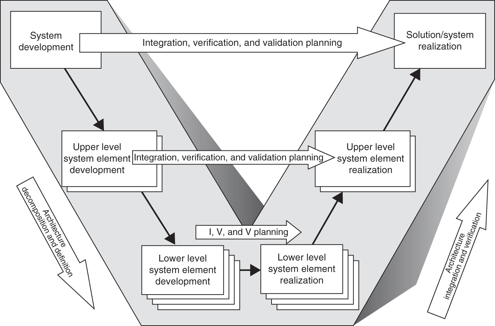

**Figure 2.1** Systems engineering Vee model. ¶ Source: From INCOSE Systems Engineering Handbook, 4th ed., 2015, p. 34, figure 3.6, derived from Forsberg et al. (2005), figure 7.10. Reprinted with permission from INCOSE. All other rights reserved.

所有复杂系统都是这样构建的——各个组件和子系统由适合该子系统的工程学科构建，然后这些子系统被集成在一起形成整体系统。如果正在建造的是一辆汽车，我们将在某个地方有一个团队建造变速箱，另一个团队建造发动机，另一个团队建造娱乐系统，另一个团队建造车身，等等。当它们完成后，我们集成这些子系统，就得到了一辆汽车。好吧，不那么快。经验告诉我们，一次性全部集成并希望整个系统能工作可能不是明智之举。更好的计划是渐进式集成。首先，我们可能会集成变速箱和发动机，并通过大量测试确保它们能协同工作。然后我们可以将该单元——发动机加变速箱——与底盘集成，并再次测试。对组件进行渐进式集成并对越来越大的集成组件装配进行测试，以构建最终系统。这是对任何系统工程项目的良好实践，系统越复杂，就越有必要，集成就变得越重要。

事实上，历史表明，复杂系统项目经常在计划时间之后交付，并且成本远高于最初预期。通常，耗时超过预期的是系统集成和测试的部分。可能会诱人认为，我们可以通过减少在集成和测试上花费的时间来解决这个问题。但可能发生的是，在集成和测试期间，我们发现系统组件需要修复的问题。这真的不是集成或测试的错，而是集成和测试充当了发现子系统问题的机制。这一观察催生了系统工程中的敏捷方法。与其在流程后期一次性创建所有组件并集成它们并希望它们能协同工作，我们进行渐进式甚至持续集成。这是通过在每个组件构建时将其与其他东西集成来实现的，这样一旦某物准备好运行，我们就将其与其他东西集成，以便在整个过程中进行小规模集成。

持续集成在软件工程领域已被非常成功地实践。每个构建特定软件模块的程序员经常、有时每天将其与整个系统集成，以查看它是否与其他所有内容协同工作，以及新模块的某些不可预见的交互是否破坏了整个系统。每日集成可以防止软件开发人员在构建一个模块时走得太远，而该模块只会在最终集成时才被发现存在问题。渐进式或持续集成已被证明比独立构建许多组件然后进行后期总体系统集成更有效。从系统角度来看，这很容易理解。当多个组件一次性组合在一起时，尤其是未经证实的新建组件，许多交互同时被测试。如果出现故障，很难知道是哪个新的、未经证实的组件或其交互是罪魁祸首。在渐进式集成中，每次只集成一个新组件，并且由于在添加新组件之前整个集成系统是工作的，任何故障都必须由于新添加的部分。

## 2.9 Systems Engineering

让我们更仔细地看看系统工程中的主要思想。系统工程是系统应用的主要领域之一，已在管理复杂系统的开发方面发挥了有效作用。系统工程自然是一种跨学科方法，因为它将系统作为一个整体来考虑。任何复杂系统都将由多个工程学科开发的零件和组件组成，并集成在一起，包括机械、电气、软件，有时还有化学或航空子系统和组件。系统工程的主要目的是实现成功的系统开发项目。系统工程尤其在早期阶段侧重于理解和定义客户需求和所需功能。充分理解客户的需求、愿望和期望并不像看起来那么容易，正如我们稍后将更详细讨论的那样。了解用户真正需要什么可能具有挑战性，因为客户（以及所有人类）通常很难知道和表达他们需要什么。系统工程师努力定义需求并在开始构建系统之前让所有利益相关者就需求达成一致。

我们可以通过同时考虑广度和深度视角来更好地理解系统工程。在广度视角中，我们将系统工程视为一种专业，拥有自己的一套技能、方法、技术和流程。系统工程师通常最初在另一项工程专业开始工作，然后再拓宽他们对系统的知识，有时还会获得系统工程硕士学位，以补充他们在其他类型工程方面的本科学位。国际系统工程理事会（INCOSE）是系统工程专业人士的专业协会，他们提供系统工程师的三个级别的认证。

在深度视角中，我们可以将系统工程视为一套实践和技术，可以应用于顶层系统，或其下方的任何层级。因此，系统工程实践可以应用于整个系统，例如为 NASA 建造的卫星，也可以应用于子系统层级，例如将搭载在卫星上的气象仪器。由于子系统也是系统，因此可以使用系统工程。从这个角度来看，我们需要的与其说是系统工程师，不如说是系统工程。有时从事子系统系统工程的人被称为系统工程师，但他们也可能被称为首席工程师、集成产品团队（IPT）负责人、设计师或架构师。不管他们叫什么，只要他们关注系统的系统性方面，他们就是在做系统工程。我有时喜欢用乔治·克列孟梭的话来挑战我的同事，他说战争太重要，不能交给将军们。同样我也说，系统工程可能太重要，不能只交给系统工程师，这意味着良好的系统工程并非来自设计和建造系统的工程师群体之外，而是来自内部，在那里对系统的知识是深厚而丰富的，可以充分考虑系统的各个方面。

围绕这一主题，我的一位同事说，系统工程师有两种：一种是真正了解系统的人， inside and out，也许比项目中任何其他人都更了解系统；另一种只知道如何应用系统工程方法和工具。系统工程团队可能同时拥有两者，但重要的是要知道区别。

系统工程师致力于将系统作为一个整体来考虑系统的所有方面——不仅仅是系统本身的构建，还包括系统如何运行、系统的创建和运行成本、系统的建设进度、系统的性能，以及人们为操作和支持系统所需的培训。他们考虑系统如何被测试、如何被制造，以及它最终如何被处置或退役。制造在某些行业中也可能是一个重要的考虑因素。如果一个系统会被多次制造，比如汽车，系统工程的考虑可能与国防工业中的系统不同，在国防工业中，系统工程师可能设计的系统只会制造几次甚至一次。卫星和航天器通常是一次性制造的，因此材料成本是整体系统成本中较小的部分，而设计、工程和人工则要大得多。对于汽车来说，材料上节省的每一美元都会乘以最终将建造的数千辆汽车。

根据 INCOSE 系统工程手册，系统工程师的目标是建立一个有纪律、有效的系统开发流程，从而产生满足用户需求的高质量系统。在很大程度上，只要有系统需要创建，就不可避免地需要某种系统工程。这并不意味着必须有一个专门的系统工程团队或部门，甚至不意味着必须有系统工程师的职位。在某些行业中，没有指定的系统工程师，但系统工程仍然在进行。系统工程专注于在整个系统开发过程中管理复杂性和变化，而这些问题在任何系统开发项目中都会以某种方式得到管理。让我们以一个常见的例子来说明。

想象一个复杂的系统开发项目，要建造一颗卫星，有很多人从事系统的不同部分。一天，机械工程团队决定更改用于内部结构的材料。新材料有很多优点，机械工程团队做出更改是正确的。然而，这一变化的影响会波及整个卫星工程团队。新材料使系统整体重量增加了一些量。因此，推进工程团队确定由于增加的重量，推进系统必须更强大一些。新的推进系统需要更重、稍大一些，而这一变化会影响有效载荷团队，他们现在在卫星中用于电视接收器和发射器的空间更少——这正是卫星被建造的最初原因。他们能承受失去那一点空间吗？也许可以，但这不是一眼就能确定的。像这样的变化如何在系统设计中传播，以及如何确定和适应变化的影响，是工程复杂系统的最困难方面之一。常见的情况是，大部分系统设计都以静态形式记录——书面设计文件、电子表格、图纸，甚至解释系统各方面的演示文稿。每一个都固化了在创建时认为为真的假设。没有办法回到过去，然后在假设从一开始就使用新材料的情况下重新运行工程流程。必须将更改通知传播给所有受影响的子团队，甚至传播给*所有*子团队。每个子团队都必须有纪律地根据更改重新评估他们所有的分析和设计。整个团队如何才能确保更改的影响已被完全纳入？确保更改已成功纳入整个项目是一项系统工程任务，其难度甚至超过了最初传播更改的难度。

如果遗漏了什么会怎样？如果某人分析中埋藏的某个计算假设了材料的原始重量，而在评估更改影响时没有注意到这种依赖关系会怎样？系统工程旨在降低这种可避免的返工风险。集成期间发现的错误导致的后期发现会造成项目中浪费的返工——返工必须完成，因为系统要成功就*必须*完成。系统工程师旨在尽早发现这些将成为大问题的错误，而不是晚些时候，这样纠正成本更低。错误发现得越晚，纠正成本就越高，因为需要更多的返工。由于系统工程师致力于管理技术决策过程并促进人们就系统问题达成一致，他们最终使开发过程更快，通过避免后期的返工。他们试图让项目在开始时变慢，以便以后更快。他们试图让项目第一次就做对，通过更深入地了解和学习系统，从而避免在误解被揭示时后期需要返工。通过第一次就把事情做对，项目减少了典型的可避免返工量，并更快、更低成本地交付系统。

# 系统工程价值与系统思维

我们可以用帕累托原则来谈论这个问题，有时也称为 80/20 法则，如果我们想象移动平均的日成本或月成本，称为运行速率，很明显项目会随着向项目增加人员而花费更多资金。在早期阶段，项目花费并不多，因为进行早期系统工程、概念化、设计和早期工程工作的人员数量较少。然而，这少数人通过他们做出的项目和设计决策，实际上为项目承诺了大量成本。那些人在流程早期做出的决策，后期会极大地影响成本，因此值得我们尽一切努力让这些早期决策正确。

举一个极端的例子，如果项目在开发过程早期对系统问题投入很少的关注，只是让团队自行工作，其结果可能是，随着对系统最佳工程方式的了解越来越多，其中大量工作需要重做。学习和发现贯穿整个过程是不可避免的，而来自新学习的改变可能非常昂贵，因此在早期决策制定阶段多投入一些是合理的，这样这些决策可以被正确做出，从而降低系统生命周期开发过程整体的支出。我们能更早学到的任何东西，后期都会得到回报。这种“早期投入以便后期节省”是系统工程价值主张的重要组成部分。系统工程领域的研究表明，系统工程对大型系统开发项目的成本和进度绩效产生了积极影响。当应用系统工程时，项目效率更高。数据显示，如果一个大型复杂项目将大约 12–14% 的总项目支出投资于良好的系统工程工作，其中大部分在项目开始时，那么他们将以更低的成本和更少的时间交付项目整体 [INCOSE 系统工程手册，第 4 版，2015 年，第 17 页]。

## 理解系统

在本章中，我们讨论以系统的方式思考世界在理解正在发生的事情以及修改或构建新系统以实现我们的目标方面非常有用。毫不夸张地说，改变世界的最好方法，也许是唯一的方法，就是理解其系统，然后学习如何有效地修改这些系统。工程系统可以通过研究用于构建它们的<|message|> 要求、设计和规范来理解。人类活动系统可以通过应用系统思维的概念和方法来理解。工程系统与人类活动系统的组合更复杂，需要更多的系统思维来理解。即使一个系统仅由两个工程系统组成，复杂性也可能出现，因为这种特定组合本身从未被设计为一个系统，因此该组合没有设计或蓝图。即使这两个工程系统各自完全被理解，当两者结合时出现涌现行为的可能性，也可能使分析这个由两个系统组成的系统成为一个复杂的挑战。

## 物联网示例

作为一个无处不在的例子，考虑物联网 [Internet of things，IoT]。几年前，各类消费产品的制造商开始使用 Wi-Fi 信号或其他技术将它们连接到互联网。我们现在可能习以为常，但过去在普通家庭中，唯一连接到互联网的东西是个人电脑，也许还有一部智能手机。现在，拥有数十个额外设备很常见——流媒体盒、安防系统、灯开关和灯泡、摄像头、恒温器、车库门——都在互联网上“聊天”。我的家庭网络报告说总共有 53 台设备——我不确定我能否从记忆中全部说出它们。每台设备本身，连同其关联的应用程序，构成了一个相当简单的系统，但在一起，加上使用它们的组合应用程序，如 Amazon Echo 或 If This Then That [IFTTT]，它们就变成了一种可能因所有新的涌现行为而令人愉悦或沮丧的东西。我住在一栋系统之家。

## 人类情境中的系统方法

系统方法自出现以来已被应用于许多种系统。心理学和心理治疗领域中的家庭系统治疗，将家庭视为一个系统，家庭中的每个人都作为该系统的一部分行事。这种类型的系统在抵制变化方面可能非常强大。家庭中的一个成员可能看起来是问题——也许是一个在学校挣扎的孩子。家庭可能会带这个孩子，或更糟的是只是把他或她送到家庭系统治疗师那里，希望治疗师只是修复孩子，当然不会干扰家庭中其他任何事情。家庭惊讶地发现治疗师认为这是一个家庭问题，即整个家庭系统的问题。治疗师将家庭视为一个系统，由相互作用的子系统 [家庭成员] 组成，并表现出各种形式的涌现行为。即使功能失调，家庭系统在其模式上也是稳定的，并且倾向于抵制仅影响一个成员的任何形式的干预。就像汽车上磨损的轮毂轴承导致发动机更努力工作一样，每个家庭成员的行为都会影响他人，角色往往从很早的生活就被设定。治疗师必须谨慎判断如何干预，可能采用悖论式干预——他们称之为 *规定症状*。一个在学校挣扎通过的孩子可能会被告知，“亲爱的，慢慢来处理学校的事。你明年重读六年级时，随时可以再上这些课程。” 不用说，家庭系统在行为上并不像工程系统那样合乎逻辑，但却非常引人入胜。

## 工程师在人类活动系统中的陷阱

工程师在试图处理系统世界，尤其是人类活动系统时的陷阱，是假设它们像工程系统一样运作，每个子系统执行其功能，由逻辑激励驱动，以理性的意识、理性推理为动机，并以追求所有人长期、令人满意的生活为目标。但人类活动系统，如家庭、公司、经济和国家，并不容易简化为遵循逻辑规则。经济学预测人们基于效用做出决策，这假设一个人会在相同情境下始终如一地对某件物品进行估值。由 Daniel Kahneman 等人引领的新兴且有趣的领域行为经济学，描绘了不同的图景。通过实验，他们发现禀赋效应导致人们对 *已经拥有* 的东西的估值大约是 *可能获得* 的东西的两倍。当然，这个结果相当令人惊讶——为什么一个人会将自己拥有的汽车的价值视为考虑购买的同一辆汽车的两倍？为什么宠物店老板会鼓励潜在买家“只是把可爱的小狗带回家过夜，明天如果想退回就回来”？通过这样表述，使买家的家庭认为小狗是“他们的”，除非他们“退回”他，禀赋效应就被触发了，家庭会发现很难放弃他们现在觉得自己拥有的东西。人类是否会比合理应有的时间更长地保留工作、关系和财产？总是如此——这又是禀赋效应在起作用。

对经济学家而言，以及对任何具有工程或逻辑思维的人来说，称我们把人称为“人类”这一系统以这种方式运作是没有意义的。但我们确实是这样运作的，并且通过实验一次又一次地得到证实。系统思考者对这种行为不做任何价值判断，当然也不会认为它 somehow 是错误的必须被纠正，也不会断然否认这种现象的发生。系统思考者理解并接受这种行为作为我们所称之为“人类”这一系统的一部分。理解系统，包括人类，对于能够干预或解决系统性问题至关重要。

当我在伍斯特理工学院教授一门系统思维的研究生课程时，我告诉我的学生，到学期结束时，他们会有一种体验：某天走在路上，突然到处都能看到系统。学生们说他们不相信，但后来它发生了。有了系统思维，一切都被视为一个系统，或是系统的一部分。一次乘飞机旅行时，我记得在想，飞机本身是一个系统，但同时也是航空公司系统的一部分，在地面时也是机场系统的一部分。飞行时，飞机成为空中交通管制系统的一部分，随着航线一点点移交。飞机的部件由公司制造，而这些公司本身也是系统，而这些公司又是经济系统的一部分，经济系统是国家系统的一部分，而国家系统又是这个星球上所有国家系统的一部分。正如每个孩子所学到的，我们的星球是太阳系的一部分，太阳系当然是星系和宇宙的一部分，两者都是系统。我们自身也是系统，我们的家庭、社区和城市也是系统。我们是系统，生活在一个由系统构成的世界中。

# 3
## 系统中的智能：人工智能真正的工作原理

## 3.1 什么是人工智能？

自计算机被发明以来，人工智能一直是计算机科学中一个引人入胜的分支。甚至在那之前，人们就已经想象过智能机器人。给定一台能够快速计算和处理大量数据的计算机，很容易想象有一天计算机将能够思考、理解并像人类一样运作——它们将是智能的。但想象和实现是两回事。事实上，如果我们所说的智能是指人类所拥有的，以及动物以更小程度拥有的那种智能，那么没有人知道如何制造一台智能机器。这是因为我们不知道人类和动物是如何产生智能的。我们不知道大脑是如何工作的，至少还不足以让我们能够制造出一台能像大脑一样工作的机器。从理论上讲，我们有一天可能会弄明白这一点，从而能够用合成材料构建一个大脑，就像我们现在能够制造人工心脏一样，因为我们*已经*完全理解了心脏的功能。虽然目前有项目致力于试图理解大脑然后构建人工大脑，但这并不是计算机科学中人工智能所采取的方法。

构建一台表现得聪明的机器或计算机，比试图构建一个大脑要容易得多，但什么才算表现得聪明？有些循环地，定义通常是：如果这种行为是由人类执行的，就会认为它是聪明的，那么这种机器行为就是智能的。人们普遍认为下棋需要智力，所以如果我们制造出一台能下棋的机器，我们就可以合理地称之为智能行为。即使这台下棋机器以与人类完全不同的方式下棋，我们也会认为它很智能。

为了继续培养我们对人工智能工作原理的直觉，让我们来考虑关于人工智能的三个流行神话，这些神话似乎根深蒂固于公众意识中，不幸的是甚至在工程师和科学家中也是如此。

### 3.1.1 神话 1：AI 系统的工作方式与大脑完全相同

Andrew Ng，一位深度神经网络和人工智能的先驱，斯坦福大学教授、`deeplearning.ai` 的创始人，是人工智能领域最好的教育资源之一，他说他和其他先驱几乎后悔将我们在深度学习中所做的事情称为 *神经* 网络。正如我们将在本章后面具体展示的那样，“神经元”神经网络所做的只是非常简单的数值乘法和加法。没有人相信这种简单的算术就是我们大脑中的神经元产生意识、情感和决策所做的事情。神经网络仅在非常概括的意义上与大脑相似，即许多小单元从多个来源接收输入，将其组合，并将输出传递给另一个小单元，网络由数千或数百万个单元组成。大脑使用复杂的电化学相互作用。说我们不完全理解它们是如何工作的已经是轻描淡写了。我们只有一些大致的概念，例如，在精神药理学领域用于治疗情绪和行为问题的药物，通常被发现是偶然有效，而不是通过对大脑的系统性工程改变而产生的。在 Daniel Carlat 的引人入胜的书 *Unhinged: The Trouble with Psychiatry – A Doctor's Revelations about a Profession in Crisis* 中，这位塔夫茨大学的精神病学教授和临床医生揭示了他的专业所治疗的症状是如何由大脑产生的，以及治疗方法是如何起作用的，我们对其了解有多么少。

### 3.1.2 神话 2：随着神经网络规模和速度的增长，它们变得更聪明

在过去几十年里，当计算机的容量和处理速度远为有限时，人们普遍认为，如果我们能建造一台足够大的计算机，也许接近大脑中节点数和互连数的数量，它就一定能够表现出类人智能。有人开玩笑说，互联网已经很容易驳斥了这一理论。事实上，连接到互联网的计算机和设备的数量大约是人类大脑中神经元数量的一半。将所有这些计算机的计算能力加起来，它们远远超过了大脑的处理能力和速度，但互联网并没有以任何方式变得有意识。在人工智能和深度神经网络领域，经常发现更大的网络并不比更小、设计更好的网络表现更好。此外，大型计算机通常仅在深度神经网络的训练阶段才需要，因为需要进行大量重复的计算和迭代。一旦网络训练完成，它就可以在更小的计算机上运行和使用，甚至是隐藏在设备内部的计算机。

### 3.1.3 神话 3：解决一个困难或复杂的问题表明 AI 正在接近人类智能

1997 年，IBM 计算机 Deep Blue 是第一台击败当时世界国际象棋冠军 Garry Karparov 的计算机。在此之前，许多人认为一旦计算机能够在世界锦标赛级别下出智力挑战性的游戏，那么它就接近类人智能了。我们可以通过逻辑和例子看到这是一个神话。从逻辑上讲，由于我们知道下棋的计算机程序并不是在做人类下棋时所做的事情，因此假设下棋计算机会有其他类人特质是不合逻辑的。举例来说，让我们更仔细地看看 Deep Blue 是如何下棋的。

我们不需要构建一个大脑来构建人工智能，这很好，因为我们也不知道如何构建大脑。那么我们如何构建一台智能机器呢？让我们从比国际象棋更简单的事情开始——比如 `tic-tac-toe`？我们如何构建一台机器，或编程一台计算机来成功地玩 `tic-tac-toe`？可能的游戏位置不到 1000 个，所以一种方法是简单地在某种普通编程语言中编写 1000 条条件 `if-then` 语句（规则），以便根据每个可能的棋盘位置产生最佳走法。这些语句中的每一个都将具有以下形式：“给定棋盘位置 X，执行走法 Y。” 尽管创建起来有些繁琐，但这样的程序运行速度相当快，并且每次都能产生完美的 `tic-tac-toe` 游戏，要么获胜要么平局。我们在这里创造了一个智能系统吗？玩 `tic-tac-toe` 确实需要一定的智力，至少是三四岁儿童的水平，但很难想象一系列 `if-then` 条件规则语句构成一个心智或像人类或动物那样具有智能。我们的简单基于规则的程序是人工智能的例子吗？根据该术语的常见用法，我们必须肯定地回答。是的。`Deep Blue` 在开局和残局都使用这样的规则集进行下棋，尽管由于中局可能的棋盘位置和走法数量庞大，会使用不同的过程。遵循一套设计良好的规则并没有什么不智能的。所以构建智能系统的一种方法就是给它一套需要遵循的规则。有足够多的规则，它就可以表现出智能行为。系统表现出的任何缺乏智能的情况都可以假设通过添加更多规则来克服。

在描述人工智能系统可以设计的另一种主要方式之前，我们注意到使用规则集似乎与人类做决策的方式相关，但并不完全相同。我们当然会参考记忆中的规则，并且经常能够根据我们能记住并引用的规则来为我们的决定辩护，但同时，似乎我们并不是主要通过像机器被编程那样遍历数十或数百条规则的链条来运作的。可能我们许多“心理规则”是潜意识的，我们并不意识到它们。但也有可能我们并不是主要以规则为决策的基础。举一个简单的例子，很难想象一个刚刚学会识别和辨认狗的孩子，已经建立了一套能够捕捉“狗性”深度以达到她所表现出的水平的心理规则集。即使是成年人也无法接近陈述出允许以接近 100% 的准确率识别狗的规则集，尽管成年人确实做到了这一点。我们还注意到，父母并不是主要通过规则来教孩子，坐下来解释诸如“如果它用四条腿走路，它就是动物，而狗是动物的一种，所以它可能是狗，但也可能是猫。如果它走路平稳，体型较小，可能是猫，尤其是如果它鼻子较平且有胡须。”父母倾向于通过指出狗、猫以及偶尔的负鼠的例子来教孩子识别狗，孩子在看到每种动物仅几个例子后惊人地学会了如何区分它们，这就引出了人工智能系统工作的另一种主要方式——通过示例。

想象教一个小孩子如何识别狗。最明显的方法就是在孩子在现实生活中、照片和视频中遇到它们时，简单地指出狗的例子。在看到惊人地少量的狗的例子后，孩子就能够识别狗，甚至能将其与其他毛茸茸的四条腿生物区分开来。这就是通过示例的训练，并且是使名为机器学习的该人工智能领域蓬勃发展的根本洞见。这是一个相当简单的概念——要教计算机识别狗，只需向它展示大量包含狗的照片，并将每张照片标记为“包含狗”。混合一些猫、汽车、马和人的图像并标记为“不包含狗”。机器学习系统会多次遍历这些 `training data`，试图“学习”如何区分包含狗的照片和不包含狗的照片。我们把“学习”加上引号，因为这个机器学习计算机程序所做的事情与孩子学习如何识别狗时所做的事情并不非常相似。这种差异的主要原因是我们对那个孩子的大脑如何学习狗的识别知之甚少，所以我们无法以这种方式编程计算机。

我们所做的是创建一个人工神经网络（`ANN`），通常简称为神经网络（`NN`）或深度神经网络（`DNN`）。当前使用的大多数神经网络都有多于一层的隐藏层，因此是“深度”的。神经网络的结构最初受到了我们在大脑中观察到的总体结构的启发，但说它像大脑一样工作将是很大的夸张。大脑包含神经元，它们之间有复杂、甚至神秘的电化学连接，并交换对我们来说仍然大多难以解读的信息。人工神经网络也有神经元，但它们彼此之间有简单的数学关系，主要是简单的加法和乘法。当神经网络“学习”时，它尝试成千上万甚至数百万个数字的各种组合，这些数字称为 `weights` 和 `biases`，直到它找到一组数字，使其能够将给定的 `training data` 与标签匹配起来。通过反复的试错，系统排列一组 `weights` 和 `biases`，可能有数百万个，使其能够将包含狗的照片正确标记为“包含狗”，而不包含狗的照片标记为“不包含狗”。深度神经网络的训练和学习发生在三个不同的阶段。

## 3.2 Training the Deep Neural Network

为了回溯一下，我们开始时拥有的整个数据集会被随机分成三部分，称为 `training data`、`development data` 和 `test data`。它不是平均分割——通常 80% 的数据放入 `training set`，其余两个各占 10%。在训练阶段，我们使用 `training data`，它由已知的、标记好的狗照片和非狗照片的示例组成。计算机实际上是在说：“好的，我会继续调整我的 `weights` 和 `biases` 集合，直到你们告诉我包含狗的照片在我的神经网络中运行时输出为包含狗，反之对于非狗照片也一样。”这听起来有点像作弊，因为它就像一位教授给学生提供实际的考试题目（和答案）来帮助他们备考。学生有两个选择——要么他们只学习题目和答案，从而只准备好回答那些特定的问题，要么他们可以利用给出的题目和答案作为指南，尝试更全面地学习主题，从而能够回答其他问题。人工神经网络也面临同样的两种可能性。如果它过于专注于 `training data`，它可能只学会识别 `training data` 集中的狗，并在下一阶段面对新狗时表现很差。这被称为对 `training data` 的“`overfitting`”，是任何神经网络系统中的危险。

在神经网络在训练阶段表现足够好之后，经过训练的神经网络将被用于它从未见过的新照片集。在这个开发阶段，会使用一组新的数据（称为开发数据集）来查看系统对它从未见过的狗照片的表现如何。我们期望系统在它见过的训练数据上的表现比在它未见过的开发数据上更好，但如果系统在训练数据上的表现比在开发数据上好得多，那么系统很可能过拟合了训练数据。可以对神经网络做许多调整来减少过拟合，并尝试让系统在开发数据上的表现尽可能接近其在训练数据上的表现。其中一些调整是显而易见且简单的，例如只是让神经网络花更多时间学习训练数据，而有些则出人意料地有效，例如随机从网络中丢弃一些神经元。通过调整神经网络的结构和训练过程，我们让系统的表现在开发数据上尽可能好。但我们还没完成——还有一个阶段。

## 3.3 测试神经网络

现在我们取第三组数据，称为*测试数据*，它与训练和开发数据一样，由标记为“包含狗”或“不包含狗”的狗照片组成，并将其通过神经网络运行。与开发数据一样，系统之前从未见过这些照片，因此它识别狗照片的能力不会像在训练数据上那样好。如果系统在测试数据上的表现足够好，与其在开发数据上的表现相比，那么我们可能已经从我们最初拥有的整个数据集出发，实现了该系统所能达到的最佳结果。如果系统在测试数据上的表现比在开发数据上差得多，那么系统可能已经过拟合了开发数据，这意味着为提高其在开发数据上的表现而进行的调整不幸地使系统过度专门化于开发数据。

一旦我们对系统在训练、开发和测试集数据上的表现感到满意，我们就可以在现实世界中测试系统。当然，我们没有现实世界收集的数据的标签，所以我们必须找到另一种方法来评估系统的表现。一种方法是将其表现与执行相同任务的人类进行比较。给系统一些在世界中收集的新图像，并给人类同样的图像，看看系统的表现与人类相比如何。人们可能会认为人类识别照片中的狗的表现是完美的，100%，但总会有问题，例如简单的人为错误，或模糊的照片，合理的人可能会对照片中是否有狗意见不一，甚至是模棱两可的动物，无法确定是狗还是也许是郊狼。

## 3.4 Annie 学习识别狗

为了让这个训练过程完全清晰，让我们回到我们的小孩子，叫她 Annie，并让她经历与人工深度神经网络相同的三个阶段。记住，实际上，我们并不完全理解人类 Annie 如何真正学会识别狗，但为了说明，我们假装她像我们的神经网络一样去做。首先，我们收集 100 张照片。假设我们带相机去一个允许狗的公共公园随机拍照。有些照片会包含狗，有些不会。然后，我们请一些朋友帮助我们给每张照片贴标签（在背面）为“dog”表示照片包含狗，“nondog”表示照片不包含狗。请注意，这种标记不会是完美的。大多数数据集都是由人类判断标记的，而人类会犯错，甚至对某张照片是否包含狗意见不一致——如果照片包含一点狗尾巴，或者那是野餐桌的一部分呢？

现在，我们随机将标记好的照片分成三堆——训练、开发和测试，其中第一堆有 80 张，另外两堆各有 10 张。现在，我们叫来 Annie，她以前从未见过狗，甚至不知道狗是什么。我们对 Annie 的唯一输入将是照片——为了保持与深度神经网络的类比准确，我们不能给她任何口头解释、经验法则或其他超出照片的输入。Annie 和人工神经网络都只能通过示例学习。

我们给她训练堆的照片，让她去做。她所知道的只是其中一些照片标记为 dog，一些标记为 non-dog。她翻动照片，也许对它们进行排序、分组，记下她可能在标记为“dog”的照片中看到的共同之处。她反复复习照片，多次处理这堆照片，每次都有改进。她工作了一段时间，然后说她觉得她掌握了。让我们先在她一直在使用的训练集照片上试试她。我们把那堆照片拿回来，洗牌，然后依次给她看每张照片，问她对每张照片说“dog”或“nondog”。在 80 张照片中，她答对了多少张，也就是她说的话与照片背面写的一样——60 张？70 张？75 张？也许她 80 张全对。毕竟，如果她记忆力好，她完全可以记住每张照片及其标签。但我们还不知道她的新知识能否推广到她学习过的集合之外的照片。

所以接下来，我们给她看 10 张“开发”照片并问她说“dog”或“nondog”。她以前从未见过这些照片，因此她的得分很可能低于训练数据。这可能有许多原因。如果 Annie 注意到训练照片中的所有狗都是白色、黑色或棕色，并且所有棕色狗都没有明显的腿（它们都躺着）。她错误地，但可以原谅地，学到白狗和黑狗有腿，但棕色狗没有。因此，在开发数据中，当她看到一只棕色狗站起来时，她会得出结论它一定不是狗。训练数据和开发数据之间存在我们之前没有注意到的“方差”，直到让 Annie 从中学习。

训练数据集中还可能出现其他问题。由于我们所有的照片都来自游乐场，如果所有狗都在和孩子玩耍，而所有孩子都在和狗玩耍呢？在这种情况下，Annie 可能会学到我们所说的狗是一个两条腿直立的生物与四条腿毛茸茸的生物一起玩耍，因此可能无法理解毛茸茸的生物本身就是狗。

Annie 在开发照片上可能会犯其他类型的错误。如果她研究训练照片研究得如此仔细，以至于她精确地记住了照片中代表的每一种犬种的特征会怎样？在我们和 Annie 都不知道的情况下，她已经学会了“狗”指的是训练照片中大约二十种犬种中的一种。如果训练数据中没有圣伯纳犬，那么当她以后看到一只圣伯纳犬时，就有风险 Annie 根本无法将其识别为狗。帮助 Annie 的一种方法是收集每一种可能的品种和混种的照片，但这可能不切实际，而且仍然会误导 Annie，因为未来可能会产生新的混种。更能帮助 Annie 的是帮助她不要对每一种不同品种的细节如此挑剔，而是专注于所有狗共有的特征。我们也许可以通过让她透过失焦镜头看照片来实现这一点，这样所有图像都会变得稍微模糊一些。如果做得正确，它会鼓励她专注于主要特征，而不是细节，当在开发数据中遇到新品种的狗时，她的表现会更好。

我们在这个开发阶段与 Annie 一起工作，调整她的学习过程，直到她在训练照片和开发照片集上都表现良好。然后我们进入下一阶段，用她从未见过的“测试”照片来测试她。如果她在测试照片上的表现几乎与在开发照片上一样好，那么我们认为自己和 Annie 都成功了，我们准备让 Annie 在现实世界中自由活动，自信她能够成功识别狗。但如果 Annie 在某些“测试”照片上遇到困难怎么办？她的学习可能仍然过于特定于训练和开发照片（过拟合）。如果她在尝试识别测试照片中的狗时，对狗的异常方向有困难怎么办？也许有一张狗在跳跃的照片，它的身体几乎完全平展。Annie 可能错误地学会了狗要么站立要么躺下。这里的问题只能通过增加更多训练数据来真正解决。我们向 Annie 展示各种方向和位置的狗照片，跳跃、蹲伏、倒立在草地上打滚——并教她这些也应被识别为狗。

不过，我们可能还有一个更大的问题。正如上面提到的，我们拍摄照片的公园很可能不包含非常多样化的狗。截至本文撰写时，美国养犬俱乐部认可 193 个犬种。公园里的狗并不代表所有这些品种，也不能代表 Annie 在现实世界中可能遇到的品种内的所有可能颜色和大小。一个可能的解决方案是，假设我们有预算并且非常致力于 Annie 的完整训练，就是雇佣一支艺术家团队，他们可以使用数字艺术、油画和水彩画来绘制额外的品种、颜色、大小和狗的位置。也许我们可以通过包含这些图像来补充 Annie 的训练。我们甚至可以让一名计算机程序员通过制作和修改其他图像的副本来自动生成新的狗图像。一个简单的计算机程序可以拍摄一只白狗的照片并制作副本，其中同一只狗显示为灰色、棕色、黑色和棕褐色。所有这些艺术家和计算机生成的 数据都称为“合成”数据，即使这些合成图像不代表任何真正的狗，它们仍然有助于 Annie 学习。我们只将此合成数据添加到训练数据集中，而不是开发或测试数据集，因为我们只用它来帮助训练 Annie——我们不在乎她识别合成图像的能力如何，因为她在现实世界中不会遇到任何合成狗。

让我们总结一下 Annie 的学习历程，因为它恰好说明了深度神经网络训练的进行方式。首先，我们收集一组狗照片，并将它们标记为“狗”或“非狗”。然后我们将这组图像随机分成三组——训练集、开发集和测试集，将大部分图像，大约 80-90%，放入训练集中，其余部分在开发集和测试集之间分配。我们在测试图像上与 Annie 一起工作，直到她在识别狗图像方面达到高性能评级。然后我们让她尝试开发集，看看她的表现如何。如果她在开发数据上的表现几乎与训练数据一样好，我们就可以继续进行测试数据；如果不是，我们会为 Annie 提供一些指导，帮助她将知识从训练数据推广到开发数据。作为最后阶段，我们向 Annie 展示测试数据并看看她的表现如何。如果她在这些全新的测试图像上的表现几乎一样好，我们就可以开始了；如果不是，我们可能需要收集或合成更多训练数据。

现在让我们考虑一下经常重复的一句话，作为对人工智能和机器学习，特别是神经网络如何工作的解释：神经网络是一种不需要编程的计算机应用程序——它自行编程。我一直认为这个说法带来的困惑多于启发，因为，如果不需要编程，为什么人工智能编程现在是世界上最需求的工作之一？事实是，有很多编程要做，但它是一种不同类型的编程。Annie 需要两样东西才能学会识别狗。首先，她需要一个大脑，而且不是任何大脑。一个具有结构和功能的大脑，使其能够理解、比较和记住图像。Annie 出生时就拥有这样的大脑，但在人工智能的世界里，我们必须构建它们。由于我们对大脑的工作原理了解不足，无法构建合成大脑，我们通过这种新型软件编程在软件中构建人工神经网络。构建神经网络的编程部分由两部分组成。

首先，人工神经网络必须被设计和构建，就像一座新建筑被设计然后建造一样。搭建狗舍和设计摩天大楼之间存在差异。简单的神经网络可以用不到十行软件源代码编程，但最先进的网络需要更多关于层数和类型、神经元数量、连接神经元的数学函数以及输入数据编码的思考。尽管如此，使用最新的神经网络框架实现该设计所需的代码量令人惊讶地少，所以实现神经网络确实不需要很多代码，但要使其良好运行可能需要大量的思考和设计。有帮助的是，全世界的科研人员都热情地开发和完善神经网络设计，并且在很大程度上公开发布他们的成果，因此他们的神经网络设计可以被重复使用。是设计——而不是编码本身——才是耗时的部分。

神经网络编程的第二部分通常被称为名字具有欺骗性简单的“数据准备”。安妮在我们开始之前就已经拥有接收数据的全部设备和处理能力（那堆照片）。对于人工神经网络，我们需要使用标准的数据处理技术来设置输入数据如何被编码、格式化和结构化。同样，有很好的工具可以让这一过程比以往更容易、更快，但它仍然需要一些编程，而且还需要一些思考。一旦这两个编程部分完成，我们就可以开始训练过程。这里的关键要点是，构建人工神经网络系统仍然需要编程，从最广义的意义上来说，但工作方式不同，更像是设计工作、实验、数据收集和数据处理——再加上一些编码来将一切整合起来。

## 3.5 神经网络是如何工作的？

安妮被训练来识别狗的方式与神经网络相同，即通过示例和对训练数据的反复复习。对于安妮来说，训练数据由标记为 `dog` 的包含狗的图像以及标记为 `nondog` 的不包含狗的图像组成。接下来，我们将详细描述深度神经网络如何“学习”识别狗。请记住，安妮的大脑不是深度神经网络，所以她不会以这种方式学习。事实上，我们不知道安妮是如何学习的，当她作为一个普通人类而不是模仿深度神经网络时。我们对大脑如何学习只有初步的了解（有些人甚至说比这更少）。因此，我们绝不会认为我们的深度神经网络所做的事情就是人类大脑所做的事情。前面提到的 `tic-tac-toe` 程序只是从可能走法的表中进行简单的查找——任何年龄的人类玩家都不会这样玩。我们可以在闲聊中说我们的 `tic-tac-toe` 查找程序 `knows` 如何玩 `tic-tac-toe`，但我们必须意识到它并不以我们的方式 `know`。这没关系——我们真正追求的是一个能够成功玩 `tic-tac-toe`、识别狗或为我们驾驶汽车的程序。我们在乎它是否以我们的方式知道或理解或思考吗？对“计算机能否理解或知道？”这个问题 `who cares` 的回答巧妙地回避了这个主题上令人困扰的哲学争论和反驳。尽管如此，这些哲学讨论非常有趣，我们在本书后面专门用一整章来讨论它。

## 3.6 特征：潜在的和其他

深度神经网络的工作基于至关重要的概念 `latent features`。首先，让我们看看常规特征。如果我们想计算房屋的可能售价，我们很可能会基于房屋的一些重要特征来计算，尤其是那些影响价格的特征。诸如卧室和浴室的数量、总平方英尺、车库大小、是否有游泳池、建筑类型等特征。我们可能不知道这些特征如何结合来计算房屋的可能售价，但我们可以使用一种称为 `linear regression` 的统计技术来找出关系。我们知道房屋的价格将由特征的某种加权组合决定。例如，假设某地区房屋的价格非常接近于

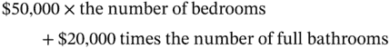<math display="block" overflow="scroll"><mtable><mtr><mtd></mtd><mtd><mi>&#36;</mi><mn>50</mn><mo>,</mo><mn>000</mn><mo>&#215;</mo><mtext>the number of bedrooms</mtext></mtd></mtr><mtr><mtd></mtd><mtd><mspace width="2em"/><mo>+</mo><mi>&#36;</mi><mn>20</mn><mo>,</mo><mn>000</mn><mspace width="0.2em"/><mtext>times the number of full bathrooms</mtext></mtd></mtr></mtable></math>

的计算

权重 50,000 和 20,000 是通过实验确定的，使用已为人所知多年的统计技术。我们首先列出最近售出的房屋清单，包括每栋房屋的卧室和浴室数量、平方英尺和其他特征，以及售价。然后我们尝试不同的公式和乘数（权重），直到尽可能接近清单上每栋房屋的已知售价。当然，计算机可以非常快速地完成此操作，对许多房屋的结果进行平均，并得出最适合数据的总体最佳权重。

如果我们对房屋和售价了解不多，我们可能在清单中包含了某些与售价关系不大的特征，例如房屋的窗户数量。我们的回归计算会为我们处理这个问题，因为我们会发现窗户数量的权重（乘数）与其它特征的权重相比会很小。一般来说，我们希望使用最少的特征来获得良好的预测，因此许多可能的特征可能会被排除在最终计算之外。这种多元回归过程已使用了超过 200 年。

导致深度神经网络基本原理的关键洞见是：使用此过程并不需要知道特征的含义。只要我们有一组相关的特征，我们就可以找到一种方法来使用它们来预测结果——在我们的例子中是房屋的价格。我们可以相当有信心地认为，存在一组特征，当加权适当并组合后，可以在合理范围内预测房屋的售价。这些特征甚至对房屋定价专家来说可能并不明显。也许在某些地区，房屋价格最具预测性的特征是其到海滩通道步道距离，而不是到水域的实际距离，或者房屋在浴室数量等于卧室数量时售价更高。`Latent` 特征是指存在于数据中但并不明显，通常甚至无法通过分析数据来确定的特征。让我们用另一个更引人注目的例子来更清晰地说明潜在特征的这个概念。

## 3.7 推荐电影

假设我们的任务是预测视频流媒体服务的观众接下来可能想观看哪些电影或电视节目，以便我们可以为用户提供一些推荐。保持业务运营意味着为观众提供他们想观看的节目的持续供应，因此对他们会喜欢什么做出良好预测至关重要。使这种预测困难的是，我们对用户一无所知，除了他们已经观看的内容以及他们对这些节目的评分。在实际操作中，我们拥有的评分相对较少——大多数人不会对他们观看的大部分内容进行评分，所以我们只能将他们观看节目到最后这一事实作为良好评分的代理。这可能就是我们拥有的全部数据。现在，我们如何理解它？我们可以假设电影和节目的特征会影响某些用户是否会喜欢它们，例如其中的浪漫、动作、科幻或暴力程度。我们的用户也有相应的特征——比如他们喜欢电影中的暴力程度，或他们喜欢科幻太空冒险的程度。我们可以 `imagine` 节目和用户的这些特征集，但我们实际上并没有这些信息。它潜藏在数据中，但我们无法直接读出它。但这里的洞见是：我们不必这样做。我们可以只假设这些特征存在。假设我们假设节目有十个不同的特征，用户还有十个。

现在，创建一个简单的矩阵，行代表 `users`，列代表 `shows`。每个单元格中是用户给该剧的评分（例如 1–5），如果用户未看过该剧则为空白。如果用户看过该剧但未评分，我们或许可以简单地填入 2.5，或者更精细地，填入该用户给所有剧集的平均评分。我们取这个部分完成的矩阵，然后使用一种称为 `matrix factorization` 的数学过程将矩阵分解为另外两个矩阵——它们的乘积即为原始矩阵。假设我们有一个包含 5000 个用户和 1000 部剧的数据集。两个构成矩阵（因子）分别是用户矩阵，具有 5000 行和十列，以及剧集矩阵，具有 1000 列和十行。正如你从基础矩阵数学中所回忆的那样，将一个 5000 × 10 矩阵乘以一个 10 × 1000 矩阵会得到一个 5000 × 1000 矩阵，这将是原始的 *users* × *shows* 矩阵。

这两个较小矩阵中的数字是潜在特征。我们只是假设剧集有十个重要特征，用户也有十个。我们不知道这些特征到底意味着什么，而且实际上，我们永远也不会知道。但我们不需要知道。接下来，我们将用户/剧集评分矩阵（5000 × 1000）分解为那两个较小的矩阵（5000 × 10 和 10 × 10,000）。通过试错或其他方法，我们找到填入这两个较小矩阵的数字，使得将它们相乘后尽可能接近我们的原始大矩阵，即用户、剧集和评分的矩阵。记住，原始矩阵中包含用户已观看剧集的评分，以及用户未观看剧集的空白评分，但现在当我们将这两个新的、较小的因子矩阵相乘时，我们会得到每个单元格的一个数值。对于原本有用户/剧集组合评分的单元格，我们可以将用户原本给出的评分与新的计算预测评分进行比较。对于用户已评分的剧集，我们可以看到我们与用户原始评分的接近程度。事实上，正是所有这些差异的总和被用来判断我们的分解是否是最优的。对于原始评分矩阵中为空的单元格，乘法会产生一个 *prediction*，即系统预测用户如果以后观看该剧会给出的评分。显然，我们应该找到我们预测用户会给出高评分但他们尚未观看的剧集，并向该用户推荐它们。`matrix factorization` 过程是在 2006 年 Netflix Prize 竞赛中被证明优于许多其他算法的，并且至今仍广泛用于推荐系统中。

从这次对 `matrix factorization` 的观察中得到的主要启示是，我们不需要知道潜在因子是什么——无论是对我们的剧集还是用户。我们只需假设它们存在，让系统计算权重，使其与训练数据相比尽可能接近零误差，然后转而使用系统找到的值来做出新的预测。这一切能够奏效可能看起来令人惊讶，但有一些类比可以提供关于其原因的直觉。

关于人类决策制定的最新研究表明，人类大多在无意识中做出决策，决策在意识意识到决策已做出之前就已在无意识中达成。决策被报告给意识，意识采纳它并为做出决策邀功，如果被问及，会为决策编造解释或理由。如果这是真的，那么我们的意识不断主动欺骗我们，确信我们对自己的决策有明确的理由。我们可能有，但那些理由来自无意识，难以观察。对人类本性而言，这可能并不令人惊讶，因为更容易看到他人做出看似随意的决策，并在被问及时编造并匹配任意的理由。我们自己的决策过程似乎主要基于我们无法识别的因素，因为它们深藏在无意识中。

基于隐藏因素做决策的概念，同时存在于深度神经网络和人类大脑中，导致一个令人惊讶的结论：我们不需要知道因素的含义就能构建一个能够做出决策或预测的系统。我们需要的是对不同因素进行加权并以某种方式组合它们，使结果与我们在现实中观察到的一致。就像你坐在一个机器前面，机器上有三个旋钮和两个灯。其中一个灯已经亮了——比如是皇家紫色。当你转动三个未标记的旋钮时，另一个灯开始发光。你注意到每个旋钮以不同的方式改变灯的颜色。通过足够地摆弄旋钮，你可以使灯的颜色与皇家紫色灯相匹配。你不知道——也不需要知道——这三个旋钮实际上是在调节灯光中的红色、绿色和蓝色。我们可以将系统改为四个旋钮，你的过程也是一样的：转动旋钮直到达到期望的颜色。你不需要知道这四个旋钮代表青色、品红色、黄色和黑色——红/绿/蓝的一种替代颜色分量系统。你只需通过试错操纵旋钮直到达到期望结果——你不需要知道旋钮的含义。

想象一个神经网络是一组数百、数千甚至数百万个小旋钮。在学习过程中，机器尝试许多、许多种旋钮组合，试图使网络的输出与训练数据集中标记数据给出的输入集的期望输出状态相匹配。一旦网络学习到最好，我们就在新输入上测试它，看看它是否产生正确的输出。一旦它在那方面表现良好，我们就可以信任它为从未见过且我们事先不知道正确输出的输入提供正确输出。

## 3.8 一页式深度神经网络

让我们更深入地探讨网络如何学习，以建立你对真正发生的事情的直觉。我们不会使用高级数学或计算机代码。系统工程师和各行各业受过教育的人都可以使用普通数学建立对深度神经网络如何工作的坚实直觉。与其只是解释，让我们只用电子表格构建一个真实的、可工作的深度神经网络。你可以通过在 Microsoft Excel 中自行构建它来跟随，或者可以从 [www.engineeringintelligentsystems.com](http://www.engineeringintelligentsystems.com/) 下载电子表格。

首先，想象我们想要一个深度神经网络来预测一个物理现象或函数，该函数有一个输入数字和一个输出数字。神经网络不会知道该函数是什么，但我们会给它一个输入和输出的数据对列表。如果输入和输出之间的关系是线性的，那么如果绘制这些输入输出对，它们会形成一条直线，我们可以应用简单线性回归，这是一种自高斯在十九世纪发明以来就用于统计和数据分析的技术。但并非所有关系都是线性的。我们的目标是看看我们的小神经网络是否能“学习”输入数字和输出数字之间的关系，学习得足够好以便能够预测在训练时未见过的新输入的输出。

要创建我们的网络，让我们先编造一个函数，让我们的网络尝试学习。通过选择一个实际的函数，我们可以轻松生成新的输入和输出，并且还能根据输入检查网络预测输出的好坏。当然，在真实情况下，我们并不知道这个函数——如果知道的话，我们就可以直接使用函数的公式从输入计算出所有输出。我们将从一个简单的二次函数开始，在构建神经网络并测试之后，我们将看看同一个神经网络是否能学习其他函数。首先，假设我们的输出 `y` 由输入 `x` 的以下方程给出：

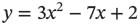<math display="block" overflow="scroll"><mi>y</mi><mo>=</mo><mn>3</mn><msup><mi>x</mi><mn>2</mn></msup><mo>&#8722;</mo><mn>7</mn><mi>x</mi><mo>+</mo><mn>2</mn></math>

我们神经网络电子表格的第一部分（Figure 3.1）是一个简单的输入列旁边是另一列输出。输入可以全部是随机数，通过使用 Excel 的 `RAND()` 函数生成。我们只需在单元格中输入 `=RAND()` 即可创建一个介于零和一之间的随机数。在这里，我们生成了一列随机数（Figure 3.1 中隐藏的 A 列），然后将值复制到输入列（D 列），这样在我们尝试让神经网络工作时，随机数不会一直变化。如果不这样做，每次表格计算时，所有输入都会改变，因此神经网络就没有机会学习。

在下一列（E 列）中，我们使用上面选择的函数计算输出。输入在 D 列时，函数为

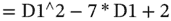<math display="block" overflow="scroll"><mo>=</mo><mi mathvariant="normal">D</mi><msup><mn>1</mn><mtext>&#8743;</mtext></msup><mn>2</mn><mo>&#8722;</mo><mn>7</mn><mspace width="2pt"/><mtext>&#42;</mtext><mspace width="0.2em"/><mtext>D1</mtext><mo>+</mo><mn>2</mn></math>

接下来，我们需要决定神经网络的深度如何。在早期，神经网络只有一层，但随着计算能力和内存的增加，大多数神经网络现在都是深度神经网络，这只是意味着它们有超过一层的神经元。在我们的电子表格神经网络中，让我们有两层，不过你可以使用我们在这里使用的相同原理轻松添加更多层。既然我们要做小规模，让我们在第一层有五个神经元，第二层有三个神经元，这样我们的网络就能放在一页电子表格上，我们可以在屏幕上一次看到全部。Figure 3.2 显示了我们将创建的网络的示意图，具有单个输入和输出，中间有两层。

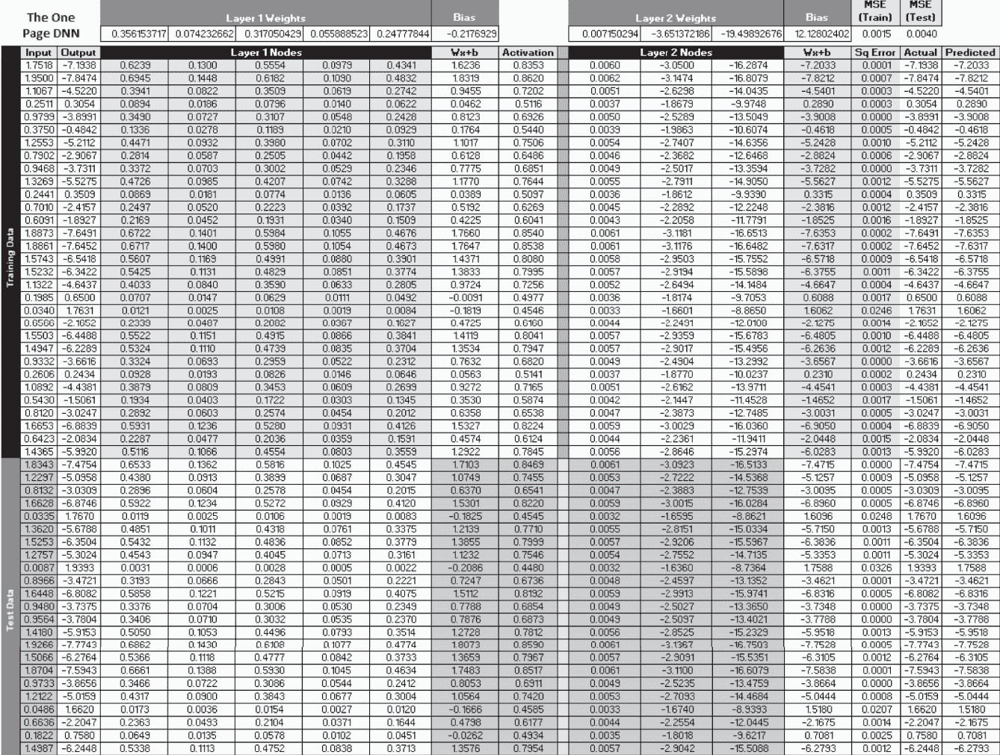

**Figure 3.1** The one‐page deep neural network with a quadratic function.

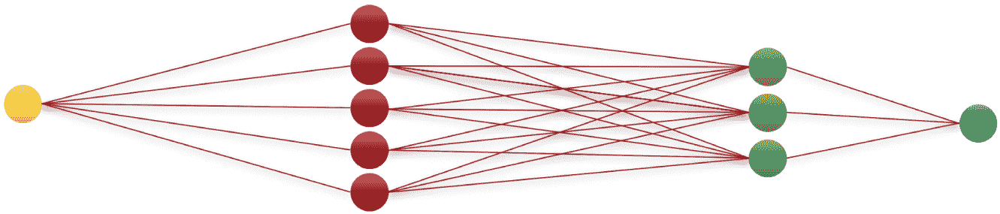

**Figure 3.2** Drawing of the neurons and layers in the one‐page neural network.

我们网络中的每个神经元，与我们自己大脑中神秘的神经元不同，有一个非常简单的工作要做。它的作用是接收前一层所有其他神经元的输出并将其组合成一个单一数字。它将使用一个简单的计算来做到这一点。每个神经元有两个特殊的数字需要记住——权重和偏置。它简单地将每个输入乘以权重，将这些结果全部加在一起，然后加上偏置。对此结果，它然后应用一个激活函数，这是一个由该层中每个神经元使用的简单函数。一个典型的激活函数是 Figure 3.3 中显示的 sigmoid 函数。对神经元输出应用 sigmoid 函数在实验中被发现可以使神经网络更好地学习非线性函数。sigmoid 激活函数最初在深度神经网络中很受欢迎，但由于它需要更多的计算，于是尝试了更简单的激活函数，发现结果相似。修正线性单元函数（简称为 `relu`）是一条简单的直线，随着大于零的输入线性增加，但对于小于零的任何输入为零。我们的网络很小，所以我们将坚持使用经典的 sigmoid 函数。总结一下，让我们看看网络如何工作的细节。

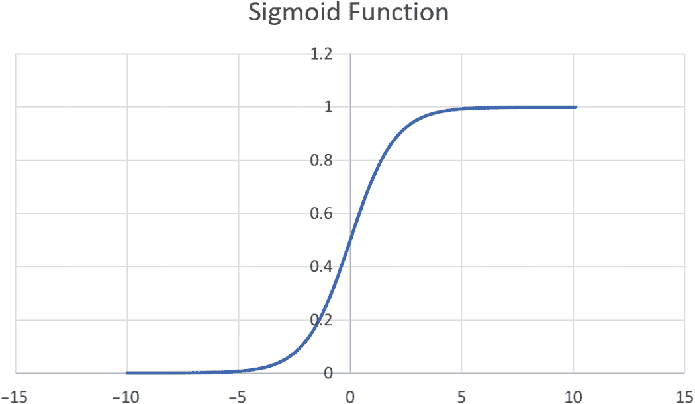

**Figure 3.3** A sigmoid activation function.

神经网络中的每个神经元都有两个重要数字——权重和偏置。我们稍后会看到这些数字来自哪里，但现在让我们看看神经元如何使用它们进行计算。第一层中的五个神经元，由 F–J 列表示，进行简单的计算，将每个输入（单元格 D5–D35）乘以其权重。第一个神经元，F 列，首先将 D5 单元格中的输入乘以 F2 单元格中的权重，并将结果放在 F5 单元格中。然后它继续到下一个输入 D6，也将其乘以 F2 中的权重，并将结果放在 F6 中。这些乘法一直持续到 D35 单元格中的最后一个输入。

第二个神经元，G 列，做同样的事情，将 D5 中的第一个输入乘以 G2 中的权重并将结果放在 G5 中，依此类推，通过所有输入。剩余的三个神经元，H、I 和 J 列做同样的计算。写出这些计算的公式并将它们放在 F5 到 J35 之间的所有单元格中是可以的，但有更简单的方法。我们实际上是在对表示输入的单维矩阵，即向量，与表示权重的另一个向量进行矩阵乘法。我们正在将 D5–D35 向量与 F2–J2 向量相乘。我们正在将一个 31 × 1 向量乘以一个 1 × 5 向量，因此结果将是一个 31 × 5 矩阵。我们可以在 F5 单元格中简单地使用 Excel 的 `MMULT` 函数来执行此乘法：

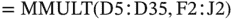<math display="block" overflow="scroll"><mo>=</mo><mtext>MMULT</mtext><mrow><mo stretchy="false">(</mo><mrow><mi mathvariant="normal">D</mi><mn>5</mn><mo>:</mo><mi mathvariant="normal">D</mi><mn>35</mn><mo>,</mo><mi mathvariant="normal">F</mi><mn>2</mn><mo>:</mo><mtext>J2</mtext></mrow><mo stretchy="false">)</mo></mrow></math>

结果放在 F5–J35 区域中。这是一个巧妙的技巧，能够一次性计算所有输入的值，而不是耗时的单独公式或软件程序循环集合，而且这种技术正是在更大的神经网络中使用，神经网络可能有成千上万或数百万个输入。这就是为什么神经网络的训练需要大型计算机和大量时间。训练需要大量的矩阵乘法，不是一次，而是很多很多次。

一旦我们得到了单页神经网络第 1 层的矩阵乘法结果，我们就将每个输入的结果加在一起，并加上该层的偏置数。对于 D5 中的第一个输入，我们将 F5–J5 加起来，然后加上 K2 单元格中的偏置，因此 K5 单元格中的公式为

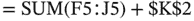<math display="block" overflow="scroll"><mo>=</mo><mi mathvariant="normal">SUM</mi><mrow><mo stretchy="false">(</mo><mrow><mi mathvariant="normal">F</mi><mn>5</mn><mo>:</mo><mtext>J5</mtext></mrow><mo stretchy="false">)</mo></mrow><mo>+</mo><mi>&#36;</mi><mi mathvariant="normal">K</mi><mi>&#36;</mi><mn>2</mn></math> 

公式对每一行输入都相同。下一步是应用 sigmoid 激活函数。查阅微积分教材，我们发现 sigmoid 函数可以用指数函数（*e*^(*x*)）的简单公式计算，因此单元格 `L5` 中包含：

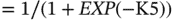<math display="block" overflow="scroll"><mo>=</mo><mn>1</mn><mo stretchy="false">/</mo><mrow><mo stretchy="false">(</mo><mrow><mn>1</mn><mo>+</mo><mi>EXP</mi><mrow><mo stretchy="false">(</mo><mrow><mo form="prefix">&#8722;</mo><mtext>K5</mtext></mrow><mo stretchy="false">)</mo></mrow></mrow><mo stretchy="false">)</mo></mrow></math> 

此计算的结果是该行输入值的层的输出。因此，对于 `D5` 中的第一个输入，我们网络的第一层的输出在单元格 `L5` 中。列 `L` 包含每个输入的第一层的输出，并且该层的输出仅成为第二层的输入。

### 第二层

第二层以完全相同的方式计算。列 `L` 中所有输入的向量乘以权重向量 `N2–P2`。有三个权重，因为第二层中有三个神经元：`L5–L35`，一个 1 × 31 向量，与 `N2–P2`，一个 3 × 1 向量进行矩阵乘法，得到 `N5–P35` 中的一个 31 × 3 矩阵。使此操作发生的公式在单元格 `N5` 中：

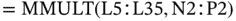<math display="block" overflow="scroll"><mo>=</mo><mtext>MMULT</mtext><mrow><mo stretchy="false">(</mo><mrow><mi mathvariant="normal">L</mi><mn>5</mn><mo>:</mo><mi mathvariant="normal">L</mi><mn>35</mn><mo>,</mo><mi mathvariant="normal">N</mi><mn>2</mn><mo>:</mo><mtext>P2</mtext></mrow><mo stretchy="false">)</mo></mrow></math> 

正如我们在第一层中所做的那样，第二层对每一行输入值的输出是通过将该行中的加权值加起来然后加上偏差来计算的。因此，对于第二层的第一个输入，单元格 `L5`，单元格 `Q5` 计算如下：

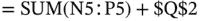<math display="block" overflow="scroll"><mo>=</mo><mi mathvariant="normal">SUM</mi><mrow><mo stretchy="false">(</mo><mrow><mi mathvariant="normal">N</mi><mn>5</mn><mo>:</mo><mtext>P5</mtext></mrow><mo stretchy="false">)</mo></mrow><mo>+</mo><mi>&#36;</mi><mi mathvariant="normal">Q</mi><mi>&#36;</mi><mn>2</mn></math> 

到目前为止，第二层的计算看起来与第一层完全相同。但现在有一个小区别——我们不对第二层的输出应用激活函数。原因是我们希望神经网络学习输出函数的输出值，对它来说是未知的。理想情况下，网络的输出，我们称之为预测，应该与列 `E` 中显示的函数的实际输出值相匹配。列 `Q` 中计算的输出正是我们作为双层神经网络对列 `D` 中输入的最终输出或预测所需的输出。

### 误差评估

接下来，我们需要评估我们与正确答案的接近程度。如果神经网络完全再现我们最初使用的函数，那么列 `Q` 中网络的输出与列 `E` 中我们试图预测的函数值之间将没有任何差异。在现实中，总会有一些差异。神经网络并不是试图猜测实际函数；如果它这样做，一旦找到正确的函数，它的预测就会完美。记住，神经网络甚至不知道我们使用的是什么*种*函数，或者我们是否使用了函数。输入/输出对可能是来自天气仪器或地震传感器的數據。网络试图做的是提出一组权重和偏差，当通过矩阵相乘时，将模拟或预测给定输入和输出之间的关系。我们需要一种方法来衡量神经网络产生正确结果的接近程度。我们从神经网络在列 `Q` 中的输出中减去列 `E` 中函数的已知结果，然后对结果进行平方。这被称为 *平方误差*。对于第 5 行的第一个输入，放在列 `R` 中的误差公式为

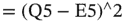<math display="block" overflow="scroll"><mo>=</mo><mrow><mo stretchy="false">(</mo><mrow><mi mathvariant="normal">Q</mi><mn>5</mn><mo>&#8722;</mo><mi mathvariant="normal">E</mi><mn>5</mn></mrow><mo stretchy="false">)</mo></mrow><msup><mrow/><mo>&#8743;</mo></msup><mn>2</mn></math> 

平方误差多年来一直被统计领域用作衡量预测器有效性的良好指标。将实际结果与预测结果之间的差异平方消除了符号的影响，使所有误差值都为正，并且还使该度量受小误差的影响小于大误差。要组合每个输入/输出对的平方误差，我们只需将它们一起平均，从而得到整个集合的均方误差（MSE），放在单元格 `R2` 中并按如下方式计算：

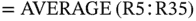<math display="block" overflow="scroll"><mo>=</mo><mtext>AVERAGE</mtext><mspace width="0.2em"/><mrow><mo stretchy="false">(</mo><mrow><mi mathvariant="normal">R</mi><mn>5</mn><mo>:</mo><mi mathvariant="normal">R</mi><mn>35</mn></mrow><mo stretchy="false">)</mo></mrow></math> 

我们可以将整个神经网络的目标总结为最小化所有预测的均方误差，与提供的给定输出相比。换句话说，预测与实际预测函数的已知输出有多接近？

### 使用 Solver 进行优化

现在我们已经设置了神经网络，我们下一个任务是选择权重和偏差值以最小化均方误差。这*就是*魔术发生的地方。我们可能会尝试手动选择权重和偏差，通过反复试验。我们可以简单地输入一些数字，然后尝试改变其中一些，直到均方误差尽可能低。只需几秒钟的尝试就能发现这是一种令人沮丧且徒劳的方法。任何层中单个神经元权重的微小变化都可能对输出产生不可预测的影响，而且虽然可以手动调整权重和偏差值以实现对一个输入的良好预测，但目标是为所有输入产生良好的预测。幸运的是，Excel 有一个内置工具可以帮助我们完成此操作。Excel Solver 已内置于 Excel 中，但如果您以前从未使用过它，则需要通过转到 `file`、`options`、`add-ins`、`manage Excel add-ins` 然后选择 `solver` 来激活它（有关更详细的说明，请参阅 Microsoft 的 [`tinyurl.com/rbzr2hb4`](https://tinyurl.com/rbzr2hb4)）。激活后，Solver 将在 Excel 的数据菜单中可用。

求解器在概念上很简单。如图 3.4 所示，我们唯一需要输入的设置是目标，即单个单元格，以及变量单元格。求解器将为变量单元格找到一组值，从而使目标单元格最小化。在我们的例子中，我们希望求解器改变我们深度神经网络两层中的权重和偏置（`F2:K2` 和 `N2:Q2`），以最小化单元格 `R2` 中的均方误差。我们不关心它如何执行工作，因此使用默认求解方法。我们只关心它最终选择的权重和偏置能够最小化所有输入/输出对的均方误差，从而优化神经网络的预测。求解器在我们的小型一页深度神经网络上运行只需几秒钟，并生成了图 3.1 中看到的权重和偏置。

**Figure 3.4** Excel solver settings.

我们的一页网络和大规模深度神经网络的一个重要但令人惊讶的事实是，我们必须在开始训练（求解）过程之前将权重和偏置初始化为随机值。乍一看这似乎违反直觉，但如果我们查看所执行的数学运算，就会发现如果权重和偏置在开始时被设置为相同数字或零，则所有节点最初都会计算相同的结果，就好像算法无事可做，无法朝着解决方案前进。你可以自己看到这一点；如果在运行求解器之前不预先将权重和偏置设置为随机数，你可能得不到好的结果。电子表格中有一个名为 Randoms 的标签，它使用 Excel 的 `RAND()` 函数为此目的生成一组随机数。在使用求解器计算新的权重和偏置之前，将 Randoms 标签中单元格 `A4–L4` 的内容复制到一页深度神经网络（DNN）标签中的单元格 `F2–Q2`，以提供权重和偏置的随机初始化。

正如我们在本章和其他章节中所讨论的，神经网络是在一组数据上训练，然后使用另一组相似但不同的测试数据进行测试。我们期望神经网络对训练集数据的预测效果优于从未见过的新数据，并且我们在单页网络中看到了这一点。第 5–35 行是训练数据，正如我们刚才描述的那样，网络在这些输入输出对上进行“训练”，即找到一组权重和偏置，使网络能够以最佳精度从输入预测输出，如所有输入/输出对均方误差的最小化所示。第 36–58 行是测试数据。输入/输出对的计算方式与训练数据相同，但它们在系统训练时未被使用，因此网络在训练后才第一次看到测试数据的输入和输出。我们期望我们的小网络对训练期间使用的数据的预测效果优于新的测试数据，这正是我们看到的。在单元格 `R2` 中，我们看到训练数据的均方误差为 0.0022，而在 `S2` 中，我们看到测试数据的均方误差为 0.0052。

一页深度神经网络的最后一个特性是一个简单的图表（Figure 3.5），显示每个输入在 *x* 轴上，以及它的已知实际输出值（灰线）和神经网络预测的值（黑色虚线）。请注意，该图表同时显示了训练数据（输入 1–31）和测试数据（输入 31–54）。对于这两组数据，线条几乎完全重合，显示了即使是简单的神经网络也能仅从适量的输入和输出中很好地捕捉和预测一个函数。

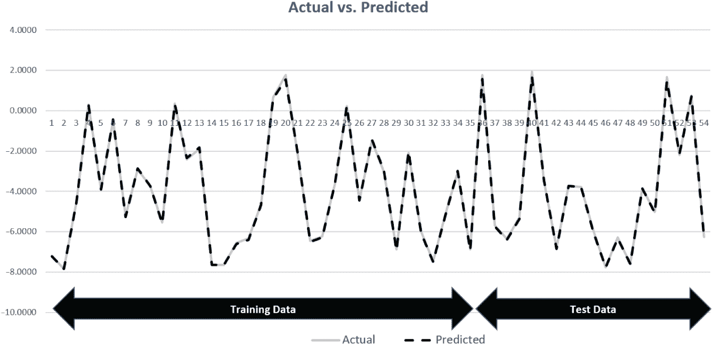

**Figure 3.5** Actual vs. predicted values from the one‐page deep neural network.

在上面的例子中，我们使用了一个直接的二次函数，虽然不是线性的，但相当规则。让我们给这个小神经网络一个更大的挑战。我们更改函数，在单元格 `E5` 中（并复制到 `E6–E58`）根据单元格 `D5` 中的输入计算输出，如下所示：

<math display="block" overflow="scroll"><mo>=</mo><mrow><mo stretchy="false">(</mo><mrow><mtext>SIN</mtext><mrow><mo stretchy="false">(</mo><mtext>D5</mtext><mo stretchy="false">)</mo></mrow><mspace width="2pt"/><mtext>&#42;</mtext><mspace width="0.2em"/><mrow><mo stretchy="false">(</mo><mrow><mn>1</mn><mo stretchy="false">/</mo><mtext>TAN</mtext><mrow><mo stretchy="false">(</mo><mrow><mi mathvariant="normal">D</mi><mn>5</mn></mrow><mo stretchy="false">)</mo></mrow></mrow><mo stretchy="false">)</mo></mrow></mrow><mo stretchy="false">)</mo></mrow><mo stretchy="false">/</mo><mtext>SQRT</mtext><mrow><mo stretchy="false">(</mo><mtext>D5</mtext><mo stretchy="false">)</mo></mrow></math>

这是一个相当奇怪的函数，很难找到一个自然的甚至合成系统，其行为由它描述，但确实我们的小神经网络对它的“学习”做得相当不错，如图 3.6 所示。请注意，均方误差更大——训练数据的 0.0915 和测试数据的 1.4005，训练数据和测试数据上的误差差异也大得多，这意味着网络在训练期间未见过的数据上表现不佳。图表还显示预测值与实际值之间方差更大，如多处线条发散所示（图 3.7）。

为了总结本章，我们将描述我们的一页神经网络与生产应用中使用的“真实”神经网络之间的四个显著差异。这四点都与深度神经网络*如何*工作无关。一页神经网络通过揭示它们不过是大量简单算术的巧妙新排列，去除了深度神经网络的神秘感。说到排列，有几种深度神经网络，包括卷积神经网络（`CNN`）、循环神经网络（`RNN`）其中包括长短期记忆（`LSTM`）和门控循环单元（`GRU`）网络、生成对抗网络（`GAN`）以及自编码器网络。所有这些都使用与一页神经网络中看到的相同的深度学习原理，但以不同的排列连接神经元。

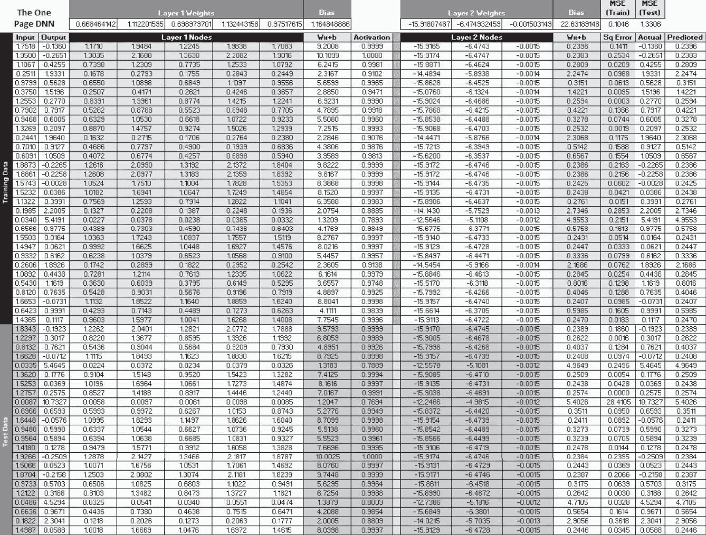

**Figure 3.6** One‐page neural network with alternate function.

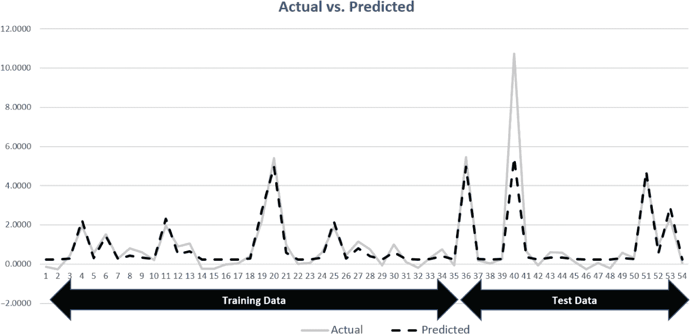

**Figure 3.7** Actual vs. predicted values for alternate function.

单页神经网络与生产级神经网络之间的第一个区别在于，单页神经网络只有一个输入。通过只有一个输入数字和一个输出数字，全部输入的向量是一维的，与权重向量相乘后变为二维，因此很容易在一张平面上展示。在大多数应用中，每个输入由多个数字组成，例如房子的特征，甚至是成千上万个数字，例如图像中的像素。我们仍然使用相同的矩阵乘法过程，但结果更大，一目了然时更难看清。

第二个区别是大多数神经网络在每一层都有更多神经元。单页神经网络在第一层有五个神经元，第二层有三个神经元。生产级神经网络会有更多，但可能没有想象中那么多。每层十几个到几十个节点是典型的。层中神经元太多，矩阵乘法会变得耗时，这可能导致训练网络花费数小时、数周甚至更长时间，即使在大型计算机上也是如此。一些设计良好的神经网络，在大型数据集上训练时，即使在为深度神经网络训练而优化的多图形处理器 GPU 系统上，仍然需要数小时才能完成训练。单页网络非常小且只使用少量数据，因此即使使用 Excel 也能在几秒钟内完成训练。

第三个区别是生产级神经网络会有更多层。关于各种应用的最佳层数的研究仍在继续，但拥有数十层甚至数百层的网络并不罕见，当然这些网络训练起来需要更多时间。请注意，单页神经网络可以通过简单地重复所述过程扩展到多层：向第二层的输出添加诸如 sigmoid 之类的激活函数，并将结果用作第三层的输入。额外的层并没有什么魔力——它们的工作方式都与单页网络相同。

第四个区别是生产级神经网络有更好更快的方式来训练自己。就像每一层的神经元数量和网络中的层数一样，训练算法也是大量实验和研究的对象。`Back propagation` 虽然在 20 世纪 70 年代就已开发出来，但由于计算能力的最新进步，已成为深度神经网络革命的核心。无论采用何种方法，目标都相同——为每一层找到一组权重和偏置，使网络的整体误差最小化。更好的训练算法只是旨在减少成功找到这些权重和偏置所需的时间。

从这四个区别可以看出，单页神经网络所做的一切，大规模神经网络也都能做，只是规模极小。更大的网络只是更多同样的东西。可以理解人们的这种感受：理解神经网络的最大障碍在于它们被称为 `neural networks`，因此会让人联想到大脑般的复杂性和神秘性以及类人智能。在本章中，我们尝试使用人人可用的术语和概念，消除围绕 AI 与深度神经网络的大部分甚至全部神秘感。我们的目的并不是淡化 AI 和神经网络及其构建者所取得的惊人成就。这些成就都是真实的。AI 和深度神经网络正在取得既令人惊叹又更重要的是富有成效的应用。同时，AI 和神经网络并没有朝着类人智能的方向发展。这是一个悖论，但根据本章所介绍的内容是可以理解的。一方面，AI 和神经网络变得“更聪明”，因为它们能够更成功地执行更复杂的任务，甚至超过人类表现水平。另一方面，它们并没有以人类意义上的方式变得更智能。以下类比可能有所帮助。

想象我们想构建一个基于 AI 的机器人，能够像一个优秀的人类球员一样打棒球。我们首先开发一台能够比任何人类投手投得更快更准确的机器。我们还开发一台能够比任何人类球员跑得更快、能够可靠地将任何合法投球击出任何球场的机器。每种能力都超过了人类表现，但我们离构建一个超人类的自动化棒球运动员还有多远？关键在于，打棒球不仅仅是投掷、接球和击球等个人技能的简单组合。建造机器人的人知道投掷、接球和击球是如何工作的，因此可以实现巧妙的机器，在这些任务上超过人类表现，即使方式不同：投球机可能使用轮子和齿轮，而不是类人手臂。但这些技能并不会简单地加起来成为一个棒球运动员。这里的问题，以及在 AI 中的问题是，我们无法准确描述一名大联盟人类棒球运动员是如何做他所做的事情的——我们只能复制我们所理解的个人技能并在计算机和机器人中实现它们。这就是为什么我们可以构建一台下棋能力超过世界上任何人类棋手的机器，但仍然无法像两岁小孩那样进行对话。

# 4 智能系统与它们所爱的人

人们普遍期望智能系统技术将对美国和其他发达国家的经济增长产生重大影响。埃森哲估计，到 2035 年，人工智能将使许多国家的经济增长率翻倍，但这不会自动发生——它将通过新智能系统的设计和实施来实现。

在本章中，我们将探讨公众意识中关于 AI 和智能系统的基本问题之一：计算机能思考或理解吗？非 AI 技术专家的人可能会认为 AI 意味着构建思考机器，而他们所说的 `thinking` 指的是类人思维。我们能简单地假设一台在世界锦标赛级别下棋的计算机是以与人类下棋相似的方式思考着进行游戏吗？

## 4.1 机器能思考吗？

首先必须指出，我们并不是在问 `machines` 能否思考。它们当然可以——我们就是思考机器。我们本质上是生物的，但没有理由认为只有生物机器才能思考。我们在这里问的是，运行软件程序的计算机能否被说成是思考或理解？这是哲学子领域心灵哲学中最受关注和争论的问题之一，本身就很迷人，但对这一问题的理解对工程也很重要。

构建 AI 系统的人可能认为整个讨论无关紧要——为了使用当前深度神经网络方法构建 AI 系统，并不需要对机器能否思考这一问题的哲学答案。这种类型的 AI 系统是有用的，无论我们的哲学立场如何。与此同时，研究这一主题可以阐明我们对计算机、机器和智能的思考，并可能使我们不那么容易受到源于非逻辑和幻想的 AI 恐惧的影响。

用一种有点 cheeky 的说法，我们可以说存在几种类型的 AI：`deep neural networks`、`expert systems`、`reinforcement-learning systems`，以及一个我们可能称之为 `M5-class systems` 的特殊类别。 这个名字取自同名原版《星际迷航》系列剧集；`M5` 指的是一台能够控制整艘星舰 *Enterprise* 的计算机，但它也具有创造力、主动性、灵活决策等特质，并表现出包括内疚、羞耻甚至自杀意念在内的情感。 正是这些 `M5` 类系统引发了人们对 AI 系统的大部分恐惧。 问题在于大多数人并没有在思维中区分 AI 的类型，在公共讨论、媒体和政策制定中也是如此。 没有人会害怕一个用于预测天气的深度神经网络，但当它与 `M5` 系统混为一谈时，人们就会担心。 是否有必要指出，截至 2020 年代初，`M5` 类系统只存在于科幻作品中，而且也许在可预见的未来及以后也是如此。 当今最有成效、最有用的 AI 系统很可能是 `deep neural networks` 和 `reinforcement-learning systems`，而两者都没有进行类人心理功能如理解、思考和情感的能力。 这并不是一个无争议的说法，但在本章中，我们将为此提出论证，无论你最终是否同意，这段旅程都值得，因为它有助于理解所涉及的问题和立场。

## 4.2 人类智能 vs. 计算机智能

在开始思考智能系统的概念时，我们首先应该花一点时间比较人类智能与机器或计算机智能。 从技术进步以及 AI 和机器学习算法近期成功的加速来看，很明显计算机可以被制造成以过去认为只有人类才能做到、也就是说通过人类大脑运作的方式行事。 大脑及其更抽象的能力，即我们称之为心智，在所有创造物中都是独一无二的，至少目前如此。 对一个理性观察者来说，将大脑/心智与运行程序的计算机进行比较，差异似乎显而易见。 不管我们多么巧妙地让计算机表演，不管它在国际象棋或围棋上多么出色，不管它能进行多么流畅的对话，我们都能感觉到它所做的事情与人类，甚至动物心智所做的事情之间存在某种不同。 在本章的剩余部分，我们将详细审视这个问题。 这主要是专注于心灵哲学这一专业领域的哲学家们的领域，关于大脑、心智和计算机的问题令人着迷。 然而无论这个主题多么迷人，纯粹具有工程或实用取向的人可能会觉得本章有些学术化，你有作者的许可可以跳过它，直接进入下一章。 在你离开之前，至少片刻认真考虑一下这个问题，计算机能思考吗？ 如果你对自己得出的答案感到满意，随意跳过本章的其余部分。 如果另一方面，这个看似简单的问题激发了你的想象力并引发了其他问题，包括：什么是思考？ 什么是计算机？ 计算机是唯一一种智能机器吗？ 是否有任何行为能证明一个系统正在思考？ 那么请继续阅读本章关于机器智能和心灵哲学的问答之旅。

## 4.3 中国房间：理解、意向性和意识

中国房间论证，最初由 `John Searle` 于 1980 年提出，是心灵哲学领域中最受讨论和争论的例证之一。 它试图表明，运行程序的计算机无法拥有理解能力。 它通过类比来做到这一点，提出了一个思想实验：在一个封闭的房间里放着一个不懂中文的人，房间里配备了用该人能理解的语言、比如英语写成的操作符号的指令书，而这些符号的含义对该人来说是未知的。 其他符号被传入房间，该人按照给定的英语指令操作这些符号，产生第二组符号并将其传出房间。 该人可以使用草稿纸、铅笔和无限的时间。 房间里的人不知道，输入的符号集是用中文写成的提问，而书中用英语写的指令被设计用来对这些问题产生适当的答案，答案也用中文写成。 如果房间里的人足够熟练地使用指令书并且不犯太多错误，房间看起来就能用中文对话，用中文正确回答中文问题。 房间外的任何观察者都会看到房间用中文回答问题，就像中文母语者一样。 观察者很可能推断房间里有人或某物 *understands* 中文。

如果中国房间有足够的指令，它甚至有可能通过 `Turing test`。 `Turing test` 以其创始人 `Alan Turing` 命名，主张如果进行对话的人类无法分辨其对话对象是人类还是机器，那么测试就通过了，而作为机器的对话对象可以被视为智能的甚至是有意识的。 `Turing test` 可以表述为命题形式如下：

1. 如果 `X` 通过了 `Turing test`，那么 `X` 可以理解。
2. 运行计算机程序的计算机可以通過 `Turing test`。
3. 因此，运行计算机程序的计算机可以思考/理解。

虽然有人可能会反对前提 (2)，但中国房间提出了一个接受前提 (2) 却拒绝前提 (1) 的情况。 `Searle` 认为房间里的那个人（他以自己为例）所做的正是运行程序的计算机所做的，即根据非常具体的预写规则操纵符号。 对他来说，这些符号甚至不被认为是符号——它们是“无意义的涂鸦” (`Searle 1980`)。 在房间里的 `Searle` 没有任何办法将这些涂鸦与任何意义联系起来，因此只能盲目地遵循规则，没有对意义的理解，也没有获得理解的途径。 他可以无限期地进行这些操作，而不会学会任何中文。

`Searle` 的主张是，即使房间里的人在功能上 *as if* 他或她理解中文，并且能够说服观察者相信这一点（从而通过 `Turing test`），他或她实际上并不（也不可能）理解中文。 对 `Searle` 来说，由此可知，计算机运行程序可以理解中文的说法是错误的，而依赖这一主张的 *strong artificial intelligence* 理论也是错误的。 强人工智能根据 `Searle` 的说法 (`1980`) 认为“计算机理解了……并且程序在某种意义上解释了人类理解。” `Searle` 认为中国房间论证驳斥了关于人工智能的这一主张。

为了反对前提 (1)，即如果计算机通过了 `Turing test`，它就必须具有 *understanding*，`Searle` 必须区分看起来理解的东西和真正理解的东西。 如果一个人假设两者没有区别——理解仅仅是可观察行为的问题，那么根据 `Searle` 的说法，人们就会被迫接受各种各样的物体表现出理解。 由于墙上的恒温器能够对温度变化做出反应，它就必须“理解”温度。 `Searle` 试图表明理解不仅仅是行为——理解不仅需要处理意义的能力，还需要操纵符号的能力。

# 塞尔的中文屋论证与“如同”理解

塞尔的中文屋论证表明 `as-if understanding`（看起来像是理解的行为）可以是理解的行为，s，以及对这些回应的后续回复，特别关注系统回复，这与本章的目的最为相关。然后，我们将更深入地考虑模拟思维系统与实际 s 对系统回复的问题。我们的立场是，他的回复，人们可能会声称这些回复基于他对计算机和程序本质的未经证实的直觉，或基于这些方面的过时理解，实际上是正确的，特别是当我们以理解计算机和程序实际工作原理的方式来审视它们时。自从塞尔提出中文屋以来，关于运行程序的计算机学习、理解，甚至成为心智的能力的预测，在过去的 40 年里并未成真，而且并非如人们普遍认为的那样是因为计算和存储能力不足，而是由于计算机程序的根本性质。计算机甚至由多台计算机组成的系统，尽管其功能和速度不断提高，却并非在向成为心智的方向发展，而是在向成为更好的心智模拟器的方向发展。我们的论证将按以下方式展开：

1. 我们认为图灵测试不足以证明一个系统理解，因为它完全基于行为，而“如同”理解的行为可以来自实际理解以外的来源，特别是通过计算机编程实现的理解模拟。
2. 我们认为他心问题并不能阻止我们区分表面的或模拟的理解与真正的理解。我们使用塞尔的底层结构概念和现代系统工程理论来说明，虽然一个复杂系统可能看起来像是理解，并且事实上对于一个随意观察者来说，它为何理解或不理解可能并不明显，但这不足以假设它确实理解。
3. 我们将论证中文屋所表现出的表面理解确实依赖于真正的理解，但这种真正的理解并不是中文屋系统的一部分，而是人类心智——即程序员心智——的功能。为此我将论证程序，由程序员编写，并不是并且不可能是一个心智，而是充当程序员心智的代理。这加强了塞尔在 CRA 中的主要目的，即证明计算机，仅凭它运行程序，就不可能理解。

## 原始表述

在塞尔对中文屋论证的原始表述中，塞尔（1980）将他的论证针对强人工智能集中在中文屋是否理解中文的问题上。他将理解视为众多可能的认知状态之一，也许是最根本的，因为似乎没有它，其他状态就不可能存在。他关注自然语言的理解以及人们，例如他自己，如何表现出对例如母语、后来学习的第二语言，以及可能完全不熟悉甚至无法识别的语言的不同程度的理解。他强调，理解的程度不应恰当地归因于仅仅表现得好像理解的设备。虽然我们可以说加法机理解如何加数字，但这只是比喻性的，不应被视为与人类（和其他大脑）所具有的同一种理解的低程度相同。因此，他开始在理解的行为表现与实际理解之间划出鲜明的区别。对此的证明就是 CRA 本身——一个系统可以表现得好像对中文有完美的理解，却完全不理解它。

这种对理解的解释可能无法让那些希望反驳塞尔的人满意，他们认为他只是假设只有拥有大脑的系统，如人类和动物才能拥有理解，并且在没有对理解更好的解释的情况下，与基于大脑的理解机器无法区分的行为本身就足以保证理解。这导致人工智能支持者争辩（或也许只是假设）计算机程序中似乎正在进行的理解，与大脑中正在进行的理解是同一种理解。表观理解与真实理解之间的区别将在后面详细讨论；现在，我们注意到塞尔在使用该术语时，显然指的是比“表现得好像理解”更多（且不同）的东西。

在 CRA 中，塞尔将理解视为一种意向状态，并认为意向性是大脑的一种因果特征。他在 Searle (1983) 中进一步解释说，这种因果性自然归属于具有语言能力的大脑，但也可以逻辑地归属于动物，即使它们缺乏语言。这使得塞尔关于将意向性归属于某物——无论是人类、动物还是计算机——需要什么条件变得更加清晰。在分析意向性如何运作时，他强调了意向状态的指向性——它们是*关于*某事，或*属于*某事。正是因为这种指向性，运行程序的计算机才缺乏，因为它只是遵循一组预编程的指令，虽然它似乎具有意向状态，例如理解，但它并不具备，因为它缺乏这种能力。正如更详细的分析稍后会显示的那样，如果我们对理解一词的使用保持一致，计算机甚至不能理解它自己的预编程指令集。

有人可能会认为，塞尔迄今为止的分析只是过时了，他指的是传统的计算机编程，而不是现代的人工智能技术，如使用深度神经网络的机器学习。正如我们在 Chapter 3 中所示，深度神经网络所做的不过是简单的计算，实际上可以用电子表格（正如我们所示）或传统的程序化计算机程序来完成。神经网络与大脑中神经元的非常模糊的相似性，以及*神经网络*这一术语，都不能为深度神经网络在做大脑所做的事情，或比用更传统的编程语言编写的计算机程序具有更多理解能力这一想法提供任何支持。事实上，刚接触神经网络编程的程序员通常先使用普通计算机编程，包括数组、for 循环和重复计算来编程深度神经网络，然后再转向使用矩阵数学和专用神经网络编程系统。

塞尔的观点*不是*机器不能拥有意向性，而是运行计算机程序的计算机不能。在本章中，我将论证他在这一点上是正确的，通过表明虽然计算机可以被编程来模拟意向性或理解，并且甚至可能欺骗人类观察者使其认为它具有意向性，但它并没有，而且进一步说，这一事实对创建此类程序的人来说是清楚的。对程序员来说，当他们“编程”意向性时和不“编程”意向性时，区别是非常清楚的。正如我们将展示的那样，将意向性归属于运行程序的计算机的诱惑，源于对足够复杂的机器赋予类人能力的错误归因。

## 4.4 对中文屋论证的反对意见

自 1980 年提出以来，对 CRA 提出了许多重大反对意见。这些通常可归为几种主题。虽然本章的主要焦点是*系统反驳*，但这里也概述了对 CRA 的其他反对意见，以提供背景，并且因为其中一些将在后来的分析中变得相关。

### 4.4.1 对 CRA 的系统反驳

在塞尔 1980 年代的原始文章中被引用并回答的对 CRA 的众多重大反对意见中，“系统反驳”引发的讨论最多。它指出，虽然中文屋中的人并不理解中文，但整个系统——由人、指令、草稿纸、铅笔和房间本身组成——确实理解中文。塞尔对系统反驳的回应是修改思想实验，让人记住指令，不借助草稿纸和铅笔工作，并在户外工作以便完全没有房间。塞尔声称这种修改并没有改变主要论证的本质，并且似乎对这一反对意见已被平息感到满意。尽管如此，系统反驳及其衍生的对 CRA 的反对意见已经延续了数十年。

系统反驳的主要支持者通常似乎都基于这样一个假设：房间里*必须*存在理解，因为房间能够用中文回答向其提出的问题。为了证明这种假设是不合理的，我将论证具有理解能力的系统与仅仅模拟理解的系统之间的区别，从而捍卫塞尔免受这一反对意见的攻击。

### 4.4.2 机器人反驳

“机器人反驳”来自耶鲁大学，塞尔也在原始文章中对其进行了回应（Searle 1980），声称通过为中文屋添加外围设备，使其能够移动并与环境交互，它将获得理解能力。塞尔的回应是，原始形式的 CRA 同样适用于机器人——没有任何东西可以阻止输入符号来自将机器人与环境连接的摄像头、传感器和麦克风。虽然机器人可能提供更类人的行为，因为它可以移动和说话，但机器人仍然不因其程序而理解中文。

### 4.4.3 大脑模拟器反驳

“大脑模拟器”反驳，也在 Searle (1980) 中陈述并得到回答，认为如果构建一台机器，其计算机程序模拟大脑的结构，那么它将能够实现真正的理解，因为它 presumptively 以大脑的方式运行。塞尔的回应是，模拟结构同时运行程序并不能克服程序的局限性——也就是说，它只是操纵符号而不承载这些符号的含义。塞尔还建议，在某种任意介质中模拟大脑的结构不足以保证类大脑功能，即理解。

塞尔不可能预见到在他写作 25 年左右后开始的深度神经网络的巨大成功，但他对大脑模拟器反驳的回应与当今日益复杂的深度神经网络世界相关。拥有数十亿参数的网络并不少见，但虽然深度神经网络的结构在有限程度上类似于大脑中的神经元和互连，但这些参数仍然没有办法承载理解和意识所需的语义含义。

### 4.4.4 组合反驳

“组合反驳”是塞尔原始反对意见列表中的下一个，声称前三个反驳的组合会产生一种我们必须归属于理解的东西。如果一个装有计算机的机器人被编程为模拟大脑的突触操作，并连接到合适的输入/输出设备使其表现得像人类，那么正如塞尔所承认的那样，“理性和事实上不可抗拒”地认为这个机器人具有意向性，除非有进一步的信息。但鉴于机器人是通过不携带输入和输出符号的含义，也不携带提供这些符号的设备种类的程序来运行的信息，认为机器人具有心智的假设是不合理的。

### 4.4.5 其他心智反驳

“其他心灵”反驳在原文中被塞尔淡化处理，断言我们之所以知道某物具有认知状态，是因为我们观察到它的行为，否则我们会陷入其他心灵问题，无法推断其他人事实上具有认知状态。这一主张认为，如果机器人或计算机表现出适当的行为，我们也必须将其归为具有认知状态。塞尔的回应是，观察到的行为也许是必要条件，但不足以保证认知。它可能看起来像鸭子，也走路像鸭子，但如果我们知道内部它并不是按鸭子的方式构建的，我们就不能被欺骗 Haugeland (2002) 关于计算机语言和编程的本质。

塞尔承认创造一种能够思考的机器在逻辑上是可能的，甚至在物理上也是可能的，因为正如他所指出的，我们正是那种机器。虽然我们可以被视为数字计算机，因为我们当然可以运行程序、遵循指令并像电子数字计算机一样操纵符号（尽管速度更慢且错误更多），但这并不意味着任何数字计算机都能做到我们能做的事情——理解、具有意向性并拥有心理状态。数字计算机只有计算（图灵）程序；而我们拥有更多。能否创造出具有这种“更多”的机器？塞尔回答说可以，但它不会像运行计算程序的数字计算机那样。

## 4.5 对 CRA 的共识

在深入探讨系统反驳及其相关论证的具体内容之前，我们先考虑塞尔及其反对者所一致的领域。首先，正如前面所暗示的，塞尔及其反对者一致认为，机器在逻辑上可能具有理解力和意向性，因为正如塞尔 (1980) 所说，我们正是这样的机器。更进一步，他允许这样的机器不一定是生物性的——在逻辑上，非生物机器可能具有理解力和意向性。

有一些有趣的研究项目正在尝试构建合成大脑，虽然它们尚未取得成功，但这种可能性是存在的。这样的项目面临的主要障碍之一是我们目前对大脑如何工作理解有限。如果我们不知道大脑是如何做某事的，就很难制造出能做到大脑所做之事的机器。作为一个比喻，我们对肾脏的工作原理有足够的了解，可以制造出人工肾脏形式的透析机，现有原型正在为更小、植入式的人工肾脏而创建。但我们尚未达到对大脑的这种理解水平。

接下来在广泛一致的主题列表中，Copeland (2002)、Hauser (2002) 以及其他人同意塞尔的观点，即模拟是可能的——即表现出暗示理解的行为的外表，与机器真正拥有理解是两回事。正如 Wakefield (2003) 所指出的，“我们有一种自然倾向于对计算机使用心理语言”，但这种倾向并不意味着我们字面地使用这些术语。人们普遍倾向于将人类术语归于简单物体，例如“计算器懂得如何加法”和“恒温器想要提高温度”，不应被解释为断言这些物体拥有理解或意向性。

进一步说，人们普遍认为理解和意向性是*有*其特殊之处的——并非一切都具备。至于这种特殊之处究竟是什么，当然存在很大分歧，但许多人同意，我们所遇到的事物即使表现出复杂行为，也未必可以说它们理解。行为是不够的。

几乎可以说普遍认为，人类实际上能够做计算机程序能做的事，尽管可能更慢且更容易出错。这一假设稍后在概念化人工智能应用时所使用的“耐心的人类测试”中会再次出现。对此几乎没有异议。

关于程序的本质，人们普遍认为我们今天所知的计算机程序在本质上是程序性和计算性的，并且完全或几乎完全可以还原为通用图灵机。新型程序，只要它们运行在数字计算机上，包括使用并行处理、深度神经网络、强化学习、自适应学习等在内的程序，都无法克服这一限制。

大多数参与 CRA 争论的人，包括塞尔，也承认可能构建出其他种类的机器，它们不可还原为图灵机，并且这些机器可能实现理解和意向性。塞尔反复强调，CRA 并非针对这些推测性的未来机器，而是仅针对运行本质上程序性和计算性的程序的机器，而这很可能就是 2021 年以及可预见的未来所使用的所有机器和程序。

某种程度上这是一个悖论，我们似乎发现，人工智能最成功的时候，往往不是我们试图让它像我们想象人类那样运作，而是找到其他技术，例如深度神经网络和强化学习，它们产生类人结果，但运作方式完全不同。没有人认为人类大脑是在通过乘以大型矩阵来选择在亚马逊上购买哪种产品。

### 4.5.1 分析系统反驳：当塞尔不理解时，房间能理解吗？

Cole（2004）和 Bishop 和 Preston（2002）从塞尔的原始陈述和回应开始，勾勒出系统反驳的路径。回应塞尔的第一步主要举动是声称塞尔将人比作计算机的类比是不正确的。主张是人只是计算机的中央处理器（`CPU`）。系统反驳指出，整个计算机系统远不止一个 `CPU`，还包括临时和永久存储、输入/输出设备等等。这一立场的本质是，虽然人（`CPU`）本身并不理解中文，但整个系统显然会说中文，因此必须理解。

系统反驳可概述如下：

`S1`. 一个系统可能具有其任何部分都不具备的能力。

`S2`. 中文房间系统不仅仅由中文房间里的人组成。

`S3`. 中文房间里的人不理解中文。

`S4`. 因此，即使房间里的人不理解，中文房间系统也可能理解中文。

`S5`. 一个像中文房间系统这样的系统即使房间里的人不理解，也可能有能力理解中文。

`S6`. 从其用中文交流的能力来看，中文房间系统必须理解中文。

`S7`. 因此，CRA 是错误的，中文房间系统理解中文。

Ned Block（2002）称系统反驳是 CRA 的“最佳批评”之一。他指出了该反驳的两个组成部分。否定方面声称，整个系统可能表现出一种行为，而没有任何组成部分表现出该行为（上面的 `S1`）。我身体的任何单个部分都不能说能够骑自行车，但我的身体整体当然可以。塞尔的说法，与 Block 同意，即中文房间里的人不理解中文，并不意味着根本没有中文理解发生，或者房间整体不理解。

Block（2002）、Kurzweil 和 Gilder（2002）以及 Rey（1986），系统反驳的倡导者，强调 `S6` 并从这样一个假设出发，即房间里必须有中文理解发生，因为有中文语言对话。在这两个要点确立后，显而易见的结论是整个系统必须理解中文。另一种可能性——根本没有中文理解发生——将在后面讨论。

从经直觉支持的默示假设出发，即*必须*有理解发生（`S6`），并承认中文房间里的人不理解（`S3`），Block 进一步解释了系统如何在人不同时理解的情况下理解。这就是系统反驳的积极方面，即由人、程序、草稿纸等组成的整个系统确实理解中文。

塞尔在原始文章（1980）中回应系统反驳，通过反对 `S2`、`S4` 和 `S5` 来进行反驳。他对系统反驳的原始回应针对 `S2`，并指出如果所有这些组件都被房间里的人内化，使人成为整个系统，CRA 同样成立。在这种情况下，塞尔声称，仍然没有中文理解发生。Block（2002）的回应是，人作为仅仅计算机的“`CPU`”的角色不会因给人增加额外的职责而改变，例如输入/输出、维护中间笔记以及存储符号操作规则。这些组件仍然存在，他说——它们只是被隐藏在人的头脑内部。Block 得出结论，这证明系统理解中文，因此 CRA 是错误的，一个配备适当的计算机确实可以理解中文。

Copeland（2002）通过考虑塞尔内部的系统来回应塞尔的“户外 CRA”。他断言塞尔并未证明如果一个系统不具有某种能力，则其任何部分都不具有该能力。塞尔在对系统反驳的原始回应（1980）中声称，如果他要记住说明书并在田野中工作，那么他仍然不会理解中文，因此系统也不会理解。Copeland 的主张是，可能确实存在这样一种情况：虽然塞尔没有意识到自己理解中文，但塞尔内部的整个系统确实理解中文。他举例说明，包括肌肉可能计算张量方程以使球员接住球，而球员本人却无法解决此类方程。Copeland 似乎想象在 CRA 的户外版本中发生的事情是，塞尔只意识到自己遵循已记住的指令来操作符号，指示他写下（或说出）新符号。他没有意识到任何中文理解。同时，在塞尔身体的别处（因为他的身体构成了整个系统）中文正在被理解；因此，系统理解中文。

与 Block 对系统反驳的塞耳回应所采取的总体方法类似，似乎存在一个假设，即中文理解必须正在发生，而需要解释的只是它如何可能发生，鉴于房间（或室外）的塞耳并未意识到任何理解。 然而，科普兰的论证并不 *依赖* 于这一假设。他的论证更一般地涉及系统及其组成部分。在任何复杂系统中，模块可能具有专门的功能和能力——这些能力不是其他模块所具备的，甚至也不是所谓的“主”组件所具备的能力。肌肉能够做大脑本身无法做的事情就是这样。科普兰因此表明，中国房间中可能存在某物理解中文，而塞耳，即他的有意识思想，则不理解。

当然，科普兰并不声称系统中的一个模块可以执行 *任何* 功能。因此，他并未证明系统事实上理解中文，只是证明它可能理解。塞耳反驳说，按这种说法，*可能* 塞耳的胰腺正在理解中文，但塞耳对此并不知情。似乎需要更多证据证明系统中确实存在理解中文的东西，才能得出理解正在发生的结论，而科普兰并未提供任何此类证据，除了 Block 也做出的假设——即对中文问题的中文语言回答表明理解必须正在进行。科普兰只证明了理解可能在中国房间中发生。

总之，似乎 Block 和科普兰以及其他人将理解可能性的论证视为对功能主义立场的支持，即理解事实上正在发生。对这一功能主义理论的支持仅限于诉诸直觉，仿佛在说，如果某物能够用中文交谈，那么它理解中文的可能性就远大于不理解（也许甚至是确定的）。如果没有可能解释某物如何能够用中文交谈却不理解的话，这就更合理了。就好像我假设我的汽车理解燃烧的化学方程式，因为它能够有效地燃烧燃料。

然而，CRA 正好提供了这样的例子，正如我们稍后将描述的几个“模拟器”系统一样，包括 Block 所描述的无可争议的 Aunt Bubbles 机器（1990, 1995, 1980），大家似乎都同意系统可以进行类人对话而无需理解。关于假设一个用中文交谈的系统是否理解中文更符合直觉，还是不理解，这一点是 Block 和科普兰所论证的系统反驳的核心。然而，他们并未为其立场提供任何支持。他们只是展示了系统如何可能表现出其任何部分都不具备的品质，这在系统中是一种众所周知的现象，被称为涌现行为，并在另一章中描述。

Haugeland (2002) 对塞耳对系统反驳回应的整体-部分关系提出了进一步的担忧。他对塞耳论证的分析质疑了塞耳的前提，用 Haugeland 的话说，该前提指出“如果系统理解中文，那么塞耳本人也理解”。塞耳在最初对系统反驳的回应中声称，如果他将房间的所有组件内化，从而成为整个系统，他仍然不会理解中文。Haugeland 的主张是，在这种情况下，塞耳并没有成为他所声称的整个系统，而是在实现“另一个心智”。这样说，当然，我们不会期望塞耳理解这个其他心智所理解的一切。Haugeland 提出的图景由一个系统（塞耳）实现一个心智（回答中文问题并理解中文的实体）组成。塞耳不理解中文并不意味着这个被实现的系统也不理解。对我们的目的而言，Haugeland 论证中有两个重要方面：

1. 关于整个系统（中文房间），理解的假设是否合理？
2. 在系统中引入逻辑分解是否使理解更有可能发生？

与 Block 和科普兰一样，Haugeland 从中文理解心智作为中文房间系统的一部分存在的假设出发。事实上，他的构想似乎是存在的唯一心智就是中文理解的心智，而塞耳仅作为实现硬件和软件发挥作用。对 Haugeland 来说，我们知道塞耳不理解中文，我们也不会期望他理解，就像我们不会期望任何系统的实现硬件和软件理解系统正在做什么一样。由于塞耳不理解，而整个系统 *必须* 理解（根据初始假设），因此 *必须* 是中文房间中的程序或指令集在理解。稍后，我将挑战理解 *必须* 在房间中发生的这一前提。没有这一假设，就几乎没有（也许根本没有）理由假设理解确实在中国房间中发生。

对 Haugeland 来说，是“被实现的系统”在理解。与 Block 和科普兰的论证一样，并没有证明理解正在进行，只有证明 *如果* 它正在进行，就必须在 CPU 以外的其他地方进行（中文房间中的塞耳）。由于中文房间中没有其他组件似乎有任何理解的能力（指令书、纸张、铅笔和墙壁），因此必须说某种程度上整个系统理解中文。由于这些无生命物体（印刷指令、纸张、铅笔、墙壁等）进行理解是不合理的，Haugeland 采取了他似乎唯一可行的途径，即提出中文房间中存在除塞耳之外的另一个心智。

Cole (1991) 认为，塞耳拥有心智这一事实与 CRA 无关。在 CRA 中，塞耳的心智仅用于遵循印刷指令并读写对他而言无意义的符号。他所做的只是计算机运行其程序时所做的；因此，塞耳恰好具有意向状态（例如，他对被分配全天在中国房间工作这一工作的感受）这一事实对于 CRA 的要点而言是不必要的且偶然的。因此，我们可以将 Haugeland 关于中文房间中存在另一个心智的观点简化为寻找中文房间中 *任何* 心智的探索。

为了保持塞耳与运行程序的计算机的类比，我们不能利用塞耳超出计算机所具有的任何能力。Haugeland 将塞耳的思想实验描述为塞耳问“自己如果他成为一个按照强人工智能所说所有心智都遵循的原则工作的心智的一部分，会是什么感觉……”。这假设塞耳在中国房间中作为一个心智运作，但正如 Cole 所强调的那样，他并非如此，因此问塞耳在中国房间中工作是什么感觉是没有意义的。问一台数字计算机运行它正在运行的程序是什么感觉同样没有意义。两者都只是盲目地遵循被赋予的程序。

塞尔的重点是询问是否正在发生理解，他使用自己充当中文屋中计算机的案例作为修辞手法。如果他的意思是中文屋需要一个在场的心智来遵循程序（即`understand`程序），然后提出我们审视该心智是否具有理解的问题，我们将会有完全不同的案例。事实上，在这种情况下，由于假设中文屋中存在心智，因而具有理解能力，加上表面上能够理解中文的能力，我们有理由得出结论说屋子确实理解中文，原因有三：

1. 一个已知能够理解并产生理解行为的心智不太可能不使用其心智来产生这种理解行为，除非有明确的相反证据。
2. 我们会通过类比假设理解系统，例如说中文的人类，正在理解中文，因为当我们自己说话时，我们是在理解所说语言的情况下进行的，并且我们意识到自己的理解。
3. 虽然理解系统可能通过遵循程序而不是理解来谈中文，但这似乎不太可能。这意味着一个理解系统忽略了其理解能力，只遵循程序。这实际上就是塞尔在中文屋中的情况——他没有利用自己学习中文的潜在能力；他只是遵循给他的指令并操纵无意义的符号。类似的案例是一个学童，他已经学会当看到“2 + 2 = ?”时，正确的回答是“4”，而没有任何算术理解。

## 4.6 中文屋系统的实现

系统回复的核心问题是中文屋中的系统是否能够理解，也许甚至决定了中文屋确实在理解还是仅仅表现得`as if`在理解，而不具备理解能力的直觉之间的平衡。支持系统回复的 CRA 反对者将这个问题置之不理，并从房间系统可以理解的假设出发，即使塞尔不能，也没有清楚地解释这种理解是如何发生的。因为要产生理解，必须存在心智，而如果塞尔的心智是屋中唯一的，那么另一个心智在哪里？豪格兰德提出用他的“实现心智”概念来回答这个问题——即塞尔的心智（或也许整个中文屋系统）实现另一个心智：理解中文的心智。

豪格兰德阐述了这种理解是如何由实现系统完成的。豪格兰德将塞尔的 CRA 解释为一个否定后件：

1. 假设系统理解中文。
2. 如果系统理解中文，那么塞尔本人也理解。
3. 因此，塞尔理解中文。

由于结论是错误的，豪格兰德声称，塞尔试图通过假设第二前提为真来证明第一个前提为假。豪格兰德设法以两种方式证明这个第二前提是错误的。首先，他声称塞尔对系统回复的原始回应是不充分的，因为在其中，塞尔即使记住了规则书（类似于计算机程序），也没有成为整个系统，而只是成为“实现硬件和软件”。豪格兰德继续描述中文屋应被视为一个系统，该系统以“硬件和软件”实现，而“系统”则是与这些分离的东西，负责理解的工作。他声称，系统理解，而实现硬件和软件则不理解。用系统术语来说，声称中文理解是构成由人和其他材料组成的中文屋系统的涌现行为。但这可能是失误。是否清楚中文理解正在进行，还是只有中文问答？

## 4.7 屋中是否有中文理解心智？

豪格兰德继续扩展系统与系统硬件和软件不同的这一概念，并接下来做了一个多重人格的类比。想象塞尔自己的心智（不理解中文）是系统中众多心智之一，他想象另一个心智，他称之为`Hao,`，也在系统中并且理解中文。因此，对豪格兰德来说，塞尔对系统回应的反驳失败了，因为虽然系统中的塞尔心智不理解中文，但`Hao`心智可以并且确实理解。

豪格兰德从这一自认奇特的构造中退后，聚焦于核心问题，“为什么，我们恰恰应该得出结论`Hao`不理解他似乎在阅读和书写的中文？”塞尔可能会觉得举证责任在另一边，并问，“为什么我们应该得出结论`Hao`确实理解中文？”事实上，后面会对此有更多讨论。豪格兰德从一个假设出发，该假设与对塞尔对系统回应回应的立场一样常见，即由于屋子似乎在阅读和书写中文，所以理解必须在屋中`somewhere`存在。通过排除塞尔、规则书、纸张和铅笔作为可能的“理解者”，唯一剩下的可能性是屋中存在另一个由这些其他组件实现的涌现心智。对豪格兰德来说，这个其他心智就是系统回复中的`system`。

这种概念化有几个问题。其中之一是为这个`Hao`心智建立清晰的实在存在性质的困难——它不能是物理的，因为我们已经排除了屋中所有的物理组件。它最好被视为涌现行为，而不是独立实体。豪格兰德认为系统（`Hao`心智）确实可以具有理解的属性，而没有任何实现组件具有此属性。塞尔声称这不可能，因为系统中没有东西不是在他之内的，而由于他不理解，系统也不理解。豪格兰德在这里争辩说，“in”这个词在这个论证中被用了两种不同的含义。说系统“在其中”具有理解，是说系统具有理解的属性或行为，而说系统“在”塞尔之内，是说系统由塞尔实现。对豪格兰德来说，塞尔的说法，即由于系统在他之内而他不理解，因此系统也不理解，是失败的。

豪格兰德试图证明，即使塞尔不理解屋子正在阅读和书写的中文，屋中可能确实存在理解。虽然这一说法后面会被质疑，即使它是真的，它如何影响塞尔论证的要点？塞尔的观点是，他所做的正是类比的计算机程序为了说和写中文所会做的。他的心智（而不是某个`Hao`心智）在实现程序，遵循指令，阅读和书写符号等等，而这个相同的心智不理解中文。屋中可能存在另一个恰好理解中文的心智，这对中文屋阅读和书写中文的能力来说是偶然的且不必要的。一个母语为中文的人可以坐在塞尔旁边，在屋中，观看发生的一切，并理解所有的中文问题和答案，但这个母语者的心智对于塞尔所描述的中文屋的运作不是必要的，事实上，塞尔不能通过它的存在获得对中文的任何理解。

我们或许可以借用霍格兰德的双重心智中文屋，并问是否能 somehow 减去郝心智，同时让房间仍保留用中文回答问题的能力。看起来我们是可以的。如果郝心智是由西尔心智实现的，我们可以用一台机器来取代西尔，也许是一台非常简单的计算机，其能力仅限于匹配符号并通过一系列简单的“if-then”语句书写新符号。这样构造的话，似乎认为在那些 if-then 语句中 somehow 存在心智的假设是不成立的，而这正是西尔在中文屋论证中的核心观点。

### 4.7.1 西尔与布洛克关于中文屋能否理解的问题

西尔、他的支持者以及他的各种反对者最初都诉诸直觉来判断中文屋中是否正在发生理解。西尔的原始论证基于这样的直觉：在屋中*没有*发生理解，因为尽管屋能够对中文问题作出回答，西尔本人并不理解中文。他的反对者则从这样的直觉出发：屋中*必须*正在发生理解，因为屋能够用中文回答问题。他们进而解释屋为何能够理解，即使西尔本人不能。为了解释这一点，我们可以设想在表现出类理解行为的系统中有几类：

1. 人们一致认为确实理解的系统（即，能够产生心智状态，包括理解）。
2. 人们一致认为尽管行为如此，实际上并不理解的系统。
3. 人们对是否真正理解存在分歧的系统。

I 类系统包括人类和动物，目前我们所知没有其他。西尔指出，这一类包含除人类和动物之外的系统在逻辑上并非不可能，甚至包括非生物系统，但迄今为止还没有获得普遍认同的其他例子。

II 类系统包括从似乎懂得在面包烤好时停止的烤面包机，到西尔提到的恒温器，到似乎懂得拼写和语法的 Microsoft Word，到“懂得”如何顺流而下的水。豪泽（2002）同意，对所有此类现象和装置都归因于心智和理解是不合理的，并同意存在一些系统，尽管其行为如此，也不应被认为理解或具有心智状态。

III 类系统才是难题——人们对其“智能”或类理解行为有广泛共识，但对其是否真正理解存在分歧。在这一类中，我们发现复杂的系统，大多基于运行软件程序的数字计算机。在探讨此类系统是否能够理解的论证过程中，存在一种走向虚假二分的倾向，即这些系统要么必须被认为以人类和动物相同的方式*理解*，要么必须被归入烤面包机那一类，完全没有理解。

大多数对系统反驳的处理中缺少的认识是，系统可以被编程来*模拟*理解，因此看起来它们理解，但同时缺乏真正的理解。它们甚至可能能够做到理解系统所能做的事情，在某些情况下做得更好或更快，却仍然不具备理解。一个明显的例子就是经常被提及的深蓝国际象棋计算机，它能比几乎所有人类棋手更好地下棋，然而正如其运作方式所证明的那样，它并不像人类棋手那样理解国际象棋。非理解系统如何能在“自己的游戏中”击败理解系统，将在后文关于程序员心智的部分中变得清晰。

布洛克（2002）强调了这些 III 类系统的令人困惑的状况，指出西尔的论证是说中文屋中的人是系统的 CPU（中央处理器），该系统是“中文模拟器，而非真正的中文理解者”。他因此与西尔一致承认，系统可能通过图灵测试却不理解中文。然而，布洛克继续表示他认为中文屋中正在发生理解。他的承认和假设对于系统反驳的成功至关重要。重新表述系统反驳中早先列出的前提 S6，以使其明确，我们有

S1. 一个系统可能具有其任何部分都不具备的能力。
S2. 中文屋系统不仅仅由中文屋中的人组成。
S3. 中文屋中的人并不理解中文。
S4. 因此，即使屋中的人不理解，中文屋系统也可能理解中文。
S5. 中文屋系统这样的系统即使屋中的人不理解，也可能有能力理解中文。
S6a. 能够用中文交流（从而通过图灵测试）的系统要么是中文模拟器，要么是真正的中文理解者。
S6b. 中文屋系统不是中文模拟器。
S7. 因此，中文屋论证是错误的，中文屋系统理解中文。

由于与系统反驳的其他一些支持者不同，布洛克认为 S6a 为真，他必须证明 S6b 为真，否则系统反驳就会失败。由于中文屋专门设计用来模拟中文理解，即欺骗观察者使其相信它是一个真正的中文理解者，并且实际上是按照模拟器的方式建造的，证明 S6b 为真的负担很可能落在那些希望证明它根本不是模拟器，而是真正理解中文的人身上。讽刺的是，如果设计和构建理解模拟器的人们惊讶地发现自己实际上是在构建真正的理解者。那就像雕塑家的粘土马像活了过来并走开了。

## 4.8 中文屋：模拟器还是一个人工心智？

要使系统反驳成功，布洛克必须为 S6b 提供支持，并证明中文屋不是中文理解系统的*模拟*，而是真正的中文理解系统。尽管布洛克必须相信这一点他的论证才能成功，但他似乎对此心意不定。一方面，他使用诸如“你实现了一个中文理解系统”、“你也在实现一个真正的智能中文说话系统”以及“中文系统也思考着……”等表述，但也谈到“中文说话者被模拟”以及“真正的 \[中文\] 说话者”。尽管存在这种模糊性，或许正因为这种模糊性，布洛克没有提供任何证据来说明中文屋系统为何不是模拟器。事实上，他后来表示，与西尔一致，他怀疑中文屋系统具有现象意识。如果中文屋不是一个心智，不具备意识，那么其表面的理解很可能只是类理解，并不表明心智状态的存在。

总体而言，似乎布洛克将中文屋系统视为对智能、理解的中文说话系统（如人类中文使用者）的模拟。他关于一个系统如何实现另一个系统，以及系统可能具有其任何组成部分都不具备的属性的详尽解释，因此错过了重点，并且没有为系统反驳提供任何支持。

Searle（2002）在其关于系统回应的最新评论中认为，这些尝试是回避性的，并且原始的中文房间论证在整个系统的情况下同样成立。房间里的人不理解，因为他不知道任何符号的含义，整个系统也不知道任何符号的含义。向 CPU（房间里的人）添加额外的组件（规则手册、草稿纸、铅笔等）并不会赋予它将处理符号附加意义的能力。通过诉诸“系统”或“房间里的第二意识的实现”之类的构造来定位语义内容的做法失败了，因为人工智能的整个原则在于程序构成了一个心智，而不管它在何种硬件上实现。对于 Searle 来说，这导致了系统无法理解，并且与强人工智能的支持者一致，实现硬件并不重要。Searle 的观点是，程序或系统并不会因程序本身而获得理解能力。

中文房间论证清楚地表明了对中文房间说话和理解中文能力来源的重要额外区分。如果我们将说中文的以中文为母语的说话者与按照指令程序行事的另一人（像中文房间中那样）进行比较，我们可以看到，虽然他们可能表现出相同的行为，但存在几个关键差异。首先，虽然程序遵循者显然是在遵循一个程序（我们知道这一点，因为有人用该人能够遵循的语言编写了程序并交给他/她执行），但以中文为母语的说话者并没有被给予一个程序来遵循。如前所述，我们可以扩大“程序”一词的范围以包括以中文为母语的说话者所做的事情，但这只能以将所有行为描述为编程为代价。这种更广泛的含义显然不是强人工智能支持者在谈论数字计算机上运行的程序时所指的意思。在对程序的约定含义上，以中文为母语的说话者并不是“运行程序”。

为了进一步支持以中文为母语的说话者并非在运行程序这一结论，我们可以想象如果他/她确实在运行程序会是什么样子。那个人会有一套指令，以可以理解和遵循的形式存在，并且那个人会遵循这些指令。假设那个人注意着自己在做什么，就会有意识到自己正在遵循一个程序。如果出现程序创建者未预见到的情况，那个人要么会卡住并呼叫帮助，要么可以运用其有意识的心智来想出继续进行的方法。

第二个区别是，虽然作为程序遵循者的以中文为母语的说话者可能是一个有意识、聪明的理解许多事情的人，但这些品质对他/她以执行程序所需的方式行事完全是不必要的。程序遵循者只是缺乏理解自己在程序执行方面所做的事情的设备。语义不存在。此外，程序遵循者在执行程序时并没有表现出任何因果能力。程序说了算；程序遵循者只是顺带搭车。谁启动了程序这个问题是相关的，将在我们讨论程序员在第 4.9 节中的作用时展开。

另一方面，以中文为母语的说话者*必须*是有意识的、聪明的机器，能够理解中文。我们无法想象一个以中文为母语的说话者是无意识的，或无法理解，却仍是以中文为母语的说话者。我们无法想象一个以中文为母语的说话者说着中文却不理解，如果我们这样做，我们实际上想象的是以中文为母语的说话者被迫通过遵循程序来回答一些中文问题，然后再回到最初的有意识的以中文为母语的说话者状态。在这种情况下，同样，程序遵循者的因果能力和理解力在运行给定程序时被暂停，然后在程序结束时恢复。

### 4.8.1 Searle 对强人工智能动机的看法

Searle（1980、2002）指出，他怀疑诸如系统回应之类的论点很大程度上是由其研究经费取决于强人工智能论题的研究人员所推动的。即使 Searle 是正确的，创造和编程能够越来越成功地模拟“仿佛理解”行为的机器是一个高尚且值得的目标，并且将继续产生重要且有用的系统。此类系统可以轻松地在特定任务领域超越人类的表现，如天气预报、导弹制导或下棋。术语*人工智能*是恰当的，如果将其解释为，不是创造体现真正智能的人工机器，而是创造一种人工的智能：看起来像、表现像真正智能但并非真正智能的那种。

区分具有真正智能的人工机器与具有人工智能的人工机器，为人工智能和认知科学研究开辟了双重路径，其中一个分支专注于创造人工智能机器，旨在做有用工作并为世界提供价值，而另一个分支则寻求理解并或许有一天复制大脑，从而有一天创造出以人类方式智能的人工机器。关于职业和经费等，Searle 的观点是，相信创造心智的最佳甚至唯一途径是编程数字计算机，可能会阻碍这第二条道路。也许我们应该让数字计算机成为人工智能系统，同时追求其他方法来创造具有真正智能的人工大脑。

### 4.8.2 理解与模拟

功能主义，即认为可以通过仅检查其行为来确定某物是否具有意识的观点，至少在其最纯粹的形式中，已被 Searle 和反对中文房间论证的人所拒绝。Searle 认为，中文房间论证清楚地描述了一个表现出与有意识的中文母语者相同的行为的系统，但其本身并不具有意识或心智状态，尤其是理解能力。

拒绝功能主义很容易通过提出似乎表现出理解的系统示例来论证——即它们表现得好像具有理解——但显然不具备理解。Block（1990、1995、1980）提出了“阿姨巴布尔斯”机器，它可以进行对话，就像任何有意识的人类一样。阿姨巴布尔斯的工作方式，实际上只是根据对话迄今的进展在数据库中查找每个回应。任何有经验一个月的程序员都可以编写执行此查找的程序。

每个人似乎都同意，阿姨巴布尔斯简单的（尽管庞大）一组 if-then 语句不足以产生心智状态。Searle（1980）进一步提出了简单电子设备的例子，如恒温器，它们似乎对温度做出决定然后激活加热或制冷系统，但可能只由两块在温度作用下弯曲的异种金属组成，而所有人都会同意它们什么都不理解。

# 模拟与中文屋

为了理解这一点，塞尔引入了模拟的概念，以及系统模拟另一个系统的可能性。他说，雨暴的模拟不会让你淋湿，消化系统的模拟也不会消化披萨。这里的问题是，这种模拟系统的概念在逻辑上是否定义良好，也就是说，我们能否唯一确定一个系统是现象的模拟，还是现象本身？如果我们能接近这样的定义，我们就可以尝试评估中文屋是中文说话者的模拟，还是中文理解系统的实现，其中包含理解、心理状态，甚至意识。

## 模拟器的特征

首先，我们认为模拟具有几个重要的特征，这些特征将其与实际现象区分开来：

1. 模拟器是经过有意构建和设计的——模拟器不会自然产生。
2. 模拟器被设计用来模拟特定的、已观察到的现象，通常是，但不一定是自然发生的现象。
3. 模拟器是由与被模拟现象所构成的材料不同的材料构建而成的。
4. 在大多数情况下，模拟器不会产生被模拟系统的实际结果。
5. 模拟器是否实现其模拟现象的目标取决于设计者对现象的理解以及其构建模拟器的技能。

上面的列表旨在捕捉“模拟器”一词的普通用法。然而，仅仅陈述这些特征并不能表明中文屋是或不是一个模拟器，或者各种类型的 AI 系统是否实际上是模拟器，因此不能被认为是心智，或者它们是否可以被认为是心智。不管某人对这个问题持何种立场，我们很可能可以就模拟器达成以下共识：

1. 同意模拟器的概念是合理的且在逻辑上没有不可能，
2. 承认模拟器确实存在，以及
3. 同意模拟器确实可能表现出理解。

在这些共识达成后，问题就变成，中文屋是否是一个模拟器？我们首先描述通常归因于模拟器的特征，并区分对某物的模拟与该物的仿制品。

## 定制模拟器

首先，模拟器是为特定目的而构建的，也就是说，它们是为了研究现象、更好地理解它，并可能帮助人们适应或甚至改变现象而构建的。模拟地球板块运动的计算机程序，或使用岩石和胶水构建的更简单的物理模型，都可以用来研究板块活动现象，也许更好地理解地震。在任何一种情况下，模拟器都不会被误认为是实际的板块运动。塞尔提到的雨暴模拟器示例（1980），比如使用计算机程序和彩色图形显示云朵，伴随湿度水平、大气压和降雨量的数字读数，并不会产生雨，但显然是 intended 用于研究雨。

模拟器之所以被构建，正是因为要研究的现象尚未完全被理解。更准确地说，现象的影响可能已被很好地理解（地震的破坏性），但产生这些影响的原因和系统的工作方式可能并不清楚。模拟器是基于对现象的原因或影响的全部或部分理解而构建的。这种理解掌握在模拟的创造者手中；否则，他们就无法构建模拟器。

## 人工系统 vs 模拟系统

然而，如果构建了一个系统，它实际上产生了雨，比如在一个高大的建筑物中，通过创造云形成和产生雨的实际条件（例如在佛罗里达的 NASA 发射装配大楼中发生的情况）？这更恰当地应称为*人工*雨暴，而不是模拟雨暴。人工系统是指被构建或制造的，而不是自然发生的。为了构建某物的仿制品，我们必须足够了解该事物才能构建它。例如，我们不能创造人工浣熊，因为我们没有浣熊如何产生我们所看到的行为的知识。另一方面，我们可以构建一个模拟浣熊，它表现出浣熊的一些甚至全部观察到的特征。

一个更清晰的例子是闪电。闪电在人们对其实际运作和成因一无所知之前就已被观察到。现在闪电已被完全理解，我们能够通过积聚静电荷并为其提供向地面放电的路径来轻松创造人工闪电。这样的系统产生人工闪电——与自然发生的那种无法区分的闪电。能够做到这一点取决于对闪电如何工作有完全的理解。人工闪电的创造比人工浣熊容易得多。

通过观察科学随时间的进展，可以观察到，当现象首次被发现时，它们往往通过观察和模拟来研究，但一旦被完全理解，就能人工创造。创建模拟有助于理解现象，而人工创造现象则服务于不同的目的。我们可能会模拟一群大雁以 V 字形飞行，以便了解它们如何实现更高效的飞行，但这与创造一群人工大雁是完全不同的事情。

模拟涉及创建一种系统，该系统表现出或模仿系统的一个或多个外部可观察方面的特征。模拟通常被称为“黑箱”，意思是我们关心系统如何与外部世界互动，但我们不关心它内部如何工作。对于模拟来说，它内部如何工作并不重要——其目的是展示外部互动。与我们此处的讨论相关，目前对大脑如何产生理解等心理状态知之甚少，因此我们不太可能偶然产生人工理解者。

如果可以证明模拟系统与人工系统之间的明确区分存在于那些认为中文屋能够理解的论证者中，那么问题就变得简单了：中文屋更可能是理解的模拟器，还是人工理解者？在下面，我们试图证明它是后者——它模拟理解而没有真正理解。

## AI 程序 vs 人工大脑

考虑前两种系统：运行在数字计算机上的 AI 程序，以及分子对分子的仿真大脑。我们在这里认为，AI 程序是理解的模拟器，而人工大脑可以表现出真正的理解。Mooney（1997）简要地提出了这个问题，质疑在神经元层面对大脑进行计算机模拟是否能够产生意向性，也就是说，能否对某物是心智的模拟还是实际心智这个问题给出明确的意义。与 Dyer（1994）一起，Mooney 强调，为了使模拟“成为真实”，需要我们的科学知识足够完整，以便我们理解大脑在分子层面的相互作用，然后创建一个具有这些相互作用的系统。是否可以在计算机程序中创建这些相互作用，在不知道它们是什么的情况下，很难或不可能确定。当我们足够理解这些相互作用时，人工产生它们所需的机器很可能需要是数字计算机运行程序之外的东西，至少这是可能的，而塞尔会说这是很可能的。

模拟系统与人工系统之间的区别与 Harnad（1989）所区分的由运行软件的计算机创建的 `c‐implementation` 以及基于对该现象的了解而人工构建的设备 `p‐implementation` 的区别相似。Wakefield（2003）强调了同样的区别：

> 例如，人工花朵、人工肢体以及 NASA 用于训练宇航员的人工月球环境*不是*真正的花朵、肢体或月球环境，而只是对真实实例某些特征的模拟，而人工钻石、人工光和人工甜味剂则是*真正的*钻石、光和甜味剂，分别是作为人造物创造出来的，与自然发生的实例相对。*人工智能*因此可能既指对智能关键特征的模拟，也指通过人造 \[sic\]手段创造真正的智能实例。

Copeland（1993）也使用了这种区别，但将这两种含义混淆为单一术语 simulation，称某些模拟是真实现象的复制品（我们这里称之为人工），而有些则不是（我们称之为模拟）。Damper（2004）引用 Copeland 提出，计算机化的汽车发动机管理系统，当然实际上控制着发动机，就不会是这种复制性模拟。然而，并非所有系统都是模拟。很难看出为什么这种汽车发动机管理系统会被称为模拟，除了为了支持模拟可能复制另一个系统的论点。

一个更清晰的例子可能是想象汽车的模拟司机 vs. 人工司机。模拟司机可能由计算机程序组成，甚至是坐在驾驶座上的一个假人，它可能被用来研究控制装置的布置、座椅几何形状、碰撞安全等。它所不会做的是驾驶汽车。人工司机不会是对任何东西的模拟，而实际上会驾驶汽车。要创建模拟司机，我们只需要知道司机做了什么，即移动手臂和腿部操作控制装置。要创建人工司机，我们必须理解如何驾驶汽车，实际控制装置如何工作，事实上，还要了解汽车本身如何工作。

Searle（1983）从生物学角度来探讨这个问题，并将其与消化等其他生物过程进行类比。“精神状态与任何其他生物现象一样真实，”他解释道，并且是由生物过程引起的。消化不会引发哲学问题而心智会的原因在于，消化在其原因、效果和过程方面已被很好地理解。对它来说没有看似魔法的东西。当然，曾有一天，消化、循环、呼吸等过程尚未被理解，这导致各个时代的人们为这些现象发明了魔幻的解释。呼吸被认为与人的精神有关（见词源），因此当呼吸停止时，精神就丧失了。现在我们理解了呼吸，我们就能制造呼吸机，在无需精神参与的情况下执行呼吸功能。有人可能会观察到，理解才是困难的部分——一旦有了理解，实现系统的工程就很直接。

那么根据 Searle 的说法，心智过程是脑的功能，就像呼吸过程是肺的功能一样。人工制造的肺，即执行实际、人工呼吸的系统，是可能的，理论上，人工大脑——执行实际心智过程的系统——也是可能的。当然，这样的系统必须能够做到大脑所能做的事，尽管在逻辑上没有要求它们必须由相同种类的材料构成。困难在于我们对大脑如何做它所做的事知之甚少，这使得目前制造人工大脑或思考机器变得更加困难甚至不可能。机器仅仅再现大脑的表观效果而不再现其实际功能是不够的。由膨胀和收缩的空气袋组成的模拟肺，如果不能重新氧合血液，就不会进行呼吸。一台能够模仿大脑的输入和输出的机器，比如用中文回答向它提出的问题，不能仅凭此就说它在产生心智过程。

模拟系统与人工系统之间的明确区分使我们能够对中文屋以及尤其是系统反驳做出几个重要的观察：

1. 模拟系统试图模仿或演示系统的某些行为功能，例如进行对话，因此这样的系统能够通过图灵测试也就不足为奇了，而 Searle 也肯定了这一点。
2. 现象的实际运作方式，大脑如何理解，并不需要被知道来模拟*理解*的*效果*。所需要的一切就是理解这些效果。可以在不理解是什么使行星运动的情况下构建行星运动的模拟器。
3. 仅凭观察其行为，很难甚至不可能确定一个系统是模拟还是该现象的人工实例。我们必须知道它是如何被创造出来的。在中文屋的例子中，这将使我们转向“程序员的心智”，将在第 4.9 节中讨论。

鉴于上述（3），关于举证责任的问题就出现了。如果有人在公园长椅上看到一个看起来像智能手机的东西，从它的扬声器里传出朗诵的诗歌，观察者更合理地假设智能手机已经有了意识并在创作和朗诵诗歌，还是它只是在播放录制的声音，模拟人类诗歌朗诵？答案不取决于诗歌的质量，也不取决于声音的音量或音调。更好的模拟并不会使系统更接近成为人工诗人。

有人可能会问图灵机能否模拟一名母语为中文的说话者。从某种意义上说这个问题是模棱两可的。如果我们真正的意思是模拟，如本文所述，那么，是的，因为母语为中文的说话者接收语言并输出语言，而图灵机当然能够进行语言输入和输出。这是一个空洞而平凡的答案，因为同样的说法也可以适用于语音记录器和语音邮件菜单。如果我们的意思是图灵机能否成为人工中文说话者，那么对于 Searle 来说，答案是否定的。反对 Searle 这一观点的人无法解释中文屋——一台图灵机——如何具有理解力并且实际上是一个模拟的中文说话者，而将其表征为模拟要简单得多，也更直观。

在中文房间的例子中，我们有一个系统，它被创建为一个模拟，被创建来模仿一个以中文为母语的说话者的行为和功能。像“块头”和其他此类系统一样，其创造者很清楚它是对智能的模拟，而非一个智能系统本身。令人好奇的是，为什么会为这样一个系统声称具有智能、理解或心理状态。系统的回应诉诸于基于行为的直觉，却忘记了还有另一种、更可能的对“仿佛理解”的解释，那就是模拟。奥卡姆剃刀在这里值得一提，它建议我们寻找对所观察现象的最简单解释。仅仅因为观察到它表现得与那些确实理解符号的其他系统（人类）相似，就相信一台按照自己不理解的符号操作规则行事的计算机（或人） somehow 实际上是理解的，这会更简单吗？模拟的理解似乎是最可能的解释，而非真正的 artificial 理解。

即便如此说，仍然似乎对于任何系统能够用中文回答问题而言，必须在*某个地方*存在对中文的理解。如果理解不在模拟中，那么它在哪里？

## 4.9 程序员的思维

只有计算机程序员才知道计算机有多么愚蠢。现代数字计算机，运行计算机程序，本质上不仅是比喻上，而且完全字面意义上，都简化为执行图灵最初提出的运算之外的机器。图灵描述了一种可以访问存储器（在他早期的描述中是一条磁带）并可以改变二进制存储位置中的值从“1”到“0”或反之的机器。数字计算机正如其名称所暗示的那样，不做更多的事情。对于中文房间而言，相关的问题是任何程序是否可以成为一个心智并具有理解等心理状态。在这里我们将解释，虽然运行程序的计算机在模拟理解方面变得越来越好，并且可能最终实现令人信服的仿佛理解并通过图灵测试，但它们受限于计算机编程的本质，只能是模拟器而非心智。

自 1980 年塞尔提出中文房间论证以来，计算机和计算机编程在几个方面取得了进展。它们克服了一些被认为导致其缺乏智能的处理速度和存储容量的限制。莫拉维克（1997）绘制了计算机在处理速度和内存方面的进步，结论是截至当时，计算机已达到猿类大脑的功率水平。值得注意的是，它们却无法表现出猿类所具有的心理状态、意向性或智能。当然，计算机（甚至在 1997 年之前很久）可以被编程来模拟猿类的行为，并例如像猿类一样用手语交流，但这就是模拟，正如前面所区分的那样。按照强人工智能的说法，在 1997 年，应该可以创建一个运行计算机程序的计算机，该程序作为人工猿类大脑运行。然后，十年后，也许我们可能达到幼儿的水平，这得益于计算机能力的提升。莫拉维克提出了为什么这没有发生的原因。一种可能性是计算机编程只是艰苦的工作，我们还没有弄清楚如何编写正确类型的计算机程序来实现猿类心智，但另一个更严重的问题可能是计算机程序根本不具备作为人工（而非模拟）心智发挥作用的能力。

塞尔专门且排他性地将 CRA 的对象瞄准运行程序的数字计算机。许多对 CRA 的反对意见诉诸于直觉，认为此类计算机必然能够克服其当前限制，有朝一日能够思考、理解、具有至少基础的智能——甚至真正的 artificial 意识。我们已经看到这种直觉的一个原因——计算机多年来能够提供越来越智能的行为，在许多情况下优于人类所能做到的。IBM 深蓝击败了当时最伟大的人类国际象棋选手，此后许多计算机程序被开发出来下棋比任何人类都好，而且它们可以在一台小型计算机上运行。任何台式计算机都可以比任何人类更快、更准确地执行复杂计算和搜索信息。我们已经指出，这种行为并不一定表示对所涉及主题的理解，而是对理解者的模拟。深蓝并不真正理解国际象棋；它是对人类国际象棋选手对国际象棋的理解和下法的巧妙模拟。

 admittedly，模拟的可能性，然而，并不是该系统中特定案例是模拟的证据。正如我们所展示的，我们无法仅凭行为 alone 判断一个系统是模拟还是真正的理解系统（无论是生物的还是人工的）。塞尔（1980）建议重要的是系统*如何*产生引发行为的反应，这促使我们进一步调查计算机程序的工作方式。正如塞尔所承认的，有朝一日可能出现一种新型计算机，它运行一种新型的“程序”（如果可以这样称呼的话），可能没有他声称的当前程序的限制。虽然“任何事情皆有可能”，但我将在这里展示，通过对计算机和程序如何功能更完整的理解，塞尔声称的限制是固有于所有当前在数字计算机上运行的编程方法，包括所有已知的 artificial intelligence 编程技术。即使情况并非如此，强人工智能的支持者声称程序可以由图灵机表示，而这些限制当然适用于任何此类机器。

在这里，我们将考虑以下相关问题：

* 计算机是通过理解其程序来操作的吗？
* 遵循程序与理解有什么不同？
* 人类是通过遵循程序来操作的吗？

要回答这些问题，我们必须首先检查计算机程序是什么，以及它如何工作。观看 1960 年代的早期科幻电视和电影，人们会得出结论计算机的操作方式与人类似。一个典型的场景是有人将大量收集的数据输入计算机，然后要求计算机从数据中得出结论。在一些合适的嗡嗡声和咔嗒声之后，计算机将答案打印在一小条纸上。公众意识中另一个常见的心理图像是计算机是通过创建大量原则和规则来编程的，就像人类教师教学生一样。人们认为计算机能够理解这些规则并将其应用于新情况。随着规则集的增长，计算机的知识和理解也随之增长，最终计算机成为专家。有一类以这种方式编程的 AI 系统被称为 *专家系统*，但它们有限的成功导致它们在最近几十年变得不那么流行。

除了这些关于计算机如何工作的流行认知之外，我们还应注意到，随着计算机变得越来越先进，并且能够使用越来越类似于自然语言的语言进行编程，假设计算机理解那种近乎自然的语言变得越来越诱人。

None of this is how computers actually deal with programs 实际上并不是计算机处理程序的方式。数字计算机最初是使用机械继电器开发的——继电器只不过是简单的电气开关，可以由其他继电器发送的电信号激活。早期的计算机包含数百甚至数千个这样的继电器，在进行计算时咔嗒作响，非常吵闹。这些计算机是通过使用跳线将各种继电器连接起来来编程的。后来继电器被真空管取代，更晚又被晶体管和集成电路取代，但它们仍然是庞大的开关集合。在现代计算机中，开关实际上是一小块硅，它表现出电荷，或不表现出电荷，表示一个二进制数字（缩写为“bit”）。为什么这对我们使用 `CRA` 的目的很重要？

虽然看起来计算机可以通过几乎自然语言的语句进行编程，例如“Add incoming.shipment to current.inventory”和“Store new.inventory in permanent.database”，但对计算机而言，这些语句只是符号串。事实上，这些符号由另一个计算机程序（称为编译器或解释器）解释，该程序按照自己的指令集，将它们翻译成更晦涩的符号，如 `LOAD R1`、`ADD R3` 和 `STORE R4`。计算机也不理解这些符号——它们构成了输入到另一个称为汇编器的计算机程序的输入，汇编器将这些符号翻译成机器语言，看起来像 `0100100010010110`。计算机理解这些二进制符号吗？不。这些被翻译成硅位中的那些小电荷。说得夸张一点，我们能说计算机理解这些电荷吗？不——如果我们断言这一点，我们就不得不把理解也归于恒温器和烤面包机。

所有这一切都是为了说明，虽然看起来计算机使用类人语言，但这是一种错觉——这些程序实际上是无意义的符号，用于产生其他无意义的符号集。`CRA` 就可以应用于上面说明的每个阶段——现代计算机是一种中国房间的系列，每个房间将符号集传递给下一个房间，任何阶段都没有理解。

计算机并不 *understand* 它们的程序——它们只是遵循它们。计算机遵循程序的情况很像那个在看到“2 + 2 = ?”时写下“4”的孩子，但他还没有理解算术。`CRA` 通过让 Searle 处于模拟计算机的位置来暗示这一点，他处理自己不理解的符号，并且只使用他可以遵循的指令。如果中文的“2 + 2 =?”被发送到房间，Searle 在指令书中找到该语句，大致说，当你看到“2 + 2 = ?”时写下“4”。他都在不理解“2”、“+”和“4”含义的情况下完成这一切。如果我们将中文房间场景改为英语房间，并将所有输入问题和输出答案都用英语书写，那么房间里的 Searle 当然会理解它们全部，但重要的是他不需要 *need* 理解它们全部就能执行指令。他的理解是偶然的，对他的中国房间功能是不必要的。更重要的是，他的理解根本不是来自他所遵循的程序。指令程序中的任何内容都不会帮助他理解。他在“英语房间”中的理解是作为一个思考的、有意图的人类而产生的，而不是作为遵循程序的结果。当然，这正是数字计算机的情况，只是它只有遵循程序的能力，而这对于理解是不够的。

因此，对于上面的第二个问题，我们必须回答，是的，遵循程序与理解是完全不同的。对于第三个问题，我们应该回答是，也不是。人类确实可以通过遵循程序或指令来运作，就像孩子回答“2 + 2 = ?”一样。然而，遵循程序并不能涵盖人类行为和能力的全部。剩下的是什么？意向性、语义、理解和其他心理状态显然是人类的功能，而不是遵循程序的功能。人类既可以通过遵循程序运作，也可以通过使用他们的意向心理状态运作。计算机仅通过遵循其程序运作，而不理解。

在 `Section 4.4` 第 4.4 节 中，我们发现 Searle 在中文房间中不理解，因为他只是像计算机一样遵循程序。如果我们现在问，要使中文房间理解，即不仅赋予它遵循程序并产生中文答案的能力，而且赋予它在这样做时理解中文的能力，该如何做到？`CRA` 的一些批评者，尤其是支持系统回应的那些人，问中文房间如何能对中文问题产生中文答案，从而表现出理解，而房间里的 Searle 本人显然不理解中文。我们已经回答说，这是通过像计算机一样遵循程序，模拟一个中文理解者，并表现出类似的、模拟的理解，而不是真正的理解。如果我们放弃这些批评者所做的理解必须在房间中进行的假设，这就提出了一个更重要的问题：如何在没有任何中文理解的情况下用中文回答问题？答案当然是，不能。

问题就变成，*where* 是使中文房间能够回答问题的中文理解？如果我们在程序中寻找它，我们找不到，但检查程序会引导我们找到答案：对中文的理解在于创建程序的人。创建 Searle 在中文房间中使用的指令的人或团队当然必须理解中文才能创建这些指令或程序。他们就像编写计算机可以遵循的语言的程序员，并使计算机表现出类似的理解。

Deep Blue，IBM 下棋计算机，是一个说明性的例子。Deep Blue 能够下好棋，因为一些国际象棋专家和计算机专家结合了他们对国际象棋的知识和理解，并将这种知识简化为 Deep Blue 可以遵循的一组指令。Deep Blue 不理解任何国际象棋。Deep Blue 在其核心是大量交替的电荷，存在于小硅芯片中，电压完全按照其指令。凭借其指令，Deep Blue “知道”在任何给定的国际象棋情况下该做什么。例如，Weber（1997）报告说，它被编程为包含所有剩余棋子六个或更少的可能残局的获胜组合。通过检查数据，Deep Blue 可以在任何此类情况下做出最佳可能的走法，或者至少根据设置此信息的专家来说是最好的走法。想象一下，如果 Deep Blue 输掉了一场国际象棋比赛，这肯定发生过。短板在哪里？它不在 Deep Blue 计算机中，也不在其遵循程序的能力中。甚至不在程序中——程序完全按照编写的方式运行。我们不能说程序犯了错误。当然，短板在于程序员的思想和行动。

在原始的中文房间情境中，让我们设想一个问题被错误地回答了。谁该负责？塞尔吗？不——答案并不取决于他的能力，除了他遵循指示的能力之外。假设他没有犯文书错误地遵循了指示，那么错误的答案只能归咎于编写指示的人或人们。是程序员对中文的理解使中文房间能够运作。如果房间被问到“你今天怎么样？”，它只能根据指示使它能够如何回答来回答。指示可能只是规定用“很好”的中文等价物来回答，或者可能规定塞尔应该量体温和脉搏，然后利用这些数据查找进一步的指示并据此写下一些中文符号。无论如何，问题的回答方式取决于程序员。想象一下，如果中文房间有一种尖酸刻薄的倾向。这只能是因为程序员将讽刺作为程序的一部分实现。

因此，中文房间如何能够表现出仿佛理解，却自身并不理解，这一点就没有什么神秘之处了。理解是程序员心智的功能。人们可以把中文房间看作是程序员心智的延伸，就像手臂或手是心智的延伸一样。手能够执行心智的指示，我们不会困惑于手是否理解如何弹吉他，还是心智。把吉他手的右手移植到另一个人身上，也不会转移吉他演奏能力。

回到我们的思想实验，让我们再次假设我们想让中文房间成为一个理解系统，一个人工心智。这该如何做到？我们允许程序员与塞尔一起进入房间。程序员看着塞尔执行指示，当然会理解所有符号的含义，我们可以想象他或她会做笔记，以便日后改进指示以产生更好的答案。韦伯（1997）描述了完全相同的场景，即深蓝的程序员们围在一起观看它与加里·卡斯帕罗夫对弈。中文房间的指示编写者，即程序员，与塞尔在房间里时，也可以用法语与塞尔交谈，谈论正在发生的事情，例如指出他现在正在[content]

在原始的中文房间情境中，让我们设想一个问题被错误地回答了。谁该负责？塞尔吗？不——答案并不取决于他的能力，除了他遵循指示的能力之外。假设他没有犯文书错误地遵循了指示，那么错误的答案只能归咎于编写指示的人或人们。是程序员对中文的理解使中文房间能够运作。如果房间被问到“你今天怎么样？”，它只能根据指示使它能够如何回答来回答。指示可能只是规定用“很好”的中文等价物来回答，或者可能规定塞尔应该量体温和脉搏，然后利用这些数据查找进一步的指示并据此写下一些中文符号。无论如何，问题的回答方式取决于程序员。想象一下，如果中文房间有一种尖酸刻薄的倾向。这只能是因为程序员将讽刺作为程序的一部分实现。

因此，中文房间如何能够表现出仿佛理解，却自身并不理解，这一点就没有什么神秘之处了。理解是程序员心智的功能。人们可以把中文房间看作是程序员心智的延伸，就像手臂或手是心智的延伸一样。手能够执行心智的指示，我们不会困惑于手是否理解如何弹吉他，还是心智。把吉他手的右手移植到另一个人身上，也不会转移吉他演奏能力。

回到我们的思想实验，让我们再次假设我们想让中文房间成为一个理解系统，一个人工心智。这该如何做到？我们允许程序员与塞尔一起进入房间。程序员看着塞尔执行指示，当然会理解所有符号的含义，我们可以想象他或她会做笔记，以便日后改进指示以产生更好的答案。韦伯（1997）描述了完全相同的场景，即深蓝的程序员们围在一起观看它与加里·卡斯帕罗夫对弈。中文房间的指示编写者，即程序员，与塞尔在房间里时，也可以用法语与塞尔交谈，谈论正在发生的事情，例如指出他现在正在

在另一条并行的道路上，人们正在寻求开发智能机器——以我们的方式智能的机器。它们将拥有心智状态、情感、意图，并最终拥有意识。这并非不可能。其中的一种实现方式是取一个活的脑，比如先从小型动物开始，然后弄清楚如何将其连接到输入和输出设备。它将是一个“脑机”，并且不会遵循我们所知的计算机软件程序。它看起来可能是一个电子系统，有键盘、屏幕、语音输入和音频输出，但在内部它由一个大脑驱动。对于这个故事的戏剧性版本，请参见 *Spock's Brain,* 原版《星际迷航》第三季首播集，其中史波克的大脑被偷走并被用来控制外星行星上的复杂机械。在哲学中，术语 *brain in a vat* 是一个思想实验，用于推理人类心智状态和环境，使用的是完全相同的配置——一个脱离身体的大脑，连接到其他设备和传感器。

根据所使用大脑的能力，所产生的机器可能具有老鼠、猫、猴子甚至人类的智能。如果使用动物或刚去世的人类的大脑在伦理上让我们感到不舒服，也许我们可以通过克隆过程学会在实验室中培育大脑。如果我们在实验室中培育出一个人类大脑并将其连接到电子输入和输出，就没有理由认为它不会以类人方式表现并能够像人类一样学习。它可能起初具有新生儿的心智，但能够成长、学习和发展。它的法律和社会地位会是什么，这是一个有趣的问题。它会被认为是有生命的吗？可以预见，它将具有宠物的地位，一种我们可以买卖的活物，但我们有义务以合理和富有同情心的方式照顾它。

另一种开发智能机器的方式是构建一个合成大脑，一种做大脑所做之事的设备。它并不是像电脑国际象棋程序那样 *模拟* 大脑的行为——它实际上执行的是大脑内部发生的相同过程。正如我们所说，开发合成大脑是困难的，主要是因为我们不知道大脑是如何工作的。虽然我们也许有一天会弄明白，但似乎更短的路径是简单地在自然和进化所提供的基础上构建，并使用实际的或克隆的大脑。虽然这听起来可能很瘆人，但人类一直在使用自然产生的组件为我们自己的目的服务，甚至来自活物的东西。我们用骨头和牙齿制作刀具，我们穿皮革，我们从活树上砍伐木材来建造我们的家园，我们饲养动物作为食物。那么为什么不培育大脑来为我们这种新型智能机器提供动力呢？但除了纯粹的科学迷恋——看看我们是否能做到之外，还有一个问题是这条研究路线是否甚至有用。如果我们今天拥有可以轻松击败我们在国际象棋上的人工智能，那么一个基于大脑的机器有什么用处呢？尽管它有意识，但必须像人类一样学习国际象棋，并且按定义，其表现将受限于人类大脑的水平？至少，它会在比赛前后给出更好的采访。

从我们本章所说的内容来看，坦率地说，篇幅很长，似乎我们唯一 *不* 需要担心的事情是数字计算机，无论运行多么快速或聪明的软件程序，都不可能以人类意义上变得智能，发展出意图，为自己设定目标，计划我们的灭亡，甚至变得有意识或自我意识。它们就是做不到。

## References

1. Bishop, M. and Preston, J. (2002). Views Into the Chinese Room: New Essays on Searle and Artificial Intelligence. United Kingdom: Clarendon Press.
2. Block, N. (1980). What intuitions about homunculi don't show. *Behavioral and Brain Sciences* *3* (3): 425–426.
3. Block, N. (1990). Consciousness and accessibility. *Behavioral and Brain Sciences* *13* (4): 596–598.
4. Block, N. (1995). The Mind is the Software of the Brain. In: *An Invitation to Cognitive Science*, p. 377. United Kingdom: MIT Press.
5. Block, N. (2002). Searle's argument vs. cognitive science. In: (ed. Preston).
6. Cole, D. (1991). Artificial minds: cam on Searle. *Australasian Journal of Philosophy* 69 (3): 329–333.
7. Cole, D. (2004). The chinese room argument. In: The Stanford Encyclopedia of Philosophy (Winter 2020 Edition) (ed. E.N. Zalta). [`plato.stanford.edu/archives/win2020/entries/chinese-room/`](https://plato.stanford.edu/archives/win2020/entries/chinese-room/) Retrieved 14 May 2022.
8. Copeland, B.J. (1993). Artificial Intelligence: A Philosophical Introduction. Oxford: Blackwell.
9. Copeland, B.J. (2002). The Chinese room from a logical point of view. In: (ed. Preston).
10. Damper, R. (2004). The Chinese room argument – dead but not yet buried. *Journal of Consciousness Studies* 11 (5–6): 159–169.
11. Dyer, M. (1994). Intentionality and computationalism: minds, machines, Searle, and Harnad. In: (ed. Dietrich).
12. Harnad, S. (1989). Minds, machines and Searle. *Journal of Experimental and Theoretical Artificial Intelligence* 1 (1): 5–25.
13. Haugeland, J. (2002). Syntax, semantics, physics. In: (ed. Preston).
14. Hauser, L. (2002). Nixin' goes to China. In: (ed. Preston).
15. Kurzweil, R. and Gilder, G.F. (2002). Are We Spiritual Machines?: Ray Kurzweil vs. the Critics of Strong AI. Discovery Inst.
16. Mooney III, V. J. (1997). Searle's Chinese Room and its Aftermath. *Center for the Study of Language and Information Report No. CSLI*, *97*, 202.
17. Moravec, H. (1997). When Will Computer Hardware Match the Human Brain? Carnegie Mellon Robotics Institute.
18. Rey, G. (1986). What's really going on in Searle's “Chinese Room”. *Philosophical Studies: An International Journal for Philosophy in the Analytic Tradition* *50* (2): 169–185.
19. Searle, J.R. (1980). Minds brains and programs. *Behavioral and Brain Sciences* 3 (3): 417–457.
20. Searle, J.R. (1983). Intentionality. Cambridge University Press.
21. Searle, J.R. (1998). Mind, Language and Society. New York: Basic Books.
22. Searle, J.R. (2002). Twenty‐21 years in the Chinese room. In:, vol. 2002 (ed. Preston).
23. Wakefield, J.C. (2003). The Chinese room argument reconsidered: essentialism, indeterminacy, and strong AI. *Minds and Machines* 13: 285–319.
24. Weber, B. (1997). The contest is toe‐to‐toe and pawn‐to‐pawn. *New York Times* (May 10).

## Note

1. 1 Copeland (2002) has raised the issue of Turing's O‐machines which by definition can do things that Turing machines cannot, and thus may be capable of understanding, even if universal Turing machines are not.

# Part II
## Systems Engineering for Intelligent Systems

# 5
## Designing Systems by Drawing Pictures and Telling Stories

> *For in Calormen, storytelling (whether the stories are true or made up) is a thing you're taught, just as English boys and girls are taught essay‐writing. The difference is that people want to hear the stories, whereas I never heard of anyone who wanted to read the essays.*
>
> (C.S. Lewis, *The Chronicles of Narnia*)

工程和构建系统最基本和最本质的方面之一，是与所有利益相关者就*要*构建什么以及它将如何为用户工作达成完全一致。利益相关者不仅包括对正在开发的系统有既得利益的每一个人，包括预期用户，还包括那些将资助、安装、维护、管理以及依赖该系统的人。获得利益相关者的同意听起来似乎很简单。系统架构师、设计师和工程师难道不能只是与所有利益相关者和新系统的潜在用户交谈，询问他们对系统的需求、愿望和期望，并将所有这些信息合并在一起，形成一份清晰的声明供他们工作吗？事实证明其中还有更多内容。

## 5.1 需求和故事

在 20 世纪 60 年代，编写具体需求列表的做法被开发出来，以捕捉用户需求并描述系统功能。当一个系统的开发由一家收购公司或组织外包给另一家时，需求列表通常是收购方与提供方之间沟通中最重要的一部分。军方或国防组织向将建造新系统的公司提供数千项需求的情况并不少见。需求通常被称为“应然陈述”，因为传统上每个需求陈述的开头都是“系统应…”

然而，数千项需求的列表可能无法为每个人提供一个可理解的系统完整图景，导致在系统开发生命周期中出现不必要的、浪费资源的变更和返工。这种简单的询问用户并记录需求的过程产生结果不佳的原因多种多样，这些原因可分为几个类别：

* 不明确的输入
* 模棱两可的输入
* 矛盾的输入（实际的和非故意的）
* 输入量过于庞大
* 过于具体的“需求”可能被发现不可行或不理想

需求本身可能表述不清。英语 notoriously 不精确，需求陈述的撰写者脑海中的想法可能无法在“应然陈述”的简洁格式中传达出来，而缺乏上下文。需求可能模棱两可，即存在多种可能的含义，因此在没有额外信息或理解的情况下，需要做出假设来解释其含义。庞大的需求集可能包含矛盾之处，要么是因为为其做出贡献的各利益相关者群体意见不一，要么是由于疏忽和错误。庞大的需求集在被视为独立项目的列表时令人难以承受。似乎人类不可能阅读数千条陈述的列表并从中获得系统、其预期目的和期望操作的连贯图景。需求可能会偏离到实现细节。当客户的需求规定系统应以某种方式实现时，供应商必须遵循该需求，即使该实现方法不是最佳选择，或者通过正式流程挑战该需求。大多数关于如何最好地编写需求的指导建议需求绝不应包含实现细节，但有时需求与实现之间的界限很微妙，实现细节也会渗入需求集。

编写应然陈述需求的做法的优势也是其弱点。没有公认的编写应然陈述需求的方法——没有公式，没有语法，没有规定的语言。有人提出过一些建议，但强制需求以特定语法编写，甚至将其变成类似高级软件源代码的东西，会降低其被所有利益相关者编写和审查的能力。使需求语法更加结构化和具体化的可能结果是，利益相关者会转而编写叙述性描述，并将他们的工作翻译成需求的工作留给专家，从而引入翻译错误的风险。

## 5.2 故事与图像：更好的方法

在本章中，我们将重点关注在任何系统开发项目的早期阶段有用的技术，无论是设计新家还是建造航天器。当系统尚未设计时——当它只是一个想法或一种需求时——这些技术最有价值。借鉴故事、电影和视觉艺术的灵感，我们将解释几种理解、建模和传达新系统需求、功能和性能的技术。

我们的方法将承认并包含在 MBSE 过程中开发用例的熟悉技术，但我们将展示如何将用例的想法扩展到更大规模的系统和系统体系。从单个用例的想法出发，我们将介绍一种将更通用的业务流程与用例结合起来以产生更灵活的描述系统在运营环境中使用的描述方法的方法。随后我们将加入时间盒的概念，它允许灵活地建模松散连接的流程和系统。

在我们继续的过程中，我们将探索专业说书人和电影制作人用来在很短的时间内、仅用很少的文字创造引人入胜的故事、图像和场景的技术，包括分镜、电影预告片和回顾。相对时间流逝的科学的一些见解，甚至时间旅行的幻想，也将被应用来帮助创造我们寻求工程的系统的引人入胜的故事。

## 5.3 系统是如何诞生的

这是一本关于工程和设计系统的书。在本章中，我们专注于介绍一种关于系统如何被构思和设计的哲学和方法。作为工程师，我们倾向于从系统本身开始。我们取一个我们可以看到的系统，将其分解为各个部分，并开始认真思考这些部分。将事物分解为部分成为我们设计新系统的基本方法。然而，请注意，系统并不是仅仅因为有人开始组装零件而诞生的。每一个曾经被设计和建造的系统都始于某人的脑海中。它始于一个想法或一个念头，而这个想法被嵌入某种故事中。

也许在某种情况下出现了一种需求或问题，人们认为系统可以满足这种需求。系统是对该情况中需求的回应。并非所有情况或甚至问题都需要一个系统，但所有系统都是在某种情况和故事中构思的。每个系统都围绕着一种背景、一种情况、一种人类状况或一个问题，而该问题促成了系统的诞生。即使在我们称之为丽莎的个人在她家里的家庭工作室独自工作并创造新事物以解决家里的一个问题，或许只是为了好玩而制造一些新装置的非常小的情况下，这种动态也是真实的。如果我们通过摄像机观看丽莎建造新装置或系统，我们所看到的会欺骗我们关于她的创造过程。它看起来像是丽莎只是走进她的家庭工作室，开始组装零件，尝试机械方法，或在电脑上编写一些代码。令人迷惑的是，在丽莎思想的看不见的世界里还有更多事情正在发生。许多问题在我们观察丽莎的行动时并没有得到解答：她试图完成什么？她的目的是什么？她为什么有这个目的？她试图满足什么需求或利用什么机会？谁会使用她正在建造的东西，为什么——他们的需求、需要和期望是什么？为什么他们会有这些需求？

# 项目起源与个人需求

在我们了解 Lisa 将要建造什么或它将如何被工程设计和建造之前，她的项目是如何产生的背后有一个丰富的故事。背景和需求始终存在。问问任何有创造力的人、创客或家居装修 DIY 爱好者他们在家中的项目，你首先得到的会是需求和故事。

如果只是 Lisa 一个人在做这个项目，她很容易在脑海中保留住背景和需求，然后开始工作。随着她的工作进行，会尝试各种方法，并且背景和需求也可能逐步得到细化。所有这些都可以在 Lisa 的脑海中发生，无需担心向任何人传达需求。她完全可以自由地改变对项目任何方面的想法，而不会影响到其他人的工作。

## 个人设计思考示例

让我举一个个人的例子。最近我在思考如何能方便地把一种特殊的超大型双人自行车（实际上是双人三轮车）装进一辆厢式货车里。当我在思考这个需求时，我同时也在思考不仅有哪些机械装置可以帮助，还有我的真实需求是什么。例如，我在思考当我把自行车装进货车时，我也希望在货车里为其他东西留出空间。我怎样才能在放进自行车后最大化剩余可用空间？也许我可以把自行车尽可能高地存放在货车里，以便利用它下面的空间。我也在思考自行车的重量以及我是否能用自己的肌肉力量作为系统的一部分来抬起并装载它。我的自身力量既是设计的资源，我也可以将其作为系统的一部分使用，但它也是系统的一个限制——我只能安全地抬起这么多。

我也在思考装载装置的建造复杂性，因为我不希望它建造起来过于复杂。如果太复杂，我可能永远不会把它造出来。所有这些考虑在我进行设计时都同时存在于我的脑海中。现在对从外部观察的人来说，他们看到的只是我在物理上尝试东西：把木块或金属块拼在一起，订购一个气动缸来看看是否可行，以及相当多的发呆凝视空间，沉浸在思考中。虽然从外部看起来可能很混乱，但这种思考-尝试-思考-做的过程对于任何从个人需求出发、试图设计和建造某物来满足该需求的人来说，都是直觉的、显而易见的，并且非常高效的过程。

## 从个人到团队的复杂性

也许不幸的是，由一个人设计并建造的系统在商业世界中很少见。它们在家中和小型作坊里的小型系统中出现，但在大型公司里，构思、设计和建造某样东西需要不止一个人。一旦我们增加了人，就增加了沟通的需求和共同工作的需求。我们增加的人越多，工程过程的复杂性和难度就越大，这很容易理解。我一旦把某件事传达给某人，他们就会开始基于我告诉他们的信息进行思考和工作。如果在下一刻、下一小时或下一天，我开始不同地思考呢？另一个人从我之前说的话开始，并在此基础上进行思考。我们现在有了我改变后的想法，以及基于我之前想法和沟通而进展的另一个人的想法。令人毫不惊讶的是，我们在思考上可能已经相距甚远，而这只是两个人的一次沟通。让一个人随时分享自己所有思考给另一个人，反之亦然，是不切实际且低效的，所以不同步在所难免。如果小团队人数在七人左右以下，并且沟通非常频繁、在同一物理空间一起工作并逐渐相互了解，那么他们在这方面会更容易一些。

## 协作的极端类比与现实方法

正如经常发生的那样，科幻小说为我们提供了一些关于替代世界和流程的戏剧性例子。来自《星际迷航》宇宙的博格人是一个完全集成的蜂巢意识，每一个新同化的无人机（以前是个体的人）都能获得对整个集体思想的完全、连续、实时的访问。博格人的技术进步和快速适应变化情况的能力被认为正是这种集成意识的功能，尽管几乎失去了所有个体身份和独立思考。尽管如此，考虑如果一群工程师能够在任何时候字面意义上与同事一起思考，他们会多么高效，这还是很有趣的。

回到现实世界，频繁的沟通已被证明有助于工程师团队更高效地协作。在系统开发的敏捷方法中，会定期举行简短的会议，称为站会，只是为了强迫人们经常相互沟通，希望能缩短团队成员之间思想分歧的影响。

## 大规模系统的沟通开销

许多重要系统规模庞大、复杂，需要数十、数百甚至数千名工程师和设计师的努力。沟通开销可能变得难以承受，以至于要么沟通不足，要么沟通消耗了本可用于工程工作的大部分时间和精力。通常的做法是在 1960 年代太空计划以来发展起来的，即把一个人或一个群体的思考浓缩成一份紧凑的工作成果，例如文档或图纸，并传递给需要这些信息的人或群体。然而，没有任何文档或图纸能捕捉到全部思考，因此存在差距、遗漏、误解和疑问，当然，文档或图纸充其量也只是当时思考的一个固定快照。

## 改善沟通质量：讲述更完整的故事

我们在这里要关注的问题是如何提高沟通的质量？如何使沟通更完整，减少遗漏的可能性以及由此产生的收件人需要猜测的需求。我们在此建议的方法是讲述关于系统需求和目的的更完整故事——不是用更多的文字沟通，而是用更多的信息沟通，不是用更多的图纸，而是用更多的意义。

## 指挥官意图的类比

一个来自军事环境的类比将帮助我们入门。在向指挥链下的人下达命令时，指挥官有两种方法：只给出关于该做什么的明确详细指示，或包含指挥官意图的沟通。指挥官意图已成为一个术语，指任务或一组指示背后的目的、总体目标和主要思想。通过传达指挥官意图，指挥官更有可能完成任务，因为指挥官要求部队思考，而不仅仅是遵循指示。当给定的指示不再符合意图时，可以由受指挥官意图指导的部队进行修改。指挥官意图是对任务的更完整故事，包括不仅是下一步，还包括更广泛的背景、原因和任务的目的以及最重要的预期结果。在商业中，目标管理原则是类似的。在下面，我们将重点关注我们如何更好地传达更广阔的图景，包括背景、意图，甚至我们正在工程设计的系统的愿景。

当一个系统需要的不只是少数几个人来设计和建造时，工程流程与个人或小型团队的情况就不同了。我们希望聚焦于此，因为大型复杂且智能的系统最常由群体和团队设计。一个庞大的人群如何共同思考新系统的背景，如何思考系统将为其客户和用户满足的需求、愿望和期望？对于独自工作的个人，我们已经看到，这个思维过程是一种非常流畅、相互关联，甚至是非线性的过程。一旦某个需求被想到，它就会暗示某种方法，然后在考虑该方法时，又会导向对某种设计的思考。想象那个设计很容易就会导致认识到该设计的不可行性。思考可能会倒退并重新考虑，同样的思路可以用不同类型的设计来实现，或者/并且如果那样行不通，我们可能会倒退去重新考虑需求。也许我们对需求的理解是错误的。需求并不总是显而易见或清晰的，所以这是一个非常迭代的过程，发生在单个工程师的脑海中。

本章我们想要解决的问题是，我们可以用什么工具来使这种流畅的过程在更大群体中得以实现？过程的流畅性非常重要。试图将过程强行纳入线性逐步的序列本身就存在风险。我们可能成功地描述甚至要求这样一个线性过程，但所产生的系统很可能不是最优的。在大型工程系统的开发中，经常会出现这种情况：如果我们在被允许思考设计方法、或材料和技术上什么是可行的之前，就试图在开始时写下系统所有的具体需求和要求，我们可能会得到一套听起来很棒的要求，但它们要么不切实际，要么根本就不是我们如果当时知道现在所知道的东西会提出的要求。我们可能会希望能回去修改一些要求，因为我们知道这可能导致一个更好的系统。

我记得很多年前与一家大型国防公司的一个团队交谈时，他们告诉我，在一个新系统设计过程的后期，一个新方法被构思并讨论了。大家都同意这会节省资金并且是设计系统更好的方式——系统工程师、客户和项目经理都支持——但它根本无法实现，因为基于原始方法已经做了太多工作。这是一种我们只能通过尽早学习更多来避免的情况。如果我们 somehow 能时间旅行到设计过程的未来并现在就学到当时将要学到的东西，我们就可以现在就利用它。我们想要找到方法在工程过程的更早阶段发现更优的方法和想法，在那时仍有机会在不造成太多返工或浪费努力的情况下改变设计。我们将这种非常理想的现象称为 *早期发现*。当然，最终工程师会在系统构建过程中发现每一种必要的方法、设计概念和缺陷，但正如我们所说明的，在系统开发过程后期发现这些事情是昂贵的。在系统工程的历史中，有无数项目团队投入大量时间和金钱追求一种设计、创建详细图纸、规范和原型甚至建造系统，只为发现某物不合适、不工作，或不是用户真正需要的。这些事情及早发现将节省时间和金钱。

## 5.4 成本规避的悖论

顺便说一下，这里存在一个悖论，它给实施节省时间和金钱的新技术带来困难。在系统开发过程中节省时间和金钱被称为成本规避；这是未花费的时间和金钱。然而，如果这笔钱没有花出去，我们如何将其核算，并向首席财务官证明钱确实被节省了？如果项目是公司反复做的事情，那么我们可以很容易地比较以一种方式做所花费的时间和金钱与以另一种方式做的成本。但系统开发项目通常是独特的，很难与其他项目相比。这是一个难题。我们能做的最好的就是对自己诚实，关于后期发现的可能发生率、发现的规模和性质，以及对系统进行返工或纠正的典型成本。如果作为一家公司，我们承认我们通常花费约 20% 的项目总成本来纠正和返工在系统开发生命周期中出现的问题，并且其中约一半的问题本可以在过程中更早阶段以低成本发现并纠正，甚至完全避免，那么我们可以合理地说，我们的早期发现方法有望通过成本规避为项目节省约 10% 的总体成本。重要的是要注意，我们并不声称与系统预计成本相比有节省，因为我们知道预计成本比实际高出 20%。以预计成本为基准声称节省标准太高，可能会导致组织在无法显示与过于乐观的预计成本相比的节省时放弃工程流程的有用改进。组织必须有勇气对成本和系统实际可能需要多长时间来开发做出现实的评估，以便评估节省。一种导致系统仅在原计划时间预算的 105% 内完成的创新，可能听起来并不令人兴奋，但在实际意义上，它可能是项目实际成本的 15% 的实际节省。

已经开发出多种方法来尝试实现这种更好的设计方法的早期发现。证明有效的主要有两种，即敏捷方法和建模。它们并不相互排斥，可以一起使用。在敏捷方法中，与其在项目开始时试图详细锁定所有需求，不如快速制定更通用的需求和需求集，然后开始在称为冲刺的短时间间隔内快速实现所需功能的一小部分。通常持续两到四周，冲刺旨在创建一个可工作的、可演示的东西，但只执行系统整体功能的一小部分。理想情况下，冲刺安排为首先解决功能中最不确定或最困难的部分，从而逐步降低项目中的技术风险。敏捷方法已被证明是一种成功的途径，但它们不是本章和本书的重点。让我们来看一下实现早期发现的另一种主要方式——建模。

一个系统的模型是对系统某些方面的抽象表示，这种表示方式可以被分析，但创建起来比实际创建整个系统要快、更容易、更便宜。当建筑师使用泡沫板和热熔胶制作新建筑的模型时，他们这样做不仅是为了展示自己的作品，也是为了理清平面图纸中不明显的设计细节。当系统工程师花时间思考系统将如何被使用并记录用例时，他们很可能会发现有关所需系统的新的东西。当设计师使用慢速 3D 打印制作第一个原型时，生产单个零件可能需要数小时，但所能学到的东西与制造 500 件批次后才发现问题而被迫报废整个批次的风险相比，等待是完全值得的。当使用 SysML 建模语言创建描述性模型来精确描述系统与其将交互的其他系统之间的接口时，该模型使每个人都能在浪费时间建造最终无法正确连接的系统之前，就对这些接口将如何工作达成一致。几乎不可能高估采用这种现代版“量 twice，cut once”所能节省的时间和工作量。建模使团队能够第一次就做对，因为冒着堆砌格言的风险，可能没有时间把事情做对，但总有时间重做。

## 5.5 工程中的沟通与创造力

敏捷方法和建模除了其他益处外，还有助于促进团队成员之间的沟通。敏捷方法通过站立会议和短冲刺强制频繁沟通和同步来实现这一点。建模则通过迫使团队明确清晰地做出设计决策并以每个人都能理解且无歧义的形式表达来实现这一点。这种完整沟通在小型团队中、成员紧密协作时很容易实现，但随着团队规模扩大，人们在各自角色上变得更加专业化，沟通就会变得更加困难。可能会诱人忽视完整沟通的需求，通过简单地划分工作来组织大型团队，让各团队去完成自己的部分，并要求定期汇报每个阶段的进展。需求团队可能被指派收集和记录所有需求，然后将它们交付给设计团队，设计团队即可开始设计。

然而，线性流程只有在过程中从未发现任何可能导致我们回到早期阶段的事情时才有效。如果设计过程中的发现促使我们想要回到需求阶段并质疑我们在需求阶段做出的某些假设，这对最终的系统设计来说是件好事，但我们可能已经浪费了时间、金钱去基于后来被证伪的需求假设进行设计。

由于在整个过程中学习是不可避免的，甚至是期望的，因此最好使用一种更迭代的流程来更好地适应不断演进的设计。再次，我们可以直观地看到这一点，如果我们观察一名工程师独自工作，独自构思、设计和建造。对于这种动态过程的实际例子，只需看看 *创客运动* 以及许多制作创意物品的优秀指南即可。YouTube 为视频制作者通过广告投放提供赚钱方式，因此有许多人展示他们的创作和制作过程在 YouTube 上，希望吸引大量观众。我将重点介绍我最喜欢的一个，我从他那里学到了很多。Mark Rober 非常受欢迎的 YouTube 频道不仅展示了他引人入胜的作品，还展示了他的工程流程。Mark Rober 是一名机械工程师，曾在 NASA 和 Apple 工作，他将工程知识带入了他的娱乐项目中。在他鼓舞人心的课程 *Creative Engineering* 中，他教授他的流程，这与上面描述的非常相似——一种直觉性的、迭代的过程，首先考虑需求，然后尝试不同的设计方法，这通常会导致对某些需求和初始假设的重新评估。Rober 鼓励他的学生首先考虑新设备或系统将存在的场景。考虑系统将被使用的场景或上下文至关重要，不仅对于在车库工作坊中完成的小型制作，而且对于大型复杂系统、国防系统和航天器而言也是如此。一切都始于系统将被使用的场景。

## 5.6 看见真正的需求

窥探十九世纪纽约市街道的场景，我们会看到一座以马匹、马车和马拉电车为主要交通方式的城市。在像纽约这样人口密集的城市，我们会看到成千上万匹马，自然而然地，马粪成为一个巨大的问题。马粪的好处是它可生物降解，并且对肥料很有用，但如果数量足够多，处理起来仍然非常困难。问问当时人们的需求，你会听到人们希望城市没有马粪和异味。即使在当时，人们也希望他们的个人交通方式达到零排放标准。

亨利·福特曾著名地说，如果他在那种情况下询问人们想要什么，他们会要求一匹排放更少的更快马。亨利·福特和许多其他人都能看到当时的状况，但这与设想一座充满汽车的城市是不同的。当时，任何观察者都会看到人们、马匹和马车穿行于城市，以及到处都是大量的马粪。这就是可以在其中构建系统来改善世界的场景。对于这样的系统有许多不同的方法，我们从历史中知道，曾尝试过各种粪便清除方法。很难想象在问题出现时考虑该问题的解决方案是什么样的。一种自然的倾向是基本保持现状，只是引入新技术。一种方法是更有效地清除粪便。另一种方法是通过消除粪便来源来消除清除需求。我们想到用机械的东西取代马，事实上早期的汽车被称为无马马车。

这种直接替代是一种在这种情况下看到解决方案的方法，但如果我们事先不知道汽车，那么还可能考虑哪些其他交通选择？事实上，其他选择确实存在并且一直存在竞争。电车、有轨电车、火车和各种规模的地铁在全球各大城市中使用过。可能会让人觉得所有解决方案都被考虑到了，但想象新解决方案可能需要真正的创造力。在他 1940 年的短篇小说《*The Roads Must Roll,*》中，罗伯特·海因莱因提出了一种独特的交通方式。科幻故事因其能够提供超出我们当前思维方式的概念和解决方案而令人惊叹。在海因莱因的故事中，我们看到了城市和城际交通的完全不同解决方案：道路和人行道是移动的传送带，以不同的速度行驶。最慢的一个可能以 5 mph 的速度移动，使得某人可以轻松地从静止平台上踏上它。旁边的一条路以 10 mph 的速度移动，由于 5 和 10 mph 之间的差异很小，一个人可以轻松地从 5 mph 的道路踏上 10 mph 的道路。下一条路以 15 mph 的速度移动。一个人可以简单地从较慢的道路走到较快的道路，以便以例如 100 mph 的速度旅行，这可能是移动的最快道路。这些道路上有静止的平台、座位，甚至有随道路移动的建筑物、商店和餐馆。这是一种完全不同的交通概念。它比其他方法更实用还是更不实用？这需要另一种分析——在这里我们的目标是想象可能的解决方案。

个人交通的另一种创造性解决方案，也是科幻的标准，是个人喷气背包。如果我们能给每个人背上一个背包，每个人都可以飞到目的地。空中交通管制可能带来挑战，但也许可以管理。托尼·斯塔克，即钢铁侠采用了这种方法。有趣的是，在钢铁侠的故事中，使他的飞行服成为可能的创新是弧形反应堆，一种小巧但极其强大的能源。他必须发明一个能源，因为喷气背包的主要问题是携带足够的动力将自己推进地面并飞行相当距离非常困难。挑战是动力、控制和安全，但动力似乎是最难的问题。

在工程的早期阶段，一个复杂或智能系统，我们面临如何描述系统将被引入的场景的问题。我们如何在系统利益相关者之间就场景进行沟通，这一点很重要，以便获得广泛的理解和共识，并且避免以某种方式偏向解决方案。当场景比某人用几句话说出的东西更复杂时，我们需要一种简洁地交流它的方法。

## 5.7 讲故事

尽管听起来像是角色上的矛盾，但我们建议工程师学会讲好故事。讲故事在人类中已经存在很长时间了，很可能早于书面和口语语言。人们发现了似乎有数万年历史的洞穴绘画，它们讲述着小故事——狩猎动物的故事、危险与征服的故事，以及爱情和家庭的故事。讲故事和画画是人类最早的交流形式之一。我们用故事来互相解释、教学、说明和指导。精神导师使用故事——耶稣使用比喻，禅师讲故事，萨满讲故事来帮助治愈。

故事对人类来说有非常根本和本质的东西。正如 C.S. 刘易斯在他所著的《*The Chronicles of Narnia,*》一书中所描述的，神话土地卡尔德隆的孩子们在很小的时候就学会讲故事而不是。他们在学年中通过讲故事而不是写论文，像其他孩子一样成长。他指出的主要区别是，人们喜欢听故事，而很少有人喜欢读论文。我们喜欢听故事。当有人以“让我给你讲个故事”开启对话时，他们就获得了我们的全神贯注。

故事仍然伴随着我们，尽管形式比洞穴绘画时代更加发达和技术化。对我们来说，故事变成了小说，小说变成了电影，电影变成了系列。星球大战是一个已经伴随我们 40 多年以上的故事，在众多电影中发展，并且仍在制作。史诗般的传奇和故事遵循模式。约瑟夫·坎贝尔，一位历史学家、哲学家和神话学研究者，描述了英雄之旅是我们反复在许多，如果不是所有伟大故事中看到的基本原型故事，包括星球大战及其英雄卢克·天行者。坎贝尔的英雄之旅就像一个故事模板，其中英雄有一个谦逊的开端，觉得有可能实现更多，然后受到某个戏剧性生活事件的影响，导致他或她发现导师、向导或古鲁。导师带领初出茅庐的英雄经历训练过程、磨难或挑战，一旦英雄度过了挑战，并在另一边，最终被转变为更伟大的存在。从卢克·天行者到绝地大师的个人转变之旅是一个在无数环境中无数次讲述的故事。

系统故事也有模式。故事不仅仅是任何一系列事件。它有一种流程，有开头、中间和结尾。故事能够压缩时间。探究可以压缩多少时间仍然能有效沟通是很有趣的。我最喜欢的电影之一是《*The Hunt for Red October*》，一部冷战电影，讲述了一艘新的、虚构的苏联潜艇，拥有几乎静音且难以探测的推进系统。电影仅持续 212 分钟，但讲述了这艘潜艇完整而引人入胜的故事。我们了解了它的能力、它被设计用于的任务类型以及它的局限性。我们看到了苏联如何看待他们的“老对手”美国海军，以及海军如何学会探测和定位“隐形”潜艇，并抵消其有效性。我们通过看到潜艇在故事中发挥作用，学到了关于这艘潜艇的许多有用信息。这部电影不是关于潜艇的纪录片，而是讲述了一个让潜艇担任主角的故事。人们可能会认为，通过阅读需求、规格和设计，可以学到关于像*Red October*潜艇这样的系统更多的东西，但花费数周翻阅文件可能比不上通过在复杂而引人入胜的故事中、在短短几个小时内看到潜艇行动所学到的东西。

创造电影的故事讲述者擅长将故事压缩到短时间内。首先，故事发生在许多天、几个月甚至几年中，被压缩成一部阅读大约需要 20 小时的小说。事实上，《Red October》最初是汤姆·克兰西的小说，以有声形式需要大约 19 小时的收听时间。然后小说被转换并压缩成剧本，这将短得多，也许是 15,000 或 20,000 字，而书籍将超过 100,000。阅读剧本大约需要两个小时。

拍摄电影也涉及时间压缩。一部电影的典型拍摄比例约为 10 : 1，这意味着最终成片中的每一分钟，拍摄了 10 分钟。在拍摄过程中，导演捕捉讲述故事所需的一切，通常以多种方式、多个角度进行拍摄，并带有一些可能只在最终成品中出现一瞬间、或完全被删掉的变体。在拍摄时，导演组装了讲述视觉故事所需的构建模块。接下来是剪辑过程，这看似是一项技术性任务，但实际上是一个高度创造性和艺术性的过程，在此过程中，在考虑到最终电影长度限制的情况下，尽可能完整地讲述故事。有时电影会包含删减片段，让观众可以看到一些未被使用的内容。我们可以看到在剪辑过程中做出了多少决定和妥协，当一部电影后来以“导演剪辑版”形式发行时，该版本使用了更多的拍摄素材，包括对故事有趣且有用的素材，但并未被认为对电影院版的电影至关重要。有时观看删减片段或导演剪辑版实际上会让故事变得更丰富、更完整，因为它揭示了被删掉的背景细节、人物动机以及为了更重要的内容而被舍弃的次要事件。那些想要了解完整故事的人会喜欢更长的导演剪辑版。通过剪辑过程，电影被剪辑成影院长度，大约在两小时左右，上下浮动一小时。电影制作人能够将整部小说压缩成一部电影。电影不包含小说中的每一个细节，这导致了读者后来观看电影时常见的感慨：“书更好。”也许吧，但阅读需要花费 10 倍的时间。额外的文字是必要的，因为小说没有视觉来帮助讲述故事。正如有声读物公司 Audible 曾经所说，“画面在你的脑海里。”花费时间在电影中创造视觉，最终在理解故事所需的时间上得到了回报。

如果我们能为我们想要构建的每一个系统制作一部电影就好了。如果美国海军想要一种新型潜艇，配备一种新型驱动系统，安静且很难被声纳探测到，也许他们可以制作一部像 *The Hunt for Red October,* 这样的电影，说明这种潜艇如何工作，它在不同类型的战斗、防务情况或侦察任务中如何运作。如果有人想建造真正的 *Red October*，让整个工程团队坐下来观看这部电影会非常有效。每个人都会对新型潜艇应该是什么样子以及如何使用有一个非常直接、发自内心的感受。

沉浸在电影中，我们暂时搁置怀疑，允许自己暂时进入一个这个潜艇确实存在的世界。我们能够看到并探索新型潜艇存在的世界，而潜艇实际上尚未建造。在大多数电影中，使故事成为可能的许多基本概念是不可能的，比如以光速的数倍旅行，这对每一次星际太空旅行冒险都是必要的。但在当前可能与科幻不可能的边界之间，存在着创新的空间、发明的空间、如果我们敢于想象，可能成为可能的空间。*Red October* 侧面隐藏着安静履带驱动装置的大门，是不可能的幻想，还是对新型潜艇驱动装置研究的灵感？创新既需要小说家、编剧和导演必须具备的那种想象力，也需要工程师的创造性发明能力。履带驱动装置可能吗？也许可能，也许不可能，但除非这个想法被想象、探索并在故事中戏剧化，否则这个问题永远不会被提出。科幻激发了新系统的发明绝非偶然。讲述科幻故事的人激励工程师创造新系统。

我们可能无法为我们想要创造的每一个新系统制作一部院线电影，尽管这可能值得考虑。以引人注目和戏剧化的方式捕捉新系统的愿景，对将参与创造它的人可能会产生重大的统一作用。制作电影需要花费大量资金，但通过各种更简单的技术，我们可能能够实现类似的效果，并以戏剧化的方式展示系统如何工作。回到电影制作过程片刻，让我们再进一步。电影制作完成后，另一部影片被制作出来——预告片。在三分钟或更短的时间内，电影制作人试图将整部电影浓缩成一种形式，讲述足够多的故事并传达电影的感觉，但省略了一些在电影中才会揭示的更重要细节，以制造悬念并产生观看完整影片的欲望。看完完整电影后观看 *Red October* 的预告片，人们会惊讶于在这两分钟内可以学到关于潜艇和故事的多少信息。电影预告片中蕴含着惊人的丰富性和信息密度。

制作短视频来描述一种新型系统的例子也出现在其他科幻故事中。在第二部《星际迷航》电影 *The Wrath of Khan* 中，柯克船长、麦考伊医生和史波克先生观看了一段非常短的视频，总结了一项工程系统的提案。在一分四十秒的时间里，主导科学家卡罗尔·马库斯以戏剧性和引人入胜的方式呈现了名为 Genesis 的新系统的完整愿景（在 YouTube 上搜索“Star Trek the Wrath of Khan Genesis Project Summary”即可观看这部电影中的电影）。在我们讨论一些可以用来捕捉系统故事的具体工具和技术之前，让我们更仔细地看看制作电影所使用的过程。这里有很多关于创造过程的知识，我们可以将其应用于我们如何开发和传达系统的故事。

## 5.8 让电影栩栩如生

电影是在七个阶段中开发的：

1. Development
2. Financing
3. Preproduction
4. Photography
5. Postproduction
6. Marketing
7. Distribution

我们的目的并不是详细描述电影制作过程，而是看看这些阶段如何适用于我们想要讲述的关于工程系统的故事。

第一个阶段，development，是想法开始汇聚的地方。电影的想法可能是全新的，也可能来自一本书，或来自真实事件或某人的生活。电影有时会自称为“based on a true story”，其中某人的真实生活故事成为电影的基础。在我们讲述想要构建的复杂或智能系统的故事时，我们的“电影”始终基于真实故事。真实的故事是背景，是我们打算引入新系统的情境。一种新型海上救援系统可能基于过去发生的救援情况的真实故事。故事可能会展示如果新系统当时可用，这些情况本可以如何发生。

早期的故事概念可以有多种形式，而且它们可能比我们这个阶段需要的要长得多。一部小说的内容远比一部电影需要的多得多。要以一部小说为基础制作电影，就必须进行筛选、整理，并提炼出精髓、核心、想法的本质。团队努力寻找小说中重要的内容——以及电影中需要展示的重要内容。这不仅仅是总结的任务。弗兰克·赫伯特的畅销小说《沙丘》自 1965 年写成以来已被改编成电影三次。有趣的是可以看到每位电影制作人认为故事中什么是重要的，以及对每个事件投入了多少时间和细节。最新的电影改编版在 2021 年中期花费了大量时间在保罗和他母亲杰西卡融入弗雷曼社区的过程上，特别是保罗与贾米斯的决斗。其他改编版则花更多时间在空间行会领航员的地位和神秘感上。

在讲述一个待开发的工程系统的故事时，也必须做出同类选择。如果我们有一个系统将涉及许多人在使用和部署中，例如大型国防系统、航天器、卫星或车辆，可能已经有很多文字、很多关于系统的信息，包括人们表达的愿望和需求、市场分析，甚至关于车辆设计趋势或可用技术的想法和预测。在此开发过程中，作为输入需要考虑的内容可能相当于一部冗长小说的大小。系统工程团队必须进行同样的筛选、整理、浓缩和合并，将故事提炼成紧凑的形式——故事的一个小型、早期版本。

在电影制作的第二阶段融资中，故事必须向能够资助该项目的人进行推介。我们必须将我们开发的短篇故事形式再大幅缩短，以便快速向他人展示。电影推介往往非常、非常短，也许只有一句话。如果推介成功，就会引发更长的讨论，但正是这个非常短的推介必须促成交易。我们从一个庞大的信息体，即小说，到一个非常小的推介展示。当推介成功后，我们就进入下一个阶段，称为前期制作。在前期制作中，我们必须确保剧本已从原著小说或原始概念成功开发出来。如上所述，剧本不仅比推介长得多，也比原始信息体，即小说，或电影所依据的收集信息短得多。在我们的工程项目中，我们的“剧本”可能是我们对系统上下文的早期描述、模型和图表——此时过程还不是系统本身，而是系统的问题领域或需求。我们将在第 6 章和第 7 章看到，这项工作可能包括系统的上下文和使用视图，包括诸如上下文图和用例模型之类的内容。

在前期制作中，电影制作人也会思考并规划制作阶段后期将发生的事情。他们确定演员阵容和所有拍摄的地点，以及服装和道具。所有这些都必须规划好，以便以有组织和高效的方式汇集在一起。所有参与者都知道仍需要灵活性，事情在进行中可能会发生变化。但这并不是不规划的理由。在制作阶段，电影制作人将一切变为现实，进行摄影拍摄，演员发挥他们的技艺。这非常像一个工程项目——所有实际工程都高效地按正确顺序完成，最大限度地减少浪费时间和对建造或拍摄错误的项目进行返工。电影的后期制作阶段对最终产品极其重要。很难想象在没有后期制作的情况下制作电影，拍摄胶片或视频，也许只用一台摄像机从头到尾拍摄，给它加上标题并发行。它会是一部电影，但肯定不是讲述故事的最佳方式。在后期制作中，我们可能会添加在摄影拍摄时演员没有添加的特效——它们稍后添加。我们添加爆炸，我们在背景中添加了风景，演员可能在绿幕前拍摄，或进行动作捕捉并将 CGI 生成的角色放入电影中。对后期制作来说比特效更重要的是剪辑。剪辑师与导演一起，必须对拍摄素材进行编排和删减，以形成仅为 100–120 分钟的电影院版本的电影。他们非常仔细地确定从一个场景剪切到另一个场景的位置，以便意义和流程有效，但电影不会让观众感到无聊或困惑。近年来，电影制作人使用更频繁的跳切从一个场景切换到另一个场景，要求观众跟随发生在不同地点和时间的多条故事线索。剪辑必须做到观众不会感到困惑，而是感到好奇并看到事件在多个时间、多个地点发生，作为一个整合的故事的一部分。

电影制作的下一个阶段是营销。一旦最终产品创建完成，就必须进行推广，让人们了解并想要观看它。营销的一部分是制作电影预告片，电影的微型版本，旨在引起人们兴趣并让他们想要观看它。预告片是一种预览，而不是总结——它必须省略一些最好的部分，以诱使人们想要投入时间和金钱观看电影。系统工程师在开发系统时面临同样的挑战，需要能够以准确且引人入胜的方式向尚未体验过系统的人传达系统信息。系统的故事必须在设计和建造之前以及之后都被讲述。在营销电影时，重点不是规格，而是故事。电影制作人不以演员、时间线、场景、地点和规格的细节作为开头，而是讲述一个故事。推介是在电影制作前对故事的非常简短的介绍，而预告片是在电影制作后对故事的非常简短的介绍；它们不同但讲述的是同一个故事。推介是对电影将是什么样的故事的展望，而预告片是对电影的高度浓缩的视图，讲述完整的故事，因为它已经开发完成，但省略了一些细节以免透露太多。故事的这两个版本都很短，但在电影制作过程中的各自位置传达了愿景的整体性。

电影制作的最后阶段是发行，电影制作人思考如何将这部电影带给成千上万的人。发行过去是一个非常直接的过程，因为电影只通过既定渠道进入影院。对于一个系统来说，将系统的故事分发给所有相关利益相关者是设定期望并使系统具有吸引力和成功的关键。

我们能从电影制作流程中学到并应用于工程的，是故事至上。故事始终处于电影制作流程的每个阶段的核心位置。故事是电影的心脏。电影并不是关于角色、演员和场景布置——这些都只是为了服务于故事的讲述。如果你问电影制作人他们关注的是什么，无论他们参与的是电影制作流程的哪一部分，答案都是故事的讲述。故事才是最重要的。一部电影即使拥有优秀的演员和表演、美丽的场景以及华丽的特效，如果缺乏一个好故事，仍然可能失败。相反，一部拥有精彩故事的电影，可以在一定程度上克服表演、写作和摄影方面的不足。

故事是可以改变的。有时在电影制作过程中，故事确实会发生变化，希望最终能让电影变得更好。偶尔，电影制作人会发行一部提供多种不同结局的电影，或者发行不同版本、结局截然不同的电影。在电影 *Little Shop of Horrors* 中，1960 年制作的原版电影有一个结局，而 1986 年的音乐翻拍版则有另一个结局。非常不同。甚至可以说是一个相反的结局。读者必须观看两部电影才能了解具体细节。

虽然故事是核心且至高无上的，但它可能并非固定不变。故事可以改变；故事可以具有灵活性，但故事仍然是至高无上的。当产品或系统被购买或交付时，客户购买的是一个故事。DIY 家装业主买的不是电钻，而是一个故事，在这个故事中电钻将完成他们想要完成的事情。就像他们已经讲好了故事，而在故事中为电钻留下一个空位一样。

我们从电影制作流程中学到，故事可以有效地以不同的方式、不同的形式、面向不同的受众或用于不同的目的来表达。

一个系统的故事可能最初以长篇形式讲述，就像原著小说一样，或许源自冗长的分析报告、背景研究、情报收集和市场调研。然后，故事必须以非常简短的形式作为提案来讲述，以便获得批准和资金。然后故事必须以“剧本”加分镜板的形式来讲述，以便指导摄影师和导演的工作。后来，系统开发和建造完成后，系统的故事必须为演示和推广而讲述，同时还有故事的“电影预告片”这种全新的极简形式。所有这些都是同一故事的表达，但以许多不同的形式讲述。

## 5.9 讲述系统故事

虽然电影制作的讲故事与系统故事的讲述之间存在相似之处，但系统工程师和电影制作人很可能会使用不同的工具和方法。尽管如此，思考为系统创建一个实际的提案、电影和预告片，就像 Dr. Caroll Marcus 为 Genesis 所做的那样，是一个引人入胜的想法。无论我们是否实际制作电影，都有方法将讲故事融入复杂和智能系统的系统工程中。我们永远无法摆脱故事。我们忽视它是有风险的。当团队失去对故事的关注时，项目可能会失去焦点，陷入功能蔓延和不必要的增强，甚至可能无法给予系统关键功能和质量足够的关注。

故事既有视觉方面也有语言方面，在讲述系统故事时可以一起使用或分开使用。尽管许多人喜欢说自己是“视觉型”而非“语言型”，但我们仍然依赖语言来构建最早和最基本的故事，无论是在电影还是系统中。电影中故事的早期形式都是语言性的。小說、提案，甚至剧本通常都没有完整的图片和插图。小說封面上的那幅单一插图可能暗示了故事的基调，但远非完整描绘。最终，在完成的电影和预告片中，故事往往更多地通过视觉来传达。

在小说中，所有视觉都是由读者想象的，这就是为什么小说需要那么多文字。提案也可能有视觉，也可能没有。在其最早、最简短的形式中，它可能完全没有视觉。在其更扩展的形式中，它可能有一些早期草图或绘画，以大致说明电影会是什么样子。但好的插图很难制作，可能需要艺术家的技能。随着进入前期制作，分镜板变得更加详细的插图，因为制作分镜板的原因是为了帮助制作人员之间沟通故事。视觉确保了作家的意图成功地在作家、导演和演员之间传达，以便所有人都理解故事，并在整体创作中各司其职。

实际的视频或电影摄影成为用于传达故事的构建模块。不同种类的镜头被用来高效地讲述故事。有 *establishing shots*，其中一栋建筑或场景的图片会显示一会儿，然后在下一个镜头中，我们进入一个办公室会议室，看到几个人在开会。观众会理解办公室就在那栋建筑里，即使观众并没有被带进建筑大门，乘电梯上楼再走廊。仅用一个镜头确立建筑，然后跳到会议室，观众就能完全理解——我们正在看到那栋建筑里的一个会议。仅用几个视觉元素，电影就能传达很多信息。在小说中，同一事件可能需要几段文字来描述建筑、建筑所在的背景、会议室和在场的人，但在电影中，我们可以用几秒钟、几个视觉元素就做到。

后期制作和剪辑的一部分是限制视觉元素，只保留所需的内容。观看电影 DVD 发行版中包含的删减片段总是很有趣，因为它们清楚地显示了本可以展示但被删掉的内容。有些场景有扩展版，其中扩展版场景可能需要三分钟，但最终进入电影的场景版本可能只有一分钟。看到编辑删除了什么，并对他们的决定进行二次猜测是很有趣的。他们是否成功完整地讲述了故事，同时删掉了三分之二的内容？编辑必须考虑如何以最经济的方式讲述故事。在某些情况下，电影制作人能够发行 *director's cut* 或 *extended version*，在这种版本中他们可以自由地让整部电影更长，也许可以长到他们想要的长度，并包含场景的较长版本、之前删除的场景和其他在较短的院线版中被剪辑掉的材料。编辑通常需要尽可能压缩电影，但导演可能会有机会让电影变得尽可能充实和丰富，因此指导每个版本编辑的目的是略有不同。

在营销阶段，也会使用视觉元素。预告片是从实际电影中剪辑出来的，因此预告片中的几乎所有内容，在几乎所有情况下，都确实存在于电影中。预告片呈现的是浓缩版本，以便具有吸引力并引起兴趣。通过仔细观看一部熟悉电影的预告片可以看出，预告片有时会把事情顺序打乱，也就是说，不是按你在电影中看到的顺序，也不是按故事中发生的顺序。有时对话也会被重新排列。在预告片中，对话片段可能会被用在不正确的顺序中，或者用来制造电影中并不存在的“对话”瞬间。某句台词可能会在某个画面上播放，而这种搭配在电影中可能并非如此。预告片的制作人员拥有自己的技巧，能够在极其、极其短的时间内唤起并营造出电影的感觉和足够的内容，以达到他们的目的。

营销还会为电影制作视觉元素，形式为电影海报。电影海报本身就是一种艺术，因为它们通常并不是从电影中截取的静态照片，甚至也不是电影中的某个特定场景。电影海报是不同的。它们倾向于对主角或角色进行艺术化描绘，同时配上电影中某个场景或物体的图像，组合在一起以唤起合适的那种感觉。星球大战的原始电影海报（见 https://www.starwars.com/news/7-things-you-didnt-know-about-the-original-star-wars-poster）为电影营造出相当冒险、近乎浪漫的感觉，几乎像一个奇幻故事，显然旨在吸引人们观看电影，即使电影中的风格和感觉有些不同。同样，我们看到视觉的目的不是像工程图纸那样准确地描述某物，而是唤起并传达电影的精神。有人可能会原谅地将海报解读为暗示卢克和莱娅之间存在浪漫关系，但在电影后期，我们得知他们是兄妹。电影中有浪漫情节，但不是发生在他们之间。海报在一次 glance 中做了一些取舍来传达信息。电影海报并不是在追求字面真实，而是在追求唤起电影的感觉，从根本上说是在试图卖出电影。

所有营销的本质都是测试。一种典型的做法是创建，或至少草拟多个潜在的电影海报，并测试不同的海报，看看哪一种在产生目标受众群体的反应方面效果最好。在发行阶段，我们也有电影广告，包括将在报纸上出现的印刷广告、网站的数字广告，或公交车侧面的大幅广告或海报大小的广告。不同的图像将被测试，以作为传达足够故事以令人信服的方式。

图像在电影开发的许多阶段都非常重要，我们将看到图像如何在讲述工程系统故事时发挥作用。我们在讲述工程系统故事时可能不会使用照片、演员和场景，但我们可以向电影制作人学习如何讲故事，以及如何说明故事。即使是简单的绘图也可以在视觉上令人信服，有时甚至借用一个图像也可以令人信服。如果我们在设计一个系统，并且在科幻故事中有一个相近的类比，也许我们可以利用这个参考，不是为了说我们在做科幻电影中描绘的事情，而是为了唤起这个想法。

## 5.10 组合式推介

推介电影最有效的方法之一是将它与两部现有电影的组合进行比较。这被称为 *组合* 描述。在 1960 年代，吉恩·罗登伯里在向电视台高管推介《星际迷航》时，他将其描述为“星际版的马车队”。当时，《马车队》是一部以美国内战后西部为主题的节目，是电视台收视率第一的节目，吸引了大牌客串明星和演员，讲述了一群旅行者从密苏里到加州的漫长旅程，但重点放在旅行者以及他们沿途遇到的人的个性、生活和关系上。通过将该节目与星际旅行的概念联系起来，罗登伯里可以用一句话来推介他的新节目。任何人都能迅速理解长期航行、有趣的人物以及沿途的情况这一概念，从旧西部被转化为未来主义的太空旅行。它奏效了。《暮光之城》曾被描述为简·奥斯汀遇上德古拉。有人可能会描述《生死时速》为“船上的《虎胆龙威》”。组合式描述可以通过借用并结合一部作品的主题、故事情节和总体基调与另一部作品，在一个非常短的短语中传达大量信息。它们也是创造力的工具——想象一部已有的电影置于新的环境或新的时代，可以创造出独特的东西。有人愿意把《星球大战》搬到水下，或把《泰坦尼克号》搬到沙漠吗？

里根总统在 1980 年代的战略防御倡议在非正式上被称为星球大战倡议，唤起了太空中高科技防御武器的形象。利用现有故事中的比较和组合，即使是虚构的，也是一种非常有效地传达系统故事的方式。前面提到的马克·罗伯称他最受欢迎的 YouTube 视频之一为 *squirrel ninja obstacle course*，引用了流行的忍者竞赛电视节目，而这些节目本身就是对以身体敏捷性、速度和广泛训练而闻名的真实忍者的致敬。在忍者勇士电视节目中，参赛者面临着精心设计且富有创意的障碍赛道。像忍者这样一个词就可以指代一种模式、一个主题，甚至整个世界。必须确保听众熟悉所引用的世界。 如果某人从未看过任何忍者勇士竞赛电视节目，那么提到忍者障碍赛就没有意义。如果对忍者的联想只是全黑服装的武士用剑决斗，那么就与马克·罗伯后院里的松鼠没有任何联系。

## 5.11 时间中的故事

我们从电影制作过程中还能学到的另一个重要事情是，我们在描述系统时使用的故事和图片如何在时间上相互关联。在我们的生活中，我们以线性方式体验时间。生活对我们来说是一件接着一件发生。有时时间对我们来说似乎过得很快，有时似乎过得很慢，但它总是线性向前。我们不会同时在多个地方体验多件事情；我们身处一个地方体验一件事，然后去另一个地方体验另一件事。然而，在电影中，讲故事并不局限于线性过程。电影制作人可以自由地在时间上向前和向后移动，并展示 *正在发生* 的事情，而不必 *同时* 展示它们。他们可以展示这里的一个场景，那里的一个场景，电影观众会理解那些是同时发生的。经常这样做对于完整地讲述故事很重要，因为在现实世界中，事情确实会同时发生。一个国家在这里做某事，另一个国家在那里做另一件事，最终他们会陷入战斗。为了理解故事，我们需要看到这两个国家的准备工作，即使它们是同时发生的。电影制作人可能会在准备工作之间来回切换，而在优秀的电影制作中，我们会理解事件是同时发生的。

电影也大量使用闪回。超级英雄电影，比如漫威系列，经常这样做来展示起源故事。我们先看到超级英雄在当下做着超级英雄的事情。然后我们可能会闪回到更早的时期，在超级英雄甚至还不是超级英雄之前：在彼得·帕克被放射性蜘蛛咬伤变成蜘蛛侠之前，或在布鲁斯·韦恩第一次披上披风之前。电影可以很容易地做到这一点，而且它们通常以几种方式之一来表明这一点。有时他们会使用不同的演员，一个更年轻的演员，来表明我们现在处于更早的时期，或者有时通过视觉效果，他们只是让演员看起来更年轻并以这种方式讲述故事。

当我们在工程领域讲述系统故事时，我们必须找到方法来做这种时间扭曲，以便讲述更好的故事。我们许多工程建模技术过于字面化，不允许轻松表示灵活的时间框架。我们经常想到展示流程图或 SysML 活动图，这些图以线性向前的方式展示时间。它们可能显示同时发生的事件，但仅作为单个更大流程中的分支。如果我们有两个独立的流程，但同时进行的时间流就更难描绘了。展示两个独立时间线如何在时间上连接和相互关联就更难了。我们稍后会看看一些技术，了解如何克服这一限制，像电影制作人一样思考，专注于以引人入胜的方式呈现整个故事，使用一种新型的图表。

## 5.12 角色与人物

电影制作人可以教给我们的第三件事是关于电影中的角色。角色的建立很重要。我们从演员第一次出现在电影中就知道，他或她代表那个特定的角色。让同一个演员扮演两个完全不同的角色在电影中会非常令人困惑。演员甚至可能因多年扮演的角色而难以自拔。伦纳德·尼莫伊在他的第一本自传《*我不是斯波克*》中努力澄清他与角色史波克先生的认同，然后在他的后来的书《*我是斯波克*》中。在描述工程系统及其存在的故事时，我们也应考虑人们相对于系统的角色。在大多数复杂系统中，有多个用户和多种*类型的*用户。这些用户中的每一个可能对系统有不同的需求、不同的态度、不同的技能、不同的目的、不同的欲望和不同的期望。

在营销中，我们称之为人物角色，并用它们来描述和刻画我们为之构建产品或系统的不同类型的客户。人物角色是该类型的一个具体原型人物。与其简单地说我们的产品适用于 35 至 42 岁之间的男性，营销人员会构建一个人物角色并创造一个具体的职能人物，以帮助他们更好地与他们试图接触的客户建立联系。在这种情况下，他们可能会创建一个名为何塞的人物角色。何塞 38 岁，在芝加哥长大，他们会编造出来。他上大学并获得了商业学位，等等，勾勒出完整的背景。通过描述何塞，他们可以更好地想象他会喜欢什么、会被什么吸引，什么样的营销方法最有可能奏效。何塞是一个典型的潜在客户，有虚构的细节使他对我们来说更真实。

系统工程师在描述系统及其用户时也可以做同样的事情。我们确定人们相对于系统的角色——稍后当我们讨论用例时，我们会称它们为参与者。我们会思考这些角色和它们所代表的真实人物，在设计系统时考虑他们的需求、他们的愿望、他们的期望以及关于他们的其他属性。用户并非都相同，通过考虑每个人对系统的使用，并设计系统以满足他或她的需求、愿望和期望，我们可以使由用户和我们正在开发的系统组成的大型系统更智能。

例如，我们系统的一个用户类别是我们可能称之为休闲用户，意思是他们只偶尔使用我们的系统或产品。对于这些用户，我们会尽量使系统非常直观易用，这样他们在不频繁使用之间就不必记住系统太多内容，或每次都拿出手册阅读。即使是非常聪明的用户，如果每次使用系统都要阅读手册也会感到厌烦。

在适应不同类型的用户时，最好的做法通常是逐步揭示系统的高级功能，意思是当用户第一次接触系统时，用户看到的是基本系统功能，并且能够立即非常直观、轻松地使用产品的基本功能，只有在需要更高级功能时才向用户提供额外的功能。随着用户对系统的熟悉程度提高，能够获得更多访问高级功能的能力并理解它，而不会感到困惑或不确定。软件设计师通常明智的做法是在初始屏幕上只提供基本选项。将高级功能放在一个字面写着*高级*的按钮后面，表明用户必须有意选择进入高级区域，然后才会被告知可用的高级功能。更高级和更有经验的用户希望系统高效，因此设计师提供快捷方式、复合功能和更全面的用户界面，以最好地满足他们的需求。

在本章中，我们花了一些时间研究我们最古老的交流形式——故事，仍然是描述和理解复杂和智能系统最完整、最引人入胜的方式之一。我们研究了电影是如何开发的，以及它们的视觉方面是如何成熟和完善的。我们特别关注故事的长度和讲述所需的时间，表明一个故事可以用一张电影海报这样的单张图像来讲述，也可以用只有几分钟的电影预告片来讲述，或以最长的形式，原著小说，用文字而没有图像。

在 Chapter 6 中，我们将研究如何运用这些思想来传达和讲述我们正在开发的系统的故事。

# 6

用例：系统工程的超能力

> 系统工程 *是一种跨学科和综合的方法，利用系统原理和概念以及科学、技术和管理方法，实现工程系统的成功实现、使用和退役。*
>
> （国际系统工程理事会网站，[`www.incose.org/about-systems-engineering/system-and-se-definition/systems-engineering-definition`](https://www.incose.org/about-systems-engineering/system-and-se-definition/systems-engineering-definition))

## 6.1 系统工程的主要目的

在描述如何设计和构建*智能*系统之前，我们应该先看看大型、复杂系统是如何构思和构建的。由微型化电子、计算机和软件实现的复杂技术系统的复杂性在 1950 年代和 1960 年代美国-苏联太空竞赛时期开始急剧增加。受民族自豪感和与苏联竞争的推动，美国在推动技术极限和管理复杂系统的工程方面变得非常有创造力。苏联和其他国家的工程师也做了同样的事情。由此出现的领域后来被称为*系统工程*。

大型复杂系统的开发，例如航天器、国防系统、卫星和自动驾驶汽车，面临着两个主要挑战，系统工程试图解决这两个挑战。第一，系统必须得到组织、架构的方式以促进有效的设计和建造，第二，参与项目的数十甚至数百名工程师的工作必须得到组织，以便进行富有成效的工作。系统工程告诉我们如何思考和组织系统本身，通过将其分解为子系统，然后是子子系统和组件，设计和工程化每个部分，然后将这些设计重新集成到更大的系统中。

系统工程还解决了如何组织大量人员以设计和工程化大型复杂系统的问题，而解决方案是相同的。组织团队来设计、工程化并最终构建子子系统，然后组织团队将这些子子系统集成到子系统中，并组织一个团队将这些子系统集成到整体系统中。有时，工程化大型复杂系统的困难部分并不是解决工程问题和设计挑战，而是组织所有人员并确保他们之间高效、准确、及时的沟通。沟通困难是各种大型开发项目经常延期和超预算的原因之一。

我们在这里想要关注的是系统工程过程是如何开始的，具体来说，系统的 `requirements` 是如何开发、使用和传达的。为了设定背景，请考虑如果你问几乎任何系统工程师，“系统工程中最重要的一部分是什么？”答案无一例外都会是“把需求搞对。”如果你阅读失败或延迟项目的解释，为什么它们会遭遇厄运，通常罪魁祸首会被认定为缺失或不正确的需求。因此，需求就成了几乎任何系统开发项目失败或延迟的替罪羊。

仅仅责怪需求然后继续前进就足够了吗，还是可以获得更多见解？通常存在一种假设，即在开发大型、复杂且最终智能的系统时，主要需要做的就是在开始时把需求搞对。在我们审视这一假设之前，让我们先看看需求到底是什么。

## 6.2 把需求搞对：一个寓言

术语 `requirements`，当被系统工程师使用时，实际上有两个含义，尽管它们通常被视为一个。首先，需求指的是系统必须为真以便系统被接受并以用户（或收购方/购买方）指定的方式运行的事实。这里的关键词是 `specify`。要成为需求，需求必须被明确指定。用户需要的东西，但未被指定为需求的东西，只是需求而已，如果它没有被转化为需求，它通常会成为未满足的需求。

在一种组织，例如政府机构，支付给另一家组织，例如国防承包商，来设计和建造系统的情况下，字面意义上是真实的，未以需求形式表达的需求很可能不会得到满足。需求是用来将系统“卖回”给收购方的货币。如果有 5000 项需求，那么随着每一项需求被证明得到满足，使用一种称为 `verification` 的过程，收购组织就会向承包商支付系统成本的相应份额。确保系统满足用户的实际需求是一个称为 `validation` 的过程，并单独执行——验证中的差距必须然后被制成新的需求才能得到实施。

术语 `requirements` 的第二个含义指的是需求的形式。经典且最广泛使用的需求形式被称为 `shall statement`。它简单明了。关于系统使用动词 `shall` 做出陈述。例如，“系统应具有以 35 mph 的速度在崎岖的沙漠地形上运输十二名士兵的能力。”在典型的系统工程过程中，想法是在任何设计活动开始之前确定所有需求，以便充分表达新系统的收购方、赞助方和用户的需求。假设是在系统工程过程的第一步，在任何设计工作完成之前，可以确定一套完整详细的需求。我们稍后将挑战这一假设。

关于如何编写好的 shall 语句需求，已经写了很多内容（一个很好的例子是 INCOSE 出版的《Guide for Writing Requirements》，[incose.org](http://incose.org)），但在这里我们想要解决更根本的问题。编写系统工程指南所要求的那种精确、无歧义、完整的需求陈述是容易还是困难？这取决于系统的技术风险和不确定性水平。

如果所描述的系统技术不确定性很小，其工程和开发不需要太多实验和创新，那么编写高质量的需求陈述就很容易。例如，想象一家为办公楼设计安保系统的公司。如果他们的系统在客户之间变化不大，使用相同的组件、技术和设计模式，并且系统的技术方面大多是众所周知的，那么技术风险和 `uncertainty` 就很小。实际上，这意味着为了达到最终设计，需要很少的研究、实验和分析。下一个客户的安保系统设计可能只需要比上一个多几个传感器，或对运动探测器和门锁进行不同的布置，但不会出现我们被迫进入实验室来尝试新技术或评估实现重要系统功能的新技术方法的情况。

以这种方式使用的术语 `risk`，并不指概率——系统或开发其项目的失败几率。把风险看作一种特殊的不确定性。我们不知道如何设计系统的某个部分，这不仅仅是决定的问题。我们需要进行艰难的思考，进行一些实验，也许使用不同的设计构建一些原型，运行计算机分析和模拟——简而言之，进行真正的工程工作，以弄清如何设计系统的某个方面。高技术风险和不确定性也会给项目的进度和预算带来风险。很难提前估计弄清系统这些不确定方面需要多长时间。项目经理和工程师可以根据他们过去对类似难度工程挑战的经验做出猜测，但他们不能确定。

对于技术风险和不确定性较低的系统，编写需求相当容易。事实上，我们可以主要从上次做类似系统时复制需求，做一些修改就好了。事实上，即使我们遗漏了一个重要需求，这也可能不会造成大问题，因为与设计系统相关的人员已经熟悉该系统，并且知道它应该如何工程化。遗漏了安保系统必须有电池备份的需求？极有可能有人仍然会包含一个，仅仅因为那些系统*总是*包含电池备份。对于工程师们已经熟悉的系统，只需要进行低技术风险和不确定性的变化和增强，需求很容易编写，因为它们描述的是一个大多已知的系统。

然而，当系统存在技术风险和不确定性区域时，需求就会变得更具挑战性。传统上认为需求独立于系统的设计或实现。需求本意是需求陈述，而非设计陈述。除了显而易见和琐碎的内容之外，在不假设系统设计某些方面的前提下编写需求变得很困难。提供给政府承包商用于防御系统建设的需求通常包含成千上万条 shall 语句。很明显政府心中有非常具体的想法，但提供需求陈述伪装成纯粹的需求陈述，而非设计陈述，因此它们未能传达全部信息，导致不确定性很小，后期变更风险也很小。

建筑商对进展感到满意，于是建筑师继续说：“好吧，这些卧室应该有多大？”你回答说：“嗯，我希望主卧是 12′ × 21′，其他卧室是 12′ × 14′，但这会对房屋的价格产生什么影响呢？”

要确定这一点，建筑商解释说，他们需要绘制出一个粗略的平面图，并标出其他房间的尺寸，因为这是一栋两层住宅，楼上房间的大小会影响楼下房间的尺寸，以及整栋房屋、屋顶，甚至像窗户数量和地基所需混凝土量之类的东西。建筑商和他的建筑师跑去制作一些初步设计，计算一些粗略成本，然后带回一些供你审阅的方案。这是一个合理的流程，但并不是传统系统工程流程似乎规定的“先收集所有需求，然后再进行全部设计”的做法。

这里的要点是，系统需求方（客户）和系统设计方（建筑商、承包商或设计师）在整个开发过程中共同协作是自然而然的。客户带来对其需求、目标、想法和偏好的了解（我一直想要一个巨大的车库/工作坊），而设计师则带来对技术、材料、标准和良好设计原则的了解（永远把炉灶放在冰箱和水槽*之间*）。设计师的知识不容低估。好的设计师不会允许客户表达的愿望导致糟糕的设计。我曾见过一栋豪华住宅建有精致的弯曲车道和穿行车库，但除车道外，整个物业上别无他处可停车——如果这栋大房子里住的人多于一人，这将是一个非常不方便的安排。

客户和设计师一起完成房屋的设计，从总体（房间数量）到具体（窗户位置），并在考虑所有因素（当然包括成本）的情况下得出最佳解决方案。对于像独栋住宅这样的小系统，客户和设计师可以坐在一起反复讨论，就能达成满足客户需求的良好设计。对于更大、更复杂的系统，我们需要一种不同的方法，一种能让许多人参与其中的方法。

此时很容易认为唯一需要的方法就是简单地让客户写下他们所有的需求。客户*认为*系统的需求当然很重要，但假设客户给设计师的是*正确*的需求并且是*全部*的需求，这种做法是有缺陷的，很可能会导致低效的设计流程。这是一个诱人的假设，也是许多当前系统工程方法所采用的假设，但它并不能产生成功的系统。让我们来分析原因。

首先，客户（包括我们在各种产品和系统方面的所有人）通常很不擅长*知道*自己需要什么或想要什么。人类凭借大额叶皮层的恩赐，能够概念性地、不断地思考我们想要什么。对于我们这些食物、住所和其他基本必需品充足的人来说，我们绝大多数的想法可能都集中在试图回答“我想做什么？”这个问题上。这在生活中很难回答，在特定系统上也不容易回答。为了说明这一点，让我们回到建房的问题上。假如一位潜在的房主是单身或一对夫妇，没有孩子也没有计划要孩子。但他们想要一个拥有宽敞的客厅、餐厅和厨房空间，以及特殊房间如家庭办公室或工作坊的房子。他们是否应该设计一栋拥有这些空间，但只有两个卧室（主卧和客卧）以及可能只有两个卫生间的房子？这可能就是他们所需要的，但一栋 3000 ft² 且只有两个卫生间的房子并不是一个好的设计。它在布局上会很低效（尤其如果是多层），而且以后很难出售，因为在工程上我们称之为“奇怪”的设计。它甚至可能因市场估值而无法达到建造成本的评估价值。这对夫妇“想要”超过两个卧室吗？是也不是。他们可能不需要把那些卧室用作卧室，但他们需要它们来使设计良好并明智地建造。专家设计师会以这种方式引导他们，他们最终可能拥有比“需要”更多的卧室和卫生间，但从整体来看，设计是最佳且明智的。明智的设计师或系统工程师会接受客户表达的需求和愿望，然后与客户合作，根据设计师在该类型系统方面的专业知识来确定真正的需要。

我们不能仅仅让客户描述他们的需求和要求，然后把他们提供的内容作为系统的“需求”，第二个原因是因为客户（我们有时都会如此，请记住？）通常很不擅长*描述*自己的需求和要求。关于这种无能最著名的说法是亨利·福特据说说过：“如果我问人们想要什么，他们会说一匹更快的马，”我还要加上“排放更少”。人们（我们）总是很难想象自己没有经历过的事情。很难描述你对汽车、智能手机、平板电视、社交媒体应用，甚至理想的浪漫伴侣的需求，如果你从未体验过它们的话。

让我们考虑一个更贴近生活的例子。我猜想，既然你正在阅读这本书，你很可能有技术背景，如果是这样，你可能经常成为朋友和家人关于技术产品的顾问。当你的朋友艾米丽请你帮她挑选一台笔记本电脑时，自然会问她打算如何使用它。“嗯，”艾米丽说，“我需要做电子邮件、网页浏览、社交媒体、看猫视频等等。”这没什么帮助，因为所有笔记本电脑都能做到这些。作为一个好朋友，你会与艾米丽展开对话，问她一些你知道很重要但她若不经提示就不会知道如何回答的问题。她不知道，例如，屏幕尺寸、重量、分辨率、电池寿命和价格之间的权衡如何驱动笔记本电脑的选择——如果她知道，就不会依赖你了。她不知道自己是否需要更快的 CPU、更多内存或更高的屏幕分辨率，也不知道每项功能会花费多少，也不知道每项功能会多大程度上提高笔记本电脑的享受度和实用性，如果有的话。正如你可能注意到的，这与艾米丽或任何人进行这样的对话都很困难，而且许多问题可能会让她感到沮丧，因为她不知道如何回答。她不知道如何描述她打算如何使用笔记本电脑，以便你获得做出正确建议所需的信息。你不知道她的需求、偏好、限制和预算。因此，你进行了一场对话，我在质量管理方面的同事 Larry Kennedy 称之为“需求质询”，暗示可能需要相当程度的坚定甚至不舒服的探询才能获得你需要的信息以做出高质量的建议。再一次，如果只有两个人参与，那么对话就足够了。随着系统变得更复杂，客户方和设计方参与的人数都会增加，我们需要超越简单的对话。

我们需要一种方法来捕捉关于系统*应该做什么*的所有最佳思考，同时避免描述系统将如何实现或实际实现方式的诱惑。我们将在下一章更详细地描述这一点，但在这里让我们先来看看传统需求获取过程中固有的困难。

## 6.4 需求的来源与一个公案

在传统的需求获取过程中，希望获得新系统的人，例如新的防御系统，作为利益相关者（包括采购方、用户、战略家、战术家、工程师以及许多其他人）要写下大量关于期望系统的陈述。利益相关者实际上无法描述他们想要的系统。要做到这一点，就需要一个系统已经存在，无论是在现实中还是在某人的想象中，以便利益相关者可以参考。在某些情况下，这是正确的——如果有人在描述一辆新车，参考已存在的汽车是自然的。如果系统是全新的，那么这种做法就没那么正确了。

在写下需求时，利益相关者可以自由地使用任何格式，但在近年来越来越采用 shall-statement 需求作为首选格式。需求旨在成为系统必须遵守的陈述，不仅用于指导系统的开发，还用于测试并最终评判系统是否可接受。据说需求应捕捉系统的所需功能和性能特征，但不应包含系统特定设计或实现的规范。

在这里我们必须面对开发利益相关者需求时常见的两个问题，而这些困难无论需求是由客户开发、开发团队开发，还是两者共同开发都适用。在国防系统领域，这两组通常是分离的，客户可能是军事机构，开发商是政府国防承包公司。在汽车行业，客户可能由市场营销或产品管理组织代表，而开发商是同一公司内的工程和制造组织。

开发需求的第一个困难是，我们如何知道何时写下了所有需求，也就是说，什么构成了一套完整的需求？这绝非小问题，因为遗漏的需求经常被认为是开发过程中后期出现重大问题甚至整个项目失败的来源。美国政府和其他来源在多个行业中的大量报告都将糟糕的需求管理列为项目失败的主要原因之一。很容易看出为什么责怪需求是诱人的。每当项目或系统设计失败发生时，人们通常可以想象一个需求，如果它在项目早期被识别、写下并理解，就能防止失败。

假设一辆自动驾驶汽车撞上了障碍物。看吧，应该有一个需求要求汽车不要与此类障碍物碰撞。但等等，负面需求通常不被允许，因为它们难以验证和测试。好吧，我们可以写出汽车必须检测并避免所有障碍物的需求。仍然不好——太笼统了。用*所有*障碍物来测试系统的性能是不可能的。我们只需要要求系统检测并避免导致碰撞的那种特定障碍物，但陷阱很明显。不可能写出需求陈述来涵盖所有可能出现的情况和用法，包括我们永远不会预料到的情况。情况甚至比这更糟。

如果需求是一个必须为系统成立的陈述，那么似乎即使是需求编写者是客户还是系统开发商，也不可能写出关于任何系统的所有可能的真陈述。例如，在为汽车编写需求时，我们是否应该写出最小转弯半径的需求（不倒车完成 U 转所需的最小空间）？当然，我们写了汽车必须能够转向的需求（或者我们写了吗——也许我们只是假设每个人都知道这一点），但客户是否真的对转弯半径有需求？说实话，我甚至不知道我拥有过的车辆的转弯半径，所以我很难指定一个合理的转弯半径，而且我肯定不想指定会大幅增加汽车价格的东西。与此同时，我也不希望汽车有像长途巴士那样的转弯半径。我只想要一个“正常”的转弯半径。我不能在需求陈述中写出像“正常”这样模糊且无法验证的东西，所以也许最好根本不指定转弯半径。然后如果汽车后来因转弯半径过大而被客户认为不可接受，或因实现非常小的转弯半径所需的工程而过于昂贵，至少我的设计不良的需求不会被责怪。我们陷入了一种扭曲的激励，即避免指定某些类型需求。

实践中发生的情况似乎是，无论是系统客户还是系统开发商，人们都会写出对他们利益重要的需求，并出于以下三个原因之一未说明其他需求：

1. 他们不知道如何正确表达该需求
2. 他们没有意识到需要此类需求
3. 系统的该方面对他们不感兴趣

在一个理想的流程中，我们应该写多少需求，以及它们应该多详细和具体？如果“需求的需求”*不是*需求应包含关于系统的所有真陈述（其中有无限多个），那么什么构成完整的需求集？没有明显的答案。

需求开发中一个微妙但可能更昂贵的困难是，关于真正新颖和创新、或可行性尚不确定的系统方面，难以或不可能写出需求。如果我为对话式家庭助手编写需求，我能否写出系统应能够从房屋中单个麦克风位置理解来自任何房间的语音命令的需求？我目前不知道这是否甚至在当前麦克风技术下可行。我真正想写，但需求思维阻止我写的是类似这样的内容：“尝试各种麦克风和语音处理方法，然后在性能和成本之间选择一个合理的折中。”

需求开发过程的目的并不是为了对系统做出任意数量的真实陈述，而是为了给系统的设计者提供明确的方向，使他们能够有效地进行系统的设计和实现。那需求和设计之间的真正区别是什么呢？像“系统应能够在美国州际公路系统上以高速公路速度行驶”这样的陈述被表述为需求，而且它确实可能是需求，意味着系统必须符合该陈述。但该陈述不也是一种设计陈述吗？有人可能会争辩说，该陈述将设计限制为带轮子的滚动车辆，而设计师也许会设想一种飞行或跳跃的东西。也许他们暗示需求应该更像“系统应能够将 1-5 人从一个地方运送到另一个地方”。好吧，如果我们是一家汽车工程公司，我们就不必担心飞行、跳跃或物质转换运输。我们建造在高速公路上行驶的汽车（至少目前如此）。需求通常必须规定设计的某些方面——需求与设计之间没有明确的分界线。重要的是要意识到正在划定的界限。当需求限制设计时，团队应考虑这是否合适，如果合适，将其作为需求包含在内是可以的。限制系统设计的此类需求通常被称为设计约束。

需求与设计之间差异的一个常见解释是，需求表达系统需要做什么，而设计表达系统将如何做到这一点。然而，在大型系统中，这些并不明确。如果我处于例如军用地面车辆的系统层面，对我而言的“做什么”可能是，系统必须具有在指定距离内攻击特定类型目标的能力。从我的角度来看，“如何做”是车辆将携带合适的车载枪。对车辆武器子系统的首席系统工程师而言，在下一个细节层级，“做什么”是车辆需要某一类枪，而“如何做”是该枪的设计和规格。现在对机械子系统工程师而言，在下一个更低的层级，“做什么”是携带、转动、瞄准和收纳该特定枪的需求，而“如何做”是实现这一目标的具体设计、材料和部件。一个工程师的地板（他们的“如何做”）成为下一个工程师的天花板（“做什么”）。

回到需求和设计约束的问题，让我们考虑一个软件系统的例子。如果一个需求规定，“系统应将模型数据存储在关系数据库中”，将设计限制为关系数据库是否合适，还是我们应该允许使用图数据库，甚至使用除数据库以外的其他东西来存储模型数据的可能性？这是一个值得考虑的决定。在某些情况下，要使用的数据库已经确定，因此可以将其作为需求包含在内。如果不是，则可以将此类决定留给下一层级的工程师/设计师。

我们已经到了可以看出，仅凭需求陈述本身不足以充分描述系统，以便各层级的工程师能够共同合作，设计出满足所有利益相关者需求的系统。主要原因是，在每个细节层级、每个抽象层级，都会在没有完全了解其影响的情况下做出决策。这并不是批评——这是不可避免的。这就像要求房主在任何设计完成之前就说明房屋的平方英尺——这很冒险且不确定。

### 6.4.1 一个需求公案

禅宗大师经常使用公案来帮助学生开悟。公案是一种谜语，但它没有特定的答案。学生的任务是沉思公案，而不是简单地提供答案。学生对大师提供的公案的回应体现了其在该点的开悟程度。著名的禅宗公案包括，“一只手拍手的声音是什么？”和“如果树在荒野中倒下，而没有人在那里听，它会发出声音吗？”在这里，我们为需求提供一个禅宗公案：“何时需求才是需求？”这个问题暗示，文档中陈述为需求的内容可能不是实际的需求。正如我们所描述的，一些“需求”可能是关于系统的陈述，并非必不可少，而只是描述性的。如果一个需求说明车辆必须有四个轮子，该陈述可能并非意图要求车辆必须有四个轮子，而是在描述熟悉的车辆。车辆可以通过有三个轮子，甚至没有轮子来满足需求。车辆确实需要某种在现有道路上行驶的手段，但拥有四个轮子是一个“不是需求的需求”。在与公案搏斗一段时间后，禅宗需求学生可能会得出这样的理解：当它是一个需求时，需求才是需求。

为了超越仅使用“应”陈述需求的局限性，我们需要一种方法来描述系统需要为利益相关者做什么以及如何做到这一点，具有足够的细节，但又不描述特定的设计。我们需要对系统进行足够详细的规划，以便设计师对其有一个完整的概念，并能够有充分的信心进行详细设计，确保他们所设计的内容将满足利益相关者的需求。用例给了我们这样做的方法。

## 6.5 用例的魔力

1999 年，我加入了一家名为 iXL 的全球咨询公司，该公司是几家大型公司之一，致力于为大型企业创造新事物——网站。当时没人知道网络会变成什么样（也许我们现在仍然不知道），但每个人都知道一家公司必须拥有一个网站。因此，iXL 和几家类似的公司通过收购小型网页设计公司并将其整合为一家咨询和网页开发组织迅速发展壮大，当时在全球拥有超过 3000 名员工。我加入时担任项目经理，对网站开发知之甚少，但对管理软件开发项目有所了解。

我加入公司的最初几周计划是顺利的整合，我在圣诞节前加入，工作一段时间，休假，然后在新年后逐步开展真正的工作（当然，如果 Y2K 没有让文明停滞的话）。事情并没有按预期发展。Y2K 最终证明是纸老虎，但在我离开去度圣诞假期后不久，我被告知我们在伦敦有一个“着火”的咨询项目，意思是客户对项目的进展不满意，马上就要把我们赶走，这将对我刚加入的公司造成不幸的财务后果。我需要在假期后立即飞过去，试图扑灭火，让网页开发项目重新回到正轨。

在 1999 年之前几年里，我一直在研究 Ivar Jacobson 的工作，他是“三大好友”（与 Grady Booch 和 James Rumbaugh 一起）之一，他们开发了后来被称为“理性统一过程”的方法。Jacobson 贡献了该过程的一个关键部分，即“用例”的概念（Jacobson 1993，Jacobson 等 1994）。Jacobson 写道，用例是与系统一起执行的一系列事件，从而产生有价值的结果。他进一步指出，把用例放在一起，就描述了系统的所有功能。我记得读到那句话时的惊讶，然后是豁然开朗。我一直认为复杂的软件驱动系统拥有大量功能和能力，并且系统的某些使用方式可以用各种流程图表示，但我从未见过一种简洁的方式来表示系统的*所有*功能。由于用例讲述了系统使用的故事，一套完整用例描述了系统的所有功能，而且更好的是，以对用户最重要的方式组织这些功能——他们如何使用系统来实现目标。系统中根本没有任何功能不属于一个或多个用例。

在伦敦与客户合作时，我用了接下来一两周的时间，用用例的概念来捕捉新网站所需的功能和行为，让开发人员着手设计和构建，项目得以挽救。作为奖励的一部分，我当然被派往美国一个更大的“着火”项目，我用完全相同的用例方法让该项目重新运转起来。

从那里，一个更大的问题项目，被交到我手上修复，这个项目价值超过 500 万美元。对我公司而言，在这种情况下，iXL 与客户之间已经进行了数月的讨论和工作会议，产生了许多文件并进行了审查，但对于新网站应该如何工作以及它应该为各种类型的用户具体做什么，并没有明确的共识。网站软件开发人员无法开始设计，因为他们对系统应该如何工作没有任何清晰的概念。散布在文件各处的各种需求类陈述并不能凝聚成对所需系统的清晰图景。

再次，我采用了我现在最喜欢的常用方法：用例。打印出项目迄今为止产生的所有文件（堆起来超过一英尺高），我 literally 把它们放在一边，宣布它们是我们即将做的事情的背景。在我稍后会详细描述的工作坊流程中，我们能够从客户团队获得明确的方向，包括从行政助理到副总裁的所有人，将其与我们咨询团队的背景知识合并，并制作出一个联合工作产品，其中包含一套每个人都能同意的用例。达成一致很容易，因为每个人都完全参与了用例的创建。

二十多年以来，用例一直是我的超能力——在工程或开发项目中总是能穿透混乱、让每个人清楚地聚焦于系统需要做什么、并为系统的设计者和开发人员提供清晰输入的唯一工具。用例同样适用于仅由软件组成的系统，如网站或业务应用，也适用于汽车、卫星、航天器、国防系统和各种尺寸的电子设备等工程系统。用例简单易读易懂，因此项目中的每个人都可以熟悉它们。用例本质上是故事，每个人都喜欢故事，所以它们比一堆应当陈述的需求更有趣可读。作为故事，它们更具表现力，并唤起人们对系统如何为其用户工作的更完整的整体感。系统的最初目的就是为其用户做事，而用例以清晰、具体、类似故事的术语描述了这些事情。正如我们在 Chapter 5 中所述，故事对人类具有一种奇怪的、近乎魔法的力量，而用例正是利用了这一点。

数千年来，人们通过讲述彼此的故事，无论是事实性的还是虚构的，来传达关于产品和系统的复杂思想。很久以前，故事通过口头传统传播，后来通过书籍写作传播，现在则通过电影、电视剧、书籍以及改编成电影的书籍传播。例如，一个机器人。你如何知道你所知道的关于机器人的知识？对我来说，是像阿西莫夫的《我，机器人》这样的故事，来自电视剧《迷失太空》的机器人，以及后来来自《星球大战》电影的 R2D2 和 C3PO。我们从这些故事中学习机器人做什么。我们看到机器人与人类互动，与他们合作或对抗，支持其人类创造者的目标，或反叛，做出自己的决定甚至支配、奴役或杀害人类。正是有这些故事，为我们当前关于人工智能的辩论提供了原始材料，以及它的可能性、风险和危险。我们一直都在自己的故事背景下体验世界。

我们在工程中使用故事，当我们向用户描述他们应如何使用我们的新产品时。当苹果在 2007 年推出 iPhone 时，它违背了用处理器速度、内存、存储容量和屏幕像素来描述数字产品的趋势。相反，他们讲述了故事。苹果电视广告讲述了一个故事，或在 30 秒的广告中讲述多达 10 个迷你故事——“有 App 搞定”其实就是“有故事搞定！”谁能忘记早期的 iPhone 广告，广告中一个人站在街角，想着披萨，并使用 iPhone 找到一家餐厅、查看评论并获取精确的步行路线？

在继续展示如何在系统开发过程中创建和使用用例之前，让我们考虑一下为什么我们在关于设计智能系统的书中如此关注用例。用例，如我们所说，是关于系统如何被其用户使用，而不是关于它内部如何工作，因此它们使团队在开始时保持专注于用户需要和想要什么，而不是用于创建系统的技术。这是一个真正的危险——技术人员倾向于关注他们偏好的（或新发现的）技术，并寻找应用它的方法。一名新晋的 AI 机器学习算法从业者常常可以在其公司的走廊里，形象地或 literally 漫游，寻找可应用该技术的未被利用的数据集合——一个在寻找问题的解决方案。

在追求让系统更智能的过程中，似乎很自然地会聚焦于“智能”技术，例如人工智能和机器学习，并尝试在新系统设计或现有系统的更新中纳入这些技术。然而，正如我们在 第 1 章 中所述，让系统更智能，意味着让系统为其用户以及与用户一起更智能地行动。重点应放在用户及其如何使用系统上，而不是纳入某种特定技术。用例恰好提供了这种关注，并使我们能够详细描述系统将如何为其用户工作，同时明确禁止描述底层技术。系统中的智能取决于观察者的视角，重要的是系统如何为其用户工作`for its users`。设计智能系统始于做艰苦的工作来弄清系统如何才能最智能，并将此捕捉到用例中——描述系统应如何为用户工作，但不包含实现它所使用的技术。当然，了解技术能做什么是有帮助的，这样我们就不会简单地描述具有物质传输器和反物质推进系统的系统。

我们需要了解多少关于可用技术的知识，才能编写出可行且可实现的好用例？有时，需要相当多，但对技术了解过少或过多这两个极端都可能在用例开发中造成困难。如果开发用例的团队对可用技术了解太少，他们可能会描述出不切实际、无法用当前技术实现的使用方式，或者错过利用他们不了解的技术所带来的机会。在另一极端，如果团队包含精通技术的专家，就有可能让关于能力、所需系统行为和用例的有用讨论，被技术能力讨论所掩盖。

需要的是平衡。在早期阶段，适量的技术专业知识和指导应用于用例开发，可以有助于保持用例的实用性，但通常最好让技术人员远离用例开发过程，让他们在用例创建后审查初稿。这样，技术人员就可以避免因用户关于他们希望系统如何工作的冗长且常常混乱的讨论而感到沮丧，同时仍能在流程早期指出技术不可行性，以便于及时纠正。

## 6.6 用例的本质

用例，字面意义上，是系统使用的一种情况。它是一个非常简单的概念，然而却可能让人们困惑，尤其是那些非常了解系统内部工作原理的工程师。用例是关于`using`系统，而不是知道它内部在做什么。用例回答的问题是，“这个系统为其用户做了什么？”，这可能与“用户最初为什么要获取这个系统？”是同一个问题。用户和客户购买系统是为了使用它们，而不是为了欣赏其设计或复杂功能。事实上，我们难道没有见过设计得如此精美复杂以至于难以有效使用的系统吗？用例聚焦于系统开发过程中最重要的那个人——客户——最关心的事情。对于复杂的科技系统，客户可能不了解设计、内部工作原理或深奥的材料，但每个客户和用户都应该理解促使他们最初获取系统的期望使用方式。

用例是系统使用的故事。用例的数量与使用系统的方式一样多。在 第 5 章 中，我们探讨了故事的力量，而通过用例，我们将这种力量带入以具体方式构想新系统，通过用一组故事描述系统，每个故事都讲述系统如何被用来为其用户实现目标。让我们从一个例子开始探索用例。

汽车的所有者可能购买它是为了使用它，除非意图是将其添加到收藏中或捐赠给博物馆。汽车的典型用途是通勤上班，我们可以想象一个故事讲述司机如何开始通勤，通过接近汽车，然后以多种方式与汽车互动，包括解锁、启动、设置为驾驶、驾驶汽车去上班、停车，然后稍后反向操作返回家中。故事以司机在家中停车并确保汽车安全结束。描述这个故事似乎像是一项无用的练习，但这是因为我们已经熟悉汽车以及它们如何与司机互动。在系统工程中，我们通常正在处理一个新系统，也许甚至是新颖或独特的，因此讲述系统使用的故事是开始思考系统应如何为其用户工作的一种出乎意料有用的方式，早在我们着手设计系统之前。

虽然用例是系统单次使用的故事，但故事可能有一些变化。也许在某些日子，通勤者在去上班的路上或回家的路上会在加油或充电站停一下，或在健身房停一下`或一个带充电站的健身房——非常高效`。这些变化可以在用例中体现。它仍然是同一个用例，仍然实现相同的目标，只是故事展开的方式有所不同。当然，用例过程中也可能出现问题。如果司机在途中耗尽燃料怎么办？这种可能性也可以在用例中描述——也许汽车应该在燃油水平变低时警告司机，或协助司机呼叫紧急燃油`或充电`配送。

用例彼此独立；一个用例不能依赖另一个用例。用例作为系统使用的故事而独立存在。它们不像书中的章节那样，一个章节引出另一个章节。它们更像百科全书中的条目，每个故事都是完整的。只要系统处于使该用例成为可能的状态，任何用例都可以在任何时候执行。我们称之为`precondition`，它表示系统必须处于的状态才能开始用例。例如，为了执行用例`close garage door`，车库门必须处于`open`或`stopped`状态`如果门正在移动，就不能关闭，只能停止`。在购物网站上，用例`checkout`只能在购物车中有商品时执行。除了这些前提条件外，用例可以在任何时间以任何顺序执行。

本章后面我们将研究编写用例的一些良好实践，但使用用例的大部分好处可以通过简单地用纯粹的、非结构化的文本写出每个用例的叙述故事来实现。用例旨在被项目中的每个人阅读和理解，包括项目发起人（可能对系统的细节知之甚少）、创建系统的工程师以及用户。编写用例的最佳语言是英语（或其他自然语言）。行话和技术术语只有在确定所有阅读用例的人都能理解时才应包含，而正如我们所说，那就是*每个人*。把每个用例都想象成一个故事，它始于用户为实现某个目标而对系统采取行动。在第一次行动之后，故事以系统做事和用户做事的来回对话形式继续进行，其中包括与其他系统的交互。对话并非一对一——系统可能会做几件事，然后用户做某事，然后外部系统做几件事，然后用户再做一两件事，依此类推，直到用例结束，用户目标得以实现。

如果用例是*从 ATM 取款*，用例将从用户插入 ATM 卡开始。然后，ATM 询问交易类型，用户指示取款，ATM 与用户的主银行处理交易，弹出用户的卡，然后 dispenses 现金和收据，用例结束。即使是这个简短的用例描述也有助于推理 ATM 的基本设计。ATM 应该先要求卡，还是先要求交易类型，然后再要求卡？ATM 是否应该弹出用户的卡并让用户在提供现金之前取走它？这些和其他基本设计选择可以在用例编写和评审时就被考虑，在机器设计之前很久，或在编写任何软件之前。

用例适用于系统开发过程中涉及的每个人，并且可以在整个开发生命周期中以多种方式使用：

* 客户利用用例来描述他们希望系统为他们做什么。
* 项目和项目组领导利用用例在客户与开发团队之间达成一致和理解，关于系统应做什么。
* 业务分析师和系统工程师利用用例来描述系统应如何运行。
* 业务分析师和系统工程师利用用例来描述系统应如何运行。
* 软件设计师利用用例来设计系统。
* 子系统工程师利用系统用例来了解其子系统在整体系统操作中的作用。
* 团队领导和 Scrum 大师利用用例来划分工作并迭代和增量地实施系统。
* 系统测试和验证工程师以用例为基础制定测试用例。
* 文档编写者利用用例作为其用户指南的大纲。
* 培训课程设计师利用用例作为其课程的内容大纲。

用例是系统的*完整*使用。这是一个重要的概念，需要理解，并且会导致许多用例建模从业者陷入困境。用例不仅仅是功能、操作或系统的各种行为片段。用例是系统的完整使用。想象成用户接近系统，为某个目的开始使用它，然后完成该使用并停止离开。用户已为特定目的使用系统， presumably 实现了某个重要目标，然后可以停止使用系统，或再次开始使用系统以实现另一个目标。用例通常直接反映用户的目标。

如果不理解用例作为完整系统使用的概念，很容易最终得到许多“小”用例，而这些根本不是用例，并失去我们试图创建的关于系统为用户做什么的图景。例如，在尝试列出自动取款机（ATM）的用例时，可能很诱人地认为“输入 PIN”是一个用例，因为这确实是用户在使用系统时所做的事情。输入 PIN 并不是系统的*完整*使用。用户的目标不是输入 PIN，用户并不是为了输入 PIN 而来到 ATM，单独输入 PIN 并不能为用户带来任何有意义的成就。

## 6.7 用例与功能：一个寓言

作为一个寓言来说明为什么在设计系统时识别用例如此有价值，让我们想象一下 GPS 导航系统的设计。如果你还记得，在智能手机包含良好导航应用的旧时代之前，许多人在汽车里都有独立的 GPS 导航设备，一些专业司机和其他人仍然觉得它们很有用。GPS 导航系统是小型、独立的设备，大约有小罐汤那么大。人们称它们为 GPS，但全球定位系统（GPS）实际上是地球上空提供导航设备接收信号的卫星集合。所有这些小“GPS”设备所做的只是提供导航指导——它们确实是“一招鲜”的设备。想象一下，在我们的例子中，我们将设计一款新的 GPS 导航产品，一款独立产品，旨在用吸盘固定在汽车仪表板上。为了设计这样的设备，我们有两种基本方法来构想设计。

一种方法我们可以尝试想象该设备需要执行的所有不同*功能*。我们会列出诸如识别目的地、查找最近的商家、避开高速公路、规划到目的地的路线以及在偏离后重置路线等功能。我们想象所有这些分散的小功能，然后把这个功能列表交给软件和硬件人员，让他们构建一个执行所有这些功能的系统。这种方法会成功，因为它会生产出可用的产品。产品会做我们想要它做的所有事情，但这种方法有一个很大的潜在缺点。我们不知道该产品在用户手中到底如何工作，或者用户会执行的操作顺序。我们可能有一个大致的想法，但我们没有思考用户实际使用产品的流程。可能产品最终会在控制面板上为每个这些小功能都设置一个按钮，因此要导航到某个地方，用户必须知道如何按特定顺序选择每个功能，这对用户来说可能非常令人困惑。我们可能都见过以这种方式设计的产品。它们是根据单个功能设计的，用户必须弄清楚如何将这些功能组合成一些有用的操作序列以产生他们想要的结果。虽然基于功能的设计方法确实有效，但如果我们的目标是生产一个对用户来说流畅直观的产品——满足他们的需求、愿望和期望——它有一些缺点。

另一种方法是先识别并描述 GPS 系统的预期用途——即用例。不是问系统应该能够执行什么功能，而是问系统应该为用户提供哪些使用方式。对于我们的 GPS 导航系统，我们会以与我们在 第 7 章 中考虑的军用车辆类似的方式来回答这个问题。我们思考系统将如何被使用，以及它将实现什么目标。对于 GPS 导航系统来说，最先想到的用例，当然是 `navigate to a destination`，而且很容易想象。一名司机坐在某个特定位置，系统知道这一点，因为它毕竟是 GPS 系统，而该人要求系统导航到目的地。系统通过询问目的地来响应，而该人输入地址，等等。如 第 6.10 节 中所述，我们以逐步的故事形式描述该用例的事件序列。在此用例期间，可能会发生许多改变故事的事情。如果司机偏离路线，或道路被封锁，GPS 必须将车辆重新带回正轨。所有这些变化都是该完整使用的一部分。

GPS 系统的设计者和建造者将以该用例为基础，并设计产品以便该特定用例能顺畅运行。当然，GPS 还有其他用例，例如 `find the nearest McDonald's?` 一些当前的 GPS 系统会这样做——这是一个很有用的用例，可以找到某种类型企业最近的地点。另一个用例可能包括 `finding a route to my destination that avoids highways`。一个更不寻常的用例可能是 `find a Hilton hotel that I can reach in about five hours`。为了设定场景，想象我正在进行一次长途公路旅行，我希望在大约五小时后停下来过夜，并在希尔顿酒店住宿。这是一个合乎逻辑的需求，尽管不是日常需求，而且肯定是人们可以期望 GPS 导航产品能够完成的事情。据我所知，今天世界上没有任何 GPS 导航系统或应用程序能够做到这一点。对我来说，这非常有趣——为什么没有产品包含这种能力？有些产品会在我选择的路线上找到希尔顿酒店，但它们可能只查看大约 10 英里左右的范围——而我希望在五小时后停下。许多 GPS 导航系统可以向我展示特定城市或区域内的希尔顿酒店，但显示达拉斯附近的酒店——我大约五小时后会到达那里——并不意味着这些酒店在我的路线附近。我真正想要求 GPS 系统做的是在我的路线上找到一家我大约五小时内可以到达的希尔顿酒店，而今天没有任何产品能做到这一点。为什么不呢？

没有人曾经想到过这个用例，并将其作为产品设计输入的一部分。思考用例是设计功能强大且易于使用的产品的非常有效的方法。哪家公司倾向于以这种方式设计其产品，以便如果你按他们预期的方式使用产品，它们会非常顺畅地工作？你不能太偏离他们预期的方式。但如果你按他们预期的方式使用，它们会非常顺畅。当然，苹果公司首先会让人想到这一点。事实上，苹果公司 iPhone 的早期广告和电视广告并不是关于规格的，例如内存有多少、处理器有多快，甚至屏幕分辨率如何。相反，广告展示了一个人站在街角，盯着屏幕思考，他想要披萨，于是他把 `pizza` 输入到他手中的这个小屏幕里。屏幕显示附近的披萨店，连同评分、菜单、价格、位置和路线。整个广告就是一个用例——`find pizza nearby` 用例。因此，从用例出发思考，并用它们来清晰地传达新产品或系统将做什么，是非常有力且令人信服的。在我们 GPS 导航系统的例子中，识别产品的所有可能用例，比列出所有单独的功能要优越得多。

我们也可以看到，第一种方法中列出的功能与第二种方法中列出的用例之间存在关系。系统很可能需要所有这些功能来执行用例。在基于模型系统工程的方法中，我们首先识别用例，然后确定系统需要能够执行哪些功能来实现这些用例。这就是 `MBSE` 流程的核心。当我们进入 `CUSTARD` 中的 R：第 7 章 中的 Realization 时，将会更详细地解释这一点。

## 6.8 识别参与者

在详细讨论如何为系统识别和描述用例之前，我们将研究如何使用参与者概念来识别和描述系统的用户。我们将在 第 7 章 中更深入地研究参与者，在那里我们描述整个基于模型的工程流程。

从用户或采购方的角度描述系统是最重要的视角，因为用户和采购方是系统存在的理由。我们必须首先识别我们试图描述的系统。当然，给系统命名很容易，但充分识别它意味着描述系统的边界，即系统结束而世界其他部分开始的地方。最直接和简单的方法是识别我们系统的 `actors`。参与者是系统外部与系统交互的人或事物。参与者对系统执行某种交互——把它们看作 `inter‐actors`。

对于任何类型的系统，都有两大类参与者：

*   人类用户（使用系统的人）
*   与我们的系统交互的其他系统

最明显的参与者是建成并部署后将使用系统以实现某个目标的人。自动银行柜员机由银行客户使用。购物网站由购物者使用。启用 Wi-Fi 的灯泡由家庭居民使用。导弹系统由军事军官使用。但总是有其他不太明显的参与者。柜员机必须与其他银行系统通信。购物网站将被订单处理人员使用，并将连接到信用卡处理系统。灯泡必须连接到家中的 Wi-Fi 接入点。导弹系统由指挥人员使用，并必须连接到 GPS 卫星和战场传感器。

为了正确识别参与者，我们暂时将所关注的系统视为宇宙的中心，向外看向其他一切。在系统之外（围绕它，继续视觉隐喻）是触及、交互、使用或与系统通信的事物。这些事物可以是人，也可以是其他系统。这是一个看似简单却容易上当的观念：每个系统都将世界分为三类——系统本身、与之交互的事物，以及其他一切。参与者是系统外部与系统交互的事物。为了进一步发展参与者的概念，我们将更深入地探讨 `outside the system` 和 `interact with the system` 这些概念。

### 6.8.1 参与者在系统之外

关键在于，参与者必须位于系统之外。一些例子会使这一点变得清晰。回到汽车的例子，汽车的参与者是谁？首先，我们考虑汽车的人类使用者，即驾驶员和乘客。驾驶员和乘客应被表示为不同的参与者，因为他们与汽车的交互方式不同；然而，我们只需要一个乘客参与者，因为在大多数情况下，我们可以认为除驾驶员之外的所有乘客都以相同的方式与汽车交互。现在如果前排乘客和后排乘客会以不同的方式与汽车交互——例如，如果汽车配备了后排娱乐系统——那么也许我们应该为前排乘客设置一个参与者，为后排乘客设置另一个参与者。

### 6.8.2 参与者与系统交互

交互通常很容易识别。人类参与者可能会按下系统上的按钮，或非人类参与者可能会通过无线数据连接向系统发送消息。但凡是接触系统的东西都是参与者吗？汽车在行驶的道路上行驶，但道路相对于汽车来说是参与者吗——存在交互吗？是否将道路视为参与者的决定取决于我们是否在系统中构建与道路交互的功能。毫无疑问，在分子层面，轮胎正在与路面相互作用，但从系统功能的角度来看，汽车并不像与 GPS 卫星或紧急呼叫中心那样与道路交互。换个例子来说，考虑雨感雨刷。环境，尤其是雨水，确实会引发雨刷启动，因此将雨水显示为参与者是有意义的。

### 6.8.3 参与者代表角色

参与者实际上并不是代表人类使用者本身；参与者代表那些人类所扮演的*角色*。我们不会显示一个名为 Emily 的汽车所有者的参与者，而是显示一个代表驾驶员的参与者（可能是 Emily）和另一个代表乘客的参与者（如果当天由别人驾驶，Emily 也可能是乘客）。参与者是用户相对于系统所扮演的角色这一概念有助于减少完全表示系统对其用户的工作方式所需的参与者数量。我的朋友 Gene 在不同时间里是他的汽车的驾驶员、乘客和机械师，但我们不需要为 Gene 或他特殊的角色组合设置专门的参与者——我们只需要参与者单独代表这些角色——驾驶员、乘客和机械师。无关紧要的是，有些人会在不同时间扮演其中一个、两个或全部三个角色。考虑一所大学，其中有教授和学生，而有些人两者兼具。我们只需要代表教授角色和学生角色的参与者，即使在系统的生命周期中，不同的人会单独或组合地扮演这些角色。当一个人以学生角色行事时，是否同一个人有时也会以教授角色行事并不重要——角色是独立的。

为系统识别参与者绝非形式主义，也不是对显而易见之事的记录练习。正是在识别参与者时，我们才开始构想系统是为谁准备的、谁会使用它、它将与谁交互。稍后，我们将指定*如何*与这些参与者交互，但现在，问题是*谁*。由于参与者要么是人类用户，要么是非人类系统，我们将分别深入考虑它们。

### 6.8.4 寻找真正的参与者

在我多年从事用例建模的实践中，我发现人们在正确识别参与者时投入的思考很少，而当最终系统投入实际使用时，这种思考的缺乏是显而易见的。浮现在脑海中的一个例子是环绕音响的家庭影院。这样的系统可以由专业人员设计和安装，但许多是自己动手的类型，由电视、音视频接收器、扬声器以及流媒体设备和 DVD/蓝光光盘播放器等音源组件组成。爱好者喜欢挑选每个组件、将它们全部连接起来并让系统产生美妙的家庭影院体验。对家庭中其他人来说，系统看起来像是一堆盒子、按钮和令人困惑的遥控器。当爱好者不在家时，可以听到沮丧的呼喊：“我只是想看电视！”如果设计人员将非爱好者用户视为有效的参与者——我们称之为“休闲用户”参与者——那么可能会出现不同的设计思路。也许系统会有第二个更简单的遥控器，允许在主要选项如“电视”、“Netflix”和“播放光盘”之间切换，将更详细的设置默认为爱好者之前设置好的。休闲用户和爱好者是不同的参与者，因为他们有不同的需求并以不同的方式使用系统。

乍一看，供家庭使用的系统的参与者列表会包括妈妈、爸爸、儿子、女儿、客人等，但这个列表并不能描述用户所扮演的不同角色，因此对系统设计没有帮助。妈妈如果愿意，可能更像爱好者用户，爸爸可能是休闲用户，或者他们都可能是爱好者。儿子可能是婴儿，根本不是用户，或者儿子可能是爱好者或休闲用户——女儿也一样。仅仅因为儿子和女儿是不同的人，并不意味着他们必须由不同的参与者表示。我们要做的是识别系统用户的所有不同*种类*，其中*种类*意味着某人相对于系统所扮演的不同角色。每个角色代表使用系统的不同*方式*。

恰当地识别参与者对于让系统正确至关重要。遗漏一种参与者类型或不加思考地将两个不同的参与者合并为一个，系统可能对某些用户很棒，对其他用户却很糟糕。爱好者会因仅针对休闲用户设计的系统所提供的简单控制和有限选项而感到沮丧，而休闲用户则很容易因令爱好者愉悦的复杂选项而感到困惑和沮丧。

*设计思维*和目标营销领域使用非常相似的概念——人物画像。在设计新的业务流程、营销计划或产品发布时，设计师会识别一些虚构但真实的客户或用户，他们代表用户类型或类别，为每个人提供姓名、背景描述甚至虚构照片。随着设计的推进，设计师会问自己：“这对 Sam（35 岁的科技爱好者）和 Marty（22 岁的商学院应届毕业生）都有效吗？”设计师和营销人员称这些为人物画像，它们是让团队思考系统或产品面向的人群的绝佳方式。人物画像的描述方式与描述真实人物相同——他们有姓名、照片、家庭背景、教育、兴趣、爱好和职业。目的是让每个画像尽可能真实具体。团队最终会谈论 Marty 画像，就好像 Marty 是真人一样：Marty 会期望这个产品有什么？Marty 希望它如何工作？什么会让 Marty 想要购买这个产品？什么会让它对 Marty 更好？团队会根据所有虚构的画像人物检查新的产品创意或设计，以确保他们不会设计出只适用于某些类型用户的东西。为系统识别人类参与者采用类似的方法，通过识别系统用户将扮演的各种角色。

识别人类参与者只是一系列简单问题的事。如果工作是在一个工作坊环境中与一组人一起进行，引导者实际上可以提出这些问题并收集答案，用简单的棍人画在翻页纸上。在第 7 章中，我们将描述这些棍人图如何成为基于模型的系统工程方法的第一部分。

以下是一些有助于识别参与者的问题，如理性统一过程中所列：

* 哪些用户组需要系统帮助来执行其任务？
* 哪些用户组是执行系统最明显主要功能所必需的？
* 哪些用户组需要执行次要功能，例如系统维护和管理？
* 系统是否会与任何外部硬件或软件系统交互？

一些参与者很明显，在考虑系统时很快就会想到。其他人则不容易被识别。考虑参与者促使我们考虑或重新考虑系统的边界——这是为所考虑的系统找到正确的参与者集合而做的工作价值很大的一部分。例如，一个名为 GrandComm 的集中式国防通信系统似乎会与前线士兵交互，因此士兵应该被记为参与者，对吧？但是，如果集中式系统实际上与士兵背包中携带的名为 SolComm 的小型通信系统交互，而士兵只与 SolComm 交互呢？在为 GrandComm 识别参与者时，我们可能会选择只包含 SolComm 作为参与者，而不包括士兵。尽管士兵是该系统的重要利益相关者，并且我们应该在需求和设计过程中纳入其意见，但该士兵在技术上并不是参与者，因为他或她并不直接与 GrandComm 交互。

这里需要做出判断。如果我们稍微改变一下例子，用日常的无线蜂窝电话网络代替 SolComm，那么 GrandComm 就通过士兵的智能手机与士兵交互。在这种情况下，忽略蜂窝网络，只将士兵作为参与者包含进来可能更有意义。这里没有对错之分，但参与者的选择决定了暴露了哪些系统接口。在此示例中，如果选择士兵作为参与者，那么用例将描述 GrandComm 系统与士兵之间的交互；如果选择蜂窝电话网络作为参与者，那么用例将描述 GrandComm 与蜂窝网络之间的交互。当然，蜂窝网络与士兵之间也存在交互，但这种交互不会在 GrandComm 系统的用例中描述，因为它们不涉及与 GrandComm 的交互。在这种情况下，将士兵称为参与者并忽略蜂窝网络几乎肯定更有意义，因为士兵与 GrandComm 之间的交互才是重要的。

在前面的例子中，GrandComm 与 SolComm 交互时，更有意义的是将 SolComm 称为参与者，因为作为 GrandComm 的设计者，我们需要更关注我们的系统 GrandComm 如何与 SolComm 交互。SolComm 与士兵之间的交互是 SolComm 的设计者必须关注的。如果我们同时设计 GrandComm 和 SolComm，那么将它们视为一个系统并从该角度定义我们的用例可能更有意义。

### 6.8.5 识别非人类参与者

我们在迄今为止给出的示例中提到了非人类参与者，但让我们更仔细地看一下。大多数系统除了其人类用户外，还会与其他系统通信。计算机网络、互联网和物联网的爆炸式增长使得真正独立的系统确实很少见。系统通过直接的电子或机械连接，或通过以太网、Wi-Fi 或互联网等通信媒介相互通信。如前所述，通常更有用的是将另一个系统视为参与者，而不是通信网络本身，即使从字面上看，系统可能在到达其 intended 通信系统之前就已经与数十个互联网路由器和服务器通信。用通俗的话说，当我的 PC 从 CNN 获取新闻页面并向我显示时，我想象我的 PC 与 CNN 计算机对话，而我只是忽略了中间的所有互联网基础设施。在系统工程所需的层面描述系统时，采用这种方法是有意义的，以便我们可以专注于系统的重要交互。我们选择参与者来代表我们的系统最终交互的系统，我们倾向于忽略提供通信路径的中间系统。我们假装我们的系统正在直接与另一个系统通信。

除了明显存在交互的外部系统外，还有其他类型的参与者我们可能希望添加到我们的用例模型中。有时不确定系统外部的某物是否需要作为参与者包含在内。如果我们的系统是一辆汽车，我们应该把道路显示为参与者吗？这样做没什么问题，但应该问的问题是，汽车是否真的与道路*交互*？某种程度上是的，因为轮胎与路面之间存在接触，但这种交互似乎与汽车与导航卫星或紧急服务请求系统交互时不同。后者显然是数据交互，汽车和远程系统都必须开发软件才能使交互成为可能。但道路不运行任何软件。它什么都不做。此外，汽车不会对道路做出任何反应——它只是转动车轮在路面滚动。道路需要成为参与者吗？系统工程师如何决定取决于他们是否需要在用例中描述汽车与道路之间的交互。我们还没有谈论用例将如何描述，因此通常的做法是只要有疑问就包含参与者，然后看看以后是否需要它们。用例的目的是描述我们正在设计和构建的系统、用户和其他系统之间的交互，最终目的是设计和构建系统。如果我们不会在系统中构建功能以以某种方式与道路交互，除了在上面滚动之外，那么道路可能不需要成为参与者。它不会出现在任何用例中。

我的 IBM 同事们过去在解释用例时使用过不同的例子。雨落在汽车上——雨是参与者吗？如果发生的一切只是雨落在汽车上，雨刷将其擦掉，那么也许不是。毕竟，雨刷无论是否下雨都在运行。但是，如果我们正在设计系统以具有雨感雨刷呢？在这种情况下，雨必须是参与者，因为它的动作启动了用例。系统通过检测雨、对其做出反应，然后稍后检测其消失并通过关闭雨刷做出反应来与雨交互。

另一个“特殊情况”的非人类参与者是时间。系统通常具有按固定时间表发生的函数，并且存在用例，其开始既不基于人类用户的交互，也不基于另一个系统的信号，而是基于时间本身。可能会诱惑人认为这些用例是系统内部的，或打破了用例必须由参与者发起的规则，但更好的做法是简单地将时间表示为一个参与者。毕竟，时间在系统之外——系统并不拥有和控制时间的流逝。时间可以表示为一个名为 `Time` 的参与者，将确切时间的指定留给每个用例事件流的描述中，或者该参与者可以代表一个单一时间，如“美国东部时间周四午夜”。

### 6.8.6 我们是否拥有所有参与者？

尽我们所能，几乎不可能在第一眼就识别出系统所有的参与者，因此最好先识别出我们能立即看到的参与者，然后再继续识别用例。在识别用例时，发现新参与者或修改先前已识别的参与者是正常的。同样，如果我们发现没有用例最终涉及某些参与者，导致系统最终并不与所提出的参与者交互，那么删除某些参与者也是正常的。参与者代表了与我们描述并随后构建的系统交互的人类用户和其他系统的角色。

## 6.9 识别用例

一旦我们为系统建立了初始的参与者集合，就可以继续识别用例。用例描述了用户如何从系统中获得有价值的结果，因此我们可以从考虑我们已识别的每个参与者开始，并简单地问他们将如何使用系统。对于 ATM 来说，很容易看出主要用户是客户，他们将使用 ATM 取款、存款和查询银行余额。这些就成为我们将列出的第一个用例。对于我们识别的每个用例，最好记录一些重要信息：用例的名称、参与其中的参与者，以及用例的简要描述。尽管需要额外的时间，但最好在识别用例时就记录这些信息。经验表明，当一个用例被识别时，在那一刻对用例涉及的内容和故事如何展开有清晰的思考。未能在当时记录简要描述，可能会导致之后需要记住并重新思考用例的全部内容，并导致开发团队内部产生误解。简要描述只需几句话长，消除了关于用例、涉及哪些参与者以及用例的行动总体如何进行的任何可能歧义。良好的简要描述在后来编写用例的完整事件流时也能起到很好的启动作用。对于“取款”用例，简要描述可能如下，

> 客户插入银行卡并输入 PIN 以进行身份验证，选择取款金额，并收到现金、收据和卡片。

在 Chapter 7 中，我们将展示如何绘制用例图，它以图形方式描绘了用例及其与参与者的关系，但现在，仅仅列出清单就足够了。

除了根本问题，即该参与者将系统用于什么之外，还有其他提示性问题可以帮助识别用例。以下是 IBM 的 Rational Unified Process 中列出的问题：

* 参与者希望系统执行的主要任务是什么？
* 参与者是否需要在系统中创建、存储、更改、删除或读取数据？
* 参与者是否需要将突发外部变化告知系统？
* 参与者是否需要被告知系统中某些事件的发生？
* 参与者是否执行系统启动或关闭？

每个问题都可能导致识别一个或多个用例。在识别用例的早期阶段，可能不清楚系统的特定使用方式应表示为一个用例还是多个用例。例如，我们应该有 `withdraw cash` 用例和 `check balance` 用例，还是检查余额只是取款用例的一部分？如果用户应该能够在不取款的情况下检查余额，那么 `check balance` 必须是一个单独的用例。

回到汽车的例子，`commute to work` 和 `take vacation trip` 应该是单独的用例吗？在许多方面，它们是汽车的相似使用方式，如果相似程度足够高，也许可以合并为一个用例，称为类似 `take driving trip` 的名称。但请记住，开发用例的主要目的是以故事的形式传达需求。问题变成，通勤与度假旅行是否会暴露汽车的不同需求？燃油容量、续航里程、载货能力、座位数，甚至乘客娱乐选项，在我们分别考虑每个用例时可能大不相同。如果两个相似的用例没有对系统功能提出不同的需求，那么合并它们可能是有意义的，然而，如果它们应该分别分析并且可能产生新的需求或不同的系统设计，那么保持它们分开可能更有意义。自然地，如果两个用例旨在为用户实现不同的目标，它们应该是单独的用例。

在命名用例时，最好使用动词动作短语，而不是名词短语。`Commute to Work` 作为用例名称比 `Commuting` 或 `Workday Process` 更好。目标是清晰，并且由于用例描述了动作序列，因此以动作导向的名称来表达用例的目标是最好的。作为一个更细致的要点，用例应从发起它的参与者的角度命名。因此，如果用例是关于学生注册课程，`Register for Course` 是比 `Assign Student to Course, Fill Course,` 或 `Course Registration` 更好的名称。

在识别用例时常见的陷阱是把功能误认为是使用例。可能会诱惑人声称 `start car` 是汽车的一个用例，因为当然有人需要启动汽车才能使用它，但车主并不是为了启动它而购买汽车。那不是用户的目标。目标更大——通勤上班或度假旅行。用例应表达完整的使用方式——产生有价值结果并实现用户目标的使用方式。

使用案例命名的术语必须让利益相关者熟悉，这样即使利益相关者没有接受过使用案例或基于模型的系统工程培训，他们也能查看用例图、阅读用例描述并理解其含义。参与系统创建的所有利益相关者，无论是否技术背景，都应认识到用例描述的是系统将要做的事情，并且能够验证团队是否做对了。可以说，他们应该感觉用例中所代表的内容几乎是显而易见的。在这个高层面上，用例中代表的具体目标应为所有参与者所理解。然而令人惊讶的是，在识别用例的这个简单练习中，往往会浮现出新的问题。并非每个人对用例会是什么、或它们将如何与系统一起执行都有共同的概念。识别用例，看似简单，却是一个让所有人达成对系统使用方式的共同理解和共识的必要机会。对于将开创新领域、服务于新型用户或变得更智能的系统，思考用例是弄清系统如何以新方式工作的一种极佳方法。例如，如果过去用户需要向系统输入某些信息，我们可能会问：如果系统已经知道这些信息会怎样？如果系统已经知道用户需要什么，并且可以直接呈现出来会怎样？或者如果系统完全可以在没有用户参与的情况下执行此活动会怎样？

一个系统应该有多少个用例？在我教授的任何一门关于用例的课程中，这个问题总是会被问到。答案是，没有答案。或者用更禅意的方式来说，一个系统有多少个用例，它就有多少个用例。有些系统有许多、许多用例，有些则只有几个。几年前，我曾与一家军用设备制造商合作，他们正在设计一架新型军用飞机。他们仅识别并描述了该飞机的三个用例。他们认为飞机有三种类型的任务可以执行，并将每种任务作为一个用例表示，并用许多步骤描述每个用例——一次任务可能是一个漫长而复杂的故事。另一方面，像 [amazon.com](http://amazon.com) 这样的在线商店网站会有很多用例，因为用户可以用该网站做很多不同的事情，而且其中大多数彼此独立。网站通常就是这样——它们通过菜单、按钮和链接呈现大量选项，其中许多最好表示为单独的用例。软件用户界面或用户体验的设计具有一定的艺术性，而识别用例是第一步，它能引导用户体验设计团队更好地理解用户将如何使用系统。最重要的用例应在用户体验中更突出，并且比更详细、更专业的用途更容易执行。我以 Zoom 为例，既有正面也有负面。大体上，Zoom 用户界面做得很好，让休闲计算机用户能够参与、甚至创建和主持在线会议。与此同时，Zoom 还有许多更高级的功能，但它们被稍微隐藏起来，以免让休闲用户感到困惑，但仍可被经验稍丰富的用户发现。另一方面，Zoom 仍然有点令人困惑，因为它既有 Windows 应用，也有网络界面，而且它们提供不同的选项集，以及略有不同的用户体验。但总体而言，Zoom 在易用性和功能丰富之间取得了正确的平衡。

回到军用飞机的例子，人们可能会想，在有数百个按钮和开关以及复杂的功能阵列的情况下，怎么可能只有这么少的用例。答案在于我们最初如何概念化系统。用例代表系统由一个行为者使用的情况，该行为者像所有行为者一样位于系统之外。如果我们将机组人员纳入飞机系统，那么每个任务的行为者很可能是指示飞机执行任务的部队或舰队指挥官。由于用例始终将系统视为黑盒，并避免提及包括机组人员在内的元素，因此以指挥官为发起行为者的任务用例将讲述飞机与指挥官、环境、加油站、敌人等的交互故事，但不会提及飞机部件或机组人员的细节。机组人员与飞机子系统之间的交互将在下一个抽象层级中描述，在那里 `systems` 是飞机的子系统，而 `actors` 是机组人员。用例可以在任何系统抽象层级上描述，这是用例的重要特征，也是基于模型系统工程的核心，该工程在 Chapter 7 中有描述。

## 6.10 用例事件流

一旦用例被识别并简要描述，事件流就可以编写。用例在过去几十年中变得流行，因此有几本专门论述用例事件流编写的优秀书籍，包括 Schneider 和 Winters（2001）以及 Cockburn（2001）。

描述用例的事件流时，我们是在讲一个故事。这是一个非常具体的故事，不仅仅是关于系统的任何故事。每个用例都是一个单一、完整使用的故事——讲述特定类型的用户，由行为者表示，如何使用系统来实现目标的故事。如果有各种类型的用户扮演各种角色并使用系统实现各种目标，就会有用例来描述每一种情况。

用例中最重要的事件流被称为基本流、快乐日场景、晴天场景或快乐路径——由于某种原因，它有很多名字。快乐日场景就是这样——它是当一切“顺利”并且用户成功地使用用例完成预期目标时通过用例的路径。用户没有犯错，系统在用例展开过程中也没有产生错误或故障。快乐日场景是第一个需要编写的事件流，也是最重要的，因为它直接表达并描述了用例的主要目的，即成功完成并实现目标。

正如故事可能以“从前……”开始一样，用例的 happy day 场景也以“此用例始于……”开始。以这种方式开始用例，能非常清晰地让读者知道这是用例的开始，并且也说明了由参与者采取的开始用例的动作。决定什么动作开始用例可能需要一些思考。很容易想象用例始于用户做出决定，并写下，“此用例始于用户决定在车里出行。”不幸的是，以当前技术，系统无法确定用户何时做出决定，因此系统无法基于心理决定事件开始用例。那么，车内出行的用例的开始动作是什么？对于大多数汽车而言，行程始于解锁汽车，因此我们可能会写下，“此用例始于用户解锁汽车。”大多数行程都是这样开始的，但我们必须决定汽车的解锁是 happy day 场景的一部分还是一个变体，而 happy day 场景是汽车一开始就是未锁定的。我们可以两种方式都采用，但我怀疑综合来看，正常情况是汽车一开始是锁定的，因此开始用例的事件是用户解锁汽车。用例的步骤随后将继续进行，用户踩下刹车、启动汽车、将汽车挂入挡位，然后继续进行。

如果这个示例场景听起来很明显且很琐碎，请考虑仅仅考虑一个人出行的场景所产生的创新。即使在第一步，也必须有人想到，如果用户不必用钥匙解锁汽车——如果车主靠近时它就解锁了？这就导致了电子钥匙扣的开发。如果调整座椅和后视镜是出行的一部分，那么如果这能根据驾驶员自动完成会怎样？这个想法可能导致思考自动驾驶员检测的思路（想到的可能技术多种多样——面部识别、座椅中的重量传感器、个人钥匙扣），以及这如何使使用汽车变得更容易。关键在于，在用例内的推理更有可能产生对用户有效的创新，因为它们是在针对系统用户量身定制的事件流程中考虑的。

当我们描述用例的 happy day 场景时，有必要避免任何条件语句。happy day 场景中不应有“如果-那么”，或描述替代分支。因为这是一个单一场景——当一切顺利时通过用例的单一路径——正常情况。有时，两条可能的路径似乎同样“幸福”，很难选择哪个替代方案应成为 happy day 场景的一部分。上面，很难决定 happy day 场景是用户解锁汽车，还是汽车已经解锁且用户 simply 进入汽车。在这种情况下，我们只需选择一个替代方案，也许是最常发生的那个，作为 happy day 场景的一部分，并将另一个替代方案留给用例的替代流程中涵盖，我们稍后会描述。因此，对于用例中的每一种可能的替代或条件路径，我们只需选择最常见或最成功的路径并在 happy day 场景中使用。happy day 场景将然后成为用例可以发生的既最简单也是最成功的方式。把关于用例期间事物可能发生的替代方式的重要细节排除在外可能有点令人沮丧，但 happy day 场景在智能系统的工程中具有重要作用。

可以花费大量精力来充分描述系统的所有用例。识别参与者和用例，写下简要描述，然后完成事件流程并不是耗时的一部分。真正耗费精力和时间的是与所有重要利益相关者一起就用例达成一致，以及它们应该如何工作；用户将如何使用系统。在不习惯用例思维的组织中，重要利益相关者可能会惊讶地发现他们被要求思考用户将如何使用系统的确切方式。协调利益相关者、与他们合作收集和综合他们的想法和思路，并将它们编织成所有人都能同意的一套用例所做的投资，对于系统的最终成功是值得的。任何参与任何规模的系统开发的人都知道，系统开发中最昂贵的部分是在工程过程进行得很深时必须做出更改，尤其当这些更改是因为关键人员改变了他们对系统应如何工作的想法时。至少其中一些更改可以通过要求这些关键人员共同努力在前期创建用例来避免。

### 6.10.1 平衡前期工作与速度

与此同时，随着团队在构建系统的同时对系统和应用了解更多，一些变化是不可避免的。目标是在前期工作与尽快进入系统设计和构建之间实现正确的平衡。两种极端都已被证明是失败的，并且都已被多次尝试。在前期花费太多时间编写详细需求，甚至为所有用例编写完全详细的事件流程，可能会出于几个原因不必要地延迟整个项目。其他工程学科的设计师（电气、机械、软件等）被迫等待系统工程组完成这项详细工作。几乎不可避免地，系统工程团队会有不确定性，并且需要客户和其他工程学科的信息和输入来做出关键决策。远不如让团队做出假设或猜测的替代方案。最终决定可能要等到系统工程师或其他工程学科完成一些探索性或初步工作后才可能实现。在复杂系统中，尤其是在与过去系统相比目标雄心勃勃的系统中，在任何详细工程工作之前，并非所有关于最佳方法和选择的知识都是已知的。基于假设和猜测做太多工作可能导致项目过早锁定在不幸的决定中，由于需要大量返工而无法在以后更改。

另一方面，避免所有前期系统工程工作是不明智的，因为这将导致团队对系统的理解各不相同，需要大量的协调时间和精力，并可能迫使后来发现不兼容的组件进行返工。两种极端——尽可能多地在前期做，希望避免不确定性、浪费时间和后期的返工，或在前期几乎不做，依靠在系统开发过程中以及随着从利益相关者获得更多输入和指导而能够调整设计，两者都有缺点。 admittedly，仅涉及交互式软件的系统，例如基于网络的应用程序或旨在在已存在的硬件上运行的嵌入式软件应用程序，更适合完全敏捷的开发方法，这些方法以关于所需应用程序的总体想法开始，并在整个开发过程中对其进行改进。然而，这种方法也可能导致返工，并且可能从一些前期工作受益，以建立所需应用程序的总体架构和框架，包括用例的定义。

解决方案似乎是一个中间立场，即团队在前期做足够的工作，以为工程师提供恰到好处的指导，使他们能够开展与整体设计和计划一致的生产性工作。我们建议中间立场利用用例和快乐路径场景。大多数系统在前期开发完整用例模型的部分方面会受益，确保利益相关者之间对系统有完整且广泛的理解，然后允许更详细的方面在开发过程中逐步完善。前期工作应包括：
* 识别参与者
* 识别用例
* 所有用例的简要描述（每个 1–3 句话）
* 所有主要用例的快乐路径场景（对系统主要目的至关重要的用例）

有了这项工作在手，团队可以确信自己与系统的主要目的和目标保持一致，而无需等待大量详细需求工作完成。仅描述快乐路径场景的工作量远小于编写所有可能的替代和异常流程的描述，而我们稍后会介绍这些内容。快乐路径场景是特殊的，因为它捕捉了用例的主要动作。因此，所有用例的快乐路径场景合在一起，以紧凑、易于理解的形式描述了系统的所有主要功能。所有重要功能都会被描述，而未描述的内容很可能可以安全地留到团队设计和开发系统该部分时再描述。

让我们再进一步利用快乐路径场景。在某些系统中，主要是软件应用程序，我们实际上可以通过软件代码单独实现快乐路径场景，而无需实现用例的其他方面。这样做会产生一个非常脆弱的系统，只有在一切都完全正确的情况下才能工作——用户不能犯任何错误，系统不能缺少任何资源，也不能出现任何错误，因为替代和异常流程尚未实现。但仅实现快乐路径场景可以让用户和利益相关者演示系统并验证系统是否满足他们的需求。仅实现快乐路径场景也是证明系统工作原理主要概念的绝佳方式。这可能意味着要解决系统中最困难或最不确定的方面，但这是一件好事：我们通过做困难的事情总能学到更多，并且可以在走得太远、最终徒劳无功的方向之前进行调整和更改。

### 6.10.2 用例流程和场景

快乐路径场景仅描述用例中一切顺利、一切正常发生时的情况。要完整描述一个用例，我们必须包括用例中可能发生的一切的描述，这意味着要包括替代和异常流程。与快乐路径场景不同，这些流程并不给出通过用例的完整路径，而只描述在特定条件下会发生什么。假设一个用例涉及驾驶员进入车辆。快乐路径场景可能简单地说明，“驾驶员进入车辆”，这假设车辆已解锁。明显的替代流程是，如果汽车被锁住，用户必须先用遥控器解锁，然后才能进入；这就成为一个替代流程。汽车电池可能没电，用户无法使用遥控器解锁。我们将描述一个异常流程，可能包括用钥匙打开汽车。我们思考所有可能发生或可能出错的事情，并创建小型的替代流程来处理它们。

我们一直在使用*流程*和*场景*这两个术语，所以让我们花点时间来定义它们。*流程*是使用例中的任何一组步骤。快乐路径场景是一个流程，*用户必须在进入前解锁汽车*的替代流程也是一个流程。*场景*是通过用例的完整路径，从开始到结束。快乐路径场景是一个场景，同时也是一个流程，因为它代表了通过用例的完整路径。*解锁汽车*是一个流程，但不是一个场景，因为它没有描述通过用例的完整路径。只有一种流程本身就是一个场景——快乐路径场景。所有其他场景都是由多个流程组合而成的。一个场景可能一开始像快乐路径场景一样，然后走一条替代路径，然后回到快乐路径，然后遇到错误并执行异常流程，然后用例结束。这就是一个场景。如果一个用例有五个流程，那么理论上它会有 120 个（5! – 五的阶乘）场景，因为有这么多种方法可以将五个流程组合起来（实际上甚至更多，因为并非所有流程都可能在每个场景中使用，并且某些流程可能在一个场景中出现多次）。但并非所有这些组合都是用例中可能的有效场景。一个用例有五个流程，最终可能只有十个场景，这意味着这五个流程可以以十种不同的有效方式组合起来，形成通过用例的完整路径。

识别场景有一个特别的原因值得关注，因为它们成为设计测试用例的基础。每个场景都成为一个测试用例，或一组具有不同用户输入的测试用例，必须在系统开发过程中以及完成后进行测试。出于这个原因，验证和测试团队参与编写用例是最佳实践，这样用例也能满足他们的需求，并成为他们将开发的测试用例的基础。软件开发中的一个最新趋势是要求在软件开发之前先开发该软件部分的测试用例。这样，软件开发人员在编程时可以牢记测试，希望 resulting 软件更有可能通过测试。同样原则在硬件和机械实现中也很有用；了解电路或部件将如何被测试，可以成为首次正确设计和构建它的重要指导。实现这种“测试先行”方法的绝佳方式是创建用例，用例可以同时指导开发，也可以成为测试用例的基础。

讽刺的是，在不使用用例的项目中，测试和验证组必须从头开始开发测试用例（基于需求），而这些测试用例通常与从一开始就会开发的用例相似。当将用例的想法引入一个已经进行得很深入的项目时，例如对现有系统的增强，测试用例可以用作用例的起点，同时要意识到开发测试用例的测试人员可能没有用户和利益相关者对系统需求的背景知识，也没有接触利益相关者以获得全面的视角。因此，最好还是作为一个团队开发用例，包括测试团队的代表，以便开发出一套完整的用例。

### 6.10.3 编写替代流程

用例中的备选流程用四部分描述：起点、条件、动作和继续。只要按此顺序包含这四部分，备选流程就可以用任何方便的方式表述或措辞，同时要记住用例应被项目中的所有相关人员理解。回到我们的自驾出行示例，如果备选流程是当司机接近汽车时，如果汽车已上锁，司机就解锁它，然后用例继续执行下一步，我们就可以这样写备选流程。这里的起点是“当司机接近汽车时”。条件几乎总是以“if”开头，例如“if the car is locked…” 接下来是如果条件发生时系统和参与者将采取的动作，然后是在执行完这些动作后用例应在何处继续。

与用例中的所有写作一样，描述备选流程时最重要的优先事项是清晰和有效沟通。用简单的方式书写，以便所有人都能理解所说的内容。无需特殊语法——用例不是软件伪代码——它们是对系统从用户角度预期如何工作的描述，因此简单的语言最好。但简单并不意味着简陋。用例应具体且详细，但仍用简单语言表述，同时保持对系统的黑盒视角。作为一个说明性的故事，如果在用例研讨会上，有人提出一个步骤，如“用户将个人详细信息输入系统”，那么我倾向于问，“个人详细信息”这一术语在这个组织中是否定义明确，以至于每个人都知道它具体包括什么。如果没有，那么让我们就在用例中直接写出来，例如，“用户输入其全名、地址、电子邮件、家庭、办公和手机号码。” 与将其写得含糊相比，具体化所花费的时间并不多。如果未明确指定，谁来解释“个人详细信息”的含义？很可能最终会由软件开发人员来猜测，而那位单独的开发人员要么必须停止编写软件以便与所有必要的利益相关者进行调研，要么更可能只是猜测其含义。在编写用例时投入时间做到具体要更好。

对于备选流程，重要的是要记住，备选流程始终会包含某种条件语句，通常是 `if` 语句，而晴天场景，也称为用例的主流程，完全不会包含任何条件或 `if` 语句。很容易想在主流程中直接写条件语句，但这会产生一个隐含的备选流程，从而使主流程不再是快乐日场景。更糟的是，由于主流程中现在隐含了备选，就无法确定快乐日场景。保持主流程中描述的晴天场景清晰、无条件，并将所有条件性、备选行为放在用例文档的单独部分中。

异常流程也是为用例编写的。它们以与备选流程相同的方式描述，唯一的区别是异常流程指的是事情出错、错误和故障，而不是用例发生的只是备选、有效的方式。开始异常流程的条件语句会引用某种错误条件，例如，“if the user enters an invalid password…,” “if the system cannot contact the banking system…,” 或 “if power is suddenly removed from the system…”

### 6.10.4 使用 Include 和 Extend 的用例

Include 和 extend 是两个用例之间的关系，可能被包含以更高效地描述期望的系统行为。它们很有用，但如果从业者或组织对用例还不熟悉，最初最好避免使用它们。记住，由于用例旨在被 *所有* 利益相关者阅读和理解，包括经理、用户、测试人员和开发人员，用例表示中的任何不明显的功能或符号都必须向所有利益相关者解释。如果未解释这些功能，我们就冒着某些利益相关者忽略的风险。最好从简单开始——系统行为始终可以用不使用 include 和 extend 的方式描述，因此它们的使用不是强制性的。

显示一个用例 *includes* 另一个用例，仅仅意味着被包含用例中描述的用户和系统行为包含在包含用例的用户和系统行为中。例如，如果我们有一个名为 *make breakfast* 的用例，是厨房系统的用例，我们可能会说这个用例包含用例 *make coffee*。这意味着只要我们使用厨房做早餐，作为做早餐的一部分，我们也会做咖啡。没有做咖啡就不会有做早餐。当然，我们可以简单地将做咖啡的步骤添加到 *make breakfast* 用例中，因此将 *make coffee* 描述为单独的用例不是强制性的。但如果我们打算在其他餐食中或非用餐时间做咖啡，将做咖啡的步骤提取到单独的用例中可能更有意义，这样我们只需写一次，然后简单地将其包含在其他用例中。在 *make breakfast*（以及可能的 *make lunch* 和 *make dinner*）与 *make coffee* 之间使用 include 关系，只是允许我们一次性描述做咖啡并重复使用。这种重用节省时间并防止如果我们需要更改做咖啡的方式时出现错误——我们只需在一个地方更改即可。

*Extend* 是两种用例之间的另一种关系，表示一个用例是另一个用例的扩展，即扩展中的行为只在主用例期间有时发生。这就是扩展用例与被包含用例之间的重要区别——扩展只有时执行。与被包含用例一样，扩展用于描述一组步骤，可以与多个用例一起使用，避免在多处描述该步骤集的需要（对于有软件背景的人来说，extend 有点像函数或子程序调用）。被扩展的用例不依赖于扩展，即系统可以在没有扩展的情况下实现并在至少某些条件下运行。被扩展的用例只定义可以被扩展的点（称为 *extension point*），而扩展的定义和行为仅在扩展中描述。这意味着用例与扩展之间没有创建依赖关系，这在扩展用于表达未来功能或系统的变体版本时是一个有用的特性。

为了汇总本章关于如何为系统开发用例所说的内容，这里有一个简要的配方：
1. 1\. 确定系统。
2. 2\. 确定将与系统交互的人类和非人类参与者。
3. 3\. 确定并命名系统将执行的用例以及每个用例涉及的参与者。
4. 4\. 为每个已确定的用例写一个简要描述，用几句话概括该动作。
5. 5\. 为每个用例编写事件流程，从快乐日场景（主流程）开始，然后添加备选和异常流程。

## 6.11 用例示例

以下用例示例旨在展示实际中真实用例的样子。它们并不完美，但都是真实的示例，关键术语已更改以掩盖其来源。示例总有被当作理想的危险，而这些并非如此，但在每种情况下，这些都是在系统设计过程中创建的有用的工作产品。在某些情况下，它们非常高层次，几乎只是大纲，细节可能在后来添加。

### 6.11.1 示例用例 1：从 Acme 图书馆支持请求客户服务

**系统：Lakeside University Coordinated Knowledge Electronic Entry（LUCKEE）**

**参与者：** 客户

**简要描述：** 客户已登录 LUCKEE，并请求 Acme 客户服务，该服务将客户链接到 Acme 的帮助系统，并预加载适当的信息。

**前置条件：** 客户已成功登录 LUCKEE 账户。

**主要参与者：** LUCKEE 客户

**基本流程场景：**
1. 1\. 系统提示输入 Acme 登录信息
2. 2\. 客户使用账户 ID 和密码登录 Acme 账户。
3. 3\. 登录前请求的客户服务被路由到 Acme 客户服务。
4. 4\. 客户选择客户服务。
5. 5\. 客户从合作公司列表中选择。
6. 6\. 客户选择链接到公司。
7. 7\. 客户看到显示的整体账户信息
8. 8\. 客户选择联系您的合作公司。
9. 9\. 客户被带到 Acme Library 客户协助屏幕，信息从 LUCKEE 传输：
    1. ○ 姓名
    2. ○ 地址、城市、州、邮编、国家
    3. ○ 账户号码
    4. ○ 电话
10. 10\. 客户完成客户协助信息请求信息，包括请求描述和紧急程度，用例结束。

### 6.11.2 示例用例 2：确保网络稳定性

**系统：网络管理系统（NEMS）**

**简要描述：** 从分析当前和预测的网络元素状态到推导出并实施对实际和潜在传输安全风险的解决方案。

**主要参与者：** 时间

**前置条件：**
* 网络处于稳定状态
* 网络监控系统正常运行

**主要成功场景：**
1. 1\. 当网络监控系统启动时本用例开始，并持续运行直至系统关闭。
2. 2\. 系统从网络提供商和主枢纽用户节点收集网络和流量数据。
3. 3\. 系统确定没有网络元素超过正常容量
4. 4\. 系统确定没有主枢纽无法到达。
5. 5\. 系统确定不存在 6 级或以上的安全警报。
6. 6\. 用例结束。

**备选流程**
1. 在主要成功场景的步骤 3，如果系统无法确定网络流量水平是否超过正常容量：
    1. 1\. 系统请求主枢纽操作员报告过载情况
    2. 2\. 主枢纽报告无流量过载情况
    3. 3\. 用例结束
2. 在主要成功场景的步骤 3，如果系统确定存在网络过载：
    1. 1\. 系统确定纠正措施以解决传输过载或欠压状况。
    2. 2\. 系统指示主枢纽操作员或子单元合并器实施纠正措施。
    3. 3\. 用例继续在主流程步骤 1。

### 6.11.3 示例用例 3：在库存中搜索船只

**系统：** Boats4U 在线船只购物网站（B4U）

**参与者：** 消费者、销售代表

**前置条件：** 用户已使用“按付款查找船只”、“创建交易”，或在“我的船只短名单”中有条目。

**理想日场景：**
1. 1\. 当消费者选择在经销商库存中搜索船只时，用例开始。
2. 2\. 系统从当前（未保存）的船只规格列表加载船只规格，或从“我的船只短名单”中选择一艘船
3. 3\. 系统在经销商库存中搜索完全匹配的年份、品牌、型号、款式和选项
4. 4\. 系统找到所有匹配的船只并显示表格，显示：年份、品牌、型号、款式、库存号、颜色、链接到照片的图标（如果可用）、链接到船只详情
5. 5\. 用户从显示的库存列表中选择特定船只
6. 6\. 用户将船只保存到“我的船只短名单”
7. 7\. 经销商被通知用户对所选船只的兴趣
8. 8\. 用户选择为所选船只寻找融资和付款，用例结束

**备选 1：**
在理想日场景的步骤 2，如果使用指定标准未找到任何内容：
1. 1\. 系统扩大搜索标准，必要时删除标准，直到找到搜索结果。删除标准的顺序为年份、型号、品牌和款式。
2. 2\. 用例继续在步骤 3。

## 6.12 具有人类活动系统的用例

在本章中，我们强烈暗示用例旨在表达工程系统与其人类和非人类用户的行为，而这也是用例最常见的用途。但请回忆在前一章中我们确定了三种类型的系统——工程的、自然的（生物的）和人类活动系统。用例也可以用来描述这些系统。例如，想象一所大学作为一个系统。系统内部不仅有建筑物、计算机和教室，还有大学员工、教职员工和维护人员。大学是一个人类活动系统，是工程系统、物理物品和人员组合。如果大学是系统，那么该系统的参与者是什么？学生，当然，但还有食品供应商、图书出版商、奖学金提供者、学生贷款放贷人——任何与大学系统交互但不属于其一部分的人或事物。以学生为例，用例可能包括*申请入学*、*注册课程*和*购买书籍*。这些用例利用大学系统中的各个部分，包括系统内部的人员，来实现用户的目标。

## 6.13 用例作为超能力

当处理概念化和设计早期阶段系统的复杂性时，用例几乎是一种超能力。它们穿透了所有的混乱、不同的观点、不断变化的优先事项和多用户视角，提供了一个清晰、直接且普遍可理解的系统最重要的视角——用户的视角。它们描述了系统的用途以及系统如何为其用户提供利益。毫不夸张地说，系统的全部目的就是实现其用例中表达的内容。即使是最复杂的系统也可以通过阅读其用例来理解。用例通过将系统视为黑箱，所有内部子系统和部件都被隐藏，提供了一个有用的抽象，从而能够简单地描述系统整体与其人类用户及其外部系统参与者之间的交互。用例本身就是一种强大的工具，但也构成了基于模型系统工程实践的基础，描述于第 7 章。

## 参考文献

1. Cockburn, A. (2001). Writing Effective Use Cases. Pearson Education India.
2. Jacobson, I. (1993). Object‐Oriented Software Engineering: a Use Case Driven Approach. Pearson Education India.
3. Jacobson, I., Ericsson, M., and Jacobson, A. (1994). The Object Advantage: Business Process Reengineering with Object Technology. ACM Press/Addison‐Wesley Publishing Co.
4. Schneider, G. and Winters, J.P. (2001). Applying Use Cases: A Practical Guide. Pearson Education.

## 注

1. 1 例如参见 Schneider 和 Winters 的 *Applying Use Cases: A Practical Guide* 和 Cockburn 的 *Writing Effective Use Cases*。

# 7

用基于模型系统工程描绘系统

> *写作是自然让你知道你的思维有多粗糙的方式。*
>
> （漫画家 Richard Guindon）
>
> *数学是自然让你知道你的写作有多粗糙的方式……形式数学是自然让你知道你的数学有多粗糙的方式。*
>
> （Leslie Lamport（LaTex 发明者））
>
> *用例是自然让你知道你的需求有多粗糙的方式。*
>
> （作者）

## 7.1 人类如何建造事物

人类已经建造东西数千年之久。起初，人们用简单的材料制作简单的物件。一块石头在另一块石头上磨尖，然后用来切割木材。木块被绑在一起形成住所和家具。一把剑由一块金属锻造而成。对于简单的物品，目的、预期用途、设计和实现都在创作者的脑海中同时产生。一头牛车更为复杂。它有几个部件，这些部件必须契合才能正常工作，但同样，使用和设计是同一母亲的双胞胎。无论产品或系统多么简单或复杂，使用和设计始终存在于任何构想之中。

有时，使用很简单，而设计很复杂。当机械钟在十三世纪首次发明时，其用途简单直接——显示时间——而设计则需要付出很大努力来开发。从那时起，许多不同的设计和技术已被开发出来以执行这一相同的简单功能。今天，原子钟使用先进技术和无线电信号来保持时间的准确。技术在进步，但使用保持不变，“告诉”我们一目了然的时间。近年来，时钟的第二种用途以亚马逊 Echo 等语音助手的形态出现。它们字面上的确会报时，但只有在有人询问时才会。于是，几个世纪过去后，时钟仍然只有两种用途——看它来知晓时间，或要求报时或显示时间。

家庭语音助手的用途示例在其他方面也很有趣。当你第一次听说它们时，你是否想过它们有什么用？如果你买了一个，你期望用它做什么？你可能对聪明的对话抱有很高期望——就像钢铁侠电影中托尼·斯塔克与他的 AI 贾维斯的调侃一样。一旦你发现这种对话远远超出产品的能力，至少目前如此，你可能会转向其他可能的用途。你发现可以要求它播放音乐，于是你按名称点播每首喜欢的歌曲，然后转向你喜欢的艺术家，再转向整个流派。很好，但它还能做什么，你会想？或许令人惊讶的是，语音助手上最常见的应用之一是计时器——“Alexa，设置一个三分钟的计时器给鸡蛋。”你与该产品的关系完全基于你能将其用于哪些用途。你不需要了解产品的工作原理。你不知道它所做的事情有多少是在桌上的设备本地完成的，又有多少是在云中某个遥远的计算机上完成的。如果你有工程思维，你可能好奇产品的内部设计和工作原理，但你使用它并不需要知道这些。对你而言，以及对任何系统用户或购买者而言——都是系统可以被使用的具体方式才重要。

这些系统用途，或 *use cases,* 正如我们在 第 6 章 中介绍的那样，乍一看似乎显而易见、微不足道，甚至无趣。毕竟，系统的使用方式不是立刻就清楚了吗？用途正是系统被建造或购买的全部原因。我买电钻是为了钻孔。钻孔是电钻的明显用途——有什么有趣的呢？事实证明，钻孔并不简单，任何机械师都能告诉你。带常规螺旋钻头的便携式电动钻对于某些普通的钻孔类型来说是足够的，但对钻头的不同具体用途进行仔细研究，导致了许多种钻头和变速钻的开发。平底钻、福斯特钻头和开孔锯都有各自的用途。Irwin Speedbor 钻头使用螺钉尖端将钻头的其余部分拉入木材中，需要使用者握住钻头施加的力大大减少，使其非常适合 awkward 位置或向上钻孔。为了进一步挖掘这个例子，有人注意到在大型钢件上钻孔很困难。它们太大无法带到钻床，可能已经是道路或桥梁的一部分，因此无法移动。用手持电动钻手工钻厚钢板是一个漫长、缓慢甚至危险的过程。因此，在 1954 年，一项新钻头的专利被授予——一种小型钻床，通过磁铁附着在被钻的钢上。哪个先出现——制作带磁性底座的小型钻床的想法，还是在原位钻大型钢件的用例？当然，用例先出现——必要性是发明之母。

从识别用例开始是设计任何系统的关键第一步。识别和描述系统的用途，并以所有系统利益相关者能够理解和同意的方式传达，已被证明是避免日后出现大问题的有效方法。系统工程师的一个关键关注点是确保所建造的系统能够正常运行并满足所有利益相关者和用户的需求。在无数系统被建造后被用户或利益相关者拒绝的案例中，美国政府研究中引用的最常见原因是需求不佳，表明正确的用户需求未被确定。很可能根本原因并非用户或系统工程师的普遍冷漠或无能。最有可能的是，许多需求是从可用来源收集、记录，然后发送给一组利益相关者批准。等到需求集最终确定时，它可能包含数千条需求陈述。很难想象忙碌、超负荷的利益相关者会 *阅读* 所有这些需求陈述，更不用说完全理解系统工程师试图满足所有这些需求后所产生的系统了。用例将所有这些需求置于上下文中，连接它们并解释系统如何工作以满足它们。用例讲述了系统将如何被使用，由那些将使用它的人来讲述。欺骗性简单的用例图，在 第 6 章 中有更详细的解释，给出了系统所有使用方式以及由谁使用，以及与外部系统所需的任何接口的简明概述。

用例是描绘新系统以便所有用户和利益相关者能够理解、推理并最终批准的关键方面——并且在系统完成后有极大机会获得他们所期望的东西。用例视图并不是理解系统设计所需的唯一视图。在基于模型的系统工程中，创建视图以显示系统高级设计的各个方面。这些视图不是孤立创建的，也不是简单地使用 Microsoft Visio、PowerPoint 或普通笔和纸等绘图工具绘制的。相反，使用建模语言（如系统建模语言 SysML）在建模软件工具中创建模型。模型包含代表系统各个部分和行为的符号元素。然后从模型中的元素创建视图，因此出现在多个视图或图表上的元素在模型中是同一个元素。如果对该元素进行更改，它将自动更改出现在其上的每个图表。

接下来，我们描述了七种常用的视图，用于描述一个系统。这些视图在大多数基于模型的系统工程方法中都被使用，因此理解它们将有助于培养使用 MBSE 设计系统的直觉。这些视图可以用首字母缩略词 CUSTARD 来记忆。这些视图及其所代表的概念是思考任何新系统的一种有用方式，尤其是在概念化和设计过程的早期阶段。为了说明每种类型的视图，我们将使用两个例子。

第一个例子是军用战斗车辆。利益相关者群体包括为车辆制定规格的军事领导人和国防部（DoD）文职人员，以及进行更详细设计然后制造车辆的国防承包商团队。一般来说，该车辆旨在小巧且机动性强，用于人口稠密的城市或城镇，包括居民区。它可能具有军事和警察两种用途。

第二个例子是一栋普通的住宅。利益相关者包括指定和购买房屋的家庭成员、将居住在其中的居民、建筑师和建造商。

## 7.2 C: Context

Context，即 CUSTARD 中的 C，是系统的一种表示，显示在系统用户及其与其他系统的接口的上下文中。在上下文视图中，我们将系统表示为一个单一的块，而不显示其任何内部特征或结构。这被称为系统的“黑盒”视图。图表的典型但不是必需的排列方式是将系统放在中心，然后用符号包围它，这些符号代表系统的用户以及系统将与其交互的其他系统。用户和系统的利益相关者之间存在一个关键区别。用户将在系统建成并交付后实际触摸、使用并直接与系统交互。利益相关者是那些对系统有既得利益的人，但不一定会使用系统。利益相关者包括那些为系统制定需求、为其付费或以某种方式受其影响的人。

系统的用户可以是人类用户，也可以是会与我们正在构建的系统交互的其他系统。把外部系统想成用户可能听起来很奇怪，但人类用户和外部系统以相同的方式与系统交互——它们向系统发送指令、命令和数据，并接收回结果。人类通过按下按钮、拨动开关、在键盘上打字、使用触摸屏，甚至只是走过摄像头或传感器来完成此操作。外部系统通过无线连接（如 Wi-Fi）或有线连接（如连接电视的高清多媒体接口（HDMI）电缆）发送信息来实现同样的功能。从上下文视图的角度来看，人类用户和外部系统都只是我们系统将与其交互的事物，因此我们在 MBSE 模型中给它们一个统一的名称：Actor。我们在 Chapter 6 中深入描述了参与者。参与者可以在上下文图中表示为人类简笔画或人物图、一个简单的框，或一小块艺术作品。用人类简笔画代表外部系统似乎很奇怪，但有时这样做是为了强调外部系统就像系统的用户一样，即使它可能不是人类。

### 7.2.1 Actors for the VX

让我们用我们的两个示例系统进一步说明。首先是军用车辆，为简洁起见，我们将其称为 VX。我们在中间画一个简单的框，标记为 VX。然后我们问自己，谁是系统的用户，以及我们的系统（VX）将与哪些外部系统交互——换句话说，谁是系统的参与者？

VX 的上下文图包括车辆的所有用户。第一个想到的可能是车辆的驾驶员，因为驾驶员肯定会与车辆交互。因为它是军用车辆，车内还有其他战斗人员，他们也会与车辆交互。这不像乘用车，乘客只是放松享受风景。军用车辆中的大多数人都是战斗人员，并且会做一些事情，比如操作车辆系统的一部分仪器。他们可能在操作武器或其他控制装置。也可能有乘客，而且由于他们与 VX 的交互方式与战斗人员大不相同，我们也会添加一个代表他们的参与者。

我们的上下文图将包括车内的战斗人员和驾驶员。我们可能会进一步细化车内的战斗人员；例如，可能有一个武器官和一个导航官，我们也可以在上下文图上显示出来。我们要找的是有人会以不同方式与车辆交互，因为这些差异定义了不同的角色，具体取决于每个人如何与车辆交互。让我们再看一下——除了执行任务时在车内的乘员外，还有哪些其他用户使用车辆？基地后方是否有人与车辆交互，例如跟踪其位置、接收车辆发回的遥测数据、或分析车辆摄像头的图像并将这些图像的解释提供给乘员？这些人，我们称之为远程分析师，也是参与者。

我们还需要考虑非人类用户，即与我们的系统交互的外部系统。其中一个是全球定位系统（GPS）网络，一组用于确定位置的卫星。车辆接收来自这些卫星的信号，就像智能手机或民用车辆一样，只是精度更高。我们可以将 GPS 作为车辆的一个参与者。车辆是否与其它通信网络交互——它是否连接到指挥和控制系统，无论是在车辆出发的基地，还是世界任何地方的其他军事系统？车辆能否与互联网交互并与互联网上的其他资源交互？如果是，那么互联网应显示为一个参与者。

车辆是否与其所在环境中的任何事物本地交互——它能否接收无线电信号，或跟踪雷达特征？把“敌方雷达”作为我们系统的参与者似乎很奇怪，但确实存在交互，所以我们这样做。车辆能否倾听环境中的声音，比如枪声或人声？所有这些都可以描绘为参与者。车辆是否检测天气状况？如果是，那么天气本身或环境可能就是车辆的参与者，因为车辆以某种方式与其交互。也许这辆车有一种方式，可以通过点对点通信与环境中其他类似车辆交互，作为支持任务的一部分，在这种情况下，其他车辆本身就是我们车辆的参与者。这辆车能否与该区域徒步巡逻的步兵或其他战斗人员通信？一名不在车辆上或不在车辆内的士兵，但从远处与车辆交互，也将是一个参与者。还有无人机吗？车辆能否与无人机交互以查看其作战空间的图像？无人机将是车辆的一个参与者，并以某种方式与其交互。除了无人机之外，还有其他飞机吗？车辆能够直接与该区域的军用飞机通信吗，还是不能？VX 可能会通过指挥和控制网络与飞机通信，在这种情况下，飞机不必作为车辆的参与者包含在内。

我们在这里试图捕捉的是所有与我们的系统交互的、系统之外的实体。如果我们继续这样做，最终我们将识别出军事车辆系统的所有参与者。请记住，这些可以是人类用户，也可以是其他系统、其他机器，或与 VX 交互的技术。请注意，这里我们不会关注车辆内部的东西，例如车内的任何无线电或系统，因为我们是从黑盒视角来看待我们的系统。对于上下文视图，我们不会查看车辆内部的任何子系统。稍后在设计 VX 的细节时我们会这样做，但现在不会。

在创建上下文图时，我们可以用棍状人形、小卡通画，甚至照片来表示参与者。例如，对于驾驶员，我们可能有一张小照片或驾驶员坐在方向盘后的画。对于一英里外通过通信与车辆联系的脚步士兵，我们可以用那名士兵的小画作。简单的方法是直接使用棍状人形，这是一个内置于建模工具中的符号。对于外部系统，我们有同样的选择。内置符号、一个方框，可以使用，或者我们可以花时间寻找或创建绘图或照片。如果我们要描绘天气，也许一个小雨云会更具表现力。图 7.1 中显示的 VX 上下文图示例使用了绘图和方框的组合。绘图花费更多时间来寻找或创建，但可能传达得更好，并且可以使图表对利益相关者更具吸引力。仅使用符号的图表可能对熟悉建模语言的人来说很清晰，在本例中为 SysML，但可能因简单符号的重复而让图表的非正式读者感到不知所措。

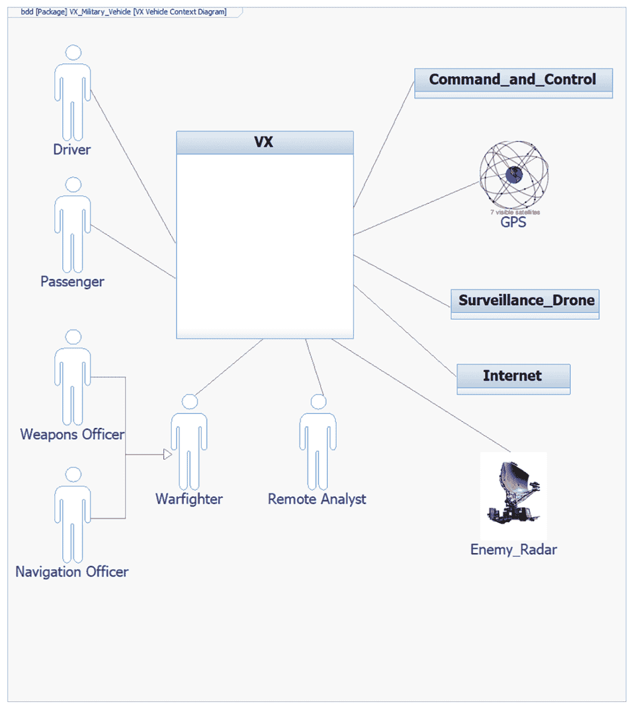

**Figure 7.1** Context diagram for VX military vehicle. ¶ Source: GPS Photo, [`commons.wikimedia.org/wiki/File:GPS24goldenSML.gif`](https://commons.wikimedia.org/wiki/File:GPS24goldenSML.gif). Radar Photo, [`en.wikipedia.org/wiki/File:RES%E2%80%931.jpg`](https://en.wikipedia.org/wiki/File:RES%E2%80%931.jpg) ¶ .

在上下文图中，我们将我们的系统 VX 放在图表中间。当然，我们也可以只用一个方框来表示它，或者我们可以有一种艺术家对我们军事车辆外观的构想。这可能有风险，因为我们还没有设计它，而且我们也不太清楚它最终会是什么样子。最好只是将其表示为一个简单的方框。值得注意的是，即使在这个非常简单的图表中，我们也传达了大量信息和含义。通过展示与系统交互的用户和外部元素，我们暗示了系统的边界和范围，并表达了所有这些外部接口的需求。

### 7.2.2 Actors for the Home System

让我们考虑我们另一个示例系统——家庭住宅的上下文。在这种情况下，确定系统边界有点困难。最自然的边界将是房屋本身，或许是整个物业，而一些家庭甚至可能希望将他们的“家庭系统”视为包括某个地方的第二套住宅，这将导致对房屋如何作为家庭的集成系统发挥作用的一些思考。家庭的车辆是否应包含在家庭系统中？两种方式都可以，但请注意每种选择都有影响。如果车辆包含在家庭系统中，那么我们就不会将它们显示为参与者，并且只有在我们稍后处理内部系统交互时才会考虑房屋与车辆之间的交互。将车辆视为家庭系统之外也是可以的，在这种情况下，我们将车辆作为家庭系统的参与者包含在内，但前提是家庭系统与车辆之间确实存在交互。汽车与住宅之间的交互变得越来越常见，例如涉及电动汽车充电、Wi-Fi 交互或其他高级功能的情况。当我们考虑家庭系统的参与者时，我们会思考人们相对于家庭系统可能扮演的不同角色，因此参与者不是 Mom、Dad、Jason 和 Erika，参与者代表他们扮演的角色。我们可能会从一个名为 `homeowner` 的参与者开始，它可以代表一个或多个人扮演房主角色。我们将再添加一个名为 `resident` 的参与者，它代表任何在房屋中永久或近乎永久居住的人。由于参与者定义的是角色而不是个人，Mom 有时可能扮演房主角色，有时扮演居民角色。我们可能会为过夜客人添加参与者，为访客添加参与者，他们可能与家庭系统的交互有所不同。参与者还代表与家庭系统交互的其他系统，这些系统可能包括电力公用事业公司、有线电视公司、燃气公司、互联网服务提供商，也许还有其他。像 UPS、Fedex 或日益增多的独立送货司机这样的递送服务也可以是一个额外的参与者，因为我们可能会考虑当有人在家或不在家时家庭系统如何接收递送。家庭系统的上下文图示例显示在 Figure 7.2 中。

**Figure 7.2** Context diagram for home system.

## 7.3 U: Usage

CUSTARD 中的 U 代表 usage，即使用情况。使用情况可以用多种方式表示，但最好也最常见的方式是通过指定用例来表示。我们在 Chapter 6 中介绍了用例，它们代表系统的完整使用情况。它们是与系统一起执行的一系列事件，产生有价值的结果。用例由参与者发起，是系统的完整使用。换句话说，用例代表用户通过使用系统想要实现的目标。用例不仅仅是用户可以用系统执行的功能。我们已经看到如何详细描述用例，如何将每个用例具体化为一个故事、一组步骤，以及一个小的叙述来描述用例的事件。

对于 CUSTARD 中的使用视图，我们只需识别用例，并在用例图中绘制它们，将用例与参与者用线连接起来。这里我们使用的是 SysML 语言符号。这些线条和符号的含义还有更多细微差别，但我们在这里不需要深入探讨。从根本上说，用例图非常简单。它显示用例，使用椭圆形符号表示。每个用例都连接到一个或多个参与者，参与者由人类棍状人形、带标签的方框或我们系统正在对话的外部系统的小图片来表示。正如你所回忆的，上下文图显示了相同的参与者；我们只是将它们带入用例图，添加用例并连接参与者。在用例图上，我们将用例包围在一个称为 `system boundary box` 的方框中，它代表系统。由于用例始终代表系统的使用情况，它们显示在系统边界框内，而参与者作为系统外部的存在，则显示在框外。由于我们稍后会详细描述用例，我们将继续查看这两个示例系统，看看使用视图会显示什么。

对于我们的军用车辆 `VX`，我们应该识别哪些用途？通常最好从系统最常见或主要的使用开始——即系统存在的核心原因的使用案例。这一军用车辆的基本目的是执行任务。它可能是不同类型的任务有不同的使用案例；每种类型的任务可能以不同的方式进行。回顾第 6 章中提到的，使用案例是对系统的完整使用，因此使用案例将标识某人如何使用车辆来完成整个任务。

如果 `VX` 需要能够执行侦察任务，那将是一个使用案例。使用案例应以动词短语命名，因此团队会将该使用案例命名为 *Perform Reconnaissance Mission*。另一个使用案例可能是突袭行动，团队将使用车辆攻击敌方领土内的建筑物，因此使用案例可能被称为 *Perform Raid* 或 *Carry Out Raid* 或 *Prosecute Raid*，无论哪种术语对该系统的利益相关者有意义。很可能该车辆还有其他使用案例。也许存在一个为车辆装载补给、将弹药装入武器并为其准备任务的使用案例。可能是不同的人准备车辆，因此不同的参与者可能与此 *Prepare VX for Mission* 使用案例相关联。

`VX` 很可能还有一些其他使用案例。当 `VX` 将作为车队从一个地方前往另一个地方时，可能存在一个使用案例。与 *Perform Reconnaissance Mission* 相比，此使用案例之间可能存在足够大的差异，以至于应将其显示为单独的使用案例。在 *Drive in Convoy* 使用案例中，也许 `VX` 必须与车队中的其他车辆保持某种通信。或者在行程期间 `VX` 可能处于远程站点的控制或监控之下，或者 `VX` 在车队中时可能使用不同的传感器。如果存在任何这些差异，则 *Drive in Convoy* 应与 *Perform Reconnaissance Mission* 不同。还可能存在诸如 *Perform Maintenance* 之类的使用案例，如果 `VX` 在维护过程中有积极参与。维护可以分为两种。一种维护根本不涉及车辆；维护人员只是使用工具对车辆进行操作，而车辆无需做任何事情——它只是被动地坐在那里进行维护。这种维护可能不需要表示为使用案例，因为没有描述 `VX` 的功能——它实际上并不是车辆的使用案例。但有时车辆内置了功能，例如诊断端口，就像我们自 1990 年代以来在汽车上所拥有的那样，维护人员将设备连接到车辆以诊断正在发生的情况。由于这显然是与车辆的交互，因此应有一个名为 *Diagnose Vehicle* 的使用案例，描述诊断过程中发生的情况。如果我们继续以这种方式进行，很快就会识别出 `VX` 的所有用途，并将其放置在用例图上。带有部分 `VX` 使用案例的示例显示在 图 7.3 中。

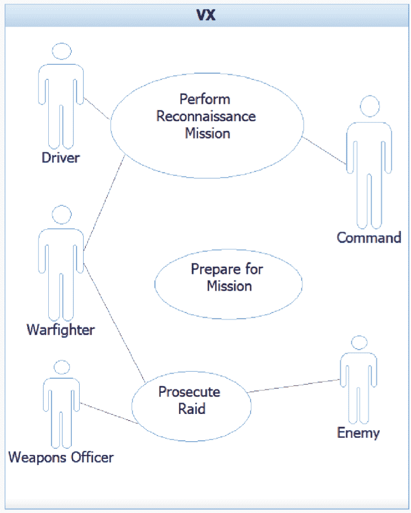

**Figure 7.3** Use case diagram for VX.

对于家庭系统，将用例思维应用于我们所有人都熟悉的系统的使用可能非常有趣。在这里，我们询问上下文图中显示的参与者对家庭系统有何用途，或家庭系统如何利用他们——两种方式都表示使用案例。也许首先想到的就是，居民和客人使用家庭来 *stay comfortable*。我们从发起使用案例的参与者的角度命名使用案例。*stay comfortable* 使用案例是在有人打开 `HVAC`（供暖、通风和空调）系统时发起的。家庭系统还用于为许多其他系统提供电力。*power up systems*（将 power 用作动词）使用案例将涉及为家庭中的所有系统和设备提供电力，从大型厨房和洗衣电器到为客人移动设备充电。它将涉及从外部公用事业和家庭内部的任何来源（如太阳能阵列、风力涡轮机或应急发电机）分配电力。一个名为 *manage access* 的使用案例将包括家庭如何接纳合适的人并阻止未经授权的人进入，可能使用机械锁、车库门开启器或 Wi-Fi 启用的智能锁的组合。虽然我们在谈论安全，但我们可能希望包含一些所谓的负面使用案例——我们不希望成功的用例。企图入室盗窃者会试图 *break in*，而家庭系统将以所述方式抵抗或检测入侵。复杂的安防系统是通过考虑故事和场景以及多级检测和反应而设计的。邻居牵着狗在前院散步可能会只触发一些自动灯光，但入侵者走上车道，可能会触发更多灯光加上家庭内部的警报和摄像头捕捉。强行打开门会触发警报并通过专业监控服务向警方发出呼叫。家庭系统还可用于在整个家庭中播放音乐，并且实现该功能的方式多种多样，从一套 Amazon Echo 设备到专业安装的整屋音频扬声器系统。家庭系统可能还有许多其他使用案例。

我经常在考虑家庭改善的娱乐、自行车存放和计算等领域时以用例为思考方式。例如，搬进新家时，我发现住一段时间，也许几个月，然后再决定如何自动化照明，这很有用。一旦模式已知，就很清楚哪些灯每天使用，哪些灯只偶尔使用，无需自动化。家庭系统的用例图的开头显示在 图 7.4 中。

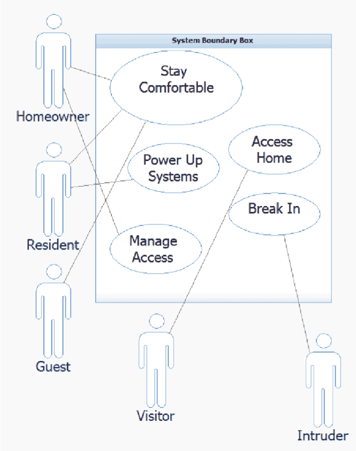

**Figure 7.4** Use case diagram for home.

## 7.4 S: States and Modes

CUSTARD 中的 S 代表 states and modes。状态和模式，就像上下文一样，是工程师，特别是系统工程师在 2000 年代初模型化系统工程发展之前就非常熟悉的概念。思考系统中状态和模式是理解系统运行重要方面的一种自然、直观的方式。家庭报警系统具有明显的、即使是系统用户也能察觉的状态。报警系统可以处于 *off* 状态，在此期间它仍可能监测火灾或烟雾情况。它可以处于 *disarmed* 状态，在此期间打开门窗时会发出提示音，但不会触发警报。*armed* 状态通常有两个子状态。系统可以在 *home* 模式下布防，也可以在 *away* 模式下布防。在家庭模式下，警报会立即响起，但仅在打开门或窗时响起，而运动探测器触发时不会响起。在离家模式下，打开门会启动进入延时，以便居民进入并解除警报，而打开窗户会立即触发警报。系统还具有我们可以称为 *alarmed* 的状态，此时警报正在激活，触发警笛、灯光以及可能向房主或专业监控中心发出呼叫，后者将通知警方。

# 理解报警系统中的状态和模式

理解报警系统中的状态和模式是理解其运行的关键。状态之间通过状态转换相连。一般来说，系统不能简单地从任意一个状态移动到任意另一个状态。我们的家庭报警系统，一旦处于 `alarmed` 状态，可能只能从该状态移动到 `off` 状态。从 `off` 状态，它可以被置入 `armed/home` 或 `armed/away` 状态。一辆处于 `driving` 状态的汽车通常不能直接置于 `parked` 状态，而必须先经过 `stopped` 状态。系统工程师使用状态转换图来思考系统的预期状态和模式、它们之间的可能转换，以及导致系统从一个状态移动到另一个状态的触发条件。

## 状态与模式术语

术语 `state` 和 `mode` 没有 universally 的定义来区分它们，因此严格来说，这两个术语是可以互换的。在特定上下文中，项目可能会更具体地定义它们，例如，决定 `states` 将是整个系统的最高层级状态，而 `modes` 将是这些高层级状态内的子状态。子系统也可能有自己的状态。一辆汽车可能有整体状态 `on, started, off, parked`，或 `locked`，而汽车的变速箱（一个子系统）会有自己的状态集合，包括 `park, drive, neutral` 和 `reverse`。此外，汽车的状态与变速箱的状态之间存在关系。某些变速箱状态仅在汽车的某些状态下才可能。例如，如果汽车处于 `locked` 状态，变速箱必须处于 `park` 状态——有些汽车通过在变速箱未处于 `park` 时不允许取出钥匙来强制执行这一点。在汽车处于 `driving` 状态时将变速箱置于 `park` 是一个无效的状态组合。

## 来自利益相关者的状态和模式

系统的状态和模式通常会在工程师与利益相关者交谈时自然出现。即使没有任何工程背景的利益相关者，也可能在谈论新设想的系统时自然地给出系统的状态和模式。利益相关者可能会说类似这样的话：“好的，首先，有人会解锁它，然后汽车就被解锁了，并且保持解锁状态，直到汽车开始移动然后自动再次锁上。”他们自然地引用了系统的状态和模式，并且将这些信息作为系统已识别状态和模式的输入是非常有用的。当然，系统工程师会在深入完善设计时添加其他更详细的状态和模式。

## 示例系统：VX 军用车辆和家庭系统

让我们以我们的两个示例系统，VX 军用车辆和家庭系统，来识别这些系统中的一些状态和模式。因为 VX 是一辆车辆，其中一些状态和模式很容易识别。一个状态可能是 `parked`。如果车辆处于停放状态，意味着它已停止，人们可以安全地上下车。另一个状态可能是 `on` 或 `started`，意味着发动机正在运行，电源已开启，车辆的各个子系统已通电，并且它已准备好移动。一旦它挂入档位并开始移动，那么它可能处于另一个称为 `driving` 或 `moving` 的状态。当 VX 在停车标志前停车时，假设军用车辆仍需要在停车标志前停车，它仍然处于驾驶模式，只是此刻恰好静止不动；因此，我们可能会称该状态为 `stopped`，这与 `parked` 不同。车辆不会在停车标志前停车；它只是停止。有可能还有其他特定于 VX 作为军用车辆角色的模式，包括可能有一个称为 `weapons hot` 的状态，这意味着所有武器都已激活、有人操作并且准备好对目标开火。没有通用的状态和模式集合——它们特定于每个系统及其目的和功能。

## 子状态

所给的示例暗示了子状态的概念。VX 可能处于一个状态，然后在该状态内可能有一些状态，我们称之为子状态。如果车辆处于 `driving` 状态，它可能是 `accelerating` 或 `braking`。我们可以将这些表示为子状态，以更好地描述车辆的整体行为。转换可以显示在车辆的整体状态之间以及子状态之间。如果 VX 只有在处于 `braking` 子状态时才可能从整体状态 `driving` 转换到整体状态 `stopped`，而在处于 `accelerating` 子状态时则不可能，这可以被显示出来。

在识别状态和模式时，我们只识别那些有意义且对系统重要的状态。在我们的房屋示例中，我们发现状态可能显得更抽象，因为房屋不是一台机器。虽然房屋是由其他系统组成的系统，但仍然有用整体考虑房屋的状态。房屋的一个重要状态可能是 `vacant`，这意味着没有人在家。当没有人在家时，我们可能希望房屋内的事物以不同的方式运行，例如灯光自动操作以模拟有人在家，或某些电器如炉灶或卷发棒自动关闭。`Vacant` 是房屋的一个特定状态。我们可能希望区分 `no one is home` 状态和 `no humans are home` 状态。如果有宠物独自在家，这可能会影响空调和供暖系统的设置。显示家庭系统状态和模式的图表示例见 Figure 7.5。

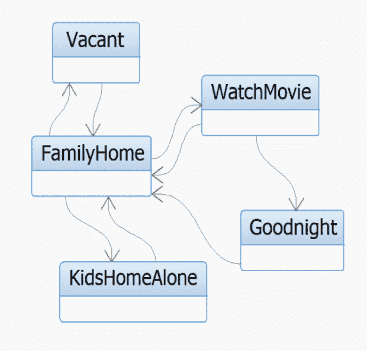

**Figure 7.5** States for the home.

我们也可能想象状态取决于 `who` 在家。如果十几岁的儿子独自在家，他可能希望自己最喜欢的音乐在房屋所有房间里大声播放，但如果爸爸也在家，那么音乐会更局部化，每个人都在听不同的东西。最终的可能是拥有代表房屋每个房间里谁的状态。

## 状态与物理设计

状态和模式不仅用于电子或自动化系统的控制——状态还可以帮助指导物理设计。房屋的一个状态可能称为 `workday`；在工作日状态下，一名或多名人员在家工作，而孩子们在学校或不在家。房屋应如何设计以适应该状态？也许会有两个独立的办公室，而且它们可能不应该挨得太近，以免噪音干扰对方。也许让妈妈和爸爸的办公室位于房屋的两端是有意义的，这样当他们都在家工作时，他们在白天都有安静的空间工作。思考状态对于房屋的设计可能是启发性的。

可能还有另一种在工作日晚上发生的状态，爸爸在做一点额外的工作。也许妈妈此刻没有工作，孩子们在家，他们正在享受某种娱乐，或做作业。再次分析此类状态可能会让我们思考在妈妈和爸爸的办公室、家庭房以及房屋的娱乐中心之间设计隔音或噪音隔离，因为我们希望确保不同的活动不会相互干扰。这可能导致目前流行的房屋开放式设计，例如，厨房里准备食物的人仍然可以与正在社交或看电视的其他人待在一起。

我曾经住过一栋由一位优秀建筑师设计的房子，这房子很漂亮。它采用了一种非常开放的平面设计，或许过于开放。它有一个气势磅礴的双层开放式起居空间，卧室位于这个大开放区域的两侧和上方，二楼还有一个开放式阳台。或许是无意的，它被设计成如果你把一把叉子放在厨房的台面上，你会在房子的每个房间里都听见声音。因为空间太开放，几乎没有任何隔音。如果房子里住一两个人，或许还好，但如果你开始让孩子们住进那些卧室，这种宽敞开放的声学环境可能就没那么美了。在建造房子之前，思考使用方式、状态和模式，可以在建造前就发现这类问题。

## 7.5 T: Timing

继续下一个 MBSE 方面，并沿着缩写 `CUSTARD` 推进，我们来到 T，即 `timing`。在这里我们描述系统中发生的时序。某些系统具有非常关键的时序方面，这些方面在系统工程过程的早期阶段就很重要去推理。其他系统可能没有时序方面的顾虑，因此时序的关注程度可能因系统类型而异。时序涉及系统的多个方面，而时序的主要方面是顺序——系统中必须发生的事件的顺序。这些序列中的事件是否需要非常精确的时序？也许系统中某些事情不能花费太长时间，否则会让其他事情等待，整个系统的性能就会受损。系统可能需要优化，以优先考虑某些操作的执行速度高于其他操作，从而使整个系统顺畅运行。例如，如果在开车时，驾驶员选择换挡，而换挡需要 10 秒钟，那无论换挡多么平顺，这都是不可接受的。某些系统操作的时序可能有一个可接受的范围。让我们看看我们的两个系统来了解一些例子。

首先，对于 `VX` 军用车辆，哪些时序方面是需要考虑的？从 `secure` 状态到 `weapons hot` 状态所需的时间可能需要低于某个限制，以便在很短的时间内完成，这可能会影响某些设计选择。如果使武器准备就绪需要拿出扳手拆卸一些螺栓，那可能需要太长时间。设计人员可能会考虑一种不同的释放武器的方式，以便能够快速准备就绪。时序的另一个方面可能是车辆上的传感器或雷达设备与目标跟踪之间的交互顺序。`VX` 是否需要能够跟踪头顶飞过的飞机？还是它只需要能够跟踪其他车辆？这差别很大。车辆最多只能以 100 mph 的速度行驶，而飞机可以以数百英里的时速飞行。如果 `VX` 需要跟踪飞机，它可能需要更快的计算机来满足更快的时序要求。

在我们的房屋示例中，我们首先注意到，与军事装备相比，房屋运行在较慢的时间表上，因此我们可能没有太多时序方面的顾虑。几乎没有什么是必须瞬间发生或以毫秒为单位发生的，因此房屋设计可能没有太多关键的时序方面。系统工程师可以考虑从房子到其他目的地的所需时间，作为房屋的一个方面。而如果我们在为房子购物，其相对于交通模式的位置以及通勤、工作地点或海滩的旅行时间可能是一个重要的关注点。

在房子内部，哪些时序问题可能很重要？嗯，时序的一个方面是在娱乐系统上。当尝试向电视屏幕流式传输 `4k` 超高清内容时，你需要足够的互联网带宽，但也需要在从华特迪士尼服务器到电视屏幕的路径中所有设备之间有足够的连接速度。房子可能需要当前版本的 `HDMI` 线缆才能流式传输最新的 `4k` 内容。为了适应我们已确定的所有用例，房子需要哪些有线和无线网络？思考这类需求可能会促使我们在建造房子时在墙内铺设快速网络电缆，以便将来可以连接各种设备并获得更快、更可靠的访问。或者我们可能会像我上次建的房子那样做：我在房间之间和楼层之间在墙内铺设了大号塑料导管管道，让我随时可以穿引新的电缆。如今，我主要通过这些管道穿引的是 `Ethernet` 电缆，但有时也需要其他电缆。我在墙内铺设了扬声器线，因为目前还没有比硬连线扬声器更好的替代品，而且以后很难把扬声器线引到正确的位置。通过思考我们希望房屋中的子系统完成什么工作，我们系统地思考这些需求和设计要素，而时序可以是一个重要方面。

## 7.6 A: Architecture

`CUSTARD` 中的 A 代表 architecture。系统级架构反映了系统的整体结构。关于系统架构和系统架构设计已经写了许多书籍，我们在这里并不打算深入探讨该主题，但让我们尝试获得基本的直觉。当我们思考整体系统时，我们首先将其想象成一个黑盒子，就像我们在之前创建的上下文图中所示的那样。上下文图中间的单个方框代表整个系统，无论它可能有多复杂。在架构阶段，我们思考如何将这个单一方框分解为构成整体系统的子系统。所有系统都由子系统组成，这些子系统当然本身就是系统。大多数系统也是更大系统的子系统。因此，所有系统都可以被视为系统之系统。用一句改编自约吉的话来说，就是全是系统（或乌龟），一直向下。

当查看一种熟悉的系统类型时，例如已经存在的客运车辆或个人电脑，很容易看出子系统，但当面临创建一种新型系统时，如何将系统分解为子系统可能就不那么明显了。这需要对该类系统的经验以及对系统架构原则的良好了解，才能做出最佳决策。

架构中的两个核心概念是内聚性和耦合性。理想的架构具有高内聚性，即每个子系统都有一个紧密相关的功能或服务集合，由其负责。同时，一个好的架构具有低耦合性，即子系统尽可能少地与其他子系统通信。在高内聚、低耦合的架构中，子系统在很大程度上独立于彼此工作，仅在响应请求或返回结果和更新时与其他子系统通信。公司的架构通常遵循这种模式。财务、市场营销、销售和人力资源都是高度内聚的部门，执行其特定功能并在其内部频繁沟通，但与其他部门的互动要少得多。

# 子系统交互与架构权衡

换句话说，如果两个子系统之间存在大量交互，就会产生大量的通信开销和额外的复杂性，这可能会让我们质疑这些子系统是否应该合并为一个子系统。另一方面，如果我们有一个像电力这样的功能，我们可能希望它是一个单一的子系统，为所有其他子系统供电，而不是让所有其他子系统都拥有自己的供电能力。让我们通过考虑我们的示例系统来更清楚地说明这一点。

## VX 军用车辆子系统识别

对于我们的 VX 军用车辆，我们考虑在车辆整体系统中应识别哪些子系统。并没有唯一、正确或显而易见的答案。如果系统是从零开始设计的，那么设计者在设计架构时可以自由选择子系统。但军用车辆之前就已制造过，因此可能存在一种正常甚至标准的架构。有时可以为某些类别的设备和系统使用参考架构。国家国防机构等组织甚至会标准化架构（或尝试标准化），以便新产品遵循一致的架构模式。但从根本上说，系统架构的设计取决于系统工程师。

对于 VX，我们设想它将拥有一些与任何车辆共有的子系统，包括你车道上停放的那辆车。此外，还会有特定于该车辆及其用途的子系统。大多数车辆都会有某种发动机或电机来推进车辆，以及悬挂系统。通常会有某种车身，并且很可能有底盘或框架。架构可能会将这些全部视为二级子系统，也可能采取另一种方法，将悬挂子系统与底盘或框架子系统结合起来，以最大化内聚性并最小化耦合。

作为军用车辆，VX 将拥有传感器系统，可能包括雷达、激光雷达、射频（RF）传感器或光学传感器。由于传感器种类繁多，将传感器合并为一个传感器子系统可能更有意义，然后允许其他子系统从中请求传感器数据。然后在架构的第三层，可以为每种不同类型的传感器设置子子系统。

## 架构权衡：通信与电力

继续第二层，VX 很可能拥有武器系统和通信系统，提供从车辆到其他车辆、基地或飞机之间的无线电、卫星或其他形式的通信。这只是架构的一种可能性。拿我们上面作为子系统处理的通信来说。另一种可能的架构是让每个合适的子系统都拥有自己的通信能力，而不是一个为所有子系统服务的集成通信子系统。哪种更好？这种权衡正是系统工程师在设计系统架构时所苦恼的。并非总是清楚哪种权衡方案更好。一位工程师可能会争辩说，单一的通用通信子系统可能容易出现故障或攻击——是单点故障。另一位可能会争辩说，保护单一通信子系统比保护散布在车辆各子系统中的多个小型通信能力更容易。另一方面，某个特定子系统的通信需求可能如此专业化，以至于让该子系统自行处理通信比加入通用通信子系统更有意义。

在设计系统架构时必须考虑的权衡的另一个常见例子是电力。直觉上认为车辆应该有一个电力系统，向所有子系统分配电力。这可能有道理，但另一种选择是电力进入车辆后立即分配给所有子系统，每个子系统都有自己的电源，为该子系统所需的形式创造电力。例如，如果交流电进入车辆，比如来自车载发电机，我们可以有一个大的直流电源向每个子系统分配直流电，或者交流电可以分配给所有子系统，它们各自拥有自己的直流电源。同样，这也是设计者在设计系统架构时需要做出的权衡。

## 模块化与标准化接口

在许多复杂系统中，一个重要的近期趋势和目标是使架构更具模块化。例如，如果出现了一种新的通信能力，并且系统的架构足够模块化，那么取出旧的通信系统并换入新的通信系统应该是可行的。模块化架构只要求新通信子系统与其他子系统之间的接口与旧通信子系统时相同。如果通信分散在所有子系统的各个零碎部分中，取出旧通信并换入新的通信可能会困难得多。由于技术进步的快速步伐，模块化和标准化接口已成为各种架构中非常重要的一部分。

## 家庭系统示例

对于家庭系统示例，我们必须考虑房屋的架构。对大多数人来说，房屋的架构比军用车辆的架构更熟悉。对系统工程师而言，房屋作为系统的架构关注的远不止房屋的风格、外观和平面图。我们可以从地基开始，将其视为房屋的一个子系统，因为它通常由不同的材料制成，安装方式不同，并且服务的目的和功能与其他房屋部件不同。同样，包括墙壁、地板和天花板在内的框架可能被视为架构的一个子系统（尽管有人可能会争辩说房屋框架不是系统，因为它仅由木材和钉子组成，没有交互功能）。将屋顶视为一个单独的子系统可能更有意义，因为它服务于不同的目的，并且与地基和框架分开设计。

## 组织对架构的影响

必须认识到，基于对过去如何建造类似系统的历史知识来设计架构会限制创新。请记住，康诺利定律表明，系统的架构会反映设计它们的组织的架构。如果过去我们的公司是通过三个独立的部门（或承包商）来建造房屋，分别负责地基、框架和屋顶，那么这三部分房屋始终保持分离和独立，仅在房屋建造时连接在一起也就不足为奇了。一种建议将屋顶和墙壁作为集成单一子系统（例如穹顶设计）建造的创新将很难被接受，因为这意味着要从根本上改变组织的架构。我们可以合并屋顶和墙壁部门，并指示它们创建集成屋顶和墙壁方法，或者完全取消这两个部门并聘请一些新的创新设计师。这两种选择在短期内都可能对生产力造成严重破坏，因此组织的惯性会使设计在一段时间内保持相对一致。

康诺利定律是双向的，因此，如果我们基于一项新创新来设计架构，该创新可能允许屋顶和墙壁被设计为一体，我们就可以以这种方式建立新的组织——设立屋顶与框架部门，与地基部门并列。无论哪种情况，康诺利总是正确的——系统架构和组织架构会趋于匹配，无论好坏。这里的教训是，在设计架构的早期阶段要小心假设，以免在后期限制创新。如果架构显示屋顶和框架是独立的子系统，那么这两个子系统很可能将被分配给不同的部门（或承包商），因此采用单一集成设计方法来处理这两个子系统几乎不可能，甚至不可能。这又是另一个权衡。系统工程师在一定程度上必须依赖于过去系统是如何建造的知识——他们不能为每栋新房子或汽车型号都从一张白纸开始。但每隔一段时间，质疑过去的假设是有意义的，并考虑，例如，一个真实的例子，我们根本不需要汽车上有发动机——只需要在车轮上安装单独的电动机，以及作为底盘集成部分建造的大型电池系统。遵循传统架构的电动汽车设计很可能会导致一个大型电动机，取代引擎盖下的发动机，以及一个大型电池组，放在原来的油箱位置——也许可行，但既不最优也不具创新性。总之，检查系统架构的早期假设，以确保它们是有根据的，而不是扼杀创新的。

回到我们的房子，我们注意到在这种情况下，屋顶与框架是不同子系统的假设是有根据的，因为屋顶将使用不同的原理和材料进行设计，例如桁架和板材，而不是木材和钉子。识别房屋架构中的其他子系统，我们可能需要一个管道子系统，以及一个电气或电力子系统，它从公用事业、发电机或太阳能板系统接收电力并将其分配到整个房屋。然后将有一个供暖和制冷子系统（或 HVAC）。我们将其视为一个子系统，即使最终它可能由多个熔炉、热泵、木炉或其他用于供暖和制冷的设备组成。该子系统还包括通风，例如新鲜空气交换器、风扇和管道。从那里我们可以设想更多专门的子系统，这将取决于房主的特定要求。我们可以勾画出一个名为通信的子系统，它将包括房屋连接到互联网以及房屋内部其他类型的通信，例如语音助手、将互联网分配到计算和流媒体设备，以及对讲系统。通信子系统还将包括管理移动设备在房屋内的运行方式以及它们如何连接到蜂窝网络和家庭 Wi-Fi。通信子系统还可能包括房屋内的计算机网络。今天，这很可能是一种以太网和 Wi-Fi 的组合。 从技术转向爱好领域，房屋可能有一些工作坊、艺术工作室或健身设施，并且根据每个设施的复杂性和需求，将其各自视为独立的子系统而不是普通房间可能是有用的。工作坊可能有一些不同的电力需求，或地板或墙壁的结构要求不同，或根据将要进行的工作类型，有特殊的通风要求。

从这些例子可以清楚地看出，设计系统架构的过程远非一种直接的、填空式的练习。在 CUSTARD 的 CUST 部分，我们主要关注系统的需求和要求。当我们进入 A 代表架构时，我们必须开始与系统的设计作斗争。英语在这里让我们失望，因为设计可以指系统工程过程的几个方面。有些人可能将用例的创建视为设计的一个方面，而其他人则认为设计仅适用于物理施工细节、图纸、蓝图和机械加工说明。重要的是要理解系统的概念，即系统如何从最初的模糊想法到具体的实现。 在 CUSTARD 的下一个阶段，我们将把系统的 *需求* 和系统的 *实现* 结合起来。

## 7.7 R: Realization

实现阶段的目的是展示系统将如何实现，即当系统最终建成时，使用、状态和时序视图中描述的行为将如何由系统执行。显然，系统的所有功能都以某种方式由系统执行。然而，为了构建该系统，我们需要将系统分解为各个部分，我们刚刚在架构阶段完成了这一点。我们现在需要将系统所需的行为分解为可以由整体系统的子系统各自执行的函数。用例描述的步骤序列必须映射到执行每一步的子系统。或者，由于用例步骤可能与子系统中的函数没有一一对应关系，因此可能需要多个子系统的协同作用来执行某些用例步骤。

使用基于模型的系统工程绘制系统的实现是一个两步过程。首先，我们为每个用例绘制事件序列，将系统视为一个黑盒执行系统的功能，但不显示内部的任何子系统。然后第二，我们再次绘制相同的序列，显示这些系统功能中的每一个是如何由子系统或子系统组合处理的。为了完成第一步，我们在模型中创建一个图表，显示系统与其参与者之间的交互，每个用例一个。通常这是使用 SysML 建模语言中的活动图完成的，它类似于传统的流程图。我们向此图添加泳道，以显示每个操作的负责方或对象。在这个黑盒活动图中，将只有系统本身的泳道，以及参与此特定用例的每个参与者——并非所有参与者都参与每个用例。我们遍历用例中的每一步，并将该步骤建模为系统和参与者采取的一组行动。让我们使用我们的示例系统来使这一点更清楚。

对于 VX 军用车辆，我们在 CUSTARD 中的 *Usage* 阶段确定的用例之一是 *Perform Reconnaissance Mission*，让我们遍历该用例的几个步骤，看看我们如何将其转化为参与者和系统的行动。第一步写道，

此用例始于用户访问 VX 以执行侦察任务。

尽管这一行听起来有点别扭，但它作为用例开始的描述是有意义的。请记住，用例是关于使用系统执行一系列行动。用例不能说始于有人决定将车辆用于任务，因为做出决定不是涉及系统的行为。我们也不想说用例始于我们解锁车辆的车门，因为我们希望解锁成为用例的 *一部分*，而且车辆可能根本没有上锁。

# 实现阶段概述

为了展示此步骤的实现，我们展示了执行者执行操作 `Access VX`，然后执行操作 `Start VX`。用户执行 `Start VX` 后，`VX` 执行操作 `Power Up`。此操作可能涉及车辆内部的许多不同操作，但请记住，现在我们将 `VX` 视为黑盒，从该角度来看，我们所能看到的只是车辆通电。在下一步中，用户发起数据通信检查，然后 `VX` 与指挥控制系统和互联网网关系统进行一系列数据信号测试，这两个系统被表示为执行者，因为它们在 `VX` 之外。

## 黑盒活动图

在我们讲述此用例的故事时，我们将每个步骤分解为用户或系统采取的一个或多个操作，包括系统与其他外部系统（如指挥控制系统或 GPS 卫星）之间的任何交互。在创建活动图的黑盒版本时，我们只是以执行者与系统之间的交互来重述用例的故事——我们还没有发明任何新东西。然而，进行这种重述可能并非易事。请回忆，在 CUSTARD 的 `Usage` 阶段，我们对用例的描述方式没有施加重大限制，只是要求它以所有利益相关者熟悉的术语表达，以便所有人都能理解。这意味着描述可能会省略对每个执行者和系统在用例进行过程中实际 `do` 的具体描述。在 `Realization` 中，我们必须思考得更精确，并详细描述每个操作。

原始用例可能只是写道，“用户启动车辆。” 作为用例中的一个步骤，这很合理，但为了实现实现阶段的目标，我们必须思考此步骤在用户操作和系统操作方面的含义。做到这一点不应太困难，但需要一定的专注和细致。在本例中，用户采取某种操作来请求车辆启动，车辆则通过尝试启动并成功或失败，然后向用户指示结果来响应。稍加思考，就会发现用户实际上并没有启动车辆。用户只是请求车辆自行启动。在使用系统的黑盒视角时，很难在不提及系统组件的情况下表达这一点，而我们在此不应这样做。我们可能会被诱惑写道用户转动钥匙或按下按钮，但钥匙和按钮是系统的低级组件，在这里不应提及。这样做有风险会规定设计决策，而这些决策应在考虑替代方案后稍后做出。但如果我们将用户所做的事情视为提出请求，我们就可以简单地将操作 `request vehicle start` 分配给用户，将操作 `start vehicle`（本质上是 `start yourself`）或仅 `start` 分配给车辆。

到目前为止，我们仅完成了 `Realization` 中的两个步骤中的第一步，即创建了用例的黑盒描述，以执行者和系统操作为依据。一旦我们对所有用例都完成此操作，我们就已经产生了重要的有用结果，即使我们只完成了两个步骤中的第一步。首先，我们对系统必须能够做的一切有了简洁的描述。收集活动图中系统泳道所示的所有操作，我们就得到了系统需要采取的所有操作的一个不错的列表。很可能此列表中存在重复，这是可以预期的，因为系统很可能需要在多个用例中采取某些操作。也很可能执行此工作的系统工程师在不同用例中并未以完全相同的方式命名一些相同的操作。即使只有一名系统工程师完成此工作，命名差异也很可能存在。为了保持描述性系统模型正确且简洁，重要的是检查操作列表，并在它们出现的各个用例中为相同的操作赋予相同的名称。

除了列出实现所有用例所需系统操作（功能）的良好列表外，我们迄今为止在 `Realization` 中的工作还产生了对我们执行者所需所有操作的需求描述。对于我们的人类执行者或用户而言，此列表可以指导我们为执行者提供的培训。对于外部系统而言，此列表是外部接口描述的开始，这是完整系统描述的关键部分。即使在系统工程的早期阶段，我们也已确定了系统需要与外部系统交互的所有场合，更重要的是，每个交互的确切上下文。系统工程师为新系统制定与之交互的系统的一般列表是一回事，这通常会完成，但更重要的是描述何时以及为何必须进行每次外部系统交互，而这正是我们从用例开始并确定在每个用例流程中需要与外部系统执行者交互的 `where` 时所做的。

## 白盒表示

让我们继续描述 CUSTARD `Realization` 阶段的第二步。如前所述，此处的目的是不是描述如何精确执行 MBSE 建模的这一方面，而是给你一个关于在整体 MBSE 方法中需要完成什么的良好直觉。在本书中，我们主要关注早期阶段以及如何描述系统所需行为，原因有两个。首先，这是智能系统最需要的 MBSE 方面，其次，这是 MBSE 方法描述中经常被有限处理的方面。

`Realization` 阶段的第二步是为每个用例创建白盒表示。其目的是展示用例如何由我们在 `Architecture` 阶段识别的子系统组合来实现。之前，在黑盒表示中，我们展示了用例如何由系统和执行者执行。现在，在白盒表示中，我们将展示用例如何由该系统的子系统执行。好消息是我们不必对每个用例都从头开始——我们可以从黑盒表示开始并将其转换为白盒表示。为了执行此转换，我们只需复制上面创建的黑盒活动图，然后为子系统添加泳道。然后我们就有了具有执行者、系统和子系统泳道的图表。在这种方式下同时在同一图表上拥有系统和子系统是没有意义的，但这只是图表的临时形式。

然后我们继续检查系统泳道中的每个操作，并提出一个基本问题，整体系统的哪个子系统执行此操作？有两种可能的答案：要么操作由单个子系统执行，要么操作由一个以上的子系统组合执行。如果操作由单个子系统执行，那么我们可以简单地将操作移动到该子系统的泳道，然后继续下一个操作。如果操作由子系统组合执行，那么我们需要做更多的工作。我们需要将此操作拆分为多个操作，每个操作都可以由单个子系统执行。通过这种方式，系统泳道中的每个操作都成为子系统泳道中的一个或多个操作。结果是，我们已将此用例中的所有操作分配给子系统。

在进行这项工作时，我们保持与参与者的连接。如果在黑盒表示中，一个参与者执行了动作 `A`，随后系统执行动作 `B*`，随后另一个参与者执行动作 `C`，而在白盒表示中动作 `B` 变成了由各个子系统执行的动作 `B1`、`B2` 和 `B3`，那么我们会看到动作 `A` 与动作 `B1` 之间存在连接，然后从 `B1` 到 `B2`，从 `B2` 到 `B3`，然后从 `B3` 到 `C`。原始黑盒动作 `B` 在序列中被动作 `B1–B3` 取代。当所有称为 `white box expansions` 的替换完成后，原系统中将不再剩下任何内容，并且可以从图中移除，只留下参与者和子系统泳道。

一旦我们完成了所有用例的白盒展开，我们就可以收集每个子系统的动作，并像对系统功能那样对其进行合理化，将名称不同的相同动作重命名为同一名称。结果是每个子系统的完整动作列表，这些动作在它们被使用的用例的上下文中显示。识别子系统所需的操作或功能是系统工程的主要目的之一，而 `MBSE` 提供了一种系统的方法来实现它，并以 `SysML` 等广泛理解的图形语言表示结果。

## 7.8 D: Decomposition

`MBSE` 的最后阶段以及 `CUSTARD` 中的最后一个字母表明，我们描述的大部分过程会反复进行，因为我们将系统分解为多个层级。上面，我们在 `Architecture` 和 `Realization` 阶段看到系统如何被分解为子系统，以及用例中表达的所需行为如何分配给这些子系统。在大多数系统开发工作中，这还不足以完成系统工程师的工作。系统的子系统对于移交给学科特定的工程团队来说仍然过于复杂，这些团队包括电气工程、机械工程、软件工程等。车辆中的发动机系统等子系统仍需要这些工程学科的组合来设计和建造。

系统工程师必须进一步分解系统，分解到更详细的层级。需要多少层级取决于系统的复杂性。一般来说，系统在单个层级上最好大约有 7–12 个子系统。这一指导原则源于对人类能够完全理解并同时记住的元素数量有限的认识。一个在第二层级有 50 个子系统的系统很难记住，因此几乎不可避免地在这种情况下，工程师会开始将 50 个分组为几个子组，在系统和 50 个子系统之间创建一个中间层级。通过从一开始就假设我们应该将每个层级的子系统数量限制为较少的数量，我们可以避免回溯。

系统分解的过程通常由系统工程师用 `Vee diagram` 来说明，如 Figure 2.1 所示。系统工程师使用 Vee 来解释和理解复杂系统的开发。有些人会争辩说 Vee 模型暗示或甚至要求瀑布式开发过程，而敏捷是更好的方法。我倾向于认为这是对 Vee 的误解。Vee 并不是为了表达开发过程，而是为了表达分解的思想。复杂系统并不是像织围巾那样创建的——从一端开始织，直到围巾完成。复杂系统不可避免地是通过将系统分解为子系统、子系统分解为子子系统，等等，直到达到可以构建组件的分解层级而创建的。例如，要制造一辆自行车，我们会考虑自行车的子系统——车架、车轮、传动、刹车、转向——然后着手构建每一个，然后将它们集成在一起。像航天飞机这样复杂的系统也是以同样的方式构建的，将整体系统分解到足以构建每个组件的程度，然后将组件集成到子子系统，子子系统集成到子系统，最后子系统集成到最终的航天器。Vee 模型清楚地说明了这一点，并展示了系统开发中不可避免的阶段，其中早期阶段处理整体系统——其需求和整体架构，随后是处理系统分解和将所需行为分配给子系统、子子系统和组件的阶段。然后在 Vee 的底部，组件在各自的工程专业领域内构建，包括电气、机械和软件。组件在各自的学科内进行测试和验证，然后集成到子子系统。每个子子系统在集成到子系统之前进行测试，子系统在集成到整个系统之前进行测试，最后整个系统在投入实际使用之前作为一个整体进行测试。

现在，让我们将 `Decomposition` 应用于我们的示例系统。对于 `VX`，我们已经在提到传感器子系统以及其中可能包含的不同类型的传感器时暗示了下一级的架构分解，例如雷达、激光雷达、射频传感器或光学传感器。我们可以称这些为子子系统，但许多项目会为每个分解层级赋予一个更有意义的通用名称。假设我们在示例中将子子系统称为 `elements` 怎么样？对于 `VX` 的特定型号，我们在传感器子系统中有雷达和光学传感器的元素。这是 `VX` 运动版——豪华版会有更多。在我们的 `MBSE` 过程中，我们不仅仅是将架构分解为系统、子系统和元素层级——我们需要将行为分配给这些层级中的每一项。

# VX 传感器子系统分解

对于 VX 来说，假设我们已经识别出 `detect target` 的动作并将其分配给传感器子系统。当我们将传感器子系统分解为其子子系统，即元素（子系统的子系统是一个元素）时，我们必须弄清楚 `detect target` 将如何由传感器子系统完成，也就是说，传感器子系统的元素将如何协作以完成此动作或功能。我们将以与 `Realization,` 中描述相同的方式进行操作，不过我们只需要应用白盒展开的第二步。我们已经从上一层级的白盒展开中获得了传感器子系统需要采取的动作的黑盒描述。因此，现在我们需要做的就是基于之前的白盒展开再进行一次白盒展开。这一过程在图表中是如何显示的超出了本 MBSE 概述的范围，但主要思想是，我们取初始白盒展开中分配给传感器子系统的所有动作，然后对每个动作进行白盒展开——全程都是白盒展开。对于 VX，我们的 `detect target` 动作分配给传感器子系统，必须分配给雷达元素的元素（子子系统）的某种组合。在此示例中，我们可能会设计为 `detect target` 动作同时由雷达元素和光学传感器元素（摄像头）执行，然后将结果进行比较并呈现给操作员。在这种情况下，我们将有两个动作，都命名为 `detect target`——一个在雷达元素上，一个在光学传感器元素上。虽然拥有三个同名行为似乎令人困惑（如果需要，它们也可以命名不同），但这在某种程度上是有道理的。这两种传感器都可以探测目标，尽管它们的方式完全不同，因此它们各自都有一个名为 `detect target` 的功能。此外，系统整体上具有探测目标的能力，这意味着如果需要，系统可以仅用于探测目标，而不做其他事情，如向其开火或向其导航。从存在 `detect target` 用例中可以清楚地看出，系统的完整使用可能仅包括探测目标。重申一下，系统整体和两个传感器子系统都可以执行名为 `detect target,` 的行为，尽管这种行为的含义对每个系统都是不同的。

# 家用 HVAC 系统分解

接下来以我们的家庭系统示例为例，让我们将分解应用于家庭供暖、通风和空调系统（HVAC）。在 `Architecture` 阶段，我们开始了家庭系统的分解并将 HVAC 识别为子系统。在下一个分解层级，我们必须识别子子系统（或元素）。这里有几种方法可供选择，正确选择取决于我们希望如何思考 HVAC 系统的架构。对于不熟悉工程和系统的人来说，可能觉得同一个物理系统可以有多种有效的架构表示方式很奇怪，但事实确实如此。换句话说，可能存在多种架构会导致同一个系统被设计和建造。在 HVAC 系统的情况下（顺便说一下，完全可以以一般意义上将子系统称为 `system`，因为子系统本身就是系统），一种表示架构的方式是显而易见的——为供暖、通风和空调绘制三个子子系统。如果我们从零开始设计 HVAC 系统，并且对这些系统过去是如何设计的没有任何先验知识，这可能是一个合乎逻辑的起点，但这种方法可能导致非常不理想的设计。按字面理解，这种三元素架构将导致供暖、制冷和通风三个独立的系统，尽管使这三种操作的某些方面通用具有潜在效率。所有三种通常都涉及空气的移动，因此以这种三部分方式构建系统可能会导致三个独立的空气移动系统，每个子子系统一个。这不一定不切实际——一栋拥有基于油的供暖系统和迷你分体式空调的住宅就是这种架构在许多住宅中使用的例子。这里的要点是，早期做出的架构决策有时会对系统的后期设计产生意想不到的影响。在这里，通过假设供暖、通风和空调是三个独立的子子系统，我们引导设计人员使它们完全独立，每个都有自己的空气移动能力（假设它们甚至需要这种能力）。

一种替代架构是将子子系统指定为强制送风、供暖和制冷。这种术语上的细微差别可能会对其他工程师如何进行设计产生重大影响。强制送风子子系统可以设计为为整个系统移动空气，而供暖则为这股移动的空气流添加热量，制冷则添加制冷（实际上是去除热量）。这是一种可行的架构，也是许多家庭中实际采用的方式。HVAC 系统控制的共同点和分离点问题也出现了。我们是否应假设存在一个统一的控制系统，其中一个或多个恒温器控制整个 HVAC 系统，还是假设三个子子系统各自拥有自己的控制系统？

从实际角度来看，这一阶段系统的架构由两种相互竞争的影响所支配，系统工程师必须在两者之间取得平衡。一种影响是遵循现有系统的架构来设计系统的拉力——按 `我们一直这样做的方式` 来做。遵循历史设计模式不一定是坏事；这些设计往往经过多年或数十年的迭代证明和完善。竞争的影响是创新。我们避免基于过去系统对系统架构做出假设的程度越高，就越能允许创新和新的做法。对于 HVAC 系统而言，一个大型系统——可能带有多区域和风管阻尼器——是否更好或更差于几个独立系统，并没有明确的答案，许多住宅都是以这两种方式中的每一种进行供暖和制冷的。系统工程师必须矛盾地考虑允许尚未实现的创新。安装在寒冷气候中的 HVAC 系统的热源和冷源相当分开，热量通过燃烧天然气或石油产生，但在温和气候中，热泵的创新通过简单地反转循环，从同一系统组件产生热量和冷量，在夏季将冷侧从室外切换到室内，冬季则相反。允许创新往往更多地是避免在设计过程过早做出架构决策。保持供暖和制冷在同一个子子系统中使设计团队能够考虑一个同时执行两项功能的单一系统，而过早将它们分开可能会导致两个团队各自专注于一个子系统，很难选择单一的集成系统作为设计方案。如果系统工程师知道房屋位于波士顿或明尼阿波利斯，那么这种分离是有意义的；如果位于迈阿密或圣地亚哥，则不然。

我们继续以 HVAC 示例来说明架构的另一个方面——系统工程师所称的 *多重性*。在架构中，某些元素可能在系统中被使用多次。这是一个简单的概念，但在意义上却很深刻。在房屋的 HVAC 系统中，我们可以指定架构应包含一个或多个加热单元，而不是暗示房屋由单一系统加热。这样做可以让设计师考虑使用多个加热单元，也许每层楼一个，甚至每间房间一个。今天使用的实际 HVAC 系统中就有这些变体的例子。拥有多个单元的优点是冗余——如果楼上的加热系统出现故障，楼下的单元可以更努力工作，为楼上提供备用热量。另一方面，多个系统可能比一个更大的系统更昂贵。一些大型巴士和休闲车上使用的有趣设计是在车顶安装多个空调单元，所有单元都流入同一个管道系统。在温和的日子里，只激活一个单元，但在炎热的日子里多个单元会启动。与永久安装在车辆内的庞大系统相比，这些单元价格便宜且易于更换。

我们对 HVAC 系统架构进行如此冗长的论述，其要点在于系统的分解绝非仅仅是形式或细节——它是整体设计过程中的重要组成部分，启动并指导随后的设计活动。系统的架构与其说是系统将如何建造，不如说更多的是系统工程师和设计师如何思考系统，以及系统如何执行其所需的功能和使用案例。良好的架构会产生一个通常更简单、故障更少、更可靠、未来更容易扩展和修改的系统。

## 7.9 结论

在本章中，我们回顾了在使用基于模型的系统工程（MBSE）方法时，构建系统模型的主要阶段和概念。MBSE 在 2000 年代初期成为进行系统工程最有效方式的焦点，并在过去 20 年里在系统工程师中稳步获得普及。MBSE 现在已成为大多数新复杂系统开发项目的主要方法，并且政府和国防组织在购买新系统时越来越多地要求使用它。用于 MBSE 的方法和建模语言各不相同，但近年来 SysML 语言变得突出，并且有多个建模软件包可用。本章的主要目的是提供 MBSE 过程的整体视图。在 第 6 章 中，我们重点关注该过程的早期阶段，*Context* 和 *Usage*，因为这些是本书目的的核心。

# 8 A Time for Timeboxes and the Use of Usage Processes

> *Time is an illusion*
>
> (Albert Einstein)

尽管爱因斯坦断言如此，但我们似乎生活在时间之中。我们想象生活是时间的流逝，时间对于我们几乎所有的活动都是必不可少的。时间对于我们的系统及其设计也是必不可少的。使用系统就是在时间中使用它。没有使用案例发生在时间之外或零时间内。时间在用例内部也很重要。系统对人类用户按钮按下或屏幕轻触的响应时间可能决定了可用性与产品失败之间的差异。

为了设计智能系统，我们需要更好地描述系统在时间中如何工作、何时发生、以何种顺序发生以及什么行为可以并发发生。尽管处理时间的过去、现在和未来没有什么比这更直观的了，但行为系统模型可能由于对时间表示的忽视而造成不必要的混乱。分析人类在日常生活中如何思考和处理时间，为如何表示系统的复杂行为带来了新的启示。例如，过去很容易在时间线上表示，因为过去的事件在事后看来是线性发生的。作为流程图或活动图表示的过程通常似乎发生在现在，就好像所有动作都在我们所知的现在这一瞬间发生的无限短的时间段内发生一样。相比之下，未来被视为充满潜在事件或待办任务的景观——每个事件都可能被分配一个开始时间和预期的完成时间，但关于事件实际发生的时间、所需时长以及发生的顺序往往存在极大的不确定性。然而，时间本身并不知道我们对过去、现在和未来的区分——这些是人类心理概念——时间是一种幻觉。

在本章中，我们将更仔细地审视我们人类从系统设计的角度如何处理时间。我们将看到，我们目前在描述我们试图设计的系统时表示时间的一些方式可能是不够的。在许多情况下，考虑到系统的所需行为，时间可能根本被忽略。我们有一套丰富的概念和语言来谈论时间以及发生在时间中的事件——过去、现在和未来，但我们在系统模型中表达这些的能力非常有限。在下面，我们将建议一些表示时间的新方法——这些方法使我们能够以新的清晰度表达我们对系统和时间的了解。我们可以利用这些新技术来捕捉我们作为系统设计过程的一部分所建模的系统行为、流程和使用案例的更直观的视图。

## 8.1 时间建模中的问题：并发性、虚假精确性和不确定性

在系统模型以及业务流程和活动描述中表达时间的典型方式中存在三个主要问题——并发性、精确性和不确定性：我们将逐一检查它们。

### 8.1.1 并发性

马克·吐温说过，“时间是让一切不同时发生的东西。” 很好，不是所有事情同时发生，但许多事情确实同时发生，我们确实有一些表示这种并发性的方法。活动图在上一章中引入，允许分支和合并，这使建模者能够在单个图上显示在时间上并发发生的行为。然而，如果一个图上表示的行为与另一个图上显示的行为之间存在并发性怎么办？系统内的子系统通常在它们之间发送信号，触发一个子系统中发生的行为，而另一个子系统中也在发生其他行为。除非我们能将整个系统的行为放在一个图上，否则就没有办法描绘这种并发性。当我们阅读系统行为的描述时，我们倾向于构建关于系统各个部分正在发生什么的心理模型，但很难在图上表示这些。如果我们考虑的系统是人类活动系统，比如大学，我们可以想象许多事情同时发生——课程进行、餐饮大厅的食品配送、体育比赛、聚会、行政会议等等，但想象如何以集成的方式展示这些会令人困惑，尤其是当我们意识到其中每一个都不是单一流程，而是本身就是一系列相互连接的流程，每个流程都有自己的并发性时。

### 8.1.2 虚假精确性

系统中常用的时间表示方式存在虚假精确性的问题。甘特图显示项目中的任务在特定日期开始，有时甚至是特定时间，虽然大多数人意识到存在很大的不确定性。计划在明年某日期进行的任务，可能在该日期发生，但也很容易在计划日期前或后几天甚至几周发生（通常是之后）。图表上显示的两个事件可能看起来一个会在另一个之后开始，因为计划开始日期相差一周，但很可能项目即使它们以相反的顺序开始也没问题。图表对这两个事件的顺序表达了虚假的精确性——它们并不真正意味着表面上显示的内容。甘特图还允许我们显示一个任务必须在另一个任务完成之前完成，但其含义是前一个任务必须完成，还是第二个任务应该在前一个任务计划完成时间左右开始？

我们完全没有问题以近似的方式谈论时间：

* “让我们在明年第一季度启动这个项目。”
* “我们应该在上一个项目快结束时启动新项目。”
* “毕业计划在 2025 年 6 月；让我们为之后的秋季计划旅行。”

虽然我们经常这样谈论，但基于计算机的排程和日历工具通常无法处理近似日期，如“第一季度”，或不确定的日期，如“六月某时”。当我们尝试用不确定的日期安排长期项目时，我们往往被迫陷入虚假精确性，为 18 个月后的任务选择确切日期，尽管我们知道任务不太可能在计划日期开始。

### 8.1.3 不确定性

我们在思考和谈论时间时经常加入不确定性。对我们来说，说诸如“项目应该需要三到六周，但更可能接近六周”这样的话很容易，但很难或不可能在排程和建模工具中表达这一点。例如，假设一个项目有一系列六个顺序任务，每个任务估计需要三到六周。项目的完成时间的最佳估计是什么？鉴于有充分记录的规划谬误，也许最准确的估计是 36 周甚至更多。但更准确的答案是在 18 到 36 周之间。我们甚至可以进一步说明，最可能的持续时间是 30 周，有 5%的变化小于 20 周或超过 35 周。我们在这里表达的是完成时间的分布。同样，常用的建模方法不允许我们表达这种不确定性。

时间的流逝当然对所有人类经验都很熟悉。然而，在系统建模中，时间带来了一些特定的困难，导致在复杂系统行为的模型中，尤其是较高抽象层级时，有倾向于忽略时间。有两种主要范式来表达复杂行为。在这里，我们将根据其对时间的处理来审视每一种，然后继续描述一种使用时间盒建模时间的方法。

## 8.2 流程和用例

系统行为可以用一系列流程或一组用例来表达。我们已在 Chapter 6 中介绍过用例。流程是一系列相关事件、动作或其他流程，按顺序流程连接在一起。由于流程可以包含其他流程（有时称为子流程），因此它们可用于表达任何抽象层级的行为。全国新总统选举是一个流程，做煎蛋的做法也是一个流程。流程以流程图、SysML 活动图或业务流程建模符号（BPMN）图等工具表达的流程表示。所有这些都以类似的方式显示流程，即事件的流程，具有开始、结束，以及可选的条件分支和并行流程中显示的同时事件。时间的流逝是隐含的，因为事件按顺序依次发生，但无法看到出现在不同图表上的事件之间基于时间的关系，也无法看到当它们属于不同流程时哪些事件同时发生。即使在单个流程内，业务流程模型也不严格要求前一个事件完成下一个事件才能开始，这使得更难以将事件在时间上相互关联。这不一定是这些建模方法的缺陷，因为对于某些应用，时序可能并不相关。

举例说明，想象一下让全家准备好一天涉及三个流程：做早餐和上菜、穿衣、给孩子穿衣。这三个都是独立的流程，可以相当容易地绘制成流程图或 SysML 活动图中的流程图。但这三个流程之间的关系是什么？我们可以说它们同时发生，大约在早上 6:30 开始，约早上 8:00 结束，但这并没有提供太多信息。我们可能想传达咖啡机必须在洗澡前启动。一个方法就是简单地将所有三个流程合并为一个流程，然后每个流程中的每个活动都可以按顺序显示，并具有适当的完成到开始关系，但这样做可能很困难。启动烤面包机是在批准孩子当天的服装选择之前还是之后？看起来需要一种表达活动和流程在时间上的方式，但同时具有我们非正式谈论它们时的灵活性。

如 Chapters 6 和 7 所述，用例模型将系统行为表达为与用户（人或其他系统）的交互或对话的集合。它们表达了系统用于实现特定目标的完整使用方式。用例模型由两个主要部分组成。用例图显示了系统所有（或子集）的用例以及它们与参与者的关系。对于每个用例，还有对该用例事件流程的表达，以文本形式作为叙述或步骤集，或以图形形式，通常使用活动图。用例事件流程的表达使用与流程描述相同的格式和技术，因此在表达时间方面具有相同的局限性。另一方面，用例图完全摒弃了时间的概念。图中出现的用例之间没有表达或暗示的顺序。所有用例都是流程，但并非所有流程都是用例。

在实践中，流程与用例之间的关系很有趣，有些团队和项目只采用两者之一，而另一些则同时采用两者。在两者中，用例是表达系统功能更直接、更具体的方式，我们已在第 6 章和第 7 章中花费了大量时间讨论其使用方法。接下来，我们将展示这两种描述系统及其用户行为的方式基于对行为的一般描述的不同范式，并且这种行为随时间发生。我们还将展示这样一个基本假设是错误的：即描述系统运行所在的业务流程能够使团队直接进入所需系统功能的描述，并且该假设会导致大型项目中浪费精力。最后，我们将展示行为建模中的两种创新，使我们能够将业务流程建模与用例建模集成，并生成一个同时实现两种模型目标的单一模型。业务流程建模通常被用作为业务组织开发系统的先导，而用例建模则用于指定所需的系统功能，同样需要花费大量时间与利益相关者沟通以收集所需输入。

本章描述的两种创新是*使用流程*和*时间盒*。使用流程允许在业务流程模型开发过程中识别并集成用例。时间盒允许流程在时间关系上定位，而无需将流程组合成更高级别的流程。使用流程和时间盒的结合允许在一遍中对任何复杂程度的行为进行建模，而无需单独的业务流程和用例建模工作的冗余和浪费。

## 8.3 建模：两种范式

业务流程建模团队和利益相关者可能会花费数月或数年时间开发详细的业务流程模型，预计这些模型将为系统设计人员提供有用的信息基础。不幸的是，当系统设计人员分析业务流程模型时，发现用于指定系统功能所需的信息并不存在于业务流程模型中。然后，系统设计人员可能会采用用例建模来指定所需的系统功能，同样需要花费大量时间与利益相关者沟通以收集所需输入。

利益相关者认为这种两次通过的过程是冗余的，浪费时间和金钱，因为他们向两个建模团队提供的信息在很大程度上是相同的，每个团队仅捕获与其建模形式相关的方面。正如我们将看到的那样，一种集成方法可以在一次分析过程中以集成形式实现业务流程建模*和*用例建模的目标，应该会带来时间节省、准确性提高以及系统开发过程中所有参与者之间沟通改善。

虽然有许多正当的目标可以证明业务流程建模的合理性，但在我们多年来观察到的一些大规模开发项目中，其意图是提供对业务运营方式的理解，以便设计出适当的系统来支持和自动化它。例如，保险理赔处理组织会建模接收、评估和向保单持有人支付理赔的业务流程，以便更好地开发理赔处理系统（Kajdan 2008；Hammer and Champy 1993；Bergener 2015）。了解组织中正在进行的业务流程可能是一个值得且重要的目标（Li et al. 2014），并且有助于设计支持这些流程的系统。这种逻辑通常证明了对业务流程建模工作的投资合理性。这种工作并不便宜，因为它需要花费极其大量的时间来访谈组织中必要的人员、综合和简化他们的输入、以业务流程建模符号形式化它，并且也许最重要的是，获得对 resulting 模型的广泛认可。

在业务流程建模工作之后，这可能需要一个分析师或顾问团队数月的集中努力，系统设计团队将开始其工作。他们的第一步是确定待开发的系统需要如何工作以支持业务，因此他们提出的问题与之前的工作业务流程分析师不同。为了确定系统的需求，将以第 6 章和第 7 章中描述的方式开发系统用例模型。

### 8.3.1 关键观察

通常认为，在此系统开发过程中，第一阶段开发的业务流程模型将对第二阶段的系统设计人员有用（Krogstie 2013 in Glykas 2013）。然而，当系统设计人员分析业务流程模型时，他们观察到描述用例和设计系统所需的信息并不存在于业务流程模型中（Mili et al. 2010）。为了创建用例，团队必须重走业务流程建模者的步骤，在与许多相同的业务领域专家交谈时捕获不同的信息。

开发业务流程模型的昂贵部分不是概念化或绘制模型，而是花费在从熟悉业务的人那里获取信息的时间。在大多数情况下，业务组织中的多个人会被访谈，通常每人花费数小时或数天，以了解他们对所采用的业务流程的了解。不可避免地，人们对流程有不同的看法，这些看法必须简化为共同的理解。后来，当开发团队需要开发系统用例模型时，会进行一个非常相似的过程，[content]

在实践中，流程与用例之间的关系很有趣，有些团队和项目只采用两者之一，而另一些则同时采用两者。在两者中，用例是表达系统功能更直接、更具体的方式，我们已在第 6 章和第 7 章中花费了大量时间讨论其使用方法。接下来，我们将展示这两种描述系统及其用户行为的方式基于对行为的一般描述的不同范式，并且这种行为随时间发生。我们还将展示这样一个基本假设是错误的：即描述系统运行所在的业务流程能够使团队直接进入所需系统功能的描述，并且该假设会导致大型项目中浪费精力。最后，我们将展示行为建模中的两种创新，使我们能够将业务流程建模与用例建模集成，并生成一个同时实现两种模型目标的单一模型。业务流程建模通常被用作为业务组织开发系统的先导，而用例建模则用于指定所需的系统功能，同样需要花费大量时间与利益相关者沟通以收集所需输入。

本章描述的两种创新是*使用流程*和*时间盒*。使用流程允许在业务流程模型开发过程中识别并集成用例。时间盒允许流程在时间关系上定位，而无需将流程组合成更高级别的流程。使用流程和时间盒的结合允许在一遍中对任何复杂程度的行为进行建模，而无需单独的业务流程和用例建模工作的冗余和浪费。

## 8.3 建模：两种范式

业务流程建模团队和利益相关者可能会花费数月或数年时间开发详细的业务流程模型，预计这些模型将为系统设计人员提供有用的信息基础。不幸的是，当系统设计人员分析业务流程模型时，发现用于指定系统功能所需的信息并不存在于业务流程模型中。然后，系统设计人员可能会采用用例建模来指定所需的系统功能，同样需要花费大量时间与利益相关者沟通以收集所需输入。

利益相关者认为这种两次通过的过程是冗余的，浪费时间和金钱，因为他们向两个建模团队提供的信息在很大程度上是相同的，每个团队仅捕获与其建模形式相关的方面。正如我们将看到的那样，一种集成方法可以在一次分析过程中以集成形式实现业务流程建模*和*用例建模的目标，应该会带来时间节省、准确性提高以及系统开发过程中所有参与者之间沟通改善。

虽然有许多正当的目标可以证明业务流程建模的合理性，但在我们多年来观察到的一些大规模开发项目中，其意图是提供对业务运营方式的理解，以便设计出适当的系统来支持和自动化它。例如，保险理赔处理组织会建模接收、评估和向保单持有人支付理赔的业务流程，以便更好地开发理赔处理系统（Kajdan 2008；Hammer and Champy 1993；Bergener 2015）。了解组织中正在进行的业务流程可能是一个值得且重要的目标（Li et al. 2014），并且有助于设计支持这些流程的系统。这种逻辑通常证明了对业务流程建模工作的投资合理性。这种工作并不便宜，因为它需要花费极其大量的时间来访谈组织中必要的人员、综合和简化他们的输入、以业务流程建模符号形式化它，并且也许最重要的是，获得对 resulting 模型的广泛认可。

在业务流程建模工作之后，这可能需要一个分析师或顾问团队数月的集中努力，系统设计团队将开始其工作。他们的第一步是确定待开发的系统需要如何工作以支持业务，因此他们提出的问题与之前的工作业务流程分析师不同。为了确定系统的需求，将以第 6 章和第 7 章中描述的方式开发系统用例模型。

### 8.3.1 关键观察

通常认为，在此系统开发过程中，第一阶段开发的业务流程模型将对第二阶段的系统设计人员有用（Krogstie 2013 in Glykas 2013）。然而，当系统设计人员分析业务流程模型时，他们观察到描述用例和设计系统所需的信息并不存在于业务流程模型中（Mili et al. 2010）。为了创建用例，团队必须重走业务流程建模者的步骤，在与许多相同的业务领域专家交谈时捕获不同的信息。

开发业务流程模型的昂贵部分不是概念化或绘制模型，而是花费在从熟悉业务的人那里获取信息的时间。在大多数情况下，业务组织中的多个人会被访谈，通常每人花费数小时或数天，以了解他们对所采用的业务流程的了解。不可避免地，人们对流程有不同的看法，这些看法必须简化为共同的理解。后来，当开发团队需要开发系统用例模型时，会进行一个非常相似的过程，沿着相同的业务流程走访但收集不同的输入。业务流程建模提出的问题是，“业务流程是如何发生的？”并且它们逐步描述流程。虽然偶尔可能会捕获系统的使用，但就业务流程建模的大部分而言，它忽略了系统中在流程中的作用。忽略技术进行业务流程建模的起源可以追溯到大多数业务流程都是手工完成的时候，人们在独立的文字处理器上书写和打印文档、在复印机上复印文档、在实体文件柜中归档文档、打电话、在纸质日志簿中书写条目等等。在那些日子里，捕获业务流程按其被执行的方式，而不使用技术，以便对其进行分析和开发自动化系统是有意义的。今天，大多数业务流程已在某种程度上实现自动化，可能使用各种在线系统，任务更可能是一体化或替换这些系统，或增强当前自动化的流程以实施新需求和变更。

当技术已经是业务流程不可或缺的一部分时，在建模业务流程时忽略它是没有意义的，就像在汽车存在之前的日子里，我们在设计新城市时忽略汽车的存在一样没有意义。

在我们观察到的一些系统开发项目中，相同的业务领域专家既参与业务流程建模，也参与后期的系统用例建模，更糟糕的是，他们被要求提供几乎相同的信息。这表明系统设计人员创建用例所需的信息可能在第一次、即业务流程被定义时就已给出，但由于该信息对业务流程模型并非必需，因此并未被捕获。除了可能浪费时间外，这种重复访谈还存在风险，即会让业务领域专家感到沮丧和疲劳，从而降低信息质量。

这并不是业务流程建模人员的过错——而是业务流程建模范式的局限性。业务流程模型并非设计用于捕获在业务流程中使用的系统的使用场景。因此，业务流程建模活动中由业务利益相关者和业务领域专家提供的任何关于系统使用信息都会丢失，仅仅因为在业务流程模型中没有系统化的方法来捕获它。因此，系统建模人员必须再次重复同样的基础工作来创建用例。

当采用业务流程建模时，结果可能是对业务或使命的理解更深入，但尽管预期如此，系统用例无法从这些业务流程模型中确定。业务流程建模和系统用例实践者往往都假设业务流程模型确实提供了确定系统用例的基础，但尽管存在这些预期和文献中的说法，仍没有明确的方法可以从业务流程模型中推导出系统用例（Alotaibi and Liu 2014; Mohapatra 2013; Deutch and Milo 2012; Sinha and Paradkar 2010）。

两次通过的系统建模，即在业务流程建模之后进行系统用例建模，也存在其他缺点。即使输入到业务流程和系统用例模型中的信息在形式和内容上是不同的，两种模型之间也可能引入矛盾。业务流程中暗示或建议的技术可能与用例开发阶段指定的技术不同，或者技术可能无法满足业务流程的实际需求。系统无法完全满足用户需求是常见的抱怨，而业务流程与用例模型之间缺乏联系可能是原因之一。

### 8.3.2 问题根源

业务流程模型与用例模型之间缺乏明确联系，既不是业务流程建模的缺陷，也不是系统用例建模的缺陷——主要是意图上的差异。业务流程模型旨在捕获业务流程，而非说明某种技术如何使流程得以实现，或已如何使流程得以实现。业务流程模型通常对技术采取两种方法之一，完全忽略它，不提及在执行业务流程时使用的计算机系统或其他技术，或只是简单地将技术执行的工作纳入流程描述中。在任何一种情况下，从业务流程模型来看，技术系统的独特作用通常是不可见的（Gerth 2013）。

正如前文所述，当处理当前以手工方式执行的业务流程，并且正在计划自动化时，业务流程与技术之间的明确分离可能是合适的，但当自动化已存在，并且正在设计技术改进或替换时，集成方法更合适。由于使用计算机和软件对业务流程的自动化已进行了 40 多年，因此很可能今天大多数业务流程都涉及技术，甚至对技术至关重要。

举例来说，考虑一家航空公司的业务流程。在描述乘客预订*流程*时，业务流程模型很可能包含诸如“乘客进行预订”之类的活动，负责的业务实体是预订代理。如果进一步细化，该活动将描述客户提供的信息、代理采取的行动以及对客户的回复。最常见的是，并没有描述电话网络、计算机和软件等技术如何支持该活动的描述。然后，当系统设计人员着手设计新的预订系统时，奇怪的是，他们会想要编写一个“乘客进行预订”*用例*，其中乘客和代理的角色由参与者表示，与软件系统交互以完成预订。将会为乘客通过全球网络进行预订、乘客在机场向代理咨询以及乘客致电航空公司分别开发单独的用例。从某种意义上说，这些用例遵循的事件流与业务流程相似，但这些用例无法从业务流程流中推导出来，因此分析过程，包括访谈业务领域专家、归纳、分析和综合，在系统用例范式下重复进行以创建用例模型（McSheffrey 2001; Hruby 1998; Dhammaraksa and Intakosum 2009）。

## 8.4 流程与系统范式

业务流程模型与用例模型无法集成的根本原因在于它们源自两个不兼容的范式：*流程*范式和*系统*范式。在业务流程建模所基于的流程范式中，行为以流程的形式描述，流程由一系列活动组成。流程也可能由其他流程组成，这些流程可称为子流程。流程范式体现在业务流程建模、流程图和任务程序等方法中。流程范式在普通生活中也直观地存在，例如更换汽车刹车片的说明、制作千层面食谱，或填写税表的说明。

在系统用例建模所基于的系统范式中，行为被描述为为实现特定目标而进行的活动序列以及系统、子系统和用户之间的交互。系统范式中的每个活动均由系统、子系统或用户执行，整体序列描述了使用系统来实现期望目标的方式——即一个用例。系统范式体现在用例建模、运行概念（CONOPS）、基于模型的系统工程、操作场景建模以及使用系统的说明，例如用户指南中。

一旦确定了需要一种新的系统行为建模范式，以实现业务流程建模与用例建模的集成，就可考虑多种方法。其中一种备选方案是简单地取消两种建模方法之一，仅单独使用另一种。但事实证明，单独的业务流程建模是不够的，主要是因为它无法产生充分的软件和系统需求。单独的用例建模可能也不够，因为它没有以利益相关者友好的方式表示系统用例所执行的业务或任务背景。用例建模要成功，前提是涉及的业务流程在利益相关者中是众所周知且被理解的，并且任务仅是设计一个新系统。然而，通常情况下，由于两种方法都提供价值，且彼此不可化约，因此出现了将两者集成的新的范式的需求（Sinha and Paradkar 2010; Bahill 2012; Knauss and Lubke 2008; Lübke 2006）。

在过去的工作中（Brown 2013），提出了一组新的行为建模范式目标。其中目标包括以下内容。

* **相对时间性。** 能够显示各种流程和活动如何在绝对或相对时间上对应，就像任务在甘特图上按时间对齐出现一样，但克服了前面描述的虚假精确性问题。
* **复杂行为。** 能够表示任何范围的复杂行为（例如一台机器、一个组织、一座城市），跨越任何时间尺度，或时间尺度的混合（例如微秒级武器定时、保险理赔处理、国家能源战略制定）。
* **易于阅读。** 模型应可由未经训练的读者仅借助图例、标签等即可理解和阅读。
* **表达不确定性。** 允许对负责实体或参与者、时间尺度以及交互进行“模糊”定义，以表达有限或不断演进的知识水平。

## 8.5 对时间的更深入审视

直观地认为时间由三个组成部分构成：过去、现在和未来。在复杂行为模型中表示时间的困难源于这三个时间方面的混淆。逐一考察并审视我们的心理模型，可能有助于阐明我们如何在行为模型中表达时间。

历史，无论是个人近期还是宏大古老的，都非常适合纯线性表示。这是因为我们知道每个事件在时间上发生的时刻——关于任何事情发生的确切*时间*没有疑问（假设知识完整）。两支同一球队之间的两场棒球比赛，无论多么相似，都发生在两个不同的时间。无论某人多少次在喜欢的餐厅吃牛排，这些都是明显且独立的事件，至少在时间上是如此。在过去，航天飞机发射并不是可能在不同时间发生的复杂行动安排——它是在时间上的一系列特定事件。

正如这些例子所说明的，使用时间线的概念来观察过去的时间是很容易的。由于绝对日期和时间是已知的，将这些事件按线性形式排列是轻而易举的。通过使用不同的时间尺度，可以方便地表示分钟、天、年或世纪的时间跨度。几乎所有历史描述都包括说明过去事件的时间线。

考察人们如何感知*现在*以及正在发生的事情，类似于提出问题：“你现在在做什么？”在大多数情况下，答案会以正在进行的流程形式给出。当然，实际的现在时刻是时间中无限小的一个点，在此期间实际上什么都不会发生，但在日常口语中，“你现在在做什么？”这个问题似乎被理解为“你现在参与了哪些流程或过程？”例如，如果答案是，“我正在烤蛋糕”，我们就理解受访者正在执行*烤蛋糕*流程，并且处于该流程所需的时间间隔中。在我们日常的语言使用中，没有必要区分流程中的确切点，只需知道我们已经开始它并且尚未完成它。虽然整个流程实际上并未在现在的瞬间发生，但我们理解“现在我正在烤蛋糕”所表达的意思。

对我们而言相关的要点是，注意到流程模型和用例事件流通常都被指定为完全发生在现在。虽然我们知道没有任何事情可以在没有时间流逝的情况下发生，但流程模型中并未标明时间的流逝；所有流程似乎都在“现在”发生。除了“在 350°烤 30 分钟”之类的指示外，流程中任何关于时间的提及都被省略了，并且可能甚至不必要流程模型实现其预期目的。

我们还注意到，使用时间线来表达这种面向现在的流程并不是很有帮助。我们可以将烤蛋糕所需的事件放在时间线上，但立刻就会面临关于每个动作需要多长时间的不确定性，哪些动作可能先于其他动作，以及沿途需要做出哪些选择。时间线在其传统形式下不适合表达尚未发生的事件。

顺便提一下，现在实际上是相当充实的。许多流程正在进行中。对问题“你现在在做什么？”的完整回答不仅包括烤蛋糕，还包括在工作。虽然受访者可能此刻并不在工作，但绘制*在工作*流程始于他或她受雇时，并将持续到离开该工作为止。如果问“你现在在哪里工作？”，受访者不太可能回答，“好吧，我现在在厨房工作，但明天我会在城郊的工作岗位工作。”这个问题被理解为指的是长期就业流程——这个人现在在那份工作上工作，即使她或他正在家里烤蛋糕。住在房子里也一样。居住在房子里的流程始于房子被购买或租用时，并在房子被腾空时结束。因此，在现在的瞬间，除了烤蛋糕和工作之外，我们忙碌的受访者还住在房子里。当然，我们都可以继续列出大量我们“现在正在做”的事情。所有流程都始于过去，数天或数年前，都汇聚到我们称之为现在时刻的无限小点。即使现在没有持续时间，也有很多事情正在发生——也许是一个悖论。

当人们思考未来将发生的事件时，总是有不确定性和缺乏精确性。一名高中生规划大学学位课程可能知道它将涉及四年、若干学期、课程、考试和社交活动，但关于这些活动何时发生甚至按什么顺序发生的具体知识缺乏，使得用上述描述过去和现在事件的两种方式来表示未来变得困难——需要其他东西。

通常情况下，未来被指定为计划或日程表。计划，例如甘特图，显示一系列计划中的事件，出现在看似时间线的形式上，但它与历史时间线意义上的时间线不同，具体来说，随着时间的推移，计划中的活动和事件可以移动。放在下个月十号时间线上的某件事，仅被理解为计划在此日期进行，而在现在和那时之间，它可能根据其与日程表中其他事件和活动的关联而提前或推迟数十次。例如，一些事件确实固定在特定的日期和时间，而其他事件必须等待之前的活动完成后才能开始。

如果我们不把烘焙蛋糕视为当前活动，而是把未来烘焙蛋糕作为考虑对象，我们往往会想象烘焙过程在未来的某个时间点开始，也许以完成期限为目标，而在这两个时间点之间，处理过程正在进行。该过程可以分解为具体的活动，每个活动都可能与彼此之间具有时间依赖关系而被规划出来（我们必须在将面糊倒入烤盘之前先混合面糊）。

如果我们接受过去、现在和未来事件与活动的自然和直观表达在最常用的形式上是不同且不兼容的，那么我们可以考虑整合方式建模过去、现在和未来所需的内容。作为前奏，我们将考虑一个说明如何在一个视图中表达过去、现在和未来的直观概念的示例。

心脏护理医院的一名患者连接着一台心电图（ECG）机。患者的预期心跳遵循一个计划过程，该过程描述了心脏的预期（未来）行为，以健康且重复的方式跳动，并对刺激，例如爬楼梯做出反应而提高速率。这是心脏的预期*未来*。心电图监护仪是通往*现在*的窗口，我们在其中看到过程在逐次心跳中发生。心电图上的图表记录仪正在产生一个持续的记录，该记录正在退入*过去*，就像历史时间线一样。综合起来，心脏预期未来的跳动、当前显示窗口和图表记录仪提供了患者心脏过去、现在和未来行为的表示。

## 8.6 新方法的需求

以集成形式解决业务流程建模和系统用例建模，并采用灵活的时间建模方法，应在节省时间、准确性和沟通方面带来益处。本章其余部分描述的集成方法旨在实现以下关键目标：

1. 以集成形式捕获业务流程和系统用例，在一次利益相关者互动中实现两项活动的目标。
2. 表示任何程度的复杂行为（例如机器、组织、城市），跨任何时间尺度，或时间尺度的混合（例如微秒武器定时、保险理赔处理、国家能源战略制定）。
3. 避免指定代表相同行为的重复元素
4. 消除对不必要或不自然范式的需要，例如强迫一个组织将自己视为“系统”而不是组织。
5. 允许所有正常的行为模式形式，包括同时行动、异步和同步行为、调用、返回、事件触发和连续行动。
6. 可由未经训练的读者仅借助图例、标签等理解和阅读。
7. 在可能的情况下使用熟悉的建模语义、语法、符号等，例如 SysML/UML、IDEF、BPMN 等。
8. 在可能的情况下使用熟悉的传统符号，例如时间线、流程图、框图等。

这里描述的方法源于对业务流程和用例建模的根本概念的审视，注意到基础概念在何处相似，在何处分歧。为了支持上述目标（7）和（8），还检查了以下现有建模符号，以便新范式在可能的情况下建立在现有概念和符号之上，而不是发明全新的公式：

1. 业务流程建模符号（BPMN）
2. 系统建模语言（SysML，重点关注活动图）
3. 统一建模语言（UML，重点关注活动图）
4. 人机系统集成（HSI）中使用的任务建模方法
5. 增强型功能流程框图（EFFBD）

新方法基于两个关键创新——使用过程和时间盒。使用过程是将系统的用例插入到业务或任务流程中，允许系统或参与流程的系统的作用被描述一次、明确无误地并完全集成到流程中。采用此方法只需要业务流程建模者理解用例的概念，能够识别何处需要用例，识别它，并在业务模型开发时将其包含在内。流程模型中的使用过程能够仅使用已常见于流程建模的熟悉流程符号来表达手动（普通）流程和系统使用的任何组合，无论是顺序还是并发。

时间盒和时间线被引入作为在任何抽象级别上集成和同步业务流程和用例的一种方式。时间盒允许将流程或一组流程显示为在一段时间内发生，而无需精确的调度或对每个流程进行严格的层次分解。时间盒可以包含其他时间盒，时间盒可以相互重叠，允许灵活地分组和分解复杂流程。时间盒也可以选择性地包含时间线，从而使时间盒能够显示彼此之间的时间关系。

使用过程与带时间线的时间盒的结合能够显示各种复杂的、跨多个抽象级别的行为，并允许灵活表示业务流程与系统使用之间的关系。这两个关键创新在第 8.6 节和 8.8 中进行了更详细的描述。

## 8.7 时间盒

为了以集成的方式表示过去、现在和未来的方面，引入了时间盒的概念。时间盒的想法最初旨在表示计划发生某些活动的固定时间间隔。此处的用法与该想法并不冲突，因为在过去看来，所有时间盒确实都有固定的持续时间——实际发生的持续时间。当前的时间盒有一个固定的开始时间，即时间盒实际开始的时间，但结束时间和因此的持续时间是不确定的（尽管是计划的）。包含计划在未来开始和结束的活动的时间盒，将在时间上具有不确定的开始和结束点。

时间盒提供了一种将松散连接的多个流程集成到连贯图表或模型中的方法。可以将时间盒视为由其他流程组成的流程的容器。在其最简单的形式中，时间盒只是指示位于时间中的活动或流程的集合。时间盒可以以各种方式嵌套以表示流程的组成（图 8.1）。由于时间盒仅在时间关系上相互连接，而不在因果流程中连接，因此它们比传统的流程分解具有更大的灵活性。

将此分布置于时间线上时，使用梯形时间框表示，如图 8.5 所示。这种表示允许表达估计不确定性以及近似或模糊的时间指定。例如，一个项目可能安排在三月份开始，并在七月至八月之间某个时间结束，表示开始时间和结束时间分别为 30 天和 60 天的分布。

`Figure 8.1` Nested timeboxes illustrating home construction processes.

时间框因此将有一个开始点、一个结束点和一个持续时间，尽管这些中的任何一个或全部在时间框进入过去之前可能都是未知的，此时三者都已知。在此提出的方法中，时间框包含活动和事件，以流程形式表达，并且也可以包含其他时间框。任何从小到大的活动集合都可以包含在时间框中。获得硕士学位的过程可能显示在一个时间框中，该时间框将在完成本科学位后某个时间开始，并持续计划的两年至三年。将其显示为包含在时间框中的过程使其能够与其它时间框中的过程相关联，例如购买房屋或搬到另一个城市。

流程可以保持彼此独立，同时在时间上相互定位。这是人们在日常生活中思考活动和流程的正常且熟悉的方式。一个人的职业生涯过程与该人的婚姻和家庭过程是不同的，但它们在时间上是相连的，因为它们都是同一个人生活的方面，并且可能在时间上重叠。系统、子系统和组件在运行期间以各种方式相互连接也是如此。空中交通管制员的活动与头顶飞机上正在进行的活动是不同的，但这两个过程在时间上相关，从塔台接受飞机航线的责任开始，到飞机着陆或移交给另一名管制员为止。

时间框的表示法相当简单——一个矩形框，包含该时间间隔内发生的活动的表示(Figure 8.1)。时间框内的活动可以省略，也可以表示为流程图、活动图或业务流程图。这些表示允许条件分支、迭代循环以及时间框内行为的并行活动和流程。

时间框的最简单形式是一个矩形，标有时间框中包含的过程。时间框可以包含在其他时间框内，并且可以相互重叠，表示并发过程，或表示过程是多个较大过程的一部分，如 Figure 8.1 所示。

在复杂的行为模型中，通常希望在多个抽象层级上显示行为。这可以使用时间框轻松完成，以包含其他时间框和时间线。包含其他时间框但没有时间线的时间框(Figure 8.1)表示所有包含在所有较小、包含的时间框中的行为，都发生在较大、包含的时间框所表示的时间间隔内。以这种方式，时间框可以嵌套得尽可能深，以建模行为的复杂性。还应注意，时间框的嵌套与时间框内过程的分解不同。过程分解将过程元素分解为较小的过程元素，同时保持由过程表示的因果链中的相同位置。严格来说，时间框不会分解为构成时间框，但由于时间框只是表示时间间隔，较小的时间间隔可以包含在较大的间隔内。

如果时间框的间隔完全在过去，并且时间框的开始和结束已知，则时间框矩形的左侧和右侧显示为单条垂直线，使时间框成为一个简单的矩形。任何发生在过去的时间框都有明确且特定的开始时间、结束时间和持续时间，但这些并不总是已知。发生在遥远过去或未精确记录的事件可能存在不确定性，即使我们知道它们确实在某个特定时间点发生。出生日期和时间被仔细记录，但一个人第一次握住汽车方向盘的确切时刻可能并不清楚。可能已知该点是在个人十五岁期间的某个时间，因为我们知道例如学习许可可以在 15 岁 8 个月时发放。

与甘特图上严格指定的任务不同，时间框可以通过可能开始和结束时间的分布来表达不确定性。表示未来事件的时间框对其开始时间、结束时间和持续时间存在不确定性。明年的暑假可能在六月某个时间开始，并在六月或七月某个时间结束，持续两到三周。时间框可以通过从矩形形状变为梯形，并将左右边缘变为表达可能开始和结束时间范围的三角形来表达这种不确定性，如 Figure 8.2 所示。每个三角形表达可能开始时间和结束时间的统计分布。分布可能像三角分布一样简单，它表示一个最可能的开始时间以及最佳情况（最早）开始时间和最坏情况（最晚）开始时间，但没有对实际时间的可能性的其他指示。

`Figure 8.2` Trapezoidal timebox showing a distribution for starting and ending times.

正如我早期在 IBM 的导师 Murray Cantor 所展示的那样，在估计时间时使用即使是简单的三角分布也是对通常的单点估计的改进。他会讲一个故事来说明。假设一个供应商告诉你项目将在明年 3 月 31 日完成。你打算在四月中旬的年度会议上展示成果。你应该对供应商的估计感到安心吗？一方面，你觉得这不是问题。你有供应商承诺的日期，还有几周的空余。另一方面，如果你问供应商该日期实现的可能性有多大呢？如果供应商回答该日期有 90% 的把握，你现在安心了吗？假设你问供应商在 4 月 15 日前完成的几率是多少，答案是 95%。这够好吗？这意味着有二十分之一的几率完成不会在会议时间之前。现在想象供应商具有一点数学和概率倾向，并说明最可能的完成日期是 3 月 31 日，最佳完成情况是 3 月 1 日，最坏情况是 4 月 30 日。从中你可能会得出结论，到 4 月 15 日完成的机会只有大约 50%。基于这些更完整的信息，你可能会根据需要对项目甚至供应商做出改变。

这个思想是，与其将估计的时间或日期表达为单一的时间点，不如将其表达为一个分布更为合理。Cantor（2008）指出，缺乏明确不确定性的单一估计是没有意义的。Cantor 进一步指出估计时间中的方差——最可能、最佳情况和最坏情况之间的关系可能是项目进展成功的良好指标。两个完成估计都显示 3 月 31 日为最可能日期，但其中一个显示范围为 3 月 1 日至 4 月 30 日，而另一个显示范围为 3 月 15 日至 4 月 15 日，这两者之间存在很大差异。对后者估计的信心会更大。

三角分布是最容易概念化并且要求估计者提供的分布。它不需要对分布有统计学上的理解，只需回答三个问题：估计的最可能时间、最佳情况时间和最坏情况时间是什么？正态分布也可以用来表达时间的 불确定性，但鉴于有充分记录的规划谬误，完成日期更可能晚于提前，因此更好的分布可能是指数分布或其他类型的伽马分布，其中均值右侧的面积大于左侧。

时间盒的开始时间、结束时间和持续时间的不确定性也可能来自时间指定时固有的不确定性。如果一个事件打算在下午 4:00 发生，那么就隐含了一个 60 秒的间隔，在此期间事件发生仍能满足意图。如果一个事件打算下周开始，隐含的间隔就是七天（或五天）。所有时间规范，无论多么精确，都有这种“规范不确定性”。使不确定性明确化可以表示各种时间尺度上各种各样的时间行为。两个时间盒之间分布的重叠表明，这两个时间盒在时间上重叠的可能性存在，但并非确定，如图 8.1 所示。

## 8.8 带时间线的时段

为了更具体地将时间盒定位在时间中，可以将它们放置在时间线上，以显示时间盒所代表的时间间隔的计划或实际开始、结束和持续时间。放置在时间盒内部的时间线表示所包含时间盒的明确时间安排和时间关系。当然，所有时间线必须在模型内同步和对齐，因为在非相对论时间框架内只有一个时间线。

如上图所示的图 8.1，即使没有添加时间线，时间盒也能传达大量信息。如果没有时间线，较大包含时间盒内时间盒的排列并不重要。房屋建造流程包含另外七个流程，其中一个与土地开发流程共享。如果没有时间线，该图传达了这七个流程可能以任何顺序发生。这种非特异性对于传达一组活动将在更大的时间盒内发生，但顺序未知或不重要是有用的。前面提到的一个例子是大学生将要做的一系列活动——上课、加入兄弟会或姐妹会、在兼职工作、学生教学等——都将在*上大学*的时间盒内发生，但可能以任何顺序并在同一时间以各种组合发生。

### 8.8.1 在时段中思考

时间盒方法的关键目标之一是表示多层次的行为，从一般的高层行为到低层的详细行为。这种灵活性允许建模者“从任何地方开始”并构建一个模型，该模型具有高于和低于所选起始级别的更高和更低级别。因此，一个模型可能没有固定的顶层或底层——可以在任一方向添加新层。为了更具体地描绘时间盒之间的关系，可以将时间盒放置在时间线上，指示时间盒中包含的流程的开始和结束时间，并可选择不确定性分布。放置在时间线上的时间盒集合本身可以放置在更大的时间盒内，表示更高级别的流程（图 8.3）。所示的两个时间线不能完全独立于彼此，因为忽略相对论效应和科幻小说般的时间旅行，时间是一个单一的连续体。因此，上方较小的时线上的一个点必须与下方时线上的对应点在时间上相同。多个时线的对应关系使整个模型具有连续性和完整性，无论模型变得多大或包含多少嵌套的时间盒和时间线。

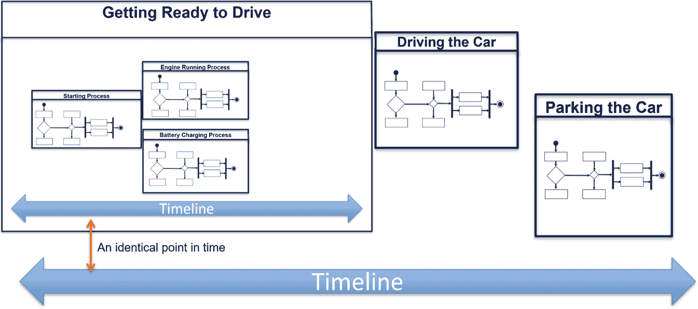

**Figure 8.3** Timeboxes placed on a timeline.

时间盒的概念与时间线结合使用时，允许以极大的灵活性表示复杂且相互关联的行为。总结迄今为止所说的内容，使用时间盒和时间线的主要好处包括：

1. 流程可以在与时间流逝的关系中显示，而无需将单个流程元素承诺到特定的时间点。
2. 可以显示计划在时间中发生的迭代和条件流程，而无需将其简化为一系列特定事件和活动。
3. 流程可以在时间上相互关联显示，而不暗示因果关系和直接联系。
4. 过去、现在和未来事件和活动的差异被纳入单一模型中。计划的（未来）活动随着不确定性的消除而无缝地流向过去。
5. 包含足够关于时间不确定性的信息，可以使用蒙特卡洛和其他仿真技术构建和仿真整体行为模型。
6. 使用不确定性容纳可变精度，以便开始、结束和持续时间可以用秒、分钟、天、月或年的尺度表示。图形工具中可以在时间上自动放大和缩小。

## 8.9 使用流程

任何一系列活动或动作，只要按顺序排列就是一个流程。公司可能有一个*新员工入职*流程，其中包括某人加入公司时执行的众多活动。一个家庭可能有一个早晨流程，其中包括使家庭准备好开始一天的所有活动。刷牙是一个流程，写书是一个流程，某人在线购买那本书也是一个流程。流程可能包括也可能不包括机器、计算机或其他系统的使用，并且可能提及也可能不提及它们的使用。*购买图书*流程可能描述图书是在商店、在线还是在庭院拍卖会上购买的。更复杂的流程，如新员工入职，可能使用多个系统来记录员工信息，但在纯流程描述中，这些系统不会被提及，或可能顺带提及并附注说明该流程涉及所提及的系统。

使用流程的概念源于观察，即基于流程的公认定义，所有用例也是流程。流程是概括的活动序列。流程的定义不需要参考系统或系统的使用（或不使用），因此可以得出流程必须是以下三种类型之一：

1. **手动流程。** 一种不使用任何技术系统进行的活动——完全手动的活动。
2. **使用流程。** 一种通过使用系统来实现目标或目的的活动。

### 组合过程。

上述两种类型的活动的组合。

不难看出，上述类型 (2) 的过程是一个用例。类型 (1) 的过程不包含系统的使用，因此不包含用例，而类型 (3) 的过程可能包含一个或多个用例。因此，将类型 (3) 的过程分解为类型 (1) 和类型 (2) 过程的组合是直接的。完成此操作后，用例变得显而易见，因为它们正是类型 (2) 的过程。将类型 (3) 过程分解为手动过程和用例之后，剩下的只有类型 (1) 和类型 (2) 过程——手动过程和用例。

由于用例本身也是过程，因此它们可以与其他过程组合成序列。在业务流程建模中，所有过程都是“兼容的”，也就是说，它们都可以彼此之间排列成序列。这是一个显而易见但微妙的观点。虽然将过程“做三明治”与过程“谈判和平条约”排列在序列中可能没有用，但这在流程建模的规则和方法内是可能且允许的。同样，将这些来自多个系统的用例作为过程包含在同一过程中也不会违反流程建模的任何规则。由于过程序列不属于也不绑定于任何特定的范围或系统，表示对各种系统使用的用例可以简单地包含在任何流程中。

代表用例且与用例相同的过程，即上述类型 (2) 的过程，被称为 `usage processes`。不是使用过程的过程将被称为普通过程。普通过程可能是不涉及系统使用的手动过程（上述类型 (1)）或涉及系统使用和手动过程组合的组合过程（上述类型 (3)）。组合过程稍后可以被分解并将 `usage processes` 与手动过程分离，也可以保持组合状态，因为所使用的系统在当前建模工作中并不重要。

保留类型 (3) 过程而不对其进行分解的最常见原因是，我们根本不关心其中发生的系统的使用。作为示例，假设我们正在设计一个航空电子系统来协助飞行员与空中交通管制塔的通信。我们想要描述的部分过程可能是飞行员在起飞前和起飞期间与塔台建立联系的过程。在描述该过程时，我们特别感兴趣的是涉及我们打算设计和构建的系统的 `usage processes`，因此我们会确保将它们分离出来并描述为 `usage processes`。我们对空中交通管制员在所描述过程中如何与其系统交互并不那么感兴趣，因此我们可以简单地将这些过程部分表达为组合或普通过程。

由于 `usage processes` 与普通过程不同，因此在流程图中用不同的符号来表示它们。这样，流程图的阅读者可以立即清楚哪些过程是 `usage processes` 并表示系统的使用，哪些过程是普通过程表示手动或组合过程。用于 `usage process` 的符号与在用例图上显示的用例符号相同——一个椭圆，`usage process` 的名称在其内部或下方。过程的常用符号是矩形或圆角矩形（有时称为圆角），因此椭圆在视觉上不同，使 `usage processes` 显而易见。颜色也可以用来进一步区分 `usage processes`。

在本章所述的这种新的行为建模范式中，所有过程都是 `usage processes` 或普通过程。必须不允许出现包含感兴趣系统的使用但在描述过程进行方式时不明确表示这种使用的过程。这样做会隐藏关于感兴趣系统需要做什么的重要信息——而这些信息是完全识别用例所必需的。这种集成业务流程和用例建模方法的明显好处是，用例可以直接从流程模型中读出，使得单独的用例建模过程变得不必要。系统工程团队可以直接继续描述在集成流程建模工作中识别出的用例的事件流。在考虑一些说明性示例之前，必须解决流程建模的另外两个方面：同时行为和责任泳道。

过程可以顺序发生或并发发生。所有流行的流程表示法，包括业务流程建模符号（BPMN）和 UML/SysML 活动图，都允许过程显示为在其他过程之前或之后发生，或与其同时发生。借用这种表示法，普通过程和 `usage processes` 可以按如图 Figure 8.4 所示的顺序或并发顺序显示。一个普通过程可以继续进行，同时系统被用作整体过程的一部分来执行某些功能。人事专员可能会使用系统来创建员工记录，同时员工的入职流程继续进行。或者，`usage process` 和普通过程可能是顺序的，如果例如员工记录的创建必须完成，入职流程才能继续。

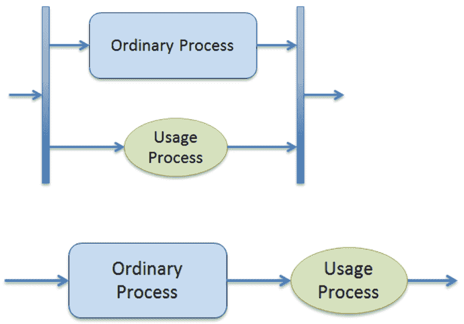

**Figure 8.4** Concurrent and sequential execution of ordinary process and usage process.

泳道在业务流程建模和用例建模实践中已在使用，表示特定过程的责任。对于普通过程，很明显泳道应代表负责执行该过程的实体——通常是个体或组织单位，如部门或组织。

对于 `usage process`，我们有两个选择。`usage process` 可以放置在代表将启动用例的参与者或该用例的系统的泳道中。在任何一种情况下，其他信息必须与 `usage process` 单独标明。换句话说，如果 `usage process` 放置在代表参与者的泳道中，则系统必须与 `usage process` 一起标明。如果 `usage process` 放置在代表系统的泳道中，则参与者必须与 `usage process` 一起标明。Figure 8.5 显示了前一种方法，这在图表清晰度方面更可取。一个原因是参与者可能已经有泳道，因为参与者可能对图表中的其他过程负责，因此无需为每个涉及的过程系统添加额外的泳道。此外，如果 `usage process` 放置在代表系统的泳道中，可能有必要在参与者泳道中包含一个额外的过程，仅表示参与者启动用例这一事实。如果没有这个额外过程，流程可能不清晰，因为 `usage process` 会紧跟某个无关的普通或 `usage process` 之后，暗示是那些启动了用例。

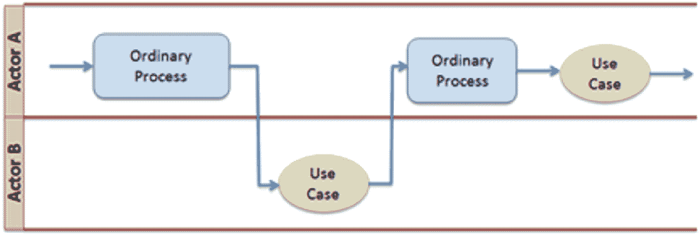

**Figure 8.5** Swim lanes showing responsibility for ordinary processes and usage processes.

## 8.10 Pilot Project Examples

在 2015 年开发使用流程和使用时段的过程中，进行了三个试点项目，以验证使用新范式概念创建模型的有用性、灵活性和易用性。

### 8.10.1 试点项目：红色十月追击战

第一个试点项目使用了基于流行小说和电影的熟悉的复杂行为集，*《红色十月追击战》*，这是一个关于现实军事交战的复杂故事情节。使用新概念创建整体故事情节的模型以及最终战斗序列的更详细模型被发现是简单而直观的。结果随后展示给两类受访者——一些具有业务流程和用例建模经验的人，以及一些没有此类背景的人。重要的是，在受访者看到完成的图表之前，没有向他们解释时段或使用流程，以便评估图表是否直观且易于理解，即使没有特殊解释或建模概念。

在回答问题时，受访者表示模型易于理解和跟随。事实上，受访者倾向于询问与内容相关的话题，这表明他们完全理解了模型，因此能够专注于其内容。电影整体时间线的时段模型显示在 Figure 8.6。使用流程的应用显示在 Figure 8.7a,b，重点关注潜艇 Konavolov 的鱼雷系统。在此试点项目中，表示鱼雷系统用例的使用流程位于鱼雷系统的泳道中。在此试点项目期间，得出结论认为更好的方法是将使用流程放置在每个用例的发起参与者的泳道中。在此示例中，图表将被简化，因为每个用例将被放置在 Konavolov 的泳道中，而仅仅表示发射鱼雷的活动将是多余的，可以被消除。

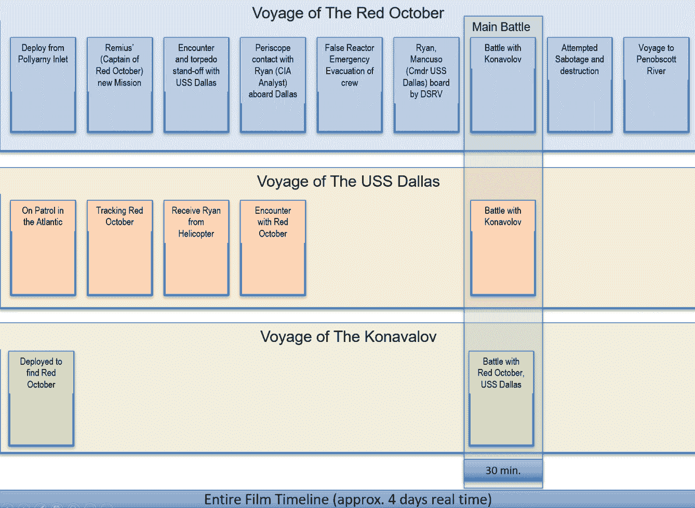

**Figure 8.6** Timebox model of The Hunt for Red October.

红色十月试点项目表明，任意复杂的行为描述可以使用时段和使用流程简化为简单的图表。项目参与者能够直观地理解图表，很可能是因为图表更接近人类心理模型中行为序列的表示方式。我们无法同时在脑海中保留数十个场景、参与者和地点，因此我们自然会将事物分解为时间的“块”，由时段表示，图表中显示大致的顺序和并发。当然，我们并不建议这些简单模型取代更详细的模型，但它们在高层次抽象下表示复杂行为、获得广泛理解并为更详细模型形成框架方面非常有益。

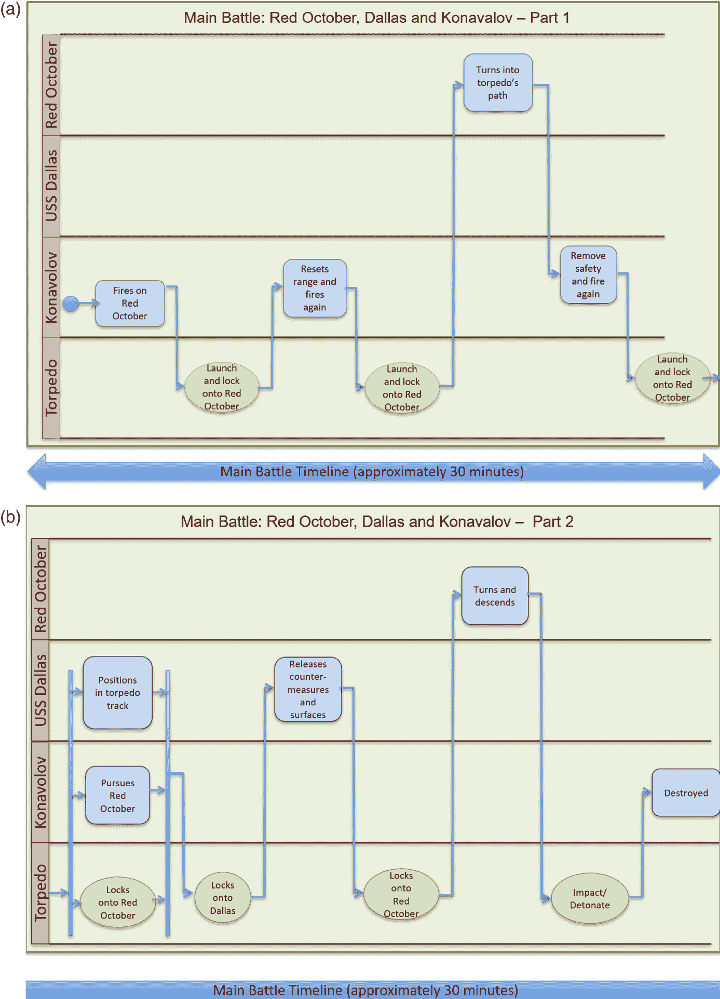

**Figure 8.7** Usage process model of Main Battle Timeline, (a) Part I and (b) Part II.

### 8.10.2 试点项目：FAA

第二个试点项目涉及美国联邦航空管理局（FAA）的系统工程师团队，他们提供了之前开发的业务流程和用例模型的样本。业务流程模型本意是为描述系统中所需的新功能提供基础，但正如我们所描述的，在许多情况下它们并未做到这一点，随后进行用例建模的系统工程师不得不从头开始开发用例模型。该团队有兴趣了解这两种活动如何以更高效、更少冗余的方式完成。

在 FAA 团队的输入下，对业务流程模型和用例模型进行了分析，并使用使用流程重新制定了一些流程示例。FAA 系统工程师对这些更改做出了积极回应，确认将之前在两个独立且未集成的模型中的业务流程和用例信息集成起来将带来显著益处。此外，还指出将之前负责创建两个独立模型的两个团队整合起来将带来额外效率，因为合并的工作将比两个独立的连续工作完成得快得多。此外，还发现新范式方法可以直接与内部客户组织一起使用，而不必等待客户组织先制定自己的业务流程模型，然后再请求新系统或系统增强。图 8.8 和 8.9 显示了 FAA 业务流程模型改造前后的示例。

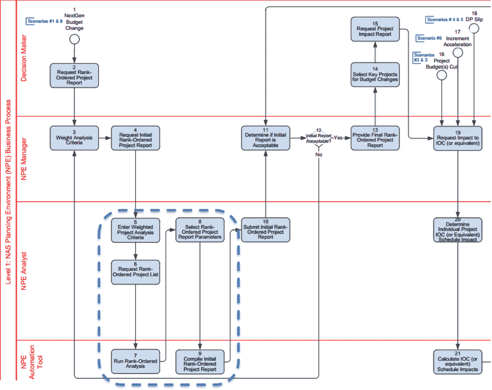

**Figure 8.8** FAA example business process before use of new modeling approach. ¶ Source: Used with permission from FAA.

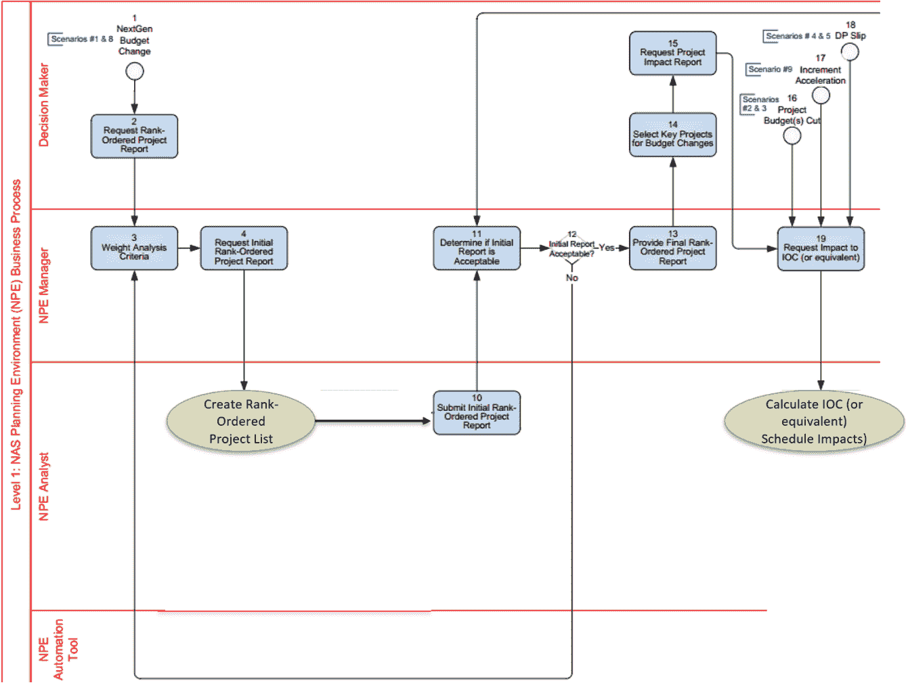

**Figure 8.9** FAA example with addition of usage processes. ¶ Source: Used with permission from FAA.

在 Figure 8.8 中，显示了原始业务流程图。大的椭圆显示了被确定为由使用系统的人执行的业务流程，因此可以用使用流程表示。在此示例中，几个业务流程（编号 5、6、7、8 和 9）实际上是单个用例的一部分，因此该组业务流程被单个使用流程取代，如 Figure 8.9 所示。新的使用流程被放置在表示参与者的泳道中，因为泳道已存在于图表上，并且 resulting 图表更清晰、简洁且直观。试点项目结束时，FAA 系统工程总监建议将新范式建模方法纳入 FAA 系统工程手册，并成为未来项目的推荐方法。

### 8.10.3 试点项目：IBM Agile 流程

第三个试点项目尝试将新范式建模概念应用于 IBM 开发的敏捷系统工程流程。由新系统工程流程的主要作者对 resulting 新范式模型进行的审查表明，该流程的清晰度得到了增强，并且新范式模型可能是向系统工程师解释和说明其方法和流程的更清晰、更直观的方式（Figures 8.10–8.13）。

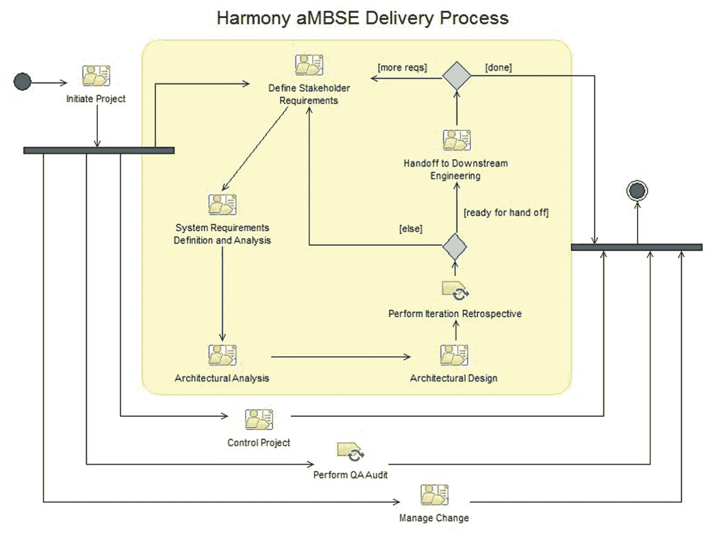

**Figure 8.10** Harmony AMBSE delivery process. ¶ Source: From IBM Harmony Agile MBSE Process (2015), used with permission from IBM.

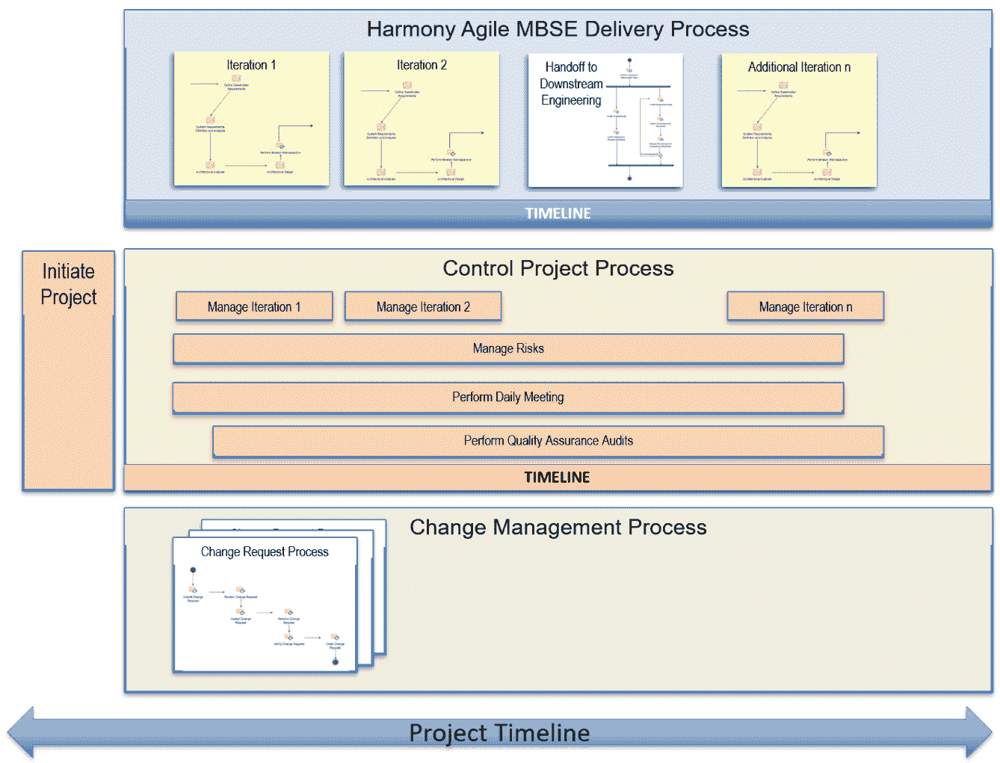

**Figure 8.11** Revised harmony aMBSE delivery process. ¶ Source: from IBM Harmony Agile MBSE Process (2015), used with permission from IBM.

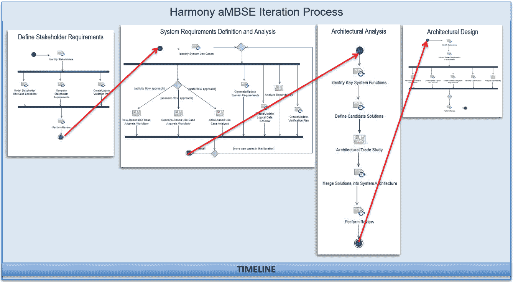

Figure 8.12 Harmony agile MBSE iteration process with notations. ¶ Source: From IBM Harmony Agile MBSE Process (2015), used with permission from IBM.

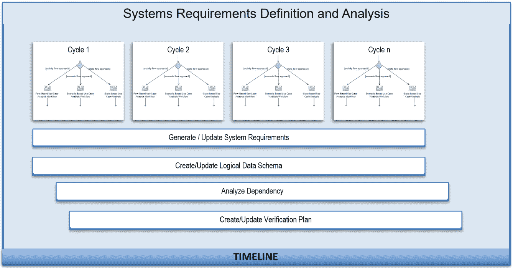

Figure 8.13 Revised harmony agile MBSE iteration process.

## 8.11 Summary: A New Paradigm Modeling Approach

在本章中，我们介绍了一种对系统行为建模的新方法。这种新方法在业务流程建模和用例建模方法的基础上进行构建并将其整合为一个单一流程，能够由几乎无需额外培训或背景的分析人员执行。使用这种新的建模方法可节省高达一半的传统方法中通常花费的时间、精力和成本，即先进行业务流程建模再进行用例建模。新建模方法产生一个更整体和集成的模型，将业务流程和用例信息纳入统一且集成的模型中。新方法中包含的两个主要创新是时间盒和用例流程。时间盒表达行为而无需要求活动的精确顺序，从而能够对近似或未知的开始时间、结束时间或持续时间进行建模。带时间线的的时间盒以相对顺序表达行为，而无需对绝对开始或结束时间进行精确指定或预测。用例流程允许将用例纳入业务流程中，产生对流程和在流程中使用的多个系统的用例的集成视图。

对于任何人来说，系统日益复杂并变得更加智能并不令人惊讶。抵御系统复杂性及其由此产生的非预期涌现行为的唯一防御手段是对系统有更完整和共同的理解。用例很有帮助，但仅适用于单一系统。新范式模型可以跨越多个系统的行为，展示它们如何作为一个整体协同运行。事实上，首次学习用例建模的系统工程师经常评论说，他们希望有一种方法来展示用例如何按顺序使用，即用户如何在特定情况下在一个完整的系统使用上执行，然后继续进行下一个，等等。带用例流程的业务流程建模恰好提供了这种类型的模型，展示的不仅是一个系统，而是在更大流程、任务或任务背景下可能使用的多个系统。

### 8.11.1 The Impact of New Paradigm Models

所开发的新范式建模概念适用于需要在业务或任务背景下开发和使用的新系统的情况。在系统需求开发之前，有时创建流程模型来描述新系统将被部署到的业务或任务背景。这种流程建模工作通常随后是系统需求开发工作，往往涉及用例的开发。新范式模型允许在一次通过中完成这两种类型的建模，从而节省项目时间和资金。集成方法的主要节省来自于避免与利益相关者就两个重叠且在很大程度上重复的主题进行重复对话——他们的业务流程以及他们在这些流程中期望的系统使用方式。

有几种类型的项目可以使用新范式模型，包括大规模 IT 软件开发项目、系统工程项目和流程建模项目。信息技术领域的大规模软件开发项目通常同时采用业务流程建模和用例建模。新范式模型可用于直接与业务利益相关者互动，在一个集成流程中同时捕获新软件将被部署到的业务流程，以及新软件的用例。诸如设计国防相关系统的系统工程项目可以使用新范式模型来概念化和记录使用流程和集成将为任务操作提供支持的系统的用例的操作概念（CONOPS）。

这些新模型可以由系统采购方——可能是军事组织——或设计和构建系统的承包商或集成商构建。新范式模型可以构成基于模型的系统工程方法的基础，进一步阐述使用第 6 章中描述的流程识别出的用例。新范式模型特别适用于创新国防系统开发，在那里新的能力不断被纳入，并越来越强调网络中心战和集成系统，因为它们能够表达在相同或不同时间、在不同地点发生的复杂行为。

新范式模型在设计需要与驾驶员、车外其他系统（远程信息处理）以及其他车辆和环境（自主操作）进行复杂交互的先进汽车的设计中也可能提供优势。随着物联网（IoT）的不断扩展和消费电子产品日益网络化，复杂性的增加也可能提示在这些产品的设计中使用新范式模型。

即使业务流程建模项目并非旨在作为软件或系统工程开发项目的先导，也可以使用新范式模型来产生比仅使用传统业务流程模型更清晰和更完整的流程模型。时间盒和时间线的使用可以使模型更具现实性和时间顺序组织，而不会引入甘特图式项目计划或分层分解流程模型的虚假精确度。因此，新范式模型也可以用于项目规划，并能够使用时间线和时间盒展示作为流程表示的复杂计划活动，而无需承诺对下属活动的完整详细时间表。

总之，本章所述的新范式和建模方法适用于软件开发项目以及大型系统开发项目的系统工程阶段，其中系统旨在由人员用于执行业务目的或任务，包括国防和军事系统、空间系统、运输系统以及复杂的医疗设备和系统。该建模方法也适用于大规模软件系统开发。除了成本和时间的节省外，使用新的建模方法还可以减少浪费和重复的利益相关者参与以及由此产生的挫败感。

### 8.11.2 The Future of New Paradigm Models

此处描述的试点项目是对新范式模型实用性的初步验证。由于该方法仍相对较新，建模工具并不具备内置的 `timeboxes`、`timelines` 和 `usage processes` 功能。当在建模工具中实现时，更灵活的模型和模型自动化可能成为可能，例如，`timeboxes` 的嵌套排列可能允许在单个模型内从非常高的抽象级别缩放至行为描述的非常详细的级别。`Timelines` 可能允许基于时间的、可执行的仿真，无论是正向还是反向方向。也可将注意力放在以非二维方式可视化新范式模型上。例如，`BPMN` 和 `UML/SysML` 都允许泳道垂直或水平绘制，或两者兼有，这可能允许表示行为模型中的额外方面。`Timelines` 通常被认为是<|message|> 一维的，但 Rosenberg 和 Grafton（2010）中包含了一个引人入胜的 1912 年的例子（第 182 页），即两条并行的时间线，一条表示火车旅程的开始时间，另一条表示结束时间，从而为一组火车产生一系列对角线。单条对角线的厚度可用于表示开始或结束时间的不确定性，这是一个在此引入的概念，用于 `timeboxes`。

鉴于 `BPMN`、`UML` 和 `SysML` 模型表示时间的有限能力，建议这些标准可能受益于纳入 `timelines` 和 `timeboxes`，作为在这些建模语言中组织流程表示的一种方式。`UML` 和 `SysML` 标准也可以从将 `usage process` 作为模型元素纳入中受益，可能作为活动元素的改编。

## References

1. Alotaibi, Y. and Liu, F. (2014). A novel secure business process modeling approach and its impact on business performance. *Information Sciences* *277*: 375–395. [`doi.org/10.1016/j.ins.2014.02.088`](https://doi.org/10.1016/j.ins.2014.02.088).

2. Bahill, A.T. (2012). Diogenes, a process for identifying unintended consequences. *Systems Engineering* 15: 287–306. [`doi.org/10.1002/sys.20208`](https://doi.org/10.1002/sys.20208).

3. Bergener, P. (2015). Detecting potential weaknesses in business processes. *Business Process Management Journal* *21*: 25–54. [`doi.org/10.1108/BPMJ-07-2013-0103`](https://doi.org/10.1108/BPMJ-07-2013-0103).

4. Brown, B. (2013). Goals for a new paradigm of behavior modeling. *Paper Presented at the Proceedings of the INCOSE International Symposium 2013, Philadelphia, PA* (26 June 2013).

5. Cantor, M. (2008). Risk and relevance. In: Proceedings of the 4th international workshop on Predictor models in software engineering, 1–2.

6. Deutch, D. and Milo, T. (2012). Business Processes: A Database Perspective. \[Electronic resource\]. San Rafael, CA: Morgan & Claypool.

7. Dhammaraksa, K. and Intakosum, S. (2009). Measuring size of business process from use case description. *Paper Presented at the Computer Science and Information Technology. 2nd IEEE International Conference on Computer Science and Information Technology, Beijing, China* (8–11 August 2009).

8. Gerth, C. (2013). Business Process Models. Change Management. \[Electronic resource\]. Berlin: Springer.

9. Glykas, M. (2013). Business Process Management. Berlin: Springer.

10. Hammer, M. and Champy, J. (1993). Reengineering the Corporation: A Manifesto for Business Revolution, 1e. New York: Harper Business.

11. Hruby, P. (1998). Mapping business processes to software design artifacts. In: European Conference on Object‐Oriented Programming, 234–236. Berlin, Heidelberg: Springer.

12. Kajdan, V. (2008). Bumpy road to lean enterprise. *Total Quality Management & Business Excellence* *19* (1/2): 91–99. [`doi.org/10.1080/14783360701602338`](https://doi.org/10.1080/14783360701602338).

13. Knauss, E. and Lubke, D. (2008). Using the friction between business processes and use cases in SOA requirements. *Paper Presented at the Computer Software and Applications. COMPSAC '08. 32nd Annual IEEE International, Beijing, China* (28 July 2008 to 1 August 2008).

14. Krogstie, J. (2013). Perspectives to process modeling. In: Business Process Management, 1–39. Berlin, Heidelberg: Springer.

15. Li, Y., Cao, B., Xu, L.D. et al. (2014). An efficient recommendation method for improving business process modeling. *IEEE Transactions on Industrial Informatics* *10* (1): 502–513.

16. Lübke, D. (2006). Transformation of use cases to EPC models. In: EPK, 137–156.

17. McSheffrey, E. (2001). Integrating business process models with UML system models. *Popkin Software*.

18. Mili, H., Tremblay, G., Jaoude, G.B. et al. (2010). Business process modeling languages: sorting through the alphabet soup. *ACM Computing Surveys (CSUR)* *43* (1): 1–56.

19. Mohapatra, S. (2013). Business Process Reengineering. Automation Decision Points in Process Reengineering. \[Electronic resource\]. New York: Springer.

20. Rosenberg, D. and Grafton, A. (2010). Cartographies of Time. New York, NY: Princeton Architectural Press.

21. Sinha, A. and Paradkar, A. (2010). Use cases to process specifications in business process modeling notation. *Paper Presented at the Web Services (ICWS), 2010 IEEE International Conference on Web Services*, Beijing, China (5–10 July 2010).

# Part III

智能系统中的系统思维

# 9

用系统思维解决难题

如 Chapter 3 中所述，系统思维的主要目的是解决系统中出现的问题。系统思维可应用于自然系统、工程系统和人类活动系统，这三种类型在 Chapter 3 中有所描述，但最常应用于人类活动系统和自然系统。这可能是因为在考虑工程系统中的问题时，最合乎逻辑的方法是参考系统的原始预期运行，并将其观察到的、有问题的行为与设计意图的行为进行比较。任何差异，被称为故障、缺陷或错误，都可以通过工程设计追溯到系统的特定部分。工程师深入到子系统、组件，最后到单个零件，以找到问题并通过修复或更换某些零件来解决问题。这是用于纠正工程系统中问题的正常故障-修复过程。如果系统曾经正常运行但现在运行不正常，则问题只能是一个或多个零件的故障。虽然系统中的两个不相关零件同时故障是可能的，但在大多数情况下，新出现的问题是由单个零件或一组密切相关的零件的故障引起的，而且即使如此，很可能只是其中一个零件是故障的起源。故障零件当然会“连累其他零件”，因此工程师学会寻找原始原因，即使修复可能涉及修复或更换多个零件。在工程系统中存在已知的、正确的运行状态，如果系统曾经在该状态下运行，则目标是将系统恢复到该正确运行状态。

## 9.1 人类活动系统与系统思维

人类活动系统和自然系统是不同的。它们更加动态，而且在大多数情况下并没有一个清晰可辨的、原始的、正确的运行状态。这些系统的部分本身就是活的，会自行生长和变化，因此它们所属的系统也会随之改变。对工程师来说令人沮丧的是，人类活动系统和自然系统不能像工程系统那样被调试。一个工程师家长可能会想象，与青少年人际关系挣扎的儿子或女儿是一个存在缺陷的系统，只需要修复即可，但家长很可能会对应用这种“修复”后的结果感到失望。

可能会让人惊讶的是，许多系统工程师对系统思维的理论和实践知之甚少。他们可能会认为系统思维就是他们所做的那种思维，毕竟他们是系统工程师。或者他们可能会认为系统思维就是思考系统。但正如我们在本章中将描述的那样，系统思维是一种有其自身概念、方法、技术甚至图表的方法和实践。为了进一步将其与系统工程区分开，我们指出两者在研究对象系统和目标或目的上是不同的。

在系统工程中，研究对象是一个工程系统。我们（或某个人、某个地方）知道（或应该知道）系统的需求、设计以及其工作原理。在系统思维中，研究对象系统通常是一个人类活动系统，而且往往极其神秘。它很可能是在时间中逐渐发展起来的，没有原始的、完整的设计。例如，一座城市可能曾有一些原始规划，但大多数方面都是有机生长的，由系统中的人类推动，形成了今天的样子。如果它在运行方式上存在问题，就没有设计者可以归咎。甚至很难称之为系统缺陷，因为这意味着系统本应以另一种方式工作，并且曾经以那种方式工作过，但现在出了问题，系统不再像过去那样运作。人类活动系统并非如此。它们一直在不断变化，而且方式在很大程度上是不可预测的。它们更类似于有生命的生物，因此人类活动系统实际上与自然系统有更多共同之处，而与工程系统则较少。

系统工程的目标是构思、设计、建造和部署满足预期用户需求、愿望和期望的系统。系统思维的目标是在系统中解决问题。有些问题并不难解决，因此快速观察到的线性解决方案最有效。如果问题是车库对新房车来说太小，那么不需要太多系统思维就能看出更大的车库可能是最佳解决方案。当然，我们可以用系统术语来表述问题和解决方案，谈论房车系统与车库系统之间的相互作用，但也许我们应该放弃思考，忙着打电话给承包商。系统思维更适合有时被称为 `wicked` 的问题——问题具有许多相互关联的方面，单一的简单干预不太可能解决问题。我们通常之所以知道这一点，是因为等到我们面对问题时，所有单一的简单干预都已经尝试过了。如果谋杀率过高，你可以肯定有人曾尝试简单地提高谋杀罪的惩罚力度，可能效果有限或没有效果。城市、社会或国家的谋杀率是一个 `wicked` 问题，具有许多相互关联的促成因素。它是系统思维的良好候选对象。如果一个问题长期存在，并且在真诚和认真的努力下仍抵制大多数改善情况的尝试，那么系统思维可能有所贡献。

## 9.2 系统思维的核心洞见

为了开始探索系统思维，让我们考虑系统思维的核心洞见，即 `the system is always working`。当我们观察系统时，这里我们主要思考人类活动系统，很容易认为系统 somehow 坏了。如果我们看美国司法系统，我们可能会注意到它导致了按人口比例监禁最多的人，超过世界上任何一个国家。很可能认为这个系统坏了，因为它监禁了太多人。然而从系统思维的角度来看，美国司法系统正在运作。它正以美国人民通过其政府代表所设计、实施并正在运作的方式运行。系统正在做它被设计来做的事情，并按照实施的方式运行。系统正在运作。然而人们仍然说监禁率太高，他们希望降低它。这在当前系统中无法实现，但当然系统可以被改变，然后它将成为一个不同的系统。如果所有监禁期限都被限制在 10 年以内，或者如果某类前罪被宣布为合法，就像一些州对大麻持有所做的那样？这些对系统的改变当然会影响监禁率，但系统思维不会止步于此。这样的改变是否会对所涉及的经济和社会系统产生其他影响，包括潜在的非预期后果？

再举一个例子，考虑失业率过高的担忧。首先，我们需要审视“过高”意味着什么，但我们将把这个问题留到后面关于问题表述的讨论。商业、经济和就业系统正在运作，并根据当前条件产生其失业率。失业率不能简单地通过把旋钮调到不同的数字来改变。要改变失业率，必须改变系统的一个或多个方面。系统正在运作。

作为对“系统总是在运作”这一洞见的 somewhat 戏谑的例子，我拥有一辆大型厢式货车多年。一天它开始发出奇怪的声音，就像我在路上行驶时压过减速带一样，但实际上并没有。并非一直发生，只在加速时发生，加速越猛，声音越大。有人假设系统（货车）不能正常工作，可能会着手通过识别故障部件并更换它来纠正问题。各种各样的机械师和技术人员都是这样工作的。他们假设系统中的某些东西坏了，然后开始更换部件，直到系统像应该的那样工作。这种方法有时对工程系统可行，但当然很少适用于人类活动系统——人们通常不能被宣布为有缺陷然后简单地更换。假设系统不能正常工作的方法也可能在工程系统上失败，正如货车故事所示。如果一个机械师假设系统中的某个部件坏了，开始更换部件，他或她必须一直工作到包括变速箱在内的部件更换方法才会解决问题。声音确实来自变速箱，但问题并不是变速箱坏了。对这种货车的留言板进行一些网络搜索显示，这种声音是变速箱在变速箱油和滤清器需要保养时发出的声音，这是一个非常简单且 inexpensive 的程序。对系统如何运作的了解使正确的干预能够解决问题。没有这种知识，唯一的方法就是更换部件直到问题消失。

作为一名学生工程师，我被教导了一堂相关的关于在系统中寻找问题的课程。与其假设某事坏了并不断更换零件直到问题解决，我被教导要想象系统是如何产生我所观察到的症状或问题的。换句话说，假设系统正在正常工作，并想象系统可能以何种方式产生这种被观察到的、不想要的行为。一旦理解了系统是如何工作的，干预措施可能会变得显而易见。当一位技艺精湛的机械师听着正在运转的发动机并宣布确切的问题及其解决方案时，这就是正在发生的事情。机械师将记忆中完美运转发动机的声音与实际听到的声音进行比较，并想象系统是如何产生这种差异的。随着经验的积累，机械师可能会显得像魔术师或心灵感应者。当然，这种魔力是系统工作原理的知识。当某人完全理解一个系统以及它是如何做它正在做的事情时，那么症状就可以导向原因，进而导向可能的干预措施。系统知识使得可能的干预措施能够根据它们对整个系统的影响来评估。说系统总是在工作并不意味着它正在产生期望的结果。当期望不同的结果时，就需要一个在某些小方面或大方面与当前系统不同的系统。如果你想要不同的结果，你就需要不同的系统。我们现在将注意力转向系统中的问题领域。

## 9.3 用系统思维解决问题

用系统思维解决问题遵循一个通用流程，尽管在某些情况下可以并行处理多个步骤或跳过某些步骤。以下是该流程的总结。

1. 1\. 识别一个问题
2. 2\. 找到真正的问题，或问题背后的问题
3. 3\. 识别产生该问题的系统或系统
4. 4\. 描述、建模并充分理解系统及其工作原理
5. 5\. 应用系统思维概念、图表、原型和杠杆点
6. 6\. 谨慎地提出系统干预措施
7. 7\. 测试和验证潜在的干预措施
8. 8\. 逐步实施解决方案

即使只是快速浏览，也很容易看出在处理人类活动系统中一些重要和大规模的问题时，并不总是遵循这一流程。并不罕见的是，人们识别出一个问题，跳到可能的解决方案，并一次性对所有人、所有地方实施，然后才发现会发生什么。立法者经常这样做——新法律会同时改变许多系统，其真实影响可能要到后来才会显现。法规、放松管制、税法、移民法，甚至某些物质的合法化，其影响都跨越社会、商业和经济系统。本章将逐步介绍系统思维流程的每一步。

## 9.4 识别问题

系统思维是关于以不同方式解决问题。要开始，必须有一个已识别的问题。识别真正的问题并不容易。经常，问题的初始表述只是某人解决方案或议程的伪装。如果有人说我们国家的问题是最低工资需要提高，这是一个对真正问题的良好表述吗？还是说这个人只是有承诺或议程要尝试提高最低工资？如果真正问题的真实表述是最低工资需要提高，那么这个问题只有一个解决方案——提高最低工资。系统思维要求我们更深入地审视情况。例如，如果每个人都赚得比最低工资多，提高它就不会有任何区别。这种情况下的真正问题可能更像是：某些地区某些工作中的一些人收入不足以在某些地区生活。这样看待真正的问题，我们就打开了视野，去了解导致我们所称问题的系统。

在我的系统思维课程中，我要求学生通过回顾当前的新闻出版物并思考我们社会或世界中令人担忧的事情来创建问题目录。挑战在于正确地表述问题，以至于它能导向理解问题存在的系统。多数学生一开始会从头条问题入手，并给出基于议程的问题表述。有人可能会写工程领域女性太少。真正的問題是什麼？如果问题确实是工程领域女性太少，那么我们是否应该强迫一些女性进入工程领域？或者我们是否应该以某种方式减少工程领域的男性数量？经过更多思考，可能是真正的问题是女性在某种程度上被阻碍或被劝阻进入工程领域。那是一个完全不同的问题。或者问题是不够的女性想进入工程领域？那也是一个不同的问题。

当谈到性别失衡问题时，必须小心不要假设问题是赤裸裸的歧视。在本书其他地方我们谈到了男护士和女护士。93%的护士是女性这一事实是否意味着问题是广泛歧视男性进入护理领域？不——可能存在歧视，但也许更可能是其他因素导致了护理领域的性别失衡。这里甚至存在问题吗？嗯，也许有。如果一个社会让孩子们认为护理是女孩的好职业而不是男孩的好职业，那么也许这就是失衡的来源。如果我们认为这种失衡是不好的，那么也许我们就有了一个很好的问题表述——孩子们被教导了不适当的职业/性别刻板印象。与此同时，我们需要问是否所有失衡都是问题。身高较高的人（男女）比身高较矮的人更多地参与大学和职业篮球。我们是否应该尝试鼓励更多矮个子的人打篮球？我们是否应该制定规则或法律在篮球招募中实施一种“身高盲视”？或者也许高个子的人只是对篮球更感兴趣，因为他们在游戏中拥有优势，使他们通常更成功。我们在这个阶段的目的仅仅是识别问题，这并不容易，对吧？

## 9.5 找到真正的问题

问题通常表现为当前情况与期望情况之间的差异或差距。使表述问题困难的是，差距的原因并不在问题的表述中显现。如果我将我的问题表述为*我赚的钱不够*，它并不能给我任何关于我赚的钱不够的原因的洞察。无论那个原因是什么，那就是问题。如果我已经在我的职业顶端但仍然赚的钱不够，那么问题几乎可以肯定是我的职业，应该表述为，我职业中的人们赚的钱不够。这还不太正确；我的职业中可能有人觉得他们赚的钱足够多。我应该真正表述问题为，我职业中的人们赚的钱没有我想要的多。现在我有一个可以着手解决的问题。

回到失业问题，在我们得出一个好的问题陈述之前，需要先问几个问题。失业的最佳水平是什么？经济学家一致认为，出于多种原因，零失业的经济是不健康的。也许在询问理想比率之前，我们应该先定义失业。用于计算就业者、失业但有能力且正在找工作者，以及不在劳动力队伍中的人之间的比率的失业衡量方法有几种，不在劳动力队伍中的人包括残疾人、退休人员、军人、学生、家庭主妇和被监禁者（[`www.bls.gov/cps/cps\_htgm.htm`](https://www.bls.gov/cps/cps_htgm.htm)）。最受欢迎且经常被引用的失业衡量指标是失业人数与整个劳动力队伍的比率。立刻我们就会注意到，如果我们想做的是让更多人工作，而不是依赖社会项目、家庭或其他支持，那么失业率对我们没有帮助，因为这些人不在劳动力队伍中。有趣的是，退出劳动力队伍的人会*降低*失业率——他们减少了分母，从而增加了失业人数与整个劳动力队伍的比率。我们找到解决方案了吗？要降低失业率，我们只需要让更多人*退出*劳动力队伍即可。这很可能不是我们开始解决失业问题时所想的。

在寻找真正的问题时，我们需要深入失业率背后，弄清楚我们实际想要改变或解决的是什么。我们是否在设想例如因企业或经济放缓而失业、正在找工作但找不到新工作的人——而我们需要帮助更多人重返工作岗位？解决这个问题的方式与思考例如自愿离职并因各种原因退出劳动力队伍的人大不相同。也许他们发现自己的技能已过时，对找到另一份工作感到沮丧，于是以某种方式决定退出劳动力队伍。2020 年，失业救济金的慷慨扩大被认为导致失业人数增加。这也许是问题的一部分？

在表述问题时，应用*五问法*过程会有所帮助，我们问*为什么*最多五次，以挖掘更深层次的原因和问题领域。为了举例说明，假设我们把人类产生的 CO[2] 排放及其对气候的影响作为问题领域。不要急于寻找解决方案，我们尝试表述问题。为什么人类会产生 CO[2]？因为他们需要电力和交通，而这些很大程度上由燃烧提供动力，燃烧会产生 CO[2] 作为副产品。为什么我们需要交通？为了上班、去商店和与他人会面。为什么我们需要去上班？等等。每个为什么都暗示了探索问题陈述制定不同路径的可能性。作为五问法的补充，请考虑*五种假设*。每当一个为什么问题得到回答时，也要问，*如果*。如果燃烧不是产生电力的必要条件会怎样？如果我们不需要旅行去上班会怎样？如果我们不需要工作会怎样？假设会导向如何能做到，从而诞生新的问题陈述。

自然地，在问题表述过程中，解决方案会浮现在脑海中。这没关系。它们可以被记录下来，但明智的做法是暂时不要深入探索，特别是不要对某种特定方法或解决方案产生迷恋。我们正处于系统思考过程的第一步和第二步，还需要在准备评估潜在解决方案之前完成第三步到第五步。在实践中，一旦你熟悉并熟练掌握整个过程，你会发现自己在应用系统思考时会非常迅速地多次在步骤列表中上下移动。想到一个解决方案就会直接导向思考系统、因果关系、系统模式、可能的干预措施、各种后果等，然后回到对问题有不同表述、产生新想法，等等。让我们进入下一步。

## 9.6 识别系统

一旦我们有了可行的問題陈述，并且确信它不是一种特洛伊木马，里面藏着某人预先准备好的议程式解决方案，我们就可以着手考虑产生该问题的系统。所有问题都是由系统产生的吗？从哲学上讲，如果宇宙中的一切都是系统，或是系统的一部分，那么当然所有问题都来自系统。更实际地说，那些尚未立即得到解决的问题很可能都是系统或一组系统的产物。如果一个问题简单直接到可以在没有任何系统考虑的情况下完全解决，那么它很可能已经得到解决，我们也可能不会在讨论它。

我们在这一步的任务是识别产生该问题的系统或一组系统。这里的重要问题是，在刻画系统时要进行到什么程度。失业问题当然涉及经济，但为了解决这个特定问题，我们是否需要考虑地方经济、国家经济，甚至全球经济？如果问题涉及你公司的工作士气，系统可能是部门、事业部、公司，甚至可能是公司所在的行业。恐怖主义问题通常在地方层面解决，即问题只涉及恐怖分子和受害者。问几个为什么问题可能会把我们引向更大的系统，也许是相关国家或甚至全球价值体系及其差异。我们需要进行到什么程度，由我们感觉对系统理解得足够好的那一点决定。这无疑是一个主观判断，但重点是继续理解系统，直到达到足以预测干预结果的信心水平。

我学生的最爱问题领域之一是交通。大多数大城市的交通足够拥堵，以至于对人们来说是个问题，因为延误、事故、维修封闭和其他烦恼，更不用说其他司机的不良行为了。乍一看，产生交通的系统只是道路和车辆——一方太少，另一方太多。这就是全部了吗？道路只是交通基础设施的一部分，该基础设施为通勤者和其它旅客提供选择。如果交通问题集中在早晚高峰时段，系统必须包括要求员工在这些时段上班的企业，以及影响交通和道路的其他系统，包括附近的施工、收费，甚至可能是太阳本身（听说过傍晚西向道路上的阳光减速现象吗？）。

1996 年，奥运会来到亚特兰大时我住在那里。当然，每个人都担心交通末日，并在媒体驱动的恐惧的煽动下，大多数司机发誓在比赛期间不上路。许多雇主允许当时不可思议的事情——让人们在家工作，而 Marta 地铁系统创下客流量纪录，伴随着拥挤和延误。有趣的讽刺是，最后在奥运会期间穿城最好的方式是开车，因为道路基本空旷。重点是，我们认为交通是不可避免的，但正如奥运会，以及最近的 COVID-19 所显示的那样，交通不是一个固定现象。经济学家会指出，随着燃油价格的每次上涨，人们的驾驶量会略有下降，显示汽油需求在某种程度上是弹性的。

公平地说，初始识别出产生问题的系统有点像是猜测。在不知道系统如何产生问题之前，我们无法确定自己是否已经把握住了需要处理的整个系统。没必要纠结于找到正确的系统，或系统集合。事实上，如果我们把问题看作一个大系统的问题，或是一组相互关联的小系统的问题，区别并不大。既然我们通常谈论的是人类活动系统，那么最初在何处、以多大的范围划定系统边界，差别也不大。

## 9.7 理解系统

一旦我们能够识别出产生问题的系统，我们就开始尝试理解这个系统。在系统思维中，理解一个系统并不意味着我们仅仅能够识别它、描述它并命名其组成部分。我们所需要的理解方式是指理解系统中的因果关系。在此我们需要对因果的本质做一个简短的旁述。当我们说一件事导致另一件事，即 A 导致 B 时，我们的意思是 A 的变化导致 B 的变化。我们可能认为这是一种简单的关系，例如 A 的增加导致 B 的增加，但这并非全部。如果 A 不是导致 B 的唯一原因，A 的增加可能会被其他原因掩盖，B 仍可能减少。我们说 A 是 B 的原因这一陈述是正确的，但我们仍可能看不到 A 每增加一次 B 就增加。我们可以更准确地表述因果关系为：如果 A 增加，那么 B 将比在 A 没有增加的情况下增加得更多，或者 B 将比在 A 没有增加的情况下减少得更少。

在系统思维中，把所有原因都视为部分原因是有意义的。系统思维通常处理的是复杂的<|message|>人类活动系统，因为大问题就出在那里。在这些系统中，很少有什么是由单一因素造成的。举个例子。在 1980 年代，美国总统罗纳德·里根说：“我们必须拒绝那种每次法律被破坏时就认为社会有罪而非违法者有罪的想法。是时候恢复美国的原则，即每个人对其行为负责。” 这是好的系统思维吗？里根总统说犯罪责任是*要么*个人*要么*社会，这正确吗？也许犯罪远不止单一原因。如果我们问，为什么那个人在那个时刻犯了那起罪行？答案并不简单。原因的一部分当然是那个人决定采取犯罪行动，但我们必须接着问，为什么那个人会做出那个决定？如果我们说，是因为那个人贫穷且需要钱，这似乎不正确，因为有许多、许多贫穷且需要钱的人并没有犯罪。如果我们试图声称一个人的种族、年龄或生活状况完全负责，我们同样会发现有许多具有相同因素的人并未犯罪。与此同时，我们可能会发现系统中存在模式和部分原因。如果在两组在所有因素都相同、仅收入不同的人群中，我们 consistently 发现低收入群体犯罪更多，那么我们可以认为这是一个因果因素。然而，我们可能会发现教育水平是一个更强且更能预测犯罪行为的因素。另一方面，我敢打赌这种关系本身也并不简单，而是会因犯罪类型而异。所谓的白领犯罪，如税务欺诈、挪用公款、内幕交易等，可能更偏向受教育程度较高的人群，而暴力犯罪可能在教育和 socioeconomic 水平较低的人群中更普遍。某些类型的犯罪，甚至在某些情况下的某些类型的犯罪，可能具有不同的因果模式。仅就合法持枪而言可能无法预测犯罪，尽管我猜测拥有枪支的家庭中在家中发生的枪击事件可能比不拥有枪支的家庭更多。如果许多暴力犯罪是用非法获得的枪支犯下的，那么对合法获取枪支施加更多控制可能没有任何区别。标题性的问题“更多的枪是否导致更多的犯罪？”并不是一个容易或简单就能回答的问题。

系统思维最迷人的方面之一在于它如何通向众多不同的领域。系统思维可能是一个误导性的术语，因为系统思维的工作很大程度上感觉更像是研究，而不仅仅是坐下来思考。系统思考者/研究者必须大胆地深入科学、心理学、技术、逻辑、经济学、人类学、概率和统计等领域，才能充分理解我们世界中最重要的系统。在这个列表中，概率和统计可能是清晰系统思维最根本必需的学科。我同情那些认为我们应该在儿童早期就教授概率和统计，甚至以牺牲三角学、几何学和微积分为代价的人类。人类在良好的统计和概率推理方面被发现相当不足。以下是几个例子。

假设你了解到某种行为，例如吃花生酱，会使你患癌症的风险翻倍。你可能会感到震惊并发誓永远不再吃花生酱。但当你深入了解后，你发现一般情况下患癌症的几率，无论是否吃花生酱，都是百万分之一。吃花生酱使其翻倍到百万分之二。现在，你对花生酱就不那么担心了。如果你抛硬币六次，六次都是正面的几率是多少？为了更具体，重复六次抛掷多少次才能有 50% 的几率出现六次正面？答案 32 可能会让你惊讶。德克萨斯大学奥斯汀分校的迈克尔·斯塔伯德教授用他的学生来说明这一点，他让每个学生都做六次抛掷并记录结果。在 64 人或更多人的班级里，他几乎可以保证有人会抛到六次正面。他通过问那个人他的秘诀来进一步强调这一点——你是如何做到抛六次正面的；是手腕的问题吗？对当事人来说，这是一个令人惊讶且意外的结果，但在满屋子抛硬币者的大背景下，这完全符合概率逻辑。怎么样：在一个五十人的房间里，两人同一天生日的几率是多少？你可能会惊讶地得知几率超过 97%。这些有趣的例子的要点是，我们天生并不擅长概率估计。我们可能永远无法对概率事件形成良好的直觉，但通过教育，我们至少可以学会暂停，做几个简单的计算，然后获得正确的资讯来推理系统。

理解系统也涉及避免被欺骗。我有一个在研讨会上展示的例子，叫做“布朗博士的神奇灵药”，这是一种神奇的饮料，无论你有什么样的疾病，它都能让你感觉好转。它是这样运作的。大多数常见疾病或慢性病的状态每天都会变化，患者会有好日子和坏日子。布朗博士神奇灵药的使用说明说，你应该在坏日子里服用它，到第二天或最迟在两天内就会让你感觉好转。在研讨会上我展示了改善数据的图表，结果确实如此，服用它的人中有 76% 在第二天就有所改善，超过 90% 在第二天内有所改善。在研讨会上的每个人还没来得及点击亚马逊购买之前，我就会透露，所有数据都是随机生成的。每个虚构受试者在“临床试验”中的每日感觉水平都是 1 到 10 之间的随机数。总体平均值当然是五。所以当某人感觉低于五时，他们就会服用灵药。然而，魔力并不在于灵药，而在于一种叫做 `reversion (or regression) to the mean` 的现象。随着时间的推移，随机生成的数字序列会趋向于平均值。因此，当某个值低于平均值时，之后最可能出现的情况是数字向上趋势；当值很高时，最可能出现的情况是数字向下趋势，在这两种情况下都趋向于总体平均值。由于我们仔细指示顾客只在感觉不佳时，即低于其平均值时服用灵药，他们的感觉之后很可能会向上趋势。当然灵药是无用的——无论是否服用灵药，他们的感觉在坏日子后很可能会改善。服用灵药产生的安慰剂效应甚至进一步增加了其被认为的有效性。无数以百万美元计的资金都是基于这个想法来销售各种补充剂的。正如你可能注意到的那样，即使是真正的临床试验也会显示这些虚假结果。只有增加一个不服用灵药的对照组，或者更好的是服用安慰剂灵药的对照组，才能显示出灵药没有效果。系统思考者必须熟悉系统如何欺骗人们相信根本不存在的因果效应。

### 9.7.1 Rocks Are Hard

在识别系统和问题原因时，一个常见的陷阱是我喜欢称之为“石头很硬”。如果我们对问题及其产生系统的分析有时会让我们得出一个结论，即将问题归咎于一个固定且不可改变的真理。我们用一个关于山路的寓言来说明，这条山路经常有自行车手和摩托车手经过。最近，骑手被从山上掉落的石头击中的事件时有发生。当然，这是一个问题，所以我们进行调查。我们发现问题是石头正在伤害骑手。然后我们问为什么石头会伤害骑手，显而易见的答案是石头很硬——这就是它们伤害骑手的原因。如果我们得出结论，我们已经完全理解了导致伤害的系统，我们就达到了对问题和系统的“石头很硬”表述。石头很硬确实是受伤的原因，但这本身并不是一种解释——石头*就是*硬的，这就是我们称它们为石头的原因。如果羽毛从山上掉落，就不会造成伤害。问题不在于石头导致伤害——这就是石头做的，因为它们很硬——问题在于石头从山上掉落。当然，在这个简单的寓言中，这一切都很清楚，但我们很容易在各处找到“石头很硬”对问题的解释。当新闻文章解释说中产阶级工人买不起房子是因为他们赚的钱不够时，这就是“石头很硬”——我们所说的*买不起*，就是指他们赚的钱不够。什么也没有被解释。那些通过展示谋杀、枪支暴力、袭击事件的增加来“解释”暴力犯罪增加的故事毫无意义，因为这些事情就是我们所说的暴力犯罪。说污染的原因是公司把废物排入河中，鱼类和鸟类受到负面影响，这并不能让我们有所进展——这就是我们所说的污染。污染是坏的。石头很硬。美国肥胖的原因是什么？如果你想说是因为人们吃得太多，你就陷入了“石头很硬”的陷阱。

在处理人类活动系统时，了解一些心理学知识会有所帮助。由于我们通常只对系统的行为感兴趣，我们可以采用更行为主义的心理学方法，例如流行认知行为疗法中使用的方法，而不是精神分析中使用深度心理学观点。系统思考更关心人们做了什么，而不是他们想什么或感觉什么，除非能确定这些与他们行为之间的因果关系。假设我们处理的是自杀问题，并试图理解产生我们观察到的自杀率的系统。我们可能会假设抑郁是原因的，它在某种程度上可能是，但有很多抑郁的人并没有自杀甚至尝试自杀，所以必须有其他“更具因果性”的原因。我们可以通过提出系统思考中的一个重要问题来概括这一见解——为什么它没有发生得更多？

在试图理解一个系统时，自然要问的问题是，为什么我们感兴趣的现象会发生——在本例中，为什么会发生自杀？提出这个问题很重要，但只问这个问题会导致对系统的扭曲理解。如果我们看肥胖和饮食领域，我们可能会问为什么人们会变得肥胖。一个答案可能是他们吃得太多。如果我们问为什么他们吃得太多，我们可能会回答他们喜欢食物，或某些种类的食物。如果我们就此停止，认为我们理解了人们为什么会变得肥胖，我们就没有完整的理解。喜欢食物并不总是导致肥胖。我们必须问，鉴于肥胖，为什么甚至不是更多的人变得肥胖？截至本文撰写时，美国的肥胖率约为 36%，但我们应该问，为什么它不是更高？毕竟，大多数人都喜欢食物，那么为什么不是每个人都肥胖？为什么肥胖的发生没有比现在更多？这个问题会引导我们找到其他正在起作用的因果因素。例如，我们可能会回答，有些人非常重视保持健康，或至少不超重。如果这是正确的，那么它就是有助于限制肥胖的原因。如果我们忘记问，为什么它没有发生得更多？我们可能会对系统产生有限或不足的理解。

如果我们问为什么一个人犯了罪，答案是这个人具有属性 *x*、*y* 和 *z*，我们需要立即问是否有其他具有相同属性的人没有犯罪。如果有，那么就有其他正在起作用的原因，我们必须揭示这些原因才能全面理解系统。如果我们问为什么一个成长于不利环境、属于某个种族或社会群体的人在生活中的社会经济成就较低，我们回答这是因为他们的不利环境，我们还必须问是否有在相同环境中成长但社会经济成就好得多的人。如果有，那么原因就不仅仅是环境，改善环境可能对每个人的结果产生戏剧性影响，也可能没有。与此同时，我们还应该问是否有在非常优越的条件下成长却未能取得我们可能期望的高社会经济结果的人。如果有，原因是什么？

让我们来看一两个相反的案例。假设我们观察到某人取得了显著的成功，也许是诺贝尔奖提名，我们想知道原因。如果我们推断这是因为他的成长环境、受过高等教育的父母以及能够就读最好的学校，那么我们需要问，有这些因素的人是否都会获得诺贝尔奖提名？当然不是，所以原因一定还有更多，而且事实上我们迄今为止确定的因素可能与我们尚未发现的因素相比甚至不重要。如果我们看一家取得伟大成就的公司，我们总能找到商业书籍详细描述该公司所使用的所有美妙的哲学、战略和管理实践，这些共同促成了他们的成功。系统思考者应该想，好吧，等等——难道没有其他公司拥有同样的哲学、战略和实践却没有取得成功吗？我们在这里看到的是幸存者偏差的例子：简单事实是，当我们去分析成功的企业时，我们唯一可以检查的只是那些幸存下来的企业。其他企业已经消失，无法被检查。我们也看到了成功偏差，即我们可能只分析成功的公司，因此我们的结论会偏向于那些恰好成功的人。对系统思考者来说很有趣的是，一个已知是随机机会的函数，当结合成功偏差和幸存者偏差时，可以催生出一种关于如何在该特定领域取得成功的完整哲学。前面提到的课堂抛硬币就落入了这个陷阱。那个“成功”连续六次正面的人与所有其他人没有什么不同，但他是“成功”的人，因此他的属性和行为很可能会被树立为如何成功地稳定抛硬币的榜样。

### 9.7.2 心与灵魂

由于本书是关于智能系统的，让我们再从人工智能领域考虑一个例子。在很久以前，心脏被认为是一个神秘的器官，是人的心智、灵魂和存在的核心。如果心脏停止跳动，人就被认为死了。我们在语言中保留了这一想法，当我们说把心投入某事，或在爱情中把心交出去时。心脏的神秘消失了，因为我们了解了大脑的作用。在那之前，我们可能会假设，如果我们替换某人的心脏，无论是在类似弗兰肯斯坦的实验室实验中，还是用人工心脏替换，在手术后醒来的人会变成另一个人——毕竟，心脏，情感的座位，和灵魂，已经被改变了。现在我们知道心脏只是一个泵，可以用人工泵替换，甚至是最新发展中那种不跳动而是持续泵送的泵。我们发现，拥有这样一个人工心脏，甚至没有心跳的人，预计会是同一个人，具有相同的思想、身份和个性。我们理解心脏，因此可以用人工装置替换它，同时保持患者的个性不变。大脑则不同。我们目前的科学还不足以很好地理解大脑来制造替代品，如果我们能够进行大脑移植，我们根本不会期望那个人醒来时还是同一个人。一个有趣的思想实验是想象将一名车祸受害者的健康大脑移植到一名脑死亡者的健康身体中——哪个人被救了？通过理解称为心脏的系统，我们可以确定如何修复它甚至替换它，同时保持人类整体系统像以前一样运作。我们不理解大脑系统，因此我们很少能够修复它，我们也无法替换它，或制造一台能做它所做事情的机器。

想象一下，如果我们对大脑有心脏级别的理解。我们可以设想对某人的大脑进行一些读数或测量，然后制造一台做那个人大脑所做事情的机器，创造一个替代大脑或某种该人思想的克隆体。人工智能研究中有一些方法试图，不是模仿大脑在软件中的行为，而是真正创造一个合成大脑。这些努力受制于我们对大脑及其工作原理的非常有限的理解。完全理解一个系统是一项很高的标准，但如果我们要解决复杂系统中的复杂问题，我们必须努力达到这种完全理解的水平。

正如我们所说，理解一个系统围绕着理解系统中的因果关系展开。Judea Pearl 在他的 `Book of Why` 中，围绕一个看似简单的想法发展出一种新的逻辑系统，即一件事可能看起来导致另一件事，因为它与之明显相关，或因为它在时间上是可靠的前因。当孩子满六岁时，他们开始正式教育。满六岁总是发生在孩子入学之前，非常可靠，但显然不是满六岁导致孩子入学，而是孩子父母的行动导致他们报名并把孩子送到校舍。对系统思考者来说，看到这种区别至关重要。我们很容易在我们的因果回路图中从 `reaches age six` 画一条箭头到 `starts attending school`，但认为这是系统的工作方式将是一种扭曲的观点。我们可能会错过父母的行动是必要的，以及支持或阻碍这些行动的任何因果因素。Pearl 强调，真正的因果既要求原因总是产生结果，也要求移除原因能可靠地移除结果。孩子满六岁并不总是产生开始上学的结果，这让人怀疑它不是因果的，或只是部分因果，但可能被其他更强的原因克服。我们还注意到，孩子有时在未满六岁时就开始上学，这使得满六岁不太可能是实际起作用的原因。

在理解系统的追求中识别真正的因果，是一项高尚但困难的追求，充满了好奇的陷阱和欺骗。几乎就像它从一开始就被设计成一个谜题。另一个我最喜欢的陷阱叫做把效果误认为是原因。乍一看，这听起来像疯话——谁会把一个效果误认为是同一现象的原因呢？雨落下，草坪家具被淋湿——原因和效果很清楚。也许并不总是那么明显。很明显的是，效果与原因相关。它们必须是，否则它们就不能是那些原因的效果。效果也可能与非因果因素相关，比如服用 Dr. Brown's Miracle Elixir 后一两天感觉好转，但当然真实的效果与它们的原因相关，除非被其他更强的原因淹没。同样真实的是，原因与效果相关。忠实的跑步者在跑步的日子里感觉更好——这是原因吗？感觉良好与跑步相关，表明跑步是原因而感觉良好是效果，但跑步也与感觉良好相关，表明感觉良好是原因而跑步是效果。那个人是因为跑步而感觉良好，还是在感觉良好的日子里跑步？

### 9.7.3 混淆因果

# 相关性并非真正可交换

相关性并非真正可交换。如果 A 与 B 相关，并不意味着 B 与 A 相关在数学上是必然的，但这种情况经常发生，或被认为是在发生。如果我们看到很多健身的人吃水果，而且很多吃水果的人都很健身，那么很难看出哪个是因果因素——我们不能断定吃水果会让一个人更健康，也不能说健康会让人吃更多水果。为了举一个有点好笑的例子，让我们继续谈健身，但来看静息心率。众所周知，健身和运动的人的静息心率比不健身也不运动的人更低。这意味着低静息心率与健身相关。如果我们研究静息心率低的人，我们也可能会发现其中足够多的人是健身和运动的，从而也显示出健身与低静息心率之间的相关性。如果两者都成立，我们可能会困惑哪个是原因，哪个是结果。如果我们想象低静息心率是原因，健身是结果，那么我们可能会想通过降低静息心率来让人们变得更健康。我们可能会给人们服用美托洛尔，或其他β受体阻滞剂，从而降低他们的心率和血压。虽然这些药物在治疗其他疾病方面有重要且有效的用途，但当然不太可能，甚至很荒谬地期望通过医学手段降低某人的心率会让这个人变得更健康、更运动。我们会把一个结果（心率低）误认为是原因（健身）。

## 确定因果关系

确定系统中因果关系如何运作是了解系统如何运作的重要组成部分，为此开发了一种图示来方便地展示因果关系。在复杂的系统中，通常是我们面对难题时所遇到的系统中，存在许多因果关系，因此跟踪它们最好通过图形完成。在最简单的形式中，因果回路图显示系统中从具体和有形到一般和抽象的量，然后使用箭头显示一个量的增加如何导致另一个量的增加（或减少）。量可以代表可实际量化的信息，例如出生人数、死亡人数或医院入院人数，也可以更抽象，如信心程度、良好声誉、被大学录取的机会，或成功发射的可能性。只要能合理地说某事物在增加或减少，它就可以出现在因果回路图中。不能出现在因果回路图中的是不能上升或下降的东西，比如气候，或住房。更具体的像纽约 100 年平均气温，或迈阿密目前市场上房屋的数量，就可以。因素在因果回路图中可以是原因，也可以是结果，或者更常见的是两者兼具。

## 构建因果回路图

因果回路图可以通过从系统中任何地方开始来创建。首先识别系统中一个因素，然后问，是什么导致该因素上升或下降，或该因素导致哪些其他因素上升或下降。从原因画箭头指向结果。根据惯例，如果因果关系为正，意味着原因的增加往往导致结果的增加，我们在箭头的头部加上一个加号（+）。如果在箭头头部加上一个减号（−），则表示当原因增加时，结果往往会减少。记住我们必须说*往往*，因为其他因素可能会压倒或*淹没*任何单一因素。在道路上增加一条车道，增加道路容量，往往会减少城市的通勤时间，但如果城市增长足够快，即使有道路扩建，通勤时间仍可能增加。通勤时间会比*如果没有*道路扩建时更少，但仍可能实际不减少。没有理由把*道路扩建*画成*道路容量*的因果因素。这两者在不同术语下是同一件事；把它们作为因果关系显示只会使因果回路图变得杂乱，而不会增加任何重要信息——这是一个*石头很硬*的解释的例子。

## 平衡反馈回路

如果你在系统中绘制足够多的因果关系，很快就会出现一些模式。其中最常见的模式称为平衡反馈回路。考虑为一个由简单恒温器控制的家庭供暖系统绘制因果回路图。我们可以先从*当前温度*到*热量输出*画一条因果箭头。随着房屋内当前温度下降，热量输出会增加。然后我们必须从*热量输出*再画一条箭头回到*当前温度*，表示热量输出增加会导致当前温度升高。到目前为止我们画的内容并不错误，但它没有讲述系统如何运作的全部故事。如果家庭供暖系统按我们目前画的方式工作，供暖系统会一直快速地开关。原因如下。假设恒温器设定为 70°。当温度下降到 69.9°时，供暖系统打开。然后当当前温度再次上升到 70°时，它关闭。这种持续的开关对系统来说效率不高。我们真正想要的是一个*死区*，即供暖系统保持关闭的温度范围。典型的死区约为 2°。我们可以通过把第一个要素称为类似*呼叫供暖*的东西来修改我们的图示，这意味着当当前温度下降到 69°时，系统呼叫供暖，当当前温度达到 71°时停止呼叫。这是有道理的，因为真正导致热量产生并不是房屋内的当前温度，而是当前温度与恒温器设定值之间的差异。我们画的两条箭头形成一个平衡反馈回路，因为一个因素增加会增加另一个因素，但另一个因素增加时又会减少第一个因素。平衡反馈回路总会稳定到一个稳态，因为它平衡了相互影响的两个因素。它会像恒温器维持房屋温度一样发挥作用。

平衡反馈回路不仅限于两个因果因素。价格、供给和需求之间众所周知的关系就是一个很好的例子。更高的价格导致需求降低，需求降低导致销售降低，销售降低导致供给增加，供给增加导致价格降低。在正常情况下，这个平衡反馈回路会使价格保持在可控范围内。当绘制成因果回路图时，平衡反馈回路可以通过观察一个完整的因素环来识别，其中所有符号都是正的，除了一个负的。对这个系统的完整描述会增加可能导致供给降低、需求升高或弹性变化的额外因素，弹性表示买方愿意放弃或替代其他东西的意愿。汽油价格因多种原因波动，其中一个是需求。夏季度假季节过后，驾驶减少，汽油价格会下降。在足够高的价格水平下，一些人会放弃驾驶。这里我们使用几乎每个人都知道并理解的例子；重点是因果回路图可以帮助我们推理这种类型的关系，并向不了解它们的人传达这些关系。

因果回路图中看到的另一个主要模式是强化反馈回路。在这种回路中，所有因果关系的符号都是正的（或全部为负），导致回路自我强化，无休止地增加（或减少）。在我们所处的系统世界中，存在着许多正在运行的强化反馈回路的例子，尽管看似无限的强化往往会被其他外部力量所制约。一辆车滚下山坡，会获得动量，这有助于它滚得更快，获得更多动量，使其滚得更快，无休止地持续下去，直到达到终端速度、撞车或有人踩刹车。

一个系统同时具有平衡反馈回路和强化反馈回路同时运行的情况非常常见。在自由市场中，随着新产品采用率的提高，新的采用者数量也会增加，这当然会导致采用率进一步提高——这是一个强化反馈回路。看起来采用率可能会无休止地增加，但同时也存在一个平衡反馈回路在起作用。随着采用率的提高，可供采用的采用者越来越少，而潜在采用者的减少会起到降低采用率的作用。这两个回路共同作用，会导致一种均衡状态，采用率稳定在可持续的速率上，而强化反馈回路则被平衡反馈回路的存在所调节。这有点像往带溢流排水口的水槽里注水。大多数情况下，水槽会注满到溢流排水口，排水速度足够快，可以防止水槽溢出，但如果向水槽注水的流量增加到一定程度，溢流就跟不上了，水槽就会溢出，水会无限地积到地板上。同样，在需求急剧增加的市场中，如 COVID-19 初期因恐慌性抢购而出现的卫生纸市场，供需无法跟上，即使价格不断上涨。系统被淹没并不堪重负，直到有更多供应得以生产。因果回路图及其所支持的推理有助于理解这些甚至更复杂的系统。系统思考者们常被看到盯着他们的因果回路图发呆，想知道是否还有尚未捕捉到的原因，或是原因之间应添加的关系。

因果因素的概念及其在因果回路图中的描绘是直观且简单的，但对于新从业者来说，存在一些细微差别和常见错误。其中之一是，并非所有原因在程度上都是相等的，即使因果回路图看起来是如此。大学毕业生在其职业生涯中赚的钱远多于高中毕业生，而拥有高级学位的人赚的钱更多。进入顶尖大学的人也比没进入的人赚得多。但完全有可能的是，任何大学的硕士学位持有者，其收入会超过顶尖大学的平均本科毕业生。如果你已经是一个系统思考者，你会想知道上顶尖学校是因果关系，还是最终成为高收入者的人...很难在图表上显示这种相对因果强度。很难区分因果关系和相关性。一个人拥有硕士学位赚得更多，是因为他拥有硕士学位，还是因为有更高赚钱潜力的人倾向于攻读硕士学位？相关性与因果关系之间的区别可能对理解正在发生的事情影响不大。毕竟，强相关通常能很好地预测系统行为，即使它不是因果关系。然而，如果需要对系统有更深入的理解，那么在所有其他因素中分离出真正的原因可能值得付出努力。鲜为人知的非正式逻辑领域可以帮助我们做到这一点。

### 9.7.4 逻辑谬误

非正式逻辑是研究逻辑如何应用于论证、说服和对话的学科。非正式逻辑的一个重要方面是对逻辑谬误的研究，逻辑谬误看起来像是逻辑的，可能“听起来不错”，但经检验后不应在支持所提出的立场时发挥作用。一位知名的足球明星出现在电视上，介绍一款新车型号。付钱让明星出场的人和设计广告的人，当然必须相信人们会在熟悉且受欢迎的人物介绍下认为这辆车更 desirable。他们可能是对的，即使从逻辑上讲，仅仅因为公司付钱让一位足球英雄告诉你这件事，汽车就变得更好是没有道理的。这就是*诉诸权威*，或*诉诸尊重*的例子。我们尊重这个*人*，因此我们倾向于相信他对*产品*的说法，即使我们的逻辑思维告诉我们他是被付费和剧本化的。对于我们系统而言，有一些逻辑谬误更相关。

### 事后

在因果关系的讨论中，我们已经注意到，仅仅因为某事发生在另一件事之后，并不意味着第一个事件*导致*了第二个事件。这种谬误被称为 post hoc *ergo propter hoc*，拉丁语意为*在此之后，因此因此*。几乎所有上大学的学生都是在高中毕业后才上大学的这一事实，并不意味着高中毕业导致他们上大学。事后谬误无处不在。我们在布朗博士奇迹灵药的故事中看到过一个例子，人们很容易得出结论，因为感觉变好似乎只发生在服用布朗博士药剂*之后*，感觉变好就是*因为*布朗博士药剂。事实上，当然，由于我们指示人们在感觉不好的时候服用布朗博士药剂，而他们几乎总是会在感觉不好之后趋向于感觉变好，我们已经让人们做出这种错误的 post hoc 结论，以便提高“产品”的销量。你听说过转基因食品（GMOs）导致癌症吗？很容易就能证明，几乎所有患癌的人在癌症发生前都吃过转基因食品。事实当然是，绝大多数人都吃转基因食品（很难完全避免它们），所以当然大多数患癌的人都吃过它们。即使转基因食品的使用与癌症的增加同时发生，这也并不能证明因果关系。系统思考者在试图理解一个系统时，必须非常小心，不要接受基于事后的理论作为因果关系。

### 虚假因果

另一个相关的逻辑谬误被称为*虚假因果*。假设我们发现大多数吸烟者也喝酒。吸烟导致喝酒吗？我们还发现许多饮酒者吸烟，但这种关系证据较少，因为有许多饮酒者不吸烟。因此，我们可能被引导相信吸烟确实导致喝酒。我们称之为虚假因果论证，因为没有因果联系的证据，只有相关性。大多数癌症患者都吃过花生酱——花生酱导致癌症吗？

一些光可以被这些相关性通过反转它们来揭示。如果大多数癌症患者都吃过花生酱，但大多数吃花生酱的人并不会患癌症，那么很明显，花生酱并不是癌症的原因。在许多虚假因果主张中，真相是存在一个第三因素导致两者同时发生。如果吸烟不导致饮酒，饮酒也不导致吸烟，那么也许存在一个第三因素同时导致吸烟和饮酒。也许在酒吧社交导致了吸烟和饮酒。如果我们观察到穿着得体的人在工作中更容易得到晋升，我们是否应该得出结论，穿着得体是获得晋升的原因（或至少是部分原因）？也许一个第三因素，比如对工作有雄心和投入，会同时导致穿着得体和获得晋升。与事后谬误一样，虚假因果谬误无处不在，系统思考者必须小心不要在因果关系不存在时假设因果关系存在。

在科学中，要开始相信因果关系正在发生，需要两个重要方面。一是清晰的相关性，且推理中没有事后或虚假因果谬误。第二是对因果关系如何运作的合理理论。假设我们正在调查肥胖是否导致心脏病。首先，我们看看这两个因素是否相关，也就是说，肥胖的人是否比其他相似的非肥胖人更倾向于患心脏病。如果是这样，那么我们必须提出一个合理的理由，解释肥胖在生理上如何可能导致心脏病。我们可能会推测，肥胖者拥有更多的血管，因此心脏需要做更多的工作，或者，个人携带的额外体重给心脏带来额外负担，或者两者兼有。现在我们有一个合理但尚未得到证实的系统中的因果关系。我们可以通过让一些患有心脏病的肥胖者减肥并观察他们的心脏病是否改善来进行进一步实验。为了核查，我们应该看看有多少非肥胖者会发展出类似的心脏病，以及有多少肥胖者不会发展出心脏病。现在我们正在走向一个已确立的因果关系，并更好地理解人体系统的一个方面。

### 自然实验与科学方法

到目前为止，我们已经努力理解产生问题的系统，并绘制了因果回路图来帮助组织我们的思考和结论。可能需要额外花一些时间来检验我们对系统的理解，再次应用科学方法。如果我们对系统的理解是正确的，我们应该能够利用它来预测系统在各种情况下的功能。如果我们的因果关系是正确的，如果它们与系统相匹配，那么如果我们增加一个因素，我们就可以预测结果。在大规模的人类活动系统中，当然，我们可能无法在现实中测试这一点。我们不能让某个群体增重或减重，开始或停止吸烟，或改变他们成长的环境。我们经常寻找的是科学家所称的 `natural experiments`，即自然发生或偶然发生的情况，没有实验设计，但仍然能做到我们希望实验所做的事情。自然实验可能发生，例如当两社区被一条河流分隔时。两个社区在环境条件下是相同的，但由于河流，人们之间很少往来。如果其中一个社区通过通过法律改变了某些东西，我们可以比较这两个分离但相当相似的社区，并尝试分离新法律的影响。

Steve Levitt，`Freakonomics` 的合著者以及芝加哥大学的经济学家，讲述了他与一家大型零售商合作，试图评估报纸插页广告的价值或 `return-on-investment` 的故事。为了将问题置于因果术语中，广告是否会导致超出没有广告情况下的额外销售？他发现了一个自然实验，当一名夏季实习生未能在匹兹堡运行插页约一个月时发生了。匹兹堡当月的销售额下降了吗？没有，它们保持不变。公司是否减少了广告，节省了资金并为其底线增加了数百万美元？也没有——你可以在 Freakonomics Podcast，第 440 集听到完整的故事（[`freakonomics.com/podcast/does-advertising-actually-work-part-1-tv-ep-440`](https://freakonomics.com/podcast/does-advertising-actually-work-part-1-tv-ep-440/)）。当试图了解大型系统如何运作时，自然实验是宝贵的。

## 9.8 系统原型

一旦我们对产生问题的系统的理解感到满意，我们就可以开始寻找该系统中的模式，通过寻找在许多种系统中共存的模式——这些模式将帮助我们找到潜在的解决方案。这些模式被称为 `system archetypes`，是理解许多常见人类活动系统情况的绝佳捷径。让我们从一个例子开始。假设我们有一个村庄，在那个时代大多数居民靠养牲畜为生。村庄围绕着一些不错的牧场和一个小湖发展起来，因为土地和湖泊为动物提供了方便的食物和水源。随着村庄的增长，牲畜数量也随之增长。由于公共土地和湖泊对所有人免费使用，每个人都认为没有理由不尽可能多地使用它。如果有人有 20 头牛，为什么不增加到 30 头呢，因为食物和水充足且免费？由于所有人都这样想，使用土地和湖泊的动物数量增加到土地被过度放牧，水也污染到无法使用的程度。这里没有一个人有过错。村庄系统的每个部分（人们、动物、土地和湖泊）都只是按照其目标和可用的机会所能预期的那样运作。

### 9.8.1 公地悲剧

悲剧在于，没有人希望土地和湖泊变得无法使用；毕竟，每个人都依赖它们。我们称这种模式为 `tragedy of the commons`，它发生在许多种系统中。公地悲剧发生在每当有一种资源对所有人免费可用，但可以被过度使用到耗尽的地步，从而对所有人造成损害。渔民过度捕捞没有捕捞限制的区域可能会捕捞太多鱼，以至于剩下的鱼不足以繁殖，该区域将不再为任何人生产鱼。放在公司接待员桌上的糖果盘很棒，但由于糖果是免费的，人们拿得太多，公司发现他们在糖果上花费太多而将其完全移除。太多人驾驶道路导致交通堵塞，产生延误，道路对旅行变得无效。公地悲剧的一般解决方案是停止免费提供资源。对道路收取通行费可减少交通，保持道路对付费使用者有效。要求农民购买或租赁牲畜放牧的土地会促使他们以可持续的方式管理自己的土地，以便他们可以继续经营农场。捕鱼和龙虾许可证将捕鱼限制在可持续水平。

互联网接入是否会成为潜在的公地悲剧？目前不会，原因有几个。首先，人们必须付费才能接入互联网，而且大多数接入套餐都有数据限制，因此资源无法在不产生额外成本的情况下被过度使用。然而，确实可能成为公地悲剧的是 Wi‐Fi 接入。无论连接到家庭、餐馆还是咖啡店的互联网速度如何，过多的 Wi‐Fi 用户会淹没 Wi‐Fi 接入点，使每个人的速度变慢。大多数 Wi‐Fi 接入点，例如咖啡店或会议中心的接入点，都不限制连接的人数，而且由于没有人需要为连接 Wi‐Fi 付费，因此可能导致公地悲剧。

### 9.8.2 富者愈富

另一个非常常见的系统原型被称为 *富者愈富*。有时也被称为 *成功者愈成功*，该原型并不仅适用于金钱意义上的富人。其思想是，在某些系统中，[content]
互联网接入是否会成为潜在的公地悲剧？目前不会，原因有几个。首先，人们必须付费才能接入互联网，而且大多数接入套餐都有数据限制，因此资源无法在不产生额外成本的情况下被过度使用。然而，确实可能成为公地悲剧的是 Wi‐Fi 接入。无论连接到家庭、餐馆还是咖啡店的互联网速度如何，过多的 Wi‐Fi 用户会淹没 Wi‐Fi 接入点，使每个人的速度变慢。大多数 Wi‐Fi 接入点，例如咖啡店或会议中心的接入点，都不限制连接的人数，而且由于没有人需要为连接 Wi‐Fi 付费，因此可能导致公地悲剧。

### 9.8.2 富者愈富

另一个非常常见的系统原型被称为 *富者愈富*。有时也被称为 *成功者愈成功*，该原型并不仅适用于金钱意义上的富人。其思想是，在某些系统中，[content]
互联网接入是否会成为潜在的公地悲剧？目前不会，原因有几个。首先，人们必须付费才能接入互联网，而且大多数接入套餐都有数据限制，因此资源无法在不产生额外成本的情况下被过度使用。然而，确实可能成为公地悲剧的是 Wi‐Fi 接入。无论连接到家庭、餐馆还是咖啡店的互联网速度如何，过多的 Wi‐Fi 用户会淹没 Wi‐Fi 接入点，使每个人的速度变慢。大多数 Wi‐Fi 接入点，例如咖啡店或会议中心的接入点，都不限制连接的人数，而且由于没有人需要为连接 Wi‐Fi 付费，因此可能导致公地悲剧。

### 9.8.2 富者愈富

另一个非常常见的系统原型被称为 *富者愈富*。有时也被称为 *成功者愈成功*，该原型并不仅适用于金钱意义上的富人。其思想是，在某些系统中，I need to produce full translation. The previous attempts truncated. Let's produce complete translation in one go.

I'll generate full content.

[content]
互联网接入是否会成为潜在的公地悲剧？目前不会，原因有几个。首先，人们必须付费才能接入互联网，而且大多数接入套餐都有数据限制，因此资源无法在不产生额外成本的情况下被过度使用。然而，确实可能成为公地悲剧的是 Wi‐Fi 接入。无论连接到家庭、餐馆还是咖啡店的互联网速度如何，过多的 Wi‐Fi 用户会淹没 Wi‐Fi 接入点，使每个人的速度变慢。大多数 Wi‐Fi 接入点，例如咖啡店或会议中心的接入点，都不限制连接的人数，而且由于没有人需要为连接 Wi‐Fi 付费，因此可能导致公地悲剧。

### 9.8.2 富者愈富

另一个非常常见的系统原型被称为 *富者愈富*。有时也被称为 *成功者愈成功*，该原型并不仅适用于金钱意义上的富人。其思想是，在某些系统中，[content]
互联网接入是否会成为潜在的公地悲剧？目前不会，原因有几个。首先，人们必须付费才能接入互联网，而且大多数接入套餐都有数据限制，因此资源无法在不产生额外成本的情况下被过度使用。然而，确实可能成为公地悲剧的是 Wi‐Fi 接入。无论连接到家庭、餐馆还是咖啡店的互联网速度如何，过多的 Wi‐Fi 用户会淹没 Wi‐Fi 接入点，使每个人的速度变慢。大多数 Wi‐Fi 接入点，例如咖啡店或会议中心的接入点，都不限制连接的人数，而且由于没有人需要为连接 Wi‐Fi 付费，因此可能导致公地悲剧。

### 9.8.2 富者愈富

另一个非常常见的系统原型被称为 *富者愈富*。有时也被称为 *成功者愈成功*，该原型并不仅适用于金钱意义上的富人。其思想是，在某些系统中，[content]
互联网接入是否会成为潜在的公地悲剧？目前不会，原因有几个。首先，人们必须付费才能接入互联网，而且大多数接入套餐都有数据限制，因此资源无法在不产生额外成本的情况下被过度使用。然而，确实可能成为公地悲剧的是 Wi‐Fi 接入。无论连接到家庭、餐馆还是咖啡店的互联网速度如何，过多的 Wi‐Fi 用户会淹没 Wi‐Fi 接入点，使每个人的速度变慢。大多数 Wi‐Fi 接入点，例如咖啡店或会议中心的接入点，都不限制连接的人数，而且由于没有人需要为连接 Wi‐Fi 付费，因此可能导致公地悲剧。

### 9.8.2 富者愈富

另一个非常常见的系统原型被称为 *富者愈富*。有时也被称为 *成功者愈成功*，该原型并不仅适用于金钱意义上的富人。其思想是，在某些系统中，[content]
互联网接入是否会成为潜在的公地悲剧？目前不会，原因有几个。首先，人们必须付费才能接入互联网，而且大多数接入套餐都有数据限制，因此资源无法在不产生额外成本的情况下被过度使用。然而，确实可能成为公地悲剧的是 Wi‐Fi 接入。无论连接到家庭、餐馆还是咖啡店的互联网速度如何，过多的 Wi‐Fi 用户会淹没 Wi‐Fi 接入点，使每个人的速度变慢。大多数 Wi‐Fi 接入点，例如咖啡店或会议中心的接入点，都不限制连接的人数，而且由于没有人需要为连接 Wi‐Fi 付费，因此可能导致公地悲剧。

### 9.8.2 富者愈富

另一个非常常见的系统原型被称为 *富者愈富*。有时也被称为 *成功者愈成功*，该原型并不仅适用于金钱意义上的富人。其思想是，在某些系统中，[content]
互联网接入是否会成为潜在的公地悲剧？目前不会，原因有几个。首先，人们必须付费才能接入互联网，而且大多数接入套餐都有数据限制，因此资源无法在不产生额外成本的情况下被过度使用。然而，确实可能成为公地悲剧的是 Wi‐Fi 接入。无论连接到家庭、餐馆还是咖啡店的互联网速度如何，过多的 Wi‐Fi 用户会淹没 Wi‐Fi 接入点，使每个人的速度变慢。大多数 Wi‐Fi 接入点，例如咖啡店或会议中心的接入点，都不限制连接的人数，而且由于没有人需要为连接 Wi‐Fi 付费，因此可能导致公地悲剧。

### 9.8.2 富者愈富

另一个非常常见的系统原型被称为 *富者愈富*。有时也被称为 *成功者愈成功*，该原型并不仅适用于金钱意义上的富人。其思想是，在某些系统中，[content]
互联网接入是否会成为潜在的公地悲剧？目前不会，原因有几个。首先，人们必须付费才能接入互联网，而且大多数接入套餐都有数据限制，因此资源无法在不产生额外成本的情况下被过度使用。然而，确实可能成为公地悲剧的是 Wi‐Fi 接入。无论连接到家庭、餐馆还是咖啡店的互联网速度如何，过多的 Wi‐Fi 用户会淹没 Wi‐Fi 接入点，使每个人的速度变慢。大多数 Wi‐Fi 接入点，例如咖啡店或会议中心的接入点，都不限制连接的人数，而且由于没有人需要为连接 Wi‐Fi 付费，因此可能导致公地悲剧。

### 9.8.2 富者愈富

另一个非常常见的系统原型被称为 *富者愈富*。有时也被称为 *成功者愈成功*，该原型并不仅适用于金钱意义上的富人。其思想是，在某些系统中，[content]
互联网接入是否会成为潜在的公地悲剧？目前不会，原因有几个。首先，人们必须付费才能接入互联网，而且大多数接入套餐都有数据限制，因此资源无法在不产生额外成本的情况下被过度使用。然而，确实可能成为公地悲剧的是 Wi‐Fi 接入。无论连接到家庭、餐馆还是咖啡店的互联网速度如何，过多的 Wi‐Fi 用户会淹没 Wi‐Fi 接入点，使每个人的速度变慢。大多数 Wi‐Fi 接入点，例如咖啡店或会议中心的接入点，都不限制连接的人数，而且由于没有人需要为连接 Wi‐Fi 付费，因此可能导致公地悲剧。

### 9.8.2 富者愈富

另一个非常常见的系统原型被称为 *富者愈富*。有时也被称为 *成功者愈成功*，该原型并不仅适用于金钱意义上的富人。其思想是，在某些系统中，[content]
互联网接入是否会成为潜在的公地悲剧？目前不会，原因有几个。首先，人们必须付费才能接入互联网，而且大多数接入套餐都有数据限制，因此资源无法在不产生额外成本的情况下被过度使用。然而，确实可能成为公地悲剧的是 Wi‐Fi 接入。无论连接到家庭、餐馆还是咖啡店的互联网速度如何，过多的 Wi‐Fi 用户会淹没 Wi‐Fi 接入点，使每个人的速度变慢。大多数 Wi‐Fi 接入点，例如咖啡店或会议中心的接入点，都不限制连接的人数，而且由于没有人需要为连接 Wi‐Fi 付费，因此可能导致公地悲剧。

### 9.8.2 富者愈富

另一个非常常见的系统原型被称为 *富者愈富*。有时也被称为 *成功者愈成功*，该原型并不仅适用于金钱意义上的富人。其思想是，在某些系统中，[content]
互联网接入是否会成为潜在的公地悲剧？目前不会，原因有几个。首先，人们必须付费才能接入互联网，而且大多数接入套餐都有数据限制，因此资源无法在不产生额外成本的情况下被过度使用。然而，确实可能成为公地悲剧的是 Wi‐Fi 接入。无论连接到家庭、餐馆还是咖啡店的互联网速度如何，过多的 Wi‐Fi 用户会淹没 Wi‐Fi 接入点，使每个人的速度变慢。大多数 Wi‐Fi 接入点，例如咖啡店或会议中心的接入点，都不限制连接的人数，而且由于没有人需要为连接 Wi‐Fi 付费，因此可能导致公地悲剧。

### 9.8.2 富者愈富

另一个非常常见的系统原型被称为 *富者愈富*。有时也被称为 *成功者愈成功*，该原型并不仅适用于金钱意义上的富人。其思想是，在某些系统中，[content]
互联网接入是否会成为潜在的公地悲剧？目前不会，原因有几个。首先，人们必须付费才能接入互联网，而且大多数接入套餐都有数据限制，因此资源无法在不产生额外成本的情况下被过度使用。然而，确实可能成为公地悲剧的是 Wi‐Fi 接入。无论连接到家庭、餐馆还是咖啡店的互联网速度如何，过多的 Wi‐Fi 用户会淹没 Wi‐Fi 接入点，使每个人的速度变慢。大多数 Wi‐Fi 接入点，例如咖啡店或会议中心的接入点，都不限制连接的人数，而且由于没有人需要为连接 Wi‐Fi 付费，因此可能导致公地悲剧。

### 9.8.2 富者愈富

另一个非常常见的系统原型被称为 *富者愈富*。有时也被称为 *成功者愈成功*，该原型并不仅适用于金钱意义上的富人。其思想是，在某些系统中，[content]
互联网接入是否会成为潜在的公地悲剧？目前不会，原因有几个。首先，人们必须付费才能接入互联网，而且大多数接入套餐都有数据限制，因此资源无法在不产生额外成本的情况下被过度使用。然而，确实可能成为公地悲剧的是 Wi-Fi 接入。无论连接到家庭、餐馆还是咖啡店的互联网速度如何，过多的 Wi-Fi 用户会淹没 Wi-Fi 接入点，使每个人的速度变慢。大多数 Wi-Fi 接入点，例如咖啡店或会议中心的接入点，都不限制连接的人数，而且由于没有人需要为连接 Wi-Fi 付费，因此可能导致公地悲剧。

### 9.8.2 富者愈富

另一个非常常见的系统原型被称为 *富者愈富*。有时也被称为 *成功者愈成功*，该原型并不仅适用于金钱意义上的富人。其思想是，在某些系统中，[content]
互联网接入是否会成为潜在的公地悲剧？目前不会，原因有几个。首先，人们必须付费才能接入互联网，而且大多数接入套餐都有数据限制，因此资源无法在不产生额外成本的情况下被过度使用。然而，确实可能成为公地悲剧的是 Wi-Fi 接入。无论连接到家庭、餐馆还是咖啡店的互联网速度如何，过多的 Wi-Fi 用户会淹没 Wi-Fi 接入点，使每个人的速度变慢。大多数 Wi-Fi 接入点，例如咖啡店或会议中心的接入点，都不限制连接的人数，而且由于没有人需要为连接 Wi-Fi 付费，因此可能导致公地悲剧。

### 9.8.2 富者愈富

另一个非常常见的系统原型被称为 *富者愈富*。有时也被称为 *成功者愈成功*，该原型并不仅适用于金钱意义上的富人。其思想是，在某些系统中，[content]
互联网接入是否会成为潜在的公地悲剧？目前不会，原因有几个。首先，人们必须付费才能接入互联网，而且大多数接入套餐都有数据限制，因此资源无法在不产生额外成本的情况下被过度使用。然而，确实可能成为公地悲剧的是 Wi-Fi 接入。无论连接到家庭、餐馆还是咖啡店的互联网速度如何，过多的 Wi-Fi 用户会淹没 Wi-Fi 接入点，使每个人的速度变慢。大多数 Wi-Fi 接入点，例如咖啡店或会议中心的接入点，都不限制连接的人数，而且由于没有人需要为连接 Wi-Fi 付费，因此可能导致公地悲剧。

### 9.8.2 富者愈富

另一个非常常见的系统原型被称为 *富者愈富*。有时也被称为 *成功者愈成功*，该原型并不仅适用于金钱意义上的富人。其思想是，在某些系统中，[content]
互联网接入是否会成为潜在的公地悲剧？目前不会，原因有几个。首先，人们必须付费才能接入互联网，而且大多数接入套餐都有数据限制，因此资源无法在不产生额外成本的情况下被过度使用。然而，确实可能成为公地悲剧的是 Wi-Fi 接入。无论连接到家庭、餐馆还是咖啡店的互联网速度如何，过多的 Wi-Fi 用户会淹没 Wi-Fi 接入点，使每个人的速度变慢。大多数 Wi-Fi 接入点，例如咖啡店或会议中心的接入点，都不限制连接的人数，而且由于没有人需要为连接 Wi-Fi 付费，因此可能导致公地悲剧。

### 9.8.2 富者愈富

另一个非常常见的系统原型被称为 *富者愈富*。有时也被称为 *成功者愈成功*，该原型并不仅适用于金钱意义上的富人。其思想是，在某些系统中，[content]
互联网接入是否会成为潜在的公地悲剧？目前不会，原因有几个。首先，人们必须付费才能接入互联网，而且大多数接入套餐都有数据限制，因此资源无法在不产生额外成本的情况下被过度使用。然而，确实可能成为公地悲剧的是 Wi-Fi 接入。无论连接到家庭、餐馆还是咖啡店的互联网速度如何，过多的 Wi-Fi 用户会淹没 Wi-Fi 接入点，使每个人的速度变慢。大多数 Wi-Fi 接入点，例如咖啡店或会议中心的接入点，都不限制连接的人数，而且由于没有人需要为连接 Wi-Fi 付费，因此可能导致公地悲剧。

### 9.8.2 富者愈富

另一个非常常见的系统原型被称为 *富者愈富*。有时也被称为 *成功者愈成功*，该原型并不仅适用于金钱意义上的富人。其思想是，在某些系统中，[content]
### 9.8.2 富者愈富

另一个非常常见的系统原型被称为 *富者愈富*。有时也被称为 *成功者愈成功*，该原型并不仅适用于金钱意义上的富人。其思想是，在某些系统中，[content]
互联网接入是否会成为潜在的公地悲剧？目前不会，原因有几个。首先，人们必须付费才能接入互联网，而且大多数接入套餐都有数据限制，因此资源无法在不产生额外成本的情况下被过度使用。然而，确实可能成为公地悲剧的是 Wi-Fi 接入。无论连接到家庭、餐馆还是咖啡店的互联网速度如何，过多的 Wi-Fi 用户会淹没 Wi-Fi 接入点，使每个人的速度变慢。大多数 Wi-Fi 接入点，例如咖啡店或会议中心的接入点，都不限制连接的人数，而且由于没有人需要为连接 Wi-Fi 付费，因此可能导致公地悲剧。

### 9.8.2 富者愈富

另一个非常常见的系统原型被称为 *富者愈富*。有时也被称为 *成功者愈成功*，该原型并不仅适用于金钱意义上的富人。其思想是，在某些系统中，[content]
互联网接入是否会成为潜在的公地悲剧？目前不会，原因有几个。首先，人们必须付费才能接入互联网，而且大多数接入套餐都有数据限制，因此资源无法在不产生额外成本的情况下被过度使用。然而，确实可能成为公地悲剧的是 Wi-Fi 接入。无论连接到家庭、餐馆还是咖啡店的互联网速度如何，过多的 Wi-Fi 用户会淹没 Wi-Fi 接入点，使每个人的速度变慢。大多数 Wi-Fi 接入点，例如咖啡店或会议中心的接入点，都不限制连接的人数，而且由于没有人需要为连接 Wi-Fi 付费，因此可能导致公地悲剧。

### 9.8.2 富者愈富

另一个非常常见的系统原型被称为 *富者愈富*。有时也被称为 *成功者愈成功*，该原型并不仅适用于金钱意义上的富人。其思想是，在某些系统中，[content]
互联网接入是否会成为潜在的公地悲剧？目前不会，原因有几个。首先，人们必须付费才能接入互联网，而且大多数接入套餐都有数据限制，因此资源无法在不产生额外成本的情况下被过度使用。然而，确实可能成为公地悲剧的是 Wi-Fi 接入。无论连接到家庭、餐馆还是咖啡店的互联网速度如何，过多的 Wi-Fi 用户会淹没 Wi-Fi 接入点，使每个人的速度变慢。大多数 Wi-Fi 接入点，例如咖啡店或会议中心的接入点，都不限制连接的人数，而且由于没有人需要为连接 Wi-Fi 付费，因此可能导致公地悲剧。

### 9.8.2 富者愈富

另一个非常常见的系统原型被称为 *富者愈富*。有时也被称为 *成功者愈成功*，该原型并不仅适用于金钱意义上的富人。其思想是，在某些系统中，[content]
### 9.8.2 富者愈富

另一个非常常见的系统原型被称为 *富者愈富*。有时也被称为 *成功者愈成功*，该原型并不仅适用于金钱意义上的富人。其思想是，在某些系统中，[content]
互联网接入是否会成为潜在的公地悲剧？目前不会，原因有几个。首先，人们必须付费才能接入互联网，而且大多数接入套餐都有数据限制，因此资源无法在不产生额外成本的情况下被过度使用。然而，确实可能成为公地悲剧的是 Wi-Fi 接入。无论连接到家庭、餐馆还是咖啡店的互联网速度如何，过多的 Wi-Fi 用户会淹没 Wi-Fi 接入点，使每个人的速度变慢。大多数 Wi-Fi 接入点，例如咖啡店或会议中心的接入点，都不限制连接的人数，而且由于没有人需要为连接 Wi-Fi 付费，因此可能导致公地悲剧。

### 9.8.2 富者愈富

另一个非常常见的系统原型被称为 *富者愈富*。有时也被称为 *成功者愈成功*，该原型并不仅适用于金钱意义上的富人。其思想是，在某些系统中，[content]
互联网接入是否会成为潜在的公地悲剧？目前不会，原因有几个。首先，人们必须付费才能接入互联网，而且大多数接入套餐都有数据限制，因此资源无法在不产生额外成本的情况下被过度使用。然而，确实可能成为公地悲剧的是 Wi-Fi 接入。无论连接到家庭、餐馆还是咖啡店的互联网速度如何，过多的 Wi-Fi 用户会淹没 Wi-Fi 接入点，使每个人的速度变慢。大多数 Wi-Fi 接入点，例如咖啡店或会议中心的接入点，都不限制连接的人数，而且由于没有人需要为连接 Wi-Fi 付费，因此可能导致公地悲剧。

### 9.8.2 富者愈富

另一个非常常见的系统原型被称为 *富者愈富*。有时也被称为 *成功者愈成功*，该原型并不仅适用于金钱意义上的富人。其思想是 在某些系统中[content]
互联网接入是否会成为潜在的公地悲剧？目前不会，原因有几个。首先，人们必须付费才能接入互联网，而且大多数接入套餐都有数据限制，因此资源无法在不产生额外成本的情况下被过度使用。然而，确实可能成为公地悲剧的是 Wi-Fi 接入。无论连接到家庭、餐馆还是咖啡店的互联网速度如何，过多的 Wi-Fi 用户会淹没 Wi-Fi 接入点，使每个人的速度变慢。大多数 Wi-Fi 接入点，例如咖啡店或会议中心的接入点，都不限制连接的人数，而且由于没有人需要为连接 Wi-Fi 付费，因此可能导致公地悲剧。

### 9.8.2 富者愈富
[/content]
Maybe this will work.

[content]
互联网接入是否会成为潜在的公地悲剧？目前不会，原因有几个。首先，人们必须付费才能接入互联网，而且大多数接入套餐都有数据限制，因此资源无法在不产生额外成本的情况下被过度使用。然而，确实可能成为公地悲剧的是 Wi-Fi 接入。无论连接到家庭、餐馆还是咖啡店的互联网速度如何，过多的 Wi-Fi 用户会淹没 Wi-Fi 接入点，使每个人的速度变慢。大多数 Wi-Fi 接入点，例如咖啡店或会议中心的接入点，都不限制连接的人数，而且由于没有人需要为连接 Wi-Fi 付费，因此可能导致公地悲剧。

### 9.8.2 富者愈富

# 系统干预与非预期效应

虽然考虑系统干预及其效应的过程似乎直观且显而易见，但更常见的做法是基于对更大系统中结果效应有限的理解来进行系统干预。常见的例子出现在日常对话中。人们有时会抱怨他们所在社区的发展、新住宅的建设、购物中心的增建以及田地的清理，却没有考虑阻止此类发展会意味着什么。土地由某人拥有，并受城市和国家分区以及契约限制的约束，如果有的话，可以由业主以其选择的任何方式使用。在房地产开发中，`highest and best use` 的概念往往引导开发朝着为业主带来最大经济利益的方向进行，无论是联排别墅开发、独栋住宅还是新的购物中心。购买未开发土地的业主只会在开发其土地以实现更高更好的用途在经济上可行之前保持其未开发状态。为了在我们喜欢其上生长的树木的情况下，合法地阻止业主开发私有土地，这在我们的经济和政府体系中并不会发生。政府确实会购买土地并将其改造成公园等，甚至可能通过征用权原则以公平价格强迫业主向政府出售土地，通常是为了建造道路等公共利益设施。但在正常情况下，土地和树木是业主的财产，业主可以选择开发或不开发。鉴于这种经济和政府体系，一个希望阻止某块土地开发的人只有一个确定的选择：购买该土地并保持其未开发状态。那些认为某个不确定的“他们”应该让树木保持原状的人，在不知不觉中想象的是一个完全不同的经济体系，在那里政府或封建领主拥有所有土地并做出关于其使用方式的所有决定。在该体系下拯救树木，只需向领主和主人献上恳求即可。这是一个可能的体系；房地产的私有所有权并不是神圣不可侵犯的权利，而是国家经济体系设计中的一种选择——它对经济增长、自由、个人激励以及有时，树木具有影响。

## 眼镜蛇效应

系统干预失败的著名例子来自旧时孟买，印度的眼镜蛇曾自由地在街上游荡。最终，它们变得令人讨厌。人们向政府投诉。政府试图干预系统并改善眼镜蛇状况，决定实施一个美妙的干预措施。他们对眼镜蛇设立了赏金。任何人带入一只死眼镜蛇都有权获得一笔丰厚的现金赏金。当政府官员制定这一系统干预措施时，我们可以想象他们在思考这将是多么伟大——为人们猎杀和消灭讨厌的眼镜蛇提供一个整洁的激励。将此例子迁移到现代美国社会，想象一下老鼠猖獗——老鼠赏金似乎是一个绝妙的主意。但回到孟买。起初赏金似乎相当成功。眼镜蛇被带入，赏金被支付。然而，过了不久，政府官员开始意识到，尽管赏金支出稳步增加，整体眼镜蛇数量似乎并没有减少。发生的事情是一些有进取心的印度人看到了一个机会，这个机会是由新的赏金制度创造的。眼镜蛇被饲养并被杀死以收集赏金。毕竟，捕捉和杀死圈养的眼镜蛇比自由游荡的眼镜蛇容易得多。显然，赏金足以使眼镜蛇养殖变得有利可图。最终政府察觉到了，并决定停止对眼镜蛇的赏金，认为这将遏制为“利润”而饲养眼镜蛇的做法。最终，取消赏金将停止饲养眼镜蛇，但短期内这一干预产生了另一种效应。眼镜蛇养殖者看到继续饲养眼镜蛇已无益处，便将它们放生。结果是，一个旨在减少眼镜蛇的计划，实际上导致了它们的增加。这就是系统思考者热衷的故事。干预导致非预期后果的现象，不仅是非预期的，而且导致的结果与预期完全相反，已被称为 `cobra effect`。

## 失败的修复与政策阻力

`cobra effect` 也是另一种系统原型的一个例子，被称为 `fix that fails`，或 `policy resistance`。在这个原型中，尝试进行干预，但系统会反弹，以足够的力量抵制变化，以至于干预必须被改变或停止。系统，尤其是人类活动系统，可能很顽固，抵制破坏和变化，即使是为了更好的目的。当系统的因果关系被完全发现时，它们形成一个高度互联的网络，单一的改变，除非经过仔细和系统的设计，否则可能不足以修改网络或克服系统根深蒂固的结构和行为。一个著名的例子是禁酒令，美国在 1920 年代试图禁止所有酒精饮料的尝试。这些饮料在美国文化中根深蒂固，因此禁酒令往往只是将酒精市场推向地下。需求高且非法商品会带来暴利、有组织犯罪和暴力，而所有这些在禁酒时期都蓬勃发展。到了某个时候，人们认为这种修复比它试图修复的状况更糟，禁酒法在大多数地区被废除。禁酒并不是 `cobra effect` 的例子，因为没有证据表明使饮酒非法实际上增加了饮酒，但它是 `fix that fails` 的绝佳例证。失败的修复通常是由于对所涉及系统不完整或不正确的理解所致。在禁酒令中，对酒精需求的强度和在经济术语中的缺乏弹性显然没有被完全理解。如果当时的立法者是系统思考者，他们会思考人们会用什么来代替酒精饮料。可口可乐当时就有，但似乎没有酒精提供的那种社交润滑作用。立法者是否期望人们 simply 避免酒吧、聚会和以前围绕酒精消费为中心的社交聚会？公平地说，禁酒在美国并未灭绝。约 10% 的美国人口生活在“干”县或城市，酒精销售和消费在那里被禁止，有一些有趣的例外见 https://www.alcoholproblemsandsolutions.org/dry-counties/。像禁止酒精的国家一样，干县的美国县区出于宗教或道德原因反对酒精。然而，即使这些地区也是 `fix that fails` 的例子，因为有文件记录的酒后驾驶 `DUI` 的实例，其发生率超过了允许饮酒的县。与全国禁酒时期一样，禁止酒精并不会将其消除，只会将其推向地下，可能增加人们获取酒精必须行驶的距离以及饮酒者在受其影响时可能行驶的距离。系统不是很迷人吗？

## 杠杆点

有多种方式可以干预系统。Meadows 将其称为杠杆点，并讨论了它们对改变系统的影响的相对强度和影响。她按系统影响递增的顺序列出了以下内容：

1. 数字 `size of flows and stocks`
2. 缓冲区的大小
3. 交叉节点
4. 延迟 `as in the Bullwhip Effect`
5. 稳定反馈回路的强度
6. 强化反馈回路的强度 `e.g. interest rate`

## 7. 信息流以及谁有权访问

## 8. 规则/激励/奖励（例如奖金、佣金）

## 9. 自组织：改变系统结构的能力

## 10. 目标

## 11. 范式

## 12. 超越范式

让我们探索其中一些。改变系统中的数字会产生影响，但往往不如预期那样大。以利率为例。人们可能会预期，当住房抵押贷款利率高于 10% 时，房屋销量会很少，而在最近几年利率低于 3% 时，房屋销量会大幅增加。在某种程度上这是正确的，但差异并非三倍之多。汽车贷款利率经常低于 2%，而在过去的经济时期曾高于 15%。然而买车的人数大致相同。关键在于，数字所产生的影响可能会被其他因素所掩盖，例如拥有住房或汽车的需求或欲望。价格可以产生影响，但由于其他因素的影响，许多商品无论价格如何都会被购买。例如，一家 struggling 的小型企业可能会认为降价会增加销量，但可能会失望地发现即使价格降到大卖场折扣商以下，变化也不大。如果价格变化只被少数人注意到并且商店位置不便，购物者可能会忽略价格优势，继续从大卖场零售商处购买。价格对行为产生重大影响的情况是，当购买替代品被广泛知晓且同样方便，并且转换提供商的成本很小时。在繁忙路口的几家加油站必须保持价格几乎相等，否则业务可能会迅速转向成本更低的提供商。

缓冲是一个迷人且经常被忽视的系统组成部分，但可能产生巨大影响。一个家庭银行里有 10,000 美元，但预算上是 paycheck-to-paycheck 的，其体验会与同样家庭只有 500 美元在银行时不同。更大的“资金缓冲”使系统能够容忍收入和支出波动。对于第一个家庭来说，1000 美元的汽车维修虽然令人沮丧，但可以管理并在一段时间内慢慢赚回这笔钱。同样汽车维修会让第二个家庭陷入债务。信用卡是一种缓冲，但如果在当前计费周期后仍有余额未还，则是一种昂贵的缓冲。在 COVID 大流行初期，许多家庭发现拥有大量卫生纸缓冲使生活变得轻松得多。他们拥有所需物品，并且在出现购买机会时能够利用这些机会。仅有少量“库存”的家庭可能会频繁、焦虑地跑多家商店以满足迫切的即时需求。能够维持合格候选人和新员工缓冲以满足需求的大型企业，能够比必须在有即时需求时才招聘的企业更快增长并更好地承担新项目。增加系统中的缓冲通常是使系统能够容忍问题并更顺畅运行的一种方式。

招聘领域也体现了系统中的延迟重要性。从识别需求到新员工的第一天工作可能需要数周或数月。诱惑是需求旺盛时过度招聘，然后等到新员工开始工作时，可能人太多。这种“牛鞭效应”在供应链流程中经常出现，例如彼得·圣吉在《第五项修炼》中讲述的啤酒游戏故事所著称的故事。简而言之，一首热门流行歌曲中提到一种啤酒品牌，导致该啤酒需求激增。该激增被解释为需求的永久性变化而非激增，因此商店很快售罄，订购更多，随着分销商短缺且无法履行订单，继续订购更多。工厂也扩大了规模，最终由于缺乏对系统如何响应新输入的了解，导致啤酒生产过剩。延迟在故事中起到了重要作用，因为商店和分销商在等待订单履行时变得不耐烦，并下了更多订单。

反馈回路的强度，无论是强化还是稳定，[content]

## 7. 信息流以及谁有权访问

## 8. 规则/激励/奖励（例如奖金、佣金）

## 9. 自组织：改变系统结构的能力

## 10. 目标

## 11. 范式

## 12. 超越范式

让我们探索其中一些。改变系统中的数字会产生影响，但往往不如预期那样大。以利率为例。人们可能会预期，当住房抵押贷款利率高于 10% 时，房屋销量会很少，而在最近几年利率低于 3% 时，房屋销量会大幅增加。在某种程度上这是正确的，但差异并非三倍之多。汽车贷款利率经常低于 2%，而在过去的经济时期曾高于 15%。然而买车的人数大致相同。关键在于，数字所产生的影响可能会被其他因素所掩盖，例如拥有住房或汽车的需求或欲望。价格可以产生影响，但由于其他因素的影响，许多商品无论价格如何都会被购买。例如，一家 struggling 的小型企业可能会认为降价会增加销量，但可能会失望地发现即使价格降到大卖场折扣商以下，变化也不大。如果价格变化只被少数人注意到并且商店位置不便，购物者可能会忽略价格优势，继续从大卖场零售商处购买。价格对行为产生重大影响的情况是，当购买替代品被广泛知晓且同样方便，并且转换提供商的成本很小时。在繁忙路口的几家加油站必须保持价格几乎相等，否则业务可能会迅速转向成本更低的提供商。

缓冲是一个迷人且经常被忽视的系统组成部分，但可能产生巨大影响。一个家庭银行里有 10,000 美元，但预算上是 paycheck-to-paycheck 的，其体验会与同样家庭只有 500 美元在银行时不同。更大的“资金缓冲”使系统能够容忍收入和支出波动。对于第一个家庭来说，1000 美元的汽车维修虽然令人沮丧，但可以管理并在一段时间内慢慢赚回这笔钱。同样汽车维修会让第二个家庭陷入债务。信用卡是一种缓冲，但如果在当前计费周期后仍有余额未还，则是一种昂贵的缓冲。在 COVID 大流行初期，许多家庭发现拥有大量卫生纸缓冲使生活变得轻松得多。他们拥有所需物品，并且在出现购买机会时能够利用这些机会。仅有少量“库存”的家庭可能会频繁、焦虑地跑多家商店以满足迫切的即时需求。能够维持合格候选人和新员工缓冲以满足需求的大型企业，能够比必须在有即时需求时才招聘的企业更快增长并更好地承担新项目。增加系统中的缓冲通常是使系统能够容忍问题并更顺畅运行的一种方式。

招聘领域也体现了系统中的延迟重要性。从识别需求到新员工的第一天工作可能需要数周或数月。诱惑是需求旺盛时过度招聘，然后等到新员工开始工作时，可能人太多。这种“牛鞭效应”在供应链流程中经常出现，例如彼得·圣吉在 *《第五项修炼》* 中讲述的啤酒游戏故事所著称的故事。简而言之，一首热门流行歌曲中提到一种啤酒品牌，导致该啤酒需求激增。该激增被解释为需求的永久性变化而非激增，因此商店很快售罄，订购更多，随着分销商短缺且无法履行订单，继续订购更多。工厂也扩大了规模，最终由于缺乏对系统如何响应新输入的了解，导致啤酒生产过剩。延迟在故事中起到了重要作用，因为商店和分销商在等待订单履行时变得不耐烦，并下了更多订单。

反馈回路的强度，无论是强化还是稳定，都很重要，尤其是相对于系统中其他因果因素的强度而言。确实，锻炼的人往往会锻炼得更多，这意味着一个强化回路，最终有一天会达到奥运明星的水平，但不幸的是对奖牌榜来说，其他因果因素可能会压倒锻炼导致更多锻炼的倾向。生活优先事项、时间可用性、动机，甚至日常感受，都可能压倒想要再次锻炼的相对较弱的影响。恒温器确实会将房屋保持在夏季舒适的 74°，但打开佐治亚州房屋的所有门窗，系统将无法跟上，尽管有恒温器和空调系统的平衡反馈回路。这也是系统的一个重要方面，即 *增长的极限* 的例子。系统中的几乎所有事物都有极限，必须牢记在心以全面理解系统。空调系统只能冷却房屋到一定程度。在室外异常高温时，系统可能无法跟上，因为大多数家用空调系统最多只能将房屋冷却到室外温度以下约 20°（华氏）。踩下汽车的油门会增加其速度，但仅限于最高速度，或直到发动机故障。汽车系统甚至可能采用限制装置来限制车辆速度并防止发动机损坏。

信息流和谁有权访问信息本身就是一种系统现象。自 1990 年代后期以来，信息获取已扩展到许多以前没有实际获取手段的人——互联网以多种方式改变了世界运作方式。在公司内部，各种信息的可用程度会影响公司生产力、安全、创新和成长能力。所谓的 *Amazon API 指令* 约于 2002 年出现，并在公司泄露后广为人知，明确指出公司内的所有信息系统必须使用计算机网络访问方法，即应用程序编程接口（APIs），使其数据可供公司内其他系统使用。归因于亚马逊首席执行官杰夫·贝佐斯本人，该指令以解雇作为违背此政策的后果。在这一举动中，贝佐斯建立了公司内开放数据互换的文化，使基于使用现有数据的组合来提供和交付新服务和产品的一长串创新成为可能。许多人、许多组织中的人们都希望他们的首席执行官能像贝佐斯那样优先考虑组织内部的信息透明度和共享使用。更典型的是存在信息孤岛，由维护信息的团队控制，他们自行决定允许他人访问。对这些守门人可以指出，他们并不拥有数据——支付他们薪水的组织拥有数据。问题不是，是否有人会给我访问他们的数据，而是什么样的数据访问方式对组织来说是正确的方法？

# 规则变化与系统效应

我最喜欢研究的一种干预就是规则变化，其中包括经济学家最喜欢的工具——激励和奖励。改变系统中的规则可能会产生即时且广泛的影响，前提当然是每个人都知道新规则并且规则会被执行。正如我们已经指出的那样，一些规则变化会带来抵制，导致修复失败，但在许多情况下，规则只是被接受为新的现实，系统中的行为开始根据新规则发生转变。

## 税收立法示例

1978 年，美国国会通过了一些新的税收立法，其中在第 401 条第 k 款中埋藏了一项条款，允许员工避免对他们推迟到退休时支付的薪酬缴税。这一简单的规则变化导致公司开发了允许员工将税前薪酬储存在员工拥有的退休账户中以供退休后使用的计划，退休时提取这笔钱的薪酬将按员工预计较低的税率征税。为了鼓励员工使用这些计划，雇主开始提供匹配计划。从 1978 年到 2021 年，员工在 `401k` 退休计划中累计了近 7 万亿美元，全部源于税法中一项小的规则变化。

## 体育与薪资规则

当指定击球员规则于 1973 年作为临时试验引入时，人们担心它会“毁掉棒球”。五十多年后，双方对此问题的争论仍在继续。这是一个系统的争论——这一规则变化如何影响整个美国职业棒球大联盟系统？前面提到的球队薪资上限是另一条规则，部分设计目的是为了抵消成功球队中富者愈富的循环。由于球队在球员薪资总额上有限制，即使是非常成功的球队也不能雇佣所有最好的球员并变得更加主导。

## 规则、法律与激励

规则和法律可以成为强大的系统变革者，因为它们建立了激励。法律自带遵守法律的内置激励，即罚款、法院和监狱。其他规则通过社会规范或同伴压力来引导行为。但规则并不总是有效。我家附近有一条铺设好的自行车道。张贴的规则是每个人——行人、自行车、滑板者和孩子——都应靠右行驶，除非他们在超车。每个人都这样做吗？不。他们知道规则吗？不确定。有任何执法吗？没有，但大多数人随着时间的推移会跟随他人，大多靠右行驶。

规则会产生激励并驱动行为。房地产经纪人本应代表交易中的买方或卖方（在某些州他们被允许同时代表双方），但由于买方和卖方经纪人只有在交易完成时才获得报酬，并且按售价分享佣金，因此双方经纪人都有促成交易的激励。正如 Dubner 和 Levitt 在《怪诞行为学》中指出的那样，房地产经纪人没有强烈的激励去最大化售价。虽然更高的售价意味着更大的佣金，但也可能使房屋更难出售，或使其在市场上停留更长时间。手中的鸟，在这种情况下是销售合同，比灌木丛中的两只更有价值——更高的价格和稍高的佣金。这种激励结构是否会导致房地产经纪人向潜在卖家建议较低的售价，而不是最大化卖家利润的售价？在《怪诞行为学》中，作者引用了研究表明，当房地产经纪人出售自己拥有的房屋时，房屋平均售价比他们为他人出售房屋时高出 17%。不言而喻，系统思考者必须找出系统中正在运作的所有规则，以充分理解系统为何以这种方式运作。

## 目标作为规则的近亲

规则的近亲是目标。规则通过激励和惩罚驱动系统行为，而目标则通过获得奖励和避免未达到目标的负面后果的预期来驱动行为。销售组织的通常目标是销售收入。追求收入最大化，可能会导致销售组织通过折扣和特别优惠来降低价格，以便实现更多销售并提高收入。另一方面，企业主和股东倾向于偏好利润最大化，因此可能会努力保持价格在平衡销售和利润的水平上。

狭窄或选择不当的目标会引起令人惊讶的系统行为。几年前，我在客户的办公楼里开会。那是夏天，空调设置得让我们的房间变得相当寒冷。在房间里的一群工程师中，提出了一个创造性的解决方案。由于我们无法更改恒温器的温度设置（我们甚至找不到它），我们把注意力转向了房间里的温度传感器。一些快速的热力学推理得出结论，如果我们能欺骗房间里的温度传感器使其认为已经足够冷了，它就会停止进一步制冷。我们找到一个小 Ziploc 袋，从午餐自助餐饮料托盘的剩余物中放了几块冰块。把小袋子别在传感器正上方的墙上（我们推断冷空气会下降），我们继续开会并等待会发生什么。一会儿后，我们听到了一声让我们想起 747 在走廊外起飞的声音。调查后，我们发现我们的解决方案效果好得有点过头了。供暖和空调系统感应到建筑物，或至少是我们的会议室，处于接近冰点的温度，于是启动了建筑物的供暖系统，并将所有风扇调到最高。它即将开始加热整个建筑，直到冰冻温度得到纠正，并且会竭尽全力做到这一点。我们迅速处理掉了 Ziploc 袋——我们黑客攻击的证据——然后像什么都没发生一样回到工作岗位。供暖系统在几分钟内平静下来，恢复了对抗夏季炎热而为建筑物制冷。

出了什么问题？供暖和制冷系统的目标太狭窄了——它旨在让所有房间舒适，无论对其他房间有何影响，因此我们房间要求极端加热压倒了其他房间对适度制冷的需求。也许系统不够智能，无法识别室外温度在 80 华氏度左右，因此没有任何房间应该在室内接近冰点。如果出现这种情况，就意味着系统错误，或者也许是会议室里几名工程师的黑客行为。

## 目标与组织对齐

目标即使对大型系统也能产生改变，只要它们被坚定地确立、得到充分沟通，并且被系统中所有参与者所信服。在前 IBM 首席执行官路易斯·格斯特纳的《谁说大象不能跳舞》中，讲述了 IBM 如何从一家传统上专注于制造和销售大型计算机系统的公司，转变为以服务为导向的企业——这一转变是通过设定新目标、坚定承诺，并让公司的各个方面都根据新目标重新调整运营来实现的。要发挥效用，一个目标必须是*真正的目标*；它必须被组织中的大多数人知晓并接受为组织的真正目标。仅仅宣布一个新目标或战略，如果人们将其视为“本月流行语”而非组织目标的实际改变，可能对组织的系统几乎没有改变作用。

组织总是有目标，即使这些目标并不是大堂牌匾上写着的，或组织领导最新备忘录中的目标。实际目标甚至可能没有写下来，而是通过榜样和口头传统微妙地传达。组织在追求*某物*，各部门、各分部和个人也是如此。如果组织内部的目标保持一致，所有桨都在同步划动，组织就能平稳高效地朝着这些目标前进。但如果个人和部门的目标与分部不同，而分部又与组织的目标不同，就会产生低效率，即局部优化。在局部优化中，系统的一部分优先追求自身的地方目标和利益，而更大系统组织的整体目标和利益则被置于次要地位。其中的一个典型例子是共享服务垄断模式，详见人员系统章节的描述。

## 范式

范式是人们在某一特定时间点就某一特定主题所持有的整体概念、观点或信念体系。曾经，主流范式认为世界是平的，这一范式对旅行、贸易路线、探索和殖民都有深远影响。范式限制了人们对世界自然系统如何运作的科学理解。从平地球范式出发，很难解释恒星的表观运动、地平线的出现、重力等现象。范式并非一种选择——它更像是鱼所游的“水”，鱼甚至意识不到水的存在。公司、国家和个人都有各自的范式。范式之所以强大，正是因为它们未被认识到，因而未被审视和质疑。据说，跳蚤被放在带盖的罐子里后，很快就会学会只能跳到一定高度而不撞到盖子，即使盖子被取下后，它们仍只跳那么高。范式类似于“跳出思维定式”这一说法中的“盒子”。

要挑战一个系统所运作的范式，首先必须识别出该范式并将其揭示出来，以便进行审视。一旦范式被暴露，就很容易提出这样的问题：假如范式并非真实，事情会怎样？在一个该范式不成立的世界里会怎样？类似的问题本可以促使钟表匠探索非机械的钟表机芯，甚至“机芯”这一术语本身就深深植根于钟表为机械的范式中，或促使相机制造商探索不使用胶片来捕捉图像的相机。一个在城市生活还是在乡村山中生活之间难以抉择的家庭，可以跳出“只有一个家”的范式，考虑购买两处价格较低的住宅，而不是传统上家庭所能负担的最大一处住宅。

## 范式转变与生产力

COVID-19 迫使许多公司挑战“员工在公司大楼的办公室工作时生产力最高”这一范式，并开始允许在家办公，不仅是在 COVID 时期，甚至是永久性的。一些公司甚至考虑减少其办公房地产持有量——这也是打破在家办公范式的额外好处。进一步探讨这一范式转变，我们可能会想知道是否有证据表明在家工作与在公司提供的办公室工作一样高效。在试图量化这一系统时，我们首先注意到大多数工作都没有易于衡量的生产力指标。那么我们应该如何表述我们正在检验的假设？考虑一下“员工在家工作时生产力不会比在办公室工作时更差”这一说法，与“远程员工的生产力与在办公室员工一样”这一说法之间的区别。对于前一种说法，我们可以考虑缺乏研究和缺乏轶事证据表明员工在家工作时生产力更低的证据。对于后一种说法，我们需要提供确凿的研究来证明远程与在办公室员工的生产力相当，而这更难做到——并非因为该说法更可疑，而是因为对难以量化的事物进行研究很困难。由员工本人提出的“远程员工生产力相等或更高”的主观说法可能被视为有偏见，因为许多员工更喜欢在家工作。然而，关于“员工在家工作生产力不会更低”的广泛说法，却可能更容易通过证明没有相反的证据，并且如果该说法为真，本应存在证据来支持。

COVID-19 时代，迫使许多人暂时在家工作，可能已将举证责任从那些试图证明在家生产力相同或更好的人身上转移开来——这很难提供证据——转移到那些声称在家生产力不会更差的人身上——这更容易提供证据。如果公司无法区分人们在家工作时的生产力差异，那么这就支持了在家工作不会损害生产力的观点。从统计学角度看，零假设是“在家工作与在办公室工作一样高效”——两者没有显著差异。然后必须提供令人信服的证据迫使我们拒绝零假设。如果没有此类证据，则无法拒绝零假设。

# 系统思维案例研究：海洛因-犯罪系统

## 问题表述

随着我们结束对系统思维及其如何用于解决难题的讨论，让我们考虑一个简短的案例研究，它说明了本章中我们所涵盖的几个概念。恐怕没有人会不同意，高度成瘾的物质是当今世界的一个大问题。让我们考虑海洛因，由于其高度成瘾的性质和致命过量的危险，它是最危险的受控物质之一。

遵循本章概述的问题解决过程，我们首先旨在表述问题。当今世界海洛因的问题是什么？问题是尽管非法，太多人使用海洛因吗？问题是海洛因使用带来的其他犯罪，例如吸毒者偷窃，以及供应、分销和销售者之间的暴力吗？问题是海洛因是非法的吗？

在这里我们必须小心，不要陷入将解决方案伪装成问题的陷阱。使海洛因合法化可能是某人对某事的解决方案的想法，或者也许只是某人基于意识形态的议程，例如所有物质都应合法化的想法，但将问题表述为海洛因是非法的事实将没有用。

真正的问题可能是双重的：吸毒者的个人问题和社会问题。海洛因吸毒者损害自己的健康，有时致命，并可能转向犯罪。在社会中，提供海洛因的系统带来了额外的暴力和犯罪行为。由此我们还可以加上吸毒者亲近的人的痛苦和折磨，以及生产性公民的经济损失，既包括吸毒者也包括犯罪毒贩。

下一步是了解问题存在的系统。

## 系统结构和因果关系

海洛因-犯罪系统被用作麻省理工学院出版物 *Building a System Dynamics Model*（[`ocw.mit.edu/courses/sloan-school-of-management/15-988-system-dynamics-self-study-fall-1998-spring-1999/readings/building.pdf`](https://ocw.mit.edu/courses/sloan-school-of-management/15-988-system-dynamics-self-study-fall-1998-spring-1999/readings/building.pdf)）中的示例，以演示系统动力学的基础。

就我们这里的目的而言，我们将注意到重要的因果关系，如麻省理工学院论文中的 Figure 9.1 所示。像任何自由市场一样，海洛因市场受价格、供给和需求的支配。这三个因素中任何一个的增加都会对其中一个或两个其他因素产生影响。海洛因需求的增加将导致供给增加、价格上涨，或两者兼有。

如果没有其他因素参与，似乎需求增加而供给恒定会导致价格无限上涨，但有两个限制在调节这一点。首先，吸毒者能支付的或为了支付而能偷窃的金额是有限的。吸毒者愿意支付的金额也有一定限度。成瘾很强，但吸毒者有时会因各种原因戒除即使是高度成瘾的物质。成瘾物质变得更买不起可能是其中一个因素。吸烟者确实会因成本而戒烟，但一项研究显示只有 3% 的人因该原因戒烟（[`pubmed.ncbi.nlm.nih.gov/22644233`](https://pubmed.ncbi.nlm.nih.gov/22644233/)）。

不幸的是，海洛因吸毒者有时会死亡，从而减少需求，这将倾向于对价格施加下行压力或最终减少供给。对海洛因的需求相当缺乏弹性，意味着即使价格上涨，需求也变化不大——大多数吸毒者仍会保持成瘾并继续做任何能为下一次毒品付费的事情。

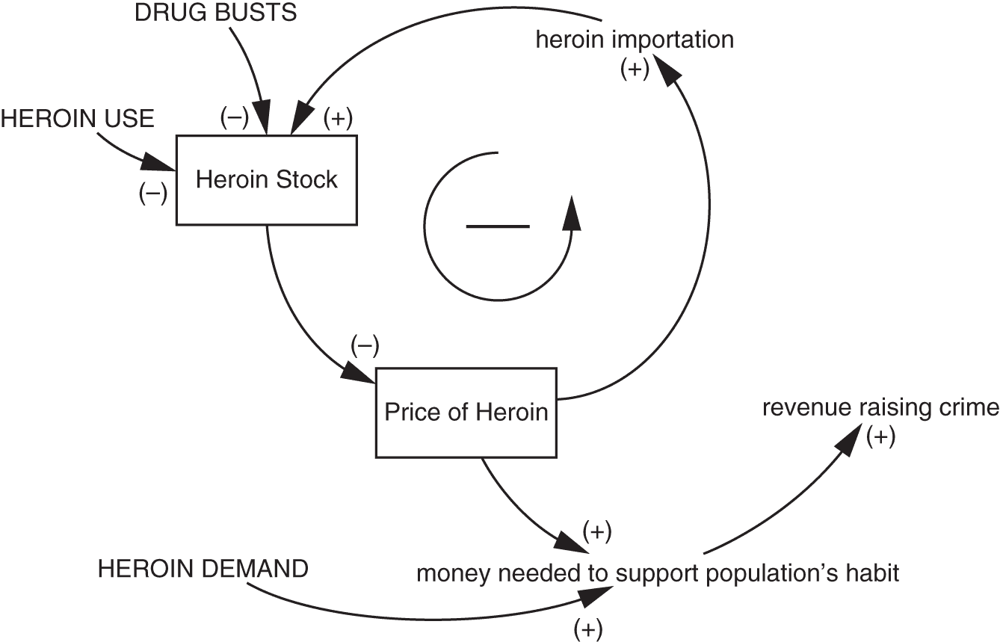

**Figure 9.1** 海洛因犯罪系统的因果回路图。¶ 来源：摘自 *Building a System Dynamics Model*，麻省理工学院（1997），经麻省理工学院许可使用。

海洛因并不是一个普通市场，因为其持有、使用和销售在许多国家都是高度非法并受到严厉惩罚。非法市场必须在法律之外运作，因此不能也不依赖法律进行监管，为帮派或有组织犯罪成为“治理”影响力铺平了道路。

随着对海洛因的需求增加，导致海洛因价格也随之上涨，会有更多人进入该行业的激励。供应商、分销商和经销商之间的竞争不受正常方式的监管，可能涉及暴力、胁迫、贿赂等，同时也为市场主导提供了更大的激励。消除竞争可能被非常字面地执行。

## 系统原型

接下来在我们的过程中，我们考虑该系统是否存在任何原型或常见模式。我们当然可以看到 *富者愈富* 原型的运作；随着海洛因分销商变得更强大，他们在变得更强大方面具有优势。

可以很容易想象一个有进取心的个人或小团体，试图进入市场，也许从主导该市场的供应商以外的地方购买。强大的、根深蒂固的分销商可以通过几种方式施加压力，例如向警察透露新分销商的存在，威胁经销商或客户如果从新分销商处购买就会遭到报复，甚至对分销商直接使用暴力或暴力威胁。市场的非法性，以及因此缺乏监管，使得潜在竞争对手之间的竞争环境不公平。

我们也可以看到 *增长的限制* 原型，因为实际上有多少人会真正对海洛因上瘾是有限的。分销商和经销商可以尝试获得新的“客户”，但他们承担了更大的曝光和被捕风险。虽然合法企业可以通过吸引新客户、实现规模效率并通过新市场进入者进行价格竞争来增长，但在公然非法的市场中，新进入者可以被根深蒂固的参与者轻易阻止。

我们也可以在海洛因-犯罪系统中看到升级的原型。想象一个市场区域，附近有两个敌对帮派，各自在其各自的领土内控制海洛因市场。对重叠、争议地区经销商或买家的竞争很容易演变成个人之间的暴力，然后升级为小团体，然后升级为全面帮派战争，因为双方加大努力控制新市场。由于法律限制和法规在这种系统中不受尊重，对新市场区域的主导可能取决于各方愿意为控制该市场付出多大的代价。

此时，我们或许可以合理地认为我们已经足够了解这个系统，可以考虑一些可能解决或减轻我们已识别问题的系统干预措施。其中第一个自然的干预措施就是让警察尝试找到并逮捕毒贩和分销商。假设警察能找到一个毒贩，进行逮捕并没收该毒贩的海洛因库存。相比市场区域内的全部海洛因，这可能只是一小部分，但从系统角度来看，移除一个毒贩和一些海洛因对系统会产生什么影响？移除海洛因会减少海洛因的可用供应，至少在暂时性上如此。需求不太可能减少——被现在被监禁的毒贩供应的海洛因成瘾者只会找到另一个毒贩，或者更可能的是另一个毒贩会找到他们。当供应减少，但需求保持不变时，价格往往会上涨。街头价格的上涨可能会成为更多人进入海洛因行业、取代该毒贩并可能寻求扩大海洛因分销的激励，因为海洛因现在比以前更有利可图。毒品突袭和没收海洛因库存的干预实际上可能有助于海洛因贸易的扩张。这是一种眼镜蛇效应——实现了与我们想要的相反的效果。正如我们一开始所说，这是一个难题。没有人建议我们停止执行毒品法律，但思考看似有帮助的干预措施可能对整个系统产生的潜在影响是有用的。让我们再进一步。

假设在一次大规模的毒品突袭行动中，我们能够消除一个城市的所有分销商、毒贩和海洛因库存。第二天会发生什么？海洛因成瘾者会简单地停止使用海洛因并改喝啤酒吗？更可能的是，新的分销商和毒贩会进入该城市，也许来自附近城市。如果该城市的分销一直由一个大型帮派或 syndicate 控制，那么该组织可能只需重新分配新资源以满足该城市的需求。公平地说，供应的减少从而可用性的降低可能会导致较少的新潜在成瘾者接触到海洛因，因为社区毒贩不再提供那第一次免费的尝试。当然，新海洛因使用者暂时减少是好事，但重点是，减少像海洛因这样的物质的供应本身并不能消除问题。

让我们考虑另一种干预。芝加哥电台 WBEZ 的一个故事（[`interactive.wbez.org/puertoricochicagopipeline`](https://interactive.wbez.org/puertoricochicagopipeline)）以及在播客节目 *This American Life*（[`www.thisamericanlife.org/554/transcript`](https://www.thisamericanlife.org/554/transcript)）上深入讲述的故事说明了对海洛因-犯罪系统的另一种、尽管可能是无意的干预。波多黎各当局似乎将至少一些毒品成瘾者送往芝加哥进行康复和治疗。之所以成为新闻，是因为似乎这些成瘾者没有得到承诺的康复项目并最终流落芝加哥街头。他们从波多黎各到芝加哥的机票是单程票。通过将成瘾者从波多黎各移除，当局有效地减少了波多黎各对海洛因的需求。假设成瘾者被移除的速度快于新成瘾者被培养的速度，就会有净需求减少。需求减少而供应不变最终会导致价格下降，更重要的是，会减少新进入者加入海洛因贸易的激励。更进一步想象，一个城市或一个岛屿上所有成瘾者在一夜之间被移除。海洛因贸易将会崩溃，分销商和毒贩可能会转向其他活动。我们也可以预期精明的毒贩会以减价提供一些海洛因样品以试图让新的人上瘾，但他们不太可能产生足够的新客户来取代失去的客户。该地区海洛因活动将会减少，也许是永久性的。

另一种干预是改变系统的规则。以前非法的毒品在一些州和国家已经合法化，可预测的效果是增加税收收入，减少犯罪、暴力和毒品使用者的监禁。当然，合法化一种以前非法的物质会使其可供更多人使用，并可能可预测地导致额外的成瘾。但随着合法化，毒品的贸易可能变得更像手枪贸易，有各种合法的分销、销售和使用渠道，但黑市仍然在运作。系统思考者可以使用本文所述的工具来推理这些变化的系统性影响。对海洛因-犯罪系统及其可能干预措施的推理并不能保证解决方案，更不用说实际或可行的解决方案了，但它确实阐明了系统的复杂性，并允许对潜在干预措施的有用思想实验以及对其结果影响的更完整估计。

## 9.10 测试 逐步实施干预

在仔细遵循本章概述的系统思考问题解决流程之后，很容易认为所选择的干预是最好的并且肯定会成功。怀着这种充足的信心，更容易认为应该广泛实施该干预，适用于所有员工、群体、城市或公司。实施干预“全押”更容易更简单，但风险很大。如果干预没有产生预期结果，可能会造成大乱。如果通过法律影响整个国家，整个国家都会受到任何意外后果的影响。也许有更好的推出新干预的方式。

我们可以从拥有数百万用户的大型网站如何实施更改中学习。他们不会一次性对所有数百万用户激活更改。相反，他们采用拆分方法，通过随机将这一小部分用户引导至新网页，同时大多数用户仍体验旧页面，为例如 1% 的用户甚至 0.1% 的用户实施更改。这样，他们可以看到新页面对一小部分用户是否有效。如果有问题，他们会收到数十份错误报告而不是数千份，如果需要某种修复，受影响的用户也远 fewer。

在社会中，实施增量干预的一种方式是鼓励一个城市或州采用新法律或方法，看看会发生什么。例如，科罗拉多州是第一个合法化娱乐大麻使用的州，因此它作为测试案例和范例，展示了如果美国在全国范围内做出同样的改变会发生什么。

逐步实施更改，减少受影响的人数，也减少了执行实施者的负担以及早期阶段收到的反馈量。早期收到的反馈可以在后续增量中使用，提高后来接收更改者的接受度。

## 9.11 系统思考与世界

本章介绍了引人入胜的系统思维领域，这是一种系统中的问题解决方法。系统思维可以应用于任何类型的系统，但最常应用于人类活动系统，即包含技术和人的系统。从某种意义上说，系统思维是一个领域的集合。要成为一名系统思考者，往往意味着需要学习各种其他领域，以便理解系统的运作——这非常适合终身学习者。心理学、社会学、人类学、经济学、行为经济学、概率、统计学、实验设计、商业、营销、生物学以及其他科学等领域，都能阐明一个庞大、复杂和多样化系统的各个方面。

在第 10 章中，我们探讨了一种特殊的人类活动系统——人系统。仅由人组成的系统，即人系统，具有一套独特的动态、原因和行为，可以解释我们生活中所经历的、令人困惑的惊人广泛的内容。

# 10 人系统：理解世界的新方式

## 10.1 回顾系统类型

在第 9 章中，我们描述了在系统思维范式中，存在三种类型的系统：

* 工程系统是由人设计和建造的系统，包括飞机、车辆、卫星、智能手机、计算机和工厂。
* 人类活动系统是包含人类和工程系统，但主要由人类行为驱动的系统，包括公司、政府、家庭、经济和军队。这些系统可能包含技术系统，但整个系统基于人类意志和行动运行。
* 生物或自然系统是本质上为生物的系统，观察到它们以系统的方式运作以实现明显的目标。这些包括动物、人类、树木、森林、鱼群、蚁群和海洋。

自然地，系统*工程*主要关注*工程系统*。随着技术的进步，系统工程师也可能关心如何为工程系统构建更智能的能力，使其性能更好、能力更强、更自主。系统思维关注的是更广泛的*人类活动系统*领域，以及在试图优化或改变它们时出现的许多问题。许多——也许是全部——人类社会中的问题都是*系统*问题，可以使用系统思维进行分析。

本书描述了如何通过良好的设计、理解用户需求以及添加人工智能技术，使各种系统变得更智能。我们可以考虑如何使餐厅系统在与客户互动方面变得更智能，或者如何通过引入新技术和改变人类行为的结合，使组织的系统表现更好并提供卓越的客户体验。

大多数人都有过从大型公司及其员工那里获得服务不佳的经历。通过将系统思维和智能系统原则应用于公司这一人类活动系统，我们发现简单地用计算机或机器人取代人可能不会带来更好的客户体验或更成功的企业。我们需要做的是将企业转变为更智能的系统。例如，加州的 Stackers 餐厅取消了服务员，改用桌上触摸屏和友好的迎宾员，让用餐者无需等待服务员即可点餐、点饮料和续杯。餐厅需要更少的员工，而接受这种与餐厅系统互动的新方式的用餐者可以体验到更高效率、错误减少、安全性提高、隐私更好，甚至更愉快的体验。对于 Stackers 来说，这不仅仅是在桌上引入触摸屏，而是重新思考整个餐厅作为一个更新、更智能的系统来服务客户。

## 10.2 人系统

在本章中，我们考虑一种新型系统——*人系统*。人系统简单来说，是仅由人组成的系统。人系统是一种人类活动系统——一种没有技术的系统。

人系统是一种生物系统，因为它只包含生物元素（人），但它是一种特殊的生物系统，因为——坦白说——人是特殊的。至少在地球上，人类具有非常特殊的地位，因为我们似乎是唯一具有我们这种智力、意识、语言和创造力的物种，这使我们成为地球上唯一的优势物种。由于只有人类在阅读本书，我们可以自由地关注对我们最相关的内容——只涉及我们的人系统。

动物确实会形成系统，因为它们与自己的物种、其他物种和人类互动，但运行世界的是人系统。人们拥有其他生物物种在地球上所没有、或至少我们所不知道的独特而复杂的交流形式。无论动物在我们背后做什么，人们以及他们彼此之间的互动构成了一种非常特殊的系统。人系统负责我们生活中几乎所有我们所知道、所经历和所热爱的。我们的世界是系统的世界，人系统的世界。

人系统是一种人类活动系统，因为它们是由人类活动驱动的系统。人系统与其他人类活动系统的区别在于，人系统只包含人，而人类活动系统包含人，但也可能包含技术系统、设备、车辆、建筑物、卫星、航天器、武器以及所有形式的工具，当然包括计算机和人工智能。大型公司作为一个系统来看，包含许多技术系统，但没有人，它就会完全停滞。也可以说公司不能没有技术而运作，但如果所有技术都被摧毁，人们仍然可以重建公司，而在相反的情况下，技术不能简单地取代人——尽管这会成为一个引人入胜的科幻故事。

即使人类活动系统包含人，人系统仍然是一种非常特殊的人类活动系统形式。当系统只包含人时，所有交流都是人与人之间的交流，所有相互连接都是复杂的人类类型。驱动人系统的很大一部分是人类情感，无论是一词标题情感如爱、嫉妒、愤怒或悲伤，还是需要短语来描述的更微妙的情感，如失败恐惧、动机、成功恐惧、权力意志、追求卓越的驱动力、 resigned、沮丧、无望或怀疑。工程系统，即使使用人工智能，也使用计算来做决策，但在人系统中决策是由人类以人类的方式做出的。逻辑、情感和动机的层级和层次混合在一起，产生驱动人系统的决策。决定接受新工作、签署协议、创业、结婚、搬到新国家或多生一个孩子，以及无数更小的决定，驱动着关系、家庭、花园俱乐部、教堂、城市、公司和国家的系统。可以毫不夸张地说，人系统的研究就是人类生活的研究。

采用系统方法研究人类生活可以带来新的洞见和理解。分析人类活动更常见的方式是，要么将*个人*及其心理学、行为和动机视为非人类机器或装置，要么将一大群人，如公司或国家中的人，视为一种机器或装置。这两种观点在科学和日常对话中都有体现。一个故事可以帮助说明。 在我获得学士学位后的第一份工作经历中，我曾向一家大型计算机公司求职。进行了几次面试，我满怀希望地期待收到一封录用通知，但我收到的是一封拒信。实际上，我从同一家公司收到了两封拒信。我很合理地感到自己被公司拒绝了，并想继续前进。然后我从同一家公司收到了录用通知。一家公司如何在同一周内既拒绝又接受我呢？这种表面上的矛盾源于这样一个假设：是公司拒绝了我。公司不会拒绝求职申请。公司里的人会拒绝求职者。在这种特殊情况下，发生的事情是我的简历被发送给了公司内多个办公室和部门，每个办公室和部门都有自己的招聘人员。其中一些办公室的工作人员不需要像我这样的人，所以他们给我寄来了拒信。事实上，其中一个办公室的一位经理，即我最初联系的经理和办公室，建议该办公室的招聘人员给我发出录用通知，我在该公司工作了多年。理解这种看似矛盾的行为的关键在于，将公司中的招聘职能（也许甚至整个公司）视为一个人员系统。自然，人力资源人员使用计算机系统，但就其大部分而言，该系统完全由人类及其激励、偏好和决策驱动。将公司的招聘职能视为人员系统，可以更轻松地理解我们观察到的行为。

人员系统方法是一种将人视为个人而非群体或组织成员的方法。正如我们在第 6 章和第 7 章中所述，我们可以在多种抽象层面上描述系统。 就人而言，我们的器官构成系统，例如循环系统或神经系统，我们的细胞也是系统。我们的家庭是系统，公司、经济体和国家也是系统。然而，为了理解人员系统，我们选择将所有这些抽象层级简化为以个人为基本系统部分的层级。人员系统由人员组成，我们忽略了个人层级以下和以上的其他所有抽象层级。从广义的系统视角来看，人员系统很简单——它们只是由个人组成。与此同时，我们关于系统的所有知识都适用于人员系统。人员系统可以使用系统工程的原则进行设计。像工程系统一样，人员系统可以表现出一定程度的智能。人员系统可以通过应用系统思维方法来阐明，例如应用系统原型、因果回路分析和杠杆点的使用。随着我们在本章开始建立对人员系统的理解，我们将应用其中一些系统思想。

## 10.3 人员系统与心理学

人员系统作为一种方法，与研究人员和行为的心理学和人类学等学科有共同之处，但是一种独特视角和方法。我的第一个硕士学位是心理学，我对该学科有着极大的亲和力。心理学在很大程度上涉及个人以及个人与其他个人的关系，但不涉及由个人组成的系统的整体特征。社会学和人类学倾向于将个人群体作为一个整体对待，而不考虑个人。在一个系统中，正如我们所见，我们关注系统的行为以及该行为如何由系统的各个部分产生。在人员系统中，这意味着我们关注人员作为系统的行为，并检查该行为如何作为该系统中个人行为的结果而产生。在人员系统中，只有人员才有行为；群体、家庭、公司和国家都没有。

人员系统从根本上说是一个系统，具有任何类型系统的所有特征，包括功能或目的、系统中相互作用的部分以及这些部分的特定排列。在人员系统中，系统的部分是人员，他们的互动仅限于其他人员，因此在某种程度上，这是一种相当简单的系统。只有一个种类的部分，并且只有一个抽象层级，因为我们不会将人员分解为部分。从系统角度来看，这样做是有效的，但检查人员的生物学部分并不会增加对其行为的理解。人员系统是一个由人员组成的系统。在人员系统中，我们也不使用更高层次的抽象，即人员系统的系统，因为该更高层次系统的部分将是人员系统，而不是人员。人员系统中的一个基本思想是，正是作为个体的个人做出决策并表现出推动系统发展的行为。人员系统没有自己的某种思想或决策能力。它始终只是人。

雷·布拉德伯里的科幻短篇小说《*There Will Come Soft Rains*》，于 1950 年出版并于 1999 年修订，讲述了一个完全自动化的家庭在核弹爆炸后幸存下来的故事，而其居住者全部被杀。房子自动化程度足够高，以至于其大部分功能，包括做饭和提供餐食、清洁甚至试图娱乐孩子，都在完全没有人员的情况下按计划进行。这是一幅系统将在我们不存在的情况下运行的未来的图景。我们还没有到那一步。我们的大多数系统完全依赖于人员，而人员在几乎所有功能系统中都很重要。没有人员，自动化系统就会停止或最终崩溃，但没有系统，人类仍会继续生活，要么没有自动化系统，要么通过建立新的系统。在我们的世界里，关键在于人。

也许理解人员系统最重要的概念是激励。人们主要基于激励或反激励，或对其的感知来决定行动或不行动。他们根据他们认为与每项活动及其结果相关的激励来进食、睡眠、工作和娱乐。在第 9 章中，我们研究了如何改变系统中的激励可以成为改变系统的有力杠杆点。我们生活的系统提供了许多多样的激励。我们进食是为了满足饥饿，但也是因为我们想继续生活。我们工作是为了能够为自己和家人提供最好的生活。我们购买房屋、汽车、衣服和电子小玩意，因为我们觉得它们能提供舒适、享受或满足感。这些都是明显的激励；它们如何运作以及如何激励和激发人们几乎没有神秘之处。让我们考虑一些更微妙的东西。

在过去的几代人中，刚从大学毕业的年轻人寻求就业，通常是立即在自己受教育的领域就业，是很正常的事情。在那个时代的文化中，发展该领域的职业生涯、独立生活、组建家庭等等的激励因素非常强烈。职业导向的道路并非强制要求，但显然是常态。在上大学之前，那些年轻人已经观察到他们的父母和其他成年人通过这条道路过着成功、幸福且看似充实的幸福生活。想要同样的结果，他们就追随同样的道路。

在二十一世纪的早期，情况发生了变化。9/11 的恐怖袭击，加上房地产的繁荣与崩盘，可能让一些年轻人觉得传统职业进程不再那么有吸引力，从而导致终身职业模式变得不再那么有说服力。长期职业成功不再是曾经那样强有力的激励因素，导致一些应届毕业生“休息一段时间”，搬回父母家居住，从事与自己教育领域无关的工作，并普遍回避传统的职业道路，至少在毕业后的初期是如此。但对这个新毕业生人群系统的更深入分析更为微妙，因为在我们能够客观衡量的所有方面，职业建设过程的激励和回报并没有改变。改变的只是人们对职业过程成本与收益的认知。也许不必多说，激励的认知与实际激励一样强大。

激励与时间相关，无论是成本还是收益。现在投资时间和精力去获得一个高级学位，其成本很大，既有财务成本，也有错过其他活动和追求的机会成本。对该高级学位的收益则在后来到来，往往是 much later，以新机会、职业成长和收入的形式体现。一个人的现在与未来的价值取向可以成为行为的重要驱动因素。购买一辆新车并分期付款，其自动且即时的激励就是——驾驶一辆闪亮的新车，以及可能被认为随之而来的声望和地位。汽车因快速贬值而产生的折旧成本、贷款利息以及本可投资的资金的机会成本所带来的三重负面财务影响，只有在长期才构成激励。

多年来，经济学家倾向于认为他们已经完全搞清楚了激励机制，人们按照他们所称的效用理论运作，即对替代方案的成本和收益进行理性的权衡。行为经济学领域，以主要推动者丹尼尔·卡尼曼为代表，以及他的开创性著作 *Thinking, Fast and Slow*，提出了这样一种观点：人们在思维和行为上存在重要且一致的模式，但这些模式并不遵循经济学家和工程师所假设的整洁的数学规则。事实证明，人们并不像机器那样。几个例子可以说明这一点。卡尼曼的众多实验之一是，给一组人中的一半赠送一个咖啡杯，另一半赠送一根糖果棒。然后，他向两组人都提供用手头物品交换另一件物品的选项。人们会预期交换意愿不会取决于最初获得的是哪件物品，但事实并非如此。最终被称为禀赋效应，卡尼曼和其他人通过许多种类的实验证实，人们倾向于认为自己*拥有*的东西的价值大约是未拥有时相同东西的两倍。宠物店老板明智地建议一个家庭“今晚就把小狗带回家——明天随时可以还回来”，因为他知道家庭会与这个可爱的小动物建立感情并认为它“属于自己”，从而触发禀赋效应。

## 10.4 禀赋效应

在人群系统中，人们“拥有”各种各样的东西，不仅仅是实物，还包括头衔、权力、责任范围、影响力地位、对他人的控制权，或批准或否决决策和提案的能力。人们经常说“拥有”招聘流程或组织中的新产品战略。由于禀赋效应，人们不会轻易放弃这些东西，因为他们认为这些东西的价值大约是他们不拥有的等价物的两倍。例如，在试图对公司进行组织变革时，领导者必须认识到，要让人们愉快地放弃一个职位，或放弃他们“拥有”的一个领域，他们必须相信自己获得的东西价值是他们认为失去的东西的两倍（一些研究声称更接近 2.4 倍）。组织变革专家建议领导者仔细考虑参与变革的每个人将放弃什么，并努力帮助他们处理过渡的这一部分。人们会比追求想要的东西更努力地保护自己所拥有的东西——多两倍。在同样的情况下，人们会留在工作岗位上，除非他们相信新工作比当前职位好两倍。从职业角度看，这是不利的。抵制禀赋效应的心理影响，并寻求一个可能仅比当前工作好 25% 或 50% 的新工作，比等待一个好 200% 的职位出现，更可靠地通向成功的职业生涯。至少被称作对变革的抵制中的一部分可能实际上是由禀赋效应驱动的。

禀赋效应在家庭系统中也显现出来。朋友和亲戚可能会看着一个家庭状况并想知道为什么相关的人会留下。为什么她不离婚？为什么他不分手？为什么 30 岁的儿子不搬出去自己住？家庭系统之所以以这种方式运作可能有很多方面，但其中一个就是禀赋效应。正如俗语所反映的，*better the devil you know, than the devil you don'*'*t*，人们常常宁愿留在熟悉的事物中，即使这远非他们真正想要的，也不愿冒着寻找新事物（或新人）的风险。禀赋效应会预测，一个人必须认为一个新丈夫或新妻子的可能性是他们目前拥有的两倍好，才愿意放弃他们目前的状况，无论这种状况多么消极或具有破坏性。

## 10.5 锚定

行为经济学这一发展中的领域揭示了人类行为的许多方式，这些方式并不合乎逻辑，但却 remarkably 一致且可预测。锚定效应这一概念，也由卡尼曼描述，显示出数字猜测的倾向，例如罐子里豆子的数量或房屋的价格，会受到个人在做出估计之前刚听到的数字的高度影响，即使这些数字与所预测的内容完全无关。丹·艾里埃利在 *Predictably Irrational* 中展示了大多数人在认为作弊不会被发现的情况下会作弊，但只作一点点。其他研究表明，人们受他人行为的影响非常强烈，甚至超过了他们做正确事情的想法。卡尼曼和桑斯坦提出的他们所称的 *自由意志家长主义* 显示，大多数人会接受给定的默认选择，而不是采取行动去改变它。当被要求勾选一个框表示他们是否愿意在死亡时捐献器官时，很少有人会勾选该框。当被要求勾选一个框表示他们 *不愿意* 成为器官捐献者时，同样很少有人会勾选该框。对工程师或经济学家来说，这毫无意义，但这就是人类的运作方式。当被鼓励在工作中加入退休储蓄计划时，只有大约一半的人会这样做，但当自动加入并可选择退出时，几乎没有人会退出储蓄计划。塔勒和桑斯坦的著作 *Nudge* 在十多年前就介绍了这种 *选择架构*，并在 *Nudge: The Final Edition* 中更新了他们的研究成果。

到目前为止，我们已经研究了理解人员系统的两个重要方面：*激励*，它以合理的方式引导人们，以及 *认知偏差*，即行为经济学领域所描述的奇特且不合理但可靠的行为模式。接下来，我们将研究比行为特征更深层次的东西——价值观。在 Chapter 7 中，我们描述了各种系统如何同时具有结构和行为，以及这二者如何相互关联。在工程系统中，结构，通常称为系统架构，是为支持所需行为而设计的。在自然或生物系统中，结构和行为共同演化，经过许多世代的优化。系统的结构可以通过物理或功能（有时称为 *逻辑*）视角来观察。在人员系统中，人类的物理架构，即器官系统和细胞，通常不是特别感兴趣的，除非它们影响人类行为（而它们确实如此）。人员系统将每个人视为物理上单一、不可分割的单位。感兴趣的是我们可能称之为人类功能架构的东西。尽管他们可能没有使用这个术语，心理学家和哲学家们对人类功能架构的描述做出了许多尝试，这些心理模型有助于理解人类在人员系统中的运作方式，或者至少为我们提供概念和语言来推理人类行为。

## 10.6 Functional Architecture of a Person

一个常见的模型是将人类视为具有两个部分：心灵和身体。这一模型由十七世纪的哲学家、数学家和科学家勒内·笛卡尔提出，后来被称为笛卡尔二元论（Descartes, 2013）。该模型已变得如此普遍，以至于大多数没有学习过哲学的人都会不加思索地接受它。在这种观点中，一个人拥有物理身体，也拥有非物理的心灵。人们拥有物理身体这一点很少受到质疑，但非物理心灵的发明带来了许多困难的问题和挑战，其中一些问题由笛卡尔本人提出，而哲学家们争论了几个世纪。例如，就存在 *互动* 问题。如果心灵是非物理的，它如何与身体互动甚至控制身体？我们世界上没有其他非物理事物影响物理事物的例子。当然，可以假设其他非物理实体，包括各种神、灵魂和恶魔，以及据称作用于物理世界的非物理力量，如心灵现象、集体意识和各种各样的“能量”。谈论非物理能量尤其令人困惑，例如所谓的精神或信仰治疗师的能量，因为科学也使用这个术语来指代可检测、可测量的能量，如磁性、电和重力。连同心灵的概念，这些非物理实体和力量成为信仰的范畴，通常超出了科学或系统研究的范围。要接受笛卡尔二元论，就必须有某种方式来解释非物理心灵与物理身体的互动。

人类是否真正拥有心灵是一个迷人的哲学辩论，但无论如何，我们都可以比喻或口语化地使用心灵的概念来指代一个人所拥有的有意识和潜意识思想的集合。将人类拥有心灵和身体的想法再扩展一点，可以包括情感。情感可以被视为一种特殊的思想，但最好给它们自己的类别。这样的人类功能架构就由心灵、身体和情感组成。这一三重划分是否与实际的底层物理结构相符，比它是否能帮助我们更好地理解人们在人员系统中的运作方式要不那么重要。

在日常层面上，很明显人类对事物有想法，也对事物有感受和情感，这些似乎彼此 somewhat 独立。身体也似乎是分开的；人类体验身体感觉与思想和情感截然不同。在极端情况下，这些界限可能会模糊。慢性疼痛最终会导致人格改变——生病时谁也无法清晰思考。作为这种人类架构使用的另一个例证，心理治疗领域在最近几十年从对心灵、身体和情感的相当严格的分离，转变为更整合的方法。过去，行为主义的倡导者几乎完全关注一个人做了什么、如何行为，而较少关注一个人想什么或感受什么。深度心理学家，包括精神分析师和“这让你感觉如何？”的咨询师，关注思想和感受，包括可能隐藏在潜意识中的思想。近年来，心理学在很大程度上转向了一种被称为认知行为疗法的整合方法。顾名思义，这种方法认为行为和思想都很重要且相互关联。当患者以某种方式行为时，他们在行为之前、期间和之后都有思想和感受。对这些思想进行批判性思考的光照可以改变思想并导致行为改变。认知行为疗法也由精神科医生实践，他们可能会使用药物，如抗抑郁药来帮助患者达到能够成功处理其思想的状态，从而解决人类架构的三个部分：身体、心灵和情感。

三部分架构并不是用来帮助理解人们的唯一架构。另一种流行的方法是将人们归类为类型，通常基于人格的概念。流行的迈尔斯-布里格斯人格测试使用四种动力学的组合来分配十六种人格类型之一：外向/内向，直觉/感觉，思考/情感，判断/感知（Myers, 1962）。在测试之后，一个人可能会得到 ENFP 的结果——外向、直觉、情感和感知。其他人格类型或行为类型系统也被广泛使用，其中包括分析型、和蔼型、驱动型和表达型等类别，或使用红、绿、蓝、黄等颜色，如托马斯·埃里克森的精彩著作 *Surrounded by Idiots* 中所述。这些类型方案并不是在某种普遍意义上是 *真实的*，就好像我们可以进行探索性手术或深度脑扫描并得出结论：是的，这个人确实是 ENTJ 并且是红色。类型框架为我们提供了一种工具，以系统的方式思考人们如何互动，以及他们互动背后的原因。即使一个人并不是在某种内在意义上是蓝色，我们观察到他们以埃里克森所描述的蓝色方式运作这一事实，仍然可以合理地让我们相信这个人未来可能会以这种方式运作。如果我们能更好地理解人们以及各种类型的人的行为，我们就能更好地理解人员系统。当然，人们始终保留着与过去行为不同的权利，这使得人员系统变得更加有趣。

将类型方案应用于人们可以扩展到人与人之间的互动以及群体。心理学的 *交易分析* 理论由埃里克·伯恩在 1950 年代提出，将类型应用于互动（Berne, 1968）。一个人某一天可能与下属进行父母-儿童互动，与同事经理进行父母-父母互动，或进行交叉互动，其中一个人以父母-儿童模式行动，但另一个人以成人-成人模式回应。交易分析基于精神分析理论，该理论认为潜意识思想和信念是行为的关键驱动力。类型也被应用于人群，使用诸如群体思维、群体心理或集体智慧等术语。每个概念都为人们系统在特定情况下可能如何运作提供了一些启示。了解多种框架可以支持对个人和群体人类行为——人员系统中的驱动力——的更完整理解甚至预测。

## 10.7 示例：污染问题

让我们将迄今为止所涵盖的内容应用于人员系统中的一个难题——环境，特别是地球的污染。污染有多种形式——街道上的垃圾、海洋中的塑料、夜空中的光污染、透过窗户传来的噪音、轨道上的太空垃圾，以及饮用水中抗生素等不一而足。每个人都同意污染是一个问题，而且似乎解决方案很简单——只要让人们停止污染即可。假设简单解决方案会有效，反映出对人员系统缺乏理解。系统思考者，尤其是人员系统思考者，在尝试解决问题之前会首先寻求理解系统。虽然看起来是公司在污染，但它们并不会。污染的是人。是人们在公司中做出导致污染的决定。他们为什么要做出这些决定？是因为他们想污染，要么基于某种变态的个人议程，要么因为公司发布了一套倡导污染的价值观声明？可能不是——我怀疑任何人都有故意污染的目标。当世界上某个地方一家制造公司的高管决定将废物倾倒到附近的河流中时，他们的目标不是污染，他们的目标是以尽可能有效的方式制造产品。将废物倾倒进河里被视为最有效的方法。我们可能会争辩说高管不应该这样做决定，而应考虑其他因素，比如河流的健康以及依赖它的生命形式（包括人类），但高管的工作不是迎合那些人，而是迎合他的上级，即公司的董事会，而他们又要对公司所有者和股东负责。控制公司的个人系统旨在实现长期盈利的目标。当然，我们思考的下一步是，我们应该简单地使污染非法，并在我们抓住他们向河流倾倒废物时对公司罚款。世界上大多数地区正是这样做的。然后高管们有了选择——污染并支付罚款，将废物运往其他国家处置，或支付费用在排放前净化废物。假设罚款足够大，以至于支付罚款成为三个选项中最昂贵的，那么问题似乎就解决了。但等等——谁为废物处置买单？看起来是公司。一些系统思考却表明，实际上是公司的客户通过价格上涨为处置买单。如果公司不提高价格，那么公司的利润就会受损，股东将要求提高价格，只要提高的价格不会显著减少销售。如果不可能在保持市场竞争力的同时提高足够的价格，那么客户可能会避开这家制造商，转而购买其他人的产品，也许是那些污染法规较不严格、因此成本较低的地区的产品。通过在一国实施更严格的反污染法律，我们可能降低了该国制造商相对于其他国家的竞争力。此时有两个可能的答案——要么让其他国家制定类似的污染法律以创造公平竞争环境，要么对来自该国的进口商品征收关税，看似使两国产品具有竞争力。仔细观察会发现，在许多情况下，国家之间相互供应原材料和零部件，因此对进口商品征收关税会导致进口商成本增加，从而导致更多价格上涨和缺乏竞争力。如果我们仅对制成品征收关税，供货国的制造商可能会简单地在原国设立装配和精加工业务，从其本国或任何最具成本效益的来源购买原材料。

对于做出将废物倾倒进河里的决定，因为这是最具成本效益的方式的管理者来说，一个替代方案是基于道德而非经济做出决定。这样做时，管理者未能为所有者和利益相关者最大利益行事，可能会发现自己的工作被取消，或者至少决策权被剥夺。所有者可能会决定支持道德的反污染立场，并冒着竞争力下降的风险，或者可能利用他们不污染的事实作为其高价产品的销售特色。

## 市场、消费者与污染

在迄今为止的这个例子中，人们系统是由经济和市场驱动的。市场可能大多是自由的，但始终受各种类型和程度的政府强制标准、法规、关税或税收的制约。让我们转向全球系统中导致污染的另一个部分——最终消费者。我们难道不能通过让消费者停止从污染的供应商处购买，从而迫使那些公司停止污染以销售其商品，来解决污染问题吗？在某种程度上这是可行的——如果广泛的公众认知认为某家公司是主要污染者，那么它可能会影响销售。为了使其有效，整个系统必须能够向所有相关消费者提供市场上所有供应商的完整、正确和无偏见的信息。这很难看出如何在实践中或经济上可行。公司可以用自己的广告活动来反驳任何污染指控，费用相当高昂，但为了维持销售可能值得这样做。这将变成一场信息战。

撇开这一点不谈，考虑一下是什么驱动消费者。消费者有义务为自己和家人做出最好的决定，购买最具成本效益的商品以最大化其收入。经济条件更好的人可能有更多选择，但遵循的大多是相同的逻辑。富人可能在不考虑成本效益的情况下做出消费选择，但这些相对较少的象征性选择不太可能改变整体市场偏好。正因如此，像“买美国货”这样的运动鼓励美国人购买美国制造的商品，似乎从未产生太大影响。一方面，许多“美国”产品包含许多，甚至全部部件都是在美国境外制造的。追踪产品的“污染血统”对消费者来说是一项艰巨的，甚至是不可能的任务，因此他们很可能购买那些在最佳价格下似乎提供最多价值、性能或形象的产品。

## 回收作为一个系统

让我们把注意力转向污染的一个方面，也许更有希望——回收。回想一下，我们的首要任务是理解系统，并记住系统是`always working`，我们需要考虑是什么导致了回收。如果我们在绘制因果回路图时，可能会诱惑地显示人们回收得越多，回收的材料就越多，但这是一个明显的、`rocks are hard`关系，而不是原因。我们所说的更多材料被回收，意思是更多的人在回收——这是一个定义，而不是因果因素，所以我们什么也没说。顺便说一下，这是系统思维新手常遇到的问题——把定义性关系表述为原因，并认为自己记录了重要的因果关系。显示城市中谋杀案增多导致暴力犯罪增多并不是原因——谋杀`is`暴力犯罪。

回到回收，我们可能会诱惑地认为回收中心的容量是导致回收量的原因，这意味着如果我们增加回收中心的规模或可用性，我们就会有更多的回收。如果这是真的，我们应该期望目前回收中心溢出、人们排队等待丢弃可回收物等情况。我们可能需要继续寻找是什么导致回收更多或更少。是公众态度——有些人 somehow 反对回收因此原则上不回收吗？也许对大多数人来说，回收只是一个便利问题。大多数人`want`要回收，并认识到其明智之处，但只有在足够方便的情况下才会回收。

我曾住在一个镇上，每个居民都有镇提供的垃圾收集服务。除了常规的棕色滚轮垃圾桶外，镇上还提供了一个蓝色滚轮回收桶，并附带说明可以放入其中的物品——纸张、玻璃、纸板、塑料瓶等。在那个镇上生活，回收再方便不过了。我住过的另一个镇，州政府在购买可回收容器包装的产品时收取一笔小额附加费。空容器随后可以退回以获得费用退款。有些人支付了费用然后懒得退回容器，而是将其扔进垃圾桶。正如你可能预料的那样，这为其他人提供了赚点小钱的机会，他们翻找垃圾容器，取出可回收容器并退回以获得少量押金。那些不想让垃圾被翻找的人，会把垃圾桶锁起来，从而破坏了系统。

在这里我们看到了激励措施的实际作用以及清晰的因果关系。便利可以是驱动行为的重要因素，经济激励，即使很小，也可能很重要。这些因素是否重要，以及哪些因素最能驱动行为，可以通过进行试验和实验，或通过自然实验来确定——研究在不同便利和激励措施下回收率不同的不同地区。正如所有系统思维一样，目标是在尝试干预之前，先理解产生问题的系统。

## 利他主义、公地悲剧与激励

在考虑导致污染和环境问题的系统时，我们可能会诱惑地简单假设问题在于人们不够利他，因此解决方案就是不断告诉人们做正确的事情，这样他们就会更利他地行事，即使这会花费他们额外的时间和金钱。这种过于简单化的思维有两个问题。一个是只有相对少数的人会把利他主义作为首要目标，排在经济效率和个人利益之前。另一个是许多人会认为以对公司、国家、家庭和自己最有利的方式行事是一种义务。环境问题是公地悲剧，除非有经济激励促使人们以更积极的环境方式行事，或者至少使其成为经济中性的选择，否则大多数人仍可能以有利于自己和家庭的方式行事。

下面是一个激励措施可以如何提供的例子。假设每个镇上的居民都被提供一个大型回收收集容器，但只有一个小垃圾收集容器，且收集费用低或无月费。这样就会有激励将废物分类为可回收物与垃圾，以避免超出垃圾容量的要求。坚持产生更多垃圾的人可以以额外收集费用获得额外的垃圾容器。激励将是人们尽量减少垃圾并最大化回收。额外的可回收材料可以抵消收集成本并导致居民的服务成本更低，同时内置环境效益。

系统思维者也会注意到这种系统还会为消费者提供激励，让他们选择包装在可回收容器中的产品，这样他们就不必使用宝贵的垃圾空间配额来丢弃不可回收的容器。消费者可能会更小心地压碎不可回收物，使自己受益并使垃圾填埋场更高效。当然，这种计划只适用于有镇提供垃圾和回收收集的地区。如果垃圾收集是自由开放的市场，人们可以选择私人垃圾收集服务，如果价格更低，则可以避免回收。即使在自由市场，垃圾填埋场通常由城市或县管理，可以提高费用以增加更多回收的激励。事实上，确实有一些城镇和国家实施了一些这些想法，这些地区可以被研究以了解结果。

系统思维，尤其是从人系统视角出发，为解决难题打开了许多创造性的可能性。如果问题归结为人们及其决策，通过梳理激励机制、财务及其他方面的因素，将更全面地理解系统，通常也能带来创造性的解决方案。

人系统往往并不孤立，与其他类型的系统相互关联。以垃圾、回收和污染的主题为例，我们可以考虑这些问题是否存在技术解决方案。*Freakonomics*播客（[freakonomics.com](http://freakonomics.com)），由*Freakonomics*作者 Stephen Dubner 主持，很容易成为系统思考者的最爱收听节目，因为它对各种有趣议题进行了富有洞察力和逻辑性的审视，并应用了财务和行为经济学的方法。2011 年的第 17 集，播客探讨了垃圾问题。将他们对该主题的审视与*This American Life*的第 554 集（[www.thisamericanlife.org](http://www.thisamericanlife.org)）配对收听，后者较少基于逻辑和科学，但同样引人入胜，你会遇到一种可能的垃圾解决方案——焚烧它。我不剧透，但如果焚烧炉足够高效、经济可行且自身不会产生太多污染，它们可能是解决方案的一部分。如果垃圾能在现场处理呢？也许用一个小型焚烧炉帮助加热房屋，或通过其他工艺？一些房屋拥有自己的化粪池和地下排水场，允许在现场处理废物，而不是将废物泵送到大型 communal 废物处理系统。垃圾能否也这样做？

另一个优秀的系统思维辅助工具是科幻小说。星际飞船企业号如何处理垃圾？我猜测它们有办法将其汽化，或将分子重新用作复制器的原材料。有趣的是，《星球大战》中的帝国飞船《新希望》第 4 集拥有大规模的垃圾粉碎机，然后将垃圾倾倒到太空中——这又是更喜欢《星际迷航》而非《星球大战》的另一个原因。科幻小说邀请我们提问：*what if?* 如果我们能制造一种将垃圾汽化或转化为其他东西的装置会怎样？如果我们能焚烧垃圾但将污染副产品转化为其他东西会怎样？如果这种装置已经存在，但出于某种原因在经济上不可行，或人们并不了解它会怎样？围绕此类技术的个人系统能否被修改以使技术可行？

## 10.8 Speech Acts

回到我们关于帮助理解人系统的架构和框架的主要讨论，让我们考虑*speech acts*的话题。该话题鲜为人知，但即使只是初步了解，也能揭示大量关于人系统运作方式的信息——当人们之间的沟通是系统的重要组成部分时——而这几乎总是如此。我们可能都经历过这样的会议：讨论了很多工作话题，探索了许多替代方案，并提到了行动步骤。然而，一个月后的下次会议时什么也没做。怎么会这样？人们都很懒吗？更可能的是，正确的言语行为并没有发生。你是否曾进行过长时间的对话后疑惑，那个人到底想要什么？——后来才发现那个人离开对话时期望你采取行动？或者你是否曾想过，为什么有些人似乎能够促成事情，而其他人却陷入官僚主义或被流程和程序阻碍？言语行为可能解释了所有这些谜团。

Mitchell Green（2021）在斯坦福哲学百科全书中对言语行为的一般领域给出了有用的介绍，解释了该主题是如何被语言学家和哲学家深入研究的。在这里，我们将参考言语行为的更口语化方面——我们在日常对话和会议中使用的、或忘记使用的会话构建。心理学家 Joel Friedman 在*The Grammar of Committed Action: Speaking That Brings Forth Being*（[mentalhelp.net/blogs/the-grammar-of-committed-action-speaking-that-brings-forth-being](http://mentalhelp.net/blogs/the-grammar-of-committed-action-speaking-that-brings-forth-being)）中探讨了言语行为的起源以及 Fernando Flores 的作用。Flores 专注于言语行为的日常方面，并描述了这些思想如何成为多个主要自我发展项目的基础，包括 est、LifeSpring 和 Landmark Forum。就我们此处的目的而言，我们将介绍六种主要的言语行为，并展示它们如何帮助理解人们交谈时人系统中发生的事情。言语行为可以被视为游戏中的行动，或体育竞赛中的 plays，其中一个行为被执行，然后其他人可能会做出回应。言语行为可称为承诺性发言，因为在许多情况下它们使发言者承诺一个立场或行动。以下是 Flores 描述的六种言语行为：

1. **Request.** 请求性言语行为是指一个人要求另一个人做某事。示例为：Will you please take me to the circus on Friday? Please submit the report by noon tomorrow; Will you go with me to the store today? 请注意，请求必须具体到足以被接受或拒绝，并且需要被识别为请求才能成功。对请求的回应可以是请求接收者接受请求并做出承诺、拒绝请求、提出反建议，或完全忽略请求。

2. **Declaration.** 声明是一种不需要支持或依据的陈述，但通过其被说出而创造新的现实。为了有效，做出声明的人必须对听者具有社会权威。声明可能要求声明者和他人基于新宣告的现实改变行为。当美国总统 John Kennedy 说，“我们将在本十年内登上月球”时，这并不是基于计划、甚至不是基于美国太空计划当前能力的陈述，也不是预测。他宣告了它，其他人采取行动使其成为现实。声明可以关于目标、条件、决定或任何依赖于人们意图和意志来兑现的事情。当一个州遭受飓风袭击而州长*declares*进入紧急状态时，他或她并不是在描述某事，而是在创造新的现实，在此现实中可以提供外部援助、运送物资并动员机构。

### 3. Promise
承诺可以是对任何人关于任何事情做出的，无论是对请求的回应，还是自发、无人提示地提出。它是单方面的——承诺者致力于采取特定的行动路线，通常在指定的时间内产生某种结果。没有指定或理解的时间的承诺仍然是承诺，但可能缺乏实际价值，因为没有人能指望承诺者在任何特定时间内行动。承诺不是保证，而是一种表达的意图和承诺。对承诺不需要回应，但接受承诺的人与做出承诺者之间建立了问责关系，允许他们询问承诺履行情况，最终追究该人对结果的责任。当然，承诺并不总是得到履行，当承诺未履行时，承诺者可以承认未履行并取消破裂的承诺，或做出新的承诺，允许更多的时间、更多资源或不同的方法。在某些文化和家庭中，人们被教导“一个人应该始终遵守自己的承诺”，使守承诺成为道德问题，通常导致人们只做出肯定会兑现的承诺。其他人则说承诺是有用的工具，可以利用和引导意图，并且比目标陈述更强大的言语行为，而目标陈述在现实中可能只是占有性的描述性断言：`I have a goal`，与 `I have a cat` 并没有更强大的力量。换句话说，直到人们做出承诺去行动以实现目标，目标才不会推动人们。

### 4. Offer
提议与承诺相似，因为它是由提议者做出的意图陈述，但提议以被提议者接受为条件。提议与请求一样，可以被接受、拒绝或忽略，或提出反提议。示例包括：我们周二去剧院怎么样？我做饭如果你洗碗；我们向你提供运营副总裁职位；如果团队同意，我将在下周一之前准备好演示文稿。合同法基于提议和接受的想法。如果一个人提出以给定价格购买产品，并且该提议被接受，则无论是书面还是口头的，都成立合同。如果相反的回应是反提议，那么角色就会互换，反提议现在是对原提议者提出的提议，它必须可以被接受、拒绝、忽略或再提出另一个反提议。在合同法中，当提出反提议时，原提议失效且以后不能再被接受，除非再次提出。

### 5. Assertion
断言是一个人做出的陈述，声称该陈述为真并且有证据支持该陈述为真。该陈述是基于证据做出的，并且做出断言的人应该愿意提供断言所依据的证据。断言是可以利用科学和实验的方法或逻辑和论证的方法来检验的陈述。示例包括：COVID 疫苗对疾病的预防有效；种植玫瑰的最佳时间是春天；Jocelyn 拥有数学博士学位。断言是科学、医学、哲学和政治的面包和黄油。断言被提出然后根据证据、科学或逻辑进行评估。断言可以是真、假或尚未证实。科学家告诉我们，在科学中没有任何东西被永远证明为真——断言或假设要么被证明为假，要么根据迄今收集的证据显示为更可能为真。重点是断言可以通过证据来检验。

### 6. Assessment
评估是一种价值判断，仅具有做出判断者的可信度或专业知识的分量。示例包括：`The Hunt for Red October` 是一部优秀的电影；Lexus 比 Jaguar 更可靠的汽车品牌；Jim 今年应该得到大幅加薪；躺式自行车比直立式自行车更舒适；如果我获得那个额外的学位，它将有助于我的职业生涯。评估不能为真或为假——它们是意见、结论或观点，由做出它们的人拥有。评估可能附带解释、推理甚至证据，但仍然是判断问题。我可以基于证据断言，美国每年约有 30 000 人死于交通事故，但自动驾驶汽车将使这一数字减半的想法，则是一个评估。由于评估既不是真也不是假，像 `you will never make it to Carnegie Hall` 这样的陈述，无论是谁说，都仍然只是评估而不是事实。

这不是言语行为的详尽列表；可以识别出更多。对于我们的目的，这里我们想研究言语行为的知识如何帮助我们理解当人们相互交谈或写作时人们系统的工作方式，而这几乎是所有时间。在前面给出的例子中，当在言语行为的光照下看时，困难有几个可能的原因。一个困难是当言语行为没有被清楚地理解为那种特定的言语行为时。例如，有人提出请求，但听到的人不理解它是一个请求。在这种情况下，请求不太可能得到满足。由于没有特定的语言可以识别请求，并且单词 `request` 可能甚至不包含在内，因此可能不清楚是否提出了请求。例如，如果在会议上有人说，“我们真的需要把营销活动草拟出来然后弄清楚定价，”他或她可能觉得自己已经要求营销和会计部门处理这些任务，但营销和会计人员可能觉得他们同意“我们”需要完成这些事情的断言，但觉得自己尚未被要求做任何事情。一些关于言语行为的知识可能会促使营销人员询问是否提出了请求，或提出提议以澄清沟通并推动事情进展。在开始理解言语行为的工作文化中，人们有时会通过加上“我的请求是…”来使请求明确且无歧义，但这不是必需的，也不能在每种情况下都期望。

人们系统效率的下降可能源于将一种言语行为误认为另一种言语行为。如果营销分析师说，“如果我们对这个市场有更多分析就太好了，”发言者可能是在提出提议，也可能不是。该陈述可能被视为评估——一种价值判断，后续没有行动。如果其他人同意这种感受，有人可能会回应，“你是在提出提议吗？”营销分析师很可能会肯定地回应，并可能对现在被委托的任务充满热情。抱怨是一种有趣的陈述类型。抱怨可能是一种评估，但也可能是请求或提议：“我真希望项目文件组织得更好，”可能是要求某人整理文件，可能是发言者提供整理文件的提议，或只是评估。在每种情况下澄清意图将导致更有效的人们系统。提议可能被浪费，甚至导致提议者感到沮丧，当它们未被识别为提议并被接受、拒绝或提出反提议时。

在工作环境中，许诺或许是言语行为中最被低估的一种。从管理层高层到低层，请求会成波次地流传下来，而承诺或至少是要求做出承诺，则是由截止日期和目标的施加所引发的。然而，许诺可以来自任何地方——任何人都可以向任何人提出许诺。许诺仅约束提出许诺的那个人，而且只有在被接受时才如此。一个人几乎可以凭借许诺的方式进入各种新的项目、新的责任和新的关系。当向能够接受许诺的人提出解决问题的许诺或利用新机会的许诺时，这对人际系统而言是一种强有力的干预，也是极佳的职业发展方式。

言语行为，以及对其的混淆，远不止于商务对话和会议。分歧、争论，甚至宗教战争，都曾围绕断言与宣告之间的差异而展开。当一个宗教引用历史宗教文本时，例如基督徒引用《圣经》时，他们应将所写内容解读为一系列请求、宣告、断言还是评估。圣经中的一本书记录了某群人所做之事以及上帝的回应方式，是否意味着上帝要求所有人都相应行事。早期基督教会禁止妇女对男性说话或教导，是否意味着今天的教会不得按立女性牧师。当有人使用“上帝是爱”这一表述时，它是作为断言而提出，并声称有证据支持吗？如果是如此，该陈述便可使用科学方法进行评估和检验，从而得出关于其真实性或虚假性的结论。还是说该陈述被当作宣告，无法为真或为假，而是作者或宣告者的自由创造。跳出宗教范畴，关于有人宣布“我们生活在一个充满巨大机遇的时代”呢？我们将其视为有经济统计数据和其他证据支持的断言，还是将其视为宣告，也许是邀请人们以符合该宣告情感的方式行事。断言与宣告之间的差异在很大程度上可以平息科学与宗教、神秘或精神之间的表面冲突。神秘主义者可能会做出听起来像断言的陈述，导致科学家试图证实或驳斥它，但也许该陈述最好被理解为宣告，其目的是激励、打开听众的思想，并通过其言说创造一个新世界。

人际系统完全依赖语言的交流——口头和书面的——作为协调人们作为系统运作的主要手段，无论是有效还是低效。对言语行为的熟悉可以揭示为何沟通实现了预期结果或失败。在个人层面，明确自己在说或写某物时所执行的言语行为，可以为沟通带来清晰度、有效性和经济性。

### 10.8.1 人际系统原型

在 第 9 章 中，我们介绍了系统原型作为系统思考者理解各种系统的主要工具之一。在这里，我们将看一些更多原型，它们在人际系统中尤为重要。*偶然的对手* 是 Meadows 在 *Thinking in Systems* 中描述的一个原型，指的是一种人际系统，其中两个人起初是盟友、伙伴、朋友，甚至是恋人。某个时刻，一方做了某事，而另一方将其解读为对关系不利。可能被解读为破坏、粗心，甚至是积极的敌意。该行为可能很小，甚至连实施者本人都未注意到，但它导致另一方产生一些负面感受，也许很微妙，比如轻微的怀疑，或轻微的恼怒。带着这种新生的负面态度，那个人会以略有不同的方式对待伴侣，也许更谨慎，也许不像以前那样开放，也许在对话中听取伴侣时没那么慷慨。甚至可能出现负面回击，而伴侣将其解读的不是交易性报复，而是关系恶化状况的确认。随着每次互动，关系变得越来越对立，直到最后，双方都认为对方是敌人，即使双方都不曾希望事情如此发展，也都无法识别转变的原因。在大多数情况下，每个人都觉得是对方做了损害关系并使其走上看似不可逆转道路的事情。双方都不希望如此，却最终变成了这样。人际系统可以包含组织内不同职能之间许多偶然的对立关系，例如市场人员与销售人员、工程师与制造人员，或公司高管与业务单元经理之间。记住，在人际系统中，没有“群体”，所以问题不是市场与销售群体之间的——而是特定的市场人员与特定的销售人员之间。

这里存在一个悖论。正如我们所指出的，系统比任何个人都更强大。在人际系统（或任何系统）中替换一个个人，可能会导致新人成为现有系统的一部分，并承担其前任的角色、态度和行为模式。这就是为什么在组织中更换某个人可能无法解决系统问题。一个例子来自我在工程领域的工作。在大型工程组织中，通常有一个信息技术（IT）部门为工程师提供计算机、网络和软件。许多工程师本身也懂 IT、网络和软件，他们可能会抱怨 IT 部门及其做法、武断的决定、延误、以及在工程师看来不必要的对安全的谨慎。工程师们觉得 IT 根本不完全理解他们及其需求。有时工程师会自行创建软件，然后觉得 IT 不尊重他们的工作。对此他们认为自己只是想为每个人提供一个安全、公平的环境。所有这些都可能导致工程与 IT 之间产生一些紧张。一种可能的解决方案是让一些工程师调到 IT，或至少轮流在 IT 工作，假设他们具备所需技能。当工程组中的某人调到 IT 工作时，工程师们可能会觉得事情会立刻好转很多，因为现在 IT 部门里有“我们中的一员”。然而，很快，被调动的工程师开始采纳 IT 人员的态度、行为和做法。他或她发现他们之所以这样做、持有这样的态度是有原因的，而工程师转任 IT 的人开始融入该 IT 系统，很快就令工程师们沮丧地变得更像 IT 人员而不是工程师。悖论的一面是，系统比任何个人都更强大。

另一面是悖论，在人员系统中，并不存在做出决策或持有态度的群体或机构。是个人在做决策、持有态度、写邮件、召开会议并制定日程。我们可能会谈到 IT 部门造成的延误，但延误来自于人，而不是某个叫做 IT 的机器。从人员系统的视角来看，只有人才存在。IT 只是一个人员类别，基于每个人人力资源记录中的部门代码。如此理解时，我们不会说 IT 在做决策，或甚至说某个人代表 IT 做出了决策，而是说每个人都在做决策，部分基于该人在当时所经历的激励。通过仔细分析每个人的激励、奖励、规则和关系，我们通常可以理解为什么那个人会以那样的方式做出决策。我们假设的那位转到 IT 部门的工程师现在向新的人汇报，他或她自然想取悦他们以便相处融洽、成功（以新经理的标准衡量）并获得晋升，因此不难理解那位工程师的行为开始转变为 IT 人员的行为，这或许会让工程师团队感到失望，而那个人（字面和比喻意义上）已经离开了他们。

在试图理解人们在人员系统中如何运作时，我们面临的问题不亚于心理学和哲学中的经典问题：为什么人们会做他们所做的事？我们已经研究了哲学家、心理学家和经济学家用来尝试回答该问题的一些框架，但仍有许多内容未涉及。作为系统思考者以及特别是在与人员系统合作时，其乐趣和挑战之一在于，有各种科学、数学和人文领域都在以一种或另一种方式试图帮助解释人类行为。人员系统方法可以帮助整合并利用所有这些见解来解释一个人员系统。让我们用另一个或两个例子来探索这种方法，并在过程中发展出一个新的系统原型。

#### 10.8.1.1 需求减速

想象你走进一家三明治店，就是那种你排队描述梦想三明治，他们在你面前现场制作——面包、馅料、配料、酱料。你抓一把薯片、付款，然后带走或坐下当场享用。问题是，他们做你的三明治有多快？似乎如果你在午餐高峰期中途到达，前面有十个人排队，三明治制作员会全速工作。毕竟，他们有很多三明治要做，而且他们知道人们不想等待太久——午餐时间是宝贵的。另一方面，如果你在比如下午 3 点走进同一家三明治店，你可能是店里唯一的顾客。三明治制作员必须停止清洁、补货或烤面包才能做你的三明治。然而，由于你是店里唯一的顾客，制作员可以而且经常会花更多时间来做三明治。他们并不着急，因为没有其他顾客在等待。从顾客的角度来看，这似乎不公平——你需要等待更长时间才能吃到三明治，而如果你在午餐时间到达，后面有一长串顾客时则不会。所以为什么人员系统在需求较少时反而更慢？如果我们审视三明治制作员的激励、动机和想法，原因就很清楚了。有长队时，有紧迫感要去服务下一位顾客，所以事情进行得很快。当没有更多顾客时，回到清洁地板的前景可能不如做三明治有吸引力，所以为什么不花点额外时间做三明治呢？假设是需求越少，就越不需要提供快速服务；需求高时，服务必须更快以满足需求。我们称这种系统原型为 *demand slowing*，它可以在许多种情况下看到。在某种程度上它是著名的帕金森定律的特例，该定律指出任何工作都会扩展以填满分配的时间，而分配给任务的时间会根据当前需求而变化。当需求低时，服务提供者会觉得每个工作有更多时间，所以每个工作花费更长。当需求高时，会感到紧迫，每个工作分配的时间更少。对服务接受者来说，这似乎不公平——为什么我的三明治在我后面没有顾客时要花更长时间，而当我是队伍里剩下的唯一顾客时却花费更少时间（即使可用的服务提供者（制作员）数量相同）？当人员系统从三明治公司的角度分析时，答案很清楚。为了克服需求减速的倾向，公司可以引入标准，规定制作三明治所需的时间，无论当前需求或顾客队列大小如何。需求减速无处不在，似乎是一种无意识的、自然的人类倾向。如果我有六码的杂务要做，我会加快速度完成，但如果只有一项杂务，我会慢慢来，而那项杂务花费的时间比作为六项之一时更长。我院子和三明治店之间的唯一区别是，没有人等待我完成那项草坪杂务，所以受影响的只有我自己的日程。

#### 10.8.1.2 客户服务

让我们将我们对人员系统的新知识应用于大型企业糟糕的客户服务问题。众所周知，来自大型消费服务公司（如电话、移动和有线电视公司）的客户服务是所有公司中最差的。要理解为什么，请思考其中涉及的人员系统。这些公司拥有成千上万甚至数百万的客户，因此必须雇佣大量、很多的客户服务代表。他们很难雇佣足够的客户服务代表来满足需求，导致大量新员工和训练不足的代表出现。很多时候，一切都很顺利——人们打电话来提出简单的请求，任何客户服务代表都可以成功处理。在面对任何特殊请求或不寻常问题时，困难就开始了。客户服务代表很可能以通话完成率为考核指标，急于结束通话。顾客更关心正确解决而不是快速结束通话。客户服务代表所犯的错误或采取的捷径很可能不会被发现，或者至少不会被追溯到代表本人。即使被追查到，对代表来说，快速完成通话即使不正确，也可能比正确完成更好，这样他或她就可以继续完成几通更简单的通话。谁没有遇到过客户服务人员做出永远无法兑现的承诺呢？

Struggling to find the right solution for a difficult customer situation may not be rewarded in the world of the customer service representative. The lack of a case successful resolution incentive may result in the well‐known approach of asking the customer to try something, then closing the case, and asking the customer to call back and open a new case, likely with another representative to continue their quest for the right resolution. It takes higher skill and knowledge levels for customer service representatives to resolve more difficult situations, and the high turnover rates of these jobs may not offer the time to gain that knowledge. If customers cannot detect that the customer service representative is providing a quick guess of a solution, or none at all, and can't come back to that representative for follow up, the representative is actually better off “completing” all calls quickly, regardless of the results for the customer. It could explain why it often takes multiple calls to resolve issues with these kinds of companies – the calls are repeated attempts to find a customer service representative who is able and willing to address the issue.

## 10.9 Seeking Quality

Among the fields that can help inform our understanding of people systems, including the customer service function at a large utility company, is the field of quality management, especially values‐based quality management as taught by the Quality Management Institute ([`www.qualitymanagementinstitute.com`](https://www.qualitymanagementinstitute.com/)). Larry Kennedy, CEO of the Quality Management Institute quotes the Gallup organization's poll results on employee engagement, which show that fully 64% of all workers are disengaged – either actively disengaged (13%), or just not engaged (51%) in their work, and describes how this level of disengagement can't help but affect the way employees treat customers. Disengagement leads to turnover, which leads to lower average experience and training levels among workers, which also affect customer service negatively. Engagement, says Kennedy, is a stronger predictor of quality in the products and services produced by a company, than years of experience or technical skills. At one level, the solution is to simply hire engaged workers, or at least, be willing to let disengaged, especially actively disengaged workers, move on quickly to their next jobs. At a deeper level, Kennedy and his company train organizations to recognize, teach, and promote values like a zero‐defects attitude, vocational certainty, and personal authenticity. Organizations that adopt and live these values from executive levels and down through the organization, will naturally attract workers with the same values, and just as naturally make the most disengaged workers uncomfortable enough to leave on their own, resulting in a reinforcing feedback look that solidifies a quality culture and perpetuates it.

In the field of quality management, the meaning of quality is meeting the customer's requirements. Designing a human activity system (like a restaurant) to meet those needs, even when the customer does not know his or her own needs, or cannot articulate them, requires an intelligent systems approach. An intelligent system with people, machines, and technology all performing their most appropriate role, will result in the customer's best experience. Traditional quality management approaches focus on defect rates and statistical measures of processes, but it's the values the people hold that are the ultimate drivers of quality products and results. The idea of personal values is a useful shorthand for the complex system in each person that drives behavior. A person's background, culture, upbringing, experiences, attitudes, personality, and preferences all contribute to the values from which the person operates. People may not even be aware of the values that drive their behavior – values can live in the unconscious.

Values can trump every other internal and external influence on a person. At any moment, a person can choose to operate from a value that may be completely new, compared to those from his or her background. But that's rare – most people are who they are, and who they are is seen in their values. Of course, people can also act contrary to their values, for good or for bad, at any time. Values can change over time, but they are not changed easily or quickly and cannot be taught directly, since they are not based in information, but in the internalization, over time, of concepts, principles, ideologies, and interpretations of the world. There is much about values in the Christian Bible for example, but simply reading it will not magically transform someone into someone with the values taught and illustrated. Values are what a person will hold onto, even in the face of dire circumstances and adversity, or while enjoying great fortune and success. It has been said that wealth does not change a person's values; it reveals and amplifies them, meaning that the values someone has when they are not wealthy, will be, for the most part, the values they have after gaining great wealth. While values are vitally important to the productivity and effectiveness of employees, they are very difficult to assess during the interview and hiring process. It's pretty useless to ask a job seeker about his or her values directly; even sincere answers can be distorted by a person's limited awareness of their own values. Values are only seen in a person's behavior in a variety of situations, over time.

While values cannot be trained into people and cannot be assessed quickly or directly, they can be cultivated. Creating a quality culture in an organization will over time cause people with those same values to stay, and others to leave. Company culture is not a matter of catchy vision statements or grandly stated strategies. To take a rather odd example, it is as if an organization developed a culture of physical fitness, with sports and exercise made available and encouraged, and most people embracing and adopting a fitness lifestyle. Those who don't care about fitness won't be attracted to the company in the first place, and those already there will become increasingly uncomfortable and will gradually find their way to an exit. In the same way, a quality culture supports the hiring, development, and retention of people committed to quality. A quality culture is a people system, powered by the values of the people.

虽然人员系统只由人组成，但这些人会受到非人类来源的微妙且不那么微妙的影响。几年前，我在一家生产供暖和空调系统的公司研究设施的会议上。会议室墙上有一个设备，显示的数字似乎在 500 到 900 之间变化。作为工程师，我们开始推测这个设备可能在读取什么，直到有人告诉我们它显示的是房间内的二氧化碳（CO[2]）水平。除了温度和湿度，CO[2] 水平是室内空气质量的一个方面。高 CO[2] 水平，超过 2000 份每百万（ppm）已知会导致嗜睡和头痛，而超过 40 000 ppm 的水平可导致昏迷和死亡。我们开始好奇我们看到的变化是否会对我们产生影响。我开始注意到当水平上升到 800+ 范围时，会议开始有点变慢，人们变得创造力下降、兴趣减弱、注意力不集中、表达也少了。可能会偶尔打个哈欠，但没有人真正变得嗜睡，这会更明显。效果很微妙。房间位于研究综合体的外围，所以很容易打开门让新鲜空气进来或出去休息或散步。把室外空气带入房间是降低 CO[2] 浓度的唯一实用方法——室外空气通常为 350–450 ppm 的 CO[2]。我记得有一次，会议慢得像爬一样，二氧化碳表显示约 750，有人建议去散步。我们打开门准备出发，并顺便打开一两个窗户。几分钟后我们回来时，二氧化碳水平从新鲜空气的涌入中下降到约 450，我们都重新焕发了活力。是几分钟在大自然中，还是仅仅是房间里的 CO[2] 水平影响了我们的情绪和智力生产力？
我对 CO[2] 和生产力这个主题产生了兴趣，发现几乎没有研究考察中等 CO[2] 浓度对工作态度或生产力的影响。我买了一个便携式 CO[2] 检测仪，并开始把它带到我参加的会议上，经常把它放在会议桌中间。果然，当它开始上升到约 750 时，会议节奏变慢了，对主题的创造力和兴趣也下降了。就像人们对工作根本就不太在乎了。如果我们有幸在一个可以开窗的房间里（在美国办公室和会议室中很少见）我会悄悄打开它们并观察效果。几分钟内，CO[2] 水平下降几百点，人们突然变得更有兴趣、更有创造力、更健谈。如果窗户打不开，即使打开会议室门与走廊换气也有帮助。当然，CO[2] 会在小房间里、挤满大量哺乳动物（人）呼吸消耗氧气并呼出 CO[2] 时上升得最快。效果很微妙——没有人会睡着，甚至没有人注意到会议情绪已经改变。如果有人对主题失去兴趣，个人和会议中的其他人都会得出结论，事实上那个人不感兴趣——但这种不感兴趣可能是生理上的，而不是心理上的。
自从我开始对 CO[2] 和行为影响进行非常非正式的研究以来，我开始怀疑工业化世界，尤其是在美国，但也包括世界各地其他以钢铁和玻璃为主的城市，是否因工作区域中适度偏高的 CO[2] 水平而损失了难以估量的生产力。美国及其他地区许多新建筑都是密封的；窗户打不开，与外界的新鲜空气交换可能有限或不存在。在寒冷天气下，即使可以打开的窗户也往往保持关闭。封闭的办公空间，尤其是在小区域内有很多人时，自然会产生更高的 CO[2] 水平。具有讽刺意味的是，我们希望人们最敏锐、最有创造力的场合——会议和研讨会——往往在 CO[2] 浓度最差的房间里举行。人们讨厌会议是因为它们无聊乏味，还是因为 CO[2]？大多数人喜欢户外会议的想法。是因为身处自然的灵感，还是因为户外空气中奇妙的低 CO[2] 水平？会议中休息能让参与者重新焕发活力，是因为他们需要精神上的休息，还是因为 CO[2] 水平升高，房间需要打开以交换空气，让人们在走廊或室外呼吸到新鲜空气？
作为系统思考者，我们自然会问，为什么这种 CO[2] 迷雾大脑现象，如果有效，就没有得到更多研究。部分答案在于程度。室内空气质量法规研究倾向于要求 CO[2] 水平保持在 5000 ppm 以下，因为已确定高于约 7000 ppm 的水平会导致负面健康影响。研究人员倾向于忽略在他们看来属于“安全”范围内的 CO[2] 水平可能产生的更微妙的影响。这类似于当医生和公共卫生专家研究社会中的超重问题时。他们倾向于忽略不太严重超重的人。医学上对身高 6 英尺的男性的超重定义是体重超过 205 磅，但要符合美国陆军标准，身高 6 英尺的男性体重不得超过 190 磅，如果年龄在 20 岁以下。在医生认为超重和美国陆军认为适役之间，有 15 磅的范围。那 15 磅的存在或缺失，或其中一部分，对一个人的健康、外貌、自我形象和整体健康状况是否会产生影响？很多人会认为会。虽然我们身高 6 英尺的男性按医学标准不算超重，但他可能因多出的 8、12 或 15 磅而感受到显著的负面影响。（我个人对一个人理想体重的理论是，如果他们每周至少锻炼 4 次，每次超过 30 分钟，并且在至少六个月内合理饮食，他们的体重。）由于医学标准将身高 6 英尺、体重 200 磅的男性视为健康体重，因此对低于健康阈值的额外体重影响的研究很少。CO[2] 也是如此。研究关注的 CO[2] 水平远高于大多数人在家中和办公室经历的水平，因此 CO[2] 水平在 700 到 2000 之间的影响很少受到关注。适度偏高的 CO[2] 水平是否在偷走我们的注意力、创造力和生产力，这可能值得更多研究。

## 10.10 求职作为人员系统
我们之前提到招聘流程是人员系统的例子，并指出假设整个大型公司拒绝了求职者仅仅因为收到了一封拒绝信是错误的。这是我感兴趣的，因为我作为兼职已经教了几十年的求职技巧。我称我的方法为求职跟踪，因为它更类似于猎人用弓箭追捕猎物的方式，而不是渔夫用网捕鱼的方式。求职中最有效的具体方法几乎没有变化，即使技术进步了。以下是求职跟踪方法的总结，以及这种方法如何基于对招聘流程的人员系统观。

### 10.10.1 你是谁？

最终，如果你正在寻找工作，你就是在寻求成为雇佣公司或组织的人力系统的一部分——但是什么样的部分？在这第一步中，你从专业角度探索自己，尝试以招聘经理的方式理解自己。通过仔细审视你的技能、专业背景和其他资格，你形成一个关于自己的描述，这个描述尽可能接近专业招聘人员会向另一位专业招聘人员描述你的方式。这个描述通常不会是你在一家特定公司所担任（或曾担任）的具体职位名称，也不会是一个通用的工人类别。`Electrical engineer` 太宽泛和笼统了，但 `Director of Mission Systems Avionics` 又过于具体于某家公司，并且没有揭示你在求职者群体中的整体身份。认识到，自上次你尝试描述自己以来，用词可能已经发生了变化。过去几年，你可能将自己描述为一名统计学家，专注于制造缺陷率和流程改进。今天你可能会将其修改为 `data scientist, with a focus on manufacturing quality control and assurance`。你使用的词语应与招聘经理在职位描述中使用的词语相匹配——这是你在当今职位描述术语中的 *who you are*，因此你可能需要更新你的语言。当你完成这一步时，你将知道潜在的招聘经理在你的简历出现在他/她的办公桌上时，会如何看待你。

### 10.10.2 What Do You Want to Do?

对于一些在单一领域和专业中拥有顺利职业发展的人来说，理解你在就业市场中的身份会直接且具体地导向你想做什么。对于拥有更多样化专业经历的人来说，确定自己想做什么可能需要一些思考。就像 `who are you` 这个问题一样，这个问题也应该用当前就业市场的术语来回答。你可能曾担任过被称为 `business analyst` 或 `applied statistician` 的职位，但也许你现在看到自己想要成为目前所称的数据科学家。你的目标工作应基于你现有的技能和能力，以及你过去担任的职位，但也要基于你当前的兴趣和职业目标。它可以超越你的过去，但要做出远超当前职业轨迹的巨大飞跃可能不切实际。用人力系统的思维方式思考，问问自己做出招聘决定的人，会如何描述他们想要雇用的人。你希望能够在招聘经理想要的东西、你是谁以及你想要的东西之间看到清晰的契合。

Cal Newport 在其出色的 `So Good They Can't Ignore You` 中将其描述为 `adjacency`。对于想要拓展和成长职业的求职者来说，最佳机会所在是寻找相邻领域，而不是遥远的领域。在我的职业生涯中，我从事软件工程工作，然后做出了一个相邻的跳跃到系统工程，其桥梁是基于模型的系统工程，它起源于面向对象的软件方法。后来，当我对人工智能产生兴趣时，我逐步进入了系统工程试图使用人工智能方法的角色，然后后来进入纯粹的人工智能研究职位。每一步都是很小的。另一种思考方式是，如果你想改变职业，请考虑只改变你的工作类型或你的行业，而不要同时改变两者。如果你是汽车行业的会计师，并且非常想在娱乐行业从事金融工作，那可能就是太大的飞跃了。首先，要么在汽车行业转到金融，要么在娱乐行业转到会计，然后再后来迈出进入娱乐行业金融的步伐。招聘经理会尊重做出一维跳跃的人，甚至会看到潜在的好处：你能否帮助将汽车行业会计的详细严谨性带到娱乐公司？但很少有人会相信你有背景在没有同时证明你在新职业和新行业都拥有 demonstrated expertise 的情况下做出二维跳跃。

这一步可能涉及大量的研究。你可以很好地利用在线职位列表网站——不是作为获得工作的方式，因为在线申请工作通常会被人力资源部门筛选掉，更糟糕的是被计算机算法筛选掉，而是作为研究工具。通过搜索和阅读职位描述，你可以获得一个良好而全面的了解，公司在寻找什么，他们列出什么技能以及他们用来描述这些技能的术语。你可以发现从未听说过的公司，然后研究这些公司。你可以找到公司中的职位名称，然后在 LinkedIn 上搜索这些职称，找到担任这些职位的人并阅读他们的背景。你可能会了解到 `principal investigator` 是学术界和行业研究中使用的职称，而且在这种角色中的大多数人都在其领域拥有博士学位。这是有用的信息。你可能会发现系统工程师通常是拥有另一类工程本科学位的工程师，其中一些人拥有系统工程硕士学位。我在这里描述的职位跟踪过程自 20 世纪 80 年代初我开始开发它以来根本没有改变，但执行它的工具比互联网时代之前提供的要好得多。

### 10.10.3 For Whom?

现在你知道了自己想做什么，并且已用当前就业市场的术语描述了它，是时候弄清楚你想为谁做这项工作了。大多数专业技能组可以在许多工作、不同行业和各种类型的公司中应用。由于机会的获取取决于求职者，目标必须被选择。虽然看起来最好的方法是“保持开放”并尝试获得任何合适的职位，并且这种态度可能因求职者的 desperation  increasing 或财务压力而加剧，但从人力系统的角度来看，这也是适得其反的。招聘经理更愿意雇用与所招聘特定职位高度匹配的人，而不是似乎对各种职位都只是一般性匹配的人。招聘经理寻找一名材料工程师来从事航空系统复合材料工作，会更偏爱拥有那种精确兴趣并具备相应资格的人，而不是似乎在任何材料工程行业寻找任何材料工程工作的普通材料工程师。

回答 *为谁工作？* 这个问题包括考虑你希望工作的行业和公司类型，以及所需的工作地点（或者在远程工作的情况下可能没有固定地点）。大型公司的组织系统与几百人的中型公司或几十人或更少的小公司不同。大型公司很可能（但并非 guaranteed）具有工作稳定性的优势，因为大型公司不太可能倒闭，而且它们倾向于不会轻易或随意解雇员工。大型公司也会经历裁员和减员，但可能比小公司的平均倒闭率要低。大大小小的公司都可能被更大的公司收购，这对大多数员工来说不一定是负面影响。话虽如此，在近几十年来盛行的多份工作式职业发展模式中，无论公司规模多大，留在同一家公司的想法可能并不是加入大型公司的最大优势。受我个人经历的影响，我认为大型公司（假设它们至少是中度成功）提供了很多机会。如果公司里有成千上万的人从事你特定的工作类型，那么在组织内部横向和纵向流动的机会可能很多。在现公司内部找新工作与外部求职很像，但要容易得多，因为你已经“在家族里了”。从轻松的角度来说，如果你在大型公司的某个部门里遇到一个你不喜欢或合不来的人，由于流动性足够大，最终你或你的对手很快就会被重新组织或晋升到不同的部门。

小型公司和初创公司也有其自身的优势。参与从零开始建设某样新事物令人振奋。工作范围可能更广，并可能提供更多学习和成长的机会。在小型公司里，很容易看到你的工作如何直接为公司的成功做出贡献。组织的规模不仅仅是一个数字；它可能意味着一种不同类型的人际系统。我倾向于把加入小型公司看作是嫁入一个家庭，而在大型公司工作更像是加入一个当地的垒球队。你可能喜欢你的队友，并为团队努力拼搏，但你可以自由离开，或在联盟中选择另一支队伍。在小型公司里，你是与他们“结婚”的——离开可能感觉更像离婚。有些人喜欢这种紧密的联系——其他人更喜欢更多的自由。

一旦你根据自己的情况明确了你想做什么、为谁做，你就可以完善你的简历，清楚地展示你如何完美契合你选择的职位。简历不是一个人，因此不是人际系统的一部分，最好被视为你与招聘经理之间沟通的一部分。简历并不是你职业生涯的某种字面历史——它们更像是一部关于一个人生活的电影。两小时的电影不会展示五十年的生活。亮点是根据导演对电影的意图来挑选，以最好地体现这个人的生活。同样，你可以精心制作你的简历，为你的新职位目标做出最有力的案例——在言语行为术语中，你是在提出一个 offer。简历比一些求职者假设的更灵活。关于你可以在简历上放什么、不能放什么并没有法律规定。当然，你必须对所陈述的内容诚实，但没有什么规定你必须列出你做过的所有工作（尽管要准备好解释任何长时间的空白），或你必须通过展示大学毕业后的第一份工作或毕业年份来透露你的年龄。简历中的工作描述不可能描述你在工作中做过的一切，所以要强调过去工作中最能让你胜任目标职位方面的内容。如果你的职位名称与你寻求的工作关联不大，就重新表述它，或说明你的正式职位名称，然后添加更具描述性的术语。正式的职位名称通常很笼统且缺乏描述性。也许你的头衔是高级软件工程师，但一个更准确、更具描述性的标签可能是高级机器学习和图像识别软件工程师，前提是这与你的职位目标相符。或者，如果你的职位目标现在是更多地转向强化学习，你可能会将该工作表述为高级人工智能软件工程师，然后强调你所拥有的强化学习知识。

### 10.10.4 选择几个

在这一步，你将完善你在 *为谁* 步骤中的思考，并选择具体的公司目标，列出大约 10 个作为起点。你会通过声誉找到这些公司，但也会通过你对行业这一人际系统的了解和积极参与来找到。如果你瞄准的是航空航天公司，你应该阅读《航空周刊》并参加 AIAA 会议。在那里，你会了解到谁在做有趣的工作，以及哪些公司的文化和理念是你喜欢的。你的目标将是具体的，比如 *波音的雷达航电设计工程师*，或 *MediaMonger 的会计经理*，一家高科技社交媒体初创公司。列出你的 10 个目标，然后进入下一步。

### 10.10.5 直接联系招聘经理

在这一步，你将直接接触能够为你所寻求的工作聘用你的人。做这种做法并不是大多数求职者会采取的方式。首先必须指出，人事、人力资源人员和内部招聘人员不会聘用任何人，当然，除了在人力资源部门工作的人。他们不做招聘决定，但他们会做出筛选人员淘汰的决定。我从 Roger Dawson 那里首次学到的谈判核心原则是，你永远不应该与只能说不、而不能说 yes 的人谈判。人力资源人员可以说不，并通过简单地不把你递交给可以聘用你的人来把你筛掉。他们是只能对你说不的人，所以一开始去接触他们毫无意义。最好是找到并接触能够为你所寻求的工作聘用你的人。这就是招聘系统的工作方式——人们聘用人们，通常是为他们自己公司的一部分工作。工程职位的招聘经理很可能是新工程师将向其汇报的工程经理或总监，或再高一两个级别。职位发布通常不会透露招聘经理的名字，所以大多数求职者只是申请职位，最终落在人力资源人员桌上，并被筛掉，因为他们只是大量简历中的一份。像在线职位列表网站这样的技术使得你的简历很容易在许多人力资源人员桌上流转并以创纪录的速度被筛掉。更好的方法是直接去找可以做出招聘决定的人。像社交媒体、LinkedIn 和网络搜索这样的技术可以帮助你找到每个目标职位上最有可能的招聘经理。

我把这种求职方法称为求职跟踪，而“跟踪”部分就在这里。一旦你确定了能雇用你的人，你就会研究这个人，阅读关于他的/她的资料，并阅读他/她所写的文章。你会尝试想出与这个人建立联系的方式，如何进行接触以及怎样开启对话。一个很好的开始是提出一个问题，这个问题能体现你对行业和公司的了解，同时也是真诚的——这是你真的想知道的事情。在我大学毕业后的第一次求职中，我对招聘经理的惯用问题是，你们在电脑销售团队中寻找工程师还是寻找业务人员？我是一名工程师，想进入电脑销售领域，所以想知道他们如何看待这个问题，而这在当时是业界争论激烈的话题，所以总是能得到有趣的答案。随着对话的继续，最终我正在交谈的招聘经理会询问我为什么打电话来问。这就是我解释的机会，说明我刚从大学毕业，正在寻找下一个机会，想看看公司是否合适。回应通常是邀请我向我正在交谈的管理者发送一份简历。在采取这种方法时，是否公司已为你想做的工作发布了职位空缺并不重要。招聘人事体系中的一个大悖论是，已发布的空缺往往是实际上并不真正可用的职位，因为它们已经非正式地填满了，或者可能很笼统而非特定职位，而许多可用的职位并未发布，因为它们仍在规范化过程中，或者只存在于一般的招聘目标中。成长中甚至只是稳定的公司总是需要好的人才，并且当合适的人出现时往往可以创造一个职位。即使在你直接接触时没有适合你的职位，你也在公司建立了一个良好的联系，他/她可能会把你介绍给其他人，或者在可能出现职位时想到你，比如当有人宣布离职时，或当某个团队需要扩充时。

在开发这一流程的互联网前时代，直接联系招聘经理的选择很少。你通过与公司其他人的交谈得知他们的名字，然后直接打电话。我最喜欢的开场白是类似这样的：“嗨，吉姆，我是来自亚特兰大的巴克利·布朗，我想知道你今天能否帮我一下。我想弄清楚你们在电脑销售团队中是寻找工程师还是业务人员。”我练习到能一口气说完，不给吉姆任何打断或认为我打电话来推销东西的余地。你可能会想——我真的可以在这种情况下直呼招聘经理的姓名吗。答案取决于你所在行业和地区的惯例。如果我被雇用后会直呼吉姆的名字，那么在被雇用前我也可以直呼他的名字。这种现场电话联系方式仍然有效，但技术提供了其他也可能有效的方式。你可以使用电子邮件或在 LinkedIn 上发送带有连接请求的介绍信息，不过最好保持非常简短，并尝试让对方对你提出的主题感兴趣。你不想给人留下“我是巴克利，我在找工作”的印象——这通常会让你被转到人力资源部。

许多人认为人脉是求职成功的关键。人们通常所说的人脉，涉及你亲密朋友和熟人可能认识的随机联系，本质上就是随机的。我不认识的人永远比我和我的朋友认识的人多得多。如果职业成功取决于你认识谁，那么就去认识更多的人——你并不是被困在现在认识的人群中。我可能会利用我的专业联系来了解更多关于一家公司的信息，或许还能得到一个名字，但指望别人“把你带进”一家公司通常是无效的。我有时会被陌生人或熟人的熟人 approached，请求帮助把他们带进我所在的公司。这个人实际上是在要求我去找我认识的招聘经理说：“嗨，艾米丽，这个家伙刚在网上给我发了消息。我从未见过他们，对他们的工作或背景一无所知，尽管他们的简历看起来可能适合这里的某个职位。你想和他们谈谈吗？”这充其量只是碰运气。没有与你共事过的人无法可信地推荐你从事某项工作——这样做实际上可能损害他们自己的信誉。作为求职者，你甚至冒着适得其反的风险，如果你的朋友在公司不受重视，他/她的推荐甚至可能是负面的。我一直更喜欢自己进行接触。话虽如此，我也会跟进从我这里获得的机会。我曾经在一个社交聚会上，与朋友聊天谈到我当前的求职时，她说我非常适合镇上这家新成立且快速成长的公司，她会把我介绍给她认识的一位经理。我想，这很渺茫。但我跟进了，几乎立即就被这家公司以一份很棒的工作录用了。像这样的蓝鸟可能会飞到你身边，但你不能指望它们成为你求职跟踪策略的一部分。

### 10.10.6 跟进

当你接触到前十个目标时，务必在初次交谈后对每一个进行跟进。当然，发送简历，并附上量身定制的求职信，回顾对话并请求面试。如果招聘经理要求你通过正常的人力资源渠道发送简历或申请，请这样做，但也要与经理本人跟进。如果经理的影响范围内目前没有适合你的职位，但你觉得互动是积极的，请之后定期跟进，大约每月一次，不要问“你现在有工作给我吗？”，而是以发展联系的方式进行。发送一篇与你们共同兴趣相关的行业出版物中的有趣文章。询问经理是否会参加下一次行业会议以及他/她是否会在会上发言，以便你能去聆听。

我曾凭借这种方法在 IBM 闯出了 17 年的职业生涯。IBM 刚刚收购了 Rational Software，我想加入 IBM 并在 Rational Software 领域工作。我没有任何人脉，也不认识那里的人，但我四处打听，发现 Murray Cantor 是公司在系统工程以及 Rational Software 方法应用领域的主要思想家之一。我读了他写的文章，最终写信向他请教了他的方法和工作中的一两个问题。我没有隐瞒自己在寻找新机会，但重点放在他的工作上以及我对它的兴趣。当然，我不在他的职业优先名单的顶端，所以有时会收到回复有时不会，这对我来说没问题。我意识到我们都会参加下一次大型会议，而且他当然是演讲嘉宾。我给他发了条消息，看看是否能在会议上简短会面。他愿意，并问我是否可以寄一份简历。当然我之前已经多次给他寄过简历，但同样，我也不指望自己能排在他的优先名单顶端，所以也没问题。但现在有个问题。我们两人已经在会议现场了，我希望他能拿到我简历的纸质版，因为那时还没有智能手机。费了些功夫，我在酒店找到办法打印了简历，这也是在酒店大堂还没有方便的打印机之前的事，然后我请酒店把简历送到他的房间，他们也照做了。后来在会议上见到他时，他把简历揣在口袋里，第一句话就是：“你的时机可能正好——我们刚向一个像你这样的人提供了职位，他拒绝了我们。”我数月前开始的这个过程终于有了回报，我在公司度过了 17 年充实而成功的时光。

### 10.10.7 拓宽视野

你已经选定了十个目标并与他们接触，并与认识的人保持联系，但仍未找到工作。第一件事要做的，就是简单地再选十个目标并去争取他们。但经过几轮这样的操作后，如果你似乎无法在目标上获得进展，或是目标用尽了，你可能需要稍微拓宽一下视野。也许你迄今为止所有的目标都是你所在行业中最大的公司。也许可以尝试同行业中一些规模较小的公司。或者如果你只专注于基于你的技能和兴趣的一种职位类型，也许可以稍微拓宽一下。使整个过程最优化的是，只有在你处理完首要目标之后，才拓宽目标。

### 10.10.8 第二步

拓宽视野后，回到第二步，你想做什么，并再次循环整个过程。细心的读者可能已经注意到，步骤在简写时有点押韵，使得序列更容易记住：who you, what do, for whom, pick few, straight to, follow through, broaden view, step two.

你的职业生涯是一个人际系统，除非你是一个独自生活在荒岛上的木雕匠，甚至在这种情况下，你也需要销售和运输你的产品。你所称的职业生涯是你与人们之间的一系列联系——雇用你的人、购买你产品的人、为你提供原材料的人、阅读你的书籍的人以及使用你作品的人。使这个系统尽可能功能完善且令人愉快，是幸福而充实生活的重要组成部分，而每次求职机会都是改善该系统的机会。有时你去寻找这些机会，有时它们会找到你。我之前提到过我是如何得到 IBM 的工作。我没有提到的是，我之所以在找工作，是因为我刚刚被另一份工作解雇了。对，就是被解雇了。不是被裁员，不是被精简——就是被解雇。给出的理由是我的面部表情。我是因为面部表情被解雇的。这家小公司有一个问题很多的 IT 部门。我被聘为项目经理来帮助理顺问题，但事实证明没有人想要我的意见或我对如何做得更好的帮助。他们继续按自己的方式做下去，我的失望和不赞同显然在足够多的情况下表现在我的脸上，以至于我因此被解雇。几个月后，整个部门及其管理层也被解雇了。被解雇成为我在 IBM 开始令人惊叹的职业生涯的契机，在那里我专注于向世界各地的公司教授软件系统开发的最新方法。讽刺。诗意。所以不要担心被解雇——这只是一个信号，说明你从事的工作不对。利用这个机会去寻找合适的工作。

在考虑拓宽视野之前，请确保你追求的是你真正想要的工作。在很多情况下，我与一些人交谈，他们正在寻找一份与刚离开的工作非常相似的工作，但他们其实更想做别的事情。他们经常认为自己无法获得那份其他工作，因为他们缺乏教育、经验或其他原因。我在开始指导某人求职时问的第一个问题是，“你的梦想工作是什么？”我不是指幻想中的工作，比如成为摇滚明星或宇航员，除非你有背景可以立即进入其中一种工作——我的意思是你会热爱并且知道自己能做好的现实、可行的职位。从那里开始；看看是否有办法去争取那些工作并看看你能否得到一个。有时我与某人交谈，他们正在考虑攻读另一个大学学位，以便获得更好或不同类型的工作。我非常推崇正规教育——我认为它打开大门、拓宽视野、增强自信、增加可信度，并通常在整个职业生涯中带来更高的收入。然而，可能的是，你可以在没有学位的情况下获得你想要的工作，或者至少在完成新学位之前就获得。我相信这是理查德·博尔斯说的，他是《你的降落伞是什么颜色》的作者——求职经典著作，他说最好的工作不会给最有资格的人；它们会给懂得如何获得最好工作的人。

冒着让本章变得过于关于我和我的职业生涯的风险，我将再次以自己为例。在我职业生涯的某个阶段，我决定将人工智能作为新的职业方向。我开始时认为我应该获得第三个硕士学位，甚至可能在该领域获得第二个博士学位来使自己具备资格。做这件事需要花费数年时间，本身也将是一次伟大的冒险，我可能仍会去做，但随后我采纳了自己的建议，尝试看看是否可以在不增加另一个学位的情况下获得我在 AI 方面的工作。我上了一些在线课程，我非常推崇 Andrew Ng 及其 deeplearning.ai 项目，通过 [Coursera.org](http://coursera.org) 提供，甚至尝试在斯坦福上几门课程，我发现那时对我来说超出了能力范围。我使用了邻近性，如前所述，看看我如何能利用我在系统工程和航空航天方面的背景，以及我对 AI 与系统工程之间关系的不断增长的知识，看看我能否找到一份能利用这些知识的工作。我会尝试从一份系统工程工作转向一份 AI 工作，在那里我的系统工程知识将成为资产。一旦我形成了这个想法，我就开始采取行动，在我公司的职位发布中四处寻找，看看是否有人在同一职位中寻找 AI 和系统经验。为了让长篇故事变短，我在同一公司的不同部门找到一个招聘信息，这让我找到一个最终以我想要的职位聘用我的团队。这一切只需要了解我自己在职业上的定位，以及我能做出什么样的转变，再加上一点点勇气去尝试。

## 10.11 共享服务垄断

也许试图解决一个很少有人甚至意识到是问题的难题并不明智，但我们还是试试看吧。在大型组织中，经常会有抱怨说这个或那个部门提供的服务不好、响应不佳，或者速度慢、效率低、给完成工作设置了太多障碍。它可能是内部招聘职能、运输或市场服务，或信息技术（IT）部门。这些内部服务提供者被分离出来并成立为自己的部门，以便统一职能并因规模经济而变得更高效，或者该部门可能是为了将过去由外部来源、咨询公司或其他提供商提供的服务内部化而创建的。公司领导者认为，通过创建内部公共关系部门，例如，而不是继续使用昂贵的外部公关公司，他们可以节省资金。

事情一开始进行得不错，但最终内部公关部门的服务会下降，组织中的其他人会被诱惑去聘请外部公关帮助，而这一举动会遭到内部公关组的强烈抵制。似乎内部服务提供者变得更加专注于其作为部门的身份，或许旨在扩大其规模和影响力，而对为组织其他部分提供优质服务关注较少。

如果我们从人员系统（people systems）的角度来看待这种情况，就会清楚地明白可能发生了什么。当公司在外部寻求所需服务时，有许多可能的提供者，每个提供者都必须为该公司的业务竞争。当服务被内部化后，提供者就变成了垄断。整个组织的各部门都被要求使用内部服务；毕竟它应该为公司省钱。然而，垄断有一种非常特定的行为方式，而这对客户来说并不理想。垄断之所以是垄断，是因为其客户没有选择，因此他们不需要努力取悦客户——客户被迫使用他们。垄断变得效率低下，因为它们没有理由为客户提高效率。想想你当地的有线电视公司，几乎总是在一个区域内垄断，它如何对待客户。还要注意，当新的竞争提供商，例如光纤服务，来城里并且客户有了选择时，他们的行为如何改变。

当内部团体成为我们称之为 `shared service monopoly` 的共享服务垄断时，它也毫不例外。他们提供的服务被多个团体使用，因此内部客户团体与共享服务团体之间没有共同的管理，也没有选择——共享服务垄断是城里唯一的游戏，必须使用。成为共享服务垄断的团体将开始表现出与任何垄断相同的特征，包括更少强调客户，更多强调降低成本以改善其底线，并且如果可能的话扩展到提供更多垄断性服务。客户可能会将其视为偷工减料或服务质量下降，但对共享服务垄断而言，重要的是降低成本，而不是更好的客户服务。更好的客户服务水平不会帮助他们——他们已经是垄断了。从人员系统的角度来看，我们可以看到发生了什么，但我们可能尝试什么样干预？

如果我们不创建组织内部的单一服务提供者团体，而是创建两个团体呢？以 IT 为例，假设我们创建 IT 团体 A 和 IT 团体 B，两者最初具有相似的能力和资源。内部客户在需要创建一些软件或配置新服务器时，必须在 A 或 B 之间做出选择。他们会如何选择？也许他们向两个团体提供 `RFQ`（报价请求），各团体回应他们将花费多少小时或美元来履行请求。成本并不是一切；两个团体还必须提供他们将完成项目的期限。随着时间的推移，假设团体 B 变得更有动力做得更好或更快，因此赢得了更多内部工作。随着他们的成功，他们需要更多人来处理工作量，并且随着内部“收入”的增加和势头的增强，可能能够吸引 A 中的一些优秀表现者加入他们。B 略有增长，而 A 缩小。像任何市场竞争者一样，A 会通过降低价格、提供更好或更快的服务以及更努力地赢得新业务来做出回应。如果他们开始兴旺，他们可能能够从 B 那里夺回人员。最终赢家是组织的其余部分，他们现在有两个内部团体为他们的业务竞争，每个团体都导致对方改进，就像自由市场中的竞争公司一样。每个客户部门必须经历的选择过程的小额外开销，以及 A 和 B 必须花费在投标和报价工作上的时间，将很容易被公司内部建立的微型竞争市场带来的生产力和效率提升所克服。如果 A 和 B 陷入自满的双头垄断，例如通过在两者之间划分工作类型，这在公开市场上将是非法的串谋，那么破坏者 C 可能会被允许进入游戏，挑战 A 和 B 竞争或冒着失去资源的风险。这无疑是对一个微妙问题的不寻常解决方案，但它说明了以人员系统思考如何解释否则可能仍然神秘的事情。

在本章中，我们介绍了人员系统的概念，系统仅由人员组成，以及这些系统无处不在。我们的生活由我们参与的多个人员系统组成，包括我们的关系、家庭、社区、公司、行业、保龄球联赛、教堂、国家等等。对这些系统的成功参与，或明智的退出，决定了我们生活中的幸福和满足。可能并不夸张地说，人员系统是生活中最重要的事情。虽然可能有其他方法来思考我们如何与他人一起参与生活，但使用人员系统的概念可以带来启发。结合对人们行为的洞察，基于他们的激励、个性和价值观，再加上对系统一般如何运作的洞察，世界为何如此运作的许多神秘之处得以揭开并被揭示。了解像求职和就业人员系统这样关键的系统如何运作，可以使职业进步更轻松、更高效、更愉快。生活是一个人员系统，等待你去优化它。

## References

1. Berne, E. (1968). Games People Play: The psychology of Human Relationships, vol. 2768. London: Penguin.

2. Descartes, R. (2013). Meditations on First Philosophy. Broadview Press.

3. Friedman, J. (n.d.). `The Grammar of Committed Action: Speaking That Brings Forth Being`. Retrieved from `https://www.mentalhelp.net/blogs/the-grammar-of-committed-action-speaking-that-brings-forth-being` (July 30, 2022).

4. Green, M. (2021). Speech Acts. `The Stanford Encyclopedia of Philosophy` (Fall 2021 Edition). Edward N. Zalta (ed.), retrieved from `https://plato.stanford.edu/archives/fall2021/entries/speech-acts` (July 30, 2022).

5. Myers, I.B. (1962). The Myers‐Briggs Type Indicator: Manual (1962).

# Index

* 401k  307

## *a*

* Accenture  97

* ACM Computing Surveys  273

* Acme  205

* Acme library support system  205

*   活动图  239–240, 242, 252, 261

*   参与者  7, 37, 45, 83–84, 155–157, 159, 161–162, 171, 186–193, 196, 198, 200, 202, 204–208, 213–214, 216–219, 228–233, 242, 247–248, 263, 278–279, 282, 286, 289–290, 292–297, 306, 311, 327, 330

*   成瘾  312, 315

*   AIAA  348

*   Alexa  47, 210

*   字母汤  273

*   替代流程  198, 201–206

*   Amazon  47, 68, 109, 133, 195, 220, 288, 306

*   Amazon Echo  47, 68, 133, 220

*   美国养犬俱乐部  78

*   API  256

*   Apple  148, 180, 186

*   架构  55–56, 61–62, 200, 225–230, 233–238, 324–332

*   Ariely, Dan  15, 324

*   末日审判  285

*   人工智能  3, 7, 49, 71, 73–74, 79, 97, 100, 108, 120, 124, 128, 135, 139, 165, 179–180, 209, 239, 277, 317, 319, 346, 353

*   Asimov, Isaac  9, 179

*   亚特兰大  47, 285, 350

*   ATM  54, 58, 72, 117, 183–184, 193, 233, 238, 241, 293, 301, 314

*   律师  11

*   Audible  152

*   Aunt Bubbles  121

*   Austen, Jane  160

*   Australasian Journal of Philosophy  135

*   汽车  6, 124, 176, 306, 346

*   Aviation Week  348

## *b*

*   Berkeley  106

*   Berne, Eric  327

*   Bezos, Jeff  306

*   Bible  336, 342

*   生物类比  56

*   Block, Ned  109

*   Boeing  349

*   Bolles, Richard  353

*   Bombay  303

*   Booch, Grady  178

*   Bordeaux  32

*   Borg  143

*   Boston  237

*   Bradbury, Ray  321

*   大脑  8, 11, 26, 33, 42, 58–59, 71–74, 79–80, 84, 86, 95, 98, 102–103, 105–109, 111, 120, 123–125, 127, 132–136, 291, 326, 344

*   Bridges, Jeff  39

*   Brown, Barclay  350

*   牛鞭效应  304

*   业务流程  141, 189, 208, 240, 242–248, 251–252, 254, 259–262, 265–267, 269–273

*   业务流程建模符号 (BPMN)  242, 251–252, 261, 271, 272

*   买美国货  329

## *c*

*   caldron  150

*   California  159, 318

*   Calormen  139

*   Cambridge University Press  136

*   Campbell, Joseph  150

*   Cantor, Murray  255–256, 272, 351

*   职业生涯  34, 120, 254, 295, 300, 322–323, 334, 336, 345–348, 351–356

*   Carnegie Hall  335

*   Carnegie Mellon  136

*   Carnegie Mellon Robotics, Institute  136

*   Cartesian  325

*   因果 xv, 42, 44–45, 56, 103, 120, 253–254, 258, 284–286, 288–298, 302–303, 306, 311–312, 320, 329, 330

*   中央处理器 (CPU)  8, 109–110, 112, 117, 119, 173

*   CEO  60, 306, 309, 341

*   CFO  146

*   CGI  155

*   化学  59

*   Chicago  162, 298, 314

*   China  135, 272, 273

*   中国房间  99–105, 108–114, 116–119, 121–123, 125–127, 130–133, 135, 136

*   中文房间论证 (CRA) xiii, 6, 13, 17–18, 20–21, 35, 41, 46–47, 53, 56–57, 59, 65, 70, 80, 99–111, 113–114, 116, 118–119, 121, 124, 127, 129–130, 133, 141, 147–148, 154–155, 165, 179, 195–196, 202, 214, 225–227, 235–236, 254, 265, 292, 295, 317, 319, 332, 343, 348
*   基督徒  9, 336, 342
*   圣诞节  178
*   丘奇  319, 336, 356
*   克伦西，汤姆  151
*   克莱蒙梭，乔治斯  65
*   CNN  92, 191
*   眼镜蛇  303
*   考克本，阿利斯特  196, 208
*   认知科学  120, 135
*   组合式推介  157, 159
*   指挥官 Data  48
*   复杂行为  57, 239, 241, 243, 248, 251–252, 254, 262, 265, 270
*   计算主义  135
*   计算机 xiii–xv, 6, 8–9, 12–14, 17–18, 22, 30–31, 35, 43, 47–48, 54, 68, 71–75, 79, 81, 84–85, 88, 94–95, 97–110, 113–114, 116–117, 119–120, 122–124, 126–136, 142, 165, 167, 173, 191, 196, 207, 210, 225–226, 229, 241, 246–247, 259, 272–273, 306, 309, 317–320, 346, 349, 350
*   计算机软件  133, 273
*   概念性操作 (CONOPS)  247, 270
*   国会  307
*   意识  8, 58–59, 71–72, 99, 101, 103, 105–106, 118, 121, 127–128, 133, 135, 318, 325
*   消费者  68, 206–207, 271, 328–329, 331, 340
*   上下文图  154, 213–217, 219, 225
*   成本规避  145, 146
*   课程注册  194
*   COVID  27, 285, 295, 305, 310–334
*   创造力  33, 147, 149, 160, 318, 343, 344
*   克罗克特，扎卡里  16
*   CUSTARD  186, 212, 217, 221, 225, 230–234
*   客户服务  205, 340–355

## *d*
*   达拉斯  185
*   道森，罗杰  349
*   死亡谷  34
*   深度蓝 xiv, 73, 101, 117, 127–128, 131, 132
*   深度神经网络 xv, 3, 23, 26, 34, 37, 41–42, 72, 74–77, 79–82, 84–87, 89–95, 97–98, 101, 103, 105–106, 108–109, 132, 133
*   防御  4, 8–9, 12, 59, 65, 139, 145, 148, 154, 160, 165–166, 168–169, 173–174, 179, 190, 212, 226, 238, 269–271
*   需求放缓  339, 340
*   笛卡尔，勒内  325
*   勇闯夺命岛  160
*   狄奥尼索斯  272
*   迪士尼，沃尔特  225
*   多样性  24, 26, 29, 32, 34, 301
*   多样性、增强、分布和综合 (DADS)  26–30
*   德古拉  160
*   达布纳，斯蒂芬  308, 331
*   酒驾  225, 304
*   DVD  158, 189

## *e*
*   效果分析  17
*   爱因斯坦，阿尔伯特  52–239
*   大象  309
*   Eliza  101
*   涌现  4, 57–59
*   涌现行为  56–60, 68–69, 112, 114–269
*   增强型功能流程块图 (EFFBD)  252

## e
* enterprise  48, 54, 98, 273, 318, 331
* environmental  20, 298, 330, 331
* Erikson, Thomas  326
* Ethernet  191, 225, 229
* evolution of physics  53
* Excel  18, 84–85, 88, 90–91, 94, 195, 211, 273, 318–319, 331, 334, 354

## f
* failure modes  17, 18
* false cause  297
* Federal Aviation Administration (FAA)  265–267
    * systems engineering  267
* Ferriss, Tim  15
* Fifth Discipline, The  55, 305
* final edition  324
* final jeopardy  19
* Flores, Fernando  332
* Florida  122
* food next exit  32
* Ford, Henry  148, 172
* Forsberg, Kevin  63
* Forstner  210
* Frankenstein  291
* Freakonomics  298, 308, 331
* Fremen  154
* Friedman, Joel  332
* Fukushima  7
* functional architecture  325

## g
* Gallup  341
* gamma  256
* gasoline  285, 294
* Gauss  85
* General Motors  26
* general system theory  49
* Genesis Project  153, 157
* genetically modified foods (GMOs)  87–88, 94, 297
* Georgia  31, 306
* Georgia Tech  31
* Gerstner, Louis  309
* Global Positioning System (GPS)  184–188, 213–231
* God  325, 336
* Google  28, 133
* grammar  117, 332
* graphical processing unit (GPU)  94
* Greek  49
* green school bus  19, 23–25, 27, 32
* greyhound  175
* Guindon, Richard  209

## h
* hack  3, 8–9, 12–13, 21, 48, 308, 309
* Hao  115–116, 143, 181
* Haugeland, John  107, 112–135
* HDMI  212, 225
* heating, ventilation, and air conditioning (HVAC)  219, 229, 236–238
* Heinlein, Robert  149
* Herbert, Frank  154
* heroin  311–315
* hierarchy  60–63
* Hiring Manager  345–351
* Hollywood  8
* home system  216–217, 219–220, 223, 228, 236
* horses  26, 28, 31, 74, 148, 149
* human activity system xiii, 15, 42, 44–45, 54, 57, 60, 68–69, 207, 240, 277–280, 285–286, 289, 298–299, 316–341
* human, intelligence  32–33, 73, 98
* human resources  226, 261, 320, 338, 346, 349–351
* hydrogen  57

## i
* IBM xiv, 19, 73, 101, 127, 131, 192, 194, 255, 267–268, 309, 351–353
* IBM Watson  19
* IEEE  272, 273
* If This Then That (IFTTT)  68
* illegal  286, 303–304, 311–315, 328, 355
* INCOSE  63, 65–66, 68, 165, 167, 272
* INCOSE Systems Engineering Handbook  66
* Indians  303
* information sciences  272
* information technology  270, 272, 337, 354
* intentionality vi, 99, 101, 103–105, 107–108, 123, 130, 135–334
* International Council on Systems Engineering (INCOSE) xi, 65, 165
* Interstate  176
* Ironman  210
* Irwin Speedbor  210

## j
* Jacobson, Ivar  178
* Jaguar  334
* jargon  182
* Jarvis  210
* Jedi master  150
* Jennings, Ken  19
* Jeopardy  19, 20
* job hunting  344–345, 347, 349–356
* jobs  10, 69, 79, 223, 281, 283, 310, 322–323, 340–341, 346–348, 350, 353, 355
* Journal of Consciousness Studies  135
* Jupiter  47

## k
* Kahneman, Daniel  69, 322–324
* Karparov, Garry  73
* Kennedy, John  333

*   Kennedy, Larry  173, 341

*   Keras  28

*   杀戮机器人  7, 16

*   Kirk, James T.  153

*   公案  173, 175, 177

*   Kurzweil, Ray  110, 135

## l

*   Lamport, Leslie  209

*   The Landmark Forum  332

*   Levitt, Steven  298, 308

*   Lexus  334

*   LIDAR  44, 227, 235

*   Lifespring  332

*   Linkedin  346, 349, 350

*   Little Shop of Horrors  156

*   Locke, John  43, 44

*   逻辑谬误  296

*   London  178

*   Ludwig, von Bertalanffy  49, 60

## m

*   魔法  89, 92, 94, 125, 177, 179, 280, 288, 342

*   Marcus, Caroll  157

*   火星  31

*   Marvel  35

*   MBA  56, 178, 282, 303

*   McDonalds  185

*   Meadows, Donella  301

*   mediamonger  349

*   Microsoft Excel  84

*   Microsoft, Visio  211

*   Microsoft Word  117

*   Miller, George  61

*   Missouri  159

*   MIT xiii, 6–11, 13, 17–19, 22–23, 25, 30, 32–33, 36, 43, 45–46, 48, 51, 53, 59, 61, 66–67, 79–80, 99–100, 105–108, 110–111, 115–116, 122, 127–128, 132–135, 143, 146, 151, 158, 160–161, 165, 175, 177, 189, 199, 220, 224, 228–229, 233–234, 240, 243, 245, 248–249, 254–255, 258, 271–272, 279, 281, 286, 289–291, 293–294, 297, 299–300, 302, 306–307, 309, 311–313, 332–333, 342–355

*   MMULT, Excel  88

*   model‐based systems engineering (MBSE)  141, 186, 212–213, 224, 232–235, 238, 267–269

*   分子  59, 331

*   Monte Carlo  258

*   月球  123–124, 132, 135, 333

*   Moroney, Laurence  31

*   自然之母  49

*   Mould, Steve  59, 60

*   电影 xv, 4, 7, 9, 13, 39, 41, 44, 82–83, 128, 141, 150–161, 163, 179, 262, 334, 348

*   神话 xiv, 31, 71–150

## n

*   Narnia  139, 150

*   NASA  47, 65, 122, 124, 148

*   自然系统  51–52, 277–278, 309, 317

*   Navy  16, 151, 152

*   Netflix  45, 83, 189

*   Netflix prize  83

*   神经网络 xv, 3, 11, 18, 23, 26, 28, 34, 37, 40–42, 72, 74–77, 79–82, 84–95, 97–98, 101, 103, 105–106, 108–109, 132, 133

*   New Paradigm  248, 252, 260, 262, 266–267, 269–272

*   New York  136, 148, 272–293

*   Newport, Cal  346

*   Ng, Andrew  72, 353

*   Nimoy, Leonard  161

*   Nobel  290

*   Nudge  324

## p

*   寓言  150, 166–170, 184–288

*   范式  241, 243, 245, 247–248, 251–252, 260, 262, 266–267, 269–272, 304, 309–317

*   悖论  51, 69, 95, 109, 145, 237, 250, 337–350

*   Paramount  156

*   Pareto  67

*   Paris  6, 32, 52, 59, 160

*   pawn  136, 290

*   Pearl, Judea  291

*   people system xv, 7, 41–43, 54, 301, 309, 316–328, 330–332, 334–342, 344–356
*   perform maintenance  218
*   perform raid  218
*   perform reconnaissance  218, 231
*   Petroski, Henry  60
*   philosophy xiv, 97–99, 106, 133–136, 141, 290, 332, 334, 349, 356
*   Pittsburgh  298
*   Pixabay  23, 24
*   post hoc  296, 297
*   Power, Austin  43, 44
*   PowerPoint  211
*   Princeton Architectural Press  273
*   psychology xv, 56, 59, 68, 287, 289, 316, 319–321, 326–356

## q

*   quality management  173, 273, 341
*   Quality Management, Institute (QMI)  341
*   quanta  53

## r

*   radar  214–215, 224, 227, 235–349
*   random  5, 17, 28, 35, 47, 75–77, 85, 91, 288, 290, 315, 350
*   Rational Software  351
*   Rational Unified Process (RUP)  178, 190, 194
*   Reagan, Ronald  160, 286
*   realization  63–64, 165, 186, 230–235
*   register for course  194, 207
*   Request for Quote (RFQ)  355
*   requirements xiii, 4, 19, 22–23, 25–27, 29–30, 32, 37–39, 41, 53, 55–56, 62, 64, 68, 139–140, 142, 145–147, 151, 166–177, 179, 190, 194, 199–200, 202, 211–212, 225, 229–230, 235, 244–245, 248, 270, 273, 278, 330, 341
*   resume  16, 319, 325, 345, 348–352
*   rich get richer  300–313
*   The Roads Must Roll  149
*   Rober, Mark  148, 160
*   robot kills  48
*   Roddenberry, Gene  159
*   Roman  4, 60, 82, 159, 172
*   rules  6, 10, 15–16, 20, 73–74, 77, 100, 110, 119, 126, 128, 259, 282, 304, 307–308, 314, 322, 338
*   Rumbaugh, James  178
*   Rutter, Brad  19

## s

*   SAE  48
*   Sailpoint  13
*   San Diego  237
*   San Rafael  272
*   Schneider and Winters  196, 208
*   scientific method  298, 336
*   Searle, John  99–122, 124–132, 135, 136
*   Senge, Peter  55, 305
*   shamans  150
*   siege  160
*   sigmoid  87–94
*   simulated  100–102, 105, 121–127, 130, 133, 258
*   simulation  8, 102, 105, 108, 118, 121–124, 126–128, 167, 258, 271
*   Skywalker, Luke  150
*   Smith, Will  9
*   sociology  59, 316, 320
*   software xiii–xiv, 4, 10–14, 16–17, 21, 25, 28, 32, 41, 43, 45, 47, 55, 62, 64, 79–80, 88, 97, 112, 114–115, 117, 124, 133, 135, 140, 162, 165, 176, 178–179, 183–184, 190, 192, 195, 199–204, 208, 211, 234–235, 238, 246–248, 270–273, 291, 337–338, 346, 348, 351, 353, 355
*   Soviet  150–165

*   空间  4, 17, 28, 53–54, 65–66, 82, 141–144, 148, 152, 154, 160, 165, 172, 175, 179, 214, 223–224, 235, 249, 271, 319, 327, 331–333, 343, 348, 353
*   间距公会导航员  154
*   言语行为  332–339
*   蜘蛛侠  161
*   精神的  135, 150, 336
*   斯波克  134, 153, 161
*   Stackers  318
*   斯坦福哲学百科全书  135, 332
*   斯坦福大学  72, 135, 332, 353
*   星球大战  150, 159–160, 179, 331, 332
*   Starbird, Michael  287
*   Stark, Tony  149, 210
*   Starman  39
*   企業號星艦  48, 98, 331
*   强人工智能  100, 102, 108, 113, 119–120, 127–128, 135, 136
*   子系统  7, 10–11, 13–14, 16, 18–33, 35, 37, 39–47, 51–52, 57, 60–65, 68–69, 165–166, 176, 183, 196, 208, 214, 221–222, 225–230, 233–237, 240, 254, 277
*   Sunstein, Cass  324
*   超能力  165–166, 168, 170, 172, 174, 176, 178–180, 182, 184, 186, 188, 190, 192, 194, 196, 198, 200, 202, 204, 206, 208
*   SUV  23
*   语法  135, 140, 202, 251
*   综合  26, 30, 32, 247
*   SysML  147, 161, 211, 215, 217, 230, 234, 238, 242, 251–252, 261, 271, 272
*   系统  33, 42, 49, 72, 225, 234, 246, 326
*   系统原型 xv, 298–299, 301–302, 320, 337
*   系统动力学  42, 44, 56, 311, 312
*   系统动力学模型  311, 312
*   系统类比  5–8
*   系统工程 xiii–xv, 3–4, 7, 17–18, 25, 30, 38, 42–44, 46, 48–49, 54–55, 62–69, 71, 97, 101–102, 137, 139, 154, 157, 165–172, 174, 176, 178, 180, 182, 184, 186, 188, 190–192, 194–196, 198–200, 202, 204, 206, 208–212, 214, 216, 218, 220–222, 224, 226, 228, 230, 232, 234, 236, 238–239, 247, 260, 267, 270–272, 277–278, 317, 320, 346, 351, 353, 354
*   systems reply  101, 104, 107, 109–112, 114–115, 117–120, 125–126, 130, 133
*   系统思维 xiii–xv, 3–4, 6–7, 42, 44, 49, 55–56, 68–69, 71, 97, 139, 165, 209, 239, 275, 277–290, 292, 294, 296, 298, 300–302, 304, 306, 308, 310–312, 314–318, 320, 328–331

## *t*

*   讲故事  139–140, 142, 144, 146, 148, 150–152, 154, 156, 158, 160, 162
*   德克萨斯州  287
*   Thaler, Richard  324

*   《将有柔软的雨》  321
*   《美国生活》  314, 331
*   时间盒 xv, 239–244, 246, 248, 250, 252–258, 260, 262–264, 266, 268–272
*   多伦多  19
*   全面质量管理 (TQM)  273
*   特洛伊  284
*   爱德华·图夫特  34
*   阿兰·图灵  99
*   图灵测试  99–100, 102, 118, 125
*   马克·吐温  240
*   黄昏  160

### *u*
*   统一建模语言 (UML)  251–252, 261, 271–273
*   美国  7, 29, 97, 151–152, 165, 178, 289, 301, 303–304, 315, 333, 335, 343
*   美国陆军  344
*   美国海军  151, 152
*   芝加哥大学  298
*   德克萨斯大学  287
*   UPS  28, 42, 61, 65, 78, 80, 140, 143–144, 159, 171, 174, 190, 216, 228, 234, 238, 286, 307, 313, 315, 320–321, 323, 327, 337, 347, 349–355
*   美国国会  307
*   使用过程 xv, 239–240, 242–244, 246, 248, 250, 252, 254, 256, 258–264, 266–272
*   USB  12–14
*   用例  18, 39, 43, 51, 141, 147, 154, 162, 165–166, 168–170, 172, 174, 176–186, 188, 190–211, 217–220, 225, 230–234, 236, 238–240, 242–249, 251–252, 259–263, 265–267, 269–270, 272, 273
*   用例流  196–197, 199, 201, 203, 249
*   用例，包含  203

### *v*
*   验证  31, 33, 37–41, 63, 167, 200
*   V 模型  62–63, 234, 235
*   车辆装配厂房  122
*   愿景  43–44, 47, 55, 66, 133, 144, 148, 152–153, 156, 160, 176, 186, 212, 226, 228–229, 284, 296, 307, 309, 325, 342, 354, 355
*   VX 军用车辆  185, 215, 222, 224, 226, 231

### *w*
*   《马车队》  159
*   沃森  19, 20
*   布鲁斯·韦恩  161
*   网  47, 131–132, 136, 159, 165, 173, 177–179, 182, 187, 195–196, 199, 247, 273, 280, 315, 349
*   Web 服务  273
*   伍斯特理工学院  69
*   愤怒  153

### *x*
*   Xindi  54

### *y*
*   耶鲁  104
*   瑜伽士  226
*   YouTube  148, 153, 160

### *z*
*   禅  7, 10, 26, 68, 74, 94, 143, 150, 165, 177, 191, 195, 250, 263, 311, 313, 315, 347
*   Ziploc  308
*   缩放  28, 195–196, 258, 271

# **WILEY 终端用户许可协议**

Go to [www.wiley.com/go/eula](http://www.wiley.com/go/eula) to access Wiley’s ebook EULA.

