# 基于可微学习框架的深度学习场重建增强

## 文章

# 通过可微学习框架增强基于深度学习的场重构

作者列表及其单位出现在文章末尾

从稀疏传感器实现复杂高维场的精确重构仍然是一个长期面临的挑战。通常，重构性能主要受限于模型和布局。稀疏且昂贵的传感器布局限制了信息的质量，导致了极其艰巨（此处原文为formidable，意为严峻）重构任务。尽管基于深度学习的模型已取得进展，但它们通常缺乏协同优化神经网络参数与低维传感器布局的能力，这进一步增加了巨大的复杂性。在此，我们提出了一种通用的双层可微学习框架，该框架能够有效将模型与传感器布局优化（DSPO）集成，实现布局的搜索和精确的全局场重构。在该框架内，模型通过一个可微算子进行补充，以实现布局的可微性。基于梯度的优化器通过动态更新布局来赋予模型能力。采用交替优化策略来高效求解联合优化问题。我们在各种场景（包括周期性和循环性物理场、规则和不规则网格数据集，以及噪声和无标记观测）中展示了DSPO在基准模型上的效率和通用性。结果表明，DSPO显著提高了模型的重构精度和相对于基准模型的鲁棒性，性能与先进水平相当。我们的框架为神经网络和布局优化技术在现实世界中的应用提供了一种新的通用范式。

- 检查更新

来自有限观测的空间场重构为复杂高维系统的状态估计¹和控制设计²带来了巨大挑战。由于成本高昂，传感器对高度非线性现象的覆盖通常极稀疏，导致了严峻的重构任务。尽管传统的数值方法使用偏微分方程对现象进行建模，但重构问题是病态的且难以在数值上求解。随着近期深度学习的进展，基于神经网络（NN）的策略提供了有帮助的进展，并成为从离线数据学习以数据驱动的方式重构全局场的主要范式⁵。在多种重构技术³⁴⁶中已研究了各种架构。某些研究使用卷积神经网络（CNN）学习观测值与高维场之间的端到端布局，但这些技术仅分类高度非结构化的数据²。将机器学习感知（MLP）与CNN集成¹可以处理结构化数据，但它们往往难以处理反复和非线性的特征¹。另一种使用图卷积网络（GCN）的方法在处理循环和非结构化数据方面显示出前景³，但通常受到计算成本和需求的限制⁴，GCN在捕捉大规模图方面的效率有限。此外，当场相对较新时，大多数研究集中在傅里叶读取方法，以在傅里叶域中捕捉全局密度，为复杂高维问题提供了潜在解决方案。一种基于沃罗诺单元划分（Voronoi tessellation）的CNN方法解决了任意形状的局限性。然而，正如Veins提到的，跨空间移动传感器难以通过更少的传感器实现更好的预测²。尽管如此，光照、更新频率和传感器密度等要求仍然挑战，限制了它们的准确性。

电子邮件：liux80448691@126.com; weipeng0098@126.com; weizenhou@outlook.com; wendy0782@126.com

## 文章

为了解决这些问题，我们提出了一种通用的双层框架，将重构模型与传感器布局（SPO）集成用于全局场重构。算子被引入双层框架中而没有引入任何额外参数。使用基于梯度的双层优化来训练和测试模型。我们的框架有三个主要贡献：(1) 我们引入了一个基于SPO的联合重构与布局框架。(2) 通过交替优化不同的变量（块和布局），设计了交替优化策略以有效解决重构质量与传感器数量之间的权衡。(3) 引入了微分算子来处理全局场相对于布局的不可微性。这使得端到端的双层框架能够根据全局观测值及其导数动态优化传感器布局，从而有效处理规则和不规则的场密度。该框架可以作为一个通用范式，为各种应用提供高度的通用性和灵活性。这项工作是首次在各种场景（包括周期性和循环性场、规则和不规则网格）中使用基于神经网络模型的系统性研究。全文中，我们通过将其应用于各种场景，证明了所提框架的有效性。

传感器布局优化（SPO）的目标是放置传感器，以最大化用于重构的信息（目标函数），这是重构模型中最大的困难之一。大多数SPO策略具有基于减少传感器数量或最优性的各种标准⁵。其他策略使用通过QB限制传感器数量的方法确定基于MLP模型的传感器布局。另一些⁷使用增强的聚类算法优化传感器布局，并使用线性算子重构模型。每个标准都通过传感器布局模型训练与重构质量和误差差异相关，这有助于保证基于神经网络模型精度的提升。重构误差的检测也是评估重构效率的主要挑战之一。使用内层优化训练模型需要大量的计算。内层优化中昂贵的迭代可能导致模型收敛缓慢。快速方法可以在较少的迭代内相对收敛。然而，由于两个局限性，基于神经网络的模型对于传感器布局是不可微的。一个局限性是传感器布局的离散性，从索引中选择候选元素，这无法使观测值相对于布局平滑。Marcato等人¹¹⁰在离散搜索空间上提出了双层行走策略，通过双线性插值实现了可微的传感器布局。更大的局限性在于，由于在优化过程中没有传感器布局的高维神经网络参数所需的集合大小、更新频率和优化策略存在差异，传感器布局的覆盖范围和泛化性能受到限制。此外，使用...的双层插值

## 工作

重构模型旨在从一系列传感器观测值 `s`（`x_i` ∈ `X`, i=1,...,n）捕捉全局场 `y` 的特征，其中n表示高分辨率网格水平/垂直方向的点数，m表示传感器的数量。因此，SPO模型可以表述为双层优化。目标是通过在统一框架内优化模型和布局来增强重构质量。本研究的目标是提出一种通用的双层学习框架，分别高效地优化传感器布局和重构全局场。双层SPO框架定义如下 (1)：

$$\boldsymbol{\theta}^* = \arg\min_{\boldsymbol{\theta}} \mathcal{L}_f(\mathbf{y}, \hat{\mathbf{y}}(\mathbf{s}; \boldsymbol{\theta}))), \text{ where } \boldsymbol{\phi}^* = \arg\min_{\boldsymbol{\phi}} \mathcal{L}_s(\boldsymbol{\phi}; \boldsymbol{\theta})$$

其中 `θ` 表示全局场，`φ` 表示基于神经网络模型的训练/验证参数，`L` 表示评估重构性能的目标函数（标准）。在本工作中，重构误差被视为标准。

## 文章

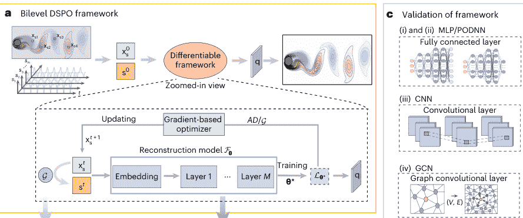

图 1：DSPO 框架概述。a 一个双层 DSPO 框架。正向过程根据传感器观测值构建全局场，并为反向过程的当前布局提供最佳模型参数。反向过程通过基于梯度的优化器动态更新布局，为正向过程提供新的布局。

正向和反向过程异步执行。b. 可微优化器获取离散数据集上任意位置的导数和激活值。c 使用基于神经网络的模型对框架进行验证。显示了其主网络结构。

反向过程交替执行，直到目标函数不再进一步提高。以公式表示，该过程给出：

`θ* = arg min_θ L_0(θ, Q(s', x))`

`x_{t+1} = D(∇_x L_0).`

其中

`∇_x L_0 = ∇_{s'} L_0 · ∇_x s'.`

`∇_{s'} L_0 = ∇ S(V, x_i, s'_i) = ∇ S(V, x_i, s).`

其中 `u'_i` 表示 RFD-BF 导数 `[x_i]` 表示 RFD-BF 传感器。生成器 `g` 计算 `l=0` 对应的 RFD-BF 导数，对应于位置 `x_i` 传感器值的比较。该策略的核心思想是选择 `u'_i`。生成器首先利用径向基函数 `φ` 和多项式 `θ` 的组合来估计传感器值：`s_i = Σ_j η_j φ(x_i - x_j) + μ_j x_j` (图. 1b)。

`v_i = Σ_{j=1}^M u'_j s'_j`

`L_0` 和 `L_1` 表示验证重构误差。值得注意的是，当模型只有观测值时，导数 `∇_x L_0` 必须通过 `AD` 和 `B` 计算。当模型包含其输入的一部分部分时，可以使用 `AD` 计算导数。

## 可微 DSPO

其中

`A_j = g(x_i - x_j), j=1, ..., q; μ_j = p(x_i), i=1, ..., q.`

可微优化器基于径向基函数生成器运行，相对于布局将传感器观测值放置在任意位置。优化器定义为 `G(V, x_i, s) = [v_1, ..., v_M], [x_i]`，其中 `[x_i]` 表示传感器布局。RFD-BF 技术是可行的，它通过通用节点及其最近邻居的加权组合来近似值及其导数。在没有特殊限制的情况下，

$$\begin{bmatrix} \mathbf{A}^T & \mathbf{B} \\ \mathbf{P} & 0 \end{bmatrix} \begin{bmatrix} \mathbf{x} \\ \lambda \end{bmatrix} = \begin{bmatrix} \mathbf{a} \\ \mathbf{b} \end{bmatrix}$$

`a_j = ∇_x g(x_i - x_j) j=1, ..., q; b_j = ∇_x p(x_i) j=1, ..., q.`

`T` 是转置矩阵，`λ` 是强制约束的拉格朗日乘子 `Pw = b`。使用优化器，`q` 派自

## 文章

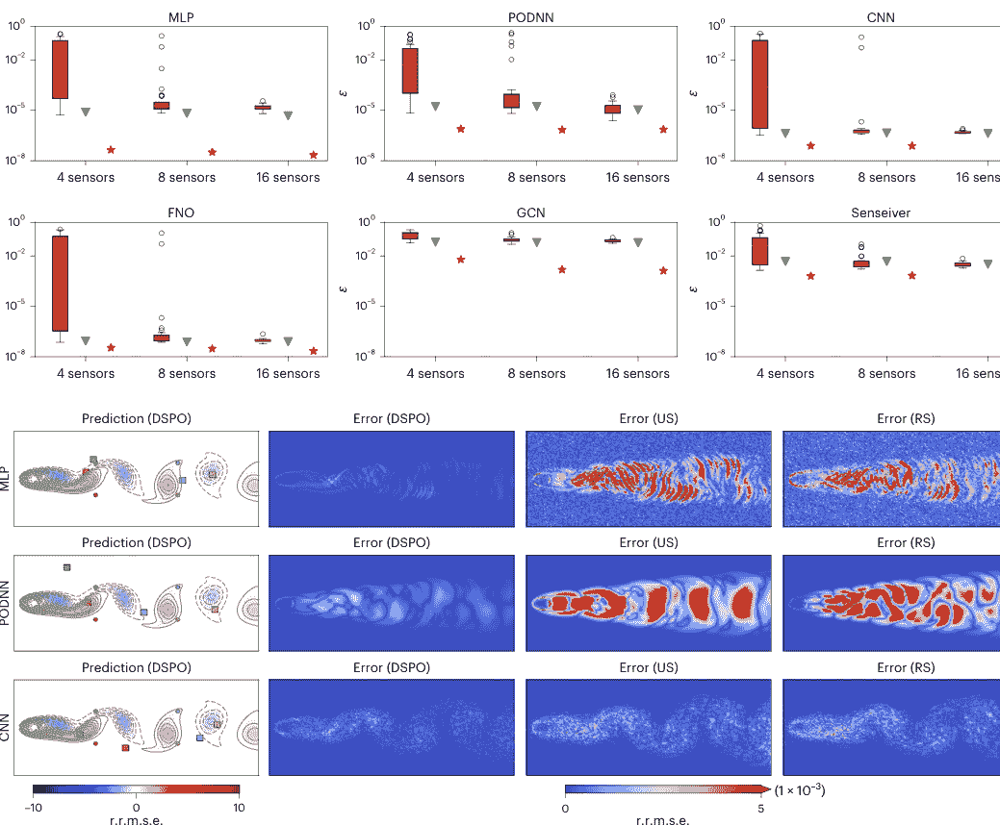

图 2：使用 DSO 和 SPO 基准测试的模型性能和预测。使用三种传感器配置（DSO, RS 和 US）变化的传感器数量。对于 RS，模型使用 30 个随机布局进行训练（n=30；平均位于中心线；宽度的 25% 到 70%；延伸到四分位数范围的 1.5 倍）。均方误差二维离散数据集，基于 RFD 的权重计算传感器观测值及其导数 (6)。

## 结果

我们将通用 DSO 框架应用于在宽时空范围内具有强非线性动力学的六个基准测试。相对均方误差 `||q - q̂||/q` 用于评估重构性能，其中 `q` 和 `q̂` 表示重构场。基准：使用六个重构模型验证 DSO、MLP、傅里叶神经算子 (FNO)。此外，将 DSO 与插值方法比较，即基于条件的采样（DSO）、增强聚类的采样（EES）和基于采样（CCS）。这些静态方法在插值之前优化双线性场。DWI 也被基准，它在放置期间同时优化积分场。ISH 被比较并作为基准。微分器（US）和随机采样（RS）也被视为基准。

# 层流水

第一个数据集考虑流过圆柱障碍物的二维非稳流，这是重构领域的经典基准，涉及在矩形区域内放置圆柱以观察涡流。该模拟可以通过直接数值求解不可压缩 Navier-Stokes 方程获得。

## 文章

### 覆盖率 (%)

### 覆盖率 (%)

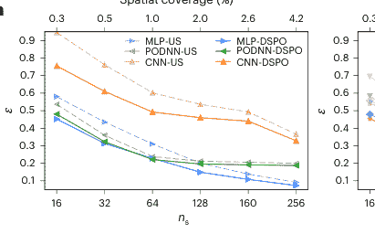

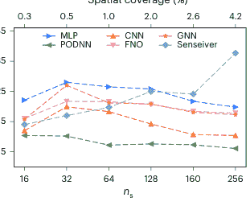

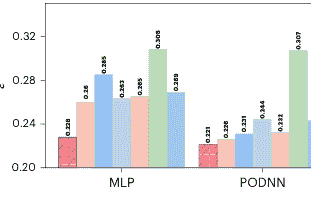

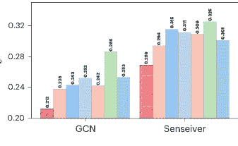

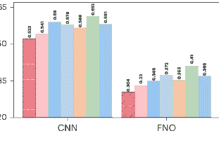

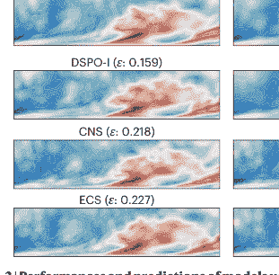

### 精确

### DSPO (e: 0.135)

### 精确

### DSPO (e: 0.197)

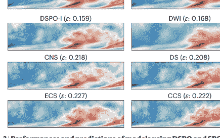

### DSPO-I (e: 0.159)

### DSPO-I (e: 0.168)

### DSPO-I (e: 0.234)

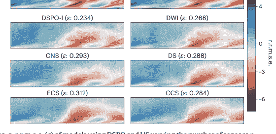

### CNS (e: 0.218)

### DS (e: 0.208)

### CNS (e: 0.293)

### DS (e: 0.288)

### ECC (e: 0.227)

### CCC (e: 0.222)

### ECC (e: 0.312)

### DS (e: 0.284)

**图 3：** 使用 DSPO 和基准测试的模型性能和指标。a) 使用 DSPO 和 US 的模型随传感器数量 `n_s` 变化的总均方误差 (t.m.s.e.)。b) `n_s=4, 64` 时使用 DSPO 和 US 的比较。d) `n_s=256` 时 GCN (c) 和 Sensiver (d) 的代表性性能。

## 论文


**a** 在不同训练快照数量 `n_train` 下，使用 DSPO 和 SPO 基准模型的性能与预测结果。a. DSPO 与 SPO 基准的对比。请注意 CNN 的误差与其他基准模型不同。b. MLP 和 FNO 的代表性预测结果和绝对值。DSPO 的最终位置用正方形表示。


流流向、、法向和展向方向的半宽是通道的半宽。从通道中间提取一个切片，得到 `128 × 48` 网格的计算尺寸。该区域使用半宽（`L`）作为特征长度尺度进行无量化处理，速度分量数量为 3。雷诺数为 `Re=1000`，这是我们关注的目标。

我们研究了 DSPO 框架对于这种混沌且动态丰富的现象对内存数量的依赖性。如图 3 所示，与 US 的初始放置相比，DSPO 的不同模型为六个模型提供了较低的定性重建。这表明 DSPO 在训练过程中动态提高了模型准确性并探索了传感器布局。PODDNN-U DSPO 在少于 64 个传感器时达到了 SOTA 性能，CNN 在超过 64 个传感器时达到了 SOTA 性能。MLP-DSPO 优于 PODDNN-U 和 G-U，达到了甚至接近 SOTA 性能。特别是，GAN 在各向异性流和湍流任务中表现出色，而 FNO 和 DSPO 执行有效。此外，DSPO 与初始放置相比，模型性能 (%) 一致地改进了性能。在所有模型中，DSPO 将性能提升了近 15%。PODDNN 在该任务中表现出优异性能，限制了传感器的数量。随着传感器数量的增加，DSPO 改进了重建准确性，改进超过 40%。图 3 显示了 DSPO 与 SPO 基准之间的对比。我们在六个指标 `r.m.s.e` 上评估了绝对值。CNN 和 G-U 的代表性场在速度性能上一致良好，优于其他。除了 `r.m.s.e.` 外，还用于评估重建性能（补充表 5 和补充图 3）。在这些标准下，使用 DSPO 的模型达到了更接近参考的结果。特别是，GAN-DSPO 比更多模型更能捕捉湍流现象，且

## 论文

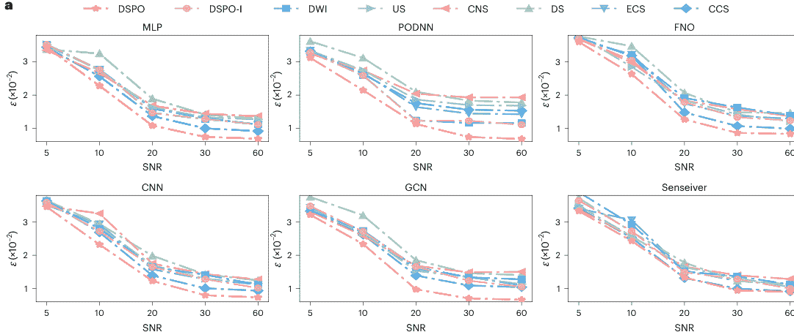

a

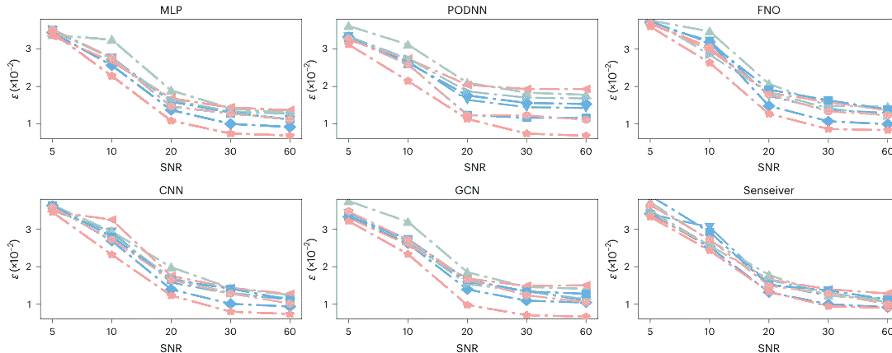

b

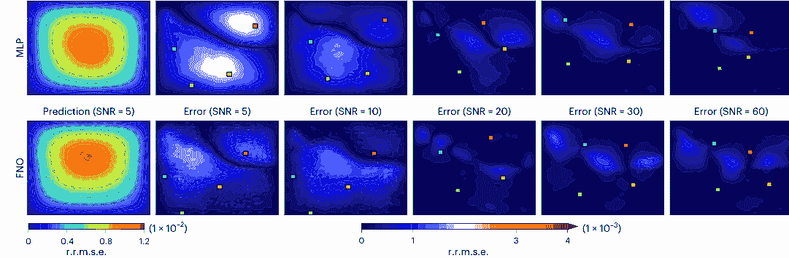

**图 5** 在不同 SNR 值下，使用 DSPO 和 SPO 基准模型的性能与预测。**a.** DSPO 与 SPO 基准的对比。**b.** MLP 和 FNO 的代表性预测结果和误差图。DSPO 的最终位置标记为。

翼型上的不可压缩流

翼型上的流场对于飞行器的设计和控制至关重要。第三个数据集是 NACA 0012 翼型上的流，其来流是随迎攻角和速度变化的二维不可压缩流。流场以湍流为特征，来流条件在迎攻角 `α ∈ [-10°, 10°]` 和流速 `U ∈ [5, 15]` m/s 范围内均匀采样。我们收集了 1000 个快照，并在 `256 × 256` 的网格上进行评估。传感器被放置以捕捉流场状态。

更多细节。我们研究了重建准确性对训练数据的依赖性。如图 4 所示，在不同快照数量下，我们的 DSPO 方法达到了 SOTA 性能。与 DWI 相比，DSPO 显著优于 MLP、PODDNN 和 FNO，证明了我们深度学习框架的优越性。不同案例研究：文献 39。在小训练计数下，使用 SPO 基准优于 CNN。卷积层的正则化和翼型周围的速度变化可能会改进静态放置的方法，而使用 500 个快照的 DSPO 达到了与静态放置 相当的精度。图 4 展示了使用 SPO 基准的 MLP 和 FNO 的代表性预测和绝对误差。DSPO 显著提高了翼型周围的预测准确性。从误差分布来看，DSPO 优于 DWI、DNS 和 ECS。通过注意力机制高效捕捉空间域，我们的 DSPO 框架提供了平滑且准确的预测，并依赖于足够的训练数据。

渗透流


渗透流的重要性在于其管理、压力工程和土木工程。渗透流的重要性在于其在地下环境中建模和预测流体行为的能力，这对于许多应用至关重要。示例包括地下水

## 表 1 | DSPO 结果总结

| 问题 | 圆柱尾迹 (10°) | 湍流 (10°) | 翼型流 (10°) | 渗透流 (10°) |
|---|---|---|---|---|---|---|---|
| 设置 | 模型 | 传感器 | 模型 | 传感器 | 模型 | 快照 | SNR |
| 基准 | MLP | 783.4 | 470.0 | MLP | 5.8 | 0.9 | MLP | 520 | 100 | 600 | 1.14 | MLP | 164 | 1.27 |
| SOTA | FNO | 8.5 | 7.6 | GCN | 5.4 | 0.8 | FNO | 3.47 | 0.42 | GCN | 153 | 1.31 |
| | FNO | 3.4 | 2.2 | GCN | 4.5 | 0.7 | FNO | 0.15 | 0.03 | GCN | 0.98 | 0.06 |

基准方法 (`MLP`) 与 `DSPO` 模型在不同传感器数量、快照和 `SNR` 值下进行了比较。此外，在固定传感器位置，`DSPO` 在所有场景下均优于基准。我们评估了 `DSPO` 的性能。最佳结果用粗体表示。具体而言，传感器数量、观测值和信噪比 (`SNR`) 设置为不同的水平：`$n = {\frac{10^k}{2^{k}}}^{k=2..3}$`。这里，`$V$` 是从正态分布的随机变量。假设系数分布是有噪声的，目标是从噪声中重建它。

图 5 显示了 `DSPO` 和 `SOTA` 基准的性能和预测。我们发现了几挑战 `DSPO` 和 `SOTA` 基准的案例。图 5 显示，随着 `SNR` 的增加，r.m.s. 值略有下降，表明信号越纯净性能越好。此外，`DSPO` 在不同模型和 `SNR` 水平上均优于其他，一致地展示了我们方法的鲁棒性。通过使用 `DSPO`，我们证明了它可以更好地泛化到噪声场景。

表 1 总结了 `DSPO` 在一系列经典应用中的结果。对于渗透，使用 `MLP` 作为基准方法。选择 `MLP` 是由于其容量有限，难以以高精度重建场。尽管如此，`RNN` 的架构适用于复杂问题。

## 文章

更广泛地说，我们的框架可以作为高效重构的范式。这种灵活性允许更多样化的场景和探索。此外，其他方法（如基于梯度的优化）可以与我们的框架无缝集成，以提高重构准确性并增强模型的鲁棒性。我们的工作在稀疏感知方面仅触及皮毛，这可以扩展到处理三维体素空间的重构。此外，通过引入流形策略，我们旨在在未来释放流形上重构的潜力。

重构性能。可微算子设计用于获取任意位置的重构并计算导数。通过我们的方法，学习框架实现了算子相对于放置位置的可微性。这种使用基于梯度的优化技术来执行框架（通过求解方程 (1) 中的优化任务），通通基于神经网络的模型开辟了新途径，推进了 `SOTA`（最先进水平）。

## 方法

### 可微学习框架

根据不同任务，基于神经网络的重构方法分为两类，这些方法或是端到端的（如 `MLP` 和 `FCN`），或是基于解码器的。在后者中，解码器表示为 `$\mathcal{G}_{\theta}(s_i, x_i)$`，对于 `$\theta, s_i$` 和 `$x_i$` 是可微。这里，`$x_i$` 代表查询位置，对应我们全局框架中的所有全局坐标。

## 框架验证

所提出的框架在六个基于神经网络的模型上进行了验证，包括 `MLP`、`PODN`、`FCN`、`GAN` 和 `SiN`。我们总结了方法的概念流程，详细描述如下：

**MLP。** 一项代表性工作是使用 `MLP` 进行流体重构，在无须重新处理原始数据的情况下展示了优越的性能特征。遵循相关工作，我们使用基于 `MLP` 的模型来验证所提出的全局流体重构框架（补充图 1-C）。`MLP` 通过几个全连接层提取观测值的关键特征。

```
$u^{(L)}(s) = \sigma(W^{(L)}\sigma(W^{(L-1)}(\dots + W^{(1)}s + b^{(1)})\dots) + b^{(L)}); \quad (1)$
```

其中 `$\sigma$` 表示激活函数，解码器包含权重 `$W^{(l)}$` 和偏置 `$b^{(l)}$`。训练数据集 `$\mathcal{D} = \{s_i, u_i\}_i$` 由观测值和重构值的对组成。在足够的数据集下，我们的目标是学习一个 `CNN` 类损失函数 `$\mathcal{L}(u, \hat{u}, \theta)$`。该 `MLP` 的学习过程在数学上表述为：

**PODN。** 使用 `PODN` 的降阶模型是一类成熟且广泛使用的流体重构降阶模型技术——它被用于在线预测，以降低高维模拟的计算成本。此外，正交投影分解（`POD`）模型从一组快照（`snapshots`）中推导出，并使用神经网络来学习观测值与 `POD` 系数之间的映射。

```
$\theta^* \in \arg\min_{\theta} \sum_i ||a_i - a(s_i)||^2; \quad (2)$
```

正向过程基于有限观测值重构全局流场，为当前放置提供最佳模型参数。默认情况下，使用均匀放置作为第一个模型的初始传感器。然后，通过迭代，使用随机自适应放置策略更新位置。

反向过程最小化传感器位置并为正向过程提供部署。给定最佳模型参数 `$\theta^*$` 用于计算梯度信息，即目标函数相对于放置位置 `$s$` 的导数。因此，每次迭代 `$\gamma_t$` 执行放置的自动更新。在此过程中，聚合算子计算 `$s$` 对于 `$x_i$` 的导数，即 `$\frac{\partial \mathcal{L}}{\partial x_i} = \frac{\partial \mathcal{L}}{\partial s} \frac{\partial s}{\partial x_i}$`。

`PODN` 被用于验证所提出的框架（补充图 1-2）。我们首先收集快照使得 `$u_i = \sum_j a_{ij} \phi_j$`，其中 `$u_i$` 是 `POD` 模型，`$\phi_j$` 是奇异模，`$a_{ij}$` 是系数。通过足够的数据集获得分解结果。然后构建训练数据集 `$\mathcal{D} = \{s_i, a_i\}_i$`。通过训练数据，我们的目标是学习从观测值到系数的映射：`$s \rightarrow a$`。学习过程在数学上表述为：

```
$\theta^* \in \arg\min_{\theta} \sum_i ||a_i - a(s_i)||^2; \quad (3)$
```

```
$x^{(t+1)} = x^{(t)} - \alpha \frac{\partial \mathcal{L}}{\partial x^{(t)}}; \quad (4)$
```

`$m^t = \beta m^{t-1} + (1-\beta)g^t$`，`$m^t$` 表示定义的学习率，`$\beta$` 和 `$\alpha$` 表示注意力权重。较高的学习率影响收敛速度（补充表 2）。

最后，执行正向和反向过程，直到目标函数不再改进或达到传感器的最大迭代次数 `$N^{max}$`。该框架赋予模型可微放置优化能力以处理。更新步骤由如下给出：

一旦训练了神经网络模型，就可以使用输入观测值来预测新场。将估计的系数 `$\hat{a}_i$` 代入 `$u_i = \sum_j \hat{a}_{ij} \phi_j$`，即可从 `POD` 模的线性组合中解 `$u$`。

`CNN` 已经成为一种强大的替代方案，能够高效地从稀疏观测中重构高维数据。上述方法在规则网格上存在局限性。因此，`CNN` 也被用于 `Voronoi` 嵌入以处理非结构化数据。随后，另一种方法将 `MLP` 与 `CNN` 结合。由于使用了 `MLP`，我们使用基于 `MLP` 的编码器将输入特征转换为全局场表示。高维表示可以通过 `MLP` 和 `$l+1$` 个卷积层获取，然后转换为卷积层。卷积层通过滤波操作提取输入数据的特征：

```
$H^{(l+1)} = \sigma(W^{(l)}A^{(l)}H^{(l)})$
```

其中 `$A$` 是邻接矩阵，`$I$` 是单位矩阵，`$D$` 是 `$A$` 的度矩阵。该层捕捉了更新和聚合邻居特征的特征，导致了网络中直接和间接的连接。

```
$X^{(l)}_i = \sigma \left( \sum_{j \in \mathcal{N}(i)} \frac{1}{\sqrt{d_j}} W^{(l)} X^{(l-1)}_j + b^{(l)} \right)$
```

其中 `$X^{(l)}$` 和 `$Y^{(l)}$` 是第 `$l$` 层的输入和输出，`$W$` 表示大小为 `$H \times d$` 的滤波器，`$b$` 表示偏置；`$\sigma$` 表示非线性激活函数。

`FNO` 是成功的深度学习架构之一，可以在无限维空间上学习无关架构。利用里叶变换，我们令 `$\mathcal{I} \mapsto \mathcal{O}$` 为 `FNO` 以学习映射。

`F-SCNN` 采用了编码器-解码器架构。空间编码器 `$E_s$` 首先将位置 `$x$` 映射到特征，基于注意力的编码器将特征映射到潜空间 `$Z$`。然后，基于注意力的解码器从查询位置 `$x$` 重构。该过程可以表述为：

```
$Z = E_s(\mathbf{s}), \\ \mathbf{u} = D_s(Z, x)$
```

编码器由 `MLP` 和多个注意力块组成，解码器由 `MLP` 和多个交叉注意力层组成。每个块都是包含查询、键和值的多头注意力层，用于学习映射 `$\mathcal{S} \mapsto \mathbf{u}$`。`Senser` 用于重构复杂场。更多细节见参考文献 22。

核算子编码器通过里叶变换和反里叶变换处理输入。这里 `$R$` 是里叶卷积的参数。解码器使用反里叶变换处理场。通过训练数据，我们利用 `CNN` 学习映射 `$\mathcal{S} \mapsto \mathbf{u}$`。`GCNN` 重构的概念流程见补充图 I-4。

所有数据集包括层宽、湍流通道、流入冲刷、达西流、平板层表面温度，这些可以通过 `Zenodo` 获取（`https://doi.org/10.5281/zenodo.3253970`）（45）。源数据随论文提供。

## 代码可用性

代码已存档于 `https://doi.org/10.5281/zenodo.2529285` (46)，并通过 `codeCode` 在 `https://doi.org/10.24443/CC-0434598v2` 获取。

## 参考文献

- 1. Wang, M., Tang, S. State estimation in turbulent channel flow from limited observations. J. Fluid. Mech. 917, 99 (2023).

- 2. Malekei, A., Ozer, E., Alhaymadeh, M. & Ginolami, M. Machine learning and structural health monitoring over uncertainty and high-dimensional data sources. Health Monitor, 21, 1906–1955 (2022).

## 文章

3. Thelen, A. E. 数字孪生的全面综述——第一部分：建模与工程技术。Struct Mult. Opt. 65, 342 (2022).

4. Feizi, N., Patel, R., Kumari, M. R. & Atshazar, S. F. 在按需启能网络感知中，使用重构BLMFC进行自适应波重建。IEEE Trans. Robot. 38, 2928–2942 (2021).

5. Dong, G., Loy, C. C., & Kang, X. 使用深度卷积网络的超分辨率成像。IEEE Trans. Pattern. Math. Mach. 38, 295–307 (2015).

6. Lecun, Y., Bengio, Y., & Hinton, G. 深度学习。Nature 521, 436–444 (2015).

7. Brunton, S. L., Noel, B. R., & Kutzner, P. 物理学的机器学习。Annu. Fluid Rev. 52, 477–508 (2020).

8. Fukami, K., Fukagata, K., & Takakura, S. 使用机器学习进行湍流的超分辨率重建。J. Fluid Mech. 876, 106–129 (2021).

9. Guillemes, A., Smith-Villalc, C., & Desiot, S. 针对随机传感场的超分辨率生成对抗网络。Nat. Mach. 14, 1165–1173 (2022).

10. Sha, X., Yu, Y., & Wang, Q. 基于改进深度学习方法的空化工业设备压力压降预测。Sensors 21, 033621 (2021).

11. Peng, X., Li, G., Zhang, Z., Baek, H., & Yao, W. 一种基于温度场重建的深度学习方法。Int. J. Therm. Sci. 182, 107631 (2022).

12. Fukami, A., N., Bohmi, M., Ulrich, T. 基于泵流体中稀疏传感器的机器学习湍流重建。J. Fluids 144, 125105 (2022).

13. Zhou, Y., Kumari, A. N., & Baira, K. 使用机器学习进行涡诱尾流场角的稀疏传感器重建。Theor. Comput. Phys. 39, 269–273 (2022).

14. Shir, F., Permatal, M., & Romashed, A. 深度学习方法重建与分析的全面综述。J. Art. Appl. 6, 301–360 (2022).

15. He, X., Wang, Y. L. & Liu, J. 流信息网络：利用神经网络从动态成像重建流体场。Phys. Mech. 34, 096002 (2022).

16. Ogiev, M., Hasein, H., Fischer, A., & Farish, B. 用于重建光流场的卷积神经网络。Mach. Learn. Sci. Tech. 2, 045021 (2021).

17. Bian, A., Wang, H., Liu, G., Ma, J., & Guan, S. 卷积网络上的深度学习：工业工程中的概述与最新应用。Int. J. Sens. It. 173, 8342014 (2023).

18. Liang, S., et al. EngGNN：一种用于大型图神经网络的高吞吐量且能效架构。IEEE Trans. Comput. 57, 7511–7525 (2022).

19. Ayyazazadeh, K., & Lee, A. 用于重建科学模拟和设计的神经算子。Nat. Rev. Phys. 6, 320–332 (2020).

20. Zhao, X., et al. ResFNR: 使用傅里叶神经算子从稀疏测量中重建高分辨率流流场。Int. J. Therm. Sci. 195, 108619 (2024).

21. Fukami, K. et al. 基于维罗诺伊同化的稀疏传感器深度重建。Nat. Mach. Intell. 3, 945–951 (2021).

22. Santos, J., et al. 用于从稀疏测量中重建流体的传感器开发。Nat. Mach. Intell. 5, 1317–1335 (2022).

23. Li, B., & Wang, R. 基于递归方法的重建高效传感器放置。IEEE Trans. Signal. 69, 1885–1898 (2021).

24. Manohar, K., Brun, W., Kutz, J., & S. 数据驱动的稀疏传感器重建：已知模式的益处。IEEE Control Syst. 38, 68–76 (2021).

25. Nagata, T., et al. 针对带噪声高维数据的基于近端优化的数据驱动稀疏传感器选择。IEEE Trans. Signal. Process. 70, 5251–5264 (2022).

26. Nagata, T., Yamada, K., Kamada, Y., & Sato, N. 大规模传感器问题的随机分组方法。IEEE J. Sens. 23, 9538–9548 (2023).

27. Koo, B., Shin, H., Kim, J., & Yoon, J. 用于蒸汽重整器温度和传感器放置的深度学习技术。HT Chem. Appl. 173, 1155–1163 (2023).

28. Zhang, Z., Wang, G., Gu, J., & Lu, M. 用于混合物虚拟传感的新型深度学习方法。Phys. Chem. 195, 110319 (2023).

31. Marcato, O., Maley, D., Viswanathan, H., Guiltman, E., & Santos, J. 稀疏传感器流体重建：深度学习增强。https://arxiv.org/abs/2312.0917

33. Clark, E., Brun, S., & Kutz, J. 多保真传感器选择：选择廉价和昂贵传感器的贪心算法。Sensors 21, 1151–1161 (2021).

34. Li, B., Hu, Y., & Wang, R. 用于热场重建的数据驱动传感器放置。Chin. Technol. Sci. 64, 1981–1994 (2021).

35. Fasse, A. M., et al. 用于配水系统聚类形成和故障检测的基于传感器的进化优化算法。J. Cleaner Proc. 319, 128763 (2023).

36. Coleman, T. & Kirk, A. 使用多网格方法和多区域边界条件的快速浸入边界方法。Comput. Methods Appl. Mech. 192, 2131–2148 (2006).

37. Fukagata, K., Kasagi, N., & Koutaramakos, S. 超疏水表面湍流减阻的理论预测。Phys. Fluids. 18, 015703 (2006).


# 参考文献

38. Zhao, X., Chen, G., Zhang, Z., & Wang, Y. 基于正交分解和深度学习的神经网络热场重建混合方法。Exper Syst. Anal. 210, 114032 (2022).

39. Xiang, J., Li, T., Xie, F., Zhang, H., & Zheng, Y. 基于压缩降阶模型的稀疏测量深度学习预测。Comput. Methods Appl. Mech. 393, 115933 (2022).

40. Wu, J., & Luo, D. 用于稀疏数据高维流体预测的深度学习辅助阶模型。Phys. Fluids. 35, 103115 (2023).

41. Lu, J., Jin, P., Wang, G., & Karniadakis, G. E. 基于算子通用近似定理的DeepNet学习非线性算子。Nat. Mach. Intell. 3, 218–229 (2021).

Nature Intelligence | Volume | 2023 (1129–1140)

## 附加信息

补充信息 在线版本包含补充材料，https://doi.org/10.1038/s41526-025-01063-9

+ 43. Li, Z et al. 参数方程的傅里叶神经网络。在 Proc. of ICLR (2021); https://openreview.net/pdf/53c478f49d1cd421b86ca7fd74e3b5.pdf

44. Path, J., et al. 使用图神经网络的高效基于机器学习重建。Eur. Phys. J. C, 81 (2021), 381.

45. Liu, X, et al. DSO 数据集。https://zenodo.org/record/5615520 (2021).

46. Liu, X, et al. DSO-v1, 代码库。https://doi.org/10.52581/zenodo.1559928 (2025).

47. Liu, X, et al. DSO 代码库。CodeOcean https://doi.org/10.24433/0c432598.v2 (2025).

## 致谢

这项工作受中国科学基金资助，基金编号`92317206` (W.Y.)。我们感谢 G. Li、H. Zhang 以及许多人的宝贵支持和专业知识。

## 作者贡献

X.L., W.P. 和 W.Y. 贡献了研究的想法和设计，X.C., X. Zhang, X. Zhao 和 W.J. 监督了研究。X.L. 和 W.P. 执行了研究。X.L. 编写了论文。

## 利益冲突

作者声明无任何利益冲突。

Xu Liu 1,2*, Wei Peng 1,2*, Xiaoyao Zhang 1*† & Wen Yao 1‡

*智能游戏与决策实验室，中国北京。²这些作者贡献对等：Xu Liu, Wei Peng。e-mail: liuxu18054448691@126.com; weipeng0098@126.com; weizenzhou@outlook.com; wendy0782@126.com
