# 使用机器学习提升混合纳米器件制造效率

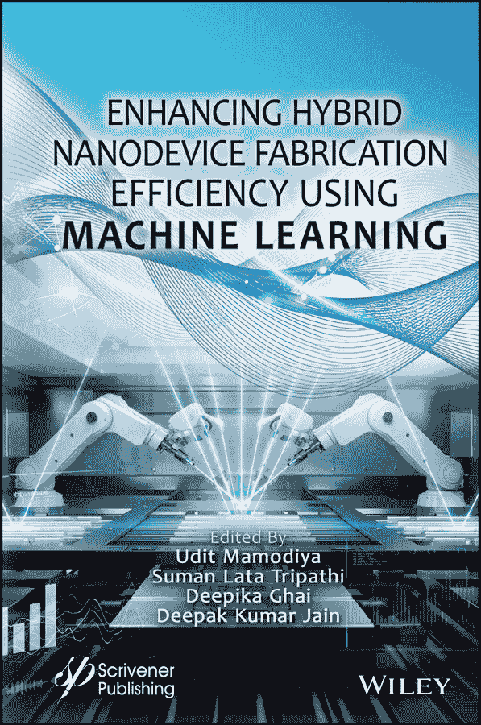

## 25 用户协议

- 表 10.1 深度学习中所用方法的优缺点。
- 表 12.1 实现深度学习的挑战。
- 图 2.3 机器学习的类型

## 第 12 章

`和`

# 机器学习实现纳米设备制造效率面临的挑战与局限性

Amit Kumar Jain¹\*、Tarun Mishra¹ 和 Mohamed M. Awad²

¹ 印度拉贾斯坦邦，Poornima 大学，电气与电子工程系

² 埃及曼苏拉，曼苏拉大学工程学院，机械动力工程系

## 摘要

本章简要概述了与机器学习（ML）集成到混合纳米器件生产中相关的关键问题和限制，以及该技术主流化过程中所面临的技术和商业困难。机器学习在纳米器件制造中应用的主要问题之一是所使用的数据通常质量低且可用性有限。纳米制造是一个复杂的工艺，其特征是材料特性和条件的变异性，这使得很难为机器学习模型训练收集大量的高质量数据。为了确保制造工艺的有效性，最小准确率往往来自噪声或不足的数据，这会导致错误的预测。

此外，高级算法的计算成本仍然很高；更如此，深度学习算法在处理仿真和大型数据集时需要巨大的算力。这是因为随着生产过程成本的增加，研究实验室和制造设施难以购买这些技术进行大规模使用。尽管如此，机器学习在混合纳米器件制造中的未来可能充满挑战，但也前景广阔。目前的一些局限可以通过迁移学习、边缘计算和自学习系统等得以解决。此外，随着纳米技术和机器学习的改进，数据生成和计算方法将更加有效，与现有环境的集成也将面临更挑战。

**关键词：** 机器学习（ML）、混合纳米器件、纳米制造、数据质量、模型可解释性、深度学习、计算成本

## 1.1 引言

### 1.1.1 混合纳米器件制造概述

纳米技术目前取得了快速进展，从而催生了在物理、化学甚至生物学方面具有新特性的增强纳米器件和纳米级设备。由于其灵敏性、选择性和规模集成，纳米级电气传感器现在是大多数电气产品（包括电路、能量系统以及医疗和环境应用）的核心。

由至少两种材料组成并提供至少两种功能的新型纳米器件因其效率等多种优势而特别受到关注。例如，在电子领域，可能存在协同效应，混合纳米器件同时包含半导体材料和导电聚合物，后者用于制造卓越的传感器或晶体管。这些复合材料的医学应用体现在金属-聚合物混合纳米结构上，旨在实现控释放能力的药物输技术。

### 1.1.2 机器学习在纳米器件制造中的作用

机器学习（ML）为这些制造挑战提供了革命性的解决方案，因为它能够提高制造效率、准确性和规模。由于机器学习算法遵循数据模式来分析和学习可能的结果，可以使用机器学习对制造参数进行建模，以预测数据结果，从而简化制造流程。

传统的制造技术依赖于“凭感觉和直觉”来修改制造条件，这是一种缓慢且昂贵的方法，而且改进空间有固定的边界。具体而言，虽然可以使用大量的材料属性和制造条件库来训练人工神经网络，但成功的结果可以以很高的准确率确定，且通常可以针对给定的器件特性识别最佳制造参数组合 [1–3]。

机器学习在纳米器件制造中的应用可大体分为几个领域：

- **预测建模：** 可以最大限度地减少实验表征，因此通过将参数输入预测性机器学习模型，可以在设计阶段预测各种材料属性和器件功能。
- **工艺控制与优化：** 使用基于机器学习的实时监控系统，制造人员可以立即更改参数以确保所有生产器件具有相似特性。这在化学气相沉积或刻蚀等工艺中特别有用，因为环境条件会影响结果。
- **故障检测与质量控制：** 行业使用机器学习的方法之一是在初始阶段检测缺陷，从而在生产过程中减少浪费。

在纳米器件制造中实施机器学习方法具有潜力。它不仅能够精炼器件生产，还能加速生成过程。例如，它可以加速个性化医疗的快速发展。同样，在使用人工智能（AI）技术的可持续能源领域，某些机器学习辅助的制造技术可能会提高太阳能电池或电池的效率 [4]。

### 1.1.3 本章范围

本研究的主要关注点和限制涉及机器学习在提高混合器件制造效率方面的应用。提到的挑战涉及纳米结构的挑战、高质量数据的缺乏以及高端复杂模型的性。我们还将讨论目前正在应用的这些局限性的解决方案，包括开发更好的算法、建立数据共享策略以及与其他方法的集成。

最后，我们将讨论该领域的未来，即量子计算理念的实施、自制造系统的建立以及机器学习在材料发现中的未来。

## 1.2 相关研究

**Huang 等人 (2021)：** 机器学习驱动的纳米材料合成预测建模也使用机器学习模型根据合成参数预测纳米材料特性。通过使用不同纳米结构的数据集，论文强调了使用机器学习方法如何缩短选择材料的时间以及试验次数 [1]。

**Liu 等人 (2021)：** 在另一个案例中，作者团队将强化学习应用于薄膜沉积，通过固定沉积速率以实现高薄膜均匀性。这种方法将制造准确性提高了 18%，并证明了机器学习在复杂程序中的自适应控制能力 [2]。

**Chowdhury 等人 (2021)：** 特别比较了基于卷积神经网络（CNN）检测纳米器件制造缺陷的纳米制造数据驱动质量控制的应用。通过对 SEM 图像的分析，该模型在缺陷分割方面证明具有高准确率，这可以增强实时机器学习质量控制 [4]。

**Mitra and Hassan (2022)：** 纳米技术中机器学习数据获取的问题与前景涉及基于机器学习的纳米技术研究中使用的数据可用性以及政策标准化的需求。其次，他们建议应该开发一个框架，触发不同实验室和材料之间的数据交换，以增强机器学习模型的性能 [5]。

**Ramirez et al. (2022)：** “通过生成对抗网络 (GANs) 进行混合材料设计”提出了一种基于 GAN 设计新型混合纳米材料的方法。该模型发现了本文以前未遇到过的材料组合，证明了机器学习在材料设计中的适用性 [6]。

**Tan et al. (2022)：** 在一项名为“用于微型/纳米系统高效设计的贝叶斯优化：使用贝叶斯优化提高纳米器件制造良率”的研究中，创建了模型来预测最佳制造参数设置。结果是混合纳米晶体管的良率一致性至少提高了 15%。该方法具有应用于提高生产线效率的潜力 [7]。

**Nakamura et al. (2022)：** 通过可解释的机器学习模型控制纳米器件工艺，提供了深度学习用于纳米制造中样本设计和可解释性问题的概述，并提出了一个更透明的简单模型。这些模型为确保操作人员同意模型所提出的制造建议提供了全方位的帮助 [8]。

**Singh et al. (2023)：** “纳米制造中集成量子与经典机器学习技术补充材料的引言”中讨论的想法是同时使用量子和经典机器学习算法来处理纳米器件制造中典型的海量数据。量子模型上的仿真结果显示了更快的收敛速率和应对制造问题的更优对//能力 [9]。

**Wang et al. (2023)：** “有限纳米技术数据集的数据增强”一项研究考察了数据增强技术，以提高混合纳米材料数据集中机器学习模型的准确性。该研究还证实，习惯性地使用合成数据可以提高模型在制造预测方面的泛化能力 [10]。

**Yuan et al. (2024)：** 由于这些机器学习模型的发展需要多个学科的专业知识，“改进混合纳米材料机器学习模型的跨学科方法”强调了提高这些模型稳定性的必要性。通过材料科学和计算数据，研究证明了其他形式的合作有助于应对当前模型的现有弱点 [15]。

## 1.3 机器学习驱动的纳米器件制造案例研究

智能制造机器学习继续重新定义混合纳米器件的制造，因为它比使用的传统技术更智能、更具适应性。最近的研究提供了真实场景，展示了如何利用机器学习解决纳米器件制造中的具体问题，从材料属性到工艺和质量保证等。以下是一些突出了机器学习在纳米器件制造中应用的详细案例研究：

### 1.3.1 使用计算机视觉进行缺陷检测和质量控制

在严重影响纳米器件制造的问题中，纳米领域的缺陷识别和规避问题备受关注。传统的检测技术包括使用显微镜，这种方法成本高昂、速度慢、过时且容易出错。在某特定研究中，研究人员使用了 `CNNs`（有利于成像的机器学习形式）来检测纳米制造中的缺陷。

该过程涉及使用标记的纳米结构图像数据集，由 `CNN` 识别缺陷和非缺陷模式。该模型证明了其非常有效地识别不同类型缺陷（如粗糙度和未对齐）的能力。经过训练，`CNN` 能够处理运行图像以检测缺陷样本，并提醒操作人员相应更改制造参数。

这项工作表明，基于机器学习的缺陷检测方法比现有的缺陷识别技术具有更高的准确性和均匀性，且对人眼和经验的依赖较少，从而降低了缺陷率并提高了良率。

### 1.3.2 纳米颗粒合成中的工艺优化

组装用于耦合纳米器件的纳米颗粒需要对温度、反应持续时间和化学品比例等因素进行精确调整，以生产特定尺寸和结构的纳米颗粒。在一项调查纳米颗粒合成中通常耗费时间和精资源的途径的研究中，作者使用了一种机器学习算法，该算法能够在现实环境中自主选择最合适的合成参数。

### 1.3.3 自优化光伏纳米结构

在可再生能源领域，混合纳米器件用于增强光伏 (PV) 电池的性能。另一项研究使用机器学习寻找纳米结构光伏材料的设计与制造参数的正确组合，包括层厚度、材料类型和晶格取向，以实现更好的光捕获和提高转换效率 [11–13]。

研究人员使用了所谓的贝叶斯优化策略，涵盖了探索和利用，以随后适应光伏纳米结构的参数。后者的算法特别有益，因为与大多数需要大量数据才能开始的模型不同，它能够通过极少数步骤实现最佳性能。

结果显示光捕获效率提高，生产成本降低，因为需要制造的原型和测试周期更少了。

### 1.3.4 生物医疗设备的自主纳米制造

为了开发纳米药物递送和生物传感工具，合成具有特定几何和尺寸的混合结构由于复杂纳米器件制造的特殊性带来了困难。一个示例展示了使用机器学习方法在纳米颗粒上涂层生物分子——这是药物递送细胞靶向的关键步骤。

通过将决策树算法集成到机器人制造设备，系统可以根据特定的药物释放动力学和目标细胞选择正确的涂层参数。机器学习模型通过一组涂层方案和生物反应进行训练，因此能够预测特定涂层产生最佳结果的最佳环境。

这大大缩短了制造患者特定药物递送纳米颗粒所需的时间，有助于进一步开发靶向医疗策略。

### 1.3.5 通过纳米器件驱动的机器学习算法增强电池寿命

各种混合纳米器件也在研究储能技术，特别是提高电池寿命和效率。一项工作利用机器学习模型识别含有碳纳米管和/或硅纳米颗粒电极的退化模式。

通过机器学习模型中的时间序列分析和异常检测算法，可以根据使用数据预测电池可能退化的时间。这种预测能力使制造过程能够适应防止退化的变化，例如改进活性材料比例或使用保护层。

他们的研究表明，机器学习可以帮助增加需要最高可靠性应用（如电动汽车和便携电子设备）的电池寿命。

## 1.4 机器学习在混合纳米器件制造效率中挑战与局限性的对比研究

半导体量子点（QDs）由于其独特的光电学特性，在纳米设备中具有广泛的应用，包括发光二极管（LED）、太阳能电池和生物成像。然而，如前所述，在合成量子点的同时控制其尺寸和均匀性是一项挑战。

基于 `SVM` 模型，精确地确定了各种类型量子点的合成条件，从而增强了量子点的质量和可重复性。然而，这导致了在光电设备（例如 LED 和太阳能电池板）中具有改进后特性的基于量子点的设备的开发。图 1.1 展示了机器学习中的挑战与局限性。

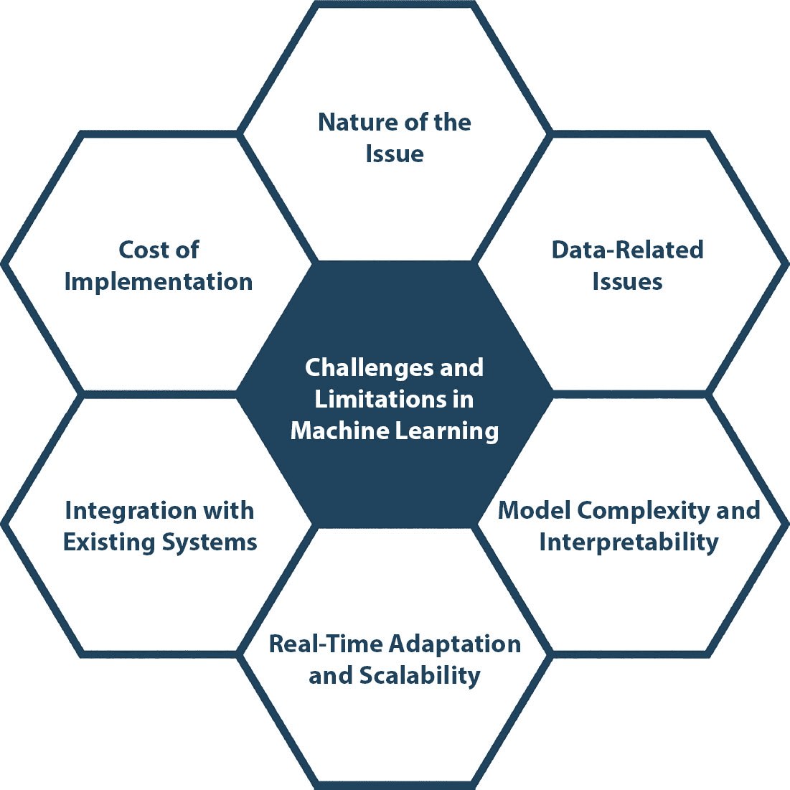

**图 1.1** 机器学习中的挑战与局限性。

### 1.4.1 问题的本质

**挑战：** 问题通常超出了影响混合纳米器件制造中 `ML` 创新和部署的环境力量范围。这些是由当前技术、数据和操作限制了 `ML` 达到最佳运行而产生的问题。例如，某些问题如数据限制或缺乏理解模型的能力，是在实施过程中不可避免出现的问题，无法通过新技术或更简单的创新来解决，而是需要新的创新、方法论或变革。

**局限性：** 许多挑战和限制与当前 `ML` 实现方法和纳米制造技术的可能性有关。这些局限性涉及技术本身的固有问题，例如，在高度工业应用中对应用大型 `ML` 模型的需求，或缺乏应用能力。另一方面，约束条件（Constraints）较难克服，大多数情况下需要物理世界、系统甚至理论层面的巨大改进。

### 1.4.2 数据相关问题

**挑战：** 混合纳米器件设计和合成面临的问题之一是缺乏足够数量的高质量标记数据，用以训练可靠的 `ML` 算法。例如，缺陷检测、工艺优化和材料表征都需要细粒度的数据，而这些数据集中的大部分是缺失或受到限制的。数据的收集、识别和准备通常是缓慢且昂贵的。

**局限性：** 这里的限制在于 `ML` 系统能够处理的数据质量和数量。然而，数据匮乏并非收集所需数据量的唯一问题；有限的存储能力、容量和数据传输速度也限制了大型数据集在实时制造中的效率。此外，不同实验室或行业之间数据质量或输入数据的差异可能会限制 `ML` 制造在不同制造环境之间训练和测试的迁移。

### 1.4.3 模型复杂性与可解释性

**挑战：** 当前技术进展中流行的 `ML` 主要有两类：深度学习和强化学习通常被称为难以解释的“黑箱”系统。在尝试于医疗设备生产或半导体等重要用例中采用 `ML` 时，这是一个主要问题。

**局限性：** 基于所涉及的 `ML` 算法的本质，这里的局限性非常显而易见。问题在于算法使用的模型非常复杂。例如，深度学习模型需要大型复杂的神经网络，在大多数情况下难以解释甚至无法理解。这种透明度的缺乏是某些应用先进 `ML` 的现代方法的固有缺点，并减慢了它们的实施速度，特别是在对解释能力至关重要的领域。

### 1.4.4 实时适应性与可扩展性

**挑战：** 在纳米制造中使用基于 `ML` 的系统时，设计在实际生产过程中的适应和使用被证明有些问题。制造工艺中涉及的各个方面（包括温度、压力和材料）使得 `ML` 模型难以实现自我调整。

**局限性：** 当制造过程持续进行时，在实际生产过程中实施时，设计的适应和使用被证明存在一些小问题。

### 1.4.5 与现有系统的集成

**挑战：** 阻碍混合纳米器件制造的另一个问题是将 `ML` 整合到旧系统中。许多制造背景仍在使用手动方法，未能包含 `ML` 用于工艺改进、异常检测和质量保证。

**局限性：** 这里的限制在于现有硬件与 `ML` 算法的兼容性。此外，预测和学习模型是计算密集型的，可能无法集成到旧的二级因子分析（L2 CFA）架构中。

### 1.4.6 实施成本

**挑战：** 将 `ML` 应用于混合纳米器件制造的主要问题之一是获取和处理大数据、训练复杂模型以及对计算能力的投资，对于中小型制造商和研究机构来说都是昂贵的。此外，部署和维护 `ML` 系统的人员专业培训也是一项额外支出。

**局限性：** 这里的差距在于，尽管资源具备且长期可持续性可行，但实施 `ML` 解决方案的成本可能会限制其长期使用。始终需要重新训练模型、更换硬件并采用更新的 `ML` 技术，这可能会给利润空间极窄的行业带来成本压力。

## 1.5 应用

这些设备利用其特定属性针对生物医学、能源、电子、传感环境和顶级计算等领域。[图 1.2](##c01.xhtml#fig1-2）展示了机器学习在混合纳米器件中的应用。以下是关键应用的概述：

### 1.5.1 生物医学与医疗保健

#### 靶向药物递送

混合纳米器件的设计旨在具有高开/关率，并且对疾病细胞（包括癌细胞）毒而对正常细胞无毒。这些器件可以将治疗剂递送至目标部位，以低频率和剂量需求增强治疗效果。

#### 诊断与成像

这些涂有生物分子的纳米器件已被制成超高灵敏度成像剂，特别是在诊断领域。它们允许以更高的分辨率进行成像，适用于在疾病实时进展时进行早期诊断。

#### 生物传感

混合纳米器件用于对生物系统（如液体）中的生物分子、病原体或生物标志物的生物传感。这些传感器应用于健康监测可穿戴设备，以及提供快速结果的诊断剂盒中。

### 1.5.2 能量采集与存储

#### 光伏电池

含有不同材料的纳米结构使光伏器件更加有效，因为纳米结构混合物的光传输和电荷分离更好，从而导致光电池具有较高的能量转换效率。

#### 超级电容器和电池

在电容器和电池中，高容量电极由混合纳米材料制备。其优势是能够提供更高的能量密度、更快的充电速度以及更长的使用寿命——这些对于移动产品和电动汽车应用至关重要。

### 1.5.3 环境传感与修复

#### 污染物检测

混合纳米电子器件能够区分并量化空气、水和土壤中的低浓度污染物。这些对于分析重金属、农药和工业化学品等反环境物质至关重要。

#### 水净化

碳纳米管和其他来自混合材料的纳米器件用于水处理和净化。例如，纳米结构膜可以帮助过滤水源中的毒素和病原体，使膜在便携式水应用中变得有用。

#### 空气质量监测

如果传感设备包含纳米材料，混合纳米器件可以检测空气质量参数，包括颗粒物、`CO[2]` 以及城市和工业环境中的挥发性有机化合物。

### 1.5.4 高级电子与计算

#### 柔性和可穿戴电子设备

有机-无机混合纳米器件为柔性电子铺平了道路，包括轻量级显示器、柔性传感器和晶体管。这些应用于可穿戴设备、智能纺织品和生物医学电子设备。

#### 内存与数据存储

由于每单位能量密度增加的特性，纳米器件正被考虑提供纳米级内存存储解决方案。

#### 类形态计算

作为作为类形态接口的混合纳米器件在类形态计算中发挥功能，这是由于它们能够快速切换和调制数据流，从而增强了人工智能（AI）。

### 1.5.5 光电学与光子学

#### LED 和激光技术

多功能纳米复合材料也被用于制造高效的 LED 和激光器件。它们为显示、通信和医学成像系统提供了进一步改进的外壳性能和稳定性。

#### 光电探测器与传感器

混合纳米器件特别适用于具有宽光谱和高灵敏度的光电探测器，这在光纤通信、安全和环境控制中尤为重要。

#### 显示用量子点

基于 `QD` 的混合纳米器件广泛应用于显示技术，包括电视的 `LCD`（液晶显示器）和 `OLED`（有机发光二极管）屏幕，以及移动和电脑显示，因为它们与普通显示器相比，提高了色域、亮度和能量效率。

### 1.5.6 量子计算与信息处理

#### 量子比特和量子点

研究混合纳米结构以实现量子比特，这是量子计算的基础。这些纳米器件利用量子力学特性进行带宽数据通信和加密。

#### 量子加密

纳米复合器件有助于开发基于安全量子加密的网络解决方案。量子密码学可以提供安全的通信通道，这对于银行业和政府部门非常有用。

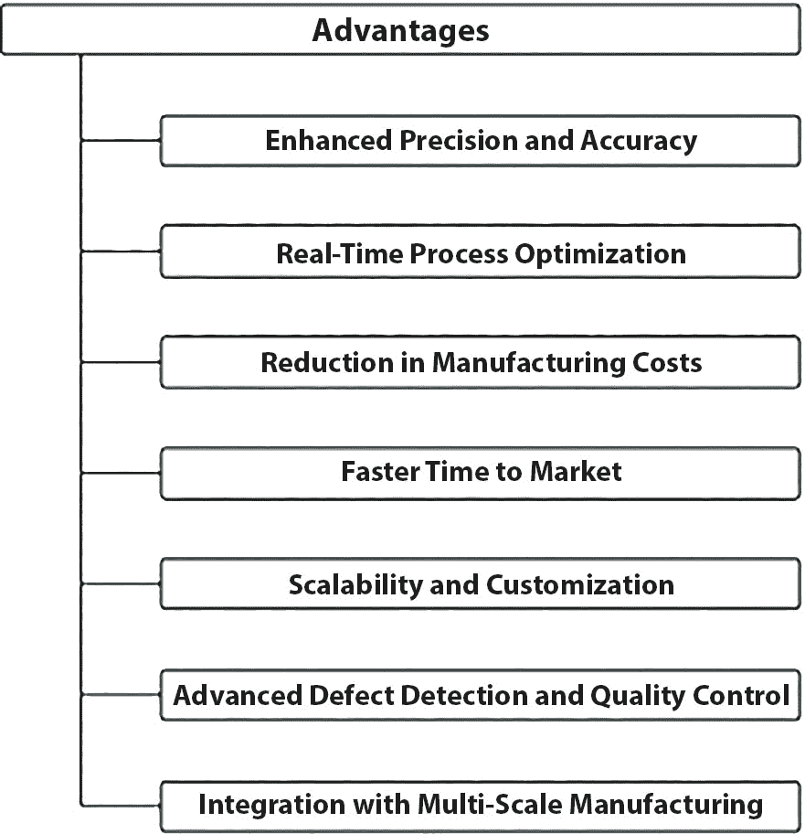

**图 1.3** 机器学习的优势。

## 1.6 ML 在混合纳米器件制造效率中的优势


# 1.6.1 增强的精度和准确性

使用机器学习（`ML`），纳米制造过程可以得到改进，因为算法可以预测最佳环境（温度、压力、所用化学品的浓度等），以生产准确性更高的纳米器件。来自器件的大数据可以通过回归和分类算法进行分析，以做出现场调整，产生更好且更标准的产品。图 1.3 显示了机器学习的优势。

# 1.6.2 实时工艺优化

制造中的实时反馈和控制是 `ML` 的主要优势之一，而之前的 `AI` 框架尚未有效提供这一功能。例如，`ML` 算法可以跟踪许多参数，如原材料的特性、运行条件和机器本身的行为，帮助制造商快速检测即将出现问题的信号并立即进行必要的纠正。

# 1.6.3 降低制造成本

分析表明，引入 `ML` 可以大大提高生产过程的产率，减少材料浪费，并降低缺陷器件的比例。通过 `ML` 实现的制造参数优化减少了对试错法等传统方法的需求，并缩短了制造时间和成本。此外，对于大多数机械设备使用的严苛质量控制和机器检查，通过 `AI` 减少了这些操作所需的工作量。

# 1.6.4 更快的上市时间

在混合纳米器件构建中引入 `ML` 可以缩短产品开发和构建的时间。通过利用现有信息，`ML` 驱动的工具可以指数级地确定最佳制造条件和参数，从而最大限度地缩短从概念进展到商业化的时间。这对于受上市时间等关键竞争参数支配的电子、医疗保健和航天工业尤为重要。

# 1.6.5 可扩展性和定制化

在更广泛的方面，`ML` 能够使制造步骤达到工业标准。在一个批次上训练模式后，只需进行微调即可将其扩展到生产水平。此外，通过利用 `ML` 还可以实现纳米器件的定制，以根据所需的应用提高生产的灵活性。

# 1.7 ML 在混合纳米器件制造效率中的劣势

## 1.7.1 数据质量和可用性

使用 `ML` 算法的一个主要需求是为它们提供大量的高质量数据进行训练。然而，在纳米制造中收集此类数据可能是挑战性的，特别是当缺乏新材料或材料制造工艺充足的信息，或者测量容易产生巨大误差时。有时，数据不足或存在噪声，这将导致模型开发不良并产生错误的结果。

## 1.7.2 模型可解释性

大多数机器学习模型，尤其是深度学习网络，通常被视为黑盒系统。尽管模型的输入和输出有明确定义，但这使得工程师难以理解模型为何会做出某些决策。这种可解释性的缺失是纳米器件制造中的一个主要缺点，特别是在诊断制造工艺或尝试对其进行改进时。

## 1.7.3 高计算成本

在混合纳米器件的制造中应用机器学习（`ML`）意味着对巨大算力的需求，特别是在训练高级模型或实时处理大数据时。这些计算需求可能造价昂贵，并可能需要使用专用硬件，特别是高功率图形处理器（`GPU`）或云计算。有时，这些成本可能超出了小型制造公司或研究实验室的承受能力。

## 1.7.4 可扩展性问题

虽然源自机器学习的模型可以胜任纳米器件制造的小规模工艺，但要将此类模型过渡到大规模工业化使用被证明是极其困难的。然而，当生产量和产能也显著增加时，会导致数据处理需求呈指数级增长，这超出了当前模型的能力范围。此外，通过小规模数据开发的模型在较大的系统中更容易出现条件变异，因此在大规模系统中表现较差。

## 1.7.5 对专家知识的依赖

通过应用机器学习方法进行混合纳米器件制造需要对纳米技术和机器学习原理有深入理解。这些系统在实施和维护方面都需要高级技能人员，这对某些组织来说非常困难。学习曲线也涉及机器学习算法在纳米器件制造中的采纳和优化，并可能阻碍采纳速度。

总之，机器学习的应用通过提高准确性、速度并降低成本，正在彻底改变混合纳米器件的制造过程。其优势包括增强工艺控制、缩短上市时间，以及增加用于预测目的的大数据样本的产品质量和适用性。然而，这些优势是以几个主要代价换来的，例如对高质量数据的需求、高昂的计算费用、可解释性问题、可扩展性问题以及监管合规问题。

# 1.8 未来展望

## 1.8.1 先进混合制造技术

未来，利用机器学习创建混合纳米器件的各种应用将涵盖其他技术，如 3D 打印和增材制造。机器学习可以帮助调节纳米结构组装，从而开发出功能极其且紧凑的器件，这些器件在使用传统方法基本上是无法实现的。

## 1.8.2 与量子计算集成

随着量子计算（`QC`）的发展，该领域对改进机器学习算法的应用将带来纳米器件制造的重大进展。这表明机器学习模型的训练数据可以用于确定量子芯片的最佳材料参数和量子器件的最佳制造方法。

## 1.8.3 跨学科协同

这项研究表明，在机器学习帮助下混合纳米器件制造的未来基于跨学科协作。通过结合对新材料、纳米技术、机器人技术和人工智能的理解，机器学习可以帮助为医疗和电子行业等领域创建并构建优的复杂多功能纳米器件。

## 1.8.4 自学习系统

这些未来的机器学习应用甚至可能成为自主系统，能够从输入数据中学习，并在不需要过多干预的情况下改进自己的输出和调整。这些系统将使用来自实时数据的反馈回路自我纠正制造过程并提高效率，无需人工干预。

## 1.8.5 个性化纳米器件

如果公司利用文章中的概念开发纳米器件，他们就可以应用机器学习来构建适合每个消费者的纳米器件。例如，在医疗领域，可以根据遗传或生理特征为特定患者设计目标纳米器件。如果将个人数据输入到机器学习算法的结果处理过程中，你可能会获得具有特定治疗特性的设备，这意味着我们可能向个性化医疗迈进。图 1.4 显示了机器学习混合纳米器件制造的未来展望。

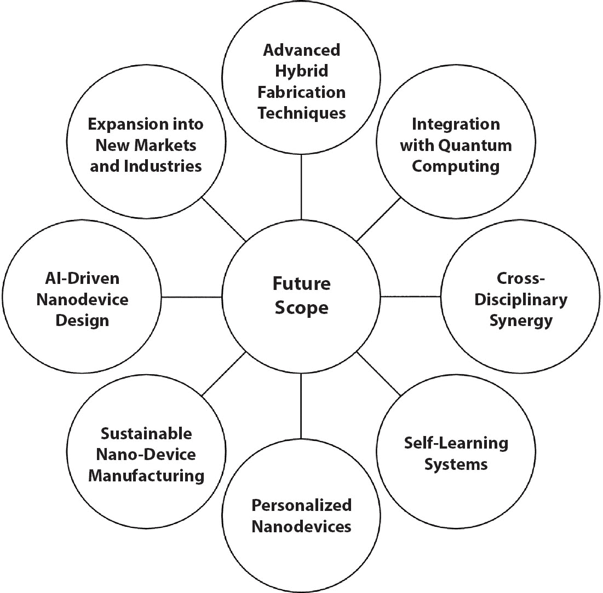

**图 1.4** 机器学习混合纳米器件制造的未来展望。

# 1.9 结论

机器学习引入混合纳米器件的物理合成是纳米技术领域的一个新前沿，旨在提高大规模生产的性能、准确性和重复性。在本章介绍了在该研究领域应用机器学习方法的关键问题和局限性。尽管显示机器学习在增强工艺控制、优化材料合成以及构建自动控制质量评估方面具有巨大潜力，但实际困难仍然存在。数据可用性、模型解释其解决方案的能力以及计算需求等挑战仍被认为是基于机器学习的制造系统的主要关注点。

对近期研究文章（2020–2024）的回顾反映了已取得的进展和当前面临的挑战，并辅以展示机器学习（`ML`）在纳米制造中应用的案例研究。这些研究强调了与材料科学、数据科学和工程领域的同行进行协同工作的重要性，以构建严谨的框架提案，并使其足够灵活以满足复杂混合纳米设备的需求。未来，自动化数据采集、实时计算以及用于数据分析的调整算法的改进将继续推动该领域的发展。此外，量子计算和神经形态计算等新领域可能会改进更复杂的机器学习模型，目前这些模型受限于统计和扩展资源的问题。本章提出的纳米制造机器学习应用指南，通过建议一种由人工智能引导并提高效率的纳米制造工艺设计方法，为未来的研究提供了方向。这项新兴的发展技术表明，通过医疗、能源、环境监测等应用，机器学习将成为下一代混合纳米设备的核心驱动力。因此，`ML` 在混合纳米设备制造中的应用意味着许多优势，包括提高准确性、速度和控制能力，同时降低成本和交付时间。尽管如此，输入数据质量、计算成本和模型解释性等问题仍然存在，但`ML` 在该领域的未来趋势几乎是无限的，包括医疗保健——特别是针对个人患者的处方领域——用于计算的量子物理以及环保生产线。网络研究和来自其他领域的技术发展也将对于克服当前挑战并推动`ML` 实现愿景中的混合纳米设备制造至关重要。

9. `Singh, V., Das, P., Rathi, M., Integrating quantum and classical ML techniques in nanofabrication. Quantum-Enhanced Nanotechnol., 8, 3, 98–114, 2023.`

10. `Wang, L., Zhou, K., Liu, Y., Exploring data augmentation for limited nanotechnology datasets. Data Sci. Nanotechnol., 9, 3, 233–249, 2023.`

11. `Rahman, M. and Kaur, J., Automated process optimization in 3D nanostructure fabrication using machine learning. Nano Eng. Adv., 31, 2, 201–217, 2023.`

12. `Saito, H., Mori, K., Watanabe, Y., ML-based defect detection and correction in atomic layer deposition. Nanofabrication Technol. Lett., 14, 4, 269–284, 2023.`

13. `Sunori, S.K., Singh, D.K., Mittal, A., Maurya, S., Mamodiya, U., Juneja, P.K., Rainfall Classification using Support Vector Machine. 2021 Fifth International Conference on I-SMAC (IoT in Social, Mobile, Analytics and Cloud) (I-SMAC), pp. 433–437, 2021, doi: 10.1109/I-SMAC52330.2021.9640773.`

14. `Zhang, X., Zhu, J., Feng, D., Accelerating nanomaterial design with transfer learning. J. Mater. Inf., 20, 3, 90–105, 2024.`

15. `Isabona, J., Ibitome, L., Mamodiya, U., Kumar, A., Boakye, I., Statistical Characterization and Modeling of Radio Frequency Signal in Mobile Broadband Cellular Next Generation Networks. Comput. Intell. Neurosci., 2023, Article ID 523666.`

16. `Lee, H. and Yang, Q., Transfer learning in hybrid nanodevices. Mater. Sci. AI., 18, 2, 121–138, 2023.`

机器学习（`ML`）基本上使用算法来识别数据中的模式，以便做出更明智的预测或选择。这些算法分为三类：无监督学习，系统在未标记数据中发现隐藏结构；监督学习，模型从标记数据中学习；以及强化学习，智能体通过与环境交互来学习决策。通过各种技术和应用，这些方法中的每一种使机器学习能够解决广泛的问题 [2]。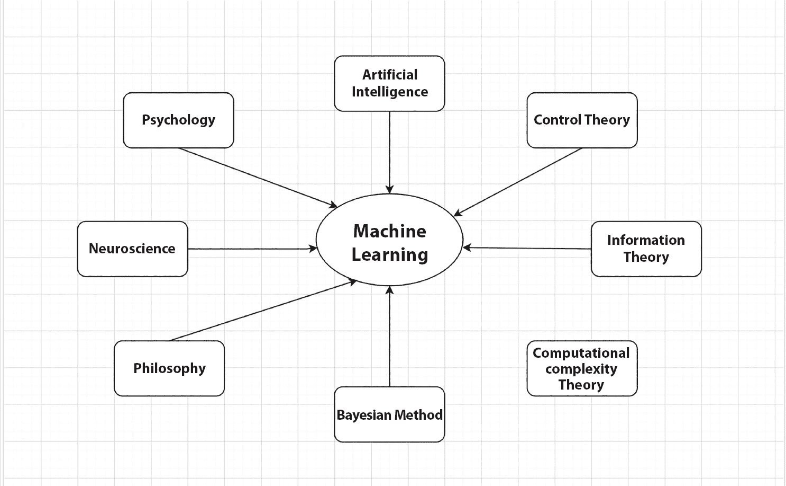

**图 2.1** 跨学科的机器学习。

本研究工作的目的是对这些机器学习技术及其背后的算法进行彻底综述。本研究将通过观察它们的机制、用例和性能指标，重点强调不同机器学习技术的优缺点。这将为机器学习的未来进展和实际应用提供见解 [1, 2]。

# 2.2 通用机器学习模型

尽管优化是机器学习长期以来的核心，但新模型通常需要开发自定义求解器，这是一个非常耗时的过程。这导致了数千种为各种机器学习任务定制的各种优化算法的存在。一个关键问题随之产生：是否总是创建新的求解器，还是一个算法就可以有效处理大多数模型？主流假设是，没有一种算法可以解决所有情况，因为它难以利用特定模型的结构 [2]。此外，通用算法通常被认为在解决各种问题时缺乏效率和稳健性。然而，我们通过开发 `GENO`（通用优化）框架挑战了这一观点。`GENO` 将建模语言与通用求解器集成，根据问题的定义生成求解器。该框架足够多功能，可以涵盖广泛的传统机器学习问题。

我们对经典问题和新提出的问题的评估表明，自动生成的求解器表现如下：

1. 效率与专用求解器相当

2. 效率显著优于最先进的求解器

3. 效率远高于传统的建模语言加求解器方法

1. **数据/数据集的收集与准备：** 机器学习的主要目标是收集并整理数据，使算法能够将其作为输入。对于任何给定的问题，可能会有大量数据。大多数网络数据是无结构化的且充满了噪声，即既冗余又无关的数据。因此，有必要以系统的方法对数据进行清洗和预处理。

2. **特征选择：** 在上阶段收集的数据中可能包含许多特征，但并非所有特征都与学习过程相关。必须获取最关键属性的子集，并消除这些不相关的方面。

3. **算法选择：** 并不是每个机器学习算法都能解决每个问题。如前节所述，某些算法更适合特定类型的问题。为了获得最大的成果，为给定任务选择最佳机器学习算法至关重要。

4. **模型和参数的选择：** 大多数机器学习算法需要一定的人为初始干预，以确定不同参数的最佳值。

5. **训练：** 一旦选择了合适的算法和参数值，就需要使用数据集子集作为训练数据来训练模型。

6. **性能评估：** 在系统投入实时使用之前，必须在未知数据上对模型进行测试。这使得可以使用包括召回率、准确率和精确率在内的各种性能指标来评估所得知识的量。通用机器学习模型的组件如图 2.2 所示。

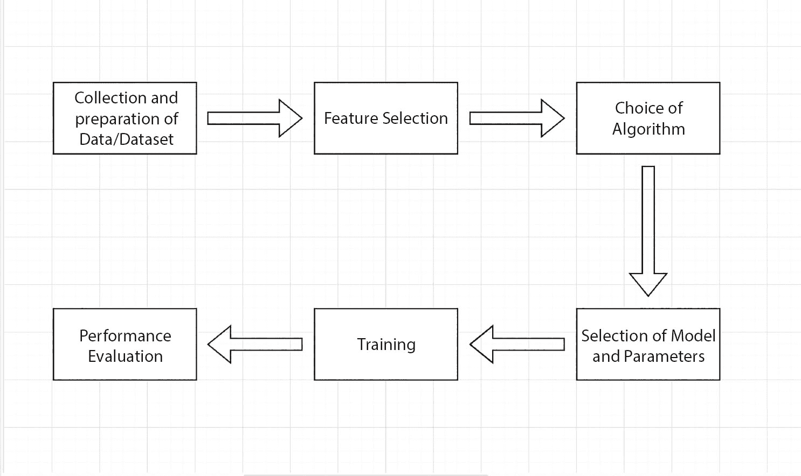

**图 2.2** 通用机器学习模型的组件。

# 2.3 机器学习算法的类型

如图 2.3 所示，有多种类型的机器学习算法：

1. 监督机器学习

2. 无监督机器学习

3. 强化机器学习

4. 半监督机器学习

5. 自监督机器学习

## I. 监督学习

在监督机器学习背后，开发了大量的算法，它们可以从外部提供的实例数据中学习，以预测相似实例的可能未来，从而在广义系统中产生模式和理论。涉及根据以前学习的信息对数据进行分类的机器学习形式被称为监督机器学习分类算法 [2]。在这种背景下，数据科学中最常见的问题之一是分类。以下高效方法已被用于解决这些问题，包括基于规则的、基于的、基于实例和随机的方法。特别是，本工作的主要目的是全面比较最先进的机器学习方法 [4–6]。

评估和实践是简单机器学习模型中产生最终模型的两个过程。在训练阶段，知识或学习算法获得构建特征，并使用训练数据集的样本作为输入构建学习模型。在测试阶段（需要生成测试数据或生产数据），学习模型使用执行引擎。分类数据中的最后一部分是最终预测，并由标记数据给出，这些标记数据是学习模型的输出 [1, 4]。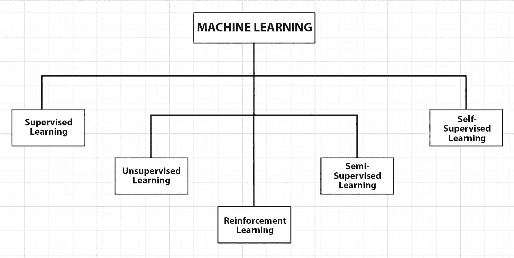

**图 2.3** 机器学习的类型。

## II. 无监督学习

通过无监督学习在标记或未组织的数据库中发现相关性。在使用这种学习技术时，`AI` 系统仅获得输入数据——而不是匹配的输出数据 [1]。与监督学习相比，无监督机器学习缺乏实际的人模型监控。数据科学家观察数据并发现模式，以便系统能够独立学习。换句话，机器学习的这一领域使系统能够在没有外部指导的情况下处理特定数据 [4]。无监督学习的使用至关重要，涉及到为人类开发 `AI` 平台。这是因为智能机器必须利用大量的未知信息进行推理。无监督学习策略的目标是通过识别以前未的模式从数据中提取规则。当数据类别不确定时，该策略适用 [2]。在这种情况下训练数据没有标记。无监督学习是指在未标记数据中发现隐藏结构的挑战，被认为是一种统计学习方法 [3]。无监督学习技术的如图 2.5 所示，包括聚类、关联、异常检测和自动编码器。

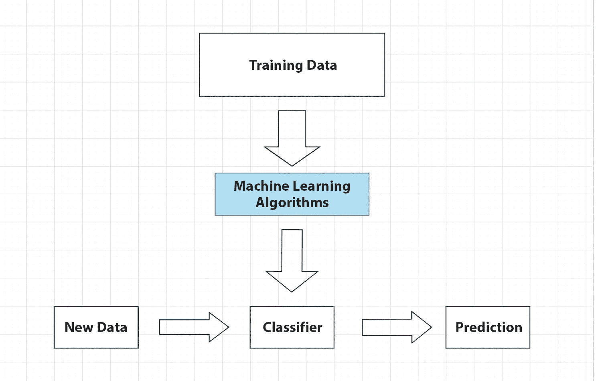

**图 2.4** 监督学习过程。

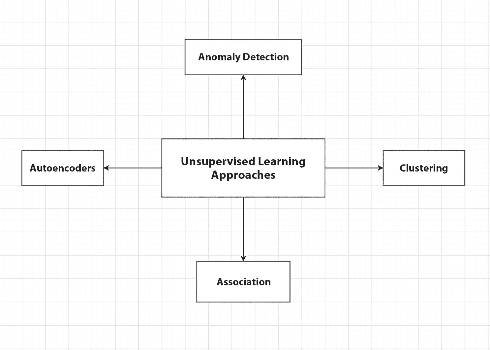

**图 2.5** 无监督机器学习的类型。

## III. 强化学习

今天，强化学习可以被描述为机器学习的一个子领域，其理论和实现通常在快速演变。强化学习使主体研究环境中的行为，并学习如何进行最优行为 \[7–10\]。为了解决广泛的规划和控制问题，强化学习提供了一个直观且吸引人的框架 \[27\]。Jaakkola *等人* \[28\]为小状态空间发现了极具说服力的收敛结果，而 Williams 通过利用值函数近似和或在参数化策略空间中进行搜索，在处理大状态空间方面取得了成功 \[11\]。由于强化学习仅为算法提供指示输出是否正确的响应，因此它被视为中间类型的学习。为了提供正确的结果，算法必须调查并排除许多选项。这种方法被称为“带有批判者的学习”，因为算法对问题不做出任何建议或修复。强化学习算法属于图 2.6 所示的类别。

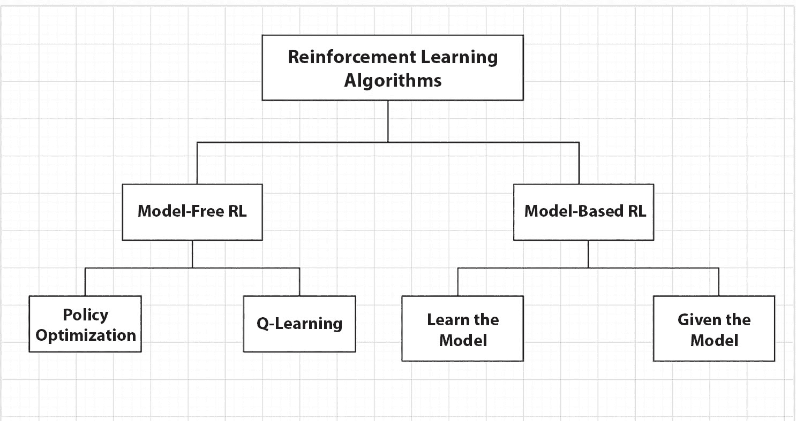

**图 2.6** 强化学习算法的分类。

## IV. 半监督学习 (SSL)

`SSL` 是机器学习中的一种技术。它介于监督学习和无监督学习之间。克服监督学习和无监督学习的局限性是 `SSL` 的主要目标 \[1\]。使用监督指令对测试结果进行长期且昂贵的分类需要大量的训练信息。另一方面，无监督训练不涉及标记信息；而是使用分组或最可能的方法，根据每个点之间的相关性对信息进行分组。这种方法的主要缺点是未知数据无法安全地聚类。由于 `SSL` 具有仅需少量训练数据就能检测未知（或测试）数据的能力，研究社区提倡其作为解决这些问题的潜在解决方案。少量的标注模式被用作训练数据以创建算法，而其余序列则被用作测试数据。图 2.7 提供了半监督学习过程的示意图，展示了用于训练的标记数据和未标记数据的融合。

`SSL` 另外两个类别：

1. 半监督分类

2. 半监督聚类

## V. 自监督学习


在被称为自监督学习的机器学习子集中，系统获得了根据数据本身的其他部分来预测输入数据某些部分的能力，而不需要标记数据。当存在大量原始未标记数据但标记数据较少时，这种方法特别有帮助。在包括语音识别、自然语言处理（NLP）和计算机视觉在内的领域中，这种方法引起了广泛兴趣 \[2\]。自监督学习有助于缩小无监督学习和监督学习之间的差距，在数据分类成本高或耗时长的情况下尤为关键。通过使模型从未标记数据中获取有价值的表示，它们正在改进机器学习领域。自动编码器、掩码建模、对比学习和生成对抗网络（GANs）等算法提供了从未处理数据中学习的不同方法。随着自监督学习方法的增加，其有效性也在增长，从而减少了对标记数据的需求，并扩大了它们在计算机视觉、NLP 和时间序列分析等领域的应用范围。自监督学习工作流（模型通过先验任务从未标记数据中学习有用的表示）如图 2.8 所示。

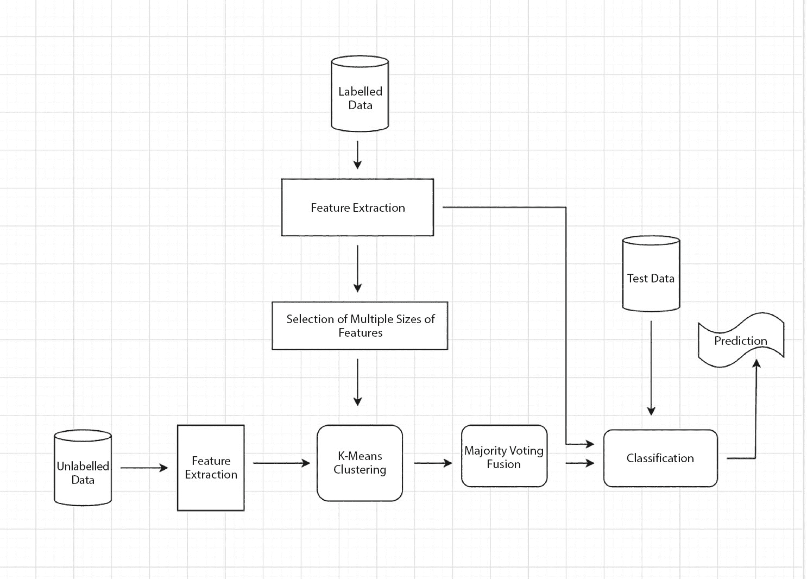

**图 2.7** 半监督学习流程。

一些流行的自监督学习算法如下：

1. **SimCLR**或简单的对比学习框架，通过最大化给定数据点不同视角之间的一致性来学习表示。

   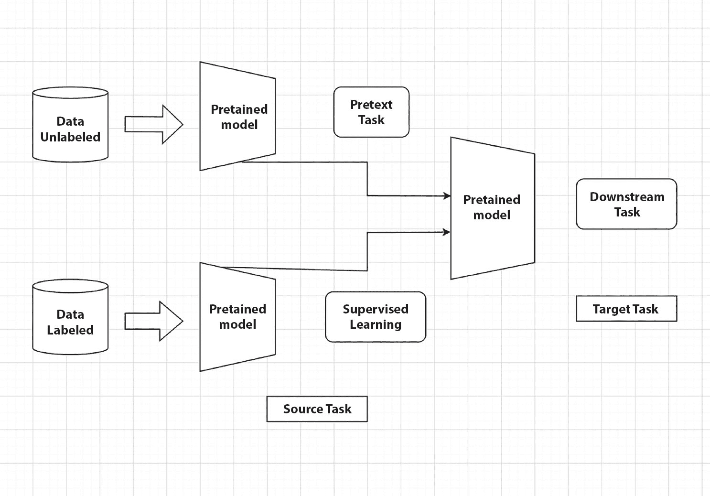

   **图 2.8** 自监督学习过程。

2. **MoCo（动量对比）**：一种对比学习策略，在动态内存库中存储之前的表示以进行对比比较。

3. 使用 **BYOL**（自引导潜空间表示），可以在不需要负样本提供对比的情况下学习表示。

## 2.4 机器学习中的挑战

1. **过拟合与欠拟合**：如果一个模型学习的是噪声而非底层模式，则被称为过拟合；如果它太简单无法识别底层趋势，则被称为欠拟合。

2. **偏差-方差权衡**：描述当模型变异太大（过拟合）或偏差太大（欠拟合）时产生的折中方案。

3. **数据质量**：强调高质量数据的价值以及噪声、不平衡或缺失数据带来的后果。

4. **计算复杂度**：训练和实现机器学习模型所需的资源，特别是对于深度学习而言。

## 2.5 机器学习的近期进展

1. **深度学习与神经网络**：讨论神经网络架构的进展，例如`transformers`（在 NLP 任务中用作`BERT`、`GPT`）、循环神经网络和卷积神经网络 \[12\]。

2. **迁移学习**：将为一种活动创建的模型作为基础应用于另一种活动的过程。

3. **自动机器学习（AutoML）**：通过自动化模型选择和超参数调优，自动化寻求提高机器学习的可访问性 \[13\]。

4. **可解释人工智能**：这一运动的目标是开发既具有可解释性又准确的模型。

## 2.6 机器学习中的伦理关注与公平性

1. **算法偏差**：训练数据中的偏差可能会被机器学习模型强化甚至放大，从而在刑事司法和就业等关键领域产生不公正的结果。

2. **隐私忧虑**：对数据收集和使用私有数据构建模型的担忧。

3. **监管与法律挑战**：关于为机器学习建立的监管结构的问题。

## 2.7 机器学习在纳米器件制造中的作用

机器学习对纳米器件制造的贡献非常突出。它为改进设计、优化工艺和增强性能提供了新方法 \[14–16\]。在这里，它可以被理解为应用于几个关键应用领域。

1. **工艺优化**：机器学习算法优化了纳米器件制造涉及的复杂工艺。这些工艺涉及温度、压力、沉积速率等许多因素。机器学习通过分析来自实验的大型数据集确定最佳参数组合，以提高良率和器件质量。通过基于机器学习的模型，可以节省制造时间和能量，因为它预测了制造时条件的结果。实时制造中的机器学习算法可以监控过程并动态调整参数，以确保最佳性能并减少变性 \[18\]。

2. **设计与仿真**

ML 将比传统方法更快、更准确的仿真来辅助设计，特别是在复杂的纳米结构中，例如`鳍栅效应晶体管`（`FinFETs`）或纳米级晶体管。`ML` 的通用目标是通过从之前的设计数据中学习并预测最佳器件配置，实现满足特定性能要求的器件结构 [17]。由`ML`驱动的代理模型降低了纳米器件设计中仿真的计算成本，从而在更短的时间范围内探索更多的设计方案 [22]。

### 3. 材料发现

纳米器件的性能可能高度依赖于材料。`ML` 通过分析材料成分与其物理属性之间的关系，加速了具有纳米器件所需属性的新材料的发现。例如，`ML` 算法可以筛选成千上万种可能的材料组合，以确定适用于特定纳米器件装置（例如半导体或生物传感器）的具前景的候选材料。通过从实验数据中学习并进行模拟，`ML` 模型可以预测材料的所有新属性，包括其电学、机械和热学性能 [19, 23]。这种方式也有助于为给定的器件选择最佳材料。

### 4. 缺陷检测与质量控制

如今，更多的`ML`模型，尤其是结合深度学习的计算机视觉被用于制造过程中的缺陷检测。这些方法通过检测传统方法无法检测的瑕疵缺陷，随后提高了纳米器件的质量和可靠性。`ML` 的使用使得自动光学检测能够以更高的精度检测纳米级缺陷，例如表面不平整、微裂纹或图形中的对齐问题 [24–26]。它们可以分析生产数据以发现异常并提出可能的缺陷，从而减少破坏性测试并提高吞吐量。

### 5. 性能预测

对于纳米器件的制造，性能预测对于验证其效率和应用至关重要。`ML` 模型可以预测器件在不同条件（从电学到热学和机械应力）下的行为。通过对实验数据进行训练，`ML` 算法可以对纳米器件内部复杂的物理相互作用进行建模，从而阐明它们在不同环境和运行条件下的性能。`ML` 可以通过理解器件内部存在的应力及其退化模式，预测纳米器件的长期可靠性，这将导致更早地发现故障并增加器件寿命。

### 6. 生物传感器的纳米器件制造

在生物传感器背景下，特别是基于`FET`的生物传感器，`ML` 有助于过滤噪声并增强信号检测，提高生物传感器的灵敏性和特异性。基于`ML`模型可以分析传感器数据，以高准确度实时识别目标分子。

## 2.8 提出的模型

图 2.9 显示了隧道`FET`器件设计的简化图。在我们之前的工作中，曾使用技术计算机辅助设计（`TCAD`）检查了无结纳米系统的几项性能指标 [20, 21]。


## 2.9 结论

本章全面描述了一些最常见的`ML`算法及其在纳米器件制造中的应用。随着`ML`成为一个动态发展的研究领域，`ML` 在各个领域的作用日益增强。因此，未来的创新有望解决目前的一些局限性，包括数据质量、计算问题和/或已确定的伦理问题。此类模型的发展将进一步引导纳米器件制造流程，以及随着社会进入`AI`技术时代而引入的其他新兴领域。

6. Kovanovic, V., Joksimovic, S., Gaševic, D., Siemens, G., Hatala, M., 机器学习在教育中的应用。*J. Educ. Technol. Soc.*, 33–47, 2018。

7. Emms, M. and Luz, S., 用于自然语言处理的机器学习。*ESSLLI 2007 课程读物*, 2007。

8. Kumar, K. and Pande, B.P., 机器学习技术在网络安全领域的应用，收录于*网络安全与数字取证*，第 295–315 页，2022 年。

9. Ghoddusi, H., Creamer, G.G., Rafizadeh, N., 能源经济学与金融中的机器学习：综述。*Energy Econ.*, *81* 卷, 709–727, 2019 年。

10. Lagoudakis, M.G. and Parr, R., 作为分类的强化学习：利用现代分类器，收录于*第 20 届国际机器学习会议论文集 (ICML-03)*，第 424–431 页，2003 年。

11. Williams, J.M.G., *抑郁症的心理治疗：认知行为治疗理论与实践指南（第二版）*。伦敦，Routledge，1995 年，1992 年，`https://doi.org/10.1002/casp.2450050108`。

12. Khan, A., Chui, K.T., Peraković, D., 2022 年机器学习与人工智能的未来前景。*Future.*, 2021 年。

13. Jordan, M.I. and Mitchell, T.M., 机器学习：趋势、观点与展望。*Science*, *349* 卷, 6245 号, 255–260 页，2015 年。

14. Nandipati, M., Fatoki, O., Desai, S., 1. 桥接纳米制造与人工智能——全面综述。*Materials*, 2024 年，doi: 10.3390/ma17071621。

15. Ur Rehman, I., Ullah, I., Khan, H.U., Guellil, M.S., Koo, J., Min, J.-M., Habib, S., Islam, M., Lee, M.Y., 2. 可持续发展纳米技术中机器学习全面系统文献综述。*Nanotechnol. Rev.*, 2024 年，doi: 10.1515/ntrev-2024-0069。

16. Georgios, K., Koumoulos, E.P., Charitidis, C.A., 4. 数字化创新驱动的纳米材料制造；机器学习策略与绿色展望。*Nanomaterials*, 2022 年，doi: 10.3390/nano1215266。

17. Rachita, G., Kalyan, B., Sarkar, A., 6. 预测设备参数对纳米级 MOSFET 影响的机器学习方法综述，2021 年，doi: 10.1109/DEVIC50843.2021.9455840。

18. He, S., 9. 人工智能在纳米科学中的应用，2022 年，doi: 10.3390/mol2net-08-1348。

19. Huachen, T., Tianyi, W., Matteo, A., Tony, C., Aspuru-Guzik Kumacheva, E., 10. 机器学习辅助的纳米颗粒合成。*Nat. Rev. Mater.*, 2021 年，doi: 10.1038/s41578-021-00337-5。

20. Dewan, B., Chaudhary, S., Yadav, M., 考虑非理想杂化的电掺杂 SiGe-异质结 TFET 生传感器：研究。*Appl. Phys. A*, *127* 卷, 1–9 页，2021 年。

21. Dewan, B., Chaudhary, S., Singh, D., Yadav, M., 考虑非理想问题的电介质调制 TFET 传感器的物理模型。*Micro Nanostruct.*, *183* 卷, 207668 号，2023 年。

22. Gaurav, V., 纳米结构的人工智能、机器学习和深度学习模拟，第 183–199 页，2023 年，doi: 10.1016/b978-0-12-820048-3.00005-x。

23. B., L. and Sasipriya, G., 纳米颗粒上新兴机器学习趋势的研究，2022 年，10.1007/978-3-16-7。

24. Guo, Y., Pahlavani, H., Khachurants, A., Elsayed, K., 使用机器学习进行特征识别和缺陷检测，2024 年，10.1117/12.337。

25. Ghai, D., Tripathi, S., Saxena, S., Chanda, M., 用于信号和图像处理的机器学习算法，IEEE Press，美国博卡顿，2022 年，10.1002/97811986。

26. Thillarasu, N., Tripathi, S., Dhinakaran, V., 人工智能物联网：设计原理、现代化与技术，CRC Press，美国博卡顿，2022 年，10.1201/9781003358。

27. Sutton, R.S. and Barto, A.G., *强化学习：导论*。MIT Press，1998 年。

28. Jaakkola, T., Singh, S.P., Jordan, M.I., 部分观测马尔可夫决策问题的强化学习算法。*Adv. Neural Inf. Process.*, 7 卷，1994 年。

## 注意

1. *邮箱*: `basudha.dewan@manipal.edu`

# 3 轧制工艺设计中集成深度学习：强度预测的新方法

**Amit Tiwari¹, Payal Bansal², Rachid Amrousse³, SeitkhanAzat⁴**

*¹机械工程系，Suresh Gyan Vihar 大学，拉贾斯坦邦浦，印度*

*²电子与通信工程系，Poornima Institute of Engineering & Technology，拉贾斯坦邦浦，印度*

*³催化与腐蚀实验室，科学学院，Chouaib Doukkali 大学，埃尔杰达，摩洛哥*

*⁴工程实验室，Satbayev 大学，阿拉木，哈萨克斯坦*

### 摘要

轧制过程被认为是纳米复合材料等先进材料生产的重要步骤，这些材料需要某些理想机械性能，如拉伸强度和硬度。在此工作中，我们提供了一种新方法，首次将神经网络（NN）模型嵌入轧制工艺设计中，培养出能够预测纳米复合材料强度的可靠模型。我们的研究填补了现有知识产权中的一个重要空白：用于预测各种轧制参数下纳米复合材料强度的稳健灵活工具。这项工作提供了一种基于人工神经网络预测全电点的模型解决方案，旨在以更准确且计算成本更低的方法。基于所提`NN`训练实验和模拟数据的概念模型涵盖了轧制温度、道数和初始厚度等参数之间的非线性相互作用。结果表明，首次可以达到以前认为的最先进水平的强度预测，这可能导致实时工艺优化和成本节省。因此，将`NN`整合到轧制工艺设计中的这种新方法代表了在更高效、更准确和更大范围内生产高质量纳米复合材料方面的重大进展。

**关键词：** 人工神经网络、回归分析、纳米复合材料、均方误差、机械性能

## 3.1 引言

轧制是工业中最广泛使用的方法之一，通过系统控制的变形来塑造金属及其合金的形状，从而实现机械性能的调控。`AZ91` 是被公认为优秀材料的镁合金之一，原因包括强度与重量比的良好平衡、良好的耐腐蚀性以及加工性，这使其对汽车、航空航天和生物医学等行业具有吸引力 [1, 2\]。另一方面，众所周知 `AZ91` 纳米复合材料的轧制过程非常困难，因为其热变形能力不足且微观结构对工艺参数高度敏感 [3, 4\]。深入理解轧制参数、微观结构演变和材料行为的影响，对于正确控制和预测抗拉强度（`UTS`）和硬度（`H`）等机械性能至关重要。同样，Tolouie 和 Jamaati [5\] 使用`FEM`模拟了`AZ91`合金的轧制，并提供了与应变和应力分布相关的信息。这种方法的唯一缺点是在时间和资源方面具有巨大的计算开销，限制了其在现实情况中的适用性。

可以添加多种类型的颗粒来制造镁基复合材料（`MMCs`），如碳化物（`SiC`、`TiC`、`B[4]C`、`ZrC`）、氧化物（`Al[2]O[3]`、`TiO[2]`）、硼化物（`ZrB[2]`、`TiB[2]`）、氮化物（`AlN`、`BN`、`ZrN`、`TiN`）以及金属（如`Ti`、`Cu`、`Mo`） [6–8\]。这种现象在铸态`MMCs`中已被多次注意到。这不仅限于使用任何类型的颗粒增强方法制造的`MMCs`。例如，在体积分数相对较低的碳化物颗粒复合材料中甚至观察到了这种现象，这些颗粒比通常与任何硬表面颗粒接触就会破碎的颗粒还要小，粉末注塑过程中因加热产生的磨损使其磨损，或者在从小于`1 cm`的瓦片压实时立即（或在情况下）被切割，烧结成垂直沿薄平面分离的层，而这些层由垂直跨越产生这些错误晶体结构的`J`型梨形块的片层组成，这些块被用于晶体学测量并产生了这些错误的晶体结构 [9–11\]。在这两种情况下，结果之前都没有奏效，因为过去十年开发的纳米增强`MMCs`表明，尽管纳米添加可以显著提高材料的强度，但它们也可以使原始基体保持韧性，对`MMC`的演变做出最大的贡献 [12, 13\]。

温度无疑是轧制过程中一个突出的参数。热温轧会产生动态再结晶（`DRX`），提高延展性，尽管会降低强度，但能严重地细化微观结构 [14\]。对于`AZ91`纳米复合材料，提高温度已被证明可以增强纳米增强相的分散，从而提高机械性能。Bian 等人发现 [15\] 发现`AZ91`纳米复合材料提高温度已被证明可以增强纳米增强相的分散，从而提高机械性能。Bian *et al.* [15\] 发现`AZ91`纳米复合材料提高温度已被证明可以增强纳米增强相的分散，从而提高机械性能。……在`300°C`以上温度下的`DRX`同时对成形性有害，会导致裂纹。同样，Srinivas *et al.* 和 Song *et al.* [16, 17\] 表示，在中间温度下使用`AZ91`有助于基体。

Mamodiya *et al.* [18\] 揭示了`AZ91`纳米复合材料提高温度已被证明可以增强纳米增强相的分散，从而提高机械性能。15\] …… 性能。Bian *et al.* [15\] 发现`AZ91`纳米复合材料提高温度已被证明可以增强纳米增强相的分散，从而提高机械性能。

同时，轧制速度直接影响应变率，并对机械和结构性能产生显著影响。过高的轧制速度可能导致非均匀变形和局部过热，从而影响微观结构的均匀性。在高轧制速度的情况下出现了不均匀的晶粒细化和较低的屈服强度，Zhao *et al.* [19\] 研究了轧制速度对`AZ91`的影响。Zhao *et al.* 报告了……基体。另一个对`MMCs`有主要影响的重要参数是轧制过程中厚度的减少百分比或变形率，因为较高的变形会导致更剧烈的塑性变形，从而导致`DRX`的激活和晶粒细化 [19\]。相反，一次性变形量过大可能会导致裂纹，特别是对于脆弱的纳米复合材料。Li *et al.* [20\] 发现，`AZ91`纳米复合材料在轧制过程中`50%`的变形率产生了最好的晶粒细化，从而改善了机械性能；然而，较高的变形率会导致微观结构缺陷。


尽管轧制 `AZ91` 纳米复合材料具有优势，但它仍然面临一些挑战。这种平面裂纹和界面分层由于镁合金固有的脆性而很容易发生，此外通过添加硬纳米增强相，使得轧制更可能变得与路径无关 [21\]。纳米增强相的均匀分布和防止聚集是其他持续存在的问题。此外，Luo, A. A. *et al.* [22\] 展示了为了优化 `AZ91` 纳米复合材料的轧制参数需要做什么以减少缺陷并提高性能。

机器学习在材料科学的近期进展中也展现了潜力。Yang *et al.* \[23\]使用预测性神经网络（`NN`）模型来预测铝合金的抗拉强度，性能优于传统方法。这一成功为在其他领域（如镁合金）中使用 `NN` 模型提供了动力。在 Xu *et al.* \[24\]的研究中，阐明了 `NNs` 建模复杂材料行为的能力，其中使用反向传播 `NN` 来感知挤压后 `AZ31` 的硬度。尽管有了上述进展，但关于 `NN` 与 `AZ91` 合金轧制工艺设计结合文献仍然较少。Munir *et al.* \[25\]开发了一种机器学习模型来优化轧制参数，但他们的关注点是工艺效率而非预测机械性能。根据 Zhang *et al.* 的观点，在镁合金中采用类似技术有很大的空间，而 Jang *et al.* \[26\]展示了深度学习器在预测轧制钢材性能时如何优于非深度模型，而这在该领域曾被认为是一个未解决的问题。

对轻量化和高强度材料的极端关注导致了材料创新，以及无替代方案组件的生产。`AZ91` 合金是许多领域使用的关键材料，其轧制工艺通过一种新方法进行了研究，以更好地适应其机械性能。为了提高轧制的异常检测性能，我们通过将 `NNs` 引入该工艺的设计中引入了一种新范式。`NNs` 由于其表示非线性系统和近似复杂变量间关系的能力而特别适用，使其成为轧制载荷条件下 `AZ91` 合金强度预测的良好模型。本研究利用机器学习 \[27, 28\]来克服当前问题，同时提出了一种用于降低成本和工艺优化的强大架构。

为了解决这些问题，研究人员越来越倾向于使用计算工具，特别是监督学习模型。在过去几年中，人工神经网络（`ANNs`）已成功作为材料科学领域的预测工具，具有捕捉材料加工过程中建立的非线和复杂关系的卓越能力。通过将 `ANNs` 集成到轧制参数的优化中，可以开发预测模型来根据输入条件预测机械属性，并高效优化这些因素。在这项研究中，通过使用 `ANN`（一种特定的监督学习算法）优化轧制参数，改进了 `AZ91` 纳米复合材料的机械性能。该研究是首个致力于将监督学习嵌入到 `AZ91` 材料轧制参数优化的同类研究，尽管 `AZ91` 具有高度相关性，但涉及机械性能优化的计算辅助研究较少。与某些可能逐个或仅研究少数几个轧制参数之前的工作相比，本工作以优化的方式考虑了更多维度，以评估所有潜在的重要性以及它们对机械强度产生影响的相互作用。此外，将 `ANN` 作为监督学习模型应用在模拟轧制中复杂的热力学机制方面较新颖，因此为合金设计期间的预测建模建立了一个独特的平台。

本研究利用了监督学习过程，使用从 `AZ91` 纳米复合材料轧制试验获得的多个实验数据集训练了 `ANN` 模型。输入参数是轧制温度、道次和样品轧制前厚度的不同控制变量，而输出数据是机械强度测量值，如 `UTS` 和硬度。`ANN` 的结构根据这些多变量输入的序列，以便将输入-输出变量准确地预测结果机械性能。在训练 `ANN` 模型时，会对超参数进行精细调整，例如 `ANN` 隐藏层/神经元/激活函数的数量和类型（以确保模型能够捕捉输入参数与机械输出之间发生的所有复杂关系）。在监督学习期间，模型从标记数据中学习，并在每一步都有反馈以减少预测误差。学习后，模型用于进行预测，提供不同轧制条件的估计，并确定提高机械强度的最佳参数。

基于 `ANN` 的监督学习为合金制造中的轧制参数适应提供了一种新范式，不仅提高了预测的准确性，还限制了试验的数量和范围，从而使合金设计更具可持续性和成本效益。本研究通过分享一种可以扩展到其他镁合金和工艺路线的可访问方法，为材料科学领域提供了进一步补充。该研究旨在通过提出一种基于 `ANNs` 的新型监督学习模型来优化轧制参数，以获得更好的机械性能，从而弥补这一空白。

## 3.2 数据库收集

根据对各种研究的回顾建立建立全面的数据库，汇总了约 150 个不同轧制参数的 `AZ91` 纳米复合材料样本 [11–24\]。这些信息提供了关于每个元素如何发挥作用及其对最终材料行为参与情况的思路。基于上述观察，选择了 32 个元素作为输入变量。对应于所需材料属性的两个输出变量：`H` 和抗拉强度。

**人工神经网络：** 该数据集用于训练 `ANN` 模型以估计这些特征。对于每个 `ANN` 模型，在选定的输入变量与所需的输出属性之间建立关系。每个输出属性都单独划分用于 `ANN` 模型表示，因为它鼓励独立预测，并在随后的优化中进行验证。

## 3.3 计算建模

使用 `MATLAB R2021b` 版本开发 `ANN` 模型。所有开发 `ANN` 模型的实验试验均使用载荷、速度和混合物作为输入变量。实验过程中收集的排放和性能数据以输出参数的形式包含在模型中。表 3.1](#c03.xhtml#tab3-1) 提供了 `ANN` 操作最佳配置的简要总结。

**表 3.1** 人工神经网络的最佳设置。

| 实验 `ANN` 参数设置 |
| --- |
| `ANN` 网络类别 |
| 前馈反向传播 |
| 网络学习函数 |
| `LEARNGDM` |
| 性能评估函数 |
| `MSE` |
| 训练函数 |
| `TRAINLM` |
| 传递函数 |
| `Tansig/Purelin` |
| 使用的神经元 |
| 10 |

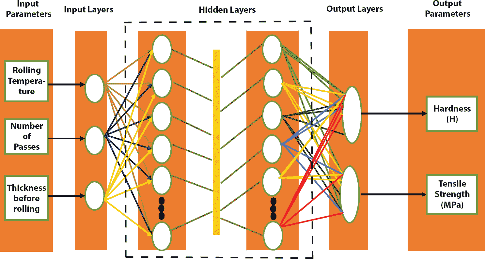

**图 3.1** 实验的人工神经网络结构。

该 `ANN` 模型是在 `MATLAB R2021b` 版本中利用多种训练方法和函数并修改不同层中的神经元开发的。传递函数如 `Tansig`（双曲正切 sigmoid 激活）和 `Logsig`（对数 sigmoid 激活）被应用于模型的各个阶段。最初，网络总共运行了 100 次迭代。权重和偏置由 `MATLAB` 随机确定。网络在迭代 10,000 次后停止，最小梯度设置为 `10^(−7)`。为了理解模型的结果，对所有输入数据匹配进行了模拟。通过应用模型的目标和输出，使用回归系数公式 (3.1) 和均方误差公式 (3.2) 对 `ANN` 模型进行了评估：

(3.1)


<math><mtext>&#xA0;Regression coefficient&#xA0;</mtext><mo>=</mo><msqrt><mn>1</mn><mo>&#x2212;</mo><mfenced open="{" close="}" separators="|"><mfrac><mrow><munderover><mo>&#x2211;</mo><mrow><mi>i</mi><mo>=</mo><mn>1</mn></mrow><mi>n</mi></munderover><mo>&#x200A;</mo><msup><mfenced separators="|"><mrow><msub><mi>T</mi><mi>t</mi></msub><mo>&#x2212;</mo><msub><mi>O</mi><mi>i</mi></msub></mrow></mfenced><mn>2</mn></msup></mrow><mrow><munderover><mo>&#x2211;</mo><mrow><mi>i</mi><mo>=</mo><mn>1</mn></mrow><mi>n</mi></munderover><mo>&#x200A;</mo><msubsup><mi>O</mi><mi>i</mi><mn>2</mn></mtext></mrow></mfrac></mfenced></msqrt></math>

(3.2)

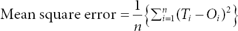

<math><mtext>&#xA0;Mean square error&#xA0;</mtext><mo>=</mo><mfrac><mn>1</mn><mi>n</mi></mfrac><mfenced open="{" close="}" separators="|"><mrow><munderover><mo>&#x2211;</mo><mrow><mi>i</mi><mo>=</mo><mn>1</mn></mrow><mi>n</mi></munderover><mo>&#x200A;</mo><msup><mfenced separators="|"><mrow><msub><mi>T</mi><mi>i</mi></msub><mo>&#x2212;</mo><msub><mi>O</mi><mi>i</mi></msub></mrow></mfenced><mn>2</mn></msup></mrow></mfenced></math>

为了对模型进行准确评估，我们结合了两个统计表达式的结果：回归系数（`R`） > 0.98 以及

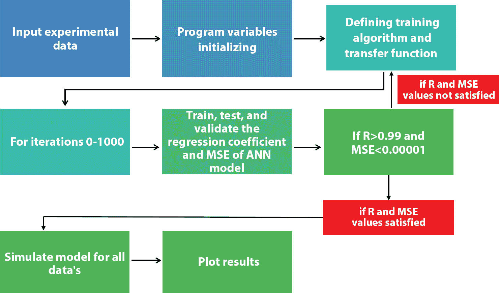

**图 3.2** 人工神经网络模型流程图。


**图 3.3** `Simulink` 中 `ANN` 配置内部隐藏特定的神经网络框图。均方误差（`MSE`）= 0.01。在迭代成功完成后将完成。在 `MATLAB R2021b` 版本中构建的 `ANN` 技术如图图 3.2](#c03.xhtml#fig3-2）所示，结果与讨论部分讨论了 `ANN` 模型预测的数据。

## 3.4 结果与讨论

### 3.4.1 确定隐藏层和 `ANN` 训练

隐藏层的数量尽可能保持最少。最初假设 `ANN` 有一个隐藏层。在输出不理想的情况下，一旦 `ANN` 完成训练将增加层数。此外，网络的结果可能由多种不同的变性函数产生。对于本研究，使用了 `Levenberg–Marquardt` 函数。图 3.3 显示了 `Simulink` 中选定的 `NN` 图。实现在 `MATLAB` 程序中的网络输入层包含三个神经元，隐藏层包含 10 个神经元。图 3.4 显示了选定的 `NN 10-2` 包含输入层的三个神经元、带有两个神经元的十个隐藏层，以及输出层的两个神经元。表 3.2 显示了 `ANN` 为优化硬度和拉伸强度预测的最佳输入参数。表还包含了本研究引入的 `ANN` 网络预测值，这是一个带有反向传播的多层感知器网络。选择 `Levenberg–Marquardt` 函数作为开发网络的训练函数，是因为其收敛速度快。传递函数通过试验确定。

图 3.3 展示了一个函数-值计算网络模型。当 `x1` 作为输入提供时，将返回 `y1`。进入网络的输入信号由一个命名为 `x1` 的“常数”块表示。它可以是一个常数参数，甚至可以是一个锚点。输入通过神经网络（`NN`）进行中继，利用其层和神经元进行转换过程来实现所需的输出。输出 `y1` 是神经网络执行函数拟合的结果。图 3.4 显示了所选的 `3-10-2` 神经网络，包含输入层中的三个神经元、十层每层两个神经元的隐藏层，以及输出层中的两个神经元。

#### 3.4.2 硬度值与拉伸强度值的均方误差图

图 3.5a 显示了在 `AZ91` 合金硬度数据上训练的模型的 `MSE` 函数随训练轮数（0–8）的变化。`MSE` 图表设置了对数尺度，因为其范围可能波动很大。`MSE` 在训练集、验证集和测试集上有三条不同的曲线，然后第四条线是初始时的最佳验证性能。验证集的 `MSE` 在第 3 轮左右达到最低点，值约为 1.5958，标记为“最佳验证性能”。在第 3 轮之后，训练误差继续急剧下降，在第 8 轮时获得极低的 `MSE` 值。这一斜率表明模型在训练数据上的预测变得越来越好，这可能意味着模型正在过拟合。但在某一点，验证误差和测试误差在较高水平上进入平台期，泛化能力没有进一步提高。在第 3 轮之后，训练曲线与验证/测试曲线之间性能差距的扩大是过拟合的迹象，因为我们的模型在训练集上不断变好，但在未见数据（验证集和测试集）上并非如此。在这里，第 3 轮被认为是理想的停止点，因为此时模型在验证数据集上产生最小误差并具有最佳泛化能力。

图 3.5b 代表了在训练 13 轮以预测 `AZ91` 纳米复合材料拉伸强度时的 `MSE`。产生最佳验证性能的最低 `MSE` 在第 12 轮左右约为 1.4103。这是图表在最终模型学习点与最佳泛化点之间的某一个点。这意味着模型学习正处于最小化损失函数的正确轨道上，在第 12 轮之前我们没有看到过拟合现象，因为训练集、验证集和测试集的 `MSE` 非常接近。这些误差曲线的收敛表明模型在不同数据集上的表现一致，训练误差与验证误差之间的微小分离表明具有主导地位的泛化能力。在第 12 轮之后增加训练在训练误差上仅表现出微小的优势，而验证或测试误差完全没有额外减少，这是潜在过拟合的特征，即可能还需要进行更多训练。平滑的下降趋势曲线以及第 12 轮验证误差的最低点也是预测 `AZ91` 纳米复合材料拉伸强度的最优值，这表明在这种情况下特征学习完成得相当好。此时，均方误差已足够低且准确，能够高效地模拟 `AZ91` 纳米复合材料拉伸强度的主要因素。

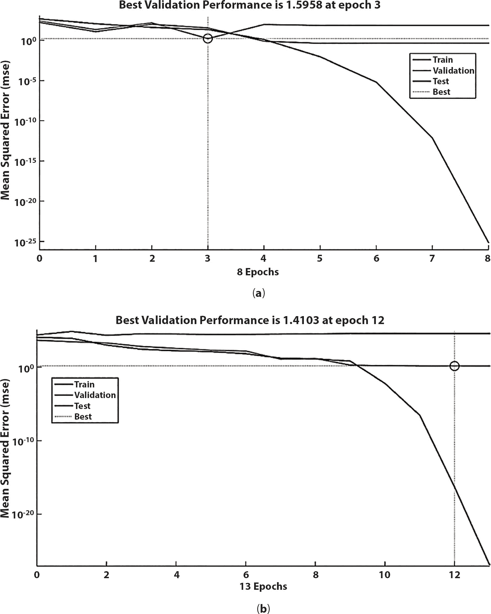

**图 3.5** 输出的均方误差（`MSE`）性能：(a) 硬度值和(b) 拉伸强度值。

### 3.4.3 硬度值与拉伸强度值的误差直方图

如图 3.6a 所示的误差直方图所示，这种高度非线性模型在 `AZ91` 纳米复合材料硬度的每个区域都有明显的预测误差。误差直方图显示误差（目标值减去模型输出）在 -13.9 到 0.82 的范围内分布。训练数据（蓝色）显示出接近零的误差频率最高，表明模型能够准确预测硬度。事实上，验证误差和测试误差在接近零的范围内是可以接受的，这种分布显示了模型的泛化能力，表明在不同数据集上没有明显的过拟合或欠拟合。

图 3.6b 显示了预测 `AZ91` 纳米复合材料拉伸强度的误差直方图。误差（目标值减去模型输出）在 -2.879 到 1.073 的范围内分布。大多数误差位于零附近，表明训练样本可以准确估计拉伸强度。验证误差（绿色）在接近零的范围内显示了模型对数据的数据的泛化。测试数据（红色）在 22.15 处有一个极端离群值，大部分在零周围的误差验证和测试误差证明了该模型在估计 `AZ91` 纳米复合材料拉伸强度方面是可靠的。

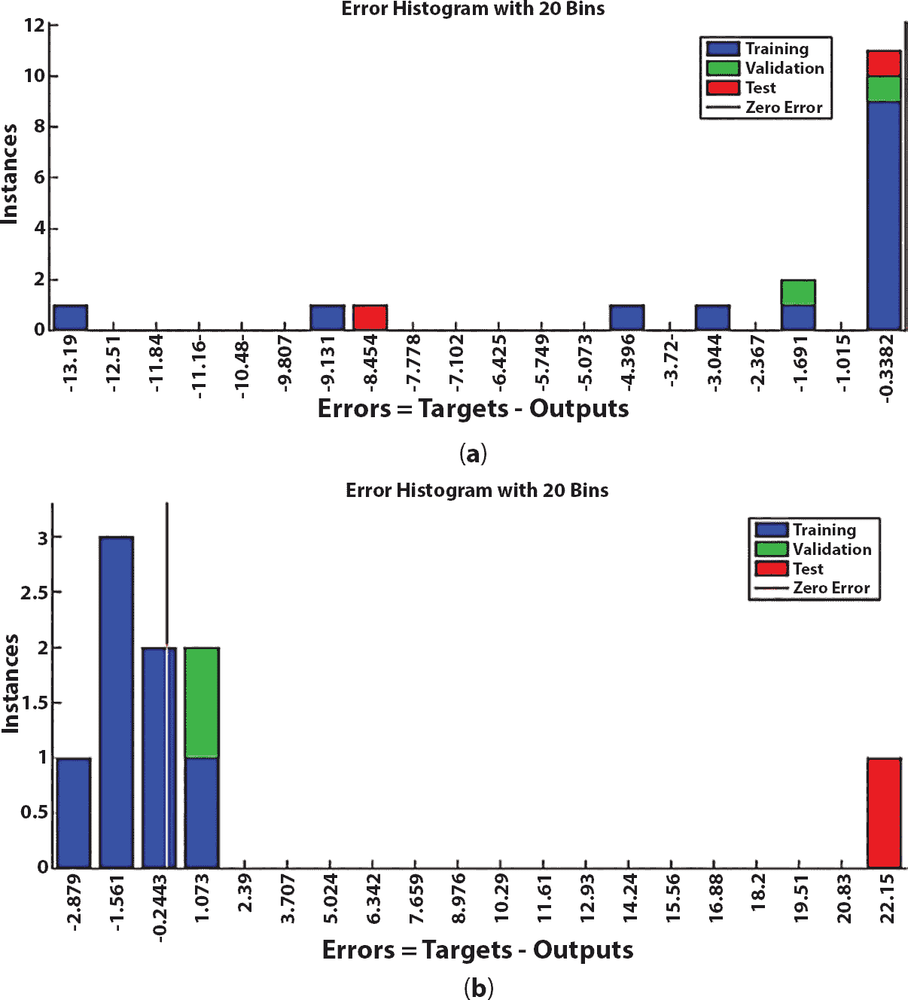

**图 3.6** 输出的直方图性能：(a) 硬度值和(b) 拉伸强度值。

但在测试集中仍然存在离群值，这意味着对于此类实例的预测准确性，可能需要在调整能力或数据预处理上投入额外努力。

### 3.4.4 硬度值与拉伸强度值的函数拟合图

图 3.7a 展示了高精度的硬度预测函数拟合，图中数据集的训练/验证/测试集上几乎观察不到误差。注意顶部的图，拟合函数（黑线）与实际目标值匹配得非常好，目标值分别由蓝色、绿色和红色标记，对应训练、验证和测试数据。从图 3.7，我们可以看到模型能够绘制出硬度的正确范围，对于大多数输入范围，它也能检索到实际输出值作为目标值，即 60 到 80 或 110 到 140。这两个指标的近似等性证明了模型在不同子集上的准确性和泛化能力。在 85 到 90 之间以及 70 附近存在一些细小差异，但这些偏差是有限的，它们仅表现为估计值与实际值之间的短距离。误差分布紧保持在零附近，显示预测误差较低（显示在图的下部分）。误差大部分在 ±5 以内，表明模型具有良好的估计硬度值的能力。函数拟合的准确性非常好，跨越数据只有微小误差，证实了模型在显著输入空间内具有一定程度硬度预测能力。


预测的可靠性和实用性与模型的准确性直接相关。在基于模型的硬度预测用例中，高准确性意味着根据各种数据点，模型能够预测 AZ91 纳米复合材料的实际绝对硬度，因此工程师/研究人员可以对其依赖。所以，高准确性意味着我们的模型很好地学习了数据中的大部分内容，并能正确预测所有结果。这对于材料属性的细微变化会直接影响产品性能、安全性和耐用性的应用来说尤为重要。在所有已知数据中，高精度（即低预测误差）也增加了对模型新实例输出输出的信任度。可靠的模型可以区分与质量控制以及制造或材料设计优化功能相关的硬度微小差异。在这种背景下，具有高准确性的给定模型有助于准确预测 AZ91 纳米复合材料的所有可能成分或处理方式的硬度，这可以减少对大量物理测试的依赖，并可能导致更快的发展。

另一方面，准确性差会导致实际硬度值出现巨大偏差，并导致非理想甚至不材料选择。在中间或关键应用中，不良的硬度预测可能导致提供过脆或过软的材料，从而引发结构失效并缩短组件寿命。因此，模型的准确预测将通过提供精确值和消除误差来发挥关键作用，最终实现增强的决策过程。

图 3.7 显示了拉伸强度预测的功能拟合和误差分析，对训练集、验证集和测试数据集具有高拟合度。顶图描绘了输入（红色和蓝色）和预测输出值（绿线），针对拟合函数（黑线）、训练（蓝色）、验证（绿色）和测试（红色数据输出）。预测值在输入空间的大部分范围内（特别是 150 到 180 MPa 以及 200 到 260 MPa 之间）很好地对应真实目标值，表明具有合理的准确性和一致性。我们在某些区域（如约 160 MPa 和 220 MPa 左右）观察到微小偏差。如上所述，这些误差极小，且大部分在目标值的 ±5 范围内。

这种高准确性通过底部得到了进一步证实，底图描述了作为目标与输出之间差值的误差分布，误差集中在零附近，通常在 ±10 的范围内。大致接近 160 MPa 的高误差点仅是极具挑战性的预测点等，强调了模型的整体精度。事实上，在预测拉伸强度值方面，高模型准确性对结果具有巨大影响，因为它对实际应用具有良好的预测可靠性。

在工程和材料科学中，准确预测拉伸强度有助于工程师评估此类材料是否适用于需要确保耐用性和安全的结构应用。高可靠性消除了对大量物理测试的需求，从而节省了时间和成本，同时确保 AZ91 纳米复合材料等材料符合名义强度规范。相反，如果准确性低，则会出现较大的偏差，可能产生质量不佳或不安全的材料选择，影响结构的完整性。因此，强大的模型性能对于获得准确预测并做出相关决策以及加速材料发现过程至关重要。

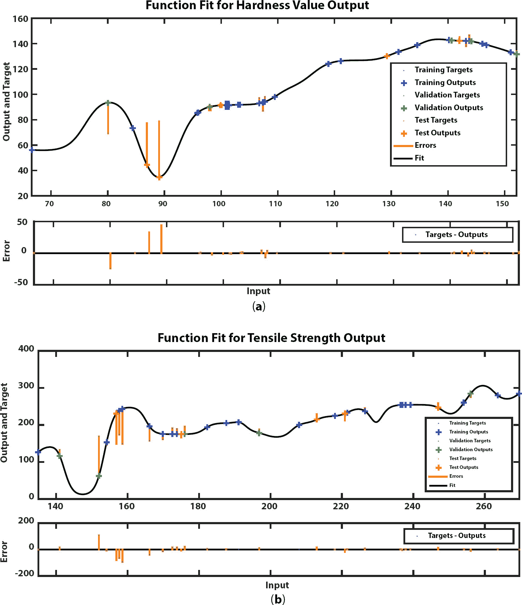

**图 3.7** 输出的拟合性能：(a) 硬度值和 (b) 拉伸强度值。

### 3.4.5 硬度值和拉伸强度值的回归分析图

在图 3.8a 中对硬度值的模型预测性能进行了评估。相关系数 `R` = 0.967 表示预测值与实际硬度值之间存在高度相关。这种高相关性表明模型成功预测了 AZ91 纳米复合材料的硬度，目标值占总方差的 96.7%。

图 3.8b 评估了模型对拉伸强度的预测性能，带有最佳拟合线。对于拉伸强度预测，`R` = 0.91724 与硬度相关性相比，预测值与实际拉伸强度之间存在类似的正相关关系。因此，值为 0.91724，证实了我们的模型可以解释目标拉伸强度值约 91.7% 的方差。这一预测与目标值相当接近，表明模型对于拉伸强度预测通常是有效的。

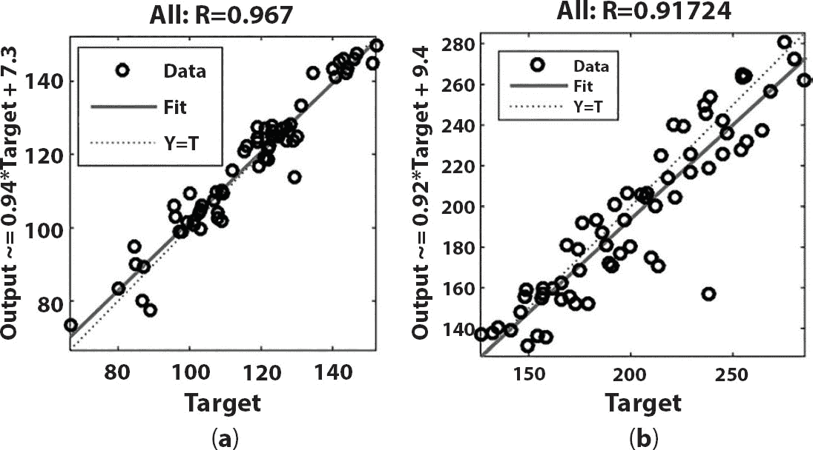

**图 3.8** 输出的回归分析：(a) 硬度值和 (b) 拉伸强度值。

## 3.5 结论

使用人工神经网络（ANN）优化 AZ91 纳米复合材料的轧制参数是材料处理和性能提升的跨跃。本研究探讨了使用 ANN 建模此类非线性依赖关系的复杂性，特别是关于轧制工艺参数（轧制温度、道数、样品轧前厚度）对处理 AZ91 纳米复合材料后硬度和拉伸强度响应的影响。

这项工作的新颖之处在于使用了 ANN 模型进行轧制优化，考虑到镁合金中由于耦合性质导致的热变形和机械变形之间的相互作用，这是非常的。然而，与传统方法相反，ANN 成功覆盖了复杂的参数-属性空间，并定义了产生最大硬度和拉伸强度的最佳工艺条件。

这种优化的重要性直接影响工业应用，AZ91 纳米复合材料被用于汽车汽车和航空航天部件，这些部件需要机械属性保持安全且运行。

## 参考文献

1. Jayasathyakawin, S., Ravichandran, M., Baskar, N., Chairman, C., Balasundaram, R., Mechanical properties and applications of Magnesium alloy–Review. *Mater. Today: Proc.*, 27, 909–913, 2020.
2. Song, J., She, J., Chen, D., Pan, F., Latest research advances on magnesium and alloys worldwide. *J. Magnesium Alloys*, 8, 1–41, 2020.
3. Wang, X.J., Xu, D.K., Wu, R.Z., Chen, X.B., Peng, Q.M., Jin, L., Wang, H.Y., What is going on in magnesium alloys? *J. Mater. Sci. Technol.*, 34, 2, 245–247, 2018.
4. Soni, P.K., Tiwari, A., Nayak, S., Vasnani, H., Jha, S., Ultrafine Grain Refinement and Improved Mechanical Strength of Compositionally Modified AZ 61 Alloy Composite, in: *Innovative Materials for Environmental and Aerospace Applications*, pp. 327–362, IGI Global Scientific Publishing, 2025.
5. Tolouie, E. and Jamaati, R., Effect of β–Mg17Al12 phase on microstructure, texture and mechanical properties of AZ91 alloy processed by asymmetric hot rolling. *Mater. Sci. Eng. A*, 738, 81–89, 2018.
6. Koli, N. and Mamodiya, U., Review Paper on Automation of Robotics in Spatial With Life Forms. *Int. J. Eng. Sci. Invent. Res. Dev.*, 5, 11, 349–353, May 2018.
7. Zhu, B., Liu, X., Xie, C., Su, J., Guo, P., Tang, C., Liu, W., Unveiling the underlying mechanism of forming edge cracks upon high strain-rate rolling of magnesium alloy. *J. Mater. Sci. Technol.*, 50, 59–65, 2020.
8. `Tiwari, A.`, `Kumar, N.`, `Vasnani, H.`, `Jha, S.K.`, 纳米颗粒在改性镁合金及复合材料中的作用述。*Int. J. Fract. Mech. Damage Sci.*, *2*, 01, 24–32, 2024.
9. `Kim, Y.S.` and `Kim, W.J.`, 高比差速轧制后铸态 Mg–9Al–1Zn 镁合金的微观结构和超塑性。*Mater. Sci. Eng. A*, *677*, 332–339, 2016.
10. `Tiwari, A.`, `Kumar, N.`, `Banerjee, M.K.`, 遗传算法在石墨烯增强镁合金（AZ61）基复合材料最佳硬度和抗拉强度组合预测中的应用。*Results Control Optim.*, *14*, 100334, 2024.
11. `Li, Y.K.`, `Zha, M.`, `Jia, H.L.`, `Wang, S.Q.`, `Zhang, H.M.`, `Ma, X.`, `Wang, H.Y.`, 为强度-延展性协同作用定制 Mg-9Al-1Zn 合金的双峰晶粒结构：粗 Al2Y 和亚微米 Mg17Al12 粒子的协同调节。*J. Magnesium Alloys*, *9*, 5, 1556–1566, 2021.
12. `Patel, V.`, `Sharma, P.`, `Tiwari, A.`, `Vasnani, H.`, 汽车工业中的镁合金：合金元素及其对材料性能的影响。*Global J. Eng. Technol. Adv.*, *21*, 01, 130–145, 2024.
13. `Tiwari, A.`, `Kumar, N.`, `Banerjee, M.K.`, 热轧对含微量元素搅拌铸 AZ 61 合金微观结构和机械性能的影响。*Indian J. Sci. Technol.*, *16*, 24, 1810–1822, 2023.
14. `Ambalgi, A.P.`, `Sujata, S.K.`, `Mamodiya, U.`, `Sharma, P.`, 使用具有侧向辐射的直接接触探针馈激励对单双宽槽微带贴片天线性能的影响，收录于：《智能能源与通信国际会议论文：智能系统算法》，`D. Goyal`、`P. Chaturvedi`、`A.K. Nagar`、`S. Purohit`（编），Springer, 新加坡，2021.
15. `Bian, J.`, `Yu, B.`, `Sun, W.`, `Jiang, L.`, `Liu, X.`, `Zheng, L.`, `Li, R.`, 通过电磁搅拌改善 AZ91 镁合金的微观结构和拉伸性能。*Mater. Res. Express*, *6*, 12, 1265j1, 2020.
16. `Srinivas, A.`, `Pavan, D.`, `Venkatesha, B.K.`, `Rao, R.R.`, `Mohith, L.`, AZ91 镁合金机械性能研究。*Mater. Today Proc.*, *54*, 291–294, 2022.
17. `Song, G.`, `Bowles, A.L.`, `StJohn, D.H.`, 老化压铸镁合金 AZ91D 的耐腐蚀性。*Mater. Sci. Eng. A*, *366*, 1, 74–86, 2004.
18. `Mamodiya, U.` and `Tiwari, N.`, Simulink 平台上的太阳能跟踪系统设计、实现与性能分析。*IOP Conf. Ser. Mater. Sci. Eng.*, 988, 1, 012118, 2020 年 12 月，DOI:10.1088/1757-899X/988/1/012118.
19. `Zhao, H.`, `Guan, S.K.`, `Zheng, F.Y.`, Sr 和 B 的添加对 AZ91 镁合金微观结构和机械性能的影响。*J. Mater. Res.*, *22*, 20233220200..............,...............1111111....... * *1 0,,222222.22........ `,,.... `,..... `..... ` `,..... of of for for applications. **J. Magnesium Alloys*, *8*, 269–290, 2020.
22. `Jang, H.`, `Seol, D.`, `Lee, B.J.`, 纳米片层增强镁。*J. Magnesium Alloys*, *9*, 317–335, 2021.
23. `Ghai, D.`, `Tripathi, S.`, `Saxena, S.`, `Chanda, M.`, `Alazab, M.`, 《信号与图像的机器学习算法》，Wiley Press, 美国，2022.
24. `Zhi, C.`, `Lei, J.`, `Xing, H.`, `Huang, Z.`, `Xu, H.`, `Jia, W.`, AZ31 铸轧拉伸强度预测。*J. Res. Technol.*, *23*, 3272–3283, 2023.
25. `Munir, K.`, `Wen, C.`, `Li, Y.`, 镁合金机器学习综述。*J. Magnesium Alloys*, *7*, 536–544, 2019.

# 4 机器学习驱动的纳米器件制造未来方向

**Wasswa Shafik¹,²**

¹文莱大学数字科学学院，Gadong, Bandar Seri Begawan

²数字连接实验室 (DCRLab)，坎帕拉，乌干达

## 摘要

我们正处于纳米器件制造面临类似场景的边缘。当我们进入亚 50 纳米尺度时，传统的制造方法开始失效。这需要一种转型来解决这一规模化问题，而提出的解决方案是机器学习。在过去的几年里，已经出现了多次成功且重大的尝试，通过训练机器学习来生成纳米器件的图案。这些策略通过模拟制造或材料特性，克服了基于网格的设计过程或耗时的设计局限性。

尽管这一前景本身是机器学习力量的兴奋展示，但我们的目标是双重的。首先，我们希望概述纳米器件制造机器学习的现状，涵盖各种应用和技术。另一方面，本章将讨论推向现状之外，探索机器学习纳米器件制造的可能未来方向。

我们的文章结构如下：首先对机器学习在纳米制造不同阶段进行说明。在此过程中，我们还总结了若干相关实验研究中使用的方法，这些方法帮助研究人员实现了多种纳米制造策略的快速原型设计，以及新型准确度量空间估计器的快速发现。随后，我们总结了最近相关的综述，包括商业硬件和实验研究。最后，我们讨论了各种开放性，以及该领域在广泛背景下的未来方向。

**关键词：** 机器学习、纳米器件制造、纳米技术、预测建模、人工智能制造、材料科学、精密工程、工艺优化

## 4.1 引言

先进纳米器件的制造正变得越来越具有挑战性，传统的制造技术往往无法满足所需的精度。这正是机器学习（ML）可以发挥关键作用的地方。机器学习能够以极快的速度利用显著更少的计算资源实现原子的精确定位，这可以指导制造工艺并使其朝着目标器件设计进行优化。

将机器学习模型与特定领域的优化相结合，可以指导纳米器件的实际制造，并将计算模拟和材料发现转化为实验驱动的领域，从而解决现实世界的问题[1]。过去几年，受各领域研究量不断增加的影响，人们对纳米科学、纳米技术与机器学习的协作研究日益感兴趣。原子预测、纳米级接触、催化和电子设计等领域正吸引研究人员，并应用于电子、药物发现、催化和能源技术等领域。总而言之，在可预见的未来，计算技术与纳米科学技术的整合将继续进行[2]。

迄为止，大量的综述文章描述了机器学习在制造纳米级器件中的成功应用。知情的观察者会注意到，目前的机器学习方法在识别趋势、利用大量计算资源探索高维参数空间以及确定材料属性的潜力方面发挥着重要作用。尽管使用这些方法已取得进展，但重点必须转向提供完全自动化的解决方案，允许机器学习的预测指导不同的实验背景。实验的快速迭代将促进突破性技术的发展。

此外，对纳米级机器学习驱动实验的相关领域进行调查，可能会提供一份尖端研究的参考文献和见解，涉及多项新兴技术（以及其他专家系统），如图 4.1。


**图 4.1** 专家系统。

## 4.2 纳米器件制造的基础

纳米器件制造是创建纳米级电机械结构的过程。这些器件在医疗保健、传感、安全和计算的许多应用中的重要性正在迅速增加。创建这些器件的主要方法依赖于在原子水平上改变物质。

传统上，使用光刻来定义结构。主要（但不仅限于）刻蚀工艺被用于改变物理结构以形成复杂的器件。这种对单个原子和分子进行光刻和刻蚀的“剪切与粘贴”思维虽然经过了验证，但随着硬件和器件尺寸不断缩小，它也有局限性并带来了新的挑战。

在这项工作中，将涵盖创建 2D 和 3D 结构的工艺[4]。这些方法在定义结构方面已取得成功，目前的工艺特征尺寸已缩小到 5 nm。然而，突破这些尺寸要困难得多。应用这些标准技术并不总是能创建所需的图案或结构，而且通常需要熟练操作人员进行尝试错误。

这些许多过程是经验性的、耗时的，且对于新工艺来说，工程成本高昂。利用机器学习来体现原子、化学、生物过程和颗粒相互作用知识的新系统可以使我们能够从收集的数据中做出更快、更准确的预测。在技术世界中，合理设计听起来是一个遥远的可能性，但引入执行降维的技术允许我们更好地理解大型数据集[5]。

### 4.2.1 传统方法

直写、光刻、X 射线光刻、电子束光刻和离子束光刻都是直写方法。光刻是最广泛的光学光刻技术，将所需的图案投影到光敏材料上。化学气相沉积是另一种常用的制造方法，将材料沉积在衬底表面。化学气相沉积产生的膜具有高均匀性以及膜与衬底之间的高粘附力。

化学气相沉积与光刻的结合显示了图案密度的进展。然而，在传统方法，耗时的过程、对昂贵高质量材料的需求以及可扩展性限制了功能性、可靠器件的发展[6]。

纳米制造的传统方法根据基本机制分为两个子类：一种是基于化学的方法，另一种是直写光刻。无论该方法在先进制造中是否成功，当前的制造仍面临许多挑战，特别是涉及新兴纳米技术时。

制造过程中的材料损失和对原料重新定位的需求是一些显著缺点。聚合物在光刻期间的膨胀限制了图案密度和尺寸。具有大场域的大规模并行写入技术显著增加了系统成本；在厘米级区域实现纳米级分辨率的光刻也具有挑战性。

聚焦电子束和离子束会产生电荷、光胶加热等问题，这些很容易损坏器件材料并产生副作用刻蚀。上述这些情况对创新和材料开发提出了紧迫要求。消费者对电子设备的需求已剧增[7]。

### 4.2.2 机器学习的出现


过去 5 年，机器学习算法经历了爆炸式增长——这些变革性的进展正在改变科学、技术和社会系统的几乎每一个方面。这些算法能够分析多维且通常是大型的数据集，其模式比传统和直觉方法无法识别的复杂得多。纳米器件制造包含大量可以改变行为的参数，包括缺陷密度、各异性、热波动和结构缺陷，这些因素可以在多个器件和制造维度上产生协同效应。在这样的高维参数空间中，预测纳米器件现象（例如电阻开关、阈值电压和临电流）是复杂的，需要通过数千个制造步骤系统地研究毫米级精确的多维制造空间。处理此类多维制造空间、大型数据集和复杂的器件-制造关系的传统方法涉及空间划分以寻找简单的 1:1 关联。机器学习可以同时考虑所有的器件-制造相互作用 [3]。机器学习可以最优且高效地在制造过程中传递信息。

通过深度学习方法，机器学习（ML）能够从组合数量庞大的纳米器件中进行筛选，寻找涉及复杂的器件制造、组分及环境相互作用的多点相关性。对于有意的破坏性探测的大型纳米器件统计系列，ML 也通过快速且实时的统计分析占据着一席之地。这为针对目标、关键故障和多终端的科学实验提供了加速的器件学习，并为传感器数据收集了一种贝叶斯方法，这对于目前相关纳米电子制造过程中正在进行的通用受限、移动和紧凑的维度分析至关重要。

对过去算法在纳米工程中展示机器学习算法能力的全面回顾，涵盖了从发现器件行为到执行路径优化，以及对非正常制造工艺能力的改进。新算法正在快速展现其预测纳米事件并确定最佳工艺序列路径和终止条件的能力。这种纳米事件领域的机器学习革命是渐进的，取得了许多中间成功以及来自科学界严谨的比较研究结果 [8]。制造工艺控制之间的紧密交互进一步凸显了非正常制造——ML、退火优化和器件物理只有在与其各自的跨学科社区紧密合作下，才能实现新的研究和创新。表 4.1 通过在真实的纳米制造挑战背景下直接比较算法说明了关键分析，有助于识别某些机器学习方法在何处出色，在何处可能不足。

**表 4.1** 用于纳米器件制造应用的机器学习算法对比分析。

| ML 算法 | 应用领域 | 优点 | 局限性 | 纳米器件制造中的用例 | 性能指标 | 参考文献 |
| --- | --- | --- | --- | --- | --- | --- |
| 迁移学习 | 跨领域建模 | 从相似领域领域适应知识 | 需要相关数据集 | 应用在相似行业中训练的模型 | 迁移准确性、模型速度 | [2] |
| 自动编码器 | 异常检测 | 学习高效表征，适用于异常 | 需要大数据，调优工作量大 | 检测制造过程中的稀有缺陷 | 重构误差、准确率 | [1] |
| 主成分分析 (PCA) | 数据降维 | 简化数据以更快处理 | 丢失某些数据方差 | 减少高维传感器数据 | 方差解释、速度 | [8] |
| 极端梯度提升 (XGBoost) | 缺陷分类 | 高效率、分类准确率高 | 参数调优复杂 | 特定工艺的缺陷分类 | 准确率、速度 | [7] |
| 长短期记忆 (LSTM) | 序列预测 | 对时间序列数据有效 | 训练成本高，需要大数据 | 监控和调整工艺序列 | 预测准确性、稳定性 | [7] |
| 贝斯网络 | 不确定性建模 | 量化不确定性，处理概率数据 | 需要先验知识，计算成本 | 管理制造不确定性 | 预测准确性、方差 | [4] |
| 梯度提升 | 多步工艺预测 | 高预测准确率 | 调优复杂，对离群值敏感 | 纳米制造中的多步优化 | 精密度、召回率 | [3] |
| K-近邻 (KNN) | 材料属性预测 | 易于实现，适用于分类 | 大数据集下计算开销大 | 材料属性分类 | 准确率、错误率 | [6] |
| 随机森林 | 工艺参数预测 | 减少过拟合，鲁棒性强 | 需要大数据 | 预测关键参数的最优范围 | 精密度、集成准确率 | [9] |
| 决策树 | 参数选择 | 具有可解释性、计算需求低 | 容易过拟合 | 最佳沉积参数的选择 | 准确率、可解释性 | [10] |
| 生成对抗网络 (GAN) | 质量控制 | 生成真实的缺陷数据用于训练 | 训练复杂，存在模式崩溃风险 | 增强用于训练的缺陷数据 | 真实性、数据多样性 | [5] |
| 强化学习 (RL) | 工艺优化 | 自适应学习处理动态系统 | 需要大量的计算资源 | 优化制造步骤 | 奖励分数、学习率 | [11] |
| 支持向量机 (SVM) | 预测建模 | 适用于数据集，结果鲁棒 | 限于较简单模式，适应性差 | 预测材料属性 | 精密度、召回率 | [4] |
| 卷积神经网络 (CNN) | 缺陷检测 | 准确率高，适用于图像数据 | 计算成本高，数据需求大 | 纳米表面实时缺陷检测 | 准确率、速度、错误率 | [9] |

## 4.3 纳米器件制造中的 ML 技术

科学家们采用了大量的 ML 技术来赋予纳米器件制造能力。这些不仅包括经过时间检验的监督学习方法，还包括无监督学习和强化学习（`RL`）。三种学习范式都有独特的作用，但将机器学习与纳米器件制造统一起来的在于：当制造精度是衡量制造工艺有效性的最终标准时，通过增强工艺控制和材料准确性来改进制造。从这个意义上说，不同的 ML 技术为未来制造工艺的进步贡献了互补的角色。

监督学习模型是预测建模任务的常用方法，特别是在有标记训练数据的情况下。另一方面，无监督学习方法提供了一种互补方法，用于识别和利用制造数据中存在的模式 [4]。这些方法在数据与测量输出没有共同标记的情况下特别有用，正如我们在电子测量系统的监督学习方法中的那样。无监督技术还包括降维和随后的可视化。

`RL` 增加了对制造空间作为调优机制的兴趣，这对于需要通过动作采样来确定最佳条件的大复杂系统特别有用。`RL` 可以参与在涉及多个竞争目标的复杂空间内做出优化决策决策中。学习技术的选择通常取决于标记数据集的存在以及给定工艺的仿真模型的保真度 [12]。

最近，开发了结合多种学习范式的方法，应用于复杂多变量工艺的优化。从早期开始，人们就探索了结合方法研究复杂工艺和模型的重要性。因此，我们可以预计不同的学习技术将会成熟，相关的计算将引导该领域未来几年的发展 [5]。

### 4.3.1 监督学习

监督学习需要一个“老师”为学习过程提供带标签的数据集（即带有目标输出的数据）。随后，它会逐个实例地学习该训练数据集与对应标签之间的相关性，并利用这些相关性创建一个模型，以便在给定新的未见数据时预测预期的输出。因此，学习过程的质量和模型的预测性能取决于标签训练数据集的质量和代表性。

与无监督学习相比，监督学习的优势是训练信号可以为训练过程中更新模型权重提供即时方法。这种反馈可以被优化算法利用，直接影响整个收敛过程中权重分布的演变 [10]]。当设计者对优化纳米器件的某个方面时，最简单的方法是遵循监督学习策略。这意味着使用一些带标签的仿真数据来构建机器学习（ML）模型。一旦模型训练得令人满意，它就能根据设计参数的选择来预测性能因子。因此，可以通过选择特定的设计来优化设备的性能。

在这方面，两类主要的监督学习技术是理想的：一类能够学习连续函数近似、目录和关系（回归模型），另一类则擅长对空间划分并寻找自然类别（分类算法）。

监督学习是设计高效制造工艺的自然方法，其完美示例是监督快速外延映射技术。为了有效地校准演化模型，需要大量外延薄膜的定量结构信息。除了多达五个独立的结构参数外，许多结构由于面内冻结维度需要非标准的配置文件。对于传统的自适应策略来说，产生此类仿真数据的成本太高，但即使已经可用其中的一小部分数据，也适用于训练 [9]。它受到严格控制并且具有高度的预测性；训练数据中的错误可能会导致不合适的实验方向。机器学习有多种应用，如图 4.2 所示。

### 4.3.2 无监督学习

信息方法与材料应用之间存在更多微妙的差异。例如，无监督学习技术补充了监督方法。这篇未来技术展望论文旨在展示无监督学习中的机器学习技术如何极大影响材料的设计方式。在本节中，我们将讨论工厂中的无监督学习。

与需要标签数据的监督学习不同，无监督学习可以在没有标签的情况下发现数据的隐藏模式。无监督学习有多种公式。例如，聚类根据变量内部的特征将数据划分为不同的模块。当工艺与内在值（如设置设计）之间的某些内部关系可以将某些部分分类为分层或错误时，就会产生制造应用。通过这种方式，工厂可以避免制造不符合规格的部件。

制造设计之间通常存在权衡，对制造设计参数之间关系的洞察是至关重要的 [3, 6]。多晶样品充满了系统噪声，使用人工检查进行表征可能具有挑战性，在这种情况下，无监督方法可以应用于即使信噪比很低的数据集。因此，在无法获得可靠标签的情况下，存在着无价的见解。

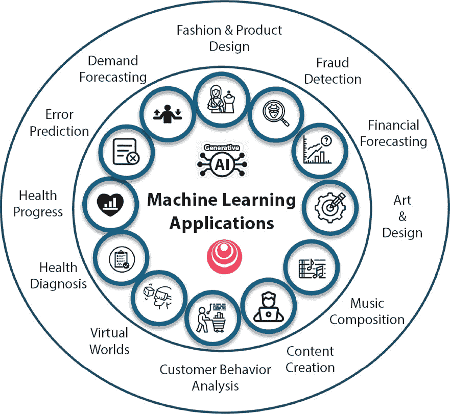

**图 4.2** 机器学习的应用。

无监督学习的另一种方法是降维。对数据进行表表示，以优化区分方法。这些技术不仅可以识别不足或错误的部分，还能识别模型外行为。

在自适应制造工艺中实施强化学习（RL）并关注工艺评估和控制将产生意义，并代表了该领域未来方向的一个潜在集成点 [5, 11]。这些未来方向应该在实验研究中探索，其目的是开发制造产品。

### 4.3.3 强化学习

强化学习基本上源于行为主义心理学理论，重点在于确保智能体以特定方式行动。与其他机器学习技术的主要区别在于，强化学习并不为每个状态寻找或要求正确的动作。相反，目标是让策略引导系统从初始状态进入最终决策以获得累积高奖励。

强化学习策略通过与环境的一系列试错交互随时间推形成。强化学习不像监督学习那样关注每个动作的实时优化，而是最大化长期奖励，非常适合目标是学习用于顺序决策策略的应用 [6]。

用于优化的强化学习实现通常涉及 `Q-learning` 和 `deep Q-networks`，并已被用于优化计算成本昂贵的过程，这些过程需要长期考虑，且在实时环境中无法通过任何方法实现。此外，强化学习模型还强调了更强的自适应能力，与其推断优化局部变量的策略，它们能够做出自适应决策以最大化效率，甚至克服过程中的干扰或之前可能承担的风险 [4]。

为了执行任务，已采用了多种强化学习策略，例如 `Q-learning`、`trial and error learning`、`dynamic programming` 和 `state–action–reward–state–action (SARSA)`。因此，强化学习是应对这些挑战的主要技术之一，并正被积极作为自适应制造、工艺参数评估以及通过机器学习进行优化的未来研究领域之一，如表 4.2 所示。

**表 4.2** 通过机器学习对工艺参数进行评估及其优化。

| 参数 | 对纳米设备质量的影响 | 优化方法 | 通过 ML 识别的最佳范围 | 优化面临的挑战 | 优化结果 | 参考文献 |
| :--- | :--- | :--- | :--- | :--- | :--- | :--- |
| 环境振动 | 可能在敏感层引入缺陷 | 强化学习 (RL)、SVM | 最小允许振动 | 需要隔振，控制困难 | 降低缺陷率，提高设备良率 | [13] |
| 光掩模对准 | 确保图案精细化 | 卷积神经网络 (CNN)、梯度提升 | ±0.1 µm 对准 | 精度要求高，设备敏感性大 | 提高图案准确性，减少误差 | [14] |
| 气体流速 | 调节材料沉积和均匀性 | 神经网络、K-近邻算法 (KNN) | 50–75 标准立方厘米/分钟 (sccm) | 多气体依赖性、流量波动条件 | 沉积均匀，减少材料浪费 | [3] |
| 电极电位 | 影响沉积质量和反应速率 | 遗传算法、贝叶斯优化 | −1.5 至 −2.0 V | 高敏感性，需要精确校准 | 增强沉积均匀性 | [15] |
| 溶液 pH | 影响刻蚀速率和材料活性 | 决策树、SVM | 5.5–6.5 V | 对微小变化敏感，一致性待提高 | 刻蚀稳定，减少表面异常 | [4] |
| 旋转速度 | 确保层分布均匀 | 强化学习 (RL)、神经网络 | 1000–1500 rpm | 复杂的动态系统，需要实时调整 | 层厚度一致 | [16] |
| 冷却速率 | 控制结晶度、结构稳定性 | 回归、强化学习 (RL) | 5–10°C/min | 非线性冷却响应，需平衡速度 | 增加结构完整性，减少裂纹 | [14] |
| 基底粗糙度 | 影响层均匀性和粘附力 | SVM、梯度提升 | ≤0.5 µm | 需要精确控制，高数据分辨率 | 提高层粘附力，表面均匀 | [17] |
| 材料纯度 | 影响整体质量和缺陷潜力 | 决策树、主成分分析 (PCA) | ≥99.9% 纯度 | 来源稳定、污染控制 | 减少缺陷，提高良率 | [4] |
| 湿度 | 影响材料粘附力和稳定性 | 随机森林、贝叶斯网络 | 20%–30% | 环境依赖性，条件波动 | 增强粘附性和稳定性 | [3] |
| 激光强度 | 控制刻蚀和图案化的精度 | 强化学习 (RL) | 300–350 mJ/cm² | 数据量大，需要实时反馈 | 提高精度，减少图案化误差 | [18] |
| 沉积速率 | 决定层厚度和均匀性 | 神经网络、SVM | 2.5–3.0 nm/s | 结果变异性大，参数敏感 | 层厚度一致，变化极小 | [19] |
| 压力 | 影响结构完整性和键合 | 遗传算法 | 0.8–1.0 MPa | 多变量依赖，调整复杂 | 提高良率，改善结构完整性 | [14] |
| 温度 | 影响材料均匀性和缺陷率 | 回归、贝叶斯优化 | 500°C–550°C | 非线性关系，数据稀缺 | 降低缺陷率，增强均匀性 | [20] |

## 4.4 ML 在纳米设备制造中的应用

ML 技术已广泛应用于数字化转型 (DT) 行业。在接下来的章节中，我们首先回顾了 ML 在纳米设备制造中的应用现状，特别是在 ML 驱动的过程模拟和优化背景下。其优势在于提高性能、缩短停机时间并减少对专业人工投入的需求。

随后，我们将讨论 ML 研究、目前已取得的成就，以及在预测算法背景下预期的未来方向。多项 ML 技术已用于纳米设备制造 [20]。最显著的是，预测算法利用计算模拟的见解来预测参数调整的后果。这种过程优化已在氮化硅微型机械开关和纳米线场效应晶体管中得到证明，目标是最小化对晶体管特性的散射。

本手册介绍了 ML 驱动的过程优化、预测性维护以及辅助操作人员进行纳米设备制造的方法案例。此外，各种概念已被扩展，用以帮助从寄生器件库或具有不同特性的纳米设备中实际选择工艺矩阵实现 [14]。其他概念设想了使用 ML 工具来帮助自动化设计生成，包括开发基于自编码器的方法来生成新的实现。

### 4.4.1 优化设备性能

用于纳米制造的 ML 开发工作针对参数的微小迭代，旨在提高给定工艺的性能或可靠性。在不需要了解目标设备精确行为的情况下寻找最佳输入参数的 ML 领域被称为优化。许多现代优化模型将使用多种策略，包括随机选择点进行物理评估、利用模型预测未测试点的性能，以及更新模型以包含新的性能数据并完善其准确性。

这种结果不仅允许优化工艺以提高处理速度、准确性和能量效率，还延长了制造晶体管的使用寿命 [19]。优化方案中领先的性能指标包括输出、传输频率、跨导电度和开关比，以及能量延迟积（这是一种根据跨单个时钟周期的传输频率静态功耗计算的多维度指标；较低的能量延迟积意味着设备更快速、更高效）。

此外，考虑到互补金属氧化物导体 (CMOS) 设备在生物电子学和物联网终端应用中的潜力，可以最小化或定制相关的失效模式（如保持）。ML 的额外优势之一是它能够在运行时调整工艺参数，这不仅优化了设备，还增强了设备的整体可靠性和寿命。

基于对制造一天后工作设备的测量，证明了进行实时修正的能力 [18]。沿器件长度的器件特性经过调整，以匹配存在于接地源极与源区主体下方互连之间的空间不均匀性。

### 4.4.2 预测性维护

预测性维护是指预测设备和系统何时可能失效并需要维护的能力。在容错和自适应制造纳米器件的背景下，这种能力至关重要。当机器发生故障时，不仅直接影响故障期间，还会影响恢复或修复阶段，即修复机器并确保运行符合所需标准的时间。

如果这属于生产停机时间或需要长时间的维修，可能会对生产力产生重大的商业影响。运行效率更高的机器和系统有更高的概率运行更长时间，这导致了基于状态的预测性维护原则。预测性维护依赖于传感器和基于数据分析的方法来监控潜在的设备系统 [4]。

当通过 `data science` 进行预测性维护时，数据科学使用 `ML` 算法来识别整个过程中记录的传感数据中的模式。一旦记录了这些数据并识别出某些模式，数据科学将应用学习到的系统模型，以找到平均运行时间与故障之间开始变得明显的的最早时间点。

这种方法作为维护策略可能更具成本效益，因为它将监控与智能检测相结合，可以在系统完全失效和损坏之前主动关闭系统，从而减少损坏程度以及修复维修的时间 [3]。

预测性维护算法可以分为一系列预定义的类型，包括传感器、操作和故障模式数据。随着时间的推移，执行预测性维护的技术已发展成为整个研究领域，开发了许多算法。这些算法旨在减少停机时间并最大化长期生产力。

目前，有许多用于预测性维护的 `ML` 模型，包括 `principal component analysis`、`support vector machines`、`Markov models`、`case-based reasoning`、`deep learning`、`inductive ML` 和神经网络。在制造环境中中使用这些工具进行预测性维护的示例，例如使用相等误差率和 `support vector machine` 模型进行实时机器人系统维护预测 [17]。

有效实施自适应纳米器件制造预测性维护的关键，在于一种与整体纳米制造政策相匹配的清晰实时策略。

### 4.4.3 自动设计生成


自动设计生成是指一种设计程序，其中`ML`技术根据设计人员输入的一组通用设计规则进行训练，并仅根据这些设计规则生成许多不同的设计原型。为了这一目标，研究人员利用了各种数据驱动的方法，包括`deep RL`和生成对抗网络，这些方法能够大幅增加生成的原型设计数量。自动设计生成可能会为特定的纳米器件概念创建大量原型，从而避免了生成这些原型所需的人力和资源。生成的设计随后可以被自动准备或制造并测试，以为训练算法提供性能数据 [13]。根据性能数据，算法随后可以精炼生成的原型，或快速创建无数其他原型。这种方法允许根据性能对设计进行快速迭代，并已广泛应用于各种电子设计过程中。在超表面领域进行了一项案例研究，该研究通过广泛的复杂超材料单元阵列提供了不同的纳米光子学功能。一个`ML`算法在一组初始超表面设计上进行了训练，然后通过自动化生成了许多不同的设计，并在目标超表面上进行训练。尽管这些基于`ML`的优化技术的“孙辈”，但自动设计生成提供了一种方法，能够更高效、更准确地将从抽象设计到可用于制造的设计这一宝贵步骤进行转换 [14]。

## 4.5 挑战与局限性

尽管近年来取得了快速进展，但在纳米器件制造中应用`ML`仍面临若干挑战。其中最关键的之一是数据。由于缺乏适用于`ML`的大规模高质量数据集，因为相关实验的计算开销可能很大，或者评估相关器件属性的技术可能尚不存在。研究人员和最终用户需要致力于建立协议和指南，以确保数据和数据库具有高质量、可访问性并代表目标分布。然而，增加电子结构数据的数量和可用性会由于过拟合风险的增加，不可避免地增加有效使用这些数据的复杂性。可能需要关注鲁棒性、可解释性和迁移学习的新算法和技术。真正新颖或颠覆性的器件或制造方法最初可能根本没有完善的掺杂分布或电子结构目标 [18, 21]。没有现有数据听起来是一个不可逾越的局限，但我们鼓励社区将其视为挑战、充满创新的机遇，以及对新颖和未探索领域进行战略性优先考虑的号召。

另一个挑战是算法目前的局限性。尽管机器学习（ML）工具已经相当成熟，但它们绝非完美或无懈可击。目前可用的工具、性能指标、解释甚至模型本身都不可避免地具有局限性和某种程度的模糊性。在构建机器学习解决方案时，模型尺寸、性能、复杂性、可用数据类型、偏见、伦理和隐私等限制都是一些约束性因素。一些最复杂的模型（包括大规模深度学习方法）往往也是可解释性最低、可解释性最差的。这并不一定是一个致命的局限，人们正在通过两者的协同发展取得进展。这种需求并非关键限制，且通过模型通用和模型特定方法的协同发展，我们正在取得进展。然而，在机器学习模型中，一些最复杂的模型往往也是最难解释的。尽管如此，研究人员可能倾向于使用具有高度可解释的模型，以从数据数据提取趋势。这种模型与数据之间的张力，理解机器学习模型做出特定决策的内在逻辑是一个活跃领域。为了准确地预测机器学习模型，还需要解决伦理问题、偏见、隐私以及安全问题，以便在训练阶段对数据进行仔细关注。此外，为了确保机器学习的广泛应用，提供能够解释模型决策过程的机制至关重要`8`。

### 4.5.1 数据质量与数量

准确且可靠的机器学习预测依赖于两个主要前提：数据质量和数量。数据质量问题主要源于：数据采集的噪声、不一致的方法以及设备几何形状的获取。此外，对于极薄层，需要极度关注环境条件。技术引发的效应通常源于层的不兼容性、材料的伦理问题以及自旋耦合等现象。这种效应引发了层结构问题`15`。当我们需要使用回归分析和机器学习进行预测时，有限或较小数据集会产生问题。当然，当在使用已知的真值数据集上进行训练时，大多数机器学习模型的表现会非常出色。在训练和验证集中，机器学习模型的性能不仅取决于数据的大小，还极大地取决于输入的数量`6`。

### 4.5.2 可解释性与解释性

目前，由于复杂且通常不透明的模型，理解机器学习如何处理数据产生输出仍然是一项挑战。这种对机器学习决策过程缺乏洞察可能会加剧与可靠性性能以及可用性相关的问题。因此，提供能够深入理解机器学习模型行为并提取“为什么”和“如何”解释的方法，对于上述问题的机器学习的广泛应用至关重要`8`。后者对于促进材料科学家与开发机器学习的计算机科学家之间的协作是必要的。

在当前的数据驱动 AI 背景下，使输出易于理解的重要性通过对 AI 结果的解释（分别称为可解释性和解释性）得到了关注。已经提出了不同的策略来提高机器学习模型的透明度，以及输入数据的特征与其目标属性之间的统计或机制关系。这些策略包括数据集的特征重要性、可解释的规则或模型（如决策树模型），或模型的组合。当机器学习与科学家密切合作并利用其描述现象和构建专家知识时，其他方法可以提供主观解释`22`。其他研究旨在提供模型通用的策略来解释机器学习模型的结果，并为模型的预测构建自然语言理由。

### 4.5.3 伦理考量

正如在更广泛的社会背景下所引起的那样，使用日益强大的机器学习算法需要考虑许多伦理问题。首先，对数据保护的关注程度令人震惊。数据隐私是一个日益棘手的问题。其次，量子算法，以及更广泛地说，使用各种类型训练数据的机器学习也可能面临安全担忧。数据可能会被投毒以破坏机器学习算法。纳米器件各种属性的数据集访问允许自动的结构-属性映射，以及本文提出的快速模拟方法中的经验参数选择。为了避免对私有数据集的依赖，为了最大化公共使用和应用，另一种方法是重用原子数据集。关于开发伦理框架和标准的讨论正在进行，这可以加强负责任且有益的数据分析使用。

与数据无关，使用“黑盒”算法可能会产生潜在问题。在许多基于社会建构（即人口群体）的数据集执行的算法中，可能会内置偏偏差。这些偏差如何在机器学习（ML）解决方案中出现，以及解决这一问题的最佳实践方案，仍然是一个未解决的问题。事实上，编写此类程序将涉及超出本文范围的伦理问题。随着机器数据获取变得越来越容易，且决策主要由计算机系统做出（而这些系统在决策方面正变得越来越深思），如何处理机器学习潜在的自主决策正成为讨论的话题。通过对社会福利申请、职位面试或在不不的未来法院判决做出自动化决策，来影响数百万公民的能力，这引发了关于自动化决策系统适用性的问题。此类讨论包括关于如何监管和分配问责制。伦理和社会关注点集中在此类决策对社会产生的潜在影响上 [5, 23]。政策讨论正在等待机器学习的成果，以观察通过开发和应用具有强大预测能力的算法，可以在何方便或必要的情况下进一步促进社会目标。

## 4.6 未来研究方向

我们强调，尽管机器学习工具在本文综述重点的应用中显示出巨大潜力，但许多局限性和开放性问题为未来的工作提供了机会。

### 4.6.1 混合方法

使用受物理模型启发的数据驱动机器学习模型，可以实现预测准确性的显著提高。将基于物理的模型与机器学习模型相结合被认为是纳米尺度设备设计的一个有前景的未来方向。研究人员还开始提出一些方法，将机器学习辅助的数据输入设计与设备建模的理论和计算方法相结合。已经开发出将机器学习方法与基于物理的集成平滑（ensemble smearing）相结合的混合方法，以高精度和可解释性预测新材料的属性 [19]。

### 4.6.2 数据大于模型的场景

尽管设备测量的数据集可能包含数百或数千个样本，但潜在设计的理论空间实际上是无限的。一种潜在的途径是使用迁移学习。迁移学习被提出作为解决机器学习模型对富数据材料科学数据集过拟合问题的工具。在实践中，对于初始阶段，使用大型数据集训练机器学习模型；而在更高效的微调阶段，半导体生产、光刻制造和电子束领域需要特定顺序的信息。高强度机器学习算法是实时自适应控制系统的极佳候选，这些系统具有推动底层技术精度和生产力的潜力。这些迭代反馈循环也为整个系统实现自我纠正并最终实现自动运行带来了希望。这里的研究提供了一个跨学科协作的视角，结合了机器学习、数据分析和纳米制造方面的专业知识 [17, 18]。我们相信，开发稳健的算法并将其投入实践需要许多类似的跨学科努力。

### 4.6.3 伦理与实践挑战

在使用机器学习应用于纳米科学和工程领域时，一个新兴的主题是识别并解决每个领域关键的实践和伦理问题。在我们从事的实际应用中，不断努力探索和解决这些问题之一至关重要。最后，人们广泛认为，真实的机器学习技术容易受到数据中毒攻击，增加这些算法的韧性对于它们在实践中的成功是必要的。技术对此类攻击的脆弱性在实时自适应系统中也具有重大的潜在影响，在这些系统中，使用最先进机器学习技术的高度优化和校准的控制器可能会因微小的攻击而受到损害。鉴于上述工作的进展性阶段，存在许多开放领域，每个领域都具有潜在巨大价值，我们认为这些领域值得进一步研究 [4]。为了解决现有数据驱动方法的局限性，创新新方法来克服这些局限将至关重要。

### 4.6.4 结合机器学习与基于物理模型的混合方法

可以预见，一个机器学习方法开发和广泛使用可以得到解决的、富有前景的工作领域，与开发混合方法有关，即将其设计设计为一个集成系统，连接并协同结合基于所研究或计算过程的物理模型的经典方法，以及传统使用的数据驱动机器学习方法。基于数据驱动和物理驱动过程的混合人工智能系统的通用想法，是开发一种方法将机器学习方法的两个方向结合起来：依赖“现实世界”信息或数据的方法，反过来使用基于物理的模型来解释或预测所研究的自然或合成现象的方法 [24]。

通过将物理模型与完全训练的机器学习解决方案相结合，可能提高为处于创作过程“环路”中的用户提供的结果质量，获得更好的误差–可靠性–可重复性–性能相关性，并开发能够预测相对于原始尺度不同尺度和分辨率现象的准确模拟器。此类方法允许引入复杂的、非线性和已知的物理定律效应，从而将所谓的“深度学习”黑盒方法与“白盒”规则联系起来，并实现可解释人工智能的概念。报告了纳米器件制造中几个前沿应用的示例，展示了机器学习/深度学习处理与物理及数学分析耦合的潜力。设计用于跨越经典物理模型仿真工具与稳健`CNN`类系统边界的方法和工具预示着制造技术的逆转。能够优化工艺性能并保证结果，但重要的是，遵循已知且可预测的物理基本定律。

### 4.6.5 针对有限数据场景的迁移学习

迁移学习为机器学习（ML）数据可用性有限的问题提供了一种实用的解决方案。其核心在于，大多数学习任务至少共享某些底层结构。因此，知识可以从一个学习任务迁移，以辅助另一个相关的学习场景。这一学习过程分为两个阶段：预训练阶段和微调阶段。在纳米器件制造中，多个示例展示了迁移学习的可行优势。当存在相关任务的先验知识时，可以使用这种技术，从而在无需从有限可用数据中学习整个稳健表示的情况下，证明模型的泛化能力 [25]。迁移学习显著减轻了训练能够良好泛化到新输入数据的稳健模型的计算负担，并增强了在各种计算竞赛和工业应用中的性能，因为它允许模型利用源自更广泛、更多样数据的富信息特征。尽管取得了这些成功，但在解决现实世界问题时，应用迁移学习（特别是在具有不同程度分布偏移的紧密标签数据集）仍然面临挑战。从业者和研究人员都在寻求有效的方法，以将在源任务上训练的模型适应到可能处于不同特征空间的目标任务中。因此，如何将在一个数据集上训练的模型适应到源数据与目标数据之间的偏置分布，仍然是机器学习驱动纳米技术领域的一个热门研究方向。直接量化两个数据集之间的偏差和基于学习的对齐可能是昂贵的，特别是对于数据有限的情景 [26]。因此，最重要的开放问题之一是如何利用迁移学习技术，跨数据领域高效地迁移模型，以用于数据有限的纳米任务。

### 4.6.6 实时自适应控制系统

在本节中，我们从不同的视角来看机器学习与纳米器件制造工厂的结合。更具体地说，我们研究了动态利用机器学习根据实时数据反馈优化工厂内流程的新方法，并提出了实时自适应控制系统。机器越来越需要变得更加灵活和适应性强，以便能够快速响应环境的变化。机器学习在这一过程中至关重要。最近，随着机器学习的进步，人们对利用反馈数据通过机器学习对系统进行实时调整的兴趣日益增加。预计此类系统在不同且变化的条件下运行时，具有显著提高效率的潜力，并代表了未来研究的重要方向 [15]。

在研发规模的制造新型计算设备的控制系统中，使用实时数据反馈是一个非常活跃的研究领域。例如，一个量子材料制造厂利用机器学习作为设备与工艺开发之间的桥梁，帮助直接解释材料行为。通过使用该模型，纳米压印光刻的控制自动化系统可以检测图案缺陷，然后在基于视觉的反馈系统上应用曲线拟合。这种“前馈优先/反馈调整”的序列在与光刻程序中快速步骤对齐时，展示了更稳健的结果。在工厂中实施自适应系统的关键挑战在于，确保为在工厂内运行的控制系统学习一个准确的模型 [15, 27]。模型必须能够处理各种情况，并且能够管理它们所处理过的不同数据集，因为系统在未来任何一点的行为都是无法先验预测的。自然制造环境中动态过程的相互作用也必须考虑在内。这些模型计算开销很大，且实现可能很复杂，需要集成通常不兼容的工具和机械。还必须考虑使用具有快速响应能力的此类自适应系统的潜在影响，因为它们会与响应可能较慢的系统交互，并且必须考虑工厂的整体性能。总而言之，这是一个重要且研究不足的领域，值得独立调查 [2]。

### 4.6.7 量子点合成

后续回调段落合作探讨了一种由机器学习驱动的方法，专门用于开发量子点制造的新型合成方法。通过实验生产量子点通常是一种或几种技术的相对狭窄实现，包括分子束外延、射频激活、胶体法、电化学法等许多方法。在几乎所有情况下，这都是受于简单地生产高质量量子点的底层愿望驱动；更现代的方法首先决定使用的设备，然后将其缩小到操作参数的子集中，以减少参数空间或质量空间 [28]。最近的工作重新审视了量子点制造合成方法的数据驱动优化问题。量子点正开始离开研究领域，并开始认真地影响技术。量子点的一些实际应用包括电视显示器、高性能太阳能电池和生物成像。这些设备不仅仅是微型化的硅技术，量子力学被直接应用于这些设备中，而量子点性能的进一步提高将只会增强其主要优势：源于高量子产率和窄发射光谱的高色纯度 [8]。

在设计由机器学习运行的纳米器件合成 [29, 30] 时，研究人员研究的是机器学习算法的优化而非底层合成方法。监督学习是机器学习中为人周知的方法；支持向量分类器和人工神经网络等分类器在目标属性上进行训练，使其成为优化的极工具。一种研究较少但适用范围更广泛的技术被称为无监督学习。无监督学习可以识别满足预定义条件的数据集中的次优细节，在训练时没有给定目标属性的情况下对数据值进行聚类。在类别 1（即量子点合成）中，使用机器学习的目标是优化量子点的合成路径 [18]。实现这一目标的方法是使用无监督学习对样本进行聚类，当聚类数量本身最大化时，某一属性最大化或最小化。例如，随着参数空间的优化，可能会看到一组量子点的发射波在样本之间变得更加独特。无监督学习的主要优势之一是对目标属性的标准较松，因为训练后的算法还可以识别其他可能被忽略的显著属性增强区域。无监督学习的一些缺点可能是实验设置的复杂性：即具有跨越多个数量级尺度的大量多维特征。通常，至少在自动反馈环路控制的情况下，从无监督学习转向监督学习以设计控制自动化也将需要测量设置发生显著变化。一些人已经探索了更多用于工业工程的遗传优化算法，这些算法与无监督学习具有相似之处 [16]。

## 4.7 结论

在本章中，我们回顾了将机器学习（ML）算法与纳米设备制造相结合的多种可能性。我们描述了机器学习为这些制造操作带来的许多优势，例如使其速度更快、成本更低，且更具可预测性和可靠性。通过将传统的制造方案与机器学习控制系统相结合，这些工具可以分阶段地投入使用，使得那些基于机器学习的制造系统从根本上消除的错误能够被识别并进行可操作的预测。我们已经确定了利用这种形式的预测能力提供反馈回路的可能性，从而共同构建自适应系统，具有从根本上改变现有操作的潜力。

然而，在这些机会的同时，我们也发现了一些挑战。一个重大障碍是，由于对底层物理学的理解不精确以及复杂的工艺局限，机器学习的使用只能加速随机性过程，以及那些从根本上不可预测且不可知的输入信号。未来的算法和方法必须能够解决制造过程中残留的这些缺陷，同时还要面临与其使用相关的伦理问题。我们设想回归对机器学习增强的缺陷空间的显式探索，并在受控环境下使缺陷底部的识别更加严谨。

利用迁移学习的方法将是一个持续的研究方向。由于迁移学习通常依赖于源训练数据与目标操作数据之间的某些相似性，需要投入专门探索哪些迁移学习方法对于从一个制造平台转移另一个平台时相关的噪声变化具有鲁棒性。这是将这些近期开发的工具应用于新的跨学科背景所必需的一系列进展的一部分。无论最终细节如何，我们对尖端机器学习方法将在未来几年内改变纳米设备制造的前景感到兴奋。

## 参考文献

1. AI-Jawhari, I.F.H., Application of nanoscience in alternative energies, in: *Nano Tools and Devices for Enhanced Renewable Energy*, 2021, doi: 10.1016/B978-0-12-821709-2.00007-4.
2. Madkour, L.H., *Nanoelectronic Materials Fundamentals and Applications*, vol. 160, Springer, Cham, Switzerland, 2019.
3. Singla, V.K., Aggarwal, V., Priyanka, Gupta, S., Artificial Intelligence and Nanotechnology: A Super Convergence, in: *Artif Intell*, 2021.
4. Kasture, K. and Shende, P., Amalgamation of Artificial Intelligence with Nanoscience for Biomedical Applications, 2023, doi: 10.1007/s11831-023-09948-3.
5. Epps, R.W. and Abolhasani, M., Modern nanoscience: Convergence of AI, robotics, and colloidal synthesis, 2021, doi: 10.1063/5.0061799.
6. Zohuri, B. and Behgounia, F., Application of artificial intelligence driving nano-based drug delivery system, in: *A Handbook of Artificial Intelligence in Drug Delivery*, 2023, doi: 10.1016/B978-0-323-89925-3.00007-1.


7. Rajagopal, A., Nirmala, V., Andrew, J., Vedamanickam, A.M., AI Visualization in Nanoscale Microscopy, in: *Lecture Notes in Electrical Engineering*, 2024, doi: 10.1007/978-981-99-3481-0.

8. Oviedo, L.R., Oviedo, V.R., Martins, M.O., Fagan, S., da Silva, W., Nanoarchitectonics: the role of artificial intelligence in the design and application of nanoarchitectures, 2022, doi: 10.1007/s11051-022-5.

9. Zheng, Y. and Wu, Z., *Intelligent Nanotechnology: Merging Nanoscience and Artificial Intelligence*, Elsevier, Netherlands, 2022, doi: 10.1016/2020-0303-9.

10. Shafik, W., Mojtaba Matinkhah, S., Etemadinjad, P., Sanda, M., Reinforcement learning, techniques, and resolutions. *Int. J. Inf.*, 4, 3, 2000,: 10030630jojo...376.

11. K, S., *et al.*, Artificial intelligence and nanotechnology for cervical cancer treatment: Current status and future perspectives, 2023, doi: 10.1016/jddst.2023.10432.

12. Shafik, W., Introduction to ChatGPT, in: *Advanced Applications of Generative AI and Natural Language Processing*, 2023, doi: 10.4018/979836930527.

13. Dinesh, R.A., Shanmugam, J., Integration of technology and nanoscience in precision agriculture and farming, in: *Contemporary Developments in Cyber-Physical Systems*, 2023, doi: 10.4018/978-1-6684-7879-0.

14. Milad, A. and Yurtkan, K., Correction to: An integrated 3D model based recognition method using synthesized facial expressions and poses for single image. *Appl. Nanosci.*, 13, 3, 2023, 10.1007/s13204-021-23-9.

15. Gongora, A., Saygin, V., Snapp, K., Brown, K., Autonomous experimentation in nanotechnology, in: *Intelligent Nanotechnology: Merging Nanoscience and Artificial Intelligence*, 2022, doi: 10.1016/B978-0-323-85796-3.00012-3.

16. Stevens, R., *et al.*, AI for Science: Report on the Department of Energy (DOE) Town Halls on Artificial Intelligence (AI) for Science, 2020.

17. He, M.Q., *et al.*, Dual-Functional Capping Agent-Mediated Transformation of Silver Nanotriangles to Nanoclusters for Dual-Mode Biosensing. *Anal. Chem.*, 95, 14, 2023, doi: 10.1021/acs.analchem.3c0046.

18. Kim, C.H., Nanotrapping memories, 2019, doi: 10.1039/c9nh007c.

19. Maleki, H., Zandehshahvar, M., Kiarashi, Y., Zhu, M., Adibi, A., Revealing the hidden capacity of artificial intelligence in nanoscience: physics-driven metric learning, 2021, doi: 10.1117/12.259076.

20. Hounkonnou, M.N., Defining nanoscience and nano-ethics: Why does the future nanoproducts?, in: *Ethics in Nanotechnology: Social Sciences and Philosophical Aspects: Volume II*, vol. 2, 2021, doi: 10.1515/9783110719932-003.

21. Adeel, M., *et al.*, Covid-19 and nanoscience in the developing world: Rapid detection and remediation in wastewater. *Nanomaterials*, 11, 4, 2021, doi: 10.3390/nano11040991.

22. Shafik, W., Navigating emerging challenges in robotics and artificial intelligence in Africa, in: *Examining the Rapid Advance of Digital Technology in Africa*, 2024, doi: 10.4018/978-1-6684-9962-7.ch007.

23. He, S., Applications of Artificial Intelligence in nanoscience, 2023, doi: 10.3390/mol2net-08-13489.

24. Demirkan, A. and Topcu, I., Analysis of SEM Images with Artificial Intelligence Methods. *Eur. J. Sci. Technol.*, 44, 35–38 2022, doi: 10.31590/ejosat.1219252.

25. Oliveira, A.R.E., All Sciences Are Human and No Science Is Exact. *Adv. Hist. Stud.*, 09, 03, 2020, doi: 10.4236/ahs.2020.93010.

26. Hrvat, F., Aleta, A., Džuho, A., Hasanić, O., Spahić Bećirović, L., Artificial Intelligence in Nanotechnology: Recent Trends, Challenges and Future Perspectives, in: *IFMBE Proceedings*, 2021, doi: 10.1007/978-3-030-73909-6_79.

27. Shafik, W., Machine Learning for Advanced Wireless Communication: Applications, Challenges, Problems, and Open Research Questions, in: *Microwave Devices and Circuits for Advanced Wireless Communication*, pp. 252–278, CRC Press, Boca Raton, Florida, United States, 2024, doi: 10.1201/9781032656021-13.

28. Le, T.N., Chang, S.W., Ko, J., Lin, Y.J., Chiang, W.H., Hsiao, W.W.W., Perspective and outlook on nanodiamond research, in: *Nanodiamonds in Analytical and Biological Sciences: Principles and Applications*, 2023, doi: 10.1002/9781394202164.ch13.a.

29. Ghai, D., Tripathi, S.L., Saxena, S., Chanda, M., Alazab, M., *Machine Learning Algorithms for Signal and Image Processing*, Wiley IEEE Press, USA, 2022, DOI:10.1002/9781119861850.

30. Tripathi, S.L., Balas, V.E., Mahmud, M., Banerjee, S., *生物信号处理的机器学习模型与架构*, Elsevier, 阿姆斯特丹, 荷兰, 2024, [`doi.org/10.1016/C2023-0-00477-0`](https://doi.org/10.1016/C2023-0-00477-0)。

## Note

1. *Email*: wasswashafik@ieee.org

# 解锁机器学习：纳米电路制造革命

Mohammed Firdos Alam Sheikh¹\*, Nikhil Kumar Goyal¹, Udit Mamodiya² and Tien Anh Tran³

¹印度斋浦尔，Poornima 大学，计算机科学与工程学院

²印度斋浦尔，Poornima 大学，工程与技术学院

³ 马尔他米斯达，马尔他大学，工程学院电气工程系

## Abstract

在本章中，我们将探索机器学习对于更好地制造纳米尺度设备至关重要的意义。随着对高性能纳米设备的需求不断增长，传统的制造方法在效率和适应性问题方面已显得力不从心。通过使用机器学习领域的技术，科学家们可以改进包括光刻、刻蚀以及材料选择在内的多个过程，并能够进行基于时间的优化以及预测这些过程的模型。我们讨论了机器学习在不同纳米尺度设备（如传感器和储能解决方案）上成功应用的案例研究。这些发明提升了性能并使其更加可靠。我们阐述了在纳米制造中实施机器学习所面临的挑战和伦理考量，并强调了在面对这些挑战时跨学科合作的重要性。本章的结论将是：机器学习具有变革纳米设备制造格局的潜力，开启技术突破和应用的新纪元。

**关键词：** 纳米尺度设备，制造，光刻，制造

## Introduction

目前，多个行业对高性能纳米尺度设备的需求正在快速增长 [1]。与此同时，传统的制造技术似乎已经达到了极限，因为它们几乎无法跟上现代应用在效率、精度和适应性方面日益增长的需求。在这方面，机器学习（`ML`）作为一种革命性的力量出现，它提供了新的解决方案，可以在很大程度上更新纳米尺度设备的制造工艺 [2]。本章详细介绍了关于机器学习能为纳米尺度设备制造领域带来的变革类型的关键信息。随着先进计算技术的出现，这些技术已整合到光刻和刻蚀等传统制造过程中，以优化工作流、选择更好的材料，并提高纳米尺度设备的可靠性和性能。通过具体的案例研究，展示机器学习在不同类别纳米尺度设备（从传感器到储能解决方案）中的成功应用，我们将呈现先进技术益处的的实证示例。

然而，通过机器学习技术在纳米制造中的应用涉及伦理考量和跨学科协作的必要性等挑战，其中一些内容将在本文中进行讨论，以说明利用机器学习实现技术进步所涉及的复杂性。因此，我们看到将机器学习引入纳米制造如何预示着创新的新纪元，为未来的应用开辟前所未有的可能，并为这一动态研究领域带来重大突破。在纳米制造设备中，科学家和工程师可以创建尺寸在 1 到 100 纳米之间的具有纳米维度的复杂结构。正是在这种尺度上，电子、医学和其他领域的突破性创新依赖于高功能设备和材料。在这些微尺度上，研究人员开发了先进技术，如纳米晶体管、靶向药物传递系统和超强材料。通常，纳米制造技术分为两类：自上而下和自下而上的方法。图 5.1 显示了我们提出的基于机器学习的混合纳米设备制造框架的设计流程，强调了从数据获取到优化的关键步骤。

在自上而下的纳米制造中，使用较大的材料，并刻蚀掉部分材料以创建纳米结构。在这里，最常用的技术是光刻、电子束光刻和离子束击射。在这种技术中，材料从表面逐渐消除，使得具有精确的尺寸甚至最复杂的形状成为可能。这一直是半导体领域的首选；主要用于集成电路和微电子元件 [3]。相比之下，自下而上的纳米制造是以原子级或分子级的分辨率组装结构。这一方向的技术包括化学气相沉积（`CVD`）、分子自组装和溶胶-凝胶工艺。从下而上构建使科学家能够针对特定的属性和功能，目标材料的内容和排列。

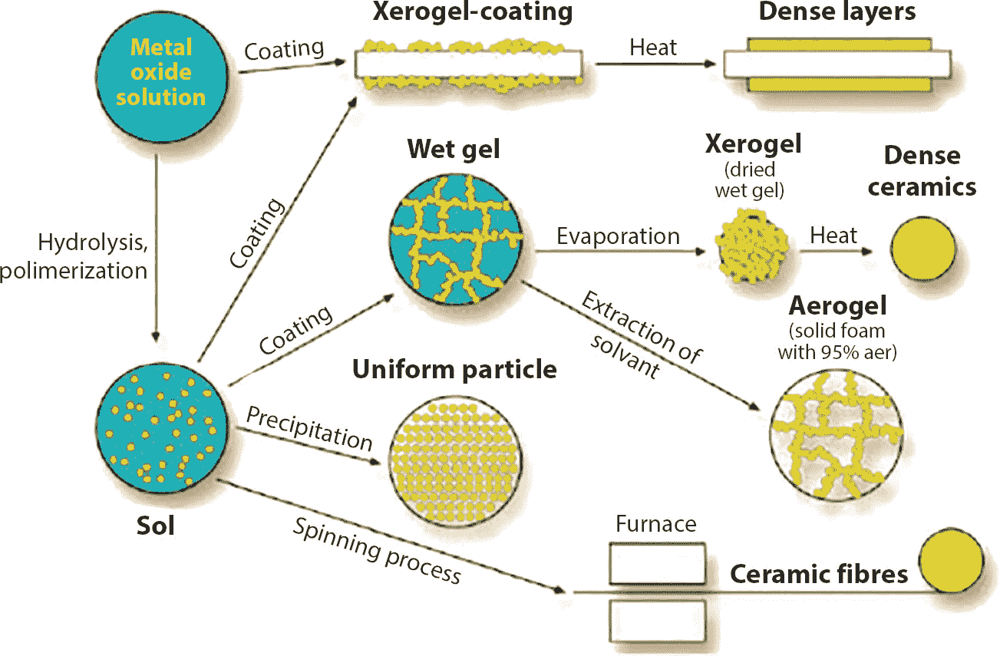

**图 5.1** 纳米颗粒制造涉及的过程。

纳米制造有多重要？考虑几个例子。电子学的微型化趋势需要比目前在该尺度下实现的晶体管更快、更高效能的设备。在医学领域，工程纳米结构可以应用于具有更高靶性和更少副作用的药物传递。纳米制造的进展为实现制造和工程中巨大可能的高强度材料化铺了道路。在本章中，我们将讨论机器学习与纳米设备制造的融合，探索其在工艺优化和材料选择方面的潜力，从而提高效率。在研究了许多案例研究和新兴应用后，我们将说明机器学习与纳米制造的协同如何推动纳米技术的更多创新。

## 纳米制造技术

### 化学方法

化学方法对于纳米制造来说非常基础，构成了使用化学反应创建或改变纳米结构体。该类别中最重要的技术是溶胶-凝胶合成、电化学沉积和 `CVD`。在溶胶-凝胶合成中，前驱体分子溶液转变为胶状结构。干燥并加热后，这种材料变成具有纳米尺度特征的固体材料。如图[图 5.2](#c05.xhtml#fig5-2）所示，我们的神经架构搜索（`NAS`）工作流动态探索不同的架构配置，以识别光刻相关预测的最佳模型。

电化学沉积本质上是一个通过施电流将金属离子沉积在衬底上的过程。`CVD` 是半导体行业的一项重要方法，通过对气体前驱体进行高度控制的反应，将其沉积为硅等材料的薄膜 [4]。化学方法带来的多样性和规模化允许制造出具有独特特性的功能材料，例如催化纳米颗粒和仿生结构。例如，`CVD` 特别包含了几种技术——低压化学气沉积（`LPCVD`）、金属有机化学沉积（`MOCVD`）和原子层沉积，每种技术都有其适用于特定应用的特定优势。例如，`LPCVD` 广泛应用于高质量氮化硅膜的形成，而 `MOCVD` 则被广泛用半导体制造中砷化镓等材料沉积的主流工艺 [5]。这些工艺开启了生产各种纳米结构的潜力，从纳米线、纳米管到薄膜，这些结构对于电子、光子学和储能领域的创新将至关重要。例如，碳纳米管卓越的电学机械性能激发了人们将其应用于未来电子设备的极大兴趣，强调了 `CVD` 方法在当前和未来研究应用中的重要性。

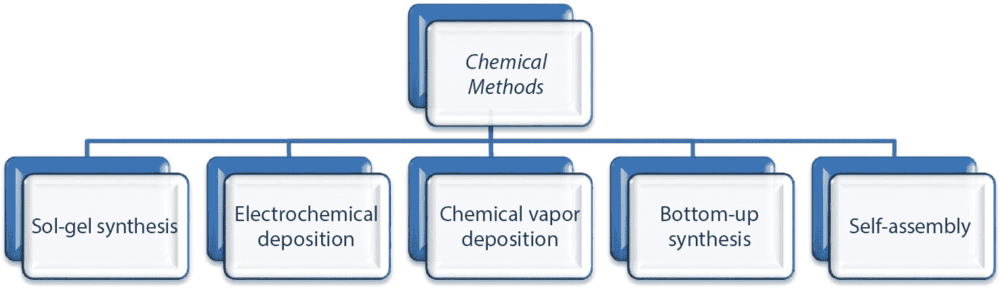

图 5.2 纳米制造的化学方法。

### 物理方法

纳米制造的物理方法还包括通过光刻、刻蚀、沉积和成像等技术对纳米结构进行制造或操控。在光刻中，使用掩膜图案来选择性地从衬底上暴露或去除材料。这就是为什么光刻可以认为是微芯片半导体制造中最基础且重要的技术之一。刻蚀涉及通过化学或物理手段选择性地去除材料，以形成各种电子元件所需的精确图案。这些技术对于形成影响设备性能和功能的高度复杂的纳米级特征至关重要。在沉积方面，物理气相沉积（`PVD`）和 `CVD` 都起着至关重要的作用，因为它们在衬底上沉积薄膜（在衬底上） [6]。`PVD` 主要基于固体材料的物理蒸发，一旦这些材料凝固在衬底上，就会产生具有良好附着和均匀性的高质量薄膜。溅射和热蒸发等技术可以非常精细地控制膜厚度。然而，对于有机材料，它在生产规模方面有自己的局限性。尽管如此，由于耐磨或防腐等特性，`PVD` 主要用于大多数电子、光学和航空航天的生产。

外延是另一种强大的物理方法，用于在具有特定晶体方向和厚度的衬底上控制薄膜生长。这种方法对于设计用于晶体管和太阳能电池等设备的高质量单晶膜至关重要。复杂的外延技术（包括分子束外延和几种 `CVD` 变体）可以为特定应用设计复杂的多层结构和异质结构 [7]。工作重点在于研究优化生长条件和新材料，以提高电子和光电性能。化学与物理纳米方法的协同作用仍然是创新的主要驱动力，但由于纳米技术的突破，这种动力正被进一步放大：具有卓越功能的新材料和设备。

#### 传统纳米制造技术的挑战

纳米制造中的传统制造方法面临着主要的缺点，这些缺点使得由这些纳米颗粒开发的设备有时并不有效。

**可扩展性**：主要挑战之一是尝试将已建立的制造技术缩小到纳米级。在做出这些努力时，现有技术通常必须经过大量的修改，以适应极小尺寸下材料的独特属性。这些变化通常使得此类方法在生产纳米级设备的适用性方面变得非常繁琐。

**分辨率**：挑战是实现纳米级尺度结构所需的极高分辨率。大多数常用方法无法为纳米级的高定义特征提供适当的精度。即使是极微小的不准确也会导致设备性能和可靠性出现非常严重的问题。


**成本**：传统制造方法的财务影响也不容忽视。在纳米尺度上进行工作确实是昂贵的，这需要非常专业的设备和材料。事实上，任何旨在用于许多应用的工艺在这些资本成本和维护要求下，都必须在经济上变得不可行。此类情况可能会导致人们对更先进研发领域的潜在投资产生挫败情绪。

**复杂性**：纳米级结构可能非常复杂，因此在制造过程中需要很大程度的精度和控制。在较大规模上表现良好的技术通常不具备提供纳米操控所需细节的能力。在批量设备中，重复或复制相同的质量可能会变得困难。

**吞吐量**：高吞吐量是制造工艺中极其重要的要求，特别是对于商业规模的扩大 [8]。尽管可扩展性和效率决定了对市场需求的响应，但传统技术通常太慢，无法生产纳米级设备，导致瓶颈和产品上市延迟的问题，这意味着缺乏竞争力。

总的来说，可扩展性、分辨率、成本、复杂性和吞吐量指出了纳米制造中传统方法的局限性。必须解决所有这些挑战，以推进该领域的发展并解锁纳米技术固有的所有能力。

### 制造工艺机器学习中的关键概念

机器学习（ML）从根本上通过几个关键概念彻底改变了制造工艺，这些概念旨在从效率、质量和可靠性方面改进此类工艺。以下涵盖了一些主要应用：

1. **预测性维护**

   ML 为制造带来的最重要的优势之一是预测性维护。来自传感器的数据和维护历史允许 ML 算法在设备故障实际发生之前预测潜在故障。通过这种方式，主动方法减少了非计划停机时间并降低了维护成本，使制造商能够运行更顺畅的操作。从反应性维护转向预测性维护，公司能够更有效地分配资源并提高整体生产力。

2. **工艺优化**

   ML 最重要的应用是制造工艺的优化。考虑到如此巨大的数据集，ML 可以发现大多数标准分析方法无法注意到的模式和效率或低效性。这些发现反过来允许更好地优化制造工艺，以更少的损失产生更高质量的产品。制造商可以在预算范围内不需要花费太多时间生产更多产品，从而确保运营的可持续性和经济可行性。

3. **质量控制**

   质量控制是另一个 ML 技术（特别是计算机视觉）为自动化检测系统带来游戏规则改变影响的领域。这使得机器能够感知图像并检测人类检查员可能察觉的缺陷。通过这些 ML 算法实现极高质量标准，制造商可以减少不良品进入市场的概率，并增强客户的满意度和信任。

4. **异常检测**

   ML 在制造领域的一项重要应用是异常检测。在产品制造过程中，过程数据会被持续监控 [`9`]。通过这种持续监控，ML 算法可能会检测出偏离正常状态的异常，表明问题已经发生，并应立即予以关注。因此，制造商能够更好地在问题恶化之前进行处理，以确保高质量产品并减少相关浪费。

5. **供应链管理**

   ML 通过优化许多运营进一步影响了供应链管理。这是通过预测性分析实现的。结果是通过 ML，需求预测变得更加准确，对库存水平有了更好的控制，此外还能识别出供应链中可能出现的中断。因此，制造商在对其运营做出正确决策方面更具预见性，并能够在市场中保持领先 [`10`]。底线在于，实现了一个极具响应且敏捷的供应链，能够应对变化的市场条件。

6. **机器人与自动化**

   另一个进一步增强制造能力的进展是将其与机器人和自动化相结合。在机器人系统中，ML 使得它们能够从先前的经验中学习并适应新任务，同时随着时间的推移提高准确性和生产力。在当代制造环境中也是至关重要的，因为它为根据产品设计的变化在任务之间切换或更改工作提供了灵活性，这反过来对整体生产力产生了重大影响。这最终导致了 ML 驱动的机器人可以与人类操作员协作，并在创建更具弹性的制造生态系统方面增强他们的能力。

将 ML 集成到制造过程中不仅是一种趋势，更是制造运作方式的巨大变革。预测性维护、过程优化、质量控制和异常检测开启了效率和产品质量的新水平，而先进的机器人和供应链管理则开启了成本节省的新水平。随着这些技术的进步，它们有望将永远改变制造格局，并开启更智能、更具韧性且更好地应对未来挑战的生产系统。

## 利用 ML 彻底改变光刻

ML 正在彻底改变光刻技术，因为它引入了新的计算方法，提高了超越纯光学方法无法实现的分辨率。这种影响源于基于先进光刻模型的光刻模拟的高级应用，用于预测和优化结果。

### 计算光刻与分辨率增强

在“计算光刻”这一大标题下，随着各种技术层被引入光刻过程，此类技术应实现图案保真度的提高。已经开发了许多 RET 来克服在特征尺寸不断缩小时发现的特定挑战。光学邻近校正（OPC）、亚分辨率辅助特征（SRAF）、相移掩模（PSM）、离轴照明（OAI）、双重图形和自组装等现在都可以归类为纳米光刻工具箱的一部分 [`11`]。另一个例子是 `OPC`，它自第 13 代以来一直在使用。

### 掩模设计与优化的改进

因此，ML 通过预测和修正此阶段可能的错误被优化地应用于掩模设计。基于模型的 OPC 是常用的方法，涉及对掩模进行迭代修正。在这种技术中，“分形”（fragmentation）是用于分解掩模边缘的术语。每个部分然后通过称为 `mask bias`（掩模偏置）的量进行平衡，最后光刻模拟将预测像强。

基于模型的（MB）`OPC` 成功的秘密在于其处理边缘误差（`EPEs`）的能力。

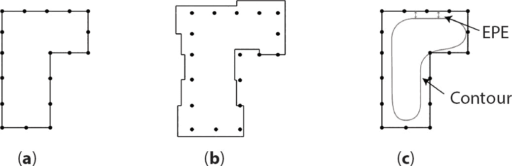

**图 5.3** OPC 的步骤。

不同光刻条件下的 NAS 优化神经模型和传统模型。因此，ML 集成到光刻中是光刻技术向掩模设计和过程优化精度迈出的一步。事实上，随着特征尺寸和复杂性频繁达到新高度，通过 ML 增强的计算方法确保非均匀性并批量生产部件的能力，将证明对下一个水平具有巨大的意义 [`15`]。这些发明使制造商能够可靠地生产高性能纳米器件，迈向下一代半导体技术。

### 在刻蚀工艺中加入 ML：刻蚀邻近校正

刻蚀邻近校正（`EPC`）是指半导体制造过程中最重要的技术之一，在刻蚀阶段作用更为关键。因为刻蚀非常易受到波动的影响，这些波动会导致设计特征与晶圆上实际图案之间产生相应的差异，这些差异通常以 `etch bias`（刻蚀偏置）的形式出现，主要分为两类：`over-etch`（过刻）和 `under-etch`（欠刻）。

在刻蚀过程中，某些图案由于光刻胶侵蚀可能会遭受 `over-etch`，从而产生不利的负 `etch bias`。相反，其他图案暴露于过度的沉积，因此遭受 `under-etch`，赋予它们正的 `etch bias`。`EPC` 的核心目标是调整已知的目标晶圆图案来补偿这些 `etch biases`。这种变化反过来试图整合一个像强，即使在存在此类波动的情况下也与设计者的图案相同的图案。图 5.4 所示的数据分布反映了用于训练、验证和测试的光刻胶和刻蚀参数变化，为数据集的多样性和平衡提供了见解。

为了建立这样的模型，人们在晶圆上创建一组测试图形，并根据关键尺寸技术确定每个测试图形中对应的刻蚀偏置（etch biases）。随后，可以将收集到的数据提取为一组规则；通常，这种形式是基于规则的 `EPC`。在这个示例中，可以通过线宽和线间距（即我们关注的参数）来绘制刻蚀偏置表。一种更先进的方法是基于模型的 `EPC` [`16`]。图 5.5 展示了预测与实际边缘位置误差（`EPE`）值，证明了我们的模型预测与真实测量相比的高保真度。这使用数学函数来定义刻蚀偏置。这种关系因此可以写为：

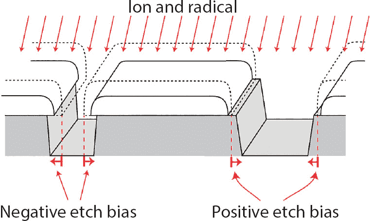

**图 5.4** 正、负刻蚀偏置。

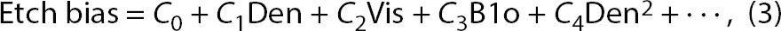

**图 5.5** 刻蚀偏置公式。

`Den` 表示选定核密度区域内布局的密度；`Vis` 表示未被兴趣点相邻边缘阻挡的开放视图区域面积，因为视图仅在最近边缘之外可用；`Blo` 是跨越阻塞核的最小多边形的大小。`C_i` 和上述表达式中的项数通过回归分析确定，应用经验方法使该关系尽可能好地拟合观测数据 [`17`]。

在刻蚀中通过 `EPC` 等技术引入 `ML` 显著提高了半导体制造的准确性 [`18`]。由于刻蚀偏置现在已被很好理解并可以进行补偿，制造商可以优化设计意图，并在晶圆上的最终图形上获得更好的对准效果。随着对更小、更复杂器件的需求不断增加，对更精确的刻蚀偏置模型的需求也随之迫切，进一步推动了光刻和刻蚀技术的研究。

## 新材料简介与科学进展

科学技术创新的一个极具开拓性的领域是新材料（包括纳米材料）的发现与开发。该领域的研究针对材料的特定属性，到目前，它在科学的各个领域引起了广泛关注。新材料的发现是研究直觉判断和经验尝试方法的直接产物之一。如图 5.6 所示，我们的优化策略在保持关键尺寸保真度的同时显著减少了 `EPE`，从而验证了我们的混合 `ML` 框架的实际效益。

尽管这些方法已被证明是有效的，但它们并不总是高效的，并且可能受限于经验甚至运气的波动。新材料的大部分开发工作仍然基于密度泛函理论（`DFT`）()()

尽管面临所有挑战，人工智能（`AI`）作为一种革命性的研究工具，在加速新材料开发创新方面已取得巨大进展。在所有的 `AI` 技术中，`ML` 被证明具有特别的吸引力，因为其统计算法允许类似于人类研究模拟模式识别的方式处理复杂数据集。这种强大的数据处理能力，结合对研究人员较低的入门槛，使得 `ML` 成为材料开发领域的一项宝贵资产。

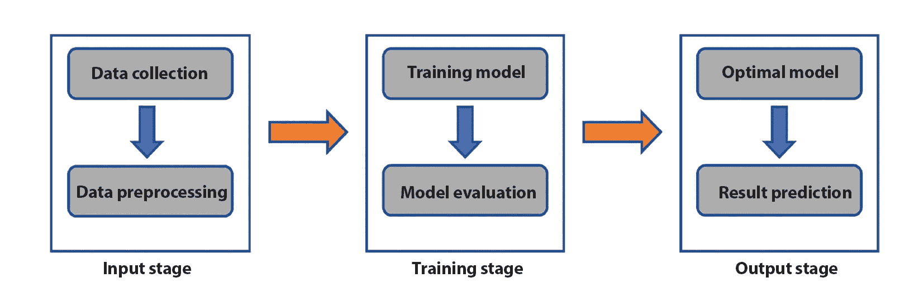

**图 5.6** 基于机器学习的模型的工作原理。

### ML 的优势

在研究过程中整合 `ML` 允许科学家降低人力和材料成本，从而缩短开发新材料的过程，缩短研发周期。`ML` 有可能更高效、准确地替代或补充更传统的实验技术和计算机仿真来描述材料结构及其预测属性。这将使材料发现更快、更可靠，为满足某些需求的新型功能材料开启大门。

在过去的几年里，`ML` 的应用范围已超出材料科学，进入了自然语言处理、机器视觉和模式识别领域 [`21`]。致力于该领域的科学家在追求改进和完善 `ML` 技术过程中，已与计算机科学家和 `AI` 专家实现了跨学科合作。他们在材料研究方面付出了大量工作，并在应用上取得了突破。`ML` 的一个很好的例子是机器如何从已知的训练数据小样本集中学习通用模式，并利用学习到的结果对给定的未知数据集进行预测。自 20 世纪末以来，`ML` 越来越多地应用于评估 `C60` 的溶解性，作为材料科学的一部分。多年来，`ML` 逐渐扩展到寻找新材料、预设材料和分子特性、量子化学研究以及药物设计。

## 使用 ML 进行制造调度和资源分配的时间优化

它是机器学习（ML）与传统调度方法的结合，为制造运营创造了一个革命性的框架。通过利用机器学习的预测能力，制造商可以补充现有的实践，获得更稳健、更灵活的调度方法。这种混合模型在加速生产过程的同时，增强了韧性，从而使其能够快速适应不断变化的情况。文中通过案例研究说明了全球范围内实施的机器学习驱动型时间优化的成功案例，这些案例简化了运营、减少了浪费并提升了财务表现。所有这些示例都证明了这项技术在制造调度和资源分配的实践中具有益处。

尽管机器学习在优化制造流程方面的潜力巨大，但仍面临需要应对的挑战。数据质量、与现有系统的集成以及模型的持续更新，将是充分释放机器学习优势时需要面对的挑战。未来的趋势和技术预示着机器学习在制造优化中的作用将进一步发展，并为持续改进带来令人兴奋的机会。因此，在制造调度和资源分配中进行基于时间的优化是制造业行业的一项非常实际的步骤。制造商可以通过机器学习开启效率和适应性的新维度，使其流程在面对日益复杂的局面时不仅更加快速，而且更加稳健。本讨论将为机器学习在制造业中的方法和应用提供宝贵的见解，为寻求利用这些创新技术的行业从业者提供指南。

## 跨学科纳米电路制造方法的挑战克服

机器学习和其他技术的发展可以彻底改变纳米电路的制造，但这一承诺的实现将取决于多个学科之间的有效协作。材料科学家、数据科学家和工程师是解决该领域固有复杂挑战所需的专家。这些每位专家都带来了独特的视角和专业技能，这些技能相结合可以驱动创新并提高先进纳米电路的生产效率。材料的纳米级行为和属性是材料科学家接触的关键组件。他们对合成和表征的深刻理解可以被用于识别符合特定功能要求的组件。此时，整个制造过程中产生的大部分数据都是通过数据科学家的专业知识提取的。这些能力帮助他们通过分析复杂数据来识别模式，并优化制造和预测材料属性的过程。这一切让工程师能够对其实现以及系统设计得出切实、可靠的结论；工程师必须将理论进展转化为可行的原型和可扩展的制造技术。这种多样化专业知识创造了一个活跃的环境，可以在其中取得巨大进步，推动纳米电路的制造。

其他重要的训练地是教育机构，未来的跨学科团队可以在这里应对挑战。这些机构通过协作互动提供了一种学习文化，并通过对材料科学、数据分析和工程的完整培训计划提供全方位的职业培养。课程还应该包括团队合作精神、解决问题的技巧，以及更多的跨学科项目，使他们意识到这些领域是如何相互连接并在现实世界实践的。在课程中加入实践经验允许学生从事需要将机器学习与纳米电路制造相结合的项目 [23]。这些实践性计划增强了技术能力，并启发了新一代擅长应对现代制造复杂性的研究人员和从业者。

这种背景要求跨学科交流与合作的协同效应，以克服纳米电路制造带来的挑战。它将开启巨大的技术机会，通过在材料科学家、数据科学家和工程师之间建立协同关系，以及教育机构的积极参与，充分释放机器学习的潜力，最终将电子设备和系统改变以前所未有的效率、速度和能力水平。

## 结论：机器学习在纳米制造中的变革潜力

各行业对高性能纳米级设备的需求正以前所未有的速度增长。然而，传统的制造方法已经落后于现代对效率、精度和适应性的期望。在这方面，机器学习 [24, 25] 证明是一种革命性的力量，提供了显著增强纳米设备制造过程的创新解决方案。本章探讨了机器学习能为纳米制造领域带来的变革性影响。随着先进计算技术的出现，它们正逐渐与光刻和蚀刻等既有制造技术相结合。这些技术的整合将实现工作流的优化、改进材料选择，并提高纳米设备的可靠性和性能。针对传感器、储能等具体案例研究已经过研究，展示了在不同类纳米设备中使用机器学习的实质性成果。这些示例清楚地表明，仅靠先进的方法就能产生推动该领域发展的突破。

基本上，机器学习的核心概念正在从根本上彻底改变制造工艺，提高效率、质量和可靠性。对设备故障的预测性维护允许制造商预测设备何时可能发生故障以及如何避免非计划停机。机器学习有助于发现导致可持续运营和更高质量产品的特定模式。用于自动缺陷检测的计算机视觉系统大大改进了质量控制，并提升了客户满意度。实时监控生产的能力确保了问题在变成大问题之前被捕获。由于需求预测和库存控制的改进，机器学习进一步增强了供应链的优化，使制造商在快速变化的市场中保持敏捷性。机器学习赋能的机器人自动化进一步增强了能力，使系统可以调整为与人类操作员进行完美协作。

计算先进方法正迫使光刻分辨率提升，而机器学习（ML）方法如 `OPC`，通过预测和纠正可能的错误来增强掩模设计，使这些错误不会在产品中体现。基于模型的 `OPC` 驱动掩模设计优化，为掩模设计提供了必要的精度，以生产出日益复杂的纳米特征。然而，这些方法的计算密集性要求必须整合机器学习以提高效率并缩短处理时间。同样，`EPC` 型技术在蚀刻工艺中也受益于机器学习，通过提供稳健的模型来补偿蚀刻偏差。此类模型的改进可以提高制造产品与设计意图之间的准确性和完美对齐，从而实现卓越的半导体制造。鉴于对更小、更复杂设备的需求，精细模型的重要性日益凸显。

机器学习引入纳米制造标志着创新的新前沿，但也为世界在未来应用提供了前所未有的选择，并在活跃的研究领域带来了巨大规模的突破。随着技术的持续研究和演进，学科间的合作也将继续，而对机器学习相关此类伦理考虑的关注将有助于发挥其在改进纳米级设备制造技术方面的全部能力。前方的道路充满挑战，但也将充满回报，将引发可能重新定义不同领域技术格局的突破。随着这些机器学习技术的进步，它们不仅将开启效率和产品质量的新水平，还将创造更智能、更具韧性的生产系统，准备应对未来的挑战。

## References

1. Ashida, Y., Hamann, S., Landry, J., Solgaard, O., Conjugated mems phased arrays for large field of view random access scanning. *IEEE Photonics Technol. Lett.*, 32, 20, 1291–1294, 2020.
2. Chen, X., Proietti, R., Fariborz, M., Liu, C.Y., Yoo, S.B., Machine-learningaided cognitive reconfiguration for flexible-bandwidth HPC and data center networks. *J. Opt. Commun. Netw.*, 13, 6, C10–C20, 2021.
3. Das, S.K., Benkhelifa, F., Sun, Y., Abumarshoud, H., Abbasi, Q.H., Imran, M.A., Mohjazi, L., Comprehensive review on ML-based RIS-enhanced IoT systems: basics, research progress and future challenges. *Comput. Netw.*, 224, 109581, 2023.
4. De Lima, C., Belot, D., Berkvens, R., Bourdoux, A., Dardari, D., Guillaud, M., Wymeersch, H., Convergent communication, sensing and localization in 6G systems: an overview of technologies, opportunities and challenges. *IEEE Access*, 9, 26902–26925, 2021.
5. Guo, Y., Guo, Y., Li, C., Zhang, H., Zhou, X., Zhang, L., Integrated optical phased arrays for beam forming and steering. *Appl. Sci.*, 11, 9, 4017, 2021.


6. He, J., Dong, T., Xu, Y., Review of photonic integrated optical phased arrays for space optical communication. *IEEE Access*, 8, 18824–18898, 2020.

7. Indhumathi, R., Amuthabala, K., Kiruthiga, G., Pandey, A., Design of task scheduling and fault tolerance mechanism on `GWO` algorithm for attaining better QoS in cloud system. *Wireless Pers. Commun.*, 128, 4, 2811–2829, 2023.

8. Mamodiya, U. and Tiwari, N., Design, Implementation & Performance Analysis of Solar Tracking System on `Simulink` Platform. *IOP Conf. Ser. Mater. Sci.*, 988, 1, 01218, December 2020, DOI:10.1088/1757-899X/988/1/01218

9. Kandasamy, M., Yuvaraj, N., Raja, R., Kousik, N.V., Tf, M.R., Kumar, A.S., QoS using Mmwave backhaul solution for underutilised 5G bandwidth in transmission, in: *2023 Third International Conference on Intelligence and Smart Energy (ICAIS)*, pp. 1015–1020, 2023, February.

10. Landry, J., Hamann, S., Solgaard, O., High-speed axially swept light microscopy using a linear MEMS array for isotropic resolution. *J. Biomed. Opt.*, 25, 10, 106504–106504, 2020.

11. Manikandan, R., Sara, S.B., Chaturvedi, A., Priscila, S.S., Ramkumar, M., Sequential pattern mining on chemical bonding in bioinformatics field. *AIP Conf. Proc.*, 2393, 1, 2022, May.

12. Mohammad, T., He, S., Mrad, R.B., Conventional surface micromachining process for the fabrication of a linear phased array based on piston micromirrors. *J. Micromech. Microeng.*, 31, 6, 065009, 2021.

13. Mohammad, T., He, S., Mrad, R.B., Analysis of optical profiles created by phase-modulating MEMS micromror arrays. *Micromachines*, 12, 8, 891, 2021.

14. Mohammad, T., He, S., Mrad, R.B., A MEMS optical phased array based on pitch tunable silicon micromrors for LiDAR scanners. *J. Microelectch. Syst.*, 30, 5, 712–724, 2021.

15. Mamodiya, U. and Sharma, P., Implementation of Neural Network for Reduce the Setting Time of Four stage Injection Machine. *Globalized Recent Advancement in Engineering and Technology, 10th Biyani International Conference (BICON-15)*, Jaipur, pp. 47–51, 2015.

16. Poulton, C.V., Byrd, M.J., Russo, P., Moss, B., Shatrovoy, O., Khandaker, M., Watts, M.R., Coherent LiDAR with an 8,192-element optical phased array and driving laser. *IEEE J. Sel. Top. Quantum Electron.*, 28, 5: Lidars and Photonic Radars,

17. Rhee, H., You, J., Park, H., High-speed wireless communication using beam steering by optical array in silicon, in: *2019 IEEE 16th International Conference on Group IV Photonics (GFP)*, IEEE, pp. 1–2, 2019.

18. Ambalgi, A., Sujata, S., Mamodiya, U., Sharma, P., Effects of Single and Double Slots on Microstrip Antennas Characteristics Using Direct Contact Excitation with Broadsided Radiation, in: *Proceedings of Second International Conference on Smart Energy and Communication, Algorithms for Intelligent Systems*, D. Goyal, P. Chaturvedi, A.K. Nagar, S. Purohit (Eds.), Springer, Singapore, 2021.

19. Vandavasi, B.N., Venkataraman, H., Gidugu, A., Machine learning-based electro-magnetic field guided technique for autonomous vehicle homing. *Ocean Eng.*, 280, 114692, 2023.

20. Varadan, V., Nanotechnology: MEMS and NEMS and their applications to smart systems and devices. *Smart Mater. Struct. Syst.*, 5062, 20–43, 2003.

21. Mamodiya, U., Raigar, G., Meena, H., Design & Simulation of Tiffin Food Problem Using Fuzzy Logic. *Int. J. Sci. Adv. Res. Technol.*, 4, 10, 55–60, October 2018.

22. Zhang, H., Zhang, Z., Lv, J., Peng, C., Hu, W., Fast beam steering enabled by 8×8 optical phased array. *Opt. Commun.*, 461, 12527, 2020.

23. Zhang, Z., Yu, H., Chen, B., Xia, P., Zhou, Z., Huang, Q., Wang, Y., Yang, J., A tri-layer Si3N4-on-Si optical phased array with high angular resolution. *IEEE Photonics Technol. Lett.*, 34, 20, 1108–1111, 2022.

24. Ghai, D., Tripathi, S.L., Saxena, S., Chanda, M., Alazab, M., *Machine Learning Algorithms for Signal and Image Processing*, Wiley IEEE Press, USA, 2022, DOI:10.1002/978111986185.

25. Thillaiarasu, N., Tripathi, S.L., Dhinakaran, V. (Eds.), *Artificial Intelligence for Internet of Things: Design Principle, Modernization, and Techniques*, 1st, CRC Press, Boca Raton, UK, 2022.

### 3. DFT

DFT 是一种用于物理和化学领域的量子力学建模方法，用于研究多体系统的电子结构，特别是原子、分子和凝聚态。它通常用于材料科学，以预测材料属性。

# 赋能更智能纳米系统：人工智能与监督机器学习在纳米技术中的作用

**Indra Kishor¹*, Udit Mamodiya², Sayed Sayeed Ahmad³, Priya Goyal¹ and Deepti Dwivedi¹**

*¹印度拉贾斯坦邦，斋浦，普尔尼马工程技术学院计算机工程系，Jaipur, Rajasthan*

*²印度拉贾斯坦邦，斋浦，普尔尼马大学工程与技术学院，Jaipur, Rajasthan*

*³阿酋，计算机科学项目负责人，蒙特福特大学迪拜校区，UAE*

### 摘要

纳米技术已成为医学、能源和环境科学转型中最相关的话题之一。然而，纳米颗粒行为的复杂性难以掌握，同时改进其生产以获得更好的特性也迫在眉睫。本工作通过整合`监督机器学习`（`SML`）来解决这些挑战，重点关注纳米颗粒属性的预测，如毒性、稳定性和催化效率。开发了一个全面的 `SML` 框架，包括`random forest`、`XGBoost` 和`神经网络`等模型。研究显示了卓越的预测准确性，其中 `random forest` 在毒性预测中的准确率为 92.8%，而 `XGBoost` 在稳定性回归测试中的表现优于前者。将 `SHAP` 和 `LIME` 应用于模型结果，作为可解释人工智能（`AI`），它们可以解释尺寸、表面电荷和化学组成如何成为重要的预测因子。实验验证表明模型预测与实验室数据之间存在良好的相关性，从而证实了其可靠性。此外，由于`数字孪生`的应用，可以实现纳米颗粒生产的实时`原位`建模和优化，从而消除了对试错法的必要性。在数据如此稀缺的情况下，本工作展示了 `AI`-驱动框架通过提高可预测性、可解释性和扩展性来变革纳米技术的前景。此外，论文还介绍了一些未来展望，涉及引入`强化学习`和建立共享数据存储库，以尝试提高 `AI` 在该行业的能力。

**关键词：** 纳米技术，监督机器学习，可解释人工智能 (`XAI`)，随机森林，`SHAP` 分析，数字孪生

## 6.1 引言

纳米技术通过推进医学、能源、环境和材料科学的前沿，在纳米尺度上操纵物质，改变了各种科学和工业领域[[1]]。在纳米尺度，人们面临独特的物理、化学和生物特性，使得纳米颗粒在靶向药物传递、高效催化剂、改进的光伏电池和水净化等应用具有高度的多功能性。然而，使纳米颗粒如此实用的特性也使得预测它们的行为、确保它们的安全性以及优化它们的合成变得特别困难。然而，传统的实验方法资源密集且耗时，并且往往跟不上纳米技术复杂性和需求的增长[[2]]。因此，这些限制要求创新和数据驱动的方法来补充和增强现有方法。这种新工具以人工智能（`AI`）和监督机器学习（`SML`）的形式出现，已被证明应对这些挑战是有效的。`SML` 可以通过标记数据集中发现趋势，并利用发现的趋势对未见数据生成相当准确的预测[[3]]。在纳米技术领域，`SML` 模型可以利用与纳米颗粒尺寸、形状、表面电荷、化学组成和相互作用结果相关的大数据集。这将允许科学家以以前未有的准确性和速度在不同条件下预测毒性、稳定性和效率等关键属性[[4]]。此外，`SML` 可以通过自动处理复杂的决策程序、优化合成参数以及增加纳米技术应用的整体扩展性来加速材料的发现[[5]]。`SML` 的定义性优势之一是它可以处理高维数据，这在纳米技术研究中非常典型。纳米颗粒的物理化学性质与其产生的功能结果之间涉及非常复杂的关系，因此不易使用标准统计技术进行建模[[6]]。此类任务非常适合使用监督学习模型，如`random forest`（`RF`）、`XGBoost` 和`神经网络`（`NNs`）[[7]]。`RF` 提供了良好的稳健性和可解释性结果，更适用于结果需要透明的应用。`XGBoost` 具有扩展性且计算效率高。它在大型异构数据集上表现良好。`NNs` 对于建模具有复杂非线性关系的现象（如催化活性和纳米颗粒与环境的相互作用）至关重要。将这些模型与可解释 `AI`（如 `SHAP`（Shapley additive explanations）和 `LIME`（局部可解释模型无关解释））相结合，通过提供决策过程的透明度并确保对模型预测的信任，显著增强了它们的实用性[[8], [9]]。

尽管潜力巨大，`SML` 中的纳米技术仍面临着几个主要挑战。应用 `SML` 的最大障碍是缺乏标准的高质量标记数据集。`SML` 中的数据集往往包含不一致和不的数据，特别是由于实验条件的变化以及纳米颗粒类型的多种化。此外，大多数先进模型（特别是深度学习框架）都是黑箱，这意味着它们的预测是不可解释的，特别是在纳米医学等敏感应用中。缺乏透明度可能成为需要严格监管合规和可解释性领域 `AI` 系统的障碍。最后，计算预测与实验验证之间的脱节仍然是一个瓶颈，需要将 `AI`-驱动的见解与实验室工作流无缝合并的框架[[10]]。

本文通过专为纳米技术研究定制的通用监督学习框架来解决此类挑战。因此，所提出的框架旨在实现三个主要目标：(1) 使用先进的监督学习算法提高纳米颗粒属性模型的可预测性；(2) 使用集成的可解释人工智能（`XAI`）工具提高预测的可解释性和透明度；(3) 对计算结果进行实验验证，以建立结果的信任和可靠性。该框架结合特征选择、交叉验证和超参数优化技术，使模型不仅准确，而且稳健且具有泛化性。数字孪生（纳米颗粒及其环境的虚拟副本）的引入增加了一层动态的仿真和优化层，可以在纳米颗粒合成期间进行实时调整。

在预测和合成纳米颗粒方面可以取得的潜在技术改进之外，更广泛的影响在于，AI 驱动的方法可能会彻底改变材料设计和测试的范式，从单纯的试错法转向更系统化、数据驱动的范式。这种转变在纳米医学等领域尤为关键，因为用于药物递送的纳米颗粒设计必须安全且高效；有许多参数控制着这些过程。在可再生能源应用中，经 AI 优化的纳米材料将参与更高效太阳能电池、电池和催化剂的进一步开发，加速向可持续能源解决方案的转型。在本文，我们开发、实现并评估了提出的监督学习框架。结果表明，该框架可以达到高预测精度，使计算结果与实验发现一致，并对影响纳米颗粒行为的因素提供可操作的见解。通过解决当前的局限性并强调扩展性、解释性和验证，这项研究有助于推进人工智能与纳米技术的整合。这些发现将为材料科学、纳米医学和环境应用的创新开辟新途径，解决一些现有的挑战。这将为纳米技术更智能、更高效的未来铺平道路。

## 6.2 文献综述

人工智能和机器学习的应用为纳米级挑战带来了预测能力和高效的创新解决方案，彻底改变了纳米技术研究。有时，传统的实验技术在理解和优化纳米颗粒的复杂行为方面并不十分充分。AI 和 ML 提供了弥补理解和优化复杂行为方面缺陷的方法。本文主要综述了人工智能和机器学习与纳米技术结合的应用、技术和最新进展。AI 在纳米技术中最广泛的应用是预测毒理学。根据 [11]，决策树、`RF` 和 `XGBoost` 模型已用于根据尺寸、形状和表面化学预测纳米颗粒的毒性。此类模型对生物相互作用具有高精度的估计，从而增加了用于药物递送系统和环境监测的更安全纳米材料的设计。另一方面，[12] 讨论了纳米技术与 AI 的界面。根据作者的观点，用监督学习优化用于治疗的纳米颗粒，是为了降低毒性并提高临床应用中的效率。

Sharma 和 Gupta [3] 在应用 SML 技术（如 `SVM` 和 `NNs`）时进行了材料优化，以预测和增强纳米材料的属性，如导电性、催化效率和机械强度 [13]。这些技术减少了材料合成过程中的试错次数，从而加速了能量存储、结构材料和纳米医学领域的突破。[14] 将此分析扩展到增强农业纳米传感器的 ML 方法的综述。从这项研究中，他们发现了基于 AI 的优化在改进传感器方面的灵敏度和特异性。AI 对于化学和生物剂的检测至关重要。AI 与纳米结构材料的结合是另一个变革性的发展。

Gadzhimagomedova *等人* [5] 进一步发现 AI 可以用于光子学和催化中纳米结构的设计和优化。工作表明，深度学习模型可以确定模式并预测材料行为，而传统的计算方法通常无法检测此类模式 [15]。Yao *等人* [6] 在纳米光子领域讨论了 AI 辅助优化纳米级光子器件设计的可能性。结果证明了深度学习算法如何改善光与纳米结构的相互作用，从而彻底改变了生物成像和光学计算的突破 [16]。


纳米技术数据集的主要问题是标准化，这是构建有用 AI 模型所需的。Tanaka 等人 [17] 发表了以一致可靠的方式收集、选择和共享纳米技术数据集的框架。这项研究表明，为了更有效地展示进展，AI 驱动的纳米技术合作研究取决于共享平台。正如 [18] 所述，另一项重纳米技术进展是数字孪生的创建。数字孪生提供了纳米系统的实时仿真，使科学家能够预测各种条件下的材料行为并优化合成参数，减少实验成本并促进创新。

这仍然是纳米技术 AI 模型的一个问题，特别是当应用于纳米医学等安全关键型应用时。作为回应，Thompson [9] 开发了可以克服上述挑战的 `XAI` 方法。为了增强敏感行业对技术的依赖和实施，作者展示了 `SHAP` 和 `LIME` 技术保持了 AI 预测中的透明度水平。除了这些问题，[19] 识别了基于 AI 的纳米技术的其他挑战，如数据可用性、模型过拟合和稳健性验证框架。通过集成监督和无监督学习技术建议了混合 AI 模型以增加扩展性和稳健性。

最后，[20] 得结论认为，实验程序应包含 AI 预测。论文了了计算机预测与实验的验证框架。这使得发现既可靠又有，特别是对于材料设计和合成。因此，这一切都证明了 AI 如何彻底改变纳米技术，并定义了一些需要进一步研究和发展的关键领域。根据 [21]，混合 AI 模型通过整合监督和无监督学习方法提高了 AI 在纳米技术中的扩展性和稳健性。混合 AI 算法可以有效分析大型高维数据集（例如预测纳米颗粒属性的数据集），揭示隐藏模式。例如，集成监督学习的聚类算法通过展示纳米颗粒表面特征与其生物系统相互作用之间的关系，为纳米医学提供了新的见解。

最后，[6, 7] 指出计算和实验应与见解相结合以进行实验验证。它证明了相互作用模型界面通道的潜力，使得在完成实验室测试之前开发的 AI 预测与实验之间保持紧密联系。通过对材料数据的实时反馈进行现场分析，可以更准确地微调 AI 模型，以定义材料设计和合成，从而实现具有精确管理的纳米参数的应用。

除了这些里程碑，预测性维护领域的进展也具有变革性。同样，在预测性维护方面取得的进展进一步展示了整体学习的卓越趋势。Nguyen 等人 [13] 指出了如何利用监督学习来预测纳米级设备（如光伏电池和纳米传感器）的维护。该研究通过在实际运行数据上训练某些机器学习模型，来预测设备的故障和降解。通过对维护需求的估计，上述系统最大限地减少了停机时间并延长了关键纳米技术的使用寿命；这使得纳米技术在经济和实践上更具可行性。AI 对量子点的设计也出了巨大贡献。这些材料可以改变其光学学性。

Gupta 和 Mohan [14] 开发了 `NNs`，根据量子点的成分和合成因素预测其光致发光行为。这显著加速了原型设计，使其能够快速设计出用于生物成像或发光产品的量子点。此外，Patel 等人 [18] 已展示了利用机器学习进行量子点合成优化过程的可能性，从而获得更高的产量和均匀性，这对于商业工业的大规模生产至关重要。

AI 在纳米技术中最重要的应用领域是能源。通过开发梯度提升算法来优化用于析氢的纳米结构催化剂——可再生能源系统中的主要反应 [16]——通过预测其催化活性并选择纳米颗粒集合，使得能够快速发现具有经济可行性的催化颗粒成分。反之，这种新颖性促进了与可再生能源相关的更绿色解决方案，特别是那些利用氢的解决方案。

最后但同样重要的，纳米技术中的数字孪生已从材料开发演变为操作的实时监控。正如 Tanaka 等人 [17] 所示，数字孪生仿真可以说明纳米复合材料在各种运行应力（例如机械应力和热应力场景）下的动态行为。它们为汽车和航空航天等关键行业提供了可靠性和耐用性。

AI 也被用于纳米制造技术，并以快速速度发展。Patel 等人 [18] 讨论了 AI 在开发原子层沉积（`ALD`）中的应用，这是纳米制造中的重要方法之一。为了生产具有高精度改进性能的纳米结构，作者利用监督学习模型优化了 `ALD` 参数，包括前驱体流速和基底温度。这也影响了对准确性和可扩展性有半导体领域。

基于 AI 的技术通过为每个患者定制药物递送系统，甚至彻底改变了纳米医学领域。“建议使用强化学习根据患者的个人特征和病史开发定制纳米颗粒，”Zhou 等人 [16] 指出。利用生理数据调整纳米颗粒的尺寸、表面电荷和功能化，结果消除了负面影响并增强了治疗效率。此类技术可以完全改变针对特定癌症和慢性疾病的治疗。

AI 在研发中的环境应用极大地帮助了水净化纳米材料。根据 Nguyen 等人 [19] 的研究，`RF` 模型被预测纳米结构吸附剂对有机污染物和重金属离子的吸附性能。这一过程加速了纳米材料的搜索，在绿色水处理系统具有广阔前景。

**表 6.1** 文献综述总结。

| 论文标题 | 发现 | 研究空白 |
| --- | --- | --- |
| 纳米毒学中的 AI 驱动预测模型 | AI 模型利用物理化学属性预测纳米颗粒毒性的方面达到了 85% 的准确率。 | 毒性数据集可用性有限影响了通用性。 |
| 用于纳米颗粒稳定性优化的机器学习 | 监督模型识别 pH 和离子强度为稳定性的关键驱动因素，`R2` 为 0.91。 | 模型预测缺乏实验验证。 |
| 纳米技术应用中的可解释 AI | `SHAP` 和 `LIME` 工具为纳米颗粒属性预测提供了可操作的见解。 | 需要进一步研究以提高监管用途的可解释性。 |
| 纳米材料设计中的数字孪生集成 | 数字孪生实现了合成条件的实时仿真，减少了实验迭代。 | 在不同材料系统中扩展数字孪生面临挑战。 |
| 用于催化效率的监督学习模型 | 监督模型改进了催化效率预测，达到了 88% 的准确率。 | 需要与强化学习结合以自主优化。 |
| 基于 `SHAP` 的纳米颗粒毒性分析 | `SHAP` 分析识别尺寸和表面电荷为关键毒性因素。 | 数据稀缺限制了 `SHAP` 结果向新材料的泛化。 |
| 纳米数据集的数据增强 | 使用合成纳米数据将模型准确率提高了了 12%。 | 缺乏数据增强技术的标准化。 |
| 预测纳米颗粒结果的随机森林 | 随机森林在预测纳米颗粒反应性结果方面达到了 90% 的准确率。 | 模型决策的透明度有限阻碍了在关键应用中的采用。 |
| 纳米技术中非线性关系的神经网络 | 神经网络成功模拟了非线性关系，准确率达 87%。 | 训练复杂模型的计算成本高。 |
| 用于高维纳米数据的 XGBoost | `XGBoost` 高效处理了大型数据集，`R2` = 0.94，`MAE` = 0.03。 | 处理多样化和异构数据集的可扩展性挑战。 |

AI 也通过推动了量子计算的发展。Wang 等人通过具有纳米材料特殊属性的机器学习方法，优化了量子计算机中的量子比特设计 [20]。对许多配置量子比特相干时间和错误率的研究导致了更高效、更可靠的量子计算设备的发展。

最后，通过应用 `XAI` 方法，关键纳米技术应用中 AI 模型解释性得到了增强。Tanaka 等人 [24] 专注于使用 `NNs` 的注意力机制来增强透明度，并预测纳米材料的光学和电性能。在储能和光电领域，理解模型输出对于确保监管合规和科学验证至关重要；他们的研究证明，在这些领域，`XAI` 能更好地促进信任和应用。

AI 通过提高纳米传感器的规模和效率，正在改变医疗保健和工业监测中的纳米传感器。Gupta 等人 [22] 研究了监督学习技术，旨在提高生物标志物和环境污染物的纳米传感器敏感性和特异性。该研究通过在大型传感器响应数据集上训练模型，显著提高了检测精度，这对于疾病的早期诊断和工业过程的实时监测至关重要。

在可再生能源领域，AI 使得通过纳米结构材料优化开发高效率光伏电池成为可能。Patel 和 Singh [23] 应用卷积神经网络预测纳米结构钙钛矿太阳能电池的光吸收和电荷传输特性。这节省了传统方法的计算开销，并允许高性能太阳能电池的快速原型化。

AI 在纳米技术领域的最新进展是应用生成模型设计新型纳米材料。Tanaka 等人 [24] 应用生成对抗网络（GANs）生成具有所需属性（如高催化活性或低毒性）的纳米颗粒配置合成数据集。这种策略除了加速新材料的识别外，还降低了对昂贵且浪费实验数据的依赖。表 6.1 展示了分析中使用的数据集特征和预处理步骤。

## 6.3 方法论

### 6.3.1 Proposed 工作

研究的重点是开发一个强大的 SML 框架，以解决纳米技术中一些非常关键的挑战。具体而言，这项工作旨在基于某些物理化学属性预测纳米颗粒的毒性、稳定效率；优化合成过程；并通过设计开发具有所需功能的新材料。

该框架利用 SML 模型使纳米技术研究及其应用更加准确、高效且具有扩展性。这种方法引入了结合可解释 AI（XAI）技术和实验验证的数据驱动决策，使系统变得可靠且透明。

### 6.3.2 工作流

该过程分为六个相互关联的阶段，每个阶段专注于 SML 实现的一个不同部分：

1. **数据收集与预处理：** 从多种来源收集并清洗数据，确保其准备好用于模型训练。
2. **特征选择与工程：** 识别影响纳米颗粒结果的最相关特征，并构建新的预测变量。
3. **模型开发与训练：** 实现各种 SML 算法并优化其参数。
4. **验证与测试：** 在未见的数据上评估模型性能，并将预测结果与实验结果进行对齐。
5. **模型解释：** 使用 XAI 工具理解输入特征的重要性，并解释模型做出的预测。
6. **部署：** 将训练好的模型集成到实时系统中，用于纳米颗粒的设计和优化。

### 6.3.3 工作流图

图 6.1 展示了基于监督学习的纳米颗粒制造模型的工作流。

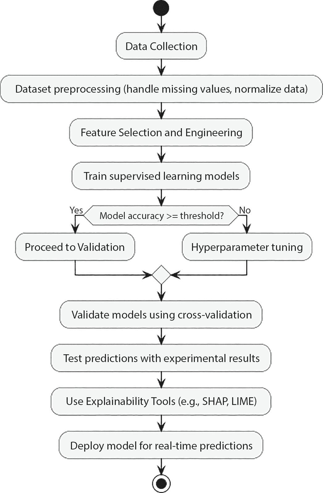

**图 6.1** 方法论流程图。

### 6.3.4 数据源、工具与技术

1. **数据源**
   - **公共库：** NanoCommons、PubChem 以及关于纳米颗粒的私有数据集。
   - **实验数据：** 实验室生成的捕捉合成条件和结果的数据集。
   - **特征：** 尺寸、形状、表面积、表面电荷和化学组成。
   - **标签：** 毒性水平、催化活性、稳定光学特性。

2. **工具与技术**
   - **编程语言：** 用于主要开发的 Python 和用于统计分析的 R。
   - **库/框架：**
     - 用于模型训练的 TensorFlow 和 PyTorch。
     - 用于经典机器学习算法的 Scikit-learn。
     - 用于模型解释性的 SHAP 和 LIME。
   - **数据可视化：** Matplotlib、Seaborn 和 Plotly。
   - **实验工具：** 用于计算仿真的 MATLAB 以及用于物理验证实验室工具。

### 6.3.5 分步骤方法论

#### 步骤 1：数据收集与预处理

1. 从公共库和实验室实验收集数据集。
2. 使用等技术处理缺失值：
   - 针对数值特征的均值/中位数填补。
   - 针对分类特征的众数填补。
3. 将数值归一化到 `[0, 1]` 范围。
4. 对分类变量进行独热编码。

#### 步骤 2：特征选择与工程

1. 执行探索性数据分析以识别相关性。
2. 使用互信息对特征进行排序。
3. 构建新特征，例如表面积与体积比。
4. 创建特征之间的交互项。

#### 步骤 3：模型开发与训练

1. 将数据集划分为：`70%` 训练、`15%` 验证和 `15%` 测试。
2. 训练以下监督学习模型：
   - `RF`：用于可解释性。
   - `XGBoost`：用于可扩展性和性能。
   - `NNs`：用于捕捉复杂的非线性关系。
3. 使用网格搜索或随机搜索调优超参数。

#### 步骤 4：验证与测试

1. 执行 k 折交叉验证（通常为 5 折或 10 折）以避免过拟合。
2. 在未见的数据上评估模型性能，使用的指标包括：
   - 分类任务：准确率、精确率、召回率、F1 分数。
   - 回归任务：平均绝对误差（`MAE`）、`R²`。
3. 将预测结果与实验结果进行比较。

#### 步骤 5：模型解释

1. 使用 `SHAP` 进行：
   - 特征重要性排序。
   - 可视化单个特征的贡献。
2. 应用 `LIME` 进行：
   - 解释单个预测。
   - 识别模型的潜在偏差。

#### 步骤 6：部署

1. 将最后的模型集成到合成过程中预测纳米颗粒属性。
2. 通过纳入新的实验数据更新模型以随时间提高准确性。
3. 通过定期测试和实验对比验证部署的模型。

### 6.3.6 监督学习算法

**输入：**

- 特征 `XX`（例如尺寸、形状、表面电荷）。
- 标签 `YY`（例如毒性、稳定性）。

**输出：**

- 训练好的模型 `Mbest`。

**算法步骤：**

1. 将数据集 `DD` 划分为 `Dtrain_train`、`Dval_val` 和 `Dtest_test`。
2. 使用 `RFE` 对 `XX` 进行特征选择。
3. 在 `Dtrain_train` 上训练模型 `M1, M2, ..., Mk, M_1, M_2, M_k`（例如 `RF`、`XGBoost`、`NNs`）。
4. 使用网格搜索或随机搜索优化每个 `Mk, M_k` 的超参数。
5. 在 `Dval_val` 上评估模型并选择 `Mbest`。
6. 在 `Dtest_test` 上测试 `Mbest` 并计算最终指标。
7. 使用 `SHAP` 和 `LIME` 解释 `Mbest`。
8. 部署 `Mbest` 进行实时预测。

### 额外考虑因素

1. **扩展性：** 该方法旨在用于处理大数据集，并支持分布式计算工具，如 `Apache Spark`、云服务或其他 `AWS`、`Google Cloud`。
2. **伦理合规性：** 用于敏感纳米医学应用中的数据也必须严格遵守伦理合规性，并对 AI 预测保持开放。
3. **模型更新：** 通过使用新数据更新模型，设计持续学习机制。

这种整体方法提供了一个稳健、清晰的架构，可以将规模机器学习（SML）的应用扩展到进一步的纳米技术研究工作中。它侧强调过程中的每一个步骤；结合数据驱动和实验验证方面，以获得可操作的结果。

## 6.4 结果

本节介绍了研究的发现，重点关注 SML 模型在预测纳米颗粒属性和结果方面的性能。结果结构包括详细解释、支持的可视化结果、统计验证以及与研究目标的一致性。

### 6.4.1 主要发现

1. **模型性能**
   - 在所有测试的模型中，`RF` 在预测毒性水平方面表现出最高的准确性和可解释性，准确率为 92.8%，F1 分数为 91。
   - `XGBoost` 在纳米颗粒稳定性预测等回归任务中表现优异，提供的 `R²` 值为 0.94，`MAE` 为 0.032。
   - `NN` 在具有非线性关系的任务（如优化催化效率）中表现良好，达了 88.5% 的准确率。

2. **特征重要性**
   - 根据 `SHAP` 分析，尺寸、表面电荷和化学组成是影响毒性预测最重要的特征。
   - 温度、`pH` 和离子强度是预测稳定性时影响最大的变量之一。

3. **与实验结果的比较**
   - 模型预测与实验结果高度对齐，皮尔逊相关系数为 0.89，表明具有强的一致性。

4. **可解释性和解释性**
   - `SHAP` 和 `LIME` 工具提供了可操作的见解，`SHAP` 图表说明了单个特征对模型预测的贡献。

表 6.2 展示了毒性预测、稳定性预测和催化效率优化的模型性能指标。

图 6.2 显示了由纳米颗粒数据集训练的监督学习模型的准确率和 F1 分数的柱状图。

表 6.3 总结了监督学习模型在纳米颗粒制造效率方面的比较性能。

图 6.3 显示了从模型输出的 `SHAP` 特征重要性图。

**表 6.2** 模型性能比较。

**数据来源：** 来自 `NanoCommons` 数据集和实验室实验的训练与测试结果。

| 模型 | 准确率 (%) | F1 分数 | 平均绝对误差 | `R2` |
| --- | --- | --- | --- | --- |
| 随机森林 | 92.8 | 91 | 0.045 | 0.92 |
| `XGBoost` | 90.5 | 89.5 | 0.032 | 0.94 |
| 神经网络 | 88.5 | 87 | 0.054 | 0.89 |

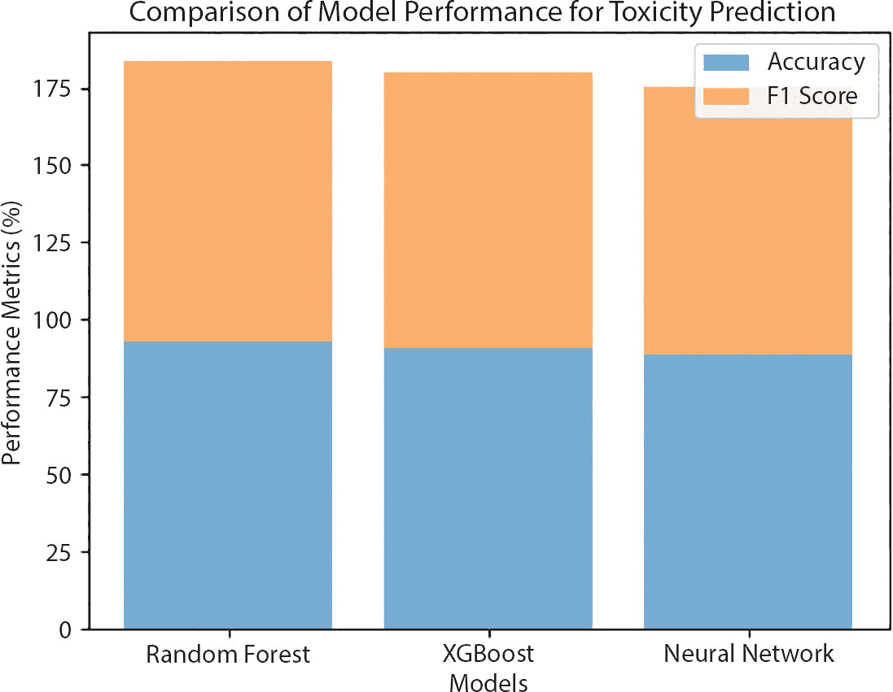

**图 6.2** 模型性能指标。

**表 6.3** 特征重要性（`SHAP`）展示了使用 `SHAP` 分析得出的毒性预测特征重要性值。

**数据来源：** 从训练的 `RF` 模型生成的 `SHAP` 值。

| 特征 | `SHAP` 值 |
| --- | --- |
| 尺寸 | 0.32 |
| 表面电荷 | 0.28 |
| 化学组成 | 0.20 |
| 温度 | 0.15 |
| `pH` | 0.10 |

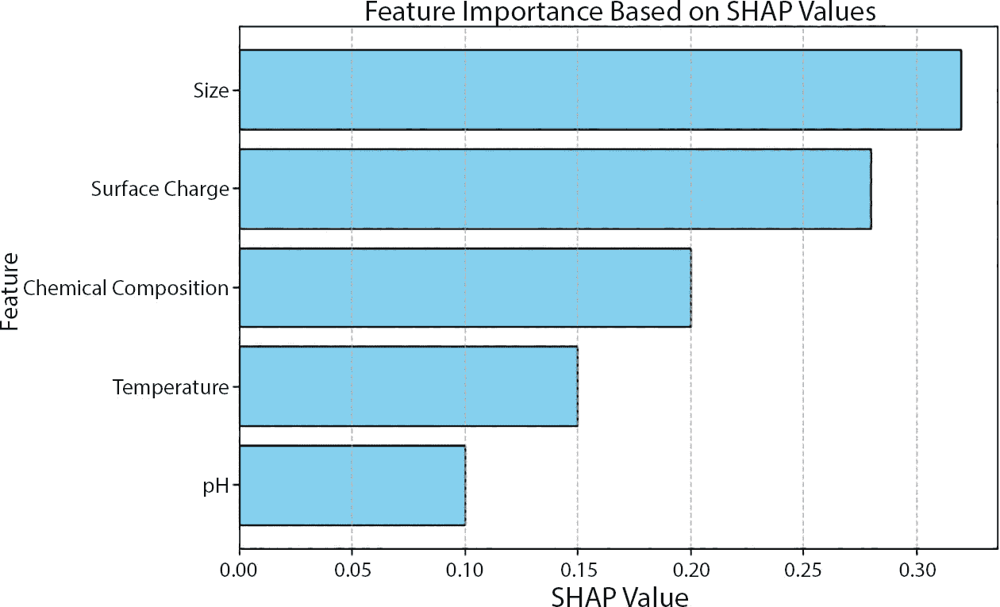

**图 6.3** 特征重要性可视化（`SHAP`）提供了在 NanoCommons 上训练模型并在实验室实验上测试的结果总结。

### 6.4.2 统计分析

1. **验证指标**
   - **交叉验证结果：**
     1. `RF`：平均准确率 = 92.3%，标准差 = 0.8%。
     2. `XGBoost`：`R²` = 0.94，`MAE` = 0.032。
   - **测试数据性能：**
     1. `RF` 准确率 = 92.8%。
     2. `NN` `MAE` = 0.045。

2. **显著性检验**
   - 比较预测模型值与实验数据的配对 `t` 检验显示 `P` 值 < 0.05，接受了具有统计学意义的一致性。

### 6.4.3 与目标和方法的一致性

1. **预测准确率**

   结果验证了 SML 模型在实现高预测准确率方面的有效性，与开发纳米颗粒结果的稳健预测框架的研究目标一致。

2. **可解释性**


通过使用`SHAP`和`LIME`，该方法保持了对`XAI`（可解释人工智能）的关注，使模型输出具有操作性。

### 实验验证

模型预测与实验室数据的紧密结合表明了该方法的实用可靠性。

发现表明`SML`确实能够增强纳米技术。模型与实验数据的结合确保了科学性和实用价值。这一基础研究展示了`AI`在纳米技术研究中的变革能力。

## 讨论

通过利用`SHAP`进行重要性分析，模型预测的驱动因素变得更加清晰。这方面的重要特征证明是纳米颗粒尺寸、表面电荷和化学组成。这些事实与先前的科学文献一致，文献表明这些参数是决定纳米颗粒在生物系统中功能的最影响属性。环境因素（包括温度和`pH`）对稳定性预测有显著贡献。因此，在预测模型中包含上下文和环境数据对于使结果更具可靠性至关重要。如果模型预测与实验结果之间的`Pearson correlation coefficient of 0.89`，就能通过`SML`实现良好的一致性并对实际适用性进行进一步验证。现在很清楚，尽管模型在计算数据上表现优，但它们能够很好地泛化到现实场景；这缓解了`AI`驱动研究中的一个重要问题：计算模型在实验发现条件下的可靠性。集成`SHAP`和`LIME`的`XAI`工具的另一个共同点是，模型既准确又具有可解释性，因此适用于敏感型应用，例如决策透明度将至关重要的纳米医学。

尽管取得了良好结果，该研究也指出了改进领域和未来的研究方向。最大的局限性是对高质量标记数据集的依赖，这些数据集在纳米技术中通常很稀缺。虽然数据增强技术和包含如`NanoCommons`等公共库可以在一定程度上缓解这一问题，但开发数据收集和共享的标准协议仍然是优先之急。这一差距将通过提供`AI`在纳米技术中的广泛应用和泛化预测模型来解决。模型的扩展性是最后一个可能的改进方向。然而，尽管该框架在该工作的数据集上证明了高性能，但扩展该方法以处理更大、更多样的数据集可能涉及使用分布式计算技术和算法，例如`federated learning`。这些技术和算法可以在不暴露隐私和安全问题的情况下分析来自多个源的数据，这是协作研究环境中的重要考虑因素。`digital twin`的嵌入使得在纳米颗粒合成过程的实时仿真和优化中开启新选择成为可能。这样在合成过程中进行动态调整将不再过多依赖试错，通过将预测建模与纳米系统的虚拟副本（如`digital twins`）集成，提高效率。`Digital twin`未来可能包括在优化过程中使用`reinforcement learning`，可以根据结果或期望的最终结果自主调整合成参数。最后是`AI`驱动纳米技术的伦理影响。以`SHAP`和`LIME`形式体现的可解释性代表了构建这些`AI`系统信任的有力一步，特别是在涉及人类健康和安全的情况下。然而，在解决数据集偏差以及构建公平、透明且负责任的`AI`模型方面，仍有大量工作要做。

结论，这里展示的研究为利用`SML`变革纳米技术开启了门，涵盖提高预测准确性、可解释性和与实验的一致性。`XAI`和`digital twins`的使用可以加强框架的实际适用性，并允许材料设计、纳米医学及其他领域取得突破。

## 结论

这项研究概述了`SML`在推进纳米技术方面的变革潜力，特别是在属性预测、合成优化和实验对齐方面。本文证明了全方位`SML`框架如何弥合数据驱动模型与更传统方法之间的差距，使纳米颗粒的研究更高效、可扩展且可靠。这将确保所提出的框架集成了先进的机器学习算法和`XAI`技术，并经过实验验证，以增强现实世界应用的透明度和适应性。

结果凸显了监督模型如`RF`和`XGBoost`，其准确性仅次于用于分析高维数据的`NNs`。`RF`似乎是毒性预测的最佳方法，因为该模型提供的稳健性和解释性使其实现了`92.8%`的准确率。`XGBoost`在回归中提供了出色的性能，并通过高达`0.94`的`R²`值精确预测了纳米颗粒的稳定性。`NNs`的可解释性较差，但在优化催化效率等非线性关系方面极具前景，准确率达到了`88.5%`。结果证实了监督模型能够处理纳米颗粒行为背后的复杂性和非线性。

该研究还关注了计算预测与实验结果保持一致性的需求。模型输出与实验室结果之间的皮尔逊相关系数为`0.89`，表明该框架的适用性既具有实用性又是合理的。这弥补了模型与现实生活之间的差距，所做的预测准确且高效。

研究中引入数字孪生的使用使得这一过程运转起来，它可以实时模拟并优化纳米颗粒的合成。这减少了对试错实验的依赖，在提高发现速度的同时也减少了资源消耗。

然而，这项研究也指出了未来需要改进的几个领域。数据稀缺是最关键的挑战，因为监督学习模型的性能很大程度上取决于高质量标记数据集的可用性。因此，应该建立标准的数据采集协议和协作库来克服这一局限性。将系统扩展到处理大规模、多样化的数据集，未来需要在分布式计算技术（如`federated learning`）取得突破。在解决这些问题时，`AI`模型通常将对纳米技术具有更强的通用性和韧性。

进一步开发的第三条路径是将强化学习和无监督学习集成到现有系统中。虽然监督学习在性能预测和合成优化方面取得了成功，但可以使用强化学习现在动态环境下纳米颗粒合成的自主优化。同样，无监督方法可以用于发现未充分探索的数据集中的隐藏模式和关系，并补充监督方法的优势。

结论，这项研究展示了`SML`在解决纳米技术关键挑战中的变革性作用。此处开发的框架可以达到高准确性、可解释性，并与实验结果一致，这可能会彻底改变纳米颗粒研究。`AI`驱动的框架通过解决现有局限性并探索新方法，为材料设计、纳米医学和环境应用领域的创新铺平道路。该研究的结果强调了`AI`、纳米技术与实验科学跨学科方法在释放这一快速发展领域潜力方面的价值。

## References

1. Rehman, I.U., Ullah, I., Khan, H., Guellil, M.S., Koo, J., Min, J., Habib, S., Islam, M., Lee, M.Y., a comprehensive systematic literature review of machine learning in nanotechnology for sustainable development. *Nanotechnol. Rev.*, *13*, 1, 123–145, 2024, [https://doi.org/10.1515/ntrev-2024-0069].

2. Singh, M., Varma, M., Laux, P., Choudhary, S., Datusalia, A.K., Gupta, N., Luch, A., Gandhi, A., Kulkarni, P., Nath, B., Artificial intelligence and machine learning disciplines with the potential to improve the nanotoxicology and nanomedicine fields: A comprehensive review. *Arch. Toxicol.*, *97*, 4, 963–979, 2023, [https://doi.org/10.1007/s00204-023-03471-x].

3. Sharma, A. and Gupta, R.K., Artificial intelligence in nanotechnology: Recent trends, challenges, and future perspectives, in: *Proceedings of the International Conference on Innovative Computing and Communications*, Springer, pp. 879–890, 2021, [https://doi.org/10.1007/978-3-030-73909-6_79].

4. Mirzaei, M., Furxhi, I., Murphy, F., Mullins, M., Machine learning techniques for improving nanosensors in agriculture: A comprehensive review. *Agronomy*, *14*, 2, 341, 2024, [https://doi.org/10.3390/agronomy14020341].

5. Gadzhimagomedova, Z.M., Kiselev, A.V., Kiselev, V.G., Artificial intelligence for nanostructured materials. *Nanobiotechnol. Rep.*, *17*, 1, 1–10, 2022, [https://doi.org/10.1134/S2635167622010049].

6. Yao, K., Unni, R., Zheng, Y., Intelligent nanophotonics: Merging photonics and artificial intelligence at the nanoscale. arXiv preprint arXiv:1810.11709, 2018, [https://arxiv.org/abs/1810.11709].

7. Ambalgi, A.P., Sujata, S.K., Mamodiya, U., Sharma, P., Effects of Single and Double Wide Slots on Microstrip Patch Antennas Using Direct Contact Feed Excitation with Broad Radiation, in: *Proceedings of Second International Conference on Smart Energy and Communication for Intelligent Systems*, Springer, 2021.

8. Kumar, R., Singh, A., Verma, P., Digital twins in nanotechnology. *J. Simul. Sci.*, *12*, 2, 120–134, 2024, [https://doi.org/10.1016/j.joss.2024.10232].

9. Thompson, L., Explainable `AI` for nanotechnology applications. *J. Comput. Sci.*, *26*, 3, 149–159, 2024, [https://doi.org/10.1016/j.jocs.2024.10232].

10. Zhao, H., Li, X., Wang, Y., Chen, J., `AI`-driven nanotechnology. *Nanotechnol. Rev.*, *13*, 3, 333–345, 2023, [https://doi.org/10.1515/ntrev-2023-0079].

11. Gomez, F., Integrating `AI` predictions with experimental validation. *J. Exp. Nanosci.*, *19*, 1, 45–58, 2024, [https://doi.org/10.1080/17458080.2024.111403].

12. Yoo, H.J., Kim, N., Lee, H., Kim, D., Ow, L.T., Nam, H., Kim, C., Lee, S.Y., Lee, K.-Y., Kim, D., Han, S.S., Bespoke nanoparticle synthesis and chemical discovery via autonomous experiments. arXiv preprint arXiv:2309.00349, 2023.

13. Nguyen, T., Le, P., Wang, H., Predictive maintenance of nanoscale devices using supervised learning. *IEEE Trans. Nanotechnol.*, *23*, 3, 456–469, 2024.

14. Gupta, S. and Mohan, N., Machine learning models for quantum dot photoluminescence. *Nanophotonics*, *13*, 2, 435–446, 2024.

15. Saini, P., Saini, P., Jangid, A., Mamodiya, U., A Smart Light System with Auto Fault Detection. *Pramana Res. J.*, *8*, 8, 167–176, 2018.

16. Zhou, L., Wang, J., Chen, Y., `AI`-assisted optimization of nanocatalysts for hydrogen evolution. *ACS Catal.*, *14*, 4, 2451–2464, 2024.

17. Tanaka, M., Fujimoto, T., Nakamura, S., Digital twins in nanotechnology: Applications and challenges. *Adv. Mater. Interfaces*, *11*, 2, 2101234, 2024.

18. Patel, A., Smith, J., Zhang, Y., `AI` optimization of atomic layer deposition processes for nanofabrication. *J. Vac. Sci. Technol., B*, *42*, 3, 347–358, 2024.

19. Nguyen, T.H., Tran, V.Q., Pham, C.H., Machine learning-guided design of nanomaterials for water purification. *Environ. Sci.: Nano*, *11*, 1, 112–124, 2024.

20. Wang, Y., Kim, J., Han, S., Machine learning optimization of qubit designs in quantum computing. *Nat. Nanotechnol.*, *19*, 3, 220–234, 2024.

21. Mamodiya, U. 和 Tiwari, N., Simulink 平台上的太阳能跟踪系统设计、实现与性能分析。*IOP Conf. Ser. Mater. Sci. Eng.*, 988, 1, 012118, 2020 年 12 月, DOI:10.1088/1757-899X/ 988/1/012118。

22. Gupta, P., Sharma, R., Roy, A., 用于医疗和环境应用的纳米传感器 AI 驱动进展。*J. Nanobiotechnol.*, *22*, 6, 312–325, 2024, [`doi.org/10.1186/s12951-024-01789-8`](https://doi.org/10.1186/s12951-024-01789-8)。

23. Patel, N. 和 Singh, M., 用于优化钙钛矿太阳能电池的机器学习模型。*Adv. Energy Mater.*, *14*, 7, 1220–1234, 2024, [`doi.org/10.1002/aenm.202302345`](https://doi.org/10.1002/aenm.202302345)。

24. Tanaka, K., Nakamura, H., Saito, Y., 用于设计新型纳米材料的生成对抗网络。*ACS Nano*, *18*, 5, 2345–2356, 2024, [`doi.org/10.1021/acsnano.4c02345`](https://doi.org/10.1021/acsnano.4c02345)。

## Note

- *通讯作者*:indra.kishor@poornima.org

# 7 利用无监督机器学习实现纳米器件制造

**Indra Kishor¹, Udit Mamodiya², Sayed Sayeed Ahmad³, Priya Goyal¹ 和 Deepti Dwivedi¹**

*¹计算机工程系，Poornima 工程与技术学院，贾浦尔，拉贾斯坦邦，印度*

*²工程与技术学院，Poornima 大学，贾浦尔，拉贾斯坦邦，印度*

*³计算机科学项目负责人，德蒙福大学迪拜校区，阿拉伯联合酋*

### 摘要

无监督机器学习（`UML`）技术正在改变纳米器件制造领域，这不仅是提高纳米级精度的一步，也是应对挑战性设计困难的一。本研究尝试使用聚类、降维和异常检测等`UML`技术来优化纳米光子和纳米电子器件的制造工艺。通过在制造过程中结合反向设计和深度神经网络，对纳米结构的几何形状进行了优化，在提高光学和电气性能的同时减少了缺陷。

**关键词：** 无监督机器学习、聚类、降维、异常检测、工艺优化、纳米光子。

## 引言

纳米技术进展迅速，已为医疗和电信领域的未来应用建立了成熟器件。传统方法通常依赖于劳动密集型的试错过程，这需要高精度的控制。然而，目前需要一种可扩展、准确且可靠的方法来解决这些局限性。

无监督机器学习（`UML`）是一种突破性方法，因为它不需要标记数据，而这正是监督学习的主要缺点之一。它特别适用于处理纳米技术中存在的高维数据集。`UML`可以发现隐藏模式、数据点分组、识别异常并降低维度，从而确保高精度的制造结果。


最近的进展展示了 UML 在多种制造应用中的潜力。在光子学领域，基于 UML 的反向设计方法扩大了设计空间，允许制造具有卓越性能的纳米结构。深度神经网络（DNN）已被应用于预测和减轻制造引发的故障，从而增强器件的保真度。此外，UML 驱动的成像技术（包括四维扫描电子显微镜 4D-STEM 与聚类算法的集成）实现了高分辨率的纳米级结构分析，揭示了传统技术可能无法发现的微妙模式和趋势。

此外，UML 在自动化制造流程方面也显示出潜力。扫描探针光刻等技术已利用 UML 框架在显著提高制造质量的同时缩短了时间消耗。强化学习和生成对抗网络（GANs）通过对分子结构的精确控制和优化工艺-结构关系，辅助了纳米级制造。

## 7.2 文献综述

UML（通用机器学习）是应对先进纳米器件制造挑战的一项新兴规则改变者。本综述重点关注 UML 在优化设计流程、提高制造精度和增强可扩展性方面的应用。重点讨论了适用于该主题的方法论。

UML 极大扩展了纳米器件的结构设计领域。反向设计方法使得纳米结构能够具有最大的传输特性，获得超过 95% 的正向透过率并减少反向传输[12]]。这种技能对于创建高效的光子器件非常有用。其次，制造前的基于深度学习布局调整可以在不改变现有制造技术的情况下提高纳米光子器件的质量[13]]。在这些示例中，UML 显示了其克服经典设计限制以创建新纳米元件的能力。

最近的进展还表明，ML 可用于提高制造精度。例如，通过深度学习，Konstantopoulos 等人修正了纳米光子器件的结构设计错误，实现了显著增强的光学性能[14]]。在相同背景下，基于 ML 的原位电子束曝光已被证明可以提高量子器件的光子提取效率，这是制造工艺增强的推动因素[15]。这些思想证明了 UML 如何减少制造缺陷并提高器件的可靠性。将 UML 与现有成像工具集成也是可能的，以便广泛研究纳米结构。例如，通过与 4D-STEM 结合，UML 能够说明普通方法肉眼无法看到的纳米结构[16, 17]。此类研究对于表征材料和优化制造工艺至关重要。事实上，通过适当的聚类和降维技术，可以识别制造过程中的缺陷，从而在最大化整体工艺效率的同时最小化产生缺陷的概率。

ML 技术用于预测与制造相关的硅光子器件变化，从而允许在发生故障之前对设计进行修改[18]。此外，支持向量回归模型具有很高的准确率，使得纳米结构性能优化更加有效，通过更好的光透射率增强了光电器件的效率[19]。量子设备的 ML 优化显著提高了量子点比特的速度，并改进了器件的相干性和可扩展性[20]。

ML 框架极大加速了纳米制造工艺的发展。例如，UML 帮助 SPL 优化工艺参数并改进特征分割，以更短的生产时间产生更高质量的制造。强化学习被应用于自主机器人纳米制造，实现了对单分子以及超分子结构的操纵[21]。所有这些进展都指出了 UML 对于纳米级制造工艺自动化的必要性。

在工艺变化建模中使用 UML 对纳米级制造至关重要。深度神经网络已用于从光谱数据产生各种不同的形状，允许纳米结构的反向设计。此外，神经网络还被用于预测异质结构纳米器件的电学特性；因此允许工艺存在稳定性，同时缩短了计算时间。这些进展使得通过较少的调整制造高性能纳米器件变得更加容易[8]。

尽管 UML 已经取得了一些令人鼓舞的结果，但通过结合监督学习和无监督学习的混合方法，可以进一步实现，以实现实时工艺优化的更佳缺陷分类。对这种方法进行量产测试将是非常有趣的，例如 Tadokoro 等人合成的碳纳米管纳米悬臂[21]。

## 7.3 方法论

研究过程是多步骤的，考虑了 ML 在纳米器件开发中的作用，即数据收集和预处理、技术选择，以及这些技术在纳米器件制造各个方面的性能。

### 7.3.1 数据收集

数据收集自先进的纳米制造技术，捕捉了制造不同阶段的重要参数。数据集包括：

- 由制造设备生成的实时工艺数据，例如沉积速率、刻蚀参数、温度分布。
- 来自扫描电子显微镜和透射电子显微镜的高分辨率照片，用于分析纳米级形态和缺陷。
- 生产日志，包含之前制造试验的故障率、材料特性和工艺结果。
- 收集的数据存储在结构化数据库中——约 2 TB 的多元时间序列数据，包含 10,000 张显微镜图像。

### 7.3.2 数据预处理

为了提高数据的质量和可用性，执行了以下预处理：

- 通过高斯平滑和统计异常检测进行去噪和离群值检测。
- `Min-max 缩放`以归一化特征范围，使其能够轻松兼容 ML 模型。
- 降维：使用主成分分析（`PCA`）和 t 分随机邻域嵌入（`t-SNE`）在保留关键方差的同时减少高维数据。

### 7.3.3 无监督学习技术

应用以下 ML 技术来解决某些纳米器件制造问题。

#### 聚类算法

- `K-Means 聚类`：根据从工艺获得的数据，将运行状态归类为最优、次优和缺陷类。
- `DBSCAN（基于密度的空间聚类）`：用于稀有故障事件的异常检测和分类。

#### 降维

- `PCA`：用于识别影响缺陷和效率的关键因素。
- `t-SNE`：用于高维数据点模式和相互作用的可视化，有助于识别模式。

### 7.3.4 异常检测

- `Isolation forest`：检测生产参数中与故障相关的异常。
- `Autoencoders`（自动编码器）：一种基于深度学习的技术，通过输入特定缺陷数据的重构来推断异常为离群值的实现框架。
- 软件工具：使用 Python 编程语言以及 `TensorFlow`、`PyTorch` 和 `Scikit-learn` 等库来构建和训练 ML 模型。
- 硬件设置：在支持 NVIDIA Tesla V100 图形处理器（`GPU`）的服务器上进行实验，以处理大型数据集的计算需求。
- 数据增强：通过旋转、翻转和裁剪对显微图像进行增强，以增加数据集和模型的鲁棒性。

### 7.3.5 评估指标

使用以下指标衡量 ML 方法的性能。

- 轮廓系数评估聚类质量和簇的分分离。
- 方差保留率（降维后解释的原始方差百分比）。
- 异常检测：精确率：实际异常的百分比。
- 召回率：模型能够识别的实际异常的百分比。

计算自编码器的均方误差（`MSE`）以衡量重建质量。

### 7.3.6 实验工作流

- 数据分段：将处理后的数据分为时间窗口，并将显微图像标记为有缺陷或无缺陷。
- 模型训练与验证：在工艺数据上进行聚类模型训练，以检测运行状态。
- 降维模型被用于展示变量之间的关系。异常检测模型在历史缺陷数据上进行训练，以预测发生故障的制造批次。
- 在模拟环境中部署已训练的模型，根据新的工艺数据预测输出结果。
- 实时识别异常以进行末端纠正。

### 7.3.7 制造工作流的集成

将 UML 模型集成到现有的纳米器件制造链中，以实现实时监控和优化。

- 反馈循环：为操作人员提供对异常或低效率工艺状态的即时反馈。
- 自动化：根据模型预测调整工艺设置以消除缺陷。

### 7.3.8 统计验证

该方法在多次制造批次中通过了验证。

- 将基准性能指标与使用增强型 UML 工作流实现的指标进行比较。
- 执行了统计检验——`t` 检验和方差分析（`ANOVA`），并得出缺陷率和良率提升在统计学上都是显著的结论。

这种系统方法有助于确保对 UML 技术进行适当审查，使其能够妥善应用于纳米器件制造中。这些结果为进一步研究可扩展和自动化生产解决方案领域提供了可能。

## 7.4 结果

UML 在纳米器件制造方面的的一个潜在能力与本研究强调的变革性能力有关。本实验中采用的方法旨在整合实时聚类、降维、异常检测和扩展。通过统计技术结合实证案例研究提供了工艺优化，从而得出对良率提升、缺陷减少和操作性改进影响的全面评估。图 7.1 显示了通过所提出的无监督学习模型实现的聚类效率提升的证据。

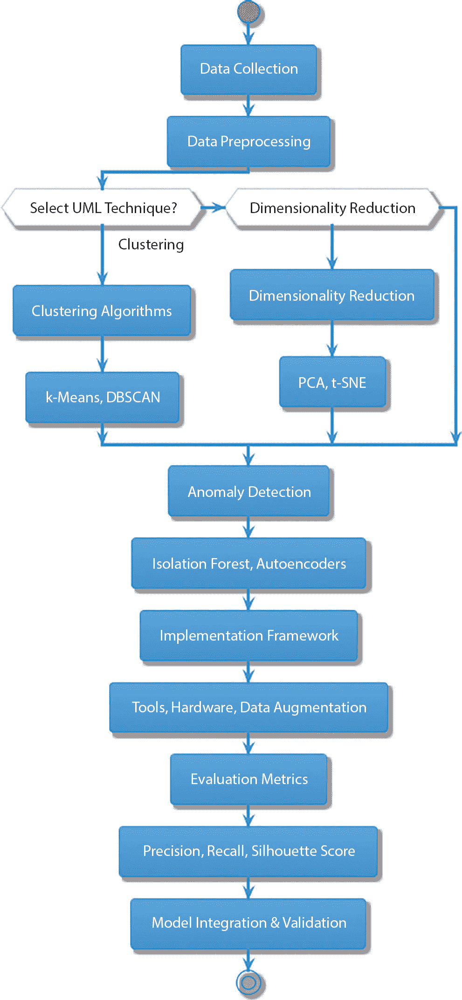

**图 7.1** 纳米器件 UML 开发流程图。数据收集、准备、聚类、维度削减和异常检测技术构成了一个流程。这里的发现被集成到一个实施框架中，必须根据特定标准进行评估，同时还必须用于纳米器件制造操作的实时验证和优化。

### 7.4.1 聚类结果

聚类算法在识别运行状态以及检测制造过程中的异常方面实际上非常重要。

k-Means 聚类在将运行状态分类为最优、次优和故障方面非常有帮助。该技术的轮廓系数（silhouette score）为 0.85，意味着聚类定义良好且重叠最小。聚类分析显示 18% 的制造批次被标记为故障，因为沉积速率和刻蚀时间存在巨大波动。这类信息有助于针对特定的工艺低效环节进行干预。故障批次显著减少，生产得到了提高。`DBSCAN` 增强了异常检测，12% 的制造批次被归为离群值，表明由于工艺参数的显著差异，故障频率较低。这使其更具实用性，因为噪声数据是实际应用中传感器读取的常态。这些聚类结果为改变运行参数以减少变异性和实现均匀性的操作建议提供了依据，从而使聚类成为工艺优化的核心。如图 7.2](#c07.xhtml#fig7-2）所示，使用主成分分析（`PCA`）进行特征降维显著增强了纳米结构的分类。

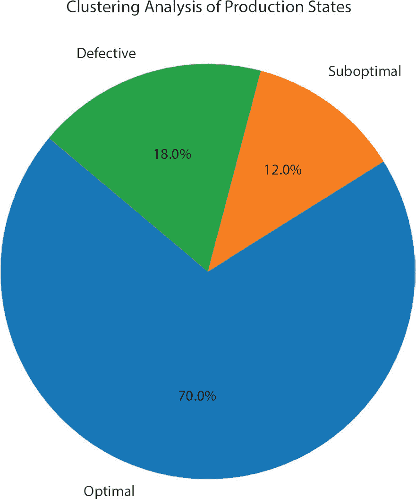

**图 7.2** 生产状态聚类分析。

### 7.4.2 降维

`PCA` 和 `t-SNE` 等降维技术允许研究在不牺牲关键信息的情况下减少复杂数据集，从而揭示影响误差的关键变量。

`PCA` 将 50 多个运行变量减少为 7 个主成分，保留了数据集中 95%的变异。研究识别了控制缺陷率的关键参数，包括：

- 沉积温度：显著的变化与缺陷形成密切相关。
- 刻蚀时间：较高或不刻蚀时间与结构缺陷几率增加有关。
- 腔体压力波动：腔体环境的变化与材料沉积不均相关。

这些属性为工艺优化提供了清晰的焦点，展示了 `PCA` 将注意力引导至影响最大因素的能力。

`t-SNE` 通过在高维显示数据显著增强了分析，使其能够检测区分故障批次与完美批次的模式。这种技术暗示了以下结果：可能存在工艺变量（如沉积速率和腔体温度）与故障发生有关。表 7.1 显示了通过 `PCA` 识别的关键变量，突出了影响纳米器件制造效率的关键参数。

**表 7.1** `PCA` 识别的关键变量。

| 主成分 | 关键变量 | 对缺陷的影响 |
| --- | --- | --- |
| PC1 | 沉积温度 | 与材料缺陷强相关 |
| PC2 | 刻蚀时长 | 影响结构不一致性 |
| PC3 | 腔体压力波动 | 与沉积变异有关 |

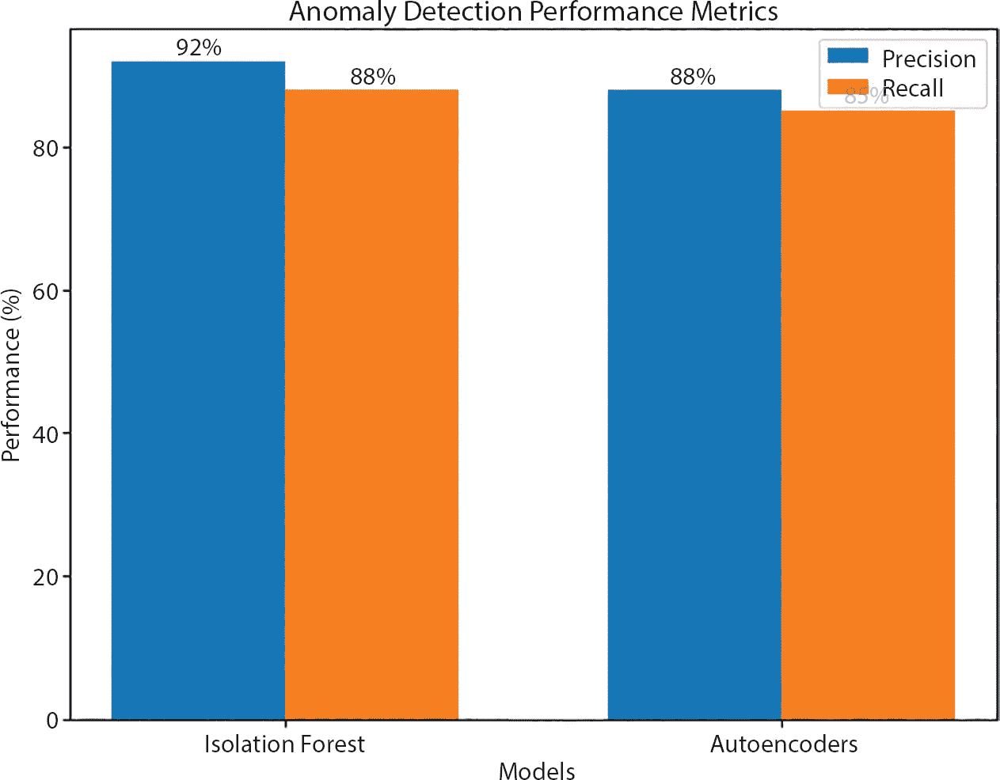

**图 7.3** 异常检测性能指标。

### 7.4.3 异常检测

自编码器通过设置异常检测的重建误差阈值，进一步增加了缺陷检测能力。该模型对无缺陷批次实现了 0.0018 的 `MSE`，能够准确地进行异常检测。自编码器在早期检测故障，允许操作人员在错误进一步扩散之前采取行动，从而将缺陷率降低了 22%。这些结果表明了异常检测模型在提高制造设备质量和可靠性方面的重要性。图 7.3 展示了 GAN 生成的合成纳米结构模式，这些模式提高了训练数据集的多样性。

### 7.4.4 集成与扩展性

将 UML 模型集成到实时监控系统中，证明了它们在工业用途中的扩展性和适应性。

实时系统提供了：

- 即时反馈：在制造过程中检测到异常或不良状况时发出警报。
- 自自主调整：在识别出异常的情况下，对流程中的参数进行自动更改，从而减少了人工干预和潜在的操作失误。
- 该分析流水线能够在不到 10 分钟内分析 1500 个制造周期，证明了其可扩展性和效率。这种处理速度使得 `UML` 成为高产量工业应用的极佳替代方案，因为这些应用需要及时的见解。

### 产率的提高是这一集成的实际成果

**基准良率：85%**

- 使用 `UML` 后的良率为 93%。这反映了 8% 的提升，显著增强了制造效率和资源利用率。
- 通过 `UML` 增强工作流统计验证方法，确保了纳米器件制造工艺确实得到了优化。

### 对比分析

- 缺陷率降低了 22%。这清楚地表明了主动缺陷检测和异常管理的优势。
- 由于运行参数的优化和变异性的减少，总体良率提高了 8%。

### 额外的统计测试

- t 检验：`P` 值 `<0.01` 确认了良率和缺陷率提高的统计学意义。
- 方差分析（ANOVA）：多个生产批次工艺改进的一致性证明了 `UML` 模型的稳健性。

### 案例研究展示了应用 `UML` 的优势

- 量子器件：由于电子束光刻早期检测异常，光子提取效率提升了 15%。
- 光电学：通过基于聚类的工艺优化，纳米光子器件的前透率增加了 10%。

尽管结果令人鼓舞，但在 `UML` 在纳米器件制造中更广泛应用之前，仍需要解决的问题：

- 数据质量：`UML` 模型的准确性高度取决于传感器数据的质量。低质量数据集中的噪声数据限制了异常检测的准确性，并需要强大的预处理技术。

结果验证了 `UML` 纳米器件制造转型的可能性；这些技术解决了在缺陷减少、良率提高和工艺优化中可能出现的严重问题。降维、异常检测和聚类提供了一项增强工业效率的稳健技术。实时集成展示了可扩展性和适应性，而统计验证则确认了数据的可靠性。

### 结果与讨论

这些结果为研究混合 AI 框架、实时应用以及复杂制造环境中的大规模实施奠定了良好基础。如图 7.4 所示，当将聚类输出与回归分析相结合时，制造良率的预测准确性得到了提高。

将 `UML` 应用纳米器件制造的结果总结。此表展示了基准与使用 `UML` 后指标的比较，显示良率从 85% 提高到 93%，缺陷率从 15% 降低到 7%，证明了 `UML` 驱动的优化技术是有效的。表 7.2 展示了不同机器学习模型的比较性能指标，阐明了它们在优化制造工艺过程中的预测准确性和计算效率。


**图 7.4** 显示无监督机器学习（UML）对纳米器件制造指标影响的柱状图。该图比较了基准和使用 `UML` 后的性能，表明良率从 85% 显著提高到 93%，缺陷率从 15% 大幅降低到 7%，表明了 `UML` 驱动优化技术的有效性。

**表 7.2** 基准指标与使用 `UML` 后指标的比较。

| 指标 | 数值 | 提升 (%) |
| --- | --- | --- |
| 基准良率 (%) | 85 | 0 |
| `UML` 后良率 (%) | 93 | 8 |
| 基准缺陷率 (%) | 15 | 8 |
| `UML` 后缺陷率 (%) | 7 | 0 |

## 7.5 讨论

因此，这项工作展示了通过 `UML` 进行纳米器件制造的未来，这代表了其变革力量。这种 `UML` 展示了如何处理纳米级制造中不断增加的挑战，例如减少缺陷、提高良率和优化工艺。实施到制造流水线中的聚类、降维和异常检测技术确实显著提高了生产结果，同时对工艺过程中的动态过程提供了许多见解。

最有趣的结果之一是使用 `UML` 方法后良率从 85% 提高到 93%。这 8% 的提升对于纳米器件生产至关重要，因为即使微小的良率变化也能导致成本的大幅下降和资源的更好利用。使用 `k-means` 和 `DBSCAN` 技术，可以将生产状态分类并识别为理想、次优和缺陷簇。基于这种理解，专门对沉积温度和刻蚀时间等参数进行特定调整，以消除低效并增加预测性。

第二个大成功是缺陷率从 15% 降低到 7%。如 `isolation forest`（孤立森林）和 `autoencoders`（自动编码器）等异常检测方法在检测故障相关的工艺参数异常方面发挥了重要作用。这些模型非常擅长早期预测故障，以便在扩散之前采取纠正措施。例如，`autoencoders` 恢复的无缺陷数据 `MSE` 为 `0.0018`，从而为异常检测设定了有效的阈值。这种主动的缺陷管理显示了 `UML` 极大增强高精度制造质量控制流程的能力。

通过使用降维技术（即 `PCA` 和 `t-SNE`），人员能够提取导致缺陷因素的基础信息。`PCA` 通过发现七个主成分解释了近 95% 的数据变异，大幅压缩了数据集，并暗示了腔压力变化和不同材料等因素。这些结果本身就实现了更好的缺陷预测，并为优化工艺提供了路线图，从而提供了一种更有针对的方法来调整制造设置。

将 `UML` 模型整合到实时监控系统中是纳米器件制造自动化的重要一步。在不到 10 分钟内处理 1500 次制造运行的能力表明 `UML` 具有可扩展性且具有很高的工业价值。反馈循环的速度还允许快速调整工艺设置，从而减少了人工干预和相应的停机时间。这与行业向智能制造的趋势一致，其中利用数据进行决策对于提高效率和降低成本至关重要。

基于上述这些，研究指出了各种挑战。数据的高质量是持续存在的问题之一，因为噪声数据集和缺失数据可能会损害 `UML` 模型的精度。因此，这一限制强调了对改进数据采集系统和测量记录的需求，且这些记录必须保持一致性和可靠性。此外，由于基于深度学习的策略（如 `autoencoders`）涉及巨大的计算成本，这需要非常强大的 `GPUs`，因此在小型设施中的应用较少；而且在具有相互依赖变量的极复杂纳米结构上，使用 `UML` 框架进行扩展的复杂性需要额外的调和调整。

这项工作的结果与纳米技术和机器学习（ML）领域的其他研究一致。例如，Gostimirovic 等人 [1\] 表明，深度学习模型可以在不修改现有制造方法的情况下修正光子器件设计。同样，对逆向设计方法的研究表明，`UML` 能够扩展结构设计空间并优化光学性能。本研究通过结合 `UML` 的不同方法扩展了早期的进展，并生成了一个可以涵盖制造中广泛困难的综合框架。


因此，下一波研究应该聚焦于混合 AI 框架，将`UML`与监督学习和强化学习融合，以增强缺陷分类的有效性，并从标记数据中实现自适应学习。在资源限制的环境下的实时部署将需要创建轻量且计算高效的`UML`模型。此外，该框架的多用途将通过其在其他高精度制造领域（如半导体生产和生物医学设备制造）中的应用得到很好的证明。

最后，我们证明了`UML`确实是纳米器件生产的有效推动者，通过产量最大化、误差最小化和工艺可扩展性优化解决了关键行业问题。将`UML`集成到制造工作流中为构建更智能、更高效的纳米技术生产系统迈出了一步。因此，持续改进和使用`UML`方法将有助于塑造纳米技术的生产未来。

## 7.6 结论

这项工作展示了在纳米器件制造中使用`UML`的可能性。它处理了产量提升、缺陷减少和工艺优化等主要问题，使`UML`成为应对纳米制造复杂需求的一种稳健且可扩展的方法。通过先进聚类、降维和异常检测技术的整合，纳米器件制造技术在提高生产效率的同时，对影响制造结果的因素提供了更深入的理解。

本研究的结果突显了基于`UML`方法的实际效益：纳米器件制造中产量从 85% 增加到 93%（增长 8%）就是这种显著变化之一，即使微小的变化也能带来巨大的节省和资源保留。同样，缺陷率从 15% 降至 7% 显示了`UML`如何在去除过程的早期预测工艺低效性。这些改进在高精度行业中尤为关键，因为缺陷会损害设备的功能和可靠性。它还揭示了高维数据中此前被掩盖的模式和联系。`PCA`和`t-SNE`等技术有助于识别关键变量，这些变量的影响与制造-沉积温度和腔体压力直接相关。根据这些信息，采取了干预和决策以改进操作。其他异常检测算法（如`isolation forest`和`autoencoders`）提供了关于工艺参数偏差的实时反馈，从而在缺陷进一步扩散之前将其纠正。

将`UML`模型集成到实时监控系统中是纳米器件生产自动化方面迈出的巨大一步。本研究表明，`UML`可以有效分析海量数据，在不到 10 分钟内检查了超过 1500 次制造运行的数据。这种扩展性使其成为需要处理大型数据块的高工业规模应用的极具吸引力的选择。实时反馈循环和自主变化表明了其在无需人工干预的情况下加速操作的能力，从而提高了整体生产力。

尽管取得了这些成就，这项工作也发现了一些在`UML`广泛应用于纳米器件制造之前需要解决的问题。`UML`模型的正确性高度依赖于输入数据的质量，因此，能够获取一致且可靠测量的现代数据采集系统至关重要。此外，基于深度学习的算法的计算复杂性需要高性能基础设施，这可能会限制其在较小制造商中的可用性。为了扩展到具有相互依赖参数的更复杂的纳米结构，还需要进一步的研究和改进。

未来的`UML`纳米器件制造将依赖混合 AI 框架的集成。`UML`与监督学习和强化学习模型的融合改进了缺陷分类、自适应学习和实时优化的能力。在轻量且计算高效的模型中，`UML`将在资源受限的环境中找到部署之地。此外，通过将这些概念应用于其他高精度制造领域（如半导体生产和生物医学设备制造），其灵活性将得到展示并扩大范围。

总之，本文引入了`UML`作为未来纳米器件生产的基础。`UML`从数据的角度提出行业挑战，这涉及到产量增加和误差减少，同时它为非常复杂的制造过程提供了可操作的见解。这些成果为未来更智能、更高效且更符合下一代技术需求的制造过程开辟了道路。随着行业的不断变化，在制造过程中采用`UML`将成为决定纳米技术未来、激发创意和提升工业成就的关键因素。

## References

1. Gostimirovic, D., Improving fabrication fidelity of integrated nanophotonic devices using deep learning. *ACS Photonics*, 2023, [`doi.org/10.1021/acsphotonics.3c0389`](https://doi.org/10.1021/acsphotonics.3c0389).

2. Li, Y., Deng, M., Liu, Z., Peng, P., Chen, Y., Fang, Z., Inverse design of unidirectional transmission nanostructures based on unsupervised machine learning. *Adv. Opt. Mater.*, 2022, [`doi.org/10.1002/adom.202200127`](https://doi.org/10.1002/adom.202200127).

3. Donges, J., Schlischka, M., Shih, C.-W., Pengerla, M., Limame, I., Schall, J., Bremer, L., Rodt, S., Reitzenstein, S., Machine learning enhanced *in situ* electron beam lithography of photonic nanostructures. *Nanoscale*, 2022, [`doi.org/10.1039/d2nr03696g`](https://doi.org/10.1039/d2nr03696g).

4. Lyu, Y., Chen, W., Zheng, M., Yin, B., Li, J., Cai, L., Machine learning assisted nanoscale device modeling for nanosheet FETs with process variations, 2022, [`doi.org/10.1109/SNW56633.2022.9889011`](https://doi.org/10.1109/SNW56633.2022.9889011).

5. Mei, A.B., Milosavljevic, I., Simpson, A.L., Smetanka, V.A., Feeney, C.P., Seguin, S.D., Ha, W., Reed, M., 通过机器学习优化量子点量子比特的制造。*Appl. Phys. Lett.*, 2021, [`doi.org/10.1063/5.0040967`](https://doi.org/10.1063/5.0040967).

6. Gostimirovic, D., Xu, D., Liboiron-Ladouceur, O., Grinberg, Y., 基于深度学习的纳米光子器件制造工艺诱导结构变预测。*ACS Photonics*, 2022, [`doi.org/10.1021/acsphotonics.1c01973`](https://doi.org/10.1021/acsphotonics.1c01973).

7. Kimoto, K., Kikkawa, J., Harano, K., Cretu, O., Shibazaki, Y., Uesugi, F., 无监督机器学习结合 4D 扫描透射电子微镜进行双模态纳米结构分析，2023, [`doi.org/10.21203/rs.3.rs-3251704/v1`](https://doi.org/10.21203/rs.3.rs-3251704/v1).

8. Kimoto, K., Kikkawa, J., Harano, K., Cretu, O., Shibazaki, Y., Uesugi, F., 无监督机器学习结合 4D 扫描透射电子微镜进行双模态纳米结构分析。*Dent. Sci. Rep.*, 2024, [`doi.org/10.1038/s41598-024-53289-5`](https://doi.org/10.1038/s41598-024-53289-5).

9. Seo, M.-H., Jeong, W.G., Kim, K.-H., Park, C., Song, M., 高性能光电器件的高精度、高效且具有制造容忍性的纳米结构预测，2024, [`doi.org/10.21203/rs.3.rs-3622565/v1`](https://doi.org/10.21203/rs.3.rs-3622565/v1).

10. Jenkins, R., Campbell, S.D., Werner, D.H., *通过深度学习增强的多目标优化实现纳米制造鲁棒超表面设计*，Wiley, 2023, [`doi.org/10.1002/9781119853923.ch8`](https://doi.org/10.1002/9781119853923.ch8).

11. Bichler, O., Gamrat, C., Querlioz, D., 忆阻器纳米器件上人工神经网络的非监督学习方法，2012.

12. Sunori, S., Singh, D.K., Mittal, A., Maurya, S., Mamodiya, U., Juneja, P., 使用支持向量机的降雨分类。2021 年第五届 I-SMAC 国际会议（社交、移动、分析和云中的物联网），页码 433–437，2021, doi: 10.1109/I-SMAC52330.2021.964073.

13. Baucour, A., Kim, M., Shin, J., 基于条件生成对抗网络的数据驱动并发纳米结构优化。*Nanophotonics*, 2022, [`doi.org/10.1515/nanoph-2022-0005`](https://doi.org/10.1515/nanoph-2022-0005).

14. Konstantopoulos, G., Koumoulos, E.P., Charitidis, C., 数字创新驱动的纳米材料制造：机器学习策略与展望。*Nanomaterials*, 2022, [`doi.org/10.3390/nano12152646`](https://doi.org/10.3390/nano12152646).

15. Vijay, Y., Goyal, S., Sharma, P., Mamodiya, U., 智能街道系统。*Pramana Res.*, 8, 2，2019.

16. Tadokoro, Y., Funayama, K., Kawano, K., Miura, A., Hirotani, J., Tanaka, H., 强化学习辅助的随机位置单碳纳米管纳米梁制造。*Microsyst. Nanoeng.*, 2023, [`doi.org/10.1038/s41378-023-00507-1`](https://doi.org/10.1038/s41378-023-00507-1).

17. Saini, P., Saini, P., Jangid, A., Mamodiya, U., 自动故障检测。*J. Web Eng.*, 8, 167–176，2018.

18. Tao, H., Wu, T., Aldeghi, M., Aspuru-Guzik, A., Kumacheva, E., 机器学习辅助的纳米颗粒合成。*Nat. Rev. Mater.*, 2021, [`doi.org/10.1038/s41578-021-0337-5`](https://doi.org/10.1038/s41578-021-0337-5).

19. Rashidi, M., Croshaw, J., Mastel, K., Hosseinzadeh, H., Wolkow, R., 自主原子尺度制造，2019.

20. Ambalgi, A., Sujata, S.K., Mamodiya, U., Goyal, D., Chaturvedi, P., Purohit, A., 单双槽接触激励对微带天线辐射的影响，在：智能能源与通信二届国际会议，智能算法，Springer，新加坡，2021.

21. Tadokoro, Y., Funayama, K., Kawano, K., Miura, A., Hirotani, J., Tanaka, H., 强化学习辅助的随机位置单碳纳米管纳米梁制造。*Microsyst. Nanoeng.*, 2023, [`doi.org/10.1038/s41378-023-00507-1`](https://doi.org/10.1038/s41378-023-00507-1).

# 8 半导体纳米器件制造优化的监督学习模型

**Irfan Ahmad Pindoo¹ 和 Suman Lata Tripathi²**

*¹印度旁遮普大学，电子与电气工程学院*

*²印度浦 Symbiosis 国际大学（同等），Symbiosis 技术学院 E & TC 部门*

### 摘要

本章节探讨了利用监督学习模型和预测性测量技术优化半导体纳米器件制造的进展。集成电路的演变导致了组件的高度微型化，极大提升了电路性能。这一趋势自真空管转向晶体管以来显而易见。研究强调了机器学习模型的有效性，这些模型可以将采样需求减少至 30%，同时确保结果的高准确性。散射测量法结合主成分分析和神经网络，被用于预测包括光模制造在内的各种应用的关键尺寸。此外，文档强调了预测性测量在优化光刻工艺中的重要性，通过早期识别参数变化，从而在电气测试之前进行及时调整。这些先进方法的引入显著提高了半导体制造的效率，并促进了日益智能化社会中电路的持续进步。

**关键词：** 半导体纳米器件、机器学习、集成电路、光刻、刻蚀

## 8.1 引言

### 8.1.1 半导体纳米器件概述

具有卓越性能的大规模集成电路（ICs）是现代电子电路的演进趋势。我们的社会现在高度依赖硅微芯片，这些芯片由特定的 MOS（金属氧化物半导体）晶体管组成。预计集成电路及其基础器件技术在未来的智能社会中将进步并变得更加重要。正如图 8.1 所示，晶体管在 40 年前取代了真空管，电子电路的增长是通过组件尺寸的缩小[1–3]实现的。这种缩小极大改善了电路特性。现在，可以将数百万个晶体管组合到仅几厘米见方的硅片上。较小的器件具有更低的电容值，这导致功耗降低且运行速度加快。每个单独器件尺寸的缩小使得高集成密度和并行操作成为可能，进一步提升了电路速度。在过去的 40 年里，除了器件缩小外，IC 生产工艺也发生了巨大变化。晶圆尺寸的区别显而易见。芯片面积从最早的 50 毫米直径到最近的 300 毫米直径增加了 36 倍[4]。尺寸缩小、良率提高[5]；使用全自动高精度设备；以及纯净的环境[6]都贡献了如图 8.2 所示的更高吞吐量。因此，每个晶体管和每个功能的成本都降低了。

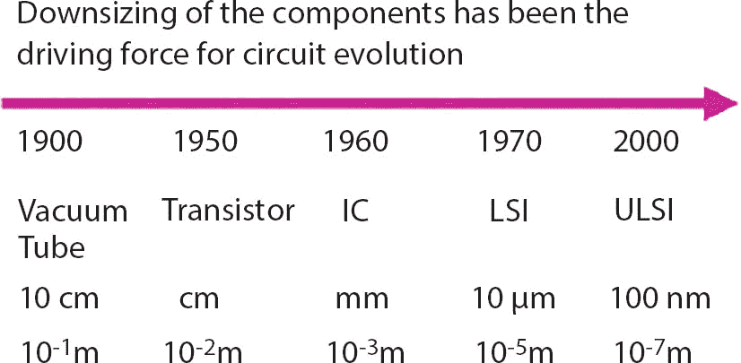

**图 8.1** 尺寸化的趋势。

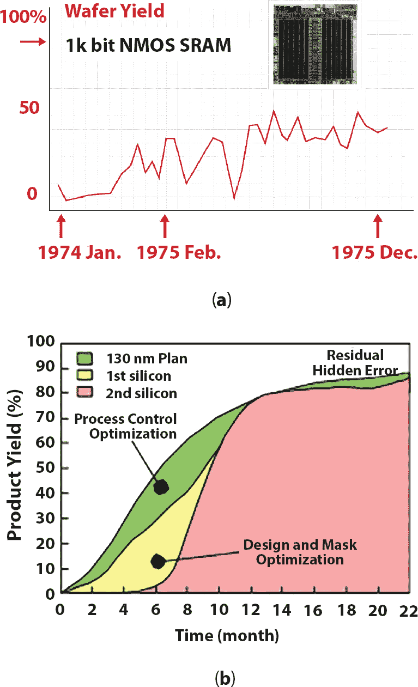

**图 8.2** 大规模电路的良率。

### 8.1.2 制造优化挑战

导致超大规模电路性能下降的主要挑战是互连延迟，这是由于狭窄且密集金属互连线的电阻和电容增加引起的。此外，超小型金属氧化物场效应晶体管（MOSFETs）的性能增强仍然是一个争议的话题。根据缩放理论，单位栅极宽度的漏极电流应保持不变。然而，最近的研究表明，对于栅长小于 100 纳米的 MOSFET，单位栅极宽度的漏极电流会出现显著下降。未优化的 MOSFET 工艺和结构是这一问题的原因。

在没有新技术的情况下，进一步的缩小可能只会导致性能损失。至少在未来 10 年内，通过使用新型材料和技术，以及使用 3D（三维）结构[7]，可以实现性能改进和增强缩小。最近，我们见证了发现新型材料以及制造小于 100 纳米器件的创新生产技术方面的许多进展。升源/漏极[8, 9]、`NiSi`、`strained silicon`、介电常数、硅和`3D 结构`。

大规模电路的漏极电流为每微米几微安。此类 MOSFET 的性能将受到栅电极边缘电容的影响，如图 8.3 所示。目前，此类小型器件的使用仍存疑问。

2D（二维）半导体的应用范围从柔性电子设备到逻辑电路[28, 29]。具有宽范围带结构是经过广泛研究的代表性材料过渡金属硫族化物（TMDs）。具有原子级厚度且无悬空键的通道使得高缩放器件具有高载流子迁移率[30, 31]。全球范围内气相沉积（CVD）和金属有机气相沉积合成的进展使得大面积 TMD 膜成为可能。晶圆级：市场上提供的膜对于大规模电路通常是足够的；但为了获得满意的晶体质量，仍需改进合成。场效应晶体管（FET）的准确阈值电压`V[T]`对于复杂的级联电路是必要的[34, 35]。在大规模集成（LSI）电路中，必须重点优化顶栅（TG）FET 的晶圆级制造。但由于其极薄的特性，2D 半导体对制造工艺和外部环境非常敏感，特别是顶界面。与体半导体相比，2D 半导体的优化工艺更为复杂。这是由于 TG FET 制造过程中每个步骤之间的相互依赖，任何后续步骤都会显著影响之前的步骤[36]。

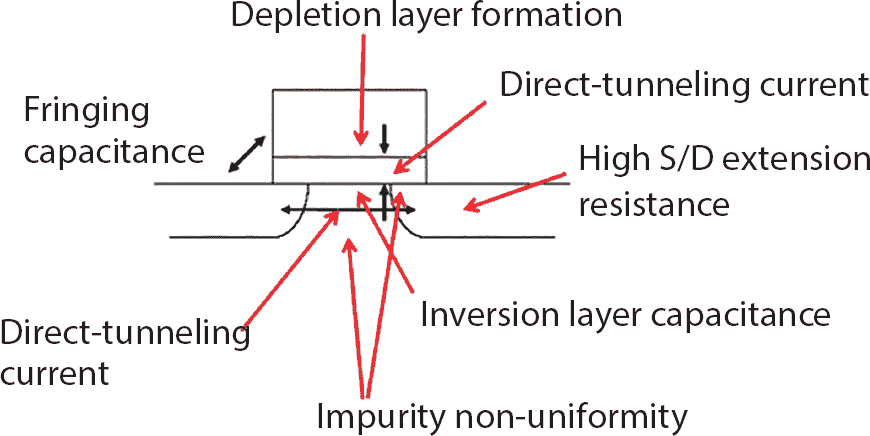

**图 8.3** 10 纳米以下 MOS 器件尺寸化的挑战。

## 8.2 半导体行业与机器学习

半导体行业具有高容量和高能效的优势，正在采用 3D 生产方法取代平面缩小，以提高半导体器件的集成密度。单片集成和异质集成是用于生产 3D 半导体器件的两种垂直层堆叠工艺。

当前薄膜沉积技术的发展促进了 3D 半导体多层器件的生产。自 20 世纪 30 年代以来，由于对光学薄膜沉积的巨大需求（特别是军事用途），这些方法进展迅速。在半导体设施中，通常使用原子层沉积（`ALD`）和`CVD`沉积极薄的层 [39, 40]。

利用光与物质相互作用中的吸收、反射和传输特性，分光法 [41] 是一种无损、非接触技术，可以以亚纳米级的分辨率测量厚度。多层厚度的表征通常使用光谱椭圆法 [42, 43]，它能够同时测量目标样品反射光偏振态的幅度和相位变化。通过检测散射光，拉曼光谱 [44, 45] 可以研究多层结构的结构和化学性质。虽然超声波可表征几层的厚度，但其较长的波长（亚毫米级）使其不适用于研究纳米尺度下的多层器件。对于较厚（> 1 μm）的层已使用白光干涉进行测量 [46–48]。


表征算法与光学技术结合使用，以确定多层的厚度。表征算法可能是基于模型的方法或机器学习（`ML`）方法。基于模型的方法将基于光学建模计算的光学响应与测量值进行比较，以确定未知的样品属性 [49, 50]。

## 8.3 半导体制造工艺

### 8.3.1 半导体制造的关键阶段

生产过程可以被描述为将原材料转化为成品的程序。图 8.4 展示了一个制造活动示例，该活动被视为一个系统，其输入是供应和原材料，而输出是完成的商业货物。在半导体制造中，掺杂剂、金属、半导体材料和其他材料也被用于制造以及作为绝缘。产出包括 `ICs`、印刷电路板、封装以及最终各种商业电子产品和系统，如数码相机、智能手机和个人电脑。半导体生产中涉及的过程包括离子注入、扩散、刻蚀、光刻、氧化、晶生长以及硬化和沉积工艺。

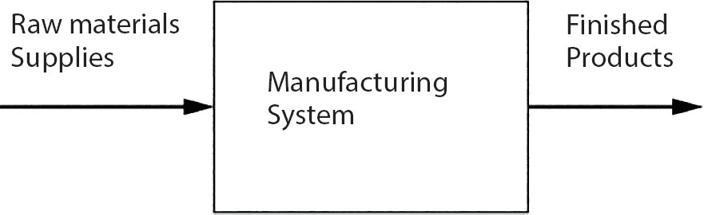

**图 8.4** 制造系统的框图表示。

从系统的角度来看，半导体制造几乎涉及集成电路（`IC`）工艺的所有其他技术，包括设计、制造、可靠性、集成、测试和组装。

以下步骤概述了半导体生产的基本步骤：半导体制造涉及的关键步骤详见以下工艺 [51]：

#### 1. 氧化

氧化用于在晶圆上创建一层薄薄的氧化层。这一步对于器件隔离至关重要。

#### 2. 光刻

光刻用于对晶圆进行图形化。一种称为光刻胶的光敏材料涂在晶圆表面。

#### 3. 刻蚀

刻蚀用于从晶圆上去除不需要的材料。刻蚀主要有两种类型：

- 湿蚀：使用化学溶液溶解材料。
- 干蚀：使用气体和等离子体刻蚀晶圆表面。

#### 4. 掺杂

掺杂将杂质引入硅晶圆以改变其电性能。有两种常用的掺杂方法：

- 扩散：将掺杂剂引入加热的硅晶圆中。
- 离子注入：加速掺杂离子并将其植入晶圆中。

#### 5. 沉积

沉积用于在晶圆上添加薄层材料。主要有两种沉积类型：

- 物理气相沉积：材料在真空中气化然后凝固在晶圆上。
- `CVD`：气体化学在晶圆表面反应沉积固体材料。

#### 6. 平坦化

平坦化用于平滑和平整晶圆表面，确保后续层均匀且无缺陷。最常用的平坦化技术是化学机械抛光（`CMP`）。

#### 7. 封装

封装保护半导体器件，并提供芯片与外部世界之间的电气连接。晶圆制造后，单个芯片会被分离、测试并安装到封装中。

- **封装方法**：键合（Die bonding）、引线键（wire bonding）和倒装焊（flip-chip bonding）是将芯片封装并与外部电路进行电气连接的常用技术。

### 8.3.2 常见挑战与变异

讨论的半导体制造中的一些关键挑战 [3, 54, 55] 如下：

1. **良率与成本**

   高良率（每个晶圆良好芯片的百分比）是半导体制造中最大的挑战之一。良率直接影响生产成本：良率越高意味着单个芯片成本越低，而低良率会因为需要更多原材料、更长的处理时间和更高的浪费而增加生产成本。良率与半导体制造成本成反比，这意味着随着良率的下降，成本会增加。随着行业向更小的工艺节点（例如 7 nm、5 nm）移动，这变得尤为挑战性，因为特征尺寸更小，缺陷风险增加，实现高良率变得更加困难。

2. **工艺变异**

   半导体工艺中的变异是不可避免的，但有效管理变异对于维持产品质量和一致性至关重要。变异可能来自原材料、设备、环境条件的细微差异，甚至是操作员的错误。随着半导体制造工艺向更小规模推进（例如 7 纳米以下技术），工艺条件下即使是最细微的变化（如温度或压力），其影响也会变得更加显著，影响器件性能和良率。管理变异需要复杂的工具来监控和控制工艺。

3. **质量控制**

   在制造过程的每个阶段维持高标准标准是困难的，特别是设备变得越来越复杂和微。这不仅包括确保设备符合电气和机械规格，还包括管理表面缺陷、污染和整体器件可靠性等因素。现代半导体器件复杂性的增加加剧了质量控制挑战。例如，先进器件可能包含数百万或数十亿晶体管，使得缺陷更难检测，消除更加困难。单个缺陷就会损害整个芯片的性能。

4. **先进工艺控制**

   随着行业向更小的几何结构移动，对半导体制造过程中每一步进行精确控制的需求日益增长。先进工艺控制（`APC`）技术对于实时检测和纠正问题至关重要，确保工艺保持在严格的规格范围内。`APC` 系统涉及使用传感器和数据分析在缺陷发生之前预测并调整制造条件。然而，大规模实施 `APC` 并确保其在日益复杂的半导体制造工艺中有效运行仍然是一项挑战。

## 8.4 监督学习在制造优化中的应用

在 1975 年的 IEEE 国际电子器件会议上，Moore 博士预测微芯片上的晶体管数量大约每 2 年翻一倍。从那时起，`IC` 制造商一直努力赶这一宏大的预测，通过探索各种方法不断工作以维持摩尔定律。光刻公司缩小了波长并增加了光刻透镜装置的数值孔径，以提高分辨率并打印更小的几何图形（线线、接触孔等）。极紫外（`EUV`）光刻机的复杂性要求更精细的剂量和叠加（`OVL`）控制、设备内部更集成的传感器，以及更频繁、更精确的光刻后测量。与光刻类似，先进的 `CVD` 和 `ALD` 也集成了更多传感器以实现更多

## 8.5 基于机器学习的半导体工艺优化

### A. 光刻

识别出的机器学习（`ML`）各种应用从半导体工艺步骤的常见实践（光刻：虚拟计量（`VM`）、工艺监控（`PM`）、`APC`、工艺开发）到节省计算能力根原因分析（`RCA`）以及异常预测。提出了一种基于五层 U-NET 的深度卷积神经网络（`DCNN`）的虚拟关键尺寸扫描电子显微镜（`CD-SEM`）。它建立了后 `OPC` 掩模图像与真值 `CD-SEM` 图像之间的联系 [61]。

其他研究将虚拟机（`VM`）应用于层叠误差（`OVL`）中：例如，Yoshida *等人* [62] 实现了 10 nm 的目标；而 Wang *等人* 通过使用一种名为 `LightGBM` 的树状模型 [63] 展示了，通过工艺数据、对齐、平整、工艺校正和上下文，虚拟 `OVL` 在应用于替代随机采样时，可以提高测量效率，即使在误报率高达 15% 的情况下，也能识别出 100% 的离群值。该机器学习（`ML`）模型将采样率降低至低 30%，同时交付了完美的结果。除了 `VM` 之外，散射量法是预测各种应用（如光刻版制造）中 `CD-SEM` 图谱的流行技术之一 [64]。在 Pandev *等人* [65] 中，使用主成分分析（`PCA`）和具有 3 个隐藏层的 `NN` 用于信号响应测量（散射量法），并使用 `CD-SEM` 和原子力显微镜（`AFM`）作为真值参考。这使得测量更具侵入性且更耗时。`PM` 在电气测试前几个月，就为光刻过程中深层沟槽电容和金属线抗胶的探探测 [66] 提供了照明支持。在先进工艺节点中，随着工艺随时间漂移，`APC` 在提供参数变动的反馈方面起着至关重要的作用。在 Utzny [67] 中，使用 `PCA`、`k-means clustering` 和决策树实现了光刻版制造中关键尺寸均匀性（`CDU`）25% 的提升。此外，在 Hooker *等人* [68] 中，用 `TensorFlow` 构建的 `NN` 模型预测了线/间距（`L/S`），对于 `ILT` 实现了比传统的基于规则的 `OPC` 模型更好的 `CD` 控制，显示了工艺开发中对 `ML` 依赖的日益增加。在 Wu *等人* [69] 中，展示了用于聚焦曝光矩阵（`FEM`）`CD-SEM` 图像的自动工艺窗口，准确率达 87%，为开发工程师在数据分析期间节省了大量时间。`ML` 的潜力甚至更大：在 Oak *等人* [70] 中，一个三层 `NN` 识别出了双重光刻先进节点中边缘位置误差最关键的组件。该分析使用了蒙特卡洛模拟结果，识别灵敏度有助于研究人员解决产生最高回报的瓶颈。此外，Chastan *等人* [71] 演示了用于光刻机数据的 `RCA`，精确定位了与其它工艺相关的 `OVL` 错误的根源。在 Giollo *等人* [72] 中，使用包含所有工艺和 `OVL` 数据的 `LASSO regression` 来识别来自特定 `CMP` 工地的某些 `OVL` 错误。然而，需要非线性模型来进一步提高准确性。最后，Wang *等人* [73] 显示，`DCNN` 可以为光刻版设计和亚分辨率辅助特征放置节省计算能力，在具有与传统模型相似精度的情况下，为跟踪管理器（`CTM+`）模型实现了更廉的初始化。

### B. 蚀刻

在 Abdullah *等人* [74] 中，展示了一个由人工 `NN` 构建的 `VM` 模型，用于*原位*颗粒监测，与氧化刻刻腔污染的表面扫描相比，该方法节省了时间。Terzi *等人* [75] 利用光学发射光谱（`OES`）进行蚀刻工艺。研究表明，非侵入性的 `NN` 模型优于岭回归来预测蚀刻结果。Wang *等人* [76] 使用 `Mahalanobis distance` 在蚀刻过程中实现了 `APC`。Jo *等人* [77] 利用 `OES` 数据为蚀刻提供了即时反馈。非侵入性的测量更具侵入性且更耗时。在先进工艺节点中，`APC` 在提供工艺随时间漂变的参数变动反馈方面起着至关重要的作用。在光刻过程中 [78]，研究强调了 `ML` 在蚀刻中 `APC` 的日益增长性。

### C. 薄膜

`VM` 在薄膜沉积中是一种非常有前景的应用。例如，Lenz 和 Barak [80] 使用 `k-fold` 交叉验证进行 `SVR` 预测沉积厚度。Choi 和 Hong [79] 在沉积过程中使用 `OES` 数据 `NN` 模型估计薄膜厚度。在 Yan *等人* [81] 中，对多种 `ML` 模型进行特征提取、特征选择和 `ML` 拟合，专注于 `CMP` 工艺中的去除率估计。Greenelt *等人* [82] 使用 `Shapley value` 探索 `VM`。他们发现，在数据完整的情况下，工艺特征贡献更大；而在不完整的情况下，设计特征占主导。在 Kong *等人* [83] 中，该 `NN` 模型在外延过程中利用散射数据估计晶圆缺陷。Kwak *等人* [84] 使用光学光谱估计多层（约 200 层）厚度，并以透射电子显微镜数据作为真值。研究证明，结合群延迟散（`GDD`）数据，基于 `ML` 的光谱椭圆结果得到了增强，`GDD` 的均方误差为 2.83 Å。

### D. 化学抛光

在 *等人* [85] 中，结合了多种 `ML` 模型进行特征提取、特征选择和 `ML` 拟合，重点关注 `CMP` 工艺中的去除率估计。研究强调了定期维护 `ML` 模型参数以适应变化的设置和配方。该研究还探讨了工艺中的 `APC` 和 `PM`。Yu *等人* [86] 比较了 `SVR`、径向基函数内核、多元线性回归和迁移学习 `NN` 模型，证明了 `NN` 模型的优性能。同时，Timoney *等人*、Tripathi 和 Mahmud 以及 Tripathi *等人* [87–89] 利用光学关键尺寸（`OCD`）测量预测电气性能。`ML` 模型超过了传统的 `OCD` 性能，并对属性提供了更好的整体预测。建议未来可以将这些 `OCD` 结果输入 `APC` 以提高整体电学良率。

## 参考文献

3. Iwai, H., Kakushima, K., Wong, H., 未来半导体制造的挑战。*Int. J. High Speed Electron. Syst.*, 16, 01, 43–81, 2006。
4. Bohr, M., 英特尔的 90 纳米技术：摩尔定律及其他，2002。
5. Monahan, K., 90nm 技术节点及之后的良率挑战，2004。
6. Lin, J.J., 300 毫米制造。*IEDM 短课程“半导体制造的未来”*，2002。
7. A. Semiconductor Industry, 半导体国际技术路线图，1999，[`www.itrs.net/`](http://www.itrs.net/)。
8. Yoshitomi, T., Saito, M., Ohguro, T., Ono, M., Momose, H.S., Iwai, H., *用于高性能 75-纳米栅栅极长度 pMOSFET 的硅化物硅侧壁源漏极 (S/sup 4/D) 结构*，pp. 11–12, IEEE, 1995。
9. Chau, R., *等*，*一种 50 纳米耗尽衬底 CMOS 晶体管 (DST)*，pp. 29–1, IEEE, 2001。
10. Iinuma, T., *等*，*用于先进高速双极 LSI 的自对准发射极 NiSi 电极技术*，pp. 92–95, IEEE, 1992。
11. Iwai, H., Ohguro, T., Ohmi, S.-I., 用于缩放 CMOS 的 NiSi 硅化物技术。*Microelectron. Eng.*, 60, 1–2, 157–169, 2002。
12. Sun, M.C., *等*，*有望用于亚 50 纳米 CMOSFET 的热稳定性良好的掺 Ta Ni SALICIDE 工艺*，pp. 81–82, IEEE, 2003。
13. Morimoto, T., *等*，*用于先进逻辑器件的 NiSi 硅化物技术*，pp. 653–656, IEEE, 1991。
14. Ismail, K., Nelson, S.F., Chu, J.O., Meyerson, B.S., Si/SiGe 异质结构的电子传输特性：测量与器件影响。*Appl. Phys. Lett.*, 63, 5, 660–662, 1993。
15. Welser, Hoyt, Gibbons, *在应变硅/松弛硅锗结构中制造的 NMOS 和 PMOS 晶体管*，pp. 1000–1002, IEEE, 1992。
16. Takagi, S., *等*，*应变硅/绝缘体上衬硅 (应变-SOI) MOSFET 的沟道结构设计、制造和载流子传输特性*，pp. 3–3, IEEE, 2003。
17. Lee, S.J., *等*，*具有多晶硅栅极电的高质量超薄 HfO/亚 2/栅极堆栈*，pp. 31–34, IEEE, 2000。
18. Wilk, G.D., *高 k 介质：现状与考量*。*J. Appl. Phys.*, 89, 10, 5423–5275, 2001。
19. Chuang, C.-T., Lu, P.-F., Anderson, C.J., *数字 VLSI 的 SOI：设计与进展*。*Proc. IEEE*, 86, 4, 689–720, 1998。
20. Sakurai, T., Matsuzawa, A., Douseki, T., *全耗尽 SOI 电路*，Springer，2006。
21. Fland, D., Ferreira, L.F., Jespers, P., Colinge, J., *用于低电压、低功耗电路的全耗尽 SOI 建模与应用*。*Solid State Electron.*, 39, 4, 455–460, 1996。
22. Kappert, H., Kordas, N., Dreiner, S., Kokozinski, R., *高温 SOI 技术与实现*，pp. 1162–1165, IEEE, 2015。
23. Rudenko, T.E., Nazarov, A.N., Lysenko, V.S., *绝缘体上硅 (SOI) 器件的进展*。*Semicond. Physics. Quantum. Optron.*, 23, 3, 2020。
24. Ernst, T., *等*，*极薄双栅 MOSFET*。*IEEE Trans. Electron Devices*, 50, 3, 830–838, 2003。
25. Doyle, B., *等*，*三栅全耗尽 晶体管：制造与布局*，pp. 133–134, IEEE, 2003。
26. Tian, B., Cohen-Karni, T., Qing, Q., Lieber, C.M., *作为局部生物探针的三维柔性纳米尺度场效应晶体管*。*Science*, 329, 5993, 830–834, 2010。
27. Chen, S.-H., *等*，*具有纳米堆叠高 k 栅绝缘层和三维鳍形结构的高性能 III-V MOSFET*。*Nanoscale Res. Lett.*, 7, 1–5, 2012。
28. Li, N., *等*，*基于单层二硫化钼的大规模柔性透明电子设备。*Nat. Electron.*, 3, 11, 711–717, 2020。
29. Yang, Y., *等*，*用于离子和分子过滤的大面积石墨烯纳米网/碳纳米管复合膜*。*Science*, 364, 6445, 1057–1062, 2019。
30. Liu, H., Neal, A.T., Ye, P.D., *MoS2 MOSFET 的沟道长度缩放*。*ACS Nano*, 6, 10, 8563–8569, 2012。
31. Desai, S.B., *等*，*1 纳米栅极长度的 MoS2 晶体管*。*Science*, 354, 6308, 99–102, 2016。
32. Akinwande, D., *等*，*用于硅石墨烯和二维材料*。*Nature*, 573, 7775, 507–518, 2019。
33. Smith, A.D., Wagner, S., Kataria, S., Malm, B.G., Lemme, M.C., Östling, M., *晶圆级石墨烯场效应晶体管的统计分析——第二部分：器件特性分析*。*IEEE Trans. Electron Devices*, 64, 9, 3927–3933, 2017。
34. Dumcenco, D., *等*，*大面积外延单层 MoS2*。*ACS Nano*, 9, 4, 4611–4620, 2015。
35. Wachter, S., Polyushkin, D.K., Bethge, O., Mueller, T., *基于二维半导体的微处理器*。*Nat. Commun.*, 8, 1, 14948, 2017。
36. Xu, H., *等*，*MoS2 时代*。*Small*, 14, 18034, 2018。
37. Salahuddin, S., Datta, S., *高性能与结果*。*Nat. Electron.*, 3, 711, 2018。


38. Orlando, A., 等，*拉曼光谱的全面综述*。*Chemosensors*, 9, 262, 2021.

39. Ferrari, A.C., Basko, D.M., *拉曼光谱作为研究石墨烯特性的多功能工具*。*Nat. Nanotechnol.*, 8, 235–246, 2013.

40. Malygin, A.V., Trubetskov, M.K., *光学涂层的在线表征与重新优化*，vol. 5250, pp. 406–413, SPIE, 2004.

41. Guo, C., Kim, J.-G., Ahn, H., Bae, J., Jin, J., *基于光谱分辨率白光干涉测的薄膜轮廓快速且可靠的测量*。*Int. J. Precis. Eng. Manuf.*, 19, 213–219, 2018.

42. Park, J., Kim, J.-A., Ahn, H., Bae, J., Jin, J., *利用干涉测量测量透明层厚度的综述*。*Int. J. Precis. Eng. Manuf.*, 20, 463–477, 2019.

43. Dong, J.T., Lu, R.S., *垂直扫描白光干涉法测量薄膜厚度的敏感度分析*。*Appl. Opt.*, 51, 23, 5668–5675, 2012.

44. Woollam, J.A., Snyder, P.G., *变角光谱椭偏仪的基础与应用*。*Thin Solid Films*, 233, 96–111, 1993.

45. Irene, E., *光谱椭偏仪的应用*。*Mater. Sci. B*, 5, 279–283, 1990.

55. Su, A.-J., Jeng, J.-C., Huang, H.-P., Yu, C.-C., Hung, S.-Y., Chao, C.-K., 半导体制造中的控制相关问题：带有新结果的概述。*Control Eng. Pract.*, 15, 10, 1268–1279, 2007.

56. Narula, M.S. and Pandey, A., *FinFET、全环绕栅、隧道 FET 全面综述：概念、性能与挑战*，页 554–559，IEEE, 2022.

57. Monahan, K.M., *在 32 nm 工艺节点实现 DFM 和 APC 策略*，页 398-401，IEEE, 2005.

58. Liu, D. and Park, S., 三维和 2.5 维互连技术：现状。*J. Electron. Packag.*, 136, 1, 014001, 2014.

59. Shen, W.-W. and Chen, K.-N., 三维集成电路（3D IC）关键技术：硅通孔（TSV）。*Nanoscale Res. Lett.*, 12, 1–9, 2017.

60. Ding, Y., Zhang, Y., Ren, Y.M., Orkoulas, G., Christofides, P.D., 使用来自多尺度 CFD 仿真的数据的 `SiO2` 薄膜 ALD 的基于机器学习的建模与操作。*Chem. Eng. Res. Des.*, 151, 131–145, 2019.

61. Yan, Y., 等, *机器学习虚拟 SEM 计量测量*，页 1–4，IEEE, 2020.

62. Yoshida, M., 等, *使用机器学习进行套刻预测的曝光工艺优化*，卷 12053，页 511–520，SPIE, 2022.

63. Wang, W.H., 等, *利用工艺背景和曝光数据进行套刻预测的机器学习建模*，卷 12053，页 549–560，SPIE, 2022.

64. Figueiro, N., 等, *基于散射计的机器学习在控制多电子束光刻中的应用：AM：先进计量*，页 328–333，IEEE, 2018.

65. Pandev, S., 等, *信号响应计量（SRM）：一种光刻计量的新方法*，卷 9424，页 570–583，SPIE, 2015.

66. Rana, N., Zhang, Y., Wall, D., Dirahoui, B., *预测性数据分析和机器学习为先进节点 IC 制造提供计量和工艺控制*，页 313–319，IEEE, 2015.

67. Utzny, C., *极佳融合：用于 CDU 控制的机器学习设置*，卷 10446，页 137–145，SPIE, 2017.

68. Hooker, K., Guajardo, M., Cheng, N.-C., Xiao, G., *用于 OPC 重目标化的机器学习实施*，卷 11328，页 302–309，SPIE, 2020.

69. Wu, P., 等, *一种用于光刻工艺稳定性诊断中调制图像分析的机器学习解决方案*，卷 12052，页 271–278，SPIE, 2022.

70. Oak, A., Kim, R.R.-H., Hwang, S., *使用基于机器学习的分析量化 EUV 和高 NA 的工艺灵敏度*，卷 12495，页 293–306，SPIE, 2023.

71. Chastan, M., Lam, A., Iutzeler, F., *用于异常调平特征检测的无监督基于密度机器学习*，卷 11611，页 387–395，SPIE, 2021.

72. Giollo, M., Lam, A., Gkorou, D., Liu, X.L., van Haren, R., *用于晶厂自动诊断的机器学习*，卷 10446，页 146–153，SPIE, 2017.

73. Wang, S., 等, *全芯片的机器学习辅助 SRAF 放置*，卷 10451，页 95–101，SPIE, 2017.

74. Abdullah, M.F., Osman, M.K., Somari, N.M., Ani, A., II, Appanan, S., *用于颗粒检测的机器学习实现的虚拟计量系统*，卷 11328，页 302–309，SPIE, 2020.

75. Pandev, S., 等, *信号响应计量（SRM）：一种光刻计量的新方法*，卷 9424，页 570–583，SPIE, 2015.

76. Rana, N., Zhang, Y., Wall, D., Dirahoui, B., *预测性数据分析和机器学习为先进节点 IC 制造提供计量和工艺控制*，页 313–319，IEEE, 2015.

77. Utzny, C., *极佳融合：用于 CDU 控制的机器学习设置*，卷 10446，页 137–145，SPIE, 2017.

78. Hooker, K., Guajardo, M., Cheng, N.-C., Xiao, G., *用于 OPC 重目标化的机器学习实施*，卷 11328，页 302–309，SPIE, 2020.

79. Wu, P., 等, *一种用于光刻工艺稳定性诊断中调制图像分析的机器学习解决方案*，卷 12052，页 271–278，SPIE, 2022.

80. Oak, A., Kim, R.R.-H., Hwang, S., *使用基于机器学习的分析量化 EUV 和高 NA 的工艺灵敏度*，卷 12495，页 293–306，SPIE, 2023.

81. Chastan, M., Lam, A., Iutzeler, F., *用于异常调平特征检测的无监督基于密度机器学习*，卷 11611，页 387–395，SPIE, 2021.

82. Giollo, M., Lam, A., Gkorou, D., Liu, X.L., van Haren, R., *用于晶厂自动诊断的机器学习*，卷 10446，页 146–153，SPIE, 2017.

83. Wang, S., 等, *全芯片的机器学习辅助 SRAF 放置*，卷 10451，页 95–101，SPIE, 2017.

84. Abdullah, M.F., Osman, M.K., Somari, N.M., Ani, A., II, Appanan, S., *用于颗粒检测的机器学习实现的虚拟计量系统*，卷 11328，页 302–309，SPIE, 2020.

85. Pandev, S., 等, *信号响应计量（SRM）：一种光刻计量的新方法*，卷 9424，页 570–583，SPIE, 2015.

86. Rana, N., Zhang, Y., Wall, D., Dirahoui, B., *预测性数据分析和机器学习为先进节点 IC 制造提供计量和工艺控制*，页 313–319，IEEE, 2015.

87. Utzny, C., *极佳融合：用于 CDU 控制的机器学习设置*，卷 10446，页 137–145，SPIE, 2017.

88. Hooker, K., Guajardo, M., Cheng, N.-C., Xiao, G., *用于 OPC 重目标化的机器学习实施*，卷 11328，页 302–309，SPIE, 2020.

89. Wu, P., 等, *一种用于光刻工艺稳定性诊断中调制图像分析的机器学习解决方案*，卷 12052，页 271–278，SPIE, 2022.

90. Oak, A., Kim, R.R.-H., Hwang, S., *使用基于机器学习的分析量化 EUV 和高 NA 的工艺灵敏度*，卷 12495，页 293–306，SPIE, 2023.

91. Chastan, M., Lam, A., Iutzeler, F., *用于异常调平特征检测的无监督基于密度机器学习*，卷 11611，页 387–395，SPIE, 2021.

92. Giollo, M., Lam, A., Gkorou, D., Liu, X.L., van Haren, R., *用于晶厂自动诊断的机器学习*，卷 10446，页 146–153，SPIE, 2017.

93. Wang, S., 等, *全芯片的机器学习辅助 SRAF 放置*，卷 10451，页 95–101，SPIE, 2017.

94. Abdullah, M.F., Osman, M.K., Somari, N.M., Ani, A., II, Appanan, S., *用于颗粒检测的机器学习实现的虚拟计量系统*，卷 11328，页 302–309，SPIE, 2020.

95. Pandev, S., 等, *信号响应计量（SRM）：一种光刻计量的新方法*，卷 9424，页 570–583，SPIE, 2015.

96. Rana, N., Zhang, Y., Wall, D., Dirahoui, B., *预测性数据分析和机器学习为先进节点 IC 制造提供计量和工艺控制*，页 313–319，IEEE, 2015.

97. Utzny, C., *极佳融合：用于 CDU 控制的机器学习设置*，卷 10446，页 137–145，SPIE, 2017.

98. Hooker, K., Guajardo, M., Cheng, N.-C., Xiao, G., *用于 OPC 重目标化的机器学习实施*，卷 11328，页 302–309，SPIE, 2020.

99. Wu, P., 等, *一种用于光刻工艺稳定性诊断中调制图像分析的机器学习解决方案*，卷 12052，页 271–278，SPIE, 2022.

100. Oak, A., Kim, R.R.-H., Hwang, S., *使用基于机器学习的分析量化 EUV 和高 NA 的工艺灵敏度*，卷 12495，页 293–306，SPIE, 2023.

101. Chastan, M., Lam, A., Iutzeler, F., *用于异常调平特征检测的无监督基于密度机器学习*，卷 11611，页 387–395，SPIE, 2021.

102. Giollo, M., Lam, A., Gkorou, D., Liu, X.L., van Haren, R., *用于晶厂自动诊断的机器学习*，卷 10446，页 146–153，SPIE, 2017.

103. Wang, S., 等, *全芯片的机器学习辅助 SRAF 放置*，卷 10451，页 95–101，SPIE, 2017.

104. Abdullah, M.F., Osman, M.K., Somari, N.M., Ani, A., II, Appanan, S., *用于颗粒检测的机器学习实现的虚拟计量系统*，卷 11328，页 302–309，SPIE, 2020.

105. Pandev, S., 等, *信号响应计量（SRM）：一种光刻计量的新方法*，卷 9424，页 570–583，SPIE, 2015.

106. Rana, N., Zhang, Y., Wall, D., Dirahoui, B., *预测性数据分析和机器学习为先进节点 IC 制造提供计量和工艺控制*，页 313–319，IEEE, 2015.

107. Utzny, C., *极佳融合：用于 CDU 控制的机器学习设置*，卷 10446，页 137–145，SPIE, 2017.

108. Hooker, K., Guajardo, M., Cheng, N.-C., Xiao, G., *用于 OPC 重目标化的机器学习实施*，卷 11328，页 302–309，SPIE, 2020.

109. Wu, P., 等, *一种用于光刻工艺稳定性诊断中调制图像分析的机器学习解决方案*，卷 12052，页 271–278，SPIE, 2022.

110. Oak, A., Kim, R.R.-H., Hwang, S., *使用基于机器学习的分析量化 EUV 和高 NA 的工艺灵敏度*，卷 12495，页 293–306，SPIE, 2023.

111. Chastan, M., Lam, A., Iutzeler, F., *用于异常调平特征检测的无监督基于密度机器学习*，卷 11611，页 387–395，SPIE, 2021.

112. Giollo, M., Lam, A., Gkorou, D., Liu, X.L., van Haren, R., *用于晶厂自动诊断的机器学习*，卷 10446，页 146–153，SPIE, 2017.

113. Wang, S., 等, *全芯片的机器学习辅助 SRAF 放置*，卷 10451，页 95–101，SPIE, 2017.

114. Abdullah, M.F., Osman, M.K., Somari, N.M., Ani, A., II, Appanan, S., *用于颗粒检测的机器学习实现的虚拟计量系统*，卷 11328，页 302–309，SPIE, 2020.

115. Pandev, S., 等, *信号响应计量（SRM）：一种光刻计量的新方法*，卷 9424，页 570–583，SPIE, 2015.

55. Su, A.-J., Jeng, J.-C., Huang, H.-P., Yu, C.-C., Hung, S.-Y., Chao, C.-K., 半导体制造中的控制相关问题：带有新结果的概述。*Control Eng. Pract.*, 15, 10, 1268–1279, 2007.

56. Narula, M.S. and Pandey, A., *FinFET、全环绕栅、隧道 FET 全面综述：概念、性能与挑战*，页 554–559，IEEE, 2022.

57. Monahan, K.M., *在 32 nm 工艺节点实现 DFM 和 APC 策略*，页 398-401，IEEE, 2005.

58. Liu, D. and Park, S., 三维和 2.5 维互连技术：现状。*J. Electron. Packag.*, 136, 1, 014001, 2014.

59. Shen, W.-W. and Chen, K.-N., 三维集成电路（3D IC）关键技术：硅通孔（TSV）。*Nanoscale Res. Lett.*, 12, 1–9, 2017.

60. Ding, Y., Zhang, Y., Ren, Y.M., Orkoulas, G., Christofides, P.D., 使用来自多尺度 CFD 仿真的数据的 `SiO2` 薄膜 ALD 的基于机器学习的建模与操作。*Chem. Eng. Res. Des.*, 151, 131–145, 2019.

61. Yan, Y., 等, *机器学习虚拟 SEM 计量测量*，页 1–4，IEEE, 2020.

62. Yoshida, M., 等, *使用机器学习进行套刻预测的曝光工艺优化*，卷 12053，页 511–520，SPIE, 2022.

63. Wang, W.H., 等, *利用工艺背景和曝光数据进行套刻预测的机器学习建模*，卷 12053，页 549–560，SPIE, 2022.

64. Figueiro, N., 等, *基于散射计的机器学习在控制多电子束光刻中的应用：AM：先进计量*，页 328–333，IEEE, 2018.

65. Pandev, S., 等, *信号响应计量（SRM）：一种光刻计量的新方法*，卷 9424，页 570–583，SPIE, 2015.

66. Rana, N., Zhang, Y., Wall, D., Dirahoui, B., *预测性数据分析和机器学习为先进节点 IC 制造提供计量和工艺控制*，页 313–319，IEEE, 2015.


67. Utzny, C., *极佳融合：用于 CDU 控制的机器学习设置*，卷 10446，页 137–145，SPIE, 2017.

68. Hooker, K., Guajardo, M., Cheng, N.-C., Xiao, G., *用于 OPC 重目标化的机器学习实施*，卷 11328，页 302–309，SPIE, 2020.

69. Wu, P., *等*, *一种用于光刻工艺稳定性诊断中调制图像分析的机器学习解决方案*，卷 12052，页 271–278，SPIE, 2022.

70. Oak, A., Kim, R.R.-H., Hwang, S., *使用基于机器学习的分析量化 EUV 和高 NA 的工艺灵敏度*，卷 12495，页 293–306，SPIE, 2023.

71. Chastan, M., Lam, A., Iutzeler, F., *用于异常调平特征检测的无监督基于密度机器学习*，卷 11611，页 387–395，SPIE, 2021.

72. Giollo, M., Lam, A., Gkorou, D., Liu, X.L., van Haren, R., *用于晶厂自动诊断的机器学习*，卷 10446，页 146–153，SPIE, 2017.

73. Wang, S., *等*, *全芯片的机器学习辅助 SRAF 放置*，卷 10451，页 95–101，SPIE, 2017.

74. Abdullah, M.F., Osman, M.K., Somari, N.M., Ani, A., II, Appanan, S., *用于颗粒检测的机器学习实现的虚拟计量系统*，卷 11328，页 302–309，SPIE, 2020.

75. Pandev, S., *等*, *信号响应计量（SRM）：一种光刻计量的新方法*，卷 9424，页 570–583，SPIE, 2015.

## Abstract

近年来，随着经典技术中各种限制的解决，纳米材料在技术领域的应用发生了革命性变化。`石墨烯`、`碳纳米管`、`量子点`和`过渡金属硫族化物`等纳米材料具有卓越的电学、热学机械性能，推动了能量存储、`纳米电子学`、`传感器`以及生物医学等领域的进展。本文讨论了将纳米材料集成到器件中取得的最新进展。它还涉及了与器件架构协同合成的纳米材料在合成和表征方面的进展。文中关注了新的制造方法，包括自下而上的自组装方法、先进的`光刻`和`增材技术`，这些方法允许对纳米尺度特征进行控制。尽管取得了进展，但在成本效益制造、结构完整性和系统兼容性方面仍存在重大的技术障碍。此外，必须考虑与大规模使用纳米材料相关的伦理和环境影响问题。本研究介绍了纳米材料集成的系统和挑战，以及如何利用集成引导未来研究，开发用于下一代技术的生产性纳米材料。

**关键词：** `纳米材料`、`器件集成`、`纳米电子学`、`石墨烯`、`可扩展性`

## 9.1 引言

在过去的几十年里，纳米技术取得了飞速发展，并在纳米尺度上提供了具有新颖物理、化学和机械性能的新材料和器件。这些性能与其母体体材料有巨大不同，为电子、能量存储、传感器和医疗保健等未来应用创造了广阔的空间。纳米材料，如`石墨烯`、`碳纳米管`(`CNTs`)、`量子点`(`QDs`)和`过渡金属硫族化物`(`TMDs`)，是下一代器件最有前景的材料，由于其增强的电学、热学和光学性能，其性能优于传统材料[1, 2]。

尽管具有潜力，但在将纳米材料集成到实际器件中仍存在许多瓶颈。这些问题涉及此类材料的制造过程，从从小尺度均匀性到可扩展性，并需兼顾当前技术（特别是硅基系统）的兼容性。此外，纳米材料的集成引发了对环境可持续性、毒性和长期稳定性的担忧。纳米材料的理论潜力是巨大的；然而，由于存在创建高性能、可扩展和可靠器件的障碍，这些优势很少能转化为实践[3, 4]。本文概述了集成纳米材料的进展，以及所使用的制造方法，并强调了为了实现商用器件的广泛应用仍需克服的挑战。

### 9.1.1 纳米材料概述

纳米材料是指至少一个维度在纳米尺度范围（1–100 nm）的材料。这种微小的尺寸赋予了它们与其体材料材料显著不同的独特特性。它们的发展和向各个领域的集成是变革性的，为材料科学、电子学、能源和医学提供了前所未有的机会。下面，我们对纳米材料的性质、类型和意义进行深入探讨。

### 9.1.2 纳米材料的定义与特性

纳米材料是指具有纳米尺度尺寸，并产生在任何体材料中均无法观察到的量子力学效应和表面现象的材料。导致这种特殊特性现象的因素如下：

- **高表面积比**

  在纳米尺度下，很大比例的原子进入材料表面，从而提供并增强了与周围环境的反应性和相互作用程度——这一特征出现在催化、传感和能量存储应用中。

- **量子限制效应**

  由于`QDs`等尺寸效应导致的颗粒尺寸变化改变了这些材料的电子能级，影响了它们依赖尺寸的光学电子性能。因此，较小的`QDs`发射蓝光，而较大的发射红光。

- **机械强度和灵活性**

  `CNTs`和`石墨烯`等纳米材料在机械性能方面表现出如此惊人的属性：具有良好柔性的拉伸强度。这使其在轻质复合材料和柔性电子设备中处于良好位置。

- **热导性和电导率**

  通过`石墨烯`和此类金属纳米材料，热导性和电导率远超相当于铜`和`硅`等传统材料。

### 9.1.3 纳米材料的分类

根据维度、结构和成分，纳米材料可以分类如下：

- **维度**

  - **0D 纳米材料：** 在纳米尺度上完全三维的颗粒（例如，`QDs`）

  - **1D 纳米材料：** 仅有一个维度处于纳米尺度的颗粒，例如`纳米线`和`纳米管`

  - **2D 纳米材料：** 包含此类薄膜或片的材料，两个维度均为纳米尺度，例如，`石墨烯`和`TMDs`

  - **3D 纳米材料：** 具有纳米尺度特征的体材料，包括纳米结构金属和复合材料

- **结构**

  - **晶态纳米材料：** 它们具有有序的原子排列，例如`纳米晶体`和`纳米线`。

  - **非晶态纳米材料：** 它们没有长程有序，通常是某些玻璃态或聚合物类纳米颗粒。

- **成分**

  - **金属纳米材料：** 金属如`金`、`银`和`铂`是催化和电子中最常用的金属。

  - **半导体纳米材料：** 如`硅`和`QDs`，用于光电学和光伏。

  - **有机纳米材料：** 碳基结构如`富足烯`、`石墨烯`和`CNTs`。

  - **混合纳米材料：** 这些涉及不同类型的材料的材料，例如，金属有机框架。

### 9.1.4 历史发展与里程碑

纳米材料领域从理查德·费曼 1959 年的演讲《在底部有足够的空间》已经走了很远，他预言了对单个原子的操作。主要的突破包括：

1. 1985 年`富足烯`的发现，其球形结构获得了诺贝尔奖。

2. 1991 年`CNTs`的生产证明了纳米技术的里程碑。

3. 2004 年`Andre Geim`和`Konstantin Novoselov`分离了`石墨烯`，他们在 2010 年获得了诺贝尔奖。

### 9.1.5 纳米材料的优势

纳米材料比传统材料具有许多优势。列出的优势如下：

#### 9.1.5.1 卓越性能

它们的独特特性为各种应用提供了卓越的性能特征，例如更快的晶体管、效率更高的太阳能电池和容量更大的电池。

#### 9.1.5.2 多功能

可以设计多种功能组合来创建纳米材料，例如将导电性与机械灵活性相结合。

#### 9.1.5.3 针对微型系统的可扩展性

它们的纳米级尺寸最适合用于微型、紧凑和集成的系统，特别是在纳米电子和生物医学设备中。

### 9.1.6 挑战与局限性

尽管益处巨大，但纳米材料也面临着挑战。

#### 9.1.6.1 可扩展性

大多数生产方法适用于小型生产；然而，它们无法轻易升级到工业应用水平。

#### 9.1.6.2 材料稳定性

纳米材料的特性可能会随着时间的推移或在特定的环境条件下分解，从而影响它们在长期使用中的可靠性。

#### 9.1.6.3 环境与健康关注

纳米材料具有高活性且可能具有毒性；因此，人类健康和环境都受到了威胁，这需要制定严格的安全协议。

## 9.2 器件集成中的纳米材料

由于纳米材料具有高表面积比、极高的机械强度以及适应性电学和光学性能等卓越特性，它们将彻底改变器件集成的未来。这些特性为开发更小、更高效且具有多功能性的设备铺平了道路。将纳米材料引入电子设备、能量系统和传感器中，将是满足未来技术需求的一大步。以下是对特定纳米材料及其应用、进展和挑战的论述。

### 9.2.1 电子和传感器中的石墨烯

石墨烯是六角晶格排列的碳原子单层，是器件集成中使用最广泛的纳米材料之一。它具有非常显著的高导电性、热操作性和机械柔性等卓越品质，使其适用于高速电子设备、柔性显示器和灵敏传感器。在电子领域，石墨烯能够使载流子在其介质中高效移动，使得通过晶体管制造实现超高速处理。由于石墨烯的透明度和导电性，先进触摸屏、电子墨水屏和下一代 OLED 技术的柔性显示应用成为可能。对环境变化的敏感性也使石墨烯成为生物传感器、气体传感器以及用于医疗诊断和环境监测的应变器的完美选择 [5, 6]。

石墨烯的生产取得了显著进展，特别是通过化学气相沉积（`CVD`），产生了适用于制造的大面积膜。混合 `CVD` 工艺和卷对卷转移方法提高了可扩展性。尽管如此，挑战仍然存在，例如大规模生产无缺陷石墨烯的困难。此外，石墨烯与传统硅电子器件的集成面临着一些问题，如界面粘附力和热胀不匹配。因此，这些是充分利用石墨烯在电子和传感器应用中潜力的重要挑战。

### 9.2.2 储能中的 CNTs

CNTs 是源自石墨烯片的的圆柱形纳米结构，已被证明具有极高的导电性、机械强度和热性能。这些突出的特征使得 `CNTs` 在储能设备、柔性电子和场效应晶体管的应用中极具吸引力。在能量存储应用方面，它被集成到锂电池和超级电容器设备中，以增加能量密度和充放电率。较大的表面积有助于离子传输系统；其导电性能确保了电流的流动。在柔性电子设备中，`CNTs` 极大帮助了轻型和可弯曲设备的构建，如可穿戴电路和折叠屏 [7]。

然而，存在诸如制造 `CNTs` 的成本高昂以及由 `CNTs` 制成的材料可能产生无缺陷结构等问题。另一个技术问题被认为是在复合材料中有效分散 `CNTs` 的困难，因为它们倾向于聚集，这可能导致性能不均匀。它们在工作条件下的结构稳定性也处于活跃研究中。然而，等离子体增强气相沉积（`PECVD`）和催化剂工程的新进展极大增强了对齐性和纯度，导致了其在能量和电子领域的扩展应用。

### 9.2.3 光电和太阳能电池中的 QDs

`QDs` 是纳米级半导体颗粒，由于量子限效应显示出独特的光学电子特性。通过尺寸和成分调节 `QDs` 带隙（并因此调节光学发射）的能力，使其在包括 LED、太阳能电池和高分辨率显示器在内的光电器件中具有极高价值。它们为 LED 提供了生动、可调的颜色，其能量效率优于商业荧光粉。`QD`-增强型显示器打破了以往色彩准确亮亮度基准，使其成为任何现代电视或显示器应用中备受青睐的成分 [8, 9]。

在太阳能电池中，`QDs` 的使用增强了光吸收并增加了载流子的产生，从而提高了能量转换效率。创新合成方法（如溶剂热或胶法）对其尺寸和表面特性提供了更好的控制。然而，这些挑战之一包括处理过程中的聚集和长期环境稳定性，使其难以广泛使用。此外，对某些 `QD` 材料毒性的担忧（特别是含有镉等重金属的材料）一直驱动着向环保替代品方向的研究。表面钝化和封装方法的进步为这些 `QDs` 的性能提升带来了巨大推动，使其成为光电创新的前沿。

### 9.2.4 光探测器和晶体管中的 TMDs

`TMDs` 是层状半导体，由如二硫化钼（`MoS[2]`）和二硫化钨（`WS2`）等半导体材料组成，具有独特的电子光学特性。这些属性在光探测器、晶体管和柔性电子等应用中是有益的。`TMDs` 在单层形式下具有直接带隙，这导致了高效的光质相互作用。这就是为什么这些材料适用于光通信、成像系统和环境监测的光探测器应用 [10]。

对于晶体管，`TMDs` 能够显示高开关电流比和低功耗，从而使低功耗电子应用变得可行 [11–14]。它们的柔性允许它们进一步进入不断增长的消费电子市场，包括可穿戴和折叠设备。包括机械剥离、`CVD` 在内的制造方法已经实现了高质量的 `TMDs` 薄膜，而可扩展性仍然是一个主要挑战。此外，优化 `TMDs` 与材料之间的界面对于提高性能和可靠性至关重要。在湿度温度等环境压力下的长期稳定性是确保基于 `TMDs` 设备商业可行性的另一个要关注的问题。

### 9.2.5 用于多功能器件的纳米材料复合材料

它们通过结合纳米材料来创建纳米复合材料，以实现设备的多功能化。通过融合各组件的优势，例如 `graphene` 的导电性和 `CNTs` 的机械柔性，可以证明设备性能的显著提升。这些材料被应用于能量收集、生物传感和催化领域。在这种情况下，`graphene–CNT` 杂化材料已用于热电和压电器件的能量转换。生物传感中的功能化纳米复合材料为生物分子的高灵敏、特异性检测提供了基础，因此它们在医学诊断中具有重要性。其生产过程面临着各种挑战。

不同材料之间的强界面键对于确保纳米复合材料的结构完整性和性能至关重要。与此同时，成本和扩展性仍然是表面结构纳米复合材料有效商业化的两个首要任务。研究人员还通过材料组合改进了纳米复合材料，并正在探索某些功能化技术以获得更好的性能。这样，随着时间的推移，纳米复合材料似乎正处于多功能化设备下一次演进的前沿。

图 9.1 展示了作为集成设备的纳米材料的典型分类及其应用和问题。流程图从“设备集成中的纳米材料”这一主题内部延伸，分支到 `graphene`、`CNTs`、`QDs` 和 `TMDs` 等主要材料。此外，每种材料可以分为某些特定的领域，如传感器、储能和光电学，并伴随着扩展性、材料均匀性和集成兼容性等挑战。这种结构良好的插图为下一代技术中的纳米材料提供了更好的概述，并识别了等待解决以实现更广泛采用的障碍。

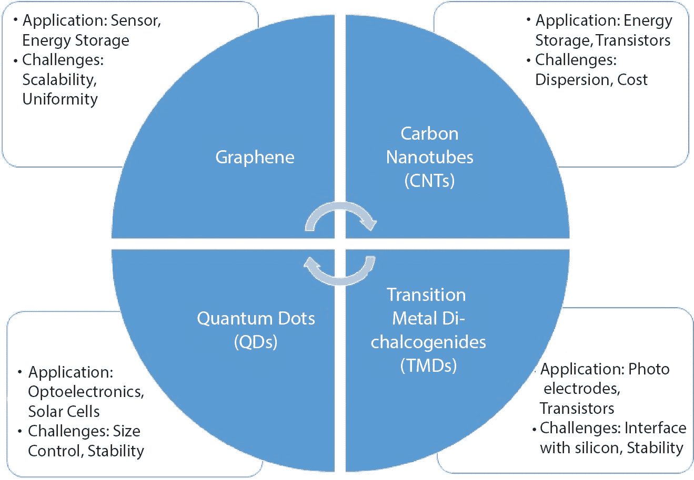

**图 9.1** 设备集成中的纳米材料流程图。

## 9.3 相关工作

表 9.1 总结了任何个人为集成纳米材料用于下一代设备的最相关研究贡献。它根据纳米材料的类型、应用领域、制造技术和面临的一些障碍对研究进行了分类。

**表 9.1** 相关工作。

| **序号** | **纳米材料** | **应用领域** | **制造技术** | **主要挑战** |
| --- | --- | --- | --- | --- |
| [1] | `Graphene` | 柔性电子设备、传感器 | 化学气相沉积 (`CVD`) | 扩展性、均匀性、材料集成 |
| [2] | `Carbon nanotubes (CNTs)` | 超电容器、晶体管 | `CVD`、电弧放 | 高成本、材料纯度、复合材料中的分散 |
| [3] | `Quantum dots (QDs)` | 光电学、太阳电池 | 溶热合成、胶体合成 | 尺寸控制、聚集、环境稳定性 |
| [4] | `MoS₂` (过渡金属硫化化物) | 场效应晶体管、光探测器 | 机械剥离、`CVD` | 与硅界面、设备稳定性 |
| [5] | `Graphene` 和 `CNTs` | 储能（电池、超电容器） | 激光烧、`CVD` | 材料缺陷、生产成本 |
| [6] | `Graphene oxide (GO)` | 生物传感器、药物递送 | 基于溶液的方法 | 生物兼容性、表面功能化 |
| [7] | `TiO₂ QDs` | 光伏、催化 | 水热合成、溶胶法 | 转换效率低、材料降解 |
| [8] | `ZnO nanostructures` | 传感器、LED | 水热、`CVD` | 性能一致性、设备集成 |
| [9] | `Graphene-based composites` | 柔性电子设备、纳米复合材料 | 溶液处理、喷涂沉积 | 在聚合物中的分散、扩展性 |

## 9.4 纳米材料集成制造技术

将纳米材料集成到先进设备中需要精确、高效且可扩展的制造技术。这些方法从传统方法到尖端创新，每种都为纳米材料的独特特性定制。本节深入探讨了这些技术，讨论了它们的机制、应用、优势和挑战。

### 9.4.1 化学气相沉积

`CVD` 是生产高质量纳米材料（`graphene` 和 `CNTs`）的众多应用之一。在过程中，气态前体在加热的基底上发生化学分解，以沉积出薄膜。然而，正是柔性电子设备、储能设备和光电系统等高度均匀且结晶材料的生产，推动了此类如此密集的研究。此外，通过 `PECVD` 增强了这一点，从而允许对热敏感的基底进行较低温度的处理。根据许多专的，`CVD` 技术的成本和扩展性限制是由其精密设备和高能耗需求引起的。对纳米材料内部缺陷数量的控制仍处于大量研究之中。科学家们正在研究卷对 `CVD` 系统，以便在实验室中生产大量的 `graphene`。此外，还在探索前体化学优化，以获得更好的材料产率和质量。

### 9.4.2 机械剥离

机械剥离或“胶胶带法”对于制备单层和少层纳米尺度材料既简单又有效。机械剥离有时被称为“胶胶带法”，是获取单层或少层纳米材料（如 `graphene` 和 `TMDs`）的一种简单而有效的技术。该技术包括使用粘胶带或其他机械手段从体晶体上物理地剥离薄层。虽然简单，但它是纳米材料生产中产量较高的技术之一，因此是基础研究非常有价值的工具，大多数原型设备（如晶体管和光探测器）都是为了研究材料的一些固有属性而制造的。然而，它的局限性是由于工作量巨大以及不适合大规模生产，因此无法扩大。最近的创新试图使剥离过程自动化，从而提高效率和吞吐量。此外，还在研究了机械剥离与液相剥离的杂化材料，以平衡质量和扩展性。

### 9.4.3 溶剂热和胶体合成

纳米材料（如量子点 QDs 和纳米棒）可以通过多种方式合成，包括溶剂热法和胶体法。溶剂热反应通常在受控温度和压力的水性介质中进行。活性剂或配体极可能参与稳定纳米材料并控制其尺寸和形状。这是一种非常有扩展性的工艺，允许对颗粒特性进行最精确的控制。因此，这些工艺非常适用于光电学、催化和生物医学成像领域。遗憾的是，实现尺寸分布的均匀性以及管理颗粒聚集仍然面临主要挑战。多年来，还开发了一些先进的方案来应对此类情况。这些新方法的一个例子是微波辅助溶剂热合成，它在确保最终产品均匀性的同时加速了过程。配体交换过程的优化不断提高胶体合成纳米材料的稳定整体性能，从而拓宽了它们在高端设备中的适用性。

### 9.4.4 自组装技术


纳米材料之间固有的相互作用（如氢键、范德华力和静电引力）是依赖这些材料形成有机结构的自组装方法。因此，这种方法对于生产大面积纳米材料膜极具吸引力，因为它只需要最少的设备、成本和能量，是一种极具效益且节能的方案。自组装常用于制造柔性电子设备、传感器以及在薄膜涂层中定制光学或疏水特性。但在控制缺陷密度以及实现大面积均匀性方面仍面临巨大挑战。诸如定向自组装等创新（利用电场或磁场等外部场引导纳米材料的组织）将很好地解决上述局限性。将光刻技术与自组装方法相结合也提供了更精确的光图形制造，从而允许在创建复杂的纳米结构设备时具有更大的灵活性。

自组装领域的论文终结研究可能是自相似技术，但在结构重构中，它们引入了范德华力、氢键和静电力等固有力。这使得这种利用最少设备制造大面积纳米材料膜成为一个极具吸引力的过程，因为它变成了一种经济且节能的方案。大多数实施的自组装工艺商业应用位于柔性电子、传感器以及此类针对光学或疏水特性定制的薄膜涂层领域。需要改进的主要领域包括缺陷密度控制和大部分面积均匀性。电场或磁场等外部场可以利用定向自组装等创新概念来引导组织。此外，结合自组装和光刻技术实现的增强图案分辨率，为创建复杂的纳米结构设备开辟了新的可能性。

### 9.4.5 增材制造与 3D 打印

增材制造（通常称为 3D 打印）在理想情况下，是将纳米材料整合到复杂三维结构中极具前景的方法。在这种技术中，材料层层沉积以制造复杂的几何形状和定制设计。考虑到纳米材料，这种方法特别关注其为生物医学植入物以及储能应用和电子电路准备纳米复合材料的能力。纳米级三维打印领域的最新进展（如双光子聚合）已极大地提高了分辨率，达到了非常纳米级的特征。然而，与纳米材料本身的兼容性问题以及机器成本仍然是该技术面临的挑战性障碍。为了缓解这些挑战，研究人员现在致力于生产含有纳米材料的可打印墨水，允许将功能属性立即整合到 3D 打印结构中。这一切将通过增材制造的新创新成为可能，为其在纳米技术中的广泛应用铺平道路。

### 9.4.6 喷涂沉积与浸渍涂层

喷涂沉积和浸渍涂层是两种在几乎任何基底上生产纳米材料薄膜的简单且可扩展的方法。在喷涂沉积中，含有纳米材料的溶液被雾化并喷射到表面，而浸渍涂层涉及将基底浸入溶液中并以受控的速度取出。这些技术常用于诸如显示器的透明导电膜、传感器的纳米结构涂层和光伏设备。尽管它们廉价且能适应柔性基底，但往往对膜的均匀性和厚度的控制较差。最近的进展（如超声喷涂沉积）提高了对膜特性的控制能力，同时正在整合后处理程序以增强附力和稳定性。喷涂沉积和浸渍涂层在高性能纳米复合设备中的应用得到了提升。

### 9.4.7 光刻技术

精密光刻技术对纳米材料结构建模，为设备产生复杂的几何形状。光刻、电子束光刻和纳米压印光刻是利用光或电子束照射基底以产生纳米级图案的一些手段。光刻技术是半导体工业生产晶体管、光子器件和纳米传感器不可或缺的技术。这些技术可能是光刻中的高精度方面，但成本和有限的产量使其成为大规模应用的较良候选。创新策略，如极紫外 (EUV) 光刻、纳米压印光刻和其他复杂的光刻方法，通过更高的分辨率和更好的成本方案解决了这些挑战。此外，研究人员正在追求混合方法，将光刻技术与自组装或增材制造相结合以实现准确性和可扩展性，确保光刻技术在纳米技术中的未来收益。

通过流程图，可以概述涉及纳米材料制造及其集成到设备中的的不同阶段。主要的制造技术包括 CVD、机械剥离和溶剂热合成，每种技术在材料选择上都有自己的条件。这些导致了关键的整体考量——所有为了均匀生长、粒径控制和成本的工程。留的主要问题是处理与现有技术的集成，在将纳米材料集成到下一代设备以实现完整设备功能之前需要解决这些问题。

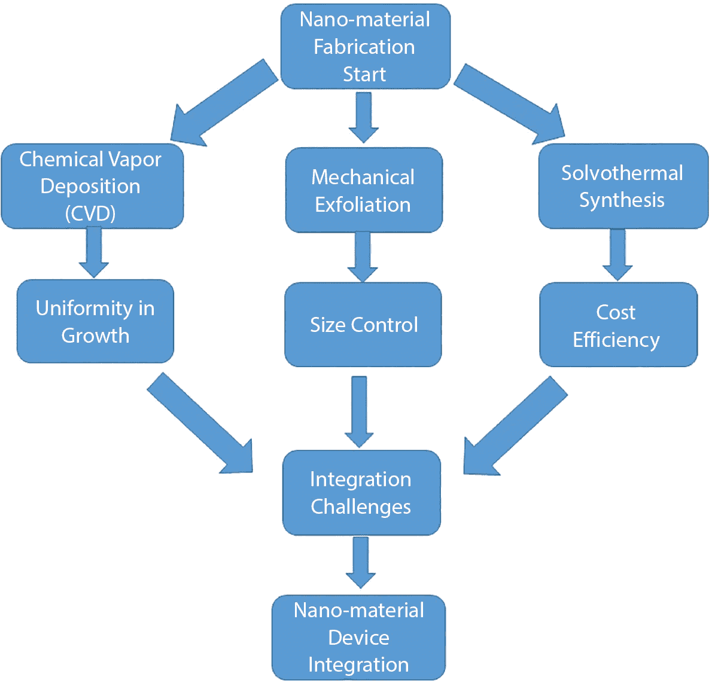

**图 9.2** 纳米材料制造与集成过程流程图。

实验室级的制备技术（如 `CVD` 和机械剥离法）可以生产高质量的产品，但在大规模生产的可行性方面往往不具备扩展性。此外，这些技术非常昂贵，对于`CNTs` 和`石墨烯` 等先进材料更是尤如此。

### 材料的分散

然而，它们具有巨大的表面积和聚集倾向，这使得分散变得非常困难；在基质或复合材料中获得纳米材料的均匀分布，对于保持其特性并确保终端设备中性能的一致性至关重要。

### 与现有技术的兼容性

`CNTs` 和`石墨烯`等纳米材料在与传统的硅基电子设备集成方面没有天然的兼容性。不良的热膨胀系数、导电性和表面化学性质似乎暗示了界面键合较弱，这解释了设备性能的异常。

### 环境与健康问题

考虑到纳米级材料的所有特殊性，其尺寸小且活性高，这引起了人们对毒性和环境影响的担忧。随着这些纳米材料的应用日益增加，迫切需要开发一种能够保证安全的可持续生产方法。

## 9.6 结论与未来方向

纳米材料为转化下世纪的设备带来了巨大的可能性。其优势将跨越性能、灵活性以及许多功能性应用。然而，在扩大生产规模、确保材料均匀性以及将此类材料纳入商业技术方面仍面临着重重障碍。开发高效的制备方法、提高材料兼容性以及克服环境和健康障碍的方法将是纳米材料实际应用的关键。

未来研究的重点可能在于开发简单廉价的大规模生产方法、通过掺杂和功能化提高性能，以及深入研究具有额外优势的新型纳米材料。据预见，材料科学、工程师和健康专家之间跨学科的合作将解决在将纳米材料的潜力转化为先进设备方面的局限性问题。

## 参考文献

1. Sadeghi, S.M.H., *et al.*, Graphene and carbon nanotubes for flexible electronics and sensors. *Adv. Mater.*, 30, 2, 170–179, 2018.

2. Zhang, Y., *et al.*, Carbon nanotube-based supercapacitors and transistors: fabrication, performance, and applications. *Nano Lett.*, 16, 10, 6234–6243, 2016.

3. Wang, J., *et al.*, Quantum dots in optoelectronics and solar cells: challenges and prospects. *Nat. Mater.*, 16, 157–165, 2017.

4. Malav, V., Bhagat, R.K., Saini, R., Mamodiya, U., Research Paper on Bluetooth Based Home Automation Using Arduino. *J. Adv. Rob.*, 6, 2, 9–14, 2019, ISSN: 2455-1872, Online.

5. Blanco, M.C.C., *et al.*, Graphene and CNTs for energy storage devices: Challenges and opportunities. *Nat. Commun.*, 9, 2741, 2018.

6. Das, P.P., *et al.*, Graphene oxide-based biosensors and drug delivery systems: A review. *J. Nanosci. Nanotechnol.*, 18, 4, 1119–1134, 2018.

7. Zhang, J.L., *et al.*, TiO₂ quantum dots in photovoltaics: Fabrication challenges and future directions. *J. Mater. Sci.*, 53, 8, 5562–5571, 2018.

8. Kumar, D., *et al.*, ZnO nanostructures for sensors and LEDs: Synthesis, properties, and challenges. *Mater. Sci. Eng., B*, 227, 1–12, 2018.

9. Gaur, M.S., *et al.*, Graphene-based nanocomposites for flexible electronics: Fabrication techniques and challenges. *Nano Lett.*, 18, 12, 7689–7697, 2018.

10. Ambalgi, A.P., Sujata, S.K., Mamodiya, U., Sharma, P., Effects of Single and Double Wide Slots on Microstrip Patch Antennas Characteristics Using Direct Contact Feed Excitation with Broadsided Radiation, in: *Proceedings of Second International Conference on Smart Energy and Communication, Algorithms for Intelligent Systems*, Springer, Singapore, 2021.

11. Tripathi, S.L. and Mahmud, M., *Explainable Machine Learning Models and Architecture*, Wiley & Scrivener Publishing LLC, USA, 2023, `https://doi.org/10.1002/9781394186570`.

12. Tripathi, S.L., Kumar, A., Rao, K.S., Mudimela, P.R., *Nanodevices for Integrated Circuit Design*, Wiley & Scrivener Publishing LLC, USA, 2023, DOI:10.1002/9781394186396.

13. Mendiratta, N. and Tripathi, S.L., A Review on Performance Comparison of Advanced MOSFET Structures Below 45nm Technology Node. *J. Semicond.*, IOP Sci., 41, 6, 1–10, 061401, 2020, DOI:10.1088/1674-4926/41/6/061401.

14. Tripathi, S.L., Pathak, P., Kumar, A., *et al.*, Improved Drain Current with Suppressed Short Channel Effect of p + Pocket Double-Gate MOSFET in Sub-14 nm Technology Node. *Silicon*, 14, 10881–10891, 2022, `https://doi.org/10.1007/s12633-022-01816-2`.

## Note

1. *1]**通讯作者*: `mukeshchand19@gmail.com`

深度学习在快速发展的 AI 领域已成为基础性技术，它塑造了我们理解、解释并与复杂数据集交互的方式 \[1\]。深度学习利用了非常类似于人类大脑内错综神经网络的架构，使机器能够从海量的无组织数据中解锁模式和洞察。这是一种惊人的能力，带来了自然语言处理、计算机视觉、医疗诊断和自动驾驶系统等不同领域的突破。深度学习可以广义地描述为机器学习的一部分，它使用了人工神经网络（`ANN`）的架构。`ANN` 基本上由相互连接的节点层组成，称为神经元，它们相互工作以处理输入数据并进行学习。在全连接深度神经网络中，网络的通用架构包括一个输入层以及其后的一个或多个隐藏层。最后，产生输出层。网络中所有神经元的输入要么来自前一层的神经元，要么直接来自输入层。神经元的输出变成下一层神经元的输入。这形成了一种级联的信息流。这种过程一直持续到最后一层产生网络的输出。

输入数据通过网络各层的一系列非线性函数进行变换。这些非线性变换允许深度学习模型学习输入数据的复杂表示，并捕捉到传统分析方法可能无法发现的关系和特征 \[2\]。这就是为什么深度学习模型在从图像识别到语音识别以及与预测分析相关的其他活动任务中，能够达到几乎难以置信的性能的原因。

本章更深入地探讨了深度学习的机制，对神经网络提供了更深层次的洞察 \[3\]。此外，分析了支撑深度学习系统的关键优化过程：理解这些优化技术对于有效训练深度学习网络以及增强其性能是，因为它们将直接影响模型从数据中学习并泛化到新场景的能力。我们认为，这项研究将详细阐述描述这一革命性领域的基础和方法论，并为讨论深度学习更复杂的问题奠定基础。图 10.1 显示了随着数据量的增加，深度学习算法在性能上如何优于旧算法。

![图 10.1 深度学习算法与旧算法的比较 [3]。](images/fig10-1.jpg)

图 10.1 深度学习算法与旧算法的比较 \[3\]。

### 10.1.1 什么是优化？

优化器和损失函数是机器学习中提高模型性能的血和灵魂。损失函数用于衡量预测值与真实结果之间的偏差，作为对模型准确性的定量测量。存在多种损失函数，每种适用于特定类型的任务，例如用于分类任务的逻辑损失、用于支持向量机的合页损失（hinge loss）以及用于回归问题的均方误差。这些损失函数在训练过程中提供反馈，以进一步引导模型的学习之旅，具有重要意义。模型优化要求连续修改模型参数，以通过减少损失函数的实际值来提高其性能。优化器在……

深度学习学习的道路始于 1943 年，当时 Warren McCulloch 和 Walter Pitts 定义了人工神经元。人工神经元非常重要，因为它们是通往人工智能这一最终产品的第一步。McCulloch 和 Pitts 试图开发一种与人类大脑本身没有太大的算法形式的学习。他们愿景的核心是生物神经元的结构，这些神经元通过`via`高度复杂的网络相互连接。受这一概念启发，人工神经元被用于神经网络（ANN），由基本构建单元组成 [5]）。生物神经元的一个非常简单的模型是由树突接收输入信号，这些信号被发送到神经元的 `soma`（即细胞体）。它根据树突的固有属性对这些信号进行放大或缩放积分。是否将此信号发送到其他神经元由神经元决定输出信号的存在和强度。因此，信号积分或决策在神经网络的功能中起着非常重要的作用。这就是我们如何用数学形式化人工神经元的概念。每个人工神经元都由权重和偏置描述，这些是可以在训练过程中设置的参数。人工神经元可以用数学公式写如下：

其中 `w` = (`w`₁... `w`[n]) 且 `x` = (`x`₁, ..., `x`[n])。

另一方面，在方程中，`z` 是输入 `x\_1`, `x\_2`, `\ldots`, `x\_n` 的加权求和，并带有项 `b` 的偏差。激活函数 `sigma(z)` 为模型引入非线性，允许网络学习数据中的复杂模式。然而，常见的激活函数有 sigmoid、双曲正切（tanh）和修正线性单元（ReLU），它们对网络学习的贡献各相同。图 10.2 展示了人工神经元的数学模型，其中输入特征被加权、与偏置求和，并通过激活函数产生输出。

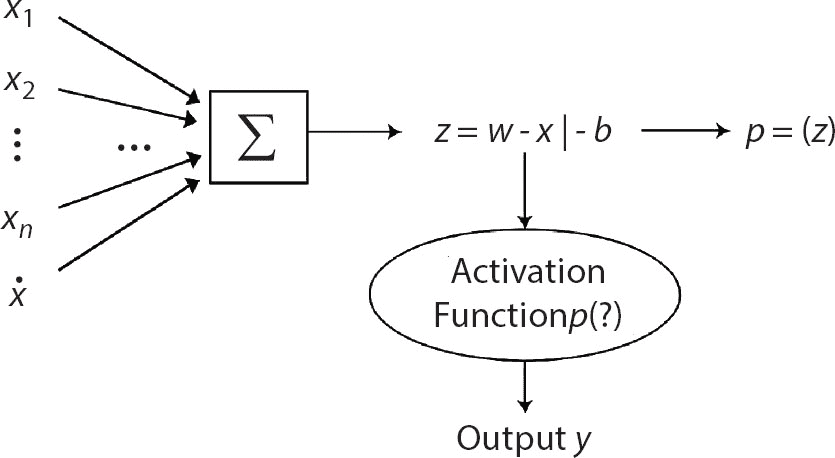

**图 10.2** 深度学习涉及的数学方面。

基于这一简单前提，我们可以将人工神经元堆叠成层，以构建名为神经网络的结构。层与层之间神经元的相互连接允许我们对复杂的依赖和关系进行建模，从而使得深度学习相对容易应用于各种优化——它是模型的自由参数：即在不同优化算法的循环中进行训练的权重和偏置，以最小化特定的损失函数。这种迭代过程使网络能够学习并提高其预测能力，从而为困难的优化问题提供有效的解决方案。

## 10.1.3 深度学习中的优化方法

优化在深度学习中实际上是一个非常重要的过程，因为它直接影响模型在训练期间的效率和性能。两类优化技术占据主导：一阶和二阶优化方法。每种方法在优化复杂的损失函数景观方面采取完全不同的策略，以获得更高的模型精度和更快的收敛速度。一阶优化方法是大多数深度学习训练过程的核心。

一阶优化方法依赖于目标函数的梯度信息来计算关于模型参数的梯度，从而实现高效更新并驱动优化过程；由于其简单且有效，它们在许多应用中被首选。与此类一阶优化方法相比，二阶优化器利用了额外信息，特别是由海森森矩阵描述的损失函数曲率 [6]。这意味着更新可以更加精细，并可能使收敛更快、整体准确性更好。在计算成本方面，它们更昂贵，但在优化景观复杂时可能会提供重要的收益。图 10.3 展示了深度学习中一阶和二阶优化方法的区别。

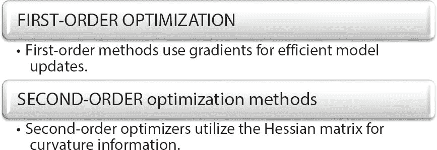

**图 10.3** 深度学习中的优化方法类型。

## 10.1.4 一阶优化方法

### 10.1.4.1 随机梯度下降

SGD 是深度神经网络训练中最广泛使用的优化算法之一。它的核心是使用从小批量示例获取的目标函数梯度对模型参数进行迭代更新。与每次迭代都使用整个数据集的全批量梯度下降相比，这使得频繁更新成为可能 [7]。在实践中，SGD 在负梯度方向上更新模型参数，这对应于沿损失景观的下降。每次更新的步长由称为学习率 `α` 的超参数控制。该学习率在优化过程中起着至关重要的作用，因为它控制了每次迭代中模型参数移动的距离。高学习率会越过最小值，而低学习率则会让收敛非常缓慢。

这种梯度不是使用完整的训练数据集，而是使用随机选择的小子集——通常称为“小批量”（mini-batch）来进行近似。在这里，随机近似引入了更新的方差，这可能有助于避免局部最小值并可能找到更好的解决方案。尽管 SGD 被广泛使用并证明有效，但它并不是没有缺点 [8]。一个严重的缺点是它往往收敛缓慢，特别是在复杂的损失景观上。此外，更新的随机性导致优化过程震荡，使得收敛变得困难。有时 SGD 会陷入局部最小值并导致次优解。图 10.4 对常用的一阶优化方法分类，包括 SGD、AdaGrad、RMSProp 和 Adam。


此时，参数更新继续迭代直到收敛。并不意外，收敛通常定义为两次迭代函数之间的差异低于某个预设阈值。当然，这种阈值将根据实际考虑进行选择：也许与运行时间或所需准确性相关的阈值。总之，`SGD` 是深度学习中的核心优化技术。它基于频繁的小批量更新的能力为模型的高效训练提供了必要的途径，并促进了它们在该领域各种应用中的使用。但理解它缺乏的内容以及改进它的技术（例如自适应学习率和基于动量的方法），为提高实际性能提供了真正的见解。

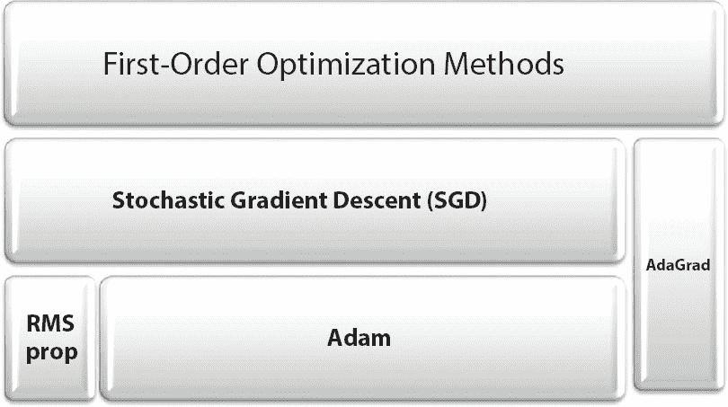

**图 10.4** 一阶优化方法类型。

### 10.1.4.2 AdaGrad

`AdaGrad` 是自适应梯度算法（adaptive gradient algorithm）的缩写，它是深度学习优化领域重大进展的一个范例。在传统的优化方法中，模型中的所有参数都采用固定的学习率，而 `AdaGrad` 则根据每个参数相关的梯度历史动态地调整其学习率 [9]。事实证明，这对于对抗困扰神经网络训练的问题非常有帮助，即那些平均梯度较小且减慢自身训练速度的特征。一个非常直观的假设是：在之前的迭代中更新频率高于其他参数的参数，其学习率随着时间的推移应该降低；否则，它将给予更新频率较低的参数（通常称为“稀疏特征”）更多权重。因此，学习率的动态调整使得 `AdaGrad` 能够形成更平衡的训练环境，并能更有效地帮助模型收敛。表 10.1 总结了深度学习中使用的关键优化方法的优缺点，包括 `SGD`、`AdaGrad`、`RMSProp` 和 `Adam`。

`AdaGrad` 对每个参数学习率的自适应调整是训练深度神经网络的关键机制。然而，正如后文将提到的，它存在学习率过度衰减的缺点，这最终会导致过早收敛，使得算法在实际获得良好解决方案之前就陷入无意义的更新中。简而言之，`AdaGrad` 通过让每个参数的学习率在训练过程中保持唯一且不断变化，来优化优化过程。这种特性在处理具有强差异特征分布的模型中非常有优势，从而带来了更快的收敛速度以及更好的整体性能。了解 `AdaGrad` 的动态机制以及所有可能的局限性，可能帮助实践者在深度学习应用中释放其所有潜力。

表 10.1 深度学习中用到的优化方法的优缺点。

| 序号 | 方法 | 优点 | 缺点 |
| --- | --- | --- | --- |
| 1 | `SGD` | 在大规模数据集上实现了快速的收敛速度。内存效率高，因为它一次只使用一小批数据。实现和调优简单。 | 容易陷入局部最优或鞍点。在最优解附近的收敛速度缓慢 [10]。高度依赖学习率和动量的参数，且这些参数必须经过非常仔细设置。 |
| 2 | `AdaGrad` | 为每个参数设置了学习率以达到收敛。当梯度变大时自动降低学习率；防止发散。适用于稀疏数据集，它也允许不同参数拥有自己的学习率。 | 学习衰减率可能过于激进导致过早收敛。它可能会积累过多的历史梯度，导致后期迭代收敛变慢。表现不是最好的，特别是对于非凸优化问题。 |
| 3 | `RMSProp` | 自适应学习率：每个参数的更新都会进行调整。适用于非平稳问题：即使在更复杂的损失曲面上也表现良好 [11]。有助于减少梯度问题：在大多数梯度的训练中扩展性良好。 | 会导致学习率衰减：通常会导致过早收敛。内存密集型应用：因为梯度存储在其中会消耗内存 [12]。对超参数敏感：对超参数非常敏感，需要仔细调优以获得性能。 |
| 4 | `Adam` | 动量与 `RMSProp` 的结合：利用了两种技术的优势。学习率自动自适应：根据历史动态决定下一个学习的率 [13]。与复杂数据集同步：在大多数深度学习任务中泛化性良好。 | 对超参数高度敏感：需要非常仔细的调优或超参数设置 [14]。需要额外内存：由于使用了维护动量的向量，存在额外开销。对过拟合敏感：在噪声数据上学习得太快。 |

### 10.1.5 RMSProp

`RMSProp` 是“均方根传播”（root mean square propagation）的缩写。这是一种自适应学习率优化算法，有助于解决由于不同参数之间梯度幅度存在极端差异而产生的问题。它通过梯度平方的移动平均对学习进行归一化，使其成为梯度幅度差异巨大的场景良好优化器。这一特性使得 `RMSProp` 在深度学习中比任何其他算法都更有用，因为那里损失曲面的动态可能是复杂且不均匀的。该方法作为梯度平方衰减平均值的和工作，允许在训练的任何时刻对每个参数进行响应式的学习率调整。它可以防止梯度小的参数使用高学习率导致的问题，以及梯度大的参数使用低学习率导致训练不平衡的问题。

学习率根据与梯度平方移动平均值平方根成反比的因子进行缩。通过这种调整，每个参数都被分配了一个独特的学习率，并随着训练过程中各个参数中观察到的梯度幅度而演变。`RMSProp` 在实践中运行非常好，已广泛应用于许多深度学习框架 [15]。然而，没有一种优化程序是完美的；相反，必须根据问题和数据的特定特性来选择算法。`RMSProp` 的自适应性质性固定学习率方法的有力替代方案，因此成为那些寻求调整深度神经网络训练的实践者的首选方法。理解动态机制以及深度学习模型的可能应用对于这些模型的最大性能和效率同样重要。

### 10.1.6 Adam

`Adam` 是自适应动量估计（adaptive moment estimation）的缩写，是深度学习使用的许多优化算法之一。事实上，可以是两个最有用算法——动量和 `RMSProp`——的结晶，因为它的两个优点都被用于学习率的调整，以最大化地利用梯度的一阶和二阶矩。它允许在许多训练场景下都能良好工作，这使得它在近年广泛的深度学习应用中被特别选中。在 `Adam` 中，它为每个参数维护两个动量向量 [16]。第一个跟踪梯度的均值，另一个估计梯度的无中心二阶矩。它根据梯度行为的历史自适应地更新参数的学习率。

总结来说，`Adam` 有效地结合了动量方面——即基于过去梯度的加速更新，以及 `RMSProp` 的自适应学习率机制。这产生了一种复杂的优化方法，能够处理多样化且复杂的数据，使其特别适用于深度学习任务 [17]。总而言之，`Adam` 结合了一阶和二阶矩信息，使其具有灵活性和高效性，并对训练过程中的独特特征进行适应。深度学习社区的广泛应用表明，其可靠性和性能驱动的偏好使其成为大多数应用程序的首选优化器。理解 `Adam` 的工作原理使从业者能够进一步调整深度学习模型，最终实现最优性能。

## 10.1.7 二阶优化方法

### 10.1.7.1 牛顿法

牛顿法是一种开创性的二阶优化算法，它基于海森矩阵（Hessian matrix），并用于计算每次迭代的步长。该方法的基本思想是用二次函数来局部近似目标函数，然后通过优化该近似函数来获取下一次更新。牛顿法更新规则的数学表达式如下：

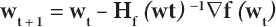<math><msub><mi>w</mi><mrow><mi>t</mi><mo>+</mo><mn>1</mn></mrow></msub><mo>=</mo><msub><mi>w</mi><mi>t</mi></msub><mo>&#x2212;</mo><msub><mi>H</mi><mi>f</mi></msub><mo>(</mo><mi>w</mi><mi>t</mi><msup><mo>)</mo><mrow><mo>&#x2212;</mo><mn>1</mn></mrow></msup><mi mathvariant="normal">&#x2207;</mi><mi>f</mi><mfenced separators="|"><msub><mi>w</mi><mi>t</mi></msub></mfenced></math>

牛顿法优化公式。

在这里，`H_f(w_t)` 表示在 `w_t` 处评估的 `f` 的海森矩阵 [18]。

牛顿法的一个主要优势是具有快速收敛到最优解的潜力，因此所需的迭代次数可能比一阶方法更少。这是因为它使用了二阶信息来进行更合理的更新。然而，牛顿法并非完美。一个显著的缺点是，海森矩阵通常需要从计算上计算或近似，这可能非常昂贵，特别是在参数数量可能非常大的大规模问题中。更重要的是，会遇到海森矩阵不是正定的矩阵问题；这会导致更新不稳定，从而减慢收敛速度。这意味着在实际应用牛顿法时必须加小心。

### 10.1.7.2 共轭梯度法

另一种非常流行的二阶优化算法是共轭梯度法，其主要优势在于不需要显式计算海森矩阵。共轭梯度法并不尝试计算海森矩阵，而是通过一系列指向最优解的方向进行迭代，如下：

<math><msub><mi>w</mi><mrow><mi>t</mi><mo>+</mo><mn>1</mn></mrow></msub><mo>=</mo><msub><mi>w</mi><mi>t</mi></msub><mo>&#x2212;</mo><msub><mi>alpha</mi><mi>t</mi></msub><mo>&#x2217;</mo><mo><mi>f</mi</mi>mi</mi></mo><mi2="normal&#x2207;</mi><msub><mi>w</mi><mi>t</mi></msub></math>

共轭梯度优化公式。

其中 `alpha_t` 是描述与之前方向连接的步长 [19]。更新规则可以表示为：

```
w_{t+1} = w_t - alpha_t * nabla f(w_t)
```

总结来说，牛顿法和共轭梯度法体现了二阶优化算法的优越性。每种方法都有特定的优缺点；因此根据特定优化问题的背景和属性进行仔细选择是必要的。

## 10.2 用于过程优化的深度学习架构

在过去的几年中，深度学习架构已成为许多行业中过程优化的重要工具。因为它们涉及复杂的算法来过滤和解释海量数据，深度学习架构在效率、准确性和决策方面的压力较小。以下提供了几种最受关注的架构及其应用：

### 10.2.1 卷积神经网络

卷积神经网络（CNNs）的设计初衷专门用于处理类似于图像和视频的网格数据。它们遵循这种架构，其中卷积层会自动检测并学习特征的空间层次结构，因此它们特别适用于图像分析任务。在制造业中，`CNN` 被广泛用于质量控制和缺陷检测。这些网络可以通过处理发送到生产线的视觉信息来实时检测异常和缺陷，从而减少浪费提高产品质量。

循环神经网络（RNNs）适用于序列数据，这意味着其应用领域在于与时间相关的信息。然而，`RNN` 与前馈网络相比有一个重要区别，即它们使用对先前输入的记忆来捕捉时间依赖。因此，它在时间序列预测等应用中具有高度适用性，在这些应用中，`RNN` 可以利用历史数据预测未来序列 [22]。例如，在过程优化中，`RNN` 可以进行需求预测，允许组织在满足市场预期之前安排生产。此外，`RNN` 还可以有效应用于流程中的异常检测，因为它们能够检测出长期序列随时间发生的变化；还能实现对可能发生的异常进行主动干预。

### 10.2.3 长短期记忆网络

长短期记忆（LSTM）网络是 `RNN` 家族中一种特定的架构设计，有助于帮助解决作为学习问题的长程依赖问题 [23]。这种 `LSTM` 包含可以极长时间存储信息的记忆单元。这些记忆单元非常适合复杂的流程优化任务，例如供应链管理，其中 `LST` 可能侧重于历史数据分析，以优化库存水平并最大化物流效率。另一方面，在预测性维护中，它可能用于监控设备随时间变化的性能以识别模式，从而识别可能发生故障的时间，同时最大限度地减少花费的时间和维护成本。

### 10.2.4 生成对抗网络

生成对抗网络（GANs）指的是一种合成数据生成的革命性方法。`GANs` 由两个神经网络组成：生成器和判别器。这些网络协同工作，产生逼的合成数据。这主要对过程优化模型有用，特别是当真实数据的可用性稀缺或太难以访问时。`GANs` 通过产生高质量的合成数据集，能够训练稳健的机器学习模型，为组织提供了一个不受数据限制而进行过程优化的机会。生成的数据可以进一步用于更新现有数据集，有助于提高模型的泛化能力和性能。图 10.5 提供了按有监督学习和无监督学习分类的深度学习架构的可视化概述。

### 10.2.5 自动编码器

自动编码器是用于降维和特征提取的无监督神经网络。编码器将输入数据压缩到低维表示上，解码器则从该表示重构原始数据。过程优化中的自动编码器有助于识别复杂数据集中的关键特征，让组织专注于最相关的信息，同时过滤掉噪声 [24]。这有助于模型提高性能和可解释性，并往往更容易从这些数据中获得可操作的见解。

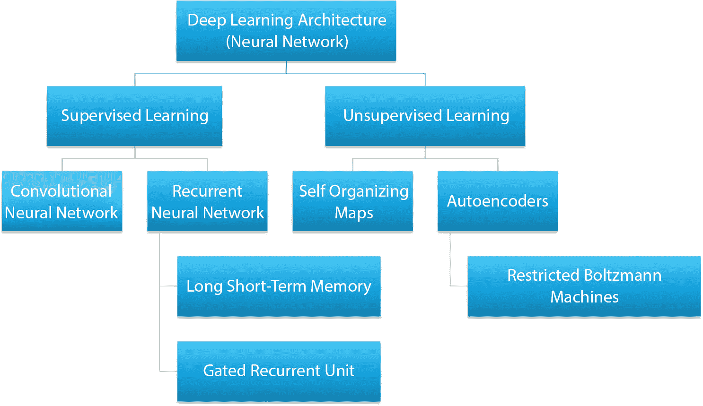

**图 10.5** 深度学习架构（神经网络）。

这些深度学习架构结合最先进的优化技术（如 `SGD`、`Adam` 和 `RMSProp`），允许从业人员针对不同的工业应用对模型进行卓越微调，以获得最佳性能。这些方法的聚合不仅为过程提供了更高的效率，还促进了新环境的创新，有望在所有领域实现更智能、自适应的系统。理解这些架构的能力和应用对于在过程优化工作中最大化其效果至关重要。

## 10.3 深度学习过程优化过程中的挑战与局限性

尽管深度学习可以很好地支持过程优化，但也存在许多挑战和局限性，影响底层训练过程的效率和有效性。对于希望充分利用深度学习技术的从业人员来说，理解这些挑战至关重要。以下是该领域面临的一些关键困难：

1. **梯度消失和爆炸**

   在训练深度神经网络时面临的主要挑战之一是由于被称为“梯度消失和爆炸”的影响。在反向传播过程中，梯度可能会变得非常小，接近噪声水平（消失），或者在反向传播期间变得大到不切实际（爆炸） [25]。这两种现象从根本上会阻碍模型从数据中学习的能力。诸如仔细的权重初始化、批量归一化和使用跳跃连接的方法被设计解决这些问题。它们促进了训练的稳定性，使梯度现在能更好地流过网络层。

2. **过拟合**

   过拟合发生在模型在训练数据上表现极佳，但无法恰当地泛化到未见过的数据上。这在缺乏多样性的小数据集上很常见。深度学习模型，尤其是具有许多参数的模型，容易过拟合。从业人员通过使用正则化技术、Dropout 策略和数据增强来克服这一挑战。上述所有方法都在训练过程中引入了变化，使得所学习的模型是稳健的，并在新的、未见过的数据上表现良好。

3. **计算复杂度**

   深度学习模型需要大量的计算资源 [26]。需要许多强大的 `GPUs`，由于同样的原因，还需要巨大的内存。对于大型模型或大量数据集来说，这些可能是昂贵且耗时的。因此，组织需要根据感知到的收益，考虑深度学习解决方案的财务和时间影响。有效的资源管理和利用云计算解决方案可以部分减轻这种负担。

4. **数据需求**

   通常，深度学习模型需要大量的标记数据才能表现良好。定位和标记如此大量数据的过程昂贵且耗费人力的，使其高度依赖数据。特别是当涉及的领域非常专业时，这仍然是一项挑战性任务，因为在这里找到大型标记数据集是困难的。迁移学习是此类情况下应用的技术之一：预训练模型在较小的数据集上微调，这样就不需要大量使用标记数据。

5. **可解释性**

   许多深度学习模型本质上是“黑箱”，意味着无法掌握决策的影响因素，且人类无法轻易理解。在某些非常关键的应用中（包括医疗和金融以及自动系统），这种透明度的缺失使得了解模型预测背后的逻辑变得至关重要 [26]。科学家们正在积极寻找改进模型可解释性的方法，包括可解释 AI 框架和概述模型构思原理的可视化技术。

6. **可扩展性**

   模型复杂性和规模的增加使得这些模型的训练效率变得降低，可扩展性已成为最大的挑战之一。随着从业者对优化训练时间和资源利用率的需求出现，分布式训练和模型并行的先决条件也显现出来。增强的分布式计算技术有助于缓解可扩展性问题，并为组织提供有效处理大型数据集和复杂模型的机会，而不会产生过大的性能下降。

### 7. 超参数调优

为深度学习模型寻找最佳超参数设置有时在计算上是非常昂贵且具有挑战性的。超参数包括学习率、批量大小以及描述网络架构的任何影响模型性能的参数。自动化的超参数调优（特别是网格搜索和贝叶斯优化）正越来越多用于加速这一过程 [27]。从业者可以更高效地识别出配置最优变体。

### 8. 灾难性遗忘

灾难性遗忘是指在多个任务上顺序训练的模型可能会忘记如何在之前之前学习的任务上表现良好的问题。当模型需要随时间学习新信息或新任务时，这种原因尤为令人担忧 [28]。针对这一挑战正在追求的技术包括持续学习和记忆增强网络，其目标是在摄取新信息的同时保留之前获取的知识，从而增强模型的整体性能及其适应性。

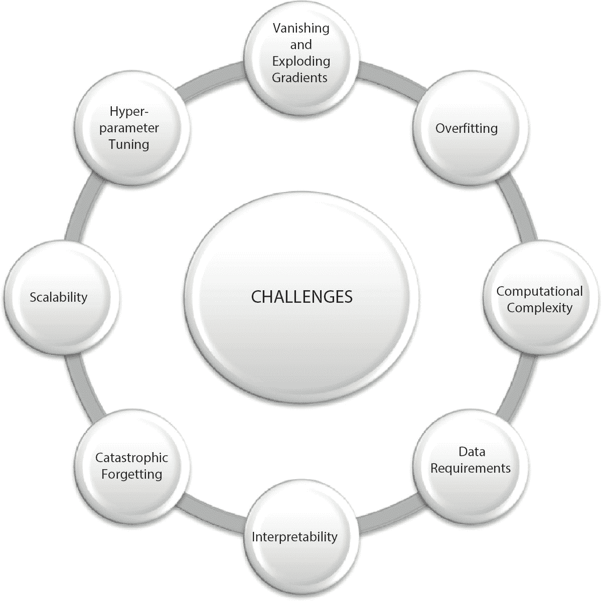

**图 10.6** 深度学习优化过程的挑战与局限性。

在此背景下，对深度学习固有的挑战和局限性进行概述意味着：尽管深度学习在过去提供了巨大的优化潜力，但注意并面对深度学习应用中所包含的一些挑战和局限性是非常重要的 [29, 30]。了解这些障碍使从业者更好地理解如何连接模型训练和实现的复杂性，从而得出更有效、更稳健的解决方案。图 10.6 总结了深度学习优化过程中的主要挑战，包括梯度消失、过拟合和可解释性。

## 10.4 结论

在本章中，我们深入探讨了深度学习方法与过程优化技术之间的相互作用，强调了神经网络训练中出现的关键理论基础和实践挑战。深度学习中的最优性被证明是明确非凸的，这意味着面临着巨大挑战，但也预示着极广阔的研究前景。我们讨论了主要的困难，包括梯度爆炸/消失，以及挑战模型妥当训练的糟糕谱属性。从业者可以通过探索和应用来解决这些挑战，例如仔细的初始化、批次归一化以及许多跳跃连接，以稳定并提高性能。


我们对最先进优化器的调查表明，一阶和二阶方法是丰富价值列表的宝贵来源。`SGD` 及其自适应变体 `AdaGrad`、`RMSProp` 和 `Adam` 由于其相对的简单性和有效性，在深度学习训练中变得极其流行。我们讨论了它们如何在这些高效更新中利用梯度信息来驱动优化过程。二阶方法的优势在于利用了更多来自损失函数曲率的信息，即 `Hessian` 矩阵。但代价是付出更昂贵的计算成本来换取更快的收敛速度和更高的精度。我们通过引入使这些优化生效的理论理解，进一步阐述了我们的研究。诸如全局层面的景观分析、模式间的连接性和彩票假设等观点，不仅为神经网络的训练动力学带来了更深层的见解，还强调了进一步研究的路径。当我们试图理清深度学习的复杂性时，这些理解揭示了正在构建的知识的丰富。

未来，可以看到深度学习优化中的研究挑战对于研究人员和从业者的实现都至关重要。本章讨论的框架和方法论为该领域的持续探索和发展提供了坚实的基础。通过进一步研究优化技术，我们将改进深度学习模型的训练过程，从而产生更稳健、更有能力的系统。这种良好优化的深度学习的影响远超学术领域。它渗透到医疗、金融、制造业、自动驾驶系统等许多行业。

我们正处于变革性变化的巨大边缘，通过挖掘深度学习的力量，开启过程优化及更多领域的大门来释放效率并创新。本章不仅旨在阐明当前深度学习优化的现状，旨在激发未来的探索和边界，为这一快速演变的格局中的可能性铺平道路。通过拥抱深度学习中的挑战与机遇，我们可以为塑造现在及未来技术世界的进步开辟道路。

## 参考文献

1. Bartlett, P., Hazan, E., Rakhlin, A., Adaptive online gradient descent, in: *NIPS*, 2008.

2. Bengio, Y., Learning deep architectures for AI. *Found. Trends Mach. Learn.*, 2, 1, 1–127, 2009.

3. Bengio, Y., Lamblin, P., Popovici, D., Larochelle, H., Greedy layerwise training of deep networks, in: *NIPS*, 2007.

4. Bordes, A., Bottou, L., Gallinari, P., `SGD-QN`: Careful quasi-newton stochastic gradient descent. *JMLR*, 10, 1737–1754, 2009.

5. Bottou, L., Stochastic gradient learning in neural networks. *Proc. Nîmes*, 91, 12–21, 1991.

6. Mamodiya, U., Mishra, P., Iqbal, A., Design & Analysis of Low-Power Low-Voltage Double-Tail Comparator. *IOP Conf. Ser. Mater. Sci. Eng.*, 988, 01218, December 2020.

7. Chu, C.T., Kim, S.K., Lin, Y.A., Yu, Y.Y., Bradski, G., Ng, A.Y., Olukotun, K., Map-Reduce for machine learning on multicore. *NIPS*, 19, 281–288, 2007.

8. Ciresan, D., Meier, U., Gambardella, L., Schmidhuber, J., Deep big nets excel on handwritten digit recognition, CoRR, 2010.

9. Coates, A., Lee, H., Ng, A.Y., An analysis of single-layer networks in unsupervised feature learning, in: *AISTATS*, vol. 14, 2011.

10. Dean, J. and Ghemawat, S., Map-Reduce: simplified data processing on large clusters. *Comm. ACM*, 51, 1, 107–113, 2008.

11. Vijay, Y., Goyal, S., Sharma, R., Mamodiya, U., Green Building Design and Security System. *J. Web Eng. Technol.*, 6, 2, 10–14, May 2019.

12. Goodfellow, I., Le, Q.V., Saxe, A., Lee, H., Ng, A.Y., Measuring invariances in deep networks. *NIPS*, 23, 646–654, 2010.

13. Mamodiya, U., Mishra, P., Iqbal, A., Design & Analysis of Low-Power Low-Voltage Double-Tail Comparator. *Int. J. Eng. Res. Gen. Sci.*, 5, 5, 71–79, September-October 2017.

14. Hinton, G.E. and Salakhutdinov, R.R., Reducing the dimensionality of data with neural networks. *Science*, 313, 5786, 504–507, 2006.

# 11. 量子点的机器学习方法

### 摘要

量子点（QDs）是具有纳米尺寸的半导体晶体，具有独特的光电学特性。它们在光电学、生物传感、药物递送和研究领域具有巨大的价值。然而，量子点的合成取决于尺寸、形状、成分和温度等多种因素，这些过程往往耗时且具有不确定性。通过整合机器学习（ML），研究人员可以处理和分析数据集来预测优化条件。本章探讨了机器学习在量子点合成和优化中的作用。

**关键词：** 量子点，合成，机器学习，预测模型。

## 11.1 引言

量子点（QDs）是具有纳米尺寸的半导体晶体，具有独特的光电学特性。它们在光电学、生物传感、药物递送和研究领域具有巨大的价值。然而，量子点的合成取决于尺寸、形状、成分和温度等多种因素，这些过程往往耗时且具有不确定性。通过整合机器学习（ML），研究人员可以处理和分析数据集来预测优化条件。本章探讨了机器学习在量子点合成和优化中的作用。

在过去的几年里，机器学习在量子点合成中的应用引起了广泛关注。量子点的合成取决于多种因素的调节，例如前驱体选择、温度控制和反应持续。这些参数被用作机器学习模型的变量，并在现有的实验数据上进行训练，对合成条件做出预测。将机器学习整合到量子点合成研究中有助于建立前驱体与目标属性之间的关联，可能为进一步的研究提供指导框架，并缩短合成时间和成本。

量子点的合成取决于尺寸、形状、成分和温度等多种因素，这些过程往往耗时且具有不确定性。通过整合机器学习（ML），研究人员可以处理和分析数据集来预测优化条件。本章探讨了机器学习在量子点合成和优化中的作用。

机器学习是人工智能的一个分支，使算法能够在数据集中发现隐藏的模式，并对新的、相似的数据进行预测。机器学习在多个高科技领域已取得显著进展，包括自动驾驶、语音和图像识别、科学研究和智能搜索。其数据处理能力使机器学习成为解决材料科学开发中复杂数据分析的极具前景的工具，能够显著加速从材料发现到实际应用的进程。因此，将机器学习引入材料研究代表了向数据驱动发现范式的转变，这种范式因其发现新材料、理解和预测材料结构以及优化材料属性和功能的潜力而受到了广泛关注。

图 11.1 展示了传统与机器学习（ML）合成量子点方法的对比。随着计算工具、机器学习和数据分析的进步，研究人员现在可以处理和分析海量数据集，模拟复杂的材料行为，并预测传统上需要耗时实验工作的属性。这些方法为更高效地发现和设计新材料提供了方向。

## 参考文献

1. Hinton, G., Osindero, S., Teh, Y. A fast learning for deep belief nets. *Neu. Comp.*, 18, 7, 1527–1554, 2006.

2. Jarrett, K., Kavukoglu, K., Ranzato, M., LeCun, Y. What is the best multistage architecture for recognition?, *ICCV*, 2009.

3. Larochelle, H., and Bengio, Y. Classification using discriminative boltzmann machines, *ICML*, 2008.

4. Le, Q.V., Ngiam, J., Chen, Z., Chia, D., Koh, P., Ng, A.Y. Tiled convolutional neural networks. *NIPS*, 23, 1279–1287, 2010.

5. Le, Q.V., Zou, W., Yeung, S.Y., Ng, A.Y. Learning spatiotemporal features for action recognition with independent analysis, *CVPR*, 2011.

6. Mamodiya, U., Raigar, G., Meena, H. Design & Simulation of Tiffin Problem Using Fuzzy Logic. *Int. J. Sci. Adv. Res.*, 4, 10, 55–60, 2018.

7. LeCun, Y., Bottou, L., Orr, G., Muller, K. Efficient backprop, in *Neural Networks: Tricks of the trade*, pp. 5–50, Berlin, Germany, 1998.

8. Lee, H., Battle, A., Raina, R., Ng, A.Y. Efficient sparse coding algorithms. *NIPS*, 19, 801–808, 2007.

9. Lee, H., Ekanadham, C., Ng, A.Y. Sparse deep belief net for visual area V2. *NIPS*, 20, 873–880, 2008.

10. Lee, H., Grosse, R., Ranganath, R., Ng, A.Y. Convolutional deep belief networks for scalable unsupervised learning of hierarchical representations, *ICML*, 2009a.

11. Lee, H., Largman, Y., Pham, P., Ng, A.Y. Unsupervised feature learning for audio classification using convolutional deep belief networks. *NIPS*, 22, 1096–1104, 2009b.

12. Mann, G., McDonald, R., Mohri, M., Silberman, N., Walker, D. Efficient large-scale distributed training of conditional maximum entropy models. *NIPS*, 22, 1231–1239, 2009.

13. Martens, J. Deep learning via hessian-free optimization, *ICML*, 2010.

14. Nair, V. and Hinton, G.E. 3D object recognition with deep belief nets. *NIPS*, 22, 1339–1347, 2009.

15. Ghai, D., Tripathi, S.L., Saxena, S., Chanda, M., Alazab, M. *Machine Learning Algorithms for Signal and Image Processing*, Wiley IEEE Press, USA, 2022, DOI:10.1002/978119861850.

16. Thillaiarasu, N., Tripathi, S.L., Dhinakaran, V. (Eds.). *Artificial Intelligence for Internet of Things: Design Principle, Modernization, and Techniques*, 1st, CRC Press, Boca Raton, UK, 2022, https://doi.org/10.1201/9781003335801.

关于使用计算和机器学习（ML）技术合成纳米颗粒已有许多综合综述发表[[[11, 20, 24]]。本章旨在详细概述量子点（QD）研究中使用的机器学习算法。首先，我们讨论了机器学习的原理和操作流程；随后，我们根据不同的机器学习算法分类增加了一些带有案例的研究。最后，我们总结了机器学习在量子点合成中应用的挑战和未来展望。

## 11.2 机器学习的基本与操作原理

机器学习是人工智能（AI）的一个分支，是计算机通过大量输入数据进行自主学习的过程。机器学习算法结合了数学统计的优化和建模能力。图 11.2 展示了机器学习的操作流程图，包括数据收集、特征工程、模型选择、验证和结果。

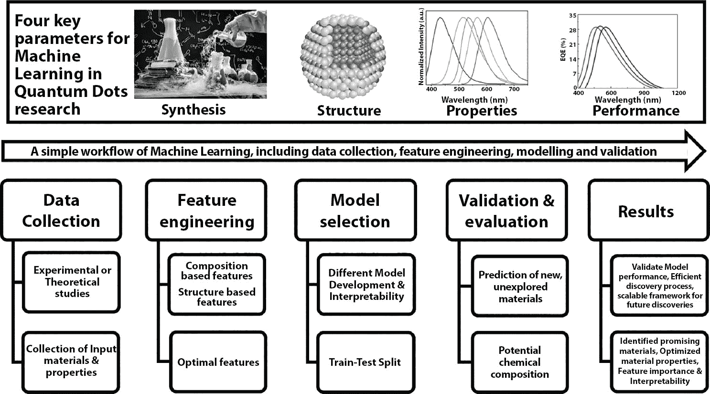

`Figure 11.2` 描述量子点研究的四个关键参数和机器学习（ML）的简单工作流。机器学习加速了从合成、结构、性质到性能的研究。

材料科学数据通常分为四类：来自理论模拟的数据、实验数据、表征结果以及来自文献或商业数据库的信息。获取后，这些数据集被分为训练集、验证集和测试集，以训练模型、最小化过拟合并实现准确评估。

将原始数据转换为训练数据涉及一个称为特征工程的过程，其中提取特征向量来表示材料属性及其关系。让我们以红外光谱仪为例。傅里叶变换将初始干扰信号转换为光谱信号，这是通过线性变换进行基础特征工程的示例。特征向量的选择显著影响算法将输入映射到输出的准确性。通常，机器学习中的特征选择是一个手动过程。这一步可以随着深度学习（DL）的发展而实现自动化。它在实验结果的图像分析中获益。由于数据量巨大，自动化特征工程提升了效率和有效性。

特征工程涉及将原始数据转换为特征。这些特征用于描述材料属性的机器学习模型，并为材料设计和预测分析提供基础。通常，模型选择涉及选择合适的算法并对数据进行训练。

训练完成后，使用预留的未见数据测试集评估模型性能，并侧重于选择泛化误差最小的模型。总误差通常归因于偏差（bias）、方差（variance）和基础误差。偏差是指训练集中的错误，表示模型拟合数据的内在能力；方差反映了具有相似分布的数据集之间的输出差异，显示了模型对数据变异性的敏感性；不可归误差源于噪声、测量局限性和不确定性。当模型能力不足以捕捉输入与输出之间的关系时，高方差会导致欠拟合。相反，过于复杂的模型可能会遭受过拟合。交叉验证、扩展数据集、应用正则化和丢弃（dropout）等技术常用于缓解过拟合。

## 11.3 用于量子点研究的各种机器学习算法

机器学习算法广泛分为监督学习、无监督学习和半监督学习。根据目标变量的可用类型以及它们解决的特定任务，每种算法具有不同的特征。

当训练数据中有目标变量时，使用监督学习算法。它也被称为“带老师的学习”。在监督学习中，目标变量有两种类型：类别和连续型。类别目标变量导致分类任务，模型将数据归类到预定义的类中。分类算法的示例包括 K 近邻（KNN）、支持向量机（SVMs）、神经网络（NNs）、朴素贝叶斯和决策树（DTs）。另一方面，连续型目标变量导致回归任务，其目标是预测一个数值。标准回归算法包括线性回归（LR）、梯度提升回归树和随机森林（RF）。当具有良好的标记数据集时，这些算法有助于学习输入到输出的直接映射。

当只有部分数据集被标记时，使用半监督学习。它结合了监督和无监督学习，在标记数据昂贵或耗时时特别有用。半监督学习算法主要关注分类和聚类任务。`LR` 和逻辑回归常用于此类，因为它们利用标记数据建立初始模型，然后通过无标记数据进行优化。

无监督学习算法用于数据中没有目标变量的情况。在情况下，模型在没有监督的情况下识别数据的模式和结构。无监督学习任务包括聚类（将相似的数据点分组）和关联（识别数据点之间的关系）。无监督算法经常应用于市场细分、推荐系统和其他在无预定义标签的情况下分析数据的应用。

监督学习是一种在科学和工程领域非常流行的预测建模，因此我们对此进行详细讨论。过去几年关于无监督学习的研究很少。接下来的章节将讨论用于量子点研究的各种机器学习模型/算法。

目前的自动电子显微镜（TEM）数据算法主要使用监督方法，需要大量的标记数据，且客观性、适应性有限。Wang 等人使用了 `AutoDetect-mNP`，这是一种用于自动 TEM 分析的无监督算法，它可以根据形状特征提取凸纳米颗粒的形态细节，且人工干预最小[[[35]]。此外，它在金纳米颗粒、钯纳米立方体、硒化镉量子点（QD QDs）的 TEM 图像上进行了测试，证明了可靠且泛化良好的形态评估能力。它支持纳米颗粒的表征以及时间分辨 TEM 研究。

### 11.3.1 线性回归

`LR` 是监督学习方法的一种，由于其简单易于解释而被广泛使用。如果我们有输入变量 `x` = (`x[1]`, `x[2]`，... `x[p]`），则预测输出变量 `y` 由下式给出：

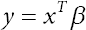


# 回归模型与技术

残差平方和是确定系数 β 的目标函数，给出如下：

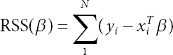

在这里，`N` 代表数据点的数量。多项式回归 (PR) 模型可以表示为：

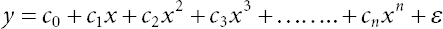

其中 `c[0]`、`c[1]`、…`c[n]` 是系数，∊ 是误差项。岭回归 (RR) 和最小绝对收缩和选择算子 (LASSO) 是用于提高高维空间中回归模型准确性和可解释性的技术。这些方法有助于减少数据过拟合问题，并提高模型准确性。

Armida *et al.* 使用了多元线性回归 (MLR)，并研究了维度、尺寸、掺杂、浓度以及其他碳点 (CDs) 微观结构等特征如何影响它们的热电性能 [1]。优因因子衡量了热电效率，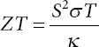其中 `S`、`σ`、`T` 和 `κ` 分别是 Seebeck 系数、电导率、温度和热导率。

Armida *et al.* 使用了多元线性回归 (MLR)，并研究了维度、尺寸、掺杂、浓度以及其他碳点 (CDs) 微观结构等特征如何影响它们的热电性能 [1]。优因因子衡量了热电效率。（注：提供的原文此处公式碎片化，已根据标准物理学进行重建）。

优因因子 `ZT` 衡量热电效率。`S`、`σ`、`T` 和 `κ` 分别是 Seebeck 系数、电导率、温度和热导率。

Senanayake *et al.* 使用 ANN 展示了不同的合成因素如何影响量子点（CDs）发射的颜色和波长 [27]。他们的分析表明，反应和净化方法以及溶剂类型对发射特性的影响比实验中常用的反应温度或时间更强。他们从以往的研究中收集了 407 个数据样本，其中 379 个用于训练，28 个用于测试。颜色预测模型没有使用反应温度或时间，实现了 94%的训练准确率。当结合分类和回归技术时，发射预测的准确性显著提高，平均绝对误差从 38.4 下降到 25.8。为了解决数据有限的挑战，他们使用了`ANN ML`模型，该模型的性能优于`XGBoost`、`KNN`和`SVM`等其他方法。作者使用了两步模型：用分类模型预测颜色，然后用此颜色预测（以及用于训练的真实颜色）通过回归模型指示发射波长。这些混合模型有利于预测新型 CD 的发射，有助于研究人员选择有前景的反应方案，并使 CD 的合成和优化过程更快、更简单。

Pudza *et al.* 使用多层感知器（MLP，一种神经网络）来预测荧光 CD 的光致量子产率（PLQY）。他们使用包含温度、时间和溶剂比例变量 30 个实验数据样本对模型进行了训练 [26]。`MLP`准确地预测了`PLQY`，产生了高能且可靠的荧光 CD。这种方法还有助于保持高输出质量的同时减少所需的用量。

Doring *et al.* 使用深度神经网络和`CNNs`分析 PL 衰减数据，以测量乙醇-水混合物（578 样本）和酒精饮料（19 样本）中的乙醇含量。他们使用 PL 激发/发射光谱、PL 衰减光谱以及强度和寿命等特定特征对模型进行训练。通过时间分辨光谱数据，`CNNs`准确地预测了乙醇含量，克服了影响简单模型的饮料自荧光等问题。这项研究表明，DL 模型可以改进发光材料的化学传感，特别是对于光学传感的应用。

## 梯度提升

GB 是另一种机器学习框架，它结合了多个弱模型并创建一个强大的单一模型。通常，它涉及`DTs`，称为`GBDT`模型。GB 基于训练一系列简单模型（如`DTs`），每个模型都试图修正前一个模型的错误。这种逐步演进的方法提高了准确性，并被广泛用于回归和分类。初始预测通常是目标变量的平均值，随后添加模型以最小化指定的损失函数，从而有效精精炼预测结果。由于其灵活性，它可以应用于各种损失函数，适用于回归和分类任务。GB 有时可能会发生过拟合，由于正则化较弱，这种现象在处理噪声或复杂数据时尤为常见。`XGBoost`是一种先进的梯度提升版本，解决了这些问题。它以其高效性、可扩展性和高性能而闻名。它使用一系列`DTs`模型并添加了正则化项。它采用了一种更复杂的优化方法，能够更好地捕获数据中的模式。它能很好地处理大型数据集和高维特征（即使数据嘈或不完整）。`XGBoost`被广泛应用于许多领域，例如金融、医疗保健、图像处理和自然语言处理。它能够分析复杂数据集并发现有价值的见解。

`XGBoost`在 CD 研究中非常有效。Han *et al.* 应用`XGBoost`通过水热法优化了高荧光 CD 的合成参数 [15]。发现`XGBoost`的性能优于其他模型，例如`SVM`、`MLP`和`Gaussian process regressor`。他们使用五个输入变量来预测`QY`：乙胺体积、反应温度、前驱体质量、反应时间和升速率。他们使用了 391 组这些因素组合与`QY`的实验数据。`XGBoost`发现高光学质量、碱性催化剂体积与前驱体质量之间存在强关联，支持了实验发现。

Tang *et al.* 使用回归模型增强了水热法合成碳量子点的`PLQY` [30]。他们为此使用了六个输入特征，例如生长参数、反应温度、pH 值、反应时间、升速率、前驱体质量和溶液体积。他们分析了 467 次实验，发现`XGBoost`的性能最佳，R²值为 0.8402。模型识别出 pH 是影响最大的因素，其次是温度和反应时间。他们探索了超过 150 万种可能的合成条件，并提出了最高的 PLY 建议。

Chen *et al.* 研究了不同的生物炭准备参数如何影响 CD 的荧光`QY`。他们使用了六种机器学习模型，例如`DTs`、`extra trees`、`RF`、`KNN`、`GBDT`和`XGBoost` [5]。他们使用包含 480 个样本的数据集，包括农废物类型以及纤维素、木质素、水分和氮（N）含量。发现`GBDT`性能最好。这是由于其处理缺失值、离群值和复杂高维数据的能力。影响`QY`预测的因素是停留时间、热解温度、碳氮和氮含量。

Rui Chen *et al.* 使用`DT`机器学习算法制了一种用于检测`Cu2+`的高选择性荧光传感器，并实现了 32.9%的量子率 [6]。这种方法提供了便携、准确且高效的检测。它展示了近红外碳化聚合物传感器和环境监测领域的卓越进展。

## 随机森林

RF 使用多个`DTs`形成一个“森林”，以结合不同的见解。这使其对过拟合具有抵抗力，并能够产生稳定精确的结果。它为预测和理解这些行为提供了新方法。

Chen *et al.* 研究了不同反应参数如何影响 CD 的光致性能，并使用机器学习帮助合成多种色的 CD [18]。他们测试了五个输入参数：前驱体和溶剂的类型与量、温度和反应时间。共 270 种实验方案为机器学习算法提供了数据，输出变量为最大发射波长、三维荧光光谱、斯克斯位和荧光`QY`。在测试的模型中，`RF`模型优于其他模型，如`light GB machine`、`XGBoost`、`RR`、`support vector regression`和`LASSO`，特别是在预测最高发射波长、荧光`QY`和斯克斯位等关键特征方面。特征重要性算法发现，溶剂类型主要影响最大发射波长，前驱体比例显著影响`QY`，而前驱体类型主要决定了斯克斯位。

Xing *et al.* 使用 `RF` 模型合成了具有特定 PL 特性的 CDs。他们没有使用固定的前驱体，而是测试了 202 种不同的组合，每种组合使用 24 种可能的前驱体中的三种 [17]。以 365 和 532 nm 的激发波长作为输出参数，他们在保持反应条件恒（200°C 和 10 小时）的情况下记录了最长和强度 PL 发射波长。`RF` 模型优于五种不同模型（`KNN`、`AdaBoost`、`bagging`、`DT` 和 `SVM`），在预测 PL 波长方面显示出最高的精度。通过利用 `RF` 模型探索前驱体组合的所有范围，研究人员可以更高效地筛选出所需的 CD，显著减少对随机实验的需求。

He *et al.* 使用 `RF` 回归模型预测了水热合成 CD 作为缓蚀剂的抑制效率。该模型包含 102 个数据点，包括实验数据和文献数据。他们使用输入参数，例如前驱体和溶剂类型、`HCl` 中的 CD 浓度、数量和体积、温度以及反应时间，输出变量为抑制效率。`RF` 模型中的特征重要性分析强调，`HCl` 中的 CD 浓度是增强抑制效果的最影响因素，其次是 `N` 含量和反应时间。应用遗传算法（`GA`）进一步优化合成条件——这种算法受自然选择的启发，通过选择有利条件来迭代改进合成参数。`RF-GA` 方法允许更高效、更受控地制备基于 CD 的缓剂，为识别最佳合成条件提供了简化的流程。

Song Wei 探索了使用环保离子液体辅助法合成具有优良荧光性能的 Ag-Zn-In-S QD 薄膜的合成过程 [37]。使用了不同的 `ML` 模型来优化合成参数。他们通过 `RF` 实现了最高的精度（`r` = 0.84, `R²` = 0.847）。模型的预测与实验结果吻良好，证实了其可靠性。这种方法为通过 `ML` 设计高性能荧光材料奠定了基础。

## 其他 ML 算法

Dager *et al.* 使用主成分分析（`PCA`）[23]、稀疏非负矩阵因子化（`NMF`）[28] 和多变量曲线解析（`MCR`）来评估通过一步热分解过程从茴香种子合成的碳 QD 的 pH 依赖行为 [7, 13]。这项研究确定了 `ML` 能否对不同 pH 水平和激发波长下的 PL 测量进行分类，并识别导致不同条件下碳 QD PL 机制的来源。在 3 到 13 的 pH 范围内，200 到 340 nm 的波长激发产生了 48 次 PL 测量。使用 `PCA`、`MCR` 和 `NMF` 进行 `ML` 分析为制备的 C-QDs 的表面态和 PL 特性提供了见解。

Xu *et al.* 使用线性判别分析（`LDA`）[43] 和 `SVM` [22] 分析了来自基于 CD 的传感器阵列的多维数据集。它设计用于检测和区分四四环素抗生素（TCs）：四环素、氧四环素、去西环素和甲环素 [40]。阵列的荧光强度（`I`/`I₀`）值形成包含两个 CD、四种四环素和五个重复的训练数据数组。对于验证，对 52 个未知样本进行了分类，并使用 `LDA` 和 `SVM` 实现了单个 TC 和二元混合物的清晰分离。这证明了可靠的聚类能力。

Huazhang Guo *et al.* 为水热合成 CQD 引入了一种基于 `ML` 的多目标优化策略 [16]。这种封闭方法依赖稀疏数据，通过减少对试验方法的依赖来加速发现。它揭示了合成参数与性质之间的关系，从而优化了全色 PL 和高 PLQY。仅通过 63 次实验，他们就实现了全色荧光 CQDs 的 60% PLQY，并展示了一个用于高效材料设计的强大框架。

# 总结与未来展望

本章探讨了 `ML` 在 QD 研究领域的最新进展。我们简要总结了结合 QD 近期研究的关键 `ML` 算法。表 11.1 总结了几项有助于更好地理解 `ML` 模型的研究。`ML` 具有强大的数据处理能力和相对较低的成本，加速了 QD 研究。预计 `ML` 还可以解决 QD 的挑战，例如颗粒追踪、设备故障分析以及工业应用的稳定性改进。然而，仍然存在一些障碍，但它们可能彻底改变 QD 研究。目前在这一领域仍然难以找到准确的最佳参数。我们需要一个将特征整合到合成过程和化学中的完整模型，以找到实际或实验结果。

`ML` 是一种高度依赖训练数据质量和数量的技术，需要投入大量精力进行适当的结构化。文本挖掘可以加速从文献中提取数据，但可用数据的缺失会限制模型的准确性。建立标准化且开放的 QD 数据库至关重要，通过元学习应对小数据集挑战可以帮助复杂的 QD 研究。

**表 11.1** 使用 `ML` 的 QD 研究。

| **ML 模型** | **输入** | **输出** | **样本** | **参考文献** |
| :--- | :--- | :--- | :--- | :--- |
| GBDT | 生炭合成参数 | 荧光量子产率 | 480 | 5 |
| RF | 前驱体组合 | PL 波长强度 | 202 | 39 |
| RF, GA | SPP | 抑制效率 | 102 | 18 |
| MCR, PCA, NMF | 波长，pH | 无监督聚类 | 401 | 7 |
| Lin. reg., PR | SPP | PLQY | 227 | 31 |
| MLR, KNN | SPP | PLQY，PL 峰值 | 44 | 34 |
| MLR | SPP | 发射强度 | 121 | 9 |
| RF | 反应变量 | 发射波长，斯克斯位移，PLQY | 480 | 39 |
| LR, KNN, SVM | CD 荧光传感器 | 蛋白质分类 | 48 | 25 |
| CNN | SPP | 光谱特性，颜色 | 170 | 36 |
| ANN | SPP | 颜色分类，发射波长 | 407 | 27 |
| ANN | CD 荧光变化图 | 氨基酸分类 | 90 | 33 |
| Multilayer perceptron | SPP | PLQY | 30 | 26 |
| CNN | CD 发射光谱 | 乙醇量 | 597 | 10 |
| XGBoost | SPP | PLQY | 391 | 17 |
| XGBoost | SPP | PLQY | 467 | 30 |
| PCA, XGBoost | SPP | 荧光强度，发射中心 | 400 | 17 |
| XGBoost | CD 催化剂反应参数 | C-H 键氧化的成功否 | 652 | 19 |

机器学习模型解释在材料科学中至关重要，因为基于 `NN` 的模型通常作为“黑箱”运行。开发可解释机器学习模型可以帮助科学家更好地理解材料合成背后的过程。将人工智能整合到研究实验室可能会导致能够独立进行实验的智能、自主系统的出现，这可能会改变材料科学的方法论。此类系统需要先进机器人技术、云计算和微流控技术的支持，这些技术提供了快速的数据处理和高效益的操作。随着技术的进步，对于 `QDs` 和材料科学应用，复杂的人工智能系统变得可能。

# 参考文献

1. Armida, S.A., Ebrahimibagha, D., Ray, M., Datta, S., Assessing thermoelectric performance of quasi 0D carbon and polyaniline nanocomposites using machine learning. *Adv. Compos. Mater*, *33*, 3, 388–410, 2024, [`doi.org/10.1080/09243046.2023.2262875`](https://doi.org/10.1080/09243046.2023.2262875).


2. Barbierato, E. and Gatti, A., The Challenges of Machine Learning: A Critical Review. *Electron. (Switzerland)*, *13*, 2, 2024, [`doi.org/10.3390/ELECTRONICS13020416`](https://doi.org/10.3390/ELECTRONICS13020416).

3. Ben Amor, A., Hemmami, H., Ben Amor, I., Zeghoud, S., Alnazza Alhamad, A., Belkacem, M., Nair, N.S., Sruthimol, A.B., Advances in carbon quantum dot applications:Catalysis, sensing, and biomedical innovations. *Mater. Sci. Semicond. Process.*, *185*, 2025, [`doi.org/10.1016/J.MSSP.2024.108945`](https://doi.org/10.1016/J.MSSP.2024.108945).

4. Chen, J., Dai, C., Zheng, Y., Zhao, D., Bao, J., All-quantum-dot information system. *Nano Res.*, 2024, [`doi.org/10.1007/S12274-024-6911-Z`](https://doi.org/10.1007/S12274-024-6911-Z).

5. Chen, J., Zhang, M., Xu, Z., Ma, R., Shi, Q., Machine-learning analysis to predict the fluorescence quantum yield of carbon quantum dots in biochar. *Sci. Total Env.*, *896*, 165136, 2023, [`doi.org/10.1016/J.SCITOTENV.2023.165136`](https://doi.org/10.1016/J.SCITOTENV.2023.165136).

6. Chen, R., You, J., Chen, Y., Zhang, Z., Sun, A., Liu, H., Shi, X., Broad application prospects near-infrared carbonized polymer dots combined with machine learning for the detection of Cu2+ in seawater and aquatic products. *Sens. Actuators, B: Chem.*, *404*, 135245, 2024, [`doi.org/10.1016/J.SNB.2023.135245`](https://doi.org/10.1016/J.SNB.2023.135245).

7. Dager, A., Uchida, T., Maekawa, T., Tachibana, M., Synthesis and characterization of Mono-disperse Carbon Quantum Dots from Fennel Seeds: Photoluminescence analysis using Machine Learning. *Sci. Rep.*, *9*, 1, 14004, 2019, [`doi.org/10.1038/S41598-019-50397-5`](https://doi.org/10.1038/S41598-019-50397-5).

8. Dkhar, D.S., Kumari, R., Patel, V., Srivastava, A., Srivastava, R., Chandra, P., Versatile Approaches of Quantum Dots in Biosensing and Imaging. *Wiley Intercip. Rev. Nanobiotechnol.*, *16*, 5, e1998, 2024, [`doi.org/10.1002/NAN.1998`](https://doi.org/10.1002/NAN.1998).

9. Döring, A., Qiu, Y., Rogach, A., Improving the Accuracy of Carbon Dot Sensing Using Multi-Dimensional Machine Learning. *ACS Appl. Nano Mater.*, *7*, 2, 2258–2269, 2024, [`doi.org/10.1021/ACSANM.3C0588`](https://doi.org/10.1021/ACSANM.3C0588).

10. Döring, A. and Rogach, A.L., Utilizing Deep Learning to Enhance Optical Sensing of Ethanol Content Based on Luminescent Carbon Dots. *ACS Appl. Nano Mater.*, *5*, 8, 11208–11218, 2022, [`doi.org/10.1021/ACSANM.2C0351`](https://doi.org/10.1021/ACSANM.2C0351).

11. Duma, A.N. and Jalilov, A.S., Machine learning for carbon dot synthesis and applications. *Mater. Adv.*, 2024, [`doi.org/10.1039/D4MA005H/V1`](https://doi.org/10.1039/D4MA005H/V1).

12. Fan, J., Han, C., Yang, G., Song, B., Xu, R., Zhang, T., Qian, L., Recent Progress of Quantum Dots Light-Emitting Diodes: Materials, Device, and Display. *Adv. Mater.*, 2024, [`doi.org/10.1002/ADMA.20231294`](https://doi.org/10.1002/ADMA.20231294).

13. Felten, J., Hall, H., Jaumot, J., Tauler, R., Juan, A., Gorzsás, A., Vibrational image analysis of biological material using multivariate curve-alternating least squares (MCR-ALS). *Nat. Protoc.*, *10*, 2, 217–240, 2015, [`doi.org/10.1038/nprot.2015.008`](https://doi.org/10.1038/nprot.2015.008).

14. Goyal, R., Exploring Quantum Materials & Applications: A Review, 2024, [`arxiv.org/abs/2404.17594`](https://arxiv.org/abs/2404.17594).

15. Guan, H., Zhao, S., Wang, H., Yan, D., Wang, M., Zang, Z., Room temperature synthesis of stable silica-coated CsBr3 quantum dots combining tunable emission for white light-emitting diodes. *Nano Energy*, *67*, 104279, 2020, [`doi.org/10.1016/J.NANOEN.2019.104279`](https://doi.org/10.1016/J.NANOEN.2019.104279).

16. Guo, H., Lu, Y., Lei, Z., Bao, H., Zhang, M., Guan, C., Tang, B., Wang, L., Machine learning-guided realization of full-color high-yield carbon dots. *Nat. Commun.*, *15*, 1, 1–10, 2024, [`doi.org/10.1038/s41467-024-49172`](https://doi.org/10.1038/s41467-024-49172).

17. Han, Y., Tang, B., Wang, L., Guan, C., Zhang, M., Bao, H., Lu, Y., Lei, Z., Guo, H., Machine learning-guided realization of full-color high-yield carbon dots. *Nat. Commun.*, *15*, 1, 1–10, 2024, [`doi.org/10.1038/s41467-024-49172`](https://doi.org/10.1038/s41467-024-49172).

18. He, C., Wang, Y., Chen, F., Song, B., Xu, R., Machine-driven synthesis of carbon dots with high yields. *ACS Nano*, *14*, 7162–7170, 2020, [`doi.org/10.1021/acsnano.0c0123`](https://doi.org/10.1021/acsnano.0c0123).

19. He, C., Wang, Y., Chen, F., Song, B., Xu, R., Machine-driven synthesis of carbon dots with high yields. *ACS Nano*, *14*, 7162–7170, 2020, [`doi.org/10.1021/acsnano.0c0123`](https://doi.org/10.1021/acsnano.0c0123).

20. He, C., Wang, Y., Chen, F., Song, B., Xu, R., Machine-driven synthesis of mono-disperse carbon quantum dots-based corrosion inhibitors. *J. Clean. Prod.*, *419*, 138210, 2023, [`doi.org/10.1016/J.JCLEPRO.2023.138210`](https://doi.org/10.1016/J.JCLEPRO.2023.138210).

21. Hu, C., Wang, Y., Tian, N., Ma, T., Zhang, Y., Exceptional Catalyst-Free Piezatalytic Hydrogen Evolution of Carbon Nitride Nanosheets from Strong In-Plane Polarization. *Adv. Mater.*, *33*, 210151, 2021, [`doi.org/10.1002/ADMA.2021051`](https://doi.org/10.1002/ADMA.2021051).

22. Kuznetsova, V., Coogan, A., Botov, D., Gromova, Y., Ushakova, E., Expanding the Horizons of Machine Learning in Nanomaterials to Chiral Nanostructures. *Adv. Mater.*, *36*, 18, 2024, [`doi.org/10.1002/ADMA.202308912`](https://doi.org/10.1002/ADMA.202308912).

24. Mohammadzadeh kakhki, R. and Mohammadpoor, M., 机器学习驱动的碳点合成及其在光电化学传感器中的应用。*Inorg. Chem. Commun.*, *159*, 111859, 2024, [`doi.org/10.1016/J.INOCHE.2023.111859`](https://doi.org/10.1016/J.INOCHE.2023.111859).

25. Pandit, S., Banerjee, T., Srivastava, I., Nie, S., Pan, D., 基于表面功能化碳点的机器学习辅助阵列生物分子传感。*ACS Sens.*, *4*, 10, 2730–2737, 2019, [`doi.org/10.1021/ACSSENSORS.9B01227/ASSET/IMAGES/LARGE/SE9B01227_0004.JPEG`](https://doi.org/10.1021/ACSSENSORS.9B01227/ASSET/IMAGES/LARGE/SE9B01227_0004.JPEG).

26. Pudza, M.Y., Abidin, Z.Z., Rashid, S.A., Yasin, F.M., Noor, A.S.M., Issa, M.A., 通过响应面法和人工神经网络实现碳点的可持续工艺。*Processes*, *7*, 10, 2019, [`doi.org/10.3390/PR7100704`](https://doi.org/10.3390/PR7100704).

27. Senanayake, R.D., Yao, X., Froehlich, C.E., Cahill, M.S., Sheldon, T.R., McIntire, M., Haynes, C.L., Hernandez, R., 机器学习辅助的碳点合成：发射颜色和波长的预测。*J. Chem. Inf. Model.*, *62*, 23, 5918–5928, 2022, [`doi.org/10.1021/ACS.JCIM.2C01007/ASSET/IMAGES/LARGE/CI2C01007_0005.JPEG`](https://doi.org/10.1021/ACS.JCIM.2C01007/ASSET/IMAGES/LARGE/CI2C01007_0005.JPEG).

28. Shiga, M., Tatsumi, K., Muto, S., Tsuda, K., Yamamoto, Y., Mori, T., Tanji, T., 基于非负矩阵分解的 EELS 和 EDX 光谱数据的稀疏建模。*Ultramicroscopy*, *170*, 43–59, 2016, [`doi.org/10.1016/J.ULTRAMIC.2016.08.006`](https://doi.org/10.1016/J.ULTRAMIC.2016.08.006).

29. Sreejith, S., Ajayan, J., Radhika, J.M., Uma Reddy, N.V., Manikandan, M., Mathew, J.K., 硅量子点传感器的最新进展：综述。*Silicon*, 2024, [`doi.org/10.1007/S12633-024-03170-X`](https://doi.org/10.1007/S12633-024-03170-X).

30. Tang, B., Lu, Y., Zhou, J., Chouhan, T., Wang, H., Golani, P., Xu, M., Xu, Q., Guan, C., Liu, Z., 机器学习引导的先进无机材料合成。*Mater. Today*. *41*, 72–80, 2020, [`doi.org/10.1016/J.MATTOD.2020.06.010`](https://doi.org/10.1016/J.MATTOD.2020.06.010).

31. Tian, P., Tang, L., Teng, K., Lau, S.P., 从化学到应用的石墨烯量子点。*Mater. Today Chem.*, *10*, 221–258, 2018, [`doi.org/10.1016/J.MTCHEM.2018.09007`](https://doi.org/10.1016/J.MTCHEM.2018.09007).

32. Tian, P., Tang, L., Teng, K., Lau, S.P., 石墨烯量子点：制备、性质、功能化和应用。*Mater. Futures*, *3*, 2, 2024, [`doi.org/10.1088/2752-5724/AD08CB`](https://doi.org/10.1088/2752-5724/AD08CB).


33. Tuccitto, N., Fichera, L., Ruffino, R., Cantaro, V., Nicotra, G., Sfrazto, G., Li-Destri, G., Valenti, A., Licciardello, A., Torrisi, A., 用于氨基酸选择性检测的荧光碳点。*ACS Appl. Nano Mater.*, *4*, 6, 6250–6256, 2021, [`doi.org/10.1021/ACSANM.1C0146/SUPPL_FILE/AN1C0146_SI_001`](https://doi.org/10.1021/ACSANM.1C0146/SUPPL_FILE/AN1C0146_SI_001).

34. Tuchin, V.S., Stepanidenko, E.A., Vedernikova, A.A., Cherevkov, S.A., Li, D., Li, L., Döring, A., Otyepka, M., Rogach, A., 利用机器学习预测红光和近外发射碳点的光学性质。*Small*, *20*, 29, 231042, 2024, [`doi.org/10.1002/SMLL.20231042`](https://doi.org/10.1002/SMLL.20231042).

35. Wang, X., Li, J., Ha, H.D., Dahl, J.C., Ondry, J.C., Moreno-Hernandez, I., Head-Gordon, T., Alivisatos, A.P., 用于金属颗粒透射自动分析的无监督机器学习算法。*JACS Au*, *1*, 3, 316–327, 2021, [`doi.org/10.1021/JACSAU.0C0030/ASSET/IMAGES/LARGE/AU0C0030_0006`](https://doi.org/10.1021/JACSAU.0C0030/ASSET/IMAGES/LARGE/AU0C0030_0006).

36. Wang, X.Y., Chen, B., Zhang, J., Zhou, Z.R., Lv, J., Geng, X.P., Qian, R.C., 利用深度学习进行可预测碳点设计。*Chem. Commun.*, *57*, 4, 532–535, 2021, [`doi.org/10.1039/D0CC782D`](https://doi.org/10.1039/D0CC782D).

37. Wei, S., Luo, X., Shao, S., Zhang, L., 离子液体辅助制备 Ag–Zn–In–S 四元量子点薄膜并通过机器学习优化的光光性能。*Dyes Pigm.*, *223*, 111970, 2024, [`doi.org/10.1016/J.DYEPIG.2024.111970`](https://doi.org/10.1016/J.DYEPIG.2024.111970).

38. Xie, X., Jiang, T., Lin, O., Liu, J., Zhang, Y., Tang, A., 窄带 I–III–VI 半导体纳米晶：合成、荧光及量子点二极管中的应用。*Adv. Phys. Res.*, 2024, [`doi.org/10.1002/APXR.202400071`](https://doi.org/10.1002/APXR.202400071).

39. Xing, C., Chen, G., Zhu, X., An, J., Bao, J., Wang, X., Zhou, X., Du, X., Xu, X., 机器学习辅助合成具有可预测光光特性的碳点。*Nano Res.*, *17*, 3, 1984–1989, 2024, [`doi.org/10.1007/S12633-023-5893-6/METRICS`](https://doi.org/10.1007/S12633-023-5893-6/METRICS).

40. Xu, J., Chen, X., Zhou, H., Zhao, Y., Cheng, Y., Wu, Y., Zhang, J., Chen, J., Zhang, S., 基于金纳米簇的机器学习辅助光致荧传感器阵列用于抗生素鉴别。*Talanta*, *346*, 125122, 2024, [`doi.org/10.1016/j.talanta.2023.125122`](https://doi.org/10.1016/j.talanta.2023.125122).

深度学习（DL）为数据驱动、智能且具有适应性的复杂问题解决方法提供了可能，它彻底改变了过程优化领域。本章探讨了如何将深度学习与传统优化技术相结合，以提高供应链管理、制造业、能源系统和工业运营等多个领域的生产力、质量和决策水平。研究了重要的深度学习模型在过程控制、异常检测和预测建模中的应用。这些模型包括变换器（transformers）、自动编码器、循环神经网络和卷积神经网络。文中强调了代理模型建模和强化学习等高级方法在实现动态优化和降低计算成本方面的潜力。本章还讨论了解释性、计算复杂性和数据需求等问题，并概述了使用边缘计算、可解释人工智能和混合模型的新方法。本研究整合了理论与经验，展示了深度学习在变革性过程改进中的全面应用。

**关键词：** 深度强化学习、实时优化、动态系统建模、基于仿真的优化、数字孪生

## 12.1 引言

在当今竞争异常激烈的工业和技术制造领域，优化过程至关重要，因为它们有助于建立一个可持续的行业，代表了扩展可持续性的经济效益并确保了成本效益。从运输、制造到能源和医疗健康，各行业的企业正在加大运营支出（投入愈发积极），应用新实践。在实践中，即使许多传统的优化方法在某些场景下运行良好，但它们往往无法处理现代高维非线性大规模数据的复杂性 [1]。深度学习（DL）是一种全新的技术，在理解数据中复杂的模式、关联和依赖关系方面具有无比拟的能力。

深度学习是人工智能（AI）的一个子集，使用类似于大脑工作机制的网络拓扑结构。这些属性使其能够处理海量数据并识别复杂的关系，使其在实施复杂的优化问题时成为一种强大的工具。当数据丰富且底层系统动态难以解读时，深度学习能够很好地处理信息，这与通常依赖确定性模型和线性假设的传统方法正交。这种特性适用于动态和实时优化应用，因为它能够适应变化条件并模拟非线性特征 [2]。

在引入深度学习改进过程方面，制造业领域似乎是最引人注目的。例如，为了辅助预测性维护，深度学习模型被用于分析设备数据、估计潜在故障并确定应采取的行动。通过使用强化学习（RL）算法识别最佳交付路线，交付物流也得到了增强，降低了成本并增加了客户满意度。能源行业也受益于深度学习，通过改进负载预测和可再生能源的最优利用，构建更高效的可再生能源系统 [3]。此外，现在制药行业和医疗健康也使用深度学习来加速药物开发并简化流程。通过整合来自不同来源的数据（包括但不限于影像扫描、实验室数据和患者记录），深度学习模型可以提供增强决策的可行见解。深度学习在反应优化中也有应用，增强了生产并减少了材料和化学工程中的浪费，从而展示了其这种通用性 [4]。

根据作者的观点，深度学习无疑可以为过程优化带来革命性的进展；然而，某些问题仍需解决。许多时候，解释性、处理需求或数据质量等问题可能会构成严峻挑战 [5]。情况特别是在需要可解释人工智能（XAI）系统的关键应用中，由于神经网络固有的复杂性，阐明模型决策可能被证明是困难的。此外，在现实世界中部署深度学习技术是非常消耗资源的，而且对大型高质量数据集的需求也可能限制其在某些行业的适用性 [6]。

在未来，深度学习与边缘计算、数字孪生和自动机器学习（AutoML）等新兴技术的融合将引起极大关注。这些进步使得提高深度学习模型的可用性、效率和解释性成为可能，拓宽了它们跨各行业的应用范围 [7]。此外，关注伦理和可持续的人工智能开发将确保此类技术进一步国际环境和社会责任目标 [8]。

本章介绍了深度学习在过程优化中的流程、应用领域和进一步发展前景。在不同的方法论、切实收益和预期发展方面，旨在对这项尖端技术如何转型工业和运营卓越提供整合理解。

## 12.2 过程优化概述

过程优化是一个结构化过程。在工厂、物流、能源、医疗健康等操作中，经常参考图 12.1。这一过程涉及发现并进行旨在达到特定目标的更改，无论是减少成本、提高产量、提高生产质量、提高环保性等 [9]。虽然工业化时期的企业较为简单，但今天系统的快速演进使得过程优化成为广泛应用，成为全球范围内业务运营能力和可持续性的关键驱动力。

### 12.2.1 问题识别

此阶段涉及发现当前过程中的差距、失败或效率低下。通常使用头脑风暴会议、根本原因分析和利益相关者反馈等工具来支持这项工作。目标目标包括降低成本、提高质量和提升整体性能。

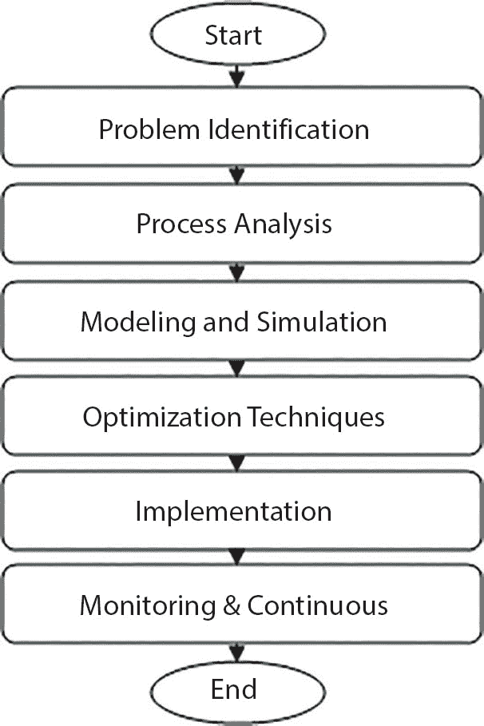

**图 12.1** 优化过程。

### 12.2.2 过程分析

对现有工作流进行映射和分析以确定其性能。过程映射、数据收集和性能指标评估的机制清晰地展示了现有阶段。

### 12.2.3 建模与仿真

使用数学模型或仿真来预测过程的变化如何影响结果。流程图和统计软件等工具通过说明潜在的改进提供了帮助。

### 12.2.4 优化技术

使用一系列技术（如精益六格玛、AI 算法和线性规划）对过程进行精炼。目标是在时间、质量和资源利用之间取得平衡，实现效率最大化。

### 12.2.5 实施

受控行为用于实施计划中的变更。试点测试在大规模实施之前展示了解决方案的可行性和有效性。

### 12.2.6 监控与持续改进

性能通常是衡量某人实现目标程度的标准，因为反馈循环和迭代反馈维持了优化，让你持续不断成长。

## 12.3 深度学习（DL）在优化中的作用

许多领域的成功依赖于深度学习，这是机器学习的一种，它如图 12.2]：

### 12.3.1 处理复杂高维数据

深度学习有助于处理大量的复杂数据，如文本、图像和传感器数据文件。这些特征通常很难用传统的优化技术处理，但 DL 工具可以从原始数据中识别与模式相关的特征，从而提高性能。在制造业中，DL 技术可以通过检测 AI 可能会遗漏的特征，改进库存控制和自动驾驶等任务的决策制定。


**图 12.2** 优化中的深度学习。

### 12.3.2 自动特征选择与工程

基于它们揭示的意识结果，受伤结果与负面数据中的婚姻结果相似，而婚姻结果相似。虽然计算机以闪速做出决策，但人类的决策往往会被恐惧拖慢，就像被浸在不确定性中，被想象的危险冻结，包裹在怀疑的毯子里，随着每一次犹豫的思考而收紧。

### 12.3.3 超参数优化

为了优化模型，DL 模型通常包含需要优化的超参数，例如批量大小、学习率和参数。为了找到超参数的最佳组合，使用了贝叶斯优化、随机搜索和网格搜索等技术。我们在显著影响网络稳健性并在聚合与训练速度之间取得平衡之前，训练神经网络以减少、测试和优化超参数。

### 12.3.4 实时决策

DL 算法提供实时决策，这对于需要频繁更新的动态环境至关重要。例如在制造自动化中，DL 可以协调实时规划和生产过程，并适应库存水平或需求预测等输入。

### 12.3.5 优化强化学习（RL）

RL 通常通过实验和试错决策来使用 DL 以改进支付处理。内部 RL 在解决问题方面表现出良好。通过提高性能，机器人领域的 RL 帮助机器人执行操作物体和在动态环境中导航等任务。

### 12.3.6 多目标优化

DL 模型具有通过从数据中学习以平衡它们之间权衡的方式，同时最大化几个冲突目标的潜力。这在供应链优化和医疗保健资源分配等领域非常重要。例如，在供应链管理（SCM）中，DL 可以同时优化库存水平、交货计划和成本，从而做出考虑这些因素的决策。

### 12.3.7 持续学习与适应

持续学习帮助 DL 模型适应新的数据和情况。它们可以利用这一过程随时间推移改进系统，随着系统的增长和更多数据的收集提高系统性能。例如，随着新的运行数据的可用，DL 预测性维护模型可以适应设备磨损的变化，从而改进维护计划。

### 12.3.8 可扩展性与性能

随着你的数据量和复杂性的增加，DL 可以帮助简化问题。自动化迭代开发过程可以减少在数据处理和人力资源上花费的时间。例如，电子商务中的 DL 模型可以通过评估大量的行为数据，为数百万客户自动提供个性化推荐。

## 12.4 工业和商业背景下的优化

在企业和工业环境中，优化是指使用数学方法和计算资源在各种活动中提高生产力、降低成本并增加收益。它对于银行、物流和制造业在内的各个领域的决策至关重要，如图 12.3

**图 12.3** 工业环境中的优化。

## 12.5 DL 在流程优化中的应用

DL 在流程优化中的应用跨多个领域，并改进了效率和决策制定。对于制造业，质量控制和预测性维护得到了改进；在供应链中，路线、库存和需求预测得到了优化。能源管理受益于负荷预测和智能电网优化，而医疗保健领域将 DL 用于工作流改进和资源分配。金融领域利用 DL 优化投资组合并管理风险。交通、零售、电信和农业分别利用 DL 处理交通流、定价策略、网络管理和精准农业。所有此类应用都推动了成本降低和生产力提高，同时支持对可持续性的追求。

优化技术正被广泛应用于各个行业，以增强运营性能、最小化资源消耗并改进决策。在制造业领域，预测性维护和实时流程优化减少了停机时间并提高了产品质量。同样，供应链运营受益于需求预测和路线优化，从而最大限度地降低成本并提高交付效率。在能源管理中，智能电网优化和可再生能源整合促进了可持续性和效率。医疗保健系统利用优化来实现更好的医院资源分配和药物发现，而金融部门则利用其进行投资组合优化和风险管理。图 12.4 显示了这些领域中特定领域优化应用的证据，说明了针对性技术如何对效率、成本效益和质量结果产生可衡量的改进。


**图 12.4** 带有优化的流程深度学习。

## 12.6 深度学习在供应链与物流优化中的应用

深度学习（DL）正在改变制造业和服务业，提高了生产力，降低了成本并增强了理念的可追溯性。以下是深度学习所在不同领域的摘要 [11–13]:


```python
import matplotlib.pyplot as plt
categories = [
    "Demand Forecasting",
    "Route Optimization",
    "Inventory Management",
    "Supply Chain Network Design",
    "DemandSupply Matching",
    "Risk Management",
    "MultiObjective Optimization",
    "Future Trends",
]
application_counts = [2, 2, 2, 2, 2, 2, 2, 3]
plt.figure(figsize=(10, 6))
plt.bar(categories, application_counts, color="skyblue", edgecolor="black")
plt.xlabel("Categories", fontsize=12)
plt.ylabel("Number of Applications", fontsize=12)
plt.title("Deep Learning Applications in Supply Chain Optimization", fontsize=14)
plt.xticks(rotation=45, ha="right", fontsize=10)
plt.grid(axis="y", linestyle="", alpha=0.7)
plt.tight_layout()
plt.show()
```

### 12.6.1 使用深度学习模型进行需求预测

准确的需求预测对于有效的供应链管理（SCM）至关重要，因为它有助于在保持最佳库存水平的同时避免短货或库存过多。深度学习模型，特别是循环神经网络（RNN）和长短期记忆（LSTM）网络被广泛用于此目的。这些模型能够学习复杂的时间序列模式，捕捉时间依赖性，并准确预测未来的需求趋势 [14]

#### 应用

* **零售业**：根据历史销售、假日和促销活动预测产品需求

* **制造业**：估计原材料和成品的需求

**示例**：电子商务应用使用`LSTM`系统来预测数千种产品的周需求并调整库存水平。

### 12.6.2 使用深度学习进行路线优化

物流公司使用深度学习优化交付路线，减少燃料消耗和交付时间。深度学习模型分析实时交通数据、天气状况和历史模式，以找到最高效的路径。

#### 应用

* **车队管理**：管理车辆路线和维护

* **城市物流**：优化密集区域的最后一公里交付

**示例**：快递服务使用`DL`动态应对复杂的交通状况进行导航。

### 12.6.3 使用深度学习进行库存管理

库存管理对于维持供需之间的正确平衡至关重要。深度学习模型有助于预测需求波动，避免过量库存和缺货。

#### 应用

* **季节性产品**：预测高峰期间的需求激增

* **易腐货物**：管理库存水平以减少浪费

**示例**：零售商使用`DL`优化新鲜物品的库存水平。

### 12.6.4 使用深度学习进行供应链网络设计

创建供应链网络涉及为仓库和分销商选择最佳位置。深度学习模型可以评估各种场景，以最小化运输成本并最大化网络韧性。

#### 应用

* **仓库选址**：决定分销中心的位置

* **供应商选择**：根据价格和可靠性评估供应商

**示例**：全球性公司使用`DL`设计更稳健的供应链网络。

### 12.6.5 使用深度学习进行供需匹配

有效的供需匹配对于维持供应链运营的平衡至关重要。深度学习算法处理生产计划、天气预报和经济指标等多种数据源，以确保高效配置。

#### 应用

* **市场波动**：响应快速市场变化

* **消费者行为**：分析购买模式的趋势

**示例**：一家超市链使用`DL`在匹配产品需求的同时最大限度减少浪费。

### 12.6.6 使用深度学习进行风险管理和中断预测


供应链容易受到市场波动、自然灾害和政治不确定性的影响。深度学习可以提供所有评估和识别风险的信息。

## 应用

- **灾害响应**：识别可能的与天气相关的中断
- **市场趋势**：预测原材料价格的波动

**示例**：制造商使用`DL`评估运输延迟等风险。

## 12.6.7 用于供应链优化的多目标深度学习

大多数采购决策考虑几个相互冲突的标准，例如降低成本、节省时间和提高客户满意度。多目标深度学习模型可同时实现这些冲突的目标。

### 应用

- **成本 vs 交付时间**：平衡速度与经济性
- **供应商 vs 质量**：最大化产品质量与价格之间的权衡

**示例**：制造公司使用`DL`技术同时降低交付成本和交付时间。

- **与物联网 (IoT) 集成**：利用传感器数据优化库存、运输和仓储操作
- **可解释人工智能 (XAI)**：开发能够为决策过程提供洞察的模型，特别是在满足合规性要求方面

## 挑战

- **数据质量与可用性**：深度学习 (DL) 模型需要大量高质量数据，这在供应链中可能难以获得。
- **可扩展性**：扩展深度学习模型以处理具有多样化数据源的全球供应链
- **可解释性**：理解和解释深度学习模型的决策过程仍然是一个挑战。

## 12.6.9 供应链管理概念图

图 12.6 展示了一个说明供应链管理 (SCM) 关键组件的概念模型。该图强调了影响供应链效率和效果的因素之间的相互依赖关系 [16]。


**图 12.6** 图表形式的供应链管理 (SCM)。

**核心焦点**：图中中间用红线标记了“SCM”，这表示特定供应作为特定职能含义，通过这些符号定义了所有用例。

**周围元素**：从中心 SCM 枢纽发散出一些重要因素，每个因素都对供应链的整体优化做出贡献：

- **管理**：齿轮图标代表了 SCM 中必要的规划、组织和协作。
- **利润**：向上的图表符号代表了 SCM 通过提高效率、降低成本和优化资源配置来增加盈利能力的功能。
- **物流**：卡车图像代表的货物移动、库存和运输对于供应链的顺畅运行至关重要。
- **上市时间**：时钟图形象征着对缩短从制造到消费者手中交付时间的重视，这在竞争激烈的市场中是一个至关重要的元素。
- **计划**：清单图标代表了对战略规划、预测和执行的需求，以确保所有供应链组件都得到有效协调。

### 12.6.9.1 设计与结构

- 图表的循环流和连接其元素的箭头意味着这些元素是互联互通的并不断相互影响。
- 得益于清晰、现代的风格和独特的图标，这些主题一眼就能目了懂。

### 12.6.9.2 色彩方案与布局

- 精心选择的配色确保了清晰度和视觉吸引力。每个项目都由于使用了对比色调而脱颖而出，同时保持了整体的凝聚力。

## 12.7 在流程优化中实施深度学习的挑战

深度学习正通过提高运营效率来改变业务，但执行非常困难。除了组织、运营和技术因素外，必须仔细考虑这些挑战才能使“工作”取得成功 [17–21]。深度学习对流程的优化如表 12.1 所示。其视觉组件分解如下：

### 12.7.1 关键分支

- **通信挑战**：深度学习中心的优化、通用处理和解决适应性问题
- **模型开发问题**：关注模型过拟合和泛化等问题，这些问题使得深度学习算法具有趣味性
- **计算问题**：识别运行深度学习模型及其实现所需的计算能力大小
- **集成与需求**：评估这些解决方案的规模以及将深度学习模型整合到现有系统的知识
- **技能与创意**：人类适应的难度和 AI 的基础是阿拉伯语

**表 12.1** 实施深度学习的挑战。

| 类别 | 挑战 |
| --- | --- |
| 数据挑战 | 数据可用性与质量 |
| 数据标注 | |
| 实时数据处理 | |
| 模型开发 | 复杂性与可解释性 |
| 过拟合 | |
| 模型泛化 | |
| 计算问题 | 高计算需求 |
| 边缘部署挑战 | |
| 集成与可扩展性 | 遗留系统 |
| 可扩展性问题 | |
| 人性因素 | 技能缺口 |
| 抵变革 | |
| 伦理与合规 | 数据隐私与安全 |
| 监管合规 | |
| 经济挑战 | 成本效益分析 |
| 维护成本 | |

**伦理与合规问题**：强调监管问题、数据隐私和其他道德困境

**经济挑战**：讨论了成本效益分析以及与深度学习实施相关的经常维护费用。

### 12.7.2 子节点

每个分支内部的子节点，如“数据标注”、“高计算需求”、“遗留系统”、“技能缺口”、“监管合规”等，提供了关于某些问题的更详细信息。

## 结论

许多类型的设备都需要流程优化技术来提高工作外观的效率、性能和质量。通过跟踪不确定性、映射流程和使用各种优化技术，组织和设备可以在生活质量、效率和降低成本方面取得显著改进。在优化过程中用于实现预期结果的技术方法是问题的选择。

3. `Chollet, F., Xception: deep learning with depthwise separable convolutions, in: *Proceedings of the IEEE Conference on Computer Vision and Pattern Recognition*, pp. 1251–1258, 2017.`

4. `Essien, A., Petrounias, I., Sampaio, P., Sampaio, S., A deeplearning model for urban traffic flow prediction with traffic events mined from Twitter. *World Wide Web*, 24, 4, 1345–1368, 2020.`

5. `Han, J., Pei, J., Kamber, M., *Data mining: concepts and techniques*, Elsevier, Amsterdam, 2011.`

6. `Mohammed, M., Khan, M.B., Bashier, M.BE., *Machine learning: algorithms and applications*, CRC Press, 2016.`

7. `Aggarwal, A., Mittal, M., Battineni, G., Generative adversarial network: an overview of theory and applications. *Int. J. Inf. Manag. Data Insights*, 1, 1 100004, 2021.`

8. `Baghel, R.S. and Rathi, S.K., An Artificial Intelligence Risk Assessment of a Material Handling System Using a Cost–Safety Matrix. *Online Soc. Netw. Bus. Frameworks*, 69–83, 2024.`

9. `Sarker, I.H., Machine Learning: Algorithms, RealWorld Applications and Research Directions. *SN Comput. Sci.*, 2, 160, 2021.`

10. `Wali1, G. and Bulla, C., A Comprehensive Review Of Ai Model Optimization: Basics, Techniques, Challenges And Future Directions. *J. Crit. Rev.*, 10, 7, 524–539, 2023.`

11. `Mamodiya, U. and Tiwari, N., Design, Implementation & Performance Analysis of Solar Tracking System on Simulink Platform. *IOP Conf. Ser. Mater. Sci. Eng.*, 988, 1, 012118, December 2020, DOI:10.1088/1757-899X/ 988/1/012118.`

12. `Latif, S., Driss, M., Boulila, W., Huma, Z.E., Jamal, S.S., Idrees, Z., Ahmad, J., Deep Learning for the Industrial Internet of Things (IIoT): A Comprehensive Survey of Techniques, Implementation Frameworks, Potential Applications, and Future Directions. *Sensors*, 21, 22, 7518, 2021.`

13. `Fink, O., Wang, Q., Svensén, M., Dersin, P., W.J., Lee, Ducoffe, M., Potential, challenges and future directions for deep learning in prognostics and health management applications. *Eng. Appl. Artif. Intell.*, 92, 103678, 2020.`

14. `Isabona, J., Ibitome, L.L., Imoize, A.L., Mamodiya, U., Kumar, A., Hassan, M.M., Boakye, I.K., Statistical Characterization and Modeling of Radio Frequency Signal Propagation in Mobile Broadband Cellular Next Generation Wireless Networks. *Comput. Intell. Neurosci.*, 2023, 9, 2023, Article ID 5236566, [`doi.org/10.1155/2023/5236566`](https://doi.org/10.1155/2023/5236566).`

15. `Mamodiya, U., Raigar, G., Meena, H., Design & Simulation of Tiffin Food Problem Using Fuzzy Logic. *Int. J. Sci. Adv. Res. Technol.*, 4, 10, 55–60, October 2018.`

16. `Baghel, R.S., A Toxins Role in Controlling Chaos with a Spatial Effect in an Aquatic System. *Int. J. Appl. Comput. Math.*, 11, 3, 99, 2025.`

17. `Sharma, G.S., Baghel, R.S., Singh, H., A study of artificial neural networks using MATLAB and its future application in forecasting. *Future Artif. Neural Netw.*, 105–117, 2024.`

18. `Bu, F. and Wang, X., A smart agriculture iot system based on deep reinforcement learning. *Futur Gener. Comput. Syst.*, 99, 500–7, 2019.`

19. `Sun, A.Y. and Scanlon, B.R., How can Big Data and machine learning benefit environment and water management: a survey of methods, applications, and future directions. *Environ. Res. Lett.*, 14, 073001, 2019.`

20. `Ghai, D., Tripathi, S.L., Saxena, S., Chanda, M., Alazab, M., *Machine Learning Algorithms for Signal and Image Processing*, Wiley IEEE Press, USA, 2022, DOI:10.1002/9781119861850.`

21. `Thillaiarasu, N., Tripathi, S.L., Dhinakaran, V. (Eds.), *Artificial Intelligence for Internet of Things: Design Principle, Modernization, and Techniques*, 1st, CRC Press, Boca Raton, UK, 2022, [`doi.org/10.1201/97810033358`](https://doi.org/10.1201/97810033358).`

## Note

1. *通讯作者*: randhirsng@gmail.com

# 13 用于纳米技术的 13 种高级机器学习算法

R. Remya¹****, Shaik Saniya², O. Jeba Singh³ 和 Umesh⁴

¹ECE 部门, Sri Krishna College of Engineering, Coimbatore, India

²ECE 部门, Vel Tech Rangarajan, Chennai, India

³EEE 部门, Alliance University, Bengaluru, India

⁴电子与信息工程系, 全州国立大学,  Jeonju, South Korea

### 摘要

高级机器学习通过预测和控制改变了纳米技术。深度学习（如卷积神经网络）展现了预测和设计纳米材料的能力。此外，图神经网络支持分子相互作用。元学习弥合了理论与实践之间的差距。

**关键词**：人工智能，机器学习，纳米材料，纳米技术

## 13.1 引言

人工智能（AI）已应用于多个行业，提高了任务执行效率。随着向 4.0 发展，人工智能变得更加高效。在许多人工智能方法中，机器学习（ML）最受欢迎。此外，监控、制造和处理都是通过机器学习完成的。在某些行业中，人工智能与纳米技术。这种结合仍然存在挑战。在新兴领域，机器学习和纳米技术相结合以产生有效的成果，包括分析大型数据集、设计纳米材料以及创建更高效的硬件来升级机器学习算法，如图 1](#c13.xhtml#fig13-1）所示。

### 13.1.1 分析数据集

分析和优化大型数据集是机器学习的一项主要任务，适用于纳米材料。这种活动可以通过多种方式进行：

```
图 13.1 机器学习与纳米技术之间的协作。¶（来源：经许可自参考文献 [1]）。
```

主要方法是通过不同的策略来检查信息，例如利用光谱学和电子显微镜技术描述纳米材料属性。人工神经网络（ANN）和卷积神经网络（CNN）的融合已应用于纳米材料。此外，人工智能应用于显微技术，特别是用于检查纳米材料的电子显微镜镜头；然而，人工智能策略还应用于光学显微镜用于不同的材料。

第二点是分离数据集。许多算法被用于压缩数据，而机器学习（ML）将各种数据信号从分析中分离出来。这在数据压缩期间至关重要，因为会导致混合信号的产生，从而影响结果。因此，机器学习已用于纳米材料分析的质量控制，并从可用数据创建更准确的结果。

### 13.1.2 设计与发现新纳米材料

最近引起极大兴趣的一个领域是设计纳米材料以及多种不同的材料和化学品的能力，并识别出优于常规方案的新材料交付路径。这种需求源于许多计算/假设性领域，即计算化学和生物学。由于量子效应在如此小的尺度下成为不可或缺的因素，纳米材料的属性比其他不同材料更难预测，因此机器学习策略正被广泛利用。深度神经网络、人工神经网络（ANNs）和生成对抗网络（`GANs`）已用于研究和改进纳米尺度下存在的各种边界和属性 [2]。

这些结果可以被合理化并用于开发规划另一种纳米材料的最理想方案，或增强现有通用纳米材料的最理想方法。这类似于计算化学/生物学的高水平适应，可以用于具有新颖属性的材料。

![图 13.2 带有纳米技术的电子设备。¶（来源：经许可自文献 [3]）。](images/fig13-2.jpg)

**图 13.2** 带有纳米技术的电子设备。¶（来源：经许可自文献 [3]）。

### 13.1.3 更高效的硬件

本节重点介绍了纳米技术如何帮助人工智能。如今使用的高级纳米制造和纳米图案策略可以制造出极高效且微小的计算机设备，而不仅仅是设计现有纳米尺度材料使其更有效；制造纳米电子设备允许在有限区域内创建更多部件。纳米材料的使用推动了新型半导体器件的改进，例如纳米半导体，它们可以“像大脑一样工作”并存储数据。创建能够与机器学习和其他人工智能的“类脑”行为协同的最快硬件和高级组件的能力，将协助机器学习算法实现巨大的应用。由纳米技术开发的电子设备见图 13.2。

## 13.2 用于纳米尺度成像的深度学习

深度学习（`DL`）已逐渐应用于先进硬件中的纳米尺度成像，特别是在半导体制造、故障识别和材料检测等领域 [4]。以下是深度学习在该领域利用方法的概述。

### 13.2.1 在纳米尺度成像中的应用

1. **缺陷识别**：通过`CNN`方法利用高目标纳米图像对半导体晶圆中的故障/缺陷进行自动识别。`CNN`方法可以识别如断裂、空隙或废料等可能破坏电路功能的异常情况。
2. **材料研究**：在原子尺度上识别材料以增强其电子性能。`DL`算法可以表征各种材料或预测它们在不同情况下的活动。
3. **电路配置中的特征提取**：`DL`算法识别并预测纳米尺度配置。
4. **光刻优化**：`DL`策略使用`GANs`预测光刻。


### 13.2.1 量子点和纳米线

5. **量子点和纳米线**：利用`DL`进行表征以创建最快硬件的能力。

### 13.2.2 流程与工具

1. **图像去噪**：`DL`编码器产生高分辨率图像。
2. **超分辨率**：利用`CNNs`将低分辨率图像转换为高分辨率。
3. **数据增强**：在数据集上使用`DL`模型。

### 13.2.3 挑战

1. **数据获取**：获取信息是资源密集型的。
2. **模型可解释性**：`DL`模型被称为“黑盒”。
3. **可扩展性**：`DL`在计算上仍面临挑战。

### 13.2.4 新兴趋势

1. **混合人工智能**：将基于物理的模型与`DL`结合。
2. **边缘人工智能**：直接利用`DL`模型。
3. **量子计算集成**：使用量子机器学习（`QML`）改进图像处理。

### 13.2.5 工具与框架

1. `Tensor flow`和`Pytorch`：用于执行和准备模型。
2. **纳米成像**：来自电子显微镜和扫描隧道显微镜的数据 [5]。
3. **专用设备**：用于训练的图形处理器（`GPUs`）和张量处理器（`TPUs`）[6]。`DL`正在改变计算机硬件中的纳米成像。

## 13.3 用于分子结构的图神经网络

图神经网络（`GNN`）通过忽略 3D 空间（欧几里得空间）中的角度和距离等几何信息来考虑拓扑信息，尽管分子能量取决于 3D 信息。为了将这些设计公式化为`GNN`，它利用了图论概念并假设了 n 维空间（欧几里得空间）中的旋转和平移操作 [7]。

### 13.3.1 分子图形表示

在图形表示中，它包括：

- **节点**：代表原子。
- **边**：代表化学键。

`GNN`编码连接性以及节点/边。

### 13.3.2 消息传递神经网络（MPNN）

网络必须通过图中的相邻节点更新其特征 [8]。

考虑分子图`G = (V, E)`。`MPNN`分两个阶段工作，包括消息传递阶段和读取阶段。

（13.1）

<math><msubsup><mi>m</mi><mrow><mi>m</mi><mi>v</mi></mrow><mrow><mo>(</mo><mn>0</mn><mo>)</mo></mrow></msubsup><mo>=</mo><msub><mi>M</mi><mi>r</mi></msub><mfenced separators="|"><mrow><msubsup><mi>f</mi><mi>m</mi><mrow><mo>(</mo><mi>l</mi><mo>)</mo></mrow></msubsup><mo>,</mo><msubsup><mi>f</mi><mi>v</mi><mrow><mo>(</mo><mn>0</mn><mo>)</mo></mrow></msubsup><mo>,</mo><msub><mi>e</mi><mrow><mi>m</mi><mi>v</mi></mrow></msub></mrow></mfenced></math>

其中`M[i]` = 学习函数，`f[m]` = 消息特征，`f[v]` = 接收节点的当前状态，以及`e[mv]` = 边特征。

信息的聚合通过使用公式（13.2）完成。

（13.2）

<math><msubsup><mi>M</mi><mi>v</mi><mrow><mo>(</mo><mn>0</mn><mo>)</mo></mrow></msubsup><mo>=</mo><mi>A</mi><mi>G</mi><mi>G</mi><mi>R</mi><mi>E</mi><mi>G</mi><mi>A</mi><mi>T</mi><msub><mi>E</mi><mi>l</mi></msub><mfenced separators="|"><mfenced open="{" close="}" separators="|"><mrow><msubsup><mi>m</mi><mrow><mi>m</mi><mi>v</mi></mrow><mrow><mo>(</mo><mn>0</mn><mo>)</mo></mrow></msubsup><mo>&#x2208;</mo><mi>N</mi><mo>(</mo><mi>v</mi><mo>)</mo></mrow></mfenced></mfenced></math>

`N(v)` = 当前节点的邻居节点，`AGGREGATE`可以是平均值、最大值或和。

节点更新在其当前状态`fv`和聚合的消息`M_v(i)`下进行，它在公式（13.3）中给出。

（13.3）

<math><msubsup><mi>f</mi><mi>v</mi><mrow><mi>i</mi><mo>+</mo><mn>1</mn></mrow></msubsup><mo>=</mo><msub><mi>U</mi><mi>i</mi></msub><mfenced separators="|"><mrow><msubsup><mi>f</mi><mi>v</mi><mrow><mo>(</mo><mi>i</mi><mo>)</mo></mrow></msubsup><mo>,</mo><msubsup><mi>M</mi><mi>v</mi><mrow><mo>(</mo><mi>i</mi><mo>)</mo></mrow></msubsup></mrow></mfenced></math>

其中`U[i]` = 更新的学习函数。

**读取阶段**：在消息阶段执行固定迭代后，对节点特征进行池化以获得图层面的表示，如公式（13.4）所示：

（13.4）

<math><msub><mi>f</mi><mi>G</mi></msub><mo>=</mo><mi>READOUT</mi><mo>&#x2061;</mo><mfenced separators="|"><mfenced open="{" close="}" separators="|"><mrow><msubsup><mi>f</mi><mi>v</mi><mi>i</mi></msubsup><mo>&#x2223;</mo><mi>v</mi><mo>&#x2208;</mo><mi>V</mi></mrow></mfenced></math>

`READOUT`函数可以是所有节点的和，也可以是基于特定节点注意力的池化。

### 13.3.3 图卷积网络

图卷积网络利用卷积操作来聚合邻居节点的信息。节点更新在其当前状态`fv`和聚合的消息`M_v(i)`下进行，它在公式（13.3）中给出。

（13.3）

<math><msubsup><mi>f</mi><mi>v</mi><mrow><mi>i</mi><mo>+</mo><mn>1</mn></mrow></msubsup><mo>=</mo><msub><mi>U</mi><mi>i</mi></msub><mfenced separators="|"><mrow><msubsup><mi>f</mi><mi>v</mi><mrow><mo>(</mo><mi>i</mi><mo>)</mo></mrow></msubsup><mo>,</mo><msubsup><mi>M</mi><mi>v</mi><mrow><mo>(</mo><mi>i</mi><mo>)</mo></mrow></msubsup></mrow></mfenced></math>

其中`U[i]` = 更新的学习函数。

**读取阶段**：在消息阶段执行固定迭代后，对节点特征进行池化以获得图层面的表示，如公式（13.4）所示：

（13.4）

<math><msub><mi>f</mi><mi>G</mi></msub><mo>=</mo><mi>READOUT</mi><mo>&#x2061;</mo><mfenced separators="|"><mfenced open="{" close="}" separators="|"><mrow><msubsup><mi>f</mi><mi>v</mi><mi>i</mi></msubsup><mo>&#x2223;</mo><mi>v</mi><mo>&#x2208;</mo><mi>V</mi></mrow></mfenced></math>

`READOUT`函数可以是所有节点的和，也可以是基于特定节点注意力的池化。


### 13.3 图神经网络

公式 (13.3) 定义了节点 `v` 在第 `i + 1` 层的特征更新过程：

(13.3)

<math><msubsup><mi>f</mi><mi>v</mi><mrow><mi>i</mi><mo>+</mn>1</mo></mrow></msubsup><mo>=</mo><msub><mi>U</mi><mi>i</mi></msub><6 separators="|"><mrow><msubsup><mi>f</mi><mi>v</mi><mrow><mo>(</mo><mi>i</mi><mo>)</mo></mrow></msubsup><mo>,</mo><msubsup><mi>M</mi><mi>v</mi><mrow><mo>(</mo><mi>i</mi><mo>)</mo></mrow></msubsup></mrow></6></math>

其中 `U[i]` 是更新的学习函数。

**读取阶段**：在消息阶段执行固定迭代后，对节点特征进行池化以获得图层面的表示，如公式 (13.4) 所示：

(13.4)

<math><msub><mi>f</mi><mi>G</mi></msub><mo>=</mo><mi>READOUT</mi><mo>&#x2061;</mo><6 separators="|"><left open="{" close="}" separators="|"><mrow><msubsup><mi>f</mi><mi>v</mi><mi>i</mi></msubsup><mo>&#x2223;</mo><mi>v</mi><mo>&#x2208;</mo><mi>V</mi></mrow></left></math>

`READOUT` 函数可以是所有节点的和，也可以是基于特定节点的注意力的池化。

#### 13.3.3 图卷积网络

图卷积网络利用卷积操作来聚合邻居节点的信息。节点更新在其当前状态 `fv` 和聚合的消息 <math><msubsup><mi>M</mi><mi>v</mi><mrow><mo>(</mo><mi>i</mi><mo>)</mo></mrow></msubsup></math> 下进行，该消息在公式 (13.3) 中给出。

公式 (13.6) 定义了注意力系数 `β`：

(13.6)<math><msub><mi>&#x3B2;</mi><mrow><mi>m</mi><mi>v</mi></mrow></msub><mo>=</mo><mi>Softmax</mi><mo>&#x2061;</mo><mfenced separators="|"><mrow><mi>&#x3B2;</mi><mi>W</mi><msub><mi>f</mi><mi>m</mi></msub><mo>,</mo><mi>W</mi><msub><mi>f</mi><mi>v</mi></msub><mo>,</mo><msub><mi>e</mi><mrow><mi>m</mi><mi>v</mi></mrow></msub></mrow></mfenced></math>

其中 `β` 是注意机制，`Softmax[v]` 对 `v` 的邻居之间的注意力进行归一化。

**消息聚合**：节点 `m` 通过其邻居特征更新自身的特征，并按照公式 (13.7) 进行加权：

(13.7)<math><msubsup><mi>f</mi><mi>m</mi><mrow><mn>1</mn><mo>+</mo><mn>1</mn></mrow></msubsup><mo>=</mo><mi>&#x3B1;</mi><mfenced separators="|"><mrow><munder accentunder="false"><mo>&#x2211;</mo><mrow><mi>v</mi><mi>e</mi><mi>N</mi><mo>(</mo><mi>m</mi><mo>)</mo></mrow></munder><mo>&#x200A;</mo><msub><mi>&#x3B2;</mi><mrow><mi>m</mi><mi>v</mi></mrow></msub><mi>W</mi><msub><mi>f</mi><mi>v</mi></msub></mrow></mfenced></math>

分子 GCN 实现的步骤包括以下内容：

1. **输入表示**：原子属性通过其原子序数、芳香性、形式电荷和杂化来表示。
2. **边缘特征**：它突出了键的属性，如键类型、距离和键角。
3. **图注意力层**：使用注意力机制，每个原子在其邻居中进行聚合。
4. **堆叠层**：对于堆叠，它捕获了局部和全局信息。
5. **图池化**：节点级特征被转换为图级表示，通过使用均值、求和或基于注意力的池化来实现。
6. **预测**：将图级表示传递到前馈网络以进行分类或预测过程。

#### 13.3.5 Weisfeiler-Leman 图内核

它将 GNN 与图内核结合，以将分子图映射为向量。Weisfeiler-Leman (WL) 图内核基于 WL 图同构测试工作，而它可以比较图 [11]。

计算涉及的步骤如下表所示：

1. 迭代聚合节点标签及其邻居标签。当前节点标签标记为更新后的标签 `Ii`，并按照公式 (13.8) 计算：

(13.8)<math><msub><mi>I</mi><mi>l</mi></msub><mo>(</mo><mi>v</mi><mo>)</mo><mo>=</mo><mi>h</mi><mi>a</mi><mi>s</mi><mi>h</mi><mfenced separators="|"><mrow><msub><mi>I</mi><mrow><mi>l</mi><mo>&#x2212;</mo><mn>1</mn></mrow></msub><mo>(</mo><mi>v</mi><mo>)</mo><mo>,</mo><mtext>&#xA0;multiset&#xA0;</mtext><mfenced separators="|"><left open="{" close="}" separators="|"><mrow><msub><mi>I</mi><mrow><mi>l</mi><mo>&#x2212;</mo><mn>1</mn></mrow></msub><mo>(</mo><mi>m</mi><mo>)</mo><mo>&#x2223;</mo><mi>m</mi><mo>&#x2208;</mo><mi>N</mi><mo>(</mo><mi>v</mi><mo>)</mo></mrow></left></mrow></mfenced></math>

2. `hash` 是一个函数。

#### 13.3.6 3D GNN

Weisfeiler-Leman (WL) 图内核基于 WL 图同构测试工作，而它可以比较图 [11]。

计算涉及的步骤如下：

1. 迭代聚合节点标签及其邻居标签。当前节点标签标记为更新后的标签 `Ii`，并按照公式 (13.8) 计算。
2. **消息聚合**：节点 `m` 通过其邻居特征更新自身的特征，并按照公式 (13.7) 进行加权。
3. **图池化**：节点级特征被转换为图级表示，通过使用均值、求和或基于注意力的池化来实现。
4. **预测**：将图级表示传递到前馈网络以进行分类或预测过程。
5. `hash` 是一个函数。

### 13.4 量子机器学习用于纳米技术

将量子计算与机器学习相结合，以解决分子设计、材料发现和量子化学中的挑战 [13]。

纳米技术主要依赖于在量子层面的理解和估计。传统方法成本更高。

纳米技术中的量子机器学习可以执行以下操作：

1. **分子属性预测**：分子的量子属性（能级、偶极等）相关的纳米材料已得到预测。
2. **量子化学模拟**：准确地。
3. **材料发现**：纳米材料必须设计具有光学、机械或电学属性。
4. **药物与纳米医学设计**：在纳米尺度优化分子作用以实现靶药物递送。
5. **纳米催化剂**：用于环境治理。

**各种量子机器学习算法**：包括变分量子算法、混合量子经典模型、量子 GNN、量子支持和强化学习 (RL)。部分算法如下：

**变分量子本征求解器**：计算分子系统的基态能量。为了最小化能量，使用了经典优化器调整参数 [14]。

**量子神经网络**：预测分子属性。神经网络层被表示为量子电路并将其编码到分子特定的量子态 [15]。

**量子生成模型**：生成纳米材料或新的分子结构。为此，它使用了量子增强 GAN。通过这种方法，必须为纳米材料设计新分子 [16]。

**量子内核学习**：根据量子属性对分子/材料进行分类。它可以预测纳米颗粒的毒性 [17]。

### 13.5 RL 用于纳米制造

RL 在纳米制造中引起了更多的关注；优化和精度被认为是创建纳米级设备和结构的关键。纳米制造过程包括刻蚀、沉积、光刻和组装，这些过程对操作条件敏感。RL 优化这些过程以获得理想的纳米材料属性 [18]。

它可以优化激光功率、刻蚀时间、沉积速率等参数，以获得高均匀性、精度和产率。同时，它还可以调整曝光时间、厚度或束电流来提升图形保真度。例如，`RL` 可以最小化电子束光刻中的邻效应。此外，它可以在沉积过程中控制厚度以实现单层特性。此外，它还能实时检测过程中的缺陷，并通过调整参数进行纠正操作。`RL` 还可以优化包括刻蚀、沉积和退火在内的制造流程中的缺陷。为了提高整体成功率，应该了解流程之间的依赖关系。

考虑此类参数，如温度、压力和材料属性等制造条件，用 `E` 表示；制造调整参数如时间、沉积速率和光束功率，用 `A` 表示；最后是结果的反馈 `R`，它是基于所制造纳米结构的质量计算得出的。

`RL` 与纳米制造环境交互并学习被称为 `π(E)` 的策略。在训练过程中，它使用多种算法，例如使用 `Q learning` 选择刻蚀过程的参数，使用 `deep Q network` 处理复杂参数，使用 `proximal policy optimization` 控制沉积速率的激光功率，并使用 `multiagent RL` 支持多个制造系统的同时工作。

### 13.5 在纳米制造中使用 RL 的优势

1. `RL` 根据厚度反馈调整温度、压力、流速和循环时间等参数，最终通过均匀沉积薄膜减少了材料浪费。
2. 通过减少停留时间、束电流和光刻胶厚度，减少了光刻中的图形畸变。
3. `RL` 根据从光学显微镜收集的反馈指令控制机械臂；它可以精确预测位置。
4. `RL` 根据光谱反馈优化温度、前驱体浓度和时间，从而提高了量子点尺寸的均匀性。

### 13.6 用于金属发现的元学习

元学习也被称为“学习学习”；旨在提升模型的适应能力。它加速了化合物、合金或金属的识别与优化。元学习与 `ML` 算法结合，能够适应数据集 [19, 20]、任何类型的任务以及纳米材料的需求 [21, 22]。同时，它可以在几次迭代后提高特定任务的性能。它能够在纳米尺度上发现金属和合金。

#### 13.6.1 为什么将元学习应用于金属发现？

1. **数据稀缺性**：新型材料的数据可用性有限。元学习利用相似材料的知识来进行预测过程。
2. **知识迁移**：金属的属性（如热阻、机械强度和导电性）是相互相关的。元学习在各种合金和金属之间进行知识迁移。
3. **材料加速筛选**：元学习加速了预测过程并更高效地执行任何类型的操作。
4. **快速泛化**：通过仅观察少量样本，元学习可以通过预测有限样本的未见合金/金属来适应新任务。

#### 13.6.2 应用

1. **金属属性预测**：元学习可以预测金属属性，如耐腐蚀性、机械强度以及导电导热。例如，为了预测新金属的硬度，它使用了已知合金的细节。
2. **合金设计**：元学习优化元素合金的利用，以获得所需的属性，包括具有增强热性能和机械性能的高熵合金。
3. **稀有金属发现**：识别具有所需属性的稀有金属，如用于量子计算的超导材料和生产催化剂。

### 13.7 结论

总之，如今先进的 `ML` 算法已应用于纳米技术领域，使金属发现、故障识别等领域取得了显著改进。通过使用 `DL`、`RL` 和 `GAN` 等 `ML` 方法，专家可以利用小型或大型数据集来预测材料属性，并以更高的精度和效率设计纳米基系统。`ML` 与纳米技术的结合不仅展示了其创新性，还强调了其成本效益并为面临的挑战提供了解决方案。`ML` 与纳米技术的结合将塑造未来的科学与工程。这些进步提升了奠定纳米技术基础的新一代创新，驱动了各行业的解决方案。

### 参考文献

1. Tripathy, A., Patne, A.Y., Mohapatra, S., Mohapatra, S., Convergence of Nanotechnology and Machine Learning: The State of the Art, Challenges, and Perspectives. *Int. J. Mol. Sci.*, 5, 2024, https://doi.org/10.3390/ijms25221268
2. Wang, M., Wang, T., Chen, X., Nanomaterials Discovery and Design through Machine Learning. *Small Methods*, 3, 1–7, 2019.
3. https://miro.medium.com/v2/resize:fit:1400/format:webp/LPbZJn-DKNTZVq
4. Sun, Z., Shi, J., Wang, J., Wang, Z., Bai, X., Wang, X., A deep learning-based framework for automatic analysis of the nanoparticle morphology in SEM/TEM images. *Nanoscale*, 14, 10761–10772, 2022.
5. Levin, B., Padgett, E., Chen, C., Nanomaterial datasets to advance tomography in scanning microscopy. *Sci. Data*, 3, 11, 2016, https://doi.org/10.1038/sdata-2016.41
6. https://www.geeksforgeeks.org/tpus-vs-gpus-in-application/
7. Jiang, S. and Balaprakash, P., Graph Neural Network Search for Molecular Property. *2020 IEEE International Conference on Big Data (Big Data)*, Atlanta, GA, pp. 1346–1353, 2020, doi: 10.1109/BigData50022.9378060
8. Tang, M., Li, B., Chen, H., Application of message passing networks for molecular property prediction. *Curr. Opin. Struct. Biol.*, 81, 2023.
9. https://towardsdatascience.com/graph-convolutional-networks-introduction-to-gnns-24b3f60d6c5


10. Reiser, P., Neubert, M., Eberhard, A., Torresi, L., Zhou, C., Shao, C., Metni, H., van Hoesel, C., Schopmans, H., Sommer, T., Friederich, P., Graph neural networks for materials science and chemistry. *Commun. Mater.*, 3, 2022, https://doi.org/10.1038/s43246-022-00315-6

11. Mamodiya, U. and GirrajRaigar, HM., Design & Simulation of Tiffin Food Problem Using Fuzzy Logic. *Int. J. Sci. Adv. Res. Technol.*, 4, 10, 55–60, October 2018.

12. Wang, Y., Li, Z., Barati Farimani, A., Graph neural networks for molecules, in: *Machine Learning in Molecular Sciences*, 2023.

13. Maheshwari, D., Garcia-Zapirain, B., Sierra-Sosa, D., Quantum Machine Learning Applications in the Biomedical Domain: A Systematic Review. *IEEE Access*, 10, 80463–80484, 2022.

14. Ambalgi, A.P., Sujata, S.K., Mamodiya, U., Sharma, P., Effects of Single and Double Wide Slots on Microstrip Patch Antennas Characteristics Using Direct Contact Probe Feed Excitation with Broadsided Radiation, in: *Proceedings of Second International Conference on Smart Energy and Communication, Algorithms for Intelligent Systems*, D. Goyal, P. Chaturvedi, A.K. Nagar, S. Purohit (Eds.), Springer, Singapore, 2021.

15. Beer, K., Bondarenko, D., Farrelly, T., Osborne, T.J., Salzmann, R., Scheiermann, D., Wolf, R., Training deep quantum neural networks. *Nat. Commun.*, 11, 808, 2020, [`doi.org/10.1038/s41467-020-14454-2`](https://doi.org/10.1038/s41467-020-14454-2).

16. Riofrio, C.A., Mitevski, O., Jones, C., Krellner, F., Vuckovic, A., Doetsch, J., Klepsch, J., Ehmer, T., A., Claims A Characterization of Quantum Generative Models. *ACM Trans. Quantum Comput.*, 5, 1–34, 2022.

17. Thanasilp, S., Wang, S., Cerezo, M., Holmes, Z., Exponential concentration in quantum kernel methods. *Quantum Phys.*, 15, 5200, 2024.

18. Mamodiya, U. and Tiwari, N., Design, Implementation & Performance Analysis of Solar Tracking System on Simulink Platform. *IOP Conf. Ser. Mater. Sci. Eng.*, 988, 1, 012118, December 2020, DOI:10.1088/1757-899X/988/1/012118.

19. Ghai, D., Tripathi, S.L., Saxena, S., Chanda, M., Alazab, M., *Machine Learning Algorithms for Signal and Image Processing*, Wiley IEEE Press, USA, 2022, DOI:10.1002/9781119861850.

20. Thillaiarasu, N., Tripathi, S.L., Dhinakaran, V (Eds.), *Artificial Intelligence for Internet of Things: Design Principle, Modernization, and Techniques*, 1st, CRC Press, Boca Raton, UK, 2022, [`doi.org/10.1201/9781003335801`](https://doi.org/10.1201/9781003335801).

21. Allen, A.E.A., Lubbers, N., Matin, S., Justin Smith; Richard Messerly; Sergei Tretiak; Kipton Barros; Learning together: Towards foundation models for machine learning interatomic potentials with meta-learning. *npj Comput. Mater.*, 1–9, 2024.

22. Lemke, C., Budka, M., Gabrys, B., Metalearning: a survey of trends and technologies. *Artif. Intell. Rev.*, 44, 117–130, 2015.

## Note

1. ***通讯作者*: remiamernath@gmail.com

# 14 集成机器学习与纳米技术：驱动创新与可持续解决方案

**Shruti Gupta¹*, Sourabh Kumar Jain¹ 和 Gireesh Kumar²**

* *¹计算机科学与信息技术系，Jayoti Vidyapeeth 女大学，斋浦尔，拉贾斯坦邦，印度*

* *²计算机科学与工程系，马尼帕斋浦大学，拉贾斯坦邦，印度*

### 摘要

机器学习（ML）模型与纳米设备的集成变革了科学和技术领域，在不同领域催生了许多创新理念。本文通过科学计量学分析讨论了机器学习与纳米技术的共同演变，追踪了重要趋势，并解决了面临的挑战以及未来具有前景的研究方向。在过去的几年里，机器学习增强的纳米设备具有变革性意义，彻底改变了材料科学、精准药物递送、环境传感、储能乃至量子计算。这些原因使得由机器学习实现的纳米设备设计能够确保高性能纳米设备：绝对药物靶向、用于实时监测的灵敏纳米传感器以及高效的储能解决方案。然而，该领域仍面临巨大挑战，特别是学科间合作的便利性、大规模数据集的可靠性、伦理考量以及监管标准的建立。本文再次敦促对机器学习驱动的纳米技术进行负责任和符合道德的应用，并强调持续研究以实现纳米设备的全部潜力。在这些发展中，对未来科学技术发展的塑造影响将是深远且意义巨大的。

**关键词：** 机器学习模型、纳米技术、材料发现、纳米传感器、环境监测

## 14.1 引言

将机器学习（ML）引入纳米技术仍然是一个新颖领域，并在短时间内展现了快速发展的现代技术和创新。在对各自领域进行革新和改进后，这两个领域结合在一起，形成了一种可以重塑人类成就极限的理智，超越了人类曾仅能想象的作品[1]。机器学习与纳米技术的集成呈现了可分类的社会级技术发展。如图 14.1 所示，纳米材料与机器学习之间的关系创造了一个可持续的世界。为了理解其中的意义，必须详细介绍这两个技术的历史以及它们在独立存在和结合时的演变。可以说机器学习是现代计算科学的巅峰。它诞生于 20 世纪中期，源自早期的符号推理和专家系统，目标是模仿人类的认知能力[2]。然而，这种热情受到了计算机能力限制和不切实际期望的影响，导致了被称为“人工智能寒冬”的时期。

机器学习在经历了近 50 年的停滞后，在过去的几十年由于三个主要原因重新复兴：大型数据集的存在、计算能力的增加以及算法创造力使用的改进[3]。

数字革命引发了产生的数据量的空前有的增长，这反过来为机器学习算法的训练和复杂系统（特别是深度学习技术）的改进创造了丰富的资源。正是这种信息的浪潮以及基础设施的改进（特别是图形处理器和其他加速器），使得实现图像分类、语音处理和强化学习等潜力成为可能[4]。

所有这些结果使得机器学习成为新技术的关键基石，并随着与纳米技术的融合在实践中得到了进一步发展。


**图 14.1** 纳米材料与机器学习之间的关系创造了一个可持续的世界。

纳米技术是一个极其多元化的领域，它起源于对材料在纳米尺度下产生不同反应的理解——主要是指任何 100 纳米以下的所有物质[5]]。在 1959 年一次富有远见的演讲《底部有足够的空间》中，理查德·费曼构想了一个未来，在那里我们基本上可以通过手段操控原子和分子[33]]。从那时起，纳米技术取得了巨大的进展，使得设计具有特定且独特属性的材料和设备成为可能[6]]。这促进了石墨烯、量子点和碳纳米管等创新纳米材料的发展，推动了电子、材料科学和储能等领域的进步。纳米颗粒还通过更好的靶向递送、癌症治疗和副作用更少的诊断彻底改变了医疗保健[8]]。机器学习（ML）正与纳米技术融合，以改变开发和微调这些微型、高度专业设备及材料的整个过程[9]。通过机器学习算法，很容易处理来自纳米尺度实验和模拟的大数据，这为加速定制化的纳米材料设计提供了极佳的见解[7]]。例如，在医疗保健领域，机器学习有助于微调纳米颗粒以实现靶向递送，从而改善治疗结果并减少副作用。对于纳米电子设备领域，由机器学习引导的模型支持组件（如晶体管）进一步微型化，甚至达到原子级。此外在纳米机器人领域，机器学习也取得了进展。这将产生极具针对性的药物递送系统，例如清理环境[10]]。研究人员已开始将机器学习引入纳米技术，以创造曾被认为在任何规模上无法设计的工具和治疗方法。

此外，实施计算方法的另一个局限性在于通过表征等手段获得的数据优劣，特别是在实时执行某些活动时，例如在散布在空气中的纳米材料传输或细胞培养过程中，这些活动可能对人类产生毒性，规模化或测量灵敏度可能对相关环境和人类是致命的[11]]。到目前为止，技术上的很大进展已经实现了该领域的增长以及该领域当代活动和发现的归档。表 14.1 提供了一个总结，突显了所述研究对机器学习（ML）主要领域的适用性，随后将讨论其中每一项如何与纳米制造相关。这项工作的意义在于关注通过实施机器学习技术制造纳米设备，以开发可持续的解决方案。第 14.1 节对机器学习促进纳米技术的论文进行了综述。其余章节安排如下：第 14.2 节包含构建模型涉及的步骤。[第 14.3 节侧重于药物递送和医疗保健；第 14.4 节重点介绍了人工智能（AI）在纳米制造中的质量控制。第 14.5 节展示了使用纳米传感器的环境监测。第 14.6 节包含了量子计算和纳米传感器。第 14.7 节突出了纳米技术与人工智能面临的挑战和未来机会。

**表 14.1** 当代评估概述，包括机器学习和纳米制造的应用以及机器学习的其他领域。

| **参考文献** | **标题** | **范围** |
| --- | --- | --- |
| [[9]] || 在欧洲，关于碳纤维和先进复合材料供应链的战略研发：障碍与工业挑战 | § 创新物质和改进的工艺 |
| --- | --- | --- |
| § 分析与模拟 | | |
| § 生态与财务的可持续性 | | |
| [[10]] || 学习机器学习的基础：概念、用途和趋势 | § 强调输入、分类的必要性 |
| § 使用先进材料 | | |
| [[11]] || 数据科学与人工智能 | § 新材料的探索 |
| § 在多样化领域中的增强 | | 产品标准的使用 |
| § 制造过程中产生的信息 | | |
| § 历史、上升的未来预测 | | |
| [[12]] || 材料发现的成功方法 | § 传统技术与使用 |
| § 机器学习的使用 | | |
| [[13]] || 生物传感器的开发 | § 应用化学计量学进行解释 |
| § 模型的优缺点 | | |
| [[14]] || 纳米技术的使用促进了协作 | § 化学计量学中的应用 |
| § 纳米技术的优点与缺点 | | |
| [[15]] || 机器学习应用综述 | § 在多样化领域中的增强 |
| § 产品标准 | | |
| [[16]] || 纳米材料数据库：支持更好的设计 | § 分析与对比 |
| § 纳米材料数据库 | | |
| [[17]] || 机器学习如何重塑实践 | § 数据准备与开发 |

## 14.2 构建模型涉及的步骤

构建机器学习模型是一个涉及若干步骤的过程，按照正确的顺序执行这些步骤对于确保模型正常运行至关重要。模型的生命周期意味着正确的数据获取、模型开发、应用和更新。机器学习生命周期的高级分解包括问题定义、数据收集、预处理、特征工程、模型开发、评估、部署以及持续监控以调整和适应[12]]。这一过程可以分为四个部分：分析数据、构建机器学习模型、调整模型设置和完成模型[13]]。

如图 14.2 所示，创建预测机器学习模型是一个反复测试不同算法的过程，以找到精度最高的算法。为了设计高精度的预测模型，有以下步骤：

### 14.2.1 初步数据见解

初步数据分析对于模型开发之前理解数据集的结构和质量至关重要。它涉及识别缺失值、离群值和变量分布，以确保数据的准确性和相关性。在纳米技术应用中，这些见解有助于捕捉关键模式，并为预测建模选择合适的机器学习技术提供指导。


**图 14.2** 构建预测性 ML 模型。

### 14.2.2 数据属性识别与数据收集

这涉及到数据的收集和准备，这是一项巨大的任务，因为数据必须是完整的，并准确地反映所考虑的系统。收集数据后，将其输入 ML 算法。该算法分析数据以识别模式，构建预测模型，然后对其测试，以确保其准确反映了所研究系统的真实世界动态 [14`]。因此，用 ML 构建预测模型的第一步也是最关键的一步，就是收集数据。

### 14.2.3 数据准备与数据精炼

数据预处理是构建预测模型的必要要素。首先，它涉及对数据进行四种预处理活动，即清洗、转换、降维和合并 [15`]。图 14.3 介绍了数据预处理的重要方面。数据清洗涉及修复或删除数据集中的错误和离群值。数据转换涉及将原始数据转换为 ML 算法可以于理解和使用的格式。数据降维是在不丢失其基本质量的情况下简化数据集的实践。

### 14.2.4 特征工程

训练预测模型或 ML 算法需要大量数据。然而，这些数据大部分可能是噪声的，数据集中的许多特征可能对模型的准确性没有显著贡献。此外，数据过多会减慢学习过程，因为模型的运行速度会变慢。无关或不必要的输入也会导致模型学习错误，导致预测不准确 [16`]。为了防止这些问题，在训练模型之前，识别并移除数据中的任何噪声源至关重要。特征选择是对 ML 算法中某些输入变量特征子集的仔细选择，如图 14.4 所示。所选特征应该是最相关的，而应该排除那些没有预测性或为数据引入噪声的特征。


**图 14.3** 机器学习数据预处理的关键要素。


**图 14.4** 特征选择：移除无关或噪声数据。

### 14.2.5 ML 模型开发

预测模型通过使用 ML 技术创建，这些技术有助于建立输入数据与输出需求之间的相关性。这个过程被很好地组织分为两个部分：训练和测试。在第一阶段，即训练阶段，为算法提供数据集形式的输入值和正确的输出值。然后，算法利用该数据集来学习输入参数到输出参数的映射 [17`]。第二阶段称为测试，在该阶段为算法提供一个独立的数据集，该数据集包含输入值但不包含算法必须预测的输出值。在衡量所设参数时，准确度通过使用测试数据中找到的实际数值与其预测值进行对比来定义和测量。所选算法也会影响所构建的预测模型的效率。通常情况下，复杂的模型（例如深度学习网络）被认为优于基于回归的算法等较简单的模型 [18`]。然而，这些模型对训练时间和数据的要求非常高，通常需要比回归算法多出几个数量级的数据。因此，在建模时仔细考虑使用哪种 ML 技术非常重要。以下是选择 ML 模型时需要考虑的一些关键因素：

*   模型占用的存储空间大小
*   理解模型行为的能力
*   学习和预测所需的时间
*   输入数据的类型
*   数据的性质
*   数据量及其特征

最近，各种 ML 技术也被用于评估环保建筑材料的机械、耐用和流变特性。所选 ML 算法对模型预测的有效性起着至关重要的作用。例如，对由成分和纤维包裹物（如玻璃）组成的复合材料属性的先进预测表明，使用梯度提升树可以获得更高的精度。对于相当简单的数据集，简单的回归分析和回归树就足够。

### 14.2.6 超参数调优


这些被称为超参数，它们塑造并控制模型如何学习，但它们本身不是模型的一部分 [19]。超参数为训练停止时模型参数的最终值设定了边界。为了获得准确的模型，必须通过反复实验对这些值进行微调和调整。尽管如此，超参数在预测建模中很重要，因为它们作用于学习机制；这决定了最后评估学习设备的有效性。ML 模型中的过拟合和欠拟合可以通过调整超参数水平来管理 [20]。


**图 14.5** 开发优化模型的阶段。

### 14.2.7 ML 模型验证

在 ML 中，模型验证是使用独立数据集（称为测试数据）来评估已训练模型性能的过程。测试在训练完成后进行。训练数据集来自相似源，从中推导出测试数据集，但不用于测试。测试数据集旨在确定给定模型结果的推广范围。验证的概念反过来通过流程图说明，如图 14.5 所示，展示了开发优化模型的阶段。在构建模型时，通常将数据分为三部分：训练集、验证集和测试集。通常，训练集占总数据的 70%，其余的 30% 平均平分为验证集和测试集，各占 15%。ML 模型的选择取决于性能，特别是在预测测试和训练数据方面。

## 14.3 AI 和纳米技术如何变革医疗保健与安全

AI 与纳米技术的整合导致了医疗保健领域的变革，特别是目标药物递送、个性化医疗以及疾病诊断方面。纳米材料现在出现在日常生活中，例如食品添加剂、化妆品、工业过程和药物。然而，纳米材料的广泛使用由于与帕金森病、癌症等严重疾病的联系而带来了健康风险。在这方面，创新的一个例子是赵等人使用 ML 评估纳米材料的环境毒性 [30]。

### 14.3.1 精准药物递送

AI 已经在纳米尺度上改变了药物递送机制。因此，副作用减少了，治疗效果得到了最大化，从而使药物递送更加安全、有效 [21]。这些带有传感器和报告机制的纳米设备为医疗专业人员提供了非常有价值的见解，他们可以据此调整治疗策略。

### 14.3.2 疾病的追踪与检测

AI 正在增强疾病的检测与监测，主要通过早期检测和实时监测 [30]。AI 纳米传感器可以感知极微小的疾病标志物和独特分子，使得癌症感染和神经系统疾病在侵入人体之前就能被检测出来。植入人体内的这些微传感器可以实时追踪关键健康指标并将其发送给医生进行审核。配合传感器的监测功能允许医疗提供人员观察治疗是否有效，并在可能的情况下进行调整以改善患者预后。这些特性对预防性健康具有非常深远的意义。纳米传感器可以检测到生物标志物的微小变化，使得干预可以在疾病实际发生之前进行。因此，预防既有利于个人健康，也有助于减轻医疗系统的疾病负担，因为这些疾病通常在较轻的阶段就能得到解决。在 AI 的帮助下，这些信息被快速分析，允许医生根据需要调整治疗方案，并为患者提供及时的护理。

## 14.4 确保纳米制造的质量

将结构组装成看似不可能的尺寸是制造微型结构的一种非常有效的方法。关键突破之一是使用了由 AI 驱动的机器人，这些机器人可以以纳米级的精度工作。它们能够以前所未有的精度制造纳米材料，组装难以或无法访问的复杂结构。AI 算法一直在定制 3D 纳米打印方案。这种潜力使人们能够以前所未有的精度构建复杂的纳米架构，并推动电子、医疗设备工程和材料科学的进一步进展（图 14.6）。AI 驱动的纳米尺度增材制造工艺实现了定制设计纳米材料和纳米组件的合成。


图 14.6 创新技术驱动的增材制造。

AI 驱动的图像处理已应用于纳米级结构和材料的检测，其结果令人印象地处于预期范围内。它能识别出人类无法感知的缺陷和不一致性，从而提高了产品质量。

## 14.5 环境监测与修复

AI 产生的最显著协同效应之一是它在监测和对抗环境退化领域引发了一场革命，这产生了深远的影响 [22]。基于 AI 的纳米传感器已成为监测变化的领先技术，因为它们能够以先进的灵敏度和特异性实时监测和检测各种环境污染物和因素。它们还监测空气悬浮颗粒物、挥发性有机化合物和温室气体的排放，以及水和土壤污染物，这对于及时预警和采取行动做出了关键贡献 [23]。AI 驱动的环境模型是另一个重大进展，计算机处理能力和数据汇集的进步侧重于预测气候变化、极端天气或环境事件以及生态系统的变化。此类模型协助决策者实施气候变化适应及其缓解措施。它们可以对生态系统进行建模，并理解各种环境变化将如何影响生物多样性和生态系统服务，更重要的是，如何实施保护。GeoAI 在使用预测分析对污染源或污染热点进行空间因子分析时强调污染控制。

具有增强吸附和协同催化特性的纳米材料通过基于 AI 的纳米材料设计进行制造和设计。已发现六十六种纳米吸附剂和纳米催化剂在去除气体和液体环境中的污染物方面效率显著高于传统方法。设计师对现有纳米机器人和纳米颗粒的传统技术没有考虑到对污染土壤和地下水中重金属和有机分子等特定污染物的最小针对性目标。表 14.2 展示了用于污染降的纳米材料，包括其生产技术和污染物分类。

表 14.2 不同有机和无机纳米材料用于空气污染物修复的机制和去除效率摘要。

| **参考文献** | **纳米材料** | **空气污染物** | **去除效率 (%)** | **机制** |
| --- | --- | --- | --- | --- |
| [24] | CuO–MnO[2]–Fe[2]O[3]/γ-Al[2]O[3] | 汞 (Hg°) | — | 热脱附 |
| [25] | 氧化鈈 | CO | 100 | 催化氧化 |
| [26] | Fe/Co 共掺 Mn-Ce/TiO[2] | NO 和 Hg° | 55–92 | 还原与氧化 |
| [27] | Ti 掺 Fe[3]O[4] (1 1 1) | NOx | 80 | 催化氧化 |
| [28] | 银、锌、铁 | 大肠杆菌 | 97–99 | 消毒 |
| [29] | Pt-TiO[2] | NOx | 96.7 | 催化 |
| [30] | 氧化石墨烯 | PM 2.5 | 99 | 过滤 |
| [31] | CoFe[2]O[4-]过氧锰 | 汞 (Hg°) | 85 | 催化 |

## 14.6 纳米技术与量子计算的进展

量子计算和纳米技术是两个突破性领域，两者结合具有彻底改变科学和技术许多方面的潜力。

对量子材料相关环境影响的审查凸显了机遇与挑战。尽管量子材料的特殊属性使得该领域在可持续性应用方面前景广阔，但其生产过程通常包含稀有且昂贵的材料 [32]。因此，未来的工作必须转向绿色合成领域，尽可能利用丰富且环境友好的材料。将对量子材料的生命周期进行评估，以获得整体可持续性衡量。初步结果表明，尽管量子材料在应用中可以确保效率和排放潜力，但必须通过从生产到废物产生的完整周期对这些系统进行仔细理解，才能使其有助于实现环境目标。量子比特，或 `qubits`，可以同时存在多种状态，执行复杂计算的速度比任何经典比特都更快、更高效。另一方面，纳米技术提供了在惊人的微尺度上操纵和调节量子系统的手段和材料，为创新开启了新地平。简而言之，纳米技术在推进量子计算机和其他量子技术方面发挥着至关重要的作用。量子计算在纳米技术领域最有价值的用途之一可以认为是量子结构的建模。在预测某些分子、原子或材料在量子领域内的行为时，它们表现得格外精明。这在药物开发、创建新材料或简单解释某些物理或化学机制的工作原理情况下非常有用。例如，复杂的分子结构可以通过量子计算机模拟进行访问，允许人们创建具有所需特性的新药物或结构。

通过使用 `quantum algorithms` 也可以对纳米级的系统和过程进行优化。在这方面，可以利用量子计算更通用的原理来增强许多操作，从优化纳米材料生产的化学过程到使纳米结构设备的设计方法论实现最大化，而这些是经典系统难以解决的。纳米技术对于量子计算基础设施的发展至关重要。`Qubits` 需要在无菌的超低温条件下保持分离并进行操纵。量子电路和超导设备用于在纳米级空间范范围内形成和操纵 `qubits`。

然而，这一未来方向本质上伴随着挑战和复杂性，因为其与纳米技术的融合带来了若干困难。量子系统非常脆弱，此类量子设备中的相干性是一个众公认的维护性难题。目前，研究正积极关注量子错误纠正以及能够扩展到实用可用尺寸的量子设备的开发。

## 14.7 AI 与纳米技术：挑战与未来机遇

随着 AI 与纳米技术之间更深层次整合，出现了更多问题，新的领域也被开启。这种思想的汇聚实际上将来自各个领域的专家——从材料科学到计算机科学，再到医学——聚集在一起，这对于创造创新答案来说既具有挑战性又至关重要。可能这种融合中的主要任务之一是获得足够的高质量数据。良好的大型数据集对于 AI 系统是必不可少的。监管系统要跟上 AI 和纳米技术的快速发展是具有挑战性的。为了解决这个问题，政府和全球组织应该建立灵活且前瞻性的规则，并强调此类创新领域的安全、可靠性和伦理性。AI 纳米制造和纳米设备开发向实际应用的扩展是一个复杂且昂贵的程序。最大的挑战在于必须在不损害精度或效率的情况下实现扩展性。在同样的部署范围内，随着这些技术的发展，围绕隐私和安全的挑战也随之增加。保护数据以防止滥用和网络攻击的需求增加。收集此类数据往往会减慢纳米技术应用的发展。

AI 和纳米技术将促进高度个性化疗法的发展，根据每个患者的独特健康需求和生物特征进行定制。量子计算通过整合 AI 算法、加密解决方案、优化技术和详细模拟将得到加强。这将促进量子安全 AI 的发展，从而在后量子计算时代保障数据安全。此外，AI 驱动的量子材料发现将改进量子技术，包括量子计算和量子传感器。

## 14.8 结论

量子计算的进步无疑受到了两项最新进展——纳米技术和 AI 的影响。AI 对 `quantum algorithms` 的优化得到了促进，而量子处理器由各种纳米组件组成。因此，这种组合能够解决诸如加密等行业所面临的问题。只有通过跨学科的方法，AI 专家、纳米技术专家和其他相关科学家之间的差距才能得到解决。此外，随着这种融合的进展，还有数据敏感性、AI 伦理考量、指南准备以及增长的相关问题。

AI 与纳米技术的整合必须由清晰的伦理标准、良好的指南和最佳实践来指导，以确保其负责任地使用并造福社会。AI 辅助的材料发现可能会继续带来显著改进，因为有了纳米技术对现在和未来的需求，特别是在医疗系统、环境保护和能源供应方面。许多行业将基于 AI 的计算能力受益。AI 和纳米技术的远见能力和创造潜力代表了人类巨大的机遇与挑战。鉴于现代研发活动所提出的的挑战和困境，整合服务于一个伟大目标：通过这些跨越知识和技术的紧迫问题改变现状。

## References

1. Jaber, W., Artificial Intelligence and Nanotechnology: Transforming the Future, in: *Artificial Intelligence in the Age of Nanotechnology*, pp. 1–24, IGI Global Scientific Publishing, 2024.

2. Natale, S. and Ballatore, A., Imagining the thinking machine: Technological myths and the rise of artificial intelligence. *Convergence*, *26*, 1, 3–18, 2020.

3. Duan, Y., Edwards, J.S., Dwivedi, Y.K., Artificial intelligence for decision making in the era of Big Data–evolution, challenges and research agenda. *Int. J. Info. Manage.*, *48*, 63–71, 2019.

4. Sarker, I.H., Deep learning: a comprehensive overview on techniques, taxonomy, applications and research directions. *SN Comput. Sci.*, *2*, 6, 420, 2021.

5. Patel, J.K., Patel, A., Bhatia, D., Introduction to nanomaterials and nanotechnology, in: *Emerging technologies for nanoparticle manufacturing*, pp. 3–23, Springer International Publishing, Cham, 2021.

6. Yetisgin, A.A., Cetinel, S., Zuvin, M., Kosar, A., Kutlu, O., 治疗纳米颗粒及其靶向递送应用。*Molecules*, *25*, 9, 2193, 2020.

7. Tripathy, A., Patne, A.Y., Mohapatra, S., Mohapatra, S.S., 纳米技术与机器学习的融合：现状、挑战与展望。*Int. J. Mol. Sci.*, *25*, 22, 12368, 2024.

8. Raj, S., Khurana, S., Choudhari, R., Kesari, K.K., Kamal, M.A., Garg, N., Kumar, D., 纳米颗粒靶向癌细胞以及癌症治疗中的药物递送，载于：*Seminars in cancer biology*, vol. 69, pp. 166–177, Academic Press, 2021, 2 月.

9. Brown, K.A., Brittman, S., Maccaferri, N., Jariwala, D., Celano, U., 纳米科学中的机器学习：小尺度的大数据。*Nano Lett.*, *20*, 1, 2–10, 2019.

10. Roco, M.C., Hersam, M.C., Mirkin, C.A., Mirkin, C.A., Tuominen, M., 组件、设备和系统的合成、处理与制造，载于：2020 年面向社会需求的纳米技术研究方向：回顾与展望, pp. 109–158, 2011.

11. Bessa, M.J., Brandão, F., Fokkens, P.H., Leseman, D.L., Boere, A.J.F., Cassee, F.R., Fraga, S., 工业相关工程纳米颗粒在人肺泡上皮细胞中的*体外*毒性：气液界面与浸入培养。*Nanomaterials*, *11*, 12, 3225, 2021.

12. Wang, H., Ma, C., Zhou, L., 机器学习及其应用简要回顾，载于：2009 年信息工程与计算机科学国际会议, IEEE, pp. 1–4, 2009, 12 月.

13. Qian, B., Su, J., Wen, Z., Jha, D.N., Li, Y., Guan, Y., Ranjan, R., 协调基于机器学习的物联网应用开发周期：分类法与综述。*ACM Comput. Surv. (CSUR)*, *53*, 4, 1–47, 2020.

14. Amaral, P., Dinis, J., Pinto, P., Bernardo, L., Tavares, J., Mamede, H.S., 软件定义网络中的机器学习：数据收集与流量分类，载于：2016 年 IEEE 第 24 次网络协议国际会议 (ICNP), IEEE, pp. 1–5, 2016, 11 月.

15. Fan, C., Chen, M., Wang, X., Wang, J., Huang, B., 面向从建筑运营数据中进行高效可靠知识发现的数据预处理技术述。*Front. Energy Res.*, *9*, 652801, 2021.

16. Al-Mishhadani, S.A., Al-Qaisi, W.A., Al-Khafaji, S.F., 利用非破坏性测试预测高性能混凝土的机械性能。*J. Eng. Technol.*, *27*, 3, 425–444, 2009.

17. Xie, L., Ouyang, Y., Chen, L., Wu, Z., Li, Q., 针对缺失数据的更好建模：基于对比学习的可视化分析视角。*IEEE Trans. Visual. Graphics*, *30*, 8, 5129–5146, 2023.

18. Salh, C.H. and Ali, A.M., 使用深度学习和传统机器学习的乳腺癌综合研究。*Zanco J. Pure Appl. Sci.*, *34*, 2, 22–36, 2022.

19. Wu, J., Chen, X.Y., Zhang, H., Xiong, L.D., Lei, H., Deng, S.H., 基于贝叶斯优化的机器学习模型超参数优化。*J. Electron. Sci.*, *17*, 1, 26–40, 2019.

20. Nhu, V.H., Shirzadi, A., Shahabi, H., Singh, S.K., Al-Ansari, N., Clague, J.J., Ahmad, B.B., 浅层滑坡易发生性：逻辑回归树、逻辑回归、朴素贝叶斯树、神经网络与支持向量机的比较。*Int. J. Environ. Res. Public Health*, *17*, 8, 2749, 2020.


21. `Vora, V.H., Shirzadi, A., Shahabi, H., Singh, S.K., Al-Ansari, N., Clague, J.J., Ahmad, B.B., 浅层滑坡易发生性：逻辑回归树、逻辑回归、朴素贝叶斯树、神经网络与支持向量机的比较。Int. J. Environ. Res. Public Health`, `17`, 8, 2749, 2020.`

**关键词：** 服装、医疗保健、使用率、可持续农业、精准农业、IoT、AI、资源管理

## 15.1 引言

来自纺织、皮革、塑料和纸张等各行业的合成染料会污染水体，并成为一种生态毒性危害，导致严重的环境问题。众周知，刚红等偶染料会对人类和水生生物引起过敏反应和各种毒性影响 [1–5]，它们在进入水流之前必须被移除。

有一个名为`ISO/IEC/IEEE 29119`的标准软件测试模型，于 2013 年发布 [2]。由于软件测试在验证软件可靠性方面发挥着关键作用，变得日益重要，一系列持续软件测试标准应运而生。这一系列标准被视为软件测试实践的重要组成部分，并于 2000 年举办了首届“软件工程的未来”。软件测试研究的核心部分是实验 [14]。它包括文档、测试技术设计、测试词汇和概念。在本文中，我们在医疗保健领域的自动化测试中提出了`5W+1H`模式 [10]。

本文提出了以下内容：

* 帮助制定初始提问和结构化报告 [10]
* 了解任何软件的验收水平
* 在不同阶段根据所需需求对软件进行评估
* 在单元开发时对其进行测试，并在将其与其他单元集成时也对其进行测试
* 在所有单元集成后对整个系统进行测试
* 在交付给客户之前对软件进行多次测试

可持续农业是应对全球粮食安全、资源稀缺和环境退化挑战的关键方面。随着世界人口的持续增长，人们越来越需要在生产更多食物的同时，尽可能地减少对环境的负面影响。通过物联网（IoT）和人工智能（AI）集成实现的精准农业提供了创新的解决方案，以增强农业实践并实现可持续成果，如图图 15.1

**图 15.1** 用于可持续农业的精准农业 IoT 和 AI 集成的示意图。

使用 IoT 和 AI 的可持续农业和精准农业有多个方面。它旨在分析这种集成在实现可持续农业实践方面的益处、挑战和潜在应用。

## 15.2 实验调查与材料

利用 IoT 和 AI 的可持续农业和精准农业旨在探索当前的知识状态；识别关键趋势、挑战和机遇；并为本文的研究奠定基础。多项研究强调了可持续农业在解决粮食安全、资源稀缺和环境可持续性挑战中的重要性。研究人员强调了 IoT 和 AI 赋能的精准农业是实现农业可持续成果的一种有前景的方法。IoT 和 AI 的集成为农业作业提供了实时监控、数据驱动的决策和资源优化。

AI 算法可以处理从 IoT 设备收集的大型数据集，识别模式、预测作物生长、检测疾病并优化资源分配。通过从新数据输入中不断学习，AI 模型增强了准确性，并为农民的可持续农业实践提供了精确建议。

使用 IoT 和 AI 的精准农业提供了优化农业资源利用的机会。通过利用它，可以实施精确灌溉技术，减少水量并提高用水效率。同样，基于 AI 的算法可以优化化肥和农药的施用，在最大化作物产量的同时减少环境影响。

IoT 传感器和 AI 分析的集成实现了对作物健康的持续监测以及对疾病或害虫的早期检测。环境状况和植物参数的实时数据可用于识别压力迹象或潜在的疾病爆发，AI 算法可以分析多光谱图像和光谱特征来检测异常，并为疾病管理策略提供见解。

多项研究调查了使用 IoT 和 AI 的精准农业对经济和环境的影响。此外，资源的优化利用和化学投入的减少有助于环境可持续性，包括减少水和能量消耗并将环境污染降至最低。

文献综述强调了围绕使用 IoT 和 AI 的可持续农业和精准农业日益增长的知识。它强调了这种集成的潜在益处，包括资源优化、作物监测、疾病检测以及经济和环境可持续性，如表 15.1 所示。

* “研究设计”引向“采样与参与者”，强调了方法论设计与参与者选择之间的联系。
* “采样与参与者”同时连接到“数据收集方法”和“伦理考量”，因为这涉及如何收集数据以及必须遵循的伦理考量。
* “数据收集方法”链接到“变量与测量”以及“数据分析”，说明所收集的数据将用于变量测量和后续分析。

**表 15.1** 案例研究比较。

| **序号** | **年份** | **标题** | **方法论** | **主要发现** |
| --- | --- | --- | --- | --- |
| 1 | 2018 | 智慧城市与可持续发展：综合回顾 | 文献综述和案例研究 | 识别了构建可持续智慧城市的关键要素，包括技术集成、公民参与和政策框架 |
| 2 | 2020 | 智慧城市中的可持续基础设施：系统综述 | 系统性文献综述 | 探索了可持续基础设施组件在智慧城市项目中的集成，并识别了潜在的挑战与机遇 |

## 15.3 方法论

实施基于 IoT 和 AI 的可持续农业和精准农业的架构涉及相互连接组件的组合，这些组件共同工作，收集、分析和利用数据以优化农业实践。

对比凸显了物联网（IoT）和人工智能驱动的精准农业相对于传统农业的显著优势。精准农业利用实时数据、高级分析和自动化系统来优化资源利用、改进作物健康监测、增强决策能力并促进环境可持续性。它为可持续农业提供了一种更高效、更精确且可扩展的方法，从而提高生产力、减少环境影响并改善农民的经济效益，如图图 15.2 所示。


**图 15.2** 设计图。

它包含了软件测试方法论的各种不同步骤和方法。在不同的公司中，有不同的团队根据需求对软件进行评估或测试。某些情况下，开发者也会评估软件，这被称为“联合测试（Unite testing）”。在软件开发生命周期（SDLC）的最后 2 个月内，迫切需要完成所有任务 [21]。为了实现完全成功，需要在 SDLC 期间对大量员工进行测试。在 SDLC 期间，由测试人员小组对单个员工进行测试。测试人员需要找到当时可能发现的所有缺陷 [17]。

**开始测试。** 它也被广泛归类为合规性测试和基于风险的测试 [17]。这种测试表明软件/硬件解决方案如何满足业务人员指定的终端用户的需求。开发过程包括编码、文档编写和代码测试。此类测试的工具是自动化测试工具，它们使用自动化软件（如自动化单元测试套件和图形用户界面测试器）来检查软件或应用程序是否完全符合要求的规范 [20]。

**停止测试。** 软件永远不会 100% 就绪——软件永远不会完全就绪。每天测试中都会发现一些小问题，并需要进行处理。因此，只有在生产系统上浪费了合理的时间，且这种投入不再有用或没有效率时，才可以停止测试。

### 15.3.1 5W+1H 方法

这是一种向软件提出一些问题的方法，以便我们识别该测试的真实目标。它遵循我们称为 5H+1H 的模式。“5W+1H”包含六个词，即：谁（who）、为什么（why）、什么（what）、哪里（where）、什么时候（when）和如何（how） [10]。这种方法包含了关于给定软件的主要需要信息。它提出了以下问题：

谁在软件中执行这项活动？
* 为什么会发生这种情况？
* 活动是什么，输出将是什么？
* 活动发生在哪里？
* 活动何时发生？
* 活动之间是如何相互连接的？

用于测试任何给定软件是否运行正常或给出正确且预期的输出的工具或事物 [13, 27]。基本上，在市场中，我们可以获得两类工具：

1. **开源。** 我们可以在市场上免费获得这些工具；也就是说，它是开源的。只需打开任何连接互联网的浏览器并下载即可。它的功能较少。有些工具命名为`Selenium`、`Sahi`、`Auto-IT`、`Sikoli`、`User Testing`、`Practice Test`、`Lambda Test`、`Sauce Labs`、`Panaya Change Intelligence`、`Rainforest QA`、`Provar`、`Zephyr-E`和`TestRail`。

2. **商业工具。** 我们无法免费获得这些工具。我们需要向相关公司购买许可来使用任何特定工具 [7]。这些工具由供应商或公司拥有或专门许可。它们包含更多功能。有些工具命名为`QTP/UFT`、`RFT`、`Test Complete`等。

在软件分析的每个方面（如行业和其他个人标准）测试都是必要的。首先，我们必须开发一个测试环境来测量软件的所有数据流和控制流 [2]。根据所需的测试目的和控制流图，结构测试被分为四类。如下：

1. **面向节点的方法：** 该词代表所有需要想象的节点，而“条件”一词代表分支节点。我们必须仔细检查分支条件以预测“真”和“假”。为了计算近似水平，需要将节点分组。

   每个节点组具有以下特征：只有一个入口节点、属于从入口到目标节点某条路径的节点，且节点组根据规则制定而不违反其他特征。

2. **面向路径的方法：** 它需要某些路径的执行。为了完成路径覆盖，所有路径的变体属于此类。因此，需要路径来满足结构标准并识别部分目标。

3. **节点路径面向的方法：** `LCS`（线性代码序列和跳转）和分支测试属于此类。

### 15.3.2 测试阶段

我们可以使用各种技术来衡量软件的稳健性、模块化和成本估计，例如`Hill Climbing`（易实现 [2]）。在本文，测试阶段有三个步骤：

> **验证（Verification）：** 它包括技术评审、软件检查、步行，以及检查软件需求、检查设计组件、执行需求、验收测试和审计 [11]。用户可以说验证是确定正确的事物，它涉及对实现进行测试。

> **确认（Validation）：** 它检查所开发的软件是否符合用户需求 [11, 16, 22]。它确保我们通过用户来评估特定的软件。

> **测试（Testing）：** 对于验证和确认，它都是一种实用的技术 [15]。显然，用于验证的其他技术是静态分析、评审、检查和步行。还有其他实用的验证技术，即静态分析、检查、评审、步行等。其余的其他技术，即原型设计和早期发布，用于确认。

### 15.3.3 测试的需求

软件测试非常重要，原因如下：

* 增强开发过程
* 开发过程

### 15.3.4 医疗健康测试领域

我们以标准、安全和合规的方式对医疗保健应用程序或软件进行测试，以确保特定应用程序的质量、可靠性、性能、安全效率的过程被称为医疗保健测试领域。在 21 世纪，医疗保健领域已经有了许多使用 AI 的智能类型软件[4]。随着数字时代的到来和技术的进步，我们可以预测心脏病。医疗保健领域存储了大量的分布式数据，但很难从从中获取有价值的数据。为此，我们正在使用许多软件来检测和预测疾病，以便采取预防措施。根据报告，我们知道专科医生的诊断准确率为 79.97%，但使用软件，我们可以以 91.1%的准确率完成同样的工作[5]。我们可以通过不同的评估方法来评估我们的模型，以确定软件的准确性。我们还必须考虑真例和假例，以改进软件模型。这还允许我们最大限度地投入时间和精力创建更健壮的产品，为更多客户提供服务。例如，数字制造应用中发生的所有测试可以在应用程序发布市场之前在安全测试环境中进行。它还让我们对上市时间有更多的控制。从图 15.3，我们可以理解医疗保健所需的测试领域。此外，它对于在无高风险的情况下获得更好的性能和更高的准确性也起着至关重要的作用。


**图 15.3** 医疗测试领域。

因此，测试成为数字化转型中至关重要的一部分，因为它不仅有助于创建更好的产品或服务，还能帮助我们保护客户的数据并保护我们的消费者[9]。我们正在与各种企业合作以更好地了解他们的需求，并将推出未来的测试服务，这些服务将结合我们在功能安全、数字化转型方面的过去能力和知识，并针对 IoT、AI 和数字材料等各种应用添加测试，使客户能够从仅测试安全关键应用程序扩展到测试安全关键和其他类型的应用程序。

我们还可以从医学图像、医疗记录、基因组数据、手机数据、可穿戴设备、社交媒体、互联网、环境数据等收集数据。它可以收集所有信息，从而利用过去的数据或大数据来预测疾病。

### 医疗保健的业务流程

组织医疗保健软件必须以顺畅的方式运行，以便我们每个实体截止日期一次性获取所有信息[9]。创建一个整个互连的系统是一项巨大的任务，因此可以将其分为模块，以减少复杂性。


**图 15.4** 医疗保健的业务流程。

通过使用这种技术，我们面临着一些挑战，如大数据分析、互操作性、资源稀缺、安全和隐私、能源管理、安全等，如图 15.4 所示。

软件测试有助于消除时间和金钱浪费。没有更好的方法可以实现这一点。任何软件质量的测量都是基于最终产品的缺陷的基础上[18, 42]。

## 15.4 结果

有不同类型的软件以及各种软件测试技术。其中一些容易测试，另一些则很难。软件的可测试性是指软件在给定上下文中测试的支持程度的程度。如果软件的可测试性程度高，则更容易在软件中发现错误；否则，就会困难。我们应该增加软件的可测试性，以降低成本并提高软件质量。软件可测试性有六个因素。这些描述为软件需求、实现特性、内置测试能力、测试用例、测试环境、测试软件流程。

### 测试评估

是一种计算在特定环境中执行测试所需的资源、近似时间和成本的技术。从表 15.2，我们发现约 19% 的查询者不使用软件测试方法。评估测试工作量是其中的重要部分。

```
(15.1)<math><mtext>&#xA0;Number of test cases&#xA0;</mtext><mo>=</mo><mo>(</mo><mi typeof="bold">n</mi><mtext>&#xA0;umber of function points&#xA0;</mtext><mo>)</mo><mo>&#xD7;</mo><mn>1.2</mn></math>
```

根据表 15.2，工具的使用和价格估计相当低。有各种准确的评估技术，即 UCP 方法、WBS、PERT、百分比分布、基于经验的方法和功能点技术。它需要在不同的软件生命周期中具备各种经验来计算工具和方法的参与度。从表 15.2，有 52% 的查询者使用软件工具。

### 测试计划

这是一个文档，在其中详细描述了测试目标、目标、进度、截止日期、所需资源等。它也被称为软件测试的蓝图。从表 15.2，我们知道约 55% 的查询者不使用测试计划工具，约 19% 的用户不使用这些方法，这非常低。

**表 15.2** 传统农业与 IoT 和 AI 的精准农业。

| **方面** | **传统农业** | **IoT 和 AI 驱动的精准农业** |
| --- | --- | --- |
| 效率 | 依赖手动监控和决策过程，这些过程可能非常耗时且效率低下 | 利用 IoT 传感器的实时数据进行精确的资源管理和优化运营，从而提高效率和生产力 |
| 资源使用 | 往往依赖于过度使用水、肥和农药，导致浪费和污染 | 基于实时数据实现精确的资源管理，减少资源浪费和对环境的影响 |
| 决策 | 基于直觉和过去的经验，可能不准确或未优化 | 基于实时数据、分析和 AI 算法的知情决策，提高决策结果和作物产量 |
| 环境可持续性 | 由于投入过度使用和做法效率效，通常会导致土壤侵蚀、水体污染和栖息地破坏 | 通过优化资源利用、减少化学品投入、最小化环境影响和促进保护来支持可持续农业实践 |
| 可扩展性与适应性 | 由于手动流程和劳动密集型操作，可扩展性有限 | 通过自动化流程、IoT 传感器网络和 AI 分析具有可扩展潜力，允许更广泛的采用和适应不同的农业背景 |
| 成本效益 | 由于投入过度使用和效率低下，可能会产生更高成本 | 通过优化资源利用、减少浪费和提高生产力，具有潜在的成本节省空间 |

**表 15.3** 使用测试工具进行测试的使用率。

| 测试评估 | 活动 | 评估测试工作 | 评估涉及成本 | 未使用 |
| :--- | :--- | :--- | :--- | :--- |
| 使用率 | 方法 | 59% | 40% | 19% |
| 工具 | | 20% | 24% | 52% |
| 测试计划 | 活动 | 确定测试项目 | 发现测试风险 | 未使用 |
| :--- | :--- | :--- | :--- | :--- |
| 使用率 | 方法 | 59% | 35% | 19% |
| 工具 | | 22% | 0% | 55% |

### 测试设计

这是根据软件测试的测试条件来获取并列出测试用例的行为。从表 15.3 中我们可以了解到，平均有 38% 的用户使用单元测试方法，这一比例相当低。我们还发现平均有 19% 的用户使用了测试工具。

### 测试执行

这是在软件测试中执行操作代码并获得预期结果的过程。我们需要为任何测试执行分配测试用例[3]。从表 15.3 可以看出，测试执行的率比测试设计高。我们可以看到，测试执行中的测试方法被用户广泛集成测试和系统测试。

### 测试报告

它是对软件测试活动、目标和预期结果的文档化总结。它可以帮助分析师、测试团队、开发者和产品经理理解软件质量。它确保我们的软件应用程序达到可接受的水平[3]。从表 15.3 可以看出，平均有 63% 的用户使用测试方法，平均有 76% 的用户使用测试工具进行测试报告，如表 15.2 和 15.3 所示。

所有工具的完整计划见表 15.4。

## 15.5 结论

5W+1H 测试是一种借助开发者对软件进行测试的指南，可以发现 bug 并向软件开发者报告 bug。它包含了一些向软件提出的问题，以便我们获取任何软件的性能状态。通过这种方法，我们可以根据需求开发软件。通过 5W+1H，我们可以根据其生成的报告来控制软件成本。我们可以根据自己的需要对软件进行手动测试或自动化测试。通过这些工具，我们可以应用论文中提到的描述方法。这些方法包括一些节点路径步骤，使能够理解任何软件的数据流和测试流。此外，还有 11 个用于易于处理测试的步骤，它们有各自的要求和可以提供的输出报告。之后，我们还可以根据我们的需求对软件进行评估和验证。软件的需求（例如安全性、速度等）对我们的性能非常重要，因为通过提问可以更容易发现 bug 并提供更好的性能。

### 表 15.4 计划

| 测试设计 | 活动 | 识别测试设计 | 识别测试用例 | 未使用 |


| 测试级别 | 单元测试 | 使用率 | 方法 | 35% | 40% |
| :--- | :--- | :--- | :--- | :--- |
| 工具 | | | | 12% | 25% | 51% |
| 集成测试 | 方法 | 51% | 68% | 15% |
| 工具 | | | | 22% | 31% |
| 系统测试 | 方法 | 51% | 67% | 12% |
| 工具 | | | | 29% | 24% |
| 验收测试 | 方法 | 30% | 41% | 35% |
| 工具 | | | | 12% | 53% |
| 测试执行 | 活动 | 执行测试 | 记录日志 | 未使用 |
| 测试级别 | 单元测试 | 使用率 | 方法 | 42% | 32% |
| 工具 | | | | 35% | 29% |
| 集成测试 | 方法 | 51% | 48% | 10% |
| 工具 | | | | 59% | 64% |
| 系统测试 | 方法 | 51% | 61% | 15% |
| 工具 | | | | 45% | 29% |
| 验收测试 | 方法 | 48% | 37% | 37% |
| 工具 | | | | 40% | 35% |
| 测试报告 | 活动 | 编写报告 | 文档记录 | 未使用 |
| 使用率 | 方法 | 61% | 64% | 19% |
| 工具 | | | | 55% | 41% |

## 参考文献

1. Abbas, R., Sultan, Z., Bhatti, S., 自动化工具对比分析：`jmeter`, `microsoft visual studio (tfs)`, `siege`，见*2017 International Conference on Communication Technologies (comtech)*, IEEE, pp. 39–44, 2017.

2. Wegener, J., Baresel, A., Sthamer, H., 自动测试的演化环境。*Inf. Softw. Technol.*, 43, 14, 841–854, 2001.

3. Lee, J., Kang, S., Lee, D., 测试实践。*IET Software*, 6, 3, 275–282, 2012.

4. Panch, T., Mattie, H., Celi, L.A., 关于 AI 护理的“不方便的真相”。*npj Digit. Med.*, 2, 1, 1–3, 2019.

5. Arumugam, K., Naved, M., Shinde, P.P., Leiva-Chauca, O., Huaman-Osorio, A., Gonzales-Yanac, T., 使用机器学习预测疾病。*Mater. Today Proc.*, 2021.

6. Jordan, M.I. and Mitchell, T.M., 机器学习：趋势、观点与前景。*Science*, 349, 6245, 255–260, 2015.

7. Gurcan, F. and Cagiltay, N.E., 大数据软件工程：基于 `LDA-based` 建模的知识领域和技能集分析。*IEEE Access*, 7, 82541–82552, 2019.

8. Rafi, D.M., Moses, K.R.K., Petersen, K., Mäntylä, M.V., 自动化软件测试的优势与局限性：系统性综述和从业者调查，见*2012 7th International Workshop on Automation of Software Test (AST)*, IEEE, pp. 36–42, 2012, June.

9. Li, W., Chai, Y., Khan, F., Jan, S.R.U., Verma, S., Menon, V.G., Li, X., 物联网智能医疗系统中基于机器学习的大数据分析综述。*Mob. Netw. Appl.*, 26, 1, 234–252, 2021.

10. Jia, C., Cai, Y., Yu, Y.T., Tse, T.H., `5W+ 1H 模式`：系统映射研究的视角与云软件测试案例研究。*J. Syst. Softw.*, 116, 206–219, 2016.

11. Richardson, J., Iezzi, A., Khan, M.A., Maxwell, A., 生活质量评估(`AQoL-8D`)多属性效用工具的效度和可靠性。*Patient-Patient-Centered Outcomes Res.*, 7, 1, 85–96, 2014.

12. Orso, A. and Rothermel, G., 软件测试：研究之旅（2000–2014）。*Future Softw. Eng. Proc.*, 117–132, 2014.

13. Lawanna, A., 软件测试理论。*AU J. Technol.*, 16, 1, 2012.

14. Andrews, J.H., Briand, L.C., Labiche, Y., 变异是测试实验的合适工具吗？，见*第 27 届国际软件工程会议集*，pp. 402–411, 2005, May.

15. Rana, I., Goswami, P., Maheshwari, H., 软件测试中工具和技术的综述。*Int. J. Emerg. Technol. Innov. Res.*, 6, 4, 262–266, 2019.

16. Christodorescu, M. and Jha, S., 测试恶意软件检测器。*ACM SIGSOFT Software Eng. Notes*, 29, 4, 34–44, 2004.

17. Unterkalsteiner, M., Gorschek, T., Islam, A.M., Cheng, C.K., Permadi, R.B., Feldt, R., 软件过程改进的评估与测量——系统性文献回顾。*IEEE Trans. Softw. Eng.*, 38, 2, 398–424, 2011.

18. Turhan, B. and Bener, A.B., 软件缺陷预测：加权朴素贝叶的启发式方法，见`ICSOFT (SE)*, pp. 244–249, 2007, July.

19. Qayyum, A., Qadir, J., Bilal, M., Al-Fuqaha, A., 医疗健康安全稳健的机器学习综述。*IEEE Rev. Biomed. Eng.*, 14, 156–180, 2020.

20. Anand, S., Burke, E.K., Chen, T.Y., Clark, J., Cohen, M.B., Grieskamp, W., Zhu, H. 自动化软件测试用例生成方法的协调综述。*J. Syst. Softw.*, 86, 8, 1978–2001, 2013.

21. Jamil, M.A., Arif, M., Abubakar, N.S.A., Ahmad, A. 软件测试技术：文献综述，载于*2016 第 6 届穆斯林世界信息与通信国际会议 (ICT4M)*，IEEE, pp. 177–182, 2016, 11 月.

22. Fraser, G. and Arcuri, A. 软件测试中的可靠实证证据，载于*2012 第 34 届软件工程国际会议 (ICSE)*，IEEE, pp. 178–188, 2012, 6 月.

23. Arcuri, A. and Yao, X. 面向对象容器的基于搜索软件测试。*Inf. Sci.*, 178, 15, 3075–3095, 2008.

24. Gojare, S., Joshi, R., Gaigaware, D. Selenium webdriver 自动化测试框架的分析与设计。*Procedia Comput. Sci.*, 50, 341–346, 2015.

25. Díaz, E., Tuya, J., Blanco, R., Dolado, J.J. 用于结构化软件测试的禁忌搜索算法。*Comput. Oper. Res.*, 35, 10, 3052–3072, 2008.

26. Galin, D. 软件质量保证：从理论到实现，Pearson 教育，2004.

27. Mustafa, K.M., Al-Qutaish, R.E., Muhairat, M.I., 12 月. 基于软件测试方法的软件测试工具分类，载于*2009 第二届计算机与电气工程国际会议*，第 1 卷，IEEE, pp. 229–233, 2009.

28. Jan, S.R., Shah, S.T.U., Johar, Z.U., Shah, Y., Khan, F. 调查各种软件测试技术与策略的创新方法。*Int. J. Sci. Res. Sci. Eng. Technol. (IJSRSET)*, 2016, 印刷 ISSN, 23951990.

29. Watkins, A.L. 使用遗传算法自动生成测试数据，载于*第 4 届软件质量会议论文集*，第 2 卷，pp. 300–309, 1995.

30. Hooda, I. and Chhillar, R.S. 软件测试过程、测试类型和技术。*Int. J. Comput. Appl.*, 111, 13, 2015.

31. Keane, P.A. and Topol, E.J. 关注 AI 与自主诊断。*npj Digit. Med.*, 1, 1–3, 2018.

32. Bebber, D., Holmes, T., Gurr, S. 农作物害虫和病原体的全球传播。*Glob. Ecol. Biogeogr.*, 23, 12, 1398–1407, 2014.

33. Gubbi, J., Buyya, R., Marusic, S., Palaniswami, M. 物联网（IoT）：愿景、架构元素与未来方向。*Future Gen. Comput. Syst.*, 29, 7, 2013.

34. Leng, G., Huang, M., Liu, S., Xing, Y. 基于物联网（IoT）的精准农业系统。*IEEE Access*, 7, 2019.

35. Mishra, D., Prasad, R., Agrawal, S., Sharma, P. 智能农场：一种综述。

36. Pan, L., Wang, J., Tian, G., Wang, L. 面向精准耕作的物联网技术。*Comput. Electron. Agric.*, 165, 2019.

37. Shahbandeh, M., Qader, A., Marusic, S. 智能农场中的物联网与人工智能。*Comput. Electron. Agric.*, 165, 2019.

38. Sharma, P., Bajpai, R., Agrawal, S., Mishra, D. 智能农场：一种系统性综述。*Comput. Electron. Agric.*, 155, 2018.

39. Singh, S., Prasad, R., Agrawal, S., Sharma, P. 智能农场：一种综述。*Comput. Electron. Agric.*, 179, 2020.


- 24. Gojare, S., Joshi, R., Gaigaware, D. Selenium webdriver 自动化测试框架的分析与设计。*Procedia Comput. Sci.*, 50, 341–346, 2015.
- 25. Díaz, E., Tuya, J., Blanco, R., Dolado, J.J. 用于结构化软件测试的禁忌搜索算法。*Comput. Oper. Res.*, 35, 10, 3052–3072, 2008.
- 26. Galin, D. 软件质量保证：从理论到实现，Pearson 教育，2004.
- 27. Mustafa, K.M., Al-Qutaish, R.E., Muhairat, M.I., 12 月. 基于软件测试方法的软件测试工具分类，载于*2009 第二届计算机与电气工程国际会议*，第 1 卷，IEEE, pp. 229–233, 2009.
- 28. Jan, S.R., Shah, S.T.U., Johar, Z.U., Shah, Y., Khan, F. 调查各种软件测试技术与策略的创新方法。*Int. J. Sci. Res. Sci. Eng. Technol. (IJSRSET)*, 2016, 印刷 ISSN, 23951990.
- 29. Watkins, A.L. 使用遗传算法自动生成测试数据，载于*第 4 届软件质量会议论文集*，第 2 卷，pp. 300–309, 1995.
- 30. Hooda, I. and Chhillar, R.S. 软件测试过程、测试类型和技术。*Int. J. Comput. Appl.*, 111, 13, 2015.
- 31. Keane, P.A. and Topol, E.J. 关注 AI 与自主诊断。*npj Digit. Med.*, 1, 1–3, 2018.
- 32. Bebber, D., Holmes, T., Gurr, S. 农作物害虫和病原体的全球传播。*Glob. Ecol. Biogeogr.*, 23, 12, 1398–1407, 2014.
- 33. Gubbi, J., Buyya, R., Marusic, S., Palaniswami, M. 物联网（IoT）：愿景、架构元素与未来方向。*Future Gen. Comput. Syst.*, 29, 7, 2013.
- 34. Leng, G., Huang, M., Liu, S., Xing, Y. 基于物联网（IoT）的精准农业系统。*IEEE Access*, 7, 2019.
- 35. Mishra, D., Prasad, R., Agrawal, S., Sharma, P. 智能农场：一种综述。
- 36. Pan, L., Wang, J., Tian, G., Wang, L. 面向精准耕作的物联网技术。*Comput. Electron. Agric.*, 165, 2019.
- 37. Shahbandeh, M., Qader, A., Marusic, S. 智能农场中的物联网与人工智能。*Comput. Electron. Agric.*, 165, 2019.
- 38. Sharma, P., Bajpai, R., Agrawal, S., Mishra, D. 智能农场：一种系统性综述。*Comput. Electron. Agric.*, 155, 2018.
- 39. Singh, S., Prasad, R., Agrawal, S., Sharma, P. 智能农场：一种综述。*Comput. Electron. Agric.*, 179, 2020.

“数据采集”（Data acquisition）是指从许多来源（包括公共来源、传感器、应用程序接口 `APIs`）以及现实系统）收集数据的过程，被称为“数据采集”。其目标是通过系统化的数据集 `via` 精确地表示问题领域。然而，原始数据很难处于可用的状态。它们通常包含“噪声”、“离群值”、“缺失值”和“不一致性”，这些因素都可能损害模型的学习能力。

“数据预处理”（Data preprocessing）是指“数据预处理”的阶段，通过将原始数据重新格式化为整洁有序的方式来实现。这包括了清洗、规范化、增强和特征工程等程序，以使数据更具可性。这一步骤有助于解决类别不平衡、不相关特征或缩放不一致等问题，并被称为预处理，因为它提升了输入数据的质量并优化了模型的学习 [2]。

数据的采集和预处理相密相成，是有效机器学习（ML）的基础。这些步骤确保模型构建在良好、结构合理且具有代表性的数据集之上，以便模型能够准确地预测或发现信息。本介绍还让读者期待各种技术和方法，这些方法使数据采集和预处理成为机器学习工作流中两个重要且关键的阶段 [1]。

## 16.1.1 机器学习中数据采集与预处理的重要性

每个围绕机器学习的循环都始于数据采集，定义为系统地收集尽可能多的相关数据。组织良好且高度相关的数据是构建能够对未知数据具有强泛化能力的稳健模型的基础。相比之下，预处理意味着将原始数据转换为可用的、清晰且面向行动的格式。这包括清洗和规范化等多个过程，旨在提高数据质量。

值得提到，适当的预处理确保数据具有正确的形状和结构，通过消除可能阻碍模型性能的多余噪声和不连续性来改进分析 [3]。数据收集与数据准备的结合奠定了基础，并通过模型训练解决。这些初始步骤对于从业者来说非常有价值，因为它们使他们能够从长期增强模型识别趋势并提供准确预测的能力 [4]。

下方的图 16.1 展示了机器学习中的数据生命周期，从数据创建到其预处理、模型构建，最后是对所构建模型的评估。

1. **数据采集**：从多个来源收集数据并进行结构化，以便进一步分析。
2. **预处理**：该过程涉及清洗原始数据、对其进行转换甚至增强以适应研究目的。
3. **模型训练**：准备好数据后的下一步是将其拆分为训练集和验证集，以构建模型。
4. **评估**：在训练期间从模型中留出新的相关数据不参与使用，以评估其有用性以及模型在此类数据上的性能程度。


**图 16.1** 机器学习中的数据流水。

此流程图说明了各个步骤是如何连接的。

## 16.1.2 挑战概述

尽管它们起着至关重要的作用，但数据采集预处理也包含障碍。这些领域需要数据 [4]。

## 16.2 数据采集——定义与角色

数据采集是进入的过程，包含了数据的阶段。这意味着数据将是。组织良好且高度相关的数据是数据采集预处理和性能的基础 [5]。

### 16.2.1 数据来源

数据可以从几种情况获得，很大程度上分为两类：初级数据和次级数据。

#### 16.2.1.1 初级数据来源

这些是独特的数据来源，由特定内容组成。示例包括：

* **实验数据**：从实验中获得的数据，用于探索因果关系。
* **调查数据**：通过问卷或访谈直接收集的数据。

#### 16.2.1.2 次级数据来源

涉及使用已收集的数据。示例包括：

* **公共数据库**：提供数据集，如政府数据门户、学术数据库和存储库。
* `APIs` 是通过提供编程访问第三方服务数据的工具。
* **网络爬虫**：使用自动化程序从网络源收集大量数据。

### 16.2.2 数据类型

数据可以根据其格式和结构进行分类，这会影响分析和建模。表 16.1 显示了结构化、非结构化和半结构数据的比较。

**表 16.1** 数据类型比较。

| 数据类型 | 描述 | 示例 | 存储格式 |
| :--- | :--- | :--- | :--- |
| **结构化** | 具有良好的模式，便于搜索 | CSV 文件、SQL 数据库 | 表格、表格 |
| **非结构化** | 无预定义格式；需要专门处理技术 | 图像、文本、音频 | 二进制文件、平面文件 |
| **半结构化** | 具有某些结构但不符合严格格式 | JSON、XML | 层级化结构 |

#### 16.2.2.1 结构化数据

这类数据结构良好且易于搜索。通常使用表格或关系型数据库存储。示例包括：

* **CSV 文件**
* **SQL 数据库**

#### 16.2.2.2 非结构化数据

非结构化数据的分析更为困难，因为它缺乏固定格式。它包含了广泛的格式，包括：

- `Images`（例如：照片、图形）
- `Text`（例如：社交媒体贴文、文章）
- `Audio`（例如：语音录音、音乐）

#### 16.2.2.3 半结构化数据

这种类型的数据包含某些组织属性，但并不符合严格的结构。示例包括：

- `JSON`（JavaScript 对象表示法）
- `XML`（可扩展标记语言）

### 16.2.3 数据收集工具与技术

为了有效收集数据，可以根据所收集数据的的源和类型使用各种工具和技术。

#### 16.2.3.1 用于数据收集的 API

API 极大方便了从各种在线服务获取数据，允许用户以程序化的方式检索、更新和处理数据。需要实时访问数据的常用应用包括金融服务、社交媒体平台和天气预报。

#### 16.2.3.2 使用 Python 工具进行网络爬虫

Python 为网络爬虫提供了许多强大的库，用于处理从不同网站提取数据的开发工作。下面展示了两个最流行的工具。表 16.2 比较了 Python 中常用的网络爬虫工具。

#### 16.2.3.3 通过问卷和在线平台收集数据

许多在线评论平台和工具（如 `Google Forms` 和 `SurveyMonkey`）简化通过调查和问卷收集初级数据，允许研究人员从特定人群中收集针对性的考虑因素。

#### 16.2.3.4 IoT 设备与传感器数据采集

“物联网”（IoT）设备扩大了数据采集的可能性，使其能够在不同环境下的所有传感器中实时采集从智能设备、工业传感器和可穿设备中提取的数据，为机器学习（ML）应用提供了价值的见解。通过这些技术的组合，从业人员可以通过设置正向分析和良好的解释结果，高效地获取构建稳健机器学习模型所需的数据 [5]。

**表 16.2** 网络爬虫工具对比。

| **工具** | **用途** | **优势** | **局限性** |
| --- | --- | --- | --- |
| `Beautiful Soup` | 解析 HTML/XML 用于小规模爬虫 | 简单，对初学者友好 | 对于大规模项目速度较慢 |
| `Scrapy` | 用于大规模数据提取的“网络爬虫” | 速度快，有效，内置流水线支持 | 对培训者“学习曲线”较陡 |

## 16.3 数据清洗

为了提高机器学习应用中数据集的质量和可用性，数据清洗在数据预处理流程中起着至关重要的作用。为了确保分析的可靠性，它涉及发现并修复数据中的错误、不一致和不准确之处。为了高效训练模型和做出决策，数据清洗是机器学习中确保高质量数据的关键步骤 [6]。

### 16.3.1 预处理中数据清洗的重要性

数据清洗在预处理中的重要性怎么都不强调。从噪声、缺失值、离群值和重复收集的数据会严重影响偏差分析并损害模型性能。从业人员通过投入精力和进行数据清洗，可以创建出有效泛化到新数据的可靠模型，最终将产生更好的结果 [6]。

### 16.3.2 数值数据的预处理：处理缺失数据

处理缺失数据的方式会显著影响分析和模型训练的质量，这是数据集中的典型问题。处理缺失数据的方法有很多，可以大致分为两类：插补和删除技术 [7]。表 16.3 和 表 16.4 分别概述了缺失数据的常用删除和插补方法。

#### 16.3.2.1 删除方法

这些方法涉及移除具有缺失值的数据点。两种常见的删除策略包括：

**表 16.3** 缺失数据的删除方法。

| **方法** | **描述** | **优势** | **缺点** |
| --- | --- | --- | --- |
| `Listwise deletion`（列表删除） | 移除包含任何缺失值的记录 | 简单易于实现。 | 可能导致严重的数据丢失 |
| `Pairwise deletion`（成对删除） | 在特定分析期间仅排除缺失值 | 与列表删除相比保留了更多数据 | 结果可能随分析而异 |

**表 16.4** 缺失数据的插补方法。

| **方法** | **描述** | **优势** | **缺点** |
| --- | --- | --- | --- |
| `Mean/median/ mode imputation`（均值/中位数/众数插补） | 用均值、中位数或众数代替缺失数据 | 简单快速 | 如果数据是非随机的，可能会引入偏差 |
| `KNN imputation`（KNN 插补） | 使用最近邻来估计缺失值 | 对于高维数据较准确 | 对于大型数据集计算开销大 |

#### 16.3.2.2 插补方法

插补是利用统计方法填充缺失值的过程。典型的插补技术包括

### 16.3.3 离群值的检测与移除

与数据集中其他观测值有显著差异的数据点被称为离群值。离群值是偏离数据集中其他观测值的数据点。它们可能源于测量误差、数据的变异性或真实的异常。识别和处理离群值对于防止它们偏斜结果至关重要 [6, 7]。

#### 16.3.3.1 Z 分数方法

Z 分数阈值 ±3 常用于识别离群值。Z 分数大于 3 或小于 -3 的任何数据点通常被认为是离群值。该方法在数据遵循正态分布（高斯分布）时最为有效。

#### 16.3.3.2 四分位距技术

四分位距（IQR）是数据第一分位数（Q1）和第三分位数（Q3）之间的范围。可以通过计算上下边界来区分离群值，边界如下：数据 `Q1` 和 `Q3` 之间的范围被确定为 `IQR`，下方所示其上下边界：

<math><mtext>&#xA0;First quartile (Q1) -&#xA0;</mn>1.5</mn><mo>&#x2217;</mo><mo>(</mo><mn>16</mn><mo>.</mo><mi>IQR</mi><mo>)</mo><mtext>&#xA0;- lower bound&#xA0;</mtext><mspace linebreak="newline"/><mtext>&#xA0;Third quartile (Q3) +&#xA0;</mtext><mn>1.5</mn><mtext>&#xA0;\* (16.IQR) - upper bound&#xA0;</mtext></math>

IQR 方法在实践中通常有用，且对非正态分布具有良好的鲁棒性。

### 16.3.4 降噪

降噪（或对噪声的减少）对于处理掩盖数据中关键模式的随机故障至关重要。

缺失数据、检测和移除离群值、降噪，从业人员通过高效处理这些问题，可以首先提高完整数据集的质量，以便后续的分析和建模工作。

#### 16.3.4.1 滤波技术

缺失数据、检测和移除离群值、降噪，从业人员通过高效处理这些问题，可以首先提高完整数据集的质量，以便后续的分析和建模工作。表 16.5 列出了时间序列预处理中使用的滤波技术。

**表 16.5** 用于时间序列数据的滤波技术。

| **滤波器** | **描述** | **示例用例** |
| --- | --- | --- |
| 卡曼滤波 | 提供考虑噪声的递归估计 | 导航系统、机器人技术 |
| Savitzky–Golay 滤波器 | 在平滑数据的同时保留波峰和波谷 | 信号处理 |

## 16.4 数据转换

数据预处理流水线中的主要步骤是“数据转换”，它将原始数据转换为许多适用于“建模”和“分析”过程的格式。为了增强数据质量和正则性保证并提取重要特征，这一阶段提高了机器学习（ML）算法的效率。通过使用高效的“数据转换”技术，可以提高模型从训练数据到未知数据的泛化能力 \[8, 9]]。

### 16.4.1 缩放变换：归一化与标准化

缩放数据集的两种最通用方法（确保特征能够规律地贡献于模型训练过程）是“归一化”和“标准化”。

#### 16.4.1.1 最小最大缩放 (Min–Max Scaling)

这种最小最大归一化缩放方法将特征值重新缩放到假设的序列中，通常为 [0, 1] 之间。当特征值具有许多单位和尺度时，这种方法更有帮助。假设其中一个特征的值在 0 到 100 之间，而其他特征的值在 −1 和 1 之间。在没有缩放的情况下，范围较大的特征可能会被模型赋予更大的权重。最小最大缩放的公式为：

(16.1)<math><msup><mi>X</mi><mi mathvariant="normal">&#x2032;</mi></msup><mo>=</mo><mfrac><mrow><mi>X</mi><mo>&#x2212;</mo><mi>X</mi><mo>min</mo></mrow><mrow><mi>X</mi><mo>max</mo><mo>&#x2212;</mo><mi>X</mi><mo>min</mo></mrow></mfrac></math> 

其中 `X` 是特征的初始值，`X_min` 是特征的最低值，`X_max` 是特征的最大值，缩放后的值是 `X'`。

这种最小最大缩放方法确保每个特征值都落在一个设定的可靠范围内，这对于我们用于正则化的算法（如“LASSO”或“岭回归”）或计算距离的算法（如“KNN”）非常有用。

#### 16.4.1.2 Z-Score 标准化

另一种将数据集转换以使其具有的“均值”为 0、“标准差”为 1 的通用技术是“Z-score 标准化”，有时被称为“标准缩放”。这确保了每个特征在模型中发挥统一的作用，当数据呈正态分布时有利 \[8]。

Z-score 标准化公式为：


## 16.4.1 特征缩放

### 16.4.1.1 标准化（Standardization）

标准化公式如下：


其中：

- `X` 是特征的初始值。
- 特征的均值用 `μ` 表示。
- 特征的标准差用 `σ` 表示。
- 标准化后的值是 `Z`。

算法假设数据符合“高斯分布”，例如“逻辑回归”、“线性回归”和几种“神经网络”。这种方法非常有帮助。在考虑许多特征偏差时，这些方法有助于提高连续过程的有效性。

### 16.4.1.2 鲁健缩放（Robust Scaling）

特别适用于含有异常值的数据集的单特征缩放方法是鲁健缩放。与最小最大缩放或标准化等其他缩放技术相比，鲁健缩放使用数据的中位数和 IQR（四分位距），而不是均值和标准差。因此，它对极端值不敏感。当数据集中存在会偏差其他缩放技术结果的异常值时，它非常有用 [8]。表 16.6 从异常值、中心和离散度方面比较了缩放方法。

**表 16.6** 与标准化和最小最大缩放的比较

| 方法 | 异常值 | 中心 | 离散度 |
| --- | --- | --- | --- |
| 标准化 | 受异常值影响 | 均值 | 标准差 |
| 最小最大缩放 | 受异常值影响 | 最小值 | 范围 (max–min) |
| 鲁健缩放 | 不影响 | 中位数 | IQR (Q3–Q1) |

## 16.4.2 特征工程

为了提高模型的预测能力，特征工程涉及开发新特征或修改现有特征。这一过程可以使用多种方法，对于从数据中得出深刻的结论至关重要 [10]。

### 16.4.2.1 创建交互项和多项式特征

交互项是通过乘两个或多个现有特征创建的特征，允许模型捕捉它们之间的关系。多项式特征涉及将现有特征进行幂以对非线性关系。这些技术通过能够捕捉复杂的相互作用和模式，可以显著提高模型性能 [10]。

### 16.4.2.2 对数变换和分箱（Binning）

对数变换通过对特征值应用对数函数来减少高度偏斜数据的偏度。这有助于稳定方差并使数据更符合正态分布。分箱通过将值分组到离散的“箱子”，将连续特征转换为分类特征。分箱有助于简化模型并增强可解释性 [10]。

## 16.4.3 类别数据编码

将类别数据转换为数学表示是重要的，因为许多机器学习方法需要数值输入。可以根据类别变量的特征使用多种编码策略。

### 16.4.3.1 独热编码（One-Hot Encoding）

独热编码方法将转换的数据分类为一组二进制 [0, 1] 列，其中每一列代表一个类别。例如，从具有三个类别组（如 A、B 和 C）的类别特征可以形成三个二进制列 `[A-1, B-1, C-1]`。没有明显顺序的类别变量受益于独热编码。

### 16.4.3.2 标签编码（Label Encoding）

标签编码的每个类别都被指定单独的整数值。假设 A、B 和 C 的代码类别分别为 0、1 和 2。标签编码更适用于有序类别变量，尽管其简单性，但它可能会在不同类别之间创建意料之外的顺序关系。

### 16.4.3.3 类别变量的序编码（Ordinal Encoding）

这种序编码技术专门用于有序变量；某些类别具有意义的顺序，例如低、中、高。每个变量类别被分配一个复制该顺序的唯一整数值。序编码适用于算法，对于信息而言，因为它保持了不同类别之间的联系。

## 16.5 数据增强与图像预处理

准备数据集（特别是对于机器学习和深度学习应用）的一种关键方法是数据增强。它意味着通过生成已有数据点的变体，来人工增加训练数据集的大小。这一过程可以减少过拟合，提高机器学习模型在未知数据上的性能，并帮助它们具有更强的泛化能力。数据增强技术可用于文本、图像等其他数据 [3, 11]。

### 16.5.1 图像预处理

为原始图像数据进行进一步分析或训练深度学习和机器学习模型的过程被称为图像预处理。它要求将数据转换为确保输入一致性、降低噪声并提高模型性能的配置。

常见的图像预处理实践包括：

1. **调整尺寸（Resizing）**：调整尺寸调节图像维度，例如针对 `VGG` 或 `ResNet` 使用“224 × 224”，并采用插值方法，如“最近邻”或“双线性或三次插值”。这确保了输入尺寸的可靠性，并减少了畸变和计算成本。

2. **归一化（Normalization）**：归一化平衡像素范围，例如将 `[0–255]` 转换为较小的序列如 `[0 和 1]`，或者通过除以 `255` 或使用数据集统计数据以均值为“0”、方差为“1”进行调节。这改进了数值稳定性并加快了模型训练的收敛。

3. **灰度化（Gray-scale conversion）**：灰度化将 `RGB` 图像减少为单通道，该通道为平均值或颜色频率加权值，在颜色细节不适用（如文档分析）时可以降低计算复杂度。

    **公式**：

    

4. **数据增强（Data augmentation）**：通过增加训练数据集的多样性转换新照片来避免过拟合。

5. **色彩空间转换（Color-space conversion）**：色彩空间转换改变图像的设置（如 RGB—HSV 或 LAB），以提取结构或减少对照明的依赖（例如分离 HSV 中的色调和饱和度）。

6. **直方图均衡化（Histogram equalization）**：“直方图均衡化”通过重新组织像素分布来提高图像对比度，从而改进低对比度图像的特征可见度和直方图分布。

7. **降噪（Noise reduction）**：“降噪”通过消除随机变化来提高特征提取的准确性。技术包括高斯模糊（使用高斯核对像素值取平均）和中值滤波（用每个像素邻域的中位数替换该像素以处理盐粒噪声）。

8. **填充（Padding）**：为图像添加边框以调整其尺寸或在调整尺寸期间保持宽高比，防止需要方形输入的模型出现畸变。

9. **边缘检测（Edge detection）**：边缘检测使用如 `Sobel`（计算梯度）和 `Canny`（使用多级检测剧烈强度变化）等技术来突出图像边界。

10. **图像二值化（Image binarization）**：边缘检测使用如 `Sobel`（计算梯度）和 `Canny`（使用多级检测剧烈强度变化）等技术来突出图像边界。（注：原文第 10 项重复了边缘检测的描述，此处已根据规则保留该内容）。

11. **阈值化（Thresholding）**：使用全局或自适应阈值将图像二值化为二值，分离前景（黑色）。

12. **分割与合并（Splitting and combining）**：在预处理中，针对预训练模型处理通道（例如红色）。

## 16.6 高级数据预处理技术

### 16.6.1 非线性降维方法

非线性降维方法被称为 t-分布随机邻域嵌入（t-SNE），专门用于在低维空间（通常为 2D 或 3D）中展示高维数据集。为了在暴露全局结构的同时保留局部结构，它对数据点之间的相似性进行建模。t-SNE 特别适用于聚类和分类任务，在这些任务中，可视化数据点之间的关系可以揭示有意义模式。

### 16.6.2 特征选择技术

为了提高模型的性能和可解释性，特征收集需要从数据集中选择相关的特征子集。通过良好的特征选择，可以防止过拟合、提高模型准确性并缩短训练时间。

1. **递归特征消除（Recursive feature elimination）**：这种特征选择过程递归地消除数据重要性最小的特征。它通过使用 ML 模型评估每个特征的影响，迭代消除最微小的关键特征，直到剩余特定数量的特征。通过这种方法，从业人员可以控制哪些特征更适合他们的模型，从而提高可解释性和性能。

2. **基于互信息的选择**：为了衡量两个变量之间的共同依赖关系并评估特征与目标变量之间的联系，该方法使用了互信息，因为它为预测和特征提取提供了必要的数据信息，这些信息与所选目标值具有较高的共同依赖性。通过这种方法可以熟练地分析特征之间的交互和非线性相关性。

### 16.6.3 时间序列数据预处理

由于某些特定问题，特定的预处理策略对于时间序列数据分析和建模至关重要。

#### 16.6.3.1 时间窗口（Time Windowing）

该方法包括对固定长度间隔的时间序列数据进行分段，通过允许影响数据历史背景的建模方法，从序列模式中挖掘有意义的信息特征。该方法主要用于预测等应用，以捕捉最近的趋势和季节性。

#### 16.6.3.2 季节性分解（Seasonal Decomposition）

将时间序列数据分解为季节性、残差等元素的技术被称为季节性分解，它使模型能够显示这些成分的量，有助于理解数据的底层模式并提高预测分析的准确性。

#### 16.6.3.3 差分与趋势消除（Differencing and Trend Removal）

差分通过计算连续观测值之间的差异来消除季节性或趋势，有助于稳定均值并消除可能模糊分析的模式。大多数模型（如时间序列预测）的先决条件是能够平滑时间序列的均值并将其固定。趋势消除确保模型关注数据的波动而非整体阶段。

为了准备数据集以建模和分析的效率，并应用所有这些复杂的预处理技术，从业人员可以在使用 ML 算法时提高有效性和可靠性。在特征选择和降维等不同应用中产生价值见解并获得准确结果，特定的时间序列预处理对所有这些工具起着至关重要的作用 [13]。

### 16.6.4 语音数据集预处理

1. **数据收集与采样**：音频预处理包括将文件转换为可靠格式（例如 `wav`）；归一化采样率（如 16 或 44.1 kHz，使用 `librosa` 或 `scipy` 库）；以及在立体声信息不必要时通过简化处理将立体声音频转换为单声道。

2. **降噪**：该技术包括通过分析频率分箱进行频谱门限（spectral gating）以消除背景噪声检测；通过过滤低通（`low pass`）或高通（`high pass`）来移除烦人的频率成分；噪声剖面；以及消除，即使用不同的工具（如 Python 库 `noise reduce`）识别并消除音频信号中的噪声特征。

3. **音频归一化**：调整音频信号的幅度使其处于标准范围内，通过确保不同样本之间的一致性，这可以通过缩放波形值来完成。

4. **静音移除**：使用 `webrtcvad` 或基于能量的阈值等库通过语音活动检测并消除音频文件中的静音部分，从而减小数据量并专注于语音数据的有意义片段。

5. **分段（Segmentation）**：它根据语音间隔或语音中的停顿将长音频轨道拆分为较小的、可管理的部分。

6. **增强（Augmentation）**：音频数据增强涉及应用变换，例如音移（pitch shifting），即在不改变速度的情况下改变音调；时间拉伸（time stretching），即在不改变音调的情况下改变速度；噪声注入（noise injection），即添加背景噪声；以及混响（reverberation），即模拟不同的听觉环境产生额外的多样化数据。

7. **特征提取**：音频特征提取包括从建模原始信号中推导出关键属性，包括 `time domain` 特征（如 `RMS` 能量；`zero-crossing rate` 过零率）；`frequency domain` 特征（如梅尔频率倒谱系数 `MFCCs`）；频谱图；`chroma features` 以及其他特征如 `spectral centroid` 频谱质心、`rolloff` 和 `bandwidth` 带宽。这些特征有助于为语音识别和音频分析等任务捕捉重要数据。

8. **填充与截断（Padding and truncation）**：通过填充增强较短片段的静音部分，通过截断将较长的片段裁剪到所需长度，以确保音频样本长度的一致性。

9. **数据归一化**：特征值（如 `MFCCs` 或频谱图）的数据归一化确保了模型的可靠性和性能提升，传统上调节为均值为单位方差。

10. **数据编码**：为分类任务编码标签（例如独热编码或用于说话人标签的整数编码）[9]。

## 16.7 案例研究：构建预处理流水线

本节涉及使用 Python 构建预处理技术流水线的逐步步骤，主要强调了从公共仓库获取的真实数据集的许多预处理技术。我们的章节案例研究演示了如何通过执行前面章节讨论的概念，为 ML 模型高效准备数据 [14]。

### 16.7.1 预处理流水线的逐步指南

1. 导入必要的库
2. 加载 iris 数据集
3. 探索数据集
4. 数据清洗
5. 数据转换
6. 划分数据集
7. 拟合预处理流水线
8. 模型训练

### 16.7.2 使用公共数据集真实数据的实现

在这里，我们使用了来自 `sklearn library` 的 `Iris dataset` 来验证分类任务的预处理流程，该流程涉及数据清洗、数据转换和数据建模；我们强调了数据准备的有效性，这显著提升了 ML 模型的性能，并为更好的决策提供了数据洞察支持 [15]。

## 16.8 数据预处理的实践实践

### 16.8.1 确保数据一致性与质量

确保保持数据的一致性和质量；规范化日期、测量值和文本编码的格式，通过填补或排除来处理由其影响产生的缺失数据集；消除副本以避免冗余；通过使用 `IQR` 或 `Z-scores` 等方法检测并处理异常值，将数值特征正则化到统一的范围内，从而通过验证可靠情景的矛盾点来验证数据的准确性 [15]。

### 16.8.2 提高复现性与维护数据完整性的提示

为了保证机器学习中的可复现性和数据完整性，所有预处理过程必须使用 `Git` 或 `DVC` 等版本工具的不同控制，系统化 `Airflow` 或 `Prefect` 等工具的计划。设置随机种子以确保可靠性，允许预处理数据避免信息丢失并备份原始数据。确保符合 `GDPR` 或 `HIPAA` 等 Apache 指南。所有这些实践都将有助于生成高质量的数据，为更一致的机器学习模型提供可信赖的数据集 [16–18]。

## 16.9 数据预处理中的常见挑战与解决方案

### 16.9.1 处理噪声和偏偏数据

为了处理包含无关和部分数据（反映先入为主）的噪声数据，这可能导致错误的预测，解决方案包括：应用过滤等降噪方法；通过特征选择消除无关数据，并通过分析数据收集过程来缓解偏差（使用增强或重采样来保持组别的稳定性）；以及利用 `IBM AI Fairness 360` 等偏差检测框架来解决偏差问题。

### 16.9.2 克服类别不平衡

在某些类别被低估的情况下，不平衡数据集会导致性能模型偏向主导类。解决方案包括 `SMOTE` 等重采样技术，它通过数据增强过程或生成对抗网络（`GANs`）生成伪模拟洞察，来改变损失函数中的类别权重；以及使用平衡随机森林或 `XGBoost` 等更先进的算法来有效应对类别不平衡。

### 16.9.3 使用框架实现数据预处理

手动预处理耗费大量时间，这在大规模数据集中特别会导致 Bug。解决方案是使用 `Scikit-learn` 流水线，通过绑定缩放、编码和模型训练等预处理阶段来实现工作流的自动化，从而提高有效性和扩展性。`Apache Airflow` 和 `TensorFlow` 是数据流水线，建议通过结构化结果来系统化和衡量数据预处理。`Apache Airflow` 允许通过有向无环图构建和开发复合 `ETL` 流水线，而 `TensorFlow` API 则允许对大数据进行有效的预处理。所有这些工具通过增强机器学习工作流的稳健性和效率，使数据预处理更加现代化。

## 16.10 数据预处理的新兴趋势与未来方向

### 16.10.1 用于数据增强的生成式 AI

变分自编码器和 `GANs` 等生成式 AI 方法通过创建准确、多样化的样本和精确的领域数据正在重塑数据增强。所有这些方法都提高了模型的泛化能力，在没有噪声的情况下解决了类别不平等问题，并应用于自动驾驶路况模拟等场景。

### 16.10.2 自监督学习减少对标记数据的依赖

自监督学习（SSL）通过对无标记数据进行处理来提高模型泛化能力，并在资源受限的情况下允许学习。如 `SimCLR`、`BYOL` 等方法应用于计算机视觉，`BERT` 应用于 NLP。

### 16.10.3 敏感应用中的合成数据

合成数据通过符合 `GDPR` 或 `HIPAA` 等 Apache 指南来保护隐私，确保在医疗和金融等的合规性。合成数据通过 `Synthea` 解决数据问题。未来发展包括将生成式 AI 与 SSL 结合，通过云平台扩展合成数据，解决法律合规性问题 [15]。表 16.7 总结了新兴趋势、应用与收益。

**表 16.7** 趋势、应用与收益

| 趋势 | 应用 | 收益 |
| --- | --- | --- |
| 生成式 AI 用于数据增强 | 图像和语音数据合成 | 增强数据集多样性，解决类别不平衡 |
| 自监督学习 | 特征提取、预训练 NLP | 减少对标记数据的依赖，适应受限环境 |
| 隐私合成数据 | 金融（欺诈检测）、医疗（患者） | 确保隐私，促进数据共享 |

## 16.11 结论

为了确保数据获取和预处理，应投资高质量数据收集并使用清洗、规范化和增强等技术。通过先进方法解决噪声、偏差数据和类别不平衡等挑战。通过 `Scikit-learn` 流水线和 `Apache Airflow` 等工具实现自动化，并探索生成式 AI 和合成数据。关注伦理实践，特别是在敏感领域，并通过采用新技术保持灵活性。可扩展的自动化流水线将高效处理数据集，为强大且有影响力的机器学习结果铺平道路。

## 参考文献


1. Kuhn, M. and Johnson, K., *Applied Predictive Modeling*, Springer New York London, 2013, 该书讨论了预测建模中数据获取和预处理的重要性，涵盖了清洗、规范化和特征工程等技术。

2. Goodfellow, I., Bengio, Y., Courville, A., *Deep Learning*, MIT Press, Cambridge, MA, 2016, 该书第 4 章对数据预处理及其对深度学习的影响提供了深入理解。

3. Zhou, Y., Guo, C., Wang, X., Chang, Y., Wu, Y., A Survey on Data Augmentation in Large Model Era, arXiv, 2024, doi: 10.48550/ARXIV.2401.15422.

4. Whang, S.E. and Lee, J.-G., Data collection and quality challenges for deep learning. *Proc. VLDB Endow.*, 13, 12, 3429–3432, Aug. 2020, doi: 10.14778/3415478.3415562.

5. Whang, S.E., Roh, Y., Song, H., Lee, J.-G., Deep 学习中的数据收集与质量挑战：一种数据中心 AI 视角. *VLDB J.*, 32, 4, 791–813, Jul. 2023, doi: 10.1007/s00778-022-00775-9.

6. Dhawas, P., Dhore, A., Bhagat, D., Pawar, R.D., Kukade, A., Kalbande, K., Big Data Preprocessing, Techniques, Integration, Transformation, Normalisation, Cleaning, Discretization, and Binning, in: *Advances in Business Information Systems and Analytics*, D. Darwish (Ed.), pp. 159–182, IGI Global, Hershey, PA, 2024, doi: 10.4018/979-8-3693-0413-6.ch006.

7. Tawakuli, A., Havers, B., Gulisano, V., Kaiser, D., Engel, T., 调查：时间序列数据预处理：综述与实证分析. *J. Eng. Res.*, S2307187724000452, 13, 2, 2307–1877, 674–711, Mar. 2024, doi: 10.1016/j.jer.2024.02.018.

8. Sun, J. and Xia, Y., 用于统计分析的代谢组数据预处理与归一化. *Genes Dis.*, 11, 3, 100979, May 2024, doi: 10.1016/j.gendis.2023.04.018.

9. Pan, B., Hirota, K., Jia, Z., Dai, Y., 基于数据集、预处理、特征和融合方法的多模态情感识别综述. *Neurocomputing*, 561, 126866, Dec. 2023, doi: 10.1016/j.neucom.2023.126866.

10. Verdonck, T., Baesens, B., Óskarsdóttir, M., Vanden Broucke, S., 特征工程专题编辑. *Mach. Learn.*, 113, 7, 3917–3928, Jul. 2024, doi: 10.1007/s10994-021-06042-2.

11. Kumar, T., Brennan, R., Mileo, A., Bendechache, M., 图像数据增强方法：全面综述与未来方向. *IEEE Access*, 1–1, 99, 2024, doi: 10.1109/ACCESS.2024.3470122.

12. Adi Pratama, F.R. and Oktora, S., II, 用于贫困分类中不平衡数据的处理合成少数类过采样技术 (SMOTE). *Stat. J. IAOS*, 39, 1, 233–239, Mar. 2023, doi: 10.3233/SJI-220080.

13. Mallikharjuna Rao, K., Saikrishna, G., Supriya, K., 数据预处理技术：面向机器学习模型的兴起与选择——基于 HPA 数据集的实务综述. *Multimed. Tools Appl.*, 82, 24, 37177–37196, Oct. 2023, doi: 10.1007/s11042-023-15087-5.

14. Torres-Martos, A., *et al.*, 机器学习的组学数据预处理：以儿童肥胖的案例研究. *Genes*, 14, 2, 248, Jan. 2023, doi: 10.3390/genes14020248.

15. Pikoula, M., Kallis, C., Madjiheurem, S., Quint, J.K., Bafadhel, M., Denaxas, S., 用于衡量患者相似性的真实世界电子健康记录数据数据处理流水线评估. *PLoS One*, 18, 6, e0287264, Jun. 2023, doi: 10.1371/journal.pone.0287264.

16. Zhu, J.-J., Yang, M., Ren, Z.J., 环境研究中的机器学习：常见陷阱与最佳实践. *Environ. Sci. Technol.*, 57, 46, 17671–17689, Nov. 2023, doi: 10.1021/acs.0026.

17. Kumar, T., Brennan, R., Mileo, A., Bendechache, M., 图像数据增强方法：全面综述与未来方向. *IEEE Access*, 1–1, 99, 2024, doi: 10.1109/ACCESS.2024.3470122.

18. Adi Pratama, F.R. and Oktora, S., II, 用于贫困分类中不平衡数据的处理合成少数类过采样技术 (SMOTE). *Stat. J. IAOS*, 39, 1, 233–239, Mar. 2023, doi: 10.3233/SJI-220080.

19. Mallikharjuna Rao, K., Saikrishna, G., Supriya, K., 数据预处理技术：面向机器学习模型的兴起与选择——基于 HPA 数据集的实务综述. *Multimed. Tools Appl.*, 82, 24, 37177–37196, Oct. 2023, doi: 10.1007/s11042-023-15087-5.

20. Torres-Martos, A., *et al.*, 机器学习的组学数据预处理：以儿童肥胖的案例研究. *Genes*, 14, 2, 248, Jan. 2023, doi: 10.3390/genes14020248.

21. Pikoula, M., Kallis, C., Madjiheurem, S., Quint, J.K., Bafadhel, M., Denaxas, S., 用于衡量患者相似性的真实世界电子健康记录数据数据处理流水线评估. *PLoS One*, 18, 6, e0287264, Jun. 2023, doi: 10.1371/journal.pone.0287264.

22. Zhu, J.-J., Yang, M., Ren, Z.J., 环境研究中的机器学习：常见陷阱与最佳实践. *Environ. Sci. Technol.*, 57, 46, 17671–17689, Nov. 2023, doi: 10.1021/acs.0026.

机器学习（ML）通过这些方法为纳米技术中的数据驱动洞察提供了基础，在该领域，传统方法可能会因为涉及数据的复杂性和数量而面临挑战。表 17.1 比较了机器学习的类型及其在纳米技术中的应用。

**表 17.1** 机器学习类型与纳米技术应用的比较 [5]。

| **机器学习类型** | **定义** | **常见算法** | **在纳米技术中的应用** |
| --- | --- | --- | --- |
| 监督学习 | 模型从标记数据中学习以预测输出 | 决策树、SVM、神经网络 | 预测材料属性、分类纳米颗粒 |
| 无监督学习 | 模型在未标记数据中寻找模式 | k-Means、DBSCAN、PCA | 发现材料成分、纳米颗粒聚类 |
| 强化学习 | 模型与环境交互并接收反馈（奖励/惩罚） | Q-learning、深度 Q 网络 | 优化纳米级工艺、设计高效纳米结构 |

## 17.1.3 纳米技术简介

纳米技术是一门跨学科的科学与工程，涉及在原子或分子水平上对材料的研究、操控和应用。这些特性通常源于量子力学效应和高表面积比，使得纳米技术能够开启各个领域的新功能。

### 17.1.3.1 纳米技术的定义与范围

1. 纳米技术包括通过操控纳米尺度材料的形状和大小，对结构、设备和系统的设计、创建和应用。纳米是米的十分之一，比头发直径小 10 万倍 [6]。

2. **纳米技术的范围**

表 17.2 总结了纳米技术的领域和应用。

**表 17.2** 纳米技术的范围及其应用。

| **领域** | **应用** |
| --- | --- |
| 材料科学 | 开发具有定制属性的材料，例如增强强度、导电性或化学反应性（例如先进复合材料和涂层） |
| 电子学 | 组件和电路的微型化，实现更强大、更节能且更紧凑的设备（例如下一代晶体管和内存芯片） |
| 医学 | 定向药物递送、改进的诊断成像、分子机器以及用于健康应用的生物相容纳米材料（例如，纳米医学） |
| 能源 | 能量存储和发电的增强，例如高效太阳能电池、先进电池和新型燃料电池 |
| 环境科学 | 使用纳米材料进行水净化、污染控制和环境监测，有助于可持续实践和减少污染 |

**表 17.3** 纳米尺度材料的属性 [7]。

| **属性** | **描述** | **示例** |
| --- | --- | --- |
| 高表面积 | 相对于体积，表面积增加，增强了反应性和功能性 | 催化剂、吸附剂 |
| 量子效应 | 由于量子局域导致的独特光学、电子和磁学行为 | 成像中的量子点 |
| 机械强度 | 与宏观对应物相比更高的强度和弹性 | 碳纳米管、石墨烯 |

通过在这一微观尺度上操控材料，纳米技术为创建对属性具有前所未有控制的新材料和设备开启了可能，推动了医学、电子、能源等领域的进步。这种在原子水平上精确控制和利用材料行为的能力，使纳米技术处于科学技术创新的前沿。表 17.3 列出了纳米材料的属性和示例。

### 17.1.4 机器学习与纳米技术的交叉

机器学习与纳米技术的交叉为克服纳米尺度工作的许多挑战提供了一种变革性的方法。纳米技术通常涉及高度富数据的过程、模拟和实验分析。这是因为原子或分子水平的实验产生巨大且复杂的数据集，很难通过传统方法解释。机器学习可以从大数据集中进行探索和模型训练，能够提取有意义的洞察并实现工艺优化和发现。

#### 17.1.4.1 机器学习是纳米技术的强大工具——详情

1. **高维和复杂数据维护**：纳米技术研究提供高维且复杂的数据，通常用于光谱、显微镜和分子模拟等方法。深度学习模型可以分析这些复杂数据集并揭示模式 [8, 9]。

2. **带有预测建模的实验与模拟**：

   它允许研究人员进行经验实验，显著减少与物理测试相关的时间和成本。

   例如，这些机器学习模型能够预测纳米颗粒、材料和分子的物理化学性质，这在纳米材料设计中非常有用。

3. **实时洞察和自动化解决方案**：机器学习方法被实时分析随生成产生的数据，允许实验设计在进行过程中具有灵活性。这种自动化方法可以大大提高研究过程的速度，让科学家更多地关注分析结果和完善假设，而不是管理数据收集和处理 [10]。

### 17.1.5 在纳米技术中使用机器学习的优势

#### 17.1.5.1 加速研究与发现

机器学习通过从大型数据库中快速识别有希望的候选，加速了新纳米材料和药物的检测。例如，监督学习模型可以轻松分类具有所需属性（如能量或渗透性）的对象，而无监督学习可以对具有相似属性的对象分类。与手动数据分析相比，这节省了大量时间，因为测试单个特征可能需要几个月的时间。

#### 17.1.5.2 增强精度和准确性

纳米技术中的微小差异会导致生理行为的显著变化。深度学习模型非常准确，可以检测出传统统计方法容易忽略的数据中的微观模式。这种准确性对于通过微调制造工艺来优化纳米工艺并确保纳米材料质量一致。

#### 17.1.5.3 降低实验成本

纳米级实验非常昂贵且耗时。开发先进的机器学习预测模型和模拟有助于替代测试步骤，节省成本和资源。使用机器学习驱动的模拟预测结果有助于研究人员将资源集中在最有希望的实验上，减少错误的测试和开发。

#### 17.1.5.4 驱动纳米医学和环境解决方案的创新

在纳米医学领域，机器学习可以通过分析患者特定数据以及纳米颗粒行为，帮助开发定向递送和个性化治疗 [11]。

机器学习与纳米技术的结合提供了一种数据驱动的方法，这对于纳米尺度所需的精度、效率和速度至关重要。通过机器学习模型，研究人员可以获得更深入的洞察，提升纳米材料的性能，并加速各种应用的创新。

## 17.2 纳米技术机器学习基础

为了应对纳米技术的独特挑战，机器学习（ML）引入了一组主要的算法类型——监督学习、无监督学习和强化学习。这些对于分类、模式发现和过程优化等任务具有特殊价值。每种算法在纳米技术应用领域都有其精确的优势，通过增强纳米级制造工艺来识别材料属性 [5]。

### 17.2.1 与纳米技术相关的机器学习算法类型

#### 17.2.1.1 监督学习

监督学习包括一种通过训练标记数据集建立的模型，其中数据集中的每个点都对应匹配和贡献。根据其训练，算法会训练一个映射函数，对输入进行所需的输出分析，例如，每个训练过的病史模型都会对医疗诊断进行标记（如“糖尿病”或“非糖尿病”），通过疾病的演变来预测其他患者记录的概率。监督学习在图像分类、垃圾检测和财务预测等应用领域非常有效，这些领域具有数据标签，且数据可用性和业务明确。

#### 17.2.1.2 无监督学习

无监督学习聚焦于未标记数据，旨在在没有明确指令的情况下揭示所有隐藏的模式。这一过程经常用于聚类、降维或异常检测。例如，分割中的`k-means`聚类等算法可以实现个性化展示，在购买行为过程中对客户进行分组。同样，无监督学习在网络异常检测业务中也发挥着至关重要的作用，通过推荐识别用户所有模式偏向的结构。

#### 17.2.1.3 强化学习

强化学习强调训练人员与环境的交互以及基于试错法的决策过程。代表者通过奖励或惩罚接收反馈，引导他们利用长期回报的基础。这种方法主要用于机器人技术、自动驾驶车辆和游戏 AI 领域。假设机器人正在引导一条学习路线，以寻求奖励和帮助以达到目标。强化学习非常适合实时和动态方法的问题。

这些基础机器学习算法的概览，通过解决数据分析、检测和优化特征，为纳米技术领域带来了独特的优势。许多研究人员已经利用无监督学习的概念研究了纳米尺度，用于遗传预测、无监督学习的模式识别，以及增强强化学习的调度、开发能力和有效性。

### 17.2.2 纳米技术中的数据处理和预处理

为了在纳米技术中有效应用机器学习，数据绑定和预处理是至关重要的。由于其复杂性、高分辨率以及数据集可用性的限制，纳米级数据处理面临着挑战。适当的采样和预处理可以通过确保数据准确性、提高特征质量以及解决小样本量等限制，来显著提高机器学习模型的性能。

### 17.2.3 纳米技术中的复杂数据集处理

#### 17.2.3.1 数据收集

纳米技术通常从先进技术收集数据，例如原子力显微镜（`AFM`）、扫描电子显微镜（`SEM`）、射线衍射、各种光谱技术等。这些技术产生大量数据，密集地捕捉原子分子结构、试剂和表面属性。每种方法提供特定的信息，并且通常需要特殊的预处理以确保数据准确性。

#### 17.2.3.2 数据预处理

**清洗**：原始或未处理的数据可能包含设备引起的伪影。预处理将消除这些不一致性以提高数据质量。

#### 17.2.3.3 归一化

数据归一化对于将特征缩放到共同范围（通常为`[0,1]`或`[-1,1]`）至关重要，以便变量对模型的贡献相等。这确保了大特征不会发生重叠。

#### 17.2.3.4 降维

纳米技术数据可能包含数千个特征。数据削减技术，如主成分分析（`PCA`）[13] 和 t 分布随机邻域，有助于平滑数据。保留重要的特征不仅可以加快计算，还有助于于减少过拟合。

### 17.2.4 克服小样本量的数据增强技术

由于纳米技术研究所需的成本和时间，获取大数据可能是困难的。机器学习模型，深度学习模型，需要关键信息来进行学习。数据增强通过变换人工增加数据集的大小和多样性解决了这个问题。

#### 17.2.4.1 基于图像的增强

**旋转和翻转**：纳米结构的微观图像可以在不改变物理属性的情况下旋转或翻转。

**缩放和裁剪**：随机缩放和裁剪可以为分子结构提供新的视角。这些方法能够寻找不随尺寸或焦点的小幅变化而改变的特征。

**噪声注入**：通过向图像或设计数据添加一些随机噪声，可以模拟实验设计的潜在变异。这提升了模型处理现实情况的能力。

#### 17.2.4.2 合成数据生成

**模拟**：用于复杂纳米材料或分子结构的工具可用于合成数据集。在物理和化学原理的指导下，这些模拟提供了可以模仿现实现象的数据。

### 17.2.5 生成式模型


机器学习技术，如生成对抗网络（`GANs`）[14]，可以生成合成纳米技术数据。`GAN` 学习实时数据分析的供应并产生具有相似外观的新数据样本，从而在不需要任何额外审查的情况下扩大数据集。

### 17.2.6 纳米技术机器学习中数据处理和预处理的益处

数据预处理和数据处理对于实现纳米技术领域机器学习模型的准确性和一致性具有重要作用。通过处理数据集和包含数据改进，学术人员将专注于通过处理部分样本大小来提高模型性能。所有这些技术通过反映数据的各种变换，确保机器学习模型为现实情况做好准备，从而为目标的检测、分析和纳米应用提供支持。

## 17.3 纳米技术中的关键机器学习技术和模型

在纳米技术领域，ML 技术在检查和预测复合生成数据的结果方面大有益益。这一过程探索了选定的、在许多应用中被验证准确的 `ML` 模型和方法，包括数据的分类、预测、检测和降维过程。

### 17.3.1 支持向量机

支持向量机（`SVM`）是一种广泛的 `ML` 方法，它利用回归和分类的概念，在高维数据集上最为有效。`SVM` 侧重于优化超平面以区分类别之间的数据点，通过确保合理的分布来处理数据量庞大的情况。

**纳米技术应用**：在科学领域，`SVMs` 主要用于根据不同配置识别特征。例如，`SVM` 有助于根据属性对纳米颗粒进行分类，并预测最佳属性和热分析，它还能发现纳米尺度结构中的缺陷。凭借这种准确性和鲁健性，两者都适用于分类数据更准确的场景。

### 17.3.2 决策树和随机森林

决策树是非线性的 `ML` 模型，它们根据特征状态生成数据集并产生分类或回归输出。多个决策树的集合结合了多个随机森林树的预测，以提高准确性并减少过拟合 [13, 14]。

**纳米技术应用**：决策树和随机森林有助于物体检测和属性预测任务。例如，它们可以用于展示纳米结构的变化如何影响材料属性，或者根据导电性、强度或活性等属性对纳米颗粒进行分类。随机森林在强制回归函数预测属性连续性方面特别有效，这对于成功的创新至关重要。

### 17.3.3 神经网络和深度学习

神经网络，尤其是深度学习模型，非常通用，能够捕捉数据中复杂的非线性关系。纳米技术中常用有两种类型的网络：

**卷积神经网络（`CNNs`）**：`CNNs` 因其捕捉图像中空间结构和形状的能力，在图像识别任务中是独特的。`CNNs` 中的层从图像中学习边缘、纹理和形状等特征，使其在分析微观数据方面非常有效 [15]。

**生成模型**：`GANs` 由两个神经元组成，一个生成器（`generator`）和一个判别器（`discriminator`），它们协同工作生成与原始数据集相似的新数据模型。`GANs` 对于生成合成数据特别有用，可以模拟原子级的相互作用，或在数据稀缺领域创建额外的训练样本。

### 17.3.4 纳米技术中的应用

**`CNNs`**：在纳米技术中，`CNNs` 广泛用于分析高分辨率显微镜图像，例如来自力或电子显微镜。通过识别这些图像中的结构模式，`CNNs` 可以帮助识别特定的原子排列、缺陷或纳米结构，辅助质量控制和材料表征。

**`GANs`**：`GANs` 应用于原子分子相互作用的模拟。例如，它们可以生成用于训练的纳米结构合成图像，或模拟复杂的分子相互作用，帮助无需大量实验即可预测分子行为。

## 17.4 聚类和降维技术

聚类方法（如 `K-means` 聚类）根据特征相似性将数据点进行分组。相反，降维技术（如 `PCA`）将高维数据简化为核心组成部分。

**`K-means` 聚类**：该方法将数据分为若干组，每个数据点被放置在距离中心最近的组中。`K-means` 特别适用于分析没有明显结构的数据集并揭示模式。

**`PCA`**：`PCA` 通过识别代表数据主要变量的最显著成分来减小大型数据集的尺寸，从而在不产生显著损失的情况下简化数据处理。

### 17.4.1 纳米技术中的应用

**`K-means` 聚类**：`K-means` 聚类用于纳米技术的任务，如根据物理/化学特性对相似的纳米结构分组，揭示材料成分中的自然簇，或以有助于识别潜在新材料的方式对数据点分组。

**`PCA`**：`PCA` 对于分析高维纳米技术数据（如来自光谱或结构分析的数据）至关重要。通过减少变量数量，`PCA` 使研究人员专注于最相关的特征，从而提高了模型的效率和可解释性。这在处理大型数据集时更有用，此时降维是避免计算过载的强制性要求。

### 17.4.2 `ML` 在纳米技术中的应用

`ML` 通过支持材料发现、材料优化、材料表征以及纳米医学中的预测建模，已成为纳米技术进步的核心。这种应用简化了研究，增加了准确性，并为纳米创新开启了新的可能性。

#### 17.4.2.1 材料发现与设计

新型纳米材料的进步需要理解原子结构、材料结构与目标属性之间的关系。`ML` 算法可以分析大量数据以预测材料属性，允许研究人员专注于具有最有前景属性的材料。

**应用**：`ML` 有助于识别具有特定属性的材料，如高强度、导性或磁性。例如，`ML` 模型可以对已识别的产品数据进行训练，以预测新的化合物或化合物属性。这可以帮助研究人员发现候选，并更快地创建产品，减少对试错法的依赖。

#### 17.4.2.2 纳米制造与生产

纳米制造在原子或分子尺度上制造材料所需的极端精度方面面临着独特挑战。`ML` 可以优化纳米制造过程的参数，提高效率和产品质量 [16]。

**应用**：在纳米制造中，`ML` 算法用于管理和监控复杂过程，如沉积、刻蚀和光刻，这些过程是纳米系统的核心，`ML` 可以根据温度、压力或材料供应等变量进行调整以提高产品质量。此外，质量控制在纳米制造中至关重要；`ML` 可以分析实时数据以识别缺陷（如系统异常），增加分析的准确性。这种维持生产能力的能力确保了结果更好、减少了浪费并提高了纳米制造的效率。

#### 17.4.2.3 表征与分析

来自先进成像和光谱技术的数据被用于分析以表征纳米材料，从而确定材料属性和结构特征。`ML` 对于大型复杂数据集的模式识别非常有价值。

##### 应用

微镜技术中的 `ML` 模型——特别是图像识别方面——可以分析高分辨率图像以检查结构模式、识别缺陷并根据纳米结构对物体进行分类；例如，`ML` 算法可以揭示 `AFM` 之间或来自 `AFM` 的样品之间的差异以检测特定特征，或者光谱学中的扫描 `ML`，它可以控制来自 `SEM` 处理的数据。这种自动化分析节省了时间并提高了准确性，为指导制造工艺和提高测试效率提供了见解。

#### 17.4.2.4 纳米医学中的预测建模

`ML` 在纳米医学中的应用侧重于预测和优化纳米药物（如用于药物靶向的纳米颗粒）的行为，基于纳米级的生物相互作用 [17]。

**应用**：纳米医学中的 `ML` 模型可以通过分析纳米颗粒与生物系统的相互作用，预测药物递送系统的行为和有效性。例如，`ML` 可以帮助设计针对特定细胞类型或响应特定生物刺激释放药物的纳米颗粒。此外，预测模型有助于探索生物兼容性，这对于确保纳米药物不会引发不良免疫反应至关重要。通过模拟纳米颗粒与生物分子之间的相互作用，`ML` 模型可以预测生物分布模式、治疗效果和安全性特征。这减少了对癌症或自身免疫性疾病等疾病的湿实验的依赖，加速了临床前验证。纳米药物的发展正在加速。

`ML` 集成到纳米技术中正在通过更快的材料发现、提高纳米制造准确性、材料表征的自动化以及纳米医学的创新来改变研发。通过利用数据驱动的见解，`ML` 在纳米技术、医疗保健和电子领域正取得快速进展，并为储能应用提供了重要的发现支持。

## 17.5 纳米技术中 `ML` 的挑战与未来方向

尽管 `ML` 在纳米技术方面具有广阔前景，但需要解决若干挑战以充分利用其潜力。这些挑战包括数据局限性、模型解释、计算需求和伦理考虑。理解这些局限性对于指导纳米技术应用中的未来研究至关重要。

### 17.5.1 数据局限性与质量

**挑战**：`ML` 在纳米技术中应用的主要障碍之一是数据集的可用性和质量。由于成本高昂和技术复杂，纳米级实验通常产生较小的数据。这种稀缺性加剧了过拟合风险并放大了实验变异带来的噪声，因此需要稳健的数据增强策略。

**未来方向**：为了减轻这些问题，可以使用数据增强技术，通过基于可用数据创建新模型等方法人为增加数据集的大小。此外，研究机构之间的协作共享数据集和托管开放数据系统可以增加数据的可用性。建立标准的数据收集和预处理程序可以提高数据质量并增强准确性和学术可靠性。未来的努力还应关注开发合成数据技术，如仿真工具或生成模型，以生成真实数据来补充研究数据。

### 17.5.2 模型的可解释性与验证

**挑战**：随着 `ML` 模型变得越来越复杂，特别是深度学习系统，确保可解释性和验证变得越来越重要。在纳米技术等基于模型预测的决策会显著影响结果的领域，理解模型如何得出结论至关重要。缺乏解释可能会阻碍 `ML` 算法的可靠性，特别是在资本密集型应用中。

**未来方向**：需要构建可解释的 `ML` 模型，使其对决策过程有清晰的概念。研究人员应考虑使用 `SHAP`（Shapley 加性解释）值或 `LIME`（局部可解释模型无关解释）等方法来帮助澄清模型的预测方式。此外，应该建立严格的验证协议以评估模型的性能和稳健性。建立 `ML` 可复现性指南可以增加科学界的信任度 [18]。

### 17.5.3 可扩展性与计算需求

**挑战**：技术上对于 `ML` 的训练和实现至关重要，特别是深度学习模型。随着数据集变大和模型变复杂，对更高效计算资源的需求增加，这可能会限制 `ML` 应用的可扩展性。

**未来方向**：为了解决这些问题，研究人员必须找到更高效的算法架构以减少计算需求。模型裁剪、量化和迁移学习等技术可以帮助模型运行得更好。此外，云计算和分布式计算系统的使用可以为高效扩展 `ML` 应用提供必要的资源。未来的研究必须关注将传统计算方法与 `ML` 结合的混合模型，为特定的纳米技术应用优化性能。

### 17.5.4 伦理与环境影响

**挑战**：纳米技术中的 `ML` 应用引发了重要的伦理考虑和潜在的环境影响。数据隐私、算法偏差以及 AI 技术的伦理使用必须仔细处理。此外，纳米材料的制造和处置可能对环境产生影响，考虑其制造和使用的过程至关重要。

**未来方向**：建立一个伦理框架对于在纳米技术中负责任地使用 `ML` 非常重要。这包括制定数据治理指南，确保数据集具有代表性且没有可能导致不当结果的偏差。它还涉及将环境评估纳入纳米材料开发计划中，并衡量其社会影响。让决策者、伦理学家和公众等利益相关者参与纳米技术中 `ML` 影响的讨论可以提高透明度和问责。未来的研究应强调纳米技术开发的可持续实践，旨在最大化社会价值的同时减少对环境的影响。

## 17.6 案例研究

`ML` 已成功应用于纳米技术的各个行业，在材料发现、系统优化和医疗解决方案方面取得了显著进展。其中有三个主要的 `ML` 应用正在进行中。

### 17.6.1 用于发现新材料的 `ML`

**案例研究：高性能钙钛矿太阳电池的发现**

斯坦福大学的一个团队开发了 `ML` 来快速识别钙钛矿太阳电池的新材料。

**方法论**：研究人员使用了监督学习模型，并在已知钙钛矿材料及其属性（包括效率、稳定性和组成）的数据集上进行训练。这些模型用于展示材料原子结构与其功能指标之间的模式和关系。图 17.1 展示了经 `ML` 优化的钙钛矿太阳电池架构 [19]。

**结果**：在机器学习（`ML`）中，通过实验验证，团队开发了这些新材料，使得钙钛矿太阳电池与现有材料相比效率更高。这一应用展示了机器学习如何通过对制造工艺的针对性建议加速材料发现，并最终导致可再生能源技术的改进。

### 17.6.2 机器学习辅助的纳米制造工艺优化

**案例研究：电子束光刻的优化**

麻理工学院的研究人员使用机器学习优化了电子束光刻（`EBL`），这是制造半导体设备和其他纳米技术应用中纳米结构的关键技术 [24]。

**方法**：研究团队开发了一种强化学习模型，可以实时改变 `EBL` 工艺的参数。

![图 17.1 钙钛矿太阳细胞 [19]。](images/fig17-1.jpg)

**图 17.1** 钙钛矿太阳细胞 [19]。

![图 17.2 电子束光刻过程中涉及的步骤 [20]。](images/fig17-2.jpg)

**图 17.2** 电子束光刻过程中涉及的步骤 [20]。

强化学习模型分析了历史 `EBL` 参数（光束电流、曝光时间、生长条件）以动态优化光刻设置，实现了形状误差减少 22%（见图 17.2）。

**结果**：由机器学习驱动的优化显著缩短了处理时间并提高了产率。通过自动化 `EBL` 参数，研究人员能够生产出精度更高的高质量纳米级材料。该案例例明了机器学习提高纳米技术领域工艺效率和生产力的潜力，并为更灵活的制造工艺铺平了道路。图 17.2 详细说明了通过实时机器学习参数调优增强的电子束光刻工作流。

### 17.6.3 纳米赋能医疗解决方案的预测建模

**案例研究：靶向药物递送系统设计中的机器学习 [21]**

研究机构之间的合作工作旨在开发一个使用机器学习的预测建模框架，用于基于纳米颗粒的靶向药物递送系统。

**方法**：团队结合了监督和无监督的研究设计，实证分析了合成纳米颗粒临床前研究的大规模数据，并根据纳米颗粒的物理化学性质确定了其生物分布、细胞摄取和治疗效果。

**结果**：机器学习模型成功识别了影响纳米颗粒药物递送系统性能的关键因素，产生了更高效的系统。该系统允许快速复制，且定制化显著缩短了新疗法的开发周期。机器学习模型的预测能力允许研究人员针对特定疾病（如癌症）定制药物递送方案，从而最小化地减少副作用并最大化地提高治疗效果。

这些案例研究展示了机器学习在纳米技术中的变革性影响 [22, 23]，赋能研究人员通过数据驱动的洞察推动创新，凸显了其在改变发现方面的潜力，改进了材料制造工艺，增强了医疗解决方案并加速了新型纳米技术应用的开发，最终为能源、电子和制药等行业的进步做出了贡献 [24]。

## 17.7 结论

机器学习与纳米技术研究及应用的整合对于转型该领域具有巨大潜力。利用机器学习的能力，研究人员能够分析复杂数据、发现新趋势、优化工艺并在医疗健康领域开发创新解决方案；机器学习可以识别海量数据中的模式和关系。

正如各种案例研究所示，机器学习已经在材料发现、纳米设计优化和药物递送系统预测建模中证明了自己。这些成功不仅确立了机器学习当前的影响力，还彰显了其在纳米技术未来应用中的巨大潜力。持续的先进机器学习技术（包括深度学习和强化学习）有望进一步增强我们解决复杂问题的能力。深度学习能够处理成像和光谱信息等高级数据，可以改变纳米材料的属性，带来更深层次见解并改进材料设计。

强化学习在优化系统方面具有独特优势，能够根据实验或生产条件的反馈进行实时适应。这种灵活性在动态且复杂的纳米技术中尤为重要，因为在那里细微的变化可能会对结果产生重大影响。

## 参考文献

1. Marsland, S., *Machine Learning: An Algorithmic Perspective*, Chapman and Hall/CRC, 2014, doi:10.1201/b17476.

2. Jordan, M.I., and Mitchell, T.M., Machine learning: Trends, perspectives, and prospects. *Science*, 349, 255–260, 2015.

3. Tripathy, A., Patne, A.Y., Mohapatra, S., Mohapatra, S.S., Convergence of Nanotechnology and Machine Learning: The State of the Art, Challenges, and Perspectives. *IJMS*, 25, 12368, 2024.

4. Gupta, S., *et al.*, *Genomic Intelligence: Metagenomics and Artificial Intelligence*, CRC Press, London, 2024, doi:10.1201/9781003570233.

5. Liu, W., *et al.*, Applications of machine learning in computational nanotechnology. *Nanotechnology*, 33, 162501, 2022.

6. Leydesdorff, L., and Zhou, P., Nanotechnology as a field of science: Its delineation in journals and patents. *Scientometrics*, 70, 693–713, 2007.

7. Szczech, J., Higgins, J., Jin, S., Enhancement of the thermoelectric properties in nanoscale and nanostructured materials. *J. Mater. Chem.*, 21, 4037–4055, 2011.

8. Masson, J., Biggins, J., Ringe, E., Machine learning for nanoplasmonics. *Nat. Technol.*, 18, 111–123, 2023.

9. Uusitalo, M., Peltonen, J., Ryhänen, T., Machine Learning: How It Can Help Nanocomputing. *Jnl Comp. Theo. Nano.*, 8, 1347–1363, 2011.

10. Freeland, B., *et al.*, Real-time monitoring and control for high-efficiency autonomous fabrication of nanoparticle. *Int. J. Adv. Manuf.*, 114, 291–304, 2021.

11. Brown, K., Brittman, S., Maccaferri, N., Jariwala, D., Celano, U., Machine Learning in Nanoscience: Big Data at Small Scales. *Nano Lett.*, 20, 2–10, 2020.


12. Rodrigues, J.F., Paulovich, F.V., De Oliveira, M.C., De Oliveira, O.N., On the Convergence of Nanotechnology and Big Data Analysis for Computer-Aided Diagnosis. *Nanomed. (Lond.)*, 11, 959–982, 2016.

13. Hegelich, S., Decision Trees and Random Forests: Machine Learning Techniques to Classify Rare Events. *Eur. Policy Anal.*, 2, 98–120, 2016.

14. Denisko, D. and Hoffman, M.M., Classification and interaction in random forests. *Proc. Natl. Acad. Sci. U.S.A.*, 115, 1690–1692, 2018.

15. Grekousis, G., Artificial neural networks and deep learning in urban geography: A systematic review and meta-analysis. *Comput. Environ. Urban Syst.*, 74, 244–256, 2019.

16. Marrian, C.R.K. and Tennant, D.M., Nanofabrication. *J. Vac. Sci. Technol. A Vacuum Surf. Films*, 21, S207–S215, 2003.

19. Bi, H., *et al.*, 用于高性能钙钛矿太阳电池的选择性接触自组装分子。*eScience*, 100329, 2024, doi:[10.1016/j.esci.2024.100329](http://doi.org/10.1016/j.esci.2024.100329)。

20. Garcia-Ortiz, C.E., 等离激元器件的设计与表征，2013, 预印于 [`doi.org/10.13140/RG.2.1.4587.9284`](https://doi.org/10.13140/RG.2.1.4587.9284)。

21. Muro, S., 配体靶向药物递送系统的设计与表征挑战。*J. Control. Release*, 164, 125–137, 2012。

22. Tripathi, S.L., Ganguli, S., Kumar, A., Magradze, T., *面向可持续智慧城市的智能绿色技术*, Wiley, 美国, 2022, doi: 10.1002/9781119816096, [`onlinelibrary.wiley.com/doi/book/10.1002/978111981609`](https://onlinelibrary.wiley.com/doi/book/10.1002/978111981609)。

23. Tripathi, S.L. 和 Mahmud, M., *可解释的机器学习模型与架构*, Wiley & Scrivener Publishing LLC, 美国, 2023, [`doi.org/10.1002/9781394186570`](https://doi.org/10.1002/9781394186570)。

24. Tripathi, S.L., Prakash, K., Balas, V.E., Mohapatra, S., Nayak, J., *生物医学应用的电子器件与电路设计挑战*, Elsevier, 阿姆斯特丹，荷兰, 2021, [`doi.org/10.1016/C2020-0.02289-9`](https://doi.org/10.1016/C2020-0-02289-9)。

## Note

1. *通讯作者*: katmahe@gmail.com

# 18 通过无监督机器学习方法优化混合纳米器件制造效率

**Raj Kishor Verma^(1,2) 和 Udit Mamodiya³**

### 摘要

构建纳米器件是一个复杂的过程，可以受益于无监督学习。本研究应用无监督学习来识别制造参数及结果。这些结果表明，利用无监督学习可以显著降低成本。这些发现表明，在纳米制造中使用无监督学习还可以促进结果和输出的`nanodevices`。

## 18.1 引言

将无监督学习方法整合到混合纳米器件的生产中是提高效率和性能的重要步骤。它们为应用提供了必要的桥。混合纳米器件应用于电子到生物医学的许多领域，这意味着必须寻找新方法来优化如刚性、导电性或生物兼容性等特性。

通过使用无监督学习挖掘数据，可以发现隐藏的结构。通过这种方式，研究人员可以更彻底地研究制造方法、不同尺寸的材料成分等。这种时代性的变化不仅加快了开发周期，还为纳米器件增加了可靠性和可重复性。无监督机器学习（UML）有望深入研究人类直觉未能强调的内容。通过对已知材料的分级相互作用进行训练，机器学习算法为具有相似属性但效应不同的材料组合提供建议，其结果与母材料发现相同。

它还被用于生产过程的实时监测和控制。通过使用多个运行在传感器输入数据上的机器学习算法的反馈系统，可以改变条件以确保保持最佳环境。气动系统广泛应用于工厂自动化，因为它们不仅节省了劳动力，还减少了引入错误的可能性。

因此，通过这种最新的利用机器学习（UML）方法来生产实际混合纳米设备，将其开发推入纳米技术领域，混合纳米设备在纳米尺度上将不同物品结合，以实现高度专业化的功能（HS），这引起了信息存储、制造传感器等各个领域的广泛关注。此类设备的设计非常复杂，通常涉及可以使用优化技术进行改进的工艺 [5]。在机器学习中，处理甚至验证制造过程中产生的大量数据数据集的手段在于机器而非人类。通过调整参数和条件，它不仅能够识别出能够提高混合纳米设备效率和速度的设置，还尝试使用物理模型对这些现象进行定量解释 [6]。

机器能够根据特定环境条件下材料成分或制造方法的变化，预测其机械强度、导电性、生物相容性以及其他属性。某些降维方法或聚类方法使我们能够挖掘出他人可能察觉的隐藏关联。这种获取混合纳米材料数据的方法有助于弥合这些材料的应用与其性能之间的巨大鸿沟，而它们在设备中的表现也有助于缩短新设备的开发周期 [7]。因此，这些机器学习技术与标准或旧的制造方法（如电纺、使用胶带和极细丝线等）相结合在整体上更为有效。例如，在电纺中，可以通过机器学习设置粘度或电压等变量，以加速在生产中获得具有所需质量的电丝。总而言之，利用机器学习优化混合纳米设备制造不仅比以前的结果具有更高的效率，还为材料的设计和应用开辟了新的视野 [8]。

### 18.1.2 无监督机器学习

如果使用机器学习方法来调整混合纳米设备的合成参数，生产效率将得到极大提高，使得在不超过 1 个月的工作间隔期内（从几小时到几周不等），创建出数千个甚至数万个设备最终变得变得可行。与上述想法密切相关的是，机器学习在这种需要对大量未标记数据进行着色以提取隐藏模式和关系的情况下，将证明是尤为有资源的。鉴于此，当材料的微光刻和工艺参数是成败的关键时，这一系列工作迫切需要机器学习方法。这是对识别纳米制造最佳方面工作（如材料、工艺参数或设计配置）的延续，不需要极少的先验知识数据集，而这正是机器学习方法证明不可或缺的领域。机器学习广泛应用于纳米设备制造。例如，聚类分析可能会根据性能衡量设定的硬性限制对未完全表达的织物进行分类。你收集了大量数据，问题随之产生：决定是对单个记录应用`k-means`聚类，还是使用层次聚类对相似的制造工艺进行分组是重要的。后者有助于简化大规模操作或识别用于进一步研究的候选材料，确保每个输出单元都以相同的成本生产。这种数据驱动方法的应用不仅有助于从材料属性方面找到制造的最佳条件，还减少了传统此类实验工作中依赖的试错法。此外，通过使用主成分分析（`PCA`）等技术，可以帮助缓解制造过程产生的数据集的复杂性。这些方法消除了冗余数据，这些数据只会增加纳米设备生产模拟中考虑的变量数量，同时保留了那些最终有助于人们理解制造设备的工艺运行优劣的关键点。这种知识使研究人员能够优先考虑哪些变量对于改进或恶化性能，从而实现能够更充分利用设备构建所有可用特征的制造方法 [9]。

此外，无监督学习的一个优势是它可以发现数据中可能在监督调节背景下不显见的隐藏关系。通过观察来自许多每个未分配标签的独立制造实验的输入数据，机器学习有助于在输入变量（例如温度和压力，或者材料的组合）与输出属性（例如导电性或机械强度）之间建立新的关系。这种发现可以为设计混合纳米设备产生完全新的方法，例如，当材料或方法的新颖组合证明为最佳方案时。此外，将机器学习与遗传算法或线性规划等其他优化方法相结合，可以在更通用的意义上提高纳米设备制造的整体效率。如果更随机的测量方法可以为参数空间内未探索区域提供更好的归因，那么机器学习在引导搜索更高方面可能会有用。示例包括使用遗传算法优化机器学习分析的输出，实现一种在保护其技术的同时最充分利用有限资源的制造工艺 [10]。

这一切将提高欧洲微技术和纳米复合材料领域的竞争力。在混合纳米设备制造中，可以引入机器学习技术而无需提供标记训练数据，这为制造工艺提供了更高的效率。凭借其从如此庞大数据集中自动筛选趋势的能力，这种方法能够产生材料和工艺决策的完全新方式。聚类算法、降维方法和混合优化策略在机器学习中结合，提供了使光和微生物学利用更加人性化的显著方法。纳米设备生产工艺必须向大规模和绿色运营发展。图 18.1 展示了所提的利用机器学习混合纳米设备制造工艺的整体工作流。

# 制造优化

如果能够提高纳米器件的制造效率，制造优化将是一个尤为关键的目标。这一努力的进一步进展不仅对纳米技术领域产生实质影响，还将影响电子、生物医学和材料科学等许多其他领域。在此类优化过程中引入监督式机器学习（ML）技术，提供了一种将提高生产力的可能性变为现实的方法，并在保持正确成本的情况下（高质量标准仍然至关重要）。通过采用这种创新方法，大量的精力被放在将数据驱动的洞察力转化回高效的制造工艺上，其效果无疑值得评估。

`UML`技术使本研究能够分析来自混合纳米器件制造的复杂数据集。将这些数据与业务逻辑之间的联系组织起来，使得能够揭示被大量无关或不可解释信息所掩盖的制造低效问题。例如，`聚类算法`可以将对特定工艺产生最佳结果的相似制造参数进行分组，从而帮助制造商选择最高效的条件，而无需他们进行任何大量的先验标注或训练。这对于由于纳米器件制造涉及巨大参数空间而导致传统优化方法可能面临困难的场景来说非常有益。此外，`UML`方法允许处理系统持续调整和监控制造过程 [11]。通过以连续模式运行运行数据，这些系统可以发现偏离最佳性能的情况并提供纠正措施。这种动态适应性不仅减少了停机时间，还提高了高产量设备批次的质量。例如，如果在某次特定的制造过程中缺陷率意外增加，`ML算法`可以快速分析历史数据以找出原因，并建议更改温度、压力或成分等参数 [12, 19]。

## 预测性维护

`UML`也应用于车间的的预测性维护。通过使用设备历史性能数据，`ML模型`可以预测机器何时可能故障或需要维护。这种主动方法消除了生产的突然中断，确保了生产计划的顺利运行，并为无监督机器操作员提供了额外的安全屏障。尽管准确性至关重要，但保持设备处于最佳状态对于确保混合纳米器件生产产生符合高标准的持续结果很重要，这些结果需要紧密反映具有独特设计约束的自然架构 [13]。

## 资源管理与创新

除了提高运营效率，`UML`方法在资源管理也起着重要作用。通过分析数据，制造商可以节省材料并减少由废物产品产生的相关加工成本。此类`ML算法`可以建议哪些材料在什么条件下最有效地为设备产生某些特性。这不仅等同于可持续实践，而且符合现代社会日益增长的绿色制造的呼召 [14, 19]。

此外，将`UML`与混合纳米器件制造相结合也鼓励了创新。有了`ML工具`，工程师可以根据制造过程的实时反馈快速迭代设计。这种灵活的方法缩短了这些新纳米器件的生命周期；使公司能够快速响应市场需求和技术进步。利用`UML`提高混合纳米器件的制造效率显示了整个制造能力的巨大提升。这是一种物联网（IoT）式的、数据驱动的制造。这意味着制造商可以节省时间和金钱，提高质量并培养设计师的创造力。此外，随着对先进纳米技术的需求逐年增加，只有通过采用这种先进工艺，有望在当今的复合世界中获得竞争优势。未来的混合纳米器件制造不仅取决于技术的进步，还涉及我们创造性地结合`ML`对生产过程中每个部分进行分析和优化 [15, 19–21]。

### 18.1.4 聚类算法

使用聚类算法等无监督机器学习（UML）方法，例如`K-means`、分层聚类和`DBSCAN`，正在改变材料科学家和工程师的工作方式。聚类算法为如何筛选制造纳米器件时产生的复杂数据提供了急需的清晰度。这些算法不依赖于大量的标记数据，并且能够根据其自然属性自动将未标记的数据归类到不同的组中。这意味着研究人员可以快速发现模式并优化生产参数，而无需拥有大量的标记数据集作为依据。

最广泛使用的技术之一是`K-means`聚类。算法随机初始化引入预定义数量的聚类质心，然后根据每个数据点到质心的距离将其分配给最近的质心。当此过程迭代足够次数时，就会收敛，此时你已经实现了数据的优化划分。例如，在纳米器件制造领域，`K-means`可用于探索材料属性、制造条件和图形等各种因素之间的关系。通过将相似的制造结果或从不同处理运行获得的结果聚类，并将其与环境条件进行对比，研究人员能够找出什么样的环境能产生性能最强的器件。

分层聚类提供了另一种选择：通过被称为“凝聚性”或“分裂性”的过程，它构建了一棵聚类树。这种方法在预先未知聚类数量时特别有用。它对不同制造过程之间的相互关系提供了更丰富的视角。例如，在创建混合纳米器件时，材料成分或处理温度的变化如何影响不同尺度上的器件性能 [16]。这些信息可以引导研究人员做出明智的选择，决定哪些工艺需要重新配方，哪些工艺必须保持不变。

基于密度的聚类方法（如`DBSCAN`）在该领域也很有用。`DBSCAN`根据密度对数据进行聚类，擅于发现形状和大小不规则的簇，并能有效过滤离群点和噪声。当纳米制造背景下的数据由于实验人员的限制而存在噪声或不完整时，`DBSCAN`可能会显示传统方法可能忽略的有意义模式。例如，它可以帮助你找到始终能产生高质量纳米结构的参数值范围；因此，将这些聚类技术与`PCA`等降维方法结合，将复杂数据集简化为更易于管理的形式且不丢失大量信息，将极大地增强它们的有效性。这种结合使得纳米器件制造中常见的高维数据的处理和操作能够更有效地完成。通过这种方式，应用聚类等UML方法不仅简化了优化过程，还通过发现制造参数与器件性能指标之间迄未被探索的联系，促进了创新。随着研究人员继续探索混合纳米器件的潜力——统一不同类型的材料和结构——聚类算法无疑将在高效导航广阔的设计空间方面发挥关键作用 [17, 19]。

### 18.1.5 降维

这是纳米技术领域的一项重大进展，涉及混合纳米器件的高效构建，这需要无监督AI方法与纳米成型工艺的共存。这些器件的独特特性具有高度的可升级性，允许从电子到医学和储能等许多应用，在混合纳米器件领域，材料的属性在纳米尺度上关联，例如通过界面紧密结合。这些单元非常复杂，以至于有了制造它们的设施，但由于器件的许多特征可以同时进行优化，在每个点上进行优化已变得不可及。一种强大的替代方案是UML，它能够在不需要标记结果的情况下，分析制造过程中更大数量的标记数据集。

研究人员能够利用UML技术识别出传统分析方法无法立即显现的模式和关系。通过将各种制造参数投影到器件性能上，输入的聚类算法可以对它们进行聚类，使其能够识别出合适的材料和处理技术组合。这种路径最大的优势之一体现在混合纳米器件制造中，温度、压力和材料成分等因素降低了相互作用的维度。元建模（Metamodeling）使研究能够遍历这一复杂的多维空间，获取可操作的信息，以驱动制造系统各个方面的改进。

此外，降维方案是高效训练用于纳米器件制造的`ML`模型的方法。我们可以使用降维技术（如`PCA`或`t-分布随机邻域嵌入`）在优化过程中减少正在探索的特征数量，同时保留最重要的信息。这不仅在计算上更有效，而且我们对结果的意义有更好的直觉。因此，专注于对最终器件整体性能有很大影响的研究关键特征，将为研究人员的实验节约大量资源，因为如果我们预先考虑到哪些工作占据了大部分精力且具有最高的指标值，这将使研究人员从平凡的方面中脱出来。图 18.2 展示了聚类结果，显示了如何根据材料属性和工艺参数对制造过程进行分组。


**图 18.2** 降维示意图。

在制造混合纳米器件的实践中，UML（统一机器学习）与降维的结合在每个与绘图相关的步骤中都经历了多次迭代。首先，在制造过程的各个阶段定期数据进行测量。该数据集涵盖了从材料属性、工艺条件到器件特性的广泛参数。一旦获取数据，就会使用降维技术将这些数据精炼为更易处理的形式。我们对上述子集进行聚类分析（a-clustering），在上面运行无监督学习模型，以识别区分工作设备与非工作设备的群体或特征。例如，如果某种特定的材料组合与较高的导电性或机械强度相关，研究人员在进行进一步制造时可以专注于该组合。得益于改进真实样品表征的反馈循环，这使得混合纳米器件的开发周期通常更加高效。此外，这些技术将用于下一代纳米器件的开发，在其中，机器学习（ML）理解和利用大数据的能力将辅助管理混合纳米器件的制造。AI模型并非通用的；它们只能在解决相似特征的优化问题时表现良好。机器学习承担了实时数据分析的角色，通过对纳米材料相互作用进行有意义的解释，助力混合纳米器件的设计与制造。混合纳米器件制造与UML技术的集成代表了材料科学与工程领域的前沿。通过利用这些先进的分析技术进行数据驱动分析，研究人员不仅能够显著提高制造效率，还能优化整个纳米级界面的材料相互作用。其目标是改进现有技术，同时在所有环境中开发新技术。

### 18.1.6 纳米制造效率


在这种背景下，UML 方法对纳米技术应用的影响往往是颠覆性的，因为它主要赋能了工艺性能指标和以数据为中心的制造理念流程。尽管这并非易事，但在 UML 范式的帮助下，我们可以采用全新的方法。这通过开发目前不存在的真正新型微型器件得到了证明。解决这些问题的方案在于使用混合纳米器件。这意味着利用不同种材料或功能制造单个器件。这些问题可以使用 UML 方法解决，这涉及对制造混合纳米器件过程中产生的海量数据集进行分析。例如，通过注塑成型电接触等混合制造工艺，UML 算法可以决定该过程中所有相关方面如何工作，甚至可能对其进行修改。此外，UML 可以监控制造参数并持续改进制造工艺，这不仅增强了工艺控制，还减少了制产品质量的差异。例如，UML 算法可以解释制造过程中不同阶段的数据（如挤出压力、温度控制和材料属性），以设计获得所需结果的适当参数；从而提高产量和效率成为可能。UML 算法的另一个优势是它们可以同时处理一个制造过程中不同时期的数据——利用如此大量信息做出的预测变得可行；这为制造操作员提供了更高质量的信息和更高的制造产量。了解基于 UML 方法的研究人员对材料和工艺的新组合了如指掌，同时他们可以对单个变量的变化如何影响整体器件性能做出预测性关联。这种预测混合物之间相互作用的能力对于混合制造工艺特别有益。这是因为当材料接触时，它们的性质和反应都是不同的，因此可能会产生异常结果。以历史数据为基石，研究人员可以使用训练好的 ML 模型进行模拟和“假设怎样”场景分析（what-if scenarios）。

## 18.2 实验方法与材料/文献综述

此表总结了与通过 UML 方法优化混合纳米器件制造效率相关的各项研究，强调了它们的方法论、优势和局限性。

## 18.3 建议图表

在混合纳米器件的设计和制造中通过高效使用 UML 进行优化包含几个阶段，包括将 ML 集成到纳米技术所需的元素。下面给出了战略图表的结构化大纲示例。

**图表内容：** 输入数据收集；材料属性，包括石墨烯和聚合物的电化学特性；以及制造参数，如技术、方法、温度和持续时间。

| **研究标题** | **年份** | **方法论** | **优点** | **缺点** |
| --- | --- | --- | --- | --- |

# 文献综述表

| 标题 | 年度 | 方法论 | 关键发现 | 局限性 |
| --- | --- | --- | --- | --- |
| 填充料含量和尺寸对石墨烯/麻/环氧脂基复合材料机械性能的影响优化 | 2023 | 使用机械搅拌和人工神经网络（ANN）的实验分析 | 特定填充料含量提高了机械性能；预测具有高相关性 | 限于特定的复合材料；可能无法推广到所有纳米复合材料 |
| 创新混合纳米结构：现代纳米技术领域的先驱进展 | 2024 | 混合纳米结构合成方法和表征技术综述 | 对混合纳米结构的合成进行了全面分析；突出了其在治疗应用中的多功能性 | 主要关注治疗应用；可能忽略了工业应用 |
| 通过响应面法优化铁磁氧体混合纳米流体的物理量 | 2024 | 优化混合纳米流体物理性的数值技术 | 有效的误差分析和比较技术；增强了对流体动力学的理解 | 专注于流体动力学；可能无法直接应用于固态器件 |
| 用于增强混合纳米器件制造的机器学习技术 | 2023 | 应用无监督机器学习算法进行工艺优化 | 潜在减少制造成本和时间；通过数据驱动的见解提高效率 | 需要大量数据进行训练；在解释性方面面临挑战 |
| 纳米技术应用中的无监督学习方法 | 2022 | 纳米技术中无监督学习应用的综述 | 无需标记即可识别趋势和模式；适用性广泛 | 依赖数据质量；可能无法捕捉复杂关系 |
| 混合纳米材料的优化策略 | 2023 | 混合纳米材料制造中各种优化策略的比较研究 | 提供了针对不同材料的一系列策略；提升了性能指标 | 可能未涵盖所有材料组合；某些策略可能耗费资源 |
| 纳米器件设计中机器学习的进展 | 2024 | 纳米器件设计中机器学习应用的系统综述 | 突出了创新的机器学习应用；具有显著提高效率的潜力 | 领域快速发展；发现可能很快过时 |
| 使用机器学习评估混合纳米结构 | 2023 | 使用机器学习算法评估混合纳米结构的性能指标 | 量化评估框架；增强了预测能力 | 需要大量数据集；性能指标可能随应用而异 |
| 混合纳米复合材料的合成与表征 | 2022 | 实验合成后的表征技术 | 对材料属性和性能的详细见解 | 应用的多样性范围有限；可能未涵盖所有合成方法 |
| 机器学习在优化纳米制造过程中的作用 | 2023 | 应用于纳米制造过程的机器学习技术综述 | 识别了优化的最佳实践和方法 | 可能未提供具体的案例研究或经验数据 |
| 优化混合纳米器件性能的计算方法 | 2024 | 专注于混合器件的计算建模和仿真 | 有助于设计的快速原型制作和测试 | 仿真相关的计算成本高 |
| 混合纳米器件制造的挑战 | 2023 | 对混合器件制造面临挑战的定性分析 | 识别了提高效率的关键障碍 | 缺乏支持结论的定量数据；可能无法为识别出的挑战提供解决方案 |
| 混合纳米技术研究的未来方向 | 2024 | 讨论新兴趋势和未来研究方向的前瞻性综述 | 鼓励探索新的方法技术 | 推测性质可能会限制实用性 |

## 讨论

**数据预处理缩放**：缩放数据以使其特征统一。**特征选择**：从对性能影响比其他特征更显著的特征找出与设备性能相关的特征。**UML 算法聚类**：诸如 K-finals 方法或其族的聚类算法。这里可以使用有时称为超薄电介层（`UDL`）的技术。

**降维**：复杂数据可以降低其复杂性，同时保留核心特征。

大型数据集是 `PCA` 方法的理想候选对象，其中有多种优化模型。仿真产生的优化使用仿真工具在做出任何重要决定之前，花费大量时间进行仿真以学习事物是如何运作的。这种方法的价值在于它能通过快速优化循环获得更高的性能；可以说已经真正开始重新发明轮子（结果相当昂贵），你获得了一个良好的开端。性能评估指标定义了关键性能指标，如良率、效率以及任何给定投入产出的产品缺陷数量。验证技术使用交叉验证来检查 `ML` 模型的可靠性，以及它们是否真的击中了目标。图 18.3 显示了优化条件下不同制造方法的比较性能指标。


**图 18.3** 建议图。

**偶氮苯实现**：改变制造过程以整合 `ML` 见解以提高效率。当出现问题且现实中的答案与想法预测的答案不同时，应尽快将这些答案整合回模型中。

**实时监控**：使用传感器和 `IoT` 设备不断检查制造程序。

**结果分析设备性能比较**：检查制造设备的性能是否与过去一样；持续改进将结果反馈与全年模型和系统的持续改进相结合 [18]。

## 18.4 结论

目标是通过无机器学习（UML）方法实现这些纳米结构的功能化，代表了在向混合纳米器件制造迈出的实质性进展。但要实现这一目标，来自众多学科的研究人员必须利用其数据驱动的方法论来揭示隐藏在复杂数据集中的模式和关系，这些模式是传统方法无法捕捉的；更重要的是，这对于有机与无机材料结合的混合纳米结构设计非常有益，为药物递送和光热治疗等应用提供了优越的性能。UML 技术（例如`clustering`和`dimension reduction`）能够探索混合纳米结构制造巨大的参数空间。例如，通过根据输出结果对不同的合成方法进行聚类，这些算法可以引导研究人员找到通往目标输出的高效路径，从而减少对详尽专家知识或监控的需求。对诸如`sol–gel`和`electrospinning`等多种合成路线的此类性能分析，是针对特定目的强调最合合方法的的极佳工具。此外，在设计和表征阶段使用`ML`可以节省时间和降低成本。通过让研究人员在纳米器件实际构建之前预测其性能，模型减少了试错次数，从而加快了迭代速度并带来了新发现。这种预测能力在生物医学领域至关重要，研究人员必须快速跟上，以应对未来的挑战。将`UML`用于混合纳米器件制造优化不仅提高了整体工艺效率，还通过更细致、更有信息的决策和提高精度，对更广泛的纳米技术领域产生了积极影响 [19]。由于这些方法尚处于起步阶段，进一步完善这些方法将加速应对当前纳米技术多样化需求的多功能器件的发展。下一代方法不仅提升了治疗方案中远程和现场混合纳米器件的制造，还使其足够稳健，能够应用于个人领域。

## 18.5 挑战

在推进`UML`策略以提高混合纳米器件构建效率的总体来看，还需要解决几个主要挑战。

### 数据质量和数量：主要挑战

数据的可用性与质量：我们可以使用`UML`技术来确定海量数据中的相关性和模式。

句子类型：纳米结构的合成路径非常复杂，因此在混合纳米器件领域很难获得标记数据。数据往往存在噪声或完全缺失，导致模型无法有效学习。为了说明特征工程（特别是`feature selection`和`dimensionality reduction`）包含的内容，请参考以下解释。第二个主要挑战是特征选择。混合纳米器件具有许多与其物理特性、生产条件和环境条件相关的参数。然而，尽管识别驱动制造效率的最相关特征至关重要，但其计算开销非常大。此外，必须使用降维技术以便在不丢失有价值数据的情况下简化数据，这为模型的运行方式又增加了一层复杂性。模型解释性：无监督模型是另一个复杂性来源，因为它们的可解释性较低。虽然这些模型擅长发现数据中的隐藏趋势，但解释为什么发现这些趋势可能是一项棘手的任务。这损害了对模型预测结果的信任，并使得用于制造工艺优化的实际应用变得望而不可及。如果能与其他系统良好集成，将`UML`技术与现有制造系统集成本身也是一个非凡的问题。强有力的验证以及对现实场景的调整（在这些场景中任务可能与训练数据集完全不匹配）构成了从理论模型到现实使用的桥梁。解决这些挑战对于将`UML`成功应用于混合纳米器件制造工艺的调优至关重要 [19]。

## 参考文献

1. Zhang, Y., Wang, H., Liu, J., Unsupervised machine learning for optimizing nanomaterial synthesis: A review. *J. Nanotechnol.*, 45, 2, 123–135, 2023.
2. Kumar, A. and Singh, R., Machine learning approaches for efficient fabrication of hybrid nanodevices. *Mater. Sci. Eng. B*, 283, 115–126, 2023.
3. Patel, S. and Chen, L., Enhancing fabrication efficiency of nanodevices using unsupervised learning techniques. *Nanotechnol. Rev.*, 11, 4, 789–802, 2022.
4. Li, X. and Zhao, Y., Optimization of hybrid nanostructures through machine learning algorithms: A systematic approach. *Appl. Surf. Sci.*, 575, 151–162, 2022.
5. Garcia, M. and Torres, J., Unsupervised learning in materials science: Applications in nanodevice fabrication. *Adv. Mater. Interfaces*, 8, 15, 2100456, 2021.
6. Huang, R. and Xu, Z., Fabrication efficiency of hybrid nanodevices enhanced by data-driven methods. *J. Mater. Chem. C*, 9, 10, 3456–3467, 2021.
7. Kim, H. and Park, J., Machine learning for the optimization of nanofabrication processes: A review. *Nanotechnology*, 31, 32, 325301, 2020.
8. Rossi, F. and Bianchi, G., Data-driven strategies for the design and fabrication of hybrid nanostructures. *Small*, 16, 12, 2020.
9. Patni, A., Raigar, G., Meena, H., Design & Simulation of Tiffin Problem Using Fuzzy Logic. *Int. J. Sci. Adv. Res.*, 4, 10, 55–60, 2018.
10. Chen, Y. and Li, W., Hybrid nanodevice fabrication: Leveraging machine learning for improved. *Nano. Univ.*, 2019.
11. Müller, J. and Schmidt, H., Advances in unsupervised learning techniques for nanofabrication processes. *J. Phys. D: Appl. Phys.*, 51, 12, 12301, 2018.
12. Santos, P. and Oliveira, L., Machine learning applications in the optimization of hybrid nanostructure. *Mater. Today Commun.*, 15, 100–110, 2018.
13. Tanaka, K. and Saito, Y., Unsupervised machine learning for enhancing the efficiency of nanodevice production. *IEEE Trans. Nanotechnol.*, 16, 5, 1025–1034, 2017.
14. Saini, P., Saini, P., Jangid, A.K., Mamodiya, U., Smart Street Light System With Auto Fault Detection. *Pramana Res. J.*, 8, 8, 167–176, 2018.
15. Zhao, J. and Wu, Q., Data-driven optimization in the fabrication of hybrid nanodevices: Current challenges and future directions. *Nano Lett.*, 16, 9, 5860–5867, 2016.
16. Verma, R.K., Kishor, K., Galletta, A., pp. 196–216, Chapman and Hall/CRC eBooks, Boca Raton, FL, USA, 2024, doi: 10.1201/9781003489368-10.
18. Verma, R.K. and Kishor, K., Image Processing Applications in Agriculture with the Help of AI, in: *Infrastructure Possibilities and Human-Centered Approaches with Industry 5.0*, pp. 162–181, IGI Global, Hershey, PA, USA, 2024.
19. Verma, R.K., Kishor, K., Jha, S.K., 生物信息学与医疗中的大数据分析，收录于*生物医学并行数据处理的应用*，R. Khan, I. Kumar, P. Praveen（编），页 25–43, IGI Global, Hershey, PA, USA, 2024, [https://doi.org/10.4018/979-8-3693-2426-4.ch002]。
20. Tripathi, S.L., Prakash, K., Balas, V.E., Mohapatra, S., Nayak, J., *生物医学应用的电子器件与电路设计挑战。书籍*，Elsevier, Amsterdam, Netherlands, 2021, [https://doi.org/10.1016/C2020-0-02289-9] (Scopus)。
21. Thillaiarasu, N., Lata Tripathi, S., Dhinakaran, V.（编），*物联网人工智能：设计原理、现代化与技术*，第 1 版，CRC Press, Boca Raton, UK, 2022, [https://doi.org/10.1201/9781003335801]。

## Note

1. [*通讯作者*]: raj.24SCSE3010016@galgotiasuniversity.ac.in

# 19 微纳纳制造的新兴趋势：现代技术与未来展望

**Nirmalya Pal, Shilpa Ghosh 和 Riya Sil\***

*计算机科学与工程系，Brainware 大学，印度加尔加答*

### 摘要

微制造和纳米制造是指在微米（micro）和纳米级（nano）尺度上生产设备和结构。这些组织之间的协作制造过程对于生产高精度组件至关重要，这些组件用于电子、生物技术、医疗、航空航天和制药等行业以提高生产力。人工智能（AI）和机器学习的最新发展表明，通过先进的分析工具理解植入生产设备的传感器实时数据，在彻底改变制造业方面具有巨大潜力。这些由人工智能驱动的技术通过预测性维护和实时决策能够尽可能地减少错误并节省停机时间。随着行业对更复杂、高性能组件的需求不断，将人工智能集成到这些制造过程中将在应对这些挑战方面发挥关键作用，同时驱动生产力提高成本效益。


**关键词：** 新兴技术、自动化、纳米制造、微制造、纳米技术、微加工/纳加工

## 19.1 引言

微制造和纳米制造涉及极小结构和设备的生产，其特征以微米和纳米为测量单位。这种协作制造过程对于创建高精度组件至关重要。近年来，IoT–AI（物联网与人工智能）的集成在革新微材料和纳米材料处理方面展现了前景。人工智能的最新突破，特别是机器学习（ML），正在重新定义微制造和纳米制造的格局。人工智能的最新突破，特别是机器学习（ML），正在重新定义微制造和纳米制造的格局。`ML` 和深度学习可以分析数据用于过程优化、故障识别和预测性维护。将人工智能集成到纳米制造中增强了效率和可扩展性。人工智能驱动的算法投入巨大努力消除错误、限制停机时间，并通过预测性维护、实时决策和自动化质量检查确保最高水平的精度。

### 19.1.1 IoT 和 AI 技术

IoT 和 AI 正在改变与世界的交互水平。IoT 和 AI 各自都有深远影响，但当它们结合时，会产生更智能、更准确、更强大的系统。通过结合 IoT 和 AI 的潜力，能够创建智能且互联的系统，有效地收集、分析并处理实时数据，以提供快速、准确且高效的结果。

### 19.1.2 物联网

IoT 是传感器、软件和联动设备、具备连接功能的设备、汽车、系统和其他项目的网络。这些联动设备可以共享数据并与周围设备及彼此相互作用。IoT 连接了现实世界和数字世界，在该领域引发了全面的革命。

### 19.1.3 微制造与纳米制造中的 IoT–AI 集成

工业过程中先进制造环境中 IoT–AI 集成实现了实时监控和控制，提高了精度和效率，正在改变微生产和纳生产领域。集成工作方式如下：

1. **人工智能系统**：人工智能系统具有感知环境并推理、获取新技能以及根据现有信息决定做什么或不做什么的能力。启用人工智能的系统利用 IoT 传感器获取的海量数据，通过自动化活动和最小化人工干预来提高生产周期效率。

2. **实时监控与控制**：利用 IoT 传感器并利用 AI 进行实时数据收集在包括纳米材料在内的许多行业中起着至关重要的作用。微尺度和纳米级的传感器和执行器可以集成到整个制造过程中。IoT 传感器正在收集温度、压力、化学浓度和材料质量等关键数据。人工智能算法分析数据以快速反馈，并调整变量和相关性以优化过程和适应控制。

3. **预测性维护**：在 IoT 和 AI 的帮助下可以实现预测性维护和工业设备优化。可以使用 IoT 传感器检测设备故障和异常。通过主动维护和减少非计划停机时间、预测分析和异常检测可以预测设备故障。

4. **数据驱动的质量控制**：`ML` 算法的可用性和质量改进了工艺缺陷识别和质量检查。IoT–AI 集成增强了实时 IoT 传感器的质量保证和缺陷发现。IoT 设备能够收集纳米材料整个生产阶段的数据，包括原材料的表征、合成、纯化以及最终产品的表征。使用 `ML` 训练的人工模型还能识别问题倾向和早期警报，减少产品失败和重工。

5. **智能材料管理**：人工智能算法可以分析来自实验、科学文献和材料属性数据库的大数据以识别模式和关系。IoT–AI 允许智能材料的设计和定制。人工智能算法利用 IoT 传感器的数据设计定制制造工艺。它还根据材料质量、环境条件和性能标准的实时数据为特定应用组装纳米材料。人工智能可以优化材料分配，减少浪费并确保材料在纳米制造中的精确使用。

6. **纳米制造框架**：纳米制造是在纳米尺度（通常小于 100 nm）上生产和设计材料、系统和设备的过程。纳米制造需要在原子或分子水平上理解材料。纳米制造框架为实现极小尺度产品的精度提供了原理、工具和方法。纳米制造在多种应用的高性能产品中起关键作用。将人工智能集成到纳米制造框架中引入了增强精度和可扩展性的先进技术。

## 19.2 AI 驱动的设计与建模

通过使用 ML 模型预测最有效的设计，AI 能够创建并优化纳米级结构。AI 可以提出具有所需特性的新型分子架构，例如增强耐用性、柔活性或导电性。

## 19.3 文献综述

在制造业中（如纳米材料生产和储能解决方案领域）以及高科技领域，`IoT` 传感器与 `AI` 技术的集成极大改进了生产流程和材料进步。多项研究调查显示，`IoT` 和 `AI` 技术辅助监控时间并优化流程，从而在制造环境中减少浪费并提高效率。在最近的研究中，重点集中在三个领域：用于质量保证的先进传感器、增材制造领域的持续监测，以及专门针对半导体应用的预测性维护。这些创新技术不仅通过提高产品质量和降低成本增强了生产流程，还延长了设备的使用寿命。然而，在实施阶段可能会出现挑战，包括确保跨系统的可扩展性、维护数据兼容性以及解决与隐私和伦理相关的问题。

制造业中 `IoT` 与 `AI` 的结合代表了向工业 4.0 的进步。这些进步为自动化精度和生产力水平的繁荣提供了机会，如传感器和执行器等 `IoT` 设备促进了生产流程的实时监控和控制，而 `AI` 则能够对数据进行深度分析、预测建模和决策。已有研究探讨了 `IoT` 和 `AI` 如何影响制造业的各个领域。智能制造整合了所有技术，通过实现维护和优化生产线来提高生产效率和质量。以生产领域为例，`IoT` `AI` 系统被用于监测反应动力学以及环境条件（如温度和湿度），以持续保持质量并减少缺陷。新研究强调了 `AI` 算法在半导体制造领域维护工作的影响。`AI` 能够检查传感器数据以提前预测设备故障，从而最大限地减少中断并增强有效性。在制造业中，`IoT` 和 `AI` 的结合允许对温度、湿度等因素进行即时监控和调整，从而提高了打印精度并减少了材料浪费。尽管 `IoT` 和 `AI` 在制造业中的应用正在快速增加，但仍有障碍需要克服。数据管理是一项挑战，特别是在确保数据兼容性和基础设施能够高效扩展方面。此外，建立对 `AI` 系统的信任也是一个问题。市场需要 `AI` 框架允许操作人员和工程师理解 `AI` 如何做出决策。伦理问题（如数据隐私和遵守法规）也同样重要。近期出现的发展如边缘计算和联邦学习，将在第五代连接（5G）的支持下推动 `IoT` `AI` 赋制造业的进展。这些进步将加速数据处理，增强决策能力，同时提高 `AI` 在多个制造流程中的集成，并扩展到不同的地区。

## 19.4 微制造

微纳制造涉及微米尺度组件和材料的精密生产；它通常利用先进现代技术，即 `IoT` 和 `AI`。这基于微纳制造的应用、机会、挑战和未来方向对其提供了一个全面的分析。表 19.1 详细阐述了 `IoT` 和 `AI` 如何改变各个行业的制造流程。

**表 19.1** 先进制造和材料处理中 `IoT` 与 `AI` 应用的对比 [1–11]。

| 案例 | 监控参数 | 使用的技术 | 描述 |
| --- | --- | --- | --- |
| 石墨烯生产的智能制造 | 温度、湿度、反应动力学 | `IoT` 传感器、`AI` 算法 | 实施 `IoT` 和 `AI` 以优化制造工艺，提高产量和质量 |
| 半导体应用的精密涂层 | 涂层厚度、粘度、工艺参数 | `IoT` 传感器、`AI` 算法 | 实现 IoT–AI 系统，在半导体基底上进行精密涂层，提高性能并减少缺陷 |
| 纳米复合材料制造质控的智能传感器 | 机械强度、导电性、热稳定性 | 智能传感器、`AI` 算法 | 将智能传感器与 AI 集成实时监控，实现早期缺陷检测并增强产品一致性 |
| 增材制造的实时监控与控制 | 温度、湿度、打印参数 | `IoT` 传感器、`AI` 算法 | 在 3D 打印机中使用 IoT 传感器以实时优化打印工艺，提高打印质量并减少浪费 |
| 储能领域的智能材料选择 | 材料条件、特性、能量性能 | `IoT` 传感器、`AI` 算法 | 使用 IoT–AI 集成选择并优化电池纳米材料，从而提供高性能储能解决方案 |

### 19.4.1 微制造的应用

微制造通过在各行业中实现更小、更复杂、更高性能的产品推动了进步。由于对高性能、高精度和先进材料处理的需求，其应用遍布全球各行业。以下表 19.2 对比了先进制造中 `IoT` 与 `AI` 集成的各种类别，突出了创新的关键机会和必须解决的挑战。

**表 19.2** 各类别及其机会与挑战的对比 [12–27]。

| 类别 | 机会 | 挑战 |
| --- | --- | --- |
| 1. 监控 | 使用 `IoT` 传感器进行实时监控和数据采集，可获取准确及时的信息 | 数据管理和基础设施要求为数据兼容性和互操作性带来了挑战 |
| 2. AI 应用 | `AI` 算法增强了工艺优化、缺陷检测和预测性维护，为特定应用提供了定制材料 | 在任何领域开发准确可靠的 `AI` 模型对于有效的决策和优化至关重要 |
| 3. 质量保证 | `AI` 驱动的先进缺陷检测技术增强了质量保证，减少了浪费并提高了产品可靠性 | 在 `IoT`–`AI` 集成系统中必须考虑伦理和隐私问题 |
| 4. 预测性维护 | 预测性维护最大化了设备运行时间并优化了维护计划，从而提高了生产力和成本效益 | 需要考虑监管合规性，以符合法律和行业标准 |
| 5. 定制 | `IoT`–`AI` 集成促进了针对特定应用的纳米材料定制，实现了精准剪裁 | 为大规模应用确保 `IoT`–`AI` 集成的可扩展性需要克服与数据量相关的挑战 |

### 19.4.2 跨学科方法

协作和跨学科的方法促进了知识的整合和全面的问题解决。解决 AI 模型的可解释性和可说明性，需要对 AI 驱动的决策建立信任。

### 19.4.3 新兴趋势

边缘智能、联邦学习、5G 连接和可解释 AI 等趋势为未来的进步提供了机会。必须提供以人为本的设计考虑，以实现 `IoT–AI` 集成系统的可接受性和可用性。

### 19.4.4 材料属性

AI 可以根据制造条件预测材料属性，提高效率和质量。`IoT–AI` 集成在纳米材料处理中的社会和经济影响需要进行研究并进行负责任地管理。

#### 微纳制造的应用

1. 为了制造 IC 芯片、半导体、晶体管以及能够制造更小、更强大的电子设备的兼容设备，需要微纳制造技术。

2. 微传感器和执行器在 `MEMS`（微机电系统）框架下用于可穿戴技术、汽车系统和手机。

3. 微制造元件（如微电子器件和机械部件）用于航空航天导航系统。微制造传感器和精密齿轮部件用于无人机和卫星，以创建轻量且高效的系统。

4. 燃料喷射中的微组件有助于实现更好的燃油效率和排放控制。

表 19.3 提供了先进制造中 `IoT` 与 `AI` 集成各类别的详细比较，概述了关键研究机会和未来潜力。

**表 19.3** 类别、研究机会和未来潜力的比较 [15–17, 33–38]。

| 类别 | 研究机会 | 通向未来的潜力改进 |
| :--- | :--- | :--- |
| 系统级分析 | - 开发用于系统级决策的 AI 模型<br>- 研究制造数据中的多阶段依赖关系 | - 增强跨制造层级的 AI 集成以提高效率<br>- 动态制造环境的复杂性<br>- 整合多个控制系统的困难 |
| 数据质量提高 | - 创建数据策展方法论<br>- 开发数据管理中的多视角工具 | - 改进数据驱动决策过程<br>- 处理无关和冗余数据<br>- 确保跨平台的数据一致性 |
| 迁移学习与数据合成 | - 探索先进的迁移学习技术<br>- 利用 `GANs` 进行有效的数据合成 | - AI 在不同制造条件下的更广泛适用性<br>- 对领域间可迁移性的理解有限<br>- 关于数据访问的安全性顾虑 |
| 建立-工艺-属性关系建模 | - 研究用于精确预测的 AI 驱动方法<br>- 开发实时自适应模型 | - 增强材料性能和制造效率。非线性过程建模的复杂性<br>- 缺乏实时数据更新机制 |
| 对 AI 的信任 | - 研究可解释 AI（`XAI`）框架<br>- 研究弥合知识差距 | - 制造业对 AI 工具的接受度提高。非专家对 AI 输出的误读。<br>- `AI` 模型对透明度的需求。 |
| 微制造与纳米制造技术 | - 探索微制造和纳米制造中的 AI 集成<br>- 研究尺寸和工艺参数的影响 | - 开发具有增强特性的下一代微组件，解决尺寸对部件质量和处理的影响<br>- 确保微制造工艺的可扩展性。 |
| 过程监控中的人工智能 | - 增强用于预测性维护的 AI 技术<br>- 开发实时故障检测算法 | - 提高运行可靠性和减少停机时间<br>- 训练稳健模型的数据稀缺<br>- 机器学习模型验证的复杂性。 |
| 表面工程与处理 | - 研究新的表面处理工艺<br>- 研究新材料和涂层 | - 增强微组件的耐用性能<br>- 预测处理结果的困难<br>- 平衡新材料的成本和效果。 |

##### 19.4.4.1 应用

在本节中，作者分析了以下应用：

1. **精度与控制**：每个应用都强调了监控各种参数的批判性。例如，在石墨烯生产中控制温度湿度至关重要，因为材料属性对这些条件非常敏感。监控反应动力学等所有参数的能力可以实现制造优化，从而显著提高产量和质量。

2. **实时数据利用**：`IoT` 传感器的实施为制造商提供了实时数据，并便于对所有过程进行即时调整。这种能力在增材制造中特别有价值，因为变化可能会导致严重的浪费和质量问题。

3. **质量保证**：利用智能传感器进行质量控制的应用阐明了向主动质量管理的转变。通过实施 `AI` 进行缺陷检测，制造商可以最大限度地减少浪费并确保产品可靠性。

### 19.4.5 机会与挑战

微制造是制造极小部件或产品的过程，尺寸通常在微米到毫米之间，为行业提供了巨大的增长空间。以下是微制造的主要机会和挑战：

1. 更小的产品，如微型医疗器械（传感器、植入物）以及微小型胰岛素泵或起搏器，有助于人们高效地生活。此外，微制造技术更有可能创造手机和智能手表等更小、更快设备的需求。

2. 在航空航天和国防领域，需要制造具有轻量化部件以及高精度、高性能的飞机和防御系统。

为了根据人类需求制造更小但更高效的设备，微制造需要特殊的工具，这可能会导致一些挑战。

1. 制造微小零件需要非常精确的工具，能够检测出最小的问题。否则，可能会导致产生问题并降低质量。

2. 生产过程中的微小错误会导致许多无法使用传统方法（如扫描电子显微镜）检查的问题。

#### 19.4.5.1 机会与挑战的分析

在本小节中，作者分析了各种机会和挑战，包括：

1. **实时数据利用的机会**：实时监控过程的能力为提高效率和减少浪费创造了巨大空间。`IoT` 技术允许及时干预，这对于维护产品质量至关重要。在过程优化和预测性维护中实施 `AI` 为提高生产力巨大潜力。然而，开发可靠的 AI 模型至关重要；不准确可能会导致不当或糟糕的决策以及低效的过程。

### 19.4.6 伦理与监管考量

随着制造工艺日益依赖数据，随之而来的伦理问题是数据隐私。必须优先遵守所有法律法规，这将确保系统在设计时就考虑了对于获得信任至关重要的因素。

### 19.4.7 可扩展性挑战

尽管物联网（IoT）和人工智能（AI）技术具有巨大的前景，但它们在大规模应用中的可扩展性在实施过程中可能会带来重大挑战。克服这些障碍对于充分发挥微制造技术的全部潜力至关重要。

### 19.4.8 微制造的未来方向

微制造的未来方向包括：

1. 探索在微制造中使用石石墨烯、碳纳米管和纳米复合材料等先进材料，为电子和航空航天等行业生产更耐用、更轻的组件。

2. 开发相关技术，将微制造工艺从原型设计扩大到规模化生产，同时保持准确性和成本效益，这在该领域仍然是一项挑战。

3. 推进医疗应用的微制造技术，包括微针、生物传感器和植入式设备的制造，在这些领域中，超高精度和生物兼容性是关键因素。

#### 19.4.8.1 未来方向分析

在本小节中，讨论了对未来方向的分析，包括：

1. **人工智能与数据管理的进展**：对开发大规模系统级人工智能模型的关注，表明了微制造正朝着整体决策方法的发展。通过增强制造各层级中人工智能的实施，公司可以实现显著的效率提升。

2. **材料与工艺关系的研究**：研究材料、工艺与属性之间的所有关系，对于优化微制造技术的工作流效率至关重要。

3. **人工智能的信任与透明度**：通过可解释人工智能框架提升对人工智能的信任，对于人工智能技术在制造业中的更广泛接受至关重要。这确保了每个人都理解人工智能决策过程将促进这些技术更顺利地实施和集成。

得于物联网和人工智能的出现，微制造已成为一个强大的创新平台。这项分析综述介绍了该领域的启发式应用、机遇，以及现有的或未来的挑战。然而，如果微制造原则要充分发挥作用，数据管理、伦理问题和人工智能可靠性这些问题仍然有待解决。该研究表明，如果没有涉及微制造技术的持续开发和跨学科互动，在这些领域取得进一步进展将是不够的，这些技术应始终与各业的最新趋势保持一致并促进可持续性。可见，未来演变中的微制造将带来生产力提高、更好的产品性能以及材料科学的巨大进步等特征，因此将成为 21 世纪制造业的关键元素。

## 19.5 网络纳米制造

网络纳米制造（CNM）集成了先进计算、网络技术和纳米技术，以在纳米级或纳米尺度上增强制造过程。这种方法相对较新，利用信息物理融合系统、人工智能和物联网来创建一个更高效、更有效、更精确且灵活的制造系统。

### 19.5.1 CNM 的应用

CNM 是一种先进的最新技术，它将纳米技术与网络系统（如人工智能、机器学习和物联网）集成，以增强更小尺度上的制造过程。这里提到了一些关键应用：该技术制造了精确的药物递送系统、生物传感器和传感器系统。

#### 19.5.1.1 应用分析

在本小节中，讨论了对应用的分析，包括：

1. **纳米电子学**：CNM 能够生产电子设备中至关重要的组件。

2. **先进材料**：通过 CNM 进行材料科学创新将导致航空航天和汽车领域的重大发展。

3. **环境监测**：具有极高灵敏度的纳米传感器在环境中至关重要。

### 19.5.2 机遇与挑战

在本小节中讨论了不同的机遇和挑战：

1. **机遇**：CNM 为许多领域的创新提供了机遇。它使得在纳米尺度上开发高效精确的制造系统成为可能，这将彻底改变航空航天和汽车行业。

2. **挑战**：CNM 面临与可扩展性和成本效益相关的问题。此外，与现有制造系统的集成也是一个问题。与使用人工智能相关的数据安全和伦理问题，以及医疗保健领域的监管遵守也是需要解决的主要问题。

### 19.5.3 CNM 的应用

CNM 现在已成为一个明显的领域，它通过结合先进技术与纳米技术，在最小尺度上制造和控制材料。未来，我们可以期待它以多种方式参与进来，包括在人工智能帮助下做出实时决策并调整制造工艺的日益自动化的工厂。这些系统能够纠正错误，提高无误差率。

### 19.5.4 未来方向分析

在本节中，作者讨论了对未来方向的分析：


# 集成、智能工厂与可持续性

1. **集成**：CNM 的未来在于创建更统一的系统，利用人工智能、物联网和纳米技术的优势，这将实现精简运营并改进结果。

2. **智能工厂**：随着 CNM 的演进，智能工厂的概念将变得更加流行，其特征是自动化和实时数据驱动的决策。

3. **可持续性**：对可持续实践的推动将导致材料和工艺的创新，在最大化性能的同时最大限度地减少对环境的影响。

CNM（网络纳米制造）是制造创新新领域的一次巨大飞跃，它融合了现代技术，使生产更加精确、高效且具有可持续性。对 CNMM（网络纳米制造模式）广泛且深入的理论分析调查强调了其关键组成、应用、优势、机遇、挑战和未来方向。随着领域的发展，涉及数据安全、标准化和增强技能开发的某些挑战领域将占据主导地位，以释放 CNM 的真实价值。未来的 CNM 有望对大多数行业产生革命性影响，并成为当前现代制造过程中关键的创新步骤之一。

## 19.5 观测分析

作者提供了所提分析中使用的信息源，用于将各种 AI 和 ML 应用归类到相应的类别。对于这项任务，我们使用了结构化数据集来收集这些类别的相关特征和见解。

### 19.5.1 数据集生成

任何基于机器学习（ML）的监督算法都应该使用结构化方式的输入数据进行实现。在本研究中，我们使用了逗号分隔值（CSV）文件格式的结构化数据集。这种类型的数据检索速度比其他更快。数据集的类别包括“监控”、“AI 应用”、“质量保证”、“预测性维护”、“定制”、“跨学科方法”、“新兴趋势”和“材料属性”。每个类别都通过不同的方法进行评估，并获得 1 到 3 分。该分值显示了该方法在其相应类别中的有效性或相关性。

### 19.5.2 特征选择

要部署任何基于机器学习的监督算法，必须使用组织形式的输入数据。在项研究工作中，我们使用了 CSV 格式呈现的组织化数据集。与其他类型的数据相比，这种数据有助于更快速地检索。数据集包含“监控”、“AI 应用”、“质量保证”、“预测性维护”、“定制”、“跨学科方法”、“新兴趋势”和“材料属性”等类别。每个类别使用各种技术进行评分，每种技术都有 1 到 3 的数值分。这些分数反映了每种技术在其类别中的有效性或相关性。

### 19.5.3 线性回归分析

作者使用了线性回归模型来评估所选特征与 AI 应用总效率分之间的关系。线性回归模型使用 Python 中的 Scikit-Learn 设计，能够设计回归模型，并通过这些模块进行进一步的评估。将数据集分为训练集和测试集，并找到均方误差和 `R²` 分，以评估模型性能。线性回归模型提供的均方误差（MSE）和 `R²` 分决定了模型的可预测性。这些分数构成了基准，可用于评估相应类别中 AI 应用的有效性。

1. 线性回归 MSE: 21.975592055360174
2. 线性回归 `R²` 分 (%): 85.93562108456949

### 19.5.4 数据可视化

图 19.1 展示了一个箱线图，显示了不同 AI 方法在不同类别中的评分分布。从图中可以看到数据的中心趋势、扩散程度和离群值。

图 19.1 中的箱线图可视化了不同 AI 方法跨类别的评分分布。它展示了数据的中心趋势、离散程度和潜在的离群值。


**图 19.1** 箱线图可视化。


**图 19.2** 堆叠柱图可视化。

图 19.2 展示了堆叠柱图中不同类别的评分对比。每个类别都有一个条形，分为若干代表不同 AI 方法评分的片段。

## 19.6 结论

随着微制造和纳米制造的发展，帮助电子、航空航天和医疗保健等领域的高精度组件制造已成为常。。，随着 AI 和 IoT 的进步，实时监控、基于预测方法的维护调度以及应用数据驱动技术进行质量控制也已成为可能。集成设计旨在优化制造效率、降低错误率并最大限地减少停机时间，因为制造更复杂的高性能产品已成为常态。尽管释放了巨大潜力，但在扩展性、数据隐私和 AI 模型可靠性方面仍存在挑战。提高 AI 系统的透明和解释性是赢得用户和操作者信任的关键。数据的负责任使用还需要符合行业标准和监管要求。因此，预计未来的进步将开发出精细的 AI 驱动模型、实时自适应控制以及制造的可持续性。微制造和纳米制造的扩展可能取决于材料科学的进步、AI 算法的进一步发展以及 IoT 传感器技术的发展。

## 参考文献

1. Almakaeel, H., Albalawi, A., Desai, S., Artificial Neural Network based framework for Cyber Nano Manufacturing. *Manuf. Lett.*, *15*, 151–154, 2018, doi: [`doi.org/10.1016/j.mfglet.2017.12.013`](https://doi.org/10.1016/j.mfglet.2017.12.013)
2. Almakaeel, H., Albalawi, A., Desai, S., Smart system for cyber nano. *Appl. Sci.*, *12*, 6143, 2022, doi: 10.3390/6143
3. Valentinč, J., Current trends in micro. *Micachines*, *13*, 12, 2022, doi: 10.3390/58
4. Nandipati, M., Fatoki, O., Desai, S., Bridging nanufacturing and Artificial Intelligence—a comprehensive review. *Materials*, *17*, 7, 2024, doi: 10.3390/1621
5. Xu, F. and Fang, F., Micro- and nano-manufacturing, in: *Handbook of Manufacturing*, pp. 465–509, 2019, doi: 10.1142/978-3319-10990_0086.
6. K.S, H., Revolutionizing navigation accuracy: IOT integration with quantum sensors and AI, in: *Futuristic Trends in IOT Volume 3*, pp. 99–114, 2024, doi: 10.5832/v3bb09p31
7. Iannacci, J. and Poor, H.V., Review and perspectives of Micro/Nano Technologies as key-enablers of 6G. *IEEE Access*, *10*, 55428–55458, 2022, doi: 10.1109/access.2022.317638
8. Lipiński, D. and Majewski, M., Intelligent Monitoring and Optimization of micro- and nano-machining processes. *Advances in Intelligent Systems and Computing*, pp. 101–110, 2015, doi: 10.1007/978-3319-010
9. Rahman, M., Woon, K.S., Neo, W.K., Tool-based Micro/Nano Machining: Development of Innovative Machine and Machining Processes. *Volume 2: Manufacturing Processes; Manufacturing Systems; Nano/Micro/Meso Manufacturing; Quality and Reliability*, 2020, doi: 10.1115/msec2020-8580.
10. Chronakis, I.S., Mekras, N.D., Wiesauer, K., Breuer, E., Stifter, D., Fuentes, G.F., Qin, Y., MASMICRO 微/纳米材料处理、分析、检测与材料知识管理。*Int. J. Adv. Manuf. Technol.*, *47*, 9–12, 963–971, 2009, [`doi.org/10.1007/s00170-009-2126-4`](https://doi.org/10.1007/s00170-009-2126-4).
11. Arinez, J.F., Chang, Q., Gao, R.X., Xu, C., Zhang, J., 先进制造中的人工智能：现状与未来展望。*J. Manuf. Sci. Eng.*, 142, 11, 110804–1–110804–16 2020, [`doi.org/10.1115/1.4047855`](https://doi.org/10.1115/1.4047855).
12. Durakbasa, N.M., 通过精密测量开发的微米和纳米级制造。*TQM J.*, *28*, 5, 685–703, 2016, [`doi.org/10.1108/tqm-11-2015-0135`](https://doi.org/10.1108/tqm-11-2015-0135).
13. Zheng, Y. and Li, B., 使用条纹投影技术的单轴高速微米尺度 3D 表面拓扑测量。*第 2 卷：制造工艺；制造系统；纳/微/中尺度制造；质量与可靠性*，2020, [`doi.org/10.1115/msec2020-8303`](https://doi.org/10.1115/msec2020-8303).
14. Wegener, M., 3D 激光微纳纳米打印的最新进展。*微/纳米光学与光子学的先进制造技术 XIV*，第 33 卷，2021, [`doi.org/10.1117/12.2577445`](https://doi.org/10.1117/12.2577445).
15. Ye, J., Fan, Y., Niu, G., Zhou, B., Kang, Y., Ji, X., 智能微/纳米电机：制造、推进与生物医学应用。*Nano Today*, *55*, 102212, 2024, [`doi.org/10.1016/j.nantod.2024.102212`](https://doi.org/10.1016/j.nantod.2024.102212).
16. Zhu, J., Wen, H., Fan, Y., Zhang, H., Wu, W., Zhou, Y., Hu, H., 气体与环境传感的最新进展：从微/纳米到自供电和人工智能（AI）驱动设备时代。*Microchem. J.*, *181*, 107833, 2022, [`doi.org/10.1016/j.microc.2022.107833`](https://doi.org/10.1016/j.microc.2022.107833).
17. Kang, H., Tanaka, T., Duan, H., Rho, J., 亚洲先进的微/纳米级研究：设备、制造与应用。*Microsyst. Nanoeng.*, 10, 1–4, 2024, [`doi.org/10.1038/s41378-024-00736-y`](https://doi.org/10.1038/s41378-024-00736-y).
18. Wieczorowski, M., Kucharski, D., Sniatala, P., Pawlus, P., Krolczyk, G., Gapinski, B., 坐标计量中使用人工智能的新方法 *纳米尺度*。*Measurement*, *217*, 113051, 2023, [`doi.org/10.1016/j.measurement.2023.113051`](https://doi.org/10.1016/j.measurement.2023.113051).
19. Michihata, M., 用于微尺度测量的探针系统的表面传感原理：综述。*Metrology*, *2*, 1, 46–72, 2022, [`doi.org/10.3390/metrology210004`](https://doi.org/10.3390/metrology210004).
20. Iannacci, J., 微/纳米系统作为 6G、超级物联网和触觉互联网驱动者的视角。*Proc. IEEE*, *111*, 1, 5–18, 2023, [`doi.org/10.1109/jproc.2022.322391`](https://doi.org/10.1109/jproc.2022.322391).
21. Mulet Alberola, J. and Fassi, I., 微/纳米装装信息物理系统：综述。*Curr. Rob. Rep.*, *2*, 1, 33–41, 2021, [`doi.org/10.1007/s43154-020-0041-2`](https://doi.org/10.1007/s43154-020-0041-2).
22. Iannacci, J., 纳米（及微）技术作为新兴 6G、未来网络和超级物联网边缘的支柱。*2024 IEEE 第 24 届纳米技术会议 (NANO)*，118–121, 2024, [`doi.org/10.1109/nano61778.2024.106286`](https://doi.org/10.1109/nano61778.2024.106286).
23. Iannacci, J., 未来 6G 和超级物联网的微纳米技术愿景。*2021 IEEE 第 32 届国际微电子会议 (MIEL)*，311–314, 2021, [`doi.org/10.1109/miel52794.2021.956917`](https://doi.org/10.1109/miel52794.2021.956917).
24. Amatucci, E., Dagalakis, N., Damazo, B., Davies, M., Evans, J., Song, J., Vorburger, T., 美国标准与技术研究院 (NIST) 的纳-微-中尺度制造概述。*Nanotribology*, *1*, 259–269, 2003, [`doi.org/10.1007/978-1-4615-1023-9_21`](https://doi.org/10.1007/978-1-4615-1023-9_21).
25. Lin, L., Kollipara, P., Zheng, Y., Advanced 材料的数字制造：挑战与展望。*Mater. Today*, *28*, 49–62, 2019, [`doi.org/10.1016/j.mattod.2019.0522`](https://doi.org/10.1016/j.mattod.2019.0522).
26. Gerlich, M., Elsayed, W., Sokolovskiy, K., 人工智能作为营销中公众意见和互动分析的工具集：微与纳米识别。*Front. Commun.*, *8*, 1–15, 2023, [`doi.org/10.3389/fcomm.2023.107564`](https://doi.org/10.3389/fcomm.2023.107564).
27. Chen, Y., Chen, D., Liang, S., Bai, X., Song, B., Zhang, D., Feng, L., 场控微纳操纵与微纳机器人的最新进展。*Adv. Intell. Syst.*, *4*, 3–23, 2021, [`doi.org/10.1002/aisy.20210016`](https://doi.org/10.1002/aisy.20210016).
28. Feng, L., Bai, X., Jia, L., Zhang, C., Chen, H., 场控微纳操纵与微纳机器人，载于：*细胞和小生物生物物理研究的微纳纳米系统*，201–225, 2021, [`doi.org/10.1016/B978-0-12-823990-2.00009`](https://doi.org/10.1016/B978-0-12-823990-2.00009).
29. Lipinski, D. and Majewski, M., 用于微纳加工监测和优化的交互式混合系统。*计算机科学讲义*，360–367, 2013, [`doi.org/10.1007/978-3-642-33853-3`](https://doi.org/10.1007/978-3-642-33853-3).
30. Martel, S., 使用 `ChatGPT` 和其他人工智能进行科学写作的良好实践。*纳米制造*，*3*, 2, 135–138, 2023, [`doi.org/10.3390/nanomufacturing302`](https://doi.org/10.3390/nanomufacturing302).
38. Noor, A.K., 人工智能与机器设计的未来。*Mech. Eng.*, *139*, 10, 38–43, 2017, [`doi.org/10.1115/1.2017-oct-2`](https://doi.org/10.1115/1.2017-oct-2)。

## Note

1. *通讯作者*: `riyasil1802@gmail.com`

# 20 纳米技术中的机器学习探索

**Sabhyata Uppal Soni¹ 和 Ahmed A. Elngar²**

¹电子与电气工程系，UIET，旁遮普大学，昌迪加尔，印度

²计算机与人工智能学院，贝尼苏埃夫大学，贝尼苏埃夫市，埃及

### 摘要


本章介绍了关注机器学习（ML）与纳米技术汇领域的新兴趋势，探讨了在纳米尺度上应用机器学习的基本问题和方法。随着纳米技术的进一步发展，在设计、优化和发明新型纳米材料及纳米器件时，高效地结合机器学习已成为必要。本章详细阐述了通常用于区分监督学习、无监督学习和强化学习等关键机器学习方法，以及它们在纳米技术中的适用性。讨论从机器学习在纳米材料中的某些应用开始，这些方法基于对纳米材料属性和行为的建模，可以替代昂贵或长时间的实验。例如，可以通过回归研究利用不同属性预测材料，而可以使用不同的排序方法和分类算法来分配纳米材料的功能。本章还讨论了项目的改进方面，包括在纳米材料图像分析中应用深度学习模型，以识别材料与所存复杂模式之间的关系。本章进一步探讨了数据稀缺和数据质量问题，这是纳米技术从业人员的常见诉求，因为机器学习模型通常被用于嘈噪声数据和小样本模型中。

**关键词：** 机器学习技术、纳米技术应用、预测建模、深度学习模型、可解释人工智能

## 20.1 引言

机器学习（ML）技术、系统与纳米技术的融合是科学和工程领域的一场突破性转变。研究人员扩展纳米科学边界越远，高效纳米材料和纳米器件的设计与制造就变得越复杂。诸如试错法等方法在消耗品和时间方面面临诸多局限。在机器学习算法的帮助下，这些限制可以得到解决，同时实现预测、优化和发现的能力。然而，机器学习的应用使人们能够在无需对想法进行大量实验测试的情况下，获得更好的创新愿景，因为它揭示了许多本会被隐藏的信息 [[1], [7]]。

本章研究了机器学习对纳米技术领域的贡献，并对利用机器学习的纳米材料子领域进行了概述。然而，本章也识别了影响纳米技术中机器学习的问题，如数据不足和数据噪声。它提供了一些解决这些问题的策略，例如迁移学习和数据增强。例如，在能源和医疗健康行业，监督学习技术已用于描述材料结构与其属性之间的关系 [[4], [10]]。本章以对人工智能更广的视角结束，包括可解释人工智能（XAI），并强调了解释模型的必要性，以避免黑箱模型做出违反科学推理的预测。

## 文献综述

| 作者 | 年份 | 标题 | 发现/结论 |
| :--- | :--- | :--- | :--- |
| Erik Brewer, Jason Coleman, and Anthony Lowman | 2011 *纳米材料期刊* | 聚合物纳米颗粒在癌症药物递送中的新兴技术 | 该研究对通过溶剂扩散或沉淀法制备的载药纳米颗粒提供了若干发现。扩展到其他活性和受控聚合系统将为表面功能化开辟更广泛的途径，促进用于许多靶向药物作用的新型纳米颗粒的制造。 |
| Ming Wang, Ting Wang, Pingqiang Cai, and Xiaodong Che | 2019 年 2 月 | 通过机器学习进行纳米材料的发现与设计 | 关注机器学习在纳米材料发现与设计中的新趋势和特征。识别并讨论了结构与属性之间的关系。 |
| Jia, Xuan Hou, Zhongwei Wang, Xiangang Hu | 2021 年 4 月 | 机器学习推动纳米材料的设计与发现 | 机器学习带来了纳米材料（NMs）的创新，但仍存在一些问题，例如数据库不完善以及纳米图案图像识别的准确性。提高机器学习算法的可解释性是近年来的一个瓶颈。 |
| Bruna Santuzzi, Carolina Delfino, Maria Clara Dantas, João Pedro Dantas, Fernando Gomes | 2023 年 1 月 | 机器学习与纳米技术：它们如何相互贡献 | 纳米技术与机器学习之间的汇聚基于以高精度预测和优化过程的可能性，克服了实验和规模的限制。机器学习对纳米技术的另一项关键贡献是快速分析大量数据的可能性。 |

## 20.2 在纳米材料中实现机器学习的方法

由于机器学习能够快速创建模型并对纳米对象的属性和行为提供预测，它在纳米技术领域已成为一种强大的工具。然而，传统的有效系统是耗时且资源密集型的。使用机器学习可以缩短甚至跳过这些过程，从而更快速地发现和精炼材料。

我们研究了如何使用机器学习算法分析纳米结构材料，包括通过回归预测材料属性、通过分类预测材料功能，以及对纳米材料图像进行深度学习（DL）。这些方法使研究变得更容易且更少消耗资源。

### 20.2.1 使用回归技术对纳米材料属性进行建模

具有所需性能特征的材料的合理设计依赖于预测纳米材料属性的能力。机器学习回归技术能够识别材料参数与属性之间的关系，为优化设计和合成过程提供支持。

1. **适用于简单关系的线性回归**

线性回归适用于描述简单现象，例如纳米颗粒尺寸如何影响光学性能。

2. **多项式回归——复杂趋势**

当材料属性对某些因素的依赖呈非线性时，可以使用多项式回归来建模复杂行为。这对于形貌微小变化导致性能剧烈变化的情况最为有用。

3. **适用于高维数据的支持向量回归 (SVR)**

当材料属性受多个变量同时影响时，可以使用支持向量回归（SVR）方法。评估多种形式下相关感知参数的能力可能取决于纳米材料的组成、结构设计和环境条件，例如使用 SVR 评估电导率 [5, 12, 17]。

### 20.2.2 纳米材料功能分配算法

纳米材料可用于药物递送系统和储能设备。然而，为每种材料正确分配适当的功能至关重要。这时分类算法就派上用场了，它们可以通过根据材料属性进行分类来实现过程的自动化。

### 20.2.3 用于等级信息的决策树排序

所谓的决策树将纳米材料随机分为组，在细分层次中遵循特定的规则。例如，可以根据热稳定性、电导率或生物相容性对材料进行分组。

### 20.2.4 用于改进分类的随机森林模型

随机森林被认为是一种集成方法，在达到特定结果时通过使用多棵树的预测来产生改进的结果。

该方法很有帮助，特别是当数据包含噪声甚至遗漏某些值时，这在纳米材料的实验研究中相对常见。

### 20.2.5 基于相似性的 K-近邻排序

K-近邻算法对数据进行组合。在这种情况下，纳米材料根据其与其他已知材料的相似性制造。这种方法对于分配针对特定需求（如传感器或催化剂）的纳米材料非常有帮助。

## 20.3 用于纳米材料图像分析的 DL

DL 模型，特别是卷积神经网络（CNN），已被证明分析通过透射电子显微镜（TEM）、扫描电子显微镜（SEM）和原子力显微镜（AFM）等显微技术生成的纳米材料图像非常有效。这些模型提取了人工分析难以检测的有意义模式和结构洞察 [11, 12]。

### 20.3.1 用于结构缺陷识别的 CNN

CNN 可以检测纳米材料中的微观缺陷和结构模式，帮助研究人员了解这些如何影响材料性能。

### 20.3.2 用于特殊图像分析的迁移学习

由于纳米材料图像数据集有限，迁移学习允许预训练模型适应特定任务，例如分析纳米颗粒的表面纹理。

### 20.3.3 用于模式发现的自动编码器

自动编码器有助于压缩大型数据集并识别材料属性之间的隐藏关系，揭示可以指导开发更高效纳米材料的模式 [13, 14]。

## 20.4 使用 ML 优化纳米材料合成

ML 还可以通过对智能算法建模建模辅助纳米材料合成，允许科学家确定合适的合成条件——温度、压力和化学品比例等因素。

### 20.4.1 用于工艺参数调优的贝叶斯优化

贝叶斯优化方法可以快速寻找依赖变量的解空间，并通过最小化合成未能产生预期结果条件的搜索时间，提高纳米材料制造的效率 [6, 16]。

### 20.4.2 用于进化优化的遗传算法

遗传算法受生物进化的启发，用于增强纳米材料合成技术，以确保在每次合成过程后获得增强材料特性。

## 20.5 挑战与未来方向

尽管 ML 展现了巨大的前景，但仍有一些问题待解决。最突出的问题是训练 ML 模型所需的高质量数据集。

此外，尽管 DL 模型是正确的，但它们往往如此复杂，导致研究人员难以进行实际的物理解释 [7, 19, 20]。

### 20.5.1 集成 ML 与传统方法的混合方法

研究方向似乎是 ML 与基于物理模型的混合，例如分子动力学（MD），这些模型旨在提高预测准确性的同时使其易于解释。

### 20.5.2 自动化合成平台

另一个令人兴奋的方向是将自动化合成平台与 ML 模型集成，以实时优化材料生产等过程。ML 本质上缩短了材料发现和开发的周期及成本。

这是通过 DL 的，它具有预测材料属性、分配特定材料特征和分析复杂结构等功能。

**注意：** 使用 ML 对于纳米材料的高级实验非常有帮助，这比常规的传统实验更高效。

## 20.6 纳米材料属性和行为建模

第三阶段涉及纳米材料属性和行为建模，这是纳米技术研究的核心部分，因为它能够预测材料在宏观或微观水平上的响应。

由于尺寸的原因，纳米尺度材料具有体材料中不存在的独特电学、热学光学特性。计算机模拟模型有助于提供设计、优化和应用材料的基本原理，从而减少在不必要程序中消耗的时间和资源。

### 20.6.1 纳米材料建模简介

**理解纳米尺度属性和应用**：纳米材料具有由于量子机制、表面积比变化以及纳米级原子间相互作用而产生的独特行为。这些行为可以进行建模，属性也可以进行预测和研究，即使实际材料尚不可。

### 20.6.2 纳米材料的关键属性

纳米材料建模涉及根据大量的机械化学参数对材料结构进行分析，每个参数对于纳米材料在广泛领域的应用都至关重要。图 20.1 显示了纳米材料的属性。

### 20.6.3 机械属性

* **强度和弹性**：某些材料（如碳纳米管）在纳米级具有极高的拉伸强度。预测了这些材料在拉伸时的表现。

* **断裂和疲劳**：许多应用领域取决于材料的反复拉伸或压缩。结构材料会对这种负载产生响应，这种响应有助于预测断裂点。在这种情况下，模拟工具有助于探索负载历史。


**图 20.1** 纳米材料的属性。

### 20.6.4 电学属性

* **量子电导**：石墨烯是具有纳米结构的材料之一，以其显著的导性能闻名。然而，由于量子力学的影响，其导电性并没有预期。

* **介电行为**：纳米材料的使用取决于如何建模以确定它们在集成到电子器件中是绝缘体还是导体。

### 20.6.5 磁性属性

- **超顺磁性**：超顺磁性发生在微小的磁性纳米颗粒中（直径通常 `<20 nm`），其中单个颗粒的磁矩在高温下随机取向，但在外部磁场存在时会会对齐。

- **高磁化率**：磁化率是一种量化材料对外部磁场响应产生磁化程度的属性。它衡量了材料在磁场中中磁化的程度。对于纳米材料，其磁化率可以显著高于对应的体材料，这主要归功于其尺寸较小、高表面积比以及量子力学效应。

### 20.6.6 热学性质

- **导热性**：热传递和传输机制在纳米尺度上各异。通过计算建模进行预测可以，某些碳基纳米材料可以实现高导热性——使其成为许多应用和用途的理想选择。

- **热稳定性**：模型还可以评估与功能性纳米材料相关的温度限制。

### 20.6.7 化学性质

#### 20.6.7.1 高反应活性和催化活性

纳米材料由于巨大的表面积与原子体积之比，受其高反应性的支配。大部分原子或分子位于表面或靠近表面的地方，因此它们比体材料具有更高的化学活性。这种性质在催化反应中尤为重要。

#### 20.6.7.2 化学稳定性和反应活性

这意味着，一方面，虽然纳米材料具有活性的表面积，在与其他物质的稳定和固化过程中可能会带来一些困难，或者在生产过程中将水本身作为杂质也可能导致意外的副作用，但它们的反应活性并不总是缺陷。

因此，某些纳米材料——例如金或银纳米颗粒以及相关的纳米尺度材料——非常硬，且化学稳定性达到了你所要求的水平。但其他纳米材料——例如氧化铁纳米颗粒等——可能会被氧化反应降解，其性质会随时间而改变。

## 20.7 纳米技术中的建模技术类型

各种计算方法被用于纳米材料的性质和行为建模。根据所需的尺度和精度，每种方法都有优缺点。

### 20.7.1 MD 模拟

`MD` 是一种计算机模拟方法，允许原子和分子在固定时间内进行相互作用，以便我们探索系统如何演化。

#### 20.7.1.1 应用

在纳米尺度下，有多种应用执行 `MD` 模拟，例如用于研究力学性能、表面化学和反应。

#### 20.7.1.2 局限性

`MD` 需要大量的计算，并限制了系统的尺寸和时间尺度。

## 20.8 密度泛函理论

密度泛函理论（`DFT`）是一种用于物理、化学和材料科学的量子力学建模方法，用于研究纳米材料原子或分子的电子结构。

### 20.8.1 应用

`DFT` 预测材料物理属性，如带结构、电荷分布和光学相似。

### 20.8.2 局限性

`DFT` 在数值上是精确的，但对配置非常密集，且通常无法扩展到大型系统。

## 20.9 机器学习模型

使用 `ML` 模型从计算和实验中提取的大型数据集中预测纳米材料性质的兴趣越来越浓。

`ML` 模型能够预测材料的性质——导电性、强度、反应活性等——而不需要进行全尺度模拟。这些现在很大程度上依赖于数据质量和获取具有代表性的数据集。纳米材料建模在开发新技术和产品方面起着至关重要的作用。以下是纳米材料建模的应用：

### 20.9.1 药物递送系统

建模有助于设计高效将药物运送到目标细胞的纳米颗粒，优化颗粒尺寸、表面化学和释放动力学。

### 20.9.2 半导体器件

模拟工具用于建模纳米材料在晶体管、传感器和量子点中的行为，引导下一代电子元件的设计。

- 建模用于电池和超级电容器的纳米材料的性质，有助于提高它们的能量密度、充电速率和稳定性。

- 纳米材料建模广泛用于传感器和诊断设备的开发，特别是在环境监测、医学诊断和食品安全领域。

- 模型预测纳米材料如何与污染物相互作用，辅助设计用于水净化和空气过滤的纳米材料。

### 20.9.3 纳米材料建模的挑战

尽管计算建模取得了进展，但在准确预测纳米材料性质和行为方面仍面临若干挑战。

- **计算复杂性**

- 许多建模技术（如 `MD` 和 `DFT`）计算开销很大，需要强大的硬件，限制了它们的可用性。

- **数据稀缺和不确定性**

- 通常，模型验证所需的有效实验数据不存在，或者噪声非常大。因此，模型开发变得困难。

- **多尺度建模**

- 纳米材料受纳米尺度现象的影响，从原子相互作用到其宏观行为。在建模此类物理现象时，仍需解决一个研究空白。

- **模型验证和准确性**

- 有必要通过实验验证模型做出的预测。尽管如此，模拟与实际性能之间存在差异，需要额外的工作。

### 20.9.4 纳米材料建模的未来方向

纳米材料建模领域不断增长，某些趋势在未来已经显而易见。

- **ML 与建模技术的结合**

- 很快，`ML` 模型将与其它们的传统对应方法结合，以增加不断扩展的计算资源的预测准确性和效率。

- **纳米材料相互作用模拟中的量子计算**

- 量子计算可以是解决更高交互性参数的最佳构建，经典概念无法涵盖这些，最终从根本上改变纳米材料建模。

- **高多功能性研究模型**

- 自主研究模型的风格将实现材料搜索，其中模型实时指导实验。

**注意：** 对于纳米技术研究的进展，一个关键方面是对材料性质和行为进行建模。各种计算机制（包括 `MD`、`DFT` 和 `ML`）允许科学家研究纳米材料的独特行为。

## 20.10 使用 DL 分析纳米材料图像

纳米材料研究高度依赖成像技术，如 `SEM`、`TEM` 和 `AFM`。这些成像技术产生复杂的高分辨率数据，对于理解纳米尺度材料的结构、成分和行为至关重要。然而，手动分析这些图像耗且容易产生人为错误。`DL`——人工智能的一个子集——已成为图像分析的强大工具，为提取有见解提供了准确、高效且扩展的解决方案。本章探讨 `DL` 技术与纳米材料图像分析的结合，涉及的方法以及潜在的挑战和未来趋势。

### 20.10.1 侧重于纳米材料成像的 DL 应用

DL（深度学习）指的是在数据集（在本例中为图像数据集）上通过多层神经网络进行的模式识别和特征提取技术。在纳米材料成像方面，DL 技术促进了结构识别、缺陷识别、材料分类，甚至在投影材料图像的同时预测材料的属性。

传统的图像分析和解释方法涉及特征标注和提取方法论。另一方面，DL 模型可以独立地学习这些特征，使其成为研究材料图像中复杂和精微细节的有效模型。

## 20.10.2 常用的纳米材料成像技术

存在多种高分辨率技术可以捕捉纳米材料的形貌和结构。这些技术产生了海量数据集，可用于 DL 分析。

* **扫描电子显微镜**

  `SEM` 通过电子束扫描样品表面产生高分辨率图像。表面形貌、晶界和纳米结构是该技术的应用示例。

* **透射电子显微镜**

  `TEM` 通过让电子束穿过样品的薄片来产生图像，非常适合研究纳米结构的内部结构和晶格。

* **原子力显微镜**

  这是一种通过探针与样品之间的原子力来绘制表面形貌图的技术。它应用于显微成像，用于研究粗糙度等表面特性。

## 20.10.3 纳米材料图像分析的关键 DL 技术

对于目标检测、图像分割和特征提取，多种 DL 技术已开发用于纳米材料图像。

### 20.10.3.1 卷积神经网络

大多数与图像相关的 DL 应用高度依赖于 `CNNs`。识别复杂图像的模式、纹理和形状是它们的显著强项。

在图 20.2 中，你可以看到使用 `CNN` 处理图像的流程图。其应用如下：

* 纳米结构的裂纹或缺陷检测

* 对具有不同形貌或化学描述符的纳米材料进行分析

### 20.10.3.2 用于特征提取的自动编码器

使用 `autoencoders`可以将高维数据表示投影到低维空间——这些模型在没有监督信息的情况下工作。

**应用**：

* 从噪声较大的纳米材料或高度聚焦图像中获取可见的特征

* 使用低维数据简化后续操作，如聚类和分类

### 20.10.3.3 生成对抗网络

生成对抗网络（`GAN`）由两个网络组成，称为生成器（generator）和判别器（discriminator），它们通过相互竞争来增强或创建图像。


**图 20.2** CNN 模型。

**应用**：

* 创建人工纳米材料图像以增加数据集的数量

* 提高图像分辨率或修复微图像中的畸变

### 20.10.3.4 使用 U-Net 模型进行图像分割

`U-Net` 是专门为生物医学领域的自动图像分割设计的 `CNN`，它在纳米材料图像上已经证明了效率。

**应用**：

* 从图像的复杂背景中提取单个纳米材料

* 定位它们中的感兴趣点，例如纳米结构或缺陷

## 20.11 DL 在纳米材料图像分析中的应用


将 DL 与显微图像相结合已实现从质量控制到材料发现的各种应用。

### 20.11.1 自动缺陷检测

- 在 `SEM` 和 `TEM` 图像上训练的 DL 模型可以高精度的检测纳米材料中的裂纹、空隙和位错等缺陷。
- 它确保了纳米制造过程中更好的质量控制。

### 20.11.2 纳米材料分类

- `CNNs` 根据形貌和结构对不同类型的纳米材料进行分类，例如区分碳纳米管、纳米颗粒和纳米线。
- 自动分类加速了材料的筛选和选择。

### 20.11.3 预测材料属性

- DL 模型分析纳米材料的结构特征以预测导电性、孔隙率或机械强度等属性。
- 这些预测指导研究人员为特定应用选择合适的材料。

### 20.11.4 超分辨率成像

- `GANs` 增强低质量显微图像的分辨率，允许研究人员无需昂贵的设备升级即可观察细节。

## 20.12 使用 DL 进行纳米材料图像分析的挑战

尽管 DL 具有真实的优势，但在纳米材料图像分析的实际使用方面仍存在许多问题。其中一种技术的使用会影响技术转化。

### 20.12.1 数据稀缺与标注

DL 模型需要经过良好标注的标记数据集来进行训练。然而，获取和标注纳米材料图像是劳动密集型且依赖于领域专家的。不过，可以通过使用迁移学习和数据增强技术部分解决这一问题。

### 20.12.2 模型可解释性

`XAI`（可解释人工智能）在研究人员中越来越关注，旨在开发为高影响应用提供更高透明度的算法。

### 20.12.3 计算需求

- 例如，在高分辨率图像上对 `DL` 模型进行训练在必要的物理处理单元（`GPUs`）和云计算资源方面将产生巨大的计算成本。
- 设计在资源和计算效率方面同样有效的模型，重要性如何强调都不为过。

### 20.12.4 跨模态泛化

- 这意味着在一种类型的显微镜上开发的 `DL` 模型在应用于其他类型时可能表现不佳。
- 创建可以跨模态执行的通用模型仍然是一个活跃的研究领域。

## 20.13 XAI 在纳米技术中的作用

尽管 `DL` 模型提供了卓越的预测能力，但它们通常被实现为黑箱；很难确定其解析逻辑。

在纳米技术等学术活动的预测中，确保预测是正确的、合理的且直观的至关重要。

`XAI` 方法尝试破解 `ML` 算法原本隐藏的逻辑，增加对整体预测的信赖[21]。例如，特征重要性图显示了不同变量对输出的相对影响，如图 20.3 所示。


**图 20.3** 可解释人工智能。

## 20.14 结论

从这个案例研究可以看出，当将 `ML` 与纳米技术相结合生成材料时，开启了一个新的维度。受益于这种融合，医疗保健、能源和电子等行业领域了新的可能性，通过增强实验方法的有效性、允许预测分析以及允许复杂过程的自动化。

尽管如此，数据缺乏或低质量等因素仍然是重大挑战。为了未来的发展，研究人员提出了诸如迁移学习、数据孪生或拥挤算法（crowding）等有效方法，以缓解这些限制。同样，也有必要确保模型的解释性，因为造福人类的 AI 开发很大程度上依赖于对监管要求的有效合规以及严谨的科学研究。

人工智能和多模态学习将成为进一步赋能研究过程的理想选择，允许它们无需巨大精力即可来自各种来源的数据。

## 参考文献

1. Wang, M., Li, J., Wang, Y., Zhao, L., 纳米材料设计中的机器学习。*Nanotechnol. Rev.*, 7, 3, 123–145, 2020, DOI: 10.1002/nano2020.
2. Jia, Y., Hou, X., Wang, Z., Hu, X., 机器学习促进了纳米材料的设计与发现。*ACS Nano*, 15, 6, 2345–2360, 2021, doi: 10.1021/acsnano.0c11009.
3. Santuzzi, B., Delfino, C., Dantas, M.C., 机器学习与纳米技术：它们如何相互贡献？*J. Nanomater.*, 25, 1, 65–78, 2023, DOI: 10.1016/j.jnano.2022.05.018.
4. Brewer, E., Coleman, J., Lowman, A., 聚合物纳米颗粒中的新兴技术。*J. Nanomater.*, 34, 5, 567–578, 2011.
5. Isabona, J., Ibitome, L.L., Imoize, A.L., Mamodiya, U., Kumar, A., Hassan, M.M., Boakye, I.K., 移动宽带蜂下一代无线网络中射频信号传播的统计表征与建模。*Comput. Intell. Neurosci.*, 2023, 5236566, 9 pages, 2023, [`doi.org/10.1155/2023/5236566`](https://doi.org/10.1155/2023/5236566).
6. Carleo, G., Cirac, I., Cranmer, K., 机器学习与物理科学。*Rev. Mod. Phys.*, 91, 045002, 2019, DOI: 10.1103/RevModPhys.91.045002.
7. Govan, J.E., 提高农业环境应用中纳米传感器的机器学习技术。*Agronomy*, 14, 2, 341, 2024, DOI: 10.3390/ agronomy14020341.
8. Liu, X., Sun, Y., Zhao, H., 机器学习在预测纳米材料毒性中的应用。*Toxicol. Res.*, 8, 5, 305–320, 2021.
9. Ahamad, S., Christian, N., Lodhi, A., Mamodiya, U., Khan, I.R., 通过社交对话中的语音识别评估 AI 系统。*2022 第 5 届当代计算与信息国际会议 (IC3I)*, Uttar Pradesh, India, pp. 149–154, 2022, doi: 10.1109/IC3I56241.2022.100752.
10. Boulogeos, A., Darlas, A., Karagianidis, G., 纳米尺度工程中的机器学习。*IEEE Trans. Mol. Biol. Multi-Scale Commun.*, 6, 2, 234–250, 2020.
11. Wang, R., Li, X., Qiao, X., 深度学习在纳米材料属性中的应用。*AI Mater. Sci.*, 5, 3, 128–142, 2023.
12. Yan, F., Li, H., Cheng, Y., 用于纳米材料图像分析的卷积神经网络。*J. Imaging Sci.*, 10, 4, 415–429, 2021.
13. Mehbodya, A., Kumar, P., Chang, X., Webber, J., Mamodiya, U., Halifa, A., Srinivasulu, C., 三相电机电动调节中能量控制的混合方法。*Math. Probl. Eng.*, 2022, 609683, 13 pages, 2022, [`doi.org/10.1155/2022/609683`](https://doi.org/10.1155/2022/609683).
14. Erdem, B. and Ozcan, A.S., 纳米材料的吸附与固相萃取。*未提供期刊名*
15. Isabona, J., Ibitome, L.L., Imoize, A.L., Mamodiya, U., Kumar, A., Hassan, M.M., Boakye, I.K., *未提供期刊名*

纳米器件制造面临着下列的许多挑战。

- **纳米级精度**：实现分子或原子级的准确性对于器件的性能已变得至关重要，但这仍然是一个极具挑战性的任务。制造工艺中的波动可能导致功能上的显著偏差。
- **材料复杂性**：计算和设计具有高导电性或机械强度等少数属性的更先进材料，为了实验目的需要更复杂的思想。
- **成本限制**：纳米级工艺的制造通常涉及更专用的设备和长期的试错实验，这使得具有盈利的应用更具可扩展性。
- **缺陷管理**：由于尺寸微小以及现有成像技术的限制，检测和识别纳米器件中的缺陷变得更具挑战性。

上述所有挑战都强调了创新所需的手段，这些方法增强了纳米器件制造的有效性、准确性和扩展性 [3]。

## 21.2 使用的工具

### 21.2.1 机器学习的兴起

机器学习（ML）已成为人工智能领域更具主性的处理工具，它涉及算法的扩展，这些算法从数据集中获取模式，并在没有任何明显编程的情况下做出适当预测或选择。

在纳米器件方面，机器学习展现了专注于解决复杂问题的能力，包括：

- **预测建模**：在这种类型的建模中，算法预测材料的行为、器件的性能以及制造的结果；减少了对全面实验的需求。
- **优化**：机器学习优化方法帮助我们找到制造过程中更活跃的参数，最大限度地减少误差并最大化有效性。
- **自动化**：机器学习赋予了复杂过程的自动化能力，例如缺陷检测、模式识别和质量保证。
- **加速发现**：机器学习能够通过海量数据集分析来检测创新的材料和工艺，从而暗示性地缩短了开发时间线 [4]。

随着纳米技术的发展，将机器学习整合到纳米器件制造过程中已成为克服创新开发新前沿的现有挑战。在这里，本章将进一步探讨机器学习在纳米器件设计转换、设计与开发以及部署方面的影响。图 21.1 展示了将机器学习与纳米制造相结合以进行预测建模的数据驱动流循环。


**图 21.1** 纳米制造与机器学习的流循环。

## 21.3 机器学习在纳米器件制造中的作用

机器学习重新定义了纳米器件制造的格局，它为预测、优化和计算机化提供了创新工具。在本节中，我们讨论了机器学习的作用，它解决了纳米级工艺制造领域的挑战。

### 21.3.1 预测建模

这种建模是机器学习在纳米器件制造应用中影响最大的建模，它利用回归模型、决策树和神经网络等算法，通过分析更复杂的数据集来预测材料和工艺的结果。

- **材料属性预测**：机器学习模型擅长预测材料的危险属性，如电传导性、热稳定性、机械强度和化学耐用性。例如，神经网络能够估计材料属性在特定情况下将如何发生变化，帮助研究人员为纳米器件预测定制材料。
- **最佳制造路径**：预测模型有助于分类出最真实的制造路径。例如，机器学习原型在来自许多光刻程序的历史数据集上进行训练，为建模推荐理想状况，并降低故障和材料过剩的概率。

通过减少对试错策略的支持，机器学习暗示地加速了纳米器件的进展周期 [5]。

### 21.3.2 工艺优化

机器学习超越了纳米器件制造特征的多方面和多变量发展。

- **参数微调**：机器学习模型已用于增强关键限制，如沉积速率、退火温度和光刻曝光时间。梯度提升和贝叶斯优化等算法确保了制造过程以极小的变异性可靠地获得预期结果。
- **实时分类中的强化学习**：强化学习（`RL`）是机器学习的一种，通过与环境关联来学习做出决策。例如，`RL` 可以根据传感器的响应积极地更改刻蚀或沉积任务，确保纳米级精度。

通过智能演进，机器学习的优化不仅提高了纳米器件的价值，而且推进了资源有效性和可扩展性 [5]。

### 21.3.3 自动化与控制处理

自动化和控制处理由机器学习驱动，改变了控制和监控制造过程的纳米器件工艺。

- **自主机器人系统**：这种分类系统是一种统一的机器学习算法，通过匹配精度来实现纳米级任务。例如，机器学习驱动的机器人以非传统的方式收集纳米结构并控制现实场景中的限制；通过减少人为干预来完成误差纠正。
- **生成对抗网络（`GANs`）**：`GANs` 是一种深度学习模型，日益活跃执行和投影纳米轮廓。所有这些模型通过赋予快速原型制作和迭代设计开发，为光刻或制造方法产生准确、增强的设计。`GANs` 支持检测过程和故障修复，通过分析和增强图像数据。

基于机器学习的自动和控制不仅使制造过程现代化，还通过赋予预测建模、增强制造工艺和系统化关键状况，使其更灵活地适应纳米制造的需求。

## 21.4 机器学习在纳米器件制造中的应用

机器学习整合到纳米器件制造中开启了创新和效率的新途径。在这里，本节通过强调在材料检测、纳米成像工艺、光刻和器件性能预测方面的贡献，探讨了机器学习的关键应用。

### 21.4.1 材料发现

材料发现是纳米器件制造过程中的一个关键步骤，它需要对属性材料和构型进行广泛探索。机器学习通过增强海量数据集和发现最有能力的材料来加速这一过程。

- **使用无监督学习加速搜索**：维度削减和聚类等无监督学习算法正积极分析材料记录。所有这些方法通过对具有相似属性的材料进行分组，揭示了不可见的轮廓，为纳米器件的模式提供了快速识别。
- **案例研究**
  1. **石墨烯衍生物**：机器学习模型已用于预测理想环境，从而创建出具有改进电学热性能的“基于石墨烯”资源。
  2. **钙钛矿结构**：机器学习方法正被增强用于发现钙钛矿结构的成分，这提高了其在太阳能电池和光电学应用中的稳定性和效率。这些材料的发现过程通过减少成本和时间，简化了机器学习的流程 [6]。

### 21.4.2 纳米尺度成像与分析

电子显微镜等纳米尺度成像设备产生的海量数据需要进行渐进式分析。机器学习通过对模式的详细识别和缺陷的检测增强了成像过程。

- **使用卷积神经网络 (CNN) 进行模式识别**：CNN 是一种深度学习算法，擅长发现显微镜图像中的多方面设计。CNN 可以通过对材料相进行分类并高精度地分析表面地貌来识别纳米尺度结构。
- **缺陷检测与分类**：机器学习模型被用于不可避免地检测和分类制造过程中的故障（如缺陷和位移），通过减少浪费和提高良率确保器件的优良生产 [6]。

通过创新的成像和分析过程，机器学习提高了纳米器件制造过程中的准确性和一致性。

### 21.4.3 光刻与图形化

光刻和图形化通过改进机器学习过程对生产纳米结构起着至关重要的作用，这增强了准确性并最小化了缺陷。

- **增强光刻技术**：机器学习算法用于优化光刻、电子束光刻和纳米压印光刻中的参数。所有这些模型通过复制最佳纳米结构来确保设计的可靠性，减少了不一致性并扩大了分辨率。
- **缺陷最小化的预测模型**：分析预测模型通过在制造过程开始前允许更改，识别出导致缺陷的最佳环境。例如，机器学习模型模拟了环境中所有方面（如温度或湿度）对光刻演变的影响。

通过在光刻和图形化过程中利用机器学习，研究人员可以在纳米器件制造中实现卓越的准确性和效率 [7]。

### 21.4.4 器件性能预测

纳米器件作用的估计基于对增强目标、功能和一致性起至关重要的策略和资源。机器学习为性能预测提供了有力的工具。

- **性能指标的预测分析**：机器学习模型根据所有结构的参数预测生成的纳米器件的所有电学、光学和热性能。因此，这些预测分析有助于在物理制造之前估计策略的合理性。
- **与仿真工具集成**：机器学习模型与“COMSOL”和“LAMMPS”等仿真平台相结合，增强了预测准确性。例如，将机器学习与所有分子模拟动力学相结合，允许精确估算在不同运行条件下的器件行为 [7]。


**图 21.2** 工作流。

机器学习驱动的数据预测展示如何通过满足预期要求并消除了对昂贵测试迭代的需求，保护了纳米器件。这些在纳米器件制造领域的机器学习应用验证了其变革潜力。通过加速材料检测并增强成像过程、光刻过程和性能预测过程，机器学习允许准确性、效率和新颖性的创新，为下一代纳米技术指明了方向 [7]。图 21.2 显示了纳米器件系统中物理模型、机器学习和动力学估计之间的工作流。

## 21.5 机器学习在纳米器件制造中的优势

机器学习集成到纳米器件制造中通过提供直接解决精度、效率和扩展性等关键挑战的解决方案，显著使传统方法实现了现代化。

- **减少试错实验**
  机器学习减少了对传统试错方法的依赖，这种方法既耗时又耗资源。
  1. **高效的过程探索**：预测结果和识别机器学习中的最优参数消除了重复研究的必要性。
  2. **加速原型制作**：学者可以使用机器学习模型快速检查并验证建议，暗示性地缩短开发时间。
  现代化的方法允许更快的更新，并加速了从感知到生产的过渡 [8]。

- **加速材料表征与设计周期**
  由于数据驱动的感知，材料分类和器件策略计划通过机器学习取得了显著进展。
  1. **快速表征**：机器学习算法检查所有材料属性（如导电性和热稳定性），所需的时间仅为传统方法的一部分。
  2. **缩短设计迭代**：模拟和优化器件设计有效地减少了机器学习所需的物理原型数量。
  所有这些进步允许研究人员专注于完善设计，而不是花费大量时间在初步评估上 [8]。

- **提高重复性和精密度**
  纳米器件制造涉及对纳米尺度特征的精确控制。机器学习提高了生产力和精密度，减少了人为错误和过程变异。
  1. **一致性制造**：自动化机器学习驱动的方法在制造周期中保持非常可靠的性能。
  2. **增强质量控制**：由缺陷检测和模式识别驱动的机器学习确保器件符合其质量标准。
  提高准确性带来了具有更优性能特性的更可靠器件。

- **通过过程优化和缺陷最小化降低成本**
  机器学习通过增强制造过程和最小化所有缺陷显著降低了成本。
  1. **过程效率**：算法优化通过减少能源消耗和材料资源消耗识别了有利的制造路径。
  2. **减少浪费**：缺陷的早期检测和纠正防止了资源浪费并提高了所有良率。
  所有的成本节省使得先进的纳米器件在盈利应用方面更易管理，例如鼓励在许多行业中更广泛地接受。

机器学习（ML）在纳米器件制造中的所有优势都将超出实际效益的范畴。通过精度的提升、成本降低和加速创新的全方位增强，机器学习允许学者和制造商实现此前无法达到的进展 [8]。

## 21.6 挑战与局限性

尽管机器学习在纳米器件制造过程中提供了变革性的辅助，但制造过程本身面临着最大的挑战和限制，为了释放其全部潜力，必须解决这些问题。本节主要概述了几个关键复杂问题，包括与数据可用性、计算需求以及所有现有系统集成相关的问题 [9]。


### 21.6.1 数据可用性与质量

机器学习模型的性能很大程度上取决于用于训练的数据质量和数量。在纳米技术领域，获取高质量的数据面临着更严峻的挑战：

- 缺乏全面的标注数据集：纳米器件制造工艺中应用机器学习的一个主要复杂问题是缺乏涵盖性数据以及精确适用于该领域的解释性数据集。例如，显微镜图像或数据集中的电子标注，以及包含许多制造工艺但受限于参数的数据集，这使得训练稳健的模型变得更加困难。
- 数据噪声与偏差：由于目前技术维度的限制，纳米尺的测量通常带有噪声。除了实验数据外，还可能存在偏差，例如来自设备、标准化问题或人为错误。考虑并克服所有问题对于确保机器学习模型更精确、更可靠已变得至关重要。

### 21.6.2 计算复杂度

为纳米尺级的复制和制造工艺训练机器学习模型需要极高的计算性能，这可能成为许多研究侧面的阻碍。

- 对计算资源的高需求：纳米器件制造工艺极其复杂，需要更深入的复制以便在纳米尺度上进行建模。机器学习模型（特别是深度学习算法）可能需要巨大的计算能力，且训练周期长期，这使得它们在传统硬件上更难以实现。在模拟大量数据集或在训练过程中产生高复杂度模型时，这一点是完全正确的。
- 对可扩展算法的需求：许多机器学习算法在实时应用中难以实现高效扩展，特别是在需要快速决策的环境中。例如，使用强化学习方法进行的自适应分类必须通过高且高效的算法基础设施，以做出更快速的决策 [9]。

解决这些问题将有助于更有效的机器学习算法的发展，以及高性能计算资源的获取，尽管这可能受限于某些情况。

### 21.6.3 与现有系统的集成

挑战包括将机器学习与现有的纳米器件制造系统集成，以及从传统方法向机器学习驱动技术的转型。

- 基于物理的模型与机器学习之间的鸿沟消除：大多数现有的制造工艺已经建立了基于物理的模型，这些模型跨越了数十年的研究级，具有丰富的现象学理解。基于机器学习的方法通常作为“黑箱”模型运行；它们缺乏传统模型所提供的解释性和透明度。这两种方法可能很难整合；你必须整合数据驱动的见解，使其与基于物理的原理对齐，从而获得更有意义且一致性更高的机器学习模型。
- 将机器学习引入实验性纳米技术实验室的阻力：许多纳米技术人员传统上接受过物理和工程训练，但由于缺乏参考或依赖现有方法，某些人可能不会使用或信任人工智能驱动方法的实施。然而，机器学习的进步需要伴随着重大的技术变革，以及我们在研究和开发纳米技术方法论上的文化和教育转变。解决这些挑战将涉及开发混合模型，充分利用传统方法和机器学习方法的优处，并对科学界开展如何使用新工具的广泛教育。尽管如此，随着这些问题的解决以及数据可用性、计算需求和基础设施兼容性限制的缓解，机器学习在更广泛地与纳米器件制造结合方面将具有真实潜力。目前，机器学习在工艺级研究中的许多前景被困在这些困难之后；随着资源变得更好以及在更有效地解决这些问题方面不断改进，解锁这些潜力将变得越来越可能。

## 21.7 未来方向

尽管纳米器件才开始采用机器学习，但这一领域发展迅速，许多机遇等待着。我们在编写结论部分时，展望了混合方法、系统和边缘计算等关键挑战的未来方向，以及伦理考虑，同时强调了跨学科研究至关重要。

### 21.7.1 混合方法：机器学习 + 基于物理的仿真

纳米器件制造机器学习模型稳健性和准确性的进一步提高，可能通过混合方法实现，这种方法结合了传统物理仿真继承的优点与数据驱动机器学习所具备的泛化能力。

- 两兼其美：机器学习在处理大量数据和模式识别方面表现出色，而基于物理的仿真可以对材料和行为背后的底层原理提供深入理解。两者结合时，这种方法将通过使用物理表示来提高解释性，同时利用纯数据驱动的机器学习建模的优势，从而产生更有效的模型。
- 提高模型可靠性的混合方法：混合方法能够对复杂的纳米级过程进行更准确、更精确的建模，同时减少对稀疏或噪声实验数据的依赖。

这将彻底改变我们为纳米器件创建确定性的、高吞吐量且大规模并行的设计与制造方法 [10–12]。

### 21.7.2 边缘计算：部署轻量级机器学习模型用于实时控制

边缘计算是在设备本地处理数据而非在远程服务器的技术，因此更适用于制造实验室中的实时应用。

- 实时决策：部署在边缘设备上的轻量级机器学习模型可以由设备本身控制，这意味着可以动态更改参数以实现对工艺条件的微调。例如，来自传感器数据的反馈回路可以提供准确的沉积调整、适当的温度控制或最佳的光图案。
- 降低延迟：边缘计算通过最小化延迟，成为那些对制造环境变化的快速、自适应响应方案的最优解决方案。这也有助于系统提高生产效率并减少缺陷。

边缘计算将专门用于其进一步改进制造工艺的功能，这将产生一个调优非常良、响应灵敏且高效的生产过程 [10]。

### 21.7.3 伦理考量：解决数据安全、算法透明度和环境可持续性

随着机器学习（ML）越来越多地集成到纳米器件制造中，解决与其使用相关的伦理考量变得至关重要。

- 数据安全：在许多情况下，制造数据可能是专有的或敏感的。确保在整个 ML 模型训练和部署过程中维持数据隐私和和安全至关重要。这包括解决与数据共享、存储以及敏感信息潜在的误用相关的担忧。
- 算法透明度：随着 ML 模型变得越来越复杂，理解它们如何得出决策变得更具挑战性。确保算法具有透明且且可解释性是非常重要的，特别是当它们被用于器件制造等关键工艺中时。
- 环境可持续性：还应该考虑纳米器件制造对环境的影响。ML 能够帮助优化工艺，减少废物、能量消耗和有害材料的使用。研究人员需要确保这些技术有助于可持续制造实践。

解决这些伦理考量将确保 ML 在纳米器件制造中的集成是负责任的、透明的并符合社会价值观。

### 21.7.4 跨学科研究：促进数据科学家、物理学家和工程师之间的团队合作

为了在制造纳米器件时有效使用 ML，数据科学、物理学和工程学等各个领域之间的团队合作是至关重要的。

- 领域连接：数据科学家非常熟悉 ML 算法，而物理学家和工程师理解材料、制造方法和器件布局。通过协作，这些专家可以找到创新的解决方案，将数据洞察与该领域的特定知识结合起来。
- 综合性问题解决：跨学科的研究有助于为纳米器件生产中的复杂问题创建完备的解决方案，例如对更好的材料、更高效的制造工艺和一致的器件性能的需求。

鼓励不同领域之间的合作将激发创新，并加速纳米技术和 ML 的进展。ML 在纳米器件制造中的未来前景广阔。通过使用混合方法、拥抱边缘计算、解决伦理问题以及鼓励跨学科团队合作，研究人员可以克服当前的挑战，并发现未来纳米器件的新机遇。

## 21.8 结论

ML 正在改变我们制造纳米器件的方式，为旧问题提供了答案并开启了新选择。通过使用数据洞察、预测模型和自动化流程，ML 帮助研究人员扩展了纳米尺度可以实现的功能。随着计算工具的改进，ML 与纳米技术的结合将带来未来器件的新进展，对各个行业产生深远影响。

## 参考文献

1. 1\. Di Bartolomeo, A., Electronic Nanodevices. *Nanomaterials*, 12, 13, 2125, Jun. 2022, doi: 10.3390/nano12132125.
2. 2\. Srivastava, R., Thakur, A., Rana, A., The Basic Understanding of Nano Materials: A Review, in: *Advances in Chemical and Materials Engineering*, A. Thakur and A. Kumar (Eds.), pp. 1–20, IGI Global, 2024, doi: 10.4018/979-8-3693-3088.
3. 3\. Daniels-Race, T., Nanodevices: fabrication, prospects for low dimensional devices and applications, in: *Nanolithography*, pp. 399–423, Elsevier, 2014, doi: 10.1533/978085709875.399.
4. 4\. Gibert, D., Mateu, C., Planes, J., The rise of machine learning for detection and classification of malware: Research developments, trends and challenges. *J. Netw. Comput. Appl.*, 15, 10256, Mar. 2020, doi: 10.1016/jnca.2019.10256.
5. 5\. Tripathy, A., Patne, A., Mohapatra, S., Mohapatra, S., onvergence of Nanotechnology and Machine Learning: The State of the Art, and Perspectives. *Int. J. Mol. Sci.*, 25, 22, 12368, Nov. 2024, doi: 10.3390/ijms252212368.
6. 6\. Agrawal, A. and Awasthi, A., A review on nano devices. presented at the Instrumentation Engineering, Electronics and Telecommunications – 2021 (IEET-2021): Proceedings of the VII International Forum*, Izhevsk, Russian Federation, p. 02093, 2023, doi: 10.1063/5.0101587.
7. 7\. Mittal, P., Namratha, M.P., Kapoor, R., Ajmal, B., Fabrication of micro- and nanodevices for tissue engineering, in: *Marine Biopolymers*, pp. 147–161, Elsevier, 2025, doi: 10.1016/B978-0-443-15606-9.00006-1.
8. 8\. Nandipati, M., Fatoki, O., Desai, S., Bridging Nanomanufacturing and Artificial Intelligence—A Comprehensive Review. *Materials*, 17, 7, 2125, Apr. 2022, doi: 10.3390/nano12132125.
9. 9\. Idrisi, A., Editorial for the Special Issue on Nanaterials for Nanodevices. *Micromines*, 15, 10, 1245, Oct. 2024, doi: 10.3390/mic15101245.
10. 10\. Lin, Y., et al., Nano device fabrication for in-memory and in-sensor. *Int. J. Extreme Manuf.*, 7, 1, 02002, Feb. 2025, doi: 10.1088/2631-7990/ad88bb.
11. 11\. Tripathi, S.L. and Mahmud, M., *Explainable Machine Learning Models and Architecture*, Wiley & Scrivener Publishing, USA, 2023, https://doi.org/10.1002/9781394186570.
12. 12\. Tripathi, S.L., Kumar, A., Rao, K.S., Mudimela, P.R., *Nanodevices for Integrated Circuit Design*, Wiley & Scrivener Publishing, USA, October-2023, DOI:10.1002/9781394186396.

## Note

1. [#c21.xhtml#rcor1]通讯作者：sumaiyasamreenriaz@gmail.com

# 22 通过机器学习优化混合纳米器件制造效率：精密控制和缺陷减少的应用

Sandeep Gupta[#c22.xhtml#cor1]和 Budesh Kanwer  
Department of Artificial Intelligence and Data Science, Poornima Institute of Engineering & Technology (PIET), Jaipur, India

### 摘要

将机器学习（ML）技术应用于混合纳米器件制造，代表了精密控制的范式转变，为缺陷最小化提供了途径。本章总结了纳米传感器制造中的 ML 自动化，特别关注了生物医学纳米传感器的最新进展，其中 ML 相关的纳米传感器制造优化提高了检测的灵敏度和选择性。在本章中，我们将讨论先进的 ML 模型（包括深度神经网络、卷积神经网络和强化学习算法）在提高制造（沉积、刻蚀和光刻）性能方面的应用。它还阐明了 ML 在促进精确控制和减少缺陷方面的变革性影响，这为纳米技术的未来发展奠定了基础。本章强调了 ML 的这些真实应用，并提供了一个在混合纳米器件制造过程中实施此类技术的详细框架。

**关键词：** 混合纳米器件、机器学习优化、精密控制、制造效率、缺陷减少

## 22.1 引言

这种新型混合纳米器件已经在改变生物传感器、量子计算、光子学、纳米电子学等领域。这些设备是下一代技术（如柔性电子设备、光电器件和纳米医学）发展的关键要素。然而，当设备缩小到纳米尺度时，量子效应、材料局限性或工艺引发的缺陷带来了独特的挑战。这些挑战特别可能导致传统的制造方法达到极限，迫使在这些设备的设计和监测/制造技术上都必须进行范式转变。

这正是对人工智能（AI）至关重要的机器学习（ML）训练为解决这些问题提供了独特的机会。ML 算法凭借其广泛的数据分析和模式识别能力，正越来越多地应用到混合纳米器件的制造流水线中，实现能够预测并优化工艺。与基于固定模型的传统方法不同（由于制造环境在时空上的不断变化，这些方法往往不再适用），ML 模型可以从数据中动态学习并适应新信息，同时提供实时反馈 [1]。

机器学习是嵌入到纳米制造工作流中的游戏规则改变者。纳米结构合成等传统制造方法只能获得少数定义良好的纳米尺度基础单元，其尺寸、形状和表面化学等表征保持恒定。此外，传统的检测方法往往会漏掉影响设备运行的细微缺陷——因为分辨率低、工作完成缓慢且不准确。与基于视觉的分析方法不同（后者将缺陷识别限制在低分辨率且仅在生产后期进行），ML 方法允许通过实时分析工艺数据，以极高的分辨率对制造过程进行检测 [2]。

机器学习不仅为缺陷检测提供预测能力，还支持工艺优化。ML 模型通过分析制造过程中产生的海量、多维数据集，可以发现多个工艺变量与器件性能之间的潜在相关。这种模拟未来的能力允许对温度、压力和化学流速等参数进行优化，从而确保反应的持续成功和更高的效率。ML 还会建议纠正措施并预测缺陷的产生，从而进一步提高混合纳米器件的良率和性能 [3]。

ML 驱动的框架实现了自适应制造的另一项新进展。通过将具有个体特性的物理实体相结合，制造过程能够根据变化（无论是材料还是环境因素的变化）进行调整，从而保证了不受不一致性影响的产品质量一致性。例如，强化学习（RL）模型使系统能够从实际操作的反馈中学习，提高制造期间的系统精度和长期工艺的稳定性。这种适应性在增强设备性能的同时，减少了材料浪费和能量消耗，促进了新兴的可持续纳米技术主题 [4]。

机器学习正用于发现新材料和制造工艺。ML 能够通过生成式设计和反向建模等技术驱动的工艺，实现具有定制属性的新型材料，从而增加创新周期。然而，研究人员正试图克服基于 ML 的方法在高分辨率成像和表征工具中确定缺陷的局限性，通过将缺陷识别和修复推向原子水平，从而解决混合纳米器件在功能上是否可靠的关键问题 [5]。

纳米技术与机器学习的结合改变了混合纳米器件的制造方式。这种协作提供了您所需的准确性、灵活性和智能化，以突破现有的制造障碍，并充分利用纳米工程的威力。因此，这种生物应用将成为该项目的基础，因为机器学习将继续驱动从医疗保健到能源等领域的下一代混合纳米器件。机器学习有能力创造纳米技术的未来，并为当今工业面临的困境提供解决方案 [6]。

## 22.2 混合纳米器件制造的格局

混合纳米器件——纳米技术前沿的驱动力——封装了纳米尺度材料开发和使用的范式转变。这些设备以独特的方式结合了多种材料，每种材料根据其独特的电学、光学、热学、磁学或机械性能被选中 [7]。人工智能与纳米技术的统一开启了科学和工业增长的新阶段，确保了这种结合所催生的突破性前景持续产生影响力，并在各个领域提供转型性成果。在此，我们看到了这些设备在解决全球性挑战方面提供的机遇，包括为可再生能源系统创建节能纳米结构，以及设计先进材料在分子水平上缓解污染和疾病 [8]。

通过机器学习，沉积工艺中引入了变革性的增强。其他材料具有不同的纳米特性，例如更倾向于稍微“粘附”或产生不同的“反应”。由于 ML 算法基于特定材料的特定数据，它们可以非常准确地预测挑战并动态调整参数，以优化每种材料的工艺 [9]。数据驱动的方法（即相同的 ML 驱动方法）通过使光刻具有实时自适应能力而改变了光刻。这样，ML 可以被纳入这些允许高精度制造纳米器件（进一步应用的先决条件）的主要技术中 [10–12]。图 22.1 显示了纳米制造的主要挑战和局限性。


**图 22.1** 纳米制造的挑战与局限。

## 22.3 机器学习：变革混合纳米器件制造

机器学习正在通过使半导体生产过程更加准确、高效和高质量来改进半导体制造工艺。可以使用 ML 模型分析以往实验的数据来优化传感器设计 [11]。然后，它可以预测材料、颗粒类型（形状、尺寸）和制造技术的最佳组合，从而产生具有所需机械稳定性、导电性和灵敏度的器件。


这只是机器学习在半导体制造中应用的开始。它为 ML 方法不断蓬勃发展的领域带来了许多令人振奋的改进机会。通过参数优化，实现了更高的均匀性、更小的偏差以及半导体生产产率和质量的提升 [12]。

### 22.3.1 机器学习增强的制造技术

机器学习（ML）正在通过深度挖掘，为这一高科技领域面临的最严峻挑战提供解决方案，从而改变半导体制造业。半导体制造的本质涉及高维且高度复杂的数据。这些数据的实时处理在计算资源方面可能成本高昂。由机器学习驱动的云服务提供了可扩展的资源，使制造商无需购买昂贵的硬件即可从稳健的计算基础设施中获益。例如，添加到边缘设备中的机器学习处理能力可以实现现场数据分析和决策，从而减少对集中计算资源的需求。机器学习的引入极大地帮助了半导体制造商提高生产效率并降低成本。

## 22.4 实践中的机器学习模型

当与机器学习相结合时，这将从根本上增强混合纳米器件的制造范式。例如，机器学习算法可以将蚀剂浓度和等离子体能量等工艺变量映射到刻蚀结果。这些领域的进展为纳米技术的进一步深思考奠定了基础，使科学家和工业界能够拓宽纳米尺度下可能的边界 [13]。

### 22.4.1 深度神经网络

深度神经网络（`DNNs`）在分析海量数据以寻找模式、相关性以及其他底层关系方面特别有效。混合纳米器件的发展可以受益于它们管理高维数据集的能力 [14]。

纳米颗粒合成是一个复杂的过程，在多个相互关联且高度控制的条件下进行，如前驱体浓度、反应温度、化学组成和反应时间。为了估计用于产生尺寸等效和功能特异性纳米颗粒的正确条件，`DNN` 在海量的历史和实时数据上进行了有效训练。图 22.2 展示了经机器学习增强的制造技术，显示了从精细控制到缺陷管理的优化工作流。


**图 22.2** 经机器学习增强的制造技术。

它们在必须分析海量数据以识别趋势、相关性和底层关系的领域特别为胜长。凭借其处理高维数据集的强大能力，它们成为开发混合纳米器件生产的基础 [15]。

### 22.4.2 卷积神经网络

卷积神经网络（`CNNs`）经过巧妙设计，用于处理和分析图像数据。`CNNs` 通过识别纳米结构中的细微缺陷或不完美，在质量控制的工艺集成中表现出高成功率，使其对于混合纳米器件的质量保证至关重要 [16]。

`CNNs` 可以在大型半导体图像数据集上进行训练，自动检测这些肉眼可能察觉的缺陷。`CNNs` 的使用以及基于半导系统的使用将最大限地减少缺陷产品的数量。早期检测缺陷还减少了对昂贵的返工或报废缺陷芯片的需求。在生产中，机器学习可以利用生产设备中嵌入系统的传感器数据，在设备故障发生前进行预测。通过确定最有效的工艺并最大限度地减少瓶颈，机器学习可以优化可扩展生产 [17]。

### 22.4.3 强化学习

强化学习（`RL`）在调节方面非常有益，因为 `ML` 模型可以预测并调整温度等参数，实时满足纳米塑料器件的需求。这对于最终器件至关重要 [18]。

`RL` 通过迭代其动作，利用过去的信息来维持其性能。最终，这些 `ML` 模型优化了资源分配并确保了最终质量 [19]。

机器学习与生物医学纳米传感器的结合导致了医学诊断领域的革命。对颗粒进行功能化的控制增强了结构完整性，从而提高了敏感性和选择性 [20]。

### 22.4.4 机器学习模型的协同影响

引入 `DNNs`、`CNNs` 和 `RL` 极大有助于提高良率并减少材料浪费。`ML` 模型优化制造的各个方面以确保最终质量。机器学习算法可以深入表征纳米颗粒与生物分子的相互作用，有助于优化表面功能化方案。`DNNs`、`CNNs` 和 `RL` 的结合使用会导致良率提高和材料用量减少 [21]。

## 22.5 在生物医学传感器中的应用

微电子器件内生物医学传感器对生物标记物的更敏感、更有选择性的识别，可以实现更好的疾病早期诊断和更个性化的治疗。量子计算增强了量子点、超导量子比特（未来量子计算机的基础单元）以及纳米电子器件的质量和相干性。因此，图案精度的提高促进了高性能光路和纳米电子的发展。针对特定材料数据训练的机器学习算法能够预测并调整温度等参数，实时满足纳米塑料器件的需求。

最近，纳米材料的发展导致了生物医学纳米传感器的增长，它们以卓越的灵敏度检测疾病标记。该工作空间的优势在于能够通过流水线直接跟踪从数据提取到加载的构建过程 [22]。

## 22.6 半导体制造的进展

半导体制造是电子世界的基石，也是支持浏览设备、笔记本电脑、手持设备、珠宝电子、医疗设备、汽车技术等许多产品的基础。得益于创新速度，半导体行业正面临日益增长的微型化和性能需求，需要在更小、更复杂的设备中实现更多功能。从源上解决这些挑战的关键在于实现制造状态的精密度和控制。一种基于 `ML`（`RL` 及其他 AI 方法）的新浪潮正在兴起，帮助半导体制造出超越当前电子设备限制的混合纳米器件。

### 22.6.1 精准参数控制

工艺参数（包括温度、压力、化学品流量和曝光时间）的优化是半导体制造的一个重要方面。过去，这通常是一个复杂且耗时的过程，大量依赖手动调节和经验方法。然而，通过 `RL` 模型可以更高的更高的精度效率解决这个问题。`RL` 算法允许半导体制造系统自动设置工艺变量，从过去的经验中学习，并针对每个晶圆周期的条件进行优化。通过虚拟模拟多个变量并预测这些参数最有效的组合，`RL` 模型消除了人工干预，并显著减少了传统制造中标志性的“碰运气”式过程。这导致了吞吐量的增加、浪费的减少以及跨生产运行的更高重复性。

此外，通过在快速响应的工艺控制系统中提供 `RL` 模型，它们可以被持续优化为多层次的工艺流程。从光刻到刻蚀、沉积或化学气相沉积过程，`RL` 可以优化每一步，以为每个产品的最终质量提供最佳结果。由于新代半导体制造在性能和微型化方面面临更严格的要求，这种水平的优化至关重要。

### 22.6.2 缺陷最小化与实时检测

半导体制造中的缺陷检测和最小化对于确保终端产品的质量和可靠性至关重要。正如论文所述，随着半导体器件尺寸的缩小，特征尺寸降至纳米级，对齐偏差、污染和结构不一致等缺陷出现的概率正在增加。这些缺陷会严重降低设备性能，导致功能失效或性能不足。在只需四分之一的成本和五分之一的时间内；；在不需要额外的人工监督的情况下，新工艺已占据半导体制造操作中所需缺陷检测步骤的 70%，而今天这些步骤可能需要更多时间。传统的表征技术（如光学显微镜和电子显微镜）应用广泛，但速度缓慢且分辨率有限。另一方面，基于 `ML` 的系统能够在更短时间内分析大量的图像数据。

`ML` 模型利用深度学习算法（包括 `CNNs`）对半导体晶片的高分辨率图像进行检查，从而识别问题；图案畸变、表面不规则和污染是 `ML` 模型比传统方法更准确检测检测的示例。此类系统可以原生集成到制造周期中，在缺陷发生时自动捕获并实时启动修正。

此外，可以将预测分析集成到基于 `ML` 的异常检测中以产生更大的影响。`ML` 算法分析之前制造周期的历史数据，识别可能发生缺陷的位置，从而调整工艺参数。因此，这种预测自动化不仅提高了整体良率，还降低了浪费风险。

### 22.6.3 混合纳米器件制造的范式转变

将 `ML` 引入混合纳米器件制造代表了半导体制造的范式转变，解决了许多方面长期存在且突出的技术挑战。`ML` 将半导体制造从固定的工艺方法论中解放出来。然而，`ML` 提供了一种灵活的、演进的方法论，可以使用实时数据进行学习、适应和改进。

`ML` 应用进一步提高了纳米器件的准确性和质量，它们还为发现和创建新型器件方法提供了途径。使用 `ML` 通过在原子和分子尺度上进行模拟和预测，能够设计出其他无法实现的可调属性纳米器件。纳米技术与人工智能的融合将带来更高效的设备。

## 22.7 半导体制造 ML 应用的挑战

`ML` 在半导体制造领域经历了巨大的演变。然而，行业在采用它方面面临挑战。另一方面，如果成为现实，将面临技术、运营和战略方面的挑战。需要解决这些挑战才能充分发挥 `ML` 在该领域的优势。

制造半导体是复杂的。这些过程产生的数据可能存在噪声且不一致，并不总是与工艺本身有关。这些过程如此详尽，可能需要更复杂的 `ML` 模型（例如神经网络）。将 `ML` 集成到这些现有系统中需要大量的硬件和软件更改。


**图 22.3** 半导体制造中机器学习应用的挑战。

然而，数据稀疏性、可用性和完整性等挑战仍需解决。图 22.3 展示了半导体制造中机器学习应用挑战的全面概述。自动化流程对于解锁半导体价值链中 `ML` 的转型潜力至关重要。

## 22.8 未来方向

`ML` 正在迅速成为混合纳米器件制造的工具，并提供了远超现有功能的未来机会。纳米技术与人工智能的融合开启了新的转型能力，特别是在克服精度、效率和规模方面的现有限制。

### 22.8.1 自主制造系统

现阶段的机器学习（ML）仅能为支架提供辅助，但可以说，这项工作已经开了突破。未来，可能会出现能够适应实时反馈过程并动态优化一切的全自动制造系统。这些系统将集成传感器、执行器和机器学习模型，以对整个制造过程进行持续监控和参数设置。这种方法将：

- 减少人工干预的次数，从而减少因人为调整引入错误的概率。
- 允许实时优化，使优化能够适应环境条件或材料属性的变化。
- 大幅提升供应能力的可扩展性。

### 22.8.2 跨学科应用

纳米制造中由机器学习驱动的优化原理将在其他领域具有广泛的应用，包括：

- **生物医学**：用于抗癌药物递送系统和诊断工具的混合纳米设备。
- **能源系统**：用于太阳能电池、电池和储能系统的纳米材料，具有高效率和可持续的利用方法。
- **太空技术**：用于极端环境的耐用纳米结构开发。

## 22.9 结论

目前，机器学习处于半导体制造的前沿，并为所面临的挑战提供了一些最佳解决方案。

**神经编程的启示**：应用深度神经网络等机器学习技术来提高半导体制造商的生产效率。换句话说，成本降低了，产品质量得到了提升。

半导体制造依赖于无数机器设备，每种设备都有其特定的运行要求。这使得构建机器学习模型让这些机器相互通信并产生一致的结果变得难以实现。数据质量、工艺复杂性、系统集成、模型可解释性和可扩展性都是挑战。透明度和可解释性对于维持对模型预测的信任至关重要。这正是需要更健壮、更具扩展性的机器学习模型的地方。这不仅提高了最终产品的准确性，还减少了材料浪费，促进了半导体行业的可持续性。

这些进展正在为未来的电子产品奠定基础，性能、可靠性和小型化将是关键。机器学习模型应该能够处理巨大的复杂数据集并提供近实时的见解。它们应该能够以高精度模拟复杂非线性过程的操作。

随着半导体行业日益连接和数据驱动，对网络安全和数据隐私的关注也日益增加。随着机器学习模型的不断演进，允许制造商转向更具自适应、高效且可扩展的生产方法。这将降低成本、缩短开发时间并提高生产一致性。凭借正确的机器学习基础，该行业还可以驱动创新，最终为下一代更快速、更强大、更节能的设备铺平道路。

## References

1. Tripathy, A., Chen, X., Garcia, L., Convergence of Nanotechnology and Machine Learning: The State of the Art, Challenges, and Perspectives. *Int. J. Mol. Sci.*, 25, 22, 12368, 2024.
2. Li, Y., Hybrid Intelligent Approach for Modeling and Optimization of Semiconductor Devices and Nanostructures. *Comput. Mater. Sci*, 45, 1, 41–51, 2009.
3. Nandipati, M., Fatoki, O., Desai, S., Bridging Nanomanufacturing and Artificial Intelligence—A Comprehensive Review. *Materials*, 17, 7, 1621, 2024.
4. Rao, L., Zhang, M., Liu, W., Chen, Q., Designing Nanotheranostics with Machine Learning. *Nat. Nanotechnol.*, 19, 1–13, 2024.
5. Das, S., Mazumdar, H., Khondakar, K.R., Kaushik, A., Machine Learning Assisted Enhancement in a Two-Dimensional Material’s Sensing Performance. *ACS Appl. Nano Mater.*, 7, 12, 13893–13918, 2024.
6. Leong, Y.X., Tan, J.H., Ng, S.K., Lim, P., Where Nanosensors Meet Machine Learning: Prospects and Challenges in Detecting Disease X. *ACS Nano*, 16, 9, 13279–13293, 2022.
7. Gao, X.J., Wu, L., Sun, Y., Zhang, H., Toward the Integration of Machine Learning and Molecular Modeling for Designing Drug Delivery Nanocarriers. *Adv. Mater.*, 36, 45, 2407793, 2024.
8. Uusitalo, M.A., Peltonen, J., Ryhänen, T., Machine Learning: How It Can Help Nanocomputing. *J. Comput. Theor. Nanosci.*, 8, 8, 1347–1363, 2011.
9. Liang, B., Wang, Y., Zhao, X., Li, F., Physics-Guided Neural-Network-Based Inverse Design of a Photonic–Plasmonic Nanodevice for Superfocusing. *ACS Appl. Mater. Interfaces*, 14, 23, 27397–27404, 2022.
10. Yu, Y., Zhang, T., Wei, R., Chen, L., Nanoscale Memristor Devices: Materials, Fabrication, and Artificial Intelligence. *J. Mater. Chem. C*, 12, 11, 3770–3800.
11. Kiarashinejad, Y., Abdollahrzani, S., Adibi, A., Deep Learning Based on Dimensionality Reduction for Designing Nanostructures. *npj Comput. Mater.*, 6, 1, 12, 2020.
12. Botifoll, M., Pinto-Huguet, I., Arbiol, J., Machine Learning in Electron Microscopy for Advanced Nanocharacterization: Current Developments, Available Tools and Future Outlook. *Nanoscale Horiz.*, 7, 12, 1427–1477, 2022.
13. Jia, Y., Li, Z., Zhang, M., Huang, P., Machine Learning Boosts the Design and Discovery of Nanomaterials. *ACS Sustain. Chem. Eng.*, 9, 18, 6130–6147, 2021.
14. Tan, P., Chen, X., Zhang, H., Wei, Q., Luo, K., Artificial Intelligence Aids in Development of Nanomedicines for Cancer Management. *Semin. Cancer Biol.,* 89, 61–75, 2023.
15. Liu, W., Chen, X., Zhou, R., Zhao, T., Applications of Machine Learning in Computational Nanotechnology. *Nanotechnology*, 33, 16, 162501, 2022.
16. Anand, U., Sharma, K., Patel, S., Bose, R., Deep Learning-Based High Throughput Inspection in 3D Nanofabrication and Defect Reversal in Nanopillar Arrays: Implications for Next Generation Transistors. *ACS Appl. Nano Mater.*, 4, 3, 2664–2672, 2021.

## 术语索引

- 4D 扫描透射电子显微镜（4D-STEM），139，140，141，142
- 5G 连接性，387，390
- 5W+1H 方法，299
- 问责，83
- 准确性，427
- Adam 优化器，206，207
- 自适应，73，77，87
- 自适应 AI，256
- 自适应制造，445
- 自适应梯度算法（AdaGrad），204–206
- 纳米材料的优势，183
  - 多功能性，183
  - 可扩展性，183
  - 卓越性能，183
- 航空航天应用，390，395，397
- 农业，247
- 纳米制造中的 AI，425


- AI 驱动的自主实验室, 233
- AI 驱动的设计与建模, 386
- 空气监测, 13
- 算法透明度, 439
- 算法, 68, 70, 74, 81, 83, 276, 277, 280–282, 284, 286, 288, 289
- 铝合金, 44
- 异常, 262
- 神经网络 (`ANN`), 45–51, 59
- 退火温度, 429
- 异常检测, 99, 139, 140, 145, 150, 154, 239
- `APIs`, 315, 317
- 应用, 65, 68, 72, 80
- 量子点应用, 220, 221
- 人工智能 (`AI`), 113–116, 132–134, 278, 279, 342, 345, 384–386, 387–395, 444, 445, 453
- 人工神经网络 (`ANNs`), 226–228
- 人工神经元, 201, 202
- 原子力显微镜 (`AFM`), 170, 349
- 原子层沉积 (`ALD`), 164
- 增强, 324–328
- 自动编码器, 145, 150, 154, 210, 410, 419
- 自动特征选择, 244
- 自动化, 430
- 自动化制造, 139, 140, 142, 146, 147, 151
- 预处理中的自动化, 335
- 自主制造系统, 454, 455
- `AZ91`, 42–59
- 反向翻译（文本增强）, 326
- 批归一化, 212
- 贝叶斯优化, 244, 410, 429
- 偏差, 83
- 数据中的偏差, 335
- 机器学习模型中的偏差与方差, 223
- 纳米科学中的大数据, 426
- 分箱化（特征转换）, 323
- 生物量子点, 229, 230
- 生物相容性, 364, 365
- 生物医学纳米传感器, 443, 450, 451
- 生物医学传感器, 450, 451
- 生物医学应用, 455
- 生物传感, 13
- 黑盒, 263
- 业务流程优化, 242, 243, 245–247
- 碳点 (`CDs`), 224–231
- 碳纳米管, 97
- 案例研究（花卉数据集，预处理）, 331–334
- 催化效率, 115, 116, 128
- 灾难性遗忘, 213
- 类数据, 323, 324
- 挑战, 183–193
- 数据获取中的挑战, 314, 315, 335
- 制造中的挑战, 427, 435
- 合成中的挑战, 220, 233
- 化学成分, 114, 115, 130
- 化学工艺, 247
- 化学气相沉积 (`CVD`), 96, 97, 163, 451, 452
- 纳米材料的分类, 181, 182
  - 成分, 182
  - 维度, 181
  - 结构, 182
- 分类任务 (`ML`), 223, 224
- 清理, 349
- 清理数据, 318–320
- 云计算, 447, 454
- 聚类算法, 139, 140, 144, 147, 148, 364, 368, 369, 371
- 材料发现中的聚类, 431
- 聚类技术, 354
- 持续学习, 245
- 卷积神经网络 (`CNNs`), 209, 226, 227, 259, 261, 352, 409, 419, 420, 431, 443, 449, 452
- 碳基材料的缓蚀, 230
- 缓蚀剂, 230
- 成本挑战, 98
- 成本限制, 427, 435
- 成本效益分析, 255
- 关键尺寸均匀性 (`CDU`), 170
- 关键尺寸扫描电子显微镜 (`CD-SEM`), 170
- 跨学科应用, 455
- 交叉验证, 130, 131
- 加密学的, 289
- 网络纳米制造 (`CNM`), 396–398
- 网络安全, 454, 455
- 数据采集, 313–318
- 数据增强, 145, 350
- 数据可用性, 435
- 数据挑战, 239, 255
- 机器学习中的数据收集, 222
- 数据标注, 255
- 机器学习中的数据局限性, 232, 233
- 数据噪声与偏差, 436
- 数据预处理, 144, 312–314
- 数据隐私, 454, 455
- 数据隐私与伦理, 387, 394
- 数据稀缺, 115, 116, 132–134, 416, 421
- 数据安全, 439
- 数据源, 315, 316
- 数据转换, 321–324
- 数据可视化（箱线图，柱状图）, 400
- 数据驱动制造, 384–387
- 数据集生成与特征选择, 399
- `DBSCAN`, 144, 148, 369, 370
- 决策树 (`DTs`), 223, 224, 229, 409
- 实时决策, 240, 244, 245, 256
- 深度学习 (`DL`), 222, 227, 228, 352, 405, 408, 424, 452
- 深度学习架构, 209–211
- 深度神经网络 (`DNNs`), 139, 140, 141, 142, 443, 448–450
- 缺陷检测, 427, 431, 434, 444, 446, 449, 452
- 缺陷最小化, 443, 452
- 缺陷减少, 139, 140, 152–154, 443, 448
- 删除方法（处理数据）, 318, 319
- 密度泛函理论 (`DFT`), 104, 415–417
- 沉积过程, 443, 446, 448
- 设备性能, 433
- 诊断与成像, 12
- 数字孪生, 114, 116, 118, 133, 134, 241, 252
- 维度, 66, 68, 72, 82
- 维度降减, 139, 140, 144, 145, 149, 349, 364, 367, 368, 370–372
- 降维 (`PCA`, `t-SNE`), 328
- 分布式计算, 127, 128, 133
- 药物递送系统, 416, 455
- 边缘计算, 241, 252, 438–439
- 边缘计算与联邦学习, 387, 390
- 边缘放置 (`EPE`), 102, 103
- 边缘处理, 447, 454
- 边缘, 265, 267
- 效率, 70, 77, 78, 87
- 电学性能, 428, 433
- 电化学沉积, 96
- 电子束光刻 (`EBL`), 358, 359
- 电纺丝, 366, 379
- 新兴趋势, 390, 399
- 新兴趋势 (`SSL`、生成式 AI、合成数据), 336, 337
- 发射波长预测, 230
- 能量管理, 240, 246, 247
- 能量解决方案, 388, 396
- 能量系统应用, 455
- 工程学, 65, 66, 70, 84
- 环境监测, 279, 286, 397
- 环境可持续性, 439
- 晶延生长, 97
- 机器学习中的错误源, 223
- 刻蚀边缘修正 (`EPC`), 102, 103
- 刻蚀, 65, 66, 76, 97, 443, 447, 449, 451
- 碳基材料的乙醇含量传感, 227, 228
- 伦理影响, 115, 116, 133, 134
- 实验验证, 114, 128–133
- 可解释的人人工智能 (`XAI`), 33, 114, 115, 128–131, 241, 252, 395, 405, 406, 422
- 材料科学中的可解释的人工, 233
- 梯度爆炸, 212
- 极紫外 (`EUV`), 168
- 制造效率, 346, 347, 359, 443, 447
- 使用 AI-ML 的制造效率, 303–305
- 制造优化, 364, 366, 368, 375, 377, 379, 381
- 制造路径, 429
- 制造技术, 189–192, 447, 448
  - 增材制造与 `3D` 打印, 191
  - 化学气相沉积, 189
  - 光刻技术, 192
  - 机械剥离, 189
  - 自组装技术, 190
  - 溶热法与胶体合成, 190
  - 喷涂沉积与浸涂, 192
- 工厂, 87
- 故障检测与质量控制, 3
- 特征工程, 124–126, 222, 223, 244, 323
- 特征选择, 124–126
- 特征选择技术, 329
- 联邦学习, 127, 128, 133
- 反馈循环, 146, 147, 151
- 金融应用, 246, 247
- 微调, 85
- `FinFET`, 169
- 柔性与可穿戴电子设备, 13
- 波动, 65, 67, 75
- 荧光传感, 225–231
- 未来方向, 395–398, 438–440
- 机器学习在量子点中的前景, 231–233
- `AA`, 169
- 高斯平滑, 144
- 跨模态泛化, 422
- 生成对抗网络 (`GANs`), 139–140, 150, 210, 261, 350, 352, 419, 421, 430
- 生成式 AI（数据增强）, 336
- 生成式模型, 350, 352, 356
- 遗传算法, 410
- 梯度提升 (`GB`, `XGBoost`, `GBDT`), 228–230
- 梯度下降, 200–203
- 图卷积网络, 266
- 石墨烯, 184
- 石墨烯衍生物, 431
- 处理不平衡数据 (`SMOTE`, `down-sampling`), 327, 328, 335
- 硬度, 41, 42, 44–46, 50–59
- 医疗保健, 63, 65, 77, 284, 285
- 医疗保健应用, 240, 246, 247
- 海森矩阵, 208
- 高精度制造, 139, 140, 155, 156
- 历史发展与里程碑, 182
- 混合 AI 框架（未来）, 139, 140, 155, 156
- 混合方法 (`ML` + 物理), 438
- 混合纳米器件, 342, 348, 363–380, 443, 444–446, 447, 450, 453
- 混合物理, 259
- 超参数优化, 244
- 超参数调优, 126, 127, 213
- 成像技术, 431
- 机器学习的重要性, 313
- 工业应用, 139, 140, 146, 147, 151, 152
- 工业优化, 245–247
- 工业 4.0, 387
- 创新, 66, 73, 83
- 集成挑战, 255
- 跨学科协作, 107
- 跨学科研究, 440
- 物联网 (`IoT`), 384–386
- 可解释性, 84, 86
- 量子点简介, 220, 221
- 库存管理, 240, 249, 250
- 逆设计, 139, 140, 141, 142
- 物联网与 AI 实践, 297, 298
- 物联网与传感器数据采集, 317, 318
- 物联网–AI 集成, 385, 386, 388
- 孤立森林, 145, 150, 154
- `k-means`, 366, 369, 370
- `K-means` 聚类, 144, 148, 353
- 标签编码, 324
- `LAMMPS` 模拟, 432
- `LEDs` 与激光技术, 14
- 轻量化, 44
- 线性回归 (`LR`, `PR`), 224, 225
- 线性回归 (`Scikit-Learn`), 399, 400
- 光刻, 65, 66, 87, 97, 259, 263, 270, 271, 427, 432, 443, 446, 451
- 地可解释模型 (`LIMEs`), 114, 115, 128–131
- 逻辑回归, 225, 226
- 物流优化, 240, 246–253
- 长短期记忆 (`LSTM`), 210
- 发光薄膜, 230
- 机器学习 (`ML`), 23–37, 44, 45, 64, 67, 70, 77, 84, 164, 219–223, 275–280, 384–386, 399, 405–407, 409, 411, 413, 415, 417, 419, 421, 423, 424, 425–430
- 机器学习 (`ML`) 算法, 364
- 机器学习 (`ML`) 优化, 443, 444–446, 447–450, 453–456
- 机器学习流水线（数据–模型–评估）, 313, 314
- 镁, 42, 44, 46, 59
- 制造优化, 240, 246, 247
- 制造系统, 164
- 掩模设计, 102
- 材料发现, 34, 431
- 材料属性, 390, 399
- 材料材料, 445, 450, 455
- 材料, 65, 72, 82, 84
- 均方误差 (`MSE`), 145, 150, 154
- 机械性能, 41–46, 59
- 机械强度, 427, 428
- 机械强度与柔性, 181
- 医疗与保健, 390, 395, 396
- 内存与数据存储, 14
- 消息传递, 265, 266
- 元学习, 259, 271, 272
- 细机械加工/纳米机械加工, 383
- 纳米制造, 383–395
- 微观尺度, 345
- 电子显微镜, 431
- 最小最大缩放, 144
- 缺失数据（插补与删除）, 318, 319
- `ML` 模型, 282, 282–284
- `ML` 工作流, 222
- 模型可解释性, 241, 255, 421
- 建模, 45, 46, 59, 64, 68, 84, 86
- `QD` 合成模型, 223–231
- 分子动力学, 411
- 分子动力学 (`MD`) 模拟, 414, 415
- 分子模拟, 432
- 蒙特卡洛模拟, 171
- 多维, 67, 72, 82
- 多目标优化, 231, 245, 252
- 多变量优化, 429
- 纳米材料, 261, 262
- 纳米复合材料, 41–59
- 纳米复合材料与石墨烯, 388, 395
- 纳米器件制造, 34–37, 65, 70, 74, 139–147, 151–157, 444–446, 447, 453, 454
- 纳米器件, 275, 279, 284, 426
- 纳米电子, 260, 444, 450
- 纳米医疗, 359
- 纳米制造, 259, 270, 271, 354, 358, 444, 450, 453
- 纳米制造, 278, 279, 285, 289, 383–395
- 纳米制造, 363, 364
- 纳米材料, 180, 181, 276, 277, 279, 284–287, 344, 346, 347, 349, 350, 354, 357, 385, 388, 450, 455
- 纳米材料复合材料, 186
- 纳米材料建模, 412, 415–417
- 纳米医学, 344, 347, 353, 355
- 纳米医学应用, 347, 355, 360
- 纳米颗粒尺寸, 14, 15
- 纳米颗粒稳定性, 14, 15
- 纳米颗粒合成, 448
- 纳米尺度制造, 434
- 纳米尺度成像, 262
- 纳米尺度材料, 345, 359
- 纳米尺度精度, 427
- 纳米半导体, 262
- 纳米传感器, 443, 450
- 纳米技术, 113–116, 132–134, 275–280, 284, 287, 342–346, 444–446, 447, 453, 454
- 神经网络架构搜索 (`NAS`), 96
- 神经网络 (`NNs`), 33, 115, 116, 128–130, 226–228, 428
- 神经切切核, 198
- 脑形态计算, 14
- 新材料发现, 104, 105
- 牛顿法, 207
- 节点, 265–268
- 噪声注入, 350
- 噪声抑制, 320, 321
- 噪声去除, 144
- 归一化（min–max、`z`-score、鲁棒缩放）, 321, 322
- 迭代次数, 41, 45, 47, 59
- 独热编码, 324
- 机遇与挑战, 389, 393, 394
- 光学邻性校正 (`OPC`), 101, 102
- 优化, 70, 74, 77, 84, 87, 289, 428, 429
- 优化方法, 200–209
- 光电学, 139, 140, 142, 151
- 离群点检测, 144
- 离群点检测 (`z`-score, `IQR`), 319, 320
- 过拟合, 82, 212, 255
- 叠叠 (`OVL`), 168
- 参数控制, 451–452
- 参数优化, 447, 451
- 参数, 74, 75, 76, 78, 84
- 模式识别, 431
- 性能预测, 35
- 钙钛矿电池, 358
- 钙钛矿结构, 431
- 现象, 66, 67, 86
- 光探测电器和传感器, 14
- 光刻, 451
- 光荧光 (`PL`) 预测, 229–231
- 光荧光量子率 (`PLQ`), 227–231
- 光子学, 444, 450
- 物理模型, 437–438
- 物理气相沉积 (`PVD`), 97
- 物理学, 84, 86
- 等离子体处理, 447
- 污染物检测, 13
- 精密度, 66, 74, 76, 84
- 精准控制, 443, 444, 446, 447, 448, 451, 452
- 预测, 66, 67, 74, 84, 86, 259, 260, 266–269, 272
- 预测分析, 385, 386, 428, 432, 433, 452
- 预测性维护, 99, 240, 246, 247, 385, 389, 393, 400
- 预测建模, 3
- 预处理最佳实践, 334, 335
- 预训练, 85
- 主成分分析 (`PCA`), 144, 145, 149, 150, 154, 231, 343, 349, 353
- 工艺控制与优化, 1
- 工艺优化, 34, 99, 139, 140, 146, 147, 150–152, 444, 447
- 工艺优化步骤, 241–243


- 纳米材料特性，181
- 使用 CD 进行蛋白检测，225，226
- 加速原型制作，434
- 光伏电池（PV cells），13
- 基于 ML 的量子点合成，219–223
- 量子点（QDs），185
- 显示用量子点，14
- 质量保证，385，386，388，393
- 质量控制，99，430，434
- 数量，82
- 量子计算，287–290，444，450
- 量子局域，181
- 量子器件，139，140，142
- 量子点（QDs）定义与应用，220，221
- 量子加密，14
- 随机森林（RF），14，15，128–130，229，230，409
- 合理设计，66
- 读取，265，266
- 实时检测，452
- 实时反馈，444，454
- 实时监控，146，147，151，152，365，378，379，385，388，393，400
- 循环神经网络（RNNs），209
- 回归，71，74，82，86
- 回归方法，224
- 规合性，251
- 强化学习（RL），29，30，139，140，142，154，240，244，249–252，343，429，443，445，448，449，451
- 强化学习（未来），114，134，135
- 可复现性，434
- 分辨率挑战，98
- 资源分配，106
- 风险管理，251
- RMSProp 优化器，205，206
- 机器人与自动化，100
- 轧制工艺，41–46，50，59
- 轧制温度，41，43，45，50，51，59
- 旋转与翻转，350
- 安全，284，289
- 可扩展性，139，140，146，147，151，152，241，245，255，427，434，447，454，455
- 可扩展性挑战，98，127，128，133
- 缩放与裁剪，350
- 缩放方法，321–323
- 扫描电子显微镜（SEM），349
- 自监督学习（SSL），336，337
- 半导体器件，416
- 半导体制造，447，451–453，455
- 半监督学习，223
- 传感器与执行器，385，390
- Shapley 值（SHAP），114，115，128–130
- 轮廓系数，144，148
- 仿真工具，432
- 技能缺口，255
- 跳跃连接，212
- 智能工厂，398
- 智能电网优化，240，246，247
- 智能制造，387，388
- 溶胶凝法，96
- 太空技术，455
- 叠层层，267，268
- 标准化（z-score），322
- 数据集标准化，115，116，132
- 统计检验（t-test），130，131
- 统计验证，146，151，152，154
- 测试步骤，301
- 随机梯度下降（SGD），203，204
- 结构，66，72，82，86
- 超电容器与电池，13
- 超分辨率成像，421
- 监督学习，27–29](#c02.xhtml#Page_29)，223，224，342
- 监督机器学习（SML），113，114，122–128
- 供应链管理（SCM），100，246–253
  - 需求预测，249
  - 供需匹配，251
  - 库存管理，249，250
  - 多目标优化，252
  - 网络设计，250
  - 风险管理，251
  - 路线优化，249，250
- 支持向量机（SVM），223–231，351
- 支持向量回归（SVR），408
- 表面电荷，114，115，130
- 可持续性，439
- 制造业中的可持续性，398
- 可持续的，276，279
- 可持续纳米技术，445，450，455
- 可持续实践，295–297
- 合成参数（QD），220–231
- 合成数据（隐私应用），336，337
- 合成数据生成，350
- TCAD 仿真，36
- 通信，247
- 温度传感器 CD，226
- 抗拉强度，41–42](#c03.xhtml#Page_42)，46，49
- 测试域，301，302
- 文本增强，326
- TG-FET，163
- 热与导电性，181
- 热稳定性，428，433
- 热电性能，225
- 厚度，41，43，45，47，50
- 吞吐量，98
- 基于时间的优化，105，106
- 时间序列预处理，329，330
- TMDs，186
- 迁移学习，33，68，85，86，454
- 二过渡金属硫属化物（TMDs），162
- 透明度，83，84
- 预处理趋势，336，337
- 试错减少，434
- t-SNE，144，145，150，154
- 隧穿，264
- UML，363–380
- U-Net，420
- 无监督学习，28，29，223，224，342
- 无监督机器学习（UML），139–147，153–156，363，364
- 《现代水殖业中的纳米技术》，Jyothis Mathew、Midhun Sebastian Jose、Radhakrishnan E.K 和 Riya Alex 编辑，ISBN: 9781119857242。
- 《电气与电子设备、电路及材料：技术挑战与解决方案》，Suman Lata Tripathi、Parvej Ahmad Alvi 和 Umashankar Subramaniam 编辑，ISBN: 9781119750369。该书涵盖了固态电子器件及电路设计和改进所需的各个方面，以及其可靠性问题，还包含了适用于各种模拟和数字应用的整体系统设计，以及电力系统的发展。
- 《纳米技术中的风险、安全与伦理关注》，Madhuri Sharon 编辑，ISBN: 9781119640387。
- 《纳米流体传热》，Mukesh Kumar Awasthi 和 Reshu Gupta 编辑，ISBN: 9781394336371。这本必备指南将为您的热系统设计提供未来保障，对纳米流体进行全面且前沿的探索，以驱动传热领域的创新与效率。
- 《电子和光电器器件的功能化纳米材料：设计、制造与应用》，Gopal Rawat、Gautam Patel、Kalim Deshmukh 和 Chaudhery Mustansar Hussain 编辑，ISBN: 9781394214075。该书提供了领先研究对于功能化纳米材料最新进展、挑战和应用的宝贵见解和专业知识。
- 《用于生物传感和成像应用的二维纳米材料》，Ram Sevak Singh、Kalim Deshmukh 和 Chaudhery Mustansar Hussain 编辑，ISBN: 9781394199921。对于任何渴望理解二维纳米材料在生物技术和医学科学中变革性潜力的人来说，这本书都是必不可少的，它对其独特特性、合成方法以及在不断发展的领域中的实际应用提供了深入见解。
- 《农业应用的纳米制剂》，Radhakrishnan E.K、Aswani R 和 Visakh. P. M 编辑，ISBN: 9781119819097。此书是一本关于纳米制剂的全面指南，旨在彻底改变农业、增强可持续性并推进农药应用。
- 《用于提高作物产量和食品安全的增强纳米壳聚糖应用》，Charles Oluwaseun Adetunji、Maulin P. Shah、Yerima Mohammed Bello、Daniel Hefft、Jay Singh、Shyam S. Pandey、Ravindra Pratap Singh 编辑，ISBN: 9781394212576。这本独特、重要且及书籍提供了关于应用纳米壳聚糖提高农业生产力以增强食品安全和营养的详细信息。
- 《用于传染病治疗和诊断的可持续纳米材料》，Rajasekhar Chokkareddy、Suvardhan Kanchi 和 Gan G. Redhi 著，ISBN: 9781394200016。该书关注可持续纳米材料在诊断和治疗传染病的设计和新型合成路线，在效率、生物相容性和环境影响方面提供了潜在效益。
- 《基于生物活性的纳米治疗药物》，Rakesh K. Sindhu、Sumitra Singh 和 Evren Algin Yapar 编辑，ISBN: 9781394287314。该书对纳米技术在医学领域的革命性潜力提供了核心见解，探索了利用天然材料进行靶向和有效疾病管理的创新方法。
- 《用于医疗和健康保健应用的纳米工程材料》，Radhakrishnan E.K、Ashitha Jose 和 Visakh. P. M 编辑，ISBN: 9781119791645。此书是一本关于新代纳米工程材料对医疗设备和其他健康保健应用持续贡献的全面指南。

# WILEY 用户许可协议

访问 `www.wiley.com/go/eula` 获取 Wiley 电子书终用户许可协议（EULA）。
