# 基于 QuBiLS-MAS 特征与浅学习的集成模型用于药物诱导肝毒性预测：改进深度学习与传统方法

在线阅读

访问 | 指标 | 相关 | 文章推荐 | 支持信息

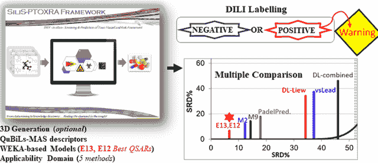

摘要：药物诱导肝损伤（DILI）是药物开发中的安全性关注问题，也是监管关注的问题。因此，许多药物被认为会诱导有机化学品的肝毒性。本研究基于2D-3D 描述符和机器学习技术，在包含1075个分子的训练集上开发了预测 DILI 的分类器。获得的最佳集成模型 E13 在学习系列中具有良好的统计参数，其准确率 = 0.840，灵敏度 = 0.890，精确率 = 0.761；MannWhitney 相关性 = 0.660，ROC曲线下面积 = 0.904。该模型还通过 Y 采样测试、重复 k 折交叉验证和重复 k 折验证通过了验证。此外，还使用两个和五个外部测试集进行了外部验证（准确率 = 0.802，灵敏度 = 0.845，精确率 = 0.715；在其适用范围内的准确率为 98.4%）。对 E13 模型结果和预测的性能进行统计分析表明，文献中也介绍了 DAE、Dropout SoftClassifier、深度学习和随机森林。总而言，E13 在所有实验中表现出最佳的全局性能。排名程序的总和提供了与 MANOVA 统计分析相似的分组程序，其中 E13 被确定为 DILI 预测的最佳模型。此外还开发了一种 DILI 预测推荐工具，可在 http://tomcomond.com/api/ptoxra 免费获取。该软件用于筛选包含天然产物、先导化合物、毒性材料和 FDA 批准药物的各种数据集，以评估 QSAR 模型在物质 DILI 标记中的作用用性；所评估的分子均为 DILI 类化合物。综上所述，E13 模型是预测人类 DILI 风险的相关方法，且在所有使用的方法中显示出最佳结果。

## 引言

肝脏是主要的毒素器官，因为它与药物和异物代谢有关。药物诱导肝损伤（DILI）²是最昂贵且最危险的毒性类型之一。许多临床试验的存续、新药拒绝和药物撤回决定都是基于肝毒性药物导致肝损伤的证据做出的。早期识别 DILI 是必需的，尽管体外/体内元素与人体之间的相关性有限，且当人群暴露于上市药物时，观察到对肝脏特异性反应的预测。⁵⁶ 因此，结合以下经典研究

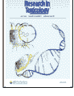

通过动物进行化学毒理学研究，重点在于使用不同方法构建许多预测模型，例如毒性因子、基因敲除或化学小鼠；生物标志物方法、化学结合和体外方法。体外方法可以获得超过70%的灵敏度，其准确率可以替代体内方法。虽然这些体外实验更容易比较，但它们的成本高昂，且受到实验试剂可用性的限制。毒理学家已经在大量化合物中进行了评估，但尽可能少使用动物或体外实验。此外，已经确定将消除所有动物测试要求。

意义上，使用动物的潜在替代方案是创建分子规则和计算机模拟（in silico）模型。在体外和体内分析之前使用计算机模拟方法。需要提到，必须通过生物测试来生成用于此类实验的数据。

在过去的20年里，已经开发了许多用于预测肝毒性的数据集和技术。主要工作集中在对不同类型的描述符和分子编码使用浅学习和深度学习方法。此外，一些参与药物结合预测建模的小组开发了具有用户界面（UI）的不同程序应用程序，例如 DILIweb-15、HepatProEL-21 和 ProTox-22。在数据方面，许多数据集的开发基于药物与人类蛋白的结合亲和力（正值或负）。最常用的数据集之一就是上述提到的。

该数据集尚不充分且难以研究其本质；它包含了药物和类有机化合物。这一事实近年来得到了解决。其他重要的数据集，如 DILI 数据库和 DILshift 也被采用；它们已通过 FDA 批准用于 DILI 的药物标记集。

据我们所知，当前模型的性能/适用范围有限，DILI 预测在药物开发早期的应用仍不尽人意。因此，需要开发新方法。

在本研究中，使用 QChemBL-MS 软件获得了基于原子和键的 0-2D 代数索引，QChemBL-MS 描述符已广泛用于 QSAR 建模，并且比化合物索引保留更多信息。其他索引包括 MACCS、Daylight、Dragon 和 Mordell。在这里，首次使用了这些拓扑模型；开发了用于二进制药物预测的新方法和跨平台，可在 pubs.org/ 免费下载 优化（使用 RDK (https://www.rdkit.org/) 使用 UFF 力场进行 3D 结构预测）。 训练集（基于 0_TR_1075 并由 1075 个化合物组成）和测试集（基于由 120 个分子组成的 VALID 集 (1_RS_120) 和由 2 个分子组成的 valBLOCK 集 (2_BS_47)）由 Li 等人¹ 进行了评估。选择该训练集是因为它足以代表化合物的化学多样性，并被用于确认所用分类器的稳健性和预测能力。此外，我们发现数据集 3_HE_205、4_DR_417、5_DERS_928 和 6_AI_280 包含与训练集重复的化合物。因此，我们决定使用不同的化合物进行训练，重复的仅用于评估我们模型的优劣（预测能力）。

数据集 7_HE_554 的性能是根据相对于训练集的 554 个非重复化合物来判断的。除了化合物标签外，没有使用其他模型；即原始论文中使用的。分别是 3D 结构、支持信息、DILI 标记文件以及 II_i 和 II_j。每个数据中的正例和负例的信息见表 1。

## 1. 训练、验证和外部数据集

| 数据集 | 代码 | 正性 DILI 数量 | 负性 DILI 数量 |
|---|---|---|---|
| 训练集 | 0_TR_1075 | 652 | 423 |
| 测试集 | 1_RS_120 | 72 | 48 |
| | 2_BS_47 | 23 | 24 |
| 外部测试集 | 3_HE_205 | 130 | 75 |
| | 4_DR_417 | 178 | 239 |
| | 5_DERS_928 | 682 | 246 |
| | 6_AI_280 | 214 | 61 |
| | 7_HE_554 | 176 | 374 |

## 实验步骤

分子描述符分类。使用 QChemBL-MS 软件计算了拓扑 0-2D MDs（原子和键索引）以及局部线性、二次和二进制索引。这些描述符已广泛用于 QSAR 建模，在许多应用中表现出良好的性能，例如分析性、药效团、毒性团、抑制剂和反应性。这些属性已被预测⁷。

化学数据集。本研究使用了数据集。应用了多种过滤器以去除无机、固体、混合物和有机化合物。然后，去除了化合物

1856

pubs.acs.org/crt

文章

方案 1. (A) 单个模型生成与 (B) 生成集成模型的基础模型组合的数据准备与特征选择

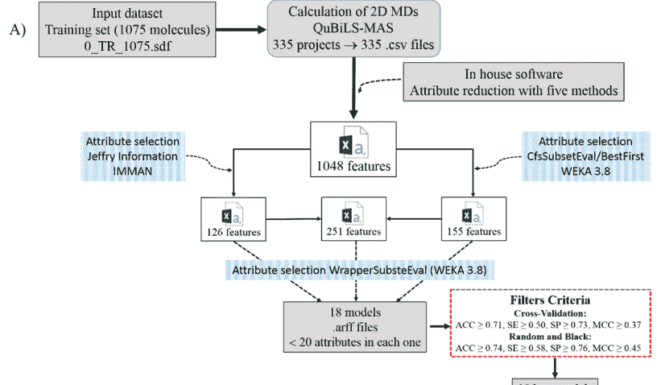

(B) 10 个基础模型

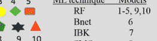

输出 [AP%]

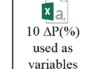

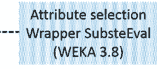

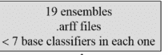

| 过滤标准 |
| :--- |
| 交叉验证：ACC > 0.71; SE < 0.06; SP > 0.7; MCC > 0.37 |
| 随机与分块：ACC > 0.74; SE < 0.64; SP > 0.76; MCC > 0.45 |

| 10 个最佳模型 |
| M1-M10 |

| 过滤标准 |
| :--- |
| 交叉验证：ACC > 0.68; SE < 0.08; SP > 0.6; MCC > 0.3 |
| 随机与分块：ACC > 0.65; SE < 0.09; SP > 0.65; MCC > 0.35 |

| 机器学习技术 | 基础模型 |
| :--- | :--- |
| E12 | M1, M2, M3, M6, M9 |
| E13 | M2, M3, M7, M8, M10 |

第二个是与 DILI 点高度相关的 MD 特征集和低相关集，即 WEKA 软件中子集方法的平均值。子集是通过按照上述方法连接方案 1 中描述的两个子集构建的。

建模过程。我们使用了 WEKA 软件，通过包装器选择方法（wrapper selection method）来选择确定的最佳特征。使用了前向、步婪和遗传算法策略进行选择，并以准确率 (ACC) 作为评估标准。对每种方法执行了 K最近邻 (KNN)、多层感知器 (ML)、逻辑回归 (LR)、分类树 (C4.5)、费舍滤波和朴素贝叶 (NB)。考虑的机器学习技术的 14 种配置均通过交叉验证 (CV) 完成。单个模型和集成模型的预测能力通过考虑准确率 (ACC)、敏感性 (SE)、特异性 (SP) 和马修斯相关系数 (MCC)、几何平均值以及受试者特征曲线下面积 (AUC) 大气指标进行评估，更多细节请参阅补充信息 S12。结果见于图 S1、表 S2 和表 S3，并且

从最佳单个模型开始，开发了集成模型以增强多样性。集成构建基于这样一个观点：不同单个分类器的组合可能产生比每个基础模型实现的更好的性能。“在本研究中，为了寻找选择的最佳特征，我们使用了集成方法来识别最佳的单个分类器以及最佳组合方式。为此，我们使用集成策略作为学习单个分类器输出 (AP%) 与整体类别之间关系的路径（详见方案 1 和第 2 部分）。如果 $p' = 100 - p$，其中 $p$ 为正性概率，$p'$ 为负性概率。单个分类器之间的多样性对于构建集成模型至关重要。多样性关联了结果的

1857

表 2. 本研究数据集 DILI 预测的统计参数

| 数据集 | 代码 | 分子数量 | ACC | SE | SP | MCC |
| :--- | :--- | :--- | :--- | :--- | :--- | :--- |
| 0_TR_1075 | E13 | 1075 | 0.840 | 0.890 | 0.761 | 0.660 |
| | E12 | 1075 | 0.834 | 0.880 | 0.764 | 0.651 |
| | Xu 的数据集⁵ | 1065 | 0.773 | 0.814 | 0.714 | - |
| | M2 | 1075 | 0.743 | 0.841 | 0.541 | 0.448 |
| | M9 | 1075 | 0.736 | 0.759 | 0.711 | 0.471 |
| | Lew 的数据集² | 1028 | 0.681 | 0.668 | 0.667 | 0.361 |
| 1_R_TS_120 | Vilead | 120 | 0.825 | 0.889 | 0.667 | 0.634 |
| | E12 | 120 | 0.792 | 0.889 | 0.646 | 0.559 |
| | M2 | 120 | 0.794 | 0.947 | 0.563 | 0.526 |
| | Xu 的数据集⁵ | 119 | 0.773 | 0.814 | 0.710 | - |
| | M9 | 120 | 0.767 | 0.862 | 0.625 | 0.505 |
| | Padel Dredictor | 120 | 0.758 | 0.833 | 0.646 | 0.490 |
| | DL-Dili (DLIserver) | 120 | 0.750 | 0.819 | 0.646 | 0.473 |
| | DLI-Combined (DLIserver) | 120 | 0.667 | 0.708 | 0.604 | 0.311 |
| 2_B_TS_47 | DLI-Combined | 47 | 0.583 | 0.514 | 0.698 | - |
| | | 47 | 0.936 | 0.957 | 0.917 | 0.873 |
| | M2 | 47 | 0.872 | 0.952 | 0.792 | 0.756 |
| | M9 | 47 | 0.851 | 0.913 | 0.792 | 0.709 |
| | Lew 的数据集² | 47 | 0.809 | 0.957 | 0.667 | 0.648 |
| | E12 | 47 | 0.766 | 0.996 | 0.686 | 0.533 |
| | | 47 | 0.723 | 0.780 | 0.583 | 0.471 |
| | DL-Dili (DLIserver) | 47 | 0.617 | 0.783 | 0.458 | 0.254 |
| | E12 (with duplicates) | 205 | 0.888 | 0.977 | 0.733 | 0.660 |
| | E12 | 205 | 0.861 | 0.942 | 0.660 | 0.681 |
| | | 205 | 0.873 | 0.954 | 0.660 | 0.724 |
| | E13 (with duplicates) | 205 | 0.848 | 0.943 | 0.660 | 0.650 |
| | M9 | 158 | 0.868 | 0.946 | 0.733 | 0.713 |
| | M9 | 158 | 0.861 | 0.941 | 0.698 | 0.680 |
| | M2 | 158 | 0.863 | 0.942 | 0.695 | 0.704 |
| | M2 | 158 | 0.835 | 0.952 | 0.640 | 0.620 |
| | Padel DDPictor | 205 | 0.834 | 0.885 | 0.747 | 0.639 |
| | | 205 | 0.771 | 0.931 | 0.493 | 0.490 |
| | DL-Dili (DLIserver) | 205 | 0.751 | 0.765 | 0.667 | 0.448 |
| | DLI-Combined (DLIserver) | 205 | 0.730 | 0.715 | 0.773 | 0.472 |
| | Xu 的数据集⁴ | 204 | 0.733 | 0.773 | 0.658 | - |
| 4_DR_ETS_417 | 417 | 0.847 | 0.944 | 0.774 | 0.712 |
| | E12 | 151 | 0.809 | 0.914 | 0.666 | 0.621 |
| | | 417 | 0.842 | 0.932 | 0.770 | - |
| | 151 | 0.798 | 0.901 | 0.657 | 0.581 |
| | M9 | 417 | 0.830 | 0.916 | 0.706 | 0.675 |
| | M9 | 151 | 0.763 | 0.864 | 0.645 | 0.523 |
| | M2 | 417 | 0.820 | 0.949 | 0.724 | 0.671 |
| | M2 | 151 | 0.768 | 0.938 | 0.571 | 0.556 |
| | Padel DDPictor | 417 | 0.786 | 0.921 | 0.628 | 0.607 |
| | Wang 的数据集¹ | 450 | 0.769 | 0.822 | 0.870 | 0.452 |
| | Hong 的数据集¹ | 451 | 0.729 | 0.828 | 0.759 | 0.514 |
| 5_DR_ETS_928 | Vilead | 416 | 0.704 | 0.955 | 0.517 | 0.503 |
| | DL-Dili (DLIserver) | 397 | 0.693 | 0.712 | 0.595 | 0.387 |
| | E13 | 928 | 0.810 | 0.847 | 0.790 | 0.546 |
| | M2 | 570 | 0.802 | 0.827 | 0.740 | 0.535 |
| | M2 | 928 | 0.804 | 0.821 | 0.667 | 0.449 |
| | | 570 | 0.781 | 0.816 | 0.668 | 0.387 |
| | E12 (with duplicates) | 928 | 0.779 | 0.795 | 0.726 | 0.472 |
| | M9 | 928 | 0.787 | 0.799 | 0.752 | 0.511 |
| | M9 | 570 | 0.751 | 0.768 | 0.696 | 0.416 |
| | Vilead | 926 | 0.768 | 0.858 | 0.682 | 0.607 |
| | Padel DDPictor | 924 | 0.740 | 0.761 | 0.682 | - |

1858

表 2. 计数

| 数据集 | 代码 | 分子数量 | ACC | SE | SP | MCC |
| :--- | :--- | :--- | :--- | :--- | :--- | :--- |
| | DL-Liew (DLLiew) | 925 | 0.719 | 0.719 | 0.718 | 0.395 |
| | DL-Combined (DLCombined) | | 925 | 0.674 | 0.615 | 0.837 | 0.399 |
| M2 (with duplicates) | | 280 | 0.939 | 0.950 | 0.903 | 0.830 |
| M2 (without duplicates) | | 280 | 0.939 | 0.950 | 0.903 | 0.830 |
| E13 (with duplicates) | | 205 | 0.848 | 0.943 | 0.660 | 0.650 |
| E13 (without duplicates) | | 205 | 0.873 | 0.954 | 0.660 | 0.724 |
| E12 (with duplicates) | | 205 | 0.888 | 0.977 | 0.733 | 0.660 |
| E12 (without duplicates) | | 205 | 0.861 | 0.942 | 0.660 | 0.681 |
| M9 (with duplicates) | | 158 | 0.868 | 0.946 | 0.733 | 0.713 |
| M9 (without duplicates) | | 158 | 0.861 | 0.941 | 0.698 | 0.680 |
| M2 (with duplicates) | | 158 | 0.863 | 0.942 | 0.695 | 0.704 |
| M2 (without duplicates) | | 158 | 0.835 | 0.952 | 0.640 | 0.620 |
| Padel DDPictor | | 205 | 0.834 | 0.885 | 0.747 | 0.639 |
| DL-Dili (DLIserver) | | 205 | 0.751 | 0.765 | 0.667 | 0.448 |
| DLI-Combined (DLIserver) | | 205 | 0.730 | 0.715 | 0.773 | 0.472 |
| DL-Liew (DLLiew) | | 552 | 0.693 | 0.718 | 0.565 | 0.312 |
| DL-Combined (DLCombined) | | 553 | 0.625 | 0.564 | 0.723 | 0.266 |
| 7_ETS_54 | | 554 | 0.792 | 0.832 | 0.708 | 0.537 |
| Vilead | | 554 | 0.760 | 0.819 | 0.599 | 0.499 |
| M2 | | 554 | 0.767 | 0.840 | 0.621 | 0.458 |
| M9 | | 554 | 0.756 | 0.801 | 0.663 | 0.454 |
| Padel DDPictor | | 552 | 0.727 | 0.769 | 0.640 | 0.397 |

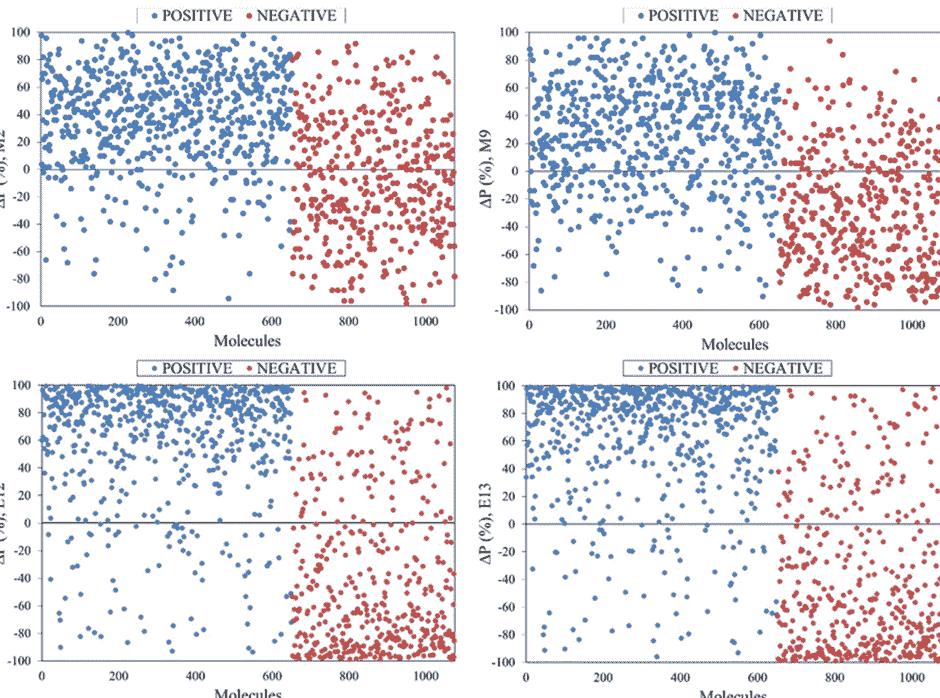

图 1. M2、M9、E12 和 E13 模型在训练集 1_T_1075 中 10 折交叉验证的实例分布图表表示。

先导化合物和毒性化合物。每个数据集的描述见表 S1。

## 结果

**数据集、特征选择和基础模型。** 从选择过程中，构建了三个包含 126、125 和 251 个 MDs 的子集，分别表示为 Imman-126、Weka-125 和 IW-251。应用包装器方法（wrapper-type method）对这些子集进行分类。结果获得了模型（见文件 S2 和 S3-II），测试集 ACC = 0.71、EP = 0.73、SP = 0.50 且 MCC = 0.37，测试集 ACC = 0.72、0.76、SP = 0.58 且 MCC = 0.45。需要注意的是，使用的数据是不平衡的；因为正性 DILI 案例多于负性 DILI 案例。因此应用了合成过采样技术（SMOTE）。特征选择和模型处理中的描述总结在第 3 节。

通过对验证集 1_T_100 应用阈值 [ACC > 0.76 且 MCC > 0.5] 和 2_B_75 [ACC > 0.77  MCC > 0.4]，选择 M2、M9 和 E18 模型为最稳健的模型。M9 模型通过在测试集上进行 50% 的 SMOTE 处理获得，将正性 DILI 实例的数量从 423 增加到 636，接近 652 个正性 DILI 实例的数量。这些模型的统计参数如表 2 所示。为了提高单个模型的结果，利用上一步构建了多个集成模型。选择了另一个 WEKA 包装器类型特征来控制单个类别进入最终集成模型。每个单个模型获得的每个输出 Δ0% 都用作包装器的输入。然后应用相同的 ML 技术整合最佳组合。大约生成了 100 种可能的集成。根据 ACC、SE、SP 和 MCC 统计指标，选择了 19 个集成（标记为 E1 到 E19）作为最佳。MCC 小于或等于某值的集成模型有 7 个。训练准确率约为 0.8，而单个模型获得的最大 ACC 为 0.74。对于 1_T_120 测试集，观察到增长了 0.07，对于 2_B_75 测试集获得了 0.04 的增长。为了选择最稳健的集成模型，应用了以下统计阈值：对于 1_T_1075，适用的标准为 ACC > 0.83、SE > 0.88、SP > 0.76 且 MCC > 0.66。然后选择 E12 和 E13 为最佳，分别具有 7 和 5 个基础模型。E12 和 E13 详细包含了逻辑回归，结果见表 2（另见文件 S4_ii）。

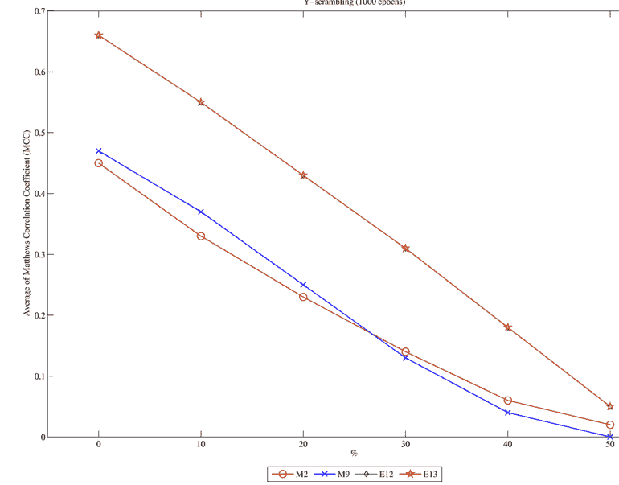

**图 2**. 平均准确率（平均 MCC）值与 Y 随机化检验的关系，来自 1000 次运行中不同的训练 k 折分布（更多细节见 S1）。

为了更深入地了解模型性能，图 1 显示了 M2、M9、E12 和 E13 模型对于实例的性能图（D1–D4 集合、S1、S2 和 S3 的测试情况类似）。观察了每个类别按 Δ% 值划分实例及其预测的分布。从分析可以看出，模型的稳健性大于其特异性。这一事实与语言中的子结构冗余有关，“注意到某些属性可以提高基于 DILI 的分类器的性能，例如 C-O-O 基团（指纹键：：AP202）、O-OH（指纹键：Estate34）、两个芳香环和共轭键（指纹键：Pubchem-257）；重要的是，该指纹（键：PF284）是在本研究使用的训练集上执行的。通过 10 折交叉验证获得了 E13 实例在训练集上的性能，其 ACC、SE 和 P 值分别为 0.84、0.79 和 0.76（表 2）。我们展示了 MCC 值（从 1000 次迭代获得）与百分比值的对比。如观察到的，MCC 值显示出线性下降关系；E13 模型的值分别为 0.06、0.45、0.31、0.18 和 0.05，显示了其稳健性。模型通过重复 k 折交叉验证和重复留出执行了 1000 次。这些测试的结果如图 3 所示，可以看到不同验证集的平均 MCC 值不同。最后，为了分析所示的分类器的性能，在额外集合上进行了验证，并与文献中报道的比较，选择了 DILI 的 DeepDP、DeepSAR 和深度学习（两个模型），因为它们在进行本研究时是免费的。对于 DeepDP 的情况，为了保持相同集的大小，只有三个实例是未经过 DeepDP 和 DeepSAR 处理的特殊情况（$C_5H_{11}N_3O_6$），被标记为负性 DILI。

### 二分类和多分类器的验证

用于评估最佳 QSARs 相关性的验证方法包括 Y 随机化、重复留出、重复 k 折交叉验证和外部验证。在 Y 随机化方法中（见文件 S5），训练了 10%、20%、30%、40% 和 50% 的真实/非活性实例。图 2

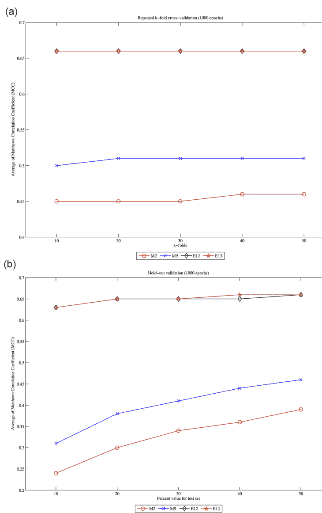

图 3. 1000 次 (a) k 折和 (b) 留出交叉验证的预测准确率（平均 MCC）分布，显示了每个集合中的最佳。（更多细节见 S16）。（$C_6H_{12}N_6O_5$），被标记为正性 DILI。表 2 中的结果显示了每个数据集从最小到最大的准确率。通常情况下，我们的模型是排名中最好的。通过 M-ANOVA/后验程序对这些外部数据集进行 DILI 预测的 QSARs。我们的目标是研究本报告中上述工具以及跨独立数据集的排名行为。为了评估本报告获得的结果与文献之间的差异，使用了“平均排名”的多重比较程序，这在表 2 所示的每个模型排名中建立。

## 讨论

**DILI 预测的深度评估与其他方法的比较。** 我们展示了排名与每个模型平均准确率值的良好比较，在图 4 中图表所示（见 S19），可以得出变量是显著的，这支持均值之间存在统计差异。因此，由于 QSAR 模型，所有统计参数的均值存在显著差异（Wilk=0.067; F=6.5, p < 0.001）。通过执行 Tukey 检验（多次比较）也评估了模型对之间的差异。使用 Tukey 方法比较了所有组对。QSAR 模型对之间生成了显著值（例如/ E12/E13-D12/E13-Combined）。此外分析表明我们的模型与 DL 和 DL-Combined 模型之间存在差异。Paedel-Pred 和 E13 模型之间以及 Vethod 和 E12 模型之间没有统计学显著差异。

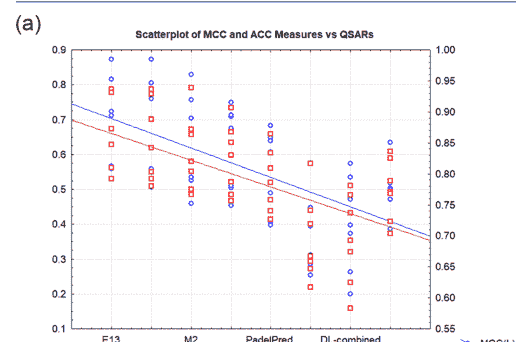

从 SISC（同质组，alpha = 0.05）确定 E12 模型是最佳 QSAR，且与 DL 和 DL-Combined 模型外。然而，PaedelPred 和 Vethod 模型与所有模型相比都不显著。

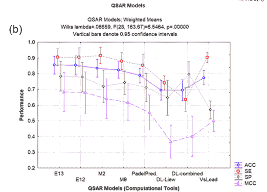

名为排名和（SRD）的统计方法也应用于基于最大向量的其他模型比较排名（见图 5；见 S19）。图 4 对所示最佳分类器的分析结论为：（a) M 模型比其他模型具有更高的统计参数（MCC 和 ACC）；(b) M-ANOVA 显示最稳健的分类器是 E12 和 E13，然而也对其他作者报道的某些外部数据进行了直接比较。在这种情况下，也可以观察到 QSAR 集成在所有模型的 MCC 和 ACC 值之间呈正相关。图 5. 多个数据集 DILI 预测的排名和（SRD）。X 轴：对于不同的 QSAR 模型（模型 0 和 100，与指标比例相同）；Y：左侧条形图显示每个模型的比例，右侧报告了黑色（填充）高斯曲线的 SRD 方差（X = 55, 均值 = 99 + SD = 19）。随着 ACC 的增加，MCC 也于增加，对于任何给定的 ACC，E13 模型的 MCC 值高于其他模型，统计学上并不显著，这些结果随变化而异。输入矩阵代表模型（n = 8）；而行代表多个数据集的统计参数（n = 28），见 SIF 19。对每个指标（ACC、SE、SP 或 MC）均进行了方差分析（见表 2）。四因素方差分析通过 M-ANOVA 执行（同时将所有 ACC、SE、SP 和 MC 参数作为多个因变量），这种多变量分析与单因素方差分析显示相同的统计模式。

（与参考值差异更大）。$^{29}$ 因此，基于排序的 QSAR 模型，根据 SRD 值，E13 和 E12 模型显示出最佳个体的 SRD 值。从也可以看出，最佳模型（M8 和 M9）的 SRD 值表明，它们与 E13 和 E12 集成模型相比，在 ILI 预测方面具有相似的多样性。同样注意的是，文献中展示了不同的方法。DL-Liw、DL-Combined 和 DL-Computational 工具在 ILI 预测中的结果较差。还可以看到，大多数模型的标度位置与获得的 SRD 值相远，表明它们的排序并非随机。然而，DL-Combined 方法是 ILI 预测中排名最好的方法。

表 3. 预测 ILI 终点列表中最常用的方法和 QSAR 方法之间的多样性测量

| model | PadPred | DL-Liw | DL-View | E12 | E13 |
|---|---|---|---|---|---|
| PadPred | | 0.17 | 0 | 0.16 | 0.20 |
| DL-Combined | | | 0 | 0.08 | 0.07 |
| DL-Liw | | | | 0 | 0.23 |
| DL-View | | | | | 0.18 |
| E13 | | | | | |

聚类分析证明了基于 QSAR 聚类的发现。分组结果如图 6 所示。

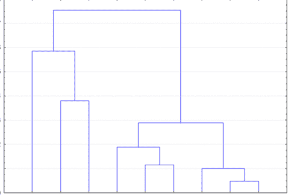

图 6. 根据七个外部数据集的统计值对八个 QSAR 进行排名说明。

“多样性测量（见 S3 节公式 9，文件 S2）是根据本研究中 E13 集成开发模型通过 ILI 数据计算的；其中一个模型的值用**粗体**显示，另一个模型的值用*斜体*显示。

E12 方法与 E13 相比相似性非常低（-0.2），且 E13 和 E12 方法与 PadPred 模型和 M9 在方面具有中等偏相似性，这是一个逻辑结果，因为它们使用了学习序列。总而言之，可以看出 E13 模型和 PadPred 与研究有机化学化合物 ILI 数据库中使用的其他 QSAR 方法相比产生了最可靠（且不无用）的结果，证明了它们在我们前瞻性研究中的合理性（见下文）。

总结本节，表 4 展示了数据集中用于 ILI 预测的最相关方法。包含了包含分子构建方法等实验变量的文章。在此列表中，有 13 篇该领域的关键报告。可以分析的是，已经使用了不同类型的 MD；本研究是首次应用 QSAR-BLS 方法获得最佳结果的研究。

这种分层聚类分析在测试和外部数据集中进行，使用了欧几里得距离（X 轴）和 Ward 排序指标（Y 轴）。还存在一种有趣的关系。右侧显示最佳模型（E13、E12、‘理想’向量 (M9)），左侧显示最差模型（DL-Liw、DL-Combined 和 Vated）。

另一方面，使用了基于多样性的分析。多样性函数衡量不同聚类的质量。同样注意的是，定义为多样性、依赖性、方向或互补性的是不同的。$^{34}$ 聚类之间的测量可以从统计异质性得出。这里我们使用了基于聚类密度的多样性测量，它代表聚类的输出是正确的（1）还是否定的（0）（更多细节见文件 S2，S3 节）。表 3 显示了多样性测量（S3 节公式 9，文件 S2）与双特征$^{35}$（更多多样性见文件 S10）之间的多样性，它们描述了与聚类分析相同的分组模式。还可以看到 E13 和 E12 模型具有高相似性；两个模型在预测中均表现出高相关性（共线性）。此外，E13 和

覆盖分析。对两个最佳模型的适用范围（AD）进行分析，以确定它们是否适用于 ILI 终点。该分析通过考虑评估 PCAR 预测的五种方法进行：欧几里得距离、聚类块、马哈拉诺距离和密度。这也被应用于外部数据集 7_ETS 554。文件 S7 的补充信息显示了针对 AD 关注的统计分析。对于最佳模型（E13、E12 和 M9），相关结果显示了最佳模型，而对于 E13 集成模型，ACC、SE 和 SPC 统计特征没有显著呈现，或其值为 0.792、0.825 和 0.951。从这来看，在 7_ETS 554 数据集的预测中，PadPred 方法的结果低于我们模型的结果，可以得出，根据相应的 AD 表，我们的模型提供了高度可信的预测。

表 5 展示了应用 AD 方法后获得的两个单独模型（M2 和 M9）以及最佳集成模型（E13 和 E12）的统计结果。184

| data set | size of set | ACC | SE | SP | year/software |
|---|---|---|---|---|---|
| training (S-6C) | 295 | 0.585 | 0.585 | 0.681 | 2010/Laplacian |
| training (S-6C) | 153 | 0.599 | 0.560 | 0.677 | 2011/Random Forest |
| training (vRand) | 164 | 0.708 | 0.681 | 0.700 | 2011/Bayesian |
| training (vBRAC) | 427 | 0.738 | 0.750 | 0.800 | 2013/SIPA |
| training (vSIP) | 210 | 0.697 | 0.579 | 0.737 | 2013/Molecular Forest |
| training (S-6C) | 190 | 0.661 | 0.661 | 0.716 | 2015/topological |
| training (NCT) | 915 | 0.689 | 0.614 | 0.775 | 2015/2D |
| training (X) | 324 | 0.700 | 0.700 | 0.661 | 2015/Deep learning |
| training (DILI-10) | 119 | 0.717 | 0.700 | 0.601 | 2016/SYM |
| training (DILI-Lex) | 701 | 0.844 | 0.819 | 0.870 | 2016/Openabel |
| training (DILI-Combined) | 476 | 0.859 | 0.825 | 0.899 | 2016/SYM |
| training (S-6C) | 236 | 0.882 | 0.845 | 0.923 | 2016/naive Bayes |
| training (S-6C) | 1415 | 0.971 | 0.887 | 0.980 | 2017/machine learning |
| training (S-6C) | 854 | 0.726 | 0.725 | 0.728 | 2017/RF and SVM |
| training (S-6C) | 318 | 0.739 | 0.701 | 0.769 | 2017/RF and SVM |
| training (S-6C) | 394 | 0.710 | 0.610 | 0.740 | 2018/3 machine learning |
| training (S-6C) | 1268 | 0.869 | 0.839 | 0.854 | 2018/RF with SMOTE |
| training (S-6C) | 221 | 0.930 | 0.960 | 0.910 | 2018/RF with SMOTE |
| test (S-6C) | 1731 | 0.804 | 0.842 | 0.827 | 2018/SVM learning |

## 用于预测 DLI 的 SiLS-PTOXRA 软件

SiLS-PTOXRA 软件是一个具有友好桌面界面的框架（见图 7），其步骤可以总结为三个步骤：(1) 从 SDF 和 MDL 文件中选择化合物。需要注意的是会生成 3D 结构；可以直接跳转到 3D 结构的生成（RDKit），将其作为中间步骤。(2) 选择预测模型和评估方法。(3) 选择报告结果的方法。

筛选后，会显示一个处理结果的界面，并生成一个包含模型所有输出信息的文件夹。大多数情况下，本研究中使用的测试集是以数据集的形式提供的。通过使用测试集 2_B_TS_47 对每个分子的处理时间进行了实验，结果发现在使用 M2、M9、E12 和 E13 方法时，考虑到用于 AD 的共识方法，每个分子的处理时间约为 3 秒。该实验使用了配备 Intel i7 处理器和 4 GB RAM 的计算机。

表 6 给出了我们的软件与文献中报道的一些最相关软件的通用和定性比较。这里介绍的软件与之前报道的相比具有许多优势，并用于数据集筛选，这将在下一节中描述。

**前瞻性虚拟筛选。** 最后，使用了一个大型天然产物、药物和 EAD 类化合物的数据库（描述在文件 S2、表 S1 中）。使用计算机 E13 模型进行计算 DLI 预测的结果，对 22,678 个化合物进行了筛选。惊讶的是，发现的比例小于 93%。大多数阳性 DLI 化合物出现在所有数据集中（48），先导化合物和毒化合物数据集显示超过 65% 的结果为阳性 DLI。

疟疾数据集获得的结果特别受到关注，$^{73}$ 显示 86% 的病例为阳性。这组分子包含新型且有趣的骨架（40 种化学结构），被用于构建预防疾病的多样化集合。这些化合物中有一是根据药物属性（ADME-tox 规则）选择的，其他作为分子探针。将化合物纳入疟疾框的主要因素是显示出至少 4 μM 的活性，且选择性比细胞毒性（$CC_{50}$）至少高 10 倍，后者是使用 HEK-293 细胞测量的。事实上，该数据集通过药理测试要求提供数据和化合物。然而，只有 8% 的这些化合物会被发现（对于 E13 模型为阴性-DLI），因为这些结果对人类具有肝毒性。以上所有场景都证明了计算机 E13 模型在过程早期对新候选进行 DLI 筛选的适用性。

对于由天然化合物组成的1_0_ADB 数据集，根据 E13 模型，3% 的分子为阳性 DLI。

| 数据集大小 | ACC | SE | 数据集 | 描述符/软件 | 年份/分类技术 |
|---|---|---|---|---|---|
| 151 (88±6) | 0.783 | 0.818 | 训练集 (10折交叉) | 包含物理化学和拓扑性质的描述符 (RDKit 版本 18.3.0) | 2019/结合 8 种机器学习技术的集成模型 $^{14}$ |
| 126 (66±18) | 0.817 | 0.744 | 测试集 (10折交叉) | 2D 分子描述符和指纹 (Padel Descriptor) | 2019/包含 9 种机器学习算法的集成分类器 $^{15}$ |
| 225 (78±30) | 0.867 | 0.889 | 测试集 (5折交叉) | | 2020/本研究，此处展示了 E13 的集成结果 |
| 105 (52±23) | 0.962 | 0.917 | 测试集 (1_R_TS_120) | 拓扑描述符 $^{16}$ | |
| 47 (21±24) | 0.952 | 0.708 | 测试集 (2_B_TS_47) | | |

表 4 续表

1866

表 5. 在外部数据集 (7_ETS_554) 上应用 AD Consensus-3 后的统计参数

| 模型 | 入分子数 | ACC | SE | SP | MCC | 覆盖率 (%) |
|---|---|---|---|---|---|---|
| E12 | 544 | 0.780 | 0.811 | 0.688 | 0.488 | 98.2 |
| E13 | 544 | 0.793 | 0.835 | 0.690 | 0.506 | 98.4 |
| M2 | 547 | 0.762 | 0.841 | 0.594 | 0.444 | 98.7 |
| M9 | 545 | 0.763 | 0.802 | 0.680 | 0.469 | 98.4 |

> *本研究开发的集成模型；一个值已加粗。*

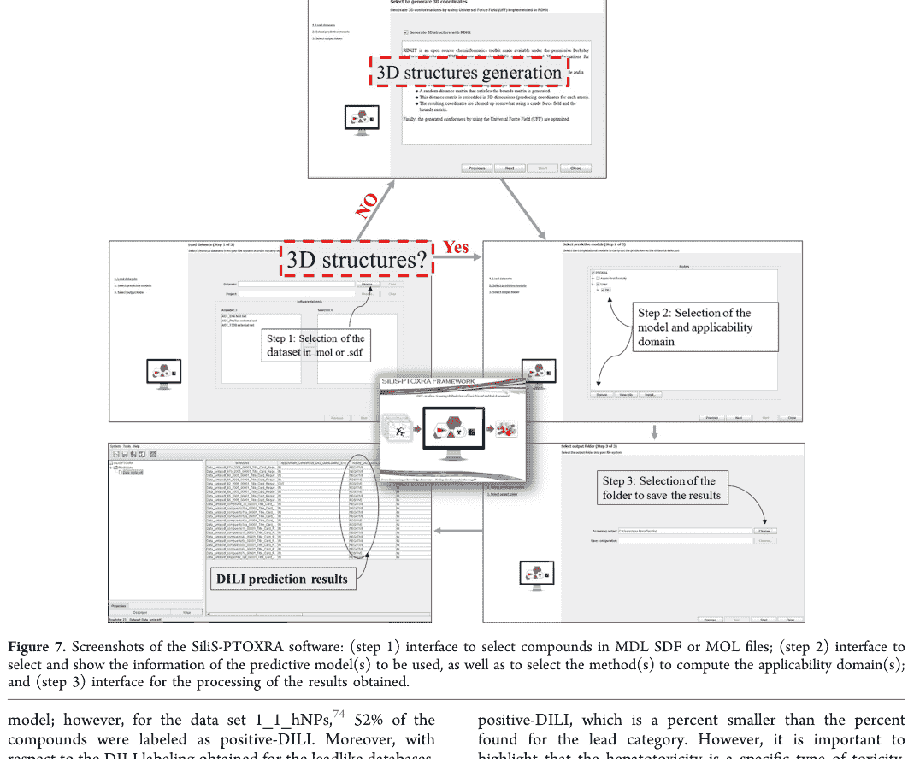

针对特定健康问题的新具特异性或强效的药物并不一定是因为毒性的存在。

在 FDA 批准药物的特定案例，分析中识别出 2608 个分子，覆盖率达到 69.99%。从这些分子集中，筛选出 668 个化合物并分别标记为 DILI（肝毒性损伤）和非 DILI。在用 Data-DL 和 DL-Lead 方法对该集合进行筛选时，注意到使用前一种方法筛选了化合物总数的 49% 和 51%，而分别对 DILI 和非 DILI 筛选的化合物，比例分别为 61% 和 93%。最后，在对分子进行评估时，分别有 78% 和 22% 的分子被预测为阳性 DILI 和阴性 DILI。

同样，在表 3 中，当对基于性能的预测结果在 ETS 上的相似性应用多种分析措施时，表 5 显示的 FDA 批准药物 ETS、Padel DDPredictor 和 Voxel 的性能结果优于其他 SDR（SDR 均值）结果。这些结果支持可以将模型联合用于预测吲唑（indazole）的 DILI 标记。其中几类别的选择是通过多数投票完成的（见 SI4），其性能结果对于 ETS 而言优于 E15 模型。

已使用不同开发阶段的大型化合物集进行了筛选。DILI 预测的分布说明了这些数据集在药物发现和开发中的当前状态。预计计算方法的结合可以为药物发现阶段的药物分子提供最佳的毒性估计。

## 总结与结论

在过去的 50 年中，DILI 是导致安全相关药物市场撤回最常见的原因。DILI 估计对患者和制药行业来说都是一个主要问题。事实上，人类模型对于国际模型来说仍然是一个挑战。事实证明，基于 QSAR 的 2D-SD 分子描述符和浅层机器学习技术（通过使用不同的集成生成和严格的内部及外部验证方案）的模型可以增强 DILI 预测的性能和可靠性。

为此，开发了两个健壮的模型（M2 和 M9），它们在随机测试集和黑验证测试集上的训练准确率分别为 0.735±0.76 和 0.76±0.84。通过使用单个模型的预测概率值，我们构建了一些集成模型，其中 E15 是 DILI 预测中最好的。这些集成模型相对于单个模型取得了显著增强，AC、SE 和 SD 的准确率分别达到 0.853、0.88 和 0.76。通过内部验证测试和外部验证测试获得了良好结果。

表 7 使用 E15 模型进行虚拟筛选的结果

| 软件 | 代码 | 模型数量 | 阳性 (+) | 阴性 (-) | 百比 (%) | 百比 (%) |
| :--- | :--- | :--- | :--- | :--- | :--- | :--- |
| SILIS（本研究） | 1_ADHB | 885 | 472 | 413 | 53 | 47 |
| | 1_KNPs | 657 | 330 | 327 | 50 | 50 |
| | 2_MBox | 400 | 344 | 288 | 52 | 8 |
| | 2_OTA | 1438 | 1477 | 1404 | 12 | 91 |
| | 3_TDBL | 2641 | 2032 | 556 | 79 | 21 |
| | 3_Wildhelm | 618 | 310 | 253 | 59 | 41 |
| | 4_FDAs | 2608 | 1779 | 824 | 68 | 32 |
| Padel DDPredictor | 2608 | 1486 | 806 | 65 | 35 | 88 |
| DL-Combined | 2608 | 1281 | 437 | 59 | - | - |
| DL-Liew | 2608 | 1593 | 1015 | 61 | 39 | - |
| Vlead | 2608 | 2047 | 563 | 78 | - | |

表 8. 与 E13 和 QSAR 的相似性对比

| QSAR | Padel DDPredictor | DL-Combined | DL-Liew | lead |
| :--- | :--- | :--- | :--- | :--- |
| E13 | 1.0 | 0.78 | 0.63 | 0.54 |
| Padel DDPredictor | 1.0 | | | |
| DL-Combined | | 1.0 | | |
| DL-Liew | | | 1.0 | |

*集成方法的结果优于 E15 模型。

Amileth Caussado – 卡塔赫纳大学医学院生物化学系临床科学生物医学小组，Campos de Zagaleta，卡塔赫纳-德尔印第亚 13001, 哥伦比亚

作者无财务冲突。一种用于 DILI（药物诱导肝损伤）预测的非商业、全跨平台软件可在 http://tomcond.com/ptrs 免费获取。用于二分类 DILI 预测的新模型以及跨专家系统可从 http://tomcond.com/ptrs 免费下载。QUBIS-M 工具可在 http://tomcond.com/qubis 获取。SilS-POTRA 软件亦可在从 http://tomcond.com/ptrs 获取。

J.R.M. 感谢 USFQ 基金会 2019-2020 年度资助（项目 ID 16888）的支持。Y.M.P. 感谢 2020 年瓦伦西亚大学博士后基金的资助。Y.M.P. 感谢 USFQ 基金会 2018 年度资助（项目 ID 15325）以及 CEDIA CEPRÁ 2018-2023。该项目由 ESQ 高性能计算 (HPC-USFQ) 研究中心完成。C.R.G.-J. 感谢国家科学与技术委员会 (CONACYT) 科学与高等教育部门 (CIES) 的成本支持。

QUBIS-M 工具，高容量基因组转录组数据和分子靶点的线性及非线性映射；DILI；药物诱导肝损伤；ACC；准确率；敏感性；特异性；MCC；相关系数；AURC；ROC 曲线积；QSAR；显著性值；给药；Shannon熵；k-NN，最近邻；MLP；多层分类器；随机森林；SVM；支持向量机；LR；线性回归；CT-48，四分类树；费希尔判别分析；神经网络；NN；机器学习；适用领域；ANOVA，方差分析；秩；秩效应之和

- (1) Lee, W. W., and DuBois, J. (2009) 药物诱导肝毒性。J. Engl. Med. 349, 474–485.
- (2) Salim, M., and Kaplowitz, N. (1999) 药物肝毒性：机制与展望。Toxicology 29, 1337–1351.
- (3) Cheng, A., and Dixon, S. J. (2003) 用于剂量依赖性肝毒性的计算机模拟模型。J. Comput. Aid. Med. 22, 41–48.
- (4) Wilke, R. A., Lin, D. W., Rosen, D. M., Watkins, P. B., Flockhart, D., Zhang, Giacomini, K., and Kraus, R. M. (2007) 识别药物不良反应的遗传风险因素：现状与展望。Nat. Curr Res. Drug 60, 904–916–
- (5) Aleo, M. D., Shah, F., Allen, S., Barton, H. A., Contales, C., Lazarzo, S., Seung, L., Nicholson, A., Obach, R. S., Rodriguez, A. D., and Wang, Y. (2020) 超越人类药物诱导肝损伤（DILI）预测，转向相对风险风险。Hepatology 91, 2223–2238.
- (6) Ballet, F. (1997) 药物开发中的肝毒性：检测、选择与解决方案。J. Hepat. 26, 26–36.
- (7) Zhang, M., Chen, X., and Tong, W. (2020) 计算机模拟毒组学：从大鼠到人类药物诱导肝损伤的临床毒理学新生物标志物。Chem. Toxicol. 55, 122–128.
- (8) Nishimura, M., Takada, S., Yamaguchi, K., Yanamura, N., Oishi, Y., and Shimada, N. (2019) 体外 2,3-二甲基-1-萘醌的肝毒性预测。Drug. Sci. 52, 173–178.
- (9) Flynn, T. J., and Fergus, S. M. (2008) HEPG2 人肝细胞中肝毒性的多层预测及用于开发急性肝毒性预测模型的神经网络架构。Tox. in vitro 22, 1640–1651
- (10) Bauer, J. A., Kelly, M. J., Tipton, S., Shao, L. W., and Wang, Y., Ober, K. R., and Roth, R. S. (2004) 用于预测非人肝细胞肝毒性的体外代谢依赖性恒定结合数据。基于人类肝细胞和 S 组的研究的研究。Chem. Res. 22, 3332–3340.
- (11) Chen, Y. L., Wang, J. J., Lu, Y. C., and Yap, Y. C. (2011) 在肝毒性预测中使用学习算法和特征选择。J. Comput. Aid. Med. 32, 999–1008.
- (12) Chen, M., Hang, F., Huang, K., Helly, R., Zhou, S., Gordon, J., et al. (2012) 基于 FDA 批准药物标签并使用大量化合物预测药物诱导肝损伤的定量结构活性关系模型。Mol. Cell. Biol. 38, e15015.
- (13) Xu, X., Zhou, A. W., and Li, S. (2014) 利用化学富集和体外细胞成像预测药物诱导肝损伤（DILI）的混合系统。J. Appl. Toxicol. 34, 281–288.
- (14) Wang, J., Cao, S., Sun, J., and Zhang, Y. (2019) 用于药物诱导肝损伤的深度学习。J. Comput. Aid. Med. 58, 205–215.
- (15) Liang, R., Chen, F., Li, W., Liu, G., P., and Wang, Y. (2019) 使用减法表示法计算机模拟预测药物诱导肝损伤。J. Mol. Struct. 5985, 1263.
- (16) Zhang, H., Lu, J., Yan, Y., Qi, S., Huang, H. G., and Wang, J. (2018) 使用深度学习预测药物诱导肝损伤。
- (17) Amberg, D., Schmidt, F., Molote, S., Morik, H.-P., Pich, A. (2016) 全球范围内的人类和动物毒性计算机模型。Chem. Res. Environ. 59, 2725–2735.
- (18) Huang, N., Thacker, S., Chen, M., and Tong, W. (2017) 基于 FDA 批准药物预测人类药物诱导肝损伤的森林模型。
- (19) Kim, E., and Han, N. (2018) 使用集成方法和分子指纹预测药物诱导肝损伤。
- (20) Banerjee, P., Bhasin, D., and Reissner, R. (2018) 预测是一个平衡过程：采样对平衡模型敏感性和特异性的重要性。Front. Chem. 6, 1871 https://doi.org/10.1021/acchem.c00030
- (21) ...
- (22) ...
- (23) Li, X., Chen, Y., Song, X., Li, H. (2018) 药物诱导肝损伤计算机模拟模型的开发与应用。Chem. Res. 59, 1855–1873.
- (24) Hu, J.-T., Wang, R., Zhang, C., Sun, G., and Sun, X. (2019) 预测药物诱导肝损伤的计算机模拟方法。Hepatol Int. 25, 80.
- (25) Wang, J., Xiao, Q., Chen, B., and Wang, J. (2019) 基于聚类方法的药物诱导肝损伤预测。J. Med. Sci. 20, 4106.
- (26) La, N.-H., Shen, W., Chen, C.-C., J, M.-C., L.-N., and Chen, H.-Y. (2020) 机器学习预测药物诱导肝毒性的方法比较。Comp. Biol. 38, 105–107.
- (27) Sun, Y., Wu, H., and Li, X. (2021) 基于分子特征和多种分类策略的药物诱导肝毒性预测。
- (28) McKenna, J. A., Wagner, C., Newman, M., and Garside, C. (2007) 毒理学中的结构活性关系（SAR）综述。Sci. 56, .
- (29) Grimm, D. (2019) 美国 EPA 以满足所有测试。
- (30) Fiesci, C., Merencato, F., Busella, N., Bursama, J., and Grimm, D. (2023) 使用机器学习方法预测药物诱导肝损伤。Data Sci. 5, 22.
- (31) Takakura, S., Li, T., Zhou, Y., Hu, C., and Tok, Y. (2016) DILI 排名：药物诱导肝损伤的评估。Hepatol. 39, 177–184.
- (32) Takakura, S., Li, T., Liu, L., Roberts, and Tok, Y. (2020) 药物诱导肝损伤和毒性（DILI）：1279 种药物的二分类。Data Sci. 5, 10.
- (33) Valde-Martini, J. R., Ramírez-Ponce, Y., García-García, C., Martínez-Mayoga, K., Yanda, S., H., Pérez, J., and Meneses, M. C. (2017) QSARPER：基于活性和属性的分子描述符的免费开源平台。J. Chem. Info. Model. 9, 1.
- (34) Meneses, M., Ramírez-Ponce, Y., Jiménez-Isabelardo, A., Gómez-García, A., Sun, S., Chen, G., C., Machados, Y.-G., Ruiz, J.-J., and Jari, A. V. (2020) 基于人类肝毒性筛选的机器学习预测抗原生虫药物。Future Chem. Med. 10, 86–93.
- (35) Meneses, M., Martínez-Ponce, Y., Castillo-Gillo, A. J., and Martínez-Fortermín, A. R., Torres, F., Redondo, R., Ibarbarra-Valleera, F., and Valdivieso, A. (2016) 使用集成学习预测抗抑郁药毒性。Biom. Med. 14, 6520–6534.
- (36) Carlos-Gillo, M. M., Martínez-Gomez, R., Khan, M. H., Altam, A. S., Sultan, R., and Toledo, R. (2007) 基于 TOAD-DART 描述符的酪氨酸抑制虚拟筛选：使用配体线性指数评估不同的分类模型。J. Mol. Chem. 15, 1483–1503.
- (37) García-García, R., Martínez-Ponce, Y., Cortés-Guzman, F., Suero-Lozano, J., Martínez-Fortermín, A., and Pérez, M. (2019) 使用共识建模和代数形式预测评估急性毒性：1D 到 2D 分子描述符。Chem. Res. Toxicol. 36, 799–806.
- (38) Martínez-Ponce, Y., Yanda-Villa, M., Torres, A., Romero-Zaldívar, C., Brandi, A. A., Avila, P. E., Küratter, K., and Machado, Y. (2005) 基于配体的虚拟筛选和新型抗疟药物的计算机设计。

(59) Heberger, K. (2010) 排名差异之和比较方法或理想是存在缺陷的；TrAC, Trends Anal. Chem. 29, 101–109.

(60) Brown, R. D., and Martin, Y. C. (1996) 利用结构活性关系构建用于虚拟筛选的数据的聚类方法和描述符；J. Chem. Inform. Comput. 36, 572–584.

(61) Barnard, J. M., and Downs, G. M. (1992) 基于二维相似性测量的化学结构聚类；Acta Mol. 32, 644–649.

(62) Willett, P. (1987) 化学信息系统中的相似性与聚类，Research Press, Letchworth.

(63) Steinberg, A. (2006) STATISTICA 版本 6, 日本东京。

(64) Steinbeck, C. H., Yang, Y., Ku, S., Sorthlar, O., Luttmann, E., and Willhagen, E. L. (2003) 化学描述符库（CDK）：一个用于化学和生物信息学的开源 Java 库；J. Chem. Inf. 65, 483–500.

(65) Steinbeck, C., Hoppe, C., Kuhn, S., Floris, M., Guha, R., and Willhagen, E. (2006) 化学描述符库的最新进展：用于生物信息学的开源 Java 库。Curr. Pharm. Dev. 12, 2111–2120.

(66) Valdés-Martini, J. R., Martínez-Ponce, Y., García-Garcia, J., Martínez-A., Burgo, S. J., and Varela, A. S. Tham-The, H., Pérez-Giménez, F., and Morell, C. A. (2014) QChemBLAS，用于基于原子和键的拓扑（二维）和化学（2.5D）分子描述符计算的开源多平台软件。Journal of Cheminformatics, 66, e1.

(67) Chawla, N. V., Boyer, K. W., Hall, L. O., and Kegeler, M. (2002) SMOTE：少数类过采样技术。J. Art Intell. Res. 9, 321–357.

(68) Rócza, A., Bajós, D., and Heberger, K. (2015) QSAR 模型的一致性：训练集与测试集的选择、模型排名和性能参数。SAR Environ. Res. 26, 683–700.

(70) Smith, P., and Sokol, R. (1973) 数值分类学：数值分类的原理，W.H Freeman and Company, 美国加利福尼亚州旧金山。

(71) Schapieire, R. (1999) Boosting算法的理论观点，见第 14 届欧洲计算学习理论会议，第 1–10 页。

(72) Guesmen, D., and Baek, F. (2001) 用于分类过程的有效神经网络集成设计。Image Vision and Application Journal 19, 699–727.

(73) Springer, J., Burrows, J. N., Kowalczyk, P., McDonald, S., Wells, T. N. C., and Wells, P. (2013) 开放访问疟疾数据库：被忽视疾病的药物目录。PLoS One 8, e62906.

(74) Tang, M., Sagar, P., Singh, H., Raghava, G. P. S., and Agarwal, S. M. (2013) NAT：植物化合物-活性-靶数据库。Nucleic Acids Res. 41, D1124–D1129.

(75) Spangenberger, T., Burrows, J., Kowalczyk, P., McDonald, S., Wells, T. N. C., and Wells, P. (2013) 开放访问疟疾数据库：被忽视疾病的药物目录。PLoS One 8, e62906.

(76) Lee, M., Pons, A., Djoubon, Y., Kotes, C., Shivakumar, S., Guo, A. C., Nero, V., and Wishart, D. S. (2010) T3DB：一个全面注释的常见毒素及其靶点的数据库。Nucleic Acids Res. 38, D7781–D7886.

(77) Stamasletti, B. V., Nickel, J., Omiecznyski, C., Gohike, B.-O., Drued, M., and Reissner, R. (2016) WITHDRAWN——撤回和停用药物的资源。Nucleic Acids Res. 44, D1080–D1086.

