# 云端企业AI：端到端机器学习与ChatGPT™解决方案部署实践指南

## 简介

**欢迎来到** *云端企业 AI：部署端到端机器学习和 ChatGPT 解决方案的实用指南*。本书是配备读者实施人工智能 (AI)、机器学习 (ML) 和生成式 AI 技术所需方法论和工具的权威指南。您手中握有一本强大的指南，有可能改变您的公司和您自己的职业生涯。

在本书中，您将学习如何

- 制定 AI 战略，解决挑战，推动变革
- 识别并确定 AI 用例优先级，评估 AI/ML 平台，并启动试点项目
- 组建梦想团队，赋能人员，有效管理项目
- 使用主要云平台构建 AI 基础设施，并使用 MLOps 扩展您的运营
- 处理和设计数据，并在生产环境中部署、运行和监控 AI 模型
- 使用受治理的模型，以合乎伦理和负责任的方式实施 AI
- 通过建立 AI 卓越中心 (AI COE)、AI 运营模型和企业转型计划来扩展您的 AI 工作
- 使用诸如 ChatGPT 之类的生成式 AI 发展您的公司，为未来制定规划，并持续利用 AI 进行创新

从现实世界的 AI 实施、AI/ML 用例和动手实验，到团队开发和 AI 优先战略等非技术方面，本书应有尽有。

简而言之，本书是一本全面的指南，弥合了理论与现实世界 AI 部署之间的差距。它是战略与战术、挑战与解决方案的结合体，使其成为有兴趣为其企业构建和运营 AI 系统的人不可或缺的资源。

## 本书如何组织

本书不仅仅是理论指南，而是一本实用的、动手实践的手册，旨在通过云中的 AI 转型您的业务。我的目标是为您提供所需的工具和知识，以全面而深入的方法论利用 AI 的力量为企业服务。

- **第一部分：简介：** 在第一部分中，我解释了企业如何通过采用云技术利用 AI 进行转型。我介绍了云中 AI 的行业用例及其优势，以及 AI 转型的现状。我还讨论了各种成功的 AI 实施案例，包括美国政府、Capital One 和 Netflix。

- **第二部分：AI 战略制定与评估：** 在本部分中，我讨论了 AI 的具体细节，例如您在 AI 之旅中可能面临的挑战、伦理问题，以及可以采用的四个阶段来构建 AI 能力。接着，我讨论了如何使用路线图制定 AI 战略、为您的项目找到最佳用例，以及评估各种云提供商的 AI/ML 平台和服务。这就像是一份 AI 冒险的逐步指南。

- **第三部分：规划与启动试点项目：** 本部分涵盖了围绕规划和启动试点项目的所有挑战和任务，包括确定项目的用例、评估合适的平台和服务，以及启动实际项目。

- **第四部分：构建与管理您的团队：** 人们创造奇迹！第四部分探讨了赋能员工所需的组织变革。我将指导您启动试点并组建梦想团队的步骤。这一切都是关于培养人的方面。

- **第五部分：搭建基础设施与管理运维：** 在本部分中，您将卷起袖子深入技术细节。第五部分就像您构建自己 AI/ML 平台的 DIY 指南。在这里，我讨论了平台的技术要求和日常运维，重点关注自动化和规模化。本部分是一本动手实践的工具箱，适合那些渴望钻研技术的人。

- **第六部分：数据处理与建模：** 数据是 AI 的生命线。在第六部分中，您将深入数据和建模的实践。我将教您如何在云中处理数据，根据用例选择合适的 AI/ML 算法，并对模型进行训练、调优和评估。这里是科学与艺术相遇之处。

- **第七部分：部署与监控模型：** 太好了！是时候上线了。第七部分指导您完成将模型部署到生产环境以供使用的过程。我还讨论了监控、保护和管理模型的细微差别，以确保它们平稳、安全、可靠地运行。

- **第八部分：规模化与转型 AI：** 您已经构建了它，现在可以让它变得更大！在第八部分中，我提供了一条规模化 AI 转型的路线图。我讨论了如何通过引入 AI 成熟度框架和建立 AI 中心卓越中心（COE）来将您的水平提升到新高度。我还将指导您完成构建 AI 运营模型和转型计划的过程。这是 AI 从项目层面过渡到企业级强大引擎的阶段。

- **第九部分：AI 的演进与成熟：** 这里是您展望未来的地方。我深入探讨了生成式 AI 的精彩世界，讨论了 AI 领域的发展方向，并提供了关于如何继续 AI 之旅的指导。

## 谁应该阅读本书？

本书主要面向那些认真在企业层面实施 AI 的读者。它适合那些专注于在企业级 AI 战略的赋能与执行背景下理解和实施 AI 的人。这是一本内容充实、信息丰富的资源，需要专注阅读和做笔记，您可以将收获带回公司开始实施。以下是一些将受益的角色示例。

## 数据科学家和 AI 团队

这包括数据科学家、机器学习工程师、数据工程师、AI 架构师以及对学习在云中实施 AI 的技术和运营方面感兴趣的 AI/ML 项目经理。

数据科学家和 AI 团队常常在扩展 AI/ML 模型方面遇到困难。本书提供了关于处理大量数据、选择合适的 AI/ML 算法以及在云中构建和部署模型的全面指导。

## IT 领导者和团队

这包括 IT 经理、云架构师、IT 顾问、系统管理员以及负责使用云部署和运行 AI 系统和工作负载的解决方案架构师。

本书可以帮助您使用云组件构建可扩展且强大的 AI 基础设施。阅读本书后，您可以自信地选择合适的云提供商，管理整个机器学习生命周期，并与后端系统集成。

## 学生和学术界

本书帮助学生和学术界人士超越纯理论，了解 AI 及其实际应用。它特别适合学习商业、数据科学、计算机科学和 AI 相关学科的人士。如果您正在寻找关于 AI 实施的全面且最新的内容，这本书适合您。

我鼓励您阅读全书，并在需要时辅以其他资源。

## 咨询顾问

本书将对为高管、业务和技术专业人士就为其公司实施 AI 提出建议的顾问和专业人士大有帮助。他们正在寻找最佳实践和结构化的方法论。

## 业务战略家和领导者

这些人可能不精通技术，但有兴趣使用 AI 改进其业务流程和策略。

## C 级高管

这是一本适合希望了解企业范围内 AI 转型在战略影响、商业案例和执行方面的 C 级高管的好书。

他们面临的一大挑战是将 AI 实用且盈利地应用于其业务流程和策略中。本书提供了详细的 AI 用例列表，并指导他们制定 AI 战略和商业案例，从而帮助他们做出明智的决策。

## 为何您应该阅读本书

我们生活在一个技术快速变革并影响个人和商业生活的世界中。特别是，AI 和云技术正以光速发展，企业正在竞相跟上。

对于企业来说，AI 和云共同构成了保持竞争力、推动成本效率、创新并提供卓越客户体验的秘密武器。

然而，实施这些技术并不容易。这些技术不断发展，伴随着无数工具、平台、策略以及伦理考量带来的额外复杂性。因此，您需要一本全面且实用的指南，帮助您成功采用这些 AI 和云技术。

您需要一本不仅理论性，而且实用的指南，以便您能够轻松理解、获取并成功实施这些技术。本书将充当您的路线图和副驾驶，驱动引擎，即云和 AI 技术。

## 独特功能

本书是一款用于实现端到端 AI 转型的工具箱。这不是您常见的技术书籍，原因如下。

### 全面覆盖企业级 AI 转型的所有方面

大多数关于 AI 和 ML 的书籍只关注 AI 转型的一个或两个方面，例如战略、架构或运维。其中大多数专注于构建和部署机器学习模型。然而，本书涵盖了从定义 AI 战略到识别用例、启动项目、规模化运营以及在生产环境中部署和运行 AI 模型的整个端到端流程。它将小型概念验证 ML 项目提升到现实世界的生产级部署。

### 案例研究方法

我采用案例研究方法，使用现实世界示例来说明我讨论的概念。我包含了一系列详细的策略、逐步流程、模板、检查表、最佳实践提示和动手实践练习。

### 涵盖所有主要云平台

我涵盖了所有主要云平台，即 AWS、Azure 和 Google Cloud Platform。大多数书籍只关注一家云提供商或 AI 和 ML 的特定方面。但我全部涵盖，因此本书成为 AI 转型的全面指南。

### 讨论 AI 的非技术方面

除了 AI 和 ML 的技术方面，我还涵盖了非技术方面，例如 AI 增长潜力、团队发展和 AI 优先战略。我认为理解 AI 的业务影响以及技术方面非常重要。

### MLOps 和 AI 治理的最佳实践

我讨论 MLOps 和 AI 治理的最佳实践。MLOps 是将机器学习与 DevOps 相结合的实践，而 AI 治理是确保 AI 系统被负责任且合乎伦理地使用的过程。

## 最新内容

我相信我的书是目前可获得的最全面、最新的 AI 转型指南。对于任何希望利用 AI 转型其业务的人来说，这都是必读之作。

祝你在企业 AI 转型之旅中一切顺利。你可以通过 [www.linkedin.com/in/rabijayl](www.linkedin.com/in/rabijayl) 联系我。你也可以通过 [rabiml.com](rabiml.com) 关注我的最新进展。

## 实践导向方法

本书的章节与企业 AI 实施计划的各个步骤相对应，涵盖从战略到执行再到上线后运营的全过程。每章还包含若干复习问题，以巩固对书中所涵盖主题的理解。除此之外，我还添加了大量动手练习、最佳实践技巧以及带示例的可下载模板，以指导你进行全企业范围的 AI 实施。

# 第一部分

## 简介

在本节中，我们将深入探讨企业如何通过采用基于云技术的 AI 进行转型。我将介绍云中 AI 的行业用例及其优势，以及 AI 转型的现状。我还将讨论各种成功 AI 实施的案例研究，包括美国政府、Capital One 和 Netflix。

# 1 云中的企业 AI 转型

计算的未来在于边缘，由 AI 和云驱动。

—萨提亚·纳德拉

欢迎踏上云中企业 AI 转型的激动人心的旅程！本章面向渴望了解当今商业格局中 AI 的潜力和前景的任何人设计。你可能来这里是因为你感觉到 AI 不仅仅是一个流行语，而是一个变革者。但它究竟如何改变你的业务？这就是本章探讨的问题。

## 了解企业 AI 转型

云中的企业 AI 转型不仅仅是采用最新技术，它是一种整体方法，重新定义了你的企业在现代世界中如何运营、竞争和交付价值。通过将 AI 和机器学习与云计算相结合，你的企业可以彻底改变其流程，创造效率，个性化客户体验，并以前所未有的方式促进创新。

本章为全书奠定基础，解释了为什么有些公司在 AI 上取得成功而另一些公司失败，以及你如何利用 AI 成为一流的、敏捷的和创新的企业。这不仅仅关乎技术，更关乎重新想象你业务中可能的事物。无论你是想要自动化流程、提升客户体验，还是推动创新，你都将在这里找到洞察和实践练习，帮助你踏上这场转型之旅。

如果你计划遵循本书概述的方法，那么随书网站上的动手练习交付成果和可下载模板将成为你在组织内实施 AI 后期阶段中的关键构建模块。让我们开始这段激动人心的旅程吧！

> 注意 ML 代表机器学习，包括生成式 AI。

## 为什么有些公司在实施 AI 和 ML 时取得成功而另一些公司失败

实施 AI 和 ML 解决方案并非易事。2022 年普华永道研究报告显示，只有约 20% 至 25% 的公司能够在企业范围内广泛实施 AI（见图 1.1）。研究还显示，大多数公司已经启动了有限的 AI 用例或试点项目，但未能将 AI 扩展到整个企业。实施 AI 伴随着数据准备、模型构建、可扩展性和伦理问题等多重挑战。公司需要一种系统的方法论，以利用业务和技术方面的多种基础能力，在企业范围内实施 AI 和 ML 技术。在本书中，你将学习如何采取循序渐进、务实的方法来实现企业范围的 AI 转型。

### 领先企业的 AI 采用率（%）

### 其他企业的 AI 采用率（%）

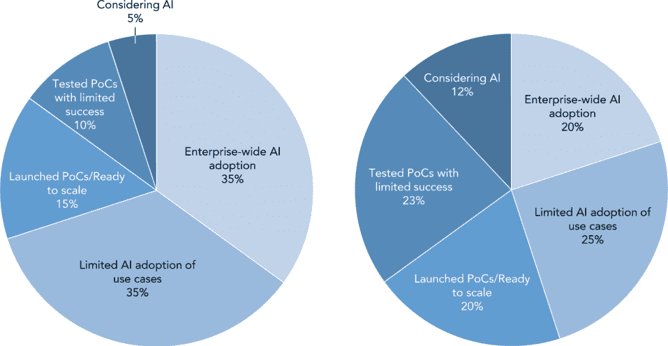

图 1.1：领先企业与其他企业的企业级 AI 采用率比较

来源：改编自 www.pwc.com/us/en/tech-effect/ai-analytics/ai-business-survey.html

## 通过将 AI、ML 和生成式 AI 集成到业务流程中来转型你的公司

公司如今掌握了一个绝佳的机会来改变其运营方式。现在有可能在许多业务流程中集成 AI、ML 和生成式 AI，以取得卓越的结果。例如，你可以检测生产中的质量问题、翻译文档，甚至分析客户在 Twitter 信息流中的情绪。

> 注意 企业 AI 转型涉及实施端到端的 AI、ML 和生成式 AI 系统，以推动业务成果。

> 动手概念练习：了解企业 AI 转型
> 定义企业 AI 转型及采用 AI 和 ML（包括生成式 AI 技术）对企业的重要性。

## 采用 AI 优先策略以成为世界级企业

本章介绍了企业 AI 转型需考虑的几个关键因素，成为 AI 优先型公司意味着什么，以及为什么云计算是实施强大、可扩展且合乎伦理的 AI 的变革者。在下一章中，我将介绍三个案例研究，并介绍这些企业成为世界级 AI 优先组织所走过的路径。本书的重点是帮助你在业务、技术、流程和人员领域利用这些最佳实践，因此无论你的角色是什么，你也可以作为一名专业人士表现出色，并推动你的公司成为世界级企业。正如你在后续章节中将学到的，每个人都有角色可扮演。

### AI 优先策略的重要性

AI 优先思维引入了一种新的商业方式。在企业范围内实施 AI 转型时，采用这种 AI 优先策略和 AI 优先方法至关重要。见图 1.2。

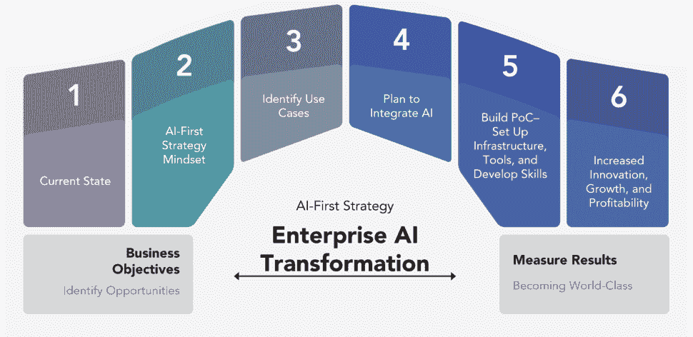

图 1.2：AI 优先策略带来企业转型。

AI 优先策略首先是一种思维转变，旨在采用 AI 实现业务目标。它涉及识别采用 AI 的用例，规划概念验证（PoC），并制定将 AI 集成到组织各个方面（例如客户服务、产品开发和决策制定）的计划。它包括构建必要的基础设施、工具和技能；建立学习承诺；与专家和供应商合作以保持 AI 领域的领先地位；并为商业机会拥抱 AI。

### 优先考虑 AI 和数据计划

制定这一 AI 优先策略有助于组织将 AI 和数据计划置于其他项目之上，采用 AI 技术以保持创新前沿，并借助数据识别新的商业机会。它还促进了 IT 与业务之间更紧密的协作，并使公司在推动创新、增长和盈利方面获得竞争优势。

如果不采用 AI 优先策略，你将面临失去竞争优势的风险。你可能无法有效利用资源，继续在业务和 IT 之间形成孤岛，并且更重要的是，将错过推动创新、增长和增加利润的机会。

采用 AI 优先策略是本书的范围。通过遵循本书概述的步骤，你将学习如何在公司内实施 AI 优先策略。

## 动手练习：从概念到应用的 AI 优先策略

- 解释 AI 优先策略的含义，并至少提及三个 AI 优先策略的优势。
- 使用 Netflix 或其他任何案例研究，解释云和 AI 技术的采用如何导致流程转型。
- 解释云计算在实施强大、可扩展且合乎伦理的 AI 中的作用。

## 利用企业 AI 机会

AI 的兴起和生成式 AI 的近期发展令人惊叹。让我们讨论这种激增背后的原因。

它之所以兴起的主要原因之一是云计算因素。推动 AI 这一非凡增长的另外两个支柱是大数据的增长以及计算机算法构建模型的能力（见图 1.3）。然而，促成这一增长的共同因素是云计算。

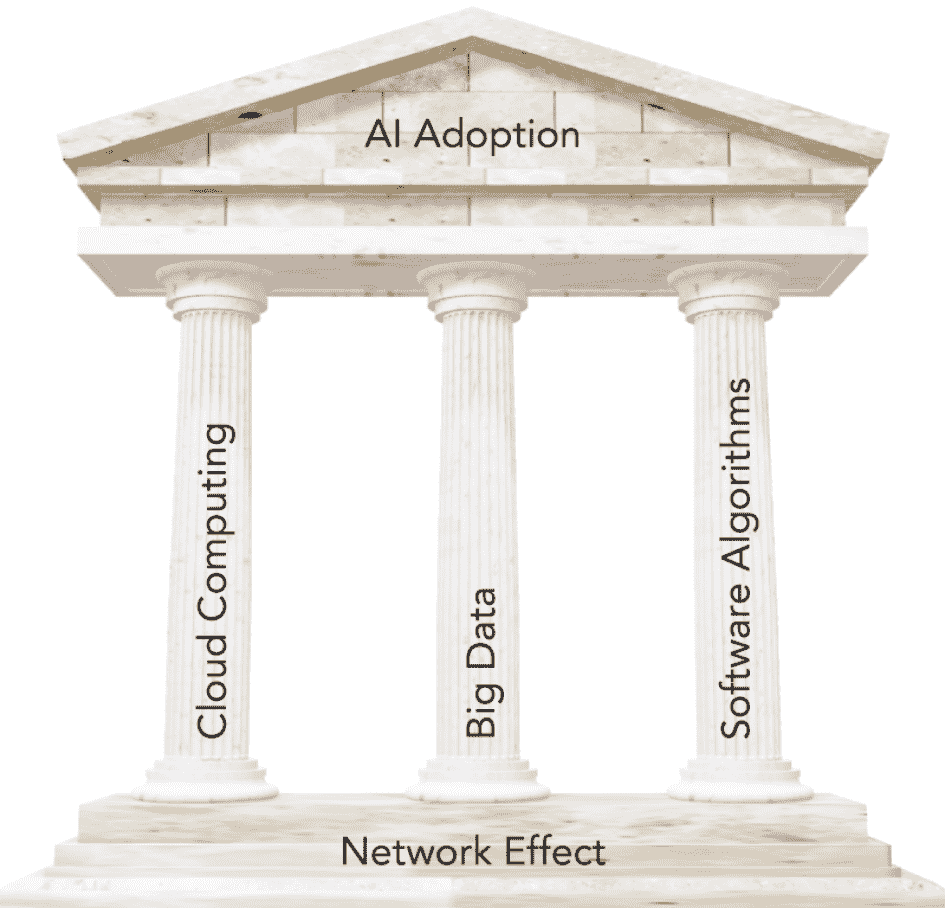

图 1.3: AI 的三驾马车：云计算、大数据和软件算法
来源：Regomark/Adobe Stock

## 实现大规模客户的一对一、个性化、实时服务

我们目前正在看到现代世界中的两种趋势。其一是客户不断要求服务的即时性和相关性。此外，他们希望能够与服务提供商进行实时沟通。这与公司希望利用数据不断改进其产品和服务并进行创新以构建新商业模式的愿望相结合，已成为一股令人兴奋的趋势。

要提供这种能够随着海量数据实时扩展的个性化服务，已不再可能依赖传统的基于规则的编程。正是云计算不断增强且可扩展的算力，配合来自传感器的大量数据流，才创造了新的可能性。

ML 算法只需几分钟就能处理相同的数据集，而这在过去需要数千小时。这种能力使得能够为客户提供一对一的个性化服务，而非基于细分市场的营销。

公司不再受制于其物理数据中心。多亏了 Amazon、Google 和 Microsoft 的云服务，公司现在可以在几分钟内部署大量计算和网络能力。

云提供机器学习框架（如 MXNet、TensorFlow 和 PyTorch）以及 AI 服务（如转录、图像识别和语音识别），任何人都可以利用这些服务进行高强度的机器学习计算，以进行预测、分类并实现快速行动。

最近，生成式 AI 引起了众多关注。这得益于云技术提供的底层计算能力，以及用于处理 PB 级数据以训练这些模型的数据基础设施。

## 网络效应：AI 驱动的服务如何创造价值生成的良性循环

AI 爆炸式增长的另一个原因是网络效应，其源于这样一个事实：你正在快速为客户提供价值，而客户反过来又会产生更多数据并产生更多洞察。新洞察的产生使你能够提供更好的服务，从而产生更多数据并形成良性循环（参见图 1.4）。

## 创新产品和服务

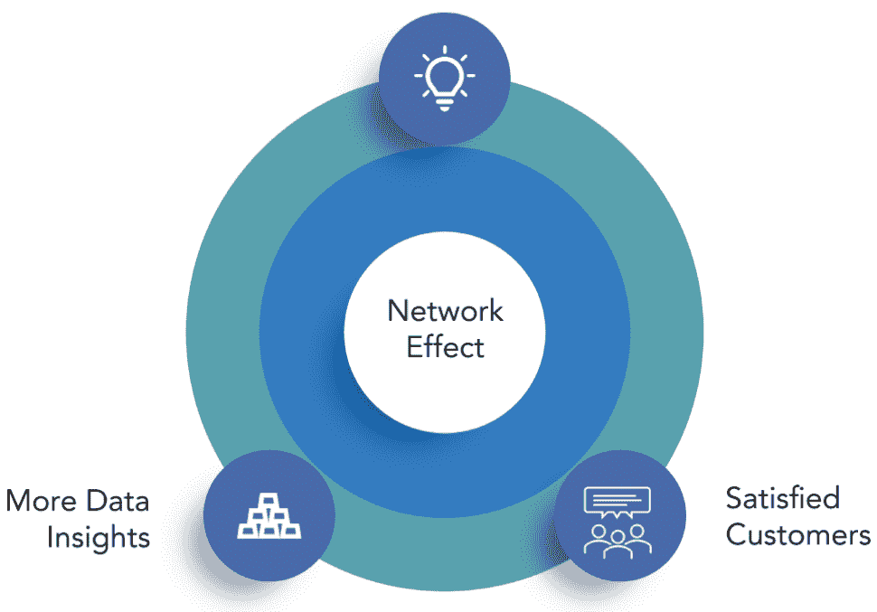

图 1.4: 网络效应

## 利用机器学习为业务带来益处

公司已经意识到机器学习可以帮助其业务降低成本、增加收入并推动创新。它确实会创造对大量计算、网络和存储能力的需求，而这些能力只能通过云计算提供。此外，其 90% 的成本来自机器学习生命周期的推理阶段。

## 云计算满足独特的机器学习硬件需求

不同的机器学习用例（如预测和图像识别）对底层硬件提出了不同的要求，这使得仅靠一种标准的基础设施类型就难以满足工作负载需求。

> 注意 不同用例对不同架构的需求迫使公司越来越依赖云计算，因为云计算可以满足这些独特的基础设施需求。

## 云计算：AI 增长的加速器

云计算具有可扩展性、随处可访问且成本效益高。云基础设施可以轻松与后端系统集成，允许模型在本地、云或混合模式下托管。

所有这些因素使云计算成为一项重要的颠覆力量，以及所有公司都必须利用的强大力量。

## 实践研究演示练习：探索云及其对 AI 的影响

目标：探索云及其对 AI 的影响。

步骤 1：将学生分成小组，让他们研究以下内容：
> 云计算与大数据对 AI 的关系
> 流行的基于云的机器学习框架，例如 PyTorch、MXNet、TensorFlow
> 云和 AI 服务
> 网络效应
> 云计算及其对各种用例的影响

步骤 2：撰写一份关于其调查结果的论文，包含现实世界示例和未来趋势。讨论这可能如何影响他们的职业生涯。

## 企业级 AI 机会

说到 AI 机会，你可以将 AI 机会分为企业级机会和行业特定机会。让我们先讨论企业级 AI 机会。

## 通过自动化流程提高效率并降低成本

你可以将 AI 集成到现有流程中，通过优化和自动化来提高运营效率、降低成本并释放人工时间。

| 流程自动化用例示例 |
|---|
| 客户投诉分类 | 自动化的一些示例包括使用自然语言处理来整理和分类收到的客户投诉，以了解内容并将其分类为技术问题、运输问题或账单问题。 |
| 质量控制中的计算机视觉系统 | 计算机视觉系统可用于分析视频和图像，以发现汽车装配厂或计算机制造厂中产品的缺陷。 |

## 利用 AI 优化业务流程

AI 还可以用于优化业务流程，这比自动化要广泛得多。它包括分析当前流程以识别改进机会，例如预测需求、预测资源需求和改善团队沟通。参见图 1.5。

## 用于改善客户体验的 AI 应用

AI 可以通过以下方式帮助改善客户体验：

| | |
|---|---|
| **客户服务用例示例** | |
| 个性化 | 使用预测分析分析过去的客户互动，AI 可以更好地了解客户的需求和行为，并推荐个性化优惠和产品解决方案以解决问题。 |
| 通过聊天机器人改善客户服务 | 通过使用 NLP 的聊天机器人提供更好的客户服务，全天候（24/7）回答查询、将问题路由给合适的人员并安排预约。 |
| 目标营销活动 | 通过分析客户数据生成相关消息的目标营销活动，从而提高客户忠诚度。 |
| 使用计算机视觉和语音识别进行客户识别 | 使用计算机视觉和语音识别来识别网站和联络中心上的客户，并相应地定制体验。 |
| 情感分析 | 对评论、投诉和调查进行情感分析，以推荐问题的解决方案。 |
| 用于通话和聊天分析的语音识别 | 使用语音识别分析电话和聊天，以识别改进领域并培训代理。 |

## 转变合规流程

## 自动化流程

## 增强员工协作

## 企业 AI 机会

## 优化流程

## 开发创新产品/服务

## 改善客户服务

图 1.5: 企业 AI 机会

## 识别新客户需求并开发创新产品和服务

AI 可以通过分析社交媒体、购买历史、评论、投诉和浏览行为来识别新客户需求，以开发新产品和服务。

## 用例示例

一家金融公司可能会发现，客户正在支付第三方服务更高的费用来汇往国外，在这种情况下，该公司可以创建一个更便宜、质量更好的资金转账服务。

| 功能 | 描述 |
|---|---|
| 交叉销售和产品捆绑 | 公司可以使用推荐系统等 AI 算法来发现，购买特定产品的客户也会购买其他相关产品。因此，这为公司提供了交叉销售或捆绑销售产品的机会。 |
| 竞争对手分析 | 公司可以分析竞争对手的产品、定价和客户评论，以识别客户痛点并满足市场需求。 |
| 用于业务扩展的网络分析 | 公司可以利用内外部合作伙伴和个人的网络分析来识别有影响力的集群，以获取更多商业创意和新客户，并通过社交媒体与他们联系。 |

## 利用 AI 驱动的工具和工作流增强员工协作和决策

考虑以下促进员工协作和决策的用例：

| 功能 | 描述 |
|---|---|
| 通过聊天机器人和预测洞察增强协作 | 使用聊天机器人、更好的决策和预测洞察，员工可以更有效地协作，以推动更好的业务成果。 |
| 复杂项目的 AI 驱动工作流 | 员工可以使用 AI 驱动的工作流在复杂项目上更有效地协作。这有助于自动化常规任务，使员工能够更具战略性地工作。 |
| 项目管理和协作工具分析 | 通过分析项目管理工具、协作工具和生产力应用，AI 可以解释故障发生的原因并提供解决方案。AI 可以推荐哪位员工最适合该工作。 |
| 用于远程协作的视频会议 | 员工可以使用 AI 驱动的视频会议从任何地方远程工作并虚拟协作。AI 可以推荐理想的通话时间。 |

## 通过简化文档、风险评估和审计来转变合规流程

以下是一些合规相关的用例：

## 案例研究分析：跨行业评估人工智能机会

### 目标：评估各行业实际的人工智能机会

### 材料：哈佛商业评论案例集、斯坦福大学商学院案例集等。

### 步骤 1：将一名学生或一组学生分配给一个行业。

### 步骤 2：从一个行业中选择一家真实公司，并评估以下内容：

- 该公司使用的具体人工智能机会、技术和应用程序，以及它们解决的目的或问题

- 人工智能对人员、流程、产品、服务和客户体验的影响

- 公司在实施过程中面临的挑战

- 人工智能实施的可衡量结果或收益

## 人工智能在各行业的日益广泛应用

不同行业的人工智能采用阶段各不相同，取决于数据的可用性、行业的复杂性以及合规要求。表 1.1 展示了纯人工智能、领先的先驱者、愿景家、行业领导者和企业巨头以及生成式人工智能领域的领先公司。

| AI 巨头 | 先驱者 | 愿景家 | 生成式人工智能 | 企业巨头 | 行业 |
|---|---|---|---|---|---|
| Microsoft | OpenAI | Adept | Rephrase.ai | Salesforce | Medtronic |
| Amazon | c3.ai | Synthesia | Midjourney | BMC Software | GE |
| AWS | H2O.ai | Cohere | Infinity.ai | HPE | Healthcare |
| Google | DataRobot | Abacus.ai | Podcast.ai | Dell | Capital One |
| IBM | Snowflake | Runway | Hugging Face | SAP | Carnegie |
| Baidu | Dataiku | Anthropic | Stability AI | ServiceNow | Learning |
| Oracle | RapidMiner | | Jasper | Broadcom | Century |
| Alibaba | Databricks | | | SAS | Tech |
| NVIDIA | Alteryx | | | Informatica | Duolingo |
| | Cloudera | | | | Crowdstrike |
| | | | | | Palo Alto |
| | | | | | Shelf Engine |
| | | | | | McDonald's |

## 金融和保险行业中的欺诈检测、风险管理和客户服务

以下是一些金融和保险行业相关的用例：

| 用例 | 描述 |
|---|---|
| 欺诈检测、风险管理和客户服务 | 人工智能在金融行业广泛应用于欺诈检测、风险管理和客户服务等用例。 |
| 智能机器人贷款处理 | 人工客服正在被智能机器人取代，这些机器人只需几秒钟即可处理贷款。 |
| 投资决策的机器人顾问 | 金融顾问正在被机器人取代，这些机器人可以处理大量数据，为客户做出正确的投资决策。这些机器人足够智能，可以分析社交媒体、电子邮件和其他个人数据。 |
| 保险行业的理赔处理和产品推荐 | 人工智能在保险行业用于缩短理赔处理时间，并根据客户数据推荐保险计划和产品。 |

## 用人工智能革新医疗保健：从诊断到机器人手术

医疗保健行业是人工智能的早期采用者。

- 人工智能用于医学图像分析、个性化医疗和药物发现。

- 人工智能还用于疾病诊断和治疗、药物管理以及机器人手术。

注意 人工智能的采用可以带来更好的患者结果，例如因更好的诊断和治疗而带来更好的健康、因减少患者再入院而降低成本，以及提高运营效率。

### 医疗保健用例

| 医学图像分析、个性化医疗和药物发现 | 人工智能用于医学图像分析、个性化医疗和药物发现。 |
|---|---|
| 疾病诊断、治疗和机器人手术 | 人工智能还用于疾病诊断和治疗、药物管理以及机器人手术。 |
| 改善患者结果 | 人工智能的采用可以带来更好的患者结果，例如因更好的诊断和治疗而带来更好的健康、因减少患者再入院而降低成本，以及提高运营效率。 |

## 用预测性维护、质量控制和协作机器人变革制造业

在制造业中，人工智能应用非常广泛。

### 制造业用例

| 预测性维护、质量控制和供应链优化 | 人工智能用于预测性维护、质量控制和供应链优化。 |
|---|---|
| 改进生产运营 | 它被用于改进生产运营，范围从劳动力规划到产品设计再到缺陷管理和员工安全。 |
| 协作机器人（cobots） | 该行业也在出现协作机器人，即与人类协同工作的机器人。 |

## 用人工智能革新零售业：人工智能驱动的客户服务、个性化营销和库存控制

在零售行业，人工智能用于客户服务聊天机器人、个性化营销、库存控制和需求预测。

### 用例示例

亚马逊是人工智能如何根据用户的浏览行为提供产品推荐的经典示例。

## 交通运输行业中的自动驾驶汽车、预测性维护和交通管理

在交通运输行业，人工智能用于自动驾驶汽车、预测性维护和交通路线管理。

| 交通运输用例 | |
| --- | --- |
| 自动驾驶汽车 | 特斯拉、沃尔沃、优步和大众正在进行积极研究，尽管目前仅在受控场景下使用，但我们很快就会在道路上更常见地看到自动驾驶汽车。 |
| 导航和驾驶辅助系统 | 人工智能的一些实际应用包括导航障碍物和道路、驾驶辅助系统，如自适应巡航控制、自动紧急制动、车道偏离警告、雷达和摄像头，以实现更安全的驾驶。 |
| 仓库自动化和货运优化 | 人工智能驱动的机器人正在仓库中分拣产品以供配送，在仓库内移动货箱，用于托盘构建的配送，等等。人工智能算法用于确定和优化货运路线，以最大限度地降低成本。 |
| 公共交通管理 | 即使在公共交通领域，人工智能也用于交通灯管理、交通运输调度和路线规划。 |

## 从披萨质量到智慧农业：食品和农业领域

人工智能在食品科技中还以以下方式应用：

| 食品和农业用例 | |
| --- | --- |
| 接单和送餐 | 人工智能用于接单和送餐。 |
| 食品制作中的质量控制 | 它甚至被用来确保披萨的质量。 |
| 农业中的作物管理 | 在农业中，它通过分析盐碱度、热量、紫外线和水分来种植作物。 |
| 农业中的智能机械 | 智能拖拉机和采摘机也正在农业领域使用。 |

## 房地产中的价格预测、流程自动化和客户体验提升

以下是房地产领域的人工智能示例：

| 房地产用例 | |
| --- | --- |
| 价格预测、买卖双方匹配和市场分析 | 预测价格和租金收入，匹配买家与卖家，分析市场状况和趋势，自动处理房地产文件，并使用聊天机器人回答客户查询 |
| 自动化文档处理和客户支持 | 智能家居技术可提高家庭安全性和能源效率 |

| 房地产用例 | |
|---|---|
| 智能家居技术 | 语音助手，如 Alexa、Google Assistant 和 Siri；智能家电，如冰箱、洗衣机、恒温器、智能照明、家庭安防系统 |

## 娱乐行业的人工智能个性化：Netflix、Amazon 和游戏行业

娱乐行业的一些用例如下：

| 娱乐和游戏行业 | |
|---|---|
| 流媒体平台的推荐系统 | Netflix 和 Amazon 使用 AI 根据用户偏好和观看行为推荐电影和歌曲。 |
| 电影中的分镜脚本和音乐创作 | 在电影行业，AI 用于构建分镜脚本，甚至用于作曲。 |
| 游戏中的故事情节推进 | 游戏行业使用 AI 沿特定方向推进故事情节，以保持玩家参与度。 |

## 能源行业提高效率、降低成本并推动可持续发展

能源行业示例如下。AI 的采用有助于降低成本并改善环境可持续性。

| 能源用例 | |
|---|---|
| 预测性维护和能源管理 | 对输电线路和发电厂等设备进行预测性维护，管理能源的供应和消耗，并与可再生能源集成以降低成本。 |
| 建筑能效 | 通过调节办公空间和住宅的制冷、供暖系统和照明，提高能源消耗效率 |
| 欺诈预防 | 防止账单错误和电表篡改等欺诈行为 |

## 工作簿模板 - 企业 AI 转型检查清单

从本书的下载部分下载“企业 AI 转型检查清单”模板 (www.wiley.com/go/EnterpriseAIintheCloud)。请将此作为初始起点，评估贵公司在全面实施 AI 的旅程中处于哪个阶段。在您回答“否”的领域，表明需要做更多工作。随着本书的推进，请继续处理每个部分。请将此作为团队在整个 AI 转型旅程中跟踪进度并庆祝小里程碑和重大里程碑的健康提醒。

## 摘要

本章的关键要点强调，组织必须认真对待 AI 才能获得竞争优势。这意味着将机器学习项目从单纯的 PoC 宠物项目提升为大规模、全企业范围的变革性努力。要实现这一目标，您需要采用更系统的 AI-first 战略和方法论，这也是本书的主要关注点。

本章还深入探讨了云计算的变革力量，使许多以前无法实现的用例成为可能，并为令人兴奋的消费者体验提供了途径。您回顾了 AI 和 ML 实现的一些用例，并认识到它们在各个行业的广泛采用和影响。

下一章将展示三家在企业范围内成功实施 AI 的公司案例研究。

## 复习问题

这些复习问题包含在每章末尾，帮助您测试对信息的理解。您将在以下部分找到答案。

- 1. AI 和 ML 可以融入业务流程以
  - A. 检测生产中的质量问题
  - B. 分析 Twitter 动态中的用户情绪
  - C. 翻译文档
  - D. 以上皆是

- 2. AI-first 战略
  - A. 将客户服务置于 AI 和 ML 技术之上
  - B. 侧重于产品管理而非 AI 技术
  - C. 侧重于采用 AI 以实现业务目标
  - D. 侧重于为 AI 构建坚实的技术平台

- 3. 优先考虑数据和 AI 举措有助于
  - A. 公司专注于客户服务
  - B. 公司识别新的商业机会
  - C. 公司促进 IT 与业务之间更紧密的协作
  - D. 公司建立更强有力的商业论据

- 4. 忽视 AI-first 战略将导致
  - A. 失去竞争优势
  - B. 无法有效利用资源
  - C. AI 与业务之间形成孤岛
  - D. 创新、增长和利润增加

- 5. 采用 AI 时，数字原住民的主要优势是什么？
  - A. 他们具有冒险文化，并将失败视为成功的垫脚石。
  - B. 他们有更多资金投资 AI。
  - C. 他们比传统公司拥有更好的品牌形象。

- 6. 组织的 AI 之旅需要考虑哪些因素？
  - A. 其 AI 准备就绪程度
  - B. 其冒险文化
  - C. 数据和资源可用性
  - D. 以上皆是

- 7. 以下哪项不是 AI 增长的三大支柱之一？
  - A. 云计算
  - B. 大数据
  - C. 计算机算法
  - D. 机器人技术

- 8. _____ 不是使用机器学习的企业云计算的优势之一。
  - A. 可扩展性
  - B. 可访问性
  - C. 成本增加
  - D. 成本效益

- 9. 请在 AI 驱动服务的背景下解释网络效应。
  - A. 公司现在可以在几分钟内设置计算能力。
  - B. 机器学习帮助企业降低成本、增加收入或推动创新。
  - C. 公司可以为客户提供更好的服务，在良性循环中产生更多数据和洞察。
  - D. 不同的机器学习用例对底层硬件提出不同的要求。

- 10. 选择一个 AI 可以改善客户体验的示例。
  - A. 通过分析项目管理工具来推荐解决方案
  - B. 通过识别有影响力的集群以获取更多商业想法
  - C. 通过使用聊天机器人全天候回答查询
  - D. 通过自动化合规流程，如文档和风险评估

- 11. 选择一个 AI 可用于识别新客户需求的示例。
  - A. 通过使用计算机视觉在网站和联络中心识别客户
  - B. 通过分析社交媒体、购买历史和评论
  - C. 通过使用网络分析来获取更多商业想法
  - D. 通过自动化合规流程，如审计和风险评估

- 12. 协作机器人在制造业中用于什么目的？
  - A. 人力规划
  - B. 产品设计
  - C. 与人类协作
  - D. 缺陷管理

- 13. AI 在娱乐行业用于什么目的？
  - A. 构建分镜脚本
  - B. 作曲
  - C. 沿特定方向推进故事情节
  - D. 以上皆是

## 答案键

- 1. D
- 2. C
- 3. B
- 4. A
- 5. A
- 6. D
- 7. D
- 8. C
- 9. C
- 10. C
- 11. B
- 12. C
- 13. D

# 2 云端企业 AI 案例研究

> 每家公司都是一家软件公司。你必须开始像数字公司一样思考和运营。这不再仅仅是关于采购一个解决方案并部署一个。这不是关于一个简单的软件解决方案。这真的是你自己考虑你自己作为数字公司的未来。
>
> ——Satya Nadella, 微软首席执行官

既然你在上一章中了解了一些 AI 的可能性，本章将通过三个真实案例研究，深入探讨云端企业 AI 转型的迷人世界。如果你有兴趣了解 AI 如何改变行业，本章正是为你量身定制的。

你不仅了解美国政府、Capital One 和 Netflix 等巨头如何利用 AI 和云技术，他们的故事还作为实际案例，为本书所介绍的方法论提供参考。

关键要点是，这些组织如何通过拥抱云原生原则和 AI 技术，构建弹性系统，成为 AI-first 公司，这对任何渴望在数字时代蓬勃发展的企业来说都是至关重要的。

## 案例研究 1：美国政府以及人机协作解决大规模问题的力量

这是一个增强型 AI 案例研究的绝佳示例。美国政府花费近 2.5 万亿美元，试图通过社会安全网计划（如社会

社会保障、医疗补助、医疗保险以及补充营养援助计划（SNAP）。

图 2.1 展示了本案例研究中挑战、优势和解决方案的高级视图。

## 美国政府：人机协同工作

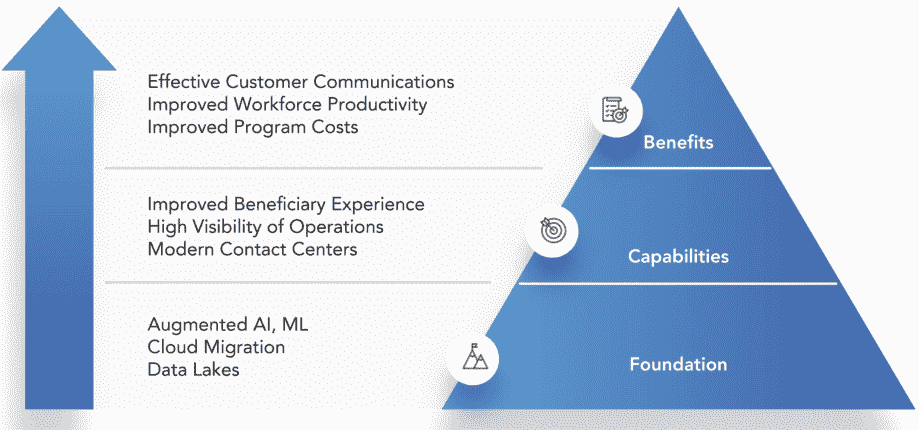

**图 2.1：** 美国政府采用的挑战、优势和解决方案

下表列出了美国政府面临的挑战：

| 挑战 | 详情 |
| :--- | :--- |
| 报名流程复杂 | 鉴于申请量巨大，可想而知此流程有多复杂、需要多长时间。数百万客户依赖此服务来获得医疗保健、解决失业需求并避免陷入贫困。报名流程的挑战包括复杂的申请流程、理赔处理的大量积压，以及冗长的裁决、评估和资格认定流程。 |
| 客户响应时间过长 | 尽管有大量员工在努力服务，客户仍需等待数周才能收到回复。 |
| 旧系统不足 | 旧系统提供了糟糕的客户体验，且在需求激增时无法扩展。它们还缺乏自助服务功能，也没有移动应用提交选项。需要加入用于案件状态的文本通信以及在线预约功能。 |
| 多源申请处理 | 申请来自多个来源，例如网页、邮寄和联络中心，格式也多种多样，例如 PDF 和图片。审阅如此大量的申请耗时耗力、易出错、需要领域专业知识，且并非高效流程。建立人工审核系统来处理如此多的申请不仅成本高昂，而且耗时很长。这涉及用于审核任务的定制软件、复杂的工作流和众多审核人员。 |
| 安全问题 | 另一项挑战是需要维护数据安全，因为数百万份文件（数据量达太字节级别）需要存储，且敏感数据需要受到保护和加密。 |
| 客户服务呼叫量大 | 另一项重大挑战是客户服务呼叫数量庞大，仅社会保障管理局团队就有超过 5000 万通呼叫。这些呼叫与待处理的申请状态争议及其他福利相关问题有关。 |
| 缺乏管理洞察 | 此外，管理层对项目运营、报名问题、积压、预算、浪费、欺诈和滥用缺乏洞察。 |

## 利用 AI/ML 革新运营管理

解决这些问题的方案涉及利用 AI/ML 技术自动化审批背后的某些工作流，以简化申请流程，启用自助服务功能，简化面试和申诉流程，并增加运营洞察，帮助管理层解决问题并提出改进机会。

## 启用改进运营的解决方案

为解决这些挑战，启用了本表中概述的解决方案功能：

| 解决方案功能 | 优势 |
| :--- | :--- |
| 聊天机器人 | 改善客户体验 |
| AI 和 A2I 技术 | 自动化部分工作流步骤，例如裁决和审批 |
| 数据驱动的洞察 | 为领导层提供采取补救措施所需的信息 |
| 联络中心 | 高效处理客户查询 |
| 云迁移 | 利用云带来的部分运营效率，例如可扩展性、效率和性能 |

## 案例研究 2：资本一公司如何在高度监管的环境中成为领先的技术组织

资本一公司希望成为一家技术组织，哪怕身处金融行业。他们通过许多组织都必须采用的特定增长和创新模板实现了这一目标，以成为领先的技术组织，无论其所属行业是什么。

资本一公司需要解决多项挑战，其中一些列于此：

### 挑战详情

| 挑战 | 详情 |
| :--- | :--- |
| 数据管理 | 首先，他们面临数据挑战。数据分散在组织的多个部分，例如客户关系管理 (CRM)、企业资源计划 (ERP) 以及来自社交媒体的流数据。他们需要将所有数据集中到一处，并借助 Amazon S3 实现了这一点。 |
| 基础设施挑战 | 他们希望解决基础设施问题。他们希望成为一家敏捷公司，将开发时间从数月缩短至数天甚至数分钟。 |
| 云迁移挑战 | 他们希望将 11 个数据中心迁移到 AWS 云，并利用云原生开发能力构建一个弹性系统。 |

### 归功于数据整合而打造卓越体验

为解决数据挑战，他们构建了数据湖。这使他们能够将数据作为当前和未来 AI 模型的燃料，并能持续训练其模型。这帮助他们实时了解多个渠道和时区中的人类行为，并设计出卓越的人类体验。参见图 2.2。

**资本一：受监管行业中的技术领导者**

- 改善客户体验
- 增强决策能力
- 提高效率

**优势**

- 云原生应用
- 机器学习
- DevOps

**解决方案**

- 长周期开发
- 旧版基础设施
- 数据孤岛

**挑战**

**图 2.2：** 资本一公司采用的挑战、优势和解决方案

### 通过将数据中心迁移到云端实现敏捷与可扩展

他们是如何做到的？

- 他们将八个数据中心迁移到了云端。
- 他们在八年内组建了一支 11,000 人的技术团队。
- 他们为 AWS 云制定了培训计划和方案。

在此过程中，他们获得了以下优势：

- 他们将环境构建时间从三个月缩短至三分钟。
- 他们拥有高性能的敏捷可扩展基础设施，这帮助他们将产品上市时间从数月缩短至数天。
- 他们甚至能够将原本需要数月或数周才能发布的应用程序，提升到每天多次发布。

迁移到云端是许多组织在成为 AI 优先公司之路上采用的秘诀之一。

### 通过拥抱云原生原则构建弹性系统

迄今，本节已讨论了资本一公司的云采用之旅，他们在此过程中克服了数据挑战，并将应用跨数据中心迁移到云端。然而，此次过渡工作量巨大。尽管如此，在整个过程中，云为他们提供了新功能，进而带来了新的可能性。

采用云原生原则使资本一公司能够通过微服务架构、用于自动化工作流部署的 CI/CD 管道、蓝绿切换、A/B 测试和故障转移技术来构建弹性系统，这些技术对最终用户体验的影响降至最低。本书将涵盖这些主题。

### 云优先思维对 DevOps、敏捷开发和机器学习的影响

然而，更重要的是，云采用所带来的思维转变使 DevOps 和敏捷开发方法论成为可能。快速发布功能的能力使产品负责人能够更加以客户为中心，不仅从功能角度，而且通过良好的性能、高可用性和弹性，从技术角度创造更具吸引力的用户体验。因此，团队也变得更加以产品为中心，由于采用了 DevOps，打破了组织孤岛。

> NOTE 云优先思维通过在开发应用程序、部署应用程序和服务客户时采用云原则，为机器学习平台奠定了基础。

### 成为 AI 优先公司：从云采用到令人兴奋的客户体验

通过成为云优先公司，Capital One 更容易成为 AI 优先公司。凭借数据湖和敏捷且可扩展的基础设施，可以实时处理来自多个来源的大量数据，然后将其馈送到 AI/ML 模型中，这些模型又可以利用充足的计算资源处理数据并实时生成洞察。这种实时生成洞察的能力为 Capital One 开辟了多个机会。

此外，通过结合 AWS 的高级 AI 服务和机器学习服务（如自然语言处理 (NLP)），Capital One 能够通过其 Eno 聊天机器人提供令人兴奋的客户体验，并实时检测和预防欺诈。他们还在呼叫中心利用机器学习进行语音识别技术，以自动化培训和验证系统。其他应用包括信用风险建模、投资组合分析、风险管理以及用于开设银行账户的图像识别；他们甚至使用 ML 来确保用于开设银行账户的图像识别。如图 2.3 所示，Capital One 将自己转变为开创性的 AI 优先公司，并释放了其 50,000 名员工的力量。

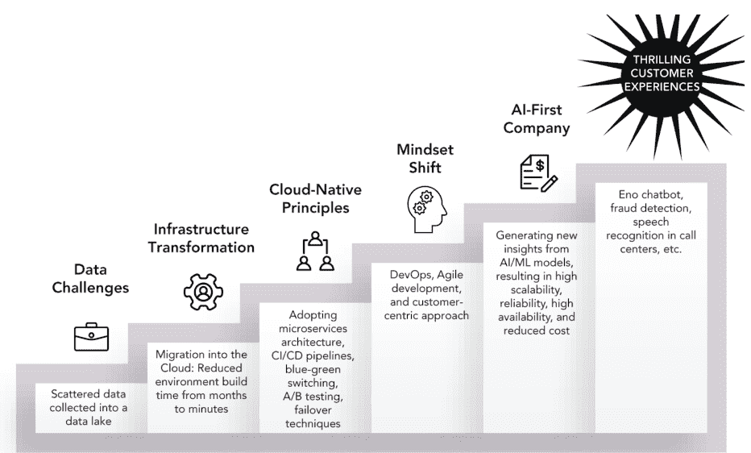

## 图 2.3：Capital One 向 AI 优先状态转型的历程

## 案例研究 3：Netflix 以及公司成为世界一流公司的路径

本节讨论组织（尤其是 Netflix）成为世界一流公司所采取的路径（参见图 2.4）。这可能是您的公司成为世界一流公司所采取的路径。

了解这一点将帮助您理解作为企业 AI 转型工作一部分需要采用和改进的基础能力。本节解释了 Netflix 为成为世界一流公司所做的工作以及他们利用的基础能力，这是本书的核心主题——帮助公司利用其基础能力成为世界一流公司。

**注意** 您会发现大多数公司都遵循这一路径——技术采用带来流程改进。流程改进导致组织变革，进而导致产品转型，进而促进新产品和服务的开发创新，从而产生新的业务成果。

Netflix 的故事可以轻松应用于任何数字原生公司，例如 Uber、Amazon 和 Airbnb。它们都遵循了这条路径，成为世界一流的 AI 优先公司。

## 云与 AI 技术：改变 Netflix 商业模式和成功的关键

通过采用云和 AI 技术，Netflix 能够推动流程转型。以下是一些好处：

- ### 技术采用
  - 云计算
  - 大数据
  - 机器学习

- ### 组织卓越
  - 以客户为中心
  - 协作
  - 以产品为中心

- ### 流程改进
  - DevOps
  - 敏捷
  - 产品管理

- ### 产品转型
  - 产品创新
  - 智能产品
  - 新商业模式

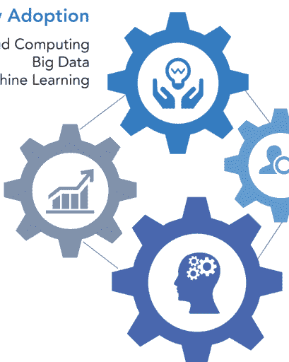

**图 2.4：** 成为世界一流公司的路径

| 采用云和 AI 技术 | 影响和结果 |
| --- | --- |
| 过渡到流媒体服务 | 通过采用云，Netflix 能够从 DVD 转向流媒体服务。这不仅帮助 Netflix 颠覆了竞争对手，还几乎一夜之间使其成为一家全球公司，因为它可以触达全世界的人们。 |
| 实施机器学习算法 | 云技术还使 Netflix 能够使用复杂、精密的机器学习算法为客户提供个性化推荐并改善其体验。 |
| 采用内容分发网络 | 同样，通过采用内容分发网络，Netflix 能够向客户提供高质量的视频服务并提升其体验。 |
| 利用数据分析 | Netflix 使用数据分析平台中的客户行为和个人资料数据来生成新的洞察，并推动其内容制作、采购和营销，以关注客户的需求。 |

## 云基础设施和 AI 采用推动流程转型

从纯基础设施角度来看，通过采用云计算，Netflix 能够降低基础设施成本、持续存储和流式传输数据，并根据系统需求的波动灵活扩展或缩减其计算资源。

Netflix 能够利用云和 AI 技术推动流程变革。Netflix 通过降低基础设施成本、加快向客户交付内容的速度，以及通过个性化推荐和基于数据的营销洞察来提升客户体验，从而转变了其业务和技术运营。

## 流程转型推动组织变革

下一个问题是，这种流程转型如何在 Netflix 引发组织变革。必须指出，技术采用导致了流程转型，从而使特定的组织转型机会成为可能；下表显示了 Netflix 的组织转型阶段：

| 组织转型阶段 | 描述 |
| --- | --- |
| 技术采用 | 通过采用技术，Netflix 在降低成本的同时提高了运营效率和客户体验。 |
| 推动流程变革 | 这还使他们能够通过围绕产品和服务改变其运营模式来推动流程变革。快速开发新软件的能力帮助 Netflix 更多地关注产品，并围绕产品和服务重新组织其商业模式。 |
| 打破职能孤岛和组织变革 | 这还帮助他们打破了职能孤岛。在此过程中，他们成为一个敏捷、以产品为中心、以客户为关注点的组织。因此，流程转型使他们能够作为以产品为中心、以客户为中心、敏捷的组织推动组织变革。 |

| 组织转型阶段 | 描述 |
| --- | --- |
| 组织转型驱动的产品创新 | Netflix 利用其新的组织转型推动产品创新。通过以客户为中心，Netflix 能够提出新产品和服务等想法，例如流媒体原创内容。他们以客户为中心的特点还帮助他们将推荐算法作为流媒体服务的一部分进行优先排序。 |
| 持续创新和以客户为中心 | 敏捷帮助 Netflix 定期识别新客户体验的需求。他们创建本地内容以满足区域需求，这有助于他们在全球范围内增长。他们以客户为中心的特点还帮助他们确定新节目的需求，例如帮助客户在他们名为 Bandersnatch 的热门节目中选择自己的旅程。 |

> **注意** 云使变得敏捷变得容易。通过采用云，Netflix 能够以迭代和快速的方式开发软件。换句话说，它帮助他们采用敏捷开发方法，而不是瀑布方法。敏捷反过来帮助他们变得更加以产品为中心和以客户为关注点。

通过采用云/AI 创新，您可以看到，公司发现转变其流程变得更加简单，从而引发组织转型。因此，它们变得更加以产品为中心和以客户为中心。

反过来，这创造了创新的正确条件，打破孤岛并鼓励实验，最终催生新产品、新服务和新商业模式，就像您刚才在 Netflix 示例中看到的那样。

AI 帮助您以敏捷的方式快速响应业务事件。敏捷性是当今公司拥有的少数竞争优势之一。

当今的客户希望根据其特定需求并实时获得独特的服务。这意味着企业必须处理海量数据以生成新的洞察，并在几分钟内采取行动，而不是过去的几天或几周。机器学习现在使这成为可能。您也可以通过采用本书中的最佳实践和全面方法来实现这些成就。

## 实践练习 1：分析 Netflix 的 AI 转型

解释 Netflix 如何实现流程转型、组织变革和产品创新。研究其他已实现类似转型的公司。

## AI 案例研究工作簿模板

从本书下载部分下载“AI 案例研究”模板（www.wiley.com/go/EnterpriseAIintheCloud）。捕获您计划探索的其他组织的案例研究，并以全面了解 AI 实施流程（从构思到结果）的优势来推动您的 AI 实施。采用他们的最佳实践并避免他们的错误。

## 摘要

本章深入探讨了三个组织如何通过采用推动流程改进和组织变革的技术而转型为世界级组织的案例研究。这种转型之旅最终帮助他们成为以客户为中心，从而推动产品创新，甚至开创新的商业模式。

下一章揭示了实施机器学习部署的一些挑战，这些挑战可能会阻止组织将其部署到生产环境中。

## 复习问题

这些复习问题包含在每章末尾，帮助您测试对信息的理解。您将在以下部分找到答案。

- 1. 美国政府解决处理多源应用程序的挑战的方法是
- A. 建立人工审核系统
- B. 使用自定义软件管理审核任务
- C. 使用 AI/ML 技术自动化部分工作流程
- D. 以上都是

- 2. 成为世界级组织的公司之间有什么共同主题？
- A. 他们专注于降低业务风险。
- B. 他们优先提升在环境、社会和治理方面的表现。
- C. 他们利用技术实现业务成果。
- D. 他们旨在降低收入。

- 3. Netflix 的流程转型导致了以下哪项结果？
- A. 组织变革
- B. 客户体验下降
- C. 基础设施成本增加
- D. 运营成本下降

- 4. ____帮助 Netflix 变得敏捷并采用以产品为中心的方法。
- A. 区块链
- B. 增强现实
- C. 云计算
- D. 机器学习

- 5. 成为世界级组织的路径是
- A. 技术 ⇄ 流程 ⇄ 组织 ⇄ 产品转型
- B. 组织 ⇄ 技术 ⇄ 流程 ⇄ 产品转型
- C. 流程 ⇄ 组织 ⇄ 产品转型 ⇄ 技术
- D. 产品转型 ⇄ 组织 ⇄ 流程 ⇄ 技术

## 答案键

- 1. D
- 2. C
- 3. A
- 4. C
- 5. A

# 第二部分 制定和评估 AI 策略

在本部分中，我们讨论 AI 的方方面面，例如您在 AI 之旅中可能面临的挑战以及伦理问题，以及您可以采用的四个阶段来构建 AI 能力。接着，我讨论制定 AI 策略的路线图、为您的项目寻找最佳用例，以及评估各种云提供商的 AI/ML 平台和服务。这就像是一份 AI 冒险的逐步指南。

# 3 解决企业 AI 的挑战

> 我们最大的弱点在于放弃。成功最确定的方式就是总再试一次。
>
> ——托马斯·A·爱迪生

本章可能就是您在 AI 转型道路上的盟友。作为一名渴望实施 AI 的人，无论您是业务战略家、技术领导者、数据科学家还是好奇的创新者，您都必须意识到，部署 AI、ML 和生成式 AI 解决方案既令人兴奋，也可能像在雷区中导航一样。这是因为 AI 不仅仅是关于算法和模型；它还与数据、基础设施、变革管理、法规和战略决策紧密相关。您很快就会意识到，AI 转型与数字化转型有显著不同。

本章旨在帮助您了解技术挑战、伦理困境和战略障碍。认识这些挑战是为组织做好准备的第一步。在后续章节中，我将引导您采用实际的、系统的方法论来应对这些挑战，包含明确定义的步骤、最佳实践、案例研究、动手练习和模板。本书的每一章都对应图 3.1 中所示阶段的任务。

请注意，这些挑战绝非完整列表。尽管挑战众多，但并非不可克服。您可以根据我贯穿全书分享的见解和最佳实践，将这些挑战转化为创新和增长的机会。

## 实施企业级 AI 的公司面临的挑战

让我们快速了解各种类型的挑战。此列表并非详尽无遗，但应该能让您了解情况。

### 企业 AI 之旅图

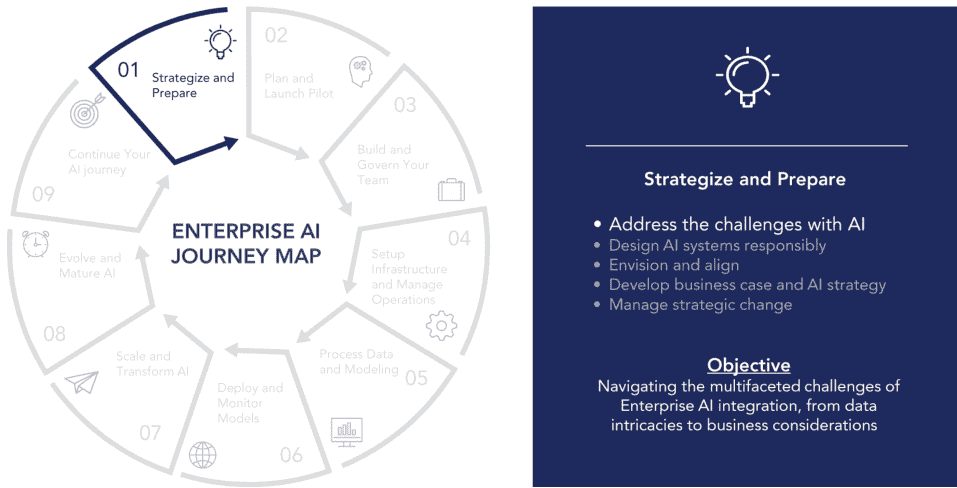

**图 3.1：** 制定和准备：应对 AI 的挑战

### 业务相关挑战

以下是业务相关挑战的示例：

| 业务相关挑战 | |
| --- | --- |
| 运行 ML 工作负载的成本 | 运行高强度机器学习工作负载的成本可能会阻碍将模型部署到生产环境。 |
| 跟上变化步伐 | AI 和机器学习不断发展，AI/ML 从业者和云工程师跟上这些变化具有挑战性。 |
| 选择合适的用例 | 选择合适的用例可能具有挑战性，因为您需要了解业务问题、确保用例的数据可用性、选择合适的 ML 模型、与后端系统集成、考虑伦理和法律问题，并衡量用例的 ROI。 |
| 与业务战略保持一致 | 如果处理不当，AI/ML 与业务战略之间的一致性可能具有挑战性，涉及业务需求优先级、理解 AI 影响以及利益相关者沟通。 |
| 技能和人才短缺 | 挑战包括由于合格专业人员短缺而难以拥有合适的技能和人才、需要跨职能专业知识，以及努力跟上新发展。 |

### 数据和模型相关挑战

以下是数据和模型相关挑战的示例：

| 数据和模型相关挑战 | |
| --- | --- |
| 收集高质量数据 | 收集高质量数据可能具有挑战性且耗时。模型需要正确格式的数据，因此需要进行数据清洗和为模型训练标记数据，这可能耗时且昂贵。 |
| 机器学习的复杂性 | 机器学习可能很复杂，涉及统计学、数学概念和机器学习编程技能，使得导航变得具有挑战性。 |
| 衡量模型性能 | 衡量模型性能、提出适当的性能指标，并在变化的业务条件和数据下对其进行验证可能具有挑战性。 |
| 监控模型性能 | 监控模型性能可能具有挑战性，原因是业务条件变化、能够衡量模型漂移的能力，以及需要确保模型长期运行良好并符合业务需求。 |
| 选择合适的模型 | 选择合适的模型是一项挑战，因为简单的模型无法捕获所有底层数据模式；复杂的模型可以捕获复杂模式，但它们可能仍然是黑箱且难以解释。 |

> **注意** 数据质量差可能会影响模型性能，有时还会阻止模型部署到生产环境。

### 平台相关挑战

以下是平台相关挑战的示例：

| 平台相关挑战 | |
| --- | --- |
| 与后端系统集成 | 由于技术、数据、安全性、可扩展性、人机交互集成和法规方面的挑战，与后端系统和基础设施集成可能具有挑战性。 |
| 管理整个机器学习生命周期 | 管理整个机器学习生命周期具有挑战性，原因在于数据准备、特征工程、模型选择和调优、评估、部署、监控、模型解释以及大数据集缩放方面的复杂性。 |
| 扩展机器学习工作负载 | 实时扩展大量数据的机器学习工作负载可能具有挑战性，因为这样做可能需要大量计算资源。 |
| 选择合适的云提供商 | 选择合适的云提供商以确保适当的性能、可扩展性、可靠性和安全性，从大量可用的复杂选项中进行选择，并确保与业务目标和文化保持一致。 |

表 3.1 总结了迄今涵盖的所有与 AI 转型相关的挑战。

## 表 3.1：AI 转型挑战

| 领域 | 挑战 |
| :--- | :--- |
| 业务 | 运行密集型机器学习工作负载的成本。 AI 和机器学习是不断发展的领域。 选择合适的用例棘手。 |
| 数据 | 收集高质量数据。 AI 和 ML 战略与业务战略之间的对齐。 处理大量数据的能力。 |
| 模型 | 机器学习可能很复杂。 衡量模型性能棘手。 监控模型性能是一项挑战。 |
| 平台 | 与后端系统集成。 管理整个 ML 生命周期。 扩展 ML 工作负载。 选择合适的云提供商。 |
| 运维 | 应监控模型的偏差、数据和模型漂移。 |
| 安全性 | 管理端到端安全性。 确保符合法律法规。 |
| 治理 | 拥有合适的技能和人才。 确保负责任和合乎伦理的 AI。 |

以下是安全相关挑战的示例：

| 安全相关挑战 |
|---|
| 管理端到端安全性 | 在整个机器学习生命周期中管理端到端安全性可能具有挑战性，因为安全性需要在数据层、模型、基础设施、网络和云组件上实施。 |
| 确保合规性并避免偏差 | 确保合规性、维护数据隐私、实施安全性，以及避免模型中的偏差和伦理歧视可能具有挑战性。 |

## 动手脑暴练习：制定克服 AI 挑战的实施计划

与您的团队一起头脑风暴，探讨 AI、ML 和生成式 AI 可以与您的公司或您选择的公司集成的不同方式。

## 数字原住民如何应对 AI 采用

数字原住民是指在数字时代诞生的公司，他们精通技术，并已将技术作为实现业务成果（如降低成本、提高效率和推动创新）的主要驱动力。他们敏捷、适应性强且富有创新精神，能够迅速采用新技术，例如机器学习、人工智能，现在还有生成式 AI。与其他传统公司相比，他们更能在整个企业中实施 AI 转型。让我们来看看原因。

### 他们愿意冒险

在采用新技术（例如 AI）方面，数字原住民倾向于更愿意冒险并尝试新技术。与传统公司不同，他们拥有鼓励冒险并将失败视为通往成功垫脚石的文化。

### 他们在数据收集和整理能力方面具有优势

在数据方面，数字原生公司擅长从多个来源收集大量数据并为业务目的对其进行整理。传统公司由于多年来随着越来越多系统的开发而积累的技术债务，无法做到这一点。将数据整合到一个地方以便使用是一项挑战。

### 他们通过有竞争力的薪酬和福利吸引顶尖人才

数字原生公司通过提供良好的薪酬、有吸引力的职业机会以及吸引优秀人才的工作设施，能够雇佣到行业内最优秀的人才。

出于这个原因，我建议传统组织在变更管理上投入更多时间和精力。他们应计划内部员工培训，并与其他 AI 专家合作，在 AI 转型过程中提供指导和支持。

### 应对 AI 采用的最佳实践提示

- 从小范围启动 AI 项目，逐步扩大规模。
- 与其他 AI 专家和公司合作。
- 投资于员工 AI 技术培训计划。

## 做好准备：AI 转型比数字化转型更具挑战性

AI 转型比数字化转型更具挑战性。了解这些挑战将帮助您规划、执行和管理 AI 实施。让我们看看这些原因。

### 技能组合、技术和基础设施集成的复杂性

主要原因之一是，AI 转型要复杂得多，因为它需要许多技能（例如机器学习、数据科学、云工程），底层技术复杂，并且需要业务领域知识。将数据、技术、技能组合和基础设施结合在一起需要大量工作。技术与业务领域知识的强强结合是这段旅程中成功的基础。图 3.2 显示了您需要的不同技能。它展示了这些技能是领域、数学和计算机科学知识领域的组合。

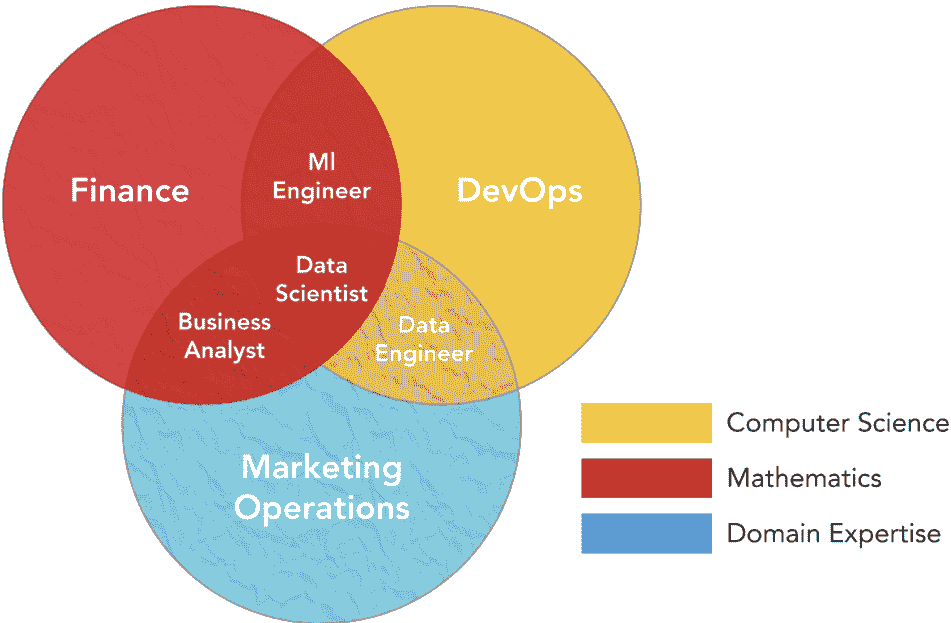

图 3.2：典型 AI/ML 项目所需的技能组合

### 数据基础设施和治理的重要性

在生产环境中部署高性能模型需要大量高质量数据。一个从收集到使用的强大数据基础设施管道至关重要（见图 3.3）。收集、摄取、清洁、存储和使用数据是一项具有挑战性的任务。尚未建立这些基础设施的公司在起步阶段处于劣势。

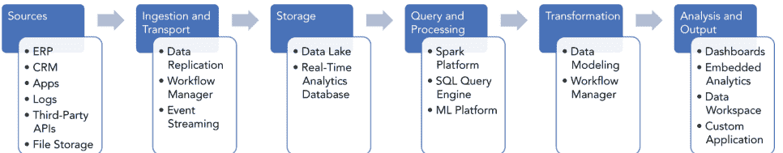

**图 3.3：** 典型的数据基础设施管道

### 重新定义工作流程和员工思维的变更管理

与数字化转型不同，AI 转型要求工作流程和思维方式发生转变。成功管理这一变革是一项重大任务。

> **最佳实践提示** 全企业范围的 AI 转型很复杂，因此需要变更管理来培训员工并指导他们完成整个过程。

### 监管问题：应对偏见、伦理、隐私和问责风险

AI 引入了偏见、伦理和隐私等监管问题，必须在部署模型之前加以解决。

## 动手角色扮演练习：决定是否推进 AI 优先战略

想象一个场景，一家公司正在考虑采用 AI 优先战略。分组，并让每个小组或个人扮演 CEO、CFO、数据科学家、机器学习工程师、业务分析师、产品经理等角色。

让每个人为自己的角色辩护，并就采用 AI 优先战略的理由和反对理由进行头脑风暴。

制作一份演示文稿，记录您赞成或反对 AI 优先战略的决定及其理由。

## 在较小 POC 点解决方案和大规模 AI 计划之间做出选择

让我们讨论在单点 AI 计划和大规模 AI 计划之间做出选择的优缺点。这将帮助您更好地管理资源，权衡风险与收益，更重要的是，确保您的 AI 计划与组织目标保持一致。

### 实施大规模 AI 计划的挑战

大规模 AI 计划比较小的基于点的 PoC 解决方案复杂得多。选择大规模 AI 计划还是较小的点式 PoC 解决方案取决于贵组织的需求、目标、战略目标和准备情况。

### 应对各环节、利益相关方和技术基础设施

大规模 AI 计划之所以复杂，仅仅是因为有许多活跃环节，例如数据管道、底层系统和流程、模型、业务需求以及需要合作的众多利益相关方。了解流程、数据和技术基础设施需要时间和精力。

### 大规模 AI 计划中的资源分配挑战

大规模 AI 计划需要大量技术、财务和人力资源。这自然涉及与组织内众多利益相关方协调。获得认可和共识需要努力。

### 克服对变革的抵触

在整个企业中实施大规模 AI 计划需要改变员工的流程、系统、做法、组织结构和文化。获得利益相关方对 AI 系统价值的信任以实现这一变革需要努力。

### 数据安全、隐私、伦理、合规性和声誉

由于大规模 AI 计划的范围很大，与该计划相关的风险也很大，涉及成本、数据安全、隐私、伦理、合规性和声誉。

### 为大规模 AI 计划构建商业论证

与较小的点式解决方案相比，为大规模 AI 计划构建商业论证更具挑战性。然而，大规模 AI 计划的收益也大得多。

### 需要考虑的因素

总而言之，考虑到所有这些因素，组织是应该采用较小规模的 PoC 解决方案还是更重大的 AI 转型努力，将取决于他们在 AI 旅程中所处的阶段。

- > 如果您的公司刚刚开始测试 AI，尚未确定特定用例，那么单点 PoC 解决方案可能很合适。

- > 但是，如果您的公司已经通过之前的单点 PoC 解决方案积累了一些经验，并已确定多个用例，以及大规模举措所需的合适资源、技能集、基础设施和可用数据，那么大规模举措可能是首选，考虑到它对组织可能带来的巨大效益。

建议您先通过 PoC 启动 AI 转型工作，然后再开展更大规模的 AI 转型计划。

**注意** 在较小的 PoC 和大规模 AI 转型之间做出决定，取决于组织的风险承担文化和组织变革能力，以及其 AI 流程、实践、数据和组织结构的成熟度。

## 实操案例研究练习：企业 AI 转型决策：POC 与大规模 AI

**目标：** 评估开展企业 AI 转型工作的挑战，评估成本效益，并就 AI 项目的实施做出战略决策。

**所需材料：** 在线研究、用于做笔记的笔和纸、PPT 或 Google Slides。

**步骤 1：** 将学生分组并分享案例研究。

**优势：** 您在一家中型零售公司工作，有一些 PoC 经验、敢于冒险的文化以及潜在的变革性举措。然而，您面临后端集成挑战、大数据集管理以及员工抵制。

**劣势：** 该公司也面临多项挑战，例如与后端系统集成、管理大数据集，以及员工对变革的抵制。

**步骤 2：** 各组应评估情况，并考虑技能集、技术、基础设施集成、数据管理、治理、安全、变革管理、法规、资源需求等方面。

**步骤 3：** 各团队需要决定下一步行动方案，是推进大规模 AI 计划还是继续其 PoC。各团队必须做一场简短的演示，概述情况、他们的决策及理由。

**步骤 4：** 所有团队演示完毕后，全班讨论共同观点和方法上的差异。个人可以记录自己的笔记，并决定如何在实际场景中应用。

## 练习册模板：AI 挑战评估

从书籍下载部分下载“AI 挑战评估”模板（www.wiley.com/go/EnterpriseAIintheCloud）。深入了解在企业范围内实施 AI 时可能面临的潜在挑战。将其作为主动规划工具，确定需要特别关注的优先领域。

## 摘要

虽然踏上 AI 变革之旅可能非常令人兴奋，但前方的前景也可能相当令人望而生畏。毫无疑问，前景很诱人，但以热情和准备并重的态度对待它们至关重要。本章是您前进旅程的第一步。

本章考虑了在实施机器学习部署时阻止组织将其部署到生产环境的一些挑战。鑒于 AI 解决方案背后的巨大实力，实施团队在部署 AI 解决方案时，还必须考虑一些社会、伦理和人道主义因素。下一章将讨论实施负责任 AI 的要求。

## 复习问题

这些复习问题包含在每章末尾，帮助您测试对信息的理解。您将在以下部分找到答案。

- 1. 数字原住民在采用 AI 方面的主要优势是什么？

- A. 他们拥有敢于冒险的文化，并将失败视为成功的垫脚石。

- B. 他们有更多资金可投资于 AI。

- C. 他们的品牌形象优于传统公司。

- 2. 在商业环境中部署 AI/ML 解决方案面临哪些挑战？（多选）

- A. AI 和 ML 技术交付价值较为复杂。

- B. 运行机器学习工作负载的成本可能成为部署的障碍。

- C. 所有业务问题都可以轻松使用 AI/ML 解决。

- D. 市场上合格的 AI/ML 专业人员供过于求。

- 3. 机器学习中常见的数据相关挑战是什么？

- A. 通常有大量高质量数据可用。

- B. 模型不需要特定格式的数据，使过程更容易。

- C. 衡量模型性能简单且容易。

- D. 收集高质量数据并为机器学习准备数据可能耗时且昂贵。

- 4. 管理整个机器学习生命周期时，一个重大挑战是什么？

- A. 进行特征工程和选择模型更容易。

- B. 这很简单，因为数据准备不需要任何大量努力。

- C. 数据准备和特征工程周围的复杂性使其具有挑战性。

- D. 没有任何机器学习任务带来重大挑战。

- 5. 什么使 AI 转型比数字化转型更复杂？

- A. AI 转型需要基本的 IT 技能和基础设施。

- B. AI 转型涉及工作方式的变化以及员工与技术的交互。

- C. AI 转型不需要大量高质量数据。

- D. AI 转型不涉及与偏见、伦理、隐私和问责制相关的挑战。

## 答案键

- 1. A
- 2. A, B
- 3. D
- 4. C
- 5. B

# 4 以负责任的方式设计 AI 系统

> 真正的问题不在于机器是否会思考，而在于人是否会思考。
>
> ——B.F. Skinner

本章探讨了我们这个时代最紧迫的问题之一：以负责任的方式设计 AI 系统。如果您是参与实施 AI 的数据科学家、项目经理、AI 开发人员或高管，这一点至关重要。这不仅仅是编写代码或训练模型，而是要确保您开发的内容与人类价值观、伦理和安全保持一致。

本章探讨了负责任 AI 的关键支柱，从鲁棒性和协作到可信度和可扩展性。本章还分享了负责任 AI 框架的基本支柱、负责任 AI 的四个关键原则，以及 AI 设计、开发和部署的一些细微差别。如图 4.1 所示，本章为后续章节中 AI 的实际部署和扩展奠定了基础。无论您是刚刚起步，还是正在改进现有实施，本章都将指导您。

## 负责任 AI 的支柱

组织有社会和人道主义责任，确保先前存在的偏见和歧视不会在 AI 部署后的世界中继续运作。

负责任 AI 是一个旨在保护人类尊严、公平和隐私等原则的框架（见图 4.2）。它用于设计和构建符合伦理、透明、公平且对社会负责的 AI 系统。负责任 AI 基本上认识到 AI 系统可能对人类（包括个人、社区和整个社会）产生的影响。其目标是尽量减少 AI 的负面影响，同时尽可能最大化对受影响方的积极影响。对 AI 系统设计的含义在于，它们不仅必须构建得强健可靠，还应专注于尽量减少偏见和歧视以及保护隐私。
本节涵盖了构建实际 AI 系统时需要考虑的一些事项。实际 AI 系统需要强健、协作、负责任、可信、可扩展且以人为本。

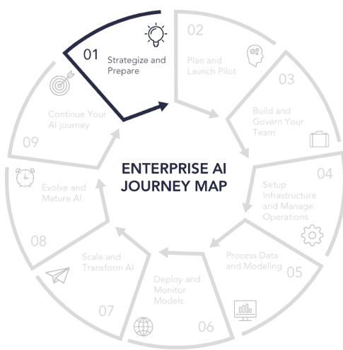

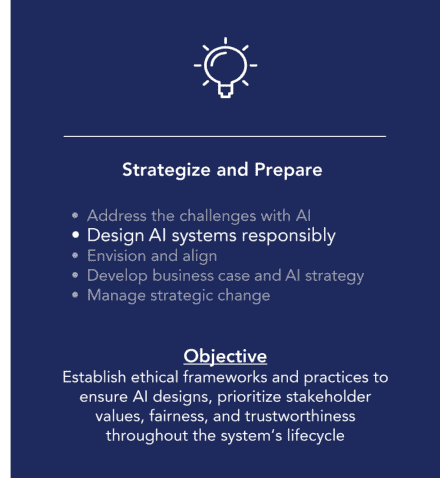

FIGURE 4.1: 战略与准备：以负责任的方式设计 AI 系统

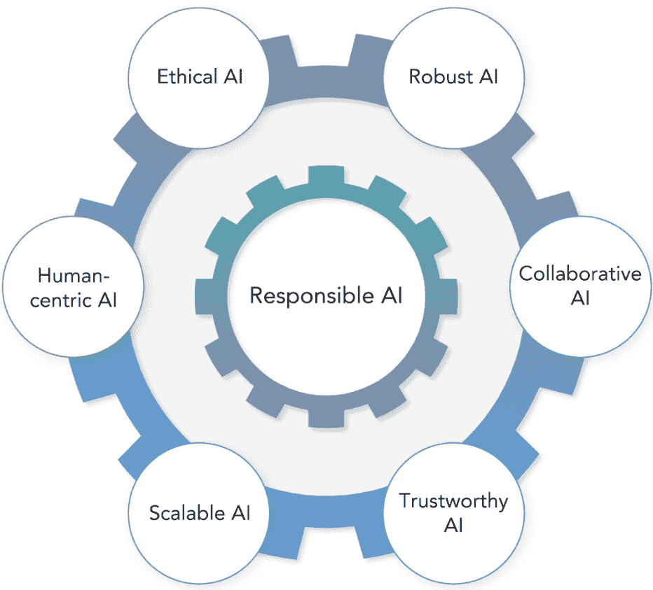

**图 4.2: 负责任 AI 的关键支柱**

没有这些负责任 AI 的属性，将其部署到生产环境中将会很具挑战性，因为用户不会有足够的信任和信心来使用该系统。接下来的部分将逐一探讨这些属性，并解释它们的含义。

## 稳健 AI

您需要设计 AI 系统使其具有鲁棒性，意味着它们甚至在未经过训练的情况下也能表现良好。这对于防御、自动驾驶汽车和机器人等用例至关重要，因为如果系统表现不当，后果可能是灾难性的。

> **最佳实践提示** 稳健的 AI 系统应该在数据不断变化时也能保持一致的性能，尤其是在企业环境中，许多数据源正在为模型提供数据。如果系统产生不可靠的洞察，用户在使用系统时会失去信任和信心。您需要测试系统，以应对任何意外的攻击或情况。

## 协作 AI

协作 AI 的理念是发挥 AI 和人类各自的优势。虽然人类拥有创造性思维、领导力、判断力以及情感和社交技能，但机器人可以处理大量数据，并帮助人类完成体力劳动、信息收集、提高速度以及客户服务等常规任务。通过结合人类和 AI 的优势，您可以构建更好的系统来改进业务流程。图 4.3 展示了这种协作的示例，例如聊天机器人、协作机器人、虚拟助手和其他智能机器。这些智能机器与人类协同工作，共同做出决策并执行任务。

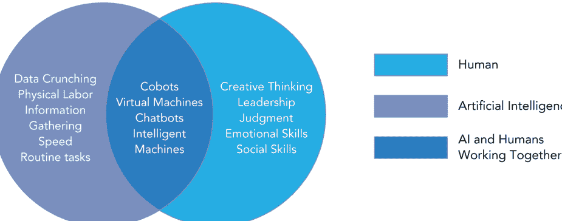

图 4.3：协作 AI：借助 AI 增强人类能力

从协作 AI 系统中得出的关键启示是，AI 不会取代人类，而是会补充和增强人类的决策能力。在处理琐碎、重复性任务的同时，它们帮助人类专注于独特的高价值任务，并提高完成更多任务的能力。

协作 AI 创造了对人类训练 AI 系统的需求，以便它们表现正确，以及解释 AI 系统为何以某种方式表现。例如，在车祸案例中，您需要解释事故为何发生或汽车为何未能预防事故。这也创造了对人类监督的需求，以确保 AI 系统负责任地工作。

研究表明，取代人类的公司只能实现短期收益。相比之下，利用 AI 改善人类决策能力并大规模更快地完成琐碎任务的公司，可以重新设计业务流程并获得更大的长期收益。

### 用例示例

协作 AI 的一些示例是汇丰银行和 Danske Bank 使用 AI 提高欺诈检测的速度和准确性。另一个示例是梅赛德斯-奔驰，它用 AI 支持的协作机器人取代了机器人，协作机器人是与人类协作以实现流程灵活性的机器人。这重新设计了他们的人机协作。

## 可信 AI

您需要构建可信的系统，意味着它们应该行为一致、可靠且安全。它们还应保护用户的福祉、安全和隐私。目标是在用户和系统之间建立信任。您还应该能够向用户解释系统如何采取行动，并对系统如何得出结论或做出预测向用户负责。图 4.4 展示了可信系统的关键要素。

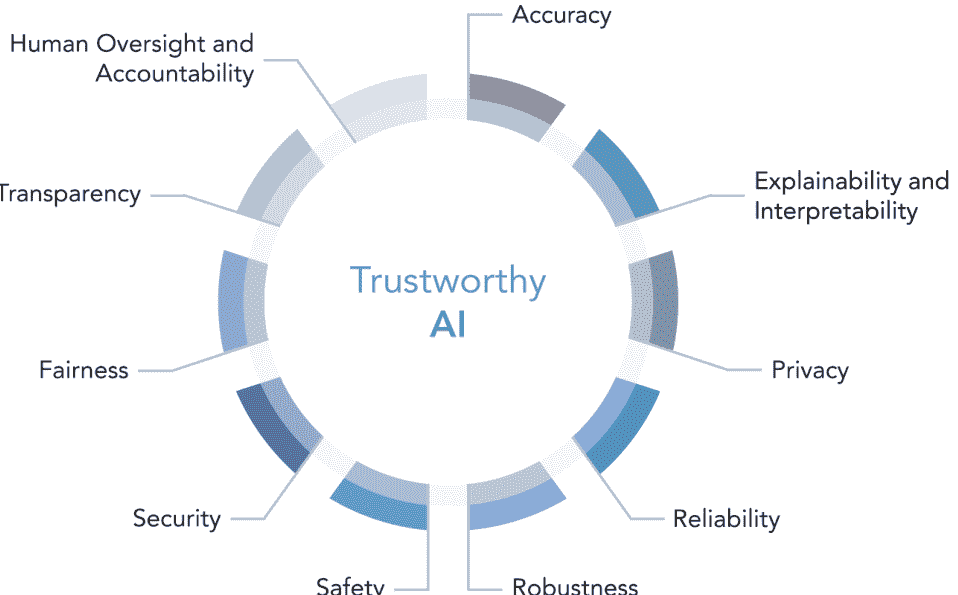

图 4.4：可信 AI 的关键要素

### 用例示例

Google 搜索引擎是可信系统的一个优秀示例。它拥有算法，确保结果根据网站与搜索查询的相关性显示。它还会对结果进行排名，并在呈现结果时过滤所有垃圾邮件和恶意网站。它向用户提供透明且可解释的结果，说明它如何得出这些结果。Google 还制定了一套道德准则和原则，并向用户解释了它们如何收集、保护和使用数据，对用户保持透明。Google 在用户中建立了可信搜索引擎 AI 系统的声誉。

## 可扩展 AI

您必须构建能够处理大量数据且在运行期间不影响性能的 AI 系统。要使系统可扩展，您不仅需要确保数据和模型的可扩展管理，还需要确保开发和部署过程中的可扩展性，以及可扩展的算法和基础设施（参见图 4.5）。本节还讨论了如何解决数据稀缺和收集问题，以及在后续章节（涵盖云平台架构、运营自动化和数据与模型处理）中如何通过数据复用来扩展数据。为解决开发和部署可扩展性问题，本书讨论了使用生产流水线和可扩展架构，包括分布式云计算和边缘设备。

- **基础设施可扩展性**
  - 大规模部署和管理 AI 系统
    - 使用基于云的基础设施和缓存

- **数据可扩展性**
  - 存储和处理大量数据
    - 使用分布式数据库和基于云的存储解决方案

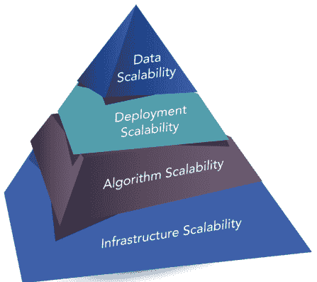

- **算法可扩展性**
  - 训练和部署能够处理大量数据的算法
    - 使用并行计算和机器学习框架

- **部署可扩展性**
  - 在不影响性能的情况下向用户交付 AI 系统
    - 使用边缘计算和缓存

图 4.5：可扩展 AI：关键考量与案例研究

## 可扩展性案例研究：Google

在构建基于自然语言处理的 AI 解决方案时，可扩展性至关重要。这些系统必须在不降低性能的情况下处理大量数据。Google Cloud 的自然语言处理系统是成功应对这一挑战的系统的优秀示例。它使用自然语言处理算法来分析并从大量数据中提取洞察。它可以与企业用于运营的其他 Google 服务集成。一个很好的用例是社交媒体平台。它们可以使用 Google Cloud 自然语言处理多种语言中的数百万条用户评论，以了解用户情绪，并利用此来定制最终用户体验和参与度，提高客户满意度，同时不影响性能。

## 以人为本 AI

您需要构建以人为本的 AI 系统。以人为本意味着它们应尊重人类的价值观，并使人类能够做出决策。为此，需要在设计中有意识地融入人类价值观和需求。您应考虑社会、伦理和人类行为的影响。这些系统必须构建得对用户透明、可解释且可问责。用户应了解这些系统的工作原理，并能够根据系统的建议做出明智的决策。图 4.6 展示了构建以人为本 AI 系统时的一些关键考量。

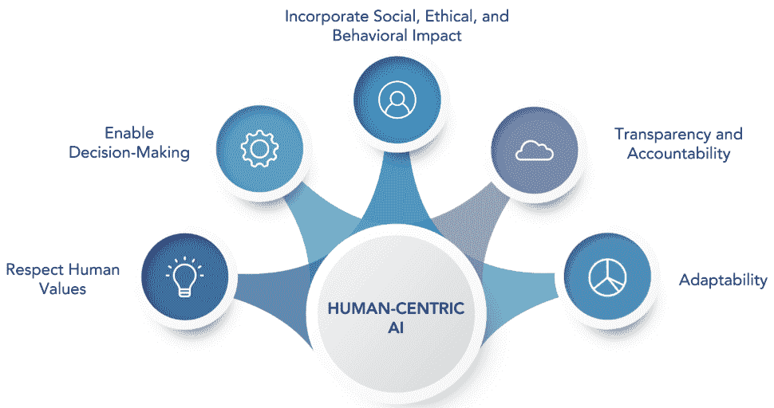

图 4.6：将人类价值置于首位构建以人为本 AI 系统

### 用例示例

一种基于患者历史病史、遗传和生活方式为患者提供个性化治疗建议的医疗系统，是以人为本 AI 系统的绝佳示例，因为它确保治疗不是基于一刀切的方法，而是根据患者的独特需求和情况进行个性化。开发人员还必须考虑用户的数据隐私。他们还应谨慎对待错误建议的潜在影响。这就是为什么系统有必要解释决策是如何作出的。这一点至关重要，因为这将帮助医生更信任该系统，从而让他们更有信心地向患者提出建议。此外，您还应持续监控系统，确保其按预期运行。它还应适应不断变化的患者和医疗系统要求。

## 实操角色扮演练习：实施负责任的人工智能

在实施人工智能时，识别潜在的社会、人道主义和伦理问题，并提出合乎伦理的解决方案。运用这种理解，探索关键设计要素，以确保 AI 系统健壮、协作、可信赖、可扩展、安全且以人为本。

| TASK DESCRIPTION | TASK OWNER | DELIVERABLES |
| :--- | :--- | :--- |
| **设定背景：** 简要描述您的 AI 系统的目的、用户以及当前/期望的潜在社会影响。 | 项目经理 | 项目详细信息文档 |
| **列出潜在的伦理挑战：** 列出与该场景相关的可能的偏见、歧视、隐私、安全、安全性、透明度或其他伦理考量。 | 伦理分析师和团队 | 已识别的伦理挑战列表 |
| **为偏见和歧视开发解决方案：** 提出在数据收集、模型训练和部署中解决偏见的方法。 | 数据科学家 | 尽量减少偏见的策略 |
| **为隐私和安全开发解决方案：** 设计控制措施，确保数据隐私并遵守相关法规。 | 安全专家 | 数据隐私和安全计划 |
| **为问责和透明度开发解决方案：** 概述保持 AI 模型透明和可问责的方式。 | 合规官员 | 问责和透明度计划 |
| **为安全性和安全开发解决方案：** 制定强力测试和风险缓解策略。 | QA 工程师 | 安全性和安全计划 |
| **考虑利益相关者的需求和福祉：** 解释 AI 系统如何考虑利益相关者（包括用户、员工和更广泛的社区）的需求和价值观。 | 利益相关者经理 | 利益相关者考量文档 |
| **分组：** 每个小组代表不同的利益相关者。辩论提议的解决方案，并根据不同视角进行调整。 | 协调人（团队负责人） | 基于角色扮演的调整后解决方案 |
| **总结关键原则和具体措施：** 包含对所学内容的反思以及如何将其应用于未来 AI 项目的说明。 | 业务分析师 | 详细说明方法的全面文档 |
| **讨论挑战和成功：** 作为小组或个人，撰写练习中经历的挑战和成功，以及这些见解可能如何影响未来的 AI 项目。 | 所有参与者 | 反思文档 |

## 学生实操练习

**步骤 1：** 将一名学生或一组学生分配给与负责任的人工智能相关的主题，例如潜在的伦理问题、偏见、隐私问题或其他挑战。

**步骤 2：** 让他们进行简短的演讲，介绍其场景、挑战和拟议解决方案。识别共同主题和独特见解，并将其文档化，以便应用于未来的项目。

## 工作簿模板：负责任的人工智能设计模板

从书籍的下载部分下载“负责任的人工智能设计”模板（www.wiley.com/go/EnterpriseAIintheCloud）。使用此模板制定一份全面计划，以解决 AI 系统的合乎伦理和负责任的设计问题。将此视为一份随项目不断演进的工作文档。

## 总结

本章解释了负责任的人工智能的重要性，以确保在设计和部署 AI 系统时遵循合乎伦理、社会和以人为本的原则。用户应能够理解 AI 决策，系统应消除偏见并优先考虑人类价值观。这些系统必须始终如一、可靠地运行，并且应能够处理大量数据。这意味着您必须确保遵守数据隐私法规，实施强大的安全性和测试，并在设计过程中让利益相关者参与。

在下一章中，我们将讨论制定 AI 策略、路线图，并获得各利益相关者的认同。

## 复习问题

这些复习问题包含在每章末尾，以帮助您测试对本章信息的理解。答案将在以下部分中找到。

- 1. AI 设计中的透明度是指
  - A. 当 AI 系统中的模型适应变化条件时，不应引入偏见。
  - B. 用作模型输入的数据应该是有偏见的。
  - C. 用户和组织了解 AI 系统如何运行并做出预测，以便能够适当地使用它。
  - D. 人类或程序都不应能更改预定义的模型开发流程。

- 2. 以下哪项不是负责任的人工智能的最佳实践提示？
  - A. 用作模型输入的数据不应有偏见。
  - B. 实施人工智能的组织应只关注人工智能的积极影响。
  - C. 人类或程序不应能更改预定义的模型开发流程。
  - D. 人工智能系统中使用的模型在适应变化条件时不应引入偏见。

- 3. 可信赖人工智能的要素之一是什么？
  - A. 系统应在没有任何解释的情况下做出预测。
  - B. 系统应始终如一、可靠且安全地运行，并保护用户的福祉、安全和隐私。
  - C. 系统应始终同意用户的决定。
  - D. 系统应独立于任何数据运行。

- 4. 以下哪项不是以人为本的人工智能系统的特征？
  - A. 对用户透明且可解释
  - B. 能够在没有任何人工干预的情况下运行
  - C. 对用户负责
  - D. 了解系统的工作原理，并能够基于系统的建议做出明智的决策

- 5. 人工智能系统健壮意味着什么？
  - A. 即使在未经过训练的情况下，也能表现良好。
  - B. 应能够完全取代人类劳动力。
  - C. 应能够在没有人工干预的情况下运行。
  - D. 应比人类劳动力更便宜。

## 答案要点

- 1. C
- 2. B
- 3. B
- 4. B
- 5. A

# 5 构想并调整您的 AI 策略

> 备不悉事，即是以败为期。
>
> ——本杰明·富兰克林

本章不仅为您的 AI 转型定下基调，而且确保您从现在起的每一步都与公司更广泛的目标相一致。

本章面向在 AI 方向上苦苦挣扎的商业战略家、为业务与技术对齐而焦头烂额的技术领导者，以及渴望将 AI 有意义地融入业务的 AI 爱好者，旨在为您的 AI 举措制定清晰愿景并将其与业务目标对齐。如果没有明确的愿景和商业案例，即使是最强大的 AI 实施，在不与业务目标对齐的情况下也可能失败。

本章介绍了一套方法，清晰地列出了您可以在 AI 实施旅程的各个阶段遵循的任务和交付成果。它作为第 1-4 章为构思生成所奠定的基础与后续章节之间的桥梁，为在第 6 章制定商业案例和在第 7 章管理战略变化铺平了道路（参见图 5.1）。

在本章结束时，您将拥有一套战略工具包、清晰的任务路线图、一个商业案例以及一份对您的 AI 之旅至关重要的任务清单。

### 企业级人工智能的分步方法论

如图 5.2 所示，您需要管理从战略到组合管理、架构、基础设施、运营、治理、信任、伦理和安全的所有内容。您需要以系统化、程序化的方式管理业务、技术和变革管理挑战。

> **注意** 若要成功在企业范围内部署人工智能，您需要解决从人员到数据问题，再到安全和信任的各种挑战。

我知道在企业范围内实施人工智能并非易事。然而，要推动由 AI 驱动的业务转型，而不是解决一两个 AI 用例，企业级人工智能就是答案，而本书是您的终极指南。如图 5.2 所示，本书中的章节以一种方式排列，应该能帮助您管理所有这些挑战，并使用系统化方法实施企业级人工智能。

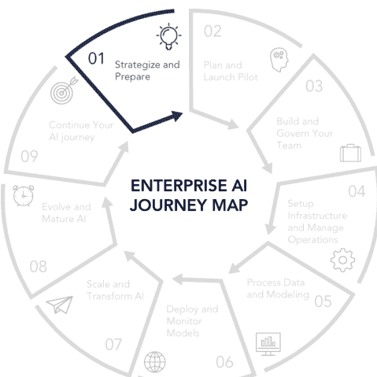

### 制定战略并准备

- 应对 AI 挑战
- 负责任地设计 AI 系统
- 构想并调整
- 制定商业案例和 AI 策略
- 管理战略变化

### 目标

定义并阐述清晰的 AI 愿景，同时确保与企业目标和利益相关者保持一致

### **图 5.1：** 制定战略并准备：构想并调整

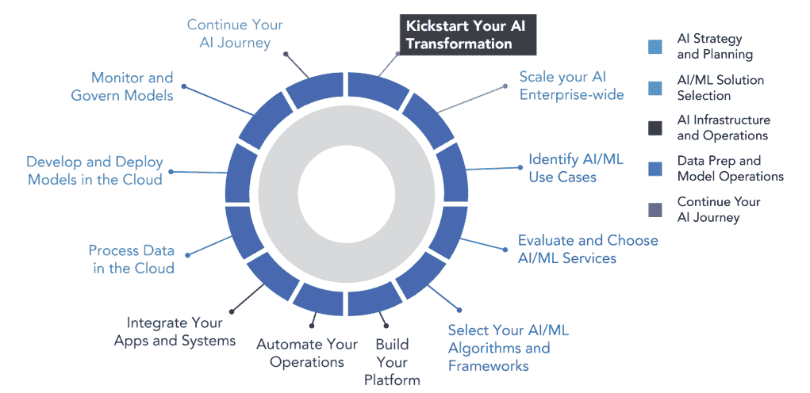

## 图 5.2：实施企业 AI 的步骤

## 构思阶段

您的 AI 之旅始于构思阶段，这是您开始认真思考如何在组织内部署 AI 的地方。

### 主要目标：定义您的 AI 战略

构思阶段的主要目标是定义 AI 战略，确保其与业务目标保持一致，识别不同的 AI 计划并对其进行优先排序。我将其分解为简单的步骤，如图 5.3 所示。

## 构思阶段
任务和交付物

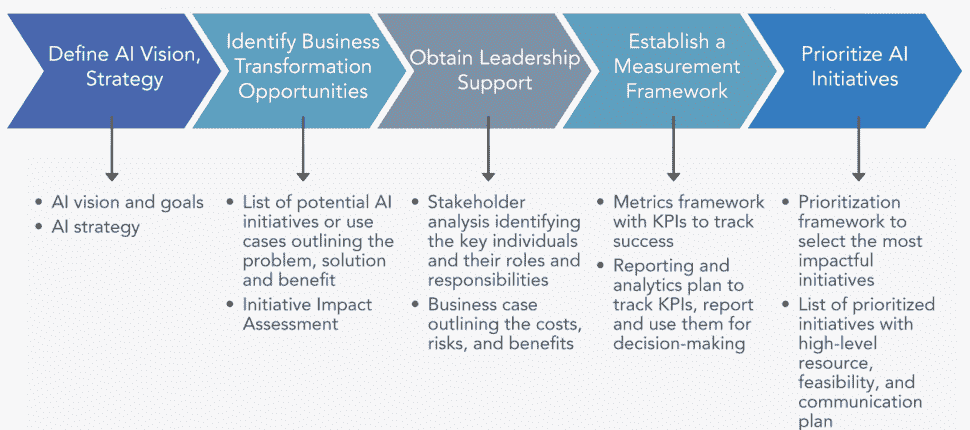

图 5.3：构思阶段：任务和交付物

## 构思阶段的步骤

这些步骤属于构思阶段：

| TASK | DESCRIPTION | TASK OWNER | DELIVERABLES |
| :--- | :--- | :--- | :--- |
| **识别机遇：** 识别您的业务转型机遇 | 头脑风暴 AI 如何在不同领域（如技术、流程、组织和产品）转型您的业务。 | 创新团队，产品经理 | 各领域潜在 AI 转型机遇列表 |
| **让领导保持一致：** 获得领导层的支持 | 一旦识别出潜在的 AI 计划或用例，请将其提交给领导团队以获得他们的支持，并使其与可衡量的业务成果保持一致。领导团队应包括那些能够在各自能力领域内影响和推动变革的人员。 | 高级领导层，部门负责人 | 已批准的 AI 计划，与业务成果对齐的文档 |
| **创建衡量框架：** 建立您的衡量框架 | 拥有明确定义的业务成果目标，以展示 AI 和云技术能为您的公司带来的价值。衡量框架有助于确保您公司的业务目标与整体业务战略保持一致。 | 业务分析师，数据科学家 | 衡量框架，与战略保持一致的业务成果目标 |
| **优先排序计划：** 在多个领域中优先排序您的 AI 计划 | 识别 AI 可以影响的不同领域并确定其价值的优先级。 | 项目经理，战略团队 | 已优先排序的 AI 计划列表，各领域影响评估 |

## 案例研究示例：在构思阶段识别 AI 计划

假设您正在为一家零售公司工作，以改进其供应链。作为构思阶段的一部分，您已确定 AI 战略，头脑风暴了多项 AI 计划，获得了领导层支持，建立了衡量框架，并对 AI 计划进行了优先排序。例如：

- > **业务战略：** 利用 AI 改进供应链运营。
- > **AI 战略：** 使用适当的算法分析供应链数据并生成见解以优化运营。这包括处理数据、构建模型和利用适当的 AI 工具。
- > **业务目标：** 将提前期缩短 20%，将准时交付率提高到 98%，并将运输成本降低 10%。
- > **衡量框架：** 这是一组用于跟踪进度的指标。在此示例中，它包括提前期、准时交付、运输成本、库存周转率和订单周期时间。
- > **AI 计划：** 这些包括用于更好的库存管理的需求预测、用于尽量降低运输成本的路线优化，以及用于降低人工成本的仓库自动化。

## 协调阶段

现在您已在构思阶段识别出潜在 AI 计划列表，是时候进入协调阶段了。

### 主要目标：构建您的商业论证

在协调阶段，主要目标是为 AI 构建商业论证，以便您可以获得利益相关者的支持，调动和协调资源以推进您在构思阶段识别的 AI 计划。图 5.4 说明了此过程。

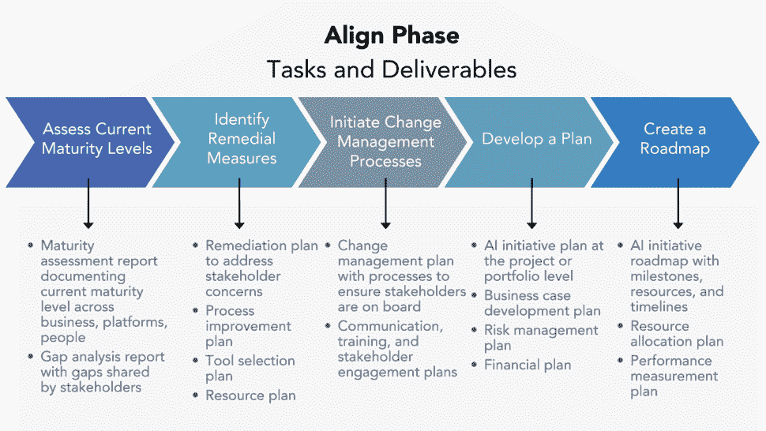

图 5.4：协调阶段：任务和交付物

## 协调阶段的步骤

以下是协调阶段的步骤：

| TASK | TASK OWNERS | DELIVERABLES |
| :--- | :--- | :--- |
| **评估当前成熟度级别：** 您将重点放在识别组织当前的成熟度级别，涵盖业务、技术、人员、流程、安全性和治理。记录利益相关者共享的疑虑、局限性或差距。 | 业务分析师，技术领导者 | 成熟度评估报告，疑虑和局限性列表 |
| **识别补救措施：** 通过了解当前的差距和局限性，您可以采取补救措施来解决利益相关者的疑虑，例如新的流程、程序或工具。您甚至可能识别出任何跨组织依赖关系，并计划为该计划引入未开发的资源。 | 流程经理，跨职能团队 | 补救行动计划，资源分配计划 |
| **启动变革管理流程：** 随后，您可以实施组织变革管理流程，以充分应对任何障碍。您还需要与不同利益相关者沟通以获得支持；例如，您可能需要与 IT 合作伙伴交谈以采购合适的资源，或与培训课程负责人交谈以整合合适的课程。您的目标是确保所有利益相关者都完全支持并大力支持这项 AI 计划。 | 变革经理，IT 合作伙伴，培训负责人 | 变革管理计划，利益相关者支持文档 |
| **制定您的计划：** 在此阶段，您将这些差距以计划的形式记录下来，以便为在下一阶段启动 AI 计划而努力。有两种类型的计划。一种是在项目层面实施已识别的 AI POC，作为启动阶段的一部分；另一种则从转型角度实现企业 AI。后者称为 AI 转型计划。 | 项目经理，战略团队 | 项目计划，AI 转型计划 |
| **制定您的路线图：** 制定一份路线图，其中包含明确定义的里程碑，以及您对资源和时间表的设想。 | 战略规划师，项目经理 | AI 计划路线图，里程碑图表 |

## 案例研究示例：在协调阶段构建商业论证并进行规划

继续沿用零售示例，您在协调阶段可能执行以下任务：

- **变更沟通计划：** 在差距分析中，您发现一些利益相关者担心 AI 对其工作的影响。因此，您制定了一个变革管理流程，其中涉及定期传达 AI 计划的价值，并向其保证该计划将如何有利于他们的工作。
- **技能差距：** 您识别出补救行动项以解决技术技能差距。这些措施之一是招聘具备 AI 和 ML 技能的新员工，并与培训课程团队合作为员工开发 AI 课程，使其掌握相关技术。
- **数据问题：** 在差距分析期间，您还意识到公司不具备构建和训练模型所需的全部数据。您评估不同选项，从各种市场生成或获取所需数据。在与 IT 负责人讨论此事时，您还了解到需要构建 AI 平台的某些方面。
- **路线图：** 您将所有行动项整合到一个计划中，并制定一份具有明确时间表和里程碑的路线图。
- **商业论证：** 在此阶段结束时，您构建一个强有力的商业论证以启动项目，并确保所有受影响的利益相关者都支持并致力于该 AI 计划的成功。

## 工作簿模板：愿景对齐工作表

从本书的下载部分下载“愿景对齐工作表”模板 (www.wiley.com/go/EnterpriseAIintheCloud)。使用此模板确保 AI 目标、组织愿景和使命的一致性。

## 摘要

在本章中，你浏览了在组织内实施企业级 AI 的“设想”和“对齐”阶段。到现在，你应该意识到实施企业级 AI 面临的挑战，以及详细的逐步方法论不仅有帮助，而且是必不可少的。

在 [第 10 章](chapter10) 中，你将了解“启动”阶段，而在后续章节中，我将深入探讨如何在整个企业中扩展 AI 采用。如果你曾经想过如何让 AI 为你的公司服务，这四个阶段——设想、对齐、启动和扩展——在这段旅程中必须是你的盟友和指南。请将它们视为指引你走向成为 AI 优先组织的路标。

特别是，战略性实施 AI 并将你的 AI 举措与业务目标对齐的重要性不可低估。你的旅程才刚刚开始。清晰的路线图加上战略对齐是成功的必备条件。

## 复习问题

每章末尾都包含这些复习问题，以帮助你检验对信息的理解。你将在下一部分找到答案。

- 1. 以下哪一项不是企业级 AI 举措的基本构建块？
  - A. 数据
  - B. 人员
  - C. 业务
  - D. 市场营销

- 2. 设想阶段的主要目标是什么？
  - A. 启动试点项目以评估想法
  - B. 定义 AI 战略并确定 AI 举措的优先级
  - C. 采用迭代方法从试点中学习并将其扩展
  - D. 为 AI 就绪对齐利益相关者

- 3. 以下哪一项不是对齐阶段的主要目标？
  - A. 评估当前成熟度水平
  - B. 识别补救措施
  - C. 实施在设想阶段识别的 AI 举措
  - D. 发起变革管理举措

- 4. 启动阶段的主要目标是什么？
  - A. 识别试点项目
  - B. 实施试点项目
  - C. 部署全规模 AI 举措

- 5. 以下哪一项不属于扩展阶段？
  - A. 实施强大的 AI/ML 平台
  - B. 实施强大的安全控制
  - C. 建立自动化运营流程以跟踪和修复问题
  - D. 实施试点项目

## 参考答案

- 1. D
- 2. B
- 3. C
- 4. B
- 5. D

# 6 制定 AI 战略和组合

> 所有人都能看到我取胜的战术，但没有人能看见孕育胜利的战略。
> 
> ——孙子，《孙子兵法》

本章从第 3 至 5 章阐述的单纯构思和愿景过渡到将该愿景转化为引人注目的商业论证。即使是最令人兴奋的 AI 构想，除非你拥有强大且与战略相一致的商业论证，否则将无法在你的组织中获得关注、必要资源或支持。

除商业论证外，本章还将制定指导 AI 举措方向、范围和方法的 AI 战略，从而为规划试点项目和组建团队奠定基础（参见图 6.1）。到本章结束时，你将拥有定义明确的商业论证以及与组织目标相一致的全面 AI 战略。

### 利用组织能力获取竞争优势

本节讨论了如何利用业务、治理和人员等非技术方面来执行你的 AI 转型工作。请注意，你不必一次性处理所有这些能力。你可以根据自己的需求确定要关注的内容。你可以根据在对齐阶段对这些领域进行成熟度评估时的发现来做出决定。第 21 章介绍了如何进行 AI 成熟度评估。

你可以将公司的能力分为业务和技术类别。本章回顾了业务活动，例如制定与业务目标一致的 AI 战略、管理 AI 组合以部署各种用例，以及调集人员参与你的 AI 实施。在第 23 章中，我将帮助你构建一个 AI 运营模型，该模型作为一个框架，将你的战略、组合、人员、平台和运营整合在一起，以实现你的 AI 目标。

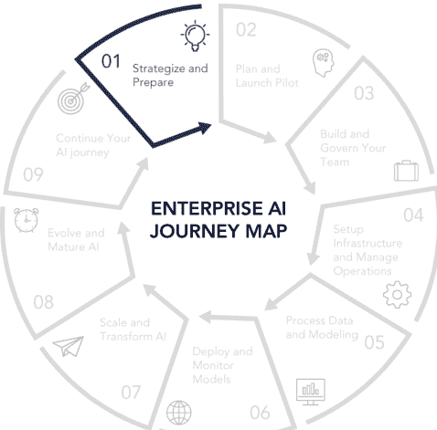

### 制定和准备

- 应对 AI 挑战
- 负责任地设计 AI 系统
- 设想与对齐
- 制定商业论证和 AI 战略
- 管理战略变革

### 目标

制定引人注目的商业论证和全面的 AI 战略，以推动组织转型并实现竞争优势

**图 6.1：制定和准备：制定商业论证和 AI 战略**

### 案例研究：Netflix 如何利用其能力获取竞争优势

在第 2 章中，我谈到 Netflix 等公司如何利用云和 AI 技术转型其业务。我讨论了技术如何推动流程转型，使它们能够更高效并在全球范围内扩展。流程转型反过来又为组织转型创造了新机遇，使它们能够以产品为中心、以客户为中心且敏捷。而这种组织转型使它们能够识别新产品、服务，并最终识别新的商业模式。

为了实现业务转型并建立竞争优势，Netflix 必须利用流程来部署来自企业内外的各种有形和无形资源。通常，这些资源是人员、流程和技术的混合体。将所有这些资源整合在一起以实现有利业务成果的能力被称为能力。

在你的 AI 项目中，你也会这样做以构建 AI 能力并实现竞争优势。你将利用一支由熟练的数据科学家、云和数据工程师、软件工程师以及业务团队组成的团队，采用敏捷方法，在复杂、可扩展的云基础设施上使用领先的最佳实践来开发机器学习模型。

### 构建竞争优势的关注领域

为了构建竞争优势，你需要如图 6.2 所示，将组织在以下八个主要关注领域的能力整合在一起：

- 战略与规划
- 人员
- 数据
- 平台
- 机器学习
- 运营
- 安全
- 治理

不同组织在这些类别中有不同的优势和劣势，这决定了它们实现业务目标的成功率和所采取的路径。例如，少数公司可能擅长产品设计，这可能帮助他们设计新产品并推动创新。相比之下，其他公司可能擅长供应链管理，帮助他们快速且廉价地交付产品。这些能力是通过在人员、流程和技术方面的投资随时间发展起来的，并已成为组织的竞争优势。

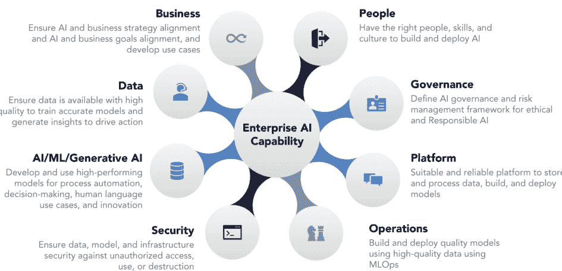

**图 6.2：** 企业级 AI 的能力关注领域

### 通过 AI 推动竞争优势

在 AI 举措中，这种竞争优势将来自于公司员工学习和精通采用 AI 技术的能力；其云基础设施的可扩展性、稳健性和安全性；其 DevOps 和 ML 运营的成熟度；以及他们能够多快地实时根据这些洞察采取行动，以推动客户体验、降低成本并管理风险。

从 AI 转型之旅的角度来看，你的重点是利用这些能力来构建竞争优势并实现业务目标。你成功的程度取决于你与拥有这些能力的利益相关者互动并驾驭 AI 转型工作的程度。遵循本书中的最佳实践以提高成功的概率。

### 启动你的战略和计划以开启企业级 AI

以下部分将回顾业务和人员方面。在后续章节中，我将讨论在平台、运营和安全维度内构建能力。参见图 6.3。

在企业级 AI 举措的背景下，以下是你需要有效管理的关注领域：

- 定义你的 AI 战略
- 管理你的组合
- 鼓励创新
- 管理你的产品生命周期
- 发展战略合作伙伴关系
- 变现数据
- 获取业务洞察
- 最大限度地发挥机器学习能力

## 企业人工智能业务赋能

- **制定 AI 战略**：制定与公司目标一致的人工智能战略
- **管理 AI 组合**：根据业务目标优先安排 AI 举措
- **数据科学能力**：使用高级分析和机器学习解决复杂业务问题
- **管理创新**：推动创新文化以征集和实施 AI 构想
- **获取业务洞察**：使用 AI 能力获取关于业务的实时洞察
- **产品管理**：使用敏捷方法论交付以客户为中心的 AI 产品
- **数据货币化**：使用 AI 从数据和洞察中产生可衡量的业务价值
- **战略合作伙伴关系**：利用合作伙伴关系降低风险、加快价值实现时间、提高 AI 质量

## 图 6.3：战略与规划的业务关注领域

有效利用图 6.3 中显示的八个业务方面将提高企业范围内 AI 转型工作的成功概率。

## 管理 AI 战略、组合、创新、产品生命周期和合作伙伴关系

**表 6.1** 列出了构思与对齐阶段所需的交付成果列表。

## 制定 AI 战略以实现业务成果

以下案例研究讨论了一家公司如何管理其 AI 战略以实现业务目标的示例。

## 表 6.1：AI 战略与组合交付成果

| 能力 | 交付成果 | 描述 |
|---|---|---|
| 制定您的 AI 战略 | AI 战略文档 | 一份全面的文档，概括优势、劣势、机会和威胁以及 AI 愿景和业务目标 • 例如，评估技术平台的增长、客户期望、法规要求 |
| | 当前状态评估 | 评估公司与 AI 相关的当前能力和资源 |
| | AI 技术战略 | 为实现公司业务目标 • 例如，使用机器学习个性化客户体验 |
| | 实施 AI 的技术计划 | 实施技术战略的计划。例如： • 采用敏捷方法论并围绕产品组建团队 • 建立 AI 卓越中心（COE） |
| | AI 举措 | 高级 AI 举措、用例和产品的优先级列表 |
| | 指标 | 用于衡量 AI 举措的成功程度 |
| 管理您的 AI 组合 | 组合分析 | 基于短期和长期目标分析您的组合 • 例如，按交付能力将 AI 举措列表分类为高价值、低价值、低风险、高风险、高复杂度和低复杂度 |
| 管理您的 AI 组合 | AI 组合路线图 | 根据前一步骤的组合分析排序您的举措 |
| 鼓励创新 | 创新管理章程 | 定义创新计划的目标，包括 AI 解决方案如何与组织目标保持一致 |
| 鼓励创新 | 创新路线图 | 创新理念列表，包括颠覆性和渐进式创新。这些可以是创新理念、原型、概念验证甚至成熟的产品和服务 |
| 鼓励创新 | 指标 | 用于衡量创新理念成功程度 |
| 鼓励创新 | 高级领导层支持 | 确保员工积极性的关键因素 |
| 管理您的 AI 产品生命周期 | AI 产品战略和路线图 | 从以客户为中心的角度制定产品战略，解决通过客户和数据识别出的问题 |
| | 产品待办列表和产品需求文档 | 管理产品需求 |
| | 产品开发和交付计划 | 有助于制定清晰的路线图，使各方明确自身角色；有助于有效管理计划、资源、里程碑和风险 |
| 发展战略合作伙伴关系 | 潜在合作伙伴列表 | 有助于识别拥有机器学习、数据分析和 AI 技能的公司 |
| | 合作伙伴协议 | 包含所有参与方角色和职责的列表 |
| | 指标 | 从降低风险、加快价值实现时间、提高产品质量以及提高成功概率等方面评估合作伙伴 |

## 案例研究：一家供应链管理公司如何管理其 AI 战略以实现业务成果

该公司希望利用 AI 优化其供应链运营。在构思与对齐阶段，该公司评估了竞争格局、技术发展、法规变化和客户期望，以了解业务影响。

在审视其业务目标和影响评估后，该公司决定利用预测分析来优化其运营并实现其长期目标。

该公司制定了其*技术战略*以部署 AI 技术来改进其供应链运营并实现其业务目标。作为其战略的一部分，该公司围绕产品和价值流重组了团队，以变得更加以客户为中心。为确保实施成功，该公司征求了许多利益相关者的反馈，例如客户、员工、领导团队和第三方供应商。

最终，该公司利用 AI 技术实现了其业务目标。

图 6.4 显示了业务战略、AI 战略、业务目标和 AI 举措的示例。

## 优先安排您的组合

管理您为 AI 识别的组合可帮助您全面了解产品和服务，并确保您的 AI 战略和计划满足客户需求。在优先安排产品时，您应专注于跨所有渠道和业务运营改善客户的端到端体验。

## 案例研究：Netflix 与组合管理

以 Netflix 为例。他们采用组合管理来优先安排其产品，以提供引人入胜的客户体验并保持其竞争优势。

Netflix 利用客户行为数据来个性化其观看体验。他们还优先安排了优化其内容分发网络的产品，以实现更快的流媒体并减少缓冲时间。他们还确保拥有提供客户体验所需的技术技能、资源和基础设施，同时不牺牲性能、安全性和可靠性。利用组合管理根据实现战略目标（如个性化客户体验和运营效率）的需求优先安排其 AI 产品，将有助于他们确保卓越的性能和交付能力。

| 业务战略 | AI 战略 | 业务目标 | Q1 | Q2 | Q3 | Q4 |
|---|---|---|---|---|---|---|
| 提高客户忠诚度和收入 | 提高客户保留率 | • 在未来 12 个月内将客户保留率提高 20%。 • 在未来 12 个月内将收入提高 15%。 • 在未来 12 个月内将客户满意度提高 10%。 | 开发个性化推荐引擎 | 实施聊天机器人 | 分析客户行为数据以识别模式并提供促销 | |
| 提高效率并降低运营成本 | 自动化手动流程 | • 在未来 12 个月内将生产时间减少 20%。 • 在未来 12 个月内将生产成本降低 10%。 • 在未来 12 个月内将产品质量提高 15%。 | 开发预测性维护模型以减少机器停机时间。 | 实施计算机视觉系统以自动化质量控制和缺陷检测。 | 使用机器学习算法优化生产计划并减少浪费。 | |

**图 6.4：** 业务战略、AI 战略、业务目标和 AI 举措的示例

## 阶段间的策略与执行

图 6.5 和 6.6 表示您可能如何分阶段交付战略、组合、数据、建模任务和创新管理的成果。请随意根据贵组织的需求和最佳实践进行自定义。请注意，这可以是瀑布模型或敏捷模型，尽管推荐采用敏捷方法。

## 利用组织能力的战略规划与项目管理实践练习

**场景：** 假设你是 AI 团队的一员，正在尝试使用 AI 改进供应链运营。

**目标：** 利用贵公司在战略、组合、数据、建模和创新方面的非技术组织能力。

- 1. 步骤 1：制定您的 AI 战略。
- 2. 步骤 2：管理您的 AI 组合。
- 3. 步骤 3：鼓励创新。
- 4. 步骤 4：管理您的 AI 产品生命周期。
- 5. 步骤 5：建立战略合作伙伴关系。

交付成果：
开发以下内容：

- 包含业务目标的 AI 战略文档
- 组合分析和 AI 组合路线图
- 创新管理章程和包含成功指标的路线图
- AI 产品战略和路线图及产品待办列表
- 潜在 AI 合作伙伴列表和合作伙伴协议

### 图 6.5：AI 战略：阶段和能力

设想 | 对齐 | 启动 | 扩展
战略
01 管理 AI 战略
02 管理 AI 组合
03 管理创新
03 创新创意
01 潜在 AI 计划
02 优先 AI 组合
03 创新创意
03 创新创意

### 图 6.6：AI 执行：阶段和能力

设想 | 对齐 | 启动 | 扩展
执行
04 管理产品生命周期
05 战略合作伙伴关系
06 开发数据科学能力
07 数据货币化
04 产品需求
04 产品开发
04 产品发布
04 新产品需求
05 供应商评估
05 新供应商合同
05 供应商绩效评估
05 合同续签
06 数据收集
06 数据准备
06 模型部署和监控
07 数据货币化创意

## 工作簿模板：商业案例和 AI 战略

从书籍的下载部分下载“商业案例和 AI 战略”模板 (www.wiley.com/go/EnterpriseAIintheCloud)。使用此模板为您的公司制定 AI 战略。此模板提供了规划 AI 计划的业务导向视角，重点关注财务预测、利益相关者参与以及与战略业务目标的对齐。请随根据贵组织的具体需求对其进行调整。

## 摘要

本章深入探讨了将 AI 想法转化为可操作且有影响力的 AI 战略的任务。本章是一份逐步指南，用于制定引人注目的 AI 战略和优先组合。

您还学习了如何制定全面的 AI 战略，为未来的 AI 工作提供方向和重点。本章是您总体 AI 战略与执行之间的桥梁。在下一章中，让我们讨论加速贵公司 AI 采用的关键组件。

## 复习问题

这些复习问题包含在每章末尾，以帮助您测试对信息的理解。您将在以下部分找到答案。

- 1. 将资源整合以实现业务成果的能力称为什么？
  - A. 创新
  - B. 成就
  - C. 能力
  - D. 转型

- 2. 制定 AI 战略的第一步是什么？
  - A. 确定您的业务目标。
  - B. 评估您当前的 AI 能力。
  - C. 制定 AI 采用路线图。
  - D. 识别潜在用例。

- 3. 在 AI 战略背景下，管理投资组合的目的是什么？
  - A. 确保所有项目具有相同的优先级
  - B. 获得满足客户需求的所有产品和服务的全面图景
  - C. 根据成本对产品和服务进行优先级排序
  - D. 主要关注客户体验

- 4. 在 AI 项目中利用组织能力获得竞争优势的关键是什么？
  - A. 选择最新的机器学习模型和算法
  - B. 提高团队的技术技能
  - C. 关注业务、治理和人员等非技术方面
  - D. 投资于最昂贵的 AI 技术

## 参考答案

- 1. C
- 2. A
- 3. B
- 4. C

# 7 管理战略变革

变化是生命中唯一不变的事物，但通过战略管理，我们可以驾驭其潮汐。

> - 灵感来源于赫拉克利特

如果您是高管、团队领导、变革领导者，或是在组织中推动战略变革的任何人，本章适合您。AI 领域，特别是生成式 AI，正在快速发展，能够管理变革不仅是一种可有可无的条件，更是必不可少的。早期章节侧重于理解 AI 的前景，而本章深入探讨了如何战略性地管理和加速这种变革（参见图 7.1）。

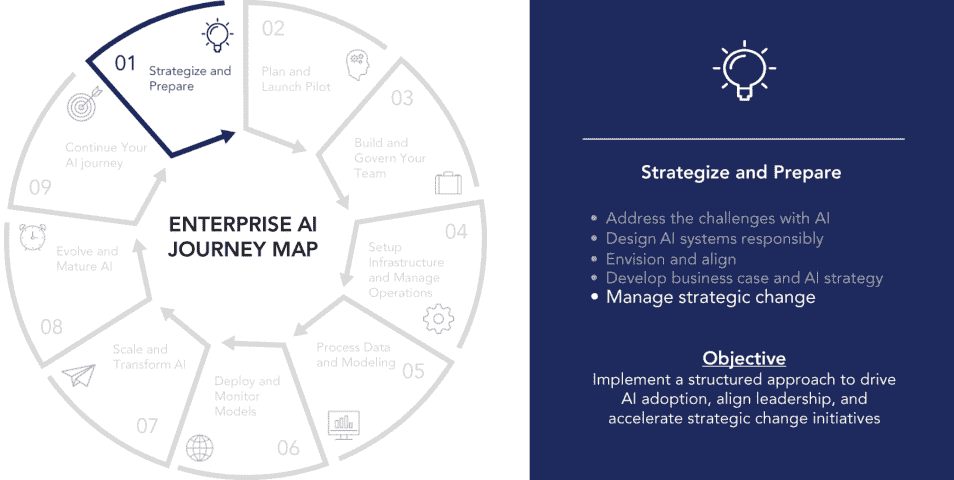

### 图 7.1：制定战略和准备：管理战略变革

本章将引导您采用三阶段方法加速 AI 采用，从制定 AI 加速章程到确保领导层一致并制定变革加速策略。我还将这些步骤与可作为进度证据的有形交付成果联系起来。请另行注意，此处概述的步骤既适用于传统 AI 实现，也适用于生成式 AI 实现。

无论您是试图重新定位团队还是重新定义整个公司，本章都为您提供推动战略变革所需的工具。请记住，尽管每个组织的 AI 之旅都是独特的，但变革管理原则是普遍的。

## 通过战略变革管理加速您的 AI 采用

变革加速是指通过解决担忧来加速创新技术的采用，这些担忧可帮助您保持竞争优势并将自己确立为行业领导者。事实是，尽管实施了此处概述的所有措施，您可能仍会发现员工不愿意以您希望的速度采用 AI。这就是为什么您需要此处讨论的变革加速计划的原因。

下一节将回顾图 7.2 中所示的变革加速工具包。它将之前所有人员能力整合为一个连贯的计划。

| 组建团队 | 对齐领导者 | 设想 |
| :--- | :--- | :--- |
| 制定 AI 加速章程 | 确保领导层一致 | 制定变革加速策略 |
| 分析价值驱动因素 | 评估利益相关者 | 制定沟通策略和计划 |
| 建立 AI 治理 | 进行变革影响评估 | 制定参与策略和计划 |
| 构建企业 AI 加速团队 | 进行就绪度评估 | 制定培训策略和计划 |
| 制定 AI 计划目标 | 制定变革论据 | 制定风险管理策略和计划 |
| 定义未来状态 AI 愿景 | | 制定赞助商路线图 |
| 定义变革加速指标 | | 制定 AI 可持续性计划 |
| 估算预算 | | |

### 图 7.2：AI 变革加速策略：阶段和能力

### 第 1 阶段：为您的 AI 计划制定 AI 加速章程和治理机制

AI 加速工具包包括组建团队、对齐领导者和设想未来。AI 加速章程是一项重要工具，可帮助您组建团队。它记录了您 AI 计划的目标、目的和指标（参见图 7.3）。让我们深入了解详情。

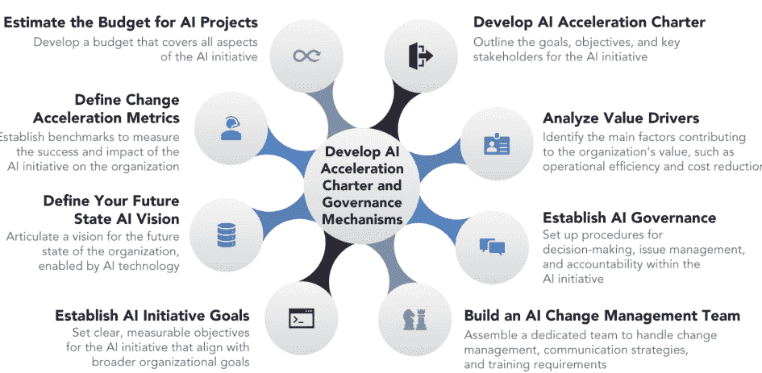

### 图 7.3：制定 AI 加速章程和治理机制

### 制定 AI 加速章程

您的组织需要一份 AI 加速章程，以识别 AI 计划涉及的依赖关系和利益相关者。它侧重于提高速度、最大限度地提高采用率和降低风险。您的利益相关者可以是 IT 团队、业务团队、数据科学团队和法务团队。章程包括审查流程、利益相关者职责以及衡量 AI 活动的指标。您可以使用它来收集各利益相关者的意见，并建立初步关系以实现业务成果。

### 分析价值驱动因素：用于战略规划和绩效衡量

价值驱动因素分析可帮助您识别推动价值的因素，例如运营效率、成本降低和收入增长。您可以使用这些驱动因素来评估计划的战略重要性，以便进行规划，并使管理人员能够将活动集中在重要事项上。

### 为 AI 计划建立治理

您应该为 AI 计划建立治理机制，以建立适当的决策、升级和问题

管理、分配所有权和问责制。这提供了清晰度，并确保工作流与整体组织治理之间保持一致。它确保领导层、利益相关者、工作团队和变革管理团队之间保持一致。您必须通过建立与计划级节奏和报告机制同步的会议和敏捷仪式节奏，确保各方以及治理之间保持一致。

> 最佳实践提示 制定 AI 宪章，分析价值驱动因素，建立治理机制，组建 AI 团队，然后定义目标、愿景、指标和预算，以成功实施 AI。

## 为企业 AI 构建企业 AI 加速团队

您应除卓越中心团队外，还设立 AI 变革加速团队，两者共同负责处理变革管理问题、组织变更、角色变更、沟通策略、培训需求以及争取高管赞助。他们有助于降低 AI 实施的风险，这些风险源于沟通不畅、缺乏跨职能协作，以及与 AI 实施相关的挑战，例如数据处理、模型构建、信任和伦理。

## 制定 AI 举措目标

您需要与各利益相关方合作，制定明确定义的目标，以便监控该举措的进度并相应调整活动。您可以利用这些目标来使人员、流程和技术保持一致，以实现改善客户体验和推动销售等成果。

## 定义未来状态 AI 愿景

您应定义可通过 AI 技术实现的未来状态愿景，并确保其与组织的目标、结构、流程、文化和技术保持一致。这将有助于指导您的变革加速计划，转变公司的流程、人员和技术。利用决策分析、流程分析和业务能力分析等分析技术。请记住，随着 AI 领域的新发展，未来状态模型将不断演变。

## 定义变革加速指标以衡量 AI 采用的成功

然后，您可以定义变革加速指标，以衡量人们适应组织因引入 AI 举措而产生的近期变化的成功程度。您应在项目生命周期早期定义这些指标，并在整个举措过程中跟踪它们。您可以利用这些指标来跟踪组织在应对变化方面遇到困难的地方，并对计划进行必要的调整。变革加速指标的示例包括用户采用率、员工满意度、达到熟练程度所需时间、生产力和 ROI。

## 估算 AI 活动预算

为变革管理活动制定现实且可实现的预算。您应包括团队资源、材料开发、技能和知识开发、差旅、活动、软件许可费用、硬件成本和实物成本。

## 第 2 阶段：确保领导层一致

领导者在任何 AI 举措的成功中都发挥着至关重要的作用。因此，在举措开始时获得他们的支持非常重要。领导者制定愿景、激励员工、管理利益相关者并指导组织。

## 确保领导层一致，以身作则、敢于冒险并激励员工

您必须在 AI 举措开始时就确保领导层的一致。这是 AI 转型工作成功的一个特别关键因素，并影响向未来状态过渡的能力。这涉及利益相关者管理、领导层支持以及确保参与利益相关者更新。

您的领导层需要向员工传达公司的 AI 愿景和战略，并激励他们参与这一 AI 举措。图 7.4 和 7.5 显示了映射到各阶段的目标、步骤和任务。请随时根据贵公司的需求进行自定义。

## 评估利益相关者，通过职业发展和绩效一致性转变工作场所

利益相关者评估是管理利益相关者流程的第一步，涉及了解他们的需求、关切以及对 AI 举措的倾向性。了解这些关切有助于您在整个举措过程中管理他们的反应。您应在举措初期进行此评估，并在整个 AI 举措过程中持续审查。

| 设想 | 对齐 |
| :--- | :--- |
| **领导愿景声明** 识别推动 AI 成功的领导角色和职责 | **AI 治理框架** 识别决策权并概述领导支持协议 |
| **领导能力模型** 制定领导能力模型，概述领导者应具备的技能和行为 | **实验文化** 鼓励领导者通过尝试新用例和挑战现状来承担风险 |
| **领导意识计划** 制定领导意识计划，教育领导者了解 AI 的潜力以及如何领导变革 | **领导力发展计划** 制定领导力计划，教育领导者了解 AI、数据素养和变革管理 |

图 7.4：转变您的领导力：设想与对齐阶段

| 启动 | 扩展 |
| :--- | :--- |
| **定期进行领导层检查** 领导者应定期进行检查，以确保与 AI 目标和宗旨保持一致 | **扩展领导力发展计划** 将领导力计划扩展到其他管理层级 |
| **指标和仪表板** 建立指标和仪表板，以衡量当前 AI 采用的进度 | **领导力培训计划** 向其他管理层级推出领导力培训计划 |
| **以身作则的领导力** 鼓励领导者以身作则，展示支持 AI 采用的行为 | |

### 图 7.5：转变您的领导力：启动与扩展阶段

转变工作场所涉及评估员工队伍的当前能力，并制定填补差距的策略。图 7.6 显示了步骤和交付成果。

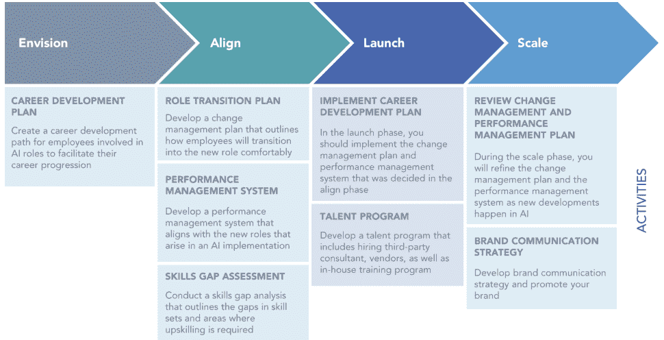

### 图 7.6：转变您的工作空间：任务和交付成果

## IBM 案例研究：IBM 新领带职位计划：劳动力转型的典范

IBM 的新领带职位计划是劳动力转型的显著示例。IBM 通过该计划，试图通过帮助那些无法获得传统四年制学位的人进入这些高科技岗位，来填补技术领域的技能和经验差距。随着 AI、ML 和高级分析等现代技术的出现，需要有人员来维护和运营这些系统。这不需要四年制学位；非传统职业计划即可满足要求。IBM 创建了多种培训和教育计划，例如在线课程、学徒计划和实习计划。

自 2017 年启动以来，该计划取得了巨大成功。根据 IBM 的数据，2018 年，约 50% 的新员工来自接受非传统教育的人群，其中大多数来自该新领带计划。更重要的是，它帮助 IBM 实现了员工多元化，纳入了各类教育背景的人才。

总的来说，这已成为行业的一种新趋势，在您寻找增强员工队伍的方法时，需要考虑这一点。

## 进行变革影响评估

进行变革影响评估，以评估 AI 举措将如何影响各利益相关方，并制定培训、沟通和变革管理计划。这有助于识别受影响的利益相关方，并决定您的团队应使用的沟通渠道，以及必要的治理结构、决策点和政策审查。它可以帮助您决定如何以及何时让利益相关方参与，并制定具体计划来应对这些影响。

图 7.7 总结了你争取领导层和利益相关者支持、制定变革论据的历程。

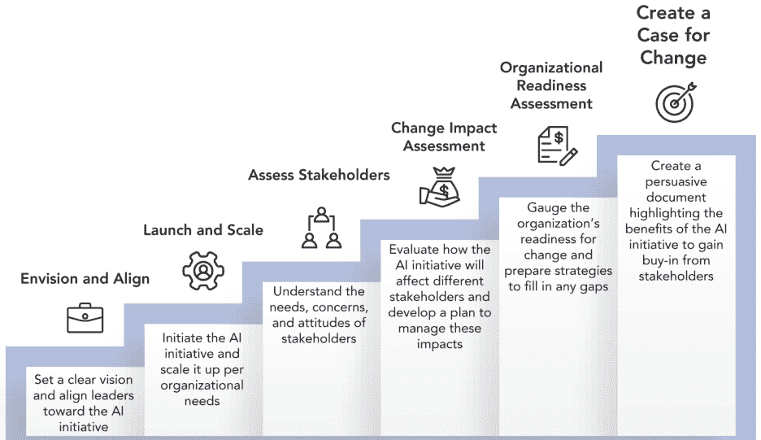

图 7.7：确保 AI（包括生成式 AI 计划）的领导层对齐

## 进行组织就绪度评估

进行组织就绪度评估将帮助你了解组织应对变革的意愿、渴望和能力，并采取措施解决任何差距，例如技能培训、沟通、赞助以及变革加速的调整。

## 制定变革论据

变革论据是一份概述组织通过此 AI 计划将获得的收益的文件。你应在利益相关者评估之后制定它，并用于各种沟通以获得员工的支持。它应清晰、简洁、有说服力，并且应有数据支持。

## 第 3 阶段：制定变革加速策略

变革加速策略是一项计划，包含组织必须采取的不同步骤，以管理 AI 计划带来的变革。应与来自人力资源、业务职能、第三方供应商、领导层、赞助商和员工的不同利益相关者内置协作。你应在计划开始时制定此策略并持续更新。你应确保最小程度的干扰和最大程度的采用。这有助于确保利益相关者对齐、文化转型和业务连续性。

### 制定沟通策略和计划

沟通策略和计划是一份概述需沟通的不同利益相关者、沟通渠道以及沟通频率的文件。它应包含沟通、培训和风险管理计划。

> **最佳实践提示** 制定全面的变革加速策略、沟通计划和培训计划，通过让利益相关者保持知情来确保 AI 实施成功。

### 制定参与策略和计划

你应在制定变革加速策略和沟通策略之后制定此参与策略和计划。它有助于在整个计划中根据情况与利益相关者进行互动。它可以帮助你管理不同利益相关者群体必须经历的进度。

### 制定培训策略和计划以培养 AI 技能

培训策略和计划概述了员工作为 AI 计划一部分需要参加的不同培训项目。它应包括学习需求评估、培训课程和培训交付计划。

你的 AI 计划的成功直接取决于员工在这些前沿技术上的技能和能力。图 7.8 显示了你可以采取的步骤来培养员工的技能。

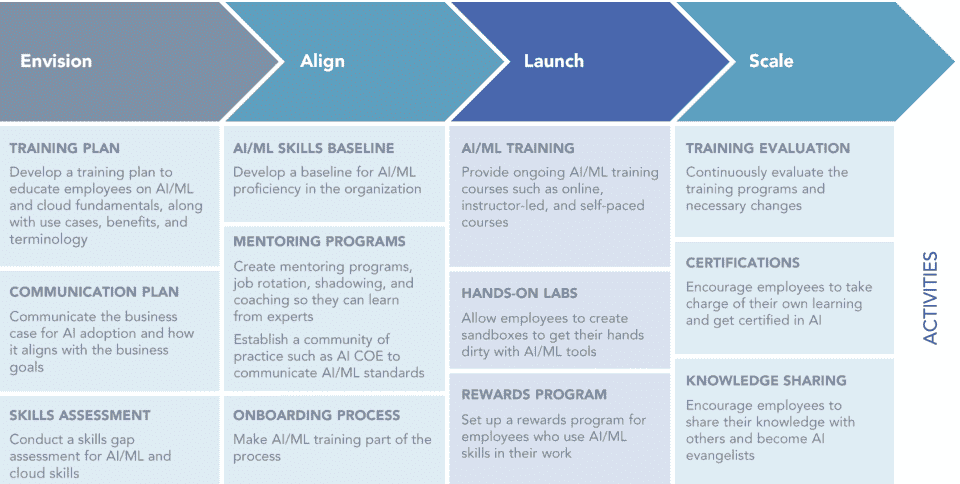

图 7.8：AI 策略：阶段和能力

当你有效实施这些建议时，你将看到使用 AI/ML 和生成式 AI 进行工作的员工数量显著增加，从而提高效率、改善客户满意度和收入。你会注意到你的文化变得创新和敏捷，员工对自己的学习负责并在工作场所采用 AI。所有这些最终都将帮助你在高度竞争的环境中保持竞争力，甚至将你定位为行业领导者。

## 制定风险管理策略和计划

此沟通策略和计划对于确保与你的计划相关的风险得到仔细识别、评估和缓解至关重要。该计划可帮助你识别缓解风险的行动项，并将任务所有权分配给相关人员，以确保他们按时、按质、按预算完成交付物。

## 制定赞助商路线图

赞助商路线图是一份概述在整个 AI 计划中如何吸引和支持赞助商的文件。它要求赞助商对提供领导支持负责，并帮助他们在消息传递中保持一致性以实现业务成果。

## 制定 AI 可持续性计划

你应制定可持续性计划，以确保每个人都持续采用 AI，即使在完成初始 AI 计划之后也是如此。随着组织结构和 AI 领域的最新技术发展而演变，该计划也将持续演变。你通常会在团队获得足够的 AI 转型经验后制定它。

## 实践变革加速工作坊

这是一种专注于促进讨论和协作的实践工作坊类型。它能够培养批判性思维，并促进参与者之间分享不同的现实世界视角。

**目标：** 在本练习中，你将探索不同的变革加速策略，例如领导层对齐、劳动力转型和风险管理。目标是制定一份具体的 AI 加速章程，对齐领导层，并制定变革加速策略。

- **步骤 1：** 将团队分成代表公司不同职能的小组。
- **步骤 2：** 选择一个假设场景，例如构建聊天机器人、制造业中的预测性维护或销售预测。
- **步骤 3：** 要求团队使用书中的方法论执行以下表格中的步骤。
- **步骤 4：** 让团队展示他们的发现，促进讨论，并总结共同的主题、想法和挑战。
- **步骤 5：** 探讨如何在你的组织中应用它。

| 任务名称 | 描述 | 任务负责人 | 交付物 |
|---|---|---|---|
| 制定 AI 加速章程 | 概述将定义你的 AI 计划的目标、原则和关键活动。 | AI 策略负责人 | 一份书面 AI 加速章程 |
| 确保领导层对齐 | 制作演示文稿或文档，清晰传达 AI 对你组织的重要性以及它如何与当前业务目标保持一致。 | 执行赞助商 | 演示文稿或文档及反馈 |
| 制定变革加速策略 | 制定详细策略，概述你的组织如何加速 AI 采用，包括关键里程碑、潜在挑战、解决方案和时间表。 | 变革管理团队 | 一份变革加速策略文档 |
| 实施角色扮演 | 参与角色扮演练习，参与者承担不同的组织角色，并推进 AI 加速策略的实施。 | 培训与发展 | 见解和经验教训 |

## 练习册模板：战略变革管理计划

从书籍下载部分下载“战略变革管理计划”模板（www.wiley.com/go/EnterpriseAInintheCloud）。战略变革管理计划将引导你的组织完成实施 AI 计划的重要阶段，重点在于管理变革。

### 摘要

本章讨论了加速公司 AI 采用的关键组成部分。通过构建 AI 加速章程、实现领导层对齐以及制定系统的 AI 加速策略，你可以围绕 AI 动员员工以实现业务成果。

你了解到，通过采用业务转型和人员授权的系统性、方案化方法，可以实现组织转型。

在下一章中，让我们讨论为你的公司找到合适的 AI/ML 用例。

### 复习问题

这些复习问题包含在每章末尾，以帮助你测试对信息的理解。你将在下一部分找到答案。

- 1. 以下哪项不是变革加速计划第 1 阶段包含的内容？
  - A. 分析价值驱动因素
  - B. 为 AI 计划建立治理机制
  - C. 制定 AI 加速章程
  - D. 确保领导层对齐

- 2. AI计划初期确保领导层对齐的关键步骤是什么？
- A. 立即进行变更影响评估
- B. 忽视利益相关者的顾虑
- C. 向员工传达公司的AI愿景和战略
- D. 将领导层排除在利益相关者更新之外

- 3. 以下哪项不是制定AI计划变更加速策略的步骤？
- A. 进行变更影响评估
- B. 制定沟通策略和计划
- C. 制定参与策略和计划
- D. 为员工培养AI技能

- 4. 以下哪个组件不涉及确保AI采用的适当组织对齐？
- A. 将业务战略与技术战略对齐
- B. 将业务战略与组织结构对齐
- C. 在不考虑文化对齐的情况下实施AI系统
- D. 适当确定AI项目优先级

## 参考答案

- 1. D
- 2. C
- 3. D
- 4. C

# 第三部分

计划与启动试点项目

本部分涵盖了围绕计划和启动试点项目的所有挑战和任务，包括确定项目的用例、评估合适的平台和服务，以及启动实际项目。

# 8 为您的AI/ML项目确定用例

> 做出伟大工作的唯一方式是热爱你所做的事情。
>
> ——史蒂夫·乔布斯

在接下来的几章中，让我们讨论计划和启动试点项目（参见图8.1）。本章重点介绍如何确定合适的用例。在应对挑战、负责任地进行设计并规划AI战略和愿景之后，现在是时候为您的AI/ML项目确定合适的用例了。

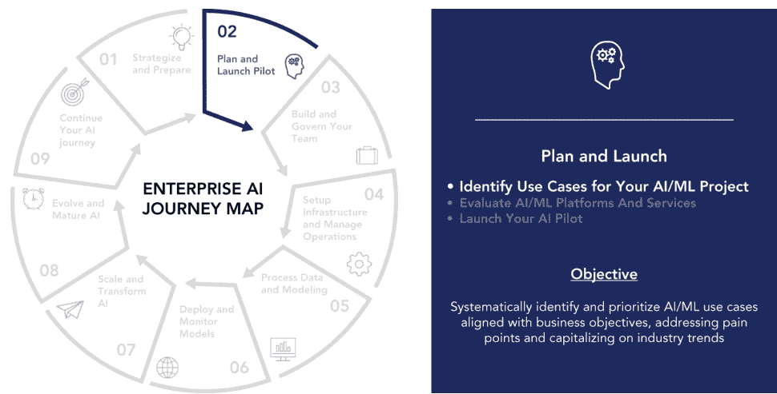

**图8.1：** 计划与启动：为您的AI/ML和Gen AI项目确定用例

无论您是希望解决业务问题的业务高管，还是试图开发尖端应用程序的开发人员，本章都适合您。选择合适的用例不仅仅是一个决定——它是为您的AI之旅指明正确方向的指南针。它不仅能帮助您的团队通过选择合适的技术集来解决业务问题，还能带来运营效率提升、成本降低，甚至为竞争优势创造新的业务机会。

您还将学习如何确定用例的优先级，这将帮助您将所有精力集中在最紧迫的问题上，并最大限度地发挥业务影响。这是您实现积极利益相关者结果并提高成功概率的途径。让我们开始吧。

> 提示 确定对业务影响最大的用例优先级，以降低成本、提高效率并获得竞争优势。

### 用例确定流程

图8.2展示了您可以用来为公司确定用例的流程。它始于确定您希望解决的业务问题和痛点。

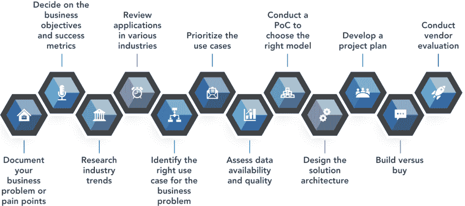

图8.2：用例确定流程

### 让每个人了解AI/ML如何解决业务问题

确定业务问题是用例确定流程的首要步骤之一。为此，实施团队应了解需要解决的各种业务问题。本章的很大一部分内容都关于此，我将在接下来的几个部分中更详细地介绍。

考虑您的公司在客户服务、欺诈检测、风险评估和预测、供应链优化、预测性维护、质量控制、营销和产品开发方面面临的业务问题。所有这些都是AI/ML的候选方案。

请记住，机器学习可以帮助您在数据集中识别模式以预测结果。这一功能/能力既可用于改进现有流程，也可用于创造新机会。适合AI/ML的流程是那些

- > 决策基于数据
- > 决策反复发生，无论是成千上万次还是数百万次
- > 使用软件进行自动化
- > 流程缓慢

### 确定您的业务目标

如图8.3所示，您应首先根据试图解决的业务问题，确定希望达到的业务目标。业务目标示例包括提高客户满意度、收入、效率，降低成本，并提升生产力。痛点示例包括客户流失、索赔/退货数量多、设备故障、库存管理等等。

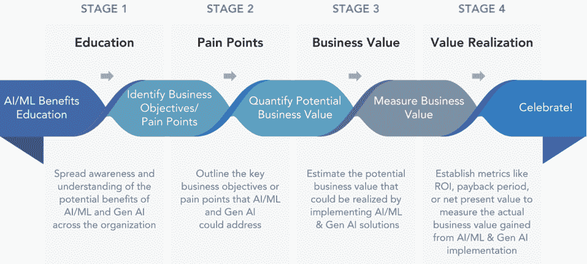

图8.3：为您的AI计划确定业务目标

> 提示 首先向所有人介绍AI/ML和Gen AI的好处。确定业务目标并量化潜在业务价值，以衡量成功。

基于这些业务目标/痛点，您可以量化完成用例后可实现的业务价值。业务价值示例包括成本节约、收入增长、准确性提高、自动化、更好的客户体验以及更快的决策。您应能够使用投资回报率（ROI）、回收期或净现值来衡量业务价值。

### 确定痛点

下一步是确定阻止您实现业务目标的痛点。以下是一些示例：

| 痛点类别 | 描述 | 使用AI解决的益处 | 示例 |
| :--- | :--- | :--- | :--- |
| 流程低效或缓慢 | 您可以自动化和优化公司中的特定流程。 | 通过减少完成任务所需的总时间和精力来提高效率。 | 一家物流公司优化其供应链路线和交付计划。 |
| 客户体验改进 | 使用客户数据个性化推荐。 | 有助于提高客户参与度、满意度和忠诚度。 | 个性化营销活动和定向广告是常见的用例。 |
| 复杂数据分析 | 自动化分析大型数据集。 | 为决策提供洞察。 | 一家分析市场数据以做出投资决策的金融服务公司。 |
| 欺诈检测 | 分析交易数据以检测异常模式。 | 您可以通知客户潜在的欺诈行为。 | 多个行业的许多公司分析交易数据以检测欺诈活动。 |
| 新产品开发 | 分析客户反馈以识别机会。 | 提高客户满意度和销售额。 | 识别新产品功能的机会。 |
| 风险评估 | AI可以评估各个领域的风险。 | 主动管理潜在风险。 | 主动评估风险，例如客户贷款违约、产品召回风险或自然灾害风险。 |

痛点可以是手动流程、冗余流程、复杂流程、数据质量问题以及流程中的其他低效问题。

### 从根本原因分析开始

一旦您对痛点有了很好的了解，就可以开始根本原因分析（RCA）以找到问题的根源。了解根本原因将帮助您筛选出合适的用例。例如，假设您发现客户满意度有待提高。在这种情况下，您的根本原因分析可能会指向糟糕的网站设计、缺乏个性化、速度缓慢（响应时间）、客户支持问题等。

> 提示 确定阻碍您业务的痛点，并进行根本原因分析以筛选您的用例。

### 确定成功指标

一旦您确定了根本原因，就可以选择合适的成功标准。例如，在之前的场景中，您的成功标准可以是提高网站的速度/响应时间、添加个性化功能或改进网站设计。然后您可以围绕客户满意度、收入增长或手动工作减少来定义成功指标。

成功指标可帮助您衡量AI解决方案的有效性，并确保其与您的业务目标保持一致。请参见图8.4，了解成功指标的一些示例，如下所示：

- 成本节约：当您自动化业务流程、消除错误或提高流程效率时，成本节约是您会选择的明显指标。例如，一家试图优化其供应链运营的公司可以降低库存成本和运输时间。

- 收入增长：当您改善客户体验，从而带来销售和收入增加时，会使用此指标。

- 风险降低：此指标用于欺诈检测、网络安全和合规等用例。

- 客户满意度：此指标可用于您可以提供更好的客户服务、更快地解决客户问题并提供个性化客户体验的用例。例如，一家零售公司可以使用AI提供聊天机器人，全天候回答问题。

- 员工生产力：AI可以自动化员工的重复性任务，减少错误，并提供实时洞察。例如，AI可以用于生成潜在客户，从而让员工专注于促成交易。

## 客户满意度
适用于改善客户服务、更快解决客户问题并提供个性化客户体验的用例

## 收入增长
在改善客户体验、从而带来销售额和收入增加时非常有用

## 成本节约
在自动化业务流程、消除错误或提高流程效率时非常有用

## 风险降低
适用于欺诈检测、网络安全和合规性等用例

## 员工生产力
适用于重复性员工任务，可减少错误并提供实时洞察

## 定义成功指标

### 图 8.4：为您的 AI 计划定义成功指标

> **提示** 定义与您的业务目标和用例相一致的成功指标，以衡量您的 AI 解决方案的有效性。

## 探索最新行业趋势

您还需要在用例识别过程中评估市场趋势。我将在本章的后续章节中讨论最新的 AI 发展。建议您参加其他会议并与其他行业专家讨论，以了解更多有关 AI 最新发展的信息，AI 是一个变化非常快的领域。了解 AI 领域的最新趋势将帮助您了解行业现状，评估其发展方向，并据此相应地决定您的用例。例如，假设您从事制造业，则可能会发现供应链优化非常普遍。因此，您也可以采用供应链优化用例，例如使用预测分析来优化库存管理。

这还能让您了解其他公司面临的最新潜在障碍，从而做好准备。例如，您可能会发现公司面临数据隐私和法规方面的问题。这能帮助您采取主动措施，并相应地管理自身风险。

## 审查各行业的 AI 应用

您还应该审查其他行业的 AI 应用。通过审查这些应用，您可以从最新的 AI 行业趋势、其他行业应用以及其他最佳实践中学习。

| 行动 | 目的 | 示例 | 资源 |
| :--- | :--- | :--- | :--- |
| 审查 AI 应用 | 了解 AI 在各行业中的广泛应用，了解 AI 的使用方式 | 了解 AI 在医疗保健、金融、零售等领域的应用 | 行业报告、案例研究 |
| 研究最佳实践 | 通过调研其他最佳实践，了解其他成功的 AI 策略和方法 | 了解为何特定行业会采用特定策略 | 行业论坛、在线社区、Kaggle.com、AI/ML 论坛 |
| 从陷阱中学习 | 了解他人面临的陷阱，以预先应对并做好应对潜在挑战的准备 | 了解医疗保健行业应用中的风险因素 | 案例研究、行业报告 |

> **提示** 关注 AI 行业趋势和其他行业的 AI 应用，以借鉴最佳实践并避免潜在陷阱。

## 动手练习 1：战略 AI/ML 用例识别

这是一项战略规划练习，涉及研究、头脑风暴、分析和战略决策的结合，因此是一项有价值的战略规划练习。

**目标：** 本练习的目标是了解您公司的业务目标、痛点和合适的用例，以开发 AI/ML 应用来解决这些痛点。

| 任务 | 说明 | 交付成果 | 示例 |
| :--- | :--- | :--- | :--- |
| **组建小组** 组队进行协作。 | 分成三到四人的小组。 | 小组已组建 | 团队 1、团队 2、团队 3。 |
| **教育所有人** 团队了解 AI/ML 在解决业务问题方面的潜力。 | 讨论与客户服务、风险评估、供应链优化等相关的不同业务问题。 | AI/ML 可以解决的潜在业务问题列表 | 预测客户流失、自动回复常见客户查询、检测欺诈交易等。 |
| **定义业务目标** 确定您的 AI/ML 项目应旨在实现的业务目标。 | 花 10 到 15 分钟确定明确、可量化的业务目标。 | 清晰定义且可量化的业务目标 | 将客户满意度评分提高 20% 将运营成本降低 15% 将收入提高 30%，等等。 |

| 任务 | 说明 | 交付成果 | 示例 |
| :--- | :--- | :--- | :--- |
| **识别痛点** 识别阻碍实现业务目标的问题。 | 花 5 到 10 分钟分析业务流程，找出两到三个痛点，例如流程低效、客户体验差、复杂的数据分析问题等。 | 业务流程中已识别痛点的列表 | 痛点示例包括客户流失率高、客户查询响应缓慢、交易处理错误率高等。 |
| **开展根本原因分析** 确定已识别业务问题的根本原因。 | 进行彻底分析，了解导致已识别业务问题的根本原因。 | 已识别业务问题根本原因的详细报告 | 如果客户流失率高，根本原因可能是客户服务差、缺乏个性化客户体验等。 |
| **识别成功指标** 定义可衡量 AI/ML 项目成功程度的指标。 | 确定三到五个与业务目标和所选用例相一致的成功指标，例如成本节约、收入增长、风险降低、客户满意度等。 | AI/ML 项目明确定义的成功指标 | 成功指标可以是“将客户流失率降低 10%”“将客户满意度评分提高 20%”“将收入提高 30%”等等。 |

| 任务 | 说明 | 交付成果 | 示例 |
| :--- | :--- | :--- | :--- |
| **探索最新行业趋势** 了解 AI 行业的最新趋势。 | 参加会议，与行业专家交流，并阅读 AI 最新发展情况。 | 了解 AI 行业的最新趋势 | 参加 NeurIPS、ICML、ACL 等 AI/ML 会议，阅读 AI/ML 研究论文和文章。 |
| **审查各行业的 AI 应用** 借鉴其他行业的 AI 实施经验。 | 审查其他行业如何利用 AI，并从中学习最佳实践和陷阱。 | 其他行业 AI 应用的文档化洞察 | 审查医疗保健行业如何使用 AI 进行疾病诊断，金融行业如何使用 AI 进行欺诈检测等。 |
| **构思用例** 提出 AI/ML 和生成式 AI 解决方案。 | 针对每个痛点花五分钟构思用例。 | 用例列表 | 预测性维护、个性化推荐。 |
| **选择一个用例** 选择一个用例作为重点。 | 作为一个团队，选择一个用例继续推进。 | 选定一个用例 | 预测性维护。 |
| **将用例映射到业务问题** 选择适合解决业务问题的用例。 | 参考“可供选择的用例”部分，选择与业务问题相一致的用例。 | 与业务问题相一致的所选用例 | 如果业务问题是设备停机时间长，可以选择“预测性维护”等用例。 |
| **准备演示文稿** 总结用例调查结果。 | 准备一份关于用例的五分钟演示文稿。 | 演示文稿幻灯片 | |

| 任务 | 说明 | 交付成果 | 示例 |
| :--- | :--- | :--- | :--- |
| **展示用例** 与其他团队分享用例。 | 轮流展示用例。 | 用例展示 | 团队 1 展示预测性维护用例，团队 2 展示个性化推荐，依此类推。 |

## 将用例映射到业务问题

请参考后续部分“可供选择的用例”来选择您的用例列表。

## 确定用例优先级

下一步是确定用例优先级。为此，您必须制定一套影响和可行性标准。以下部分概述了这些步骤。

## 定义影响标准

通过与利益相关者讨论，明确界定影响标准。
其中一些标准可能如下：

- 收入影响
- 成本影响
- 效率影响
- 客户满意度

## 定义可行性标准

要评估可行性，请考虑以下因素：

- 所需技术的复杂性
- 成本
- 技能可用性
- 数据可用性
- 平台就绪度

- 实施时间
- 风险（如有）

作为可行性分析的一部分，您需要咨询组织内部业务和技术等各方面的利益相关者，以识别他们的顾虑并适当解决，同时获得支持。

## 评估影响

使用影响标准，您可以进行成本效益分析或估算潜在投资回报率。

## 评估可行性

使用可行性标准，您可以评估用例的可行性。

## 优先级排序用例

在评估影响和可行性后，您可以使用这两个标准创建矩阵来对用例进行优先级排序，如图 8.5 所示。

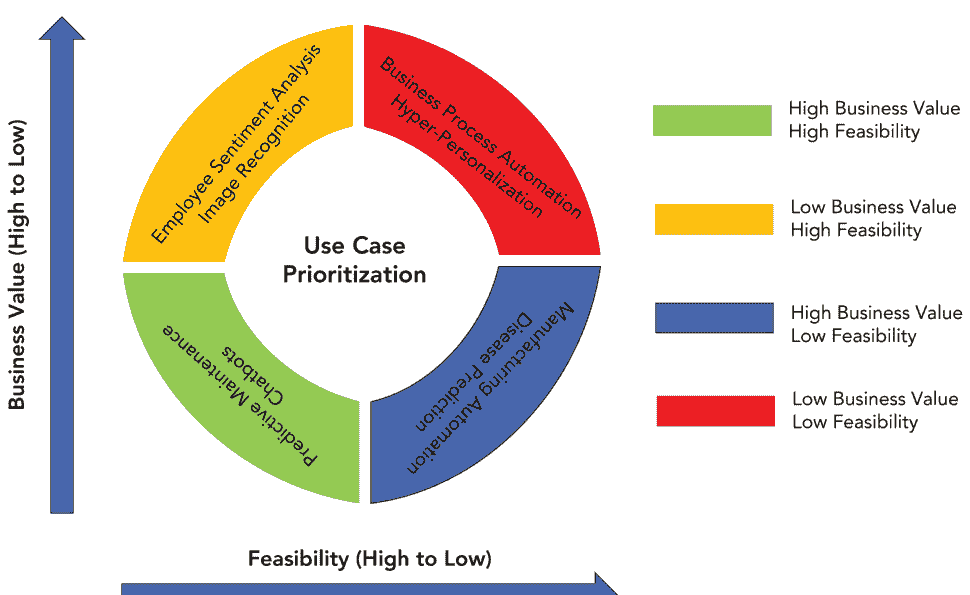

图 8.5：基于商业价值和可行性优先级排序用例

如图 8.5 所示，您可以根据商业价值和可行性对用例进行分类。商业价值标准可以包括降低成本、收入增长和客户满意度等因素，而可行性标准可以包括技术可行性和组织就绪度等因素。

- **高商业价值和高可行性用例：** 您的优先级用例将是那些能够带来高商业价值且更容易实施的用例。制造业中的预测性维护可以防止设备停机并延长机械寿命。商业价值非常高，在拥有必要的传感器数据和适当的机器学习模型时，通常更容易实施。同样，聊天机器人也更容易实施，并能对客户服务和效率产生重大影响。

- **高商业价值和低可行性用例：** 此类别包括疾病预测和制造流程完全自动化等用例。尽管这些用例可以挽救数百万人的生命并降低成本，但由于技术限制，实施可能具有挑战性。

- **低商业价值和高可行性用例：** 员工情绪分析（用于分析员工反馈）等用例可能更容易实施，但对业务影响可能不大。同样，利用 AI 自动给图片打标签可能易于实施，但业务影响较低。

- **低商业价值和低可行性用例：** 超个性化广告可能看起来很有吸引力，但由于数据隐私和技术要求，其实施成本可能非常高昂。同样，所有业务流程的完全自动化也可能看起来很有吸引力，但对于小型企业来说价值有限，且在技术和财务上都不可行。

## 审查和完善标准

然后，您可以审查用于评估影响和可行性的标准，并继续与排名标准一起完善它们，与利益相关者合作，最终确定用例的优先级。

> **提示** 根据潜在影响和可行性对用例进行优先级排序。

## 选择合适的模型

在对用例进行优先级排序后，下一步是为您的用例确定合适的模型。您需要迭代继续这一过程，直到最终确定成功标准、可行性优先级等。

为此，您必须与组织内众多利益相关者协商以定义用例概念。选择用例的关键部分是能够证明其实施的价值。

## 实践用例：优先级排序研讨会

这是一个用例优先级排序研讨会，涉及与各种利益相关者协作，比较不同的用例并做出决策。

| 描述 | 实践任务 | 交付物 | 示例 |
|---|---|---|---|
| 如有需要则分组 分成团队进行协作。 | 分成三到四人的小组 | 已形成小组 | 团队 1、团队 2、团队 3 |
| 头脑风暴用例。生成潜在的用例想法。 | 在小组中，提出两到三个用例想法 | 两到三个用例想法列表 | |
| 定义影响标准。头脑风暴实施用例的潜在影响。 | 与利益相关者讨论并定义收入影响、成本影响、效率影响、客户满意度等指标。 | 清晰定义的影响标准 | 将客户满意度提高 30 个百分点 降低运营成本 20 个百分点，等等。 |
| 定义可行性标准 识别实施用例的可行性因素。 | 与利益相关者讨论并定义技术复杂性、成本、技能可用性、数据可用性、平台就绪度等可行性因素。 | 清晰定义的可行性标准 | 实施成本不应超过 $100,000 应能在 6 个月内实施，等等。 |
| **评估影响** 评估用例的潜在影响。头脑风暴收入、成本、效率等因素。 | 基于定义的影响标准，进行成本效益分析或估算潜在投资回报率。 | 对潜在影响的详细分析 | 潜在收入增加 $500,000 估计成本节约 $200,000，等等。 |
| **评估可行性** 评估用例的可行性。头脑风暴技术、技能、数据等因素。 | 基于定义的可行性标准，评估实施用例的可行性。 | 对可行性的详细评估 | 实施成本将为 $80,000 可在四个月内实施，等等。 |
| **对用例进行优先级排序** 基于影响和可行性评估，对用例进行优先级排序。 | 使用影响和可行性标准创建矩阵对用例进行排名。 | 用例排名列表 | 用例 A：高影响，高可行性 用例 B：高影响，低可行性，等等。 |
| **审查和完善标准** 审查用于评估影响和可行性的标准，并根据需要进行完善。 | 与利益相关者协商以完善排名标准，并根据需要调整用例排名。 | 完善后的标准和调整后的用例排名 | 更新影响标准以包含客户保留率 基于完善后的标准更新用例排名，等等。 |
| **选择合适的模型** 为用例确定合适的模型。 | 与数据科学家或机器学习专家协商，为用例选择合适的模型。 | 用例所选的机器学习模型 | 为用例 A 选择决策树模型 为用例 B 选择卷积神经网络，等等。 |
| **迭代直至最终确定** 重复该过程，直到用例、成功标准、可行性和优先级最终确定。 | 与利益相关者进行多轮讨论，完善标准和排名、选择模型等。 | 最终确定的用例、成功标准、可行性评估、优先级和所选模型 | 最终确定用例 A，成功标准为将客户满意度提高 30 个百分点，可行性评估显示可在四个月内实施，高优先级排名，并选择决策树模型，等等。 |
| **展示优先级** 分享和讨论优先级列表。 | 证明您的优先级排序。 | 优先级演示 | |

## 可供选择的用例

本节列出了近 80 个可供选择的用例，涵盖多个行业和业务流程。随着技术的发展，您可以期待更多用例。

## DevOps 的 AI 用例

DevOps 的 AI 利用机器学习通过解决安全性、缺陷管理、资源分配和并发问题来创新您的 DevOps 流程。一些示例包括预测分析、缺陷管理、持续交付和资源管理。

**成功案例：** Microsoft 在 DevOps 中实施了机器学习来检测缺陷，Google 用于 Chrome 测试。

**工具：** Amazon CodeGuru Reviewer 用于代码质量，Amazon DevOps Guru 用于应用性能和可扩展性，Azure DevOps，Azure Pipelines 用于 CI/CD，Google Cloud Build 用于 CI/CD。

> **提示** 使用 DevOps 的 AI 来自动化、优化和改进 DevOps 流程。

## 医疗保健和生命科学领域的 AI

医疗保健和生命科学组织面临医生倦怠、复杂的健康数据和不断上升的医疗成本。AI 在医疗保健中的好处包括个性化治疗、更好的疾病诊断和更高的效率。

一些用例包括医学影像、药物发现、个性化治疗、疾病预测和临床试验。

**成功案例：** 加州大学旧金山分校利用数据分析早期识别脓毒症；IBM Watson Health 通过医学影像分析识别癌症；初创公司 Atomwise 开发了一种用于治疗埃博拉的 AI 工具。

**工具：** Amazon HealthLake，Amazon Transcribe Medical，Amazon Comprehend Medical，IBM Watson Health，Google Cloud Healthcare API，Microsoft Healthcare Bot。

> **提示** 确保数据隐私并符合 HIPAA 等法规，以建立信任并保护患者信息。

## AI 赋能的联络中心用例

传统联络中心正在帮助自动化和简化流程，并提高整体客户满意度。一些示例包括虚拟客服、语音分析、预测分析、呼叫路由和客户流失。

**成功案例：** H&R Block 和 Capital One 通过聊天机器人优化了成本；Intuit 的分析增强了对 11,000 名客服人员的支持；Wix 的情感分析将可见性从 12% 提升至 100%。

**工具：** Amazon Connect 可用于自然语言处理、自动语音识别和机器学习，Google DialogFlow，IBM Watson Assistant。

> **最佳实践提示** _AI 应提升客户体验、简化流程，并辅助而非取代人工客服，以保持人性化关怀。_

## 业务指标分析

机器学习可用于分析大量业务数据，以跟踪业务指标并从过去、当前和计划数据中学习。优势包括能够分析大量数据、更轻松地识别趋势和模式、预测未来性能、检测异常、确定根本原因，并适应不断变化的条件。

销售、营销和 CX 洞察可帮助识别增长和策略机会；IT 监控可帮助管理中断；库存和人力规划可优化资源；AI for Data Analytics (AIDA) 可利用 ML 增强现有分析。

**成功案例：** 富士康使用 AWS Forecast 将预测准确率提高了 8%，节省了约 500,000 美元。Digitatia 使用 Amazon Lookout for Metrics，在数小时内而非一天内节省了 7.5% 的销售额。

**工具：** Amazon 的 Business Metrics Analysis ML 解决方案可帮助根据不断变化的业务状况动态分析业务指标，Azure ML，以及 Google BigQuery。

> **提示** _使用 AI 分析业务指标，适应不断变化的业务状况，并识别新的增长机会。_

## 内容审核

要大规模创建高质量内容，需要可扩展的平台和广泛的资源，而云端正好提供这些资源。AI 已经促进了超越人力能力的大规模个性化内容创建，机器学习可生成多样化的内容。AI 支持的内容创建支持以下功能：

- > 个性化内容
- > 自动生成
- > 机器学习模型
- > 大规模

**成功案例：** 美联社、华盛顿邮报和福布斯等新闻媒体公司已使用内容生成工具。

**工具：** GANs、自然语言处理和计算机视觉工具、ChatGPT、Claude、WriteSonic、Perplexity、BARD 和 Copy.ai。

> **提示** 使用 AI 大规模生成更具个性化和吸引力的内容。

## 金融服务中的 AI

AI 可用于金融服务，以改进欺诈检测和理赔处理等核心业务流程，并通过发送个性化优惠来改善客户体验。它们既可用于小型初创公司，也可用于大型企业。一些用例包括风险管理、客户服务、投资管理、个性化金融、贷款承销、交易和保险理赔。

**成功案例：** JP Morgan 使用 COIN 平台进行文档验证；BlackRock 使用 Aladdin 来推荐定制投资决策；PayPal 的系统可实时检测交易欺诈以最大限度地减少损失。

**工具：** IBM Watson Financial Services、Alteryx 和 Darktrace。

> **提示** 金融服务公司可将 AI 用于风险管理、个性化金融和交易等应用。

## 网络安全

网络安全是指保护系统、网络和数据免受外部黑客攻击、未经授权的访问、泄露、修改、使用或破坏的实践。它涉及使用系统、流程和策略来保护资产免受病毒、恶意软件、黑客攻击、网络钓鱼和勒索软件攻击等网络威胁。

网络安全确保业务连续性以防止停机，并有助于遵守 GDPR 等法规。它使用 IBM 的 QRadar 等工具进行网络安全，并使用 Symantec 的软件进行 AI 驱动的终端保护。

**成功案例：** FICO 使用 AI 进行欺诈检测；Splunk 使用 SOAR 来处理安全事件；Firefly 的 Helix 检测恶意活动；Dell 使用 Cylance 进行网络安全。

**工具：** 可使用自然语言处理来检测恶意软件、过滤电子邮件和识别欺诈交易，而深度学习可检测恶意图像、分析视频以发现未经授权的访问，并识别诈骗。

> 提示 通过主动识别和防止网络攻击，使用 AI 改进系统、网络和数据的安全性。

## 数字孪生

数字孪生是物理系统或对象的虚拟副本。如图 8.6 所示，您可以使用该副本来模拟系统行为，识别任何潜在问题或改进这些系统的性能。它们是通过从多个来源或传感器收集数据，然后使用这些数据来创建该系统的虚拟模型而构建的。

图 8.6：喷气式飞机发动机的数字孪生

来源：chesky/Adobe Stock

**成功案例：** 罗罗、GE Healthcare、Johnson Controls、西门子和 ENGIE 在各自行业中利用数字孪生来优化性能、减少设备故障并提高能源效率。

**工具：** 可使用 AWS IoT TwinMaker、Google Cloud IoT Core 和 Microsoft 的 Azure IoT 中心来创建数字孪生。结合这些数字孪生，您可以使用机器学习模型检测模式以便采取进一步行动。

> > 提示 通过创建虚拟副本并模拟行为来识别问题和优化运营，使用数字孪生提高物理系统的效率、安全性和性能。

## 身份验证

身份验证对于客户创建新账户或访问不同账户、系统和信息至关重要。身份验证在医疗保健行业用于访问患者记录，在金融服务行业用于访问或开设新账户，在政府部门用于基于身份验证访问服务。您可以通过护照或面部识别等文档和生物特征认证方法，或使用个人信息进行身份验证来验证身份。

**成功案例：** 高盛使用 Google Cloud Vision 来验证交易；Gamestatix 使用 Azure 的面部识别进行用户访问；HealthTab 利用 Amazon Rekognition 对医疗专业人员进行身份验证，以便访问患者记录。

**工具：** 可使用 Azure 认知服务和 Active Directory 进行身份验证，使用 Amazon Rekognition 进行面部和文本识别。Google 提供 Google Cloud Identity Platform 和 Google Firebase Authentication。

**提示** _使用身份验证保护个人和组织免受欺诈和身份盗窃。_

## 智能文档处理

智能文档处理 (IDP) 可以自动化手动流程，从各种文档（如索赔、发票、收据、合同、表单等）中提取有价值的信息。IDP 使用机器学习算法，利用自然语言处理对数据进行分类，然后自动提取这些数据，并与各种后端系统进行验证、校验和集成，以便进一步处理。

优势包括加速文档处理、减少手动工作、提高数据质量，以及更快地获得洞察和做出决策。

**成功案例：** KPMG 利用 Amazon Textract 进行成本效益高的文档处理；HSBC 和强生使用 Google 的 Document AI 完成诸如使用 OCR 和 NLP 进行发票自动化等任务。Swiss Re 和 Chevron 使用 Microsoft 的 Azure Form Recognizer 来最大限度地减少手动数据录入。

**工具：** Google Cloud Vision API 用于分析图像以提取数据，而 Amazon Textract 处理文档，Azure Cognitive Services 为 IDP 任务提供各种 API。

**提示** _使用 IDP 自动化手动流程并从文档中提取有价值的信息；这将释放员工宝贵的时间。_

## Intelligent Search

智能搜索是一种利用 AI 理解搜索关键词的含义以及搜索背后的上下文，并根据相关性对搜索结果进行排名的搜索类型。图 8.7 展示了如何通过理解搜索查询的上下文和含义，智能搜索提升搜索准确性、效率和用户参与度。它被应用于电子商务、客户服务和知识管理。

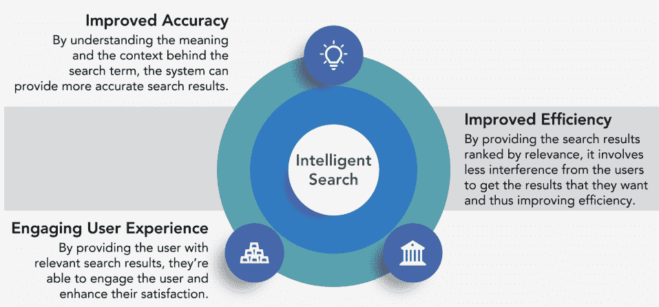

图 8.7：智能搜索的优势

**成功案例：** Coursera 使用 Amazon 机器学习，在其平台上为学生提供合适的推荐。

**工具：** 您可以使用 Amazon Kendra 进行智能搜索；使用 Microsoft Graph 处理关系数据；使用 IBM Watson Health 分析医疗数据以进行医生推荐。AWS Comprehend 可使用 NLP 帮助进行文本分析，您还可以使用无监督机器学习和 NLP 技术进行相关结果检索和搜索关键词的上下文理解。

> **提示** 使用智能搜索提供更相关、更准确的搜索结果，节省用户时间，避免挫败感。

## Machine Translation

机器翻译涉及使用 AI 和 ML 技术将一种语言翻译成另一种语言。

**成功案例：** 它被应用于教育、政府和医疗领域，用于不同语言使用者之间的沟通。它通过更好的沟通，帮助提升学习、协作、政府服务、旅行、安全和医疗水平。

**工具：** 机器翻译使用 AI 进行文本或语音转换，而 AWS Translate、Microsoft Azure Translator 和 Google Cloud Translate 均提供翻译服务。

> **提示** 使用机器翻译将文本或语音从一种语言翻译成另一种语言，从而促进更大的协作、学习和安全。

## Media Intelligence

教育、娱乐和广告等行业中，图像、视频和音频等媒体的需求正以前所未有的速度增长。公司必须通过内容与客户互动，并且需要大量手动工作来对内容进行标记、打标签、审核，并生成标题、摘要等。通过向内容工作流添加机器学习，您可以提升这些资产的生命周期价值，降低成本，并加快内容交付速度。

一些用例包括受众分析、市场研究、公共关系和社交媒体监控。优势包括更快的内容处理、降低成本、提升生命周期价值以及更高质量的体验。

**成功案例：** Netflix 使用机器学习进行个性化内容流式传输，而 *《纽约时报》* 使用媒体智能为其读者策划引人入胜的话题。

**工具：** AWS Elemental Media Insight、Amazon Rekognition、Google Cloud Language、Microsoft Cognitive Services 和 Azure HDInsight 可从视频、音频和文本等媒体内容中实现情感分析、数据提取和内容模式分析。

> **提示** 使用媒体智能分析媒体内容，了解受众人口统计、趋势和品牌认知。

## ML Modernization

ML 现代化涉及更新现有机器学习模型和管道，以采用新技术和工具，并通过提高效率、准确性和性能来改进它们（参见图 8.8）。

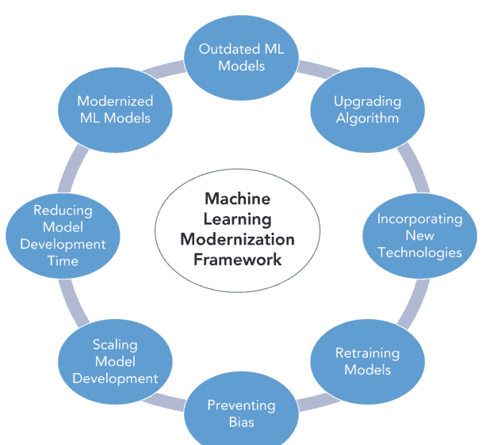

- **ML 现代化**
  - 提高准确性
  - 降低偏差
  - 增强可扩展性
  - 加快模型开发
  - 提升性能

- **ML 现代化技术**
  - AWS SageMaker
  - Google AI Platform
  - Azure Machine Learning Platform

**图 8.8：** 机器学习现代化框架、优势和技术

ML 现代化的一些关注领域包括升级算法、引入新技术、重新训练、防止偏差、扩展模型开发以及缩短模型开发时间。

**成功案例：** Intuit 使用 AWS SageMaker 在金融交易中进行准确的欺诈检测。空中客车利用 Google AI 平台增强飞机机翼设计，实现成本节约和更好的燃油效率。

**工具：** AWS 提供 AWS SageMaker，这是一个带有预构建模型和 AWS 集成的全面 ML 平台。Google Cloud Auto ML 适用于 ML 知识有限的人群，而 Google AI Platform 用于带有 Google Cloud 集成的自定义模型开发。Microsoft 的 Azure Machine Learning Platform 是一个集成 Azure 存储和无服务器计算功能的全能平台。

> **提示** 使用 ML 现代化使您的机器学习模型和管道保持最新技术和工具，提高其准确性、性能和效率。

## ML-Powered Personalization

ML 驱动的个性化涉及分析用户人口统计和行为数据，以预测其兴趣并向其提供个性化的产品服务和内容。它被用于推荐引擎、搜索引擎结果、社交媒体帖子和电子商务产品。

**成功案例：** Yamaha 公司通过使用 Amazon Personalize 将销售额提高了 30%。YouTube 通过使用 Google Cloud Recommendations API 将用户参与度提高了 60%，而法航通过采用 Azure Machine Learning 和 Azure Personalizer 将销售额提高了 13%。

**工具：** 利用机器学习、自然语言处理和计算机视觉，Amazon Personalize、Amazon Forecast、Google Cloud Auto ML 和 Microsoft Azure Learning 等服务提供个性化的内容和用户体验。

> **提示** 使用 ML 算法预测用户兴趣，并提供个性化的产品服务和内容，例如推荐引擎、搜索引擎和社交媒体。

## Computer Vision

计算机视觉涉及计算机解释和理解周围世界视觉数据的能力，例如图像、视频和其他视觉数据，用于识别对象、跟踪运动和分析场景。图 8.9 说明了计算机视觉的各种应用、用例以及可用于实现它的技术。

计算机视觉可用于检测对象、理解场景、识别视频中的动作、识别糖尿病视网膜病变以进行主动筛查，以及发现制造业中的缺陷。

**成功案例：** Amazon 在其 Go 商店中使用计算机视觉来监控客户行为，并自动将产品添加到购物车中。

**工具：** Amazon 使用 Rekognition 分析图像和视频，并使用 SageMaker 构建模型。Google 提供 Google Cloud Vision、GAN 和 CNN 进行图像分析。Azure Cognitive Services 提供类似功能。

> **提示** 在应用程序中使用计算机视觉进行对象检测、场景理解、面部识别、动作识别等。

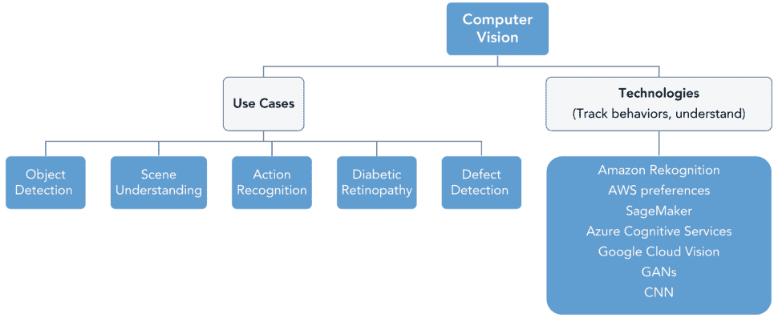

图 8.9：计算机视觉背后的应用和技术

## Personal Protective Equipment

个人防护装备涉及使用机器学习算法检测人员是否佩戴防护装备，例如口罩、头盔和手套。在 COVID-19 期间，它变得尤为重要。

计算机视觉在医疗、制造和建筑行业中被使用，以确保工人佩戴护目镜、口罩和手套等防护装备。

**成功案例：** Honeywell 在 COVID-19 期间使用计算机视觉来强制执行个人防护装备合规性。

**工具：** Google Cloud Vision API 可用于图像分析。同样，Azure Cognitive Services 对于计算机视觉用例也很有用。

> **提示** 使用机器学习进行个人防护装备检测，以确保制造、医疗和建筑行业的工人佩戴合适的安全装备。

## Generative AI

生成式 AI 是指一种机器学习类型，它可以生成与训练数据相似的新类型数据。它可以用于生成图像、语音、自然语言和数据增强等新内容。此功能使生成新产品描述、新闻文章和其他类型内容成为可能。您还可以使用它来生成新类型的视频和图像，这在营销中很有帮助。

生成式 AI 可以通过营销活动以及在时尚行业创建新的时尚设计来保持用户参与度。自 2022 年 11 月 ChatGPT 发布以来，它一直引起轰动（详细内容请参见第 24 章）。我列举了一些使用生成式 AI 的用例，但请注意，这是一个变化非常快的领域，新的用例不断涌现。图 8.10 展示了生成式 AI 目前支持的不同数据类型。

以下是与文本相关的生成式 AI 用例：

| 用例 | 描述 | 示例 |
|---|---|---|
| 内容创作 | 您可以根据关键词或问题创建博客、文章和报告等内容。 | 新闻机构创建新闻文章或体育报道。 |
| 撰写电子邮件 | AI 建议完整的句子甚至段落来撰写电子邮件。 | Gmail 智能撰写功能 |
| 广告内容 | 为产品和服务创建引人入胜的推广内容。 | 电子商务网站上的产品描述 |
| 创意写作 | 根据用户提示编写故事、脚本或诗歌。 | 电影或广告的脚本 |
| 个性化推荐 | 根据用户历史记录或偏好提供个性化推荐。 | 根据读者浏览行为推荐新闻文章 |
| 语言翻译 | 在语言之间进行翻译。 | Google 翻译 |
| 情感分析 | 识别文本中的情感。 | 分析网站上的客户评论或评价 |
| 筛选简历 | 根据某些标准评估简历。 | 为公司筛选求职申请 |
| 文本摘要 | 为大块内容创建摘要。 | 摘要大篇文章和报告 |
| 聊天机器人 | 在对话中生成类似人类的回复。 | 用于客户服务、销售、人力资源等的聊天机器人 |

以下是与代码相关的用例：

| 用例 | 描述 | 示例 |
|---|---|---|
| 生成代码 | 根据关键词或要求生成代码 | Microsoft 的 CoPilot 和 AWS Code Whisperer。 |
| 检测错误 | 识别错误 | DeepCode 可以检测静态代码中的错误。 |
| 重构 | 建议代码改进 | Codota（现称为 Tabnine）建议代码改进。 |
| 代码审查 | 通过建议改进或识别问题来协助代码审查流程 | Code Climate 为测试覆盖率和可维护性提供自动化代码审查。 |
| 代码文档 | 为代码生成文档 | DeepAffects Code Summarizer 为代码块生成摘要。 |
| 单元测试 | 生成单元测试用例 | Diffblue Cover 使用 AI 生成单元测试。 |

- **代码**：模型可用于生成代码、调试和审查代码
- **数据**：模型可以生成用于训练其他模型的合成数据集
- **分子**：模型可以生成具有所需化学特性的新型分子结构
- **3D**：模型可以根据文本描述生成汽车、家具等 3D 形状对象

## 生成式 AI 支持的数据类型

- **文本**：类似 GPT-4 的模型根据用户提示生成文本
- **图像**：DALL-E 2 和 Stable Diffusion 从文本生成图像
- **音频**：生成式模型可以生成合成音频，例如音乐和语音，用于语音助手、TTS（文本转语音）系统和音乐创作
- **视频**：生成式 AI 模型可以生成合成视频，可用于从文本提示创建深度伪造和电影制作

## 图 8.10：生成式 AI 当前支持的数据类型

以下是一些与图像相关的生成式 AI 用例：

| 用例 | 描述 | 示例 |
|---|---|---|
| 图像合成 | 生成与原始图像相似的新图像 | OpenAI 的 DALL-E 可以根据文本描述创建图像。 |
| 风格迁移 | 将一张图像的风格应用到另一张图像 | DeepArt 可以将照片重新创建为任何绘画的艺术风格。 |
| 图像增强 | 通过提高分辨率、去除噪声等方式改善图像质量 | Let's Enhance 可以在不丢失质量的情况下提高图像分辨率。 |
| 图像分割 | 识别图像中的单个对象 | Google 的 DeepLab 使用 AI 进行语义图像分割。 |
| 图像上色 | 为黑白图像或视频添加颜色 | DeOldify 为黑白图像和视频上色。 |
| 图像字幕 | 生成图像的文本描述 | Google 的 Cloud Vision API 为图像提供文本描述。 |
| 人脸识别 | 在数字图像或视频帧中识别或验证人员 | Face++ 可以在安防系统、支付网关等领域进行人脸识别。 |
| 对象检测 | 在图像中检测对象实例 | Amazon Rekognition 可以识别图像中的对象、人员、文本、场景和活动。 |
| 图像超分辨率 | 将低分辨率图像转换为高分辨率 | 增强型超分辨率生成对抗网络（ESRGAN）用于提高低分辨率图像的质量。 |
| 增强现实 | 实时将数字信息与用户环境相结合 | Snapchat 的镜头可以将数字内容叠加到物理世界上。 |

以下是一些与音频相关的用例：

| 用例 | 描述 | 示例 |
|---|---|---|
| 语音合成 | 生成类似人类的语音 | Google 文字转语音和 Amazon Polly 将文本转换为逼真的语音。 |
| 音乐创作 | 生成新的音乐作品 | OpenAI 的 MuseNet 在各种风格中创作新音乐。 |
| 声音克隆 | 在从少量样本中学习后复制一个人的声音 | ElevenLabs 和 Resemble AI 的声音克隆技术可以为虚拟助手或旁白创建独特的声音。 |
| 语音增强 | 通过减少噪声来改善语音信号质量 | Krisp 是一款基于 AI 的应用，可以静音任何通信应用中的背景噪音。 |
| 声音分类 | 识别和分类音频事件 | Google 的 AudioSet 是一个声音事件数据集，可用于训练声音分类模型。 |
| 语音转文本 | 将口语转换为书面文本 | Google 的 Cloud Speech-to-Text 将音频转换为文本以用于转录服务。 |
| 音频指纹 | 识别声音的独特组件以供识别 | Shazam 使用 AI 通过声音识别音乐曲目。 |

以下是一些与视频相关的用例：

| 用例 | 描述 | 示例 |
|---|---|---|
| 深度伪造生成 | 从图像和其他视频合成类似人类的视频 | DeepFaceLab 是一个开源软件，用于创建深度伪造。 |
| 视频合成 | 根据特定指令或数据生成新的视频内容 | Nvidia 的 GANs 可以创建虚拟环境（例如城市景观）的视频。 |
| 视频上色 | 为黑白视频添加颜色 | DeOldify 是一个用于为旧图像和视频上色和修复的 AI 模型。 |
| 超分辨率 | 提高视频内容的分辨率 | Topaz Labs 的 Video Enhance AI 使用 AI 改善视频质量。 |
| 动作迁移 | 将视频中一个人的动作转移到另一个视频中的另一个人 | 面向图像动画的第一阶段运动模型可以为图像中的新面孔启用动画。 |
| 视频压缩 | 在不丢失质量的情况下压缩视频 | H.266/VVC 是一种视频编解码器标准，可实现高质量视频压缩。 |
| 预测视频生成 | 预测视频序列中的下一帧 | PredRNN 是一种用于预测视频生成的循环网络。 |
| 视频修复 | 填充视频中缺失或删除的部分 | 基于 3D 门控卷积和时间 PatchGAN 的自由形式视频修复可恢复缺失的视频部分。 |

最后，以下是一些 3D 用例：

| 用例 | 描述 | 示例 |
|---|---|---|
| 3D 对象生成 | 从描述或数据创建 3D 模型 | NVIDIA 的 GANs 可以从 2D 图像生成对象的 3D 模型。 |
| 虚拟现实内容创建 | 生成身临其境的 VR 环境 | Artomaticx 可以为虚拟现实生成纹理贴图。 |
| 3D 动画 | 自动化 3D 动画 | DeepMotion 在游戏中进行程序化角色动画。 |
| 预测性 3D 建模 | 预测蛋白质或分子的 3D 形状 | DeepMind 的 AlphaFold 系统预测蛋白质的 3D 结构。 |
| 3D 重建 | 从 2D 图像创建 3D 模型 | 由 MIT 和 ETH Zurich 研究人员开发的 Pix3D 数据集和方法可从 2D 图像生成 3D 模型。 |
| 3D 打印 | 预测 3D 打印结果 | Autodesk 的 Project Dreamcatcher 使用生成式设计进行优化的 3D 打印。 |
| 生成式设计 | 为设计师提供设计替代方案 | Autodesk 的生成式设计工具提供用于最大化效率的设计替代方案。 |

## WORKBOOK TEMPLATE: USE CASE IDENTIFICATION SHEET

Download the “Use Case Identification Sheet” template from the download section of the book (www.wiley.com/go/EnterpriseAIintheCloud). Use this template to help your team brainstorm, evaluate, and prioritize potential AI use-cases. Use this to make informed decisions considering factors such as business impact, cost, and technical complexity.

## SUMMARY

This chapter provided a detailed review of how to find the right AI and ML use cases for your company. It began by exploring the process flow for identifying use cases, starting from educating people about the potential of AI/ML and Gen AI, and how it can solve business problems. It covered defining business objectives, identifying pain points, conducting a root-cause analysis, identifying the success criteria, and exploring the latest AI industry trends.

Armed with this information, you can identify your use cases, prioritize them, choose the suitable model, and finalize them through an iterative process.

In the next chapter, let’s discuss cloud-based AI/ML services offered by different cloud providers to bring your AI/ML use cases to life.

## REVIEW QUESTIONS

These review questions are included at the end of each chapter to help you test your understanding of the information. You’ll find the answers in the following section.

- 1. Identify the type of processes that are ready for AI/ML.
  - A. Automated processes
  - B. Processes that depend on data and happen repeatedly
  - C. Processes that are easier to automate by software and are fast
  - D. All the above

- 2. The purpose behind conducting a root-cause analysis is
  - A. To identify the pain points that are hindering your business
  - B. To quantify the business value upon completion of the use case
  - C. To measure the success of your use case using ROI, payback period, or NPV technique
  - D. To understand the root cause to identify the proper use case

- 3. Choose the success metric that would result in cost savings.
  - A. Improved customer satisfaction
  - B. Reduced errors
  - C. Increased revenue growth

- 4. What is the primary purpose of mapping the use case to a business problem?
  - A. To assess the potential impact of an AI solution
  - B. To ensure the use case aligns with the business objectives
  - C. To identify potential pitfalls in the solution
  - D. All the above

- 5. Why is it important to iterate until you finalize the use case?
  - A. To get a solid understanding of the problem being solved
  - B. To get feedback from the stakeholders
  - C. To proactively identify risks and challenges
  - D. All the above

- 6. Which of the following can be used to improve code quality by automating code reviews during application development
  - A. Amazon CodeGuru Reviewer
  - B. Amazon HealthLake
  - C. Amazon DevOps Guru
  - D. Amazon Transcribe Medical

- 7. What benefit can AI provide in log analysis for DevOps?
  - A. Identify patterns that could turn into issues proactively
  - B. Increase the speed and reliability of software deployment
  - C. Automate testing for bug identification
  - D. Optimize resource allocation based on usage

- 8. What is document verification?
  - A. Using personal information such as driver licenses to verify identity
  - B. Using documents such as passports, driver licenses, ID cards, biometric verification using fingerprints, facial recognition, or voice recognition to verify identity
  - C. Using facial recognition, emotional analysis, and text recognition for verification
  - D. Using image and video analysis that uses computer vision technology for verification

- 9. What is intelligent document processing (IDP)?
  - A. The process of extracting valuable information from various documents using machine learning algorithms
  - B. The process of creating new documents using artificial intelligence and machine learning
  - C. The process of verifying personal information using documents such as passports, driver licenses
  - D. The process of automating manual tasks using artificial intelligence and machine learning

- 10. Which of the following is a use case for media intelligence?
  - A. Upgrading media intelligence models
  - B. Analyzing financial intelligence
  - C. Tracking mentions on social media
  - D. Predicting user interests

## ANSWER KEY

- 1. B
- 2. D
- 3. B
- 4. B
- 5. D
- 6. A
- 7. A
- 8. B
- 9. A
- 10. C

# 9 Evaluating AI/ML Platforms and Services

> Information is the oil of the 21st Century, and analytics is the combustion engine.
>
> —Peter Sondergaard

Welcome to the exciting world of evaluating AI/ML platforms and services. Whether you are a data scientist, business analyst, developer, or decision-maker for AI/ML implementation, this chapter will help you choose the right platform and services.

Choosing the right platform and services is pivotal to the success of your AI/ML as well as Gen AI implementation. This chapter covers the various AI and ML services that the cloud service providers such as AWS, Microsoft, and Google provide. The idea is to leverage what's available to get your project kick-started. Now is an excellent time to look at the different portfolios of AI/ML services and map them to the business problems you are trying to solve. This includes evaluating specialized services for healthcare and industry solutions so that you can embark on a path that resonates with your business goals and regulatory landscape.

It isn't just about choosing the right tool; it is about aligning with the fastest time to market, handling high-intensity workloads, maintaining cost-effectiveness, and staying at the cutting edge of technology. Once you have identified the right use cases, you need the right set of tools, setting the stage to launch your pilot, the focus of the next chapter (see Figure 9.1).

Given the plethora of AI/ML platforms and services, each with its own features and offerings, it can be quite overwhelming. This chapter guides you through a comprehensive evaluation process and presents the choices from the three major cloud providers to help you choose the right platform and services.

This chapter can help you to turn your possibilities into reality. Let's get started.

### 9 Steps Thin Arrows Power Point Diagram

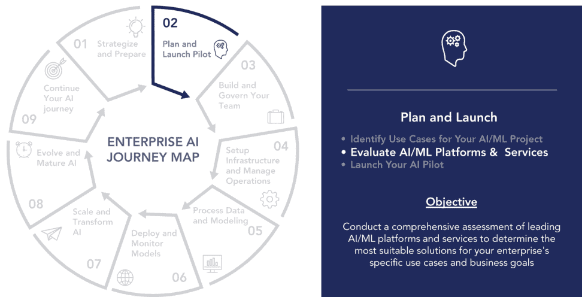

FIGURE 9.1: PLAN AND LAUNCH: Evaluate AI/ML Platforms & Services

## BENEFITS AND FACTORS TO CONSIDER WHEN CHOOSING AN AI/ML SERVICE

This section covers the various factors you need to consider when choosing an AI/ML service.

### Benefits of Using Cloud AI/ML Services

Cloud service providers provide several AI/ML services that offer a wide range of capabilities and functionalities that you need to build your AI solutions, especially at scale in production. They provide access to several sophisticated algorithms along with pretrained models that can save you a lot of time and money during the model-building process. They also offer several development and deployment tools that accelerate the development process. See the following table for more details:

| BENEFIT | DESCRIPTION |
|---|---|
| Faster time to market | You can speed up your implementation time by leveraging these services because you do not have to build these algorithms from scratch. Instead, you can focus on solving the specifics of your complex business problems. These services come as part of preconfigured environments, which allows for faster prototyping and experimentation, faster time to market, and more cost-effective implementation. Tip: Focus on solving complex business problems instead of building algorithms from scratch. |
| Intensive workloads | These AI services are designed to handle high computational demands and data processing workloads that are typical of enterprise AI. They provide a scalable infrastructure along with high-performance capabilities for these AI services to be developed, trained, and deployed efficiently. By leveraging the scalability, reliability, security, and performance offered by these AI services, you can address the common challenges faced by typical machine learning projects easily. The providers offer large GPUs and TPUs that are optimized for large ML workloads and reduce training and inference times. Tip: Use these services to handle large data volumes and spikes in processing demands by dynamically allocating cloud computing resources based on need. |
| Cost-effective solutions | By leveraging these services that are hosted in the cloud, you do not have to invest up front or build in-house expertise. Thus, you save time and money. By leveraging the cloud provider’s economy of scale, the pay-as-you-go pricing model, you can avoid up-front infrastructure costs, reduce operating costs, and implement cost-effective AI solutions. Tip: Monitor the usage of cloud resources to effectively manage costs. |
| Collaboration and integration | These services allow sharing of models, code repositories, and version control systems. Additionally, since they can easily be integrated with other cloud services, databases, and APIs, it is possible to leverage additional capabilities and data sources to meet the needs of the use cases. |
| Better security compliance | These AI services can also be compliant with industry standards and regulatory requirements and data privacy laws. You can implement security measures such as data encryption and access control. |
| Rich capabilities | These services come with capabilities such as natural language processing, computer vision, speech recognition, and recommendation engines in the form of pretrained models and APIs. Tip: Integrate these capabilities into business applications, thus empowering your company to deliver personalized experiences, automate processes, and leverage valuable business insights that drive customer-centric actions. |
| Better tool support | AI services include popular frameworks such as TensorFlow, PyTorch, and AutoML platforms that simplify and speed up the model development process. |

| 优势 | 描述 |
|---|---|
| 与创新同步 | 云服务提供商也大力投资创新，并不断发布新服务及对现有服务的更新，这将帮助你保持最新并受益于最新的研发成果。 |

## 选择 AI/ML 服务时需考虑的因素

本节介绍在选择 AI/ML 以及生成式 AI 服务时需考虑的一些因素。

| 选择 AI/ML 服务时的关键因素 | 描述 |
|---|---|
| 确定业务问题 | 在选择 AI 服务之前，你需要先确定正在尝试解决的业务问题，包括业务目标、期望的成果，以及对业务运营、客户体验和决策的预期影响。 |
| 探索 AI/ML 服务功能 | 探索这些 AI 服务提供的各种功能，如自然语言处理、计算机视觉和语音识别，并确保它们满足你的用例需求。 |
| 评估性能和可扩展性需求 | 评估 ML 解决方案的性能和可扩展性需求，并确保你的服务能够处理这些需求。考虑训练和推理时间、处理速度以及数据集处理需求。**提示：** 考虑训练和推理时间、处理速度以及数据集处理需求。 |
| 评估开发和集成需求 | 评估软件开发工具包的可用性，以及与公司后端系统、应用程序、数据库和流程集成的能力。 |
| 评估模型开发工具 | 评估可用于模型开发的工具，如 SageMaker、PyTorch、AutoML、TensorFlow 和 scikit-learn。 |
| 评估服务的安全功能 | 评估你的安全需求，并确保提供商能够满足你的需求。 |
| 评估服务定价 | 评估定价模型，并确保它们符合你的预算期望。**提示：** 将培训、数据存储和 API 调用的费用计入考虑，以避免未来出现意外。 |
| 评估供应商支持 | 评估供应商支持因素，如支持 SLA、响应速度、正常运行时间保证以及与你合作的往绩。 |
| 识别行业法规 | 如果你的公司有任何行业特定的监管要求，也要将其纳入考虑。 |
| 跟上创新步伐 | 为用例的增长做出必要的考量，如数据量增加、创新和不断变化的业务状况。 |

## 实践 AI/ML 服务评估练习

这是一个需要团队参与、协作、研究并得出解决方案的实操练习。

目标是帮助团队识别业务问题，评估不同云服务提供商提供的各种 AI/ML 服务以解决该问题，然后为所选解决方案制定实施计划。

完成本练习后，团队应了解选择 AI/ML 服务所涉及的流程，并考虑各种业务和技术因素。

| 步骤 | 任务负责人 | 交付成果 | 资源 | 提示/示例 |
|---|---|---|---|---|
| 确定业务问题 | 项目经理 | 制定一份概述业务问题、目标、计划成果和影响的文档 | 公司数据、来自公司战略的业务目标以及包括领导层在内的其他公司来源 | 包含短期和长期目标 |
| 评估 AI/ML 服务功能 | 数据科学家 | 了解并开发一份包含每项服务功能详情的报告 | AI/ML 服务列表、在线研究 | 考虑特定问题要求 |
| 评估性能和可扩展性需求 | 数据工程师 | 估算并准备一份包含性能和可扩展性要求的文档 | 项目要求、数据量估算 | 为未来增长做计划 |
| 评估开发和集成需求 | 软件开发人员 | 记录开发和集成需求的文档 | SDK、后端系统文档 | 确保所选 AI/ML 服务可以与现有系统集成 |
| 评估模型开发工具 | 数据科学家 | 对比不同模型开发工具的文档 | SageMaker、PyTorch、AutoML、TensorFlow、Google Cloud Platforms、Azure 和 scikit-learn 等工具的文档 | 考虑团队对不同工具的专业知识和熟悉程度 |
| 评估服务的安全功能 | 安全分析师 | 记录安全需求、安全架构和服务功能的文档 | 政府和公司安全标准及协议 | 考虑行业特定的安全要求 |
| 评估服务定价 | 财务分析师 | 概述成本的文档 | 服务的定价模型 | 将数据存储、API 调用等隐藏成本计入考虑 |
| 评估供应商支持 | 项目经理 | 对比不同供应商支持的文档 | 供应商的 SLA、往绩 | 考虑正常运行时间保证、响应速度和技能集等因素 |
| 识别行业法规 | 合规官员 | 合规文档 | 行业法规 | 确保合规以避免罚款和法律问题 |
| 跟上创新步伐 | 项目经理 | 讨论 AI/ML 增长潜力的文档 | AI/ML 领域的趋势 | 同时考虑即时和长期需求 |

## AWS AI 和 ML 服务

AWS 根据用户的专业知识将这些 ML 服务分为三类——高级 AI 服务、SageMaker 和 AI 框架——如图 9.2 所示。

| 描述 | 类别 |
|---|---|
| 预训练 AI 服务，为欺诈检测等常见用例提供智能解决方案 | 1 核心和专用 AI 服务 |
| 执行整个机器学习流程的工具 | 2 机器学习服务 |
| 主要框架，如 TensorFlow、MXNet、PyTorch 和 Caffe 2 | 3 ML 框架和基础设施 |

图 9.2：AWS AI/ML 堆栈

### AI 服务

AWS 提供高级 AI 服务，这些是预训练的 AI 服务，可为欺诈检测、个性化推荐、联络中心智能、文档处理、智能搜索、业务指标分析、预测、质量控制、网络安全等常见用例提供智能解决方案。

这些 AI 服务可以集成到应用程序和工作流中，并用于在 AWS 上构建端到端解决方案。

> 注意 AWS 还提供预建的、特定行业的 AI 服务，例如工业和医疗保健行业。

### Amazon SageMaker

在中间层，AWS 提供 SageMaker。该工具面向数据科学家和 ML 工程师等专家，他们可以使用它执行整个机器学习流程，涵盖从数据摄入、标注、数据准备、特征工程、模型构建、模型训练、模型调优、模型监控到部署监控的所有环节。它还可用于偏差检测、AutoML、托管、可解释性和工作流。这些主题将在后续章节中详细讨论。

### AI 框架

堆栈底部是专家从业者可使用的 AI 框架。这提供了所有主要框架，例如 TensorFlow、MXNet、PyTorch 和 Caffe 2。AWS 还为年度训练提供高性能实例，例如由 NVIDIA、TensorFlow 和核心 GPU 驱动的 P4D 实例。对于通常占 ML 成本 90% 的推理，AWS 提供由推理芯片驱动的 EC2 Inf1 实例。请注意，这是一个快速发展的领域，你应关注最新动态。

## 机器学习算法、模型和服务之间的差异

理解机器学习算法、模型和服务之间的差异非常重要。这些差异在表 9.1 中有详细列出。

表 9.1：机器学习算法、模型和服务之间的差异

| 方面 | ML 算法 | ML 模型 | ML 服务 |
|---|---|---|---|
| 定义 | 用于分析数据以进行学习的一组数学指令 | 用数据训练的算法 | 基于云的平台，以 API 形式提供模型和算法 |
| 目的 | 分析数据并从中学习以解决业务问题 | 进行预测和决策 | 为构建 ML 应用提供工具和基础设施 |
| 开发 | 由数据科学家等专家开发 | 基于在数据上训练的算法创建 | 由 AWS、Google 等云服务公司开发 |
| 训练 | 在标记数据或历史数据上进行训练 | 通过训练过程生成 | 用于训练模型或执行 ML 操作的平台 |
| 定制 | 参数可以定制以满足特定要求 | 模型可以根据需求进行定制 | ML 服务可以针对特定需求进行配置 |
| 复杂性 | 可以简单也可以复杂 | 取决于所选算法 | 基于功能和用例的复杂性范围各异 |
| 部署 | 集成到应用程序中 | 部署以进行预测 | 通过 API 或云平台访问 |

算法示例包括线性回归、逻辑回归、决策树和支持向量机。模型示例包括深度神经网络，AI 服务示例包括 AWS SageMaker、Azure Machine Learning 和 Google Cloud ML Engine。

下一节将回顾 AI 服务。为了便于理解，它们分为核心 AI 服务和专用 AI 服务。

## 核心 AI 服务

本节讨论 AWS 提供的核心 AI 服务，如图 9.3 所示。

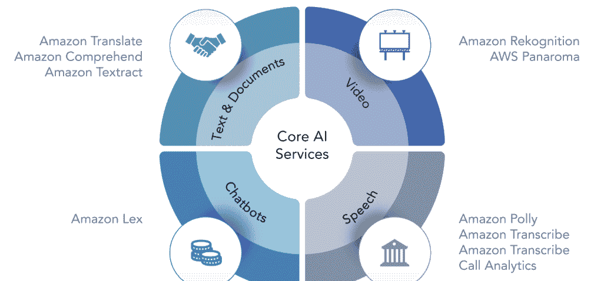

图 9.3：AWS 核心 AI 服务

## 文本和文档服务

本节介绍一些文本和文档服务，包括 AWS Comprehend、AWS Textract 和 AWS Translate。

### Amazon Comprehend

Amazon Comprehend 是一项自然语言处理服务。它使用机器学习模型将单词和短语分类到不同类别中。它可以用于解决以下业务问题：

| 功能 | 说明 |
| --- | --- |
| 关键短语提取 | 从文本中提取关键短语和实体，例如人员、组织和产品。 |
| 准确性 | 提高搜索结果、产品推荐和安全性的准确性。 |
| 情感分析 | 识别文本文档中的情感，无论是中性、积极还是消极。 |
| 文本分类 | 对产品评论、客户反馈、客户服务工单、新闻文章等文本进行分类。 |
| 语言检测 | 检测文本中的辱骂语言、网络钓鱼攻击和假新闻。 |
| 合规风险 | 更好地了解客户反馈并识别合规风险。 |

要开始使用，您需要创建 AWS 账户，启用 Amazon Comprehend 服务，将文本数据上传到 Amazon S3，并使用 Amazon Comprehend 从中提取见解。

### AWS Translate

AWS Translate 是一项完全托管的服务，可以翻译内容并集成到应用程序中。它可以翻译各种文本格式，例如 HTML、JSON、XML、纯文本和语音。它可用于以下领域：

| 市场 | 应用 |
| --- | --- |
| 电子商务 | 翻译网站内容以增加销售。 |
| 客户支持 | 翻译工单以提供更好的客户支持。 |
| 市场营销 | 翻译营销材料以触达更广泛的受众。 |
| 在线销售 | 翻译产品文档。 |
| 培训 | 翻译员工培训材料以提供更好的培训。 |
| 医疗保健 | 翻译为患者的本地语言。 |

### Amazon Textract

Amazon Textract 是一项机器学习服务，使用光学字符识别从文档中提取文本和表格等信息。文档类型可以是 PDF、图像或基于图像的文档。它可用于以下场景：

| 功能 | 说明 |
| --- | --- |
| 文档分析 | 识别不同类型的内容，例如文本、表格和图像。 |
| 表单提取 | 从表单中提取信息，例如姓名、地址、电话号码等。 |
| 数据提取 | 从文档中提取信息，例如发票号码、日期、金额和收件人。 |
| 文本识别 | 识别作者、文档标题和创建日期等文本。 |
| 图像识别 | 识别公司徽标和签名等图像。 |

Amazon Textract 可以节省从各种文档中提取数据的时间和成本。这些用例如图 9.4 所示。

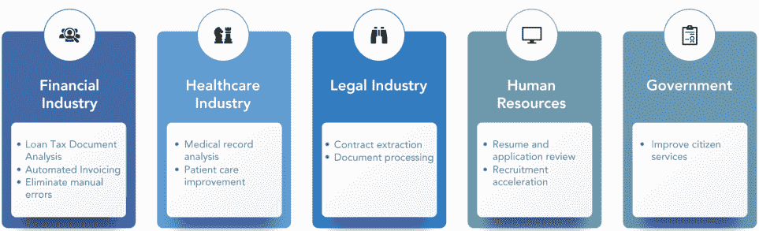

图 9.4：Amazon Textract 用例

Amazon Textract 可以帮助许多行业，包括以下行业：

| 行业 | 应用 |
| --- | --- |
| 金融 | 从贷款税务文件和其他文档中提取数据，以加快贷款审批流程并消除因手动数据输入导致的错误。 |
| 医疗保健 | 审查医疗计划、患者病历等，以提供更好的患者护理。 |
| 法律 | 从合同和法庭文件等法律文档中提取数据，以减少手动处理这些信息所需的时间。 |
| 人力资源 | 使用它来审查简历和申请表，加快招聘流程，招聘到顶尖候选人。 |
| 政府 | 使用它来加快为公民提供的服务。 |

> 提示 请务必在选择 AWS 文本和文档服务（如 Amazon Comprehend、AWS Translate 和 AWS Textract）之前，彻底分析并理解您的特定用例和要求。

## 聊天机器人：Amazon Lex

Amazon Lex 用于 Alexa，我们都非常熟悉。Amazon Lex 帮助使用语音和文本构建应用程序的会话式界面。它使用与 Alexa 相同的能力来构建这些界面。如图 9.5 所示，它可用于以下场景：

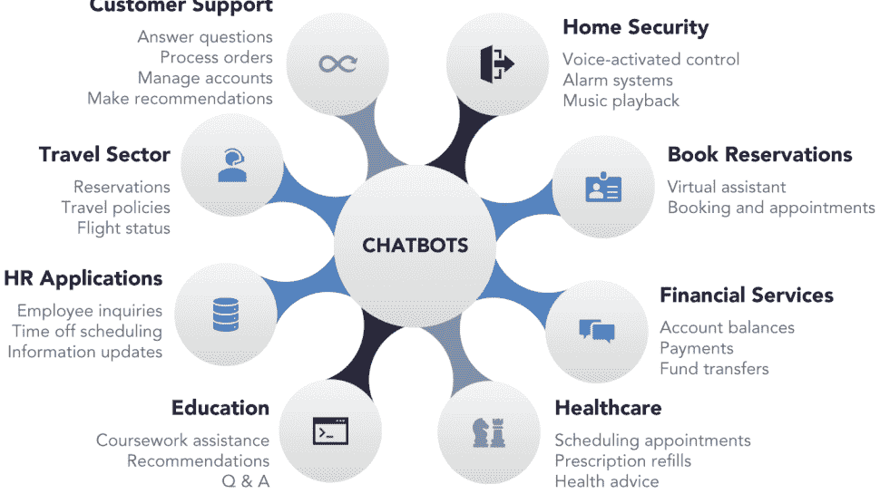

图 9.5：Amazon Lex：使用语音和文本的会话式界面

| 用例 | 说明 |
| --- | --- |
| 聊天机器人 | 可以创建能够处理客户问题、处理订单、查询运输状态、管理账户并进行产品推荐的聊天机器人。 |
| 语音激活系统 | 用于控制家庭安全系统、闹钟、时钟和播放音乐。 |
| 虚拟助手 | 可以接受订单并预订预约和约会。 |

以下是 Amazon Lex 的一些行业用例：

| 部门 | 应用 |
| --- | --- |
| 金融 | 使用聊天机器人查询账户余额、进行付款和转账。 |
| 医疗保健 | 为患者安排预约、续方处方，并提供与健康相关的一般性建议。 |
| 教育 | 帮助学生找到课程、推荐课程并回答课程相关问题。 |
| 人力资源 | 回答员工关于福利和政策的问题，安排休假，并更新个人信息。 |
| 旅行 | 进行预订、了解旅行政策并查询航班状态。 |

## 语音

Amazon 提供 Amazon Polly 和 Amazon Transcribe 用于语音相关服务。

> 提示 您应该确保准确且高质量的语音转文本和文本转语音转换，以实现最佳性能和最佳用户体验。

### Amazon Polly

Amazon Polly 是一项基于云的文本转语音服务，使用深度学习创建逼真的自然声音。这些声音可以添加到应用程序中，以创建创新的语音支持产品。Amazon Polly 可用于以下场景：

| 用例 | 应用 |
| --- | --- |
| IVR 系统 | 开发 IVR 系统以与客户交互，使用 NLP 回答他们的问题。 |
| 企业应用 | 通过允许有视觉障碍和阅读困难的用户使用，帮助使应用程序更加易于访问。 |
| 电子学习和培训平台 | 为课程添加音频，使偏好听而不是读的用户的学习体验更愉快。 |
| 语音启用的 IoT 设备 | 将 Amazon Polly 与恒温器集成以控制该设备，并使体验更加愉快。 |

### Amazon Transcribe

Amazon Transcribe 是来自 AWS 的语音转文本云服务功能，企业可以使用它将大量音频转换为文本以进行后续处理。

| 行业 | 应用 |
| --- | --- |
| 呼叫中心 | 将呼叫中心录音转换为文本并进行分析，以了解客户需求、偏好和问题。 |
| 媒体 | 将音频和视频内容转换为文本，以便用户轻松搜索，并可分析以了解用户参与度和偏好。 |
| 法律 | 转录大量法庭听证会和诉讼程序，以帮助律师事务所和法律部门。 |
| 医疗保健 | 转录笔记和记录，以提供更好的医疗保健。 |

## 视觉服务

本节讨论一些可用的视觉服务，例如 Amazon Rekognition 和 AWS Panorama。

### Amazon Rekognition

Amazon Rekognition 帮助企业向其应用程序添加视频和图像分析功能。它可以检测对象并分析视频和图像中的人员和场景。它用于以下场景：

| 部门 | 应用 |
| --- | --- |
| 安全和监控 | 实时识别闯入场地的人员。 |
| 内容审核 | 删除在线社区和其他在线市场中的不当内容。 |
| 市场营销和广告 | 通过分析视频和图像来了解客户人口统计、行为和偏好，从而个性化营销活动。 |
| 零售 | 根据图像对产品进行分类以创建目录，节省大量时间。 |
| 制造 | 在制造过程中检测产品缺陷。 |
| 医疗保健 | 通过查看医学图像主动检测疾病。 |

> 提示 您可以利用 Amazon Rekognition 和 AWS Panorama 等视觉服务来增强安全性、实现个性化营销和优化运营。

### AWS Panorama

AWS Panorama 允许您向应用程序添加计算机视觉功能。它使您能够检测视频和图像中的对象、人员和场景，并创建对象和场景的 3D 模型。它在以下行业中有应用：

| 行业 | 应用 |
| --- | --- |
| 零售 | 跟踪客户并根据其行为，推荐他们可能购买的产品。使用 Panorama 通过跟踪客户的移动来确定客户在商店中停留时间较长的位置。使用这些信息重新设计商店布局，以便客户能够快速找到产品。 |
| 制造 | 识别产品中的缺陷。此外，跟踪制造装配过程中的产品移动并改进制造流程。 |
| 供应链管理 | 识别货物在供应链中的移动，识别可能出现延误的潜在区域，并识别改进机会。 |
| 仓库管理 | 识别仓库内人员和车辆的移动，并识别改善物流流程的潜在机会。 |

## 实操练习：应用 AWS 核心 AI 服务

这是一个侧重于基于项目的学习体验的实操练习，旨在利用 AWS 核心 AI 服务进行实际应用。

目标是使用 AWS AI/ML 工具，利用文本和文档分析、语音服务、视觉服务和聊天机器人等服务来解决现实世界中的问题。

| 步骤 | 工具 | 任务负责人 | 交付成果 | 资源 | 示例/提示 |
| :--- | :--- | :--- | :--- | :--- | :--- |
| 任务 1：文本和文档分析 | AWS Comprehend、Translate、Textract | 数据科学家 | 开发一份详细说明结果和潜在用例的文档。 | AWS Comprehend AWS Translate AWS Textract 示例数据 | 使用 AWS Comprehend 对客户评论进行情感分析。使用 AWS Translate 翻译客户支持工单等内容。使用 AWS Textract 从一组发票中提取数据。 |
| 任务 2：语音服务实现 | AWS Polly 和 Transcribe | ML 工程师 | 开发一份详细说明结果和潜在用例的文档。 | AWS Polly AWS Transcribe 示例文本和音频数据 | 使用 AWS Polly 开发 IVR 系统并为电子学习课程添加音频。使用 AWS Transcribe 将呼叫中心录音转换为文本以供分析。 |
| 任务 3：视觉服务实现 | AWS Rekognition 和 Panorama | 数据科学家 | 开发一份详细说明结果和潜在用例的文档。 | AWS Rekognition AWS Panorama 示例图像和视频数据 | 使用 AWS Rekognition 进行安全监控以识别闯入者。使用 AWS Panorama 跟踪零售商店中的客户行为。 |
| 任务 4：聊天机器人 | Amazon Lex | AI 工程师 | 开发一个可用的聊天机器人并记录其功能。 | Amazon Lex 用于测试的示例提示 | 使用 Amazon Lex 构建一个聊天机器人，以处理客户问题、处理订单和查询运输状态。 |
| 任务 5：评估和报告编写 | | 项目经理 | 开发一份关于 AWS AI 服务的实施、评估和潜在业务用例的全面报告。 | 使用任务负责人、目标和关键成果 (OKRs) 的反馈 | 收集所有任务负责人的反馈和结果。根据目标和关键成果 (OKRs) 评估结果。准备一份全面报告，详细说明实施、结果、潜在业务用例和未来改进。 |

## 专用 AI 服务

本节介绍 AWS 提供的专用 AI 服务，如图 9.6 所示。

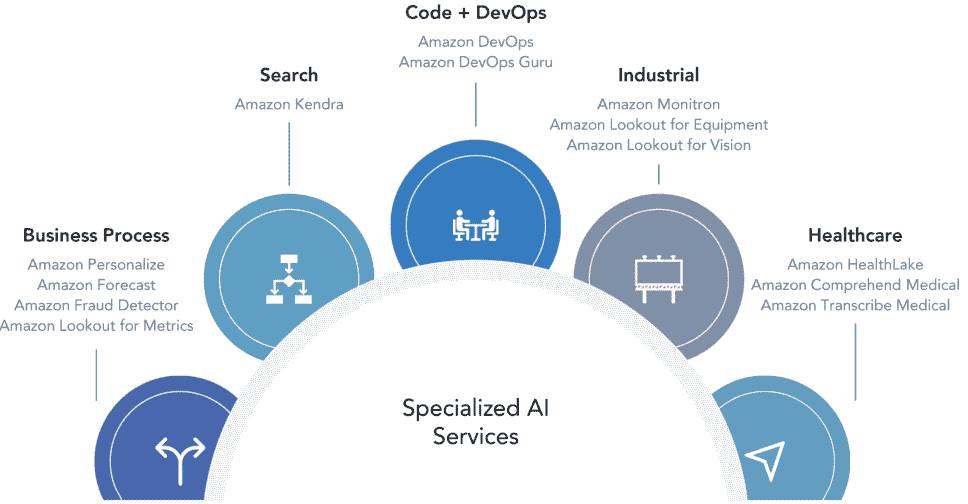

**图 9.6：** AWS 专用 AI 服务

### 业务处理服务

本节介绍 AWS 提供的各种业务处理相关服务，包括 Amazon Personalize、Amazon Forecast、Fraud Detector 和 Amazon Lookout for Metrics。

### Amazon Personalize

Amazon Personalize 是一种完全托管的服务，可大规模个性化客户体验。它可用于为网站提供推荐以改进搜索结果，并在营销活动中向客户推荐产品。它使用协同过滤、基于内容的过滤和基于规则的过滤。用户、行为和产品数据用于生成这些推荐。

| 推荐方法 | 描述 |
|---|---|
| 协同过滤 | 使用对这些产品感兴趣的用户的数据，向其他用户推荐这些产品 |
| 基于内容的过滤 | 使用用户已经交互过的产品的数据，推荐其他相关产品 |
| 基于规则的过滤 | 基于您指定的规则来推荐产品 |

### Amazon Forecast

Amazon Forecast 是一种完全托管的服务，使用机器学习生成准确的时间序列预测。以下是可利用它的一些场景，以及其部分功能和工作原理的概述：

| 推荐方法 | 描述 |
|---|---|
| 协同过滤 | 使用对这些产品感兴趣的其他用户的数据，向其他用户推荐这些产品 |
| 基于内容的过滤 | 使用用户已经交互过的产品的数据，推荐其他相关产品 |
| 基于规则的过滤 | 基于您指定的规则来推荐产品 |

图 9.7 展示了 Amazon Forecast 的工作原理：利用最新算法和历史数据预测未来时间序列数据，用户无需机器学习经验。

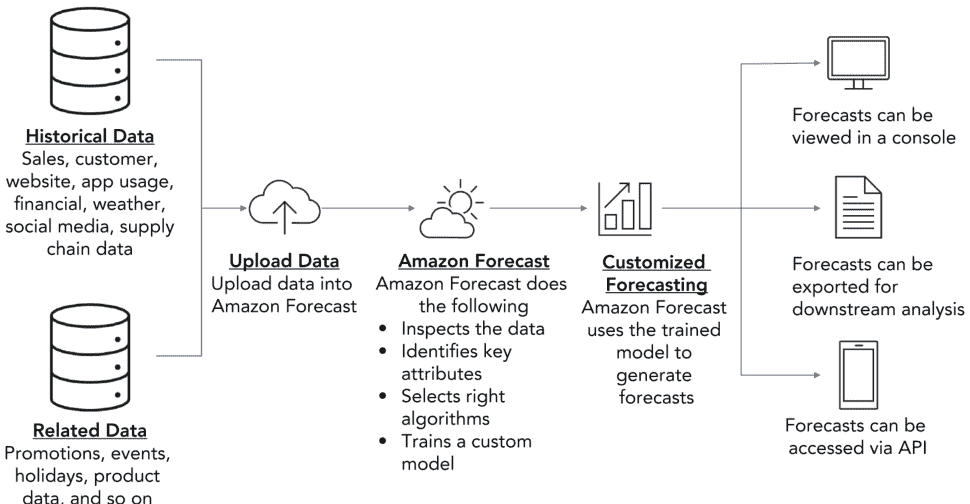

图 9.7：Amazon Forecast 的工作原理

### ARIMA

ARIMA（自回归积分移动平均模型）是一种统计模型，利用过去数据预测未来值。它用于以下场景：

| 用例 | 描述 |
|---|---|
| 预测财务数据 | 可用于预测股价和汇率等财务数据 |
| 预测销售或需求 | 能够预测一年不同时间（如节假日或季节）的销售或需求，因为它能够捕捉数据中的趋势和季节性 |

### EDS Prophet

EDS（扩展卡尔曼滤波动态线性模型）Prophet 是由 Facebook 开发的一种时间序列预测工具。其部分功能包括：

| 功能 | 描述 |
|---|---|
| 加法模型 | 在进行预测时，使用加法模型来捕捉影响时间序列数据的季节性趋势和其他数据 |
| 用例 | 当您拥有多个数据源（例如 IoT 和传感器数据）时非常有用，例如用于预测机器可能需要维护的时间 |

### DeepAR

DeepAR 是一种基于深度学习的监督学习技术。其部分功能包括：

| 功能 | 描述 |
|---|---|
| 循环神经网络 (RNN) | RNN 用于建模复杂的时间序列数据，并可以处理不同粒度的多个时间序列数据。 |
| 用例 | 在有多个因素可能影响结果的场景中使用 RNN。 |
| 客户行为 | 常用于预测客户行为，例如网站流量和销售。 |
| 股价 | 可根据过去数据、当前事件和其他因素来预测股价。 |

### ETS

ETS（指数平滑状态空间模型）是一种时间序列预测方法。其部分功能包括：

| 功能 | 描述 |
|---|---|
| 平滑方法 | ETS 通过生成过去数据的加权平均值来采用平滑方法，以预测未来值。 |
| 季节性和趋势 | ETS 与季节性数据和趋势配合良好，尤其适用于快速变化的情况。 |
| 短期趋势 | ETS 用于预测短期趋势，例如易腐商品的需求预测，或根据历史和其他数据预测不同类型药物的需求。 |

请注意，没有任何预测模型是完美的。所有这些模型都存在一定程度的误差，通过结合多个模型的预测，您将获得最佳结果。表 9.2 对这些预测模型进行了比较和对比。

| 模型类型 | 用例 | 优点 | 缺点 |
|---|---|---|---|
| ARIMA | 统计 | 销售数据、网站流量和客户行为数据 | 简单易解释。能够很好地处理季节性和趋势。 | 假设线性关系。可能对异常值敏感。 |
| EDS Prophet | 统计 | 预测产品和服务的需求 | 能够很好地处理季节性和趋势。能够很好地处理缺失数据。 | 需要手动特征工程。 |
| DeepAR | 深度学习 | 预测客户行为，例如网站流量和销售 | 能够很好地处理复杂模式，并自动学习特征。 | 训练时间较长，需要更多数据。 |
| ETS | 指数平滑 | 需求预测、库存管理和人力规划 | 能够很好地处理季节性和趋势。支持灵活的参数化，且易于使用。 | 假设线性关系。可能对异常值敏感。 |
| NPTS | 神经点预测 | 需求预测、时间序列分析和异常检测 | 能够很好地处理复杂模式，并支持多个相关时间序列。功能强大且准确。 | 训练时间较长，需要更多数据。 |

### Amazon Fraud Detector

Amazon Fraud Detector 是一种完全托管的服务，可检测账户接管、支付欺诈、退货欺诈以及大额订单和异常登录模式等其他可疑活动。其部分功能包括：

| 功能 | 描述 |
|---|---|
| 预构建和自定义模型 | 您可以使用预构建模型，也可以创建自己的自定义模型。 |
| AWS 控制台 | 您可以使用 AWS 控制台创建探测器，输入标记数据来训练探测器，对其进行测试，并在满意后将其部署到生产环境。 |

### Amazon Lookout for Metrics

Amazon Lookout for Metrics 是一种完全托管的服务，可用于监控指标或一组指标，检测任何异常并生成警报。然后，您可以快速调查和诊断问题。其部分功能包括：

| 功能 | 描述 |
|---|---|
| 检测异常 | 用于检测网站、流量、机器停机、销售数据库存水平、客户满意度和运营数据中的异常。 |
| 自动检测 | 自动检测并标记异常数据点，甚至能识别这些异常背后的根本原因。 |
| 集成 | 旨在与其他 AWS 数据存储解决方案（如 Redshift、S3、RDS 及其他第三方数据库）完全集成。 |

### 用于搜索的 Kendra

Amazon 提供用于搜索功能的 Kendra。Amazon Kendra 是一种完全托管的服务，可使用机器学习算法自动索引您的文档，从而提供更相关的搜索结果。Kendra 使您能够快速轻松地查找文档。

图 9.8 展示了 Amazon Kendra 的部分内部工作原理。

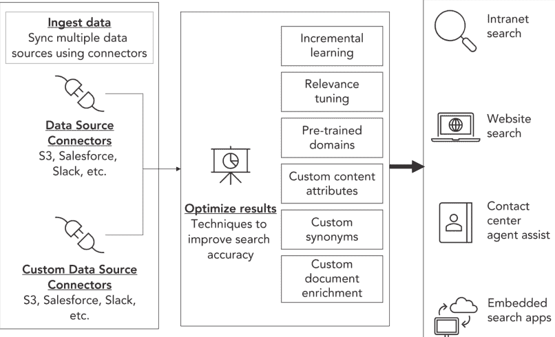

### 图 9.8：亚马逊 Kendra 工作原理

Kendra 的部分功能包括：

| 使用场景 | 描述 |
|---|---|
| 员工知识库 | 设置包含数据库、网站及其他内部文档（如常见问题解答、员工手册和产品文档）的企业搜索解决方案。 |
| 客户支持知识管理系统 | 适用于包含常见问题解答、故障排除指南、产品文档和客户支持工单的客户支持团队。 |
| 合作伙伴管理 | 索引合作伙伴协议、常见问题解答和销售内容。 |
| 客户满意度 | 提高员工生产力、客户满意度和合作伙伴满意度。 |
| 电子商务 | 创建自定义搜索引擎，让客户能够快速找到产品，从而提高客户服务满意度和销售额。 |
| 医疗保健 | 创建医疗搜索引擎，使医生和专业人员能够快速查找所需信息；这有助于医生做出更好的决策并改善患者结局。 |
| 法律 | 为律师创建法律搜索引擎，以便他们能够快速查找所需信息；这可以通过构建更强有力的法律案件和提供更好的法律建议来改善他们对客户的服务。 |

## 代码和 DevOps

本节介绍一些与代码和 DevOps 相关的 AWS 服务，包括 Amazon CodeGuru 和 Amazon DevOps Guru。

### Amazon CodeGuru

Amazon CodeGuru 利用 AI 和 ML 算法完成以下操作（请参见图 9.9）：

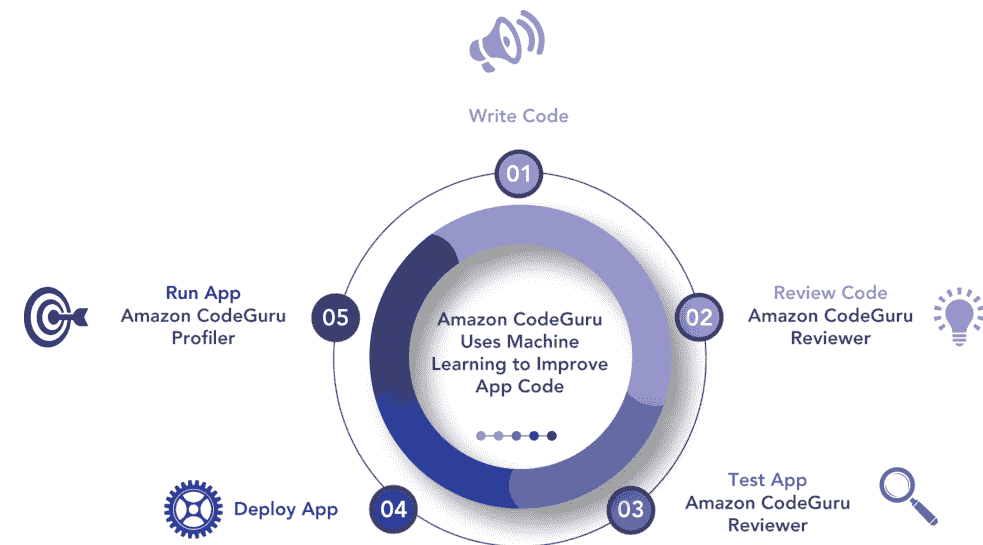

### 图 9.9：Amazon CodeGuru 使用机器学习改进应用程序代码。

| 收益 | 描述 |
| :--- | :--- |
| 提高代码质量 | 执行代码审查、自动建议和修复，以提升代码质量。 |
| 查找并修复错误 | 通过提供改进代码的建议来缩短开发时间。 |
| 提高安全性 | 查找安全漏洞，并通过提供改进代码的建议来帮助遵守法规。 |
| 提高性能 | 针对代码提供建议，以便您可以利用适当的基础设施来提高性能。 |

> **提示** 使用 Amazon CodeGuru 提升代码质量、安全性和性能，并使用 DevOps Guru 主动监控 DevOps 流程并检测问题。

### Amazon DevOps Guru

Amazon DevOps Guru 使用机器学习在潜在运营问题影响客户之前识别它们。其部分功能包括：

| 功能 | 描述 |
| :--- | :--- |
| 异常检测 | 利用 AWS CloudWatch、CloudTrail 和其他 AWS 服务的运营数据，持续分析这些数据，检测异常，然后用于生成警报，以便进行后续的响应或主动操作 |
| 实时警报 | 通过与 AWS Systems Manager、Amazon EventBridge、Amazon SNS 和其他第三方事件管理系统集成生成警报 |
| 性能、安全性和可用性 | 有助于提高性能，提供安全性，并通过防止停机来确保高可用性 |

> **提示** DevOps 的集成能力非常实用，尤其是对于 AI 和 ML 应用程序，因为它们通常很复杂，需要大量计算资源，并且难以实时监控。

## 基于项目的实践学习练习

这是一种学习练习，重点是将关于 AWS 服务的技能和知识应用到现实世界中的一系列任务中。

| 目标 | 交付物 | 资源 | 示例 |
|---|---|---|---|
| 获取 AWS 服务访问权限。 | AWS 账户 | 互联网连接 电子邮件 ID | 创建 AWS 账户。 |
| 学习创建解决方案和活动，导入或创建数据集，并为客户生成个性化推荐。 | 了解 Amazon Personalize | Amazon Personalize AWS 控制台 | 使用 Amazon Personalize 根据用户行为进行推荐。 |
| 学习导入时间序列数据，选择合适的预测算法（例如 ARIMA、Prophet、DeepAR、ETS），并可视化预测结果。 | 使用 Amazon Forecast 的预测模型 | Amazon Forecast 时间序列数据集 | 使用 ARIMA、Prophet、DeepAR、ETS 为示例数据集生成预测。 |
| 学习使用历史事件数据和已知欺诈标签训练模型、创建规则，并使用 Amazon Fraud Detector 进行决策。使用示例交易测试模型以识别潜在欺诈。 | 欺诈检测模型 | Amazon Fraud Detector 欺诈标签数据集 | 使用 Amazon Fraud Detector 在示例数据中识别潜在欺诈交易。 |
| 监控示例数据集中的异常。学习如何设置异常检测器、添加数据集和解释异常检测结果。 | 异常检测模型 | Amazon Lookout for Metrics 数据集 | 设置异常检测器并在示例数据中识别异常。 |
| 使用示例文档创建智能搜索服务。学习如何创建索引、添加数据源并测试搜索功能。 | 使用 Kendra 的智能搜索服务 | Amazon Kendra 文档数据集 | 为一组示例文档创建智能搜索服务。 |
| 停止或删除所有服务以防止产生额外费用。 | 已清理的 AWS 服务 | AWS 控制台 | 确保停止或删除服务以避免任何额外费用。 |
| 学习如何将这些知识应用到您的项目中，以造福您的公司。 | 学习反思 | N/A | 反思在此动手练习中学到了什么，以及如何将这些服务应用到您的业务或项目中。 |

Amazon 提供一些工业解决方案，包括 Amazon Monitron、Amazon Lookout for Equipment 和 Amazon Lookout for Vision（请参见图 9.10）。这些解决方案将人工智能（AI）和机器学习（ML）应用于传感器和系统生成的海量工业数据，以生成洞察，从而优化工业流程并提高质量和安全性。

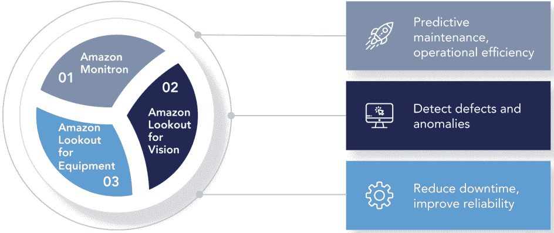

### 图 9.10：Amazon 工业 AI 解决方案

### Amazon Monitron

Amazon Monitron 是一种工业解决方案，可以检测工业设备中的异常。其部分功能包括：

| 功能 | 描述 |
|---|---|
| 监控 | 监控温度、振动和声音。 |
| 预测性维护 | 结合传感器、网关和机器学习，减少非计划停机时间并改进预测性维护。 |
| 运营效率 | 利用工业 IT 和边缘技术与工业设备和系统集成，提供实时洞察，提高运营效率。 |

### Amazon Lookout for Equipment

Amazon 的 Lookout for Equipment 是另一项专注于防止停机和提高工业公司设备运营效率的服务。其部分功能包括：

| 功能 | 描述 |
|---|---|
| 问题检测 | 检测振动、流量、温度、声音和压力，以识别潜在问题。 |
| 设备维护 | 提高设备可靠性，降低维护成本，并提高安全性。 |
| 行业采用 | 可用于多个行业，如制造业、运输业以及能源和汽车行业，以监控泵、电机、轴承、阀门等设备。 |
| 用例 | 工业用例包括质量控制、能源优化、预测性维护和资产管理。 |

### Amazon Lookout for Vision

Amazon 的 Lookout for Vision 用于检测工业图像中的缺陷。这包括裂缝、划痕和缺失部件等缺陷。其部分功能包括：

| 功能 | 描述 |
| :--- | :--- |
| 检测视觉损坏 | 此服务或工具可以识别视觉损坏，包括凹痕和水损，以及由于石油泄漏、泄漏、通道堵塞造成的安全隐患，以及颜色和纹理异常等产品质量问题。 |
| 用例 | 此工具在制造业、包装业和物流业等行业中特别有用。 |

## 医疗保健解决方案

AWS 提供多种医疗保健相关服务，包括 Amazon HealthLake、Amazon Comprehend Medical 和 Amazon Transcribe Medical，将在以下各节中分别介绍。

### Amazon HealthLake

HealthLake 是一种托管服务，用于存储、转换和分析医疗保健数据，以提高医疗质量、降低成本并提高医疗保健组织的效率。以下是其部分功能：

| 功能 | 描述 |
| :--- | :--- |
| 主动护理 | HealthLake 可以查看患者数据，尝试识别有发生并发症风险的患者，然后主动治疗或教育他们。 |
| 降低成本 | 医院可以使用 HealthLake 了解资金支出去向（例如处方药），然后与制药公司协商更好的价格。 |
| 预约排程 | 医院可以使用 HealthLake 自动安排预约，这不仅能提高医院运营效率，还能提高患者满意度。 |
| 临床试验 | HealthLake 可以分析大型数据集以识别异常，这有助于医学研究人员识别临床试验的潜在参与者，并促成新疗法和新治疗方法。 |
| 临床支持系统 | HealthLake 还可以充当临床支持系统，为医生提供最新的临床研究和洞察，帮助他们修改治疗方案或识别其他潜在治疗选择。 |
| 人群健康 | 医疗保健组织还可以跟踪人群健康随时间的变化趋势，然后主动采取措施预防疾病或改善整体健康。 |

> **提示** 您可以利用 Amazon 医疗保健服务进行主动治疗、成本优化、自动化、临床支持和安全的医疗转录。

### Amazon Comprehend Medical

Amazon Comprehend Medical 与 Amazon HealthLake 类似，也有助于降低成本、改善患者护理和提高医院运营。以下是其部分功能：

| 功能 | 描述 |
| :--- | :--- |
| 人群健康 | 通过更好地了解患者健康状况并制定个性化治疗方案，帮助开展人群健康管理。 |
| 医疗编码 | 您还可以使用 Amazon Comprehend Medical 自动为医疗疾病和程序进行编码以用于计费，从而节省医疗编码所需的时间和精力。 |

## Amazon Transcribe Medical

Amazon Transcribe Medical 是一项符合 HIPAA 资格的服务，它使用自动语音识别来允许医生、供应商和付款方安全地转录医疗语音，例如医患对话、医疗口述和临床笔记。以下是其一些功能：

| 功能 | 描述 |
|---|---|
| 合规性 | 符合 HIPAA 资格 |
| 技术 | 使用自动语音识别 |
| 用户 | 医生、供应商和付款方 |
| 用例 | 安全转录医疗语音，例如医患对话、医疗口述和临床笔记 |
| 临床笔记 | 包括进展记录、出院摘要和会诊记录 |

### 实践练习：使用 Amazon Monitron、Amazon Lookout for Equipment 和 Amazon Lookout for Vision 应用 Amazon 工业 AI 解决方案

本练习的重点是提供使用这些 Amazon 工业解决方案的实践经验，以在工业环境中提高运营效率、预测性维护和质量控制。

| 目标 | 步骤和交付成果 | 资源 | 示例 |
| :--- | :--- | :--- | :--- |
| 假设您正在与一家正经历设备停机的工业制造公司合作。目标是监控设备以找出根本原因。 | 步骤 1：配置 Amazon Monitron 服务并将其连接到公司的设备。步骤 2：监控温度、压力、振动和声音数据。步骤 3：使用 Amazon Monitron 分析这些数据以识别潜在问题。 | AWS 帐户 Amazon Monitron 文档 | 在仓库中设置 Amazon Monitron 来监控假设的传送带系统。 |
| 目标是从人工检查转向开发其预测性维护能力。 | 配置 Amazon Lookout for Equipment 并将其连接到其数据源。 摄取历史数据并检测异常。 通过将其与人工方法期间的预测准确性进行比较来评估新系统的有效性。 | AWS 帐户 Amazon Lookout for Equipment 文档 示例工业数据集 | 使用 Amazon Lookout for Equipment 分析假设电机的历史数据以检测任何异常。 |
| 目标是改进质量控制流程。 | 配置 Amazon Lookout for Vision 服务。 将其连接到公司的生产线摄像头。 分析图像中的缺陷。 监控服务性能并优化参数以提高准确性。 | AWS 帐户 Amazon Lookout for Vision 文档 示例工业图像 | 使用 Amazon Lookout for Vision 分析生产线图像以检测产品中的任何缺陷。 |
| 在现实世界中应用它。 | 开发一份详细报告，评估从 Amazon Monitron、Amazon Lookout for Equipment 和 Amazon Lookout for Vision 获得的结果。 | 之前步骤的结果 与用例相关的评估指标 | 评估检测到的真阳性、假阳性、真阴性和假阴性的数量。 比较使用这些 AWS 服务的优势和挑战。 |

## 机器学习服务

本节介绍 ML 服务。在 AWS ML 服务部分，有 SageMaker Canvas、SageMaker 本身以及 SageMaker Studio Lab，如图 9.11 所示。

- 一项用于构建和部署 ML 模型的完全托管机器学习服务
- 面向非专家的 SageMaker 中无代码 ML 拖放功能
- 帮助用户快速学习机器学习的交互式教程

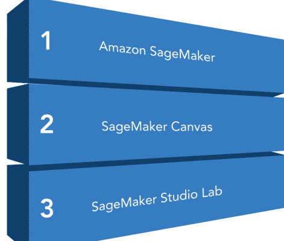

图 9.11：AWS ML 服务

## Amazon SageMaker

Amazon SageMaker 是 AWS 提供的一项完全托管的机器学习服务，用于构建、训练和部署机器学习模型。它为整个机器学习生命周期提供端到端支持，如图 9.12 所示。它允许开发人员和数据科学家在生产中大规模部署模型。

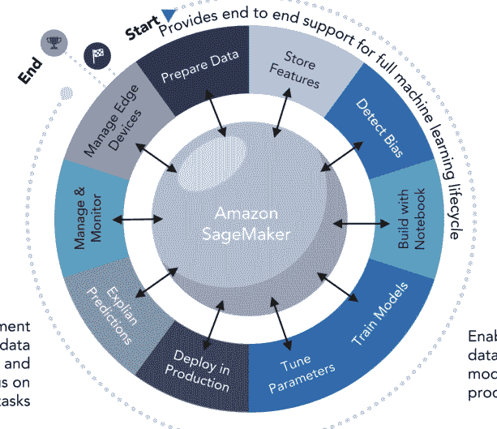

图 9.12：SageMaker 的功能

其一些功能包括：

| 类别 | 功能 |
|---|---|
| 功能 | > 使用 Jupyter 笔记本开发和训练机器学习模型 > 提供可以是本地云或边缘的训练环境 > 提供实时或批量推理等部署选项 > 提供指标、日志和跟踪等监控选项 |
| 优势 | 帮助公司降低成本、提高效率并做出更好的商业决策 |

## Amazon SageMaker Canvas

SageMaker Canvas 是 SageMaker 中的一项新拖放功能，有助于让非专家也能使用 SageMaker。以下是其一些功能：

| 功能 | 描述 |
|---|---|
| 协作 | 使开发人员、数据科学家和业务分析师之间能够进行更多协作。 |
| 速度 | 帮助组织加快机器学习工作流并快速部署模型。 |
| 民主化 | 业务分析师可以在机器学习知识有限的情况下使用 SageMaker。 |
| 用例 | 包括欺诈检测、产品推荐和客户流失预测。 |

## SageMaker Studio Lab

Amazon SageMaker Labs 是交互式教程，可帮助用户快速学习机器学习。它们提供动手实践的学习机会。以下是其一些功能：

| 功能 | 描述 |
|---|---|
| 提升技能 | 组织提升员工技能的必备工具 |
| 动手实践 | 帮助员工通过指导性的动手实践学习机器学习开发 |
| 实验 | 允许用户在无需担心底层硬件和基础设施的情况下学习和尝试不同的模型 |
| 协作 | 允许用户协作并共享其工作 |

**提示** 使用 Amazon SageMaker 对 ML 生命周期的端到端支持，使用 SageMaker Canvas 民主化 ML，并使用 SageMaker Studio Lab 提升员工技能。

## Google AI/ML 服务堆栈

AI/ML 服务可分为三大用例——面向数据科学家、面向开发人员和面向基础设施专家。本章介绍前两个用例，基础设施级服务将在第 13 章介绍云平台时讨论。

### 面向数据科学家

以下 AI/ML 服务可供数据科学家使用，如图 9.13 所示。

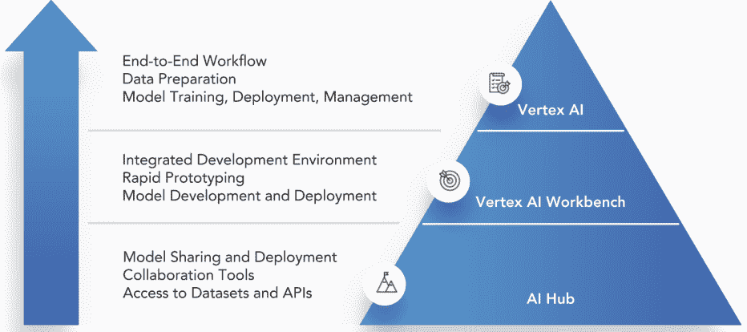

图 9.13：面向数据科学家的 Google AI/ML 堆栈

## Vertex AI

Vertex AI 是一款基于云的机器学习平台，可帮助公司在生产中构建、训练和部署模型。它支持端到端机器学习工作流，包括数据准备、模型训练、部署和管理。

### Vertex AI Workbench

Vertex AI Workbench 是数据科学家的单一开发环境，可用于开发并部署模型。以下是其一些功能：

| 功能 | 描述 |
|---|---|
| 从开发到生产的轻松过渡 | 与 Vertex AI 和其他工具集成，有助于最大限度地减少从开发到生产的过渡 |
| 快速原型设计 | 促进快速原型设计和模型开发 |

### AI Hub

Google 的 AI Hub 是一个集中式平台，数据科学家、机器学习工程师、开发人员和其他 AI 从业者可以在其中发现、共享和部署模型。以下是其一些功能：

| 功能 | 描述 |
|---|---|
| 共享资产 | 获取数据集和 API 等其他资产的访问权限。 |
| 协作工具 | 访问其他协作工具，例如版本控制、代码审查和问题跟踪。 |

## Google 的机器学习 AI/ML 练习

此实践练习侧重于帮助数据科学家和 AI 从业者使用 Google 的 AI/ML 服务，如 Vertex AI、Vertex AI Workbench 和 AI Hub。它将帮助团队成员创建和部署模型并原型化解决方案。

### 任务 1：假设您正在为一家零售公司工作，以使用预测模型改善销售。

| 工具 | 步骤 |
| :--- | :--- |
| Vertex AI | 收集并准备必要的数据，例如历史销售数据以及与可能影响销售的外部因素相关的数据。 |
| Vertex AI | 使用 Vertex AI 训练销售预测模型。 |
| Vertex AI | 部署训练好的模型并创建新数据输入机制。 |
| Vertex AI | 根据需要监控和调整模型性能。 |

### 任务 2：尝试不同的推荐系统，使用快速原型设计来个性化客户的购物体验。

| 工具 | 步骤 |
| :--- | :--- |
| Vertex AI Workbench | 使用 Vertex AI Workbench 原型化各种推荐系统模型。 |
| Vertex AI Workbench | 选择一个模型与公司的电子商务平台集成以进行试点测试。 |
| Vertex AI Workbench | 监控推荐系统的有效性并根据需要进行调整。 |

### 任务 3：简化跨团队的资产共享和协作。

| 工具 | 步骤 |
| :--- | :--- |
| AI Hub | 在 AI Hub 上设置工作区以共享数据集、模型和 API 等资产。 |
| AI Hub | 建立用于版本控制、代码审查和问题跟踪的工作流。 |
| AI Hub | 监控和调整团队协作及资产利用率。 |

### 面向开发人员

表 9.3 中列出的 AI/ML 服务可供开发人员使用。

## TABLE 9.3: Google AI/ML Services for Developers

| 自动化机器学习 | 云自然语言 | 对话流 | 图像和视频服务 | 媒体翻译 |
| :--- | :--- | :--- | :--- | :--- |
| **自动化模型开发** AutoML Vision AutoML Natural Language AutoML Tables | **情感分析** 实体识别 句法分析 内容分类 文本分类 | **会话界面** 聊天机器人/语音助手 自然语言理解 媒体翻译 多设备支持 | **视频 AI** 视频标记建议 转录和翻译 内容审核 标签检测  **视觉 AI** 对象和人脸检测 文本识别 图像搜索 地标检测 | **语音转文本** 音频转文本转换 实时或预录制音频  **文本转语音** 文本转语音转换 个性化通信  **翻译 AI** Cloud translation API Google 翻译 神经机器翻译 |

## AutoML

AutoML 是一组工具和技术，通过自动化许多任务来促进模型开发，使模型更易于访问。其功能包括：

| 功能 | 描述 |
| :--- | :--- |
| 更轻松的模型开发 | 旨在使机器学习知识有限的人员也能更轻松地开发模型 |
| 开发工具 | 提供多种工具，例如 AutoML Vision、AutoML Natural Language 和 AutoML Tables，以解决特定的机器学习问题 |

## Cloud Natural Language

云自然语言是 Google Cloud 提供的一种基于云的自然语言处理服务，供开发者分析和理解文本格式的人类语言。其功能包括：

| 功能 | 描述 |
| :--- | :--- |
| 自然语言任务 | 协助进行情感分析、实体识别、句法分析、内容分类等。 |
| 应用集成 | 开发者可以使用此 API 将自然语言处理应用于应用程序。 |
| 情感分析 | 开发者可以训练机器学习模型来分类、提取和检测情感。 |

## Dialogflow

Google Dialogflow 平台使开发者能够为聊天机器人、语音助手和其他会话代理等应用程序创建会话界面。其功能包括：

| 功能 | 描述 |
| :--- | :--- |
| 设备支持 | 可在多种设备和平台上运行。 |
| 用户请求 | 利用机器学习和自然语言理解技术理解用户请求并提供响应。 |
| 拟人化交互 | 促进自然交互和类人功能，并提供企业级可扩展性。 |
| 应用开发 | 帮助开发者快速开发此类应用程序。 |

> **提示** 为数据科学家使用 Vertex AI，使用 AutoML 和 Dialogflow 简化开发，并使用云自然语言和视觉 AI 增强应用程序。

## Media Translation

媒体翻译可将音频或视频内容实时翻译成您选择的语言的文本。目前，它支持 12 种语言。以下部分将讨论 AWS 在媒体翻译范畴下提供的服务。

> **提示** 媒体翻译可用于使您的内容更易于全球受众访问。

## Speech-to-Text

| 功能 | 描述 |
| :--- | :--- |
| 应用程序 | 诸如听写、播客、语音命令等应用程序。 |
| Google Contact Center AI | Speech-to-Text 在 Google Contact Center AI 中发挥着至关重要的作用，通过将口语转换为书面文本，帮助实时转录、情感分析、通话分析和交互式语音应答 (IVR)。 |
| 文本转语音转换 | 提供将文本实时转换为语音的功能，可用于视频字幕、启用语音的聊天机器人、转录会议和通话等。 |
| 支持多种语言 | 包括英语、法语、西班牙语和日语。它可以理解多种方言和口音。 |
| 个性化通信 | 可用于个性化通信，并通过设备和应用程序中的基于语音的用户界面与客户互动。 |

## Translation AI

Google 提供此翻译服务，可用于在不同语言之间翻译文本和语音。其功能包括：

| 功能 | 描述 |
| :--- | :--- |
| 全球覆盖 | 帮助全球触达客户，并通过使用他们的本地语言与其互动来提供引人入胜的体验。 |
| 翻译选项 | Google 提供三种翻译选项：Cloud Translation API、Google 翻译 和神经机器翻译。 |
| 语言支持 | Google 翻译 免费，可用于近 100 种语言。它可翻译文本、图像、语音和网页。 |
| Google Translate API | 一项付费服务，可用于将翻译集成到您的应用程序和服务中。 |
| 神经机器翻译 | 一种更准确的翻译服务，使用神经网络进行翻译。 |

## Image and Video Services

本部分介绍 Google 提供的部分 AI/ML 图像和视频服务。

### Video AI

Google 视频 AI 用于 Google 照片、YouTube 和 Google Cloud 等众多应用程序。它提供自动视频标记、视频推荐、视频转录和翻译以及内容审核。

### Vision AI

Google 视觉 AI 是一种基于云的图像分析服务，可从视频和图像中检测和分析对象、人脸、文本和其他视觉实体。它对于标签检测、人脸检测、文本识别、光学字符识别（从扫描文档中提取文本）、图像搜索（查找相似图像）和地标检测非常有帮助。

## PROJECT-BASED EXPLORING GOOGLE AI/ML SERVICES FOR DEVELOPERS

在此练习中，项目团队将使用 Google AI/ML 服务构建一个应用程序，涉及图像识别、自然语言处理、翻译和聊天机器人功能。

| 步骤编号 | Google AI/ML 服务 | 实践任务 | 预期结果 |
|---|---|---|---|
| 1 | 自动化机器学习 (AutoML) | 使用 Google 的 AutoML 为图像分类或文本分析等简单问题开发机器学习模型。 | 使用最少编码工作量开发的功能性机器学习模型 |
| 2 | 云自然语言 | 开发一个简单的应用程序，使用 Google Cloud Natural Language API 分析用户提供的文本中的情感。 | 能够从文本中分析情感的应用程序 |
| 3 | Dialogflow | 使用 Dialogflow 创建一个简单的聊天机器人，以理解用户意图并作出相应响应。 | 能够与用户进行会话交互的聊天机器人 |
| 4 | 媒体翻译 | 将 Google 的媒体翻译集成到应用程序中，并使用不同的输入语言进行测试。 | 能够跨多种语言进行实时翻译的应用程序 |
| 5 | 语音转文本 | 在应用程序中实现一个功能，将口语转换为书面文本，用于转录会议或语音命令。 | 能够将语音输入转换为文本的应用程序功能 |
| 6 | 翻译 AI | 使用 Google 的翻译 AI 将文本从一种语言翻译成另一种语言，最好是对用户生成的内容进行自动翻译。 | 能够将文本翻译成指定语言的应用程序功能 |
| 7 | 视觉 AI | 在应用程序中实现 Google 的视觉 AI 以分析图像或视频，例如识别上传图像中的对象。 | 能够分析和识别图像或视频中对象或组件的应用程序功能 |
| 奖励挑战 | 服务集成 | 将这些功能集成到应用程序中的连贯用户旅程中。 | 单个应用程序中跨各种 AI/ML 服务的无缝用户旅程 |

## THE MICROSOFT AI/ML SERVICES STACK

Microsoft AI/ML 服务堆栈大致可分为四个领域，这些领域使更高级的 AI/ML 从业者和初学者受益。Azure 应用 AI 服务面向数据科学家和机器学习工程师，而 Azure 机器学习是一个面向开发者的平台。

### Azure Applied AI Services

Azure 应用 AI 服务是开发者、数据科学家和其他 AI 从业者可以在其应用程序中使用的功能，无需具备机器学习专业知识。图 9.14 显示了各种 Azure 应用 AI 服务及其功能的概览。

## Azure 认知服务

Azure 认知服务是一套基于云的 API 和服务，可帮助开发者将 AI 和 ML 功能集成到其应用程序、网站和设备中。

- 从音频和视频中提取实体
- 自然语言处理、计算机视觉、语音识别
- 从表单中提取键值对、表格和文本等实体
- 开发对话式聊天机器人
- 使用 AI 和 NLP 搜索图像和文本等数据
- 从物联网设备、社交媒体点击流等多种来源实时洞察

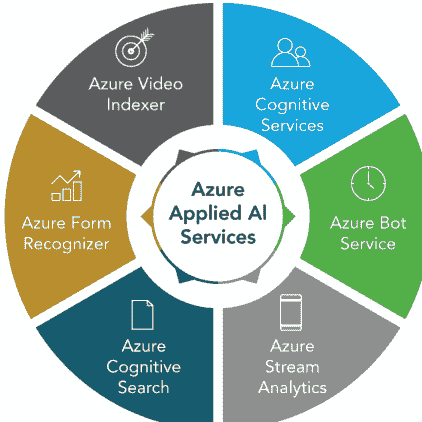

图 9.14: Azure 应用 AI 服务

| 功能 | 说明 |
|---|---|
| 目的 | 帮助开发者将 AI 和 ML 功能集成到其应用程序、网站和设备中 |
| 功能 | 包括自然语言处理、计算机视觉、语音识别等 |
| 用例 | 可改进客户服务、欺诈检测、产品推荐、图像分类和自然语言处理 |
| 方法 | 只需进行 API 调用，即可将能够说话、听觉、视觉、搜索、理解的功能以及决策能力嵌入到应用中 |
| 特定服务 | 可用于语音转文本、文本转语音、语音翻译和说话人识别 |

## 语言认知服务

语言认知服务提供实体识别、语言翻译、情感分析、问答、对话式语言理解和翻译等功能。

## 视觉认知服务

视觉认知服务分析图像和视频中的内容，并提供自定义图像识别。它具有以下功能：

| 功能 | 说明 |
|---|---|
| 决策认知服务 | 为用户提供内容审核和体验个性化，并更早解决设备问题，所有这些都有助于更好的决策 |
| 开放 API 服务 | 为高级语言模型和编码提供开放 API 服务 |

## Azure 机器人服务

Azure 机器人服务是一个基于云的平台，用于开发跨网站、消息应用和语音助手与用户交互的对话式聊天机器人。

提示 使用 Azure 应用 AI 服务将 AI 功能集成到您的应用程序中，释放自然语言处理、计算机视觉、实时分析和智能搜索的强大功能。

## Azure 流分析

Azure 流分析是一个基于云的分析平台，可从包括物联网设备、社交媒体点击流在内的各种来源实时提取洞察。它可以与 Azure 事件中心、Azure IoT 中心和 Azure Functions 集成，以创建复杂的流式数据管道。

提示 Azure 流分析可用于实时监控和分析流式数据，这可以帮助您做出更好的决策并更快地采取行动。

## Azure 认知搜索

Azure 认知搜索允许开发者将企业级搜索集成到其应用程序中。其功能包括以下内容：

| 功能 | 说明 |
| --- | --- |
| AI 和 NLP | 使用 AI 和自然语言处理来搜索图像和文本等数据 |
| 搜索功能 | 提供语义搜索、分面导航、模糊匹配和地理空间搜索功能 |
| 非结构化数据 | 可从非结构化数据中提取洞察，例如情感分析、关键短语提取和实体识别 |

## Azure 表单识别器

Azure 表单识别器可帮助从表单中提取键值对、表格和文本等实体。与手动数据录入相比，它能更快、更无误地实现数据录入。它可用于发票、收据和自定义文档等文档。

## Azure 视频索引器

Azure 视频索引器是一个基于云的平台，可从音频和视频中提取实体。将内容上传到门户后，它将使用语音转文本、面部识别、情感分析、场景检测等方式提取信息。用户随后可以通过门户或 API 搜索这些信息。

使用 Azure 视频索引器非常简单；只需访问 [videoindexer.ai](videoindexer.ai) 并注册后上传视频。[图 9.15](Figure 9.15) 显示了我上传的一个视频的结果。它列出了相关主题、转录文本、关键字、命名实体和情感。

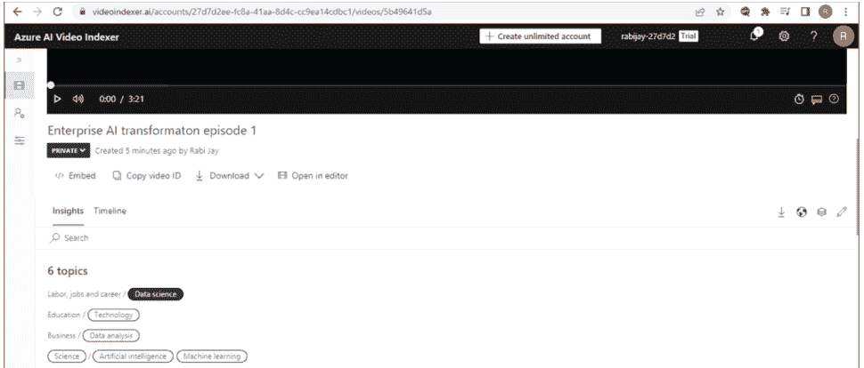

### 图 9.15: 使用 Azure 视频索引器工具

## Azure 机器学习

Azure 机器学习是一个基于云的机器学习平台。开发者可以使用它来构建、训练和部署机器学习模型到生产环境。它允许开发者准备数据、构建和训练模型、验证、部署、管理和监控结果。

| 阶段 | 功能 |
|---|---|
| 数据准备 | 在数据准备期间，开发者可以标记训练数据、管理标记项目、使用分析探索数据，以及访问和共享数据集。 |
| 构建和训练模型 | 提供笔记本、自动化机器学习功能、运行实验的功能、使用可扩展计算引擎加速训练、访问安全计算实例，以及访问 Scikit-learn、PyTorch、TensorFlow、Keras 等开源库。 |
| 验证和部署模型 | 提供部署模型端点以进行实时和批量推理、流水线和 CI/CD 工作流、用于推理的预构建实例、模型存储库，以及混合和多云部署选项的功能。 |
| 管理和监控模型 | 提供跟踪日志、分析数据和模型、检测漂移、保持模型准确性、调试模型、为合规性跟踪机器学习项目、并确保持续监控安全性和成本控制功能（包括配额管理和自动关闭）的功能。 |

## 练习：使用 Azure 服务构建、部署和监控 AI 模型

此练习旨在让您的团队获得使用 Azure 机器学习构建、训练和部署机器学习模型的实际经验。它包括数据准备、模型训练、验证、部署和监控等重要方面。

请记住，在练习结束时清理资源，以避免不必要的费用。另请注意，练习中的角色在您的组织中可能有所不同。

| 步骤名称 | 任务负责人 | 目标指令 | 交付物 | |
|---|---|---|---|---|
| 数据准备 | 数据工程师 | 为模型训练准备数据 | 导入数据集并使用 Azure 的数据准备工具预处理数据。 | 可用于模型训练的清洗和预处理后的数据集 |
| 模型构建和训练 | 数据科学家/机器学习工程师 | 构建和训练机器学习模型 | 选择合适的 ML 算法，并使用其在准备好的数据集上训练模型。使用 Azure 的跟踪工具监控训练过程。 | 已训练的机器学习模型 |
| 模型验证 | 数据科学家/机器学习工程师 | 评估模型性能 | 使用留出验证集和适当的评估指标评估模型性能。 | 评估指标和分析 |
| 模型部署 | MLOps 工程师/机器学习工程师 | 部署模型以供使用 | 使用 Azure 的部署选项部署模型，以进行实时或批量推理。 | 已部署的机器学习模型 |
| 监控 | MLOps 工程师 | 随时间监控模型性能 | 使用 Azure 的监控工具跟踪模型使用情况、数据漂移，并根据需要重新训练模型。 | 定期性能报告和根据需要更新的模型 |

## 其他企业云 AI 平台

本节介绍几个值得了解和考虑的其他企业云 AI 平台。

### Dataiku

Dataiku 是一个企业级数据科学平台，可在一个地方实现数据准备、机器学习和协作。它支持客户细分、欺诈检测、产品推荐、库存管理和供应链优化等用例。

Dataiku 具有可解释 AI 的关键功能。它包括用于特征重要性、部分依赖图、子群体分析和单个预测解释的交互式报告。

### DataRobot

DataRobot 的具体功能包括 AutoML，它可以自动化机器学习开发和部署生命周期；以及可解释性，它解释模型工作原理，帮助企业建立对模型的信任。它通过允许用户在协作平台上共享工作（包括代码、模型和工作流）来促进协作。其治理

平台提供工具，利用机器学习模型管理风险，以符合法规并保护数据。

## KNIME

KNIME 是一个功能强大的开源数据分析工具，有助于数据准备和机器学习建模。除了典型的数据准备特征提取和机器学习建模工具外，它还提供一个从网站提取数据的网页提取工具。

## IBM Watson

IBM Watson 是一套强大的 AI/ML 工具，企业可利用它来开展围绕自然语言处理、语音识别、机器视觉等方面的多种用例。它提供自然语言处理、用于预测的机器学习、用于高精度语音识别和图像识别的深度学习、语音转文本、文本转语音、视觉识别和虚拟代理等功能。

> **提示** _在选择企业云 AI 平台时，彻底评估平台的功能、可扩展性、安全性和集成能力非常重要。_

## Salesforce Einstein AI

Salesforce Einstein AI 是 Salesforce 开发的一套强大的 AI 和机器学习工具，旨在增强企业的 CRM 体验。其关键功能包括预测分析、NLP、图像识别、自动化洞察和工作流智能自动化。

## Oracle Cloud AI

该产品由 Oracle 开发，可帮助开发者和企业将 AI 集成到其应用程序和工作流中。它提供机器学习、用于自动管理数据的自治数据库、可与消息平台和网站集成的聊天机器人、提供推荐并自动执行任务的智能应用程序以及数据分析等功能。

## 实践练习：评估平台

此实践练习侧重于研究平台的功能，以实施正在考虑的用例。团队将根据以下内容评估平台：AutoML、可解释性、协作、安全性、可扩展性、集成和部署选项等功能。

| 步骤 | 目标 | 说明 | 交付成果 |
|---|---|---|---|
| 研究平台 | 了解分配的平台 | 研究关键功能和用例。 | 平台功能摘要 |
| 定义评估标准 | 确定评估平台的指标 | 识别功能、可扩展性、安全性、集成、易用性和定价等标准。 | 六项评估标准列表 |
| 评估平台 | 根据标准分析平台 | 根据每个标准评估平台。 | 完成的评估表格 |
| 提交调查结果 | 与团队分享评估结果 | 在规定时间内展示评估结果。 | 平台评估摘要演示文稿 |
| 讨论并最终确定 | 作为团队决定顶级平台 | 讨论平台，识别差距，并确定后续步骤。 | 一到两个顶级平台列表，试点计划 |

## 工作簿模板：AI/ML 平台评估表

从本书的下载部分下载“AI/ML 平台评估表”模板 (www.wiley.com/go/EnterpriseAIintheCloud)。使用此模板可帮助您的团队评估各种 AI/ML 平台，以满足贵公司的需求。它将帮助您根据各种标准评估各种平台。

### 摘要

本章回顾了选择基于云的 AI/ML 服务时需考虑的优势和因素。本章解释了在从主要云服务提供商（AWS、Google 和 Azure）之一选择 AI/ML 服务时需考虑的标准。

本章首先讨论了使用云 AI/ML 服务的优势，包括更快的上市时间、处理密集型机器学习工作负载、成本效益、协作、集成能力、安全合规、丰富的 AI 功能、工具支持以及紧跟创新。

为协助您进行评估过程，本章回顾了几个因素，包括识别业务问题、探索服务功能、审查性能和可扩展性需求，以及考虑开发和集成需求、安全能力、价格点、供应商支持和法规。

它还考察了三大云提供商提供的各种 AI/ML 服务，并了解了适用于各种用例和行业的可用功能和工具。

在后续章节中，您将继续在云中部署企业 AI 的旅程。您将探索数据处理、构建 AI 平台、建模管道、ML 运营和治理实践，并深入研究 AI/ML 算法以训练模型。

### 复习题

这些复习题包含在每章末尾，帮助您测试对信息的理解。您将在以下部分找到答案。

- 1. 关于 AI/ML 服务，选择正确答案。
  - A. 机器学习技术过去仅限于少数公司，但随着 AI/ML 服务的出现，正在扩展到更多公司。
  - B. 机器学习技术仍处于边缘，尚未触及业务应用的核心。
  - C. AI 和 ML 只受数据科学家欢迎，而不太受其他团队成员欢迎。
  - D. 云服务提供商仍在努力为项目提供合适的 AI 和 ML 服务集。
- 2. 以下哪项是高级 AI 服务？
  - A. SageMaker
  - B. MXNet
  - C. 欺诈检测
  - D. TensorFlow
- 3. 选择正确的机器学习算法。
  - A. SageMaker
  - B. Azure ML
  - C. 决策树
  - D. Google Cloud ML Engine
- 4. 选择帮助开发者识别文档中短语和实体的 AWS 服务。
  - A. AWS Comprehend
  - B. AWS Rekognition
  - C. Amazon Textract
  - D. SageMaker
- 5. Amazon Polly 如何用于企业应用程序？
  - A. 开发 IVR 系统
  - B. 使应用程序对视障人士更易于使用
  - C. 在应用程序中创建逼真的声音
  - D. 为电子学习课程添加音频
- 6. AWS Panorama 在零售行业可用于什么？
  - A. 个性化营销活动
  - B. 跟踪客户行为并推荐产品
  - C. 主动检测疾病
  - D. 改善仓库管理
- 7. Amazon Personalize 不使用哪种过滤类型？
  - A. 基于内容的过滤
  - B. 协作过滤
  - C. 基于角色的过滤
  - D. 基于社区的过滤
- 8. Amazon Forecast 中哪种预测模型适合快速变化的情况和短期趋势？
  - A. ARIMA
  - B. ETS
  - C. DeepAR
  - D. EDS Prophet
- 9. 数据科学家如何使用 Vertex AI？
  - A. 数据可视化和探索
  - B. 模型开发和部署
  - C. 数据准备和清理
  - D. 代码版本控制
- 10. AI Workbench 的用途是什么？
  - A. 模型开发和部署
  - B. 数据准备和清理
  - C. 快速原型制作和模型开发
  - D. 协作模型共享和部署
- 11. 开发者如何使用 Cloud Natural Language？
  - A. 实时翻译音频或视频内容
  - B. 将语音转换为文本
  - C. 分析和理解文本格式中的人类语言
  - D. 检测和分析图像中的对象、人脸和文本
- 12. 哪项服务可自动开发模型，并面向机器学习知识有限的人群？
  - A. Cloud Natural Language
  - B. Dialogflow
  - C. AutoML
  - D. Translation AI
- 13. 可以使用以下哪项在云中部署具有可扩展和分布式机器学习工作流的模型？
  - A. Deep Learning Containers
  - B. Deep Learning VM Image
  - C. GPUs
  - D. TensorFlow Enterprise
- 14. Azure 认知服务语言版提供哪些功能？
  - A. 实时分析和智能搜索
  - B. 实体识别和情感分析
  - C. 语音转文本和文本转语音
  - D. 语义搜索和分面导航
- 15. 哪个开源数据分析工具包含用于从网站提取数据的网页提取工具？
  - A. Dataiku
  - B. DataRobot
  - C. KNIME
  - D. IBM Watson

### 答案

- 1. A
- 2. C
- 3. C
- 4. A
- 5. B
- 6. B
- 7. D
- 8. B
- 9. B
- 10. C
- 11. C
- 12. C
- 13. A
- 14. B

15. C

# 10 启动你的试点项目

> 足够疯狂，认为自己能改变世界的人，才是真正改变世界的人。
> —史蒂夫·乔布斯

本章是您 AI 之旅中的关键时刻，您将从策略过渡到执行。您正处于将 AI/ML 引入公司运营的关键节点。

启动试点并非易事，充满了许多挑战，需要精确协调，而方法论正是派上用场之处。本章将协助您浏览启动的关键阶段，从初始规划到机器学习过程中的细枝末节。

本章通过试点启动，将前几章讨论的所有策略和愿景变为现实，涵盖从业务目标到模型开发、部署和监控的全过程。我通过一个动手实践的项目实现练习来实现这一点，该练习将理论与实践相结合。最终，目标是启动一个成功的试点，使您的战略愿景成为现实。参见 [图 10.1](https://www.example.com)。

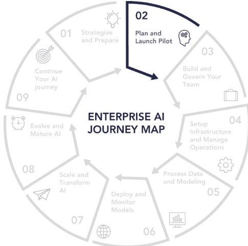

### 规划与启动

- 确定您 AI/ML 项目的用例
- 评估 AI/ML 平台和服务
- 启动您的 AI 试点

### 目标

启动一个专注的 AI 项目，确保与业务目标、技术可行性和利益相关者参与保持一致

**图 10.1：规划与启动：启动您的 AI 试点**

> 注意 在进行成熟度评估的同时了解您公司的愿景和目标，有助于识别差距，并使您能够制定 AI 转型计划。这反过来又有助于您从试点过渡到生产，并将 AI 作为业务战略的核心部分。

### 启动您的试点

在 [第 5 章]() 的对齐阶段中，您了解到需要对公司内的 AI 进行成熟度评估，这将有助于解决业务、人员、数据/模型、平台、治理和安全等维度上的 AI 现状。

努力了解您公司的愿景、业务战略和目标，并将其与现状进行对比审查非常重要。这将帮助您在启动阶段实施概念验证时识别需要解决的差距。

一旦您完成了对齐阶段的现状评估，您应该清楚地了解 AI 采用的现状。您在 AI 战略、人才能力、数据管理、平台、机器学习、运营、治理框架、数据/基础设施和网络安全方面的能力应当清晰明确。

掌握这些知识后，您可以制定一份路线图，列出举措、资源分配和资金，以便从对齐阶段进入启动阶段，并专注于启动试点。

### 启动规划

您现在的重点是制定项目计划以启动试点，实施一个经过 AI 举措优先级排序后入选的特定用例。这归结为制定一份实施机器学习项目的计划。

作为成熟度评估练习的一部分，您现在有一份涵盖业务、人员、平台、运营、治理、机器学习和安全方面的行动项目清单。其中一些行动项目是短期的，专注于启动工作；相比之下，其他行动项目是长期的，专注于在整个组织中提高 AI 采用率。长期行动项目纳入您的 AI 转型计划，而短期项目则需要融入您的项目计划中，专注于执行您的试点。我将在第 23 章更详细地讨论 AI 转型计划。图 10.2 显示了从设想到启动试点所需的某些任务。

### 设想阶段回顾

此时，您已有一份与各利益相关方合作识别的计划清单，这些计划构成了您的 AI 项目组合。您还对这些计划进行了优先级排序，并筛选出一两个用例，将其作为试点的一部分来实施。此外，您已定义了几个 KPI，用于衡量启动完成后的成功程度。以下是您在该阶段可以启动的一些其他活动：

| 变更管理活动 | 您已启动一些变更管理活动，以实现领导层对齐，并向关键利益相关方传达 AI 愿景以获得他们的支持。您还建立了一个精简版的 COE，即来自不同部门的 A 级人才组成的团队，作为核心团队参与试点工作。 |
| --- | --- |
| 人才管理 | 您还需要协助解决实施试点所需人才方面的任何缺口，例如数据科学家、机器学习工程师或将负责建立平台的云工程师。 |
| ML 平台 | 从 ML 平台角度来看，您已确定建立 AI 平台所需的步骤，以及启动期间需要解决的任何缺口。 |
| 数据能力 | 您已评估数据的现状，识别了任何数据缺口，以及收集、摄取、清理和处理数据以供模型使用所需的数据基础设施。 |
| 治理 | 最后，从治理角度来看，您已通过与赞助商合作为本次启动筹集了资金，理想情况下，赞助商应是一位理解技术价值、支持此次启动并期待确保其成功的高管。 |
| 伦理考量 | 在设计模型时，您应考虑应纳入的原则，以确保 AI 模型的实施值得信赖、符合道德并承担社会责任。 |

- 完成成熟度模型评估
- 为启动筛选用例
- 识别短期和长期行动项目

- 识别计划
- 启动变更管理计划
- 组建小型 COE 团队

- 制定 ML 项目计划
- 定义项目 KPI
- 定义负责任 AI 设计原则

**图 10.2：** 从设想到对齐再到启动试点的活动

**注意** 完成 AI 成熟度模型评估后，利用所得洞察为您的 AI 启动制定路线图和项目计划。

### 机器学习项目规划

既然您已完成对齐阶段，您就有一套清晰的行动项目可供遵循，并且理想情况下，您已制定好执行试点启动的项目计划。在这方面，下一节将讨论机器学习生命周期、开展机器学习项目时的重要注意事项，以及如何制定业务目标、定义 KPI 并判断机器学习是否确实是解决该问题的正确方案。

### 遵循机器学习生命周期

在实施机器学习项目时，您会遵循一定的生命周期，这是一个迭代过程，包含一些您应遵循的明确步骤，以确保实施成功。

您可以将该循环细分为以下阶段：

- 定义业务目标
- 将问题表述为机器学习问题
- 处理数据（收集、预处理和特征工程）
- 构建模型（测试、调优和评估）
- 部署模型（推理和预测）
- 监控模型

请注意，这些阶段不一定按顺序进行，且某些阶段之间存在反馈循环，例如问题定义与监控、数据准备与模型构建、模型开发与模型监控之间。

下一节将简要考察图 10.3 中所示的每个阶段，更详细地讨论业务目标，并表述机器学习问题。

图 10.3：机器学习阶段

### 业务目标识别

业务目标识别在第 5 和第 6 章中有详细介绍。在此阶段，你需要执行以下操作：

| 识别业务问题 | 首先，你应当清楚想要解决的问题以及解决该问题能带来的业务价值。 |
| 衡量业务价值 | 你应能根据具体的业务目标和成功标准来衡量业务价值。业务目标是你想要达成的目标，而业务价值是你期望在此次实施结束时实现的价值。 |

## 机器学习问题定型

在此阶段，你需要执行以下操作：

| 识别机器学习问题类型 | 你的主要重点是将业务问题转化为机器学习问题。你需要识别机器学习问题的类型，例如它是分类问题、回归问题、异常检测问题等等。 |
| 识别标签 | 给定一个数据集，你将识别其中一个属性作为标签，即需要预测的属性。 |
| 定义性能和误差指标 | 专注于优化性能和误差指标。 |

遵循一个定义好的机器学习生命周期，其中包括定义业务目标、将问题定型为机器学习问题、数据处理、模型构建、模型部署和模型监控，且部分阶段之间存在迭代反馈循环。

## 数据处理

数据处理在第 15 章中有更详细的介绍。数据在构建过程中必须以正确的格式输入模型。

| 数据收集与准备 | 这涉及识别数据的不同来源（内部和外部）以及从多个来源收集数据。你还必须预处理数据，例如处理缺失数据问题、格式化数据类型以及处理任何异常或离群值。 |
| 特征工程 | 特征工程涉及创建新数据、转换数据、提取以及从现有数据集中选择数据子集。 |

## 模型开发

模型开发在第 17 章中有更详细的介绍。模型开发包括以下内容：

| 模型构建、调优与评估 | 在模型部署到暂存和生产环境之前，对模型进行构建、测试、调优和评估。 |
| 设置用于自动部署的 CI/CD 管道 | 这还包括根据一组标准设置 CI/CD 管道，以自动部署到暂存和生产环境。 |

> **注意** *CI/CD 管道是一组工具，用于从源代码控制到生产部署自动化软件部署过程。*

## 模型部署

一旦模型经过测试、调优、评估和验证，就可以部署到生产环境中进行推理和预测。第 18 章介绍了此内容。

## 模型监控

模型监控涉及持续监控模型的性能，使其能够针对一组特定的所需参数表现良好，并主动检测和缓解性能退化。第 19 章介绍了此内容。

> **提示** 当模型性能趋于退化时，使用代表当前数据分布的新数据重新训练模型非常重要。

## 实操项目实施练习：规划并启动你的 AI 试点项目

你的最终目标是有效实施 AI 并在整个企业中进行规模化。然而，你需要从某个地方开始，而这就是本练习的目标——帮助你规划并启动试点项目。

| 任务描述 | 任务负责人 | 交付物 |
|---|---|---|
| 识别业务问题 选择并定义可以使用机器学习解决的业务问题。有关业务目标识别，请参阅 [第 6 和第 7 章](#)。 | 业务分析师、项目经理 | 业务问题陈述、目标 |
| 变更管理 制定策略，使领导层和利益相关者与 AI 愿景保持一致。 | 项目经理、领导团队 | 变更管理计划 |
| 评估能力并识别差距 评估当前的 AI 成熟度并识别改进领域。 | AI 团队、数据科学家 | AI 成熟度评估、差距分析 |
| 制定项目计划 制定包括行动事项、资源分配和路线图的项目计划。 | 项目经理 | 项目计划、路线图 |

| 任务描述 | 任务负责人 | 交付物 |
|---|---|---|
| **伦理考量** 为模型的设计和实施概述伦理原则。有关伦理的更多详细信息，请参阅第 4 章。 | AI 团队、伦理监督委员会 | 伦理准则 |
| **定义机器学习问题** 将业务问题转化为机器学习问题。 | 数据科学家 | ML 问题定义、指标 |
| **数据处理** 收集、预处理并准备用于模型构建的数据。 | 数据工程师、数据科学家 | 处理后的数据集 |
| **模型构建和调优** 训练、测试、调优并评估所选的机器学习模型。 | 机器学习工程师 | 训练后的模型、评估报告 |
| **设置 CI/CD 管道（可选）** 创建或模拟用于自动部署的 CI/CD 管道。 | DevOps 团队 | CI/CD 管道设置 |
| **将模型部署到生产环境** 将经过验证的模型部署到暂存或生产环境。 | DevOps 团队、机器学习工程师 | 已部署的模型 |

| 任务描述 | 任务负责人 | 交付物 |
|---|---|---|
| **实施模型监控** 概述并实施持续监控模型性能的策略。 | 数据科学家、运维团队 | 监控计划、监控工具/设置 |
| **反思与文档化** 反思所学经验、成功与挑战，并记录该过程。 | 整个项目团队 | 反思报告、完整的项目文档 |

## 工作簿模板：AI/ML 试点启动检查表

从本书的下载部分下载“AI/ML 试点启动检查表”模板 (www.wiley.com/go/EnterpriseAIintheCloud)。使用此模板确保你已处理 AI/ML 项目的所有关键活动和里程碑，以确保试点启动成功。它将帮助你应对启动 AI/ML 项目时的各种挑战和任务。

## 摘要

本章介绍了你在从对齐阶段过渡到启动阶段时所采取的各个步骤。本章讨论了如何为机器学习项目的启动做准备。它讨论了典型机器学习项目的不同阶段：业务目标、问题定型、数据处理、模型开发、部署和监控。本章还包含一个实操练习，用于规划和启动 AI 试点。

在下一章中，让我们讨论启动一些组织变更管理步骤，以确保你的员工全心全意地拥抱你的 AI 计划。

## 复习问题

这些复习问题包含在每章末尾，帮助你测试对信息的理解。答案在以下部分中。

- 1. 实施 AI 试点的核心团队的重点是
  - A. 建立平台
  - B. 实施 AI 计划
  - C. 进行成熟度模型评估
  - D. 建立卓越中心

- 2. 在机器学习问题定型中，为什么需要标签？
  - A. 进行预测。
  - B. 评估模型。
  - C. 它识别机器学习问题的类型。
  - D. 它是在特征工程中创建的特征。

- 3. 在机器学习生命周期中，机器学习问题定型阶段的主要重点是什么？
  - A. 数据处理
  - B. 模型定义
  - C. 定义业务目标
  - D. 识别机器学习问题的类型

- 4. 特征工程用于
  - A. 评估模型的特征
  - B. 收集和预处理特征
  - C. 创建新数据并转换现有数据
  - D. 识别业务数据

- 5. 哪个阶段涉及将业务问题转化为机器学习问题？
  - A. 数据处理
  - B. 模型部署
  - C. 机器学习问题定型
  - D. 业务目标识别

## 答案要点

- 1. A
- 2. A
- 3. D

- 4. D

- 5. C

# PART IV 构建与管理你的团队

人们创造奇迹！第四部分探讨了为赋能你的员工队伍所需的组织变革。我将引导你完成启动试点项目和组建梦之队的步骤。这一切都是关于培育事物中的人性一面。

# 11 通过组织变革管理赋能你的员工

> 文化吞噬战略。
> -Peter Drucker

本章是人工智能实施方法论中的关键一步。至此，你已对人工智能云生态系统、用例和人工智能战略有了良好的掌握。但关键点来了：确保你的AI计划得到你的员工全心拥护（参见图11.1）。

图11.1：构建与管理你的团队：通过组织变革管理赋能你的员工

本章首先探讨如何演进公司文化，以促进AI采用、带来创新并实现有意义的变革。意识到单靠技术不够，该方法论深入探讨了重新设计组织的策略，以实现敏捷性，并在核心层面重新思考AI采用。它建立在三项策略之上。

- 演进文化
- 重新设计组织
- 使组织保持一致

正是这里，本章讨论的关键交付成果（如文化演进计划和组织重新设计计划）派上用场。

你需要让整个组织（从高管到一线员工）围绕AI采用保持一致。在变化不断的世界中，掌握组织变革管理是必须的。本章将帮助你获得自信领导变革所需的洞察和工具，使你的AI计划不仅能生存，还能蓬勃发展。让我们开始吧。

### 以人为本的方法取得成功

是人们将决定该计划是否会成功。让他们支持该计划有助于加速你的AI之旅，使他们对变革持开放态度，同时推广持续学习和成长的文化。此处讨论的八个以人为本的方面着重于营造正确的文化、建立合适的组织结构、获得领导层支持以及转型员工队伍。

图11.2显示了你需要从人员角度关注的关键问题。

- 演进你的文化
- 转型你的领导力
- 培养你的云技能
- 培养AI技能
- 转型你的员工队伍
- 加速你的变革
- 重新设计你的组织
- 使你的组织保持一致

### 案例研究：一家公司如何利用以人为本的方法借助AI实现自我转型

一家零售公司希望利用云和AI技术改善其零售运营并获得竞争优势。在“使组织保持一致”阶段的差距评估显示，他们需要解决人们的需求和期望，以确保实施成功。

### 他们演进了文化

他们的差距评估显示，其组织结构非常等级森严且部门孤立。这阻碍了他们采用云和AI技术。为了解决这一问题，他们决定建立协作和创新的文化。他们通过推广跨职能团队来实现协作，并通过实验和学习的文化鼓励创新。

### 他们转型了领导力

他们还意识到必须改变领导方式，以跟上时代步伐并采用云和AI等创新技术。他们引进了精通云和AI技术的新领导层。他们可以以身作则，激励团队，并推动创新。

### 他们培养了云和AI的技能

他们意识到需要教育员工队伍，以利用云和AI技术的最新进展。他们为员工提供培训课程、奖励计划、认证和在职培训机会，以学习新技能。

### 他们转型了员工队伍

他们意识到，要实施和运营新的AI项目，必须转型员工队伍。他们通过评估当前的技能和能力，并通过培训计划和职业发展机会重新培训员工来弥补差距，从而实现了这一目标。

### 他们加速了变革过程

他们注意到变革过程非常缓慢，必须加快进度。他们通过创建变革加速框架实现了这一目标。这包括实施变革管理计划、向员工传达变革愿景、征求员工反馈、解决他们的担忧，并定期传达进展情况。我们在第7章“管理战略变革”中详细讨论了这一点。

### 他们重新设计了组织

他们注意到沟通和决策本可以更高效。他们通过重新设计组织结构（创建跨职能矩阵团队、更改汇报关系、实现分散决策）来解决这一问题。

### 他们为业务成功使组织保持一致

他们将战略、流程、系统、组织结构和文化结合起来，以提高成功的概率。他们使项目与企业愿景和战略保持一致。他们相应地分配资源，使组织投资于最重要的优先事项。

> 最佳实践提示 要在企业级成功实施AI，应优先采用以人为本的方法，通过演进文化、转型领导力、培养云和AI技能、转型员工队伍、加速变革过程和重新设计组织来实现。

正如你所见，在企业级实施云和AI时，你需要关注员工。在接下来的两个部分中，你将看到如何使用全面的变革管理方法论系统地解决人员问题。作为该方法论的一部分，我涉及这些能力的目标、任务和交付成果，例如文化演进、组织重新设计、组织保持一致、变革加速、领导力转型、员工转型以及云/AI技能提升。

图11.2：企业级AI的变革管理关注领域

请注意，在选择AI/ML平台和服务时，你也需要实施变革管理技术。AI平台自带培训模块，可能影响日常工作流程，并可作为协作的催化剂。AI还可能需要额外的安全控制。因此，在采用新的AI/ML平台或服务时，获得利益相关者的支持非常重要，并采用这些促进成长和发展的变革管理实践。

### 为AI采用、创新和变革演进文化

如图11.3所示，Gartner在其研究中报告称，变革会带来归入以下七大类的文化紧张关系。1他们甚至发现，许多员工面临不止一种紧张关系。

图11.3：因变革而经历文化紧张的员工比例

无论压力类型如何，事实是这将影响他们的绩效。因此，评估组织当前的文化以及人们对变革的反应非常重要。基于此次评估，你必须采取一定数量的步骤，如图11.4和11.5所示。这些步骤的重点是引入能够促进创新的变革，使他们围绕变革价值观保持一致，并建立开放的文化以鼓励冒险。你还应提供资源来建立他们的能力，并促进团队间的协作。

> **提示** 如果你管理好公司文化，你将看到更高的员工参与度、更高的积极性和更高的生产力，这些将转化为创新和客户满意度。

### CURRENT STATE CULTURE ASSESSMENT

Conduct a current state assessment of the culture and identify areas to improve for AI adoption.

### DEVELOP CULTURE COMMUNICATION PLAN

Develop a cultural evolution communication plan to get employee buy-in.

### MONITOR AND MEASURE

Monitor the effectiveness of the culture evolution plan and make necessary improvements to increase its effectiveness.

### IMPLEMENT CULTURE EVOLUTION PLAN

Implement a cultural evolution plan to target employee groups through training programs, workshops, and mentoring.

### FIGURE 11.4: Evolve your culture: phases and tasks

| Phase | Details |
| :--- | :--- |
| **设想** | **当前状态评估：** 一家公司在评估中发现，员工担心 AI 等创新技术，原因是潜在的工作替代和缺乏技能。  **结果** 为解决该问题，该公司制定了一项文化演变计划，重点是提高对 AI 的认识，并开展培训计划，帮助员工掌握 AI/ML 技术。 |
| **对齐** | **沟通** 该公司制定了沟通计划，通过全员大会、研讨会和培训计划向员工宣传文化演变计划。他们还创建了一个内部 AI 社区，以促进协作和学习。  **结果** 该公司让员工认可了该沟通计划。 |
| **启动** | **培训** 该公司对领导层和一线员工都进行了有关 AI 的培训。  **指导** 该公司将员工与经验丰富的专业人士配对，提供指导和在职培训。  **奖励** 他们使用奖励来鼓励冒险和创新。 |
| **扩展** | **衡量** 该公司通过员工反馈和调查评估了其文化演变计划的成功情况。它进行了必要的调整，通过改进培训和指导来优化该计划。  **结果** 该公司能够维持其文化演变工作并长期坚持，从而在整个公司范围内改善了 AI 的采纳情况。 |

### FIGURE 11.5: Evolve your culture: phases and deliverables

## Redesign Your Organization for Agility and Innovation with AI

The organizational design aims to develop the appropriate structure for your organization to promote agility and innovation and ensure the successful completion of your AI initiatives with appropriate roles, structures, and responsibilities. Figure 11.6 captures the various steps and deliverables you can focus on for this track.

### FIGURE 11.6: Redesign your organization: tasks and deliverables

### ALIGNING YOUR ORGANIZATION AROUND AI ADOPTION TO ACHIEVE BUSINESS OUTCOMES

The focus of organizational alignment is to ensure that the business and technology teams are aligned toward adopting AI to achieve business outcomes. It involves aligning strategy, processes, systems, culture, team structures, and talent. Achieving proper organizational alignment involves alignment between business strategies and technology strategies, business strategy with organizational structure, and properly structured processes and systems. You should also ensure project prioritization, cultural alignment, and the proper execution of the change accelerated framework discussed in Chapter 7 titled “Managing Strategic Change.”

### NOTE

Chapter 5 titled “Envisioning and Aligning Your AI Strategy” discussed aligning the organization around the AI vision and strategy. That theme continues to play throughout the book. For example, the people-centric alignment plays an even more vital role at the ground level when it comes to choosing an AI/ML platform or service. It only continues to increase in importance as you scale your AI capabilities. You learn about this more in Part VIII of this book.

Figure 11.7 shows different components that need to be aligned as part of ensuring organizational alignment.

### FIGURE 11.7: Organizational alignment

## HANDS-ON EXERCISE FOR CULTURAL EVOLUTION AND ORG REDESIGN TO ADOPT AI

This exercise gives you tangible experience in dealing with org change management practices in the context of AI adoption.

| TASK DESCRIPTION | TASK OWNERS | DELIVERABLES |
|---|---|---|
| **Assess Cultural Tensions** Identify cultural tensions using surveys, interviews, etc. You can use Figure 11.3 to identify different categories of tension. | HR department, organizational design team | Cultural report |
| **Develop a Cultural Evolution Program** Create a strategy to evolve culture focusing on innovation, alignment, risk-taking, resource-building, collaboration. Refer to Figures 11.4 and 11.5 for the steps, phases, and tasks. | Senior management, HR department | Cultural evolution program and strategy document |
| **Create an Organizational Redesign Plan** Assess current organizational structure for agility and innovation. Develop redesign plan for implementing AI. | Senior management, operations team | Organizational redesign plan |
| **Develop Alignment Strategies** Create a comprehensive alignment plan aligning all parts of the organization with AI. | Senior management, strategic planning team | Organizational alignment plan |
| **Implement and Monitor** Implement the strategies. Continuously monitor progress, making adjustments as necessary. | Senior management, operations team, organizational development team | Status reports |

## HANDS-ON ROLE PLAY EXERCISE TO INCORPORATE PEOPLE-CENTRIC APPROACH TO AI (FOR STUDENTS)

Objective: Including people-centric elements to an AI implementation such as evolving the culture, transforming the leadership, developing the workforce, and aligning the organization around AI.

- **Instructions:**
- **Step 1:** Divide your team into groups of three to five with each group representing a particular business unit, such as HR, marketing, strategy, operations, and so on.
- **Step 2:** Assign each group a specific role such as evolving culture, transforming leadership, cloud/AI fluency, workforce transformation, change acceleration, organizational redesign, and alignment.
- **Step 3:** Each group should discuss challenges, opportunities, gaps, and strategies for each area and present their findings and recommendations.
- **Step 4:** Engage in collective discussions with all the groups to drive overall organizational alignment.

## WORKBOOK TEMPLATE: ORG CHANGE MANAGEMENT PLAN

Download the “Org Change Management Plan” template from the download section of the book (www.wiley.com/go/EnterpriseAIintheCloud). Use this template to manage changes in your company's processes, systems, and people roles. It will help you to tackle the changes effectively and ensure successful adoption of AI.

## SUMMARY

This chapter explained how companies can empower their people through organizational change management to build a competitive advantage. The key takeaway from this chapter is that technology won't be enough to bring change and innovation at the enterprise scale.

The chapter started by understanding the different cultural tensions that might arise during major transformational efforts and devised strategies to address them. This chapter provided step-by-step instructions to foster innovation, risk-taking, collaboration, and alignment with transformational values.

Remember that it's important to align your organization at all levels to ensure that strategy, processes, systems, culture, and teams work together to achieve the organizational goals. Prioritizing people and culture to drive organizational change, continuous learning, growth, and innovation will translate to business success and customer satisfaction.

In the next chapter, let's discuss building a high performing team that can kickstart your AI transformation effort.

## REVIEW QUESTIONS

These review questions are included at the end of each chapter to help you test your understanding of the information. You'll find the answers in the following section.

1. 以下哪项不是AI项目成功的唯一因素？
- A. 领导支持
- B. 员工培训与发展
- C. 充足资源
- D. 变更管理计划

2. 在为AI采用、创新和变革而演进文化时面临哪些挑战？
- A. 员工害怕采用现代技术。
- B. 员工缺乏必要的技能。
- C. 员工抗拒变革。
- D. 难以衡量AI项目的投资回报率。

3. 以下哪项不是构建AI计划竞争优势的八大关注领域之一？
- A. 战略与规划
- B. 人员
- C. 数据
- D. 地点
- E. 平台
- F. 运营
- G. 安全
- H. 治理

4. 案例研究公司确定采用云和AI技术的障碍是什么？
- A. 缺乏资金
- B. 层级化和孤岛式组织结构
- C. 缺乏市场需求
- D. 技术不兼容

5. 组织对齐在AI采用方面关注什么？
- A. 忽视变更管理的必要性
- B. 确保业务团队和技术团队朝着采用AI以实现业务成果的方向保持一致
- C. 仅关注技术战略而不考虑业务战略
- D. 用AI技术替换所有业务流程

## 答案要点

- 1. D
- 2. A, B, C
- 3. D
- 4. B
- 5. B

## 注释

- 1. www.gartner.com/en/corporate-communications/trends/diagnosing-cultural-tensions#:~:text=During%20times%20of%20significant%20change,and%20helping%20employees%20build%20judgment.

# 12 构建你的团队

> 聚合是开始，保持聚合是进步，协作是成功。
>
> ——亨利·福特

本章将着手开展启动AI项目所必需的组建协作团队这一基本任务。组建协同团队的重要性不容低估。本章深入探讨AI实施中涉及的各种AI/ML角色和职责，无论是核心角色（如数据科学家和机器学习工程师），还是同样关键的支持角色（如安全工程师）。

鉴于AI正处于舞台中心并发展迅速，即使是非核心角色也在迅速成为核心角色。然而，关键在于根据您的特定业务、项目和公司要求定制这些角色，而这正是本章的作用所在。您还应擅长转换传统角色（如系统管理员和业务分析师），以发挥公司现有的知识库和专业技能。这加上审慎利用外部技能组合，可以弥补任何即将出现的技能差距。

组建团队几乎是一门艺术；目标是组建一支多元化、跨职能的团队，具有清晰的角色和职责，以推动针对业务目标定制的有效AI转型。请参见图12.1。

这支梦之团队将负责管理您的AI运营，从第15章的数据处理、第19章的模型监控，再到第20章的AI伦理管理。

## 了解ML项目中的角色和职责

本节回顾ML项目所需的角色和职责。作为选择过程的一部分，以下各部分概述了一些需要考虑的重要事项。

## 为AI转型组建跨职能团队

作为AI转型计划的一部分，无论您担任什么角色，必须做的重要事情之一就是识别一个团队，该团队不仅能帮助您完成整体转型，还能在发布阶段部署AI原型。

### 构建并管理您的团队

- 通过组织变革管理赋能您的员工
- 构建您的团队

**目标**

组建一支多元化、跨职能的团队，具有清晰的角色和职责，以推动针对业务目标定制的有效AI转型

**图12.1：构建并管理您的团队**: 构建您的团队

在实施首个企业级AI/ML项目时，您将面临识别合适资源的一些挑战。这是因为ML平台有许多组件，您需要汇集公司多个组织单元的技能组合。这包括数据科学、数据管理、模型构建、治理、云工程、职能和安全工程技能。

## 采用云和AI转型当前角色

您需要评估云如何潜在地释放当前员工以专注于创新。这反过来将决定在将ML平台和AI应用迁移到云端时，他们的工作角色将如何改变。

因为云带来了速度、规模、生产力和创新的优势，团队现在和未来可以专注于更大规模、更具影响力、更具创新性和更具变革性的努力。

速度来自于尝试多种模型的能力，而规模则带来了服务更广泛客户群、地域和渠道的能力。采用基础设施即代码、代码部署流水线和安全即代码，可以实现更好的合规性，并通过自动化提高生产力。

当前的本地部署角色包括IT解决方案架构师、系统管理员、网络管理员和桌面管理员。应用程序管理员和数据库管理员可能需要重新培训/重新设计。例如，以前负责管理现场硬件和基础设施的系统管理员需要被解除部分这些职责，因为云提供商（如AWS、GCP或Azure）现在管理这些内容。

> **提示** 组建具备适当技能组合的跨职能团队，同时根据需要调整现有工作角色，以与您的公司和项目目标保持一致。

## 定制角色以适应您的业务目标和需求

请注意，实际的工作角色和职责因公司、项目目标以及特定计划的其他相关因素而异。您会发现，这些角色和职责的定义往往不够明确，且角色之间经常存在重叠。我建议您将其作为指导原则，然后根据您组织中拥有的技能组合以及您可能需要启动的填补差距的招聘计划，对其进行定制，以符合您的具体需求。

注释 如果没有合适的技能，大多数AI计划都有更高的失败风险。

以下各部分回顾基于云的AI场景中的新角色。我们先来看看核心团队，然后是他们需要协作的扩展团队。图12.2总结了典型机器学习项目中涉及的角色。

### 核心角色

- AI架构师
- 数据科学家
- 数据工程师
- 机器学习工程师
- MLOps工程师
- 业务分析师
- AI伦理专家
- IT和云工程师

### 辅助角色

- 领域专家
- 数据分析师
- 模型风险经理
- 安全工程师
- 软件工程师
- 模型所有者
- IT审计员
- 等等

**图12.2：机器学习项目中的核心角色和辅助角色**

## 核心AI角色

AI项目需要几个角色。根据AI项目的类型，有些角色对项目成功至关重要，而在其他情况下则可能不是。一般而言，以下角色可以被视为核心角色。仅供参考，因为实际角色可能因您的具体需求而有所不同。

- AI架构师
- 数据科学家
- 数据工程师
- 机器学习工程师
- MLOps工程师

### AI架构师

AI架构师是一个新兴角色，主要专注于定义AI引入的变革性架构。您可以将AI架构师视为AI计划中业务利益相关者、数据工程师、数据科学家、机器学习工程师、DevOps、DataOps、MLOps及其他参与者之间的粘合剂。他们负责以下事项：

| 任务 | 说明 |
| --- | --- |
| 制定整体AI战略 | 识别AI应用机会和用例，以及实现这些用例所需的底层业务和技术要求。包括制定AI路线图。 |
| 设计AI架构 | 选择合适的AI技术，并确保适当的数据质量和安全性。 |
| 定义构建和部署AI应用程序的整体框架 | 确保新的AI技术与现有业务流程和应用程序集成。 |

### 数据科学家

数据科学家角色的核心是接收数据，并通过创建和运行模型、提取洞察来优化数据，以支持业务决策。这是确保项目成功的关键角色。定义问题是该角色必须首先完成的事情之一，需与业务利益相关者合作。

### 数据工程师

数据工程师与数据科学家紧密合作，向其提供数据。他们主要关注以下事项：

- 数据获取、集成、数据建模、优化、质量和自助服务

- 确保数据管道已适当实现并运行良好，以便模型获得正确格式和质量的数据

## 机器学习工程师

机器学习工程师角色是 AI 项目的另一个关键角色，与数据科学家角色存在一定重叠，但也存在一些微妙差异。

尽管数据科学家更专注于从模型中得出洞察，但机器学习工程师更专注于基于数据工程师提供的干净数据将模型部署到生产环境中。

## MLOps 工程师

MLOps 工程师构建和管理自动化管道，以便将 ML 平台和 ML 管道用于完全/部分自动化的 CI/CD 管道。这些管道自动化构建 Docker 镜像、模型训练和模型部署。MLOps 工程师还在整体平台治理中发挥作用，例如数据/模型血缘、基础设施和模型监控。

## 云工程师

云工程师旨在确保云基础设施安全、可靠且具成本效益。他们负责以下工作：

| 职责 | 描述 |
|---|---|
| 搭建云基础设施 | 这包括配置虚拟机、设置数据库和存储。还可能包括配置基于云的服务，例如 Amazon SageMaker、Azure Machine Learning Studio 和 Google Cloud 平台。 |
| 设置账户并与安全团队协作 | 这包括创建和管理用户账户、设置访问控制，并与安全团队合作以确保基础设施安全。 |
| 管理安全性和访问控制 | 这包括监控和执行安全策略、管理用户权限以及响应安全事件。 |
| 监控系统性能 | 这包括监控资源使用情况、识别瓶颈以及实施节省成本的策略。 |

## 业务分析师

业务分析师在 ML 生命周期早期介入，并将业务需求转化为可执行的任务。他们的主要角色是弥合业务利益相关者与技术团队之间的差距。

## 数据科学家与业务分析师

数据科学家负责收集、清洗和分析数据。他们利用统计学和机器学习知识开发可用于预测或决策的模型。业务分析师负责理解 AI/ML 项目的业务需求和要求。他们与数据科学家合作，以确保项目符合业务目标。

数据科学家通常具有数学、统计学和计算机科学方面的坚实背景。业务分析师通常在商业、经济学和沟通方面具有坚实背景。

数据科学家通常更关注 AI/ML 的技术方面，而业务分析师通常更关注业务方面。然而，这两个角色对 AI/ML 项目的成功都至关重要。

业务分析师需要了解业务需求，并将其转化为开发人员和数据科学家可用于构建 AI/ML 系统的技术规格。他们还需要分析数据，并向利益相关者提供关于系统运行情况及其改进方法的洞察。

## 用例示例

假设你正在为一家电信公司的 AI/ML 项目担任业务分析师。该公司的一个基本业务问题是客户流失，即客户取消订阅并转向竞争对手的服务。该公司希望使用 AI/ML 预测哪些客户可能会流失，以便采取措施挽留他们。

作为业务分析师，你的第一步是从利益相关者那里收集需求。你需要了解有哪些数据源可用，需要应用哪些业务规则，以及系统的输出应该是什么样子。然后，你需要与数据科学家和技术团队合作，设计系统架构并定义数据处理管道。

系统构建完成后，你必须与数据科学家合作分析数据，并向利益相关者提供洞察。你需要监控系统性能并提出改进建议。例如，特定客户在遇到网络问题时更容易流失，因此你应该建议公司在这些区域投资改进其网络基础设施。

总体而言，作为 AI/ML 项目中的业务分析师，你的角色至关重要，可以确保 AI/ML 系统与业务目标保持一致，并且利益相关者了解系统性能和潜在的改进措施。

## 非核心或支持角色

除核心角色外，还有几个角色对 AI 项目的成功并非至关重要，但可以促进流程。请注意，随着组织中 AI 采用的成熟，一些支持角色正在转变为核心角色。

## 领域专家

领域专家拥有宝贵的职能知识，并了解实施 ML 解决方案的环境。他们承担以下工作：

| 职责 | 描述 |
|---|---|
| 需求收集 | 帮助机器学习工程师和数据科学家开发和验证假设与假说。 |
| 设计参与 | 在 ML 生命周期早期介入，并在评估阶段始终与工程负责人保持密切联系。 |
| 行业合规 | 提供宝贵的洞察，并帮助确保项目遵守行业标准和最佳实践。 |

领域专家对其各自领域有深入了解，对于任何涉及专业知识的项目都至关重要。凭借其专业知识，项目可以成功，显著节省时间和金钱，并最大限度地减少声誉损失。因此，领域专家对于任何需要专业知识的项目都至关重要。

领域专家在医疗保健、金融与银行、零售与电子商务、制造、能源、农业、房地产等领域尤其重要。

> **注意** _如果没有领域专家，模型可能会在真空中创建，从而错过关键的行业要求，导致模型性能不佳。_

## 数据分析师

数据分析师是承担以下工作的专业人员：

| 职责 | 描述 |
|---|---|
| 数据收集与分析 | 收集、清洗、分析数据，并从中得出洞察。 |
| 业务解释 | 帮助业务利益相关者解释数据，以便做出业务决策。 |
| 探索性数据分析 | 进行探索性数据分析以识别模式和趋势，并使用数据可视化工具帮助业务利益相关者解释数据。 |
| 与数据科学家合作 | 在企业 AI 的背景下，还可能与数据科学家合作选择和预处理数据。 |
| 模型测试与验证 | 测试和验证模型，以确保其可靠且准确。 |

> **注意** 数据科学家的职责范围更广，深入进行高级计算和预测分析，而数据分析师专注于从数据中得出洞察以指导业务决策。在小型组织中，这两个角色可以由同一人担任。

## 模型风险经理

模型风险经理的主要职责是确保识别并缓解与模型相关的风险。他们必须确保模型可靠、准确，并符合监管要求。

模型风险经理确保以下工作：

| 职责 | 描述 |
|---|---|
| 负责任的部署 | 确保模型以负责任和合乎道德的方式部署，保护公司的品牌形象，并防止声誉风险。 |
| 数据管理 | 确保用于训练模型的数据没有偏见、准确且完整。 |
| 模型测试与验证 | 确保模型在部署到生产环境之前经过充分的测试和验证，通过多种场景进行测试，使其健壮，并能在意外情况下表现良好。 |
| 合规与透明度 | 通过与法律和合规团队合作，确保模型透明、可解释，并符合法律要求。 |

## 安全工程师

安全工程师的角色是确保 AI 系统端到端的安全，从管理数据、模型、网络和基础设施开始。他们需要承担以下工作：

| 职责 | 描述 |
|---|---|
| 实施安全控制 | 在 AI 系统的所有层面实施安全控制，从数据准备、模型训练、测试和部署阶段开始。 |
| 风险管理 | 识别和评估安全风险，实施控制措施以缓解风险，并评估这些控制措施的有效性。 |
| 事件响应 | 响应勒索软件攻击等安全事件，实时处理数据泄露，识别根本原因，并采取措施修复这些风险。 |
| 法律合规 | 通过与法律和风险团队合作，确保 AI 基础设施在数据隐私和安全方面符合法律要求。 |

| 职责 | 描述 |
|---|---|
| 模型安全 | 通过确保训练数据未被篡改且数据中未引入偏差，来管理机器学习模型的安全性。 |

## 软件工程师

软件工程师的职责包括以下内容：

| 职责 | 描述 |
|---|---|
| 集成与界面开发 | 将 AI 算法/其输出集成到其他后端应用程序中，并开发前端用户界面，供用户与模型交互。 |
| 部署 | 将 AI 解决方案部署到生产环境并管理不同的软件版本。 |
| 性能与安全 | 确保这些解决方案高性能、可靠、可扩展且安全。 |
| 维护 | 持续监控生产环境中的 AI 解决方案，识别漏洞，在需要时解决它们，并添加新功能。 |

## 模型所有者

模型所有者是一种新角色，主要负责模型的开发、维护、治理和性能。模型所有者通常是与业务利益相关者合作的技术人员。他们需要做以下事情：

| 职责 | 描述 |
|---|---|
| 安全与责任 | 确保模型能够安全且负责任地运行。 |
| 业务问题理解 | 理解模型应该解决的业务问题。 |
| 性能指标定义 | 定义用于评估模型的性能指标。 |
| 数据选择与偏差检查 | 选择用于训练模型的正确数据，并确保数据中没有偏差。 |
| 算法选择与部署 | 与数据科学家合作，选择合适的算法，对其进行配置，并在生产环境中部署。 |
| 模型监控 | 监控模型的性能，确保其准确、公平且透明地运行。 |
| 模型维护 | 通过考虑新数据、重新训练模型并解决任何问题来维护模型。 |

## 模型验证者

模型验证者负责以下事项：

| 职责 | 描述 |
|---|---|
| 模型测试与验证 | 测试和验证模型，以确保其准确且负责任地运行，同时满足业务目标和要求。 |
| 错误与偏差检查 | 确保模型在没有任何错误和偏差且公平的情况下运行，这可能包括为各种场景设计测试并进行统计分析，以检查模型中的偏差或局限性。 |
| 法律合规与文档 | 确保模型符合法律要求，并记录这些模型的工作方式的文档，以便与其他利益相关者、审计师和高级管理层共享。 |
| 模型改进建议 | 提供改进模型的建议。 |

## IT 审计师

IT 审计师负责分析系统访问活动，识别异常和违规行为，准备审计结果的审计报告，并推荐补救措施。其关注领域包括模型治理、数据完整性和管理、AI 应用程序安全性、伦理考量、AI 系统性能和可扩展性以及持续监控。

## 实践角色扮演练习：在 AI 项目中采用新角色

此练习旨在帮助每个人更好地理解自己的新角色，并学习这些角色如何相互协作。

| 任务描述 | 任务负责人（职能） | 交付成果 |
|---|---|---|
| **介绍：** 向参与者简要介绍 AI/ML 团队和角色的重要性。 | 协调员 | 了解 AI/ML 角色及其重要性 |
| **角色识别：** 在便利贴上列出所有所需角色。 | 协调员 | 角色的可视化表示 |
| **技能映射：** 映射每个角色所需的主要技能。 | 参与者，协调员 | 每个角色识别出的技能 |
| **团队组装模拟：** 模拟招聘小组为每个角色选择候选人。 | 分组参与者 | 每个角色选定的候选人 |
| **讨论与理由：** 讨论并证明所选候选人的合理性。 | 分组参与者，协调员 | 同意的候选人，了解招聘标准 |
| **角色相关性活动：** 通过假设情景了解角色如何相互作用。 | 分组参与者，协调员 | 了解团队动态和协作 |
| **记录关键经验：** 记录见解和反馈以供将来参考。 | 协调员，可能还有一名 HR 代表 | 记录的见解以指导未来的招聘 |

## 练习册模板：团队构建矩阵

从图书下载部分下载“团队构建矩阵”模板（www.wiley.com/go/EnterpriseAIntheCloud）。使用此模板为构建 AI 团队创建技能和角色矩阵。它将帮助您拥有成功实施 AI 项目所需的所有必要角色和技能。

## 摘要

本章讨论了为项目启动并确保 AI 系统高效开发、部署和管理而需要填补的角色和职责。它还讨论了根据项目的具体需求需要填补的核心角色和其他非核心角色。对这些角色的讨论应帮助您构建一份蓝图，以组建一支专业人才团队，他们可以通过承担职责和推动创新来应对 AI 开发的复杂性。请根据您公司的需求定制这些角色。

理解这些角色及其相互作用将帮助您规划团队结构、传达 AI 系统的愿景，并确保 AI 系统强大、安全、公平且合法合规。

在下一章中，我们将讨论构建强大的企业 AI 云平台，这将帮助您以最小的风险快速将模型从构思过渡到生产。

## 复习问题

这些复习问题包含在每章末尾，以帮助您测试对信息的理解。您将在以下部分找到答案。

- 1. 机器学习工程师的主要职责是 A. 运行模型并得出洞察
  - B. 确保数据管道得到正确实现
  - C. 制定整体 AI 策略
  - D. 将模型部署到生产环境

- 2. 业务分析师的主要角色是
  - A. 收集、清洗和分析数据
  - B. 开发和验证假设和假说
  - C. 连接业务团队和技术团队之间的差距
  - D. 制定项目计划

- 3. 模型所有者不执行以下哪项任务？
  - A. 算法选择与部署
  - B. 模型维护
  - C. 模型测试与验证
  - D. 性能指标定义

- 4. 谁确保 AI 模型符合法律要求并记录文档？
  - A. IT 审计师
  - B. 安全工程师
  - C. 模型验证者
  - D. 软件工程师

- 5. 哪个角色主要负责模型的开发、维护、治理和性能？
  - A. 安全工程师
  - B. 模型验证者
  - C. 模型所有者
  - D. IT 审计师

## 参考答案

- 1. D
- 2. C
- 3. C
- 4. C
- 5. C

# 第 V 部分

## 构建基础设施和管理运营

在这一部分，你要撸起袖子深入技术细节。第 V 部分就像你自己动手构建 AI/ML 平台的 DIY 指南。在这里，我将以自动化和规模为重点，讨论平台的技术要求和日常运营。这一部分是一份动手实操的工具包，适合那些渴望深入钻研技术细节的人。

# 13. 构建企业 AI 云平台基础设施

> 设计不仅仅是它的外观和感觉。设计是它的工作方式。
> ——史蒂夫·乔布斯

在本章中，你将通过构建企业 AI 云平台基础设施亲手实践（参见图 13.1）。到现在为止，你应该对战略愿景有很好的了解，已与利益相关者就 AI/ML 用例和业务指标达成一致，实施了变更管理流程，组建了团队，并且可能甚至对要采用的 ML 算法有了很好的了解。

## 图 13.1：构建企业 AI 云平台基础设施

构建可投入生产、强大的企业 AI 云平台基础设施非常重要，因为它可以帮助您以最短的时间和最小的风险将模型从构思过渡到生产。

本章不仅仅是关于理论；它关乎将 AI 集成到业务流程中，以实现自动化、降低成本、提高效率并创造新机遇。为此，您必须创建高效的模型，并构建一个可重复、强大、稳定、安全且能适应不断变化条件的企业 AI 系统。合适的基础设施将作为提供具有良好性能、可扩展性和可靠性的模型的坚实基础，并作为从试点项目过渡到全面 AI 运营的跳板。参见图 13.1。

在本章中，你

## REFERENCE ARCHITECTURE PATTERNS FOR TYPICAL USE CASES

- Review the typical reference architectures (AWS, Azure, and the Google Cloud Platform) for the most common use cases
- Review the general components of an ML platform
- Learn how to choose between building and buying a ready-made ML platform
- Learn how to choose between different cloud providers
- Review hybrid and edge computing and the multicloud architecture

There are close to 200 services provided by AWS and this number keeps growing. This becomes challenging for companies attempting to choose the correct tools for the right problem and map them to various use cases. This section reviews a few reference architecture patterns so you can use them to customize your implementation based on your specific project needs. This can help you create your future-state strategy and gain insights from big data processing, data warehousing, visualization, and AI/ML to prepare for the future. Those architectural patterns are related to the following five use cases:

- Customer 360-degree architecture
- Event-driven architecture with IoT data
- Personalized recommendation architecture
- Real-time customer engagement
- Data anomaly and fraud detection

### Customer 360-Degree Architecture

Customer 360-degree architecture can be used to increase customer retention and profitability by improving customer service, increasing sales, and improving marketing campaigns. Building a 360-degree customer view involves aggregating data from multiple data sources into a single unified solution, from which you can draw the necessary insight about your customers.

Building this architecture, as shown in Figure 13.2, involves four steps.

| STEP NUMBER | STEP NAME | DESCRIPTION | POSSIBLE AWS COMPONENTS |
|---|---|---|---|
| 1 | Data sources | Ingest the data from multiple sources into a single data source. Data can come from SAP, ERP, CRM, websites, Salesforce, Google Analytics, and so on. | AWS Database Migration Service, AWS Glue |
| 2 | Knowledge graph system | Build a unified customer profile by implementing a graph-based knowledge system to identify new customer segments and build customer hierarchies. | Amazon Neptune |
| 3 | Intelligence layer | Build an intelligence layer by offloading the data into Amazon Redshift or S3 so that insights can be drawn using analytical tools such as Amazon Athena. | Amazon Redshift, Amazon S3, Amazon Athena |
| 4 | Activation layer | Use the insights from the intelligence layer and enrich it with recommendations or predictions from AI/ML to create the next best action and personalize customer experiences. | AWS Lambda, Amazon Personalize |

**FIGURE 13.2**: Customer 360-degree architecture

Figure 13.3 shows an implementation of the customer 360-degree architecture using AWS components. You should be able to build similar architecture using Google or Azure Cloud components.

NOTE The customer 360-degree architecture has four steps: data ingestion, knowledge graph system, intelligence layer for insights, and activation layer for personalized customer experiences.

- **DATA SOURCES**
  - CRM
  - ERP
  - SFDC
  - Social media
  - Mobile
  - POS
  - MDM
  - Sensors
  - Chat
  - Call center
  - Images
  - Videos
  - Emails

- **DATA INGESTION**
  - REST API
  - Streaming
  - ETL (Extract, Transform, Load)
  - FTP

- **CONNECTED CUSTOMER 360**
  - Data Lake (S3)
  - Data Warehouse (Amazon Redshift)
  - Feature Store (Amazon Neptune)
  - Graph Database (Feature Store)
  - Catalog
  - Data Discovery
  - Data Lineage
  - Data Quality
  - Data Lifecycle

- **DATA HARMONIZATION**
  - Transforms, Aggregate
  - Deduplication, Entity Linking
  - Ontology Creation, Refinement

- AWS Identity Access Management
- AWS Key Management Service
- AWS Secret Manager
- Logging (Amazon CloudWatch)
- Auditing (AWS CloudTrail)
- CI/CD Stack

- **INTELLIGENCE/ACTIVATION**
  - SQL Query (Amazon Athena)
  - Data Warehouse (Amazon Redshift)
  - Business Intelligence (Amazon QuickSight)
  - AI/ML

- **CONSUMPTION**
  - Digital Channels
  - Call Center
  - Data Exchange

**FIGURE 13.3:** Customer 360-degree architecture using AWS components (AWS components shown in bold)

### EXERCISE: BUILDING A CUSTOMER 360-DEGREE VIEW ARCHITECTURE USING AWS

This is an experiential learning exercise that allows the team members to apply their theoretical knowledge of AWS services into practice and acquire AWS skills.

| STEP NAME | TASK OWNER | TASK DETAILS | DELIVERABLE |
|---|---|---|---|
| Set up data sources | Data engineer | Create mock data that represents different data sources (CRM system, web analytics, etc.) | Mock data files |
| Data ingestion | Data scientist | Ingest the data from multiple sources into a single data source on AWS using AWS Database Migration Service or AWS Glue. | AWS Database Migration Service or AWS Glue configuration |
| Build knowledge graph system | Data scientist | Create a Graph DB using Amazon Neptune. Load the ingested data into this DB and explore the relations between different data entities. | Amazon Neptune DB setup, relations explored |
| Build intelligence layer | Machine learning engineer | Offload the data into Amazon Redshift or S3. Draw insights from the data using Amazon Athena. | Amazon Redshift or S3 setup, insights drawn using Amazon Athena |
| Build activation layer | Machine learning engineer and data scientist | Enrich the insights from the intelligence layer with predictions or recommendations from AI/ML to create the next best action and personalize customer experiences. Use AWS Lambda and Amazon Personalize for this. | AWS Lambda and Amazon Personalize setup, recommendations, or predictions generated |
| Report preparation | AI architect | Document the architecture built, problems encountered, solutions implemented, and insights drawn from the customer data. Include screenshots of the AWS console. | Report with necessary details and screenshots |

### Develop an Event-Driven Architecture Using IoT Data

The event-driven architecture shown in Figure 13.4 is focused on getting value by making near real-time decisions from the data. Some of these use cases are as follows:

- Data from medical devices used to provide personalized healthcare
- Data from equipment to prevent equipment failures or to impact employee training
- Data from autonomous vehicles to improve safety

**FIGURE 13.4**: Event-driven near real-time predictive analytics using IoT data (AWS components shown in bold)

**FIGURE 13.5**: IoT-based event-driven predictive analytics using AWS components (AWS components shown in bold)

Figure 13.5 shows the IoT-based event driven architecture using AWS components. The following table shows the steps involved in setting up an Internet of Things (IoT)–based architecture that facilitates an end-to-end journey—from data collection to insight generation.

| STEPS | DESCRIPTION | AWS SERVICES |
| :--- | :--- | :--- |
| Data collection | Data from IoT devices, such as medical devices, car sensors, and industrial equipment is collected. | AWS Greengrass |
| Data ingestion | The collected data is then ingested into the cloud platform. | AWS IoT Core, AWS IoT SiteWise |
| Stream transformation | The streamed data from these IoT devices is transformed using data from a data warehouse. | Amazon Kinesis Data Analytics |
| Data storage | The transformed data is then stored for further downstream analysis. | Amazon Redshift |
| Model training and deployment | The model is trained and deployed to generate inferences. | Amazon SageMaker |
| Event triggering | Inferences from the models trigger certain events. | AWS Lambda |
| Dashboard creation | Dashboards are created to visualize insights. | Amazon OpenSearch Service Dashboards |

> **TIP** IoT architecture leverages streaming data from IoT devices to make real-time decisions for use cases such as personalized healthcare, autonomous cars, and equipment monitoring.

### EXERCISE: BUILDING AN EVENT-DRIVEN ARCHITECTURE USING AWS AND IoT DATA

This is an experiential learning exercise that allows the team members to design and implement an event-driven architecture that collects, processes, and analyzes data from IoT devices in real time.

**Prerequisites:** You need a basic knowledge of AWS services, IoT devices, and some data science concepts.

**Tasks:** Use the steps outlined in the previous table to build this architecture. The details of building this architecture is outside the scope of the book, but it would be a good starting point if your use case involves processing IoT data.

## 个性化推荐架构

图 13.6 展示了个性化推荐架构，图 13.7 展示了带 AWS 组件的架构。

在图 13.7 中，第一步是从网站收集点击浏览和物品浏览数据，并将其上传到 Amazon S3。然后使用 Amazon Glue DataBrew 清理数据。

图 13.6：个性化推荐架构

图 13.7：使用 AWS 组件的个性化推荐架构（以粗体显示）

第二步是在 Amazon Personalize 中训练模型以进行实时个性化推荐。在此步骤中，您将使用三种类型的数据。

- 事件数据，例如用户点击、购买或浏览的物品
- 物品数据，例如目录中的价格、类别和其他信息
- 关于用户的数据，例如用户的年龄、位置等

下一步是将这些数据馈送到 Amazon Personalize 服务，并通过 Amazon API Gateway 为您托管一个个性化私有模型。然后，您可以使用此 API 在业务应用程序中向用户推送推荐内容。

**注释** 要训练个性化模型，您必须收集事件数据、物品数据和用户数据。

## 练习：使用 AWS 构建个性化推荐系统

这是一项体验式学习练习，允许团队成员使用 Amazon Personalize 开发个性化推荐系统。

**先决条件：** 您需要具备 AWS 服务、数据收集技术、数据清理流程以及一些机器学习概念的基本知识。

| 任务名称 | 任务负责人（技能集） | 任务详情 | 交付物 |
|---|---|---|---|
| 数据收集 | 数据工程师 | 从网站收集点击浏览和物品浏览数据。将此数据存储在 Amazon S3 中。 | 存储在 Amazon S3 中的数据 |
| 数据清理 | 数据科学家/数据工程师 | 使用 Amazon Glue DataBrew 清理并准备数据以进行模型训练。 | Amazon S3 中的清理后数据 |
| 模型训练 | 机器学习工程师 | 使用事件数据、物品数据和用户数据在 Amazon Personalize 中训练推荐模型。 | 训练好的推荐模型 |
| 模型托管 | 机器学习工程师 | 通过 Amazon API Gateway 托管训练好的模型，以便应用程序可访问。 | 模型的 API 端点 |
| 推荐实现 | 软件工程师/全栈开发人员 | 使用上一步骤中创建的 API 将推荐功能集成到业务应用程序中。 | 集成推荐功能的应用程序 |

## 实时客户互动

图 13.8 展示了一个实时客户互动参考架构，该架构实现了诸如流失预测、使用客户细分进行推荐，以及基于实时交易向客户发送消息以与其互动等用例。

图 13.8：实时客户互动架构

以下步骤使用图 13.9 中显示的 AWS 组件实现实时客户互动参考架构：

| 步骤名称 | 步骤描述 | 涉及的 AWS 服务 |
| :--- | :--- | :--- |
| 上传用户数据 | 首先，您将用户及其联系信息（例如电子邮件）上传到 Amazon Pinpoint，并将客户互动数据收集到 S3 中。 | Amazon Pinpoint, Amazon S3 |
| 摄取数据 | 然后，您使用 Amazon Kinesis Data Firehose 或 Amazon Kinesis 数据流将此数据摄取到 Amazon S3 中。 | Amazon S3, Amazon Kinesis Data Firehose, Amazon Kinesis 数据流 |
| 训练模型 | 然后，您使用 S3 中的数据在 Amazon SageMaker 中训练模型，以预测客户流失的可能性或收集客户细分数据。模型准备好投入生产后，您可以创建 SageMaker 端点。 | Amazon S3, Amazon SageMaker |
| 运行推理并导出结果 | 然后，您以批量方式运行推理，并将结果导出到 S3 和 Pinpoint。 | Amazon S3, Amazon Pinpoint |
| 组合数据并获取洞察 | 您可以将 Pinpoint 中的数据与数据湖中的其他数据相结合，并使用 Amazon Athena 获取洞察。 | Amazon Pinpoint, Amazon Athena |
| 可视化数据 | 最后，您可以使用 Amazon QuickSight 可视化数据并与他人共享。 | Amazon QuickSight |

图 13.9：AWS 上的实时客户互动架构（AWS 组件以粗体斜体显示）

> 提示 通过使用 Amazon SageMaker Pipelines，您可以自动执行构建、训练和部署机器学习模型的步骤，节省时间和精力。

图 13.10 展示了一个客户互动架构，您可以使用 Azure 组件实现该架构。

图 13.10：Azure 上的实时客户互动架构

## 练习：构建实时客户互动系统

这是一项体验式学习练习，允许团队成员实施一个实时客户互动系统，重点关注诸如客户流失和使用客户细分进行个性化推荐等用例。

**先决条件：** 您需要具备 AWS 服务、IoT 设备和一些数据科学概念的基本知识。

**任务：** 使用表中概述的步骤构建此架构。构建此架构的详细内容超出了本书的范围，但如果您的用例涉及与客户互动，这将是一个良好的起点。

## 数据异常和欺诈检测

图 13.11 所示的欺诈检测架构有助于检测诸如虚假账户和欺诈性付款等交易中的欺诈行为。

**注释** 使用 Amazon SageMaker Autopilot 自动构建、训练和部署用于欺诈检测的机器学习模型。

图 13.11：欺诈检测架构

要使用图 13.12 中显示的 AWS 组件构建欺诈检测架构，您必须首先使用 Amazon CloudFormation 模板实例化带有示例数据集的 Amazon SageMaker 实例，并使用该数据集训练模型。

该解决方案还包含一个 Amazon Lambda 函数，用于使用示例数据调用两个 Amazon SageMaker 端点进行分类和异常检测。

Amazon Kinesis Data Firehose 将交易加载到 Amazon S3 中，用于进行预测并生成新的洞察。

API 网关
Amazon
API
Gateway

事件
管理
服务
(Amazon Lambda)

机器学习
平台
(Amazon
SageMaker
- Random cut forest
- xgboost)

数据湖
模型和数据
S3

数据管道
(Amazon Kinesis
Data Firehose)

数据湖
结果
S3

数据消费
SQL 查询分析器
(Amazon Athena)
BI 商业智能
(Amazon QuickSight)

图 13.12：AWS 上的欺诈检测架构（AWS 组件以粗体斜体显示）

## 练习：构建实时客户互动系统

这是一项体验式学习练习，允许团队成员构建一个可用于实时自动检测欺诈交易的工作欺诈检测系统。

**先决条件：** 您需要具备 AWS 服务和一些数据科学概念的基本知识。

| 步骤名称 | 任务负责人 | 任务详情 | 交付物 |
|---|---|---|---|
| 初始化 Amazon SageMaker | 数据科学家 | 使用 Amazon CloudFormation 模板创建配备用于欺诈检测的示例数据集的 Amazon SageMaker 实例。 | 带示例数据集的 Amazon SageMaker 实例 |
| 训练模型 | 数据科学家 | 使用 Amazon SageMaker Autopilot 自动构建、训练和部署用于欺诈检测的机器学习模型。 | 训练好的机器学习模型 |
| 设置 Lambda 函数 | AWS 架构师 | 创建一个 Amazon Lambda 函数，用于调用您的 Amazon SageMaker 端点。该函数应能够向这些端点馈送新数据并接收其预测结果。 | 可用的 AWS Lambda 函数 |
| 设置 Kinesis Data Firehose | AWS 架构师 | 使用 Amazon Kinesis Data Firehose 创建实时数据流管道。该管道将新交易加载到 Amazon S3 中。 | 带有 Amazon Kinesis Firehose 的实时数据管道 |
| 对新数据运行推理 | 数据科学家 | 当新交易加载到 Amazon S3 时，使用您的 Amazon SageMaker 模型进行预测。这些预测应指示每笔交易是否可能是欺诈性的。 | 可用的欺诈检测系统 |

## 构建 ML 平台时需考虑的因素

本节涵盖 ML 平台注意事项，例如构建 ML 平台与购买 ML 平台的对比、选择合适的云提供商以及 MLOps 成熟度模型。

## 构建与购买决策

构建满足医疗保健 ML 平台需求的平台可能是一项艰巨的任务。您需要使用云提供商提供的最佳实践、开源和现成的服务和工具来定制整个堆栈。拥抱 MLOps 的自动化、监测和可扩展性对于实现平台目标至关重要。逻辑问题是是构建还是购买最佳实践解决方案。要有效回答这个问题，请执行以下练习中的任务。

## 实践练习：构建与购买 ML 平台

这是一项实践性体验式学习练习，允许团队成员基于公司需求对构建与购买 AI/ML 平台做出明智的决策。

使用表格，执行步骤以向您的领导团队提供关于构建与购买决策的建议。

| TASK NAME/DETAILS | ROLE | BUY | BUILD | DELIVERABLE/IMPORTANCE |
|---|---|---|---|---|
| **确定组织需求** 列出您的组织与 ML 平台相关的具体要求和约束。 | 业务分析师 | 请特别关注对定制和配置、集成性、供应商专业知识和支持的需求。同时考虑成本、可扩展性和安全要求。 | 考虑内部专业知识、成本、集成、可扩展性、培训需求以及对数据控制的需求等因素。 | ML 平台的组织需求全面列表 |
| **探索可用选项** 探索各种现成和开源的 ML 平台选项，并评估其优缺点。 | 数据科学家 | 评估功能、成本、社区支持、安全性和合规性等属性。还需考虑供应商支持和技能、易用性、可扩展性、集成能力、互操作性、培训和可升级性。 | 不适用 | 不同 ML 平台的比较分析报告 |
| **评估内部人才** 您的成功取决于支持任一场景的能力。 | 人力资源经理 | 您必须考虑供应商的 AI/ML 专业知识和支持。您需要一个更小的团队来实施和维护系统。评估您的内部技能和培训需求。 | 您需要 AI/ML 人才来构建、维护和运营平台，并且培训和开发需要大量投资。 | 关于内部人才现状和培训需求的报告 |
| **考虑互操作性** 确保所选的 AI/ML 服务和解决方案能与现有或计划中的系统无缝协作至关重要。 | IT 架构师 | 评估云提供商与其他系统的兼容性。通常，在其生态系统内集成更容易。存在供应商锁定的可能性。 | 您可以定制以确保与其他系统的最大兼容性，但这需要额外的资源和时间。 | 潜在 ML 平台互操作性评估报告 |
| **评估对平台的控制** 对于 AI/ML 平台，根据公司的特定需求，调整算法或更改架构的能力可能至关重要。 | IT 经理 | 对底层 AI/ML 算法和工具的控制有限，并且您可能需要依赖供应商的升级/发布周期来获取新功能。 | 您将对添加或修改功能等方面拥有更大的控制权。 | 不同选项提供的控制程度报告 |
| **探索开源支持** 开源工具提供更大的社区支持且更新频繁，因此值得考虑。 | 数据科学家 | 供应商可能不为开源 AI/ML 工具提供全面支持。有些工具可能仅与其专有工具配合使用。 | 您可以根据需要纳入尽可能多的开源组件，为您提供灵活性和创新速度。 | 各选项开源支持报告 |
| **估算上市时间** 您需要考虑在两种选项之间进行选择的时间紧迫性。 | 项目经理 | 由于预构建的 AI/ML 功能，您可以更快地部署，但仍可能需要定制和集成。 | 定制开发可能耗时，导致部署较慢。 | 各选项的预计时间表 |
| **评估成本** 在选择购买或构建时，您必须考虑初始成本和持续成本。 | 财务分析师 | 您会产生前期成本，可能伴有持续的许可或订阅费用。 | 可能存在高昂的前期开发成本，以及维护、升级和潜在修改的持续成本。 | 构建与购买的成本评估报告 |
| **审查功能要求** 您的选择将取决于您的特定业务和功能需求。 | 业务分析师 | 定制程度可能不高。可能无法满足所有特定要求。 | 通常可以满足大多数特定业务要求。 | 功能要求与可用选项一致性报告 |
| **审查可扩展性和灵活性** 随着业务增长，处理大量数据和复杂模型的需求也将增长。 | 数据工程师 | 供应商应能够扩展并适应您不断增长的数据和模型复杂性。 | 您可以从一开始就构建兼顾可扩展性的平台，并提供更大的灵活性。 | 各选项可扩展性和灵活性报告 |
| **评估供应商支持和升级** AI/ML 领域在不断发展，这是从创新角度考虑的关键因素。 | IT 经理 | 供应商提供定期支持和更新，但您仍依赖于他们的更新周期。 | 您需要对支持和更新承担更大责任，这可能需要额外资源。 | 供应商支持和升级评估报告 |
| **分析安全性和合规性** 无论解决方案是购买还是构建，确保数据安全并满足法规合规性都至关重要。 | IT 安全官员 | AI/ML 云提供商应确保其解决方案符合 HIPAA 或 GDPR 等行业和法规合规标准。 | 您对合规流程拥有更大控制权，但这也意味着您需要在设计时考虑安全性和法规合规性，可能会增加复杂性。 | 各选项安全性和合规性报告 |
| **提出建议** | 项目负责人 | 就构建或购买 ML 平台提出建议 | | 构建或购买 ML 平台的建议报告 |

提示 在做出构建与购买决策时，请考虑人才、互操作性、控制、开源支持、上市时间、成本、功能要求、可扩展性、供应商支持和安全合规等因素。

## 在云提供商之间进行选择

在云提供商之间进行选择时，您需要考虑几个因素。以下练习可帮助您评估适当的标准。

## 实践练习：选择合适的云提供商

本实践练习的目的是帮助您全面了解不同云提供商（包括其优势和劣势），并为不同的 AI/ML 服务、平台和工具选择合适的云提供商或提供商组合，以最好地满足您公司的需求。

选择最佳云提供商所需的步骤如下：

| TASK | TASK OWNER | EVALUATION CRITERIA | DELIVERABLE |
| :--- | :--- | :--- | :--- |
| 识别云提供商。 | 团队负责人 | 列出您想要评估的云提供商的候选名单。 | 云提供商列表 |
| 评估对您的 AI 和 ML 项目至关重要的 AI/ML 服务和功能。 | 数据科学家 | 检查机器学习生命周期各个方面（例如数据处理、模型训练、测试、部署和监测）的 AI 和 ML 服务可用性。**提示：** 留意预构建模型、框架和开发工具的可用性。 | 各云提供商可用 AI/ML 服务和功能报告 |
| 审查可扩展性和性能，这对增长型企业至关重要。 | 数据工程师 | 评估可扩展性和性能（包括对分布式处理的支持），并比较其处理大量数据和高强度 ML 工作负载时的性能和延迟。 | 各云提供商的可扩展性和性能报告 |
| 审查数据管理和集成，在处理大型或敏感数据集时非常重要。 | 数据架构师 | 比较其在数据处理、标记和数据治理方面的支持，以及与行业特定数据集成的能力。 | 数据管理和集成能力报告 |

| TASK | TASK OWNER | EVALUATION CRITERIA | DELIVERABLE |
| :--- | :--- | :--- | :--- |
| Evaluate platform ecosystem and community, which are useful for faster development and troubleshooting. | Software engineer | Compare the availability of developer community, vendor support, and the development ecosystem such as APIs, SDKs, and development tools. | Report on platform ecosystem and community |
| Assess security and compliance, in particular for dealing with sensitive data. | Security analyst | Evaluate the cloud providers in terms of their support for encryption access controls, data privacy, and other industry certifications that they may have. | Report on platform support for security and compliance |
| Analyze pricing model and costs, which is important for budget management. | Financial analyst | Evaluate their pricing model and compare their costs for data storage, data processing, data transfer costs, compute costs, and ML service pricing. | Cost comparison report |
| Evaluate vendor support, which is required for smoother implementation and operation. | Project manager | Evaluate their documentation, training, product support, and the available developer and partner ecosystem. | Report on vendor support |
| Make a final recommendation. | Team lead | Make a recommendation based on your evaluations and choose a cloud provider or a combination thereof that suits your company. | Recommendation report |

**TIP** Consider the range of AI/ML services offered by the various cloud providers, including prebuilt models, development tools, and support for the entire ML lifecycle when choosing a cloud provider.

## KEY COMPONENTS OF AN ML AND DL PLATFORM

An ML platform's main components are enabling data ingestion, data preparation, model training, deployment, governance, and monitoring. Many organizations want to deploy their machine learning models in the cloud for the benefits discussed earlier. This is true for companies just beginning to deploy machine learning models and those who are advanced in this journey.

Organizations trying to get value from business applications or using curated data are looking at the underlying machine learning platform and infrastructure as a means to an end. By adopting AI services in the cloud, even developers with little or no skills in machine learning can build, train, and deploy complex models in production.

As you keep trying to adopt ML widely across your organization and as the requirements become increasingly complex, you must adopt a combination of cloud-based services, open-source tools, best-of-breed solutions, and your own proprietary custom solutions to build an enterprise-wide AI platform. This will give you fine-grained control over the entire platform but also take a lot of effort and cost. You can derive unique value from the platform software, infrastructure, and expertise, but you have to decide, based on the cost-benefit analysis, which approaches you want to take.

## KEY COMPONENTS OF AN ENTERPRISE AI/ML HEALTHCARE PLATFORM

This section considers the use case of a healthcare company trying to build an enterprise AI/ML imaging platform. You can use this to guide your own AI/ML platform. The platform must have the following components:

| Component | Description |
| :--- | :--- |
| Data ingestion | Ingest enormous amounts of medical data such as X-rays, CT scans, and MRIs from multiple sources. |
| Preprocessing and data cleaning | Automatically preprocess and clean the data such as reducing noise, adjusting contrast, and carrying out normalization. |
| Labeling | Label a subset of images to create a labeled dataset for subsequent model training. This may involve identifying and annotating abnormalities and identifying new feature sets. |
| Model training | Train the ML models using the labeled data to carry out machine learning tasks, such as anomaly detection, classification and segmentation. |
| Model testing | Test the machine learning models by integrating them into a simulation environment that simulates real-life clinical scenarios. This helps with thorough performance analysis and evaluation of the models before they can be deployed in production. |
| Model deployment | Deploy the models in a production scenario, such as a specific hospital or a diagnostic center, to assist doctors and radiologists in accurately interpreting medical images. |
| Performance monitoring | Continuously monitor the performance of these models by measuring their accuracy, recall, and precision metrics in real time. |
| Alerting, dashboarding, and feedback reports | Generate alerts, dashboards, and feedback reports to assist healthcare professionals so that they can make further improvements to these models, as well as provide better patient care by suggesting alternative diagnoses, identifying better treatments, and providing better care overall. |

> NOTE Handling large amounts of data requires a robust and automated data ingestion and preprocessing pipeline.

Figure 13.13 shows some core platform architecture components, each of which is covered in the following sections.

### DATA SOURCES
- ERP
- CRM
- SCM
- Third-party
- Social media, etc.

### DATA MANAGEMENT
- Data Transformation
- Versioning
- Shared Data Lake
- Processing & Labeling

### ML EXPERIMENT
- Pre-training
- Automate Triggers
- Feature Engineering

### MODEL TRAINING AND EVALUATION
- Model Training and Tuning
- Model Evaluation

### MODEL DEPLOYMENT
- Model Registry and Deployment
- Model Operationalization
- Model Execution
- Model Serving

### MODEL MONITORING & PERFORMANCE
- Model Monitoring
- Performance and Scalability of Models
- Distributed Computing
- Parallel Processing
- GPU Acceleration

### SECURITY AND GOVERNANCE
- Encryption
- Security Controls
- Model Inventory Management
- Audit Trail Management
- Tag Management

### MULTI-CLOUD ARCHITECTURE
- Workload distribution
- Redundancy management
- Disaster recovery
- Data synchronization

## **FIGURE 13.13**: Basic components and their integrations in an AI/ML platform

## Data Management Architecture

The data management components shown in Figure 13.14 are required for storing, ingesting, collecting, cleaning, and preparing data for model training. You also need data orchestration, distribution, governance, and access control tools.

### Shared Data Lake

To use data for machine learning, you must store the data in one central location. It is recommended to set up a data lake for this purpose. Consider factors such as data volumes, data access patterns, and data lifecycle management requirements. You must choose data storage solutions such as Amazon S3, Google Cloud Storage, and Azure Blob Storage based on your specific requirements.

Once you store large datasets in S3, other data processing and ML services can access that data. Storing data in one central location, such as S3, helps you manage data scientists' workflow, facilitates automation, and enables true collaboration and governance.

Creating the following folder structure with proper data classification will help you exercise access control and facilitate machine learning workflows, tracking, traceability, and reproducibility during experiments:

| Folder | Description |
| :--- | :--- |
| Users and project teams folders | Individual data scientists and teams can use these folders to store their training, test, and validation datasets that they use for experimentation purposes. |
| Shared features folders | These folders can contain shared features such as customer data, product data, time series, and location data, which can all be used for model training across teams and models. |
| Training, validation, and test datasets folders | These are used for formal model training, testing, and validation purposes. Managing these folders is essential, as this can help you with the traceability and reproducibility of models. |
| Automated ML pipelines folders | These folders can be accessed only by automated pipelines, such as an AWS CodePipeline for storing artifacts related to the pipeline. |
| Models in production folders | These models should be actively monitored and managed through version control and play a key role in ensuring traceability. |

### Data Sources

Your data can come from one or more sources located in various locations or systems. It helps to treat them as enterprise-level assets rather than department-specific assets. The data sources can include databases, data warehouses, data lakes, external APIs, files, and even streaming data from IoT devices and sensors. These sources provide the raw data for the ML models during the training process.

### Data Ingestion

Data ingestion is the process of loading the data from these data sources into the machine learning platform, which can be an automated or manual process. It includes techniques such as data extraction, integration, and loading.

### Data Catalog

The data catalog acts as the central repository for all metadata about the datasets that are used in the ML system. It contains information related to data sources, dataset description, data quality metrics, schema information, data format, and

用量统计。数据科学家、分析师和数据工程师使用此目录来发现、理解和访问与其项目相关的数据。

> **提示** 建立共享的集中式数据湖，以促进公司范围内的治理、协作和无缝数据访问。

**图 13.14：** 数据管理架构

### 数据转换

数据转换是将原始数据转换为 ML 模型可直接使用的格式和结构的过程。它包括数据清洗、数据准备、特征转换、数据归一化、降维等等。

### 数据版本控制

数据版本控制是为数据集分配版本并跟踪模型中使用的数据的任何更改的过程。它可帮助您在必要时恢复到旧版本，并且您可以跟踪不同模型训练实验中使用的数据集的血缘。这有助于提升 ML 实验的可追溯性和可重复性。

### 数据科学试验平台

如图 13.15 所示，数据科学或机器学习试验平台应提供全面的工具和服务，帮助数据科学家和团队为其项目开展多个单人或团队协作试验。请考虑以下因素：

| 功能 | 描述 | 示例工具/服务 |
|---|---|---|
| 数据查询和分析 | 团队必须能够探索数据、分析数据、执行 SQL 分析或数据转换，并可视化结果。例如，使用 Amazon Athena 通过 SQL 查询数据湖中的数据。 | Amazon Athena Google BigQuery ML Dataflow Azure HDInsight、Azure Data Lake Analytics |
| 代码编写 | 团队应能够使用 IDE 和笔记本编写和编辑代码。例如，Amazon SageMaker Notebook Instance 和 SageMaker Studio 可用于代码编写、数据处理、模型训练和试验。 | Amazon SageMaker Notebook、 SageMaker Studio AI Platform Notebook Azure ML Studio |
| 数据处理 | 这包括用于数据预处理和转换的工具，例如数据清洗、数据整理和特征工程。例如，使用 Amazon Data Wrangler 进行数据导入、转换、可视化和分析。Amazon SageMaker Processing 可用于大规模数据处理，包括与 Apache Spark 和 scikit-learn 集成。 | Amazon Data Wrangler、SageMaker Processing Google AI Hub Azure Machine Learning Studio |
| 预训练 | 预训练是在大型未标注数据集上训练模型的过程。它有助于使用非监督或半监督学习从数据中识别一般模式和特征。随后，可在较小的标注数据子集上使用该模型，为特定任务开发更好的预测。 | |
| 自动触发器 | 在机器学习试验项目中设置事件或触发器，以自动化各种步骤。例如，当有新数据可用或模型已更新时，它们可以触发另一个工作流以在生产环境中部署模型，或发起对训练模型的评估。 | |
| 特征存储 | 启用跨团队共享常用特征，用于模型训练和推理。 | Amazon SageMaker Feature Store Vertex AI Feature Store Azure Machine Learning |
| 模型训练和调优 | 包括使用各种技术和算法进行训练和测试、评估模型以及进行超参数调优的能力。例如，使用 Amazon SageMaker 训练/调优服务。 | Amazon SageMaker Training/Tuning Service Google Cloud AutoML Vertex AI Azure ML Studio Azure Automated Machine Learning |
| 模型评估 | 在机器学习试验平台中，模型评估是关键步骤，可帮助您比较不同试验、进行超参数调优，并选择最适合部署的模型。根据任务类型和问题领域，使用准确率、精确率、F1 分数和召回率等指标比较不同训练模型的性能。模型评估决定了模型在未见数据上的泛化能力及其解决问题的能力。 | Amazon SageMaker Training/Tuning Service Google Cloud AutoML Vertex AI Azure ML Studio Azure Automated Machine Learning |
| 容器化 | 能够将模型和工作流构建、测试和部署为容器化应用程序或服务。例如，使用 Amazon ECR 存储训练、处理和推理容器。 | Amazon ECR Kubernetes Engine Azure 容器注册表 |
| 源代码控制 | 使用 Git 等源代码控制系统管理代码，以便跟踪更改并实现团队成员之间的协作，确保可重复性。例如，Artifacts 仓库是用于管理库程序包和镜像公共库站点的私有程序包仓库。 | Git |
| 数据科学库访问 | 提供对 NumPy、Pandas、scikit-learn、PyTorch 和 TensorFlow 等数据科学库的便捷访问，以便轻松进行开发和试验。 | NumPy、Pandas、scikit-learn、PyTorch、TensorFlow |
| 自助式目录 | 使用 ML 工具、服务和产品，使数据科学家和团队成员能够快速访问其 ML 需求。 | 自助式目录 |
| 实现自助式目录 | 开发各种 ML 工具、服务和产品的自助式目录，以便其他团队成员（例如数据科学家）可以通过自助式门户预配 SageMaker Studio 或 Canvas 等工具。 | 实现自助式目录 |

## 混合和边缘计算

混合计算和边缘计算是机器学习领域中两种不同的计算方法，可用于兼顾两者的优势（见图 13.16）。

### 混合计算场景

在混合计算中，一些典型做法如下：

**图 13.15：** ML 试验平台的组件

- 在云中部署模型以提高可扩展性和性能，然后在边缘部署某些模型以提高安全性。
- 您可以在本地基础架构中进行数据存储、数据预处理和模型训练，并将分布式处理、大规模训练和模型托管卸载到云中。
- 混合计算可帮助您进行资源优化、成本优化和数据治理。

### 边缘计算

边缘计算的一些注意事项如下：

- > 它将数据处理和模型训练带到更靠近数据生成点或数据源的边缘设备（例如 IoT 设备、传感器或边缘服务器）。
- > 对于需要以极低延迟、降低带宽并提高安全性和隐私性实时处理数据的用例，它非常有用。

> 注意 混合计算和边缘计算在远程医疗监测、自动驾驶汽车和工业 IoT 等用例中尤其有用。

### 为边缘设计模型

为边缘设计模型时，需要考虑一些特定因素，例如以下几点：

- > **模型大小：** 模型应足够小，以适配边缘设备。
- > **模型延迟：** 模型延迟应足够低，以满足应用程序的要求。
- > **模型准确性：** 模型应足够准确，以满足应用程序的要求。

为满足这些要求，您可能需要采用量化和模型剪枝等模型压缩技术来减小模型大小。此外，模型应设计为可在离线或间歇连接场景下运行。

**图 13.16：** 机器学习中的混合和边缘计算

- > **数据同步、延迟和网络连接：** 在混合和边缘计算场景中，数据同步延迟和网络

连接性是机器学习模型有效运行的关键因素。

- 为保持云与边缘设备之间的数据一致性：采用推送或拉取同步策略。在推送同步情况下，云将数据推送到边缘设备；在拉取同步策略中，边缘设备从云拉取数据。
- 为降低延迟：可采用边缘缓存、预处理或本地推理等技术，避免与云端的往返通信。
- 为解决网络连接问题：可通过使用压缩技术或优化数据传输协议来构建容错系统。

## 多云架构

多云架构旨在通过利用各云服务提供商的优势，提升整体企业平台的可扩展性和可靠性。然而，这可能是一项复杂的工作，你需要管理数据同步、工作负载分发、系统冗余、灾难恢复等多个方面，并实施安全协议，如下表所示：

| 类别 | 详情 |
|---|---|
| 工作负载分发 | 你可以按以下方式实施工作负载分发：根据云服务提供商的基础设施能力（如专用 GPU 实例）选择一家提供商进行模型训练，并根据其低延迟服务选择另一家提供商进行实时推理。 • 你还可以通过在多个云服务提供商之间分发工作负载来降低服务中断的风险。 • 利用地理位置服务，你可以根据用户位置分发工作负载。 • 你还可以使用负载均衡功能在多个云服务提供商之间分发负载，使得没有任何一家云服务提供商过载。 |
| 冗余管理 | 你可以采用冗余管理以确保没有单点故障。你可以通过实现数据冗余、基础设施冗余、应用程序冗余、负载均衡和服务故障转移技术来实现这一点。你可以设置主动-主动或主动-被动配置，以确保服务连续性。 |
| 灾难恢复 | 通过实施前面讨论的冗余管理技术，你还可以确保建立健全的灾难恢复系统，以便在系统故障时进行故障转移。 |
| 数据同步 | 在多个云环境中保持数据同步是关键步骤，你必须采用不同的技术，例如实时同步或定时同步。你必须使用分布式数据库、数据同步、复制和流处理技术。 |
| 安全 | 你必须采用强大的多云安全策略来保护数据、应用程序和网络。IAM、访问控制、数据加密、网络安全和监控等安全措施必不可少。云环境之间的数据流应加密，不同云环境之间的安全协议应同步。 |

> **注意** 实现成功的多云架构有助于避免供应商锁定，但这可能是一项复杂的工作。

## 工作簿模板：企业 AI 云平台设置检查清单

从书籍下载部分下载“企业 AI 云平台设置检查清单”模板（www.wiley.com/go/EnterpriseAIntheCloud）。使用此模板确保你不仅拥有所需资源，还已保护和优化环境。跟踪企业 AI 云平台设置进度。

## 摘要

本章为你其余的 AI 之旅奠定了基础。基础设施是你初始战略规划、团队建设与后续数据处理、模型训练、部署和扩展阶段之间的技术桥梁。

本章介绍了企业 AI 云平台的复杂组件，并深入探讨了五种最常见的参考架构。你还回顾了“购买与构建”决策的考量因素，以及选择云服务提供商的标准。本章深入探讨了 ML 和 DL 平台的具体组件、数据管理架构，以及混合与边缘计算和多云架构的细微差别。

无论是构建医疗 AI 平台还是实时数据同步，本章都为 IT 专业人员、云架构师、系统管理员、数据科学家、决策者和技术战略家提供了必要的知识和工具。

但你的旅程并未在此结束。在基础设施已就绪的情况下，你将处理数据、选择合适的算法、训练模型，并确保其高效、合乎伦理地部署。请记住，基础设施在扩展 AI 工作、无缝部署模型以及演进和成熟 AI 能力方面发挥着关键作用，这些内容均在本书的其余章节中介绍。

## 复习问题

这些复习问题收录于每章末尾，旨在帮助你检验对信息的理解。答案请参阅下一部分。

- 1. 在所述架构中，用于从 IoT 设备收集数据的 AWS 服务是什么？
  - A. AWS Greengrass
  - B. AWS IoT Core
  - C. Amazon Redshift
  - D. Amazon S3

- 2. ______ 服务用于训练个性化推荐模型。
  - A. Amazon S3
  - B. Amazon Glue DataBrew
  - C. Amazon Personalize
  - D. Amazon API Gateway

- 3. ______ 服务用于自动化构建、训练和部署机器学习模型的步骤。
  - A. Amazon Pinpoint
  - B. Amazon S3
  - C. Amazon SageMaker
  - D. Amazon Athena

- 4. 在云端采用机器学习的最大优势在于，几乎没有机器学习技能的开发人员可以：
  - A. 仅部署预训练模型
  - B. 仅构建简单模型
  - C. 在生产环境中构建、训练并部署复杂模型
  - D. 仅访问经过策划的数据

- 5. 在决定为企业 ML 平台构建还是购买解决方案时，应考虑______。（多选）
  - A. 内部人才的可用性
  - B. 与第三方应用程序的集成
  - C. 硬件和软件许可成本
  - D. 模型训练所需时间

- 6. 判断题：在机器学习中，管理数据比改进模型更重要。

- 7. ______ 不是混合与边缘计算中降低延迟的技术。
  - A. Edge caching
  - B. Preprocessing
  - C. Local inference
  - D. Round trips to the cloud

- 8. 关于多云架构，以下哪些陈述是正确的？
  - A. 多云架构中的工作负载分发允许根据各云服务提供商的专用基础设施能力选择不同的云服务提供商。
  - B. 多云架构中的灾难恢复并非必要，因为服务中断的风险已降低。
  - C. 多云架构中的数据同步只能通过实时同步实现。

## 答案

- 1. B
- 2. C
- 3. C
- 4. C
- 5. A, B, C, D
- 6. True
- 7. D
- 8. A

# 14 采用 MLOps 最佳实践运营 AI 平台

> 一个想法的价值在于将其付诸实践。
>
> ——托马斯·爱迪生

既然 AI 平台已构建完成，你的重点现转向运营 AI 平台；确保 ML 运营工作流的效率、可靠性和可重复性；并通过自动化实现规模化（参见 [Figure 14.1]）。

目标受众包括技术负责人、运营经理、ML 工程师、数据科学家、系统管理员以及希望在日常运营中采用自动化的 IT 专业人员。

使用 MLOps 的自动化不仅仅是一个流行语。它是快速扩展、减少人工错误、加快流程以及在动态商业环境中实现适应性的秘诀。

本章将回顾各种关键组件，从模型运营化和部署场景到自动化流水线、平台监控、性能优化、安全性等。它包含可操作的交付成果，帮助你将本章提出的 MLOps 理念具体化。

本章是从设置 AI 基础设施（[Chapter 13]）到实际数据处理和建模（[Chapters 15–17]）的关键过渡点，强调了 MLOps 在确保此过渡平稳、高效和自动化方面的作用。

## MLOps 在连接基础设施、数据与模型中的核心作用

本节讨论了本章中 MLOps 最佳实践在确保平台基础设施、数据和模型层之间自动化与集成方面的作用。

### 什么是 MLOps？

MLOps 是“机器学习运营”的缩写，是一套统一机器学习（ML）开发和

操作（Ops）。它专注于自动化端到端机器学习生命周期，从数据准备到模型训练再到部署和监控。它能够实现更快速、更可靠、可扩展的 ML 实现，这是本章的重点。MLOps 与软件开发中的 DevOps 类似，但专门用于自动化 ML 工作流。

## 基础设施设置与运营管理

- 设置企业 AI 云平台基础设施
- 自动化 AI 平台运营以实现规模和速度

### 目标

通过在整个 AI 生命周期中集成 MLOps 的自动化、模型部署和跟踪最佳实践，高效管理和扩展您的 AI 平台

### 图 14.1：基础设施设置与运营管理：自动化 AI 平台运营以实现规模和速度

MLOps 不仅涉及模型的持续集成和持续交付（CI/CD），还涉及数据的 CI/CD。MLOps 的目标是自动化和规模化数据处理和工程任务。您的目标必须是确保采用本章中的最佳实践，以便在处理第 15 章的数据时，当新数据进入时，它会被自动处理并无缝提供用于模型训练。

在第 16 章和第 17 章中，您可以尝试不同的算法并训练和调优多个模型。您的目标必须是部署本章中的最佳实践，以确保每个模型版本都被跟踪、存储，并可根据需要回滚或前滚。这也与标记和容器镜像管理的概念相关联，这将促进此过程。

一旦您训练了模型，就需要对其进行评估。本章和第 19 章中概述的实践可以帮助自动化此步骤。它确保一旦使用第 17 章中的实践训练了模型，它就会被自动评估并且指标会被记录。

最后，我想强调反馈循环的重要性。我的意思是，从模型训练、调优和评估中获得的评估结果和洞察应该反馈到系统中，以改进第 15 章中的数据处理方法。

## 通过 MLOps 工作流实现自动化

为了实现速度和规模，您必须自动化机器学习工作流中的不同步骤，例如数据收集、摄取、清理、特征转换、模型训练、测试、调优、部署和监控。这些步骤应在预定义的时间以特定顺序自动完成。自动化例行任务有助于数据科学团队专注于增值任务，例如开发新模型或洞察。

您可以使用 Apache Airflow 或 Google Cloud Composer 等工具来调度和编排数据管道任务，以便它们按给定顺序和按时执行。

下表显示了可以在机器学习工作流中采用的各种 MLOps 最佳实践，特别关注数据管理。它详细介绍了可以使用的工具或应用程序以及适用的用例。

| 机器学习工作流步骤 | 描述 | 工具/应用程序 | 用例 |
|---|---|---|---|
| 数据收集、摄取、清理、特征转换 | 按有序、预定义的顺序自动化这些步骤。 | Apache Airflow, Google Cloud Composer | N/A. |
| MLOps 自动化：模型训练、测试、调优、部署和监控 | 您可以使用 CI/CD 管道和一种称为 MLOps 的学科创建机器学习工作流，MLOps 从 DevOps 演变而来，DevOps 是软件开发中的常见做法。 | Kubeflow, MLflow, AWS SageMaker pipelines, Azure Machine Learning pipelines, Google Cloud AI platform pipelines | 如果模型未达到性能阈值，您可以重新训练模型、验证它，并在其满足性能标准后重新部署它。 |
| 使用特征存储 | 特征存储是 MLOps 生命周期中的关键功能。它加快机器学习任务并消除多次创建相同特征的需求。 | 在线和离线特征存储。在线特征存储用于实时推理，而离线特征存储用于维护特征值的历史记录。 | 对于训练和批量推理很有帮助。它帮助机器学习工程师和数据科学家在 ML 开发过程中创建、共享和管理特征，并减少从原始数据创建特征所需的策划工作。 |
| 持续学习 | 当模型投入生产时，它是在过去的数据上训练的，但随着时间推移，其性能可能会下降。这是因为客户的口味、产品线和许多其他变量会发生变化。换句话说，虽然世界已经改变，但模型保持不变。这意味着您需要持续监控模型的性能并以自动方式重新训练它。此过程称为持续学习。 | AWS SageMaker, Azure Machine Learning, Google Cloud AI Platform. | 以烹饪比喻，就像餐馆的菜单需要随着客户口味的变化而更新一样，您需要让模型保持最新。 |
| 数据版本控制 | 数据版本跟踪就像一本食谱书，您可以记录所有原料、过程步骤以及最终制作的菜肴。这个列表可以帮助您重新制作或调整菜肴，因为您确切知道做了什么。在机器学习的背景下，您可以维护所使用的数据集列表、模型及其版本以及用于调优模型的参数。所有这些信息都可以帮助您在将来调整模型以获得更好的性能，或排除模型故障以确定性能不佳的根本原因。如果您每次都得到不同的结果，您可以评估是模型、数据还是两者都对结果有贡献。 | 您可以使用数据版本控制工具（如 Data Version Control (DVC)）来管理数据版本并跟踪使用这些数据的模型。DVC 可以与 Git 等其他工具集成，并处理大量数据。 | DVC 的一个优势是您可以记录所有使用的数据和模型，并跨其他团队共享这些数据和模型，重现实验并回滚更改，从而使您的机器学习工作流程具有协作性、可重复性和可靠性。 |

### 提示

使用能够自动化机器学习过程以扩展 ML 运营的机器学习工作流管理工具

## 模型运营化

模型运营化是将先前训练的模型准备就绪以便在生产中执行、托管、监控和使用的过程。它确保模型可以在新数据上执行，托管在可扩展且可靠的基础设施上，监控性能，并无缝集成到应用程序和系统中，以获取业务洞察以供进一步行动。请记住，单独训练模型本身是一项重大成就，但只有当模型运营化时，其真正价值才能实现。让我们更详细地了解模型运营化的每个步骤：

| 步骤 | 目的 | 工具/服务 |
|---|---|---|
| 模型执行 | 将先前训练的模型集成到现有应用程序或系统中的过程，以获取新数据并在现实场景中进行实时预测。 | 模型执行可以使用两种方法：一种是在线处理，另一种是批处理。**在线处理：** 在在线处理的情况下，将一条数据输入模型，例如产品推荐。 **批处理：** 在批处理的情况下，将一大批数据输入模型进行预测，这适用于欺诈检测和风险管理。 |

| 步骤 | 目的 | 工具/服务 |
|---|---|---|
| 模型托管 | 在受控环境中托管生产模型的能力，以便在广泛部署前确保功能和性能测试。这包括设置必要的基础设施并提供必要的计算资源，以便在高工作负载下高效运行且无显著延迟。 | 模型托管可以使用多种方法实现，例如部署到无服务器计算、容器（如 Docker）和专用服务器。内部平台也可以托管模型，但维护成本可能更高。Amazon SageMaker Hosting 是此示例。 |

| 模型监控 | 在生产环境中持续监控已部署模型的性能和行为的过程。**指标：** 这包括收集模型响应时间、预测输出和其他数据等指标，以评估模型的准确性、稳定性和对性能目标的符合性。它有助于检测概念漂移和模型漂移并识别异常，以确保模型性能不会随时间降低。 | 指标收集工具，Amazon CloudWatch。 |

| 模型消费 | 使用模型进行预测的实际过程。您可能需要将模型集成到下游应用程序、系统或用户界面以及其他业务流程或工作流中，以便用户可以使用模型进行预测。 | 模型消费可以通过两种方式实现：使用 API 进行实时预测，以及使用 Web 服务对大型数据集进行批量预测。 |

**提示** 实施持续的模型监控，以保持模型在现实场景中的质量和可靠性。

## 自动化管道

自动化管道是企业 AI 的基石。通过自动化，您可以强制实施治理和标准化，例如标记和命名规范，并保证整个机器学习生命周期的可重复性，从数据准备、模型训练、测试、部署到监控。

如图 14.2 所示，自动化管道由几个用于模型训练和部署的组件组成，例如：

### 图 14.2：模型训练和部署的 CI/CD 流程

下表描述了图 14.2 和 14.3 中用于模型训练和部署的各种组件。

| 组件描述 | 示例服务 |
|---|---|
| 代码仓库 自动化管道运行的起点，它包含多个构件，例如 Docker 文件、训练脚本以及训练模型、构建容器和部署模型所需的其他依赖包。 | Docker 文件、训练脚本、依赖包 Azure OpenAI 代码仓库、Google Artifact Registry |

| 组件 | 描述 | 示例服务 |
|:---|:---|:---|
| 代码构建服务 | 代码构建服务可用于构建自定义构件（例如 Docker 容器）并将其推送到容器仓库（如 Amazon ECR）。 | AWS CodeBuild、Jenkins、Azure DevOps、Google Cloud Build、Kubernetes |
| 数据处理服务 | 数据处理服务可用于将原始数据处理为用于模型训练的训练/验证/测试数据集。 | Amazon SageMaker 数据处理、Dataflow、Dataproc、Azure Databricks |
| 模型训练服务 | 模型训练服务从数据湖获取数据，训练模型，并将模型输出存回数据存储的输出文件夹，通常是 S3。 | Amazon SageMaker 训练服务、Google AutoML、Vertex AI、Azure Machine Learning Studio |
| 模型注册表 | 模型注册表用于管理模型库存，包含模型构件的元数据、位置、关联的推理容器和角色。 | AWS 模型注册表、AI Hub、Vertex AI 模型注册表、Azure OpenAI 代码仓库、Azure DevOps、Azure 机器学习模型注册表 |
| 模型托管服务 | 模型托管服务从模型注册表接收模型构件并将其部署到服务端点。 | AWS 模型托管服务、Google AI Platform Prediction、Azure Kubernetes Service |

| 组件描述 | 示例服务 |
|---|---|
| 管道管理 使用 SageMaker 管道或 AWS Step Functions 编排管道工作流。同时，AWS CodePipeline 与 AWS CodeCommit 仓库和 AWS CodeBuild 集成以构建代码。AWS CodePipeline 通过与 AWS Lambda、AWS CloudFormation 和 AWS Step Functions 集成，支持不同的部署操作。 | SageMaker 管道、AWS CodePipeline、AWS CodeCommit、AWS Lambda、AWS CloudFormation、AWS Step Functions、Cloud Data Fusion、Azure 数据工厂、Azure 机器学习管道 |

图 14.3 展示了使用 AWS 组件实现的 CI/CD 管道。

此管道架构完全自动化了从代码提交、管道启动、容器构建、模型构建、模型注册到生产部署的整个机器学习工作流。在 AWS 中，您可以使用 CodeCommit、CodeBuild、CloudFormation、Step Functions 和 SageMaker 管道等工具。

实施自动化管道是企业 AI 平台背后的制胜法宝，因为它有助于在机器学习工作流中实现自动化、标准化和可重复性。

**提示** 通过自动化生产环境中的模型部署，企业可以在整个组织内扩展其 AI 实现。

### 企业数据中心
本地代码仓库

### 共享服务账户
CodeStar
CodePipeline
模型注册表/容器
ECR S3
SageMaker 注册表
CodeCommit
CodeBuild
CodePipeline
CodeBuild

### 数据科学账户
SageMaker
S3

### 测试/UAT 账户
CloudFormation
AWS Step Functions 工作流
SageMaker 处理
SageMaker 训练
Lambda
S3

### 生产账户
CloudFormation
SageMaker 端点 API Gateway

### 图 14.3：AWS 上的 ML 训练和部署 CI/CD 管道

## 练习：设计和实施数据管道

本练习的目的是让您了解设计数据架构并实施数据管道的步骤，以便为机器学习实验收集、清洗和存储数据。除了自动化模型训练和部署流程外，自动化数据管道还可以帮助您进行扩展。

| 任务描述 | 任务负责人（职位） | 交付物 |
|---|---|---|
| 识别数据源：列出将使用的不同数据源，包括数据库、API、文件系统等。 | 数据工程师 | 不同数据源的列表 |
| 设计数据流图：创建数据在系统中流动的可视化表示，包括数据收集、转换和存储。 | 数据工程师 | 显示数据流的图表 |
| 实施 ETL 过程：编写脚本或使用数据管道工具从已识别的来源提取数据，对其进行转换（例如，清洗、聚合），并将其加载到数据仓库或数据库中。 | 数据工程师 | ETL 过程的脚本或工具配置 |
| 测试管道：确保数据以所需格式正确处理和存储，并创建一份总结结果的报告。 | 数据工程师 | 详细说明实施和测试结果的报告 |

## 部署场景

在前几节中，我们讨论了自动化数据管道、模型训练和部署步骤。在本节中，让我们讨论根据部署场景创建不同的自动化管道。本节将回顾这些不同的场景。部署场景可以从涵盖从原始代码生产到生产部署的全面端到端管道，到更专业的场景（如 Docker 构建或模型注册管道）不等。

- 端到端自动化管道：这涉及获取源代码和数据，训练模型一直到将其部署到生产环境。它包括构建 Docker 镜像、处理数据、训练模型、获得部署批准，最后部署模型等阶段。
- Docker 构建管道：这涉及从 Dockerfile 构建 Docker 镜像，并将其连同相关元数据一起推送到容器仓库（如 Amazon ECR）。
- 模型训练管道：这涉及使用现有 Docker 容器训练模型，然后可选择将其注册到模型注册表中。
- 模型注册管道：此管道在 ECR 注册表中注册模型，并将模型存储在 S3 中。

**提示** 使用持续集成/持续交付（CI/CD）管道来自动化构建、测试和部署机器学习模型的过程。

- 模型部署管道：此管道将模型从模型注册表部署到端点。

**图 14.4** 展示了一个代码部署管道。这些管道可以由事件、源代码提交或通过命令行触发。

在 **图 14.4** 中，使用 Lambda 函数来触发管道。Lambda 函数可以查找现有源代码文件的更改，或确定何时部署了新文件，以相应地触发管道。

## 模型库存管理

MLOps 的另一项最佳实践是实施模型库存管理，以实现有效的模型风险管理。随着组织中模型数量的增加，管理这些模型以确保对这些资产的透明度、效率和控制变得至关重要。您可以跟踪已部署的模型（包括其版本、元数据等），并监控和控制其性能，以确保它们与业务目标保持一致。下表显示了主要云服务提供商提供的不同模型库存管理工具。

## 图 14.4：代码部署流水线

| CLOUD PROVIDER | MODEL INVENTORY MANAGEMENT TOOLS | FEATURES AND USES |
|---|---|---|
| AWS | SageMaker 模型注册表 | 只要开发出新模型，您就可以在那里注册它，每次训练时，都可以创建最新版本。它支持： - 模型审计 - 模型血缘跟踪、关联元数据管理 - 创建新模型版本 |

## 图 14.5：集中式模型库存管理

实现模型库存管理主要有两种方式：

- **分布式模型管理：** 手动开发或由各种自动化流水线生成的模型可以存储在相应的账户中。例如，不同的组织单位可以将其模型注册到其自己的 ML UAT/测试账户。

- **集中式模型管理：** 如图 14.5 所示，自动化流水线开发的模型可以存储在共享服务账户中。您可以创建模型包组来存储与模型关联的不同版本。在部署时，使用特定版本从包组中进行部署。

**注意** 实施模型库存管理以跟踪模型血缘、管理模型元数据并审计模型使用。

## 日志记录和审计

跟踪各平台组件执行的操作以进行审计是必不可少的。通过跟踪 ML 操作，您可以协助进行模型调试、性能监控、审计以及 ML 平台的运行状况监控。图 14.6 显示了日志记录和审计参考架构。

下表列出了 AWS、Azure 和 Google 提供的日志记录和审计工具功能：

| CLOUD PROVIDER | LOGGING AND AUDITING TOOLS | FEATURES AND USES |
|---|---|---|
| AWS | AWS CloudTrail | 跟踪 AWS 服务的操作。 将日志存储在 S3 中。 日志包含事件名称、用户身份、事件时间、事件源和源 IP 地址。 用户可以直接从 AWS 控制台访问日志。 与 Splunk 集成以进行下游分析。 跟踪 SageMaker 实例中的活动。 审计归属的最佳做法是为每个用户创建角色。 |
| Azure | Azure Activity Logs Azure Monitor Azure Storage Azure Sentinel | 跟踪对 Azure 资源执行的操作。 日志可以发送到 Azure 存储或 Azure Monitor 以进行进一步分析。 Azure 存储提供诸如 Azure Blob Storage 等选项。 Azure Sentinel 提供高级安全监控、事件响应和报告。 |
| Google | Google Cloud Audit Logs Google Cloud Storage Google Cloud Logging Google's Security Command Center | 捕获发送到其他下游系统以进行分析的日志。 将日志存储在 Google Cloud 存储桶中。 日志可以使用 Google 的集中式监控系统 Google Cloud Logging 进行分析。 安全命令中心提供安全和合规性监控、漏洞扫描和威胁检测功能。 |

> **提示** 实施强大的审计系统以跟踪所有活动并监控可疑活动。为每个用户创建角色，以便在审计期间对这些活动进行适当的归属。

## 数据和工件血缘跟踪

跟踪数据和工件血缘至关重要，因为它将帮助您复制整个数据处理、模型构建和部署过程，以满足法规和合规要求。本节回顾了需要跟踪的不同工件，如图 14.7 所示。

## 图 14.6：日志记录和审计架构

下表列出了 AWS 提供的用于跟踪代码、数据集、元数据、容器、训练作业、模型和终端节点版本的工具：

| Category | Tools | Description |
|---|---|---|
| 代码版本控制 | GitLab, Bitbucket, CodeCommit | 代码仓库可帮助您跟踪代码工件的版本。您可以使用提交 ID 进行检入和检出，以便跟踪工件的版本。 |
| 数据集版本控制 | S3, DVC | 您可以通过使用合适的 S3 数据分区方案来跟踪数据集的版本。上传新数据集时，可以添加唯一的 S3 存储桶/前缀来标识数据集。DVC 是另一种开源数据集版本控制系统，在创建新数据集时可以与 GitLab 和 Bitbucket 等源代码控制系统集成，S3 可继续作为您的后端存储。 |
| 元数据跟踪 | SageMaker 血缘跟踪服务 | 通过提供数据集属性和血缘等详细信息，可以跟踪与数据集关联的元数据。 |
| 容器版本控制 | Amazon ECR (Elastic Container Registry) | Amazon ECR 使用包含仓库 URI 和镜像摘要 ID 的镜像 URL 来跟踪容器版本。 |
| 训练作业版本控制 | SageMaker | SageMaker 的训练作业包含其 ARN 名称和其他元数据，例如超参数、容器、数据集和模型输出的 URI。 |
| 模型版本控制 | 模型包 | 可以使用模型包来跟踪模型版本，模型包包含其自身的 ARN 名称以及模型 URI 和容器 URI 等详细信息。 |
| 终端节点版本控制 | SageMaker | 作为创建 SageMaker 终端节点的一部分，您可以向终端节点配置数据添加其他元数据，例如使用的模型。 |

**注意** 实施数据和工件血缘跟踪系统，以了解模型的工作原理并识别潜在问题。

下表列出了 Azure 提供的跟踪工具：

| ARTIFACT | TRACKING TOOLS | DESCRIPTION |
|---|---|---|
| 代码版本控制 | Azure DevOps | 跟踪代码版本，并与 Git 仓库良好集成。 |
| 数据集版本控制 | Azure 机器学习数据集 | 用于跟踪数据集版本。 |
| 元数据跟踪 | Azure 机器学习服务 | 帮助跟踪模型训练指标、数据集属性和实验配置等元数据。 |
| 容器版本控制 | Azure 容器注册表 | 跟踪容器镜像及其版本。 |
| 训练作业版本控制 | Azure 机器学习服务 | 管理训练作业版本以及超参数、训练数据和输出等其他参数。 |
| 模型版本控制 | Azure 机器学习服务 | 跟踪模型版本。模型可以作为 Web 服务部署，并可以跟踪模型属性、部署配置和版本信息等元数据。 |
| 工件版本控制 | Azure DevOps, Azure Data Factory, Azure Data Catalog | 用于跟踪机器学习生命周期中工件的版本。 |

下表列出了 Google 提供的跟踪工具：

| ARTIFACT | TRACKING TOOLS | DESCRIPTION |
|---|---|---|
| 代码版本控制 | Git, Google Cloud 源代码仓库 | 支持集成 Git 和 Google Cloud 源代码仓库，以帮助跟踪代码版本。 |
| 数据集版本控制 | Google Cloud Storage | 数据集可以存储在 Google Cloud Storage 的版本化存储桶中，这样您就可以跟踪数据集的不同版本。 |
| 元数据跟踪 | Cloud 元数据目录 | 可以通过关联属性、描述和血缘等元数据，来跟踪模型数据集和其他工件的不同版本。 |
| 容器版本控制 | Google Cloud 容器注册表 | 可以跟踪容器镜像的不同版本。 |
| 训练作业版本控制 | Google Cloud AI 平台 | 可以跟踪训练作业、模型和终端节点的不同版本。 |
| 工件版本控制 | Kubeflow, 数据目录, Dataflow | 提供服务以跟踪机器学习生命周期中的工件。 |

| 制品追踪 | 工具 | 描述 |
|---|---|---|
| 代码版本控制 | Git, Google Cloud Source Repositories | 支持集成 Git 和 Google Cloud 源代码仓库，以帮助追踪代码版本。 |

- **代码仓库**
- **实验**
  - Python 笔记本
  - 和代码
- **ML 训练与部署**
  - Python 代码
  - Docker 文件
  - BuildSpec 文件
  - CloudFormation 模板
- **模型注册表**
- **镜像**
  - 数据处理
  - 模型训练
  - 模型部署
- **模型二进制文件**
  - model.tar.gz

- **数据仓库**
- **数据文件**
  - 原始数据
  - 处理后的数据
  - 标记数据
  - 训练数据
  - 验证数据
  - 推理数据
  - 推理反馈
- **清单仓库**
- **发布**
  - 容器 ID
  - 模型名称
  - 模型二进制路径
  - 实例类型和数量
  - 监控配置
- **构建**
  - 容器 ID
  - 输入数据
  - 数据处理
  - 计算
  - 训练
  - 制品注册表
  - 执行输出

**图 14.7:** 数据和制品血缘追踪

Google Cloud 还提供 Kubeflow、Data Catalog 和 Dataflow 等服务，以在机器学习生命周期中追踪制品。

## 容器镜像管理

容器镜像管理是实现 MLOps 的关键步骤，因为它确保模型在一致的环境中部署。Kubernetes 等容器编排工具在自动部署 ML 模型方面发挥着关键作用，AWS、Azure 和 Google Cloud 等平台也支持此功能。

下表列出了需要管理的几种镜像类型：

| 镜像类型 | 存储位置/所有权 | 描述 |
|---|---|---|
| 公共镜像 | Docker Hub, GitHub, ECR 公共库 | 存储在公共仓库中、公开可用的镜像。 |
| 基础镜像 | 客户 ECR 实例 | 由公共镜像制作而成的基础镜像。它们包含额外的 OS 补丁和其他加固措施。 |
| 框架镜像 | 中央团队 | 在基础镜像之上构建，表示环境的稳定版本。它们可能包含特定版本的框架，例如 TensorFlow Serving。 |
| 应用程序框架 | 应用程序团队 | 为特定环境创建并在框架镜像之上构建。它们包含额外的源代码、二进制文件或模型制品。 |

> 注意 安全的容器注册表应允许您存储容器镜像，并提供镜像签名、漏洞扫描、基于角色的访问控制和镜像审计功能。

以下是使用 AWS 满足安全和法规要求的容器管理相关最佳实践：

| 最佳实践 | 工具/方法 | 描述 |
|---|---|---|
| 安全控制 | 安全补丁 | 实施安全控制、持续补丁和漏洞扫描，以满足安全和法规要求。 |
| 组织 | 命名空间约定 | 使用命名空间约定组织仓库，以将仓库分组。 |
| 版本控制 | 镜像标签 | 使用镜像标签指示容器的特定版本，唯一标签可用于跟踪 GitHub 存储库分支。 |
| 访问控制 | 标识访问管理 | 通过采用基于资源和基于标识的策略，为容器实施细粒度访问控制。 |
| 容器安全 | 定期扫描 | 通过定期扫描漏洞和补丁来实施容器安全。 |
| 跨账户访问 | IAM 策略 | 为存储在共享账户中的仓库启用跨账户访问，以便其他 AWS 账户的用户使用。 |

下表列出了与 Azure 相关的容器安全管理最佳实践：

| 最佳实践 | 工具/方法 | 描述 |
|---|---|---|
| 镜像构建 | Azure Pipelines | 使用 Azure Pipelines（一项 CI/CD 服务）以自动化方式构建镜像。 |
| 镜像存储 | Azure 容器注册表 | 将容器存储在 Azure 容器注册表中，这是一个安全且可扩展的仓库。 |
| 策略强制执行 | Azure 策略 | 使用 Azure 策略在镜像上强制执行组织安全策略。 |

下表列出了与 Google 相关的容器安全管理最佳实践：

| 最佳实践 | 工具/方法 | 描述 |
|---|---|---|
| 镜像构建 | Cloud Build | 使用 Cloud Build 构建镜像。 |
| 镜像存储 | Google 容器仓库 (GCR) | 将镜像存储在 GCR 中。 |
| 策略强制执行 | Cloud 策略 | 使用 Cloud 策略实施安全和合规性策略。 |
| 镜像部署 | Google Kubernetes Engine (GKE) | 使用 GKE 部署镜像。 |

## 标签管理

标签管理是 MLOps 的另一个关键组成部分，因为它有助于跟踪 ML 实验和模型版本。除了前面讨论的关于使用标签管理资源使用情况的所有内容外，您还可以使用标签来管理本节中介绍的其他任务。

## 控制 SageMaker 终端节点和 Studio 域创建

使用标签，您可以控制 SageMaker 终端节点和 SageMaker Studio 域的创建（参见图 14.8）。

- **SageMaker 终端节点：** SageMaker 终端节点充当向其他终端节点公开的 API，以使用所需输入数据进行调用并获得预测。
- **SageMaker Studio 域：** 这些平台帮助数据科学家、机器学习工程师和开发人员协作。它们提供 Jupyter 笔记本、集成调试器、实验环境、模型注册表和 Git 集成等功能。

**图 14.8:** 使用标签跟踪资源使用情况、成本管理、计费和访问控制

## 成本管理和计费

下表回顾了 Azure 和 Google 的标记和成本管理策略：

| 提供商 | 标记策略 | 成本管理策略 |
|---|---|---|
| Azure | Azure 资源管理器标签可帮助您使用标签向各种资源附加元数据，以控制其成本、用途、组织和访问控制。您可以将这些标签分配给虚拟机、存储系统和 ML 平台组件。这些标签可根据组织单位、成本中心、环境或项目进行分配。您可以使用 Azure 策略强制要求将标签分配给所有资源，这有助于您确保治理、成本控制并强制执行资源使用限制。 | Azure 成本管理和计费服务可帮助您控制 ML 资源的使用情况并相应管理其预算。Azure 机器学习服务通过设置计算目标（例如类型和大小）来控制成本。Azure 还提供成本管理 API，可帮助您检索与各种资源相关的成本和用途数据，这些数据可用于自定义报告以进行跟踪。 |
| Google | Google 提供类似的资源标签，用于标记虚拟机、存储桶、模型和其他 ML 组件。使用 Google Cloud 策略，您可以强制要求将标签与各种资源关联，并且这些标签可以在组织、文件夹或项目级别维护。 | 您还可以使用 Google 的预算和计费警报、AI 平台自动缩放、BigQuery 成本控制和云计费 API 来控制成本。 |

## 使用标签识别不同的 ML 环境

标记可以区分实验、自动化和生产环境资源（例如 SageMaker 终端节点和模型制品）。业务标签可以跟踪所有权、监控 AWS 支出并创建财务报告。自动化相关标签可用于在特定周关闭特定资源，同时保持其他资源运行。

> 提示 您可以使用标签来跟踪资源所有权、自动执行任务并符合法规要求。

## 资源自动删除

标记可用于识别需要自动删除的资源。您可以使用此功能在工作流中删除资源、将特定资源隔离，或删除不合规资源（例如未打标签的资源）。您可以使用 MLOps 自动分配和释放资源，从而最优地控制成本。

## 控制对 AWS 资源的访问

您还可以通过强制要求资源具有特定标签才能允许访问，从而强制执行对 AWS 资源的访问。安全相关标签可用于根据其敏感程度应用不同级别的安全控制。基于角色的访问在 MLOps 中也至关重要，以确保只有授权人员才能访问和修改模型和数据。

## 实操练习：设置带有 MLOps 的 AI 平台

本实操练习旨在构建一个企业级 AI 平台，采用 MLOps 最佳实践，包含数据管道、模型实验平台、MLOps 环境、工作流自动化和 CI/CD 管道、性能优化、平台监控、安全性以及治理控制实践等主要架构组件。

另请注意，此处使用的角色仅供一般指导，我们公司实际使用的角色将取决于您的组织结构、运营文化及其他考量因素。

最后，请注意，以下每项任务都依赖于其他任务，它们必须整体协同，才能对整个平台的有效运行做出贡献：

| 任务描述 | 任务负责人（技能） | 交付成果 |
| :--- | :--- | :--- |
| **设计数据管道：** 设计数据管道，确保数据被正确收集、清洗并存储，以供机器学习实验使用。 | 数据工程师 | 不同数据源的列表；显示数据流的图表 |
| **设计 ML 实验环境：** 搭建实验平台以开展机器学习实验，例如模型训练、测试和验证。 **注意：** MLOps 解决方案可以简化实验，使比较不同模型版本和实验变得更加容易。 | 数据科学家 | 设置的详细报告；显示与数据源交互的图表 |
| **记录 MLOps 设置：** 记录在生产环境中部署训练好的模型、提供模型服务以及监控其性能的步骤。 **注意：** MLOps 设置是自动化模型部署、监控和重新训练的关键步骤。 | ML 工程师 | 模型执行、服务和监控的详细报告；说明模型流程的图表 |
| **设计工作流自动化和 CI/CD 管道架构：** 设计用于自动化重复性任务并建立持续集成/持续交付管道的架构。 | DevOps 工程师 | 描述自动化流程的报告；自动化集成图 |
| **设计安全架构：** 设计安全架构，以确保所有数据和模型均安全，管理访问控制，并满足监管要求。 | 安全官员 | 概述措施的安全架构和计划；安全措施集成图 |
| **配置性能优化：** 确保系统以最佳水平运行并充分利用可用资源。 | 性能工程师 | 性能优化措施报告；说明措施如何集成到系统中的图表 |
| **配置平台监控：** 监控系统性能和健康状况，并记录出现任何问题时发送警报的方法。 | 系统管理员 | 监控系统报告；说明该系统如何集成到系统中的图表 |
| 记录治理与控制实践：确保所有操作均受控、可审计且可追溯，并保持符合各项法规。 | 合规经理 | 治理与控制措施报告；说明这些措施如何集成到系统中的图表 |

## 工作簿模板：ML 运营自动化指南

从本书的下载部分下载“ML 运营自动化指南”模板（www.wiley.com/go/EnterpriseAIintheCloud）。使用此模板制定一份运营自动化指南，帮助在您的企业中扩展 AI。如果执行得当，它可以帮助您降低运营成本、提高效率并提升生产力，让员工能将更多时间投入到创新而非维护中。

## 摘要

在 AI/ML 生产环境中，三个支柱尤为突出：效率、可扩展性和可靠性。要实现这些目标，自动化 ML 生命周期至关重要。MLOps 是实现该自动化的秘诀，将在本深入、技术密集型章节中介绍。通过实现这一自动化，MLOps 旨在连接 ML 开发与运维，从而加快部署速度。本章主要面向云工程师及其他负责尽可能多地运营和自动化 ML 生命周期的 IT 专业人员。此外，鉴于 MLOps 带来的更快上市和扩展速度，业务与技术策略师也将从中受益。

本章介绍了多个关键概念，例如容器镜像及其管理、使用标签进行访问控制、跟踪资源使用情况以及成本控制。此外，还探讨了平台监控、模型运营化、自动化管道、模型库存管理以及数据和工件血缘追踪。本章还讨论了使用 AWS、Azure 和 Google Cloud 平台的最佳实践，涵盖安全控制、组织、版本控制和访问控制等主题。

本章提供了实操练习，用于构建融合最新 MLOps 实践的现代企业 AI 平台，涵盖数据管道、MLOps 环境、CI/CD 管道和治理实践等关键架构组件。这些练习围绕数据工程师、数据科学家和 ML 工程师等现实角色构建，不仅教授 MLOps 方法论，还能提升对这些角色职责的认识。

本章面向从事数据工程、机器学习、DevOps 和云架构等领域的专业人士，提供实施强大 AI 平台所需的理论知识和实用工具。无论您是初学者还是经验丰富的从业者，都可能获得有助于深入理解现代 AI 基础设施复杂格局的洞察。

在下一章中，让我们讨论如何处理数据和进行特征工程。

## 复习问题

每章末尾都包含这些复习问题，以帮助您测试对信息的理解。您将在以下部分找到答案。

- 1. 模型运营化涉及的组件包括
  - A. 模型执行、模型监控和模型部署
  - B. 模型托管、模型评估和模型消费
  - C. 模型训练、数据预处理和特征选择
  - D. 数据可视化、模型调优和模型评估

- 2. 以下哪个组件不属于机器学习自动化管道的一部分？
  - A. 代码仓库
  - B. 数据处理服务
  - C. 模型训练服务
  - D. 数据可视化工具

- 3. 管道架构中 Lambda 函数用于以下哪项？
  - A. 构建 Docker 镜像并将其推送到容器仓库
  - B. 使用现有 Docker 容器训练模型
  - C. 在 ECR 注册表中注册模型并将其存储在 S3 中
  - D. 根据源代码更改或新文件部署触发管道

- 4. 以下哪项不是平台监控的好处？
  - A. 提高准确性
  - B. 提高可靠性
  - C. 提高速度
  - D. 降低成本

- 5. ______ 不是使用模型库存管理系统的好处。
  - A. 改进模型血缘追踪
  - B. 改进模型元数据管理
  - C. 改进模型审计
  - D. 降低模型开发成本

- 6. 以下哪项不是机器学习中用于跟踪数据和工件血缘的方法或工具？
  - A. GitLab 和 Bitbucket 等代码仓库
  - B. 使用 S3 数据分区进行数据集版本控制
  - C. 用于跟踪代码版本的 Azure DevOps
  - D. Google Cloud 中的 Kubeflow、Data Catalog 和 Dataflow

- 7. 以下哪项任务可以在 AWS、Azure 和 Google Cloud 等云平台上使用标签进行管理？
  - A. 控制对 AWS 资源的访问
  - B. 使用 Azure 管道部署容器
  - C. 管理 Google Cloud 中的 DNS 设置
  - D. 监控 AWS 中的网络流量

- 8. ______ 不是改进混合和边缘计算中延迟的技术。
  - A. 边缘缓存
  - B. 预处理
  - C. 本地推理
  - D. 云端往返

## 参考答案

- 1. A
- 2. D
- 3. D
- 4. A
- 5. D

- 6. D
- 7. A
- 8. D

# PART VI
## 处理数据与建模

数据是 AI 的命脉。第 VI 部分是你深入数据与建模实践的地方。我将教你如何在云端处理数据，根据你的用例选择合适的 AI/ML 算法，并训练、调优和评估你的模型。这里是科学与艺术相遇之处。

# 15 在云端处理数据并进行特征工程

> 世界是一个巨大的数据问题。
> ——Andrew McAfee

在 AI 领域，真正的核心不仅在于复杂的算法，更在于数据的质量与结构。正如大多数 AI 从业者所言，原始数据很少能直接使用。此时，基于云的数据处理就派上用场了。它是指通过 AWS、Azure 和 Google 等云端数据技术，对用于机器学习模型的数据进行采集、摄入、存储、预处理、特征工程及处理的过程。

那么，数据为何如此重要？简单来说，最复杂的模型也取决于其训练数据的质量。处理不当的数据或特征工程差劲的数据，都可能导致对业务造成高昂代价的不准确预测和决策。

随着公司努力拥抱云端的可扩展性与算力，学习如何在云端处理数据变得至关重要。云端提供多种优势，包括可扩展性、性能、安全性、灵活性和成本效益。

在本章中，你将了解如何探索数据需求以及基于云的数据处理的优势与挑战，并深入参与动手实践，包括特征工程和转换技术。

本章强调了数据增强的重要性，展示了处理缺失数据和不一致性的方法，并阐述了特征工程的艺术与科学，所有这些都在云端完成。参见图 15.1。

本章涵盖了许多主题，包括数据存储与探索、数据存储架构以及分布式数据处理。请始终牢记，归根结底，数据为王——在 AI 领域，它不仅是起点，更是其他一切的基础。

## 处理数据与建模

- 在云端处理数据并进行特征工程
- 选择你的 AI/ML 算法
- 训练、调优并评估模型

## 目标

通过理解、采集和优化数据，并结合高级特征工程技术，掌握基于云的数据处理，以确保为 AI/ML 模型训练提供优化的输入

## 图 15.1：处理数据与建模：在云端处理数据并进行特征工程

## 理解你的数据需求

你现在正处于 ML 项目的关键阶段，已经清楚需要解决的业务问题。例如，考虑一家零售公司的用例。假设你为该公司工作，试图预测下一季度的销售额，以便他们规划库存、人员配置和其他资源。为了预测销售额，你需要开发一个机器学习模型。掌握这些信息后，你现在可以在接下来的动手练习中执行这些步骤。

### 动手练习：理解你的数据需求

**问题陈述：** 一家连锁零售店的管理层在预测下一季度销售额方面面临困难。过去，预测不准导致要么库存积压，要么库存不足，从而造成资源配置低效或错失收入机会。管理层希望利用公司的历史数据开发一个机器学习模型，能够更准确地预测其零售店下一季度的销售额。他们需要在季度开始前几周获得此预测，以便进行有效的库存规划、人员配置和其他资源规划。目标是减少浪费并提高盈利能力。

你的团队可以遵循以下步骤：

| 步骤 | 任务 | 示例 | 任务负责人（技能集） | 交付物 |
| :--- | :--- | :--- | :--- | :--- |
| 理解业务问题 | 首先，你需要咨询利益相关者，清楚了解他们想要预测的内容及时间范围。 | 利益相关者希望在下一季度开始前几周预测销售额。 | 项目经理、业务分析师 | 项目的问题、目标和宗旨的清晰陈述 |
| 识别数据需求 | 你现在可以开始了解数据需求，例如需要哪些类型的数据以及可能的来源。列出进行此类预测可能需要的数据类型和可能来源。 | 历史销售数据至关重要，此外还需要与促销活动、季节性趋势、价格变化、客户评论、竞争对手数据、经济指标等相关的数据。 | 数据科学家、数据分析师 | 所需数据及潜在数据来源的综合列表 |
| 收集数据 | 接下来，你尝试识别数据来源，并决定从公司数据库收集历史销售数据，从营销团队收集促销活动和季节性数据，从网站收集客户评论，从公共数据库收集经济指标，从行业报告收集竞争对手数据。不要低估清洗这些数据所需的工作量。 | 从公司数据库、营销团队、公开可用的经济数据、行业报告等收集数据。 | 数据工程师、数据分析师 | 从不同来源收集的原始数据 |
| 数据清洗 | 收集数据后，下一步是清洗数据，数据中可能存在缺失值、异常值和其他不一致问题。 | 处理缺失的销售数字，纠正促销分类中的不一致问题，删除销售数字中的异常值。 | 数据科学家、数据分析师 | 清洗并标准化的数据集 |
| 探索性数据分析（EDA） | 探索数据中的季节性趋势以及各种数据元素之间的关系。这最终将帮助你选择合适的 ML 模型，并指导你为模型准备数据。 | 根据促销活动、节假日、竞争对手活动、经济指标等识别销售模式。 | 数据科学家、数据分析师 | EDA 结果报告，包括可视化和初步见解 |
| 特征工程与模型构建 | 基于 EDA，头脑风暴可能改善模型性能的潜在新特征。为机器学习模型准备数据。 | 创建促销活动频率、上次促销以来的时长、每次访问的平均消费等特征。 | 数据科学家、机器学习工程师 | 添加到数据集中的新特征，ML 模型原型 |

**注意** 虽然数据可能在内部可用，但一个常被忽视的一点是，数据是否适合所需算法使用。

### 基于云的数据处理的优势与挑战

在云端处理数据有其自身的优势和挑战，将在下文逐一讨论。

### 基于云的数据处理的优势

一些优势包括大规模计算能力、数据集成和准备能力：

- > **计算能力：** 在处理大量数据时，拥有大规模计算能力对于高效、快速地处理数据至关重要。与可能容量有限的本地服务器不同，基于云的服务提供可扩展且强大的云服务器。

- > **数据集成：** 请注意，你的数据来源也可能分布在不同的来源中。例如，销售数据可能存储在 S3 中，客户评论存储在 Google Cloud 存储中，经济指标存储在 Azure 托管的公共数据库中。每种云服务都有几种工具，可让这些数据快速集成和处理。例如，你可以使用 AWS Glue 进行提取、转换和加载（ETL），并使用 Amazon Athena 直接从 S3 查询数据。Google Cloud 的 BigQuery 可以在客户评论数据上运行 SQL 查询。

- > **数据准备：** 可以使用 AWS Glue 等基于云的工具来清洗数据中的缺失值、重新设计特征，并准备用于 ML 模型的数据。

> > **提示** AWS Glue 等基于云的工具可以清洗数据、处理缺失值、设计特征，并为 ML 模型准备数据。

### 基于云的数据处理的挑战

在云端处理数据可能带来安全挑战并引发成本担忧。请考虑这些问题：

- > **安全性与合规性：** 当数据存储在云端时，必须确保数据被安全存储和处理，并符合 GDPR 或 CCPA 等隐私法规。虽然云服务提供商可能提供许多工具，如访问控制和数据加密，但你必须具备内部技能来恰当实施这些工具。

- > **成本控制：** 另一个需要考虑的因素是成本控制，因为尽管云服务提供商提供按需付费模式，

处理大量数据时，成本可能会不断累加。在处理 Gen AI 模型时，成本管理尤其重要。

## 处理不同类型的数据

准备数据时的另一项挑战是处理不同类型的数据，如图 15.2 所示。您可以将预测视为一道菜肴，不同的 AI、ML 和深度学习模型是厨师，而数据是食材。无论模型多么出色，只有在数据正确时，预测才会好。

**图 15.2：** 数据类型

如前面关于零售公司的案例研究所示，存在不同的数据类型，例如结构化数据、非结构化数据和半结构化数据。每种数据类型都有不同的用途、格式和适用模型，如下表所示：

| 数据类型 | 示例 | 用途 | 格式和处理 | 适用模型 |
|---|---|---|---|---|
| 结构化数据 | 历史销售数据 | 帮助识别销售趋势和季节性 | 以 CSV 文件或 SQL 数据库形式提供 | 用于预测未来销售的回归模型 |
| 非结构化数据 | 客户评论 | 提供有关客户偏好或情绪的洞察 | 可能杂乱无章，需要自然语言处理进行特征提取 | 用于识别客户情绪中模式的深度学习模型 |
| 半结构化数据 | 经济指标 | 帮助评估经济指标如何影响销售 | 以 XML 或 JSON 文件形式提供，具有预定义结构，但不如表格严格 | 用于评估经济指标对销售影响的决策树 |

不同的 ML 模型可以使用这些数据，例如，用于预测未来销售的回归模型可以很好地使用结构化销售数据。但是，可以将深度学习模型用于非结构化的客户评论数据，以识别客户情绪中的模式。另一方面，决策树可能适用于半结构化数据（如经济指标），以评估经济指标如何影响销售。

> **提示** 将数据类型与最合适的模型和处理技术相匹配。

回到食物的类比，所用食材的质量和种类越好，餐点就越好——在此例中，预测也就越好。

## 实践练习：处理不同的数据类型

本次实践练习有助于更清晰地理解处理不同数据类型的概念。

**问题陈述：** 一家零售公司在处理多种数据类型（如结构化数据、非结构化数据和半结构化数据）以用于 ML 模型时面临挑战。您的任务是指导他们构建一个干净、整合的数据集以用于他们的 ML 模型。

| 步骤名称 | 描述 | 任务负责人（技能集） | 交付物 |
|---|---|---|---|
| 处理结构化数据（如历史销售数据）。 | 首先，您可以将公司数据库中的历史销售数据导入到 CSV 文件或 SQL 数据库中。 | 数据分析师、数据科学家 | 有组织的历史销售数据 CSV 文件或 SQL 数据库 |
| 处理非结构化数据（如客户评论）。 | 对于非结构化数据，您可以使用 NLP 技术从客户评论数据中提取特征。 | 自然语言处理专家、数据科学家 | 提取了相关特征的已处理客户评论数据集 |
| 处理半结构化数据（如经济指标）。 | 然后，对于半结构化数据（如经济指标），您可以对其进行清理和处理。这些数据对于了解可能影响销售的宏观经济趋势至关重要。 | 数据分析师、数据科学家 | 已处理的经济指标数据集 |
| 对齐数据集。 | 现在，确保所有结构化、非结构化和半结构化数据集都正确对齐，并根据需要进行聚合。 | 数据分析师、数据科学家 | 基于时间（例如，每日、每周或每月）对齐的数据集 |
| 匹配数据集。 | 识别数据集之间的差异，并根据需要尝试将它们匹配。例如，如果销售数据基于商店，但经济指标基于地区，那么尝试将商店匹配到正确的地区。 | 数据分析师、数据科学家 | 由正确实体（如商店、区域等）相互关联的已匹配数据集 |
| 整合数据集。 | 一旦数据已对齐和匹配，您可以根据复杂性和数据大小将其整合为单个表或包含多个表的单个数据库。 | 数据分析师、数据科学家 | 单个、已整合且准备清理的数据集 |
| 检查和清理数据集。 | 执行缺失值、异常值和其他不一致性的质量检查并进行更正。 | 数据分析师、数据科学家 | 无缺失值、异常值和其他不一致性且准备好进行机器学习模型训练的高质量数据集 |

## ML 生命周期的数据处理阶段

本节讨论 ML 生命周期的数据处理阶段。数据处理工作流涉及数据采集和摄入，然后是数据准备。

### 数据采集和摄入

一旦您确定了数据需求，下一步就是从各种来源收集和摄入数据。图 15.3 显示了采集阶段涉及的各种活动。这些活动包括标注、摄入和聚合。

下表解释了某些数据采集方法：

| 阶段 | 描述 |
|---|---|
| 已标注数据 | 您已经知道目标答案的数据。如果标签缺失，该活动涉及手动或使用自动化手段标注缺失的数据。 |
| 数据采集 | 取决于用例，数据可以从各种来源采集，例如传感器、时间序列数据、事件数据、IoT 数据和社交媒体。在零售公司案例研究中，您可能需要使用 API 或 SQL 查询将过去的销售数据、定价数据或促销优惠数据存储到 S3 等云存储中。 |
| 网络爬取 | 使用 *web scraping* 收集评论数据并处理客户评论的实时摄入，因为评论数据是不断涌入的。营销数据可能以半结构化数据（如 XML、JSON 或 CSV 文件）形式出现，您需要将其摄入到云环境中。 |
| 直接下载 | 在经济指标数据的情况下，您可以使用金融机构或政府机构提供的 API 或直接下载来提取数据，并使用不同方法将数据摄入到云中。 |
| 数据摄入方法 | 收集的数据必须通过实时或批处理摄入到存储设施中。 |

图 15.3 显示了数据采集过程涉及的活动。

**图 15.3：** 数据采集过程

**注意** 数据可以使用 API 或 SQL 查询、网络爬取或直接下载从各种来源采集，例如传感器、时间序列数据、事件数据、IoT 数据和社交媒体。

采集的数据必须使用实时或批处理摄入到各种存储设施中。下表比较了两种方法的优缺点：

| 数据摄入方法 | 描述 | 示例用例 | 优点 | 缺点 |
|---|---|---|---|---|
| 实时数据摄入 | 对于实时数据摄入，您必须使用实时处理系统，例如 Apache Kafka 或 AWS Kinesis。 | 客户评论的数量可能较小但速度很快，因为新评论不断涌入。对于此场景，实时摄入方法是合适的。 | 处理高速数据；确保数据是最新的 | 需要特定工具和系统，不适合大量数据。 |
| 批量数据处理 | 在特定时间间隔处理大量数据。 | 数据到达的速度可能不同；例如，销售数据可以大量到达但每天或每周更新一次。在这种情况下，您可以使用批量摄入流程。 | 处理大量数据；不需要立即处理 | 数据可能并非始终最新，不适合高速数据。 |

**注意** 根据数据的速度和量选择实时或批量摄入方法和工具。除非您确定正在从来源进行一次性数据拉取，否则应将自动化视为 AI/ML 之旅中重要的一部分。

### 数据存储选项

收集数据后，您需要存储数据以便进一步处理和分析。您有多种存储此类数据的选项，具体取决于数据类型。数据存储选项各不相同，可以是以下任何一种：

- 事务型 SQL 数据库
- 数据湖
- 数据仓库

下表列出了这些选项的优缺点：

| 存储选项 | 优点 | 缺点 |
|---|---|---|
| 事务型 SQL 数据库 | 适合结构化数据并支持实时处理 | 不适合处理大量数据。 |
| 数据湖 | 适用于以原生格式存储大量原始数据 | 数据在使用前可能需要进一步处理。 |

| 存储选项 | 优点 | 缺点 |
|---|---|---|
| 数据仓库 | 针对分析结构化数据和执行复杂查询进行了优化 | 可能不是非结构化或半结构化数据的最佳选择。 |

下表列出了各云服务提供商的存储选项：

| 存储选项 | 描述 | 优点 | 缺点 |
|---|---|---|---|
| Amazon S3 | 在零售公司示例中，您可以将销售和促销活动数据存储在 Amazon S3（简单存储服务）中，该服务具有高度可扩展性，并会随着您的需求增长。 | 它具有可扩展性。它还可以与您用于进一步处理的其他 AWS 服务无缝集成。 | S3 的权衡在于其成本，因为即使价格合理，如果您需要更频繁地处理大量数据，成本也可能上升。此外，它可能需要更好地与其他非 AWS 服务集成。 |
| Google Cloud Storage | Google Cloud Storage 是另一种选择，因为它与 S3 一样也具有可扩展性，并且与其他 Google Cloud 服务（例如自然语言处理）集成良好。 | 它具有可扩展性。它与 Google Cloud 服务集成良好。 | 它也可能变得昂贵。它可能需要更好地与非 Google Cloud 服务集成。它也不被认为像 S3 那样全面或成熟，尽管近年来一直在迎头赶上。 |
| Azure Blob Storage | Azure Blob Storage 也可能是一个不错的选择，因为它具有可扩展性，并能与 Azure 云服务集成。 | 它具有可扩展性。它与 Azure 云服务集成良好。 | 它也可能变得更加昂贵。与非 Azure 服务的集成可能具有挑战性。它也不像 S3 或 Google Cloud Storage 那样用户直观。 |

> **提示** 在选择数据存储选项时，必须考虑成本、用户友好性、与其他服务的集成、内部技能组合、分层存储、灾难恢复以及数据类型和数量等因素。

在选择这些存储选项时，您应根据以下因素对它们进行评估：

- 成本
- 用户友好性
- 与其他服务的集成能力
- 内部及易于获取的技能
- 具备分层存储的能力，可将不常访问的数据存储在较低成本的存储中
- 用于灾难恢复的多区域存储

## 了解数据探索和预处理阶段

一旦您的数据存储在云端，下一步就是探索和清洁它，然后确保其已准备好用于模型构建。这类似于您在烹饪前清洁食材。

根据一项数据科学调查，数据科学家有超过 66% 的时间花在清洗和加载数据以及进行可视化活动上，如图 15.4 所示。

## 数据准备

数据准备是为收集到的数据做进一步分析和处理的过程。数据准备包括数据预处理、探索性数据分析、数据可视化和特征工程。

图 15.5 展示了一个数据处理工作流。请注意，您的项目可能具有步骤不同的不同工作流。

- 数据预处理：数据预处理是清洗数据以去除任何错误或不一致性的阶段。
- 探索性数据分析：数据探索或探索性数据分析是关于查看数据集中包含的内容。它是数据准备的一部分，可用于理解数据、执行合理性检查并验证数据质量。
- 使用的方法：涉及生成汇总统计信息、可视化数据和变量的分布以及识别变量之间的关系。您可以使用各种云 ML 平台提供的开箱即用功能、Tableau 和 Google Data Studio 等数据可视化工具，以及 Python 中的 Pandas 和 Matplotlib 等软件库。
- 示例：在此案例研究示例中，您可以探索每天或每种产品的销售均值、中位数和范围等汇总统计信息。您可以创建直方图来可视化这些数据，或创建散点图来识别销售与价格和促销事件等其他变量之间的关系。
- 特征工程：特征工程是从现有数据中创建新特征以提高模型性能的阶段。
- 数据可视化：数据可视化可以通过提供数据的可视化表示来帮助探索性数据分析，从而更好地理解模式、趋势和相关性。

## 任务中花费的大致时间

图 15.4：ML 任务中花费的平均时间

> 提示 在准备数据时，请确保彻底进行数据预处理以进行清洗、进行探索性数据分析以理解数据、进行特征工程以提升模型性能，以及进行数据可视化以识别模式和相关性。

## 数据预处理

数据预处理是关于将数据准备到适合模型训练的正确形状和质量。图 15.6 显示了可用于数据预处理的不同策略。

图 15.5：数据处理工作流

图 15.6：数据预处理策略

数据整理是数据准备过程的一部分。它涉及将数据从一种“原始”格式转换和映射到另一种格式的过程，以允许后续的分析和使用。

使用 SageMaker Data Wrangler 等工具可以帮助您使用其可视化界面访问数据、执行 EDA、执行特征工程，然后将数据无缝导入 SageMaker 管道进行模型训练。

SageMaker 管道附带约 300 个内置转换、使用 Python 和 PySpark 的自定义转换、内置分析工具（例如散点图、直方图）以及模型分析功能（例如特征重要性、目标泄漏和模型可解释性）。

## 数据清洗技术

您的下一步是清理数据。您需要查找缺失值、异常值和格式不一致的问题。

## 处理缺失值

缺失值（例如某些天的销售数据缺失）可能会导致您的算法产生不准确的结果或失败。对于缺失值，您可以使用填充技术替换它们，也可以直接删除记录。如果使用填充技术，可以用均值或中位数填充缺失数据，使用回归方法，或使用链式方程多重插补（MICE）技术。

| 数据问题 | 描述 | 使用的技术 | 零售案例研究 |
|---|---|---|---|
| 缺失值 | 数据中的缺失值可能导致结果不准确或算法失败。 | 填充 | **问题：** 一家零售商在其销售跟踪系统中发现某些天的销售数据缺失。 |
| | 这些数据集中的空白需要得到有效处理，以保持数据分析的完整性。 | 回归方法 | **行动：** 他们决定填充缺失值，以保持数据的连续性和可靠性。 |
| | | MICE | **使用的技术：** 他们使用基于历史定价或促销活动数据的回归模型来填充缺失的销售数据。 |
| | | 均值/中位数填充 | 或者，他们用平均销售价格替换缺失的销售价格数据，以填充缺失数据。 |

## 处理异常值

遇到异常值时，您需要识别它是错误还是极端值。如果是错误，您尝试解决该错误；如果是极端值，您可以决定保留它，但尝试使用归一化等技术降低其影响。数据归一化有助于保持数据在相似的尺度上。有关更多详细信息，请参见以下表格：

| 数据问题 | 描述 | 使用的技术 | 零售案例研究 |
|---|---|---|---|
| 处理异常值 | 异常值是与其他观测值显著偏离的数据点。它们可能是错误或极端值，并可能导致数据分析中的结果偏差或具有误导性。 | 归一化 | **问题：** 一家零售商注意到其销售数量数据可能从数百变化到数千，而产品价格范围在 1 到 50 美元之间。 |
| | | 最小-最大缩放 | **行动：** 为了避免因值较高而对销售数量数据赋予更多重要性，他们对数据进行归一化处理，使其达到相似尺度。 |
| | | 标准化 | **使用的技术：** 他们应用最小-最大缩放，将数据转换到指定范围内（通常是 0 到 1）。这可降低异常值的影响。 |
| | | Z 分数归一化 | 他们还应用标准化（Z 分数归一化）来处理异常值，因为它对异常值不那么敏感。此过程使数据的均值为 0，标准差为 1。 |

**提示** 请务必通过使用均值或中位数、回归或 MICE 等插补技术处理缺失值来清理数据，并使用最小-最大缩放或标准化等规范化技术处理异常值。

## 数据分区

将数据拆分为训练集、验证集和测试集至关重要，以防止模型过拟合，并能够准确评估模型。您需要确保测试集没有泄露到训练集中。实现此目标的一种方法是在拆分之前删除重复项。

## 数据缩放（归一化、标准化）

考虑预测商店中各种产品销售量的示例。假设您已收集包含以下特征的数据集：

- 平均每日客流量，范围为 100 至 400
- 平均收入水平，范围为 $50,000 至 $200,000
- 产品平均价格，范围为 $1 至 $100

### 归一化

要计算归一化值，请取每个值，减去最小值，然后除以范围。因此，对于 200 的客流量值，归一化值为 (200–100)/300 = 0.33。

对收入水平和价格也做同样的处理。通过归一化所有值，绝对值的巨大差异被最小化，因此您的算法将对所有这些特征赋予相同的权重。

| 特征 | 原始范围 | 归一化方法 | 归一化示例 |
|---|---|---|---|
| 平均每日客流量 | 100–400 | (value-min)/range | 对于 200 的客流量值，归一化值为 (200–100)/300 = 0.33。 |
| 平均收入水平（$K） | 50–200 | (value-min)/range | 对于 100 的收入，归一化值为 (100–50)/150 = 0.33。 |
| 产品平均价格（$） | 1–100 | (value-min)/range | 对于 50 的产品价格，归一化值为 (50–1)/99 = 0.49。 |

### 标准化

如果您没有缩放这些值，收入水平将在影响预测方面具有不公平的优势，导致结果不准确。请注意，标准化更适合处理异常值，因为它对异常值不那么敏感。

## 去偏与平衡（检测与缓解）

本节讨论在数据中检测和缓解偏差。假设您试图预测客户的消费习惯，并使用年龄、收入、购买习惯和位置等特征。当您训练模型并发现它对不同年龄组的准确性不同时，这就是偏差的一个示例。例如，如果您的大部分数据来自中等收入、中年客户，您的模型可能非常擅长预测这些细分群体。但是，它可能不适合低收入、年轻群体，或高收入、老年群体。

有时偏差可能来自算法本身。例如，如果算法倾向于对较大群体细分群体给出有利预测，并且您使用该模型运行折扣计划，它可能会给中年、中等收入群体更多折扣。

您可以通过采用数据层面、算法层面、部署后层面（包括持续监控技术）来缓解偏差，如下表所示：

| 偏差缓解技术 | 描述 | 示例 |
|---|---|---|
| 数据层面 | 您可以通过对过度代表的群体进行欠采样，对表示不足的群体进行过采样来构建平衡数据集。 | 您可以尝试通过包含更多来自低收入、年轻群体，或高收入、老年群体的数据来平衡数据集。 |
| 算法层面 | 1. 尝试不同的算法。 2. 更改所选算法的参数。 3. 使用集成多个模型预测的集成方法。 | 您可以测试不同的算法或调整所选算法的参数，以查看它们是否对表示不足的群体表现更好。您也可以使用集成方法来组合多个模型的预测。 |
| 部署后层面 | 1. 对模型进行公平性审计。 2. 进行公平性校正，调整模型输出直到偏差降低。 | 首先，您必须检查模型是否在多个群体之间进行准确预测。然后，您可以通过调整模型输出来实验，以减少任何识别出的偏差。 |
| 持续监控 | 1. 监控模型在所有群体中的性能。 2. 根据需要对模型进行更正。 | 首先，定期监控模型在所有客户群体中的性能，并根据需要进行调整。这有助于确保模型继续为所有客户群体做出准确预测。 |

**注意** 您可以使用 SageMaker Clarify、AWS 机器学习可解释性工具包、Azure Fairlearn 和 GCP 可解释 AI 等工具检测和缓解机器学习模型中的偏差。

使用 SageMaker Clarify，您可以在训练开始前的数据准备阶段以及 ML 生命周期的每个阶段监控偏差。它还可以检测部署后的偏差，并提供详细报告，量化不同类型的偏差并提供特征重要性评分，以解释模型如何进行预测。它解释了用于评估预测的数据、模型和监控。

Azure 提供 Azure 机器学习可解释性工具包和 Azure Fairlearn，Google 提供 GCP 可解释 AI，用于检测和缓解偏差并为预测提供解释。

## 数据增强

您可以使用的另一种技术是数据增强。这涉及从现有数据中创建新数据。它通常用于深度学习。有关更多详细信息，请参见下表：

| 步骤 | 技术和方法 | 零售案例研究示例 |
|---|---|---|
| 创建新数据 | 这涉及从现有数据中创建新数据。 | 在零售环境中，您可以创建合成的新客户评论来增强现有数据集。 |
| 向数据添加噪声 | 向数据添加噪声有助于提高模型的鲁棒性。 | 您可以向销售数据添加噪声。这可能使您的模型能够处理更广泛的数据范围，并可能提高其性能。 |

## 处理不一致的格式

在格式不一致的情况下，您可以使用文本处理或解析技术。例如，您可以使用 dateUtil 库或正则表达式来纠正不正确的日期格式。

## 特征工程

数据的每个唯一属性都是一个特征。特征工程是指选择合适的属性，使模型对新数据更加准确和具有泛化能力。您根据模型类型选择不同的特征。

特征工程包含图 15.7 所示的组件。

- 特征选择
- 特征转换
- 特征创建（编码、分箱）
- 特征提取（通过深度学习自动化）

**图 15.7：** 特征工程组件

### 特征类型

本节解释了您可以为模型创建的各种特征类型。下表列出了这些特征类型、适用模型和一些示例：

| 特征描述类型 | 适用模型 | 案例研究示例 |
|---|---|---|
| 时间序列特征 时间序列特征捕获时间信息，如一周中的某天、月份、节假日季节或是否为周末。 | ARIMA, Prophet | 一周内销售的波动或节假日期间的销售促销。 |
| 比率特征 比率特征表示不同数值变量之间的关系。例如，当前价格与平均价格之间的关系。 | 决策树（XGBoost 和随机森林）、回归模型 | 项目与其竞争对手之间的价格比较。 |
| 类别特征 | 类别特征表示类别或离散值，例如促销类型。 | 逻辑回归、支持向量机等分类模型 | 促销类型可以是关键特征，例如，“买一送一”与“20% 折扣”。 |
| 二进制特征 | 二进制特征采用两个可能的值，例如是/否或 1/0。 | 各种模型 | 是否正在进行销售促销。 |
| 情感评分或主题特征 | 这些特征源于客户评论等文本数据。使用 NLP 技术提取的情感评分或主题。 | RNN、Transformer 等深度学习模型 | 从客户评论分析中获得的情感评分或主题。 |
| 交互特征 | 交互特征表示其他特征之间的依赖关系，例如价格与促销之间的交互。 | 对于可能忽略这些关系的任何模型都有用 | 例如，表示促销对高价商品影响的特征。 |

**提示** 使用领域知识创建与您试图解决的问题相关的特征。

### 特征选择

特征选择是选择与预测结果更相关的属性的过程。考虑预测客户消费习惯的用例。假设数据集包含客户年龄、收入、位置、购买习惯、子女数量、职位、教育程度和商店访问频率等特征。

在选择用于预测客户消费习惯的特征时，您需要决定哪个特征对预测这种消费习惯更相关，以及哪个特征不相关、是重复的，甚至是适得其反的。

### 特征重要性评分

确定特征与目标相关性的一种方法是训练模型并检查特征重要性评分。决策树及其集成算法（如随机森林和梯度提升）原生提供这些特征重要性评分。通过训练这些模型，您可能会发现，职位名称和教育水平对消费习惯的影响不如收入水平、购买历史和商店访问量大。

## 相关性矩阵

另一种可帮助您选择特征的度量是相关性矩阵，这是一个显示目标变量与特征之间关系的表格。较高的值意味着它在预测目标（在此处为消费习惯）方面起着更大的作用。您还可以使用此相关度量来消除高度相关的特征。例如，假设收入和职位名称高度相关。在这种情况下，您可以保留收入，并从数据集中删除职位名称，因为收入可能更与目标变量（即消费习惯）相关。

特征选择的优势在于，您可以通过删除冗余和无关特征来减小数据集的大小。更小的数据集除了能提高性能和简洁性外，还会降低模型的过拟合程度，从而使其更易于解释。

> **注意** _使用特征选择技术（如检查特征重要性评分和相关性矩阵）来选择相关特征、减少过拟合、提高准确性并缩短训练时间。这将带来更高的性能和简洁性，从而提高可解释性。_

## 特征提取

特征提取涉及组合现有属性以创建新属性的技术。这样做是为了降低数据集的维度并保留原始信息。[图 15.8](#) 展示了这些技术的一些示例。

### 主成分分析

主成分分析（PCA）技术创建新特征，这些特征是原始特征的线性组合。它们试图尽可能多地捕获原始数据中的方差。

在案例研究中，此技术可能会将经常一起购买的产品（例如油漆和油漆刷）组合起来，并将其归入名为“绘画必需品”的新类别下。

### 独立成分分析

与试图最大化数据集方差的主成分分析不同，独立成分分析（ICA）选择相互独立的属性。

在零售案例研究中，此技术可能会选择诸如购买园艺工具的客户与购买婴儿产品的客户等属性，因为它们通常相互独立。

注意 使用特征提取技术（如PCA、ICA和线性判别分析（LDA））来创建新特征。这在保留原始信息的同时降低了数据集的维度。

图 15.8: 特征提取技术

### 线性判别分析

线性判别分析使用一种监督学习技术，利用类别信息来选择特征的线性组合。

例如，如果您选择为高消费者和低消费者设置不同的类别，此技术可能会找到能够区分低消费者和高消费者的产品选择。

## 特征创建

特征创建可帮助您向数据集中添加新的相关变量，以提高模型性能。不过，您必须小心，确保它不会为模型增加噪声或复杂性。下表通过示例说明了不同的特征创建技术：

| 特征创建技术 | 描述 | 示例 |
|---|---|---|
| 独热编码 | 独热编码涉及将分类变量转换为可输入模型以进行更好预测的形式。 | 您可以将首选购物日期类别转换为两个二进制类别：`prefers_weekday` 或 `prefers_weekend` 特征。每个特征的值为 0 或 1，具体取决于客户是偏好在周末还是工作日购物。 |
| 分箱 | 分箱是一种将相似项目组合以创建数值或分类箱的技术。 | 您可以创建年龄组，例如 16 至 25 岁、26 至 35 岁、36 至 45 岁等。它通过减少年龄之间微小差异的影响来提高预测的准确性。 |
| 拆分 | 拆分涉及从一个特征创建两个或多个特征。 | 您可以将地址拆分为不同的特征，例如城市、州和街道，这可以帮助您根据这些新特征发现消费模式。 |
| 计算特征 | 计算特征是您通过对现有特征进行计算而创建的新特征。 | 您可以创建一个新特征，例如每次访问的平均消费，方法是将全年所有消费相加，然后除以该年客户访问次数。 |

> **提示** 使用不同的特征集评估模型的性能。

## 特征转换

特征转换有助于确保数据完整、清洁，并可用于模型。下表通过示例说明了可用的不同特征转换技术：

| 特征转换技术 | 描述 | 示例 |
| :--- | :--- | :--- |
| 特征的笛卡尔积 | 通过计算两个特征的笛卡尔积，您可以创建对最终结果更有意义的新特征。 | 假设您有两个特征：每次访问的平均消费和每月访问总次数。在这种情况下，将这两个特征相乘将得到每月消费，这可能与解决您的问题更相关。 |
| 非线性转换 | 非线性转换将帮助您理解数据的非线性影响。 | 一个好例子是将数值分箱为类别。例如，您可以使用年龄特征创建一组类别，例如 16 至 25 岁、26 至 35 岁、36 至 45 岁等年龄组。这种分类将帮助您从非线性角度评估年龄对消费习惯的影响。 |
| 域特定特征 | 这些是您可以根据领域知识创建的新特征。 | 如果您知道某些客户只购买有机产品，则知道这些客户是高消费者，您可以创建一个名为“有机购买者”的新特征。 |

**提示** 使用多种转换技术，例如缩放、归一化和转换。从少量转换技术开始，并根据需要添加更多。

## 特征插值

特征插值是根据特征类型使用不同插值方法处理缺失数据的过程，如图 15.9 所示。

图 15.9: 特征插值技术

### 简单插值

简单插值涉及使用均值、中位数或众数值替换缺失值。例如，如果您有一个名为“每月访问次数”的特征，可以使用所有客户每月的中位数访问次数来填充缺失值。

### 预测插值

预测插值涉及使用其他特征来预测缺失值。例如，您可以通过使用职业和教育水平等其他属性训练模型来预测收入的缺失值。

### 多变量插值

当特征之间存在关系时，使用多变量插值。缺失值是通过循环方式使用其他特征运行模型来填充的。您可以使用MICE等方法，通过从其他特征循环预测来填充不同特征中的缺失值。这会产生多个数据集，然后可以将它们合并以考虑缺失数据的不确定性。

例如，在包含数学成绩、英语成绩和出勤率等三个变量的数据集中，如果数学和英语成绩的值为

missing, instead of imputing them separately, you can use the Attendance record to predict the Math score and then use the predicted Math score and the Attendance record to predict the English score.

> **NOTE** Choose the right imputation method based on the type of missing data—such as simple imputation, predictive imputation, or multivariate imputation—to reduce bias based on available resources.

## WORKBOOK TEMPLATE: DATA PROCESSING & FEATURE ENGINEERING WORKFLOW

Download the “Data Processing & Feature Engineering” template from the download section of the book (www.wiley.com/go/EnterpriseAIintheCloud). Use this template to put together a workflow chart for data processing and feature engineering. You can use this as a roadmap for the various stages that the data goes through from collection to being ready for model training.

### SUMMARY

This chapter covered a wide range of topics related to cloud-based data processing and feature engineering and essential steps in the machine learning lifecycle that are crucial to professionals in cloud engineering, data engineering, and machine learning. The detailed insights into the data collection techniques, preprocessing methods, and feature engineering combined with the hands-on exercises should give you the skills and knowledge to start data processing. You also learned how cloud providers such as AWS, Microsoft, and Google play a vital role in making data scalable, secure, and cost-effective.

Beyond the technology factor, you also learned how the human element comes into play for making decisions around data partitioning, augmentation, balancing, and handling inconsistent values.

### REVIEW QUESTIONS

These review questions are included at the end of each chapter to help you test your understanding of the information. You’ll find the answers in the following section.

- 1. Which of the following is true about data processing in the cloud?
  - A. Local servers are more scalable than cloud servers.
  - B. Data from multiple sources cannot be processed easily using cloud tools.
  - C. AWS Glue can be used for ETL and Amazon Athena for data query in S3.
  - D. Data stored in the cloud does not have rigorous security requirements.

- 2. Which of the following is an example of structured data?
  - A. Customer reviews
  - B. Economic indicators in XML or JSON files
  - C. Sales trends or seasonality
  - D. None of the above

- 3. Which of the following is true regarding the data processing workflow?
  - A. Data processing workflow includes only data collection and does not include data preparation.
  - B. Labeled data indicates information that has no target.
  - C. Exploratory data analysis is part of data preparation and can be used to understand data.
  - D. Data cannot be collected from sources such as sensors, time-series data, event data, or IoT data.

- 4. Which of the following is true about real-time and batch data ingestion?
  - A. Real-time data ingestion cannot handle high-velocity data.
  - B. Apache Kafka and AWS Kinesis are used for real-time data ingestion.
  - C. Batch data ingestion is the preferred method to keep data current.
  - D. The choice between the real-time and batch ingestion methods does not depend on the velocity and volume of data.

- 5. Select the technique used to handle missing values.
  - A. Normalization
  - B. Standardization
  - C. Regression
  - D. Outlier removal

- 6. Which technique minimizes the difference in absolute values of features in a dataset?
  - A. Regression
  - B. Normalization
  - C. Outlier removal
  - D. Standardization

- 7. What is true about feature engineering?
  - A. It is about selecting random attributes from the dataset.
  - B. Ratio-based features are better suited to ARIMA models.
  - C. Sentiment scores from NLP are useful for RNNs and Transformers.
  - D. Interaction features identify the differences between variables.

- 8. Which of the following is true about feature selection?
  - A. Feature selection involves choosing all the variables for maximum accuracy.
  - B. Feature selection involves selecting the most appropriate variables.
  - C. Feature selection has no impact on model accuracy.
  - D. Feature selection depends on feature importance scores and less on correlation matrices.

- 9. Which of the following is NOT a feature extraction technique commonly used in machine learning?
  - A. Component analysis (PCA)
  - B. Independent component analysis (ICA)
  - C. Linear discriminant analysis (LDA)
  - D. Random component analysis (RCA)

- 10. Which of the following techniques is NOT related to feature creation in a machine learning model?
  - A. One-hot encoding
  - B. Binning
  - C. Splitting
  - D. Principal component analysis

- 11. Which of the following is NOT a feature transformation technique?
  - A. Cartesian products of features
  - B. Nonlinear transformations
  - C. Domain-specific features
  - D. One hot encoding

- 12. What does the acronym ETL stand for in the context of data pipelines?
  - A. Export, transform, load
  - B. Extract, test, load
  - C. Extract, transform, load
  - D. Export, test, load

- 13. Which of the following statements is true about data warehouses and data lakes?
  - A. Data warehouses hold highly structured data, while data lakes hold structured and unstructured data.
  - B. Data warehouses are like a farmer's market, while data lakes are like well-organized grocery stores.
  - C. Data warehouses provide scalability and flexibility, while data lakes allow for higher performance and easy data analysis.
  - D. Data warehouses and data lakes are interchangeable terms for storing big data.

- 14. What is the main purpose of a feature store in MLOps?
  - A. To maintain a history of model performances
  - B. To provide a platform for hosting machine learning models
  - C. To create, share, and manage features during machine learning development
  - D. To orchestrate and schedule data pipeline tasks

- 15. What is the main purpose of data version control in machine learning?
  - A. To store multiple versions of data, track the models with which they were used, and reproduce experiments
  - B. To keep track of all the models in production and monitor their performance
  - C. To orchestrate and schedule data pipeline tasks
  - D. To provide a platform for hosting machine learning models

- 16. What is the purpose of data lineage tracking in machine learning?
  - A. To create versions of your data and model artifacts to protect from deletion
  - B. To track the changes the data has undergone throughout the machine learning lifecycle and identify any unintended changes
  - C. To enforce security by developing a plan to reduce the exposure of data and the sprawl of data
  - D. To protect data privacy and ensure compliance with data protection regulations

### ANSWER KEY

- 1. C
- 2. C
- 3. C
- 4. B
- 5. C
- 6. B
- 7. C
- 8. B
- 9. D
- 10. D
- 11. D
- 12. C
- 13. A
- 14. C
- 15. A
- 16. B

## 16 Choosing Your AI/ML Algorithms

> The only source of knowledge is experience.
> —Albert Einstein

Data, as pivotal as it is, still requires algorithms to become actionable and give life to your AI initiatives. Choosing the right AI/ML algorithm is like choosing the right tool for a job. This chapter covers different machine learning algorithms and explores aspects such as how they work, when to use them, and what use cases they can be employed for (see Figure 16.1).

FIGURE 16.1: PROCESS DATA AND MODELING: Choose your AI/ML algorithm

Note that the choice of a machine learning algorithm is not a straightforward process, and the relationship between the algorithms and models is many to many; the same use case can be served by more than one algorithm, and the same algorithm can solve many use cases and business problems.

This chapter explores different categories of machine learning, such as supervised learning, unsupervised learning, and deep learning. You'll discover a plethora of algorithms such as linear regression, decision trees, neural networks, and more.

Along the way, I discuss factors to consider when choosing an algorithm, ensuring that you have a robust methodology to align your choice with the problem at hand. By the end of this chapter, you'll have a firm grasp on how to pick the right algorithm.

### BACK TO THE BASICS: WHAT IS ARTIFICIAL INTELLIGENCE?

人工智能是一个广泛的统称，指计算机模拟人类智能的技术集合。词典对智能的定义是“获取知识和技能并加以应用的能力。”

*人工智能是指机器执行人类心智认知功能的能力，例如感知、推理、学习、交互、解决问题，甚至展现创造力。机器所做的任何事情，例如倾听他人并用人类语言回应，如 Alexa，都是人工智能。当机器使用计算机视觉观察周围环境并帮助汽车导航时，这也是人工智能。涉及的技术包括：*

- > 雷达和传感器
- > 接收所有数据并将其馈送到汽车，以便汽车采取适当行动的设备

人工智能包括这些技术集合，例如自然语言处理、语音识别和计算机视觉。[图 16.2]() 显示了属于人工智能广泛伞笼下的技术和应用范围。

以下是 Gartner 对 AI 的定义：

> 人工智能（AI）应用高级分析和基于逻辑的技术，包括机器学习，来解释事件、支持和自动化决策，并采取行动。
> (来源：www.gartner.com/en/topics/artificial-intelligence)

## 机器学习：人工智能背后的大脑

那么，接下来的问题是，什么是机器学习？*机器学习* 经常与人工智能混用。回答这个问题的一个绝佳方法是以无人驾驶汽车为例。同样，汽车中的传感器、雷达和其他系统会获取环境中的所有数据并驱动汽车行驶。但是，汽车是如何自主移动的？

有一个机器学习模型会获取数据并预测结果。模型的输出会指示汽车向左、向右、停止、快速行驶和加速。

机器学习涉及处理所有数据、对其进行处理、识别模式，并基于此返回预测结果。

人工智能是所有试图模拟人类智能的技术的统称。但是，处理大量数据以得出洞察的实际过程是通过机器学习完成的。

## 图 16.2：人工智能技术伞图

## 预测算法的特征和权重

算法包含两个关键组件——特征和权重。*特征* 是数据集中被确定为对确定结果至关重要的部分。特征在数据集中也可能被称为列或属性。

你可以将特征视为预测结果的关键属性。例如，如果你试图预测房价，特征可能包括卧室数量、面积、位置等。

但是，你还需要了解影响结果的属性的上下文，换句话说，该属性对预测结果有多重要。*权重* 就派上用场了。这些权重是在训练过程中分配的，例如，如果某属性对结果影响很大，系统可能会分配更高的权重，比如 0.8。训练过程使用数据集为不同因素分配权重，以一定的准确性预测结果。

## 选择机器学习算法时需考虑的因素

本节将通过一个示例场景，讲解选择机器学习算法的步骤。假设你的公司要求你使用机器学习来提高销售额。你拥有大量数据，例如客户购买历史记录、人口统计信息、网站行为信息等。

| 因素 | 描述 |
| :--- | :--- |
| 识别问题类型。 | 首先要识别你需要解决的问题。在此示例中，你试图提高销售额，这意味着你试图识别可能会从你的网站购买的客户。这是一个分类问题，因为你试图识别谁会购买，谁不会购买。 |
| 评估数据集大小。 | 下一步是评估数据集的大小。如果你拥有大型数据集，可以使用复杂算法（例如深度学习）。但是，如果数据集较小，可以使用更简单的算法（例如线性回归）。 |
| 决定模型的可解释性。 | 算法选择也取决于模型是否需要*可解释*，即是否需要解释模型是如何得出其预测的？如果你需要解释模型如何预测结果，就不能使用深度学习等复杂算法。 |
| 决定性能指标。 | 决定用于评估模型性能的指标也至关重要。在此示例中，你可以使用准确率、精确率和召回率，从而评估模型预测哪个客户可能会购买的效果。 |
| 规划可扩展性。 | 你还应该规划模型的可扩展性。在此示例中，鉴于你拥有大型数据集，规划分布式机器学习算法（例如 Apache Spark）可能是个好主意。 |

> **提示** 在选择机器学习算法时，请仔细考虑问题类型、数据集大小、可解释性要求、适当的性能指标以及可扩展性需求，以确保获得有效高效的解决方案。

## 实践练习：选择机器学习算法

这是一项战略性实践练习，旨在为你的项目用例选择合适的机器学习算法。这是一个关键步骤，因为选择合适的算法将决定模型的准确性，进而决定你整个项目的结果。

这项练习将帮助你批判性地思考机器学习的各个阶段，例如问题识别、数据评估、模型解释、性能衡量和可扩展性要求的考量。本练习反映了规划数据分析或建模项目所经历的思考过程。

**目标：** 假设你已被一家电商公司聘为数据科学家，该公司信任你利用客户数据获取竞争优势，以应对公司面临的激烈竞争。市场团队告诉你，他们希望预测哪些客户下个月可能会购买，以便据此规划营销活动。他们给你一个数据集，其中包含客户过去的购买记录以及年龄、位置、浏览行为等其他人口统计信息。现在你的任务是识别一个合适的算法来解决这个问题。

| 步骤 | 描述 |
| :--- | :--- |
| 识别问题类型。 | 确定这是什么类型的机器学习问题；在此示例中，这是一个分类问题，因为它试图识别可能会购买的客户与可能不会购买的客户。 |
| 评估数据集大小。 | 如果数据集非常大，你可能需要深度学习算法，否则更简单的算法就足够了。 |
| 检查模型是否需要可解释。 | 如果模型需要可解释，你将需要一个更简单的模型。 |
| 选择适当的性能指标。 | 根据模型选择适当的性能指标；例如，在此示例中这是一个分类问题，因此你可以选择准确率、精确率和召回率。 |
| 检查可扩展性要求。 | 如果数据集很大且可能会增长，你应该探索与分布式处理兼容的机器学习算法，例如 Apache Spark 提供的算法。 |
| 撰写关于最终确定的算法的报告。 | 准备一份报告，包括算法类型、它如何满足要求，以及这种方法的挑战、局限性和其他可用替代方案（如有）。 |

## 使用机器学习的数据驱动预测

机器学习是人工智能的一个分支，它允许计算机在无需显式编程的情况下从数据中学习。它们通过识别常见模式，然后使用概率分布来进行预测来实现这一点。换句话说，它们基于一组输入变量开发输出变量的条件概率。

你将包含输入-输出对的数据集馈入模型，模型试图辨别模式。利用这一洞察，模型对新的、未见过的输入变量数据集进行预测。机器学习采用概率推理方法，旨在根据现有证据确定特定结果的概率。

数据可以是文本、数字、图像或任何形式的数据。机器学习使用不同类型的算法来进行这些预测，例如，监督学习、无监督学习等等。这些算法基于统计方法。

> **注意** 机器学习的一个基本特征是，这些模型会随着时间的推移而不断改进，因为它们从现有数据中学习，并且可以随时间做出更好的预测。

## 机器学习的不同类别

您可以将机器学习问题分为三类：监督学习、无监督学习和强化学习。图 16.3 展示了不同任务如何采用监督或无监督学习，以及如何使用监督或无监督学习技术来实现某些任务。

### 无监督学习
### 监督学习

### 图 16.3：监督和无监督学习任务的用例

接下来的几个部分将讨论表 16.1 中显示的不同算法。

### 表 16.1：监督和无监督机器学习算法

| 监督学习 | 无监督学习 |
|---|---|
| 线性回归 | 自动编码器 |
| 逻辑回归 | K-Means 聚类 |
| 线性/二次判别分析 | 高斯混合模型 |
| 决策树 | 层次聚类 |
| 朴素贝叶斯 | 推荐系统 |
| 支持向量机 | 流形学习 |
| 随机森林 | |
| AdaBoost | |
| 梯度提升树 | |
| 简单神经网络 | |

请注意，讨论不同应用程序的主要目的是让您能够理解这些不同类型，然后回到您的组织，将这些应用到您的不同问题上。

## 使用监督学习

本节讨论监督学习，包括何时使用、如何工作以及典型用例。

监督学习是一种机器学习类型，其中模型在标记数据上进行训练。标记数据意味着每个训练数据样本都应具有预定义的输出。它也称为 *真实标签*。

一个很好的例子是电子邮件垃圾邮件应用程序，其中您有一组训练数据，您知道哪些电子邮件是垃圾邮件，哪些不是。对于每封垃圾邮件，您也知道识别该电子邮件为垃圾邮件的相应特征。机器学习使用一种基于这些数据自我训练的算法来创建模型。模型使用这些特征来预测结果，在本例中，即预测电子邮件是否是垃圾邮件。

> **提示** 使用监督学习时，请确保您有一个大型、标记、格式良好且干净的数据集，以便进行准确的训练和预测。

让我们讨论图 16.4 中显示的监督学习过程。

### 图 16.4：监督学习的工作原理

- > **标记：** 人类通过识别输入和输出变量来标记输入数据。在识别垃圾邮件的情况下，他们将识别主题、收件人和发件人等输入字段，并将输出变量定义为垃圾邮件或非垃圾邮件。
- > **训练：** 然后在标记的输入数据上训练算法，以了解输入变量和输出之间的模式。
- > **预测：** 一旦训练完成，并且您确定算法相当准确，则将算法应用于新数据以预测结果。请参见图 16.5。

## 分类

在监督学习中，您有两种类型的算法：分类和回归（请参见图 16.6）。在分类的情况下，您试图预测结果是否属于特定类别。相比之下，在回归的情况下，您试图预测一个连续值。

系统通过识别人类先前标记的数据中的模式来学习

人类标记的动物图片

### 图 16.5：监督学习的工作原理。来源：(a) Kate / Adobe Systems Incorporated，(b) anankkml / Adobe Systems Incorporated，(c) Quality Stock Arts / Adobe Systems Incorporated，(d) anankkml / Adobe Systems Incorporated，(e) khumthong / Adobe Systems Incorporated

### 图 16.6：监督学习的类型

在分类中，有二分类或多分类：

- **二分类：** 结果可以是两个值之一，例如电子邮件是否为垃圾邮件。
- **多分类：** 您可以有两个以上的结果，例如在尝试对一组动物图像进行分类时。例如，可能是猫、狗、马等等。

分类问题的另一个例子涉及 Amazon 履行中心。有数百万个箱子。每个箱子中有数百个物品，有些物品可能丢失或损坏。您可以使用机器学习来识别哪些箱子损坏，然后派遣仓库代表来解决问题。请注意，分类还可以进一步细分为多标签分类、不平衡分类、集成方法、支持向量机、KNN 等等。逻辑回归、SVM 和决策树是二分类的类型，而神经网络、随机森林和多变量朴素贝叶斯是多分类的类型。

### 回归问题

本节介绍了一个专注于预测连续值的回归问题示例。一个此类示例是基于过去的历史时间序列数据预测产品的需求。在此示例中，回归问题的输出是客户将购买的产品数量。您甚至可以根据产品的历史数据和其他因素使用回归来预测产品的价格。回归可以进一步细分为线性回归、多元线性回归、多项式回归、岭回归、LASSO 回归等等。

> **注意** 回归与分类不同，因为它专注于基于输入变量预测连续数值。分类专注于基于输入变量将数据分类到特定类别或类别中。

### 监督学习算法的类型

本节介绍了监督学习类别中可用的以下 ML 算法。

### 使用线性回归预测值

线性回归是一种统计方法，可以识别一个或多个自变量与因变量之间的关系。因变量输出可以有无限多个值。

假设您想根据年龄预测汽车的销售价格。首先，您需要收集过去几个月或几年的数据，其中包含销售价格和汽车的年龄。通常，您使用软件算法进行分析，但为了简单起见，假设您正在使用 Excel 表格进行此分析。您首先通过将汽车年龄绘制在 x 轴上、汽车价格绘制在 y 轴上，将此数据捕获到散点图中。

然后您拟合一条线，使线与数据点之间的距离最小，如图 16.7 所示。这条线应使实际价格与线表示的预测价格之间的平方距离之和最小化。这条线是回归线，代表了穿过数据的最佳拟合线。使用这条线，您现在可以根据年龄预测汽车的价格，使用线上的斜率和截距。

表 16.2 列出了线性回归算法的潜在用例列表。

### 表 16.2：线性回归算法的用例

| 用例 | 描述 | 行业 | 数据类型 | 预测输出 |
|---|---|---|---|---|
| 销售预测 | 协助需求规划、库存管理和资源分配 | 零售、电子商务 | 销售数据、营销数据 | 销售预测 |
| 客户分析 | 提高客户留存率并增加销售额 | 零售、金融、保险、电信 | 客户数据、行为数据 | 客户终身价值、流失率、购买倾向 |
| 财务分析 | 用于数据驱动的投资决策、市场分析和风险管理 | 金融、投资 | 市场数据、财务数据 | 股票价格、资产价值 |
| 需求预测 | 为优化库存管理和供应链运营 | 零售、供应链 | 销售数据、市场数据、外部因素 | 需求预测 |
| 性能优化 | 用于流程优化、资源分配和成本降低 | 制造业、供应链、物流 | 生产数据、供应数据 | 流程优化 |
| 价格优化 | 为最大化收入和市场竞争力 | 零售、制造业 | 定价数据、销售数据 | 定价策略 |
| 风险评估 | 做出更好的贷款决策并降低财务损失风险 | 保险、金融 | 风险数据、历史数据 | 贷款违约 |
| 欺诈检测 | 防止欺诈并减少损失 | 金融服务、零售 | 交易数据 | 欺诈 |
| 能耗分析 | 为实施节能措施、优化资源 | 能源、可持续性 | 能源数据、建筑数据 | 能耗分析 |

影响汽车价格的其他因素还包括汽车状况、品牌和型号、当地市场状况、竞争、广告等等。虽然这是一个简单的示例，但它有助于您理解线性回归的工作原理。请注意，在现实世界中，您将使用不同框架提供的线性回归算法。

线性回归是金融、制造业、统计学、经济学、心理学等各个领域和行业中常用的工具。它可以用于优化价格点并估算产品价格弹性。

您可以在以下情况下使用线性回归：

| 用例 | 描述 | 合适的替代方案 |
|---|---|---|
| 线性关系 | 当输入变量和输出变量之间存在线性关系时，线性回归效果最好。 | |
| 没有多重共线性 | 当自变量之间不存在多重共线性（线性关系）时，适合使用线性回归。多重共线性可能导致结果不稳定。 | 岭回归、套索回归 |
| 自变量数量较少 | 当涉及的自变量数量较少时，线性回归是不错的选择。 | 支持向量分解、随机森林、梯度提升 |
| 关系简单 | 线性回归可能不适合捕捉自变量之间的复杂关系。 | 神经网络或其他复杂算法 |

**图 16.7：** 具有一个自变量的线性回归示例

> **提示** 使用线性回归时，请确保变量之间存在线性关系，避免多重共线性，并限制自变量的数量。对于复杂关系，请考虑神经网络等高级模型。

## 使用逻辑回归预测分类结果

当您想要预测事件结果时，逻辑回归很有帮助；换句话说，结果变量是分类变量。输出变量的值是二进制的（例如，是或否、黑或白），而不是像线性回归那样是连续的。

分类值表示不同的类别或组，并由标签表示。它们可以进一步分为名义类型或顺序类型。

| 变量类型 | 描述 | 固有顺序 | 示例 |
|---|---|---|---|
| 名义 | 表示不同的类别或组，并由标签表示。这些类别没有任何固有的数值含义且互斥。 | 否 | 性别（男性、女性）、颜色（红色、绿色、蓝色） |
| 顺序 | 具有特定的顺序或排名。 | 是 | 教育水平（高中、学士学位、硕士学位）、客户满意度等级（差、一般、良好、优秀） |

考虑一个示例，您想要预测客户是否会流失。在这种情况下，您将收集所有会导致该事件的数据，例如他们购买了多少产品、购买频率、花费了多少钱以及取消订阅的频率。您应该能够从客户忠诚度计划中获取所有这些信息。

一旦使用这些数据训练了逻辑回归模型，该软件将绘制一条拟合这些数据的逻辑回归线，您可以使用这条线来了解各个自变量与客户是否流失的概率之间的关系，如图 16.8 所示。

**图 16.8：** 逻辑回归图表示例，显示基于未使用服务天数的客户流失概率

该算法在医疗保健、金融和营销等许多用例中都很有用，如表 16.3 所示。这些用例包括客户是否会贷款违约、潜在客户是否会购买汽车以及客户是否会流失。

| 用例 | 描述 | 行业 | 数据类型 | 预测输出 |
|---|---|---|---|---|
| 客户流失预测 | 减少客户流失并提高留存率 | 零售、金融、保险、电信 | 客户数据、行为数据 | 客户流失概率 |
| 贷款违约预测 | 改善贷款决策并防止损失 | 金融服务 | 客户数据、行为数据 | 违约概率、信用度 |
| 欺诈检测 | 防止欺诈并避免财务损失 | 零售、金融、保险、电信 | 交易数据 | 欺诈概率 |
| 电子邮件垃圾邮件过滤 | 减少垃圾邮件并提高电子邮件送达率 | 技术、电子邮件、安全 | 电子邮件数据、元数据 | 垃圾邮件/非垃圾邮件 |
| 医疗诊断 | 改善患者护理和诊断 | 医疗保健 | 医疗数据 | 疾病预测 |
| 产品推荐 | 改善产品推荐并增加销售额 | 零售 | 客户数据 | 购买产品的倾向 |
| 情感分析 | 做出数据驱动的决策 | 社交媒体、营销 | 文本数据 | 情感标签 |
| 图像分类 | 对象和面部识别 | 计算机视觉应用 | 图像数据 | 图像标签 |

您可以在以下情况下使用逻辑回归：

| 用例要求 | 描述 |
|---|---|
| 分类问题 | 当结果变量为二进制时，结果可以是是或否、真或假等等。换句话说，这是一个分类问题。 |
| 大型数据集 | 当数据集较小时，模型容易过拟合。它非常适合大型数据集，因为它可以提供计算效率和更强的统计效力，从而做出更准确的预测。 |
| 可解释性 | 当您希望模型具有可解释性，即您希望根据输入理解结果是如何预测的。 |
| 效率 | 当您希望算法高效，能够使用更少的计算资源快速运行时。 |

**提示** 过拟合 *意味着模型几乎记住了结果，无法推广到新数据。* 即使在训练数据上表现完美，它在新数据上的表现也很差。

## 使用决策树

决策树是可用于分类和回归的机器学习算法。换句话说，它是一种监督学习算法。它们通过根据特定标准将数据集递归地分解为更小的子集，直到达到可以确定结果的点来工作。

假设您想识别可能贷款违约的客户。您收集过去贷款申请人及其信息的数据集，例如他们的收入、贷款金额、信用评级、年龄、雇佣情况等等。然后您首先确定用于拆分该数据集的特征。这取决于哪个特征能带来最高的信息增益。在这种情况下，您可能会根据信用评分评级来拆分数据集。

然后您根据客户的信用评级分析其是否会违约。如果发现属实，您会创建一个叶节点，预测当客户的信用评级低于该水平时会发生违约。

另一方面，如果没有明显的模式，您会选择另一个特征，例如他们的收入。您继续此过程，直到达到这样一个点：特定子集下的所有数据点都属于同一个类，意味着他们要么违约过，要么没有违约。或者在某个预定点停止，例如特定的树深度或您商定的任何其他标准。

一旦最终确定决策树，您就可以使用它对新数据进行预测，如图 16.9 所示。

决策树的优点在于它可以处理数值和分类数据、很好地处理异常值，并且具有可视化特性，使人们易于理解。另一方面，如果开发不当，它容易受到偏见和不准确性的影响。因此，如有必要，应探索替代方案。

表 16.4 展示了决策树的各种用例。

| 用例 | 优势 | 行业 | 数据类型 | 预测输出 |
|---|---|---|---|---|
| 客户细分 | 个性化营销活动和策略，提高客户满意度 | 零售 金融 保险 电信 | 客户数据 行为数据 | 客户细分 |
| 欺诈检测 | 识别和防止欺诈活动，最大限度地减少财务损失，增强安全性 | 金融 保险 | 交易数据 用户数据 | 欺诈/非欺诈 |
| 信用风险评估 | 明智的贷款决策，评估信用状况，最大限度地降低违约风险 | 银行业 金融 | 信用数据 申请人数据 | 信用风险评估 |
| 故障诊断 | 识别系统故障，故障排除指导，减少停机时间 | 制造业 物联网 | 传感器数据，系统参数 | 故障诊断 |
| 客户服务路由 | 高效的客户支持，改进响应时间，提高客户满意度 | 客户服务 | 客户查询，服务数据 | 服务路由 |
| 需求预测 | 优化库存管理、生产计划和供应链运营 | 零售 供应链 | 销售数据，市场数据 | 需求预测 |
| 医疗诊断 | 为医疗专业人员提供增强的决策支持，提高诊断准确性 | 医疗保健 | 患者症状，医疗记录 | 潜在医疗诊断 |
| 设备维护 | 主动维护计划，减少停机时间，优化设备性能 | 制造业 物联网 | 传感器数据，维护记录 | 设备维护需求 |

本节介绍可采用决策树的情况。

| 条件 | 描述 | 示例 |
|---|---|---|
| 可解释性 | 决策树提供可解释性，这意味着您可以解释模型如何根据给定输入进行预测。 | 了解模型的决策过程 |
| 数值型和分类型数据 | 决策树可以处理数值型和分类型数据。 | 包含数值型数据（如年龄、收入）和分类型数据（如性别、国籍）的数据集 |
| 处理缺失数据 | 决策树可以通过基于可用数据分配概率来处理缺失数据。 | 基于可用数据中的关系填补缺失数据 |
| 大型数据集 | 决策树对大型数据集很高效。 | 处理大容量数据集 |
| 集成模型 | 决策树可以与其他算法结合构建集成模型。 | 构建随机森林或梯度提升模型 |
| 更好的性能 | 决策树可以调优以开发高性能模型。 | 提高预测准确率或降低错误率 |

## 泰坦尼克号乘客的生存情况

图 16.9：显示泰坦尼克号乘客生存情况的决策树。叶子下方的数字显示生存概率和叶子中观测值的百分比。来源：维基百科

> 提示 考虑对大型混合类型数据集使用决策树，这些数据集需要利益相关者充分理解，以及需要处理缺失数据的情况；使用集成模型来提升性能。

## 实践练习：构建决策树

本练习的目标是构建一个决策树模型，以预测贷款申请人是否会违约。

**先决条件：** 这是一个高层次的概述，但要实际执行本练习，您应熟悉 Python、pandas 和 scikit-learn 库。

可以访问一个贷款数据集，其中包含申请人姓名、年龄、收入等数据，以及是否违约。

| 步骤名称 | 任务负责人 | 说明 | 交付成果 |
|---|---|---|---|
| 数据集准备 | 数据分析师/科学家 | 将贷款数据集加载到 pandas DataFrame 中。根据需要清理和格式化数据。 | 清理并格式化的数据集 |
| 探索性数据分析 (EDA) | 数据分析师/科学家 | 检查数据集以了解变量分布，并评估违约者与非违约者的比例。 | 数据洞察 |
| 预处理 | 数据分析师/科学家 | 对分类变量进行编码，处理缺失值，对数值变量进行缩放等。 | 可用于模型训练的预处理数据集 |
| 数据划分 | 数据分析师/科学家 | 将数据集划分为训练集和测试集。 | 训练集和测试集 |
| 模型选择 | 数据分析师/科学家 | 为任务选择决策树算法。 | 选定的模型算法 |
| 训练模型 | 数据分析师/科学家 | 使用训练数据集训练选定的模型。 | 训练好的决策树模型 |
| 模型评估 | 数据分析师/科学家 | 使用测试数据集评估模型。使用准确率、精确率、召回率、F1 分数或 AUC-ROC 等相关指标。 | 评估结果 |
| 模型解释 | 数据分析师/科学家 | 可视化决策树并解释其决策规则。 | 模型可视化与解释 |
| 模型调优 | 数据分析师/科学家 | 如果模型性能不令人满意，请考虑调整参数或尝试使用更复杂的算法。 | 性能经过调优的模型 |

随机森林对分类和回归问题都有帮助。您可以将随机森林视为决策树的一种改进，因为它是基于数据和特征的随机子集构建的多个决策树的集合。图 16.10 显示了随机森林的简化视图。

图 16.10：随机森林的简化视图

来源：https://en.wikipedia.org/wiki/Random_forest#/media/File:Random_forest_diagram_complete.png

下表概述了使用随机森林的方法和优势：

| 阶段 | 描述 | 重要性 |
|---|---|---|
| 训练 | 将数据集划分为训练集和测试集，然后进一步划分数据集以构建多个决策树，每个决策树使用数据和特征的随机子集。 | 这样做可以消除决策树的一些缺点，例如过拟合和避免偏差。最终决策是通过结合单个决策树的结果得出的。 |
| 测试 | 要评估模型性能，您可以在测试数据集上测试模型，并使用准确率、精确率、召回率和 F1 分数等指标将预测与实际结果进行比较。 | 有助于评估模型性能并提高其准确率。 |
| 准确率 | 当需要预测准确率时，此方法很有效，因为您正在使用多个决策树，其准确性更高。 | 对于进行可靠预测和最大限度地减少错误至关重要。 |
| 鲁棒性 | 当需要模型预测的鲁棒性时，此方法很有效，因为它使用多个决策树并避免了过拟合等问题。 | 增强模型的稳定性及其处理各种数据输入的能力。 |
| 可解释性 | 当需要可解释性时，尽管这些模型不如线性回归模型那么易于解释，但它们仍然提供了对预测是如何得出的洞察。 | 对于理解模型的工作原理及解释其预测非常重要。 |

随机森林特别适用于客户流失预测、欺诈检测、图像分类、推荐系统、预测性维护、需求预测和信用风险评估。

**提示** 随机森林对分类和回归问题都有帮助，因为它们使用多个决策树来增强模型的稳定性及其处理各种数据输入的能力。

## 使用朴素贝叶斯

朴素贝叶斯是一种用于分类的机器学习算法。它使用贝叶斯定理根据给定证据计算结果的概率。下表说明了实现朴素贝叶斯分类器所涉及的步骤：

| 步骤 | 描述 | 目的 |
|---|---|---|
| 构建分类器 | 您正在构建一个识别不同水果类型的分类器，拥有颜色、质地、大小和形状等多个特征。 | 有助于根据独立特征对数据进行分类。注意：这被称为朴素定理，因为在现实世界中，特征通常不是独立的。 |
| 创建基模型 | 基于训练数据集计算不同标签的概率。 | 基模型作为问题的初始表示，之后可通过进一步训练和调整进行改进。 |
| 预测 | 然后您使用新数据对该模型进行预测。 | 将模型应用于新数据，可根据从训练数据中学习到的关系来预测结果。

朴素贝叶斯定理是一种强大的工具，可用于识别垃圾邮件、分类文本和图像、对文档进行分类、分析客户评论、对新闻文章进行分类、检测欺诈、诊断医疗问题、执行情感分析以及执行人脸识别。

下表列出了推荐使用朴素贝叶斯定理的条件：

| 条件 | 描述 | 示例 |
|---|---|---|
| 文本数据 | 当数据为文本类型时，朴素贝叶斯效果较好。 | 适用于情感分析、主题分类和垃圾邮件检测 |
| 类别数据 | 当数据为类别型时，朴素贝叶斯效果较好。 | 处理颜色、人口统计信息、产品分类等时很有用 |
| 高维性 | 在具有许多特征的大型数据集上表现良好。 | 适用于具有许多输入变量或特征的场景 |
| 实时推理 | 朴素贝叶斯是一种简单快速的算法，适用于实时应用。 | 对于需要实时预测或决策的应用很有帮助 |
| 标记数据有限 | 朴素贝叶斯在数据集标记有限的情况下效果较好。 | 在可用于训练的标记数据有限的情况下很有用 |

**提示** _考虑对涉及文本或类别数据的分类任务使用朴素贝叶斯，尤其是在高维空间中。其简单性和高效性使其成为实时预测任务的有力候选。_

## 使用支持向量机

支持向量机（SVM）可用于分类和回归分析。它们创建一个超平面，以尽可能大的边距分隔两种结果。

假设你想根据电子邮件的长度以及电子邮件中使用的标点符号数量来识别垃圾邮件。然后，你将电子邮件长度在 x 轴上绘制，标点符号在 y 轴上绘制。SVM 将找到在二维空间中分隔垃圾邮件与非垃圾邮件分类类型的直线。然后，你可以使用此模型来预测结果，如图 16.11 所示。此图显示了一个支持向量机，它为 2D 中的两类点选择一个分隔超平面。H1 不分隔这些类。H2 分隔它们，但仅靠很小的边距。H3 以最大边距分隔它们。

## 图 16.11：从两个样本训练的支持向量机

在特征不可线性分隔的情况下，SVM 算法会选择一个核函数，将数据转换为可线性分隔的高维空间。例如，模型会添加第三个特征（如电子邮件中某些单词的频率），并将二维数据转换为三维。

SVM 还可以选择多种其他类型的核函数，例如线性核、多项式核和径向基函数。

下表列出了可以采用支持向量机的条件：

| 条件 | 描述 | 示例 |
|---|---|---|
| 线性和非线性数据 | 支持向量机对分类用例很有帮助，更重要的是，由于使用了核函数，它们既适用于线性数据也适用于非线性数据。 | 适用于各种分类问题，无论线性与否 |
| 高维数据 | 在具有大量数据的高维数据（许多特征）用例中，SVM 很有帮助。 | 处理许多特征或大量数据时很有用 |
| 数据有限 | SVM 在数据有限的情况下效果较好，可避免过拟合并提高泛化能力。 | 适合训练数据有限的场景 |
| 复杂分类 | 由于 SVM 能够更好地处理非线性用例，因此对复杂分类场景很有帮助。 | 适用于复杂或精细的分类任务 |
| 异常值和噪声处理 | SVM 在处理数据中的异常值和噪声方面效率很高。 | 适合可能包含噪声或异常值的数据集 |

表 16.5 列出了适用于支持向量机的一些用例。

## 表 16.5：支持向量机的用例

| 用例 | 描述 | 行业 | 数据类型 | 预测输出 |
|---|---|---|---|---|
| 图像分类 | 识别图像中的对象，将图像分类为预定义类，以及计算机视觉应用 | 零售 医疗保健 制造 | 图像数据 | 图像标签 |
| 文本分类 | 识别文档的主题、文本的情感，检测垃圾邮件 | 金融 客户服务 营销 | 文本数据 | 文档标签 |
| 异常检测 | 检测数据中的异常值或异常模式，识别潜在的安全漏洞 | 网络安全 物联网 | 传感器数据 系统日志 | 异常标签 |

SVM 还可用于手写识别、欺诈检测、客户情感分析、垃圾邮件检测、医疗诊断和市场趋势预测。

**提示** 考虑对涉及线性和非线性数据的分类任务使用 SVM。它们在处理高维或有限数据集时特别有用，并能有效处理复杂分类和异常值。

## 使用梯度提升

梯度提升对分类和回归任务都有帮助。这个名称暗示，它专注于通过向集成添加新模型并纠正前一模型的错误来迭代改进弱学习器。

假设你正在尝试使用一定数量的特征（例如平方英尺面积、卧室数量等）来预测房价。

要构建树集成，你会训练一棵决策树，然后计算实际价格与预测价格之间的误差。然后，你会运行另一棵解决前一模型误差的决策树。新模型将添加到集成中，你将继续训练另一棵决策树以纠正第二棵决策树中的错误。

你将继续此过程，直到达到高精度的程度。集成模型将优于任何单个决策树，且不易过拟合。最终模型将是基于各个模型在验证集上的表现进行加权组合的模型。

梯度提升是一种强健的算法，可为大型数据集提供高度准确的模型，并在点击率预测、客户流失预测、需求预测、信用风险评估、金融建模、欺诈检测和图像识别等用例中很有帮助。

以下是梯度提升模型是不错候选的情况：

| 条件 | 描述 | 示例 |
|---|---|---|
| 大型复杂数据集 | 特别适用于大型复杂的企业级数据集。 | 处理具有许多变量的复杂数据集时很有用 |
| 高精度 | 适用于高精度要求。 | 当高精度至关重要时非常理想 |
| 复杂特征工程 | 可以处理各种输入特征，包括类别特征和数值特征。 | 适用于需要复杂特征工程的场景 |
| 噪声和异常值 | 由于这是集成模型，它可以处理复杂场景，因此对噪声和异常值更具鲁棒性。 | 适合可能包含噪声或异常值的数据集 |
| 实时推理 | 集成模型可以非常快速地训练，因此非常适合对时间敏感的应用和实时推理。 | 对需要实时预测的场景很有帮助 |

**提示** 考虑对需要高精度的复杂大型数据集使用梯度提升，因为它会纠正先前模型的错误，处理复杂特征、噪声和异常值，并有助于实时推理。

## 使用 K 最近邻（KNN）

K 最近邻（KNN）对分类和回归问题都有帮助。它可用于类别和数值结果。它通过识别给定输入数据点的 K 个最近数据点，然后使用这些数据点的结果来得出结果（见图 16.12）。深色圆对应 K=3，结果是红色三角形，因为三角形比方形多。虚线圆对应 K=5，结果将是蓝色方形，因为它们比红色三角形多。

## 图 16.12：K-NN 分类示例

来源：Wikipedia / CC by 3.0 / 公共领域

假设你想根据房子的特征（如卧室数量、面积（平方英尺）等）来预测房价。

首先，你需要假设一个 K 的值。通常，这个 K 值是通过试错法获得的。你需要学习一些指标，例如效用和距离，以衡量数据集中实际房屋与需要预测的新房屋之间的距离。

一旦找到最近的五栋房子，你可以取平均价格来得出新的预测。当然，这种预测假设特征相似的房子价格也会相似。

当 K 值较小时，你的价格预测可能会受到数据集中异常值和噪声的影响。如果你选择更高的 K 值，结果可能会受到与新房屋不相似的房屋的影响。

在实际应用中，KNN 是产品推荐、图像分类和异常检测等应用的绝佳算法选择。

在以下条件下，KNN 是一个不错的选择：

| 条件描述 | 示例 | 替代方案 |
|---|---|---|
| 带标签的结构化数据 数据集应带有标签，且最好是结构化数据。 | 适用于每个实例都带有标签的数据集 | 用于未标记数据的非监督学习算法 |
| 小型和中型数据集 适用于小型到中型数据集；较大的数据集计算量可能较大。 | 由于计算成本高，不建议用于非常大的数据集 | 用于大型数据集的决策树、随机森林或梯度提升 |
| 仅适用于分类和回归 适用于涉及分类或回归的问题。 | 不适用于不涉及分类或回归任务的问题 | 用于复杂任务的深度学习或强化学习 |
| 不适用于实时推理 适用于可以离线训练并在线部署的情况。如果实时在线性能至关重要，应探索其他模型。 | 不适合需要实时预测的情况 | 用于实时预测的随机森林或梯度提升机（GBM） |
| 可解释性 当需要可解释性时，这是一个很好的模型，因为预测可以轻松追踪。 | 在需要解释决策过程时很有帮助 | 用于可解释性的决策树、逻辑回归 |

> **提示** 对于小型到中型的结构化、标记数据集，在分类或回归任务中使用 KNN。为 K 选择适当的值至关重要，以在噪声敏感性和包含的不相似数据点之间取得平衡。

## 使用神经网络进行数据分析和预测建模

推荐使用神经网络的条件如下：

| 条件 | 描述 | 示例 |
|---|---|---|
| 大量数据 | 适用于非常大量的数据 | 基因组研究或社交网络分析等数据密集型领域 |
| 复杂模式分析 | 特别适合分析数据中的复杂模式 | 图像或语音识别任务 |
| 预测建模 | 适合用于预测建模，以根据历史数据做出准确预测 | 预测性维护或销售预测 |
| 实时 CNN 用例 | 可用于需要实时决策的卷积神经网络（CNN）用例 | 自动驾驶汽车或实时金融交易 |
| 大规模云 AI | 适合大规模企业云 AI 实现 | 允许在多个服务器和 GPU 之间分配工作负载，以加快训练和推理 |

有关更多详细信息，请参阅本章中的“深度学习”部分。

> **提示** 考虑对大型数据集、复杂模式分析、预测建模、实时 CNN 任务或大规模云 AI 部署使用神经网络。

## 使用非监督学习发现未标记数据中的模式

接下来是非监督学习，其中数据未标记，因此算法需要自行寻找共同模式，如图 16.13 所示。

机器自行发现并创建标签。

图 16.13：非监督学习的工作原理

非监督学习应用有两种类型：聚类和异常检测。

### 聚类

聚类应用的一个极好示例是当你拥有大量客户数据时。你使用此算法根据购买模式和其他属性将数据分成多个细分市场。然后，你可以分析这些不同的细分市场，并将其中一个识别为大学生或母亲等等，然后根据你所营销的客户细分市场来定制产品和服务。

聚类应用的另一个示例是主题建模。例如，你可以将多本书的内容输入此算法，生成主题，并将这些书籍分类到不同的类别中。

### 异常检测

异常检测用于检测数据中的异常。换句话说，寻找不符合预期行为的模式。它在客户交易欺诈检测中非常有用，例如在国外进行异常大量的购买，或指示可能存在严重健康状况的异常患者读数。

下表总结了不同类型的非监督学习算法：

| 非监督学习应用 | 描述 | 示例 |
|---|---|---|
| 聚类 | 聚类算法根据数据特征的相似性将数据集分成组或簇。 | 客户细分或主题建模 |
| 异常检测 | 异常检测算法识别不符合预期模式的数据中的异常值。 | 欺诈检测或医疗保健中异常患者读数 |

> **提示** 处理未标记数据以发现隐藏模式时，请使用非监督学习。聚类有助于对相似数据进行分组，而异常检测可发现用于欺诈检测或健康诊断的异常值。

## 使用 K-Means 聚类进行分段

K-Means 聚类是一种非监督算法，可将数据点分组为簇，如图 16.14 所示。

## K-Means 聚类

**图 16.14：** 从鸢尾花数据集创建的 K-Means 聚类

来源：维基百科

该算法首先随机分配 K 个簇中心，然后将其余数据点附加到更靠近它们的一个簇中。然后，通过计算附加到该簇中心的所有数据点的均值来重新计算簇中心。然后重复该过程，直到簇中心不再变化为止。

K-Means 聚类对图像分割、客户细分、欺诈检测和异常检测很有帮助。

可以采用 K-Means 聚类的条件如下：

| 情况 | 描述 | 用例示例 |
|---|---|---|
| 大量数据 | 需要处理大量数据。 | 分析社交媒体平台上的海量用户数据集 |
| 未标记数据 | 数据未标记。 | 在没有预定义类别的情况下细分消费者详细信息数据库 |
| 模式分析 | 当您想要在数据中识别模式时。 | 在零售消费者数据中识别常见的购买模式 |
| 分段用例 | 需要对客户、产品或任何其他实体进行分段。 | 根据购买行为将客户分成不同的群组 |
| 流程优化 | 您希望通过识别低效率或改进领域来优化流程。 | 识别制造生产线中的低效流程 |
| 不相关数据 | 当数据高度不相关时有用。 | 根据主题对不相关的博客文章进行聚类 |
| 未知簇数量 | 理想情况下，簇数量未知。 | 在没有预定义分组的情况下将新闻文章组织成类别 |

> **提示** 对于大型未标记数据集，当簇数量未知且数据高度不相关时，请使用 K-Means 聚类。它对客户细分和流程优化等任务很有用。

## 使用主成分分析降维

主成分分析通过识别潜在模式并减少特征数量来降低大型数据集的维度。它通过将原始特征转换为称为主成分的一组新的不相关变量来实现这一点。并且在不丢失数据集中大部分原始信息的情况下完成此操作。由于它处理的是没有标记示例或显式目标变量的数据，因此适用于探索性数据分析和特征提取。

> **注意** 鉴于 PCA 不使用标签，它被视为一种非监督学习技术。

假设你拥有包含大量信息的产品数据，例如销售历史和产品规格（如颜色、尺寸、形状等）。每一行代表一个产品，每一列都是产品的一个属性。然而，数据集非常大，以至于理解这些数据变得困难。请按照以下步骤使用 PCA：

| 步骤 | 描述 | 用例示例 |
| :--- | :--- | :--- |

| 步骤 | 描述 | 用例示例 |
| :--- | :--- | :--- |
| 计算协方差矩阵。 | 第一步是使用 PCA 计算数据的协方差矩阵。该矩阵告诉你不同变量之间的相关程度。如果两个变量高度相关，它们将具有较高的协方差值；如果它们呈负相关，则会显示负协方差值。 | 对于包含年龄、收入和购买历史等变量的数据集，协方差矩阵将反映这些变量之间的相关性。 |
| 识别主成分。 | 接下来，使用协方差矩阵识别数据中的主成分。这些成分是捕捉数据中显著模式的变量线性组合。第一主成分是解释数据中大部分方差的成分，其次是第二主成分。 | 在客户数据集中，主成分可能是解释最大变异性的变量组合，例如年龄和收入的组合。 |
| 保留前 N 个主成分。 | 识别出所有主成分后，可以选择保留前 N 个主成分并丢弃其余部分，从而减少维度数量。进行主成分分析后，您会发现前三个主成分占数据方差的 90%（如图 16.15 所示）。因此，可以保留这三个维度，而不是原来的十个或更多维度。 | 如果前三个主成分占数据方差的 90%，则可以保留这些成分并丢弃其余部分，将数据从 10 个维度简化为 3 个维度。 |

图 16.15：解读 PCA：拐点的起始处表明应保留三个因子。

> 注意：碎石图是 PCA 中用于识别显著因子的因子或主成分特征值的线图。

主成分分析的一些用例如下：

| 用例 | 描述 |
| --- | --- |
| 维度缩减 | 用于缩减数据中的维度，从而帮助简化包含众多变量的复杂数据集 |
| 模式分析 | 通过关注解释大部分方差的主成分，帮助揭示数据中的底层模式 |
| 数据集压缩 | 通过仅保留最具信息量的维度来压缩数据集，这有助于节省存储并提高计算效率 |
| 噪声缩减 | 通过关注解释大部分方差的成分并忽略与噪声相关的成分，从数据集中去除噪声 |
| 聚类 | 在聚类场景中很有用，可在缩减数据维度后，在低维空间中可视化聚类 |

> **提示** 对高维数据使用 PCA 可简化数据集，并有助于噪声缩减、数据压缩和改进聚类可视化。

## 使用奇异值分解进行特征提取和维度缩减

奇异值分解（SVD）是一种用于维度缩减和特征提取任务的数学技术。它在无监督任务中的用法取决于其所包含的算法。SVD 是一种因子分解方法，可将矩阵分解为三个独立矩阵：U、Σ 和 V。通过将其分解为各组成部分，可以直观地理解矩阵的结构和属性。

假设您拥有杂货店中所有客户购买记录的数据集。您希望进行客户洞察分析，但洞察太过复杂，难以得出。您可以应用 SVD 来创建三个较小的组件：左奇异矩阵、对角矩阵和合适的奇异矩阵。

左奇异矩阵代表客户及其购买记录，合适的奇异矩阵代表购买记录和所购买的商品。对角矩阵表示这些关系之间的强度。掌握此类数据后，您可以根据购买记录识别客户群组，或识别哪些商品经常一起购买。

在以下情况下可以使用 SVD：

| 用例 | 描述 |
| :--- | :--- |
| 高维度 | 当数据具有高维度且您希望通过缩减维度来降低计算资源消耗时。 |
| 识别关键特征 | SVD 可用于识别数据集中最关键的特征。 |
| 协同过滤 | SVD 可用于产品推荐，例如协同过滤，以根据用户的历史行为识别用户可能购买的产品。 |
| 图像和信号处理 | 在图像和信号处理任务中，可以使用 SVD 有效地操作和分析数据。这包括图像压缩、噪声缩减和信号增强等任务。 |

> **提示** 在大型数据集中利用 SVD 进行高效的维度缩减和特征提取，使其在推荐系统和图像处理任务中非常有用。

## 使用自动编码器

自动编码器是一种人工神经网络，主要用于无监督学习和维度缩减。它可以解决许多问题，例如人脸识别、特征检测和异常检测，并可生成单词含义，在生成式模型中用于创建与输入训练数据相似的新数据。

> 注意：自动编码器是一种多功能工具，可用于有监督和无监督学习。

自动编码器专注于创建输入数据的最紧凑表示，从而有效缩减数据维度。

自动编码器具有一个连接到编码器的输入层，编码器是一系列隐藏层，用于缩减输入数据的维度。它包含两个函数。其中包含一个编码函数，可将输入数据转换为低维潜空间表示，也称为 _编码_。图 16.16 展示了自动编码器的工作原理。

图 16.16：基本自动编码器示意图

编码后的数据随后传递给 _解码器_，即一系列隐藏层。解码器层使用解码函数，从编码表示重新创建输入数据。输出层与输入层进行比较，并使用误差来训练自动编码器。

自动编码器可用于表 16.6 中列出的用例。

## 表 16.6：自动编码器的用例

| 用例 | 描述 | 行业 | 数据类型 | 预测输出 |
| :--- | :--- | :--- | :--- | :--- |
| 维度缩减 | 自动编码器学习高维数据的低维表示，从而实现高效的存储和计算。 | 数据压缩，图像处理 | 数值数据 分类数据 图像数据 音频数据 视频数据 | 低维编码表示 图像压缩 特征提取 |
| 特征提取 | 自动编码器可从输入数据中提取重要特征，为下游任务学习有意义的表示。 | 自然语言处理 计算机视觉 | 文本数据 图像数据 传感器数据 | 显著特征 嵌入 分类 聚类 |
| 异常检测 | 自动编码器重建正常数据，在此过程中识别异常值。 | 网络安全 欺诈检测 | 数值数据 分类数据 | 异常得分 异常值检测 |
| 数据去噪 | 自动编码器通过去除不需要的变化来重建干净数据。 | 语音识别 图像去噪 | 噪声数据 数值数据 图像数据 | 干净数据 图像去噪 音频恢复 |
| 数据生成 | 自动编码器可以生成新数据。 | 图像生成 文本生成 | 图像数据 文本 | 与输入数据相似的新数据 |

> **提示** 在无监督学习任务中利用自动编码器进行高效的维度缩减、特征提取和异常检测。

## 使用层次聚类

层次聚类是一种用于无监督学习的聚类算法，用于根据数据点之间的相似性或差异性将相似数据点分组为聚类。它具有多种优势，例如能够识别不同尺度上的聚类，并保留聚类解的完整层次结构。

层次聚类是一种自底向上的方法，它将每个数据点视为一个聚类，然后将它们合并以形成层次结构的聚类。它使用不同的链接技术，例如单链接、全链接和平均链接。

层次聚类应用于生物学、社会科学、图像分析、市场细分、客户细分等各个领域。它可以用于

使用各种标准（例如客户忠诚度和社交媒体数据）将客户聚类为微细分群体。

## 使用推荐系统的个性化推荐

推荐系统用于电子商务、音乐、图书、社交媒体等领域，帮助用户查找与其相关或感兴趣的项目。这些系统基于用户的兴趣、偏好或过去行为，试图预测用户对某个项目可能给出的偏好或评分。

推荐系统主要有两种不同类型：基于内容的系统和协同过滤系统。

协同过滤系统通过根据具有相似兴趣的其他用户的评分或偏好，向用户推荐项目来工作。例如，如果你喜欢某部电影，系统可能会推荐其他喜欢该电影的用户也喜欢的电影。图 16.17 展示了协同过滤系统的工作原理。

| | 电视 | 双筒望远镜 | 图书 | 笔记本电脑 |
|---|---|---|---|---|
| Tom | 喜欢 | 不喜欢 | 喜欢 | 喜欢 |
| Nancy | | 喜欢 | 不喜欢 | 不喜欢 |
| Alfred | 喜欢 | 喜欢 | 不喜欢 | |
| John | 不喜欢 | | 喜欢 | |
| Laura | 喜欢 | 喜欢 | ? | 不喜欢 |

图 16.17：基于评分系统的协同过滤

基于内容的过滤基于项目本身的内容。例如，如果你喜欢某本书，系统可能会推荐与你喜欢的那本书相似的书籍。

推荐系统用于以下领域：

| 用例 | 描述 | 示例 |
|---|---|---|
| 产品推荐 | 基于用户过去的购买和浏览记录，向用户推荐产品 | Amazon |
| 电影推荐 | 基于用户的观看历史和评分，向用户推荐电影 | Netflix |
| 社交媒体 | 基于用户的社交互动，推荐朋友、群组或帖子 | Facebook |
| 新闻个性化 | 基于用户的阅读历史和主题偏好，推荐新闻文章 | Google News |
| 旅游推荐 | 基于用户过去的搜索和旅行历史，推荐酒店、航班和其他旅行安排 | Expedia |
| 课程推荐 | 基于用户的搜索和教育历史，推荐课程、图书和其他教育资源 | Coursera |
| 个性化患者护理 | 基于患者的病史，推荐治疗方案、药物和其他医疗服务 | IBM Watson |

> **提示** _要大规模地提供相关推荐，请利用应用协同过滤或基于内容算法的推荐系统。_

### 使用流形学习的非线性降维

流形学习也称为 _非线性降维_，用于在保留数据基本特征的同时，寻找高维数据的低维表示。

一些流行的流形学习算法包括 t 分布式随机邻域嵌入 (t-SNE)、Isomap、局部线性嵌入 (LLE) 和拉普拉斯特征映射。

以下是非线性降维的一些好用例：

| 用例 | 描述 |
|---|---|
| 客户细分 | 基于客户的购买历史、人口统计学和其他因素对客户进行细分，以有效定位营销活动 |
| 欺诈检测 | 识别欺诈交易 |
| 风险管理 | 评估客户违约或未能履行合同的风险 |
| 产品推荐 | 基于客户过去的购买情况，向客户推荐产品 |
| 企业 AI | 从企业 AI 角度来看，您可以使用流形学习进行降维、数据可视化、特征提取和异常检测 |

### 强化学习：通过试错学习

强化学习是一种机器学习类型，允许代理通过与环境进行试错交互来学习。

当代理采取导致良好结果的行动时会获得奖励，采取导致负面结果的行动时会受到惩罚。随着时间的推移，代理学会最大化其奖励。参见 **图 16.18**。

在以下情况下使用强化学习：

- 数据匮乏：当没有大量可用的训练数据时。
- 最终状态未知：期望的最终状态未知。

图 16.18：强化学习是指代理在环境中采取行动，从而获得奖励并反馈给代理。

以下是强化学习的一些好用例：

| 用例 | 描述 |
|---|---|
| 机器人技术 | RL 可用于机器人应用，例如在仓库中拾取和放置物体、在杂乱环境中导航，甚至进行体育运动。 |
| 金融 | 可用于金融领域，开发算法来预测股价并自动下单交易。 |
| 客户服务 | 用于创建聊天机器人以下订单和排查问题。 |
| 自动驾驶汽车 | 优化自动驾驶汽车的行为。 |

> **提示** 对于训练数据有限或最终状态未定义的问题，请考虑采用强化学习方法，算法通过试错交互来学习。

## 练习：强化学习

假设你有一个机器人，需要对其进行编程，以便在各种位置拾取和放置物体。

以下是你可以遵循的高级步骤。实际细节超出了本书的范围，但你可以从 Open AI Gym、GitHub 等来源找到更多资源。

| 步骤 | 描述 |
| :--- | :--- |
| 步骤 1 | 使用 Open AI Gym 等软件库创建强化学习环境。 |
| 步骤 2 | 定义代理可以采取的行动。 |
| 步骤 3 | 定义代理将获得的奖励。 |
| 步骤 4 | 使用可用的方法之一训练强化学习算法。 |
| 步骤 5 | 通过给代理一组新任务并检查其性能来测试强化学习算法。 |

## 深度学习

深度学习是机器学习的一个子集，它使用神经网络的概念，模拟人脑的工作原理。这是一种训练计算机独立学习和改进的方法，无需进行显式编程。就像我们的大脑从经验中学习一样，这些深度学习模型通过在大量数据上进行训练来学习。图 16.19 展示了深度学习的工作原理以及它与传统和其他机器学习算法的不同之处。

图 16.19：深度学习与机器学习和传统编程不同。

神经网络由互连节点的多层组成，每个节点处理数据并将其发送到下一层。这有助于神经网络表示数据并推广数据中的模式。这些多层使深度学习模型能够学习更复杂的数据表示。

这种学习复杂数据的能力使深度学习模型非常适合语音和图像识别、自然语言处理以及游戏等用例。

> **提示** 深度学习的一个优势是，你不必手动进行特征提取，因为系统可以自行完成。

从企业 AI 的角度来看，由于能够提高语音和图像识别的准确性，深度学习可以改善客户服务交互的质量。深度学习还可用于检测金融交易中的异常和欺诈行为，并通过预测需求和优化库存水平来改进供应链运营。

与传统机器学习方法相比，深度学习可以处理更广泛的数据资源，需要的人工预处理更少，并能产生更准确的结果。

在企业中实施深度学习确实伴随着其自身的细微差别。

> **提示** 由于神经网络的高强度特性，您需要强大的数据存储、处理、分析基础设施，以及 GPU 等专用硬件，以进行适当的训练和推理。

你还需要优秀的数据科学家和工程师，他们能够设计、构建和训练深度学习模型并将其部署到生产环境中。他们需要了解可用的不同类型的深度学习模型，以使用适当的模型解决手头的业务问题。还需要对业务要求有适当的理解，以制定采用深度学习的技术规范。

### 卷积神经网络

卷积神经网络 (CNN) 是一种专为处理结构化网格数据（如图像、视频和时间序列）而设计的人工神经网络。由于能够学习数据中的空间关系，它们非常适合图像分类和目标检测等用例。

如图 16.20 所示，CNN 通过对输入数据应用一系列卷积操作来工作。_卷积操作_ 是一种数学运算，它将两个函数作为输入并生成第三个函数。这两个输入是数据和滤波器，滤波器是一个用于从输入数据中提取特征的小型权重矩阵。

## 图 16.20: 典型 CNN 架构

卷积操作随后以滑动窗口方式应用于输入数据。它们逐个像素地过滤输入数据。卷积操作的输出是一个 *特征映射*。特征映射随后可用于对数据进行分类或检测输入数据中的对象。

CNN 在以下条件下很有用：

| 情况 | 说明 |
|---|---|
| 网格状数据结构 | 当数据具有类似图像的网格状结构时。 |
| 空间关系 | 当数据具有空间关系，特征的位置对分类很重要时。 |
| 大数据 | 当数据量较大时。由于 CNN 以分层方式学习，它们可以在不过拟合的情况下从大量数据中学习。 |
| 噪声数据 | 当数据中包含大量噪声时。由于 CNN 以分层方式学习，它们可以在数据存在噪声的情况下学习特征。 |

CNN 用于多种应用，包括以下内容：

| 应用 | 用例 |
|---|---|
| 物体检测 | 用于自动驾驶汽车中检测其他汽车、行人和骑自行车者等物体 |
| 图像分类 | 用于 Google Photos，根据图片内容自动为照片打标签 |
| 自然语言处理 | 亚马逊采用，将客户评论分类为正面或负面 |
| 医学影像 | 医生利用，在乳腺 X 线摄影中检测癌症或在脑部扫描中识别阿尔茨海默病 |
| 金融交易 | 投资公司使用，预测股价或识别市场趋势中的模式 |

> **提示** 对于涉及图像、视频、音频或时间序列数据的机器学习问题，请利用 *CNN 自动学习空间关系和特征*。

## 练习：构建用于图像分类的卷积神经网络

目标是开发一个能够准确分类预定义数据集中图像的 CNN 模型。但更大的目的是让团队了解开发、训练和部署深度学习模型的端到端过程。

| 步骤名称 | 任务负责人 | 说明 | 交付物 |
| :--- | :--- | :--- | :--- |
| 数据集收集 | 数据科学家 | 首先，您必须收集一个带标签的图像数据集供 CNN 分类。 | 带标签的图像数据集 |
| 预处理数据 | 数据科学家 | 清洗和预处理数据。作为清洗的一部分，您可能需要调整图像大小、归一化像素值，并将数据集分割为训练和测试子集。 | 可用于模型训练的预处理数据集 |
| 模型选择和设计 | 数据科学家 | 然后，您应选择合适的 CNN 架构。先从简单的架构开始，然后逐步增加复杂度。如有需要，可使用预训练模型进行迁移学习。 | 选定的模型架构 |
| 模型训练 | 数据科学家 | 使用训练数据集训练所选模型。在此步骤中，选择合适的损失函数和优化器。使用数据增强、退出或批量归一化等技术来提高性能并减少过拟合。 | 已训练的 CNN 模型 |
| 模型评估 | 数据科学家 | 使用数据集的测试子集测试模型性能。测量准确率并查看分类报告。您应绘制并查看混淆矩阵。 | 评估结果 |
| 参数调优 | 数据科学家 | 如果模型性能不理想，请继续调优模型或训练过程的参数。您可以调整学习率、批量大小或 CNN 的架构。 | 性能改进的精调模型 |
| 模型部署 | 数据科学家/机器学习工程师 | 一旦模型性能令人满意，即可部署模型以用于现实世界的图像分类任务。 | 用于图像分类的已部署 CNN 模型 |

## 循环神经网络

循环神经网络 (RNN) 是专门用于处理序列或时间序列数据的人工神经网络。RNN 可以学习数据中的长期依赖性，这使其适合于自然语言处理和语音识别任务。

RNN 使用反馈循环将一层的输出连接到下一层的输入。这使网络能够学习彼此不直接相邻的数据点之间的关系。

RNN 的一些关键特性包括：用于分析数据中模式的顺序处理、用于允许数据从一个步骤传递到下一步骤的循环连接、充当记忆的隐藏状态，以及基于输入序列帮助其学习和调整权重的反向传播。

RNN 适用于以下情况：

- 序列数据：当数据是序列时，例如音频、语音和文本
- 长期依赖：当数据具有长期依赖时，例如单词的含义取决于上下文
- 噪声数据：当数据包含噪声时

RNN 可用于以下用例：

| 用例 | 描述 |
| :--- | :--- |
| 翻译 | 用于在不同语言之间进行翻译，例如 Google 翻译。 |
| 语音识别 | 用于识别语音，例如 Alexa。 |
| 预测 | 用于预测。例如，银行可以使用它来预测下个月的黄金价格。 |
| 物体检测 | 用于识别物体，例如自动驾驶汽车中的物体。 |

> 提示 对于文本、音频或传感器流等序列或时间序列数据，RNN 非常适合学习时间关系。

## Transformer 模型

*Transformer* 是一种用于自然语言处理任务的高级神经网络，例如机器翻译、文本生成、文本摘要、自然语言理解、语音识别和问答。

Transformer 基于注意力机制工作，使其能够学习文本中的长期依赖关系。它们计算每个输入标记和输出标记之间的相似度分数。随后使用相似度分数来比较输入标记到输出标记的权重，Transformer 利用这些权重关注输入的不同部分以生成输出文本。

Transformer 模型可以因为使用了注意力机制而学习长距离依赖关系，而且更加高效，因为它不如循环神经网络那么计算密集。

Transformer 模型适用于以下条件：

| 用例 | 描述 |
| :--- | :--- |
| 翻译 | 通过捕捉不同语言之间单词的关系，帮助实现语言间的翻译。 |
| 上下文含义 | 通过捕捉单词的上下文含义，在情感分析、文本分类、命名实体识别和文本摘要方面效果显著。 |
| 问答 | 它们能够根据上下文帮助回答问题。 |
| 聊天机器人 | 用于构建对话式聊天机器人。 |
| 推荐系统 | 通过分析用户偏好、历史数据和物品特征，用于构建推荐系统。 |
| 图像处理 | 有助于图像分类、物体检测、图像生成和图像字幕生成。 |
| 语音识别 | 用于语音转文本和文本转语音转换。 |
| 信息提取 | 有助于从文档中提取关键信息、文档分类、摘要和信息检索。 |
| 文本生成 | 用于聊天机器人、故事生成、营销内容创建等方面的文本生成。 |

以下是 Transformer 模型的一些用例示例：

| 用例 | 描述 |
| :--- | :--- |
| 翻译 | 通过捕捉不同语言之间单词的关系，帮助实现语言间的翻译。 |
| 上下文含义 | 通过捕捉单词的上下文含义，在情感分析、文本分类、命名实体识别和文本摘要方面效果显著。 |
| 问答 | 它们能够根据上下文帮助回答问题。 |
| 聊天机器人 | 用于构建对话式聊天机器人。 |

| 用例 | 描述 |
| :--- | :--- |
| 推荐系统 | 通过分析用户偏好、历史数据和物品特征，有助于构建推荐系统。 |
| 图像处理 | 有助于图像分类、物体检测、图像生成和图像字幕生成。 |
| 语音识别 | 用于语音转文本和文本转语音转换。 |
| 信息提取 | 有助于从文档中提取关键信息、文档分类、摘要和信息检索。 |
| 文本生成 | 有助于用于聊天机器人、故事生成、营销内容创建等方面的文本生成。 |

**提示** 使用 Transformer 可以在翻译、问答、情感分析和对话等问题上提供最先进的性能。

## 生成对抗网络

生成对抗网络（GANs）是一种机器学习模型，用于生成与训练数据相似的新数据。GANs 已被用于创建看起来真实但实际上不存在的音频、文本和图像。

GANs 由两个神经网络组成——一个是生成器，另一个是判别器，如图 16.21 所示。

- **生成器：** 生成器经过训练，旨在创建尽可能逼真的新数据。
- **判别器：** 判别器经过训练，旨在区分真实数据和虚假数据。

在训练过程中，两者在各自的任务上都会变得更好。

**图 16.21：** GAN 模型

GANs 适用于以下场景：

- **大量数据**：当数据量很大时
- **多模态模型**：当数据包含音频、文本和图像等多种模式且较为复杂时
- **标记数据有限**：当数据未标记或标记数据有限时
- **逼真内容**：当需要创建新的逼真内容时

以下是 GANs 的一些用例：

| 用例 | 描述 |
| :--- | :--- |
| 图像和视频编辑 | GAN 的图像和视频编辑功能可用于在娱乐、营销和广告行业生成逼真的图像和视频。 |
| 文本生成 | GAN 的文本生成功能可用于为网站、社交媒体以及新的艺术和文学形式创建内容。 |
| 音乐创作 | GAN 的音乐创作功能可用于创作歌曲、配乐、完整的音乐专辑，以及电视和电影中的音乐。 |
| 药物发现 | GANs 可用于创建具有治疗疾病潜力的新药物分子。 |
| 财务数据生成 | GANs 可用于创建逼真的财务数据，例如股价和经济指标，这些数据可用于做出财务决策和预测经济趋势。 |
| 气候控制 | GANs 可通过生成逼真的气候模型用于气候控制，以便更好地了解气候变化。 |
| 人工智能 | GANs 可用于人工智能，为其他模型创建训练数据以提高其准确性。 |
| 面部重建 | GANs 可用于从不完整或降质的图像中重建人脸，这些图像可用于法医学、娱乐和虚拟角色创建。 |

> **提示** 对于生成图像、音频和文本等逼真的合成数据，请考虑使用 GANs。

## AI/ML 框架

AI/ML 框架是一组工具和资源，开发者可以使用它们来构建和训练机器学习模型。

假设您想构建一个机器学习模型来识别可能违约的贷款客户。您必须收集数据、在将其用于模型之前清理数据、训练模型、测试模型并部署模型。所有这些都需要代码，作为开发者，您无需从零开始构建这些代码，而是可以使用 TensorFlow、PyTorch、Caffe 等框架中预构建的库。

**提示** _AI/ML 框架为数据预处理、模型架构、构建和部署提供预构建组件，使您能够更多地关注功能和业务问题。_

## TensorFlow 和 PyTorch

虽然 TensorFlow 是由 Google 开发的开源框架，而 PyTorch 是由 Facebook 开发的开源框架。这些框架是用于创建新产品和服务、转型行业和构建新市场的强大工具。[表 16.7] 比较了这两个框架。

### 表 16.7：TensorFlow 与 PyTorch ML 框架对比

| 属性 | TENSORFLOW | PYTORCH |
| :--- | :--- | :--- |
| 发布日期 | 2015 年 11 月 9 日 | 2017 年 10 月 7 日 |
| 开发方 | Google | Facebook |
| 许可证 | Apache 2.0 | Apache 2.0 |
| 支持的编程语言 | Python、C++、Java | Python、C++、Lua |
| 侧重点 | 大规模机器学习 | 深度学习 |
| 社区支持 | 社区庞大且活跃 | 社区不断发展且活跃 |
| 可用文档 | 文档详尽且编写良好 | 文档良好，但不如 TensorFlow 详尽 |
| 易用性 | 存在学习曲线 | 用户友好 |
| 性能 | 非常快 | 快 |
| GPU 支持 | 是 | 是 |
| 部署 | 支持多种部署选项，包括 TensorFlow Lite | 支持多种部署选项，包括 PyTorch Lightning 和 PyTorch Mobile |
| 分布式计算 | 是 | 是 |
| 可视化 | 良好的可视化工具，包括 TensorBoard | 良好的可视化工具，包括 PyTorch 调试器、Visdom |
| 社区支持 | 社区庞大且活跃 | 社区不断发展 |
| 总体 | 一款功能强大且多用途的框架，适用于大规模机器学习 | 一款灵活且易于使用的框架，适用于深度学习 |

## Keras

Keras 是一个高级神经网络 API，旨在运行在 TensorFlow 和 Theano 等其他框架之上。Keras 致力于在 TensorFlow 和 Theano 等复杂框架之上，使模型开发更加用户友好。

Keras 为初学者提供了用户友好的界面，但经验丰富的开发者也可以使用它来构建模型并进行深度学习实验。它减少了用户操作次数，提供清晰的错误消息，并使开发文档和指南变得更加容易。它使定义和训练深度学习模型变得简单，并有助于图像分类、NLP 和语音识别等复杂任务。它帮助研究人员和科学家开发迭代原型，并通过实验推动更快的创新。

## Caffe

Caffe 代表快速特征嵌入卷积架构。它是由伯克利学习与视觉中心开发的深度学习框架。它由社区维护，使用 C++ 编写并提供 Python 接口。由于使用 C++ 开发，它对初学者来说更加用户友好。它不如 TensorFlow 或 PyTorch 用户友好。它拥有详尽的文档，旨在快速且灵活，因为可以扩展以支持新任务。

> **注意** _Caffe 对于图像识别、物体检测、语义分割和语音识别等大规模复杂任务非常有帮助。_

## MXNet

MXNet 是一个强大的深度学习框架，由华盛顿大学和香港大学作为开源项目开发。百度使用它来开发搜索算法，并且它是使用 C++ 开发的。对于初学者来说比较棘手，不如 TensorFlow 和 PyTorch 用户友好。

> **注意** _MXNet 是由 Apache 软件基金会开发的开源解决方案，是开发高性能模型的强大工具。_

## Scikit

Scikit 代表“科学工具包”（scientific kit）。它使用 Python 编写，是一个面向初学者的强大且多功能的机器学习库。它包括分类、回归、聚类算法、支持向量机、随机森林和 K-means。

Scikit 旨在与其他 Python 库（NumPy 和 SciPy）一起使用。它是根据 BSD 许可证发布的免费软件。对于想要学习机器学习的初学者来说，它是一个不错的选择。

## Chainer

Chainer 是一个强大的开源深度学习工具，用于在 NumPy 和 CuPy 等其他库之上使用 Python 开发许多深度学习模型。它可用于分类、对象检测和 NLP 用例。它由名为 Preferred Networks 的日本初创公司与 IBM、Intel、NVIDIA 和 Microsoft 合作开发。

还有更多 AI/ML 框架，例如 CNTK、DLib 等等。

## 工作簿模板：AI/ML 算法选择指南

从书的下载部分下载“AI/ML 算法选择指南”模板（www.wiley.com/go/EnterpriseAIintheCloud）。使用此模板为您的 AI/ML 项目选择合适的 AI/ML 算法。您可以使用它来改进预测或分类的质量、数据质量以及所需计算量。

### 摘要

您全面探索了 AI 和 ML 算法的世界。本章既适合经验丰富的数据科学家，也适合初学者，揭示了基于用例选择正确算法的过程。本章深入探讨了人工智能的基础知识，回顾了不同类型的机器学习，讨论了模型和算法之间的细微差别，并提供了动手练习，帮助您选择正确的算法。

理解这些算法就像解锁数据中隐藏的巨大潜能的钥匙。在选择算法时，请注意，算法的选择不仅基于数据，还基于您试图解决的业务问题。在后续章节中，您可以期待更深入地了解模型的训练、调优、评估和部署。您的旅程将继续！

### 复习问题

这些复习问题包含在每章末尾，帮助您测试对信息的理解。您将在下一部分找到答案。

- 1. 机器学习算法可以使用哪些类型的数据？
  - A. 文本数据
  - B. 图像
  - C. 仅结构化数据
  - D. 所有类型的数据

- 2. AI 的主要目的是什么？
  - A. 自动化业务流程
  - B. 改善客户服务
  - C. 模拟人类智能
  - D. 监控事件并采取行动

- 3. 监督学习中标记数据的目的是
  - A. 识别输入变量
  - B. 预测连续值
  - C. 创建模型
  - D. 定义输出变量

- 4. 以下哪一项是回归问题？
  - A. 识别垃圾邮件
  - B. 预测产品需求
  - C. 推荐系统
  - D. 图像分类

- 5. 强化学习的目的是
  - A. 将数据分类到标签中
  - B. 预测连续值
  - C. 从交互和奖励中学习
  - D. 自动化流程交互

- 6. 随机森林适用于哪些类型的问题？
  - A. 分类
  - B. 回归
  - C. 分类和回归均适用
  - D. 以上都不是

- 7. KNN 如何工作？
  - A. 它使用深度学习来工作。
  - B. 它计算所有数据点的均值以进行预测。
  - C. 它识别 K 个最接近的数据点并使用其结果来进行预测。
  - D. 它随机将集群分配给数据点。

- 8. 主成分分析适用于
  - A. 分类问题
  - B. 回归问题
  - C. 降维
  - D. 实时 CNN 用例

- 9. 什么是奇异值分解？
  - A. 聚类算法
  - B. 降维技术
  - C. 图像处理技术
  - D. 分类技术

- 10. 与传统机器学习相比，深度学习的一个关键优势是以下哪项？
  - A. 可以处理较少的数据
  - B. 可以减少人工干预
  - C. 产生的结果不够准确
  - D. 在小数据集上表现更好

- 11. CNN 尤其擅长处理
  - A. 图像数据
  - B. 文本数据
  - C. 序列数据
  - D. 表格数据

- 12. RNN 尤其擅长处理
  - A. 图像数据
  - B. 文本数据
  - C. 序列数据
  - D. 表格数据

- 13. Transformer 模型适用于
  - A. 图像分类
  - B. 文本生成
  - C. 异常检测
  - D. 生成对抗网络

- 14. 此 AI/ML 框架使用 C++ 编写，且不如 TensorFlow 或 PyTorch 用户友好。
  - A. Keras
  - B. Caffe
  - C. MXNet
  - D. scikit-learn

- 15. ______ 以其多功能性著称，并包含用于分类、回归和聚类用例的算法。
  - A. Keras
  - B. Caffe
  - C. scikit-learn
  - D. Chainer

## 答案密钥

- 1. D
- 2. C
- 3. D
- 4. B
- 5. C
- 6. C
- 7. C
- 8. C
- 9. B
- 10. B
- 11. A
- 12. C
- 13. B
- 14. B
- 15. C

# 17
训练、调优和评估模型

> 成功并非终结；失败也非致命：重要的是继续的勇气。
> —Winston Churchill

AI 之旅就像拼图。在上一章中，我们通过学习如何选择最合适的 AI/ML 算法，离解决这个拼图又近了一步，这是将数据转化为可操作情报的关键步骤。本章在此基础上深入建模的实际操作，使这些算法栩栩如生。

本章深入探讨了建模的三大支柱：训练、调优和评估（参见图 17.1）。重点是确保这些模型安全、高效且高性能。我们首先探讨模型构建的复杂性以及训练过程中可能遇到的挑战。从分布式处理到容器代码，我们深入了解模型开发的工具和技术。您将学习如何使用超参数和模型调优来优化模型以实现高性能。评估和验证将帮助您在处理现实世界数据时与企业目标保持一致，并确保模型稳健，准备好实现切实、变革性的成果。

## 模型构建

模型构建是一个迭代过程，是启动模型训练的第一步。图 17.2 显示了模型开发生命周期。

模型构建的目的是构建一个可用于对新数据进行预测的工作模式。这是定义模型结构、参数和超参数的过程。以烹饪为例，模型构建就像为您的餐点制定食谱。

## 选择算法的最佳实践提示

首先选择适合您的数据类型和问题的算法。但是，始终要根据模型性能和训练阶段获得的见解，保持尝试不同算法的开放态度。

## 处理数据和建模

- 在云中处理数据并构建特征
- 选择您的 AI/ML 算法
- 训练、调优和评估模型

## 目标

掌握通过严格训练、超参数调优和评估来优化 AI/ML 模型的迭代过程，确保它们具备高精度、可靠性和效率，准备好进行部署。

图 17.1：训练、调优和评估模型

**图 17.2：** 模型开发生命周期的阶段

您将使用各种工具和框架，例如 TensorFlow、PyTorch、scikit-learn 等等。

## 结构、参数和超参数

**结构**指的是使用的算法或架构，例如线性回归、决策树或神经网络。**参数**指的是与模型相关的内部变量，例如权重和偏差。这些值是在训练期间从数据中估计的。您可以将模型视为假设，将参数视为针对特定数据集进行预测的假设定制。**超参数**是指用户在训练模型之前配置的外部设置，例如学习率、批量大小和正则化。

图 17.3 列出了本章讨论的训练和调优组件。

**FIGURE 17.3:** 模型训练和调谐组件

## 构建模型过程中涉及的步骤

模型构建涉及以下步骤：

- 1. 根据要解决的问题选择合适的算法，例如决策树、线性回归或神经网络
- 2. 定义需要预测的特征和标签
- 3. 选择损失函数，例如均方误差
- 4. 如有需要，构建模型架构

模型构建主要是通过迭代尝试不同的算法、特征和超参数，直到达到满意的性能。在此过程中，你可能需要执行一些数据预处理，例如缩放、编码或特征工程。

> **提示** 模型架构是指用于预测的算法或框架。它可以指以某种方式排列和配置的层、节点、激活函数、损失函数和优化算法。一些常见的机器学习模型架构包括线性回归、决策树、神经网络、卷积神经网络和循环神经网络。

## 开发算法代码

作为机器学习工程师，你可以使用不同的语言编写算法代码，例如 Python、R 或 Java，具体取决于你的偏好或环境。你的代码需要执行以下操作：

- 导入数据
- 清洗数据
- 拆分数据
- 训练模型
- 进行预测

## 选择合适的算法

在此模型构建过程中，你将尝试不同的算法和参数来筛选出合适的算法。你将根据不同的参数评估模型，例如训练/预测时间、准确性、可解释性、内存要求等。

对于我们的案例研究，你可以选择逻辑回归、朴素贝叶斯和支持向量机等分类算法作为构建模型的可能候选算法。

> 注意 请参阅第 16 章了解算法，以了解各种算法以及何时使用哪种算法。

## 模型训练

在模型构建过程中筛选出模型后，下一步是使用训练数据集训练你的模型。模型训练是机器学习中的关键步骤，它会产生一个可工作的模型，你可以对其进行验证、测试和部署。用烹饪类比来说，模型训练就像是在模型构建过程中想出食谱后，真正开始烹饪这顿饭。

> 注意 模型是一组规则或方程，机器可以使用它从数据中学习以进行预测。取决于问题类型，这些预测可能涉及识别电子邮件是否为垃圾邮件，或将图像分类为不同类型的动物。

在此步骤中，你将把训练数据馈送到模型中并开始训练过程。训练过程教会机器如何进行预测。在此过程中，算法的权重（参数）会被更新以减少损失，损失是预测值与实际标签之间的差异。换句话说，训练过程有助于提高机器进行预测的准确性。

> 提示 密切关注准确率、精确率和召回率等指标，以检查模型表现良好还是需要调整。

## 分布式训练

在处理大量数据或复杂模型时，你的训练过程可能需要很长时间，有时甚至几天或几小时。分布式训练就派上用场了。分布式训练涉及使用多台机器来训练你的模型。

你有两种分布式训练类型，即数据并行和模型并行。

### 模型并行

模型并行涉及将模型拆分为更小的部分以预测不同特征，并将每个部分分配给不同的机器。然后将模型组合起来形成最终模型。

模型并行比数据并行更复杂，但更适合无法放入单个设备的模型。你也可以将模型并行与其他技术（例如数据并行）相结合以提高训练效率。

### 数据并行

数据并行涉及将训练数据集拆分为均匀分布在多个节点上的小型批次。

例如，如果你有 1,000 封电子邮件需要识别垃圾邮件，你可以将它们分为 10 组，每组 100 封电子邮件，并将每组分配给不同的计算机。因此，每个节点只在数据集的一小部分上进行训练。你将使用其他机器的结果更新模型以形成最终模型。

> 注意 优化算法有助于更新模型参数以减少损失函数（例如均方误差）。一个好例子是梯度下降算法，它沿着损失函数最陡下降的方向迭代调整参数。

## 训练模型时面临的问题

训练模型时，你将面临许多问题，其中一些在图 17.4 中列出。我们将在本节中回顾这些挑战。

**FIGURE 17.4:** 训练模型时面临的问题

### 过拟合和欠拟合

当使用大量训练数据训练模型时会发生过拟合。你的模型开始记忆标签，无法推广到新数据。当模型捕捉数据中的每一个噪声或无关模式时就会发生这种情况。模型变得过于复杂，无法对新数据进行预测。这可能导致在验证或测试数据上的模型预测出现错误和不准确。

欠拟合是过拟合的相反情况。在这种情况下，模型过于简单，无法捕捉与预测相关的重要模式或关系。

### 系统瓶颈

当系统遇到瓶颈时，可能会在内存、CPU、磁盘空间或网络带宽方面降低整个进程的性能。

### 饱和激活函数

饱和激活函数意味着即使输入发生变化，输出也不变，这意味着神经网络无法再学习。当 sigmoid 和 tanh 等激活函数达到最小或最大水平时就会发生这种情况。发生这种情况时，我们说激活函数已饱和。在这种情况下，ReLU 是一种替代方案。

### 梯度消失

当反向传播过程中梯度或神经网络权重的增量变化非常小或接近 0 时，就会发生梯度消失。发生这种情况时，神经网络从数据中学习得不多。使用 sigmoid 或 tanh 时以及梯度未通过网络回传时都可能发生这种情况。

> 提示 将**饱和激活函数**视为机器中生锈的齿轮。如果它们不转动，你的模型学习也不会转动。同样，梯度消失就像嘈杂房间里的耳语，你的模型听不见它们。为激活函数选择 ReLU 并进行适当的权重初始化以解决这些问题。

要解决这种情况，可以使用 ReLU 或使用权重初始化方案来防止梯度变得太小。

你可以使用调试器工具来跟踪网络的输入、输出、梯度、权重、指标、日志、错误等。该工具还可以在定期间隔（例如各个时代、批次、步骤或层）捕获机器学习作业的状态。

调试器的示例包括 PyTorch 调试器、TensorFlow 调试器、SageMaker Debugger 和 Azure Machine Learning 调试器。ML 调试器帮助你使用断点、警报、监视、可视化和过滤器在各个间隔调试和分析性能。

## 训练代码容器

当你希望将训练代码和所有环境依赖项包含在一个包中来处理代码依赖时，训练代码容器非常有用。

**提示** _构建训练代码容器是机器学习过程中构建和快速可靠地大规模部署模型的必要步骤。_

假设你正在尝试构建一个模型来预测客户流失。你已收集所有数据并使用逻辑回归模型来预测客户流失。现在，你已在本地机器上编写了一些 Python 代码来训练模型。你已将代码与 scikit-learn 和 pandas 等其他框架和库集成。

现在，你已准备好使用云将可工作的代码部署到生产环境。不幸的是，你将在这里面临一些问题，例如：

- 你的代码可能无法运行，因为硬件、软件和操作系统配置存在差异。
- 你的代码可能无法访问存储在云平台上的数据。
- 你可能需要根据工作负载扩大或缩小计算和存储资源。

你的训练容器来拯救你。你将从创建包含训练代码和整个依赖堆栈（例如模型运行所需的库、框架、工具和环境变量）的容器镜像开始。然后你可以快速训练模型并在另一个平台上大规模部署，因为现在你的代码作为一个自包含单元运行，所有依赖项都已处理。

### 创建训练代码容器

要创建训练代码容器，你需要以下内容：

- **Docker 文件：** 此文件包含构建镜像的说明。
- **train.py：** 此文件包含机器学习模型的训练代码。
- **requirements.txt：** 此文件包含机器学习模型运行所需的依赖项，例如 scikit-learn 和 pandas。

然后，您可以使用 Docker 文件构建容器镜像，并将其推送到 Docker Hub 或 Google Container Registry 等容器注册表。

## 使用训练代码容器

可以将容器镜像拉取到任何安装了 Docker 的机器上以训练模型。您需要指定数据源、计算资源要求，并为训练作业设置其他参数。训练完成并选择合适的超参数后，即可保存该文件。

使用该文件进行实时预测，您可以将模型部署到任何其他机器上。

## 模型工件

您需要意识到，最终模型只是训练模型时获得的众多输出之一。还会有其他模型工件，例如训练后的参数、模型定义和元数据。这些模型工件是理解、使用、复现和改进模型的关键拼图。[图 17.5](https://www.example.com) 展示了这些工件。

### 图 17.5：模型训练期间输出的模型工件

## 已训练参数

以房价预测为例，您拥有的已训练参数包括模型在训练过程中学习到的权重和偏差。这些参数定义了特征与房价之间的关系。它们基本上决定了模型的工作方式。

## 模型定义

模型定义定义了模型的架构或结构。它定义了数据如何流入模型、各层、节点以及它们之间的交互方式。以房价预测模型为例，这可以定义所有回归模型中神经网络的结构。它将详细说明如何处理输入（房屋特征）以生成输出（预测价格）。

## 其他元数据

这可以是模型训练过程中使用的任何信息，例如用于准备数据的预处理步骤、库的版本、用于调优模型的超参数，以及用于评估模型的验证指标等等。

> **TIP** 跟踪模型工件至关重要，因为它们有助于实现可复现性、治理、可解释性、故障排除、血缘跟踪和集中式工件管理。

## 模型调优

模型调优涉及对训练过程中未优化的参数进行微调。模型调优有助于修改模型本身的结构。在模型训练期间，使用训练数据对内部可训练参数（例如神经网络的权重和偏差）进行训练。

在模型调优中，重点在于调优超参数。这些超参数是在模型拟合之前设置的结构配置，且无法从训练数据中学习得来。这些参数包括学习率、epoch 数量、正则化强度等等。

> **TIP** 将模型调优视为削铅笔。训练奠定基础，而调优则是追求完美的过程。

## 超参数

假设您是一名厨师，正在尝试创建烘焙面包的食谱。在制作面包时，您可以更改一些参数，例如温度和烘焙时间。您可以将这些参数视为超参数。

超参数控制模型的工作方式，并有助于优化模型在训练和验证数据集上的性能。它有助于避免过拟合或欠拟合。这些值无法从数据中估算，通常由实践者配置。

超参数有助于控制算法或模型的行为，控制训练速度以及模型的复杂度。超参数在模型训练之前设置，它们指导模型学习其可训练参数。

接下来，我将讨论学习率、正则化、批量大小、epoch 数量、隐藏层和隐藏单元超参数，如图 17.6 所示。

## 学习率

学习率是梯度下降每次迭代中模型参数的更新速率。

您可以将学习率视为烘焙温度。高温可以加快烘焙速度，但可能因过热而毁掉面包。同样，高学习率可以加快收敛以最小化损失函数。然而，它也可能导致不稳定或过冲。低学习率可以确保稳定性，但可能需要很长时间才能收敛，并且可能陷入局部最小值。

### 图 17.6：为实现最佳模型性能而调优超参数

## 正则化

正则化是向损失函数添加惩罚项，以减少参数的复杂度或幅度。虽然这种方法可能会减少方差并有助于避免过拟合，但可能会引入偏差。使用烹饪类比，将过拟合的情况比作加盖了过多的盐。要减少这种咸度，您会加入更多水。您可以以类似的方式思考正则化。

## 批量大小

批量大小是梯度下降每次迭代中用于训练模型的每个数据集中的数据点数量。

较大的数据量可以减少参数更新中的方差和噪声，但计算耗时较长且占用大量内存。较小的批量大小则产生相反效果：它减少计算时间并占用更少内存。然而，它会增加参数更新中的噪声和方差。

## epoch 数量

epoch 数量是指整个训练数据集被输入模型进行训练的次数。数量越高，模型过拟合的风险就越大；数量越低，可能导致模型欠拟合。

要找到 epoch 数量的最佳值，可以在过拟合的情况下采用早停等技术，并采用交叉验证等技术以获得更好的结果。

## 隐藏层

隐藏层是神经网络中对用户不可见的层。

> NOTE 隐藏层是一个重要参数，可以决定模型的复杂度。

简单层可以捕捉广泛特征，而更深层可以捕捉更复杂、更具体的细节。隐藏层数量过多可能导致过拟合，而数量过少可能导致欠拟合。要确定合适的隐藏层数量，可以尝试网格搜索或随机搜索技术，使用不同数量的隐藏层来评估性能。

## 隐藏单元

隐藏单元是神经网络中某一层的神经元数量。它们决定了神经网络的表示能力。值过高可能导致过拟合，值过低可能导致欠拟合。您可以使用网格搜索或随机搜索等技术，使用不同数量的隐藏单元来评估网络性能，从而确定正确的最佳隐藏单元数量。

## 选择合适的超参数优化技术

您可以采用手动或自动模型调优技术，例如网格搜索、随机搜索或贝叶斯优化（参见图 17.7）。

- 尝试所有超参数组合
- 能找到全局最优解，但速度较慢

- 采样随机组合
- 速度更快，但可能遗漏最佳设置

### 图 17.7：网格搜索与随机搜索

在手动调优模型时选择超参数时，您可以凭直觉或经验进行判断。您的目标是选择验证性能最佳的模型。使用自动化方法时，网格搜索可以提供最佳可能的模型。相比之下，随机搜索方法效率更高。

> **TIP** 如果您正在运行，您会选择随机搜索方法；但如果您追求准确性，则会选择网格搜索方法。

### 网格搜索与随机搜索

假设您正在尝试预测患者是否患有癌症，并且您使用的是包含两个超参数的随机森林模型，即树的深度和模型中的树的数量。参见图 17.7。

要使用网格搜索来调优超参数，您可以将决策树的最大深度设置为 10、20、30、40 和 50。您可以将随机森林中的树的数量设置为 100、200、300、400 和 500。

当您使用网格搜索时，系统将尝试所有 25 种超参数值的组合，这将花费很长时间，但将

提供最佳模型。

如果你使用了随机搜索，系统将从 1 到 50 的均匀分布中随机采样树的最大深度，并从 100 到 500 的均匀分布中随机采样树的数量。

> 注意 尽管随机搜索无法提供最佳可能模型，但它比网格搜索方法更快。

## 贝叶斯搜索

贝叶斯搜索是一种超参数优化技术，非常适合带有噪声或比网格搜索或随机搜索更复杂的用例。它比网格搜索或随机搜索更高效，但实现可能较复杂，并可能需要一些贝叶斯统计知识。

> 提示 贝叶斯搜索可用于任何机器学习模型，但对于更简单的目标函数，可能不如网格搜索或随机搜索有效。

贝叶斯搜索使用贝叶斯统计来寻找最佳超参数，其工作原理是构建被优化目标函数的概率模型。它已在垃圾邮件过滤和信用卡欺诈检测等许多应用中成功使用。

## 模型验证

本节讨论如何验证模型以及必须使用的指标。

### 选择合适的验证技术

在模型开发和优化的训练阶段，你需要使用验证数据集来验证模型。

模型验证过程的目标是将模型的预测与新数据集的实际输出进行比较。你将使用留出法验证和交叉验证等技术。此评估旨在测试模型的泛化能力，识别模型的任何问题，并在候选模型中选择最佳模型。其重点是避免对训练数据过拟合。模型验证发生在训练阶段，而模型评估发生在模型部署到生产环境之后。

有几种交叉验证技术——其中最流行的两种是 K 折交叉验证和留一法交叉验证（参见图 17.8）。

交叉验证技术更昂贵且耗时，但非常准确。如果时间紧迫，应选择留出法验证，但当准确性至关重要时，将使用交叉验证技术。

### 留出法验证

留出法验证涉及将数据集拆分为训练数据集和测试数据集。你将使用训练数据集来训练模型，然后使用测试数据集通过模型来测试数据集。通过将结果与实际数据集进行比较，可以评估模型的准确性。

**图 17.8：验证机器学习模型**

### K 折交叉验证

这涉及将验证集拆分为 K 个折叠，并在每个折叠上训练和测试模型。然后，你将把所有折叠上的平均性能与其他模型进行比较。

### 留一法交叉验证

留一法交叉验证涉及将数据拆分为 n 个数据折叠，其中 n 为数据点的数量。然后，你将在 n-1 个折叠上训练数据，并针对未用于训练的折叠评估模型。

> **提示** _使用留一法交叉验证技术可以帮助你针对所有数据点测试数据，这非常准确。_

### 验证指标

如图 17.9 所示，验证指标用于模型开发生命周期的不同阶段。

#### 在模型构建期间

例如，在模型构建阶段，可以根据验证指标（例如接收者操作特征曲线下面积（AUC-ROC））使用验证指标来为分类问题选择合适的模型。对于回归问题，使用平均绝对误差或 R-平方等指标。

> **提示** _始终选择与模型目标一致的指标。_

**图 17.9：ML 模型开发阶段的验证**

#### 在模型训练期间

在模型训练阶段，你可以将数据集拆分为训练数据集和验证数据集。使用训练数据集完成训练后，可以在验证数据集上验证模型，并相应地优化模型参数以防止过拟合。

#### 在模型调优期间

在模型调优过程中，你将使用网格搜索或随机搜索等技术选择超参数组合，以优化验证指标。

#### 在模型评估期间

模型训练和调优完成后，你可以使用验证数据集上的验证指标来评估模型。这有助于你了解模型在新的、未见过的数据上的表现。

> **提示** 验证指标用于以可量化的方式衡量模型开发生命周期不同阶段的模型性能。在模型构建期间，使用它们选择合适的模型；在训练期间，使用它们确保学习正轨；在调优期间，使用它们选择合适的超参数；在评估期间，使用它们最终确定模型。

### 分类问题的验证指标

本节讨论分类问题的一些验证指标，例如准确率、精确率、召回率和 F1 分数，如图 17.10 所示。

> **提示** 没有单一指标能讲述全部故事。尽管准确率可能非常令人印象深刻，但如果你的类别不平衡，它可能会产生误导。这就是为什么你需要查看其他指标，例如精确率、召回率和 F1 分数。

#### 准确率

准确率是所有预测中正确预测标签的百分比，计算方法如下：

准确率 = 正确预测数 / 预测总数

**图 17.10：分类问题的验证指标**

#### 精确率

精确率是总正预测中正确预测的正标签的百分比。

精确率 = 真正例数 / (真正例总数 + 假正例总数)

#### 召回率

召回率是总实际正预测中正确预测的正标签的百分比。

召回率 = 真正例数 / (真正例总数 + 假负例总数)

#### F1 分数

F1 分数是精确率和召回率的调和平均数。

F1 分数 = 2 × 精确率 × 召回率 / (精确率 + 召回率)

#### AUC-ROC

AUC-ROC 代表接收者操作特征曲线下面积，它有助于确定模型区分正类和负类的能力。其值范围从 0 到 1。0.5 的值意味着随机猜测，1 意味着完美分类。它针对各种阈值将真正率（召回率）与假正率（1 – 特异度）进行绘制。

由于这些预测是概率，我们必须使用阈值概念将其转换为二进制值。因此，对于 0.5 的阈值，如果预测概率大于 0.5，则表示为正，任何小于 0.5 的值均视为负。

> 注意 AUC-ROC 是衡量模型区分两个类别能力的指标，范围从 0 到 1。

#### 混淆矩阵

混淆矩阵是一个表格，用于汇总给定类别的真正例（TP）、真负例（TN）、假正例（FP）和假负例（FN）的数量。

考虑预测客户流失的场景。表 17.1 显示了混淆矩阵。

**表 17.1：混淆矩阵示例**

| | 实际无流失 | 实际流失 |
|---|---|---|
| 预测无流失 | TN | FN |
| 预测流失 | FP | TP |

假设你的模型返回表 17.2 所示的结果。

**表 17.2：模型预测结果示例**

| 客户 ID | 实际标签 | 预测概率 | 预测标签 |
|---|---|---|---|
| 1 | 0 | 0.2 | 0 |
| 2 | 1 | 0.8 | 1 |
| 3 | 0 | 0.6 | 1 |
| 4 | 1 | 0.4 | 0 |

你可以按表 17.3 所示构建混淆矩阵。

**表 17.3：带有数值的混淆矩阵**

| | 实际无流失 | 实际流失 |
|---|---|---|
| 预测无流失 | 90 | 10 |
| 预测流失 | 20 | 80 |

使用公式，你的验证指标将如下所示：

- 准确率 = (90 + 80) / (90 + 10 + 20 + 80) = 0.85
- 精确率 = 80 / (80 + 20) = 0.8
- 召回率 = 80 / (80 + 10) = 0.89
- F1 分数 = 2 * 0.8 * 0.89 / (0.8 + 0.89) = 0.84

- > AUC-ROC = 0.93

这些指标表明该模型相当准确，但仍有改进空间，因为它仍然存在一些错误预测。你可以使用这些指标在不同模型或算法之间进行选择。你也可以使用这些指标在不同超参数之间进行选择，例如正则化或阈值，作为模型调优过程的一部分。

## 模型评估

训练模型后，下一个重要步骤是评估模型的性能和准确性。将模型评估视为你的最终考官，它验证模型是否准备好应对现实世界。

作为评估的一部分，你需要关注三件事。

- 确保模型能够很好地泛化到新的未见数据。
- 确保模型满足业务规则、目标和期望。否则，它就像一艘没有指南针的船。
- 确保它能够适应不同场景并处理不同的权衡。事实是，没有任何模型可以完美处理每种情况。

模型评估将帮助你解决这些挑战。作为其中的一部分，你将在大量实验后选择合适的模型，然后验证模型并使用正确的超参数对其进行微调。

> **注意** 请注意，模型评估可以使用离线数据或在线数据进行。

离线数据评估将使用留出数据进行，而在线评估将在生产环境中实时进行，这可能有风险但更有效。

图 17.11 显示了模型性能评估管道的各个组件。模型评估涉及使用未用于训练或验证的测试数据集来测试模型。它有助于测试模型的最终准确性和质量。你将使用诸如准确率、精确率、召回率和 F1 分数等评估指标。

在此阶段，你将寻找模型中的潜在偏见和歧视，并尝试使用特征重要性分数或混淆矩阵来解释模型的工作原理。

> 提示 模型评估是确保你的模型强健、公平、与业务目标一致并准备好应对现实世界的关键步骤。

## 最佳实践

本节回顾了你在模型开发生命周期中可以实施的一些做法，以简化工作流程、保护平台、增强模型强健性、提高性能并降低成本。

图 17.11: 性能评估管道

## 使用 MLOps 简化 ML 工作流程

本节回顾了你在模型训练、调优和性能评估期间可以采用的运营最佳实践，以确保简化和高效的 ML 工作流程。你的目标必须是不断监控这些系统，并持续改进流程和程序。

## 通过 IaC 和 CaC 发挥 MLOps 的力量

基础设施即代码 (IaC) 和配置即代码 (CaC) 是自动化云基础设施管理的两种重要技术。IaC 帮助你在代码中定义基础设施，而 CaC 帮助你捕获代码配置。实施 IaC 和 CaC 将为你提供两个好处：

- 实施 IaC 将确保暂存和生产环境之间基础设施的一致性，并帮助你避免繁琐且容易出错的手动过程。

> **提示** _IaC 和 CaC 将带来更可预测的部署和更少的人工错误。_

- 实施 CaC 将确保跨多个环境和配置的不同数据和模型工件的可追溯性。它将帮助你排查问题，并避免在多个环境中管理配置的手动、繁琐过程。

> **提示** _IaC 和 CaC 帮助管理版本，使回滚更改更容易。它们是扩展 ML 运营的救星。_

你可以使用 AWS CloudFormation、Terraform (开源) 和 AWS Cloud Development Kit 来实施 IaC。

## 建立访问公共 ML 库和资源的可扩展方式

在企业环境中使用公共库时，你可能会遇到一些挑战。

首先，你必须确保 ML 库或框架完全符合你公司的政策并获准使用。其次，你必须确保这些库和框架与你的机器学习环境兼容。

你需要能够跨多个环境、团队和项目共享最新且获准的库，以防止团队之间的差异。

## 拥抱容器化

容器化提供以下好处：

- **治理与合规性：** 通过将 ML 代码、库和框架打包到容器中，并确保这些内容已获得组织批准，你可以确保符合环境的合规性和兼容性，并可以在组织内的多个团队之间共享这些容器。

- **标准化：** 它将确保机器学习基础设施和代码的标准化，并促进整个企业的治理。

## 使用工件仓库

以下是使用工件仓库的一些好处。

- **集中式存储：** 在工件仓库中存储模型、数据和库有助于确保所有团队访问相同的、获准的资源。

- **版本控制：** 仓库帮助你轻松跟踪这些工件的版本，并在出现问题时回滚更改。

- **增强协作：** 集中式仓库使跨多个项目、团队和数据科学家共享工件变得更加容易，以便他们可以在彼此的工作基础上构建。

> **提示** 实施 MLOps 最佳实践不仅将简化你的 ML 开发过程，还将确保一致性、治理和协作，这些是敏捷、可靠且可扩展的 AI 实施的基础支柱。

## 保护你的 ML 平台

本节讨论了一些最佳实践，以确保你的模型、数据、基础设施和其他资产的安全，如 [图 17.12] 所示。

### 防范迁移学习风险

迁移学习是机器学习中的一种技术，它利用预训练模型在解决特定业务问题时获得的知识，通过微调来解决另一个类似问题。这样做时，我们面临的风险是从预训练模型继承的权重可能无法产生正确的预测。

> **提示** 为了避免迁移学习风险，你可以使用 AWS SageMaker Debugger 来检测新预测中的任何偏差。

图 17.12: 机器学习安全最佳实践

## 保护你的 ML 环境

要保护你的 ML 环境，请遵循以下最佳实践：

- **加密：** 使用加密来保护传输中和静态数据。
- **主动监控：** 监控你的 ML 环境以发现可疑活动。
- **事件响应：** 制定计划以快速响应安全事件。
- **访问控制：** 按组织单元和环境拆分你的 ML 工作负载，以便你可以提供适当的访问控制。
- **环境访问：** 根据开发、暂存和生产环境，将基础设施访问权限限制在管理员。
- > **容器安全：** 保护你的模型训练和容器。
- > **Jupyter Notebook 访问：** 通过集中式管理系统实施受限的 Jupyter Notebook 访问策略，并启用自助配置。

## 启用跨节点集群通信加密

在使用分布式训练时，你需要为敏感 ML 操作启用节点之间的数据传输加密。你可以通过在 Amazon SageMaker 中启用跨节点加密，或者在使用 EMR 时启用传输中加密来实现这一点。

## 防范数据中毒威胁

数据中毒是一种严重威胁，攻击者试图访问训练数据并注入有害数据以影响模型输出。以下是你可以采取的一些步骤：

- > **异常检测：** 使用异常检测来检查训练数据是否被篡改。
- > **变更跟踪：** 跟踪对训练数据和模型所做的所有更改并维护基线。
- > **多样化数据源：** 使用多个数据源来训练你的模型，以便单个数据源受到破坏的影响被最小化。
- > **审计与监督：** 建立审计流程以检查异常更改并确保与企业安全保持一致。

## 构建强健且可信的模型

你可以通过遵循图 17.13 中显示的建议来增强模型的强健性和可信度。

## 特征一致性

- 在训练和推理环境中使用相同的特征工程代码。
- 仅使用可信的数据源进行训练。
- 在训练前，检查数据质量以发现异常值或错误标签。

## CI/CD/CT 自动化

- 使用 CI/CD/CT 流水线自动化模型构建、测试和部署流程。
- 使用版本控制系统跟踪模型和数据的变更。

## 相关数据

- 使用与模型在生产环境中将使用的数据具有代表性的验证数据集。
- 检查训练数据中模式和分布的潜在转移。
- 警惕数据和模型的漂移。

## 构建强健且可信的模型

## FIGURE 17.13: 可靠性最佳实践

## 确保训练与推理之间的特征一致性

以下是确保特征一致性的一些最佳实践：

- **统一的特征工程：** 在训练和推理环境中使用相同的特征工程代码。
- **可信的数据源：** 仅使用可信的数据源进行训练。
- **审计追踪：** 实施强健的审计流程，根据谁在何时执行了操作来重放活动。
- **数据质量保证：** 在训练前，检查数据质量以发现异常值或错误标签。

## 使用相关数据确保模型验证

以下是验证数据的一些最佳实践：

- **具有代表性的验证数据：** 使用与将在生产环境中使用的模型所用数据具有代表性的验证数据集。
- **检测数据转移：** 检查训练数据中模式和分布的潜在转移，这些转移可能影响模型可靠性。
- **漂移监控：** 警惕数据和模型的漂移，并适当处理它们以确保准确性。
- **自动化验证检查：** 使用相关且更新的数据实施自动化验证检查，以确保模型按预期工作。

## 启用机器学习自动化和可追溯性

以下是实施机器学习过程自动化和可追溯性的一些最佳实践：

- **实施 CI/CD/CT 流水线：** 使用 CI/CD/CT 流水线自动化模型构建、测试和部署流程。
- **版本控制和可追溯性：** 将其与版本控制系统结合，以跟踪模型和数据的变更，这将确保模型的可追溯性和可重现性。

## 确保最优性能和效率

以下各部分讨论了一些与性能相关的最佳实践。

## 优化训练和推理实例

确保为训练和推理目的使用适当的实例类型，以实现最优性能和成本效率。

> **TIP** _使用 SageMaker Debugger，您可以捕获实时训练指标，这些指标可用于优化性能。_

## 探索多种算法和结构以提高性能

这是重申之前已讨论的内容：探索不同的算法以最好地适应问题、用于更好性能的超参数，以及用于持续提高性能的预处理数据技术。

## 建立模型性能评估流水线

拥有模型性能评估流水线将帮助您持续评估性能、主动检测任何性能下降，并发送自动警报，以便您立即处理它们。

## 建立特征统计信息

拥有特征统计信息将帮助您识别特征的分布，并通过相应选择合适的算法来提高性能。

## 进行性能权衡分析

进行性能权衡分析，以确保您高效地使用资源，同时又不牺牲性能。

## 利用成本优化最佳实践

以下各部分讨论了一些您可以采取的步骤，以优化机器学习实施的成本（参见 Figure 17.14）。

### 使用超参数技术
微调设置以获得最佳结果

### 实例大小
先小后大，逐步扩展

### 使用预热启动和检查点
重用先前的知识并定期保存状态

### 选择本地训练
在迁移到云端之前先在本地进行实验

### 停止未使用的资源
暂停未使用的资源以节省成本

### 选择最优的机器学习框架
为工作选择合适的工具

### 使用分布式训练
通过并行处理减少训练时间

### 使用自动化机器学习训练
一致、自动化且可重复的训练

## FIGURE 17.14: 成本优化最佳实践

## 选择最优实例大小

为训练和推理选择正确的实例类型将帮助您节省成本。使用调试功能评估训练期间的资源需求。简单模型在较大实例上可能训练得不够快；因此，您可以从小实例开始，然后逐步扩展。SageMaker Experiments 可以在此方面提供帮助。

## 选择本地训练

对于小规模机器学习工作负载，您可以采用本地训练，并在迁移到云端之前先尝试不同的算法。

## 实践练习：选择最优实例大小和本地训练

**目标：** 了解如何为给定问题选择正确的实例大小，然后在扩展之前尝试本地训练。

| 任务描述 | 任务负责人 | 交付物 |
| :--- | :--- | :--- |
| **从小处着手：** 使用小型 EC2 实例甚至本地计算机，在小型数据集上训练一个简单模型（例如，线性回归）。 | 数据科学家 | 小型实例上的训练模型，初始性能指标 |
| **扩展：** 逐渐增加实例大小，观察训练时间和性能指标。记录下变化情况。 | 数据科学家 | 包含各种实例大小下训练时间和指标的性能报告 |
| **分析：** 比较结果以找出实例大小和性能之间的最优平衡点。 | 数据科学家 | 最优实例大小报告，成本效益分析 |
| **从本地到云端的过渡：** 先在本地尝试训练模型，然后过渡到云端进行进一步调优。比较成本和效率。 | 数据科学家 | 本地与云端训练的比较报告，效率分析，本地到云端的过渡计划 |

## 选择最优机器学习框架

选择合适的机器学习框架对于根据用例节省成本至关重要。SageMaker Experiments 可以帮助您选择合适的框架。您还可以选择针对特定机器学习框架优化的深度学习 AMI 和容器。其中一些预安装了 TensorFlow、PyTorch、Apache MXNet、Chainer、Gluon、Horovod 和 Keras。

## 使用自动化机器学习训练

采用自动化机器学习训练可以帮助您优化成本，因为它们是以一致、自动化和可重复的方式构建的。它们可以选择最佳算法，快速测试不同方案，并识别最佳参数。

## 实践练习：使用 SageMaker 自动化模型训练和超参数调优

**目标：** 使用 AWS SageMaker 自动化训练流程并优化超参数。

| 任务描述 | 任务负责人 | 交付物 |
| :--- | :--- | :--- |
| **设置 SageMaker：** 为适合您问题的预定义算法（例如，用于回归的 XGBoost）配置 SageMaker 实验。 | 数据科学家 | 已配置的 SageMaker 实验，算法选择 |
| **自动化训练：** 利用 SageMaker 的自动模型调优功能实施自动化训练。 | 数据科学家 | 自动化训练设置，初始模型输出 |
| **调优超参数：** 为超参数定义范围，并让 SageMaker 找到最优值。观察系统如何测试各种组合并最终确定最佳方案。 | 数据科学家 | 超参数范围，最优参数值，不同组合的比较报告 |
| **分析结果：** 回顾最佳模型、其参数以及选择方式。如有需要，可以将其与手动调优进行比较。 | 数据科学家 | 最佳模型报告，选择方式分析，与手动调优的比较（如适用），最终模型 |

## 使用分布式训练

分布式训练也可以帮助缩短训练时间，前提是算法允许。Amazon SageMaker 中的分布式数据并行库可以将模型分布到多个 GPU 上并加速该过程。

## 停止未使用的资源

这可能是一件显而易见的事情，但停止未使用的资源至关重要。这包括你正在使用的 Jupyter 笔记本，用于运行小型模型。请记住也要停止计算和存储服务。当用量超过阈值时，可以使用 AWS CloudWatch 账单警报。使用 SageMaker 生命周期配置在空闲时启动和停止 Jupyter Notebook。

## 使用热启动和超参数检查点

热启动可以帮助你避免从头开始训练模型。相反，你可以加载先前调优过的模型及其超参数，并重用从中获得的知识。

超参数检查点是模型在训练过程中的状态快照，包括模型参数、优化器状态和超参数。

你可以定期保存模型的状态，例如在每个 epoch 之后或每几个 epoch 之后。从检查点重新启动可以帮助你节省时间和成本。

## 使用超参数优化技术

使用超参数优化技术来加快调优超参数的过程。例如，SageMaker 自动模型调优会在数据集上运行多个训练作业，就像最佳模型使用你指定的超参数范围一样。

## 练习册模板：模型训练和评估表

从图书下载部分下载“模型训练和评估”模板（www.wiley.com/go/EnterpriseAIntheCloud）。使用此模板跟踪训练和评估阶段中使用的指标和方法。它将帮助你确保模型在部署前符合所需的质量标准。

## 摘要

在本章中，你开始了穿越机器学习模型训练、调优和评估的全面旅程。你考察了各个阶段，包括模型构建、模型训练、模型调优、模型验证和模型评估。你还了解了安全性、可靠性、性能和成本管理等方面的一些最佳实践。

本章可作为数据科学家、机器学习工程师和领导者的基础指南，帮助他们继续探索机器学习，尤其是模型构建过程。在本章结束时，必须记住这是一个持续的过程，挑战和机遇将继续存在。

在下一章中，让我们讨论如何将模型部署到生产环境，以确保模型以最优且负责任的方式运行。

## 复习问题

这些复习问题包含在每章末尾，以帮助你测试对信息的理解。你将在以下部分找到答案。

- 1. 在云中构建模型的一个好处是什么？
  - A. 可扩展性
  - B. 安全性
  - C. 隐私性
  - D. 以上都不是

- 2. 模型构建的目的是什么？
  - A. 构建一个可用于对新数据进行预测的可工作模型
  - B. 训练模型
  - C. 调优模型
  - D. 验证模型

- 3. ______ 是机器学习中的主要步骤，其结果是可验证、测试和部署的可工作模型。
  - A. 模型训练
  - B. 模型构建
  - C. 模型调优
  - D. 模型评估

- 4. 模型构建过程和模型训练过程有什么区别？
  - A. 模型构建过程侧重于在训练数据集中发现模式并选择表现最佳的模型，而模型训练过程侧重于调整模型参数以提高其性能。
  - B. 模型构建过程侧重于调整模型参数以提高其性能，而模型训练过程侧重于在训练数据集中发现模式并选择表现最佳的模型。
  - C. 模型构建过程和模型训练过程相同。
  - D. 以上都不是。

- 5. 什么是数据并行？
  - A. 使用多台计算机或设备来训练模型
  - B. 将模型拆分为较小的部分以预测不同特征，并将每个部分分配给不同的设备或计算机
  - C. 将模型组合以形成最终模型
  - D. 以上都不是

- 6. 什么是模型并行？
  - A. 使用多台计算机或设备来训练模型
  - B. 将模型拆分为较小的部分以预测不同特征，并将每个部分分配给不同的设备或计算机
  - C. 将模型组合以形成最终模型
  - D. 以上都不是

- 7. 超参数在机器学习模型中的作用是什么？
  - A. 它们指导模型学习过程。
  - B. 它们从数据中自动学习。
  - C. 它们控制损失函数。
  - D. 它们是模型的可训练参数。

- 8. 高学习率如何影响梯度下降中的模型收敛？
  - A. 它会减慢收敛速度。
  - B. 它会稳定收敛。
  - C. 它会加快收敛速度，但可能导致不稳定。
  - D. 它不影响收敛。

- 9. 机器学习模型中正则化的目的是什么？
  - A. 它有助于加快模型训练速度。
  - B. 它向损失函数添加惩罚项以减少模型复杂度。
  - C. 它会增加模型的学习率。
  - D. 它会增加模型训练中的 epoch 数量。

- 10. 数据准备流水线的重点是什么？
  - A. 准备一个干净且一致的、可用于特征工程的数据集
  - B. 将特征存储、检索和复制到在线或离线特征存储库中，或从中复制，以供模型使用
  - C. 在将模型发布到各种生产环境之前对模型进行验证和测试
  - D. 在生产环境中部署和监控模型的实时性能

- 11. 哪个阶段涉及根据评估结果对数据、超参数和模型参数进行微调？
  - A. 模型训练
  - B. 模型选择
  - C. 模型微调
  - D. 模型验证

- 12. 以下哪个步骤不涉及模型评估过程？
  - A. 模型选择
  - B. 模型验证
  - C. 模型微调
  - D. 模型训练

- 13. 实现基础设施即代码（IaC）的好处是什么？
  - A. 不同基础设施之间的一致性
  - B. 不同数据和模型工件的可追溯性
  - C. A 和 B 都是
  - D. A 和 B 都不是

- 14. 与迁移学习相关的风险之一是什么？
  - A. 从预训练模型继承的权重可能无法产生正确的预测。
  - B. 微调后的模型训练时间可能比新模型更长。
  - C. 预训练模型可能没有在相关数据上进行训练。
  - D. 以上都是。

- 15. 在机器学习中进行性能权衡分析的目的是什么？
  - A. 在模型复杂度和准确性之间找到平衡
  - B. 确保在不影响性能的情况下最优利用资源
  - C. 比较不同模型的性能
  - D. A 和 B 都是

## 参考答案

- 1. A
- 2. A
- 3. A
- 4. A
- 5. A
- 6. B
- 7. A
- 8. C
- 9. B
- 10. A
- 11. C
- 12. D
- 13. A
- 14. D
- 15. D

# 第 VII 部分 部署和监控模型

太棒了！是时候发布了。第 VII 部分将指导你完成将模型部署到生产环境以供使用的过程。我还将讨论监控、保护和管理模型的细微差别，以确保它们平稳、安全、可靠地运行。

# 18 将模型部署到生产环境

> 不要等到铁变热才去打，而要通过打击让铁变热。
> —威廉·巴特勒·叶芝

在经历了数据处理、算法选择、模型训练和微调之后，你现在正处于一个重要步骤的边缘：模型部署。这是数据科学家、机器学习工程师、IT 专业人员以及参与使用云部署模型到生产环境的组织领导者的重要章节。

AI 模型的真正价值不仅在于其设计或准确性，而在于其实际应用。本章深入探讨了部署模型的细微差别，从了解模型部署、监控和管理中的挑战，到决定使用实时推理还是批量推理。

模型部署不仅仅是让模型上线。它涉及战略决策、系统化流程和同步架构。请记住，你不仅仅是将模型部署到生产环境，还将确保模型在你更大的 AI 生态系统中以最佳且负责任的方式运行。参见图 18.1。

不过，本章的重点是拥有一个成功部署的模型，使其在设计过程中本应产生的影响得以实现，从而实现持续创新和增长。

### 标准化模型部署、监控和管理

以下是模型部署、监控和管理流程的一些注意事项：

## 部署和监控模型

**自动化部署：** 您应该自动化部署过程，使其可重复和标准化。这将确保模型在多个环境中一致部署。

**自动化性能监控：** 您需要确保模型在一段时间内表现良好。监控过程需要自动化，以便您能主动识别并及时解决任何问题。您需要一个强大的监控系统来测量模型的性能指标，如准确率、精确率、召回率、延迟和吞吐量。

- 将模型部署到生产环境
- 监控和保护模型
- 治理模型偏差和伦理

### 目标

将 AI/ML 模型从开发环境平滑过渡到实时环境，确保最佳部署策略、实时响应和一致配置，实现高效的生产运营

**图 18.1：部署和监控模型：** 将您的模型部署到生产环境。

**伦理使用和责任：** 您需要确保模型在生产环境中被负责任且合乎伦理地使用，且不歧视其用户。为强制执行治理，您必须定义整合到组织整体治理框架中的政策和流程，并建立系统以主动检测偏差并实时处理它们。

**提示** 采用部署最佳实践，例如通过 CI/CD 管道自动部署、部署脚本、版本控制、持续性能监控、伦理使用、主动偏差检测以及建立模型治理框架。

## 模型部署监控和治理中的挑战

部署模型并在生产环境中确保其合乎伦理和负责任地实施时存在多个挑战，如下所述。

### 模型部署挑战

请考虑以下部署挑战：

- **可扩展性：** 模型在生产环境中可能无法很好地扩展以处理大量数据。
- **运营效率：** 模型与后端流程、系统和数据存储系统缺乏集成可能导致运营效率低下和数据孤岛。
- **延迟：** 模型的高延迟会使其在实际应用中毫无用处。
- **可重复性：** 随着时间的推移，由于底层硬件、软件库和其他依赖项发生众多变化，复制这些模型以进行重新训练和重新部署变得不可能。

### 模型监控挑战

以下是一些与监控相关的挑战：

- **动态数据：** 世界不断变化，因此馈送到模型的数据也会发生变化，这在监控模型性能时可能会导致问题。
- **模型复杂性：** 这些模型中的大多数都很复杂，由于算法的黑盒特性，难以理解其工作原理。由于需要模型可解释性和可说明性，这对强制执行模型治理构成了挑战。
- **人才短缺：** 缺乏足够的人才和资源来专注于模型部署和监控。
- **统一框架：** 您可能会发现，开发和部署模型所采用的方法在团队之间并不标准化。
- **数据血缘工具：** 数据质量和血缘方面也缺乏透明度。

### 模型治理挑战

最后，这些是治理挑战：

- **偏差控制：** 由于这些模型强化了数据中的现有偏差，控制偏差是一个挑战。
- **数据隐私和法规：** 在训练和预测过程中应仔细保护数据隐私和安全，以遵守 GDPR、CCPA 和 HIPAA 等法律法规。
- **行业法规：** 在医疗保健或金融等行业中应对法规可能是一个问题。
- **模型清单：** 在大型企业的各个业务单元中，模型往往会迅速增加，跟踪清单变得困难。
- **变更日志：** 跟踪 AI 模型的变更不容易，因为您需要跟踪代码、数据、超参数和模型的变更。
- **问责制：** 模型失败时谁负责或承担责任的问题也很棘手。

> **提示** 解决这些挑战需要结合 MLOps、管道、可解释性技术、治理政策、数据使用政策、监管准则和文化等技术举措。

## 部署您的模型

本节深入探讨模型部署过程。在模型开发生命周期中，它常常被低估。然而，从用户角度来看，它是最关键的步骤，因为它使模型可供用户使用。以下几个部分将回顾一些最佳实践。

### 部署前检查清单

首先，您必须确保模型已完全训练和测试。其次，确保您已使用前一章讨论的最佳实践完全优化模型。第三，在暂存或沙箱环境中进行预演，以发现意外问题。

### 部署流程检查清单

如 [图 18.2]() 所示，部署流程包含以下内容：

- **特性：** 从特征存储中检索特性。
- **构件和依赖项：** 从模型注册表中检索模型以及模型运行所需的其他构件。
- **推理代码容器：** 检索推理代码容器，该容器包含针对模型进行预测所需的代码。推理代码容器通常使用 docker pull 命令从容器注册表中检索。
- **部署：** 一旦检索到特性、构件和推理代码容器，模型将被部署到生产环境中。
- **API 访问：** 使用 Flask 等 Web 服务框架将其作为 Restful API 提供，或将其部署到 AWS SageMaker、GCP 或 Azure Machine Learning 等云平台。
- **应用程序集成：** 如有必要，将其与其他应用程序集成。
- **监控：** 定期使用手动或自动化治理流程，将模型输出与实际值进行审查，以确保模型运行正常。

图 18.2：模型部署流程

### 选择合适的部署选项

作为架构设计讨论的一部分，您需要决定哪种模型部署选项最适合您。如图 18.3 所示，您有四个选项：云部署、本地部署、边缘部署和混合部署。

### 云部署

云部署的一些注意事项：

- **可扩展性：** 如果您需要服务许多用户且负载波动，云是最佳选择。它允许您使用大量计算能力处理大量数据，并存储大量数据。

**图 18.3：** 模型部署选项

- **服务集成：** 云服务提供商还提供多种服务，使部署和管理模型变得容易。例如，您可以利用计算、存储和网络服务。
- **数据安全：** 云允许您使用云服务提供商提供的强大网络安全协议连接到敏感数据。

出于这些原因，云选项通常是最受欢迎的选项。

### 本地部署

有些公司可能会采用本地部署模型，在自己的数据中心使用自己的服务器、存储和网络。

- **安全要求：** 当安全是主要要求且您希望数据保存在自己的位置时，这是首选。
- **基础设施控制：** 它还让您对基础设施有更多控制。但是，您需要定期更新硬件和软件，建立强大的备份和灾难恢复，并定期监控瓶颈。
- **昂贵：** 但是，管理成本可能更高且更耗费资源。

### 边缘部署

边缘部署的一些注意事项：

- **模型性能和延迟：** 如果模型性能和延迟很重要，您会将模型部署在数据所在且发生动作的边缘。您的边缘设备可以是智能手机、IoT 传感器、平板电脑或工业机器。
- **实时处理：** 它允许您实时处理数据，提供更大的隐私性，且带宽要求较低。
- **更复杂：** 但是，这可能是最复杂的部署类型，因为跨多个设备管理和更新模型可能耗时费力。
- **其他注意事项：** 请记住，您需要实施设备管理来管理软件更新，可能会因计算能力有限而遇到问题，并且可能需要在中央服务器/云和设备之间同步数据。

**注意** AWS IoT Greengrass 可以在边缘设备上运行使用云中训练的模型。

### 混合部署

人们使用混合部署来兼得云和本地部署的优点。

- **灵活且可扩展：** 该方法可以提供云部署的灵活性和可扩展性。
- **更大的控制力和安全性：** 该方法可以通过本地部署提供更大的控制力和安全性。
- **更复杂：** 实施和管理可能具有挑战性。

使用 Amazon SageMaker，您可以在云端和边缘运行模型。它有一个编译器，可以从各种框架读取模型并将其编译为二进制代码，以便在目标平台上运行模型。它还支持“训练一次模型，随处运行”的概念。

> 提示 从长远考虑，并确保您的部署方法适合未来的增长潜力。避免厂商锁定，并考虑监管要求。

## 选择合适的部署策略

为了降低模型部署涉及的风险，您可以采用多种部署策略，如图 18.4 所示。以下各部分将对其进行讨论。

### 蓝绿部署

考虑蓝绿部署的以下特点。

- **环境一致性：** 在蓝绿部署方法中，您有两个并行运行的完全相同的生产环境。您将继续在蓝色生产环境上处理实时流量，绿色环境将用于部署。当新版本的模型准备好部署时，您将先在绿色环境中部署它以进行测试。一旦经过测试并发现运行正常，您就开始将实时流量导向绿色环境。蓝色环境现在将变成备份。
- **快速回滚：** 此方法的优点是，如果模型运行不正确，您可以回滚更改。它具有可扩展性，且所需停机时间极少。
- **资源管理：** 但缺点是，由于需要并行维护两个生产环境，因此会产生额外的基础设施成本。其实施更复杂，需要额外资源。

**影子部署**
新旧版本并行运行以进行测试。真实测试环境，可扩展

**蓝绿部署**
在绿色环境中测试，成功后切换实时流量。可扩展且停机时间极少

**A/B 测试**
随机拆分用户并提供新旧版本。支持数据驱动的决策

**金丝雀部署**
最初面向一小部分用户发布。监控并在成功时逐步扩大流量

图 18.4：选择部署策略

### 金丝雀部署

考虑金丝雀部署的以下特点：

- **细分：** 您将模型发布给一小部分用户。
- **持续监控：** 它允许您密切监控模型的性能，一旦发现性能满意，就可以慢慢将流量增加到 100%。
- **实时测试：** 此方法的优点是，您可以在完全受控的实时环境中测试模型。
- **回滚：** 它允许您在不影响所有用户的情况下推出新模型，如果新模型出现问题，可以回滚。
- **样本量小：** 缺点是您是在小样本量上进行测试，可能无法捕获所有错误。很难定位合适的用户集并评估新模型的完整影响。

### A/B 测试

以下是 A/B 测试的一些特点：

- 控制变量：您将用户随机分为两组，然后使用新旧版本的模型对其进行测试以比较性能。第一组称为对照组，提供旧模型；另一组称为处理组，提供新模型。
- 统计相关性：此方法的优点是它允许您做出数据驱动的决策。它允许您测试不同的功能和配置。
- 规划：需要进行大量规划以避免偏差。它需要运行大量时间或需要大量流量才能达到统计显著性。
- 定位：定位正确的用户集也很困难，因此难以了解模型的完整影响。

> 注意 A/B 测试类似于金丝雀部署。但是，它需要更多的用户，并且通常需要几天或几周的时间才能得出结论。

### 影子部署

使用影子部署时，新旧版本并行运行。

- 数据同步：当旧版本为用户服务时，新版本纯粹用于测试和分析。两个版本接收相同的输入数据。
- **真实测试：** 此方法的优点是，您可以在真实环境中进行真实测试，涉及极少的停机时间，具有可扩展性，并且在出现问题时可以回滚。
- **额外复杂性：** 维护两个模型的成本可能需要额外资源，并且实施更复杂。

> **提示** 无论使用哪种部署策略，请务必确保基础设施稳健、可扩展，并制定明确的回滚计划。

## 在实时推理和批量推理之间进行选择

您必须做出的另一个关键决策是选择实时推理还是批量推理。您的选择将取决于业务需求和用例。

您在实时推理和批量推理之间做出选择的决策，将取决于在即时性、成本和技术可行性之间取得平衡。

| 考虑因素 | 实时推理 | 批量推理 |
|---|---|---|
| **业务要求** | 需要即时反馈（例如，欺诈检测）。 | 结果不需要立即获得（例如，月度报表）。 |
| **基础设施和成本** | 需要强大的基础设施来实现 24/7 正常运行时间和可扩展性。成本可能更高。 | 针对大规模处理进行了优化。通常更具成本效益。 |
| **延迟** | 需要快速决策（例如，算法交易）。 | 可以容忍延迟结果（例如，每日分析）。 |
| 数据一致性 | 处理零散或不一致的流式数据。 | 处理一致的结构化数据集。 |
| 错误处理 | 需要即时警报和快速纠正机制。 | 需要检查点和日志用于事后错误检测。 |
| 资源分配 | 高可用性和冗余至关重要。 | 处理期间需要大量存储和计算资源。 |
| 可靠性 | 应具备故障转移机制。 | 根据处理频率确保可靠性。 |
| 混合方法 | 可以结合，以便在进行更深入分析的同时获得即时预测。 | 可以与实时推理结合，以获得全面的洞察。 |

> **提示** 批量推理对于需要实时预测的用例没有价值。

## 实现推理管道

当您希望基于传入数据实时进行预测时，应探索使用推理管道的选项。例如，推理管道可以帮助实时预测客户流失，或在您的网站上进行实时产品推荐。

如图 18.5 所示，推理管道可以包含多个步骤，例如数据预处理、特征提取、模型推理和后处理。它实时接收数据并将其实时转换为预测。它可以包含任何 ML 框架、内置算法或自定义容器，并适用于实时推理和批量推理请求。

- **数据收集**：从各种来源（例如 IoT 传感器）收集数据
- **特征提取**：从处理后的数据中提取相关特征
- **后处理**：将预测转换为下游应用程序合适的格式
- **数据预处理**：清洗并格式化数据以用于模型输入
- **模型推理**：使用模型进行预测

图 18.5：推理管道的不同步骤

### 数据收集

在此步骤中，来自各种来源（例如 IoT 传感器）的数据被收集并存储在数据存储中。但是，这些数据尚未准备好用于模型。

> 提示 利用可靠且可扩展的存储系统。

### 数据预处理

在数据预处理步骤中，传入的数据被清洗并转换为适合输入模型的格式。数据可能需要调整大小、归一化、标准化或增强。这是一个关键步骤，因为它将决定模型预测的准确性，因为这取决于输入数据的准确性和一致性。

> 提示 自动化清洗过程。

## 特征提取

管道在此步骤从输入数据集中提取相关特征。同样，这是确保模型性能准确性的重要步骤。例如，在图像处理方面，这可能涉及边缘检测、对象分割和其他技术，以从原始图像中提取有意义的信息。

> **提示** 利用领域特定专业知识并定期优化特征。

## 模型推理

这是推理管道中最关键的部分，也是核心，因为实际预测就是在此处发生。此步骤可以提供有意义的洞察，以推动后续操作。

> **提示** 使用优化后的模型以实现更快的推理，并根据需要重新训练模型。

## 后处理

在此步骤中，将预测转换为其他下游应用程序所需的格式。

> **提示** 标准化输出格式，确保下游应用程序兼容性。

您可以看到，实现推理管道可以在实时中提高效率、降低延迟并提高准确性。但是，这是一个复杂的过程，需要仔细的规划、设计和实施。

> **注意** Amazon SageMaker 推理管道拥有 2 到 15 个容器来处理推理请求。

## 练习：实现推理管道

**目标：** 实现端到端推理管道以预测客户流失。

| 任务描述 | 任务负责人 | 交付物 |
| :--- | :--- | :--- |
| **收集和预处理数据：** 从各种来源收集数据并对其进行预处理，使其适合模型（例如，调整大小、归一化）。 | 数据收集团队 | 可用于特征提取的预处理数据 |
| **提取特征：** 利用统计或机器学习技术从预处理数据中提取相关特征。 | 特征工程团队 | 可用于模型推理的提取特征 |
| **实现模型推理：** 使用预训练模型根据提取的特征进行预测或推理。 | 模型实现团队 | 预训练模型做出的预测或推理 |
| **添加后处理步骤：** 格式化预测或推理结果，以便下游应用程序可以使用（例如，转换为所需的数据格式）。 | 后处理团队 | 可供其他应用程序或服务使用的格式化预测 |
| 测试管道：使用实时数据评估整个推理管道，以确保其按预期运行。 | 测试和 QA 团队 | 经过实时数据验证的完全功能的推理管道，包括测试报告 |

## 在环境间同步架构和配置

您必须确保模型在多个环境（例如开发环境和生产环境）中性能保持一致。

> 注意 即使架构配置发生微小变化，也可能导致不同环境下得出不同的推理结果。

您还必须确保模型在开发、预发布和生产环境中显示相同的准确度范围。任何未能达到此准确度水平的模型均不应部署到生产环境。随着您在多个地理区域和产品线上扩展运营，这一点变得至关重要。

### 确保架构一致性

您可以利用基础设施即代码来确保 AWS 和第三方组件的架构保持一致。使用 AWS CloudFormation，您可以将基础设施作为一个单元进行管理，并将其部署到多个环境。它允许您将整个堆栈作为一个单元进行创建、更新和删除。

### 确保训练和生产环境中的性能相同

仅同步跨环境的架构是不够的。您还必须确保模型在训练和生产环境中性能相同。您可以通过使用 AWS SageMaker Model Monitor 来实现此验证。如果发现生产环境和训练环境之间模型准确度存在差异，可以开始排查原因并尝试解决该问题。

### 查找训练和生产环境中的偏差

SageMaker Clarify 还可以在训练期间或生产环境中检测偏差。SageMaker Clarify 可以帮助您使用特征归因方法了解这些模型如何进行预测。它还会持续监控生产环境中的模型，并查找任何偏差或特征归因漂移。

### 生成治理报告

您可以使用由 SageMaker Clarify 生成的治理报告与利益相关者（例如审计团队、监管机构、风险和合规团队以及其他业务利益相关者）共享。

## 练习：使用 SageMaker Clarify 检测偏差

**目标：** 在训练期间监控模型偏差。

| 任务描述 | 任务负责人 | 交付物 |
| :--- | :--- | :--- |
| **识别偏差指标：** 定义并选择将用于测量和识别训练数据中偏差的特定指标。 | 数据科学团队 | 针对特定用例和数据定制的选定偏差指标列表 |
| **配置 SageMaker Clarify：** 通过指定预处理和后处理脚本等配置设置来设置 SageMaker Clarify。 | 机器学习工程师 | 用于检测偏差的已配置 SageMaker Clarify 环境 |
| **运行偏差分析：** 使用 SageMaker Clarify 执行偏差检测过程，根据定义的指标分析训练数据。 | 机器学习工程师 | 偏差分析的原始输出，包括已识别的偏差和相关统计措施 |
| **分析偏差结果：** 解释偏差分析结果，了解根本原因及其对模型性能的潜在影响。 | 数据科学和分析团队 | 深入分析报告，重点介绍发现、原因以及检测到的偏差的潜在补救措施 |
| **实施补救策略：** 基于分析，应用缓解策略以减少或消除训练数据中已识别的偏差。 | 数据科学团队 | 修订后的训练数据和模型训练方法，最大限度地减少已识别的偏差 |
| **监控生产环境中的偏差：** 实施对已部署模型的持续监控，以检测生产环境中可能出现的任何偏差。 | 监控和分析团队 | 持续监控设置，包含有关生产模型中已识别偏差的定期报告 |
| **生成和共享报告：** 准备关于已检测偏差的综合报告，并将其与审计团队、监管机构等利益相关者共享。 | 合规和报告团队 | 综合偏差报告，准备分发给内部和外部利益相关者，确保与法规和政策保持一致 |

## MLOps 自动化：为模型实施 CI/CD

上一节讨论了使用推理管道来自动化将输入数据转换为预测以供后续跟进操作的过程。

为模型实施 CI/CD 是一种类似的自动化概念，但侧重于自动化将模型部署到生产环境的过程。它涉及自动化模型的训练、测试和部署到生产环境的过程，鉴于数据、模型参数和配置版本的特性，这是一个复杂的过程（参见图 18.6）。

请确保遵循一些最佳实践，例如维护模型版本、针对数据预处理、特征提取和验证测试进行自动化测试；还要确保开发、预发布和生产环境之间的环境一致性，以及本书这一部分中概述的许多其他实践。

> **提示** 实施 CI/CD 可以带来大量效率和规模优势，尤其是在管理拥有众多模型的大型企业 AI 实施时。

| 模型开发 | 持续集成 | 持续部署 |
|---|---|---|
| 代码仓库（例如，Git） 模型版本控制 数据预处理脚本 特征提取脚本 | 自动代码拉取（推送到仓库时） 数据预处理和特征提取 模型训练 验证测试 | 部署到开发环境 部署到预发布环境 部署到生产环境 |

### 图 18.6：为模型实施 CI/CD

以下列表涵盖了一些 CI/CD 工具：

- **Amazon SageMaker** 是 AWS 提供的一种完全托管服务，提供端到端生命周期实施支持，包括持续集成和持续部署。
- **Jenkins** 是一种开源自动化服务器，可用于模型部署以运行训练、测试和部署模型所需的脚本。
- **GitLab CI/CD** 是另一种软件自动化工具，可以自动化训练、测试和部署，并特别适用于模型工件的版本控制。
- **Azure DevOps** 是一组开发工具，包括 Azure Pipelines，可用于为模型创建 CI/CD 工作流。
- **Kubeflow 和 MLflow** 是用于编排机器学习工作流的开源平台。

TensorFlow Extended (TFX)、Azure Machine Learning 和 Google Cloud AI Platform 是用于构建、训练和部署机器学习模型的端到端平台。

## 练习：使用 Jenkins 为模型实现 CI/CD

**目标**：使用 Jenkins 自动化训练、测试和部署模型的过程。

| TASK NAME | TASK DESCRIPTION | TASK OWNERS |
|---|---|---|
| **设置 Jenkins 流水线** | 安装和配置 Jenkins 以创建持续集成和部署流水线。 | DevOps 团队 |
| **编写脚本** | 开发用于训练、测试和部署模型的脚本，作为 CI/CD 流程的一部分。 | 开发和数据科学团队 |
| **配置流水线** | 将编写的脚本集成到 Jenkins 流水线中，并设置触发器、参数等。 | DevOps 和配置团队 |
| **监控并确保成功** | 持续监控流水线，检测任何问题，并确保模型成功部署。 | 监控和 QA 团队 |

## 练习册模板：模型部署计划

从本书的下载部分下载“模型部署计划”模板 (www.wiley.com/go/EnterpriseAIntheCloud)。使用此模板规划模型部署流程，确保模型集成到业务流程时表现良好。

## 摘要

本章讨论了部署模型的复杂过程。它从模型部署简介开始，接着是模型部署的注意事项和挑战。随后讨论了从云到本地、边缘和混合部署中选择合适的部署选项，以及选择适当的部署策略，包括蓝绿部署、金丝雀部署、A/B 测试和影子部署。它还涉及了实时推理和批量推理之间的选择，并讨论了每种方法的优缺点。此外，还讨论了其他部署最佳实践，例如跨环境同步架构和配置，致力于使训练和生产环境的性能保持一致，以及生成有洞察力的治理报告。

在下一章中，让我们讨论如何监控模型的数据质量、数据漂移、概念漂移、模型性能、偏差漂移和特征归属漂移。

## 复习问题

这些复习问题包含在每章末尾，以帮助您测试对信息的理解。您可以在下一节中找到答案。

- 1. 以下哪项不是模型部署的常见挑战？
  - A. 模型可能无法很好地扩展以处理大量数据。
  - B. 与后端流程缺乏集成可能会导致数据孤岛。
  - C. 模型会随着时间的推移变得更具可解释性和可说明性。
  - D. 由于依赖项的变化，重新生成模型以进行再培训和再部署可能会变得困难。

- 2. 哪种部署选项可能最复杂，因为在多个设备上管理和更新模型可能需要时间和精力？
  - A. 云部署
  - B. 本地部署
  - C. 边缘部署
  - D. 混合部署

- 3. 以下哪项是实时推理的缺点？
  - A. 它不适合大数据集的扩展。
  - B. 它需要更多资源，实施成本昂贵。
  - C. 对于实时预测至关重要的用例来说，它不有价值。
  - D. 预测无法存储在数据库中以供以后访问。

- 4. 推理流程中的哪个步骤将预测转换为适合其他下游应用程序的格式？
  - A. 数据收集
  - B. 数据预处理
  - C. 特征提取
  - D. 后处理

- 5. TensorFlow Extended (TFX)、Azure Machine Learning 和 Google Cloud AI Platform 有什么共同点？
  - A. 它们是开源平台。
  - B. 它们是用于构建、训练和部署机器学习模型的端到端平台。
  - C. 它们是专门为版本控制设计的。
  - D. 它们是用于模型开发数据预处理阶段的数据收集工具。

## 参考答案

- 1. C
- 2. C
- 3. B
- 4. D
- 5. B

# 19 监控模型

> 凡是被衡量的，都会被管理。
> —彼得·德鲁克

本章涉及监控的关键组成部分，包括围绕实时监控和批量监控做出明智的决策。它深入探讨了检查模型端点的健康状况、选择适当的性能指标以及确保模型新鲜度。为了确保 AI 系统保持敏捷和响应迅速，您将学习如何审查和更新特征、自动化端点更改以及按需扩展（参见图 19.1）。

**图 19.1：** 监控模型

### 监控模型

监控模型是 MLOps 的一个基本方面，用于确保模型表现良好且所使用的数据质量较高。

### 生产环境中监控模型的重要性

模型是基于历史数据训练的，我们期望它们在新数据上以同样的方式工作。然而，在现实世界中，事物在不断变化，因此需要监控模型并保持其更新。以下是监控模型的一些原因：

- > 数据漂移可能由于输入数据相对于训练数据的变化而发生。
- > 概念漂移可能由于模型性能的变化而发生。
- > 检测模型引入的不公平偏差。
- > 业务需求的变化可能要求模型进行更新。例如，零售商可能会推出新产品线，这需要重新训练产品推荐模型。
- > 新法规要求模型进行重新训练。
- > 由于基础数据分布的变化，模型性能会随时间而下降。
- > 确保模型能够抵御现实世界中的所有用例。
- > 来自模型性能评估过程的反馈要求重新训练模型，甚至选择新模型。
- > 有监管和合规要求来监控模型。
- > 新的技术进步，例如新算法或改进算法的出现，可能要求您更新模型。

> **提示** 监控模型的任何变化并使用新数据、算法或任何其他所需的更改对其进行更新非常重要。

### 监控模型时面临的挑战

由于许多因素，生产环境中监控模型可能很棘手，其中一些因素列在这里：

- 数据漂移可能难以确定，并且需要评估数据分布。
- 性能下降可能缓慢发生且不被察觉。
- 当生产环境中有多个模型，尤其是当它们相互交互时，情况可能会变得复杂。
- 可能会遗漏不常发生的边缘情况场景。
- 黑盒模型可能难以解释。
- 监控涉及开销，故障排除可能非常耗时。

解决这些挑战需要结合监控策略、工具、基础设施和分析技术，本章将对此进行介绍。

### 监控 ML 模型的关键策略

您需要采用一系列策略来有效实现模型可观测性，以追踪模型从数据到决策制定再到性能的整个过程。我在此简要回顾它们，然后在本章后续部分中更详细地介绍。

- **检测和解决数据漂移**：监控统计信息，例如特征分布、缺失值、数据质量问题等
- **检测和解决概念漂移**：检测数据元素之间的关系是否在变化
- **监控偏差漂移**：检测各种用户群体的性能不均等

- > 特征归属漂移：检测由生产环境中实时数据分布漂移导致的特征归属值漂移
- > 跟踪关键模型性能指标：跟踪关键模型性能指标，如准确率、F1 值、召回率等
- > 模型可解释性：使用可解释性技术解释模型行为
- > 真值测试：根据真实结果评估预测以验证准确性
- > 部署测试：A/B 测试、影子部署、金丝雀部署，并将验证构建到 CI/CD 流水线中

> **提示** _先从影子部署开始进行分阶段推出，然后再进行金丝雀部署，最后再进行全规模部署。_

以下各节将更详细地讨论这些监控策略。

### 检测和解决数据漂移

为了使模型表现良好，数据必须完整且准确。您需要区分数据质量和数据漂移，因为两者都会影响模型性能。当数据质量较差时，可能意味着两件事。

- > 数据本身有误、超出范围或不稳定。
- > 特征工程代码无法正确工作。

虽然监控数据质量涉及确保用于训练和部署机器学习模型的数据质量较高，而监控数据漂移涉及检测用于训练和部署机器学习模型的数据分布中的变化。

数据漂移可能是由数据收集、处理或存储方式的变化引起的。数据质量差可能是由于数据输入过程中的错误、数据损坏或数据不一致造成的。虽然数据质量差可能导致结果不准确，但数据漂移可能导致模型准确性下降。

数据漂移的一个示例是预测客户是否会违约的模型。它可能是五年前基于信誉良好的客户训练的。但随着时间的推移，模型性能可能会下降，因为信用评级较差的客户开始大量申请，您的数据分布不再相同。

> **TIP** 您需要清楚地区分数据漂移和数据质量问题，因为解决方法不同。对于数据漂移问题，您需要使用新数据重新训练模型；而对于数据质量问题，您需要清理数据或删除异常值。您可以使用无监督学习算法训练模型，以便它能够通过动态更改隐藏结构来适应不断变化的数据。

检测数据漂移有多种方法，例如（参见 [图 19.2]）：

- Population stability index (PSI)，它将当前数据集的预期概率分布与训练数据集的概率分布进行比较
- Kolmogorov-Smirnov test
- Kullback-Leibler divergence

图 19.2：监控的关键策略

> **TIP** 实施一个全面的监控系统，自动化监控过程，以确保模型运行准确。

## 检测并解决概念漂移

沿用同样的贷款示例，假设银行开始提供一种具有不同特征的新类型贷款，例如不同的利率或还款期限。在这种情况下，数据集中各特征与违约行为之间的关系发生了变化，这被视为概念漂移。

您可以按照以下步骤解决概念漂移：

- 1. 使用神经网络训练模型以识别新关系。
- 2. 尝试分类算法以捕获新关系。
- 3. 使用模型集成而不是单一模型，以减少概念漂移的影响。

以下是检测概念漂移的一些步骤：

- 1. 监控模型的准确性和性能，以检查性能是否随时间而下降。
- 2. 计算模型的平均置信分数，并检查它是否在下降。
- 3. 检查训练数据集和新数据集的数据分布，如果存在显著差异，则可能发生了概念漂移。

> **TIP** 当检测到显著的概念漂移时，计划定期重新训练模型。

### 监控偏差漂移

当数据分布发生变化时，可能会发生偏差漂移。例如，在产品推荐模型的情况下，该模型使用高收入群体的数据进行训练；它对低收入群体的表现会很差。当底层数据本身也存在偏差时，模型也会显示出偏差。

> **TIP** 要检测偏差漂移，必须测量人口统计平等、机会均等和机会均等概率等指标。

SageMaker Clarify 可以帮助检测模型中的偏差，并且还与 SageMaker Model Monitor 集成，后者可以帮助检测数据漂移和概念漂移。

### 监控特征归因漂移

特征归因漂移是指特征对预测所获得的重要性发生变化。如果特征的重要性发生变化，模型将不再表现良好。当模型使用新特征进行训练或数据分布发生变化时，这种情况很可能发生。

> **TIP** 要监控特征归因漂移，必须跟踪特征重要性分数和特征相关性等指标。

特征归因漂移的一个示例是客户流失模型；过去，客户在公司待的年限可能是最关键的特征，但当竞争对手推出新产品时，客户可能会流失。他们在公司的待留时间将不再是一个重要因素。

虽然实施全面的监控系统可能非常耗费精力，但它可以自动化监控工作，为您节省大量手动工作和时间，以确保模型运行准确。

> **TIP** SageMaker Model Monitor 可以通过评估输入和输出并向您发送警报，帮助您实时检测数据和模型漂移。

## 模型可解释性

模型可解释性是指解释模型如何进行预测，以便使其值得信赖。它至关重要，因为它可以帮助您了解特定预测的根本原因并避免偏差。您需要知道每个特征如何对预测做出贡献，以及预测是否符合现有的领域知识。它需要测量与模型质量、公平性和漂移相关的指标。

> **TIP** 尽可能选择本质上更具可解释性的模型。利用 LIME 或 SHAP 等工具来理解复杂模型的行为。

## 跟踪关键模型性能指标

模型性能指标的选择取决于您试图解决的问题类型。图 19.3 按问题类型简要介绍了其中一些指标。

### 分类指标

上一章讨论了分类指标，包括准确率、精确率、召回率、F1 分数、AUC-ROC 和混淆矩阵。

图 19.3：选择模型性能指标

### 回归指标

考虑这些回归指标：

- Mean absolute error (MAE)：它能让人了解预测的偏差程度，计算方法是取预测值与实际值之间绝对差值的平均值。
- Mean squared error：这与 MAE 类似，只是在求平均之前先对差值进行平方，因此比 MAE 更能突出重大错误。
- **根均方误差：** 顾名思义，它是 MSE 的平方根。
- **R-平方：** 也称为决定系数，是因变量中可由自变量预测的变异比例。

### 聚类指标

调整兰德系数和轮廓系数是两种聚类指标。

- **调整兰德系数 (ARI)** 衡量两个数据集群之间的相似性。
- **轮廓系数** 识别具有更清晰定义集群的模型。它提供了一种直观的方式来评估集群。

### 排序指标

Precision@k 和平均平均精度是用于衡量排序的两个指标。

- **Precision@k** 衡量前 k 个推荐中有多少位于真实正样本集合中。真实正样本是指实际值和预测值相同的情况。
- **平均平均精度 (MAP)** 用于衡量推荐项目的排序。

> **TIP** 为指标设置合理的范围，当性能超出范围时，触发审查或重新训练过程。

## 实时监控与批量监控

您可以实时监控模型，也可以作为批量过程进行监控。您的选择将取决于几个因素，其中一些因素将在后面介绍。

### 何时使用实时监控

在实时监控中，数据会被实时收集和实时分析。如果您的模型用于医疗保健或金融等用例，需要快速响应数据变化或对预测采取快速行动，则需要实时监控。如果您有严格的延迟要求，实时选项是首选。

### 何时使用批量监控

当要求全面了解模型性能时，批量监控是合适的。数据在一段时间内收集，并在稍后时间进行分析。

> **NOTE** 如果考虑的数据量很大，实时监控可能不是一个选项。实时监控也更昂贵。

## 监控模型的工具

本节介绍一些常用的监控模型工具。我们可以将它们大致分为三类：云提供商工具、开源库和第三方工具。请注意，这并非详尽列表。

### 云提供商工具

以下工具可从主要云提供商处获得：

- Amazon SageMaker Model Monitor 专门用于监控模型，以检测和纠正模型质量问题，且不需要任何人工干预。
- Azure Machine Learning 和 Azure Application Insights 跟踪 Web 应用程序的性能和故障。
- Google Cloud 的 AI 平台和 Google Cloud Operations 套件监控 Google Cloud 服务。

- IBM Watson OpenScale 提供类似功能。

## 开源库

在此类别中，您有以下选项：

- Evidently、Prometheus 配合 Grafana 监控模型性能、数据和公平性。
- Amazon Deequ 是 Apache Spark 的验证库。
- Tensorboard 追踪 TensorFlow 模型。

## 第三方工具

诸如 Whylabs、Arize、Datadog、Monte Carlo、Labelbox 和 Seldon 等多款第三方工具值得一试。

> **提示** _为规模选择云服务商工具，为可定制性选择开源工具，为端到端集成解决方案选择第三方工具。_

## 构建模型监控系统

从监控角度在将模型部署到生产环境之前，您需要考虑一些事项（参见图 19.4）。

### 决定模型指标

监控基础设施健康状况、端点响应，跟踪模型版本和数据

### 设置阈值

建立统计、业务和自适应阈值

### 使用监控服务

使用 Amazon CloudWatch 和 AWS Cost Profiler 等监控服务来跟踪指标

### 设置警报

配置警报以检测问题

### 进行定期审查

执行定期检查并调整指标和阈值

图 19.4：监控端点的健康状况

### 确定要监控的模型指标

首先，模型部署后，您必须决定应为模型端点监控哪些指标。您应执行以下操作：

- 监控指标以衡量托管端点的基础设施健康状况。用于衡量底层计算资源健康状况的指标包括内存和 CPU/GPU 使用率、ML 端点调用次数以及延迟。

> 注意
> 您可以使用 Amazon SageMaker Model Monitor 监控模型质量，并将指标数据发送到 CloudWatch。

- 监控端点响应的健康状况。用于监控模型响应的指标包括模型响应的准确性和错误数量。您可以使用 Amazon SageMaker Clarify 识别偏差和特征归属漂移。

- 将这些指标追踪至模型版本或用于这些预测的数据。

### 设置监控阈值

阈值决定指标是否在特定范围内可接受，当超过阈值时会触发警报。

您可以设置统计阈值，以便在一段时间内的平均预测准确率低于某个百分比时触发警报。您还可以根据业务影响设置业务阈值，阈值水平可能会根据指标的关键程度而有所不同。在其他情况下，您可能拥有自适应阈值，阈值会根据某些因素（例如一天中的时间）而有所不同。

请确保定期审查阈值，因为模型和数据会发生变化，阈值可能需要相应进行更改。

### 使用带仪表板的监控服务

您必须使用提供仪表板和报告的监控服务来跟踪这些指标。例如，您可以使用 Amazon CloudWatch 跟踪 SageMaker 部署的指标。您可以使用 Amazon EventBridge 自动化事件响应，并使用 AWS Cost Profiler 监控费用。

### 设置警报

您还应设置警报，以便在出现问题时（例如内存利用率增加、延迟突然增加等）收到通知。将它们与其他通知系统（如电子邮件、SNS、SMS，甚至 Slack）集成。

> **提示** 确保警报还包含有关出了什么问题以及可能的根本原因的必要信息，以便您可以采取行动。

### 进行定期审查

最后，进行定期审查以确保您拥有正确的指标和阈值，并根据需要进行必要更改。

## 监控模型端点

模型端点最佳实践（例如自动化端点更改、实现可恢复端点和端点自动扩展）可确保模型可靠运行，并帮助识别改进预测、降低成本和避免故障的机会。

### 通过流水线自动化端点更改

每次更改模型时，都必须手动将该更改部署到端点。这是一个容易出错且耗时的过程。更好的方法是使用执行以下操作的流水线：

- 检出模型代码的最新版本
- 构建模型
- 将模型部署到端点

通过将端点集成到变更管理系统中，您可以跟踪每次将新模型部署到端点的情况。在部署过程中遇到问题时，可以回滚到旧版本。此过程不仅自动化，还能减少停机时间。您可以使用 Git 等变更控制系统以及 Jenkins、GitLab 或 AWS CodePipeline 等 CI/CD 流水线管理工具。

> **提示** 通过自动化将模型部署到端点，您可以消除错误并减少停机时间，这将体现在模型准确率的提升上，从而帮助您实现业务目标。

### 实现可恢复端点

如果系统因错误或任何其他原因宕机，拥有可恢复端点和稳健的版本控制策略至关重要。您必须确保与托管模型端点相关的所有组件都受版本控制，并且这些组件之间的关系在血统追踪系统中得到维护。

维护所有版本将帮助您维护所有这些组件的备份，而维护关系将在需要时帮助您回滚。图 19.5 展示了实现可恢复端点所涉及的不同步骤。

考虑如何使用 AWS 服务实现此目标。

- 您可以使用 **Amazon SageMaker 流水线** 自动化模型的开发、训练和部署，并在版本之间无缝切换。

- 使用 **SageMaker 项目**，您可以促进数据科学家和开发人员之间的协作，将构建端到端 ML 解决方案所需的所有组件统一在一个伞下。这些组件可能包括流水线执行、注册的模型、ML 代码、数据集和端点。

- 同时，我们可以使用 **AWS CloudFormation** 工具以基础设施即代码的方式管理基础设施，以便管理不同版本的基础设施，并在必要时回滚到不同版本。您可以将代码存储在 **AWS CodeCommit** 仓库中。

- 您可以使用 **Amazon ECR** 作为容器注册表来管理不同版本的容器，并根据需要回滚到不同版本。

- 最后，您可以使用 **AWS SageMaker 血统** 追踪所有这些组件之间的关系并快速排查问题。

图 19.5：实现可恢复端点

> **提示** 为规模做计划，为意外做准备，并利用工具自动化流水线、控制版本、集中组件、追踪血统并采用自动扩展。

### 为模型端点实现自动扩展

随着工作负载不断增加，确保您的模型端点能以相同的服务质量为客户提供服务至关重要。您可以通过实现模型端点的自动扩展来做到这一点。

### 使用 SageMaker 端点配置自动扩展

SageMaker 端点可以根据工作负载或推理请求的数量自动增加或减少附加到模型端点的 EC2 实例数量。此方法的优点是无需人工干预。

### 利用 Amazon Elastic Inference

您还可以做的另一件事是，除了配置具备所需 CPU 和内存的合适大小 EC2 实例外，还可配置 Amazon Elastic Inference，它可帮助系统选择正确数量的 GPU 驱动的推理加速来服务负载。

## 练习：机器学习运营（MLOps）练习

MLOps领域复杂，需要结合技术技能、战略文档等多方面能力。

| TASK NAME | TASK DESCRIPTION | TASK OWNERS | DELIVERABLES |
| :--- | :--- | :--- | :--- |
| 设置警报 | 使用Amazon SNS将警报与电子邮件或Slack集成，并创建警报条件。 | 警报团队 | SNS主题、订阅设置、警报脚本和集成文档 |
| 定期评审 | 为假设模型创建评审计划并定义评审流程。 | 模型评审团队 | 评审计划、评审流程文档和潜在变更建议 |
| 选择模型性能指标 | 使用示例数据实现分类、回归、聚类和排名的各种指标。 | 数据科学团队 | 计算指标的代码、不同指标的对比报告 |
| 定期更新模型 | 使用新数据和算法模拟模型更新，演示数据漂移处理。 | ML工程团队 | 更新后的模型、数据漂移模拟和更新文档 |
| 使用调度程序保持模型新鲜 | 使用Apache Airflow或AWS Step Functions等工具实现重新训练管道。 | 管道团队、DevOps团队、MLOps团队 | 重新训练管道、计划以及随时间的性能跟踪 |
| 自动化端点变更 | 使用Jenkins、GitLab或AWS CodePipeline自动化模型部署。 | 部署团队、DevOps团队、MLOps团队 | CI/CD管道、自动化部署脚本和回滚程序 |
| 实现可恢复端点 | 使用AWS服务创建带版本控制的可恢复端点。 | 恢复团队、DevOps团队、MLOps团队 | 带版本控制的端点、恢复程序和血统追踪系统设置 |
| 实现自动缩放 | 为SageMaker端点配置自动缩放并模拟不同负载。 | 可扩展性、DevOps团队、MLOps团队 | 自动缩放配置、负载模拟脚本和Elastic Inference设置 |

## 优化模型性能

通过持续评估数据、特征和超参数等模型的各个方面，确保模型性能达到最佳水平至关重要。这些技术包括以下内容：

- 定期审查特征
- 实现模型更新管道
- 使用调度程序保持模型新鲜
- 监控数据分布
- 执行A/B测试
- 检查偏斜分布
- 应用数据平衡
- 检测异常值和异常
- 调整超参数

本节深入探讨定期审查特征、实现模型更新管道以及使用调度程序管道保持模型新鲜（见图19.6）。

**图 19.6:** ML生命周期

## 定期审查特征

根据业务环境的变化，您必须对模型中使用的特征安排定期审查。这将帮助您确保模型运行准确。在此过程中，您不仅要审查影响模型性能的新特征，还要探索改进模型中现有特征集的机会。

您可以使用AWS Data Wrangler查找原始模型中未使用的特征，以及审查现有特征以寻找改进机会。

您审查特征的频率将取决于业务环境变化的频率。

## 实现模型更新管道

您需要建立一个模型更新管道，当模型性能出现任何违规时触发该管道。该管道应激活数据准备管道、特征管道和CI/CD/CT管道。

此重新训练过程将确保在将新数据馈送到模型之前对其进行清洗，并在需要时在CI/CD/CT管道中对新特征进行工程处理，确保模型在部署到生产环境之前经过训练和测试。这样，模型将持续使用新数据进行重新训练，并能继续做出准确预测。

## 使用调度程序管道保持模型新鲜

调度程序管道在保持AI模型新鲜方面发挥着至关重要的作用。当新数据进入模型时，数据分布和模式可能会发生变化，影响模型预测的准确性。发生这种情况时，必须重新训练模型，使其预测反映输入数据。

例如，患者的健康状况可能取决于多个因素。但是，这些因素会随时间变化，这种现象称为**概念漂移**。可能发生了疾病爆发，导致这些因素发生变化。在这种情况下，您需要重新训练模型；此时调度程序管道可以大有帮助。调度程序管道在预定义的业务间隔内重新训练模型，这有助于使模型始终反映最新的数据模式。

当调度程序管道激活重新训练过程时，数据准备管道将被激活。数据准备管道收集并清洗新数据以供模型使用。

同时，特征管道将被激活，它从准备好的数据中提取重要或相关特征以馈送到模型中。

一旦模型使用新特征重新训练完成，CI/CD/CT管道将被激活。在此过程中，训练好的模型将与系统的其余部分集成，然后部署到生产环境，并进行测试以确保其功能和性能完好。

> **提示** 调度程序管道可确保即使发生数据或模型漂移，模型也能始终保持最新。

## 工作簿模板：模型监控跟踪表

从图书下载部分下载“模型监控跟踪表”模板(www.wiley.com/go/EnterpriseAIntheCloud)。使用此模板确保模型交付预期结果并符合业务目标。跟踪关键绩效指标、问题和必要更新。

## 摘要

本章讨论了模型监控及其关键组成部分，例如监控数据质量、数据漂移、概念漂移、模型性能、偏差漂移和特征归因漂移。它讨论了实时监控与批量监控以及用于监控模型的工具。

为确保弹性和恢复能力，本章还涵盖了通过管道自动化端点变更、实现可恢复端点以及自动缩放以处理可变工作负载等高级主题。

至此，您应该已掌握知识和策略，不仅能部署模型，还能监控模型以确保可靠性、可扩展性和性能。不言而喻，这只是您学习旅程的开始，但我希望本章能为您打下良好基础。

在下一章中，让我们探讨模型治理的细微差别，例如伦理、偏差、公平性、可解释性和可理解性。

## 复习问题

这些复习问题包含在每章末尾，帮助您测试对信息的理解。答案将在以下部分中找到。

- 1. 监控模型性能的主要目的是什么？
  - A. 确保模型性能高于某个阈值
  - B. 检测模型预测中的偏差
  - C. 监控用于训练模型的数据分布
  - D. 预测模型准确性的未来变化

- 2. 以下哪项回归问题的性能指标能够说明预测有多偏差？
  - A. 平均绝对误差 (MAE)
  - B. 平均平方误差
  - C. 均方根误差
  - D. R平方

- 3. 哪个聚类指标衡量两个数据集群之间的相似性？
  - A. 平均平均精度 (MAP)
  - B. 调整兰德指数 (ARI)
  - C. 轮廓系数
  - D. Precision@k

- 4. 在AI模型的背景下，什么是概念漂移？
  - A. 影响模型输出的因素可能随时间变化的观点
  - B. AI模型如果不定期更新就会过时的现象
  - C. 模型准确性随时间提高的情况
  - D. 由于过度重新训练而导致AI模型出现错误的情况

- 5. 您如何在系统中识别诸如个人身份信息 (PII) 和知识产权等敏感数据？
  - A. 通过启用数据访问日志记录

- B. 通过使用 Amazon Macie 等工具对数据进行分类
- C. 通过监控数据以查找任何异常事件
- D. 通过使用威胁检测服务

## 答案密钥

- 1. A
- 2. A
- 3. B
- 4. A
- 5. B

# 20 针对偏差与伦理的模型治理

> 在真相与正义的问题上，大小问题没有区别，因为涉及待人接物的问题都是一样的。

—阿尔伯特·爱因斯坦

本章深入探讨治理模型，解释它们为何不仅仅是合规问题，更是负责任 AI 的组成部分。本章将作为您的指南，帮助您处理伦理、偏差消除、公平性保障等细微问题，并深入探讨如何使模型具有可解释性和可说明性（参见图 20.1）。

**图 20.1:** 部署并治理模型：针对偏差和伦理治理模型

无论您是实施用于人工审查的增强 AI、管理产物、控制成本，还是搭建完整的 AI 治理框架，本章都能为您提供指导。

### 模型治理的重要性

您知道 AI 是一种强大的技术，但确保创新负责任地进行同样至关重要。请考虑治理至关重要的以下原因：

- > 以符合伦理和负责任的方式部署和治理模型，并以非歧视方式使用模型，对社会至关重要。
- > 我们需要确保模型保护数据隐私，并遵守 HIPAA、GDPR 和 CCPA 等各项法规。
- > 模型可能会无意中延续偏见，因此定期审计并在必要时采取纠正措施至关重要。
- > 我们需要实施措施，以便能够解释和阐释模型如何做出预测。
- > 通过采用严格的治理和合规流程，我们可以建立客户信任。
- > 通过遵守法规，我们还可以避免潜在的财务处罚。

### 公平性策略

本节探讨了确保模型公平性的不同策略。参见 [图 20.2]。

图 20.2: 确保模型公平性的策略

### 解决模型中的公平性和偏差问题

偏差和公平性常被互换使用。偏差是模型的一个统计概念，指其对特定群体或人群做出预测时的差异。公平性是一个更广泛且具有主观性的概念，指不存在针对特定群体的任何歧视。

请考虑以下减轻偏差的步骤：

- 1. 首先，您需要检查是否有群体代表性过强或过弱，并查找具有固有偏见的标签或特征。
- 2. 您可以使用重采样技术或生成合成数据来平衡其代表性，从而纠正偏差。
- 3. 您还可以故意采用在训练期间使用内置公平性缓解约束的算法。
- 4. 您可以在推理期间更新模型的阈值，以使不同群体之间的错误率相等。
- 5. 最后，您将采用 SHAP、LIME 或 Amazon SageMaker Clarify 等工具来了解这些模型的工作原理，以便相应地解决偏差。

> **提示** 安排定期偏差审计，最好由第三方进行，以确保无偏见的审查。

### 练习：分析公平性和偏差

目标：了解并减轻给定数据集中的偏差。

| 任务描述 | 任务负责人 | 交付成果 |
|---|---|---|
| 选择数据集：选择可能包含与性别、种族或其他因素相关的偏差的公共数据集。 | 数据分析师 | 选定的数据集 |
| 分析偏差：利用统计测试等技术识别任何固有偏差。 | 数据科学家 | 偏差分析报告 |
| 减轻偏差：应用重采样或合成数据生成来平衡代表性。 | 数据科学家 | 平衡的数据集 |
| 报告调查结果：在详细报告中记录流程和调查结果。 | 数据分析师/团队负责人 | 流程和调查结果的详细报告 |

### 解决模型可解释性和可说明性问题

模型可解释性和可说明性相互关联，但存在细微差别。可说明性是指理解模型的内部工作原理，即它如何基于输入特征得出预测。

模型可解释性在处理神经网络时尤其重要，因为神经网络的复杂性使得几乎无法解释模型的工作原理。

对于模型可解释性，您可以使用特征重要度分数、部分依赖图，或更高级的方法，如局部可解释模型-无关解释（LIME）或 Shapley 加权解释（SHAP）。

> **提示** 考虑建立一个中央存储库来存储模型决策解释，以便在审计或调查期间以后引用。

### 为您的模型实施可说明性

在金融和医疗保健等高度受监管的行业工作时，确保您能够解释模型如何得出预测是至关重要的。

首先，您需要记录业务的可说明性需求。例如，您需要决定为什么希望模型具有可说明性。是因为您希望通过解释如何做出特定决策来建立客户对模型的信任，还是因为您希望遵守监管机构的要求？

接下来，您需要理解模型复杂度与解释难度之间的关系。这种理解将帮助您选择合适的模型类型并开发适当的评估指标。这样，您就可以开发出既高效又具有可说明性的模型。

您可以使用 SageMaker Clarify 来解释模型的预测。它使用特征归因来解释哪些特征对这些预测有贡献，并且还可以帮助您跟踪由于传入数据分布的变化而产生的任何漂移，以及随之而来的特征归因漂移。

SageMaker Clarify 还可以生成治理报告，这有助于与监管机构以及风险和合规团队共享，让他们了解这些预测是如何做出的，以确保模型的公平性和可说明性。

### 部署模型的伦理考量

如图 20.3 所示，在将模型部署到生产环境时，您需要考虑以下几个因素：

- 偏差和公平性
- 透明度和可说明性
- 数据隐私和安全性
- 鲁棒性和可靠性
- 责任性
- 包容性

> **提示** 在将模型部署到生产环境之前，定期与伦理学家或伦理审查委员会讨论，并获得他们的批准。

图 20.3: 部署模型时的伦理考量

### 为人工审查实施增强 AI

另一种最佳实践是建立一个 QA 系统来监控模型在生产环境中的性能。组建一支由领域专家组成的团队，负责评估这些预测，尤其是置信度分数较低的预测。

您可以使用 Amazon 的 A2I，它会将置信度分数低的预测重定向至团队进行审核。它还可以随机抽取一组预测并转发给 QA 团队进行审核。这种方法可以确保模型的高准确性和高性能。

> **提示** 利用增强 AI 为构建模型的 AI 团队提供有价值的反馈，以便在需要时改进模型参数。

### 治理运营化

上一节讨论了确保模型公平性的不同策略。本节深入探讨了一些最佳实践，以在模型生命周期（从创建到监控）中运营化治理。这包括跟踪模型（包括其所有者、血统、版本、产物和成本），并建立伦理治理框架。

### 跟踪您的模型

以下各节介绍了跟踪模型所涉及的各个步骤。

### 为治理跟踪模型、所有者和使用情况

跟踪模型、所有者和使用情况不仅有助于您组织运营，还能帮助您进行治理。以下是一些推荐的操作：

- 使用唯一标识符跟踪所有开发和部署的模型。这将帮助您随时间跟踪其使用情况和性能。
- 根据模型在生命周期中的阶段跟踪其所有者。模型在开发、部署、监控、性能以及治理和使用方面可能有不同的所有者。
- 跟踪模型的使用情况，包括它做出了多少预测、使用频率、消耗了哪些底层资源以及实现了哪些业务成果。

> **提示** 将所有跟踪信息存储在中央存储库中，以便其他人访问，实现透明和易于治理。

## 练习：模型追踪

**目标：** 追踪模型的整个生命周期。

| 任务描述 | 任务负责人 | 交付物 |
| :--- | :--- | :--- |
| **创建模型生命周期：** 记录模型从数据采集到部署的完整生命周期。 | 模型架构师 | 生命周期设计文档 |
| **实现血缘追踪：** 使用 AWS SageMaker 或 MLflow 等工具进行追踪。 | 数据工程师/机器学习工程师 | 追踪工具的实现 |
| **分析血缘：** 分析追踪的信息，以了解模型如何演变、如何构建以及如何进行预测。 | 数据科学家 | 血缘分析报告 |
| **编写报告：** 编写一份详细阐述血缘追踪优势与挑战的报告。 | 数据分析师/项目经理 | 关于优势与挑战的详细报告 |

### 实现版本控制

你之前已经读过相关内容，但并非从治理角度阐述。请确保维护不同模型工件的版本，这将有助于在出现问题或进行故障排除时回滚。你必须不仅追踪模型，还要追踪底层数据、代码、模型参数、超参数以及底层基础设施。采用命名最佳实践（例如版本命名），并确保包含版本顺序、时间戳和语义版本。使用 MLflow、数据版本控制（DVC）甚至 Git 等工具进行版本控制。

> **提示** 定期清理版本以优化存储并提高清晰度。

## 追踪模型血缘

模型血缘追踪是指追踪模型整个生命周期的能力，它具有许多优势。以下是模型血缘追踪的一些好处：

- 它有助于在需要时重现模型。
- 确切了解其构建方式将有助于向审计员和监管机构解释。
- 了解模型的构建方式及其得出预测的过程，将有助于赢得客户及其他利益相关者的信任。
- 追踪血缘将有助于管理模型的不同版本，并在性能不佳时按需回滚。
- 出于同样的原因，它可以帮助调试和故障排除。

以下是实现血缘追踪的一些操作：

- 利用 MLOps 工具，如 AWS SageMaker、MLflow、KubeFlow。
- 利用 Git 等版本控制系统。
- 在中央仓库中维护实验追踪器。
- 追踪元数据，例如使用的模型、数据、超参数等。在可能的情况下实施自动化以记录你的实验。
- 实施访问控制以确保协作和复用。

> **提示** 确保血缘数据已备份，以供未来审计。

## 管理模型工件

MLOps 的一个关键方面是管理工件，以实现协作、可重复性、故障排除、治理、效率以及更好的整体 MLOps。

### 管理工件的重要性

本节将探讨需要管理工件的一些原因，如图 20.4 所示。

- **可重复性：** 管理工件将有助于重现实验并训练任何推理。了解模型的创建方式、使用了哪些数据以及如何进行推理，将有助于故障排除、可解释性和合规性。

- **协作与可重用性：** 这也将帮助机器学习工程师、数据科学家、数据工程师和软件工程师进行协作和复用模型，在以往工作的基础上进行开发，避免重复工作，节省时间。

图 20.4：工件管理的不同优势

- **版本管理与回滚：** 维护这些工件及其关系的版本将帮助你回滚到先前版本，这对于故障排除和可审计性非常有用。

- **性能监控：** 当模型性能开始下降时，你可以尝试比较不同版本，以了解导致此性能下降的变化所在。

- **治理与合规性：** 出于治理和合规性考虑，保留不同版本的工件非常重要，以便我们能够向监管机构提供所需的文档。

- **成本节约与效率：** 通过实施高效的工件管理流程，我们可以删除或归档旧文件，避免重复文件，节省成本并提高效率。

> **提示** 定期组织知识分享会，帮助团队熟悉现有模型和工件。

### 需要存储的工件类型

本节描述了需要妥善管理的工件类型（见图 20.5）。

- 可用于未来训练的预处理数据集
- 用于重现训练过程的训练数据集
- 用于测试目的的测试数据集
- 用于验证目的的验证数据集
- 模型参数，例如用于重新创建训练模型的权重
- 模型配置，例如用于重新创建训练过程的超参数
- 用于评估模型性能的评估指标
- 有助于故障排除和性能优化的日志
- 特征工程工件，例如特征字典、使用的编码器、标量等

图 20.5：各种机器学习工件的中央存储库

### 工件管理最佳实践

以下是实施工件管理的一些最佳实践：

- 使用唯一 ID 实施版本控制，以追踪不同工件。
- 将工件存储在可靠的存储系统中，例如 Amazon S3 或 Google Cloud 存储。
- 维护所有模型工件及其元数据（例如谁训练了它、何时训练的等）的中央目录或存储库。
- 使用 IAM 角色和策略实施适当的访问控制。
- 确保模型与数据以及所使用的代码之间的可追溯性。
- 实施适当的保留和归档策略，以确保所有数据及时删除。

## 使用标记控制模型成本

随着时间的推移，托管模型的成本可能会增加，你需要主动管理它们。你需要识别模型成本在不同环境（如重新训练和托管）以及不同业务单元、所有者、环境、项目、用途等方面的花费情况。

你可以实施 AWS 标记来监控这些支出。例如，你可以根据使用目的将 AWS 实例标记为重新训练或托管。

然后，你可以根据标记运行账单报告，了解这些模型在这些维度上的使用情况。这种可见性将通过与各利益相关者合作帮助你控制成本。

使用这些标记查看成本可见性不仅有助于控制成本，还能根据运行模型的成本及其带来的效益来规划未来支出。

## 建立模型治理框架

确保模型以合乎道德和负责任的方式部署不仅是一项技术工作，还需要一些流程举措，例如建立治理框架。

建立模型治理框架涉及图 20.6 中概述的步骤。我提供了一个动手练习，帮助你入门。

| 组件 | 描述 |
| :--- | :--- |
| 定义所有权 | 在整个模型生命周期中建立所有权 |
| 建立政策 | 在整个模型生命周期中设定政策 |
| 建立审查流程 | 实施手动和自动审查流程 |
| 确保可追溯性 | 确保审计和合规的可追溯性 |
| 实施持续监控 | 持续监控模型性能 |
| 进行定期审计 | 定期审计治理框架 |
| 提供培训 | 关于治理框架提供培训 |
| 建立反馈循环 | 建立反馈循环以实现持续改进 |

图 20.6：建立模型治理框架

> **提示** 在制定伦理政策时，要包容来自不同部门的利益相关方，以获得全面的视角。

## 实践练习：搭建模型治理框架

**目标：** 通过模型治理框架，促进透明度、治理、合规性、质量、信任以及与组织目标的对齐。

| 任务 | 任务描述 | 任务负责人 | 交付物 |
| :--- | :--- | :--- | :--- |
| 明确所有权 | 首先建立模型在其生命周期各阶段的所有权。 | 模型治理团队 | 所有权文档 |
| 建立政策 | 根据行业法规和公司指南，建立模型生命周期各阶段的政策，如公平性、偏差、可说明性、可解释性、负责任的人工智能、数据隐私、安全性等。 | 合规/法规团队 | 政策文档 |
| 建立审查流程 | 建立人工和自动化审查流程，确保模型在无偏差且公平的前提下运行。 | 审查团队 | 审查流程指南 |
| 确保可追溯性 | 通过跟踪模型在整个生命周期中的活动，确保可追溯性，以用于故障排除、审计和法规合规。 | 审计与合规团队 | 可追溯性报告 |
| 实施持续监控 | 使用 AWS SageMaker Model Monitor 等工具对模型实施持续监控，确保其在规定范围内运行。 | 监控与运维团队 | 持续监控实施和报告 |
| 对治理框架进行定期审计 | 通过定期审计确保遵守治理框架。 | 内部审计团队 | 审计报告 |
| 开展培训 | 就治理框架提供适当的培训和意识教育，并明确每个人的角色和职责。 | 培训与发展团队 | 培训材料和出勤记录 |
| 建立反馈循环 | 建立反馈循环，确保治理框架是一份不断更新和改进的动态文档。 | 反馈与改进团队 | 反馈机制实施和改进计划 |

## 工作簿模板：偏差与伦理检查清单的模型治理

从本书的下载部分（www.wiley.com/go/EnterpriseAIintheCloud）下载“偏差与伦理检查清单的模型治理”模板。使用此模板确保模型没有偏差且符合伦理，以便结果不会以任何方式产生偏差或歧视。

## 总结

本章深入探讨了模型治理。强调了伦理考量，你探索了公平性、偏差、可说明性和可解释性等主题，以及为人工审查实施增强型 AI。你了解了模型追踪，从所有权到版本控制和血缘，并讨论了管理模型工件并通过标记控制成本。本章以建立强大的模型治理框架的实际步骤结束。

## 复习问题

- 1. 以下哪项服务可用于检测数据泄露或未经授权的访问等威胁？
  - A. Amazon S3
  - B. Amazon Macie
  - C. Amazon GuardDuty
  - D. AWS CodeCommit

- 2. 可说明性和可解释性的主要区别是什么？
  - A. 可说明性是关于理解模型的内部工作原理，而可解释性是关于理解模型的输出。
  - B. 可说明性是关于理解模型的输出，而可解释性是关于理解模型的内部工作原理。
  - C. 没有区别；它们意思相同。
  - D. 这两种概念在模型开发中都不存在。

- 3. 以下哪项通常不被视为机器学习运维中需要存储和管理的工件？
  - A. 用于训练的预处理数据集
  - B. 用于评估模型性能的评估指标
  - C. 数据清理过程中生成的临时文件
  - D. 模型配置，例如超参数

- 4. 建立模型治理框架的第一步是什么？
  - A. 建立审查流程
  - B. 实施持续监控
  - C. 明确所有权
  - D. 进行定期审计

## 参考答案

- 1. C
- 2. B
- 3. C
- 4. C

# 第 VIII 部分

## 扩展和转型人工智能

你已经构建了它，现在可以让它变得更大！在第 VIII 部分，我将介绍扩展 AI 转型的路线图。我将讨论如何通过引入 AI 成熟度框架并建立 AI 卓越中心（AI COE）来将你的工作提升到新水平。我还将指导你构建 AI 运营模型和转型计划的过程。这是 AI 从项目级转型为企业级强力引擎的阶段。

# 21 使用 AI 成熟度框架转型你的业务

> 动荡时期最大的危险不在于动荡本身，而在于用昨天的逻辑行事。
>
> ——彼得·德鲁克

在为将 AI 集成到业务工作流中奠定基础后，你现在将进入一个关键阶段：通过 AI 扩展和转型你的业务。

本章标志着从单纯部署 AI 系统到渴望成为真正的 AI 优先公司的转型转变。那么，如何知道自己是否准备好进行过渡？请参阅 AI 成熟度框架（见图 21.1）。

**图 21.1：** 扩展与转型：使用 AI 成熟度框架转型你的业务

在阅读本章时，你会发现 AI 成熟度框架是一个不可或缺的工具。本章将带你了解五个成熟度阶段，从初始发现开始，然后是试点、运营化、扩展，最终达到转型阶段，在那里 AI 不是附加品，而是你业务战略和运营的核心。

**提示** 了解公司的愿景和目标以进行成熟度评估，有助于识别差距并使你能够制定 AI 转型计划。这反过来又能帮助你从试点迈向生产，并使 AI 成为业务战略的核心部分。

本章着重利用 AI 成熟度框架，这是一个量身定制的重要工具，用于指导你的企业完成 AI 集成的转型之旅。通过了解你的组织在 AI 成熟度方面所处的位置并识别前方的阶段，你可以战略性地规划、执行和优化 AI 驱动的解决方案。

## 扩展 AI 以成为 AI 优先公司

现在你已经将试点部署到生产环境，是时候让团队通过识别更多用例来探索在整个企业中扩大 AI 采用。你很快就会意识到，只有在几个基础元素到位后，才能完全扩展你的 AI 工作。为了将你的 AI 工作提升到新水平，我建议以下三点：

- 建立 AI 卓越中心（AI COE）
- 制定 AI 运营模型
- 制定 AI 转型计划

这些是相互关联的，你在读完本章剩余部分后将了解。AI COE 负责构建 AI 运营模型，这是一个采用 AI 的框架。AI COE 还负责制定 AI 转型计划，用于实施 AI 运营模型。参见图 21.2。

**图 21.2：** AI 优先战略的战略支柱

本节解释了如何建立 AI 卓越中心以在企业级实施 AI。通常，公司在设立 AI COE 的头六个月会面临许多挑战，因此遵循本节中概述的一些最佳实践是明智的。

> **注意** 建立 AI COE 是一项战略举措，需要深思熟虑和领导层支持。

## 为什么需要成熟度模型框架？

像德勤、埃森哲、普华永道和 Gartner 这样的公司进行了研究并得出结论：只有约 20% 的公司能够超越 Envision 或 Launch 阶段。原因之一是，这些公司发现很难将业务、战略、人员、数据、平台、治理和运营能力对齐，以实施并实现 AI 的真实业务影响。这个成熟度框架可帮助你衡量自己在 AI 采用的各个阶段和各个维度中所处的位置，

例如，战略、平台和数据。它可帮助你制定措施，在生产环境中实施 AI 并从长期优化出发，以实现最大业务影响。参见图 21.3。

**图 21.3:** AI 成熟度框架结果示例

请注意，AI 不仅仅是一种技术；它是一种全新的思维和运作方式。要成功使用 AI，组织必须在核心层面实现数字化。

> **提示** _要成功使用 AI，你必须持续衡量 AI 成熟度并解决差距，从而更加数据驱动、具备 AI 能力，最终推动新产品、服务和商业模式的出现。_

衡量 AI 成熟度并解决差距将帮助你评估并扩大 AI 系统带来的业务影响。如你从本章前面介绍的第 2 章中的一些案例研究中可能已了解，你的初步重点将是改进运营以实现业务目标。最终，你的重点将转向将 AI 作为组织战略的核心部分，最终推动定义新产品、服务和商业模式。

## AI 成熟度框架

AI 是一种复杂且多方面的技术，需要多个维度协同工作，而这个 AI 成熟度框架将帮助你做到这一点。框架包含六个组织维度和五个阶段，形成一个五乘六矩阵，可用于评估你的组织。这六个维度如下：

- 战略与规划
- 治理
- 人员与变更管理
- 数据/模型
- 平台与运营
- 安全

在所有维度上取得进展至关重要。否则，就不可能在 AI 方面取得整体良好的进展。例如，即使你在平台、人员和运营方面取得了良好进展，如果缺乏有力的 AI 商业案例，也可能不会成功。

## 成熟度的五个阶段

成熟度的五个阶段分别是：发现（Discovery）、试点（Pilot）、运营化（Operationalizing）、优化（Optimizing）和转型（Transforming）。利用此模型的最佳方式是评估你的公司在这些维度上的所处位置，然后确定在解决后能产生最大影响的维度。参见图 21.4。

### 发现阶段

在发现阶段，你可以根据以下特征识别成熟度水平：

| 了解情况 | 组织刚开始了解 AI，并试图理解 AI 如何帮助他们。 |
|---|---|
| AI 采用计划 | 组织尚未制定任何明确的 AI 采用计划。 |
| 业务用例 | 这通常由专注于构建业务用例并理解成本和效益的人员处理。 |

在下一个阶段，他们将擅长识别良好的 AI 机会，并开始制定路线图以定义 AI 解决方案。

### 案例研究示例

一家零售公司识别出数百个潜在 AI 项目，但经过更深入的分析后发现，其中大多数可以通过传统编程选项解决。他们对剩余用例的可行性、可行性和可取性进行了评估。这一过程最终帮助他们制定了 AI 战略和愿景，为进入下一阶段（即试点阶段）奠定了基础。

确定在解决后能产生最大影响的维度

**阶段 1**
**发现**
组织刚开始了解 AI，并试图理解

**阶段 2**
**试点**
组织刚刚开始尝试使用 AI

**阶段 3**
**运营化**
公司正在制定 AI 战略、路线图并将试点项目投入生产

**阶段 4**
**优化**
组织正着眼于部署多个具有正向投资回报率（ROI）的解决方案

**阶段 5**
**转型**
组织开始开发新产品、服务和商业模式

使用此 AI 成熟度框架使多项能力协同工作

**图 21.4:** AI 成熟度框架的五个阶段

> **提示** 使用 AI 成熟度框架进行自我评估，或许是每年、每半年或根据需要进行，以识别优势和改进领域。

### 试点阶段

你可以根据以下特征识别此阶段：

| 初步实验 | 组织刚刚开始尝试使用 AI，可能已完成概念验证，但尚未将其投入生产。 |
| --- | --- |
| 学习与迭代 | 组织仍在学习和迭代。 |
| 识别障碍和推动因素 | 组织的重点是识别 AI 的障碍和推动因素。 |
| 识别潜在项目 | 组织正试图确定哪些项目可以投入生产以及如何衡量成功。 |
| AI 治理 | 组织正关注 AI 治理方面，例如可靠性和问责制。 |

### 案例研究示例

一家保险公司希望 AI 能使其理赔处理部门实现规模化。他们使用深度学习光学字符识别和预测技术实施了概念验证，以改进流程。他们策划了测试数据并评估了指标以评估项目的成功。他们最终开发出一种模型，提高了处理速度并降低了成本，从而使他们能够致力于将其投入生产，这也是下一阶段——运营化。

> **提示** 评估后，制定下一阶段的路线图，但要根据进展和外部环境做好随时调整方向的准备。

### 运营化阶段

在此阶段，公司正在将其 AI 工作正式化，并已制定 AI 战略和路线图。他们正在将概念验证投入生产。可根据以下标准识别此阶段：

| 关注业务成果 | 重点在于实现业务影响的业务成果。存在明确的商业案例，拥有商定的指标以及充足的流程和工具，以确保负责任地使用 AI。 |
|---|---|
| 捕获经验教训 | 捕获用于改进运营和技术的经验教训；例如，完善数据战略并识别 AI 运营和技术的改进，将作为下一迭代计划和执行的后续行动事项纳入。 |
| 获得领导层赞助 | 更复杂的用例需要领导层赞助，以提供预算和授权，并确保负责任地使用 AI。 |

### 案例研究示例

一家医疗保健公司希望减少患者爽约人数，因为这给运营和财务带来了诸多问题。他们进行了概念验证，爽约人数减少了 25%。他们与行政人员和医生合作，制定了模型需求。在收集模型性能指标并持续改进后，他们对模型的表现感到满意，并有信心将其部署到生产环境。

### 优化阶段

在此阶段，公司已将概念验证投入生产，并正在扩展 AI 解决方案、衡量其影响，并通过必要的调整来优化 AI。图 21.5 和以下表格列出了表明此阶段的一些关键要素。

| AI 解决方案部署 | 此时，组织已在生产环境中部署至少一个 AI 解决方案，并计划部署多个具有正向投资回报率（ROI）的解决方案。 |
|---|---|
| 组件和模型复用 | 随着更多解决方案的部署，组件和模型复用的机会更多，组织对齐至关重要。 |
| 基础设施和运营挑战 | 部署多个 AI 解决方案会增加管理基础设施和运营的难题，这需要额外的投资和利益相关者支持。 |
| 运营成熟度 | 在最终阶段，组织在开发和部署运营方面已实现成熟。 |
| 伦理框架 | 组织已制定伦理框架，以在整个公司范围内负责任地使用 AI。 |

| C 级支持与对齐 | 组织已获得多个 AI 部署的 C 级支持，并实现了组织层面的对齐。 |
| --- | --- |

### 图 21.5：优化阶段的关键要素

确保伦理已融入您的 AI 战略。

## 转型阶段

在此阶段，公司正在利用 AI 转型其业务，并具有以下特征：

| 新产品和服务开发 | 他们开始开发新产品、新服务和新商业模式。 |
| --- | --- |
| 预算决策中的 AI | AI 是预算决策中的关键因素，高管们基于 AI 驱动的数据和洞察做出决策。 |
| 组织孤岛变化 | 组织孤岛已被打破，以进一步整合数据、基础设施、运营和业务职能方面的团队。 |
| 业务战略与伦理中的 AI | AI 已成为定义业务战略的基础，重点更多地放在以合乎伦理且社会负责任的方式部署 AI 上。 |

> 注释 极少数组织已达到此阶段。达到此阶段的公司要么一诞生就具有 AI 基因，例如 Uber 和 Airbnb，要么原本是数字优先的公司，最终转型为 AI 优先。这些公司包括 Amazon 和 Google。其他传统公司正在努力在其核心实现数字化，然后再通过 AI 彻底转型。

## 实操练习：制定 AI 成熟度计划

本练习将帮助您的实施团队清楚了解提升 AI 成熟度水平的机会领域，并制定改进计划。

下表提供了团队从自我评估到持续跟踪进度的步骤。完成本练习后，每位团队成员都应清楚了解自己在推动公司成熟度水平方面的角色。

| 任务描述 | 任务负责人 | 交付成果 |
| :--- | :--- | :--- |
| **发现：** 要求每位成员单独评估当前 AI 成熟度水平，并使用 AI 成熟度的五个阶段和六个组织维度记录差距或关注领域。 | 战略团队 | AI 成熟度评估文档 |
| **小组讨论：** 召开团队会议，公开讨论差距和关注领域以达成共识。鼓励开放对话。 | 团队负责人和部门主管 | 会议纪要和已识别差距 |
| **目标确定：** 基于共识，根据团队希望在设定期间（例如，每季度、六个月、一年）结束时达到的位置，为每个维度定义目标。 | 管理团队 | 已定义目标文档 |
| **记录行动项：** 为达成商定的目标，记录这六个维度的清晰行动项或举措。 | 规划和战略团队 | 行动项列表 |
| **分配任务负责人：** 分配一名团队成员负责行动项或举措。 | 项目经理 | 每个行动项的任务负责人列表 |
| **制定带时间表的计划：** 为任务或举措附加明确的开始和完成日期。 | 项目管理办公室 (PMO) | 项目时间表和进度计划 |
| **进度跟踪：** 定期跟踪为实现先前商定的目标所取得的进展，并进行必要的更改。 | 监控和控制团队 | 进度报告和更新 |

## AI 成熟度的六个维度

要在 AI 方面取得成功，组织必须提升所有六个维度的成熟度，即：战略与规划、人员与变革管理、平台与运营、数据/模型、治理和安全。

> **提示** _AI 成熟度不仅仅是关于实施 AI 项目，更多的是关于从 AI 中获取最大价值。_

## 战略与规划

AI 战略是指为实现组织所需的成熟度水平而制定的计划。战略是所有维度中最重要的一个，它帮助组织了解自身是什么、为何这样做，以及需要在何时何地开展。如果没有适当的 AI 战略，组织往往难以拥有推进 AI 所需的方向感和商业依据。它平衡了组织的长期和短期目标。在此维度上拥有清晰度，可为成熟度模型的其他领域提供动力，并帮助组织更有信心地在 AI 方面向前发展。

表 21.1 总结了成熟度阶段并解释了每个阶段，以及涉及的后续步骤。

### 表 21.1：战略与规划的 AI 成熟度阶段

| 成熟度阶段 | 定义 | 后续步骤 |
| --- | --- | --- |
| **发现** | 没有明确定义的 AI 战略。AI 被视为一种可有可无的工具。相关工作往往过于狭窄或过于宽泛，对组织价值很小或没有价值。内部专家热衷于尝试一些副项目以求学习，但对组织本身没有实际价值。 | 让业务和技术领导者达成一致，认可制定 AI 战略的必要性和价值。 |
| **试点** | AI 战略刚刚开始显现。已识别一些初始用例，但仍不清楚 AI 如何创造价值。某个业务单元或团队正在有限资助下探索一些概念验证。证明 AI 优势的责任仍由项目负责人承担。 | 根据初始 POC 的成功，争取领导层支持。 |
| **运营化** | 已制定并向全组织传达清晰的 AI 战略。组织对 AI 能带来的益处有共同认识，并根据潜在影响对用例进行了优先级排序。高管支持已到位，使组织能够释放预算并获得执行战略的授权。 | 为组织记录 AI 战略以建立共同认识。为 AI 项目获取预算并确保 C 级高管赞助。 |
| **优化** | 组织有明确定义的 AI 战略，且该战略与业务战略相结合。已建立管理 AI 项目的成熟流程。组织正在积极监控和衡量 AI 对组织的影响。 | 将 AI 战略与其他组织路线图相协调。发现跨其他业务单元或职能团队执行的机会，以最大化业务影响。 |
| **转型** | 组织根据结果和影响不断优化其 AI 战略。AI 正在显著为业务创造价值，并存在一种创新和冒险的文化。 | 通过继续尝试和创新新理念来保持动力。 |

## 人员

此维度涉及拥有领导层支持，以及成功实施和运营 AI 所需的技能、角色、档案和绩效指标（参见图 21.6）。

第 7 章讨论了领导人员的重要性以及如何构建变革加速策略，以及在实施的四个阶段中需要交付的所有不同交付成果。它讨论了领导层支持以及定义工作角色、职责和角色画像。它还介绍了构建 AI 培训课程和课程体系，以及通过人才计划转型员工队伍。表 21.2 介绍了如何沿着成熟度模型的五个阶段衡量此维度的成熟度。

## 平台与运营

此维度涉及为实施 AI 而建立合适的平台、工具和运营。

### 图 21.6：人员维度的成熟度级别

## TABLE 21.2: The Stages of AI Maturity for People

| MATURITY STAGE | DEFINITION | NEXT STEPS |
|---|---|---|
| Discovery | Employees are aware of the potential of AI but do not know how to apply it to the business. Organizations do not know how to define roles and responsibilities to implement AI initiatives. Business teams need help from their AI counterparts on how to apply AI to solve business problems while the data science teams need help from the business to understand the business problems that are suitable for AI solutions. | Develop AI literacy for both business and technical teams so they can gain confidence. Obtain help from internal and external AI experts. Encourage collaboration and knowledge sharing between teams. |
| **Pilot** | Organizations are trying to experiment with AI using different roles and responsibilities. They should resist the temptation to allow AI teams (data scientists, BI, or data analysts) to operate independently but should encourage them to use the POC to identify the gaps in other technical and non-technical roles and responsibilities. The leadership should communicate their AI vision to the teams and ensure that different teams and experts are enlisted to be involved in these experimental projects. | Cross-functional and matrix teams across technical and nontechnical departments should own the AI POC effort. Organize learning activities such as hackathons, virtual training, demos. Identify AI career paths and explore implications to workforce planning. |
| **Operationalizing** | New roles and responsibilities are emerging. Performance metrics are defined to track AI performance of employees. Centers of excellence and communities of influence are being established to fill up resources for these new roles. Leadership is actively engaged in communicating the vision to the employees to motivate them to participate in the new vision. | Organizations need to clearly define who's responsible for leadership, budget, team structure, and rules. Organizations need to have clearly defined rewards and recognition programs to recognize excellence in performance as well as have clearly defined performance evaluation programs acknowledge AI contributions. Encourage centers of excellence and communities of influence to engage employees outside the formal org structure to facilitate collaboration and knowledge sharing. |
| **Optimizing** | Organizations have clearly defined roles and responsibilities for AI. Communities of influence and community centers of excellence have expanded mandates including reaching out to the external AI ecosystem. There is a well-defined talent strategy to enable learning for employees. Leaders are very actively engaged to facilitate organizations through the change. AI is fully integrated into all business operations and employees are skilled in working with AI and are actively contributing to the development and optimization of AI solutions. | Include the AI organization in the discussions for strategy at the executive table with the accountability to achieve enterprise level KPI for AI. Establish formal learning journeys for those involved in implementing and using AI. |
| Transforming | AI solutions are transforming business operations and the individuals involved in AI are recognized as leaders in this space. The organization is proactively investing in the skills and capabilities of the employees and the leaders to sustain innovation and optimization in the organization. | Empower HR talent teams to use AI as a business transmission tool. Communicate and encourage self-driven AI learning paths to employees to continue their learning journey. |

## TABLE 21.3: The Stages of AI Maturity for Platform & Operations

| MATURITY STAGE | DEFINITION | NEXT STEPS |
|---|---|---|
| **Discovery** | Platforms either do not exist or are disconnected. Operational processes do not exist. | Research new AI platforms and understand the need for CI/CD for AI projects. |
| **Pilot** | Some tools are in place for AI and some CI/CD processes are there but not standardized. | Standardize tools and platforms. Establish processes for deploying and monitoring AI. |
| **Operationalizing** | Platforms and tools are standardized along with established operational processes that are followed. | Continuously monitor the platforms and tools and ensure scalability and reliability of AI deployments. |
| **Optimizing** | Advanced tools are used to monitor models and there is seamless integration between platforms and operations. | Focus on automation and keep exploring emerging AI platforms, tools, and operations best practices. |
| **Transforming** | Platforms are self-evolving, and operations are mostly automated. AI projects are deployed automatically with minimal manual involvement. | Foster innovation allowing teams to experiment with new platforms and operational strategies. |

### Data/Models

In this dimension, you focus on ensuring the data is clean, unbiased, reliable, and available. The models need to be scalable, accurate, ethical, optimized, and relevant.

## TABLE 21.4: The Stages of AI Maturity for Data/Models

| MATURITY STAGE | DEFINITION | NEXT STEPS |
|---|---|---|
| **Discovery** | Data is siloed and is of poor quality, and few models, if any, have been developed. | Centralize storage of data and set up data cleaning processes. Start with simple models to understand data patterns better. |
| **Pilot** | Data pipelines have been started in development. Models have been developed in pilots but not in production yet. | Streamline data pipelines and focus on putting models into production and validation of models. |
| **Operationalizing** | Data is regularly cleansed, and data pipelines are implemented. Models are in production but need to be monitored. | Focus on getting consistent data quality and implementing model versions. |
| **Optimizing** | You have a robust data infrastructure. Models are regularly updated and optimized for performance. | Explore A/B testing and automated feature engineering updates for performance optimization. |
| **Transforming** | Data is seen as a valuable asset and models are at the core of the decision-making process. | Encourage a data-driven decision-making culture and continuously retrain models with new data. |

## Governance

This dimension deals with the ethical use of AI and the alignment of AI projects with the business goals.

| MATURITY STAGE | DEFINITION | NEXT STEPS |
|---|---|---|
| Discovery | No formal governance structures are in place. | Understand the importance of governance structures and set up initial processes. |
| Pilot | Initial processes are set but are not enforced or standardized. | Review guidelines regularly and refine them to align with business goals. |
| Operationalizing | AI governance is clearly communicated, and there are regular audits of AI projects. | Keep refining governance structures based on feedback. |
| Optimizing | Governance is integrated into AI projects and ethical concerns are paramount. | Ensure governance processes are being adapted to changing situations. |
| Transforming | Governance is proactive and is changing rapidly in response to changes to the AI landscape. | Continue to foster ethics in all AI projects and regularly review and adapt. |

## Security

This dimension deals with securing the platforms, tools, infrastructure, models, and data.

| MATURITY STAGE | DEFINITION | NEXT STEPS |
|---|---|---|
| **Discovery** | Little to no focus on security. | Try to understand the need for security and initiate some security measures. |
| **Pilot** | Some security measures are in place but are not enforced or standardized. | Prioritize data encryption and access controls. Review potential security issues. |
| **Operationalizing** | AI security measures are clear and communicated. But there may still be some security lapses or concerns. | Conduct regular security audits to address gaps and ensure all personnel are well trained in security. |
| **Optimizing** | Robust security infrastructure is in place and threats are being regularly monitored. | Implement advanced security and threat detection techniques and be proactive rather than reactive. |
| **Transforming** | Security is integrated in the DNA of AI projects. Security protocols are continuously monitored and evaluated. | Adopt the latest security techniques and ensure a culture of security first in all AI projects. |

## 实操练习：MLOps 成熟度评估

本实操练习的目标是帮助您的团队根据数据管理、模型开发、部署、监控和团队协作等多个领域来评估 MLOps 的成熟度水平。

请注意，这是一个迭代过程，您需要定期开展此练习，通过持续的努力和专注，随时间推移不断改进。

| 任务名称 | 任务负责人 | 任务详情 | 交付物 |
|---|---|---|---|
| 确定评估的关键领域 | 各学科团队负责人 | 确定 ML 工作流中需要评估的关键关注领域，例如数据管理、模型开发、模型部署、模型监控以及团队间的协作。 | ML 工作流中的关键关注领域列表 |
| 评估成熟度水平 | ML 团队负责人及团队 | 评估贵组织每个已识别领域的成熟度水平。使用诸如发现、试点、运营化、优化、转型等评分量表。 | 指示每个已识别领域当前成熟度水平的报告 |
| 制定改进计划 | ML 团队负责人和管理团队 | 基于评估的成熟度水平，制定改进每个领域的计划。例如，为数据管理实施新的数据目录工具或开发更好的数据验证流程。 | 每个关注领域的详细改进计划 |
| 确定改进优先级 | ML 团队负责人和管理团队 | 您随后应根据这些行动项对 ML 流程的潜在影响进行优先级排序。我建议数据管理优先于模型改进。 | 改进计划的优先级列表 |

## 练习册模板：AI 成熟度评估工具

从书籍的下载部分下载“AI 成熟度评估”模板 (www.wiley.com/go/EnterpriseAIintheCloud)。使用此模板评估贵组织的先进程度，并确定优势和改进领域。

## 摘要

本章介绍了从对齐阶段到启动阶段，最终到规模阶段的各个步骤。您使用 AI 成熟度框架评估了在战略、人员、数据/模型、平台、治理和安全维度上的进展。这是一个全面的框架，通过在企业级采用 AI 来转型您的业务。本章还讨论了如何通过评估在这些维度上的进展，将公司从启动阶段带到优化阶段，再到转型阶段。

本章的核心是一个开发 AI 成熟度计划的实操练习。它可以指导您的团队从自我评估到持续进度跟踪。

## 复习问题

每章末尾都包含这些复习问题，以帮助您测试对信息的理解。您将在下一部分找到答案。

- 1. 在对齐阶段进行公司的 AI 成熟度评估有助于
  - A. 识别公司愿景和目标中的差距
  - B. 评估公司在各个维度上的 AI 采用情况
  - C. 在启动阶段创建概念验证
  - D. 通过扩大 AI 采用来优化公司的 AI 工作

- 2. 识别本章未讨论的 AI 成熟度框架中的维度。
  - A. 战略和规划
  - B. 治理
  - C. 财务和会计
  - D. 人员和变革管理

- 3. 一家公司刚开始听说 AI，并试图弄清楚 AI 如何能帮助他们。他们处于哪个成熟度阶段？
  - A. 试点
  - B. 运营化
  - C. 优化
  - D. 发现

- 4. 什么标志着优化阶段？
  - A. 改进 AI 运营和技术
  - B. 最大化业务影响
  - C. 部署多个 AI 解决方案
  - D. 制定道德框架

- 5. 什么标志着转型阶段？
  - A. 改进 AI 运营和技术
  - B. 最大化业务影响
  - C. 部署多个 AI 解决方案
  - D. 开发新产品

## 参考答案

- 1. B
- 2. C
- 3. D
- 4. C
- 5. D

# 22 建立您的 AI COE

> 商业上的伟大成就从来不是一个人完成的：它们是由一群人完成的。
> ——史蒂夫·乔布斯

在您穿越企业 AI 转型之旅的过程中，您可能会意识到，创建和部署模型到生产环境只是成为 AI 优先企业更大旅程中的一步。为了使您的公司完全过渡到企业范围的 AI，它需要一种将 AI 集成到其核心中的整体方法。而这种整体方法正是本章的核心。

本章深入探讨了建立 AI 卓越中心（AI COE）的有力理由，AI COE 是利用 AI 扩展和转型业务的三大支柱之一。您将了解其团队结构、多方面的角色，以及 COE 业务团队和平台团队之间的共生关系（参见图 22.1）。

### 规模化与转型

- 使用 AI 成熟度框架转型您的业务
- 建立您的 AICOE
- 构建您的 AI 运营模型和转型计划

### 目标

建立一个集中的 AI 卓越中心（AICOE），以在整个企业中推动 AI 最佳实践、治理和扩展策略，从战略单元过渡到 AI 计划的运营指南。

图 22.1：规模化与转型：建立您的 AI COE

AI COE 充当引擎，推动您的组织经历其转型阶段，同时也充当 AI 布道者以促进 AI 采用。本章深入探讨了如何将 AI COE 的角色从战略演变为运营，以及其从中央单元过渡到企业范围顾问的过程。

### 扩展 AI 以成为 AI 优先公司

现在您已将试点部署到生产环境，是时候让团队通过识别更多用例来探索在整个企业中扩展 AI 采用了。您很快就会意识到，只有在少数基础要素到位的情况下，才能完全扩展您的 AI 工作。为了将您的 AI 工作提升到下一个水平，我建议做以下三件事：

- 建立 AI COE
- 开发 AI 运营模型
- 开发 AI 转型计划

这些是相互关联的，您在读完本章剩余部分后就会意识到这一点。AI COE 负责构建 AI 运营模型，这是一个采用 AI 的框架。它还负责开发 AI 转型计划，该计划用于实施 AI 运营模型。

本节介绍了如何建立 AI 卓越中心以在企业级实施 AI。通常，公司在建立 AI COE 的头六个月会面临许多挑战，因此遵循本节中概述的一些最佳实践是明智的。

### 建立 AI 卓越中心

AI COE 首先专注于将您的组织从传统公司转型为 AI 优先公司。通常，您从一个小型试点团队开始，一旦取得成功，就开始将其扩展为一个更大的 COE。建立一个全功能的 AI COE 可能需要六个月到一年或更长时间，并需要领导层的承诺。

请记住，建立 COE 也可能是您 AI 转型计划的一部分，以便在长期内建立 AI 运营模型。

> **提示** 在启动 AI COE 之前，请确保每个人都清楚其目标——是为了促进创新、简化运营还是优化客户体验。

### 为何 AI COE 对在整个企业中扩展 AI 至关重要

建立 AI 卓越中心是一个迭代且耗时的过程，但值得付出努力。除了定义 AI 战略和愿景、规划组合以及建立 AI 计划的治理方面外，它还可以帮助搭建 AI/ML 基础设施。

贵组织在 AI 之旅中会有自己的方法，但以下是一些您可以遵循的基本准则和最佳实践。您的 AI COE 的主要功能是成为所有 AI 事物的主题专家，这包括云、数据、模型、治理、基础设施、运营和安全。

它就像一个来自不同学科的专家中央团队，可以通过采用 AI 技术和实践来指导组织的其他部分。借助 COE 的帮助，您可以确保 AI 在整个企业中得到一致实施。AI COE 还充当知识和技能集传播的中央枢纽，同时向员工传授培训。

AI COE 还可以帮助降低与 AI 相关的风险，例如伦理、社会责任、偏见和数据隐私问题。

最后，它还可以通过推广实验和创新文化来充当创新引擎，帮助识别新用例以及采用新技术和方法。

## AI COE 团队构成

**提示** 向组织其他成员清晰传达 AI COE 的目标、进展和成就，以建立信任并培养 AI 采用文化。

AI COE 是一个多学科团队，专注于 AI 战略、治理、AI 架构、实施和运营的最佳实践，供组织其他成员采用。您应首先设立一名负责 COE 成功的 AI 赞助人，并确保团队的 KPI 与您的 AI 战略和业务目标保持一致。

**注意** 卓越中心团队有时也被称为 AI 能力团队、AI 实践团队等。

您应将业务和技术方面的利益相关方纳入此 AI COE 中，可称其为 AI 业务和平台团队。团队成员可包括 IT 经理、财务经理、数字运营经理、运营经理、系统架构师、系统管理员、应用开发人员、数据库管理员、DevOps 经理、AI 工程师、ML 工程师、数据科学家、数据分析师和 BI 分析师等职位。您还可以招募来自各业务线的经理，如财务、人力资本、市场营销、销售、运营、供应链等。

**提示** 拥有由 AI 专家、数据科学家、云架构师、业务分析师及各部门代表组成的多元化团队，对于全面了解组织的需求和挑战至关重要。

## AI COE 团队职责

您的业务利益相关方需提供战略、项目管理和治理技能。另一方面，您的技术利益相关方将专注于平台工程、安全性和运营。该团队应能快速做出决策，并将重点放在定义未来六个月内要实现的至少六个左右的目标、KPI、关键指标和核心服务上。

## AI COE 业务和平台团队职责

图 22.2 显示了 AI 业务和平台团队下的各项职责。

## 建立 AI 卓越中心

本节将回顾您需要执行的各项步骤，以形成并维持一个活跃、高绩效的卓越中心。

图 22.2: AI 核心团队职责

## 从集中式单元到企业级顾问

您的 AI 卓越中心团队应负责在整个企业中推动 AI 标准。他们应最初作为拥有三到五名 A 级成员的集中式单元，通过通用标准指导组织。随着组织开始采用 AI，您的 AI COE 团队也将成熟。最终，您的 AI COE 团队应转为顾问角色，在整个组织中推广最佳实践。作为其努力的一部分，他们应制定贵公司的 AI 运营模型，并在整个组织中推广，以便各团队可以采用。

**提示** 授权您的 AI COE 快速做出决策，以帮助 AI 项目并加速 AI 采用。

## 从战略关注点演变为运营关注点

您的卓越中心团队可根据组织内 AI 的发展阶段，逐步将关注点从战略转向运营。初期，其目标可包括以下内容：

- 战略
- 培训
- 试点项目
- 规模化
- 运行 AI

图 22.3 展示了您的 AI COE 如何从集中式单元发展成为企业级顾问，并将关注点从战略转向运营。这是一个您可在公司内讨论 AI COE 时使用的绝佳视觉素材。

图 22.3: AI COE 的演进

**提示** 采用敏捷方法可以帮助您的 AI COE 快速适应变化并进行迭代改进。

接下来将以实操练习的形式介绍形成 AI COE 团队的步骤。

## 实操战略与运营规划练习：建立 AI 卓越中心

这是一项专注于在贵公司建立 AI 卓越中心的战略与运营规划练习。

它包含一系列步骤，要求您的团队积极参与决策、规划、执行和审查。其组成部分包括组建团队、分配角色、管理项目、制定战略、实施技术和审查绩效。

| 阶段 | 活动 | 描述 |
|---|---|---|
| 阶段 1 | 收集需求 | 召集您的团队，讨论建立 AI COE 的必要性。记录此 AI COE 可以解决的差距，尤其是在采用方面。讨论团队构成并确定潜在成员。 |
| 阶段 2 | 规划 AI COE | 规划团队成员的角色和职责。为 AI COE 准备一份章程，说明其目的、目标、流程和程序。 |
| 阶段 3 | 界定 AI COE 范围 | 确定 AI COE 的初始范围，例如战略、培训需求、试点项目、规模化策略和其他运营方面。确定培训需求，并与第三方供应商和内部培训团队合作制定课程大纲。确定将用于评估 AI COE 绩效的 KPI。 |
| 阶段 4 | 实施试点项目 | 确定一个试点项目，帮助您开发可在未来项目中采用的 AI 实践。目标是构建敏捷实践，并制定用于规模化 AI 的 AI 政策集。实施该项目并记录所学经验。您的团队必须通过试点项目和演示实验室获得实操经验。 |
| 阶段 5 | 构建 ML 平台 | 制定 ML 平台计划。实施一个生产级、端到端的 ML 平台，与数据采集系统和适当的访问控制集成。设置开发、预发布、QA 和生产等不同环境，并建立预算管理和成本控制实践与治理。 |
| 阶段 6 | 实施 MLOps | 设置 MLOps，包括自动化运营、代码仓库、模型版本控制、性能监控、通知和升级策略。团队还必须参与财务跟踪、ML 模型部署策略，并确保任何部署供使用的工作负载均为生产就绪状态。 |
| 阶段 7 | 审查与改进 | 审查 AI COE 的绩效、运营情况，识别改进领域并做出必要调整。跟踪模型性能并检测偏差、数据漂移和概念漂移，并采取流程、人员和技术等措施加以解决。团队必须专注于实现全自动化，通过门户跟踪一切，跟踪成本、KPI 以及持续培训。 |

## 练习册模板：AI 卓越中心 (AICOE) 设置清单

从书籍的下载部分下载“AI 卓越中心设置”清单模板 (www.wiley.com/go/EnterpriseAIntheCloud)。使用此模板，帮助您了解建立 AICOE (AI 卓越中心) 时需考虑的关键组成部分。您可以使用它来进行战略规划、资源规划，并制定明确的路线图。

## 总结

本章详细探讨了 AI COE 的重要性、形成及持续运营。它讨论了 AI COE 如何成为 AI 优先的战略支柱之一，包括建立过程中的一些复杂性，以及其从战略关注点向运营关注点演变的过程。通过实操练习，本章介绍了如何实施 AI COE，并提供了逐步指南，帮助您克服可能面临的挑战。

成为 AI 优先公司的道路已铺就。这需要领导层承诺、战略规划以及对执行坚定不移的关注。现在，轮到您采取行动了。

## 复习问题

这些复习问题包含在每章末尾，帮助您测试对信息的理解。您将在下一部分找到答案。

- 1. 在对齐阶段进行公司 AI 成熟度评估有助于
  - A. 识别公司愿景和目标中的差距
  - B. 评估公司在各个维度上的 AI 采用情况

- C. 在启动阶段创建概念验证
- D. 通过扩展 AI 采用来优化公司的 AI 工作

2. 找出本章未讨论的 AI 成熟度框架维度。
- A. 战略与规划
- B. 治理
- C. 财务与会计
- D. 人员与变革管理

3. 一家公司刚开始了解 AI，并试图弄清楚 AI 如何能帮助他们。他们处于哪个成熟度阶段？
- A. 试点
- B. 运营化
- C. 优化
- D. 探索

4. 什么标志着优化阶段？
- A. 改进 AI 运营和技术
- B. 最大化业务影响
- C. 部署多个 AI 解决方案
- D. 制定道德框架

5. 什么标志着转型阶段？
- A. 改进 AI 运营和技术
- B. 最大化业务影响
- C. 部署多个 AI 解决方案
- D. 开发新产品

6. 制定 AI 战略时，以下哪项很重要？
- A. 应仅向高层管理人员传达。
- B. 不应灵活，应严格遵守。
- C. 应与总体业务战略保持一致。
- D. 可以不考虑竞争格局。

7. 实施 AI 试点的核心团队的重点是
- A. 建立平台
- B. 实施 AI 举措
- C. 进行成熟度模型评估
- D. 建立 COE

8. 在机器学习问题界定中，为什么需要标签？
- A. 它有助于进行预测。
- B. 它有助于评估模型。
- C. 它识别机器学习问题的类型。
- D. 它是在特征工程过程中创建的特征。

9. 机器学习生命周期中机器学习问题界定阶段的主要关注点是什么？
- A. 数据处理
- B. 模型定义
- C. 定义业务目标
- D. 识别机器学习问题的类型

10. 特征工程用于
- A. 评估模型的特征
- B. 收集和预处理特征
- C. 创建新数据并转换现有数据
- D. 识别业务数据

11. 机器学习工程师的主要职责是
- A. 运行模型并得出洞察
- B. 确保数据管道得到正确实现
- C. 设计整体 AI 战略
- D. 将模型部署到生产环境

12. 业务分析师的主要角色是
- A. 收集、清洗和分析数据
- B. 开发和验证假设与假说
- C. 弥合业务团队与技术团队之间的差距
- D. 制定项目计划

13. AI COE 团队的主要关注点应该是什么？
- A. 在整个企业中一致地实施 AI 技术
- B. 开发负责任运行的 AI 模型
- C. 为公司创造收入
- D. 管理客户关系

14. 什么是 AI 运营模型？
- A. 一种以规模化方式实施 AI 的正式结构或框架
- B. 一种用于开发运营 AI 解决方案的模型
- C. 一种将 AI 运营与业务目标保持一致的方式
- D. 一种无需合规即可运行 AI 解决方案的模型

15. AI 转型计划是
- A. 实施单个 AI 举措的计划
- B. 提高组织成熟度水平的计划
- C. 开发 AI 技术的计划
- D. 外包 AI 开发的计划

## 答案键

- 1. B
- 2. C
- 3. D
- 4. C
- 5. D
- 6. C
- 7. A
- 8. A
- 9. D
- 10. D
- 11. D
- 12. C
- 13. A
- 14. A
- 15. B

# 23 构建你的 AI 运营模型和转型计划

> 如果你不知道自己要去哪里，任何路都能把你带到那里。
> —刘易斯·卡罗尔

你现在正站在一个重要的关口——架构决定公司如何将 AI 嵌入其流程的框架，并为你的 AI 转型描绘总体蓝图。本章建立在上一章的工作基础上，当时你专注于建立 AI COE。

你的重点现在转向理解和实施一个与组织精神相契合的 AI 运营模型，以交付价值和持续创新（参见图 23.1）。这不仅仅关乎技术，甚至不仅关乎战略，更多是关于采取以客户为中心的视角，驾驭 AI 驱动创新的复杂性。你将专注于构建跨职能团队，灌输持续改进和创新的文化，并与核心战略价值保持一致。

### 规模化与转型
- 使用 AI 成熟度框架转型你的业务
- 建立你的 AI COE
- 构建你的 AI 运营模型和转型计划

### 目标
实施一个量身定制的、凝聚一致的 AI 运营模型，并配以强大的转型计划，确保 AI 解决方案采取以客户为中心、以产品为导向的方法，强调迭代增长和可衡量的成果

### 图 23.1：规模化与转型：构建你的 AI 运营模型和转型计划

这还没有结束。你将制定一个量身定制的转型计划，它将作为即将到来的转型的催化剂。你将规划长期愿景、目标和时间表。一项动手练习将帮助你起草这样的计划。

### 理解 AI 运营模型

AI 运营模型是你扩大 AI 采用所需的第二个重要支柱。当你试图在企业级实施 AI 时，必须拥有一个正式的结构或框架来以规模化方式实施 AI。你会发现，你的 AI 举措的成功取决于你的组织文化和现有的交付结构，例如战略管理、项目管理、组合规划、项目治理等等。你需要组织中有足够数量的人才，能够以 AI 为中心的方式将你的 AI 平台产品化和运营化。通常，组织会在现有运营模型之上叠加 AI 技术和基于项目的管理层，但他们很快就会意识到，他们需要一个与 AI 兼容的不同运营模型，以利用一些超越简单业务流程自动化的优势，并挖掘更新、更具创新性的机会。

### AI 运营模型的目的

在尝试在企业级产品化你的概念验证时，有效的做法是着眼于建立稳态运营模型，以便你可以使用可重复、迭代和强健的开发与部署流程，将 AI 解决方案的部署扩展到多个用例。AI 运营模型提供了一种结构化的方法，将 AI 项目从构思推进到部署，同时确保与业务目标保持一致，遵守法律法规，并促进不同团队和利益相关者之间的协作。

如图 23.2 所示，AI 运营模型包括 AI 战略；构建、测试和部署 AI 解决方案的流程；该举措中涉及的不同角色和职责；使用的工具和资源；以及用于确定成功的成功度量。

### 图 23.2：AI 运营模型的组件

通过确保这些方面得到妥善处理，运营模型有助于提高 AI 举措成功的可能性。

> **提示** 要维持业务的长期增长和创新，请将 AI 定位为不仅仅是一种工具，而是一种通过灌输 AI 优先思维的 AI 运营模型来推动业务转型的力量。

### 何时实施 AI 运营模型？

开发 AI 运营模型没有特定的时间。然而，在 AI 举措刚开始时，或者当组织一直在非正式地实施 AI，而现在是时候定义一个正式框架以提高成功的可能性时，定义一个通常很有帮助。例如，这可能是在启动之后，当他们试图将 AI 采用扩展到多个用例时，可能是开发运营模型的绝佳时机。他们可能需要运营模型的另一个原因是，他们有清晰的 AI 战略、平台和资源，但随后需要更有效地管理 AI 项目并衡量项目的成功。

> **提示** 开发成功运营模型的一些技巧包括：获得高管支持、从小处着手、避免分析瘫痪、保持灵活以纳入变化（因为技术发展迅速），并确保你庆祝成功，无论大小。

### 实施你的 AI 运营模型

图 23.3 展示了构建 AI 运营模型所使用的转型步骤。

### 图 23.3: 构建 AI 操作模型的六种变革方式

## 以客户为中心的 AI 战略以推动创新

这包括查看客户的痛点，并使用数据来识别满足客户需求的解决方案。如图 23.4 所示，您必须查看前一章讨论的六个维度中的当前能力，并根据当前的 AI 操作模型对其进行评估。您将使用这些信息来优先确定业务成果，并在不牺牲安全性的前提下推动创新以提出新的解决方案。请记住，这是一个迭代的循环过程：识别客户痛点、评估当前能力和差距、确定业务优先成果，然后通过持续实施 AI 解决方案来推动业务创新。

- 示例：
  - 响应时间慢
  - 缺乏个性化选项
  - 自助服务选项有限

将这些维度与当前的 AI 操作模型进行比较

利用评估结果构建新的、创新的解决方案

成果
一种带有操作模型的 AI 战略，旨在实现满足客户需求的业务成果

### 图 23.4: 以客户为中心的 AI 战略以推动创新

## 案例研究示例

例如，假设客户投诉响应时间慢、缺乏个性化选项或自助服务选项有限。在这种情况下，您首先评估业务、治理、安全性、平台、数据/模型和运营等各个维度中的差距，评估当前的操作模型，并制定考虑业务战略的计划。您可能会意识到存在人才缺口，或者流程必须与 AI 战略保持一致。因此，您可能决定实施聊天机器人，并制定计划以及操作模型来解决客户的问题。

通过识别满足客户需求的任何障碍并加以解决，您的公司可以在整个组织中成功采用 AI。结果是一种带有操作模型的 AI 战略，它能够在满足客户需求的同时实现业务成果。

> **TIP** 创建客户旅程图并将其与 AI 解决方案关联，以提供无缝、连贯的客户体验是一种良好实践。

## 使用产品导向方法构建 AI 解决方案

采用产品导向方法构建 AI 解决方案，意味着从系统和技术视角转变为将世界视为一组产品。

从 AI 角度来看，假设您正在构建一个聊天机器人。您可以将 AI 解决方案划分为自然语言理解、用户界面、个性化推荐模型、数据库迁移和数据湖构建等产品，如图 23.5 所示。

### 将单体应用分解为产品

Amazon 将其单体 Java 电子商务应用拆分为一组单独的产品，例如主页、搜索页面、产品页面、账户页面、购物车、个性化推荐等等。每个产品背后都有一个团队，该团队全神贯注于从头到尾实现该功能，从需求收集一直到部署解决方案并确保其运行良好。

单体应用
（聊天机器人）

自然语言
理解

用户界面

个性化
推荐
模型

数据库
迁移

数据湖构建

伦理框架

产品导向
方法
将您的单体应用
分解为各个产品

**产品导向方法的优势**
提高专注度、提升效率、加快部署和提升性能

### 图 23.5: 构建 AI 解决方案的产品导向方法

> **TIP** 为每个产品或
> 功能设立专门的产品团队，从构思到
> 部署再到持续改进实现端到端的所有权。

## 围绕 AI 产品组织团队

一旦产品被识别，下一步逻辑是围绕此产品模型定义团队，以便围绕该产品建立问责制和所有权（见图 23.6）。为他们的客户提供所需服务。自动化和自助服务功能是这种生产力的重要方面，因为它们有助于提高系统的高可用性和可靠性以及安全性。这些团队在共同构建所需功能方面发挥着至关重要的作用，并通过与业务和技术利益相关者合作来确保其成功。

### 自然语言理解团队
开发 AI 产品的能力，以自然、类人的方式理解和响应用户输入

### 数据湖构建团队
管理数据湖，这是一个大型存储库，存储大量原始数据

### 数据库迁移团队
处理将数据从一个数据库移动到另一个数据库的过程

### 用户界面团队
实现 AI 产品的面向用户的方面

### 个性化推荐模型团队
管理为用户生成个性化推荐的 AI 模型

### 图 23.6: 围绕产品组织团队

## 用例示例

在聊天机器人示例中，您需要围绕自然语言理解、用户界面、推荐模型、数据库迁移和数据湖来组织团队。这些团队将负责制定其产品战略、愿景和需求，以确保它们在生产环境中表现良好。

## 从小处着手并通过跨职能团队进行迭代构建

在建立 AI 操作模型时，需要考虑的另一个重要方面是从小处着手并进行迭代构建，以支持 AI 采用。第一个产品团队必须是 AI 试点团队，该团队应为跨职能团队，并专注于解决商业可行性、用户期望性、技术可实现性和可操作性方面的问题。如图 23.7 所示，随着采用程度的增长，AI 试点团队应扩展并专业化为多个产品团队，例如 AI 业务办公室 (ABO) 和 AI 平台工程 (APE)。

AI 试点团队的关键角色包括产品负责人、AI 架构师、数据科学家、机器学习工程师和云工程师，还可以增加财务分析师、组织变革管理专家和 Scrum Master 等附加角色。最初，试点团队专注于 PoC 的商业可行性、用户期望性、技术可实现性和可操作性，但随着 AI 采用程度的增长，您将能够获得提高专业化程度和对组织产生更大影响等好处。

> **TIP** 庆祝小胜利不仅能让团队保持积极性，还能强化迭代方法的价值。

## 通过跨职能团队实现更好的成果
扩大 AI 采用、提高专业化程度和更大影响

### AI 业务办公室 (ABO)

### AI 平台工程 (APE)

### Scrum Master

### 财务分析师

### 变革管理专家

| AI 试点团队 |
|---|
| 产品负责人 |
| AI 架构师 |
| 数据科学家 |
| 机器学习工程师 |
| 云工程师 |

| 关注点 |
|---|
| 商业可行性 |
| 用户期望性 |
| 技术可实现性 |
| 可操作性 |

### 图 23.7: 从小处着手并通过跨职能团队进行迭代构建

## 通过测量和测试实现持续改进

在定义操作模型时，需要考虑的另一个关键方面是确保产品团队将测量和测试作为构建解决方案的一部分（见图 23.8）。例如，在部署聊天机器人时，他们需要制定指标来衡量聊天机器人在生产环境中的成功，并在不同产品之间纳入测试场景，以确保产品构建了韧性。作为构建韧性需求的一部分，产品负责人还负责识别该产品所依赖的其他产品，以便能够考虑所有依赖项并将其纳入项目计划。通过识别依赖项并将其纳入测试计划，产品团队可以测试其他依赖服务，主动规划自恢复选项，并提高产品的高可用性。

## 用例示例

假设你的公司有一个产品团队，负责一个产品推荐引擎，该引擎在你的电子商务网站上显示追加销售/交叉销售产品。你的产品推荐引擎团队可以建立诸如推荐引擎的正常运行时间、响应时间和错误率等指标，以确保他们交付的内容符合预期，满足客户需求。

该团队还可能需要衡量其产品依赖的其他服务，例如数据库或身份验证服务。这样可以让他们快速识别这些服务的任何问题，这些问题可能会影响其自身产品的性能或可用性。

为确保其推荐引擎的持续可用性，团队可以建立一个模拟依赖服务故障的测试环境，确保其应用程序在该类场景下仍能正常运行并自行恢复。这将帮助团队在影响客户之前尽早发现并修复任何问题。

| 产品开发 | 定义成功指标 | 识别依赖项 | 将依赖项纳入测试计划 | 创建测试场景 | 改善弹性和可用性 | 结果 |
|---|---|---|---|---|---|---|
| • 流程开始阶段，产品团队正在构建其解决方案时 | • 团队需要为生产环境中的产品制定成功衡量标准 • 例如，推荐引擎的正常运行时间、响应时间和错误率 | • 产品负责人识别其产品依赖的其他产品/服务 | • 已识别的依赖项被纳入测试计划。这使团队能够测试依赖服务，并主动规划自恢复选项 | • 建立模拟各种情况（包括依赖服务故障）的测试环境 | • 整个流程的目标 | • 持续交付满足客户需求的高可用产品 |

**图 23.8：AI 产品测试与度量框架**

## 将运营模型与战略价值相协调并建立清晰的 AI 路线图

最后，在建立运营模型时，您需要确保其与业务目标保持一致，并以一种能够交付 AI 路线图的方式构建。您应该能够以迭代方式交付，风险最小，并专注于更快实现价值（参见图 23.9）。

**图 23.9：将运营模型与战略价值相协调并建立清晰的 AI 路线图**

例如，假设您的团队正在构建聊天机器人。在这种情况下，您可以先交付基本功能，例如回答客户的基本查询，然后再添加更复杂的要求，例如多语言支持、响应个性化、情感分析以及与客户数据库的集成。

此外，假设聊天机器人对组织具有高度战略重要性。在这种情况下，您可能会专注于构建旨在提供更准确答案的最小可行性产品（MVP），这意味着您的运营模型交付方法将优先考虑高可用性、可靠性、安全性和减少停机时间，以免对客户满意度产生负面影响。

## 实践练习：实施 AI 运营模型

**目标：** 本练习的目的是让您和您的团队了解如何实施本章中建议的一些最佳实践。本练习可以在培训环境、研讨会中进行，甚至可以作为现实世界项目规划过程的一部分。

| 任务名称 | 任务描述 | 任务所有者（角色） |
|---|---|---|
| 识别客户需求 | 识别客户痛点并收集 AI 解决方案的需求。 | 业务分析师 |
| 能力评估 | 根据所需的 AI 运营模型评估当前能力和差距。 | AI 战略家 |
| 制定 AI 战略 | 制定以客户为中心的 AI 战略以推动创新。 | AI 战略团队 |
| 拆分应用程序 | 将单体应用程序拆分为 AI 产品。 | 技术架构师 |
| 团队组织 | 围绕 AI 产品组织团队。 | 项目经理 |
| 迭代构建 | 与跨职能试点团队一起开始迭代构建。 | AI 试点团队 |
| 持续改进 | 通过测量和测试实施持续改进。 | 产品负责人，QA 团队 |
| 与战略价值保持一致 | 将 AI 运营模型与战略价值保持一致，并建立清晰的 AI 路线图。 | 高管赞助人，AI 战略家 |

## 制定 AI 转型计划

AI 转型计划是一项战略计划，重点在于推动组织在企业层面采用 AI。

与 AI 组合不同，AI 转型计划超越了单个 AI 举措，而是将组织视为一个整体，并包含一条清晰的路线图，以提高组织在文化、流程和基础设施等各个领域的成熟度。它考虑到，为了使 AI 取得成功并长期保持，它需要集成到组织的其他部分，因此其重点在于促进该集成。

下一节概述了图 23.10 中 AI 转型计划的一些组件。

### 愿景

愿景组件包含 AI 转型计划的总体愿景、目标和宗旨，并解释这一愿景如何帮助组织实现其业务目标。

**图 23.10：AI 转型计划的不同组件**

愿景概述了转型计划将如何影响组织的运营，以及它希望通过这一转型计划实现的结果。

例如，愿景可以是“通过采用 AI 技术，成为一家专注于提高生产力和效率、做出更好决策以及识别新业务机会的数据驱动型组织。”

以下是愿景的其他示例：

| 愿景 | 愿景陈述 |
|---|---|
| 令客户兴奋的体验 | 通过采用 AI 技术提供个性化和主动的解决方案，为客户提供令其兴奋的体验 |
| 增强的服务与运营 | 利用 AI 技术为客户提供更好、更个性化的服务，同时提升自身的运营效率和风险管理能力 |
| 个性化用户体验 | 利用人工智能分析用户数据和行为，推荐个性化内容，提升流媒体质量并自动化运营，从而增强和个性化用户体验 |
| 内容创作与制作中的 AI | 在内容创作和制作中使用 AI 以优化我们的产品，为受众创作更具吸引力的内容 |

### 目标

一些目标可能如下：

| 目标 | |
|---|---|
| AI 就绪度评估 | 评估并记录组织整体范围内的 AI 就绪度能力和差距 |
| 全面的 AI 战略 | 制定一项全面的战略，其中包括与整体业务战略保持一致的顶层 AI 用例 |
| 组建 AI 专家团队 | 组建一个由数据科学家、机器学习工程师、数据工程师、行业专家等 AI 专家组成的跨职能团队，并建立卓越中心以协助实施和采用 AI |
| 伦理 AI 框架 | 建立并实施 AI 伦理框架，确保 AI 的负责任和合乎伦理的使用，符合社会、伦理和监管考量 |
| 数据管理和基础设施计划 | 确保已制定数据管理和基础设施计划，以大规模开发和部署 AI |
| AI 部署计划 | 制定计划以大规模开发和部署 AI，实现业务目标，交付业务价值，并提高生产力、效率和客户体验 |
| 监控和部署基础设施 | 建立监控和部署基础设施，确保 AI 解决方案在部署后运行良好 |

### 当前状态评估

计划应包含在 AI 基础设施流程、人员和业务领域的当前状态评估过程中所得所有发现的文档。它应清晰列出组织在 AI 采用过程中将面临的这些优势、劣势、机会和威胁。计划应着重解决当前状态评估与为组织制定的未来愿景之间发现的差距。

### 未来状态愿景

应详细记录公司的未来状态愿景，以及实现该愿景后您希望获得的益处。这将取决于您在构思阶段识别的用例。

### 路线图

这是 AI 转型计划中最关键的部分，因为它记录了在 AI 转型过程中实现未来状态愿景的所有重要里程碑。它应包含每个阶段或里程碑，以及各自的个别项目、日期和交付物，这些有助于解决已识别的差距。

下表显示了一个带有主要里程碑描述的示例路线图：

| 里程碑 | 描述 |
| :--- | :--- |
| 评估与规划 | 包括业务目标、AI 机会、用例、影响与可行性分析、数据质量、可用性和安全性评估、技术基础设施和资源，以及项目计划和资金。 |
| 原型与测试 | 缩减到一两个用例并构建 MVP，在受控环境中测试 MVP，收集反馈、改进，并迭代再次测试。最后，制定扩展解决方案的计划并最终确定技术基础设施。 |
| 试点与改进 | 在现实世界中发布试点，收集数据，并根据反馈改进解决方案。为利益相关者制定变更管理计划。 |
| 推出与持续改进 | 推广到更广泛的用户群，监控影响和有效性，持续改进，并根据经验定义新用例。 |

## 实施计划与时间表

制定一个实施计划和时间表，记录实施项目各个举措阶段所需的时间。记录每个举措和阶段的依赖关系、风险和缓解步骤。有关此内容的更多信息，请参阅 AI 组合部分。

## 变更管理与沟通计划

记录一份清晰的变更管理计划，涵盖组建团队、统一领导层以及展望未来。这将奠定基础，帮助你以持续、长期的方式实施 AI 转型计划。有关此内容的更多信息，请参阅变更管理部分。

## 关键绩效指标

决定 AI 转型旅程成功与否的关键绩效指标 (KPI) 应记录于此。基线 KPI 和目标 KPI 也应记录于此，并且应建立衡量框架以进行定期报告。

你可以使用多种指标来衡量 AI 转型举措的成功程度。下表显示了用于衡量 AI 转型举措成功程度的各种 KPI：

| KPI | 描述 |
|---|---|
| 模型准确性 | 衡量 AI 模型做出准确预测的百分比。 |
| 模型效率 | 衡量做出预测的速度。 |
| ROI | 衡量投资回报率，计算方式为 AI 举措产生的利润除以所进行的投资。 |
| 客户满意度 | 衡量客户满意度，通常基于调查、反馈表和客户评价。 |
| 员工满意度 | 衡量员工满意度，通常基于调查和反馈表。 |
| 市场投入时间 | 衡量将模型部署到生产环境所需的时间。越快，组织就越具竞争力。 |
| 数据质量 | 衡量数据的质量。数据质量越高，模型性能越好。 |
| 成本削减 | 衡量 AI 工作带来的成本节约，计算方式为将举措前后的成本进行比较。 |

## 工作簿模板：AI 操作模型与转型计划

从本书的下载部分下载“AI 操作模型与转型计划”模板。(www.wiley.com/go/EnterpriseAIintheCloud) 使用此模板来帮助你制定 AI 操作模型和转型计划。你可以有效地使用它来扩展 AI 能力，同时最小化风险并最大化 ROI。

## 摘要

本章深入探讨了如何制定适合各类规模企业的 AI 操作模型。它解锁了实现无缝 AI 集成的一些关键方法，例如从小处着手、以敏捷方式扩展、围绕产品构建跨职能团队，以及培养创新文化。

尽管 AI 中心 (COE) 团队将负责制定和执行 AI 转型计划，但 AI 操作模型将提供框架和最佳实践，以促进企业内的 AI 采用。转型计划包括愿景与目标、现状评估、未来状态愿景、路线图、实施计划、时间表、变更管理和沟通计划。

无论你是刚刚开始 AI 之旅，还是希望让 AI 采用更加成熟，本章的经验对于将 AI 集成到你的业务中并保持创新领先地位都至关重要。

在下一章中，我们将讨论实施生成式 AI。

## 复习问题

这些复习问题列在每章末尾，帮助你测试对信息的理解。你可以在以下部分找到答案。

1. 什么是 AI 操作模型？
- A. 一种用于规模化实施 AI 的正式结构或框架
- B. 一种用于开发运营 AI 解决方案的模型
- C. 一种使 AI 运营与业务目标保持一致的方式
- D. 一种无需合规即可运行 AI 解决方案的模型

2. AI 转型计划是
- A. 实施单个 AI 举措的计划
- B. 提高组织成熟度级别的计划
- C. 开发 AI 技术的计划
- D. 外包 AI 开发的计划

3. 根据本章所述，规模化并成为 AI-first 的三大支柱是什么？
- A. AI 操作模型、AI 转型计划、以客户为中心的策略
- B. AI 中心 (COE)、AI 操作模型、AI 转型计划
- C. 大规模 AI 采用、AI 创新、AI 路线图
- D. AI 中心 (COE)、AI 创新曲线、AI 操作模型

4. 以下哪项不是本章讨论的 AI 转型计划的一部分？
- A. 愿景与目标
- B. 未来状态愿景
- C. 时间表
- D. 营销策略

5. 根据本章所述，实现无缝 AI 集成的关键是什么？
- A. 围绕产品构建跨职能团队并培养创新文化
- B. 只关注大型企业，排除小型企业
- C. 忽略与业务目标保持战略一致的必要性
- D. 从一个涵盖一切的复杂计划开始

## 答案键
- 1. A
- 2. B
- 3. B
- 4. D
- 5. A

# 第 IX 部分
## AI 的演进与成熟

这里是你展望未来的地方。我将深入探讨生成式 AI 的精彩世界，讨论 AI 领域的发展方向，并提供关于如何继续你的 AI 之旅的指导。

# 使用 ChatGPT 为企业实施生成式 AI 用例

> > 预测未来的最佳方式是发明它。
> 
> ——艾伦·凯

欢迎来到生成式 AI 以及特别是 ChatGPT 的精彩世界，它最近一直在引起关注，因为它能够通过模仿现有训练数据集来创建真实的数据。这就像一位学习了毕加索或梵高风格的艺术家，创作出模仿他们艺术但又是全新作品的类似艺术品。

随着你在企业 AI 之旅中的每一步，你对 AI 的理解以及在公司内集成 AI 的能力都在不断提升。现在是探索生成式 AI 前沿世界及其实施机会的绝佳时机。请参见图 24.1。

图 24.1：演进与成熟：适用于你的企业的生成式 AI 和 ChatGPT 用例

本章将带你游览生成式 AI 的精彩世界，从创新的 GAN 到复杂的扩散模型。它将引导你了解彻底改变各行各业的技术奇迹，从药物设计到芯片设计。

借助本书本章及其他章节中介绍的战略框架、风险缓解计划和其他工具，你可以将生成式 AI 应用（如 ChatGPT）变成企业现实。创新由此真正活起来！

## 生成式 AI 的兴起与影响力

尽管生成式 AI 最近一直在引起广泛关注，但它直到现在才一直处于技术前沿。生成式 AI 的故事是一个关于韧性和持续创新的故事，始于小型统计模型，一路发展到深度学习和大型语言模型。这一切都发生在过去十年左右。

但最近发生的变化在于，人们认识到 AI 不仅可以用于生成音乐、音频和视频等新颖内容，还可以用于跨行业的严肃应用，例如药物发现、芯片设计、建筑等。生成式 AI 对经济的影响是巨大的。

麦肯锡已在16个业务职能中确定了近63个生成式 AI 用例，这些用例每年跨行业产生约2.6万亿至4.4万亿美元的经济效益。

生成式 AI 的一些应用简直令人惊叹。例如，DeepArt 或 DeepDream 可以创作逼真的、写实的艺术品，模仿梵高或莫奈的照片风格。幕后真正发生的情况是，一个生成模型已根据这些大师的绘画进行了训练。

或者以 OpenAI 的 MuseNet 为例，它可以使用 10 种乐器，结合乡村音乐、莫扎特和披头士乐队风格的混合新音乐风格，创作出 4 分钟的乐曲。

在医疗保健领域，Insilico Medicine 是一家公司的示例，它可以在几周内找到新药候选物，而这通常需要数年时间。

生成式 AI 是一个引人入胜的领域，也是深度学习的一个子集，如图 24.2 所示。

> 注：预计生成式 AI 将影响几乎每个企业、职能、产品、服务和业务关系。请负责任、合乎道德并经过严格测试地采用它。

## 生成式 AI 的强大演变

生成式 AI 是一种 AI，它使用基于从现有工件中学习来生成新的、逼真工件的技术。这些工件可以从音频/视觉到编程和数据资产、自然语言及设计，如表 24.1 所示。

必须理解的关键是，生成式 AI 产生的工件可以超越单纯的内容，而这正是生成式 AI 的力量所在。

当你拥有一个不仅能生成内容，还能生成软件代码、音乐、视频、2D/3D、艺术、产品设计、游戏世界、流程、药物、建筑设计等的工具时，你会意识到这不只是炒作，而是对商业、个人生活和社会具有深远影响的严肃商业。

## 表 24.1：生成式 AI 可创建的工件

| 文本 | 代码 | 图像 | 音频/视频 | 设计 | 2D/3D/设计 |
| :--- | :--- | :--- | :--- | :--- | :--- |
| 营销（内容） | 代码生成 | 图像生成 | 语音合成 | 产品设计 | 2D/3D 模型/场景 |
| 销售（电子邮件） | 代码文档 | 消费者/社交 | 音乐 | 材料 | 2D/3D 面部、身体 |
| 支持（聊天/电子邮件） | 文本转 SQL | 媒体/广告 | 视频编辑/生成 | 游戏世界 | RPA |
| 一般写作 | Web 应用构建器 | 设计 | | 流程 | |
| 记事 | | 图纸/照片 | | 示意图（药物发现、建筑设计） | |
| 生物学和化学 | | 艺术 | | | |
| | | 视觉角色 | | | |

- **人工智能**：模拟人类智能以优化业务流程和决策的工具和系统
- **机器学习**：数据驱动的软件算法，使公司能够预测结果并自主适应各种情况
- **深度学习**：高级机器学习技术，使用神经网络分析海量数据以识别模式
- **生成式 AI**：基于学习到的业务数据模式自主生成新内容、设计或产品的企业解决方案

## 图 24.2：生成式 AI 是深度学习的子集

以下是 Gartner 对生成式 AI 的定义：

> 生成式 AI 使计算机能够生成全新的、完全原创的内容变体（包括图像、视频、音乐、语音和文本）。它可以改进或修改现有内容，并可以创建新的数据元素和现实世界对象的新模型，例如建筑、零件、药物和材料。
> ——Gartner

到此，你已经了解人工智能、机器学习和深度学习的含义。如果不确定，请参阅第 16 章，我在其中更详细地讨论了此内容。

在本节中，你将了解生成式 AI 随时间演变到现在的过程。

## 深度学习通过人工神经网络处理复杂模式

请回顾，深度学习是一种使用人工神经网络（ANN）的机器学习类型，它能够处理比机器学习更复杂的模式。人工神经网络受到人脑的启发，由许多互连的节点或神经元组成，如图 24.3 所示。

## 半监督学习使用标记数据和未标记数据

这些神经元排列在多个层中，使它们能够处理更复杂的模式。这些神经网络可以处理标记数据和未标记数据。使用标记数据和未标记数据训练模型的这一想法被称为半监督学习。这一概念允许神经网络使用少量标记数据和大量未标记数据进行学习。虽然标记数据帮助网络学习基本任务，但未标记数据帮助网络推广到新示例中。

> 提示：仅在传统机器学习技术不足够时才使用深度学习技术。

## 图 24.3：人工神经网络结构

## 机器学习中的生成模型与判别模型

生成式 AI 正是派上用场的地方。它是一种深度学习形式，同样使用神经网络，并可以使用监督、无监督和半监督学习技术处理标记数据和未标记数据。如表 24.2 所示，有两种类型的模型：生成模型和判别模型。

判别模型专注于在标记数据点上训练后，预测新数据点的标签。其重点是理解特征与标签之间的关系。

## 表 24.2：判别模型与生成模型

| | 判别模型 | 生成模型 |
|---|---|---|
| **定义** | 试图学习不同类别之间边界的一种模型类型 | 试图对数据如何生成进行建模的一种模型类型 |
| **目的** | 分类或预测数据 | 基于训练数据生成新数据 |
| **训练数据** | 标记数据 | 标记数据和未标记数据 |
| **示例模型** | 卷积神经网络（CNNs） | 生成对抗网络（GANs）、变分自编码器（VAEs） |
| **训练方法** | 试图学习类别之间的决策边界 | 试图学习数据本身的分布 |
| **应用** | 文本生成、图像生成 | 图像分类、文本分类、语音识别 |
| **模型复杂度** | 较不密集和复杂 | 更加计算密集和复杂 |

另一方面，生成模型专注于基于学习现有数据的概率分布来生成新数据实例。

总之，生成模型生成新数据，而判别模型试图区分真实数据和假数据。

> 注：当输出是数字或类别时，它不是生成式 AI，这意味着它不能是概率或分类。要成为生成式 AI，输出需要是自然语言，例如文本、图像、音频或视频。

## 可生成新内容的基础模型

在传统机器学习中，经典的监督和无监督学习过程可以使用训练代码和标记数据来构建可预测分类或对某事物进行聚类的模型。

另一方面，生成式 AI 过程会接收训练代码、标记数据以及所有数据类型的未标记数据。它构建所谓的基础模型，该模型不进行预测，而是生成文本、图像、音频和视频形式的新内容，如图 24.4 所示。

## 图 24.4：基础模型的输入和输出

这些基础模型的示例包括通路语言模型（PALM）和用于对话应用的语言模型（LaMDA）。这些模型已在非常大的

海量的互联网数据，并构建了基础模型，这些模型现在可以通过提问来回答任何问题，无论是通过提示词还是口头向提示框提问。

> 提示 训练基础模型可能成本高昂，但其性能令人印象深刻，因此设置护栏以确保用户不受负面影响非常重要。

## 大型语言模型和生成式图像模型

可以存在不同类型的生成模型。有些是大型语言模型，有些是生成式图像模型。表 24.3 展示了生成式语言模型和生成式图像模型之间的区别。

### 表 24.3：生成式语言模型和生成式图像模型之间的区别

| | 生成式语言模型 | 生成式图像模型 |
|---|---|---|
| 定义 | 一种通过训练数据学习语言模式的模型 | 一种通过扩散等技术生成新图像的模型 |
| 目的 | 分类或预测数据 | 基于训练数据生成新数据 |
| 训练数据 | 来自书籍和网站等来源的文本数据 | 来自 ImageNet 和 CIFAR 等数据集的图像数据 |
| 示例模型 | GPT-3 和 GPT-4 | 生成对抗网络（GANs）、变分自编码器（VAEs） |
| 训练方法 | 试图学习语言的统计特性并相应地生成文本 | 试图学习图像的统计特性并相应地生成图像 |
| 应用 | 文本生成、聊天机器人 | 图像生成、图像到图像翻译 |
| 模型复杂度 | 较少密集和复杂 | 更多计算密集和复杂 |

大型语言模型是指能够理解、生成和处理人类语言的模型。这些模型的妙处在于，由于它们在海量文本数据上进行了训练，因此能够理解各种模式、语法，甚至一些现实世界的事实。

LLM 之所以被认为是“大型”，是因为它们拥有大量通过训练过程学习得到的参数。模型的参数越多，就能学习和记住的内容越多。例如，GPT-3 拥有 1750 亿个参数，这相当于说它们拥有一个能够存储约 175,000 本《战争与和平》副本的大脑。因此，当你问 GPT-3 模型谁赢得了 2020 年足球世界杯时，由于过去读取过这些信息，它能立即做出回答。而且，当你考虑到 GPT-4 拥有 100 万亿个参数时，这会更加有趣，按照同样的逻辑，这意味着在大脑中存储了 1 亿本《战争与和平》的副本。

LLM 非常庞大，需要大量的计算能力，这使得大多数企业难以训练自己的语言模型。相反，趋势是针对特定用例或行业对这些模型进行微调，以便 LLM 能高效运行并为特定用例内容提供更好的性能。例如，针对医疗保健训练的 LLM 将为医疗保健用例提供更好的准确性。

请注意，除了生成式语言模型之外，还有生成式图像模型，可以以图像作为输入并生成文本、图像或视频。

> 注意 大型语言模型接收文本并生成文本、图像、视频或决策。

## ChatGPT 登场：AI 对话式聊天机器人

ChatGPT 是一款对话式聊天机器人应用程序，使用 OpenAI 服务来创建新内容。ChatGPT OpenAI 服务提供来自大型语言模型（LLM）的输出，该模型在来自多个来源的数十亿个单词上进行了训练。该模型已通过人类反馈强化学习（RLHF）技术，由人类根据其反馈进行了微调。

## 基础模型和大型语言模型之间的区别

应该指出，这是一个快速发展的领域，我已尝试在表 24.4 中捕捉基础模型和大型语言模型之间的差异，以便更好地理解。这些是细微的差别，并且随着技术和用例的发展，它们之间的区别可能会发生变化。

### 表 24.4：基础模型和语言模型之间的区别

| | 大型语言模型 | 基础模型 |
|---|---|---|
| 定义 | 一种在海量文本数据上训练的基础模型类型，包含数十亿个参数。 | 一类更广泛的 AI 系统，在任何规模的数据集上进行训练，包括非文本数据类型以及更广泛的用例和应用 |
| 用于训练的数据类型 | 文本数据 | 文本、图像、音频、视频和其他感官数据 |
| 规模 | 非常大量的文本数据，包含数十亿个参数 | 任何规模 |
| 主要功能 | 专门针对语言任务设计，例如生成文本、翻译文本、问答和摘要 | 设计为可适应超出语言任务的任务，可能包括计算机视觉和机器人技术 |
| 示例 | GPT-3、Megatron-Turing NLG | BERT、RoBERTa、XLNet |
| 应用 | 文本生成、聊天机器人 | 图像生成、图像到图像翻译 |
| 预期用途 | 用于 NLP 任务 | 作为其他 AI 系统的基础 |

## 生成式 AI/ChatGPT 在业务转型与创新中的力量

本节讨论了生成式 AI 和 ChatGPT 在企业、产品、服务和关系中可以发挥的作用。由于其能够生成新颖且原创的内容，生成式 AI 可以成为许多行业的游戏规则改变者。本节探讨了几种可能性。生成式 AI 可以通过多种应用提升效率、创新和个性化。

### 通过自动化内容生成实现业务转型

能够定期生成自动化内容（例如博客、文章和社交媒体帖子）对企业来说是一项巨大的优势。这对内容营销应用具有巨大的影响，如图 24.5 所示。

### 通过提高内容准确性建立思想领导力

由于生成式 AI 在大量数据上进行训练，它可以发现人类眼睛无法看到的模式，从而帮助制作高质量内容，使组织和个人能够在各自领域确立自身的思想领导地位。

### 图 24.5：AI 驱动的内容生成用例

### 通过新业务理念、艺术和产品设计进行创新

关于创新，生成式 AI 可以创建新的业务理念、产品设计、数字艺术和音乐，以及潜在新药物的化学结构。

通过创建包含图像、音频、视频和文本的新颖多样内容，公司可以与客户互动，并让他们对自己的产品保持着迷。

生成式 AI 的另一个创新应用示例是 Pictionary，它使用 AI 来猜测你正在画什么。在幕后，它使用来自世界各地的人们的数百万幅涂鸦来对自身进行训练。

在产品设计的情况下，你需要生成许多产品设计理念，这将涉及大量的头脑风暴、草图绘制、迭代，最后是筛选。这将是一个枯燥的手动过程，并会消耗大量时间。另一方面，假设你将数百种过去的产品设计输入到模型中，而模型返回符合您产品规格和质量要求的新产品设计。这就是 Autodesk 的 Dreamcatcher 解决方案所试图做的事情。

Autodesk Dreamcatcher 就像有成千上万的设计师日日夜夜、全天候地努力创造新的创新设计一样。

### 通过个性化电子邮件和产品推荐彻底改变体验

关于个性化，生成式 AI 可以帮助为不同客户创建不同版本的个性化电子邮件，并根据过去的购买记录推荐产品。例如，使用 AI 算法，Spotify 每周根据数百万用户的个人口味为其推荐个性化歌单。另一个例子是 Fractal Analytics，它使用生成式 AI 创建新的登录页面并生成电子邮件。

### 创新产品功能以增强客户忠诚度

生成式 AI 可以帮助你的另一个领域是根据用户的具体需求个性化你的产品。这可以帮助公司专注于满足客户的用户体验需求，并推动客户参与度和忠诚度。

**图 24.6:** 生成式 AI 应用

## 通过聊天机器人和个性化转变客户关系

生成式 AI 在转变客户关系方面发挥了关键作用，通过分析客户行为、偏好和反馈来开发新的产品推荐和响应，甚至创造新产品。这种程度的个性化可以帮助更好地与客户互动，并从长远来看促进客户忠诚度。

另一个示例是将生成式 AI 应用于构建聊天机器人。与使用预编程规则来回答客户问题不同，您可以拥有一个类似于 ChatGPT 的生成式 AI 聊天机器人，根据客户的语言风格、偏好、情感和问题类型实时回答其问题。

## 打破语言障碍，改善供应商关系和全球贸易

在供应商关系方面，利用生成式 AI 的自然语言翻译功能，您可以与多个地理位置和国家的供应商进行沟通。这种能力有助于您建立更好的合作伙伴关系并促进全球贸易。

## 借助 AI 驱动的助手重新构想工作场所效率

生成式 AI 还可以与内部员工协作，自动化任务并提高流程效率和员工生产力。例如，GitHub 的 Copilot 是一个 AI 驱动的助手，可以帮助开发人员更快地开发代码。这开辟了新的机会，因为拥有一个可以与人类协作以提高员工生产力的虚拟助手的概念，在公司内部自动化许多业务流程时将成为一个改变游戏规则的因素。

## 以 AI 为伙伴的长期员工队伍转型

图 24.7 显示 AI 可以成为一位有价值的伙伴，使员工队伍能够进行长期转型。员工与 AI 协作的能力不仅能提高他们的生产力，还能增强他们在 AI 助手的帮助下提出新想法的能力，AI 助手可以充当创意伙伴。现在开发突破性想法和高效执行策略成为可能。

## 从流程转型到改变生活的应用

生成式 AI 有潜力从大量数据中发现以前因数据量巨大而无法发现的隐藏模式和洞察。凭借这些新洞察，生成式 AI 还可以提出对当前工作流程的更改，以消除流程低效率、消除瓶颈并自动化任务。

提高生产力、产生想法和绩效

### 员工转型

- 自动化任务（编码、数据分析、文档起草等）

### 任务自动化

### 新机遇

生成新想法和流程自动化机会

### GitHub Copilot

配对程序员提高了生产力

### 长期员工队伍转型

**图 24.7:** 以 AI 为伙伴的长期员工队伍转型

来源：Blue Planet Studio/ Adobe Stock

生成式 AI 的用途不仅限于企业，还可以影响我们的个人生活。以斯坦福大学的研究为例，他们将人脑信号转换为书面文本。

> 提示 不要使用生成式 AI 来取代创造力或其他关系，而是要增强您的能力，并开辟新的可能性来转变商业和个人生活。

## 迷人的生成式 AI 世界：从 GAN 到扩散模型

现在您知道生成模型的作用，您可能想知道它们是如何工作的。尽管有很多生成模型，但有三个模型脱颖而出：生成对抗网络（GANs）、变分自编码器（VAEs）和 Transformer 模型。尽管它们有所不同，但它们都遵循相同的原则：学习数据中的底层模式并重新创建具有相似数据模式的数据。

## GAN：生成器和判别器网络的相互作用

GAN 模型由 Ian Goodfellow 和他的团队于 2014 年发明。它基于两个神经网络相互对抗的优美概念。一个称为生成器，根据其训练数据创建现实的数据，例如图像。另一个是判别器神经网络，它试图评论新图像并找出真实图像和生成版本之间的区别。这两个网络之间的持续博弈产生了极其逼真的图像。

> 提示 使用 GAN 创建逼真的人脸，甚至根据草图创建照片级逼真的艺术品。

## VAE：解决 GAN 黑盒问题的方案

GAN 的缺点之一是它们像黑盒一样运行。我们不知道这些模型是如何工作的。在这种情况下，VAE 可以提供帮助，因为我们可以了解驱动数据的隐藏层。它用于产品推荐引擎和文本生成用例。

## Transformer：GPT 和 BERT 背后的功臣

Transformer 是 GPT-3 和 BERT 等模型背后的模型，这些模型彻底改变了文本生成、摘要、翻译等。Transformer 于 2017 年引入，彻底改变了自然语言处理领域，因为在尝试进行预测时，它们会同时考虑句子中的所有单词。我们已经知道 ChatGPT 已经风靡全球，仅在几周内就有超过 1 亿人注册了该工具。使用 ChatGPT 时，感觉几乎像在与人交谈，这很令人印象深刻。使用 Transformer 模型的另一个示例是当人们使用 Gmail 时，其中的自动完成功能基于 Transformer 模型。如图 24.8 所示，Transformer 模型包含编码器和解码器。

> 注意 Transformer 具有编码器和解码器，其中编码器对输入序列进行编码并将其传递给解码器，解码器学习如何为相关任务解码该表示。

**图 24.8:** Transformer 模型的组件

## 幻觉：当模型偏离轨道时

有时这些模型可能会生成毫无意义或语法不正确的输出。这被称为幻觉，当模型没有得到充分训练或训练数据不足，或在噪声数据上训练，或没有得到足够的上下文或约束来使用时，可能会发生这种情况。

## 使用扩散模型从文本到图像再到文本到任务

虽然 GAN 和 VAE 大部分时间都处于聚光灯下，但扩散模型最近也引起了轰动。扩散模型采用独特的方法来创建新数据。它们采用原始图像（猫的照片）并向其中添加噪声以稍微扭曲它。它们继续此过程，直到图像变得无法辨认。然后，它尝试通过每个步骤去除噪声来恢复图像。在此过程中，它最终根据恢复过程开始时的噪声创建一系列新的猫图像。

> 注意 扩散模型可以生成文本到图像、文本到视频、文本到 3D 和文本到任务。

文本到 3D 可用于视频游戏，文本到任务模型可用于执行问答、执行搜索或采取一些操作（例如导航 UI 或更新文档）等任务。表 24.5 捕捉了 GAN、VAE 和扩散模型之间的差异。

## 表 24.5：GAN、VAE 和扩散模型之间的差异

| | GAN 模型 | VAE | 扩散模型 |
|---|---|---|---|
| **工作原理** | 两个神经网络在零和博弈中竞争，以生成与训练数据集高度相似的新数据 | 一种神经网络，通过将数据映射到潜空间来学习对数据进行编码和解码 | 向原始图像添加噪声，然后逐渐去除噪声，以根据恢复过程开始时的噪声创建一系列新图像 |
| **应用** | • 图像到图像翻译 • 场景和人物 • 逼真的人脸 • 艺术品 • 物体的照片级逼真照片 | • 图像和视频生成 • 数据压缩 • 异常检测 | • 文本到图像 • 文本到视频 • 文本到 3D • 文本到任务 |
| **示例** | • StyleGAN • BigGAN | • Beta-VAE • VQ-VAE | • DALL-E • CLIP |

DALL-E 和 CLIP 是 OpenAI 的两种扩散模型。DALL-E 可以从文本描述生成图像，而 CLIP 可以理解文本和图像，并将它们相互关联。例如，您可以要求 DALL-E 创建一个苹果形状的橙子，DALL-E 将精确地这样做，创建一张前所未有的新图像。

扩散模型并非没有挑战，因为它们可能计算密集且比 GAN 慢。尽管存在挑战，扩散模型非常迷人，并扩展了虚拟现实的极限以及生成式 AI 所能实现的范围。

## 实施生成式 AI 和 ChatGPT

鉴于其众多风险，为您的公司实施生成式 AI 和 ChatGPT 并非一项简单的任务。而且，这是一个不断发展的领域；您必须密切关注外部的动态。话虽如此，请考虑实施生成式 AI 或 ChatGPT 时的不同选择。您的选择将介于购买现成解决方案和自行构建之间。图 24.9 显示了摆在您面前的不同选项。

## 从打包软件到预训练模型

考虑在实施生成式 AI 时可用的这些构建与购买选项：

- **现成选项：** 当您使用 ChatGPT 执行各种自然语言处理任务（例如摘要、回答问题、翻译等）时，您已经在使用现成选项。该方法的问题是，您需要弄清楚您的数据将如何被这些公司利用。
- **使用 API：** 使用 API 时，成本是一个关键因素，因为您根据使用的令牌（作为 API 查询和收到的响应）付费。因此，控制输入到 API 的数据量以及从 API 生成的数据量非常重要。
- **提示工程：** 另一个选择是提示工程，近年来备受关注。我们已经看到该领域出现创新，以新模型的形式，例如

Hugging Face、GPT、LangChain 等。

- > **微调 LLMs：** 为你提供更多控制权的次佳方案是微调 LLM 模型，这需要贵公司具备技术专长。最后一个选项非常复杂：预训练模型，这几乎等同于从头开始；成本高昂，因此大多数公司都排除了该方案。

- > **使用嵌入式生成式 AI 的打包软件：** 最简单的方案是使用打包软件，无需任何技术团队；任何人都可以使用这些软件。示例包括 ChatGPT、Microsoft Bing、Google BARD、Adobe Firefly 等。未来，我们将看到这些大多数大型语言模型嵌入到企业应用程序中。

### 图 24.9：实施生成式 AI 时的构建与购买选项

> > **提示** 微调预训练模型可以是完全定制模型与现成产品之间的可行中间路径。

## 弥合外部知识与内部知识之间的差距

实施生成式 AI 的关键在于将这些大型语言模型收集的外部知识与组织内拥有的知识相连接。如图 24.10 所示，其中一些技术如下：

- 提示工程
- 定制微调
- 检索增强生成 (RAG)

| 术语 | 定义 |
|------|------------|
| Prompt | 发送给 LLM 作为输入的小段文本 |
| Prompt Design | 创建合适提示以获得所需响应的过程 |
| Prompt Engineering | 优化提示，以便从 LLM 中获得最佳效果 |

LLM

提示控制以下内容：

- LLM 输出格式，例如文本、图像或代码
- LLM 输出风格，例如正式或非正式、创意或信息性
- 输出上下文，例如提供背景信息
- 输出范围，例如限制在特定领域或主题

### 图 24.10：使用提示训练 LLM

### 使用提示增强 LLM/ChatGPT 交互

提示是发送给大型语言模型作为输入的一小段文本，可用于多种方式控制输出。

提示设计是描述创建提示以引出大型语言模型所需响应过程的术语。将提示视为不仅是基本用户请求，还要在请求中添加一些背景、指令和用户上下文，以便模型能够做出更准确的响应。

提示工程是优化提示的实践，以便从这些大型语言模型中获得最佳效果。

### 使用检索增强生成提高响应质量

检索增强生成 (RAG) 是一种强大的技术，它结合了信息检索的能力和大型语言模型的 NLP 能力，如图 24.11 所示。

例如，考虑银行场景中的聊天机器人。你可以使用 RAG 来增强响应的质量和相关性。假设客户想了解其交易状态。你可以将过程分解为三个步骤。

- 1. **检索：** 在检索过程中，聊天机器人会查看客户数据库，并从大规模语料库中检索客户账户信息以及与请求相关的其他相关信息。
- 2. **增强：** 聊天机器人随后将用户请求与从各种来源刚刚检索到的信息相结合，并将其发送给大型语言模型来撰写响应。
- 3. **生成：** 大型语言模型使用用户请求中的信息（包含现实世界信息）来为客户生成富有创意、用户友好且相关的响应。

### 图 24.11：检索增强生成架构

RAG 有以下优势：

- 它提高了信息响应的相关性和准确性，因为它基于现实世界数据。
- 它节省了时间和精力，因为它省去了人工从与传入请求相关的各种来源查找相关信息的工作。
- 由于你使用的是单个 LLM，响应始终保持一致。

RAG 方法已应用于各种应用，例如客户服务、客户支持、新闻撰写甚至治疗。

RAG 也用于某些帮助台用例，语言模型可以借助其创建自身代码的能力，对其他外部系统进行自己的 API 调用。这使它们能够创建自己的工具，然后利用该工具向用户提供建议进行响应。

> **提示** _在集成内部数据与外部数据时，请关注数据隐私问题、访问控制安全性，并利用领域专家高效地定制模型。_

## 实施生成式 AI 和 ChatGPT 的最佳实践

本节讨论了实施生成式 AI 时应遵循的一些最佳实践。

### 通过内部试点确保性能并降低风险

首先，在向外部客户发布之前，必须先与员工在内部测试你的生成式 AI 和 ChatGPT 用例。这将帮助你发现模型性能的任何问题，特别是幻觉等问题，这些问题可能会对你的声誉造成严重损害。

### 在用户交互中传达生成式 AI 的作用

第二，必须对用户（无论是员工、客户还是公众）保持透明，并承认在与应用程序交互时，他们是在与机器打交道。这有助于建立必要的信任，避免未来产生任何顾虑。

### 通过持续测试和护栏确保公平性并减轻偏见

第三，设置必要的护栏以检查系统中的偏见并相应处理。持续进行测试，以确保它们正常工作。

### 保护组织数据的隐私与安全

通过与模型提供商沟通并确认输入模型的数据不会在组织外部使用，来确保数据隐私和安全。

### 通过 beta 测试建立信任

同样重要的是，确保应用程序保持在 beta 模式足够长的时间，并且只有在对模型准确性有充分信心且问题已得到解决后，才向公众发布。

> 提示 准备好主动管理风险：从试点开始，与用户保持透明，警惕偏见，处理数据隐私问题，并制定应急计划，这些都至关重要。

## 生成式 AI 和 ChatGPT 的策略考量

本节讨论了实施生成式 AI 和 ChatGPT 时应考虑的最佳实践，如图 24.12 所示。

### 图 24.12：实施生成式 AI 的策略最佳实践

### 颠覆风险

生成式 AI 和 ChatGPT 可能会颠覆你目前所在的行业。这可能意味着你需要改变当前的 AI 策略，或辅以与生成式 AI 和 ChatGPT 相关的策略。

### 从自动化转向使用 AI 助手增强人类能力

从愿景角度看，这可能意味着你需要从自动化流程转向使用 AI 通过 ChatGPT 增强人类的智能自动化。因此，焦点可能会从取代人类转向拥有像经理或同事一样行事的虚拟助手。

> 注意 虚拟助手可以帮助员工在关键时刻做出决策，应对白天的压力，指导员工，并在与员工互动时保持公正。

### 敏捷路线图以拥抱持续的策略改进

从路线图角度看，鉴于技术的快速变化，你需要从更长的三年展望转向年度路线图。你需要更频繁地审查策略并持续改进。

### 用于未来无忧基础设施的敏捷灵活平台

在选择平台和工具时需要更加谨慎，因为它们不易更换，且底层基础设施应足够敏捷以容纳新变化，并能轻松与开源和授权产品集成。

### 从预测转向生成新工件

用例将从预测和自动化类型转向生成文本、视频、图像、音频和代码等新型工件。因此，相应的工具、流程和技能将侧重于生成新工件，而非预测结果。

### 将范围从数据和分析扩展到全企业治理

鉴于这些生成式 AI 解决方案的普遍性和影响，你需要确保 AI 策略从单纯的狭义数据和分析焦点演变为包含生成式 AI/ChatGPT 治理方面的全企业战略。由于这可能带来文化影响，所有责任方都应参与此类讨论，AI 伦理委员会可能变得更加紧迫。

### 普惠 AI 以提升员工 AI 素养

重点现在将从将 AI 技能集中在数据科学实验室团队或 AI 卓越中心，转向使全企业员工具备 AI 素养。

> **提示** 预见颠覆并将其融入业务策略，以创造竞争优势。

## 生成式 AI 和 ChatGPT 的挑战

本节讨论了采用生成式 AI 时需要克服的挑战，如图 24.13 所示。

## 实施生成式人工智能的挑战

- 1. 颠覆风险及应对深度伪造和虚假信息
- 2. 应对欺骗和欺诈
- 3. 平衡监控与数据的伦理使用
- 4. 中小企业的可负担性
- 5. 与现有工作流程和流程的集成
- 6. 模型透明度不足及与技术的集成
- 7. 应对工作岗位流失和社会动荡

图 24.13：实施生成式人工智能的挑战

### 颠覆风险

大型行业参与者面临被较小参与者颠覆的风险。

### 应对深度伪造和虚假信息

生成式人工智能的一大挑战在于其能够制作逼真的音频、视频和图像，从而欺骗人们。我们已经目睹了几起人们被欺骗并导致金融欺诈的事件。请与您的网络保险提供商合作，确保您已获得 AI 相关泄露的保障。

### 应对欺骗和欺诈

生成式人工智能的另一大问题是偏见。由于这些模型在带有偏见的数据上训练，它们也会产生带有偏见的结果。您需要制定政策或控制措施，以便在发生此类情况时予以检测，并根据公司政策和法律要求妥善处理。

### 应对因幻觉导致错误决策的潜在风险

完全依赖生成式人工智能和 ChatGPT 模型的结果可能存在风险并导致错误决策，因为如前面所述，这些模型有时会因幻觉效应而生成虚假信息。

### 中小企业的可负担性

另一个主要担忧是需要大量计算资源，这使得中小企业难以负担生成式人工智能。

### 采用能源效率与可再生能源解决方案

还存在关于构建和训练这些模型所消耗大量能源而对环境造成巨大影响的担忧。您必须选择节能并更多使用可再生能源的供应商。

### 与现有工作流程和流程的集成

另一个挑战是将生成式人工智能和 ChatGPT 的用例纳入现有工作流程和流程中。

### 私有数据的伦理处理

生成式人工智能使用大量私有数据来生成新的合成数据用于训练，尤其是在医疗保健领域。虽然可以对患者信息进行脱敏，但获得适当的同意并意识到隐私问题仍然至关重要。

### 平衡监控与数据的伦理使用

另一个与隐私相关的担忧是，生成式人工智能可以用于监控人们的活动和行动，甚至预测他们的未来行为，这可能引起严重担忧。

### 保护知识产权和版权问题

用户在输入个人或公司信息时应谨慎。他们应当假设这些信息将公开可用。因此，公司应实施控制措施，确保其 IP 地址不会被泄露。

### 模型透明度不足

ChatGPT 或生成式人工智能模型的工作方式是不可预测的，甚至连它们背后的公司也不知道它们的工作原理。

### 与技术的集成

与现有技术和系统集成可能是一个挑战。

### 应对工作岗位流失和社会动荡

生成式人工智能和 ChatGPT 可以完成人类能够完成的某些工作，这可能会导致人们失去工作并引发社会动荡。这对于内容和代码的创作者尤其如此。

### 保护人类免受潜在有害模型的侵害

这听起来可能像科幻小说，但那些寻求控制人类的人确实有可能构建权力导向的 AI 模型，其目标与人类不一致，并可能造成重大伤害。

### 管理和减轻风险的策略

与任何新技术一样，生成式人工智能也有其自身的挑战，您需要实施一些缓解措施来应对这些风险，如 [图 24.14]() 所示。

## 实践练习：管理生成式人工智能风险

**目标：** 本练习的目标是帮助参与实施生成式人工智能的人员管理和减轻风险。

| 任务描述 | 任务负责人 | 交付物 |
| :--- | :--- | :--- |
| **了解安全和伦理风险：** 记录与安全、隐私、深度伪造、伦理、偏见等相关的风险，以实现安全的生成式人工智能实施。 | 安全团队，法律团队，风险合规团队 | 风险评估文档 |
| **建立人工智能风险意识：** 教育员工了解生成式人工智能的益处和风险，包括数据处理技术。 | 人力资源团队，培训团队 | 培训材料，员工确认书 |
| **制定伦理准则：** 为数据隐私、伦理、公平性、透明度和安全性建立政策。 | 伦理委员会，法律团队 | 伦理准则文档，使用政策 |
| **应对偏见并确保网络安全：** 实施工具和措施以检测/应对偏见并增强网络安全。 | IT 团队，安全团队 | 偏见缓解报告，网络安全协议 |
| **做出节能意识的选择：** 为模型训练选择节能基础设施。 | 基础设施团队 | 能源消耗报告，所选基础设施详情 |
| **持续监控：** 监控既定控制措施并根据需要进行调整。 | 监控团队，合规团队 | 持续监控报告，调整策略 |

### 了解风险

图 24.14：缓解生成式人工智能风险

## 生成式人工智能云平台

从云角度来看，生成式人工智能需要大量计算能力来训练这些大型语言模型。通过使用您公司的数据训练这些大型语言模型，您可以根据公司数据使用它们来回答客户查询。主要云提供商提供在您公司内部训练这些模型的能力，而不会失去对数据的控制并将其暴露在互联网上，前提是采取所有安全预防措施和最佳实践。除了云平台，您还需要开发平台，这些平台可以帮助您在其之上构建生成式人工智能应用程序。

### Google 的生成式人工智能云平台工具

Google 提供了多种生成式人工智能云平台工具，即 Gen AI Studio、Google AI 平台和 TensorFlow。

### 使用生成式 AI Studio 简化人工智能模型开发和部署

生成式 AI Studio 是开发者和用户的不错选择，他们希望在几乎没有机器学习编程知识的情况下开发生成式人工智能模型。它是一个基于 Web 的平台，具有拖放功能，用户可以使用它来构建和部署生成式人工智能模型。它使探索和定制生成式人工智能模型、构建和部署新模型以及尝试不同设置变得更加容易。

生成式 AI Studio 允许用户与 Google 的大型基础模型进行交互和训练，例如 PaLM 2、Imagen、Codey 和 Chirp，以开发生成式人工智能应用程序，包括文本、聊天、文本到图像生成和代码补全。

> 注意 当与 Google Vertex AI 平台提供的模型花园结合使用时，它可能成为软件开发代理生成式人工智能应用程序的颠覆者。

图 24.15 显示了模型花园中可用的基础模型。使用 Google 工具的一项有前景的生成式人工智能应用是 Google 的 Magenta 项目，这是一个可以根据用户共享的音乐生成特定类型或风格独特音乐的应用程序。

| 语言 FMs | 视觉 FMs |
| :--- | :--- |
| BERT | Stable Diffusion v1-5 |
| PaLM API 用于聊天 | CLIP |
| PaLM API 用于文本 | Embeddings 提取器 |
| | BLIP 图像字幕 |
| | BLIP VQA |
| | OWL-ViT |
| | ViT GPT2 |

图 24.15：模型花园中的基础模型

### 使用生成式 AI App Builder 进行无代码人工智能开发

Google 的生成式 AI App Builder 允许您无需编码即可创建生成式人工智能应用程序。根据 Google 的说法，它帮助企业和政府构建自己的 AI 驱动的聊天界面和数字助手。它将对话式 AI 流与开箱即用的搜索体验和基础模型相连接，从而帮助公司在几分钟或几小时内构建生成式 AI 应用程序。

### 使用 Google AI 平台进行大规模部署

Google AI 平台也是构建、部署和扩展生成式人工智能模型的绝佳工具。不过，与生成式 AI Studio 相比，它更复杂，需要一些机器学习技能。然而，它可用于更大规模的部署，并具有更多功能。

## 使用 TensorFlow 获得更大的控制力和灵活性
如果您希望在生成式人工智能机器学习过程中拥有更大的灵活性和控制力，TensorFlow 将是您的选择。它是由 Google 开发的开源软件库。许多最先进的机器学习模型，例如 GANs，都是使用 TensorFlow 开发的。

## 使用 Google Bard 和 Colab 工具轻松编写代码
您可以使用 Bard 生成新代码，并将其从一种编程语言转换为另一种编程语言。如果您使用 Google 的免费基于浏览器的 Jupyter Notebook（即 Colab），可以将 Bard 的代码直接导出到 Colab 工具中。Bard 可以帮助您调试代码、逐行解释代码、生成数据库的 SQL 查询，甚至可以创建文档和教程。

## AWS 生成式人工智能云平台工具
本节讨论图 24.16 中所示的 AWS 生成式人工智能云平台工具。它涵盖了 AWS SageMaker、AWS CodeWhisperer、AWS Bedrock 和 AWS Titan 模型的具体功能和能力是什么，这些服务如何协同工作以创建生成式人工智能应用程序，以及在生成式人工智能应用程序背景下 AWS Trainium 和 AWS Inferentia2 实例的具体优势和用例等问题。

**图 24.16：** AWS 生成式人工智能云平台工具

## AWS SageMaker：训练和部署生成式人工智能模型的一体化解决方案
SageMaker 是另一个用于训练和部署生成式人工智能模型的优秀工具。它提供了一个全面的开发环境，用于构建、训练和部署生成式人工智能模型。它还自带调试器和其他监控工具，用于管理偏差、可解释性等。

## 使用 AWS CodeWhisperer 更快、更智能地编写代码
AWS CodeWhisperer 是一个编码助手，可以提高开发人员的生产力。当今的开发人员面临重复编码的挑战，不断变化的编程技术使他们无法专注于编程的创造性方面。想象一下，作为开发人员，您可以要求 CodeWhisperer 提供解析歌曲 CSV 字符串并返回词曲作者、标题、排名等列表的代码。就像魔法一样，CodeWhisperer 会将使用您所选编程语言的所有代码的整个函数返回给您。在最近的一项挑战中，发现 CodeWhisperer 可以帮助开发人员快 57% 完成编码，且 27% 的任务成功。

CodeWhisperer 适用于 Python、Java、JavaScript、TypeScript、C#、Go、Kotlin、Rust、PHP 和 SQL。可以通过 AWS Toolkit IDE 扩展从 VS Code、IntelliJ IDEA、AWS Cloud9 等 IDE 访问它。CodeWhisperer 已在数十亿行代码上进行训练，可以识别 Open Worldwide Application Security Project (OWASP) 最佳实践等安全漏洞，是负责任地处理开源代码的有效工具。图 24.17 显示了使用 AWS CodeWhisperer 时涉及的不同步骤。

**图 24.17：** AWS CodeWhisperer 工作流

> **注意** AWS CodeWhisperer 是一个颠覆者，因为任何人，即使没有编码经验或技能，现在也可以使用它来创建软件代码。

## 使用 AWS Bedrock 构建安全且可扩展的生成式人工智能应用程序
Amazon Bedrock 是 Amazon 为构建者提供的一项新服务，用于访问基础模块并将其纳入生成式人工智能应用程序。例如，您可以通过 API 访问 AI21 Labs、Anthropic、Stability AI 甚至 Amazon FM（如 Titan）的基础模型。由于这是一项无服务器服务，您无需担心底层基础架构。您需要做的就是选择合适的模型，使用自己的数据对其进行定制，然后将其部署并使用 AWS SageMaker 等熟悉的工具将其纳入您的应用程序中。使用 AWS SageMaker 意味着您可以使用 SageMaker Experiments 测试不同模型，并使用 SageMaker Pipelines 扩展您的 FM。

> **提示** 使用 AWS Bedrock 最显著的优势之一是，您可以创建基础模块的私有副本，然后在您自己的私有 VPC 中使用您的数据；因此，您的数据安全顾虑得到了很好的解决。

## Titan 模型：Amazon 的生成式 LLM 和嵌入式 LLM
除了 AWS Bedrock，Amazon 还推出了两种大型语言模型；一种是生成式 LLM，另一种是嵌入式 LLM。生成式 LLM 可用于摘要、文本生成、问答分类和信息提取等任务，而嵌入式 LLM 不能生成新内容，而是生成称为 _嵌入式_ 的数值表示。这些嵌入式可用于产品推荐和搜索等用例。通过比较这些数值嵌入式，模型可以提供仅靠单词匹配无法实现的更准确、更相关且更具上下文的响应。

Titan 模型的另一显著优势是，它们可以过滤输入数据、用户输入以及模型生成的输出中的有害内容。这使得它们在客户服务、金融和教育等不同用例中非常实用。

同时使用 Bedrock 和 Titan 模型，公司可以针对各种用例定制这些模型，例如使用聊天机器人回答客户查询、为学生创建交互式课程内容、生成患者报告并为患者诊断疾病、为客户创建有针对性的广告文案和电子邮件，以及检测欺诈交易。

## 使用 EC2 Trn1n 和 Inf2 实例优化性能和成本
假设您正在使用基础模块，并寻求高性能且具成本效益的基础架构。那就是 Amazon EC2 Trn1n 和 Inf2 实例（分别由 AWS Trainium 和 AWS Inferentia2 提供支持）发挥作用的地方。您可以使用 Trainium 实例降低训练成本。相比之下，您可以使用 Inferentia 实例降低预测成本。就本文撰写时而言，AWS Trainium 芯片旨在利用 800 Gbps 的第二代弹性网络适配器 (EFA) 网络在多个服务器上分布式训练。它允许您扩展到 30,000 个 Trainium 芯片，相当于超过 6 EFLOPS 的计算能力，且全部位于同一 AWS 可用区内。这相当于令人印象深刻的 PB 级网络容量。

AWS Inferentia 芯片针对具有数千亿个参数的模型进行了优化。就本文撰写时而言，每个芯片可提供高达 190 万亿次浮点运算每秒 (TFLOPS)。另一方面，AWS Trainium 是一种第二代 ML 加速器，用于训练 100B+ 参数模型的深度学习。Amazon Search 和 Runway 使用 Trainium 训练其模型以生成文本、翻译语言并回答问题。它们可以将时间从数月缩短到数周甚至数天，同时降低成本。Money Forward 使用它来训练其模型以检测欺诈。图 24.18 捕捉了 AWS Inferentia 和 Trainium 的功能。

## Azure 生成式人工智能云平台工具
本节回顾 Azure 提供的生成式人工智能云平台工具。

## 使用 Microsoft Azure OpenAI 服务转变 NLP
Microsoft Azure 机器学习是另一个用于构建和部署生成式人工智能模型的优秀工具。它自带预构建模型注册表。Azure OpenAI 服务允许您访问多种模型，例如 ChatGPT、Codex 和嵌入式模型。您可以使用 API、SDK 和 Azure OpenAI Studio 访问这些模型提供的 NLP 服务。

## AWS Inferentia2

- 部署具有数千亿个参数的模型
- 针对具有数千亿个参数的模型进行优化
- Helixon、Amazon Search 和 Runway 使用
- 缩短训练时间
- Money Forward 用于欺诈检测

## AWS Trainium

- 训练大型语言模型 (LLMs)
- 训练专家混合 (MoE) 模型
- 能够在多个服务器上分布式训练
- 800 Gbps EFA 网络
- 扩展到 30,000 个 Trainium 芯片：相当于超过 6 EFLOPS 的计算能力
- 同一 AWS 可用区

**图 24.18：** AWS Inferentia 和 Trainium 的功能

ChatGPT 使用生成式人工智能模型响应用户的自然语言提示生成新内容。OpenAI 服务允许您利用来自 ChatGPT 的这些服务，并将其与 Azure 云平台的安全性和可扩展性相结合。Codex 是 OpenAI 开发的一种 AI 系统，用于从文本开发代码。

使用 Azure OpenAI 构建生成式人工智能解决方案的第一步是在您的 Azure 订阅中预配 OpenAI 资源，如图 24.19 所示。

图 24.19: 在 Azure 中预配 OpenAI 服务

> **注意** 此时，Azure OpenAI 服务的访问权限受到限制，以确保其合乎道德的使用。某些模型仅在特定地区提供。

## 使用 Azure OpenAI Studio 进行轻松的生成式 AI 开发

Azure OpenAI Studio 提供构建、管理和部署模型的访问权限。它是一种基于云的服务，使使用 OpenAI API 构建生成式 AI 应用程序变得容易。它是一个预配置的环境，带有 GPU 驱动的计算实例、Jupyter 笔记本、一组预训练模型以及对 OpenAI API 文档的访问权限。

要访问 OpenAI Studio，您需要创建一个帐户，启动 Studio 实例，然后通过导入预训练模型或使用 Jupyter Notebook 训练自己的模型来开始构建。完成后，您可以使用 OpenAI API 将应用程序部署到 Azure 云。

> **注意** Azure OpenAI Studio 是构建生成式 AI 应用程序的好方法，无需担心底层基础架构。

## 在 Azure OpenAI 服务中自定义模型

使用 Azure OpenAI 服务构建应用程序时，需要选择一个基础模型，然后可根据需要对其进行自定义。这些模型按系列和功能分组，如表 24.6 所示。

## 表 24.6: Azure 中按系列和功能分组的基础模型

| 系列 | 描述 | 系列内的基础模型 |
| :--- | :--- | :--- |
| GPT-4 | 生成自然语言和代码的模型。这些模型当前处于预览阶段。 | gpt-4, gpt-4-32k |
| GPT-3 | 可以理解和生成自然语言的模型。 | text-davinci-003, text-curie-001, text-babbage-001, text-ada-001, gpt-3.5-turbo |
| Codex | 可以理解和生成代码（包括将自然语言转换为代码）的模型。 | code-davinci-002, code-cushman-001 |

要对模型进行 API 调用，必须部署它。请注意，只能部署一个模型实例。部署后，可以使用提示词对其进行测试。提示词是发送到模型端点的文本输入。响应可以采用文本、代码或其他格式。

提示词可以是各种类型，例如内容分类、生成新内容、进行对话、翻译、总结内容、从中断处继续以及获取事实。

## Azure OpenAI Studio 用于模型测试的游乐场

游乐场是有用的界面，可用于在不开发客户端应用程序的情况下测试已部署的模型。Azure 提供具有不同参数调优选项的多个游乐场。

## 图 24.20: Azure OpenAI Studio 用于模型测试的游乐场

## 使用游乐场参数优化模型行为

这些游乐场参数用于更改模型的性能。请参考此列表：

- **温度：** 较低的值可提供更可预测的答案，而较高的值会产生更具创造性的答案。
- **最大长度（标记）：** 标记大致等于英语中的四个字符。这设置了每个模型响应的最大标记数。
- 停止序列：这些指令指示模型在所需点停止响应，例如句子或列表的末尾。

其他参数包括 top probabilities（top P）、frequency penalty、presence penalty、pre-response text 和 post-response text。

## 使用 GitHub Copilot 进行 AI 驱动的代码辅助

GitHub Copilot 像一个结对程序员，可以协助你完成代码。它基于 OpenAI Codex 模型进行训练，可以提供代码建议，甚至编写完整的函数。使用该工具可以通过以下方式帮助提高开发人员的生产力：

- 为函数、类、循环和其他编程任务生成代码
- 填充缺失的代码
- 建议替代代码
- 将代码从一种编程语言翻译成另一种编程语言

如图 24.21 所示，它还可以通过捕获错误快速排查 Bug，通过提出新想法增强开发人员的创造力，减少学习曲线，并通过提高代码的可读性和可维护性来改善协作。

图 24.21: GitHub Copilot 的功能和优势

要使用 GitHub Copilot，只需在 IDE（例如 Visual Studio、Neovim 和 JetBrains）中安装扩展程序即可。目前，需要拥有活跃的 GitHub Copilot 订阅才能使用 Copilot。虽然 GitHub Copilot 与 AWS CodeWhisperer 在细节上可能有所不同，但其目标相似，即提高开发人员的生产力。

## 其他工具和平台

随着生成式 AI 的出现，许多工具和平台也应运而生，以造福企业和个人。本节将讨论图 24.22 中所示的工具和平台。

## OpenAI API 集成

OpenAI 已发布许多 API，供开发者访问其模型，例如 GPT-3 和 DALL-E。例如，Kuki.ai 聊天机器人利用 OpenAI API 提供令人印象深刻的对话式聊天机器人。它能够用近 50 种语言进行聊天并处理众多对话场景，因此是客户服务、游戏等场景的不错选择。

## 使用 GPT-3、GPT-4 和 ChatGPT 转变对话

GPT-3 和 GPT-4 是 OpenAI 创建的大型语言模型，而 ChatGPT 是基于这些模型构建的聊天机器人。这些 LLM 可以生成文本、翻译语言、回答问题，并根据你的提示词以个性化的方式回复你。

> 注意 GPT 中的 G 代表 generative，P 代表 pretrained，T 代表 transformer 模型。

图 24.22: 其他生成式 AI 工具和平台

## 使用 DALL-E 2 进行文本到图像生成

如前所述，DALL-E 2 是一种生成式 AI 模型，可以从文本创建图像。它可以创建超现实图像，可用于创建虚构角色甚至新产品设计。

## 使用 DeepDream 揭示迷幻艺术

DeepDream 是 Google 创建的一种生成式 AI 工具，可以从普通图像中创建迷幻图像。它通过学习图像中的现有模式，并通过添加变化来创建引人注目的新模式和惊艳图像来实现这一点。

## 使用 DeepArt 通过图像风格迁移实现创造力

DeepArt 是 Google 创建的一种生成式 AI 工具，它将一张图像的风格与另一张图像的内容相结合，以创建全新的艺术作品。

## 使用 NVIDIA StyleGAN 实现超现实人脸

NVIDIA StyleGAN 是一种生成式 AI 模型，可以创建现实世界中不存在的惊人逼真的人脸。

## 使用 Runway ML 释放创造力

Runway ML 帮助用户无需编码即可开发生成式 AI 代码。无论是创作新艺术品还是设计新字体，Runway ML 都可为你提供可供构建的生成式 AI 模型。

## 工作簿模板：生成式 AI 用例规划器

从图书的下载部分下载“生成式 AI 用例规划器”模板（www.wiley.com/go/EnterpriseAIintheCloud）。使用此模板规划生成式 AI 用例，并确保已考虑生成式 AI 用例规划的所有方面。

## 摘要

在本章中，你进入了复杂的生成式 AI 世界。你了解了深度学习、半监督学习、生成式模型与判别式模型、扩散模型、基础模型以及大型语言模型和大型图像模型等关键组件。

归根结底，生成式 AI 开启了创新与潜力的新篇章。它可以颠覆和改变企业，增强人类潜能，并为解决商业问题提供新视角。然而，它并非没有风险，潜在的伦理问题也呼吁急需保护数据和用户隐私，并确保决策的公平性和透明度。

这无疑是企业和个人生活的新时代，我期待着看到这项技术如何发展并改变我们的生活。

## 复习问题

这些复习问题包含在每章末尾，以帮助你测试对信息的理解。答案在以下部分。

- 1. 根据 McKinsey 的估计，跨行业生成式 AI 用例每年产生的经济效益是多少？
  - A. 1.5 万亿至 2.3 万亿美元
  - B. 2.6 万亿至 4.4 万亿美元
  - C. 5.5 万亿至 7.2 万亿美元
  - D. 6.3 万亿至 8.5 万亿美元

- 2. 机器学习中的判别模型专注于
  - A. 为新数据点预测标签
  - B. 生成新数据实例
  - C. 理解特征与标签之间的关系
  - D. 学习现有数据的概率分布

- 3. 大型语言模型（LLM）的主要局限性是什么？
  - A. 它们只能理解文本。
  - B. 它们需要大量计算能力。
  - C. 它们只能生成文本。
  - D. 它们只能处理少量数据。

- 4. 变分自编码器（VAE）有益的原因是
  - A. 它们可以理解驱动数据的隐藏层。
  - B. 它们用于文本生成用例。
  - C. 它们可以像黑盒一样运行。
  - D. A 和 B 都是。

- 5. 在劳动力转型方面，AI 可以充当
  - A. 竞争者
  - B. 合作伙伴

- C. 替换项
- D. 以上都不是

- 6. 以下哪项不是使用检索增强生成 (RAG) 的优势？
- A. 提高信息响应的相关性和准确性
- B. 节省时间和精力
- C. 响应不一致
- D. 以上都不是

- 7. 以下哪项不是使用 Amazon EC2 Trn1n 实例的好处？
- A. 缩短训练时间
- B. 降低训练成本
- C. 提高模型准确性
- D. 提高模型可扩展性

- 8. DALL-E 2 生成式 AI 模型的独特功能是什么？
- A. 它可以从文本创建图像。
- B. 它可以创建新字体。
- C. 它可以生成文本、翻译语言并回答问题。
- D. 它可以从普通图像中创建迷幻图像。

- 9. 以下哪项不是通过持续测试和防护栏确保公平性和偏差缓解的步骤？
- A. 使用多种指标来衡量公平性
- B. 识别并解决模型中的任何潜在偏差
- C. 随时间监控模型的性能
- D. 将模型发布给外部客户

- 10. 生成式 AI 在行业中造成的颠覆可能带来的一个结果是什么？
- A. 自动化使用减少
- B. 自动化使用增加
- C. 需要调整或补充当前的 AI 策略
- D. 需要放弃当前的 AI 策略

- 11. 与使用生成式 AI 相关的隐私问题是什么？
- A. 它无法访问私有数据。
- B. 它可以用于监控活动并预测未来行为。
- C. 它使用高级加密保护所有数据。
- D. 它无法处理私有数据。

## 标准答案

- 1. B
- 2. A
- 3. B
- 4. D
- 5. B
- 6. C
- 7. C
- 8. A
- 9. D
- 10. C
- 11. B

- 25 规划 AI 的未来

> 未来属于那些相信自己梦想之美的人。
> ——埃莉诺·罗斯福

您已了解，AI 并非静止不变的领域；相反，它在不断快速演进，重塑各行各业和个人生活。尽管生成式 AI 代表了当前 AI 能力的最新巅峰，但同样重要的是展望未来，辨别新兴趋势。

> ## 演进与成熟
> 
> - 为企业实施生成式 AI 用例
> - 为 AI 的未来做规划
> 
> ### 目标
> 
> 深入探索生成式 AI 的潜力，研究其演进、商业应用及在领先云平台上的实施，同时在企业环境中制定最佳实践和风险缓解策略。

**图 25.1:** 演进与成熟：为 AI 的未来做规划

在本章中，您将了解由 AR/VR 驱动的智能世界的趋势、引人入胜的元宇宙概念以及量子机器学习的复杂性。您还将了解各行业的生产力革命、数字人等强大技术的影响，以及边缘 AI 日益增长的普及程度。

本章还简要介绍了即将重塑 AI 未来的关键推动因素，例如基础模型、知识图谱、超自动化以及 AI/ML 的民主化。

本章为您提供了机会，为不断发展的 AI 领域构建持续创新和可持续增长的未来路线图。

# 新兴 AI 趋势

我们生活在一个令人兴奋的世界，而我们才刚刚开始。未来的世界是智能的。它正由多种新兴技术塑造，例如 AR 和 VR、元宇宙以及数字人——所有这些都将在本章中介绍。智能世界致力于改善公民的生活质量。此外，AI 正在改变企业，使其更具生产力和效率。

这场革命背后的几个新兴趋势包括：边缘 AI、智能应用、压缩模型、自监督学习和生成式 AI。还有几个关键推动因素，包括 ChatGPT、Transformer 模型、基础模型、知识图谱以及 AI/ML 的民主化，它们都在加速这一趋势。本节将探讨这些趋势。

### 智能世界

智能世界旨在创建物理环境及我们所居住世界的虚拟副本。它包括虚拟现实、增强现实、元宇宙和数字人等技术。智能世界致力于改善公民的生活质量。这可以通过多种方式实现，例如：

- **改善交通：** 自动驾驶汽车减少交通拥堵并提高安全性。
- **管理能源：** AI 可用于优化能源消耗并降低成本。
- **改善医疗保健：** AI 可用于治愈疾病、发现新药并改善患者治疗。
- **提高安全性：** AI 可用于改善安全、检测犯罪并防止恐怖主义。
- **保护环境：** AI 可通过气候控制、污染控制、追踪濒危物种和管理资源等举措来保护环境。

智能世界类别中的关键举措之一是新加坡的智慧国家计划，其中包括开发一个数据交换计划，政府机构可以共享数据并更好地了解客户的需求和问题。

### AR 和 VR 技术

AR 和 VR 技术可用于改善业务运营和客户服务并创建新产品。以下是一些示例：

- **零售：** 增强现实可用于零售行业，让客户试穿衣服、化妆品和其他产品。这可以帮助客户做出更好的产品选择并提高客户满意度。

> **教育：** 虚拟现实可用于学生进行虚拟实地考察，并尝试难以接近或危险的产品。
>
> **医疗保健：** 在医疗保健领域，VR 可用于减轻患者疼痛，帮助他们从手术中恢复，并帮助他们在中风后行走。
>
> **制造：** 员工可以在具有挑战性的地形和环境下接受培训，从而使用虚拟现实提高安全性并降低成本。
>
> **市场营销：** 虚拟现实和增强现实都可用于市场营销，创造身临其境的体验；例如，增强现实可用于将产品插入用户的环境中，而虚拟现实可用于创造客户可以探索的虚拟体验。

### 元宇宙

元宇宙可以被视为一个平台，企业可以通过该平台与客户、员工和合作伙伴互动。

以下是一些使用示例：

> **虚拟会议：** 会议可以在虚拟环境中举行，参与者可以彼此互动并与环境互动。
>
> **产品演示：** 企业可以使用 AR 和 VR 技术在虚拟世界中向客户展示其产品。
>
> **虚拟培训：** 公司可以提供身临其境的模拟环境，员工可以在其中在具有挑战性的情况下接受培训。
>
> **远程工作：** 员工可以通过一个平台相互交互，该平台允许他们在虚拟环境中与其他员工交互。

AI 模型、自然语言处理和其他 AI/ML 服务可用于实现这些服务。

### 数字人和数字孪生

数字孪生是物理对象的虚拟表示，而数字人是计算机生成的人类表示。它们可用于教育、娱乐和客户服务。它们使用 AI 机器学习和计算机图形技术生成。从企业角度来看，数字人可用于进行演示以回答客户问题。

使用数字人的好处在于它们全天候可用，始终能对客户保持一致的响应，并且具有吸引力。使用数字人的缺点在于客户可能会认为

交互是虚假的，而且开发成本通常很高，难以扩展，且维护工作量大。

## 实践练习：战略技术实施

该练习涉及在特定业务或行业背景下探索新兴的人工智能技术，理解这些技术的潜力，识别潜在用例，并制定初步的高层次实施计划。

你可以要求研讨会参与者探索每个领域，并提出成果，例如演示文稿，以探讨新加坡智慧国家计划、零售中的 AR、教育中的 VR 以及客户服务中的数字人等现实示例。

| 步骤 | 目标 | 交付成果 | 示例 |
| :--- | :--- | :--- | :--- |
| 形成小组 | 将三到四人分成一组 | 小组已组建。 | 团队 1、团队 2、团队 3 |
| 理解智慧世界概念 | 掌握智慧世界概念及其潜在好处 | 关于智慧世界概念和好处的撰写或演示文稿。 | 新加坡智慧国家计划 |
| 学习 AR 和 VR 技术 | 了解 AR 和 VR 在各行业中的可能性 | 详细说明 AR 和 VR 应用的文档或演示文稿。 | 教育中的虚拟现实、零售中的 AR |
| 探索元宇宙概念 | 了解元宇宙如何改变企业互动方式 | 关于元宇宙及其商业应用的概念文档。 | 元宇宙中的虚拟会议、产品演示 |
| 了解数字孪生 | 了解数字孪生的概念和应用 | 关于数字孪生应用的撰写或报告。 | 制造、医疗等领域的数字孪生 |
| 了解数字人的应用 | 了解数字人的概念及其应用 | 详细说明数字人在各领域应用的文档或演示文稿。 | 客户服务、娱乐等领域的数字人 |
| 分析用例 | 识别这些技术可能产生影响的用例 | 为您所选技术和选定行业识别具体用例。 | 例如，利用 VR 在教育中提供沉浸式学习体验，或利用数字人在客户服务中提供 24/7 协助 |
| 评估可行性 | 评估在所选用例中实施这些技术的可行性 | 考虑技术和组织准备情况、资源可用性以及实施所选技术用于识别用例的潜在挑战或风险。 | 例如，技能集、资金 |
| 规划实施 | 制定实施技术的初步计划 | 绘制初步实施计划，包括必要步骤、资源、时间表和预期结果。还可以包括识别必要的合作伙伴关系、培训要求或组织结构或流程的变化。 | |
| 展示实施计划 | 分享和讨论计划 | 介绍重点并解释和论证计划。 | |

## 生产力革命

生产力革命是指一套旨在提高组织生产力并可能改变组织的技术。它涵盖边缘 AI/ML、智能应用、合成数据、边缘计算机视觉、自监督学习模型压缩以及生成式 AI 等技术。

所有这些技术共同协作，以实现这一生产力革命。以下各节将讨论如何实现。

## 边缘 AI

边缘 AI 涉及在智能手机传感器等边缘设备而非云端部署机器学习模型。在边缘设备上部署 AI 模型开辟了更多可能性，例如智能应用、压缩模型和自监督学习。

边缘 AI 的优势包括更快的响应时间、更低的带宽需求、降低成本和更高的安全性。与边缘 AI 相关的挑战示例是，当未经授权的人员访问这些设备时，数据安全可能受到破坏。

## 智能应用

智能应用是利用人工智能算法为用户提供智能化和个性化服务的软件应用。它们提供个性化体验、流程自动化、预测分析和实时决策等优势。智能应用包括推荐引擎、聊天机器人、虚拟代理、预测性维护应用程序和欺诈检测应用程序。这些应用有可能彻底改变公司的运营和客户服务。请参见图 25.2。

> 提示 通过利用边缘 AI/ML、智能应用、压缩模型、自监督学习和生成式 AI 等技术，成为生产力革命的一部分，以提高生产力并改变您的组织。

图 25.2：智能应用为用户提供智能服务。
来源：ImagineDesign / Adobe Stock

## 压缩模型

压缩模型是指在不损失精度和性能的前提下压缩模型的大小和复杂度。它们为模型在边缘端的部署开辟了新的可能性。模型压缩可减少存储、降低带宽需求、提升性能、降低成本并改善安全性。然而，这并非没有缺点，因为随着体积减小，可能会丢失精度，开发也具有挑战性，并且仅适用于部分模型。随着技术的发展，这些缺点中的一些可能会被消除，使其更加有效。

以下是一些模型压缩技术的示例：

- 权重剪切：涉及移除神经网络节点之间的某些连接（权重），以减小网络大小。
- 量化：减少用于标识权重的比特数。例如，使用 8 位整数而非 32 位浮点数可以减小模型大小并提高算术运算速度。
- 激活值：指神经网络的输出。减小激活值的大小也可以减少训练或使用模型所需的计算能力。
- 知识蒸馏：涉及使用较小、更简单（学生）模型来复制较大、复杂（父）模型的行为。通过将较大模型的知识转移到较小模型，您可以将其部署在资源有限的较小设备上。
- 低秩分解：涉及用两个较低秩矩阵的乘积近似权重矩阵，以减小模型大小。这种方法可能导致精度损失。

## 自监督学习

监督学习是一种机器学习类型，模型通过训练大量未标记数据集来开发，并自行开发特征而无需监督。自监督学习提供诸如数据效率、降低偏差和提高性能等优势。自监督学习的优势在于它可以查看现有数据并尝试得出模式和异常，然后可以用于进一步预测、分类新数据和提出建议。在医疗保健领域，它可以查看大量影像数据并得出可用于治疗新患者的模式和异常。同样，它可以查看客户工单并得出将客户与问题类型关联起来的模式，然后利用这些信息自动回复客户，并为客户服务代表提供洞察，以解决此类问题。

## 关键推动因素

本节探讨了一些对企业开发 AI 和 ML 解决方案至关重要的关键推动因素，这些解决方案为公司提供竞争优势（参见图 25.3）。它们之所以是关键推动因素，是因为它们有助于普及 AI/ML 的使用、加速复杂模型的部署、自动化复杂任务并提高效率，从而在公司中推动快速的生产力革命。

## 基础模型
AI应用的构建模块

## 知识图谱
连接异构数据

## 超自动化
使用AI自动化流程

## 民主化
让所有人都能使用AI

- 加速部署
- 提高生产力
- 推动创新
- 提供竞争优势

图 25.3：企业AI的关键推动因素

## 基础模型

你可以将基础模型视为构建更复杂AI解决方案的基本构建模块。这些是大型预训练深度学习模型，经过预训练以创建特定类型的内容，并可适应其他用例。基础模型（例如GPT-4和Bard）可以在大量数据上进行预训练，并可用于开发更复杂的模型。它们主要用于自然语言处理、机器翻译和图像识别等用例。一旦拥有基础模型，就可以在其上开发应用程序以利用其内容创建能力。例如，如果考虑GPT模型，则还有其他构建在其之上的应用程序，例如Jasper和Copy.ai。这是我们未来将看到生成式AI应用数量激增的主要原因之一。

## 知识图谱

知识图谱是存储实体及其关系的数据库，以便模型能够快速利用它们并进行训练以进行进一步预测。这种以图形表示来自各种来源的数据的能力，使开发者能够将其用于产品推荐等用例，并解决客户问题。图 25.4 显示了一个知识图谱，该图谱展示了一系列多样的实体和关系，以模拟现实世界的上下文和领域。

## 图 25.4：将复杂的现实世界数据反映为有意义关系的知识图谱

> 提示 在开发AI和ML解决方案时，请考虑基础模型、知识图谱和超自动化等关键推动因素，为您的企业创造竞争优势。

## 超自动化

超自动化是指使用机器学习、机器人流程自动化和自然语言处理来自动化业务流程的能力。

## AI/ML的民主化

AI/ML的民主化是指通过用户友好的用户界面、预训练模型和模板以及托管在云上的服务，使AI和ML服务能够被广泛用户群体访问的过程。

## Transformer模型

Transformer模型是一类用于自然语言处理的神经网络。它们以捕捉句子不同部分之间的长距离依赖关系而闻名，并被发现能在更有效的对话中表现出卓越性能。

## 云端的Keras和TensorFlow

这些是在云端使用的流行机器学习库和框架。它们使用AWS、Microsoft和Google平台。

## 量子机器学习

量子机器学习可以通过将量子计算与机器学习相结合来革新AI，它能够在计算中使用叠加和纠缠，以实现更快的计算并解决以前无法解决的复杂问题：

- **叠加**是指一种原理，量子系统可以同时存在于多个状态中。与只能是0或1的经典比特不同，量子比特（qubit）可以以一定概率同时处于0和1状态，这使得量子计算机能够同时处理大量计算。

- **纠缠**是指一种现象，一组粒子可以以这样的方式相互作用，即每个粒子的状态取决于其他粒子的状态，从而实现更加互联和同步的处理能力。

## 实践练习：探索企业AI的关键推动因素练习

这是一个动手实践的自导式学习练习，参与者将进行独立研究，以了解各种新兴技术，并将理论概念与实际应用联系起来。

| 步骤 | 目标 | 说明 | 交付物 | 示例 |
|---|---|---|---|---|
| 1 | 了解基础模型的作用 | 研究GPT和Bard等基础模型。查看构建在这些基础模型之上的应用程序。 | 基础模型功能、优势和实际应用的摘要 | OpenAI的GPT-4用于开发Jasper和Copy.ai等对话代理 |
| 2 | 了解知识图谱的作用 | 了解知识图谱、其创建和用途。分析它们如何有助于理解上下文和连接。 | 知识图谱简报及其在不同行业中的用途 | Google知识图谱用于增强搜索引擎结果 |
| 3 | 了解超自动化的概念 | 研究超自动化，了解它如何结合机器学习、机器人流程自动化和自然语言处理来自动化业务流程。 | 描述超自动化及其潜在业务应用的文档 | 在制造环境中应用超自动化以简化生产流程 |
| 4 | 了解AI/ML民主化的概念 | 探索AI/ML技术如何通过用户友好的界面、预训练模型和基于云的服务变得更加易于访问。 | 关于AI/ML民主化及其对企业和个人影响的演示文稿 | Google的AutoML产品，允许机器学习专业知识有限的开发人员训练高质量模型 |
| 5 | 了解Transformer模型 | 调查Transformer模型及其在自然语言处理任务中的有效性。 | 详细介绍Transformer模型架构和用途的报告 | 用于机器翻译任务的Transformer模型，例如Google的神经机器翻译（GNMT）系统 |
| 6 | 熟悉云端的Keras和TensorFlow | 了解这些流行的机器学习框架及其云端实现。 | 在AWS、Microsoft和Google平台上使用Keras和TensorFlow的教程或指南 | 在Google Cloud上使用TensorFlow构建神经网络模型 |
| 7 | 了解量子机器学习的概念 | 学习量子机器学习的原理，了解它如何通过将量子计算与机器学习相结合来革新AI。 | 关于量子机器学习原理及其对AI潜在影响的书面论文或报告 | 在IBM Q等量子计算机上实现的量子机器学习算法 |

## 数据管理的新兴趋势

与AI建模相关，正在发生几种令人兴奋的新趋势。其中包括联邦学习、端侧AI和量子计算。

## 联邦学习

联邦学习是一种新方法，涉及在分散的设备或服务器上训练模型，这些设备或服务器保存本地数据。当由于安全或延迟问题无法将数据移动到云服务器时，这非常有用。

在关于零售业务的案例研究示例中，这意味着您可以使用本地商店数据训练模型，同时保持整个公司的模型一致性。

## AutoML

AutoML与AI的民主化是另一种趋势，通过创建直观且易于访问的模型，培养了许多公民数据科学家。

AutoML是一项重大进步，它自动化了机器学习过程的部分环节。它不仅使模型开发更快、更容易，还降低了实施AI的入门门槛。

> 注意 联邦学习、端侧AI、量子计算、AutoML和可解释AI是机器学习的一些令人兴奋的新趋势。

## 数据飞轮

数据飞轮描述了一个概念：随着越来越多的数据馈入机器学习应用，越来越多的用户开始使用这些信息，这对数据产生了更多需求，进而产生更多洞察，从而导致新的机器学习应用。这个循环持续进行，被称为数据飞轮。

## DataOps与数据管理

从数据创建到存储、再到使用和删除，全面管理数据管道的需求日益凸显。这一实践被称为DataOps。数据管理是一项重要角色，用于确保数据资产的质量、信任度、治理、隐私、安全性和伦理。

## 分布式一切

分布式一切涉及将数据与人员连接起来，并实现无代码、低代码和自助服务选项，以促进人员之间更大的协作。这些人员可能包括数据科学家、机器学习工程师、业务分析师、数据工程师以及其他希望促进数据可视化和分析的利益相关者。

## AI 未来路线图工作簿模板

从本书的下载部分下载“AI 未来路线图”模板（www.wiley.com/go/EnterpriseAIintheCloud）。使用此模板记录在规划组织未来AI创新之旅时应关注的关键领域。随着AI领域不断发展，您可以通过频繁持续地更新来有效使用它。

## 摘要

您刚刚游览了激动人心的AI世界，涉及元宇宙、AR/VR、数字人和数字孪生以及正在塑造智能世界的类似技术等许多创新。您还回顾了一些生产力革命技术，如边缘AI、智能应用、自监督学习和像ChatGPT这样的生成模型。这些技术共同推动了我们个人生活中智能世界的进步以及商业领域的生产力革命。

本章还深入探讨了使这些进步成为可能的关键推动因素，例如基础模型、知识图谱、ChatGPT、超自动化、Transformer模型以及Keras和TensorFlow等领先工具。

## 复习问题

这些复习问题包含在每章末尾，帮助您测试对信息的理解。您将在以下部分找到答案。

- 1. 什么是元宇宙？
  - A. 企业与客户、供应商和员工互动的平台
  - B. 用于远程工作和虚拟培训的虚拟世界
  - C. 元宇宙的计算机生成版本
  - D. 以上都不是

- 2. 什么是压缩模型？
  - A. 在不损失精度和性能的前提下，在大小和复杂性上被压缩的模型
  - B. 未经压缩且具有高复杂性的模型
  - C. 由于压缩而精度和性能较低的模型
  - D. 未使用机器学习进行训练的模型

- 3. 什么是自监督学习？
  - A. 通过训练大量未标记数据集可以开发模型。
  - B. 模型由人类专家监督。
  - C. 仅在标记数据上训练的模型。
  - D. 在行业中未使用的模型。

- 4. 什么是生成式AI？
  - A. 它可以生成类似于训练数据的新类型数据。
  - B. 它只能执行分类任务。
  - C. 它只能部署在云端。

- 5. 选择自监督学习的一项优势。
  - A. 要有效，它需要大量标记示例的数据集。
  - B. 它允许模型在无监督的情况下开发自己的特征。
  - C. 它始终优于有监督和无监督学习方法。
  - D. 与有监督学习相比，它需要更多的人工干预。

- 6. 智能世界专注于改善什么？
  - A. 仅交通
  - B. 仅医疗保健
  - C. 公民的生活质量
  - D. 仅环境

- 7. 在元宇宙语境下，AI模型和服务可以实现什么？
  - A. 产品制造
  - B. 虚拟会议和互动
  - C. 纸质文档
  - D. 实体运输

- 8. 哪种技术指的是可用于客户服务的计算机生成的人类表现形式？
  - A. 元宇宙
  - B. 数字人
  - C. 虚拟现实
  - D. 数字人

- 9. 哪种新兴趋势涉及创建物理环境的虚拟副本，并包括虚拟现实和数字孪生等技术？
  - A. 智能应用
  - B. 自监督学习
  - C. 智能世界
  - D. 压缩模型

- 10. 以下哪项好处与边缘AI无关？
  - A. 更快的响应时间
  - B. 增加的带宽要求
  - C. 降低成本
  - D. 更高的安全性

- 11. 模型压缩的潜在缺点是什么？
  - A. 安全性提高
  - B. 带宽要求降低
  - C. 精度损失
  - D. 存储减少

- 12. 哪种原理允许量子系统同时处于多个状态？
  - A. 纠缠
  - B. 叠加
  - C. 量子化
  - D. 激活

- 13. 企业可以在元宇宙中使用什么工具与客户、员工和合作伙伴互动？
  - A. VR 360眼镜
  - B. AI Fairness 360工具包
  - C. 数字孪生
  - D. 加密技术

- 14. 在商业互动中使用数字人的缺点是什么？
  - A. 他们全天候可用。
  - B. 客户可能认为互动是虚假的。
  - C. 他们对客户的回复一致。
  - D. 他们很有吸引力。

- 15. 哪个术语指的是在分散设备或持有本地数据的服务器上进行模型训练的概念，尤其是在出于安全或延迟顾虑无法将数据移动到云服务器时？
  - A. 可解释AI
  - B. 量子计算
  - C. 联邦学习
  - D. 边缘计算

## 参考答案

- 1. A
- 2. A
- 3. A
- 4. A
- 5. B
- 6. C
- 7. B
- 8. D
- 9. C
- 10. B
- 11. C
- 12. B
- 13. A
- 14. B
- 15. C

# 26

# 继续您的AI之旅

> 千里之行，始于足下。
> ——老子

恭喜您走到这一步！您所取得的成就让我印象深刻，您已部署了AI/ML以及潜在的生成式AI解决方案，改变了您的组织。这是一个重要的里程碑，也是所有人员辛勤工作和奉献精神的证明。

您从案例研究中获得了洞察，应对了挑战并启动了试点，组建了团队，构建了基础设施，处理了数据，并部署和监控了模型。

而且您没有止步于此。随着您的专业知识日益成熟，您使用AI成熟度框架和AI卓越中心扩展了AI计划，然后通过生成式AI用例将水平提升到一个新台阶。图26.1展示了这一令人印象深刻的历程。

**图26.1:** 继续您的AI之旅

但这只是您和您的公司想要实现的更多激动人心事情的开始。AI是一个不断发展的领域，您必须关注最新的机遇和趋势，以便加以利用。

您当前的实施也解锁了更多机遇，并在您的数字之旅中开启了新篇章。您必须探索如何在过去的成功和经验教训基础上继续前进，进入AI冒险的下一阶段。

## 回顾您的进展

花时间回顾迄今为止所做的工作非常重要。

### 回顾经验教训

作为之前AI/ML实施的一部分，您已经记录了经验教训，包括实施不同领域中的成功、挑战和改进机会。您应该重新审视AI战略、项目管理、治理、平台、运营、人才和安全等领域，并确定下一阶段要开展的机会。例如，您可能会发现团队需要更多培训，或者需要改进数据收集和准备。

### 探索改进机会

具体来说，关于您当前的实施，您可能希望探索以下内容：

- 为您的解决方案添加新功能
- 提高解决方案的准确性
- 使您的解决方案更加用户友好

### 拥抱持续改进文化

我知道这是文化问题，但至关重要。每一次AI/ML实施都应被视为持续改进的机会。这是一个学习、迭代和优化的机会。

## 吸引您的业务利益相关者

您的业务利益相关者是这场数字之旅中不可或缺的伙伴；本节讨论如何吸引他们。您应该建立一种文化，鼓励来自利益相关者的想法，并在整个公司推广创新。

## 开展探索会议

您必须带上业务负责人，因为他们在识别实施用例方面至关重要。他们非常接近业务流程，并且知道什么有效、什么无效。知道这一点很重要，因为这将帮助您定义下一阶段的工作范围。

在公司不同业务单元和职能中识别您的利益相关者，并与他们安排一系列通话，解释AI的优点，包括机器学习、深度学习和生成式AI。清楚地解释AI/ML如何帮助解决他们的业务问题。然后征求他们的痛点、顾虑以及改进业务流程和日常任务的机会。

## 寻找自动化、决策和客户服务的机会

您的目标必须是继续寻找改善公司业务流程的新方法。以下是您可以实现该目标的一些方法：

- 寻找可以使用AI/ML自动化的任务
- 使用AI/ML做出更好的决策
- 使用聊天机器人改善客户服务

## 让技术利益相关者参与讨论

确保组织中业务利益相关者和技术利益相关者之间的合作。您的数据科学家、业务分析师、机器学习工程师、数据工程师和DevOps工程师都应该纳入此次讨论，以便您可以验证其想法的可行性，然后妥善培养他们

为在时机成熟时执行做好准备。从实现方法的技术方面来看，初始状态是确保机器学习实施成功的关键因素之一。

## 面向未来的规划：构建路线图

您必须查看现有的业务流程和运营，以正确界定工作范围。

### 绘制您的 AI/ML 机会图

通过与相关利益相关者交流并记录他们的所有痛点和改进机会，审查所有业务流程。记录完成后，查看通过使用预测、分类、聚类、预估、个性化和生成式 AI 等 AI 技术可以实现的用例。尝试将 AI/ML 机会映射到先前识别的痛点，并将其纳入下一阶段的工作范围中。

### 确定您的 AI/ML 机会优先级

在拥有 AI/ML 机会的综合列表以及将要开展的相应业务流程后，下一步是与领导层合作，对这些机会的执行进行优先级排序。要对这些建议进行优先级排序，您需要考虑可行性、战略一致性、业务影响、技能组合可用性、资源、底层平台以及用于为本项目构建模型的数据等因素。

### 为旅程动员您的团队

所有艰苦工作都已完成，旅程中有趣的部分是动员您的团队进行实际实施。

### 促进跨职能协作

与业务和技术方面的各种利益相关者交流并分享想法。确保您从每个人那里收集所有必要的实施细节，并利用这些细节来推动项目实施计划。您的团队应由业务领域专家组成，例如业务分析师、数据工程师、机器学习工程师、软件工程师、数据科学家，甚至法律和风险管理专家。

### 制定项目实施计划

利用您以前项目实施的经验，制定新的项目计划。确保准确捕获所有活动、资源和时间表。您必须确保在每个实施阶段，已清晰界定不同业务和技术之间的所有角色和职责。与每个人交谈，确保他们承诺执行该项目。

### 评估当前技能并构建您的团队

这可能是您活动中最关键的部分之一，因为如果没有一支强大且能干的团队，您就会原地打转。不过，好消息是，您在以前的实施中已经识别出了技能缺口，这现在应该能帮助您在规划阶段解决这些问题。将所有缺口记录在文档中，并制定行动计划来填补这些缺口。行动项目应包括多种措施，例如派人参加培训、鼓励他们参加研讨会和讲座、鼓励他们获取认证。如有必要，与招聘人员交谈，招聘新人才，可以是正式员工，也可以是项目周期内的顾问。

## 确保负责任的 AI/ML 实施

确保您为 AI/ML 实施采用最佳实践，以保障数据隐私和安全、伦理等方面。

### 开展 AI 风险和数据处理意识培训

向员工普及 AI 的优势及其周围的风险非常重要。这样做将帮助您负责任且合乎伦理地实施 AI，并管理安全的数据处理。

### 实施数据安全、隐私和伦理保障措施

您需要充分了解数据隐私、安全和伦理风险。您应实施访问控制、安全存储和数据加密等有效的安全协议。最后，确保符合数据隐私和安全要求。

### 定义伦理框架和数据使用策略

理想情况下，您此时已经拥有一个伦理框架，并且数据使用策略已明确定义。请重新审视这些策略和框架，并根据 AI 快速发展的特性可能出现的新经验和新法规，再次尝试对其进行优化。

## 为迎接未来的挑战做好准备

本书的目标是帮助您应对一些挑战，并采用一些最佳实践，以避免实施过程中的失败。不幸的是，一本书所能包含的内容毕竟有限，而且显然，无法替代真实的实施经验，因为每家公司都独一无二。不过，如果您采用本书中的一些最佳实践，将大大提高成功的概率。正如我们在第一章中讨论的，由于 AI/ML 工作的复杂性，近 80% 的实施会失败。但是，了解陷阱并采取一些措施，将大有裨益。为风险和意外情况做好准备就是胜负已分的一半，这也是我们所能做到的最好。

### 鼓励创新、协作和高绩效团队

重要的是，您要拥抱创新和持续改进的文化，在业务和技术两方面的利益相关者中营造开放与协作的氛围，并确保拥有一支技能缺口均已填补的高绩效团队。

请注意，这是一个快速发展的领域。您必须时刻保持警惕，关注 AI 中的新发展和新机遇。您需要确保 AI 策略始终与时俱进，并利用关键机遇保持领先并避免被颠覆。这需要强有力的领导，可能需要做出一些艰难的决定。要迅速庆祝成功，并认可个人的贡献。

### 利用 AI 的变革性

利用 AI/ML 是一个千载难逢的机遇，其规模和影响远超我们迄今所见的任何东西。AI 本质上具有高度的变革性，可以颠覆您公司的流程、推动创新，甚至转变您的商业模式。请记住，只要具备战略思维、一支致力的团队以及持续改进的文化，您就能取得持续的成功，并充分发挥这项激动人心技术的全部潜力。

### 我的个人连接邀请

祝好运，请通过 www.linkedin.com/in/rabijayl 与我保持联系。您也可以访问 www.rabiml.com 查看我的最新博客和计划。我希望这不是结束，而是我们在这段 AI 之旅中关系的开始。希望能听到您关于 AI 成功和挑战的消息，并记住，我会随时准备庆祝您的胜利。谢谢！

## 索引

### A

- A/B 测试，351–352
- 访问控制管理，177, 232
- 账户设置，作为云工程师的角色，177
- 问责制，37, 347
- 准确性，114, 212, 285, 327–328
- 激活函数，饱和，319–320
- 激活层步骤，在客户 360 度架构中，188
- 激活值，470
- Active Directory，95
- 加法模型，EDS 和，123
- 调整后的兰德指数 (ARI)，367
- 可负担性，451
- 敏捷，22–23, 450
- 农业，其中的智慧农业，14
- AI 加速宪章，67–69
- AI 架构师，175–176
- AI 助手，450
- AI 卓越中心 (AI COE)
  - 关于，407–408, 413
  - 答案，415
  - 建立，409–413
  - 复习问题，413–415
  - 将 AI 规模化以成为 AI-first 公司，408–409
  - 工作簿模板，413
- AI 卓越中心 (AICOE) 设置检查表工作簿模板，413
- 用于数据分析的 AI (AIDA)，93
- AI 中心，137, 138
- AI 成熟度评估工具工作簿模板，405
- AI 成熟度框架
  - 关于，391–392, 394, 406
  - 答案，406
  - 五个成熟度阶段，394–398
  - 复习问题，406
  - 将 AI 规模化以成为 AI-first 公司，392–394
  - AI 成熟度的六个维度，398–404
  - 工作簿模板，405
- AI 运营模型和转型计划工作簿模板，428
- AI-first 战略，5, 23–24, 392–394
- AI/ML 算法选择指南工作簿模板，311

## AI/ML 算法
- 关于, 268–269, 311
- AI/ML 框架, 309–311
- 答案, 314.
- 人工智能, 269–270
- Caffe, 310–311
- 机器学习的类别, 273
- Chainer, 311
- 与模型和 AWS 服务的比较, 113
- 卷积神经网络, 303–305
- 使用机器学习的数据驱动预测, 272–309
- 深度学习, 302–303
- 选择机器学习算法时需考虑的因素, 270–272
- 预测算法的特征和权重, 270
- 生成对抗网络 (GANs), 308–309
- Keras, 310
- 机器学习, 269–270
- MXNet, 311
- PyTorch, 309–310
- 循环神经网络, 305–306
- 强化学习, 300–301
- 复习问题, 312–313
- Scikit, 311
- TensorFlow, 309–310
- Transformer 模型, 306–307
- 监督学习算法的类型, 276–291
- 使用监督学习, 274–276
- 使用无监督学习在无标签数据中发现模式, 292–300
- 工作簿模板, 311
- AI/ML 试点启动检查表工作簿模板, 158
- AI/ML 平台评估表工作簿模板, 148
- AI 驱动的助手, 442
- AI 驱动的客户服务，借此转变零售业, 13
- 游戏行业中的 AI 驱动个性化, 15
- AI 驱动的工具/工作流, 10

## Air France, 98
## Airbus, 98
## Aladdin, 93
## alerting, 207, 369
## 算法。另请参阅 AI/ML 算法
- 选择的最佳实践, 315
- 作为模型所有者角色的部署, 180
- 开发代码, 317
- 作为缓解技术的级别, 258
- 优化, 319
- 可扩展性, 45
- 选择, 180, 317–318

## AI 策略的对齐阶段, 53–55
## Alteryx, 93
## Amazon, 13, 15, 276
- Amazon Code Guru, 126–127
- Amazon CodeGuru Reviewer, 92
- Amazon Comprehend, 114.
- Amazon Comprehend Medical, 92, 131
- Amazon Connect, 92
- Amazon DevOps Guru, 92, 127
- Amazon ECR (弹性容器仓库), 229, 370
- Amazon ECR 公共画廊, 232
- Amazon Elastic Inference, 371
- Amazon Forecast, 98, 122, 128
- Amazon Fraud Detector, 124, 128
- Amazon Go, 98
- Amazon HealthLake, 92, 131
- Amazon Kendra, 96, 125–126, 128
- Amazon Lex, 116–117, 120
- Amazon Lookout for Equipment, 130, 133
- Amazon Lookout for Metrics, 93, 124–125, 128
- Amazon Lookout for Vision, 130, 133
- Amazon Monitron, 130, 132
- Amazon Personalize, 98, 121, 128
- Amazon Polly, 117–118, 120
- Amazon Rekognition, 95, 97, 98, 118, 119.
- Amazon S3, 229, 252
- Amazon SageMaker, 98, 112, 134–135, 197, 230, 233–234, 358, 455
- Amazon SageMaker Canvas, 136
- Amazon SageMaker Clarify, 258
- Amazon SageMaker Data Wrangler, 255
- Amazon SageMaker Endpoint, 233–234, 371
- Amazon SageMaker Lineage, 370
- Amazon SageMaker Lineage Tracking Service, 229.
- Amazon SageMaker 管道, 255, 370
- Amazon SageMaker 项目, 370
- Amazon SageMaker Studio Lab, 135
- Amazon Textract, 95, 115–116, 120
- Amazon Transcribe, 117, 120
- Amazon Transcribe Medical, 92, 131–132
- Amazon Translate, 96, 114–115
- 亚马逊的业务指标分析 ML, 93
- 亚马逊的嵌入式 LLM, 457
- 亚马逊的生成式 LLM, 457

## analysis, 82, 92–93
## anomaly detection
- 关于, 292
- Amazon DevOps Guru 与, 127
- Amazon Lookout for Metrics 与, 125
- 数据中毒威胁与, 333
- 作为自动编码器的用例, 298
- 作为支持向量机 (SVMs) 的用例, 288

## Application Teams, 232
## applications, 139, 140, 232
## appointment scheduling, Amazon HealthLake 和, 131
## AR technology, 466
## architecture, 176, 355–357
## 接收者操作特征曲线下面积 (AUC-ROC), 326, 328–329
## artifact repository, 332

## artifact versioning, 作为 artifact, 230, 231
## artifacts, 从预测转向生成新 artifacts, 450

## 人工智能 (AI)。另请参阅 AI/ML 算法
- 关于, 269.
- 通过战略变革管理加速采用, 67–75
- 数字原住民的采用, 35
- AI 支持的联络中心用例, 92
- 应用，在各行业中的回顾, 84–87
- Azure 认知搜索与, 144
- 云计算作为其增长的加速器, 7–8
- 协作, 43–44
- 制定可持续发展计划, 74–75
- 针对其的文化演变, 166–167
- 民主化, 472
- 技能开发, 73
- 在成熟度发现阶段, 394
- 作为流程转型的驱动力, 25
- 通过其推动竞争优势, 59
- 在边缘, 469
- 新兴趋势, 466–469
- 预测算法的特征和权重, 270
- 针对金融服务, 93
- 流利度作为变革管理关注领域, 166
- 作为构建竞争优势的关注领域, 59
- 框架, 112
- 试点阶段的治理, 395
- 日益增长的行业采用, 11–15
- 医疗保健与, 12–13
- 以人为本, 45–48
- 实施以供人工审核, 381
- 集成到业务流程中, 4–5
- 素养, 450
- 机器学习, 269–270
- 机会映射, 481
- 衡量其成功, 69.
- 针对 Netflix, 24–25
- 利用其优化业务流程, 8
- 优先级排序, 5–6, 481
- 为其重新设计组织, 168
- 利用其革新运营管理, 21
- 强健, 43
- 可扩展, 44–45
- 扩展以成为 AI 优先公司, 392–394
- 服务, 112
- 优化阶段的解决方案部署, 396
- 利用其解决业务问题, 80–81
- 其成功与失败, 4.
- 转变当前角色, 174
- 其变革性本质, 483
- 可信赖, 44.
- 作为生成对抗网络 (GANs) 的用途, 309

## 人工智能 (AI) 挑战
- 关于, 31, 39
- AI 转型与数字化转型的比较, 35–37
- 答案, 40
- 在较小的 PoC 点解决方案和大规模 AI 计划之间选择, 37–39
- 数字原住民与 AI 采用, 35
- 实施企业级 AI 的公司面临的, 31–34
- 复习问题, 39–40
- 工作簿模板, 39

## 人工智能 (AI) 之旅
- 关于, 479–480
- 构建路线图, 481–482
- 确保负责任的 AI/ML 实施, 482
- 为挑战做准备, 482–483
- 进度反思, 480–481

## 人工智能 (AI) 运营模型
- 关于, 416–417, 428
- 答案, 429
- 以客户为中心的 AI 策略以推动创新, 418–424
- 制定 AI 转型计划, 424–428
- 实施, 418–428
- 目的, 417
- 复习问题, 429
- 何时实施, 418
- 工作簿模板, 428

## 人工智能 (AI) 平台和服务
- 关于, 108, 148–149
- 答案, 151
- AWS, 112–114
- 优势和需考虑的因素, 107–111
- 核心 AI 服务, 113–120
- Google AI/ML 服务堆栈, 136–142
- 机器学习服务, 134–135
- Microsoft AI/ML 服务堆栈, 142–146
- 其他企业云 AI 平台, 147–148
- 复习问题, 149–151
- 专用 AI 服务, 121–133
- 工作簿模板, 148

## 人工智能 (AI) 组合, 57–65

## 人工智能 (AI) 策略
- 关于, 50, 55-56, 65
- 各阶段, 63-64
- 对齐阶段, 53-55
- 答案, 56, 65
- 定义, 52, 60-62
- 制定, 57-65
- 愿景阶段, 51-53
- 发起并规划以启动企业 AI, 59-64
- 利用组织能力获取竞争优势, 57-59
- 管理, 60
- 复习问题, 56, 65
- 分步方法论, 50-55
- 工作簿模板, 55, 65

## 人工智能 (AI) 转型, 173-174, 424-428
## asset sharing, AI Hub 和, 137
## Associated Press, 93
## Atomwise, 92
## 音频相关的生成式 AI 用例, 102
## auditing, 11, 227-228, 334
## augmented AI, 实施以供人工审核, 381
## autoencoders, 297-298
## automated content generation, 利用其进行业务转型, 440
## automated ML training, 337
## automated validation checks, 335
## automatic deletion, 资源的, 235

## automatic detection, Amazon Lookout for Metrics 和, 125
## automation, 218–225, 345, 480–481
## AutoML, 138–139, 141, 475
## autonomous vehicles, 利用其变革运输行业, 14
## Auto-Regressive Integrated Moving Average (ARIMA), 122, 124, 260
## autoscaling, 为模型端点实施, 371
## availability, Amazon DevOps Guru 和, 127

## AWS
- 关于, 112
- AI 框架, 112
- AI 服务, 112
- Amazon SageMaker, 112
- 作为云服务提供商, 226, 228
- 控制对资源的访问, 235
- 生成式 AI 云平台工具, 455–457
- 机器学习算法与模型及 AWS 的比较, 113

## AWS Bedrock, 456–457
## AWS CloudFormation, 370
## AWS CodeWhisperer, 455–456
## AWS Comprehend, 96, 120
## AWS 控制台, 124, 128, 129
## AWS Elemental Media Insight, 97
## AWS Forecast, 93
## AWS IOT twin maker, 95
## AWS 机器学习可解释性工具包, 258
## AWS Panorama, 119, 120

## Azure, 95, 226, 228, 234, 457–461

- Azure 应用 AI 服务, 142
- Azure Blob 存储, 253
- Azure 机器人服务, 144
- Azure 认知搜索, 144
- Azure 认知服务
  - 关于, 95, 98, 99, 142-143
  - Azure 机器人服务, 144
  - Azure 认知搜索, 144
  - Azure 表单识别器, 144
  - Azure 流分析, 144
  - Azure 视频索引器, 144-145
  - 语言认知服务, 143
  - 视觉认知服务, 143
- Azure 容器注册表, 230
- Azure 数据目录, 230
- Azure 数据工厂, 230
- Azure DevOps, 92, 230, 358
- Azure Fairlearn, 258
- Azure 表单识别器, 144
- Azure HDInsight, 97
- Azure 机器学习, 98, 145-146, 358
- Azure 机器学习数据集, 230
- Azure 机器学习服务, 230
- Azure ML, 93
- Azure OpenAI 服务, 459
- Azure OpenAI Studio, 459-460
- Azure 个性化推荐, 98

- Azure 管道, 92
- Azure 流分析, 144
- Azure 视频索引器, 144-145

## B

- 平衡, 257-259
- 基础镜像, 232
- 批量数据处理, 251
- 批量推理, 352-353
- 批量监控, 367
- 批量大小, 323
- 贝叶斯搜索, 325
- 最佳实践, 315, 330-338, 385, 448-453
- Beta 测试, 449
- 偏差, 37, 356, 379, 449. 另请参见 模型治理
- 偏差检查, 180, 181
- 偏差控制，作为模型治理挑战, 347
- 偏差漂移，监控, 365
- 二进制分类, 275
- 二进制特征, 260
- 分箱，作为特征创建技术, 262
- Bitbucket, 229
- BlackRock, 93
- 模块，在成熟度试点阶段, 395
- 蓝绿部署, 350-351
- 瓶颈，系统, 319
- 预算, 69, 397

- 错误检测，Amazon Code Guru 和, 127
- 构建与购买决策, 200–204
- 业务分析师, 177–178
- 业务用例, 38, 53–54
- 业务用例和 AI 策略工作簿模板, 65
- 业务目标, 81, 155, 174–182
- 业务解释，作为数据分析师角色, 178
- 业务指标分析, 92–93
- 业务成果, 60–62, 396
- 业务问题, 155, 180
- 业务处理服务
  - Amazon 预测, 122
  - Amazon 欺诈检测器, 124
  - Amazon 指标监测, 124–125
  - Amazon 个性化推荐, 121
  - 自回归集成移动平均模型 (ARIMA), 122
  - DeepAR, 123
  - 指数平滑状态空间模型 (ETS), 123–124
  - 扩展卡尔曼滤波动态线性模型 (EDS) Prophet, 123
- 业务需求，实时与批量推理和, 352
- 业务策略与伦理，在成熟度转型阶段, 398
- 业务转型与创新，生成式 AI/ChatGPT 的力量, 440–445
- 业务价值，衡量, 155
- 业务相关挑战, 32
- 购买决策，构建与, 200–204

## C

- Caffe, 112, 310–311
- 计算特征，作为特征创建技术, 263
- 呼叫中心，Amazon Transcribe 用于, 118
- 金丝雀部署, 351
- 功能, 108, 135, 143
- Capital One, 92
- Capital One 及其如何成为高度监管环境中的领先技术组织案例研究, 21–24
- 特征笛卡尔积，作为特征转换技术, 263
- 变革论证，创建, 72

## 案例研究

- 关于, 27
- 答案, 28
- 对齐阶段构建业务用例与规划, 55
- 以客户为中心的 AI 策略，用于推动创新, 419
- 云中企业 AI 转型案例研究, 19-28
- 跨行业评估 AI 机会, 11
- 一家公司如何利用以人为本的方法通过 AI 转型自身, 164-165
- 一家供应链管理公司如何管理其 AI 策略以实现业务成果, 62
- Netflix 如何利用其能力获得竞争优势, 58
- IBM 的“新领带”就业计划, 71
- 构想阶段识别举措, 53
- 成熟度, 394-396
- Netflix 与投资组合管理, 63
- 复习问题, 27-28
- 工作簿模板, 27
- 类别特征, 260
- 类别结果，使用逻辑回归预测, 278-281
- 中央团队, 232
- 集中式模型管理, 227
- 集中式单元, 410
- Chainer, 311
- 变革加速, 69, 72-75, 166
- 变革影响评估，实施, 71-72
- 变更日志，作为模型治理挑战, 347
- 变革管理, 36, 153, 166–167, 427
- 变更跟踪，数据中毒威胁和, 333
- 聊天机器人, 116–117, 307, 442
- ChatGPT, 99, 433–434, 440–453, 461–462
- Chevron, 95
- 分类, 274–276, 280, 285–286, 327–330
- 分类指标, 366
- 分类模型, 260
- C 级支持与对齐，在成熟度优化阶段, 397
- 气候控制，作为生成对抗网络 (GANs) 的用途, 309
- 临床笔记，Amazon Transcribe Medical 和, 132
- 临床支持系统，Amazon HealthLake 和, 131
- 临床试验，Amazon HealthLake 和, 131
- 云计算, 7–8, 24–25, 174
- 云部署, 348–349
- 云工程师, 176–177
- 云素养，作为变革管理关注领域, 166
- 云元数据目录, 231
- 云自然语言, 139, 141

## 云平台基础架构

- 关于, 187–188, 214–215
- 答案, 216
- 构建与购买决策, 200–204
- 在云提供商之间选择, 204–205
- 客户 360 度架构, 188–190
- 数据异常和欺诈检测, 198–199
- 数据管理架构, 207–209
- 数据科学试验平台, 209–211
- 使用 IoT 数据开发事件驱动架构, 190–193
- 作为流程转型的驱动因素, 25
- 构建 ML 平台时需考虑的因素, 200–205
- 混合和边缘计算, 211–213
- 企业 AI/ML 医疗平台关键组件, 206–214
- ML 和 DL 平台关键组件, 206
- 多云架构, 213–214
- 个性化推荐架构, 193–195
- 实时客户互动, 195–198
- 典型用例参考架构模式, 188–200
- 复习问题, 215–216
- 作为云工程师角色, 176
- 工作簿模板, 214

- 云提供商, 204–205, 368

- 基于云的数据处理，优势和挑战, 247–250

- 云优先思维，对 DevOps、敏捷开发和机器学习的影响, 23

- 云原生原则, 23
- 聚类, 292, 296
- 聚类指标, 367
- CNNs, 98
- 代码创作，作为数据科学试验平台功能, 210
- 代码构建服务，作为自动化管道组件, 223
- 代码质量，Amazon Code Guru 和, 127
- 代码仓库，作为自动化管道组件, 223
- 代码版本控制，作为工件, 229–231
- CodeCommit, 229
- 代码相关的生成式 AI 用例, 100–101
- 决策认知服务，视觉认知服务和, 143
- 语言认知服务, 143
- 视觉认知服务, 143
- COIN 平台, 93
- Colab, 455
- 协作
  - AI Hub 和协作工具, 137
  - Amazon SageMaker Canvas 和, 135
  - 作为工件仓库的优势, 332
  - 作为使用云 AI/ML 服务的优势, 108
  - 与数据科学家协作，作为数据分析师角色, 179
  - 鼓励, 482
  - 管理工件和, 383
  - SageMaker Studio Lab 和, 135
- 协作式 AI, 43–44
- 协作过滤, 121, 122, 296
- 协作机器人，使用其变革制造业, 13
- 协作系统, 299
- 沟通, 72, 140, 427
- 竞争优势, 57–59
- 复杂分类, 288
- 复杂性, 350, 352
- 合规性, 11, 114, 132, 179, 247, 384
- 组件重用，在成熟度优化阶段, 396
- 压缩模型, 470
- 计算机视觉, 93, 98–99
- 计算能力，作为基于云的数据处理优势, 247
- 概念漂移，检测和解决, 364–365
- 配置，跨环境同步, 355–357
- 配置即代码 (CaC), 331
- 混淆矩阵，作为分类问题验证指标, 329–330
- 一致性，在架构中, 356
- 容器镜像管理, 232–233
- 容器安全，作为 AWS 最佳实践, 233
- 容器版本控制，作为工件, 229–231
- 容器化, 211, 332
- 内容准确性, 440–441
- 内容审核, 93, 118
- 基于内容的过滤, 121, 122, 299
- 上下文含义，作为 Transformer 模型用例, 306, 307
- 持续改进, 422–423, 480–481

持续集成和持续交付（CI/CD），156，218，335，357–359

持续监控，258，351

持续测试，449

控制，混合部署和，350

控制变量，作为A/B测试的特征，351

卷积神经网络（CNNs），303–304

Copy.ai，93

版权，保护，452

### 核心 AI 角色

- 关于，175
- AI 架构师，175–176
- 业务分析师，177–178
- 云工程师，176–177
- 数据工程师，176
- 数据科学家，176
- 机器学习工程师，176
- MLOps 工程师，176

### 核心 AI 服务

- 关于，113
- 聊天机器人，116–117
- 语音，117–118
- 文本和文档服务，114–116
- 视觉服务，118–120

相关矩阵，作为特征选择技术，261

成本效益解决方案，作为使用云 AI/ML 服务的优势，108

### 成本

- 作为基于云的数据处理挑战的控制，247
- 使用标签对模型进行控制，385
- 管理和计费，234
- 本地部署和控制，349
- 优化最佳实践，335–338
- 降低，8，15，83，131，384

课程推荐，作为推荐系统的用例，300

Coursera，96

信用风险评估，作为决策树算法的用例，282

标准，审查和改进，89

关键推动因素，471–475

跨账户访问，作为 AWS 最佳实践，233

跨职能协作，促进，481

跨职能团队，421–422

文化演变，作为变革管理关注领域，166–168

当前状态评估组件，作为 AI 转型计划的一部分，427

自定义模型，Amazon Fraud Detector 和，124

客户360度架构，188–190

客户分析，277

客户行为，DeepAR 和，123

客户流失预测，作为逻辑回归的用例，280

Customer ECR 实例，232

客户参与，实时，195–198

客户体验，8–9，14–15

客户忠诚度，提升，441–442

客户需求，识别新，9–10

客户满意度，83，126

客户细分，281，300

客户服务，12，82，282，301，480–481

客户支持，AWS Translate 用于，115

客户支持知识管理系统，Amazon Kendra 和，125

以客户为中心的 AI 策略，用于推动创新，418–424

大规模客户，为其实现实时服务，6–7

网络安全，94

Cylance，94

## D

DALL-E 2，462

Danske Bank，44

Darktrace，93

仪表板，207，369

### 数据

- 异常，198–200
- 工件血缘追踪和，228–231
- 增强，259
- 定义使用策略，482
- 作为构建竞争优势的关注领域，59
- 管理不同类型的，247–248
- 作为成熟度维度，403
- 需求，244–247
- 选择，作为模型所有者的角色，180
- 存储选项，252–253
- 数据分析，82，209，291
- 数据分析师，178–179
- 数据能力，在 Envision 阶段，154
- 数据目录，208，231
- 数据中心，迁移到云中，22–23
- 数据清洗，206，255–257
- 数据收集，178，250–251，353
- 数据组合，在实时客户参与中，196
- 数据合规性，在大规模 AI 计划中，38
- 数据一致性，实时 vs. 批量推理和，352
- 数据整合，由于构建体验，22
- 数据去噪，作为自动编码器的用例，298
- 数据漂移，检测和解决，363–364
- 数据工程师，176，244–247
- 数据工程，243–244，259–267
- 数据伦理，在大规模 AI 计划中，38
- 数据提取，Amazon Textract 用于，115
- 数据飞轮，4–75
- 数据生成，作为自动编码器的用例，298
- 数据治理，重要性，36
- 数据基础设施，重要性，36
- 数据摄入，196，206，208，250，251
- 数据计划，优先排序，5–6
- 数据集成，作为基于云的数据处理的优势，247
- 数据湖，207–208，252
- 数据延迟，213
- 数据级别，作为缓解技术，258
- 数据血缘工具，作为模型监控的挑战，347
- 数据管理，179，207–209，475–476，482
- 数据并行，318
- 数据分区，257
- 数据投毒威胁，防范，333–334
- 数据准备，145，146，247，253–254
- 数据预处理
  - 关于，253–255，354
  - 数据增强，259
  - 数据清洗技术，255–257
  - 数据分区，257
  - 数据缩放，257
  - 管理不一致格式，259
  - 偏差和平衡，257–259
- 数据隐私，38，347，449，482

### 数据处理

- 关于，243–244，265
- 答案键，267
- 基于云的优势和挑战，247–250
- 作为自动化流水线的组件，223
- 数据探索和预处理阶段，253–259
- 数据需求，244–247
- 作为数据科学实验平台的功能，210
- 在机器学习生命周期中，156
- ML 生命周期阶段，250–253
- 复习问题，265–267
- 工作簿模板，265
- 数据处理与特征工程工作流工作簿模板，265
- 数据质量保证，334
- 数据查询，作为数据科学实验平台的功能，209
- 数据声誉，在大规模 AI 计划中，38
- 数据可扩展性，45
- 数据缩放，257
- 数据科学实验平台，209–211
- 数据科学库访问，作为数据科学实验平台的功能，211
- 数据科学家，136–138，176，177
- 数据安全，38，349，482
- 数据偏移，335
- 数据源多样化，数据投毒威胁和，334
- 数据源，188，208

数据管理，475

数据同步，213，214，352

数据转换，209

数据版本控制，209

数据可视化，196，254

数据仓库，252

数据整理，255

基于数据的预测，使用机器学习，272–309

Dataflow，231

Dataiku，147

DataOps，475

与数据相关的挑战，33

DataRobot，147

数据集压缩，作为主成分分析的用例，296

数据集版本控制，作为工件，229–231

数据集，作为逻辑回归的用例，280

欺骗，应对，451

决策树，260，281–283

决策，10，480–481

深度学习，94，206，260，302–303

DeepAR，123，124

DeepArt，462

DeepDream，462

深度伪造，451

Dell，94

需求预测，277，282

需求预测，ARIMA 和，122

民主化，135，472

部署，45，225，345。另请参阅 模型部署

设计参与，作为领域专家的角色，178

检测，257–259

开发者，Google AI/ML 服务堆栈用于，138–141

开发工具，AutoML 和，139

设备支持，Dialogflow 和，139

DevOps，23，92

Dialogflow，139，141

扩散模型，443–445

数字人，467

数字原住民，AI 采用，35

数字孪生，94–95，467

Digitata，93

维度约减，296–298

维度，使用主成分分析降低，294–296

直接下载阶段，作为数据收集方法，250

灾难恢复，在多云架构中，214

发现会议，480

发现阶段，作为成熟度阶段，394–395，399，401，403，404

判别器，308

判别器网络，443

颠覆，风险，449，451

分布式一切，476

分布式模型管理，227

分布式训练，318–319，338

Dockerfile 构建流水线，225

Dockerfile，用于创建训练代码容器，321

Docker Hub，232

文档分析，Amazon Textract 用于，115

文档服务，114–116

文档，精简，11

领域专家，178

领域特定特征，作为特征转换技术，263

漂移监控，335

药物发现，作为生成对抗网络（GANs）的用途，309

DVC，229

动态数据，作为模型监控的挑战，347

## E

EC2 Trn1n 和 Inf2 实例，457

电子商务，115，126

边缘部署，349–350

教育行业，116，466

效率，8，15，281，335，384

电子学习和培训平台，Amazon Polly 用于，118

电子邮件，280，441

新兴趋势，466–469，475–476

员工协作，增强，10

员工知识库，Amazon Kendra 和，125

员工生产力，作为成功指标，83

推动因素，在试点阶段的成熟度中，395

- 加密，启用节点间集群通信，333
- 端点，230，233–234，370–371
- 端到端自动化管道，225
- 能耗分析，277
- 能源效率，451
- 能源行业，转型，15
- 参与策略，制定，73
- ENGIE，94
- 纠缠，473
- 企业 AI，59–64，300
- 企业 AI 云平台设置检查清单工作簿模板，214
- 企业 AI 机会，6–15
- 企业 AI 转型
  - 关于，3，16
  - AI 优先策略，5
  - 答案键，18
  - 融入业务流程，4–5
  - 案例研究，19–28
  - 优先考虑 AI 和数据举措，5–6
  - 复习问题，16–17
  - 成功与失败，4
  - 工作簿模板检查清单，15
- 企业 AI/ML 医疗保健平台，关键组件，206–214
- 企业应用程序，Amazon Polly 用于，117
- 全企业顾问，410

- 全企业治理，将范围从数据和分析扩展到，450
- 环境一致性，作为蓝绿部署的特征，350
- Envision 阶段，51–53，153–154
- 时代数，323
- 设备维护，130，282
- 错误检查/处理，156，181，352
- 伦理考量，154，380–381
- 伦理框架，397，482
- 私人数据的伦理处理，452
- 伦理风险，应对，37
- 伦理保障措施，实施，482
- 伦理使用与责任，346，452
- 伦理。参见模型治理
- 事件驱动架构，使用 IoT 数据开发，191–193
- 实验，135，395
- 可解释性，366，379–380
- 探索性数据分析，178，253–254
- 指数平滑状态空间模型 (ETS)，123–124
- 导出结果，在实时客户参与中，196
- 扩展卡尔曼滤波器动态线性模型 (ED) Prophet，123，124
- 外部知识，446–447

## F

- F1 分数，作为分类问题的验证指标，328

- 面部重建，作为生成对抗网络 (GANs) 的用途，309
- 公平性，379，449
- 假阴性 (FNs)，329–330
- 假阳性 (FPs)，329–330
- 故障诊断，作为决策树算法的用例，282
- 可行性，87–88
- 特征归因漂移，监控，365
- 特征工程
  - 关于，156，254，259
  - 特征创建，262–263
  - 特征提取，261–262
  - 特征插补，264
  - 特征选择，260–261
  - 特征转换，263
  - 特征类型，259–260
  - 特征提取，261–262，296–298，354
  - 特征重要性得分，作为特征选择技术，261
- 特征存储，作为数据科学实验平台的功能，210
- 特征
  - 特征一致性，跨模型训练和影响，334
  - 创建，262–263
  - 插补，264
  - 定期审查，374
  - 选择，260–261
  - 转换，263
- 联邦学习，475
- 反馈循环，重要性，218
- 反馈报告，作为企业 AI/ML 医疗保健平台的关键组件，207
- FICO，94
- 金融行业，93，115，116，301
- 财务分析，277
- 财务数据预测，ARIMA 和，122
- 财务数据生成，作为生成对抗网络 (GANs) 的用途，309
- 金融交易，作为卷积神经网络 (CNNs) 的用例，304
- Firefly's Helix，94
- 灵活性，混合部署和，350
- 食品，智慧农业中的，14
- Forbes，93
- 预测，作为循环神经网络 (RNNs) 的用例，306
- 表单提取，Amazon Textract 用于，115
- 基础模型，471
- 富士康，93
- 框架镜像，232
- 框架，176，385–386
- 欺诈，应对，451

## 欺诈检测

- 关于，277
- 架构，198–200
- 在金融和保险行业，12
- 作为痛点，82
- 作为决策树算法的用例，282
- 作为逻辑回归的用例，280
- 作为流形学习的用例，300

- AI 未来路线图工作簿模板，476

## 未来规划

- 关于，465–466，476
- 答案键，478
- 关键推动因素，471–475
- 新兴 AI 趋势，466–469
- 数据管理新兴趋势，475–476
- 生产力革命，469–471
- 复习问题，476–478
- 工作簿模板，476

- 面向未来的基础设施，450
- 未来状态 AI 愿景，定义，69
- 未来状态愿景组件，AI 转型计划的，427

## G

- Gamestatix，95
- 游戏行业，转型，15
- GCP 可解释 AI，258
- GE Healthcare，94
- 生成对抗网络 (GANs)，93，98，308–309，443–445
- 生成式 AI
  - 关于，99–103，433–434
  - 实施时的最佳实践，448–453
  - 挑战，450–452
  - 演变，434–440
  - 作为构建竞争优势的关注领域，59
  - 增长，434–440
  - 力量，440–445
  - 战略考量，449–450
- 生成式 AI 应用构建器，454
- 生成式 AI 云平台，453–462
- 生成式 AI 用例规划器工作簿模板，463
- 生成器，308
- 生成器网络，443
- Git，230，231
- GitHub，232
- GitHub Copilot，460–461
- GitLab，229，358
- 全球覆盖，Translation AI 和，140
- 全球贸易，442
- 目标，AI 举措，69
- 高盛，95
- Google，95，226，228，234，454–455
- Google AI 平台，98，454

## Google AI/ML 服务堆栈

- AI Hub，137
- AutoML，138–139
- Cloud Natural Language，139
- 面向数据科学家，136–138
- 面向开发者，138–141
- Dialogflow，139
- 图像和视频服务，140
- 媒体翻译，139–140
- 语音转文本，140
- 翻译 AI，140
- Vertex AI，136
- Vertex AI Workbench，136
- Video AI，141
- Vision AI，141

- Google Bard，455
- Google BigQuery，93
- Google Cloud AI 平台，231，358
- Google Cloud Auto ML，98
- Google Cloud Build，92
- Google Cloud 容器注册表，231
- Google Cloud 医疗保健 API，92
- Google Cloud Identity 平台，95
- Google Cloud IoT Core，95
- Google Cloud Language，97
- Google Cloud 推荐 API，98
- Google Cloud 源代码仓库，230，231
- Google Cloud 存储，231，252
- Google Cloud 翻译，96
- Google Cloud Vision，95，98，99
- Google 联络中心 AI，语音转文本和，140
- Google Dialogflow，92
- Google Firebase 身份验证，95
- Google 搜索引擎，44，45，92
- Google Translate API，Translation AI 和，140
- Google Video AI，141
- Google Vision AI，141

- 治理
  - 在 Envision 阶段，154
  - 作为构建竞争优势的关注领域，59
  - 管理工件和，384
  - 作为成熟度维度，404
  - 机制，67–69
  - 模型的（参见模型治理）
  - 标准化，345–347
- 治理报告，356
- 政府行业，Amazon Textract 用于，115
- GPT-3/-4，461–462
- 梯度，289，320
- 网格搜索，324–325
- 网格状结构，作为卷积神经网络 (CNNs) 的用例，303
- 护栏，449

## H

- 幻觉，444，451
- 医疗保健行业
  - AI 和，12–13
  - Amazon Comprehend Medical，131
  - Amazon HealthLake，131
  - Amazon Kendra 和，126
  - Amazon Rekognition 用于，119
  - Amazon Textract 用于，115
  - Amazon Transcribe 用于，118
  - Amazon Transcribe Medical，131–132
  - 中的 AR 和 VR 技术，466
  - AWS Translate 用于，115
  - 用于的聊天机器人，116–117
  - 用例，92
- HealthTab，95
- 隐藏层，324
- 隐藏单元，324
- 层次聚类，298–299
- 高维数据，288
- 高绩效团队，鼓励，482
- HIPAA，92
- 留出验证，325–326
- Honeywell，99
- H&R Block，92
- HSBC，44，95
- 人力资源行业，115，116
- 以人为本的 AI，45–48
- 类人交互，Dialogflow 和，139
- 混合和边缘计算，211–213
- 混合方法，实时与批量推理和，353
- 混合部署，350
- 超自动化，472
- 超参数，316–317，322–325，338
- IBM，71
- IBM Watson，147
- IBM Watson Assistant，92
- IBM Watson 金融服务，93
- IBM Watson Health，92，96
- IBM 的 Qradar，94
- 身份验证，95
- 图像和视频服务，140
- 镜像构建，作为 Azure 最佳实践，233
- 图像分类，280，288，304
- 镜像部署，作为 Azure 最佳实践，233
- 图像编辑，作为生成对抗网络 (GANs) 的用途，308
- 图像处理，297，307
- 图像识别，Amazon Textract 用于，115
- 镜像存储，作为 Azure 最佳实践，233
- 图像相关的生成式 AI 用例，101–102

- 影响，评估，88

- 影响标准，定义，87

- AI 转型计划的实施计划和时间线组件，427

- 插补，作为处理缺失值的一种技术，256

- 事件响应，作为安全工程师的角色，179.

- 不一致格式，管理，259.

- 独立成分分析 (ICA)，作为特征提取技术，261–262

- 工业解决方案，129, 130

- 行业采用，Amazon Lookout for Equipment 和，130

- 行业合规，作为领域专家的角色，178

- 行业法规，作为模型治理的挑战，347

- 行业趋势，84。

- 推理管道，实现，353–354

- 推理结果，在实时客户互动中，196

- 信息提取，作为 Transformer 模型的用例，307

- 基础设施
    - 集成的复杂性，35–36
    - 本地部署和控制，349。
    - 在成熟度优化阶段，396
    - 实时推理与批量推理及，352
    - 可扩展性，45

- 基础设施即代码 (IaC)，331

- 创新，60, 108, 166–168, 482

- 洞察收集，在实时客户互动中，196

- 实例大小，选择最佳，336

- 集成，108, 125, 180

- 服务集成，142

- 知识产权，保护，452

- 智能层步骤，在客户 360 度架构中，188

- 智能应用，469–470

- 智能文档处理 (IDP)，95

- 智能搜索，95–96

- 交互特征，260

- 接口开发，作为软件工程师的角色，180

- 内部知识，446–447

- 内部试点，448

- 节点间集群通信，启用加密，333

- 可解释性，281, 286, 379–380

- Intuit，92, 98

- 库存控制，利用其改造零售，13

- IoT 数据，使用其开发事件驱动架构，191–193

- 问题检测，Amazon Lookout for Equipment 和，130

- IT 审计师，181

- 迭代式团队建设，421–422

- IVR 系统，Amazon Polly 用于，117

## J

- Jenkins，作为 CI/CD 工具，358

- 职位流失，应对，452

- Johnson Controls，94

- Johnson & Johnson，95

- JP Morgan，93

## K

- K 折交叉验证，326

- Keras，310, 472

- 关键绩效指标，427–428

- 关键短语提取，Amazon Comprehend 用于，114

- K-Means 聚类，使用其进行分段，292–294

- K-最近邻 (KNN)，290–291

- KNIME，147

- 知识蒸馏，470

- 知识图谱，188, 471–472

- KPMG，95

- Kubeflow，231, 358

## L

- 标记数据，250, 290

- 标记，206, 274

- 语言障碍，442

- 语言检测，Amazon Comprehend 用于，114

- 语言支持，Translation AI 和，140

- 语言，语音转文字和，140

- 大数据，293, 303

- 大规模 AI 计划，在较小的概念验证 (PoCs) 和之间选择，37–39

- 延迟，212, 213, 346, 352

- 层，隐藏，324

- 领导层对齐，确保，69–72

- 领导层赞助，在成熟度运营阶段，396

- 学习与迭代，在成熟度试点阶段，395

- 学习率，322–323

- 留一法交叉验证，326

- 法律合规/文档，180, 181

- 法律行业，115, 118, 126

- 经验教训，396, 480

- 生命科学，用例，92

- 生命周期，机器学习 (ML)，155–158

- 有限数据，288

- 线性数据，288

- 线性判别分析，作为特征提取技术，262

- 线性回归，使用其预测值，276–278

- 实时测试，作为金丝雀部署的特征，351

- LLMs，447

- 贷款违约预测，作为逻辑回归的用例，280

- 日志记录，审计和，227–228

- 逻辑回归，260, 278–281

- 长期依赖，RNN 和，306

- 低秩分解，470

## M

- 机器学习 (ML)。另见 AI/ML 算法
    - 关于，3
    - 人工智能和，269–270
    - 选择最佳框架，337
    - 云计算和硬件需求，7
    - 生命周期的数据处理阶段，250–253
    - 使用其进行数据驱动预测，272–309
    - 民主化，472
    - 不同类别，273
    - 实现自动化，335
    - 作为构建竞争优势的关注领域，59
    - 云优先思维的影响，23
    - 集成到业务流程中，4–5
    - 利用其为业务带来的好处，7
    - 生命周期，155–158
    - 映射机会，481
    - 现代化，97–98
    - 规划，154
    - 优先级排序机会，481
    - 使用其彻底改变运营管理，21
    - 保障环境安全，333
    - 使用其解决业务问题，80–81
    - 监控模型的策略，363–366
    - 使用 MLOps 简化工作流，331–332
    - 成功与失败，4
    - 用于识别环境的标记，235

- 机器学习工程师，176

- 机器学习 (ML) 平台和服务
    - 关于，108, 134–135, 148–149
    - 答案键，151
    - AWS，112–114
    - 优势和需要考虑的因素，107–111
    - 核心 AI 服务，113–120
    - 在设想阶段，154
    - 构建时需要考虑的因素，200–205
    - Google AI/ML 服务堆栈，136–142
    - 关键组件，206
    - 机器学习服务，134–135
    - Microsoft AI/ML 服务堆栈，142–146
    - 其他企业级云 AI 平台，147–148
    - 复习问题，149–151
    - 保障安全，332–334
    - 专用 AI 服务，121–133
    - 工作簿模板，148

- 机器翻译，96

- 维护，作为软件工程师的角色，180

- 流形学习，使用其进行非线性降维，300

- 制造业，13, 119, 466

- 市场营销，115, 118, 466

- 最大长度，作为游乐场参数，460

- 平均绝对误差 (MAE)，366

- 平均平均精度 (MAP)，367

- 均方误差，366

- 均值/中位数插补，作为处理缺失值的一种技术，256

- 度量，通过其进行持续改进，422–423

- 媒体，Amazon Transcribe 用于，118

- 媒体智能，97

- 媒体翻译，139–141

- 医疗编码，Amazon Comprehend Medical 和，131

- 医疗诊断，280, 282

- 医学影像，作为卷积神经网络 (CNNs) 的用例，304

- 元数据，322

- 元数据跟踪，作为制品，229–231

- 元宇宙，467

- 指标，326–330, 369

- MICE，作为处理缺失值的一种技术，256

- Microsoft，92

- Microsoft AI/ML 服务堆栈，142–145

- Microsoft Azure Learning，98

- Microsoft Azure OpenAI 服务，457–459

- Microsoft Azure Translator，96

- Microsoft Cognitive Services，97

- Microsoft Graph，96

- Microsoft Healthcare Bot，92

- Microsoft 的 Azure 表单识别器，95

- Microsoft 的 Azure IoT 中心，95

- Microsoft 的 Azure 机器学习平台，98

- 最小-最大缩放，作为处理异常值的一种技术，256

- 错误信息，451

- 缺失值，255–256

- 缓解，257–259

- ML 运营自动化指南工作簿模板，237

- MLflow，作为 CI/CD 工具，358

- MLOps 自动化，为模型实施 CI/CD，357–359

- MLOps 最佳实践
    - 关于，217, 237
    - 答案键，239
    - 自动化管道，222–225
    - 通过 MLOps 工作流实现自动化，218–221
    - MLOps 在连接基础设施、数据和模型中的核心作用，217–221
    - 容器镜像管理，232–233
    - 数据和制品血缘跟踪，228–231
    - 部署场景，225
    - 反馈循环的重要性，218
    - 日志记录和审计，227–228
    - 模型清单管理，225–227
    - 模型运营化，221–237
    - 复习问题，237–238
    - 使用其简化 ML 工作流，331–332
    - 标签管理，233–237
    - 工作簿模板，237

- MLOps 工程师，176

- ML 驱动的个性化，98

- 模型制品，321–322, 383–385

- 模型部署
    - 关于，345, 359
    - 答案键，360
    - Azure 机器学习和，145, 146
    - 中的挑战，346–347
    - 选择适当的策略，350–352
    - 在实时推理和批量推理之间选择，352–353
    - 选择选项，348–350
    - 部署流程清单，348
    - 伦理考量，380–381
    - 为模型实施 CI/CD，357–359
    - 实施推理管道，353–355
    - 作为企业 AI/ML 医疗平台的关键组件，206
    - 在机器学习生命周期中，157
    - MLOps 自动化，357–359
    - 用于其的管道，225
    - 部署前清单，347
    - 复习问题，359–360
    - 标准化，345–347
    - 跨环境同步架构和配置，355–357
    - 工作簿模板，359。
    - 模型部署计划工作簿模板，359.

- 模型开发，139, 156

## 模型治理

- 关于，377–378, 388
- 参考答案，388
- 使用标记控制模型成本，385
- 部署模型的伦理考量，380–381
- 模型中的可解释性和可理解性，379–380
- 模型中的公平性和偏差，379
- 为人工审核实施增强型 AI，381
- 重要性，378
- 管理模型构件，383–385
- 运营化，381–387
- 复习问题，388
- 为…搭建框架，385–386
- 公平性策略，378–381
- 追踪模型，381–383
- 工作簿模板，388

模型治理偏见与伦理工作簿模板，388

模型托管，221, 223

模型推理，354

## 模型监控

- 关于，221, 361, 375
- 参考答案，376
- 通过管道自动化端点更改，370
- Azure Machine Learning 和，145, 146
- 偏差漂移，365
- 为…构建系统，368–369
- 挑战，362
- 分类指标，366
- 云提供商工具，368
- 聚类指标，367
- 定期评审，369
- 面板，369
- 检测和解决概念漂移，364–365
- 检测和解决数据漂移，363–364
- 端点，370–373
- 特征归属漂移，365
- 为模型端点实施自动缩放，371
- 实施可恢复端点，370–371
- 在生产中的重要性，362
- ML 模型的关键策略，363–366
- 在机器学习生命周期中，157
- 指标，369
- 模型可解释性，366
- 开源库，368
- 优化性能，373–375
- 排名指标，367
- 实时与批处理，367
- 回归指标，366–367
- 复习问题，375–376
- 作为模型所有者的角色，180
- 设置警报，369
- 第三方工具，368
- 阈值，369
- 工具，367–368
- 跟踪关键性能指标，366–367
- 工作簿模板，375

模型监控跟踪表工作簿模板，375

### 模型运营化

- 关于，221–222
- 自动化管道，222–225
- 容器映像管理，231–232
- 数据和构件血缘追踪，228–231
- 部署场景，225
- 日志记录和审计，227–228
- 模型库存管理，225–227
- 标记管理，232–237
- 模型所有者，180
- 模型并行性，318
- 模型注册表，作为自动化管道的组件，223
- 模型风险经理，179

### 模型测试

- 作为企业 AI/ML 医疗保健平台的关键组件，206
- 作为数据分析师的角色，179
- 作为模型风险经理的角色，179
- 作为模型验证者的角色，181

### 模型训练

- Azure Machine Learning 和，145, 146
- 作为自动化管道的组件，223
- 作为数据科学实验平台的功能，210
- 作为企业 AI/ML 医疗保健平台的关键组件，206
- 管道，225
- 在实时客户参与中，196

模型训练与评估表工作簿模板，338–339

### 模型调优

- 作为数据科学实验平台的功能，210

### 模型验证

- Azure Machine Learning 和，145, 146
- 作为数据分析师的角色，179
- 作为模型风险经理的角色，179
- 作为模型验证者的角色，181

### 模型验证者，181

### 模型版本化，作为构件，230

### 模型相关挑战，33

## 模型

- 关于，315, 339
- 准确性，212
- 参考答案，341
- 架构，317
- Azure Machine Learning 和构建，145, 146
- Azure Machine Learning 和管理，145, 146
- 最佳实践，330–338
- 构建，315–318, 326–327
- 选择，89–91
- 复杂性，作为模型监控挑战，347
- 压缩，470
- 消耗，222
- 定义，318
- 定义，322
- 开发算法代码，317
- 边缘部署和，349
- 评估，327, 330
- 作为数据科学实验平台功能的评估，211
- 执行，221
- 有害，452
- 超参数，316–317
- 改进，作为模型验证者的角色，181
- 库存管理，225–227, 347
- 缺乏透明度，452
- 延迟，212

机器学习算法与 AI 服务和模型的比较，113

维护，作为模型所有者的角色，180

作为成熟度维度，403

参数，316–317

注册管道，225

在成熟度优化阶段中的重用，396

复习问题，339–341

安全，作为安全工程师的角色，180

选择算法，317–318

大小，212

结构，316–317

追踪，381–383

追踪血缘，383

训练，318–322, 327

调优，322–325, 327

验证，325–330

工作簿模板，338–339

单体应用程序，420

电影推荐，作为推荐系统的用例，299

多类分类，275

多云架构，213–214

多模态模型，308

多变量插补，264

音乐创作，作为生成对抗网络 (GANs) 的用途，308

MXNet，112, 311

## N

- 朴素贝叶斯，286–287
- 自然语言处理 (NLP)，94, 144, 304
- 自然语言任务，Cloud Natural Language 和，139
- Netflix，15, 58, 63, 97
- Netflix 和公司成为世界一流所走路径案例研究，24–27
- 网络连接，213
- 网络效应，7
- 自然语言处理，93
- 神经机器翻译，Translation AI 和，140
- 神经网络，用于数据分析，291
- 神经点预测 (NPTS)，124
- *纽约时报*，97
- 新闻个性化，作为推荐系统的用例，299
- 噪声处理，288
- 噪声降低，作为主成分分析的用例，296
- 噪声数据，303, 306
- 名义变量，279

### 非核心 AI 角色

- 数据分析师，178–179
- 领域专家，178
- IT 审计师，181
- 模型所有者，180
- 模型风险经理，179
- 模型验证者，181
- 安全工程师，179–180
- 软件工程师，180

- 非线性数据，288
- 非线性降维，使用流形学习，300
- 非线性变换，作为特征转换技术，263
- 归一化，256, 257
- NVIDIA StyleGAN，462
- NVIDIA 的 TensorFlow，112

## O

- 对象检测，304, 306
- 目标组件，AI 转型计划的一部分，426
- 独热编码，作为特征创建技术，262
- 在线销售，AWS Translate 用于，115
- 本地部署，349
- 开放 API 服务，Cognitive Services for Vision 和，143
- OpenAI API 集成，461
- 开源库，368
- 运营效率，130, 346

运营成熟度，在成熟度优化阶段中，397

运营化治理，381–386

运营化阶段，作为成熟度阶段，396, 400, 402–404

运营，21, 59, 400–404

运营关注点，410–411

运营管理，使用 AI/ML 进行革新，21

优化算法，319

优化技术，用于选择超参数，324–325

优化阶段，作为成熟度阶段，396–397, 400, 402–404

Oracle Cloud AI，147

有序变量，279

### 组织变革管理

- 关于，163–164, 171
- 围绕 AI 采用使组织保持一致以实现业务成果，168–170
- 参考答案，172
- 以人为本的方法，164–168
- 复习问题，171–172
- 工作簿模板，170

组织变革管理计划工作簿模板，170

组织对齐，作为变革管理关注领域，166, 168–170

组织能力，利用，57–59

组织变革，流程转型作为驱动因素，26–27

组织数据，保护数据隐私和安全，449

组织设计，作为变革管理关注领域，166

组织就绪度评估，进行，72

- 组织孤岛变化，在成熟度转型阶段中，398
- 组织，168–170, 232
- 异常值，管理，256–257, 288
- 现成选项，445–446
- 过拟合，319
- 监督，数据中毒威胁和，334
- 所有者，追踪，382

## P

- P4D，112
- 包装软件，445–446
- 痛点，81–82
- 参数，316–317, 321
- 伙伴关系，管理，60, 126
- 模式分析，293, 296
- PayPal，93
- 人，59, 400, 401
- 以人为本的方法，用于组织变革管理，164–168

### 性能

- 跨训练和生产，356
- Amazon Code Guru 和，127
- Amazon DevOps Guru 和，127
- 确保最优，335
- 指标，156
- 为模型优化，373–375
- 作为软件工程师的角色，180

- 性能指标，180, 366–367

- 性能监控
  - 自动化，345
  - 作为企业 AI/ML 医疗平台的关键组件，206
  - 管理项目成果和，384
  - 作为云工程师的角色，177
- 性能优化，277
- 定期审查，进行，369
- 个人防护装备，99。
- 个性化，442
- 利用个性化营销转变零售，13
- 作为推荐系统的用例，个性化患者护理，300
- 个性化推荐架构，193-195

- 试点项目
  - 关于，152–153, 159。
  - 答案，159。
  - 业务目标识别，155
  - 数据处理，156
  - 想象阶段，153–154
  - 遵循机器学习生命周期，155–158
  - 启动，152–159
  - 机器学习问题定义，156
  - 模型部署，157
  - 模型开发，156
  - 模型监控，157–158
  - 为……启动做计划，153
  - 机器学习项目规划，154。
  - 复习问题，159。
  - 工作簿模板，158
- 试点阶段，作为成熟度阶段，395, 400, 401, 403, 404
- 管道，223, 370, 374
- 平台相关挑战，33–34
- 平台，59, 400–401
- 游乐场参数，460
- 作为 Azure 最佳实践的策略强制执行，233
- 人群健康，131
- 后处理，258, 354
- 在成熟度试点阶段的潜在项目，395
- 预构建模型，Amazon Fraud Detector 和，124。
- 作为分类问题验证指标的精确度，328
- Precision@k，367
- 在监督学习中的预测，274
- 预测算法的特征和权重，270
- 预测填补，264
- 预测性维护，13, 130
- 预测建模，291
- 作为企业 AI/ML 医疗平台关键组件的预处理，206
- 预训练模型，210, 445–446
- 价格优化，277
- 在房地产行业中的价格预测，14–15
- 主成分分析 (PCA)，261, 262, 294–296
- 解决隐私风险，37
- 私人数据的伦理处理，452
- 主动护理，Amazon HealthLake 和，131
- 在机器学习生命周期中的问题定义，156
- 流程自动化，8, 14–15
- 流程用例，80–87
- 聚类和流程优化，294
- 作为痛点的流程速度，82
- 流程转型，25–27
- 与现有流程集成，452
- 产品开发，82, 397
- 产品推荐
  - 个性化，441
  - 作为逻辑回归的用例，280
  - 作为多重学习的用例，300
  - 作为推荐系统的用例，299
- 构建 AI 解决方案的以产品为中心的方法，419-420
- 生产，356, 362
- 生产力革命，469-471
- 产品，9-10, 60, 420-421
- 制定项目实施计划，481
- 提示词，447
- 概念验证 (PoCs)，5, 37-39
- Prophet，260
- Vertex AI Workbench 和原型设计，136
- 剪枝权重，470
- 公共镜像，232
- 作为 Azure 认知服务功能的用途，143
- PyTorch，112, 309-310

## Q

- 利用质量控制转变制造业，13
- 量化，470
- 量子机器学习，473
- 作为 Transformer 模型用例的问答，306, 307

## R

- 随机森林，260, 285-286
- 随机搜索，324–325
- 排名指标，367
- 比率特征，260
- 转变房地产行业，14–15
- 作为影子部署特征的真实环境测试，352
- 实时警报，Amazon DevOps Guru 和，127
- 实时客户互动，195–198
- 实时数据摄入，251
- 实时推理，352–353
- 实时监控，367
- 边缘部署和实时处理，350
- 作为分类问题验证指标的召回率，328
- 推荐系统，299–300, 307
- 实现可恢复终端节点，370–371
- 循环神经网络 (RNNs)，123, 260, 305–306
- 在多云架构中的冗余管理，214
- 典型用例的参考架构模式，188–200
- 回归
  - 用于……的指标，366–367
  - 用于……的模型，260
  - 在监督学习中，276
  - 作为处理缺失值的技术，256
  - 使用随机森林进行，285–286
- 正则化，323
- 监管问题，37
- 强化学习，300–301
- 实时推理与批量推理的可靠性，353
- 可再生能源解决方案，451
- 具有代表性的验证数据，334
- 可重复性，346, 383
- 作为领域专家角色的需求收集，178
- requirements.txt，用于创建训练代码容器，321
- 构建弹性系统，23
- 克服对变革的抵触，37
- 资源分配，37, 352
- 资源，235, 350
- 响应质量，447-448
- 作为模型所有者角色的责任，180
- 负责任的人工智能
  - 关于，41, 48
  - 答案，49。
  - 支柱，41-48
  - 复习问题，48-49
  - 工作簿模板，48
- 作为模型风险经理角色的负责任部署，179。
- 零售行业
  - 适用于 Amazon Rekognition，119。
  - 零售行业中的 AR 和 VR 技术，466
  - 适用于 AWS Panorama，119
  - 转变，13
- 检索增强生成 (RAG)，447-448
- 管理项目成果和可重用性，383
- 作为成功指标的收入增长，83
- 风险评估，11, 82, 277
- 风险管理，12, 73, 179, 300
- 风险缓解，448, 452–453
- 作为成功指标的风险降低，83
- 使人们能够意识到风险，482
- AI 转型计划的路线图组件，427
- 机器人手术，12–13
- 作为强化学习用例的机器人技术，301
- 强健的人工智能，43
- 强健性，286, 334–335
- 根据业务目标/需求定制角色，174–182
- 回滚，350, 351, 384
- 劳斯莱斯，94
- 均方根误差，367
- 根本原因分析 (RCA)，82
- R-平方，367
- 基于规则的过滤，121, 122
- Runway ML，462

## S

- 作为模型所有者角色的安全性，180
- 销售预测，122, 276
- Salesforce Einstein AI，147
- 作为金丝雀部署特征的样本大小，351
- 饱和激活函数，319–320

### scalability

  - 关于，22–23
  - 云部署和，348–349
  - 混合部署和，350
  - 作为模型部署挑战，346
  - 将 AI 扩展为成为 AI-first 公司，392–394, 408–409

- 可扩展 AI，44–45
- 调度器管道，374–375
- Scikit，311
- 屏幕图，295
- 搜索，144, 324–325
- 季节性和趋势，ETS 和，123

### security

  - Amazon Code Guru 和，127
  - Amazon DevOps Guru 和，127
  - 适用于 Amazon Rekognition，118
  - 作为基于云的数据处理挑战，247
  - 作为构建竞争优势的关注领域，59
  - 混合部署和，350
  - 作为成熟度维度，404
  - 作为云工程师角色的监控，177
  - 在多云架构中，214
  - 本地部署和，349
  - 保护组织数据，449
  - 作为软件工程师角色，180
  - 使用云 AI/ML 服务的优势：安全合规，108
  - 安全控制，179, 232

- 安全工程师，179–180
- 安全相关挑战，34
- 分割，292–294, 351
- 作为强化学习用例的自动驾驶汽车，301
- 作为数据科学实验平台功能的自助目录，211
- 自监督学习，470–471
- 半结构化数据，248
- 情感分析，114, 139, 280
- 情感评分或主题特征，260
- RNNs 和序列数据，306
- 在成熟度转型阶段的服务开发，397
- 云部署和服务集成，349
- 影子部署，351, 352
- 共享数据湖，207–208
- ETS 和短期趋势，123
- 西门子，94
- 作为奇异值分解用例的信号处理，297
- 轮廓系数，367
- 简单填补，264
- 使用奇异值分解 (SVD) 进行特征提取和降维，296–297
- 技能，35–36, 481–482
- 智慧农业，14
- 智慧世界，466
- ETS 和平滑方法，123
- SOAR，94
- 作为推荐系统用例的社交媒体，299。
- 应对社会动荡，452
- 软件工程师，180
- 作为数据科学实验平台功能的源代码控制，211
- 作为卷积神经网络 (CNNs) 用例的空间关系，303
- 专用 AI 服务
  - 关于，121
  - Amazon Code Guru，126–127
  - Amazon DevOps Guru，127–129
  - Amazon Kendra，125–126
  - 业务处理服务，121–125
  - 医疗保健解决方案，130–133
  - 工业解决方案，129–130
  - 作为 Azure 认知服务功能的特定服务，143
- 语音，117–118
- 语音识别，306, 307
- 语音转文本，140, 142
- Amazon SageMaker Canvas 和速度，135
- 作为特征创建技术的拆分，263
- Splunk，94
- 创建赞助商路线图，74
- 利益相关者，37, 69–71, 480, 481
- 标准化，256, 257
- 作为 A/B 测试特征的统计显著性，351
- DeepAR 和股票价格，123

停止序列，作为游乐场参数，460

存储，作为制品仓库的优势，332

### 战略变革
- 关于，66–67，75
- 通过管理加速 AI 采用，67–75
- 答案要点，76
- 复习问题，75–76
- 工作簿模板，75

- 战略变革管理计划工作簿模板，75

- 战略价值，使运营模型与之对齐，423

### 策略
- 生成式 AI 和 ChatGPT 的注意事项，449–450
- 部署，350–352
- 设计，作为 AI 架构师的角色，176
- 关于公平性，378–381
- 关于管理和缓解风险，452–453
- 作为成熟度维度，399–400
- 关于监控 ML 模型，363–366

- 战略关注点，410–411
- 模型结构，316–317
- 结构化数据，248，290
- Studio 领域，233–234
- 成功指标，识别，83
- 叠加，473

## T

### 监督学习
- 关于，273，274
- 分类，274–276
- 回归问题，276
- 算法类型，276–291
- 使用，274–276

- 供应商关系，442
- 供应链管理，AWS Panorama 用于，119

### 支持角色
- 数据分析师，178–179
- 领域专家，178
- IT 审计师，181
- 模型所有者，180
- 模型风险经理，179
- 模型验证者，181
- 安全工程师，179–180
- 软件工程师，180

- 支持向量机（SVM），260，287–289
- 监控，与数据合乎伦理的使用相平衡，452
- 可持续性，在能源行业推进，15
- 瑞士再保险，95
- 赛门铁克，94
- 系统瓶颈，319
- 系统，用于模型监控，368–369

- 标签管理，233–237

- 标记，使用其控制模型成本，385
- 人才管理，在 Envision 阶段，153
- 人才短缺，作为模型监控挑战，347
- 定位，作为 A/B 测试的特征，351
- 团队构建矩阵工作簿模板，182

### 团队建设
- 关于，173，182，481–482
- 采用云和 AI 转变当前角色，174
- 答案要点，183
- 为 AI 转型构建跨职能团队，173–174
- 定制角色以适应业务目标/需求，174–182
- 复习问题，182–183
- ML 项目中的角色和职责，173–182
- 工作簿模板，182

- 技术基础设施，导航，37
- 技术，35–36，132，452
- 温度，作为游乐场参数，460
- TensorFlow，112，309–310，454，472
- TensorFlow Extended (TFX)，作为 CI/CD 工具，358
- 测试，285，422–423
- 文本分类，114，288
- 文本生成，307，308
- 文本识别，Amazon Textract 用于，115
- 文本服务，114–116
- 文本相关生成式 AI 用例，100
- 文本转图像，444–445
- 文本转语音转换，与语音转文本，140
- 文本转任务，444–445
- 第三方工具，368
- 思想领导力，440–441
- 3D 生成式 AI 用例，103
- 阈值，用于模型监控，369
- 上市时间，作为使用云 AI/ML 服务的优势，107
- 时间序列特征，260
- 工具，367–368。另请参阅特定工具
- 服务，108
- 可追溯性，335
- 交通管理，通过其转型交通行业，14
- 训练参数，321

### 训练
- AWS Translate 用于，115
- 中的偏差，356
- 模型，318–322，327
- 绩效，356
- 选择本地，336–337
- 在监督学习中，274

- 训练代码容器，320–321
- 训练作业版本控制，作为制品，230，231
- 训练阶段，与随机森林，285
- 训练策略，创建，73
- train.py，用于创建训练代码容器，321
- 事务型 SQL 数据库，252
- 迁移学习，来自的风险，332–333
- 转型计划。另请参阅 AI 运营模型
- 变革型领导力，作为变革管理关注领域，166
- Transformer 模型，306–307，472
- Transformers，444
- 转型阶段，作为成熟度阶段，397–398，400，402–404
- 过渡，与 Vertex AI Workbench，136
- 翻译，140，306，307
- Translation AI，140，142
- 透明度，179，452
- 交通行业，转型，14
- 旅游行业，聊天机器人用于，116
- 旅行推荐，作为推荐系统的用例，299
- 触发自动化，作为数据科学实验平台的功能，210
- 真负（TN），329–330
- 真正（TP），329–330
- 建立信任，通过 beta 测试，449
- 可信数据源，334
- 可信度，模型，334–335
- 可信 AI，44
- 模型调优，322–325，327

## U

- 去偏，257–259
- 不相关数据，与聚类，294
- 欠拟合，319
- 统一特征工程，334
- 统一框架，作为模型监控挑战，347
- 单元，隐藏，324
- 旧金山大学，92
- 未标记数据，292–300
- 非结构化数据，144，248
- 无监督学习，273，292–300
- 提升技能，与 SageMaker Studio Lab，135
- 美国政府与人类和机器协作解决大规模问题的案例研究，19–21
- 用例识别表工作簿模板，104

### 用例
- 关于，79–80，104
- Amazon Lookout for Equipment 与，130
- Amazon Lookout for Vision 与，130
- Amazon SageMaker Canvas 与，135
- Amazon Transcribe Medical 与，132
- 答案要点，105
- 业务分析师，177
- 可供选择，91–103
- 通过测量和测试持续改进，422
- 决策树算法的用例，281–282
- DeepAR 与，123
- 在成熟度发现阶段，394
- EDS 与，123
- 作为 Azure 认知服务的功能，143
- 医疗保健系统，46
- 识别过程流程，80–87
- 逻辑回归的用例，280
- 映射到业务问题，87
- 围绕产品组织团队，421
- 优先级排序，87–91
- 典型参考架构模式，188–200
- 复习问题，104–105
- 支持向量机（SVM）的用例，288
- 工作簿模板，104
- 用户数据上传步骤，在实时客户参与中，196
- 用户交互，生成式 AI 的作用，448
- 用户请求，与 Dialogflow，139
- 用户，与 Amazon Transcribe Medical，132

## V

### 验证
- 选择技术用于，325–326
- 确保，334–335
- 留出法，325–326
- K 折交叉验证，326
- 留一法交叉验证，326
- 指标，326–327
- 分类问题的指标，327–330
- 模型，325–330

- 价值驱动因素，68，276–278
- 梯度消失，320
- 版本控制，32，335，382–383
- 版本管理，管理制品和，384
- 版本控制，作为 AWS 最佳实践，232
- Vertex AI，136，137
- Vertex AI Workbench，136，137
- Video AI，141
- 视频编辑，作为生成对抗网络（GAN）的用途，308
- 视频相关生成式 AI 用例，102–103
- 虚拟助手，116
- 良性循环，7
- Vision AI，141，142
- 视图对齐工作表，55
- 视图组件，AI 转型计划，424–426
- 视觉服务，118–120
- 视觉损坏检测，Amazon Lookout for Vision 与，130
- 语音激活系统，117
- 语音启用 IoT 设备，Amazon Polly 用于，118
- VR 技术，466

## W

- 仓库管理，AWS Panorama 用于，119
- 热启动，338
- *《华盛顿邮报》*，93
- 网络抓取阶段，作为数据收集方法，250
- Wix，92
- 工作流，与现有集成，452
- 劳动力转型，作为变革管理关注领域，166
- 工作负载，108，213
- 工作场所效率，442

## X

- XGBoost，260

## Y

- 雅马哈公司，98
- YouTube，98

## Z

- Z 评分标准化，作为处理异常值的技术，256

版权 © 2024 由 John Wiley & Sons, Inc. 所有权利保留。
由 John Wiley & Sons, Inc. 出版，新泽西州霍博肯。
在加拿大和英国同时出版。
ISBN：9781394213054（精装），9781394213078（epdf），9781394213061（epub）

未经出版商事先书面许可，或通过向版权清算中心（Copyright Clearance Center, Inc.，地址：222 Rosewood Drive, Danvers, MA 01923，电话：(978) 750-8400，传真：(978) 750-4470，网址：www.copyright.com）支付相应的每份复制费获得授权外，除 1976 年美国版权法第 107 节或第 108 节允许的情况外，本出版物的任何部分不得以任何形式或之任何手段（包括电子、机械、影印、录音、扫描或其他方式）复制、存储在检索系统中或传输。向出版商申请许可的请求应寄至：Permissions Department, John Wiley & Sons, Inc., 111 River Street, Hoboken, NJ 07030，电话：(201) 748-6011，传真：(201) 748-6008，或在线访问 www.wiley.com/go/permission。

**商标：** Wiley 和 Wiley 徽标是 John Wiley & Sons, Inc. 及/或其附属公司在美国和其他国家/地区的商标或注册商标，未经书面许可不得使用。所有其他商标均归其各自所有者所有。John Wiley & Sons, Inc. 与本书中提到的任何产品或供应商均无关联。

**责任限制/免责声明：** 出版社和作者在准备本书时已尽最大努力，但对本书内容的准确性或完整性不作任何陈述或担保，并明确否认任何适销性或特定目的适用性的默示担保。销售代表或书面销售材料不得创建或延伸任何担保。本书包含的建议和策略可能不适合您的情况。如有需要，应咨询专业人士。此外，读者应注意，本书中列出的网站在本书撰写时和阅读时之间可能已更改或消失。出版社和作者概不承担任何利润损失或其他商业损害的责任，包括但不限于特殊、附带、间接或其他损害。

如需了解我们其他产品和服务的一般信息或获得技术支持，请联系美国境内客户关怀部 (800) 762-2974，美国境外 (317) 572-3993，或传真 (317) 572-4002。

如果您认为在本书中发现了错误，请通过电子邮件 wileysupport@wiley.com 联系我们的读者支持团队，邮件主题为“Possible Book Errata Submission”。

Wiley 还以多种电子格式出版其图书。某些印刷内容可能不提供电子格式。如需了解 Wiley 产品的更多信息，请访问我们的网站 www.wiley.com。

**国会图书馆控制号：** 2023950107

封面图片：© CSA Images/Getty Images

封面设计：Wiley

我谨以此书纪念我的父亲 Jayachandar，他是我的永恒英雄，在顺境与逆境中始终是我的灵感源泉。

我也将此书献给我的母亲 Leela Jayachandar，她是善良的化身。

最后，我将此书献给您，亲爱的读者，感谢您翻开此书，为贵公司带来积极的改变与创新。

## 致谢

有那么多的人帮助这本书得以出版。没有他们，你今天就不会读到这本书了。

我想感谢我的妻子 Suji、儿子 Rohan，以及我的朋友 Dominic、Sundi、Karthik、J Siva、Ramkumar、Aravind、Rajesh、Kumaran、Stanley Mammen（感谢他的建议），CM（感谢他帮助推广此书），还有许多人在整个过程中给予持续支持并包容我。

在本书的开发过程中，我有幸向企业人工智能领域的许多顶尖人才以及一些杰出作者学习。我希望其中的一部分知识能够转化为我在这本书中传授的内容。

特别感谢所有帮助编辑本书的人。感谢 Kenyon Brown，获购编辑，他在写作过程中始终支持我，并让这段经历变得愉快。

感谢 Kezia Endsley 不辞辛劳的编辑协助，她始终反应迅速、积极正面，并在整个过程中让我始终保持正确方向。她对我的努力非常支持，在困难时刻她亲切的态度给予了我很大帮助。她对本书每一章的反馈和建议使本书的质量比原本好上十倍。我还要感谢 Evelyn Wellborn，她在校对过程中发现了许多错误，这无疑提升了本书的质量。

感谢 Navin Vijayakumar，编辑主管，和 Pete Gaughan，高级编辑主管，在内容规划和营销建议方面提供了宝贵见解。同时，还要感谢 Magesh Elangovan 和 Vijayprabhakar Setu 分别在校对和插图方面的帮助。

特别感谢我的朋友兼技术编辑 Irwin Castelino，他阅读了初稿并进行了技术编辑。他的批判性评估和建议帮助我从读者的角度将本书打造为一本有价值的产品。

没有这些人和更多人，本书根本不会问世。

谢谢，

——拉比·贾伊

## 关于作者

拉比·贾伊是一位经验丰富的数字化转型专家，拥有超过 15 年经验，主导零售、航空航天和软件技术等行业驶过未知海域。他拥有包括 AWS 机器学习、Azure、ITIL 和 SAP 在内的众多认证，是您处理任何云和 AI 相关事务的首选专家。

从数字平台负责人到架构副总裁，他在 Martech、人工智能和业务流程优化领域主导了多项变革性项目。但拉比·贾伊不仅仅执行项目，他更是致力于塑造数字化转型的格局。作为主要云公司的全球联盟经理，他对各行各业的技术变革有着鸟瞰视角。

作为 McGraw-Hill 出版的《SAP NetWeaver Portal Technology》的作者，拉比·贾伊也是 LinkedIn 时事通讯和播客《Enterprise AI Transformation》的主笔，在其中分享前沿见解。作为数字化转型副总裁，他倡导将以人为本的设计与最先进的 AI 平台和变革管理方法相结合。

这一切为何重要？因为拉比·贾伊不仅是一位专家，更是一位远见卓识的领导者。他热衷于指导公司穿越不断演变的人工智能和数字化转型迷宫，始终掌握未来的脉搏。他将所有这些专业知识汇聚于这一最新成果：《企业云端人工智能：部署端到端机器学习和 ChatGPT 解决方案的实用指南》。

他对未来充满期待，并期待在塑造这个由人工智能驱动的未来智慧世界中发挥主导作用。与他联系，成为这场变革的一部分。

- LinkedIn: www.linkedin.com/in/rabijay1
- 网站: rabiml.com
- Twitter: https://twitter.com/rabijay1
- YouTube: www.youtube.com/@rabijay1
- 播客: https://open.spotify.com/show/7vCeNI8c02pvIgeYDE8xwS

## 如何联系作者

连接与社区对人工智能的发展至关重要，这一点我深感热忱。如果您对 AI 战略、机器学习、生成式人工智能、平台运营和治理充满热情，我鼓励您在 LinkedIn 上与我联系，网址为 www.linkedin.com/in/rabijay1。您也可以在 Twitter 上与我继续讨论 AI，账号为 @rabijay1。我还鼓励您订阅我的《企业 AI 通讯》，网址为 www.linkedin.com/newsletters/7033665977435222016。

我非常欢迎您对本书提出意见和问题。如有反馈或疑问，请联系我。

## 关于技术编辑

Irwin Castelino 是一位拥有 15 多年经验的高管，专注于数字化转型和数据分析，利用 AI 和 ML 为组织优化业务流程。他的专业知识涵盖 SAP 和 Oracle 等企业应用的实施与集成。他交付了预测解决方案，以优化集装箱运输并改进设备维护，从而实现更好的投资回报率和资源可用性。他交付的解决方案始终是内部和外部数据流的混合，而非常大的数据集是交付解决方案的组成部分。他的客户涵盖供应链、饮料、食品分销、制药、个人护理产品、银行、能源、化学品、制造、汽车、航空航天和国防等行业。

## WILEY 最终用户许可协议

前往 [Wiley 最终用户许可协议](www.wiley.com/go/eula) 以访问 Wiley 的电子书最终用户许可协议。
