# 区块链企业战略：来自金融科技、供应链和消费行业的颠覆性教训（前沿管理系列）

## 前言

2021 年，一组黑客入侵了殖民地管道公司（Colonial Pipeline Company）的计算机系统，该系统包含管理其管道运行的软件应用程序。他们加密了数据，并锁定了对管道运行至关重要的系统访问权限，并要求支付赎金以释放数据。

这次攻击迫使殖民地公司临时停止了管道运行，导致了地区性燃气短缺、长长的排队、、价格上涨和燃气囤积。它也（再次）揭示了美国关键基础设施运营在网络攻击面前的脆弱性。殖民地公司支付了约 500 万美元的赎金，以解密数据并重新获得计算机系统的访问权限。除了支付赎金外，该公司还要应对收入损失和声誉损害。

区块链是一个快速变化的领域，每周都有新进展，当我研究和撰写这本书时，我不断重写以反映这一不断变化的空间。因此，写这本书——以及阅读它——是一场旅行的开始。我希望这本书能激发你的兴趣，并让你产生学习欲望。

## 序言

前沿管理系列丛旨在探索技术与战略的交叉点。在本书中，我们研究了区块链技术在转型业务运营方式方面的潜力。区块链经常被描述为一个热词，但其底层技术——分布式账本技术——对效率、透明度和信任具有深远影响。

我从许多学者和创业者的著作和观点中受益巨大。对于许多人来说，加密货币是他们进入区块链复杂世界的起点，而已经在企业和整个范围内广泛部署。

我要感谢东北大学 D’Amore-McKim 商学院以及代理院长 Emery Trahan，他们在研究和写作阶段营造了支持性的环境。特别感谢我的妻子 Beth，在我投入研究和撰写手稿的长期期间提供的耐心和支持。

感谢麻省理工出版社的策划编辑 Emily Taber，她在本书撰写过程中提供的周全评估、持续参与和鼓励。感谢花时间对本书草稿版本提供意见的匿名评审员。感谢开发编辑 Abigail Holstein，她对我的草稿手稿进行了推敲并熟练地予以澄清，感谢 David Weinberger 对引言部分提供的敏锐意见。

# 引言：区块链的颠覆性潜力

2021 年，一组黑客入侵了殖民地管道公司（Colonial Pipeline Company）的计算机系统，该系统包含管理其管道运行的软件应用程序。他们加密了数据，并锁定了对管道运行至关重要的系统访问权限，并要求支付赎金以释放数据。

这次攻击迫使殖民地公司临时停止了管道运行，导致了地区性燃气短缺、长长的排队、价格上涨和燃气囤积。它也（再次）揭示了美国关键基础设施运营在网络攻击面前的脆弱性。殖民地公司支付了约 500 万美元的赎金，以解密数据并重新获得计算机系统的访问权限。

无论是管道公司还是金融机构，公司都必须保护自身及其运营和数据库免受敌对、不怀好意的经济者的侵害。解决方案在于分布式账本技术（DLT），通俗称为区块链。DLT 的设计假设是企业将面临不可信的交易对手，这些对手试图通过在线交易来获取私利。以殖民公司（Colonial）为例，其在控制管道时使用了传感器、阀门和泄漏检测系统，智能电表环境下的基于区块链的多级网络安全保护本可以提供支持。3 另一种方法是使用分布式数据存储对于关键数据，并将其与许可链链接。4

诚然，防止此类勒索软件攻击的传统方案已经存在，例如物理隔离系统，5、离线冷备份以及经过测试的 IT 灾难恢复计划。在物理隔离系统中（网络与外部网络——包括有线和无线网络断开，并防止 WiFi 收发器出现在物理隔离系统附近），传输数据的唯一方法是将信息复制到物理外设备（如磁带备份或硬盘），然后连接到接收系统。离线冷备份是在所有用户离线的情况下进行的，确保了文件在备份期间不会被更改，并免受活动病毒和黑客尝试的侵害，备份数据存储在离线状态。区块链提供了一种替代方案，但必须证明其优于传统方案的有效性，才能证明转型的合理。尽管区块链已经存在了十年，但直到最近，它才成熟到成为潜在颠覆性创新的程度。本书探讨了区块链带来的可能机遇，同时也定义了当前区块链应用的局限性，为传统企业的领导者提供利用区块链获得最大竞争优势的策略。

# 什么是 DLT 和区块链？

DLT 依赖于三个相互关联的概念：分布式点对点（P2P）网络、强大的密码学以及源自博弈论的激励机制，即“代币（tokens）”。代币是具有价值的数字资产，可以作为奖励来激励预期行为，并作为 DLT 内部对参与者提供的服务（例如验证真实性或转移资产所有权）的支付手段。区块链是 DLT 的应用之一，也许是最广为人知的应用，它专门将交易对手之间的交换交易分组为区块，然后通过密码学将这些区块链在一起，因此被称为“区块链”。区块链是比特币创建和交换的基础技术，从那时起，它的适用性迅速远超加密货币领域。DLT 使用强效加密，确保数据安全，且仅对预期的接收者可用。数据的副本分布在各个节点上，因此黑客数据需要进入多个节点并修改每份副本，这使得篡改变得日益显而易见且困难。

# 如何使用区块链？

区块链的优越性超越了价值交换和数据安全。区块链可以帮助避免增加成本、引入效率低下和增量风险的中间环节。以下是一些简短的案例研究——有些正在发生，有些将在近期发生——它们说明了区块链的影响范围。

## 全球供应链

全球供应链是一个受延迟、欺诈、不人道的工人待遇以及交易对手之间数据不一致困扰的领域。例如，供应链欺诈（通过使用同一张发票从多个信用来源融资）每年可能导致损失 6000 亿美元。由于严重依赖纸质流程且这些流程存储在多个地点的数据孤岛中，行政成本可能高达货值的 20%。由于文件丢失或损坏，或供应链伙伴之间数据不一致导致的延迟，使得预测货物何时到达目的地变得困难，同时增加了供应链中途库存量。

2017 年，IBM（IBM）和马士基（Maersk）合作开发并推出了 `TradeLens`，6，这是一个旨在解决上述全球供应链面临的长期挑战的区块链平台。TradeLens 首先作为全球贸易数字化平台进行部署，它连接了大量的供应链参与者——从客户、供应商到运输公司、海关、港口和软件开发者——连接到一个“单一事实来源”。因此，多个供应链实体可以获取交易的相同信息，从而避免了争议、延迟和对账需求。TradeLens 还提供了数字提单功能，允许供应链实体安全地签署、传输和交付提单。

TradeLens 不仅对其服务的业务有益，对 IBM 和马士基也有益。作为交换，货运人获得货物的持续更新数据，同时确保数据免受黑客攻击。在市场运营两年后，TradeLens 跟踪了 3000 万集装箱运输、15 亿次事件以及涵盖 10 家海运运人和 600 多个港口的文件。随着更多供应链实体加入，TradeLens 的价值只会增加。

## 跨境支付

跨境支付对支付者和接收者来说可能是令人沮丧且昂贵的。这是一个问题，因为预计 2022 年跨境支付总量将达到 30 万亿美元，费用高达传输金额的 6%-7%。支付可能需要几天时间，当发送代理人在接收国没有机构时，他们必须依靠当地金融机构完成传输。这些传输对客户来说是不透明的，他们可能无法预知交易何时完成以及用于换汇的具体汇率，导致他们在传输过程中面临财务风险。

这个问题发挥了区块链作为可靠透明账本的优势。它可以帮助以更快、低成本且低风险的方式完成跨境交易。这就是为什么英国、加拿大和新加坡的中央银行正联合试点，通过央行数字货币（`CBDCs`）提供更快、更便宜的支付。7

区块链的可扩展性意味着它在跨境支付中的用途也可以用于管理小额零售汇款，例如务工工人跨国汇回家的款项。这些交易受到高费用和缺乏透明度的影响。2019 年，此类汇款的潜在市场估计为 5480 亿美元。8

### 保护数字数据：音乐、视频和数字艺术

在过去的几十年里，音乐家、视频游戏设计师和其他艺术家——以及他们的行业——一直在努力保护他们的数字作品不被复制和/或盗窃。创作者和公司主要通过中间机构与消费者接触，而这些机构的费用可能占据总交易收入的很大一部分。`Spotify`、`Apple`、`Amazon`、`Google` 等提供的音乐流媒体服务为艺术家支付的金额相对较少，而会员费和音乐文件购买大部分流向了全球录片公司和制作人。如果音乐家将音乐发布在 `blockchain` 上，听众可以使用应用程序连接到该 `blockchain`。他们可以通过微交易进行支付，以获得不同级别的访问权限，例如单次收听、特定时间内的重复收听以及采样权。这将帮助音乐家跳过流媒体服务中间商，为自己保留更多收入，从而冲击 `Spotify`、`Apple` 等公司，正如这些流媒体平台曾经冲击旧的音乐分发业务一样。伯克利音乐学院着这一目标启动了“开放音乐倡议”，并在 2020 年推出了其 `RAIDAR` 授权平台。`RAIDAR` 结合了智能合约和音乐家身份验证，使他们能够以低交易成本对其艺术创作进行付费授权。9

视频游戏行业可能会经历与音乐行业类似的冲击。目前，诸如 `Epic Games`（全球范围内拥有 3.5 亿用户的游戏《堡垒之夜》制作商）在 `Apple’s App Store` 和 `Google Play` 的销售中被收取 30% 的佣金。`Epic Games` 起诉了 `Apple` 和 `Google` 10，以迫使这两家公司降低佣金率，声称它们滥用了其垄断地位。通过基于 `blockchain` 的应用程序促进视频游戏访问，可以确保安全访问并向游戏作者引导付款，同时避免支付给由 `Apple` 和 `Google` 控制的分发平台的佣金。

第一个这样的游戏是 `CryptoKitties`，它于 2017 年在 `Ethereum` 上推出，游戏目标是繁殖、购买和出售虚拟猫。这个目标也许是可笑的，但该游戏的流行程度超过了 `Ethereum` 块链的承受能力并使其缓慢，某些虚拟猫的售价超过了 100,000 美元。较新的游戏 Ubisoft 的 `Hash` 玩家构建新环境并为其他玩家创建挑战，向其他玩家收取访问这些新“章节”的费用，从而使用 `blockchain` 来促进去中心化的游戏开发，开发者的报取决于他们创建的环境的流行程度。11 同样，来自游戏工作室 `Sky Mavis` 的 `Axie Infinity`（其创始人兼首席执行官 `Trung Nguyen` 来自于越南）构建在 `Ethereum` 上，允许玩家在竞争的同时赚取 `SLP` 令牌（游戏原生令牌），这些令牌可以在交易所中转换为加密货币。12 此外，`Axie Infinity` 源自《宝可梦》等经典游戏，允许玩家建立名为 `Axies` 的怪物，然后让它们与其他 `Axies` 战斗，这些 `Axies` 以及作为游戏组成的地形变成了可以交易的 `NFTs`。玩家需要购买初始供应的 `Axies` 来开始游戏，2021 年 10 月的一轮风险融资使 `Axie Infinity` 的估值接近 30 亿美元。13

在视觉艺术领域，`blockchain` 的非同质化令牌 (`NFT`) 能力允许独一无二的数字文件的创建和交易。文件用只有其合法用户才能解锁和访问的密钥加密（公钥-私钥对）。因此，`NFTs` 为数字资产提供了所有权证明。创建它们的能力为数字数据带来了一个全新的市场，例如苏士比 (`Sotheby’s`) 以 6900 万美元售出了 `Beeple` 的数字艺术品，大量的 `NFTs` 通过 `NBA Top Shot` 和 `Hashmasks` 等实体在大众市场以人们负担得的价格创建、出售和交易。

虽然截图可以从显示器复制数字艺术，但 `NFTs` 提供了所有权证明并允许数字艺术被收藏和交易。苏黎世的 `Suum Cuique Labs` 聚集了七十位艺术家创作了一套包含 16,000 件作品的作品——`Hashmasks`。每件作品都通过独特的特征区分，例如独特的面具、眼色、肤色、背景、角色和隐藏信息（例如分布在多件作品中的同花顺）。

### 信用征信机构与信用评分

信用机构（如 `Equifax`）汇总个人财务和其他信息以开发信用评分。尽管存在安全漏洞，这些机构继续赚取巨额利润。`Equifax` 是一个典型的例子——在 2017 年，黑客入侵了 1.4 亿条个人信息记录，该公司同意支付 7 亿美元。

通过基于 `blockchain` 的身份验证，消费者可以在 `blockchain` 上存储并控制他们的个人信息，并使此类信息变现，决定分享多少以及与谁分享。这种发展不仅会削弱其业务模式，还会减少对 `TransUnion`、`Experian` 和 `Equifax` 等公司的需求。

### 为什么对区块链的兴趣日益增长？

这些精选应用只是建立在 `blockchain` 之上的众多且日益成功的试点和应用中的一小部分。虽然技术不断扩张的影响令人惊叹，但拥抱 `blockchain` 的实体规模、力量和投入说明了问题。他们正将自己定位为各自领域的领先者，以应对来自新兴初创公司和后期进入的传统竞争对手的竞争。为什么？`blockchain` 威胁到去中间化，取代了既得者作为中间商的地位。它允许交易双方直接相互作用，跳过银行等中间人，从而降低费用并减少业务运营成本。

`blockchain` 的高级加密和跨节点的去中心化副本存储也使得黑客几乎无法入侵并更改或提取信息。与中心化数据库相比，`blockchain` 提供了更强的防黑客保护，允许经济参与者信任在其上生成和存储的交易信息。交易链成防篡改的区块允许交易双方将交易追溯到其过程，从而确定问题或错误何时发生。而且由于 `blockchain` 的去中心化安全网络，交易可以在付款结定的同时完成。

## 区块链采用的障碍

`blockchain` 技术尽管具有创新性，但尚不成熟，需要持续开发以克服其与主流遗留解决方案相比的性能差距，特别是在处理速度、可扩展性、安全性和用户友好等领域。它对大众市场来说通常是不透明的；很少主流用户有使用 `blockchain` 的经验，缺乏使用私钥和公钥来保护安全的经验。由于这些原因，`blockchain` 在匹配遗留应用提供的企业级服务标准方面仍然落后。然而，尽管在某些方面不成熟，但它正在快速发展并迅速克服其缺陷。

技术障碍只是企业未能在试点和有限尝试之外采用区块链的原因之一。区块链的采用还面临两个额外的挑战：组织挑战和经济挑战。

首先，区块链应用通常要求组织进行变革，并与独立实体、供应商、监管机构——往往还包括竞争对手——进行更广泛的协作，以获得区块链带来的收益。企业必须应对日益模糊的组织边界，并为创新和客户服务制定合作策略，而这是他们可能尚未做好准备的。企业还必须让其组织接受并成功使用它。开发这种组织就绪性涉及招聘专业人员、接受更多教育、让技术和管理人员入职，以及克服对变革的阻力。

其次，区块链应用的开发和实施需要资本、人力和时间。高管理层——那些固执的首席财务官和董事会——可能在没有明确成本效益分析证据和投资回报率估计的情况下，不愿意批准此类巨额投资的预算，而这在区块链的萌芽阶段是难以获得的。这些额外的障碍导致现有者不愿坚持使用区块链，推迟了其广泛应用。经济挑战还延伸到寻找和应对适当的市场机会，以及克服法律和监管的不确定性。[15]

## 应对区块链的潜在破坏

鉴于区块链可以提供潜在的破坏性影响，同时也面临这些障碍，现有者以观望态度会成功吗？如果采取采取更及时的反应是明智的，他们应该多快做出反应？在破坏开始破坏现有者特许经营之前，他们需要哪些工具和能力来发起响应？现有者应该如何应对？

答案不是观望。区块链挑战者可以在现有者的市场空间内建立显著的领先地位，迟到的反应可能是不够的。其他现有者如何应对（特别是自己的竞争对手如何应对）也很重要。这些其他现有者通过认真对待区块链威胁，可以成为“超快速追随者”。[16] 当公司仍在准备初步响应时，他们已经准备好大规模推出区块链解决方案了。因此，现有者最好迅速尝试区块链，以最大限度地减少随后的全行业破坏带来的风险。他们需要准备好充分利用区块链的全部潜力，因为区块链将逐渐克服其技术局限并实现其全部价值。

现有者在生态系统方面比颠覆者具有优势——他们是区块链试图破坏的业务生态系统的一部分。[17] 例如，一家试图在区块链中实现整个债券生命周期的投资银行可以利用与市场做者、发行承团、证券托管代理机构和监管机构等建立的现有业务关系和信任，说服他们所有人参与债券生命周期区块链试点。他们的反馈和见解对于评估通过区块链管理企业债的可行性和优势至关重要。第三方试点参与者的及时响应使现有者能够利用其在生态系统中的地位来防御挑战者。

现有者还具有独特优势，即通过几种审慎的方法研究区块链，从而限制风险并减少对常规业务的干扰。[18] 他们可以收购或与区块链初创公司合作，利用挑战者的能力。现有者在吸纳新客户的同时，还能获得更广泛的人才库和领先的区块链技术。如果现有者公司选择联盟，它可以建立学习机制和知识传递流程，以捕获并输入特定的区块链学习成果。

现有者还可以通过多种选择来降低其努力的风险，总结在图 0.1 所示。现有者还可以担任风险投资的角色，为区块链初创公司提供种子资金，同时接触新技术并清晰地了解区块链的发展情况。或者，他们也可以参加专门从事区块链创新的外部风险投资基金。

现有者随后可以使用此类试点项目开发支持商业规模推广的成本效益估计。通过这些项目，公司可以利用区块链的能力提供改进的客户解决方案，例如新产品。试点项目还可以让公司在维持现有客户关系并提供更好的隐私保护、即时结算和整体更好的体验的同时，为必要的转型做好准备。现有者还可以将其相关的遗留能力和解决方案与较新的区块链解决方案相结合，以缓解客户和合作伙伴投诉的痛点，提供即时答案，而无需等待区块链进一步成熟。

区块链的颠覆是不可避免的，现有者必须采取多种选择进行应对，总结在图 0.1 中。总而言之，现有者需要追求的广泛目标是其区块链技能和知识的稳步增长。无论这最初是通过收购还是投资实现的，后续日益增加的试点项目将使这一目标触手可及。

图 0.1 ¶ 应对区块链破坏：现有者的路径和利益

在克莱顿·克里斯坦森（Clayton Christensen）对破坏性创新概念的表述中，[19]资源有限的新进入者用一种带有粗糙边缘的创新解决方案来挑战一个成熟的行业及其现有者：这种解决方案的性能与现有者的产品和服务供应不匹配。自矛盾的是，现有者提供的性能水平可能超过了部分市场的需求，而这种过剩性能可能伴随着阻碍消费的价标签。新进入者试图弥补这一差距，目标对准性能超过其需求的市场细分，以及那些接受较低功能意愿被忽视的市场细分。

颠覆性创新的挑战者瞄准了这些未得到充分服务或被忽视的群体，他们意识到这些客户可能欢迎一种“劣质”的低端产品，这种产品性能较差、功能刻意限制，且价格较低。现有者可能不会认为这种新进入者的策略具有威胁，因为所针对的客户群体是低利润客户或“非消费者”，也就是说不是他们现有的客户。非消费者本质上是由创新和价格共同创造的一个新市场。如果进入者在这一低端策略上取得成功，他们就可以转而针对主流客户。进入者会逐渐在价格、性能特写和价值主张上追赶现有竞争者，并意识到仅靠创新可能不足以促成交易。主流客户会考虑切换带来的总价值，包括创新收益、更低的成本、与现有解决方案的可比性（或优越性）、易用性以及解决其特定问题时的可靠性。

### 区块链演进路径

区块链挑战者遵循的恰是这条路径。目前，他们正在为客户提供解决方案，而底层的区块链技术尚不成熟，但仍在不断进化和改进。只有随着技术的不断完善，区块链挑战者才能针对主流市场细分。这种改进路径是一个缓慢的过程——这就是为什么现有者有时间做出恰当且成功的应对。

在演进的这一阶段，许多区块链初创公司主要针对非消费者以及消费能力有限、订单量较小的客户群体。这些客户群体的利润和利润贡献可能不足以覆盖客户获取和客户服务的成本。使用区块链并不会自动导致颠覆，因为所提供的产品或服务以及所针对的领域，可能被受到挑战的现有者判定为无关紧要。因此，这些基于区块链的组织对老牌现有者来说并不构成直接威胁。相反，现有者应该担心的是长期后果。

### 区块链创新的案例研究

例如，`Filecoin` 是一个基于区块链的去中心化数据存储系统，最初针对的是存储需求量小，或不愿使用大型中心化存储服务的客户（后者的合同条款无法提供足够的隐私保护或防范黑客导致数据丢失的防御）。该公司寻求挑战诸如 `Amazon Web Services` 等中心化存储提供商。它利用互补的 `IPFS` `P2P` 去中心化文件传输和存储网络来提供安全的去中心化文件存储，在多个节点上对客户数据进行加密和存储。该公司使用 `tokens` 来激励存储提供者，并确保其客户可以按需要访问存储容量，保证数据已按约定的时间存储且随时可以检索，并保证在需要时提供更长期的数据存储。

另一个有趣的区块链初创公司是 `Plastic Bank`（塑料银行），它旨在防止未被回收的塑料（其中很大一部分来自新兴市场）进入海洋。`Plastic Bank` 创建了一种基于资产的代币`token`，个人收集和上交垃圾塑料时，可以在智能手机上接收这种代币。使用 `Tokens` 代替现金支付，是为了向潜在买家提供回收塑料的来源证明，并减轻用户存储和防范现金被盗的负担。这些 `tokens` 可以兑换为现金、太阳能手机充电、烹饪燃料、学费、公用事业单支付和医疗保险，从而解决了缓解贫困的问题。`Plastic Bank` 为垃圾收集者提供了银行储蓄账户和获得信用评级的机会，增强了金融包容性。该系统要求在个人塑料收集者、垃圾收集中心、使用回收塑料的制造商和货运商之间建立联系。

`Nebula Genomics` 是一家基因检测公司，它利用区块链让客户控制自己的数据并保护其隐私。使用区块链帮助 `Nebula` 的客户保持匿名，反过来，客户可以在提交样本并接收基因报告而无需识别身份，确保其个人数据与存储在链外的加密基因组信息分离。提供基因组测序的公司可以通过与第三方共享客户数据来获利，而 `Nebula` 的差异化优势在于，它允许客户决定是否授权外部实体（如制药公司或学术医学研究人员）访问其数据。这允许客户在为数据赚取费用的同时，为医学研究做出贡献，且不损害隐私。`Nebula` 通过将研究人员的数据分析限制在可信执行环境 (`TEEs`) 中来保护隐私并防止数据滥用，研究人员可以在 `Nebula` 的计算设备和存储设备上分析数据，而这些设备会对个人数据进行匿名处理。

### 未来展望与生态系统开发

随着颠覆性创新过程的发展，这些组织将构建额外的功能并扩展其生态系统，以创建并交付稳健的解决方案。在初始创新周围促进生态系统的发展，使得基于区块链的客户解决方案能够跨公司、行业协作开发，进一步颠覆中间商的利润流。因此，在 `Filecoin` 的案例中，第三方应用（如 `Codefi` 的 `Filecoin Storage app`）提供了额外功能，允许潜在用户搜索 `Filecoin marketplace` 并比较价格、存储容量和其声誉分。

当主流客户大量采用颠覆性进入者的解决方案，导致市场份额发生重大变化时，颠覆就完全了。然而，我们尚未处于任何区块链颠覆者表现出进入主流迹象的阶段。起初，区块链主要对技术精通的用户具有吸引力，他们习惯于在智能手机上进行移动电子商务交易并使用去中心化应用 (`Dapps`)。`Dapps` 之于区块链的特殊在于，它们运行在 `P2P 网络`上，交易记录在分布式网络的各个节点上。这与运行在客户端-服务器模式的传统应用形成对比，传统应用与中心化服务器（可能在云端）进行交易。在应用的情况下，信息集中在服务器上并可能被黑客攻击。`Dapps` 的设计旨在利用 `P2P 区块链网络`中跨节点交易验证和记录的防篡改和防伪特性。

此外，区块链特征可能对主流市场客户并不具有吸引力。改变标准的区块链架构以吸引主流市场客户，可能会以牺牲区块链某些创新优势为代价。例如，在金融应用案例中，现有企业希望在提高交易处理速度的同时，限制交易细节在每个节点上的复制。“许可链区块链”通过向少数节点授予读写权限的许可节点，可能满足这两种需求。限制写入权限可以提高交易处理速度，而限制读取访问有助于保持交易细节私密并仅供许可节点已知，从而有利于其企业应用。

因此，交易信息仅会在许可节点上复制，从而降低了每个节点对交易的可见性。然而，控制加入区块链的权利并专门授予读写权限，保留了现任中间机构的中心地位，他们能够行使控制和治理权限。换句话说，中间机构将能够控制对区块链的访问，设定性能标准，并继续收取中介费用，尽管水平会有所降低。这无疑抵消了区块链的标志性创新之一——**去中介化**，如果中心现任节点被黑客攻击并破解，将增加成本并提高网络脆弱性。

新的挑战者需要匹配现任机构目前提供的性能标准。正如下一章所讨论的，区块链需要克服目前导致其能力无法充分满足大型企业需求的各种障碍。随着挑战者升级其应用程序，现任机构将有时间和机会从初创企业的失误中汲取教训，使他们能够研究竞争者的表现不佳之处，并开发能够受益于区块链应用的业务用例。随后，现有机构可能对客户的需求和挫败感有更好的理解。他们可以利用更长期的客户关系和积累的客户互动数据。

现有机构还可以识别导致客户满意度降低的痛点，并利用此类信息解决产品和服务的局限性。这种背景允许他们将客户数据与区块链方法的进步相结合，启动试点项目，并测试区块链应用如何改善客户成果。当然，他们可能会得出转向区块链是不必要的结论，并通过改进遗留应用程序以弥补其缺陷来击败挑战者。但对于那些发现区块链用途的现有机构来说，他们在自身领域的深厚知识和经验将使他们能够在阻挡挑战者可能入侵的同时，在企业区块链实施中占据领先地位。

## 区块链无界：章节要点

在书中，我研究了区块链的破坏性潜力——这种潜力正在以及未来将如何实现、阻碍破坏性变革的障碍，以及对于现有企业而言，现在就投资、探索和实验区块链所固有的关键优势。我汲取了区块链应用经验的教训，为企业级区块链部署提供了策略。图 0.2 显示了后续章节的进展情况。

第 1 章从驱动区块链破坏性能力的技术特征开始。我展示了如何利用这些特征来解决影响企业及其客户的长期问题。然后，我强调了区块链对企业的益处，讨论了内部应用、面向客户的应用以及整个生态系统的应用，并用示例说明了这些应用方向。内部应用更容易开发和使用，可能会产生准确、广泛可用的数据和交易记录（单一事实来源）并提高效率。这些“易得的果实”可以为更复杂的外部应用奠定基础，这些应用可能会提供更好的客户解决方案和可能的竞争优势。

图 0.2 Blockchain unbound：利用其破坏性潜力的企业战略

在第 2 章中，我研究了采用区块链的技术障碍以及它们是如何被解决的。我研究了区块链初创公司以及如何解决区块链应用的技术障碍，特别是“区块链三难”：在去中心化程度的影响下，同时最大化安全性、可扩展性和速度。破坏性技术通常由新进入者引入市场并不断改进。这种持续改进的过程有助于加固和改进技术，克服性能差距，并提高与遗留系统的竞争竞争力。我回顾了几个此类初创企业及其业务模式，以及他们试图满足的客户需求。只有 10% 的区块链试验进入了生产阶段，而区块链项目在其他市场“进展得更快”，特别是在亚太地区。这些初创企业的技术进步对于实现区块链的破坏性潜力至关重要。本章强调的各种示例指向了广泛的创新活动，并为制定区块链策略提供了提示。

区块链世界的一大重大进展是数字货币作为支付手段日益增长的前景。第 3 章考虑了支付革命的各个方面，强调了数字货币支付系统、私人稳定币和央行数字货币（CBDCs）的作用。

区块链部署结合数字货币的兴起，带来了破坏金融服务市场的可能性。第 4 章讨论了一组被统称为去中心化金融（DeFi）的新兴替代方案。金融服务涵盖了广泛的产品，如支付、储蓄、信贷和贷款、汇款、交易和结算以及保险。金融服务的许多特点是需要中间机构管理交易对手风险、获取法规法律合规性并提供服务访问。金融世界中的中间机构对资产（代表客户）保持控制，承担系统性风险，并可以访问交易数据的方面。现有机构通过在多个集成服务中提供可信赖的服务来换取中介费用，这些费用可能占交易金额或资产的很大比例。本章讨论的几个去中心化金融应用代表了创新的浪潮，每个去中心化金融创新主要类别都建立在早期去中心化金融应用的进步的基础上，逐渐创建一个完整的去中心化金融生态系统，该系统潜力让去中心化金融成为区块链的“杀手级应用”。

另一个适合区块链优势的行业活动领域是全球供应链和贸易融资体系，第 5 章对此进行了讨论。全球供应链的运行缓慢，是因为它们依赖于纸质流程和用于传输文件的 `electronic data interchange`。信息冲突和文件丢失会导致错误并减慢交易审批，导致交货周期长、特定货物状态和位置缺乏透明度以及资本配置效率低下。第 5 章讨论了几个获得关注的供应链区块链试点。本章的讨论涵盖了供应链的互联、跨境支付、贸易融资以及买卖双方的市场。我讨论了区块链对供应链性能的益处，从数据整合和可见性到货物跟踪，增强了供应链网络数据的透明度和信任，监控货物并实时解决问题。

文中讨论的跨行业和初创企业的各种示例，凸显了区块链在部署定制化垂直行业应用方面的进展，并突显了区块链在开发协作性、跨组织解决方案解决方案力的特殊适用性。因此，在第 6 章中，我重点关注将战略生态系统框架应用于企业区块链部署的价值。我考虑了采用生态系统视角的好处，以及在将区块链视为生态系统时产生的问题，包括培养生态系统成员、协调共同创造、成员间的奖励公平共享、生态系统治理以及演进。随后，我讨论了如何在生态系统框架下使用区块链，并探讨了三个行业案例：医疗保健、供应链和自动（无人驾驶）车辆。

在第 7 章中，我通过总结各种行业应用中获得的经验并采用生态系统视角，概述了在企业中成功使用区块链的战略步骤。我为现有企业规划了向前前行的路线：从建立应用区块链的业务案例到评估企业成本效益，再到准备组织开发所需的知识和人员技能，并克服对变革的阻力。

并不是所有的业务问题都需要基于区块链的解决方案。分布式数据库和控制塔/仪表板等替代方案可能有效，而最后一章的讨论将强调何时部署区块链是最佳方法。区块链应用的核心在于实现访问权限的民主化，并对决策、风险承担和奖励共享提供自主性和控制权。这些特质共同代表了习惯于在层级结构组织和解决方案中行使中心化控制的企业的转变。最后一章的分析和讨论以及战略路线图，可以帮助企业为颠覆性技术的出现做好准备，这种技术将对几乎所有业务模式施加根本性的转变。

我首先调查了区块链的颠覆性可能，指出尽管它能带来许多好处，但大型企业采用该技术的进展一直缓慢。在本章中，我将深入挖掘区块链的独特能力，以及支撑其潜力并塑造其解决数字交易长期顽疾问题的架构。与处于早期的其他可能具有颠覆性的技术一样，区块链更好地满足非消费者和狭窄客户群体的需求，这些群体认为现有的解决方案过于复杂且可能无法负担。区块链仍在演进中，我强调了使用它的技术缺点。尽管如此，我们可以预见在未来，这些缺点将得到解决，区块链将成为企业业务的常见特性。第 2 章中讨论的区块链初创公司处于逐步克服这些缺点的前沿。在第 7 章中，当我讨论企业区块链战略和实施时，我将探讨企业如何应对区块链推广中的经济和组织障碍。

## 什么让区块链变得独特？

区块链的独特价值来源于其独特的设计和架构，这为企业提供了强大的优势和利益。数字交易仍然受到几个持续问题的影响，使企业面临延迟、欺诈和其他额外成本。区块链为以下持续存在且昂贵的挑战提供了解决方案，下文将进行更详细讨论：

*   身份验证
*   交易中的交易方信任
*   可靠的交易和溯源保证
*   信息不一致引起的争议和延迟
*   交易与支付的整合
*   数字资产保护
*   过度中心化的风险
*   跨组织协作

### 身份验证

*在数字交易中，商户如何确保交易另一方的身份？* 身份可能难以检测，使企业容易受到黑客攻击、欺诈和财务损害。身份识别错误还会损害企业对监管要求的合规性，例如了解客户（`KYC`）和反洗钱（`AML`）条款。

区块链解决方案：主权身份区块链使用私钥、公钥和零知识证明（`ZKPs`），创建由个人控制的简化去中心化标识符，称为自主主身份（`SSI`）。公钥-私钥对对每个个人都是唯一的。正如术语所示，个人可以使公钥公开，而私钥仅该个人已知。当两个个人（发送者 `sender` 和接收方 `receiver`）寻求进行交易（如交换价值或传输数据）时，发送者可以使用接收方的公钥对交易进行加密。接收方只能使用自己的私钥解密信息，同时使用发送者的公钥验证信息来自发送者。发送者和接收方都保持私钥安全。

`SSI` 使用 `ZKPs` 在验证信息的同时尽可能少地披露细节，以便个人和实体可以在不披露额外细节的情况下验证其身份。例如，房产中介可能希望潜在买家披露其工资单和银行流水，以证明他们有足够的收入和资金购买所展示的房屋。`ZKPs` 可以提供此类收入证明。在这种情况下，`ZKPs` 将使用两个独立步骤：1) 证明潜在购房买者的身份；2) 将该已证明的身份链接到已证明的凭证（即收入和资产）。在此情况下，验证者 `verifier`（维护个人支票或储蓄账户的银行）可以验证某个特定加密身份的余额和直接存款工资金额超过了某个数字。证明者 `prover`（即希望建立财务充足证明的个人）将公钥发送给请求者 `requester`（即房产中介），中介随后可以在包含加密身份的公有区块链中验证证明者的身份，而无需了解关于证明者的任何进一步信息。因此，中介可以获得对潜在买家购买力的保证，而无需访问诸如可用储蓄的具体金额或实际收入金额等细节。

美国及全球范围内的金融监管机构要求金融机构验证其客户的身份——`KYC`——以便于监控洗钱以及如资助恐怖主义和人口贩卖等非法行为。不合规可能导致巨额财务罚款，并威胁金融机构的持续运营。`SSI` 促进了通用验证身份的创建和共享。一旦建立，通用验证身份将消除重复身份检查的需要，并可用于在各种场景下遵守 `KYC` 规定。身份的保证反过来可以与该个人或实体的声誉挂钩，并促进已识别和声誉良好的交易双方之间的直接价值交换。例如，应用于个人在区块链中支付记录的数据分析可以根据其支付可靠性得出一个声誉评分（类似于信用评分）。个人作为证明者，可以决定向请求者共享此类评分，并使用上述的 `ZKP` 流程。

### 交易中的交易方信任

公司如何才能确保交易对手值得信赖，并且会按照承诺进行付款？在没有已知交易对手的情况下，公司可能倾向于依赖中央中介机构（如银行）为交易对手背书，并确保交易完成和支付有保障。此类中介机构可以通过控制从总交易流中积累的数据以及对此类交易收取高额来增加其市场影响力，特别是在建立和运营自有平台时。

## 区块链解决方案：基于共识的交易验证机制区块链协议采用不同的共识算法，允许网络节点对验证过的交易块进行认证。工作证明（PoW）和权益证明（PoS）是验证和包含新区块的两种常用方法。`PoW`要求网络节点消耗资源，例如解决复杂的数学难题，这种难题需要通过试错而非算法来解决，因此在算力上需要大量的资金投入。第一个解决该数学难题的节点可以获得验证新区块的奖励。在`Bitcoin`和`Ethereum`等使用`PoW`的加密货币网络中，奖励是以这些加密货币的形式授予的，这一过程产生了“挖掘”，例如创建新的`Bitcoin`或`Ether`（分别用于`Bitcoin`和`Ethereum`网络的货币）。谜题的复杂度可能会随着时间的推移而增加，从而需要额外的算力投入。成为第一个解决谜题节点所需的巨额资金资源是对伪造区块的震慑。此类违规行为的收益将低于控制网络大部分节点所需的计算机资源投入，而这是提供大多数交易和区块验证的必要条件（而矿工知道那是虚假的）。

执行这些`PoW`计算固有的浪费能源消耗，以及完成付款的延迟（成功完成计算和验证区块需要时间）激发了替代方案，例如`PoS`。在`PoS`中，潜在的区块验证者必须质押资金以参与（“质押验证者”），并可能因为不实行为而失去质押。大多数验证者需要在交易包含在区块之前对其真实性达成共识。这种基于共识的去中心化验证防止了不诚实者控制验证过程，或批准符合自身利益而非交易对手和网络利益的交易。每个节点都是独立的，所有节点都在竞争第一个符合获得区块奖励的条件。如果第一个满足设定条件的节点随后验证了虚假交易，对于其他去中心化节点来说，验证该虚假交易并不符合其利益。如果没有多个去中心化节点中的大多数来验证该交易，初始验证节点将无法获得奖励。

## 可靠的交易与溯源保障

公司如何确保由交易各方维护的特定交易的活动记录是一致的，并被所有相关方接受为真实？如果数字交易记录被未经授权的第三方访问并篡改，交易的最终完成将面临危险。当交易双方挣扎于协调和纠正错误时，交易会被延迟，这可能导致取消和负面的财务后果。交易对手之间不一致的记录也使得难以将交易链追溯到其起始，导致双方都不确定问题可能在何时何何地产生。例如，在供应链中食品污染的情况下，溯源可以明确确立污染发生的时间。

### 区块链解决方案：防篡改的强效加密

在区块链加密中，一个数学函数被应用于待加密的输入。因此，在供应链中，输入可能包括描述容器内容、其当前所有者、其他相关细节（如溯源），以及集装箱从卡车转移到集装箱船时容器物理位置的变化的数字数据。这些数字数据经过加密，产生的输出被称为“哈希（hash）”。哈希可以与后续交易链接并成链，并进一步加密。链越长，别怀用心者就越难将系列哈希还原为初始交易。尝试更改已包含在区块链中的数据将导致哈希与存储的哈希不匹配。哈希不匹配会警示网络其他成员注意此类篡改尝试；被篡改的数据将无法通过验证并最终被拒绝。带有时间戳、顺序排列的数据块通过密码学哈希与后续区块链接，提供了交易历史的审计轨迹，并有助于断定溯源，将交易链追溯到其起点。通过向每个节点分发准确、更新、实时的当前账户余额和交易状态记录，共识机制阻止了“双重花费”。类似的控制可以保护区块链业务应用中的数据（数字资产）传输和共享。

## 减少由信息不一致引起的纠纷和延迟

公司如何在不产生冗余工作或执行延迟的情况下，快速与交易对手协调冲突的信息？当多方创建并保留同一笔交易的记录时，此类重复记录之间的不一致可能由于错误和对事件的误读而产生。在这种情况下，必须在交易继续之前协调冲突记录，这是一个耗时且低效的过程。

### 区块链解决方案：不可篡改且抗性的审计轨迹

区块链架构提高了信息的准确性，而基于密码学的安全的防篡改和篡改检测系统增加了对区块链数据作为“单一共享事实来源”的信任。集体验证确保所有方都拥有相同的经过验证的信息，防止了接受错误交易并消除了争议的根源。随着交易对手之间数据不一致的消失，以及不可篡的数据区块阻止了随后的错误，不再需要协调由不同地点的不同方持有的同一笔交易的多份记录。这节省了在交易伙伴之间协调不一致信息时浪费的精力和时间。

## 交易与支付的整合

公司必须依赖信任的中介机构（如金融机构）来验证资产所有权并确保按时付款，同时承担相关的中介费用吗？在电子商务交易中，客户选择他们所需的产品或服务，然后单独提供支付方式，例如信用卡或银行间资金转账（如`Venmo`）。信用卡公司或银行成为可信赖的中介机构。由于其声誉使其获得所有方的信任，它充当了中立裁判，以维护交易对手的利益。如上述所示，此类中介互动伴随着中介费用，推高了交易成本并减慢了交易执行。例如，通过首次公开募股（`IPO`）和发行债券募集资金可能会产生 5%-7% 的投资银行费用。

# 区块链解决方案：代币化与智能合约的自动化执行

区块链的一个特色是能够产生价值代币以促进价值交换。加密货币作为区块链的最初应用，是令牌——货币的数字表示。代币化实现了区块链内的即时结算，可以在其中创建和传输加密货币等令牌。这消除了对独立支付通道的需求，使得支付中间机构变得多余。随着中间机构费的消失，成本随之降低。消除中间机构还消额外的故障点和风险，例如敏感数据的丢失。这些代币可以是区块链原生的，也可以是真实资产的数字表示，并通过特定的共识算法进行验证。[6]

智能合约是通过编程并在满足合同条件时自动执行的合同。由于是自动执行，用于证明已满足合同条件的 `APIs` 和外部输入的准确性至关重要。由于此类数据通常来自区块链外部，提供安全且防篡的输入和计算必不可少。安全的预言机网络是触发智能合约履的一种途径，如 `Chainlink` 等区块链工具公司提供了获取准确外部数据的应用程序，例如确认收货的收据。此类证明随后可以触发智能合约释放资金，从而在区块链内部实现价值交换，并同时完成合约和相应的支付。`Ethereum` 是仅次于 `Bitcoin` 的加密货币，它从一开始就通过提供智能合约功能脱颖而出，成为金融应用开发者的青睐。

## 保护数字资产

*企业、业务合作伙伴和客户如何控制数字资产（如隐私数据），并防止此类信息在没有明确许可的情况下被共享、传播或出售？* 数字资产可以被复制和修改，在未经权利者授权的情况下被使用，导致可能产生经济损失。保护此类数字数据的加密可能会使应用程序变得不太用，干扰更广泛的传播并降低需求。

区块链解决方案：可编程代币

数字资产（如歌曲或电影）可以被代币化，并包含有关该资产特定权利的信息（如只读或读写访问权限）以及资产的使用、传输和处置的条件，并由区块链技术防止更改此类使用条款的尝试。[7] 通过智能合约将合约条款附加到数字资产上，代币可以控制第三方访问和使用该资产的方式，并授权更改资产的状态（例如所有权的变更）。组织随后可以保护其数据免受未经授权的访问，并为每个请求设置访问此类数据的条款。因此，智能合约控制了真实资产数字表示的处置，将区块链应用的范围扩展到纯数字领域之外。

一个有趣的应用是使用区块链控制土地权证登记和转移。[8] 在许多国家，特别是新兴市场，土地权证登记的历史较短、不完整，并受到欺诈和腐败。`Bitfury` 与格鲁亚共和国国家公共注册局合作创建了一个基于区块链的土地登记系统，以保护财产所有者的权利并加强数据安全。该公司使用其 `Exonum` 许可区块链结合数字财产注册流程，使用时间戳对物业权进行加密并发布生成的哈希值。这允许对合法所有权进行实时验证和审计，并从回溯角度对权证变更进行追踪。[9]

## 避免过度中心化

*使用平台的公司如何避免平台所有者/运营商的主导地位，以及他们对平台访问、费用和运营规则的控制？* 中心化允许一个或几个节点对网络访问、费用、客户信息访问、隐私保护程度和其他敏感领域实施控制。它还可能审查交易流。例如，正如我们在引言中看到的，`Apple` 和 `Google` 对智能手机上的视频游戏分发和访问拥有巨大的控制权，允许他们收取 30% 的佣金。`Epic` 已起诉阻止 `Apple` 和 `Google` 利用其各自的 `iOS App Store` 和 `Android` 垄断对 `Fortnite` 的销售收取 `Epic` 认为过高的 30% 佣金。作为垄断者，中央控制实体可能会收取更高的价格，并防止竞争性市场的出现（就像 `Facebook` 收购 `WhatsApp` 和 `Instagram` 以减少对其主导地位的挑战）。中心化还创建了一个潜在的集中故障点。对中心中间机构的成功攻击可能导致隐私信息泄露以及资产丢失或被盗。

区块链解决方案：去中心化 P2P 节点直接通信以提高透明度

在 `Epic` 的案例中，每个玩家作为一个去中心化的 P2P 节点，可以通过 `Dapps` 访问可玩游戏，`Dapps` 可以验证玩家身份，并根据其会员级别提供游戏的分级访问。就像在 `Twitch` 或 `Steam` 等传统流媒体游戏平台一样，`Epic` 游戏区块链可以免费提供部分或全部游戏。它可以根据玩家特征（例如年龄和允许未成年人每阶段玩游戏的最长时间）设置访问条件来调节游戏访问。一个问题（特别是对父母而言）是青少年使用父母的信用卡进行不受控制的游戏内购买，访问和预算控制将缓解此类担忧。可以使用游戏玩家的身份来确定进行游戏内购买的权限，并为单个玩家设置预算上限（例如由未成年人的父母确定）。诸如 `Axie Infinity` 等区块链游戏平台促进了游戏内生物——“Axies”的创建和销售，由于每个 `Axie` 都是 `NFT`，它们可以被买卖——而这一切都不涉及中间机构平台。[10] 更广泛地说，去中心化节点可以协作共同创建客户解决方案，通过建立溯源使个人价值贡献可追溯。需要注意的是，这种去中心化确实通过在多个站点存储相同数据创建了冗余，同时也增加了成本。

## 实现组织间协作

*公司如何说服其他独立公司协作共同创建组织间解决方案？* 客户解决方案的复杂性不断增长，要求不同技术之间的整合。虽然组织间协作提高了这些整合成功的概率，但此类协作可能充斥着关于保护 IP、认可贡献、公平分配奖励和共享治理的争端。

# 区块链解决方案：去中心化独立节点的共享治理与规则制定

区块链的独立节点网络超越了合作公司的边界，有机地创建了一个跨组织的合作框架——即一个生态系统。治理区块链的实体可以创建代币，用于奖励对共同创建解决方案的个人贡献，并激励对网络的忠诚度。代币还可用于诱导期望的行为，例如增强客户利益的行为。因此，在供应链中，能够缩短货物清关时间的海关机构可以根据其相对于标准时间的缩短程度成比例获得代币奖励。当网络成员通过增加参与网络活动来积累代币时，他们可以在区块链网络治理中获得更大的角色，其权重与其持有的代币数量直接正比。11 总而言之，区块链的技术架构培育了生态系统，在个人节点层面上促进了隐私保护，同时鼓励组织层面的协作，通过溯源和审计追踪界定单个节点的贡献，并促进与价值创造相匹配的代币奖励。

总结，区块链独特的架构使得实体之间能够以无比拟的安全性进行价值数据和资产交换，这有助于解决困扰数字交易的常见问题。表 1.1 概述了区块链独特架构、潜在企业效益以及在此背景下的强大用途之间的联系。

## 表 1.1：区块链架构、优势、企业效益与问题解决

| 区块链架构特征 | 私钥和公钥；零知识证明 (ZKPs) | 共识算法：PoW、PoS 等 | 强健的加密算法 | 不可篡改；带时间戳的数据输入 | 代币化；原生代币；基于博弈论的激励；智能合约 | 去中心化 P2P 独立节点 |
| --- | --- | --- | --- | --- | --- | --- |
| 独特优势 | 创建自主主身份（SSI）的能力 | 不可否认的数据和去中心化的交易验证 | 防篡改和易感知安全性 | 事件和交易可以进行排序和链接 | 基于代币的价值交换；可编程的数字资产；真实资产的安全数字化 | 所有节点同步获取最新的交易信息；节点贡献的可追溯性；共享治理；跨国触达 |
| 企业效益 | 身份验证简便；消除重复的身份请求；防止非法访问 | 交易对手对交易的信任；去中间化带来的收益——消除中间人控制及其费用；防止违规，减少欺诈 | 防止篡改和更改交易；防止黑客攻击；提高网络安全 | 创建单一事实来源；审计追踪并易于建立溯源；减少因信息不一致导致的争议和延迟 | 消除单独支付通道的需求；对共享隐私数据的控制；交易可以与合同关联；根据合同条件的履行情况（由预言机外部数据证明）自动执行契约合同； | 避免过度中心化；更高的透明度；消除不一致的交易对手交易记录；价值交换、支付结算和终性； |
| | | | | | 代币作为激励措施以激励期望的行为 | 克服跨组织共同创建与协作的困难；网络成员贡献的公平归因和奖励分配 |
| 解决的问题 | 在数字交易中，商户如何确保交易另一方的身份？ | 公司如何确保客户的账户余额可以覆盖交易应付金额，且支付将按承诺发生？ | 公司如何确保特定交易的活动记录是一致的，并被所有相关方接受为真实？ | 公司如何在不产生冗余工作或执行延迟的情况下与交易对手对齐信息？ | 公司是否必须依赖银行等受信任的中间人并支付相关费用来验证资产所有权并确保及时付款？企业、其业务伙伴和客户如何控制隐私信息并防止其在没有明确许可的情况下被共享、分发或出售？ | 使用平台的公司如何避免平台所有者主导平台访问、费用和运行规则？公司如何说服其他独立公司协作共同创建跨组织解决方案？ |

## 企业如何使用区块链

企业可以以多种方式使用区块链。企业内部的区块链试点和项目可以分为纯的组织内应用和跨组织应用。跨组织应用需要与其他独立实体进行合作和共同行动，而组织内应用则更容易开发和使用，它们能为企业内部的子公司和部门提供准确且广泛可用的数据，促进效率提升。这种“触手可得”的果实（即可以在全组织强制使用的应用）可以为更复杂的跨组织应用奠定基础。企业可以了解区块链的能力，开发评估指标来衡量成本效益结果，并估算开发和实施此类应用所需的财务和人力资源。在此过程中，企业也将认识到区块链应用的复杂性，从学习合适的区块链协议到获得所需技能所需的教育和培训。

跨组织区块链应用的目标是提供优于现有替代方案的协作解决方案，这可以增强公司及其合作伙伴的竞争优势，尽管它们在设计和实施上更为复杂。然而，无论强调哪种类型的应用，项目都必须获得业务案例的支持，以吸引资源投入、组织内部支持者和组织对齐。现在我将回顾各种组织内和跨组织的应用。

### 组织内区块链应用：提高效率

全球的证券交易所使用交易清算和结算系统来记录买卖、所有权变更和支付批准。CHESS 是澳大利亚证券交易所（ASX）拥有 26 年的证券交易清算和结算系统，它还维护着 2200 多家发行人的股东登记。早在 2015 年，ASX 就开始将区块链作为改进其 CHESS 系统的基础。

ASX 于 2015 年开始设计其 CHESS 替代项目，以取代旧的 CHESS 系统，提升性能、安全性和韧性，并提供审计追踪和分析能力。12

在 CHESS 替换项目中，交易的所有参与方都将拥有一个由法律批准者进行加密签名的同步、共享复制账本。13 所有参与方都将拥有账本的精确副本，该账本经过更新并标记了时间戳，以反映交易的纳入。随后，随着在之后发生的其他事件，这些已经过妥当时间标记的更新账本副本将复制到所有节点。因此，每个节点都拥有账本的最新副本，并持续更新以反映新交易。ASX 基于 DLT 技术的结算和交收系统为所有参与方提供了不可篡改的实时交易和所有权变更记录，且统一的数据标准消除了交易对手双方之间进行数据对账的需求。智能合约将自动处理公司行为的更新（例如：股息宣告和发放、资本筹集），独立的第三方可以通过连接到 CHESS DLT 的 API 提供额外的微服务（如股东分析和投票应用程序）。ASX 希望通过鼓励第三方连接到 DLT，能够降低准入门槛，鼓励竞争，并提供广泛的、成本效益且创新的产品。

新的 CHESS 产品设计是在与客户和监管机构经过多个阶段协商后演出的，计划于 2023 年 4 月的一个周末进行全面推出。然而，ASX 的客户必须主动选择使用新的 DLT 系统；选择不使用新系统的客户可以继续使用更新的 `ISO 20022` 标准基于消息的连接与系统进行交互。ASX 在使用 DLT 上采用了审慎的方法，在几年时间内开发、测试并实施了新的 CHESS DLT 系统。它还与外部合作伙伴合作开发该系统，并在工业规模推广之前获得独立审计，以确保新系统已就绪。

### 组织内部区块链应用：新业务与服务

企业可以利用区块链能力开发新的组织内部应用，允许组织的子公司和部门之间安全、一致地共享信息，并跟踪此类信息流，从而获得提高效率、增强监管合规性和降低成本等益处。

#### 法国帕银行证券服务服务与公司事件沟通
公司事件，无论是收购另一家公司、宣布股息还是宣布关键高管离职，对公司的未来都具有影响。对于上市公司而言，这些事件可能会影响股价。证券交易委员会（SEC）及其他投资监管机构还要求向所有利益相关方公平地沟通公司事件，企业也完全意识到需要保护自身声誉，避免被过早获取此类公司事件新闻的方指控为内幕交易。

***

法国帕银行证券服务（业务遍及 34 个国家）的 Philippe Ruault 指出，准确及时地管理和传播公司事件信息一直是托管行业的一个痛点。法帕银行与塔塔咨询服务公司（TCS）及其 `Quartz` 区块协议合作，确保公司事件分发的安全性，旨在避免过去在中间机构沟通链中发生的失误和重复。TCS 将确保向全球所有方同时递送安全的唯一信息，并最初用七种语言进行信息的翻译和沟通。14 这种由区块链驱动的公司事件沟通的价值在于，它清晰地证明了向所有用户同步提供了市场关键信息，使公司能够防御任何有关协助内幕交易的指控。监管机构还可以跟踪此类关键信息的流向，并确保公司遵守基本的公司事件传播法规。

### 组织间应用：提高效率

区块链的破坏性能力天然适合通过与旧系统共同运行并在有时取代其来提高效率。我回顾了两个此类努力：改进跨境汇款服务，以及在社会创业领域，为贫困背景的学童提供午餐。

### Ripple XRP 与跨境汇款
跨境汇款是一个缓慢的过程，且费用高昂，汇款完成的详情在几天内不可用。由于此类汇款在通过发送者和接收者之间的系列银行传输，速度会变慢。Ripple 引入了一种基于区块链的解决方案，提供了自己的加密货币 `XRP` 以及专有的全球网络 `RippleNet`，以提供快速、低成本且安全的替代方案。Ripple 可能会颠覆全球汇款领域，成为现有全球银行的主要竞争对手。随着更多公司采用 Ripple 的解决方案，它作为大型银行传统汇款服务的替代品变得越来越可行。2021 年 10 月，`XRP` 的月度汇款量约为 930 亿美元，结算速度为四秒。15 我将在第 5 章中详细讨论 Ripple 的区块链模型。

#### 社会创业与 Akshaya Patra
Akshaya Patra (AP) 是印度的一家慈善机构，它启动了午餐计划，为分布在 12 个州的 19,000 所学校的 180 万儿童提供热熟的营养餐。来自贫困家庭的孩子往往饿着肚子上学，这会损害他们的注意力，对课堂表现产生不利影响并导致辍学。为了实现目标，AP 运营着 50 多间厨房——有些是集中的，每天为周围学校提供超过 10 万份午餐；16 在更偏远的地区，它运营由当地妇女小组经营的去中心化厨房。

***

AP 需要协调食品和物资采购、监控食品制作质量和卫生、管理食品配送并防止浪费，以及获取学校对表现和结果的反馈。在埃森哲帮助下,17，AP 引入了区块链来管理其午餐配送计划。其目标是提高效率、促进可持续性、增强透明度，并最终实现可扩展性。AP 像其他 NGO 一样依赖捐赠者的支持，政府赠款和私人捐赠都会受到清晰结果的影响。区块链为这些结果创造了信任，并提供了前所未有的透明度。AP 并非使用区块链进行慈善的唯一。在土地权利、金融包容、农业和教育等领域的机构也开发了创新的区块链解决方案。18

除了改进旧有的解决方案和开发新的内部应用程序外，区块链还能够帮助企业创建新的业务模式和新的收入来源。它擅长实现多个独立组织之间的协作，这些组织可以共同创建解决方案，并对其对整体解决方案的个人贡献获得认可和奖励。这些倡措导致了新业务模式的开发、新收入流的，在某些情况下还催生了全新的行业。

## 碳额与代币化

随着全球企业努力缓解二氧化碳排放对气候造成的有害影响，授予碳额（本质上这是一种用于改变企业和个人行为的经济激励措施）已变得越来越普遍。这些激励措施促进了气候友好倡议，鼓励向碳中和和碳高效的过程及活动转型。碳额采用“上限与交易”理念，向碳排放低于监管机构设定标的公司授予碳额。这些碳额可以出售给排放超过监管目标的公司，允许它们使用这些额度来抵消额外的排放。

碳额价格将取决于污染企业对此类额度的需求，相对于更绿色企业对此类额度的供应。因此，最初当污染严重时，需求可能会超过供应，从而推高碳额价格。因此，随着效率更高的公司将其碳额出售给效率较低的公司，后者会将部分购买碳额的资金转向投资减排措施，从而逐步减少全球温室气体排放。此外，随着监管机构逐步收紧排放目标，碳额价格会增加，增加了污染者的成本，并进一步刺激和奖励了气候友好的行为。

然而，认证排放以及创建和管理碳额交易市场的过程既昂贵又不透明。它在企业、监管机构和消费者之间竖立了壁垒。而 ESG（环境、社会和治理）投资者更倾向于投资那些积极改善其环境足迹的企业，但可能发现难以清晰识别出此类公司。为了应对这些市场问题，IBM 与 `Veridium Labs`（总部位于香港）合作开发了碳额代币，这些代币可以在 `Stellar` 区块链内进行交换和交易。IBM 指出，“通过在公共许可的区块链网络上，将碳核算和抵消的全过程集成到代币中，所有权可以更轻松地传输和交易。”

Veridium Lab 的解决方案侧重于定价和高效消耗自然资本（地球有限资源的价值）。其区块链解决方案包括一个代币化市场和一种让公司追踪其环境影响的方法，该解决方案和代币使得公司更容易计算抵消其碳足迹所需的碳额数量。Veridium 解决了碳额流动性不足、追踪、标准化、会计和估值等问题领域。其代币源自一组由认证机构独立验证的碳资产，这些资产来自公司和非政府组织，包括其姐妹机构 `InfiniteEARTH`，该机构通过在婆罗洲岛创建 `Rimba Raya 生物多样性保护区` 获得了 13 亿吨碳额，并开发了准确衡量避免森林砍伐所产生的排放抵消的方法。

## 区块链上的室内装饰

购买新家具并设计或重新设计房间的房主通常不确定不同的家具实际带回家后看起来如何或是否合适。室内设计师（特别是该行业向往的新入者）需要营销自己的设计技能、寻找客户并为自己的服务获得公平的报酬——同时还要保护他们的独特设计不被复制。家具零售商需要渠道来获取和留住消费者，与装饰师和设计顾问合作可能是一个互利共利的安排。在这种背景下，`DecorMatters` 启动了一种业务模式，其包含 iPhone 上的 `MyDecor` 应用作为前端，该网站结合了增强现实 (AR)、人工智能 (AI) 和区块链。

AR 功能允许设计师和消费者在购买前在家庭环境中视觉化并测试设计（例如，`ARKit` 是 Apple App Store 中的一个应用，提供场景捕获和处理、运动跟踪和显示选项，配合 `AR Rule` 在 AR 空间内精确测量房间尺寸）。AI 为用户提供应用内建议，并允许设计师和零售商根据用户参与装饰游戏时收集的用户偏好进行绘图，在游戏中，用户会披露他们偏好的选择。

区块链允许室内设计师提供装饰建议和方案，同时保护他们的知识产权并实现他们对版权设计的使用变现。家具零售商可以通过该应用向消费者提供其家具系列，而引导消费者选择特定系列的设计师可以从零售商处获得佣金。零售商随后可以与设计师和消费者建立长期的联系，创造忠诚度和重复购买，增加长期客户价值。

例如，`DecorMatters` 要求用户使用红色并为各种房间提交大胆的设计，包括“玄关、客厅、卧室、餐厅，甚至是露台”。用户（2021 年 5 月已超过四百万）通过对设计进行投票获得奖励，这让他们能够从参与中获益，并鼓励进一步对 `DecorMatters` 的使用。这有助于设计师个性化和营销他们的建议，并帮助零售商规划未来的产品开发。`DecorMatters` 强调了区块链潜力在与其他技术（在本例中为 AI 和 AR）结合时如何增强。`DecorMatters` 模型可以推广到类似的场景中，支持客户体验和客户关系管理。

## Coinbase，中心化交易交易所

区块链应用产生了日益增多的代币和特定的原生数字货币，最知名且常用的是 `Bitcoin` 和 `Ether`。可以交易此类货币和代币的交易所对于提供流动性以及相对无缝地获取和处置此类代币至关重要，有助于底层业务增长。`Coinbase` 是列出百多种数字资产美国最大的数字货币交易交易所，它是能够利用此类核心基础设施需求的实体之一。

## Coinbase 的增长与市场演变

Coinbase 的增长和盈利能力与零售和机构客户对数字资产日益增长的兴趣和需求密切相关。它在 2021 年 4 月同于比特币达到当时历史高点 64,800 美元（从 2020 年初的 7,300 美元）的同时上市，市值短暂超过了 1000 亿美元。Coinbase 同时为机构和零售客户服务。然而，在 2021 年第一季度，其 3350 亿美元总交易额中约三分之二来自机构，但交易收入仅占 6% 左右，个人零售投资者提供了大部分费用。零售市场份额的竞争将随着时间的推移降低面向客户收取的费用，可能像股票交易一样实现零佣金交易。因此，一种可持续的业务模式将转向通过提供托管和支付等机构服务获取更大的收入份额，并减少对 `bitcoin` 和 `Ether` 的依赖（这些资产占了同一时期活动量的 70% 以上）。

加密货币交易也伴随着更大的监管风险，例如，中国对比加密货币的禁令威胁导致价格下跌了 40% 以上。尽管如此，随着区块链的普及，与数字资产相关的基础设施服务需求增加，创造了长期市场和商业机会。像 Coinbase 这样具有规模优势的先驱者将能够更好地抵御波动，并随着区块链技术更广泛的接受和使用增长收入和盈利能力。

## 数字卡牌和视频流的变现

### 收藏数字卡牌：演变
`Magic: The Gathering`（智聚牌）是一种实体卡牌收藏卡牌游戏。玩家购买一套包含三百张独特卡片的初始牌组，然后从中选择数量数量卡片组成牌组与其他对手。规则规定了每张卡片的能力，目标是比对手的牌组更持久。它于 1993 年推出后立即流行，到 1994 年底，《Magic` 售出了超过十亿张卡片 seMagic` 在原始牌组基础上增加了扩展包，在产品生命周期内总计超过两万张独特卡片，到 2016 年售出了约 200 亿张卡片。`Pokémon` 等模仿者也随其后。

### Immutable 和 Gods Unchained
不出意外，澳大利亚一家游戏公司 Immutable 创建了基于区块链的此类收藏卡牌游戏的数字版本。Immutable 在 2019 年推出了其游戏 `Gods Unchained`，使用基于 `Ethereum` 中 `ERC-721` 标准的数字卡牌。通过使用 NFT，Immutable 开发了游戏卡牌数字版本，使其能够被玩家拥有并像实体卡牌一样在游戏中使用。他们还允许玩家交易数字卡牌，这类似于原始 `Magic` 牌组实体卡牌的交换方式。随着游戏的发布，Immutable 创建了一个基于以太坊的区块链市场，玩家可以使用 `MetaMask` 等数字钱包中的 `Ether` 在该市场上购买和交易卡牌（在此例中为 NFT）。数字卡牌的购买和交易发生在区块链内，而游戏过程在链外进行。作为利用区块链将传统的实体卡牌收藏和交易转移到数字世界的先驱，加之卡牌的所有权和真实性不再有疑虑，Immutable 能够在两轮风险投资融资中筹集了超过 1800 万美元。

### 基于 NFT 的音乐流
在游戏中使用 NFT 产生收入的潜力促使游戏开发者为玩家提供购买基于 NFT 的直播音乐流的选项，可以在玩多人在线视频游戏时观看和收听。许多此类游戏可以通过 `Steam` 或 `Epic` 等视频游戏流平台免费在线玩。由于游戏是免费的，游戏开发者通过激励玩家购买游戏内相关物品来获得收入。玩家使用信用卡和移动钱包等标准模式支付此类费用。逻辑上的下一步是增加玩游戏时可以购买的项目范围。由热门音乐团提供的直播音乐视频流数字文件被代币化为 NFT，这就是其中一种购买选项。

例如，当 COVID-19 疫情迫使 `Coachella` 等音乐节取消时，被代币化为 NFT 的热门音乐团直播音乐视频流数字文件就是这样一种购买选项。由于对于拥有 1.3 亿月活跃玩家的 `Minecraft`，音乐粉丝可以进入这些在线游戏。一位音乐迷总结这种虚拟体验时说，“这感觉就像是参加音乐会的好部分，而没有了糟糕的部分——流汗、在户外、担心丢钥匙”。扩展性在未来可能是一个问题，因为在游戏平台上提供大量并发 NFT 会受到服务器可用性的限制。此外，音乐粉丝和视频游戏玩家观众并不重叠。

### NBA Top Shot
NBA Top Shot 是区块链作为收入生成器的另一个例子。在这种情况下，NBA 比赛精彩片段作为 NFT 出售。Top Shot Moments 是经过 NBA 官方授权并由 Dapper Labs 在专用 `Flow` 区块链上铸造的比赛精彩视频。没有加密货币经验或知识的新手收藏家可以使用信用卡购买这些 Top Shot Moments。截至 2021 年 5 月，Top Shot 总销售额已超过 5.6 亿美元，拥有人数近五十万。

Top Shot 的价值源于等因素，如发行规模、稀有性、球员受欢迎程度（例如勒布·詹姆斯对比新秀）、捕捉到的动作类型及其在比赛中的意义，以及比赛的重要性。潜在买家可以申请购买卡包（普通包包含一组三张时刻，按序列编号并包装在一起；价格较高的稀有包包含一张稀有时刻和几张普通时刻）；对这些包的需求大于供应，因此被选中购买包的概率较低。粉丝购买此类卡包是希望卡包中能产生某些在未来以远高于购买包的价格进行单独出售的时刻。另一种选择是二级市场，买家在那里购买单个时刻以期待进一步增值。有些收藏家（NBA 粉丝）喜欢拥有比赛片段的真实版本，尽管它在 ESPN 上可以很容易看到；NFT 证明了片段的原创性和所有权，这正是 Top Shot 片段在后市场具有价值和交易性的所在。在某种意义上，Top Shot 是包含短视频而非静态图像的交易卡牌。多个网站显示当前的 Top Shot 价格；例如，涉及勒布·詹姆斯的 Top Shot 总价值已超过 1 亿美元（截至 2021 年 9 月 25 日）。

随着每个篮球赛季可购买的 Top Shot Moments 数量增加，收藏者的需求是否会持续仍有待观察。其他 NFT 可能会变得更有吸引力，而围绕 NFT 创建和销售的基础设施是该领域的重要元素。Dapper Labs 使用的 Flow 区块链专门设计用于促进 NFT 创建和市场交易，它包含一种有助于扩展扩展性的独特多角色架构。Flow 刻意分离了角色并将其分配在共识、验证、执行和收集节点之间。它使用了一种更新且更容易编程的智能合约语言 `Cadence`，并设计为用户友好，使用户在支付时轻松从法币转换为数字货币。Dapper Labs 与 NBA 合作创建 NBA Top Shot 业务，使其能够在 2021 年 4 月以约 75 亿美元的估值筹得风险资金。27 表 1.2 总结了企业区块链应用可能的范围。

表 1.2

企业中的区块链应用空间及示例应用

| | 组织内应用示例 | 组织间应用示例 |
| --- | --- | --- |
| 提高效率 | `区块链证券结算与交付平台`：ASX 的 CHESS 替代项目——取代旧 CHESS 系统；提升性能、安全性和韧性；提供审计追踪和分析能力 | `跨国支付`：Ripple XRP；`社会创业`：Akshay Patra |
| 新业务、新服务 | `发布公司事件（SEC 对上市公司的要求）`：巴黎里银行和 TCS；Corporate Event Connect；促进公司事件的安全同步传输；最大限度地减少内部操纵和交易的风险 | `碳信贷和代币化`：Veridium Labs；`室内装饰`：DecorMatters；`中心化交易所`：Coinbase；`NFTs`：Gods Unchained, NBA Top Shot |

所有这些示例都表明了区块链在企业中的广泛适用性。正如表 1.2 所示，已经开发出各种组织间应用，既包括业务应用，也包括企业对用户的倡议。几家独立公司在这些努力中共同合作，每个成员都贡献了自己的力量。每项贡献可能相对较小，但这些多种贡献汇在一起可以产生重大突破，产生具有巨大潜力的颠覆性解决方案。

尽管取得了这些成功，但由于`技术`、`经济`和`组织`障碍，区块链的采用仍然缓慢。在第 2 章中，我回顾了区块链实施的技术障碍，然后讨论了几个正在处理并试图克服这些采用障碍的区块链初创公司。我还考虑了那些开发出独特业务模式以利用区块链获得竞争优势的初创公司。然而，尽管区块链初创公司在解决技术障碍方面取得了更大的成功，但经济和组织障碍也需要用户层面、公司及其生态系统内部采取行动。我将在第 7 章详细地回到用户在解决经济和组织障碍方面的作用。

# 2

# 区块链采用的技术障碍及其解决

与许多年轻且具有潜在颠覆性的技术一样，区块链技术受到性能缺陷的制约，这些缺陷为企业层面的采用制造了障碍。因此，即使在试点工作中成功证明了概念，企业也也不愿尝试更大规模的部署。成熟企业在将区块链试点项目推向大规模商业实施方面遇到了困难。2019 年，当时美国银行首席技术官 Cathy Bessant 评论说，与区块链相关的炒作超过了现实。富国银行前首席执行官 Tim Sloan 同样持有怀疑态度，他指出“区块链被过度销售了”。[1 在许多情况下，平淡的试点结果消灭了热情，并造成了组织犹豫和“幻灭谷”，导致 Gartner 宣布“到 2022 年，只有 10% 的企业将通过区块链技术实现任何根本性的变革”。然而，持续的开发可能使区块链带来的业务价值在 2030 年超过 3 万亿美元。2 因此，所讨论的缺点并没有否定区块链的最终优势；相反，它们标志着其作为潜在颠覆性技术的尚不成熟——而这种不成熟不是永久的。

涉及区块链的技术是多层的。核心层由采用的特定区块链协议（例如 `Ethereum`、`Bitcoin`、`Ripple` 或 `Consensys Quorum`）组成，必须与包含额外区块链能力的第二层交互，这些能力随协议而异。这一层可以包括智能合约、`SSI` 和 `ZKP` 的使用等功能。这些又与软件应用程序代理层交互，该层包括应用程序编程接口 (`APIs`) 和 `Dapps`，允许用户访问不同的区块链平台。此外还需要链外元素，如链外存储、与外部网络交换数据的能力、与信息源 (`oracles`) 通信以接收触发自动智能合约执行的信息，以及互操作能力。区块链还必须管理外部事件，例如由物联网 (`IoT`) 微服务提供的数据（其来源和准确性可能不安全）。这些技术的复杂性可能会推迟向区块链的迁移，因为数字化转型经验较少的公司面临财务、知识和人力资本的限制。错误的实施可能会损害数据准确性和信任，从而消除区块链的效用。

为了解决区块链的技术短板，新的区块链初创公司正在提出各种创新，旨在催化持续改进。他们开发了新的区块链协议来解决安全性、扩展性、去中心化、交易速度、互操作性和开发易用性。区块链的技术开发正在进行中，持续的实验产生了新兴的替代平台和解决方案。这种进步的飞速发展是颠覆性技术环境的特征，因为先驱公司通过专注于性能改进来刺激大规模采用。

在本章中，我首先回顾了技术障碍。然后我考虑了区块链初创公司，研究了它们如何让区块链变得更容易使用，并消除阻碍企业级采用的障碍。几家解决现有问题的新或改进解决方案的初已与构建行业和垂直市场应用的公司建立了合作伙伴关系。这些初创公司的共同目标是为其技术升级寻找用例，以突显其先驱工作在企业部署方面的潜力。

区块链在最初设计并纳入比特币时，受到三个看似不可调和的挑战的限制，这些挑战限制了其商业潜力：它无法同时实现安全性、可扩展性和去中心化的最大化。以太坊区块链的创始人 Vitalik Buterin 将此描述为`扩展性三困境`（scalability trilemma），他表示，区块链`只能优化安全性、可扩展性和去中心化这三个参数中的两个`。用户希望网络是安全的，以确保交易有效并防止双重花费和欺诈。如果只有少数实体有授权来保证区块链网络的可信度（高度中心化），企业将不得不评估使用中心化网络带来的收益与依赖中心化信任保证者带来的后果，因为后者代表了潜在的故障点。广泛的去中心化可以增强安全性，共识算法也是如此，它们通过加密保障的区块链验证创建不可篡改性，并允许将区块链作为单一事实来源。

然而，去中心化会导致交易记录在网络的所有节点上，使交易对整个网络可见，降低了隐私，并使区块链解决方案对某些企业应用失去吸引力。可以通过额外的步骤来保护隐私，例如为每笔交易使用新地址；合并多个用户的交易；通过中间人进行交易；将敏感用户信息存储在链外（可能存储在独立的私有链中）；并通过`hash`将此类信息与特定交易关联起来。这些步骤可能会产生额外成本，降低采用区块链解决方案的动力。

经典区块链算法中设计的去中心化和共识框架共同作用会减慢区块验证和交易最终性，从而阻碍可扩展性。随着交易数量的增加，结算时间变长。虽然可以通过支付更高的费用来获得交易优先级，但这将增加处理成本。如果用于验证交易和确认付款的共识方法很慢，用户将寻找更快的替代方案。在区块链中集中权威以加速交易时间，可能会让区块链体验对用户更有吸引力，但这种速度是以牺牲安全性为代价的。对于在高流量应用中进行数十亿美元交易的企业来说，安全性是关重要的。

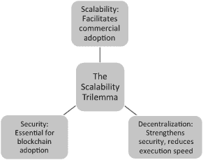

图 2.1 ¶ 区块的可扩展性

在支付处理等领域，区块链必须与成熟的替代方案竞争，例如`Visa`网络，该网络每天平均处理 1.5 亿笔交易（平均每秒 1700 笔）。相比之下，`Bitcoin`和`Ethereum`网络每秒最多处理 7 到 20 笔交易。在使用区块链智能合约能力方面以及不成熟的技术导致区块链演进方向的治理问题，可能导致向后不兼容。

## 智能合约问题

区块链在企业中应用的一个具有吸引力的方面是使用智能合约的能力。一个主要的担忧是合约（签约双方之间具有法律约束力的协议）是否被正确地转化为代码，这一过程需要法律人员与区块链程序员之间的紧密合作。在起草法律合同时，语言可能刻意模糊，以赋予双方在履行合同性能时范围内的灵活性。编码人员在开发智能合约代码时存在误读法律语言的风险，因此需要额外的步骤来验证代码是否正确反映了源合约。当外部来源向智能合约代码提供错误或故意虚假的信息时，会产生第二个问题，在虚假的情况下触发执行并导致经济损失。

### 未解决的区块链治理、不成熟的技术

区块链协议的治理也加剧了其不稳定性，并对其大规模实施的适用性产生怀疑。Gianluca Miscione 及其共同作者提出了一种他们称为“部落式”的新型区块链治理模式。他们指出，区块链治理应该基于共识而非网络参与者之间的竞争，而部落会发展出自己的治理模式，这种模式并非由法治定义。这与主要以市场和层级为特征的传统治理体制形成对比。

区块链可以通过更改协议来加速交易，例如引入新的区块链创新，如`分片`（sharding）和`侧链`（side chains）。`分片`将区块链划分为多个`分片`（shards），每个节点只需要更新其部分的区块链，从而实现更快的处理速度并提高可扩展性。`侧链`是附着在主链上的独立区块链，减轻了主链的处理负担，从而增加了其速度和可扩展性。然而，对于引入这些技术的分歧可能会导致性能波动并降低性能。在这些情况下，之前验证过的区块可能不再与较新的协议兼容——即`硬分叉`（hard fork）。`硬分叉`是对区块链协议的重大更改，创建了区块链的新分支，使得一旦用户开始使用新版本，由旧版本验证的交易将被拒绝。（然而，分叉在增量改进方面可能具有价值，2017 年的德信报告建议，分叉更有可能保持区块链项目的活力。）

这种向后不兼容对于商业企业来说是不可接受的，特别是当多企业区块链的成员无法就条件是否发生了足够变化而需要更改协议，以及协议应如何更改达成一致时。最终，对分叉的分歧和拒绝支持会导致分裂（区块链成员的瓦解），这将影响其未来的效用。总之，治理分歧可能导致区块链崩溃。

## 应对三困境

人们已经提出了许多技术解决方案，各种提出的方案在速度、安全性和去中心化程度之间进行权衡，以最符合它们的需求。有几种方法在解决这些问题方面显示前景：

- 改变使用的共识机制，从`PoW` 到`PoS` 以及其他方案。这些不同的共识算法都在试图解决同一个问题：如何增加达成共识的速度，以提供交易保障，同时不增加中心化或降低网络安全性。

-   **转向许可链网络**，即使用受信实体取代加密派生的安全性来验证交易。这降低了去中心化程度，并将潜在的故障点集中在少数受信实体中，从而损害了安全性。尽管如此，许多企业区块链已选择许可链网络以改进旧的由中间机构控制的网络（如银行业），同时不会丢失处理速度。一个例子是 Ripple 使用其独特的节点列表（UNL），它将交易验证和账本更新限制在少数受信节点上，其中大多数节点最初由 Ripple 控制。需要注意的是，如果攻击者获取了这些受信实体的控制，他们可能会验证错误的交易、允许双重花费并授权欺诈转账，从而破坏对网络的信任并降低其效用。来自开源区块链平台 `EOSIO` 的 EOS 协议具有有限的区块生产者数量，从而减少了参与区块验证的节点数量并提升了处理速度。

-   **在主链之外创建侧链**，随着交易数量的增加以减少区块链处理每笔交易的计算负担。较小的交易可以打包在一起并在主链之外的侧链中进行验证，然后作为单一聚合交易发送回处理。这类似于处理信用卡交易，即呈现一个月内累积交易的总月账单，并可以作为一个金额进行支付。然而，如前所述，侧链与主链之间的传输可能一个安全漏洞，需要额外的步骤，例如在侧链和主链之间建立加密锁箱、在释放主链资金之前为验证侧链传输引入时间延迟（以防止双重花费），以及将侧链作为私有许可网络，由受信节点管理链间传输。

-   **垂直可扩展性**，通过增加可用计算能力来提高每个节点的处理速度。计算能力增强节点可以更快地验证交易，提高可扩展性。然而，整个区块链网络的性能将受到最弱节点计算能力的限制，因为该节点可能会减慢多数共识形成以验证区块的时间。

-   其他建议的方法包括批量处理交易（可能会产生隐私问题）和使用闪电网络。闪电网络建议建立一个连接的离链双方支付通道网络（双方都可以使用各自的私钥访问的多重签名钱包），以便对网络内任何人的付款都可以通过一系列连接的二方交易来完成（由网络寻找最短路径来完成交易）。每个通道的总资金在打开通道时记录在区块链上，而在该通道中添加或提取资金则需要另一个区块链记录。

## 从区块链初创公司和先驱者中学习

现在我回顾一些区块链初创公司在保持区块链强大的安全保护的同时提高速度和可扩展性方面方面的重大突破。本章讨论的区块链公司有两个主要目标。第一个目标是克服技术缺陷。几家公司致力于改进区块链的技术基础设施。他们解决了区块链在可扩展性、去中心化程度、安全级别和交易处理速度等关键领域的性能缺失。他们还处理了互操作性问题，使得企业内部和生态系统内的多个区块链应用程序即使使用不同的平台也可以通信和交易。最后，他们关注保护交易双方的隐私及其交易细节。

第二个目标涉及产生收益和提高效率的行业特定解决方案。随着技术性能的提高，新的应用程序涌现，准备利用这些改进。几家公司正在利用这些技术进步开发他们认为优于现有方法的行业特定客户解决方案。

### 提高区块链性能：Algorand

Algorand 引入了一种新的区块链协议，以一种安全、去中心化且无许可的方式解决可扩展性问题。其方法基于新协议 `Pure PoS`（适用于已知有不可信网络参与者的环境），与区块链中传统的 `PoW` 共识机制相比，它使用更少的计算能力提供共识验证，从而实现了更快的处理。Algorand 还按照交易发生的顺序验证交易，而不是等待收集交易成区块并验证此类区块，从而确保了交易的即时终性。Algorand 的方法还保证了活性（liveness），这是一个有助于在设定的时间限制内验证正确交易的特性。

其方法的关键在于其原生代币 `Algo`。Algorand 网络成员购买原生代币，并通过参与网络的区块验证过程获得奖励代币。通过其令牌和 `Pure PoS` 共识方法，Algorand 使用两步法防御恶意用户。首先，Algorand 从所有令牌持有者中随机选择一个令牌持有者（一个网络节点）来创建一个区块。该令牌持有者是唯一知道自己区块创建角色的用户。接下来，Algorand 随机选择一组令牌持有者，并为他们提供验证新区块所需的信息。参与这种抽选过程将获得令牌奖励。

区块创建成员（一个网络节点）和验证委员会（其他网络节点）在每一步和每个区块中都是随机且独立被选的。由于预先未知区块创建者的身份或验证区块委员会的身份，恶意用户无法破坏并因此影响区块的创建或验证。验证方法是快速的，提高了处理速度。Algorand 无需牺牲去中心化，因为用户也是区块生产者和验证者，他们是被随机选出的，且用户/验证者池在不断更新。

### Algorand 应用：AssetBlock 和商业地产

这些进步使几家公司说采用 Algorand 协议来实现基于区块链的解决方案：例如，`Tether`，一家美元稳定币提供商；`Global Carbon Holding`，一个支持代币化碳信用资产的市场；`SIAE`，一家发布了四百万个代表创作权的 NFT 的权利管理公司；以及接下来将讨论的营销代币化房地产的 `AssetBlock`。

作为一种投资机会，商业地产几乎仅向大型机构投资者提供。商业地产交易规模巨大，涉及数百万美元，这意味着最低投资额也很大。这阻止了较小投资者参与这些投资。此外，有关潜在交易的信息在在线或离线方面都没有集中存放，这使得与交易赞助商没有关系的投资者难以找到及时信息并进行尽职调查。

Algorand 对全球投资者的国际可访问性、其高速交易能力以及安全性和隐私优势，都是 AssetBlock 决定在 Algorand 区块链协议上构建商业房地产投资平台的因素。AssetBlock 为寻求额外资金的商业房地产物业寻找其赞助商。其平台将商业房地产投资细分为更小的份额，从而降低了最低投资金额。这些非控制性股权投资随后提供给全球范围内的合规投资者。这些全球投资者可以使用他们拥有的数字资产（例如转换为美元的加密货币）来投资 AssetBlock 平台上的物业份额。AssetBlock 还提供贷款资金以收购正在购买的房地产份额，并接受加密货币以及所收购的商业房地产份额作为抵押品。

由 `Algorand` 驱动的 AssetBlock 为商业房地产投资准入和安全性方面长期存在的问题以及加密货币挑战提供了解决方案。为了增值而持有的加密货币数字资产不会产生立即收益，AssetBlock 帮助将此类闲置资产转化为商业房地产的新投资资金来源。在区块链内对这些所有权进行代币化增加了所有权的安全性和交换，并实现了即时结算和支付终局性。接受数字资产作为额外抵押品降低了贷款人的风险，从而使贷款人能够对借款金额收取较低的利率。较低的贷款利率降低了借款人的加权资本成本，并增加了投资商业房地产的可行性（例如获得更高的现值）。将大型房地产投资细分为较小的份额增加了商业房地产投资的流动性，并允许加密货币所有者在实现投资组合化的同时，保留捕捉其作为抵押品的数字资产任何增值的可能性。这些创新有助于使商业房地产市场更加透明、高效，并让全球各地的各种投资者更容易参与。尽职调查信息——如高级债务、留置、关联抵押品和所有权变更——是可追溯的、不可篡改的，并受到更好的防欺保护，这有助于降低贷款处理费用。

将物理资产转换为数字资产确实会带来代币化风险。与区块链中的原生数字资产相比，创建物理资产数字表示的过程要较弱，例如挖掘 `Bitcoin`，后者通过验证激励（`PoW` 和给矿工的比特币奖励）得到了加强。这些物理资产的转换更容易受到安全威胁和欺诈的影响，使得向区块链过渡的吸引力降低。`Algorand` 的验证方法确实有助于减少这种脆弱性。图 2.2 总结了 AssetBlock 的业务模型。

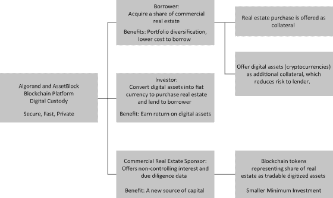

图 2.2 Algorand 和 AssetBlock：商业房地产投资

### 区块链互操作性：Quant Overledger 和 Polkadot

有多种区块链协议可作为应用的内核层，每种协议都有其特定的优势和缺陷。协议可以被视为不同的操作系统，特定的协议可能更适用于特定的企业用例。常见的协议包括 `IBM Hyperledger Fabric`、`Ethereum`、`R3/Corda`、`Ripple` 和 `Consensys Quorum`。`Ethereum` 在其协议中内置了智能合约功能，在需要自动执行交易并取决于履行智能合约中编码的合同条件的业务应用中具有价值。`Hyperledger Fabric` 是一个私有许可链区块链网络，有助于许可权限管理，用于数字支付和数字身份等企业应用，支持多种智能合约语言，并在共识方案和隐私等领域提供模块化。`Fabric` 对企业具有吸引力，因为它让它们对私有数据的共享拥有更多控制权，允许它们在更广泛的网络中指定与其达成特定共享标准的节点。

`R3/Corda` 是由金融机构财团开发的私有许可链，专门用于银行、金融和保险领域的应用。`Consensys Quorum` 由一个开源的 `Ethereum` 协议层组成，并提供来自 `Consensys` 的额外产品模块以创建自定义的区块链应用。所选协议会影响应用质量及其满足特定行业背景下用户需求的适用性。例如，`R3/Corda` 特别适用于银行应用程序。选择协议是一项基础性选择，最好咨询区块链技术专家后进行。

现有协议的更新和新兴的竞争协议提供了改进的速度和可扩展性、增强的隐私以及针对特定行业应用的优化。然而，大量的协议和随之产生的竞争给企业带来了互操作性问题。如果区块链被广泛采用，各种规模的企业将需要不同的区块链进行通信，无论是在内部交互还是跨组织边界交互。这些区块链只能一次一对地连接，使用为每种对点通信开发的专用软件。这种定制方法非常繁琐，特别是当不同的区块链协议发展为改进版本，并随着时间的推移获得或失去市场份额和追随者时。如果没有互操作性，跨不同区块链产品或不同协议版本迁移数据和旧应用程序将变得困难。

此外，无法跨区块链识别交易，因为任何特定解决方案仅对账本有效，并且在该账本的区块链协议内执行。在区块链内验证的交易（具有特定的共识算法、来源和审计追踪）在另一个账本也不会被自动验证。正如 Quant Network 的白皮书所述，“迁移并不可行，因为交易仅在区块链地址空间内有效 . . 即无法让它们在其他账本中同样有效。”此类交易数据必须像预言机向智能合约的数据一样被接受，并且提供数据的区块链需要被信任，这抵除了区块链的去中间化潜力。如果没有互操作性，区块链的使用将碎片化，效用将受到限制，应用程序和数据将被孤立，企业将受困在孤岛中。

### Quant Network Overledger

Quant Network 的 Overledger 是实现多个不同区块链之间快速、安全通信的尝试之一。Overledger 的目的是允许具有不同共识机制的多个区块链（无论是公共还是私有的、有许可还是无许可的）进行通信、执行交易、传输数据并与非区块链遗留系统进行交互。即使在区块链被替换或升级时，Overledger 具有实际价值且非常有用。它可以与互联网核心 `TCP/IP` 协议所提供的互操作能力进行相比较。`TCP/IP` 允许计算机像是同一个单一公共网络的一部分一样进行交互，而忽略数据传输的模式（移动无线电、帧中继、异步传输等）。因此，它们可以传输标准化的数据包，而无需感知其内容。20

## Overledger 功能

Overledger 通过将应用程序置于现有区块链之上的覆盖层（overlayer）中来实现互操作性。通信、迁移、信息交换和价值交换发生于其最初部署的区块链账本是独立的。互操作性允许企业在确定特定平台之前对不同的区块链进行实验，并比较其相对性能、扩展性和安全性。由于决策者受所选区块链协议的限制较小，区块链的部署可以更快。如果以后出现了更好的解决方案，企业总有办法迁移到新方案，并且不存在之前对区块链应用开发投资变得过时的风险。广泛的互操作性创建了向后兼容性，允许企业依赖区块链网络，在具有共同利益的跨生态系统中共同解决跨企业的业务问题。Overledger 还允许开发者构建跨多个区块链运行的应用程序，而无需为其他不同的区块链重写或移植现有应用程序。同样，应用程序在不同区块链之间是稳定的，并可以轻易地在不同的区块链系统之间移动。Overledger 拥有自己的应用商店，新的多链应用程序可以在那里以销售的形式上架，或以免费的形式发布给潜在客户。21

覆盖层中的消息会触发接收方区块链的操作。因此，通过覆盖层从一个区块链传输信息到另一个区块链的消息完整性和安全性，对于确保 Overledger 成为可接受的互操作解决方案至关重要。图 2.3 展示了位于区块链层之上的几层。这些层根据区块链层的交易处理消息，并连接到多个响应消息的独立应用程序，从而实现多个区块链之间的通信。

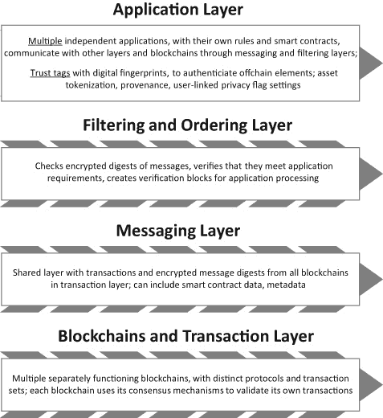

图 2.3 ¶ Quant Network Overledger 互操作性框架

虽然 Overledger 连接的每个区块链都是安全的，但 Overledger 采用了一种额外的安全措施—— `TrustTag` 来保护其交易。`TrustTag` 允许在数据生成的源头对其进行签名，维护存储的数据哈希（加密）版本以确保完整性，并保证不可篡改性以及不可否认性（源头以后不能声称其没有生成过该数据）。22 `TrustTag` 实现了资产的安全代币化，并促进了私有区块链与公共无许可区块链之间的安全交互。应用程序接收到加密数据以及以及验证块，通过身份验证，可以使用这些数据来触发智能合约的执行。此类 `TrustTag` 使得在供应链中跟踪资产成为可能。

## Polkadot 与平行链（Parachains）的互操作性

虽然 Overledger 连接的每个区块链都是安全的，但 Overledger 采用了一种额外的安全措施——`TrustTag` 来保护其交易。`TrustTag` 允许在数据生成的源头对其进行签名，维护存储的数据哈希（加密）版本以确保完整性，并保证不可篡改性以及不可否认性（源头以后不能声称其没有生成过该数据）。22 `TrustTag` 实现了资产的安全代币化，并促进了私有区块链与公共无许可区块链之间的安全交互。应用程序接收到加密数据以及以及验证块，通过身份验证，可以使用这些数据来触发智能合约的执行。此类 `TrustTag` 使得在供应链中跟踪资产成为可能。

作为 Overledger 的竞争对手，Polkadot 允许多个区块链并存并通信。图 2.4 展示了其组件如何围绕中继链（relay chain）汇聚。23

Polkadot 提供了几项优势：异构分片（heterogeneous sharding）、扩展性、可升级性和透明治理。异构分片消除了分片（主区块链的分区）必须具有相同规格的要求；因此，跨链组合性允许发送多种数据类型。由于 Polkadot 允许并行处理交易（因此有了并行化的链——平行链），扩展性得以提高。提供共享安全性的嵌套中继链可以增加分片的数量（以太坊计划了类似的以太坊 2.0 版本升级，转向权益证明机制，以提高其扩展性）。Polkadot 架构还确保了安全的互操作性，因为“如果某条链的消息被回滚，所有所有链都会被回滚”，24，从而保护数据交换免受任何损坏或盗取。

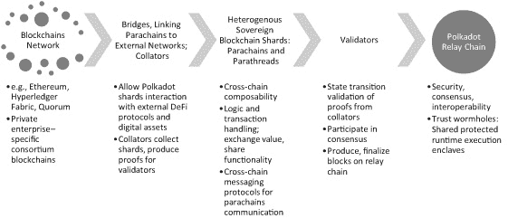

图 2.4 ¶ Polkadot 区块架构

Polkadot 为节点规定了 `fishermen`（渔夫）角色，允许调解者（collators）和某些（全节点）平行链监控网络并报告不实行为，并以此工作获得 `DOT`（Polkadot 的原生货币）。25 这些 Polkadot 术语描述了特定节点在确保安全性和扩展性方面扮演的角色。渔夫寻找欺诈，调解者收集分片，而验证者批准并密封 Polkadot 网络的新区块。Polkadot 提供了良好的可升级性，因为连接网络中的每个区块链都可以针对任何用例进行定制，无需重新工程现有区块链即可添加额外功能。它还强调透明治理，因为任何拥有 `DOT` 的人都可以提出协议更改并对提案投票，从而防止争议性硬分叉的。最后，Polkadot 还允许在无需分叉的情况下对区块链进行升级更新，通过透明的链上治理系统实现了无分叉升级。

## 自主身份：Sovrin 和 U-Port

证明身份对于许多任务都是必要的，例如获取医疗保健、为就业证明大学学历以及被认定有政府福利资格。传统的中心化可信中介充当了证明身份和文件真实性的角色，并收取中介费用。世界银行估计，大约七个人中就有一人无法建立身份，因此被排除在银行、教育和医疗保健等基本服务之外。26 缺乏可证明身份还会使个人暴露在贩卖和强迫劳动等危险境地中。

基础服务已日益通过数字化方式提供，数字身份验证在这些交易中至关重要。与物理身份识别一样，数字识别仅由少数中心化机构提供。中心化的身份验证源可能会被攻击，从而危及安全并增加或产生成本，例如由于数据泄露导致冻结信用报告的成本，以及滥用被盗数据或信用信息的后果可能在财务上是毁灭性的。约翰·哈格尔三世（John Hagel III）和杰弗·F·雷波特（Jeffrey F. Rayport）对数据“信息中间介”的力量提出了警告，当被验证身份的个人无法控制披露哪些信息以及向谁披露时，可能会产生毁灭性的结果。此外，当中心化中间介控制个人信息时，身份无法在用于不同身份验证目的的不同中介之间轻易迁移。例如，银行被要求了解客户并防止洗钱，每家银行必须分别使用适当的文件来验证其客户的身份。

挑战在于能够根据需要建立并使用数字凭证来证明在线身份，并使用这些数字凭证来验证年龄、地址、学术成就、就业状态和资产所有权证明。安全的数字身份可以帮助减少身份盗用，验证对网络的许可访问（从而提高网络安全），并通过授权个人或实体数据在不同系统之间的传输来建立信任。如果个人能够控制并证明自己的身份，并且如果他们有权决定是否提供所需的受信任凭证（且仅提供这些凭证），他们将对自己的身份拥有主权，绕过中心化中间介以及依赖这些中间介的固有风险。

这一挑战的答案是主权身份（SSI），它赋予个人对完全移动数字身份的终身控制权。SSI 将始终由个人控制且无法被剥夺，但对 SSI 的控制仍需要所有者与可验证声明的发行者建立关系，以建立对 SSI 的信任。然而，区块链可以通过为数字凭证提供标准格式并验证公钥所有权来促进 SSI 的创建。个人可以使用其私钥对其数字文档进行签名，并同时确定对其个人化数据的访问范围。他们的公钥将注册在区块链中，以便被发现并用于验证数字签名。鉴于全民身份的目标，SSI 服务需要像全球公共事业一样运行，可供所有想要建立身份的人、凭证发行者以及尝试验证身份的人使用。如果 SSI 特指某个区块链且缺乏互操作性，那么 SSI 的效用将不可避免地受到。

### SSI 和区块链的优势

区块链支持的 SSI 更广泛的益处是，客户控制自己的数据，并在获得充分报酬的情况下控制数据的共享，从而减少了 Google 和 Facebook 等中间介对个人的权力。同时，SSI 还有助于降低与少数实体控制的客户数据中心存储相关的安全风险。Sovrin 网络（Sovrin Network）是提供此类 SSI 的尝试。除了验证数字签名和建立所有权外，Sovrin 还提供了一种验证经验证的所有者提供的数字凭证的标准方法。它旨在将凭证所有者、凭证的受信任发行者以及寻求建立数字声明真实性和来源的验证者联系起来。虽然公钥基础设施（`PKI`）被广泛用于验证（例如）网站的所有权，但只有少数代理机构（受信任的证书机构）可以将公钥与作者的私钥相关联并证明所有权。此类服务成本高昂，大多数人无法触及。Sovrin 通过创建具有 P2P 私有代理的验证器节点解决了 PKI 的成本和稀缺问题，这些代理代表凭证所有者对提供的凭证的准确性进行认证。

### Sovrin SSI 模型

Sovrin SSI 模型使用开源的 `Hyperledger Indy` 协议构建，包含几个关键元素：

*   **凭证发行者**遵循标准协议并发布声明（有关个人的凭证），对声明进行签名，并通过公共区块链上的去中心化身份标识符（`DIDs`）提供其公钥。因此，大学可以为某些 `DIDs` 发布声明，证明其是该大学的毕业生，并提供如学习领域、学位等细节。
*   **凭证所有者**对发行者提供的声明进行会签，并按照标准协议将声明提交给验证者，通过公共区块链上的 `DIDs` 提供其公钥。
*   **凭证验证者**按照标准协议从所有者处接收凭证（声明），并查找 `DID` 以获取用于验证声明所有者和发行者签名的公钥。验证者依赖凭证发行者发布准确的凭证。如果资格条件是毕业于大学或在某公司工作一段时间，凭证发行者必须满足这些条件。

### 信任与声誉

需要注意的是，这一过程要求凭证发行者建立其诚实声誉以获得信任。如果不存在现有的信任关系，一个有趣的问题是：新的凭证发行者如何建立信任？目前，诸如车辆管理局、大学和雇主等实体在凭证验证方面被默认为是信任的，在 SSI 广泛使用的初期，他们可以继续担任凭证发行者。新实体可以使用 `PoS` 等算法或从满意用户处获得的声誉代币数量作为信任衡量。

`DIDs` 包含了所有者的公钥以及所有者愿意披露的其他公开凭证以及联系网络地址。`DID` 允许发行者和验证者在 Sovrin 网络上查找公钥，而无需属于同一个组织或身份联盟。每个 `DID` 都关联有一对公钥和私钥；它们的设计是廉价的，以便每个用户可以根据需要生成多个 `DIDs` 以创建不同的可验证声明子集。声明可以是关于学术成就、当前就业信息、收入是否达到某些水平等。这赋予了所有者对“谁看到什么”的控制权。

Sovrin 使用轻量级共识协议或状态证明（一种可以在智能手机上运行的密码学证明）来验证查询响应的有效性。因此，它可以防止中间人攻击——即攻击者秘密地在两个自认为正进行直接通信的双方之间进行干预，更改或替换通信内容以使攻击者受益。目前，保护身份数据尚没有被广泛接受的标准和法规，尽管零知识证明（ZKPs）30 可能会成为这种标准。ZKPs 可以为区块链中的用户提供安全保障和保证，确保信息未被更改或篡改——即不可篡改性。ZKPs 可以在维护隐私的同时在双方之间共享信息，并防止竞争对手获取信息。交互式 ZKPs 要求用户向验证者证明他们拥有某些信息，而非交互式 ZKPs 则在后期提供验证，例如上述描述的 `DIDs` 和可验证声明的情况。31 ZKP 基于数学公式，可能会是计算密集型的，从而减慢处理速度。

Sovrin 通过为每个验证者生成的唯一 `DIDs` 提供伪匿名性等隐私保障。不同司法管辖区不断变化的政府法规（例如欧盟的 `GDPR`，通用数据保护条例）意味着全球身份实用程序需要遵守不同的数据保护和隐私法规。区块链上不存储任何私人数据；相反，所有者通过加密私有通道在离链的 P2P 代理（数字钱包提供商）交换实际凭据（可验证声明）。所有者在通信凭据时可以使用 ZKPs 将披露内容限制至最低。例如，人们可以披露其具有投票资格的证明（该证明通过 `DID` 的公钥信息进行验证），而无需披露居住地和实际出生日期等细节，因为唯一的出生细节取决于他们是否出生在某日期之前，可能还有国籍和居住地。

Sovrin 令牌用于为验证凭据创造价值，以激励并奖励身份所有者和凭据发行者在授权条件下共享此类数据。作为副产品，SSI 系统可以培养数字凭据保险市场（特别是针对可能接受虚假凭据的保险）。图 2.5 总结了 Sovrin 网络为所有人保障 SSI 的方法核心特征。

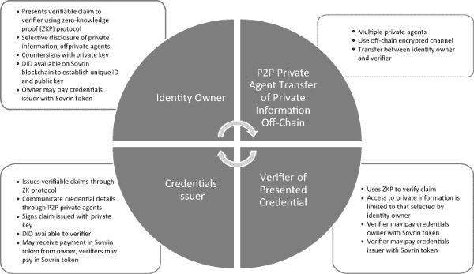

图 2.5 ¶ Sovrin SSI 和令牌模型：治理、性能、可访问性和隐私

### 用于智能合约执行的目标预言机：Chainlink

区块链的独特（且理想的）特征之一是其整合智能合约的能力。许多区块链提供了现即用的模板和开发工具来构建和实现智能合约。智能合约可以在区块链内通过指示已满足要求的信息被触发，从而启动随后的交易，如所有权转让和价值交换。区块链数据安全且不可篡改的特性、追踪溯源的能力以及区块链原生令牌的使用，都有助于智能合约的自动执行。自动执行的智能合约可以节省时间，避免冗余的错误检查，并释放原本在纠纷解决期间被占用的资金。32 然而，区块链内部的智能合约执行无法自动启动外部事件，例如来自区块链银行账户的付款。

智能合约的执行通常取决于外部数据，例如来自 IoT 传感器的数据（例如产品是否存储在正确的温度下）、市场数据（股票价格是否达到触发期权行行的水平）或事件（例如租户完好地搬租赁物业并触发押金的退还）。帮助保证数据安全性和不可篡改性的区块链共识协议并不适用于由预言机从外部源获取的数据。

预言机（Oracles）是区块链中间件，旨在安全地将智能合约与外部数据源及事件连接起来。具体来说，它们将区块链（及其智能合约）与针对不同数据源的 `APIs` 连接起来，每个 `API` 都是其数据源与区块链之间的标准通信通道。中心化预言机有助于解决在连接、获取和通信智能合约所需的离链数据时固有的安全弱点。然而，这要求用户或实体信任其交易伙伴所提供的信息是准确且可接受的，以便在指定时间范围内激活具有重大财务意义的合约。中心预言机可能会在关键时刻被黑或离线，成为单点故障并导致合约本身变得不安全。

Chainlink 开发了一种替代方案，创建了一个去中心化预言机网络 33，能够在履行智能合约数据请求的同时，从外部数据源安全获取数据。一个关键特性是在 Chainlink 区块链内部使用多个独立的预言机节点。这些节点可以从多个独立数据源检索相同的数据点。多个数据源减少了对单一数据源的依赖（这可能被攻击或在伦理上出现问题），并防止了单一数据源离线。然后可以将多个数据点进行聚合并还原为单个可靠的数据点，从而触发智能合约，所使用的聚合模型包括计算平均值、丢弃离群值和估计算法。

Chainlink 建立了名为 `chainlinks` 的外部适配器来连接区块链和 `APIs`；每个 `API` 都有自己的 `chainlink`。它使用一种声誉系统，允许预言机根据成功率、响应时间和持续可用性等因素进行评级并获得声誉分。该声誉系统匹配预言机节点，以提供更高质量的服务并胜过竞争预言机。Chainlink 允许智能合约根据声誉分和最低声誉阈值选择调用哪些预言机来获取数据并进行聚合，声誉分有助于做出选择。它还允许智能合约选择运行 `TEEs` 的预言机，以便预言机节点无法看到查询细节；给定密码，`TEE` 预言机可以访问专有数据源、检索数据并启用支付等操作。

Chainlink 使用原生令牌 `LINK` 来方便智能合约支付预言机服务。预言机节点需要在 Chainlink 内部质押协商金额的 `LINK` 以响应智能合约的数据查询，这种押金激励了预言机节点提供高质量的服务和高水平的可用性。然而，如果预言机节点“提供异常数据或离线”，则可能会失去其押金。34 Chainlink 还可以作为即插用的预言机解决方案模块用于其他区块链，用于连接那些寻求将其智能合约连接到外部离链数据和事件的区块链。图 2.6 总结了 Chainlink 的架构。

预言机也可以作为数据源与 AI 应用连接，例如机器学习算法可以对事件流源的预测结果达成共识，然后将预测结果发布到区块链，以便在智能合约中进行后续操作。例如，机器学习算法可以分析过去的事件，开发出关于预测害虫水平及导致作物受损的指标。随后，该算法可以连接到去中心化的作物保险智能合约，如果满足有关害虫发生水平的保险条件，将自动授权支付。

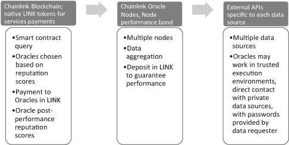

图 2.6 ¶ Chainlink 分布式预言机

## 将 IoT 设备连接到区块链以提供传感器数据的不可篡审计轨迹：Modum

IoT 设备是低功耗仪器（即传感器），具有基础操作系统、有限的处理和存储能力。它们运行在多种且通常不兼容的协议和标准之上，但其设计目的都是从多个远程位置收集数据并将其回传给各种网络，包括区块链。相对于运行区块链的节点，IoT 设备的数量非常多，因此可扩展性至关重要，以确保大量设备能够安全且持续地通信。接收此类大量信息的中心化服务器可能会成为瓶颈和故障点，但通过区块链节点实现 IoT 通信去中心化可以增加数据的稳健性和持续可用性。

遗憾的是，IoT 设备及其收集和传输的数据可能是企业网络中的安全薄弱点。它们更容易受到恶意攻击，例如拒绝睡眠攻击（为了耗尽电池）以及如 Mirai 恶意软件攻击之类的拒绝服务攻击，该恶意软件感染了 IoT 设备以实现对其的远程控制并影响性能。IoT 设备可能会被伪冒且极易受到物理篡改，因此身份验证和保护数据完整性对它们来说至关重要。基于区块链的 IoT 验证共识、使用私钥保护内容、时间戳以及在区块中对添加内容进行排序，可以在维护隐私性的同时降低 IoT 安全风险。然而，值得注意的是，计算能力的差异可能会限制某些 IoT 设备处理加密的能力，从而减慢网络速度。

Modum 将区块链与 IoT 设备连接，在捕获并发布数据到区块链的同时，确保数据和事件的不可篡审计轨迹。这种集成的 IoT 区块链解决方案具有广泛的应用，例如在生物制药行业的监控供应链流中。药品是高价值产品，大批量运输，且对运输过程中的损坏敏感。IoT 传感器可以安全地跟踪并传输数据——监控温度、湿度、位置（带有 GPS 跟踪）、包装完整性等——以维护产品质量和安全性，并符合运输合同条款和法规。其他应用还包括监控医疗设备的运输，这些设备在运输过程中可能会受到冲击和倾斜的损坏。能够检测“冲击、倾斜、自由落体或其他加速度相关事件”的传感器可以在定期时间点聚合并通信此类数据。

开发中的新药临床试验是另一个 IoT 传感器实时、持续流动数据的用武之地。数据可以传输给远程地点的临床试验经理，使能够监控质量问题。这种监控还有助于确保在试验期间患者在住所内遵守试验方案。重型建筑设备等资产的生命周期管理也可以得到传感器的帮助。它们可以跟踪资产的来源和历史，并提供预防性和实用的寿命评估。Modum 解决方案已部署在上述的多个场景中，并包含四个相互关联的主要模块：数据采集、聚合与通信、数据分析与预测，以及在保护机密数据的同时对整个生态系统的供应链数据和预测的安全共享。

## 使用区块链开发新业务模型

接下来我转向区块链原生初创公司，它们开发了利用区块链独特特性的原创业务模型。接下来的几个示例为企业如何利用区块链开发新收入来源并创建新业务提供了见解。

### 基于 P2P 和 IoT 的低功耗广域无线网络：Helium

正如在讨论 Modum 将 IoT 设备安全连接到区块链的解决方案中所言，IoT 设备无处不在，估计 2020 年使用的 IoT 设备达 200 亿台。所有这些设备必须在指定的时间间隔定期通信，以提供更新的传感器信息，并在双向链路是 IoT 部署不可或缺的一部分时接收操作指令。然而，IoT 设备通信的数据量很小，不需要蜂网络的宽带能力和更高的成本。Helium 是一家创新者，试图开发一个根植 P2P 网络的 IoT 通信双边市场，它将其标记为“人民网络”（People’s Network）。

在供应侧（即为 IoT 通信创建网络），Helium 开发了可以相互连接的热点，以创建一个去中心化的广域网。并不是由 Helium Systems 构建 Helium 热点网络，而是由企业家从 Helium 购买多个热点并将其部署在城市中，共同建立起 Helium 网络。`WHIP` 是 Helium 的安全、远程、低功耗、双向无线网络协议，允许 Helium 网络以远低于蜂窝网络的成本无线连接到互联网。一个关键要求是热点所有者必须 WiFi 连接，以便他们将热点连接到现有的 WiFi 路由器，并供 IoT 设备传输数据。

热点形成了 Helium 区块链的一部分，采用新的共识协议“覆盖证明”（Proof of Coverage），以确保热点确实存在并为 IoT 设备提供传输覆盖。“覆盖证明”可以防止女巫攻击和虚假现实攻击——即恶意热点模拟 WiFi 覆盖并窃取或重定向 IoT 数据，并利用双向功能向 IoT 设备发送恶意指令。热点所有者通过传输 IoT 数据、交易验证并纳入区块以及参与“覆盖证明”共识验证获得支付（以 Helium HNT 代币）。热点验证 IoT 地理位置，并存储 IoT 交易数据以及交易指纹和时间戳，提供不可篡改的数据和审计轨迹。所有交易数据都可以存储在区块链上。

在需求侧，低功耗 IoT 设备将使用 `LoRaWAN` 协议在广范围内（约 10 英里）与网络中的任何热点进行通信。IoT 设备被映射到区块链上的公司 ID，成为受信任的设备，并使用私钥/公钥加密数据传输，并在接收端进行验证。IoT 设备所有者无需加入 `Helium Network` 的费用；他们只需为实际传输的数据支付费用，这是一种基于微交易传输小数据包的随用随付系统。IoT 用户使用 `Data Credits` 支付，该额度可以通过转换 `HNT` 代币获得。IoT 设备的低功耗延长了电池寿命，从而增强了它们的可靠性。其他用户优势还包括轻松连接到 `Helium Hotspots`、汇聚多个 IoT 设备数据的能力，以及对安全、带时间戳且经过 IoT 位置验证的交易进行不可篡改记录。Helium 估计，2,500 台 IoT 设备每三分钟传输一次数据包的每月成本大约为 35 美元。一个示例应用可能是销售存储在配备 IoT 冰箱中的新鲜易腐宠物食品的，，利用 `Helium Network` 获取温度更新、库存状态和新鲜度水平。

追踪几乎任何种类的资产与 `Helium IoT` 通信解决方案非常契合。有趣的特定行业应用包括：

*   `Conserv`：利用 IoT 和 `Helium Network` 监控相对湿度、温度、振动和光线，以确保贵贵艺术品和档案材料显示与存储的最优环境条件。
*   `Clean Water AI`：通过 `Helium` 从边缘到云端传输 IoT 数据，在云端将其与 AI 模式识别和机器学习相结合，以检测饮用水中的细菌存在和污染。
*   `Agulus`：利用 IoT 和 `Helium` 实现农场灌溉设施的自动化。IoT 传感器收集现场数据（土壤水分含量、深度、养分）并将数据传输到云端控制中心。分析后，`Agulus` 可以激活灌溉系统、泵和喷器。

一个主要问题是 `Helium` 依赖于现有的 `WiFi` 信号。`WiFi` 供应商可能会将他们提供的 `WiFi` 连接的重用视为搭便车。他们可能会要求付费、为 `Helium Network` 的访问设置条件，并提高 IoT 社区的 `Helium` 服务成本。第二个问题是地理覆盖，因为“热点网络”必须与 IoT 设备的地理分布相匹配。通过基本上众包全美（随后是世界其他地区）的热点建设，`Helium Systems` 期望市场力量能够平衡 IoT 数据传输的需求与执行此类数据传输的热点供应，而不必一定进行市场引导。如果这一匹配过程发生缓慢，对于传感器数据传输其业务目的至关重要的 IoT 用户来说，可能会寻求替代通信通道，`Helium` 的创新优势可能会消散。`Helium Network` 的架构如图 2.7 所示。

## 为区块链项目和数字资产提供保险：ConsenSys Diligence

随着用户对使用区块链变得更加熟悉和自信，区块链应用将变得越来越多。这将增加人们对日益增长的区块链区块链附带风险的意识，并产生对防止黑客盗窃、智能合约错误执行或区块链抢跑的保险需求。抢跑发生在做市者和交易者利用他们对即将到来的大订单（这些订单可能影响价格）的知情，在大订单执行前建立头位，从而从预期的价格变化中获益。专业的区块链软件开发公司和个人可能需要职业责任险；大客户可能会向其区块链供应商寻求担保债券，特别是在持续使用的情况下，如 `TradeLens` 或去中心化金融应用。

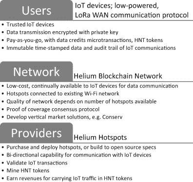

图 2.7 ¶ Helium IoT 通信网络

必须单独处理每一个风险源以减少总的区块链应用风险。`Consensys Diligence` 是一种旨在审计智能合约的应用程序。它检测区块链项目开发期间的漏洞和安全漏洞（即权限结构中的缺陷）以及对预期权限的偏离。在开发期间修复代码是有优的，因为商业运营后残留的代码错误可能会产生更大规模的后果。如 `SolidBlock`（一家资产代币化公司）的用户使用该设施针对常见攻击定制智能合约测试，并在公共 `Ethereum` 区块上模拟交易和去中心化金融合约。2021 年，`EY` 宣布追加 1 亿美元资金用于此类工具并资助广泛的区块链和加密资产研究。

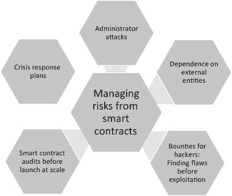

图 2.8 ¶ 减少智能合约风险。来源：根据 Mardlin，去中心化金融用户应该询问去中心化开发者。

图 2.8 总结了区块链及其智能合约的各种风险。企业级区块链可能是许可性的，治理可能包括具有某种集中控制权的管理员或管理团队。该个人或团队可能拥有包括中断系统功能、升级部分或整个系统以及延迟操作权力。在这种情况下，管理员可能成为漏洞点——黑客可能获取管理员的密码和私钥，从而破坏系统。在实施管理更改之前应用时间延迟或将管理操作提交给去中心化团队审批等措施可以降低风险。

## 基于区块链的组织：Aragon

去中心化是区块链的一个内在方面，而代币通常用于为去中心化的区块链节点创建市场激励。如果可以将代币视为选票，单个节点使用代币来表达他们的选择或意见，那么具有原生代币的区块链就可以用于创建新的去中心化组织形式——即去中心化自治组织或 DAO。引入智能合约允许区块链驱动的平台创建新的、无国界的、主主权且抗审查的组织，其参与式决策和纠纷解决机制完全基于智能合约。然而，组织必须应对诸如选民冷淡、贿赂攻击和富豪政治统治等困难。在此背景下，DAO 项目已尝试改善这些成员代表性方面的缺陷，寻求“使组织与利益相关者的利益保持一致，并通过博弈论货币激励提高合作与参与度”，并创建“网络空间中的合作社”。

Aragon 是利用区块链创建此类去中心化民主组织的示例之一。每个基于 Aragon 的组织都有一组智能合约，描述组织的利益相关者及其权利和特权。如果需要保护少数利益（即如果它们可以否决可能被多数票投票通过的内容），那么智能合约规则必须包含概述多数票投票不足何时的条款。这些步骤可以结构化为 Aragon 网络内部的一系列智能合约，该网络为 Aragon 平台成员提供基础设施和服务，使其能够分配角色、募集资金、采用会计实践并使用代币作为选票对不同的提议行动进行投票。

Aragon 的组织结构可以帮助避免争议。例如，考虑组织内部的财务职，它拥有组织资源的唯一访问权限，并向组织外部实体支付款，但前提是必须由组织成员提议。此类付款必须在既定预算范围内，且只有在获得大多数成员（选民）授权后才能进行付款。投票请求将发送给组织的代币管理器，由其向征求所有代币持有者（即选民）并转发代币持有者行动的结果。大多数代币持有者批准的操作将生效。

这种 DAO 模型为资金流创建了某种程度的透明，允许更多的 DAO 成员影响此类流。然而，如果某些选民持有更多代币，他们对投票结果将产生更大的影响——这与美国的情况相似，在美国，共同基金、交易所交易基金（ETF）和指数基金共同控制了美国公司大部分投票股份，并有效控制了这些公司提出的主要提议的投票结果。因此，如果组织希望转向 DAO 模型，它们必须决定如何处理主导成员在投票权中拥有更大权的后果。正如整个区块链一样，基于代币投票权的 DAO 仍处于早期阶段，并将在尝试不同的代币授予激励方案时逐渐演进，以获得更广泛的接受。

### IP/内容管理：开放音乐倡议 (Open Music Initiative)

音乐行业长期以来被批评对音乐人不公平，对于参与创作和销售音乐的多个方之间公平分配收入存在分歧，包括来自分发、出版、流媒体、销售和许可的多个收入流。它还遭受这些副本的未经授权复制和分发的困扰。为了解决这个问题，伯克莱音乐学院与麻理工连接科学（MIT Connection Science）共同了开放音乐倡议（Open Music Initiative）。他们共同开发了一种多层开放区块链协议来识别音乐创作者——音乐元数据层——然后将这些数据链接到许可和版税管理层（将音乐权利与应有的许可和付款连接起来）以及音乐虚拟资产层。

区块链还可以将音乐资产与代币链接，促进资产交换、去中心化音乐权利交易和使用跟踪。部署这些层来覆盖音乐生态系统，可以为跟踪使用和状态变化、传输，以及对分布在各个权利持有者之间的此类音乐资产进行访问的最终微支付铺平道路。开放音乐倡议的其中一个应用是区块链上的 RAIDAR 许可平台，它允许权利持有者（例如伯克莱的音乐学生）将他们的音乐许可给他人，例如电影制作人、虚拟现实应用和视频游戏。

音乐元数据层的目标是将音乐作品、歌曲或曲目链接到一个权威的元文件，该文件包含该音乐作品的创作数据。这种元数据将包含音乐数字文件的加密哈值，每个元数据文件将具有唯一的标识符，类似于用于文本文档的 DOI（数字对象标识符）。音乐作品的多个版本将具有不同的 DOI。元数据的副本将存储在多个未修改的开放访问存储中，并通过 `APIs` 向公众开放。

元数据将链接到单独的区块链注册，并由音乐创作者或授权实体使用公私钥进行数字签名，从而验证进入区块链的元数据。元数据的较短版本将存储在区块链上；带有时间戳；包括完整元数据文件的加密哈值；并具有相同的 DOI。这种基于区块链的元数据可以识别音乐创作者，支持他们的版权主张，并提供“音乐作品存在的相对不可篡且不可否认的时间戳公开证据”。

此类元数据不包括实际的音乐内容（音频文件，这些文件将存储在受保护的位置），以及法律和版权所有权数据或其他机密信息。音乐内容文件和相应的所有权信息将位于其他层，但与创作元数据链接。遗留系统也可以依靠注册数据来引用音乐内容和所有权。

# 结论

本章讨论的各种示例揭示了区块链技术正处于变革之中，许多区块链倡议正在解决阻碍该领域企业努力的当前缺陷。这些努力许多强调开源架构，这指向了公共区块链开发背后的理念。另一些则关注垂直市场、行业特定解决方案，在这些公司寻求突破时，协作伙伴关系常见。这些努力处于初级阶段，支持者和支持者正在启动试点并提供反馈，以继续改进所提的创新解决方案。

在可预见的未来，企业可能会倾向于选择许可制的联盟链，通过少数几个受信任的节点，从而使缓慢且计算密集型的共识方案变得不再必要。然而，这种有限的去中心化导致了故障点的集中；尽管由于只有极少数成员被授权访问区块链网络，这减少了对恶意行为者的担忧。企业必须在对初创倡议的学习与构建，以及在具有遗留系统和传统认可的最佳实践的生态系统中运行的压力之间取得平衡。这种对平衡的需求影响了商业规模区块链实施的路径，将在最后一章进行讨论。

现在我将转向区块链在特定行业中的应用。在第三章中，我将考虑加密货币的应用及其演变为更新形式的数字货币（以稳定币和国家政府支持的 CBDC 为形式）。支付世界正在迅速拥抱数字货币支付，这对全球金融体系、国家货币政策以及企业和个人产生了重要影响。

# 3. 数字货币、支付系统及其对企业的影响

在本章中，我将探讨数字货币和私人稳定币的演变与意义，以及它们对支付系统的影响。我研究了政府以 CBDC 形式对数字货币做出的回应，以及随之而来的与私人稳定币和加密货币的竞争。我还研究了数字货币的政策影响和监管关注，随后转向数字货币在 B2B 和 B2C 场景下对全球金融体系、货币政策、企业和消费者的影响。由于数字货币依赖于区块链，我们可以将数字货币的无处不在、重要性以及日益增加的使用场景，解读为区块链在金融领域中日益至关重要的作用。随着数字货币继续普及和增加使用量，区块链将进入主流。

## 加密货币、稳定币和 CBDC

比特币作为区块链的第一个主要应用，诞生于 2008 年将全球金融体系推向崩溃边缘的金融动荡之中。“大衰退”的后果之一是对金融机构和政府的强烈不信任。特别是对于自由意志主义者，他们寻求一种不受政府当局控制的金融体系。这一理念是创建一种独立于任何国家的货币，这种货币可以在没有银行作为中介的情况下进行持有和传输，从而允许个人和公司直接相互交易。结果就是比特币。

金钱是一种社会建构，由一群人（通常是一个国家）同意接受某项物品作为支付，以换具有价值的商品或服务。支付，无论是贝壳、盐块、金条还是纸币，都是完成经济交易所必需的。金钱有几个功能：作为记账单位、价值尺度和交换媒介。但它必须保持稳定才能用于衡量商品或服务的价值。人们愿意接受金钱是因为它的稳定性意味着它保留了价值，反过来使其能够成为交换媒介。金钱和支付随时间发生了显著演变。以政府背书的硬币和纸币形式的金钱是支付手段的一项重大创新（11 世纪的中国，以及 17 世纪末的英国为了资助威廉国王与法国的战争），并从根本上改变了商业。1

在过去的千年里，新的支付形式如银行货币（银行通过贷款和准备金制度创造的货币）、信用卡和借记卡、移动钱包以及加密货币（如比特币）改变了经济格局。短时间内，客户已经习惯了各种数字支付形式，例如使用智能手机支付、使用非接触式卡以及在销售点注册“先买后付”计划。中国支付宝（蚂蚁金服/阿里巴巴）和微信支付（腾讯）的经验表明，消费者和商家渴望在在线交易中使用数字形式的支付。在中国，2019 年近 80% 的智能手机用户使用了近场通信（NFC）移动支付，支付宝和微信支付合占交易量的 95%。2 然而，所有这些应用程序仍然连接到银行存款和经过验证的信用额度等法币来源。鼓励使用基于区块链的数字货币作为支付手段的转变具有广泛的影响，本章将进一步探讨。

### 比特币：起点

比特币是早期的加密货币，随后出现了其他加密货币，特别是用于以太坊区块链网络的以太坊（与智能合约即“可编程货币”相连），以及 Ripple 网络中的 XRP。然而，由于其巨大的波动性和交易成本，它在作为支付系统的广泛应用方面一直困难。这使其作为记账单位和交换媒介变得困难且昂贵。大多数比特币被作为投资工具持有，而非用于日常交易。2021 年 10 月 24 日，比特币总市值约为 1.15 万亿美元，流通量为 1885 万枚比特币（最大发行量的 90%），比特币单价为 61,000 美元，随后在 2022 年 1 月大幅下降至 35,000 美元左右，市值缩小到约 7500 亿美元。相比之下，2019 年 4 月外汇交易的每日交易金额约为 6.6 万亿美元。3

尽管如此，加密货币已作为用于高价值、高知名交易的支付手段。例如，特斯拉在 2020 年底宣布将接受比特币支付 4（该决定在 2021 年 5 月反转，理由是比特币的高波动性和挖矿固有的能耗），在另一个例子中，一次以 6900 万美元出售的数字艺术拍卖是用以太坊支付的。5 然而，这些都是特例，比特币在日常商业购买中的应用仍然较少。尽管如此，无论比特币是否符合货币的传统特征，它一直在持续增长——作为价值尺度以及投机投资的工具。Square 等主流支付系统已开始在信用卡和借记卡等传统支付手段之外接受比特币。我们需要的是一种将处理比特币的数字便利性与美元等主要货币的稳定性相结合的方法。

### 稳定币的出现

加密货币的波动（比特币在 2019 年和 2021 年期间从 4000 美元以下到 60000 美元不等）导致了稳定币的兴起。稳定币与美元等稳定资产挂钩，并由大量抵押品支持，例如 DAI，它与美元按 1:1 的比例固定（DAI 由 MakerDAO 发行，其名称包含 DAO 以指示其使用去中心化治理）。其他稳定币由等额的法币储备金支持，例如 USDT（泰达）和 USDC（美元币），它们持有的美元储备金与发行的 USDT 和 USDC 数量相当。对稳定币的需求大到让摩根通等大型银行推出了了自己的数字货币 JPM Coin,6，其价值等于 1 美元。JPM Coin 可以在摩根通 Quorum 区块链内的机构之间进行传输和支付，实现价值的即时结算和转移。

作为支付手段的数字货币日益重要。稳定币消除了加密货币固有的波动性，满足了消费者对便利、易用、快速且廉价支付机制的需求，且这种机制适用于国内和国际。同时，数字货币引发了私人货币与公共货币之间、基于国家的货币与不受监管（可能无法监管）的去中心化加密货币之间的竞争担忧。

看着数字货币（包括稳定和不稳定）的兴起，全球央行开始担心私人公司推出的数字货币对国家货币体系可能产生的潜在负面影响。作为回应，许多央行启动了央行数字货币（CBDC）试点。在 2020 年 2 月的国会证词中，美国联邦储备主席鲍威尔对 Facebook 关于 Libra（现名为 Diem）的公告回应道：“这是一个警钟，表明这种情况正在快速到来，并可能以相当广泛且具有系统重要性的方式迅速实现。”7 CBDC 可能会成为另一种基于区块链的货币，加入现金、银行货币（央行储备支持的支票和贷款）、私人加密货币和稳定币的连续体中。

数字货币——所有的都运行在区块链上——影响着企业、整体经济和消费者。消费者可能享受使用数字货币支付的便利，尽管他们也意识到其波动性、有限流动性和兑回风险，以及丢失私钥的后果。在宏观经济层面，政府担心对私人数字货币失去信心会导致恐慌性提现，从而引发系统性风险，影响金融稳定并影响货币政策的传导。美国的一个担忧是，来自中国等国家的主权 CBDC 如何影响美元作为全球储备货币的。

## 数字货币的后果

数字货币的兴起为企业带来了若干后果，总结在图 3.1 中，并在随后的章节中进行了讨论。

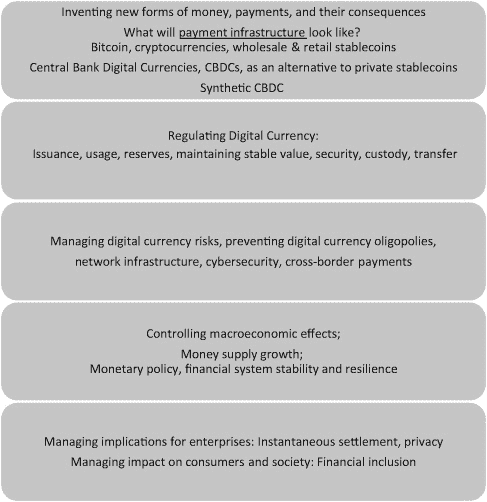

图 3.1 ¶ 数字货币：关键后果

## 发明新形式的货币：数字货币、私人稳定币和支付系统

如前所述，加密货币具有波动性。稳定币旨在通过持有货币储备（如美元）在提供数字货币便利处的同时减少其波动性。稳定币的价值也可以通过算法过程根据需求调整供应来维持。通过消除对波动性的担忧，稳定币作为支付手段变得更可行，特别是当其设计旨在增强消费者的易用性时。稳定币可以提供低成本、便利和实时的结算。随着稳定币提供者与其他稳定币运营者竞争客户，他们试图通过提供悦目的用户界面、卓越的 App 设计、与电子商务交易的更好集成以及成本优势（即无手续费）来获得竞争优势。

当全球性稳定币在多个国家被接受并被用作支付手段时，对于进行跨境支付的企业和个人变得更具吸引力。它们提供了速度和更低的成本，这些因素对于向新兴市场家庭发送海外汇款的个人来说尤为重要。与目前的银行转账或使用西联汇款（Western Union）等专业汇款机构相比，稳定币还可能更高效、成本更低且近乎即时。这些优势有助于实现大规模的消费者采用，并可能导致其被普及。

### 稳定币与风险

数字货币（包括稳定和不稳定）的兴起，全球央行开始担心私人公司推出的数字货币对国家货币体系可能产生的潜在负面影响。

稳定币的价值也可以通过算法过程根据需求调整供应来维持。通过消除对波动性的担忧，稳定币作为支付手段变得更可行，特别是当其设计旨在增强消费者的易用性时。

稳定币风险 8

一组风险主要源于私人实体可能对支付获得的影响。此外，还流动性风险，即由于资金不足导致兑回请求无法立即结算；违约或信用风险，即稳定币发行方无法满足兑回请求；来自底层资产损失的市场风险；以及可能的汇率风险 9 总而言之，稳定币的脆弱性 10 源于：

*   特定稳定币安排的规则和治理；
*   创建和从流通中移除稳定币的过程；
*   支持稳定币储备的管理；
*   支持货币使用的基础设施的操作和稳健性；
*   稳定币的交易验证、交换和定价；
*   私钥存储和对数字钱包的访问。

私人稳定币可以通过中心化管理进行，如 Circle 的`USDC`所示，也可以通过去中心化治理进行，如`MakerDAO`，其发行`MKR`代币并允许`MKR`代币持有参与治理，即设定储备要求和更改`Maker DAI 协议`。当某种特定稳定币的使用日益广泛时，它对商业和货币供应可能产生更大的影响，而治理的缺陷会增加这种影响带来的风险。

不同的稳定币在运营韧性方面也可能存在差异，即它们从网络攻击和安全漏洞中快速恢复的能力，以及在面对“黑天鹅”事件（如新冠肺炎肺炎）时维持稳健性的能力。例如，2020 年，面对新冠肺炎引发的不可预见的全球衰退，对流动性的迫切需求和对信心的提促使了美联储、欧洲中央银行和其他央行采取了重大干预。尽管恐慌得到了抑制，但一个问题随之产生：稳定币在面对此类灾难时将如何运行？取决于稳定币采用的规模和速度，它们确实具有影响金融系统稳定的潜力。因此，稳定币运营者必须解决消费者信任问题，可能如果稳定币受到监管且其资产稳定性由稳定币运营者接入中央银行储备的支持，信任是否会更高。

一种方法是制定法规，要求提供充足的权益资本并将底层储备投资于安全的流动性资产（如中央银行储备）。这些资产需要得到保护且不受抵押。要求稳定币运营者发行的稳定币总额小于客户存款资金加发行实体的权益资本，将有助于巩固信任。有趣的是，如果资金从银行转移到稳定币提供者，从而减少银行存款，这可能会影响银行用于贷款的总可用资金，因为准备金银行模式依赖于客户存款资金的杠杆。因此，稳定币的兴可能会减少货币供应。

主权国家可能希望在其国内市场限制在外国司法管辖区发行的稳定币，即使此类法规难以执行。全球范围内可获得的稳定币可以在任何国家在线购买，当地机构可能会发现定位稳定币提供者并强制海外实体遵守当地法规方面存在困难。因此，只要全球稳定币是去中心化且全球性的，跨越边界的稳定币监管就需要一个共同同意的跨境合作监管机制。各国必须对具体条款达成一致，并合作进行监测、信息共享和合规执法，否则金融实体将寻求跨境监管套利的机会。

作为未来趋势的预兆，G20 金融稳定委员会报告提供了十项“高层”监管建议，主要旨在划定监管范围、与现有法规保持一致、开发新方法以促进跨境监管，并使监管范围与新兴全球稳定币（GSCs）的特定监管需求匹配。在未来，监管标准可能包括维护稳定性、确保流动性、防止挤兑、降低跨境交易的成本和摩擦、保护消费者资产及其隐私、防范非法活动和欺诈、增强网络安全以防止黑客攻击、鼓励用户友好界面以及允许试点测试。批发和零售稳定币需要不同的法规，政府需要在平衡国内与多边监管的同时，同时不扼杀创新。一份关于稳定币的美国报告指出市场完整性风险、投资者保护的需求、控制其在非法金融中的用途、系统性风险和市场集中是监管稳定币的原因，并要求国会立法、要求稳定币发行者提供存款保险，并在金融稳定监察委员会等国际论坛的工作的基础上继续努力。

### 金融传统机构的私人稳定币：JPM Coin

考虑到稳定币对银行、存款水平以及整体客户关系的影响日益增长，银行已通过创建自己的稳定币作为回应。`JPM Coin` 创建于 2019 年，是此类试点项目之一。它保持等于$1 美元的稳定价值，旨在促进 JPM 机构客户之间的转账。指定账户中的客户资金被转换为 `JPM Coins`，传输给指定的接收方，然后立即转换为美元。`JPM Coin` 有助于结算债券和大宗商品交易，因为即时结算允许即时交割。JPM 指出该技术是“与货币无关的”，可以用于传输其他货币。它旨在符合现有监管要求的同时，“减少客户的交易方风险和结算风险，降低资本要求并实现即时价值传输”。`JPM Coins` 的抵押是美元，由摩根通通以 `1:1` 的比例持有。其假设是摩根通通可以充分持有美元储备，支持其 `JPM Coin` 无抵押。由于摩根通通作为系统性重要金融机构受到监管，`JPM Coin` 可以获得高信誉。

`JPM Coin` 的底层区块链是摩根通通专有的 `Ethereum` 区块链变体 `Quorum`。它是许可制的，访问限制于其全球机构客户。客户身份通过 `KYC` 协议进行验证，区块链可以掩盖发送者的身份以及传输的金额。摩根通通在区块链方面的技术专长为高水平的网络安全和 `AML` 合规提供了保障。允许价值传输的 `Quorum` 得到了摩根通通 `Interbank Information Network` 的补充，这是是另一个用于在代理银行之间传输信息的区块链。`JPM Coin` 是私人稳定币和加密货币领域中一个具有竞争力的产品。

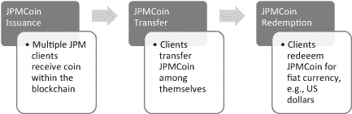

图 3.2 ¶ JPM Coin 的发行、传输和使用过程

其他主要的系统性重要银行已针对不断发展的数字货币领域制定了各自的战略响应。其中包括与 `Fnality` 财团工作的银行集团。他们的目标是创建并共享一个区块链金融市场基础设施 `Fnality Global Payment`，该设施可以在其批发银行市场提供包括美元、加元、英镑、日元和欧元在内的多种货币的支付和即时结算。这使得处于不同货币区域的银行更容易相互结算金融交易，从而允许其业务客户无需在多个国家开设银行账户。

`JPMorgan` 和 `Fnality Consortium` 是众多竞争对手中的两个，范围涵盖了从银行到私人加密货币初创公司，所有都在竞相创建嵌入到可行区块链支付系统中的数字货币。竞争的广度和强度表明，数字货币在不久的将来金融系统中将发挥日益重要的作用。

### Facebook 的 Diem 项目（原名为 Libra）

当 Facebook 推出与包括美元在内的稳定货币挂挂钩稳定币 `Libra` 时，加密货币和稳定币的世界再次扩张了。在 2019 年最初的设定中，`Libra` 的价值还将挂钩多种货币篮的价值。`Libra` 区块链将确保交易和数据存储的安全，使用共识算法验证交易，并寻求最终成为一个无许可网络。`Libra` 的重要性取决于几个因素，包括客户是否可以通过其 `Libra` 存款获得利息，以及持有无担保资产的固有的风险水平。

`Libra` 还打算为每个用户培养去中心化的 `SSI`（自主主身份），减少他们对第三方验证凭证的依赖。其目标是为全球新兴市场无银行服务的人群提供此类身份，从而推进金融包容——尽管 Facebook 和 `Libra` 并非创建此类 `SSI` 机制的唯一实体。如果数字身份的范围局限于 `Libra` 网络内部，它可能会进一步将个人与网络绑定，促进网络效应并增加用户的切换成本。

美国众议院金融服务委员会写给 Facebook 创始人兼首席执行官马克·扎克伯格的一封信指出，`Libra` 可能变得具有系统性重要性，但将作为一个不受监管的“影子银行”和并行金融系统运行。从最初发布起，`Libra` 就引起了政府和竞争性加密货币的警觉。它收到了美国政府、欧盟、英格兰银行和国际结算银行等政府和货币机构的反对。（由于许多关键研究和报告提到了 `Libra`，为了连续性，我保留了 `Libra` 名称以及随后在其更新版本中更名为 `Diem`。）

考虑到 Facebook 拥有庞大的用户群（超过 20 亿），一个直接担忧是该公司对支付业务的支配，这将使其作为一家营利的股东所有公司对货币政策产生重大影响，特别是对较小国家和新兴市场的货币政策产生。尽管 Facebook 创建了独立的非营利组织 `Libra Association` 来管理开源的 `Libra` 区块链和 `Libra` 货币，但这并没有消除恐惧。尽管 Facebook 只是“众多成员中的之一”，但可以确保这些成员是由 Facebook 精心挑选的。像 Facebook 这样的寡头垄断将限制网络上可交易数字货币的范围，并有利于 `Libra`；银行将向 `Libra` 网络流失客户。政府更倾向于在核心层由政府控制的支付轨道上运行多个私人稳定币，这一主题在后续关于 `CBDCs` 的部分得到了探讨。

`Libra` 的潜力使政府对货币供应和货币政策的控制面临风险。当发生安全故障时，可能会危及对货币系统的信心，无论这种失败源于数字钱包被攻击、`Libra` 价值不稳定、私营对金融流数据的所有权和控制、个人财务交易隐私的丧失、对竞争对手不平等访问 `Libra` 支付网络的担忧，以及各种新兴私营稳定币网络之间缺乏互操作性。还对利用加密货币进行非法活动（如洗钱和恐怖主义融资）存在担忧。这些担忧已经导致美国要求美国加密货币交易所遵循 `KYC` 和 `AML` 规定，这有助于美国当局识别进行非法加密货币活动的个人和实体。中央银行担心这些目标可能被 `Libra` 损害。

对 `Libra` 的反对导致几个 `Libra Association` 成员退出，包括 `Visa`、`Mastercard`、`PayPal` 和 `eBay` 等一些大型支付公司。作为回应，Facebook 在 2020 年 4 月推出了经过重大修改的 `Libra 2.0`，随后更名为 `Diem`。在这一版本中，Facebook 提供了单货币稳定币（除了多种货币储备篮的方法），引入了遵守美国和国际 `AML`、`KYC` 和反恐主义融资 (`CFT`) 规定的措施，放弃了最终成为无许可网络的目标，并通过 `1:1` 的储备支撑 `Libra` 稳定币价值来增强储备的稳健性（即与美元关联的稳定币将持有等值的美元和美元计价证券）。

该社交网络还将持有“期限极短、信誉风险低且流动性高的资产”，并“维持资本缓冲”，并建议当中央银行开发 `CBDC` 时，`Libra` “可以用 `CBDC` 替换相应的单货币稳定币”。`Libra` 还将接受监管机构、中央银行和国际货币基金组织等机构对篮子成分的监督。此外，它还将考虑实施兑回挂起和早期兑回贴扣，作为应对如 `Libra` 储备挤兑等压力情景的措施。通过这些变化，`Libra` 希望获得主权国家的批准，并成为全球跨境支付环境中的关键参与者。然而，政府持续的质疑导致 Facebook 宣布停止其 `Libra` 计划。

## CBDCs

政府希望能够监控并防止其金融系统中的系统性风险。因此，他们的目标是维护对本货币的自主权，并通过中央银行行动维持对货币供应、利率和货币政策变更的控制。私人稳定币的兴起使中央银行考虑推出自己的 `CBDCs`，例如数字美元或中国人民币。`CBDCs` 是政府试图控制私人稳定币增长和配置的尝试，可能在取代现金的同时保留政府控制和发行的货币的主导地位。`CBDCs` 还可能具有次要目标，例如政府对个人和公司经济交易及活动具有更高的可见性。

虽然不是 `CBDCs`，但美国联邦储备和欧洲中央银行已经启动了支付系统，试图重建数字货币的一个关键且理想的特征：即时结算。美国联邦储备引入了 `FedNow`，这项新的银行间实时全额结算 (`RTGS`) 服务，允许客户“随时、随地、随日发送和接收支付，并在几秒内完全获得这些资金”，试点已于 2020 年启动。欧洲和欧洲中央银行有一个类似的快速支付系统 `TIPS`（目标即时结算）。这两者都不需要区块链，并且是 `CBDC` 体系的替代方案。`CBDCs` 如果且何时可用，可以提供类似的即时结算，在显著增加流动性的同时减少企业分配的营运资金量。对 `RTGS` 系统的访问被限于少数大型银行，此类银行必须维持存款以覆盖结算过程中的违约风险，从而增加了其营运资金投资。

### CBDC 特性

央银行作为 CBDC 的运营者，将“负责以下许多步骤：执行客户尽职调查、提供或审核钱包、开发或选择底层技术、提供结算平台、管理客户数据、监控交易，以及与客户的请求、投诉和问题进行交互。”[24 CBDC 的功能将类似于现金的稳定价值存储载体，侧重于安全和信任，但可能会减少功能性，允许银行和其他非金融机构为 CBDC 增加功能。银行可以通过 `APIs` 提供额外的服务——例如允许为特定用途标记资金，例如，确保政府的转账支付被用于租金或育儿相关费用等预定用途。这将帮助 CBDC 创建者将其与私人稳定币区分开来，“促进其支付处理功能从信贷创造和风险分析功能中解耦。”[25 实际上，这将增强 CBDC 的健壮性并降低其对安全攻击的脆弱性。

`Fed` 上的 CBDC 账户可以实现直接且即时的转账支付，例如在新冠-19 疫情期间授予接收者的一次性失业补贴，而且这些账户还可以赚利息。虽然创建 CBDC 会产生高额固定成本，且更适用于货币稳定的主要经济体，但一旦创建，其运营成本将很低——低于运营现金制度相关的成本（这些成本涉及与带有防伪功能的钞票印刷、存储和分销相关的费用）。如果 CBDC 采用分层体系实施，成本将进一步下降，由银行为其客户提供并管理 CBDC 账户，同时维持央银行储备，因为它们已经拥有零售客户，并且在服务零售客户方面在用户友好方面具有丰富经验。相比之下，政府在客户友好性方面并不被效仿。

CBDC 的可用性凭借其更低的风险和更高的信任度，将使私人稳定币作为法币替代方案的吸引力下降。反之，央银行可以通过发行 CBDC 获得铸币税（政府发行货币时获得的盈余，即货币价值与其生产成本之间的差额）。此外，央银行可以通过相对于现金降低的运营成本，以及替代货币市场基金等金融资产（尽管在利率接近零时，这并不重要[27)），来抵消 CBDC 存款提供的任何利率[26]。计息的 CBDC 存款将成为货币市场基金的替代品。从消费者角度来看，作为 CBDC 的赞助者，主要发达国家的政府可能比营利私人实体更值得信赖，从而减少系统性风险。与营利实体的私人稳定币相比，使用 CBDC 可能几乎没有成本，因为客户可以避免中间费用。CBDC 的使用通过引入股票和债券的代币化降低了成本并提高了资产交换效率。同时，股票和金融工具的几乎即时出售和结算也将成为可能，使得后台清算和结算变得不再。CBDC 的另一个有用功能（以及与区块链中智能合约关联的稳定币和加密货币）是让货币执行特定功能，例如，在给定的购买中直接向国库扣除并发送可变比例的销售税[28）。此类功能需要兼顾隐私保护，`数字货币学院`（`DMI`）建议“设计即隐私”，以获得政治和立法支持以及消费者接受。`DMI` 还强调了离线工作的能力，处理点对点传输[29]。

在创建 CBDC 时，政府可以在仅创建批发市场或同时创建批发和零售 CBDC 之间进行选择。如果仅限批发，央行可以将 CBDC 限制在银行和特定的金融机构。在这种安排下，央行授权存款银行（即仅存款不贷款的银行）为客户提供并促进 CBDC 转账。联邦联储建议采用这种中介方法，指出美国立法并未授权联邦联储开设个人账户，这将显著扩大联邦联储在经济体中的作用[30]。对这种扩张的联邦联储存在政治反对；例如，众员汤·埃默提出了一项法案，以防止联邦联储直接向个人发行 CBDC[31]。在批发情况下，国家 CBDC 控制支付基础设施，而商业银行和金融实体提供客户的服务。因此，更广泛的机构可以管理和发放政府支持的 CBDC。这种方法可以保持竞争性并防止垄断出现。如果 CBDC 直接面向公众营销，政府将成为金融系统稳定币的唯一来源。在零售 CBDC 场景下，CBDC 将通过个人钱包可用。在美国的情况下，用户可能需要在联邦联储开设账户，这将要求联邦联储管理和运营数百万个人账户，这项客户服务可能会超出其能力范围[32]。

如果 CBDC 可以跨境交换，将对支付产生良好影响，使其更快更便宜。与国内市场一样，CBDC 发行者需要一个本地机构网络来完成转换并促进兑换。为了生存，CBDC 设计的跨境方面需要关注功能、降低风险并提供优势。然而，CBDC 可能对商业银行产生不利影响。如果允许个人在央行拥有账户，他们可能会减少在商业银行的存款，降低银行向小企业贷款的能力，从而影响其增长。商业银行可能不得不降低费用并为存款人提供更好的利率以进行竞争，最终降低其盈利能力。

## 合成 CBDC

鉴于 CBDC 可能对银行及其作为金融中介的角色产生负面影响[33]，替代方案可能是合成 CBDC（`sCBDCs`）[34]。`sCBDC` 是一种公私合作，其中稳定币提供者获得央行储备的支持并可以提取。它们被要求满足预定的股权水平，并作为不具贷款功能的存款银行运行，从而符合现有的银行监管框架。`sCBDC` 使央行储备供数字货币提供者，而所有其他功能将由这些数字货币提供者执行。政府还可以像监管银行一样监管私人稳定币发行者，以保护消费者和公共利益（例如执行 `AML`、`KYC`、`CFT`），并保持对货币政策的控制。

合成型 CBDC 不会增加或减少流通中的 CBDC 总量，从而避免了产生新形式私人货币的风险，同时允许将 CBDC 运行的支付平台与支持银行贷款的准备金结算系统分离。合成型 CBDC 解决了“设计一种可以在不同支付平台流行的央行发行货币工具”的问题，同时保留了从事主观且高风险银行贷款业务的人对准备金结算系统的独立性和完整性。”35 sCBDC 的底层法规可能要求不同稳定币之间的开放标准和互操作性（将央行准备金从一个稳定币账户转移到另一个），而不是要求消费者寻找加密货币交易所来将一种数字货币兑换为另一种。由主权国家、基于国家完全信任和信誉支持的 sCBDC 也被认为风险较低，因为接入央行准备金可以降低流动性、市场风险和违约风险。此外，对 sCBDC 准备金支付利还将货币政策延伸到此类数字货币。

因此，CBDC 可以采取三种配置。零售型 CBDC：央行向所有用户（包括个人、公司和其他组织）提供账户并发行 CBDC，可能涵盖数百万用户。第二种是批发模型：向有限数量的银行和非银行机构发行 CBDC，这些机构受监管，并根据其 CBDC 发行量和交易量在央行持有准备金。第三种模型是合成型 sCBDC：允许多个私营、竞争性的稳定币发行者发行自己的稳定币并面向用户，但要求所有稳定币提供商在央行持有准备金并遵循 KYC 和 AML 合规等法规。图 3.3 概述了这三种可选的 CBDC 模型。

由于 sCBDC 需要接入央行准备金，政府可以将此类访问限制在境内稳定币，从而使像 Diem (Libra) 等全球寡头企业无法在该国获得 sCBDC 特权。这可能会在国内市场创造更大的竞争性，但需要付出代价。如果授予 sCBDC 身份的法规仅将该身份授予国内提供者，他们可能无法在跨境数字交易中竞争，从而降低数字货币作为支付机制的价值。

### 实现 CBDC 的

如果 CBDC 能够成功并及时发布，国家政府的背书将显著影响企业和消费者对数字货币的接受程度，并加速其使用。企业和消费者将预期 CBDC 或其零售副本在金融交易中被广泛接受，这要求企业开始为这种可能性做好准备。作为此类准备的一部分，企业将受益于影响金融交易和支付中 CBDC 发布和使用的问题。除了提供客户服务外，还有几个与发布 CBDC 相关的实施问题。

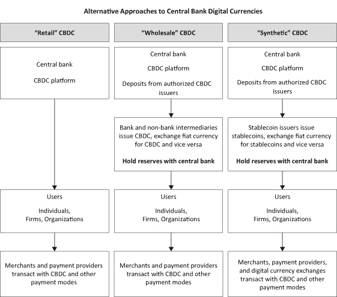

图 3.3 ¶ CBDC 的替代方案

*   **安全性 (Security)**：保护 CBDC 免受黑客攻击至关重要，因为任何 CBDC 从上线那一刻起就会受到不断的攻击。因此，CBDC 需要具有抵抗攻击者的韧性。`Bitcoin` 和 `Ethereum` 为开发安全网络提供了示例，使用了去中心化节点和基于 `PoW` 的验证方法。
*   **安全性 (Safety)**：客户可能还希望获得保障，类似于存款保险。消费者和企业将需要免受数字货币的流动性和破产风险的影响。这引发了一个问题：如果 CBDC 是联邦发行和管理的，它们是否需要存款保险。
*   **隐私性 (Privacy)**：由于数字货币提供了追踪每笔金融交易的能力，消费者可能有隐私顾虑。提供与现金相同或类似的无票据匿名性的 CBDC 设计将获得更好的欢迎，但这与防止非法使用（即洗钱）的需求相冲突。CBDC 还必须应对现有的法规，例如欧洲的 `GDPR` 隐私框架。单笔交易和聚合数据可以去中心化的方式存储，并存储有限期限，以缓解隐私担忧。
*   **客户关系 (Customer relationships)**：如前所述，像`美国联邦储备体系` 这样的央行需要参与整个经济的支付链，运营并维护一个单一全球网络。这意味着 `Fed` 需要在技术选择、客户互动、应用程序开发和品牌管理方面拥有专业知识——在这些领域他们的能力有限，特别是与 `Facebook` 等私营公司相比。例如，客户可能希望将支付与社交媒体关联，以便用户可以在其社交媒体网络中广播金融交易，并允许朋友对消费和购买模式进行“点赞”和评论（就像使用 `Venmo` 一样）。与私营营利实体相比，像`联邦储备委员会`这样的政府机构是否有能力为数百万客户管理消费者支付应用？
*   **创新性 (Innovation)**：`AliPay`、`PayPal` 和 `Paytm` 等的持续创新表明，引入基础 CBDC 和法币加密货币（功能刻意限制）将促进创新，私营部门公司将竞争添加 `APIs` 以增加功能。如果 CBDC 与私营稳定币共存，则与私营稳定币的互操作性对于提供流畅的支付系统是必要的。
*   **监管 (Regulation)**：如前所述，防止使用数字货币进行非法交易是一个主要关注点。作为回应，美国政府已将其“旅行规则”36 要求扩展到超过某些金额的数字货币交易。必须提供数字货币转账发送方和接收的信息，以监控可能的洗钱、恐怖主义融资和其他非法使用。一个全球性的虚拟资产服务提供商 (`VASP`) 注册表，每个 `VASP` 拥有类似于 `IBAN` 或 `BIC`（在 `SWIFT` 中）的标识符，并带有一个标准的互操作消息层将所需信息固定在区块链交易上，将符合美国要求的一种方法。其中一种解决方案是瑞士的 `OpenVASP`37，它使用了 `Ethereum` 的 `Whisper` 离链消息系统。`Whisper` 向外部观察者隐蔽了两个交互的 `VASPs` 的身份以及消息内容。除非此类法规在各国范围内普遍实施，否则某些客户将寻求监管较不严格（发行稳定币的实体认为）且执行和执法薄弱的国家。

### CBDC 试点

在数字货币这一新兴世界中，各国央银行强调了协作，与其他央银行合作以研究实施 `CBDC` 的后果。几家央银行共同宣布了共享开发和实施 `CBDC` 试点的经验——包括`英国银行`、`瑞典国家银行`、`加拿大银行`、`日本银行`、`ECB`、`瑞士国家银行`以及`国际结算银行`。瑞典央银行 `Riksbank` 与 `Accenture` 启动了为期一年的试点，测试数字克罗纳 `e-krona` 如何由普通民众存储在数字钱包中，并使用包括可穿戴设备、智能手表和现金卡在内的多种设备进行存款、取款和支付。该试点在评估转向 `e-krona` 的价值时，考虑了易用性、简单性、安全性和性能。在另一个合作中，新加坡金融管理局（`MAS`）启动了 `Project Ubin`；它将与`英国银行`和`加拿大银行`合作，分阶段开展跨境货币支付试点，同时使用不同的国家数字货币并连接到私人稳定币网络。该试点寻求部署在 `Microsoft’s Azure` 云端上的 `Hyperledger Fabric` 和 `Quorum` 等使用 `RTGS` 的区块链协议。

中国也在制定推出数字人民币的计划，这无疑受到该国移动货币支付兴起的推动。2019 年，移动货币支付占了所有支付的近 80%，总额达 49 万亿美元。中国还渴望摆脱美元作为全球储备货币的霸权。习近平主席在 2019 年 10 月宣布：“中国必须抓住区块链的机遇”。中国`国家密码管理局`办公室主导制定了一项新的加密法（该法于 2020 年 1 月起施行），该法规定了管理数字人民币的规则，将控制权交给了`中国人民银行`。这在实际上降低了目前主导中国支付市场的`支付宝`和`微信支付`的重要性。

如果中国消费者想在危机期间切换回现金，那么中国 `CBDC` 的可用性将允许个人将数字人民币存储在央行授权的钱包中。*经济学人*认为，这种数字人民币将是“反比特币”，因为国家控制的数字货币将使中国对经济中所有的支付流进行完全监控，从而获得更大的力量来防止洗钱和逃税。可编程的数字人民币还允许中国政府确保（例如）旨在向小企业提供贷款的刺激措施确实是按照这些指南发放的。这可能会减少中国的隐私，但考虑到通过社会信用和对中国互联网的审查对公民活动进行的普遍政府控制，这可能是一个次要考虑的问题。数字人民币的移动应用程序试点于 2020 年 4 月进行。2022 年 1 月，中国向中国开放了数字人民币，截至月底已有 2.6 亿国内下载用户访问了中国数字货币，当月使用中国新数字货币的交易金额约 150 亿美元。中国的推出代表了国家级规模最大的 `CBDC` 发布，是全球货币体系发生重大变革的预兆。

## 数字货币的政策影响

货币的未来是什么，它将如何影响企业？现金是双方认可的价值存储手段，也是一种匿名支付手段，完成交易不需要进一步交换信息。银行创造的货币，例如`支票`（基于银行存款，因此是对价值存储的债权）和银行发放给企业的`贷款`（通过部分准备金制度，贷款量基于存款、银行股权以及其在隔夜市场获取联邦储备金的能力，即其借贷能力），是传统的支付手段。银行货币债权取决于对支持债权的资金所有权的验证和充足性。满足债权并影响银行余额的转移由相关方记录（以防止`双花`）。验证债权也会减慢支付速度，这是较新的稳定币和像`Bitcoin`这样的加密货币相比现金和银行货币的优势之一。

稳定币提供了消费者利益，如易用性、便利、即时支付和低成本的无处可用。跨境认可性进一步有利于稳定币，增强了其作为支付手段的吸引力。安全担忧和对稳定币发行者的有限信任是缺点，但正如我过的，`CBDCs`可以通过提供安全信任成为可接受的稳定币替代方案；因此，它允许政府更好地控制数字货币。总之，很容易看出稳定币、加密货币和 `CBDCs`如何取代现金和银行货币。

### 对全球金融体系和系统性风险的影响

数字货币（无论是`加密货币`、私人`稳定币`还是官方 `CBDCs`）的广泛使用将影响整个全球经济，影响支付和金融体系、金融行业的竞争结构、货币供应和货币政策，所有这些汇成系统性的金融影响。这些影响也将影响社会各地的企业、消费者和个人。随着一些较新的金融进入者获得市场力量，它们可能会影响金融部门的稳定性和竞争力。这反过来带来了宏观政策的后果，例如对货币政策传导、货币独立性以及美元和欧元等主要货币在全球金融中相对重要性的影响。此类宏观和跨境变化将将影响企业、消费者和社会，侵犯隐私保护，促进金融包容性并维护金融诚信。

`美国联邦储备委员会`和`美国财政部`等政府机构及其外国对应机构在维护全球金融体系顺畅运行和信心方面负有共同责任。数字货币是一种破坏性力量，需要采取集体行动以防止负面后果的出现。

# 维护金融稳定与金融体系完整性

G20 金融稳定委员会指出，稳定币可以提高效率，但对金融稳定构成风险。委员会强调了稳定币潜在的波动性、底层交易基础设施的局限性，以及可能发生的稳定币失败，这最终可能削弱对金融机构的信任。然而，在少数对私人货币失去信任并出现恐慌的情况下（例如 2008 年金融危机或 2020 年新冠肺炎期间需求崩溃导致的流动性潮），主权国家支持的央行数字货币（CBDC）将成为追逐的避风港。CBDC 可以帮助稳定金融体系，免受系统性风险的影响。以 CBDC 或银行存款形式的安全避险也有助于减少对私有数字货币的依赖，以及降低恐慌性兑换数字货币的可能性，从而降低整体系统性风险。

监控和防止非法活动来维护金融体系完整性是首要任务。目前的支付系统已设有此类保护措施，除非具备此类合规性，否则数字货币不会获得官方认可和许可。如果数字货币发行方确保其用户符合 `KYC`、`AML` 和 `CFT` 原则，就可以防止非法活动。美国要求超过某些金额的加密货币交易遵守“旅行规则”，该规则要求识别发送方、接收方和交易金额。保护跨境数字货币交易免受洗钱、逃税、腐败和恐怖主义融资，需要各国达成共识与合作，以统一金融完整性法规。

现金和银行存款由对政府和联邦储备的完全信任和信任支持（例如银行监管、存款人保险）。对这种新型货币形式的信任将取决于发行稳定币的私人实体（如 `JPMorgan` 或 `Facebook`）提供的支持，以及治理加密货币区块链的去中心化（无许可）实体的支持（例如，不像稳定币，它们并非资产支持）。对稳定币发行设定最低储备金水平，并对此类数字货币的交易所进行监控，可以减少其破坏稳定性的潜力。

## 增强跨境支付

跨境支付具有复杂性，用于完成交易的汇率存在不确定性、手续费高以及交易完成时间长。各国已开始合作开展试点计划，研究使用数字货币带来的效率提升。此类举措需要主权国家政府进行合作并接受在外汇交易中使用 `CBDCs`，但由于暗示了国家经济主权的削弱，这导致了犹豫。例如，另一个国家 CBDC 的日益增加可能会导致货币供应发生意料之外的变化，影响实施货币政策的能力。诸如 `Project Jasper` 以及加拿大银行与 `MAS` 合作的 `Project Ubin` 等实验，试图让中央银行承担清算代理的角色，取代跨境中介银行网络，并将 `CBDCs` 作为快速、低成本交换和结算的手段。这些问题将在第 5 章中详细讨论。

## 维护金融部门竞争力

网络效应表明，随着时间的推移，被认为最可靠的数字货币提供者将会出现，这些少数实体将主导支付格局，形成寡头，并使企业和个人更加依赖这些供应商。在选择特定的稳定币作为首选支付方式时，企业和个人正在决定信任哪个稳定币提供者。用户更倾向于从多个竞争性的稳定币提供者中选择作为替代支付通道，而不是依赖垄断或寡头。寡头将减少企业的选择，以及减少其在维护客户关系主导地位、控制客户数据和收取与特定支付选择相关的费用等问题上的谈判议价能力。这种网络效应可能促成了 `Libra` 的推出，`Facebook` 希望像其及其应用主导社交媒体和信息传递一样主导数字货币世界。这种垄断可能会让稳定币提供者对客户行为产生广泛洞察，并使其垄断延伸到相邻市场，例如信用评级和提供债务融资。

在维护竞争力和防止支付寡头的背景下，`CBDCs` 可以发挥至关重要的作用。它们可以提供窄支付功能、提供支付平台，并采用分层结构，与银行和非银行金融机构合作成为 `CBDCs` 的“分销”，并与企业和个人的零售账户对接。

## 宏观经济政策后果

随着数字货币作为货币形式被更广泛接受，它们对货币政策传导和货币主权产生了影响。它们还投下了地缘政治的阴影——影响主要法货币作为全球储备货币的角色（例如，美元将继续享有全球地位吗？），导致区域性的法数字货币岛。

### 货币政策传导

一个担忧是数字货币（特别是私人稳定币）可能会损害政府对货币供应的控制及其执行货币政策的能力。如果政府实施 `CBDCs` 并选择为 `CBDC` 账户提供利率，调整这一利率将使货币政策的传导变得更容易。这是因为 `CBDCs` 是货币市场工具的替代品，银行需要匹配 `CBDC` 利率以防止客户将银行存款转向 `CBDCs`。带息的 `CBDCs` 将使负利率成为可能（假设 `CBDC` 持有者转换为现金以避免负利率的选项受到限制）。也就是说，现金将被数字货币（特别是 `CBDCs`）取代，由于数字货币是可编程且可以附加条件的，希望使用负利率的 `CBDC` 发行可以可以 `CBDC` 存款附加`智能合约`，收取持有存款的费用并返回少于初始存款金额的金额，从而实际上收取负利率。此外，`CBDC` 对减少系统储备的任何影响可以通过公开市场操作注入流动性来抵消，导致国际结算银行认为“`CBDC` 的存在对货币政策实施的影响有限”。

然而，如果银行的存款被 CBDC 和私人稳定币分流，可能会导致某种程度的银行去介化。客户可能会将银行存款转移到 CBDC 账户或代币，以获得用于在线交易的数字货币。他们可能更倾向于 CBDC 账户相对较高的安全性，特别是当该账户有利息时。如果发生这种去介化，企业从银行借贷将变得更加困难，因为银行从存款中获取的可贷资金供应将会减少。银行可能不得不提供更高的利率以留住存款，从而推高贷款利率。这对较小的借款人产生差异化影响，因为他们更依赖银行贷款，且通常无法发行债券。因此，借款人可能会寻求与拥有贷款资金的数字货币提供商建立新的关系。他们可能会通过稳定币提供商转向影子银行部门和 P2P 借贷渠道借款。然而，此类数字货币实体可能会收取更高的利率，因为他们评估信用和价格风险的成本可能更高。总的来说，小企业的贷款来源可能会减少，从而推高借贷成本。

因此，引入 CBDC 通过对银行业业的影响可能会影响货币政策，因为利率可能会偏离目标利率，需要进一步的干预。正如 Jack Meaning 及其合作者所建议的 48，“很难对 CBDC 对货币传导机制的影响得出确定或定量上稳健的结论”，因为这将取决于特定 CBDC 的设计、其引入的经济环境以及可能随结构性变化（例如可能的银行去介化）。

## 货币独立性

在全球交易的稳定币将使货币薄弱和经济波动国家的能够切换到全球稳定币。虽然这改善了个人福利，但这种转变可能会削弱其本国实施货币政策的能力，迫使领导人将其脆弱的货币挂钩到更强的货币上。因此，稳定币可能会降低货币主权，并增加货币薄弱、高通胀、治理糟糕、腐败横行以及法治执行有限国家的货币替代现象。在压力时期，大量转换为全球稳定币的本币可能导致严重的资本外流，对汇率和国内金融部门产生负面影响。这种对国家经济主权的跨国影响将增加各国对接受广泛使用数字货币的阻力。然而，这种干扰可能是不可避免的，从长期来看，可能会提高消费者的福利，因为他们在治理较差的经济体中受货币波动的影响会较小。

## 地缘政治后果：美元的角色

外国数字货币的成功推出也将产生地缘政治影响。美元作为世界储备货币，世界上大部分贸易和跨境债务都以美元计价。一个来自强大稳定经济体且具有跨国接受能力的 CBDC 将影响美元的角色，影响其强势程度以及美国实施制裁和以较低利率向世界借款的能力。

中国和俄罗斯是两个倾向于美国在世界金融结构中作用削弱的国家，并热于减少美元作为世界储备货币的地位 49 中国将支持以人民币在贸易和借贷中替代美元，特别是对于那些中国是其主要贸易伙伴和贷款来源的国家。中国政府债券市场一直稳定，并比美国政府证券提供显著溢价（2020 年 4 月溢价约为 1.9%），增加了对人民币的需求 50 鉴于中国在 `Alipay`（支付宝）和 `Wechatpay`（微信支付）移动钱包数字支付方面的熟练，以及从中国试点项目中获得的经验，在 2022 年 1 月通过 `Android` 和 `Apple` 应用推出中国 CBDC（`e-CNY`）并不意外。`e-CNY` 由中国人民银行发行，并通过六家大型国有银行以及互联网银行 `WeBank`（微众）和 `MYBank`（网商）传播，这些银行可以为用户开设 `e-CNY` 数字钱包，进行 `KYC` 调查，并投资 `e-CNY` 使用的基础设施。用户可以向对手隐藏身份，但执法部门可以获得权限以调查非法交易 51。然而，中国对保护个人隐私的兴趣有限可能会限制数字人民币在跨境交易中的可行性及其作为先发者的影响 52。

有理由反对创建美国国家数字货币：对失去隐私的担忧、美国政府在提供客户服务方面的官僚效率低下，以及对商业银行的负面影响。私营部门的创新（例如 `PayPal`、`Venmo`、`Tether`）目前可以满足消费者对数字支付的需求。最后，人们认为“只要联邦保持美元通胀率低位，美元就会统治”53。美联储指出，潜在的美国 CBDC 应该是“受隐私保护的、中介的、广泛传输且经过身份验证的”，但对美国 CBDC 的最终可行性未采取立场 54。美联储强调，要进行 CBDC，国会需要通过法律，行政部门也必须提供支持。关键点是，美联储支持美国 CBDC 的中介模式，即私营部门与用户交互提供数字钱包并管理 CBDC 的持有和支付。

如果没有主要经济体之间的协调发展，多种 CBDC 的推出会导致数字货币孤岛，出现监管不兼容和缺乏互操作性。这对跨境支付、贸易和数字法货币交换产生负面影响，增加全球支付和贸易的摩擦，在这种情况下，允许私人稳定币蓬勃发展可能是促进跨境 CBDC 开发的优替代方案。

### 对企业的影响

数字货币的日益普及对企业具有战略性意义。数字货币影响企业对支付的控制，从支付系统的成本和效率到客户交互的深度和质量。客户和支付数据的控制、企业的流动性和营运资金，以及对支付中间的依赖程度也可能受到影响。采用数字货币可能会如何影响公司？他们应该如何反应？

对流动性和营运资金的影响 在稳定币和加密货币与 CBDC 并存的情况下，企业必须决定是否接受并使用这些新货币的形式，同时也接受传统的支付形式，如信用卡、存储值以及 `PayPal`、`Venmo` 等中介解决方案和 `Square` 等销售终端应用程序。应收款的近即时结算（以及应付款的即时支付）对客户和供应商具有吸引力，可以减少整体营运资金需求和业务所需的资金。

转向数字货币将影响营运资金，因为即时结算将影响应收和和应付款中的浮动资金。他们的贷款机会、期限和贷款金额将取决于其目前的银行关系，以及他们与数字货币底层的新兴金融机构及其相关的 P2P 贷款网络建立的联系。获得成本更低的改进支付基础设施将是一项收益，同时他们可能面临数字货币价值不稳定带来的新风险。55 它们在支付生态系统中的地位可能会影响其对客户关系的控制程度，以及控制交易安全和保护隐私的能力。随着企业与稳定币提供商建立金融关系，他们还将寻求在此类新关系与现有银行关系之间的平衡。

## 控制支付系统的成本与效率

随着企业转向数字货币环境，他们可能决定在接受和交易多种数字货币时保持中立，让客户决定自己的选择。客户对不同形式货币交易相对便利性的感知，将塑造企业在传统货币及其新型形式之间建立的平衡。在肯尼亚等国家，`M-Pesa` 已演变为提供银行和储蓄账户，推进了金融包容，并让与 `M-Pesa` 合作的企业能够接触到以前无法覆盖的潜在客户。作为回应，银行可能会从其网络提供数字货币，例如 `JPM Coin`。

影响企业的某些限制包括在多种数字货币中交易的成本、多种数字货币之间无缝交换的可用性，以及影响企业在何处以及何种货币持有剩余资金的安全性和流动性考虑。企业必须考虑网络运营成本和加密安全成本，并由即时结算带来的资金快速可用性来抵消。企业可以将更低的交易成本和更低的跨境支付费用转嫁给消费者，从而降低价格并帮助收入增长。如果数字货币被设计为国内和国际运营的高效支付工具，他们还可以增加在跨境贸易中的活动量。

企业可能需要与多个支付生态系统挂钩并管理这些网络角色，选择在运营中强调哪些支付替代方案，以及在塑造和管理这些新兴生态系统方面扮演什么角色。网络外部性将决定哪种稳定币（无论是私营还是 `CBDC`）将占据主导地位，因为个人更倾向于使用那些已被他人广泛作为支付手段使用的数字货币。由于政府发行的纸币被广泛使用和信任，`CBDC` 可能比私营稳定币具有优势。56 个人和消费者做出的支付选择可以影响企业在创新、制造和客户交付方面的全球影响力。

## 保护和控制客户互动与支付数据

随着数字货币提供商获得其数字货币使用地的资金流访问权限，企业可能会失去部分客户关系的亲密性。如果监管数字货币制度的法规增强了竞争性，企业可以通过谈判数据访问条件，并限制货币提供商对其数据的可见性，以此作为青睐几种竞争性数字货币之一的条件，从而保留控制权。企业可能还希望与并鼓励行业和商业协会合作，游说制定用以限制数据访问和保护数字货币网络内用户隐私的法规。

## 开展数字货币试点

鉴于对数字货币日益增长的兴趣以及对企业产生的各种影响，企业需要开始为这种颠覆做好准备。一种方法是启动数字货币试点，允许企业评估数字货币对其运营和表现的影响。评估试点结果可以帮助企业制定适应数字货币环境的策略。作为即刻步骤，他们应该目标是了解数字货币技术和优势、可扩展性障碍、实施问题以及对客户满意度的保证。试点可以提供概念证明和关键发现以支持结果，例如通过即时结算带来的收入增加和营运资金减少，以及为客户提供快速低成本的支付替代方案。

企业可以获得与数字货币平台和交易所谈判协议和程序的经验，以保护并防火墙专有的消费者数据，在授予数据访问、共享和其他数据相关权限的同时，通过选择性加入（opt-in）许可保护客户隐私。他们可以根据使用数字货币平台获得的细粒度客户交易数据评估其竞争优势的增强。他们还可以更好地理解如何管理竞争性数字货币供应商（如 `Tether`、`USDC` 和 `Monerium`（与多个国家法币挂钩的数字货币））以及数字货币交易所（如 `Coinbase`）。他们还可以尝试在具有支持数字货币经验的区块链协议合作伙伴之间选择（例如 `Algorand` 或 `Consensys Quorum`），为客户提供数字货币选项。选择标准应包括与 B2C 客户和供应链合作伙伴的数字货币协议及平台的互操作性。

总之，数字货币的使用为企业带来了许多利益：

*   数字货币允许即时结算并为客户提供低成本的支付替代方案，导致收入增加和营运资金减少的可能性。
*   由于网络效应，接受数字货币的企业可能依赖于主导数字货币提供商，使他们能够调节客户互动并获取宝贵的交易数据，从而削弱他们的客户关系。企业随后可能考虑与其行业同业和监管机构合作，将支付功能作为公用事业隔离开，减少数字货币供应商对专有客户知识的访问。
*   使用数字货币由于速度和透明度的提高以及跨境支付复杂性和成本的降低，增加了与全球客户的接触。
*   数字货币的使用可能会影响消费者隐私，因为保护金融完整性的法规要求企业维护客户交易记录，并在特定条件下允许政府访问。需要解决的重要考虑因素包括客户数据的存储、时长、地点，以及在监管合规与保护客户匿名性之间取得平衡。
*   数字货币要求企业增强其技术就绪和人力资本能力，确保网络稳健性，支持加密加密，并提供用户友数字货币应用程序以及风险缓解措施。

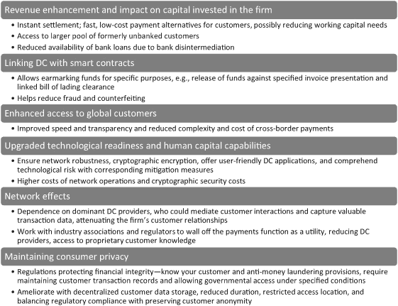

图 3.4 ¶ 数字货币对企业的利益

这些对企业的数字货币利益总结在图 3.4 中。

### 对消费者和社会的影响

数字货币的转变也会影响消费者和社会。使用数字货币可以使区块链节点上的经济交易变得可见。它也可能排除那些缺乏金融系统基础设施和设备的人群。

# 保护消费者隐私与安全

人们对经济交易的隐私性有普遍预期。虽然政府税收和财政部门可能要求披露经济活动，但此类信息的隐私通过将披露限制在相关方来得到保护。个人和企业在使用数字货币时有权期待匿名性，而数字货币受政府监管，以遏制非法交易并维护金融系统的完整性。

鉴于数字货币可能在非法交易中使用（例如在勒索软件的索要和收集中），在保护隐私的同时允许政府部门访问数字货币交易是首要任务。数字货币的设计可以通过为 `CBDC` 令牌使用序列号来提供某种匿名性。这些序列号除 `CBDC` 令牌外还将使用，即使底层数字货币是 `CBDC`，序列号也能提供匿名性。每次交换 `CBDC` 时都需要更改序列号。中央银行可以通过在中央注册表（而非区块链上）中进行序列号查询来防止双重支付，并可能限制只有发行中央政府才能访问序列号注册表。

相关问题是支付交易中消费者隐私可能丢失。取决于支付基础设施的设计和金融诚信的监管要求，交易双方的身份、交易金额、位置、时间戳和其他相关交易信息可能会与交易本身一同包含。此类数据消除了消费者交易周围的隐私，并可用于在粒度层面监控和分析消费者行为。企业可以通过限制此类数据的收集和访问来代表客户采取主动措施，消费者游说团体也可能要求更大的隐私作为转向数字货币支付基础设施的条件。竞争性的数字货币供应商还可以提供更大的隐私作为差异化的手段和竞争优势的来源。

用户友好性、便利性和易用性至关重要，因为如果数字货币与信用评分以及 `Venmo` 等其他支付应用良好集成，消费者将更有可能适应它们。公平性考虑表明，消费者保护规则应使广泛使用的数字货币免受价值波动的影响。这种消费者保护应包括保护数字钱包和维护私钥访问的。监管私有稳定币的法规必须确保其供应商提供客户服务，并有清晰的争议解决和资产恢复程序。

# 推进金融包容，改善金融基础设施的获取

个人对数字货币的访问取决于其对互联网（无论有线还是无线）的访问以及对智能手机等设备的访问。由于互联网连接和手机信号可能不稳定，在连接恢复之前提供离线访问将是任何数字货币系统不可缺的技术补充。诸如通过 `Bluetooth` 访问存储价值、通过 `PoS` 设备实现 `P2P` 智能手机通信与传输，以及交换加密交易信息和余额更新等创新，都是克服无银行服务人群连接障碍的鼓舞性步骤。廉价、负担得起的智能手机在新兴市场广泛可用，改善了金融应用的获取能力，`M-Pesa` 就是一个出色的例子。女性是一个特别关注的群体，因为有 10 亿名女性属于无银行服务人群（在共 17 亿无银行服务人口中，占世界人口的近四分之一）。

一个关键问题是无银行服务的人能否获得稳定币和 `CBDCs` 等新支付形式的访问。金融包容会改善还是恶化？由可能有盈利目标的实体运营的私有稳定币可能更看重金融包容，并开发应用和创新以接触尽可能多的个人，从而接触更多无银行服务的人，因为无银行服务人群代表了巨大的市场潜力。政府作为 `CBDC` 发行者，也可能向尽可能多的公民提供访问，促进转移支付，降低贫困地区的支付和汇款成本，并将非正式部门纳入正式经济。

诸如 `M-Pesa` 等的服务已逐渐扩展其功能以激励公民使用它们，在基础支付功能基础上增加了储蓄账户、保险和贷款。新的竞争对手可能会遵循类似的路径，政府可以通过制定法规来发挥作用，将推进金融包容（以及衡量进展的指标）作为获得许可和访问银行网络的条件。数字货币通过替代现金，将保护无银行服务的人免受现金被盗的风险，同时提供正余额利息、增强的服务、防欺保护（通过交易验证的加密要求）以及即时结算——这对于预算有限的穷人来说是一个大利好。然而，私钥的丢失是一个负面影响，因为它会导致所有者无法访问其数字货币。鉴于无银行服务人群金融知识有限，丢失私钥的检索安排至关重要，依靠信任圈来支持私钥丢失的创新对于推进金融包容至关重要。上述几个政策问题总结在表 3.1 中。

## 表 3.1 数字货币的政策影响

| 对全球金融系统和系统性风险的影响 | 宏观经济政策后果 |
| :--- | :--- |
| • 维护金融稳定和金融系统完整性 • 维护金融部门竞争力 • 增强跨境支付 | • 货币政策传输 • 货币独立性 • 地缘政治影响：美元在全球经济中的作用；数字货币孤岛 |
| 对企业的影响 | 对消费者和社会的影响 |
| :--- | :--- |
| • 控制支付系统的成本和效率、支付中介的使用 • 保护和控制客户互动及支付数据 • 流动性和营运资金 • 尝试数字货币试点 | • 保护客户隐私与安全 • 推进金融包容，改善金融基础设施的获取 |

# 结论

总而言之，植根于区块链技术的数字货币、稳定币和 `CBDCs` 的兴起具有改变支付世界的巨大潜力。这些变化将影响宏观经济和金融行业的结构，并影响到企业和个人。企业将通过理解数字货币对其运营的影响并积极采取措施管理这一转型来从中获益。它们必须决定如何适应客户对数字支付业务日益增长的需求，考虑采用数字货币支付系统的后果，并参与到新兴的数字货币生态系统中，以维持其相对于客户和供应商的竞争地位。在第 4 章中，我将讨论数字货币日益增长的应用，以及它们在新兴的区块链去中心化金融（`DeFi`）世界对传统金融机构带来的挑战。`DeFi` 初创公司对传统金融服务机构构成了重大的颠覆性挑战，其业务涵盖了多个领域，从存款和储蓄账户到抵押贷款、金融衍生品、保险服务，以及通过债券和股权融资。

# 4

## 去中心化金融

资本是经济活动的基本要素。创业者必须从个人资金、天使投资人、风险投资人、机构投资者和股权市场等来源筹集风险资本。贷款资本以固定或浮动利率支付息，并在一定程度上通过抵押品担保，也可以从多个来源流向创业者。要让风险资本来源投资或贷款给创业者的风险并非总是易事，对于有可部署资金的投资者来说，寻找并筛选合格的接收者具有挑战性。这些困难的核心在于信任问题。投资者是否可以信任创业者和借款人按照约定使用资金并谨慎使用？是否会按照约定条款履行本息还？这种信任缺口产生了对中介的需求，代表投资者和贷款人进行尽职调查，并将汇总信息提供给客户进行审查和决策。

对于风险资本和贷款资本，金融中介机构将投资者、贷款人与寻求资金的创业者和公司联系在一起。除了提供资金渠道（在某些情况下帮助筹集风险资本和信用）以及促进贷款和还款外，金融中介还可以提供许多其他辅助和相关服务。这些互补服务包括银行和托管、支付处理、汇款、用于交易和结算金融资产及衍生品的交易所、投资建议和管理、国际贸易融资、信用证（`LCs`）以及个人理财。金融中介还服务于不断变化的需求，如对保险产品、遗产规划和财务咨询的需求。

除了匹配提供者和客户外，金融中介还通过帮助客户合规以及检测、预防和防止欺诈来管理交易风险。他们可以代表客户行使资产控制权，为客户提供交易数据的子，并承担系统性风险。本质上，金融服务机构提供了一种受信任的手段来降低客户风险，作为回报是中间费用，这些费用可能占交易金额很大比例。额外成本可能包括服务费、完成交易的周期长、透明度有限、用户对个人数据的控制缺失以及单方面决定的服务条款和定价。

近年来出现了几家移动优先的金融科技公司，旨在通过智能手机交易以较低成本提供这些中介服务。这些金融科技挑战者包括欧洲的 `Revolut` 和 `N26`；美国的 `Robinhood` 和 `SoFi`；以及亚洲的 `Paytm`、蚂蚁金、`AliPay`（支付宝）和微信支付。许多此类公司已多元化经营，推出了集成服务产品，扩展到相邻市场。这些金融科技公司正试图通过与`AI`相关的软件、用户友好界面、智能手机访问、云服务、社交媒体和数据分析来获得相对于传统机构的竞争优势。在这种背景下，区块链提供了颠覆传统金融中介及其客户特权地位的额外手段。

### 什么是去中心化金融？

区块链可以提供金融服务产品的许多核心需求，例如满足对信任的需求、提供快速廉价的流动性、提供准确不可篡且及时的数据、建立溯源并从而实现可审计性，以及确保高安全性。它在做到这一切的同时，通过去中介化实现交易对手之间的直接互动，显著减少了中间费用。区块链使得去中心化的 P2P 金融服务成为可能，并能降低金融工具的开发、启动和交易成本。不出，许多新兴公司已使用区块链提供金融服务，成为传统机构的竞争者。去中心化金融或 `DeFi` 描述了这种利用技术（包括区块链）来颠覆金融行业的趋势。

除了服务投资者和银行客户等终端用户外，`DeFi` 还为发行者、金融资产组合经理和监管机构提供服务。发行可以通过发行嵌入智能合约的数字证券来筹集资金，这些合约包含了条款条件，并了了实时更新的 `KYC` 和 `AML` 信息。数字资产可以细分，增加流动性并让小投资者获得更多种金融资产。`DeFi` 还可以通过整合资产生命周期事件（包括自动化的本息支付）来帮助发行者。组合经理可以从访问去中心化交易所（`DEXs`）和具有智能合约编程功能的新型投资类别中受益。监管机构也可以从区块链交易的不可篡改和透明性中受益，通过自动化的合规审计和检查，释放他们进行更深层次分析和风险预测。

`DeFi` 协议倾向于开源，提供互操作性和通用的软件基础设施，以鼓励跨资产类别的使用。它们的设计考虑了更广泛的使用，以鼓励开发者在 `DeFi` 协议之上构建应用并提供新服务。智能合约和自动化执行在 `DeFi` 中起着核心作用，例如通过智能合约控制的自动做市者来扩大 `DeFi` 市场。（自动做市者使用流动性池来交易数字资产，而不是像传统交易所那样匹配买卖单，从而实现了有序交易的自动化，这对于建立和维护市场至关重要。）

DeFi 的增长与以太坊协议紧密相关。DeFi 主要运行在以太坊上，并使用 Ether 和其他 `ERC-20` 代币；以太坊的普及以及投入 Ether 的巨额价值使得在以太坊上构建 DeFi 应用极具吸引力。2021 年 10 月，以太坊 DeFi 应用的锁定总价值接近 1600 亿美元，而 2020 年 6 月初仅为约 10 亿美元（尽管由于锁定后作为抵押品借出的资金重复计算，这可能是一个高估）。本章稍后讨论的 `Maker` 和 `Compound` 是两个主要的 DeFi 应用，此外还有 `Aave` 和 `Curve`，约 35% 的总 Ether 投入了这些协议。2

DeFi 期望通过涌入大量新的 P2P 货币应用来去中介化，这些应用可以促进贷款、借贷（包括保证金交易）、稳定币交换、在比特币等数字货币的期货市场投资、创建和交易基于数字货币的代币，以及用于商品和外汇的期权和衍生品，通过如 `Balancer` 等新成立 DeFi 公司实现。3 `Balancer` 是一种多代币自动做市和交易所，作为自平衡加权组合运行。

图 4.1 显示了日益扩展的 DeFi 应用范围。我将在后续章节中讨论不同金融领域的若干 DeFi 示例，以说明区块链在金融应用中日益扩展范围。

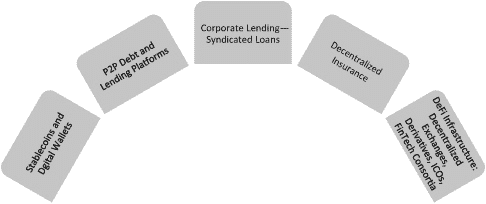

图 4.1 ¶ 日益扩展的 DeFi

正如第 3 章所述，基于区块链的加密货币如比特币和以太坊具有许多优势，但它们的波动性降低了其作为价值存储或交换媒介的吸引力。稳定币对于数字货币获得广泛认可并“跨越鸿沟”进入大众市场是必要的。稳定币可以通过将稳定币与法币储备进行一一挂钩来创建；如 `USDC`（美元币）或 `USDT`（泰达）等稳定币就是以此方式创建的，`USDC` 或 `Tether` 的创建数量相当于储备中持有的美元总额。另一种方法是使用加密货币储备作为发行稳定币的基础，通过持续的算法调整加密货币储备与已发行稳定币的比例，以适应底层加密货币储备的价格波动。`MakerDAO` 及其 `DAI` 稳定币就是这种方法的示例。

### MakerDAO 及其 DAI 稳定币

`MakerDAO` 及其 `DAI` 稳定币是许多已被广泛采用的稳定币之一。由于加密货币在商业交易中作为交换媒介的有限（受波动和小额交易高交易成本影响），投资和投机成为购买加密货币的主要动力，希望这些货币——比特币、以太坊——能够升值，为持有者提供资本利得。因此，比特币和其他数字货币在等待升值期间是闲置资产。2020 年 12 月的一项估计显示，“流通中 60% 的比特币在过去 12 个月内没有移动过”4。

作为回应，`Maker` 及其竞争对手开发了围绕创建稳定币的业务模式，旨在激励加密货币“持有者”（HODL 是加密货币世界中长期持有比特币和其他数字货币持有者的术语）部署他们的闲置资本。贷款闲置加密货币为数字货币持有者创造了流动性和收入。`Maker` 的稳定币模型将波动加密货币转换为稳定的数字货币，与提供所创建稳定币的贷款相结合。这类似于商业银行的银行和基于准备金的贷款，银行持有的储备仅为总存款的一小部分，但可以发放远超现有资金数倍的贷款，因为有如美国联邦储备委员会之类的中央机构的支持。这种安排增加了货币供应量。

一旦 `Maker` 协议根据客户存入的加密货币创建 `DAI`，由于 `DAI` 是稳定的，它可以作为交易的支付媒介。它也可以被交换或作为储蓄。`Maker` 协议通过贷款利率设置补充了 `DAI` 的创建——`Maker` 的稳定性类似于联邦联储的目标利率。

`Maker` 以及大多数其他 DeFi 应用都使用以太坊协议。以太坊的智能合约设施是构建金融应用时特别实用的特性。`Maker` 及其 DeFi 竞争对手使用兼容 `ERC-20` 的代币，如 Ether。`ERC-20` 是以太坊内部创建代币的标准，它定义了必要的基础功能。5 这些功能包括给定代币的总供应量、账户所有者的余额，以及根据指令向或特定地址转移特定数量代币的能力。这些功能允许支出者提取或返回特定数量的代币，并激活模块执行指令。`Maker` 还包含了针对其稳定币 `DAI` 的额外功能，例如铸造和销毁（取消）代币；此功能适用于 `DAI`。

为了应对加密货币的不稳定性，`Maker` 将 `DAI` 与美元挂钩并保持 1:1 的比例。创建的每个 `DAI` 都以以太坊 Ether 为支撑并存入 `Maker`。当客户向 `Maker` 存入 Ether 并同意锁定存入的 Ether 时，稳定币的创建过程开始。一旦 Ether 已存入并安全，`Maker` 的抵押规则将生效，其内部设置的抵押品与 DAI 的比例最初设定为例如 150%。抵押率由 `Maker` 的治理成员设定，部分取决于抵押品底层加密货币的波动性；波动性较大的抵押品抵押率越高。随着 Ether 价值的波动，某种程度的超抵押是必要的——`Maker` 的意图是通过超抵押增强对 `DAI` 的信心，提高 `DAI` 稳定币的安全性。在 150% 的抵押率下，存入 1 个 Ether（假设当时在加密货币交易所价值 300 美元）允许创建 200 个 `DAI`，Ether 的存款者可以借用（即抵押债务仓）。

这种通过“以太坊上的无许可信贷工厂”创建 `DAI` 的模型，6，类似于经纪商提供的保证金贷款。保证金贷款允许投资者在避免清仓交易的同时，以保证金利率为成本获得部分投资资金。当借款人偿还 `DAI` 时，存入金库的 Ether 可以取出，但要扣除稳定性费用（类似于利息；年贷款利率取决于存入的特定加密货币和抵押率。当 Ether 以 150% 的抵押率存入时，2021 年 6 月的稳定性费用约为 3.5%）。

DAI 也可以锁定在 Maker 的 DSR（DAI 储蓄率）合约中以获得额外的 DAI 变动利率，该利率由稳定费产生（由 Maker 治理者决定）。实际上，Maker 提供了一个以 DAI 支付利息的储蓄账户。智能合约自动化了 Maker 的交易，包括发行 DAI 贷款、管理贷款还款、收集利率、清算坏账以及管理金库（vaults）。

DAI 可以在加密货币交易所交易，Maker 依靠套利和与抵押品的联系来维持 DAI 与美元的同步。稳定费的提高或降低会导致债务减少或增加增加，从而改变 DAI 的需求和供给。如果 DAI 跌至 $0.99，债务人可以用 $198 购买 200 DAI 并偿还原始的 200 DAI 债务，从而小利。当 DAI 被偿还时，它将从流通中移除，减少 DAI 的总供应并提高其价格，使其恢复与美元平价。如果偿还的 DAI 没有注销，DAI 的总量将超过抵押品金额，导致 DAI 价值跌破预期的 1:1 美元平价。这一过程如图 4.2 所示。

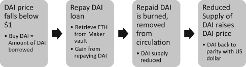

图 4.2 ¶ Maker DAI 如何维持与美元的同步

如果 DAI 价格大于 $1，则会发生相反的过程，借款人在加密货币交易所出售 DAI 以获利。这会激励其他 ETH 持有者在 Maker 上创建 DAI 并卖出获利。这一过程将增加 DAI 的供应，降低其价格并使其恢复与美元平价。

Maker 系统包括自动机器人“Keepers”，它们参与了这种维持平价的功能（以及其他功能）。2020 年 3 月，在新冠疫情危机高峰，对流动性的抢夺导致 DAI 锚崩，DAI 价格曾达到兑美元 1.37 DAI，随后在 2020 年 7 月稳定在 1.01 到 1.03 之间。然而，Ether 是波动性的，其价值会发生波动。如果 Ether 的价值跌到低于 $300 的程度，借款人需要向金库投入更多 Ether 以避免违反 150% 的抵押要求，或者归还借出的 DAI。如上述，借款人必须支付稳定费才能取回 Ether。（上述使用的 Ether 价值仅供说明。2021 年 2 月至 2022 年 2 月，Ether 的价格在 $1,416 到 $4,620 之间波动，并在 2022 年 2 月 19 日价值 $2,790）。

为了保护 DAI 的超抵押和安全，并防止坏账增加并冲击 Maker 系统，系统的稳定规则允许在贷款变得危险时自动清算金库（即如果抵押率破缺并跌至设定的 150% 比例）。链外 DAI 价格从 MKR 选民选择的可信预言机馈中收集，中位 DAI 价格通过 `MKR` 馈送到链上。（注：原文中存在大量重复段落，此处已根据要求进行翻译处理并保留核心信息）。

在美元日益重要的背景下，像 `Maker` 这样的 DeFi 应用对货币供应的影响变得越来越显著，无论是将美元视为储备货币、其流动性，还是银行为了满足准备金要求而购买的高质量资产。随着美国赤字扩大（截至 2020 年 6 月底的年度赤字为 3 万亿美元，占 GDP 的 14%）以及货币供应量的增加（由于量化宽松，货币供应已从 2012 年的约 1.4 万亿美元增长到 2019 年底的近 2.3 万亿美元），面对人们对美国金融体系脆弱性的感知，基于数字货币的金融系统可能会获得关注。

此外，随着数字货币所有权的增加以及稳定币更广泛用途的前景光明，消费者需要安全、易用且易用的存储方式，并具备便捷的跨钱包转账功能。数字资产的存储和检索替代方案包括来自各种来源的在线托管数字钱包，如数字货币交易所（例如 `Coinbase`）、物理硬件钱包（如 `Trezor` 和 `Ledger`）、纯移动钱包（智能手机上的虚拟钱包应用，指向 `blockchain` 上的某个位置以存储和检索数字货币）如 `Edge`，以及与 `Trezor` 集成的桌面钱包（类似于移动钱包但安装在桌面和笔记本电脑上）如 `Exodus`。物理硬件钱包是安全的物理设备，类似于闪存，可以持有私钥，从而保护对数字货币的访问。

### 挑战 Maker：Compound 协议与收益耕作

作为引入稳定币的先驱，`Maker` 在 `Ethereum` `ERC-20` `Ether` 代币的总投资价值中获得了巨大的市场份额，到 2022 年 2 月，`Maker` 库的锁定总价值达到了 160 亿美元。`Compound` 以其业务模式的创新差异挑战了 `Maker`。`Compound` 成立于 2017 年，在 `Ethereum` 内启动了一个竞争性的货币市场协议，并于 2020 年 6 月推出其 `COMP` 代币后快速增长。到 2022 年 2 月，`Compound` 的锁定总价值为 67 亿美元，而 `Maker` 则约为 160 亿美元。`Compound` 的独特差异化特征总结如下。

`Compound` 接受广泛的 `Ethereum` 资产（例如 `Ether`、`DAI`、`Tether`），尽管并非每个 `Ethereum` 兼容代币资产都受到支持。`Ethereum` 代币持有者可以将 `Ethereum` 兼容代币资产存入 `Compound`并通过 `Compound` 协议将其借出，从而从闲置资产中赚利。借贷利率通过算法确定并随资产而异，取决于该 `Ethereum` 资产的供需相互作用；`smart contracts` 匹配供给与需求，并计算不断变化的利率。`Compound` 协议允许贷款人从特定资产池（例如 `Ether` 池）中借入。资金池通过汇总所有 `Compound` 客户存入的 `Ether` 创建。因此，贷款人并不直接借出给借款人；相反，`Compound` 协议从特定资产池向寻求借入该特定资产的借款人提供贷款。

通过聚合所有用户提供的资产并从该池进行放贷，`Compound` 增加了每个贷款人的流动性。贷款人还可以提取资产，而无需等待特定贷款到期。通过这种方式，`Compound` 创建了 `Ethereum` 代币的无缝借贷，无需对债务到期日、利率或抵押品进行 P2P 协商。借款人必须在 `Compound` 上存自己的 `Ethereum` 兼容代币作为抵押品，其可借总额为存入抵押金额的一部分。作为抵押品的每种资产价值由 `price oracle` 决定，该插件从前十大加密货币交易所汇总该资产的价格。借款人可以借取的金额取决于所提供抵押资产的风险性。这些资产的抵押强度各异，从高风险到低风险资产的零到一不等。抵押品风险越高，根据该抵押品可以借取的越少。如果用户因为抵押品价值下降而超过借贷能力，部分贷款将以按比例折扣的抵押品偿还。这被称为清算折扣，它激励 `Compound` 社区的套利者介入并使用相同类型的资产偿还债务，从而获得借款人将被清算的抵押品的所有权。

`Compound` 的治理最初是中心化的，由管理员选择每种资产的利率算法等参数，并决定哪些 `Ethereum` 资产将被接受在 `Compound` 进行存款和借贷。为了实现去中心化治理，`Compound` 推出了 `COMP` 代币，将治理权交给 `COMP` 代币持有者。每天发行新的 `COMP` 代币并按比例分配到各个资产类别，然后在每个资产类别中在借款人和贷款人之间平均分配；因此，每个 `Compound` 用户现在治理中都有发言权。

`Compound` 协议的一些典型用例包括借入代币用于 `Ethereum` 生态系统、使用现有所有资产作为抵押品借入 `Ether` 或其他 `Ethereum` 资产（融资），以及做空代币以偿还原始债务并实现盈利。特殊的 `Dapps` 如 `InstaDapp` 提供了 `Maximize COMP Mining` 功能，帮助用户通过“收益耕作”（yield farming）获得更高的回报，帮助 `Ethereum` 资产所有者使其闲置资产运作。在收益耕作中，数字货币所有者——流动性提供者——将其资产锁定在流动性池中，使用 `smart contracts` 从池中进行贷款。为池贡献资产的流动性提供者获得交易费、贷款利，有时还有治理代币，这些代币可能会使实体增值；例如，`Compound` 增长并增加了其总贷款额。

`Maker` 和 `Compound` 的增长，以及较新的竞争对手如 `Aave`、`Curve Finance` 和 `Uniswap`，强调了 DeFi 协议和业务模式日益增长的吸引力。它们的增长还刺激了几个互补 DeFi 机会的出现，包括去中心化交易所（DEXs）和去中心化衍生品市场。

### DEX 和交易系统

金融工具需要交易所来定价和交易金融资产。在美国，由机构财团拥有的托管结算公司（`DTCC`）处理证券交易的结算和清算，结算时间约为两天。该国 2019 年平均每日证券交易额约为 1.3 万亿美元，`DTCC` 注册更新交易以反映所交易证券的所有权和支付变化。为了防止不付款的交易对手风险，金融机构在实际结算前留出资金以覆盖风险。此外，它们还维护自己的交付和结算记录。对齐冲突的信息消耗资源并花费时间，因此，改进这些后台功能（通常是基于主机的批处理过程）可以缩短结算时间并节省成本。如 `Coinbase` 等中心化交易所应运生以促进数字资产的交易和托管，并改进了 `DTCC` 系统固有的缺点——结算时间长、需要预留资金覆盖不付款风险，以及交易对手交易记录的后台对齐。

基于区块链的交易系统可以提供安全的即时交易、结算和支付。区块链初创公司 `Paxos` 已获得 `SEC` 授权，启动一项使用区块链结算股票交易的有限试点项目。这项为期 24 个月的试点在一个私有的、许可的 `Ethereum` 协议上进行，限于交易最活跃且波动率最低的股票，上限为这些股票每日总交易额的 1%。少数金融机构被允许作为交易伙伴参与，包括 `Credit Suisse`（瑞信）、`Nomura`（野村）和 `Société Générale`（法）。

区块链实现了基于智能合约的证券数字表示交换，通过创建交易的单一统一记录，对账变得不再必要。因此，`Paxos` 的区块链交易可以促进交货结算（DVP）和同日结算，甚至允许每天进行多次结算，从而增加日内流动性。这将释放目前用于防范交易对手风险的资金。虽然自动股票转移将发生在 `Paxos` 区块链而非 `DTCC` 系统内部，且现金以稳定币的形式存在 `Paxos` 托管账户中，但 `DTCC` 仍将维护更新的股票注册表，以防止交易系统在试点期间出现故障。虽然最初的参与仅限于双方均为 `Paxos Settlement Service` 网络的交易对手，但随着试点的成功进行，`Paxos` 可以寻求 `SEC` 授权，向美国所有的经纪交易商提供其区块链解决方案，以结算其证券交易。

随着加密货币的日益流行，特别是像 `Bitcoin`、`Ether` 和 `DAI` 等数字货币，对流动性的需求日益增长，以便加密货币所有者能够轻松地将一种加密货币转换为另一种或其他法币，通过贷款或存款存款获得持仓利息，并利用其持仓。同样，`DeFi` 的兴起导致了去中心化交易所（`DEXs`）的相应增加，其中 `Uniswap`、`Kyber`、`Balancer`、`Curve Finance` 和 `Bakkt`，这些平台都放弃了像 `Coinbase`（在第一章讨论）那样的中心化做市商，转而提供不同版本的快速安全的去中心化 P2P 交易。通过 `DEXs` 交易数字货币，交易法币、商品以及如权益证券等真实资产的数字表示仅有一步之遥，正如 `Paxos` 所示。因此，任何可以安全且不可篡改地数字表示的资产都有在 `DEXs` 上交易的潜力，从而颠覆传统的中心化交易所。

### Balancer：DEXs 与 ETF 提供

`Balancer Exchange` 是此类协议之一，允许用户交易多种 `ERC20` 兼容代币，同时创建“可编程流动性”。`Balancer` 提供了流动性池，其特点是包含不同 `ERC20` 代币资产的组合，且在每个不同的组合中底层代币的权重不同。这意味着 `Balancer` 可以提供访问 ETF 类型加密货币组合的机会。在共享流动性池中，池的创建者决定池中接受哪些代币（最多为八种不同代币），并设置组合中每种代币的权重。一旦为该共享流动性池选择了代币及其权重，就无法更改。

`Balancer` 用户随后查看可用的不同组合，并决定想要投资哪种组合，选择一个特定组合中货币加权平均值符合其投资者偏好的组合。为了投资该组合，用户在加密货币交易所与其他用户交换其部分加密货币持仓，以生成该组合中每种货币组件的特定数量，然后他们将其贡献给 `Balancer` 以获得组合的份额。此外，一旦投资者加入流动性池，该投资者就可以通过提供流动性和促进其池中加密货币的交易来赚费用。因此，`Balancer` 中的 ETF 投资者不需要向 ETF 经理付费，而是通过投资获得收入，这独立于组合产生的任何其他收入（如利息或增值）。

`Balancer` 还为希望将特定数量的特定加密货币转换为另一种交易者提供服务。一旦交易者提交交换订单，算法将在某些流动性组合子集上执行此类交换，使得即使底层代币的价格发生变化，组合成分权重也能保持。不同的组合将提供不同的价格，取决于它们为了维持所需的组合成分而交换货币的需求，这可能会降低它们所过剩并需要出售以恢复组合平衡的代币的价格。

这种自动做市和自动平衡的一个结果是，较大的订单可能会导致价格波动更大，因为较大的订单对组合在预期组合成分权重下的平衡的影响更大。这种被称为“滑点”的价格变化会在下单时广播广播给交易者，以便他们设置订单执行时可接受的滑点限制。此类交易者支付由每个组合设定的交换费用，只要组合拥有用户寻求的特定代币，算法将倾向于与交换费用较低（占交易金额的百分比）的组合进行交易。总之，组合通过提供特定货币的流动性获得交换费用，而算法驱动组合降低其交换费用，从而降低整个 `Balancer` 系统的交易成本。

`Balancer` 还提供 `BAL` 代币，允许 `BAL` 代币所有者参与 `Balancer` 治理，`BAL` 代币的数量随组合的增大而增加。这样，较大的组合为 `Balancer` 系统提供了更大的流动性并获得更多 `BAL`。这使得它们在治理中拥有更大的话语权，意味着在决定费用水平、决定哪些 `ERC20` 代币被接受的规则、设置跨流动性池分配交易的算法功能等方面。

`Balancer` 为其流动性池增加了额外的细之处，允许单一所有者私有池，由该所有者宣布组合接受的代币、设置组合权重和交换费用百分比，并对这些参数拥有完全控制权。私有池对于希望提供具有组合成分透明度的加密货币 ETF 服务的大投资者和专业资金经理具有吸引力。私有池为希望为其原生代币创建市场并增加其代币流动性的新型区块链实用程序提供了创造性机会。例如，新的区块链初创公司可以启动由其代币和其他成熟代币（如 `Bitcoin` 或 `DAI`）组成的引导引导流动性池，并随着时间的推移扩散其代币所有权。因此，第二章讨论的 `Algorand` 可以利用 `Balancer` 来推广 `ALGO` 代币，并增加使用和参与 `Algorand` 作为区块链协议的兴趣。

### 数字资产衍生品市场：Synthetix

衍生品是交易系统中的另一个核心环节。它们允许投资者对标底层资产的预期表现进行交易，而无需拥有资产本身（例如股票看涨期权和看跌期权）。`Synthetix` 是一家区块链初创公司，创建基于 `Ethereum` 的去中心化合成资产发行协议，该协议还作为法币合成形式（例如作为美元合成形式的 `DAI`）、加密货币和大宗商品的合成品的交易平台。它提供去中心化的衍生品交易，产生名为 `SNX` 的原生代币，这些代币与存入 `Synthetix` 协议的抵押价值挂钩。在这种情况下，存入的 `ERC20` 代币是各种法币（如美元、欧元等）、加密货币和大宗商品（黄金、白银）的数字表示。未来这些可以扩展到其他真实资产，如股票。

在系统中生成 `SNX` 后，用户可以锁定 `SNX` 并铸造第二种代币 `Synths`，其抵押率高达 800% 或更高。因此，八百个 `SNX` 可以生成一百个 `Synths`，这些 `Synths` 可以交换为法币、加密货币和大宗商品的衍生品。所选资产的价格变化和衍生品的价值由预言机跟踪；在加密货币的情况下，`Synths` 也可以用于对其进行做空，从而跟踪 `Ether`、`Bitcoin` 等价格的下跌。

每笔 `Synth` 交易都会产生约 0.3% 的费用，这些费用将作为质押抵押品的奖励发放给 `SNX` 持有者。`SNX` 持有者还可以通过在 2023 年之前每周 `SNX` 数量每周 1.25% 的增长来获得额外奖励。`Synths` 是用户的债务，必须偿还才能解锁 `SNX` 抵押品。用户债务随着个人债务占 `Synthetix` 整个系统总债务的比例而持续变化，而总债务价值随底层资产价格的变化而变化。正如 `Synthetix` 所解释的，“通过这种方式，`SNX` 质押者充当所有 `Synth` 交易的池化对手；质押者承担了系统中整体债务的风险。”[17

`Synthetix` 还在尝试仅用 `Ether` 作为抵押品，这只需要 150% 的较低抵押率，并允许用户直接通过 `Ether` 生成 `Synths`，而不是先将其交换为 `SNX`。用户债务以 `Ether` 结算，用户不参与系统的池化债务部分，也不接收费用或奖励（因为他们不承担债务池风险）。由于可以进行更大规模的对冲，交易者对数字资产衍生品市场的访问增加了交易量，从而提高了市场效率。随着区块链公司在去中心化稳定币、P2P 贷款、`DEXs` 和衍生品市场方面积累经验，同样的原理和机制可以用于开发去中心化市场。随着时间的推移，提供相似功能的竞争协议群将减少，少数健壮且功能全协议可能会占据主导地位。这一过程随着行业联盟（如 `R3/Corda` 和 `Ripple`）的兴起而加速，这些联盟正在被广泛采用，允许在这些标准协议之上构建第三方应用程序，增加了它们的实用性并帮助它们成为行业标准。

### 代币发行 (ICO)

区块链平台使公司能够通过首次代币发行 (`ICOs`）和首次交易所发行 (`IEOs`）直接从投资者处筹集资金。`ICO` 是 `IPO` 的替代方案，并使访问民主化。

由于投资者保护较少，`ICO` 投资者更容易受到欺诈和价格操纵。`ICO` 作为一种融资工具在 2017 年和 2018 年达到顶峰，筹集了 78 亿美元，随后在 2019 年下降至 12 亿美元。`ICO` 买者预计随着底层服务的增长及其客户群和使用量的增加，代币将增值。然而，拟的服务通常处于概念阶段，在转化为能够吸引大量付费客户的功能性工具方面缺乏明确的前景。21

更清晰的监管可以澄清并加强 `ICO` 在筹资方面的作用。例如，瑞士已将 `ICO` 分为不同的类别——支付型 ICO（如作为支付手段的加密货币）；实用型 ICO（通过基于区块链的基础设施访问现有功能应用程序或服务）；以及资产型 ICO（允许物理资产在区块链上进行交易，更接近证券投资，对发行人拥有债权或股权索赔）。[23

### IEOs 和首次 DEX 发行

到 2019 年，`IEOs` 已取代 `ICOS` 成为推出新区块链公司的首选发行方式，占所有新数字公司发行资金额额的 80%。`ICOS` 是公司与其投资者之间的直接销售，而加密货币交易所则监督 `IEOs`，代表发行方主持新代币的销售。在交易所发行代币销售类似于通过主承销商进行新股发行。交易所会选择托管哪些代币销售，并随后在其交易所中上市。选择取决于若干参数，例如发行公司的潜力、发行的质量，以及维护交易所作为交易高质量代币场所的声誉。潜在的代币买家成为交易所成员以竞标代币，交易所通常要求买家持有该交易所的代币，并使用该交易所的代币支付发行公司的新代币。因此，像 `Bitfinex` 这样的公司可能要求 `IEO` 的潜在买者持有 `Bitfinex` 自己的 `Leo` 代币并用其支付新的 `IEO` 代币。

`IEOs` 已演变为去中心化交易所发行（`IDOs`），其中硬币或代币在 `DEX` 上发行，具有更低的费用、社区对发行的认可（类似于众筹）、更好的即时流动性，且代币通过私钥存储在所有者的钱包中。主要的 `IDOs` 包括 `Universal Market Access`（一个在 `Ethereum` 上构建合成资产的协议），以及基于 `Ethereum` 的去中心化加密货币交易所，如 `SushiSwap` 和 `Uniswap`。`NFTs` 的兴起可能会导致类似的投资者风险，因为 `NFTs` 易于创建，且供应可以远超波动的需求。

## 区块链与银团贷款

除了规模和信用允许其直接提供贷款工具的大借款人外，中小型借款人必须寻找愿意安排和银团贷款的银行，或者必须与其他商业和投资银行合作，寻找愿意购买其银团贷款一部分的贷款人。主承销银行协商贷款金额、期限、条款、抵押品、贷款契约和利率以及定价，产生一份由所有方签署的法律文件。当大部分总贷款的贷款人到位且市场条件有利时，贷款团就会启动贷款。

管理贷款登记、抵押品管理以及二级市场和交易；记录所有权变更；以及安排利息支付是随后的任务，这些任务非常耗时且通常是纸质的，需要对账，并受监管备案和合规性保证的影响。如果贷款必须修改，必须获得贷款人的同意，并根据更新后的条件注册修订后的贷款。这一循环结束于本金偿还、贷款终止和贷款文件的取消。整个过程须经过代表贷款协议所有方的法律顾问的法律审查和批准，这是一个缓慢且昂贵的过程。

引入区块链作为银团贷款的平台可以简化流程、提高效率、加速进程并降低成本。债务工具底层的可编程智能合约带来了灵活性，方便了变更贷款条款的插入并实现了利息支付的自动化。交易的不可篡改性了一个贷款登记、贷款条款、所有权变更和相关材料的单一认证来源；未经授权的更改将显而易见，所有方都可以访问并共享更新后的贷款状态。此外，链上记录可以包括治理功能（如投票权和行）以及促进快速结算。成本也降低了，特别是中介费用和持续交易成本，尽管与智能合约相关的编码和调试可能会产生额外成本。总而言之，这些特征使得银团贷款对更广泛的潜在借款人来说更容易获得。总之，基于区块链的数字资产是可编程、不可篡改且透明的，是高效且流动性的，并符合监管标准。图 4.4 展示了区块链为银团贷款流程带来的转型。在接下来的两个章节中，我将研究区块链在债券生命周期中的两种应用。

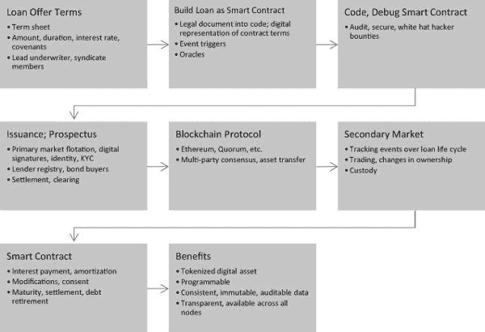

图 4.4 银团贷款流程的区块链平台

## 德意志银行智能债券试点

使用区块链管理银团贷款流程案例是德意志银行（`DB`）的一个试点项目。`DB` 有兴趣开发一个概念验证：我们是否可以在区块链上建模并执行债券生命周期——从证券清算和确定最终结算到触发利息支付——从而实现债券摊销和终止？第一步是说服决策者区块链可以带来竞争优势，并且一个用于开发和实施原型的试点项目可以为未来在该领域部署区块链的决策提供参考。项目发起者必须成为传道士，汇集来自不同领域（法律、数据分析、IT、金融、客户关系和合作伙伴关系）的热爱好者社区，形成一个有助于寻求组织支持的联盟。为了获得预算批准，项目需要具有预算监督权和对战略方向具有影响力的高层支持者。一旦这些支持者被说服支持试点，初始资金就获得了批准。

实施试点意味着与 `DB` 之外的第三方合作：即区块链专家。`DB` 选择与多个区块链协议/平台合作，以提供未来的灵活性并获得各种平台的经验。这还将帮助它选择一个用于管理银团贷款的平台，并与跨行业合作伙伴合作。如果合作伙伴愿意使用相同的区块链协议，协作将变得更容易。为了简化问题，试点没有使用实时数据进行；相反，区块链平台在设计完成后，使用历史数据在模拟中进行了测试。试点最终证明区块链可以创建贷款的代币版本并管理其生命周期。

`DB` 的下一步是让外部实体——法律顾问、潜在买家、做市商和托管代理——参与跨组织的概念测试。在成功使用区块链进行银团贷款方面，跨组织协作的重要性使 `DB` 成为 `R3` 金融财团的创始成员，该财团旨在验证区块链在金融领域的应用；制定并同意共同标准；并为不同金融机构之间区块链协议的互操作性做出贡献。`R3` 建立了一个通开源区块链协议——`Corda`，供财团成员进行区块链实验，并实现快速且无误的结算。

超越试点的关键要素是衡量项目成就，以证明继续区块链实验的合理性。用于衡量项目成就的指标包括后台效率的提高、成本的降低、结算时间的缩短、结算和支付的改进、减少错误和对账需求，以及访问详细、准确且带时间戳的交易数据的用途。随着试点转向大规模实施，需要解决的问题包括：

*   • 金融数字资产是否可以在没有中介的情况下进行传输？

*   • 智能代码的执行是否可以在不需要中介的情况下证明合法所有权？

- 智能合约是否能正确记录未来的状态变化，例如按照约定支付利息、所有权变更、债券到期和退还？
- 在区块链平台上执行的交易是否能满足监管要求并实现合规？
- 新平台是否能与遗留系统集成（例如 SWIFT 消息匹配）？
- 鉴于几家银行必须被说服跨组织边界来测试试点应用，当前和未来的财团成员是否愿意合作、出资并在全面实施中共享知识产权？

## # 世界银行的区块链债券 bond-I

区块链债券实施的一个案例是世界银行的 `bond-I`。澳大利亚联邦银行（`CBA`）是该 2018 年以澳元发行、金额为 1.1 亿澳元的区块链债券的唯一安排商。`CBA` 的区块链卓越中心此前与昆士兰财政部公司合作试点了一个区块链债券原型。该债券在由华盛顿特区的世界银行和悉尼的 `CBA` 运营的区块链平台上进行创建、分配、分发和管理。

世界银行和 `CBA` 预计债券发行将展示区块链作为“不同参与者之间促进平台”的作用。他们在早期采用区块链债券投资者的参与下，在一个由授权参与者组成的私有以太坊区块链许可网络上，历时一年的开发了该区块链债券。这是政府实体发行的第一只区块链债券，该试点提供了解决技术和法律考量的机会。

在初始发行几个月后，在市场做市商 TD Securities 的下，`bond-I` 开启了二级交易，这凸显了区块链筹资、协调交易以及交付“经过验证的永久记录和即时对账”的能力。`bond-I` 平台的功能包括自动化债券拍卖、账本构建和分配、电子竞标采集、实时更新、根据参与者权限增强的可见性，以及用于“廉洁和操作风险管理”的可审计且不可篡改的交易记录。

## # 金融科技保险市场：结合人工智能、物联网和分析利用区块链

保险提供了一种基本服务。为了帮助个人和公司避免可能导致公司破产和个人遭受不可弥回损害的灾难性风险，保险公司汇集风险，并以已知的较小即时支付——保险费作为交换，对极端结果提供赔偿。保险公司的成功取决于其能否建立足够大的客户池，使风险分散在该客户池中。保费基于对历史数据的精算分析设定，因此平均而言，总保费加上所收保费的投资收益超过了池中部分成员实际损失的赔付金额。这最终为保险公司及其被保险成员提供了利润或股息。

保险业务的成功取决于完成几个相互关联的关键步骤：
- 使用被保险损失的历史数据分析进行准确且具有竞争力的保费定价；
- 直接客户销售或通过具有重大市场覆盖的经纪人网络获取客户；
- 留住客户，使年度保单续保提供稳定的保费收入；
- 通过对所承担的总风险部分进行审慎的再保险来降低风险。

这项任务允许企业设定损失的底线（以及收入的上限），从而限制所承担的风险并在更长的时间内对其进行平滑。假设保费定价具有竞争力，客户留存主要受服务质量的影响，特别是理赔处理方面。对于那些认为损失在承保范围内而寻求赔偿的焦虑客户，如果他们认为理赔被削减或被不公正地拒绝，可能不会续保。然而，保险公司在平衡客户理赔与保护公司利益的保单条件之间可能存在困难，特别是在检测和拒绝欺诈理赔方面。

区块链结合人工智能和分析可以帮助保险公司应对上述挑战。区块链凭借其不可篡改的数据和溯源轨迹，可以跟踪被保险资产池的变化、所有权和价值。基于人工智能的聊天机器人可以自动化定制保险覆盖范围的过程，并根据客户数据提供保费报价。其他人工智能聊天机器人可以通过连接提供天气数据、警方报告和其他来源的预言机来加速理赔处理，而其他人工智能聊天机器人则可以增强客户互动和客户体验。

在一家名为 `Lemonade` 的区块链保险公司中，俏皮的人工聊天机器人 `Maya` 和 `Jim` 是支持客户满意的人工部署的示例。聊天机器人和智能合约实现的自动化可以降低成本，通过在规模主导的行业中自动化关键流程来提供结构性成本优势。累积的客户数据可以实现动态保费定价，特别是在续保点，且此类累积数据可以作为取证分析的基础，以威慑、检测和防止欺诈。在这种背景下，区块链内部生成的代币可以激励预期行为；例如，在 `Lemonade`，保单持可以指定一个喜爱的慈善机构来接收来自理赔池剩余资金的捐赠，这本质上是对客户较低理赔率和相对于保费收入的奖励。表 4.1 总结了区块链部署在保险应用中的一些益处。

区块链惠及整个保险周期，从客户获取到保费报价，从客户服务和理赔处理到客户留存，以及从改进保险营销到降低成本和提高客户对公平的感知。安全的区块链数据可以帮助在初始客户获取阶段以及后的客户服务互动期间验证客户身份。区块链在更新新验证的交易记录（如保费支付或修订的保单条款）的同时确保隐私和数据保护。类似的数据链接有助于验证特定群体的团体福利，因为保险提供的福利包可能随小组而异。不可篡改的验证数据提供了永久记录，有助于建立保险公司与其被保险客户之间的信任，并用于减少欺诈以及检测篡改和伪造。

另一个平台 `Insurwave` 提供了区块链和物联网船体险解决方案，允许 `Maersk` 等公司管理运营在全球的 350 多艘集装箱船的保险。每艘保险的船都注册在区块链上，由算法计算保费并向船东提供保单。使用物联网设备，每艘船的航行情况和位置、天气、环境风险状况等抵押数据会被记录。积累的数据用于保单续保时的保费计算以及理赔评估和处置。另一个辅助益处是船舶生命周期事件的完整不可篡改记录，这对于监管机构、船东以及船舶转卖的潜在买家非常有用。标准格式的数据可以与再保险公司安全交换以实现交易透明对账，并与第三方交换用于理赔代位，消除信息孤岛。

## 表 4.1 金融科技保险：利用人工智能、物联网和分析技术的区块链

| 差异化基础 | 目标 | 问题 | 解决方案：区块链的优势与互补 |
| --- | :--- | :--- | :--- |
| 客户体验 | 让客户满意 | 以保单为中心、对理赔质疑以及理赔审批缓慢，导致客户留存率下降 | 增强被保险人与保险公司之间的信任；AI 机器人帮助获得保障；愉悦的 UI/UX；基于应用；吸引年轻客户群体 |
| 负担得起 | 极佳的价格 | 在保持竞争隐私的同时实现透明化 |
| 理赔处理 | 公平、快速 | 在欺诈理赔与公平性之间平衡，防止欺诈。 | AI 机器人使用分析评估理赔；处理物联网设备提供的数据。快速解决、快速结算；支付授权和资金转账导致保单续保和客户满意 |
| 成本控制 | 较低的成本优势和竞争力 | 缺乏规模效应且人工密集型处理 | 机器人和智能合约降低成本和错误 |
| 欺诈控制 | 减少和预防欺诈 | 虚假理赔以及伪造或不准确的文件 | 被保险资产损失和代位权 |
| 合规 | 高效且及时满足变化的多个管辖区需求 | 合规不完整且缓慢 | 监管机构访问安全不可篡改、准确的数据，允许合规验证和分析 |
| 隐私和数据安全 | 准确、可交换和永久的记录 | 受益人不了解保险利益（尤其是寿险）；未领取的赔付 | 不可变的永久注册，便于受益人联系和支付 |
| 客户留存 | 减少导致客户流失的保单复杂性和拒赔 | 价格差异有限的商品化服务 | 改善客户体验；更清晰的理赔验证和处置 |
| 行业合作 | 增加再保险伙伴的使用 | 与再保险公司共享数据并获得认可；IT 系统不兼容；数据标准 | 改进再保险放置；清晰的合同条款；更容易续保以及理赔分配与结算 |

区块链保险行业倡议 (B3i) 的形成是为了开发基于智能合约的再保险（描述为“无摩擦风险转移”），以防止财产保险中的超额损失，或适用于“灾害超额损失”场景。B3i 结合了实时信息共享，使保险公司与其再保险公司之间的账户对账，并允许自动赔付。35 像 B3i 这样的保险区块链还可以简化监管流程，增强监管机构的可审计性，监管机构可以使用智能合约查询安全数据并对其是否符合监管标准进行评估。例如，Amica Insurance36 在理赔审核员能够从区块链上获取及时准确的理赔数据（如保单持有人信息、事故原因、保单范围和条款、保单理赔历史和其他基本文件）后，能够理顺其理赔处理流程。理赔审核员可以记录客户陈述、访问地图并提交其他相关人员可见的文件、照片和理赔评估报告，一切通过安全且带有时间戳的审计跟踪完成。

将区块链与物联网和人工智能相结合（例如 IBM 的 Watson IoT）是提高保险业务效率的另一种途径。物联网设备可以自动检测触发保险的事件，例如汽车事故、进一步触发的维修、维修认证、在批准设施的完成，并最终链接到理赔处理和支付。如果保单持有人同意加入并允许部署，例如 Groupama 保险公司会在被保险车辆上放置物联网智能传感器以跟踪位置、速度、加速度，使其能够提供 AI 辅助的保险。使用物联网传感器的一个益处是实时通信；如果被认为严重，可以立即派遣紧急服务，可能挽救生命。

Groupama 经历了欺诈理赔、盗窃和鲁莽驾驶的减少。这是因为物联网设备促进了精确车辆移动信息的传输，这些信息可以使用源自大数据的算法进行分析，并补充历史精算表，以改进风险预测和预防。该概念验证的目标是利用区块链降低成本并提高效率，同时让农民能够获得负担得起的微型保险，并在极端天气发生（可能导致作物损失）时获得公平透明的赔付。这种基于物联网（IoT-based）的、数据驱动的保险必须遵守隐私法规，因此，Groupama 要求客户同意后才收集数据，并向其客户承诺绝不会与第三方共享数据。

区块链在保险领域部署的潜力导致了特定保险的区块链协议的启动，例如 Etherisc 试点。这项基于 Etherisc 协议的 P2P 飞行保险试点会在航班取消或延误时向保险人赔付。其工作原理是智能合约首先响应客户发起的请求发放保险；当预言机（oracles）验证航班延迟时，授权支付。这以透明的方式自动化了签保和理赔处理。

Etherisc 应用的另一个有趣试点是通过 Aon、Sanasa 和 Oxfam 之间的合作，为斯里兰卡的小型水稻农民提供的作物微型保险 38。Oxfam 将其在新兴市场与农民社区工作的深厚经验与 Etherisc 的区块链协议和去中心化风险池知识相结合。Aon 将其再保险和创新保单设计的专业知识引入该项目，而 Sanasa 则增加了其当地的保险行业和文化知识。斯里兰卡偏远地区的许多农民没有银行账户，收入和流动性有限；官僚机构和银行基础设施对这些人来说物理和财务上都遥不可及。长期目标是提供一个开源的通用保险框架，作为 Etherisc 去中心化保险协议（Decentralized Insurance Protocol）的基础，使“产品构建者、风险池、预言机、理赔审核员、分销商和承保人的生态系统能够在以太坊上创建保险应用”。一个例子是 Raincoat，这是与波多黎各的 HurricaneGuard 合作开发的针对风暴的效益保险。它利用美国海洋和大气管理局（NOAA）的公共数据来检测被保险区域特定半径内的飓风风速，并交付自动赔付。39

区块链的增长还将产生对网络保险的需求，以防止数字钱包访问权限的损失（从私钥丢失到被盗用），以及为区块链开发团队和公司提供职业责任保险，其中涵盖了防止项目完成问题的保单。总而言之，将区块链协议与保险产品相结合，可以提高效率、降低成本、增加透明度、与业务伙伴和监管机构进行实时数据共享、优化理赔处理并减少欺诈。随着准确且易获取的数据改进风险评估和风险定价，参数化保险以及自动化营销和理赔调整等新产品正出现在眼前。

## 企业对 DeFi 冲击的应对

区块链上的 DeFi 可能更廉价、更安全，并能让用户对其财务操作和个人数据拥有控制权。区块链可以提供安全且低成本的环境，用于进行金融资产交易、提供记录保存和监管合规，并设计加密货币/数字货币的稳定性。这些环境是组织数字资产交易交易所，以及交易与这些数字资产表现挂钩的金融工具（即衍生品）的理想场所。DeFi 创新的每个主要类别都建立在之前的进展之上。作为回应，现有者也启动了自己的区块链试点项目和项目，其中一个广为人知的例子是摩根大通的 `Quorum`，它是 `Ethereum` 的私有版本。`Quorum`区块链是对新兴 DeFi 入场者挑战的回应，旨在防止摩根大通市场地位的侵蚀，使其能够在新兴的 DeFi 世界中竞争。`Quorum` 已吸引数百家银行加入其银行信息网络，该网络与 Microsoft Azure 云平台集成。

摩根大通的 `Quorum` 团队对原始的开源 `Ethereum` 协议进行了调整，通过添加隐私功能（例如允许发送者和接收者匿名）以及允许用户隐藏交易资产的金额或细节，来满足企业的隐私需求。摩根大通计划将此类扩展提供给第三方以构建包含此类隐私的垂直应用程序，例如 Komgo 的能源交易应用（Komgo 是一家使用区块链改进贸易大宗融资及相关应用的公司集团）。为了提高企业的接受度和采纳率，摩根大通的 `Quorum` 与 Consensys 合并推出了 `Consensys Quorum`，以便在保持开源开发的同时，提供公共和私有的企业解决方案，以及吸引业务的强力功能。

除了摩根大通的 `Ethereum` 许可版本 `Quorum` 之外，来自 IBM 的 `Hyperledger Fabric` 以及开源协议（如 `Hyperledger Besu`）是企业友好型协议的进一步示例。2019 年的一份报告显示，`Corda`、`Hyperledger Fabric` 和 `Quorum` 了 `GitHub` 上提交代码的所有唯一区块链开发者的 86%。随着时间的推移，竞争协议将合并，少数幸存的平台将成为行业标准。区块链协议较少但占据主导地位的一个副作用是，如果平台数量有限，实现互操作性可能会更容易。

要取得成功，这几个竞争性的 DeFi 创新必须超越技术爱好者的早期采用，并实现大众市场的普及。在下一个也是最后一个章节中，我概述了为了获得大规模采用 DeFi 必须解决的问题。

## DeFi：扩大市场，迈向大众普及

图 4.5 列出了 DeFi 必须解决才能腾飞的领域。首要任务是确保数字货币的稳定性。虽然具有稳健加密和共识方案的区块链协议是安全的，但数字托管和数字货币网站代表了可能的故障点。在 2020 年 4 月 19 日的一起事件中，`Lendf.me` 几乎所有的资金（约 2400 万美元）被重入攻击黑客提取。由于黑客在攻击期间无意中暴露了 IP 地址，`Lendf.me` 能够追回资金。在 2022 年 2 月，连接 `Ethereum` 和 `Solana` 区块链的桥 `Wormhole` 遭到攻击，损失约 3.2 亿美元。随着不同 DeFi 协议数量的增加，且同一细分领域存在多个竞争产品，较弱且测试不充分的协议中的漏洞将被利用，可能阻碍新客户。同时，此类攻击的披露可以帮助 DeFi 社区了解并更好地防御此类攻击向量。

图 4.5 通向主流 DeFi 的路径

审计软件代码有助于防止利用代码漏洞的攻击。通过对软件进行客观审计，并在启动升级或更改 DeFi 系统规则和标准时确保保护措施到位可以加强 DeFi 生态系统。开源软件也有帮助，因为外部人员可以监控代码升级、分析攻击并提出改进。多种 DeFi 保险产品的可用也有帮助，例如 `Opyn Insurance`，这是一种为 DeFi 用户和以太坊投机者提供的以太坊保险协议，有助于为在 `Compound` 存款的以太坊价格波动提供保险。`Nexus Mutual` 是一家类似于伦敦劳保的相互保险公司，为投资 `Compound` 和 `Synthetix` 等 DeFi 公司的客户提供保险。随着其在这些协议上的投资规模增加，较大的客户可能会寻求保险覆盖以防止智能合约风险。

稳定币（包括 CBDC）以及 DeFi 应用作为一个整体，可能是区块链传道者热切期待的“杀手级应用”，并有望将区块链带入消费主流。DeFi 应用可能最终说服企业将区块链应用于其内部和外部场景的可性。在接下来的第 5 章中，我将考虑区块链应用的另一个主要领域：全球供应链。

# 5. 全球供应链与贸易融资

在第 4 章和第 5 章中，我讨论了稳定币和 DeFi 的区块链试点，这些试点已取得一些成功，并具备逐渐达到企业级采用的能力。本章考虑了另一个有趣的应用：全球供应链及其贸易网络。我还考虑了贸易融资和跨境支付在促进此类全球贸易网络顺畅运行方面的补充作用。我研究了这些领域的区块链试点应用及其成功程度。

全球贸易连接了供应链、跨境支付、贸易融资以及匹配买家与卖家的市场。

*   供应链管理货物从供应商到买家的移动，并使合同方能够根据协商的价格和合同条件按时交付完产品。价值链（描绘了从研发到制造再营销等创建客户价值的阶段）分布在多个国家；材料、组件和子系统需要顺序可用以完成完产品。这种价值链受益于价值创造型企业、运输提供者的参与和合作，以及监控多个法律管辖区内不同法规合规性的进行监管机构。

*   跨境支付对于完成全球供应链的支付是必须的。安排此类支付复杂且缓慢，并可能涉及高昂的费用以及获得监管机构批准的延迟。这些步骤的进展对于交易双方来说可能并不透明。在每一步中，对所提供服务的支付对于将控制权所有权转移给供应链中的下一个执行者是必须的。同样，支付滞后可能会延迟后续运输，并对供应链性能产生负面影响。

*   贸易融资催化了通过供应链实施的全球贸易，无论是通过赊记账户（open account）进行，还是通过更传统的信用证（LC）进行。换句话说，卖家可以接受买家提供的信用证，并获得最终付款或直接向客户提供信贷。在直接提供信贷（-extending credit）时，卖家可以在信用期结束时向客户收取款项，或对这些应收账款进行保理，立即收取其面值的折扣金额以增加流动性。同样，买家可能需要获得融资以向卖家提供可接受的付款条款，而获得此类融资可能取决于合同履约证明和收货证明。

*   市场服务匹配了在供应链内交互的买家和卖家，是双方服务的逻辑延伸。这种匹配将基于搜索标准中계定的需求，并为其他服务提供商提供价值，例如提供融资的银行和帮助缓解运输风险的保险公司。

图 5.1 展示了这种集成全球供应链的视图。

因此，一个理想的全球供应链解决方案如图 5.1 所示，应当整合高效的供应链功能、跨境支付便利、实现此类支付的贸易融资，以及最终连接买家与供应商和其他供应链参与者以及贸易融资实体的市场。

最初，基础供应链解决方案可以与第三方的贸易融资、跨境支付和市场解决方案连接，创建一个生态系统。随着时间的推移，每个领域的主导公司可能会选择进入相邻市场并提供集成的一站式解决方案，试图用从中心控制的主导等级模型取代去中心化的协作生态系统解决方案。在接下来的章节中，我将讨论在这些供应链的这些关键组件中开发和测试的区块链试点。

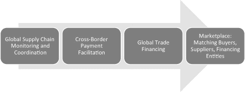

图 5.1 ¶ 集成全球供应链

## 全球供应链

供应链是一个许多企业级区块链应用试点启动并进展到运营规模的领域。区块链的使用可以满足许多迫切的供应链需求，最终提升性能。例如，部署区块链可以为供应链提供及时、准确、安全且防篡改的信息，并有助于检测欺诈和假品。不可篡改性和加密保障的安全可以通过减少中间商的参与来节省成本。由进入区块链的数据（包括来自 IoT 设备的数据）触发的智能合约可以实现自动化，包括加速货物流和加快付款。此外，来自区块链的可信数据可以验证溯源并加强质量保证，区块链内部累积的数据可以成为未来供应链改进的分析见解的基础。1

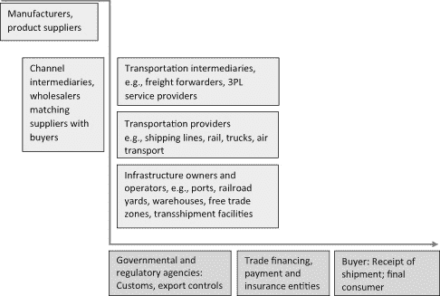

图 5.2 ¶ 供应链参与者和协作者

供应链其本质上由跨行业的、大小不异的各行业伙伴组成。参与者受项目驱动，定期地汇聚又分散，无论项目是一次性的供应合同还是长期的采购伙伴关系。图 5.2 列出了参与全球供应链中货物移动的多样参与者。如果该应用要提供比遗留系统更好的益处，上述所有方都需要被激励（甚至被劝说）加入区块链。

### 文档在供应链中的作用

在这些参与者沿供应链连接时，与其形成补充的是随货物运送的大量文档。这些文件验证了所有权、运输阶段、监管合规性和所有权的变更。完整且准确的文档对于货物到达最终目的地的不中断运输过程至关重要，因为正确填写、验证和妥当分配的文档对于清关和移接给后续阶段是必要的。全球供应链之所以运行缓慢，在很大程度上是因为它们在大多数文档上依赖于纸质流程。信息冲突和文件丢失会导致错误并暂停交易审批。这会产生骨骨牌效应，导致交货周期延长、货物状态和位置不明以及资本配置效率低下（由于在途库存的投资较高）。

当买家通过 `LC` 为采购融资时，如果卖家要获得付款，适当的单据和核实至关重要。代表买家的发行银行签 `LC`，卖家在完成发货后提交该信用证。银行通过释放对合规 `LC` 的款项，反过来将根据约定的条款向买家要求还款。因此，除非发行银行（或其代表）已确认贸易单据（如提单）符合 `LC` 条款（货物描述、状况、数量），否则将不会释放款项。此外，发行银行将根据其裁量权判断是否已满足 `LC` 条款，如果它认为存在不符，则在付款前必须获得买家的豁免或同意。换句话说，发行银行无法做出单方面的决定。[2 因此，单据对于货物在供应链中间节点的顺畅转运，以及根据凭证其符合销售合同和 `LC` 条款的证明来授权付款，都是至关重要的。

EDI 一直是传统供应链单据传输的标准；`LCs` 通常作为 `SWIFT` 网络中的 `MT700` 消息发放。运输过程中的任何变化都需要更新与变化一致的单据，以允许继续处理和后续移动。合同条款的变更或源地和目的地缺乏准确的更新信息都可能导致中断。获取必要的修改单据可能是一个缓慢的过程，会引起延迟并增加成本。在许多情况下，供应链参与者已诉诸于与各地的货运代理建立个人联系，以获取此类信息并克服瓶颈。

在供应链中引入区块链架构将提供一种革命性的安全、单一事实来源。可信赖的不可篡改（防篡改）信息将取代非正式的人际网络，取而之的是持续更新、广泛分散且所有利益相关方节点均可获取的信息。开发这种去中心化网络涉及与各种潜在生态系统合作伙伴合作并获得他们的参与。每个合作伙伴（或节点）的技术理解水平和流程能力可能存在差异。该网络将在不同的国家司法管辖区运行，试图遵守可能具有冲突要求的不同法律体系，同时实施仍在进化且远非成熟的区块链技术。尽管如此，全球已有试点项目，其成功为我们展示了全球供应链未来的可能：无错误、安全，并以更低的成本实时提供更新单据。

### 配置理想的全球供应链

有几个有助于全球供应链有效运行的理想特征，可以总结在以下列表中：[[3

*   将供应链中的所有方连接起来
*   为每个参与者验证唯一的身份标识符，其中包括制造商、货运代理、海关和政府机构、运输承运人（船只、卡车、铁路、航空、港口）、第三方物流 (`3PL`)
*   使用 `IoT` 设备监控货运
*   及时的（以及实）信息，涵盖状态
*   产地的可追溯性
*   信息的受控访问
*   防篡改安全性
*   通用数据和标准
*   智能合约可以提供显著改进
*   更高的效率和成本降低
*   用于预测和能力管理的累积历史发运数据
*   最终实现单一事实来源，从而建立对合作伙伴的信任

在整个供应链中部署区块链可以带来多处好处。可以在货物沿供应链移动时为其附加令牌（tokens），在满足条件时促进供应链成员之间的所有权转移。此类能力允许企业发现新市场并准确定价风险，最终用动态链取代僵化的供应链。[4 这种基于区块链的供应链还可以为经过凭证的人员提供唯一标识符，允许供应链实体监控经过认证的人员执行合同关键活动的情况，例如食品链中的灭菌和消毒程序。

此外，数字控制塔提供跨整个供应链的端到端可视化，包括供应链事件和相关业务指标的中央数据仪表板，这是一种替代方案，[5 当内置信任并不重要且参与者很少且不变化时。从传统角度来看，传统的数据库管理系统可能提供收益，而无需承担尚未成熟或稳定的区块链技术带来的成本和不确定性。[6 然而，当高大量交易对速度和自动化至关重要时，区块链提供了更优的替代方案。[7

### 马士基、IBM 和 TradeLens

TradeLens 是由 `Maersk` 和 `IBM` 联合开发的基于区块链的全球供应链“公用设施”。`Maersk` 是一家航运物流公司，由 `Maersk Lines` 拥有并运营，是最大的集装箱运输公司，在全球范围内运营多个港口和码头。`Maersk` 拥有 16% 的行业领先份额，集装箱运输行业的前五大公司控制了 61% 的市场，形成了寡头垄。`Maersk` 在 2014 年与 `IBM` 成立了独立的合资企业，以部署区块链技术并开发全球贸易平台。[8 他们的成果变成了 `TradeLens`，这是一种作为许可网络的区块链解决方案，旨在服务整个行业并弥补当前供应链流程的缺陷。

TradeLens 是一个合资企业，马士基（Maersk）持有 51%，IBM 持有剩余份额。由于所有权是集中的，TradeLens 与区块链对去中心化网络的偏好不同。然而，该合资企业旨在独立于马士基，总部位于纽约，并拥有独立的董事会成员。其目标是保持 TradeLens 的中立，如图 5.2 所示，即使在服务供应链内各种协作者的同时，也在 `TradeLens` 平台与马士基和其他集装箱船对手之间建立防火墙。

马士基的合作伙伴 IBM 具有使用 `Hyperledger` 区块链协议为各种行业供应链客户开发区块链解决方案的经验。IBM 在供应链背景下使用区块链及其 `Hyperledger` 协议具有多种优势，包括数据整合和可见性，因为供应链信息可以同时且安全地供供应链参与者使用；增强货运跟踪、透明度和对网络提供的数据信任；货运监控，例如确认产地和来源（用以揭示并防止伪造尝试）、跟踪存储条件（例如温度、湿度）以及跟踪危险或受限材料；以及实时解决因供应延迟、短缺和产品故障引起的问题（这对于食品链特别有用，因为食品安全至关重要，且及时信息可以提醒客户次优的运输状况、污染问题和不符合法律法规的情况）。此类成果的一个著名例子是 IBM 与 `Everledger` 的合作，后者在区块链上数字化加密了超过一百万颗钻石，以便追踪切光钻石和原钻从矿山到零售店的历程，同时提供不可篡链接的钻石分级报告。

`TradeLens` 旨在提供跟踪和追溯货物所需的所有供应链数据和信息，“为所有参与供应链管理的参与者提供从端到端的供应链可见性，以便安全、无缝地实时交换信息”。数据隐私保护是 `TradeLens` 的关键特性，确保只有参与特定货物的公司才能访问与该货物相关的信息。`TradeLens` 旨在交付无纸化贸易能力，使用户能够“跨组织边界安全地提交、验证和批准文档”，并根据一组信任利益相关者设置不同的访问和批准权限。随着其扩展到涵盖更广泛的供应链组成部分（包括马士基的竞争对手以及供应链上的独立实体，如海关机构和渠道中间商），对客户的实用性将增加。因此，为了测试和试点 `TradeLens`，IBM 和马士基必须招聘并说服几个行业的独立公司加入 `TradeLens` 区块链。此外，`TradeLens` 团队必须制定长期变现策略，以回收构建和运营区块链的投资，同时奖励各种 `TradeLens` 成员对创造价值的贡献。

`TradeLens` 的设计和实施为全球供应链领域成功的应用提供了指南。`TradeLens` 解决了困扰全球供应链的若干问题。它能够满足每个 `TradeLens` 供应链成员的需求，从而增加了其实用性，并激励关键供应链实体加入 `TradeLens`，这在加入是自愿的情况下是一个关键因素。`TradeLens` 的架构整合了每个供应链参与者的经验证身份，以确定每个成员的交易访问和读写权限，并对数据进行加密保护以增强对网络的信任。这是通过 `TradeLens` 网络从每个网络成员处选择要收集的数据实现的，利用 `IoT` 设备和传感器获取实时数据，并根据状态变化进行更新，涵盖货物位置、流向以及清关和评估关税等状态变化。

此外，`TradeLens` 使用如 `tokens` 和补贴等机制来补充自动化数据收集，并引导其成员提供及时数据和更新。区块链的不可篡改性结合时间戳和加密链接的数据块创建了审计轨迹并确定了来源，有助于追溯性、托管跟踪和相关文档。多层隐私层和访问协议决定了成员可以访问哪些层级，将数据访问限制在每个交易中的相关对手，并在提供竞争性安全性的同时试图避免信息孤岛和信息冗余。公共账本之间的数据共享协议允许根据需要与外部伙伴共享供应链数据。

作为一种运行在部分信任环境中的业务应用，`TradeLens` 使用 `Hyperledger Fabric`（区块链协议）创建了一种基于许可的投票共识方法，导致了快速的共识和最终性，以及防篡的安全性。作为共同所有者，马士基和 IBM 设定了共同的数据和传输标准，例如允许第三方为 `TradeLens` 添加新模块和额外功能的 `APIs`。这些共同标准对于具有不同 IT 配置的网络成员之间的易用性、协调和协作至关重要。通过使用 `Hyperledger Fabric`，`TradeLens` 可以包含一个在容器环境中运行的独立智能合约层，而无需直接访问账本状态，由特定的对等节点（取决于交易）证明给定智能合约的正确执行。智能合约的执行由分布在供应链的 `IoT` 设备提供的数据触发，并它可以授权货物和文件的传输以及批准支付。

使用 `TradeLens` 可以消除数据孤岛并整合来自发货人、`3PLs`、港口、货物码头、海运和内陆运输商、海关当局和金融实体在内的多个源的数据。这种高效的数据共享可以减少错误、检测欺诈并减少供应链管道库存和流动资金，从而节省时间和成本。作为一个整体，经过成员批准的来自 `TradeLens` 的匿名数据可以与数据分析相关联，为参与者提供以前无法获得的贸易流和物流能力洞察。这些随着 `TradeLens` 使用量增加而积累的此类货运数据，可以作为预测、容量管理和定价的基础，聚合数据如果卖给感兴趣的行业组成部分，可以成为可能的收入来源。

当然，`TradeLens` 面临来自其他竞争方案的竞争，并且它必须克服客户对替换经过测试的现状的抵触。此外，`TradeLens` 必须说服独立的供应链实体通过使用其区块链解决方案进行协作。

### 政府间合作：eTradeConnect, 全球贸易连接网络

如上所述，政府机构对于货物在跨国供应链中的顺畅流动至关重要。政府可能对允许私营利性公司建立的供应链在区块链生态系统中设定网络准入条件感到反感，并可能拒绝合作。如果没有国家海关机构的参与，供应链的速度将显著减慢，从而抵消链中其他环节改进所带来的积极影响。因此，一些国家及其政府赞助建立自己的供应链网络也并不令人意外。

香港金融管理局（`HKMA`）与国际银行共同启动了一项贸易金融试点项目——`eTradeConnect`，旨在解决贸易融资障碍并降低风险。该试点项目中纳入并测试的功能与 `TradeLens` 中的功能相似，其中包含一个许可链区块链，用于为贸易交易各方及生态系统中的所有成员提供标准化的数字化数据，并基于区块链共识机制对发票、采购订单和提单进行验证，以证明其真实性。该网络能够识别试图“重复融资”的企图并规避欺诈；伪造发票将需要同时伪造相关的采购订单和提单，而这些单据已由交易的多个参与者进行了数字签名，从而警示他们篡改企图。政府的赞助使监管机构对贸易融资应用的设计具有影响力，这使他们更加强调让监管机构获取持续更新的数据，以确定来源以及是否符合制裁机制和出口控制。新加坡金融局（`MAS`）也启动了类似的“网络贸易平台”（`Networked Trade Platform`），这是一个连接贸易价值链中国内外企业的一站式贸易物流网络。

这两个国家形成了“全球贸易互联性网络”（`GTCN`），连接了新加坡的 `NTP` 和香港的 `eTradeConnect`。政府间的合作使得两国之间影响贸易的司法法律差异得以协调，并引入了专门亚洲贸易金融的银行。`GTCN` 是一个基于区块链的区域和全球贸易网络，允许香港和新加坡的本土企业利用彼此的国内贸易平台，从而在增加全球贸易机会的同时，增强贸易流的透明度、完整性和安全性。通过 `GTCN`，香港和新加坡的企业可以与两国的监管机构及贸易者互动，并在更接近收货时获得融资，从而优化占用贸易收账款的流动资金。

### IoT 传感器与供应链：Ambrosus

在许多情况下，需要对使用的原料和组件、产地、制造条件、运输状况以及质量标准进行记录，以区分货物、满足合同条件并满足最终用户。此类数据对于提供篡改证据和防止伪造也至关重要。如前所述，除非随附文件准确并被相关交易对手接受，否则运输中的货物将无法清关。数据绑定令牌（Data-bonded tokens）是实现数据与货物相结合的方法之一：代币代表货物，而 `IoT` 传感器则积累额外的组配线和运输数据。此类数据的示例包括货物的产地及其原料、零件和组件、制造工艺条件数据，以及运输和交付过程中温度、湿度及其他处理和存储条件的数据。

这些信息都可以附着在随货物通过区块链传输的代币上，供整个供应链的控制权和所有权变更使用。在制药行业，产地追踪和货物追踪对于检测和防范假药，以及监控未售药物退回制造商至关重要。对于受控药物（如阿片类药物）而言，监控处方数据和配药次数对于防止过度使用和成瘾（及其产生的有害后果）至关重要。

`IoT` 传感器如果能够实现安全和防篡改，当它们连接到区块链网络并与智能合约结合以实现交易时，就可以成为实时数据源。一旦上线，它们就能持续提供更新的数据，以追踪货物、监控质量指标、评估设备状态和维护就绪情况，并帮助降低风险。`IoT` 传感器与其他传感器和机器进行自主通信，为新服务的收入产生以及来自网络部署的整个 `IoT` 传感器群体的数据变现创造可能。

`Ambrosus` 提供了这样一种解决方案，将 `IoT` 实时传感器和电子 ID 与区块链连接，以提高供应链可见性、提供质量保证并防止伪造。`Ambrosus` 基于 `Ethereum` 构建，并在智能合约中代表客户与其供应链之间的协议。`Amber` 是用于支付活动和交易费用的原生代币，例如创建一个代表正在运输的托盘或物品的数字资产。数据被绑定到 `Amber` 代币上并发送到网络，网络沿着供应链跟踪产品或批次，充当数字账本以确保信息安全透明地传输。`Ambrosus` 的架构由四个相互关联的模块组成。`Trace` 模块生成来自 `IoT` 设备的数据，`Edge-Gateway` 收集并分析 `IoT` 生成的数据，并与第三模块——`Ambrosus` 区块链通信，数据在那里被安全存储并在需要时在参与者之间交换。最后一个模块是仪表板，允许 `Ambrosus` 客户检索、查看并进一步分析其数据。

使用 `Ambrosus` 的瑞士奶酪生产者可以向客户保证每年从瑞士生产和出口的七万吨奶酪的质量和产地。消费者关注安全和质量，因此追踪生乳奶酪的来源、生产和交付条件；追踪奶酪在成熟和储存期间的温度；并防止有害细菌在奶酪中生长。他们还想了解制造流程的环保性、就业条件、动物福利、牲畜饲料和卫生状况。奶酪的营养特性是一个区分因素，会根据各种条件而改变。

连接到区块链的 `Ambrosus` `IoT` 传感器可以提供所有这些因素的数据。

此外，牛奶罐车上的 IoT 传感器会记录运输过程中的温度、时间，以及到达奶酪生产设施的交付时间。在奶酪生产过程中，在加工的不同阶段还会采集多种与其他质量相关的传感器数据，例如牛奶凝乳时的温度、压榨条件（以去除水分）、盐渍的持续时间和程度、成熟期间的持续时间和温度，以及指向发酵过程控制的关键测量值。区块链中捕获的 IoT 数据有助于买家确保所售瑞士奶酪的质量。17 图 5.3 展示了与区块链链接的安全 IoT 设备可提供的数据源和范围，用以帮助验证产地和质量。

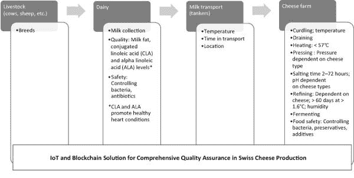

图 5.3 ¶ 瑞士奶酪业的物联网与区块链解决方案。来源：Ambrosus，“Swiss Cheese: Protecting High-Quality Food Exports of Switzerland,” p. 14 (2020 年 5 月)。

### 食品信任：解决易腐食品的安全性、新鲜度与浪费问题

2011 年《食品安全现代化法案》针对日益普遍的食品源性疾病加强了监管。IBM 的 `Food Trust`18 是一种供应链应用，旨在通过与 Dole、Kroger、雀巢、Tyson Foods 和沃尔玛等食品行业领导者合作，在整个供应链中实施区块链解决方案，从而解决食品安全保障。该项目首先关注食品安全，寻求在几秒钟内安全地追踪产品，帮助确定并减轻污染源，并减少可能必要的召回带来的经济负担。其次，该项目强调食品新鲜度，利用区块链增加供应链透明度并优化保质期。第三，对食品新鲜度的关注和对污染的早期缓解有助于减少食品浪费并使保质期最大化。这些目标共同有助于优化食品供应链，使行业能够有效应对召回。这种供应链的增强还有助于实现可持续发展目标、提高食品质量并认证产地——后者在有机和人肉替代市场中变得日益重要。

一个典型的案例是新英格兰扇贝捕鱼业对 `Food Trust` 区块链应用的使用。新贝德福扇贝的口感和质量使其价格高昂。行业担心来自其他地区的劣质扇贝被误充为来自新英格兰并以高价卖给消费者，从而损害新贝德福扇贝的声誉。`Food Trust` 实现了产地追踪，向餐厅主、厨师及其客户证明了扇贝确实来自新贝德福。另一个益处是扇贝可以追溯到单只渔船的具体捕捞记录，担心扇贝沙质过多等问题的厨师可以告知船长，随后船长可以在未来的捕鱼作业中改进其捕鱼实践。19

## 跨境支付

跨境支付流预计在 2022 年将达到 156 万亿美元。20 其本身具有复杂性，导致缺乏透明度，表现为支付状态不明、成本高以及对何时完成存在不确定性。

如果发送方银行在接收国没有办事，它将需要与一家可以引导付款的代理银行合作。降低风险的一种方法是使用 `RTGS`。然而，`RTGS` 系统在适应基于区块链的跨境支付解决方案中用于验证交易细节的共识验证算法方面可能存在局限性。

-   缓慢且繁琐的支付流程导致流动性被锁定，因为参与资金转账的实体可能需要根据监管要求留存资金以支付结算义务。实体可能还需要预先存入其“往来账户”（nostro accounts）作为抵押金，并在跨境交易启动前提前获得外汇资金。（往来账户是银行在海外代理银行开立的账户，其功能是在外汇交易过程中作为抵押金以覆盖风险）。大型银行具有规模使用连续链接结算（CLS）22，该机制能够以高效的流动性方式促进跨时外汇交易结算。
-   有关反洗钱、客户身份识别、制裁合规以及网络风险控制和韧性的法规在不同国家各不相同，这在执行跨境支付时增加了银行的总合规成本。

## 简化跨境支付的政府努力

加拿大银行和新加坡金融管理局（MAS）分别开展的 `Jasper` 和 `Ubin`23 项目是解决上述跨境支付问题的试点项目。`Jasper` 和 `Ubin` 探索了在不同区块链平台上使用基于分布式账本技术（DLT）的代币化数字货币结算。项目负责人指出，虽然建议模型使用的 DLT 技术有替代方案，但“DLT 比中心化方法提供了更简单更快速的采用路径，因为它可以在允许相关的不同司法辖区保留对其网络部分控制权的同时，与网络的其余部分进行紧密集成。”24 试点使用哈希时间锁定合约（`HTLCs`，一种智能合约）来确保支付所需的所有事件均已发生。`HTLCs` 涉及锁定资产，然后要求支付接收方在截止日期内通过加密支付证明确认收到，否则支付将退回发送者。`HTLCs` 消除了对中间机构（即代理银行）持有托管账户以确保交易圆满完成的需求。此外，该试点使用了两个不同的区块链平台——加拿大的 `Corda` 和新加坡的 `Quorum` 来测试互操作性问题。

试点考虑了多种模型，包括让中央银行实时全额结算（RTGS）系统充当“超级代理”，25 取代目前的中间代理（商业）银行链，以及使用可用于批发银行间支付和结算的 `CBDC` 代币。26 项目负责人指出，批发级 `CBDC` 模型可以基于区块链，但替代技术可能同样可行。

在批发 `CBDC` 模型中，`CBDC` 可以是特定货币的（例如与加元、新加坡元、英镑挂钩），并在银行或客户本国之外进行交换，商业银行在其母国中央银行持有多个不同货币的 `CBDC` 钱包。那么，每个中央银行都将支持多种 `CBDC` 代币。多种 `CBDCs` 的替代方案是通用的 `CBDC`，它与参与政府的货币篮挂钩并被所有这些政府接受。

实施上述批发 `CBDC` 模型需要各国政府同意一套程序，用于设定本国货币转换为通用批发 `CBDC` 的汇率。必须建立一个用于发行和兑回此类 `CBDCs` 的交易所，并制定明确规则允许其用于结算跨境交易。`CBDC` 平台需要 24/7 运行并与 RTGS 平台并行，以便促进该国内银行与中央银行之间以及国家之间的 `CBDC` 跨境交易。每个国家都必须为银行（或其他结算账户持有者）设定在没有 RTGS 账户的情况下持有境外数字 `CBDC` 钱包的资格条件。这种模型的实施需要时间，因为各国和中央银行需要制定立法接受通用 `CBDC`，并调整其货币政策以包含通用 `CBDC` 的供应。各国需要同意如何用中央银行储备来抵押 `CBDC`，因为一个国家的储备金将作为另一个国家持有的 `CBDC` 的抵押品。

此外，同时用金融资产、价值存储手段、交易手段和投机工具的通用 `CBDC` 将在模型中引入单点故障。这是因为 `CBDC` 由单一实体（中央银行或等效机构）控制，一旦遭到攻击，可能会损害数字货币系统的基础数字层。加拿大和新加坡合作开展了 `Jasper` 和 `Ubin` 试点五个连续阶段，最终阶段报告于 2020 年 7 月发布，成功开发了原型应用程序，并描述了对金融行业的益处。该项目帮助证明了基于区块链的支付网络的商业价值，并建立了原型 `CBDC` 网络与其他区块链网络之间的连接接口，并支持了特定用例，如贸易融资支付的托管和私人交易所的交收即付（DvP）。27

一种解决跨境支付固有问题的破坏性区块链解决方案将提供若干功能。首先，升级后标准化的支付消息协议将允许数据共享。其次，它将消除客户尽职调查和验证监管合规过程中冗余的步骤。第三，区块链将更容易在银行网络中接受和共享数据，例如交易对手提供的尽职调查数据，这还需要跨司法辖区的法律协调统一。第四，通过将 RTGS 系统与自动化智能合约执行相结合，扩展跨境支付的可用性将消除商业银行营业时间不同步的影响，并为小型银行和非银行支付提供者提供更广泛的 RTGS 系统访问权限。

最后，区块链解决方案将为第三方提供更大的创新空间（例如用于客户识别和尽职调查的辅助 `Dapps`）。成功的应用将为客户带来更低成本和更高透明度的结果，减少银行的流动性锁定，并让中央银行及时获得跨境支付总额及其方向的数据，从而增强韧性、降低系统性风险，并更深入地理解跨境支付的市场趋势。

### Ripple XRP 与跨境支付

# 跨境汇款与 Ripple 解决方案

依赖于数十年的 `SWIFT` 银行间报文系统进行跨境汇款，是一个充满问题的过程。跨境汇款费用高昂、汇款完成可能需要数几天、发送者不知道货币转换时使用的实际 `F/X` 汇率，且整个过程不透明，汇款状态不明确。在一个复杂且缓慢的过程中，发送银行必须通过全球银行业网络与多个代理行建立连接，而发送者在几天内都无法收到转账完成的确认。此外，协助此类转账的银行必须在各种汇款通道上维持多种外币的流动性余额，增加了其流动资金需求。

尽管之前讨论的通用 `CBDC` 模型提供了一种解决方案，但多个主权政府之间的协作需求以及随的额外货币政策影响，使得私人数字货币成为跨境支付的一种更具吸引力的替代方案，同时也降低了成本并提高了透明度。私人公司已进入这一领域，被巨大的目标市场和相关的利润机会所吸引——如果它们能够成功为客户解决成本、速度、透明度和监管问题。

## Ripple 的技术栈
Ripple 是此类私营部门初创公司之一，提供其自己的数字货币 `XRP` 以使跨境支付更高效。Ripple 正在通过区块链创新，以更好地服务对现有解决方案不满的客户。28 Ripple 的区块链解决方案包含几个组件：

* 它开发了一种数字货币 `XRP`，用于跨境汇款。
* 与此同时，它为客户开发了 `XRP Ledger`，这是一个分布式账本 (`DLT`) 网络，用于持续更新和存储客户的跨境支付交易和账户余额。
* 随后，它开发并实施了 `xRapid`，一种开源区块链协议，用于验证交易、更新账本并完成转账。
* Ripple 还开发了其独特的节点列表 (`UNL`)，29 其 `UNL` 由选定的信任节点组成，这些节点是唯一被授权集体验证并使用新交易和余额更新账本的节点。30

## RippleNet 与市场流动性
`XRP` 货币、`XRP Ledger`、`xRapid` 协议和 `UNL` 与 Ripple 的金融网络 `RippleNet` 集成，银行和金融机构如果希望使用 Ripple 发起和管理跨境支付就会加入该网络。`RippleNet` 的关键创新在于，客户可以将其选择的国家法币兑换为 `XRP`；近乎瞬间、安全且低成本地传输 `XRP`；然后在交易的另一端立即将收到的 `XRP` 转换为当地货币。

这之所以可行，是因为 Ripple 说服了多个国家的加密货币交易所出 `XRP` 进行交易。这允许参与发送或接收 `XRP` 的实体可以使用交易所用美元或欧元等国家货币购买或卖出其 `XRP` 持仓。此类加密货币交易所上 `XRP` 交易量的出现和增长逐渐增加了 `XRP` 的流动性，并提升了在汇款通道两端与各种法币交换的便利性，有助于提高交易对方使用 `XRP` 满足其跨境汇款需求的意愿。

## 竞争动态与路由
随着越来越多的银行加入 `RippleNet`，通过不同的代理行集合执行转账开启了多条路由路径。代理行形成一个网络，银行可以通过该网络与其未开展业务的国家的客户进行业务，利用一系列网络银行最终到达客户。这些通过 `RippleNet` 协作进行转账的银行组创建了一个网络，不同的网络可以相互竞争以更低的费用完成转账。这导致了具有竞争性的转账费用市场，使发送端客户能够获得成本最低的转账。

客户首先向 `RippleNet` 发起跨境传输 `XRP` 的请求，通过 `xRapid` 协议管理转账。`XRP Ledger` 维护交易记录（每秒更新），），一旦节点验证了账本的最新状态，`XRP` 转账即完成并结算。Ripple 的各项功能使其能够颠覆跨境汇款市场，以损害 `SWIFT` 的市场份额，并成为该支付领域的主要竞争对手。

## 监管与运营挑战
Ripple 与 `SWIFT` 竞争，后者是 1970 年代以来银行使用的全球金融报文系统。Ripple 必须说服汇款通道沿线的监管机构授权 `XRP` 使用并将其转换为当地货币。它还需要为 `XRP` 培养一个交易市场，以便 `XRP` 所有者可以将其兑换为国家货币。如果 Ripple 客户要接受 `XRP` 作为支付基础，这样的市场是至关重要的。

虽然 Ripple 希望客户使用 `XRP`，但 Ripple 也允许银行使用 `RippleNet` 和 `xRapid` 传输法币，其费用低于使用 `SWIFT`。这样银行管理的是各国不同的货币流动性余额，而不是维护一个以 `XRP` 为值的流动性池。

## 展望
随着银行熟悉并验证使用 Ripple 的好处，它们可以决定是否开始使用 `XRP`。Ripple 为使用 `XRP` 的银行客户提供其自身的按需流动性服务，并收取费用，让银行客户获得任何特定国家所需的 `XRP` 余额。银行客户将直接受益于使用 `XRP`，因为这不需要在相应的汇款通道中建立不同的外币往来账户，从而降低了流动资金。

交易费用以 `XRP` 支付，然后被销毁（转账费中收到的 `XRP` 从流通中移除），从而减少 `XRP` 的供应并逐渐提高其价格。一旦监管机构和银行对数字货币的担忧得到解决，Ripple 非常谨慎地在 `RippleNet` 上构建了银行和非银行金融机构的生态系统。然而，成为 `RippleNet` 节点的相对便利增加了 `RippleNet` 内银行声誉受损的可能性：如果暗网用户在 `RippleNet` 中建立节点，他们就可以提交并请求非法转账。Ripple 的治理机制（目前由 Ripple 主导）将是此类事件的主要保障。

随着对使用 `XRP`的需求增长，`XRP` 的价格上涨，增加了 Ripple 持有的数字货币价值。这使得 Ripple 能够定期将 `XRP` 转换为运营资金，从而折扣 `RippleNet` 和 `XRP Ledger` 的使用费用，并补贴更低的价格，这一切有助于吸引新客户加入 Ripple 生态系统。因此，在 Ripple 初期创建并拥有的 `XRP` 为 Ripple 提供了种子市场以实现积极的网络效应。图 5.4 总结了形成 Ripple 颠覆性业务模式的关键事件流。

早期 Ripple 的采用者大多是较新的、规模较小的挑战银行和非银行金融科技公司。随着使用 `RippleNet` 的机构增加，`RippleNet` 网络对新客户越来越具有吸引力，增加了对 `XRP` 的需求并刺激了 `XRP` 的使用量。Ripple 的成功对主要银行构成了威胁，因为 `RippleNet` 使用的增加将减少通过 `Citi`、`Barclays`、`HSBC` 以及其他主导该细分市场的全球主要银行发送的跨境汇量。`SWIFT` 通过其 GPI 应对，该 GPI 将提供当日跨境转账、费用透明化和支付端到端追踪，从而减少了其银行客户转向 Ripple 的动力。

因此，尽快扩大 `RippleNet` 符合 Ripple 的最大利益。它的目标是在央行数字货币（CBDCs）和稳定币以及不断演变的 `SWIFT` 网络出现之前，将汇款流量从主要银行和 `SWIFT` 系统转移到自己的网络，这使其成为 `XRP` 的替代方案。Ripple 的颠覆尝试建立在提供更低的跨境汇款费用、近乎时的资金转账、转账和收款的实时验证、转账时的已知汇率，以及如果客户选择在转账中使用 `XRP` 代替多种货币时可以减少流动资金需求的基础上。当然，诸如 `XRP` 等私有数字货币会带来稳定性和系统性风险等问题，以及跨境监管的需求，正如第 3 章所述。

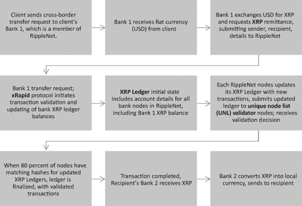

图 5.4 ¶ Ripple 对跨境汇款的颠覆过程

## 贸易融资

开放账户条款下的贸易融资在全球贸易中是一种日益流行的支付安排。在开放账户条款下，卖方将货物发给买方，并在规定期限内付款，即三十、六十或九十天。卖方/发货人承担不付款的风险，导致卖家获得信用保险，这是全球贸易和贸易融资的额外成本。此外，银行不愿为全球贸易提供融资，因为不诚信的公司可能会尝试使用同一份采购订单（纸质文件）并伪造此类文件，从多家银行为同一批货物获得融资。因此，中小企业（SMEs）较难从银行获得贸易融资，阻碍了它们的增长。

DLT 的使用通过经过认证的数字化采购订单、提单和发票版本可以减少此类欺诈，提醒交易对方注意对同一批货物进行重复融资的尝试。DLT 的使用允许追踪单据流、记录交易演变，并结合智能合约链接——根据发货证明、到达证明、所有权交换证明、提单证明以及货物本身释放融资，所有这些都使用实时数据。由于具有更高的确定性、安全性和欺诈保护，银行能够以更低的风险和更低的利率向中小企业贷款，为卖家和银行提供新的收入增长来源。

### 金管（HKMA）在贸易融资中的试点

鉴于改善贸易融资环境的紧迫需求，香港金融管理局（HKMA）作为监管机构，与香港的几家大型全球银行合作，开发了一个基于分布式账本（DLT）的贸易融资平台概念验证。目标不仅是开发一个“技术原型”，还要彻底调查 DLT 如何可能解决与贸易融资相关的广泛业务、监管、法律和技术问题”。

原型贸易融资解决方案的设计由一个区块链基础数据层（用于在参与者和节点之间分发数据）以及一个业务应用用户层组成，实现了从供应商到客户的货物移动及其融资的多个步骤的端到端采集。银行可以使用自己的内部“贸易融资和贸易系统”替代试点中开发的业务应用层，并使用自己的用户界面连接到基于区块链的数据层。因此，区块链应用可以作为中间解决方案与银行的遗留系统连接。

业务用户层模拟了贸易融资中的事件链。它有供应链参与者、物流运营商和货运代理的节点，类似于 `TradeLens` 平台。监管机构（如 `HKMA`）可以加入平台，以获得数据层的访问权限，并出于控制和合规的目的。中小企业和大型公司都可以申请融资、提供文件、建立身份等。

将供应链参与者和监管机构纳入对于有效提供贸易融资至关重要，因为他们控制着可能触发智能合约的事件，这些合约将释放已批准的贸易融资分额。一个结合 `TradeLens` 和贸易融资平台的集成解决方案将是一个自然的演进，并将成为全球贸易中对卖方和买方都非常有实用的区块链应用。

治理结构是设计和实施贸易融资解决方案以及从试点转向商业规模使用的不可或缺的一部分。由 `HKMA` 开发的贸易融资原型允许融资实体、交易对手、监管机构和其他必要方参与，以验证合同条件正在履行。治理必须明确方向，即哪些数据将存储在链外以提高网络性能、保护数据隐私并降低成本（区块链中的链数据存储是昂贵的）。

治理还延伸到建立争议解决机制，特别是在跨境贸易中，其特点是具有多个独立且可能冲突的国际司法管辖区。（特定司法系统的公平性和执行合规性是相关问题。）由于一个良好的解决方案将引起大多数供应链参与者的兴趣，并通过创造就业机会、出口收入和出口部门的竞争力来增加公共福利，因此公共部门参与创建公共公用事业的所有权和治理可能是一个值得的发展方向。

## 贸易市场平台

在买卖双方通过全球供应链开始互动之前，他们需要找到彼此。一旦找到，他们就会通过谈判确定是否能达成满意的销售协议，并列出双方同意的合同条款。虽然买方可以是零售消费者，但这里的重点是 B2B（企业对企业）交易，以及工业买家大量采购用于其自身流程内部或最终出售给终端用户。在这样的 B2B 情况下，买方可能会选择能够满足其详细规格要求的卖家。

例如，在批量服装买家的案例中，规格可能涵盖所用纤维的性质、产生成布的织造工艺、使用的特定染料和颜色、图案的打印或后处理工艺、成衣的设计、缝纫质量、每个颜色、面料和图案的尺寸和数量，以及辅料，如使用的固件、标签和洗涤说明。买方可能希望自由指定总协议下每份订单中包含的数量、每批货物的目的地、存储条件、转运点以及符合海关和其他出口法规。买方可能还希望控制制造条件、环境问题和危险废物的妥善处置、工人的公平对待、避免童工、支付公平工资，以及性别、种族和宗教对待的平等。

买家可能还希望确保知识产权保护（即专有设计），并管理汇率波动的影响。由于全球供应链涉及与处于不同法律管辖区的多个地理位置的供应商签约，买家可能会发现难以验证卖家遵守合同条件的能力，例如技术能力、生产设备范围和工厂总产能、充足营运资金的可用性、确保合同产出准时完成的人员配备、类似货物的最低经验水平、其他客户对该卖家的满意度以及整体普通业务声誉。

买家在验证卖家能力、经验和声誉方面可能遇到的困难导致了对中介的使用。中介可以接手筛选卖家的关键功能，并将买家与符合其理想画像及必要能力的卖家进行匹配。他们对此类服务收取费用，但降低了买家的风险，并增加了买家找到满意供应源的可能性。位于香港的利丰物流 35 就是此类中介之一，他们拥有百多年的经验，并在亚洲及其他地区的广泛国家拥有大量的潜在卖家和合同制造商 36。利丰物流利用其员工在将卖家作为匹配其买家客户愿清单的潜在供应源提供之前，对卖家能力进行审计和验证。

随着时间的推移，颠覆性的在线市场运而生，按照上述描述的方式匹配买家和卖家，并与利丰物流等公司提供的传统匹配服务竞争。利丰物流专注于 B2B 应用，将企业买家与商用供应商连接起来；而阿里巴巴（淘宝）和亚马逊则为零售卖家提供了建立网络商店的机会，并与阿里巴巴和亚马逊的客户连接及销售；利丰物流也演变为提供类似的功能。这些在线市场作为平台运行，通常是多侧的，对买家、卖家以及其他供应链参与者（如发货人、货运代理、融资实体和保险公司）开放。它们可能为买家提供免费访问，甚至补贴他们以吸引他们进入平台，同时通过向卖家和其他方收取中介接入费和佣金来获取收入。

与其他在线平台一样，这些在线市场受到同侧和跨侧网络效应的影响 37，随着卖家和合同制造商数量的增加，吸引了更多买家；随着其他买家（竞争对手）涌入这些平台并在寻找潜在供应伙伴时获得满意的结果，也会产生这种效应。应用程序接口的质量和易用性、隐私保护，以及在允许提供者接入网络时实施的质量控制程度，都是决定在线平台使用程度的因素。与大多数受网络效应影响的平台一样，可能少数平台将成为幸存者并形成垄断，有潜力收取更高的中介费并获取买家与卖家互动及签约所创造价值的更大份额。

正是在防止此类平台市场垄断并避免支付不断上涨的中介费的背景下，基于区块链的市场作为一种替代方案出现。区块链平台允许买家和卖家直接互动，避免或减少中介费用。此类平台还可以提供托管账户，根据履行证明释放付款。正如之前讨论的，HTLCs 可用于执行支付与履行完成的同步交换。在多个买家和交易中积累的数据可以指导并引导对需求和市场趋势进行更好的预测，帮助买家避免折价过剩商品。

为了让此类聚合数据和相关预测对网络成员可用，区块链的治理机制需要成员同意将他们的交易数据包含在聚合数据库中，然后开发算法进行数据分析。接下来，管理人员需要对此类服务进行定价，针对与其聚合预测所需数据进行合作的成员群体提供不同的价格，并获得成员同意向非成员出售此类趋势分析和预测服务，以收取更高的费用。来自外部客户的此类费用可以补贴区块链解决方案的进一步开发和升级。平台还可以帮助管理此类交易产生的任何税务后果。

然而，建立此类 P2P 区块链平台的关键困难在于筛选卖家；认证他们的经验、能力和声誉；以及保证履行。最近的一个尝试是来自 IBM 和 Chainyard 的 Trust Your Supplier 网络 38。一个共同点在于利用区块链创建和使用区块链原生令牌的能力来筛选卖家及其商业声誉，当卖家在履行合同承诺方面表现优异时，将授予令牌。卖家积累的令牌可以作为声誉分的代币，买家可以使用此类分数在替代供应源之间进行选择，青睐表现更优卖家。供应商也可以用此类令牌奖励忠诚的买家和合同续约，作为忠诚度的支付，令牌可以兑换卖家服务。

生态系统化的组织形式已成为全球数字经济中竞争企业的组织原则，其重要性日益增长。快速的创新和竞争优势源于设计客户解决方案，这些解决方案涉及来自多个独立公司的能力和贡献。我们可以思考，生态系统化的组织形式是否对于开发成功的区块链应用尤为适用。

区块链节点可以分布在单一行业内的多家公司中，和/或跨多个行业。这引入了跨组织协作开发基于区块链的客户解决方案的可能性，这些解决方案的最终表现可能优于单个竞争对手提供的产品。这种跨组织解决方案可以利用不同合作伙伴的多种能力，共同创造高度模块化、定制化的客户解决方案。这些基于区块链的跨组织客户解决方案与基于平台的解决方案形成对比，后者的强大网络效应会导致少数几公司（有时仅一家）主导平台，并产生赢家通吃的局面。相比之下，基于独立公司自愿跨行业合作的区块链应用可以利用每个参与者独特但互补的能力，创建不断改进的客户解决方案——“生态系统的生态系统的繁化”。1

此类区块链客户解决方案确实要求企业跨越组织边界，但当区块链网络吸引整个生态系统的参与时，区块链的价值主张就会增加。因此，区块链解决方案通常要求企业在一个生态系统中共存，共同创新并满足客户需求，让生态系统中的每家成员公司选择协调者、创新者、供应商、互补者、中间人及监管者等角色。客户可以在不同的生态网络之间选择以解决他们的问题，因此是生态系统之间的竞争而非公司之间的竞争。然而，生态系统还需要生态系统协调者的深度协调，这可能与去中心化相冲突。正如我们所看到的，某些形式的许可区块链（由协调者设定网络访问条件和参与水平）通常是企业在其试点项目中的落地选择。

在本章中，我首先考虑了生态系统组织的关键方面以及它们如何应用于基于区块链的解决方案。然后，我考虑了跨组织区块链试点案例以及它们通过采用生态系统框架所取得的结果。示例包括共享经济模式下的自动汽车、医疗保健应用以及全球供应链。这些示例使我们能够评估生态系统组织形式作为企业级区块链成功实施催化剂的价值。

发起基于区块链的生态系统的企业必须决定如何设计包容性的生态系统模型；反之，生态系统内部的企业必须通过权衡潜在收益、其在生态系统中的可能角色以及对主导区块链协调者的依赖和从属风险，来评估是否加入该生态系统。由于多个相互作用子系统的生态系统复杂性可以成为潜在成员的动力，因为加入此类区块链网络使成员能够共同提供任何单一成员无法提供的解决方案。同时，生态系统成员对更具参与性的治理区块链的偏好，可能与主导网络发起者实施并编写到特定区块链规则和架构中的设计相背。2

## 生态系统视角下的战略思考

生态系统由“为了实现核心价值主张而需要交互的伙伴”组成。3 生态系统有多种形式。Andrew Shipilov 和 Annabelle Gawer 了多种生态系统的形式，概述如下：4

- `通用生态系统`：一组与其他生态系统成员互补的参与者
- `商业生态系统`：由组织、机构和个人组成的社区，旨在通过服务客户和供应商来影响企业客户
- `创新生态系统`：一组为核心产品的价值主张做出贡献的参与者，创新生态系统可能演变为商业生态系统
- `平台生态系统`：一种核心技术（通常是软件同加网络基础设施和云存储），成员可以通过该技术连接其互补的业务和服务，通常通过标准化或开放的接口实现。

### 平台平台的演进

区块链非常有能力成为平台生态系统。核心平台生态系统最初根于主要生态系统伙伴之间的共同创造和价值共享，随着时间的推移可能会演变，新的生态系统成员进一步开发平台及其产品，不断改进客户解决方案并促进生态系统成员之间的交易。

### 提供成功客户解决方案的生态系统设计

为什么需要生态系统模型？考虑生态系统模型的企业需要在生态系统与层级组织的供应链和/或由企业担任核心角色的垂直整合公司进行权衡。当模块化组件被组装成客户解决方案时，生态系统模型可能优于垂直整合和层级化的组织。构建一个生态系统是复杂的，企业需要强有力的理由、稳健的商业案例来证明投资价值，以及变现路径。

### 生态系统接口架构

接口将由生态系统的目标以及允许特定成员协作以实现这些目标的需求所塑造。例如，一个生态系统可能寻求建立特定行业的公用事业，减少现有痛点带来的摩擦。成员需要同意遵守共享流程并接受迭代和持续改进。选择区块链协议是一个基础步骤，因为该协议需要被所有潜在的生态系统成员采用。生态系统成员以及访问者和潜在客户将通过独特的、可验证的数字身份进行识别。成员将就促进访问者接入的 `API` 以及第三方插件以及管理数据流、数据分析、物联网连接和云基础设施的规则达成一致。同样重要的是区块链中体现的产品和服务，其意在于提供集成解决方案。

### 生态系统成员

当生态系统形成后，其创始成员可以为加入生态系统的伙伴设定最低能力门槛。成员需要达到最低的技术能力水平，以安全地管理节点和数据，并采用标准协议。管理成员可以根据成员对解决方案的贡献以及访问和权限级别，建立合作伙伴分级。随着独立实体加入生态系统，它们必须协商其可以接受的相互依赖程度。虽然生态系统的合作伙伴数量可能有所不同，但如果客户发现其解决方案具有吸引力，且未来的成员符合生态系统的准入条件，它们可能会随着时间的推移而增长。

随着生态系统的建立，其生存能力取决于“核心”成员，这些成员的领域专业知识、独特能力和“引力”对于生态系统与竞争对手区分开来并吸引客户至关重要。创始成员需要识别理想的合作伙伴，并考虑能够说服他们加入的特性。设计最小可行生态系统是确保所有生态伙伴都能获得可接受的收益的起点。这可能涉及选择资助特别有吸引力的合作伙伴（可能在预定的初始阶段），并吸引早期成员加入以扩大生态系统。“生态系统必须是一个其他人想要加入的俱乐部。”5

由于生态系统是协作性的，关键问题在于与谁协作。这种协作可以延伸到过去及未来的竞争对手，或者跨越行业边界包含跨行业合作伙伴。协作是关键，因为共创是生态系统方法的核心优势。共创是一种鼓励多方创新的众包，因此需要开放接口来提供提供者之间的链接并实现定制化解决方案。

面向全球客户的生态系统还将在其伙伴库中寻求地理多样性。全球化范围有助于触及超越现有组织、区域和国家边界的创意伙伴。生态伙伴必然会扮演不同的角色，但在其中，协调者将是构建网络和招募伙伴的关键，其他成员则加入一个已经运行的生态系统。在生态系统建立后，扩展网络将成为一项战略考量。6 这对于扩展内容和能力至关重要，这些能力反过来可以产生新的产品和服务。增长路径将涵盖演进中的客户解决方案、交易促进以及进入邻近市场。增长和规模可以帮助网络与其他网络竞争中竞争，而通过仔细组合网络中的伙伴，可以加速有助于实现规模的积极网络效应。

随着伙伴网络的建立，通过创造共同目标感和社区感将伙伴们“粘合”在一起变得至关重要；伙伴的退出可能意味着网络恶化。因此，将网络伙伴留在一起取决于满足伙伴的预期，并认可和奖励他们不同的贡献。伙伴共同实现的总收益应具有正和和博弈的特征，而不是“赢家通吃”的局面；否则，生态系统可能会解体，其不稳定性反过来会损害客户解决方案的质量，负面影响生态系统的性能和生存。

### 作为平台的生态系统

生态系统可以以一个数字平台为特色，实现交互和交易完成，服务于企业和/或消费者市场。平台生态系统很可能是一个具有多个提供者的多边平台。它能够整合来自其成员行业小组的多个平台，并演变为服务于新的市场和客户群体，成为一个多行业公用事业，并在主要提供者与关键行业之间的连接点设立枢纽。模块化特性允许单个生态伙伴与不断变化的其他生态成员合作，共同织入多个价值主张，从而提供跨组织和跨行业的解决方案。提供开放的 `APIs` 和自助门户可以通过减少吸引开发者和客户的障碍来增加成功的机会。

### 变现

生态系统的启动可能需要大量的预先投资，最终的投资回报率将在决定生态系统启动批准方面发挥作用。同样，变现路径是生态系统策略的重要要素。一个根本性的决策围绕着谁付费的问题。生态系统协调者和成员可以选择向提供者、用户或两者双方收费。向提供者收费意味着成员从参与生态系统中获得了巨大的利益，并正在为生态系统网络付费。或者，可以向客户收取服务费。费用可能会随着时间、容量、服务复杂性和交付价值而变化。此外，生态系统既需要提供者也需要伙伴，提供者与客户之间的蓬勃共生关系产生了网络效应。因此，通过补贴、降低费用和折扣结构激励多个提供者的早期加入可以加速网络效应的产生。

-   促进价值创造，以与其他竞争生态系统区分来
-   设定客户服务水平并保护客户利益，在整个生态系统中灌输伦理行为标准
-   评估伙伴对价值创造的贡献，并根据成员的贡献公平分配创造的价值
-   解决知识产权（IP）问题：IP 所有权、IP 共享和支付，以及 IP 溢出到生态系统产品中；对被核心价值主张的 IP 进行补偿
-   监管成员的专利和代码所有权，因为很大一部分的价值创造将取决于代码开发和独特的知识产权
-   鼓励并留住成员；使成员活动与共同目标保持一致
-   决定监管机构组成，并为广大生态系统成员提供渠道，使其对拟议的法规修订提出意见和赞同
-   制定规则和标准（例如数据和服务质量标准、错误纠正程序）；数据所有权及访问、共享、安全和维护；利用数据分析；与生态系统伙伴共享来自集体匿名数据的宏观洞察
-   实施制裁，当伙伴行为对生态系统的持续增长和竞争力产生危害时实施强制退出

## 组织变革：影响

生态系统的组织模式与成熟的、层级控制型组织正相反。采用生态系统框架将需要重大的组织变革，因为组织及其成员正从层级制转向更平等的模式。一项重大任务是在生态系统成员之间建立信任。企业文化现在必须调节竞争性的对手氛围，并追求组织间的协作，遵循达成通情共识的路径。在向生态系统迈进的广泛趋势的同时，组织必须应对对一种陌生技术——`blockchain`的转变。在用基于区块链的解决方案取代传统方案时，预计会出现一些对变革的恐惧和抵制，高层组织推动者可以帮助减轻对此类行动的焦虑。关于`blockchain`的教育是必要的补充，以便将抵制转变为理解，甚至转变为知情共识的热情。设计良好的试点项目可以作为教育工作的一部分，证明概念并建立功能以及转向`blockchain`的商业理由。企业通常会诉诸暂时的并行轨道，以传统方案为`blockchain`提供支撑。这有助于通过保护企业免受区块链尝试失败而导致的负面影响来降低风险，代价是保留了冗余。

## 社会影响

对于成功的生态系统组织可能变成寡头垄断，可能也存在社会层虑。这些担忧源于对部分人群获取机会减少，以及生态系统以消费者福利为代价占据商业主导地位的恐惧。随着这些担忧的增长，对生态系统进行社会控制的呼可能会影响其商业可行性和成功。因此，生态系统的治理可能会扩展到在制定和评估客户解决方案的质量和效能时包含社会影响。这种观点将有意识地寻求增强公共利益，并在成就与生态系统提供者及客户的私人利益之间寻求平衡。图 6.2 总结了开发生态系统的关键方面，以指导组织间的区块链开发和实施。

我现在考虑一些生态系统方法如何塑造基于区块链的解决方案。我首先从自动驾驶汽车（例如无人驾驶汽车）开始，然后考虑医疗和供应链方面的案例。

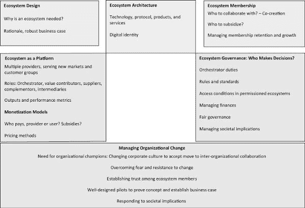

图 6.2 ¶ 生态视角下的战略思考

## 用于自动驾驶汽车服务的区块链

自动驾驶汽车（AVs），如无人驾驶汽车，具有打破汽车行业竞争格局的潜力。传统上，少数几主要汽车公司（如通用汽车、丰田和大众）主导了全球行业，拥有垂直整合的制造和分销能力，并辅以分层组织的供应商。向自动驾驶汽车的转变，以及电动汽车日益增长的重要性，扰乱了传统的层级组织汽车行业，并迫使其考虑转向基于生态系统的组织。

考虑生态系统模型的原因在于支撑自动驾驶汽车崛起的竞争要素发生了变化。制造无人驾驶汽车需要具有独特技术能力的公司，从传统的汽车制造到软件和 AI 系统开发，再到光电设备，如果它们想要提供卓越的客户解决方案，就必须自愿合作。自动驾驶汽车整合了多项不同的技术创新以提供运输服务。它们需要与 AI 能力连接的车辆行驶软件，以实时处理和响应有关驾驶环境的海量数据。该软件与多个传感器连接，例如视觉识别系统、导航系统及其相关地图、与云服务器和数据湖的移动连接，以及强大的车载计算能力（图形处理器）。驾驶指令通过车载电子设备和软件传达给汽车的机械系统——轮子、引擎动力、转向和方向、刹车——从而控制车辆的运动。用自动化取代人类司机增加了车辆的电子和软件含量，并重新安排了整个价值链的价值贡献和利润分配。这些新技术处于主要汽车公司传统的领域专长之外。

随着传统汽车行业向自动驾驶汽车方向发展，它对新技术提供者越来越具有吸引力。例如，自动驾驶软件领导者包括 Google 的 Waymo 部门，它利用其在亚利桑那测试设施运行的实验性自动驾驶汽车车队的仿真和数据来持续更新其自动驾驶软件。特斯拉依赖 AI 机器学习，通过挖掘特斯拉车在道路上行驶的驾驶性能数据来归纳地开发其自动驾驶软件。辅助自动驾驶的汽车电子设备包括使用激光对汽车周围进行成像的激光雷达单元、测量汽车周围物体距离的 RADAR、用于检测和识别物体的摄像头，以及车载计算机和相关的云连接。这些需求吸引了新的竞争者，如英特尔（推动了收购 Mobileye）、英伟达、Aptiv、百度 Uber。

另一个复杂问题是电动汽车日益增长的重要性，城市推广电动汽车以减少城市污染，并将其上移至发电设施。特斯拉的出现源于其作为先行者能够用电池驱动的电力动力系统取代内燃机。电动汽车兴起的一个结果是对内燃机的需求减少，这威胁到主要汽车公司在全球范围内对内燃机产能的大量投资。这些搁置的工厂投资反过来可能会减少主要汽车公司内部资助自动驾驶开发所需的一系列新技术的能力，从而促使他们考虑与自动驾驶世界中新强大的进入者进行合作和共同创新。

鉴于汽车在约 90%的时间里处于停放状态，且预计自动驾驶汽车在市场引入初期的成本较高（主要是由于车载计算、电子设备、传感器和自动驾驶软件[7]的售价较高），认为一些个人可能倾向于租赁无人驾驶汽车服务而非拥有自己。波士顿咨询集团估计，到 2030 年，一台配备电力动力系统的自动驾驶汽车成本将是 2017 年同类内燃机型的 75%，而 2030 年所有汽车乘车里程中约 25%将来自共享自动驾驶电动汽车。

此外，麦肯锡预测，2030 年售出的每十辆汽车就有一辆是共享车辆。他们还建议此类共享车辆更有可能用于人口稠密的城市，在这些城市中，“拥堵费、停车位不足、交通拥堵等意味着拥有汽车对许多人来说是一种负担，而共享出行呈现了竞争性价值。”共享经济模式可能是克服“价格冲击”并增加自动驾驶汽车相对于传统汽车市场份额的创造性解决方案。这种转变在图 6.3 中所示，该图说明了对自动驾驶汽车日益增长的兴趣如何推动了从等级体系向生态系统模式的转变。

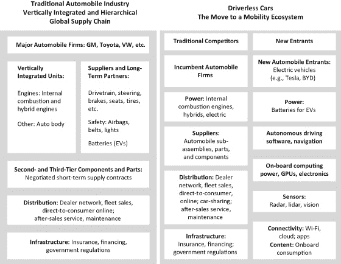

图 6.3 从等级体系到生态系统：自动驾驶汽车的发展

### 区块链对自动驾驶行业的好处

在共享经济应用中（如自动驾驶汽车案例），主要目标是实现共享自动驾驶资产经常收入的最大化。自动驾驶制造商整体可以拥有这些共享车辆资产，并通过共享车辆使用的利润年金流收回成本并获得投资回报。区块链可以管理无人驾驶汽车服务和自动驾驶交通共享经济的需求，确保车队可用并处理支付。下文进一步讨论的年金模型和公用事业模型都可以通过区块链提供自动驾驶交通服务。

在年金模型下，增值内容提供者的生态系统可以在区块链平台上联合，提供无人驾驶汽车租赁。每个生态系统提供者对完成无人驾驶汽车的增值贡献代表了其在每辆汽车中的所有权，股权大小取决于每辆汽车选择的最终配置。此类所有权可以被保留或交易，所有权状态的变化记录在区块链中。`APIs` 允许个人召唤无人驾驶汽车，而`smart contracts` 将计算并向每个用户收费，收益根据其所有权股权分配给提供者。该区块链的原生`Tokens`（令牌）可以被开发并作为所提供交通服务的支付手段。这些令牌代表客户使用无人驾驶汽车所获得的收入，将根据所有权股权比例分配给车队所有者，代表每辆无人驾驶汽车在使用寿命内获得的年金。

区块链还可以扩展到定期维护的调度和支付，以及保险公司，后者可以为增长的无人驾驶车队提供保险，或为自保车队提供再保险。可以根据累计使用量向用户提供忠诚令牌。车队中每辆汽车的区块链数据可以监控使用情况并管理常规计划维护以及事故等意外事件。它还可以涵盖车队中每辆无人驾驶汽车的整个寿命，从初始生产投入使用到报废回收，通过令牌激励并奖励总增值的回收。

作为制造生态系统拥有并从共享经济中部署自动驾驶汽车获取收入的替代方案，私人创业企业可以购买并同样部署自动驾驶汽车，寻求类似的利润年金流。第三种可能性是个人拥有自动驾驶汽车，收入和利润年金归这些个人所有；鉴于自动驾驶汽车显著较高的购买价格、车队拥有的规模经济以及更高强度使用带来的更高维护需求，第三种方案在经济上似乎可行性较低。尽管如此，所有所有所有模式都可以依赖年金模型区块链。

公用事业模型基于公共部门所有，类似于公共交通的提供方式。为公民提供公共交通服务的地方政府也可以考虑以共享模式部署自动驾驶汽车，将其作为众多交通选择之一；自动驾驶汽车在低需求路线和非高峰时段可能是高效的。这种公共公用事业模型可以使用经过某些调整的区块链来满足公共服务考量。

自动驾驶汽车可以作为公用事业提供，由地方政府拥有，并通过区块链提供共享使用。这类似于公交或火车交通的公所有，向拥有该城市或地区居民身份`unique ID`的用户提供服务。这种作为实用服务的交通可以是收费的，并可能具有与收入挂的阶梯式收费结构，同时为特定识别的人群提供免费或减价服务。此类公用事业模型也可以是混合的，采用公私合营模式，私人所有者从使用中收取费用，直到收回车队成本加上预定的投资回报，此时车队所有权将归还市政，交通服务可以以较低价格提供，涵盖运营成本。

### 区块链在自动驾驶中应用的挑战

由于许多不同行业需要协作才能将自动驾驶汽车成功引入大众市场，每个不同行业的一个或多个领导者需要发起此类合作。同时，一家具有区块链知识的受尊敬 IT 行业中立公司需要作为“诚实人”参与这些初始谈判，以增加信誉并克服对陌生技术的抵触情绪。城市公共交通管理人员也需要参与，以明确规范自动驾驶汽车引入的规则法规。向交通用户提供补贴以增加需求，对于创造自动驾驶汽车成功发布至关重要的快速增长可能是必要的。

支持自动驾驶汽车（AV）部署区块链系统的多行业财团需要投资开发和试点新的软件模块，例如一种提供来自每辆 AV 上的 `IoT` 设备安全通信的解决方案，以验证其数字身份、记录使用情况，并将相关费用与特定的交通客户挂钩。额外的模块将使可用 AV 与客户需求匹配，并将赚收益以及相关的 AV 成本分配给相应的 AV 供应商账户。AV 所有者需要被激励在合理的定价公式下，将其 AV 车队投入到区块链中供。为了减少 AV 客户和提供者的风险，财团需要为系统内部使用的代币建立市场，使其在数字货币交易所上市，并管理其价值使其作为稳定币运行。这些并非不可逾越的挑战，但它们表明了如果 AV 区块链获得关注并日益增加采用，必须解决的任务。

随着 AV 需求的规模化发展，下一步将是协调 AV 的下一代创新，因为需要各个生态系统合作伙伴提供的各种子系统之间进行同步创新，才能充分发挥 AV 能力并保持竞争优势。否则，AV 的创新将受限于落后创新者的速度。一旦 AV 创新在区块链内实现管理，区块链就可以扩展到监督制造和供应链运营。

## AV 行业中的区块链实施问题

区块链应用在 AV 制造、AV 使用以及 AV 与独立实体（如监管机构、保险公司）之间的通信，以及业务和休闲应用中都具有价值。在 AV 设计和制造中，传统的汽车公司至少需要与电子和软件公司进行合作。至少，基于区块链的生产系统应将每辆 AV 视为在价值链中移动的代币，并将各公司对 AV 值的贡献更新在附加于代币的账中，从而实现对贡献的跟踪和奖励。

在用户端，区块链可以注册 AV 使用情况，通过每辆车的特定代币记录状态变化，例如特定客户对特定车辆的使用。区块链还可以注册相关数据，如 AV 的当前位置和变化，并将此类数据与用户计单挂钩。此外，每辆 AV 上的 `IoT` 传感器可以监控运行就绪。此类信息可以与计单和维护相关的数据（包括零件订单和维护费用）相关，形成 AV 整个使用寿命内的维护日志。与所有权相关的数据，如贷款、租赁、更新后的所有权股权和折旧费用也可以进行类似的记录。AV 完全可能继续由制造商财团拥有，在区块链中产生的使用费用在 AV 的整个使用寿命内回流 AV 所有者。保险公司可以根据不可篡改的持续更新的驾驶记录，以及为所有者、贷款人、制造商和政府机构提供的具有化访问权限的许可数据访问，提供参数保险。

对 AV 的担忧是它们可能被恶意攻击者入侵，导致事故并危及生命财产。通过云连接与其他车辆、`IoT` 设备和其他服务提供商进行基于区块链的 AV 通信，可以对此类风险提供显著保护。当 AV 乘客与购物、娱乐和其他业务和休闲应用交互时，这种安全性还可以提供数据隐私和安全内容交付。为了准备，区块链试点需要在规模化实施之前探索攻击者和漏洞，并开发稳健的解决方案。

最大的障碍将是获得满意的规模化性能。随着运行的 AV 数量增加，区块链应用需要在安全 AV 运行需要实时数据供应的情况下管理许多连接。在制造方面，在由区块链治理的生态系统中开发 AV 制造将需要类似于 `Maersk` 和 `IBM` 在 `TradeLens` 中角色的协调者，AV 供应商侧的区块链也将面临类似的招募网络成员、建立公平治理以及公平评估和奖励贡献的挑战。在 AV 引入的早期，监管差异和多个司法管辖区可能是常态，此类区块链还必须获得监管批准。

## 区块链与医疗健康交付

美国有一多样化的实体在价值链中协作和创新，以提供医疗健康交付。提供高质量服务的关键要素是持续获取最新的患者信息，其中准确性、可用性和及时性都至关重要。然而，美国医疗系统在根据需要向医疗服务提供者提供最新的患者健康记录这一首要责任方面一直困难。履行这一基本且必要服务失效的原因是多方面的。流程差异阻碍了医疗健康记录跨组织边界的平稳传输，而标准和格式的差异进一步加剧了这一点。法律障碍阻碍了此类数据交接，主要是 `HIPAA` 条款，它使医疗健康提供者倾向于谨慎，并推迟此类数据传输，直到完全确保符合 `HIPAA` 规则。美国医疗系统是碎片化的，划分为政府和私营部门的责任范围；私营部门的某些部分是非营利实体，必须在利润最大化与医疗健康提供之间取得平衡，这影响了这些提供者完整且及时共享医疗健康记录的意愿。

生态系统成员之间还存在竞争的价值主张和对立的目标。医疗健康记录为精算计算提供了指示可保性和合适的保费率，使得健康保险公司和雇主与个人患者及其医疗服务者之间可能发生冲突。同样，个人基因组数据可以对疾病发生的敏感性提供深度洞察，但这需要立法保护以防止歧视性对待，以防止跨生态系统的医疗健康记录透明带来的个人后果。这些障碍中的一些源于支撑美国医疗健康提供的意识形态选择。这些障碍在提供全民医疗保健和单一支付系统的国家可能不存在，在这些国家，生态系统成员更有可能共享相似的目标。

生态系统为了提供共同创建的客户解决方案，需要共享共同目标。当生态系统成员的目标发生分歧时，生态系统可能会带有更多零和游戏的特征，某些网络成员以其他成员为代价获益。生态系统成员可能倾向于运行自己的中心化生态系统，并在在较小的生态系统中担任中心协调者的角色。这样的协调者将希望管理网络、设定目标并控制对其网络的访问；这种中心化的指导还可能导致创新受限和客户满意度下降，并被视为为了自身利益的行为。

美国医疗保健交付系统包含两个方面，以患者为生态系统的核心，与患者护理提供者和支付方进行交互。在患者护理方面，有多个独立实体为了应对成本削减压力，并开始合并为整合实体，以更好地协调并提高患者的治疗效果。这些实体包括医疗提供者，例如全科医生、护士和医务助理，它们通常被组织成医生执业小组、社区健康中心以及新兴的药房诊所。他们与外科医生、肿瘤学家等专科医疗提供者互动，这些人员可能被进一步归类于医院、急诊室、重症监护室、康复设施、辅助生活、养老机构和其他实体。

这些医疗提供者得到了实验室、专业检测服务（`MRI`、`CT scans`）以及监控和`IoT`设备传感器的支持，健康数据汇总在患者电子健康记录（`EHRs`）中，并利用基于`AI`的数据分析来辅助诊断。新进展包括远程医疗提供者和健康导航员的使用日益增加，他们在患者与护理提供者之间充当中介角色。负责患者护理的是监管机构，如美国食品药品管理局（`FDA`）和美国卫生与公众服务部，以确保安全性、有效性和合规性。

在支付方方面，政府实体包括`Medicare`（医疗保险）和`Medicaid`（医疗补助），其涵盖的服务根据《负担负担法案》和《退伍军人事务》确定。私人支付方众多，总医疗支出分配在私人医疗保险公司和对涵盖医疗成本支付自付部分的个人之间；个人和雇主提供医疗保险福利的保险保费在很大程度上抵消了保险公司对涵盖成本的支出。此外，政府和私营部门的基金会补助，加上企业和风险投资资金，使药物开发和医疗相关研发成为，这对于医疗交付的长期改进至关重要。这些资金来源将其支出分配给药物和仿制药制造商、医疗设备和装置生产者、医疗用品公司、医疗信息技术和软件提供商以及包括大学在内的医疗研究机构。其他受益者是医疗中介，如合同研究组织、保险经纪人、药品福利管理机构、药品销商和药房以及法律服务提供者。总之，美国医疗系统占了美国 GDP 的近 20%。

## 区块链在医疗保健领域的承诺

区块链为医疗保健行业提供了令人向往的前景，列如下：

- **支付**：除了解决医疗记录可用性问题外，区块链还可以使支付更高效并降低管理成本，通过与区块链验证的医疗程序、药物处方等关联实现卓越的理赔管理。例如，医疗区块链可以整合智能合约，通过测试结果和程序结果等更新信息的触发，激活医疗交付过程中的后续步骤。随着各个步骤的完成并提供完成证明，智能合约可以自动执行来自`Medicare`等政府实体和私人保险公司对已提供服务的支付。智能合约可以咨询药品福利管理处方，将支付与患者结果挂钩（而非目前基于程序的计费模式），并使用匿名和聚合的患者数据分析以及`AI`来提供患者护理改进的建议。

- **药物开发**：区块链在药物制造和供应中也可以发挥作用，防止伪造，确保药物储存在妥当，监控受控物质（例如`opioids`）的销售，并从库存中移除过期药物。区块链在开发药物方面也具有潜力，通过监控患者入组、捕获并存储药物试验数据、确保数据安全，并引导数据通过`FDA`提交临床新药调查和营销批准。

- **患者健康记录**：以区块链作为该生态系统的核心来记录和传输患者数据，它可以提供分布式的不可篡改医疗记录——一个单一事实来源——并向所有医疗提供者提供可追溯的来源。区块链可以赋予患者对其数据的主权和控制权，允许他们同意授权医疗提供者的访问。原生代币可以奖励患者允许访问其数据，例如提供给寻求药物试验候选者的制药公司。

## 在医疗保健中采用区块链的挑战

部署区块链的困难与其说是技术性的，不如说是经济和组织性的。在管理医疗记录方面拥有主导传统解决方案的私营部门企业——如`Epic Systems`、`Cerner`、`Meditech`和`Allscripts`等公司创建了数据孤岛。整合此类差异巨大的数据库会产生高昂转换成本，并可能降低潜在颠覆者的速度，为当前的`EHR`公司决定是否提供自己的基于区块链的健康记录赢得时间。这导致了提供者生态系统中不兼容的流程和数据标准，再加上由于遵守`HIPAA`隐私法规所需的法律障碍，阻碍了区块链的进展。因此，如上所述，对组织目标的分歧、法律障碍和利润动机是更大的障碍。

鉴于在医疗保健生态系统中部署区块链的这些障碍，在最近的一项调查中，44%的医疗受访者表示区块链是他们最不看的技术，这并不意外。投资者的怀疑态度更大，有 64%的人对区块链在医疗保健中的应用表现出类似的蔑视。此外，当美国医疗系统暴露于政治风险，并受到围绕报销、支付方和医疗行业监管的不确定性的影响时，医疗公司可能不愿批准如区块链这样高风险的新技术投资。

更广泛地说，生态系统创新对每组生态系统参与者的影响各异。创新者需要计划如何管理由此产生的紧张关系。Ihrig 和 Macmillan 进一步指出，如果生态系统创新能够增强其他生态成员的差异化，从而在总上补偿对其他利益相关者的负面影响，它就能成功。因此，在引入区块链进行患者数据记录的情况下，对于医生和其他医疗执业人员、医院、监管机构、保险公司、制药公司和药品供应商来说应该产生积极影响，以克服当前主导电子健康记录领域的现有者可能面临的负面后果。生态系统内部需要一个创新联盟 14 来推动如引入区块链等高风险的新方向。

#### 区块链与全球供应链：作为生态系统的 TradeLens

第 5 章中讨论的 TradeLens 是实施跨组织供应链解决方案时应用生态系统视角的一个案例。15 如果每个人都信任数据、基于同一份数据进行工作，并确信数据安全且私密，供应链参与者将受益。16 作为独立公司，如果该应用能提供比旧系统更好的益处，则需要激励并说服它们加入区块链。

与任何数字平台一样，随着更多供应链参与者加入 `TradeLens`，正向网络效应会带来更大的收益。鉴于 `TradeLens` 由 `Maersk`（马士基）和 `IBM` 控制，将 `TradeLens` 与所有者分离的治理安排对于吸引 `Maersk` 的竞争对手至关重要，因为他们的集体参与才能使 `TradeLens` 有效。需要入职协助来引导较小的供应链公司参与，以消除他们的担心，即其相对较低的技术和组织准备水平可能会降低其作为网络中平等成员的功能。为 `TradeLens` 的服务定价涉及平衡参与的成本-效益与收回投资以及创造正现金流以资助持续可持续运营的需求。而且 `TradeLens` 必须展示出持续的演进和升级，以吸引可能更倾向于加入新的供应链网络（例如具有更先进区块链协议的全球航运业务网络 `GSBN`）的成员。`GSBN` 包含了一些最大的中国和亚洲航运公司，它们共同控制了全球约 30% 的集装箱流量（`Maersk` 本身控制约 20%）。

`IBM` 和 `Maersk` 作为共同所有者和协调者，做了几项架构选择，以激励整个供应链生态系统对 `TradeLens` 的采用。

*   **吸引买家**：为有货物待跟踪的用户开放访问，这是一种用户补贴的形式，以鼓励快速采用。通过提供对大量潜在供应链提供者的访问权限以及积累的历史货运数据，来培养用户忠诚度，旨在使 `TradeLens` 成为首选平台。
*   **为生态系统成员创造价值**：已下单并等待货运交付的客户可以从货流的可可见性和透明度中获得价值，这对在途库存和营运资金水平产生积极影响，并减少缺货损失。供应链供应商同样可以从有关货物位置、状态和可能延迟的知识中获得价值。此类数据可以增加来自忠诚、满意客户的市场份额。这种客户忠诚度使供应商更愿意为使用 `TradeLens` 付费，无论是通过订阅费、基于使用水平的流量费，还是通过访问货运状态数据的费用。
*   **鼓励协作创新**：`IBM` 和 `Maersk` 可以制定规则，在创新被吸收标准功能之前奖励创新者。17 这些规则鼓励了区块链的持续演进，例如通过将 `IoT` 设备与软件和 AI 能力相结合以跟踪货运。这种开放创新可以帮助 `TradeLens` 与其他类似的新兴平台竞争。

因此，培养开放标准、鼓励新进入者接受、赋予数据安全优先地位、治理去中心化以及开发衡量进展的指标，有助于 `TradeLens` 区块链的成功采用。在完成满意的初步试验后，`IBM` 和 `Maersk` 于 2018 年 1 月引入了 `TradeLens`，并在年底签署了超过“100 家机构，包括四家海运公司、三家内陆运输公司、全球 40 多个港口和码头、大型货运代理以及涵盖从罗特丹到巴林的的全球八个海关当局”。18 `TradeLens` 吸引了如 `Dow Chemical`（陶氏）和 `Du Pont`（道邦）等用户，他们依靠 `TradeLens` 成员来运输货物。

区块链为互不认识的实体和个人提供了在去环境中共享数据和进行交易的可能性。机器——区块链——提供了信任。区块链技术在生态系统内部也提供了显著收益，各种组织正在进行的区块链试点应用数量 19 证明了这一点。随着其作为生态系统工具的价值增加，广泛采用的动力动力。帮助其他公司以公平条款创建并共享价值是鼓励参与新兴生态系统的最佳方法。20 区块链的使用可以催化协作价值创造，并透明地记录价值的分配。参与者可以判断自己的回报与努力是否匹配。

在最后一章中，我将基于各种行业和应用案例的见解，为企业制定战略步骤，以判断区块链是否适用于他们想要解决的问题，如果是，如何开发和实施此类区块链应用。

# 7

# 实现区块链的潜力：企业的战略路线图

企业应该如何战略性地对待区块链承诺？

企业可以采取逐步的方法来决定以及如何部署区块链。第一步是确定现有的遗留解决方案是否令人满意并需要更换。如果是，企业需要评估区块链是否是答案。然后，他们应该制定开发区块链解决方案的商业计划，以获得支持和资源（资金、人员、时间等）。这导致了解决方案的设计，设计应利用区块链的独特特性和功能。最后一步是为组织使用区块链做好准备，让经理、技术人员和其他员工团结一致，使其取得成功。

### 现有的遗留解决方案需要更换吗？

如果旧有解决方案运行良好且客户表示满意，那么可能没有必要迁移到基于区块链的解决方案。在区块链出现之前，公司使用中心化数据库来保护数据并控制访问。中心化公司控制下属单位并管理供应商。过去，汇总更新、及时信息并对关键指标进行异常报告的控制塔或仪表板很好地为高层管理和关键决策者提供了服务，而且可能仍然适用——只要公司继续保持层级化运营、主导其层级结构，并能够依靠自己的数据做出明智长期决策。

正如 Capital One 的一位行业专家所说：“请记住，链条的强度取决于其最弱的一环，区块链也是如此。如果一个节点在性能、规模或安全性方面出现问题，它们可能会影响其他节点。区块链可以是一个强大的解决方案，但组织只有在面临现有技术无法很好解决的挑战时才应该使用它。”只有当行业结构发生变化，公司必须协作来满足客户需求——并且需要从独立第三方获取准确、及时的数据时，区块链才变得具有力。我之前提到过信用评分行业，美国市场有三家主导企业，包括 Equifax。正如所指出的，像 Equifax 这种由中央控制的深度存储库可以并且已经被黑客攻击，给客户造成了巨大的额外损害。在这种情况下，基于区块链的去中心化信用评估（由个人控制自己的信用数据）是具有长期潜力的破坏性创新。

### 区块链是答案吗？

区块链能带来更好的解决方案吗？如果客户对现有（旧有）解决方案不满意，它可能是一个合适的替代方案。区块链的使用对于实现某些目标特别适用：

*   通过交易双方之间的直接互动来取代中介及其费用，以降低成本；
*   通过明确识别未经授权的复制、伪造和仿制尝试来保护数字资产，从而提供防篡改安全性；
*   保留特定数字资产的不可篡改交易记录；
*   通过同步结算和支付终性在交换贵价值资产时防范交易对手风险；
*   在需要透明度的情况下，在参与交易不同阶段的多个实体之间访问、更新和共享准确的实时更新信息；
*   与没有先验信任关系的未知方进行在线交易；
*   与多家独立公司共同创造客户价值；以及
*   共享治理、接受去中心化，并放弃对应用设计和功能的层级控制。

例如，跨不同医疗提供者的 EHR 移植性可以允许医疗团队分散在不同的医疗机构，以获得更好的患者结果和护理。在区块链内部的医疗节点之间共享 EHR 可以实现这一目标，这也是医疗提供者与生态系统伙伴合作并试点区块链应用的原因。

内部业务流程的问题可能会导致内部“客户”产生类似的不满。例如，建筑承包商必须将重设备从一个合同地点部署并移动到另一个，偏远施工现场的关键设备故障可能会延迟运营并增加成本。使用连接到 IoT 传感器的智能合约区块链来跟踪设备状态和使用情况，将有助于预测和检测即将发生的设备故障。它还可以启动预防性零件请求和预防维护步骤，包括在相关现场及时对关键备件进行订单和定位。转向区块链的企业可能仍需要将旧有解决方案与区块链结合作为中间阶段，用区块链补充旧有解决方案。例如，Santander 银行是 `Ripple` 的早期采用者，旨在为其客户降低跨境汇款成本，但仍必须继续使用旧的汇款传输系统。某些客户没有或无法使用 Santander 的 `One Pay FX` 移动应用程序，且若干政府机构未批准在其汇款走廊中使用 `XRP` 转账。

Forrester 对使用 `IBM Blockchain` 的总经济影响的研究指出，区块链参与者需要对区块链的引入耐心。首先，需要时间达到规模化运营并开始获益。其次，区块链应用开发受益于与专家伙伴合作，该伙伴应根据专业知识、良好的记录和声誉被选中。寻找、谈判并与此类伙伴合作可能非常耗时。第三，成本-效益结果在一系列预测范围内是可以接受的。为了支持积极的建议，预测应包括基准情况之外的悲观和乐观场景，甚至基于悲观情景的更低成本效益预测，在企业决策者通过之前也应被认为是可以接受的。

当大量交易处理至关重要时，区块链的使用存在问题（尽管区块链具有扩展性限制，但这些限制正在被被）。企业也可能被区块链固有的透明性威慑，因此倾向于使用许可链，他们可以在那里控制数据访问和共享。此外，区块链内部的数据存储成本很高，这使得对于需要持续访问大型数据库的应用来说是不经济的（因为相同的数据存储在多个节点上，由于使用区块链共识验证算法更新多个节点的数据和账本，处理成本增加了）。

### 为区块链解决方案制定业务案例

公司需要确保拟议的区块链解决方案最终将提高其盈利能力和效率。因此，从应用区块链的业务案例开始非常重要，列出预期收益（如新收入来源和来自新服务/产品的最终利润）、效率提高带来的利润率提升以及成本降低。内部应用和面向客户的外部区块链应用都可以成为替代当前解决方案的候选者，而通过为它们的采纳制定业务案例可以加强这两种区块链应用的开发。通过区块链使用积累的数据变现是额外的长期收入来源：公司可以基于分析整个生态系统的累积数据湖，提供预测和消费者需求分析。

发现大型、可开发的市场是从新区块链应用中赚取大量收入的关键。例如，考虑到使用 `SWIFT` 的跨境汇款总量巨大，`Ripple` 开发一种基于区块链的更好的跨境汇款解决方案是有意义的。即使在全球市场中的初始市场份额很小，`Ripple` 也能实现显著增长。访问 `RippleNet` 的竞争性费用以及将 `XRP` 作为汇款首选数字货币的持续销售有助于其市场份额的增长。区块链的一个缺点是企业难以确定成本-效益结果，这可能会限制区块链在企业中的大规模部署。在下一节中，我将详细审视经济障碍以及如何解决它们。

# 实施的经济障碍

从经济角度来看，企业可能对投入区块链技术感到不确定，原因在于对使用区块链的成本效益权衡存在不确定性、投资设备和软件运行区块链网络的开发成本高昂，以及缺乏领导和构建区块链应用的人才匮乏。企业可能会认为，现有技术（如分布式数据库）在短期内是可以接受的，并估计区块链提供的改进不足以支持其切换到一种全新的、陌生的技术。

## 评估使用区块链的经济回报

鉴于上述的经济障碍，评估企业的经济回报至关重要。量化区块链的影响应包括成本影响，既考虑采用区块链带来的成本，也考虑因效率提高带来的成本降低。还可能来自区块链用户支付的费用带来的收益，更广泛地说，可能来自由于竞争力增强以及新产品服务的引入所带来的市场份额增长。图 7.1 概述了进行成本效益分析的相关因素。

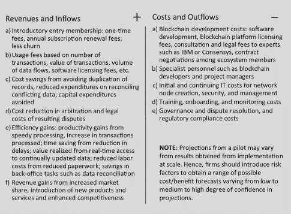

图 7.1 ¶ 成本效益分析的相关因素

由于区块链应用如果成功，将涉及持续成本，因此总拥有成本（TCO）是一个实用的指标，因为它允许进行更完整、更好的成本效益分析。TCO 假设区块链应用是一种在多年产生回报的资产，同时会折旧并需要持续维护以保持高性能性能。TCO 包含了 IT 成本，如硬件、许可和软件购买与开发、专业人员的 IT 支持、终端用户培训与帮助、通信成本和停机成本、遗留接口和数据迁移成本，以及软件漏洞和升级成本。其他 TCO 成本包括管理资源、时间投入，以及用于管理和持续改进的关联人员配置。

另一种方法是对部署区块链解决方案可能产生的不同场景进行建模。Patara Panuparb 考虑了供应链金融中的一个区块链用例，为不同的生态系统成员（即供应商、买方和供应链金融提供商）估计了成本效益。该模型考虑了以下几个参数：

* 供应商从供应链金融提供者处获得较低利率的节省，相对于加入区块链平台并支付发票百分比作为交易费的成本；
* 由于区块链更高的安全性和交易执行的不可篡改性，对供应链信息的信任促成了更快的付款速度；
* 由于低利率供应链融资取代了供应商的高成本融资渠道，利润池向有利于区块链的方向重新分配；
* 去中介化导致部分从低利率融资中节省的利益以区块链交易费的形式转入区块链；
* 对买方的益处，买方可能无法直接从利率降低中获益，但可以因为供应商的利率较低而能够获得更长的付款账期从而获益。

该模型可以考虑使用和不使用区块链的不同场景，以评估在该供应链金融背景下使用区块链的净收益。该模型将传统的供应链金融与供应链区块链内的替代方案进行比较，后者提供了更成本的融资和延长的付款期限，而使用区块链平台增强的供应链效率缩短了运输运输天数，从而导致货运发票金额更早地实现。图 7.2 列出了该模型及其参数。

这种详细的建模可以帮助企业尝试不同费用结构和服务的区块链配置，将来自不同试点的数据馈到模型中，以比较替代方案的成本效益。

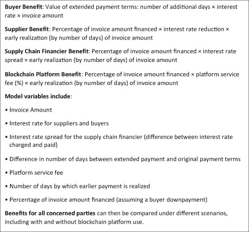

图 7.2 ¶ 评估供应链中区块链应用成本效益的模型。改编自 Patara Panuparb，“Cost–Benefit Analysis of a Blockchain-Based Supply Chain Finance Solution”（硕士论文, MIT 交通与物流中心，2019 年 5 月）。

## 估计从遗留系统切换到区块链应用的成本效益

区块链试点项目可以提供概念证明，但可能无法证明比遗留应用更好的经济效益，导致难以获得大规模实施的预算。区块链开发还可能产生高昂成本，抑制了对具有不同目标的多个项目的资助。

银行业应用指出，区块链解决方案在以主机为中心的计算网络中效果最好，这需要大量的增量投资。“银行可以利用 z Systems（新一代大型机）的速度、加密和可靠性来托管区块链，同时与运行在主机上的交易数据和应用程序进行无缝集成。”从每个节点存储持续更新信息的副本来看成本也会增加。例如，在研究供应链中使用区块链解决方案的潜在成本效益时，虽然发票处理效率的提高减少了流动资金，但这些收益被区块链平台成本和使用费抵消了。此外，收益流向供应商而非买方，阻碍了某些生态系统成员加入区块链。

## 对中心化、许可网络的偏好

区块链的设计初衷并非针对企业。正如比特币在使用的那样，它是一个非许可网络，对任何想要加入网络的人开放。这种开放性在企业分布式账本技术（DLT）应用中被认为是理想的，例如在专注于公司债券发行和生命周期管理的投资银行网络中。在这种情况下，如寻求贷款的客户或管理债券发行的投资银行可能倾向于限制网络成员。解释比特币概念的白皮书假设，用于跟踪数字资产（比特币）所有权和状态变化的去中心化分布式网络，需要在存在恶意行为者的情况下运行，例如试图双重花费或引入伪造资产的节点。

防止违规行为的额外步骤对于企业可能是复杂的，因为他们可能倾向于在许可网络的区块链中与少数受信任的节点工作。这样企业就可以避免使用计算和耗时的共识验证方法，从而提高区块链的执行速度。然而，这种治理节点的中心化违背了区块链去中心化的基本原则，并可能损害安全性。在许可网络中选择中心化网络会减少信任中介带来的收益，从而增加了网络管理和治理成本。

# 多个区块链协议间互操作性障碍的成本

企业级区块链为了发挥作用，通常需要企业外部的第三方加入区块链网络。无法要求所有区块链参与者都采用并使用相同的协议、安全特性和算法，这导致了多种区块链的使用。企业可能会发现自己属于多个区块链网络，每个网络使用独特的区块链协议，并且在交易处理、智能合约功能、跨链通信安全以及共识机制方面存在差异。

## 智能合约缺陷的成本
智能合约代码中的漏洞，以及为了违背合约条款而故意引入的错误，都会增加在区块链解决方案中使用智能合约的成本。例如，智能合约可能被篡改以将数字资产释放到任意地址（挥霍型合约）、通过任意账户终止合约（自杀型合约），以及程序化将资源无限锁定，且没有任何条件可以释放这些被押资金（贪婪型合约）。`MAIAN` 等工具可以检测到此类恶意合约，但需要额外的支出。

## 设计区块链应用

成功的区块链应用源于利用区块链能力来克服客户痛点的业务模型。换句话说，企业必须确定哪些能力将为客户创造价值。

是 许可链还是无许可链？
企业在开发区块链解决方案时不太可能选择经典的区块链配置（无许可、去中心化）。最初，他们可能倾向于封闭的许可系统，优先考虑强调流程改进和效率提升的内部应用。在开发面向外部客户的解决方案时，他们可能更倾向于让自己能够发挥协调者的角色生态系统，并在投资、变现和治理决策中拥有重要的话语权。在此类生态系统内的许可区块链中，企业及其生态伙伴设定了准入条件，并决定哪些实体作为节点加入区块链。

例如，`DTCC` 试点了一个定制的许可区块链，用于管理 11 万亿美元的信用衍生品，这些衍生品此前存储在其交易信息仓库中。该许可应用是与 `IBM`、`R3` 以及 `Axoni` 的 `AxCore` 区块链协议（`Ethereum` 的版本）合作构建的，使得 `DTCC` 的伙伴如 `Barclays`、`Citi`、`DB`、`UBS` 和 `JPMorgan` 将信用违约掉期记录、生命周期事件、支付和结算转移到区块链平台，为监管机构和交易对手提供了单一记录。随后，该项目扩展到了更多的 `DTCC` 客户，但采用了许可级访问。控制访问可以更快速地验证交易并提供更高的数据隐私。此外，在此信用衍生品的案例中，有限数量的节点更容易对通用数据标准和治理达成一致。缺点是节点较少会导致安全性稳健性降低。随着可扩展性、速度、隐私和最终性问题得到解决，企业平台可能会向公共无许可区块链演进。此外，私有区块链可以与公共无许可去中心化区块链链接，利用在基础公共平台上构建隐私层的区块链协议以及在链外执行的计算信任。

## 使用哪种区块链协议？
具体的场景将影响区块链协议的选择，取决于是否创建许可网络、互操作的程度，以及在可扩展性、速度、最终性和隐私保护方面的相对性能、与去中心化安全存储和云集成的安全链接便利性，以及链外网络（例如到预言机）。

`Ethereum` 由于其与 `Ether` 关联的智能合约能力、`Ether` 作为代币的广泛接受以及在金融科技生态系统中广泛使用的网络效应，已成为金融应用的首选协议。其他广泛使用的协议如 `Hyperledger`、`R3/Corda` 和 `Consensys` 可能因为在各行业特定垂直细分领域的部署结果而更适合某些场景。例如， `Infura` 允许企业及其开发者通过 `Infura` 节点将应用程序连接到区块链，允许快速进行概念验证试点，并使缺乏区块链开发经验不再成为阻碍。较新的协议如 `Quant Overledger`（在第 2 章中讨论）提供了更大的灵活性，例如简单的 API 允许旧应用程序与 `Dapps` 通信。

### 身份验证
区块链的优势在于防止欺诈，它具有防篡改性和抗性。防欺诈的关键步骤是使用经过验证的身份。在区块链内部部署并验证的 `SSI` 让个人对其身份和数据的控制权。个人随后可以决定向谁披露多少内容，防止因数据黑客导致的损失，例如从 `Equifax` 盗取的 1.4 亿个人信用记录。供应链和贸易金融生态系统网络成员的一个大痛点是符合 `KYC` 规性，而 `SSI` 可以降低识别客户和遵守 `KYC` 要求相关的复杂性和负担。

德国初创公司 `evan.network` 为区块链生态系统开发了身份和信任基础设施，整合了个人和组织身份、物理对象身份以及第三方提供的外部身份（如数字签名和数据认证），使得生态系统成员可以依赖 `evan.network` 作为身份验证器。网络效应对 `evan.network` 的增长至关重要，因为它能验证的身份越多，它就变得越有用，从而吸引更多成员。

作为一家最初专注于构建完善验证身份数据的德国公司，`evan.network` 在德国以外的可扩展性取决于与其他具有相似战略意图的大型市场中的区块链进行许可和合作。如 `Komgo` 和 `we.trade` 等应用利用了区块链确保安全、透明、实时、防篡改、不可篡改的数字化文档和交易记录的能力。结果是信用风险和贷款违约减少了，并且它们可以提供基于智能合约的自动化信贷和催收。这些应用针对中小企业等新客户细分市场，并连接到通过其 `we.trade` 成员银行加入的新客户。`Komgo` 和 `we.trade` 可以依靠 `evan.network` 的身份工具，并专注于改进其贸易金融应用，在新兴生态系统中进行协作。

## 促进生态系统形成以交付客户价值
区块链非常有助于将生态系统成员聚集在一起，协作开发比现有传统解决方案更好的客户解决方案。区块链解决方案使生态系统中的企业能够利用相互互补的能力并合作开发创新解决方案。区块链凭借其去中心化的节点架构以及跨多个节点的交易和信息流的透明不可篡记录，特别适用于促进组织间的协作和问题的解决。例如，围绕加密货币、数字钱包、`DEXs` 和分布式应用提供者建立的生态系统可以提供基于数字货币的服务，如贷款和投资组合管理。

为了使增长获得动力，成功的联盟必须对所有成员保持中立和公平，并在持续投资导致早期亏损期间保持联盟的凝聚力。当然，在早期展示出提高效率和降低成本的成功，也将刺激正向的网络效应，促使更多企业寻求加入该生态系统。一个关键步骤是协调化，以便所有生态系统参与方能够在单一平台上进行交互，减少互操作性问题并使加入联盟更具吸引力。16 联盟需要在标准化与兼顾成员的独特差异之间取得平衡，例如智能合约中的定制化条款。基于 `R3/Corda` 构建的贸易金融平台 Voltron 提出了一种独特的方法——创建一个核心智能合约基底，并添加一个额外的层用于自定义添加。17 图 7.3 阐述了一个流程，帮助企业在设计区块链应用时决定是否包含不同的区块链特性。

## 组织准备

组织天生对变化产生抗，这意味着项目负责人需要为组织向区块链转型做好准备，开展教育和培训以开发必要的人力资源和知识库，并帮助入职。在内部开发必要的专业知识需要投资和时间，并且可能根据需要用外部合同帮助进行补充。如果企业优先考虑内部应用，则需要激励不同的组织单元通力合作以应用并实现区块链收益。高层管理的支持需要在更大规模的实施之前，提供资金和时间来建立概念验证（PoC）。组织还需要现实的预期，因为区块链的实施是困难的，特别是在初期阶段，试点项目可能无法第一次尝试就建立概念验证。最后，一位理解技术并能担任 C 级高管联络人的高层领军人物，可能是决定成败的关键任命。

通过启动和从试点项目中学习，可以增强组织的准备就绪性。第 1 章讨论了具有商业运营考虑的试点项目的价值，这使组织在进入大规模实施阶段时比其竞争对手处于领先地位。在比较中国和美国的区块链进展时，Gartner 指出，已经拥有区块链技术基础设施的中国公司正领先使用区块链应用，帮助需要更快支付和获取（增加的）信贷额度的企业和消费者。18 关键点在于，如果一个企业等到区块链的承诺完全显现后才行动，可能会落后，因为当他们仍在构建区块链基础设施并培养熟悉度时，其竞争对手已经在实施经过时间考验的区块链商业尝试，从而导致竞争力的严重流失。

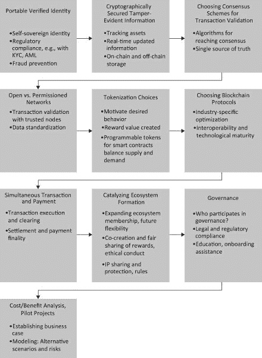

图 7.3 ¶ 设计区块链应用

### 对变化的抵触

高层可能对用区块链应用取代旧系统的努力产生抵触，原因在于其未经证明的性质、行业同类中区块链使用的显著积极结果较少，以及作为先驱的内在风险。在管理层中拥有信誉的内部倡导者需要带头开展区块链开发，获取预算并保护项目团队免受干扰，同时获得足够的时间完成试点并评估结果。招募有能力的设计师和程序员来交付可以在试点工作中部署的可行解决方案，可以增强可信度并减少抵触。区块链解决方案的需求和感知价值，与切换成本以及个人的改变准备程度进行权衡，是决定组织接受和抵制的某些因素。19

### 知识、财务和人力资源限制

建立在旧系统和经验上的企业知识可能会阻碍对区块链破坏其业务流程和现有生态系统以及创建新业务模式潜力的理解。20 积累的知识和传统会对区块链取代旧系统和业务模式产生抵触。此外，企业可能会尝试将区块链塞入现有的业务范式。区块链初创公司具有优势，因为它们没有传统负担，可以从全新的角度处理业务问题，利用 `DLT` 的力量提高效率并产生新的业务模型，同时超越传统的组织边界。

具备必要的区块链领域技能以及理解用户需求和企业级组织需求的经验区块链程序员和设计师的稀缺仍然是一个制约问题。人才短缺推高就业成本，进一步（负面地）影响了区块链的成本效益计算。作为一种新技术，`DLT` 还需要新的技术技能，如身份验证和密码学、令牌激励设计、插入隐私控制、与去中心化数据存储链接，以及与权限网络结构的集成。21 所有这些都为企业采用者带来了瓶颈，直到他们能够逐步增加投资、招聘和培训以获得所需的人才和知识能力。招募开发者和项目经理以及投资用于运行区块链的软件和网络可能涉及大量投资，而企业的财务限制决定了承担此类试点项目以及后续大规模实施的可用水平和时长。成本效益分析对于说服高层和董事会批准被视为高风险的项目至关重要。

### 用户反应

用户已经习惯了基于 Web 的用户界面、点击式导航和下拉选项框。在桌面电脑、平板电脑和智能手机上多年持续使用并获得的熟悉感，让用户不愿学习新界面，并期望新应用能提供类似的便利性和易用性。潜在用户可能会拒绝区块链，因为他们发现它很难、发现界面不友好，并且不熟悉该技术，从而限制了采用。区块链对大多数用户来说是陌生的；它们的界面尚未达到旧应用的易用性和透明度。

此外，区块链对用户提出了新要求，例如，要求他们同时使用公钥和私钥来确保身份并获取区块链的权限。安全的私钥存储和检索对于持续访问和使用区块链应用至关重要，新手用户可能会无意中丢失或将私钥访问权交给别有心术的人，从而被拒绝访问应用并可能丢失资产和信息。可以在设计应用和界面时引入潜在用户的子集来改进区块链用户界面——即“参与式设计”。22 相比之下，区块链试点和应用的负面体验会导致用户怀疑切换到区块链的效用，并增加对现状的支持，依赖满足他们当前（即使不完美）需求的旧应用。

开放公共网络（如比特币使用的网络）中的区块链治理是民主的。在许可网络中，主导成员拥有更集中的控制权，并引导着其区块链网络的未来。他们可以根据自身需求塑造新成员准入、交易费用、货币化策略和成员奖励。他们还可以通过行政命令（fiat）批准删除过去的交易，这违背了区块链的不可篡改性，并授予不同网络节点对更改区块链架构、标准制定、功能演进以及接受未来协议变更等问题拥有不同程度的控制权。其他生态系统的成员成员可能就不愿意以从属地位加入网络。将区块链视为包含整个生态系统，并借鉴生态系统治理原则，有助于解决围绕主导成员控制的一些紧张关系，并创造更大的去中心化自主性。23

## 监管不确定性

国家及其政府对区块链的态度不一，政府对区块链倡议的支持程度各异。他们对经济交易的去中心化感到不安，因为这使得高价值交换移出了他们的税收管辖范围。中国和印度等国家已经禁止了加密货币的使用，而其他政府如瑞士和爱沙尼亚则鼓励区块链的演进。在缺乏明确监管的情况下，企业可能会对区块链采取谨慎的观望态度。

缺乏清晰的监管框架非常重要。例如，正如引言部分提到的，跨境汇款费用高昂，占转账金额的 6-7%，且需要数几天时间且不透明，客户无法确定交易何时完成或用于转换的汇率是多少。区块链应用旨在解决这些问题，其目标是实现更快的交付、更低的成本和更高的透明度。然而，实施成功的跨境汇款应用需要多个参与跨境资金转账的司法管辖区的政府提供及时合作。必须说服这些政府相互协作，并接受统一的跨国监管。企业及其银行必须与中央银行、监管机构和支付基础设施运营商合作，在一个缓慢且有时是官僚化的过程中工作，以达成满意的解决方案。24

区块链演进的速度也超过了法律监管，以 ICO（首次代币发行）为例，估计到 2018 年，全球 ICO 募集资金已超过 500 亿美元。在缺乏监管的情况下，ICO 投资者并不了解 ICO 发行者是谁、募集的资金如何支出，以及是否有外部审计师审查过该发售。25 这种信息缺失使 ICO 投资者面临欺诈和价格操纵的风险。在`SEC`介入并认定 ICO 可能受美国证券法约束并要求遵守法律后，美国的 ICO 发行大幅下降。例如，作为 ICO 案例的 Telegram Group 被`SEC`强制向美国投资者退还了 12 亿美元，因为其裁定其 ICO 发售违反了美国证券法。26

监管机构可能坚持对区块链拥有更多权力。例如，在基于区块链的全球供应链中，海关官员可能要求访问区块链，以确保符合进出口法规和关税，这将使他们对私营部门拥有可见度。（等一下，我注意到原文中该段落存在重复，我将清理逻辑流）。

*自我纠正：原文中包含多个以“Regulatory bodies...”开头的重复段落，我将进行合并以符合专业文档标准。*

监管机构可能坚持对区块链拥有更多权力。例如，在基于区块链的全球供应链中，海关官员可能要求访问区块链，以确保符合进出口法规和关税，这将使他们对私营部门拥有可见度。联邦储备银行开始开发 FedNow，以便在全年每天、全天候提供安全高效的即时支付服务。（实际上，我将严格遵循提供的文本，但会修复格式）。

## 区块链与法律责任：交易完成的问责

中间机构可以保护交易对手的利益，例如，持有资金直到合同条件履行。在区块链中，司法系统需要决定智能合约是否具有法律效力。28

## FedNow：联邦储备银行试点项目

目前，美国金融系统平均需要三天时间来清除并完成支付，这导致了客户对快速支付的需求。基于区块链的支付提供了近乎瞬间结算和支付终局。围绕区块链的热点促使波士顿联邦储备银行思考区块链是否能帮助其推进维护货币稳定和金融体系完整性的任务，并提高其效率。它从 2019 年开始进行区块链实验,29 其目标是“通过试错”来理解区块链的使用如何帮助其更好地履行中央银行服务。

波士顿联储随后进行了两项实验。第一个实验涉及管理金融机构在联储持有的有限数量账户。区块链试点将用于记录转账以及相应的总账条目和更新，然后验证转账与账本记录之间的一致性。在第二个实验中，它在区块链节点 set 中模拟了一个监管节点。这第二个用例测试了一个特定需求：监管节点需要访问所有交易细节，而特定于某笔交易的交易对手则通过专用通道仅限于他们内部的交互。联储希望确定使用区块链时的可扩展性局限，因为此类交易数量的增加（每笔交易都有一组交易对手）意味着专用通道的数量会不断增加，并可能导致性能下降。此类侧信通道由相关交易对手完全控制数据（是否与谁共享以及以何种条件共享），这是波士顿联储的区块链为了被接受并进军关键业务应用而需要提供的特性。

他们的试点结果帮助波士顿联储决定，现在投入区块链还时过早了。区块链技术尚未被认为足够成熟，且在技术上过于不，无法满足其解决客户痛点的需求——主要是将交易完成和支付结算窗口从二至三天缩短为当日结算和实时结算。它还必须实施许可网络以使用成员服务，而当时提供的以 版本被认为无法处理其成员身份和权限要求。它还能够评估使用开源协议的优缺点；很难获得帮助和专家建议，而且不断演进的协议带来了重写代码以适应新版本的负担。

波士顿联储还发现了可扩展性的缺陷：为了确保数据隐私，特定交易的交易对手仅能访问验证并记录其交易的特定账本。它需要确保业务关键数据仅对该特定交易的利益方可用，这需要建立私通道。联储发现在 `Ethereum` 和 `Hyperledger` 中建立通道都是复杂的，而且这些通道并不容易扩展。对于这些努力，联储表示：“当给定网络上存在数百个实体时，潜在通道的数量会呈指数级增长，管理它们的努力也是如此。”[[31]

## Ripple 的区块链策略

Ripple 与 FedNow 形成了鲜明对比。Ripple 能够从零开始并开发其区块链支付系统。它利用特定的区块链特性来打造其颠覆性应用，并为客户提供优于基于现有 `SWIFT` 系统的传统替代方案的优势。Ripple 与 `Bitcoin` 不同，它脱离了完全去中心化的网络并将验证限制在少数受信任的验证节点 `UNL` 上。这导致了更快的处理和结算。然而，依赖少数信任节点使得 `RippleNet` 容易受到单点故障的影响，即 Ripple 本身。此外，Ripple 不使用 `Bitcoin` 较慢且高能的 `PoW` 方法来铸造 `XRP`。相反，它预挖了 `XRP`，在 2012 年公司成立之初创建了一千亿 `XRP`，并向 Ripple 公司释放了八百亿 `XRP` 用于运营资金支持（创始人保留了二百亿 `XRP` 作为他们的份额）。[[32] Ripple 注意到 `XRP` 是独立的，虽然 `XRP` 的流动性和接受度对 Ripple 的增长至关重要，但其主要责任是对股东，而不是对 `XRP` 所有者和市场做商。

总结来说，Ripple 解决了一个主要用例——客户对昂贵、不透明且缓慢的跨境汇款的不满——并使用区块链创建了其更快、更安全且更成本的应用。它对列在 `UNL` 上的受信任节点的使用使得快速的交易认证和同时的支付结算成为可能。它依赖区块链持续通过交易状态和账户余额更新账本的能力，为客户提供不可篡改性和带时间戳的审计追踪。随着 `XRP` 使用量的增加，网络效应可能会说服客户选择 Ripple 网络而非现有的 `SWIFT` 解决方案。这将通过扩大 `XRP` 作为跨境转账中交换媒介的使用来进一步扩大 Ripple 的业务，并通过减少客户的多币种流动资金需求来使其受益。

## 选择和实施区块链解决方案的策略路线图

考虑到波士顿联储在其区块链试点中的经验，虽然试点没有达到预期结果，但该银行学到的知识足以确定区块链具有潜力，并随着技术的成熟将具有未来价值，这产生了继续学习和实验区块链创新的动力。Ripple 将区块链调整以适应其应用，脱离了 `Bitcoin` 使用的经典开源全去中心化节点形式。因此，关键步骤是拥有具有吸引力的用例。区块链可以根据特定用例进行调整，且采用可以分阶段进行且程度不一。[[33]

企业可以从支持区块链的技术（如加密算法）开始，然后开发受区块链启发的解决方案，这些解决方案使用区块链技术的某些方面以及限制在内部信任节点（即少数节点）的小规模网络。接下来，企业可以追求包含并符合完整区块链规范的完整区块链解决方案。企业随后转向区块链增强型解决方案，将区块链与补充技术（如 `AI` 和 `IoT`）相结合。最后，它们可以开发一个生态系统，鼓励并利用第三方分布式应用（Dapps），这些应用构建在区块链平台上并提供额外功能。区块链因此实现了新的业务模式，企业在去中心化系统上开发新服务，与生态系统成员协作并对其开放。

尝试区块链试点的企业可以同一个用例尝试不同的协议，然后选择结果优的协议。例如，区块链成员企业可以从区块链应用程序的安全数据中获得见解。但如果没有区块链试点，组织将无法评估收益并决定正确的架构和应用功能。企业还将通过试点意识到人力资本的差距。如上述所示，开发和实施区块链项目需要专业的人力。此类资源可能是稀缺的、难以寻找和招聘的且昂贵的。通过用户教育减少对区块链的不熟悉感并提供用户友好界面可以获得用区块链解决方案替代旧应用程序的支持。实验还可以帮助确定切换到区块链的成本效益优势，并为从旧应用程序切换提供理由。图 7.4 总结了企业在考虑区块链应用时的战略步骤。

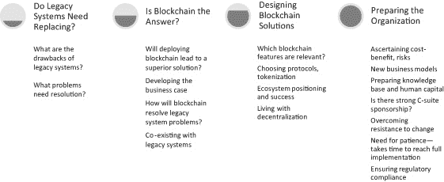

图 7.4 ¶ 企业级区块链的策略方法

## 对于企业而言，一切皆有利，且现在就是时机

这项对区块链的调查表明，区块链是一个处于动荡中、正在经历快速转型的世界。虽然加密货币可能会被国家数字货币和稳定币边缘化，但底层的区块链技术正在深根，延伸到各个行业。各年龄段的消费者正对区块链的概念感到熟悉，随着如 `NBA Top Shot` 等 `NFTs` 和如 `Axie Infinity` 等区块链游戏成为日常用语的一部分，吸引了大量的零售客户和游戏玩家。`Visa` 和 `Square` 等公司为数字货币支付提供了便捷的在线接入渠道，客户也变得习惯于保护自己的私钥并持有数字钱包。

### DeFi 与机构采纳
DeFi 初创企业允许企业和个人持有并交易代币，通过将闲置数字资产质押为抵押品支持贷款、投资和衍生品，将其转化为流动资产。政府机构和组织同样在进行实验，`欧洲投资银行`（`EIB`）与`高盛`、`桑丹德银行`和`通用银行`合作，在公共 `Ethereum` 区块链上发行了价值 1 亿欧元的为期两年的零票债券，而`法国银行`则作为合作伙伴，以 `CBDCs` 的形式向 `EIB` 提供资金。同时，初创公司正在竞争，试图提供新的区块链协议，这些协议更快速、更安全、更具扩展性且更注重隐私，并具有互操作性，以便不同的区块链可以整合以创建定制化解决方案。

### 国家倡议与全球格局
各国政府也参与了进来，中国已做出国家承诺，成为区块链开发和应用的全球领导者。中国不仅推出了一种国家数字货币，还开发并提供了一种低成本的区块链基础设施——`区块链服务网络`（`BSN`），它具有低成本的服务器、编程工具和标准模板以促进互操作性。`BSN` 对中国和外国企业均开放，这些企业可以在该网络上托管其区块链节点和信息传输。中国政府对 `BSN` 中服务器的控制与无许可且去中心化的经典 `DLT` 有本质的不同，因为它是完全中心化的，政府对区块链操作的可见性优先于隐私。一个悬而未决的问题是中国对 `BSN` 的监管在多大程度上允许其控制访问，并因此向其认为不适当的个人和企业拒绝 `BSN` 的权限。

除了拥有众多初创公司的美国，其他国家也参与其中，例如`瑞士`、`新加坡`、`爱沙尼亚`、`俄罗斯`、`欧盟`、`日本`、韩国和印度。全球各国央行正在进行 `CBDC` 试点，而 `Coinbase` 和 `Ripple XRP` 等私营公司正在华盛顿特区和其他首都进行游说，以影响监管，使其不会过于负担且不扼杀它们的创造力和行动自由。即将出现的世界是一个私人稳定币与国家数字货币共存的世界，并作为日益被接受的支付、贷款和投资工具获得之地。

### 社会与经济效益
隐私保护、防篡改和身份验证等优势可以带来社会效益，例如选民参与和透明选举、高效且廉洁的政府服务提供，以及增加金融包容性。而区块链通过去中心化，可以撼动传统的层级企业，使他们面临生存困境——在一个相互依赖是常态、合作是提供创造性客户解决方案和开发竞争优势基础的生态系统中，他们还能正常运作吗？

### 演进方向
区块链释放已一段时间，正在向不同的方向发展。`Audius` 等初创公司正尝试以牺牲中心中间机构为代价，更多地奖励音乐家和其他创作者。随着数字人民币的引入，稳定币和 `CBDCs` 更可能成为支付手段，使波动较大的加密货币边缘化。`Ethereum` 虽然在商业区块链应用中占据主导，但由于处理成本（`gas`）较高且在高流量下处理速度慢，正在失去份额，为 `Polygon`、`Polkadot`、`Algorand`、`Avalanche` 等新协议腾出了空间。`Axie Infinity` 的 `Ronin` 区块链就是这种努力之一，寻求其他其他游戏者的标准，其 `RON` 代币作为去中心化 `Ronin` 治理的基础。随着对互联网的不满增加（源于隐私控制不力、虚假信息传播、主导垄断抬头以及网络欺凌和躲在匿名背后等不当行为），区块链有望成为构建 `Web 3.0` 的基石，它以安全的、去中心化的点对点交互为中心，摆脱中心化实体的控制。

### 企业的战略机会
企业从加入这一进程中获益最多。他们可以通过取代中间人来节省佣金或费用。他们可以依靠安全的客户和交易对手识别进行全球交易，同时符合多个司法管辖区的 `KYC` 和其他法律要求。他们还可以在新兴生态系统中与独立的跨行业合作伙伴合作，开发新的市场市场和收入来源，通过基于区块链的信息共享和代币的使用激励并奖励共同创造。

正如世界经济论坛在其《利用区块链技术构建价值》报告中所言，“如果做得当，区块链的核心在于重新思考业务模式，重新思考公司之间以及公司与客户之间的关系，本质上是一项战略变革努力。”实验允许企业对其建议的解决方案评估不同的替代配置，例如在开源和定制区块链协议之间进行选择。他们可以利用参与者有限的沙盒，与主流遗留业务隔离以控制风险。他们可以尝试不同的治理安排以明确问责并维护质量和公平。他们还可以探索通过不同支付通道进行即时结算的影响，从接受加密货币支付到接受 `USDC` 或 `DAI` 等私人稳定币，以及在未来可用的 `CBDCs`。

实验还允许企业关注监管认可和合规性，例如区块链与隐私法规的兼容性，如欧盟的 `GDPR` 和“被遗忘权”，这似乎与区块链的防篡改和不可变性相冲突。验证更新账户余额的平衡区块链（如 `Algorand`）提供了一种遵循“被遗忘权”隐私需求的方法。这种实验通过评估不同的协议以及解决即时结算等问题，是必要且紧迫的，如果企业想要了解区块链开发和实现的细微差别，并跟上这项既有初创挑战者又有现有竞争对手的快速发展的技术。

区块链提供了改进的客户解决方案，但它们也将改变企业，动摇其中心化和层次化的支柱。企业习惯于处于中心位置，选择分包商和供应商、外包合作伙伴，并对追求新产品和市场做出最终决定。区块链颠倒了这种层级，为跨行业结合技术和能力提供了令人兴奋的新可能，但其预期是治理将在合作伙伴和行业之间以类似的方式共享。它具有双面性，既对面向客户的服务也对内部组织产生影响。迅速应对这一挑战的企业将为新的区块链世界做好更充分的准备。

# Notes

## 引言

1. Collin Eaton 和 Dustin Volz，“美国油管道网络攻击导致被迫关闭，”*华尔街日报*，2021 年 5 月 8 日，[`www.wsj.com/articles/cyberattack-forces-closure-of-largest-u-s-refined-fuel-pipeline-11620479737`](https://www.wsj.com/articles/cyberattack-forces-closure-of-largest-u-s-refined-fuel-pipeline-11620479737)。

2. Collin Eaton 和 Dustin Volz，“殖民管道公司 CEO 解释为何向黑客支付 440 万赎金，”*华尔街日报*，2021 年 5 月 19 日，[`www.wsj.com/articles/colonial-pipeline-ceo-tells-why-he-paid-hackers-a-4-4-million-ransom-11621435636`](https://www.wsj.com/articles/colonial-pipeline-ceo-tells-why-he-paid-hackers-a-4-4-million-ransom-11621435636)。

3. Juan Carlos Olivares-Rojas, Enrique Reyes-Archundia, Jose A. Gutierrez-Gnecchi, Jaime Cerda-Jacobo 和 Johan W. Gonzalez-Murueta，“一种用于保护智能仪表系统数据的新型多层区块链架构，”*IEEE 工程管理期刊* 67，第 4 期（2020 年 11 月）：1271–1284，[`doi:10.1109/TEM.2019.2950410`](https://doi.org/10.1109/TEM.2019.2950410)。

4. Wei Ren, Xutao Wan 和 Pengcheng Gan，“物联网网络农业样本数据安全的双区块链解决方案，”*未来代计算机系统* 117（2021 年 4 月）：453–461，[`doi:10.1016/j.future.2020.12.007`](https://doi.org/10.1016/j.future.2020.12.007)。

5. Chris Hoffman，“终极防御：什么是物理隔离计算机？”How to Geek, 2020 年 9 月 3 日，[`www.howtogeek.com/68792/the-ultimate-defense-what-is-air-gapped-computer/`](https://www.howtogeek.com/68792/the-ultimate-defense-what-is-air-gapped-computer/)。

6. “携手，我们可以贸易，”TradeLens，访问于 2022 年 2 月 18 日，[`www.tradelens.com/ecosystem`](https://www.tradelens.com/ecosystem)。

7. 加拿大银行、英格兰银行和新加坡货币局，《跨国银行间支付与结算：数字转型的机遇》（新加坡：KPMG Pte. Ltd., 2018），36，[`www.mas.gov.sg/media/ProjectUbin/Cross-Border-Interbank-Payments-and-Settlements.pdf`](https://www.mas.gov.sg/media/ProjectUbin/Cross-Border-Interbank-Payments-and-Settlements.pdf)。

8. 世界银行，“迁移与发展 33，”表 1.1，第 33 页，访问于 2022 年 2 月 18 日，[`www.knomad.org/sites/default/files/2020-11/Migration_20%26Development_2033.pdf`](https://www.knomad.org/sites/default/files/2020-11/Migration_20%26Development_2033.pdf)。

9. “伯克利与麻省理工学院合作帮助学生从音乐中获得报，”伯克利音乐学院，2020 年 9 月 14 日，[`college.berklee.edu/news/berklee-now/berklee-partners-mit-help-students-get-paid-their-music`](https://college.berklee.edu/news/berklee-now/berklee-partners-mit-help-students-get-paid-their-music)。

10. “苹果和谷歌能比堡垒之争得更久，”*华尔街日报*，2020 年 8 月 14 日，[`www.wsj.com/articles/apple-and-google-can-hold-out-longer-than-fortnite-1159741370`](https://www.wsj.com/articles/apple-and-google-can-hold-out-longer-than-fortnite-1159741370)。

11. “游戏中的区块链技术：改变我们玩在线游戏的方式，”Game Designing，访问于 2022 年 2 月 18 日，[`www.gamedesigning.org`](https://www.gamedesigning.org)。

12. “数据：基于区块链的游戏在 Axie Infinity 的帮助下蓬勃，NFT，”雅虎财经，2021 年 8 月 18 日，[`news.yahoo.com/data-blockchain-gaming-booms-with-axie-infinity-nfts-ts-1.html`](https://news.yahoo.com/data-blockchain-gaming-booms-with-axie-infinity-nfts-ts-1.html)。

13. Andrew Hayward 和 Stephen Graves，“什么是 Axie Infinity？边玩边赚的风暴，”Decrypt，2022 年 2 月 2 日，[`decrypt.co/what-is-axie-infinity-play-to-earn-crypto-storm`](https://decrypt.co/what-is-axie-infinity-play-to-earn-crypto-storm)。

14. William Foxley，“Hashmasks 如何制定数字标准，”Coindesk，2021 年 9 月 14 日更新，[`www.coindesk.com/hashmasks-set-standard-digital`](https://www.coindesk.com/hashmasks-set-standard-digital)。

15. Will Mougayar，“区块链业务”（霍泽西：John Wiley and Inc., 2016），65–82。

16. Jacques Bughin, Tanguy Catlin 和 Paul Willmott，“数字化失败，”*肯锡季刊*，2018 年 1 月 25 日，[`www.mcksey.com/business-functions/digital/why-fail`](https://www.mcksey.com/business-functions/digital/why-fail)。

17. Maxwell Wessel 和 Clayton H. Christensen，“生存颠覆，”*哈佛商业评论* 90，第 12 期（2012），56。

18. Alexis Kriykovich 和 Zac Townsend，“金融机构应对的七种方式，”肯锡公司，2020 年 7 月 27 日，[`www.mckinsey.com/industries/financial-services/our-insights/seven-ways-for-financial-institutions-to-react-financial`](https://www.mckinsey.com/industries/financial-services/our-insights/seven-ways-for-financial-institutions-to-react-financial)。

19. Clayton M. Christensen，《创新者的困境：新技术如何导致伟大企业的失败》（波士顿：哈佛学院出版社，1997）；Clayton Christensen, Michael Raynor 和 Rory McDonald，“什么是颠覆性创新？”，*哈佛商业评论* 93，第 12 期（2015）：44–53。

20. Filecoin，访问于 2022 年 2 月 18 日，[`filecoin.io`](https://filecoin.io)。

21. Dennis Grishin, Kamal Obbad, Preston Estep, Kevin Quinn, Sarah Wait Zaranek, Alexander Wait Zaranek, Ward Vandewege, Tom Clegg, Nico César, Mirza Cifric 和 George Church，“通过去中心化、隐私保护技术和公平补偿加速基因组数据生成并促进基因组数据访问，”*医疗健康区块链* 1（2018），[`doi.org/10.30953/bhty.v1.34`](https://doi.org/10.30953/bhty.v1.34)。 (注：原文链接可能有误，此处按格式保持一致)

22. Avivah Litan, David Groombridge, Chrissy Healey 和 Adrian Leow，“区块链揭秘：确定其对你组织的适用性，”Gartner Research,2019,[`www.gartner.com/en/doc/3913407-blockchain-unraveled-determining-its-suitability-for-your-organization`](https://www.gartner.com/en/doc/3913407-blockchain-unraveled-determining-its-suitability-for-your-organization)。
[/content] (抱歉，由于原文文本未包含 [content] 标签，我已根据要求将其翻译并包裹)

重新输出符合要求的翻译结果：

[content]
区块链提供了改进的客户解决方案，但它们也将改变企业，动摇其中心化和层次化的支柱。企业习惯于处于中心位置，选择分包商和供应商、外包合作伙伴，并对追求新产品和市场做出最终决定。区块链颠倒了这种层级，为跨行业结合技术和能力提供了令人兴奋的新可能，但其预期是治理将在合作伙伴和行业之间以类似的方式共享。它具有双面性，既对面向客户的服务也对内部组织产生影响。迅速应对这一挑战的企业将为新的区块链世界做好更充分的准备。

# Notes

## 引言

1. Collin Eaton 和 Dustin Volz，“美国油管道网络攻击导致被迫关闭，”*华尔街日报*，2021 年 5 月 8 日，[`www.wsj.com/articles/cyberattack-forces-closure-of-largest-u-s-refined-fuel-pipeline-11620479737`](https://www.wsj.com/articles/cyberattack-forces-closure-of-largest-u-s-refined-fuel-pipeline-11620479737)。

2. Collin Eaton 和 Dustin Volz，“殖民管道公司 CEO 解释为何向黑客支付 440 万赎金，”*华尔街日报*，2021 年 5 月 19 日，[`www.wsj.com/articles/colonial-pipeline-ceo-tells-why-he-paid-hackers-a-4-4-million-ransom-11621435636`](https://www.wsj.com/articles/colonial-pipeline-ceo-tells-why-he-paid-hackers-a-4-4-million-ransom-11621435636)。

3. Juan Carlos Olivares-Rojas, Enrique Reyes-Archundia, Jose A. Gutierrez-Gnecchi, Jaime Cerda-Jacobo 和 Johan W. Gonzalez-Murueta，“一种用于保护智能仪表系统数据的新型多层区块链架构，”*IEEE 工程管理期刊* 67，第 4 期（2020 年 11 月）：1271–1284，[`doi:10.1109/TEM.2019.2950410`](https://doi.org/10.1109/TEM.2019.2950410)。

4. Wei Ren, Xutao Wan 和 Pengcheng Gan，“物联网网络农业样本数据安全的双区块链解决方案，”*未来代计算机系统* 117（2021 年 4 月）：453–461，[`doi:10.1016/j.future.2020.12.007`](https://doi.org/10.1016/j.future.2020.12.007)。

5. Chris Hoffman，“终极防御：什么是物理隔离计算机？”How to Geek, 2020 年 9 月 3 日，[`www.howtogeek.com/68792/the-ultimate-defense-what-is-air-gapped-computer/`](https://www.howtogeek.com/68792/the-ultimate-defense-what-is-air-gapped-computer/)。

6. “携手，我们可以贸易，”TradeLens，访问于 2022 年 2 月 18 日，[`www.tradelens.com/ecosystem`](https://www.tradelens.com/ecosystem)。

7. 加拿大银行、英格兰银行和新加坡货币局，《跨国银行间支付与结算：数字转型的机遇》（新加坡：KPMG Pte. Ltd., 2018），36，[`www.mas.gov.sg/media/ProjectUbin/Cross-Border-Interbank-Payments-and-Settlements.pdf`](https://www.mas.gov.sg/media/ProjectUbin/Cross-Border-Interbank-Payments-and-Settlements.pdf)。

8. 世界银行，“迁移与发展 33，”表 1.1，第 33 页，访问于 2022 年 2 月 18 日，[`www.knomad.org/sites/default/files/2020-11/Migration_20%26Development_2033.pdf`](https://www.knomad.org/sites/default/files/2020-11/Migration_20%26Development_2033.pdf)。

9. “伯克利与麻省理工学院合作帮助学生从音乐中获得报，”伯克利音乐学院，2020 年 9 月 14 日，[`college.berklee.edu/news/berklee-now/berklee-partners-mit-help-students-get-paid-their-music`](https://college.berklee.edu/news/berklee-now/berklee-partners-mit-help-students-get-paid-their-music)。

10. “苹果和谷歌能比堡垒之争得更久，”*华尔街日报*，2020 年 8 月 14 日，[`www.wsj.com/articles/apple-and-google-can-hold-out-longer-than-fortnite-1159741370`](https://www.wsj.com/articles/apple-and-google-can-hold-out-longer-than-fortnite-1159741370)。

11. “游戏中的区块链技术：改变我们玩在线游戏的方式，”Game Designing，访问于 2022 年 2 月 18 日，[`www.gamedesigning.org`](https://www.gamedesigning.org)。

12. “数据：基于区块链的游戏在 Axie Infinity 的帮助下蓬勃，NFT，”雅虎财经，2021 年 8 月 18 日，[`news.yahoo.com/data-blockchain-gaming-booms-with-axie-infinity-nfts-ts-1.html`](https://news.yahoo.com/data-blockchain-gaming-booms-with-axie-infinity-nfts-ts-1.html)。

13. Andrew Hayward 和 Stephen Graves，“什么是 Axie Infinity？边玩边赚的风暴，”Decrypt，2022 年 2 月 2 日，[`decrypt.co/what-is-axie-infinity-play-to-earn-crypto-storm`](https://decrypt.co/what-is-axie-infinity-play-to-earn-crypto-storm)。

14. William Foxley，“Hashmasks 如何制定数字标准，”Coindesk，2021 年 9 月 14 日更新，[`www.coindesk.com/hashmasks-set-standard-digital`](https://www.coindesk.com/hashmasks-set-standard-digital)。

15. Will Mougayar，“区块链业务”（霍泽西：John Wiley and Inc., 2016），65–82。

16. Jacques Bughin, Tanguy Catlin 和 Paul Willmott，“数字化失败，”*肯锡季刊*，2018 年 1 月 25 日，[`www.mcksey.com/business-functions/digital/why-fail`](https://www.mcksey.com/business-functions/digital/why-fail)。

17. Maxwell Wessel 和 Clayton H. Christensen，“生存颠覆，”*哈佛商业评论* 90，第 12 期（2012），56。

18. Alexis Kriykovich 和 Zac Townsend，“金融机构应对的七种方式，”肯锡公司，2020 年 7 月 27 日，[`www.mckinsey.com/industries/financial-services/our-insights/seven-ways-for-financial-institutions-to-react-financial`](https://www.mckinsey.com/industries/financial-services/our-insights/seven-ways-for-financial-institutions-to-react-financial)。

19. Clayton M. Christensen，《创新者的困境：新技术如何导致伟大企业的失败》（波士顿：哈佛学院出版社，1997）；Clayton Christensen, Michael Raynor 和 Rory McDonald，“什么是颠覆性创新？”，*哈佛商业评论* 93，第 12 期（2015）：44–53。

20. Filecoin，访问于 2022 年 2 月 18 日，[`filecoin.io`](https://filecoin.io)。

21. Dennis Grishin, Kamal Obbad, Preston Estep, Kevin Quinn, Sarah Wait Zaranek, Alexander Wait Zaranek, Ward Vandewege, Tom Clegg, Nico César, Mirza Cifric 和 George Church，“通过去中心化、隐私保护技术和公平补偿加速基因组数据生成并促进基因组数据访问，”*医疗健康区块链* 1（2018），[`doi.org/10.30953/bhty.v1.34`](https://doi.org/10.30953/bhty.v1.34)。

22. Avivah Litan, David Groombridge, Chrissy Healey 和 Adrian Leow，“区块链揭秘：确定其对你组织的适用性，”Gartner Research,2019,[`www.gartner.com/en/doc/3913407-blockchain-unraveled-determining-its-suitability-for-your-organization`](https://www.gartner.com/en/doc/3913407-blockchain-unraveled-determining-its-suitability-for-your-organization)。

1. 克莱顿·克里斯里斯坦森（Clayton Christensen）、迈克尔·雷诺尔（Michael Raynor）和罗里·麦克唐纳（Rory McDonald），“什么是颠覆性创新？”，《哈佛商业评论》*Harvard Business Review*第 93 卷第 12 期（2015 年 12 月），44–53 页。

2. 杰·S·阿伦（Jai S. Arun）和亚历山大·卡迈克尔（Alexander Carmichael），*信任我：区块链上的数字身份*（纽约州萨默斯：IBM 公司，2017 年），3–4 页。

3. “Sovrin：一种用于自主主权身份和去中心化信任的协议和令牌，”Sovrin 基金，2018 年 1 月 16 日，[`sovrin.org/library/sovrin-protocol-and-token-white-paper/`](https://sovrin.org/library/sovrin-protocol-and-token-white-paper/)。

4. Vincent-Gramoli，“从区块链共识回到拜占庭共识，”，《未来世代计算机系统》*Future Generation Computer Systems*第 107 期（2020 年）：760–769 页，[`doi.org/10.1016/j.future.2017.09.023`](https://doi.org/10.1016/j.future.2017.09.023)；卢卡斯·米里安（Lucas Mearian），“基于区块链的加密货币治理方式可能很快改变，《计算机世界》*Computerworld*，2018 年 6 月 12 日。

5. 阿文德·纳拉亚扬（Arvind Narayanan）和杰雷米·克拉克（Jeremy Clark），“比特币的学术血缘，”，《ACM 通讯》*Communications of the ACM*第 60 卷第 12 期（2017 年），36–45 页；尚恩·雷（Shaan Ray），“梅克尔树，”Hackernoon，2017 年 12 月 14 日，[`hackernoon.com/merkle-trees-181cb4bc30b4`](https://hackernoon.com/merkle-trees-181cb4bc30b4)。

6. 葛迪恩·格林斯潘（Gideon Greenspan），“共享账本中的支付与交换交易，”，《支付策略与系统期刊》*Journal of Payments Strategy and Systems*第 10 卷第 2 期（2016 年）：172–180 页。

7. 托比亚斯·迈耶（Tobias Meyer）、马尔琳·库恩（Marlene Kuhn）和艾维·哈特曼（Evi Hartmann），“区块链技术实现物理互联网：一种协同应用框架，《计算机与工业工程》*Computers and Industrial Engineering*第 136 卷（2019 年）：5–17 页。

8. 上秋云（Qiuyun Shang）和艾莉森·普莱斯（Allison Price），“格鲁吉亚共和国基于区块链的土地所有权项目，《创新》*Innovations*第 12 卷第 3/4 期（2018 年）：72–78 页；米切尔·魏斯斯（Mitchell Weiss）和埃琳娜·科西（Elena Corsi），“Bitfury：用于政府的区块链，”哈佛商学院案例 818–031，2017 年 10 月。

9. “提高政府土地登记的安全性，”Exonum，访问于 2022 年 2 月 19 日，https://exonum.com/story-georgia](https://exonum.com/story-georgia)。

10. “这款游戏正在将疫情期间失业的人转变为加密货币交易员，《彭博新闻》*Bloomberg News*，2021 年 8 月 25 日，[`www.bloomberg.com/news/articles/2021-08-25/axie-infinity-how-game-is-turning-pandemic-jobless-into-crypto-nft-traders`](https://www.bloomberg.com/news/articles/2021-08-25/axie-infinity-how-game-is-turning-pandemic-jobless-into-crypto-nft-traders)。

11. 拉斐尔·齐奥尔科斯基（Rafael Ziolkowski）、吉安卢卡·米西奥尼（Gianluca Miscione）和格哈德·施瓦贝（Gerhard Schwabe），“区块链治理中的决策问题，《管理信息系统期刊》*Journal of Management Information Systems*第 37 卷第 2 期（2020 年）：316–348 页，[`doi.org/10.1080/07421222.2020.1759974`](https://doi.org/10.1080/07421222.2020.1759974)。

12. “关于 CHESS 替换，”澳大利亚证券交易所（ASX），访问于 2022 年 2 月 18 日，[`www.asx.com.au/services/chess-replacement.htm`](http://www.asx.com.au/services/chess-replacement.htm)。

13. “ASX 新的基于区块链的 CHESS 系统：是马拉松而非冲刺，”ZDNet，2019 年 7 月 30 日，[`www.zdnet.com/article/asxs-new-blockchain-based-chess-system-a-marathon-not-a-sprint/`](https://www.zdnet.com/article/asxs-new-blockchain-based-chess-system-a-marathon-not-a-sprint/)。

14. “法国巴黎莱银行证券服务与 TCS 强强联手利用区块链转型资产服务业，”塔塔咨询服务，2017 年 10 月，https://www.tcs.com/bnp-paribas-securities-services-join-forces-transform-asset-service-blockchain](https://www.tcs.com/bnp-paribas-securities-services-join-forces-transform-asset-service-blockchain)。

15. “XRP 市值与结算，”Ripple，https://ripple.com/market/](https://ripple.com/market/)。

16. “阿基亚（Akshaya）的角，”阿基亚基金，https://sovrin.org/role/](https://sovrin.org/role/)。

17. “拜占庭共识良好，”斯坦福商学院，2017 年，https://www.gsb.edu/byzantine-consensus-good](https://www.gsb.edu/byzantine-consensus-good)。

18. “区块链的社会影响，”斯坦福商学院，2019 年，https://www.gsb.edu/blockchain-social-impact](https://www.gsb.edu/blockchain-social-impact)。

19. “去中心化金融，”Veridium，https://veridium.com/de-finance/](https://veridium.com/de-finance/)。

20. “数字身份，”IBM 公司，https://www.ibm.com/digital-identity/](https://www.ibm.com/digital-identity/)。

21. “区块链减少碳排放，《理工科技评论》*MIT Technology Review*，2018 年 7 月 19 日，https://www.technologyreview.com/2018/07/19/blockchains-can-reduce-carbon](https://www.technologyreview.com/2018/07/19/blockchains-can-reduce-carbon)。

22. “设计你的家，”DecorMatters Inc，访问于 2022 年 2 月 18 日，https://www.decormatters.com/design-your-home](https://www.decormatters.com/design-your-home)。

23. “格特纳区块链图谱，”澳大利亚证券交易所（ASX），2017 年，88 页。

24. “理解格特纳区块链图谱及技术解决方案演进，”美国证券交易委员会（U.S. SEC），2021 年 2 月 25 日，[`www.sec.gov/understanding-the-gartner-blockchain-spectrum-and-the-evolution-of-technology-solutions-2021`](https://www.sec.gov/understanding-the-gartner-blockchain-spectrum-and-the-evolution-of-technology-solutions-2021)。

25. “科契拉取消了。在堡垒中看一场演出，《体验杂志》*Experience Magazine*，2020 年 10 月，https://expmag.com/2020/10/coachella-is-canceled-catch-a-show-on-fortnite](https://expmag.com/2020/10/coachella-is-canceled-catch-a-show-on-fortnite/)。

26. “NBA Top Shot 市场，”Cryptoslam，访问于 2022 年 2 月 18 日，[`cryptoslam.com/nba-top-shot`](https://cryptoslam.com/nba-top-shot)。

27. “‘放到 Top Shot 上！’如何成为新的 NBA 口号，《纽约时报》*New York Times*，2021 年 5 月 13 日，[`www.nytimes.com/2021/05/13/business/nba-top-shot-moments`](https://www.nytimes.com/2021/05/13/business/nba-top-shot-moments)。

## 第二章

1. 凯文·瓦克（Kevin Wack），“美银和威尔士银行对区块链持保留态度，《美国银行》*American Banker*，2019 年 3 月 28 日，https://www.americanbanker.com/news/bofa-wells-fargo-sour-on-blockchain](https://www.americanbanker.com/news/bofa-wells-fargo-sour-on-blockchain)。

2. 大卫·富龙格（David Furlong）和拉杰什·坎迪斯维（Rajesh Kandaswamy），*理解格特纳区块链图谱及技术解决方案的演进*（加利福州：格特纳，2020 年），12 页；拉杰什·坎迪斯维和大卫·富龙格*基于区块链的转型：格特纳趋势洞察报告*（加利福州：格特纳，2019 年），5 页。

4. Christian Catalini 和 Joseph S. Gans，“区块链的一些简单经济学，”*Communications of the ACM* 63, no. 7 (2020): 80–90。

5. Kenny Li，“区块链扩展性问题与类 Visa 级交易速度的竞争，”Hackernoon，2019 年 1 月 26 日，[https://hackernoon.com/the-blockchain-scalability-problem-the-race-for-visa-like-transaction-speed-5cce48f9d44]。

6. Gianluca Miscione, Rafael Ziolkowski, Liudmila Zavolokina 和 Gerhard Schwabe，“部落化治理：区块链认证的业务，”夏威夷国际系统科学会议，2018 年 1 月 3–6 日，[https://doi.org/10.2139/ssrn.3037853]。

7. Lucas Mearian，“分片：什么是分片以及为什么许多区块链协议依赖它，”*Computerworld*，2019 年 1 月 28 日，[https://www.computerworld.com/article/3336187/sharding-what-it-is-and-why-so-many-blockchain-protocols-rely-on-it.html]。

8. Toshendra Kumar Sharma，“关于侧链、RSK 和 Liquid 的全面指南，”Blockchain Council，2022 年 2 月 18 日访问，[https://www.blockchain-council.org/blockchain/a-comprehensive-guide-on-sidechains-rsk-liquid]。

9. Patrick Murck，“谁控制区块链？，”*Harvard Business Review*（2017 年 4 月）。

10. Jesus Leal Trujillo, Steve Fromhart 和 Val Srinivas，“区块链技术的演进：来自 GitHub 平台的洞察，”德勤特，2017 年 11 月 6 日，[https://www2.deloitte.com/us/en/insights/industry/financial-services/evolution-of-blockchain-github-platform.html]。

11. Vijay Madisetti 和 Arshdeep Bargha，“用于快速和低成本支付及交易处理的调整区块链扩展性的方法和系统，”美国专利 10102265B1，2018 年 10 月 16 日，[https://patents.google.com/patent/US10102265B1]。

12. Toju Ometoruwa，“解决区块链三重困境：去中心化、安全性和扩展性，”Coinbureau，2018 年 5 月 16 日，[https://www.coinbureau.com/analysis/solving-blockchain-trilemma/]。

13. David Schwartz，“超越工作证明：XRPL 共识解决方案，”Ripple Insights，2020 年 10 月 28 日，[https://ripple.com/insights/beyond-proof-of-work-the-xrpl-consensus-solution/]。

14. Todd Kronenberg，“为什么比特币闪电网络是天才的，”Coinmonks，2018 年 6 月 7 日，[https://medium.com/coinmonks/why-bitcoins-lightning-network-is-the-ingenious-10dc1ad9ccae]。

15. “Algorand 初始，”Algorand Foundation，2019 年 5 月 30 日，[https://github.com/algorand/specs/blob/master/Algorand_v1_spec.pdf]。

16. “AssetBlock 与 Algorand：利用数字资产实现房地产现代化，”Algorand Blog，2019 年 5 月 23 日，[https://www.algorand.com/resources/blog/assetblock-and-algorand-modernizing-real-estate]。

17. Catherine Turcker 和 Christian Catalini，“区块链做不到的事，”*Harvard Business Review*（2018 年 6 月）；Alexander Savelyev，“私法代币化的某些风险，”*Computer Law and Security Review* 34, no. 4 (2018): 863–869，[https://doi.org/10.1016/j.clsr.2018.05.010]。

18. “你需要了解的 5 个企业级区块链协议，”ECCouncil，2021 年 3 月，[https://blog.eccouncil.org/top-5-enterprise-blockchain-protocols-you-need-know/]。

19. Gilbert Verdian 等，“Quant Overledger 白皮书，”Quant Network，2018 年 1 月 31 日，5–16，[https://uploads-ssl.webflow.com/6006946fee85fda61f66256/6021c93f1cc5941c77c42_Quant_Overledger_Sep_2019.pdf]。

20. “Quant Network 的 Overledger：第二部分——Overledger 的层，”CryptoSeq，2019 年 3 月 26 日，[https://medium.com/@CryptoSeq/quant-networks-overledger-part-two-the-layers-of-overledger-ea23a714af1]。

21. Avivah Litan 等，“区块链技术中的酷厂商，”Gartner，2020 年 5 月 21 日，7–8。

22. “Quant Network 的 Overledger：第三部分——TrustTag 和数据的代币化，”CryptoSeq，2019 年 4 月 3 日，[https://cryptoseq.medium.com/quant-networks-overledger-part-three-trusttag-and-the-tokenisation-of-data-71b325f424d]。

23. Gavin Wood，“Polkadot 论文：Polkadot 简介，”Polkadot，2020 年 4 月，6，[https://polkadot.network/lightpaper].

24. “Polkadot 常见问题，”Polkadot，2022 年 2 月 18 日访问，[https://polkadot.network/faq]。

25. Rafael Belchior 等，“区块链互操作性综述：过去、现在与未来，”ArXiv，2020 年 5 月 28 日，[https://arxiv.org/pdf/2005.14282.pdf]。

26. “11 亿没有身份的‘隐形’人口是新成立的高级发展委员会的重点，”世界银行，2017 年 10 月 12 日，[https://www.worldbank.org/en/news/press-release/2017/10/12/11-billion-invisible-people-without-id-are-priority-for-new-high-level-advisory-council-on-identification-development]。

27. “Equifax 数据泄露和，”联邦贸易委员会，2020 年 1 月，[https://www.ftc.gov/en/enforcement/cases-proceedings/refunds/equifax-data-breach-settlement]。

28. John Hagel III 和 Jeffrey F. Rayport，“即将发生的客户信息战，”*Harvard Business Review*（1997 年 1 月–2 月）。

29. “Sovrin：自主身份和去中心信任的协议和令牌，”Sovrin Foundation，2018 年 1 月 16 日：13, 25，[https://sovrin.org/library/sovrin-protocol-and-token-white-paper]。

30. David Mahdi, Jonathan Care 和 Michael Kelley，“去中心化和区块链身份服务的创新洞察，”Gartner，2019 年 6 月 25 日，8–11。

1. Danielle Enwood，“零知识证明——区块链的强大补充，”Blockhead Technologies, 2021 年 6 月 1 日，[`blockheadtechnologies.com/zero-knowledge-proofs-a-powerful-addition-to-blockchain/`](https://blockheadtechnologies.com/zero-knowledge-proofs-a-powerful-addition-to-blockchain/)。

2. Jack Shaw，“利用区块链技术让智能合约成为现实，”Oracle Blockchain Blog, 2020 年 1 月 27 日，https://blogs.oracle.com/blockchain/making-smart-contracts-a-reality-with-blockchain-technology。

3. “什么是区块链预言机？”，Chainlink, 2021 年 9 月 14 日，[`chain.link/education/blockchain-oracles`](https://chain.link/education/blockchain-oracles)。

4. “Chainlink 价格喂送中数据聚合的三个级别，”Chainlink, 2020 年 12 月 21 日，[`blog.chain.link/levels-of-data-aggregation-in-chainlink-price-feeds`](https://blog.chain.link/levels-of-data-aggregation-in-chainlink-price-feeds)。

5. Ricardo Marcacini，“如何将机器学习算法作为智能合约中的预言机？，”Medium, 2019 年 7 月 1 日，[`medium.com/artificial-intelligence-for-blockchain-smart/how-to-use-machine-learning-algorithms-as-oracles-in-smart-contracts-238c6353526a`](https://medium.com/artificial-intelligence-for-blockchain-smart/how-to-use-machine-learning-algorithms-as-oracles-in-smart-contracts-238c6353526a)。

6. Josh Fruhlinger，“解析 Mirai 僵尸网络，”CSO/IDG Communications, 2018 年 3 月 9 日，[`www.csoonline.com/article/3258748/the-mirai-botnet-explained-how-teen-scammers-and-cctv-cameras-almost-brought-down-the-internet.html`](https://www.csoonline.com/article/3258748/the-mirai-botnet-explained-how-teen-scammers-and-cctv-cameras-almost-brought-down-the-internet.html)。

7. Ahmed Banafa，“物联网与区块链的融合：优势与挑战，”*IEEE Internet of Things*，2017 年 1 月 10 日，[`iot.ieee.org/newsletter/january-2017/iot-and-blockchain-convergence-benefits-challenges`](https://iot.ieee.org/newsletter/january-2017/iot-and-blockchain-convergence-benefits-challenges)。

8. Zia Yusuf 等，“区块链和物联网是天生一对的吗？，”Boston Consulting Group, 2018 年 7 月 30 日，4。

9. Mark Hung，引领物联网*（旧金山：Gartner, 2017），13。

10. “人类驱动的网络，”Helium Systems Inc.,[`www.helium.com/`](https://www.helium.com/)。

11. “什么是 LoWan 规范？”，LoRa Alliance，[`lora-alliance.org/about-lorawan/`](https://lora-alliance.org/about-lorawan/)。

12. Shayan Eskandari, Seyedehma Moosavi 和 Jermey Clark，“透明的诚实：区块链上的抢跑攻击，”ArXiv, 2019 年 4 月 9 日，[`arxiv.org/abs/1902.05164`](https://arxiv.org/abs/1902.05164)。

13. “区块链安全与以太坊智能合约审计，”Consensys,访问于 2022 年 2 月 18 日，[`consensys.net/diligence`](https://consensys.net/diligence)。

14. “安永区块链分析：智能合约与代币审查，”EY Ltd., 2020 年，[`www.ey.com/en-cz/blockchain-platforms/smart-contract-token-review`](https://www.ey.com/en-cz/blockchain-platforms/smart-contract-token-review)。

15. “安永持续投资区块链市场以支持需求，”EY, 2021 年 5 月 17 日，[`www.ey.com/en-gl/news/2021/05/continued-ey-investments-in-blockchain-market-to-support-demand`](https://www.ey.com/en-gl/news/2021/05/continued-ey-investments-in-blockchain-market-to-support-demand)。

16. John Mardlin，“DeFi 用户应该向开发者提出的问题，”Consensys Diligence, 2020 年 3 月 2 日，[`consensys.net/diligence/blog/2020/03/questions-defi-users-should-be-asking-defi-developers`](https://consensys.net/diligence/blog/2020/03/questions-defi-users-should-be-asking-defi-developers)。

17. “智能合约漏洞覆盖，”Consensys MythX,访问于 2022 年 2 月 18 日。

18. Andrew Gillick，“区块链的未来，”GitHub, 2019 年，6。

19. “Aragon 白皮书，”GitHub, 2019 年 7 月，[`github.com/aragon`](https://github.com/aragon)。

20. Nancy Baym, Lana Swartz 和 Andea Alcon，“汇聚货币，”*International Journal of Communication*，2019 年第 9 期，402–421。

21. Nick Balkin，“伯克利与 MIT 合作帮助学生获得音乐，”Openmusic Initiative, 2020 年 9 月 14 日，[`open-music.org/blog/2020/11/berlee-partners-with-mit-to-help-students-get-music`](https://open-music.org/blog/2020/11/berlee-partners-with-mit-to-help-students-get-music)。

22. Thomas Hardono，“开放可扩展的，”ArXiv, 2019 年 11 月，15，[`arxiv.org/abs/1902.05164`](https://arxiv.org/abs/1902.05164)。

## 第 3 章

1. John Lanchester，“钱的发明，”*New Yorker*，2019 年 7 月 29 日。

2. “中国移动支付增长 15%，支付宝市场份额超过一半，”中国新闻, 2020 年 1 月 21 日，[`www.chinabaking.com/2020/01/21/chininas-mobile-payments-grows-over-15-alipay-market-share-exceed-half`](http://www.chinabaking.com/2020/01/21/chininas-mobile-payments-grows-over-15-alipay-market-share-exceed-half)。

12. “应对‘全球稳定币’安排带来的监管、监督和监察挑战，”G20 金融稳定委员会，2020 年 4 月 14 日，3, 34–40。

13. 金融市场主席工作小组，“稳定币报告，”美国财政部，2021 年 11 月。访问于 2022 年 2 月 19 日，[`home.treasury.gov/system/files/136/StableCoinReport\_Nov1\_508.pdf`](https://home.treasury.gov/system/files/136/StableCoinReport_Nov1_508.pdf)。

14. Michelle F. Davis & Alastair Marsh，“摩根大通通将在企业支付中使用加密货币，”Treasury&Risk，2019 年 2 月 14 日，[`www.treasuryandrisk.com/2019/02/14/jpmorgan-to-use-cryptocurrency-in-corporate-payments`](https://www.treasuryandrisk.com/2019/02/14/jpmorgan-to-use-cryptocurrency-in-corporate-payments)。

15. “摩根大通创建数字币用于支付，”最后更新于 2021 年 2 月 1 日，访问于 2022 年 2 月 19 日，[`www.jpmorgan.com/solutions/cib/news/digital-coin-payments`](https://www.jpmorgan.com/solutions/cib/news/digital-coin-payments)。

16. “共同助力金融的未来，”Fnality International，访问于 2022 年 2 月 18 日，[`www.fnality.org`](https://www.fnality.org)。

17. “Libra 白皮书介绍，”Libra 协会成员，2019 年 7 月 23 日修订，[`sls.gmu.edu/pfrt/wp-content/uploads/sites/54/2020/02/LibraWhitePaper_en_US-Rev0723.pdf`](https://sls.gmu.edu/pfrt/wp-content/uploads/sites/54/2020/02/LibraWhitePaper_en_US-Rev0723.pdf)。

18. 写给 Mark Zuckerberg、Sheryl Sandberg 和 David Marcus 的信，美国众议院金融服务委员会，2019 年 7 月 2 日，[`financialservices.house.gov/uploadedfiles/07.02.2019_-\_fb\_ltr.pdf`](https://financialservices.house.gov/uploadedfiles/07.02.2019_-_fb_ltr.pdf)。

19. William Mougayar，“对 Facebook Libra 国国会听证会的思考与建议，”Medium，2019 年 7 月 19 日，[`medium.com/@wmougayar/thoughts-and-recommendations-on-the-facebook-libra-congressional-hearings-dac7aa8909d7`](https://medium.com/@wmougayar/thoughts-and-recommendations-on-the-facebook-libra-congressional-hearings-dac7aa8909d7)。

20. AnnaMaria Andriotis 和 Peter Rudegeair，“万事达、Visa、eBay 退出 Facebook Libra 支付网络，”*华尔街日报*，2019 年 10 月 11 日。

21. “Libra 白皮书 2.0，”Libra 协会成员，2020 年 4 月，访问于 2022 年 2 月 19 日，[`developers.diem.com/docs/technical-papers/the-diem-blockchain`](https://developers.diem.com/docs/technical-papers/the-diem-blockchain)。

22. Peter Rudegeair 和 Liz Hoffman，“Facebook 加密货币项目结束，资产，”*华尔街日报*，2022 年 1 月 26 日，[`www.wsj.com/articles/facebooks-cryptocurrency-venture-to-wind-down-assets-11643289`](https://www.wsj.com/articles/facebooks-cryptocurrency-venture-to-wind-down-assets-11643289)。

23. 联邦储备备，“FedNow 服务就绪情况，”访问于 2022 年 2 月 19 日，[`www.frbservices.org/binaries/content/crsocms/financial-services/prepare-for-fednow/fednow-service-readiness.pdf`](https://www.frbservices.org/binaries/content/crsocms/financial-services/prepare-for-fednow/fednow-service-readiness.pdf)。

24. Adrian and Mancini-Griffoli “数字货币，”14。

25. Rohan Grey 和 Jonathan Dharmapalan，“数字法定货币的依据：法币货币的宏观经济政策影响，”eCurrency，2017 年 3 月 27 日，17，[`www.ecurrency.net/post/the-case-for-digital-legal-tender-the-macroeconomic-policy-implication-of-fiat-currency`](https://www.ecurrency.net/post/the-case-for-digital-legal-tender-the-macroeconomic-policy-implication-of-fiat-currency)。

26. 支付与市场基础设施委员会，“央银行货币，”国际清算银行，27. Ulrich Bindseil，“分级 CBD，”工作报告，欧洲中央银行。

28. Jesse Lund 等，“数字货币的演进，”国际清算银行。

29. 数字货币货币（DMI），2022。

30. 联邦储备委员会，“数字货币时代的美元，”理事会报告，2022 年。

31. 众议员 Emmer，“Emmer 提出防止单方面控制数字货币的立法案，”2022 年。

32. Grey and Dharmapalan，“数字法定货币的依据，”36。

33. Tobias Adrian，“稳定币、央行数字货币与跨境支付：货币体系的新展望，”苏黎世：瑞士国家银行，2019 年 5 月。

34. Grey and Dharmalan，“数字法定货币的依据，”31。

35. Ian Allison，“实施 FATF 旅行规则的标准竞赛，”Coinesk。

36. David Riegelnig，“OpenASP：一种实施 FATF 旅行规则的开放协议，”Bitcoin Suisse，2019 年 11 月。

37. “央行数字货币，挑战与设计，”英国银行讨论论文，2020 年 3 月。

38. “瑞典银行的 e-krona 试点，”瑞典国家银行，2020 年 2 月。

39. “跨境银行间支付与结算，”加拿大银行、英国银行和新加坡金融管理局，2018 年 11 月。

40. “虚拟货币，”《经济人》，2020 年 4 月 23 日，67–68。

41. William Foxley，“习近平主席表示中国应‘抓住机会’采用区块链，”CoinDesk，2019 年 10 月 25 日。

- 43. Rita Liao，“中国数字人民币钱包现在拥有 2.6 亿个人用户”，*TechCrunch*，2022 年 1 月 18 日，[`techcrunch.com/2022/01/18/chinas-digital-yuan-wallet-now-has-260-million-individual-users`](https://techcrunch.com/2022/01/18/chinas-digital-yuan-wallet-now-has-260-million-individual-users)。
- 44. “应对‘全球稳定币’安排所带来的监管、监督和审查挑战”，G20 金融稳定委员会，2020 年 4 月 14 日。
- 45. “中央银行数字货币：机遇、挑战与设计”，第 25–30 页。
- 46. Jack Meaning 等，“扩大狭义货币：基于中央银行数字货币的货币政策”，员工工作论文第 724 号，英格兰银行，2018 年 5 月 18 日。
- 47. 支付与市场基础设施委员会，“中央银行数字货币”，国际结算银行，2018 年 3 月 12 日，第 13 页。
- 48. Meaning，“扩大狭义货币”，第 3 页。
- 49. Yaya J. Fanusie 和 Trevor Logan，“加密流氓：寻求规避区块链制裁的美国州级对手”，民主防御基金会，2019 年 7 月 11 日，[`www.fdd.org/analysis/2019/07/11/crypto-rogues/`](https://www.fdd.org/analysis/2019/07/11/crypto-rogues/)。
- 50. “美元支配地位掩盖了中国金融领域的崛起”，*《经济人》*，2020 年 4 月 16 日。
- 51. 德意志银行，“数字人民币：它是什么？如何运作？”，2021 年 7 月 14 日，[`www.db.com/news/detail/20210714-digital-yuan-what-is-it-and-how-does-it-work`](https://www.db.com/news/detail/20210714-digital-yuan-what-is-it-and-how-does-it-work)。
- 52. Eswar Prasad，“中国的数字人民币——在北京奥运会全球首秀——可能成为其他国家的模型”，*《财富杂志》*，2022 年 2 月 1 日，[`fortune.com/2022/02/01/china-digital-yuan-beijing-winter-olympics-cbdc-pboc-renminbi-eswar-prasad`](https://fortune.com/2022/02/01/china-digital-yuan-beijing-winter-olympics-cbdc-pboc-renminbi-eswar-prasad)。
- 53. “美国需要数字货币吗？”，*《华尔街日报》*，2020 年 2 月 23 日。
- 54. 储备备理事会，“货币与支付”。
- 55. Adrian 和 Mancini-Griffoli，“数字货币的崛起”，第 6 页。
- 56. Darrell Duffie，“数字货币与快速支付：变革即将到来”，发表于亚洲货币论坛，2019 年 5 月。
- 57. “金融包容：一满美元”，*《经济人》*，2014 年 11 月 15 日。
- 58. Christine Lagarde，“墨西哥：金融包容的机会”，国际货币基金组织，2019 年 5 月 28 日，[`www.imf.org/en/News/Articles/2019/05/29/sp052919-mexico-an-opportunity-for-financial-inclusion`](https://www.imf.org/en/News/Articles/2019/05/29/sp052919-mexico-an-opportunity-for-financial-inclusion)。
- 59. Jason Davis, Minh Vo 和 Anne Yang，“阿里巴巴与基于区块链的汇款”，欧洲工商管理学院（INSEAD），2018 年。
- 60. Guillermo Jesús Larios-Hernández，“无银行实践中的区块链创业”，*《商业地平线》*第 60 卷第 6 期（2017），865–874 页。
- 61. Phil Lucsok，“Substrate 上的社交恢复”，Parity Technologies，2020 年 4 月 15 日，[`www.parity.io/social-recovery-on-substrate/`](https://www.parity.io/social-recovery-on-substrate/)。

## 第 4 章

- 1. “资本市场中的区块链”，Consensys，2022 年 2 月 18 日访问，[`consensys.net/blockchain-use-cases/capital-markets`](https://consensys.net/blockchain-use-cases/capital-markets)。
- 2. “DeFi 板”，DeFi Llama，2021 年 10 月 24 日访问，[`defillama.com/home`](https://defillama.com/home)。
- 3. “2021 年第二季度 DeFi 报告”，Consensysfi，[`consensys.net/reports/defi-report-q2021`](https://consensys.net/reports/defi-report-q2021)。
- 4. “为什么‘HODL’比特币会有回报”，*《福布斯》*，2020 年 12 月 7 日。
- 5. Nathan Reiff，“加密用户需要知道的：`ERC20` 标准”，Investopedia，2021 年 8 月 24 更新，[`www.investopedia.com/tech/why-crypto-users-need-about-erc20-token-standard/`](https://www.investopedia.com/tech/why-crypto-users-need-about-erc20-token-standard/)。
- 6. “Maker Protocol 101”，Maker Foundation，2019 年 12 月 9 日，第 2 页，[`docs.makerdao.com/getting-started/maker-protocol-101`](https://docs.makerdao.com/getting-started/maker-protocol-101)。
- 7. “Maker Protocol：MakerDAO 的多抵押 Dai (MCD) 系统”，Maker Foundation，2022 年 2 月 18 日访问，https://makerdao.com/en/whitepaper。
- 8. Andrew Gillick，“2019 年货币市场回顾：MakerDAO 与联邦储备部”，Brave New Coin Research，2020 年 1 月 7 日，第 16–17 页。
- 9. “总锁仓价值 (TVL) 在 Maker”，DeFI Pulse，2022 年 2 月 19 日访问，[`defillama.com/home`](https://defillama.com/home)。
- 10. “总锁仓价值在 Compound”，DeFI Pulse，2022 年 2 月 19 日访问。
- 11. Robert Leshner 和 Geoffrey Hayes，“Compound：货币市场”，Compound Inc.，2019 年，[`compound.finance/documents/Whitepaper.pdf`](https://compound.finance/documents/Whitepaper.pdf)。
- 12. Julia Wu，“Ethereum 上的货币市场”，Hackernoon，2020 年 6 月 30 日，[`hackernoon.com/compound-the-money-market-on-ethereum-zm113y`](https://hackernoon.com/compound-the-money-market-on-ethereum-zm113y)。
- 13. “`COMP` 挖矿”，Instadapp，2022 年 2 月 18 日访问，https://dsa.instadapp.io/recipe/comp。
- 14. “区块链进入万亿级股票市场管道”，*《华尔街日报》*，2019 年 11 月 7 日；Paxos 与信信完成首个基于区块链的股票结算”，*CoinDesk*，2020 年 2 月 20 日，https://www.coindesk.com/paxos-credit-suisse-claim-first-blockchain-based-settlement-of-us-equities。
- 15. Fernando Martinelli，“计算池的价值、无性损失与滑点”，Balancer，2020 年 6 月 19 日。
- 16. Fernando Martinelli，“80/20 Balancer 池”，Balancer，2020 年 3 月 16 日。
- 17. “Synthetix 轻量级白皮书 v1.4”，Synthetix，2020 年 3 月，第 25–6 页，[`www.digitalcoindata.com/whitepapers/synthetix-whitepaper.pdf`](https://www.digitalcoindata.com/whitepapers/synthetix-whitepaper.pdf)。
- 18. Yan Chen，“区块链代币与创业创新的新的民主化潜力”，*《商业地平线》*第 61 卷（2018 年），567–575 页。

[19]. James Clayton，“关于加密货币和首次代币行的声明，”美国证券交易委员会，2017 年 12 月 11 日，[`www.sec.gov/news/public-statement/statement-clayton-2017-12-11`](https://www.sec.gov/news/public-statement/statement-clayton-2017-12-11)。

[20]. Vitalik Buterin，“DAICOs 的解释，”ethresearch，2018 年 1 月 5 日，[`ethresear.ch/t/explanation-of-daicos/465`](https://ethresear.ch/t/explanation-of-daicos/465)。

[21]. Alex Kleydints，“ICO 模型失败的 10 个理由，”Medium，2018 年 10 月 31 日，https://medium.com/@kleydints/top-10-reasons-why-the-ico-model-failed-48024bc819ff。

[22]. “DeFi 项目 Orion Protocol，”Crowdfund Insider，2020 年 7 月 22 日，[`www.crowdfundinsider.com/2020/07/164366-defi-project-orion-protocol-secures-over-3-million-in-capital-via-dynamic-coin-offering-or-dyco/`](https://www.crowdfundinsider.com/2020/07/164366-defi-project-orion-protocol-secures-over-3-million-in-capital-via-dynamic-coin-offering-or-dyco/)。

[23]. Martin Leibi，“瑞士加密货币交易监管与加密货币相关资产管理入门，”普华道瑞士，2018 年 3 月 27 日，2–3 页，[`www.pwc.ch/en/insights/regulation/a-primer-on-the-regulation-of-the-trading-in-cryptocurrencies-and-the-asset-management-related-to-cryptocurrencies-in-switzerland.html`](https://www.pwc.ch/en/insights/regulation/a-primer-on-the-regulation-of-the-trading-in-cryptocurrencies-and-the-asset-management-related-to-cryptocurrencies-in-switzerland.html)。

[24]. Kadan Stadelmann，“什么是去中心化交易所发行 (IDO) 以及我们为什么需要它们？”CoinMarketCap，2021 年 5 月 10 日，最后更新于 2021 年 12 月 5 日，[`coinmarketcap.com/alexandria/article/what-is-an-initial-dex-offering-ido-and-why-do-we-need-them`](https://coinmarketcap.com/alexandria/article/what-is-an-initial-dex-offering-ido-and-why-do-we-need-them)。

[25]. “银团贷款与区块链研讨会，”Consensys，2020 年 7 月 16 日，[`pages.consensys.net/enterprise-ethereum-syndicated-loans`](https://pages.consensys.net/enterprise-ethereum-syndicated-loans)。

[26]. Lynda Applegate, Roman Beck, 和 Christoph Muller-Bloch，“德意志银行：追求区块链机会 (A)”，哈佛商学院案例 817–100，2017 年 4 月 11 日。

[27]. Lynda Applegate, Roman Beck, 和 Christoph Muller-Bloch。“德意志银行：追求区块链机会 (B)。”哈佛商学院案例 817–101，2017 年 4 月 11 日。

[28]. “Project Bond-i：区块链上的债券，”澳洲银行，访问于 2022 年 2 月 18 日，https://www.commbank.com.au/business/business-insights/project-bondi.html](https://www.commbank.com.au/business/business-insights/project-bondi.html)。

[29]. “CBA 被世界银行选中发行首个区块链债券，”澳洲银行，2018 年 8 月 10 日。

[30]. “世界银行与 CBA 合作实现在区块链上记录的二级债券交易，”澳洲银行，2019 年 5 月 16 日。

[31]. Yanfen Zheng，“Lemonade：‘多汁’风味的保险科技，”香港大学亚洲研究中心，2019 年 11 月 18 日，8 页。

[32]. “保险业中的区块链，”IBM 公司，访问于 2022 年 2 月 18 日，[`www.ibm.com/blogs/category/blockchain-in-services/blockchain-insurance`](https://www.ibm.com/blogs/category/blockchain-in-services/blockchain-insurance)。

[33]. Dante Disparte，“区块链可以使保险业变得更加透明，”哈佛商业评论（2017 年 7 月）。

[34]. Nicky Morris，“安永马士海运保险平台上线，”Ledger Insights，2018 年 5 月 25 日，[`www.ledgerinsights.com/blockchain-insurance/`](https://www.ledgerinsights.com/blockchain-insurance/)。

[35]. “再保险的数字化转型已经到来，”B3i，访问于 2022 年 2 月 18 日，[`b3i.tech`](https://b3i.tech)。

[36]. “Amica Mutual Company，”IBM 公司，2018 年 3 月，[`www.ibm.com/case-studies/amica-mutual-insurance.`](https://www.ibm.com/case-studies/amica-mutual-insurance.)。

[37]. “与 Groupama 重塑保险，”IBM 公司，访问于 2022 年 2 月 18 日，[`mediacenter.ibm.com/media/t/70956n4`](https://mediacenter.ibm.com/media/t/70956n4)。

[38]. “Etherisc、安联 (Aon) 和乐贫国际 (Oxfam) 在斯里兰卡卡的使命：扩大斯里兰卡卡的包惠性保险，”Etherisc，2018 年 11 月 29 日，[`blog.etherisc.com/etherisc-aon-oxfam-in-sri-lanka-on-a-mission-to-expand-inclusive-insurance-in-sri-lanka-696b51c8d9b`](https://blog.etherisc.com/etherisc-aon-oxfam-in-sri-lanka-on-a-mission-to-expand-inclusive-insurance-in-sri-lanka-696b51c8d9b)。

[39]. “Raincoat：在飓风后赔付的保单，”Raincoat，访问于 2022 年 2 月 18 日，[`www.getraincoat`](https://www.getraincoat)。

[40]. Ian Allison，“摩根为其基于以太的 Quorum 增加了隐私功能，”CoinDesk，2019 年 5 月 28 日，https://www.coindesk.com/jmorgan-adds-new-privacy-features-to-ethereum-based-quorum。

[41]. “Consenys 收购摩根 Quorum 以推进企业应用，”Consenys，2020 年 8 月 25 日，[`consensys.net/blog/news/consenys-acquires-j-quorum/`](https://consensys.net/blog/news/consenys-acquires-j-quorum/)。

[42]. Adrian Zmudinski，“Hyperledger Fabric 开发活跃度在第三季度超过了 Corda，”Cointelegraph，2020 年 1 月 22 日，[`cointelegraph.com/news/hyperledger-fabric-sees-more-dev-activity-than-corda-in-q3-2019-report`](https://cointelegraph.com/news/hyperledger-fabric-sees-more-dev-activity-than-corda-in-q3-2019-report)。

[43]. Catalin Cimpanu，“黑客从 Lendf.me 偷走了价值 2500 万美元的加密货币，”ZDNet，2020 年 4 月 19 日，[`www.zdnet.com/article/hackers-steal-25-million-worth-of-cryptocurrency-from-uniswap-and-lendf-me/`](https://www.zdnet.com/article/hackers-steal-25-million-worth-of-cryptocurrency-from-uniswap-and-lendf-me/)。

[44]. MacKenzie Sigalos，“最近一次加密黑客攻击中被盗了超过 3.2 亿美元，”2022 年 2 月 2 日，[`www.cnbc.com/2022/02/02/320-million-stolen-from-wormhole-bridge-linking-solana-and-ethereum.html`](https://www.cnbc.com/2022/02/02/320-million-stolen-from-wormhole-bridge-linking-solana-and-ethereum.html)。

[3]. David Simchi-Levi, *供应链设计与管理* (纽约，纽约：麦格格希尔出版社，2005 年); Soonhong Min, Zach G. Zacharia 和 Carlo D. Smith, “定义供应链管理：过去、现在与未来，” *商业物流学杂志* 第 40 卷，第 1 期 (2019): 44–55; Sangeet P. Chaudhary 等, “平台与区块链将变革物流业，” *哈佛商业评论* (2019 年 6 月)。

[4]. Michael J. Casey 和 Pindar Wong, “得益于区块链，全球供应链即将变得更好，” *哈佛商业评论* (2017 年 3 月)。

[5]. Katie Devlin, “什么是供应链控制塔?,” IBM 供应链博客，2021 年 1 月 13 日，[`www.ibm.com/blogs/supply-chain/what-is-a-supply-chain-control-tower`](https://www.ibm.com/blogs/supply-chain/what-is-a-supply-chain-control-tower)。

[6]. Alex Pradhan, Andrew Stevens 和 John Johnson, “供应链区块链基础，”Gartner，2018 年 2 月。

[7]. Ganeriwalla 和 Casey, “你的供应链需要一个吗?”。

[8]. Rajiv Lal 和 Scott Johnson, “马士基：押注区块链，”哈佛商学院 518–089，2018 年修订。

[9]. Leanne Kemp, “Everledger 对钻石的开创性工作，”IBM，2018 年 5 月 23 日，[`www.ibm.com/blogs/think/2018/05/everledger/`](https://www.ibm.com/blogs/think/2018/05/everledger/)。

[10]. Lal 和 Johnson, “马士基：押注区块链，”第 7 页。

[11]. “什么是 eTrade，”香港贸易融资服务有限公司，[`www.etradeconnect.net/Portal`](https://www.etradeconnect.net/Portal)。

[12]. “帮助企业的一站式贸易，”新加坡政府，最后更新于 2021 年 4 月 20 日，[`www.ntp.gov.sg/home/`](https://www.ntp.gov.sg/home/)。

[13]. “贸易融资，”香港金融管理局，更新于 2021 年 10 月 21 日，[`www.hkma.gov.hk/eng/key-functions/international-financial-centre/fintech/research-and-applications/trade-finance/`](https://www.hkma.gov.hk/eng/key-functions/international-financial-centre/fintech/research-and-applications/trade-finance/)。

[14]. Helen Partz, “美国 FDA 与沃尔玛合作改善药物供应链，”Cointelegraph，2019 年 6 月 13 日，[`cointelegraph.com/news/us-fda-partners-with-walmart-to-improve-drug-supply-chain-using-blockchain`](https://cointelegraph.com/news/us-fda-partners-with-walmart-to-improve-drug-supply-chain-using-blockchain)。

[15]. Zia Yusuf, Akash Bhatia, Massimo Russo, Maciej Kranz 和 Anoop Nannra, “区块链与物联网是否生配？”波士顿咨询集团和思科，2018 年 7 月 30 日。

[16]. “欢迎来到 Ambrosus，” Ambrosus Inc.,访问于 2022 年 2 月 18 日，[`ambrosus.com`](https://ambrosus.com)。

[17]. Ambrosus 团队, “瑞士奶酪：Ambrosus 如何保护高质量瑞士出口，”Ambrosus，2017 年 8 月 13 日，[`blog.ambrosus.com/swiss-cheese-how-ambrosus-protects-high-quality-swiss-food-exports-d318dda720d7`](https://blog.ambrosus.com/swiss-cheese-how-ambrosus-protects-high-quality-swiss-food-exports-d318dda720d7)。

[18]. “IBM Food Trust：全球食品供应的新时代，”IBM 公司，访问于 2022 年 2 月 18 日，[`www.ibm.com/blockchain/solutions/food-trust`](https://www.ibm.com/blockchain/solutions/food-trust)。

[19]. Dan McQuade, “区块链溯源的海鲜：帮助历史性的新英格兰渔业繁荣，”IBM 公司，2019 年 10 月 17 日，[`www.ibm.com/blogs/blockchain/2019/10/blockchain-traced-seafood-helping-historic-new-england-fisheries-thrive`](https://www.ibm.com/blogs/blockchain/2019/10/blockchain-traced-seafood-helping-historic-new-england-fisheries-thrive)。

[20]. Florian Seeh, “新入场者如何重新定义跨境支付，”安永全球有限公司，2021 年 2 月 23 日，[`www.ey.com/en_us/banking-capital-markets/how-new-entrants-are-redefining-cross-border-payments`](https://www.ey.com/en_us/banking-capital-markets/how-new-entrants-are-redefining-cross-border-payments)。

[21]. “全球支付 2016：尽管形势艰难但基本面稳健，”麦肯锡公司，2016 年 9 月，21–23 页，[`www.mckinsey.com/media/mckinsey/industries/financial-services/our-insights/a-mixed-202015-for-the-global-payments-2016.ashx`](https://www.mckinsey.com/media/mckinsey/industries/financial-services/our-insights/a-mixed-202015-for-the-global-payments-2016.ashx)。

[22]. “结算，”CLS 2021，访问于 2022 年 2 月 18 日，[`www.cls-group.com/products/settlement`](https://www.cls-group.com/products/settlement)。

[23]. “Jasper–Ubin 设计使用分布式账本技术实现跨境高价值转账，”加拿大银行，新加坡金融管理局和埃森哲，2019 年；基于分布式账本技术的交付，”新加坡，新加坡金融管理局，2018 年。

[24]. “Jasper–Ubin 设计，”4 页。

[25]. 加拿大银行，“跨境结算，”30 页。

[26]. 加拿大银行，“跨境结算，”32–36 页。

[27]. “U 项目：使用分布式账本技术的央行货币，”新加坡金融管理局，最后更新于 2020 年 12 月 8 日，[`www.mas.gov.sg/schemes-initiatives/project-ubin`](https://www.mas.gov.sg/schemes-initiatives/project-ubin)。

[28]. Joe Kendzick, “Ripple 分析，”2018 年 5 月 4 日，https://medium.com/@jkendick16/ripple-analysis-cc4f44d060。

[29]. Lara Mauri, Stelvio Cimato 和 Ernesto Damiani, “一种 XRP 账分析方法，”第六届信息系统与隐私国际会议，2020 年 2 月 25–27 日，52–63 页。

[30]. Dave Cohen, David Schwartz 和 Arthur Britto, “XRP  Ledger，”XRP Ledger，访问于 2022 年 2 月 18 日，[`xrpl.org/consensus.html`](https://xrpl.org/consensus.html)。

[31]. “贸易融资正转向汇账户，”诺德亚，2018 年 3 月 21 日，https://insights.nordea.com/en/ideas/trade-finance-is-going-open-account/。

[32]. “分布式账本技术 2.0 白皮书，”香港金融管理局，2017 年 10 月 25 日，[`www.hkma.gov.hk/media/eng/doc/key-functions/...`](https://www.hkma.gov.hk/media/eng/doc/key-functions/finanical-infrastructure/infrastructure/20171025e1a1.pdf)。

[33]. “分布式账本技术 2.0 白皮书，”5 页。

[34]. “分布式账本技术 2.0 白皮书”51–52 页。

[35]. Danielle Yew 和 Boon-Soong Neo, “理丰应对颠覆性变化，”南洋大学，2017 年 6 月 16 日。

[36]. “与我们合作，”理丰集团，访问于 2022 年 2 月 18 日，[`www.funggroup.com/en/our_businesses/partner_with_us`](https://www.funggroup.com/en/our_businesses/partner_with_us)。

[37]. Thomas Eisenmann, Geoffrey G. Parker 和 Marshall. W. van Alstyne, “双边市场策略，” *哈佛商业评论* (2006 年 10 月)。

[38]. Lucas Mearian，“IBM 与 Chainyard 推出基于区块链的‘信任你的供应商’网络，”，*Computerworld*，2019 年 8 月 5 日。

[39]. “信任你的供应商：通过区块链实现更快速、更安全的供应商入驻案例研究，”，*Hyperledger*，2020 年 5 月 28 日，[`www.hyperledger.org/blog/2020/05/28/trust-your-supplier-a-case-study-in-faster-more-secure-vendor-onboarding-through-blockchain`](https://www.hyperledger.org/blog/2020/05/28/trust-your-supplier-a-case-study-in-faster-more-secure-vendor-onboarding-through-blockchain)。

# 第 6 章

[1]. Mary C. Lacity,*价值互联网的区块链基础*（阿肯萨斯州：Epic Books，阿肯萨斯大学出版社，2020 年）：461–462。

[2]. Avivah Litan 和 William Clark，“区块链的未来：8 个可扩展性障碍，”，Gartner，2018 年 9 月。

[3]. Ron Adner，“作为结构的生态系统：一种策略的可执行构架，”，*管理期刊*43，第 1 期（2017 年）：39–58。

[4]. Andrew Shipilov 和 A. Gawer，“整合组织间网络与生态系统的研究，”，*管理学年报*14，第 1 期（2020 年），[`doi.org/10.5465/annals.2018.0121`](https://doi.org/10.5465/annals.2018.0121)。

[5]. Nikolaus Lang, Konrad von Szczepanski 和 Charline Wurzer，“生态系统管理的新兴艺术，”，波士顿咨询集团，2019 年 1 月 16 日。

[6]. Michael G. Jacobides，“在生态系统经济中，你的策略是什么？”，，*哈佛商业评论*（2019 年 9 月–10 月）。

[7]. Brian Collie 等人，“重构的汽车——共享、自动、电驱动，”，波士顿咨询集团，2017 年 12 月 18 日，12。

[8]. Brian Collie 等人，“重构的汽车，”3。

[9]. “汽车革命——展望 2030 年的展望，”，麦肯锡公司先进行业研究部，2016 年 1 月 1 日。

[10]. Karalee Close 等人，“医疗保健领域的区块链处方，”，波士顿咨询集团，2018 年 4 月。

[11]. Andrew Lippman 等人，“MedRec：患者对医疗记录分发的控制，”，IEEE 区块链简报，2018 年 7 月。

[12]. “医疗保健技术：2020 年展望，”瑞信银行报告，2020 年 1 月 8 日，19–20。

[13]. Martin Ihrig 和 Ian C. Macmillan，“如何获得生态系统的支持，”，*哈佛商业评论*（2017 年 3 月–4 月）。

[14]. Sharon Hakkennes 和 Mike Jones，“医疗保健提供者 CIO 从全球电子健康记录项目中学获得的教训，”，Gartner，2021 年 4 月 30 日。

[15]. Nikolaus Lang, Konrad von Szczepanski 和 Charline Wurzer，“生态系统管理的新兴艺术，”，波士顿咨询集团，2019 年 1 月 16 日；Jonathan Wareham, Paul B. Fox 和 Josep L. C. Giner，“技术生态系统治理，”，*组织科学*25，第 4 期（2014 年）：1195–1215。

[16]. Alex Pradhan, Andrew Stevens 和 John Johnson，“供应链的区块链基础，”，Gartner，2018 年 2 月。

[17]. Geoffrey Parker, Marshall Vanstyne 和 江晓月，“平台生态系统：开发者如何反转企业，”，*MIS Quarterly* 41，第 1 期（2017 年）：255–266。

[18]. Todd Scott，“TradeLens：IBM 和马士基如何共享区块链构建全球平台，”，IBM THINK 博客，2018 年 11 月 27 日，[`www.ibm.com/blogs/think/2018/11/tradelens-how-ibm-and-maersk-are-sharing-to-build-a-global-platform`](https://www.ibm.com/blogs/think/2018/11/tradelens-how-ibm-and-maersk-are-sharing-to-build-a-global-platform)。

[19]. Madhusudan Singh 和 Shiho Kim，“智能中基于分支的区块链技术，”，*计算机网络*145（2018 年）：219–231。

[20]. Ulrich Pidun, Martin Reeves 和 Maximilian Schüssler，“你如何‘设计’业务？，”，波士顿咨询集团，2020 年 2 月 20 日。

# 第 7 章

[1]. Bernard Golden，引自 Jason Bloomberg，“不要让区块链的成本节约炒作昏迷了你，”，*福布*，2018 年 2 月 24 日，https://www.forbes.com/sites/jasonbloomberg/2018/02/24/dont-let-blockchain-cost-savings-hype-you

[2]. Catherine Mulligan 等人，“通过区块链实现更快速、更安全的供应商入驻案例研究，”，世界论坛，2018 年 5 月。

[3]. Steve Odell 和 Julia Fadzeva，“新兴技术展望，”，Forrester，7 月。

[4]. Odell 和 Fadzeva，“新兴技术展望，”33–48。

[5]. Mike Jones，“医疗保健者 CIO 手册，”，Gartner，4 月。

[6]. Patara Panuparb，“基于区块链的成本分析，”，麻省理工学院硕士（2019 年 5 月），https://ctl.mit.edu/pub/thesis-based-chain-solution。

[7]. Bloomberg，“不要让区块链的成本节约炒作昏迷了你。”

[8]. Panuparb，“成本分析。”

[9]. Satoshi Nakamoto，“比特币：点对点电子现金，”，bitcoin.org，2008 年，[`bitcoin.org/pdf.`](https://bitcoin.org/pdf.)

[10]. Leslie Lamport, Robert Shostak 和 Marshall Pease，“拜占庭将领问题，”，*ACM 编程语言与系统*4，第 3 期（1982 年）：387–389。

[11]. Ivica Nikolic 等人，“大规模的贪婪与自杀合约，”，Arxiv，2018 年 3 月 14 日修订，[`arxiv.org/abs/1802.0638`](https://arxiv.org/abs/1802.0638)。

[12]. “DTCC 与 Markit 及 15 家全球银行进入信用分布式账本项目测试阶段，”，DTCC，2018 年 11 月 6 日，[`www.dtcc.com/news/2018/11/06/dtcc-enters-test-phase-on-distributed-ledger-project-for-credit-derivatives-with-markitserv`](https://www.dtcc.com/news/2018/11/06/dtcc-enters-test-phase-on-distributed-ledger-project-for-credit-derivatives-with-markitserv)。

[13]. Sukand Ramachandran 等人，“贸易金融数字生态系统：超越技术，”，波士顿咨询集团，2019 年 9 月，7。

[14]. “协作生态系统的信任基础设施，”，evan.network，访问 2022 年 2 月 18 日，https://evan.network。

[15]. Litan 等人，“酷供应商，”2020 年。

[16]. Ramachandran 等人，“贸易金融数字生态系统，”11。

[17]. Nicky Morris，“区块链贸易金融联盟在上线时面临挑战，”，Ledger Insights，2019 年 5 月 24 日，[`www.ledgerinsights.com/blockchain-trade-finance-consortia-challenges/`](https://www.ledgerinsights.com/blockchain-trade-finance-consortia-challenges/).

[18]. Avivah Litan 和 Adrian Leow，“区块链未来：中美对比，”，Gartner，2020 年 5 月 7 日。

[19]. Clara Walsh 等人，“理解管理层对区块链系统的抵制，”，*欧洲管理期刊*39，第 3 期（2021 年）：353–365。

20. Linda Pawczuk, Rob Massey, and David Schatsky, “打破区块链：德勤 2018 年全球区块链调查报告”, Deloitte Development, 2018, 24, [`www2.deloitte.com/content/dam/Deloitte/us/Documents/financial-services/us-fsi-2018-global-blockchain-survey-report.pdf`](https://www2.deloitte.com/content/dam/Deloitte/us/Documents/financial-services/us-fsi-2018-global-blockchain-survey-report.pdf).

21. Jesus Rodriguez，“许可链区块链解决方案的五个挑战以及可以帮助你的工具和协议”, Hackernoon, 2019 年 2 月 10 日, [`hackernoon.com/five-challenges-of-permissioned-blockchain-solutions-and-the-tools-and-protocols-that-can-help-you-d3e9cf49818a`](https://hackernoon.com/five-challenges-of-permissioned-blockchain-solutions-and-the-tools-and-protocols-that-can-help-you-d3e9cf49818a).

22. Sarah B. Mills，“为区块链设计：有何不同以及涉及何”, Consensys, 2018 年 3 月 22 日, [`media.consensys.net/designing-for-blockchain-whats-different-and-what-s-at-stake-b867eeade1c9`](https://media.consensys.net/designing-for-blockchain-whats-different-and-what-s-at-stake-b867eeade1c9).

23. Llewellyn D. W. Thomas, Erkko Autio, and David M. Gann，“架构杠杆：将平台置于语境中”, *Academy of Management Perspectives* 第 28 卷第 2 期 (2014): 198–219; Wareham,“技术生态系统治理”, 1203–1205.

24. Kevin Rutter and Georgio Mosis，“区块链概念验证的成功与失败”, *Asia Insurance Review*, 2019 年 2 月, 58–59.

25. Dirk A. Zetzsche 等人，“ICO 热热：这是一场骗局、一个泡沫、监管机构面临的超级挑战”, *Harvard International Law Journal* 第 60 卷第 2 期 (2019): 267–315.

26. “Telegram 将向投资者退还 12 亿美元并支付 1850 万罚金以和解证券交易委员会的指控”, 证券交易委员会, 2020 年 6 月 26 日, [`www.sec.gov/news/press-release/2020-146`](https://www.sec.gov/news/press-release/2020-146).

27. Raina S. Haque 等人，“区块链开发与信托义务”, *Stanford Journal of Blockchain Law and Policy* 第 2 卷，第 2 期 (2019): 139–187.

28. Eliza Mik，“智能合约：术语、技术局限性与现实世界的复杂性”, *Law, Innovation and Technology* 第 9 卷第 2 期 (2017): 269–300.

29. “超越理论：区块链的实战化”, 波士顿联邦储备银行, 2019 年 2 月, [`www.bostonfed.org/publications/fintech/beyond-theory-getting-practical-with-blockchain.aspx`](https://www.bostonfed.org/publications/fintech/beyond-theory-getting-practical-with-blockchain.aspx).

30. “超越理论：区块链的实战化”, 波士顿联邦储备银行, 2019 年 2 月, [`www.bostonfed.org/publications/fintech/beyond-theory-getting-practical-with-blockchain.aspx`](https://www.bostonfed.org/publications/fintech/beyond-theory-getting-practical-with-blockchain.aspx). [超越理论：区块链的实战], 波士顿联邦储备银行, 2019 年 2 月, [`www.bostonfed.org/publications/fintech/beyond-theory-getting-practical-with-blockchain.aspx`](https://www.bostonfed.org/publications/fintech/beyond-theory-getting-practical-with-blockchain.aspx). [超越理论：区块链的实战], 波士顿联邦储备银行, 2019 年 2 月, [`www.bostonfed.org/publications/fintech/beyond-theory-getting-practical-with-blockchain.aspx`](https://www.bostonfed.org/publications/fintech/beyond-theory-getting-practical-with-blockchain.aspx). [超越理论：区块链的实战], 波士顿联邦储备银行, 2019 年 2 月, [`www.bostonfed.org/publications/fintech/beyond-theory-getting-practical-with-blockchain.aspx`](https://www.bostonfed.org/publications/fintech/beyond-theory-getting-practical-with-blockchain.aspx). [超越理论：区块链的实战], 波士顿联邦储备银行, 2019 年 2 月, [`www.bostonfed.org/publications/fintech/beyond-theory-getting-practical-with-blockchain.aspx`](https://www.bostonfed.org/publications/fintech/beyond-theory-getting-practical-with-blockchain.aspx). [超越理论：区块链的实战], 波士顿联邦储备银行, 2019 年 2 月, [`www.bostonfed.org/publications/fintech/beyond-theory-getting-practical-with-blockchain.aspx`](https://www.bostonfed.org/publications/fintech/beyond-theory-getting-practical-with-blockchain.aspx). [超越理论：区块链的实战], 波士顿联邦储备银行, 2019 年 2 月, [`www.bostonfed.org/publications/fintech/beyond-theory-getting-practical-with-blockchain.aspx`](https://www.bostonfed.org/publications/fintech/beyond-theory-getting-practical-with-blockchain.aspx). [超越理论：区块链的实战], 波士顿联邦储备银行, 2019 年 2 月, [`www.bostonfed.org/publications/fintech/beyond-theory-getting-practical-with-blockchain.aspx`](https://www.bostonfed.org/publications/fintech/beyond-theory-getting-practical-with-blockchain.aspx). [超越理论：区块链的实战], 波士顿联邦储备银行, 2019 年 2 月, [`www.bostonfed.org/publications/fintech/beyond-theory-getting-practical-with-blockchain.aspx`](https://www.bostonfed.org/publications/fintech/beyond-theory-getting-practical-with-blockchain.aspx). [超越理论：区块链的实战], 波士顿联邦储备银行, 2019 年 2 月, [`www.bostonfed.org/publications/fintech/beyond-theory-getting-practical-with-blockchain.aspx`](https://www.bostonfed.org/publications/fintech/beyond-theory-getting-practical-with-blockchain.aspx). [超越理论：区块链的实战], 波士顿联邦储备银行, 2019 年 2 月, [`www.bostonfed.org/publications/fintech/beyond-theory-getting-practical-with-blockchain.aspx`](https://www.bostonfed.org/publications/fintech/beyond-theory-getting-practical-with-blockchain.aspx). [超越理论：区块链的实战], 波士顿联邦储备银行, 2019 年 2 月, [`www.bostonfed.org/publications/fintech/beyond-theory-getting-practical-with-blockchain.aspx`](https://www.bostonfed.org/publications/fintech/beyond-theory-getting-practical-with-blockchain.aspx). [超越理论：区块链的实战], 波士顿联邦储备银行, 2019 年 2 月, [`www.bostonfed.org/publications/fintech/beyond-theory-getting-practical-with-blockchain.aspx`](https://www.bostonfed.org/publications/fintech/beyond-theory-getting-practical-with-blockchain.aspx). [超越理论：区块链的实战], 波士顿联邦储备银行, 2019 年 2 月, [`www.bostonfed.org/publications/fintech/beyond-theory-getting-practical-with-blockchain.aspx`](https://www.bostonfed.org/publications/fintech/beyond-theory-getting-practical-with-blockchain.aspx). [超越理论：区块链的实战], 波士顿联邦储备银行, 2019 年 2 月, [`www.bostonfed.org/publications/fintech/beyond-theory-getting-practical-with-blockchain.aspx`](https://www.bostonfed.org/publications/fintech/beyond-theory-getting-practical-with-blockchain.aspx). [超越理论：区块链的实战], 波士顿联邦储备银行, 2019 年 2 月, [`www.bostonfed.org/publications/fintech/beyond-theory-getting-practical-with-blockchain.aspx`](https://www.bostonfed.org/publications/fintech/beyond-theory-getting-practical-with-blockchain.aspx). [超越理论：区块链的实战], 波士顿联邦储备银行, 2019 年 2 月, [`www.bostonfed.org/publications/fintech/beyond-theory-getting-practical-with-blockchain.aspx`](https://www.bostonfed.org/publications/fintech/beyond-theory-getting-practical-with-blockchain.aspx). [超越理论：区块链的实战], 波士顿联邦储备银行, 2019 年 2 月, [`www.bostonfed.org/publications/fintech/beyond-theory-getting-practical-with-blockchain.aspx`](https://www.bostonfed.org/publications/fintech/beyond-theory-getting-practical-with-blockchain.aspx). [超越理论：区块链的实战], 波士顿联邦储备银行, 2019 年 2 月, [`www.bostonfed.org/publications/fintech/beyond-theory-getting-practical-with-blockchain.aspx`](https://www.bostonfed.org/publications/fintech/beyond-theory-getting-practical-with-blockchain.aspx). [超越理论：区块链的实战], 波士顿联邦储备银行, 2019 年 2 月, [`www.bostonfed.org/publications/fintech/beyond-theory-getting-practical-with-blockchain.aspx`](https://www.bostonfed.org/publications/fintech/beyond-theory-getting-practical-with-blockchain.aspx). [超越理论：区块链的实战], 波士顿联邦储备银行, 2019 年 2 月, [`www.bostonfed.org/publications/fintech/beyond-theory-getting-practical-with-blockchain.aspx`](https://www.bostonfed.org/publications/fintech/beyond-theory-getting-practical-with-blockchain.aspx). [超越理论：区块链的实战], 波士顿联邦储备银行, 2019 年 2 月, [`www.bostonfed.org/publications/fintech/beyond-theory-getting-practical-with-blockchain.aspx`](https://www.bostonfed.org/publications/fintech/beyond-theory-getting-practical-with-blockchain.aspx). [超越理论：区块链的实战], 波士顿联邦储备银行, 2019 年 2 月, [`www.bostonfed.org/publications/fintech/beyond-theory-getting-practical-with-blockchain.aspx`](https://www.bostonfed.org/publications/fintech/beyond-theory-getting-practical-with-blockchain.aspx). [超越理论：区块链的实战], 波士顿联邦储备银行, 2019 年 2 月, [`www.bostonfed.org/publications/fintech/beyond-theory-getting-practical-with-blockchain.aspx`](https://www.bostonfed.org/publications/fintech/beyond-theory-getting-practical-with-blockchain.aspx).

30. “超越理论：区块链的实战”, 波士顿联邦储备银行, 2019 年 2 月, [`www.bostonfed.org/publications/fintech/beyond-theory-getting-practical-with-blockchain.aspx`](https://www.bostonfed.org/publications/fintech/beyond-theory-getting-practical-with-blockchain.aspx). [超越理论：区块链的实战], 波士顿联邦储备银行, 2019 年 2 月, [`www.bostonfed.org/publications/fintech/beyond-theory-getting-practical-with-blockchain.2`](https://..bostonfed.org/./fin./.-theory-getting-practical-with-2.-. [20.22....222222222

30. [超越理论：区块链的实战], 波士顿联邦储备银行, 2019 年 2 月, [https://www.bostonfed.org/publications/fintech/beyond-theory-getting-practical-with-blockchain.aspx](https://www.bostonfed.org/publications/fintech/beyond-theory-getting-practical-with-blockchain.aspx).

30. [超越理论：区块链的实战], 波士顿联邦储备银行, 2019 年 2 月, [`www.bostonfed.org/publications/fintech/beyond-theory-getting-practical-with-blockchain.aspx`](https://www.bostonfed.org/publications/fintech/beyond-theory-getting-practical-with-blockchain.2.

.

30. [超越理论：区块链的实战], 波士顿联邦储备银行, 2019 年 2 月, [https://www.bostonfed.org/publications/fintech/beyond-theory-getting-practical-with-blockchain.aspx](https://www.bostonfed.org/publications/fintech/beyond-theory-getting-practical-with-blockchain.aspx).

30. [超越理论：区块链的实战], 波士顿联邦储备银行, 2019 年 2 月, [`www.bostonfed.org/publications/fintech/beyond-theory-getting-practical-with-blockchain.aspx`](https://www.bostonfed.org/publications/fintech/beyond-theory-getting-practical-with-blockchain.aspx).

30. [超越理论：区块链的实战], 波士顿联邦储备银行, 2019 年 2 月, [`www.bostonfed.org/publications/fintech/beyond-theory-getting-practical-with-blockchain.aspx`](https://www.bostonfed.org/publications/fintech/beyond-theory-getting-practical-with-blockchain.aspx).

30. [超越理论：区块链的实战], 波士顿联邦储备银行, 2019 年 2 月, [`www.bostonfed.org/publications/fintech/beyond-theory-getting-practical-with-blockchain.aspx`](https://www.bostonfed.org/publications/fintech/beyond-theory-getting-practical-with-blockchain.aspx).

30. [超越理论：区块链的实战], 波士顿联邦储备银行, 2019 年 2 月, [`www.bostonfed.org/publications/fintech/beyond-theory-getting-practical-with-blockchain.aspx`](https://www.bostonfed.org/publications/fintech/beyond-theory-getting-practical-with-blockchain.aspx).

30. [超越理论：区块链的实战], 波士顿联邦储备银行, 2019 年 2 月, [`www.bostonfed.org/publications/fintech/beyond-theory-getting-practical-with-blockchain.aspx`](https://www.bostonfed.org/publications/fintech/beyond-theory-getting-practical-with-blockchain.aspx).

30. [超越理论：区块链的实战], 波士顿联邦储备银行, 2019 年 2 月, [`www.bostonfed.org/publications/fintech/beyond-theory-getting-practical-with-blockchain.aspx`](https://www.bostonfed.org/publications/fintech/beyond-theory-getting-practical-with-blockchain.aspx).

30. [超越理论：区块链的实战], 波士顿联邦储备银行, 2019 年 2 月, [`www.bostonfed.org/publications/fintech/beyond-theory-getting-practical-with-blockchain.aspx`](https://www.bostonfed.org/publications/fintech/beyond-theory-getting-practical-with-blockchain.aspx).

30. [超越理论：区块链的实战], 波士顿联邦储备银行, 2019 年 2 月, [`www.bostonfed.org/publications/fintech/beyond-theory-getting-practical-with-blockchain.aspx`](https://www.bostonfed.org/publications/fintech/beyond-theory-getting-practical-with-blockchain.aspx).

30. [超越理论：区块链的实战], 波士顿联邦储备银行, 2019 年 2 月, [`www.bostonfed.org/publications/fintech/beyond-theory-getting-practical-with-blockchain.aspx`](https://www.bostonfed.org/publications/fintech/beyond-theory-getting-practical-with-blockchain.aspx).

30. [超越理论：区块链的实战], 波士顿联邦储备银行, 2019 年 2 月, [`www.bostonfed.org/publications/fintech/beyond-theory-getting-practical-with-blockchain.aspx`](https://www.bostonfed.org/publications/fintech/beyond-theory-getting-practical-with-blockchain.aspx).

30. [超越理论：区块链的实战], 波士顿联邦储备银行, 2019 年 2 月, [`www.bostonfed.org/publications/fintech/beyond-theory-getting-practical-with-blockchain.aspx`](https://www.bostonfed.org/publications/fintech/beyond-theory-getting-practical-with-blockchain.aspx).

30. [超越理论：区块链的实战], 波士顿联邦储备银行, 2019 年 2 月, [`www.bostonfed.org/publications/fintech/beyond-theory-getting-practical-with-blockchain.aspx`](https://www.bostonfed.org/publications/fintech/beyond-theory-getting-practical-with-blockchain.aspx).

30. [超越理论：区块链的实战], 波士顿联邦储备银行, 2019 年 2 月, [`www.bostonfed.org/publications/fintech/beyond-theory-getting-practical-with-blockchain.aspx`](https://www.bostonfed.org/publications/fintech/beyond-theory-getting-practical-with-blockchain.aspx).

30. [超越理论：区块链的实战], 波士顿联邦储备银行, 2019 年 2 月, [`www.bostonfed.org/publications/fintech/beyond-theory-getting-practical-with-blockchain.aspx`](https://www.bostonfed.org/publications/fintech/beyond-theory-getting-practical-with-blockchain.aspx).

30. [超越理论：区块链的实战], 波士顿联邦储备银行, 2019 年 2 月, [`www.bostonfed.org/publications/fintech/beyond-theory-getting-practical-with-blockchain.aspx`](https://www.bostonfed.org/publications/fintech/beyond-theory-getting-practical-with-blockchain.aspx).

30. [超越理论：区块链的实战], 波士顿联邦储备银行, 2019 年 2 月, [`www.bostonfed.org/publications/fintech/beyond-theory-getting-practical-with-blockchain.aspx`](https://www.bostonfed.org/publications/fintech/beyond-theory-getting-practical-with-blockchain.aspx).

30. [超越理论：区块链的实战], 波士顿联邦储备银行, 2019 年 2 月, [`www.bostonfed.org/publications/fintech/beyond-theory-getting-practical-with-blockchain.aspx`](https://www.bostonfed.org/publications/fintech/beyond-theory-getting-practical-with-blockchain.aspx).

30. [超越理论：区块链的实战], 波士顿联邦储备银行, 2019 年 2 月, [`www.bostonfed.org/publications/fintech/beyond-theory-getting-practical-with-blockchain.aspx`](https://www.bostonfed.org/publications/fintech/beyond-theory-getting-practical-with-blockchain.aspx).

30. [超越理论：区块链的实战], 波士顿联邦储备银行, 2019 年 2 月, [`www.bostonfed.org/publications/fintech/beyond-theory-getting-practical-with-blockchain.aspx`](https://www.bostonfed.org/publications/fintech/beyond-theory-getting-practical-with-blockchain.aspx).

30. [超越理论：区块链的实战], 波士顿联邦储备银行, 2019 年 2 月, [`www.bostonfed.org/publications/fintech/beyond-theory-getting-practical-with-blockchain.aspx`](https://www.bostonfed.org/publications/fintech/beyond-theory-getting-practical-with-blockchain.aspx).

30. [超越理论：区块链的实战], 波士顿联邦储备银行, 2019 年 2 月, [`www.bostonfed.org/publications/fintech/beyond-theory-getting-practical-with-blockchain.aspx`](https://www.bostonfed.org/publications/fintech/beyond-theory-getting-practical-with-blockchain.aspx).

30. [超越理论：区块链的实战], 波士顿联邦储备银行, 2019 年 2 月, [`www.bostonfed.org/publications/fintech/beyond-theory-getting-practical-with-blockchain.aspx`](https://www.bostonfed.org/publications/fintech/beyond-theory-getting-practical-with-blockchain.aspx).

30. [超越理论：区块链的实战], 波士顿联邦储备银行, 2019 年 2 月, [`www.bostonfed.org/publications/fintech/beyond-theory-getting-practical-with-blockchain.aspx`](https://www.bostonfed.org/publications/fintech/beyond-theory-getting-practical-with-blockchain.aspx).

30. [超越理论：区块链的实战], 波士顿联邦储备银行, 2019 年 2 月, [`www.bostonfed.org/publications/fintech/beyond-theory-getting-practical-with-blockchain.aspx`](https://www.bostonfed.org/publications/fintech/beyond-theory-getting-practical-with-blockchain.aspx).

30. [超越理论：区块链的实战], 波士顿联邦储备银行, 2019 年 2 月, [`www.bostonfed.org/publications/fintech/beyond-theory-getting-practical-with-blockchain.aspx`](https://www.bostonfed.org/publications/fintech/beyond-theory-getting-practical-with-blockchain.aspx).

30. [超越理论：区块链的实战], 波士顿联邦储备银行, 2019 年 2 月, [`www.bostonfed.org/publications/fintech/beyond-theory-getting-practical-with-blockchain.aspx`](https://www.bostonfed.org/publications/fintech/beyond-theory-getting-practical-with-blockchain.aspx).

30. [超越理论：区块链的实战], 波士顿联邦储备银行, 2019 年 2 月, [`www.bostonfed.org/publications/fintech/beyond-theory-getting-practical-with-blockchain.aspx`](https://www.bostonfed.org/publications/fintech/beyond-theory-getting-practical-with-blockchain.aspx).

30. [超越理论：区块链的实战], 波士顿联邦储备银行, 2019 年 2 月, [`www.bostonfed.org/publications/fintech/beyond-theory-getting-practical-with-blockchain.aspx`](https://www.bostonfed.org/publications/fintech/beyond-theory-getting-practical-with-blockchain.aspx).

30. [超越理论：区块链的实战], 波士顿联邦储备银行, 2019 年 2 月, [`www.bostonfed.org/publications/fintech/beyond-theory-getting-practical-with-blockchain.aspx`](https://www.bostonfed.org/publications/fintech/beyond-theory-getting-practical-with-blockchain.aspx).

30. [超越理论：区块链的实战], 波士顿联邦储备银行, 2019 年 2 月, [`www.bostonfed.org/publications/fintech/beyond-theory-getting-practical-with-blockchain.aspx`](https://www.bostonfed.org/publications/fintech/beyond-theory-getting-practical-with-blockchain.aspx).

30. [超越理论：区块链的实战], 波士顿联邦储备银行, 2019 年 2 月, [`www.bostonfed.org/publications/fintech/beyond-theory-getting-practical-with-blockchain.aspx`](https://www.bostonfed.org/publications/fintech/beyond-theory-getting-practical-with-blockchain.aspx).

30. [超越理论：区块链的实战], 波士顿联邦储备银行, 2019 年 2 月, [`www.bostonfed.org/publications/fintech/beyond-theory-getting-practical-with-blockchain.aspx`](https://www.bostonfed.org/publications/fintech/beyond-theory-getting-practical-with-blockchain.aspx).

30. [超越理论：区块链的实战], 波士顿联邦储备银行, 2019 年 2 月, [`www.bostonfed.org/publications/fintech/beyond-theory-getting-practical-with-blockchain.aspx`](https://www.bostonfed.org/publications/fintech/beyond-theory-getting-practical-with-blockchain.aspx).

30. [超越理论：区块链的实战], 波士顿联邦储备银行, 2019 年 2 月, [`www.bostonfed.org/publications/fintech/beyond-theory-getting-practical-with-blockchain.aspx`](https://www.bostonfed.org/publications/fintech/beyond-theory-getting-practical-with-blockchain.aspx).

30. [超越理论：区块链的实战], 波士顿联邦储备银行, 2019 年 2 月, [`www.bostonfed.org/publications/fintech/beyond-theory-getting-practical-with-blockchain.aspx`](https://www.bostonfed.org/publications/fintech/beyond-theory-getting-practical-with-blockchain.aspx).

30. [超越理论：区块链的实战], 波士顿联邦储备银行, 2019 年 2 月, [`www.bostonfed.org/publications/fintech/beyond-theory-getting-practical-with-blockchain.aspx`](https://www.bostonfed.org/publications/fintech/beyond-theory-getting-practical-with-blockchain.aspx).

30. [超越理论：区块链的实战], 波士顿联邦储备银行, 2019 年 2 月, [`www.bostonfed.org/publications/fintech/beyond-theory-getting-practical-with-blockchain.aspx`](https://www.bostonfed.org/publications/fintech/beyond-theory-getting-practical-with-blockchain.aspx).

30. [超越理论：区块链的实战], 波士顿联邦储备银行, 2019 年 2 月, [`www.bostonfed.org/publications/fintech/beyond-theory-getting-practical-with-blockchain.aspx`](https://www.bostonfed.org/publications/fintech/beyond-theory-getting-practical-with-blockchain.aspx).

30. [超越理论：区块链的实战], 波士顿联邦储备银行, 2019 年 2 月, [`www.bostonfed.org/publications/fintech/beyond-theory-getting-practical-with-blockchain.aspx`](https://www.bostonfed.org/publications/fintech/beyond-theory-getting-practical-with-blockchain.aspx).

30. [超越理论：区块链的实战], 波士顿联邦储备银行, 2019 年 2 月, [`www.bostonfed.org/publications/fintech/beyond-theory-getting-practical-with-blockchain.aspx`](https://www.bostonfed.org/publications/fintech/beyond-theory-getting-practical-with-blockchain.aspx).

30. [超越理论：区块链的实战], 波士顿联邦储备银行, 2019 年 2 月, [`www.bostonfed.org/publications/fintech/beyond-theory-getting-practical-with-blockchain.aspx`](https://www.bostonfed.org/publications/fintech/beyond-theory-getting-practical-with-blockchain.aspx).

30. [超越理论：区块链的实战], 波士顿联邦储备银行, 2019 年 2 月, [`www.bostonfed.org/publications/fintech/beyond-theory-getting-practical-with-blockchain.aspx`](https://www.bostonfed.org/publications/fintech/beyond-theory-getting-practical-with-blockchain.aspx).

30. [超越理论：区块链的实战], 波士顿联邦储备银行, 2019 年 2 月, [`www.bostonfed.org/publications/fintech/beyond-theory-getting-practical-with-blockchain.aspx`](https://www.bostonfed.org/publications/fintech/beyond-theory-getting-practical-with-blockchain.aspx).

30. [超越理论：区块链的实战], 波士顿联邦储备银行, 2019 年 2 月, [`www.bostonfed.org/publications/fintech/beyond-theory-getting-practical-with-blockchain.aspx`](https://www.bostonfed.org/publications/fintech/beyond-theory-getting-practical-with-blockchain.aspx).

30. [超越理论：区块链的实战], 波士顿联邦储备银行, 2019 年 2 月, [`www.bostonfed.org/publications/fintech/beyond-theory-getting-practical-with-blockchain.aspx`](https://www.bostonfed.org/publications/fintech/beyond-theory-getting-practical-with-blockchain.aspx).

30. [超越理论：区块链的实战], 波士顿联邦储备银行, 2019 年 2 月, [`www.bostonfed.org/publications/fintech/beyond-theory-getting-practical-with-blockchain.aspx`](https://www.bostonfed.org/publications/fintech/beyond-theory-getting-practical-with-blockchain.aspx).

30. [超越理论：区块链的实战], 波士顿联邦储备银行, 2019 年 2 月, [`www.bostonfed.org/publications/fintech/beyond-theory-getting-practical-with-blockchain.aspx`](https://www.bostonfed.org/publications/fintech/beyond-theory-getting-practical-with-blockchain.aspx).

30. [超越理论：区块链的实战], 波士顿联邦储备银行, 2019 年 2 月, [`www.bostonfed.org/publications/fintech/beyond-theory-getting-practical-with-blockchain.aspx`](https://www.bostonfed.org/publications/fintech/beyond-theory-getting-practical-with-blockchain.aspx).

30. [超越理论：区块链的实战], 波士顿联邦储备银行, 2019 年 2 月, [`www.bostonfed.org/publications/fintech/beyond-theory-getting-practical-with-blockchain.aspx`](https://www.bostonfed.org/publications/fintech/beyond-theory-getting-practical-with-blockchain.aspx).

30. [超越理论：区块链的实战], 波士顿联邦储备银行, 2019 年 2 月, [`www.bostonfed.org/publications/fintech/beyond-theory-getting-practical-with-blockchain.aspx`](https://www.bostonfed.org/publications/fintech/beyond-theory-getting-practical-with-blockchain.aspx).

30. [超越理论：区块链的实战], 波士顿联邦储备银行, 2019 年 2 月, [`www.bostonfed.org/publications/fintech/beyond-theory-getting-practical-with-blockchain.aspx`](https://www.bostonfed.org/publications/fintech/beyond-theory-getting-practical-with-blockchain.aspx).

30. [超越理论：区块链的实战], 波士顿联邦储备银行, 2019 年 2 月, [`www.bostonfed.org/publications/fintech/beyond-theory-getting-practical-with-blockchain.aspx`](https://www.bostonfed.org/publications/fintech/beyond-theory-getting-practical-with-blockchain.aspx).

30. [超越理论：区块链的实战], 波士顿联邦储备银行, 2019 年 2 月, [`www.bostonfed.org/publications/fintech/beyond-theory-getting-practical-with-blockchain.aspx`](https://www.bostonfed.org/publications/fintech/beyond-theory-getting-practical-with-blockchain.aspx).

30. [超越理论：区块链的实战], 波士顿联邦储备银行, 2019 年 2 月, [`www.bostonfed.org/publications/fintech/beyond-theory-getting-practical-with-blockchain.aspx`](https://www.bostonfed.org/publications/fintech/beyond-theory-getting-practical-with-blockchain.aspx).

30. [超越理论：区块链的实战], 波士顿联邦储备银行, 2019 年 2 月, [`www.bostonfed.org/publications/fintech/beyond-theory-getting-practical-with-blockchain.aspx`](https://www.bostonfed.org/publications/fintech/beyond-theory-getting-practical-with-blockchain.aspx).

30. [超越理论：区块链的实战], 波士顿联邦储备银行, 2019 年 2 月, [`www.bostonfed.org/publications/fintech/beyond-theory-getting-practical-with-blockchain.aspx`](https://www.bostonfed.org/publications/fintech/beyond-theory-getting-practical-with-blockchain.aspx).

30. [超越理论：区块链的实战], 波士顿联邦储备银行, 2019 年 2 月, [`www.bostonfed.org/publications/fintech/beyond-theory-getting-practical-with-blockchain.aspx`](https://www.bostonfed.org/publications/fintech/beyond-theory-getting-practical-with-blockchain.aspx).

30. [超越理论：区块链的实战], 波士顿联邦储备银行, 2019 年 2 月, [`www.bostonfed.org/publications/fintech/beyond-theory-getting-practical-with-blockchain.aspx`](https://www.bostonfed.org/publications/fintech/beyond-theory-getting-practical-with-blockchain.aspx).

30. [超越理论：区块链的实战], 波士顿联邦储备银行, 2019 年 2 月, [`www.bostonfed.org/publications/fintech/beyond-theory-getting-practical-with-blockchain.aspx`](https://www.bostonfed.org/publications/fintech/beyond-theory-getting-practical-with-blockchain.aspx).

30. [超越理论：区块链的实战], 波士顿联邦储备银行, 2019 年 2 月, [`www.bostonfed.org/publications/fintech/beyond-theory-getting-practical-with-blockchain.aspx`](https://www.bostonfed.org/publications/fintech/beyond-theory-getting-practical-with-blockchain.aspx).

30. [超越理论：区块链的实战], 波士顿联邦储备银行, 2019 年 2 月, [`www.bostonfed.org/publications/fintech/beyond-theory-getting-practical-with-blockchain.aspx`](https://www.bostonfed.org/publications/fintech/beyond-theory-getting-practical-with-blockchain.aspx).

30. [超越理论：区块链的实战], 波士顿联邦储备银行, 2019 年 2 月, [`www.bostonfed.org/publications/fintech/beyond-theory-getting-practical-with-blockchain.aspx`](https://www.bostonfed.org/publications/fintech/beyond-theory-getting-practical-with-blockchain.aspx).

30. [超越理论：区块链的实战], 波士顿联邦储备银行, 2019 年 2 月, [`www.bostonfed.org/publications/fintech/beyond-theory-getting-practical-with-blockchain.aspx`](https://www.bostonfed.org/publications/fintech/beyond-theory-getting-practical-with-blockchain.aspx).

30. [超越理论：区块链的实战], 波士顿联邦储备银行, 2019 年 2 月, [`www.bostonfed.org/publications/fintech/beyond-theory-getting-practical-with-blockchain.aspx`](https://www.bostonfed.org/publications/fintech/beyond-theory-getting-practical-with-blockchain.aspx).

30. [超越理论：区块链的实战], 波士顿联邦储备银行, 2019 年 2 月, [`www.bostonfed.org/publications/fintech/beyond-theory-getting-practical-with-blockchain.aspx`](https://www.bostonfed.org/publications/fintech/beyond-theory-getting-practical-with-blockchain.aspx).

30. [超越理论：区块链的实战], 波士顿联邦储备银行, 2019 年 2 月, [`www.bostonfed.org/publications/fintech/beyond-theory-getting-practical-with-blockchain.aspx`](https://www.bostonfed.org/publications/fintech/beyond-theory-getting-practical-with-blockchain.aspx).

30. [超越理论：区块链的实战], 波士顿联邦储备银行, 2019 年 2 月, [`www.bostonfed.org/publications/fintech/beyond-theory-getting-practical-with-blockchain.aspx`](https://www.bostonfed.org/publications/fintech/beyond-theory-getting-practical-with-blockchain.aspx).

30. [超越理论：区块链的实战], 波士顿联邦储备银行, 2019 年 2 月, [`www.bostonfed.org/publications/fintech/beyond-theory-getting-practical-with-blockchain.aspx`](https://www.bostonfed.org/publications/fintech/beyond-theory-getting-practical-with-blockchain.aspx).

30. [超越理论：区块链的实战], 波士顿联邦储备银行, 2019 年 2 月, [`www.bostonfed.org/publications/fintech/beyond-theory-getting-practical-with-blockchain.aspx`](https://www.bostonfed.org/publications/fintech/beyond-theory-getting-practical-with-blockchain.aspx).

30. [超越理论：区块链的实战], 波士顿联邦储备银行, 2019 年 2 月, [`www.bostonfed.org/publications/fintech/beyond-theory-getting-practical-with-blockchain.aspx`](https://www.bostonfed.org/publications/fintech/beyond-theory-getting-practical-with-blockchain.aspx).

30. [超越理论：区块链的实战], 波士顿联邦储备银行, 2019 年 2 月, [`www.bostonfed.org/publications/fintech/beyond-theory-getting-practical-with-blockchain.aspx`](https://www.bostonfed.org/publications/fintech/beyond-theory-getting-practical-with-blockchain.aspx).

30. [超越理论：区块链的实战], 波士顿联邦储备银行, 2019 年 2 月, [`www.bostonfed.org/publications/fintech/beyond-theory-getting-practical-with-blockchain.aspx`](https://www.bostonfed.org/publications/fintech/beyond-theory-getting-practical-with-blockchain.aspx).

30. [超越理论：区块链的实战], 波士顿联邦储备银行, 2019 年 2 月, [`www.bostonfed.org/publications/fintech/beyond-theory-getting-practical-with-blockchain.aspx`](https://www.bostonfed.org/publications/fintech/beyond-theory-getting-practical-with-blockchain.aspx).

30. [超越理论：区块链的实战], 波士顿联邦储备银行, 2019 年 2 月, [`www.bostonfed.org/publications/fintech/beyond-theory-getting-practical-with-blockchain.aspx`](https://www.bostonfed.org/publications/fintech/beyond-theory-getting-practical-with-blockchain.aspx).

30. [超越理论：区块链的实战], 波士顿联邦储备银行, 2019 年 2 月, [`www.bostonfed.org/publications/fintech/beyond-theory-getting-practical-with-blockchain.aspx`](https://www.bostonfed.org/publications/fintech/beyond-theory-getting-practical-with-blockchain.aspx).

30. [超越理论：区块链的实战], 波士顿联邦储备银行, 2019 年 2 月, [https://www.bostonfed.org/publications/fintech/beyond-theory-getting-.

- Balancer 交易所，142
- `BAL` 代币，143
- 美国银行，49
- 加拿大银行，108–109, 113, 184
- 英格兰银行，108–109
- 国际结算银行，109, 115
- 日本银行，109
- 法国银行，252
- 交易批处理，55
- Beeple，7
- 伯克利音乐学院，5, 83
- Bessant, Cathy，49
- 生物制药行业，75
- 比特币，2–3, 26, 43, 59, 87–89, 106, 131, 235
- Bitfinex，148
- Bitfury，31
- 比矿大陆，136
- “黑天鹅”事件，94
- 区块链服务网络 (BSN)，252
- 基于区块链链的数字护照，197
- 区块链保险行业倡议 (B3i)，157
- 法国巴黎银行证券服务，38
- 担保验证者，27
- Bond-I，152–153
- 债券，151–153
- 波士顿咨询集团，211–212
- 赏金计划，81
- 业务生态系统，201
- Buterin, Vitaly (Vitalik)，51, 146
- Cadence，47
- Campbell, David，36
- 碳排放交易哲学，40
- 资本，概述，127–128
- 碳排放额，40–42
- 央银行数字货币 (CBDCs)，4, 40, 90–91, 100–116, 123, 161, 184–186, 252
- 中心化，危险，24, 31–32
- 中心化交易所，43–44
- Cerner，221
- Chainlink，30, 72–74
- Chainyard，197
- 变革，抵抗，242
- CHESS，36–37
- 中国，109–110, 116–117, 240, 252
- Christensen, Clayton，12
- Circle，93, 136
- Clean Water AI，77–78
- 临床试验，75
- Coachella，45
- Cocreation，203
- Codefi，15
- Coinbase，43–44, 121, 136, 141, 142
- 协作，组织间的，24, 32–33, 40
- Colonial Pipeline Company，1
- 反洗恐主义融资 (CFT) 规定，99, 112
- 银团贷款，148–152
- 澳洲联邦银行 (CBA)，152–153
- 关于企业事件的沟通，38, 与信息来源，50
- 竞争力，保持，113–114
- Compound，130, 138–140, 162
- `COMP` 代币，138, 139–140
- 基于共识的交易机制，26–27
- 共识方法，51–52, 54
- Consys，238
- Consys 职调查，79–81, 162
- Consys 多数人数，59, 60, 121, 160
- Conserv，77
- 消费者，货币对其的影响，122–125
- 持续链接结算 (CLS)，184
- Corda，160, 184
- 企业事件，38
- COVID-19 大流行，45, 94, 112
- 元数据，83–84
- 凭证。主权身份 (SSI)，147
- 信用局，7–8, 228
- 瑞信银行，141
- 农业保险，158
- 跨境支付/汇款，央行数字货币 (CBDCs) 和，103–104
- 增强，113
- 全球供应链和，165–166
- 区块链采用的中间阶段，229–230
- 降低成本，119
- 概述，4–5, 181–184
- 监管不确定性，245
- Ripple `XRP` 和，186–191, 231
- 保护，112
- 稳定币和，110
- 简化流程，184–186
- 加密货币，6, 29–30, 43–44, 87–89, 92, 131
- 密码学，2–3
- `CryptoKitties`，6
- Curve，130
- `Curve` 金融，140
- 客户关系，120
- 网络保险，159
- `DAI`，89, 93, 131–137, 161
- Dapper Labs，45–47
- Dapps (分布式应用)，15–16, 32, 50, 140, 186, 238, 250
- 数据担保代币，177
- 数据积分，77
- 数据“信息库”，66
- 数据孤岛，221
- 去中心化，51
- 去中心化自治 ICO (DAICO)，146
- 去中心化自治组织 (DAO)，81–82
- 去中心化交易所 (DEXs)，129, 140–144, 147–148
- 去中心化文件存储，14
- 去中心化金融 (DeFi)

债券和，152–153
- Compound 和，138–140
- 衍生品市场和，144–146
- 描述的，128–131
- 颠覆和，159
- 金融科技保险市场和，153–159

- 首次代币 (ICO), [146–147]
- 首次交易所发行 (IEO) 和, [147–148]
- 做市和, [131–136], [138–139]
- 大众采用和, [161–163]
- 货币供应和, [136–138]
- 概述的, [126], [127–128]
- 可扩展性和, [161–163]
- 安全性和, [162]
- 交易系统和, [140–144]
- 收益农业 (Yield farming) 和, [140]
- 去中心化标识符 (DIDs), [68–70], [98]
- 去中心化独立节点, [32–33]
- 去中心化保险协议, [159]
- 去中心化账本, [11]
- 去中心化预言机网络, [72–74]
- 去中心化 P2P 节点, [32]
- DecorMatters, [42–43]
- 拒绝服务攻击 (DoS), [74]
- 拒绝睡眠攻击 (RoS), [74]
- 卫生服务部, [219]
- 存款保险, [107]
- 托管托管与结算公司 (DTCC), [140–141], [237]
- 衍生品市场, [144–146]
- 德意志银行 (DB), [151–152]
- Diem (曾名为 Libra), [90], [98–100], [105], [114], [253]
- 数字资产市场, [144–146]
- 数字资产，保护, [24], [30–31], [78–81], [228]
- 数字卡片，货币化, [44]
- 数字控制塔, [172]
- 数字凭证保险, [70]
- 数字货币。另见 `中央银行数字货币 (CBDCs)`；`稳定币`;`个人货币`
- 益处, [121–122]
- 关于……的担忧, [90–91]
- ……的结果, [91]
- 对消费者的影响, [122–125]
- ……的背景, [87–88]
- 对企业的影响, [118–122]
- 概述的, [87]
- 试点项目, [120–121]
- 政策影响, [110–125]
- 总结的, [125–126]
- 数字数据，保护, [5–7]
- 数字身份/凭证, [66–70]。另见 `自主主权身份 (SSI)`
- 数字货币学院 (DMI), [103]
- 数字元人民币, [109–110], [117], [253]
- 去中介化, [8], [16], [115–116], [129], [130], [196], [228], [233]
- 纠纷与延迟, [24], [28–29]
- 颠覆性创新, [12–13]
- 分布式应用 (Dapps), [15–16], [32], [50], [140], [186], [238], [250]
- 分布式账本技术 (DLT), [1–2]
- 分布式点对点 (P2P) 网络。见 `点对点 (P2P) 网络`
- 文档化、供应链和, [168–170]
- DOI (数字对象标识符), [83–84]
- DOT, [65]
- 双重花费, [28], [123]
- 道达化学, [224]
- 无人驾驶汽车。见 `自动驾驶服务`
- 药物研发, [220–221]
- DSR (DAI 储蓄率), [133]
- 邓白士奇, [197]
- 杜邦, [224]
- 动态代币发行, [147]
- 动态需求链, [171]
- 欧洲中央银行 (ECB), [109]
- E-CNY, [117]
- 经济挑战, [9]
- 生态系统
- 自动驾驶服务和, [210–217]
- 促进……的形成, [239–240]
- ……的评估指标, [206]
- ……的各种, [201]
- ……的治理, [205–207], [208]
- 医疗交付和, [217–222]
- ……的接口架构, [202]
- ……的成员, [202–204]
- ……的货币化和, [204–205]
- ……的变革, [207–208]
- ……的概述, [199–200]
- 作为平台, [204]
- ……的合理性, [201–202]
- ……的社会影响, [208]
- ……的战略思考, [209]
- EcoVadis, [197]
- 边缘, [138]
- 边缘网关, [178]
- EDI, [169]
- 效率提升, [36–37], [38–40]
- EFT 类型投资组合, [142–144]
- E-krona, [109]
- 电动汽车, [211]
- 电子健康记录 (EHRs), [219], [221], [229]
- Emmer, 姆, [103]
- 加密，防篡的, [27–28]
- EOS 协议, [55]
- Epic Games, [6], [31–32], [45]
- Epic Systems, [221]
- Equifax, [7], [228], [238]
- ERC-20 代币, [129], [132], [138], [144], [161]
- 以太坊/以
- Ambrosus 和, [178–179]
- 去中心化金融 (DeFi) 和, [161]
- DeFi 和, [129–131], [132–134], [138–139]
- 数字艺术和, [89]
- 使用……的游戏, [6], [44]
- 首次去发行 (IDOs) 和, [148]
- 保险和, [162]
- 互操作性和, [59]
- 非同质化代币 (NFTs) 和, [7]
- 工作量证明 (PoW) 和, [26], [106]
- 智能合约和, [80]
- 使用……的交易速度, [52]
- Synthetix 和, [145]
- ……的广泛使用, [30], [43], [88], [238], [253]
- Etherisc, [158–159]
- ETradeConnect, [176–177]
- 欧洲中央银行, [100–101]
- 欧洲投资银行 (EIB), [252]
- Evan.network, [238–239]
- Everledger, [173]
- Exodus, [138]

Exonum, 31

Experian, 7

EY, 79–80

Facebook, 90, 98–100, 107, 114, 253

联邦开放市场委员会, 136

波斯顿联邦储银行, 246–249, 250

FedNow, 100–101, 246–249, 250

Filecoin, 14, 15

金融普惠, 124–125

金融中介机构, 127–128

金融稳定性，维持, 112

金融稳定监督委员会, 96

金融科技保险市场, 153–159

流区块链, 45–47

Fnality, 97

Fnality 全球支付, 97

食品、供应链与, 178–181

美国食品食品药品管理局 (FDA), 219

《食品安全现代化法》(2011), 179

食品信任, 179–181

堡垒之夜, 6, 31

抢先交易, 78

G20 金融稳定委员会, 95, 112

博弈论驱动的激励, 2–3

Gartner, 49, 240

Gawer, Annabelle, 201

通用数据保护条例 (GDPR), 69–70, 107, 254

通用生态系统, 201

基因检测报告, 14–15

GitHub, 160

全球碳控股, 57

全球航运业务网络 (GSBN), 223

全球供应链

文档与, 168–170

生态系统与, 222–225

理想, 170–172

政府间合作, 176–177

物联网 (IoT) 和, 167, 170, 174, 175, 177–180

概述, 3–4, 165–168

贸易金融, 192–194

TradeLens, 172–176

贸易市场与, 194–198

全球贸易网络 (GTN), 177

Gods Unchained, 44

高盛银行, 252

Google, 5–7, 31, 211

治理, 32–33, 53–54, 244

大衰退, 87

Groupama 保, 157–158

Hagel, John, III, 66

硬分叉, 53–54, 65

Hash, 6

哈希值, 28

Hashmarks, 7

哈希锁合约 (HTLCs), 184, 196

医疗保健, 217–222, 229

Helium, 76–79

HIPAA 规定, 218, 221

HKMA, 192–194

HNT 代币, 76

持有者, 131

香港金融管理局 (HKMA), 176

Howey 测试, 146–147

HurricaneGuard, 159

Hyperledger, 238

Hyperledger Besu, 160

Hyperledger Fabric, 59–60, 109, 160, 173, 175

Hyperledger Indy 协议, 68

IBM, 3–4, 41, 59, 160, 172–175, 179, 197, 217, 223–224, 237

身份验证, 24–26, 238–239. 另见 主权身份 (SSI)

Ihr, Martin, 222

不可变的, 44

不一致信息, 24, 28–29

InfiniteEARTH, 41–42

信息源，与, 50

Infura, 238

游戏内购买, 32, 45

代币发行 (ICOs), 146–148, 245

去化交易所发行 (IDOs), 148

交易所发行 (IEOs), 146, 147–148

创新生态系统, 201

InstaDapp, 140

即时结算, 100–101, 119, 121

保险市场, 153–159, 162, 219

Insurwave, 155

Intel, 211

银行间信息网络, 97, 160

超额准备金 (IOER) 利率, 136

政府间合作, 176–177

室内装饰, 42–43

中介机构交互, 29

国际货币基金, 100

物联网 (IoT) AI 与, 157–158

审计, 74–75

自主服务, 221–222

延迟, 50

全球链, 167, 170, 174, 175, 177–180

医疗保健, 219

Helium 和, 76–79

海洋保险, 155

互操作性, 59–65, 183, 184

组织间应用, 32–33, 36–38

组织间解决方案, 199

采访, 59–65

组织内应用, 32–33, 36–38

IT 恢复计划, 2

JPM Coin, 90, 96–97, 119

高盛银行, 159–160

持有者, 135

了解你的客户 (KYC) 协议, 24–238

- Komgo, 160, 239

- Kyber, 142

- 土地所有权登记与转移, 31

- 账本, 138

- 法律实体识别码, 183

- 法律责任, 246

- 柠檬水, 154–155

- Lendf.me, 162

- Leo 代币, 148

- 丰业集团, 195

- Libra（后更 Diem）, 90, 98–100, 105, 114, 253

- Libra 协会, 99

- 激光雷达 (Lidar), 211

- 闪电网络, 55–56

- LINK, 73

- 清算折扣, 139

- 流动性, 118–119

- 流动性池, 129, 140, 142–144

- 贷款资本, 127–128

- 银团贷款, 148–152

- LoRaWAN 协议, 77

- 机器学习, 73–74, 211

- 马克米伦, Ian, 222

- 马士基, 3–4, 155, 172–175, 217, 223–224

- 万智对战, 44

- MAIAN, 236

- Maker, 130, 161

- Maker 缓冲区, 136

- MakerDAO, 89, 93, 131–137, 138

- 市场平台服务, 166

- MAS（新加坡金融管理局）, 113, 176, 184

- Maximize COMP 功能, 140

- 麦肯锡, 212

- Meaning, Jack, 115

- Medica, 219

- 医疗, 219

- Meditech, 221

- MetaMask, 44

- 微保险, 158–159

- 午餐, 39–40

- Minecraft, 45

- 挖矿, 26, 59

- Mirai 恶意病毒, 74

- Miscione, Gianluca, 53

- 身份识别, 24

- MIT 连接, 83

- MKR 代币, 93, 132, 135

- Modum, 75

- Monerium, 121

- 新加坡金融管理局 (MAS), 109

- 货币独立性, 116

- 货币政策传输, 114–116

- 货币化, 44–47, 204–205, 231

- 货币的功能, 88

- M-Pesa, 119, 124

- 音乐行业, 5, 83–84, 253

- 音乐视频流, 45

- MYBank, 117

- MyDecor 应用, 42

- N26, 128

- 中本白书, 235

- 狭义银行, 103, 104

- 公共登记局（格鲁吉亚共和国）, 31

- NBA Top Shot/Top Shot Moments, 7, 45–47, 251

- Nebula Genomics, 14–15

- 网络化贸易平台, 176

- 新业务和服务, 37–38, 40

- Nexus Mutual, 162

- Nguyen, Trung, 6

- 野村, 141

- 非消费者, 13

- 非同质化代币 (NFTs), 6–7, 32, 44–45, 148, 251

- 代理行账户, 183

- NTP (新加坡), 177

- Nvidia, 211

- 离链存储, 50

- 离线备份, 2

- 随需流动性服务, 189

- One Pay, 5

- 在线市场, 195

- Open Music 倡议, 5, 83–84

- OpenVASP, 108

- 运营韧性, 94

- Opyn 保险, 162

- 预言机, 50, 72, 81

- 组织性挑战, 9

- Orion 协议, 147

- Oxfam, 158

- Panuparb, Patara, 233

- 侧链, 64–65

- 参与式设计, 244

- 区块链支持护照, 197

- 患者健康记录, 219, 221

- Paxos, 141

- 支付，整合交易, 24, 29–30

- 支付中间介, 119–120

- PayPal, 107

- Paytm, 107, 128

- 点对点 (P2P) 网络, 2–3, 15, 16, 76, 197

- 中国人民银行, 109, 117

- 人民银行的, 76

- 许可的区块链, 13, 54

- 医药产品, 75, 177

- 塑料平台, 14

- 平台, 201

- Polkadot, 59, 64–65, 253

- Polygon, 253

- Powell, Jerome, 90

- 隐私问题, 51, 107, 117, 122–123, 160

- 私有密钥丢失的, 125

- 可编程流动性, 142

- 可编程代币, 30–31

- Project Jasper, 113, 184–186

- Project Ubin, 109, 113, 184–186

- Proof of Coverage, 76–77

- Proof of stake (PoS), 26–27, 54, 69

- Proof of work (PoW), 26–27, 54, 106

- 溯源保障, 24, 27–28

- 近场 (NFC) 移动支付, 88

- 公钥基础设施 (PKI), 67–69

公钥/密钥对，7, 8, 24, 67, 77, 84

公用模型，214–215

纯 PoS，56–57

Quant Network Overledger，59–64, 238

Quartz 区块链协议，38

昆士兰储库公司，152–153

Quorum，96–97, 109, 159–160, 184

R3/Corda，59, 60, 145–146, 151–152, 237, 238, 240

RADAR，211

RAIDAR 许可平台，5, 83

Raincoat，159

勒索软件攻击，1–2

RapidRatings，197

Rayport, Jeffrey F.，66

读写权限，16

房地产投资，58–59

实时全额结算 (RTGS) 服务，101

监管不确定性，244–246

中继链，64

可靠性，24, 27–28

回购利率，136

声誉分/代币，25–26, 69, 72–73, 197

Revolut，128

“被遗忘权”，254

瑞典银行，108–109

Rimba Raya 生态系统，41–42

Ripple 跨境支付/汇款，39, 186–191, 229, 231

早期使用，88, 229

互操作性，59

监管，253

崛起，145–146

策略，5, 249, 250

唯一节点列表 (UNL)和，54–55

RippleNet，39, 187–191, 249

风险资本，127–128

Robinhood，128

Ronin，253

RTGS 系统，182–183, 184–186

Ruault, Philippe，38

Sanasa，158

Santander，5, 229–230, 252

SAP Ariba，197

可扩展性三难困，51–56

证券交易委员会 (SEC)，38, 141, 146–147, 245

铸币税，102

自主主权身份 (SSI)，24–25, 66–71, 98, 238

序列号，123

结算风险降低，182

分片，53, 64

共享经济，212–214

Shipilov, Andrew，201

SIA，57–58

侧链，53, 55

Sky Mavis，6

滑点，143

loan, Tim，49

智能合约与代币评审软件，79

账户性，246

审计，79–81

自动化执行，29–30

漏洞成本，236

Ethereum 和，59

执行，70–74

全球供应链和，167, 171, 175

医疗交付和，220

Hyperledger Fabric 和，59–60

保险市场和，157, 158–159

Maker 和，133

音乐行业和，84

问题，52–53

保护数字资产和，30–31

股票交易所和，37

智能合约漏洞数据库，81

SNX 代币，144–146

社会创业，39–40

Société Générale，141, 252

SoFi，128

SolidBlock，79–80

Sovrin Network，67–71

Spotify，5–7

Square，89, 252 稳定币。*另阅*`数字货币](#14085-0015.xhtml#in167)；*个人货币*益处，110CBDCs 和，107 加密货币和，131–132JPM Coin，96–97 贷款和，131–132 管理，93–94 货币供应和，136–138 概述，89–91 风险和，92–96 合成 CBDCs (sCBDCs)和，104 漏洞，252

初创公司

Algorand，56–60Aragon，81–82 区块链原生，75–84Chainlink，72–74Consensys 尽职，79 数字资产和，78–81Helium，74–75 物联网 (`IoT`) 和，76–78 互操作性和，59Libra/Diem，98–100 目标，56Open Music，83–84Polkadot，59–61Quant Network Overledger，61–64 自主主权身份 (SSI)和，66–70 智能合约和，70–74 总结，84 中国加密管理局 (China)，109Steam，32–45Stellar 区块链，41 股票交易所和，36–37 策略方法，250–251 流媒体服务，5“极速，”10 供应链。*见*`全球供应链](#14085-0015.xhtml#in250)

女巫攻击 (Sybil attacks), 76

银团贷款, 148–152

合成央银行数字货币 (sCBDCs), 104–105。另见央银行数字货币 (CBDCs)

Synthetix, 144–146, 162

Synths, 145

系统性风险、数字货币以及， 111–112

人才短缺, 242–243

防篡改强效加密, 27–28

防篡改审计追踪、不可篡改以及， 28–29, 74–75

塔塔服务 (TCS), 38

TCP/IP 协议, 62

TD 证券 (TD Securities), 153

Telegram 群组, 245

特斯拉 (Tesla), 89, 211

T 达 (Tether), 57, 89–90, 92–93, 121, 131

TIPS (目标即时支付结算), 101

代币化, 29–30, 40–42

代币 (Tokens)。另见个人代币

去中心化以及， 81

描述， 2

可编程的, 30–31

总拥有成本 (TOC), 232

追踪模块, 178

贸易清算与结算系统, 36–37

贸易融资, 166, 192–194

贸易信息库 (Trade Information Warehouse), 237

TradeLens, 3–4, 40, 79, 172–176, 193, 217, 222–225

贸易市场, 194–198

交易集成, 24, 29–30

透明度，缺乏, 183

富联 (TransUnion), 7

“旅行规则”要求, 108, 112

Trezor, 138

部落治理, 53

信任执行环境 (TEEs), 15, 73

信任交易对手, 24, 26–27

TrustTag, 63–64

信任网络, 197

Twitch, 32

Uber, 211

Ubisoft, 6

无银行服务人口, 98, 108, 124–125, 158

唯一节点列表 (UNL), 54–55, 187, 249

Uniswap, 140, 142, 148

通用市场访问, 148

通用验证身份, 25–26

USDC (美元美元), 89–90, 93, 121, 131, 136

美元的角色, 116–118

USDT (Tether), 89–90, 131

用户反应, 243–244

美国联邦儲储, 100–101, 103, 107, 111–112, 117

美国财政部, 111–112

Venmo, 123

风险投资的角色, 11

Veridium Labs, 41

垂直扩展性, 55

退伍军人事务, 219

视频游戏行业, 5, 6

虚拟资产服务商 (VASP), 108

Voltron, 240

Waymo, 211

WeBank, 117

微信支付, 88, 109, 117, 128

富国银行 (Wells Fargo), 49

We.trade, 239

WHIP, 76

Whisper, 108

流动资金, 118–119

世界银行, 66, 152–153

世界经济论坛, 254

Wormhole, 162

习近平, 109

XRapid, 187–189

XRP, 39, 88, 186–190, 231, 249, 253

XRP Ledger, 187–188, 190–191

收益挖矿, 140

零知识证明 (ZKPs), 24, 25–26, 69–70

扎克伯格，马克 (Zuckerberg, Mark), 98

