# 机器学习中的熵随机化


# Preface

文明发展的根本重要属性之一在于知识的积累，并进一步转化为提取新知识的解决方案。这种转化以不同方式实现，包括从积累的数据中提取知识。`model` 作为积累知识的基本工具，具有定量测量的特征。然而，除了定量（数字）数据之外，还可能存在非定量数据，例如音频、视频、图形、文本和其他数据。最终，知识提取和积累的问题归结为对由 `estimating` 其特征而形式化的 `model` 的知识。这一过程可以解释为使用数据对 `model` 进行 `learning`。由于 `model` 学习是通过使用计算机器进行数据处理来执行的，因此 `model` 与其计算机实现之间的概念差异相应消失，导致一种自然的信念，即学习的客体是计算机器。这种方法解释了 `Machine Learning` (`ML`) 的出现，这是一个术语甚至是一门科学，其出发点是数学统计、优化、数值方法和信息技术的理论基础。

通常，机器学习的一般问题被分解为以下三类问题：分类（将对象分配到适当的仓库）、聚类（将或多或少同质的对象分组）和动态回归（恢复因果数据与效应数据之间的关系）。机器学习的关键阶段是对这些问题解决方案的可能变化进行 `prediction`。根据现代理解，机器学习产生的是“学习”到的确定性模型，并配备了经验概率可靠性估计。因此，问题涉及经验概率机器学习。

本书发展了机器学习的一个新分支，称为 `Randomized Machine Learning` (`RML`)，

实际解决这些问题需要一个工具包，一方面集成了数学和算法方法，另一方面面向高性能计算系统的软件实用程序。计算机机器的资源和能力每年翻一番。因此，巨量的数据被积累和存储，既有自然格式也有数字格式，例如，目前积累的数据量达到数十亿 petaflops。存在大型数据中心，旨在在很长一段时间内积累和存储这些数据。除了存储之外，对积累的数据该做什么？科学界正在努力勾勒出处理和利用这些数据的方法。

一种可能的方式由 G. Piatetsky-Shapiro 于 1991 年提出，作为 `Data Mining (DM)` 的概念；参见 [55, 191]。在此概念中，建议在用户友好的信息技术环境中整合数学统计和概率论的不同方法，而与知识的定性描述、也许定量描述以及适当的数据数组相关联的基本问题的陈述则留给研究者。开创性的数据挖掘实验发现了数据的一系列负面特征（错误、可靠性、充分性、使用不同尺度、时间不规则性等），这使所得知识的可信度受到质疑。这些特征对于大量异构数据变得更加重要。这种数据在广义上的验证被证明是一个严峻的挑战。


# 数据科学与机器学习概述

The data problem magnetized a part of the scientific community so much that the first volume of *Journal of Data Science* appeared in 2002, announcing a new branch of science called *Data Science* (*DS*). This branch was intended to absorb *all* sciences related to data usage and processing.

In 2008, *Nature* editor C. Lynch prepared a special issue \[28\] devoted to the problem of large amounts of data, formulating the concept of *Big Data* (*BD*). It was expected to develop an information technology environment with processing methods for the large arrays of numerical, audio, video and text data.

The physical core of all concepts involving data is a computing machine implementing computational algorithms for data processing and knowledge extraction. The necessary tool kit forms the subject of the ML concept, which is based on the methods and algorithms of probability theory and statistics, optimization, automata theory and discrete mathematics, theory of dynamic systems, and more. Even this short list of related disciplines shows that the ML concept is to create a synthetic tool kit for solving data processing problems.

*ML* has a history of over 60 years and a rich experience in solution of many problems. The first publication on the subject dates back to 1957 when F. Rosenblatt created the MARK I perceptron; see \[156\]. The notion of empirical risk, which is the basis for the *ML* procedures, was introduced by Ya. Tsypkin in the monograph \[176\]. A fundamental tool to form empirical risk is the so-called *Vapnik–Chervonenkis dimension* (*VC dimension*) suggested by the authors in \[179\]. The method of potential functions for the classification and pattern recognition problems was published in 1970; see \[12\]. We also refer to the monographs \[57, 21\] popular in the ML community.

The modern *ML* concept employs the *deterministic* parametrization of models and estimates using data arrays with hypothetical properties. The quality of estimation is characterized by empirical risk functions, and minimization yields the corresponding optimal estimates in terms of the chosen empirical risk; the details can be found in \[180\].

Generally, real problems solved by *ML* procedures are immersed in an *uncertain environment*. If the matter concerns data, they are obtained with errors, omissions and dubious validity. Model design and parametrization is a subjective non-formalizable process that depends on the individual knowledge of a researcher. Therefore, a mass application of *ML* procedures causes a rather high uncertainty. Empirical risk minimization gives parameter estimates for an existing data array within an adopted parameterized model; in other words, these estimates are conditional. There is no clarity about their behavior with other data arrays or within another parametrization model.

Due to the above-mentioned circumstances, it is necessary to simulate the uncertainty somehow. An approach involves *randomized* uncertainty simulation, which stems from a randomized representation of model parameters and data measurement errors. This means that model characteristics are assumed to be random whereas data are assumed to contain random errors. In contrast to the existing ML procedures, such randomized machine learning (RML) procedures give best estimates for the probability density functions (PDFs) of the random parameters and measurement noises under maximum uncertainty (entropy).

This book suggests using **information entropy** to characterize the quality of learning under uncertain conditions. In a series of works \80, 157, [81\], E. Jaynes demonstrated two principal properties of entropy that were reflected by the RML procedures. First, by the first law of thermodynamics, entropy is a natural functional describing the processes of universal evolution. Second, by the second law of thermodynamics, entropy maximization yields the worst state of the evolutionary process under the worst external influences on it. Since randomization is a model of uncertainty, the RML procedures with entropy as Shannon's measure of uncertainty \[165\] allow us to obtain solutions under maximum uncertainty.

This book includes ten chapters covering the general issues of data generation and qualitative specifics, as well as the theoretical foundations of randomized machine learning and its applications to the problems of classification and dynamic regression.

# Chapter 1

Chapter 1 is of methodological character, discussing machine learning problems in general as a tool for knowledge extraction and further transformation into solutions. We consider the structure of a machine learning procedure that represents a man-machine system with feedback. The basic elements of this system are data blocks, parameterized models and algorithms. We introduce the main notions related to these blocks in a rigorous way. Data arrays are described by a fixed-dimension matrix consisting of the vectors of observable input variables or by a matrix containing a “sliding” set of vectors. A parameterized model is defined by a parameterized input–output mapping with a formal description in terms of a vector functional whose properties have a close relation to the qualitative peculiarities of a corresponding applied problem. In addition, we introduce the notions of deterministic and probabilistic ML algorithms that are used for model parameter estimation. In the former case, these are empirical risk minimization algorithms and in the latter case, likelihood maximization algorithms (or relative likelihood minimization algorithms). Section 1.4 presents the main material of this chapter, devoted to the concept of a randomized machine learning procedure based on maximization of an information entropy functional on a set configured by an existing data array. The information entropy functional is defined on the class of probability density functions for the characteristics of the parameterized model and measurement noises that simulate data errors. Finally, we discuss the relation between the maximization principle of the information entropy functional and the minimization principle of the log-likelihood ratio. Several examples illustrate the cognitive capabilities of randomized models.

# Chapter 2

Chapter 2 deals with data, to be more precise, data sources and primary data processing. We consider analog and digital data sources. Analog sources generate deterministic and also random functions. Some background on the classes of deterministic and random functions is given, with focus on analog-to-digital conversions. Such conversions (amplitude and time quantization) cause errors. According to standard assumptions, they are random with definite probability density functions. We also estimate quantization errors. Certain types of digital data are studied, namely, audio, graphical and text data as well as official government statistics. The technology used to generate data depends on their nature. In particular, audio data conversion is often performed by a pulse-code modulator with subsequent spectral representation using the discrete Fourier transform. There exist two methods to convert images into digital form—bit image graphics (arrays or matrices of pixels) and vector graphics (mathematical models of primitives). A special class of data is texts, as their digital representation contains word-usage frequency characteristics and also semantic features. Among important primary data processing methods, we mention restoration methods for missing data and reduction methods for data arrays. In the former group of methods, our analysis covers the methods of interpolation, design of auxiliary models and entropy decomposition.


# 第三章

为模型学习准备数据的一个重要阶段是降低其维度。该阶段在第三章中进行了讨论。更具体地说，第三章中概述了常见的数据降维方法，例如数据矩阵的奇异分解、PCA 和随机投影。第三章特别关注直接和逆投影的方法及其以顺序和并行过程形式实现的问题。投影矩阵通过最小化 Kullback–Leibler 散度进行优化，同时考虑对数据矩阵施加的信息容量约束。降维中的一个关键问题是估计其在求解 RML 问题时的效率。考虑了用于预测和二元分类的线性模型的效率估计技术。第三章的最后一段专门讨论熵随机投影方法，其中投影矩阵被假定为随机。引入了数据矩阵的紧凑性指标的概念，即其行之间的平均距离。将投影矩阵的概率密度函数的优化问题表述为在对投影矩阵的紧凑性指标施加约束的条件下最大化相应的熵泛函的问题。考虑了该方法的一种改进，其中已知的投影矩阵是从给定集合中随机选择的。

# 第四章

第四章专门讨论 RML 过程中的随机参数模型。随机模型的一个区别特征使其成为一个独立类别，即其输出形式为随机向量的集合或随机轨迹。我们考虑随机参数模型（RPMs）的两个子类，即单输入-集合输出模型和（单输入，反馈）-集合输出模型。两个子类的 RPM 都使用参数化向量泛函来描述，其性质（连续性、可微性、有界性等）与被建模对象的性质一致。我们研究了具有区间型参数的线性和非线性版本（幂和多项式非线性）。由于 RPM 的输出是随机事件的集合，我们引入经验概率特征（经验均值、方差、PDF、中位数、*α*\-分位数、置信区间和概率）以及 *k*\-矩和 *k*\-均值特征用于定量评估。

# 第五章

在阅读了第一章–第四章之后，读者将进入第五章，该章详细处理了模型参数和测量噪声的 PDF 的熵鲁棒估计问题。该问题是 RML 过程的核心。RPM 可能具有所谓的原始参数，属于 *n*\-维平行六面体，以及属于 *n*\-维非负单位立方体的相对非负参数。测量误差也适用相同的分类。参数和噪声由相应的 PDF 刻画。输出数据数组与 RPM 的输出集合的数值特征，即其 *k*\-均值保持平衡。熵鲁棒估计算法被表述为一个泛函熵线性规划问题。我们证明该问题属于 Lyapunov 型优化问题类；因此，可以使用 Gateaux 导数和 Lagrange 乘子求解。我们建立了相应估计问题的最优性条件，从而得出由 Lagrange 乘子参数化的最优 PDF 的结构表示。后者由以通用形式书写的平衡方程的解定义。这些方程的一个特点在于所谓的积分项，即确定 RPM 的输出集合的 *k*\-均值特征的参数化 Riemann 积分。

# 第六章

第六章考虑了 RPM 的一种特殊情况——具有非随机化参数的模型。回顾一下，不确定的模型参数和测量噪声位于给定区间内。因此，它们可以转换为属于非负单位立方体的非负辅助变量。这些变量被解释为原始参数和噪声属于相应原始区间的概率。换句话说，辅助变量（属于的概率）是非随机化的，因此参数化模型输出的向量或轨迹由这些概率的值定义。用于估计属于概率的 ML 算法被表述为在由经验平衡方程定义集合上信息熵的约束最大化问题。ML 算法的性质取决于所考虑的参数化模型类。如果模型是线性的，则 ML 算法简化为熵线性规划问题。在一般情况下，它简化为熵非线性规划问题。

# 第七章

第七章集中于随机机器学习的计算方法，旨在求解 RPM 的泛函熵线性规划问题以及熵非线性规划问题，以估计非随机化模型参数属于相应区间的概率。这些问题的最优性条件被表述为非线性经验平衡方程。对于泛函熵线性规划问题，这些方程包含积分项。我们的思路是通过最小化残差函数来求解方程，即解被简化为在紧集上的最小化问题。该问题有一些特殊性：关于目标残差函数的信息以其算法计算的值的形式提供。相当一部分计算包括使用 Monte Carlo 方法对非线性指数函数进行数值积分。我们估计了实现给定精度所需的随机序列的大小。残差最小化问题被视为在由连续函数的不等式系统定义的紧集上的全局最小化问题的特例。该系统的求解过程也采用 Monte Carlo 方法，更准确地说，采用分组 Monte Carlo 迭代。该过程生成具有非负单位立方体上均匀分布的随机向量包，对所得向量进行过滤以构建属于可接受紧集的向量包，并为每个包选择记录。通过分析记录序列，我们估计残差函数的某些数值特征（Hölder 常数）。所述算法具有几乎必然收敛性（概率为 1）。在有限次迭代下，我们计算精确全局最小值的 *r*\-邻域以及迭代过程达到该邻域的概率。熵非线性规划问题使用具有 *p*\-活动变量的乘法算法求解。最后，研究了其收敛性（包括收敛速率）并给出一系列示例。


`RML` 算法为模型参数和测量误差的 `PDFs` 提供了熵最优估计。`RML` 过程的下一阶段是利用最优 `PDFs` 生成随机参数和测量噪声。一般来说，这个问题是 `Monte Carlo` 方法的传统问题。关于生成具有经典 `PDFs`（`Gaussian`、均匀等）的随机序列，已有大量文献。困难在于需要生成具有任意形式给定 `PDF` 的随机序列和随机向量时出现。这些困难对于高维随机向量更为明显。

Chapter 8 专门讨论具有任意形式给定 `PDFs` 的随机向量生成问题。本章首先综述了具有某些典型 `PDFs` 的随机序列的现有生成方法。主要关注的是 `Metropolis–Hastings` 算法，作为生成具有给定 `PDF` 的随机向量的最流行方法。我们提出了一种基于给定 `PDF` 的逐步逼近以及随后利用随机混合形成均匀分布随机向量的新生成方法。逼近阶段包括以下两个步骤。第一步是选择覆盖 `PDF` 支持的最优网格大小。这里的优化是通过计算 `PDF` 的 `Lipschitz` 常数来实现的。第二步处理逐步逼近问题，即选择在网格节点上替代 `PDF` 真实值的常数。我们考虑了该选择的两种方案，即最小化积分二次误差泛函的常数以及网格节点角值的平均常数。在结束 Chapter 7 时，我们展示了所建议方法的实验仿真结果，将其与 `Metropolis–Hastings` 算法在三个轻量级 `PDF` 测试上进行比较——`Gaussian` 分布、`Laguerre` 分布和伪伽马分布。

`RML` 问题被简化为计算密集型过程，需要大量资源。Chapter 9 描述了一种信息技术和软件工具的总体架构，用于开发实现 `RML` 过程的计算环境。所建议的架构是异构的，保证了对不同类型计算设备的有效利用。我们考虑了实现 `RML` 过程的信息技术及其软件模块，用于解决全局优化问题、生成具有给定 `PDF` 的随机向量以及对随机化预测集合进行统计处理。

Chapter 10 演示了如何使用 `RML` 过程进行熵分类。更具体地说，我们研究了将异构对象分类为两个类别的分类问题，其中分类是针对现有数据阵列以熵最优概率进行的。在某种意义上，软分类是对硬分类的一种替代，在硬分类中，对某一类别的归属是唯一确定的。在不确定的条件下（机器学习问题中很常见），硬分类往往会造成相当大的误差。随机化软分类过程使用具有随机参数的神经网络作为 `RPM`，嵌入到由一组独立随机向量描述的带误差的测量加性模型中。`RML` 算法被表述为神经网络参数和测量误差的连续可微 `PDFs` 类上的泛函熵线性规划问题。我们提出了一种基于 `Monte Carlo` 方法实现上述熵最优 `PDFs` 的对象归属概率求解程序。最后，提供了几个数值示例来说明新的软分类方法。

Chapter 11 考虑了 `RML` 过程在动态回归和随机化预测中的应用。恢复变量组之间动态关系的特征是一类广泛的问题，既存在于理论研究背景下，也存在于应用中。这项研究的实用目标是基于变量之间的动态关系进行预测，而不是寻找关系本身。我们研究了在人口统计和宏观经济研究某些领域出现的动态回归问题的例子。特别关注世界人口的随机化动态模型和能源系统中电力负荷的预测。

本书的材料是在多年积累中形成的，伴随着信息熵最大化方法的发展及其在科学和工程不同领域的应用。我们认识到我们的研究实际上是机器学习（更具体地说，是一个名为随机化机器学习的新分支）是最近形成的。由于信息熵是表征随机参数 `PDFs` 的自然泛函，它可以用作变分原理的泛函，意义如下：最佳 `PDF` 对应于最大信息熵。另一方面，信息熵被解释为不确定性的度量。这两种信息熵的基本属性的整合产生了随机化（熵最优）解的概念。

作者感谢 B.T. Polyak 教授和 B.S.Darkhovsky 教授富有成效的讨论，这些讨论促进了作者对随机化机器学习概念的系统理解，并且（同样重要）使作者免于潜在的错觉和错误。本书的出版离不开尤戈尔斯克信息技术研究所及其所长 S. 博士、A.B. Melnikov 教授的支持。特别感谢 A.S. Aliev，Cand. Sci. (Eng.)，进行实验研究。

最后，作者对 A.Yu. Mazurov，Cand. Sci. (Phys.-Math.) 表示感谢，他仔细翻译了俄文文本，并提供了持续的反馈和与出版商的谈判。

代表作者，

Yuri S. Popkov

Moscow, 2022

# CHAPTER 1 GENERAL CONCEPT OF MACHINE LEARNING

DOI: [10.1201/9781003306566-1](https://doi.org/10.1201/9781003306566-1)

机器学习过程是生成面向问题的支持不同决策的信息工具箱的核心要素。这些过程形成中的一个重要方面是在由对真实对象或现象运行的不完美知识以及各种数据缺陷（误差、不完整、遗漏等）引起的不确定性下对其进行结构化。在本章中，我们将机器学习工具箱分为三种方法论方法，每种方法都基于根本不同的原理——确定性、概率性和随机化。第一种方法涉及确定性模型、测量数据阵列和非随机参数估计。第二种方法基于模型参数和测量噪声的随机起源假设及其概率特征，用于构建非随机参数估计。在这两种方法中，被学习模型保持确定性，其参数值是学习得到的最佳估计。最后，第三种方法源于模型参数和测量噪声的人工随机化以及对其 `PDFs` 的估计。

## 1.1 Transformation of Knowledge into Decisions


一个个体必不可少、有用且有时是喜爱的活动就是做出短期、中期和长期的决策。与此同时，我们希望了解个体的准则，即其做出某项决策的动机背景。不幸的是，并不存在发现这种背景的通用或科学依据的方法。也许这种方法原则上是不可能的，因为个体决策是个性化的，其动机是隐含的。即使是提问程序或民意调查技术也无法保证个体在回答时是坦诚的。表面上看，人们可以考虑某些集体（平均）决策及其动机。

个体的决策会影响物质、自然和精神世界中的某些对象，从而改变其时空状态。个体的动机机制与这些过程并行演化，但时间尺度不同。结果是出现了新的决策，往往由其他动机引起。

换句话说，动机及其所基于的决策在循环程序 `M`→`D`（*动机–决策*）中相互作用，反馈回路 `FL` 是其“结构”的关键要素。`M`→`D` 程序的功能阶段及其顺序在 图 1.1 中示出。

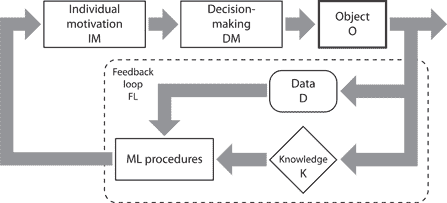

Figure 1.1

个体动机（`IM`）构成了决策过程（`DM`）的基础，该过程聚焦于所研究对象（`O`）或问题的演化。这导致对象中出现信息，特别是以新数据（`D`）的形式出现，新数据补充了对其的现有知识（`K`）。让我们接受一个“大胆”的假设，即动机建立在个体积累的知识之上。在后续内容中，知识将被解释为一种抽象的智力基础，其中包括功利理解上的知识、作为大脑皮层下过程产物直觉、个人和公共经验、关于对象的数据等等。然而，知识是一种被动物质，本身不会激活动机。利用知识，有必要形成世界图景，即为决策建模当前情况。模型源于现有数据与个体对其情况特征的信念的结合。代表动机原因因素的情况是一组模型的某些可测量特征（*参数*）及其之间的关系。

为了根据可用数据对模型进行定量描述，模型参数必须进行 *估计*。在这种情况下，可以解决不同的问题并预测其未来趋势。`M`→`D` 循环的反馈回路由机器学习（`ML`）程序实现，该程序具有设计定量模型和组织动机决策信息支持所需的工具包。

因此，`ML` 程序在 `M`→`D` 转换中找到了方法论、算法和信息技术层面的内容，如 图 1.1 所示。

从一开始就请注意，这一逻辑链条仅仅是本专著中富有成效的动机机制的一个版本，并不声称具有普遍价值。

作为一个例子，似乎很合适考虑用于个体交通行为建模的 `M`→`D` 程序 \[125\]。实现这种行为的众多行为实际上构成了城市交通网络中的交通流。

在这里，将分析交通行为的两个方面，即个体行为和集体行为。前者基于个体对交通工具、出行目标和路线的动机。这些动机可以与出行时间、成本、舒适度水平和其他特征相关。存在众多影响个体动机的因素。它们可以针对每个个体而具体。因此，个体动机的环境本质上是不确定的。

另一方面，交通工具使用者（包括私人交通和公共交通）非常多，他们的动机和交通决策是独立的。因此，随机框架适合于模拟相应的不确定性。实际上，我们无法追踪每个个体的动机和决策，但可以通过个体动机的某些指标来表征其集体动机。由于不确定性模型的随机性，这些特征是概率性的，更具体地说，是交通事件的概率分布函数。交通事件的广泛指标是出行时间。就该指标而言，集体动机由所谓的再安置函数表征，该函数描述了个体按出行时间的分布。经过归一化后，该函数可以被视为出行时间利用的概率分布函数。

上述指标反映了某些平均个体固有的集体动机。但它们与对当前交通状况的真实评估及其预测无关。然而，前者和后者是交通决策的不可分割的组成部分。不可能为每个个体考虑这些组成部分的程序部分。我们只能研究集体决策，例如路线的选择。如果从某个地点存在一组有限的可接受路线，则路线选择的概率可以是估计和预测的聚合结果。

`M`→`D` 程序的另一个例子是人口与经济在人口经济系统中的相互作用过程（图 1.2(a)–c）。由于智力，人口是自我发展的工具，这导致了不同类型人类活动的产生。经济活动代表其中一种类型。据假设，经济动机个体是自我发展的主要工具。

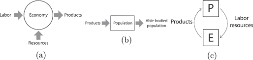

Figure 1.2

参与经济活动，人口依赖于其结果。评估经济状况和预测决策可能后果在这个过程中发挥关键作用。人口的内部状态也会相应改变。

存在一种包含人口和经济活动的闭环，其中包含评估、预测和反馈。请注意与动机和决策相互作用程序的明显类比；参见 图 1.1 中的结构图。

经济作为宏观对象将资源转化为产品（见 图 1.2(a)）。劳动，即人们在经济领域的劳动活动，是资源。经济生产并被人口消费的某种产品（以某种形式，见 图 1.2(b)）改变了人口的结构——其内部聚类和定量形式，以及群体的状态。结果，其他不同规模的群体在发展的新螺旋中参与经济过程。


因此，可以谈论一个整体的人口-经济（`PE`）系统，该系统由人口（`P`）子系统和经济（`E`）子系统组成，二者形成闭环，如图 1.2(c)所示。对该整体系统进行分析的一个重要领域涉及情势评估（状态估计）和预测，即随时间推移的演化。对每个子系统，这些问题由相应的科学研究。例如，人口的结构动态是宏观人口学的主题。一大批经济学科（政治经济学、宏观和微观经济学、数理经济学等）研究经济结构的形成和演化。注意，影响人口子系统中不同过程的经济因素在宏观人口学中被视为与元系统影响相关的外部因素。实际上，在经济学科中也出现了类似的情况。经济子系统的行为是在人口子系统再生产一定数量和结构的劳动资源这一条件下研究的。

特别地，人口学研究的一个流行方向是在给定的经济情景下预测人口状态指标，该情景以定量形式描述[40]。而且，这些情景反映了某些经济目标，这些目标（通常）与预测期内人口的潜在变化无关。但这些变化会显著影响要实现经济发展的指标。上述反馈关系客观存在，试图忽视它往往会导致无法实现的预测。

另外，请注意该对象的另一个特点，该对象使用 `ML` 程序进行估计和预测。其每个部分都有内部行为（在没有元系统影响的情况下）和受扰行为（在元系统施加的某些影响下）。在此背景下，我们指的是状态（平衡、循环、吸引子等）、其稳定性和其他属性。然而，当人口和经济子系统联合成一个整体系统时，后者可能获得与这些部分初始属性不同的新属性。这种系统效应特别体现在每个子系统内部存在非线性关系的情况下，以及一个子系统影响另一个子系统的通道中存在非线性的情况下。结果，整体系统可能具有其他平衡以及其他非平衡过程。对于这样的系统，状态估计和预测实际上不是一个平凡的问题。这里由于环境的不确定性水平很高而出现了额外的困难，对于单独的子系统以及整个系统都是如此。这种不确定性的来源是个体，即两个子系统的主要组成部分，具有其动机、社会和职业特征以及行为反应。

因此，似乎这里的情况与之前的例子相似。人口-经济系统无法复制，即在该系统中运行的内部过程即使在相同的操作条件下也不会重复。该系统是自发展的，这排除了其过程的真实重复性。因此，伴随人口-经济系统运行的不确定性是通过使用可用信息进行参数估计的仿真模型再现的。

## 1.2 机器学习程序的结构

嵌入 `ML` 程序中的方法和算法相当多样。然而，它们都具有相同的 methodological 方向和结构。后者被理解为将知识转化为信息决策支持的功能阶段序列。该程序的结构如图 图 1.3 所示。该程序包括以下四个阶段。

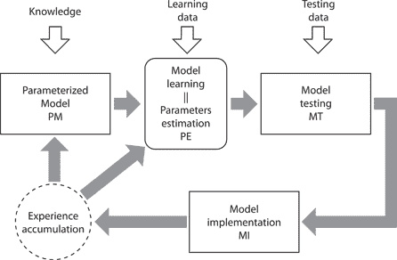

Figure 1.3

第一阶段（`PM`）在于开发一个数学模型，该模型描述所研究对象的运行机制及其输入输出的测量模型。对象的数学模型将其知识转化为具有明确特征列表的结构。该阶段不能在如此一般的陈述中被形式化。然而，通常存在关于对象类别和需要使用数学框架建模的问题的先验信息。这里“类别”是指具有一组共同属性的对象或问题的集合。如果该集合已知，则可以为相应类别构建概念模型[68]。这样的模型由相互关联的概念列表组成，这些概念描述了给定类别，连同这些概念的属性、特征和分类。概念建模的一个重要组成部分是反映给定类别对象内部运行过程的规律性[16]。换句话说，概念模型系统化和结构化了关于所研究对象类别和问题的现有知识。形成此类类别是一个非平凡的问题，其复杂性本质上取决于其描述中的抽象程度。例如，系统总论操作抽象集合及其关系（分层系统、反馈等）[119]。通过这种描述性方法产生的类别具有相当高的能力（因为它们包含了大量系统），但其概念模型通常是不可构造的。相反，任何试图向抽象类别添加特定属性的尝试都会降低新类别的能力，尽管在构造性意义上会产生更好的概念模型。一个很好的例子是受控技术系统类别[91]。

在大多数情况下，概念模型表示一个图，其中节点对应于其功能元素，弧对应于它们之间的相互关系。事实上，这种对概念模型的理解首次在[54]中引入。进一步复杂化和更深入地具体化不同系统类别固有的属性，勾勒出向更有效的描述的逐渐过渡，即称为本体[169]的专门结构化列表。尽管如此，图形和本体对类别的描述仍保留在功能元素的水平上。这些元素使用各种数学工具进行描述，具体取决于其运行机制中嵌入的规律性以及其特征。在 `parametric characteristics` 的情况下，元素的数学模型是函数关系（用于描述静态元素）或不同类型的微分方程系统（用于描述动态元素）[50, 161]。一种相当有效的静态关系参数化方法涉及神经网络[96]。这些模型的基本元素和参数调优算法的相对简单性使得神经网络能够用于高维空间。

有时，为方便起见，对象的动态使用具有 `functional characteristics` 的数学模型来描述。例如，该类别包括由积分方程或函数级数定义的模型[111, 137, 146, 152]。在这些模型中，函数特征由积分方程的核或函数级数扮演。


对于有限状态对象，合适的模型是自动机 [72, 107]、非线性顺序机 [18, 177]，以及按照一定规则运行的动态智能系统 [126]。

本阶段的一个重要要素是对测量进行建模。对象的输入和输出的实际测量包含误差，因此有必要以某种方式模拟它们。根据标准假设，独立随机过程是对测量误差来源的相当充分的模拟模型。存在两种对误差对对象模型可观测输出影响的结构表示，即加性和乘性。适当表示的选择取决于用于测量对象输出和输入的设备的设计特性。

`ML` 过程的第二阶段 (`PE`) 用于利用作为 *learning* 序列生成的真实数据来估计数学模型的特征。事实上，该阶段可以用众多方法实现。如果模型特征是不确定参数，则相应的估计方法构成了数理统计 [11, 34, 90] 的研究对象。当数学模型具有函数特征时，例如积分方程的核或函数级数的脉冲响应特征，就会产生日益复杂化的估计问题。当然，在这种情况下可以对估计问题进行有限维近似。但这种方法往往导致所得近似的维数很高，从而需要更大的关于对象运行的数据量。

`ML` 过程将估计问题视为相对于模型相应特征，即参数或函数，经验风险泛函的最小化。这里“经验”一词意味着该泛函是为学习序列设计的。对对象输入和输出的数据包赋予了重要作用。在模型特征固定的情况下，输入数据用于生成其输出，然后在经验风险泛函方面与真实输出进行比较。该泛函取决于模型特征，因此其变化也会影响泛函的值。经验风险最小化产生模型特征的估计。这样计算出的模型及其特征对于所考虑的学习序列和泛函是 *optimal* 的。

在 `ML` 过程的第三阶段 (`MT`) 中，优化的“学习”模型在其他回顾性输入和输出数据包上进行测试。测试在于根据所接受的准则，将对象的真实输出与优化模型生成的输出进行比较。如果优化模型在测试数据包上表现出令人满意的质量水平，则该模型可在正常运行模式下使用。

`ML` 过程的最后一个（第四）阶段（`MI` 阶段）旨在积累经验，即为 `PM` 阶段的参数化模型的结构修正以及为 `PE` 阶段的估计算法的改进提供新的知识。

请注意，该过程在不确定性下运行，该不确定性由对所研究对象及其数学模型的有限知识、包含对象运行信息的有限大小的学习序列、测量误差等引起。因此，`ML` 过程的每个阶段都基于关于不确定性性质的某些假设。

## 1.3 机器学习过程的主要概念

如 `Fig. 1.3` 中的框图所示，`ML` 过程由四个阶段组成，即模型的选取和参数化（`PM` 阶段）；形成输入（原因）和输出（效应）数据阵列并使用这些阵列估计模型参数（`PE` 阶段）；形成用于优化模型测试的数据阵列（`MT` 阶段）；以及生成优化模型（`MI` 阶段）。

如前所述，第一阶段——*模型的选取和参数化*——是非形式化的，仅涉及对所研究对象、现象或问题的可用知识。该选择给出 *n* 维输入向量 $\overset{\rightarrow}{x}(t) \in \mathfrak{X},$ 的元素，其中 𝔛 表示输入函数空间，以及 *m* 维输出向量 $\overset{\rightarrow}{y}(t) \in \mathfrak{Y},$ 的元素，其中 𝔜 表示输出函数空间；*t* 是标量参数。

这些向量的元素可以在连续时间 *t* ∈ 𝒯 = [*t*[0], *T*] 中测量，也可以在离散时间中以任意步长 $\left\{ t_{0},t_{1},\ldots,t_{s} \right\} \in \widetilde{\mathcal{T}},$ 测量，或以固定步长 *h* $\left\{ t_{0},t_{0} + h,\ldots,t_{0} + sh \right\} \in {\widetilde{\mathcal{T}}}_{h}.$ 暂时考虑最后提到的测量方案，它产生输入和输出数据的二维阵列，其大小分别为 (*n* × *s*) 和 (*m* × *s*)，即

$$
\begin{array}{r} {\mathbb{X} = \left\{ {\overset{\rightarrow}{x}}^{(0)},\ldots,{\overset{\rightarrow}{x}}^{(s)} \right\},\quad\quad\mathbb{Y} = \left\{ {\overset{\rightarrow}{y}}^{(0)},\ldots,{\overset{\rightarrow}{y}}^{(s)} \right\}.} \\ \end{array}
$$

(1.1)

此外，定义以下包含当前 *ϱ* 个测量向量的输入阵列：

$$
\begin{array}{r} {\mathbb{X}_{\varrho}^{(j)} = \left\{ {\overset{\rightarrow}{x}}^{(j - \varrho)},{\overset{\rightarrow}{x}}^{(j - \varrho + 1)},\ldots,{\overset{\rightarrow}{x}}^{(j)} \right\},\quad\quad\varrho \leq j \leq s.} \\ \end{array}
$$

(1.2)

在第一阶段，还使用向量泛函 *Ω̂* 的相当一般描述来选择具有参数 $\overset{\rightarrow}{a} \in R^{p}$ 的模型，该泛函将输入空间 𝔛 映射到输出空间 $\hat{\mathfrak{Y}}$ 如下：

$$
\begin{array}{r} {{\hat{\overset{\rightarrow}{y}}}^{(j)}(\mathbb{X}_{\varrho}^{(j)},\overset{\rightarrow}{a}) = \hat{\Omega}\left( {\mathbb{X}_{\varrho}^{(j)},\overset{\rightarrow}{a}} \right).} \\ \end{array}
$$

(1.3)

在此表达式中，变量 *ϱ* 是影响输出向量的输入向量的数量。如果 𝜚 > 0，则所考虑的泛函表征所研究对象、现象或问题的动态特性，即某种意义上的“记忆”。在 𝜚 = 0 的情况下，模型在第 *j* 次观测（测量）中的输出仅取决于第 *j* 次观测（测量）中的输入向量。这种关系对于静态对象、现象或问题是典型的。

模型 (1.3) 的参数 $\overset{\rightarrow}{a}$ 被假定为 *deterministic* 但值未知。这些值是利用 `ML` 算法基于可用数据和关于其先验性质的某些假设来估计的。`ML` 算法执行某些泛函的最小化，这些泛函具有定性解释，并源自所接受的假设。请注意，无论选择何种泛函，`ML` 算法都为模型的确定性特征产生估计。

其中一种假设将数据和参数视为实数或整数的 *deterministic* 集合，而不对它们的性质做出额外假设。然后，模型参数的最优估计以 *vector loss function* 的形式进行


$$\\begin{array}{r} \\left. {\\overset{\\rightarrow}{e}}^{(j)}(\\overset{\\rightarrow}{a}\\, \\middle| \\, X^{(j)},{\\overset{\\rightarrow}{y}}^{(j)}) = {\\overset{\\rightarrow}{y}}^{(j)} - {\\hat{\\overset{\\rightarrow}{y}}}^{(j)}(X^{(j)},\\overset{\\rightarrow}{a}),\\quad j = \\overline{1,s}, \\right. \\\\ \\end{array}$$  

(1.4)

and the closeness of the PM output to the output data of the object is characterized by its norm known as *the empirical risk*, i.e.,

$$\\begin{array}{r} \\left. \\mathcal{Q}\_{X,Y}(\\overset{\\rightarrow}{a}) = \\frac{1}{s}{\\sum\\limits\_{j = 1}^{s}{\\|{\\overset{\\rightarrow}{e}}^{(j)}(}}\\overset{\\rightarrow}{a}\\, \\middle| \\, X^{(j)},{\\overset{\\rightarrow}{y}}^{(j)})\\|. \\right. \\\\ \\end{array}$$  

(1.5)

The empirical risk minimization methods are defined by the family of ML algorithms [53, 106, 188] in which

$$\\begin{array}{r} {\\hat{\\overset{\\rightarrow}{a}}(X,\\overset{\\rightarrow}{y}) = \\arg\\min\\mathcal{Q}\_{X,Y}(\\overset{\\rightarrow}{a}).} \\\\ \\end{array}$$  

(1.6)

An additional hypothesis about the properties of the data and parameters often lies in the assumption that the data *Z* = (*X*, *Y*) and the parameters $\\overset{\\rightarrow}{a}$ are *random objects* with a joint probability density function $P(Z,\\overset{\\rightarrow}{a}).$ Here *Z* denotes the universe of data and $\\overset{\\rightarrow}{a}$ is a random vector. In this case, the observable data arrays represent samples *Z*^((*j*)) from the universe *Z*. Note that each of them is random and independent with the PDF $P(Z^{(j)},\\overset{\\rightarrow}{a}).$

The joint probability density function

$$\\begin{array}{r} {L(Z^{(1)},\\ldots,Z^{(s)};\\overset{\\rightarrow}{a}) = {\\prod\\limits\_{j = 1}^{s}P}(Z^{(j)},\\overset{\\rightarrow}{a})} \\\\ \\end{array}$$  

(1.7)

is called the *likelihood* function for a sample {*Z*^((1)),…,*Z*^((*s*))} [41, 51]. Under a fixed sample, the likelihood function depends on the parameter $\\overset{\\rightarrow}{a}.$ A quite natural estimate of this parameter is the vector that maximizes the likelihood function. Instead of the likelihood function, a convenient approach is to use its logarithm *L̃* = log *L*, i.e.,

$$\\begin{array}{r} {\\hat{\\overset{\\rightarrow}{a}}(Z^{(1)},\\ldots,Z^{(s)}) = \\arg\\max\_{\\overset{\\rightarrow}{a}}\\widetilde{L}(Z^{(1)},\\ldots,Z^{(s)};\\overset{\\rightarrow}{a}).} \\\\ \\end{array}$$  

(1.8)

The hypothesis about the random origin of the pair (*Z*, $\\overset{\\rightarrow}{a}$) also has another interpretation related to the accumulation of information about this pair during experiments. Here, we mean its characteristics expected *before experiments* and the real characteristics obtained *after experiments*. To describe this evolution, Bayes suggested the concept of conditional probability, distinguishing between the *prior* and *posterior* probabilistic characteristics of the data and parameters. As a result, the posterior conditional probability density function (or simply posterior conditional density) $\\left. p({\\mathbb{Z}}\\, \\middle| \\,\\overset{\\rightarrow}{a}) \\right.$ of data under fixed parameters, the prior conditional probability density function $\\left. w(\\overset{\\rightarrow}{a}\\, \\middle| \\,{\\mathbb{Z}}) \\right.$ of parameters under fixed data, and the prior probability density function *g*(ℤ) were introduced accordingly. They have a clear relation defined by Bayes' formula

$$\\begin{array}{r} \\left. p({\\mathbb{Z}}\\, \\middle| \\,\\overset{\\rightarrow}{a}) = \\frac{\\left. w(\\overset{\\rightarrow}{a}\\, \\middle| \\,{\\mathbb{Z}})g({\\mathbb{Z}}) \\right.}{\\left. {\\int\\limits\_{\\mathbb{Z}}w}(\\overset{\\rightarrow}{a}\\, \\middle| \\,{\\mathbb{Z}})g({\\mathbb{Z}})d{\\mathbb{Z}} \\right.}. \\right. \\\\ \\end{array}$$  

(1.9)

The posterior conditional density maximization methods are defined by the family of Bayesian ML algorithms

$$\\begin{array}{r} \\left. \\hat{\\overset{\\rightarrow}{a}}({\\mathbb{Z}}) = \\max\_{\\overset{\\rightarrow}{a}}p({\\mathbb{Z}}\\, \\middle| \\,\\overset{\\rightarrow}{a}). \\right. \\\\ \\end{array}$$  

(1.10)

Both of the families (1.8, 1.10) employ the joint probability density functions of the data and parameters under the accepted hypotheses about the probabilistic properties of random objects.

## 1.4 Principles of Randomized Machine Learning Procedure

The RML concept rests on two principles as follows. The first principle is the computer simulation principle for the *ensembles* of randomized decisions, vectors or trajectories caused by uncertainty. In other words, the existing uncertainty is compensated through the generation of an *ensemble* of decisions, vectors or trajectories. However, it is desirable to generate *optimal* ensembles in a certain sense, not any ensembles. This leads to the second principle known as the optimization principle for the generated ensembles, which *maximizes information entropy*.

The following examples illustrate the new properties arising in the randomized models.

Summarizing the aforesaid, one of the implementation principles of the RML concept lies in the generation of the ensembles of random events (decisions, vector or trajectories) with desired probabilistic characteristics. They are generated using the model (1.3) with the randomized parameters **a** obeying a desired PDF. In other words, it is necessary to generate an ensemble of the random vectors **a** with given PDFs.

The second fundamental principle of the RML concept is the optimization principle of the randomized model adopted to calculate the optimal PDFs of the model parameters. Here an important stage consists on the choice of an appropriate quality functional. In our case, this (often debatable) question has a well-justified answer. As emphasize earlier, the RML concept is a tool to obtain best decisions under maximum uncertainty. Recall that the uncertain knowledge about an object under study is described by randomized model parameters, uncertain data by additional noises and uncertain estimates by probability density functions.

In the sequel, **the information entropy functional** will be used to characterize the quality of a randomized model. The maximum of this entropy corresponds to the highest uncertainty of our knowledge about the object and noises intrinsic to measured data. An interpretation of information entropy as a measure of uncertainty (with the minus sign, as a measure of information) was first suggested by C. Shannon in his pioneering paper [165], which motivated intensive research in mathematics, statistical thermodynamics, communication theory and other fields of science. A next surge of interest in information entropy is related to the name of E. Jaynes [80], who proved that the entropy maximization principle yields best solutions under maximum uncertainty. In particular, this principle allows to find best solutions under the worst-case probabilistic characteristics of data measurement noises [66, 88, 109, 141, 153, 157]. This feature of the information entropy maximization principle is treated as the “entropy”-robust property of the resulting solutions.

# CHAPTER 2 DATA SOURCES AND MODELS

DOI: [`10.1201/9781003306566-2`](https://doi.org/10.1201/9781003306566-2)


对于机器学习流程，数据很重要，如其来源、充分性程度（测量误差）、体积、属性和特征。我们将数据理解为与特定时间相关联的数字集合，并以适当的属性组织在数组中。如果数据源不是自然起源的（例如，模拟示波图），则数据必须转换为结构化的数值数组。

尽管 ML 流程涉及数值数据，但在许多情况下，考虑描述数据样本的函数的一般属性的信息是有用的。数据的特征与这些数据中测量的源对象的状态密切相关。存在模拟和数字数据源。

模拟源的特征是连续自变量的函数。它们使用模拟传感器测量，并且大多表示空间分布对象的时域和/或空域函数。此类函数及其共同属性的类别会产生从中抽取的样本的一些属性。

数字源包含数字传感器，其输出所有测量的数据，具有幅度（电平）和时间量化。一种特殊情况是二进制数字源，其中数字量化器只有两个电平， resulting 数据表示与离散时间相关联的零和一的序列。

根据进一步的使用，数据可以从一个类别转换到另一个类别。例如，模拟数据使用模数转换器（`ADCs`）转换为数字数据，以便进一步进行计算机处理。有时，有必要将数字数据转换为模拟数据，这由数模转换器（`DACs`）执行。此类转换器在音频、视频和图形数据处理领域得到广泛应用。

一个关键问题在于数据的充分性和自变量完整性。如果自变量是时间，则完整的数据包含固定时间区间上所有时间的数字。数据充分性与测量误差有关，这些误差通常由具有适当属性的随机误差描述。

## 2.1 模拟数据源

模拟源是测量系统（模拟传感器），即一种换能器，它将真实过程的某个指标变换为标量函数 `x(t)` 或向量函数 `x→(t)`，该函数定义在时间区间 `𝒯 = [t[0], T]` 上；该区间内的时间 `t` 为实数。模拟传感器的一些示例包括测量速度的转速表、测量加速度的加速度计、测量物质光谱组成的光谱仪等。

### 2.1.1 确定性函数

首先，简要考虑确定性函数的一般属性。

1. 恒等公理：`ρ𝒯 = 0` 仅当 `t[i] = t[j]`。

2. 对称公理：`ρ𝒯 = ρ𝒯`。

3. 三角公理：`ρ𝒯 + ρ𝒯 ≥ ρ𝒯`，其中 `t[i] < t[j] < t[k]`。

这样的函数总可以在时间区间 `𝒯` 上定义。因此，`𝒯` 构成一个度量空间。该度量空间（实数）当然非常简单。然而，标量和向量函数的度量空间可以通过类比构造。元素 `t*` 是序列 `t[0], t[1], …` 的极限，如果 `ρ(t[n], t*) → 0` 当 `n → ∞`。

考虑两个度量空间 `𝒴` 和 `𝒯`，以及取值于 `𝒴` 的函数 `y = x(t)`。函数 `x(t)` 被称为 *在点 `t* ∈ 𝒯` 处连续*，如果对于任意 `ε > 0` 存在 `δ > 0`，使得对于满足不等式 `ρ𝒯 < δ` 的任意其他点 `t ∈ 𝒯`，都有 `ρ𝒴, x(t*)) < ε`。根据连续函数 `x(t)` 的定义，收敛 `t[n] → t*` 蕴含收敛 `x(t[n]) → x(t*)`。

如果此性质适用于 `𝒯` 中的所有点 `t`，则相应的函数 `x(t)` *在 𝒯 上一致连续*。用 `C((0))` 表示所有这些函数的类。

连续性（和一致连续性）可以推广到函数 `x(t)` 的导数，前提是它们存在。相应地，产生具有确定光滑程度的 *光滑函数* 的类。光滑程度是给定类函数存在的导数的最大阶数。例如，类 `C((1))` 包含连续可微函数（一阶导数），而类 `C((r))` 包含 `r` 阶导数。记为 `C((∞))` 的光滑函数的重要子类由 *解析函数* 组成，它们在其定义域上可无限次微分。特别地，在时间区间 `𝒯` 上定义的解析函数 `x(t)` 在该区间上具有无限多个导数 `x((k))(t), k = 1, 2, ...`。在区间 `𝒯` 的任意点 `t[0]` 处，它可以展开为一致收敛的泰勒级数：

$$
\begin{array}{r}
{x(t) = x(t_{0}) + \left. ~{\sum\limits_{i = 1}^{\infty}\frac{d^{i}x(t)}{dt^{i}}} \right|_{t_{0}}{(t_{0} - t)}^{i},\quad t_{0} \in \mathcal{T}.}
\\
\end{array}
$$

(2.1)

可以为连续性这一函数的定性属性赋予某种定量特征。更具体地说，可以引入所谓的 *连续模*

$$
\begin{array}{r}
\left. \omega(h) = \max_{|t_{i} - t_{j}| \leq h} \middle| x(t_{i}) - x(t_{j}) \middle| . \right.
\\
\end{array}
$$

(2.2)

如果函数 `x(t)` 的连续模为

$$
\begin{array}{r}
{\omega(h) \leq Hh^{s},\quad(H,s) \geq 0,}
\\
\end{array}
$$

(2.3)

则它属于连续 Hölder 函数，其中 `H` 和 `s` 为 Hölder 常数。

如果函数 `x(t)` 的连续模为

$$
\begin{array}{r}
{\omega(h) \leq Lh,\quad L \geq 0,}
\\
\end{array}
$$

(2.4)

则它属于连续 Lipschitz 函数，其中 `L` 为 Lipschitz 常数。

任何函数的一个重要特征是其在时间区间 `𝒯` 上的变差，更具体地说，这种变差是有限还是无限。变差有限的函数构成有界变差函数类。为了定义此性质，考虑时间区间 `𝒯` 的任意划分，划分为有序点序列 `t[0], t[1], …, t[n]` 以及函数 `x(t)` 在这些点处的增量（减量）。如果

$$
\begin{array}{r}
\left. \left. \sum\limits_{i = 0}^{n} \right|x(t_{i + 1}) - x(t_{i}) \middle| = X_{\mathcal{T}} < + \infty \right.
\\
\end{array}
$$

(2.5)

对于 `𝒯` 上的任意点序列成立，则 `x(t)` 属于 *有界变差* 函数类。值 `X[𝒯]` 称为函数 `x(t)` 在时间区间 `𝒯` 上的全变差。

有界变差函数类包括具有额外属性的函数。例如，连续函数和具有任意光滑程度的函数都属于有界变差函数类。如果函数 `x(t)` 是单调的，即表达式

$$
\begin{array}{r}
\frac{x(t_{i}) - x(t_{j})}{t_{i} - t_{j}}
\\
\end{array}
$$

对于 `𝒯` 中的任意 `t[i], t[j]` 具有相同符号或为零，则它属于有界变差函数类，其总导数为 `X[𝒯] = x(T) − x(t[0])`。请注意，所考虑的类还包含具有跳跃（简单）间断的函数。

用于研究上述函数类的属性并生成与之相关的合理的离散数据集的不同近似方法。近似方法操作近似质量泛函和来自给定类的近似函数 `xa` 的基本概念。以下泛函被广泛使用：

* Chebyshev 泛函


$$\\begin{array}{r} \\left. C = \\max\_{\\mathcal{T}} \\middle| x(t) - x\_{a}(t) \\middle| ; \\right. \\\\ \\end{array}$$  

(2.6)

*   积分二次泛函

$$\\begin{array}{r} \\left. J\_{2} = \\left. \\int\\limits\_{\\mathcal{T}} \\right|x(t) - x\_{a}(t) \\middle| {}\_{2}dt; \\right. \\\\ \\end{array}$$  

(2.7)

*   归一化积分二次泛函

$$\\begin{array}{r} {\\Delta\_{2} = \\frac{\\left. \\left. \\int\\limits\_{\\mathcal{T}} \\right|x(t) - x\_{a}(t) \\middle| {}\_{2}dt \\right.}{{\\int\\limits\_{\\mathcal{T}}x^{2}}(t)dt + {\\int\\limits\_{\\mathcal{T}}x\_{a}^{2}}(t)dt}.} \\\\ \\end{array}$$  

(2.8)

与离散数据有直接关系的初等逼近函数是分段常数函数，也称为阶梯函数

$$\\begin{array}{r} {x\_{c}(t) = \\left\\{ \\begin{aligned} {x(t\_{0})} & {\\text{for}\\, t\_{0} \\leq t < t\_{0} + h,} \\\\ {x(t\_{0} + h)} & {\\text{for}\\, t\_{0} + h \\leq t < t\_{0} + 2h,} \\\\ \\cdots & \\cdots \\\\ {x(t\_{0} + (n - 1)h)} & {\\text{for}\\, t\_{0} + (n - 1)h \\leq t < T.} \\\\ \\end{aligned}~ \\right.} \\\\ \\end{array}$$  

(2.9)

作为其参数，阶梯函数包含采样时间 `h`，其可以根据泛函 (2.6)–(2.8) 的可接受值来选择。对于某些函数类，例如连续或光滑函数，阶梯函数具有渐近行为的有益性质，

$$\\begin{array}{r} {\\lim\\limits\_{h\\rightarrow 0}x\_{c}(t) = x(t).} \\\\ \\end{array}$$  

(2.10)

请注意，此极限根据对应函数 `x(t)` 的性质进行解释。

### 2.1.2 随机函数

模拟源可能产生随机起源的函数。遵循 [65]，将采用两个密切相关的概念，即 *随机函数 `x(t)` (随机向量函数 $\\overset{\\rightarrow}{x}(t))$* 和 *随机过程 `X(t)` (向量随机过程 $\\overset{\\rightarrow}{X}(t))$*。过程表示随机函数 `x(t)` 的集合。在某些条件下，在某种意义上可观测的随机过程称为该随机函数的 *样本*（样本函数）或 *实现*。下面将考虑标量函数。

对于固定的 `t`，`x(t)` 给出随机变量的一个值，而 `X(t)` 给出该随机变量值的集合。随机函数完全由任意有限组随机变量值的全部可能概率论关系定义：

$$\\begin{array}{r} {x(t\_{1}),x(t\_{2}),\\ldots,x(t\_{n}),\\quad t\_{i} \\in \\mathcal{T},\\, i = \\overline{1,n},\\, n = 1,2,\\ldots,} \\\\ \\end{array}$$  

(2.11)

即，由相应的概率分布定义。换句话说，随机函数 `x(t)`，`t` ∈ 𝒯，由相应的分布族描述

$$\\begin{array}{r} {P\_{t\_{1},\\ldots,t\_{n}}(\\eta\_{1},\\ldots,\\eta\_{n}),\\text{\\quad\\quad}t\_{i} \\in \\mathcal{T},\\, i = \\overline{1,n},\\, n = 1,2,\\ldots,} \\\\ \\end{array}$$  

(2.12)

其中 `η[1]`，…，`η[n]` 表示随机变量的值。

每个概率分布函数被视为随机变量集合 (2.11) 的联合概率分布函数。这种处理在某些必要条件下是合理的，即所谓的分布族 (2.12) 的 *相容性条件*，由下式给出

$$\\begin{aligned} {P\_{t\_{1},\\ldots,t\_{n},t\_{(n + 1)},\\ldots,t\_{(n + p)}}(\\eta\_{1},\\ldots,\\eta\_{n},} & {+ \\infty,\\ldots, + \\infty) = P\_{t\_{1},\\ldots,t\_{n}}(\\eta\_{1},\\ldots,\\eta\_{n});} \\\\ {P\_{t\_{1},\\ldots,t\_{n}}(\\eta\_{1},\\ldots,\\eta\_{n})} & {= P\_{t\_{i\_{1}},\\ldots,t\_{i\_{n}}}(\\eta\_{i\_{1}},\\ldots,\\eta\_{i\_{n}}),} \\\\ \\end{aligned}$$  

(2.13)

其中 `i[1]`，…，`i[n]` 构成索引 1, 2, …, `n` 的任意排列。

函数集 `P[t[1], …, t[n]](η[1], …, η[n])` 称为随机函数 `x(t)` 的 *有限维分布*。

应用中通常涉及多个随机函数，下面将其视为随机向量 $\\overset{\\rightarrow}{x}(t) = \\left\\{ x\_{1}(t),\\ldots,x\_{m}(t) \\right\\}$ 的元素。随机向量完全由以下形式的有限维概率分布族定义

$$\\begin{aligned} {P\_{t\_{1},\\ldots,t\_{n}}(\\eta\_{11},} & {\\eta\_{12},\\ldots,\\eta\_{nm}) = \\mathbf{P}\\left\\{ x\_{1}(t\_{1}) < \\eta\_{11},x\_{2}(t\_{1}) < \\right.} \\\\ & {\\left. < \\eta\_{12},\\ldots,x\_{m}(t\_{n}) < \\eta\_{nm} \\right\\}.} \\\\ \\end{aligned}$$  

(2.14)

随机函数 `x(t)` 的有限维概率分布可以通过有限维概率密度函数 `w[t[1], …, t[n]](η[1], …, η[n])` 定义：

$$\\begin{array}{r} {P\_{t\_{1},\\ldots,t\_{n}}(\\eta\_{1},\\ldots,\\eta\_{n}) = {\\int\\limits\_{- \\infty}^{\\eta\_{1}}\\cdots}{\\int\\limits\_{- \\infty}^{\\eta\_{n}}\\,}w\_{t\_{1},\\ldots,t\_{n}}(y\_{1},\\ldots,y\_{n})dy\_{1}\\cdots dy\_{n}.} \\\\ \\end{array}$$  

(2.15)

特别地，这意味着公式

$$\\begin{aligned} {w\_{t\_{1},\\ldots,t\_{n}}(\\eta\_{1},\\ldots,\\eta\_{n})} & {= {\\int\\limits\_{- \\infty}^{\\infty}\\cdots}{\\int\\limits\_{- \\infty}^{\\infty}w\_{t\_{1},\\ldots,t\_{n},t\_{(n + 1)},\\ldots,t\_{(n + p)}}}(\\eta\_{1},\\ldots,} \\\\ & {\\eta\_{n},y\_{1},\\ldots,y\_{p})dy\_{1}\\cdots dy\_{p},} \\\\ \\end{aligned}$$  

(2.16)

其可视为有限维概率分布的相容性条件 (2.1.2)。

分析有限维概率密度函数（或分布）的有用工具是其 *特征函数 `Φ[t[1], …, t[n]](u[1], …, u[n])`*，其表示概率密度函数的傅里叶变换 [48]：

$$\\begin{aligned} {\\Phi\_{t\_{1},\\ldots,t\_{n}}(u\_{1},\\ldots,u\_{n})} & {= {\\int\\limits\_{- \\infty}^{\\infty}\\cdots}{\\int\\limits\_{- \\infty}^{\\infty}\\exp}\\left( {j{\\sum\\limits\_{k = 1}^{n}\\eta\_{k}}\\, u\_{k}} \\right) \\times} \\\\ {\\times w\_{t\_{1},\\ldots,t\_{n}}} & {(\\eta\_{1},\\ldots,\\eta\_{n})\\, d\\eta\_{1}\\cdots d\\eta\_{n},} \\\\ & {j = \\sqrt{- 1}.} \\\\ \\end{aligned}$$  

(2.17)

变量 `u[1]`，…，`u[n]` 取值于空间 `R^(n)`。如果概率密度函数满足某些解析条件（见 [48]），则可通过傅里叶积分利用其特征函数恢复如下：

$$\\begin{aligned} {w\_{t\_{1},\\ldots,t\_{n}}(\\eta\_{1},\\ldots,\\eta\_{n})} & {= \\frac{1}{{(2\\pi)}^{n}}{\\int\\limits\_{- \\infty}^{\\infty}\\cdots}{\\int\\limits\_{- \\infty}^{\\infty}\\exp}\\left( {- {\\sum\\limits\_{k = 1}^{n}\\eta\_{k}}\\, u\_{k}} \\right) \\times} \\\\ & {\\times \\Phi\_{t\_{1},\\ldots,t\_{n}}(u\_{1},\\ldots,u\_{n})\\, du\_{1}\\cdots du\_{n}.} \\\\ \\end{aligned}$$  

(2.18)

这些随机函数的定义足以满足我们对随机函数在 `n` 个点处的值感兴趣的情况，即自变量 (`t[1]`, …, `t[n]`) ∈ 𝒯 的值。然而，如果集合 𝒯 包含时间 `t` 的所有实值，则即使任意多个形式的有限维概率分布 (2.12, 2.1.2) 也无法说明随机函数的构造性质，如连续性、可微性等。

在某些应用中，随机函数以有限维概率分布形式完成的完整描述变得冗余。只需要知道其数值特征——矩函数

$$\\begin{array}{r} {m\_{i\_{1},\\ldots,i\_{s}}(t\_{1},\\ldots,t\_{s}) = \\mathcal{M}{\\prod\\limits\_{k = 1}^{s}\\left\\lbrack {x(t\_{k})} \\right\\rbrack^{i\_{k}}},\\quad i\_{k} \\geq 0,\\,\\, k = \\overline{1,s}.} \\\\ \\end{array}$$  

(2.19)


值 `$q = {\sum\limits_{k = 1}^{s}i_{k}}$` 称为矩函数的阶。在矩函数类中，阶为 1 和 2 的矩函数占有特殊地位，即

### 均值

$$
\begin{array}{r} {m(t_{1}) = m_{1}(t_{1}) = \mathcal{M}\left\{ x(t_{1}) \right\};} \\ \end{array}
$$

(2.20)

### 相关函数

$$
\begin{array}{r} {R(t_{1},t_{2}) = m_{11}(t_{1},t_{2}) = \mathcal{M}\left\{ \lbrack x(t_{1}) - m(t_{1})\rbrack\lbrack x(t_{2}) - m(t_{2})\rbrack \right\}.} \\ \end{array}
$$

(2.21)

若 `t[1] = t[2] = t`，则 `R(t, t) = sigma²` 为固定 `t` 时随机变量 `x(t)` 的方差。若 `R(t[1], t[2]) = 0`，则随机函数 `x(t)` 的取值 `x(t[1])` 和 `x(t[2])` 不相关。在随机变量 `x(t[1])` 和 `x(t[2])` 的二维联合概率分布为高斯且不相关条件成立的特殊情形下，随机变量 `x(t[1])` 和 `x(t[2])` 相互独立。

连续性是函数的重要性质。对于随机函数，该性质具有概率意义，可形式化为所有对 `x(t[1]), x(t[2])` 的分布。在集合 `mathcal{T}` 上引入距离 `rho(t[1],t[1])=|t[1]-t[2]|`。随机函数 `x(t), t in mathcal{T}`, 在点 `t^*` 处称为 *随机连续* 的，如果对所有 `epsilon > 0`，

$$
\begin{array}{r} \left. \mathbf{P}\left\{ \middle| x(t^{*}) - x(t) \middle| > \varepsilon \right\}\rightarrow 0\quad\text{as}\,\,\rho(t^{*},t)\rightarrow 0. \right. \\ \end{array}
$$

(2.22)

若条件 (2.22) 对所有值 `t in mathcal{T}` 成立，则相应函数 `x(t)` 在 `mathcal{T}` 上随机连续。

根据定义 (2.22)，随机连续性是一种“渐近”性质，仅需声明。更具构造性的定义应涉及某些定量值。事实上，*一致随机连续性* 构成了这种性质。随机函数在 `mathcal{T}` 上一致随机连续，如果对任意 `epsilon > 0`，存在 `delta > 0` 使得

$$
\begin{array}{r} {\mathbf{P}\left\{ \middle| x(t) - x(\widetilde{t}) \middle| > \varepsilon \right\} < \varepsilon} \\ \end{array}
$$

(2.23)

对满足不等式 `rho(t, tilde{t}) < epsilon` 的所有对 `(t, tilde{t})` 成立。

由于集合 `mathcal{T}` 是紧的，随机函数在 `mathcal{T}` 上的随机连续性蕴含其在 `mathcal{T}` 上的一致随机连续性。

考虑若干类随机函数（过程）。

### 1. 高斯随机函数

在许多应用中，具有高斯有限维概率分布的随机函数起着关键作用。就有限维分布而言，随机函数可由随机 `n` 维向量 `overset{rightarrow}{x} = { x(t_{1}),...,x(t_{n}) }.` 描述。随机向量 `overset{rightarrow}{x}` 服从高斯分布，如果其特征函数可表示为

$$
\begin{array}{r} {\Phi(\overset{rightarrow}{u}) = \mathcal{M}\left\{ \exp\left( {j\left\langle \overset{rightarrow}{u},\overset{rightarrow}{x} \right\rangle} \right) \right\} = \exp\left( {j\left\langle \overset{rightarrow}{u},\overset{rightarrow}{m} \right\rangle - \frac{1}{2}\left\langle G\,\overset{rightarrow}{u},\overset{rightarrow}{u} \right\rangle} \right).} \\ \end{array}
$$

(2.24)

这里 `overset{rightarrow}{m}` 表示向量 `overset{rightarrow}{x}` 对应元素的 `n` 维均值向量；`overset{rightarrow}{u}` 是定义在 `R^{(n)}` 上的 `n` 维实变量向量；`G` 表示非负定实对称矩阵（相关矩阵）；最后，`langle bullet, bullet rangle` 表示相应向量的标量积。

高斯随机函数的矩可通过展开其特征函数计算。若仅中心矩 (`m1 = 0`) 足够，则

$$
\begin{aligned} {\Phi(\overset{rightarrow}{u})} & {= \exp\left( {- \frac{1}{2}\left\langle G\,\overset{rightarrow}{u},\overset{rightarrow}{u} \right\rangle} \right) = 1 - \frac{1}{2}\left\langle G\,\overset{rightarrow}{u},\overset{rightarrow}{u} \right\rangle + \frac{1}{2^{2}2!}\left\langle G\,\overset{rightarrow}{u},\overset{rightarrow}{u} \right\rangle^{2} - \ldots} \\ & {+ {( - 1)}^{n}\frac{1}{2^{n}n!}\left\langle G\,\overset{rightarrow}{u},\overset{rightarrow}{u} \right\rangle^{n} + \ldots.} \\ \end{aligned}
$$

(2.25)

因此，奇数阶矩函数为

$$
\begin{array}{r} {m_{i_{1},\ldots,i_{s}}(t_{1},\ldots,t_{s}) = 0,\text{\\quad\\quad}{\sum\limits_{k = 1}^{s}i_{k}} = 2n + 1;} \\ \end{array}
$$

(2.26)

偶数阶矩函数形式为

$$
\begin{aligned} {m_{i_{1},\ldots,i_{s}}(t_{1},\ldots,t_{s})} & {= \frac{\partial^{2n}}{\partial t_{1}^{i_{1}}\cdots\partial_{s}^{i_{s}}}\left( {\frac{1}{2^{n}n!}\left\langle G\,\overset{rightarrow}{u},\overset{rightarrow}{u} \right\rangle} \right),} \\ {\sum\limits_{k = 1}^{s}i_{k}} & {= 2n.} \\ \end{aligned}
$$

(2.27)

高斯随机函数在不同（理论和应用导向）研究中具有极其重要的意义。事实上，在相当不苛刻的条件下，大量独立随机函数的小值之和可由高斯随机函数近似，而与项的概率论性质无关。这一重要结果——正态相关定理——是中心极限定理的推广 [166]。

### 2. 具有独立增量的随机过程

具有独立增量的随机过程的研究始于布朗运动及其适当的数学模型维纳过程。后来，在具有独立增量的过程类中发展了广义的数学模型并进行了积分。

随机过程 `overset{rightarrow}{x}(t), t in mathcal{T},` 取值于 `R^{(n)}`，称为具有独立增量的过程，如果对任意 `n`，`t[0] <= t[1] <= ... <= t[n] = T`，随机向量 `overset{rightarrow}{x}(t_{0}),overset{rightarrow}{x}(t_{1}) - overset{rightarrow}{x}(t_{0}),...,overset{rightarrow}{x}(t_{n}) - overset{rightarrow}{x}(t_{n - 1})` 互为独立。

向量 `overset{rightarrow}{x}(t_{0})` 称为过程的初始状态（值），其概率分布称为过程的初始分布。定义具有独立增量的过程，只需定义初始分布 `P_{0}(mathcal{B}) = mathbf{P}\left\{ overset{rightarrow}{x}(t_{0}) in mathcal{B} \right\},` 以及向量 `Delta overset{rightarrow}{x}(t,h) = overset{rightarrow}{x}(t + h) - overset{rightarrow}{x}(t),` 的分布集合 `P(t,h,mathcal{B}) = mathbf{P}\left\{ Delta overset{rightarrow}{x}(t,h) in mathcal{B} \right\}`，其中 `t in mathcal{T}`，`h > 0`，且 `mathcal{B} in R^{(m)}` 为基本事件集。

如果分布 `P(t, h, mathcal{B})` 与 `t` 无关，即 `P(t, h, mathcal{B}) = P(h, mathcal{B})`，则相应的具有独立增量的过程称为 *齐次* 的。


考虑具有独立增量的一些过程的例子。让我们从 `Brownian motion` 开始。对于该过程，概率分布 `P(t, h, ℬ)` 是高斯的。该过程的物理模型是液体中小颗粒的运动，可以用高倍显微镜观察到。这样的颗粒具有恒定的运动，其路径代表一条非常复杂的折线，具有混乱方向的线段。这种运动可以用颗粒与液体分子的碰撞来解释。颗粒相对于每个分子的尺寸具有相对较大的尺寸，并且每秒遭受大量与它们的碰撞。颗粒的可见运动称为布朗运动。在粗略近似下，颗粒因碰撞而产生的位移可以认为彼此独立，因此布朗运动可以被视为具有独立增量的过程。由于位移很小，我们可以假设其总和满足中心极限定理；换句话说，布朗运动可以用具有独立增量的高斯随机过程来描述。

特别地，均质布朗随机过程由两个参数 `m` 和 `σ` 定义：

$$
\begin{array}{r} {\mathcal{M}\left\{ x(t) \right\} = mt,\quad\mathcal{M}\left\{ x^{2}(t) \right\} = \sigma^{2}t.} \\ \end{array}
$$

(2.28)

对于 `m` = 0 和 `σ` = 1，布朗运动过程称为 `the standard Wiener process`。

现在考虑 `Poisson processes`。一种具有独立增量的随机连续过程，取非负整数值，如果对于任意 (`s`, `t`) > 0 且 `s` < `t`，变量 `x(t) - x(s)` 服从泊松概率分布，则称为泊松过程。

设 `x(t[0])` = 0。则变量 `x(t)` 具有概率分布

$$
\begin{array}{r} {\mathbf{P}\left\{ x(t) = m \right\} = \frac{a^{m}(t)}{m!}\exp( - a(t)),\quad\mathcal{M}\left\{ x(t) \right\} = a(t).} \\ \end{array}
$$

(2.29)

由此可得

$$
\begin{aligned} {\mathbf{P}\left\{ x(t) - x(s) = m \right\}} & {= \frac{[a(t) - a(s)]^{m}}{m!}\exp\left( - [a(t) - a(s)] \right),} \\ & {\quad m = 0,1,2,\ldots} \\ \end{aligned}
$$

(2.30)

如果过程是均质的，则

$$
\begin{aligned} & {a(t) = at,} \\ {\mathbf{P}\left\{ x(t) - x(s) = m \right\}} & {= \frac{a^{m}{(t - s)}^{m}}{m!}\exp( - a(t - s)),} \\ {s < t,} & {m = 0,1,2,\ldots} \\ \end{aligned}
$$

(2.31)

#### 3. Markov processes

`Markov process` 的概念基于关于非遗传系统（也称为“无后效”系统）的假设。在每个时刻 `t`，这样的系统具有某个状态 `x(t)`，它仅取决于其在先前时刻 `s` < `t` 的状态 `x(s)`。所有允许的状态形成某个集合 `B` ∈ `X`，其中 `X` 是系统的相空间。假设系统是随机演化的，即其在时刻 `t` 的状态不能由在先前时刻 `s` 的状态唯一确定，从而是随机的。用 `P(s, x, t, B)` 表示在条件 `x(s) = x` 下事件 `{ x(t) ∈ B(s < t) }` 的概率，通常称为 `the transition probability` 或系统状态在时刻 `t` 属于集合 `B` 的条件概率，给定其在相空间 `X` 中在时刻 `s` 的状态为 `x`。

假设在状态 `x(s)` 和 `x(t)` 之间存在中间状态 `x(u)`，其中 `s` < `u` < `t`。用 `P(s, x, u, y, t, B)` 表示在给定 `x(s) = x` 且 `x(u) = y` 的条件下事件 `{ x(t) ∈ B }` 的条件概率。利用条件概率的一般性质，写出

$$
\begin{array}{r} {P(s, x, t, B) = \int_{X}P(s, x, u, y, t, B)\, P(s, x, u, y)\, d y.} \\ \end{array}
$$

(2.32)

对于非遗传系统，一个自然的假设是

$$
\begin{array}{r} {P(s, x, u, y, t, B) = P(u, y, t, B).} \\ \end{array}
$$

(2.33)

在这种情况下，等式 (2.34) 取形式

$$
\begin{array}{r} {P(s, x, t, B) = \int_{X}P(u, y, t, B)\, P(s, x, u)\, d y.} \\ \end{array}
$$

(2.34)

这是 `the Chapman–Kolmogorov equation`，它是马尔可夫过程理论的基础 [47, 65, 166]。

马尔可夫过程称为 `homogeneous` 如果转移概率仅取决于参数 `t` 和 `s` 的差，即

$$
\begin{array}{r} {P(s, x, t, B) = P(t - s, x, B) = P_{t - s}(x, B).} \\ \end{array}
$$

(2.35)

对于齐次马尔可夫过程，Chapman–Kolmogorov 方程 (2.34) 可以写成更简单的形式

$$
\begin{array}{r} {P_{u + v}(x, B) = \int_{X}P_{u}(x)P_{v}(y, B)\, d y.} \\ \end{array}
$$

(2.36)

本节给出的定义很宽泛，从而涵盖了来源和性质不同的马尔可夫过程。在下文中，我们将讨论一些分类原则和某些马尔可夫过程类。第一个分类属性在于观察到马尔可夫过程的系统的相空间。从这个观点看，初等马尔可夫过程是具有有限或可数个允许状态的过程。在后一种情况下，通过对转移概率施加一些解析约束，我们可以线性化 Chapman–Kolmogorov 方程并获得其线性化对应物。对于一般相空间，可以以广义的方式定义马尔可夫过程类，使转移概率具有更符合实际系统行为的性质。这种观点允许引入以下马尔可夫过程类：

1. `Jump processes.` 它们对应于过程在相空间的某一点移动的想法，在该点停留随机一段时间，然后跳到空间的另一点，等等。

2. `Processes with discrete interference of events.` 这些过程由其轨迹在随机时间发生简单不连续的随机跳变的动态系统生成。

3. `Diffusion processes.` 它们代表在有限维动态系统中在小时间段内具有布朗运动的过程。

4. `Markov processes with independent increments.` 这种过程的来源是有限维动态系统，它们在小时间段内表现得像具有独立增量的过程。

对于上述马尔可夫过程类，也有可能对 Chapman–Kolmogorov 方程进行线性化，将其转化为线性偏微分方程或积分微分方程。

### 2.2 Digital Source of Data


事实上，数字数据由十进制或二进制数字的数组表示。它们是使用数字测量设备生成的。然而，我们经常处理的是模拟测量设备。那么这些数组就是对所研究对象或现象的初始模拟信息的数字转换结果。换句话说，如图 2.1 所示，模拟-数字转换器（`ADC`）放置在所研究对象或现象之后。例如，如果所研究对象在一个给定的时间间隔 `𝒯` 上运行，从而产生一个连续过程，则 `ADC` 将该过程转换为数字数组。`ADC` 对初始连续过程进行幅度和时间量化。照片是另一个例子，其中视觉图像充当模拟源。然而，照片使用带有扫描的略有不同的 `ADC` 转换为数字数组。

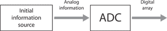

Figure 2.1

### 2.2.1 Amplitude and time quantization

幅度量化将一个函数的某个值集合分解为有限数量的子集。如果所考虑的函数是标量的，则问题涉及量化区间。对于向量函数，量化概念与将其分量值集合分解为基本体积密切相关。最简单的量化类型是将模拟函数的范围 `Δϕ = ϕ[max] − ϕ[min]` 除以一个整数，并向上或向下舍入到最接近的整数。作为规则，量化以二进制代码进行。范围 `Δϕ` 被 `2^(n)` 除，其中 `n` 表示寄存器长度（或数字位数）。每个幅度由长度为 `n` 的零和一序列编码。

时间量化，进一步称为时间采样（在我们的情况下，函数的自变量是时间），是使用脉冲发生器执行的。请注意，采样率必须至少是函数频谱最大频率的两倍。

因此，模拟函数（信息、信号）的值由对应于离散时间点的二进制数字序列表示。

幅度量化是对模拟函数值的非线性变换 [197]。图 2.2 显示了执行模拟函数幅度量化的非线性元件的特性。幅度量化可以是均匀的和非均匀的。在前一种情况下，量化步长 `h[k] = y[k + 1] − y[k]` 是一个常数 `h`。在非均匀幅度量化下，该步长取决于幅度。非均匀幅度量化降低了数字数据生成的相对误差。图 2.3(a)–图 2.3(c) 展示了具有不同舍入规则的量化器的特性：*a*—向上舍入到最接近的整数，*b*—向下舍入到最接近的整数和 *c*—舍入到基本区间的中间。

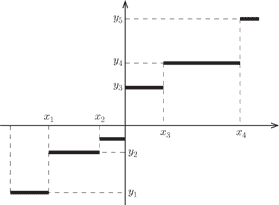

Figure 2.2

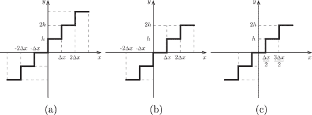

Figure 2.3

时间采样不会引起测量误差，而幅度量化会因舍入而伴随误差 `ε`。为了估计该误差，必须选择一个模型。考虑两种模型，即确定性和随机性。在第一种模型框架内，上述舍入规则导致最大误差

```
\begin{array}{r}
{\varepsilon_{max} = h.}
\\
\end{array}
```

(2.37)

换句话说，它与量化步长 `h` 相同。假设量化误差为随机变量，我们必须声明其概率密度函数（PDF）。例如，设该变量在区间 `[- h/2, h/2]` 上服从均匀分布，即

```
\begin{array}{r}
{p(\varepsilon) = \left\{ \begin{aligned}
\frac{1}{h} & {\text{for}\,\left| \varepsilon \middle| \leq \frac{h}{2}, \right.}
\\
0 & {\text{for}\,\left| \varepsilon \middle| > \frac{h}{2}. \right.}
\\
\end{aligned}~ \right.}
\\
\end{array}
```

(2.38)

由于 PDF 具有对称性，量化误差的均值为零，而其方差为

```
\begin{array}{r}
{\sigma^{2} = \frac{1}{h}{\int\limits_{- h/2}^{h/2}\varepsilon^{2}}d\varepsilon = \frac{h^{2}}{12}.}
\\
\end{array}
```

(2.39)

有趣的是，所得到的估计值明显小于确定性模型（2.37）的估计值。然而，请记住，该量化误差估计基于均匀分布和与模拟函数不相关的假设。

### 2.2.2 Audio data

声音信号的数字转换由 `ADC` 执行，它将模拟信号转换为数字音频数据。这些转换使用不同类型的数字调制。脉冲编码调制（`PCM`）和增量调制（`DM`）最为广泛。

`PCM` 将模拟信号 `x(t)` 的瞬时幅度序列（图 2.4(a)）转换为对应于离散时间 `nΔ` 的具有固定步长 `h` 的量化值（图 2.4(b)）。每个值 `x[PC][nΔ]` 被转换为二进制代码，如图 2.4(c)所示。这种调制器输出具有时间绑定的 0 和 1 的数据包。

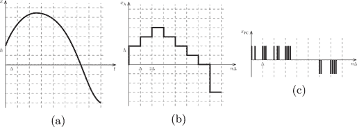

Figure 2.4

`PCM` 的精度取决于步长 `h` 和量化幅度数 `N`。最大量化值为 `(N − 1)h`。二进制代码组合的数量为 `n = log[2h]`，其中 `[ ⋅ ]` 表示整数部分算子。

`DM` 是 `PCM` 的一种特殊类型，它也以时间离散采样和幅度量化的形式表示模拟信号。根据假设，音频信号中的采样之间存在关系。因此，可以仅使用一个数字来量化相邻采样。图 2.5(a)–图 2.5(b) 说明了增量调制器的操作。作为其输出，该调制器（见图 2.5(a)）生成脉冲的二进制序列，对于正差值为 `+1`，对于负差值为 `−1`。

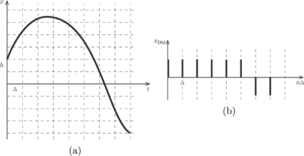

Figure 2.5

声音信号的数字表示有以下两种用途。首先，用于提高声音质量并进一步转换回模拟形式。其次，用于形成定量测量的属性以表征声音信号 [124]。在此背景下，尤其要注意信号的频谱组成及其基本参数。

再次考虑由连续函数 `x(t)` 描述的模拟信号。设该函数在无限区间 `(−∞, +∞)` 上有定义且平方可积。那么该函数的傅里叶变换由下式给出

```
\begin{aligned}
{\Phi_{1}(\nu)} & {= {\int\limits_{- \infty}^{+ \infty}x}(t)\exp( - 2\pi\iota\nu t)dt = \Phi(2\pi\nu),}
\\
{\Phi_{2}(\omega)} & {= \frac{1}{\sqrt{2\pi}}{\int\limits_{- \infty}^{+ \infty}x}(t)\exp( - \iota\omega t)dt = \sqrt{2\pi}\Phi(\omega),}
\\
{\Phi(\omega)} & {= {\int\limits_{- \infty}^{+ \infty}x}(t)\exp( - \iota\omega t)dt.}
\\
\end{aligned}
```

(2.40)

这里 `\iota = \sqrt{- 1}`，`ν` 表示线性频率（以 Hz 为单位），而 `ω = 2πν` 是角频率（以 rad/s 为单位）。公式（2.40）包含复指数

```
\begin{array}{r}
{\exp( - \iota\omega t) = \cos(\omega t) - \iota\sin(\omega t).}
\\
\end{array}
```

(2.41)

函数 `Φ(ω)` 对于 `ω ∈ (−∞, +∞)` 是连续的。


真实的模拟信号定义在有限时间区间 𝒯 = \[0, *T*\] 上。对该信号进行数字化变换后得到一组量化值序列，称为采样，其形式为

$$
\begin{array}{r} {x\lbrack n\Delta\rbrack = {\int\limits\_{- \infty}^{+ \infty}x}(\tau)\,\delta(n\Delta - \tau)d\tau,} \\ \\ \end{array}
$$

(2.42)

其中 *δ*( • ) 表示狄拉克函数，$\Delta = \frac{T}{N - 1},$ 且 *N* 为采样数。因此，模拟信号在有限时间区间 𝒯 上的数字表示由一个 *N*\-维向量 **x** 描述，其元素为 *x*\[*n**Δ*\] (2.42)。根据 (2.40)，该信号的傅里叶变换由下式给出

$$
\begin{aligned} {\Psi(\omega) = \Psi\left( {\frac{2\pi}{T}k} \right)} & {\Psi(k) = {\sum\limits\_{n = 0}^{N - 1}x}\lbrack n\Delta\rbrack\,\exp\left( {-\iota\frac{2\pi}{T}k\, n} \right) =} \\ {= {\sum\limits\_{n = 0}^{N - 1}x}\lbrack n\Delta\rbrack} & {\left\lbrack {\cos\left( {\frac{2\pi}{T}kn} \right) - \sin\left( {\frac{2\pi}{T}kn} \right)} \right\rbrack,} \\ & {\quad k = \overline{0,N-1},} \\ \end{aligned}
$$

(2.43)

并称为离散傅里叶变换 (DFT)。显然，DFT 作为数字信号的离散谱由向量 $\overline{\Psi}$ 刻画，其元素为 *Ψ*(*k*) (2.2.2)。注意，该向量的维数与由数字采样组成的向量 **x** 的维数一致 (2.42)；参见 Figs. 2.6(a) 和 2.6(b)。

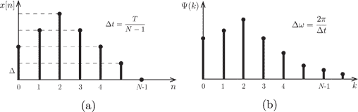

Figure 2.6

向量 $\overline{\Psi}$ 决定了所考虑的声音信号的能量频率分布。通常，区间 Δ 足够小以保留模拟信号在时间区间 𝒯 上的信息特征。随后，向量 $\overline{\Psi}$ 具有相当高的维数，这使得离散谱在应用中的使用变得复杂。在此向量基础上，有必要得到一个降维向量 **z**，其维数与初始向量 $\overline{\Psi}$ 相比显著更小。一个简单（尽管不是最客观和最具信息量的）解法是指定少量区间 \[0, *k*[1]\], \[*k*[1] + 1, *k*[2]\], …, \[*k*[*s*] + 1, *N* − 1\] 并构造所谓的能量谱，即向量 **z**，其元素为

$$
\begin{array}{r} {z_{j} = {\sum\limits\_{i = 0}^{k_{1}}\Psi}(i) + {\sum\limits\_{i = k_{(j - 1)} + 1}^{k_{j}}\Psi}(i),\quad\quad j = \overline{2,m},\quad m \ll (N - 1).} \\ \\ \end{array}
$$

(2.44)

则总能量形式为

$$
\begin{array}{r} {E = {\sum\limits\_{k = 0}^{N - 1}\Psi}(k).} \\ \\ \end{array}
$$

(2.45)

### 2.2.3 图形数据

图形数据是 2D 模拟单色或彩色图像数字化的结果。此类图像的例子包括绘画、手稿、照片和视频图像等。图像通过两种方式转换为图形数据，即使用位图（光栅）图形和矢量图形。

*位图* 图形数据表示固定大小 *像素* 的矩阵。模拟图像的数字化通过空间离散化进行。更具体地说，图像被分割成单独的元素（像素），每个像素关联 2D 坐标和灰度等级（对于单色图像）或颜色调色板（对于彩色图像）。坐标和调色板具有数字形式。空间离散化将图形数据表达为有限维度的矩阵，其中每一行包含一定数量具有适当颜色的像素，颜色在数字尺度上表示。在硬件层面，模拟图像的位图转换由扫描仪实现。位图图形数据的示例见 Fig. 2.7(a)。

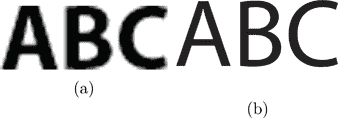

Figure 2.7

*矢量* 图形数据涉及对称为 *基元* 的基本图形对象的数学描述。其中此类对象包括点、直线、某些曲线、样条、圆、多边形等。矢量图形基元的示例见 Fig. 2.7(b)。矢量数据相对于位图数据的最大优势在于能够在不损害图像原始质量的情况下实现相当简单的缩放。

在大多数情况下，模拟图像被转换为数字以便使用计算机、智能手机、视频和照相机等数字设备进行进一步自动处理。考虑标准（固定格式）文档的图像，例如账单和银行文件、财政文件、投票选票和问卷。这些文档具有明确的结构，包含待填写的字段。换句话说，有用的图形数据仅包含在相应框中。因此，无需扫描整个文档，只需扫描所需字段即可。因此，此类文档的位图表示具有固定结构，其字段的位图表示也是如此。

请注意，矢量格式经常被转换为位图格式。与此同时，反向转换计算量很大。

### 2.2.4 文本数据

文本是用于数字化的特殊对象，其本质上与上述对象不同。音频、视频和图形对象的信息完全由物理测量反映。相比之下，文本是某些规则及其人类感知的整合结果。因此，与其他类型对象不同，文本具有意义作为其显著属性。事实上，意义的概念是模糊的，这导致其以数值特征的隐式描述出现。

因此，文本数据是由某种文本模型产生的数值数据 [167]。我们将文本模型理解为用于表征文本的一组数值指标。除了易于计算的指标外，还存在所谓的语法树（或图表）和语义网络，其构造过程具有巨大的计算复杂度。

文本建模涉及文本的不同类型信息，即文本相关信息和外部信息。以下文本相关信息类型较为常见：

* 文本元素的频率特征（在基本情况下，文档中是否存在来自给定列表的词语（术语））；
* 文档中词语的相互位置。词语根据给定语言的语法规则具有确定的顺序，从而形成组和句子。词语的相互位置包含一些有用信息；
* 文档的格式。通常在出版前文本会被适当排版。单独的词语、句子甚至段落可以设置为不同类型（粗体、斜体等）或对齐；
* 文档的逻辑结构。文档通常由章节、节、小节和段落组成。这种文档的逻辑结构反映了文本的意义；
* 对其他文档的引用。文档经常引用其他文档（例如以超文本链接或文献引用的形式）。

外部信息包括关于来源、作者、文档创建或修改日期、主题分类、用户对文档的行为（例如用户的访问率等）的信息。


文档的频率特征最广泛使用，首先是同质属性的直方图，例如关键词条目的向量 [160]。在这种情况下，必须为所有分析的文档管理一个通用的术语表。每个文档表示为一个向量，其元素显示相应术语在文档中出现的次数。该向量的维度非常大，与术语表中的总术语数相匹配。

在一般设置中，该向量的一个元素表示术语在文档中的信息权重。实际上，术语的信息权重以更广的意义处理，具有附加属性，例如字母短序列的信息权重（例如两个字母的组合）、音节、单词或规范形式词组合 [175]。元素的权重通常使用其在文本中出现的某些统计特征来定义，并带有反映该元素在给定文档中的格式和位置的某些系数。

在文本数值表征的第一阶段，扩展的术语权重允许分离出适用于文档的最合适的词集（bag）。词袋模型于 1975 年提出，至今仍是常用的文本模型 [170]。在此模型框架内，文本表示为一组词，不考虑其顺序。每个词在此集合中被赋予一定的权重。因此，文档的模型由有限的词-权重对集组成。注意，权重可以分配给词（术语）或词干。存在以下标准的权重分配方法 [93]：

* `the binary method (BI)`. 该方法仅定义某些术语在文档中的存在或不存在；
* `the number of term entries in a document`. 如果一个术语在文本中多次出现，则所考虑的文档很可能与该术语具有语义关系；
* `the term frequency (TF)`. 词频计算为术语条目数除以文档中的总词数；
* `the logarithmical term frequency (LOGTF)`. 该方法将术语的权重定义为 1 + log (`TF`)，其中 `TF` 为词频。由于信息权重分配的对数尺度，该模型对文档高估具有更高的稳定性；
* `the inverse document frequency (IDF)`. 该参数是词频的倒数。

一种传统的方法是使用由术语-权重矩阵描述的文档集合来分析文本。

### 2.2.5 政府统计数据

存在许多对象由政府统计服务使用与特定时间尺度相关的问题导向登记册进行评估。首先，注意对经济系统（宏观指标、劳动资源、GDP、财政等）、人口系统（生育率、死亡率和迁移率）以及环境系统（大气、地球、水、土壤等）的测量和国家评估。相当一部分统计测量是针对一个国家的各个地区进行的。

政府统计系统实施所有测量参数的获取、分析和结构化，以及根据接受的登记册将其进一步转换为数据。这些阶段中的每一个，从从现有来源获取信息到以表格形式对数据进行结构化，都伴随着不可避免的错误，也导致政府统计数据出现错误。存在两种类型的错误，即系统性错误和覆盖错误。前者由于将初始信息转换为数据的<|message|> 方法不完善而发生，而后者由于目标对象与实际观察的元素之间不匹配而发生。

为了阐明这一点，让我们考虑一个形成数据以计算人均国民收入的例子。这个问题似乎很简单：只需将货币形式的年 GDP 除以适龄人口数量即可。然而，货币形式的年 GDP 是使用广义价格计算的，而广义价格由某些模型定义。这些模型输入变量和特征（参数）的测量和估计存在误差（通常解释为随机变量）。因此，年 GDP 是按月计算的算术平均值，具有估计方差。适龄人口的情况类似，因为其规模在一年中不可预测地变化。换句话说，计算的年 GDP 值同时包含两种类型的错误。

考虑该情况的以下数学模型。用 `x` 表示与时间 `t` 相关联的感兴趣的指标。假设该指标取决于 `n` 个因素，`y[1]`，…，`y[n]`。这种假设导致覆盖错误：没有证据表明所接受的因素集（即其数量和含义）对于定义指标 `x` 是完整的。

形成指标 `x` 的下一步是建模因素与 `x` 之间的参数化关系，即

$$
\begin{array}{r}
{x = F(\mathbf{y},\mathbf{a}),}
\end{array}
$$

(2.46)

其中 `a` = `{a[1],…,a[p]}` 作为参数起作用。函数 `F` 及其参数化是通过专业知识选择的。正是这一阶段由于专家的知识有限、不完整和主观而引入系统性错误。

事实上，政府统计系统具有分布式结构，并涉及对初始信息的各种初级处理方法。结合人为因素，这些特征几乎排除了对政府统计错误进行充分估计的可能性。剩下的替代方案是使用专家评估，其范围相当大，从 5% 到 20%。

现有错误本质上影响 (a) 输入和输出数据之间关系估计特征，以及 (b) 涉及政府统计数据的其他问题的解决方案。

## 2.3 缺失数据的恢复方法

数字源生成与时间尺度绑定的数据序列。实践中常见的情况是存在不同的时间尺度或对于某个时间尺度的遗漏。然而，为了进一步使用数据序列，人们通常需要执行其同步（缩减为同一尺度）或恢复缺失数据。事实上，数据同步和恢复是密切相关的问题，其解决方案采用类似的方法。详细考虑其中的一些方法。

### 2.3.1 插值

数字数据源生成模拟函数 `x(t)` 的值序列，其自变量为有限集。作为规则，这些值与具有步长 `h` 的某个时间尺度相关联。取另一个函数 `y(t)`，其生成的序列值在不同的时间尺度中，步长为 `s` < `h`，使得 {`h/s`} 为整数。然后我们自然会得到这些函数的同步，即有必要以步长 `s` 恢复 `x(t)` 在区间 [`i h`, (`i` + 1)`h`] 内的值（所谓的 数据插值问题）。解决该问题的经典方法是构造一个相当简单的函数 `z(t)`，使得其在 `h` 尺度中的值与函数 `x(t)` 在同一尺度中的值一致，即 `z[0]` = `x[0]`, …, `z[i h]` = `x[i h]`。


考虑一个任意的实函数 `x(t)` ∈ `R`，其定义在区间 𝒯 = [0, T] 上。在空间 `R` 中选取一组有限的初等（简单）函数 `{φk}[0]^(n)`，使得它们线性无关。在大多数情况下，这是一组幂函数 1, t, t², …；或三角函数 1, sin t, cos t, sin 2t, cos 2t, …；或指数函数 1, exp(α[1]t), exp(α[2]t), …，其中 {α[i]} 表示一个数列。

利用前 n + 1 个函数 `{φk}[0]^(n)`，构造所有可能的线性组合

$$
\begin{array}{r}
{a_{0}\varphi_{0}(t) + a_{1}\varphi_{1}(t) + \cdots + a_{n}\varphi_{n}(t) = \psi(t)}
\\
\end{array}
$$

(2.47)

其中系数 `a[0]`，…，`a[n]` 为实数。在插值理论中，这些系数按以下方式计算。选取变量 t 的 n + 1 个值，即 `t[0]`，…，`t[n]`，它们称为插值节点。令函数 `x(t)` 及其插值函数 `ψ(t)` 在这些节点处取相同的值。这导致线性方程组

$$
\begin{array}{r}
{x(t_{j}) = a_{0}\varphi_{0}(t_{j}) + a_{1}\varphi_{1}(t_{j}) + \cdots + a_{n}\varphi_{n}(t_{j}),\quad\quad j = \overline{0,n}.}
\\
\end{array}
$$

(2.48)

节点应选取使得行列式

$$
\begin{array}{r}
{\Delta = \left| \begin{array}{lll}
{\varphi_{0}(t_{0})} & \cdots & {\varphi_{n}(t_{0})}
\\
\cdots & \cdots & \cdots
\\
{\varphi_{0}(t_{n})} & \cdots & {\varphi_{n}(t_{n})}
\\
\end{array} \right| \neq 0.}
\\
\end{array}
$$

(2.49)

成立。则该系统具有唯一解

$$
\begin{array}{r}
{a_{i} = \frac{{\sum\limits_{j = 0}^{n}x}(t_{j})\Delta_{ij}}{\Delta},\quad\quad i = \overline{0,n},}
\\
\end{array}
$$

(2.50)

其中 `Δ[i j]` 给出元素 (i j) 的代数余子式。因此，根据 (2.47)，

$$
\begin{array}{r}
{\psi(t) = x(t_{0})\Phi_{0}(t) + x(t_{1})\Phi_{1}(t) + \ldots + x(t_{n})\Phi_{n}(t).}
\\
\end{array}
$$

(2.51)

函数 `Φi` 是函数 `ϕi` 的线性组合，且不依赖于函数 `x(t)`。由于在插值节点处等式 `x(t[j]) = ψ(t[j])` 成立，函数 `Φi` 满足以下条件：

$$
\begin{array}{r}
{\Phi_{i}(t_{j}) = \left\{ \begin{aligned}
0 & {\text{for}\, i \neq j,}
\\
1 & {\text{for}\, i = j.}
\\
\end{aligned}~ \right.}
\\
\end{array}
$$

(2.52)

参见，例如，专著 [17] 中对精细插值过程及其性质的讨论。

作为背景信息，考虑在应用中广泛使用的一些插值函数类。首先，*拉格朗日插值多项式*。考虑幂函数序列 1, t, t², …, t^(n), … 作为基函数。该序列在任何区间上都是线性无关的。为了定义函数 `ψ(t)` (2.47)，求出函数 `Φi`，它们是函数 `ϕ0`，…，`ϕn` 的线性组合并满足条件 (2.52)。换句话说，利用基序列的元素，需要构造一个在点 `t[0]`，…，`t[i−1]` 处消失且在点 `t[i]` 处取值为 1 的多项式。这样的多项式具有形式

$$
\begin{array}{r}
{\Phi_{i}(t) = A(t - t_{0})(t - t_{1})\cdots(t - t_{i - 1})(t - t_{i + 1})\cdots(t - t_{n}).}
\\
\end{array}
$$

(2.53)

由于 `Φi = 1`，可得

$$
\begin{array}{r}
{1 = A(t_{i} - t_{0})(t_{i} - t_{1})\cdots(t_{i} - t_{i - 1})(t_{i} - t_{i + 1})\cdots(t_{i} - t_{n}).}
\\
\end{array}
$$

(2.54)

随后，

$$
\begin{array}{r}
{\Phi_{i}(t) = \frac{(t - t_{0})(t - t_{1})\cdots(t - t_{i - 1})(t - t_{i + 1})\cdots(t - t_{n})}{(t_{i} - t_{0})(t_{i} - t_{1})\cdots(t_{i} - t_{i - 1})(t_{i} - t_{i + 1})\cdots(t_{i} - t_{n})}.}
\\
\end{array}
$$

(2.55)

而拉格朗日插值多项式由下式给出

$$
\begin{aligned}
{\psi(t) = L_{n}(t)} & {= x(t_{0})\frac{(t - t_{1})\cdots(t - t_{n})}{(t_{0} - t_{1})\cdots(t_{0} - t_{n})} +}
\\
& {+ x(t_{1})\frac{(t - t_{0})(t - t_{2})\ldots(t - t_{n})}{(t_{1} - t_{0})(t_{1} - t_{2})\ldots(t_{1} - t_{n})} + \cdots +}
\\
& {+ x(t_{n})\frac{(t - t_{0})\ldots(t - t_{n - 1})}{(t_{n} - t_{0})(t_{n} - t_{1})\ldots(t_{n} - t_{n - 1})}.}
\\
\end{aligned}
$$

(2.56)

引入函数

$$
\begin{array}{r}
{\omega_{n}(t) = {\prod\limits_{i = 0}^{n}{(t - t_{i})}}}
\\
\end{array}
$$

(2.57)

并将拉格朗日插值多项式写为

$$
\begin{array}{r}
{L_{n}(t) = {\sum\limits_{i = 0}^{n}x}(t_{i})\frac{\omega_{n}(t)}{(t - t_{i})\omega_{n}^{\prime}(t_{i})}.}
\\
\end{array}
$$

(2.58)

在应用意义上，拉格朗日插值多项式有些不便，因为增加一个新节点需要形成一个新的多项式。这一缺点在牛顿表示的插值多项式中不存在。更具体地说，*牛顿插值多项式* 涉及如下的差商概念 [17]。

考虑 n + 1 个节点以及相同数量的函数 `x(t)` 的值，即 `x(t[0])`，…，`x(t[n])`。函数 `x(t)` 在节点 `t[i−1]`、`t[i]` 处的第一个差商为值

$$
\begin{array}{r}
{\Delta_{i - 1,i} = \frac{x(t_{i}) - x(t_{i - 1})}{t_{i} - t_{i - 1}}.}
\\
\end{array}
$$

(2.59)

高阶差商递归计算。m 阶差商的一般公式为

$$
\begin{array}{r}
{\Delta_{i - 1,i,i + 1,\ldots,i + m} = \frac{\Delta_{i,i + 1,\ldots,i + m} - \Delta_{i - 1,i,i + 1,\ldots,i + m - 1}}{t_{i + m} - t_{i}}.}
\\
\end{array}
$$

(2.60)

将拉格朗日插值多项式表示为

$$
\begin{array}{r}
{L_{n}(t) = L_{0}(t) + (L_{1}(t) - L_{0}(t)) + \ldots + (L_{n}(t) - L_{n - 1}(t)).}
\\
\end{array}
$$

(2.61)

显然，这就是恒等式 `Ln = Ln`。可以证明 [17]

$$
\begin{array}{r}
{L_{i}(t) - L_{i - 1}(t) = \Delta_{0,\ldots,i}\omega_{i}(t),}
\\
\end{array}
$$

(2.62)

其中 `ωi = (t−t[0])⋯(t−t[i])`。则拉格朗日插值多项式的牛顿表示 `Nn` 可写为

$$
\begin{aligned}
& {L_{n}(t) = N_{n}(t) = x(t_{0}) + \Delta_{0,1}(t - t_{1}) + \ldots +}
\\
& {\quad\quad + \Delta_{0,\ldots,n}(t - t_{0})(t - t_{1})\cdots(t - t_{n - 1}).}
\\
\end{aligned}
$$

(2.63)

再次指出，有兴趣的读者可从专著 [17] 中获得关于插值多项式的深入知识。

### 2.3.2 辅助动态模型

在本小节中，我们描述一种基于数据源数学模型的缺失数据（在时间尺度上）恢复方法。令 `𝒳[h]^(N) = {x[0],x[h],…,x[N h]}` 为绑定到步长为 `h` 的时间尺度上的数值数据包。利用这些数据，构造阶梯函数 `x̃(t)`，其形式为

$$
\begin{array}{r}
{\widetilde{x}(t) = x\lbrack ih\rbrack\quad\text{for~}ih \leq t < (i + 1)h,\quad i = \overline{0,N-1}.}
\\
\end{array}
$$

(2.64)

考虑一个以上述阶梯函数为输入、输出 `y(t)` 形式为的动态系统

$$
\begin{array}{r}
\left. y\lbrack nh\rbrack = \mathcal{L}(x\lbrack ih\rbrack,\mathbf{a}\, \middle| \, 0 \leq i < n). \right.
\\
\end{array}
$$

(2.65)


在该表达式中，ℒ 表示一个泛函，其表征了具有参数 **a** ∈ *R*^(*m*) 的系统的动态特性，其中 *m* 是参数向量的维数。参数 **a** 实际上会影响函数 *y*(*t*)，即 *y*(*t*, **a**)。对于向量 **a** 的元素取某些值时，系统在离散时刻 *ih* 输出数据包 𝒴[*h*]^(*N*) = {*y*\[0,**a**\],*y*\[*h*,**a**\],…,*y*\[(*N*−1)*h*,**a**\]}。

定义数据包 𝒳[*h*]^(*N*)、𝒴[*h*]^(*N*) 之间的总残差为

$$\\begin{array}{r} {J(\\mathbf{a}) = {\\sum\\limits\_{i = 0}^{N}{(x\\lbrack ih\\rbrack - y\\lbrack ih,\\mathbf{a}\\rbrack)}^{2}}.} \\\\ \\end{array}$$

(2.66)

该残差的最小值给出最优参数，在该参数下，以上所述数据包在 *h*\-尺度的节点处的差异尽可能小（以泛函 *J* (2.66) 为准），即

$$\\begin{array}{r} {\\mathbf{a}^{\*} = \\arg\\min J(\\mathbf{a}).} \\\\ \\end{array}$$

(2.67)

将最优参数代入 (2.65) 得到数据包 𝒴[*s*]^(*N**r*) = {*y*^(\*)\[0\],*y*^(\*)\[*s*\],…,*y*^(\*)\[(*l*−1)*s*\],*y*^(\*)\[*h*\],*y*\[*h*+*s*\],…,*y*^(\*)\[*h*+(*l*−1)*s*\];*y*^(\*)\[2*h*\],*y*^(\*)\[2*h*+*s*\],…,*y*^(\*)\[*N**h*\]}，其中 *s* < *h*，*h*/*s* = *r* 且 *r* 为整数。

该方法将以具有脉冲响应 *w*(*t*, **a**)、*t* ≥ 0 的线性动态系统为例进行说明。设

$$\\begin{array}{r} {w(t) = a\_{1}\\exp( - a\_{2}t),} \\\\ \\end{array}$$

(2.68)

其中 *a*[1]、*a*[2] 为区间型未知参数，即分别属于某些区间 0 < *a*[1] ≤ *a*[1]^+ 和 *a*[2]^− ≤ *a*[2] ≤ *a*[2]^+ 的参数。一般而言，这些区间的极限是未知的。求得它们的一种可能方法是在 *a*[1]^+、*a*[2]^− 和 *a*[2]^+ 上对 *J* (2.66) 进行全局最小化（或若全局最小值不存在则计算一个可接受的小值）。

向该系统的输入供给阶跃函数 *x̃*(*t*) 以产生输出

$$\\begin{array}{r} {y(t) = a\_{1}{\\int\\limits\_{0}^{t}\\exp}( - a\_{2}(t - \\tau))\\widetilde{x}(\\tau)d\\tau.} \\\\ \\end{array}$$

(2.69)

区间 \[0,*t*\] 包含整数个子区间 *N* = {*t*/*h*} 且 *t* = *N**h* + *μ*，其中 0 ≤ *μ* < (*N* + 1)*h*。于是表达式 (2.69) 可写为

$$\\begin{array}{r} {y(t) = \\frac{a\_{1}}{a\_{2}}\\exp( - a\_{2}t)\\,{\\sum\\limits\_{i = 0}^{N}x}\\lbrack ih\\rbrack\\exp(a\_{2}ih)\\left( {\\exp(a\_{2}h) - 1} \\right).} \\\\ \\end{array}$$

(2.70)

系统在 *h*\-尺度节点处的输出为

$$\\begin{array}{r} {y\\lbrack ih\\rbrack = \\frac{a\_{1}}{a\_{2}}\\left( {\\exp(a\_{2}h) - 1} \\right)\\exp( - a\_{2}ih)\\,{\\sum\\limits\_{j = 0}^{i}x}\\lbrack jh\\rbrack\\exp(a\_{2}jh).} \\\\ \\end{array}$$

(2.71)

因此，总残差泛函 (2.66) 的形式为

$$\\begin{array}{r} \\left. J(a\_{1},a\_{2}) = {\\sum\\limits\_{i = 0}^{N}{\\sum\\limits\_{j = 0}^{i}\\left( {A\_{i,j}(a\_{1},a\_{2})x\\lbrack jh\\rbrack} \\right)^{2}}}\\Rightarrow\\min, \\right. \\\\ \\end{array}$$

(2.72)

其中

$$\\begin{array}{r} {A\_{i,j} = \\left\\{ \\begin{aligned} {\\frac{a\_{1}}{a\_{2}}\\left( {\\exp(a\_{2}h) - 1} \\right)\\exp(a\_{2}h(j - i))} & {\\text{for}\\, j < i,} \\\\ {\\frac{a\_{1}}{a\_{2}}\\left( {\\exp(a\_{2}h) - 1} \\right) - 1} & {\\text{~for}\\, j = i.} \\\\ \\end{aligned}~ \\right.} \\\\ \\end{array}$$

(2.73)

注意，泛函 (2.72) 具有相当复杂的结构，不利于对其性质如唯一最小值、凸性（凹性）等进行解析研究。因此，在应用中应使用数值全局最小化方法来恢复（或与其它数据包同步）缺失数据。

一旦参数 *a*[1] 和 *a*[2] 计算出来，步长为 *s* 的缺失数据可由下式恢复

$$\\begin{aligned} {y\\lbrack ih + ks\\rbrack} & {= \\frac{a\_{1}}{a\_{2}}\\exp( - a\_{2}(ih + ks))\\,{\\sum\\limits\_{i = 0}^{N}x}\\lbrack ih\\rbrack\\exp(a\_{2}ih)\\left( {\\exp(a\_{2}h) - 1} \\right),} \\\\ i & {= \\overline{0,N},\\,\\, k = \\overline{0,M},\\,\\, M = \\left\\{ h/s \\right\\}.} \\\\ \\end{aligned}$$

(2.74)

### 2.3.3 空间熵分解

如前所述，由政府统计部门形成的数据与一定的空间单元（区域）相关联，每个区域都有一组属性，即指标。此类区域的维度和这些指标的值信息之间往往相互关联。在许多情况下，研究的区域越小，其指标信息的可及性就越差。这导致了一个相当紧迫的“传播”问题，即利用关于后者的一些间接信息，将大区域的可用国家指标传播到其内部的小区。

考虑由 *I* 个区域组成的经济空间 𝔼。每个区域 *i* 包含 *M*[*i*] 个区，如 Fig. 2.8 所示。设区域 *i* 及其内部的区 (*i*, *j*) 由唯一的齐次指标 *S*[*i*] 和 *S*[*i**j*] 表征，分别。例如，可能的指标列表包括人口规模、生产密度、服务配备等。区域和区指标 *S*[*i*] 和 *S*[*i**j*] 满足平衡约束

$$\\begin{array}{r} {S\_{i} = {\\sum\\limits\_{j = 1}^{M\_{i}}S\_{ij}},\\text{\\quad\\quad}i = \\overline{1,I}.} \\\\ \\end{array}$$

(2.75)

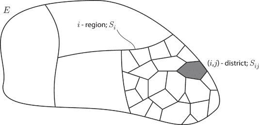

Figure 2.8

每个区域因此每个区都生产 *r* 种类型的商品或处置 *r* 种类型的资源。假设对于每种商品（资源）类型 *k*，区域 *i* 的生产函数依赖于所有区域的状态指标，即 $\\overset{\\rightarrow}{S} = \\left\\{ S\_{1},\\ldots,S\_{I} \\right\\}.$ 用 $Q\_{ik}(\\overset{\\rightarrow}{S}),\\, i = \\overline{1,I},\\, k = \\overline{1,r}.$ 表示这些函数。同一假设也适用于区；用 *q**i**j**k* 表示其生产函数，其中 𝕊 = {*S*[11],…,*S*[1, *M*[1]];…;*S*[*I*, 1],…,*S*[*I*, *M*[*I*]]}。于是资源约束具有形式

$$\\begin{array}{r} {{\\sum\\limits\_{j = 1}^{M\_{i}}q\_{ijk}}(\\mathbb{S}) = Q\_{ik}(\\mathbf{S}),\\text{\\quad\\quad}i = \\overline{1,I},\\,\\, k = \\overline{1,r}.} \\\\ \\end{array}$$

(2.76)

假设区域指标 **S** 已知而区指标 𝕊 未知。问题是求出区指标，同时考虑由 (2.75) 和 (2.76) 给出的平衡和资源约束。区指标的总数量为 $m = {\\sum\\limits\_{i = 1}^{I}M\_{i}},$ 因为按假设每个区和区域都有单一指标。此外，问题共包含 (*r* + 1)*I* 个平衡和资源约束，且 *m* > (*r* + 1)*I*。因此，满足等式 (2.75, 2.76) 的区指标集合众多。

获得唯一的区指标集合的一种方法源于熵最大化原理。事实上，熵是区域指标在相应区之间分布的不确定性度量 \[138\]，即

$$\\begin{array}{r} {H(\\mathbb{S}) = - {\\sum\\limits\_{i = 1,j = 1}^{I,M\_{i}}S\_{ij}}\\ln\\frac{S\_{ij}}{a\_{ij}e},} \\\\ \\end{array}$$

(2.77)

其中 𝕊 是表征区指标分布的矩阵，其元素为 *S*[*i**j*]。具有最高不确定性的分布 **S** 对应于在平衡和资源约束 (2.75, 2.76) 下熵 *H* 的最大值。关于感兴趣区域内各区的任何先验信息均可纳入熵函数 *H* 的参数 *a*[*i**j*] 中。


因此，区域指标在各区间的分布，称为*熵分解*，是优化问题的解

$$\\begin{array}{r} \\left. H(\\mathbb{S})\\Rightarrow\\max,\\quad\\mathbb{S} \\in D, \\right. \\\\ \\end{array}$$  

(2.78)

其中

$$\\begin{array}{r} {D = \\left\\{ S\_{ij} \\middle| {\\sum\\limits\_{j = 1}^{M\_{i}}S\_{ij}} = S\_{i};\\,\\,{\\sum\\limits\_{j = 1}^{M\_{i}}q\_{ijk}}(\\mathbb{S}) = Q\_{ik}(S),\\quad i = \\overline{1,I},\\,\\, k = \\overline{1,r} \\right\\}.} \\\\ \\end{array}$$  

(2.79)

在此一般表述中，所有区域和区都通过相应的生产函数相互关联。另一个极端情况是所有区域和区都是孤立的，即区域和区生产函数仅依赖于其自身区域或区的状态指标：

$$\\begin{array}{r} {q\_{ijk}(\\mathbb{S}) = q\_{ijk}(S\_{ij}),\\quad Q\_{ik}(\\mathbf{S}) = Q\_{ik}(S\_{i});\\,\\, i = \\overline{1,I}\\,\\, k = \\overline{1,r}.} \\\\ \\end{array}$$  

(2.80)

对于孤立区域，熵分解问题 (2.78) 归结为 *I* 个形式为的优化问题

$$\\begin{array}{r} \\left. H\_{i}(\\mathbb{S}\_{i})\\Rightarrow\\max,\\quad\\mathbb{S}\_{i} \\in D\_{i}, \\right. \\\\ \\end{array}$$  

(2.81)

其中

$$\\begin{array}{r} {H\_{i}(\\mathbb{S}\_{i}) = - {\\sum\\limits\_{j = 1}^{M\_{i}}S\_{ij}}\\ln\\frac{S\_{ij}}{a\_{ij}e},} \\\\ \\end{array}$$  

(2.82)

$$\\begin{array}{r} {D\_{i} = \\left\\{ S\_{ij} \\middle| {\\sum\\limits\_{j = 1}^{M\_{i}}S\_{ij}} = S\_{i},\\,\\,{\\sum\\limits\_{j = 1}^{M\_{i}}q\_{ijk}}(S\_{ij}) = Q\_{ik}(S\_{i}),\\quad i = \\overline{1,I},\\,\\, k = \\overline{1,r} \\right\\}.} \\\\ \\end{array}$$  

(2.83)

这些区的生产函数 `q[i j k]` 形成其状态指标的非线性函数。然而，如果经济处于均衡的邻域，则生产函数的线性表示就成为这些函数的完全充分描述，即

$$\\begin{array}{r} {q\_{ijk}(S\_{ij}) = c\_{ijk}S\_{ij},\\text{\\quad\\quad}i = \\overline{1,I},\\,\\, k = \\overline{1,r}.} \\\\ \\end{array}$$  

(2.84)

这里 `c[i j k]` 表示区 (`i`, `j`) 中商品 `k` 的特定产出。在这种情况下，可行集 `D[i]` (2.83) 由线性等式系统给出

$$\\begin{array}{r} {D\_{i} = \\left\\{ S\_{ij} \\middle| {\\sum\\limits\_{j = 1}^{M\_{i}}S\_{ij}} = S\_{i};\\,\\,\\,{\\sum\\limits\_{j = 1}^{M\_{i}}c\_{ijk}}S\_{ij} = Q\_{ik}(S\_{i}),\\quad i = \\overline{1,I},\\,\\, k = \\overline{1,r} \\right\\}.} \\\\ \\end{array}$$  

(2.85)

考虑具有线性生产函数的熵分解过程的特殊性，针对一个区域 (`I` = 1) 和一种资源类型 (`r` = 1)：

$$\\begin{aligned} {H\_{1}(\\mathbb{S}\_{1})} & \\left. = - {\\sum\\limits\_{j = 1}^{M\_{1}}S\_{1j}}\\ln\\frac{S\_{1j}}{a\_{1j}e}\\Rightarrow\\max, \\right. \\\\ {\\sum\\limits\_{j = 1}^{M\_{1}}S\_{1j}} & {= S\_{1},\\quad{\\sum\\limits\_{j = 1}^{M\_{1}}c\_{1j1}}S\_{1j} = Q\_{11}(S\_{1}).} \\\\ \\end{aligned}$$  

(2.86)

该问题由以下参数表征：先验概率 `a[1 j]`；区域的状态指标 `S[1]`；特定生产率 `c[1 j 1]` 和区域的生产函数 `Q[11]`。问题的解，即区域状态指标在其各区间的熵最优分布，取决于这些参数。

引入新变量以略微减少问题中的参数个数。记

$$\\begin{array}{r} {w\_{1j} = \\frac{S\_{1j}}{S\_{1}},\\text{\\quad\\quad}h\_{1j1} = \\frac{c\_{1j1}}{Q\_{11}(S\_{1})},\\,\\, j = \\overline{1,M\_{1}}.} \\\\ \\end{array}$$  

(2.87)

如果区域指标 `S[1]` 已给定，则变量 `h[1 j 1]` 也已固定。以此记号，熵分解问题可写为

$$\\begin{aligned} {H(\\mathbf{w})} & \\left. = - {\\sum\\limits\_{j = 1}^{M}w\_{j}}\\ln\\frac{w\_{j}}{a\_{j}e}\\Rightarrow\\max, \\right. \\\\ {\\sum\\limits\_{j = 1}^{M}w\_{j}} & {= 1;\\quad{\\sum\\limits\_{j = 1}^{M}h\_{j}}\\, w\_{j} = q,} \\\\ \\end{aligned}$$  

(2.88)

其中 `q` = 1/`S[1]` 且下标 `i` = `k` = 1 被省略。

使用拉格朗日乘数法求解该问题。拉格朗日函数形式为

$$\\begin{array}{r} {L(\\mathbf{w},\\mu,\\lambda) = H(\\mathbf{w}) + \\mu(1 - {\\sum\\limits\_{j = 1}^{M}w\_{j}}) + \\lambda(q - {\\sum\\limits\_{j = 1}^{M}h\_{j}}\\, w\_{j}).} \\\\ \\end{array}$$  

(2.89)

拉格朗日函数的 一阶最优性条件给出方程

$$\\begin{aligned} w\_{j} & {= a\_{j}\\exp( - \\mu - \\lambda\\, h\_{j}) = a\_{j}\\, u\\, z^{h\_{j}};} \\\\ & {u = \\exp( - \\mu),\\, z = \\exp( - \\lambda).} \\\\ \\end{aligned}$$  

(2.90)

考虑到 (2.88) 中的平衡和资源约束，写出拉格朗日乘数 `λ` 的方程：

$$\\begin{array}{r} {{\\sum\\limits\_{j = 1}^{M}a\_{j}}\\, z^{h\_{j}}\\,(h\_{j} - q) = 0,\\text{\\quad\\quad}j = \\overline{1,M}.} \\\\ \\end{array}$$  

(2.91)

设

$$\\begin{array}{r} {c\_{j} = a\_{j}(h\_{j} - q),\\text{\\quad\\quad}j = \\overline{1,M},} \\\\ \\end{array}$$  

(2.92)

并将方程 (2.91) 变换为

$$\\begin{array}{r} {f(z) = {\\sum\\limits\_{j = 1}^{M}c\_{j}}z^{h\_{j}} = 0,\\quad z > 0.} \\\\ \\end{array}$$  

(2.93)

按如下方式排序参数 `h[j]`：

$$\\begin{array}{r} {0 < h\_{1} < h\_{2} < \\cdots < h\_{l} < q < h\_{l + 1} < \\cdots < h\_{M}.} \\\\ \\end{array}$$  

(2.94)

于是，

$$\\begin{array}{r} {c\_{j} < 0\\quad\\text{for~}j = \\overline{1,l}\\quad\\text{and}\\quad c\_{j} > 0\\quad\\text{~for~}j = \\overline{l+1,M}.} \\\\ \\end{array}$$  

(2.95)

考虑具有任意符号系数 `c[j]` 的方程 (2.93)。注意它有根 `z[0]` = 0。因此，该方程可写为

$$\\begin{array}{r} {f(z) = z^{h\_{1}}f\_{1}(z) = 0,\\,\\,\\, z > 0,} \\\\ \\end{array}$$  

(2.96)

其中函数

$$\\begin{array}{r} {f\_{1}(z) = c\_{1} + {\\sum\\limits\_{j = 2}^{M}c\_{j}}z^{h\_{j} - h\_{1}}} \\\\ \\end{array}$$  

(2.97)

没有零根。

现在考虑在系数 `c[j]` 按照 (2.95) 排序的情况下的方程 (2.96, 2.97)，即

$$\\begin{array}{r} {c\_{j} < 0\\,\\,\\text{for}\\,\\, j = 1,\\ldots,l,\\text{\\quad\\quad}c\_{j} > 0\\,\\,\\text{for}\\,\\, j = l + 1,\\ldots,M.} \\\\ \\end{array}$$  

(2.99)

因此，已证明在条件 (2.95) 下，方程 (2.98) 具有唯一正解。

### 表 2.1：区域状态指标

| no. | `c̃[j]` | `S[j]` | `S̃[j]` |
| --- | --- | --- | --- |
| 1 | 0.035 | 0.0098 | 0.0144 |
| 2 | 0.018 | 0.0251 | 0.0247 |
| 3 | 0.035 | 0.0098 | 0.0149 |
| 4 | 0.018 | 0.0253 | 0.0245 |
| 5 | 0.028 | 0.0145 | 0.0213 |
| 6 | 0.015 | 0.0296 | 0.0259 |
| 7 | 0.038 | 0.0083 | 0.0142 |
| 8 | 0.029 | 0.0137 | 0.0222 |
| 9 | 0.039 | 0.0079 | 0.0144 |
| 10 | 0.047 | 0.0051 | 0.0102 |
| 11 | 0.035 | 0.0098 | 0.0175 |
| 12 | 0.026 | 0.0161 | 0.0238 |
| 13 | 0.036 | 0.0093 | 0.0168 |
| 14 | 0.028 | 0.0145 | 0.0214 |
| 15 | 0.032 | 0.0116 | 0.0193 |
| 16 | 0.038 | 0.0083 | 0.0126 |
| 17 | 0.045 | 0.0057 | 0.0098 |
| 18 | 0.037 | 0.0088 | 0.0151 |
| 19 | 0.028 | 0.0145 | 0.0185 |
| 20 | 0.038 | 0.0083 | 0.0097 |
| 21 | 0.038 | 0.0104 | 0.0079 |
| 22 | 0.020 | 0.0225 | 0.0292 |
| 23 | 0.024 | 0.0181 | 0.0243 |
| 24 | 0.038 | 0.0084 | 0.0097 |
| 25 | 0.007 | 0.0459 | 0.0433 |
| 26 | 0.028 | 0.0145 | 0.0169 |

### 2.3.4 缺失数据的随机恢复方法

#### 1. 缺失数据随机恢复程序的结构


考虑机器学习问题的信息支持（`infoware`）的组成部分和属性。学习集合包含关于对象 `O` 的功能的一些数据 `O`（Fig. 2.10）以及测量的输入 `x(t)` ∈ `R^(m)` 和输出 `y(t)` ∈ `R^(n)`。变量 `x(t)` 和 `y(t)` 分别包含测量误差 `η(t)` ∈ `R^(m)` 和 `ξ(t)` ∈ `R^(n)`。通常，关于它们的信息具有假设性特征。一种常见假设是它们以加性形式出现在学习集合中：

$$
\begin{array}{r} {\mathbf{x}(t) = \mathbf{x}^{0}(t) + \eta(t);\quad\quad\mathbf{y}(t) = \mathbf{y}^{0}(t) + \xi(t),} \\ \end{array}
$$

(2.100)

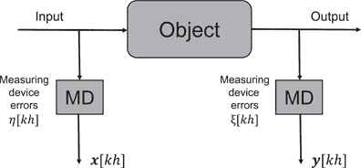

Figure 2.10

其中 `x⁰(t)` 和 `y⁰(t)` 为纯变量。

假设输入和输出在相同的时间尺度 `t = k h` 下测量，步长为 `h`，且在相同的时间区间 `𝒯 = [0, T]` 上。因此，真实的学习集合由描述对象 `O` 的输入和输出的数据矩阵组成。

输入和输出的数据数组可能存在遗漏；参见 Fig. 2.11 中的区间 `[k⁻, k⁺]`。此类遗漏有三种可能情况：输出数据中的遗漏、输入数据中的遗漏以及两种类型数据中的遗漏（不一定在同一时刻）。

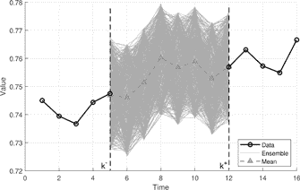

Figure 2.11: Example of missing data ensemble (MDE).

缺失数据随机恢复的主要思想是用缺失数据集合（MDE）替换现有的遗漏，即输入和输出分量的随机值（见 Fig. 2.11），在考虑可用测量的情况下进行优化。这是通过对象的随机化参数模型（RPM）完成的，其概率特性（其参数的概率密度函数（PDF））通过最大熵估计（MEE）获得。细节将在 Appendix A 中介绍。

优化后的 MDE 由最优 PDF 的采样生成 [64]。该 MDE 可直接用于解决不同的机器学习问题。此外，还可以确定优化后 MDE 的数值特征，如均值、中位数、方差管、区间数据集合等。 Figure 2.11 给出了该方法的说明。

如果遗漏出现在输出数据中，则该过程采用输入数据 `x[k h]`、`RPM-O` 模型和存在遗漏的输出数据 `\widetilde{y}[k h]` 来计算熵最优 PDF（Fig. 2.12(a)），并用于生成恢复输入数据的集合 `𝒴`。

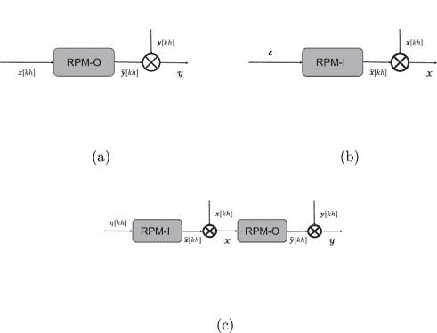

Figure 2.12: Diagrams of RPMs.

输入数据中存在的遗漏使用额外的 `RPM-I` 模型进行恢复，输入由优化后的独立随机向量 `η[k h]` 的序列和存在遗漏的输入数据 `\widetilde{x}[k h]` 表示。该序列和参数的 PDF 通过 MEE 获得。然后使用这些函数生成随机向量 `η[k h]` 的集合 `ℰ` 和恢复输入数据的集合 `𝒳`；见 Fig. 2.12(b)。

最后，考虑输入和输出数据同时存在遗漏的情况。首先，恢复随机向量 `η[k h]` 的集合 `ℰ` 和输入数据的集合 `𝒳`。其次，它们被用于恢复输出数据的集合 `𝒴`（Fig. 2.12(c)）。

缺失数据随机恢复方法集合将用 `RRMD` 表示（Random Restored Missing Data）。

### 2. MDE 的优化算法

#### a. 输出数据中的遗漏

考虑离散观测时间区间 `τ = [0, N]` 在此区间上，存在一组无遗漏的输入数据 `x ∈ R^(m)`，`x[0]`，…，`x[N]`，以及一组存在遗漏的输出数据 `y ∈ R^(n)`，`y[0]`，…，`y[k⁻ − 1]`，`y[k⁺ + 1]`，…，`y[N]`。数据 `y[k⁻]`，…，`y[k⁺]` 缺失。

构造矩阵

$$
\begin{array}{r} {X_{(k - \varrho)} = \left[ {\mathbf{x}[k - \varrho],\mathbf{x}[k - \varrho + 1],\ldots,\mathbf{x}[k]} \right] } \\ \end{array}
$$

(2.101)

由输入数据集得到，其中 `ρ < N` 为参数。

输出数据包含区间类型的加性误差 `ξ[k] ∈ R^(n)`：

$$
\begin{array}{r} {\xi[k] \in \Xi_{k} = [\xi^{-},\xi^{+}]. } \\ \end{array}
$$

(2.102)

误差的概率特性由 PDF `Qk` 刻画，`k = \overline{0,N}`，假定为连续可微。

一般情况下，对象 `O` 的输入和输出关系由随机化参数动态模型 `RDM-O` 描述，其形式为

$$
\begin{array}{r} {\hat{\mathbf{y}}[k] = \mathbb{B}\left( {\mathbf{a},X_{(k - \varrho)}} \right),} \\ \end{array}
$$

(2.103)

其中 `𝔹` 为具有随机参数 `a ∈ R^(r)` 的非线性泛函，参数为区间类型：

$$
\begin{array}{r} {\mathbf{a} \in \mathcal{A} = [\mathbf{a}^{-},\mathbf{a}^{+}]. } \\ \end{array}
$$

(2.104)

这些参数的概率特性由 PDF `P(a)` 刻画，假定为连续可微。

`RDM-O` 的观测输出为

$$
\begin{array}{r} {\mathbf{v}[k] = \hat{\mathbf{y}}[k] + \xi[k],\quad\quad k = \overline{0,N}.} \\ \end{array}
$$

(2.105)

为确定最优 PDF，应用 [148] 中提出的随机化机器学习（`RML`）算法。在所考虑的情况下，其形式为

$$
\begin{aligned} & {\quad\mathcal{H}[ P(\mathbf{a}),Q(\xi)] = - {\int_{\mathcal{A}}P}(\mathbf{a})\ln P(\mathbf{a})d\mathbf{a} -} \\ & \left. - {\sum\limits_{k = 0}^{T}{\int_{\Xi_{k}}Q_{k}}}(\xi[k])\ln Q_{k}(\xi[k])d\xi[k]\Rightarrow\max, \right. \\ & {\quad{\int_{\mathcal{A}}P}(\mathbf{a})d\mathbf{a} = 1;\quad{\int_{\Xi_{k}}Q_{k}}(\xi[k])d\xi[k] = 1,\, \, k = \overline{0,N},} \\ & {\quad{\int_{A}P}(\mathbf{a})\mathbb{B}\left( {\mathbf{a},X_{(k - \varrho)}} \right)d\mathbf{a} + {\int_{\Xi_{k}}Q_{k}}(\xi[k])\xi[k] d\xi[k] = \mathbf{y}[k],} \\ & {\quad k \neq k^{-},\ldots,k^{+};k = \overline{0,N}.} \\ \end{aligned}
$$

(2.106)

PDF 是连续可微的，且问题 (2.106) 属于 Lyapunov 型泛函优化问题类 [77]。因此，可以构造由拉格朗日乘子 `{θ^{(0)},…,θ^{(k⁻ − 1)},θ^{(k⁺ + 1)},…,θ^{((N))}}` 参数化的解析解：

$$
\begin{aligned} & {P^{\*}(\mathbf{a},\theta) = \frac{\exp\left[ - {\sum\limits_{k = 0}^{N}\langle}\theta^{(k)},\mathbb{B}\left( \left. \mathbf{a},X_{(k - \varrho)} \right\rangle \right)} \right]}{\mathcal{P}(\theta)},} \\ & {\quad\quad Q_{k}^{\*}(\xi[k],\theta^{(k)}) = \frac{\exp\left( {- \left\langle \theta^{(k)},\xi[k] \right\rangle} \right)}{\mathcal{Q}_{k}(\theta^{(k)})},} \\ & {\quad\text{\quad\quad}k \neq k^{-},\ldots,k^{+};\quad k = \overline{0,N}.} \\ \end{aligned}
$$

(2.107)


Here

$$\begin{aligned} & {\mathcal{P}(\theta) = {\int_{\mathcal{A}}\exp}\left\lbrack {- {\sum\limits_{k = 0}^{N}\langle}\theta^{(k)},\mathbb{B}\left( \left. \mathbf{a},X_{(k - \varrho)} \right\rangle \right)} \right\rbrack d\mathbf{a},} \\ & {\text{\quad\quad}\mathcal{Q}_{k}(\theta^{(k)}) = {\int_{\Xi_{k}}\exp}\left( {- \left\langle \theta^{(k)},\xi\lbrack k\rbrack \right\rangle} \right)d\xi\lbrack k\rbrack,} \\ & {\text{\quad\quad}\quad k \neq k^{-},\ldots,k^{+};\quad k = \overline{0,N}.} \\ \end{aligned}$$

(2.108)

The Lagrange multipliers are determined from the system of equations

$$\begin{array}{r} {\frac{\mathbf{M}_{k}(\theta)}{\mathcal{P}(\theta)} + \frac{\mathbf{N}_{k}(\theta^{(k)})}{\mathcal{Q}_{k}(\theta^{(k)})} = \mathbf{y}\lbrack k\rbrack,\text{\quad\quad}k \neq k^{-},\ldots,k^{+};k = \overline{0,N},} \\ \end{array}$$

(2.109)

where

$$\begin{aligned} {\mathbf{M}_{k}(\theta) = \int_{\mathcal{A}}} & {\exp\left\lbrack {- {\sum\limits_{k = 0}^{T}\left\langle \theta^{(k)},\mathbb{B}\left( {\mathbf{a},X_{(k - \varrho)}} \right) \right\rangle}} \right\rbrack\mathbb{B}\left( {\mathbf{a},X_{(k - \varrho)}} \right)d\mathbf{a},} \\ \end{aligned}$$

(2.110)

$$\begin{aligned} & {\mathbf{N}_{k}(\theta^{(k)}) = {\int_{\Xi_{k}}\exp}\left( {- \left\langle \theta^{(k)},\xi\lbrack k\rbrack \right\rangle} \right)\xi\lbrack k\rbrack d\xi\lbrack k\rbrack.} \\ \end{aligned}$$

(2.111)

**b. Omissions in input data**

Restoring omissions in input data is more difficult than the ones in output data. Really, the origin mechanism of input data and the source of its excitation are both unknown. In terms of the approach adopted here, this means that the model generating input data and also the process exciting it are unknown. All these factors increase the level of uncertainty in the problem, motivating the choice of randomization.

The randomized approach consists in using a sequence of independent random vectors $\zeta\lbrack k\rbrack \in R^{q}\\, \,(k\overline{0,N})$ with special probabilistic characteristics, and a randomized parametric model, the choice of which is determined by its complexity.

Well, consider the observation interval *τ* = \[0, *N*\] and an input data set **x** ∈ *R*^(*m*) with omissions **x**\[0\], …, **x**\[*k*^− − 1\], **x**\[*k*^+ + 1\], …, **x**\[*T*\]. The data **x**\[*k*^−\], …, **x**\[*k*^+\] are missing.

To restore the missing input data, assume that they are the result of transforming a sequence of independent random vectors *ζ*\[*k*\] ∈ *R*^(*q*), *k* ∈ *τ*. Let the vectors *ζ*\[*k*\] be of the interval type, i.e.,

$$\begin{array}{r} {\zeta\lbrack k\rbrack \in \mathcal{Z}_{k} = \lbrack\zeta^{-}\lbrack k\rbrack,\zeta^{+}\lbrack k\rbrack\rbrack,\text{\quad\quad}k = \overline{0,N},} \\ \end{array}$$

(2.112)

Due to the uncertainty and insufficient knowledge about the process and its transformation, choose the randomized parametric (RPM-I) model

$$\begin{array}{r} {\hat{\mathbf{x}}\lbrack k\rbrack = \mathbb{F}\left( {\mathbf{c},Z_{(k - \rho)}} \right),} \\ \end{array}$$

(2.113)

where 𝔽 is a nonlinear vector functional with random parameters **c** ∈ *R*^(*s*) and *Z*[(*k* − *ρ*)] is the input matrix of dimensions (*q* × *ρ*) composed of the column vectors *ζ*\[*k*\] ∈ *R*^(*q*), i.e.,

$$\begin{array}{r} {Z_{(k - \rho)} = \left\lbrack {\zeta\lbrack k - \rho\rbrack,\zeta\lbrack k - \rho + 1\rbrack,\ldots,\zeta\lbrack k\rbrack} \right\rbrack.} \\ \end{array}$$

(2.114)

Introduce the matrix

$$\begin{array}{r} {Z = \left\lbrack {Z_{( - \rho)},Z_{(1 - \rho)},\ldots,Z_{(N - \rho)}} \right\rbrack,} \\ \end{array}$$

(2.115)

which characterizes the input of the RPM-I model (2.113) on the time interval $k = \overline{0,N}.$ The matrix *Z* is random and of the interval type:

$$\begin{array}{r} {Z \in \mathcal{Z} = {\underset{k = 0}{\overset{N}{\cup}}\mathcal{Z}_{k}} = \lbrack Z^{-},Z^{+}\rbrack.} \\ \end{array}$$

(2.116)

The random parameters of this model are

$$\begin{array}{r} {\mathbf{c} \in \mathcal{C} = \lbrack\mathbf{c}^{-},\mathbf{c}^{+}\rbrack.} \\ \end{array}$$

(2.117)

The probabilistic properties of the parameters **c** and matrix *Z* (2.115) are characterized by a joint probability density function (PDF) *W*(**c**, *Z*) with the domain of definition

$$\begin{array}{r} {\mathcal{F} = \mathcal{C}{\cup \mathcal{Z}}.} \\ \end{array}$$

(2.118)

This function is assumed to be continuously differentiable.

Let the available input data **x**\[*k*\] contain errors *η*\[*k*\] ∈ *R*^(*m*) of the interval type:

$$\begin{array}{r} {\eta\lbrack k\rbrack \in \mathcal{E}_{k} = \lbrack\eta^{-},\eta^{+}\rbrack.} \\ \end{array}$$

(2.119)

The probabilistic properties of the errors are characterized by PDFs $G_{k}(\eta\lbrack k\rbrack),k = \overline{0,N},$ which are assumed to be continuously differentiable as well.

The observed output of the RPM-I model is given by

$$\begin{array}{r} {\mathbf{z}\lbrack k\rbrack = \hat{\mathbf{x}}\lbrack k\rbrack + \eta\lbrack k\rbrack,\text{\quad\quad}k = \overline{0,N}.} \\ \end{array}$$

(2.120)

Clearly, the missing input data are restored using a model similar to RDM-O, but with the random input *ζ*\[*k*\].

Apply the RML algorithm \[148\] for determining the PDFs *W*(**c**, *Z*) and $G_{k}(\zeta\lbrack k\rbrack),\, k = \overline{0,N}.$ In the case under consideration, this algorithm has the form

$$\begin{aligned} & {\quad\mathcal{H}\lbrack W(\mathbf{c},Z),G(\eta)\rbrack = - {\int_{\mathcal{F}}W}(\mathbf{c},Z)\ln W(\mathbf{c},Z)\, d\mathbf{c}\, dZ -} \\ & \left. - {\sum\limits_{k \in \mathcal{K}}{\int_{\mathcal{E}_{k}}G_{k}}}(\eta\lbrack k\rbrack)\ln G_{k}(\eta\lbrack k\rbrack)d\eta\lbrack k\rbrack\Rightarrow\max, \right. \\ & {\quad{\int_{\mathcal{F}}W}(\mathbf{c},Z)\, d\mathbf{c}\, dZ = 1;\quad{\int_{\mathcal{E}_{k}}G_{k}}(\eta\lbrack k\rbrack)d\eta\lbrack k\rbrack = 1,} \\ & {\quad{\int_{\mathcal{F}}W}(\mathbf{c},Z)\mathbb{F}\left( {\mathbf{c},Z_{(k - \rho)}} \right)d\mathbf{c}\, dZ + {\int_{\mathcal{E}_{k}}G_{k}}(\eta\lbrack k\rbrack)\eta\lbrack k\rbrack d\eta\lbrack k\rbrack = \mathbf{x}\lbrack k\rbrack,} \\ & {\quad k \in \mathcal{K},} \\ \end{aligned}$$

(2.121)

where the indexing set $\mathcal{K} = \overline{0,N}$ does not include *k* = *k*^−, …, *k*^+.

This problem belongs to the same class as (2.106). Its solution is given by

$$\begin{array}{rll} & {W^{\*}(\mathbf{c},Z,\lambda) = \frac{\exp\left\lbrack {- {\sum\limits_{k \in \mathcal{K}}\langle}\lambda^{(k)},\mathbb{F}\left( \left. \mathbf{c},Z_{(k - \rho)} \right\rangle \right)} \right\rbrack}{\mathcal{W}(\lambda)},} & \\ & {G_{k}^{\*}(\eta\lbrack k\rbrack,\lambda^{(k)}) = \frac{\exp\left( {- \left\langle \lambda^{(k)},\eta\lbrack k\rbrack \right\rangle} \right)}{\mathcal{G}_{k}(\lambda^{(k)})},} & \\ & {k \in \mathcal{K},} & \\ \end{array}$$

(2.122)

where

$$\begin{aligned} {\mathcal{W}(\lambda) = \int_{\mathcal{F}}} & {\exp\left\lbrack {- \sum\left\langle \lambda^{(k)},\mathbb{F}\left( \left. \mathbf{c},Z_{(k - \rho)} \right\rangle \right) \right.} \right\rbrack d\mathbf{c},\quad\mathcal{G}_{k}(\lambda^{(k)}) =} \\ & {\,\, = int_{\mathcal{E}_{k}}\exp\left( {- \left\langle \lambda^{(k)},\eta\lbrack k\rbrack \right\rangle} \right)d\eta\lbrack k\rbrack.} \\ \end{aligned}$$

(2.123)

In the equalities presented above, *λ*^((*k*)) is the vector of Lagrange multipliers corresponding to the *k*th balance constraint. This vector satisfies the system of equations


$$
\begin{array}{r} {\frac{{\widetilde{\mathbf{M}}}_{k}(\lambda)}{\mathcal{W}(\lambda)} + \frac{{\widetilde{\mathbf{S}}}_{k}(\lambda^{(k)})}{\mathcal{G}_{k}(\lambda^{(k)})} = \mathbf{x}\lbrack k\rbrack,\quad k \neq k^{-},\ldots,k^{+};k \in \mathcal{K},} \\ \end{array}
$$

(2.124)

where

$$
\begin{aligned} & {{\widetilde{\mathbf{M}}}_{k}(\lambda) = {\int_{\mathcal{F}}\exp}\left\lbrack {- {\sum\limits_{k \in \mathcal{K}}\langle}\lambda^{(k)},\mathbb{F}\left( \left. \mathbf{c},Z_{(k - \rho)} \right\rangle \right)} \right\rbrack\mathbb{F}\left( {\mathbf{c},Z_{(k - \rho)}} \right)d\mathbf{c}dZ,} \\ & {{\widetilde{\mathbf{S}}}_{k}(\lambda^{(k)}) = {\int_{\mathcal{E}_{k}}\exp}\left( {- \left\langle \lambda^{(k)},\eta\lbrack k\rbrack \right\rangle} \right)\eta\lbrack k\rbrack d\eta\lbrack k\rbrack.} \\ \end{aligned}
$$

(2.125)

### 3. 输入和输出数据中的遗漏

在这种情况下，前几段所述的程序必须依次使用：首先是算法 `(2.121)`，然后是算法 `(2.106)`。

单独或依次应用的算法产生：

* 熵最优的参数概率密度函数 `P*`(**a**) 和 `W*`(**c**)；
* 测量噪声的熵最优概率密度函数 `Q[k]*`(*ξ*[*k*]) 和 `G[k]*`(*η*[*k*])，其中 $k = \overline{1,N};$
* 随机输入序列的熵最优概率密度函数 `$K_{k}^{*}$`(*ζ*[*k*])，*k = $\overline{1,N}$.*

### 3. 最优概率密度函数的采样

采样将概率密度函数转化为适当的随机向量序列。在所考虑的程序中，这是实现缺失数据段上随机向量集合的一种方式。

生成具有给定概率密度函数的随机向量序列的通用方法已在 `[36]` 中描述。它旨在采样 RPM-O 和 RPM-I 模型对应的随机参数向量序列以及测量噪声向量序列，并使用蒙特卡洛方法 `[159]` 生成恢复数据的集合。

集合的一些有用特征如下：

* —恢复输出数据和输入数据的经验概率密度函数 `$\mathcal{P}_{k}({\hat{\mathbf{v}}}_{rst}\lbrack k\rbrack)$` 和 `$\mathcal{W}_{k}({\hat{\mathbf{z}}}_{rst}\lbrack k\rbrack)$`；
* —经验概率分布

$$
\begin{aligned} {\mathfrak{P}_{k}({\hat{\mathbf{v}}}_{rst}^{(i)}\lbrack k\rbrack)} & {= {\sum\limits_{j = 1}^{i}\mathcal{P}_{k}}({\hat{\mathbf{v}}}_{rst}^{(j)}\lbrack k\rbrack)\quad\text{(for~the~output~data)}} \\ {\mathfrak{W}_{k}({\hat{\mathbf{z}}}_{rst}^{(i)}\lbrack k\rbrack)} & {= {\sum\limits_{j = 1}^{i}\mathcal{W}_{k}}({\hat{\mathbf{v}}}_{rst}^{(j)}\lbrack k\rbrack)\quad\text{(for~the~input~data)}.} \\ \end{aligned}
$$

(2.126)

代表随机轨迹集合的积分特征的恢复数据集可用于解决机器学习问题。

#### 1. 使参数和噪声的概率密度函数最大化的数据 (max-pn)

* —恢复的输出数据：

$$
\begin{aligned} {{\hat{\mathbf{y}}}_{rst}\lbrack k\rbrack} & {= \mathbb{B}(\mathbf{a}^{*},X_{(k - \rho)}),\quad\mathbf{a}^{*} = \arg\max P^{*}(\mathbf{a}),} \\ {\xi_{rst}\lbrack k\rbrack} & {= \arg\max Q_{k}^{*}(\xi\lbrack k\rbrack),} \\ {{\hat{\mathbf{v}}}_{rst}\lbrack k\rbrack} & {= {\hat{\mathbf{y}}}_{rst}\lbrack k\rbrack + \xi_{rst}\lbrack k\rbrack,\text{\quad\quad}k = \overline{0,N}.} \\ \end{aligned}
$$

(2.127)

* —恢复的输入数据：

$$
\begin{aligned} {{\hat{\mathbf{x}}}_{rst}\lbrack k\rbrack} & {= \mathbb{F}(\mathbf{c}^{*},Z_{(k - \rho)}^{*}),\quad\mathbf{c}^{*} = \arg\max W^{*}(\mathbf{a}),} \\ Z_{(k - \rho)}^{*} & {= \lbrack\zeta^{*}\lbrack k - \rho\rbrack,\ldots,\zeta^{*}\lbrack k\rbrack\rbrack,\quad\zeta^{*}\lbrack k\rbrack = \arg\max K_{k}^{*}(\zeta\lbrack k\rbrack),} \\ {\eta_{rst}\lbrack k\rbrack} & {= \arg\max G_{k}^{*}(\eta\lbrack k\rbrack),} \\ {{\hat{\mathbf{z}}}_{rst}\lbrack k\rbrack} & {= {\hat{\mathbf{x}}}_{rst}\lbrack k\rbrack + \eta_{rst}\lbrack k\rbrack,\text{\quad\quad}k = \overline{0,N}.} \\ \end{aligned}
$$

(2.128)

### 2. 使 $k = \overline{0,N}$ 时观测轨迹的经验概率密度函数最大化的数据 (max-ePDF)

* —恢复的输出数据：

$$
\begin{array}{r} {{\check{\mathbf{v}}}_{rst}\lbrack k\rbrack = \arg\max\mathcal{P}_{k}({\hat{\mathbf{v}}}_{rst}\lbrack k\rbrack),\text{\quad\quad}k = \overline{0,N}.} \\ \end{array}
$$

(2.129)

* —恢复的输入数据：

$$
\begin{array}{r} {{\check{\mathbf{z}}}_{rst}\lbrack k\rbrack = \arg\max\mathcal{W}_{k}({\hat{\mathbf{z}}}_{rst}\lbrack k\rbrack),\text{\quad\quad}k = \overline{0,N};} \\ \end{array}
$$

(2.130)

#### 3. 对应于平均轨迹的数据 (mean)

* —恢复的输出数据：

$$
\begin{array}{r} {{\overline{\mathbf{v}}}_{rst}\lbrack k\rbrack = \frac{1}{M}{\sum\limits_{i = 1}^{M}{\hat{\mathbf{v}}}_{rst}^{(i)}}\lbrack k\rbrack,\text{\quad\quad}k = \overline{0,N}.} \\ \end{array}
$$

(2.131)

* —恢复的输入数据：

$$
\begin{array}{r} {{\overline{\mathbf{z}}}_{rst}\lbrack k\rbrack = \frac{1}{M}{\sum\limits_{i = 1}^{M}{\hat{\mathbf{z}}}_{rst}^{(i)}}\lbrack k\rbrack,\text{\quad\quad}k = \overline{0,N}.} \\ \end{array}
$$

(2.132)

（这里 *M* 表示集合中轨迹的数量。）

#### 4. 对应于中值轨迹的数据 (med)

* —恢复的输出数据：

$$
\begin{array}{r} \left. {\hat{\mathbf{v}}}_{rst}^{(j^{*})}\lbrack k\rbrack\Rightarrow{\sum\limits_{j = 1}^{j^{*}}\mathfrak{P}_{k}}({\hat{\mathbf{v}}}_{rst}^{(j)}\lbrack k\rbrack) = {\sum\limits_{j = j^{*} + 1}^{M}\mathfrak{P}_{k}}({\hat{\mathbf{v}}}_{rst}^{(j)}\lbrack k\rbrack). \right. \\ \end{array}
$$

(2.133)

* —恢复的输入数据：

$$
\begin{array}{r} \left. {\hat{\mathbf{z}}}_{rst}^{(j^{*})}\lbrack k\rbrack\Rightarrow{\sum\limits_{j = 1}^{j^{*}}\mathfrak{W}_{k}}({\hat{\mathbf{z}}}_{rst}^{(j)}\lbrack k\rbrack) = {\sum\limits_{j = j^{*} + 1}^{M}\mathfrak{W}_{k}}({\hat{\mathbf{z}}}_{rst}^{(j)}\lbrack k\rbrack). \right. \\ \end{array}
$$

(2.134)

（这里 *M* 表示集合中轨迹的数量。）

有用的恢复数据在解决实际问题时可以提供帮助。

# 第 3 章 降维方法

DOI: [10.1201/9781003306566-3](https://doi.org/10.1201/9781003306566-3)

## 3.1 降维方法综述

前几节所述的问题导向数据阵列可能包含意义不大的信息。这一假设构成了降维方法的理论基础。虽然任何降维都会导致对研究对象的信息损失，但考虑“最小损失”的降维是合理的。解决不同机器学习问题所积累的经验表明，降维问题与在所得降维数据上解决的问题是相互关联的。因此，不存在适用于任何问题的通用高效方法。需要注意的是，由于得到最优“随机化”估计的方程的特定性质，降维对于 RML 程序来说是一个相当紧迫的问题。这一特点解释了下面所选降维方法的选择。


事实上，降维方法采用以下三种基本思想之一。第一个思想与描述来源不明的数据的矩阵有关。根据假设，该矩阵具有一个较小维度的核心，它集中了关于研究对象的[content]

事实上，降维方法采用以下三种基本思想之一。第一个思想与描述来源不明的数据的矩阵有关。根据假设，该矩阵具有一个较小维度的核心，它集中了关于研究对象的主要信息。在这种情况下，降维工具是数据矩阵的奇异分解及其奇异值按绝对大小的排序。

第二个思想是将现有数据视为随机数据，有时带有额外的统计性质。然后，进一步分析集中在协方差矩阵上，使用两种标准方法之一。按照第一种方法，应为变量分配某个连通性阈值，并消除两个变量中相关系数超过该阈值的一个变量。第二种方法基于协方差矩阵的奇异分解。

最后，第三种降维思想在于直接和逆投影。直接投影是在较小维度的空间上进行（按选择）。顾名思义，逆投影是相同的操作再投影回原始空间，得到了所谓的逆向量。很自然地，逆向量与原始向量不同。因此，有必要选择原始向量与逆向量之间距离的适当泛函，使其在相应的投影算子上最小化。

### 3.1.1 数据矩阵的奇异分解方法

考虑一个尺寸为（`m` × `s`）的矩形数据矩阵 `A` 并回顾 [60] 中的一些定义。该矩阵 `A` 的左奇异向量 $\overset{\rightarrow}{u}$ 是矩阵 `A A′` 的特征向量，其尺寸为（`m` × `m`）。该矩阵 `A` 的右奇异向量 $\overset{\rightarrow}{u}$ 是矩阵 `A′ A` 的特征向量，其尺寸为（`s` × `s`）。一个非负实值 `β` 是 `A` 的奇异值，如果存在两个单位长度向量 $\overset{\rightarrow}{u} \in R^{m}$ 和 $\overset{\rightarrow}{v} \in R^{s}$ 使得

$$\begin{array}{r} {A\overset{\rightarrow}{v} = \beta\overset{\rightarrow}{u},\quad\quad A^{\prime}\overset{\rightarrow}{u} = \beta\overset{\rightarrow}{v}.} \\ \end{array}$$

(3.1)

矩阵 `A` 的奇异分解由表示给出

$$\begin{array}{r} {A = USV^{\prime},} \\ \end{array}$$

(3.2)

其中对角矩阵 `S` 的尺寸为（`m` × `s`），包含 `A` 的奇异值，而矩阵 `U` 和 `V` 的尺寸分别为（`m` × `m`）和（`s` × `s`），是酉矩阵

根据奇异分解的此定义，矩阵 `U` 和 `V` 不是唯一的，因此可以选取得使矩阵 `S` 的对角元素具有形式

$$\begin{array}{r} {\beta_{1} \geq \beta_{2} \geq \cdots \geq \beta_{r} > \beta_{r + 1} = \cdots = \beta_{m} = 0,} \\ \end{array}$$

(3.3)

其中 `r` 表示矩阵 `S` 的秩。

不等式链 (3.3) 在主成分分析中起关键作用。第一个主成分是具有最大奇异值的那个（在当前记号中为 `β[1]`）。第二个连续分量对应于奇异值 `β[2]`，依此类推。最后一个主成分与最后一个非零奇异值 `β[r]` 相关联，其指标（下标）与矩阵 `A` 的秩一致。

奇异值是通过求解以下问题计算的。考虑矩阵 `A` 的近似线性表示的形式

$$\begin{array}{r} {A = USV^{\prime} + C.} \\ \end{array}$$

(3.4)

最小化

$$\begin{array}{r} {\varepsilon^{2} = \text{tr}(CC^{\prime})} \\ \end{array}$$

(3.5)

受归一化条件约束

$$\begin{array}{r} {U^{\prime}U = VV^{\prime} = I.} \\ \end{array}$$

(3.6)

如果矩阵 `A` 的秩 `r` > min(`m`, `s`)，则 `C` ≈ 0。满足等式 (3.2) 的最小值 `r` 是矩阵 `A` 的秩。为了找到左和右奇异向量 ${\overset{\rightarrow}{u}}_{k}$，${\overset{\rightarrow}{v}}_{k}$ 对于 `k` = 1, …, `r`，引入辅助归一化向量 ${\overset{\rightarrow}{a}}_{k},{\overset{\rightarrow}{b}}_{k}$ 并定义向量 ${\overset{\rightarrow}{u}}_{k}$，${\overset{\rightarrow}{v}}_{k}$ 为

$$\begin{array}{r} {{\overset{\rightarrow}{u}}_{k} = \frac{{\overset{\rightarrow}{a}}_{k}}{\|{\overset{\rightarrow}{a}}_{k}\|},\quad\quad{\overset{\rightarrow}{v}}_{k} = \frac{{\overset{\rightarrow}{b}}_{k}}{\|{\overset{\rightarrow}{b}}_{k}\|}.} \\ \end{array}$$

(3.7)

那么奇异值为

$$\begin{array}{r} {\lambda_{k} = \|{\overset{\rightarrow}{a}}_{k}\|\|{\overset{\rightarrow}{b}}_{k}\|.} \\ \end{array}$$

(3.8)

辅助向量由等式给出

$$\begin{array}{r} {{\overset{\rightarrow}{a}}_{k} = \frac{A\,{\overset{\rightarrow}{b}}_{k}}{{\overset{\rightarrow}{b}}_{k}\,{\overset{\rightarrow}{b}}_{k}^{\prime}},\quad{\overset{\rightarrow}{b}}_{k + 1} = \frac{{\overset{\rightarrow}{a}}_{k}^{\prime}}{{\overset{\rightarrow}{a}}_{k}^{\prime}\,{\overset{\rightarrow}{a}}_{k}},\quad k = 1,2,\ldots} \\ \end{array}$$

(3.9)

在步骤 `k` = 1 时，矩阵 `A` 的行 ${\overset{\rightarrow}{b}}_{1}$ 具有最大范数。在步骤 `k` = 2, 3, … 时，此过程迭代应用于矩阵 $A_{k + 1} = A_{k} - {\overset{\rightarrow}{u}}_{k}\lambda_{k}{\overset{\rightarrow}{v}}_{k}.$ 为了构造矩阵 $\hat{A}[r] = U[r]S[r]V^{\prime}$，只需计算矩阵 `U` 的 `r` 列和矩阵 `V′` 的 `r` 行。

### 3.1.2 主成分分析

显然，主成分分析是用于数据阵列的最常用的降维方法 [10, 84, 127]。该方法至少存在三种基本版本，即通过线性小维度流形对数据进行近似；寻找在正交投影上具有最大数据展开（方差）的小维度子空间；寻找在正交投影上具有最大均方根距离的小维度子空间。基本版本涉及数据矩阵 $X = \lbrack{\overset{\rightarrow}{x}}^{(1)},\ldots,{\overset{\rightarrow}{x}}^{(m)}\rbrack$，其列向量 ${\overset{\rightarrow}{x}}^{(i)}$ 的维度为 `s`。

为了阐明该方法思想，首先考虑 `s` = 2 的情况。考虑由二维列组成的由一些变量（感兴趣的属性）的测量值组成的元素的数据矩阵。将其解释为平面上的点 {*x*[1]^((*i*)),*x*[2]^((*i*))}；参见 Fig. 3.1(a)。画一条线 *AB*，使得数据沿其发生 *最大* 变化。线 *AB* 是第一个主成分。对初始点在此线上进行投影并将其用作新的坐标轴 (Fig. 3.1(b))。取表示初始点与其在轴 *AB* 上的投影之差的点，并再次画一条线 *CD*，使得这些差值沿其发生最大变化，如 Fig. 3.1(c) 所示。线 *CD* 是第二个主成分，依此类推。

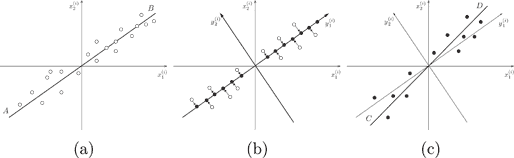

Figure 3.1

在一般多维情况下，主成分分析按照以下程序进行：

* 识别现有数据集的中心并将原点（即零阶主成分）置于该中心；
* 找到最大数据变化的方向（第一个主成分）；


*   求数据在第一主成分上的投影及其方差；
*   若方差较大，则寻找与第一主成分正交的最大变化新主方向，如此继续。

该过程允许将初始数据矩阵 `X` 的维度为 (*s* × *m*) 替换为两个矩阵 `T` 和 `P`，其维度分别为 (*s* × *k*) 和 (*k* × *s*)，其中 *k* < *m*。该表示使用新的变量得到

$$
\begin{array}{r} {{\overset{\rightarrow}{t}}^{\mspace{2mu}(j)} = {\overset{\rightarrow}{p}}^{\mspace{2mu}(j,1)}{\overset{\rightarrow}{x}}^{(1)} + \cdots + {\overset{\rightarrow}{p}}^{\mspace{2mu}(j,m)}{\overset{\rightarrow}{x}}^{(m)},\quad j = \overline{1,k},} \\ \end{array}
$$

(3.10)

其中 ${\overset{\rightarrow}{t}}^{\mspace{2mu}(j)}$ 和 ${\overset{\rightarrow}{p}}^{\mspace{2mu}(j,i)},\ i = \overline{1,m},$ 分别表示矩阵 `T` 和 `P` 的列。新的变量 (3.10) 称为 *主成分*，矩阵 `T` 称为主成分矩阵。主成分的一个重要性质在于其正交性。因此，随着主成分数量的增加，矩阵 `T` 不会被重新配置。

利用这些变量，矩阵 `X` 可以写成

$$
\begin{array}{r} {X = \hat{X} + E = {\sum\limits_{j = 1}^{k}{\overset{\rightarrow}{t}}^{(j)}}{\lbrack{\overset{\rightarrow}{p}}^{(j)}\rbrack}^{\prime} + E,\quad\quad\hat{X} = T\, P^{\prime}.} \\ \end{array}
$$

(3.11)

这里 `E` 表示维度为 (*s* × *m*) 的残差矩阵。残差误差通过残差矩阵的某种数值特征来评估，例如相对方差

$$
\begin{array}{r} {D = 1 - \frac{\sum\limits_{j = 1}^{s}{\sum\limits_{i = 1}^{m}e_{ji}^{2}}}{\sum\limits_{j = 1}^{s}{\sum\limits_{i = 1}^{m}x_{ji}^{2}}},\quad e_{ji} = x_{ji} - {\hat{x}}_{ji}.} \\ \end{array}
$$

(3.12)

存在许多用于计算主成分的递归算法，它们针对初始信息的具体情况而设计，并采用不同的数据处理方法。首先，对矩阵 `X` 进行中心化，即对每一列计算平均值

$$
\begin{array}{r} {{\overline{x}}_{j} = \frac{1}{s}{\sum\limits_{i = 1}^{m}x_{i}^{(j)}}} \\ \end{array}
$$

(3.13)

和标准差

$$
\begin{array}{r} {\sigma_{j} = \frac{1}{s}\sqrt{\sum\limits_{i = 1}^{m}{(x_{ji} - {\overline{x}}_{j})}^{2}}.} \\ \end{array}
$$

(3.14)

用于计算主成分的修正数据矩阵 `X̃` 由元素构成

$$
\begin{array}{r} {{\widetilde{x}}_{ij} = \frac{x_{ij} - {\overline{x}}_{j}}{\sigma_{j}}.} \\ \end{array}
$$

(3.15)

寻找主成分的算法包括以下步骤。

1. 选择初始向量 $\overset{\rightarrow}{t}$ (3.10)。
2. 计算 ${\overset{\rightarrow}{p}}^{\mspace{2mu}\prime} = \frac{{\overset{\rightarrow}{t}}^{\mspace{2mu}\prime}E_{j}}{{\overset{\rightarrow}{t}}^{\prime}\overset{\rightarrow}{t}}.$
3. 计算 $\overset{\rightarrow}{p} = \frac{\overset{\rightarrow}{p}}{{({\overset{\rightarrow}{p}}^{\prime}\overset{\rightarrow}{p})}^{1/2}}.$
4. 计算 $\overset{\rightarrow}{t} = \frac{E_{j}\overset{\rightarrow}{p}}{{\overset{\rightarrow}{p}}^{\prime}\overset{\rightarrow}{p}}.$
5. 利用 (3.12) 求 `D` 并返回步骤 2。

主成分的数量通过将相对方差 (3.12) 与允许误差进行比较来确定。

如前所述，矩形矩阵的奇异分解 (3.2) 与主成分分析相关联。这种关系的形式为

$$
\begin{array}{r} {T = US,\quad P = V.} \\ \end{array}
$$

(3.16)

主成分分析及其改进在大量文献中被讨论，主要应用于分类和回归问题 \[188\]。

### 3.1.3 随机投影方法

与主成分分析类似，通过随机投影进行降维涉及一个线性变换 `f`:ℝ^(*n*)→ℝ^(*k*) 对数据矩阵进行变换，并应用于对象由多维欧几里得空间中的点表示的问题 \[20\]。

随机投影方法的思想基于 Johnson–Lindenstrauss 引理 \[83\]：对于高维多维空间中的点集 `X`，存在一个维度较小但仍相当高的子空间，使得投影到该子空间上能够在平均意义上保持所有点之间的相对距离。变换的误差由值 `ε` ∈ (0, 1) 描述：

$$
\begin{array}{r} {\left( {1 - \varepsilon} \right)\left\| {x_{1} - x_{2}} \right\|^{2} \leq \left\| {f(x_{1}) - f(x_{2})} \right\|^{2} \leq \left( {1 + \varepsilon} \right)\left\| {x_{1} - x_{2}} \right\|^{2}} \\ \end{array}
$$

(3.17)

对所有向量 `x[1]`、 `x[2]` ∈ `X` 成立。

此外，原引理还给出了 `k` 的下界，即对象被投影到的子空间的维度。例如，对于 `N` 个点的集合，值 `k` 必须满足条件

$$
\begin{array}{r} {k > \frac{8\ln N}{\varepsilon^{2}}.} \\ \end{array}
$$

(3.18)

换句话说，投影子空间的最小可能维度不依赖于原始空间的维度，而仅取决于被投影对象的数量和变换误差。在各种特殊情况下，`k` 值的下界在 \[82, 86\] 中得到了改进。

考虑用于将对象从集合 `X` 投影的线性变换 `f`:ℝ^(*n*)→ℝ^(*k*)。它由维度为 [*k* × *n*] 的矩形矩阵 `R` (*k* <  < *n*) 定义，形式为

$$
\begin{array}{r} {X_{k \times N}^{RP} = R_{k \times n}X_{n \times N}.} \\ \end{array}
$$

(3.19)

事实证明，这种变换的矩阵 `R` 的元素可以由随机变量组成，这使得投影是随机的。在早期关于随机投影方法的著作 \[30, 76, 108\] 中，建议使用标准高斯分布 `N(0, 1)` 的随机变量，并构造矩阵 `R` 使其行向量正交且长度为单位。

后来在 \[8\] 中证明，矩阵 `R` 可以使用均匀分布获得，在由数据库中信息存储和整数计算决定的某些约束下。在这种情况下，建议由随机元素 `r[i j]` 组成矩阵 `R`，其形式为

$$
\begin{array}{r} {r_{ij} = \sqrt{3} \times \left\{ \begin{aligned} {+ 1} & {\text{with~probability~}\frac{1}{6},} \\ 0 & {\text{with~probability~}\frac{2}{3},} \\ {- 1} & {\text{with~probability~}\frac{1}{6}.} \\ \end{aligned}~ \right.} \\ \end{array}
$$

(3.20)

因此，为了计算投影 `X^(RP)`，需要将矩阵 `R` 和 `X` 相乘，该变换的复杂度为 𝒪(`k n N`)。在主成分分析中，投影矩阵是维度为 [*n* × *n*] 的方阵，投影变换的复杂度为 𝒪(`n² N`)。因此，就计算效率而言，对于降维，随机投影方法优于主成分分析。


此外，还要注意为加速投影而进行的现有研究。其中一条研究方向聚焦于稀疏矩阵：正如 \[20\] 中所示，如果数据矩阵 `X` 的每一列最多有 `c` 个非零分量，则变换的复杂度降低为 𝒪(`c`*`k`*`N`)。数据稀疏性对随机投影方法效率的影响已在论文 \[38, 87\] 中研究。另一种加速投影的方法基于快速 Johnson–Lindenstrauss 变换 (`FJLT`) \[9\]，即一种随机傅里叶变换。

随机投影方法用于降维的可能应用范围包括具有多维数据的广泛问题类。由于不同对象之间的相对距离在低维空间中得以保持，因此该集合的结构也得以保持，这在将对象划分为组时尤其重要，例如在分类和聚类中。因此，随机投影成为度量数据分析方法中的有效降维解决方案，例如用于聚类的 `k`-最近邻 (`kNN`) \[30\]、用于分类的支持向量机 (`SVM`) \[27\]，以及用于回归的最小二乘 (`LS`) 方法 \[116\]。

随机投影在处理大型多维稀疏数据集合时尤其有效，例如图像、文本、音频和视频数据等。在信号处理领域，专门研究使用随机投影进行数据分析和恢复的研究方向称为压缩感知；例如参见 \[29, 46\]。

无论应用领域如何，无论原始数据由多维空间中的点集表示的性质和维度如何，使用随机投影都可以降低维度同时保持数据结构。而且，随机投影方法易于解释，并且即使在高维和超高维数据的情况下也不需要显著的计算资源，这与 `PCA` 和 `SVD` 等替代降维方法形成对比。

然而，需要注意的是，随机投影仅适用于在降维数据上进行分析和计算的问题，而数据不用于可视化或恢复。例如，在图像的情况下，使用随机投影进行降维可能导致图像的视觉质量下降，无论是对人眼还是计算机视觉系统而言。

### 3.1.4 直接与逆投影

考虑所有实矩阵 `A`[( `N` × `M` )] 的空间 `R`^(`N`*`M`)，其元素取随机值。

从原始空间 `R`^(`N`*`M`) 过渡到较小维度的空间 `R`^(`N`*`m`) 会导致前者元素所包含的信息损失。为了估计这些损失，有必要通过 *逆投影* 返回到原始空间：`R`^(`N`*`m`)⇒`R`^(`N`*`M`)。该操作使用投影矩阵 `J`[( `m` × `M` )] 执行，给出矩阵 `X`[( `N` × `M` )] = `D`[( `N` × `m` )]`J`[( `m` × `M` )] ∈ `R`^(`N`*`M`)。矩阵 `X`[( `N` × `M` )] 和 `A`[( `N` × `M` )] 是同一空间的元素。因此，可以根据适当准则估计原始矩阵压缩的质量。

在下文中，数据压缩的质量取决于投影矩阵 `S`[( `N` × `m` )] 和 `J`[( `m` × `M` )]，将以熵的术语进行估计。更具体地，引入矩阵 `X`[( `N` × `M` )] 相对于矩阵 `A`[( `N` × `M` )] 的信息熵 \[139\]，

$$\\begin{array}{r} \\left. H(X\\, \\middle| \\, A) = - {\\sum\\limits\_{i = 1}^{N}{\\sum\\limits\_{j = 1}^{M}x\_{ij}}}\\ln\\frac{x\_{ij}}{a\_{ij}} = tr\\left( {X^{\\intercal}Y} \\right), \\right. \\\\ \\end{array}$$

(3.21)

其中 `tr` 表示矩阵迹，`Y` 是由元素组成的 (`N` × `M`) 维矩阵

$$\\begin{array}{r} {y\_{ij} = \\ln\\frac{x\_{ij}}{a\_{ij}}.} \\\\ \\end{array}$$

(3.22)

此后，该熵将被称为 *信息交叉熵*\[158\]。上面描述的直接-逆投影方法是随机数据矩阵压缩方法的核心。考虑一个非负数据矩阵 `U`，其维度为 (`m` × `s`)。需要将该矩阵压缩为维度为 (`n` × `r`) 的矩阵 `Z`，其中 `r` < `s` 且 `n` < `m`。该问题将分两阶段依次求解如下。首先，将矩阵 `U`[( `m` × `s` )] 降维为矩阵 `Y`[( `m` × `r` )]，然后将后者压缩为矩阵 `Z`[( `n` × `r` )]。下面提出的方法将被称为 *熵降维 (EDR) 方法*。

*阶段 1* 引入矩阵 `Q`[( `s` × `r` )] 并执行直接投影以获得列压缩矩阵

$$\\begin{array}{r} {Y\_{(m \\times r)} = U\_{(m \\times s)}Q\_{(s \\times r)}.} \\\\ \\end{array}$$

(3.23)

接下来，引入矩阵 `T`[( `r` × `s` )] 并执行逆投影，得到矩阵

$$\\begin{array}{r} {X\_{(m \\times s)} = U\_{(m \\times s)}Q\_{(s \\times r)}T\_{(r \\times s)}.} \\\\ \\end{array}$$

(3.24)

矩阵 `X`[( `m` × `s` )] 与原始矩阵 `U`[( `m` × `s` )] 具有相同的维度，并表征了阶段 1 中直接和逆投影的效果（损失）。

数据矩阵的降维伴随着其中所包含的信息损失或相对信息熵的增加 \[139\]。对于该方法的阶段 1，矩阵 `X`[( `m` × `s` )] 相对于固定原始矩阵 `U`[( `m` × `s` )] 的信息交叉熵为

$$\\begin{aligned} \\left. H\_{1}(X\\, \\middle| \\, U) \\right. & \\left. = - {\\sum\\limits\_{i = 1}^{m}{\\sum\\limits\_{j = 1}^{s}x\_{ij}}}(Q,T\\, \\middle| \\, U)\\ln\\frac{\\left. x\_{ij}(Q,T\\, \\middle| \\, U) \\right.}{u\_{ij}} = \\right. \\\\ & \\left. \\quad = H\_{1}(Q,T\\, \\middle| \\, U)\\Rightarrow\\max\_{(Q,T) \\geq 0}, \\right. \\\\ \\end{aligned}$$

(3.25)

其中，根据 (3.24)，

$$\\begin{array}{r} \\left. x\_{ij}(Q,T\\, \\middle| \\, U) = {\\sum\\limits\_{\\mu = 1}^{r}{\\sum\\limits\_{\\nu = 1}^{s}t\_{\\mu,j}}}q\_{\\nu,\\mu}u\_{i\\nu}. \\right. \\\\ \\end{array}$$

(3.26)

函数 (3.1.4) 的最大化最终得到熵最优投影矩阵 `Q`[( `s` × `r` )]^* 和压缩的第一阶段矩阵

$$\\begin{array}{r} {Y\_{(m \\times r)}^{\*} = U\_{(m \\times s)}Q\_{(s \\times r)}^{\*}.} \\\\ \\end{array}$$

(3.27)

*阶段 2* 第二阶段数据矩阵 `Y`[( `m` × `r` )] 的列数 `r` < `s` 已被降低。需要将该矩阵压缩到给定行数 `n` < `m`。引入矩阵 `B`[( `n` × `m` )] 和 `A`[( `m` × `n` )] 分别执行直接和逆投影操作，类似于阶段 1：

$$\\begin{array}{r} {Z\_{(n \\times r)} = B\_{(n \\times m)}Y\_{(m \\times r)},\\text{\\quad\\quad}G\_{(m \\times r)} = A\_{(m \\times n)}Z\_{(n \\times r)}.} \\\\ \\end{array}$$

(3.28)

矩阵 `G`[( `m` × `r` )] 与原始第二阶段矩阵 `Y`[( `m` × `r` )] 具有相同的维度，并表征了阶段 2 中直接和逆投影的效果（损失）。这些损失由信息交叉熵估计

$$\\begin{aligned} \\left. H\_{2}(G\\, \\middle| \\, Y^{\*}) \\right. & \\left. = - {\\sum\\limits\_{i = 1}^{m}{\\sum\\limits\_{j = 1}^{r}g\_{ij}}}(B,A\\, \\middle| \\, Y)\\ln\\frac{\\left. g\_{ij}(B,A\\, \\middle| \\, Y^{\*}) \\right.}{y\_{ij}} = \\right. \\\\ & \\left. \\quad H\_{2}(B,A\\, \\middle| \\, Y^{\*})\\Rightarrow\\max\_{(B,A) \\geq 0}, \\right. \\\\ \\end{aligned}$$

(3.29)

其中


$$\\begin{array}{r} \\left. g_{ij}(B,A\\, \\middle| \\, Y^{*}) = {\\sum\\limits_{\\beta = 1}^{n}{\\sum\\limits_{\\alpha = 1}^{m}a_{i,\\beta}}}b_{\\beta,\\alpha}y_{\\alpha,j}^{*} \\right. \\\\ \\end{array}$$  

(3.30)

and

$$\\begin{array}{r} {y_{\\alpha,j}^{*} = {\\sum\\limits_{eta = 1}^{s}u_{\\alpha,\\eta}}q_{\\eta,j}^{*}.} \\\\ \\end{array}$$  

(3.31)

## 3.2 序贯过程的熵优化

序贯过程的第一阶段是确定非负矩阵 `Q` 和 `T` 的最优元素：

$$\\begin{array}{r} \\left. (Q^{*},T^{*}) = \\arg\\max_{(Q,T) \\geq 0}H_{1}(Q,T\\, \\middle| \\, U). \\right. \\\\ \\end{array}$$  

(3.32)

该问题将使用基于投影梯度下降的迭代算法进行数值求解，该算法结合了标准梯度下降法和所有负元素的截断。

### 3.2.1 最优性条件和算法

函数 `H``1` 对矩阵 `Q` 和 `T` 元素的梯度分量为

$$\\begin{aligned} \\frac{\\left. \\partial H(Q,T\\, \\middle| \\, U) \\right.}{\\partial q_{\\nu,\\mu}} & {= {\\sum\\limits_{i = 1}^{m}{\\sum\\limits_{j = 1}^{s}\\frac{\\left. \\partial h_{ij}(Q,T\\, \\middle| \\, U) \\right.}{\\partial x_{ij}}}}\\frac{\\left. \\partial x_{ij}(Q,T\\, \\middle| \\, U) \\right.}{\\partial q_{\\nu,\\mu}},} \\\\ & {\\quad\\nu = \\overline{1,s},\\,\\mu = \\overline{1,r},} \\\\ \\end{aligned}$$  

(3.33)

$$\\begin{aligned} \\frac{\\left. \\partial H(Q,T\\, \\middle| \\, U) \\right.}{\\partial t_{\\mu,j}} & {= {\\sum\\limits_{i = 1}^{s}{\\sum\\limits_{j = 1}^{m}\\frac{\\left. \\partial h_{ij}(Q,T\\, \\middle| \\, U) \\right.}{\\partial x_{ij}}}}\\frac{\\left. \\partial x_{ij}(Q,T\\, \\middle| \\, U) \\right.}{\\partial t_{\\mu,j}},} \\\\ & {\\quad\\mu = \\overline{1,r},\\, j = \\overline{1,s},} \\\\ \\end{aligned}$$  

(3.34)

其中

$$\\begin{aligned} & \\left. h_{ij}(T,Q\\, \\middle| \\, X) = x_{ij}\\ln\\frac{x_{ij}}{u_{ij}}, \\right. \\\\ & {\\frac{\\left. \\partial h_{ij}(T,Q\\, \\middle| \\, X) \\right.}{\\partial x_{ij}} = \\ln\\frac{x_{ij}}{u_{ij}} + 1,\\text{\\quad\\quad}i = \\overline{1,m},\\, j = \\overline{1,s};} \\\\ \\end{aligned}$$  

(3.35)

$$\\begin{aligned} \\frac{\\left. \\partial x_{ij}((Q,T\\, \\middle| \\, U)) \\right.}{\\partial q_{\\nu,\\mu}} & {= t_{\\mu,j}\\, u_{i,\\nu},\\text{\\quad\\quad}\\nu = \\overline{1,s},\\mu = \\overline{1,r};} \\\\ \\frac{\\left. \\partial x_{ij}((Q,T\\, \\middle| \\, U)) \\right.}{\\partial t_{\\mu,j}} & {= {\\sum\\limits_{\\nu = 1}^{s}q_{\\nu,\\mu}}u_{i,\\nu},\\text{\\quad\\quad}\\mu = \\overline{1,r};} \\\\ i & {= \\overline{1,m},\\quad j = \\overline{1,s}.} \\\\ \\end{aligned}$$  

(3.36)

对矩阵 `Q` 和 `T` 进行 *向量化*（参见 [115]) 以得到相应的向量 `q` 和 `t`。用 `∇Q` 表示信息交叉熵泛函 `H(Q,T | U)` 的梯度，其分量为 (3.2.2)，用 `∇T` 表示信息交叉熵泛函 `H(Q,T | U)` 的梯度，其分量为 (3.33–3.36)。

算法 `max H[1]` 具有以下结构。

* *a). 初始步骤：*

$$\\begin{array}{r} {\\mathbf{q}^{0} > \\mathbf{0},\\quad\\mathbf{t}^{0} > \\mathbf{0}.} \\\\ \\end{array}$$

* *b). 第 n 次迭代步骤：*

$$\\begin{array}{r} {X^{n} = U\\, Q^{n}\\, T^{n},} \\\\ \\end{array}$$

$$\\begin{array}{r} \\left. H(Q^{n},T^{n}\\, \\middle| \\, U) = {\\sum\\limits_{i = 1}^{m}{\\sum\\limits_{j = 1}^{r}x_{ij}^{n}}}\\ln\\frac{x_{ij}^{n}}{u_{ij}} = H^{n}; \\right. \\\\ \\end{array}$$

$$\\begin{array}{r} {\\mathbf{q}^{(n + 1)} = \\left\\{ \\begin{array}{r} {\\mathbf{q}^{n} + \\gamma_{\\mathbf{q}}\\nabla_{Q}(\\mathbf{q}^{n},\\mathbf{t}^{n})\\text{if}\\,\\mathbf{q}^{(n + 1)} \\geq \\mathbf{0},} \\\\ {\\mathbf{q}^{n}\\text{if}\\,\\mathbf{q}^{(n + 1)} < \\mathbf{0};} \\\\ \\end{array}~ \\right.} \\\\ \\end{array}$$

$$\\begin{array}{r} \\left. \\text{\\quad\\quad}\\mathbf{q}^{(n + 1)}\\Rightarrow Q^{(n + 1)}; \\right. \\\\ \\end{array}$$

$$\\begin{array}{r} {\\mathbf{t}^{(n + 1)} = \\left\\{ \\begin{array}{r} {\\mathbf{t}^{n} + \\gamma_{\\mathbf{t}}\\nabla_{T}(\\mathbf{q}^{n},\\mathbf{t}^{n})\\text{if}\\,\\mathbf{t} \\geq \\mathbf{0},} \\\\ {\\mathbf{t}^{n}\\text{if}\\,\\mathbf{t}^{(n + 1)} < \\mathbf{0}.} \\\\ \\end{array}~ \\right.} \\\\ \\end{array}$$

$$\\begin{array}{r} \\left. \\text{\\quad\\quad}\\mathbf{t}^{(n + 1)}\\Rightarrow T^{(n + 1)}; \\right. \\\\ \\end{array}$$

$$\\begin{array}{r} {X^{(n + 1)} = U\\, Q^{(n + 1)}\\, T^{(n + 1)};} \\\\ \\end{array}$$

$$\\begin{array}{r} \\left. H(Q^{(n + 1)},T^{(n + 1)}\\, \\middle| \\, U) = {\\sum\\limits_{i = 1}^{m}{\\sum\\limits_{j = 1}^{r}x_{ij}^{(n + 1)}}}\\ln\\frac{x_{ij}^{(n + 1)}}{u_{ij}} = H^{(n + 1)}. \\right. \\\\ \\end{array}$$

* *c). 停止条件：*

$$\\begin{array}{r} {\\text{If}\\,\\, H^{(n + 1)} - H^{(n)} \\leq \\delta,\\,\\text{then}\\, STOP.} \\\\ \\end{array}$$

### 3.2.2 信息交叉熵泛函的近似

在某些情况下，缩减矩阵 `Q` 的元素可通过在点 `x[0] = a` 邻域内对数函数的近似以足够精度确定，其中 `a ≥ a[min]`：

$$\\begin{array}{r} {\\ln x < \\ln a + \\frac{1}{a_{min}}(x - a).} \\\\ \\end{array}$$  

(3.37)

对于 `a = x[ij]`，该公式给出信息交叉熵泛函的以下近似表达式：

$$\\begin{aligned} \\left. H_{1}(Q,T\\, \\middle| \\, U) \\approx \\sum_{i = 1}^{s}\\sum_{j = 1}^{m} \\right. & {\\left\\lbrack x_{ij}^{2}(Q,T\\, \\middle| \\, U) - x_{ij}(Q,T\\, \\middle| \\, U)u_{ij} \\right\\rbrack =} \\\\ & \\left. \\widetilde{H}(Q,T\\, \\middle| \\, U). \\right. \\\\ \\end{aligned}$$  

(3.38)

该等式可写成矩阵形式

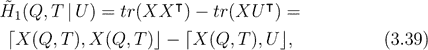

其中 ⌈`A`, `B`⌋ 表示 Frobenius 内积 [115]，

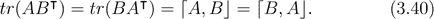

矩阵 `Q` 和 `T` 的元素将在固定数据矩阵 `U` 下，在所有非负矩阵 `Q` 和 `T` 的集合上最小化泛函 `H̃1`，即

$$\\begin{array}{r} \\left. ({\\widetilde{Q}}^{*},{\\widetilde{T}}^{*}) = \\arg\\min_{(Q,T) \\geq 0}{\\widetilde{H}}_{1}(Q,T\\, \\middle| \\, U). \\right. \\\\ \\end{array}$$  

(3.41)

该问题通过涉及泛函 `H̃1` 对矩阵 `Q` 和 `T` 的梯度分量的算法求解。

利用上述矩阵微分规则，推导出泛函 `H̃1` (3.41) 的梯度的以下表达式：

$$\\begin{array}{r} {\\bigtriangleup_{Q}(Q,T) = \\frac{\\left. \\partial{\\widetilde{H}}_{1}(Q,T\\, \\middle| \\, U) \\right.}{\\partial X}\\frac{\\partial X}{\\partial Q} = 2TPQT - TP,} \\\\ \\end{array}$$  

(3.42)

$$\\begin{array}{r} {\\bigtriangleup_{T}(Q,T) = \\frac{\\left. \\partial{\\widetilde{H}}_{1}(Q,T\\, \\middle| \\, U) \\right.}{\\partial X}\\frac{\\partial X}{\\partial T} = 2Q^{\\intercal}PQT - Q^{\\intercal}P,} \\\\ \\end{array}$$  

(3.43)

其中 `P = X X^⊺` 且 `△Q` 和 `△T` 分别表示对矩阵 `Q` 和 `T` 的梯度。根据 (3.42, 3.43)，函数 `H̃(Q,T | U)` 对矩阵 `Q` 和 `T` 的梯度是维度为 (`s × r`) 的矩阵。

为最大化泛函 `H̃1`，应用带非负性检查的梯度下降法，其中对矩阵 `U` 和 `T` 进行非负性检查。

算法 `max H̃[1]` 具有以下结构。

* *a) 初始步骤：*

$$\\begin{array}{r} {T^{0} > 0,\\quad Q^{0} > 0.} \\\\ \\end{array}$$

* *b) 第 n 次迭代步骤：*


$$\\begin{array}{r} {X^{n} = U\\, Q^{n}\\, T^{n},} \\\\ \\end{array}$$  

$$\\begin{array}{r} \\left. H(Q^{n},T^{n}\\, \\middle| \\, U) = {\\sum\\limits\_{i = 1}^{m}{\\sum\\limits\_{j = 1}^{r}x\_{ij}^{n}}}\\ln\\frac{x\_{ij}^{n}}{u\_{ij}} = H^{n}; \\right. \\\\ \\end{array}$$  

$$\\begin{array}{r} {Q^{(n + 1)} = \\left\\{ \\begin{aligned} \\left. Q^{n} + \\gamma\_{Q} \\bigtriangleup\_{Q}(\\widetilde{H}(Q^{n},T^{n}\\, \\middle| \\, U) \\geq 0 \\right. & {\\text{if~}Q^{(n + 1)} \\geq 0,} \\\\ Q^{n} & {\\text{if~}Q^{(n + 1)} < 0;} \\\\ \\end{aligned}~ \\right.} \\\\ \\end{array}$$  

$$\\begin{array}{r} {T^{(n + 1)} = \\left\\{ \\begin{aligned} \\left. T^{n} + \\gamma\_{T} \\bigtriangleup\_{T}(\\widetilde{H}(Q^{n},T^{n}\\, \\middle| \\, U) \\geq 0 \\right. & {\\text{if~}T^{(n + 1)} \\geq 0,} \\\\ T^{n} & {\\text{if~}T^{(n + 1)} < 0;} \\\\ \\end{aligned}~ \\right.} \\\\ \\end{array}$$  

$$\\begin{array}{r} {X^{(n + 1)} = U\\, Q^{(n + 1)}\\, T^{(n + 1)};} \\\\ \\end{array}$$  

$$\\begin{array}{r} \\left. H(Q^{(n + 1)},T^{(n + 1)}\\, \\middle| \\, U) = {\\sum\\limits\_{i = 1}^{m}{\\sum\\limits\_{j = 1}^{r}x\_{ij}^{(n + 1)}}}\\ln\\frac{x\_{ij}^{(n + 1)}}{u\_{ij}} = H^{(n + 1)}. \\right. \\\\ \\end{array}$$  

*c) 停止条件：*

$$\\begin{array}{r} {\\text{If}\\,\\, H^{(n + 1)} - H^{n} \\leq \\delta,\\,\\,\\text{then}\\, STOP.} \\\\ \\end{array}$$  

算法 **max *H*[1]** 或 **max *H̃*[1]** 给出熵最优的投影矩阵 `Q`((*s* × *r*) )^(*). 因此，可以确定矩阵 `Y`((*m* × *r*) )^(*) (1.5) 以传递到矩阵 `U` 的压缩过程的第二阶段，该过程由投影矩阵 `B`((*n* × *m*)) 和 `A`((*m* × *n*)) 刻画。

非负矩阵 `B` 和 `A` 的最优元素由下式给出

$$\\begin{array}{r} \\left. (B^{\*},A^{\*}) = \\arg\\max\_{(B,A) \\geq 0}H\_{2}(B,A\\, \\middle| \\, Y^{\*}). \\right. \\\\ \\end{array}$$  

(3.44)

与第一阶段类似，该问题将使用基于投影梯度下降的迭代算法求解（梯度下降与所有负元素截断的组合）。

函数 `H2` 相对于矩阵 `B` 和 `A` 的元素的梯度具有分量

$$\\begin{aligned} \\frac{\\left. \\partial H\_{2}(B,A\\, \\middle| \\, Y^{\*}) \\right.}{\\partial a\_{i,\\beta}} & {= {\\sum\\limits\_{i = 1}^{m}{\\sum\\limits\_{j = 1}^{r}\\frac{\\left. \\partial s\_{ij}(B,A\\, \\middle| \\, Y^{\*}) \\right.}{\\partial g\_{ij}}}}\\frac{\\left. \\partial g\_{ij}(B,A\\, \\middle| \\, Y^{\*}) \\right.}{\\partial a\_{i,\\beta}},} \\\\ & {\\quad i = \\overline{1,n},\\, j = \\overline{1,r},\\,\\beta = \\overline{1,n},} \\\\ \\end{aligned}$$  

(3.45)

$$\\begin{aligned} \\frac{\\left. \\partial H\_{2}(B,A\\, \\middle| \\, Y^{\*}) \\right.}{\\partial b\_{\\beta,\\alpha}} & {= {\\sum\\limits\_{i = 1}^{m}{\\sum\\limits\_{j = 1}^{r}\\frac{\\left. \\partial s\_{ij}(B,A\\, \\middle| \\, Y^{\*}) \\right.}{\\partial g\_{ij}}}}\\frac{\\left. \\partial g\_{ij}(B,A\\, \\middle| \\, Y^{\*}) \\right.}{\\partial b\_{\\beta,\\alpha}},} \\\\ {i =} & {\\overline{1,n},\\, j = \\overline{1,r},\\,\\beta = \\overline{1,n},\\,\\alpha = \\overline{1,m},} \\\\ \\end{aligned}$$  

(3.46)

其中

$$\\begin{array}{r} {\\frac{\\left. \\partial s\_{ij}(B,A\\, \\middle| \\, Y^{\*}) \\right.}{\\partial g\_{ij}} = \\ln\\frac{g\_{ij}}{y\_{ij}^{\*}} + 1,\\text{\\quad\\quad}i = \\overline{1,n},\\, j = \\overline{1,r};} \\\\ \\end{array}$$  

(3.47)

$$\\begin{aligned} \\frac{\\left. \\partial g\_{ij}((B,A\\, \\middle| \\, Y^{\*})) \\right.}{\\partial a\_{i,\\beta}} & {= {\\sum\\limits\_{\\alpha = 1}^{m}b\_{\\beta,\\alpha}}y\_{\\alpha,j}^{\*},\\text{\\quad\\quad}\\beta = \\overline{1,n};} \\\\ \\frac{\\left. \\partial g\_{ij}((B,A\\, \\middle| \\, Y^{\*})) \\right.}{\\partial b\_{\\beta,\\alpha}} & {= a\_{i,\\beta}y\_{\\alpha,j}^{\*},\\text{\\quad\\quad}\\beta = \\overline{1,n},\\alpha = \\overline{1,m};} \\\\ i & {= \\overline{1,m},\\quad j = \\overline{1,r}.} \\\\ \\end{aligned}$$  

(3.48)

对矩阵 `B` 和 `A` 进行 *向量化*，并引入相应的向量 `b` 和 `a`。用 `∇B` 表示相对信息熵 `H2` 的梯度，其分量为 (3.46–3.48)，用 `∇A` 表示相对熵泛函 `H2` 的梯度，其分量为 (3.48)。

算法 **max *H*[2]** 具有以下结构。

*a) 初始步骤：*

$$\\begin{array}{r} {\\mathbf{b}^{0} > \\mathbf{0},\\quad\\mathbf{a}^{0} > \\mathbf{0}.} \\\\ \\end{array}$$  

*b) 第 n 次迭代步骤：*

$$\\begin{array}{r} {G^{n} = A^{n}B^{n}Y^{\*},} \\\\ \\end{array}$$  

$$\\begin{array}{r} \\left. H(B^{n},A^{n}\\, \\middle| \\, Y^{\*}) = {\\sum\\limits\_{i = 1}^{n}{\\sum\\limits\_{j = 1}^{r}g\_{ij}^{n}}}\\ln\\frac{g\_{ij}^{n}}{y\_{ij}^{\*}} = H^{n}; \\right. \\\\ \\end{array}$$  

$$\\begin{array}{r} {\\mathbf{b}^{(n + 1)} = \\left\\{ \\begin{array}{r} {\\mathbf{b}^{n} + \\gamma\_{\\mathbf{b}}\\nabla\_{B}(\\mathbf{b}^{n},\\mathbf{a}^{n})\\text{if}\\,\\mathbf{b}^{(n + 1)} \\geq \\mathbf{0},} \\\\ {\\mathbf{b}^{n}\\text{if}\\,\\mathbf{b}^{(n + 1)} < \\mathbf{0};} \\\\ \\end{array}~ \\right.} \\\\ \\end{array}$$  

$$\\begin{array}{r} \\left. \\text{\\quad\\quad}\\mathbf{b}^{(n + 1)}\\Rightarrow Q^{(n + 1)}; \\right. \\\\ \\end{array}$$  

$$\\begin{array}{r} {\\mathbf{a}^{(n + 1)} = \\left\\{ \\begin{array}{r} {\\mathbf{a}^{n} + \\gamma\_{\\mathbf{a}}\\nabla\_{A}(\\mathbf{b}^{n},\\mathbf{a}^{n})\\text{if}\\,\\mathbf{a} \\geq \\mathbf{0},} \\\\ {\\mathbf{a}^{n}\\text{if}\\,\\mathbf{a}^{(n + 1)} < \\mathbf{0};} \\\\ \\end{array}~ \\right.} \\\\ \\end{array}$$  

$$\\begin{array}{r} \\left. \\text{\\quad\\quad}\\mathbf{a}^{(n + 1)}\\Rightarrow A^{(n + 1)}; \\right. \\\\ \\end{array}$$  

$$\\begin{array}{r} {G^{(n + 1)} = A^{(n + 1)}B^{(n + 1)}Y^{\*};} \\\\ \\end{array}$$  

$$\\begin{array}{r} \\left. H(B^{(n + 1)},A^{(n + 1)}\\, \\middle| \\, Y^{\*}) = {\\sum\\limits\_{i = 1}^{n}{\\sum\\limits\_{j = 1}^{r}g\_{ij}^{(n + 1)}}}\\ln\\frac{g\_{ij}^{(n + 1)}}{y\_{ij}^{\*}} = H^{(n + 1)}. \\right. \\\\ \\end{array}$$  

*c) 停止条件：*

$$\\begin{array}{r} {\\text{If}\\,\\, H^{(n + 1)} - H^{(n)} \\leq \\delta,\\,\\,\\text{then}\\, STOP.} \\\\ \\end{array}$$  

## 3.3 并行过程的熵优化

### 3.3.1 定义和结构

直接-逆投影过程的并行实现导致矩阵等式

$$\\begin{array}{r} {U\_{(m \\times s)}Q\_{s \\times r} = Y\_{(m \\times r)},\\quad B\_{(n \\times m)}Y\_{(m \\times r)} = Z\_{(n \\times r)},} \\\\ {Z\_{(n \\times r)}W\_{(r \\times s)} = D\_{(n \\times s)},\\quad E\_{(m \\times n)}D\_{(n \\times s)} = X\_{(m \\times s)}.} \\\\ \\end{array}$$  

(3.49)

这些公式中的第一链，涉及用矩阵 `Q`((*s* × *r*)) 的直接投影和用矩阵 `B`((*n* × *m*)) 的逆投影，得出缩减矩阵 `Z`((*n* × *r*))。第二链，涉及用矩阵 `W`((*r* × *s*)) 的直接投影和用矩阵 `E`((*m* × *n*)) 的逆投影，得出矩阵 `X`((*m* × *s*))。

由等式 (3.49) 可得

$$\\begin{array}{r} {X\_{(m \\times s)} = E\_{(m \\times n)}\\left\\{ {\\left\\lbrack {B\_{(n \\times m)}\\left( {U\_{(m \\times s)}Q\_{(s \\times r)}} \\right)} \\right\\rbrack W\_{(r \\times s)}} \\right\\}.} \\\\ \\end{array}$$  

(3.50)

这里圆括号、方括号和花括号表示投影操作的顺序。矩阵 `X`((*m* × *s*)) 的元素具有形式


$$\\begin{array}{r} {x\_{ij} = {\\sum\\limits\_{\\mu = 1}^{n}e\_{i,\\mu}}{\\sum\\limits\_{\\nu = 1}^{r}w\_{\\nu,j}}{\\sum\\limits\_{\\beta = 1}^{m}b\_{\\mu,\\beta}}{\\sum\\limits\_{\\alpha = 1}^{s}u\_{\\beta,\\alpha}}q\_{\\alpha,\\nu},\\text{\\quad\\quad}i = \\overline{1,m},\\, j = \\overline{1,s}.} \\\\ \\end{array}$$

(3.51)

### 3.3.2 最优性条件与算法

为衡量变换后矩阵 `X`(*m* × *s*) 与原始矩阵 `U`(*m* × *s*) 的偏差，选择 *信息交叉熵*

$$\\begin{array}{r} \\left. \\mathcal{H}(X\\, \\middle| \\, U) = - {\\sum\\limits\_{i = 1}^{m}{\\sum\\limits\_{j = 1}^{s}s\_{ij}}}(X\\, \\middle| \\, U), \\right. \\\\ \\end{array}$$

(3.52)

其中

$$\\begin{array}{r} {s\_{ij} = x\_{ij}\\ln\\frac{x\_{ij}}{u\_{ij}}.} \\\\ \\end{array}$$

(3.53)

由于 (3.51)，信息交叉熵 (3.52) 是矩阵 (`Q`, `B`, `W`, `E`) ≥ 0 的标量函数，即

$$\\begin{array}{r} {\\mathcal{H} = \\mathcal{H}(Q,B,W,E).} \\\\ \\end{array}$$

(3.54)

矩阵的最优元素通过最大化函数 `ℋ` 得到：

$$\\begin{array}{r} {(Q^{\*},B^{\*},W^{\*},E^{\*}) = \\arg\\max\_{(Q,B,W,E) \\geq 0}\\mathcal{H}(Q,B,W,E).} \\\\ \\end{array}$$

(3.55)

该问题将使用投影梯度下降的坐标式方案求解。

在并行程序中，有一对矩阵 (`Q`, `B`) 用于相对于第一个变量 (*r* < *s*) 降低原始矩阵 `U`，以及一对矩阵 (`W`, `E`) 用于相对于第二个变量 (*n* < *m*) 压缩矩阵 `U`。坐标式投影梯度下降方案中的每个迭代步由两个子步组成，分别与 (`Q`, `B`)-梯度上的迭代和 (`W`, `E`)-梯度上的迭代相关。

根据 (3.51–3.53)，函数 `ℋ`(`Q`, `B`, `W`, `E`) 的梯度具有分量

$$\\begin{array}{r} {\\frac{\\partial\\mathcal{H}}{\\partial q\_{\\alpha,\\nu}} = {\\sum\\limits\_{i = 1}^{m}{\\sum\\limits\_{j = 1}^{s}\\frac{\\partial s\_{ij}}{\\partial x\_{ij}}}}\\,\\frac{\\partial x\_{ij}}{\\partial q\_{\\alpha,\\nu}},} \\\\ {\\frac{\\partial\\mathcal{H}}{\\partial b\_{\\mu,\\beta}} = {\\sum\\limits\_{i = 1}^{m}{\\sum\\limits\_{j = 1}^{s}\\frac{\\partial s\_{ij}}{\\partial x\_{ij}}}}\\,\\frac{\\partial x\_{ij}}{\\partial b\_{\\mu,\\beta}},} \\\\ {\\frac{\\partial\\mathcal{H}}{\\partial w\_{\\nu,j}} = {\\sum\\limits\_{i = 1}^{m}{\\sum\\limits\_{j = 1}^{s}\\frac{\\partial s\_{ij}}{\\partial x\_{ij}}}}\\,\\frac{\\partial x\_{ij}}{\\partial w\_{\\nu,j}},} \\\\ {\\frac{\\partial\\mathcal{H}}{\\partial e\_{i,\\mu}} = {\\sum\\limits\_{i = 1}^{m}{\\sum\\limits\_{j = 1}^{s}\\frac{\\partial s\_{ij}}{\\partial x\_{ij}}}}\\,\\frac{\\partial x\_{ij}}{\\partial e\_{i,\\mu}},} \\\\ \\end{array}$$

(3.56)

其中

$$\\begin{aligned} & {\\frac{\\partial s\_{ij}}{\\partial x\_{ij}} = \\ln\\frac{x\_{ij}}{u\_{ij}} + 1,} \\\\ & {\\frac{\\partial x\_{ij}}{\\partial q\_{\\alpha,\\nu}} = w\_{\\nu,j}{\\sum\\limits\_{\\mu = 1}^{n}e\_{i,\\mu}}{\\sum\\limits\_{\\beta = 1}^{m}b\_{\\mu,\\beta}}u\_{\\beta,\\alpha},\\text{\\quad\\quad}\\alpha = \\overline{1,s},\\,\\nu = \\overline{1,r};} \\\\ & {\\frac{\\partial x\_{ij}}{\\partial b\_{\\mu,\\beta}} = e\_{i,\\mu}{\\sum\\limits\_{\\nu = 1}^{r}w\_{\\nu,j}}{\\sum\\limits\_{\\alpha = 1}^{s}u\_{\\beta,\\alpha}}q\_{\\alpha,\\nu},\\text{\\quad\\quad}\\mu = \\overline{1,n},\\,\\beta = \\overline{1,s};} \\\\ & {\\frac{\\partial x\_{ij}}{\\partial w\_{\\nu,j}} = {\\sum\\limits\_{\\mu = 1}^{n}e\_{i,\\mu}}{\\sum\\limits\_{\\beta = 1}^{m}b\_{\\mu,\\beta}}{\\sum\\limits\_{\\alpha = 1}^{s}u\_{\\beta,\\alpha}}q\_{\\alpha,\\nu},} \\\\ & {\\frac{\\partial x\_{ij}}{\\partial e\_{i,\\mu}} = {\\sum\\limits\_{\\nu = 1}^{r}w\_{\\nu,j}}{\\sum\\limits\_{\\beta = 1}^{m}b\_{\\mu,\\beta}}{\\sum\\limits\_{\\alpha = 1}^{s}u\_{\\beta,\\alpha}}q\_{\\alpha,\\nu},\\text{\\quad\\quad}\\mu = \\overline{1,n}.} \\\\ \\end{aligned}$$

(3.57)

应用 *矩阵向量化*，过渡到相应的向量 `q`、`b`、`w` 和 `e`。用 `∇[q]`、`∇[b]`、`∇[w]` 和 `∇[e]` 表示相对于这些向量的梯度的分量。

算法 `max ℋ` 具有以下结构。

* *a) 初始步：*

$$\\begin{array}{r} {\\mathbf{q}^{0} > \\mathbf{0},\\quad\\mathbf{b}^{0} > \\mathbf{0},\\quad\\mathbf{w}^{0} > 0,\\quad\\mathbf{e}^{0} > 0.} \\\\ \\end{array}$$

* *b) 第 n 次迭代步：*

$$\\begin{array}{r} {X^{n} = E^{n}\\left\\{ {\\left\\lbrack {B^{n}\\left( {UQ^{n}} \\right)} \\right\\rbrack W^{n}} \\right\\},} \\\\ \\end{array}$$

$$\\begin{array}{r} {\\mathcal{H}^{n} = {\\sum\\limits\_{i = 1}^{m}{\\sum\\limits\_{j = 1}^{s}x\_{ij}^{n}}}\\ln\\frac{x\_{ij}^{n}}{u\_{ij}};} \\\\ \\end{array}$$

$$\\begin{array}{r} {\\mathbf{q}^{(n + 1)} = \\left\\{ \\begin{array}{r} {\\mathbf{q}^{n} + \\gamma\_{\\mathbf{q}}\\nabla\_{\\mathbf{q}}(\\mathbf{q}^{n},\\mathbf{b}^{n},\\mathbf{w}^{n},\\mathbf{e}^{n})\\,\\text{if}\\,\\mathbf{q} \\geq \\mathbf{0},} \\\\ {\\mathbf{q}^{n}\\,\\text{if}\\,\\mathbf{q}^{(n + 1)} < \\mathbf{0};} \\\\ \\end{array}~ \\right.} \\\\ \\end{array}$$

$$\\begin{array}{r} \\left. \\text{\\quad\\quad}\\mathbf{q}^{(n + 1)}\\Rightarrow Q^{(n + 1)}; \\right. \\\\ \\end{array}$$

$$\\begin{array}{r} {\\mathbf{b}^{(n + 1)} = \\left\\{ \\begin{array}{r} {\\mathbf{b}^{n} + \\gamma\_{\\mathbf{b}}\\nabla\_{\\mathbf{b}}(\\mathbf{q}^{n},\\mathbf{b}^{n},\\mathbf{w}^{n},\\mathbf{e}^{n})\\,\\text{if}\\,\\mathbf{b}^{(n + 1)} \\geq \\mathbf{0},} \\\\ {\\mathbf{b}^{n}\\text{if}\\,\\mathbf{b}^{(n + 1)} < \\mathbf{0};} \\\\ \\end{array}~ \\right.} \\\\ \\end{array}$$

$$\\begin{array}{r} \\left. \\text{\\quad\\quad}\\mathbf{b}^{(n + 1)}\\Rightarrow B^{(n + 1)}; \\right. \\\\ \\end{array}$$

$$\\begin{array}{r} {\\mathbf{w}^{(n + 1)} = \\left\\{ \\begin{array}{r} {\\mathbf{w}^{n} + \\gamma\_{\\mathbf{w}}\\nabla\_{\\mathbf{w}}(\\mathbf{q}^{(n + 1)},\\mathbf{b}^{(n + 1)},\\mathbf{w}^{n},\\mathbf{e}^{n})\\,\\text{if}\\,\\mathbf{w} \\geq \\mathbf{0},} \\\\ {\\mathbf{w}^{n}\\text{if}\\,\\mathbf{w}^{(n + 1)} < \\mathbf{0};} \\\\ \\end{array}~ \\right.} \\\\ \\end{array}$$

$$\\begin{array}{r} \\left. \\text{\\quad\\quad}\\mathbf{w}^{(n + 1)}\\Rightarrow W^{(n + 1)}; \\right. \\\\ \\end{array}$$

$$\\begin{array}{r} {\\mathbf{e}^{(n + 1)} = \\left\\{ \\begin{array}{r} {\\mathbf{e}^{n} + \\gamma\_{\\mathbf{e}}\\nabla\_{\\mathbf{e}}(\\mathbf{q}^{(n + 1)},\\mathbf{b}^{(n + 1)},\\mathbf{w}^{n},\\mathbf{e}^{n})\\,\\text{if}\\,\\mathbf{e}^{(n + 1)} \\geq \\mathbf{0},} \\\\ {\\mathbf{e}^{n}\\text{if}\\,\\mathbf{e}^{(n + 1)} < \\mathbf{0};} \\\\ \\end{array}~ \\right.} \\\\ \\end{array}$$

$$\\begin{array}{r} \\left. \\text{\\quad\\quad}\\mathbf{e}^{(n + 1)}\\Rightarrow E^{(n + 1)}; \\right. \\\\ \\end{array}$$

$$\\begin{array}{r} {X^{(n + 1)} = E^{(n + 1)}\\left\\{ {\\left\\lbrack {B^{(n + 1)}\\left( {UQ^{(n + 1)}} \\right)} \\right\\rbrack W^{(n + 1)}} \\right\\};} \\\\ \\end{array}$$

$$\\begin{array}{r} {\\mathcal{H}^{(n + 1)} = {\\sum\\limits\_{i = 1}^{m}{\\sum\\limits\_{j = 1}^{s}x\_{ij}^{(n + 1)}}}\\ln\\frac{x\_{ij}^{(n + 1)}}{u\_{ij}}.} \\\\ \\end{array}$$

* *c) 停止条件：*

$$\\begin{array}{r} {\\text{If}\\,\\,\\mathcal{H}^{(n + 1)} - \\mathcal{H}^{(n)} \\leq \\delta,\\,\\text{then}\\, STOP.} \\\\ \\end{array}$$

## 3.4 在矩阵范数和信息容量约束下熵的降低

在应用数据矩阵的熵降低时，希望得到具有确定性质的降维矩阵。就 EDR 方法而言，这意味着对投影矩阵的类引入一些限制，这间接影响得到的降维矩阵。考虑投影矩阵的一些有用特征。


### 1. 矩阵的 Frobenius 范数

上面，已假设直接 `Q` 和逆 `T` 投影矩阵具有非负元素。这种假设是由于使用交叉熵来表征它们之间的“距离”。然而，在应用相关机器学习问题中，缩小投影矩阵的类通常是有意义的。这可以通过考虑 Frobenius 矩阵范数来实现：

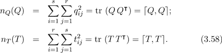

### 2. 数据矩阵的信息容量

在降维过程中，数据矩阵中包含的部分信息会丢失。因此，应该以某种方式对其进行度量。引入非负矩阵 `A[n × q]` 的 *信息容量* `ℐ(A)` 的概念，其由下式给出

$$\begin{array}{r} {\mathcal{I}(A) = {\sum\limits_{i = 1}^{n}{\sum\limits_{j = 1}^{q}a_{ij}}}\ln a_{ij}.} \\ \\ \end{array}$$

(3.59)

显然，信息容量对应于取相反符号的熵。

### 3. 交叉熵约减算法

数据矩阵的降维过程是最小化交叉熵：

$$\begin{array}{r} \left. H(Q,T\, \middle| \, U)\Rightarrow\min\limits_{Q,T}, \right. \\ \\ \end{array}$$

(3.60)

其中

$$\begin{array}{r} \left. H(Q,T\, \middle| \, U) = {\sum\limits_{i = 1}^{m}{\sum\limits_{j = 1}^{s}x_{ij}}}(Q,T\, \middle| \, U)\ln\frac{\left. x_{ij}(Q,T\, \middle| \, U) \right.}{u_{ij}}, \right. \\ \\ \end{array}$$

(3.61)

$$\begin{array}{r} \left. x_{ij}(Q,T\, \middle| \, U) = {\sum\limits_{\mu = 1}^{r}{\sum\limits_{\nu = 1}^{s}t_{\mu,j}}}q_{\nu,\mu}u_{i,\nu},\text{\quad\quad}i = \overline{1,m};\, j = \overline{1,s}, \right. \\ \\ \end{array}$$

(3.62)

受以下约束条件限制：

* —投影矩阵的非负值，

$$\begin{array}{r} {Q \geq 0,\text{\quad\quad}T \geq 0;} \\ \\ \end{array}$$

(3.63)

* —投影矩阵范数的上界（`a`, `b`），

$$\begin{array}{r} {n_{Q}(Q) = {\sum\limits_{i = 1}^{s}{\sum\limits_{j = 1}^{r}q_{ij}^{2}}} \leq a,\quad n_{T}(T) = {\sum\limits_{i = 1}^{r}{\sum\limits_{j = 1}^{s}t_{ij}^{2}}} \leq b;} \\ \\ \end{array}$$

(3.64)

* —信息容量的 `δ`-可容许减小，

$$\begin{array}{r} {\frac{\left. \mathcal{I}(U) - \mathcal{I}(Y(Q \middle| U)) \right.}{\mathcal{I}(U)} \leq \delta.} \\ \\ \end{array}$$

(3.65)

在此不等式中，

$$\begin{array}{r} \left. \mathcal{I}(Y(Q\, \middle| \, U)) = {\sum\limits_{i = 1}^{m}{\sum\limits_{j = 1}^{r}y_{ij}}}(Q\, \middle| \, U)\ln y_{ij}(Q\, \middle| \, U), \right. \\ \\ \end{array}$$

(3.66)

$$\begin{array}{r} \left. y_{ij}(Q\, \middle| \, U) = {\sum\limits_{\nu = 1}^{s}u_{i,\nu}}q_{\nu,j}. \right. \\ \\ \end{array}$$

(3.67)

由于目标函数（熵-双线性形式）的性质以及由二次熵不等式指定的约束，交叉熵约减问题 (3.60)–(3.64) 是非凸的；详情参见 [134, 171]。因此，存在一定（先验未知）的局部最优解个数，该问题应作为全局优化问题处理。

将问题 (3.60)–(3.64) 视为非负象限 `R+` 上的局部最小化问题。这里变量是矩阵 `Q` 和 `T` 的元素，每个矩阵包含 `rs` 个条目。利用 *矩阵向量化*，即通过行顺序连接过渡到复向量，构造对应于矩阵 `Q`、`T` 和 `U` 的向量 `q`、`t` 和 `u`。然后交叉熵最小化问题可以表示为

$$\begin{array}{r} \left. \mathcal{H}(\mathbf{q},\mathbf{t}\, \middle| \,\mathbf{u})\Rightarrow\min, \right. \\ \\ \end{array}$$

(3.68)

$$\begin{aligned} & {(\mathbf{q},\mathbf{t}) \in R_{+}^{(2sr)},} \\ & {N_{Q}(\mathbf{q}) = - {\widetilde{N}}_{Q}(\mathbf{q}) + a \geq 0,\quad N_{T}(\mathbf{t}) = - {\widetilde{N}}_{T}(\mathbf{t}) + b \geq 0,} \\ & \left. \mathcal{I}_{Y}(\mathbf{q}) = I_{Y}(\mathbf{q}\, \middle| \,\mathbf{u}) - \gamma(\delta) \geq 0,\quad\gamma(\delta) = (1 - \delta)I_{U}. \right. \\ \end{aligned}$$

(3.69)

回想一下，问题 (3.68) 被视为局部优化问题，对于该问题 Karush–Kuhn–Tucker 条件是必要的。该问题的 Lagrange 函数形式为

$$\begin{array}{r} {L(\mathbf{q},\mathbf{t},\alpha,\beta,\gamma) = \mathcal{L}(\mathbf{q},\mathbf{t},\gamma) - \left\langle \alpha,\mathbf{q} \right\rangle - \left\langle \beta,\mathbf{t} \right\rangle,} \\ \\ \end{array}$$

(3.70)

其中 `α` = `{α[1],…,α[r*s]}`，`β` = `{β[1],…,β[r*s]}`，且 `γ` = `{γ[1],γ[2],γ[3]}` 是与相应约束相关的 Lagrange 乘子。

函数

$$\begin{array}{r} {\mathcal{L}(\mathbf{q},\mathbf{t},\gamma) = \mathcal{H}(\mathbf{q},\mathbf{t}) - \gamma_{1}N_{Q}(\mathbf{q}) - \gamma_{2}N_{T}(\mathbf{t}) - \gamma_{3}\mathcal{I}_{Y}(\mathbf{q})} \\ \\ \end{array}$$

(3.71)

将被称作截断 Lagrange 函数。

假设在问题 (3.68, 3.70) 中存在局部最小点 (`q*`, `t*`) 以及邻域

$$\begin{array}{r} {\mathcal{O}_{(\mathbf{q}^{*},\mathbf{t}^{*})}(\mathbf{q},\mathbf{t}) \in \|\mathbf{q}^{*} - \mathbf{q}\|^{2} + \|\mathbf{t}^{*} - \mathbf{t}\|^{2} \leq \varrho} \\ \\ \end{array}$$

(3.72)

使得问题 (3.68)，(3.70) 在集合 (3.72) 上变得凸。然后 Kuhn–Tucker 条件 [134] 在集合 (3.72) 上关于截断 Lagrange 函数 (3.71) 得到满足，即

$$\begin{aligned} & {\nabla_{\mathbf{q}}\mathcal{L}(\mathbf{q},\mathbf{t},\gamma) \geq \mathbf{0},\text{\quad\quad}\nabla_{\mathbf{t}}\mathcal{L}(\mathbf{q},\mathbf{t},\gamma) \geq \mathbf{0},} \\ & {\mathbf{q} \otimes \nabla_{\mathbf{q}}\mathcal{L}(\mathbf{q},\mathbf{t},\gamma) \geq \mathbf{0},\text{\quad\quad}\mathbf{t} \otimes \nabla_{\mathbf{t}}\mathcal{L}(\mathbf{q},\mathbf{t},\gamma) \geq \mathbf{0},} \\ & {\mathbf{q}^{*} \geq \mathbf{0},\text{\quad\quad}\mathbf{t}^{*} \geq \mathbf{0},} \\ & {\nabla_{\gamma}\mathcal{L}(\mathbf{q},\mathbf{t},\gamma) \leq \mathbf{0},\text{\quad\quad}\gamma \otimes \nabla_{\gamma}\mathcal{L}(\mathbf{q},\mathbf{t},\gamma) = \mathbf{0},} \\ & {\gamma \geq \mathbf{0}.} \\ \end{aligned}$$

(3.73)

该方程和不等式系统可使用乘性算法 [143] 求解。引入以下记号：

$$\begin{aligned} & {\mathbf{G}_{\mathbf{q}}(\mathbf{q},\mathbf{t},\gamma) = \mathbf{1} - \theta\nabla_{\mathbf{q}}\mathcal{L}(\mathbf{q},\mathbf{t},\gamma),} \\ & {\mathbf{G}_{\mathbf{t}}(\mathbf{q},\mathbf{t},\gamma) = \mathbf{1} - \theta\nabla_{\mathbf{t}}\mathcal{L}(\mathbf{q},\mathbf{t},\gamma),} \\ & {\mathbf{K}_{\gamma}(\mathbf{q},\mathbf{t},\gamma) = \mathbf{1} + \theta\nabla_{\gamma}\mathcal{L}(\mathbf{q},\mathbf{t},\gamma).} \\ \end{aligned}$$

(3.74)

乘性算法，以下简称为 **带约束的最小交叉熵 (MCEC)**，具有以下结构。

* *a) 初始步骤：*

$$\begin{array}{r} {\mathbf{q}^{0} > \mathbf{0},\quad\mathbf{t}^{0} > \mathbf{0}.} \\ \\ \end{array}$$

* *b) 第 n 次迭代步骤：*

$$\begin{array}{r} {\mathbf{q}^{(n + 1)} = \mathbf{q}^{n} \otimes \mathbf{G}_{\mathbf{q}}(\mathbf{q}^{n},\mathbf{t}^{n},\gamma^{n}),} \\ \\ \end{array}$$


$$
\begin{array}{r} {\mathbf{t}^{(n + 1)} = \mathbf{t}^{n} \otimes \mathbf{G}_{\mathbf{t}}(\mathbf{q}^{n},\mathbf{t}^{n},\gamma^{n});} \\ \end{array}
$$

$$
\begin{array}{r} \left. \mathbf{t}^{(n + 1)}\rightarrow T^{(n + 1)}; \right. \\ \end{array}
$$

$$
\begin{array}{r} {\gamma^{n + 1} = \gamma^{n} \otimes \mathbf{K}_{\gamma}(\mathbf{q}^{n},\mathbf{t}^{n},\gamma^{n})} \\ \end{array}
$$

$$
\begin{array}{r} \left. \mathbf{q}^{(n + 1)}\rightarrow Q^{(n + 1)}; \right. \\ \end{array}
$$

$$
\begin{array}{r} \left. \mathbf{t}^{(n + 1)}\rightarrow T^{(n + 1)}; \right. \\ \end{array}
$$

$$
\begin{array}{r} {X^{(n + 1)} = U\, Q^{(n + 1)}\, T^{(n + 1)};} \\ \end{array}
$$

$$
\begin{array}{r} \left. H(Q^{(n + 1)},T^{(n + 1)}\, \middle| \, U) = {\sum\limits_{i = 1}^{m}{\sum\limits_{j = 1}^{r}x_{ij}^{(n + 1)}}}\ln\frac{x_{ij}^{(n + 1)}}{u_{ij}} = H^{(n + 1)}. \right. \\ \end{array}
$$

* *c) 停止条件：*

$$
\begin{array}{r} {H^{(n + 1)} - H^{(n)} \leq \Delta.} \\ \end{array}
$$

该算法在初始点为正的情况下收敛到局部最小值 \[143\]。

## 3.5 线性模型学习中降维效率的估计

线性静态模型被广泛用于描述 RML 问题中的对象。详细考虑原始和降维输入学习集合的这种描述。

### 3.5.1 线性模型

线性静态对象具有单个输出 *z* 和 *s* 个输入 **u** ∈ *R*^(*s*)。该对象的状态由具有参数权重 **a** 的 *s* 个属性表征。对象的数学模型是随机化的，即参数 **a** 是区间类型的随机变量：

$$
\begin{array}{r} {\mathbf{a} \in \mathcal{A} = \left\{ \mathbf{a}^{-} \leq \mathbf{a} \leq \mathbf{a}^{+} \right\}.} \\ \end{array}
$$

(3.75)

这些参数的概率特性由概率密度函数 (PDF) *P*(**a**) 刻画。由于对象是线性和静态的，其模型的输出 *z* 与输入具有线性关系：

$$
\begin{array}{r} {z = \left\langle \mathbf{u},\mathbf{a} \right\rangle,} \\ \end{array}
$$

(3.76)

其中 ⟨,⟩ 表示向量的标量积。

假设存在一个由 *m* 个此类对象组成的输入学习集合 𝒰，其状态由属性空间 *R*^(*s*) 中的向量 **u**^((1)), …, **u**^((*m*)) 刻画，输出由向量 **y** = {*y*[1],…,*y*[*m*]} 刻画。由于对象的线性性，模型的输出形式为

$$
\begin{array}{r} {\mathbf{z} = U\mathbf{a},\text{\quad\quad}\mathbf{z} = \left\{ z_{1},\ldots,z_{m} \right\},} \\ \end{array}
$$

(3.77)

其中 *U* = *U*[(*m* × *s*)] 是尺寸为 (*m* × *s*) 的非负矩阵，且

$$
\begin{array}{r} {\mathbf{z} \in \mathcal{Z} = \lbrack\mathbf{z}^{-},\mathbf{z}^{+}\rbrack,\text{\quad\quad}\mathbf{z}^{-} = U\mathbf{a}^{-};\,\,\mathbf{z}^{+} = U\mathbf{a}^{+}.} \\ \end{array}
$$

(3.78)

一个常见的假设是对象的输出包含由随机向量 $\overline{\xi} = \left\{ \xi_{1},\ldots,\xi_{m} \right\}$ 描述的测量误差，该向量为区间类型，即

$$
\begin{array}{r} {\overline{\xi} \in \mathcal{K} = \left\{ {\overline{\xi}}^{-} \leq \overline{\xi} \leq {\overline{\xi}}^{+} \right\},} \\ \end{array}
$$

(3.79)

其概率密度函数为 $L(\overline{\xi}).$ 此外，假设模型参数和测量噪声的 PDF 都是连续可微的。

模型的观测输出被某些噪声扭曲，形式为

$$
\begin{array}{r} {\mathbf{v} = \mathbf{z} + \overline{\xi} = U_{(m \times s)}\,\mathbf{a} + \overline{\xi}.} \\ \end{array}
$$

(3.80)

向量 **v** 属于 *m* 维平行六面体

$$
\begin{array}{r} {\mathcal{V} = \lbrack\mathbf{v}^{-},\mathbf{v}^{+}\rbrack,\text{\quad\quad}\mathbf{v}^{-} = \mathbf{z}^{-} + {\overline{\xi}}^{-};\,\,\mathbf{v}^{+} = \mathbf{z}^{+} + {\overline{\xi}}^{+}.} \\ \end{array}
$$

(3.81)

RML 过程产生对应 PDF 的估计 *P̂*(**a**) 和 $\hat{L}(\overline{\xi})$。这是利用学习集合 (𝒰,**y**) 和随机化模型 (3.80) 完成的。所得估计用于实现该模型，即生成随机向量 **v** ∈ *R*^(*m*) 的集合 𝒱。生成此类集合是随机化机器学习问题之一 \[145\]，进一步称为 *RML 的 s 问题*。

在许多情况下，属性空间的维度 *s* 对于现有计算能力来说非常高。因此，将该空间降至给定维度 *r* < *s* 是有意义的。

引入输入数据矩阵 *W*[(*m* × *r*)]，它将表征在降维属性空间 *R*^(*r*) 中 *m* 个对象的集合 𝒲，以及具有参数 **b** = {*b*[1],…,*b*[*r*]} ∈ *R*^(*r*) 的随机化模型：

$$
\begin{array}{r} {\mathbf{w} = W_{(m \times r)}\mathbf{b},\text{\quad\quad}\mathbf{b} \in R^{r},\,\, \mathbf{w} \in R^{m}.} \\ \end{array}
$$

(3.82)

参数向量 **b** 由区间类型的随机分量组成，即

$$
\begin{array}{r} {\mathbf{b} \in \mathcal{B} = \lbrack\mathbf{b}^{-},\mathbf{b}^{+}\rbrack,} \\ \end{array}
$$

(3.83)

其 PDF 为 *B*(**b**)。观测向量形式为

$$
\begin{array}{r} {\mathbf{t} = \mathbf{w} + \overline{\zeta},\text{\quad\quad}\overline{\zeta} \in R^{m}.} \\ \end{array}
$$

(3.84)

随机向量 $\overline{\zeta}$ 描述测量误差且为区间类型，即

$$
\begin{array}{r} {\overline{\zeta} \in \mathcal{J} = \lbrack{\overline{\zeta}}^{-},{\overline{\zeta}}^{+}\rbrack,} \\ \end{array}
$$

(3.85)

其 PDF 为 $Q(\overline{\zeta}).$ 最后，

$$
\begin{array}{r} {\mathbf{t} \in \mathcal{T} = \lbrack\mathbf{t}^{-},\mathbf{t}^{+}\rbrack,\text{\quad\quad}\mathbf{t}^{-} = W\mathbf{b}^{-} + {\overline{\zeta}}^{-},\,\, \mathbf{t}^{+} = W\mathbf{b}^{+} + {\overline{\zeta}}^{+}.} \\ \end{array}
$$

(3.86)

所有表征模型参数和测量噪声的 PDF 均假定为连续可微函数。PDF *B*(**b**) 的估计以及相应集合 𝒯 的生成是另一个随机化机器学习问题，称为 *RML 的 r 问题*。

### 3.5.2 比较 RML 的 *s* 与 *r* 问题

这些问题将通过三阶段方法进行比较，如下。第一阶段，使用学习集合 (𝒰,**y**) 和 (𝒲,**y**) 分别由 RML 过程求解 *s* 和 *r* 问题。该阶段得到模型参数和测量噪声的熵最优 PDF，*s* 问题为 *P*^(\*)(**a**) 和 $L^{\*}(\overline{\xi})$，*r* 问题为 *B*^(\*)(**b**) 和 $Q^{\*}(\overline{\zeta})$。第二阶段，利用线性模型 (3.80, 3.84) 计算在集合 𝒞 = 𝒱 ∩ 𝒯 上归一化的 PDF *F**s* 和 *F**r*。最后，第三阶段计算 Kullback–Leibler 相对熵 \[102\]，它表征 PDF *F**s* 和 *F**r* 之间的绝对差异。该方法称为 *s&r 比较* (SRC)。

考虑 *第一阶段*，并回顾求解 *s* 问题的 RML 过程；参见由 (3.80) 描述的模型。

为了在最大不确定性下获得最佳估计（学习质量最高），最大化定义在 PDF *P*(**a**) 和 $L(\overline{\xi})$ 上的熵泛函，


$$\begin{array}{r} \left. \mathcal{H}\lbrack P(\mathbf{a}),L(\overline{\xi})\rbrack = - {\int_{\mathcal{A}}P}(\mathbf{a})\,\ln P(\mathbf{a})d\mathbf{a} - {\int_{\mathcal{K}}L}(\overline{\xi})\ln L(\overline{\xi})d\overline{\xi}\Rightarrow\max, \right. \\ \end{array}$$

(3.87)

受约束条件

$$\begin{array}{r} {{\int_{\mathcal{A}}P}(\mathbf{a})d\mathbf{a} = 1,\text{\quad\quad}{\int_{\mathcal{K}}L}(\overline{\xi})d\overline{\xi} = 1,} \\ \end{array}$$

(3.88)

以及

$$\begin{array}{r} {\mathcal{M}\left\{ \mathbf{z} \right\} = {\int_{\mathcal{A}}U}P(\mathbf{a})d\mathbf{a} + {\int_{\mathcal{K}}\overline{\xi}}L(\overline{\xi})d\overline{\xi} = \mathbf{y}.} \\ \end{array}$$

(3.89)

这是一个熵-线性函数规划问题 \[138\]。其解的形式为

$$\begin{aligned} & {P^{\*}(\mathbf{a}) = \pi^{- 1}(\overline{\theta})\exp\left\langle - \overline{\theta},U\,\mathbf{a} \right\rangle,} \\ & {L^{\*}(\overline{\xi}) = \varpi^{- 1}(\overline{\theta})\exp\left\langle - \overline{\theta},\overline{\xi} \right\rangle,} \\ \end{aligned}$$

(3.90)

其中

$$\begin{aligned} {\pi(\overline{\theta})} & {= {\int_{\mathcal{A}}\exp}\left\langle - \overline{\theta},U\,\mathbf{a} \right\rangle d\mathbf{a},} \\ {\varpi(\overline{\theta})} & {= {\int_{\mathcal{K}}\exp}\left\langle - \overline{\theta},\overline{\xi} \right\rangle d\overline{\xi}.} \\ \end{aligned}$$

(3.91)

拉格朗日乘子 $\overline{\theta}$ 由平衡方程 (3.89) 求得：

$$\begin{array}{r} {{\int_{\mathcal{A}}U}P^{\*}(\mathbf{a})d\mathbf{a} + {\int_{\mathcal{K}}\overline{\xi}}L^{\*}(\overline{\xi})d\overline{\xi} = \mathbf{y}.} \\ \end{array}$$

(3.92)

因此，RML 的 *s*\-问题的解给出了两个熵最优的 PDF *P*^(\*)(**a**)（模型参数）和 $L^{\*}(\overline{\xi})$（测量噪声）。

在 *第二阶段*，使用线性模型 (3.80)，其参数和测量噪声相互独立。观测向量 **v** 的概率密度函数 *F*(**v**) 的形式为

$$\begin{array}{r} {F(\mathbf{v}) = {\int_{\mathcal{K}}G}(\mathbf{v} - \overline{\xi})L^{\*}(\overline{\xi})d\overline{\xi},} \\ \end{array}$$

(3.93)

其中 *G*( • ) 是向量 **z** (3.80) 的密度。根据该等式，

$$\begin{array}{r} {\mathbf{a} = {(U^{\intercal}U)}^{- 1}\, U^{\intercal}\mathbf{z}.} \\ \end{array}$$

(3.94)

因此，

$$\begin{array}{r} {P^{\*}({(U^{\intercal}U)}^{- 1}\, U^{\intercal}\mathbf{z}) = \eta(\mathbf{z}),} \\ \end{array}$$

(3.95)

其中向量 **z** 定义在集合 𝒵 (3.78) 上。对该函数进行归一化，得到向量 **z** 的 PDF

$$\begin{array}{r} {G(\mathbf{z}) = \frac{\eta(\mathbf{z})}{{\int_{\mathcal{Z}}\eta}(\mathbf{z})}d\mathbf{z}} \\ \end{array}$$

(3.96)

该 PDF 在集合 𝒵 (3.78) 上归一化。

好，等式 (3.93) 给出了 *s*\-问题随机化模型的 PDF *F*(**v**)， **v** ∈ 𝒱 (3.81)。记其为 *F**s*。

使用类似的程序对 *r*\-问题 (3.82–3.84) 进行处理，数据矩阵使用缩减后的 *W* (3.75)，求得在集合 𝒯 (3.86) 上归一化的 PDF *F**r*。

为比较 PDF *F**s* 和 *F**r*，引入集合

$$\begin{array}{r} {\mathcal{C} = \mathcal{V}{\cap \mathcal{T}},} \\ \end{array}$$

(3.97)

并在该集合上对这些函数进行归一化。归一化后的 PDF 的形式为

$$\begin{array}{r} {{\widetilde{F}}_{s}(\mathbf{c}) = \frac{F_{s}(\mathbf{c})}{{\int_{\mathcal{C}}F_{s}}(\mathbf{c})d\mathbf{c}},} \\ {{\widetilde{F}}_{r}(\mathbf{c}) = \frac{F_{r}(\mathbf{c})}{{\int_{\mathcal{C}}F_{r}}(\mathbf{c})d\mathbf{c}}.} \\ \end{array}$$

在 *第三阶段*，将使用 Kullback–Leibler 散度作为 PDF *F̃**r* 与 *F̃**s* 之间 *绝对信息误差 Δ* 的度量：

$$\begin{array}{r} {KL({\widetilde{F}}_{s},{\widetilde{F}}_{r}) = {\int_{\mathcal{C}}{\widetilde{F}}_{r}}(\mathbf{c})\ln\frac{{\widetilde{F}}_{r}(\mathbf{c})}{{\widetilde{F}}_{s}(\mathbf{c})} = \Delta \geq 0.} \\ \end{array}$$

(3.98)

注意，最小值 *Δ* = 0 在 *F̃**r* = *F̃**s* 时取得。

此外，引入 *相对信息误差 δ* 的形式为

$$\begin{array}{r} {\delta = \frac{\Delta}{H_{s} + H_{r}},} \\ \end{array}$$

(3.99)

其中

$$\begin{aligned} H_{s} & {= {\int_{\mathcal{C}}{\widetilde{F}}_{s}}(\mathbf{c})\ln{\widetilde{F}}_{s}(\mathbf{c})d\mathbf{c},} \\ H_{r} & {= {\int_{\mathcal{C}}{\widetilde{F}}_{r}}(\mathbf{c})\ln{\widetilde{F}}_{r}(\mathbf{c})d\mathbf{c}.} \\ \end{aligned}$$

(3.100)

这些等式是定义在支撑集 𝒞 (3.97) 上的 PDF *F̃*[*s*] 和 *F̃*[*r*] 的信息熵。

## 3.6 EDR 在二分类问题中效率的估计

EDR 方法将通过计算实验在真实数据上与主成分分析 (PCA) 和随机投影 (RP) 方法进行表征和比较效率，该实验针对具有线性分类器的二分类问题。

### 3.6.1 线性分类器

### 3.6.2 计算实验方案

遵循 \[162, 190\]，EDR 方法通过求解原始属性空间和缩减属性空间中的二分类问题，并在分类准确率 (3.107) 方面与 PCA 和 RP 方法进行比较，从而进行了实验研究。为了使结果稳定，使用了蒙特卡洛模拟和交叉验证。

实验包含若干阶段：

1. 在原始空间中求解分类问题；
2. 在 PCA 缩减空间中求解分类问题；
3. 在 RP 缩减空间中求解分类问题；
4. 在 EDR 缩减空间中求解分类问题。

阶段 2–4 依次针对维度每次减少 1 实现，即 *r* = *s* − 1, …, 1，其中 *r* 表示缩减空间的维度。阶段 4 对 *δ* 的不同取值实现，即信息容量的允许下降量。

实验研究用的 Python 程序在 OS Linux 上开发，使用了 `numpy 1.14.3`、`scipy 1.1.0`、`sklearn 0.19.1` 库。通过 scikit-learn 库 \[128\] 的相应类 `PCA` 和 `GaussianRandomProjection` 进行主成分分析和随机投影方法降维。分类问题使用支持向量机 \[70\] 求解，即使用线性核的 `SVC` 类。

实验研究基于两组数据集如下。第一组 (*simulation*) 是一个包含 100 个对象、10 个属性的合成数据集。数据由 `make_classification` 函数 \[26\] 生成，参数为 `n_classes=2`、`n_clusters_per_class=2`、`n_informative=10`、`n_redundant=0` 和 `class_sep=1.0`。该函数在维度为 `n_informative` 的空间中生成点，围绕超立方体的边缘呈正态分布（零均值、单位方差），并加入少量噪声。

第二组数据集 (*heart*) 由心脏病研究中收集的真实数据组成 \[2\]。该数据集包含 270 个对象、13 个属性。

所有实验中，数据均归一化到区间 \[0,1\]。

### 3.6.3 实验结果


所有实验均采用自助法 \[70\] 进行交叉验证。更具体地说，从原始数据集中随机选择 30 个对象 2 次；其中 20 个用于学习分类器，其余 10 个用于测试；对每个样本的结果取平均值。然后重复实验 10 次，结果也取平均值。每个阶段的降维均针对整个学习样本（30 个对象）进行。

问题 (3.32)–(3.35) 使用非负正交集上的约束优化方法 `SLSQP` \[97\] 求解，由 `scipy` 库中的 `minimize` 函数实现，参数为 `ftol=1e-4` 和 `maxiter=1000`。请注意，对于某些 `δ` 值，在给定的优化参数下该方法未得到解。在这种情况下，使用找到的最后一个解。

#### 1. ε 随对象数（样本量 m）的依赖关系
研究三种降维方法对此依赖关系十分重要，以便确定其应用范围。众所周知，熵最大化方法及其衍生方法，特别是 `EDR` 方法，通常在属性空间维度相比之下数据量有限的情况下使用。在“大数据”的情况下，其应用没有根本限制，但计算困难会显著增加。至于 `PCA`，对于大量数据（足够大的 `m`）及其异质性，方法变得不稳定 \[136\]。

对 `simulation` 数据集在小样本量下的分类准确率进行了研究。结果分别列于 表 3.1、表 3.2、表 3.3 中，`$m = \overline{5,10}.$` 对于这些集合中的每一个，属性空间被降维至大小 `$r = \overline{5,10}.$`

表 3.1: 数据集 `simulation` 在基于 `PCA` 的降维下，不同学习样本量 `m` 的分类准确率。

|  |
| --- |
| `m / r` || 10 || 9 || 8 || 7 || 6 || 5 |
| 10 || 0.60 || 0.60 || 0.60 || 0.60 || 0.67 || 0.67 |
| --- | --- | --- | --- | --- | --- | --- |
| 9 || 0.48 || 0.48 || 0.48 || 0.48 || 0.48 || 0.52 |
| 8 || 0.46 ||  || 0.46 || 0.46 || 0.46 || 0.46 |
| 7 || 0.48 ||  ||  || 0.48 || 0.48 || 0.48 |
| 6 || 0.44 ||  ||  ||  || 0.44 || 0.44 |
| 5 || 0.40 ||  ||  ||  ||  || 0.40 |
|  |

表 3.2: 数据集 `simulation` 在基于 `RP` 的降维下，不同学习样本量 `m` 的分类准确率。

|  |
| --- |
| `m / r` || 10 || 9 || 8 || 7 || 6 || 5 |
| 10 || 0.60 || 0.67 || 0.57 || 0.77 || 0.60 || 0.57 |
| --- | --- | --- | --- | --- | --- | --- |
| 9 || 0.48 || 0.48 || 0.59 || 0.41 || 0.52 || 0.48 |
| 8 || 0.46 || 0.46 || 0.46 || 0.46 || 0.46 || 0.54 |
| 7 || 0.48 || 0.48 || 0.52 || 0.38 || 0.43 || 0.52 |
| 6 || 0.44 || 0.28 || 0.39 || 0.39 || 0.39 || 0.39 |
| 5 || 0.40 || 0.40 || 0.40 || 0.40 || 0.40 || 0.40 |
|  |

表 3.3: 数据集 `simulation` 在基于 `EDR` 的降维下，不同学习样本量 `m` 和 `δ` = 0.5 时的分类准确率。

|  |
| --- |
| `m / r` || 10 || 9 || 8 || 7 || 6 || 5 |
| 10 || 0.60 || 0.70 || 0.70 || 0.63 || 0.50 || 0.53 |
| --- | --- | --- | --- | --- | --- | --- |
| 9 || 0.48 || 0.37 || 0.52 || 0.59 || 0.37 || 0.37 |
| 8 || 0.46 || 0.46 || 0.46 || 0.46 || 0.46 || 0.50 |
| 7 || 0.48 || 0.43 || 0.43 || 0.48 || 0.48 || 0.57 |
| 6 || 0.44 || 0.44 || 0.28 || 0.39 || 0.44 || 0.39 |
| 5 || 0.40 || 0.53 || 0.47 || 0.53 || 0.60 || 0.40 |
|  |

根据 表 3.1、表 3.2、表 3.3，`EDR` 和 `RP` 方法在样本量与属性空间维度的任意比例下均可操作。同时，`PCA` 在 `m` < `r` 时无法工作。

#### 2. m ≫ r 时的分类准确率
表 3.4 和 3.5，以及 图 3.2，显示了不同降维空间维度的分类准确率。该准确率针对 `simulation` 和 `heart` 两个数据集进行了估计，以便分析其相对于数据集的稳定性。

表 3.4: 数据集 `simulation` 的分类准确率。

|  |
| --- |
| `r` || 10 || 9 || 8 || 7 || 6 || 5 |
| `PCA` || 0.65 || 0.64 || 0.63 || 0.65 || 0.65 || 0.64 |
| --- | --- | --- | --- | --- | --- | --- |
| `RP` || 0.65 || 0.58 || 0.54 || 0.58 || 0.62 || 0.48 |
| `EDR` || 0.65 || 0.62 || 0.62 || 0.47 || 0.48 || 0.49 |
|  |

表 3.5: 数据集 `heart` 的分类准确率。

|  |
| --- |
| `r` || 13 || 12 || 11 || 10 || 9 || 8 |
| `PCA` || 0.76 || 0.76 || 0.76 || 0.76 || 0.76 || 0.76 |
| --- | --- | --- | --- | --- | --- | --- |
| `RP` || 0.76 || 0.79 || 0.79 || 0.73 || 0.76 || 0.78 |
| `EDR` || 0.76 || 0.70 || 0.78 || 0.74 || 0.76 || 0.69 |
|  |

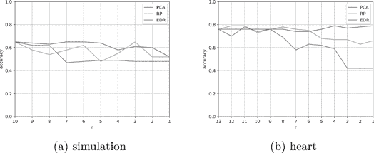

图 3.2: 数据集 `simulation` 和 `heart` 的分类准确率。

#### 3. ε 随信息容量允许下降 δ 的依赖关系（EDR 方法）
表 3.6 给出了不同 `δ` 值下的数据集 `simulation` 的分类准确率，而 图 3.3 展示了相应的曲线图。此外，表 3.7 和 图 3.3 呈现了数据集 `heart` 的相同特征。

表 3.6: 数据集 `simulation` 的 `ε(δ)` 依赖关系（EDR 方法）。

|  |
| --- |
| `δ / r` || 9 || 8 || 7 || 6 || 5 |
| 0.1 || 0.60 || 0.65 || 0.50 || 0.50 || 0.50 |
| --- | --- | --- | --- | --- | --- |
| 0.2 || 0.70 || 0.60 || 0.55 || 0.45 || 0.45 |
| 0.3 || 0.75 || 0.75 || 0.40 || 0.45 || 0.50 |
| 0.4 || 0.55 || 0.50 || 0.45 || 0.50 || 0.55 |
| 0.5 || 0.50 || 0.60 || 0.45 || 0.50 || 0.45 |
|  |

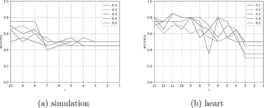

图 3.3: 数据集 `simulation` 和 `heart` 的 `ε(δ)` 依赖关系。

表 3.7: 数据集 `heart` 的 `ε(δ)` 依赖关系（EDR 方法）。

|  |
| --- |
| `δ` / r || 12 || 11 || 10 || 9 || 8 |
| 0.1 || 0.65 || 0.85 || 0.80 || 0.80 || 0.55 |
| --- | --- | --- | --- | --- | --- |
| 0.2 || 0.60 || 0.70 || 0.70 || 0.60 || 0.65 |
| 0.3 || 0.75 || 0.75 || 0.75 || 0.80 || 0.75 |
| 0.4 || 0.75 || 0.85 || 0.80 || 0.80 || 0.70 |
| 0.5 || 0.75 || 0.75 || 0.65 || 0.80 || 0.80 |
|  |

#### 4. 降维引起的的信息损失
如上所述，属性空间的降维会导致信息损失。

此类损失的相对值可由

$$
\begin{array}{r} {I = \frac{\mathcal{I}(U) - \mathcal{I}(Y)}{\mathcal{I}(U)},} \\ \end{array}
$$

(3.108)

描述，其中 `Y` 为降维后的数据矩阵。在实验过程中，估计了使用 `PCA`、`RP` 和 `EDR` 方法对数据集 `simulation` 和 `heart` 进行降维所造成的信息损失。

表 3.8–3.9 说明了相对信息损失 `I` (3.108)。对于 `EDR` 方法，值是对 `δ` 取平均。

表 3.8: 数据集 `simulation` 的相对信息损失。

|  |
| --- |
| `r` || 9 || 8 || 7 || 6 || 5 |
| `PCA` || 0.6691 || 0.6979 || 0.7298 || 0.7616 || 0.7973 |
| --- | --- | --- | --- | --- | --- |
| `RP` || 0.6630 || 0.6818 || 0.7844 || 0.7618 || 0.8777 |
| `EDR` || 0.2688 || 0.2911 || 0.3034 || 0.3501 || 0.4125 |
|  |

表 3.9: 数据集 `heart` 的相对信息损失。

|  |
| --- |


| *r* || 12 || 11 || 10 || 9 || 8 || 7 |

| PCA || 0.2935 || 0.3317 || 0.3857 || 0.4399 || 0.4941 || 0.5671 |

| --- | --- | --- | --- | --- | --- | --- |

| RP || 0.1444 || 0.3708 || 0.5190 || 0.6051 || 0.6736 || 0.8167 |

| EDR || 0.3083 || 0.3013 || 0.3184 || 0.2772 || 0.2589 || 0.2792 |

|  |

Figure 3.4 显示了数据集 *simulation* 和 *heart* 的相对信息损失图。

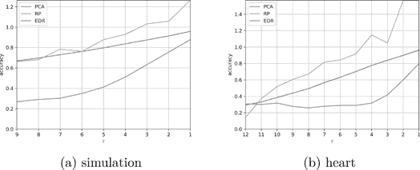

Figure 3.4: 数据集 *simulation* 和 *heart* 的相对信息损失。

不同 *δ* 值下 EDR 方法引起的相对信息损失汇总在 Tables 3.10–3.11 中。

Table 3.10: 数据集 *simulation* 的依赖关系 *I*(*δ*)（EDR 方法）。

|  |

| --- |

| *δ / r* || 9 || 8 || 7 || 6 || 5 |

| 0.1 || 0.0959 || 0.0997 || 0.1594 || 0.2795 || 0.3996 |

| --- | --- | --- | --- | --- | --- |

| 0.2 || 0.2000 || 0.1932 || 0.1982 || 0.2656 || 0.3880 |

| 0.3 || 0.2896 || 0.2896 || 0.2952 || 0.2943 || 0.3805 |

| 0.4 || 0.3615 || 0.3887 || 0.3933 || 0.3981 || 0.3992 |

| 0.5 || 0.3971 || 0.4842 || 0.4707 || 0.5130 || 0.4954 |

|  |

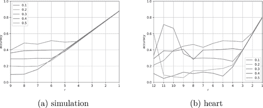

Figure 3.5: 数据集 *simulation* 和 *heart* 的依赖关系 *I*(*δ*)（EDR 方法）。

Table 3.11: 数据集 *heart* 的依赖关系 *I*(*δ*)（EDR 方法）。

|  |

| --- |

| *δ / r* || 12 || 11 || 10 || 9 || 8 || 7 |

| 0.1 || 0.1071 || 0.0478 || 0.0821 || 0.1244 || 0.1065 || 0.1254 |

| --- | --- | --- | --- | --- | --- | --- |

| 0.2 || 0.5947 || 0.0898 || 0.0676 || 0.0568 || 0.1435 || 0.1428 |

| 0.3 || 0.3344 || 0.7126 || 0.6659 || 0.3530 || 0.2961 || 0.2992 |

| 0.4 || 0.2921 || 0.3878 || 0.3833 || 0.4066 || 0.2814 || 0.3974 |

| 0.5 || 0.2134 || 0.2683 || 0.3932 || 0.4452 || 0.4670 || 0.4310 |

|  |

计算实验的结果允许得出以下结论：

*   EDR 方法对于学习和测试数据集合中的任意数据量都是可操作的；当数据量小于属性空间的维度时，PCA 不起作用；RP 方法的可操作性需要进一步研究。

*   应用 EDR 方法时，信息损失水平在属性空间减半时仍保持；对于 PCA 和 RP 方法，随着属性空间维度减小，信息损失水平显著增长。

*   由于 EDR 方法中的控制参数 *δ*，相对信息损失水平可以被调节。同时，这种可能性在 PCA 和 RP 方法中不存在。

## 3.7 随机投影的熵方法

### 3.7.1 熵随机投影问题的陈述

**1. 数据矩阵的点集表示：紧凑性指标**

考虑描述某些对象及其属性的数据矩阵：

$$
\begin{array}{r} {U\_{(m \times s)} = \left( \begin{array}{l} \mathbf{u}^{(1)} \\ \cdots \\ \mathbf{u}^{(m)} \\ \end{array} \right),\quad\quad\mathbf{u}^{(i)} = \left\{ u\_{1}^{(i)},\ldots,u\_{s}^{(i)} \right\} \in R^{s},\, \, i = \overline{1,m}.} \\ \end{array}
$$

(3.109)

这里 *m* 和 *s* 分别是对象数及其属性数；*R*^(*s*) 表示属性空间。假设该数据矩阵的元素是标准化的，即 $u\_{ij} \in \lbrack 0,1\rbrack,\, i = \overline{1,m},\, j = \overline{1,s}.$

*矩阵 *U*[(*m* × *s*)] 在属性空间 *R*[(*m*)]^(*s*) 中的点集表示是点 {**u**^((1)),…,**u**^((*m*))} 的集合 𝔘[*m*]^(*s*)*。

例如，100 个二维点的集合 𝔘[100]² 表示矩阵 *U*[(100 × 2)]。

点集 𝔘[*m*]^(*s*) 中点的分散程度可以用 *紧凑性指标* *ρ*[*U*] 来表征，它定义为点之间距离的算术平均值：

$$
\begin{array}{r} {\rho\_{U} = \frac{2}{m(m - 1)}{\sum\limits_{(\alpha,\beta) = 1,\mspace{2mu}\alpha \neq \beta}^{m}\varrho}(\mathbf{u}^{(\alpha)},\mathbf{u}^{(\beta)}),} \\ \end{array}
$$

(3.110)

其中 𝜚(**u**^((*α*)), **u**^((*β*))) 给出点 **u**^((*α*)) 和 **u**^((*β*)) 之间的距离。如果数据矩阵的元素是标准化的，则

$$
\begin{array}{r} {0 \leq \varrho(\mathbf{u}^{(\alpha)},\mathbf{u}^{(\beta)}) \leq \sqrt{2}\quad\quad\text{for~all}\,(\alpha,\beta) = \overline{1,m},} \\ {0 \leq \rho\_{U} \leq 1.} \\ \end{array}
$$

(3.111)

引入以下数据矩阵的变换类：

*   (*m**r*) *\-类*: *U*[(*m* × *s*)]→*Y*[(*m* × *r*)]，集合 𝔜[*m*]^(*r*) 在空间 *R*[(*m*)]^(*r*) 中；

*   (*n**s*) *\-类*: *U*[(*m* × *s*)]→*B*[(*n* × *s*)]，集合 𝔅[*n*]^(*s*) 在空间 *R*[(*n*)]^(*s*) 中；

*   (*n**r*) *\-类*: *U*[(*m* × *s*)]→*Z*[(*n* × *r*)]，集合 ℨ[*n*]^(*r*) 在空间 *R*[(*n*)]^(*r*) 中。

**2. 随机投影矩阵及其概率特征**

*1. 投影到空间 *R*[(*m*)]^(*r*)（生成集合 𝔜[*m*]^(*r*)）* 该操作将使用投影矩阵 *Q*[(*s* × *r*)] 执行：

$$
\begin{aligned} & {Y\_{(m \times r)} = \left( \begin{array}{l} \mathbf{y}^{(1)} \\ \cdots \\ \mathbf{y}^{(m)} \\ \end{array} \right) = U\_{(m \times s)}Q\_{(s \times r)};} \\ & {\quad y\_{j}^{(i)} = {\sum\limits\_{k = 1}^{s}u\_{ik}}q\_{kj},\, \, i = \overline{1,m};\, j = \overline{1,r}.} \\ \end{aligned}
$$

(3.112)

投影矩阵 *Q*[(*s* × *r*)] 是随机的且为区间类型，即

$$
\begin{array}{r} {Q\_{(s \times r)} \in \mathcal{Q} = \lbrack Q^{-},Q^{+}\rbrack.} \\ \end{array}
$$

(3.113)

投影矩阵的概率性质由定义在 𝒬 上的连续可微概率密度函数（PDF） *P*(*Q*) 表征。

向量 **y**^((*i*)) 形成 *r* 维点的集合 𝒴[*m*]^(*r*)，共 *m* 个。定义它们之间的距离 𝜚(**y**^((*α*)),**y**^((*β*)) | *Q*[(*s* × *r*)]) 和紧凑性指标

$$
\begin{array}{r} \left. \rho\_{Y}(Q) = \frac{2}{m(m - 1)}{\sum\limits_{(\alpha,\beta) = 1,\mspace{2mu}\alpha \neq \beta}^{m}\varrho}(\mathbf{y}^{(\alpha)},\mathbf{y}^{(\beta)}\, \middle| \, Q\_{(s \times r)}). \right. \\ \end{array}
$$

(3.114)

由于投影矩阵的元素具有随机值，平均距离（3.114）也是随机的。

因此，定义紧凑性指标的数学期望：

$$
\begin{array}{r} {{\overline{\rho}}\_{Y} = {\int\_{\mathcal{Q}}P}(Q)\rho\_{Y}(Q)dQ.} \\ \end{array}
$$

(3.115)

*2. 投影到空间 *R*^((*n* × *s*))（生成集合 𝔅[*n*]^(*s*)）* 该操作将使用具有随机元素的投影矩阵 *T*[(*n* × *m*)] 执行：

$$
\begin{aligned} B\_{(n \times s)} & {= \left( \begin{array}{l} \mathbf{b}^{(1)} \\ \cdots \\ \mathbf{b}^{(n)} \\ \end{array} \right) = T\_{(n \times m)}U\_{(m \times s)};\quad b\_{j}^{(i)} = {\sum\limits\_{k = 1}^{m}t\_{ik}}\, u\_{kj},} \\ & {\quad i = \overline{1,n};\, j = \overline{1,s}.} \\ \end{aligned}
$$

(3.116)

投影矩阵 *T*[(*n* × *m*)] 是随机的且为区间类型，即

$$
\begin{array}{r} {T\_{(n \times m)} \in \mathcal{T} = \lbrack T^{-},T^{+}\rbrack.} \\ \end{array}
$$

(3.117)

其概率性质由定义在 𝒯 上的 PDF *W*(*T*) 表征。

向量 **b**^((*i*)) 形成 *s* 维点的集合 𝔅[*n*]^(*s*)，共 *n* < *m* 个。定义紧凑性指标


$$\\begin{array}{r} \\left. \\rho\_{B}(T) = \\frac{2}{n(n - 1)}{\\sum\\limits\_{(\\alpha,\\beta),\\mspace{2mu}\\alpha \\neq \\beta}^{n}\\varrho}(\\mathbf{b}^{(\\alpha)},\\mathbf{b}^{(\\beta)}\\, \\middle| \\, T) \\right. \\\\ \\end{array}$$  

(3.118)

and its mathematical expectation

$$\\begin{array}{r} {{\\overline{\\rho}}\_{B} = {\\int\_{\\mathcal{T}}W}(T)\\rho\_{B}(T)dT.} \\\\ \\end{array}$$  

(3.119)

### 3. 投影到空间 *R*[*n*]^(*r*) (生成集合 ℨ[*n*]^(*r*))

此操作将使用随机投影矩阵 `T[n × m]` 和 `Q[(s × r)]` 执行：

$$\\begin{aligned} Z\_{(n \\times r)} & {= \\left( \\begin{array}{l} \\mathbf{z}^{(1)} \\\\ \\cdots \\\\ \\mathbf{z}^{(n)} \\\\ \\end{array} \\right) = T\_{(n \\times m)}U\_{(m \\times s)}Q\_{(s \\times r)};} \\\\ z\_{j}^{(i)} & {= {\\sum\\limits\_{p = 1}^{m}t\_{ip}}\\,{\\sum\\limits\_{k = 1}^{s}u\_{pk}}\\, q\_{kj},\\text{\\quad\\quad}i = \\overline{1,n};\\, j = \\overline{1,r}.} \\\\ \\end{aligned}$$  

(3.120)

这些投影矩阵为区间类型：

$$\\begin{array}{r} {T\_{(n \\times m)} \\in \\mathcal{T} = \\lbrack T^{-},T^{+}\\rbrack,} \\\\ {Q\_{(s \\times r)} \\in \\mathcal{Q} = \\lbrack Q^{-},Q^{+}\\rbrack.} \\\\ \\end{array}$$  

(3.121)

投影矩阵的概率特性由在集合上定义的联合 PDF `F(T, Q)` 刻画

$$\\begin{array}{r} {\\mathcal{F} = \\mathcal{T} \\otimes \\mathcal{Q}.} \\\\ \\end{array}$$  

(3.122)

向量 `z^{(i)}` 构成 *r* 维点集 ℨ[*n*]^(*r*)。该集合的紧致性指标由下式给出

$$\\begin{array}{r} \\left. \\rho\_{Z}(T,Q) = \\frac{2}{n(n - 1)}{\\sum\\limits\_{(\\alpha,\\beta),\\mspace{2mu}\\alpha \\neq \\beta}^{n}\\varrho}(\\mathbf{z}^{\\alpha},\\mathbf{z}^{\\beta}\\, \\middle| \\, T,Q). \\right. \\\\ \\end{array}$$  

(3.123)

紧致性指标的数学期望形式为

$$\\begin{array}{r} {{\\overline{\\rho}}\_{Z} = {\\int\_{\\mathcal{F}}F}(T,Q)\\rho\_{Z}(T,Q)dTdQ.} \\\\ \\end{array}$$  

(3.124)

根据原始数据矩阵的维度 (*m*, *s*) 与投影矩阵的维度 (*m*, *r*)、(*n*, *s*) 和 (*n*, *r*) 之间的关系，前者被压缩（若 `r < s` 且 `n < m`）或扩展（若 `r > s` 且 `n > m`）。

### 3.7.2 熵随机投影算法

考虑投影到空间 `R[(n)]^r`，该投影同时通过两个参数变换数据矩阵。

熵随机投影（`ERP`）算法在于在附加条件下对 PDF `F(T, Q)` 进行最大熵估计（`MEE`），该条件要求数据矩阵 `U[(m × s)]` 和投影 `Z[(n × r)]` 的紧致性指标取值相等。

`MEE`-估计的函数 `F(B, Q)`（参见 Chapter A）计算为

$$\\begin{aligned} {\\mathcal{H}\\lbrack F(T,Q)\\rbrack} & \\left. = - {\\int\_{\\mathcal{F}}F}(T,Q)\\,\\ln\\, F(T,Q)\\, dTdQ\\Rightarrow\\max, \\right. \\\\ & {{\\int\_{\\mathcal{F}}F}(T,Q)dTdQ = 1,} \\\\ & {{\\int\_{\\mathcal{F}}F}(T,Q)\\rho\_{Z}(T,Q)dTdQ = \\rho\_{U}.} \\\\ \\end{aligned}$$  

(3.125)

问题 (3.125) 是一个 Lyapunov 类型的泛函约束优化问题：此类问题的所有分量均为积分泛函 \[77\]。

由于该问题的积分形式，最优性条件涉及带标量 Lagrange 乘子的以下 Lagrange 泛函：

$$\\begin{aligned} {\\mathcal{L}\\lbrack F(T,Q)\\rbrack} & {= \\mathcal{H}\\lbrack F(T,Q)\\rbrack + \\mu(\\left( {1 - {\\int\_{\\mathcal{F}}F}(T,Q)dTdQ} \\right) +} \\\\ & {+ \\lambda\\left( {\\rho\_{U} - {\\int\_{\\mathcal{F}}F}(T,Q)\\rho\_{Z}(T,Q)dTdQ} \\right).} \\\\ \\end{aligned}$$  

(3.126)

该泛函关于 Gâteaux 导数 \[77\] (`𝔊[F]`) 的一阶最优性条件形式为

$$\\begin{array}{r} {\\mathfrak{G}\_{F}\\mathcal{L}\\lbrack F(T,Q)\\rbrack = 0.} \\\\ \\end{array}$$  

(3.127)

投影矩阵的熵最优 PDF 由下式给出

$$\\begin{aligned} \\left. F^{\*}(T,Q\\, \\middle| \\,\\lambda) \\right. & {= \\frac{\\exp\\left( {- \\lambda\\,\\,\\rho\_{Z}(T,Q)} \\right)}{\\mathbb{F}(\\lambda)},} \\\\ {\\mathbb{F}(\\lambda)} & {= {\\int\_{\\mathcal{F}}\\exp}\\left( {- \\lambda\\,\\,\\rho\_{Z}(T,Q)} \\right)dTdQ.} \\\\ \\end{aligned}$$  

(3.128)

根据 (3.128)，PDF 的结构取决于距离 (3.123) 且与参数 `λ` 无关。该参数满足紧致性指标的平衡方程：

$$\\begin{array}{r} {\\Phi(\\lambda) = {\\int\_{\\mathcal{F}}\\exp}\\left( {- \\lambda\\,\\rho\_{Z}(T,Q)} \\right)\\left( {\\rho\_{Z}(T,Q) - \\rho\_{U}} \\right)dTdQ = 0.} \\\\ \\end{array}$$  

(3.129)

由于 `λ` 是尺度参数，可能只需从线性化方程 (3.129) 求其近似值：

$$\\begin{array}{r} {\\widetilde{\\lambda} = \\frac{{\\int\_{\\mathcal{F}}\\left( {\\rho\_{Z}(T,Q) - \\rho\_{U}} \\right)}dTdQ}{{\\int\_{\\mathcal{F}}\\rho\_{Z}}(T,Q)\\left( {\\rho\_{Z}(T,Q) - \\rho\_{U}} \\right)dTdQ}.} \\\\ \\end{array}$$  

(3.130)

### 3.7.3 随机投影器的实现及其数值特征

实现随机投影器的标准方法是采样熵最优 PDF `P(Q)`、`W(T)` 和 `F(T, Q)`，它们在投影矩阵中保持数据矩阵的向量间距离。采样结果将 PDF 转化为随机投影矩阵序列：

$$\\begin{array}{r} \\left. F^{\*}(T,Q)\\Rightarrow(T^{(1)},Q^{(1)}),(T^{(2)},Q^{(2)}),\\ldots,(T^{(N)},Q^{(N)}),\\ldots \\right. \\\\ \\end{array}$$  

(3.134)

生成具有给定 PDF 的随机序列的通用方法在 \[36\] 中提出。平衡性质（见上文）可能不适用于该序列的每个单独元素，但它必然在“平均”意义下成立。因此，用于实现的经验投影器可以是矩阵

$$\\begin{array}{r} {\\overline{T} \\approx \\frac{1}{N}{\\sum\\limits\_{i = 1}^{N}T^{(i)}},\\text{\\quad\\quad}\\overline{Q} \\approx \\frac{1}{N}{\\sum\\limits\_{i = 1}^{N}Q^{(i)}}.} \\\\ \\end{array}$$  

(3.135)

“平均”投影矩阵的精确值由下式给出

$$\\begin{array}{r} {\\overline{T} = {\\int\_{\\mathcal{F}}T}\\, F(T,Q)dTdQ,\\text{\\quad\\quad}\\overline{Q} = {\\int\_{\\mathcal{F}}Q}\\, F(T,Q)dTdQ.} \\\\ \\end{array}$$  

(3.136)

尽管这些等式中的积分是多维的，但被积函数是指数多项式。这通常为计算多维积分提供了解析公式。

此外，多维积分的计算问题可通过近似方法求解，例如蒙特卡洛模拟和被积函数的多项式逼近。

PDF `F*(T, Q)` 定义在有界集 ℱ (3.122) 上。因此，用于实现的投影器可以是矩阵对

$$\\begin{array}{r} {(T^{\*},Q^{\*}) = \\arg\\max\_{\\mathcal{F}}F(T,Q).} \\\\ \\end{array}$$  

(3.137)

### 3.7.4 具有给定元素值的随机投影矩阵

#### 1. (0, 1)-投影矩阵的集合及其排序

考虑由投影矩阵 `Q[(s × r)]` 对空间 `R[(m)]^r` 进行的投影过程，其随机元素取值为 0 或 1。

将该矩阵写为长度为 `sr` 的行向量。由零和一组成的序列数，即不同行向量的数量为 `N = 2^(r s)`。例如，对于 `s = 3` 且 `r = 1`，有 8 个此类向量：

$$\\begin{array}{r} {000,100,010,001,110,011,101,111;} \\\\ \\end{array}$$  

对于 `s = 4` 且 `r = 1`，有 16 个此类向量：

$$\\begin{array}{r} {0000,1000,0100,0010,0001,1100,0110,0011,} \\\\ \\end{array}$$


$$\\begin{array}{r} {1001,0101,1010,1111,1110,0111,1011,1101.} \\\\ \\end{array}$$

对于投影矩阵 `Q`((*s* × *r*)), 存在其 (0, 1)-实现的有限集合 `ℚ`：

$$\\begin{array}{r} {{\\mathbb{Q}} = \\left\\{ Q^{(1)},\\ldots,Q^{(N)} \\right\\},\\text{\\quad\\quad}N = 2^{sr}.} \\\\ \\end{array}$$

(3.138)

假设实现是随机的，则其概率特性可由离散分布函数 (DDF) `W(α)` 刻画，其离散支撑 `α` ∈ 𝒜 = \[1, *N*\]，其中

$$\\begin{array}{r} {W(\\alpha) = \\mathbf{w} = \\left\\{ w\_{\\alpha}\\,\\alpha = \\overline{1,N} \\right\\}.} \\\\ \\end{array}$$

(3.139)

投影矩阵由下式给出

$$\\begin{aligned} {Y\_{(m \\times r)}^{(\\alpha)} = \\left( \\begin{array}{l} \\mathbf{y}\_{(1)}^{(\\alpha)} \\\\ \\cdots \\\\ \\mathbf{y}\_{(m)}^{(\\alpha)} \\\\ \\end{array} \\right)} & {= U\_{(m \\times s)}Q\_{(s \\times r)}^{(\\alpha)};\\quad y\_{j}^{(\\alpha,i)} = {\\sum\\limits\_{k = 1}^{s}u\_{ik}}q\_{kj}^{(\\alpha)},} \\\\ & {\\quad i = \\overline{1,m};\\, j = \\overline{1,r}.} \\\\ \\end{aligned}$$

(3.140)

集合 𝔜^((*α*)) 紧致性指标的形式为

$$\\begin{array}{r} \\left. \\rho\_{Y}^{(\\alpha)}(Q) = \\frac{2}{m(m - 1)}{\\sum\\limits\_{(\\kappa,\\beta) = 1,\\mspace{2mu}\\kappa \\neq \\beta}^{m}\\varrho^{(\\alpha)}}(\\mathbf{y}^{(\\kappa)},\\mathbf{y}^{(\\beta)}\\, \\middle| \\, Q\_{(s \\times r)}^{(\\alpha)}). \\right. \\\\ \\end{array}$$

(3.141)

按不等式序列对序列 (3.138) 进行排序

$$\\begin{array}{r} {0 < \\rho\_{Y}^{(1)}(Q) < \\rho\_{Y}^{(2)}(Q) < \\cdots < \\rho\_{Y}^{(N)}(Q).} \\\\ \\end{array}$$

(3.142)

## 2. *MEE*-估计 DDF

DDF `W(α)` 的 *MEE*-估计计算为

$$\\begin{array}{r} \\left. H(\\mathbf{w}) = - {\\sum\\limits\_{\\alpha = 1}^{N}w\_{\\alpha}}\\ln w\_{\\alpha}\\Rightarrow\\max, \\right. \\\\ \\end{array}$$

(3.143)

受以下约束条件限制：

* —归一化条件

$$\\begin{array}{r} {{\\sum\\limits\_{\\alpha = 1}^{N}w\_{\\alpha}} = 1;} \\\\ \\end{array}$$

(3.144)

* —紧致性指标的平衡条件

$$\\begin{array}{r} {{\\sum\\limits\_{\\alpha = 1}^{N}w\_{\\alpha}}\\,\\rho\_{Y}^{(\\alpha)}(Q) = \\rho\_{U}.} \\\\ \\end{array}$$

(3.145)

问题 (3.143)–(3.145) 是一个具有凹目标函数（信息熵）和线性等式约束的有限维约束优化问题。

考虑拉格朗日函数

$$\\begin{array}{r} {L(\\mathbf{w},\\lambda) = H(\\mathbf{w}) + \\mu\\left( {1 - {\\sum\\limits\_{\\alpha = 1}^{N}w\_{\\alpha}}} \\right) + \\lambda\\left( {\\rho\_{U} - {\\sum\\limits\_{\\alpha = 1}^{N}w\_{\\alpha}}\\rho\_{Y}^{(\\alpha)}(Q)} \\right).} \\\\ \\end{array}$$

(3.146)

由一阶最优性条件可知，对于该函数，熵最优离散概率分布为

$$\\begin{array}{r} {w\_{\\alpha}^{\*} = \\frac{\\exp\\left( {- \\lambda\\rho\_{Y}^{(\\alpha)}(Q)} \\right)}{{\\sum\\limits\_{\\alpha = 1}^{N}\\exp}\\left( {- \\lambda\\rho\_{Y}^{(\\alpha)}(Q)} \\right)},\\text{\\quad\\quad}\\alpha = \\overline{1,N},} \\\\ \\end{array}$$

(3.147)

其中参数 `λ` 满足方程

$$\\begin{array}{r} {{\\sum\\limits\_{\\alpha = 1}^{N}\\exp}( - \\lambda\\rho\_{Y}^{(\\alpha)}(Q))(\\rho\_{Y}^{(\\alpha)}(Q) - \\rho\_{U}) = 0,\\text{\\quad\\quad} - \\infty < \\lambda < \\infty.} \\\\ \\end{array}$$

(3.148)

引入变量替换 `z` = exp ( − `λ`). 则方程 (3.148) 可写为

$$\\begin{array}{r} {\\varphi(z) = {\\sum\\limits\_{\\alpha = 1}^{N}z^{h\_{\\alpha}}}\\, c\_{\\alpha} = 0,\\,\\,\\, z \\geq 0;\\quad c\_{\\alpha} = (h\_{\\alpha} - \\rho\_{U}),\\,\\, h\_{\\alpha} = \\rho\_{Y}^{(\\alpha)}.} \\\\ \\end{array}$$

(3.149)

### 3.7.5 从 `ℚ` (3.138) 中选择合适的投影矩阵

熵最优 DDF `$W^{\*}(\\alpha) = w\_{\\alpha}^{\*},\\,\\alpha = \\overline{1,N},$` (3.149) 刻画了集合 `ℚ` (3.138) 中元素（投影矩阵）实现的概率。然而，为了获得特定投影矩阵 `Y`[(*m* × *r*)]，需要从集合 `ℚ` 中选取特定的投影矩阵。特定矩阵可采用以下不同策略进行选择。

*1. 概率最大投影矩阵* 设 (3.142) 中差值 `Δ[ρ]` = `ρ[Y]^{((N))}` − `ρ[Y]^{((1))}` 足够大。这意味着 DDF (3.149) 中概率的最大值明显大于最小值。则实现的投影矩阵编号为

$$\\begin{array}{r} {\\alpha^{\*} = \\arg\\max\_{1 \\leq \\alpha \\leq N}w\_{\\alpha}^{\*}.} \\\\ \\end{array}$$

(3.156)

*2. 平均投影矩阵* 若 `Δ[ρ]` = `ρ[Y]^{((N))}` − `ρ[Y]^{((1))}` 很小，则序列 `{ρ^{((α))}}` 以较低速率递增。在此情况下，实现的投影矩阵应通过平均得到：

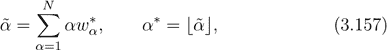

其中 ⌊ • ⌋ 表示数  •  的整数部分。

*3. 中位数投影矩阵* 由下式给出

$$\\begin{array}{r} {{\\sum\\limits\_{\\alpha = 1}^{\\alpha^{\*}}w\_{\\alpha}^{\*}} = {\\sum\\limits\_{\\alpha = \\alpha^{\*} + 1}^{N}w\_{\\alpha}^{\*}}.} \\\\ \\end{array}$$

(3.158)

*4. 投影矩阵的平均* 该策略包括以下阶段。第一阶段，选择具有特定属性的投影矩阵子集。第二阶段，形成相应的投影矩阵子集。然后计算平均投影矩阵。

而第二和第三阶段与数学统计的标准计算有关，第一阶段需要额外说明。投影矩阵子集是根据反映其期望属性的规则选择的。根据选择此类子集的规则，下面将研究所谓的方差和四分位距投影矩阵子集。

首先考虑 *方差子集*。为此，求变量 `α` 的均方根 (RMS) 值：

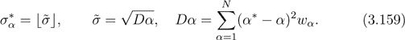

定义方差区间

$$\\begin{array}{r} {\\mathcal{I}\_{\\alpha} = \\lbrack\\alpha^{\*} - \\sigma\_{\\alpha}^{\*},\\alpha^{\*} + \\sigma\_{\\alpha}^{\*}\\rbrack.} \\\\ \\end{array}$$

(3.160)

方差子集形式为

$$\\begin{array}{r} {\\widetilde{\\mathbb{Q}} = \\left\\{ Q^{(\\alpha^{\*} - \\sigma\_{\\alpha}^{\*})},\\ldots,Q^{(\\alpha^{\*} + \\sigma\_{\\alpha}^{\*})} \\right\\}.} \\\\ \\end{array}$$

(3.161)

对该子集的每个元素计算相应的投影矩阵：

$$\\begin{array}{r} {\\widetilde{\\mathcal{Y}} = \\left\\{ Y\_{(m \\times r)}^{(\\alpha^{\*} - \\sigma\_{\\alpha}^{\*})},\\ldots,Y\_{(m \\times r)}^{(\\alpha^{\*} + \\sigma\_{\\alpha}^{\*})} \\right\\}.} \\\\ \\end{array}$$

(3.162)

在最后阶段，求方差集上的平均投影矩阵：

$$\\begin{array}{r} {{\\overline{Y}}\_{(m \\times r)}^{D} = \\frac{1}{2\\sigma\_{\\alpha}^{\*}}{\\sum\\limits\_{\\alpha = \\alpha^{\*} - \\sigma\_{\\alpha}^{\*}}^{\\alpha^{\*} + \\sigma\_{\\alpha}^{\*}}Y\_{(m \\times r)}^{(\\alpha)}}.} \\\\ \\end{array}$$

(3.163)

现在分析 *四分位距子集* 的形成。熵最优概率分布函数（见 (3.147)）形式为

$$\\begin{array}{r} {F^{\*}(\\kappa) = {\\sum\\limits\_{\\alpha = 1}^{\\kappa}w\_{\\alpha}^{\*}},\\text{\\quad\\quad}\\kappa \\in \\lbrack 0,1\\rbrack.} \\\\ \\end{array}$$

(3.164)

回顾随机变量 `α` 的 `κ*`-四分位数是其取值 \[1, *κ*^(\*)\] 的集合 `𝒜^{((κ*))}`。

考虑两个四分位数集合，`𝒜^{((κ[1]*))}` 和 `𝒜^{((κ[2]*))}`，其中 `κ[1]*` > `κ[2]*`。与每个集合关联的投影矩阵子集为：


$$\\begin{array}{r} {{\\mathbb{Q}}(\\kappa\*\_{1}) = \\left\\{ Q^{(1)},\\ldots,Q^{(\\alpha(\\kappa\_{1}^{\*}))} \\right\\},} \\\\ {{\\mathbb{Q}}(\\kappa\*\_{2}) = \\left\\{ Q^{(1)},\\ldots,Q^{(\\alpha(\\kappa\_{2}^{\*}))} \\right\\}.} \\\\ \\end{array}$$  
(3.165)

构造投影矩阵的子集

$$\\begin{array}{r} {{\\mathbb{Q}}(\\kappa\_{1}^{\*} - \\kappa\_{2}^{\*}) = \\left\\{ Q^{(\\alpha(\\kappa\_{2}^{\*}))},\\ldots,Q^{(\\alpha(\\kappa\_{1}^{\*}))} \\right\\},} \\\\ \\end{array}$$  
(3.166)

它即为熵最优投影矩阵的 (*κ*[1]^(\*) − *κ*[2]^(\*))\-分位数子集 ℐ^((*κ*[1]^(\*) − *κ*[2]^(\*)))。该子集中元素的个数为 *M*[(*κ*[1]^(\*) − *κ*[2]^(\*))] = *α*(*κ*[1]^(\*)) − *α*(*κ*[2]^(\*))。

对于子集 𝒬(*κ*[1]^(\*) − *κ*[2]^(\*)) (3.166) 的每个元素，计算对应的投影矩阵

$$\\begin{array}{r} {\\mathcal{Y}(\\kappa\_{1}^{\*} - \\kappa\_{2}^{\*}) = \\left\\{ Y\_{(m \\times r)}^{\\alpha(\\kappa\_{2}^{\*})},\\ldots,Y\_{(m \\times r)}^{\\alpha(\\kappa\_{1}^{\*})} \\right\\}.} \\\\ \\end{array}$$  
(3.167)

子集 ℐ^((*κ*[1]^(\*) − *κ*[2]^(\*))) 上的平均投影矩阵由下式给出

$$\\begin{array}{r} {{\\overline{Y}}\_{(m \\times r)}^{K} = \\frac{1}{M\_{(\\kappa\_{1}^{\*} - \\kappa\_{2}^{\*})}}{\\sum\\limits\_{\\alpha = \\alpha(\\kappa\_{2}^{\*})}^{\\alpha(\\kappa\_{1}^{\*})}Y\_{(m \\times r)}^{\\alpha}}.} \\\\ \\end{array}$$  
(3.168)

对分位数集进行平均可得到具有给定 (*κ*[1], *κ*[2])\-分位数的投影矩阵。

# CHAPTER 4 RANDOMIZED PARAMETRIC MODELS

DOI: [10.1201/9781003306566-4](https://doi.org/10.1201/9781003306566-4)

RML 过程的一个重要组成部分是具有随机参数的模型，将其称为 *随机参数模型 (RPM)*。由此我们强调，该模型中的随机参数是人为的，并且具有最优的概率特性。RPM 参数的概率特性的最优性是根据质量泛函和特定问题中允许的参数值集合来考虑的。由于 RML 过程可用于广泛的机器学习问题，我们将研究静态和动态 RPM。

## 4.1Definition, Characteristics and Classification

随机参数模型 (`RPM`) 将输入数据变换为输出数据的 *ensemble*，该 *ensemble* 由模型根据其参数的给定概率密度函数 (`PDFs`) 生成。

考虑输入数据表示一维数组的情况，即向量 `**x**` ∈ `R`^(`n`)，如图 Fig. 4.1(a) 所示。其元素是被研究对象的某些特征 `x[1]`, …, `x[n]`。`RPM` 具有随机参数 `**a**` ∈ `R`^(`r`)，其概率特性由 `PDF` `P(**a`)` 描述。`RPM` 生成向量 `**y**` ∈ `R`^(`m`) 的 *ensemble* `𝒴`，其具有给定的 `PDF` `P(**a`)`。

接下来，设输入数据由二维数组定义，即由列向量 `$\\mathbf{x}^{(j)},\\, j = \\overline{1,s}$` 组成的矩阵 `X`（见 Fig. 4.1(b)）。例如，此类数组由在 `s` 个不同时刻测量的对象状态向量得到。对于输入数组中的每个测量向量 `**x**^((j))`，具有上述属性的 `RPM` 生成随机向量 `**y**^((j))` ∈ `R`^(`m`) 的 *ensemble* `𝒴^((j))`，其具有给定的 `PDF` `P(**a`)`。

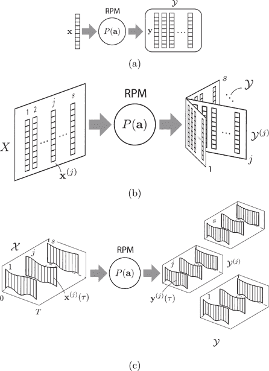

Figure 4.1

作为最后一个例子，考虑由三维输入数据数组组成的集合 `𝒳[τ]`，包含向量函数 `$\\mathbf{x}^{(j)}(\\tau),\\, j = \\overline{1,s},$` 的测量，其中 `τ` ∈ `𝒯` = `[0, T]`。这里，对于每次测量，`RPM` 生成三维 *ensemble* `𝒴^((j))` 的随机向量函数 `**y**^((j))`(`t`)，`t` ≥ `τ`，其具有给定的 `PDF` `P(**a`)`。

在上述所有示例中，`RPM` 将确定性输入数据变换为随机化输出数据的 *ensemble*。这种变换将由映射

$$\\begin{array}{r} {\\mathbb{M}(P(\\mathbf{a}),\\tau,t,T) = :\\mathcal{X}\_{\\tau}\\overset{P(\\mathbf{a})}{\\rightarrow}\\hat{\\mathcal{Y}},} \\\\ \\end{array}$$  
(4.1)

来表征，并且相应的 `RPM` 将被赋予“*输入–输出 ensemble*” *\[I–OE\]* 类；见 Fig. 4.2(a)。

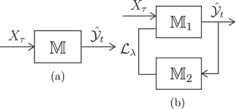

Figure 4.2

有时，有必要对映射 `𝕄(P(**a**), τ, T)` 进行结构化。特别地，我们可以将其表示为反馈回路中的两个映射 `𝕄1)), τ, λ, t, T)` 和 `𝕄2)), t, λ)`（见 Fig. 4.2(b)），即

$$\\begin{aligned} {\\mathbb{M}\_{1}(P\_{1}(\\mathbf{a}^{(1)}),\\tau,\\lambda,t,T)} & {= :(X\_{\\tau},{\\hat{\\mathcal{Z}}}\_{\\lambda})\\overset{P\_{1}(\\mathbf{a}^{(1)})}{\\rightarrow}\\mathcal{Y};} \\\\ {\\mathbb{M}\_{1}(P\_{2}(\\mathbf{a}^{(2)}),t,\\lambda)} & {= :\\hat{\\mathcal{Y}}\\overset{P\_{2}(\\mathbf{a}^{(2)})}{\\rightarrow}{\\hat{\\mathcal{Z}}}\_{\\lambda}.} \\\\ \\end{aligned}$$  
(4.2)

这里 (`λ`, `τ`, `t`) ∈ `𝒯` = `[0, T]`。由映射 (4.1, 4.2) 描述的模型将被归类为“*(输入, 反馈)–输出 ensemble*” *\[(I,FB)–OE\]* `RPM`。

这些 `RPM` 具有随机区间-时间参数，即

$$\\begin{array}{r} {\\mathbf{a} \\in \\mathcal{A} = \\lbrack\\mathbf{a}^{-},\\mathbf{a}^{+}\\rbrack,\\text{\\quad\\quad}\\mathbf{a}^{\\pm} = \\left\\{ a\_{1}^{\\pm},\\ldots,a\_{r}^{\\pm} \\right\\}.} \\\\ \\end{array}$$  
(4.3)

此外，两类 `RPM` 都将根据其时间特性和数学建模方法细分为子类。基于第一个分类属性，存在静态和动态 `RPM`。对于静态模型，映射 (4.1) 中 `τ` = `t`，即此类模型在时间 `t` 生成的 *ensemble* 仅依赖于该时刻的数据。在动态 `RPM` 中，*ensemble* `𝒴̂` 依赖于数据 `X[τ]`，其中 `t[0]` ≤ `τ` ≤ `t`。

为了根据数学建模方法进一步分类，我们将采用标准方法，考虑线性与非线性模型、函数和泛函、微分和积分方程，以及非线性性的不同近似。分类树示于 Fig. 4.3。

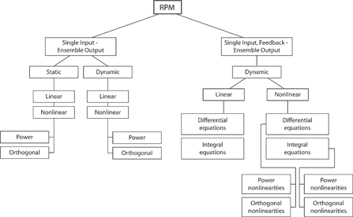

Figure 4.3

## 4.2“Single Input–Ensemble Output” Randomized Parametric Model

### 4.2.1Static models

对于此类模型，时间 `t` 上的输出数据 *ensemble* 依赖于该时刻的输入数据以及随机化参数的实现。因此可以省略指标 `t`，此类映射可使用随机参数 `**a**` 的向量函数来描述。

考虑由矩阵 `$\\left. X = \\lbrack x\_{ij}\\, \\middle| \\, i = \\overline{1,n},\\, j = \\overline{1,s}\\rbrack. \\right.$` 表征的输入数据数组。该数组由 `s` 次输入向量 `**x**^((j))` = {`x[1]^((j))`,…,`x[n]^((j))`} 的测量组成，其中 `j = \\overline{1,s}`。该向量的元素是矩阵 `X` 中第 `j` 列的元素。

静态 `RPM` 将输入矩阵 `X` 变换为输出矩阵 `$\\left. \\hat{Y} = \\lbrack{\\hat{y}}\_{kj}\\, \\middle| \\, k = \\overline{1,m},\\, j = \\overline{1,s}\\rbrack. \\right.$` 该矩阵的列是第 `j` 个向量 `${\\hat{\\mathbf{y}}}^{(j)} = \\left\\{ {\\hat{y}}\_{1}^{(j)},\\ldots,{\\hat{y}}\_{m}^{(j)} \\right\\},$` 的元素，其中 `j = \\overline{1,s}`。

引入由随机化参数组成的矩阵 `$\\left. A = \\lbrack a\_{hp}\\, \\middle| \\, h = \\overline{1,m},p = \\overline{1,n}\\rbrack, \\right.$` 该矩阵的元素是取值于区间内的随机变量


$$
\begin{array}{r} {\mathcal{A}_{hp} = \lbrack a_{hp}^{-},a_{hp}^{+}\rbrack,} \\ \\ \end{array}
$$

(4.4)

which form the (*m* × *s*)‑dimensional parallelepiped

$$
\begin{array}{r} {\mathcal{A} = \otimes_{h = 1}^{m} \otimes_{p = 1}^{n}\mathcal{A}_{hp}.} \\ \\ \end{array}
$$

(4.5)

By assumption, there exists a continuously differentiable PDF *P*(*A*) on this set.

A relation between the input *X* and the output ensemble $\hat{\mathcal{Y}}$ of a static RPM is described by a vector function ℱ that has the randomized parameters *A* with the PDF *P*(*A*), i.e.,

$$
\begin{array}{r} {\hat{\mathcal{Y}} = \mathcal{F}\left( {X,A,P(A)} \right).} \\ \\ \end{array}
$$

(4.6)

In other words, for a fixed input data array *X*, a static RPM generates an ensemble $\hat{\mathcal{Y}}$ of random matrices *Ŷ* with the above-mentioned properties.

An important special case of the RPMs (4.6) is the model with *n* inputs and one output. In this case, the model generates a vector $\hat{\mathbf{y}} = \left\{ y_{1}^{(1)},\ldots,y_{m}^{(s)} \right\},$ and its randomized parameters are characterized by a vector **a** = {*a*[1],…,*a*[*r*]} with interval-type elements

$$
\begin{array}{r} {a_{h} \in \mathcal{A}_{h} = \lbrack a_{h}^{-},a_{h}^{+}\rbrack,\text{\quad\quad}\mathcal{A} = \otimes_{h = 1}^{r}\mathcal{A}_{h}.} \\ \\ \end{array}
$$

(4.7)

Then equality (4.6) takes the form

$$
\begin{array}{r} {\hat{\mathcal{Y}} = \mathcal{F}\left( {X,\mathbf{a},P(\mathbf{a})} \right),} \\ \\ \end{array}
$$

(4.8)

where $\hat{\mathcal{Y}}$ denotes an ensemble of random vectors $\hat{\mathbf{y}}.$

### 1. Linear static RPMs.

This class of the models involves a linear vector function **F** (4.6) of the form

$$
\begin{array}{r} {\hat{\mathcal{Y}} = A\, X,} \\ \\ \end{array}
$$

(4.9)

where *A* is a matrix of dimensions (*m* × *n*) with the randomized elements (4.4, 4.5) and the probabilistic properties characterized by a PDF *P*(*A*).

If the RPM (4.6) has *n* inputs and one output, then the output ensemble consists of the values of a random variable

$$
\begin{array}{r} {\hat{y} = \left\langle \mathbf{x},\mathbf{a} \right\rangle.} \\ \\ \end{array}
$$

(4.10)

### 2. Nonlinear static RPMs.

The nonlinear RPMs form a significantly wider class than the linear ones. The nonlinear processes that occur in nature are modeled using appropriate laws. If a certain relation between an input and output of an object surely exists but its form is unknown, then a more of less universal approach lies in approximation. Here it is necessary to define a structure and parameters of an approximating function. As a result, to design a nonlinear static RPM means to search for appropriate parameter values. Consider some types of approximations and also the underlying hypotheses on the properties of the “Single Input–Ensemble Output” relations.

#### 2.1. Analytical nonlinearities.

By a prevailing hypothesis, there exists an analytical relation between the input and output matrices, *X* and *Y*. This hypothesis allows us to perform approximation using the *Taylor monomial*

$$
\begin{array}{r} {\hat{\mathcal{Y}} = {\sum\limits_{h = 1}^{R}B^{(h)}}\, Z^{(h)}.} \\ \\ \end{array}
$$

(4.11)

Here *B*^((*h*)) denotes a matrix of dimensions (*s* × *φ*(*h*)) with interval-type randomized elements, and *Z*^((*h*)) is a matrix of dimensions (*φ*(*h*)) × *r* whose entries represent the products of degree *h* from the elements of the input matrix *X*. The matrices *B*^((*h*)) are defined on the intervals

$$
\begin{array}{r} {\mathcal{B}_{h} = \lbrack\mathcal{B}_{h}^{-},\mathcal{B}_{h}^{+}\rbrack,\text{\quad\quad}h = \overline{1,R}.} \\ \\ \end{array}
$$

(4.12)

For a one-dimensional static object (with one input and one output), equality (4.11) takes the simpler form

$$
\begin{array}{r} {\hat{y} = {\sum\limits_{h = 1}^{R}b_{h}}x^{h},} \\ \\ \end{array}
$$

(4.13)

where the parameters *b*[1], …, *b*[*R*] are randomized and independent. The domain of definition of the parameters *b*[1], …, *b*[*R*] is given by

$$
\begin{array}{r} {b_{h} \in \mathcal{B}_{h} = \lbrack b_{h}^{-},b_{h}^{+}\rbrack,\text{\quad\quad}h = \overline{1,R}.} \\ \\ \end{array}
$$

(4.14)

#### 2.2. Continuous nonlinearities.

In fact, the existence of an analytical relation between an input and output of a static nonlinearity is a bold hypothesis. Following a more realistic approach, assume that the input is bounded and the nonlinearity *Φ*(*x*) has no discontinuities of the second kind (infinite jumps). Numerous approximation methods with orthogonal polynomials were developed on the basis of these hypotheses.

Recall some fundamental concepts of the corresponding methods. Consider a one-dimensional static object with a bounded input and a nonlinear characteristic that has no discontinuities of the second kind:

$$
\begin{array}{r} {x^{-} \leq x \leq x^{+}.} \\ \\ \end{array}
$$

By assumption, there exists a certain function *w*(*x*) on this interval, which is often interpreted as a weight characteristic for the values of the variable *x*. Since the nonlinearity *Φ*(*x*) of the static object is considered on the same interval without discontinuities of the second kind,

$$
\begin{array}{r} {{\int_{x^{-}}^{x^{+}}w}(x)\Phi^{2}(x)dx < \infty.} \\ \\ \end{array}
$$

To obtain orthogonal polynomials, choose a system of power functions 1, *x*, *x*², … and apply the following orthogonalization procedure:

$$
\begin{array}{r} {\psi_{0}(x) = c_{0},} \\ \\ \end{array}
$$

$$
\begin{array}{r} {\psi_{1}(x) = c_{0} + c_{1}x,} \\ \\ \end{array}
$$

$$
\begin{array}{r} {\psi_{2}(x) = c_{0} + c_{1}x + c_{2}x^{2},} \\ \\ \end{array}
$$

$$
\begin{array}{r} {\cdots = \cdots + \cdots + \cdots} \\ \\ \end{array}
$$

The coefficients *c*[0], *c*[1], *c*[2], … in these formulas are adjusted so that

$$
\begin{array}{r} {{\int_{x^{-}}^{x^{+}}w}(x)\psi_{i}^{2}(x)dx = 1,\text{\quad\quad}i = 0,1,2,\ldots} \\ \\ \end{array}
$$

and

$$
\begin{array}{r} {{\int_{x^{-}}^{x^{+}}w}(x)\psi_{i}(x)\psi_{i - 1}(x)dx = 0,\text{\quad\quad}i = 1,2,\ldots} \\ \\ \end{array}
$$

This procedure yields a system of orthogonal polynomials. The weight function *w*(*x*) defines the class of a corresponding orthonormal polynomial. Some classes are presented in Table 4.1.

Table 4.1: Orthonormal polynomials.

|  |
| --- |
| Class || Interval || *w*(*x*) || Polynomial |
| Lagerra || \[0, ∞) || *e*^( − *x*) || 1, 1 − *x*, 1 − 2*x* + *x*²/2, ... |
| --- | --- | --- | --- |
| Hermit || ( − ∞, ∞) || *e*^( − *x*²) || 1, 2*x*, 4*x*² − 2, ... |
| Legendre || \[ − 1, 1\] || 1 || 1, *x*, (3*x*² − 1)/2, ... |
| Chebyshev || \[ − 1, 1\] || $1/\sqrt{1 - x^{2}}$ || 1, *x*, 2*x*² − 1, ... |
|  |

Using the system of orthonormal polynomials, construct an approximating polynomial with the parameters *a*[0], …, *a*[*R*] by

$$
\begin{array}{r} {\hat{\Phi}(x) = {\sum\limits_{i = 0}^{R}a_{i}}\psi_{i}(x).} \\ \\ \end{array}
$$

(4.15)

In contrast to the classical approach to approximation, the parameters of an approximating function will be treated as randomized ones taking values within an interval \[**a**^−, **a**^+\].

### 4.2.2 Functional description of dynamic models

An output ensemble of dynamic models at a time *t* is characterized by a mapping 𝕄\[*P*(**a**), *τ*, *t*\] of the form (4.1) and depends on the input data on a time interval \[*t* − *τ*, *t*\] and a realization of the randomized parameters.


用 **x**(*τ*) 表示由独立观测 *x*1, …, *x**n* 组成 的输入向量，它们定义在时间区间 𝒯[*t*] = [0, *t*] 上，其中 *τ* ∈ 𝒯[*t*]。在每个时间 *t* > 0 时，模型输出一个由观测 *ŷ*1, …, *ŷ**m* 组成的向量 $\hat{\mathbf{y}}(t)$，其中 *t* ∈ 𝒯 = [0, *T*]。输入 **x**(*τ* | *τ*∈𝒯[*t*]) 与输出 $\hat{\mathbf{y}}(t)$ 之间的关系由泛函 ℬ 描述，即

$$
\begin{array}{r}
\left.
\hat{\mathbf{y}}(t) = \mathcal{B}(\mathbf{x}(\tau),\mathbf{a}\, \middle| \,\tau \in \mathcal{T}_{t}),\quad\quad t \in \mathcal{T} = \lbrack 0,T\rbrack.
\right.
\\
\end{array}
$$

(4.16)

假设该泛函由随机元向量 **a** = {*a*[1],…,*a*[*r*]} 参数化，它们属于区间

$$
\begin{aligned}
\mathcal{A}_{i} & {= \lbrack a_{i}^{-},a_{i}^{+}\rbrack,\quad\quad i \in \lbrack 1,r\rbrack;} \\
\mathcal{A} & {= {\prod\limits_{i = 1}^{r}\mathcal{A}_{i}}.}
\\
\end{aligned}
$$

(4.17)

将考虑三类动态“单输入-集合输出”RPM，即线性模型，以及具有幂非线性和多项式非线性的非线性模型。

### 4.2.3 线性动态模型

考虑一个具有输入 **x**(*τ*), *τ* ∈ 𝒯[*t*] 和输出 $\hat{\mathbf{y}}(t),\, t \in \mathcal{T}.$ 的动态 RPM。输入向量元素 $x_{i}(\tau),\, i = \overline{1,n},$ 是 *连续时变函数*。该 RPM 输入与输出之间的关系由具有参数 **a** 的 *线性* 泛函 ℬ 描述 (4.16)，即

$$
\begin{array}{r}
{\hat{\mathbf{y}}(t) = {\int_{0}^{t}B}(t,\tau,\,\mathbf{a})\mathbf{x}(\tau)d\tau.}
\\
\end{array}
$$

(4.18)

在此式中，矩阵 *B*(*t*, *τ*, **a**) 的维数为 (*m* × *n*)，由脉冲特性 $\left. \lbrack b_{ij}(t,\tau\, \middle| \,\mathbf{a}^{(ij)}),\, \middle| \, i = \overline{1,m},\, j = \overline{1,n}\rbrack \right.$ 组成，其中随机参数 $\mathbf{a}^{(ij)} = \{a[1]^{(ij)},\dots,a[k[ij]]^{(ij)}\}$，*k*[*i**j*] 为脉冲特性 *b**i**j* 的参数个数。

根据一般概念，参数 **a**^((*i**j*)) 为区间型，即

$$
\begin{array}{r}
{\mathbf{a}^{(ij)} \in \mathcal{A}^{(ij)} = \lbrack\mathbf{a}_{-}^{(ij)},\mathbf{a}_{+}^{(ij)}\rbrack,\quad\mathbf{a} \in \mathcal{A} = {\prod\limits_{i = 1}^{m}{\prod\limits_{j = 1}^{n}\mathcal{A}^{(ij)}}}.}
\\
\end{array}
$$

(4.19)

模型 (4.19) 生成随机轨迹 $\hat{\mathbf{y}}(t),\, t \in \mathcal{T}.$ 的集合 ${\hat{\mathcal{Y}}}_{\mathcal{T}}$。这些脉冲特性可以以不同方式参数化。下面将讨论其中一些。

#### 1.1. 具有未知参数的给定函数
通常，脉冲特性是指数函数或具有指数衰减的谐波函数，即

$$
\begin{array}{r}
{b_{ij}(t,\tau) = \alpha_{ij}(t)\exp\left( {-\beta_{ij}(t)\tau} \right)\text{or}b_{ij}(t,\tau)\exp\left( {-\beta_{ij}\tau} \right)\,\sin(\omega_{ij}(t)\tau + \phi_{ij}(t)),}
\\
\end{array}
$$

(4.20)

其中，例如，时变参数具有形式

$$
\begin{aligned}
{\alpha_{ij}(t)} & {= \alpha_{ij}^{0} + \alpha_{ij}^{1}t;\quad\beta_{ij}(t) = \beta_{ij}^{0} + \beta_{ij}^{1}t,} \\
{\omega_{ij}(t)} & {= \omega_{ij}^{0}\ln t;\quad\quad\phi_{ij}(t) = \phi_{ij}^{0} + \phi_{ij}^{1}t.}
\\
\end{aligned}
$$

(4.21)

在此表达式中，*α*[*i**j*]⁰, *α*[*i**j*]¹, *β*[*i**j*]⁰, *β*[*i**j*]¹, *ω*[*i**j*]⁰, *ϕ*[*i**j*]⁰ 和 *ϕ*[*i**j*]¹ 是取值在相应区间内的随机变量。

#### 1.2. 用具有未知权重的给定函数族逼近
考虑由 *v* 个确定性函数组成的族 ℛ[*v*]，以下称为 *基* 函数：

$$
\begin{array}{r}
{\mathcal{R}_{v} = \left\{ \phi_{1}(t,\tau),\ldots,\phi_{v}(t,\tau) \right\}.}
\\
\end{array}
$$

(4.22)

则脉冲特性写为

$$
\begin{array}{r}
{b_{ij}(t,\tau) = {\sum\limits_{k = 1}^{K_{ij}}b_{k}^{(ij)}}\,\phi_{k}(t,\tau),}
\\
\end{array}
$$

(4.23)

其中系数 *b*[*k*]^((*i**j*)) 是取值在某些区间内的随机独立变量。

在很大程度上，基函数的适当选择取决于所研究对象的性质。这里一种广泛采用的方法是使用由指数函数 exp(*α*(*t*, *τ*))、多项式-指数函数 *β**t*^(*p*)exp(*α*(*t*, *τ*))（*p* 为整数）或多项式-指数-谐波函数 *β**t*^(*p*)exp(*α*(*t*, *τ*) sin(*ω*(*t*, *τ*)) 构成的基函数族。

如果矩阵 *B* 的元素具有随机时不变参数，则式 (4.18) 变为

$$
\begin{array}{r}
{\mathbf{y}(t) = {\int_{0}^{t}B}(t - \tau)\,\mathbf{x}(\tau)d\tau.}
\\
\end{array}
$$

(4.24)

矩阵 *B* 的元素，维数为 (*m* × *n*)，是具有独立随机时不变参数的脉冲特性 *b**i**j*。

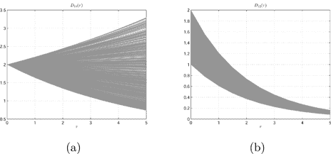

Figure 4.5

#### 1.3. 离散输入函数
在大多数情况下，对象的输入和输出以固定步长 `Δ` 在离散时刻测量。对象在有限时间区间上运行，因此其输入和输出的可用信息表示为一维数值数据数组。这些数组用于形成对象的输入和输出的格点函数向量，**x**[*k*Δ*] = **x**[*k*] 和 $\hat{\mathbf{y}}[k\Delta] = \hat{\mathbf{y}}[k]$。详情请参阅 [176]。

在线性近似下，输入和输出格点函数向量 **x**[*k*] 和 $\hat{\mathbf{y}}[k],$ 之间的动态关系可由矩阵 `B[k,q]` 描述，该矩阵由具有时变参数的 RPM 的格点脉冲特性 `b[i j][k,q]` 组成，或由具有恒定参数的 RPM 的格点脉冲特性 `b[i j][q]` 组成的矩阵描述。在两种情况下，RPM 均包含取值在给定区间内的独立随机参数。脉冲特性假定具有所谓的有限记忆。对于具有时变参数的 RPM，这意味着

$$
\begin{array}{r}
{b_{ij}[k,q] = \left\{ \begin{aligned}
{b_{ij}[k,q]} & {\text{if}\, 0 \leq l \leq L_{ij}\,\text{and}\, k \geq 0,} \\
0 & {\text{if}\, l > L_{ij}\,\text{and}\, k \geq 0;} \\
\end{aligned}~ \right.}
\\
\end{array}
$$

(4.25)

对于具有恒定参数的 RPM，

$$
\begin{array}{r}
{b_{ij}[q] = \left\{ \begin{aligned}
{b_{ij}[q]} & {\text{if}\, 0 \leq l \leq L_{ij},} \\
0 & {\text{if}\, l > L_{ij}.} \\
\end{aligned}~ \right.}
\\
\end{array}
$$

(4.26)

则具有离散输入和输出的 RPM 由以下公式描述：

* 对于时变参数，

$$
\begin{array}{r}
{\hat{\mathbf{y}}[k] = {\sum\limits_{q = 0}^{L^{*}}B}[k,q]\,\mathbf{x}[q],\quad\quad k \geq L^{*};}
\\
\end{array}
$$

(4.27)

* 对于恒定参数，

$$
\begin{array}{r}
{\hat{\mathbf{y}}[k] = {\sum\limits_{q = 0}^{L^{*}}B}[q]\,\mathbf{x}[k - q],\quad\quad k \geq L^{*}.}
\\
\end{array}
$$

(4.28)

这里 `L*` = max[*i**j*] *L*[*i**j*]。


与具有连续输入函数的线性 RPM 相比，在这种情况下，参数可以是相应脉冲特性的纵坐标。

Table 4.2

|  |
| --- |
| *k* || 1 || 2 || 3 || 4 || 5 || 6 || 7 || 8 || 9 || 10 |
| *x*\[*k*\] || 2.5 || 3.5 || 5.7 || 2.8 || 2.1 || 1.9 || 1.7 || 2.1 || 3.1 || 4.4 |
| --- | --- | --- | --- | --- | --- | --- | --- | --- | --- | --- | --- |
| *x*\[*k* − 1\] || 1.8 || 2.5 || 3.5 || 5.7 || 2.8 || 2.1 || 1.9 || 1.7 || 2.1 || 3.1 |
|  |

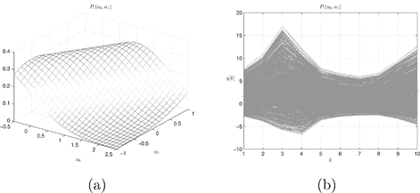

Figure 4.6

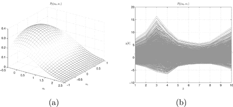

Figure 4.7

### 4.2.4 具有幂非线性的非线性动态模型

大多数实际对象本质上是非线性的。在其输入的小幅变化下，非线性对象可能表现出“几乎”线性的特性。一种用“单输入-集合输出”模型描述实际对象的非线性特性的方法是基于用函数幂级数对其进行近似。这样的级数的元素代表不同结构的幂泛函，其取决于对象的非线性特性以及输入函数的特性。特别地，如果对象的非线性是 *连续函数* 且对象的输入信号是 *连续时变函数*，则此类对象的 RPM 可以由函数 Volterra 级数 \177, [184\] 定义。

考虑一个在时间区间 `𝒯[t] = [0, t]` 上运行并由连续泛函 `ℬ(x(τ)) | τ ∈ 𝒯[t])` 刻画的动态系统。设输入向量 `x(τ) = {x1,…,xn}` 属于连续时变函数空间 `𝒳[𝒯[T]]`。根据 \[100, 146, 184, 185\]，泛函 `ℬ(x(τ))`（等价地，RPM 输出 `$\\hat{\\mathbf{y}}(t)$`）可以表示为收敛的函数级数，即

$$\\begin{aligned} {\\hat{\\mathbf{y}}(t)} & \\left. = \\mathcal{B}(\\mathbf{x}(\\tau))\\, \\middle| \\,\\tau \\in \\mathcal{T}\_{t}) = \\right. \\\\ {= {\\sum\\limits\_{h = 1}^{\\infty}{\\int\_{0}^{t}\\cdots}}} & {{\\int\_{0}^{t}W^{(h)}}(t - \\tau\_{1},\\ldots,t - \\tau\_{h}) \\times} \\\\ {\\times \\mathbf{x}^{(h)}} & {(\\tau\_{1},\\ldots,\\tau\_{h})d\\tau\_{1}\\cdots d\\tau\_{h}.} \\\\ \\end{aligned}$$

(4.29)

这里 `x^{(h)}(τ[1],…,τ[h])` 表示由字典序排列的乘积 `{x[i[1]](τ[j[1]])⋯x[i[n]](τ[j[h]])}` 组成的向量，其中 $(i\_{1},\\ldots,i\_{n}) \\in \\overline{1,n}$ 且 $(j\_{1},\\ldots,j\_{h}) \\in \\overline{1,h}.$ 向量 `x^{(h)}` 的维数为

$$\\begin{array}{r} {l(n,h) = n^{h}.} \\\\ \\end{array}$$

(4.30)

矩阵 `W^{(h)}(t[1],…,t[h])` 的维数为 (`m × l(m, h)`)，其元素是多维权重函数（脉冲特性）`w[k[h]]^{(h)}(t[1],…,t[h])`，其中 $k\_{h} = \\overline{1,l(n,h)}$。

Figure 4.8 说明了函数级数 (4.28) 的结构。 Fig. 4.8 中的块 `∏[h]` 表示向量 `x` 的幂为 `h` 的元素的字典序排列乘积。

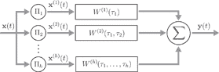

Figure 4.8

权重函数包含区间类型的随机参数 `a^{(h)}`，即

$$\\begin{array}{r} {\\mathbf{a}^{(h)} \\in \\mathcal{A}^{(h)} = \\left\\{ \\mathbf{a}\_{-}^{(h)} \\leq \\mathbf{a}^{(h)} \\leq \\mathbf{a}\_{+}^{(h)} \\right\\}.} \\\\ \\end{array}$$

(4.31)

由于参数是随机的，它们在相应区间上具有 PDF `P^{h}(a^{(h)})`。

泛函 `ℬ` (4.2.4) 通常可以写成具有结构化权重矩阵（脉冲特性）的函数级数。在结构化中，我们指的是线性动态和非线性静态操作的序列。 Fig. 4.11(a) 中显示的 RPM 的框图，其中每个通道代表线性动态块和幂非线性的串联连接。该模型的输出由函数 Volterra 级数的以下修改定义：

$$\\begin{aligned} {\\hat{\\mathbf{y}}(t)} & \\left. = \\mathcal{B}(\\mathbf{x}(\\tau))\\, \\middle| \\,\\tau \\in \\mathcal{T}\_{t}) = \\right. \\\\ & {= {\\sum\\limits\_{h = 1}^{\\infty}\\left( {{\\int\_{0}^{t}W^{(h)}}(t - \\tau)\\,\\mathbf{x}(\\tau)\\, d\\tau} \\right)^{h}}.} \\\\ \\end{aligned}$$

(4.32)

对于一维 RPM，上面的等式取以下形式

$$\\begin{array}{r} {\\hat{y}(t) = {\\sum\\limits\_{h = 1}^{\\infty}{\\int\_{0}^{t}\\cdots}}{\\int\_{0}^{t}{\\prod\\limits\_{i = 1}^{h}\\,}}\\left( {w(t - \\tau\_{i})\\, x(\\tau\_{i})d\\tau\_{i}} \\right).} \\\\ \\end{array}$$

(4.33)

Fig. 4.11(b) 中的框图对应于 RPM，其中每个通道中线性操作和非线性操作的顺序相反：首先输入经过幂变换，然后进行动态线性变换。RPM 输出由函数 Volterra 级数的另一种修改描述：

$$\\begin{array}{r} {\\hat{\\mathbf{y}}(t) = {\\sum\\limits\_{h = 1}^{\\infty}{\\int\_{0}^{t}W}}(t - \\tau)\\mathbf{x}^{(h)}(\\tau)\\, d\\tau.} \\\\ \\end{array}$$

(4.34)

这里，向量 `x^{(h)}(τ)` 由向量 `x(τ)` 的元素的所有可能乘积的字典序排列元素组成。

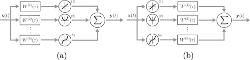

Figure 4.11

考虑具有有限记忆 `K` 的 RPM；该模型在离散时间 `t[k]` 处以步长 `Δ` 测量输入和输出。令 `k = [t[k]/Δ]`，

$$\\begin{aligned} {\\hat{\\mathbf{y}}\\lbrack k\\rbrack = {\\sum\\limits\_{h = 1}^{\\infty}{\\sum\\limits\_{(n\_{1},\\ldots,n\_{h}) = 0}^{K}W^{(h)}}}\\lbrack n\_{1},\\ldots,} & {n\_{h}\\rbrack\\,\\mathbf{x}^{(h)}\\lbrack k - n\_{1},\\ldots,k - n\_{h}\\rbrack,} \\\\ {k \\geq} & {K.} \\\\ \\end{aligned}$$

(4.35)

向量 `x^{(h)}[k − n[1],…,k − n[h]]` 具有元素 `x[i[1]][k − n[1]]⋯x[i[n]][k − n[h]]`，它们是 $(i\_{1},\\ldots,i\_{n}) = \\overline{1,n}$ 元素在时间 $(n\_{1},\\ldots,n\_{h}) = \\overline{0,K}$ 处对向量 `x` 的所有可能乘积的字典序排列。向量 `x^{(h)}[k − n[1],…,k − n[h]]` 的维数为

$$\\begin{array}{r} {l(n,h) = \\frac{(n\\, K + h - 1)!}{h!(n\\, k - 1)!}.} \\\\ \\end{array}$$

(4.36)

参数 `K` 定义了 RPM 的记忆容量，即

$$\\begin{array}{r} {W^{(h)}\\lbrack n\_{1},\\ldots,n\_{h}\\rbrack = \\left\\{ \\begin{aligned} {W^{(h)}\\lbrack n\_{1},\\ldots,n\_{h}\\rbrack} & {\\text{if~all}\\,(n\_{1},\\ldots,n\_{h}) \\leq K,} \\\\ 0 & {\\text{if~at~least~one}\\, n\_{j} > K.} \\\\ \\end{aligned}~ \\right.} \\\\ \\end{array}$$

(4.37)

矩阵 `W^{(h)}[n[1],…,n[h]]` 的元素是离散随机权重函数（脉冲特性）`w_{i,k_{h}}^{(h)}[n_{1},…,n_{h}],  i = \overline{1,m};  k_{h} = \overline{1,l(n,h)}.` 它们反映了 RPM 的动态和非线性特性。需要注意的是，非线性特性是用多维函数（脉冲特性）表述的，而不是用结构可表示的非线性元件表述的。

脉冲特性 `w[i, k[h]]^{(h)}[n[1],…,n[h]]` 为区间类型，即

$$\\begin{array}{r} {w\_{i,k\_{h}}^{(h)}\\lbrack n\_{1},\\ldots,n\_{h}\\rbrack \\in \\mathcal{W}\_{i,k\_{h}}^{(h)} = \\left\\lbrack {{\\widetilde{w}}\_{i,k\_{h}}^{(h, - )}\\lbrack n\_{1},\\ldots,n\_{h}\\rbrack,\\,{\\widetilde{w}}\_{i,k\_{h}}^{(h, + )}\\lbrack n\_{1},\\ldots,n\_{h}\\rbrack} \\right\\rbrack.} \\\\ \\end{array}$$

(4.38)


在该表达式中，*w̃*[*i*, *k*[*h*]]^((*h*,  ± ))\[*n*[1], …, *n*[*h*]\] 是描述上述区间左右极限的给定函数。例如，它们可以定义为指数函数

$$
\\begin{aligned} {{\\widetilde{w}}\_{i,k\_{h}}^{(h, - )}\\lbrack n\_{1},\\ldots,n\_{h}\\rbrack} & {= {\\prod\\limits\_{j = 1}^{h}\\beta\_{(i,k\_{h})}^{(h, - )}}(j)\\,\\exp\\left( {- \\alpha\_{(i,k\_{h})}^{(h, - )}(j)\\, n\_{j}} \\right),} \\\\ {{\\widetilde{w}}\_{i,k\_{h}}^{(h, + )}\\lbrack n\_{1},\\ldots,n\_{h}\\rbrack} & {= {\\prod\\limits\_{j = 1}^{h}\\beta\_{(i,k\_{h})}^{(h, + )}}(j)\\,\\exp\\left( {- \\alpha\_{(i,k\_{h})}^{(h, + )}(j)\\, n\_{j}} \\right).} \\\\ \\end{aligned}
$$

(4.39)

一种方便的方法是将它们的纵坐标视为 RPM 参数。这使我们能够将非线性 RPM 变换为维数明显更高的线性类比。一维 RPM（一个输入一个输出）的变换过程由下式给出

$$
\\begin{array}{r} {\\hat{y}\\lbrack k\\rbrack = {\\sum\\limits\_{h = 1}^{H}\\sum\\limits^{K}}(n\_{1},\\ldots,n\_{h}) = 0w^{(h)}\\lbrack n\_{1},\\ldots,n\_{h}\\rbrack\\,{\\prod\\limits\_{i = 1}^{h}x}\\lbrack k - n\_{i}\\rbrack,\\text{\\quad\\quad}k \\geq K.} \\\\ \\end{array}
$$

(4.40)

用从 0 到 *t*[*h*] = (*K* + 1)^(*h*) − 1 的数字重新分配给结果集合，对变量 {*n*[1],…,*n*[*h*]} 引入字典序。然后

$$
\\begin{array}{r} \\left. \\left\\{ n\_{1},\\ldots,n\_{h} \\right\\}\\rightarrow i^{(h)},\\text{\\quad\\quad}i^{(h)} \\in \\lbrack 0,t\_{h}\\rbrack. \\right. \\\\ \\end{array}
$$

(4.41)

根据此编号方案，定义对应于脉冲特性在离散时间 0, 1, …, *K* 处取值的随机参数的以下索引：

$$
\\begin{array}{r} \\left. a\_{i^{(h)}}^{(h)}\\rightarrow w^{(h)}\\lbrack n\_{1},\\ldots,n\_{h}\\rbrack,\\text{\\quad\\quad}i^{(h)} \\in \\lbrack 0,t\_{h}\\rbrack. \\right. \\\\ \\end{array}
$$

(4.42)

构造随机向量

$$
\\begin{array}{r} {\\mathbf{a}(h) = \\left\\{ a\_{0}^{(h)},\\ldots,a\_{t\_{h}}^{(h)} \\right\\}.} \\\\ \\end{array}
$$

(4.43)

向量 **a**(*h*) 的元素——见 (4.38)—取值于区间内

$$
\\begin{array}{r} {\\mathcal{A}^{(h)}(i^{(h)}) = \\left\\lbrack {a\_{-}^{(h)}(i^{(h)}),\\, a\_{+}^{(h)}(i^{(h)})} \\right\\rbrack.} \\\\ \\end{array}
$$

(4.44)

与 (4.41) 类似，引入变量 *k* − *n*[1], …, *k* − *n*[*h*] 的字典序，其中 *k* 是固定参数且指标 *n*[1], …, *n*[*h*] 取值于区间 \[0,*K*\] 内。

对每个固定的 *k*，按如下方式重新编号结果集合：

$$
\\begin{array}{r} \\left. \\left\\{ k - n\_{1},\\ldots,k - n\_{h} \\right\\}\\rightarrow(k,i^{(h)}). \\right. \\\\ \\end{array}
$$

(4.45)

然后，变量 *x*\[*k* − *n*[1]\], …, *x*\[*k* − *n*[*h*]\] 的字典序乘积在 *k* 固定时形成向量

$$
\\begin{array}{r} {\\mathbf{x}^{(h)}\\lbrack k\\rbrack = \\left\\{ {x\_{k,0}^{(h)},\\ldots,x\_{k,t\_{h}}^{(h)}} \\right\\}.} \\\\ \\end{array}
$$

(4.46)

因此，表达式 (4.40) 可以写为

$$
\\begin{array}{r} {\\hat{y}\\lbrack k\\rbrack = {\\sum\\limits\_{h = 1}^{H}\\left\\langle \\mathbf{a}^{(h)},\\,\\mathbf{x}^{(h)}\\lbrack k\\rbrack \\right\\rangle},} \\\\ \\end{array}
$$

(4.47)

其中 ⟨•, •⟩ 表示向量 ∙ 和  •  的标量积。

考虑具有结构化非线性的一维 RPM（见 Fig. 4.11(a)）并以以下离散时变函数作为其输入：

$$
\\begin{array}{r} {\\hat{y}\\lbrack k\\rbrack = {\\sum\\limits\_{h = 1}^{H}\\left( {{\\sum\\limits\_{n = 0}^{K}w^{(h)}}\\lbrack n\\rbrack x\\lbrack k - n\\rbrack} \\right)^{h}},\\text{\\quad\\quad}k \\geq K.} \\\\ \\end{array}
$$

(4.48)

脉冲特性 *w*^((*h*))\[*n*\] 具有有限记忆 *K* 且为随机参数。同样，作为后者选择其纵坐标，即

$$
\\begin{array}{r} {w^{(h)}\\lbrack n\\rbrack = a\_{n}^{(h)},\\quad n = \\overline{0,K}.} \\\\ \\end{array}
$$

(4.49)

构造向量

$$
\\begin{array}{r} {\\mathbf{a}^{(h)} = \\left\\{ a\_{0}^{(h)},\\ldots,a\_{K}^{(h)} \\right\\}.} \\\\ \\end{array}
$$

(4.50)

参数 *a*[*n*]^((*h*)) 是随机的、独立的，并在区间内取值

$$
\\begin{array}{r} {\\mathcal{A}\_{n}^{(h)} = \\lbrack - A\_{n}^{(h)},\\, A\_{n}^{(h)}\\rbrack,\\quad A\_{n}^{(h)} = \\beta\_{n}^{(h)}\\exp( - \\alpha\_{n}^{(h)}).} \\\\ \\end{array}
$$

(4.51)

PDF $p\_{n}^{(h)}(a\_{n}^{(h)}),\\,\\, n = \\overline{0,K},$ 在这些区间上定义。

回到等式 (4.48) 并引入以下记号：

* 指标集

$$
\\begin{array}{r} {\\mathcal{I}\_{h}(K) = \\left\\{ i\_{n}:\\,{\\sum\\limits\_{n = 0}^{K}i\_{n}} = h,\\, i\_{n} = \\overline{0,K} \\right\\};} \\\\ \\end{array}
$$

(4.52)

* 向量

$$
\\begin{array}{r} {\\mathbf{i} = \\left\\{ i\_{0},\\ldots,i\_{K} \\right\\};} \\\\ \\end{array}
$$

(4.53)

* 函数

$$
\\begin{array}{r} {C\_{(k,i\_{n})}(x) = \\frac{1}{i\_{n}!}\\, x^{i\_{n}}\\lbrack k - n\\rbrack.} \\\\ \\end{array}
$$

(4.54)

则公式 (4.48) 可以写为

$$
\\begin{aligned} {\\hat{y}\\lbrack k\\rbrack} & {= {\\sum\\limits\_{h = 1}^{H}V\_{k}^{(h)}}(\\mathbf{a}^{(h)},x),} \\\\ {V\_{k}^{(h)}(\\mathbf{a}^{(h)},x)} & {= {\\sum\\limits\_{\\mathbf{i} \\in \\mathcal{I}\_{h}(K)}\\,}{\\prod\\limits\_{n = 0}^{K}\\,}C\_{(k,i\_{n})}(x)\\,{\\lbrack a\_{n}^{(h)}\\rbrack}^{i\_{n}}.} \\\\ \\end{aligned}
$$

(4.55)

因此，与 RPM (4.40) 不同，所考虑的模型是非线性的，具有幂非线性。

### 4.2.5 具有多项式非线性的非线性动态模型

在机器学习问题中，通常需要处理其可观测输出在某些时刻或在输入的某些取值下出现跳变的动态对象。在其他情况下，存在关于对象属性的先验信息，该信息定义了其结构，如 Fig. 4.13(a) 或 Fig. 4.13(b) 所示。这些图中的非线性块由不同类的正交多项式描述（见 Table 4.1）。

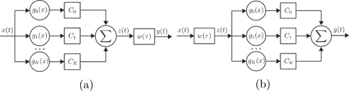

Figure 4.13

考虑 Fig. 4.13(a) 中给出的结构的 RPM。利用正交多项式 *g**k*，我们将此 RPM 写为以下形式：

$$
\\begin{array}{r} \\left. \\hat{y}(t) = {\\sum\\limits\_{k = 0}^{K}c\_{k}}{\\int\_{0}^{t}w}(t - \\tau\\, \\middle| \\mathbf{b})\\, g\_{k}(x(\\tau))d\\tau, \\right. \\\\ \\end{array}
$$

(4.56)

其中系数 *c*[0], …, *c*[*K*] 是区间型的独立随机变量，即

$$
\\begin{array}{r} {c\_{k} \\in \\mathcal{C}\_{k} = \\lbrack c\_{k}^{-},c\_{k}^{+}\\rbrack,\\text{\\quad\\quad}k = \\overline{0,K}.} \\\\ \\end{array}
$$

(4.57)

脉冲特性 *w*(*t* |**b**) 的参数 **b** 是随机的并属于区间

$$
\\begin{array}{r} {\\mathbf{b} \\in \\mathcal{B} = \\lbrack\\mathbf{b}^{-},\\mathbf{b}^{+}\\rbrack.} \\\\ \\end{array}
$$

(4.58)

现在回到 Fig. 4.13(b) 中的框图。显然，对象的线性和非线性动态元件交换了位置。对象的输入是函数 *x*(*t*)。让我们使用具有随机参数 *w*(*τ* | **b**) 的脉冲特性来构造该对象的 RPM 用于线性元件，并使用具有随机系数的正交多项式集合用于非线性元件。然后 RPM 可以写为


$$\\begin{aligned} {\\hat{y}(t) = \\sum\_{k = 1}^{K}\\,\\sum\_{i = 0}^{k}} & \\left. c\_{k}a\_{ki}\\int\_{0}^{t}\\cdots\\int\_{0}^{t}w(t - \\tau\_{0} \\middle| \\mathbf{b})\\cdots w(t - \\tau\_{i} \\middle| \\mathbf{b}) \\times \\right. \\\\ & {\\times x(\\tau\_{0})\\cdots x(\\tau\_{i})d\\tau\_{1}\\cdots d\\tau\_{i}.} \\\\ \\end{aligned}$$  

(4.59)

在此方程中，`a[k i]` 表示正交多项式的系数（参见 表 4.1）；`c[1]`，…，`c[K]` 是非线性单元随机化模型的独立随机系数。它们是区间型（4.57）。

如果该 RPM 的输入和输出由格点函数表征，则以下方程成立：

* 对于 图 4.13(a) 中的 RPM，

$$\\begin{array}{r} \\left. \\hat{y}\\lbrack n\\rbrack = {\\sum\\limits\_{k = 0}^{K}\\,}{\\sum\\limits\_{i = 0}^{k}c\_{k}}a\_{ki}{\\sum\\limits\_{m = 0}^{n}w}\\lbrack n - m\\, \\middle| \\,\\mathbf{b}\\rbrack\\, x^{i}\\lbrack m\\rbrack; \\right. \\\\ \\end{array}$$  

(4.60)

* 对于 图 4.13(b) 中的 RPM，

$$\\begin{array}{r} \\left. \\hat{y}\\lbrack n\\rbrack = {\\sum\\limits\_{k = 1}^{K}{\\sum\\limits\_{i = 0}^{k}c\_{k}}}a\_{ki}{\\sum\\limits\_{(m\_{0},\\ldots,m\_{i}) = 0}^{n}{\\prod\\limits\_{j = 0}^{i}w}}\\lbrack n - m\_{j}\\, \\middle| \\,\\mathbf{b}\\rbrack\\, x\\lbrack m\_{j}\\rbrack. \\right. \\\\ \\end{array}$$  

(4.61)

在这些公式中，系数 `c[k]` 是独立随机变量，按给定概率密度函数分布于相应的区间（4.57）。脉冲特性的参数 `b[1]`，…，`b[s]` 也是随机的、相互独立的，并在相应的区间内取值，具有给定的概率密度函数。

### 4.2.6 随机神经网络

神经网络是一种用于机器学习程序的参数化模型。神经网络的结构基础是 Kolmogorov 定理 [94]，该定理指出，非负单位立方体上 `n` 个变量的连续函数可以写成单变量函数的叠加并求和：

$$\\begin{array}{r} {f(x\_{1},\\ldots,x\_{n}) = {\\sum\\limits\_{k = 1}^{(2n + 1)}h\_{k}}\\left( {{\\sum\\limits\_{i = 1}^{n}\\phi\_{ik}}(x\_{i})} \\right);} \\\\ \\end{array}$$  

(4.62)

这里变量 `h[1]`，…，`h[2n + 1]` 依赖于函数 `f`，而函数 `phii k` 则不依赖。此定理断言存在这样的表示，但没有给出找到它的技术细节。

一方面，神经网络的普适性可以用与 Kolmogorov 定理的结构类比来解释；另一方面，可以用与生物神经元操作（122）的简化（统计）类比来解释。神经元统计模型的一般结构如图 图 4.16(a) 所示。它由三个串联的模块组成，即突触系数 `w` = `{w[1],…,w[n]}`、加法器和具有激活函数 `phi(u, b)` 的非线性变换模块，其中 `b` 为激活函数参数。图 4.16(b) 显示了该模型的示例，其中非线性变换模块具有阈值为 `Delta` 的激活函数 `phi(u, Delta)`。一般情况下，激活函数 `phi(u)` 可能包含多个参数，后文记为 `b[1]`，…，`b[q]`。除 图 4.16(b) 中的函数 `phi(u)` 外，以下激活函数也很常见：

* —线性激活函数（参见 图 4.17(a)）

$$\\begin{array}{r} {\\phi(u) = \\left\\{ \\begin{aligned} 0 & {\\text{if}\\, u \\leq \\Delta,} \\\\ u & {\\text{if}\\, u \\geq \\Delta;} \\\\ \\end{aligned}~ \\right.} \\\\ \\end{array}$$  

(4.63)

* —sigmoid 激活函数（参见 图 4.17(b)）

$$\\begin{array}{r} {\\phi(u) = \\frac{1}{1 + \\exp(u - \\Delta)};} \\\\ \\end{array}$$  

(4.64)

* —tangent 激活函数（参见 图 4.17(c)）

$$\\begin{array}{r} {\\phi(u) = \\tan(u).} \\\\ \\end{array}$$  

(4.65)

图 4.16(b) 所示结构的网络称为单层神经网络。单层神经网络的串联构成多层神经网络。其内部层称为隐藏层，而最后一层称为输出层。大多数应用涉及一层隐藏层，如 图 4.18 所示。输入层有一组突触系数 `w[11]`，… `w[n h]`；隐藏层有 `g[11]`，…，`g[h s]`。

因此，单层和多层神经网络（图 4.16 和 4.18）是统计系统，即网络在当前时刻的输入理论上取决于其在此时刻的输入。例如，单层神经网络的输出形式为

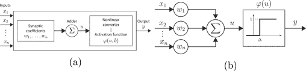

Figure 4.16

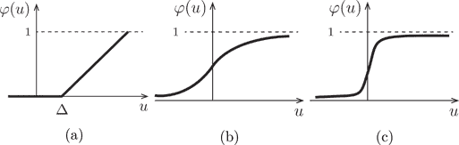

Figure 4.17

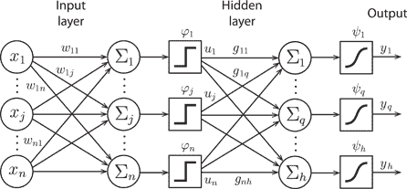

Figure 4.18

$$\\begin{array}{r} {y(t) = S\\left( \\mathbf{x}(t)\\, \\middle| \\,\\mathbf{w},\\mathbf{b} \\right),} \\\\ \\end{array}$$  

(4.66)

其中 `w` 和 `b` 为网络参数。

按假设，随机神经网络包含取值于给定区间的随机参数，即

$$\\begin{array}{r} {\\mathbf{w} \\in \\mathcal{W} = \\lbrack\\mathbf{w}^{-},\\mathbf{w}^{+}\\rbrack;\\text{\\quad\\quad}\\mathbf{b} \\in \\mathcal{B} = \\lbrack\\mathbf{b}^{-},\\mathbf{b}^{+}\\rbrack.} \\\\ \\end{array}$$  

(4.67)

这些区间上参数的概率特性由概率密度函数 `Pw` 和 `Pb` 表征。随机神经网络的输出表示随机变量 `y` 的集合。

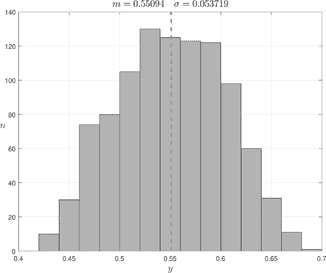

Figure 4.19

## 4.3 “（单输入，反馈）- 集成输出” 动态随机参数模型

### 4.3.1 定义和结构

对于许多动态 RPM 的结构设计，仅定义输入-输出关系是不够的。在这种情况下，我们必须反映被建模过程或对象的某些内部机制。可用以描述这些机制的数学框架涉及不同类别的方程。它们的一般结构由一个具有参数化映射 `G` 的特定模块和一个由参数化映射 `C` 表征的反馈回路组成，见 图 4.20。

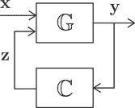

Figure 4.20

在此图中，`x` ∈ `R^(n)` 表示模型输入；`y` ∈ `R^(m)` 为模型输出；最后，`z` ∈ `R^(d)` 给出反馈模块输出。

映射 `G` 和 `C` 描述了对象中运行过程的内部机制。采用函数描述对这些映射进行描述，引入以下记号：

$$\\begin{aligned} \\mathbb{G} & {= \\mathcal{G}\\left( \\mathbf{x}(\\tau),\\mathbf{z}(\\tau),\\, \\middle| \\,\\mathbf{a};\\,\\tau \\in \\mathcal{T} \\right),} \\\\ {\\mathbb{C}} & {= \\mathcal{C}\\left( \\mathbf{y}(\\tau),\\, \\middle| \\,\\mathbf{c};\\,\\tau \\in \\mathcal{T} \\right).} \\\\ \\end{aligned}$$  

(4.68)

泛函 `G` 和 `C` 分别包含随机参数 `a` ∈ `R^(r)` 和 `c` ∈ `R^(h)`，其独立元素属于区间

$$\\begin{array}{r} {\\mathbf{a} \\in \\mathcal{A} = \\lbrack\\mathbf{a}^{-},\\mathbf{a}^{+}\\rbrack,\\text{\\quad\\quad}\\mathbf{c} \\in \\mathcal{S} = \\lbrack\\mathbf{c}\_{-},\\mathbf{c}^{+}\\rbrack.} \\\\ \\end{array}$$  

(4.69)


Consequently, the \[(SI,FB)–EO\] RPM can be written as

$$\\begin{aligned} {\\mathbf{y}(t)} & {= \\mathcal{G}\\left( \\mathbf{x}(\\tau),\\mathbf{z}(\\tau)),\\, \\middle| \\,\\mathbf{a};\\,\\tau \\in \\mathcal{T} \\right),} \\\\ {\\mathbf{z}(t)} & {= \\mathcal{C}\\left( \\mathbf{y}(\\tau),\\, \\middle| \\,\\mathbf{c};\\, \\middle| \\,\\tau \\in \\mathcal{T} \\right).} \\\\ \\end{aligned}$$  

(4.70)

The functionals in these equations may have different mathematical models, depending on the declared properties of objects under analysis.

### 4.3.2 Linear dynamic models

The linear \[(SI,FB)–EO\] RPM have the structure illustrated in Fig. 4.20, except for its blocks are described by *linear functionals 𝒢 and 𝒞 with random parameters*. Assume that the input vector consists of *continuous time-varying functions* and the parameters are time-invariable. Then *the integral form of the linear \[(SI,FB)–EO\] RPM* can be written as

$$\\begin{aligned} {\\mathbf{y}(t)} & \\left. = {\\int\_{\\mathcal{T}}G}(t - \\tau\\, \\middle| \\,\\mathbf{a})\\,\\mathbf{x}(\\tau)\\, d\\tau + {\\int\_{\\mathcal{T}}F}(t - \\tau\\, \\middle| \\,\\mathbf{b})\\,\\mathbf{z}(\\tau)\\, d\\tau, \\right. \\\\ {\\mathbf{z}(t)} & {= {\\int\_{\\mathcal{T}}C}(t - \\tau)\\,\\mathbf{y}(\\tau)\\, d\\tau.} \\\\ \\end{aligned}$$  

(4.71)

Recall that these equalities involve vectors **x** ∈ *R*^(*n*), **y** ∈ *R*^(*m*) and **z** ∈ *R*^(*d*), as well as the matrices $\\left. G(t\\, \\middle| \\,\\mathbf{a}) = \\lbrack g\_{ij}(t\\, \\middle| \\,\\mathbf{a}),\\, i = \\overline{1,m},\\, j = \\overline{1,n}\\rbrack;\\, F(t\\, \\middle| \\,\\mathbf{b}) = \\lbrack f\_{il}(t\\, \\middle| \\,\\mathbf{b}),\\, i = \\overline{1,m}\\rbrack,\\, l = \\overline{1,d};\\, C(t\\, \\middle| \\,\\mathbf{b}) = \\lbrack c\_{h,k}(t\\, \\middle| \\,\\mathbf{c}),\\, h = \\overline{1,d},\\, k = \\overline{1,m}\\rbrack. \\right.$ As their elements the matrices contain the pulse characteristics *g**i**j*, *f**i**l* and *c**h*, *k* with random parameters described by the vectors **a**, **b** and **c**; the elements of these vectors are independent and take values within the intervals

$$\\begin{array}{r} {\\mathbf{a} \\in \\mathcal{A} = \\lbrack\\mathbf{a}^{-},\\mathbf{a}^{+}\\rbrack,\\quad\\mathbf{b} \\in \\mathcal{B} = \\lbrack\\mathbf{b}^{-},\\mathbf{b}^{+}\\rbrack,\\quad\\mathbf{c} \\in \\mathcal{C} = \\lbrack\\mathbf{c}^{-},\\mathbf{c}^{+}\\rbrack.} \\\\ \\end{array}$$  

(4.72)

The \[(SI,FB)–EO\] RPM can be transformed into the \[SI–EO\] RPM. In our case, a most convenient approach is to employ the Fourier transform. First, eliminate the vector **z** in (4.71) to get the equation

$$\\begin{array}{r} \\left. \\mathbf{y} = {\\int\_{\\mathcal{T}}G}(t - \\tau\\, \\middle| \\,\\mathbf{a})\\,\\mathbf{x}(\\tau)\\, d\\tau + {\\int\_{\\mathcal{T}}F}(t - \\tau\\, \\middle| \\,\\mathbf{b})\\,{\\int\_{\\mathcal{T}\_{\\tau}}C}(t - \\lambda\\, \\middle| \\,\\mathbf{c})\\,\\mathbf{y}(\\lambda)\\, d\\tau d\\lambda. \\right. \\\\ \\end{array}$$  

(4.73)

Using the Fourier transform \[43\], write the solution of this equation in the frequency domain (i.e., in terms of image functions):

$$\\begin{aligned} & \\left. \\mathbf{Y}(s) = K(s\\, \\middle| \\,\\mathbf{a},\\mathbf{b},\\mathbf{c})\\,\\mathbf{X}(s), \\right. \\\\ & \\left. K(s\\, \\middle| \\,\\mathbf{a},\\mathbf{b},\\mathbf{c}) = \\left( I - F(s\\, \\middle| \\,\\mathbf{b})C(s\\, \\middle| \\,\\mathbf{c}) \\right)^{( - 1)}G(s\\, \\middle| \\,\\mathbf{a}). \\right. \\\\ \\end{aligned}$$  

(4.74)

Here *s* = *α* + *ι**ω* and $\\iota = \\sqrt{- 1},$ whereas *α* and *ω* are real variables. Transition from the frequency domain to the time domain yields the following integral equation for an equivalent \[SI–EO\] RPM:

$$\\begin{array}{r} \\left. \\mathbf{y}(t) = {\\int\_{\\mathcal{T}}K}(t - \\tau\\, \\middle| \\,\\mathbf{a},\\mathbf{b},\\mathbf{c})\\,\\mathbf{x}(\\tau)\\, d\\tau, \\right. \\\\ \\end{array}$$  

(4.75)

where the matrix

$$\\begin{array}{r} \\left. K(t\\, \\middle| \\,\\mathbf{a},\\mathbf{b},\\mathbf{c}) = \\mathcal{L}^{( - 1)}\\left\\{ K(s\\, \\middle| \\,\\mathbf{a},\\mathbf{b},\\mathbf{c}) \\right\\}. \\right. \\\\ \\end{array}$$  

(4.76)

### 4.3.3 Nonlinear dynamic models with power nonlinearities

Consider an object whose \[(SI,FB)–EO\] RPM has the structure shown in Fig. 4.20. Let the functionals 𝒢 and 𝒞 be continuous. Then they can be represented using the framework of functional Volterra series \[184\]; see Section 3.1.

This framework will be adopted for the one-dimensional \[(SI,FB)–EO\] RPM (Fig. 4.20), which is described by the system of equations

$$\\begin{aligned} {y(t)} & {= \\mathcal{G}\\left( \\varepsilon(\\tau)),\\, \\middle| \\,\\mathbf{a};\\,\\tau \\in \\mathcal{T} \\right),} \\\\ {z(t)} & {= \\mathcal{C}\\left( y(\\tau),\\, \\middle| \\,\\mathbf{c};\\, \\middle| \\,\\tau \\in \\mathcal{T} \\right),} \\\\ {\\varepsilon(t)} & {= x(t) - z(t).} \\\\ \\end{aligned}$$  

(4.84)

Assume that the time-varying functions *x*(*t*), *z*(*t*), and *y*(*t*), as well as the functionals 𝒢(*ε*, | **a**) and 𝒞(*y*, | **c**), are continuous. In this case, they can be expressed as the functional series with the corresponding weight functions (pulse characteristics), i.e.,

$$\\begin{aligned} {y(t) = {\\sum\\limits\_{i = 1}^{\\infty}{\\int\_{\\tau\_{1} \\in \\mathcal{T}}\\cdots}}} & \\left. {\\int\_{\\tau\_{i} \\in \\mathcal{T}}\\,}g\_{i}(t - \\tau\_{1},\\ldots,t - \\tau\_{i}\\, \\middle| \\,\\mathbf{a}^{(i)}) \\times \\right. \\\\ {\\varepsilon(\\tau\_{1})} & {\\cdots\\varepsilon(\\tau\_{i})\\, d\\tau\_{1}\\cdots d\\tau\_{i},} \\\\ {z(t) = {\\sum\\limits\_{j = 1}^{\\infty}{\\int\_{\\lambda\_{1} \\in \\mathcal{T}}\\cdots}}} & \\left. {\\int\_{\\lambda\_{j} \\in \\mathcal{T}}\\,}c\_{j}(t - \\lambda\_{1},\\ldots,t - \\lambda\_{j}\\, \\middle| \\,\\mathbf{c}^{(j)}) \\times \\right. \\\\ {\\times y(\\lambda\_{1})} & {\\cdots y(\\lambda\_{j})\\, d\\lambda\_{1}\\cdots d\\lambda\_{j},} \\\\ \\end{aligned}$$  

(4.85)

$$\\begin{array}{r} {\\varepsilon(t) = x(t) - z(t).} \\\\ \\end{array}$$  

Here the pulse characteristics have random parameters, namely, the random independent vectors **a**^((*i*)) and **c**^((*j*)) with independent elements taking values within the intervals

$$\\begin{aligned} {\\mathbf{a}^{(i)} \\in \\mathcal{A}^{(i)}} & {= \\lbrack\\mathbf{a}\_{-}^{(i)},\\,\\mathbf{a}\_{+}^{(i)}\\rbrack,\\text{\\quad\\quad}i \\in \\lbrack 1,\\infty),} \\\\ {\\mathbf{c}^{(j)} \\in \\mathcal{S}^{(j)}} & {= \\lbrack\\mathbf{c}\_{-}^{(j)},\\,\\mathbf{c}\_{+}^{(j)}\\rbrack,\\text{\\quad\\quad}j \\in \\lbrack 1,\\infty).} \\\\ \\end{aligned}$$  

(4.86)

As a matter of fact, there exists a certain relation between the \[(SI,FB)–EO\] RPM (4.3.3) and the \[SI–EO\] RPM (4.2.4) with continuous nonlinearities. Recall that the latter model is described by a continuous functional ℬ, which can be also written as a functional Volterra series, i.e.,

$$\\begin{aligned} {\\mathbf{y}(t)} & \\left. = \\mathcal{B}(\\mathbf{x}(\\tau),\\, \\middle| \\,\\tau \\in \\mathcal{T}) = \\right. \\\\ {+ {\\sum\\limits\_{k}^{\\infty}{\\int\_{\\tau\_{1} \\in \\mathcal{T}}\\cdots}}} & {{\\int\_{\\tau\_{k} \\in \\mathcal{T}}\\,}w\_{k}(t - \\tau\_{1},\\ldots,t - \\tau\_{k}) \\times} \\\\ \\times & {x(\\tau\_{1})\\cdots x(\\tau\_{k})\\, d\\overline{\\tau}.} \\\\ \\end{aligned}$$  

(4.87)

Define the pulse characteristics in this formula so that equations (4.3.3) turn into identities \[146\]. First, substitute the last-mentioned equation into the first one to obtain an integral equation in the variable *y*(*t*):


$$\\begin{aligned} & \\left. y(t) = {\\int\_{\\tau\_{1} \\in \\mathcal{T}}g\_{1}}(t - \\tau\_{1}\\, \\middle| \\,\\mathbf{a})\\lbrack x(\\tau\_{1}) - {\\int\_{\\lambda\_{1} \\in \\mathcal{T}}\\,}c\_{1}(\\tau\_{1} - \\lambda\_{1}\\, \\middle| \\,\\mathbf{c})\\, y(\\lambda\_{1})\\, d\\lambda\_{1} + \\right. \\\\ & \\left. \\quad + {\\int\_{\\lambda\_{1} \\in \\mathcal{T}}{\\int\_{\\lambda\_{2} \\in \\mathcal{T}}\\,}}c\_{2}(t - \\lambda\_{1},t - \\lambda\_{2}\\, \\middle| \\,\\mathbf{c})\\, y(\\lambda\_{1})y(\\lambda\_{2})\\, d\\lambda\_{1}d\\lambda\_{2} + \\ldots \\right. \\\\ \\end{aligned}$$  

(4.88)

然后以泛函级数 (4.3.3) 的形式构造解：将它代入方程 (4.3.3) 的左边和右边，收集并比较变量 *x* 的相同幂次项。这些运算导致了 (4.3.3) 的核 *w**k*=*w**k* 的如下积分方程组：

$$\\begin{aligned} \\left. {\\int\_{\\tau\_{1} \\in \\mathcal{T}}w\_{1}}(t - \\tau\_{1}\\, \\middle| \\,\\mathbf{a},\\mathbf{c}) \\right. & \\left. x(\\tau\_{1})\\, d\\tau\_{1} = {\\int\_{\\tau\_{1} \\in \\mathcal{T}}g\_{1}}(t - \\tau\_{1}\\, \\middle| \\,\\mathbf{a})\\,\\lbrack x(\\tau\_{1})\\, d\\tau\_{1} - \\right. \\\\ {- {\\int\_{\\lambda\_{1} \\in \\mathcal{T}\_{\\tau\_{1}}}\\,}c\_{1}(\\tau\_{1}} & \\left. - \\lambda\_{1}\\, \\middle| \\,\\mathbf{c})\\,{\\int\_{\\mu\_{1} \\in \\mathcal{T}\_{\\lambda\_{1}}}\\,}w\_{1}(\\lambda\_{1} - \\mu\_{1}\\, \\middle| \\,\\mathbf{a},\\mathbf{c}) \\times \\right. \\\\ & {\\times x(\\mu\_{1})\\, d\\tau\_{1}d\\lambda\_{1}d\\mu\_{1},} \\\\ \\end{aligned}$$  

(4.89)

$$\\begin{aligned} & \\left. \\int\_{\\tau\_{1} \\in \\mathcal{T}}\\int\_{\\tau\_{2} \\in \\mathcal{T}}\\, w\_{2}(t - \\tau\_{1},t - \\tau\_{2}\\, \\middle| \\,\\mathbf{a},\\mathbf{c})\\, x(\\tau\_{1})x(\\tau\_{2})\\, d\\tau\_{1}d\\tau\_{2} = \\right. \\\\ {- \\int\_{\\tau\_{1} \\in \\mathcal{T}}} & \\left. g\_{1}(t - \\tau\_{1} - \\tau\_{2}\\, \\middle| \\,\\mathbf{a})\\int\_{\\lambda\_{1} \\in \\mathcal{T}\_{\\tau\_{1}}}\\int\_{\\lambda\_{2} \\in \\mathcal{T}\_{\\tau\_{2}}}\\, c\_{2}(\\tau\_{1} - \\lambda\_{1},\\tau\_{2} - \\lambda\_{2}\\, \\middle| \\,\\mathbf{c}) \\times \\right. \\\\ \\times & \\left. \\int\_{\\mu\_{1} \\in \\mathcal{T}\_{\\lambda\_{1}}}\\int\_{\\mu\_{2} \\in \\mathcal{T}\_{\\lambda\_{2}}}\\, w\_{1}(\\lambda\_{1} - \\mu\_{1}, \\middle| \\,\\mathbf{a},\\mathbf{c})w\_{1}(\\lambda\_{2} - \\mu\_{2}, \\middle| \\,\\mathbf{a},\\mathbf{c}) \\times \\right. \\\\ & {\\text{\\quad\\quad}\\text{\\quad\\quad} \\times x(\\mu\_{1})x(\\mu\_{2})\\, d\\tau\_{1}d\\tau\_{2}d\\lambda\_{1}d\\lambda\_{2}d\\mu\_{1}d\\mu\_{2} -} \\\\ & \\left. \\text{\\quad\\quad}\\text{\\quad\\quad} - \\int\_{\\tau\_{1} \\in \\mathcal{T}}\\int\_{\\tau\_{2} \\in \\mathcal{T}}\\, g\_{2}(t - \\tau\_{1},t - \\tau\_{2}, \\middle| \\,\\mathbf{a}) \\times \\right. \\\\ & \\left. \\text{\\quad\\quad} \\times \\int\_{\\lambda\_{1} \\in \\mathcal{T}\_{\\tau\_{1}}}\\int\_{\\lambda\_{2} \\in \\mathcal{T}\_{\\tau\_{2}}}c\_{1}(\\tau\_{1} - \\lambda\_{1})c\_{1}(\\tau\_{2} - \\lambda\_{2}, \\middle| \\,\\mathbf{c})\\, \\times \\right. \\\\ & \\left. \\text{\\quad\\quad}\\text{\\quad\\quad} \\times \\int\_{\\mu\_{1} \\in \\mathcal{T}\_{\\lambda\_{1}}}\\int\_{\\mu\_{2} \\in \\mathcal{T}\_{\\lambda\_{2}}}\\, w\_{1}(\\lambda\_{1} - \\mu\_{1}, \\middle| \\,\\mathbf{a},\\mathbf{c}) \\times \\right. \\\\ & \\left. \\text{\\quad\\quad}w\_{1}(\\lambda\_{2} - \\mu\_{2}, \\middle| \\,\\mathbf{a},\\mathbf{c})\\, d\\tau\_{1}d\\tau\_{2}d\\lambda\_{1}d\\lambda\_{2}d\\mu\_{1}d\\mu\_{2},\\cdots. \\right. \\\\ \\end{aligned}$$

该系统由关于 *x* 的幂次的齐次积分方程组成，具有递归结构。利用多维傅里叶变换（详见 \[42, 178\]），写出最终表达式

$$\\begin{aligned} & \\left. \\text{\\quad\\quad}\\text{\\quad\\quad}\\text{\\quad\\quad}W(s\_{1}, \\middle| \\,\\mathbf{a},\\mathbf{c}) = \\frac{\\left. G\_{1}(s\_{1}, \\middle| \\,\\mathbf{a}) \\right.}{\\left. 1 + G\_{1}(s\_{1}, \\middle| \\,\\mathbf{a})C(s\_{1}, \\middle| \\,\\mathbf{c}) \\right.}, \\right. \\\\ & \\left. \\text{\\quad\\quad}\\quad\\text{\\quad\\quad}\\text{\\quad\\quad}\\text{\\quad\\quad}\\text{\\quad\\quad}W(s\_{1},s\_{2}, \\middle| \\,\\mathbf{a},\\mathbf{c}) = \\right. \\\\ & {\\quad = \\frac{\\left. - G\_{1}(s\_{1} + s\_{2}, \\middle| \\,\\mathbf{a})\\, C\_{2}(s\_{1},s\_{2}, \\middle| \\,\\mathbf{c})\\, W\_{1}(s\_{1}, \\middle| \\,\\mathbf{a},\\mathbf{c})W\_{1}(s\_{2}, \\middle| \\,\\mathbf{a},\\mathbf{c}) \\right.}{\\left. 1 + .G\_{1}(s\_{1} + s\_{2}, \\middle| \\,\\mathbf{a})C\_{1}(s\_{1} + s\_{2}, \\middle| \\,\\mathbf{c}) \\right.} +} \\\\ & {+ \\frac{\\left. G\_{2}(s\_{1},s\_{2}, \\middle| \\,\\mathbf{a})W\_{1}(s\_{2}, \\middle| \\,\\mathbf{a},\\mathbf{c})\\lbrack C\_{1}(s\_{2}, \\middle| \\,\\mathbf{c})W\_{1}(s\_{1}, \\middle| \\,\\mathbf{a},\\mathbf{c}) - 2C\_{1}(s\_{2}, \\middle| \\,\\mathbf{c})\\rbrack \\right.}{\\left. 1 + G\_{1}(s\_{1} + s\_{2}, \\middle| \\,\\mathbf{a})C\_{1}(s\_{1} + s\_{2}), \\middle| \\,\\mathbf{c} \\right.},} \\\\ & {\\text{\\quad\\quad}\\text{\\quad\\quad}\\text{\\quad\\quad}\\text{\\quad\\quad}\\text{\\quad\\quad}\\text{\\quad\\quad}\\text{\\quad\\quad}\\cdots} \\\\ \\end{aligned}$$  

(4.90)

这里 *s*[1], …, *s*[*i*] 是多维傅里叶变换的复参数。

因此，\[(SI,FB)–EO\] RPM (4.3.3) 可以写成 \[SI–EO\] RPM (4.2.4)。这种变换在随机动态回归模型的机器学习问题中可能是有益的。

### 4.3.4 具有多项式非线性的非线性动态模型

在前一小节中，我们研究了在 \[SI–EO\] RPM 中使用正交多项式的过程。现在考虑该过程应用于 \[(SI,FB)–EO\] RPMs。对于具有 Fig. 4.21(a) 所示结构的 \[(SI,FB)–EO\] RPM，

$$\\begin{aligned} {y(t)} & {= {\\int\_{\\mathcal{T}}w}(t - \\tau)\\,{\\sum\\limits\_{k = 0}^{K}w\_{k}}g\_{k}(\\varepsilon(\\tau))\\, d\\tau,} \\\\ {z(t)} & {= {\\int\_{\\mathcal{T}}c}(t - \\tau)\\,{\\sum\\limits\_{m = 0}^{M}v\_{m}}c\_{m}(y(\\tau))\\, d\\tau,} \\\\ {\\varepsilon(t)} & {= x(t) - z(t).} \\\\ \\end{aligned}$$  

(4.91)

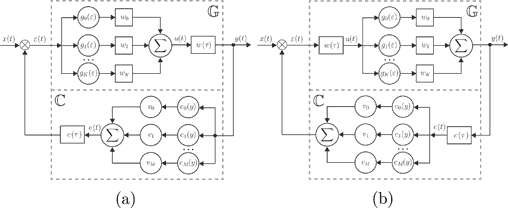

Figure 4.21

另一个 \[(SI,FB)–EO\] RPM（见 Fig. 4.21(b)）由以下方程组描述：

$$\\begin{aligned} {y(t)} & {= {\\sum\\limits\_{k = 0}^{K}w\_{k}}g\_{k}(u(\\tau))\\, d\\tau,} \\\\ {u(t)} & {= {\\int\_{\\mathcal{T}}w}(t - \\tau)\\,\\varepsilon(\\tau)\\, d\\tau,} \\\\ {e(t)} & {= {\\int\_{\\mathcal{T}}c}(t - \\tau)\\, y(\\tau)\\, d\\tau,} \\\\ \\end{aligned}$$  

(4.92)

$$\\begin{aligned} {z(t)} & {= {\\sum\\limits\_{m = 0}^{M}v\_{m}}c\_{m}(e(\\tau))\\, d\\tau,} \\\\ {\\varepsilon(t)} & {= x(t) - z(t).} \\\\ \\end{aligned}$$  

(4.93)

这些 RPM 的参数 **w** 和 **v** 是随机的、独立的并且取值于区间

$$\\begin{array}{r} {\\mathbf{w} \\in \\mathcal{W} = \\lbrack\\mathbf{w}^{-},\\mathbf{w}^{+}\\rbrack,\\text{\\quad\\quad}\\mathbf{v} \\in \\mathcal{V} = \\lbrack\\mathbf{v}^{-},\\mathbf{v}^{+}\\rbrack.} \\\\ \\end{array}$$  

(4.94)

回想一下，正交多项式可用于逼近连续非线性函数，而且还能逼近不连续的非线性，这构成了其显著特征。然而，多项式的正交性仅在某个集合（定义域）和某个函数空间中成立。

Section 3.2 中正交多项式的使用过程自然地推广到 \[(SI,FB)–EO\] RPMs。


## 4.4 随机参数和系综的概率特性

RML 程序中使用的模型具有 *随机化参数* 的实现，它们在这些模型的输出处生成随机对象（向量、轨迹、事件）的 *系综*。两者均以适当的概率特性来描述。

### 1. 随机化参数的概率特性

所研究的 RPM 涉及具有期望概率特性的随机化区间型参数。我们将区分

* *原始* 参数 `a` = {`a[1]`,…,`a[n]`}，其取值在具有任意大小面的 *n* 维平行六面体 `𝒜` 内，即

```
\begin{array}{r} {\mathcal{A} = \lbrack\mathbf{a}^{-},\mathbf{a}^{+}\rbrack = \otimes_{i = 1}^{n}\mathcal{A}_{i} = \lbrack a_{i}^{-},a_{i}^{+}\rbrack,\quad\quad\text{and}} \\ \end{array}
```
(4.95)

* *相对非负* 参数 `u` = {`u[1]`,…,`u[n]`}，其取值在具有单位面的 *n* 维非负平行六面体 `𝒰` 内，即

```
\begin{array}{r} {\mathcal{U} = \lbrack\mathbf{0},\mathbf{1}\rbrack.} \\ \end{array}
```
(4.96)

相对非负参数与原始参数的关系为

```
\begin{aligned} a_{i} & {= a_{i}^{-} + u_{i}\delta_{i},\quad\delta_{i} = a_{i}^{+} - a_{i}^{-},\quad\quad i = \overline{1,n},} \\ \mathbf{a} & {= \mathbf{a}^{-} + \Delta\mathbf{u},\quad\quad\Delta = \text{diag}\lbrack(a_{i}^{+} - a_{i}^{-})\,,\, i = \overline{1,n}\rbrack.} \\ \end{aligned}
```
(4.97)

这些类型的模型参数根据期望的概率特性进行随机化，更具体地说，根据原始参数 `a` 的 PDF `P(a)` 和相对非负参数 `u` 的 PDF `W(u)` 进行随机化。一般情况下，向量 `a` 和 `u` 的元素可以相互关联。它们的 PDF 表示一般形式的多个变量函数。如果参数是独立的，则相应的 PDF 具有乘性结构：

```
\begin{array}{r} {P(\mathbf{a}) = {\prod\limits_{i = 1}^{n}P_{i}}(a_{i}),\quad\quad W(\mathbf{u}) = {\prod\limits_{i = 1}^{n}w_{i}}(u_{i}).} \\ \end{array}
```
(4.98)

为了使表述简洁，让我们引入以下术语缩写：

* `RPM-Orig` 表示具有原始参数 `a` 和 *PDF* `P(a)` 的随机化参数模型；
* `RPM-Rel` 表示具有相对非负参数 `u` 和 *PDF* `W(u)` 的随机化参数模型。

### 2. 系综的经验概率特性

随机化模型输出随机向量（静态模型）的系综、时变函数即轨迹（动态模型）的系综，或随机事件的系综。对于每个模型，这些系综都是通过生成其随机化参数而出现的。系综可以用数理统计的众所周知的概率特性以定量方式描述。

考虑在有限时间区间 `𝒯` = `[0, T]` 上的一组任意轨迹 `${\hat{\mathcal{Y}}}_{T}$` `ŷ(t)`，即由具有给定 PDF 的一维 `RPM-Orig` 模型生成的。这样的系综的示例在 Fig. 4.23 中给出。假设它包含 `N` 条轨迹。用 `ŷ(t*)` 表示其在固定值 `t` = `t*` 下的截集。该截集形成随机变量 `ŷ(t*)` 的值（实现）的集合，将用于经验估计。

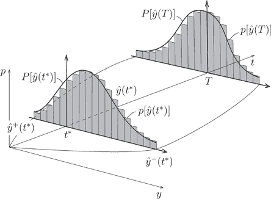

Figure 4.23

*A) 均值轨迹的演化*。随机变量 `ŷ(t*)` 的均值由下式给出

```
\begin{array}{r} {\overline{y}(t^{\*}) = \frac{1}{N}{\sum\limits_{k = 1}^{N}{\hat{y}}^{(k)}}(t^{\*}),} \\ \end{array}
```
(4.99)

其中 `ŷ^{(k)}(t*)` 表示随机变量 `ŷ(t*)` 的实现。

对不同的时间 `t*` ∈ `𝒯` 计算这些均值，我们得到经验估计 `\overline{y}(t_u^*), u ∈ \overline{1,U}.` 的集合。它们可以用连续曲线 `\overline{y}(t),` 来近似，该曲线形成均值轨迹 [104]。

*B) 经验方差管的演化*。取 Fig. 4.23 中所示的系综 `${\hat{\mathcal{Y}}}_{T}$`，并考虑其截集 `ŷ(t*)`。定义随机变量

```
\begin{array}{r} {D(t^{\*}) = {\lbrack\hat{y}(t^{\*}) - \overline{y}(t^{\*})\rbrack}^{2}.} \\ \end{array}
```
(4.100)

该随机变量的均值（即随机变量 `ŷ(t*)` 的方差）由下式给出

```
\begin{array}{r} {\overline{D}(t^{\*}) = \frac{1}{N - 1}{\sum\limits_{k = 1}^{N}D^{(k)}}(t^{\*}),} \\ \end{array}
```
(4.101)

其中 `D^{(k)}(t*)` 表示随机变量 `D(t*)` (4.100) 的实现。

引入随机变量 `ŷ(t*)` 相对于其均值 `\overline{y}(t*)` 的标准差：

```
\begin{array}{r} {\sigma(t^{\*}) = \sqrt{\overline{D}(t^{\*})}.} \\ \end{array}
```
(4.102)

在假设 `t*` 取值于区间 `𝒯` 内的条件下，让我们用连续曲线——标准差轨迹 `σ(t)` 来近似得到的结果点。

定义两条轨迹，`δ_± = \overline{y}(t) ± σ(t).` 域

```
\begin{array}{r} {\mathcal{D} = \left\{ \hat{y}:\delta_{-}(t) \leq \hat{y}(t) \leq \delta_{+}(t) \right\}} \\ \end{array}
```
(4.103)

将被称作 *标准差管*。 Figure 4.23 展示了关于均值轨迹 `\overline{y}(t).` 的标准差管 `𝒟`。

*C) 经验概率密度函数的演化*。经验 PDF 的估计值可以用固定时间 `t*` 下随机变量实现 `ŷ(t*)` 构造。

经验 PDF，即直方图 `p[ŷ(t*)]`，是根据众所周知的规则 [104] 构造的。用 `ŷ^-(t*)` 和 `ŷ^+(t*)` 分别表示随机变量 `ŷ(t*)` 的左、右极限。接下来，将区间 `[ŷ^-(t*), ŷ^+(t*)]` 分成 `J` 个子区间 `η_j, (j = \overline{1,J})`，其长度为 (`ŷ^+(t*)` − `ŷ^-(t*)`) / `J`。经验概率密度函数是随机变量 `ŷ(t*)` 的值落入子区间 `η_j, (j = \overline{1,J}),` 的频率，即

```
\begin{array}{r} {p_{j} = \frac{M_{j}}{M},} \\ \end{array}
```
(4.104)

其中 `M[j]` 给出子区间 `η[j]` 内 `ŷ(t*)` 的值的数量，`M` 是系综中轨迹的总数量。 Figure 4.24 提供了直方图 `p[ŷ(t*)]` 的示例。通过改变时间 `t*` 可以观察到直方图的演化。通常，系综包含非常多的轨迹。因此，直方图可以用连续曲线 `\hat{P}[ŷ(t*)]` 以良好的精度近似。


Figure 4.24

*D). 经验中位轨迹的演化*。通常经验 PDF 没有对称性。在这种情况下，中位轨迹似乎更有信息量。考虑 PDF `\hat{P}[ŷ(t*)]`，并定义值 `z(t*)` 使得

```
\begin{array}{r} {{\int_{\hat{y}^{-}(t^{\*})}^{z(t^{\*})}\hat{P}}(x)dx = {\int_{z(t^{\*})}^{\hat{y}^{-}(t^{\*})}\hat{P}}(x)dx.} \\ \end{array}
```
(4.105)


The value `z(t*)` of the random variable `ŷ(t*)` is called the median for the time `t*`. Performing these calculations for all `t* ∈ 𝒯`, obtain a continuous curve, which will be called the median trajectory of the ensemble.

### E). The evolution of the α-quantiles of the empirical PDF
For a fixed time `t*`, introduce the empirical probability density function

$$\begin{array}{r} {{\hat{F}}_{t^{\*}}(y) = {\int_{{\hat{y}}^{-}(t^{\*})}^{y}{\hat{P}}_{t^{\*}}}(v)dv.} \\ \\ \end{array}$$

(4.106)

According to the definition given in [104], the `α[t*]`-quantile (`α[t*] ∈ [0, 1]`) of the distribution `F̂t*` of a random variable `y` is the number `y[α[t*]]` satisfying the inequalities

$$\begin{array}{r} {Pb\left\{ y \leq y_{\alpha_{t^{\*}}} \right\} \leq \alpha_{t^{\*}}} \\ \\ \end{array}$$

(4.107)

and

$$\begin{array}{r} {Pb\left\{ y > y_{\alpha_{t^{\*}}} \right\} \leq 1 - \alpha_{t^{\*}},} \\ \\ \end{array}$$

(4.108)

where `Pb` denotes probability. The `α[t*]`-quantile is illustrated in Fig. 4.25(b). By analogy with items A)–C), consider different cutsets `t* ∈ 𝒯` of the ensemble to get the `α[t]`-quantile trajectory, see Fig. 4.25(b).

### F). The evolution of the empirical confidence intervals and confidence levels
The `α[t*]`-quantile allows us to define an interval (known as *the confidence interval*) that covers the values of the random variable `ŷ(t*)` with the probability `α[t*]` (*the confidence level*).

By definition, the confidence interval

$$\begin{array}{r} {C_{t^{\*}} = \lbrack y_{1 - \alpha_{t^{\*}}/2},y_{1 + \alpha_{t^{\*}}/2}\rbrack} \\ \\ \end{array}$$

(4.109)

covers the values of the random variable `ŷ(t*)` with the confidence level

$$\begin{array}{r} {P\lbrack\hat{y}(t^{\*}) \in C_{t^{\*}}\rbrack = \alpha_{t^{\*}}.} \\ \\ \end{array}$$

(4.110)

Letting `t* = t ∈ 𝒯` in both formulas, construct the confidence domain `C(t)`, as illustrated in Fig. 4.25(c).

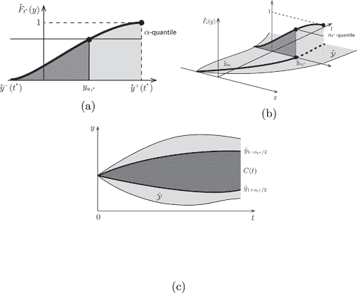

Figure 4.25

### 3. The moment characteristics of the ensemble

Consider a one-dimensional ensemble `${\hat{\mathcal{Y}}}_{T}$` consisting of random trajectories `ŷ(t | a)`, where `t ∈ 𝒯`. The parameters `a` are randomized with a given PDF `P(a)`. Let `t = t*` be fixed. Then `ŷ(t* | a)` represents a function of the random argument `a`.

Define its `kth moments` by

$$\begin{array}{r} \left. M_{k}(t^{\*}) = \mathcal{M}\left\{ y(t^{\*}\, \middle| \,\mathbf{a}) \right\} = {\int_{\mathcal{A}}y^{k}}(t^{\*}\, \middle| \,\mathbf{a})P(\mathbf{a})d\mathbf{a}. \right. \\ \\ \end{array}$$

(4.111)

Introduce *the k-means* of these moments in the form

$$\begin{array}{r} {m_{k}(t^{\*}) = M_{k}^{1/k}(t^{\*}).} \\ \\ \end{array}$$

(4.112)

For `k = 1`, the moment coincides with its mean, i.e., `M[1] = m[1]`.

Assuming `t*` to be a variable that takes values within the interval `𝒯`, find the `kth moment trajectory Mk` and the `k`-mean trajectory `mk`.

In some applications, the object's output vector consists of the elements acting as the average functionals with random parameters. For example, consider option trading [15, 182]. Each of `r` financial derivatives contains `p` random parameters `a[1], …, a[p]`, which are realized in the course of trading with some PDF `P(a)`. The relations between the financial derivatives and parameters are described by functionals `𝒢1, …, 𝒢r`. As a rule, they belong to the class of power functionals; in the elementary statement, these functionals have the form

$$\begin{array}{r} {\mathcal{G}_{1}(\mathbf{a}) = {\sum\limits_{k = 1}^{p}c_{k}}a_{k},} \\ \\ \end{array}$$

$$\begin{array}{r} {\mathcal{G}_{2}(\mathbf{a}) = {\sum\limits_{k = 1}^{p}c_{k}}a_{k} + {\sum\limits_{k_{1} = 1}^{r}{\sum\limits_{k_{2} = 1}^{r}c_{k_{1}k_{2}}}}a_{k_{1}}a_{k_{2}},} \\ \\ \end{array}$$

$$\ldots \\ \\$$

$$\begin{array}{r} {\mathcal{G}_{r}(\mathbf{a}) = {\sum\limits_{k = 1}c_{k}}a_{k} + {\sum\limits_{k_{1},k_{2}}c_{k_{1},k_{2}}}a_{k_{1}}a_{k_{2}} + \ldots + {\sum\limits_{k_{1},\ldots,k_{r}}c_{k_{1},\ldots,k_{r}}}a_{k_{1}}\cdots a_{k_{r}}.} \\ \\ \end{array}$$

The more efficient models that are used to predict future mean prices involve the integral power functionals; their cores depend on the time variables, `c(τ), c(τ[1], τ[2]), …`.

In both statements, the relations under consideration give the mean prices of the financial derivatives, i.e.,

$$\begin{array}{r} {{\int_{\mathcal{A}}\mathcal{G}_{1}}(\mathbf{a})P(\mathbf{a})d\mathbf{a},\,{\int_{\mathcal{A}}\mathcal{G}_{2}}(\mathbf{a})P(\mathbf{a})d\mathbf{a},.....} \\ \\ \end{array}$$

These mean price formulas represent the combinations of the weighted moments of the random vector `a`. In the option trading models, the object's output `y` is the predicted mean prices for the corresponding financial derivatives.

# CHAPTER 5 ENTROPY-ROBUST ESTIMATION PROCEDURES FOR RANDOMIZED MODELS AND MEASUREMENT NOISES

DOI: [10.1201/9781003306566-5](https://doi.org/10.1201/9781003306566-5)

The main stage of each randomized machine learning procedure is to estimate the probability density functions. Estimation involves input and output data arrays. According to a common hypothesis, output arrays contain errors due to imperfect measurements. The core of the estimation procedures consists in a model with *randomized* interval-type parameters, which can be *original or relative*. A static model with randomized parameters generates an ensemble of random vectors, whereas a dynamic model an ensemble of random trajectories. They are characterized in terms of different-order moments, which serve for balancing the model's output with its input data.

The PDF estimation problem is formulated as the problem to find the “best” functions under maximum uncertainty. The latter is measured using the information entropy of the model and measurement noises. Maximizing the entropy, we construct the entropy-optimal PDFs of the model parameters and the “worst” PDFs of the noises in the sense of this criterion.

## 5.1 Structure of Entropy-Robust Estimation Procedure

Consider the general phenomenological structure of the estimation procedure. It represents a sequence of stages shown in Fig. 5.1. This procedure yields the estimated PDFs of the model parameters and noises—`P*(a)` and `$Q(\overline{\xi}),$` respectively.

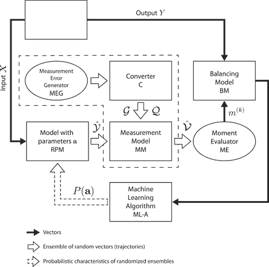

Figure 5.1

**1. Data source (DS)** generates an array of input data vectors `x(t[1]), …, x(t[s])` and a corresponding array of output data vectors `y(t[1]), …, y(t[s])`, where `s` denotes the number of measurements, `x ∈ R^(n)` and `y ∈ R^(m)`. Sometimes, it seems convenient to write these data arrays in the form of matrices `$X = [\ x_{ij}\ |\ i = \overline{1,n};\ j = \overline{1,s}\ ]$` and `$Y = [\ y_{ij}\ |\ i = \overline{1,m};\ j = \overline{1,s}\ ].$` By a standard assumption, input data are measured perfectly and output data with errors, and this aspect should be taken in account for estimation procedure design.

**2. Randomized parametric model (RPM)** generally represents a dynamic system with randomized *original* parameters `a ∈ R^(r)` that take values within the `r`-dimensional parallelepiped


$$
\begin{array}{r}
{\mathbf{a} \in \mathcal{A} = \lbrack\mathbf{a}^{-},\mathbf{a}^{+}\rbrack \in R^{r},\quad\mathcal{A} = {\underset{i = 1}{\overset{r}{\cup}}\mathcal{A}_{i}},\text{\quad\quad}\mathcal{A}_{i} = \lbrack a_{i}^{-},a_{i}^{+}\rbrack.}
\\
\end{array}
$$

(5.1)

随机原始参数的概率性质由概率密度函数 *P*(**a**) 描述。此类模型的模型将被称为 *RPM-Orig* 模型。

在许多情况下，使用非负 *相对* 随机参数 **u** ∈ ℐ = \[**0**, **1**\]; ℐ ∈ *R*[+]^(*r*) 是合理的。回想一下它们与原始参数之间的关系为：

$$
\begin{array}{r}
{\mathbf{a} = \mathbf{a}^{-} + A\,\mathbf{u},\quad\mathbf{u} \in \mathcal{I},}
\\
\end{array}
$$

(5.2)

其中

$$
\begin{array}{r}
{A = \text{diag}\,\lbrack a_{i}^{+} - a_{i}^{-}\\, i = \overline{1,r}\rbrack.}
\\
\end{array}
$$

(5.3)

随机相对参数的概率性质用概率密度函数 *W*(**u**) 来表征。此类模型的模型将被称为 *RPM-Rel* 模型。

对于随机参数的 *每个实现*，模型生成具有给定概率密度函数的轨迹，其具有以下函数描述：

* 对于 RPM-Orig 模型，

$$
\begin{aligned}
\left. \mathbf{y}\lbrack t_{j}\, \middle| \, P(\mathbf{a})\rbrack \right. & {\mathcal{B}\lbrack\mathbf{x}(t_{j},\tau),\mathbf{a},P(\mathbf{a});(t_{j},\tau) \in \mathcal{T}\rbrack,}
\\
& {\text{\quad\quad}j = \overline{1,s};}
\\
\end{aligned}
$$

(5.4)

* 对于 RPM-Rel 模型，

$$
\begin{array}{r}
\left. \mathbf{z}\lbrack t_{j}\, \middle| \, W(\mathbf{u})\rbrack = \mathcal{D}\lbrack\mathbf{x}(t_{j},\tau),\,\mathbf{a}^{-} + A\,\mathbf{u},\, W(\mathbf{u});(t_{j},\tau) \in \mathcal{T}\rbrack,j = \overline{1,s}. \right.
\\
\end{array}
$$

公式 (5.4, 5.5) 中，ℬ 和 𝒟 是积分泛函。

在离散测量时刻，随机模型输出相应轨迹的集合，即

* 对于 RPM-Orig 模型，

$$
\begin{array}{r}
\left. \mathcal{Y}\lbrack t_{j}\, \middle| \, P(\mathbf{a})\rbrack = \left\{ \mathbf{y}\lbrack t_{j}\, \middle| \, P(\mathbf{a}) \right\},\text{\quad\quad}t_{j} \in \mathcal{T},\, j = \overline{1,s}, \right.
\\
\end{array}
$$

(5.5)

* 对于 RPM-Rel 模型，

$$
\begin{array}{r}
\left. \mathcal{Z}\lbrack t_{j}\, \middle| \, W(\mathbf{u})\rbrack = \left\{ \mathbf{z}\lbrack t_{j}\, \middle| \, W(\mathbf{u})\rbrack,\text{\quad\quad}t_{j} \in \mathcal{T},\, j = \overline{1,s}. \right. \right.
\\
\end{array}
$$

(5.6)

### 3. 测量误差生成器 (MEG)

旨在模拟输出数据中的测量误差。该装置产生具有特定概率性质的随机向量集合。它由具有标准概率密度函数的向量随机化器 (*VR*) 和将这些向量转换为具有给定概率密度函数的向量的转换器 (*C*) 组成。标准概率密度函数是随机向量在单位非负 *m*\-维立方体上具有均匀分布的密度。转换器将这些向量转换为由模型机器学习定义的概率密度函数的随机向量。

因此，MEG 输出随机噪声向量 $\overline{\xi}(t_{j}) = {\overline{\xi}}^{(j)}, \,(j = \overline{1,s}\,),$ 其中 ${\overline{\xi}}^{(j)} \in R^{m}.$ 以同样的方式描述通过矩阵 $\left. \Xi = \lbrack\,\xi_{ij}\, \middle| \, i = \overline{1,m};\, j = \overline{1,s}\,\rbrack. \right.$ 积累数据后出现的噪声数组。

假设噪声向量的元素是独立的并且属于区间

$$
\begin{aligned}
{\overline{\xi}}^{(j)} & {\in \mathcal{K}_{j} = \lbrack{\overline{\xi}}_{-}^{(j)},{\overline{\xi}}_{+}^{(j)}\rbrack,\quad j = \overline{1,s},}
\\
\Xi & {\in \mathcal{K} = \otimes_{j = 1}^{s}\mathcal{K}_{j}.}
\\
\end{aligned}
$$

(5.7)

通常很有用引入相对非负向量 ${\overline{\eta}}^{(j)}$，其取值在单位非负 *m*\-维立方体 ℰ[*j*] = \[**0**, **1**\] 内。此外，定义辅助变量矩阵 $\left. E = \lbrack\,\eta_{ij}\, \middle| \, i = \overline{1,m};\, j = \overline{1,s}\,\rbrack. \right.$ 随机向量 ${\overline{\xi}}^{(j)}$ 到向量 *η*^((*j*)) 的变换如下：

$$
\begin{aligned}
{{\overline{\xi}}^{(j)} = {\overline{\xi}}_{-}^{(j)} +} & {K_{j}\,{{\overline{\eta}}^{(j)}},\quad K_{j} = \text{diag}\,\lbrack\xi_{i, +}^{(j)} - \xi_{i, -}^{(j)}\rbrack,}
\\
& {\, i = \overline{1,m};j = \overline{1,s}.}
\\
\end{aligned}
$$

(5.8)

噪声的概率性质由在 𝒦[*j*] (5.7) 上定义的概率密度函数 $Q_{j}({\overline{\xi}}^{(j)})$ 或在单位立方体 ℰ 上定义的概率密度函数 $G_{j}({\overline{\eta}}^{(j)})$ 表征。如果指定了这些密度函数，则 MEG 产生模拟的随机向量集合

* 原始噪声

$$
\begin{array}{r}
{\mathcal{Q}_{j}\lbrack Q_{j}({\overline{\xi}}^{(j)})\rbrack = \left\{ {\overline{\xi}}^{(j)}\lbrack Q_{j}({\overline{\xi}}^{(j)})\rbrack \right\},\text{\quad\quad}j = \overline{1,s};}
\\
\end{array}
$$

(5.9)

* 非负相对噪声

$$
\begin{array}{r}
{\mathcal{G}_{j}\lbrack G_{j}({\overline{\eta}}^{(j)})\rbrack = \left\{ {\overline{\eta}}^{(j)}\lbrack G_{j}({\overline{\eta}}^{(j)})\rbrack \right\},\text{\quad\quad}j = \overline{1,s}.}
\\
\end{array}
$$

(5.10)

### 4. 测量模型 (MM)

模拟测量误差对估计结果的影响。根据假设，这种影响可以用加性测量模型很好地描述。测量模型输出的集合具有以下形式：

* 对于 RPM-Orig 模型，

$$
\begin{aligned}
{\mathcal{V}_{j}\lbrack P(\mathbf{a}),Q_{j}({\overline{\xi}}^{(j)})\rbrack} & {\mathcal{Y}_{j}\lbrack P(\mathbf{a})\rbrack + \mathcal{Q}_{j}\lbrack Q_{j}({\overline{\xi}}^{(j)})\rbrack,}
\\
& {j = \overline{1,s};}
\\
\end{aligned}
$$

(5.11)

* 对于 RPM-Rel 模型，

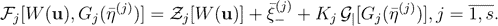

### 5. 矩评估器 (ME)

对测量模型生成的集合的矩特征进行在线计算。

对于随机模型，集合由以下随机轨迹组成：

* 对于 RPM-Orig 模型，

$$
\begin{array}{r}
\left. \mathbf{v}(t_{j}) = \mathbf{y}\lbrack t_{j}\, \middle| \, P(\mathbf{a})\rbrack + {\overline{\xi}}^{(j)}\lbrack Q_{j}({\overline{\xi}}^{(j)})\rbrack; \right.
\\
\end{array}
$$

(5.12)

* 对于 RPM-Rel 模型，

$$
\begin{array}{r}
\left. \mathbf{f}(t_{j}) = \mathbf{z}\lbrack t_{j}\, \middle| \, W(\mathbf{u})\rbrack + {\overline{\xi}}_{-}^{(j)} + K_{j}{\overline{\eta}}^{(j)}\lbrack G_{j}({\overline{\eta}}^{(j)})\rbrack. \right.
\\
\end{array}
$$

(5.13)

作为集合 𝒱[*j*] 和 ℱ[*j*] 的数值特征，采用由 *k*\-均值组成的向量，即第 *k* 个矩的 *k* 次方根（见 (4.111, 4.112)），即

* 对于 RPM-Orig 模型，

$$
\begin{aligned}
{\mathbf{m}^{(k)}\lbrack P(\mathbf{a}),Q_{j}({\overline{\xi}}^{(j)}),j\rbrack} & {\left\{ \lbrack M_{i}^{(k)}(j)\rbrack^{1/k},\, \middle| \, i = \overline{1,m} \right\},}
\\
& {j = \overline{1,s};}
\\
\end{aligned}
$$

(5.14)

* 对于 RPM-Rel 模型，


$$\\begin{aligned} {\\mathbf{n}^{(k)}\\lbrack W(\\mathbf{u}),G_{j}({\\overline{\\eta}}^{(j)},j)\\rbrack} & {= \\left\\{ {\\lbrack N_{i}^{(k)}(j)\\rbrack}^{1/k},\\, \\middle| \\, i = \\overline{1,m} \\right\\},} \\\\ & {j = \\overline{1,s}.} \\\\ \\end{aligned}$$  

(5.15)

在这些公式中，对应向量元素的 `k`th 阶矩由下式给出

$$\\begin{aligned} {M_{i}^{(k)}(j) =} & \\left. \\int_{\\mathcal{A}}y_{i}^{k}(t_{j},\\, \\middle| \\,\\mathbf{a})P(\\mathbf{a})d\\mathbf{a} + \\int_{\\Xi_{j}}{\\lbrack\\xi_{i}^{(j)}\\rbrack}^{k}Q_{j}({\\overline{\\xi}}^{(j)})d\\xi_{i}^{(j)}, \\right. \\\\ N_{i}^{(k)} & \\left. (j) = \\int_{\\mathcal{U}}z_{i}^{k}(t_{j},\\, \\middle| \\,\\mathbf{u})W(\\mathbf{u})d\\mathbf{u} + {\\lbrack\\xi^{(j})}\\rbrack_{i}^{k} + \\right. \\\\ & {+ K_{ji}\\int_{\\mathcal{E}}{\\lbrack\\eta_{i}^{(j)}\\rbrack}^{k}G_{j}({\\overline{\\eta}}^{(j)})d\\eta_{i}^{(j)}.} \\\\ \\end{aligned}$$  

(5.16)

### 6. 平衡模型 (BM)

`Balancing model (BM)` 用于将可用的输出数据 `y` 与集合 `𝒱` 或 `ℱ` 的接受特征进行比较。

对于随机化模型，平衡约束的形式为

$$\\begin{array}{r} {\\mathbf{m}^{(k)}\\lbrack P(\\mathbf{a}),Q_{j}({\\overline{\\xi}}^{(j)}),j\\rbrack = \\mathbf{y}(t_{j}),\\text{\\quad\\quad}j = \\overline{1,s};} \\\\ \\end{array}$$  

(5.17)

$$\\begin{array}{r} {\\mathbf{n}^{(k)}\\lbrack W(\\mathbf{u}),G_{j}({\\overline{\\eta}}^{(j)},j)\\rbrack = \\mathbf{y}(t_{j}),\\text{\\quad\\quad}j = \\overline{1,s}.} \\\\ \\end{array}$$  

(5.18)

### 7. 机器学习算法 (ML-A)

`Machine learning algorithm (ML-A)` 的目的是为参数和测量噪声的概率密度函数形成最优估计。如前所述反复提及，随机化机器学习过程需要在由信息熵表征的最大不确定性下估计概率密度函数。因此，`ML-A` 在可容许集合上以平衡约束 `(5.17, 5.18)` 的形式搜索其约束最大值。

信息熵泛函 `ℋ` 定义在连续可微概率密度函数 `P(a)`、`Q1(overline{ξ}^{(1)})`、…、`Qs(overline{ξ}^{(s)})` 的类上，它们分别描述了模拟测量误差的随机化参数和噪声的概率性质。熵泛函推广了信息熵的有限维概念。

1865 年，德国物理学家 R. Clausius 引入了一个物理量来表征热力学系统，称为 *熵*。

$$\\begin{array}{r} {S = \\frac{\\Delta Q}{\\Delta T}.} \\\\ \\end{array}$$

1877 年，L. Boltzmann 建立了热力学熵 `S`（或物理熵 `E`）与热力学系统宏观态 (`ΔQ`、`T`) 的统计权重 `Z` 之间的关系。后来，利用微观态等概率的假设，M. Planck 将该关系写成

$$\\begin{array}{r} {S = k\\ln Z = E.} \\\\ \\end{array}$$

这里 `k` = 1.38 ⋅ 10^( − 23) 表示玻尔兹曼常数。宏观态 (`ΔQ`、`T`) 的统计权重由构成该宏观态的所有可能微观态（组合）的数量来度量。回想一下，这些术语适用于所谓的（单原子或多原子）气体模型，该模型考虑由极多不可区分的粒子（分子）组成的系统（宏观系统）。系统宏观态的空间由 `m` 个不相交的子集组成，具有给定的容量 `G[1]`、…、`G[m]`（即粒子可以占据的状态数）。粒子以随机方式在这些子集的状态中分布，行为呈随机性，具有相同的概率且相互独立。设每个粒子被唯一标记，并列出所有标记粒子的所得子集；事实上，该列表是系统的微观态。当然，所考虑的列表体积巨大。可以提取具有相同粒子数 `N[k]` 在第 `k` 个子集中的子列表。粒子数 `N[k]` 是系统宏观态 `N` = `{N[1],…,N[m]}` 的一个元素。子列表中元素的数量（诱导给定宏观态的微观态的数量）称为其统计权重 `Z` = `Z(N[k])`。

为了找到统计权重 `Z` 与宏观态特征 `N[k]`（填充第 `k` 个子集的粒子数）之间的关系，我们需要对宏观系统模型进行一定的推广。该推广涉及粒子在宏观态空间的子集上分布的先验概率 `a[1]`、…、`a[m]` 的信息，以及这些子集中状态的性质信息。注意，在气体模型中，先验概率被假定为相等，且未描述状态性质。

考虑一个每个状态只能被一个粒子占据的宏观系统（否则状态为空）。子集中的此类状态数量为 `G[1]`、…、`G[m]`。分布机制具有以下组织。每个粒子可以 *占据* 第 `k` 个子集中的 `N[k]` 个状态，先验概率为 `a[k]`，随机且独立于其他粒子；因此，(`G[k]` − `N[k]`) 个状态以先验概率 `(1 − a[k])` 保持空闲。用 `{N[k],(G[k]−N[k])}` 表示该事件。由于该分布机制中所有粒子的独立性，事件的概率构成

$$\\begin{array}{r} {a_{k}^{N_{k}}\\,{(1 - a_{k})}^{(G_{k} - N_{k})}.} \\\\ \\end{array}$$

填充状态数 `N[k]` 可以通过粒子在第 `k` 个子集上的不同分布来实现，即不同的微观态。这样的微观态数 `Z(N[k])` 是 `G[k]` 个粒子中 `N[k]` 个组合的数量：

$$\\begin{array}{r} {C_{N_{k}}^{G_{k}} = \\frac{G_{k}!}{N_{k}!\\,(G_{k} - N_{k})!}.} \\\\ \\end{array}$$

事件 `{N[k],(G[k]−N[k])}` 可以 *要么* 由第 1 个微观态实现，*要么* 由第 2 个微观态实现，…，*要么* 由第 `C[N[k]]^(G[k])` 个微观态实现。因此，事件 `{N[k],(G[k]−N[k])}` 以概率发生

$$\\begin{array}{r} {P_{k}(N_{k}) = \\frac{G_{k}!}{N_{k}!\\,(G_{k} - N_{k})!}\\, a_{k}^{N_{k}}\\,{(1 - a_{k})}^{(G_{k} - N_{k})}.} \\\\ \\end{array}$$

由于分布机制的所有参与者相互独立，该宏观系统的对应宏观态的概率由下式给出

$$\\begin{array}{r} {P(\\mathbf{N}) = {\\prod\\limits_{k = 1}^{m}P_{k}}(N_{k}) = {\\prod\\limits_{k = 1}^{m}\\frac{G_{k}!}{N_{k}!\\,(G_{k} - N_{k})!}}\\, a_{k}^{N_{k}}\\,{(1 - a_{k})}^{(G_{k} - N_{k})}.} \\\\ \\end{array}$$

根据 Planck 的定义，物理熵与概率分布函数的对数成正比，因为统计权重是一个未归一化的分布。因此，

$$\\begin{array}{r} {\\left. S \\right.\\sim lnP(\\mathbf{N}).} \\\\ \\end{array}$$

于是可得

$$\\begin{array}{r} {\\left. S \\right.\\sim{\\sum\\limits_{k = 1}^{m}\\ln}G_{k}! - \\ln(G_{k} - N_{k})! - \\ln N_{k}! + N_{k}\\ln a_{k} + (G_{k} - N_{k})\\ln(1 - a_{k}).} \\\\ \\end{array}$$

由于 `N[k]` 的值很大，采用 Stirling 近似

$$\\begin{array}{r} {\\ln N! = N(\\ln N - 1).} \\\\ \\end{array}$$

在这种情况下，`S` 表达式的右手边可以写成常数与宏观态函数的和：

$$\\begin{array}{r} {\\left. S \\right.\\sim C + H_{F}(\\mathbf{N}).} \\\\ \\end{array}$$

函数

$$\\begin{array}{r} {H_{F}(\\mathbf{N}) = - {\\sum\\limits_{k = 1}^{m}\\left\\lbrack {\\, N_{k}\\frac{N_{k}}{{\\widetilde{a}}_{k}} + (G_{k} - N_{k})\\ln(G_{k} - N_{k})\\,} \\right\\rbrack},\\quad{\\widetilde{a}}_{k} = \\frac{a_{k}}{1 - a_{k}},} \\\\ \\end{array}$$


is called *广义费米信息熵*。对于该函数，定义域为 *m* 维平行六面体 `𝒩` = [`0`, `G`]，即容许宏观态的集合。若参数 `a` 和 `G` 满足条件

$$
\begin{array}{r} {G_{k}a_{k} = \text{const},\text{\quad\quad}N_{k} \ll G_{k},} \\ \end{array}
$$

则 `H[F]`(`N`) 可变换为熵函数

$$
\begin{array}{r} {H_{B}(\mathbf{N}) = - {\sum\limits_{k = 1}^{m}N_{k}}\ln\frac{N_{k}}{a_{k}G_{k}e},} \\ \end{array}
$$

其被称为 *广义玻尔兹曼信息熵*。该函数定义在非负象限 `𝒩` ∈ *R*+ 上，表示容许宏观态的集合。

不可区分粒子在状态空间子集上的随机分布消耗 *r* 种资源（能量、时间、财务等）。这些资源的可用数量为 `q[1]`, …, `q[r]`。资源消耗由消耗函数 `Φ1`, …, `Φr` 刻画，其具有参数 `t`（特定消耗率）并依赖于宏观态向量 `N`。

由于分布过程需要资源，只能实现满足条件的宏观态

$$
\begin{array}{r} {\Phi_{i}(\mathbf{t},\mathbf{N}) = q_{i},\quad i = \overline{1,s};\text{\quad\quad}\Phi_{i + s}(\mathbf{t},\mathbf{N}) = q_{i + s},\quad i = \overline{1,r-s}.} \\ \end{array}
$$

这些约束定义了所谓的资源集 `𝒟`。该集合与容许宏观态的相应集合的交集给出 *容许集*

$$
\begin{array}{r} {\mathcal{F} = \mathcal{N}{\cap \mathcal{D}}.} \\ \end{array}
$$

利用上述概念和术语，我们可以表述 *广义变分原理* 如下。*在宏观系统中实现的宏观态对应于广义信息熵的约束最大值*，即

$$
\begin{array}{r} \left. H(\mathbf{N})\Rightarrow\max\text{~subject~to~}\,\, \mathbf{N} \in \mathcal{F}. \right. \\ \end{array}
$$

## 5.2 用于概率密度函数的熵鲁棒估计算法

PDF 的估计算法构成了随机化机器学习程序的核心。它们面向随机化参数模型的相应类，即 RPM-Orig 模型和 RPM-Rel 模型。两类随机化模型存在技术差异。首先，将考虑 RPM-Orig 模型的估计算法，包括一般问题陈述和所得解的结构。然后将这些估计算法适配到 RPM-Rel 模型。

### 5.2.1 RPM-Orig 模型的估计算法

根据 (5.4, 5.12)，在时刻 `t[j]` 时 RPM-Orig 模型的观测输出由下式描述

$$
\begin{aligned} {\mathbf{v}(t_{j}) = \mathbf{y}\lbrack t_{j}} & \left| \, P(\mathbf{a})\rbrack + {\overline{\xi}}^{(j)}\lbrack Q_{j}({\overline{\xi}}^{(j)})\rbrack, \right. \\ \left. \mathbf{y}\lbrack t_{j}\, \middle| \, P(\mathbf{a})\rbrack = \mathcal{B}\lbrack\mathbf{x} \right. & \left. ((t_{j},\tau_{l}),\, \middle| \, l = \overline{1,(j-1)}),\mathbf{a}\rbrack, \right. \\ & {j = \overline{1,s}.} \\ \end{aligned}
$$

(5.19)

这里，`ℬ` 表示维数为 (*m* × *n*) 的矩阵泛函，其表征模型输出 `y(t[j])` 与由输入向量 `x(t[j], τ[1])`, …, `x(t[j], τ[(j − 1)])` 组成的数组之间的现有关系。测量误差由噪声向量 `${\overline{\xi}}^{(j)}.$` 模拟。RPM-Orig 模型输出 (5.2.1) 依赖于具有 PDF `P(a)` 的随机化参数 `a`，也依赖于具有 PDF `$Q_{j}({\overline{\xi}}^{(j)});$` 的随机化噪声向量 `${\overline{\xi}}^{(j)}$`；见 (5.2.1)。关于这些 PDF 的可用先验信息（如有）以先验 PDF `P0` 和 `$Q_{j}^{0}({\overline{\xi}}^{(j)}).$` 的形式表示。假设 PDF 属于 `ℂ¹` 类，即所有连续可微函数类。

*对于 RPM-Orig 模型 (5.4)，其参数和测量噪声的 PDF 的熵鲁棒估计问题* 制定如下：

* 最大化广义玻尔兹曼信息熵泛函 [149]

$$
\begin{aligned} {\mathcal{H}\lbrack P(\mathbf{a}),\overline{Q}(\xi)\rbrack =} & {- {\int_{\mathcal{A}}P}(\mathbf{a})\,\ln\frac{P(\mathbf{a})}{P_{0}(\mathbf{a})}\, d\,\mathbf{a} -} \\ {- {\sum\limits_{j = 1}^{s}\,}{\int_{\Xi_{j}}Q_{j}}({\overline{\xi}}^{(j)})} & \left. \ln\frac{Q_{j}({\overline{\xi}}^{(j)})}{Q_{j}^{0}({\overline{\xi}}^{(j)})}d{\overline{\xi}}^{(j)}\Rightarrow\min_{P,Q_{1},...,Q_{s}} \right. \\ \end{aligned}
$$

(5.20)

* 约束条件为：

  * –PDF 的归一化条件，即

$$
\begin{array}{r} {{\int_{\mathcal{A}}P}(\mathbf{a})d\mathbf{a} = 1,\quad{\int_{\Xi_{j}}Q_{j}}({\overline{\xi}}^{(j)})\,\ d{\overline{\xi}}^{(j)} = 1,\quad j = \overline{1,s},} \\ \end{array}
$$

(5.21)

和

  * –RPM-Orig 模型 (5.14) 输出的 *k*-均值与对象输出测量的平衡约束，即

$$
\begin{array}{r} {\mathbf{m}^{(k)}\lbrack P(\mathbf{a}),Q_{j}({\overline{\xi}}^{(j)}),j\rbrack = \mathbf{y}(t_{j}),\quad j = \overline{1,s}.} \\ \end{array}
$$

(5.22)

由于 (5.13)，这些等式约束中的向量 `$\mathbf{m}^{(k)}\lbrack P(\mathbf{a}),Q_{j}({\overline{\xi}}^{(j)}),j\rbrack$` 的分量为

$$
\begin{aligned} & {m_{i}^{(k)}\lbrack j\rbrack = \left\lbrack {\int_{\mathcal{A}}P}(\mathbf{a})y_{i}^{k}\lbrack t_{j}\, \middle| \, P(\mathbf{a})\rbrack\, d\mathbf{a} \right\rbrack^{1/k} +} \\ & {\text{\quad\quad} + \left\lbrack {{\int_{\Xi_{j}}\,}Q_{j}({\overline{\xi}}^{(j)})\,{\lbrack\xi_{i}^{(j)}\rbrack}^{k}\, d\xi_{i}^{(j)}} \right\rbrack^{1/k},} \\ & {\quad\text{\quad\quad}\text{\quad\quad}i = \overline{1,m},\, j = \overline{1,s}.} \\ \end{aligned}
$$

(5.23)

考虑平衡约束涉及 RPM-Orig 模型输出的 1-均值的情况：

$$
\begin{aligned} \left\lbrack {\int_{\mathcal{A}}P}(\mathbf{a})\mathbf{y}\lbrack t_{j}\, \middle| \, P(\mathbf{a})\rbrack\, d\mathbf{a} \right\rbrack & {+ \left\lbrack {{\int_{\Xi_{j}}\,}Q_{j}({\overline{\xi}}^{(j)})\,{\overline{\xi}}^{(j)}\, d{\overline{\xi}}^{(j)}} \right\rbrack = \mathbf{y}(t_{j}),} \\ & { \quad j = \overline{1,s}.} \\ \end{aligned}
$$

(5.24)

在此优化问题中，泛函约束从 `ℂ¹` 类中提取所有容许函数的子集 `$\Omega\lbrack P(\mathbf{a}),Q(\overline{\xi})\rbrack$`，其中 `$Q(\overline{\xi}) = \left\{ Q_{1}({\overline{\xi}}^{(1)}),\ldots,Q_{s}({\overline{\xi}}^{(s)}) \right\},$`。事实上，问题 (5.2.1)–(5.24) 是一个泛函熵-线性规划问题 [149]。它属于 Lyapunov 型优化问题类 77, [174]，其中容许函数集由线性积分泛函系统描述。

*对于 RPM-Orig 模型，熵鲁棒 RML 算法* 的形式为

$$
\begin{array}{r} {\left\lbrack {P(\mathbf{a}),Q(\overline{\xi})} \right\rbrack^{\*} = \arg\max_{\lbrack P(\mathbf{a}),Q(\overline{\xi})\rbrack}\left\{ \mathcal{H},\, \middle| \,\lbrack\mathcal{P}(\mathbf{a}),\mathcal{Q}(\overline{\xi})\rbrack \in \Omega \right\},} \\ \end{array}
$$

(5.25)


其中容许集 `Ω` 由归一化条件 (5.21) 和经验平衡约束 (5.24) 给出。

### 5.2.2 RPM-Rel 模型的估计算法

在 RPM-Rel 模型中，随机参数包括非负相对参数 `u` 和测量噪声 `{ \overline{\eta}^{(1)},\ldots,\overline{\eta}^{(s)} }`。根据 (5.13)，RPM-Rel 模型在时刻 *t*[*j*] 的可观测输出由

$$
\begin{aligned} \left. \mathbf{f}(t_{j}) = \mathbf{z}\lbrack t_{j}\, \middle| \, W(\mathbf{u})\rbrack \right. & {+ \overline{\xi}_{-}^{(j)} + K_{j}\overline{\eta}^{(j)}\lbrack G_{j}(\overline{\eta}^{(j)})\rbrack,} \\ \left. \mathbf{z}\lbrack t_{j}\, \middle| \, W(\mathbf{u})\rbrack = \mathcal{D}\lbrack\mathbf{x}(t_{j},\tau), \right. & {\mathbf{a}^{-} + A\,\mathbf{u},\, W(\mathbf{u});(t_{j},\tau) \in \mathcal{T}\rbrack,} \\ & {j = \overline{1,s}.} \\ \end{aligned}
$$

(5.26)

描述。

这里，`𝒟` 表示维数为 (*m* × *n*) 的矩阵泛函，它表征了模型输出 `z(t[j])` 与由输入向量 `x(t[j], τ[1])`，…，`x(t[j], τ[(j − 1)])` 组成的数组之间存在的关系。RPM-Rel 模型输出 (5.2.2) 依赖于具有 PDF `W(u)` 的随机相对参数 `u`，也依赖于具有 PDF `G_{j}(\overline{\eta}^{(j)})` 的随机相对噪声向量 `\overline{\eta}^{(j)}`；参见 (5.2.2)。关于这些 PDF 的可用先验信息（如有）以先验 PDF `W0` 和 `G_{j}^{0}(\overline{\eta}^{(j)})` 的形式表示。根据假设，PDF 属于所有连续可微函数类 `ℂ¹`。

*对于 RPM-Rel 模型 (5.1)，其参数和测量噪声的 PDF 的熵鲁棒估计问题* 制定如下：

* 最大化广义玻尔兹曼信息熵泛函

$$
\begin{aligned} & {\quad\mathcal{H}\lbrack W(\mathbf{u}),\overline{G}(\eta)\rbrack = - {\int_{\mathcal{U}}W}(\mathbf{u})\,\ln\frac{W(\mathbf{u})}{W_{0}(\mathbf{u})}\, d\,\mathbf{u} -} \\ & \left. - {\sum\limits_{j = 1}^{s}\,}{\int_{\mathcal{E}_{j}}G_{j}}(\overline{\eta}^{(j)})\,\ln\frac{G_{j}(\overline{\eta}^{(j)})}{G_{j}^{0}(\overline{\eta}^{(j)})}d\overline{\eta}^{(j)}\Rightarrow\min_{W,\overline{G}} \right. \\ \end{aligned}
$$

(5.27)

* 约束条件为：

  * –PDF 的归一化条件，即

$$
\begin{array}{r} {{\int_{\mathcal{U}}W}(\mathbf{u})d\mathbf{u} = 1,\text{\quad\quad}{\int_{\mathcal{E}_{j}}G_{j}}(\overline{\eta}^{(j)})\, d\overline{\eta}^{(j)} = 1,\quad j = \overline{1,s},} \\ \end{array}
$$

(5.28)

和

  * –RPM-Rel 模型 (5.15) 输出的 *k*-均值与物体输出测量值之间的平衡约束，即

$$
\begin{array}{r} {\mathbf{n}^{(k)}\lbrack W(\mathbf{u}),G_{j}(\overline{\eta}^{(j)}),j\rbrack = \mathbf{y}(t_{j}),\text{\quad\quad}j = \overline{1,s}.} \\ \end{array}
$$

(5.29)

由于 (5.15)，这些等式约束中的向量 `\mathbf{n}^{(k)}\lbrack W(\mathbf{u}),G_{j}(\overline{\eta}^{(j)}),j\rbrack` 的分量为

$$
\begin{aligned} {n_{i}^{(k)}\lbrack j\rbrack} & {\left[\int_{\mathcal{U}}W}(\mathbf{u})z_{i}^{k}\lbrack t_{j}\, \middle| \, W(\mathbf{u})\rbrack\, d\mathbf{u} \right]^{1/k} +} \\ & {\left[\int_{\mathcal{E}_{j}}\,}{G_{j}(\overline{\eta}^{(j)})\,{\lbrack\eta_{i}^{(j)}\rbrack}^{k}\, d\eta_{i}^{(j)}} \right]^{1/k},} \\ & {\text{\quad\quad}\quad i = \overline{1,m},\, j = \overline{1,s}.} \\ \end{aligned}
$$

(5.30)

考虑平衡约束涉及 RPM-Rel 模型输出的 1-均值的情况：

$$
\begin{aligned} {\left[\int_{\mathcal{U}}W}(\mathbf{u})\mathbf{z}\lbrack t_{j}\, \middle| \, W(\mathbf{u})\rbrack\, d\mathbf{u} \right] +} & {\left[\int_{\mathcal{E}_{j}}\,}{G_{j}(\overline{\eta}^{(j)})\,{\overline{\eta}}^{(j)}\, d\overline{\eta}^{(j)}} \right] = \mathbf{y}(t_{j}),} \\ & {j = \overline{1,s}.} \\ \end{aligned}
$$

(5.31)

与上述优化问题一样，泛函约束从类 `ℂ¹` 中提取所有容许函数子集 `\Psi\lbrack W(\mathbf{u}),G(\overline{\eta})\rbrack`，其中 `G(\overline{\eta}) = \{ G_{1}(\overline{\eta}^{(1)}),\ldots,G_{s}(\overline{\eta}^{(s)}) \}`。问题 (5.27-5.31) 也是 Lyapunov 型。

*对于 RPM-Rel 模型，熵鲁棒 RML 算法* 的形式为

$$
\begin{array}{r} {\left[\,W(\mathbf{u}),\overline{G}(\overline{\eta}) \right]^{*} = \arg\max_{\lbrack W(\mathbf{u}),\overline{G}(\overline{\eta})\rbrack}\left\{ \mathcal{H},\, \middle| \,\lbrack W(\mathbf{u}),G(\overline{\eta})\rbrack \in \Psi \right\},} \\ \end{array}
$$

(5.32)

其中容许集 `Ψ` 由归一化条件 (5.28) 和经验平衡约束 (5.31) 给出。

### 5.2.3 具有输入和输出测量误差的 RPM-F 模型的估计算法

前几节研究了仅在输出中出现的测量误差情况。然而，在许多应用中，输入数据集合也包含误差。因此，一般的 RML 过程应相应地修改。

如果输入数据中存在误差，RPM-F 模型的观测输出采用以下形式：

$$
\begin{array}{r} \left. \mathbf{v}(t_{j}) = \mathbf{y}\lbrack t_{j}\, \middle| \, F(\mathbf{a},\overline{\mu}^{(j)})\rbrack + \overline{\xi}\lbrack Q_{j}(\overline{\xi}^{(j)})\rbrack, \right. \\ \left. \mathbf{y}\lbrack t_{j}\, \middle| \, F(\mathbf{a},\overline{\mu}^{(t_{j})})\rbrack = \mathcal{B}\lbrack\mathbf{x}(t_{j},\tau) + \overline{\mu}^{(t_{j})}\rbrack. \right. \\ \end{array}
$$

(5.33)

这里 `\overline{\mu}^{(j)}` 表示在时刻 *t*[*j*] 的输入噪声向量，它们是区间型：

$$
\begin{array}{r} {{\overline{\mu}}^{(j)} \in \mathcal{M} = \lbrack\mu^{-},\mu^{+}\rbrack\quad\text{for~all}\, t_{j}.} \\ \end{array}
$$

(5.34)

由 RPM-F 模型方程 (5.33) 可知，随机元素是参数 `a` 和输入噪声 `\overline{\mu}.` 它们的概率特性由联合概率密度函数 `F(a,\overline{\mu}^{(t_{j})})` 表征。如果对该函数存在某些信息，则以先验 PDF `F_{0}(a,\overline{\mu}^{(t_{j})})` 的形式表示。

*对于 RPM-F 模型 (5.33)，其参数以及输入和输出测量噪声的 PDF 的熵鲁棒估计问题* 制定如下：

* 最大化广义玻尔兹曼信息熵泛函

$$
\begin{aligned} {\mathcal{H}\lbrack F(\mathbf{a},\overline{\mu}),\overline{Q}(\overline{\xi})\rbrack} & {= - \int_{\mathcal{R}}F(\mathbf{a},\overline{\mu})\,\ln\frac{F(\mathbf{a},\overline{\mu})}{F_{0}(\mathbf{a},\overline{\mu})}\, d\,\mathbf{a}\, d\,\overline{\mu} -} \\ {- \sum_{j = 1}^{s}\,\int_{\Xi_{j}}} & \left. Q_{j}(\overline{\xi}^{(j)})\,\ln\frac{Q_{j}(\overline{\xi}^{(j)})}{Q_{j}^{0}(\overline{\xi}^{(j)})}d\overline{\xi}^{(j)}\Rightarrow\max_{F,\overline{Q}} \right. \\ \end{aligned}
$$

(5.35)

* 约束条件为：

  * —PDF 的归一化条件，即


$$
\begin{array}{r}
{{\int_{\mathcal{R}}F}(\mathbf{a},\overline{\mu})\, d\mathbf{a}\, d\,\overline{\mu} = 1,\quad\quad{\int_{\Xi_{j}}Q_{j}}({\overline{\xi}}^{(j)})\, d{\overline{\xi}}^{(j)} = 1,\quad j = \overline{1,s};} \\
\end{array}
$$

(5.36)

* —the balance constraints for the *k*-means of the observed output (5.33) and the real data, i.e.,

$$
\begin{array}{r}
{\mathbf{m}^{(k)}\lbrack F(\mathbf{a},\overline{\mu}),Q_{j}({\overline{\xi}}^{(j)}),j\rbrack = \mathbf{y}(t_{j}),\quad\quad j = \overline{1,s}.} \\
\end{array}
$$

(5.37)

Due to (5.15), the vector $\mathbf{m}^{(k)}\lbrack F(\mathbf{a},\overline{\mu}),Q_{j}({\overline{\xi}}^{(j)}),j\rbrack$ in these equality constraints has the components

$$
\begin{aligned}
{m_{i}^{(k)}\lbrack j\rbrack =} & {\left\lbrack {\int_{\mathcal{R}}F}(\mathbf{a},\overline{\mu})\mathbf{y}\lbrack t_{j}\, \middle| \, F(\mathbf{a},{\overline{\mu}}^{(t_{j})})\rbrack\, d\mathbf{a}d\overline{\mu} \right\rbrack^{1/k} +} \\
& {\left\lbrack {{\int_{\Xi_{j}}}\,}Q_{j}({\overline{\xi}}^{(j)})\,{\lbrack\xi_{i}^{(j)}\rbrack}^{k}\, d\xi_{i}^{(j)}} \right\rbrack^{1/k},} \\
& {\quad\quad\quad i = \overline{1,m},\, j = \overline{1,s}.} \\
\end{aligned}
$$

(5.38)

Consider the case in which the balance constraints involve the 1-mean of the RPM-F model output:

$$
\begin{aligned}
{m_{i}^{(1)}\lbrack j\rbrack =} & \left. {\int_{\mathcal{R}}F}(\mathbf{a},\overline{\mu})\mathbf{y}\lbrack t_{j}\, \middle| \, F(\mathbf{a},{\overline{\mu}}^{(t_{j})})\rbrack\, d\mathbf{a}d\overline{\mu} + \right. \\
& {{\int_{\Xi_{j}}}\,}Q_{j}({\overline{\xi}}^{(j)})\,\lbrack\xi_{i}^{(j)}\rbrack d\xi_{i}^{(j)},} \\
& {\quad i = \overline{1,m},\, j = \overline{1,s}.} \\
\end{aligned}
$$

(5.39)

Like in the optimization problem presented above, the functional constraints extract the subset $\Gamma\lbrack F(\mathbf{a},\overline{\mu}),Q(\overline{\xi})\rbrack$ of all admissible functions, where $Q(\overline{\xi}) = \left\{ Q_{1}({\overline{\xi}}^{(1)}),\ldots,Q_{s}({\overline{\xi}}^{(s)}) \right\},$ from the class ℂ¹. The problem (5.2.3—5.2.3) is also of the Lyapunov type.

*For the RPM-F model with input and output data errors, the entropy-robust RML algorithm* has the form

$$
\begin{array}{r}
{\left\lbrack {F(\mathbf{a},\overline{\mu}),\overline{Q}(\overline{\xi})} \right\rbrack^{\*} = \arg\max_{\lbrack F(\mathbf{a},\overline{\mu}),\overline{Q}(\overline{\xi})\rbrack}\left\{ \mathcal{H},\, \middle| \,\lbrack F(\mathbf{a},\overline{\mu}),\overline{Q}(\overline{\xi})\rbrack \in \Gamma \right\},} \\
\end{array}
$$

(5.40)

where the admissible set Γ is given by the normalization conditions (5.36) and the empirical balance constraints (5.2.3).

## 5.3 Optimality Conditions for Lyapunov-Type Problems

A comprehensive study of the Lyapunov-type functional programming problems, including a possible application of Lagrange's method of multipliers, can be found in the monographs \[77, 174\]. This section will briefly describe a mathematical framework based on the cited results and the Gateaux derivative \[114\].

A minimization problem with integral nonlinear functionals (a Lyapunov-type problem) can be written as

$$
\begin{array}{r}
\left. \mathcal{J}\lbrack f(\mathbf{x})\rbrack = {\int_{\mathcal{X}}\Phi}\left\lbrack {f(\mathbf{x})} \right\rbrack d\mathbf{x}\Rightarrow\min_{f(\mathbf{x})} \right. \\
\end{array}
$$

(5.41)

subject to the constraints

$$
\begin{array}{r}
{\mathcal{G}_{i}\lbrack f(\mathbf{x})\rbrack = {\int_{\mathcal{X}}\Psi_{i}}\left\lbrack {f(\mathbf{x})} \right\rbrack d\mathbf{x} = 0,\quad\quad i = \overline{1,m}.} \\
\end{array}
$$

(5.42)

Here **x** ∈ *R*^(*n*), the functions *Φ*\[ • \], *Ψ*[1]\[ • \], …, *Ψ*[*m*]\[ • \] and also the desired function *f*( • ) that minimizes the functional 𝒥\[ • \] belong to the class *ℂ*¹ of all continuously differentiable functions.

Define the Lagrange functional by

$$
\begin{array}{r}
{\mathcal{L}\lbrack f(\mathbf{x})\rbrack = {\int_{\mathcal{X}}\mathcal{J}}\lbrack f(\mathbf{x})\rbrack - {\sum\limits_{i = 1}^{m}\lambda_{i}}{\int_{\mathcal{X}}\Psi_{i}}\left\lbrack {f(\mathbf{x})} \right\rbrack d\mathbf{x}.} \\
\end{array}
$$

(5.43)

The first-order optimality condition claims that the variation of this functional with respect to the function *f*(**x**) is zero, i.e.,

$$
\begin{array}{r}
{\delta\mathcal{L} = 0.} \\
\end{array}
$$

(5.44)

Because the function under variation belongs to the class ℂ¹, condition (5.44) is equivalent to the zero value of the Gateaux derivative of the functional ℒ.

Recall the definition of the Gateaux derivative. Consider a functional ℰ\[*w*(**u**)\], where *w*(**u**) ∈ ℂ¹ is a scalar function, **u** ∈ *R*^(*n*). Take an arbitrary function *h*(**u**) ∈ ℂ¹, and introduce a linear combination *w*^(\*)(**u**) + *α**h*(**u**), where *α* denotes a real variable and *w*^(\*)(**u**) is a certain fixed function from *ℂ*¹ that possesses some necessary properties (e.g., minimizes the functional ℰ). For a chosen function *h*(**u**), the functional ℰ becomes a function of the real variable *α*. The Gateaux derivative of the functional ℰ is given by

$$
\begin{array}{r}
\left. D\mathcal{E} = \frac{d}{d\alpha}\mathcal{E}\lbrack w^{\*}(\mathbf{u}) + \alpha h(\mathbf{u})\rbrack \middle| {}_{\alpha = 0}. \right. \\
\end{array}
$$

(5.45)

Getting back to the Lagrange functional (5.43), consider an arbitrary function *h*(**x**) from the class *ℂ*¹ and the real variable *α*. Denote by *f*^(\*)(**x**) the function that yields minimum in the problem (5.41, 5.42). Represent an arbitrary function *f*(**x**) as the linear combination

$$
\begin{array}{r}
{f(\mathbf{x}) = f^{\*}(\mathbf{x}) + \alpha h(\mathbf{x}).} \\
\end{array}
$$

(5.46)

Under fixed *f*^(\*)(**x**) and *h*(**x**), the Lagrange functional (5.43) turns out to be a function of the real variable *α*, i.e.,

$$
\begin{array}{r}
{\mathcal{L} = {\int_{X}\Phi}\left\lbrack {f^{\*}(\mathbf{x}) + \alpha h(\mathbf{x})} \right\rbrack d\mathbf{x} - {\sum\limits_{i = 1}^{m}\lambda_{i}}{\int_{X}\Psi_{i}}\left\lbrack {f^{\*}(\mathbf{x}) + \alpha h(\mathbf{x})} \right\rbrack d\mathbf{x}.} \\
\end{array}
$$

(5.47)

Then the first-order optimality condition for the Lagrange functional takes the form

$$
\begin{array}{r}
{D\mathcal{L} = {\int_{X}h}(\mathbf{x})\left( {\frac{d\Phi(y)}{dy} - {\sum\limits_{i = 1}^{m}\lambda_{i}}\,\frac{d\Psi_{i}(y)}{dy}} \right)d\mathbf{x} = 0,} \\
\end{array}
$$

(5.48)

where *y* is a scalar argument of the functions Φ and *Ψ*[1], …, *Ψ*[*m*]. For this integral expression to vanish, a necessary condition is that its integrand takes zero value for any function *h*(**x**) ∈ ℂ¹.

Consequently, *the first-order optimality condition in the problem (5.41, 5.42)* can be written as

$$
\begin{array}{r}
{\frac{d\Phi(y)}{dy} = {\sum\limits_{i = 1}^{m}\lambda_{i}}\frac{d\Psi_{i}(y)}{dy}.} \\
\end{array}
$$

(5.49)

Here the derivatives of the functions *Φ*, *Ψ*[1], …, *Ψ*[*m*] depend on *f*^(\*)(**x**), the function that minimizes the functional (5.41), i.e.,

$$
\begin{array}{r}
{d\Phi(y)dy = \phi\lbrack f^{\*}(\mathbf{x})\rbrack,\quad\quad d\Psi_{i}(y)dy = \psi_{i}\lbrack f^{\*}(\mathbf{x})\rbrack,\quad i = \overline{1,m}.} \\
\end{array}
$$

(5.50)

Hence, equality (5.49) can be transformed into

$$
\begin{array}{r}
{\phi\lbrack f^{\*}(\mathbf{x})\rbrack = {\sum\limits_{i = 1}^{m}\lambda_{i}}\psi_{i}\lbrack f^{\*}(\mathbf{x})\rbrack.} \\
\end{array}
$$

(5.51)


该等式定义了最优函数 `f*`(x) 关于拉格朗日乘子 `λ`[1], …, `λ`[m] 的参数化。在某些情况下，参数化可以用解析形式表示。特别地，设 (5.41, 5.42) 中的函数 `Φ` 为二次的，即

$$
\begin{array}{r} {\Phi\lbrack f(\mathbf{x})\rbrack = a_{0} + a_{1}f(\mathbf{x}) + a_{2}f^{2}(\mathbf{x}),} \\ \end{array}
$$

(5.52)

并且函数 `Ψ`[1], …, `Ψ`[m] 为线性的，即

$$
\begin{array}{r} {\Psi_{i}\lbrack f(\mathbf{x})\rbrack = b_{0}^{i} + b_{1}^{i}f(\mathbf{x}),\quad\quad i = \overline{1,m},} \\ \end{array}
$$

(5.53)

这就导致了泛函二次规划问题。则

$$
\begin{array}{r} {\phi\lbrack f^{*}(\mathbf{x})\rbrack = a_{1} + a_{2}f^{*}(\mathbf{x}),\quad\quad\psi_{i}\lbrack f^{*}(\mathbf{x})\rbrack = b_{1}^{i},} \\ \end{array}
$$

(5.54)

并且最优性条件 (5.51) 给出最优函数 `f*` 的如下参数表示：

$$
\begin{array}{r} {f^{*}(\mathbf{x}) = {\sum\limits_{i = 1}^{m}\lambda_{i}}b_{1}^{i}.} \\ \end{array}
$$

(5.55)

参数的角色由拉格朗日乘子 `λ`[1], …, `λ`[m] 扮演。

### 5.4 最优性条件与熵最优概率密度函数的结构

熵鲁棒估计问题 (5.2.1–5.22) 和 (5.27–5.29) 是在由积分等式定义的 admissible 集上，关于类 `ℂ¹` 函数的积分泛函的约束最大化问题。为了建立最优性条件并对所得解（最优 PDF）进行结构分析，我们将利用拉格朗日乘子法和 Gateaux 导数。

### 5.4.1 具有输出误差的 RPM-Orig 类随机模型

考虑问题 (5.2.1–5.22)。定义拉格朗日泛函的形式为

$$
\begin{aligned} {\mathcal{L}\lbrack P(\mathbf{a}),Q(\overline{\xi})\rbrack} & {\mathcal{H}\lbrack P(\mathbf{a}),Q(\overline{\xi})\rbrack + \lambda p\lbrack P(\mathbf{a})\rbrack + \left\langle \overline{\mu},\mathbf{q}\lbrack Q(\overline{\xi}\rbrack \right\rangle +} \\ & {+ \left\langle {\overline{\theta}}^{(j)},\mathbf{l}^{(j)}\lbrack P(\mathbf{a}),Q(\overline{\xi})\rbrack \right\rangle,} \\ \end{aligned}
$$

(5.56)

其中 `λ`, `μ`[1], …, `μ`[s], 和 `θ`[1], …, `θ`[s] 表示对应约束的拉格朗日乘子，即

$$
\begin{array}{r} {p\lbrack P(\mathbf{a})\rbrack = 1 - {\int_{\mathcal{A}}P}(\mathbf{a})d\mathbf{a} = 0,} \\ \end{array}
$$

(5.57)

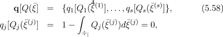

$$
\begin{aligned} {\mathbf{l}^{(j)}\lbrack P(\mathbf{a}),Q(\overline{\xi})\rbrack =} & {\mathbf{y}^{(j)} - \left\lbrack {{\int_{\mathcal{A}}P}(\mathbf{a})\hat{\mathbf{y}}(t_{j},\mathbf{a})\, d\mathbf{a}} \right\rbrack +} \\ {+ {\int_{\Xi_{j}}}\,Q_{j}} & {({\overline{\xi}}^{(j)})\,{\overline{\xi}}^{(j)}\, d{\overline{\xi}}^{(j)} = 0,} \\ & {j = \overline{1,s}.} \\ \end{aligned}
$$

(5.59)

为了获得拉格朗日泛函的最优性条件，使用 Section 4.3 中描述的基于 Gateaux 导数的方法。

设 PDF `P*`(a) 和 `$Q_{1}^{*}({\overline{\xi}}^{(1)}),\ldots,Q_{s}^{*}({\overline{\xi}}^{(s)})$` 满足泛函 (5.56) 的一阶最优性条件。考虑任意函数 `h`(a) 和 `$g_{1}({\overline{\xi}}^{(1)}),\ldots,g_{s}({\overline{\xi}}^{(s)}),$` 均来自类 `ℂ¹`，以及实变量 `α` 和 `β`[1], …, `β`[s]。将 (5.56) 中的 PDF 写成形式

$$
\begin{aligned} {P(\mathbf{a}) = P^{*}(\mathbf{a}) + \alpha h(\mathbf{a});} & {Q_{j}({\overline{\xi}}^{(j)}) = Q_{j}^{*}({\overline{\xi}}^{(j)}) + \beta_{j}g_{j}({\overline{\xi}}^{(j)}),} \\ & {\quad j = \overline{1,s}.} \\ \end{aligned}
$$

(5.60)

则拉格朗日泛函成为实变量 `𝕎` = {`α`;`β`[1],…,`β`[s]} 的函数。这些变量的 Gateaux 导数由下式给出

$$
\begin{aligned} \left. \frac{\partial\mathcal{L}}{\partial\alpha} \middle| {}_{\mathbb{W} = 0} = \right. & {- {\int_{\mathcal{A}}h}(\mathbf{a})(\ln\frac{P^{*}(\mathbf{a})}{P_{0}(\mathbf{a})} + 1 + \lambda +} \\ {+ {\sum\limits_{j = 1}^{s}\langle}{\overline{\theta}}^{(j)},\mathbf{B}^{(j)}} & {\left. \lbrack\mathbf{x}(t_{j},\tau_{h},\, \middle| \, h = \overline{1,(j-1)}),\mathbf{a}\rbrack \right\rangle)d\mathbf{a},} \\ \left. \frac{\partial\mathcal{L}}{\partial\beta_{j}} \middle| {}_{\mathbb{W} = 0} = - {\int_{\Xi_{j}}g_{j}}({\overline{\xi}}^{(j)}) \right. & {\left\lbrack {\ln\frac{Q_{j}^{*}({\overline{\xi}}^{(j)})}{Q_{j}^{0}({\overline{\xi}}^{(j)})} + 1 + \mu_{j} + \left\langle {\overline{\theta}}^{(j)},{\overline{\xi}}^{(j)} \right\rangle} \right\rbrack d{\overline{\xi}}^{(j)},} \\ & {\text{\quad\quad}j = \overline{1,s}.} \\ \end{aligned}
$$

(5.61)

对于这些积分对任意函数 `$h(\mathbf{a}),g_{1}({\overline{\xi}}^{(j)}),\ldots,g_{s}({\overline{\xi}}^{(j)}) \in {\mathbb{C}}^{1},$` 均消失，一个必要条件是带括号的表达式全部取零值，即

$$
\begin{aligned} & {\left. \ln\frac{P^{*}(\mathbf{a})}{P_{0}(\mathbf{a})} + 1 + \lambda + {\sum\limits_{j = 1}^{s}\left\langle {\overline{\theta}}^{(j)},\mathbf{B}^{(j)}\lbrack\mathbf{x}(()}\tau_{h},\, \middle| \, h = \overline{1,(j-1)}),\mathbf{a}\rbrack \right\rangle = 0,} \\ & {\ln\frac{Q_{j}^{*}({\overline{\xi}}^{(j)})}{Q_{j}^{0}({\overline{\xi}}^{(j)})} + 1 + \mu_{j} + \left\langle {\overline{\theta}}^{(j)},{\overline{\xi}}^{(j)} \right\rangle = 0,\text{\quad\quad}j = \overline{1,s}.} \\ \end{aligned}
$$

(5.62)

在拉格朗日乘子 `λ`, `μ`[1], …, `μ`[s], 和 `${\overline{\theta}}^{(1)},\ldots,{\overline{\theta}}^{(s)}$` 内的这些方程的解具有形式

$$
\begin{aligned} & {\text{\quad\quad}\,\,\text{\quad\quad}\text{\quad\quad}\text{\quad\quad}\text{\quad\quad}\text{\quad\quad}P^{*}(\mathbf{a}) = P_{0}(\mathbf{a}) \times} \\ & {\times \exp\left\lbrack \left. - 1 - \lambda - {\sum\limits_{j = 1}^{s}\left\langle {\overline{\theta}}^{(j)},\mathbf{B}^{(j)}\lbrack\mathbf{x}((t_{j},\tau_{h}) \right.},\, \middle| \, h = \overline{1,(j-1)}),\mathbf{a}\rbrack \right\rangle \right\rbrack,} \\ & {\text{\quad\quad}\text{\quad\quad}Q_{j}^{*}({\overline{\xi}}^{(j)}) = Q_{j}^{0}({\overline{\xi}}^{(j)})\exp\left\lbrack {- 1 - \mu_{j} - \left\langle {\overline{\theta}}^{(j)},{\overline{\xi}}^{(j)} \right\rangle} \right\rbrack,} \\ & {\text{\quad\quad}\text{\quad\quad}\text{\quad\quad}\text{\quad\quad}\text{\quad\quad}\text{\quad\quad}\quad\text{\quad\quad}j = \overline{1,s}.} \\ \end{aligned}
$$

(5.63)

拉格朗日乘子 `λ` 和 `μ`[1], …, `μ`[s] 可以利用归一化条件 (5.21) 消去。然后公式 (5.4.1) 给出 RPM-Orig 模型参数和测量噪声的 PDF 的如下熵最优估计：


$$\\begin{aligned} & {P^{\*}(\\mathbf{a}) = P\_{0}(\\mathbf{a})\\frac{\\exp\\left\\lbrack \\left. - {\\sum\\limits\_{j = 1}^{s}\\left\\langle {\\overline{\\theta}}^{(j)},\\mathbf{B}^{(j)}\\lbrack\\mathbf{x}((t\_{j},\\tau\_{h}) \\right.},\\, \\middle| \\, h = \\overline{1,(j-1)}),\\mathbf{a}\\rbrack \\right\\rangle \\right\\rbrack}{\\mathcal{P}({\\overline{\\theta}}^{(1)},\\ldots,{\\overline{\\theta}}^{(s)})},} \\\\ & {Q\_{j}^{\*}({\\overline{\\xi}}^{(j)}) = Q\_{j}^{0}({\\overline{\\xi}}^{(j)})\\frac{\\exp\\left\\lbrack {- \\left\\langle {\\overline{\\theta}}^{(j)},{\\overline{\\xi}}^{(j)} \\right\\rangle} \\right\\rbrack}{\\mathcal{Q}\_{j}({\\overline{\\theta}}^{(j)}),}\\quad j = \\overline{1,s}.} \\\\ \\end{aligned}$$

(5.64)

Here

$$\\begin{aligned} & {\\text{\\quad\\quad}\\text{\\quad\\quad}\\text{\\quad\\quad}\\mathcal{P}({\\overline{\\theta}}^{(1)},\\ldots,{\\overline{\\theta}}^{(s)}) = {\\int\_{\\mathcal{A}}P\_{0}}(\\mathbf{a}) \\times} \\\\ & {\\times \\exp\\left\\lbrack \\left. - {\\sum\\limits\_{j = 1}^{s}\\left\\langle {\\overline{\\theta}}^{(j)},\\mathbf{B}^{(j)}\\lbrack\\mathbf{x}((t\_{j},\\tau\_{h}) \\right.},\\, \\middle| \\, h = \\overline{1,(j-1)}),\\mathbf{a}\\rbrack \\right\\rangle \\right\\rbrack d\\mathbf{a},} \\\\ & {\\quad\\text{\\quad\\quad}\\mathcal{Q}\_{j}({\\overline{\\theta}}^{(j)}) = {\\int\_{\\Xi}Q\_{j}^{0}}({\\overline{\\xi}}^{(j)})\\exp\\left\\lbrack {- \\left\\langle {\\overline{\\theta}}^{(j)},{\\overline{\\xi}}^{(j)} \\right\\rangle} \\right\\rbrack d{\\overline{\\xi}}^{(j)},} \\\\ & {\\text{\\quad\\quad}\\text{\\quad\\quad}\\text{\\quad\\quad}\\quad\\text{\\quad\\quad}\\text{\\quad\\quad}j = \\overline{1,s}.} \\\\ \\end{aligned}$$

(5.65)

Clearly, the entropy-optimal PDFs are parameterized by the Lagrange multipliers and represent exponential functions. However, they may have any form, depending on the parameters `a`. 图 5.2, 图 5.3, 图 5.4, 图 5.5 demonstrate some examples of the estimated PDFs of the model parameters. For the linear RPM-Orig model, the estimated PDFs are always exponential functions; see 图 5.2. Note that their form is affected by the input and output measurements.

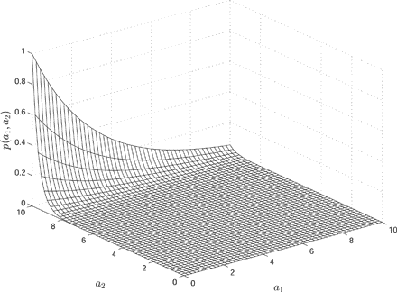

图 5.2: *p*(*a*[1], *a*[2]) = exp ( − 0.3*a*[1] + 2.5*a*[2]).

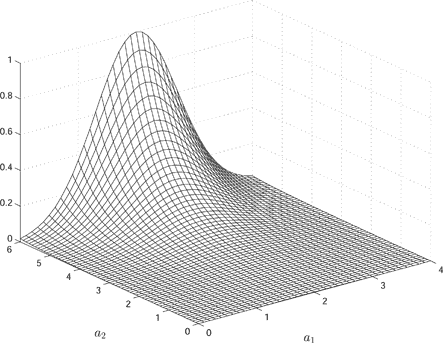

图 5.3: *p*(*a*[1], *a*[2]) = *e**x**p*(4*a*[1] − *a*[1]² + *a*[2]).

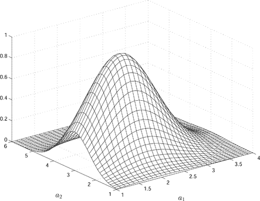

图 5.4: *p*(*a*[1], *a*[2]) = *e**x**p*(4*a*[1] − *a*[1]² + 6*a*[2] − *a*[2]²).

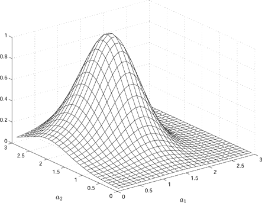

图 5.5: *p*(*a*[1], *a*[2]) = *e**x**p*(0.5*a*[1] + 3.5*a*[2] + 2*a*[1]² − *a*[1]³ − 0.2*a*[2]² − 0.2*a*[2]³).

For the nonlinear RPMs, the estimates have a wider variety of structural forms. For example, the estimated PDFs for the RPM-Orig models with the quadratic, quadratic-linear and cubic nonlinearities are shown in 图 5.3, 图 5.4, 图 5.5.

### 5.4.2 Randomized models of the RPM-Rel class with output errors

To construct optimality conditions for this class of the randomized models, introduce similar notations as (5.57–5.4.1), i.e.,

* the Lagrange multiplier `λ` for the first constraint in (5.21), writing it in the form

$$\\begin{array}{r} {w\\lbrack W(\\mathbf{u})\\rbrack = 1 - {\\int\_{\\mathcal{U}}W}(\\mathbf{u})d\\mathbf{u};} \\\\ \\end{array}$$

(5.66)

* the vector `\\overline{\\mu} = \\left\\{ \\mu\_{1},\\ldots,\\mu\_{s} \\right\\}` composed of the Lagrange multipliers for the second group of constraints in (5.21), writing them in the form

$$\\begin{aligned} & {\\mathbf{g}\\lbrack G(\\overline{\\eta})\\rbrack = \\left\\{ g^{(1)}\\lbrack G\_{1}({\\overline{\\eta}}^{(1)})\\rbrack,\\ldots,g^{(s)}\\lbrack G\_{s}({\\overline{\\eta}}^{(s)})\\rbrack \\right\\},} \\\\ & {\\text{\\quad\\quad}g^{(j)}\\lbrack G\_{j}({\\overline{\\eta}}^{(j)})\\rbrack = 1 - {\\int\_{\\mathcal{E}}G\_{j}}({\\overline{\\eta}}^{(j)})\\, d{\\overline{\\eta}}^{(j)},} \\\\ & {\\text{\\quad\\quad}\\quad\\text{\\quad\\quad}\\text{\\quad\\quad}j = \\overline{1,s};} \\\\ \\end{aligned}$$

(5.67)

* the vectors `${\\overline{\\theta}}^{(j)} = \\left\\{ \\theta\_{1}^{(j)},\\ldots,\\theta\_{m}^{(j)} \\right\\},\\, j = \\overline{1,s},$` composed of the Lagrange multipliers for the constraints (5.22), writing them in the form

$$\\begin{aligned} & {\\text{\\quad\\quad}\\mathbf{h}^{(j)}\\lbrack W(\\mathbf{u}),G\_{j}({\\overline{\\eta}}^{(j)})\\rbrack = \\mathbf{y}(t\_{j}) -} \\\\ & \\left. - {\\int\_{\\mathcal{U}}W}(\\mathbf{u})\\mathbf{D}^{(j)}\\lbrack\\mathbf{x}((t\_{j},\\tau\_{h}),\\, \\middle| \\, h = \\overline{1,(j-1)}),\\mathbf{a}^{-} + A\\,\\mathbf{u}\\rbrack\\, d\\mathbf{u} - \\right. \\\\ & {+ {\\int\_{\\mathcal{E}\_{j}}\\,}G\_{j}({\\overline{\\eta}}^{(j)})\\,{\\overline{\\eta}}^{(j)}\\, d{\\overline{\\eta}}^{(j)},\\quad j = \\overline{1,s}.} \\\\ \\end{aligned}$$

(5.68)

Using these notations, define the Lagrange functional

$$\\begin{aligned} {\\mathcal{L}\\lbrack W(\\mathbf{u}),G(\\overline{\\eta})\\rbrack} & {= \\mathcal{H}\\lbrack W(\\mathbf{u}),G(\\overline{\\eta})\\rbrack + \\lambda w\\lbrack W(\\mathbf{u})\\rbrack + \\left\\langle \\overline{\\mu},\\mathbf{g}\\lbrack G(\\overline{\\eta})\\rbrack \\right\\rangle +} \\\\ & {\\left. + {\\sum\\limits\_{j = 1}^{s}\\left\\langle {\\overline{\\theta}}^{(j)},\\mathbf{h}^{(j)}\\lbrack W(\\mathbf{u}),G\_{j}( \\right.}{\\overline{\\eta}}^{(j)})\\rbrack \\right\\rangle.} \\\\ \\end{aligned}$$

(5.69)

To get optimality conditions for the Lagrange functional, we will again employ the Gateaux derivative-based method; see (5.60, 5.4.1). The corresponding first-order optimality conditions have the form

$$\\begin{aligned} {\\ln\\frac{W^{\*}(\\mathbf{u})}{W\_{0}(\\mathbf{u})}} & {+ 1 + \\lambda +} \\\\ \\left. + {\\sum\\limits\_{j = 1}^{s}\\left\\langle {\\overline{\\theta}}^{j},\\mathbf{D}^{(j)}\\lbrack\\mathbf{x}((t\_{j},\\tau\_{h}) \\right.},\\, \\middle| \\, h = \\right. & {\\left. \\overline{1,(j-1)}),\\mathbf{a}^{-} + A\\,\\mathbf{u}\\rbrack \\right\\rangle = 0,} \\\\ {\\ln\\frac{G\_{j}^{\*}({\\overline{\\eta}}^{(j)})}{G\_{j}^{0}({\\overline{\\eta}}^{(j)})} + 1 + \\mu\_{j}} & {+ \\left\\langle {\\overline{\\theta}}^{(j)},{\\overline{\\eta}}^{(j)} \\right\\rangle = 0,} \\\\ {j =} & {\\overline{1,s}.} \\\\ \\end{aligned}$$

(5.70)

The solution of these equations within the Lagrange multipliers `λ`, `μ[1]`, …, `μ[s]`, and `${\\overline{\\theta}}^{(1)},\\ldots,{\\overline{\\theta}}^{(s)}$` is given by

$$\\begin{aligned} {W^{\*}(\\mathbf{u}) = W\_{0}} & {(\\mathbf{u})\\exp\\lbrack - 1 - \\lambda -} \\\\ {{\\sum\\limits\_{j = 1}^{s}\\left\\langle {\\overline{\\theta}}^{j},\\mathbf{D}^{(j)}\\lbrack\\mathbf{x}((t\_{j},\\tau\_{h}) \\right.},} & {\\,\\left| \\, r = \\overline{1,(j-1)}),\\mathbf{a}^{-} + A\\,\\mathbf{u}\\rbrack \\right\\rangle\\rbrack,} \\\\ {G\_{j}^{\*}({\\overline{\\eta}}^{(j)}) = G\_{j}^{0}({\\overline{\\eta}}^{(j)})} & {\\exp\\left\\lbrack {- 1 - \\mu\_{j} - \\left\\langle {\\overline{\\theta}}^{(j)},{\\overline{\\eta}}^{(j)} \\right\\rangle} \\right\\rbrack,} \\\\ & {j = \\overline{1,s}.} \\\\ \\end{aligned}$$

(5.71)

The Lagrange multipliers `λ` and `μ[1]`, …, `μ[s]` can be eliminated using the normalization conditions (5.28). Then formulas (5.4.2) yield the following entropy-optimal estimates for the PDFs of the RPM-Rel model parameters and measurement noises:


$$
\begin{aligned} & {\text{\quad\quad}\text{\quad\quad}\text{\quad\quad}\text{\quad\quad}\text{\quad\quad}\text{\quad\quad}W^{*}\mathbf{u}) = W_{0}\mathbf{u}) \times} \\ & {\times \frac{\exp\left\lbrack \left. - {\sum\limits_{j = 1}^{s}\left\langle {\overline{\theta}}^{j},\mathbf{D}^{(j)}\lbrack\mathbf{x}((t_{j},\tau_{r}) \right.},\, \middle| \, r = \overline{1,(j-1)}),\mathbf{a}^{-} + \Delta\,\mathbf{u}\rbrack \right\rangle \right\rbrack}{\mathcal{W}({\overline{\theta}}^{(1)},\ldots,{\overline{\theta}}^{(s)})},} \\ & {\text{\quad\quad}\quad\quad G_{j}^{*}({\overline{\eta}}^{(j)}) = G_{j}^{0}({\overline{\eta}}^{(j)})\frac{\exp\left\lbrack {- {\sum\limits_{j = 1}^{s}\left\langle {\overline{\theta}}^{(j)},{\overline{\eta}}^{(j)} \right\rangle}} \right\rbrack}{\mathcal{G}_{j}({\overline{\theta}}^{(j)})},} \\ & {\text{\quad\quad}\text{\quad\quad}\text{\quad\quad}\text{\quad\quad}\text{\quad\quad}\text{\quad\quad}\text{\quad\quad}j = \overline{1,s},} \\ \end{aligned}
$$

(5.72)

where

$$
\begin{aligned} & {\text{\quad\quad}\text{\quad\quad}\text{\quad\quad}\text{\quad\quad}\text{\quad\quad}\text{\quad\quad}\mathcal{W}({\overline{\theta}}^{(1)},\ldots,{\overline{\theta}}^{(s)}) = {\int_{\mathcal{U}}W_{0}}(\mathbf{u}) \times} \\ & {\times \exp\left\lbrack \left. - {\sum\limits_{j = 1}^{s}\left\langle {\overline{\theta}}^{(j)},\mathbf{D}^{(j)}\lbrack\mathbf{x}((t_{j},\tau_{r}) \right.},\, \middle| \, r = \overline{1,(j-1)}),\mathbf{a}^{-} + \Delta\,\mathbf{u}\rbrack \right\rangle \right\rbrack d\mathbf{u},} \\ & {\text{\quad\quad}\text{\quad\quad}\quad\mathcal{G}_{j}({\overline{\theta}}^{(j)}) = {\int_{\mathcal{E}}G_{j}^{0}}({\overline{\eta}}^{(j)})\exp\left\lbrack {- \left\langle {\overline{\theta}}^{(j)},{\overline{\eta}}^{(j)} \right\rangle} \right\rbrack d{\overline{\eta}}^{(j)},} \\ & {\text{\quad\quad}\text{\quad\quad}\text{\quad\quad}\text{\quad\quad}\quad\text{\quad\quad}\text{\quad\quad}\text{\quad\quad}j = \overline{1,s}.} \\ \end{aligned}
$$

(5.73)

与 RPM-Orig 类的随机化模型类似（参见 (5.4.1)），熵最优 PDF 由拉格朗日乘子参数化并表示为指数函数。

### 5.4.3 具有输入和输出误差的 RPM-Orig 类随机化模型

考虑问题 (5.2.3, 5.36, 5.2.3) 并写出拉格朗日泛函：

$$
\begin{aligned} {\mathcal{L}\lbrack F(\mathbf{a},\mu),\overline{Q}(\overline{\xi})\rbrack} & {\mathcal{H}\lbrack F(\mathbf{a},\mu),\overline{Q}(\overline{\xi})\rbrack + \lambda w\lbrack F(\mathbf{a},\mu)\rbrack + \left\langle \overline{\eta},\mathbf{q}\lbrack\overline{Q}(\overline{\xi}\rbrack \right\rangle +} \\ & {+ \left\langle {\overline{\theta}}^{(j)},\mathbf{c}^{(j)}\lbrack F(\mathbf{a},\mu),\overline{Q}(\overline{\xi})\rbrack \right\rangle,} \\ \end{aligned}
$$

(5.74)

其中 $\lambda;\overline{\eta};\overline{\theta}$ — 对应约束的拉格朗日乘子：

$$
\begin{array}{r} {w\lbrack P(\mathbf{a})\rbrack = 1 - {\int_{\mathcal{R}}F}(\mathbf{a},\mu)d\mathbf{a}d\mu = 0,} \\ \end{array}
$$

(5.75)

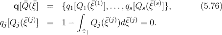

$$
\begin{aligned} & {\mathbf{c}^{(j)}\lbrack F(\mathbf{a},\mu),\overline{Q}(\overline{\xi})\rbrack = \mathbf{y}^{(j)} - \left\lbrack {{\int_{\mathcal{R}}F}(\mathbf{a},\mu)\hat{\mathbf{y}}(t_{j},\mathbf{a},\mu)\, d\mathbf{a}\, d\mu} \right\rbrack +} \\ & {\text{\quad\quad}\text{\quad\quad}\text{\quad\quad}\text{\quad\quad} + {\int_{\Xi_{j}}\,}Q_{j}({\overline{\xi}}^{(j)})\,{\overline{\xi}}^{(j)}\, d{\overline{\xi}}^{(j)} = 0,} \\ & {\text{\quad\quad}\text{\quad\quad}\text{\quad\quad}\text{\quad\quad}\quad\text{\quad\quad}\text{\quad\quad}j = \overline{1,s}.} \\ \end{aligned}
$$

(5.77)

为了得到拉格朗日泛函的最优性条件，我们再次采用基于 Gâteaux 导数的方法。相应的一阶最优性条件具有如下形式

$$
\begin{aligned} & {\text{\quad\quad}\text{\quad\quad}\text{\quad\quad}\text{\quad\quad}\text{\quad\quad}\quad\text{\quad\quad}F^{*}(\mathbf{a},\mu) = F_{0}(\mathbf{a},\mu) \times} \\ & {\times \frac{\left. \exp\lbrack - {\sum\limits_{j = 1}^{s}\left\langle {\overline{\theta}}^{(j)},\mathbf{B}^{(j)}\lbrack\mathbf{x}((t_{j},\tau_{h}) \right.} + \mu(t_{j},\tau_{h}),\, \middle| \, h = \overline{1,(j-1)}),\mathbf{a}\rbrack \right\rangle\rbrack}{\mathcal{F}({\overline{\theta}}^{(1)},\ldots,{\overline{\theta}}^{(s)})},} \\ & {\text{\quad\quad}\text{\quad\quad}Q_{j}^{*}({\overline{\xi}}^{(j)}) = Q_{j}^{0}({\overline{\xi}}^{(j)})\frac{\exp\lbrack - \left\langle {\overline{\theta}}^{(j)},{\overline{\xi}}^{(j)} \right\rangle\rbrack}{\mathcal{Q}_{j}({\overline{\theta}}^{(j)})},\quad j = \overline{1,s}.} \\ \end{aligned}
$$

(5.78)

其中

$$
\begin{aligned} & {\text{\quad\quad}\text{\quad\quad}\text{\quad\quad}\text{\quad\quad}\text{\quad\quad}\mathcal{F}({\overline{\theta}}^{(1)},\ldots,{\overline{\theta}}^{(s)}) = {\int_{\mathcal{R}}F_{0}}(\mathbf{a},\mu) \times} \\ & {\exp\left\lbrack \left. - {\sum\limits_{j = 1}^{s}\left\langle {\overline{\theta}}^{(j)},\mathbf{B}^{(j)}\lbrack\mathbf{x}((t_{j},\tau_{h}) \right.} + \mu(t_{j},\tau_{h}),\, \middle| \, h = \overline{1,(j-1)}),\mathbf{a}\rbrack \right\rangle \right\rbrack d\mathbf{a},} \\ & {\quad\text{\quad\quad}\text{\quad\quad}\mathcal{Q}_{j}({\overline{\theta}}^{(j)}) = {\int_{\Xi}Q_{j}^{0}}({\overline{\xi}}^{(j)})\exp\left\lbrack {- \left\langle {\overline{\theta}}^{(j)},{\overline{\xi}}^{(j)} \right\rangle} \right\rbrack d{\overline{\xi}}^{(j)},} \\ & {\text{\quad\quad}\text{\quad\quad}\quad\text{\quad\quad}\text{\quad\quad}\text{\quad\quad}\text{\quad\quad}\text{\quad\quad}j = \overline{1,s}.} \\ \end{aligned}
$$

(5.79)

得到的 PDF 函数由拉格朗日乘子 $\overline{\theta}$ 参数化，$\overline{\theta}$ 由平衡方程确定。

## 5.5 拉格朗日乘子的方程

所有熵最优 PDF 都属于由拉格朗日乘子 ${\overline{\theta}}^{1},\ldots,{\overline{\theta}}^{s}$ 参数化的指数函数类；参见上一节推导的公式。为了计算拉格朗日乘子，我们需要求解由平衡约束 (5.24, 5.31) 与熵最优 PDF (5.64, 5.4.2) 得到的方程。

**1. 具有输出误差的 RPM-Orig 模型**

为了形成相应的方程，引入以下辅助记号。

* 具有熵最优随机参数的模型的平均输出

$$
\begin{aligned} & {\text{\quad\quad}\mathbb{Y}_{j}(\overline{\theta}) = \mathcal{P}^{( - 1)}(\overline{\theta}){\int_{\mathcal{A}}P_{0}}(\mathbf{a}) \times} \\ {\times \exp} & {\left\lbrack \left. - {\sum\limits_{j = 1}^{s}\left\langle {\overline{\theta}}^{(j)},\mathcal{B}\lbrack\mathbf{x}((t_{j},\tau_{h}) \right.}\\, \middle| \, h = \overline{1,(j-1)}),\mathbf{a}\rbrack \right\rangle \right\rbrack \times} \\ & \left. \quad \times \mathcal{B}\lbrack\mathbf{x}((t_{j},\tau_{h})\, \middle| \, h = \overline{1,(j-1)}),\mathbf{a}\rbrack d\mathbf{a}; \right. \\ \end{aligned}
$$

(5.80)

* 平均熵-“最差”测量噪声


$$
\begin{aligned} {{\mathbb{Q}}_{j}({\overline{\theta}}^{(j)}) = \mathcal{Q}_{j}^{( - 1)}({\overline{\theta}}^{(j)})\int_{\Xi_{j}}} & {Q_{j}^{0}({\overline{\xi}}^{(j)})\exp\left\lbrack {- \left\langle {\overline{\theta}}^{(j)},{\overline{\xi}}^{(j)} \right\rangle} \right\rbrack d{\overline{\xi}}^{(j)},} \\ & {j = \overline{1,s}.} \\ \end{aligned}
$$

(5.81)

在这些表达式中，$\overline{\theta} = \lbrack{\overline{\theta}}^{(1)},\ldots,{\overline{\theta}}^{(s)}\rbrack.$

利用平衡约束条件 (5.24)，将拉格朗日乘子的方程写成

$$
\begin{array}{r} {{\mathbb{Y}_{j}(\overline{\theta}) + {\mathbb{Q}}_{j}({\overline{\theta}}^{(j)}) = \mathbf{y}^{(j)},\text{\quad\quad}j = \overline{1,s}.} \\ \end{array}
$$

(5.82)

## 2. 输出误差的 RPM-Rel 模型

类比于前一种情况，引入以下辅助记号：

* 具有熵最优随机参数的模型的平均输出

$$
\begin{aligned} & {\text{\quad\quad}\text{\quad\quad}\quad{\mathbb{Z}}_{j}(\overline{\theta}) = \mathcal{W}^{( - 1)}(\overline{\theta}){\int_{\mathcal{U}}W_{0}}(\mathbf{u}) \times} \\ & \left. \times \exp\lbrack - {\sum\limits_{j = 1}^{s}\left\langle {\overline{\theta}}^{(j)},\mathcal{D}\lbrack\mathbf{x}((t_{j},\tau_{h}) \right.}\\, \middle| \, h = \overline{1,(j-1)}),\mathbf{a}^{-} + \right. \\ & {\left. \text{\quad\quad}\text{\quad\quad}\text{\quad\quad}\text{\quad\quad}\text{\quad\quad}\text{\quad\quad} A\,\mathbf{u}\rbrack \right\rangle\rbrack \times} \\ & \left. \times \mathcal{D}\lbrack\mathbf{x}((t_{j},\tau_{h})\, \middle| \, h = \overline{1,(j-1)}),\mathbf{a}^{-} + A\,\mathbf{u}\rbrack d\mathbf{u}; \right. \\ \end{aligned}
$$

(5.83)

* 平均熵“最差”测量噪声

$$
\begin{aligned} {{\mathbb{G}_{j}({\overline{\theta}}^{(j)}) = \mathcal{G}_{j}^{( - 1)}({\overline{\theta}}^{(j)})\int_{\mathcal{E}}} & {G_{j}^{0}({\overline{\eta}}^{(j)})\exp\left\lbrack {- \left\langle {\overline{\theta}}^{(j)},{\overline{\eta}}^{(j)} \right\rangle} \right\rbrack d{\overline{\eta}}^{(j)},} \\ & {\, j = \overline{1,s}.} \\ \end{aligned}
$$

(5.84)

利用平衡约束条件 (5.31)，将拉格朗日乘子的方程写成

$$
\begin{array}{r} {{{\mathbb{Z}}_{j}(\overline{\theta}) + \mathbb{G}_{j}({\overline{\theta}}^{(j)}) = \mathbf{y}^{(j)},\text{\quad\quad}j = \overline{1,s}.} \\ \end{array}
$$

(5.85)

## 3. 输入和输出误差的 RPM-Orig 模型

为了形成相应的方程，引入以下辅助记号。

* 具有熵最优随机参数的模型的平均输出

$$
\begin{aligned} & {\text{\quad\quad}\quad\text{\quad\quad}\text{\quad\quad}{\mathbb{Y}_{j}(\overline{\theta}) = \mathcal{F}^{( - 1)}(\overline{\theta}){\int_{\mathcal{R}}F_{0}}(\mathbf{a},\mu) \times} \\ & {\times \exp\left\lbrack \left. - {\sum\limits_{j = 1}^{s}\left\langle {\overline{\theta}}^{(j)},\mathcal{B}\lbrack\mathbf{x}((t_{j},\tau_{h}) \right.} + \mu(t_{j},\tau_{h})\, \middle| \, h = \overline{1,(j-1)}),\mathbf{a}\rbrack \right\rangle \right\rbrack \times} \\ & \left. \text{\quad\quad} \times \mathcal{B}\lbrack\mathbf{x}((t_{j},\tau_{h}) + \mu(t_{j},\tau_{h})\, \middle| \, h = \overline{1,(j-1)}),\mathbf{a}\rbrack d\mathbf{a}d\mu. \right. \\ \end{aligned}
$$

(5.86)

* 平均熵“最差”测量噪声

$$
\begin{aligned} {{\mathbb{Q}_{j}({\overline{\theta}}^{(j)}) = \mathcal{Q}_{j}^{( - 1)}({\overline{\theta}}^{(j)})\int_{\Xi_{j}}} & {Q_{j}^{0}({\overline{\xi}}^{(j)})\exp\left\lbrack {- \left\langle {\overline{\theta}}^{(j)},{\overline{\xi}}^{(j)} \right\rangle} \right\rbrack d{\overline{\xi}}^{(j)},} \\ & {j = \overline{1,s}.} \\ \end{aligned}
$$

(5.87)

然后，将拉格朗日乘子的方程写成

$$
\begin{array}{r} {{\mathbb{Y}_{j}(\overline{\theta}) + {\mathbb{Q}}_{j}({\overline{\theta}}^{(j)}) = \mathbf{y}^{(j)},\text{\quad\quad}j = \overline{1,s}.} \\ \end{array}
$$

(5.88)

事实上，方程 (5.82, 5.85, 5.88) 具有一定的特殊性。它们包含依赖于拉格朗日乘子的函数；反过来，后者是通过在参数和测量噪声的定义多维域上积分计算的。公平地说，这些域具有简单的结构，表示多维平行六面体。在下文中，它们将被称作 *参数化积分分量 (PICs)*，以强调其特殊性。PICs 的计算和平衡方程的求解是独立且非平凡的问题。解决这些问题的一些方法将在 第 6 章 中详细讨论。

# 第 6 章 机器学习程序中归属概率的熵鲁棒估计方法

DOI: [10.1201/9781003306566-6](https://doi.org/10.1201/9781003306566-6)

熵泛函的约束最大化代表了解决各种问题的有效工具，包括对模型参数和测量噪声的归属区间概率的估计。区间类型的原始模型参数和测量噪声被变换为位于单位区间内的辅助非负变量，它们被视为归属概率 [67]。对辅助参数和测量噪声的这种概率解释证明了熵泛函用于寻找辅助变量和原始变量最佳值的适用性。归属概率的估计算法是机器学习算法。估计问题被表述为熵-线性规划问题，其可行集是利用可用的学习数据数组构造的。

## 6.1 归属概率的熵鲁棒估计算法

在 ML 程序中使用的参数化模型的一个重要类由具有区间类型 *准随机* 参数的模型组成；它们的值由归属相应区间的概率定义。用 *RPM-QuaRand* 表示这一类模型，用 **c** 表示其参数。这些模型具有确定性参数，其值未知。因此，RPM-QuaRand 模型可以被视为具有 PDF *R*(**c**)=*R*δ(**c**^(*) − **c**) 的随机模型。

参数 **c** 为区间类型，即

$$
\begin{array}{r} {\mathbf{c} \in \mathcal{C} = \otimes_{i = 1}^{n}\mathcal{C}_{i} = \lbrack c_{i}^{-},c_{i}^{+}\rbrack.} \\ \end{array}
$$

(6.1)

引入参数 *c*[*i*] 取区间 𝒞[*i*] 内某个值的概率 *p*[*i*]。值 *p*[*i*] 将被称为 *归属概率 (PO)*。那么参数 *c*[*i*] 可以写成

$$
\begin{array}{r} \left. c_{i} = c_{i}^{-} + (c_{i}^{+} - c_{i}^{-})\, p_{i},\text{\quad\quad}\mathbf{c} = \mathbf{c}^{-} + C\,\mathbf{p},\quad C = \text{diag}\lbrack(c_{i}^{+} - c_{i}^{-})\, \middle| \, i = \overline{1,n}\rbrack. \right. \\ \end{array}
$$

(6.2)

归属概率为

$$
\begin{array}{r} {\mathbf{p} \in \mathcal{I} = \lbrack\mathbf{0} \leq \mathbf{p} \leq \mathbf{1}\rbrack.} \\ \end{array}
$$

(6.3)

一些陈述还涉及一个额外的约束条件，称为完备集条件（归一化条件），即

$$
\begin{array}{r} {{\sum\limits_{i = 1}^{n}p_{i}} = 1.} \\ \end{array}
$$

(6.4)


属于概率的定义及其性质（6.3，6.4）形式上与相对参数（4.96，4.97）的定义相匹配。然而，它们之间存在原则上的差异。相对参数 `u` 是由给定 PDF 特征化的随机化变量。相比之下，属于概率 `p` 是非随机变量，取值在单位非负立方体内。

RPM-QuaRand 类的动态模型生成唯一的轨迹，即在离散时刻 $j = \overline{0,s} = \mathcal{T}_{s}$ 下由以下等式描述：

$$\begin{aligned} {\mathbf{s}\lbrack j,\mathbf{p}\rbrack} & {= \mathcal{S}\lbrack\mathbf{x}(j,\tau),\,\mathbf{c}^{-} + C\,\mathbf{p};(j,\tau) \in \mathcal{T}_{s}\rbrack,} \\ \mathbf{c} & {= \mathbf{c}^{-} + C\,\mathbf{p}.} \\ \end{aligned}$$

(6.5)

这里 𝒮 表示积分泛函。

该问题具有测量的加性模型：在每个 *j* 次测量中，噪声由区间型向量表征

$$\begin{array}{r} {{\overline{\zeta}}^{(j)} \in \mathcal{Z}^{(j)} = \otimes_{i = 1}^{m}\mathcal{Z}_{i}^{(j)},\quad\quad\mathcal{Z}_{i}^{(j)} = \lbrack\zeta_{-}^{(j)}(i),\zeta_{+}^{(j)}(i)\rbrack,\quad j = \overline{1,s}.} \\ \end{array}$$

(6.6)

引入噪声向量元素 `ζ[i]^{((j))}` 取自区间 `𝒵[i]^{((j))}` 的属于概率 `q[i]^{((j))}`。概率 `q[i]^{((j))}` 位于单位非负区间内，且概率向量为

$$\begin{array}{r} {\mathbf{q}^{(j)} \in \mathcal{I} = \lbrack\mathbf{0} \leq \mathbf{q}^{(j)} \leq \mathbf{1}\rbrack,\quad\quad j = \overline{1,s}.} \\ \end{array}$$

(6.7)

在某些情况下，如模型参数的属于概率，需要考虑归一化条件

$$\begin{array}{r} {{\sum\limits_{i = 1}^{m}q_{i}^{(j)}} = 1,\quad\quad j = \overline{1,s}.} \\ \end{array}$$

(6.8)

噪声向量可以写成

$$\begin{array}{r} \left. {{\overline{\zeta}}^{(j)} = {\overline{\zeta}}_{-}^{(j)}(i) + L_{j}\mathbf{q}^{(j)},\quad\quad L_{j} = \text{diag}\,\lbrack\zeta_{+}^{(j)}(i) - \zeta_{-}^{(j)}(i),\, \middle| \, i = \overline{1,m}\rbrack. \right. \\ \end{array}$$

(6.9)

RPM-QuaRand 模型（6.5）的可测输出是唯一的轨迹 `w[j, p, q]`，由向量 `s[j, p]`（6.5）和 `${\overline{\zeta}}^{(j)}$`（6.9）的加性混合组成，即

$$\begin{array}{r} {\mathbf{w}\lbrack j,(\mathbf{p},\mathbf{q}^{(j)}\rbrack = \mathbf{s}\lbrack j,\mathbf{p}\rbrack + {\overline{\zeta}}^{(j)} - + L_{j}\,\mathbf{q}^{(j)},\quad\quad j = \overline{1,s}.} \\ \end{array}$$

(6.10)

因此，作为其变量，RPM-QuaRand 模型包含了属于概率 `$ \mathbf{p},\mathbf{q}^{j},\, j = \overline{1,s}.$`

### 6.1.1 归一化属于概率的 RPM-QuaRand 模型的 ML 算法

考虑向量 `p` 和 `q^{(1)}, …, q^{((s))}` 归一化且存在关于先验属于概率的信息，`p[0]` 和 `q[0]^{(1)}, …, q[0]^{((s))}` 的情况。

在整本书中，反复提到 ML 过程在以熵度量的不确定性下运行。因此，我们将使用熵方法来表征估计质量。由于测量噪声是加性的，让我们采用广义玻尔兹曼信息熵 [141]

$$\begin{array}{r} {H_{B}(\mathbf{p},Q) = - \left\langle \mathbf{p},\mathbf{ln}\frac{\mathbf{p}}{\mathbf{p}_{0}} \right\rangle - {\sum\limits_{j = 1}^{s}\left\langle \mathbf{q}^{(j)},\mathbf{ln}\frac{\mathbf{q}^{(j)}}{\mathbf{q}_{0}^{(j)}} \right\rangle},Q = \lbrack\mathbf{q}^{(1)},\ldots,\mathbf{q}^{(s)}\rbrack.} \\ \end{array}$$

(6.11)

这里 `ln`(•) 表示具有相应元素的向量。回想一下，该表达式中的变量是非负的。那么 *归一化属于概率的 RPM-QuaRand 模型的熵鲁棒估计问题* 可以写成如下形式：

* 最大化熵函数（6.11）

$$\begin{array}{r} \left. H_{B}(\mathbf{p},Q)\Rightarrow\max_{\mathbf{p},Q} \right. \\ \end{array}$$

(6.12)

* 受以下约束：

  * –归一化条件

    $$\begin{array}{r} {\left\langle \mathbf{p},\mathbf{1} \right\rangle = 1,\quad\quad\left\langle \mathbf{q}^{(j)},\mathbf{1} \right\rangle = 1,\quad j = \overline{1,s},} \\ \end{array}$$

    (6.13)

    和

  * –平衡约束

    $$\begin{array}{r} {\mathcal{S}\lbrack\mathbf{x}\lbrack j,\tau\rbrack,\,\mathbf{c}^{-} + C\,\mathbf{p};(j,\tau) \in \mathcal{T}_{s}\rbrack + {\overline{\zeta}}_{-}^{(j)} + L_{j}\,\mathbf{q}^{(j)} = \mathbf{y}\lbrack j\rbrack,\quad\quad j = \overline{1,s}.} \\ \end{array}$$

    (6.14)

约束（6.13，6.14）从单位非负（*m* + *r*）维立方体 ℐ 中提取可容许集 Υ。

一般情况下，该问题是熵非线性规划问题。其非线性性质源于平衡约束（6.14），其中包含参数的非线性泛函 𝒮。注意，估计的随机化方法导致熵线性泛函规划的优化问题。

因此，*归一化属于概率的 RPM-QuaRand 模型的熵鲁棒 ML 算法* 的形式为

$$\begin{array}{r} \left. {(\mathbf{p},Q)}^{*} = \arg\max_{(\mathbf{p},Q)}\lbrack H_{B},\, \middle| \,( \mathbf{p},Q) \in \Upsilon\rbrack. \right. \\ \end{array}$$

(6.15)

### 6.1.2 区间型属于概率的 RPM-QuaRand 模型的 ML 算法

对于此类模型，属于概率取值在非负 *r*\-维立方体内——不施加归一化条件。对于这些 RPM-QuaRand 模型产生的估计问题有两种修改，取决于熵的选择，即使用玻尔兹曼熵或费米熵 [149] 的表述。

使用广义玻尔兹曼信息熵（6.11）时，*区间型属于概率的 RPM-QuaRand 模型的玻尔兹曼熵鲁棒估计问题* 可以写成如下形式：

* 最大化熵函数（6.11）

$$\begin{array}{r} \left. H_{B}(\mathbf{p},Q)\Rightarrow\max_{\mathbf{p},Q} \right. \\ \end{array}$$

(6.16)

* 受以下约束：

  * –区间型条件

    $$\begin{array}{r} {\mathbf{p} \in \mathcal{I},\quad\quad\mathbf{q}^{(j)} \in \mathcal{I},\quad j = \overline{1,s},} \\ \end{array}$$

    (6.17)

    和

  * –平衡约束

    $$\begin{array}{r} {\mathcal{S}\lbrack\mathbf{x}\lbrack j,\tau\rbrack,\,\mathbf{c}^{-} + C\,\mathbf{p};(j,\tau) \in \mathcal{T}_{s}\rbrack + {\overline{\zeta}}_{-}^{(j)} + L_{j}\,\mathbf{q}^{(j)} = \mathbf{y}^{(j)},\quad\quad j = \overline{1,s}.} \\ \end{array}$$

    (6.18)

约束（6.17，6.18）从单位非负 *r*\-维立方体 ℐ 中提取可容许集 Γ。

*区间型属于概率的 RPM-QuaRand 模型的玻尔兹曼熵鲁棒 ML 算法* 的形式为

$$\begin{array}{r} \left. {(\mathbf{p},Q)}^{*} = \arg\max_{(\mathbf{p},Q)}\lbrack H_{B},\, \middle| \,( \mathbf{p},Q) \in \Gamma\rbrack. \right. \\ \end{array}$$

(6.19)

在某些应用中，有必要选择广义费米信息熵以消除区间型条件：


$$\\begin{aligned} & {\\text{\\quad\\quad}H_{F}(\\mathbf{p},Q) = - \\left\\langle \\mathbf{p},\\mathbf{ln}\\frac{\\mathbf{p}}{\\mathbf{p}_{0}} \\right\\rangle - \\left\\langle (\\mathbf{1} - \\mathbf{p}),\\mathbf{ln}(\\mathbf{1} - \\mathbf{p}) \\right\\rangle -} \\\\ & {- {\\sum\\limits_{j = 1}^{s}\\left( {\\left\\langle \\mathbf{q}^{(j)},\\mathbf{ln}\\frac{\\mathbf{q}^{(j)}}{\\mathbf{q}_{0}^{(j)}} \\right\\rangle + \\left\\langle (\\mathbf{1} - \\mathbf{q}^{(j)}),\\mathbf{ln}(\\mathbf{1} - \\mathbf{q}^{(j)}) \\right\\rangle} \\right)},} \\\\ \\end{aligned}$$  

(6.20)

其中 *Q* = \[**q**^((1)), …, **q**^((*s*))\]。

显然，该函数的定义明确考虑了变量的区间特性。可行集仅由平衡约束刻画。

*带区间型隶属概率的 RPM-QuaRand 模型的费米熵鲁棒估计问题* 可写为如下形式：

*   最大化熵函数 (6.1.2)

    $$\\begin{array}{r} \\left. H_{F}(\\mathbf{p},Q)\\Rightarrow\\max_{\\mathbf{p},Q} \\right. \\\\ \\end{array}$$  

    (6.21)

*   受平衡约束限制

    $$\\begin{array}{r} {\\mathcal{S}\\lbrack\\mathbf{x}\\lbrack j,\\tau\\rbrack,\\,\\mathbf{c}^{-} + C\\,\\mathbf{p};(j,\\tau) \\in \\mathcal{T}_{s}\\rbrack + {\\overline{\\zeta}}_{-}^{(j)} + L_{j}\\,\\mathbf{q}^{(j)} = \\mathbf{y}\\lbrack j\\rbrack,\\text{\\quad\\quad}j = \\overline{1,s}.} \\\\ \\end{array}$$  

    (6.22)

约束 (6.22) 从单位非负 *n*\-维立方体 ℐ 中提取出一个可行集 Θ。

*带区间型隶属概率的 RPM-QuaRand 模型的费米熵鲁棒 ML 算法* 的形式为

$$\\begin{array}{r} \\left. {(\\mathbf{p},Q)}^{*} = \\arg\\max_{(\\mathbf{p},Q)}\\lbrack H_{F},\\, \\middle| \\,(\\mathbf{p},Q) \\in \\Theta\\rbrack, \\right. \\\\ \\end{array}$$  

(6.23)

其中 Θ 是由平衡约束定义的集合。注意问题 (6.21, 6.22) 比问题 (6.16–6.18) 包含的约束少 (*r* + *m**s*) 个。由于这一特性，估计问题 (6.21, 6.22) 的计算复杂度相比其对应问题 (6.16–6.18) 更小。

## 6.2 动态 RPM-QuaRand 模型的函数描述

如前一节所述，隶属概率的估计问题通常表示为具有熵目标函数的有限维非线性规划问题。这些问题的非线性是由表征模型 (6.5) 的泛函 𝒮 的非线性引起的。考虑在离散时间区间 𝒯 上测量的单输入单输出模型。

### 1. 具有非结构化幂非线性的动态模型

此类模型的函数描述具有以下形式

$$\\begin{aligned} {s\\lbrack j\\rbrack = {\\sum\\limits_{h = 1}^{R}{\\sum\\limits_{(n_{1},\\ldots,n_{h}) = 0}^{K_{h}}w_{h}}}} & {\\lbrack n_{1},\\ldots,n_{h}\\rbrack x\\lbrack j - n_{1}\\rbrack\\cdots x\\lbrack j - n_{h}\\rbrack,} \\\\ & {j \\geq maxK_{h}.} \\\\ \\end{aligned}$$  

(6.24)

(另见 Fig. 4.8。)

其动态和非线性特性由多维脉冲特性 $w_{h}\\lbrack n_{1},\\ldots,n_{h}\\rbrack,\\, h = \\overline{1,R},$ 反映，具有有限的“记忆” *K*[*h*]，即

$$\\begin{aligned} {w_{h}\\lbrack n_{1},\\ldots,n_{h}\\rbrack} & {\\neq 0,\\quad\\text{for}\\,\\, 0 \\leq (n_{1},\\ldots,n_{h}) \\leq K_{h};} \\\\ {w_{h}\\lbrack n_{1},\\ldots,n_{h}\\rbrack} & {= 0,\\quad\\text{for}\\,\\,(n_{1},\\ldots,n_{h}) > K_{h}.} \\\\ \\end{aligned}$$  

(6.25)

将脉冲特性的纵坐标作为模型参数。变量的字典序排列给出

$$\\begin{array}{r} \\left. (n_{1},\\ldots,n_{h})\\rightarrow v,\\text{\\quad\\quad}v = \\overline{1,V_{h}},\\,\\, V_{h} = (K_{h} + 1)\\, h, \\right. \\\\ \\end{array}$$  

(6.26)

定义由脉冲特性 *w*[*h*]\[*n*[1], …, *n*[*h*]\] 的纵坐标组成的向量 **c**^((*h*)) = {*c*[1]^((*h*)),…,*c*[*V*[*h*]]^((*h*))}。对乘积 *x*\[*j* − *n*[1]\]⋯*x*\[*j* − *n*[*h*]\] 执行类似操作。引入另一个向量

$$\\begin{array}{r} {\\mathbf{X}^{(h)}\\lbrack j\\rbrack = \\left\\{ x_{1}^{(h)}\\lbrack j\\rbrack,\\ldots,x_{V_{h}}^{(h)}\\lbrack j\\rbrack \\right\\}} \\\\ \\end{array}$$  

(6.27)

由字典序排列的乘积 *x*\[*j* − *n*[1]\]⋯*x*\[*j* − *n*[*h*]\] 组成。则模型方程 (6.1.2) 可变换为

$$\\begin{array}{r} {s\\lbrack j\\rbrack = {\\sum\\limits_{h = 1}^{R}\\left\\langle \\mathbf{c}^{(h)},\\mathbf{X}^{(h)}\\lbrack j\\rbrack \\right\\rangle}.} \\\\ \\end{array}$$  

(6.28)

作为所有这些操作的结果，原非线性模型 (6.1.2) 已被简化为其线性类似物 (6.28)，维度大大提高。

利用 第 6.3 节 中的隶属概率 **p**，令参数向量 **c**^((*h*)) 写为

$$\\begin{aligned} {\\mathbf{c}^{(h)} = \\mathbf{c}_{-}^{(h)} + C^{(h)}\\mathbf{p}^{(h)},\\,\\, C_{h} =} & \\left. \\text{diag}\\,\\lbrack(c_{i}^{(h, + )} - c_{i}^{(h, - )})\\, \\middle| \\, i = \\overline{1,V_{h}}\\rbrack, \\right. \\\\ & {h = \\overline{1,R}.} \\\\ \\end{aligned}$$  

(6.29)

将 (6.29) 代入 (6.28) 得到方程

$$\\begin{aligned} {s\\lbrack j\\rbrack} & {= \\hat{s}\\lbrack j\\rbrack + {\\sum\\limits_{h = 1}^{R}\\left\\langle C_{h}\\,\\mathbf{p}^{(h)},\\mathbf{X}^{(h)}\\lbrack j\\rbrack \\right\\rangle},} \\\\ {.\\hat{s}\\lbrack j\\rbrack} & {= {\\sum\\limits_{h = 1}^{R}\\left\\langle \\mathbf{c}_{-}^{(h)},\\mathbf{X}^{(h)}\\lbrack j\\rbrack \\right\\rangle}.} \\\\ \\end{aligned}$$  

(6.30)

### 2. 具有结构化幂非线性的动态模型

对于此类动态模型，函数描述具有以下形式：

$$\\begin{array}{r} {s\\lbrack j\\rbrack = {\\sum\\limits_{h = 1}^{R}{\\sum\\limits_{n = 0}^{K_{h}}\\left( {w_{h}\\lbrack n\\rbrack x\\lbrack j - n\\rbrack} \\right)^{h}}},\\text{\\quad\\quad}j > K.} \\\\ \\end{array}$$  

(6.31)

(另见 Fig. 4.11a。) 这里动态特性由脉冲特性 $w_{h}\\lbrack n\\rbrack,\\, h = \\overline{1,R},$ 反映，具有有限的“记忆” *K*[*h*]，即

$$\\begin{array}{r} {w_{h}\\lbrack n\\rbrack \\neq 0,\\quad\\text{for}\\,\\, 0 \\leq n \\leq K_{h};\\text{\\quad\\quad}r_{h}\\lbrack n\\rbrack = 0,\\quad\\text{for}\\,\\, n > K_{h}.} \\\\ \\end{array}$$  

(6.32)

将脉冲特性的纵坐标作为模型参数。换句话说，参数构成向量

$$\\begin{array}{r} {\\mathbf{c}^{(h)} = \\left\\{ c_{1}^{(h)},\\ldots,c_{K_{h}}^{(h)} \\right\\},} \\\\ \\end{array}$$  

(6.33)

其中

$$\\begin{array}{r} {c_{n}^{(h)} = w_{h}\\lbrack n\\rbrack,\\text{\\quad\\quad}n = \\overline{0,K_{h}}.} \\\\ \\end{array}$$  

(6.34)

利用隶属概率 **p**，将参数向量 **c**^((*h*)) 写成形式 (6.29)。将这些等式代入 (6.31) 得到模型方程

$$\\begin{array}{r} {s\\lbrack j\\rbrack = {\\sum\\limits_{h = 1}^{R}\\left( {\\left\\langle \\mathbf{c}_{-}^{(h)},\\mathbf{x}\\lbrack j\\rbrack \\right\\rangle + \\left\\langle C_{h}\\,\\mathbf{p}^{(h)},\\mathbf{x}\\lbrack j\\rbrack \\right\\rangle} \\right)^{h}},} \\\\ \\end{array}$$  

(6.35)

其中 **x**\[*j*\] = {*x*\[*j*\],…,*x*\[*j*−*K*[*h*]\]}。

因此，模型输出与参数之间的关系本质上是非线性的，更具体地说是幂函数。

### 3. 具有结构化幂非线性的动态模型

对于此类动态模型，函数描述具有以下形式：


$$\\begin{array}{r} {s\\lbrack j\\rbrack = {\\sum\\limits\_{h = 1}^{R}{\\sum\\limits\_{n = 0}^{K\_{h}}w\_{h}}}\\lbrack n\\rbrack x^{h}\\lbrack j - n\\rbrack,\\text{\\quad\\quad}j > K.} \\\\ \\end{array}$$  

(6.36)

(另见 图 4.11b。) 其动态特性由脉冲特性 $w\_{h}\\lbrack n\\rbrack,\\, h = \\overline{1,R},$ 描述，具有有限的“记忆” *K*[*h*] (6.32)。当该模型的参数采用其脉冲特性的纵坐标时，即参数向量为 **c**^((*h*)) (6.34)。定义由 *x*^(*h*)\[*j*\], …, *x*^(*h*)\[*j* − *K*[*h*]\] 组成的向量 ${\\widetilde{\\mathbf{X}}}^{h}\\lbrack j\\rbrack$。则模型方程 (6.36) 可变换为

$$\\begin{array}{r} {s\\lbrack j\\rbrack = {\\sum\\limits\_{h = 1}^{R}\\left\\langle \\mathbf{c},{\\widetilde{\\mathbf{X}}}^{(h)}\\lbrack j\\rbrack \\right\\rangle},\\text{\\quad\\quad}j > K.} \\\\ \\end{array}$$  

(6.37)

利用表达式 (6.29) 在该等式中写出

$$\\begin{aligned} {s\\lbrack j\\rbrack} & {= \\hat{s}\\lbrack j\\rbrack + {\\sum\\limits\_{h = 1}^{R}\\left\\langle C\_{h}\\,\\mathbf{p}^{(h)},{\\widetilde{\\mathbf{X}}}^{(h)}\\lbrack j\\rbrack \\right\\rangle},} \\\\ {\\hat{s}\\lbrack j\\rbrack} & {= {\\sum\\limits\_{h = 1}^{R}\\left\\langle \\mathbf{c}\_{-}^{(h)},{\\widetilde{\\mathbf{X}}}^{(h)}\\lbrack j\\rbrack \\right\\rangle}.} \\\\ \\end{aligned}$$  

(6.38)

因此，该结构类的模型在其参数上是线性的。

## 6.3 最优性条件与熵最优归属概率的结构

RPM-QuaRand 模型的熵鲁棒估计问题被归类为有限维熵非线性规划问题。它们的非线性性质完全取决于 RPM-QuaRand 模型的非线性。特别地，如果动态模型由具有 图 4.11a 所示结构的泛函 Volterra 级数表示，则估计问题中的容许集由具有幂非线性的等式系统描述。在这种情况下，容许集通常具有非凸构型，且最优性条件变为局部条件，因此只能数值使用。结果，我们无法从这些条件中提取解的共同结构性质（归属概率）。另一方面，对于可化为线性形式 (6.30, 6.38) 的一维 RPM-QuaRand 模型，我们可以建立全局最优性条件并分析解的结构性质。

### 1. 归一化归属概率

在泛函模型框架内的一般问题由等式 (6.12–6.14) 刻画。它将被改编为泛函模型为一维且可化为线性形式 (6.30) 的情况：

$$\\begin{aligned} {s\\lbrack j\\rbrack} & {= \\hat{s}\\lbrack j\\rbrack + {\\sum\\limits\_{h = 1}^{R}{\\sum\\limits\_{i = 1}^{V\_{h}}p\_{i}^{(h)}}}z\_{i}^{(h)}\\lbrack j\\rbrack + \\zeta\_{j}^{-} + Z\_{j}q\_{j},} \\\\ \\end{aligned}$$  

(6.39)

$$\\begin{aligned} {\\hat{s}\\lbrack j\\rbrack} & {= {\\sum\\limits\_{h = 1}^{R}{\\sum\\limits\_{i = 1}^{V\_{h}}c\_{-}^{(h)}}}(i)z\_{i}^{(h)}\\lbrack j\\rbrack,} \\\\ {z\_{i}^{(h)}\\lbrack j\\rbrack} & {= \\delta\_{i}^{(h)}x\_{i}^{(h)}\\lbrack j\\rbrack,\\text{\\quad\\quad}\\delta\_{i}^{(h)} = c\_{i}^{(h, + )} - c\_{i}^{(h, - )},\\quad i = \\overline{1,V\_{h}},} \\\\ Z\_{j} & {= \\zeta\_{j}^{+} - \\zeta\_{j}^{-},\\text{\\quad\\quad}j = \\overline{1,s}.} \\\\ \\end{aligned}$$  

(6.40)

然后估计问题 (6.12) 中的约束 (6.13, 6.14) 采用以下形式。

*   泛函模型功率块中模型参数归属概率的归一化条件为

    $$\\begin{array}{r} {{\\sum\\limits\_{i = 1}^{V\_{h}}p\_{i}^{(h)}} = 1,\\quad h = \\overline{1,R};} \\\\ \\end{array}$$  

    (6.41)

*   测量噪声归属概率的归一化条件为

    $$\\begin{array}{r} {{\\sum\\limits\_{j = 1}^{s}q\_{j}} = 1;} \\\\ \\end{array}$$  

    (6.42)

*   经验平衡条件为

    $$\\begin{aligned} & {\\widetilde{s}\\lbrack j\\rbrack + {\\sum\\limits\_{h = 1}^{R}{\\sum\\limits\_{i = 1}^{V\_{h}}p\_{i}^{(h)}}}z\_{i}^{(h)}\\lbrack j\\rbrack + Z\_{j}q\_{j} - y\\lbrack j\\rbrack = 0,\\quad j = \\overline{1,s},} \\\\ & {\\widetilde{s}\\lbrack j\\rbrack = \\hat{s}\\lbrack j\\rbrack + \\zeta\_{j}^{-}.} \\\\ \\end{aligned}$$  

    (6.43)

熵函数由下式给出

$$\\begin{array}{r} {H\_{B}(P,Q) = - {\\sum\\limits\_{h = 1}^{R}{\\sum\\limits\_{i = 1}^{V\_{h}}p\_{i}^{(h)}}}\\,\\ln\\frac{p\_{i}^{(h)}}{{\\widetilde{p}}\_{i}^{(h)}} - {\\sum\\limits\_{j = 1}^{s}q\_{j}}\\,\\ln\\frac{q\_{j}}{{\\widetilde{q}}\_{j}}.} \\\\ \\end{array}$$  

(6.44)

因此，估计问题可写为

$$\\begin{array}{r} \\left. H\_{B}(P,Q)\\Rightarrow\\max \\right. \\\\ \\end{array}$$  

(6.45)

受约束 (6.41, 6.42, 6.43) 的限制。

在此问题中，容许集 Υ 由等式系统描述，因此它代表一个约束优化问题。为了得到最优性条件，让我们定义拉格朗日函数

$$\\begin{aligned} L\_{B} & {= H\_{B}(P,Q) + {\\sum\\limits\_{h = 1}^{R}\\lambda\_{h}}\\left( {1 - {\\sum\\limits\_{i = 1}^{V\_{h}}p\_{i}^{(h)}}} \\right) + \\mu\\left( {1 - {\\sum\\limits\_{j = 1}^{s}q\_{j}}} \\right)} \\\\ & {+ {\\sum\\limits\_{j = 1}^{s}\\theta^{(j)}}\\left( {y\\lbrack j\\rbrack - \\widetilde{s}\\lbrack j\\rbrack - {\\sum\\limits\_{h = 1}^{R}{\\sum\\limits\_{i = 1}^{V\_{h}}p\_{i}^{(h)}}}\\delta\_{i}^{(h)}x\_{i}^{(h)}\\lbrack j\\rbrack + Z\_{j}q\_{j}} \\right).} \\\\ \\end{aligned}$$  

(6.46)

这里 *λ*[1], …, *λ*[*R*]； *μ*； *θ*[1], …, *θ*[*s*] 表示对应约束 (6.41, 6.42, 6.43) 的拉格朗日乘子。直接变量 (*P*， *Q*) 上的第一阶最优性条件给出以下方程组：

$$\\begin{aligned} \\frac{\\partial L}{\\partial p\_{i}^{(h)}} & {= - \\ln\\frac{p\_{i}^{(h)}}{{\\widetilde{p}}\_{i}^{(h)}} - 1 - \\lambda\_{h} - {\\sum\\limits\_{j = 1}^{s}\\theta\_{j}}z\_{i}^{(h)}\\lbrack j\\rbrack = 0,} \\\\ h & {= \\overline{1,s};\\text{\\quad\\quad}i = \\overline{1,V\_{h}}.} \\\\ \\end{aligned}$$  

(6.47)

$$\\begin{array}{r} {\\frac{\\partial L}{\\partial q\_{j}} = \\ln\\frac{(1 - q\_{j}){\\widetilde{q}}\_{j}}{q\_{j}} - \\mu - Z\_{j} = 0,\\text{\\quad\\quad}j = \\overline{1,s}.} \\\\ \\end{array}$$  

(6.48)

结合归一化条件 (6.41, 6.42)，方程 (6.47, 6.48) 导出模型参数和测量噪声的熵最优归属概率的以下表达式，其参数化为拉格朗日乘子 *θ*[1], …, *θ*[*s*]：

$$\\begin{aligned} {\\lbrack p\_{i}^{(h)}\\rbrack}^{\*} & {= \\frac{{\\widetilde{p}}\_{i}^{(h)}\\exp\\left( {- {\\sum\\limits\_{j = 1}^{s}\\theta\_{j}}z\_{i}^{(h)}\\lbrack j\\rbrack} \\right)}{{\\sum\\limits\_{k = 1}^{V\_{h}}{\\widetilde{p}}\_{k}^{(h)}}\\exp\\left( {- {\\sum\\limits\_{m = 1}^{s}\\theta\_{j}}z\_{k}^{(h)}\\lbrack m\\rbrack} \\right)},} \\\\ q\_{j}^{\*} & {= \\frac{{\\widetilde{q}}\_{j}\\exp( - \\theta\_{j}Z\_{j})}{{\\sum\\limits\_{m = 1}^{s}{\\widetilde{q}}\_{m}}\\exp( - \\theta\_{m}Z\_{m})}.} \\\\ \\end{aligned}$$  

(6.49)

$$\\begin{array}{r} {h = \\overline{1,R},\\quad i = \\overline{1,V\_{h}},\\quad j = \\overline{1,s}} \\\\ \\end{array}$$  

引入 *V*[*h*] 个整数自变量函数 $P^{(h)}\\lbrack i\\rbrack,\\, i = \\overline{}1,V\_{h},$ 其值由熵最优归属概率定义。按此定义，$P^{(h)}\\lbrack i\\rbrack,\\, i = \\overline{}1,V\_{h},$ 表示归属概率的分布函数。根据 (6.49)，它们是指数函数。


拉格朗日乘子 *θ*[1], …, *θ*[*s*] 由经验平衡约束 (6.43) 计算得出，并在其中代入了熵最优的归属概率 (6.49)。为便于记号，引入

```
\begin{aligned} {S\lbrack j\rbrack} & {= \hat{s}\lbrack j\rbrack + \zeta_{j}^{-} - y\lbrack j\rbrack,} \\ { \varphi^{(h)}(\theta_{1},\ldots,\theta_{s})} & {= {\sum\limits_{k = 1}^{(V_{h})}{\widetilde{p}}_{k}^{(h)}}\,\exp( - {\sum\limits_{l = 1}^{s}\theta_{l}}z_{k}^{(h)}\lbrack l\rbrack),} \\ { \psi_{j}^{(h)}(\theta_{1},\ldots,\theta_{s})} & {= {\sum\limits_{k = 1}^{(V_{h})}{\widetilde{p}}_{k}^{(h)}}\, z_{k}^{(h)}\lbrack j\rbrack\,\exp( - {\sum\limits_{l = 1}^{s}\theta_{l}}z_{k}^{(h)}\lbrack l\rbrack),} \\ \end{aligned}
```

(6.50)

以及

```
\begin{aligned} {\mu(\theta_{1},\ldots,\theta_{s}) = {\sum\limits_{l = 1}^{s}{\widetilde{q}}_{l}}} & {\exp( - \theta_{l}Z_{l}),\quad\nu_{j}(\theta_{j}) = {\widetilde{q}}_{j}Z_{j}\exp( - \theta_{j}Z_{j}),} \\ & {\text{\quad\quad}j = \overline{1,s}.} \\ \end{aligned}
```

(6.51)

利用这些记号，经验平衡约束可写为

```
\begin{array}{r} {{\sum\limits_{h = 1}^{R}\frac{\psi_{j}^{(h)}(\theta_{1},\ldots,\theta_{s})}{\varphi^{(h)}(\theta_{1},\ldots,\theta_{s})}} + \frac{\nu_{j}(\theta_{j})}{\mu(\theta_{1},\ldots,\theta_{s})} + S\lbrack j\rbrack = 0,\text{\quad\quad}j = \overline{1,s}.} \\ \end{array}
```

(6.52)

## 2. 区间型归属概率

RPM-QuaRand 模型的熵最优估计问题可利用广义玻尔兹曼信息熵 (6.16–6.18) 提出。这种估计问题的形式涉及比前一种更多的约束条件（其中一些为不等式）。因此它进入了有限维数学规划问题的范畴，最优性条件由 Kuhn–Tucker 定理 \[134\] 定义。

如果我们使用广义费米信息熵 (6.1.2) 作为目标函数，则可以显著简化熵最优估计问题的求解过程。模型参数和测量噪声的归属概率的区间性质被嵌入到熵函数中，这使得估计问题成为一个约束优化问题。与之前一样，最优性条件可利用拉格朗日乘子法推导得出。

问题 (6.21, 6.22) 的拉格朗日函数形式为

```
\begin{array}{r} {L_{F} = H_{F}(P,Q) + {\sum\limits_{j = 1}^{s}\theta^{(j)}}\left( {y\lbrack j\rbrack - \hat{s}\lbrack j\rbrack - {\sum\limits_{h = 1}^{R}{\sum\limits_{i = 1}^{V_{h}}p_{i}^{(h)}}}z_{i}^{(h)}\lbrack j\rbrack + \zeta_{j}^{-} + Z_{j}q_{j}} \right).} \\ \end{array}
```

(6.53)

一阶最优性条件由不等式组给出

```
\begin{aligned} \frac{\partial L}{\partial p_{i}^{(h)}} & {= \ln\, p_{i}^{(0,h)}\frac{1 - p_{i}^{(h)}}{p_{i}^{(h)}} - {\sum\limits_{j = 1}^{s}\theta_{j}}z_{i}^{(h)}\lbrack j\rbrack,} \\ h & {= \overline{1,R},\, i = \overline{1,V_{h}};} \\ \end{aligned}
```

(6.54)

```
\begin{array}{r} {\frac{\partial L}{\partial q_{j}} = \ln\, q_{j}^{0}\frac{1 - q_{j}}{q_{j}} - \theta_{j}Z_{j} = 0,\text{\quad\quad}j = \overline{1,s}.} \\ \end{array}
```

(6.55)

然后，由拉格朗日乘子参数化的模型参数和测量噪声的熵最优归属概率具有如下形式

```
\begin{aligned} p_{i}^{(h),*} & {= \frac{p_{i}^{(h,0)}}{p_{i}^{(h,0)} + \exp\left( {{\sum\limits_{j = 1}^{s}\theta_{j}}z_{i}^{(h)}\lbrack j\rbrack} \right)},} \\ h & {= \overline{1,R},\quad i = \overline{1,V_{h}},} \\ q_{j}^{*} & {= \frac{q_{j}^{0}}{q_{j}^{0} + \exp(\theta_{j}Z_{j})},\text{\quad\quad}j = \overline{1,s}.} \\ \end{aligned}
```

(6.56)

显然，熵最优归属概率位于单位区间内。为求拉格朗日乘子，将表达式 (6.56) 代入经验平衡约束 (6.22)。与前一种情况类似，引入以下记号：

```
\begin{aligned} {S\lbrack j\rbrack} & {= \hat{s}\lbrack j\rbrack + \zeta_{j}^{-} - y\lbrack j\rbrack,} \\ {\varphi_{j}(\theta_{j})} & {= Z_{j}\frac{q_{j}^{0}}{q_{j}^{0} + \exp(\theta_{j}Z_{j}},} \\ {\psi_{j}^{(h)}(\theta_{1},\ldots,\theta_{s})} & {= {\sum\limits_{i = 1}^{V_{h}}\frac{p_{i}^{(h,0)}}{p_{i}^{(h,0)} + \exp\left( {{\sum\limits_{l = 1}^{s}\theta_{l}}z_{i}^{(h)}\lbrack l\rbrack} \right)}}.} \\ \end{aligned}
```

(6.57)

然后经验平衡方程可写为

```
\begin{array}{r} {{\sum\limits_{h = 1}^{R}\psi_{j}^{(h)}}( \theta_{1},\ldots,\theta_{s}) + \varphi_{j}(\theta_{j}) + S\lbrack j\rbrack = 0,\text{\quad\quad}j = \overline{1,s}.} \\ \end{array}
```

(6.58)

方程 (6.52, 6.58) 的左端包含严格单调递减函数，这保证了唯一解的存在性。 （这一事实的证明留给感兴趣的读者）。 第 7 章 下面描述了解决此类乘性方程的算法。

# 第 7 章 随机化机器学习的计算方法

DOI: [10.1201/9781003306566-7](https://doi.org/10.1201/9781003306566-7)

广义随机化机器学习问题以函数熵-线性规划的形式表述，这使我们能够得到由拉格朗日乘子参数化的最优解结构。为了计算它们的值，我们必须求解具有所谓的带参数积分分量的非标准非线性方程，只能数值求得。因此，不可能从解析上估计计算过程的重要参数，如 Lipschitz 常数、Hölder 常数、光滑度等。为求解这些方程，我们的思路是将随机化方法扩展到用于求解 RML 问题的计算算法。随机化方法本身早已被提出并反复使用；参见 \[135\]。然而，随机化问题导向算法的主要特性在实现过程中产生。以下，我们将基于“分组”蒙特卡洛模拟开发求解经验平衡方程和计算多维积分的算法，该模拟使用异构结构计算辅助工具实现。

RML 问题的一个重要特殊类包括具有归属概率和线性模型的机器学习问题。对于此类问题，可以得到由拉格朗日乘子参数化的最优解的结构表示。所得平衡约束具有非线性形式，但不含积分分量。为求解这些方程，将采用乘性算法 \[140, 142\]。

## 7.1 RML 和 ML 过程中的平衡方程类

在 第 4 章 和 第 5 章 中，我们已为 RPM-Orig、RPM-Rel 和 RPM-CauRand 模型推导出经验平衡方程，其中变量的角色由拉格朗日乘子扮演。对这些方程的分析（更具体地说，对构成其分量的函数）使我们能够分离出两类非线性方程以供进一步研究。

### 1. 具有积分分量的方程


该类方程出现在 RML 过程的 RPM-Orig 和 RPM-Rel 模型中（5.74–5.76）。请注意，所考虑的方程包含由拉格朗日乘子参数化的定积分多维积分。例如，对于具有原始参数的 RPM（RPM-Orig），积分分量具有形式

$$\\begin{array}{r} {\\mathbb{M}\_{j}(\\theta) - \\mathbf{y}^{(j)} = 0,\\text{\\quad\\quad}j = \\overline{1,s},} \\\\ \\end{array}$$  

(7.1)

其中

$$\\begin{aligned} & {\\text{\\quad\\quad}\\text{\\quad\\quad}\\quad\\mathbb{M}\_{j}(\\theta) = \\mathcal{P}^{( - 1)}(\\theta){\\int\_{\\mathcal{A}}P\_{0}}(\\mathbf{a}) \\times} \\\\ & {\\times \\exp\\left\\lbrack \\left. - {\\sum\\limits\_{j = 1}^{s}\\left\\langle {\\overline{\\theta}}^{(j)},\\mathcal{B}\\lbrack\\mathbf{x}((t\_{j},\\tau\_{h}) \\right.}\\, \\middle| \\, h = \\overline{1,(j-1)}),\\mathbf{a}\\rbrack \\right\\rangle \\right\\rbrack \\times} \\\\ & \\left. \\quad \\times \\mathcal{B}\\lbrack\\mathbf{x}((t\_{j},\\tau\_{h})\\, \\middle| \\, h = \\overline{1,(j-1)}),\\mathbf{a}\\rbrack d\\mathbf{a} + {\\mathbb{Q}}\_{j}({\\overline{\\theta}}^{(j)}), \\right. \\\\ {j = \\overline{1,s}.} & \\\\ \\end{aligned}$$  

(7.2)

在这些等式中，矩阵 $\\theta = \\lbrack{\\overline{\\theta}}^{(1)},\\ldots,{\\overline{\\theta}}^{(s)}\\rbrack$ 以及函数 $\\mathcal{P}(\\overline{\\theta})$ 和 ${\\mathbb{Q}}\_{j}({\\overline{\\theta}}^{(j)})$ 分别由 (5.4.1) 和 (5.75) 给出。

对于具有相对参数的随机参数模型（RPM-Rel）也出现类似情况。该类模型的平衡方程可以写成

$$\\begin{array}{r} {{\\mathbb{N}}\_{j}(\\overline{\\theta}) - \\mathbf{y}^{(j)} = 0,\\text{\\quad\\quad}j = \\overline{1,s},} \\\\ \\end{array}$$  

(7.3)

其中

$$\\begin{aligned} {{\\mathbb{N}}\_{j}(\\theta) = \\mathcal{W}^{( - 1)}(\\theta){\\int\_{\\mathcal{U}}W\_{0}}(\\mathbf{u}) \\times} & \\\\ {\\times \\exp\\left\\lbrack \\left. - {\\sum\\limits\_{j = 1}^{s}\\left\\langle {\\overline{\\theta}}^{(j)},\\mathcal{D}\\lbrack\\mathbf{x}((t\_{j},\\tau\_{h}) \\right.}\\, \\middle| \\, h = \\overline{1,(j-1)}),\\mathbf{a}^{-} + \\Delta\\mathbf{u}\\rbrack \\right\\rangle \\right\\rbrack \\times} & \\\\ \\left. \\times \\mathcal{D}\\lbrack\\mathbf{x}((t\_{j},\\tau\_{h})\\, \\middle| \\, h = \\overline{1,(j-1)}),\\mathbf{a}^{-} + \\Delta\\mathbf{u}\\rbrack d\\mathbf{u} + \\mathbb{G}\_{j}({\\overline{\\theta}}^{(j)}), \\right. & \\\\ {j = \\overline{1,s}.} & \\\\ \\end{aligned}$$  

(7.4)

这些表达式包含 𝒲(*θ*)（5.4.2）和 $\\mathbb{G}\_{j}({\\overline{\\theta}}^{(j)})$（5.4.3）。请注意，泛函 ℬ 和 𝒟 属于幂类型。

方程 (7.1, 7.3) 具有相似的结构；利用它们，构造一类非线性方程如下：

$$\\begin{array}{r} {\\mathbf{B}(\\mathbf{u}) = \\mathbf{B}\\left\\lbrack {{\\mathbb{C}}(\\mathbf{f})} \\right\\rbrack = \\mathbf{0},} \\\\ \\end{array}$$  

(7.5)

其积分分量为

$$\\begin{array}{r} {{\\mathbb{C}}(\\mathbf{f}) = {\\int\_{\\mathcal{E}}\\exp}\\left( {- E(\\mathbf{f},\\mathbf{e})} \\right)d\\mathbf{e},} \\\\ \\end{array}$$  

(7.6)

或

$$\\begin{array}{r} {{\\mathbb{C}}(\\mathbf{f}) = {\\int\_{\\mathcal{E}}E}(\\mathbf{f},\\mathbf{e})\\exp\\left( {- \\mathcal{E}(\\mathbf{f},\\mathbf{e})} \\right)d\\mathbf{e},} \\\\ \\end{array}$$  

(7.7)

其中

$$\\begin{array}{r} {E(\\mathbf{f},\\mathbf{e}) = {\\sum\\limits\_{h = 1}^{R}{\\sum\\limits\_{(n\_{1},\\ldots,n\_{h}) = 1}^{m}A\_{(n\_{1},\\ldots,n\_{h})}}}(\\mathbf{f})\\,{\\prod\\limits\_{k = 1}^{h}e\_{n\_{k}}}.} \\\\ \\end{array}$$  

(7.8)

记号如下：**f** ∈ *R*^(*s*) 为期望变量的向量，即积分分量的参数；**B**(**u**) 为包含积分分量 (7.6) 或 (7.7) 的向量函数；**e** ∈ *E* ⊂ *R*^(*r*) 为 (7.6, 7.7) 中的积分变量；最后，*E* 为 *r*\-维平行六面体。

方程 (7.5) 的数值求解过程包括以下步骤：(a) 在固定变量 **f** 下计算积分分量 ℂ(**f**) 以及 (b) 计算变量的新向量，该向量是相应平衡方程的解。该过程对应于具有 Fig. 7.1 所示结构的迭代过程。它具有主迭代循环（见双线），用于使用算法求解方程 (7.5)

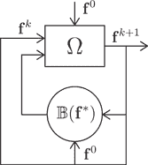

Figure 7.1

$$\\begin{array}{r} {\\mathbf{f}^{(k + 1)} = \\Omega\\left( {\\mathbf{f}^{k},\\mathbf{B}\\left\\lbrack {{\\mathbb{C}}(\\mathbf{f}^{k})} \\right\\rbrack} \\right),} \\\\ \\end{array}$$  

(7.9)

以及次级循环（见单线），用于计算具有积分分量 (7.6, 7.7) 的函数 **B**。

回到方程 (7.5)，将其化为更便于计算的形式。引入变量变换，将空间 *R*^(*s*) 和域 ℰ ∈ *R*^(*r*) 映射到适当维数的单位非负立方体。由于域 ℰ 是 *r*\-维平行六面体，该变换可通过线性变量变换实现

$$\\begin{aligned} {\\mathbf{w} = L\\,\\mathbf{e} - \\mathbf{e}^{-},} & \\left. \\quad L = \\text{diag}\\,\\lbrack 1/(e\_{i}^{+} - e\_{i}^{-}),\\, \\middle| \\, i = \\overline{1,r}\\rbrack, \\right. \\\\ & {\\mathbf{w} \\in I^{r} \\subset R\_{+}^{r} = \\lbrack\\mathbf{0},\\mathbf{1}\\rbrack.} \\\\ \\end{aligned}$$  

(7.10)

空间 *R*^(*s*) 可通过非线性变换映射到单位非负 *s*\-维立方体，例如

$$\\begin{array}{r} {\\mathbf{z} = \\left\\{ \\frac{1}{1 + \\exp f\_{i}},\\, \\middle| \\, i = \\overline{1,s} \\right\\},\\text{\\quad\\quad}\\mathbf{z} \\in I^{s}.} \\\\ \\end{array}$$  

(7.11)

利用这些变换在 (7.5) 中，写出

$$\\begin{array}{r} {\\mathbf{W}(\\mathbf{z}) = \\mathbf{0},\\text{\\quad\\quad}\\mathbf{z} \\in I^{s}.} \\\\ \\end{array}$$  

(7.12)

该方程中的积分分量为

$$\\begin{array}{r} {\\mathbf{C}(\\mathbf{z}) = {\\int\_{I^{r}}\\exp}\\left( {- E(\\mathbf{z},\\mathbf{w})} \\right)d\\mathbf{w} = \\mathbf{0},\\text{\\quad\\quad}\\mathbf{z} \\in I^{s},\\quad\\mathbf{w} \\in I^{r},} \\\\ \\end{array}$$  

(7.13)

或

$$\\begin{aligned} {\\mathbf{G}(\\mathbf{z}) = \\int\_{I^{r}}} & {\\exp\\left( {- E(\\mathbf{z},\\mathbf{w})} \\right)\\exp\\left( {- E(\\mathbf{z},\\mathbf{w})} \\right)d\\mathbf{w} = \\mathbf{0},} \\\\ & {\\text{\\quad\\quad}\\mathbf{z} \\in I^{s},\\quad\\mathbf{w} \\in I^{r},} \\\\ \\end{aligned}$$  

(7.14)

其中

$$\\begin{array}{r} {E(\\mathbf{z},\\mathbf{w}) = {\\sum\\limits\_{h = 1}^{R}{\\sum\\limits\_{(n\_{1},\\ldots,n\_{h}) = 1}^{m}A\_{(n\_{1},\\ldots,n\_{h})}}}(\\mathbf{z})\\,{\\prod\\limits\_{k = 1}^{h}w\_{n\_{k}}}.} \\\\ \\end{array}$$  

(7.15)

方程 (7.12) 将通过最小化残差函数求解

$$\\begin{array}{r} \\left. F(\\mathbf{z}) = \\|\\mathbf{W}(\\mathbf{z})\\|\\Rightarrow\\min\_{\\mathbf{z}},\\text{\\quad\\quad}\\mathbf{z} \\in I^{s}. \\right. \\\\ \\end{array}$$  

(7.16)

请注意，由于其积分分量，无法在解析上建立残差函数的任何特征。因此，我们必须假设函数 *F*(**z**) 在容许集 *I*^(*s*) 上存在若干局部极小值。因此，问题 (7.16) 归结为该函数的全局最小化。

## 具有解析函数的方程


该类平衡方程出现在具有 RPM-QuaRand 模型的 ML 问题中。表征这些模型参数的归属概率可以是归一化的或区间类型的。在前一种情况下，基于 ML 的估计算法被表述为广义玻尔兹曼信息熵的约束最大化问题。在后一种情况下，选择广义费米信息熵似乎更为方便。

将归一化归属概率的经验平衡方程 (6.52) 写成形式

$$\begin{array}{r} {m_{j}(\mathbf{v}) = {\sum\limits_{h = 1}^{R}\frac{\beta^{(h)}(v_{1},\ldots,v_{s};\, j)}{\alpha^{(h)}(v_{1},\ldots,v_{s})}} + \gamma_{j}(v_{1},\ldots,v_{s}) = 0,\quad j = \overline{1,s},} \\ \end{array}$$

(7.17)

其中

$$\begin{aligned} {\alpha^{(h)}(v_{1},\ldots,v_{s})} & {= {\sum\limits_{k = 1}^{V_{h}}p_{k}^{(h,0)}}{\prod\limits_{l = 1}^{V_{h}}v_{l}^{z_{k}^{(h)}\lbrack l\rbrack}},} \\ {\beta_{k}^{(h)}(v_{1},\ldots,v_{s};\, j)} & {= {\sum\limits_{k = 1}^{V_{h}}z_{k}^{(h)}}\lbrack j\rbrack p_{k}^{(h,0)}{\prod\limits_{l = 1}^{V_{h}}v_{l}^{z_{k}^{(h)}\lbrack l\rbrack}},} \\ {\gamma_{j}(v_{1},\ldots,v_{s})} & {= S\lbrack j\rbrack + \frac{q_{j}^{0}Z_{j}v_{j}^{Z_{j}}}{{\sum\limits_{l = 1}^{s}q_{j}^{0}}v_{j}^{Z_{l}}} - y\lbrack j\rbrack,} \\ v_{l} & {= \exp( - \theta_{l}),\text{\quad\quad}l = \overline{1,s}.} \\ \end{aligned}$$

(7.18)

这些方程中的变量定义在非负象限 *R*[+]^(*s*) 上。有时，它们被称为指数拉格朗日乘子。

考虑区间归属概率的经验平衡方程 (6.58) 并用变量 (*v*[1],…, *v*[*s*]) ≥ 0 表示它们 (7.18)。引入以下记号：

$$\begin{aligned} {\varrho_{j}^{(h)}(v_{1},\ldots,v_{s})} & {= {\sum\limits_{i = 1}^{V_{h}}\frac{p_{i}^{(h,0)}}{p_{i}^{(h,0)} + {\prod\limits_{l = 1}^{s}v_{l}^{z_{i}^{(h)}\lbrack l\rbrack}}}},} \\ {\vartheta_{j}(v_{j})} & {= Z_{j}\frac{q_{j}^{0}}{q_{j}^{0} + v_{j}^{Z_{j}}},} \\ {\omega\lbrack j\rbrack} & {= \vartheta_{j}(v_{j}) + \hat{s}\lbrack j\rbrack + \zeta_{j}^{-} - y\lbrack j\rbrack.} \\ \end{aligned}$$

(7.19)

将方程 (6.58) 写为

$$\begin{array}{r} {n_{j}(\mathbf{v}) = {\sum\limits_{h = 1}^{R}\varrho_{j}^{(h)}}(v_{1},\ldots,v_{s}) + \omega\lbrack j\rbrack = 0,\text{\quad\quad}j = \overline{1,s}.} \\ \end{array}$$

(7.20)

经验平衡方程的最终形式使我们能够识别这些方程的一些一般性质，这对于选择合适的计算方法是有益的。

### 7.2 用于全局优化的蒙特卡洛分组迭代

RPM-Orig 和 RPM-Rel 模型的 RML 算法旨在求解经验平衡方程，其中变量的角色由拉格朗日乘子或取值在单位非负立方体内的辅助变量扮演。设计数值方法的方法是从残差函数（通常是二次范数）的最小化出发。在 RML 问题中，残差函数与变量之间存在算法定义的关联，这一问题特征最终将其简化为全局最小化问题。在这种条件下，蒙特卡洛方法似乎是 RML 算法设计的一个合适的工具。

大量文献已发表，涉及蒙特卡洛方法在不同全局优化问题中的应用。关于这些问题及其求解方法的一些见解可从 \135, 158, 171–[173, 196, 199\] 获得。

与现有方法不同，这里提出的思想是使用 *简单蒙特卡洛模拟*，即在非负单位立方体上生成具有均匀分布的独立随机向量。

### 7.2.1 全局优化问题的规范形式

考虑全局最小化问题

$$\begin{aligned} & \left. f(\mathbf{x})\Rightarrow\text{globmin} \right. \\ & \text{subject~to~the~following~constraints:} \\ & {\mathbf{x} \in \mathcal{G}_{\mathbf{x}} = \left\{ \mathbf{x}:\mathbf{g}(\mathbf{x}) \leq \mathbf{0},\, \mathbf{x} \in R^{d} \right\},\quad\mathbf{g} \in R^{r},\, r < d.} \\ \end{aligned}$$

(7.21)

目标函数 *f*(**x**) 满足 Hölder 条件，常数为 *H* > 0 和 *w* > 0，即其连续模具有形式

$$\begin{array}{r} \left. \omega(t) = \max_{(\widetilde{\mathbf{v}},\widetilde{\mathbf{y}}) \in R^{d}\mspace{2mu}:\|\widetilde{\mathbf{v}} - \widetilde{\mathbf{y}}\| \leq t} \middle| f(\widetilde{\mathbf{v}}) - f(\widetilde{\mathbf{y}}) \middle| \leq Ht^{w}. \right. \\ \end{array}$$

(7.22)

(7.22) 中的函数 **g**(**x**) 假定为连续的。

将问题 (7.21) 写成 *规范形式* 为

$$\begin{aligned} & \left. F(\mathbf{z})\Rightarrow\text{globmin} \right. \\ \end{aligned}$$

(7.23)

$$\begin{aligned} & \text{subject~to~the~following~constraints:} \\ & {\mathbf{z} \in \mathcal{K}_{\mathbf{z}} = \mathcal{G}_{\mathbf{z}}{\cap Z_{+}^{d}},} \\ & {Z_{+}^{d} = \left\{ \mathbf{z}:\mathbf{0} \leq \mathbf{z} \leq \mathbf{1} \right\} \subset R^{d},} \\ & {\mathcal{G}_{\mathbf{z}} = \left\{ \mathbf{z}:\mathbf{w}(\mathbf{z}) \leq \mathbf{0},\, \mathbf{z} \in Z_{+}^{d} \right\},\quad\mathbf{w} \in R^{r},\, r < d.} \\ \end{aligned}$$

(7.24)

原始问题与其规范形式之间的关系由变量的连续可微双射变换定义，即

$$\begin{array}{r} {\mathbf{z} = \mathcal{T}(\mathbf{x}),\text{\quad\quad}\mathbf{x} = \mathcal{T}^{( - 1)}(\mathbf{z}).} \\ \end{array}$$

(7.25)

事实上，有相当多的变换满足这些条件，例如

$$\begin{aligned} & {\mathbf{z} = \left\{ \frac{1}{1 + exp( - a_{i}x_{i})},\, \middle| \, i = \overline{1,d} \right\},} \\ & {\mathbf{x} = \left\{ \frac{1}{a_{i}}\ln\frac{z_{i}}{1 - z_{i}},\, \middle| \, i = \overline{1,d} \right\}.} \\ \end{aligned}$$

(7.26)

由于变换 (7.26) 的连续性，函数 *F*(**z**) 在 𝒦[**z**] 上有下界，即存在常数 *c* 使得

$$\begin{array}{r} {F^{\*} \geq c.} \\ \end{array}$$

(7.30)

常数 *c* 通常是未知的，但在某些特殊全局最小化问题中等于 0。例如，这发生在函数 *F*(**z**) 定义为某个方程组左右两边残差的问题中。

函数 *F*(**z**) 也满足 Hölder 条件，其他常数为 *L* 和 *p*，即

$$\begin{array}{r} \left. \omega(h) = \max_{(\mathbf{v},\mathbf{y}) \in \mathcal{K}_{\mathbf{x}}\mspace{2mu}:\|\mathbf{v} - \mathbf{y}\| \leq h} \middle| F(\mathbf{v}) - F(\mathbf{y}) \middle| \leq Lh^{s}. \right. \\ \end{array}$$

(7.31)

用 *ℤ*^(*) 表示所有全局最小点 **z**^(*) 的集合，并用 *F*(**z**^(*)) = *F*^(*) 表示问题 (7.23) 中的全局最小值。换句话说，假设全局最小值不是在唯一点取得，而是在有限集合 ℤ^(*) 上取得。


如何理解问题 `(7.23)` 的 `solution`？该问题至关重要，因为其明显性在实际计算过程中消失了。实际上，即使计算精度任意高，也无法获得全局最小值 `F^*` 的精确值。我们可以谈论进入精确全局最小值值的某个 `r`-邻域。换句话说，问题涉及 `r`-邻域内的近似全局最小值 `F̃^*`。在开始时，我们已声明采用 `Monte Carlo` 方法进行全局最小化。因此，值 `F̃^*` 以某个概率进入 `r`-邻域，该概率小于或等于 1。

还要注意，计算是通过迭代过程实现的，该过程表示为具有编号 `k` 的步骤序列。每一步都会产生一个中间结果。在问题 `(7.23)` 中，中间结果是值 `$\\widetilde{F_{1}^{*},\\ldots,\\widetilde{F_{k}^{*},\\ldots}}$`。假设在某一步 `k^*`，近似全局最小值 `F̃[k^*]^ *` 已进入 `r`-邻域。尽管如此，该事件是随机的，可能发生的情况是，在步骤 `(k^* + 1)`，该值会离开邻域。为了提高近似全局最小化的可靠性，引入一个正数 `ϱ`，它表征在首次于步骤 `k^*` 进入后，值 `F̃[k^*]^ *`、`F̃[(k^* + k[1])]^ *`、…、`F̃[(k^* + k[ϱ])]^ *` 保持在 `r`-邻域内的步骤数。

### 7.2.2 方法思想和解的概念

考虑问题 `(7.23)` 的简化表述，其中可行集为 `d` 维立方体 `Z[+]^(d)`。该问题由一种算法求解，该算法表示为构造记录序列的迭代过程

在步骤 `k`，算法生成一批 `𝒵[k]`，其中包含 `N[k] = M[k]^(d)` 个独立随机向量 `z¹, …, z^(N[k])`，它们服从 `Z[+]^(d)` 上的均匀分布。这里 `M[k]` 表示随机生成器在步骤 `k` 为每个 `d` 个坐标产生的区间 `[0, 1]` 上独立均匀分布随机变量的数量。

对于第 `k` 批，算法计算函数 `$F(\\mathbf{z}^{j}),\\, j = \\overline{1,N_{k}},$` 的值以及其最小值 `F[k]^ *`（第 `k` 个记录）和参数 `z[k]^ *`。由于蒙特卡洛模拟的随机性，值 `F[k]^ *` 也是随机的。

过渡到步骤 `(k + 1)` 包括按规则增加随机向量的数量

```
\begin{array}{r} {M_{k + 1} = \alpha M_{k},\quad\quad\alpha > 1,} \\ \end{array}
```
(7.32)

并为第 `(k + 1)` 个包计算新的记录 `F[k + 1]^ *`。这产生一个单调递减序列

```
\begin{array}{r} {\mathcal{F} = \left\{ F_{0}^{*} \geq \ldots, \geq F_{k}^{*},\ldots \right\}.} \\ \end{array}
```
(7.33)

除了记录序列 (7.33) 外，算法还构造其递减序列

```
\begin{array}{r} {\mathcal{U} = \left\{ u_{1},\ldots, \, u_{k},\ldots \right\},} \\ \end{array}
```
(7.34)

其中 `u[k]=|F[k]^ *−F[k + 1]^ *|`。

当随机变量序列 `u[k]` 在 `ρ` 个连续步骤内保持在原点给定的 `δ`-邻域内时，算法停止，即其终止前的步骤数为

```
\begin{array}{r} {\tau = \min\left\{ k:\max_{k - \rho \leq s \leq k}u_{s} \leq \delta \right\}.} \\ \end{array}
```
(7.35)

在下文中，该算法将被称为 `GFS algorithm (Generation, Filtration, Selection)`。

`The solution of the problem (7.23)` 由四元组表示

```
\begin{array}{r} {S = \left\{ F_{\tau}^{*},\mathbf{z}_{\tau}^{*},r_{\tau}^{*},\mathbf{P}(\mathcal{E}_{r_{\tau}}) \right\},} \\ \end{array}
```
(7.36)

其中

* `F[τ]^ *`、`z[τ]^ *` 分别表示在停止时间 `τ` 时的近似全局最小值及其参数；
* `r[τ]^ *` 是在停止时间 `τ` 时精确全局最小值邻域大小的估计值；
* 事件

```
\begin{array}{r} {\mathcal{E}_{r_{\tau}^{*}} = \left\{ F_{\tau}^{*} - F^{*} \leq r_{\tau} \right\},} \\ \end{array}
```
(7.37)

其中 `F^*` 给出集合 `Z[+]^(d)` 上精确全局最小值；
* `P(ℰ[r[τ]^ *])` 表示事件 (7.37) 的估计概率。

实际算法涉及严格单调递减子序列

```
\begin{array}{r} {\mathbb{F}^{*} = \left\{ F_{1}^{*} > \ldots, > F_{k}^{*},\ldots \right\}} \\ \end{array}
```
(7.38)

序列 `ℱ^*` (7.33)。下面的理论分析基于探索序列 `ℱ^*` 的性质。由于 `𝔽^*` 构成 `ℱ^*` 的子序列，在定性上分析结果对子序列 `𝔽^*` 保持不变。

### 7.2.3 随机序列 ℱ 和 𝒰 的概率特征

对由简单蒙特卡洛模拟的包生成的随机序列进行研究，是研究 GFS 算法在计算方面的基本性质的重要阶段。这些性质包括收敛性分析（特别是收敛条件）和所得解 `[35]` 的数值特征估计。

**1. 包 𝒵[k] 的概率特征**

在每个阶段 `k`，算法生成一个包含 `N[k]` 个独立随机向量的包 `𝒵[k]`，其在 `d` 维立方体上服从均匀分布。包 `𝒵[k]` 的来源是随机生成器：在步骤 `k`，它为每个 `d` 个坐标产生 `M[k]` 个独立均匀分布在区间 `[0, 1]` 上的随机变量数组（简单蒙特卡洛模拟）。结果，在步骤 `k` 时，我们有一个 `(M[k])^(d)` 个随机向量的包，它们服从单位立方体上的均匀分布。

考虑单位立方体 `Z[+]^(d)` (7.23) 及其使用具有步长的 `virtual` 均匀格点划分

```
\begin{array}{r} {\eta_{k} = M_{k}^{- q}} \\ \end{array}
```
(7.39)

对于每个 `d` 个坐标。这里 `q` 指定格点参数，使得

```
\begin{array}{r} {0 < \gamma \leq q \leq \beta < 1.} \\ \end{array}
```
(7.40)

用 `P(M[k], d, q)` 表示存在一个不包含在步骤 `k` 生成的随机 `(M[k])^(d)` 个向量中的 `virtual` 元素立方体的概率。该概率可以估计如下。

**2. 序列 ℱ^* 的概率性质**

考虑“准全局”最小值序列 `ℱ^* = {F[0]^ *,…,F[k]^ *,…}` 和相应的参数序列 `𝒵^* = {z[0]^ *,…,z[k]^ *,…}`。

用 `ℤ^*` 表示函数 `F(⋅)` 在单位立方体上的所有全局最小点集合。引入任意点 `z` 与紧集 `ℤ^*` 之间的距离 `l(⋅)`，形式为

```
\begin{array}{r} {l(\mathbf{z},{\mathbb{Z}}^{*}) = \min_{\mathbf{y} \in {\mathbb{Z}}^{*}}\|\mathbf{z} - \mathbf{y}\|.} \\ \end{array}
```
(7.46)

注意，上界 (7.53)–(7.54) 依赖于参数 `q`，它影响具有边长 (7.39) 的每个坐标的 `virtual` 元素立方体的体积。式 (7.40) 中的常数 `β` 和 `γ` 应调整以达到关于所需邻域大小和相应概率的可接受结果。

### 7.2.4 GFS 算法的收敛性

利用记录序列 `F[k]^ *` 的概率特征，我们可以建立其收敛性的以下结果。

### 7.2.5 递减序列 𝒰 的研究


对于 Hölder 型函数，上界 (7.53) 以概率 `1 − Q(M[k], d, q)` 成立；见推论 2。 因为 `rk + 1 < rk`，

$$
\begin{array}{r}
\left. u_{k} = \middle| F_{k + 1}^{*} - F_{k}^{*} \middle| \leq DM_{k}^{- p}. \right.
\\
\end{array}
$$

(7.66)

于是，对于充分大的 `k`，

$$
\begin{array}{r}
{u_{k} \approx DM_{k}^{- p}.}
\\
\end{array}
$$

(7.67)

对该近似表达式两边取对数：

$$
\begin{array}{r}
{v_{k} = \log u_{k} \approx \log D - p\log M_{k}.}
\\
\end{array}
$$

(7.68)

`vk` 关系的一个例子对于一个计算过程示于 图 7.2。


Figure 7.2

考虑一列独立随机变量 `ζ[k]`，均值为零，方差有限 `σ²`。 将该序列加到近似表达式的右端以模拟 `v[k]` 序列的随机性，即

$$
\begin{array}{r}
{v_{k} = A - Bn_{k} + \zeta_{k},}
\\
\end{array}
$$

(7.69)

其中

$$
\begin{array}{r}
{A = \log D,\quad\quad B = p,\quad n_{k} = \log M_{k}.}
\\
\end{array}
$$

(7.70)

与 Hölder 常数相关的参数 `A` 和 `B` 以及 `σ²` 都是未知的。 它们的估计值 `Â(k)`、`B̂(k)` 和 `σ̂²(k)` 将利用关于序列 `{F[k]^*}` 元素的可用信息，基于最小二乘法构造。 这很容易实现，因为 (7.69) 表示一个 *线性* 模型（在此上下文中，请再次注意对数-对数尺度下的线性回归 (7.69) 直接源于上界 (7.53)）。

有了这些估计，我们还可以估计相应邻域的大小 `rk`，即精确全局最小值的邻域。 根据 (7.53)，

$$
\begin{array}{r}
{r_{k}(q) = \log{\hat{A}}^{(k)}M_{k}^{(\frac{{\hat{B}}^{(k)}}{q})}.}
\\
\end{array}
$$

(7.71)

显然，关系 `rk` 在区间 `[γ, β]` (7.40) 上单调递减。 故其在 `q = β` 处取得最小值。 在停止时刻 `τ` 处邻域的估计大小为

$$
\begin{array}{r}
{r_{\tau}(\beta) = \log{\hat{A}}^{(\tau)}M_{\tau}^{(\frac{{\hat{B}}^{(\tau)}}{\beta})},}
\\
\end{array}
$$

(7.72)

其概率 (7.54) 的下界（见推论 2）具有形式

$$
\begin{array}{r}
{P\left\{ 0 \leq F_{\tau}^{*} - F^{*} \leq r_{\tau} \right\} \geq M_{\tau}^{\beta d}\exp\left( {- M_{\tau}^{(1 - \beta)d}} \right).}
\\
\end{array}
$$

(7.73)

### 7.2.6 一般形式的容许集 𝒦(z)

到目前为止，我们考虑了全局最小化问题，其中变量 **z** 的定义域与容许集重合。 现在让我们处理一般情形，其中容许集 `𝒦(z)` (7.23) 表示单位立方体 `𝒵[+]^(d)` 的一部分。 更具体地说，它形成单位立方体与由连续函数描述的不等式系统所描述的子集 `𝒢` 的交集。

所研究的容许集的体积更小，因此其虚拟划分中的基本立方体数目减少。 然而，该数目必然不超过单位立方体划分中此类立方体的数目。 因此，导出的概率估计（从而算法收敛性的命题）对于由连续函数系统定义且具有正 Lebesgue 测度的紧集仍然有效。

考虑单位立方体中的容许域 `𝒦[z]` (7.23)。 假设它不包含孤立点且其 `d` 维 Lebesgue 测度 `ν` 非零，即 `0 < ν[0] ≤ ν ≤ 1`。

首先，分析值 `ν` 已知的情形。 那么，从单位立方体上均匀分布的独立随机向量序列中生成的特定向量落入容许域的概率为 `ν`。 设在第 `k` 步生成 `N[k]` 个独立随机向量，均匀分布于 `Z+` 上，其中 `N̂[k]` 个向量在容许域内。 用 `κ[N[k]]` 表示生成的向量在容许集 `𝒦[z]` 内的出现频率，即

$$
\begin{array}{r}
{\kappa_{N_{k}} = \frac{{\hat{N}}_{k}}{N_{k}}.}
\\
\end{array}
$$

(7.74)

根据大数定律，对于任意（充分小的）`ϵ > 0`、`η > 0` 和给定的值 `ν`，存在一个数 `N0`，使得对于所有 `N[k] > N0`，偏差 `|κ[N[k]]−ν|` 小于 `ϵ ν` 的概率不小于 `(1 − η)`。

因此，对于 `N[k] > N0`，不等式

$$
\begin{array}{r}
{\kappa_{N_{k}} \geq (1 - \epsilon)\nu}
\\
\end{array}
$$

(7.75)

以不小于 `(1 − η)` 的概率成立。 故由 `N[k]` 个向量组成的包中容许向量的数目 `N̂[k]` 满足不等式

$$
\begin{array}{r}
{{\hat{N}}_{k} \geq N_{k}(1 - \epsilon)\nu}
\\
\end{array}
$$

(7.76)

的概率不小于 `(1 − η)`。

因此，在所有包含生成向量数目 `N[k]` 的公式中，我们应将其（对于 `N[k] > N0`）替换为数目 `N̂[k] = (1 − ϵ)ν N[k]`。

现在估计数目 `N0`。 对于 `η > 0`，利用条件定义函数 `c(η)`

$$
\begin{array}{r}
{\frac{1}{\sqrt{2\pi}}{\int_{- c(\eta)}^{c(\eta)}\exp}( - x^{2}/2)dx = 1 - \eta.}
\\
\end{array}
$$

(7.77)

则数目 `N0` 可由关系式求得

$$
\begin{array}{r}
{N_{0}(\epsilon,\eta,\nu) \geq \frac{c^{2}(\eta)(1 - \nu)}{\epsilon^{2}\nu}.}
\\
\end{array}
$$

(7.78)

其次，考虑值 `ν` 未知但我们已知满足 `0 < ν[0] ≤ ν` 的值 `ν[0]` 的情形。 用 `ν[0]` 代替 (7.78) 中的 `ν` 可得到在该频率下容许向量的频率与未知值 `ν` 的偏差至多为 `ϵ ν` 且概率不小于 `(1 − η)` 的最小生成向量数估计。 在此情形下，对于 `N > N0`，值 `ν` 可估计为

$$
\begin{array}{r}
{\hat{\nu} = \kappa_{N},}
\\
\end{array}
$$

(7.79)

并且以不小于 `(1 − η)` 的概率，`|κ[N]−ν|≤ϵ ν`，即

$$
\begin{array}{r}
{\frac{\kappa_{N}}{1 - \epsilon} \geq \nu \geq \frac{\kappa_{N}}{1 + \epsilon}.}
\\
\end{array}
$$

(7.80)

该估计的下界可代替公式 (7.78) 中的 `ν` 使用。

### 7.2.7 GFS 算法的逻辑结构

GFS 算法用于计算问题 (7.23) 规范形式下的全局最小值。 它包含两个过程，`SeqLocMin` 和 `EstProb`。 `SeqLocMin` 过程产生记录序列及其递减量并包含停止规则。 `EstProb` 过程估计精确全局最小值邻域的最小尺寸并计算落入该邻域的概率下界。

这些过程由 `k` 个步骤组成，每个步骤执行 `t` 次操作。 因此，成对指标 `(k, t)` 将与每个过程的阶段相关联。

#### SeqLocMin 过程

1. *生成*—随机向量包的创建：
   1. `(k, 1)` 生成 `N[k]` 个独立随机向量，均匀分布于单位立方体上；
   2. `(k, 2)` 形成包 `𝒵[k] = {z¹,…,z^(N[k])}` 由这些随机向量组成。

2. *过滤*—容许向量的选择：
   1. `(k, 3)` 从包 `𝒵[k]` 中选择属于容许集 `𝒦[z]` 的向量并形成大小为 `Ñ[k]` 的容许包 `${\widetilde{\mathcal{Z}}}_{k}$`。


### 3. *Selection*—definition of the quasi global minimum for the packet and calculation of the decrements:

1. (*k*, 4) calculate the values $F({\widetilde{\mathbf{z}}}^{i}),\, i = \overline{1,{\widetilde{N}}_{k}},$ of the objective function for the vectors from the packet ${\widetilde{\mathcal{Z}}}_{k};$

2. (*k*, 5) choose the minimum value $F_{k}^{*} = \min F({\widetilde{\mathbf{z}}}^{i}),\, 1 \leq i \leq {\widetilde{N}}_{k};$

3. (*k*, 6) calculate the decrements `u[k]=|F[k + 1]*−F[k]*|` and the decrement logarithms `v[k]=log u[k]` and `n[k]=log N[k]`; form the sequences `𝒰={u[k]}`, `𝒱={v[k]}`, `𝒩={n[k]}`.

If `v[k] ≤ log δ`, the value `v[k]` is included in the sequence ${\widetilde{\mathcal{V}}}.$ As soon as the sequence ${\overset{\text{˜}}{\mathcal{V}}}_{k}$ accumulates `ρ` elements, `k = τ` and the algorithm stops. Then a transition to the `EstProb` procedure is performed.

#### **EstProb procedure**

The computational scheme of this procedure consists in the following.

1. *Parameter estimation for the regression model of decrements*:

    1. (*τ*, 1) using sequences `𝒩` and `𝒱`, estimate parameters `Â[τ]` and `B̂[τ]` by the least-squares method.

2. *Estimation of solution characteristics (quality indicators)*:

    1. (*τ*, 2) estimate the size `r[τ]` (7.72) for the neighborhood of the global minimum value;

    2. (*τ*, 3) calculate the lower bound for the probability `P̂[τ]` (7.73).

The logical structure of the GFS algorithm is presented in Fig. 7.3.


Figure 7.3

### 7.2.8 Experimental study of GFS algorithm

According to the previous subsections, the probabilistic properties of the GFS algorithm established by analytical study possess an asymptotical character. In other words, they hold for a sufficiently large number of iterations. Even the estimates derived under a finite number of steps assume that it is great enough. The aim of an experimental study, which always has a finite number of steps, is to test the operability of this algorithm in typical problems. More specifically, we will check the estimates for the size of the exact global minimum neighborhood and the probability of getting into it. Recall that these estimates have been obtained using the least-squares-based estimation of the Hölder constants for the objective function. Therefore, in the course of a computational experiment, we will confirm or doubt the hypothesis about the linear regression in the log-log scale.

In the general statement, the GFS algorithm is intended for solving the global minimization problems in which it is possible to calculate the values of the associated functions (the objective function and constraints). Below we will consider the entropy estimation problem for the PDFs of the parameters of a randomized model that possesses these properties. Let us begin the experimental study of the GFS algorithm with test problems using analytical functions.

**1. Analytical tests**

Our testing employs some minimization problems from [4, 5, 58, 173], in which the admissible domain is the *d*-dimensional parallelepiped `Π[z]`.

*A1. The Shekel function*

$$
\begin{aligned}
{F(\mathbf{x}) =} & {- {\sum\limits_{i = 1}^{m}\left( {c_{i} + {\sum\limits_{j = 1}^{d}{(x_{j} - a_{ji})}^{2}}} \right)^{- 1}}, \quad m = 10,}
\\ & {\text{\quad\quad\quad\quad\quad\mathbf{x}^{*} = \mathbf{4}.\mathbf{0},}}
\\ & {\text{\quad\quad}F^{*} = - 10.5364, \quad d = 4,}
\\ & {\text{\quad\quad}F^{*} = - 11.0216, \quad d = 2,}
\\ \end{aligned}
$$

(7.81)

where

$$
\begin{array}{r}
{A = \left( \begin{array}{llllllllll}
4 & 1 & 8 & 6 & 3 & 2 & 5 & 8 & 6 & 7 \\
4 & 1 & 8 & 6 & 7 & 9 & 3 & 1 & 2 & 3 \\
4 & 1 & 8 & 6 & 3 & 2 & 5 & 8 & 6 & 7 \\
4 & 1 & 8 & 6 & 7 & 9 & 3 & 1 & 2 & 3 \\
\end{array} \right),}
\\ \end{array}
$$

and

$$
\begin{array}{r}
{c = \frac{1}{10}(1,2,2,4,4,6,3,7,5,5).}
\\ \end{array}
$$

*A2. The Rosenbrock function*

$$
\begin{aligned}
{F(\mathbf{x})} & {= {\sum\limits_{i = 1}^{d}1}00{(x_{i + 1} - x_{i})}^{2} + {(x_{i} - 1)}^{2},}
\\ & {\mathbf{x}^{*} = \mathbf{1},\, F^{*} = 0\,\text{for~any}\, d.}
\\ \end{aligned}
$$

(7.82)

*A3. The Powell function*

$$
\begin{aligned}
{F(\mathbf{x})} & {= {\sum\limits_{i = 1}^{d - 2}{(x_{i - 1} + 10x_{i})}^{2}} + 5{(x_{i + 1} - x_{i + 2})}^{2} +}
\\ & {+ {(x_{i} - 2x_{i + 1})}^{4} + 10{(x_{i - 1} - x_{i + 2})}^{4},}
\\ & {\text{\quad\quad}\mathbf{x}^{*} = \mathbf{0},\, F^{*} = 0\,\text{for~any}\, d.}
\\ \end{aligned}
$$

(7.83)

*A4. The trigonometric function*

$$
\begin{aligned}
{F(\mathbf{x})} & {= 1 + {\sum\limits_{i = 1}^{d}8}\sin^{2}7{(x_{i} - 0.9)}^{2} + 6\sin^{2}14{(x_{i} - 0.9)}^{2} + x_{i} - 0.9,}
\\ & {\text{\quad\quad\quad\quad\quad}\mathbf{x}^{*} = \mathbf{0}.\mathbf{9},\, F^{*} = 1\,\text{for~any}\, d.}
\\ \end{aligned}
$$

(7.84)

*A5. The Griewank function*

$$
\begin{aligned}
{F(\mathbf{x})} & {= 1 + {\sum\limits_{i = 1}^{d}\frac{x_{i}^{2}}{4000}} - {\prod\limits_{i = 1}^{d}\cos}\left( \frac{x_{i}}{\sqrt{i + 1}} \right),}
\\ & {\mathbf{x}^{*} = \mathbf{0},\, F^{*} = 0\,\text{for~any}\, d.}
\\ \end{aligned}
$$

(7.85)

For all computations, `N[0]=10`, `α=10`, `δ=0.01`, `a=10`, `ρ=2`, `τ=13`, and `ε[τ]=|F*−F[τ]*|`. The results of computations are illustrated in Table 7.1, where `t` denotes the solution time (in s), `r[τ]` and `P[τ]` give the estimated size of the exact global minimum neighborhood and the corresponding estimated probability, respectively. Clearly, the approximate solutions in all the tests belong to the estimated neighborhoods of the exact global minimum with a probability close to 1.

Table 7.1: Results of computations.

|  |
| --- |
| Function || `Π[z]` || `F[τ]*` || `z[τ]*` || `ε[τ]` || `r̂[τ]` || `P̂[τ]` || `t`, s |
| A1 || `[0,10]` || -11.0225 || 4.0031 || 0.0010 || 0.0265 || ≈ 1.0 || 1286 |
| --- | --- | --- | --- | --- | --- | --- | --- |
| *d*=2 ||  ||  || 3.9983 ||  ||  ||  ||  |
| A1 || `[0,10]` || -10.1242 || 4.0475 || 0.4122 || 0.8810 || ≈ 1.0 || 2262 |
| *d*=4 ||  ||  || 4.0160 ||  ||  ||  ||  |
|  ||  ||  || 4.0135 ||  ||  ||  ||  |
|  ||  ||  || 3.9590 ||  ||  ||  ||  |
| A2 || `[−10, 10]` || 0.000016 || 0.9966 || 0.000016 || 0.0221 || ≈ 1.0 || 2656 |
| *d*=2 ||  ||  || 0.9930 ||  ||  ||  ||  |
| A2 || `[−0.5,1.5]` || 0.0288 || 0.9852 || 0.0288 || 3.3406 || ≈ 1.0 || 3186 |
| *d*=5 ||  ||  || 0.9843 ||  ||  ||  ||  |
|  ||  ||  || 0.9706 ||  ||  ||  ||  |
|  ||  ||  || 0.9357 ||  ||  ||  ||  |
|  ||  ||  || 0.8773 ||  ||  ||  ||  |
| A3 || `[−0.5,0.5]` || 0.000013 || 0.0405 || 0.000013 || 0.0479 || ≈ 1.0 || 1715 |
| *d*=4 ||  ||  || -0.0043 ||  ||  ||  ||  |
|  ||  ||  || 0.0183 ||  ||  ||  ||  |
|  ||  ||  || 0.0181 ||  ||  ||  ||  |
| A4 || `[0,1]` || 1.0000 || 0.9000 || 2⋅10^(−9) || 0.0000041 || ≈ 1.0 || 222 |
| *d*=2 ||  ||  || 0.9000 ||  ||  ||  ||  |
| A4 || `[0,1]` || 1.0001 || 0.9002 || 0.0001 || 1.4970 || ≈ 1.0 || 599 |
| *d*=5 ||  ||  || 0.8918 ||  ||  ||  ||  |
|  ||  ||  || 0.9007 ||  ||  ||  ||  |
|  ||  ||  || 0.8989 ||  ||  ||  ||  |
|  ||  ||  || 0.8923 ||  ||  ||  ||  |
| A5 || `[−5,5]` || 0.0000 || -0.0004 || 8⋅10^(−8) || 0.00007 || ≈ 1.0 || 281 |
| *d*=2 ||  ||  || 0.0000 ||  ||  ||  ||  |
| A5 || `[−5,5]` || 0.0018 || -0.0294 || 0.0018 || 0.2533 || ≈ 1.0 || 584 |
| *d*=5 ||  ||  || -0.0140 ||  ||  ||  ||  |
|  ||  ||  || -0.0206 ||  ||  ||  ||  |
|  ||  ||  || -0.0036 ||  ||  ||  ||  |


|  ||  ||  || \-0.1094 ||  ||  ||  ||  |

| A5 || \[ − 5, 5\] || 0.1245 || 3.0566 || 0.1245 || 0.1889 ||  ≈ 1.0 || 1594 |

| *d* = 10 ||  ||  || \-4.4010 ||  ||  ||  ||  |

|  ||  ||  || \-0.3254 ||  ||  ||  ||  |

|  ||  ||  || \-0.0586 ||  ||  ||  ||  |

|  ||  ||  || 0.2304 ||  ||  ||  ||  |

|  ||  ||  || 0.3659 ||  ||  ||  ||  |

|  ||  ||  || 0.1528 ||  ||  ||  ||  |

|  ||  ||  || \-0.9495 ||  ||  ||  ||  |

|  ||  ||  || 0.6693 ||  ||  ||  ||  |

|  ||  ||  || 0.1680 ||  ||  ||  ||  |

|  |

该算法的一个特征在于基于记录序列的 Hölder 常数的估计方法。利用该方法进行的计算结果可以在 图 7.5 的图中观察到，其中包括记录序列 *F*[*k*]^(\*) 以及通过逼近递减序列得到的 Hölder 常数 *L̂* 和 *ŝ* 的估计值。


Figure 7.4


Figure 7.5

对于这组测试，GFS 算法在具有 NVIDIA 加速器的混合架构计算机上用 C++ 实现。我们的计算系统由两个节点组成，CPU 为 Intel Xeon X5650 和 E5-2650，加速器为 Tesla M2050 和 K20Xm。

**2. 算法测试（随机模型参数 PDF 的熵估计 \[149\]）**

考虑某个动态非线性对象的输入和输出数据的数组。用 **y** = {*y*\[*m*\],…,*y*\[*m*+*s*\]} 表示输出数据的向量（包），用 **x**{*x*\[0\],…,*x*\[*m*\],…,*x*\[*m*+*s*\]} 表示输入数据的向量（包）。假设输入测量是完美的，而输出测量存在误差，该误差由随机向量 $\\overline{\\xi} = \\left\\{ \\xi\\lbrack m\\rbrack,\\ldots,\\xi\\lbrack m + s\\rbrack \\right\\}$ 模拟，其元素相互独立。设该向量的元素为区间类型，即

$$\\begin{array}{r} {\\xi\\lbrack j + m\\rbrack \\in \\Xi\_{j} = \\lbrack\\xi\_{j}^{-},\\xi\_{j}^{+}\\rbrack,\\,\\,\\text{for~all}\\, j = \\overline{0,s}.} \\\\ \\end{array}$$

(7.86)

此外，在这些区间上存在 PDF $q\_{j}(\\xi\\lbrack j + m\\rbrack),\\, j = \\overline{0,s},$

输入包与输出包之间的关系由具有二阶结构非线性和附加随机噪声的离散动态随机模型描述，其形式为

$$\\begin{array}{r} {v\\lbrack j + 1\\rbrack = {\\sum\\limits\_{h = 1}^{R}\\left( {{\\sum\\limits\_{n = 0}^{m}w^{(h)}}\\lbrack n\\rbrack x\\lbrack j + m - n\\rbrack} \\right)^{h}} + \\xi\\lbrack j + m\\rbrack,\\quad j = \\overline{0,s},} \\\\ \\end{array}$$

(7.87)

其记忆容量为 *m* = 1, *s* = 1 和 *R* = 2。

离散随机权重函数（随机脉冲特性）*w*^((1))\[*n*\] = *w*^((2))\[*n*\] = 0, *n* > 1，反映了该模型线性块和非线性块的动态特性。引入记号

$$\\begin{aligned} & {a\_{0}^{(1)} = w^{(1)}\\lbrack 0\\rbrack,\\, a\_{1}^{(1)} = w^{(1)}\\lbrack 1\\rbrack;\\quad\\mathbf{a}^{(1)} = \\left\\{ a\_{0}^{(1)},a\_{1}^{(1)} \\right\\};} \\\\ & {a\_{0}^{(2)} = w^{(2)}\\lbrack 0\\rbrack,\\, a\_{1}^{(2)} = w^{(2)}\\lbrack 1\\rbrack;\\quad\\mathbf{a}^{(2)} = \\left\\{ a\_{0}^{(2)},a\_{1}^{(2)} \\right\\};} \\\\ & {\\text{\\quad\\quad}\\text{\\quad\\quad}\\text{\\quad\\quad}\\mathbf{x}\\lbrack j\\rbrack = \\left\\{ x\\lbrack j + 1\\rbrack,x\\lbrack j\\rbrack \\right\\}.} \\\\ \\end{aligned}$$

(7.88)

取 **x**\[0\] = {0.39;0.19} 且 **x**\[1\] = {0.93;0.39}。

随机参数 *a*[*n*]^((*h*)) 在区间内取值

$$\\begin{array}{r} {\\mathcal{A}\_{n}^{(h)} = \\lbrack - A\_{n}^{(h)},A\_{n}^{(h)}\\rbrack,\\quad A\_{n}^{(h)} = \\beta\_{n}^{(h)}\\exp( - \\alpha\_{n}^{(h)}\\, n).} \\\\ \\end{array}$$

(7.89)

上述区间的参数在 Table 7.2 中给出。

Table 7.2: 参数的区间。

|  |

| --- |

| Parameters || *α*[0]^((1)) || *α*[1]^((1)) || *β*[0]^((1)) || *β*[1]^((1)) |

| Values || 0.5 || 1.0 || 1.0 || 2.0 |

| --- | --- | --- | --- | --- |

|  |

PDF *P*^((1))(**a**^((1))) 和 *P*^((2))(**a**^((2))) 在区间 (7.89) 上定义。

根据 RML 算法，模型参数和测量噪声的熵最优 PDF 具有形式

$$\\begin{aligned} {{\\widetilde{P}}^{(h)}\\left( \\mathbf{a} \\right)} & {= \\frac{1}{\\mathcal{R}^{(h)}(\\theta)}\\,\\exp\\left( {- {\\sum\\limits\_{j = 0}^{s}\\,}\\theta\_{j}\\, V\_{j}^{(h)}\\left( {\\mathbf{a}^{(h)},\\mathbf{x}\\lbrack j\\rbrack} \\right)} \\right),\\quad h = \\overline{1,R};} \\\\ {{\\widetilde{q}}\_{j}(\\xi)} & {= \\frac{1}{\\mathcal{Q}\_{j}(\\theta\_{j})}\\,\\exp\\left( {- \\theta\_{j}\\,\\xi} \\right),\\, j = \\overline{0,s},} \\\\ \\end{aligned}$$

(7.90)

其中

$$\\begin{aligned} {\\mathcal{R}^{(h)}(\\mathbf{\\theta})} & {= {\\int\\limits\_{\\mathcal{A}^{(h)}}\\exp}\\left( {- {\\sum\\limits\_{j = 0}^{s}\\,}\\theta\_{j}\\, V\_{j}^{(h)}\\left( {\\mathbf{a}^{(h)},\\mathbf{x}\\lbrack j\\rbrack} \\right)} \\right)d\\mathbf{a}^{(h)},} \\\\ {\\mathcal{Q}\_{j}(\\theta)} & {= {\\int\\limits\_{\\Xi\_{j}}\\exp}\\left( {- \\theta\_{j}\\,\\xi\_{j}} \\right)d\\xi\_{j},\\quad j = \\overline{0,s},} \\\\ \\end{aligned}$$

(7.91)

并且

$$\\begin{aligned} {V\_{j}^{(1)}(\\mathbf{a},\\mathbf{x})} & {= a\_{0}^{(1)}x\\lbrack j + 1\\rbrack + a\_{1}^{(1)}x\\lbrack j\\rbrack,} \\\\ {V\_{j}^{(2)}(\\mathbf{a},\\mathbf{x}) =} & {\\left( {a^{(2)}x\\lbrack j + 1\\rbrack} \\right)^{2} + \\left( {a^{(2)}x\\lbrack j\\rbrack} \\right)^{2} +} \\\\ & {+ 2a\_{0}^{(2)}a\_{1}^{(2)}x\\lbrack j + 1\\rbrack x\\lbrack j\\rbrack.} \\\\ \\end{aligned}$$

(7.92)

拉格朗日乘子 *θ*[0] 和 *θ*[1] 通过求解方程组计算得到

$$\\begin{array}{r} {\\Phi\_{j}(\\theta) = \\sum\\limits\_{h = 1}^{R}\\frac{{\\overset{\\text{˜}}{\\mathcal{R}}}\_{j}^{(h)}(\\theta)}{\\mathcal{R}^{(h)}(\\theta)} + \\frac{{\\overset{\\text{˜}}{\\mathcal{B}}}\_{j}(\\theta\_{j})}{\\mathcal{B}\_{j}(\\theta\_{j})} - y\\lbrack j + 1\\rbrack = 0,\\quad j = \\overline{0,s},} \\\\ \\end{array}$$

(7.93)

其中积分分量具有形式

$$\\begin{aligned} {{\\overset{\\text{˜}}{\\mathcal{R}}}\_{j}^{(h)}(\\theta)} & {= \\int\\limits\_{\\mathcal{A}^{(h)}}V\_{j}^{(h)}\\left( {\\mathbf{a}^{(h)},\\mathbf{x}\\lbrack j\\rbrack} \\right)\\exp\\left( {- \\sum\\limits\_{i = 0}^{1}\\theta\_{i}V\_{i}^{(h)}\\left( {\\mathbf{a}^{(h)},\\mathbf{x}\\lbrack j\\rbrack} \\right)} \\right)d\\mathbf{a}^{(h)},} \\\\ {{\\overset{\\text{˜}}{\\mathcal{B}}}\_{j}(\\theta)} & {= \\int\\limits\_{\\Xi\_{j}}\\,\\xi\_{j}\\exp\\left( {- \\theta\_{j}\\,\\xi\_{j}} \\right)d\\xi\_{j}.} \\\\ \\end{aligned}$$

(7.94)

对象的输出向量的测量值为 *y*\[1\] = 0.5 和 *y*\[2\] = 2.2。

为求解方程 (7.93)，最小化残差函数

$$\\begin{array}{r} {J(\\theta) = \\|\\Phi(\\theta)\\|\_{L\_{2}}} \\\\ \\end{array}$$

(7.95)

在立方体 *Π*[*θ*] 上。

计算结果在 Table 7.3 中给出，并在 Fig. 7.6 中示意。由于存在积分分量 (7.94)，目标函数是算法定义的。对于这组测试，算法在 MATLAB 中使用 Parallel Computing Toolbox 实现。积分分量 (7.94) 由 integral2 函数计算，而最小值由 GFS 算法计算。所有计算均在与分析测试相同的计算系统上使用 32 个工作处理器（通常称为 worker）执行。方程 (7.95) 的解是在两个搜索域 *Π*[*θ*] 上得到的：*θ* ∈ \[ − 10, 10\] × \[ − 10, 10\] 用于变体 1，*θ* ∈ \[ − 3,  − 2\] × \[ − 0.5, 0.5\] 用于变体 2；见 Table 7.3。


表 7.3: 计算结果。

|  |
| --- |
| Var || *J*[*τ*]^(\*) || *θ*[*τ*]^(\*) || *ε*[*τ*] || *r̂*[*τ*] || *P̂*[*τ*] || *t*, s |
| 1 || 0.0025 || \-2.4457\-0.0537 || 0.0025 || 0.1200 ||  ≈ 1.0 || 1576 |
| --- | --- | --- | --- | --- | --- | --- |
| 2 || 0.0001 || \-2.4042\-0.0634 || 0.0001 || 0.0051 ||  ≈ 1.0 || 1573 |
|  |


图 7.6

## 7.3 利用蒙特卡罗方法计算多维积分

由经验平衡约束诱导的拉格朗日乘子方程包含在单位体积域上的积分分量 (7.13, 7.14)。

这些积分将使用随机生成器按如下方式用蒙特卡罗方法计算。对于向量 **w** ∈ *I*^(*n*) ⊂ *R*^(*n*) 的每个元素，它产生长度为 *M* 的随机数序列以形成 *N* = *M*^(*n*) 个随机向量（点） $\\mathbf{w}^{(i)},\\, i = \\overline{1,N}.$ 细节可参见 \[147\]。

蒙特卡罗方法的一个主要困难是估计随机数序列长度 *M*（随机点数 *N*）以便以给定误差 *δ* 计算积分是否足够。显然，这种估计具有随机性，应配备相应的概率。

为了获得这些估计，将比较蒙特卡罗方法的两种实现策略。第一种策略涉及在 *I*^(*n*) 中从每个元素 *w*[*k*] 的均匀格子 𝕊[*k*] 构造的 *均匀正交格子 S*，步长为

```
\\begin{array}{r} {h = \\frac{1}{M}.} \\\\ \\end{array}
```

(7.96)

*I*^(*n*) 中的基本立方体具有相同的体积

```
\\begin{array}{r} {v = h^{n} = \\left( \\frac{1}{M} \\right)^{n}.} \\\\ \\end{array}
```

(7.97)

然后等式 (7.13, 7.14) 可以写成

```
\\begin{aligned} {\\widetilde{\\mathbb{B}}(\\mathbf{z})} & {\\approx v{\\sum\\limits\_{i = 1}^{N}\\phi}(\\mathbf{w}^{i},\\mathbf{z}),} \\\\ {\\widetilde{\\mathbb{G}}(\\mathbf{z})} & {\\approx v{\\sum\\limits\_{i = 1}^{N}\\varphi}(\\mathbf{w}^{i},\\mathbf{z}),} \\\\ \\end{aligned}
```

(7.98)

其中

```
\\begin{aligned} {\\phi(\\mathbf{w}^{i},\\mathbf{z})} & {= \\exp\\left( {- E(\\mathbf{z},\\mathbf{w}^{(i)})} \\right),} \\\\ {\\varphi(\\mathbf{w}^{i},\\mathbf{z})} & {= E(\\mathbf{z},\\mathbf{w}^{(i)})\\exp\\left( {- E(\\mathbf{z},\\mathbf{w}^{(i)})} \\right).} \\\\ \\end{aligned}
```

(7.99)

第二种策略基于从每个 *k* 次元素 **w** 的非均匀（随机）格子 ${\\hat{\\mathbb{S}}}\_{k}$ 的乘积构造的 *非均匀（随机）正交格子 $\\hat{\\mathbb{S}}$*。与均匀格子不同，非均匀格子的步长为

```
\\begin{array}{r} {h\_{k}^{(i)} = w\_{k}^{(i + 1)} - w\_{k}^{(i)},} \\\\ \\end{array}
```

(7.100)

从而表示一个 *随机变量*。格子 $\\hat{\\mathbb{S}}$ 中的基本立方体具有 *随机* 体积 *v*^((1)), …, *v*^((*N*)), 即

```
\\begin{array}{r} {v^{(i)} = {\\prod\\limits\_{k = 1}^{n}h\_{k}^{(i)}},\\text{\\quad\\quad}i = \\overline{1,N}.} \\\\ \\end{array}
```

(7.101)

根据均值定理，非均匀格子 (7.100, 7.101) 上积分的 *精确* 值由下式给出

```
\\begin{array}{r} {\\mathbb{B}(\\mathbf{z}) = {\\sum\\limits\_{i = 1}^{N}v^{(i)}}\\phi(\\zeta^{(i)},\\mathbf{z}),} \\\\ {\\mathbb{G}(\\mathbf{z}) = {\\sum\\limits\_{i = 1}^{N}v^{(i)}}\\varphi(\\xi^{(i)},\\mathbf{z}),} \\\\ \\end{array}
```

(7.102)

其中 *ζ*^((*i*)) 和 *ξ*^((*i*)) 分别表示格子 $\\hat{\\mathbb{S}}$ 的基本立方体的平均点，对应积分 (7.13) 和 (7.14)。

将精确值 (7.102) 与近似值 (7.98) 之间的误差定义为

```
\\begin{aligned} \\left| \\mathbb{B}(\\mathbf{z}) - \\widetilde{\\mathbb{B}}(\\mathbf{z}) \\right| & \\left. = \\middle| \\sum\_{i = 1}^{N}v^{(i)}\\phi(\\zeta^{(i)},\\mathbf{z}) - v\\sum\_{i = 1}^{N}\\phi(\\mathbf{a}^{(i)},\\mathbf{z}) \\middle| \\leq \\right. \\\\ & \\left. \\leq \\sum\_{i = 1}^{N} \\middle| v^{(i)} - v \\middle| \\middle| \\phi(\\zeta^{(i)},\\mathbf{z} \\middle| + \\right. \\\\ {v\\sum\_{i = 1}^{N}} & \\left| \\phi(\\zeta^{(i)},\\mathbf{z}) - \\phi(\\mathbf{a}^{(i)},\\mathbf{z}) \\middle| = \\epsilon(N), \\right. \\\\ \\end{aligned}
```

(7.103)

和

```
\\begin{aligned} \\left| \\mathbb{G}(\\mathbf{z}) - \\widetilde{\\mathbb{G}}(\\mathbf{z}) \\right| & \\left. = \\middle| \\sum\_{i = 1}^{N}v^{(i)}\\varphi(\\zeta^{(i)},\\mathbf{z}) - v\\sum\_{i = 1}^{N}\\varphi(\\mathbf{a}^{(i)},\\mathbf{z}) \\middle| \\leq \\right. \\\\ & \\left. \\leq \\sum\_{i = 1}^{N} \\middle| v^{(i)} - v \\middle| \\middle| \\varphi(\\zeta^{(i)},\\mathbf{z}) \\middle| + \\right. \\\\ {v\\sum\_{i = 1}^{N}} & \\left| \\varphi(\\zeta^{(i)},\\mathbf{z}) - \\varphi(\\mathbf{a}^{(i)},\\mathbf{z}) \\middle| = \\kappa(N). \\right. \\\\ \\end{aligned}
```

(7.104)

首先，导出 *ϵ̃*(*N*, *n*) 和 *κ̃*(*N*, *n*) 作为 *ϵ*(*N*) 和 *κ*(*N*) 的上界，然后求解不等式

*ϵ*(*N*) ≤ *ϵ̃*(*N*) ≤ *δ*,  *κ*(*N*) ≤ *κ̃*(*N*) ≤ *δ*.

(7.105)

这里 *δ* 是给定的误差。我们应牢记 *ϵ*(*N*) 和 *κ*(*N*) 是随机变量。因此，不等式 (7.105) 只能以某种概率成立。

**1.** 考虑不等式 (7.3) 并估计第一项：

```
\\begin{array}{r} \\left. \\left. \\sum\\limits\_{i = 1}^{N} \\right|v^{(i)} - v \\middle| \\middle| \\phi(\\zeta^{(i)},\\mathbf{z}) \\middle| \\leq \\max\_{\\zeta \\in I^{n}} \\middle| \\phi(\\zeta,\\mathbf{z}) \\middle| \\left. \\sum\\limits\_{i = 1}^{N} \\right|v^{(i)} - v \\middle| . \\right. \\\\ \\end{array}
```

(7.106)

由函数 *ϕ*(**w**, **z**) 的定义，在固定 **z** 下 (7.98) 写出

```
\\begin{array}{r} \\left| \\phi(\\mathbf{w},\\mathbf{z}) \\middle| \\leq \\max\_{\\mathbf{w} \\in I^{n}}\\exp( \\middle| E(\\mathbf{w},\\mathbf{z}) \\middle| ) \\leq \\exp(G), \\right. \\\\ \\end{array}
```

(7.107)

其中

```
\\begin{array}{r} \\left. G = {({\\sum\\limits\_{t = 1}^{T}A^{(t)}})}^{2},\\text{\\quad\\quad}A^{(t)} = \\max\\left. \\sum\\limits\_{(n\_{1},\\ldots,n\_{t}) = 1}^{n} \\right|A\_{n\_{1},\\ldots,n\_{t}} \\middle| . \\right. \\\\ \\end{array}
```

(7.108)

接下来，估计随机基本体积 *v*^((*i*)) (7.101) 与均匀格子的基本体积 *v* 之间的差。

```
\\begin{array}{r} \\left| v^{i} - v \\middle| = \\middle| {\\prod\\limits\_{k = 1}^{n}h\_{k}^{i}} - h^{n} \\middle| \\leq h^{(n - 1)}\\,\\max\_{i} \\middle| h\_{k}^{i} - h \\middle| . \\right. \\\\ \\end{array}
```

(7.109)

注意变量 *h*[*k*]^(*i*) 是随机的。考虑事件

```
\\begin{array}{r} {\\mathcal{V}^{k} = \\left\\{ \\max\_{i} \\middle| h\_{k}^{i} - h \\middle| < \\gamma \\right\\},} \\\\ \\end{array}
```

(7.110)

以及事件 𝒱[1], ..., 𝒱[*m*] 的并集

```
\\begin{array}{r} {\\mathcal{V} = {\\underset{k = 1}{\\overset{n}{\\cup}}\\mathcal{V}^{k}}.} \\\\ \\end{array}
```

(7.111)

这里 *γ* 指定一个很小的正值。事件 𝒱 的概率下界将在下面建立。

取 *γ* = *h*²，写出

```
\\begin{array}{r} \\left. \\max\_{i} \\middle| v^{i} - v \\middle| \\leq h^{(m - 1)}\\gamma = h^{(m + 1)}. \\right. \\\\ \\end{array}
```

(7.112)

因此，由 (7.106–7.108) 不等式

```
\\begin{array}{r} \\left| {\\sum\\limits\_{i = 1}^{N}{(v\_{i} - v)}}\\phi(\\zeta^{i},\\mathbf{z}) \\middle| \\leq N\\left( \\frac{l}{N} \\right)^{n + 1}\\,\\exp(G). \\right. \\\\ \\end{array}
```

(7.113)

以事件 (7.111) 的概率成立。


### 2.
求事件 (7.111) 概率的下界。考虑差值 |*h*[*k*]^((*i*))−*h*| 并取一个足够小的正值 *γ* 使得 |*h*[*k*]^((*i*))−*h*|>*γ* 对随机格点 $\hat{\mathbb{S}}$ 的所有步长 *h*[*k*]^((*i*)) 都成立。计算该事件的概率。若随机点数很大（*h* 很小）且它们均匀分布，则这些点之间的距离必须接近 *h*。

事件 max[*i*]|*h*[*k*]^((*i*))−*h*|>*γ* 意味着可以找到一对随机变量 (*ξ*, *η*) ∈ \[0, 1\] 具有以下性质：如果其中一个（例如 *ξ*）取值为 *y* ∈ \[0, 1\]，则另一个 *η* ≠ ℒ = \[*y* + *h* − *γ*, *y* + *h* + *γ*\]。因此，以 *y* + *h* 为中心的区间 ℒ，其长度为 2*γ*，为空。实际上，假设随机变量 *η* 落入区间 ℒ，即 *η* = *ξ* − *h* ± *δ*，其中 0 < *δ* < *γ*；在这种情况下，可得 |*h*[*k*]^((*i*))−*h*|<*γ*。

由于均匀分布随机变量的独立性，事件 max[*i*]|*h*[*k*]^((*i*))−*h*|>*γ* 的概率对向量 **a** 的所有元素相同且不超过 \[1 − 2*γ* + *ψ*(*N*)\]^(*N*)，其中 *ψ*(*N*) 给出特定随机生成器的经验概率修正，通过实验得出。对标准随机生成器的分析表明，函数 *ψ*(*N*) 从 *N* = 1000 开始几乎消失。因此，

$$\begin{array}{r} \left. \widetilde{P}(\max_{i} \middle| h_{k}^{(i)} - h \middle| > \gamma) = \widetilde{P}(\mathcal{V}^{k}) = {(1 - 2\gamma)}^{N}. \right. \\ \end{array}$$

(7.114)

事件 𝒱 (7.111) 的概率具有形式

$$\begin{array}{r} {\widetilde{P}(\mathcal{V}) = \widetilde{P}(N,n) = {(1 - 2\gamma)}^{Nn}.} \\ \end{array}$$

(7.115)

相反事件 $\underset{k = 1}{\overset{m}{\cup}}\left. (\max_{i} \middle| h_{k}^{(i)} - h \middle| < \gamma) \right.$ 的概率构成

$$\begin{array}{r} {P(\mathcal{V}) = 1 - {(1 - 2\gamma)}^{Nn}.} \\ \end{array}$$

(7.116)

取 *γ* = *h*²，由 (7.116) 可知事件 (7.111) 的概率为

$$\begin{array}{r} {P(\mathcal{V}) > 1 - ({\lbrack - 2\left( \frac{l}{N} \right)^{2}\rbrack}^{Nn}) = P(N,n).} \\ \end{array}$$

(7.117)

因此，不等式 (7.113) 以不小于 *P*(*N*, *m*) 的概率成立。

### 3.
考虑 (7.3) 中的第二项。以下估计成立：

$$\begin{array}{r} \left. v\left. \sum\limits_{i = 1}^{N} \right|\phi(\zeta^{i},\mathbf{z}) - \phi(\mathbf{w}^{i},\mathbf{z}) \middle| \leq \left( \frac{1}{N} \right)^{n}\,\max_{(\zeta,\mathbf{w}) \in I^{n}} \middle| \phi(\zeta,\mathbf{z}) - \phi(\mathbf{w},\mathbf{z}) \middle| . \right. \\ \end{array}$$

(7.118)

求和号下的表达式定义了函数 *ϕ*(**w**, **z**) 的连续模；参见 \[61\]。由于该函数可微，

$$\begin{array}{r} \left. \max_{(\zeta,\mathbf{w}) \in I^{n}} \middle| \phi(\zeta,\mathbf{z}) - \phi(\mathbf{w},\mathbf{z}) \middle| \leq \max_{\mathbf{w} \in I^{n};\mspace{2mu} k \in \lbrack 1,n\rbrack} \middle| \frac{\partial\phi(\mathbf{w},\mathbf{z})}{\partial w_{k}} \middle| \,\max_{(\zeta,\mathbf{w}) \in I^{n}}\|\zeta - \mathbf{w}\|. \right. \\ \end{array}$$

(7.119)

任意随机点与其最近邻之间的距离不超过基本立方体的对角线，即

$$\begin{aligned} {\max_{(\zeta^{i},\mathbf{w}^{i}) \in I^{n};i \in \lbrack 1,N\rbrack}\|\zeta^{i} - \mathbf{w}^{i}\|} & {\leq \sqrt{\sum\limits_{k = 1}^{n}{(\zeta_{k}^{i} - w_{k}^{i})}^{2}} \leq \sqrt{n}\max_{k}\delta_{k}^{i},} \\ & {\delta_{k}^{i} = \zeta_{k}^{i} - w_{k}^{i}.} \\ \end{aligned}$$

(7.120)

取一个足够小的正值 *γ*。根据 (7.100) 以及 *ζ*^(*i*) 作为非均匀随机格点基本立方体中心点的定义，考虑不等式链

$$\begin{array}{r} {\max_{k}\delta_{k}^{i} < \max_{k}h_{k}^{i} < \gamma.} \\ \end{array}$$

(7.121)

令 *γ* = *h*²，其中 *h* 为均匀格点的步长。后一个不等式以概率 *P*(*N*) (7.117) 成立。

估计值

$$\begin{array}{r} {\frac{\partial\phi}{\partial w_{k}} = - E(\mathbf{w},\mathbf{z})\exp( - E(\mathbf{w},\mathbf{z}))\frac{\partial E}{\partial w_{k}},} \\ \end{array}$$

(7.122)

其中

$$\begin{array}{r} {\frac{\partial E}{\partial w_{k}} = {\sum\limits_{t = 1}^{T}{\sum\limits_{(n_{1},\ldots,n_{t}) = 1}^{n}A_{(n_{1},\ldots,n_{t})}}}(\mathbf{z}){\prod\limits_{r = 1,n_{r} \neq k}^{t}x_{n_{r}}}.} \\ \end{array}$$

(7.123)

利用 (7.106–7.108)，写出

$$\begin{array}{r} \left. \max_{\mathbf{w} \in I^{n}}\max_{k} \middle| \frac{\partial\phi}{\partial w_{k}} \middle| \leq G^{2}\exp(G). \right. \\ \end{array}$$

(7.124)

则估计式 (7.119) 取形式

$$\begin{array}{r} \left. \max_{(\zeta,\mathbf{w}) \in I^{n}} \middle| \phi(\zeta,\mathbf{z}) - \phi(\mathbf{w},\mathbf{z}) \middle| \leq \sqrt{m}\left( \frac{l}{N} \right)^{2 + n}G^{2}\exp(G) = \frac{n}{N}\sqrt{n}G^{2}\exp(G). \right. \\ \end{array}$$

(7.125)

将 (7.107) 和 (7.119) 代入 (7.3) 可知不等式

$$\begin{array}{r} \left| \mathbb{B}(\mathbf{z}) - \widetilde{\mathbb{B}}(\mathbf{z}) \middle| \leq N\exp(G)\left( \frac{l}{N} \right)^{m}\left\lbrack {1 + \sqrt{m}\left( \frac{l}{N} \right)^{2}G^{2}} \right\rbrack = \widetilde{\epsilon}(N,m) \right. \\ \end{array}$$

(7.126)

以不小于 *P*(*N*, *m*) (7.117) 的概率成立。

### 4.
现在转向不等式 (7.3)。它们在结构上与不等式 (7.3) 相似，唯一的区别在于函数 *φ*(**w**, **z**) (7.98)。因此，

$$\begin{array}{r} \left. \left. \sum\limits_{i = 1}^{N} \right|v^{i} - v \middle| \middle| \varphi(\zeta,\mathbf{z}) \middle| \leq \max_{\zeta \in I^{n}} \middle| \varphi(\zeta,\mathbf{z}) \middle| \left. \sum\limits_{i = 1}^{N} \right|v^{i} - v \middle| \leq N\left( \frac{l}{N} \right)^{n + 1}\max_{\zeta \in I^{n}} \middle| \varphi(\zeta,\mathbf{z}) \middle| . \right. \\ \end{array}$$

(7.127)

由函数 *φ*(**a**, **z**) (7.98) 的定义，

$$\begin{array}{r} \left. \max_{\zeta \in I^{n}} \middle| \varphi(\zeta,\mathbf{z}) \middle| \leq \max_{\mathbf{w} \in I^{n}} \middle| E(\mathbf{w},\mathbf{z}) \middle| \exp(E(\mathbf{w},\mathbf{z})) = G\exp(G), \right. \\ \end{array}$$

(7.128)

其中 *G* 由等式 (7.108) 给出。对于 (7.3) 中的第二项，估计式取形式

$$\begin{array}{r} \left. \max_{(\zeta,\mathbf{w})} \middle| \varphi(\zeta,\mathbf{z}) - \varphi(\mathbf{w},\mathbf{z}) \middle| \leq \max_{\mathbf{w} \in I^{n},\mspace{2mu} k \in \lbrack 1,n\rbrack}\, \middle| \frac{\partial\varphi}{\partial w_{k}} \middle| \max_{(\zeta,\mathbf{w}) \in I^{n}}\|\zeta - \mathbf{w}\|. \right. \\ \end{array}$$

(7.129)

根据函数 *φ*(**w**, **z**) (7.98) 的定义，还写出

$$\begin{array}{r} {\frac{\partial\varphi}{\partial w_{k}} = \frac{\partial E(\mathbf{w},\mathbf{z})}{\partial w_{k}}\exp( - E(\mathbf{w},\mathbf{z}))(1 - E^{2}(\mathbf{w},\mathbf{z})),} \\ \end{array}$$

(7.130)

由此得到估计

$$\begin{array}{r} \left. \max_{\mathbf{w} \in I^{n},\mspace{2mu} k \in \lbrack 1,n\rbrack}\, \middle| \frac{\partial\varphi}{\partial w_{k}} \middle| \leq G(1 + G^{2})\, \exp(G). \right. \\ \end{array}$$

(7.131)

因此，不等式


$$
\begin{array}{r}
\left| \mathbb{G}(\mathbf{z}) - \widetilde{\mathbb{G}}(\mathbf{z}) \middle| \leq N\left( \frac{l}{N} \right)^{n + 1}G\exp(G)\left\lbrack {1 + \frac{l}{N}(1 + G^{2})} \right\rbrack = \widetilde{\kappa}(N,n)
\right.
\\
\end{array}
$$

(7.132)

以不小于 *P*(*N*, *m*) (7.117) 的概率成立。

上界 *N*（或 *M*）的值可由条件计算得出

$$
\begin{array}{r}
{N^{\*} = \max(\widetilde{\epsilon}(N,n) = \delta;\,\, \widetilde{\kappa}(N,n) = \delta).}
\\
\end{array}
$$

(7.133)

## 7.4 具有 *p*-活动变量的乘性算法

RML 和 ML 程序中出现的许多问题都归结为非线性方程组，例如平衡方程 (7.9–7.12)。让我们说明一种求解此类方程的方法，这些方程与多面体上的熵最大化问题相关 [140]。

考虑一组等式，将其解释为数据 **q** ∈ *R*^(*r*) 与线性参数模型输出 **y** ∈ *R*^(*n*) 之间的平衡约束：

$$
\begin{array}{r}
{T\mathbf{y} = \mathbf{q},\quad(T,\mathbf{y}) \geq 0,\,\,\mathbf{q} \geq \varepsilon > 0,\text{\quad\quad}r < n.}
\\
\end{array}
$$

(7.134)

这里 *T* 表示秩为 *r* 的满秩矩阵。对于系统 (7.134)，存在解集，并且在其中存在唯一解，该解最大化熵

$$
\begin{array}{r}
{H(\mathbf{y}) = - {\sum\limits_{i = 1}^{n}y_{i}}\ln\frac{y_{i}}{ea_{i}},\text{\quad\quad}e = 2.71,}
\\
\end{array}
$$

(7.135)

其中 *a*[1], …, *a*[*n*] 作为参数起作用。

考虑熵 (7.135) 的以下约束优化问题：

$$
\begin{aligned}
& \left. H(\mathbf{y})\Rightarrow\max, \right.
\\
& {T\,\mathbf{y} = \mathbf{q}.}
\\
\end{aligned}
$$

(7.136)

相应的拉格朗日函数具有形式

$$
\begin{array}{r}
{L(\mathbf{y},\overline{\lambda}) = H(\mathbf{y}) + {\sum\limits_{k = 1}^{r}\lambda_{k}}\left( {q_{k} - {\sum\limits_{i = 1}^{n}t_{ki}}y_{i}} \right).}
\\
\end{array}
$$

(7.137)

一阶最优性条件为

$$
\begin{aligned}
{\nabla_{y_{i}}L(\mathbf{y},\overline{\lambda})} & {\frac{\partial H(\mathbf{y})}{\partial y_{i}} - {\sum\limits_{k = 1}^{r}\lambda_{k}}t_{ki} = 0,\quad i = \overline{1,n};}
\\
{\nabla_{\lambda_{k}}L(\mathbf{y},\overline{\lambda})} & {q_{k} - {\sum\limits_{i = 1}^{n}t_{ki}}y_{i} = 0,\quad k = \overline{1,r}.}
\\
\end{aligned}
$$

(7.138)

第一组方程给出变量 **y** 与拉格朗日乘子 $\overline{\lambda}$ 之间的关系，形式为

$$
\begin{array}{r}
{y_{i}(\overline{\lambda}) = \frac{a_{i}}{{\sum\limits_{k = 1}^{r}\exp}(t_{k}i\lambda_{k})},\text{\quad\quad}i = \overline{1,n}.}
\\
\end{array}
$$

(7.139)

该关系使我们能够从拉格朗日函数 (7.137) 的定义中消去原变量 **y**，从而得到对偶函数（取决于对偶变量——拉格朗日乘子）的以下表达式：

$$
\begin{array}{r}
{\widetilde{L}(\overline{\lambda}) = L\lbrack\mathbf{y}(\overline{\lambda}),\overline{\lambda}\rbrack.}
\\
\end{array}
$$

(7.140)

其梯度的元素为

$$
\begin{array}{r}
{\nabla_{\lambda_{k}}\widetilde{L}(\overline{\lambda}) = q_{k} - {\sum\limits_{i = 1}^{n}y_{i}}(\overline{\lambda}),\text{\quad\quad}k = \overline{1,r}.}
\\
\end{array}
$$

(7.141)

就对偶函数而言，最优性条件 (7.138) 的第二组可以写成

$$
\begin{array}{r}
{\nabla_{\lambda_{k}}\widetilde{L}(\overline{\lambda}) = 0,\text{\quad\quad}k = \overline{1,r}.}
\\
\end{array}
$$

(7.142)

因此，平衡约束具有形式

$$
\begin{array}{r}
{{\widetilde{B}}_{k}(\overline{\lambda}) = \frac{1}{q_{k}}{\sum\limits_{i = 1}^{n}t_{ki}}\frac{a_{i}}{{\sum\limits_{j = 1}^{r}\exp}\left( {\lambda_{j}t_{ji}} \right)} = 1,\quad\overline{\lambda} \in R^{r},\text{\quad\quad}k = \overline{1,r}.}
\\
\end{array}
$$

(7.143)

通常将这些方程用非负变量 $z_{k} = \exp(\lambda_{k}),\, k = \overline{1,r},$ 即指数拉格朗日乘子进行变换是方便的。然后方程 (7.143) 化为

$$
\begin{array}{r}
{B_{k}(\mathbf{z}) = \frac{1}{q_{k}}{\sum\limits_{i = 1}^{n}t_{ki}}a_{i}\left( {\prod\limits_{j = 1}^{r}z_{k}^{- t_{ji}}} \right) = 1,\quad\mathbf{z} \in R_{+}^{r},\text{\quad\quad}k = \overline{1,r}.}
\\
\end{array}
$$

(7.144)

现在，对于对偶函数 (7.140)，Hessian 矩阵具有形式

$$
\begin{array}{r}
\left. \Gamma(\overline{\lambda}) = \lbrack\nabla_{\lambda_{j},\lambda_{l}}\widetilde{L}(\overline{\lambda})\, \middle| \,(j,l) = \overline{1,r}\rbrack, \right.
\\
\end{array}
$$

(7.145)

其中

$$
\begin{array}{r}
{\nabla_{\lambda_{j},\lambda_{l}}\widetilde{L}(\overline{\lambda}) = - {\sum\limits_{i = 1}^{n}t_{kj}}\frac{\partial y_{j}}{\partial\lambda_{l}}.}
\\
\end{array}
$$

(7.146)

原变量表达式 (7.139) 意味着不等式

$$
\begin{array}{r}
{\frac{\partial y_{j}}{\partial\lambda_{l}} \leq 0,}
\\
\end{array}
$$

(7.147)

对所有 *λ* ∈ *R*^(*r*) 成立。因此，Hessian 矩阵 (7.143) 由非负元素组成。考虑到 (7.145)，二次型 $K = \left\langle \Gamma\overline{\lambda},\, \overline{\lambda} \right\rangle$ 对任意 $\overline{\lambda} \in R^{r}$ 都是严格正定的。这意味着对偶函数 *L̃* 是严格凸的。方程组 7.143 保证其解的有界性，即存在常数 *c* > 0 使得 $\left| \overline{\lambda} \middle| \leq c < \infty. \right.$ 因此，*L̃* ≥ *L*[min]。

为求解方程 (7.138)，利用具有 *p*-活动变量的乘性算法如下。

*初始步骤：*

$$
\begin{array}{r}
{\mathbf{z}^{0} > \mathbf{0}.}
\\
\end{array}
$$

*迭代步骤：*

$$
\begin{aligned}
z_{k_{1}(s)}^{(s + 1)} & {= z_{k_{1}(s)}^{s}B_{k_{1}(s)}^{\gamma}(\mathbf{z}^{s}),}
\\
\cdots & {= \cdots\cdots\cdots,}
\\
z_{k_{p}(s)}^{(s + 1)} & {= z_{k_{p}(s)}^{s}B_{k_{p}(s)}^{\gamma}(\mathbf{z}^{s})}
\\
z_{k}^{(s + 1)} & {= z_{k}^{s},\quad k \neq k_{1}(s),\ldots,k_{p}(s),}
\\
& {(k,k_{1}(s),\ldots,k_{p}(s)) \in \overline{1,n}.}
\\
\end{aligned}
$$

(7.148)

进一步的分析需要算法 (7.148) 在变量 *λ*[*k*] = ln *z*[*k*] 下的加性形式。该形式写成如下。

*初始步骤：*

$$
\begin{array}{r}
{{\overline{\lambda}}^{0} \in R^{n}.}
\\
\end{array}
$$

*迭代步骤：*

$$
\begin{aligned}
\lambda_{k_{1}(s)}^{(s + 1)} & {= \lambda_{k_{1}(s)}^{s} + \gamma\ln{\widetilde{B}}_{k_{1}(s)}({\overline{\lambda}}^{s}),}
\\
\cdots & {= \cdots\cdots\cdots,}
\\
\lambda_{k_{p}(s)}^{(s + 1)} & {= \lambda_{k_{p}(s)}^{s} + \gamma\ln{\widetilde{B}}_{k_{p}(s)}({\overline{\lambda}}^{s})}
\\
\lambda_{k}^{(s + 1)} & {= \lambda_{k}^{s},\quad k \neq k_{1}(s),\ldots,k_{p}(s),}
\\
& {(k,k_{1}(s),\ldots,k_{p}(s)) \in \overline{1,n},}
\\
\end{aligned}
$$

(7.149)

其中 ${\widetilde{B}}_{k}(\overline{\lambda}) = B_{k}(\exp(\overline{\lambda})),\, k = \overline{1,r}.$

此类算法的一个主要困难是选择活动变量。该选择可以通过循环规则来组织，例如对于 *p* = 1，

$$
\begin{array}{r}
{k_{1}(s) = s(\text{mod}\, n + 1).}
\\
\end{array}
$$

(7.150)

更有效的方法涉及残差反馈，即


$$\\begin{array}{r} \\left. \\vartheta_{k}(\\mathbf{z}^{s}) = \\middle| 1 - B_{k}(\\mathbf{z}^{s}) \\middle| ,\\text{\\quad\\quad}k = \\overline{1,n}. \\right. \\\\ \\end{array}$$  
(7.151)

引入以下记号：

$$\\begin{aligned} \\frac{r}{p} & {= I + \\delta,\\text{\\quad\\quad}\\rho = s\\lbrack\\text{(}mod)\\,(I + 1)\\rbrack,} \\\\ I & {= \\left\\lbrack \\frac{r}{p} \\right\\rbrack,\\text{\\quad\\quad}0 \\leq \\delta \\leq p - 1.} \\\\ \\end{aligned}$$  
(7.152)

这里 \[ ⋅ \] 表示值  ⋅  的整数部分。考虑指标集

$$\\begin{array}{r} {K = \\left\\{ 1,\\ldots,r \\right\\},\\text{\\quad\\quad}K_{m}(s) = \\left\\{ k_{1}(s),\\ldots,k_{m}(s) \\right\\},} \\\\ \\end{array}$$  
(7.153)

其中

$$\\begin{array}{r} {m = \\left\\{ \\begin{array}{r} {1,\\ldots,p\\text{if}\\,\\rho < I;} \\\\ {1,\\ldots,\\delta\\text{if}\\,\\rho = I.} \\\\ \\end{array}~ \\right.} \\\\ \\end{array}$$  
(7.154)

令

$$\\begin{aligned} {P_{m - 1}(s)} & {= \\left\\lbrack {{\\underset{v = 1}{\\overset{\\rho}{\\cup}}K_{p}}(s - v)} \\right\\rbrack{\\cup K_{m - 1}}(s),} \\\\ {G_{m - 1}(s)} & {= K\\smallsetminus P_{m - 1}(s),} \\\\ \\end{aligned}$$  
(7.155)

其中 `K`0 = `P`0 = `G`0 = ⌀.

现在我们可以陈述活动变量的选择规则：*活动变量的包由残差最大的 p 个变量的指标构成*，即

$$\\begin{array}{r} {k_{m}(s) = \\arg\\max_{i \\in G_{m - 1}(s)}\\vartheta_{i}(\\mathbf{z}^{s}).} \\\\ \\end{array}$$  
(7.156)

该规则得到不等式链

$$\\begin{array}{r} {\\vartheta_{k_{p}(s)}(\\mathbf{z}^{s}) < \\vartheta_{k_{p - 1}(s)}(\\mathbf{z}^{s}) < \\cdots\\vartheta_{k_{1}(s)}(\\mathbf{z}^{s}).} \\\\ \\end{array}$$  
(7.157)

应用规则 (7.156, 7.157) 使所有变量在 (`I` + 1) 次迭代中变为活动，并在周期 (`I` + 1) 下再次出现。

我们对算法 (7.149) 的收敛性分析将从以下重要概念开始。

迭代过程 (7.149) 的收敛条件由 **定理 1** 定义。*假设：*

*(a) 函数 `$\\Phi_{k}(\\overline{\\lambda}) = \\ln{\\widetilde{B}}_{k}(\\overline{\\lambda}),\\,(k = \\overline{1,n}),$` 连续可微；*

*(b) 雅可比矩阵 `$J({\\overline{\\lambda}}^{*}) = \\left\\lbrack \\frac{\\partial\\Phi_{k}(\\overline{\\lambda})}{\\partial\\lambda_{i}} \\right\\rbrack_{{\\overline{\\lambda}}^{*}}$` 是 Hurwitz 矩阵；*

*(c) 集合 `G`[`λ`] 是紧集；*

*(d) 存在 `ε` > 0 使得不等式 `$\\|\\overline{\\lambda}(t) - {\\overline{\\lambda}}^{*}\\| \\leq \\varepsilon,$` 其中 `$\\overline{\\lambda}(t)$` 是系统 (7.156) 在初始条件 `$\\overline{\\lambda}(0) = {\\overline{\\lambda}}^{0},$` 下的解，对所有 `${\\overline{\\lambda}}^{0} \\in G_{\\lambda}$` 从某个 `t` > 0 开始成立。*

*则由算法 (7.4) 生成的过程是 `G`[`λ`]\-收敛的。*

在该定理的假设下，算法 (7.149) 给出系统 (7.158) 解的 Euler 多边形近似。

*证明.* 在 `G`[`λ`] 中选取可数稠密点集 `{*ζ*[*s*]}`。设 `t`[1] 为系统 (7.158) 在初始条件 `ζ`[1] 下的解进入点 `${\\overline{\\lambda}}^{*};$` 的 `ε`/2-邻域的第一个时刻；该时刻 `t`[1] 由条件 (*d*) 存在。选取点 `ζ`[1] 的邻域 `𝒢`[1]，使得其内的点沿系统 (7.158) 的轨迹在时间 `t`[1] 后到达点 `${\\overline{\\lambda}}^{*}$` 的 3`ε`/4-邻域。注意条件 (*a*) 保证了解对初始条件的连续依赖性。

选取不属于 `𝒢`[1] 的点 `ζ`[2]。与点 `ζ`[1] 类似，对点 `ζ`[2] 定义 `t`[2] 和邻域 `𝒢`[2]。继续此过程得到集合 `G`[`λ`] 由开集 `𝒢`[1]、 `𝒢`[2]、 ... 覆盖的情形。由于条件 (*c*)，可以从这些集合中选取有限子覆盖 `𝒢`[*i*[1]]、 …、 `𝒢`[*i*[*m*]]。令 `T` = min {`t`[*i*[1]]…,`t`[*i*[*m*]]}。最后，利用条件 (*a*)，取足够小的 `γ` > 0，使得在区间 0、 `T` 上系统 (7.158) 的解可被 Euler 多边形以精度 `ε`/4 近似。

# 第 8 章 在紧集上具有给定概率密度函数的随机向量的生成方法

DOI: [10.1201/9781003306566-8](https://doi.org/10.1201/9781003306566-8)

RML 过程的最后阶段是使用熵最优随机模型生成随机向量或轨迹的集合。在此至关重要的是能够生成具有任意形式给定 PDFs 的这些随机对象的方法。在一般表述中，随机序列和随机向量的生成问题对于蒙特卡洛方法来说是经典的。存在许多用于生成具有给定概率特征的“标准”随机数序列的方法，如均匀、高斯、泊松分布等 \159, [168\]。然而，当涉及服从任意形式 PDFs 的序列以及高维随机向量的序列时，只能提出很少的方法。本章开始时，我们将对生成方法进行简要综述，不求详尽，但能深入了解这些方法背后的主要概念。我们的注意力将集中在一种用于生成在紧集上定义的 PDFs 的随机向量的方法上。它用 `n`\-维分段常数函数逼近给定的 PDF，其中步长取决于该 PDF 的 Lipschitz 常数。随机对象生成的一个重要方面是进行统计检验，以验证所生成对象的概率特性是否与给定的 PDF 相匹配。

## 8.1 随机对象生成方法的综述

生成随机变量、向量和轨迹的问题具有日益增长的重要性，因为蒙特卡洛方法是在数值积分、优化、控制和机器学习等不同问题的求解中真正的工具，包括随机机器学习。因此，让读者熟悉文献中经常提到的一些生成方法是有用的。本综述分为两部分，第一部分致力于随机变量的生成，第二部分致力于随机向量的生成。

### 8.1.1 随机变量

### 8.1.2 随机向量

## 8.2 具有给定概率密度函数的随机向量的直接生成方法

该方法使用对给定 PDF 的阶梯函数近似，随后在随机选择的初等立方体内生成均匀分布的独立随机向量。考虑 PDF `w`(**x**)， **x** ∈ `Q` ⊂ `R`^(`n`)。

### 8.2.1 单位立方体 `Q`

为单位立方体 `Q` 的每个坐标引入步长为 `h` 的均匀格点。于是该立方体被划分为体积为 `V`[`i`] = `h`^(`n`) 的初等立方体。设 (1/`h`) 为整数值。则初等立方体的数量为 `N` = (1/`h`)^(`n`) 且 `$i = \\overline{1,N}.$` 对每个初等立方体，引入步长为 `η` 的另一格点。结果，每个初等立方体由体积为 `v`[`i`]^(`j`) = `η`^(`n`) 的内部子立方体组成。用 `M` = (1/`η`)^(`n`) 表示其数量，`$j = \\overline{1,M}.$` 假设所有初等立方体的总体积与所有子立方体的总体积一致。在每个内部子立方体中选取任意点 **x**[`i`]^(`j`) 并定义值

$$\\begin{array}{r} {C_{i} = \\frac{1}{M}{\\sum\\limits_{j = 1}^{M}w}(\\mathbf{x}_{i}^{j}).} \\\\ \\end{array}$$  
(8.15)

对于足够大的 `M`，


$$\\begin{array}{r} {\\left. C_{i} \\right.\\sim\\frac{1}{V_{i}}{\\int_{V_{i}}w}(\\mathbf{x})d\\mathbf{x}.} \\\\ \\end{array}$$  

(8.16)

因此，

$$\\begin{array}{r} {\\left. C_{i} \\right.\\sim w(\\mathbf{x})\\quad\\text{if}\\,\\mathbf{x} \\in V_{i}.} \\\\ \\end{array}$$  

(8.17)

记 ${\\overline{\\xi}}^{i},\\, i = \\overline{1,N},$ 为服从基本立方体上均匀分布的独立随机向量。此类向量的密度在基本立方体内部为 1/*V*[*i*]，外部为 0。这些向量可使用方法 (8.6, 8.7) 生成。

设 *β* 为不依赖于 $\\left\\{ {\\overline{\\xi}}^{i} \\right\\}$ 的整数随机变量，取值为 1, …, *N*，其概率为 *p*[*i*] = *C*[*i*]*V*[*i*]。则生成的向量具有形式

$$\\begin{array}{r} {\\mathbf{x} = {\\sum\\limits_{i = 1}^{N}{\\overline{\\xi}}^{i}}\\Lambda(\\beta = i),} \\\\ \\end{array}$$  

(8.18)

其中 *Λ*(*A*) 表示集合 *A* 的示性函数。向量 **x** 的 PDF 可写为

$$\\begin{aligned} & \\left. P(\\mathbf{x} = d\\mathbf{x}) = {\\sum\\limits_{i = 1}^{N}P}(\\mathbf{x} = d\\mathbf{x}\\, \\middle| \\,\\beta = i)P(\\beta = i) = \\right. \\\\ & {\\left. \\text{\\quad\\quad}{\\sum\\limits_{i = 1}^{N}C_{i}}d\\mathbf{x}\\Lambda(V_{i}) \\right.\\sim{\\sum\\limits_{i = 1}^{N}w}(\\mathbf{x})d\\mathbf{x}\\Lambda(V_{i}).} \\\\ \\end{aligned}$$  

(8.19)

## 8.2.2 紧集 *Q*

### 1. *Q*—平行六面体 Π

考虑集合 *P**i* = {**x**:**a**≤**x**≤**b**}，其中 **a** 和 **b** 为给定向量。用 $l_{i} = b_{i} - a_{i},\\, i = \\overline{1,n}.$ 表示其边的长度。在该集合上引入非均匀格网，可按每个坐标固定 *K* 个元素设计，也可按固定步长 *h* 设计。前一种情况下，各坐标步长不同，即

$$\\begin{array}{r} {h_{i} = l_{i}/K;} \\\\ \\end{array}$$  

(8.20)

后一种情况下，各格网元素数不同，即

$$\\begin{array}{r} {K_{i} = l_{i}/h.} \\\\ \\end{array}$$  

(8.21)

事实上，固定步长的情况已在上面讨论过。因此，我们将研究前一种具有可变步长的情况。由于格网在每个坐标上具有相同数量的元素，全部基本平行六面体 *Π*[*i*] 的数量为 *N* = *K*^(*n*)。基本平行六面体具有相同的体积

$$\\begin{array}{r} {V = {\\prod\\limits_{i = 1}^{n}h_{i}}.} \\\\ \\end{array}$$  

(8.22)

在每个平行六面体内部，引入另一个每个坐标有 *M* 个元素的格网。则每个坐标的格网步长为

$$\\begin{array}{r} {\\eta_{i} = h_{i}/M,} \\\\ \\end{array}$$  

(8.23)

第 *j* 个内部子平行六面体 *π*[*i*]^(*j*) 的体积为

$$\\begin{array}{r} {v = {\\prod\\limits_{i = 1}^{n}\\eta_{i}}.} \\\\ \\end{array}$$  

(8.24)

（这里 *j* 表示第 *i* 个基本平行六面体内部的内部子平行六面体的索引）。基本平行六面体 *Π*[*i*] 内部全部内部子平行六面体 *π*[*i*]^(*j*) 的数量为

$$\\begin{array}{r} {L = M^{n}.} \\\\ \\end{array}$$  

(8.25)

在 *π*[*i*]^(*j*) 中任取一点 **x**[*i*]^(*j*) 并计算值

$$\\begin{array}{r} {C_{i} = \\frac{1}{M}{\\sum\\limits_{j = 1}^{M}w}(\\mathbf{x}_{i}^{j}).} \\\\ \\end{array}$$  

(8.26)

当 *M* 足够大时，

$$\\begin{array}{r} {\\left. C_{i} \\right.\\sim\\frac{1}{V_{i}}{\\int_{V_{i}}w}(\\mathbf{x})d\\mathbf{x}.} \\\\ \\end{array}$$  

(8.27)

该生成过程的其余部分与单位立方体的情况组织方式相同；见上文。

### 2. 任意紧集 *Q*

在这种情况下，将集合 *Q* 置于平行六面体 *Π* = {**x**:**a**≤**x**≤**b**} 中。边的定义可以任意，但需满足 *Q* ⊂ *Π*。一种更高效的生成随机向量的方法是将集合 *Q* 置于形为平行六面体 *Π*^(\*)* 的包围盒中。这些可能性在 Figs. 8.1(a) 和 8.1(b) 中示出 (*a*—任意平行六面体 *Π*，*b*—包围盒)。显然，包围盒的构造需要预先计算极值点 (*A*, *B*, *C*, *D*)。


Figure 8.1

回想一下，PDF *w*(**x**) 在集合 *Q* 上定义。引入形如

$$\\begin{array}{r} {W(\\mathbf{x}) = \\left\\{ \\begin{aligned} {w(\\mathbf{x})} & {\\text{if}\\,\\mathbf{x} \\in Q,} \\\\ 0 & {\\text{if}\\,\\mathbf{x} \\in \\Pi\\smallsetminus Q.} \\\\ \\end{aligned}~ \\right.} \\\\ \\end{array}$$  

(8.28)

的辅助 PDF。显而易见，平行六面体 Π 构成了 PDF *W*(**x**) 的定义域。我们将使用第 2 项的生成过程对 PDF *W*(**x**) 进行处理。注意 *W*(**x**) = 0 在基本平行六面体 *Π*[*i*] 上以及在集合 *Π*^(\*) ∖ *Q* 内的内部子平行六面体 *π*[*i*]^(*j*) 上。因此，由 (8.2.1) 得 *P*(**x** = *d***x**) = 0。

## 8.3 给定概率密度函数的近似

针对给定概率密度函数的随机向量生成过程具有近似 *accuracy* 和格网 *step* 这样的重要方面。

### 1. 近似精度估计

考虑 PDF *w*(**x**)，其中 **x** ∈ *Q* ⊂ *R*^(*n*). 集合 *Q* 是紧的，即具有非零体积 *V*[*Q*] ≠ 0。假设集合 *Q* 置于 *n*\-维平行六面体 *Π* 中。函数 *w*(**x**) 是平方可积的。

为了生成具有 PDF *w*(**x**) 的随机向量，将其用分段常数函数 *g*(**x**)， **x** ∈ *Π* 近似。此近似的质量由泛函

$$\\begin{array}{r} \\left. J(A) = \\middle| {\\int_{A}\\left( {w(\\mathbf{x}) - g(\\mathbf{x})} \\right)}d\\mathbf{x} \\middle| , \\right. \\\\ \\end{array}$$  

(8.29)

衡量，其中 *A* 表示 *Π* 中任意集合。

在体积为 *V*[*Π*] 的集合 Π 上定义每个坐标步长为 $h_{k},\\, k = \\overline{1,n},$ 的均匀格网。该格网的每个元素都是边长为 *h*[*k*] 的基本平行六面体 $\\Pi_{i},\\, i = \\overline{1,N},$。不失一般性，假设

$$\\begin{array}{r} {N = \\frac{V_{\\Pi}}{V_{\\Pi_{i}}} = \\frac{V_{\\Pi}}{\\prod\\limits_{k = 1}^{n}h_{k}}.} \\\\ \\end{array}$$  

(8.30)

并且该值是整数。注意所有基本平行六面体 *Π*[*i*] 具有相同的体积。在每个集合 *Π*[*i*] 中，用常数 *B*[*i*] 替换函数 *w*(**x**) 。对所有基本平行六面体执行此操作后，得到分段常数线性逼近函数 *g*(**x**).

考虑 *Π* 中的某一集合 *A* ∈ *Π*。它被基本平行六面体的并集覆盖，即

$$\\begin{array}{r} {A = {\\underset{i = 1}{\\overset{N}{\\cup}}\\Pi_{i}}.} \\\\ \\end{array}$$  

(8.31)

然后，利用 Cauchy–Bunyakovsky–Schwarz 不等式，写出上界

$$\\begin{array}{r} {J(A) \\leq \\sqrt{{\\int_{A}\\left( {w(\\mathbf{x}) - g(\\mathbf{x})} \\right)^{2}}d\\mathbf{x}{\\int_{A}\\Lambda}(A)d\\mathbf{x}}.} \\\\ \\end{array}$$  

(8.32)

这里 *Λ*(*A*) 表示集合 *A* 的示性函数。由 (8.32) 可得

$$\\begin{array}{r} {{\\int_{A}\\left( {w(\\mathbf{x}) - g(\\mathbf{x})} \\right)^{2}}d\\mathbf{x} \\leq {\\sum\\limits_{i = 1}^{N}{\\int_{\\Pi_{i}}\\left( {w(\\mathbf{x}) - B_{i}} \\right)^{2}}}d\\mathbf{x}.} \\\\ \\end{array}$$  

(8.33)

因此，

$$\\begin{array}{r} {\\sup\\limits_{A}J(A) \\leq {\\sum\\limits_{i = 1}^{N}{\\int_{\\Pi_{i}}\\left( {w(\\mathbf{x}) - B_{i}} \\right)^{2}}}d\\mathbf{x}.} \\\\ \\end{array}$$  

(8.34)

作为结果，常数 *B*[1], …, *B*[*N*] 的最佳估计可通过最小化泛函


$$\\begin{array}{r} \\left. {\\sum\\limits\_{i = 1}^{N}{\\int\_{\\Pi\_{i}}\\left( {w(\\mathbf{x}) - B\_{i}} \\right)^{2}}}d\\mathbf{x}\\Rightarrow\\min\_{B\_{1},\\ldots,B\_{N}} \\right. \\\\ \\end{array}$$  

(8.35)

subject to the condition

$$\\begin{array}{r} {V\_{\\Pi\_{i}}{\\sum\\limits\_{i = 1}^{N}B\_{i}} = 1.} \\\\ \\end{array}$$  

(8.36)

This equality expresses the normalization condition of the PDF. The solution of the minimization problem is given by

$$\\begin{array}{r} {B\_{i}^{\*} = \\frac{1}{V\_{\\Pi\_{i}}}{\\int\_{\\Pi\_{i}}w}(\\mathbf{x})d\\mathbf{x}.} \\\\ \\end{array}$$  

(8.37)

Thus, the described approximation procedure yields the optimal piecewise constant PDF *g*^(\*)(**x**) with the approximation accuracy

$$\\begin{array}{r} {\\sup\\limits\_{A}J(A) \\leq \\sqrt{V\_{\\Pi}}\\sqrt{{\\sum\\limits\_{i = 1}^{N}{\\int\_{\\Pi\_{i}}\\left( {w(\\mathbf{x}) - B\_{i}^{\*}} \\right)^{2}}}d\\mathbf{x}} \\leq \\delta.} \\\\ \\end{array}$$  

(8.38)

## 2. Optimization of lattice step (estimation of Lipschitz constant)

The procedure suggested below employs an estimate of the Lipschitz constant for the function *w*(**x**), which is assumed to be continuous. We have *B*[*i*]^(\*) = *w*(**x**[*i*]^(\*)), where **x**[*i*]^(\*) ∈ *Π*[*i*] but the point **x**[*i*]^(\*) is unknown. Let the function *w*(**x**) satisfy the Lipschitz condition with a constant *L*, i.e.,

$$\\begin{array}{r} {\\max\_{\\mathbf{x} \\in \\Pi\_{i}}\\left( {w(\\mathbf{x}) - B\_{i}^{\*}} \\right)^{2} \\leq L^{2}\\|\\mathbf{x} - \\mathbf{x}\_{i}^{\*}\\|.} \\\\ \\end{array}$$  

(8.39)

The integral form of this inequality on the intervals \[0, *h*[1]\] × \[0, *h*[2]\] × ⋯ × \[0, *h*[*n*]\] can be written as

$$\\begin{array}{r} {{\\int\_{|pi\_{i}}\\left( {w(\\mathbf{x}) - B\_{i}^{\*}} \\right)^{2}}d\\mathbf{x} \\leq L^{2}{\\int\_{0}^{h\_{1}}\\cdots}{\\int\_{0}^{h\_{n}}\\left( {x\_{1}^{2} + \\cdots + x\_{n}^{2}} \\right)}dx\_{1}\\cdots dx\_{n} =} \\\\ {L^{2}\\left( {\\frac{h\_{1}^{3}}{3}h\_{2}h\_{3}\\cdots h\_{n} + \\frac{h\_{2}^{3}}{3}h\_{1}h\_{3}\\cdots h\_{n} + \\cdots + \\frac{h\_{n}^{3}}{3}h\_{1}h\_{2}\\cdots h\_{n - 1}} \\right) = L^{2}\\varrho.} \\\\ \\end{array}$$  

(8.40)

The variable *ϱ* is independent of the index *i* of an elementary parallelepiped because all of them have the same sizes. Taking into account (8.40), transform inequality (8.34) into

$$\\begin{array}{r} {\\sup J(A) \\leq L\\sqrt{V\_{\\Pi}{\\sum\\limits\_{i = 1}^{N}\\varrho}} = L\\sqrt{V\_{\\Pi}N\\varrho}.} \\\\ \\end{array}$$  

(8.41)

Then

$$\\begin{array}{r} {V\_{\\Pi} = NV\_{\\Pi\_{i}} = N{\\prod\\limits\_{j = 1}^{n}h\_{j}}.} \\\\ \\end{array}$$  

(8.42)

Hence, using (8.40), the right-hand side of inequality (8.41) can be reduced to

$$\\begin{array}{r} {L\\sqrt{V\_{\\Pi}N\\varrho} = L\\sqrt{V\_{\\Pi}}N\\varrho = L\\sqrt{V\_{\\Pi}^{2}}\\frac{\\varrho}{\\prod\\limits\_{j = 1}^{n}h\_{j}} = \\frac{L}{\\sqrt{3}}V\_{\\Pi}\\sqrt{\\sum\\limits\_{j = 1}^{n}h\_{j}^{2}}.} \\\\ \\end{array}$$  

(8.43)

Denote *h* = max[1 ≤ *j* ≤ *n*]*h*[*j*]. Then it follows from (8.41, 8.43) that

$$\\begin{array}{r} {\\sup J(A) \\leq L\\sqrt{n/3}hV\_{\\Pi}.} \\\\ \\end{array}$$  

(8.44)

For a given approximation accuracy *δ* of the PDF *w*(**x**), the corresponding maximum lattice step is

$$\\begin{array}{r} {h = \\frac{\\delta}{L\\sqrt{\\frac{n}{3}}V\_{\\Pi}}.} \\\\ \\end{array}$$  

(8.45)

The maximum step for the longest edge of the parallelepiped allows us to find the number *N* of points and, using it, the steps *h*[*j*] for all other coordinates.

## 3. Rough estimate of step

The estimation method of the Lipschitz constant *L* and the maximum step *h* for elementary parallelepipeds design rests on the assumption that the integral in (8.37) can be calculated analytically (without errors). Unfortunately, this is not always the case. A given PDF often has a complex structure, which requires numerical calculation of the integral in formula (8.37). Such calculations are performed using an inner lattice with a step *η*[*i*] that is considerably smaller than the step *h*[*i*] of the main lattice.

The step *η*[*i*] can be chosen using a simple technique as follows. First, specify a certain step *η*[*i*]^(*j*), and calculate the number *M*[*i*]^(*j*) = *l*[*i*]/*η*[*i*]^(*j*) of points in the integral sum *S*[*i*]^(*j*). Then repeat these operations, and check the variability of the resulting integral sums. If |*S*[*i*]^(*j*)−*S*[*i*]^((*j* − 1))|≤*δ*, where *δ* is a given accuracy, then stop further partition of the inner lattice. The integral can be estimated by

$$\\begin{array}{r} {{\\int\_{\\Pi\_{i}}\\left( {w(\\mathbf{x}) - {\\hat{B}}\_{i}^{\*}} \\right)^{2}}d\\mathbf{x} \\leq {\\hat{J}}\_{i} = S\_{i}^{j^{\*}} + \\delta/2.} \\\\ \\end{array}$$  

(8.46)

Here *j*^(\*) denotes the index of the inner lattice for which the calculations are stopped. Then, according to (8.38),

$$\\begin{array}{r} {\\sup\\limits\_{A}J(A) \\leq \\sqrt{V\_{\\Pi}}\\sqrt{{\\sum\\limits\_{i = 1}^{N}{\\hat{J}}\_{i}} + N\\delta/2}.} \\\\ \\end{array}$$  

(8.47)

The constants *B̂*[1]^(\*), …, *B̂*[*N*]^(\*) and the estimates *Ĵ*[1], …, *Ĵ*[*N*] are obtained numerically.

Because all the calculations have a rough character, it makes sense to consider an accuracy estimate based on another metric. Let $A \\subseteq {\\underset{i = 1}{\\overset{N}{\\cup}}Q\_{i}}.$ Since *V*[*Q*[*i*]] is independent of *i*,

$$\\begin{array}{r} \\left. \\sup\\limits\_{A}J(A) \\leq V\_{Q}{\\sum\\limits\_{i = 1}^{N}\\max\_{\\mathbf{x} \\in Q\_{i}}} \\middle| w(\\mathbf{x} - C\_{i}) \\middle| . \\right. \\\\ \\end{array}$$  

(8.48)

The optimal constants $C\_{i},i = \\overline{1,N},$ are yielded by solving the optimization problem

$$\\begin{array}{r} \\left. {\\sum\\limits\_{i = 1}^{N}\\max\_{\\mathbf{x} \\in Q\_{i}}} \\middle| w(\\mathbf{x} - C\_{i}) \\middle| \\Rightarrow\\max\_{C\_{1},\\ldots,C\_{N}}. \\right. \\\\ \\end{array}$$  

(8.49)

The solution has the form

$$\\begin{array}{r} {{\\widetilde{C}}\_{i} = \\frac{\\max\_{\\mathbf{x} \\in Q\_{i}}w(\\mathbf{x}) + \\min\_{\\mathbf{x} \\in Q\_{i}}w(\\mathbf{x})}{2}.} \\\\ \\end{array}$$  

(8.50)

Recall that these constants are used to construct an approximating function for the PDF. Hence, they must be normalized in the following way:

$$\\begin{array}{r} {C\_{i}^{\*} = \\frac{{\\widetilde{C}}\_{i}}{V\_{Q}{\\sum\\limits\_{i = 1}^{N}{\\widetilde{C}}\_{i}}}.} \\\\ \\end{array}$$  

(8.51)

In the final analysis, the error can be estimated as

$$\\begin{array}{r} \\left. \\sup\\limits\_{A}J(A) \\leq V\_{Q}{\\sum\\limits\_{i = 1}^{N}\\max\_{\\mathbf{x} \\in Q\_{i}}} \\middle| w(\\mathbf{x} - C\_{i}^{\*}) \\middle| . \\right. \\\\ \\end{array}$$  

(8.52)

Consequently, we have derived two estimates for the approximation error, (8.47) and (8.52). In applications, it is necessary to calculate both estimates and compare them with a given accuracy. If at least one of the estimates fails, calculations should be repeated with a smaller lattice step.

# CHAPTER 9 INFORMATION TECHNOLOGIES OF RANDOMIZED MACHINE LEARNING

DOI: [10.1201/9781003306566-9](https://doi.org/10.1201/9781003306566-9)

By now the computer systems of various performance levels have evolved towards a heterogeneous structure that is characterized by an availability of computing devices of different types. A standard system includes a universal multi-core processor in combination with a massive-parallel architecture accelerator (also called a computational processor or a coprocessor). An overwhelming majority of modern high-performance systems is based on the concept of horizontal scaling, integrating thousands of heterogeneous computation modules within a uniform organization.


计算模块的异构架构极大地增加了计算机系统高效利用的复杂性，这通常被理解为所有计算设备的几乎 100% 负载。这里的主要困难在于架构特性，以及在许多情况下，针对不同类型计算设备可用的应用程序编程接口（`API`）存在显著差异。对于大规模并行加速器，前者因素导致了需要并行数据处理并使用相应的算法。后者因素决定了实现不同编程模型的软件工具在开发和集成方面具有很高的复杂性。

因此，当代计算机科学的一个重要问题是提出针对广泛的异构计算机系统的新算法和技术开发与实现方法。

在最近的时期，机器学习已达到一定的成熟水平，现在可应用于许多曾被认为无法解决或计算过于密集的实际问题。当前该科学的许多进步都集中在软件工程领域，这是由于大多数实际问题具有很高的计算复杂性。这些是高维优化问题，需要高效的计算算法。

在某些方面，随机的机器学习对计算效率提出了更苛刻的要求，这与该理论基础上的困难数学问题有关。因此，`RML` 方法的高效实现依赖于利用异构结构计算系统的并行计算。

## 9.1 现代计算机系统的架构

基于冯·诺依曼架构的当代计算机系统可以根据处理器数量和类型、内存容量和结构以及加速器（协处理器）的存在而具有不同的配置。这些系统可以使用内存的逻辑结构进行分类，该结构定义了由处理器执行的程序代码的内存访问规则。这种方法区分了两类系统，即具有共享内存和分布式内存的系统。当然，这种分类存在一定的缺点，但为系统导向算法的开发和分析提供了方便且高效的计算机系统表示。

在此分类中，处理器访问的内存地址空间要么是统一的，要么是独立的。这一特性决定了利用计算机系统资源适当的*编程模型*。

请注意，所研究的分类并非唯一。存在允许用户将物理上分布式内存的计算机系统视为具有统一地址空间的系统的技术。相反，具有分布式内存的系统可以在具有共享内存的系统上进行仿真。

到目前为止，在这些类别中已广泛使用两种标准编程模型，即基于*共享内存*的模型和基于*消息传递*的模型。前者模型具有统一地址空间的优势，因为它直接使用共享内存进行处理器之间的数据传输。后者模型包含数据阻塞机制，数据块以消息的形式发送到其他处理器。目前，这些机制的详细组织并不那么重要：请注意，消息传输比直接内存访问操作更慢。这一特性必须在算法开发过程中予以考虑。

首先，计算机系统的进一步发展旨在减少解决现有问题所需的时间，或提出和解决更大规模的新问题（或当前问题）。历史上，计算机性能的提升使用了两种方法，最终形成了*垂直*和*水平扩展*的概念。垂直扩展是通过提高单个计算模块的性能来实现的，而水平扩展则是通过增加计算模块的数量来实现的。

通常，计算模块代表具有共享内存的单处理器或多处理器系统，即具有统一地址空间的计算机系统，可被任何处理器访问。这种一般描述涵盖了常见的单处理器工作站，也涵盖了相当大的多处理器计算机系统。

在初始阶段，计算模块是在垂直扩展的概念下开发的，因为微电子的快速发展带来了越来越快的处理器和内存模块。一旦达到物理极限，使得单个处理器的进一步提速成为不可能，演进就转向了水平扩展，即多核处理器。请注意，水平扩展也用于增加对共享内存具有相同访问权限的处理器数量。

在具有共享内存的大型多处理器系统设计方面的积累经验表明，在通用内存模型框架内，许多处理器无法以良好的效率使用。因此，计算机性能理论上无限增长的唯一途径是对在共享内存模型下运行的计算模块进行水平扩展。显然，在上层，具有这种架构的系统代表了具有分布式内存的系统。大多数现代高性能计算机系统都是按照这一原则和架构设计的。

结果，不同计算机系统层级的程序并行执行成为提高其性能的基本方法。程序代码并行化的实际可行性导致了并行计算这一新科学的兴起。该科学研究程序并行执行的硬件工具，以及与此类系统高效利用相关的广泛问题。

现代计算机系统在硬件层面和系统软件（操作系统）层面都支持程序并行性。此类计算机系统的用户开发的程序是使用其操作系统提供的功能来实现和执行的。因此，我们可以识别出实现给定算法的程序的三个主要层；见 Fig. 9.1。


Figure 9.1

底层负责硬件支持（*硬件层*）；根据冯·诺依曼架构，该层可以用指令处理节点（处理器）和用于指令和数据的存储内存来描述。当然，实际系统具有更复杂的组织，但此简单图表足以满足我们的详细程度。第二层称为*系统层*，形成系统软件，用于用户不考虑其功能的情况下对所有硬件工具进行抽象操作。最后，用户（或应用软件）占据架构的最高层级，这被称为*用户层*。

现在让我们更深入地讨论该架构的元素，如 Fig. 9.2 所示。由处理器执行的指令具有一定的组织结构并按顺序到来，从而形成*执行线程*。这是计算机系统硬件级并行化的主要概念 [45]。


Figure 9.2


并行是通过同时执行多个命令或线程来实现的。这里一种广泛采用的方法就是所谓的 `simultaneous multi-threading`（`SMT`），尤其是英特尔开发的超线程技术。这种方法允许在单个处理器（`processor core`）上执行多个线程，从而实现并非物理而是逻辑上的并行化。尽管如此，性能仍可获得相当大的提升，因为在大多数程序中，执行过程也包括潜在操作（与内存和存储设备的工作）。等待其完成时，处理器可以执行来自另一个线程的多个命令。如果存在许多可用的处理器或核心（在大规模计算机系统术语中称为 `processing elements`（`PEs`）），则可以为线程组织真正的并行。

用户通过相应的软件工具提供的应用程序编程接口（`API`）来管理硬件工具（就我们而言，是处理器线程）。因此，对于用户而言，处理器线程作为物理对象以不依赖硬件支持的逻辑对象的形式呈现。这些对象实现了计算机系统用户创建的程序代码。此类对象的主要对象是操作系统的线程和进程。

`process` 是操作系统执行的基本元素，由特殊的程序对象实现。所有当代操作系统都可以通过同时执行来运行多个进程。程序代码在处理器中执行，而对于单个处理器来说，真正的并行是不可能的。然而，在这种情况下，可以组织逻辑并行。

为了安全执行，操作系统的进程在计算机内存中彼此隔离。特别是，这一特性对其交互施加了一些限制，这些限制是通过特殊机制实现的。这些机制的具体形式会带来计算成本，因为必须保证所有进程的安全运行。因此，进程是一个“重量级”对象，在其创建、运行和消除过程中消耗了相当大的计算资源。与此同时，`thread` 是一个“轻量级”程序对象，它在进程的资源共享模型（内存、文件描述符等）的框架内运行。因此，线程在运行中不需要太多资源。一个进程至少包含一个线程。

作为系统级的基本对象，线程和进程也为用户友好的算法和程序开发定义了一个抽象层。因此，由操作系统实现的计算机系统的系统级架构具有层次组织。根据该架构，系统级的主要任务是 `to map` 系统对象到硬件对象，即在处理器上直接支持系统（逻辑）线程在硬件线程内的执行。

当代操作系统是多任务的，这意味着它们可以通过在它们之间共享内存地址空间来支持许多同时运行的处理器，以保证它们的安全执行。这导致了 `tasks` 的并行执行，从而产生逻辑并行。物理并行可以通过计算设备（处理器）对进程或线程的真实执行来实现。因此，为了成功并行化多个进程，计算机系统必须拥有多个计算设备（处理器或核心）。

请注意，多任务可以用单个计算设备实现，例如基于时间共享：操作系统在固定时间内执行每个进程，然后挂起它并切换到另一个进程。显然，这种方法不会带来真正的性能提升，并行的优势也无法获得。

## 9.2 通用多线程架构

软件开发的一个重要方面在于设计和分析由软件产品实现的相应算法。上面描述的计算机系统的总体架构（特别是系统级）决定了在用户级分析并开发应用软件的可能方法。对于支持并行的计算机系统而言，开发高效算法的问题变得更加紧迫 \45, [69, 183\]。

历史上，旨在并行计算机系统的算法是通过考虑最低实现层进行分析的，即将“计算”分解为具有编程语言直接对应物的基本操作。在如此详细的规定之后，进一步的分析集中在硬件工具（硬件级），并详细规定到处理器及其内部结构，以便找到对具体计算机系统最有效的利用。

对算法的详细开发和分析方法导致了不同理论的出现，其主要目标是提出并行算法的通用分析程序。在此背景下，请注意一种使用图论技术进行建模和分析的 `model of computations` 或 `model of programs` 的原创方法 \[62, 183\]。

计算机系统在广义上的进步，即整个硬件和软件技术范围，已经达到这样一个阶段：许多算法和方法变得标准化。换句话说，它们以软件工具或技术形式存在高效实现，并得到现代计算机系统所有基本架构的支持。还请注意，其中大量技术是商业化的，这保证了高质量、可靠性和效率。

正如许多科学领域的历史所表明的那样，由于工具的发展，可以在这些工具定义的新抽象层上考虑新问题。因此，需要“更高层次”的方法来开发和分析面向现代计算机系统的算法。鉴于计算机系统的总体架构（参见 Section 8.1），我们认为期望的方法应涉及用户层：在这种情况下，算法可以在可用的抽象层下有效地表述并进一步分析。

算法中的计算是相应程序运行的结果。在文献中，程序和算法的概念几乎没有区分。然而，我们将区分它们，将算法视为包含抽象操作和操作数的抽象事物，而实现该算法的程序则处理其执行环境提供的实际操作。

将虚拟线程视为实现计算的基本抽象对象。该对象位于计算机系统架构的用户层。这里所有的计算都具有抽象意义。也可以根据给定算法的详细程度进一步指定和研究这些概念和相关对象。

假设计算机系统的用户层提供了一定数量的此类虚拟线程，并且在共享内存模型内为它们提供并行执行的可能性，从而定义了虚拟 `multithread execution environment`。根据任务（算法）的具体情况，这种面向并行的计算环境的一般表示有助于在基本元素上更有效地分析算法的不同特征（在一方面），并有助于用户层到系统层的有效映射（在另一方面）。


有趣的是，如今类似的思路在不同的技术中盛行，因此抽象被“绑定”到相应的实现对象。例如，请注意众所周知的程序平台，如 `Java`、`MPI`、`OpenMP` 等。在这里，可以视为所考虑的虚拟线程的抽象，与实现它们的程序对象具有唯一对应关系。特别是，这适用于 `Java` 和 `OpenMP` 线程以及 `MPI` 进程。所建议的方法由于其抽象性，提供了具有各种实现能力的必要且充分的工具。

这种方法可以轻松扩展，垂直扩展（随着线程中计算量的增加，导致计算粒度更高）以及水平扩展（随着线程数量的增加）。此外，通过考虑多个虚拟执行环境，可以对具有不同内存结构的计算机系统进行建模，例如分布式内存。

所述的虚拟计算机系统架构，后文称为 *通用多线程架构 (UMA)*，属于高层架构，可以使用现有技术在所有计算机系统上高效实现。由于这种通用性，该架构可用于并行算法的开发和分析（见 图 9.3）。


图 9.3

现代计算机系统通常具有异构结构，即其计算模块包含不同类型的计算设备。这类设备的主要类型是通用中央处理器和具有大规模并行架构的计算协处理器（加速器）。然而，所有这些设备都涉及线程作为指令执行的基本元素；对于用户而言，线程代表虚拟（逻辑）对象，在执行期间映射到硬件线程。

可以以几种模式与加速器工作，这些模式具有由具体设备或设备系列的实现所决定的逻辑和物理方面。例如，众所周知的大规模并行架构 `MIC` [7] 或 `CUDA` [6]，按如下方式将处理器用作卸载模式：当前计算任务被“卸载”到处理器并在其上执行，然后结果被发送回调用程序。这种组织方式允许设备从调用程序的不同线程异步运行。

对于设计为具有异构架构的计算模块集合的系统，存在三个并行实现层级（见 图 9.4），即
* 计算模块层级，由操作系统进程在系统层实现；
* 中央处理器层级，由处理器线程实现；
* 加速器层级，由加速器线程实现。


图 9.4

因此，并行性具有分层的三级结构，这是现代计算机系统的典型特征。通用多线程架构位于更高的抽象层，提供用于并行算法开发和分析的通用抽象接口。此外，该接口的主要对象可以由占据三级架构中不同层级的对象实现（描述）。

## 9.3 随机机器学习的 信息技术

信息技术包括计算机方法和工具，旨在用于数据存储、处理、提取和传输 [103]。问题涉及硬件工具（计算机、存储设备、电信设备）以及软件工具，如果它们构成具有必要用户功能的完整技术。硬件工具通常分为计算机硬件和通信硬件；软件工具分为系统软件和应用软件。根据这种结构分类，随机机器学习的 信息技术占据应用软件层级。

任何技术都旨在解决某些实际任务或问题。我们将以一般意义理解解决方案，因为在许多情况下初始问题与抽象主题领域相关。这种情况出现在基础研究中，因为主题领域大多由抽象框架定义（例如不同的数学构造）。预期结果——问题的解决方案——也必须属于同一主题领域。

信息技术实现的结果显然与计算机系统主题领域相关，代表该主题领域的产物。因此，旨在解决特定问题的 信息技术可以被视为对应主题领域的工具，在一方面补充基本工具，在另一方面为更高层技术形成中间层。

机器学习过程（见 第 1 章 和 图 1.3）可以描述为具有以下阶段的抽象技术：
1. 参数化模型开发 (`PM`)；
2. 参数估计 (`PE`)；
3. 模型测试 (`MT`)；
4. 模型实现 (`MI`)。

第二和第三阶段共同构成 *模型学习 (`ML`)*。

该技术基于上述引入的抽象数学方法，它们是基本工具。因此，数学工具与抽象技术阶段之间存在对应关系，如 图 9.5 所示。在数学工具层级，`PM` 阶段与前面讨论的数学建模方法相关联。模型学习阶段通过陈述相应的优化问题来实现。根据图表，模型实现阶段在数学工具中没有对应物。此外，还要注意，对于实际问题，结果优化问题无法解析求解，唯一的选择在于数值求解。


图 9.5

这些问题的解决属于计算机（信息）技术主题领域，该领域补充了解决初始问题所需的工具。特别是，它们实现了模型学习和实现的阶段。

考虑这些工具的详细情况，如 图 9.6 所示。所研究技术的元素通过执行环境的程序对象实现，取决于当前或目标计算机系统的架构。现代计算机系统可用的具体技术种类繁多。因此，这里采用最大可能抽象其具体细节的方法似乎最有成效。


图 9.6

**1. 模型开发 (`MD`)**

该模块根据对建模现象的现有认识构建参数化模型。如前所述，为了成功解决实际问题，可以勾勒出模型类型的狭窄范围。该模块输出已开发的模型 (`M`)。

**2. 模型学习 (`ML`)**

模型学习模块接收模型 `M` 作为其输入数据。该模块的主要任务是估计模型参数（模块 `PE`）并测试模型本身（模块 `MT`）。两个模块都使用数据 (`D`) 操作，这些数据在技术实现阶段以计算机形式表示，可以分为学习数据 (`LD`) 和测试数据 (`TD`)。该模块输出最优 PDFs (`F`)，即模型参数的 PDFs `F[*P*]` 和测量噪声的 PDFs `F[*Q*]`。


`ML` 块由于其任务而“负载”最重，首先是求解优化问题。我们已在本书前几章中讨论了该问题的固有困难。因此，`ML` 块必须包含高效的全局优化算法或能够访问这些算法。

### 3. 模型实现 (MI)

模型实现块产生一个学习后的模型，即配备了前一阶段计算得到的函数 `F[*P*]` 和 `F[*Q*]` 的模型 `M`。模型实现包括生成输出集合（`EG` 块），并在集合分析（`EA`）块中进一步计算其特征。对于模型实现和测试（见前一阶段），集合是通过产生大量随机变量的实现（采样）而生成的，其 `PDFs` 已给定。因此，这些块必须能够访问具有任意 `PDFs` 的随机变量的相应生成算法。

所描述的 `RML` 技术可以以独立的程序模块的形式实现，这些模块以手动模式相互通信或通过更大规模的技术进行通信。此类技术是在为解决特定实际任务而设计的信息系统中实现的。对与信息系统架构相关的所有问题的全面处理超出了本书的范围。我们只会讨论一些理论方面，并以最一般的形式考虑它们。

信息系统（`IS`）通常被定义为集成不同资源（人力、技术、财务）并用于数据存储、检索和处理的系统 [3, 39]。信息系统的主要组成部分在于软件资源，其可通过类比于计算机系统的架构进行分类。由于系统级软件已标准化且广泛使用，`IS` 中受其任务影响的最重要部分作为应用软件在用户级实现。请注意，用户将以抽象意义来理解，因为信息系统可以由人类或其他系统使用。这种方法在程序系统设计和开发中是常规的 [59, 78]。

用户通过用户界面与 `IS` 交互（见 Fig. 9.7），该界面将相应地以抽象意义来考虑。该界面确定了系统用户可接受的操作集合，即代表了给定系统的抽象“控制面板”。因此，系统功能与控制功能在逻辑层面上分离，并且通常在物理层面上分离。


Figure 9.7

用户界面控制程序系统，并显然以所需的用户友好形式展示操作结果。再次，我们将坚持以下抽象考虑。如果用户是人类，则用户友好的界面由图像、图表、数字以适当方式显示组成；这也适用于“控制面板”，它们现在例如通过窗口界面组织，具有诸如推送按钮、复选框、输入字段等控制元素。对于外部系统，不需要窗口界面，但我们仍然具有与人类用户相同的原则：数据以外部系统输入规范所规定的形式表示，控制通过两侧控制元素的链接来实现。

在所述方法下，有必要在逻辑上（并且通常在物理上）将系统的功能分离为松散耦合的模块，以获得更高的可靠性并降低程序系统设计的复杂性。存在几种解决此问题的有效方法，例如 Model-View-Controller (`MVC`) 设计。这种软件架构模式识别了通过相应接口通信的三个抽象子系统（组件），即 Model、View 和 Controller [99]；见 Fig. 9.7 中的图表。这里的主要思想是用户通过 Controller 提供的功能控制程序系统，并通过 View 读取有关系统操作的信息。该架构模式意味着信息表示（视图）和控制设备可能存在多重性，取决于问题的具体性。程序系统的概念功能主要集中在 Model 中。

所述的一般方案在几乎所有与程序系统相关的领域中占主导地位。由于其抽象性，它可以在任何计算机系统上使用软件技术实现。

该方法的一个显著特征是其对系统组件的普遍性。换句话说，该方法对整个系统有效，也对只要以智能方式设计和实现就对其组件有效。特别地，作为程序组件实现的 `RML` 技术可以成为更大系统的组件，通过其控制和视图子系统的接口集成到后者中。

最一般地说，`RML` 组件可以表示为一个对象，其在输入端接收数据和“知识”，然后实现随机化模型（`RM`）。在此上下文中，所有提到的事物都被视为相应抽象对象的程序实现：知识被封装到模型对象中（见 Fig. 9.6），而随机化模型则封装到学习模型对象中，其中最优 `PDFs` 由 `RML` 程序组件定义。

对于 Fig. 9.6 中 `RML` 技术的结构图，最耗资源的运算是

* 优化；
* 生成具有给定 `PDFs` 的随机变量；
* 随机化模型的输出集合分析。

因此，这些运算应使用具有并行计算潜力的高性能计算机系统实现。尽管它们可能由于计算机系统的架构特性而存在结构差异，这决定了用户对其操作的通用方法。我们将相应地分离出计算机系统的基本配置如下：

* 工作站，配备单个多核中央处理器和单个大规模并行加速器（在现代条件下，为图形适配器）；
* 多处理器计算模块或若干此类模块，每个模块包含若干中央处理器并且可能包含若干加速器；
* 超级计算机级的计算机系统，包含数千或数万个计算模块。

这种方法导致了为不同计算机系统配置实现程序模块以实现并行计算潜力的实现问题（见 Fig. 9.8）。通用多线程架构作为解决这些问题的有效算法的基础；此外，在使用系统级软件技术进行智能实现时，它将降低此类算法及相关技术的程序复杂性。


Figure 9.8

## 9.4 包迭代的实现

如前所述，实现 `RML` 技术的主要困难是为随机化模型的熵最优 `PDFs` 求解全局优化问题。考虑 Chapter 6 中所述的全局优化方法的一些一般实现方面。


数据包迭代方法需要大量的计算。然而，它们是相似的并且涉及非常多的*数据元素*，对于这些数据元素，需要计算特定函数的值。因此，*数据并行*在这里似乎很自然。我们的想法是根据 `UMA` 为每个数据元素使用虚拟线程来实现计算。

算法每个阶段中的数据元素通过不同的对象实现。在生成阶段，它们具有随机点的序列号（索引）；在过滤和选择阶段，数据元素就是这些点本身（见 Fig. 9.9）。


Figure 9.9

在特定设备上实现算法时，可以以不同的方式将虚拟线程映射到硬件线程；其中一些在 Fig. 9.9 中进行了说明。映射过程包括在计算机系统的实际系统级对象中实现虚拟线程，即线程和进程。存在不同的实现方法，例如，“手动”控制此过程涉及虚拟线程到真实线程的期望映射的一些特征。另一种方法采用自动映射，该映射由系统级软件或实现算法的中间用户级软件执行。

通用处理器支持少量线程；在这种情况下，虚拟线程在真实线程中的执行（通过以进程或线程的形式实现）可以按组组织，以便每个组的虚拟线程按顺序执行。大规模并行加速器支持同时执行数百个线程，但虚拟线程映射到加速器的真实线程的方式类似，尽管其数量极高。在实践中，映射机制完全自动化，线程调度由计算机系统的系统级软件执行。

在多线程方法下，全局优化算法涉及与算法每个阶段中数据元素数量相对应的非常多的虚拟线程。该算法已成功在 `OpenMP` 和 `CUDA` 平台上实现，这证明了该方法的效率。值得注意的是，其主要优势在于良好的可扩展性。

# 第 10 章 熵分类

DOI: [10.1201/9781003306566-10](https://doi.org/10.1201/9781003306566-10)

分类构成了机器学习和数据分析中的一个核心问题。对象通过根据其特征（属性）将其与两类或若干类别之一关联来进行分类。二元（二分类）分类问题作为进一步推广到实际应用中若干类的基本陈述而存在。

本章致力于在随机化机器学习框架内解决二元分类问题。我们将简要回顾现有的分类方法（以及它们的一些缺点），然后详细描述熵分类方法，特别是该方法的应用，并给出一系列数值示例。

## 10.1 标准分类方法

对象分类是一个具有“学习者”的学习问题。换句话说，存在一个带有标记答案的学习样本，算法利用它来识别最重要的属性并将其值与适当的类别关联。

分类算法可能因其对学习样本的处理、分类错误的表示、收敛速度等而有所不同。在本节中，我们将概述最广泛的分类算法，即

*   决策树 (`DT`)；
*   `k`-最近邻 (`kNN`)；
*   朴素贝叶斯；
*   线性分类器（逻辑回归、支持向量机等）。

感兴趣的读者可以在机器学习的经典书籍中找到有关这些和其他分类方法的更多信息，例如 \10, [118, 180, 194\] 为俄文和 \[21, 57\] 为英文。

### 10.1.1 决策树

决策树是对象属性值的分支层次结构。分支在属性值的进一步分组不再细化信息时停止，即不产生不同类别。因此，最终每个决策树的最后一层上的每个叶都包含同一类别的成员。

决策树的概念由 Breiman 及其同事开创 \[23\]。随着时间的推移，原算法不断发展和修改。如今，决策树是世界上最流行的分类方法，其修改版 `C4.5` 在十大数据分析算法中排名第一 \[193\]。

对于决策树设计，主要困难是选择适当的分支准则，即应考虑属性的顺序。由于最优决策树设计是一个 `NP-complete` 问题 \[75\]，分支准则通常基于“贪婪”启发式，例如信息增益 \[117\] 和基尼不纯度 \[23, 57\]。

决策树具有清晰的含义和结果的简单解释。此外，它们不需要特殊的数据准备，并且可以在没有辅助工具的情况下应用于大量数据。然而，决策树设计存在相当大的缺点如下。

首先，决策树可能因过度详细的划分而被重新学习。这种效应即使对于相对简单的问题也可能发生 \[110\]。其次，决策树设计对输入数据非常敏感：学习样本中的微小变化可能会极大地改变决策树的最终结构，尤其是在数据分散的情况下。

因此，决策树易于实现并且通常作为解决方案的粗略近似，但其他分类算法会产生更好的结果。

### 10.1.2 `k`-最近邻

事实上，`k`-最近邻 (`kNN`) 属于基于学习样本对象之间距离的度量分类器组。该方法采用以下思想：每个新对象都与邻居中最普遍的类别相关联。注意可以考虑一个或几个邻居（例如 `k` 个邻居），权重相等或根据与被分类对象的距离而不同 \[37, 194\]。

与其他度量分类器一样，`k`-最近邻基于紧凑性假设，该假设声称在适当选择的相似性度量下，相似的对象更倾向于同一类而不是不同类。也就是说，类在对象空间中形成紧凑的局部子集 \[14\]。

在应用中，对象之间的距离通常定义为欧几里得距离，这对于数值属性具有高效率。另一方面，对于具有分类的（特别是二元的）属性的问题，`k`-最近邻可能比其他分类算法，例如决策树 \[33\] 的结果更差。


限制该分类器适用性的另一个重要因素与维度灾难有关 [19]。如果一个问题具有高维，并且对象之间的距离被计算为所有属性上偏差的总和，那么根据大数定律，这些和值以高概率取接近的值。换句话说，在多维空间中所有对象几乎彼此之间的距离相同，这使得选择最优的邻居数 `k` 变得复杂。

就收敛速度而言，`k`-Nearest Neighbor 仅对相对较小的样本表现出良好的结果。因为解基于最近邻的已知类别，所以对每个新对象进行分类时，有必要存储并计算该对象与学习样本中所有其他对象的距离，对于非常大的数据量（`N` > > 10³）而言，这是一个极其困难的程序 [198]。

因此，尽管具有直观的解释并且在数值属性空间中效率很高，`k`-Nearest Neighbor（以及其他度量分类器）只能用于狭窄范围的分类问题。

### 10.1.3 Naive Bayes

朴素贝叶斯分类器（简称为 Naive Bayes 或 Simple Bayes）是基于著名的贝叶斯定理和后验概率最大化原理的贝叶斯分类器一般组中的一个特例 [10, 180]。对于每个待分类对象，首先需要计算每个可能类别上的似然函数。利用这些函数和不同类别代表出现的概率，下一步是计算类别本身的后验概率。最终，对象将被关联到具有最高后验概率的类别 [44, 57]。

与之前考虑的算法不同，贝叶斯分类器允许构建一个概率模型 `p(c|x[1],x[2]…x[n])`，用于类别变量 `c`，该变量依赖于属性变量 `x[1]`, `x[2]`…`x[n]`。贝叶斯定理可以正式表述如下：

$$
\begin{array}{r}
\left. p(c \middle| x_{1},x_{2}\ldots x_{n}) = \frac{\left. p(c)p(x_{1},x_{2}\ldots x_{n} \middle| c) \right.}{p(x_{1},x_{2}\ldots x_{n})}, \right.
\\
\end{array}
$$

(10.1)

其中分子 `p(c)p(x[1],x[2]…x[n]|c)` 给出模型 `p(c, x[1], x[2]…x[n])` 的联合概率；分母 `Z = p(x[1], x[2]…x[n])`，是一个与变量 `c` 无关的归一化常数。

Naive Bayes 因其涉及对象属性独立性的假设而得名：在这种情况下，它们的联合概率可以写成所有分量的简单乘积。在该假设下，公式 (10.1) 简化为

$$
\begin{array}{r}
\left. p(c \middle| x_{1},x_{2}\ldots x_{n}) = \frac{1}{Z}p(c){\prod\limits_{i = 1}^{n}p}(x_{i}). \right.
\\
\end{array}
$$

(10.2)

Naive Bayes 是一个分类规则，选择具有最大后验概率的类别，即

$$
\begin{array}{r}
\left. C_{naive} = \arg\max_{c}p(c \middle| x_{1},x_{2}\ldots x_{n}). \right.
\\
\end{array}
$$

(10.3)

因此，每个新对象都是利用整个学习样本的信息进行分类，更具体地说，是似然函数和类别的先验概率。然而，在实践中这些函数的解析形式通常是未知的，并且似然函数和类别概率是通过学习样本经验恢复的（请注意，一般情况下类别可能具有不同的概率）。

尽管偏离了最优贝叶斯分类器 [44] 并需要经验恢复函数，Naive Bayes 仍然是一种广泛且高效的分类算法，尽管它倾向于重新学习（尤其是对于小的学习样本） [155]。

### 10.1.4 Linear classifiers

线性分类器是一种构建属性空间中线性分离面的分类算法。对于二维对象（二个属性）的二分类，分离面表示一条线；对于三维对象，表示一个平面；在一般情况下，表示一个超曲面 [57, 180]。

设来自集合 `X` 的对象由数值属性 `f[j]:X→R`，`j=1,… ,n`，在空间 `R^(n)` 中描述。用 `Y = {-1,1}` 表示二分类情况下的类别标签集合。那么线性分类器是一个分类算法 `a:X→Y`，形式为

$$
\begin{array}{r}
{a(x,w) = sign\left( {{\sum\limits_{j = 1}^{n}w_{j}}f_{j}(x) - w_{0}} \right) = sign{< {x,w} >},}
\\
\end{array}
$$

(10.4)

其中 `< x, w >` 给出对象属性描述与权重向量 `w = (w[0], w[1], …, w[n])` 的标量积。

相应地，机器学习的主要目标是“调整”权重向量：给定学习样本 `X^(m) = {(x[1],y[1]),…,(x[m],y[m])}`，需要构造上述形式的算法，使其最小化经验风险泛函

$$
\begin{array}{r}
\left. Q(w) = {\sum\limits_{i = 1}^{m}\left[\lbrack {a(x_{i},w) \neq y_{i}} \right\rbrack}\rightarrow min_{w}. \right.
\\
\end{array}
$$

(10.5)

为了解决优化问题 (10.5)，引入间隔

$$
\begin{array}{r}
{M(x_{i}) = y_{i}{< {x_{i},w} >}.}
\\
\end{array}
$$

(10.6)

这是一个数值，表示对象浸入对应类别的程度。`M(x[i])` 的值越小，对象 `x[i]` 越接近类别的分离面，因而分类错误的概率越高。由于间隔 `M(x[i])` 仅在错误情况下取负值，经验风险泛函可以写成

$$
\begin{array}{r}
{Q(w) = {\sum\limits_{i = 1}^{m}\left\lbrack {M(x_{i}) < 0} \right\rbrack}.}
\\
\end{array}
$$

(10.7)

因此，为了解决问题 (10.5)，我们必须在给定的不等式系统中找到最大可行子系统。该问题是 NP-完全的，并且可能存在无限多个解，因为即使最小数量的错误也可以在不同的对象子集上实现。然而，在大多数应用中，获得该问题的精确解（更不用说所有解）并无实际意义。为了正确学习分类器，获得足够接近精确值的近似解就足够了 [[187]。

对于粗略解，阈值损失函数被不同连续近似所取代

$$
\begin{array}{r}
{\left\lbrack {M < 0} \right\rbrack \leq L(M),}
\\
\end{array}
$$

(10.8)

随后最小化经验风险泛函的上界，即

$$
\begin{array}{r}
{Q(w) \leq \widetilde{Q}(w) = {\sum\limits_{i = 1}^{m}L}\left( {M(x_{i}) < 0} \right).}
\\
\end{array}
$$

(10.9)

引入损失函数的连续近似后，我们可以采用众所周知的数值优化方法，如梯度下降和凸规划技术，这大大加快了学习过程。此外，在一系列情况下，通过连续近似可以提高线性分类器的泛化能力 [[105]。

让我们提及常见的近似函数 `L(M)` 及其相关方法。

* **Fisher's Linear Discriminant** 是一种二次近似，形式为

$$
\begin{array}{r}
{L(M) = {(1 - M)}^{2}.}
\\
\end{array}
$$

(10.10)

在从每个对象的属性向量中减去对应类别的中心向量条件下使用 [52]。


### 单层感知器
`Single-Layer Perceptron` 是由 sigmoid 函数近似得到的

$$
\begin{array}{r} {L(M) = \frac{2}{1 + e^{\alpha M}}.} \\ \end{array}
$$

(10.11)

常用于神经网络，但需要额外的启发式方法以避免重新学习 \[122, 187\]。

### 逻辑回归
`Logistic Regression` 是如下形式的对数近似

$$
\begin{array}{r} {L(M) = \log(1 + e^{- M}).} \\ \end{array}
$$

(10.12)

允许计算属于不同类别的概率。在类别似然函数上做出相当强的假设下，使用该损失函数的经验风险最小化等价于似然最大化 \[73, 187\]。

### 支持向量机
`Support Vector Machines` 是如下形式的分段线性近似

$$
\begin{array}{r} {L(M) = \left( {1 - M} \right)_{+}.} \\ \end{array}
$$

(10.13)

与二次正则化一起使用。相应的优化问题由特殊的二次规划方法求解 \[57, 180\]。

### 指数近似
`Exponential Approximation` 由下式给出

$$
\begin{array}{r} {L(M) = \exp( - M).} \\ \end{array}
$$

(10.14)

用于提升算法，例如 AdaBoost \[56\]。受大负边际的强调影响，即对数据离散具有很强的敏感性。

## 10.2 组合算法

正如机器学习学科受应用发展的证明，仍然没有一种唯一的分类算法能够对任何大小的学习样本、属性空间的任何维度和分离面的任何形式都产生最佳结果。这一结论推动了集成机器学习方法领域的研究，也称为组合算法。

组合算法的核心思想是将若干基本分类器的预测联合起来，每个分类器都是使用可用的学习样本构建的 \[163\]。也许，这一方法的第一个例子是 Condorcet 陪审团定理（1784 年），其陈述如下：由陪审团进行的基于多数投票的正确决策的概率，其中每个陪审员都有独立的意见，并且以大于 0.5 的概率选择正确结果，随着陪审员数量的增加而增加并趋于 1。

集成方法的另一个例子是群体智慧（1906 年），该原则由 F. Galton 在以下竞赛中发现。县集市上近 800 人的群体在将他们的个人猜测平均后准确猜出了牛的重量。平均值比大多数人群成员的估计更接近牛的真实屠宰重量。

考虑用于构建分类问题的组合算法的最广泛方法，即 bagging \[22\] stacking \[192\] 和 boosting \[56\]。

### 10.2.1 Bagging

Bagging（自助聚合）的思想是通过生成新的随机数据数组集合来复制一个小的学习样本以供进一步学习。然后每个样本用于学习多个独立分类器，并将结果聚合以获得最终的高精度预测。

Bagging 算法可能在用于生成子样本的方法以及用于聚合或加权基本分类器结果的方法上有所不同。传统的聚合方法包括简单多数投票、均值和中值、用于提取高精度分类器的加权平均等 \[79\]。

Bagging 的必要前提是选择具有不相关误差的不同基本分类器。在这种情况下，基本分类器的误差相互补偿，从而产生更好的预测 \[22\]。

在此背景下，还请注意随机子空间方法（RSM）\[163\]，它与标准 bagging 的不同之处在于以下特征：随机样本也是使用来自对象属性描述的随机子集生成的。该方法在冗余的虚假属性和相对较小的学习样本大小下具有高效率。

### 10.2.2 Stacking

Stacking 的概念进一步发展了聚合泛化的思想，用于基本分类器产生的结果，但使用在它们的预测上学习的单独辅助模型。

通常，对于 stacking，学习样本被分为两个子样本，第一个用于学习独立的基本分类器，而第二个用于测试它们。之后，基本分类器的预测和真实答案被用作学习元分类模型输入数据 \[192\]。

在 stacking 的优点中，我们提到可以设计基本分类器的非线性组合以实现高精度预测。

### 10.2.3 Boosting

Boosting 是通过使用初始样本构建加权学习子样本来对基本分类器的组合进行迭代顺序改进的程序。在每次新迭代中，对先前组合产生错误结果的复制赋予更高的权重。因此，算法强调学习样本中最困难的复制。

Boosting 概念也采用基本分类器，但与 bagging 不同，在每次连续迭代中，学习样本由前几次迭代的分类结果定义（而不是随机）。这种方法即使使用弱基本分类器也证明更有效 \[25\]。

由于实现简单、通用性强、尤其是泛化能力好，提升算法仍然是最流行的机器学习方法之一，与支持向量机（SVM）和神经网络一起。提升的缺点是传统上对学习样本大小（10⁴–10⁶ 复制）有严格要求 \[187\]。

## 10.3 熵分类

现在让我们描述熵鲁棒的分类器学习方法。这种方法与传统的机器学习问题在优化表述上有所不同，并且成功地结合了经典的个体分类器和集成方法的优点。

### 10.3.1 问题表述

考虑一组待分配到两个类别的对象。将所有可用数据分为两个样本，即学习样本 `ℰ` = {*e*[1],…,*e*[*h*]} 和测试样本 `𝒯` = {*t*[1],…*t*[*r*]}。这些样本（子集合）中对象的百分比将在下面讨论。

两个子集合中的对象都有向量表示；对于每个对象，对应向量的元素是表征它的变量-属性，即

$$
\begin{array}{r} {\mathcal{E} = \left\{ \mathbf{e}^{(1)},\ldots,\mathbf{e}^{(h)} \right\},\quad\quad\mathcal{T} = \left\{ \mathbf{t}^{(1)},\ldots,\mathbf{t}^{(r)} \right\}.} \\ \end{array}
$$

(10.15)

我们的分析将仅限于定量属性，但建议的方法可以扩展到分类属性的情况。

两个子集合的向量具有相同的维度：(`e`^((*i*)), `t`^((*j*))) ∈ `R`^(*n*)。子集合 `ℰ` 用于学习，而子集合 `𝒯` 用于测试。

两个子集合中的对象根据其所属的适当类别进行标记：如果对象 `e`[*l*] 或 `t`[*k*] 是第一类（第二类）的成员，则它具有标签 1（标签 0，分别）。因此，学习子集合由答案向量 `y` = {*y*[1],…,*y*[*h*]} 刻画，由一和零组成；测试子集合由答案向量 `z` = {*z*[1],…,*z*[*r*]} 刻画。这些向量中元素的索引对应于学习和测试样本中对象的索引。


分类器学习问题是设计一个算法 `a`:ℰ→`y`，该算法基于学习样本，利用对象的属性描述来恢复对象的类别。

### 10.3.2 学习阶段

由于学习子集的存在，我们可以假设存在一个函数（某种决策规则）`F`:ℰ→**y**。学习问题在于选择近似函数 `F̂`(**a**) 的适当形式和参数。函数 `F̂`(**a**) 表示决策规则模型。

遵循熵分类概念，决策规则由随机化参数模型（RPM）描述，即具有随机化参数 **a** 的模型。它具有输入向量 {**e**^((1)),…,**e**^((*h*))} 和输出 $\hat{\mathbf{y}}(\mathbf{a})$，该输出取决于随机化参数 **a**。

作为此类模型选择单层感知器 [63]，即

$$
\begin{array}{r} {{\hat{y}}^{(i)}(\mathbf{a}) = \text{sigm}\,\left( \left\langle \mathbf{e}^{(i)},\mathbf{a} \right\rangle \right),\text{\quad\quad}i = \overline{1,n},} \\ \end{array}
$$

(10.16)

其中

$$
\begin{aligned} {\text{sigm}(x_{i})} & {= \frac{1}{1 + \exp\lbrack - \alpha(x_{i} - \Delta)\rbrack},} \\ x_{i} & {= \left( \left\langle \mathbf{e}^{(i)},\mathbf{b} \right\rangle \right),} \\ \mathbf{a} & {= \left\{ \mathbf{b},\alpha,\Delta \right\}.} \\ \end{aligned}
$$

(10.17)

具有斜率 *α* 和阈值 Δ 参数的 Sigmoid 函数的图像显示在 Fig. 10.1 中。函数 sigm(*x*) 在区间 [1/2, 1] 内的值对应于第一类；在区间 0, 1/2) 内对应于第二类。

![Figure 10.1: Structure of single-layer neural network.

Figure 10.1: Structure of single-layer neural network.

在随机化模型 (10.16, 10.17) 中，参数 **a** = {*a*[1],…,*a*[(*n* + 2)]} 为区间类型，其概率特性由集合 𝒜 上的联合概率密度函数 `P`(**a**) 刻画，即

$$
\begin{aligned} a_{k} & {\in \mathcal{A}_{k} = \lbrack a_{k}^{-},a_{k}^{+}\rbrack,\text{\quad\quad}k = \overline{1,n+2},} \\ \mathcal{A} & {= \otimes_{k = 1}^{n + 2}\mathcal{A}_{k}.} \\ \end{aligned}
$$

(10.18)

由于参数 **a** 具有随机性，对于每个对象 *e*[*i*] 存在随机数 *ŷ*^((*i*))(**a**) 的集合 ${\hat{\mathcal{Y}}}^{(i)}$，其来自区间 [0,1]。将其均值定义为

$$
\begin{array}{r} {\mathcal{M}\left\{ {\hat{y}}^{i}(\mathbf{a}) \right\} = {\int_{\mathcal{A}}P}(\mathbf{a})\text{sigm}\,\left( \left\langle \mathbf{e}^{(i)},\mathbf{a} \right\rangle \right)d\mathbf{a},\text{\quad\quad}i = \overline{1,h}.} \\ \end{array}
$$

(10.19)

因此，根据一般的 RML 过程 [144, 150]，分类问题可写为如下形式：

$$
\begin{array}{r} \left. \mathcal{H}\lbrack P(\mathbf{a})\rbrack = - {\int_{\mathcal{A}}P}(\mathbf{a})\,\ln P(\mathbf{a})d\mathbf{a}\Rightarrow\max \right. \\ \end{array}
$$

(10.20)

受约束于

* PDF 归一化条件

$$
\begin{array}{r} {{\int_{\mathcal{A}}P}(\mathbf{a})d\mathbf{a} = 1} \\ \end{array}
$$

(10.21)

和

* 输出平衡约束

$$
\begin{array}{r} {{\int_{\mathcal{A}}P}(\mathbf{a})\text{sigm}\,\left( \left\langle \mathbf{e}^{(i)},\mathbf{a} \right\rangle \right)d\mathbf{a} = y_{i},\text{\quad\quad}i = \overline{1,h},} \\ \end{array}
$$

(10.22)

其中 `P`(**a**) 属于所有连续可微函数类 ℂ¹。

方程 (10.20–10.22) 构成了一个函数熵-线性规划问题，其具有解析解——熵最优 PDF `P*`(**a** | *θ*)，由拉格朗日乘子 *θ* 参数化，即

$$
\begin{array}{r} \left. P^{\*}(\mathbf{a}\, \middle| \,\theta) = \frac{\exp\left\lbrack {- {\sum\limits_{i = 1}^{h}\theta_{i}}{\hat{y}}^{(i)}(\mathbf{a})} \right\rbrack}{\mathcal{P}(\theta)}, \right. \\ \end{array}
$$

(10.23)

其中 *ŷ*^((*i*))(**a**) 由 (10.2) 给出，且

$$
\begin{array}{r} {\mathcal{P}(\theta) = {\int_{\mathcal{A}}\exp}\left\lbrack {- {\sum\limits_{i = 1}^{h}\theta_{i}}{\hat{y}}^{(i)}(\mathbf{a})} \right\rbrack.} \\ \end{array}
$$

(10.24)

拉格朗日乘子由平衡约束 (10.22) 计算得出。这里一种可能的方法是采用 *L*²\-norm 最小化方程 (10.22) 的一般残差函数。

### 10.3.3 测试阶段

该阶段利用测试子集 𝒯，其对象由答案向量 **z** = {*z*[1],…,*z*[*r*]} 刻画，具有已知的分类（其属于第一类或第二类）。向量 **z** 将用于测试过程的质量评估。后者本身涉及子集 𝒯 以及学习阶段得到的决策规则模型。

需要根据公式 (10.23, 10.24) 测试具有模型参数熵最优 PDF 的随机化决策规则 (10.16, 10.17)。该过程执行大小为 *N* 的蒙特卡洛模拟序列，在每次模拟中生成一个服从熵最优 PDF `P*`(**a**) 的随机向量 **a**。

假设作为此类模拟的结果，测试子集中第一个对象被分配 *N*[1] 次到第一类和 *N* − *N*[1] 次到第二类，…，第 *k* 个对象被分配 *N*[*k*] 次到第一类和 *N* − *N*[*k*] 次到第二类，依此类推。在足够多的模拟次数下，定义经验概率

$$
\begin{aligned} p_{1}^{(1)} & {= \frac{N_{1}}{N},\ldots,p_{1}^{(k)} = \frac{N_{k}}{N},\ldots,...} \\ p_{2}^{(1)} & {= \frac{N - N_{1}}{N},\ldots,p_{2}^{(k)} = \frac{N - N_{k}}{N},\ldots,...} \\ \end{aligned}
$$

(10.25)

因此，对于测试样本中的每个对象 *i*，测试算法可以写成以下形式。

*Step 1-i.* 按照最优 PDF，生成熵最优决策规则模型 (10.23, 10.24) 的输出值集合，其中包含 *N* 个来自区间 {0,1} 的随机数。

*Step 2-i.* 对于模型的每一次实现（即对于大小为 *N* 的集合中的每个参数向量），使用公式 (10.16, 10.17) 计算决策规则值。如果所得值超过 1/2，则对象 `t`^((*i*)) 被分配到第一类；否则分配到第二类。

*Step 3-i.* 根据公式 (10.25) 求出属于这些类的经验概率。

通过此过程，每个对象可以以一定的概率被分配到两个类之一，这反映了可用数据以及近似决策规则模型的固有不确定性。

请注意，通常学习和测试子集的对象被视为独立的复制品。在此假设下，Step 1-i 可以组织为一个共同的预处理程序来生成一组随机变量，该变量将以相同的方式用于所有测试对象。

可以通过引入一个阈值概率来进行硬分类转换，当对象被分配到相应类时的概率超过该阈值。用于正确硬分类的对象数量取决于该阈值。如易证实，对于超过 0.5 的阈值，一些对象未被分类，但分类结果具有更高的可靠性。另一方面，对于小于 0.5 的阈值，所有对象都被分类（因为两个概率之和为 1），但结果可能类似于猜测，如果所属概率彼此接近。


### 10.3.4 数值示例

#### 1. 四维对象的分类

考虑由四个属性表征的对象，即向量 `e` 和 `t` 的元素。

设学习样本由三个对象组成，每个对象由四个属性描述（见 表 10.1）。

表 10.1

|  |
| --- |
| *i* || `e[1]^{(i)}` || `e[2]^{(i)}` || `e[3]^{(i)}` || `e[4]^{(i)}` |
|  |
| --- |
| 1 || 0.11 || 0.75 || 0.08 || 0.21 |
| 2 || 0.91 || 0.65 || 0.11 || 0.81 |
| 3 || 0.57 || 0.17 || 0.31 || 0.91 |
|  |

随机决策规则模型 (10.16, 10.17) 的参数为 `α` = 1.0 和 `Δ` = 0。学习答案向量为 `y` = {0.18; 0.81; 0.43}（同前，`y[i]` < 0.5 对应第二类，`y[i]` ≥ 0.5 对应第一类）。熵最优 PDF (10.23) 的拉格朗日乘子取值为 `${\overline{\theta}}^{*} = \left\{ 0.2524;\, 1.7678;\, 1.6563 \right\}.$` 参数属于区间 `a_i ∈ [ - 10,10], i = \overline{1,4}.`

对于此学习子集，熵最优 PDF 的形式为

$$
\begin{aligned}
& {\quad P^{*}(\mathbf{a},\overline{\theta}) = \frac{\exp\left( {- {\sum\limits_{i = 1}^{3}\theta_{i}}y_{i}(\mathbf{a})} \right)}{\mathcal{P}(\overline{\theta})},} \\
& {y_{i}(\mathbf{a}) = \left( {1 + \exp( - {\sum\limits_{k = 1}^{4}e_{k}^{(i)},a_{k})} \right)^{( - 1)}.} \\
\end{aligned}
$$

(10.26)

PDF `P*(a, \overline{\theta}*)` 在第三和第四维度固定值下的二维截面在 图 10.2 中示出。


图 10.2： 熵最优 PDF $P^{*}(\mathbf{a},{\overline{\theta}}^{*})$ 的二维截面。

让我们演示如何使用已学习模型为新对象获得预测。在此阶段，利用对象子集 `𝕋` = {`t[1]`,…,`t[r]`}，其中每个元素由向量 `t^{(j)}` ∈ `R^{(4)}` 表征。首先生成一个由 (500 × 4) 维度的四维随机向量 `t^{(i)}, i = \overline{1,500},` 组成的数组，其元素在区间 [0, 1] 上独立均匀分布。然后应用测试阶段小节中描述的分类算法。

对象 `t[i]` 属于第一类和第二类的经验概率 `p[1]^{(i)}`、`p[2]^{(i)}` 在 图 10.3 中给出。


图 10.3： 示例 1 中属于不同类的经验概率。

对于每个复制体，软分类过程已分配对象属于第一类和第二类的概率。注意，对于每个对象，这些概率之和为 1。

进一步的决策制定（硬分类，即将每个对象分配到适当类）可以通过引入“可靠分类”的阈值来实现。例如，选择 0.75 的阈值；然后所有以高于 0.75 的概率属于第一类的对象（或以低于 0.25 的概率属于第二类的对象）将被分配到前者类，具有一定的可靠性水平。

可靠性水平针对每个新的分类问题单独指定。它是算法的超参数之一，通常使用交叉验证或滑动控制 [118, 187] 进行调整。

#### 2. 二维对象的分类

考虑二维随机对象分类的更直观示例。

设来自示例 1 的学习样本对象的对象由其属性描述的前两个分量表征。学习样本由三个对象组成，每个对象由两个属性描述（见 表 10.1）。参数 `α` 和 `Δ` 以及随机参数 `a` 的区间与示例 1 相同。

求解方程组 (10.22) 并使用熵最优 PDF (10.23) 得到拉格朗日乘子 `${\overline{\theta}}^{*} = \left\{ 9.6316, - 18.5996 \right.$, 16.7502}.` 对于此学习子集，熵最优 PDF `P*(a | \overline{\theta})` 的形式为

$$
\begin{aligned}
& {\quad P^{*}(\mathbf{a}) = \frac{\exp\left( {- {\sum\limits_{i = 1}^{3}\theta_{i}}y_{i}(\mathbf{a})} \right)}{\mathcal{P}(\overline{\theta})},} \\
& {y_{i}(\mathbf{a}) = \left( {1 + \exp( - {\sum\limits_{k = 1}^{2}e}{(i)}_{k},a_{k})} \right)^{( - 1)}.} \\
\end{aligned}
$$

(10.27)

熵最优 PDF `P*(a, \overline{\theta}*)` 在 图 10.4 中示出。


图 10.4： 二维熵最优 PDF $P^{*}(\mathbf{a},{\overline{\theta}}^{*})$。

与示例 1 类似，使用 500 个随机对象的样本，由二维向量描述，在区间 [0, 1] 上具有独立均匀分布。其他参数与示例 1 相同。对象 `t[i]` 属于第一类和第二类的经验概率 `p[1]^{(i)}`、`p[2]^{(i)}` 在 图 10.5 中给出。


图 10.5： 示例 2 中属于不同类的经验概率。

与示例 1 类似，图 10.5 中的图具有经验归属概率的相当大的离散。这是由故意较小的学习样本大小引起的。然而，这些结果比随机猜测要好得多。

为此，将所有待分类的随机对象放在同一图表上，并为其硬分类选择可靠性水平。红色将用于所有与第一类相关的对象，绿色将用于与第二类相关的对象。此外，颜色强度将指示在软分类情况下给定对象的经验概率有多大。对象的硬分类结果在 图 10.6 中给出，阈值分别为 0.5（上）和 0.4（下）。


图 10.6： 示例 2 的分类图。

该图上的分类结果证明，对象组之间的界限根据可靠性水平而得到细化。这使我们能够分离出亮红色和绿色点的区域（第一类和第二类）。在两种情况下，对应类的对象都位于学习对象周围的黑色圆圈内。

因此，可靠性水平的适当变化为熵软分类结果的统计处理提供了一种可能的机制。

# 第 11 章 动态回归与预测问题中的随机机器学习

DOI: [10.1201/9781003306566-11](https://doi.org/10.1201/9781003306566-11)


The restoration of relations between two groups of variables is a basic class of problems arising in econometric research. Generally, these problems are treated as *static regression problems*, which involve retrospective data. In many cases one needs to restore a relation and also to forecast its future dynamics. As “future” data are unavailable for some period of time, such forecasts assist in making more or less reasonable decisions. An obvious recommendation here is to use *dynamic regressions*, which have a remarkable property of looking into the future. In other words, given some initial conditions at a time `t[0]`, a dynamic regression generates trajectories on a time interval [`t[0]`, `t`], where `t` > `t[0]`. A dynamic regression rests on a parameterized dynamic model with a two-stage procedure as follows. First, like for a static regression, it is necessary to estimate regression parameters based on retrospective data on a time interval [`t[-]`, `t[0]`], where `t[-]` < `t[0]`. In fact, this stage implements machine learning of the model. Then, the resulting model acts as a generator of forecasted trajectories on a second time interval [`t[0]`, `t[+]`].

In this chapter, we will apply RML procedures for estimating the probabilistic characteristics of parameterized dynamic models. Recall that the general concept of randomized machine learning employs randomized parameters with entropy-optimal PDFs. Due to this circumstance, a randomized dynamic model generates an ensemble of entropy-optimal

## 11.1 Restoration of Dynamic Relationships in Applications

Many real processes are dynamic in the sense that at each time their state depends on the past states on some time interval, often considered as memory. Researchers often discriminate between processes with finite and infinite memory. The latter case is convenient for mathematical analysis whereas the hypothesis about finite memory is efficient for a numerical study of a process. In the sequel, the term “processes” will indicate dynamic processes.

A process `Y(t)` is generated by some object in accordance with an internal transformation mechanism of observable input actions `X(τ)`, `τ ∈ 𝒯` and unobservable factors `F(t)` with hypothetical properties. Recall that a rather general descriptive formalism for a dynamic process is a functional `ℬ[X(τ), F(τ); τ ∈ 𝒯]` that characterizes a relation between the object's output at a time `t` and its input `x(τ)` and factors `F(τ)` on a time interval `𝒯 = [t[-], t]`, i.e.,

```
\begin{array}{r}
{Y(t) = \mathcal{B}\lbrack X(\tau),F(\tau);\,\tau \in \mathcal{T}\rbrack,\quad\quad t \geq t\_{-}.}
\end{array}
```

(11.1)

The need to model the relation (11.1) occurs in many applications. Consider some of them in detail.

## 11.2 Randomized Model of World Population Dynamics

The state of World population is characterized by its size `E(t)` measured in *billions of people* on a calendar time. The population size `v(t) = dE(t)/dt` varies due to the impact of fertility and mortality processes, since World population is an isolated system. Fertility and mortality are measured by the numbers of newborns `B` and decedents `M` per unit time (the flows of newborns and decedents, respectively):

```
\begin{array}{r}
{B(E) = bE,\quad\quad M(E) = mE.}
\end{array}
```

(11.2)

The birth `b` and mortality `m` coefficients change during observation, i.e., are time-varying functions

```
\begin{array}{r}
{b = b(t),\quad\quad m = m(t).}
\end{array}
```

(11.3)

As a first approximation, consider the linear functions

```
\begin{array}{r}
{b(t) = b_0 + b_1 t,\quad\quad m(t) = m_0 + m_1 t.}
\end{array}
```

(11.4)

Consequently, the flows of fertility and mortality depend on time:

```
\begin{array}{r}
{B(t) = (b_0 + b_1 t)E(t),\quad\quad M(t) = (m_0 + m_1 t)E(t).}
\end{array}
```

(11.5)

The difference between these flows, the so-called reproduction flow, determines the dynamics of the population size, which are described by the following differential equation with variable coefficients:

```
\begin{array}{r}
{\frac{dE(t)}{dt} = (r + ut)E(t),\quad\quad r = b_0 - m_0,\quad u = b_1 - m_1;\,\, E(t_0) = E_0.}
\end{array}
```

(11.6)

Here `t[0]` and `E[0]` denote the initial time and initial population size, respectively; the parameter `r` characterizes the constant component of the population reproduction rate and parameter `u` its rate of change over time.

Equation (11.6) with the initial condition `E[0]` has the solution

```
\begin{array}{r}
{E(t) = E_0\exp\left( {(r + ut)t} \right).}
\end{array}
```

(11.7)

The measurements of population size are performed on a calendar time with a step `h`. According to the UN standard, `h = 5` years. Then `t = t[0] + n h`, and

```
\begin{array}{r}
\left. E\lbrack t_0 + nh\rbrack = E_0\exp\left( {(r + uhn)nh} \right) = E\lbrack t_0 + nh\, \middle| \, r,u,E_0\rbrack,\quad n = 0,1,.... \right.
\end{array}
```

(11.8)

The fertility and mortality coefficients are estimated through indirect measurements that contain errors. Thus, the resulting flow rate and its change over time are supposed to be random variables defined on the intervals

```
\begin{array}{r}
{\mathcal{J}_r = \lbrack r^-,r^+\rbrack,\quad\quad \mathcal{J}_u = \lbrack u^-,u^+\rbrack.}
\end{array}
```

(11.9)

The values inside these intervals are characterized by a joint probability density function (PDF) `P(r, u)` defined on the rectangle

```
\begin{array}{r}
{\mathcal{J} = \mathcal{J}_r{\cup \mathcal{J}_u}.}
\end{array}
```

(11.10)

The parameters of the model (11.8) are estimated by measuring the real population size `E[real][n h]` on some time interval. These measurements have errors simulated by random noises `ξ[n h] = ξ[n]`, which are specified on the corresponding intervals `Ξ[n] = [ξ[n]^-, ξ[n]^+]`. The noises are supposed to be independent with a PDF `qn`, i.e., their joint PDF on the observation interval `[0,N]` is given by

```
\begin{array}{r}
{Q(\overline{\xi}) = {\prod\limits_{n = 0}^{N}q_n}(\xi\lbrack nh\rbrack).}
\end{array}
```

(11.11)

Therefore, the *randomized* model of World population dynamics can be described by

```
\begin{array}{r}
\left. v\lbrack t_0 + nh\rbrack = E\lbrack t_0 + nh\, \middle| \, r,u,E_0\rbrack + \xi\lbrack nh\rbrack,\quad\quad n = 0,1,... \right.
\end{array}
```

(11.12)

This RM is a basis of RML procedures for estimating the PDFs `P(r, u)` (parameters) and `Q(\overline{\xi})` (noises), testing and randomized forecasting of World population. In all stages, retrospective data are used:

* on the estimation interval `𝒯[est] = [1960 − 1995]` (see Table 11.1);
* on the testing interval `𝒯[tst] = [1995 − 2015]` (see Table 11.2). These are the UN forecast data announced in 1985 (`E[1985]^(prn)`).
* on the forecasting interval `𝒯[frc] = [2015 − 2050]` (see Table 11.3).

Table 11.1: Estimation interval `𝒯[est]`.

|  |
| --- |
| `n` || 0 || 1 || 2 || 3 || 4 || 5 || 6 |
| year || 1960 || 1965 || 1970 || 1975 || 1980 || 1985 || 1990 |
| --- | --- | --- | --- | --- | --- | --- | --- |
| `E[real]^(est)` || 3.026 || 3.358 || 3.691 || 4.070 || 4.449 || 4.884 || 5.320 |
|  |

Table 11.2: Testing interval `𝒯[tst]`.

|  |
| --- |
| `n` || 0 || 1 || 2 || 3 || 4 |
| year || 1995 || 2000 || 2005 || 2010 || 2014 |
| --- | --- | --- | --- | --- |


| *E*[*r**e**a**l*]^(*t**s**t*) || 5.724 || 6.128 || 6.514 || 6.916 || 7.260 |

| *E*[1985]^(*p**r**n*) || 5,400 || 5,968 || 6,596 || 7,284 || 8,056 |

|  |

表 11.3: 预测区间 𝒯[*f**r**c*].

|  |

| --- |

| *n* || 0 || 1 || 2 || 3 || 4 || 5 || 6 |

| 年 || 2015 || 2020 || 2025 || 2030 || 2040 || 2050 || 2060 |

| --- | --- | --- | --- | --- | --- | --- | --- |

| *E*[*U**N*]^(*f**r**c*) || 7.324 || 7.644 || 7.964 || 8.284 || 8.924 || 9.564 || 9.884 |

|  |

在所有阶段，模拟数据均以相应的初始值生成：

*   在估计区间，

$$
\begin{array}{r} \left. v\lbrack 1960 + nh\rbrack = E\lbrack 1960 + 5n\, \middle| \, r,u,E_{real}^{est}\lbrack 0\rbrack\rbrack + \xi\lbrack 5n\rbrack,\text{\quad\quad}n = \lbrack 0,7\rbrack; \right. \\ \end{array}
$$

(11.13)

*   在测试区间，

$$
\begin{array}{r} \left. v\lbrack 1995 + nh\rbrack = E\lbrack 1995 + 5n\, \middle| \, r,u,E_{real}^{tst}\lbrack 0\rbrack\rbrack + \xi\lbrack 5n\rbrack,\text{\quad\quad}n = \lbrack 0,4\rbrack; \right. \\ \end{array}
$$

(11.14)

*   在预测区间，

$$
\begin{array}{r} \left. v\lbrack 2015 + nh\rbrack = E\lbrack 2015 + 5n\, \middle| \, r,u,E_{real}^{prn}\lbrack 0\rbrack\rbrack + \xi\lbrack 5n\rbrack,\text{\quad\quad}n = \lbrack 0,5\rbrack. \right. \\ \end{array}
$$

(11.15)

### 11.2.1 世界人口动力学模型学习的 RML 过程

根据随机化机器学习的概念，参数和噪声的熵最优 PDF 将具有以下形式：

*   再生系数 *r* 及其速度 *u* 的 PDF

$$
\begin{aligned} & \left. P^{\*}(r,u) = \frac{1}{\mathcal{R}(\overline{\theta})}{\prod\limits_{n = 0}^{7}p_{n}^{\*}}(r,u \middle| \theta_{n}), \right. \\ \left. p_{n}^{\*}(r,u \middle| \theta_{n}) = \right. & {\exp\left( - \theta_{n}E\lbrack 1960 + nh\, \middle| \, r,u,E_{real}^{est}\lbrack 0\rbrack\rbrack \right);} \\ \end{aligned}
$$

(11.16)

*   噪声的 PDF

$$
\begin{array}{r} \left. Q^{\*}(\overline{\xi}) = \frac{1}{\mathcal{Q}(\overline{\theta})}{\prod\limits_{n = 0}^{7}q_{n}^{\*}}(\xi\lbrack nh\rbrack \middle| \theta_{n}),\quad q_{n}^{\*}(\xi\lbrack nh\rbrack \middle| \theta_{n}) = \exp\left( {- \theta_{n}\xi\lbrack nh\rbrack} \right), \right. \\ \end{array}
$$

(11.17)

其中

$$
\begin{aligned} {\mathcal{R}(\overline{\theta})} & {= {\int_{\mathcal{J}}{\prod\limits_{n = 0}^{7}\exp}}( - \theta_{n}E\lbrack 1960 +} \\ & \left. + nh\, \middle| \, r,u,E_{real}^{est}\lbrack 0\rbrack\rbrack)drdu, \right. \\ {\mathcal{Q}(\overline{\theta}) =} & {{\prod\limits_{n = 0}^{7}\int^{\Xi_{n}}}}\exp( - \theta_{n}\xi\lbrack nh\rbrack)d\xi\lbrack nh\rbrack =} \\ {= {\prod\limits_{n = 0}^{7}\frac{1}{\theta_{n}}}} & {\left( {\exp( - \theta_{n}\xi_{n}^{-}) - \exp( - \theta_{n}\xi_{n}^{+})} \right).} \\ \end{aligned}
$$

(11.18)

拉格朗日乘子由平衡方程组 (1.9, 1.10) 确定：

$$
\begin{aligned} & \left. \text{\quad\quad}\text{\quad\quad}\frac{1}{\mathcal{R}(\overline{\theta})}{\int_{\mathcal{J}}E}\lbrack 1960 + nh\, \middle| \, r,u,E_{real}^{est}\lbrack 0\rbrack\rbrack \times \right. \\ & {\quad \times {\prod\limits_{n = 0}^{7}\exp}\left( - \theta_{n}E\lbrack 1960 + nh\, \middle| \, r,u,E_{real}^{est}\lbrack 0\rbrack\rbrack \right)\, dr\, du +} \\ & {\quad\text{\quad\quad}\text{\quad\quad}\text{\quad\quad}\quad + \frac{1}{\mathcal{Q}(\overline{\theta})}{\int_{\Xi_{n}}\xi}\lbrack nh\rbrack \times} \\ & {\times {\prod\limits_{n = 0}^{7}\exp}\left( {- \theta_{n}\xi\lbrack nh\rbrack} \right)d\xi\lbrack nh\rbrack - E_{real}^{est}\lbrack nh\rbrack = G_{n}(\overline{\theta}) = 0,} \\ & {\text{\quad\quad}\text{\quad\quad}\text{\quad\quad}\text{\quad\quad}\text{\quad\quad}\quad\text{\quad\quad}n = \overline{0,7}.} \\ \end{aligned}
$$

(11.19)

为求解该系统，采用残差最小化方法。

$$
\begin{array}{r} \left. J(\overline{\theta}) = \|\mathbf{G}(\overline{\theta})\| \Rightarrow \min. \right. \\ \end{array}
$$

(11.20)

### 11.2.2 数值结果

**1. 一般条件**

估计、测试和预测的所有阶段均在模拟这些参数值增长和下降的再生系数和趋势系数区间上实现

$$
\begin{array}{r} {\mathcal{J}_{r} = \lbrack - 0.025, - 0.075\rbrack,\text{\quad\quad}\mathcal{J}_{u} = \lbrack 0.002,0.001\rbrack.} \\ \end{array}
$$

(11.21)

假设每个观测值的测量噪声值相同且属于区间

$$
\begin{array}{r} {\Xi_{n} = \lbrack - 0.5,0.5\rbrack,\text{\quad\quad}n = \overline{0,7}.} \\ \end{array}
$$

(11.22)

在求得参数和噪声的熵最优 PDF 后，使用该 PDF 的随机参数和噪声生成轨迹 *E*(*t*)。

**2. 估计**

为实现 RML 过程，使用世界人口动力学数据（见 表 11.1）。残差函数 $J(\overline{\theta})$ (11.20) 是 8 个变量的函数，包含只能数值估计的二维积分分量。为计算它们，我们使用了 [164] 中的求积公式，已在 MATLAB `guad2d` 函数中实现。残差的最小化使用 MATLAB Optimization Toolbox 中的 `lsqnonlin` 函数。得到的拉格朗日乘子值见 表 11.4。

表 11.4: 拉格朗日乘子。

|  |

| --- |

|  || 0 || 1 || 2 || 3 || 4 || 5 || 6 |

| $\overline{\theta}$ || 0.0002 || \-0.8127 || \-1.1151 || \-1.3610 || \-0.8435 || \-0.1806 || 1.4985 |

| --- | --- | --- | --- | --- | --- | --- | --- |

|  |

参数 *P*^(*)(*r*, *u*) 和噪声 $q_{n}^{\*}(\xi\lbrack 5n\rbrack),n = \overline{0,7}$ 的熵最优 PDF 显示在 图 11.1–11.2。


图 11.1: 熵最优 PDF *P*^(*)(*r*, *u*)


图 11.2: 熵最优 PDF $q_{n}^{\*}(\xi\lbrack 5n\rbrack),n = \overline{0,7}$。

**3. 测试**

模型已使用 表 11.2 中的数据在 1995–2015 区间进行测试。人口规模由公式 (11.14) 评估，其中 *r* 和 *u* 为具有 PDF *P*^(*)(*r*, *u*) 的随机化参数和 $q[*n*]^(*)(*ξ*\[5*n*\])， $n = \overline{0,4}.$ 为生成随机变量的集合，我们使用了 Ulam–von Neumann 方法的二维改进形式（接受-拒绝方法） \[159\]。

每一对随机值 *r* 和 *u* 定义一条单独的指数增长曲线；此外，对于每个点 *\[nh\]* 根据其 PDF 添加随机噪声值。因此，构建的世界人口动力学轨迹不是指数函数。在测试阶段，

$$
\begin{array}{r} {E^{tst}\lbrack 0\rbrack = E_{real}^{tst}\lbrack 0\rbrack.} \\ \end{array}
$$

(11.23)


该集合显示在 图 11.3 中，其中 1——平均轨迹 平均轨迹的平均轨迹；2——测试区间 11.3 上的实际人口动态，3——根据联合国预测的测试区间上的人口动态；4——方差的边界。


图 11.3： 测试轨迹的集合。

测试质量通过均值与预测轨迹之间的均方根误差（`RMSE`）进行评估

$$\\begin{array}{r} {\\delta = \\sqrt{\\sum\\limits\_{i = 0}^{4}{(E\_{real}^{tst}\\lbrack ih\\rbrack - E^{tst}\\lbrack ih\\rbrack)}^{2}},} \\\\ \\end{array}$$  

(11.24)

和相对误差

$$\\begin{array}{r} {\\varepsilon = \\frac{\\delta}{\\| E\_{real}^{tst}\\lbrack ih\\rbrack\\| + \\| E^{tst}\\lbrack ih\\rbrack\\|}.} \\\\ \\end{array}$$  

(11.25)

例如，对于联合国预测

$$\\begin{array}{r} {\\delta\_{1985} = 0.9520,\\text{\\quad\\quad}\\varepsilon\_{1985} = 0.0321.} \\\\ \\end{array}$$  

(11.26)

对于测试集合，

$$\\begin{array}{r} {\\delta\_{RM} = 0.079,\\text{\\quad\\quad}\\varepsilon\_{RM} = 0.003.} \\\\ \\end{array}$$  

(11.27)

**预测**

熵最优随机化模型被用于预测 2015–2050 年期间的世界人口动态。表 11.3 显示了同一时期的联合国预测数据。图 11.4 显示了预测轨迹的集合和 (1)—集合上的平均轨迹，(2)—联合国预测的轨迹，(3)—方差边界。


图 11.4： 预测轨迹的集合。

## 11.3 电力系统日用电负荷的随机化预测

电力系统的日用电负荷 `L` 取决于许多不同的因素。下面的分析仅限于最显著的外部因素之一——环境温度 `T`。日温度变化是波动的。这些波动会影响用电负荷，但由于电力网络从发电机向消费者输送电能的惯性，会有一定的时间延迟。

### 11.3.1 电负荷模型

电负荷模型（`LT` 模型）描述了电负荷与环境温度之间的动态关系，而环境温度模型（`Tξ` 模型）描述了环境温度的日动态。存在相当多的 `LT` 模型版本，尽管所有都是静态的，即描述当前时刻电负荷与环境温度之间的关系 [49]。日温度动态是波动的，这种波动例如由周期自回归模型描述 [13]。

请注意，环境温度对电负荷的影响是动态的，即由于温度在给定时刻引起的负荷变化取决于其在之前时刻的值。环境温度波动也具有类似的特性。

因此，遵循一般的随机化方法，`LT` 模型被设计为具有随机参数的一阶动态回归模型；`Tξ` 模型则为具有随机参数和随机输入 `ξ` 的二阶动态回归。然后 `LTξ` 模型是上述两个模型的组合。

在线性模型类中，一阶随机动态回归负荷-温度模型（`LT` 模型）可以写成如下形式

$$\\begin{array}{r} {L\\lbrack n\\rbrack = aL\\lbrack n - 1\\rbrack + bT\\lbrack n\\rbrack,} \\\\ {v\\lbrack n\\rbrack = L\\lbrack n\\rbrack + \\mu\\lbrack n\\rbrack,\\text{\\quad\\quad}n = \\overline{1,24}.} \\\\ \\end{array}$$  

(11.28)

其中随机独立参数 `a` 和 `b` 取值于区间内

$$\\begin{array}{r} {a \\in \\mathcal{A} = \\lbrack a^{-},a^{+}\\rbrack,\\,\\, b \\in \\mathcal{B} = \\lbrack b^{-},b^{+}\\rbrack.} \\\\ \\end{array}$$  

(11.29)

概率特性由定义在集合 𝒜 和 ℬ 上的概率密度函数 `P(a)` 和 `F(b)` 刻画。模拟电负荷测量误差的随机噪声 `μ[n]` 也是区间类型的。在一般情况下，对于每个时刻，区间可能具有不同的极限，即

$$\\begin{array}{r} {\\mu\\lbrack n\\rbrack \\in \\mathcal{M}\_{n} = \\lbrack\\mu^{-}\\lbrack n\\rbrack\\rbrack,\\mu^{+}\\lbrack n\\rbrack\\rbrack,} \\\\ \\end{array}$$  

(11.30)

其概率密度函数为 `Mn`， \], $n = \\overline{n^{-},n^{+}}.$

考虑 `Tξ` 模型。日温度变化的波动特性由二阶随机动态回归模型描述

$$\\begin{aligned} {\\tau\\lbrack n\\rbrack} & {= c\\left( {2,1\\tau\\lbrack n - 1\\rbrack - 1,1\\tau\\lbrack n - 2\\rbrack} \\right),\\quad c = \\frac{1}{1 + \\omega^{2}},} \\\\ {T\\lbrack n\\rbrack} & {= t + \\tau\\lbrack n\\rbrack + \\xi\\lbrack n\\rbrack,} \\\\ \\end{aligned}$$  

(11.31)

其中 `ω` 为温度波动频率，`t` 为日平均温度。这些参数是随机的并取值于给定区间内，即

$$\\begin{array}{r} {\\omega \\in \\Omega = \\lbrack\\omega^{-},\\omega^{+}\\rbrack,\\text{\\quad\\quad}c \\in \\mathcal{C} = \\lbrack c^{-},c^{+}\\rbrack,} \\\\ {c^{-} = \\frac{1}{1 + {(\\omega^{+})}^{2}} > 0,\\quad c^{+} = \\frac{1}{1 + {(\\omega^{-})}^{2}} > c^{-} > 0.} \\\\ \\end{array}$$  

(11.32)

参数的概率特性由定义在相应区间上的概率密度函数 `W(c)` 刻画。

方程 (11.3.1) 包含由独立随机变量 `ξ[n]` 描述的随机噪声；在每次测量 `n` 中，其值可能位于不同的区间内，即

$$\\begin{array}{r} {\\xi\\lbrack n\\rbrack \\in \\Xi\_{n} = \\lbrack\\xi\_{n}^{-},\\xi\_{n}^{+}\\rbrack.} \\\\ \\end{array}$$  

(11.33)

随机变量 `ξ[n]` 的概率特性由概率密度函数 $Q\_{n}(\\xi\\lbrack n\\rbrack),\\, n = \\overline{n^{-},n^{+}}.$ 刻画。

因此，描述电力系统中电负荷动态的方程 (11.28, 11.31) 由以下概率密度函数刻画：

* `LT` 模型，由模型参数的概率密度函数 `P(a)` 和 `F(b)` 以及测量噪声的概率密度函数 `Mn`，$n = \\overline{n^{-},n^{+}};$ 组成；
* `Tξ` 模型，由模型参数的概率密度函数 `W(c)` 以及测量噪声的概率密度函数 `Qn`，$n = \\overline{n^{-},n^{+}}.$ 组成。

### 11.3.2 学习数据集

用于估计概率密度函数的归一化真实数据来自 `GEFCom2014` 数据集（见 [71]）的日用电负荷变化 0 ≤ `L[r]^(i)[n]` ≤ 1、日平均温度变化 0 ≤ `t[r]^(i)` ≤ 1 以及温度偏差 0 ≤ `τ[r]^(i)[n]` ≤ 1 从日平均值。 （这里归一化意味着归约到单位区间。）

归一化过程按如下方式进行：

$$\\begin{aligned} {L\_{r}^{(i)}\\lbrack n\\rbrack} & {= \\frac{{\\hat{L}}\_{r}^{(i)}\\lbrack n\\rbrack - {\\hat{L}}\_{min}^{(i)}}{{\\hat{L}}\_{max}^{(i)} - {\\hat{L}}\_{min}^{(i)}},} \\\\ {\\tau\_{r}^{(i)}\\lbrack n\\rbrack} & {= \\frac{{\\hat{\\tau}}\_{r}^{(i)}\\lbrack n\\rbrack - {\\hat{\\tau}}\_{min}^{(i)}}{{\\hat{\\tau}}\_{max}^{(i)} - {\\hat{\\tau}}\_{min}^{(i)}},} \\\\ t\_{r}^{(i)} & {= \\frac{1}{24}{\\sum\\limits\_{n = 1}^{24}\\tau\_{r}^{(i)}}\\lbrack n\\rbrack,} \\\\ \\end{aligned}$$  

(11.34)


where${\\hat{L}}\_{min}^{(i)} = \\min\\limits\_{n}{\\hat{L}}^{(i)}\\lbrack n\\rbrack$, ${\\hat{L}}\_{max}^{(i)} = \\max\\limits\_{n}{\\hat{L}}^{(i)}\\lbrack n\\rbrack$, ${\\hat{\\tau}}\_{min}^{(i)} = \\min\\limits\_{n}{\\hat{\\tau}}^{(i)}\\lbrack n\\rbrack$, ${\\hat{\\tau}}\_{max}^{(i)} = \\max\\limits\_{n}{\\hat{\\tau}}^{(i)}\\lbrack n\\rbrack.$

Figure 11.5 shows graphs of the load *L*[*r*]^((*i*))\[*n*\], the temperature deviation *τ*[*r*]^((*i*))\[*n*\] and data on daily-average temperature *t*[*r*]^((*i*)) at 03.07.2016 (*i* = 1), 04.07.2016 (*i* = 2), 05.07.2016 (*i* = 3) as learning collection. Let us denote *learning interval* 𝒯[*l*] = \[*n*^−, *n*^+\] = \[1, 24\].


Figure 11.5: Load *L*[*r*]^((*i*))\[*n*\] and temperature deviation *τ*[*r*]^((*i*))\[*n*\].

According to (11.28), (11.31), the model variables and the corresponding real data on the learning interval *n* ∈ 𝒯[*l*] are described by the vectors

$$\\begin{aligned} {\\mathbf{L}^{(i)}(\\mathcal{T}\_{l}) =} & {\\left\\{ L^{(i)}\\lbrack 1\\rbrack,\\ldots,L^{(i)}\\lbrack 24\\rbrack \\right\\},\\mathbf{L}\_{r}^{(i)}(\\mathcal{T}\_{l}) = \\left\\{ L\_{r}^{(i)}\\lbrack 1\\rbrack,\\ldots,L\_{r}^{(i)}\\lbrack 24\\rbrack \\right\\},} \\\\ & {\\quad\\mathbf{L}^{(i)}(\\mathcal{T}\_{l} - 1) = \\left\\{ L^{(i)}\\lbrack 0\\rbrack,\\ldots,L^{(i)}\\lbrack 23\\rbrack \\right\\},} \\\\ & {\\quad\\mathbf{L}\_{r}^{(i)}(\\mathcal{T}\_{l} - 1) = \\left\\{ L\_{r}^{(i)}\\lbrack 0\\rbrack,\\ldots,L\_{r}^{(i)}\\lbrack 23\\rbrack \\right\\},} \\\\ {\\mathbf{V}^{(i)}(\\mathcal{T}\_{l}) =} & {\\left\\{ v^{(i)}\\lbrack 1\\rbrack,\\ldots,v^{(i)}\\lbrack 24\\rbrack \\right\\},\\mathbf{V}\_{r}^{(i)}(\\mathcal{T}\_{l}) = \\left\\{ v\_{r}^{(i)}\\lbrack 1\\rbrack,\\ldots,v\_{r}^{(i)}\\lbrack 24\\rbrack \\right\\},} \\\\ {\\mathbf{T}^{(i)}(\\mathcal{T}\_{l}) =} & {\\left\\{ \\tau^{(i)}\\lbrack 1\\rbrack,\\ldots,\\tau^{(i)}\\lbrack 24\\rbrack \\right\\},\\mathbf{T}\_{r}^{(i)}(\\mathcal{T}\_{l}) = \\left\\{ \\tau\_{r}^{(i)}\\lbrack 1\\rbrack,\\ldots,\\tau\_{r}^{(i)}\\lbrack 24\\rbrack \\right\\},} \\\\ \\end{aligned}$$

$$\\begin{aligned} {{\\widetilde{\\mathbf{T}}}^{(i)}(\\mathcal{T}\_{l} - 1,} & {\\mathcal{T}\_{l} - 2) = \\left\\{ 2,1\\tau^{(i)}\\lbrack 0\\rbrack - 1,1\\tau^{(i)}\\lbrack - 1\\rbrack,\\ldots, \\right.} \\\\ & {\\left. 2,1\\tau^{(i)}\\lbrack 23\\rbrack - 1,1\\tau^{(i)}\\lbrack 22\\rbrack \\right\\},} \\\\ {{\\widetilde{\\mathbf{T}}}\_{r}^{(i)}(\\mathcal{T}\_{l} - 1,} & {\\mathcal{T}\_{l} - 2) = \\left\\{ 2,1\\tau\_{r}^{(i)}\\lbrack 0\\rbrack - 1,1\\tau\_{r}^{(i)}\\lbrack - 1\\rbrack,\\ldots, \\right.} \\\\ & {\\left. 2,1\\tau\_{r}^{(i)}\\lbrack 23\\rbrack - 1,1\\tau\_{r}^{(i)}\\lbrack 22\\rbrack \\right\\},} \\\\ \\end{aligned}$$

$$\\begin{array}{r} {\\mu^{(i)}(\\mathcal{T}\_{l}) = \\left\\{ \\mu^{(i)}\\lbrack 1\\rbrack,\\ldots,\\mu^{(i)}\\lbrack 24\\rbrack \\right\\},\\quad\\xi^{(i)}(\\mathcal{T}\_{l}) = \\left\\{ \\xi^{(i)}\\lbrack 1\\rbrack,\\ldots,\\xi^{(i)}\\lbrack 24\\rbrack \\right\\}.} \\\\ \\end{array}$$

In terms of (11.3.2), the *LT*\- and *T**ξ*\-models on the learning interval 𝒯[*l*] have the form

$$\\begin{aligned} & {\\mathbf{L}^{(i)}(\\mathcal{T}\_{l}) = a\\mathbf{L}^{(i)}(\\mathcal{T}\_{l} - 1) + b\\mathbf{T}^{(i)}(\\mathcal{T}\_{l}),} \\\\ & {\\mathbf{V}^{(i)}(\\mathcal{T}\_{l}) = \\mathbf{L}^{(i)}(\\mathcal{T}\_{l}) + \\mu^{(i)}(\\mathcal{T}\_{l}),} \\\\ & {\\mathbf{T}^{(i)}(\\mathcal{T}\_{l}) = c\\,{\\widetilde{\\mathbf{T}}}^{(i)}(\\mathcal{T}\_{l} - 1,\\mathcal{T}\_{l} - 2),} \\\\ & {\\mathbf{T}^{(i)}(\\mathcal{T}\_{l}) = t + {\\widetilde{\\mathbf{T}}}^{(i)}(\\mathcal{T}\_{l}) + \\xi^{(i)}(\\mathcal{T}\_{l}).} \\\\ \\end{aligned}$$

(11.35)

The random parameters take values within the intervals

$$\\begin{array}{r} {\\mathcal{A} = \\lbrack 0,05;0,15\\rbrack,\\quad\\mathcal{B} = \\lbrack 0,5;1,0\\rbrack,\\quad\\mathcal{C} = \\lbrack 0,75;0,85\\rbrack.} \\\\ \\end{array}$$

(11.36)

The measurement noises take values within the intervals

$$\\begin{array}{r} {\\mathcal{M}\_{n} = \\lbrack - 0.1;0,1\\rbrack,\\quad\\Xi\_{n} = \\lbrack - 0,1;0,1\\rbrack.} \\\\ \\end{array}$$

(11.37)

### 11.3.3Entropy-optimal probability density functions of parameters and noises

According to the approach described in Section 5, for the *LT* model (11.28)–(11.30) the PDFs parameterized by the Lagrange multipliers *θ*^((*i*)) = {*θ*[1]^((*i*)),…,*θ*[24]^((*i*))} have the form

$$\\begin{aligned} & {P\_{i}^{\*}(a,\\theta^{(i)}) = \\frac{l\_{r}^{(i)}(\\theta)\\exp\\left( {- al\_{r}^{(i)}(\\theta)} \\right)}{\\exp( - a^{-}l\_{r}^{(i)}(\\theta)) - \\exp( - a^{+}l\_{r}^{(i)}(\\theta))},} \\\\ & {F\_{i}^{\*}(b,\\theta^{(i)}) = \\frac{h\_{r}^{(i)}(\\theta)\\exp\\left( {- bh\_{r}^{(i)}(\\theta)} \\right)}{\\exp( - b^{-}h\_{r}^{(i)}(\\theta)) - \\exp( - b^{+}h\_{r}^{(i)}(\\theta))},} \\\\ & {M\_{i,n}^{\*}(\\mu\\lbrack n\\rbrack) = \\frac{\\theta\_{n}^{(i)}\\exp\\left( {- \\theta\_{n}^{(i)}\\mu\\lbrack n\\rbrack} \\right)}{\\exp( - \\mu^{-}\\lbrack n\\rbrack\\theta\_{n}^{(i)}) - \\exp( - \\mu^{+}\\lbrack n\\rbrack\\theta\_{n}^{(i)})},\\quad n = \\overline{1,24}.} \\\\ \\end{aligned}$$

(11.38)

where

$$\\begin{array}{r} {l\_{r}^{(i)}(\\theta) = {\\sum\\limits\_{n = 1}^{24}\\theta\_{n}}L\_{r}^{(i)}\\lbrack n - 1\\rbrack,\\quad h\_{r}^{(i)}(\\theta) = {\\sum\\limits\_{n = 1}^{24}\\theta\_{n}}T\_{r}^{(i)}\\lbrack n\\rbrack.} \\\\ \\end{array}$$

(11.39)

The Lagrange multipliers *θ*^((*i*)) are calculated by solving the system of balance equations

$$\\begin{array}{r} {L^{(i)}(\\theta^{(i)}) + T^{(i)}(\\theta^{(i)}) + M\_{n}^{(i)}(\\theta\_{n}^{(i)}) = L\_{r}^{(i)}\\lbrack n\\rbrack,\\text{\\quad\\quad}n = \\overline{1,24},} \\\\ \\end{array}$$

(11.40)

where

$$\\begin{aligned} & {L^{(i)}(\\theta^{(i)}) = \\frac{1}{\\exp( - a^{-}l^{(i)}(\\theta^{(i)})) - \\exp( - a^{+}l^{(i)}(\\theta^{(i)}))} \\times} \\\\ & {\\text{\\quad\\quad}\\quad \\times (\\exp( - a^{-}l\_{r}^{(i)}(\\theta^{(i)}))(a^{-}l^{(i)}(\\theta^{(i)}) + 1) -} \\\\ & {\\text{\\quad\\quad}\\quad - \\exp( - a^{+}l\_{r}^{(i)}(\\theta^{(i)}))(a^{+}l^{(i)}(\\theta^{(i)}) + 1)),} \\\\ & {T^{(i)}(\\theta^{(i)}) = \\frac{1}{\\exp( - b^{-}h^{(i)}(\\theta^{(i)})) - \\exp( - b^{+}h^{(i)}(\\theta^{(i)}))} \\times} \\\\ & {\\text{\\quad\\quad}\\quad \\times (\\exp( - b^{-}h\_{r}^{(i)}(\\theta^{(i)}))(b^{-}h^{(i)}(\\theta^{(i)}) + 1) -} \\\\ & {\\text{\\quad\\quad}\\quad - \\exp( - b^{+}h\_{r}^{(i)}(\\theta^{(i)}))(b^{+}h^{(i)}(\\theta^{(i)}) + 1)),} \\\\ & {M\_{n}^{(i)}(\\theta\_{n}^{(i)}) = \\frac{1}{\\theta\_{n}^{(i)}\\left( {\\exp( - \\mu^{-}\\lbrack n\\rbrack\\theta\_{n}^{(i)}) - \\exp( - \\mu^{+}\\lbrack n\\rbrack\\theta\_{n}^{(i)})} \\right)} \\times} \\\\ & {\\quad\\quad\\text{\\quad\\quad} \\times (\\exp( - \\mu^{-}\\lbrack n\\rbrack\\theta\_{n}^{(i)})(\\mu^{-}\\lbrack n\\rbrack\\theta\_{n}^{(i)}) + 1) -} \\\\ & {\\quad\\quad\\text{\\quad\\quad} - \\exp( - \\mu^{+}\\lbrack n\\rbrack\\theta\_{n}^{(i)})(\\mu^{+}\\lbrack n\\rbrack\\theta\_{n}^{(i)}) + 1)).} \\\\ \\end{aligned}$$

(11.41)

Consider the *T**ξ* model. The corresponding entropy-optimal PDFs parameterized by the Lagrange multipliers have the form

$$\\begin{aligned} & {W\_{i}^{\*}(c,\\eta^{(i)}) = \\frac{{\\widetilde{h}}\_{r}^{(i)}(\\eta)\\exp\\left( {- c{\\widetilde{h}}\_{r}^{(i)}(\\eta)} \\right)}{\\exp( - a^{-}{\\widetilde{h}}\_{r}^{(i)}(\\eta)) - \\exp( - a^{+}{\\widetilde{h}}\_{r}^{(i)}(\\eta))},} \\\\ & {Q\_{i,n}^{\*}(\\xi\\lbrack n\\rbrack) = \\frac{\\eta\_{n}^{(i)}\\exp\\left( {- \\eta\_{n}^{(i)}\\xi\\lbrack n\\rbrack} \\right)}{\\exp( - \\xi^{-}\\lbrack n\\rbrack\\eta\_{n}^{(i)}) - \\exp( - \\xi^{+}\\lbrack n\\rbrack\\eta\_{n}^{(i)})},\\quad n = \\overline{1,24}.} \\\\ \\end{aligned}$$

where


$$
\begin{array}{r}
{{\widetilde{h}}_{r}^{(i)}(\eta) = {\sum\limits_{n = 1}^{24}\eta_{n}}(2T_{r}^{(i)}[n - 1] - T_{r}^{(i)}[n - 2]),\quad q^{(i)}(\eta^{(i)}) = {\sum\limits_{n = 1}^{24}\eta_{n}^{(i)}}.}
\\
\end{array}
$$

(11.42)

拉格朗日乘子 *η*^((*i*)) 通过求解平衡方程组来计算

$$
\begin{array}{r}
{D^{(i)}(\eta^{(i)}) + N^{(i)}(\eta^{(i)}) + K_{n}^{(i)}(\eta_{n}^{(i)}) = T_{r}^{(i)}[n],\text{\quad\quad}n = \overline{1,24},}
\\
\end{array}
$$

(11.43)

其中

$$
\begin{aligned}
& {D^{(i)}(\eta^{(i)}) = \frac{1}{\exp( - t^{-}q^{(i)}(\eta^{(i)})) - \exp( - t^{+}q^{(i)}(\eta^{(i)}))} \times}
\\
& {\text{\quad\quad}\text{\quad\quad} \times (\exp( - t^{-}q^{(i)}(\eta^{(i)}))(t^{-}q^{(i)}(\eta^{(i)}) + 1) -}
\\
& {\text{\quad\quad}\text{\quad\quad} - \exp( - t^{+}q^{(i)}(\eta^{(i)}))(t^{+}q^{(i)}(\eta^{(i)}) + 1)),}
\\
& {N^{(i)}(\eta^{(i)}) = \frac{1}{\exp( - c^{-}{\widetilde{h}}^{(i)}(\eta^{(i)})) - \exp( - c^{+}{\widetilde{h}}^{(i)}(\eta^{(i)}))} \times}
\\
& {\text{\quad\quad}\text{\quad\quad} \times (\exp( - c^{-}{\widetilde{h}}_{r}^{(i)}(\eta^{(i)}))(c^{-}{\widetilde{h}}^{(i)}(\eta^{(i)}) + 1) -}
\\
& {\text{\quad\quad}\text{\quad\quad} - \exp( - c^{+}{\widetilde{h}}_{r}^{(i)}(\eta^{(i)}))(c^{+}{\widetilde{h}}^{(i)}(\eta^{(i)}) + 1)),}
\\
& {K_{n}^{(i)}(\eta_{n}^{(i)}) = \frac{1}{\eta_{n}^{(i)}\left( {\exp( - \xi^{-}[n]\eta_{n}^{(i)}) - \exp( - \xi^{+}[n]\eta_{n}^{(i)})} \right)} \times}
\\
& {\text{\quad\quad}\text{\quad\quad}\quad \times (\exp( - \xi^{-}[n]\eta_{n}^{(i)})(\xi^{-}[n]\eta_{n}^{(i)}) + 1) -}
\\
& {\text{\quad\quad}\text{\quad\quad}\quad - \exp( - \xi^{+}[n]\eta_{n}^{(i)})(\xi^{+}[n]\eta_{n}^{(i)}) + 1)).}
\\
\end{aligned}
$$

(11.44)

### 11.3.4 模型学习结果

利用上述三天用电负荷和环境温度的日变化可用数据，形成了平衡方程 (11.40)、(11.3.3)、(11.43)–(11.3.3)。其解通过最小化方程左右两侧的二次残差来确定。由于方程高度非线性，所得到的拉格朗日乘子值（见 Table 11.5）对应于残差的局部最小值。所有计算均在 `MATLAB` 中实现；优化使用 `fsolve` 函数执行。

Table 11.5: 拉格朗日乘子 *θ*, *η*。

|  |
| --- |
| Time || `θ`^((1)) || `θ`^((2)) || `θ`^((3)) || `η`^((1)) || `η`^((2)) || `η`^((3)) |
| 1 || \-29.72 || 7009.28 || 1038.07 || 14.63 || 21.22 || 17.34 |
| --- | --- | --- | --- | --- | --- | --- |
| 2 || 1.58 || 230.89 || 35.35 || 19.52 || 26.71 || 28.32 |
| 3 || \-4.09 || 369.96 || 26.23 || 35.91 || 31.60 || 26.33 |
| 4 || \-4.68 || 29.93 || 11.96 || 55.83 || 127.82 || 52.08 |
| 5 || \-7.21 || 24.25 || 1.03 || 96.85 || 642.35 || 110.94 |
| 6 || \-9.26 || 13.72 || \-15.76 || 592.99 || 7009.28 || 4729.52 |
| 7 || \-59.09 || \-5.96 || \-7009.28 || 7009.28 || 183.92 || 7009.28 |
| 8 || \-7009.28 || \-33.99 || \-767.99 || 48.21 || 39.94 || 23.16 |
| 9 || \-766.00 || \-1409.28 || \-22.91 || 66.58 || 12.28 || \-1.26 |
| 10 || \-50.90 || \-4229.90 || \-4.27 || 37.38 || 2.35 || \-19.78 |
| 11 || \-18.97 || \-45.22 || 3.72 || 22.51 || \-8.82 || \-22.73 |
| 12 || \-11.42 || \-15.07 || 9.17 || 7.16 || \-27.06 || \-23.06 |
| 13 || \-13.94 || 2.59 || 17.38 || 5.72 || \-172.25 || \-27.06 |
| 14 || \-17.62 || 5.82 || 14.94 || 2.83 || \-65.29 || \-23.02 |
| 15 || \-18.18 || 9.33 || 17.74 || \-0.30 || \-57.45 || \-23.15 |
| 16 || \-27.28 || 11.35 || 21.85 || \-1.24 || \-482.69 || \-47.78 |
| 17 || \-49.55 || 4.50 || 22.68 || \-5.49 || \-889.02 || \-130.49 |
| 18 || \-25.41 || \-7.09 || 29.39 || \-0.89 || \-28.12 || \-60.71 |
| 19 || \-8.20 || \-4.66 || 98.03 || \-4.23 || \-14.20 || \-270.17 |
| 20 || 0.95 || \-4.89 || 52.27 || 3.70 || \-6.41 || \-31.47 |
| 21 || 1.01 || \-16.37 || 8.15 || 21.16 || 2.48 || \-1.23 |
| 22 || 22.00 || \-8.24 || 7.45 || 17.85 || 12.15 || 14.86 |
| 23 || 2881.43 || 17.00 || 902.73 || 26.78 || 9.98 || 26.39 |
| 24 || 512.14 || 36.30 || 355.47 || 27.32 || 24.65 || 121.44 |
| `l[r]^{(i)}(θ^(*))` || 9.71 || 6.04 || 6.09 ||  ||  ||  |
| `h[r]^{(i)}(θ^(*))` || 0.06 || 0.58 || 0.81 ||  ||  ||  |
| `h̃[r]^{(i)}(η^(*))` ||  ||  ||  || 0.41 || 0.05 || 0.19 |
|  |

由于 `LT` 模型的参数相互独立，参数和噪声的联合 PDF `U[i]^(*)(a, b)` = `P[i]^(*)(a)` `F[i]^(*)(b)` 具有形式

$$
\begin{aligned}
{U_{1}^{*}(a,b)} & {= 53,09\exp( - 9,72a)\, \exp(0,06b),}
\\
{U_{2}^{*}(a,b)} & {= 55,49\exp( - 6,04a)\, \exp(0,58b),}
\\
{U_{3}^{*}(a,b)} & {= 65,81\exp( - 6,09a)\, \exp( - 0,81b),}
\\
\end{aligned}
$$

(11.45)

$$
\begin{array}{r}
{(a,b) \in \lbrack 0,05;0,15\rbrack \cup \lbrack 0,5;1,0\rbrack,\quad\mu \in \lbrack - 0,1,0,1\rbrack,\quad i = \overline{1,24}.}
\\
\end{array}
$$

显然，PDFs 为指数型。对于 `i` = 1，图示见 Fig. 11.6。


Figure 11.6

对于 `Tξ` 模型，参数和噪声的 PDFs 具有形式

$$
\begin{aligned}
{W_{1}^{*}(c)} & {= 13,90\exp( - 0,41c),}
\\
{W_{2}^{*}(c)} & {= 10,43\exp( - 0,05c),}
\\
{W_{3}^{*}(c)} & {= 11,65\exp( - 0,19c),}
\\
\end{aligned}
$$

$$
\begin{array}{r}
{c \in \lbrack 0,75;0,85\rbrack,\quad\xi \in \lbrack - 0,1;0,1\rbrack,\quad i = \overline{1,24}.}
\\
\end{array}
$$

对于 `i` = 1，图示见 Fig. 11.7。


Figure 11.7

因此，随机化的 `L T ξ` 模型生成具有熵最优参数和测量噪声 PDF 的随机轨迹：

$$
\begin{aligned}
{L[n]} & {= aL[n - 1] + bT[n],\quad\left( {P^{*}(a),F^{*}(b)} \right),}
\\
{v[n]} & {= L[n] + \mu[n],\quad M_{n}^{*}(\mu[n]);}
\\
{\tau[n]} & {= c\left( {2\tau[n - 1] - \tau[n - 2]} \right),\quad W^{*}(c),\, \, i = \overline{1,3},}
\\
{T[n]} & {= t + \tau[n] + \xi[n],\quad Q_{n}^{*}(\xi[n]).}
\\
\end{aligned}
$$

(11.46)

相应的集合由使用接受-拒绝 (AR) 方法（也称为拒绝采样 RS；见 [186]）对所得参数和噪声 PDF 的采样过程生成。在计算过程中，每个参数使用 100 个样本，每个噪声使用 100 个样本；换句话说，集合由 10⁴ 条轨迹组成。

### 11.3.5 模型测试

通过对 2016 年 7 月 3 日至 5 日 (`i` = 1, 2, 3) 的实际负荷-温度数据进行 `LT` 和 `Tξ` 模型的自测和交叉测试来分析模型的适用性。自测意味着使用第 `i` 天的熵最优参数和噪声生成轨迹集合，计算均值 (`mean`) 和中位数 (`med`) 轨迹以及集合的方差管 (`std±`)，并将均值轨迹与同一天 `i` 的实际用电负荷和环境温度进行比较。近似质量由相对误差表征，


$$\\begin{array}{r} {\\delta\_{L}^{(i)} = \\frac{\\sum\\limits\_{n = 1}^{24}\\left( {L\_{mean}^{(i)}\\lbrack n\\rbrack - L\_{r}^{(i)}\\lbrack n\\rbrack} \\right)^{2}}{{\\sum\\limits\_{n = 1}^{24}{(L\_{mean}^{(i)}\\lbrack n\\rbrack)}^{2}} + {\\sum\\limits\_{n = 1}^{24}{(L\_{r}^{(i)}\\lbrack n\\rbrack)}^{2}}},\\quad i = \\overline{1,3},} \\\\ \\end{array}$$  
(11.47)

in electrical load and

$$\\begin{array}{r} {\\delta\_{T}^{(i)} = \\frac{\\sum\\limits\_{n = 1}^{24}\\left( {T\_{mean}^{(i)}\\lbrack n\\rbrack - T\_{r}^{(i)}\\lbrack n\\rbrack} \\right)^{2}}{{\\sum\\limits\_{n = 1}^{24}{(T\_{mean}^{(i)}\\lbrack n\\rbrack)}^{2}} + {\\sum\\limits\_{n = 1}^{24}{(T\_{r}^{(i)}\\lbrack n\\rbrack)}^{2}}},\\quad i = \\overline{1,3}.} \\\\ \\end{array}$$  
(11.48)

in ambient temperature.

Cross-testing represents a similar procedure in which the mean trajectories are compared with the real counterparts in terms of electrical load and ambient temperature for days *j* ≠ *i*. The quality of approximation is characterized by relative errors,

$$\\begin{array}{r} {\\delta\_{L}^{(i,j)} = \\frac{\\sum\\limits\_{n = 1}^{24}\\left( {L\_{mean}^{(i)}\\lbrack n\\rbrack - L\_{r}^{(j)}\\lbrack n\\rbrack} \\right)^{2}}{{\\sum\\limits\_{n = 1}^{24}{(L\_{mean}^{(i)}\\lbrack n\\rbrack)}^{2}} + {\\sum\\limits\_{n = 1}^{24}{(L\_{r}^{(j)}\\lbrack n\\rbrack)}^{2}}},\\quad i = \\overline{1,3},\\, i \\neq j,} \\\\ \\end{array}$$  
(11.49)

in electrical load and

$$\\begin{array}{r} {\\delta\_{T}^{(i,j)} = \\frac{\\sum\\limits\_{n = 1}^{24}\\left( {T\_{mean}^{(i)}\\lbrack n\\rbrack - T\_{r}^{(j)}\\lbrack n\\rbrack} \\right)^{2}}{{\\sum\\limits\_{n = 1}^{24}{(T\_{mean}^{(i)}\\lbrack n\\rbrack)}^{2}} + {\\sum\\limits\_{n = 1}^{24}{(T\_{r}^{(j)}\\lbrack n\\rbrack)}^{2}}},\\quad i = \\overline{1,3},i \\neq j.} \\\\ \\end{array}$$  
(11.50)

in ambient temperature.

*Self-testing*. For the `LT` model, the real ambient temperature data `T[r]^(i)[n]`, as well as the entropy-optimal PDFs `P[i]^(*)(a)` and `F[i]^(*)(b)` of the parameters `(a, b)` and the PDFs `M[1]^(*)(μ[1]), …, M[24]^(*)(μ[24])` of the measurement noises `μ[n]`, were used. The ensembles `𝕃^(i)` were generated using the `sampling procedure` of the above PDFs. The mean trajectory `L[mean]^(i)[n]`, the median trajectory `L[med]^(i)[n]` and also the trajectories `L[std±]^(i)[n]` corresponding to the limits of the variance graph were found. The errors `δ[L]^(i)` were calculated. The resulting ensembles and relative errors `δ[L]^(i)` for the three indicated days are demonstrated in Fig. 11.8.


Figure 11.8: Ensembles of `LT` model.

The `Tξ` model was tested by generating the ensemble `𝕋^(i)` of random trajectories `T^(i)[n]`, $n = \\overline{1,24}$ with the entropy-optimal PDFs `W^(i)(c)` and `Q[1]^(*)(ξ[1]), …, Q[24]^(*)(ξ[24])` through sampling. The mean trajectory `T[mean]^(i)[n]`, the median trajectory `T[med]^(i)[n]` and the trajectory `T[std±]^(i)[n]` corresponding to the limits of the variance pipe are calculated. The resulting ensembles and relative errors `δ[T]^(i)` for the three days are shown in Fig. 11.9


Figure 11.9: Ensembles of `Tξ`-model.

*Cross-testing.* For cross-testing, the `LT` and `LTξ` models learned on the data for day `i` were used, and their mean trajectories were compared with the data for days `j` ≠ *i*. The resulting errors are combined in Table 11.6, Table 11.7, Table 11.8.

Table 11.6: Values `δ[L]` obtained by cross-testing of `LT` model. Mean value `δ[L]` = 0.0530.

|  |
| --- |
| *i*/*j* || 1 || 2 || 3 |
| 1 ||  || 0.0495 || 0.1052 |
| --- | --- | --- | --- |
| 2 || 0.0858 ||  || 0.1428 |
| 3 || 0.0569 || 0.0364 ||  |
|  |

Table 11.7: Values `δ[T]` obtained by cross-testing of `Tξ` model. Mean value `δ[L]` = 0.0757.

|  |
| --- |
| *i*/*j* || 1 || 2 || 3 |
| 1 ||  || 0.1051 || 0.1079 |
| --- | --- | --- | --- |
| 2 || 0.1506 ||  || 0.1185 |
| 3 || 0.1315 || 0.0676 ||  |
|  |

Table 11.8: Values `δ[T]` obtained by cross-testing of `LTξ` model. Mean value `δ[L]` = 0.1478.

|  |
| --- |
| *i*/*j* || 1 || 2 || 3 |
| 1 ||  || 0.1437 || 0.2659 |
| --- | --- | --- | --- |
| 2 || 0.1756 ||  || 0.2322 |
| 3 || 0.3475 || 0.1655 ||  |
|  |

### 11.3.6 Randomized prediction of `N`-daily load

In the randomized prediction of the `N`-daily load, the `LTξ` model learned on the interval `𝒯[l]` was used. The quality of the forecast was characterized using the `LTξ` model with the entropy-optimal PDFs obtained on the real data for the *first* (`i` = 1) day.

The 1-day (`n` ∈ \[1, 24\]), 2-day (`n` ∈ \[1, 48\]) and 3-day (`n` ∈ \[1, 72\]) ensembles were constructed by the sampling procedure of the above PDFs. For these ensembles, the mean trajectories `L[mean][n]`, the median trajectories `L[med][n]` and also the limiting trajectories `L[std±][n]` of the variance pipe were found. The forecast results were compared with the real data for July 3–7, 2006 ($i = \\overline{1,4}$). The forecasting quality was characterized by the relative errors calculated similar to (11.49)–(11.50).

The resulting 24-h, 48-h and 72-h randomized forecasts of electrical load and their probabilistic characteristics (the mean and median trajectories, the limit trajectories of the variance pipes) are presented in Fig. 11.10. The errors, i.e., the deviations between the model forecasts and real data, can be seen in Table 11.9.


Figure 11.10: 24-h, 48-h and 72-h forecasts using `LTξ` model.

Table 11.9: Accuracy of 24-h, 48-h and 72-h forecasts using `LTξ` model.

|  |
| --- |
| `δ[L]²` || `δ[L]³` || `δ[L]⁴` |
| 0,1509 || 0,2515 || 0,2133 |
| --- | --- | --- | --- |
|  |

An important feature of the described method is the formation of predictive trajectories under “entropy-worst” measurement errors.

## 11.4 Entropy Randomized Modelling and Forecasting of Thermokarst Lake Area Evolution in Western Siberia

### 11.4.1 Thermokarst lakes and climate change

Permafrost zones, occupying a significant part of the earth's surface, are the localization of thermokarst lakes, which accumulate greenhouse gases (methane and carbon dioxide). These gases have a considerable contribution to global climate change. Climate warming may cause a positive inverse reaction: an increase in temperature will lead to melting of frozen rocks and additional release of methane and carbon dioxide produced by the vital activity of microorganisms that process thawed organic matter.

A thorough understanding of this global cycle and its catastrophic consequences motivates researchers to study the origin, evolution and transformation of thermokarst lakes in permafrost zones \[92, 200\]. The source data in such studies are acquired by the remote sensing of the earth surface and measurements of meteorological parameters \[24, 89, 112, 113, 129, 154\].


可用的历史数据允许追踪热喀斯特湖泊时空演化的过去。然而，要预测时空演化，需要*环境模型*（`EnMd`）来适应历史数据。为此，`EnMd` 首先通过机器学习算法进行训练，然后用于获得预测。

热喀斯特湖泊的形成和演化过程研究不足。此外，关于这些过程的历史数据，尤其是来自卫星的数据，包含显著误差。由于所有这些因素，预测性 `EnMd` 必须在足够高的不确定性条件下运行。因此，我们考虑*随机化预测*（`RF`）方法，相对于传统机器学习方法而言是一种替代方法。

### 11.4.2 西西伯利亚热喀斯特湖泊、其研究工具和问题

对西西伯利亚多年冻土区热喀斯特湖泊（其数量和大小）的时空动态进行遥感研究，是基于使用中等（30 m）和高分辨率（从几分之一米到数米）图像组合对地球表面进行传感。这种组合允许检测浅水湖泊，其产生的温室气体远多于大型湖泊。

本文研究的西西伯利亚多年冻土区领土面积约为 105 万平方公里。该领土包括三种典型区域（Fig. 11.11）：岛状（`I`，南部）、不连续（`D`，中部）和连续（`C`，北部）。多年冻土区的湖泊具有极其宽泛的尺寸范围，从几平方米到数十万公顷。为了探索这一空间，我们使用中等分辨率光学和雷达图像（`Landsat`、`ERS-2` 和 `ENVISAT`）、高分辨率图像（`Kanopus-V`、`BKA` 和 `Alos`）以及超高分辨率图像（`Resurs-P`、`QuickBird` 和 `GeoEye-1`）。为了最大限度地减少湖泊水位季节性波动的影响，我们选择夏季季节的较短时期内的图像，从七月到八月。在此期间，湖泊上的冰盖完全消失，湖泊可以在解译图像时被识别。我们使用地理信息系统的标准手段 `ArcGIS` 和 `ENVI` 处理图像。


Figure 11.11: Diagram of test regions.

根据 \[24\]，对于面积为 2 *ha* 及以上的湖泊，基于卫星图像的湖泊面积遥测误差不超过 5%。作为参考图像，我们采用超高分辨率 `QuickBird` 图像（0.7 *m* ²）。下面以 `Landsat-5` 卫星图像（2007 年 7 月 13 日）的一个片段为例。它显示了热喀斯特湖泊系统（Fig. 11.12(a)）及其解译结果（Fig. 11.12(b)）。


Figure 11.12: Satellite images.

热喀斯特湖泊演化中的一个重要问题是识别影响其数量和面积的气候参数。据 1973–2007 年不同多年冻土区 30 个试验域的数据显示，年平均温度和年降水量对热喀斯特湖泊演化的影响最大。对于本研究中的西西伯利亚领土，这些气候参数是使用 `ERA-40`、`ERA-INTERIM` 和 `APHRODITE JMA` 气象场再分析系统获得的；详情参见 \[131, 133\]。对于本文考虑的领土，年平均温度和年降水量具有反向关系：前者增加伴随着后者降水减少 \[131\]。在阿拉斯加 \[154\] 和东西伯利亚 \[130, 132, 195\] 也建立了类似的关系。

西西伯利亚多年冻土区湖泊总数达到 870 万个，总面积约为 640 万 *ha*。其中，近一半（44%）被超小型湖泊（小于 500 *m* ²）占据，它们仅占所有热喀斯特湖泊总面积的 0.1%。大型湖泊（大于 2 × 10⁴ *m* ²）占总面积的 86.6%，但其数量不超过所有热喀斯特湖泊总数的 3.6%。

### 11.4.3 热喀斯特湖泊状态随机化模型的结构

随机化预测技术中的一个重要阶段是构建热喀斯特湖泊面积演化的随机化模型以及影响该演化的年平均温度和年降水的随机化模型。这些变量将使用具有随机参数的线性动态随机回归 \[10\]（`LDRR`）进行建模。

湖泊面积 `S[n]`（`LDRR-LA`）的时间演化由以下具有两个影响因素的动态随机回归方程描述，即年平均温度 `T[n]` 和年降水总量 `R[n]`：

$$\\begin{aligned} {S\\lbrack n\\rbrack} & {= a\_{0} + {\\sum\\limits\_{k = 1}^{p}a\_{k}}S\\lbrack n - k\\rbrack + a\_{(p + 1)}T\\lbrack n\\rbrack + a\_{(p + 2)}R\\lbrack n\\rbrack,} \\\\ {v\\lbrack n\\rbrack} & {= S\\lbrack n\\rbrack + \\xi\\lbrack n\\rbrack.} \\\\ \\end{aligned}$$

(11.51)

参数

$$\\begin{aligned} & {a\_{k} \\in \\mathcal{A}\_{k} = \\lbrack a\_{k}^{-},a\_{k}^{+}\\rbrack,\\quad k = \\overline{0,(p+2)},} \\\\ & {\\mathbf{a} = \\left\\{ a\_{0},\\ldots,a\_{p},a\_{p + 1},a\_{p + 2} \\right\\} \\in \\mathcal{A} = {\\underset{k = 0}{\\overset{p + 2}{\\cup}}\\mathcal{A}\_{k}}} \\\\ \\end{aligned}$$

(11.52)

是随机的，其 PDF 为 `P(a)`。

变量 `v[n]` 是模型的观测输出，且随机测量噪声 `ξ[n]` 在不同时间瞬间 `n` 的取值可能属于不同范围：

$$\\begin{array}{r} {\\xi\\lbrack n\\rbrack \\in \\Xi\_{n} = \\lbrack\\xi^{-}\\lbrack n\\rbrack,\\xi^{+}\\lbrack n\\rbrack\\rbrack,} \\\\ \\end{array}$$

(11.53)

其 PDF 为 `$Q_{n}(\xi[n]),\, n = \overline{0,N}.$`

为了训练该模型（估计 PDF `P(a)` 和 `Qn`），我们利用湖泊面积、年平均温度和年降水量的历史数据集合。

然而，在湖泊面积预测阶段，温度和降水数据不可用。为了在此阶段生成必要数据，我们构建温度（`LDRR-T`）和降水（`LDRR-P`）的辅助模型，并分别向其输入提供随机序列 `μ[n]` 和 `ζ[n]`。

考虑温度模型（`LDRR-T`）：

$$\\begin{aligned} {T\\lbrack n\\rbrack} & {= b\_{0} + {\\sum\\limits\_{k = 1}^{p}b\_{k}}T\\lbrack n - k\\rbrack + \\mu\\lbrack n\\rbrack,} \\\\ {t\\lbrack n\\rbrack} & {= T\\lbrack n\\rbrack + \\eta\\lbrack n\\rbrack.} \\\\ \\end{aligned}$$

(11.54)

该模型随机参数为区间型：

$$\\begin{aligned} & {b\_{k} \\in \\mathcal{B}\_{k} = \\lbrack b\_{k}^{-},b\_{k}^{+}\\rbrack,\\quad k = \\overline{0,p},} \\\\ & {\\mathbf{b} = \\left\\{ b\_{0},\\ldots,b\_{p} \\right\\},\\quad\\mathbf{b} \\in \\mathcal{B} = {\\underset{k = 0}{\\overset{p}{\\cup}}\\mathcal{B}\_{k}}.} \\\\ \\end{aligned}$$

(11.55)

随机输入序列为

$$\\begin{aligned} & {\\mu\\lbrack n\\rbrack \\in \\mathcal{M}\_{n} = \\lbrack\\mu^{-}\\lbrack n\\rbrack,\\mu^{+}\\lbrack n\\rbrack\\rbrack,\\,\\, n = \\overline{0,N},} \\\\ & {\\mu = \\left\\{ \\mu\\lbrack 0\\rbrack,\\ldots,\\mu\\lbrack N\\rbrack \\right\\},\\quad\\mu \\in \\mathcal{M} = {\\underset{n = 0}{\\overset{N}{\\cup}}\\mathcal{M}\_{n}}.} \\\\ \\end{aligned}$$

(11.56)

随机参数和输入序列由联合 PDF `W(b, μ)` 刻画。


The variable `t[n]` is the observed output of the model, and the measurement noise `η[n]` ∈ ℰ[n] = [`η⁻[n]`, `η⁺[n]`] is of the interval type with PDFs `En`.

The precipitation model (`LDRR-P`) has the form:

$$
\begin{aligned} {R\lbrack n\rbrack} & {= c_{0} + {\sum\limits_{k = 1}^{p}c_{k}}R\lbrack n - k\rbrack + \zeta\lbrack n\rbrack,} \\ {r\lbrack n\rbrack} & {= R\lbrack n\rbrack + \chi\lbrack n\rbrack.} \\ \end{aligned}
$$

(11.57)

The random parameters of this model are independent and of the interval type:

$$
\begin{aligned} & {c_{k} \in \mathcal{C}_{k} = \lbrack c_{k}^{-},c_{k}^{+}\rbrack,\quad k = \overline{0,p},} \\ & {\mathbf{c} = \left\{ c_{0},\ldots,c_{p} \right\},\quad\mathbf{c} \in \mathcal{C} = {\underset{k = 0}{\overset{p}{\cup}}\mathcal{C}_{k}}.} \\ \end{aligned}
$$

(11.58)

The random input sequence is

$$
\begin{aligned} & {\zeta\lbrack n\rbrack \in \mathcal{Z}_{n} = \lbrack\zeta^{-}\lbrack n\rbrack,\zeta^{+}\lbrack n\rbrack\rbrack,\quad\, n = \overline{0,N},} \\ & {\zeta = \left\{ \zeta\lbrack 0\rbrack,\ldots,\zeta\lbrack N\rbrack \right\},\quad\zeta \in \mathcal{Z} = {\underset{n = 0}{\overset{N}{\cup}}\mathcal{Z}_{n}}.} \\ \end{aligned}
$$

(11.59)

The random parameters and the input sequence are characterized by a joint PDF `F(c, ζ)`.

The variable `r[n]` is the observed output of the model, and the measurement noise `χ[n]` ∈ 𝒢[n] = [`χ⁻[n]`, `χ⁺[n]`] is of the interval type with PDFs `Gn`.

The variation in the average annual temperature and the annual precipitation are the input variables for `LDRR-A`. The general model of thermokarst lakes area evolution (LDRR) is shown in Fig. 11.13.


Figure 11.13: Structural diagram of LDRR.

### 11.4.4 Data on the state of thermokarst lakes

The state of regional thermokarst lakes is characterized by their total area `S((r))[n]` in region `r`, measured in (`ha`), and the factors influencing thermokarst formations—the average annual temperatures `T((r))[n]`, measured in (`C°`), and the annual sums precipitation `R((r))[n]`, measured in (`mm`), where `n` denotes calendar year.

Figure 11.11 shows a fragment of the Western Siberia map covering the range 65⁰*N* to  − 70⁰*N* and 65⁰*E* to  − 95⁰*E*, including test domains in which temperature and precipitation were measured, and the areas of lakes were calculated based on the cosmic sensing of the earth surface.

The distribution of test regions by zones is as follows:

* zone `C`: 17, 18, 19, 20, 21, 22, 23, 24, 25, 26, 27, 30;
* zone `D`: 9, 10, 11, 12, 13, 14, 15, 16, 25, 26;
* zone `I`: 1, 2, 3, 4, 5, 6, 7, 8.

The data characterizing the state of these test domains were presented in [1]. To eliminate the scale effect, they are normalized, i.e., reduced to the interval [0,1], using the relations

$$
\begin{aligned} {S_{t}^{\prime}\lbrack n\rbrack} & {= \frac{S_{t}^{(r)}\lbrack n\rbrack - S_{t}^{min}}{S_{t}^{max} - S_{t}^{min}},\, \, T_{t}^{\prime}\lbrack n\rbrack = \frac{T_{t}^{(r)}\lbrack n\rbrack - T_{t}^{min}}{T_{t}^{max} - T_{t}^{min}},} \\ & {\text{\quad\quad}R_{t}^{\prime}\lbrack n\rbrack = \frac{R_{t}^{(r)}\lbrack n\rbrack - R_{t}^{min}}{R_{t}^{max} - T_{t}^{min}},} \\ & {\text{\quad\quad}\quad t = \overline{1,30},\quad n = \overline{0,34}.} \\ \end{aligned}
$$

(11.60)

According to the tabulated data in [1], the data on lakes' surface area have many omissions. We restore them by the randomized reconstruction method of missing data described in [151].

Since the test domains are located in their zones rather compactly, the collections of normalized means for each data zone are formed, which will be used for training, testing, and forecasting:

* —for zone `C`,

$$
\begin{aligned} {{\overline{S}}^{(r)}\lbrack n\rbrack} & {= \frac{1}{12}{\sum\limits_{t \in C}S_{t}^{\prime}}\lbrack n\rbrack,\, \,{\overline{T}}^{(r)}\lbrack n\rbrack = \frac{1}{12}{\sum\limits_{t \in C}T_{t}^{\prime}}\lbrack n\rbrack,} \\ & {\quad{\overline{R}}^{(r)}\lbrack n\rbrack = \frac{1}{12}{\sum\limits_{t \in C}R_{t}^{\prime}}\lbrack n\rbrack;} \\ \end{aligned}
$$

(11.61)

* —for zone `D`,

$$
\begin{array}{r} {{\overline{S}}^{(r)}\lbrack n\rbrack = \frac{1}{10}{\sum\limits_{t \in D}S_{t}^{\prime}}\lbrack n\rbrack,\, \,{\overline{T}}^{(r)}\lbrack n\rbrack = \frac{1}{10}{\sum\limits_{t \in D}T_{t}^{\prime}}\lbrack n\rbrack,{\overline{R}}^{(r)}\lbrack n\rbrack = \frac{1}{10}{\sum\limits_{t \in D}R_{t}^{\prime}}\lbrack n\rbrack;} \\ \end{array}
$$

* —for zone `I`,

$$
\begin{array}{r} {{\overline{S}}^{(r)}\lbrack n\rbrack = \frac{1}{8}{\sum\limits_{t \in I}S_{t}^{\prime}}\lbrack n\rbrack,\, \,{\overline{T}}^{(r)}\lbrack n\rbrack = \frac{1}{8}{\sum\limits_{t \in I}T_{t}^{\prime}}\lbrack n\rbrack,{\overline{R}}^{(r)}\lbrack n\rbrack = \frac{1}{8}{\sum\limits_{t \in I}R_{t}^{\prime}}\lbrack n\rbrack.} \\ \end{array}
$$

We use these data to calculate the structural characteristics of the LDRR model, namely, the order `p` as well as the lower and upper limits of the ranges for the model parameters and measurement noises. The algorithm takes the form:


Algorithm 1 Parameters and measurement noises ranges.

Table 11.10: Structural characteristics of LDRR.

|  |
| --- |
| **Zone C** |
| Model || Order || Parameter || Parameter range || Noise range |
| --- | --- | --- | --- | --- |
| `p` || lower limit || upper limit || lower limit || upper limit |
| `S` || 4 || `a[0]` || \-0.5022 || 0.0747 || \-0.4280 || 0.4280 |
| `a[1]` || \-0.1366 || 0.5221 |
| `a[2]` || \-0.4877 || 0.1982 |
| `a[3]` || \-0.5277 || 0.1906 |
| `a[4]` || \-0.4412 || 0.1905 |
| `a[5]` || 0.4605 || 1.1440 |
| `a[6]` || 0.1877 || 0.8777 |
| `T` || 3 || `b[0]` || \-0.0555 || 0.7512 || \-0.6920 || 0.6920 |
| `b[0]` || \-0.4863 || 0.6904 |
| `b[1]` || \-0.2523 || 0.8608 |
| `b[2]` || \-0.7525 || 0.4532 |
| `R` || 6 || `c[0]` || 0.2200 || 0.7412 || \-0.5489 || 0.5489 |
| `c[1]` || \-0.0420 || 1.1450 |
| `c[1]` || \-0.5680 || 0.8050 |
| `c[2]` || \-0.1511 || 1.1894 |
| `c[3]` || \-0.9627 || 0.3813 |
| `c[4]` || \-0.7177 || 0.7271 |
| `c[5]` || \-1.0302 || 0.3402 |
|  |

Table 11.11: Structural characteristics of LDRR

|  |
| --- |
| **Zone D** |
| Model || Order || Parameter || Parameter range || Noise range |
| --- | --- | --- | --- | --- |
| `p` || lower limit || upper limit || lower limit || upper limit |
| `S` || 4 || `a[0]` || \-0.2180 || 0.4536 || \-0.3041 || 0.3041 |
| `a[1]` || \-0.2899 || 0.3146 |
| `a[2]` || \-0.0934 || 0.5434 |
| `a[3]` || \-0.3397 || 0.2687 |
| `a[4]` || \-0.3727 || 0.2104 |
| `a[5]` || 0.5365 || 1.1209 |
| `a[6]` || \-0.3038 || 0.1809 |
| `T` || 4 || `b[0]` || 0.0064 || 0.9432 || \-0.6100 || 0.6100 |
| `b[1]` || \-0.6889 || 0.5007 |
| `b[1]` || \-0.1742 || 1.0105 |
| `b[2]` || \-0.8446 || 0.3379 |
| `b[3]` || \-0.7874 || 0.4332 |
| `R` || 4 || `c[0]` || \-0.4305 || 0.6808 || \-0.5006 || 0.5006 |
| `c[1]` || 0.2060 || 1.3253 |
| `c[1]` || \-0.7124 || 0.6210 |
| `c[2]` || \-0.3067 || 1.0510 |
| `c[3]` || \-0.9575 || 0.3755 |
|  |

Table 11.12: Structural characteristics of LDRR.

|  |
| --- |
| **Zone I** |
| Model || Order || Parameter || Parameter range || Noise range |
| --- | --- | --- | --- | --- |
| `p` || lower limit || upper limit || lower limit || upper limit |


| *S* || 5 || *a*[0] || \-0.3191 || 0.1600 || \-0.2210 || 0.2210 |

| *a*[1] || \-0.2690 || 0.0804 |

| *a*[2] || \-0.1893 || 0.1498 |

| *a*[3] || \-0.1686 || 0.1679 |

| *a*[4] || \-0.2009 || 0.1333 |

| *a*[5] || \-0.2527 || 0.0863 |

| *a*[6] || 0.9226 || 1.2945 |

| *a*[7] || \-0.2073 || 0.2157 |

| *T* || 4 || *b*[0] || 0.0341 || 0.4649 || \-0.7110 || 0.7110 |

| *b*[1] || \-0.6822 || 0.4936 |

| *b*[1] || \-0.1626 || 0.9894 |

| *b*[2] || \-0.8443 || 0.3193 |

| *b*[3] || \-0.8135 || 0.3945 |

| *R* || 4 || *c*[0] || \-0.3217 || 0.4938 || \-0.4661 || 0.4661 |

| *c*[1] || 0.1180 || 1.2049 |

| *c*[1] || \-0.5728 || 0.6302 |

| *c*[2] || \-0.3641 || 1.1894 |

| *c*[3] || \-0.6541 || 0.4912 |

|  |

因此，每个区域都有三个时间序列，每个包含 35 个值。我们将其分为以下两组：

*   训练集合 ($n = \\overline{0,24}$)

    $$\\begin{array}{r} {{\\mathfrak{C}}\_{tn}\\lbrack n\\rbrack = \\left( {S^{(r)}\\lbrack n\\rbrack,T^{(r)}\\lbrack n\\rbrack,R^{(r)}\\lbrack n\\rbrack} \\right),} \\\\ \\end{array}$$  

    $$\\begin{array}{r} {\\mathfrak{D}\_{tn}\\lbrack n\\rbrack = \\left( {S^{(r)}\\lbrack n\\rbrack,T^{(r)\\lbrack n\\rbrack},R^{(r)}\\lbrack n\\rbrack} \\right),} \\\\ \\end{array}$$  

    和

    $$\\begin{array}{r} {\\Im\_{tn}\\lbrack n\\rbrack = \\left( {S^{(r)}\\lbrack n\\rbrack,T^{(r)\\lbrack n\\rbrack},R^{(r)}\\lbrack n\\rbrack} \\right)} \\\\ \\end{array}$$  

    分别对应区域 *C*、*D* 和 *I*；

*   测试集合 ($n = \\overline{25,34}$)

    $$\\begin{array}{r} {{\\mathfrak{C}}\_{ts}\\lbrack n\\rbrack = \\left( {S^{(r)}\\lbrack n\\rbrack,T^{(r)}\\lbrack n\\rbrack,R^{(r)}\\lbrack n\\rbrack} \\right),} \\\\ \\end{array}$$  

    $$\\begin{array}{r} {\\mathfrak{D}\_{ts}\\lbrack n\\rbrack = \\left( {S^{(r)}\\lbrack n\\rbrack,T^{(r)\\lbrack n\\rbrack},R^{(r)}\\lbrack n\\rbrack} \\right),} \\\\ \\end{array}$$  

    和

    $$\\begin{array}{r} {\\Im\_{ts}\\lbrack n\\rbrack = \\left( {S^{(r)}\\lbrack n\\rbrack,T^{(r)}\\lbrack n\\rbrack,R^{(r)}\\lbrack n\\rbrack} \\right)} \\\\ \\end{array}$$  

    分别对应区域 *C*、*D* 和 *I*。

### 11.4.5 熵随机化 *LDRR* 机器学习

#### 11.4.5.1 形成用于训练 *LDRR* 的数据集

可用数据集按 70% 到 30% 的比例分为模型训练和测试。训练过程将分别针对 *LDRR-LA*、*LDRR-T* 和 *LDRR-P* 进行。

为了训练模型，我们使用训练集合的数据 (${\\mathfrak{C}}\_{tn}\\lbrack n\\rbrack,\\,\\mathfrak{D}\_{tn}\\lbrack n\\rbrack,\\,\\Im\_{tn}\\lbrack n\\rbrack,\\,\\, n = \\overline{0,24}$)。

从历史数据我们构造列向量

$$\\begin{aligned} & {\\mathbf{S}\_{(n - p)}^{(r)} = \\left\\{ 1,S^{r}\\lbrack n - 1\\rbrack,\\ldots,S^{(r)}\\lbrack n - p\\rbrack \\right\\},} \\\\ & {\\text{\\quad\\quad}\\mathbf{S}\_{(p)}^{(r)} = \\left\\{ S^{(r)}\\lbrack p\\rbrack,\\ldots,S^{(r)}\\lbrack 24\\rbrack \\right\\},} \\\\ & {\\mathbf{T}\_{(n - p)}^{(r)} = \\left\\{ 1,T^{(r)}\\lbrack n - 1\\rbrack,\\ldots,T^{(r)}\\lbrack n - p\\rbrack \\right\\},} \\\\ & {\\text{\\quad\\quad}\\mathbf{T}\_{(p)}^{(r)} = \\left\\{ T^{(r)}\\lbrack p\\rbrack,\\ldots,T^{(r)}\\lbrack 24\\rbrack \\right\\},} \\\\ \\end{aligned}$$  

(11.62)

$$\\begin{aligned} & {\\mathbf{R}\_{(n - p)}^{(r)} = \\left\\{ 1,R^{(r)}\\lbrack n - 1\\rbrack,\\ldots,R^{(r)}\\lbrack n - p\\rbrack \\right\\},} \\\\ & {\\text{\\quad\\quad}\\mathbf{R}\_{(p)}^{(r)} = \\left\\{ R^{(r)}\\lbrack p\\rbrack,\\ldots,R^{(r)}\\lbrack 24\\rbrack \\right\\},} \\\\ & {\\text{\\quad\\quad}\\text{\\quad\\quad}\\text{\\quad\\quad}n = \\overline{p,24},} \\\\ \\end{aligned}$$  

(11.63)

以及矩阵

$$\\begin{array}{r} {S\_{p}^{(r)} = \\left( \\begin{array}{l} \\mathbf{S}\_{(0)} \\\\ \\cdots \\\\ \\mathbf{S}\_{(24 - p)} \\\\ \\end{array} \\right),\\quad T\_{p}^{(r)} = \\left( \\begin{array}{l} \\mathbf{T}\_{(0)} \\\\ \\cdots \\\\ \\mathbf{T}\_{(24 - p)} \\\\ \\end{array} \\right),\\quad R\_{p}^{(r)} = \\left( \\begin{array}{l} \\mathbf{R}\_{(0)} \\\\ \\cdots \\\\ \\mathbf{R}\_{(24 - p)} \\\\ \\end{array} \\right).} \\\\ \\end{array}$$  

(11.64)

#### 11.4.5.2 ERML 算法

我们应用随机化机器学习方法（参见第 3 节）来估计模型参数和测量噪声的 PDF。*LDRR-LA* 的 ERML 算法形式为

$$\\begin{aligned} & {\\mathcal{H}\\lbrack P(\\mathbf{a},Q(\\xi)\\rbrack = - {\\int\_{\\mathcal{A}}\\,}P(\\mathbf{a})\\,\\ln P(\\mathbf{a})\\, d\\mathbf{a} -} \\\\ & \\left. {\\sum\\limits\_{n = p}^{24}{\\int\_{\\Xi\_{n}}\\,}}Q\_{n}(\\xi\\lbrack n\\rbrack)\\,\\ln Q\_{n}(\\xi\\lbrack n\\rbrack)\\, d\\xi\\lbrack n\\rbrack\\Rightarrow\\max \\right. \\\\ \\end{aligned}$$  

(11.65)

受约束条件限制

$$\\begin{aligned} {{\\int\_{\\mathcal{A}}P}(\\mathbf{a})\\, d\\mathbf{a} = 1,} & {\\quad{\\int\_{\\Xi\_{n}}Q\_{n}}(\\xi\\lbrack n\\rbrack)\\, d\\xi\\lbrack n\\rbrack = 1,} \\\\ {{\\int\_{\\mathcal{A}}P}(\\mathbf{a})D\_{(n - p)}^{(r)}\\,\\mathbf{a}\\, d\\mathbf{a} +} & {{\\int\_{\\Xi\_{n}}Q}(\\xi\\lbrack n\\rbrack)\\xi\\lbrack n\\rbrack\\, d\\xi\\lbrack n\\rbrack = S^{(r)}\\lbrack n\\rbrack,} \\\\ & {\\text{\\quad\\quad}n = \\overline{p,24},} \\\\ \\end{aligned}$$  

(11.66)

带块矩阵

$$\\begin{array}{r} {D\_{(n - p)}^{(r)} = \\left\\lbrack {\\mathbf{S}\_{(n - p)}^{(r)},\\, T\_{(p)}^{(r)}\\lbrack n\\rbrack,\\, R\_{(p)}^{(r)}\\lbrack n\\rbrack} \\right\\rbrack.} \\\\ \\end{array}$$  

(11.67)

该问题的解，以拉格朗日乘子 *θ* = {*θ*[*p*],…,*θ*[24]} 为参数，给出为

$$\\begin{aligned} & {P^{\*}(\\mathbf{a},\\theta) = \\frac{\\exp\\left( {- \\left\\langle \\theta,D\_{(n - p)}^{(r)}\\,\\mathbf{a} \\right\\rangle} \\right)}{\\mathcal{P}(\\theta)},} \\\\ & {\\mathcal{P}(\\theta) = {\\int\_{\\mathcal{A}}\\exp}\\left( {- \\left\\langle \\theta,D\_{(n - p)}^{(r)}\\,\\mathbf{a} \\right\\rangle} \\right)\\, d\\mathbf{a}.} \\\\ \\end{aligned}$$  

(11.68)

*LDRR-LA* 的测量噪声具有熵最优 PDF

$$\\begin{aligned} & {Q\_{n}^{\*}(\\xi\\lbrack n\\rbrack,\\theta\_{n}) = \\frac{\\exp( - \\xi\\lbrack n\\rbrack\\theta\_{n})}{\\mathcal{Q}\_{n}(\\theta\_{n})},} \\\\ & {\\mathcal{Q}\_{n}(\\theta\_{n}) = {\\int\_{\\Xi\_{n}}\\exp}( - \\xi\\lbrack n\\rbrack\\,\\theta\_{n})d\\,\\xi\\lbrack n\\rbrack.} \\\\ \\end{aligned}$$  

(11.69)

拉格朗日乘子 *θ* 由方程组计算得出

$$\\begin{aligned} {\\mathcal{P}^{- 1}(\\theta)\\int\_{\\mathcal{A}}\\exp} & {\\left( {- \\left\\langle \\theta,D\_{(n - p)}^{(r)}\\,\\mathbf{a} \\right\\rangle} \\right)\\, D\_{(n - p)}^{(r)}\\mathbf{a}\\, d\\,\\mathbf{a} +} \\\\ {+ \\mathcal{Q}\_{n}^{- 1}(\\theta)\\int\_{\\Xi}} & {\\exp( - \\xi\\lbrack n\\rbrack\\,\\theta\_{n})\\, d\\xi\\lbrack n\\rbrack = S^{(r)}\\lbrack n\\rbrack,} \\\\ & {\\quad n = \\overline{p,24}.} \\\\ \\end{aligned}$$  

(11.70)

对于 *LDRR-T* 和 *LDRR-P*，RML 算法与 (11.4.5.2, 11.4.5.2) 不同：需要估计模型参数和随机输入序列的联合 PDF *W*(**b**, *μ*) 和 *F*(**c**, *ζ*) 以及测量噪声的 PDF *E*(*η*) 和 *G*(*χ*)。

将 ERML 算法适配到 *LDRR-T*，我们得到以下优化问题：

$$\\begin{aligned} & {\\mathcal{H}\\lbrack W(\\mathbf{b},\\mu),E(\\eta)\\rbrack = - {\\int\_{\\mathcal{B}{\\cap \\mathcal{M}}}\\,}W(\\mathbf{b},\\mu)\\,\\ln W(\\mathbf{b},\\mu)\\, d\\mathbf{b}\\, d\\mu -} \\\\ & \\left. \\text{\\quad\\quad} - {\\sum\\limits\_{n = p}^{24}{\\int\_{\\mathcal{E}\_{n}}\\,}}E\_{n}(\\eta\\lbrack n\\rbrack)\\,\\ln E\_{n}(\\eta\\lbrack n\\rbrack)\\, d\\eta\\lbrack n\\rbrack\\Rightarrow\\max \\right. \\\\ \\end{aligned}$$  

(11.71)

受约束条件限制


$$\\begin{aligned} & {{\\int\_{\\mathcal{B}{\\cap \\mathcal{M}}}W}(\\mathbf{b},\\mu)\\, d\\mathbf{b}d\\mu = 1,\\quad{\\int\_{\\mathcal{E}\_{n}}E\_{n}}(\\eta\\lbrack n\\rbrack)\\, d\\,\\eta\\lbrack n\\rbrack = 1,} \\\\ & {\\text{\\quad\\quad}{\\int\_{\\mathcal{B}{\\cap \\mathcal{M}}}\\,}W(\\mathbf{b},\\mu)\\left\\lbrack {T\_{(n - p)}^{(r)}\\mathbf{b} + \\mu\\lbrack n\\rbrack} \\right\\rbrack\\, d\\,\\mathbf{b}\\, d\\,\\mu\\lbrack n\\rbrack +} \\\\ & {\\text{\\quad\\quad}\\quad + {\\int\_{\\mathcal{E}\_{n}}E\_{n}}(\\eta\\lbrack n\\rbrack)\\eta\\lbrack n\\rbrack\\, d\\,\\eta\\lbrack n\\rbrack = T^{(r)}\\lbrack n\\rbrack,} \\\\ & {\\text{\\quad\\quad}\\text{\\quad\\quad}\\text{\\quad\\quad}\\text{\\quad\\quad}n = \\overline{p,24}.} \\\\ \\end{aligned}$$  
(11.72)

表达式 (11.4.5.2, 11.4.5.2) 包含了向量 *μ* = {*μ*\[*p*\],…,*μ*\[24\]}。

令 *ϑ* = {*ϑ*[*p*],…,*ϑ*[7 + *p*]} 为该问题的拉格朗日乘子。该线性模型具有随机参数和输入上的辅助随机序列。因此该问题的解，表示最优 PDF，可写为

$$\\begin{aligned} {W^{\*}(\\mathbf{b},\\mu,\\vartheta) =} & {L^{\*}(\\mathbf{b},\\vartheta)\\, M^{\*}(\\mu,\\vartheta),\\quad M^{\*}(\\mu,\\vartheta) = {\\prod\\limits\_{n = p}^{24}M\_{n}^{\*}}(\\mu\\lbrack n\\rbrack,\\vartheta\_{n})} \\\\ & {\\quad L^{\*}(\\mathbf{b},\\vartheta) = \\frac{\\exp\\left( {- \\left\\langle \\vartheta,T\_{(n - p)}^{(r)}\\,\\mathbf{b} \\right\\rangle} \\right)}{\\mathcal{L}(\\vartheta)},} \\\\ & {\\quad\\mathcal{L}(\\vartheta) = {\\int\_{\\mathcal{B}}\\exp}\\left( {- \\left\\langle \\vartheta,T\_{(n - p)}^{(r)}\\,\\mathbf{b} \\right\\rangle} \\right)\\, d\\,\\mathbf{b},} \\\\ & {\\quad M\_{n}^{\*}(\\mu\\lbrack n\\rbrack,\\,\\vartheta\_{n}) = \\mathbb{M}\_{n}^{- 1}(\\vartheta\_{n})\\exp\\left( {- \\vartheta\_{n}\\mu\\lbrack n\\rbrack} \\right),} \\\\ & {\\quad\\mathbb{M}\_{n}(\\vartheta\_{n}) = {\\int\_{\\mathcal{M}\_{n}}\\,}\\exp\\left( {- \\vartheta\_{n}\\mu\\lbrack n\\rbrack} \\right)d\\,\\mu\\lbrack n\\rbrack,} \\\\ & {\\quad E\_{n}^{\*}(\\eta\\lbrack n\\rbrack,\\vartheta\_{n}) = \\mathbb{E}\_{n}^{- 1}(\\vartheta\_{n})\\exp\\left( {- \\eta\\lbrack n\\rbrack\\,\\vartheta\_{n}} \\right),} \\\\ & {\\quad\\mathbb{E}\_{n}(\\vartheta\_{n}) = {\\int\_{\\mathcal{E}\_{n}}\\exp}\\left( {- \\eta\\lbrack n\\rbrack\\,\\vartheta\_{n}} \\right)d\\,\\eta\\lbrack n\\rbrack,} \\\\ \\end{aligned}$$  
(11.73)

其中拉格朗日乘子 *ϑ* 满足方程组

$$\\begin{aligned} & {\\text{\\quad\\quad}\\mathcal{L}^{- 1}(\\vartheta)\\,{\\int\_{\\mathcal{B}}\\,}\\exp\\left( {- \\left\\langle \\vartheta,T\_{(n - p)}^{(r)}\\,\\mathbf{b} \\right\\rangle} \\right)T\_{(n - p)}^{(r)}\\,\\mathbf{b}\\, d\\mathbf{b} +} \\\\ & {\\quad\\text{\\quad\\quad} + \\mathbb{M}\_{n}^{- 1}(\\vartheta\_{n}){\\int\_{\\mathcal{M}\_{n}}M\_{n}^{\*}}(\\mu\\lbrack n\\rbrack,\\,\\vartheta\_{n})\\,\\mu\\lbrack n\\rbrack d\\mu\\lbrack n\\rbrack +} \\\\ & {+ \\mathbb{E}\_{n}^{- 1}(\\vartheta\_{n}){\\int\_{\\mathcal{E}\_{n}}E\_{n}^{\*}}(\\eta\\lbrack n\\rbrack,\\vartheta\_{n})\\,\\eta\\lbrack n\\rbrack d\\eta\\lbrack n\\rbrack = T^{(r)}\\lbrack n\\rbrack,} \\\\ & {\\text{\\quad\\quad}\\text{\\quad\\quad}\\text{\\quad\\quad}\\quad\\text{\\quad\\quad}n = \\overline{p,24}.} \\\\ \\end{aligned}$$  
(11.74)

对于 `LDRR-P`，`RML` 算法的形式类似于 (11.4.5.2, 11.4.5.2)：

$$\\begin{aligned} {F^{\*}(\\mathbf{c},\\zeta,\\lambda) =} & {V^{\*}(\\mathbf{c},\\lambda)\\, Z^{\*}(\\zeta,\\lambda),\\quad Z^{\*}(\\zeta,\\lambda) = {\\prod\\limits\_{n = p}^{24}Z\_{n}^{\*}}(\\zeta\\lbrack n\\rbrack,\\lambda\_{n}),} \\\\ & {V^{\*}(\\mathbf{c},\\lambda) = \\frac{\\exp\\left( {- \\left\\langle \\lambda,R\_{(n - p)}^{(r)}\\,\\mathbf{c} \\right\\rangle} \\right)}{\\mathcal{V}(\\lambda)},} \\\\ & {\\mathcal{V}(\\lambda) = {\\int\_{\\mathcal{C}}\\exp}\\left( {- \\left\\langle \\lambda,R\_{(n - p)}^{(r)}\\,\\mathbf{c} \\right\\rangle} \\right)\\, d\\,\\mathbf{c},} \\\\ & {Z\_{n}^{\*}(\\zeta\\lbrack n\\rbrack,\\lambda\_{n}) = {\\mathbb{Z}}\_{n}^{- 1}(\\lambda\_{n})\\exp\\left( {- \\lambda\_{n}\\,\\zeta\\lbrack n\\rbrack} \\right),} \\\\ & {{\\mathbb{Z}}\_{n}(\\lambda\_{n}) = {\\int\_{\\mathcal{Z}\_{n}}\\,}\\exp\\left( {- \\lambda\_{n}\\,\\zeta\\lbrack n\\rbrack} \\right)d\\,\\zeta\\lbrack n\\rbrack,} \\\\ & {G\_{n}^{\*}(\\chi\\lbrack n\\rbrack,\\lambda\_{n}) = \\mathbb{G}\_{n}^{- 1}(\\lambda)\\exp\\left( {- \\chi\\lbrack n\\rbrack\\lambda\_{n}} \\right),} \\\\ \\end{aligned}$$  
(11.75)

$$\\begin{aligned} & {\\mathbb{G}\_{n}(\\lambda\_{n}) = {\\int\_{\\mathcal{G}\_{n}}\\exp}\\left( {- \\chi\\lbrack n\\rbrack\\,\\lambda\_{n}} \\right)d\\,\\chi\\lbrack n\\rbrack,} \\\\ \\end{aligned}$$  
(11.76)

其中拉格朗日乘子 *λ* = {*λ*[*p*],…,*λ*[24]} 由方程组确定

$$\\begin{array}{r} {\\text{\\quad\\quad}\\mathcal{V}^{- 1}(\\lambda)\\,{\\int\_{\\mathcal{C}}\\,}\\exp\\left( {- \\left\\langle \\lambda,R\_{(n - p)}^{(r)}\\,\\mathbf{c} \\right\\rangle} \\right)\\, R\_{(n - p)}^{(r)}\\,\\mathbf{c}\\, d\\mathbf{c} +} \\\\ {\\text{\\quad\\quad}\\text{\\quad\\quad}{\\mathbb{Z}}\_{n}^{- 1}(\\lambda\_{n}){\\int\_{\\mathcal{Z}\_{n}}Z\_{n}^{\*}}(\\zeta\\lbrack n\\rbrack,\\lambda\_{n})\\,\\zeta\\lbrack n\\rbrack d\\zeta\\lbrack n\\rbrack +} \\\\ {+ \\mathbb{G}\_{n}^{- 1}(\\lambda\_{n}){\\int\_{\\mathcal{G}\_{n}}G\_{n}^{\*}}(\\chi\\lbrack n\\rbrack,\\lambda\_{n})\\,\\chi\\lbrack n\\rbrack\\, d\\chi\\lbrack n\\rbrack = R^{(r)}\\lbrack n\\rbrack,} \\\\ {\\text{\\quad\\quad}\\text{\\quad\\quad}\\text{\\quad\\quad}\\text{\\quad\\quad}\\text{\\quad\\quad}n = \\overline{p,24}.} \\\\ \\end{array}$$  
(11.77)

根据 (11.4.5.2, 11.4.5.2, 11.4.5.2, 11.4.5.2)，熵最优 PDF 属于由相应拉格朗日乘子参数化的指数类，这些乘子由平衡方程 (11.4.5.2, 11.4.5.2, 11.4.5.2) 给出。

算法 2 和 3 旨在计算平衡方程的残差并恢复熵最优 PDF。


Algorithm 2 Residual for balance equations.


Algorithm 3 Restoration of entropy-optimal PDFs.

### 11.4.6 Testing procedure, data and accuracy estimates

测试程序应用于以下训练模型的组合：

* `LDRR-LA`，测试集合 ℭ[*t**s*]\[*n*\]、 𝔇[*t**s*]\[*n*\]、 ℑ[*t**s*]\[*n*\]；
* `LDRR-T`，使用测试集合中的 `T`^((*r*))\[*n*\]；
* `LDRR-P`，使用测试集合中的 `R`^((*r*))\[*n*\]。

测试 `LDRR-LA` 时，使用测试集合的所有分量，模型通过采样其参数和测量噪声的熵最优 PDF 生成输出集合（湖泊面积的值）。


Algorithm 4 Sampling algorithm for PDFs.

测试训练好的 `LDRR-T` 和 `LDRR-P` 模型时，仅使用测试集合中的温度和降水数据。这些模型通过采样其参数和输入序列的熵最优 PDF 生成相应输出的集合，用于温度和降水。

测试的准确性由以下指标表征：

* —绝对均方误差（以自然单位计）

$$\\begin{array}{r} {AbsErr = \\Delta = \\sqrt{\\frac{1}{10}{\\sum\\limits\_{n = 25}^{34}\\left( {\\bullet^{(r)}\\lbrack n\\rbrack - \\hat{\\bullet}\\lbrack n\\rbrack} \\right)^{2}}};} \\\\ \\end{array}$$  
(11.78)

* —相对均方误差


$$
\begin{aligned} {RelErr =} & {\frac{\Delta}{\Delta_{1} + \Delta_{2}},} \\ {\Delta_{1} = \sqrt{\frac{1}{10}{\sum\limits_{n = 25}^{34}{( \bullet^{(r)}\lbrack n\rbrack)}^{2}}},} & {\Delta_{2} = \sqrt{\frac{1}{10}{\sum\limits_{n = 25}^{34}{(\hat{\bullet}\lbrack n\rbrack)}^{2}}}.} \\ \end{aligned}
$$

(11.79)

### 11.4.7 热喀斯特湖面积演化的随机化预测

热喀斯特湖面积的时间演化在超过可用面积和气候参数数据的时间间隔的时间间隔上进行预测。在所考虑的情况下，每个预测间隔的开始都指 2008 年。我们考虑以下三个时间间隔：

* —短期，2008 年至 2013 年之间（$n = \overline{35,40}$）；
* —中期，2008 年至 2018 年之间（$n = \overline{35,45}$）；
* —长期，2008 年至 2023 年之间（$n = \overline{35,50}$）。

热喀斯特湖面积的时间演化使用训练好的随机化模型的组合（见 Fig. 11.13）在上述指定的预测间隔上进行预测。该组合中的模型以其参数的熵最优 PDF、辅助随机序列和测量噪声为特征。测量噪声的 PDF 在训练间隔上的时间瞬间是不同的：它们取决于时间瞬间和相应的拉格朗日乘子。例如，*LDRR-LA* 的测量噪声具有 PDF $Q_{n}^{\*}(\xi\lbrack n\rbrack,\theta_{n}),\, n = \overline{0,34}.$ 对于预测过程，我们应用对拉格朗日乘子取平均的 PDF。

好吧，复合模型的块由以下 PDF 表征：

* 对于 *LDRR-LA*，$P^{*}(a)$ 和 $Q^{*}(\xi,\overline{\theta}),\,\,\overline{\theta} = \frac{1}{34 - p}{\sum\limits_{n = p}^{34}\theta_{n}}$；
* 对于 *LDRR-T*，$L^{*}(b)$，$M^{*}(\mu,\overline{\vartheta})$，和 $E^{*}(\eta,\overline{\vartheta}),\,\overline{\vartheta} = \frac{1}{34 - p}{\sum\limits_{n = p}^{34}\vartheta_{n}}$；
* 对于 *LDRR-P*，$V^{*}(c)$，$Z^{*}(\zeta,\overline{\lambda})$，和 $G^{*}(\chi,\overline{\lambda}),\,\overline{\lambda} = \frac{1}{34 - p}{\sum\limits_{n = p}^{34}\lambda_{n}}.$

这些 PDF 在相应的预测间隔上采样，并且通过蒙特卡洛模拟生成轨迹（湖泊面积变化）的预测集合。

### 11.4.8 西西伯利亚热喀斯特湖面积时间演化训练、测试和预测的结果

#### 11.4.8.1 随机化训练（1973–1997）

使用 ERML，我们找到了模型参数、辅助随机序列和测量噪声的熵最优 PDF。后者的 PDF 由拉格朗日乘子参数化。

*LDRR-LA* 相应的参数化 PDF 的解析表达式由 (11.4.5.2, 11.4.5.2) 给出。由于 *LDRR-LA* 是线性的，这些 PDF 属于指数类：

$$
\begin{aligned} {P^{*}(a,\theta) =} & {{\prod\limits_{k = 0}^{(p + 2)}P_{k}^{*}}\left( a_{k} \right),\,\, P_{k}^{*}(a_{k}) = \frac{\exp( - q_{k}\\, a_{k})}{\mathcal{P}_{k}},} \\ & {\mathcal{P}_{k} = \int_{\mathcal{A}_{k}}\,\exp( - q_{k}\\, a_{k})\, da_{k},} \\ {q_{0} = \sum_{n = p}^{24}\,\theta_{n},} & {q_{k} = \sum_{n = p}^{24}\,\theta_{n}\, S^{(r)}\lbrack n - k\rbrack,\quad k = \overline{1,p},} \\ {q_{p + 1} = \sum_{n = p}^{24}} & {\theta_{n}\, T^{(r)}\lbrack n\rbrack,\,\, q_{p + 2} = \sum_{n = p}^{24}\,\theta_{n}\, R^{(r)}\lbrack n\rbrack,} \\ {Q^{*}(\xi,\overline{\theta}) = \frac{\exp( - \overline{\theta}\,\xi)}{\mathcal{Q}},} & {\mathcal{Q} = \int_{\Xi}\,\exp( - \overline{\theta}\,\xi)\, d\,\xi,\,\,\overline{\theta} = \frac{q_{0}}{24 - p}.} \\ \end{aligned}
$$

(11.80)

Table 11.13 包含 *LDRR-LA* 以及区域 *C, D* 和 *I* 的 PDF 参数值。这些值可用于熵最优 PDF 的表达式，以获得下面呈现的相同结果。

Table 11.13: *LDRR-LA*: PDF 参数值。

|  |
| --- |
| Zones || *q*[0] || *q*[1] || *q*[2] || *q*[3] |
|  |
| --- |
| *C* || 0.1174 || 0.1331 || 0.0214 || \-0.0723 |
| *D* || \-0.0969 || 0.1077 || 0.1712 || 0.0296 |
| *I* || \-0.0176 || \-0.1560 || 0.0892 || \-0.0678 |
|  |
| Zones || *q*[4] || *q*[5] || *q*[6] || *q*[7] |
|  |
| *C* || \-0.0034 || \-0.0100 || \-0.0761 || \- |
| *D* || 0.0847 || \-0.1910 || \-0.0671 || \- |
| *I* || \-0.0716 || 0.0191 || \-0.0002 || 0.0120 |
|  |

Figure 11.14 展示了一些通过学习为区域 *C* 重建的熵最优 PDF $P^{*}(a[2],\,a[4])$ (11.14(a))（模型参数）和 $Q^{*}(\xi)$ (11.14(b))（测量噪声）的示例。


Figure 11.14: 重建的 PDF 示例。

类似的学习过程对所有区域 *C, D* 和 *I* 的温度和降水模型执行。

*LDRR-T* 相应的 PDF 的解析表达式由 (11.4.5.2, 11.4.5.2) 给出。由于模型的线性，我们有：

$$
\begin{aligned} & {W^{*}(b,\mu,\vartheta) = L^{*}(b,\vartheta)\, M^{*}(\mu,\vartheta),\,\, M^{*}(\mu,\vartheta) = {\prod\limits_{n = p}^{(24)}M_{n}^{*}}(\mu\lbrack n\rbrack,\vartheta_{n}),} \\ & {\text{\quad\quad}\text{\quad\quad}L^{*}(b,\vartheta) = {\prod\limits_{k = 0}^{p}L_{k}^{*}}\left( b_{k} \right),\,\, L_{k}^{*}(b_{k}) = \frac{\exp( - w_{k}\, b_{k})}{\mathcal{L}_{k}},} \\ & {\text{\quad\quad}\text{\quad\quad}\text{\quad\quad}\text{\quad\quad}\text{\quad\quad}\mathcal{L}_{k} = {\int_{\mathcal{B}_{k}}\,}\exp( - w_{k}\, b_{k})\, db_{k},} \\ & {\text{\quad\quad}\text{\quad\quad}w_{0} = {\sum\limits_{n = p}^{24}\,}\vartheta_{n},\,\, w_{k} = {\sum\limits_{n = p}^{24}\,}\vartheta_{n}\, T^{(r)}\lbrack n - k\rbrack,\quad k = \overline{1,p},} \\ & {M_{n}^{*}(\mu\lbrack n\rbrack,\vartheta_{n}) = \frac{\exp( - \vartheta_{n}\,\mu\lbrack n\rbrack)}{\mathfrak{M}_{n}},\quad\mathfrak{M}_{n} = {\int_{\mathcal{M}_{n}}\exp}( - \vartheta_{n}\,\mu\lbrack n\rbrack)\, d\mu\lbrack n\rbrack,} \\ & {\text{\quad\quad}\text{\quad\quad}\text{\quad\quad}\text{\quad\quad}\text{\quad\quad}E^{*}(\eta,\overline{\vartheta}) = \frac{\exp( - \overline{\vartheta}\,\eta)}{\mathfrak{E}},} \\ & {\text{\quad\quad}\text{\quad\quad}\text{\quad\quad}\mathfrak{E} = {\int_{\mathcal{E}}\,}\exp( - \overline{\vartheta}\,\eta)\, d\,\eta,\,\,\overline{\vartheta} = \frac{w_{0}}{24 - p}.} \\ \end{aligned}
$$

(11.81)

Table 11.14 显示了 *LDRR-T* 以及区域 *C, D* 和 *I* 的 PDF 参数值。

Table 11.14: *LDRR-T*: PDF 参数值。

|  |
| --- |
| Zones || *w*[0] || *w*[1] || *w*[2] || *w*[3] || *w*[4] |
|  |
| --- |
| *C* || 0.0431 || 0.0379 || 0.1703 || \-0.0864 || \- |
| *D* || \-0.0237 || \-0.0373 || 0.1839 || \-0.1296 || 0.1612 |
| *I* || \-0.0002 || 0.0040 || 0.0677 || \-0.0912 || 0.1426 |
|  |

*LDRR-P* 相应的 PDF 的解析表达式由 (11.4.5.2, 11.4.5.2) 给出。由于模型的线性，我们有：


$$\\begin{aligned} & {F^{\*}(\\mathbf{c},\\zeta,\\chi) = V^{\*}(\\mathbf{c},\\lambda)\\, Z^{\*}(\\zeta,\\lambda),\\,\\, Z^{\*}(\\zeta,\\lambda) = {\\prod\\limits\_{n = p}^{(24)}Z\_{n}^{\*}}(\\zeta\\lbrack n\\rbrack,\\lambda\_{n}),} \\\\ & {\\text{\\quad\\quad}\\text{\\quad\\quad}V^{\*}(\\mathbf{c},\\lambda) = {\\prod\\limits\_{k = 0}^{p}V\_{k}^{\*}}(c\_{k}),\\,\\, V\_{k}^{\*}(b\_{k}) = \\frac{\\exp( - s\_{k}\\, c\_{k})}{\\mathcal{V}\_{k}},} \\\\ & {\\text{\\quad\\quad}\\text{\\quad\\quad}\\text{\\quad\\quad}\\text{\\quad\\quad}\\mathcal{V}\_{k} = {\\int\_{\\mathcal{C}\_{k}}\\,}\\exp( - s\_{k}\\, c\_{k})\\, dc\_{k},} \\\\ & {\\text{\\quad\\quad}\\text{\\quad\\quad}s\_{0} = {\\sum\\limits\_{n = p}^{24}\\,}\\lambda\_{n},\\,\\, s\_{k} = {\\sum\\limits\_{n = p}^{24}\\,}\\lambda\_{n}\\, R^{(r)}\\lbrack n - k\\rbrack,\\quad k = \\overline{1,p},} \\\\ & {Z\_{n}^{\*}(\\zeta\\lbrack n\\rbrack,\\lambda\_{n}) = \\frac{\\exp( - \\lambda\_{n}\\,\\zeta\\lbrack n\\rbrack)}{{\\mathfrak{Z}}\_{n}},\\quad{\\mathfrak{Z}}\_{n} = {\\int\_{\\mathcal{Z}\_{n}}\\exp}( - \\lambda\_{n}\\,\\zeta\\lbrack n\\rbrack)\\, d\\zeta\\lbrack n\\rbrack,} \\\\ & {\\text{\\quad\\quad}\\text{\\quad\\quad}\\text{\\quad\\quad}\\text{\\quad\\quad}G^{\*}(\\chi,\\overline{\\lambda}) = \\frac{\\exp( - \\overline{\\lambda}\\,\\chi)}{\\mathfrak{G}},} \\\\ & {\\text{\\quad\\quad}\\text{\\quad\\quad}\\text{\\quad\\quad}\\mathfrak{G} = {\\int\_{\\mathcal{G}}\\,}\\exp( - \\overline{\\lambda}\\,\\chi)\\, d\\,\\chi,\\,\\,\\overline{\\lambda} = \\frac{w\_{0}}{24 - p}.} \\\\ \\end{aligned}$$  

(11.82)

Table 11.15 包含 *LDRR-P* 的 PDF 参数值以及区域 *C, D* 和 *I*。

Table 11.15: *LDRR-P*: PDF 参数值。

|  |
| --- |
| Zones || `s[0]` || `s[1]` || `s[2]` || `s[3]` || `s[4]` || `s[5]` || `s[6]` |
|  |
| --- |
| *C* || \-0.0287 || 0.0089 || 0.0264 || 0.0006 || \-0.0200 || \-0.0214 || 0.0431 |
| *D* || 0.0876 || \-0.1451 || \-0.0841 || \-0.0709 || 0.1307 || \- || \- |
| *I* || 0.0571 || \-0.0890 || \-0.0166 || 0.1140 || \-0.0794 || \- || \- |
|  |

### 11.4.8.2 测试 (1998–2007)

测试程序应用于训练好的模型与测试数据集合的组合。

该程序基于最优 PDF 的采样，并进一步在测试区间上生成随机轨迹的集合。

对于区域 *C*，下面展示了以下集合：

* 由 *LDRR-LA* 生成的湖泊面积集合 (Fig. 11.15)；
* 由 *LDRR-T* 生成的温度集合 (Fig. 11.16)；
* 由 *LDRR-P* 生成的降水集合 (Fig. 11.17)。


Figure 11.15: 湖泊面积的仿真建模。


Figure 11.16: 温度的仿真建模。


Figure 11.17: 降水的仿真建模。

Table 11.16 给出了所有区域 *C, D* 和 *I* 的测试精度指标。

Table 11.16: 绝对和相对测试误差。

|  |
| --- |
| *LDRR-LA* |
| Zone || *C* || *D* || *I* |
| --- | --- | --- | --- |
| `AbsErr` || 0.3446 || 0.5354 || 1.3534 |
| `RelErr` || 0.0089 || 0.0135 || 0.014 |
|  |
| *LDRR-T* |
| `AbsErr` || 1.2863 || 1.1239 || 1.0284 |
| `RelErr` || 0.0801 || 0.1084 || 0.2215 |
|  |
| *LDRR-P* |
| `AbsErr` || 107.64 || 118.97 || 86.66 |
| `RelErr` || 0.1675 || 0.137 || 0.0947 |
|  |

### 11.4.8.3 随机化预测 (2008–2023)

所有预测均使用复合模型 (Fig. 11.13) 构建，该模型由 *LDRR-LA*、*LDRR-T* 和 *LDRR-P* 组成。熵最优 PDF 生成描述热喀斯特湖泊面积在预测区间上时间演化的轨迹集合。预测区间与测试区间之间的区别在于，在这种情况下，所有数据点都用于训练模型，并且模型的结构特征对应于 Table 11.10、Table 11.11、Table 11.12。

对于每个点，均在整个集合上计算均值 (`mean`) 和标准差 (`std`)。由此得到的各区域的预测结果汇总在 Table 11.17、Table 11.18、Table 11.19 中，分别从 2007 年起给出 5 年、10 年和 15 年的预测。

Table 11.17: 热喀斯特湖泊面积演化的预测至 2012 年。

|  |
| --- |
| Year || 2007 || 2008 || 2009 || 2010 || 2011 || 2012 |
|  |
| --- |
| *C* − `mean` || 19.9252 || 19.2820 || 19.4881 || 19.4444 || 19.7255 || 19.8765 |
| *C* − `std` || \- || 0.5193 || 0.5509 || 0.5462 || 0.5623 || 0.5694 |
|  |
| *D* − `mean` || 21.3674 || 18.8605 || 20.7156 || 19.0790 || 20.1559 || 19.3715 |
| *D* − `std` || \- || 1.2405 || 1.2599 || 1.1607 || 1.2085 || 1.0924 |
|  |
| *I* − `mean` || 53.2158 || 43.1694 || 50.1471 || 44.7717 || 48.9104 || 46.3077 |
| *I* − `std` || \- || 2.3760 || 2.3276 || 2.2961 || 2.2025 || 2.1959 |
|  |

Table 11.18: 热喀斯特湖泊面积演化的预测至 2017 年。

|  |
| --- |
| Year || 2013 || 2014 || 2015 || 2016 || 2017 |
|  |
| --- |
| *C* − `mean` || 20.0226 || 19.9603 || 19.9349 || 19.8134 || 19.7374 |
| *C* − `std` || 0.6205 || 0.6542 || 0.6878 || 0.6878 || 0.6713 |
|  |
| *D* − `mean` || 19.922 || 19.5528 || 19.8171 || 19.6082 || 19.7359 |
| *D* − `std` || 1.1424 || 1.0787 || 1.1133 || 1.0887 || 1.1053 |
|  |
| *I* − `mean` || 48.6890 || 47.3009 || 48.2036 || 47.4963 || 47.8111 |
| *I* − `std` || 2.0383 || 2.0673 || 2.0253 || 2.0554 || 2.0402 |
|  |

Table 11.19: 热喀斯特湖泊面积演化的预测至 2022 年。

|  |
| --- |
| Year || 2018 || 2019 || 2020 || 2021 || 2022 |
|  |
| --- |
| *C* − `mean` || 19.6453 || 19.5491 || 19.4576 || 19.3742 || 19.3070 |
| *C* − `std` || 0.6367 || 0.5969 || 0.5569 || 0.5215 || 0.4901 |
|  |
| *D* − `mean` || 19.6215 || 19.6897 || 19.6372 || 19.6780 || 19.6546 |
| *D* − `std` || 1.0913 || 1.0979 || 1.0885 || 1.0911 || 1.0867 |
|  |
| *I* − `mean` || 47.5081 || 47.6778 || 47.6040 || 47.6912 || 47.6729 |
| *I* − `std` || 2.0584 || 2.0421 || 2.0484 || 2.0405 || 2.0443 |
|  |

Figure 11.18 展示了区域 *C, D* 和 *I* 的预测集合。这里均值轨迹和标准差区域分别用 (`mean`) 和 (`std`) 标示。


Figure 11.18: 15 年预测。

本文预测的湖泊面积演化以均值 (Table 11.17、Table 11.18、Table 11.19) 和 2 至 4.5% 的标准差为特征。此外，区域 *D* 和 *I* 的图表 (Fig. 11.17) 具有振荡过程，在 2018 年后达到恒定水平。

# 附录 A 最大熵估计 (MEE) 及其渐近效率

DOI: [10.1201/9781003306566-A](https://doi.org/10.1201/9781003306566-A)

## A.1 最大熵估计问题的陈述


考虑一个标量连续函数 `φ`(`x`, `θ`)，其参数为 `θ` = {`θ`[1],…,`θ`[*n*]}。假设该函数是具有输入 `x` 和输出 `y` 的对象模型的一个特征。设 `x`^((*r*)) = {`x`[1],…,`x`[*r*]} 和 `y`^((*r*)) = {`y`[1],…,`y`[*r*]} 为给定的测量值。注意后者是在随机误差 `ξ` = {`ξ`[1],…,`ξ`[*r*]} 下获得的，在一般情况下，不同时间瞬时不同。

因此，经过 `r` 次测量后，模型和观测由方程描述

$$
\begin{aligned}
\hat{\mathbf{y}} & {= \Gamma(\mathbf{x}^{(r)},\theta),} \\
\hat{\mathbf{v}} & {= \hat{\mathbf{y}} + \xi,} \\
\end{aligned}
$$

(A.1)

其中向量函数 `Γ`(`x`^((*r*)), `θ`) 的分量为 $\varphi(x\lbrack t\rbrack,\theta),\, t = \overline{1,r};$ $\hat{\mathbf{v}}$ 表示包含对象输出测量噪声的模型观测输出。

估计问题表述如下：*求最大化广义信息熵泛函的 PDFs `P*`(`θ`) 和 `Q*`(`ξ`) 的最大熵估计*

$$
\begin{aligned}
& {\mathcal{H}\lbrack P(\theta),Q(\xi)\rbrack = - {\int_{Q}P}(\theta)\ln P(\theta)d\theta -} \\
& \left. \quad - {\sum\limits_{t = 1}^{r}{\int_{\Xi_{t}}Q_{t}}}(\xi\lbrack t\rbrack)\ln Q_{t}(\xi\lbrack t\rbrack)\Rightarrow\max \right. \\
\end{aligned}
$$

(A.5)

*受以下条件约束*

* —由下式给出的 PDFs 的归一化条件

$$
\begin{array}{r}
{{\int_{\Theta}P}(\theta)d\theta = 1;\quad{\int_{\Xi_{t}}Q_{t}}(\xi\lbrack t\rbrack)d\xi\lbrack t\rbrack = 1,\, t = \overline{1,r}.} \\
\end{array}
$$

(A.6)

和

* —经验平衡条件

$$
\begin{aligned}
& {\Phi\lbrack P(\theta),Q(\xi)\rbrack = \mathbf{y}^{(r)},} \\
{\Phi\lbrack P(\theta),Q(\xi)\rbrack =} & \left\{ \Phi_{1}\lbrack P(\theta),Q(\xi)\rbrack,\ldots,\Phi_{r}\lbrack P(\theta),Q(\xi)\rbrack \right\} \\
{\Phi_{t}\lbrack P(\theta),Q(\xi)\rbrack = \int_{\Theta}} & {\varphi(x\lbrack t\rbrack,\theta)P(\theta)d\theta + \int_{\Xi_{t}}Q_{t}(\xi\lbrack t\rbrack)\xi\lbrack t\rbrack d\xi\lbrack t\rbrack,} \\
& {\text{\quad\quad}\quad t = \overline{1,r}.} \\
\end{aligned}
$$

(A.7)

优化问题 (A.1–A.1) 是 Lyapunov 型 [77, 174]：此类问题具有积分泛函和积分约束。因此，模型参数和测量噪声的熵最优 PDF 具有形式

$$
\begin{aligned}
\left. P^{\*}(\theta\, \middle| \,\mathbf{y}^{(r)}\,\mathbf{x}^{(r)}) \right. & {\frac{\exp\left( {- {\sum\limits_{j = 1}^{r}\lambda_{j}}(\mathbf{y}^{(r)},\mathbf{x}^{(r)})\varphi(x\lbrack j\rbrack,\theta)} \right)}{\mathcal{P}(\lambda(\mathbf{y}^{(r)}),\mathbf{x}^{(r)})},} \\
\left. Q_{t}^{\*}(\xi\lbrack t\rbrack\, \middle| \,\mathbf{y}^{(r)}\,\mathbf{x}^{(r)}) \right. & {\frac{\exp\left( {\lambda_{t}(\mathbf{y}^{(r)},\mathbf{x}^{(r)})\xi\lbrack t\rbrack} \right)}{\mathcal{Q}_{t}(\lambda_{t}(\mathbf{y}^{(r)}),\mathbf{x}^{(r)})},\quad t = \overline{1,r}.} \\
\end{aligned}
$$

(A.8)

其中

$$
\begin{aligned}
{\mathcal{P}(\lambda(\mathbf{y}^{(r)},\mathbf{x}^{(r)}) = \int_{\Theta}} & {\exp\left( {- \sum_{j = 1}^{r}\lambda_{j}(\mathbf{y}^{(r)},\mathbf{x}^{(r)})\varphi(x\lbrack j\rbrack,\theta)} \right)d\theta,} \\
{\mathcal{Q}_{t}(\lambda_{t}(\mathbf{y}^{(r)},\mathbf{x}^{(r)})} & {\int_{\Xi_{t}}\exp\left( {\lambda_{t}(\mathbf{y}^{(r)},\mathbf{x}^{(r)})\xi\lbrack t\rbrack} \right)d\xi\lbrack t\rbrack,} \\
& {\quad t = \overline{1,r}.} \\
\end{aligned}
$$

(A.9)

由于等式 (A.1) 和 (A.1)，熵最优 PDF 由拉格朗日乘子 `λ`[1],…, `λ`[*r*] 参数化，其代表经验平衡方程的解

$$
\begin{array}{r}
{\frac{\mathcal{G}(\lambda(\mathbf{y}^{(r)},\mathbf{x}^{(r)}))}{\mathcal{P}(\lambda(\mathbf{y}^{(r)},\mathbf{x}^{(r)}))} + \frac{\mathcal{E}_{t}(\lambda_{t}(\mathbf{y}^{(r)},\mathbf{x}^{(r)}))}{\mathcal{Q}_{t}\left( {\lambda_{t}(\mathbf{y}^{(r)},\mathbf{x}^{(r)})} \right)} = y\lbrack t\rbrack,\quad t = \overline{1,r},} \\
\end{array}
$$

(A.10)

其中

$$
\begin{aligned}
{\mathcal{G}(\lambda(\mathbf{y}^{(r)},\mathbf{x}^{(r)})) = \int_{\Theta}} & {\varphi(x\lbrack t\rbrack,\theta)\exp\left( {- \sum_{j = 1}^{r}\lambda_{j}(\mathbf{y}^{(r)},\mathbf{x}^{(r)})\varphi(x\lbrack j\rbrack,\theta)} \right)d\theta,} \\
{\mathcal{E}_{t}(\lambda_{t}(\mathbf{y}^{(r)},\mathbf{x}^{(r)}))} & {\int_{\Xi_{t}}\exp\left( {- \lambda_{t}(\mathbf{y}^{(r)},\mathbf{x}^{(r)})\xi\lbrack t\rbrack} \right)d\xi\lbrack t\rbrack,} \\
& {\quad t = \overline{1,r}.} \\
\end{aligned}
$$

(A.11)

这些方程的解 `λ*`(`y`^((*r*))), `x`^((*r*))) 依赖于用于构建 PDF 最大熵估计的样本 (`y`^((*r*))), `x`^((*r*))。

## A.2 隐式函数 `θ`(`\widetilde{\mathbf{y}}^{(r)}`, `x^{(r)}`) 的存在性

根据平衡方程 (A.10), (A.1)，其第二项是每次测量 `t` 中噪声的均值。噪声及其特征通常被假定为与测量无关，即在表达式 (A.3) 中，

$$
\begin{array}{r}
{\Xi_{t} = \Xi = \lbrack\xi^{-},\xi^{+}\rbrack.} \\
\end{array}
$$

(A.12)

因此，噪声的均值由下式给出

$$
\begin{array}{r}
{\overline{\xi} = \frac{\mathcal{E}_{t}(\lambda_{t}(\mathbf{y}^{(r)},\mathbf{x}^{(r)}))}{\mathcal{Q}_{t}\left( {\lambda_{t}(\mathbf{y}^{(r)},\mathbf{x}^{(r)})} \right)} \in \Xi.} \\
\end{array}
$$

(A.13)

平衡方程可以写成

$$
\begin{aligned}
& \left. \quad W_{t}(\lambda\, \middle| \,\widetilde{y}\lbrack t\rbrack,\mathbf{x}^{(r)}) = {\int_{\Theta}\left( {\varphi(x\lbrack t\rbrack,\theta) - \widetilde{y}\lbrack t\rbrack} \right)} \times \right. \\
& {\times \exp\left( {- {\sum\limits_{j = 1}^{r}\lambda_{j}}({\widetilde{\mathbf{y}}}^{(r)},\mathbf{x}^{(r)})\varphi(x\lbrack j\rbrack,\theta)} \right)d\theta = 0,} \\
& {\text{\quad\quad}\text{\quad\quad}\text{\quad\quad}\text{\quad\quad}\text{\quad\quad}t = \overline{1,r},} \\
\end{aligned}
$$

(A.14)

其中

$$
\begin{array}{r}
{\widetilde{y}\lbrack t\rbrack = y\lbrack t\rbrack - \overline{\xi},\text{\quad\quad}{\widetilde{\mathbf{y}}}^{(r)} = \left\{ \widetilde{y}\lbrack 1\rbrack,\ldots,\widetilde{y}\lbrack r\rbrack \right\}.} \\
\end{array}
$$

(A.15)

在向量形式中，方程 (A.2) 由下式描述

$$
\begin{array}{r}
\left. \mathbf{W}(\lambda\, \middle| \,,{\widetilde{\mathbf{y}}}^{(r)},\mathbf{x}^{(r)}) = \mathbf{0}. \right. \\
\end{array}
$$

(A.16)

方程 (A.16) 定义了一个隐式函数 `λ`(`\widetilde{\mathbf{y}}^{(r)}`, `x^{(r)}`)。该隐式函数的存在性和性质取决于雅可比矩阵的性质

$$
\begin{array}{r}
\left. J_{\lambda}(\lambda\, \middle| \,\mathbf{y}^{(r)},\mathbf{x}^{(r)}) = \left\lbrack \frac{\partial W_{t}}{\partial\lambda_{i}},\, \middle| \,(t,i) = \overline{1,r} \right\rbrack, \right. \\
\end{array}
$$

(A.17)

其元素为


$$\\begin{aligned} & {\\frac{\\partial W\_{t}}{\\partial\\lambda\_{i}} = {\\int\_{Q}\\left( {\\varphi(x\\lbrack t\\rbrack,\\theta) - \\widetilde{y}\\lbrack t\\rbrack} \\right)}\\varphi(x\\lbrack i\\rbrack,\\theta) \\times} \\\\ & {\\quad \\times {\\sum\\limits\_{j = 1}^{r}\\exp}\\left( {- {\\sum\\limits\_{j = 1}^{r}\\lambda\_{j}}\\varphi(x\\lbrack j\\rbrack,\\theta)} \\right)d\\theta.} \\\\ \\end{aligned}$$  

(A.18)

## A.3 最大熵估计的渐近有效性

MEE 给出输入和输出数据数组的熵最优 PDFs（A.1），每个数组的大小为 *r*。为方便起见，考虑由指数拉格朗日乘子 *z* = exp ( − *λ*) 参数化的 PDFs。则等式 (A.1) 取形式

$$\\begin{aligned} {P^{\*}\\left( {\\theta,\\,\\mathbf{z}(\\mathbf{y}^{(r)},\\mathbf{x}^{(r)})} \\right)} & {= \\frac{\\prod\_{j = 1}^{r}{\\lbrack z\_{j}(\\mathbf{y}^{(r)},\\mathbf{x}^{r})\\rbrack}^{\\varphi(x\\lbrack j\\rbrack,\\theta)}}{\\int\_{\\Theta}\\prod\_{j = 1}^{r}{\\lbrack z\_{j}(\\mathbf{y}^{(r)},\\mathbf{x}^{r})\\rbrack}^{\\varphi(x\\lbrack j\\rbrack,\\theta)}d\\theta},} \\\\ {Q\_{t}^{\*}(\\xi\\lbrack t\\rbrack,\\, z\_{t}(\\mathbf{y}^{(r)},\\mathbf{x}^{(r)}))} & {= \\frac{{\\lbrack z\_{t}(\\mathbf{y}^{(r)},\\mathbf{x}^{(r)})\\rbrack}^{\\xi\\lbrack t\\rbrack}}{\\int\_{\\Xi\_{t}}{\\lbrack z\_{t}(\\mathbf{y}^{(r)},\\mathbf{x}^{(r)})\\rbrack}^{\\xi\\lbrack t\\rbrack}d\\xi\\lbrack t\\rbrack},} \\\\ \\end{aligned}$$  

(A.21)

$$\\begin{aligned} & {\\quad t = \\overline{1,r}.} \\\\ \\end{aligned}$$  

(A.22)

因此，PDF 的结构显著依赖于指数拉格朗日乘子 **z** 的取值，而后者又取决于数据数组 **y**^((*r*)) 和 **x**^((*r*))。

引理 1 可应用于逆矩阵的范数 $\\|\\left\\lbrack \\frac{\\partial\\Phi}{\\partial\\mathbf{z}} \\right\\rbrack^{- 1}\\|$。结果为

$$\\begin{array}{r} {\\left( {\\|\\frac{\\partial\\Phi}{\\partial\\mathbf{z}}\\|} \\right)^{- 1} \\leq \\|\\left\\lbrack \\frac{\\partial\\Phi}{\\partial\\mathbf{z}} \\right\\rbrack^{- 1}\\| \\leq \\alpha\\left( {\\|\\frac{\\partial\\Phi}{\\partial\\mathbf{z}}\\|} \\right)^{- 1}.} \\\\ \\end{array}$$  

(A.31)

其中

$$\\begin{array}{r} \\left. \\|\\frac{\\partial\\Phi}{\\partial\\mathbf{z}}\\| = r\\max\_{t,j} \\middle| \\frac{\\partial\\Phi\_{t}}{\\partial z\_{j}} \\middle| . \\right. \\\\ \\end{array}$$  

(A.32)

# 附录 B 线性动态回归模型（LDR）结构特征的近似估计

DOI: [10.1201/9781003306566-B](https://doi.org/10.1201/9781003306566-B)

考虑形如的线性动态回归模型（LDR）

$$\\begin{array}{r} {\\hat{x}\\lbrack n\\rbrack = a\_{0} + {\\sum\\limits\_{k = 1}^{p}a\_{k}}\\,\\hat{x}\\lbrack n - k\\rbrack + a\_{p + 1}f\\lbrack n\\rbrack + \\varepsilon\\lbrack n\\rbrack,\\quad n = \\overline{p,N},} \\\\ \\end{array}$$  

(B.1)

其中 `x̂[n]` 和 `f[n]` 分别表示模型的输出和输入；`p` 是该模型的阶数；`ε[n]` 给出测量噪声；最后，`a_k,k = \overline{0,p+1},` 是一些模型参数。

设

$$\\begin{array}{r} {f\\lbrack 0\\rbrack,f\\lbrack 1\\rbrack,\\ldots,f\\lbrack N\\rbrack,\\text{\\quad\\quad}x\\lbrack 0\\rbrack,x\\lbrack 1\\rbrack,\\ldots,x\\lbrack N\\rbrack} \\\\ \\end{array}$$  

(B.2)

为关于研究对象输入 `f[n]` 和输出 `x[n]` 的一些可用数据。

利用这些数据和方程 (B.1)，我们写出以下向量-矩阵形式的回归方程：

$$\\begin{array}{r} {\\mathbf{x} = X\_{(p + 2)}\\mathbf{a} + \\varepsilon,} \\\\ \\end{array}$$  

(B.3)

其中：

* 向量 `x` = {`x[p]`…`x[N]`}, `a` = {`a[0]`…`a[(p+1)]`}, 和 `ε` = {`ε[p]`…`ε[N]`};
* 矩阵

$$\\begin{array}{r} {X\_{(p + 2)} = \\left( \\begin{array}{llllll} 1 & {x\\lbrack p - 1\\rbrack} & {x\\lbrack p - 2\\rbrack} & \\cdots & {x\\lbrack 0\\rbrack} & {f\\lbrack p\\rbrack} \\\\ 1 & {x\\lbrack p\\rbrack} & {x\\lbrack p - 1\\rbrack} & \\cdots & {x\\lbrack 1\\rbrack} & {f\\lbrack p + 1\\rbrack} \\\\ \\cdots & \\cdots & \\cdots & \\cdots & \\cdots & \\cdots \\\\ 1 & {x\\lbrack N - 1\\rbrack} & {x\\lbrack N - 2\\rbrack} & \\cdots & {x\\lbrack N - p\\rbrack} & {f\\lbrack N\\rbrack} \\\\ \\end{array} \\right).} \\\\ \\end{array}$$  

(B.4)

向量 `x` 和矩阵 `X[(p+2)]` 由数据 (B.2) 组成。

## B.1 阶数 p

该模型的阶数 `p` 通过基于数据 (B.2) 计算变量 `x` 的自相关函数 `r(k)` 来选择：

$$\\begin{aligned} {r(k)} & {= \\frac{c\_{k}}{\\sigma^{2}},\\quad c\_{k} = \\frac{1}{N + 1}{\\sum\\limits\_{n = 0}^{N + 1 - k}\\left( {x\\lbrack n\\rbrack - \\overline{x}} \\right)}\\left( {x\\lbrack n + k\\rbrack - \\overline{x}} \\right),} \\\\ \\sigma^{2} & {= \\frac{1}{N}{\\sum\\limits\_{n = 0}^{N}x^{2}}\\lbrack n\\rbrack.} \\\\ \\end{aligned}$$  

(B.5)

阶数 `p` 是使 `r(k)` > `δ` = 0.1 的最大 `k` 值。

## B.2 参数范围

LDR 参数的 PDFs 的近似区间通过计算 LS 估计和残差偏差的样本方差得到。 (B.3) 的 LS 估计形式为

$$\\begin{array}{r} {\\hat{\\mathbf{a}} = \\left( {X\_{(p + 2)}^{\\intercal}X\_{(p + 2)}} \\right)^{- 1}X^{\\intercal}\\mathbf{x}.} \\\\ \\end{array}$$  

(B.6)

残差偏差由向量描述

$$\\begin{array}{r} {\\mathbf{e}\_{ls} = \\mathbf{x} - X\_{(p + 2)}\\hat{\\mathbf{a}},} \\\\ \\end{array}$$  

(B.7)

残差偏差的样本方差为

$$\\begin{array}{r} {\\sigma^{2} = \\frac{1}{N - p}{\\sum\\limits\_{n = p}^{N}e^{2}}\\lbrack n\\rbrack.} \\\\ \\end{array}$$  

(B.8)

模型参数的标准差为

$$\\begin{array}{r} {s\_{a\_{k}} = \\sqrt{\\sigma^{2}Q\_{kk}},\\quad k = \\overline{0,p+1},} \\\\ \\end{array}$$  

(B.9)

其中 `Q[k k]` 表示协方差矩阵 `Q` = (`X[(p+2)]^⊺X[(p+2)]`)^( − 1) 的对角元素。

鉴于 LS 估计的渐近正态性，参数范围按规则选择

$$\\begin{array}{r} {\\left\\{ a\_{k}^{-},a\_{k}^{+} \\right\\} = \\left\\{ {a\_{k} - 3s\_{a\_{k}},a\_{k} + 3s\_{a\_{k}}} \\right\\},\\quad k = \\overline{0,p+1}.} \\\\ \\end{array}$$  

(B.10)

# 参考文献

* [1] 数据集。
* [2] KEEL 数据集仓库。 https://sci2s.ugr.es. 访问时间：2019-07-03。
* [3] ISO/IEC 2382:2015 信息技术—词汇。，2015。URL：https://www.iso.org （访问时间 2017 年 4 月 6 日）。
* [4] 优化测试函数，2015。（访问时间 2015 年 11 月 2 日）。
* [5] 仿真实验虚拟库：测试函数和数据集，2015。（访问时间 2015 年 11 月 2 日）。
* [6] 关于 CUDA，2017。URL：https://developer.nvidia.com （访问时间 2017 年 4 月 6 日）。
* [7] 英特尔多核集成架构，2017。URL：http://www.intel.com （访问时间 2017 年 4 月 6 日）。
* [8] D. Achlioptas. 数据库友好随机投影。载于 PODS'01，第 274–281 页。Amer. Math. Soc., 2001。
* [9] N. Ailon 和 B. Chazelle. 近似最近邻和快速 Johnson–Lindenstrauss 变换。载于 *Proceedings of the 38th Annual ACM Symposium on Theory of Computing*，第 557–563 页，2006。


* [\[10\]](#chapter3.xhtml#r10b) S. A. Aivazyan and V. S. Mkhitaryan. 应用统计学. 分类与降维. Finansy i Statistika, Moscow, 1989.
* [\[11\]](#chapter1.xhtml#r11b) S. A. Aivazyan and V. S. Mkhitaryan. 应用统计学与计量经济学基础. Yuniti, 1998.
* [\[12\]](#preface.xhtml#r12b) M. A. Aizerman, E. M. Braverman, and L. I. Rozonoer. 机器学习理论中的势函数法. Nauka, Moscow, 1970.
* [\[13\]](#chapter11.xhtml#r13b) L. F. Amaral, R. C. Souza, and M. Stevenson. 短期负荷预测的平滑转换周期自回归模型. International Journal of Forecasting, 24(4):603–615, 2008.
* [\[14\]](#chapter10.xhtml#r14b) A. G. Arkadiev and E. M. Braverman. 图像识别与机器学习. Nauka, Moscow, 1964.
* [\[15\]](#chapter4.xhtml#r15b) M. Avellaneda. 资产定价模型的最小相对熵校准. International Journal of Theoretical and Applied Finance, 1(04):447–472, 1998.
* [\[16\]](#chapter1.xhtml#r16b) A. N. Averkin, M. G. Gaaze-Rapoport, and D. A. Pospelov. 人工智能词典的定义. Radio i Svyaz, 1992.
* [\[17\]](#chapter2.xhtml#r17b) N. S. Bakhvalov, N. P. Zhidkov, and G. M. Kobel'kov. 数值方法. BINOM, 2003.
* [\[18\]](#chapter1.xhtml#r18b) A. S. Bernstein, I. V. Pyshkin, Yu. S. Popkov, and R. G. Faradzhev. 二元非线性序列机的解析描述. Automation and Remote Control, 32(12):1920–1927, 1971.
* [\[19\]](#chapter10.xhtml#r19b) K. Beyer, J. Goldstein, R. Ramakrishnan, and U. Shaft. 何时“最近邻”是有意义的？ In *International conference on database theory*, pages 217–235. Springer, 1999.
* [\[20\]](#chapter3.xhtml#r20b) E. Bingham and H. Mannila. 降维中的随机投影：应用于图像和文本数据. In *Proceedings of the 7th ACM SIGKDD International Conference on Knowledge Discovery and Data Mining*, pages 245–250. ACM, 2001.
* [\[21\]](#chapter3.xhtml#r21b) C. Bishop. *Pattern recognition and machine learning (Information Science and Statistics)*, *1st* *ed*. 2006\. corr. 2nd ed. Springer, New York, 2007.
* [\[22\]](#chapter10.xhtml#r22b) L. Breiman. 预测的自助聚合. Machine Learning, 24(2):123–140, 1996.
* [\[23\]](#chapter10.xhtml#r23b) L. Breiman, J. H. Friedman, R. A. Olshen, and C. J. Stone. 分类与回归树. *1993*. Chapman Hall, New York, 1984.
* [\[24\]](#chapter11.xhtml#r24b) NA Bryksina and Yu M Polishchuk. 基于卫星图像的西西伯利亚多年冻土区热喀斯特湖数量变化分析. Earth Cryosphere, 19:100–105, 2015.
* [\[25\]](#chapter10.xhtml#r25b) P. Bühlmann and T. Hothorn. 提升算法：正则化、预测与模型拟合. Statistical Science, pages 477–505, 2007.
* [\[26\]](#chapter3.xhtml#r26b) L. Buitinck, G. Louppe, M. Blondel, F. Pedregosa, A. Mueller, O. Grisel, V. Niculae, P. Prettenhofer, A. Gramfort, R. Grobler, J. Layton, J. VanderPlas, A. Joly, B. Holt, and G. Varoquaux. 机器学习软件的 API 设计：来自 scikit-learn 项目的经验. In ECML PKDD Workshop: Languages for Data Mining and Machine Learning, pages 108–122, 2013.
* [\[27\]](#chapter3.xhtml#r27b) R. Calderbank, S. Jafarpour, and R. Schapire. 压缩学习：测量域中的通用稀疏降维与学习. Technical report, 2009.
* [\[28\]](#preface.xhtml#r28b) P. Campbell. 关于大数据特刊的社论：需要社区的智慧. Nature, 455(7209):1, 2008.
* [\[29\]](#chapter3.xhtml#r29b) E. J. Candes and T. Tao. 从随机投影中近乎最优的信号恢复：通用编码策略？ IEEE Transactions on Information Theory, 52(12):5406–5425, 2006.
* [\[30\]](#chapter3.xhtml#r30b) M. S. Charikar. 基于舍入算法的相似性估计技术. In *Proceedings of the 34th Annual ACM Symposium on Theory of Computing*, pages 380–388, 2002.
* [\[31\]](#chapter8.xhtml#r31b) S. Chib and E. Greenberg. 理解 Metropolis–Hastings 算法. The American Statistician, 49(4):327–335, 1995.
* [\[32\]](#chapter8.xhtml#r32b) S. Chib and I. Jeliazkov. 来自 Metropolis–Hastings 输出的边际似然. Journal of the American Statistical Association, 96(453):270–281, 2001.
* [\[33\]](#chapter10.xhtml#r33b) T. Cover and P. Hart. 最近邻模式分类. IEEE Transactions on Information Theory, 13(1):21–27, 1967.
* [\[34\]](#chapter1.xhtml#r34b) H. Cramer. 统计学的数学方法. Princeton University Press, 1962.
* [\[35\]](#chapter7.xhtml#r35b) B. S. Darkhovskii, A. Yu. Popkov, and Yu. S. Popkov. 批量迭代的蒙特卡洛方法：概率特征. Automation and Remote Control, 76(5):776–785, 2015.
* [\[36\]](#chapter2.xhtml#r36b) B. S. Darkhovsky, Yu. S. Popkov, A. Yu. Popkov, and A. S. Aliev. 生成具有给定概率密度函数的随机向量的方法. Automation and Remote Control, 79(9):1569–1581, 2018.
* [\[37\]](#chapter10.xhtml#r37b) B. V. Dasarathy. 最近邻 ({NN}) 范式：{NN} 模式分类技术. 1991.
* [\[38\]](#chapter3.xhtml#r38b) A. Dasgupta, R. Kumar, and T. Sarlos. 稀疏 Johnson–Lindenstrauss 变换. In *Proceedings of the 42nd ACM Symposium on Theory of Computing*, pages 341–350, 2010.
* [\[39\]](#chapter9.xhtml#r39b) W. Davis and D. Yen. 信息系统顾问手册. 系统分析与设计. CRC Press, 1998.
* [\[40\]](#chapter1.xhtml#r40b) J. De Beer and L. van Wissen. 欧洲：一个大陆，不同的世界. 21 世纪的人口情景. Technical report, ISBN 0-7923-5840-6, 1999.
* [\[41\]](#chapter1.xhtml#r41b) A. P. Dempster, N. M. Laird, and D. B. Rubin. 通过 EM 算法从不完整数据中进行最大似然估计. Journal of the Royal Statistical Society. Series B (Methodological), pages 1–38, 1977.
* [\[42\]](#chapter4.xhtml#r42b) V. A. Ditkin and A. P. Prudnikov. 双变量运算演算. Fizmatgiz, Moscow, 1953.
* [\[43\]](#chapter4.xhtml#r43b) V. A. Ditkin and A. P. Prudnikov. 积分变换与运算演算. Fizmatgiz, Moscow, 1961.
* [\[44\]](#chapter10.xhtml#r44b) P. Domingos and M. Pazzani. 关于零一损失下简单贝叶斯分类器的最优性. Machine Learning, 29(2):103–130, 1997.
* [\[45\]](#chapter9.xhtml#r45b) J. J. Dongarra. 并行计算手册. Morgan Kaufmann Publishers, San Francisco, 2003.
* [\[46\]](#chapter3.xhtml#r46b) D. L. Donoho. 压缩感知. IEEE Transactions on Information Theory, 52(4):1289–1306, 2006.
* [\[47\]](#chapter2.xhtml#r47b) E. B. Dynkin. 马尔可夫过程理论. Prentice-Hall, 1961.
* [\[48\]](#chapter2.xhtml#r48b) W. Feller. 概率论及其应用导论. 第 2 卷. John Wiley & Sons, 2nd ed. edition, 1971.
* [\[49\]](#chapter11.xhtml#r49b) G. Fiedner. 层次预测：问题与使用指南. Industrial Management and Data Systems, 101(1):5–12, 2001.
* [\[50\]](#chapter1.xhtml#r50b) A. F. Filippov. 微分方程理论导论. URSS, 2010.
* [\[51\]](#chapter1.xhtml#r51b) R. A. Fisher. 数学似然的两个新性质. *Proceedings of the Royal Society of London. Series A*, Containing Papers of a Mathematical and Physical Character, 144(852):285–307, 1934.
* [\[52\]](#chapter10.xhtml#r52b) R. A. Fisher. 分类问题中多重测量的使用. Annals of Human Genetics, 7(2):179–188, 1936.
* [\[53\]](#chapter1.xhtml#r53b) P. Flach. 机器学习：使数据有意义的算法的艺术与科学. Cambridge University Press, 2012.
* [\[54\]](#chapter1.xhtml#r54b) J. W. Forrester et al. 世界动力学. Waltham, MA, 2nd ed. edition, 1973.


*   [\[55\]](#preface.xhtml#r55b) W. J. Frawley, G. Piatetsky-Shapiro, and C. J. Matheus. 知识发现数据库概述。AI magazine, 13(3):57, 1992.
*   [\[56\]](#chapter10.xhtml#r56b) Y. Freund, R. Schapire, and N. Abe. 提升的简短介绍。Journal of Japanese Society For Artificial Intelligence, 14(771-780):1612, 1999.
*   [\[57\]](#chapter3.xhtml#r57b) J. Friedman, T. Hastie, and R. Tibshirani. 统计学习要素：Springer 统计丛书，第 1 卷。Springer series in statistics Springer, Berlin, 2001.
*   [\[58\]](#chapter7.xhtml#r58b) M. C. Fu, J. Hu, and S. I. Marcus. 用于全局优化的基于模型的随机方法。载于 *Proceedings of the 17th international symposium on mathematical theory of networks and systems*，页码 355–363, 2006.
*   [\[59\]](#chapter9.xhtml#r59b) E. Gamma, R. Helm, R. Johnson, and J. Vlissides. 设计模式：可复用面向对象软件的元素。Addison-Wesley, USA, 1994.
*   [\[60\]](#chapter3.xhtml#r60b) F. R. Gantmakher. 矩阵理论, 1966.
*   [\[61\]](#chapter7.xhtml#r61b) I. M. Gelfand, R. A. Silverman, et al. 变分法。Courier Corporation, 2000.
*   [\[62\]](#chapter9.xhtml#r62b) V. P. Gergel and R. G. Strongin. 多处理器计算机系统的并行计算基础。Lobachevsky State University press, Nizhny Novgorod, 2003.
*   [\[63\]](#chapter10.xhtml#r63b) W. Gerstner and W. Kistler. 脉冲神经元模型, 2002.
*   [\[64\]](#chapter2.xhtml#r64b) J. Geweke and H. Tanizaki. 关于 Metropolis–Hastings 算法抽样分布的说明。Communications in Statistics—Theory and Methods, 32(4):775–789, 2003.
*   [\[65\]](#chapter2.xhtml#r65b) I. I. Gikhman and A. V. Skorokhod. 随机过程理论导论。Nauka, 1977.
*   [\[66\]](#chapter1.xhtml#r66b) A. Golan et al. 信息与熵计量经济学——综述与综合。Foundations and Trends® in Econometrics, 2(1–2):1–145, 2008.
*   [\[67\]](#chapter6.xhtml#r67b) A. Golan, G. Judge, and D. Miller. 最大熵计量经济学：数据有限时的稳健估计。John Wiley & Sons, New York, 1996.
*   [\[68\]](#chapter1.xhtml#r68b) A. V. Gorokhov and V. A. Putilov. 区域发展的系统动力学。Pazori, 2002.
*   [\[69\]](#chapter9.xhtml#r69b) A. Grama, A. Gupta, and G. Karypis. 并行计算导论。Addison-Wesley, Harlow, England, 2nd ed. edition, 2003.
*   [\[70\]](#chapter3.xhtml#r70b) T. Hastie, R. Tibshirani, and J. Friedman. 统计学习要素：数据挖掘、推断与预测。Springer New York, 2009.
*   [\[71\]](#chapter11.xhtml#r71b) T. Hong, P. Pinson, S. Fan, H. Zareipour, A. Troccoli, and R. J. Hyndman. 概率能源预测：全球能源预测竞赛 2014 及以后。International Journal of Forecasting, 32(3):896–913, 2016.
*   [\[72\]](#chapter1.xhtml#r72b) J. Hopcroft, R. Motwani, and J. Ullman. 自动机理论、语言和计算导论。Addison-Wesley, 3rd ed. edition, 2007.
*   [\[73\]](#chapter10.xhtml#r73b) David W. Hosmer J., S. Lemeshow, and R. X. Sturdivant. 应用逻辑回归，第 398 卷。John Wiley & Sons, 2013.
*   [\[74\]](#chapter1.xhtml#r74b) P. J. Huber. 稳健统计。Springer, 2011.
*   [\[75\]](#chapter10.xhtml#r75b) L. Hyafil and R. L. Rivest. 构造最优二叉决策树是 NP-完全的。Information Processing Letters, 5(1):15–17, 1976.
*   [\[76\]](#chapter3.xhtml#r76b) P. Indyk and R. Motwani. 近似最近邻：消除维度诅咒。载于 *Proceedings of the 30th Annual ACM Symposium on Theory of Computing*，页码 604–613, 1998.
*   [\[77\]](#chapter2.xhtml#r77b) A. D. Ioffe and V. M. Tikhomirov. 极值问题理论。1974.
*   [\[78\]](#chapter9.xhtml#r78b) I. Jacobson, G. Booch, and J. Rumbaugh. 统一软件开发过程。Addison-Wesley Longman, USA, 1999.
*   [\[79\]](#chapter10.xhtml#r79b) A. K. Jain, R. P. W. Duin, and J. Mao. 统计模式识别：综述。IEEE Transactions on Pattern Analysis and Machine Intelligence, 22(1):4–37, 2000.
*   [\[80\]](#chapter1.xhtml#r80b) E. T. Jaynes. 信息论与统计力学。Physical Review, 106(4):620–630, 1957.
*   [\[81\]](#preface.xhtml#r81b) E. T. Jaynes. 概率论：科学的逻辑。Cambridge University Press, 2003.
*   [\[82\]](#chapter3.xhtml#r82b) T. S. Jayram and D. P. Woodruff. Johnson–Lindenstrauss 变换和亚常数误差流问题的最优界。ACM Transactions on Algorithms (TALG), 9(3):1–17, 2013.
*   [\[83\]](#chapter3.xhtml#r83b) W. B. Johnson and J. Lindenstrauss. 将 Lipschitz 映射扩展到希尔伯特空间。载于 Modern Analysis and Probability，第 26 卷，页码 189–206。Amer. Math. Soc., 1984.
*   [\[84\]](#chapter3.xhtml#r84b) I. T. Jolliffe. 主成分分析和因子分析。载于 Springer Series of Statistics。Springer, New York, 2002.
*   [\[85\]](#chapter4.xhtml#r85b) M. A. Kaashoek, S. Seatzu, and C. van der Mee. 算子理论及其应用的最新进展：以色列 Gohberg 纪念卷，第 160 卷。Springer Science & Business Media, 2006.
*   [\[86\]](#chapter3.xhtml#r86b) D. Kane, R. Meka, and J. Nelson. 几乎最优的显式 Johnson–Lindenstrauss 族。载于 Approximation, randomization, and combinatorial optimization. Algorithms and techniques，页码 628–639。Springer, 2011.
*   [\[87\]](#chapter3.xhtml#r87b) D. M. Kane and J. Nelson. 更稀疏的 Johnson–Lindenstrauss 变换。Journal of the ACM (JACM), 61(1):1–23, 2014.
*   [\[88\]](#chapter1.xhtml#r88b) J. N. Kapur. 科学和工程中的最大熵模型。John Wiley & Sons, 1989.
*   [\[89\]](#chapter11.xhtml#r89b) Johanna Mård Karlsson, Steve W Lyon, and Georgia Destouni. 西伯利亚西北部冻土融化景观中湖泊尺寸分布的时间行为。Remote sensing, 6(1):621–636, 2014.
*   [\[90\]](#chapter1.xhtml#r90b) M. Kendall and A. Stuart. 统计学高级理论。第 2 卷：推断与关系。Griffin, London, 1977.
*   [\[91\]](#chapter1.xhtml#r91b) N. P. Kirillov. 可控状态技术系统的概念模型（综述与分析）。Artificial Intelligence and Decision Making, 4:81–91, 2011.
*   [\[92\]](#chapter11.xhtml#r92b) S.N. Kirpotin, Yu Polishchuk, and N. Bryksina. 西西伯利亚热喀斯特湖的突变：气候变暖对永久冻土融化的影响。International Journal of Environmental Studies, 66(4):423–431, 2009.
*   [\[93\]](#chapter2.xhtml#r93b) M. V. Kiselev, V. S. Pivovarov, and M. M. Shmulevich. 考虑关键词共现的文本聚类方法，并应用于新闻流主题结构动态分析。2005.
*   [\[94\]](#chapter4.xhtml#r94b) A. N. Kolmogorov. 用低维连续多元函数的叠加表示连续多元函数。114(5):953–956, 1957.
*   [\[95\]](#chapter2.xhtml#r95b) A.N. Kolmogorov and S. V. Fomin. 函数论与泛函分析基础，第 1 卷。Fizmatlit, Moscow, 1999.
*   [\[96\]](#chapter1.xhtml#r96b) L. G. Komartsova and A. V. Maksimov. 神经计算机。Bauman Moscow State Technical University Press, 2004.
*   [\[97\]](#chapter3.xhtml#r97b) D. Kraft. 序列二次规划软件包。Technical Report DFVLR-FB 88-28, DLR German Aerospace Center—Institute for Flight Mechanics, Koln, Germany, 1988.
*   [\[98\]](#chapter2.xhtml#r98b) S. G. Krantz. 实变量手册：微分方程和傅里叶分析的应用。Springer Science & Business Media, 2011.


* [\[99\]](#`chapter9.xhtml#r99b`) G. E. Krasner, S. T. Pope, et al. 小谈 Smalltalk-80 系统中的模型-视图-控制器用户界面范式。Journal of Object Oriented Programming, 1(3):26–49, 1988.
* [\[100\]](#`chapter4.xhtml#r100b`) M. A. Krasnoselskii, G. M. Vainikko, P. P. Zabreiko, Ya. B. Rutitskii, and V. Ya. Stetsenko. 算子方程的近似解。Nauka, Moscow, 1969.
* [\[101\]](#`appA.xhtml#r101b`) M. A. Krasnosel'skii and P. P. Zabreiko. 非线性分析的几何方法, volume 263. Springer, 1984.
* [\[102\]](#`chapter3.xhtml#r102b`) S. Kullback and R. A. Leibler. 关于信息与充分性。The Annals of Mathematical Statistics, 22(1):79–86, 1951.
* [\[103\]](#`chapter9.xhtml#r103b`) S. D. Kuznetsov. 大俄罗斯百科全书, volume 11, chapter 信息技术, page 493. 2008.
* [\[104\]](#`chapter4.xhtml#r104b`) M. B. Lagutin. 视觉数理统计。2013.
* [\[105\]](#`chapter10.xhtml#r105b`) J. Langford. 分类实用预测理论教程。Journal of Machine Learning Research, 6(Mar):273–306, 2005.
* [\[106\]](#`chapter1.xhtml#r106b`) A. V. Lapko, S. V. Chentsov, S. I. Krokhov, and L. A. Fel'dman. 数据处理与决策制定的学习系统。Nauka, Novosibirsk, 1996.
* [\[107\]](#`chapter1.xhtml#r107b`) M. V. Lawson. 有限自动机。CRC Press, 2003.
* [\[108\]](#`chapter3.xhtml#r108b`) M. Ledoux. *The concentration of measure phenomenon*. Number 89. American Mathematical Soc., 2001.
* [\[109\]](#`chapter1.xhtml#r109b`) R. D. Levine and M. Tribus. 最大熵形式主义。In Maximum Entropy Formalism Conference (1978: Massachusetts Institute of Technology). MIT Press, 1979.
* [\[110\]](#`chapter10.xhtml#r110b`) A. V. Levitin. 算法：设计与分析导论。Vil'yams, 2006.
* [\[111\]](#`chapter1.xhtml#r111b`) P. Lévy. 泛函分析的特定问题。1967.
* [\[112\]](#`chapter11.xhtml#r112b`) Qianqian Liu, Mark D. Rowe, Eric J. Anderson, Craig A. Stow, Richard P. Stumpf, and Thomas H. Johengen. 利用卫星遥感、原位观测和数值模拟对微囊藻毒素进行概率预测。Environmental Modelling & Software, 128:104705, 2020.
* [\[113\]](#`chapter11.xhtml#r113b`) Miska Luoto and Matti Seppala. 冻融湖泊作为芬兰拉普兰苔原沼泽前分布的指示物。Permafrost and periglacial processes, 14(1):19–27, 2003.
* [\[114\]](#`chapter5.xhtml#r114b`) L. A. Lusternik and V. I. Sobolev. 泛函分析基础。1965.
* [\[115\]](#`chapter3.xhtml#r115b`) J. R. Magnus and H. Neudecker. 具有统计学和计量经济学应用的矩阵微分演算。*Wiley series in probability and mathematical statistics*, 1988.
* [\[116\]](#`chapter3.xhtml#r116b`) O. Maillard and R. Munos. 压缩最小二乘回归。In Advances in neural information processing systems, pages 1213–1221, 2009.
* [\[117\]](#`chapter10.xhtml#r117b`) J. K. Martin. 决策树分裂与停止的精确概率度量。Machine Learning, 28(2):257–291, 1997.
* [\[118\]](#`chapter10.xhtml#r118b`) A. B. Merkov. 图像识别。统计学习方法导论。URSS, Moscow, 2010.
* [\[119\]](#`chapter1.xhtml#r119b`) M. D. Mesarovic, D. Macko, and Y. Takahara. 层级、多级系统理论。Academic Press, 1970.
* [\[120\]](#`chapter8.xhtml#r120b`) N. Metropolis and S. Ulam. 蒙特卡洛方法。Journal of the American Statistical Association, 44(247):335–341, 1949.
* [\[121\]](#`chapter8.xhtml#r121b`) D. D. L. Minh and Do Le Minh. 理解 Hastings 算法。Communications in Statistics—Simulation and Computation, 44(2):332–349, 2015.
* [\[122\]](#`chapter4.xhtml#r122b`) M. Minsky and S. Papert. 感知机：计算几何导论。MIT Press, Cambridge, 1969.
* [\[123\]](#`chapter4.xhtml#r123b`) J. Neyman. 基于经典概率论的统计估计理论概要。Philosophical Transactions of the Royal Society of London. Series A, Mathematical and Physical Sciences, 236(767):333–380, 1937.
* [\[124\]](#`chapter2.xhtml#r124b`) A. V. Oppenheim. 离散时间信号处理。Pearson Education India, 1999.
* [\[125\]](#`chapter1.xhtml#r125b`) J. de D. Ortuzar and L.G. Willumsen. 交通建模。Wiley, 1995.
* [\[126\]](#`chapter1.xhtml#r126b`) G. S. Osipov. 人工智能方法。Fizmatlit, 2011.
* [\[127\]](#`chapter3.xhtml#r127b`) K. Pearson. 关于空间点系最近拟合的直线与平面。Philosophical Magazine, 2(6):559–572, 1901.
* [\[128\]](#`chapter3.xhtml#r128b`) F. Pedregosa, G. Varoquaux, A. Gramfort, V. Michel, B. Thirion, O. Grisel, M. Blondel, P. Prettenhofer, R. Weiss, V. Dubourg, J. Vanderplas, A. Passos, D. Cournapeau, M. Brucher, M. Perrot, and E. Duchesnay. Scikit-learn：Python 中的机器学习。Journal of Machine Learning Research, 12:2825–2830, 2011.
* [\[129\]](#`chapter11.xhtml#r129b`) Michiel Pezij, Denie CM Augustijn, Dimmie MD Hendriks, and Suzanne JMH Hulscher. 应用传递函数-噪声建模表征土壤湿度动态：利用遥感数据的数据驱动方法。Environmental Modelling & Software, 131:104756, 2020.
* [\[130\]](#`chapter11.xhtml#r130b`) O.S. Pokrovsky, L.S. Shirokova, S.N. Kirpotin, S. Audry, J. Viers, and B. Dupre. 永久冻土融化对西西伯利亚热喀斯特湖中有机碳和痕量元素胶体赋存形态的影响。Biogeosciences, 8(3):565–583, 2011.
* [\[131\]](#`chapter11.xhtml#r131b`) V Polishchuk and Yu Polishchuk. 利用卫星图像对热喀斯特湖群动态进行建模与预测。In Permafrost: Distribution, Composition and Impacts on Infrastructure and Ecosystems, pages 205–234. Nova Science Publisher, NY, 2014.
* [\[132\]](#`chapter11.xhtml#r132b`) YuM Polishchuk, AN Bogdanov, IN Muratov, VYu Polishchuk, A Lim, RM Manasypov, LS Shirokova, and OS Pokrovsky. 西西伯利亚低地永久冻土影响区内陆水体中碳和甲烷库的小型融化池塘的微小贡献。Environmental Research Letters, 13(4):045002, 2018.
* [\[133\]](#`chapter11.xhtml#r133b`) Yury M. Polishchuk, Alexander N. Bogdanov, Vladimir Yu Polishchuk, Rinat M. Manasypov, Liudmila S. Shirokova, Sergey N. Kirpotin, and Oleg S. Pokrovsky. 西西伯利亚低地永久冻土带热喀斯特湖的大小分布、表面覆盖率、水、碳和金属储量。Water, 9(3):228, 2017.
* [\[134\]](#`chapter3.xhtml#r134b`) B. T. Polyak. 优化导论。Nauka, 1983.
* [\[135\]](#`chapter7.xhtml#r135b`) B. T. Polyak and E. N. Gryazina. Hit-and-run：线性系统稳定化、鲁棒性和优化的新设计技术。IFAC Proceedings Volumes, 41(2):376–380, 2008.
* [\[136\]](#`chapter3.xhtml#r136b`) B. T. Polyak and M. V. Khlebnikov. 主成分分析：鲁棒版本。Automation and Remote Control, 78(3):490–506, 2017.
* [\[137\]](#`chapter1.xhtml#r137b`) A. D. Polyanin and A. V. Manzhirov. 积分方程手册。CRC press, 2008.
* [\[138\]](#`chapter2.xhtml#r138b`) Yu. Popkov and A. Popkov. 有限数据下随机模型熵鲁棒估计的新方法。Entropy, 16(2):675–698, 2014.
* [\[139\]](#`chapter3.xhtml#r139b`) Yu. S. Popkov. 大系统理论及其应用 (Lecture Notes in Control and Information Sciences, vol. 203). Springer, 1995.
* [\[140\]](#`chapter7.xhtml#r140b`) Yu. S. Popkov. 约束熵最大化问题中直接乘性方法的收敛性。Automation and Remote Control, 59(4):534–544, 1998.
* [\[141\]](#`chapter1.xhtml#r141b`) Yu. S. Popkov. 大系统理论。平衡模型。URSS, Moscow, 1999.


*   [\[142\]](#chapter7.xhtml#r142b) Yu. S. Popkov. 求解熵线性规划的多 plicative 算法新类。European Journal of Operational Research, 174(3):1368–1379, 2006.
*   [\[143\]](#chapter3.xhtml#r143b) Yu. S. Popkov. 大系统理论。平衡模型。URSS, Moscow, 2012.
*   [\[144\]](#chapter10.xhtml#r144b) Yu. S. Popkov, Yu. A. Dubnov, and A. Yu. Popkov. 利用熵鲁棒估计进行随机预测的新方法：应用于世界人口预测。Mathematics, 4(1):1–16, 2016.
*   [\[145\]](#chapter3.xhtml#r145b) Yu. S. Popkov, Yu. A. Dubnov, and A. Yu. Popkov. 随机机器学习：陈述、求解、应用。载于 *Intelligent Systems (IS), 2016 IEEE 8th International Conference on*，页码 27–39。IEEE, 2016.
*   [\[146\]](#chapter1.xhtml#r146b) Yu. S. Popkov, O. N. Kiselev, N. P. Petrov, and B. L. Shmulyan. 非线性随机系统的辨识与优化。Energiya, 1976.
*   [\[147\]](#chapter7.xhtml#r147b) Yu. S. Popkov, A. Yu. Popkov, and B. S. Darkhovsky. 熵鲁棒估计的并行蒙特卡洛。Mathematical Models and Computer Simulations, 8(1):27–39, 2016.
*   [\[148\]](#chapter2.xhtml#r148b) Yu. S. Popkov, A. Yu. Popkov, and Yu. A. Dubnov. 随机机器学习：从经验概率到熵随机化。LENAND, Moscow, 2019.
*   [\[149\]](#chapter5.xhtml#r149b) Yu. S. Popkov, A. Yu. Popkov, and Yu. N. Lysak. 随机静态数据模型的特征估计（熵鲁棒方法）。Automation and Remote Control, 74(11):1863–1877, 2013.
*   [\[150\]](#chapter10.xhtml#r150b) Yu. S. Popkov, Z. Volkovich, Yu. A. Dubnov, R. Avros, and E. Ravve. 对象的熵 2-软分类。Entropy, 19(4):178, 2017.
*   [\[151\]](#chapter11.xhtml#r151b) Yuri S. Popkov, Vladimir Y. Polishchuk, Evgeny S. Sokol, Yury M. Polishchuk, and Andrey V. Melnikov. 利用气候参数信息恢复湖泊面积时间序列中缺失数据的随机算法。载于 *8th Scientific Conference on Information Technologies for Intelligent Decision Making Support (ITIDS 2020)*，页码 186–190。Atlantis Press, 2020.
*   [\[152\]](#chapter1.xhtml#r152b) K. A. Pupkov, V. I. Kapalin, and A. S. Yushchenko. 非线性系统理论中的函数级数。Nauka, 1976.
*   [\[153\]](#chapter1.xhtml#r153b) J. S. Racine and E. Maasoumi. 时间可逆性及其他假设的多功能鲁棒度量熵检验。Journal of Econometrics, 138(2):547–567, 2007.
*   [\[154\]](#chapter11.xhtml#r154b) Brian Riordan, David Verbyla, and A. David McGuire. 基于 1950–2002 年遥感影像的亚北极湖泊萎缩。Journal of Geophysical Research: Biogeosciences, 111(G4), 2006.
*   [\[155\]](#chapter10.xhtml#r155b) I. Rish. 朴素贝叶斯分类器的实证研究。载于 *IJCAI 2001 Workshop on Empirical Methods in Artificial Intelligence*，卷 3，页码 41–46。IBM, 2001.
*   [\[156\]](#preface.xhtml#r156b) F. Rosenblatt. 感知器，一种感知和识别自动机 Project Para。Cornell Aeronautical Laboratory, 1957.
*   [\[157\]](#chapter1.xhtml#r157b) R. D. Rosenkrantz. E.T. Jaynes: Papers on probability, statistics, and statistical physics。Kluwer Academic Publishers, 1989.
*   [\[158\]](#chapter3.xhtml#r158b) R. Y. Rubinstein and D. P. Kroese. 交叉熵方法：组合优化、蒙特卡洛模拟和机器学习的统一方法，2004.
*   [\[159\]](#chapter2.xhtml#r159b) R. Y. Rubinstein and D. P. Kroese. 模拟与蒙特卡洛方法，卷 707。John Wiley & Sons, 2007.
*   [\[160\]](#chapter2.xhtml#r160b) G. Salton and M. J. McGill. 现代信息检索导论。1986.
*   [\[161\]](#chapter1.xhtml#r161b) A. A. Samarskii and A. P. Mikhailov. 数学建模。1997.
*   [\[162\]](#chapter3.xhtml#r162b) L. K. Saul and S. T. Roweis. 全局思考，局部拟合：低维流形的无监督学习。Journal of Machine Learning Research, 4:119–155, 2003.
*   [\[163\]](#chapter10.xhtml#r163b) M. Sewell. 集成学习。RN, 11(02), 2008.
*   [\[164\]](#chapter11.xhtml#r164b) L. F. Shampine. Matlab 程序用于二维数值积分。Applied Mathematics and Computation, 202(1):266–274, 2008.
*   [\[165\]](#chapter1.xhtml#r165b) C. E. Shannon. 保密系统通信理论。Bell Labs Technical Journal, 28(4):656–715, 1949.
*   [\[166\]](#chapter2.xhtml#r166b) A. N. Shiryaev. 随机金融数学。Nauka, Moscow, 2002.
*   [\[167\]](#chapter2.xhtml#r167b) A. S. Sigachev. 文本作为数值属性集合的模型。Intellectual Technologies and Systems, 16:127–135, 2006.
*   [\[168\]](#chapter8.xhtml#r168b) I. M. Sobol. 数值蒙特卡洛方法。Nauka, Moscow, 1973.
*   [\[169\]](#chapter1.xhtml#r169b) V. D. Soloviev, B. V. Dobrov, V. V. Ivanov, and N. V. Lukashevich. 本体与词表：教程，2006.
*   [\[170\]](#chapter2.xhtml#r170b) G. Solton. 动态图书馆信息系统，1979.
*   [\[171\]](#chapter3.xhtml#r171b) A. S. Strekalovskii. 非凸优化基础。Nauka, Novosibirsk, 2003.
*   \[172\] R. G. Strongin, V. P. Gergel, V. A. Grishagin, and K. A. Barkalov. 全局优化问题的并行计算。*Moscow State University Press*, 2013.
*   [\[173\]](#chapter7.xhtml#r173b) R. G. Strongin and Ya. D. Sergeyev. 具有非凸约束的全局优化：顺序和并行算法。Springer Science & Business Media, 2000.
*   [\[174\]](#chapter5.xhtml#r174b) V. M. Tikhomirov, V. N. Alekseev, and S. V. Fomin. 最优控制。Nauka, Moscow, 1979.
*   [\[175\]](#chapter2.xhtml#r175b) I.G. Tsyganov. 用于实时信息流自动分析的神经网络方法。*Proceedings of International Youth Scientific and Technical Conference “Science Intensive Technologies and Intelligent Systems”*，页码 19–24, 2002.
*   [\[176\]](#chapter4.xhtml#r176b) Ya. Z. Tsypkin. 学习系统理论基础。Nauka, Moscow, 1970.
*   [\[177\]](#chapter1.xhtml#r177b) Ya. Z. Tsypkin and Yu. S. Popkov. 非线性脉冲系统理论。1973.
*   [\[178\]](#chapter4.xhtml#r178b) H. L. van Trees. 最优非线性控制系统综合。MIT press, 1962.
*   [\[179\]](#preface.xhtml#r179b) V. N. Vapnik and A. Ya. Chervonenkis. 图像识别理论。Nauka, Moscow, 1974.
*   [\[180\]](#chapter10.xhtml#r180b) V. N. Vapnik and A. Ya. Chervonenkis. 利用经验数据恢复关系。Nauka, Moscow, 1979.
*   [\[181\]](#chapter3.xhtml#r181b) S. S. Vempala. 随机投影方法，卷 65。American Mathematical Soc., 2005.
*   [\[182\]](#chapter4.xhtml#r182b) S. Vine. 期权：专业人士完整课程。Alpina Publishers, 2015.
*   [\[183\]](#chapter9.xhtml#r183b) V. V. Voevodin and Vl. V. Voevodin. 并行计算。BKhV-Peterburg, St. Petersburg, 2004.
*   [\[184\]](#chapter4.xhtml#r184b) V. Volterra. 泛函论与积分论及积分微分方程论。Blackie, 1931.
*   [\[185\]](#chapter4.xhtml#r185b) V. Volterra, J. Pérès. *Théorie générale des fonctionnelles* Tome 1. Généralités sur les fonctionnelles. Théorie des équations intégrales。Gauthier-Villars, 1936.
*   [\[186\]](#chapter11.xhtml#r186b) J. von Neumann. 与随机数字相关的各种技术。Appl. Math Ser., 12:36–38, 1951.
*   [\[187\]](#chapter10.xhtml#r187b) K. V. Vorontsov. 机器学习（讲座课程），2013。URL=`http://www.machinelearning.ru`.
*   [\[188\]](#chapter1.xhtml#r188b) K. V. Vorontsov. 依据先例学习的数学方法。讲座课程（控制与应用数学系，莫斯科物理技术学院），2013.


*   [\[189\]](#chapter2.xhtml#r189b) W. Weidlich 和 G. Haag. 运输与城市演化的综合模型：以新兴国家大都市为例。Springer, 1999。
*   [\[190\]](#chapter3.xhtml#r190b) K. Q. Weinberger 和 L. K. Saul. 通过半定规划对图像流形进行无监督学习。International Journal of Computer Vision, 70(1):77–90, 2006。
*   [\[191\]](#preface.xhtml#r191b) I. H. Witten 和 E. Frank. 数据挖掘：实用机器学习工具与技术。Morgan Kaufmann, 2005。
*   [\[192\]](#chapter10.xhtml#r192b) D. H. Wolpert. 堆叠泛化。Neural Networks, 5(2):241–259, 1992。
*   [\[193\]](#chapter10.xhtml#r193b) X. Wu, V. Kumar, J. R. Quinlan, J. Ghosh, Q. Yang, H. Motoda, G. J. McLachlan, A. Ng, B. Liu, S. Yu. Philip, et al. 数据挖掘十大算法。Knowledge and Information Systems, 14(1):1–37, 2008。
*   [\[194\]](#chapter10.xhtml#r194b) N. G. Zagoruiko. 数据与知识分析的实用方法。Sobolev Institute of Mathematics, Novosibirsk, 1999。
*   [\[195\]](#chapter11.xhtml#r195b) M.N. Zheleznyak. 西伯利亚平台东南部的地温场与多年冻土。Nauka, Novosibirsk, 2005。
*   [\[196\]](#chapter7.xhtml#r196b) A. Zhigljavsky 和 A. Zilinskas. 随机全局优化，卷 9。Springer Science & Business Media, 2007。
*   [\[197\]](#chapter2.xhtml#r197b) E. G. Zhilyakov. 高斯过程自相关函数估计中的量化误差。Problems of Information Transmission, 18(3):90–94, 1982。
*   [\[198\]](#chapter10.xhtml#r198b) Yu. I. Zhuravlev, V. V. Ryazanov, 和 O. V. Sen'ko. 图像识别：数学方法、程序系统、应用。FAZIS, 2006。
*   [\[199\]](#chapter7.xhtml#r199b) A. V. Zorin 和 M. A. Fedotkin. 并行计算的蒙特卡洛方法。Moscow State University Press, 2013。
*   [\[200\]](#chapter11.xhtml#r200b) Frieda S Zuidhoff 和 Else Kolstrup. 与气候变化相关的帕尔萨分布变化，瑞典北部 Laivadalen，尤其 1960–1997 年。Permafrost and periglacial processes, 11(1):55–69, 2000。

# 索引

## A

*   绝对信息误差，91
*   抽象子系统，262
*   接受-拒绝方法，291
*   ADCs，*see* 模数转换器
*   算法测试，221
*   算法
    *   套袋算法，274
    *   贝叶斯 ML 算法，12
    *   组合，273–274
        *   套袋，274
        *   提升，275
        *   堆叠，274–275
    *   用于熵随机投影的算法，103–106
    *   机器学习 (ML)，10–11
    *   最大值，76–80，83
    *   乘性，198
        *   具有 `P`\-活动变量，230–235
    *   具有 `P`\-活动变量的乘性算法，230–235
    *   优化
        *   输入和输出数据中的遗漏，61
        *   输入数据中的遗漏，58–61
        *   输出数据中的遗漏，56–58
    *   用于概率密度函数的，165
        *   RPM-F 模型估计算法，169–171
        *   RPM-Orig 模型估计算法，165–167
        *   RPM-Rel 模型估计算法，167–169
    *   递归，69
*   振幅和时间量化，30–32
*   模拟
    *   数据源，17
    *   函数，30
    *   传感器，17–18
    *   信号，34
    *   数据源，18
        *   确定性函数，18–21
        *   随机函数，21–29
*   模数转换器 (ADCs)，17，29
*   解析函数，19
*   API，*see* 应用程序编程接口
*   应用程序编程接口 (API)，249，254
*   适当投影矩阵，110–112
*   线性动态回归 (LDR) 模型结构特征的近似估计，343–344
    *   阶 *p*，344
    *   参数范围，344–345
*   近似，121，304
    *   精度，244
    *   信息交叉熵泛函的近似，77–80
    *   质量泛函，20
*   音频数据，32–35
*   辅助动态模型，43–45
*   辅助变量矩阵，160
*   辅助向量，67

## B

*   套袋算法，274
*   平衡模型 (BM)，162
*   Bayes 公式，12
*   Bayes 定理，270
*   二元分类问题，267
*   二进制数字源，17
*   二进制方法 (BI)，38
*   位图像，35
*   Boltzmann, L.，163
*   Boltzmann 常数，163
*   Boltzmann 熵，187
    *   Boltzmann 信息熵，166，168，170，186，201
    *   鲁棒估计，187
    *   鲁棒 ML 算法，187
*   提升，275
*   有界变差，20
*   布朗运动过程，26–27
*   布朗随机过程，27

## C

*   Cauchy–Bunyakovsky–Schwarz 不等式，245
*   不等式链，67
*   Chapman–Kolmogorov 方程，28–29
*   Chebyshev 泛函，21
*   选择和参数化，PM，6–10
*   分类；*see also* 二元分类问题的 EDR；熵分类
*   精度，94–97
*   二元分类问题，267
*   四维物体，280–282
*   二维物体，282–285
*   比例系数，52
*   集体动机，4
*   列压缩矩阵，74
*   紧集


* 任意紧集 `Q`, 243–244
* 压缩感知, 72
* RML 的计算方法, 197–198
    * 平衡方程的类别, 198
        * 具有解析函数的方程, 201–202
        * 具有积分分量的方程, 198–201
    * 用于全局优化的蒙特卡洛包迭代, 202
        * 一般形式的容许集, 213–215
        * 全局优化问题的规范形式, 203–205
        * GFS 算法的收敛性, 209–213
        * GFS 算法的实验研究, 217–223
        * 方法思想和解的概念, 205–206
        * GFS 算法的逻辑结构, 215–216
        * 随机序列的概率特征, 206–209
    * 使用蒙特卡洛方法的多维积分, 223–230
    * 具有 `P`-活动变量的乘性算法, 230–235
* 计算处理器, 249
* 计算机内存, 254
* 计算机仿真原理, 12
* 计算机系统
    * 进展, 251
    * 多核处理器, 249
    * 多处理器, 251
    * 超计算机类, 264
    * 用户层, 256
    * 利用率, 250
* 条件密度最大化, 12
* 条件概率, 12
* 孔多塞陪审团定理, 273
* 一致性条件, 22
* 连续性, 19
* 在一点连续, 19
* 连续函数, 126
* 连续非线性, 118
* 连续时变函数, 120, 126
* 收敛泰勒级数, 19
* 协处理器, 249
* 协方差矩阵, 66
* 覆盖误差, 39
* 交叉熵, 84
    * 最小化, 85
    * 归约算法, 84–87
* 交叉测试, 305
* CUDA, 257, 265
D
* 数据, 17
    * 充分性, 18
    * 近似, 68
    * 元素, 264
    * 插值问题, 40
    * 最大化, 62
* 数据矩阵, 65, 84, 104
    * 变换的类别, 101
    * 的信息容量, 84
    * 点集表示, 100–101
    * 奇异分解方法, 66–68
* 数据集仿真, 98–99
* 数据源 DS, 17–18, 158–159
    * 数据的模拟源, 18
        * 确定性函数, 18–21
        * 随机函数, 21–29
    * 数据的数字源, 29
        * 幅度和时间量化, 30–32
        * 音频数据, 32–35
        * 政府统计数据, 38–40
        * 图形数据, 35–36
        * 文本数据, 36–38
    * 缺失数据的恢复方法, 40
        * 辅助动态模型, 43–45
        * 插值, 40–43
        * 随机恢复方法, 52–63
        * 空间熵分解, 45–52
* 决策制定 DM, 2, `3`
* 决策树 DT, 267–268
* 抽象程度, 7
* 光滑程度, 19–20, 197
* Delta 函数, 34
* Delta 调制 DM, 32
* 演示经济系统, 4
* 密度函数, 160
* 相关元素, 240
* 确定性函数, 18–21
* 确定性集合, 10–11
* 微分方程, 8
* 扩散过程, 29
* 数字数据源, 17
* 数据的数字源, 29
    * 幅度和时间量化, 30–32
    * 音频数据, 32–35
    * 政府统计数据, 38–40
    * 图形数据, 35–36
    * 文本数据, 36–38
* 数字模拟转换器 DACs, 18
* 降维, 72
* 降维方法, 65–66
    * 线性模型学习的降维, 87
    * 直接和逆投影, 73–75
    * 二元分类问题的 EDR, 92
    * 随机投影的熵方法
        * 熵随机投影的算法, 103–106
        * 适当的投影矩阵 110–112
        * 随机投影器的实现和数值特征, 106–107
        * 随机投影器矩阵, 107–109
        * 陈述, 100–103
    * 并行程序的熵优化
        * 定义和结构, 81
        * 最优性条件和算法, 81–83
    * 顺序程序的熵优化, 75


## E

*   信息交叉熵泛函的近似，77–80
*   最优性条件和算法，75–77
*   矩阵范数和信息容量约束下的熵减少，84–87
    *   交叉熵减少算法，84–87
    *   矩阵的 Frobenius 范数，84
    *   数据矩阵的信息容量，84
*   线性模型学习，87
*   主成分分析，68–70
*   随机投影方法，70–73
*   数据矩阵的奇异分解方法，66–68

*   直接-逆投影，73，81
*   直接投影，73
*   离散分布函数 (`DDF`)，107
*   离散傅里叶变换 (`DFT`)，34
*   离散输入函数，123
*   `DS`，*参见* Data source
*   动态智能系统，8
*   动态模型
    *   具有结构化幂非线性，190–191
    *   具有非结构化幂非线性，189
*   动态回归；*另见* Randomized machine learning in dynamic regression and prediction
*   一阶，295–296
*   二阶，295–296

*   经济活动，4–5
*   `EDR`，*参见* Entropy dimension reduction
*   二元分类问题的 `EDR`，92
*   电力负荷模型，295–296
*   元素近似函数，21
*   经验风险，11
    *   最小化，9
*   能量谱，35
*   集成分析 (`EA`) 块，261
*   决策集成，12
*   熵，163
    *   分解，47，52
    *   表达式，52
    *   函数，164，192
*   熵分类，267
    *   组合算法，273–274
        *   bagging，274
        *   boosting，275
        *   stacking，274–275
    *   问题表述，275–276
    *   标准分类方法，267–268
        *   决策树，268
        *   指数近似，273
        *   Fisher 线性判别，272
        *   `k`-最近邻，269
        *   线性分类器，271–273
        *   logistic 回归，273
        *   naive Bayes，270–271
        *   单层感知器，272
        *   支持向量机，273
    *   测试阶段，278–280
*   熵维数约简 (`EDR`)，74，98，100
*   熵-线性规划问题，184
*   熵最大化原理，16
*   随机投影的熵方法
    *   熵随机投影算法，103–106
    *   适当的投影矩阵，110–112
    *   随机投影器的实现和数值特征，106–107
    *   随机投影矩阵，107–109
    *   陈述，100–103
*   熵-非线性规划，186
*   熵最优，105–106
    *   `DDF`，110
    *   离散概率分布，109
    *   分布，48
    *   PDFs，61，89，104，175，180，222，278，282，*292*
    *   投影矩阵，74，79
    *   随机化模型，181，237，294
    *   robability distribution function，111
*   熵优化
    *   并行程序的
        *   定义和结构，81
        *   最优性条件和算法，81–83
    *   顺序程序的，75
        *   信息交叉熵泛函的近似，77–80
        *   最优性条件和算法，75–77
*   `LDRR` 的熵随机化机器学习，317–321
*   熵随机化建模和预测
    *   热喀斯特湖状态数据，314–317
    *   `LDRR` 的熵随机化机器学习，317–321
    *   热喀斯特湖面积演化的随机化预测，324
    *   训练、测试和预测结果，324–332
    *   热喀斯特湖状态随机化模型的结构，311–314
    *   测试程序、数据和精度估计，321–323
    *   热喀斯特湖与气候变化，309
    *   西西伯利亚的热喀斯特湖，309–311
*   熵随机化投影
    *   算法，103
    *   问题，101–102
*   矩阵范数和信息容量约束下的熵减少，84–87
    *   交叉熵减少算法，84–87
    *   矩阵的 Frobenius 范数，84
    *   数据矩阵的信息容量，84
*   熵鲁棒估计方法，183–184
    *   动态 RPM-quarand 模型，188
        *   结构化幂非线性，190–191


* 非结构化幂非线性，189–190
* 归属的熵最优概率，191
  * 归属的区间型概率，194–195
  * 归属的归一化概率，191–194
* 归属概率，184–185
  * 具有区间型归属概率的 RPM-QuaRand 模型的 ML 算法，187–188
  * 具有归一化归属概率的 RPM-QuaRand 模型的 ML 算法，185–186
* 熵鲁棒估计问题，186
* 熵鲁棒估计程序，157–158
  * 概率密度函数的算法，165
  * 拉格朗日乘子方程
    * 具有输入和输出误差的 RPM-Orig 模型，182
    * 具有输出误差的 RPM-Orig 模型，180–181
    * 具有输出误差的 RPM-Rel 模型，181–182
  * 熵最优 PDF 的最优性条件和结构，173
    * 具有输入和输出误差的 RPM-Orig 类随机化模型，179–180
    * 具有输出误差的 RPM-Orig 类随机化模型，173–175
    * 具有输出误差的 RPM-Rel 类随机化模型，175–179
  * Lyapunov 型问题的最优性条件，171–173
  * 结构，158–165
* 熵鲁棒 ML 算法，186
* 熵鲁棒 RML 算法，167
* 熵“最差”测量噪声，181–182
* 误差，39
  * 覆盖误差，39
  * 系统误差，39
* 估计算法
  * 针对 RPM-F 模型，169–171
  * 针对 RPM-Orig 模型，165–167
  * 针对 RPM-Rel 模型，167–169
* 解特征的估计，216
* EstProb，215–216
* 欧几里得距离，104–105，269
* 欧几里得空间，70
* 欧拉多边形近似，235
* 偶阶矩函数，25
* 经验的演化
  * 置信区间和置信水平，154
  * 中值轨迹，153
  * 概率密度函数，152
  * 方差管道，151
* 均值轨迹的演化，151
* 经验 PDF 的 *α*\-分位数的演化，153
* 指数近似，273
* 指数拉格朗日乘子，232，234
* 外部信息，37

### F
* 快速 Johnson–Lindenstrauss 变换 (FJLT)，72
* 反馈回路 (FL)，2
* Fermi 熵，187
* Fermi 熵鲁棒估计，188
* Fermi 信息熵，164，201
*  fertility and mortality coefficients，287
* 有限维近似，8
* 信息熵的有限维概念，162
* 随机函数的有限维分布，22
* 有限维概率密度函数，22–23
* 有限维概率分布，22–24
* 有限状态对象，8
* 一阶微分方程，12–13
* 一阶动态回归模型，295–296
* 一阶最优性，171–172，231
* 一阶系统，13
* Fisher 线性判别，272
* 预测，5，294
* 四维对象分类，280–282
* Fourier 积分，23
* Fourier 变换，23，33–34，142
* 频率分布，34
* Frobenius 内积，77
* Frobenius 矩阵，84
* Frobenius 范数，78
  * 矩阵的，84
* 泛函特征，8
* 泛函熵线性规划，167
* 泛函级数，8
* 泛函 Volterra 级数，126，129

### G
* Gâteaux 导数法，171，173–174，178，180
* Gaussian 条件，24
* Gaussian 分布，71，106
* Gaussian 有限维概率分布，25
* Gaussian PDF，239
* Gaussian 随机函数，25–26
* Gaussian 随机过程，27
* Gaussian 随机变量，239
* Gauss 原理，50–51
* 广义 Boltzmann 信息熵，165
* 广义 Fermi 信息熵，164
* 具有 PDF 的随机向量的生成方法，237
  * 近似，244–248
  * 直接生成方法，241
    * 紧集，242–244
    * 单位立方体，241–242
  * 综述，238
    * 随机变量，238–239
    * 随机向量，240–241
* GFS 算法 (Generation, Filtration, Selection)，206，215，223
* Gini 不纯度，268
* 政府统计数据，38–40
* 政府统计系统，39
* 图形数据，35–36
* Griewank 函数，218
* *G*[*λ*]*\-收敛*，234

### H


### H
* 埃尔米特多项式，134，136，149
* 黑塞矩阵，232
* 层次系统，7
* 赫尔德条件，209
* 赫尔德常数，197，212，217
* 赫尔德函数，20，204
* 齐次马尔可夫过程，28
* 齐次过程，26
* 超线程技术，253

### I
* 恒等公理，18
* 独立元素，240
* 独立随机过程，8
* 紧致性指标，100–102
* 个体动机 (IM)，2，*3*
* 不等式，154
* 信息
    * 容量，84
    * 交叉熵，73，77，81
    * 熵，16
        * 泛函，16
        * 最大化原理，16
    * 增益，268
* 信息系统 (IS)，261–262
* 随机机器学习的 信息技术，249–250，258–260
    * 现代计算机系统的架构，250–255
    * 数据包迭代的实现，264–266
    * 模型开发 (MD)，260
    * 模型实现 (MI)，261–264
    * 模型学习 (ML)，260–261
    * 通用多线程架构，255–258
* 初始分布，26
* (输入，反馈)–输出系综，115
* 积分方程，8
* 积分二次泛函，21
* 积分微分方程，29
* 插值，40–43
* 分位数子集，111
* 区间型隶属概率，194–196
* 逆文档频率 (IDF)，38
* 逆函数，238
* 逆投影，66，73
* 逆向量，66

### J
* 雅可比矩阵，235
* Java，256
* Jaynes, E.，16
* 约翰逊-林登施特劳斯引理，70
* 跳跃过程，29

### K
* 卡鲁什-库恩-塔克条件，85
* *k*\-最近邻 (kNN)，72，267，269
* Kolmogorov 定理，138
* 库恩-塔克条件，86
* 库尔贝克-莱布勒散度，91

### L
* 劳动活动，5
* 拉格朗日函数，86，108，171–172，178，193，231
* 拉格朗日插值多项式，41–42
* 拉格朗日乘子，49，58，86，90，104，174，178，182，193，198，202，222–223，231，278，282，290，300
    * 方程
        * 具有输入和输出误差的 RPM-Orig 模型，182
        * 具有输出误差的 RPM-Orig 模型，180–181
        * 具有输出误差的 RPM-Rel 模型，181–182
    * 方法，171，173
* 格函数，144
* 抽象层，255–256
* 学习数据 (LD)，260
* 学习数据集，296–299
* 学习序列，8
* 基于最小二乘的估计，217
* 最小二乘 (LS) 方法，72
* 勒贝格测度，213
* 似然函数，12
* 线性激活函数，138
* 线性近似，124
* 线性块，127
* 线性分类器，92–93，268，271–273
* 线性动态块，128
* 线性动态元件，134
* 线性动态模型，44，122，142–144
* 线性泛函，142
* 线性模型，88–89，91，212
* 线性静态模型，87
* 利普希茨条件，246
* 利普希茨常数，20，197，238，246–247
* 利普希茨函数，20
* *L*²\-范数最小化，278
* 对数词频 (LOGTF)，38
* 逻辑回归，273
* 李雅普诺夫型泛函规划问题，171
* 李雅普诺夫型优化，57–58，103–104，167，170

### M
* 机器学习算法 (ML-A)，162–165
* 机器学习 (ML)，1，*3*，250
    * 算法，10–11
    * 概念，9–12
    * 第一阶段 (选择和参数化，PM)，6–10
    * 第四阶段 (生成优化模型，MI)，9
    * 方法论方法，1
    * 方法和算法，6
    * 最小化，9
    * 随机机器学习程序的原则，12–16
    * 第二阶段 (形成输入 (原因) 和输出，PE)，8–9
    * 结构，6–9


*   第三阶段（数据阵列的形成，MT），9–10
*   知识向决策的转化，2–6
*   宏观人口学，5
*   曼哈顿距离，104–105
*   映射，115，265
*   马尔可夫过程，27–29
    *   扩散过程，29
    *   具有独立增量的，29
    *   跳跃过程，29
    *   事件离散干预的过程，29
*   大规模并行架构加速器，249，257
*   数学建模，6，*7*，115
*   矩阵向量化，78，83，85
*   最大熵估计（MEE）
    *   最大熵估计的渐近有效性，339–341
    *   隐函数存在性，335–339
    *   陈述，333–335
*   最大熵估计（*MEE*），103
*   MDE，*参见* 缺失数据集合
*   *M→D*（*动机–决策*）循环，2–4
*   均值轨迹，13
*   测量误差生成器（MEG），160–161
*   测量模型（MM），161
*   *MEE*\-估计的 DDFs，108
*   消息传递，250
*   Metropolis-Hastings（MH）方法，241
*   约束最小交叉熵（MCEC），87
*   缺失数据集合（MDE），55，*55*
    *   优化算法
        *   输入和输出数据的遗漏，61
        *   输入数据的遗漏，58–61
        *   输出数据的遗漏，56–58
    *   最优 PDF 的采样，61–63
*   ML，*参见* 机器学习
*   基于模型的分布，52
*   模型开发（MD），260
*   模型实现（MI），259，261–264
*   模型学习（ML），259–261
*   模型测量，8
*   模型测试（MT），259
*   模型-视图-控制器（MVC）设计，262
*   连续性模块，19–20
*   矩评估器（ME），161–162
*   （单原子或多原子）气体模型，163
*   蒙特卡洛方法，61，204，224，237
*   用于全局优化的蒙特卡洛包迭代，202
    *   一般形式的容许集，213–215
    *   全局优化问题的规范形式，203–205
    *   GFS 算法的收敛性，209–213
    *   GFS 算法的实验研究，217–223
    *   方法思想和解的概念，205–206
    *   GFS 算法的逻辑结构，215–216
    *   随机序列的概率特征，206–209
*   蒙特卡洛模拟，93，107，197，202，205–206
*   MPI，256
*   多维 AR 方法，240–241
*   多维欧几里得空间，70
*   使用蒙特卡洛方法的多维积分，223–230
*   多维稀疏数据，72
*   多维权重函数，127
*   多层神经网络，138
*   乘法算法，198
    *   具有 *P*\-活动变量的，230–235
*   多处理器计算模块，264
*   多线程执行环境，256

N

*   Naive Bayes，268，270–271
*   神经网络，137–140，275
    *   Kolmogorov 定理，137
    *   结构基础，137
    *   普适性，138
*   Newton 插值多项式，42
*   噪声阵列，160
*   噪声，183
*   非遗传系统，27–28
*   非线性模块，128
*   非线性动态模型
    *   具有多项式非线性的，147–149
    *   具有幂非线性的，145–147
*   非线性方程，199
*   非负数据矩阵，73
*   非负象限，201
*   非负实值函数，18
*   非随机变量，239
*   归一化，4，67，184，297
*   归一化积分二次泛函，21
*   NVIDIA 加速器，218

O

*   奇阶矩函数，25
*   一维 RPM，131
*   一维静态对象，118
*   本体，8
*   OpenMP，256，265
*   操作系统，254
*   最优性条件和算法，75–77
*   熵最优 PDF 的最优性条件和结构，173
    *   随机化模型
        *   具有输入和输出误差的 RPM-Orig 类，179–180
        *   具有输出误差的 RPM-Orig 类，173–175
        *   具有输出误差的 RPM-Rel 类，175–179
*   优化原理，12
*   矩函数的阶，24
*   正交多项式，148
*   正交归一多项式，119

P

*   包迭代，264–266
*   并行计算，252
*   并行计算工具箱，223


* 并行性，253，258
  * 按数据，264
  * 定向表示，256
* 参数估计 (PE)，216，259
* 参数化积分分量 (PICs)，182，197
* 参数化模型 (PM)，259
* 参数特性，8
* PCA，*见* 主成分分析
* PDF，*见* 概率密度函数
* 物理熵，164
* 分段常数函数，21
* 矩阵的点集表示，100
* 泊松概率分布，27
* 泊松过程，27
* 多项式-指数函数，121
* 多项式-指数-谐波函数，121
* 人口-经济 (*PE*) 系统，5–6，8
* 人口子系统，5
* Powell 函数，218
* 幂非线性，128
* 原函数，35
* 主成分分析 (PCA)，68–70，72，92
* 主成分矩阵，69
* 主成分，69
* 概率特性，149–156
  * 经验概率特性，150–154
  * 集合的矩特性，154–156
* 归属概率 (PO)，184
* 概率密度函数 (PDF)，11–13，16，23，31，58，88–89，113，140，157，288
  * 熵最优，158
  * 估计问题，158
  * 最优，261
* 概率分布函数，4，22，26，164，238
* 概率论关系，22
* 概率向量，185
* 问题导向数据，65
* 事件离散干扰的过程，29
* 处理单元 (PEs)，253
* 编程模型，250
* 投影矩阵，101–102，105–106
  * 平均，110
  * 最大概率，110
  * 中位数，110
  * 子集，111
* 脉冲编码调制 (PCM)，32
* 脉冲发生器，30
Q
* 二次块，127
* 二次熵不等式，85
* 量化误差，32
* 准随机化参数，184
R
* 非线性元件的随机系数，136
* 随机函数，21–29
* 随机发生器，206
* 随机化方法，197
* 随机化预测，288
* 电力系统中日用电负荷的随机化预测，294
  * 电负荷模型，295–296
  * 熵最优 PDF，299–301
  * 学习数据集，296–299
  * 模型测试，304–305
  * *N*\-日负荷的随机化预测，305–308
  * 模型学习结果，301–304
* 沼泽湖面积演化的随机化预测，324
* 随机化机器学习 (RML)，12，65
  * 算法，57
  * 定义，16
  * 实现原则，16
  * 优化原则，16
  * *r*\-问题，89–92
  * *s*\-问题，89
* 动态回归与预测中的随机化机器学习，285–286
  * 熵随机化建模与预测
    * 沼泽湖状态数据，314–317
    * *LDRR* 的熵随机化机器学习，317–321
    * 沼泽湖面积演化的随机化预测，324
    * 训练、测试和预测结果，324–332
    * 沼泽湖状态随机化模型的结构，311–314
    * 测试程序、数据和精度估计，321–323
    * 沼泽湖与气候变化，309
    * 西西伯利亚的沼泽湖，309–311
  * 电力系统中日用电负荷的随机化预测，294
    * 电负荷模型，295–296
    * 熵最优 PDF，299–301
    * 学习数据集，296–299
    * 模型测试，304–305
    * *N*\-日负荷的随机化预测，305–308
    * 模型学习结果，301–304
  * 世界人口动态的随机化模型，286–289
    * 学习，289–290
    * 数值结果，290–294
  * 应用中动态关系的恢复，286
* 世界人口动态的随机化模型
  * 学习，289–290
  * 数值结果，290–294
* RPM-Orig 类的随机化模型
  * 具有输入和输出误差，179–180
  * 具有输出误差，173–175
* RPM-Rel 类的随机化模型，具有输出误差，175–179


*   随机神经网络，137–140
*   随机参数，149
    *   概率特性，149–150
*   随机参数模型 (RPM)，55，*56*，113，159–160，198，276
    *   定义、特性和分类，113–116
    *   概率特性，149–156
        *   经验概率特性，150–154
        *   集合的矩特性，154–156
    *   RPM-I 模型，55
    *   RPM-O 模型，55，61
    *   （单输入，反馈）–集合输出
        *   定义和结构，140–142
        *   线性动态模型，142–144
        *   具有多项式非线性的非线性动态模型，147–149
        *   具有幂非线性的非线性动态模型，145–147
    *   单输入–集合输出
        *   动态模型的函数描述，120
        *   线性动态模型，120–125
        *   具有多项式非线性的非线性动态模型，133–137
        *   具有幂非线性的非线性动态模型，125–133
        *   随机神经网络，137–140
        *   静态模型，116–120
*   随机参数 (RPM-I) 模型，58–59
*   随机恢复方法，52–63
    *   输入和输出数据的遗漏，61
    *   MDE 的优化算法，56–61
    *   最优 PDF 的采样，61–63
    *   结构，52–56
*   随机噪声，221
*   随机参数，15，142
*   随机过程，22
    *   具有独立增量的，26–27
*   随机投影方法，70–73
*   随机投影 (RP)，92
*   随机投影矩阵，107–109
*   随机投影器和数值特性，106–107
*   随机子空间方法 (RSM)，274
*   随机时不变参数，122
*   随机向量，22
    *   相关元素，240
    *   函数，22
    *   独立元素，240
    *   Metropolis-Hastings (MH) 方法，241
    *   多维 AR 方法，240–241
*   随机函数的实现，22
*   递归算法，69
*   区域状态指标，**53**
*   内部过程的规律性，7
*   相对信息误差，91
*   相对非负参数，150
*   再现流，287
*   重新安置函数，4
*   残差矩阵，69
*   资源集，165
*   缺失数据的恢复方法，40
    *   辅助动态模型，43–45
    *   插值，40–43
    *   随机恢复方法，52–63
    *   空间熵分解，45–52
*   RML，*参见* 随机机器学习
*   均方根误差 (RMSE)，293
*   均方根 (RMS)，110
*   Rosenbrock 函数，218
*   RPM-CauRand 模型，198
*   RPM-Orig 模型，150，159–160
    *   具有输入和输出误差的，182
    *   输出，166
    *   具有输出误差的，180–181
*   RPM-QuaRand 模型，184–187，201
*   RPM-Rel 模型，150，159–160，167，169，198
    *   具有输出误差的，181–182
*   具有原始参数的 RPMs (RPM-Orig)，198
*   样本，22
*   采样程序，305
*   标量函数，78
*   矩阵的标量函数，78
*   二阶微分方程，14
*   二阶动态回归，295–296
*   二阶系统，15
*   自检，305
*   Shannon, C.，16
*   共享内存，250
*   Shekel 函数，217
*   Sigmoid 激活函数，138
*   同时多线程 (SMT)，253
*   （单输入，反馈）–集合输出
    *   定义和结构，140–142
    *   线性动态模型，142–144
    *   具有多项式非线性的非线性动态模型，147–149
    *   具有幂非线性的非线性动态模型，145–147
*   单输入–集合输出
    *   动态模型的函数描述，120
    *   线性动态模型，120–125
    *   具有多项式非线性的非线性动态模型，133–137
    *   具有幂非线性的非线性动态模型，125–133
    *   随机神经网络，137–140
    *   静态模型，116–120
*   单层神经网络，*277*
*   单层感知器，272，276
*   态势评估，5
*   光滑函数，19
*   软件开发，255


### T
* 空间离散化，35
* 空间熵分解，45–52
* 时空状态，2
* 堆叠，274–275
* 标准维纳过程，27
* 统计权重，163
* 阶跃函数，21
* 斯特林近似，164
* 随机连续性，24
* 随机框架，3–4
* 支持向量机（SVM），72，273，275
* 对称公理，18
* 同步，40
* 语法树，37
* 系统层，252
* “无后效”系统，27
* 正切激活函数，138
* 泰勒单项式，118
* 泰勒级数，19，78
* 文档中的词条，38
* 词频（TF），38
* 测试数据（LD），260–261
* 文本数据，36–38
    * 文档的格式，37
    * 频率特征，37
    * 文档的逻辑结构，37
    * 词语的相互位置，37
    * 对其他文档的引用，37
* 热力学系统，163
* 执行线程，253
* 时变参数，124
* 总能量，35
* 总变差，20
* 传输行为
    * 集体，3
    * 个体，3
* 传输决策，4
* 三角公理，18
* 三角函数，218
* 行程时间利用率，4
* 截断拉格朗日函数，86
* 二维数组，113
* 二维熵最优 PDF，*283*
* 二维对象，分类，282–285

### U
* Ulam–von Neumann 方法，291
* 不确定性模型，4
* 不相关性条件，24
* 一致连续，19
* 一致连续的，19
* 均匀正交格，224
* 均匀随机连续性，24
* 单位立方体，241–242
* 通用多线程架构（UMA），257
* 通用多线程架构，255–258
* 用户层，252

### V
* 向量函数，117
* 向量图形数据，35
* 向量化，75，80
* 向量损失函数，11
* 向量随机化器（VR），160
* 向量随机过程，22
* 虚拟基本立方体，207
* 视觉退化，73
* Volterra 级数，129

### W
* 西西伯利亚，热喀斯特湖区演化
    * 气候变化，309
    * 状态数据，314–317
    * *LDRR* 的熵随机化机器学习
        * ERML 算法，318–321
        * 数据集的形成，317–318
    * 训练、测试和预测结果
        * 随机化预测（2008–2023），328–332
        * 随机化训练（1973–1997），324–327
        * 测试（1998–2007），327–328
    * 随机化模型的结构，311–314
    * 测试程序、数据和精度估计，321–324
    * 工具和问题，309–311
* 维纳过程，26
* 具有独立增量的，29

