# 全阶段 PHP 必备指南 (2024 合集：技术与编程的进阶之路)


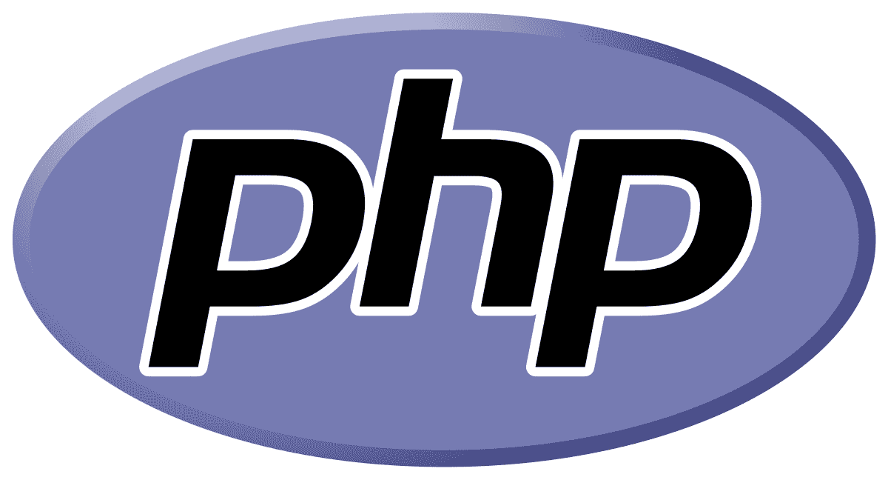


# PHP 简介

PHP（超文本预处理器）是一种广泛用于 Web 开发的服务器端脚本语言。它由 Rasmus Lerdorf 于 1994 年创建，之后已成为构建动态网站的健壮且流行的语言。PHP 主要嵌入 HTML 代码中，允许开发者将 PHP 代码与静态标记混合。它是一种开源语言，这意味着它是免费的并拥有庞大的开发者社区。与 PHP 相关的关键特性和概念：

1. **服务器端脚本**：PHP 在向客户端发送 HTML 之前在服务器上执行。这意味着服务器处理 PHP 代码生成动态内容，然后交付给用户。
2. **与 HTML 集成**：PHP 代码封装在特殊标签 `<?php ?>` 中，使其易于嵌入 HTML 文档。
3. **功能强大**：PHP 提供了大量的内置函数和库，简化了常见的 Web 开发任务。它支持处理数据库、文件上传、发送电子邮件等许多功能。
4. **平台独立性**：PHP 是一种跨平台语言，意味着它可以运行在 Windows、Linux 等操作系统上。它还支持 Apache、Nginx 和 Microsoft IIS 等多个服务器。
5. **数据库集成**：PHP 为数据库连接提供了极佳的支持。它具有内置扩展，可连接到 MySQL、PostgreSQL 和 Oracle 等管理系统。
6. **面向对象编程 (OOP)**：PHP 支持 OOP 原则，允许开发者编写模块化可重用的代码。这使得创建更有结构且易于维护的应用程序成为可能。
7. **框架与 CMS**：PHP 拥有丰富的框架和管理系统（CMS）生态系统，如 Laravel、Symfony、CodeIgniter、WordPress 和 Drupal。这些工具提供了预构建的功能和库，帮助开发者高效地构建应用程序。
8. **社区支持**：PHP 拥有庞大活跃的开发者社区，他们为语言的增长做出贡献，并通过论坛、在线教程和开源项目提供支持。

总体，PHP 是一种用于 Web 开发的强大且灵活的语言。它的简单、多性和丰富功能使其成为构建动态网站和应用程序的理想选择。

以下是 PHP 中常用术语及其用途的表格：

| 术语 | 描述 |
| :--- | :--- |
| **变量** | 用于存储数据的命名容器。变量持有不同类型的数据并可以在程序执行期间更改。 |
| **函数** | 执行特定任务的可重用代码块。函数接受输入参数，执行操作并返回结果（可选）。 |
| **数组** | 在单个变量中存储多个值的数据结构。数组可以是索引的（数值或关联）或非索引的（使用 `array()` 构建）。 |
| **字符串** | 字符序列。字符串可以使用单引号 `''`、双引号 `""` 或使用 heredoc/nowdoc 语法封装。它们用于处理和显示文本。 |
| **运算符** | 对一个或多个操作数执行特定操作的符号。PHP 支持多种运算符，如算术、赋值、比较、逻辑等。 |
| **条件** | 根据特定条件进行代码分支的语句。PHP 提供了 `if`、`else`、`elseif`、`switch` 以及三元运算符 `? :` 来控制执行流。 |
| **循环** | 在满足特定条件之前重复执行代码块的控制结构。PHP 支持 `for`、`while`、`do-while` 和 `foreach` 循环，用于迭代数组或数据集。 |
| **全局变量** | 在 PHP 脚本任何范围内均可的预定义变量。包括 `$_GET`、`$_POST`、`$_SERVER` 和 `$_SESSION`，它们存储了从客户端或服务器环境传递的信息。 |
| **对象** | 类实例，封装了数据和函数。对象是 PHP 面对象编程 (OOP) 的构建模块，提供了结构化模块化的代码组织方式。 |
| **类** | 定义对象属性（变量）和行为（方法）的蓝图或模板。类用于在 OOP 中创建对象，提高了代码的可重用维护性。 |
| **异常** | 代表程序执行期间发生的错误或异常事件的对象。异常用于错误处理，并可以使用 `try`、`catch`、`throw` 和 `finally` 块进行捕获和处理。 |


| 术语 | 说明 |
| :--- | :--- |
| Namespace (命名空间) | 一种封装和组织 PHP 类、函数和常量的方法。命名空间通过为代码元素提供层级结构，防止命名冲突并提高代码的可维护性。 |
| Include/Require | 用于将外部 PHP 文件导入当前脚本的语句。它们允许复用其他文件的代码，并有助于实现大型项目的模块化。 |
| SQL | 全称为结构化查询语言（Structured Query Language），是一种用于管理关系型数据库的标准语言。PHP 内置了相关函数和扩展，用于使用 SQL 连接和查询数据库。 |
| CMS (内容管理系统) | 一种便于创建、管理和修改数字内容的应用程序。PHP 拥有流行的 CMS 平台，如 WordPress、Drupal 和 Joomla，允许在无需大量编码的情况下构建网站和网络应用程序。 |

详细探索这些术语并练习它们的用法，将帮助你对 PHP 编程建立稳固的理解。

# 配置开发环境

要在 PHP 中搭建开发环境，你需要一个 Web 服务器、PHP 安装和代码编辑器。以下是帮助你开始的分步骤指南：

## 1. 安装 Web 服务器

* 一个流行的选项是 Apache，它适用于 Windows、Linux 和 macOS。你可以从 Apache 官网下载（[`httpd.apache.org/`](http://httpd.apache.org/)））。
* 或者，你也可以使用其他 Web 服务器软件，如 `Nginx` 或 `Microsoft IIS`。

## 2. 安装 PHP

* 从 PHP 官网下载最新的稳定版本 PHP（[`www.php.net/downloads.php`](http://www.php.net/downloads.php)）。
* 选择适合你操作系统的包并按照安装说明进行操作。
* 在安装过程中，确保配置 PHP 以与你的 Web 服务器配合。对于 Apache，你需要修改服务器配置文件（`httpd.conf`）以包含 PHP 设置。

## 3. 验证 PHP 安装

* 打开文本编辑器并创建一个新文件（例如 `test.php`）。
* 在文件中添加以下 PHP 代码：

```php
<?php phpinfo(); ?>
```

* 保存文件并将其放在 Web 服务器的文档根目录中。
* 启动你的 Web 服务器并打开浏览器。
* 通过你的 Web 服务器访问 `test.php` 文件（例如 [[`localhost/test.php`](http://localhost/test.php)）。
* 如果 PHP 安装正确，你应该能看到一个显示详细 PHP 信息的页面。

## 4. 安装代码编辑器

* 选择一个符合你偏好的代码编辑器。流行的选项包括 Visual Studio Code、Sublime Text、`PhpStorm` 和 `Atom`。
* 从各自的官方网站下载并安装你选择的。
* 配置编辑器的 PHP 语法高亮以及任何你认为有用的额外插件或扩展。

## 5. 创建开发目录

* 在计算机上选择一个存储 PHP 项目的位置。
* 在方便的位置为你的 PHP 项目创建一个新目录（例如 `php_projects`）。
* 该目录将作为你 PHP 开发的根文件夹。

## 6. 开始编码

* 打开你的代码编辑器并创建一个新的 PHP 文件。
* 开始编写你的第一个脚本：

```php
<?php
echo "Hello, World!";
?>
```

详细探索这些术语并练习它们的用法，将帮助你对 PHP 编程建立稳固的理解。


- 不等于： `$a != $b;`
- 恒等（值和类型相同）： `$a === $b;`
- 不全等（值或类型不同）： `$a !== $b;`
- 大于： `$a > $b;`
- 小于： `$a < $b;`
- 大于等于： `$a >= $b;`
- 小于等于： `$a <= $b;`

### 4. 逻辑运算符

- 与 (And)： `$result = $a && $b;`
- 或 (Or)： `$result = $a || $b;`
- 非 (Not)： `$result = !$a;`

### 5. 字符串运算符

- 拼接： `$fullName = $firstName . " " . $lastName;`
- 拼接赋值： `$firstName .= " Smith";` (等于 `$firstName = $firstName . " Smith";`)

这些是 PHP 中常见的数据类型和运算符。理解并利用这些概念允许你在 PHP 代码中执行各种操作、处理数据并做出逻辑决策。

# 控制结构 (if-else, 循环)

PHP 中的控制结构允许你根据某些条件控制执行流，或多次重复一段代码块。PHP 中的主要控制结构是 if-else 语句和循环。让我们探索每一个：

- **if-else 语句**：if-else 语句用于根据不同的条件执行不同的操作。

示例：

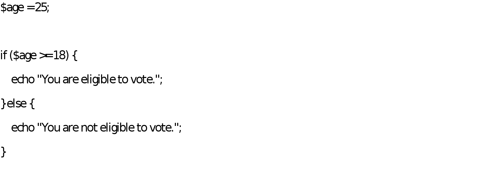

- 在上面的示例中，代码检查变量 `$age` 是否大于等于 18。如果条件为真，它执行 `if` 块中的代码并打印“You are eligible to vote.”否则，它执行 `else` 块中的代码并打印“You are not eligible to vote.”
- **循环**：循环允许你重复执行一段代码块，直到满足特定条件。PHP 中主要三种类型的循环：`for`、`while` 和 `foreach`。

    1. **for 循环**：当你提前知道迭代次数时，使用 `for` 循环。

    示例：

    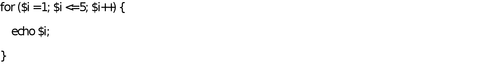

    - 上述代码通过将变量 `$i` 初始化为 1，检查条件 `$i <= 5` 并在每次迭代中将 `$i` 加 1，打印从 1 到 5 的数字。

    2. **while 循环**：当你想要只要条件为真就重复执行代码块时，使用 `while` 循环。

    示例：

    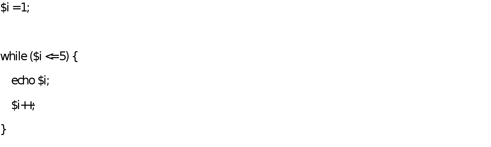

    - 此代码产生上一个示例相同的结果。它将 `$i` 初始化为 1，只要条件 `$i <= 5` 为真，就会执行循环内部的代码，打印 `$i` 的值并将 `$i` 加 1。

    3. **foreach 循环**：`foreach` 循环用于遍历数组或集合中的元素。

    示例：

    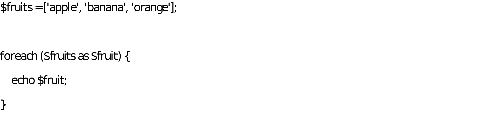

    - 在此示例中，代码遍历 `$fruits` 数组中的每个元素，并将当前元素赋值给变量 `$fruit`。它在每次迭代中打印 `$fruit` 的值。

这些控制结构提供了灵活性，允许你根据特定条件做出决策并重复代码。通过有效利用 if-else 语句和循环，你可以创建更具动态性和交互性的 PHP 程序。

# 函数和变量作用域

函数和变量作用域在 PHP 代码组织以及控制变量的可见性和访问性方面起着重要作用。让我们深入探讨 PHP 中的函数和变量作用域：

### PHP 中的函数

- 函数是执行特定任务的可重用代码块。
- 允许你将一组指令封装成单个单元，使你的代码更加模块化且易于管理。
- 函数可以接收参数（输入值）并返回一个值。
- 以下是 PHP 中定义函数的标准语法：

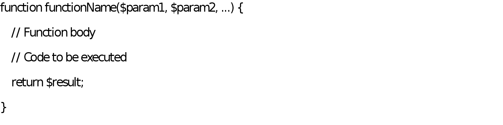

- `functionName` 是函数名，`$param1`、`$param2` 等是函数参数。
- 函数体包含调用时要执行的代码。
- `return` 语句用于指定从函数返回的值。

### PHP 中的变量作用域

- 变量作用域定义了变量在代码不同部分的可见性和访问性。
- PHP 有三个主要的变量作用域：全局 (global)、局部 (local) 和静态 (static)。

#### 全局作用域
- 定义在任何函数之外的变量被视为全局变量。
- 全局变量可以在 PHP 脚本的任何地方访问，包括函数内部。
- 要要在函数内部访问全局变量，需要使用 `global` 关键字或 `$GLOBALS` 数组。

示例：

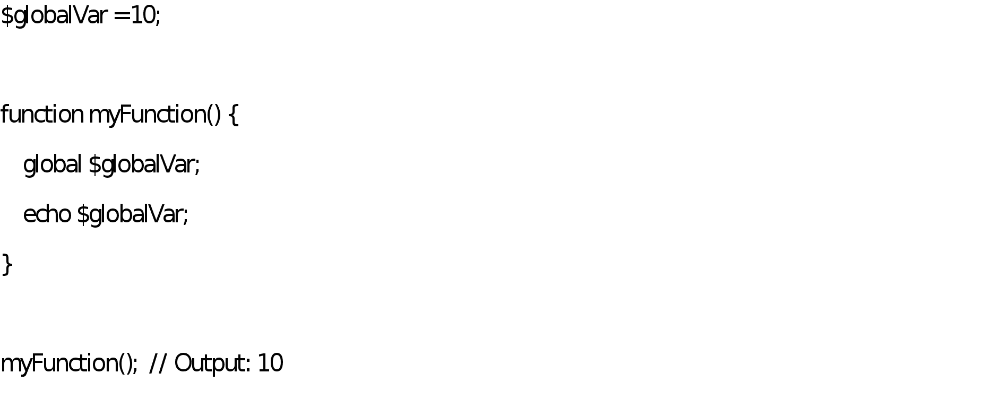

#### 局部作用域
- 定义在函数内的变量具有局部作用域。
- 局部变量仅在定义的函数内部可以访问。
- 它们无法在函数外部访问。

示例：

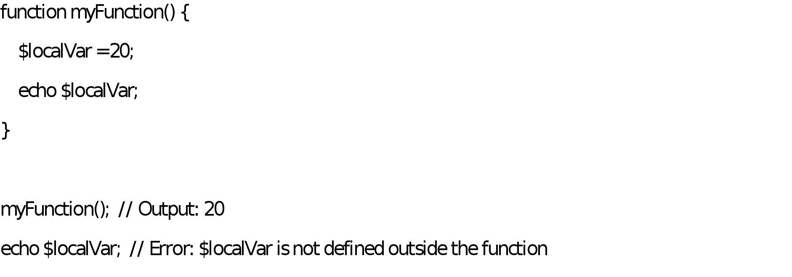

#### 静态作用域
- `static` 关键字用于声明静态变量。
- 静态变量在多次函数调用之间保留其值。
- 仅在第一次调用函数时初始化，然后在随后的调用之间保留其值。

示例：

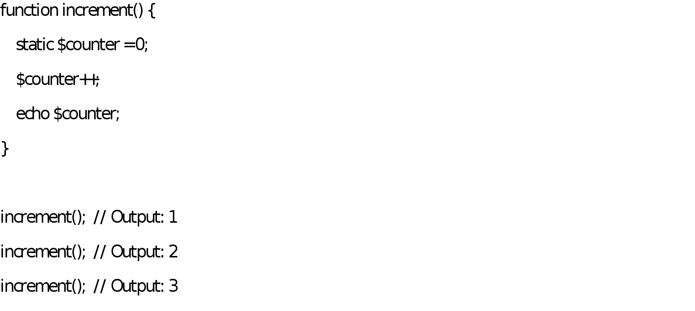

- 在上面的示例中，静态变量 `$counter` 只初始化一次，并在多次调用 `increment()` 函数时保留其值。

理解函数和变量作用域对于编写组织良好且可维护的 PHP 代码至关重要。函数允许你将代码拆分为可重用的单元。

# 数组和字符串

数组和字符串是 PHP 中经常用于存储和处理数据的基本数据类型。让我们探索 PHP 中的数组和字符串：

### PHP 中的数组

- 数组是元素的有序集合，每个元素都有一个索引。
- PHP 支持两种类型的数组：索引数组 (indexed arrays) 和 关联数组 (associative arrays)。
- 索引数组使用数字索引来访问值。
- 以下是在索引数组中创建和访问元素的示例：

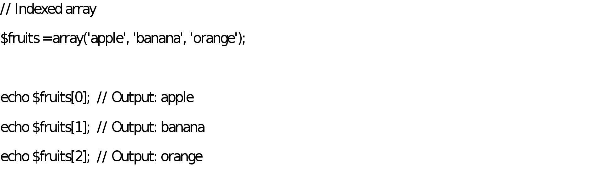

- 要向数组中添加元素，可以使用 `[]` 语法或 `array_push()` 函数。
- 关联数组使用键而不是数字索引。示例如下：

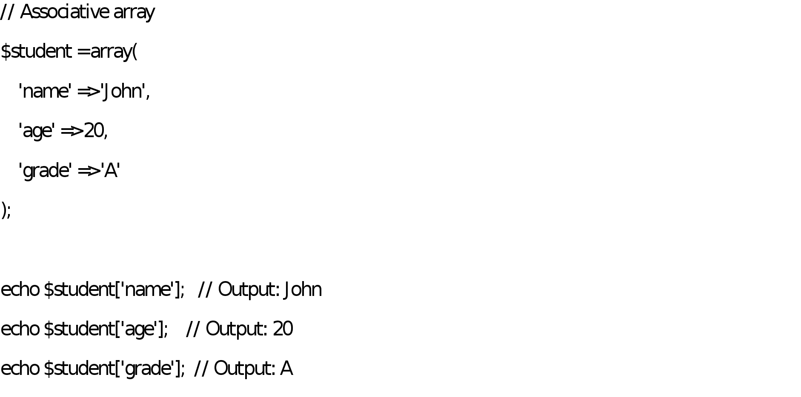

### PHP 中的字符串

- 字符串是用单引号 ('') 或双引号 ("") 包围的字符序列。
- PHP 提供了一系列丰富的函数来处理字符串和从字符串中提取信息。
- 以下是一些常见的字符串操作：

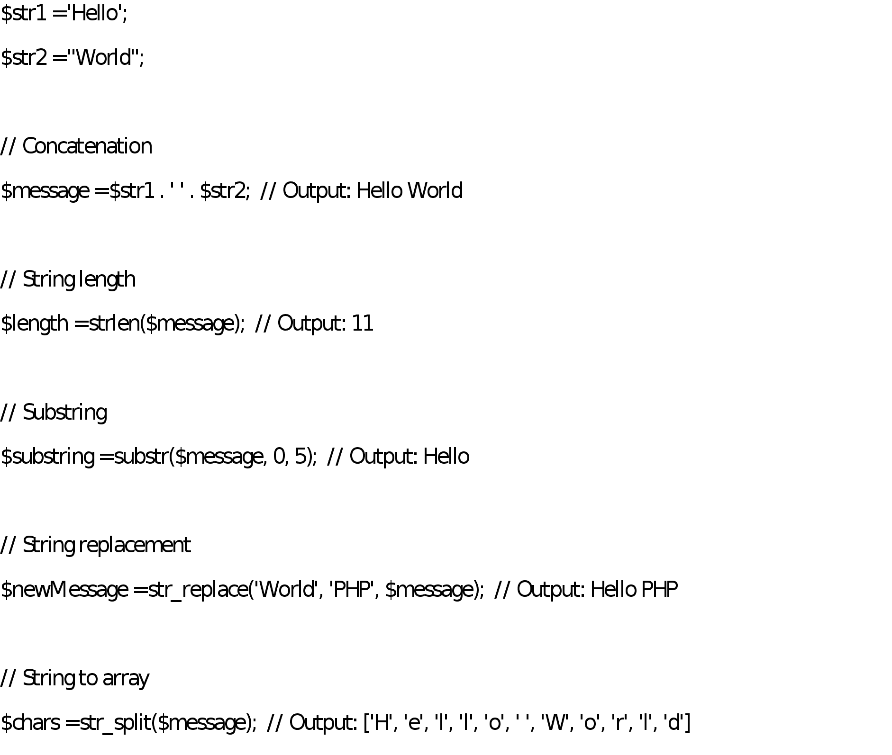

- PHP 还提供了更多用于搜索、大小转换、修剪和格式化的字符串函数。

数组和字符串是 PHP 中多功能且强大的类型。它们允许你高效地存储和处理数据，无论是值的集合还是文本信息。

# 表单与用户输入

处理表单和用户输入是 PHP 开发中的常见任务。以下是在 PHP 中处理表单和处理用户输入的概述：

### HTML 表单

1. 在 HTML 文件中使用 `<form>` 标签创建一个 HTML 表单。指定表单方法（POST 或 GET）和操作（表单数据提交到的 URL）。
2. 添加表单字段如 `<input>`、`<textarea>`、`<select>` 等以收集用户输入。
3. 为每个表单字段分配唯一的 `name` 属性，该属性将用于在 PHP 中标识字段。

示例：

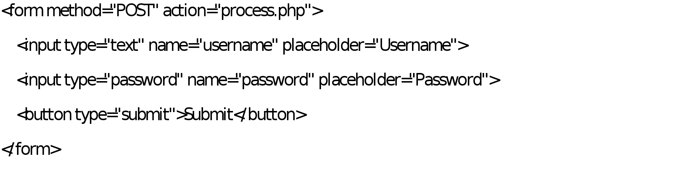

### 在 PHP 中处理表单数据

1. 创建单独 PHP 文件（例如 `process.php`）来处理表单提交。
2. 使用 `$_POST` 全局变量访问通过 POST 方法提交的表单数据，或使用 `$_GET` 用于 GET 方法。
3. 使用分配的名称获取表单字段值。

示例 (process.php)：

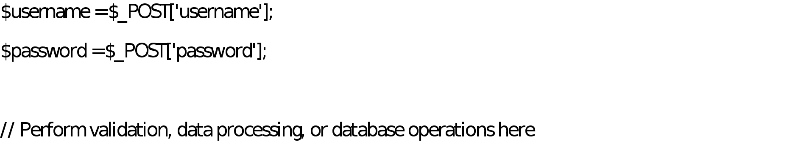

### 表单验证

- 验证并过滤用户输入以确保数据的完整性和安全性。


* 执行如必填字段、数据格式、长度和类型验证等检查。
* 使用 `PHP` 函数（如 `trim()`、`htmlspecialchars()`）和正则表达式对输入进行清理。
* 如果验证失败，显示错误信息并向用户提供适当的反馈。

示例：

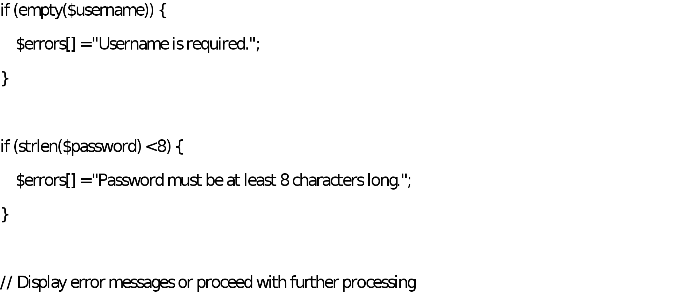

* 表单安全：
    1. 保护您的表单免受跨站脚本 (`XSS`) 和跨站请求伪造 (`CSRF`) 等恶意攻击。
    2. 实施输入验证、数据清理和 `CSRF` 令牌等措施，以防止未经授权的访问或数据操作。
    3. 利用 `PHP` 安全函数和框架来增强安全性。

* 表单反馈与成功：
    1. 处理表单数据后，向用户提供反馈，无论是成功消息、错误消息还是重定向到另一个页面。
    2. 如果表单提交成功，显示成功消息。
    3. 将用户重定向到另一个页面或显示感谢信息。

示例 (`process.php`):

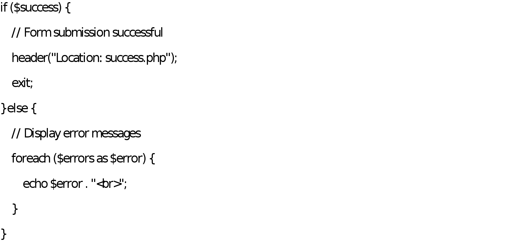

通过遵循这些步骤，你可以有效地在 `PHP` 中处理来自 HTML 表单的用户输入、验证数据、确保安全并向用户提供适当反馈。

# PHP 中的文件处理

`PHP` 文件处理允许你对服务器上的文件进行读写或执行与文件操作相关的各种操作。以下是 `PHP` 文件处理的概述：

* 打开文件：
    1. 要打开文件，可以使用 `fopen()` 函数，它接受两个参数：文件名（包括路径）和模式。
    2. 模式指定了打开文件的目的，例如 "r" 用于读取，"w" 用于写入（并创建新文件），"a" 用于追加等。

示例：


### 从文件中读取
* 一旦以读取模式打开文件，就可以使用 `fgets()` 或 `fread()` 等函数来读取文件内容。
* `fgets()` 从文件中读取单行，而 `fread()` 读取指定的字节数数。
* 你可以使用循环读取到文件末尾，或者一次性读取整个文件。

示例：

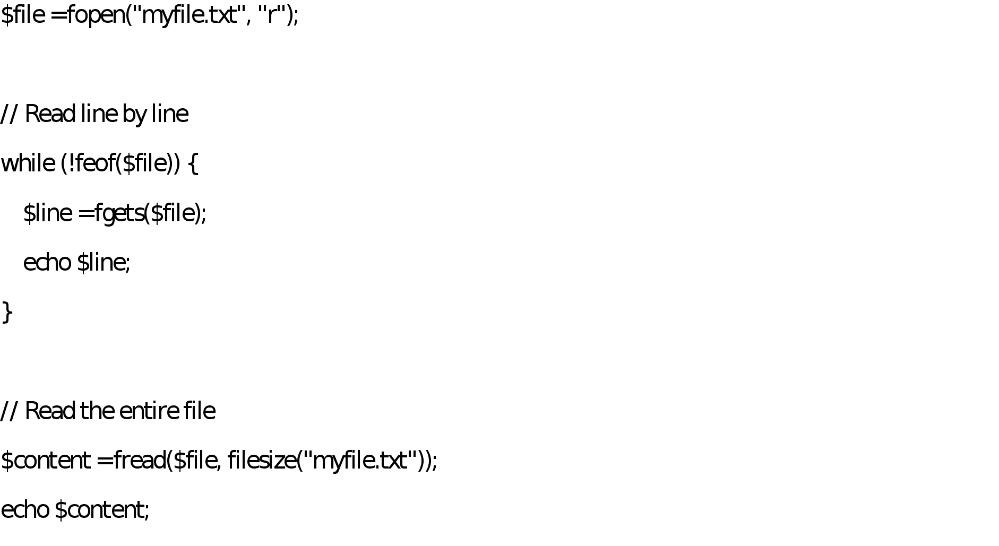

### 向文件写入
* 要向文件写入内容，请使用 `fopen()` 以 "w" 或 "a" 模式打开文件。
* 使用 `fwrite()` 或 `file_put_contents()` 等函数将内容写入文件。
* `fwrite()` 将指定的字符串写入文件，而 `file_put_contents()` 则一次性写入所有内容。

示例：

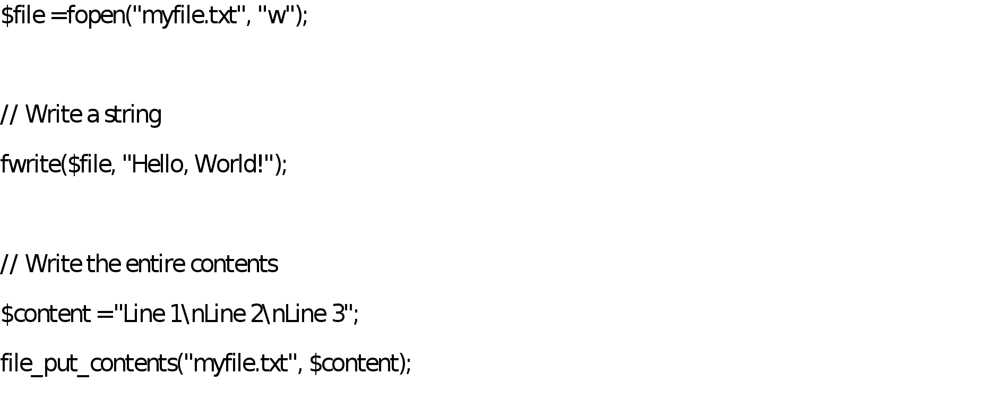

### 关闭文件
* 在读取或写入文件后，使用 `fclose()` 函数关闭它是重要的。
* 关闭文件会释放与其相关的系统资源。

示例：

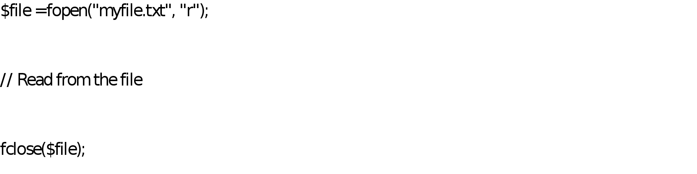

### 文件权限与错误处理
* 在创建或修改文件时，确保设置了适当的文件权限。
* 使用错误处理技术，例如使用 `feof()` 和 `ferror()` 等函数在文件操作期间检查错误。
* 优雅地处理错误并向用户提供适当的反馈。

示例：

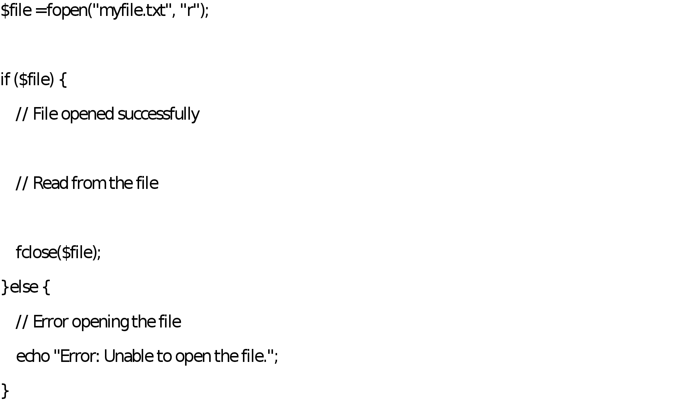

# 使用 PHP 进行 Web 开发简介

使用 `PHP` 进行 Web 开发为创建动态和交互式网站提供了广泛的可能性。以下是 Web 开发的概述：

### 客户端-服务器架构
`PHP` 的 Web 开发基于客户端-服务器架构。`PHP` 是一种执行请求的服务器端语言。

### 服务器设置
要开始 `PHP` 开发，你需要像 `Apache`、`Nginx` 或 Microsoft `IIS` 这样的服务器。

### 网页中的 PHP
`PHP` 代码通常使用特殊标签 `<?php ... ?>` 嵌入在 HTML 中。这些标签生成发送到客户端的动态 HTML。

### 处理用户输入
`PHP` 允许通过 `$_POST` 或 `$_GET` 超全局数组处理通过 HTML 表单提交的输入。

### 数据库连接
`PHP` 提供了连接 `MySQL`、`PostgreSQL`、`SQLite` 和 `Oracle` 等数据库的扩展。使用预语句防止 SQL 注入。

### 会话管理与 Cookie
`PHP` 允许使用 `session_start()` 启动会话来跨多个请求，并使用 Cookie 在客户端存储少量数据。

### 模板与代码组织
为了保持代码整洁易于维护，请使用 `Laravel`、`Symfony` 或 `CodeIgniter` 等 `PHP` 框架，并遵循 MVC（模型-视图-控制器）架构模式。

### 错误处理与安全
实现错误处理机制来处理异常、记录错误并显示适当的消息。确保数据验证、清理和安全编码实践以保护安全。

### 与前端技术集成
`PHP` 可以与 `HTML`、`CSS` 和 `JavaScript` 等前端技术无缝工作以获取数据。

# 处理 HTTP 请求和响应

处理 HTTP 请求和响应是使用 `PHP` 进行 Web 开发的基础方面。以下是 `PHP` 如何处理这些内容的概述：

### HTTP 方法
HTTP 协议定义了多种方法，包括 `GET`、`POST`、`PUT`、`DELETE` 等，表示对资源的操作类型。`PHP` 通过 `$_SERVER['REQUEST_METHOD']` 变量访问这些方法。你可以使用条件语句（如 `if` 或 `switch`）来处理不同的 HTTP 方法。

### 处理表单提交
当提交表单时，`PHP` 可以使用 `$_POST` 超全局数组获取 POST 请求的数据，或使用 `$_GET` 获取 GET 请求。

### 处理 URL 参数
`PHP` 可以处理通过查询字符串（`?param1=value1&param2=value2`）传递的 URL 参数。使用 `$_GET` 超全局数组访问这些参数。


## 发送 HTTP 头部

* PHP 允许你使用 `header()` 函数发送 HTTP 头部。
* 头部用于向浏览器提供额外信息，或控制缓存、重定向、内容类型等。

示例：

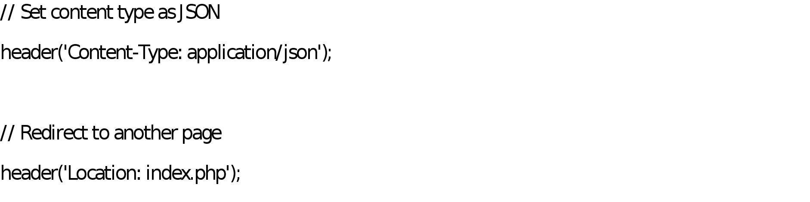

## 生成 HTTP 响应

* PHP 可以根据请求生成动态 HTML、JSON、XML 或其他类型的响应。
* 使用 PHP 生成所需内容并作为响应发送。

示例：

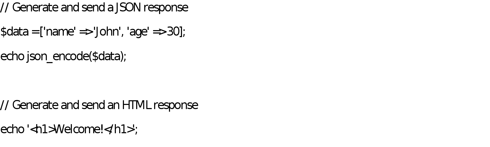

## HTTP 响应码

* PHP 允许你使用 `http_response_code()` 函数设置 HTTP 响应码。
* 设置适当的响应码以指示成功、失败或重定向状态。

示例：

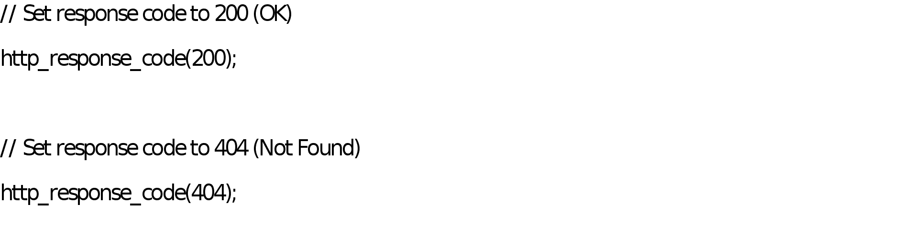

通过在 PHP 中有效处理 HTTP 请求和响应，你可以在 Web 中处理用户输入、生成动态内容、控制重定向，并为客户端请求提供适当的响应。

# 使用 Cookies 和 Sessions

在 PHP 中处理 Cookie 和 Session 对于管理用户数据和在多个请求之间维持状态至关重要。以下是 PHP 处理 Cookie 和 Session 的概览：

### Cookies

1. Cookie 是存储在客户端浏览器上的小段数据。
2. 在 PHP 中，你可以使用 `setcookie()` 函数设置 Cookie，该函数接受名称、值、过期时间、域名、路径等参数。

示例：


* 要访问 Cookie 值，请使用 `$_COOKIE` 超全局数组。

示例：


1. 你可以通过将它们的过期时间设置为过去，或使用带有空值的 `setcookie()` 函数来修改或删除 Cookie。

### Sessions

1. Session 是一种在服务器上存储特定用户数据的方法。
2. 在 PHP 中启动 Session，请在每个需要 session 数据的 PHP 文件开头使用 `session_start()` 函数。
3. Session 数据存储在服务器上，并与唯一的 Session ID 关联，该 ID 通常存储在客户端浏览器的 Cookie 中。

示例：

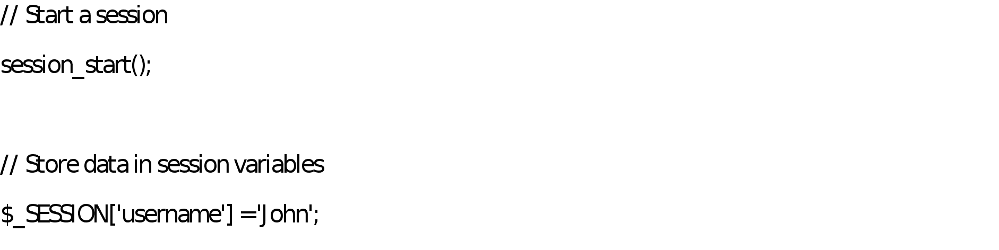

* 要访问 Session 数据，请使用 `$_SESSION` 超全局数组。

示例：


* 你可以根据需要修改或取消 Session 数据。

示例：

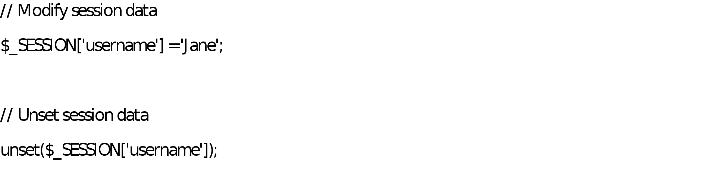

记住在每个需要访问 数据的 PHP 文件开头调用 `session_start()`。

### Session 配置

1. PHP session 配置可以通过 `php.ini` 文件或使用 PHP 代码中的 `ini_set()` 函数进行修改。
2. 配置选项包括 session 存储、session 寿命、session 名称等。
3. 根据你的应用程序需求调整这些设置。

示例：

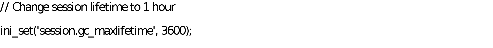

## Session 安全

* 在使用 session 时要采取安全措施。
* 使用安全的 HTTPS 连接传输 session 数据以防止窃听。
* 登录后重新生成 session ID 以防止会话固定攻击。
* 验证并清理 session 数据以防止 session 会话劫持或注入。

示例：

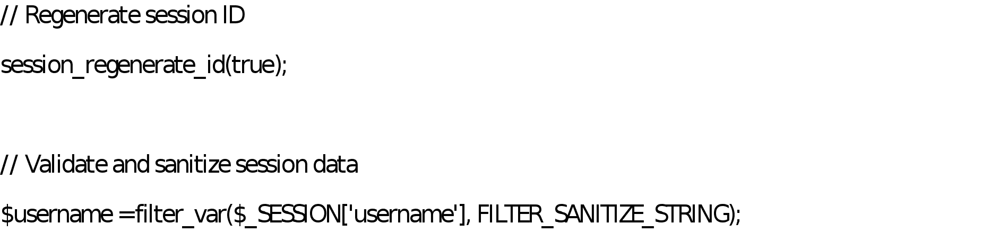

在 PHP 中处理 Cookie 和 Session 允许你存储和检索特定用户数据、维持用户状态并个性化浏览体验。请谨慎处理存储在 Cookie 和 session 变量中的数据，并实施安全措施以防止潜在的漏洞。

# PHP 基础数据库操作 (CRUD)

PHP 中的基础数据库操作涉及 CRUD 操作：在数据库中进行创建 (Create)、读取 (Read)、更新 (Update) 和删除 (Delete) Record。以下是使用 PHP 执行这些操作的概览：

### 连接数据库

1. 在执行任何数据库操作之前，使用相应的扩展（例如 `MySQLi`, `PDO`）建立数据库连接。
2. 提供必要的凭据，如主机名、用户名、密码和数据库名。

使用 MySQLi 的示例：

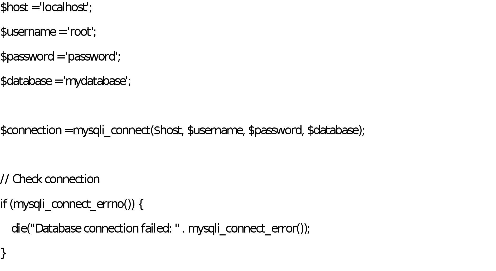

### 创建 (INSERT) 操作

* 要向数据库表插入新记录，请构造 SQL 查询并使用数据库扩展中的适当方法执行。

使用 MySQLi 的示例：

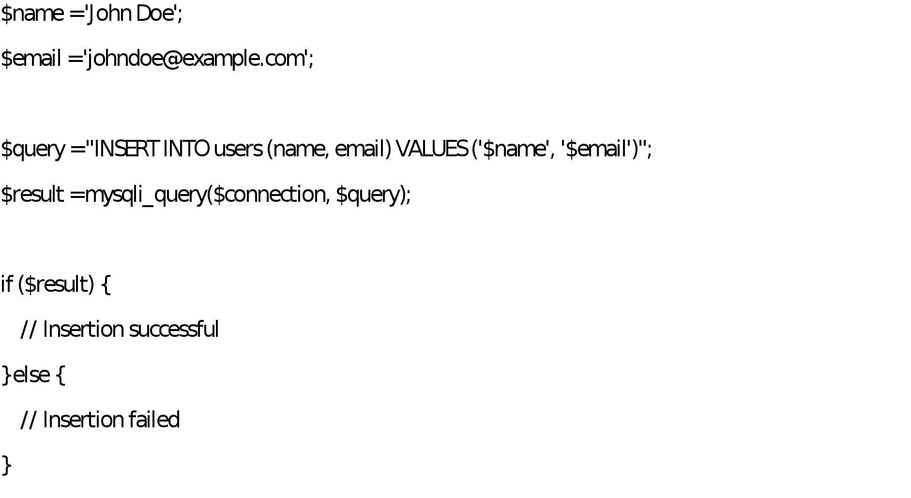

### 读取 (SELECT) 操作

* 要从数据库中检索数据，请使用 `SELECT` 语句构造 SQL 查询并执行它。

使用 MySQLi 的示例：

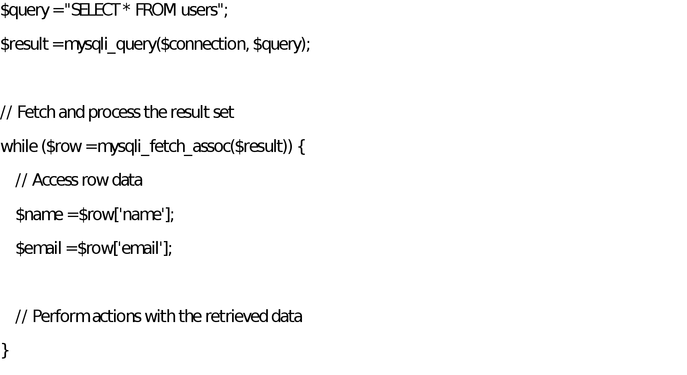

### 更新 (UPDATE) 操作

* 要更新表中的现有记录，请使用 `UPDATE` 语句构造 SQL 查询并执行它。

使用 MySQLi 的示例：

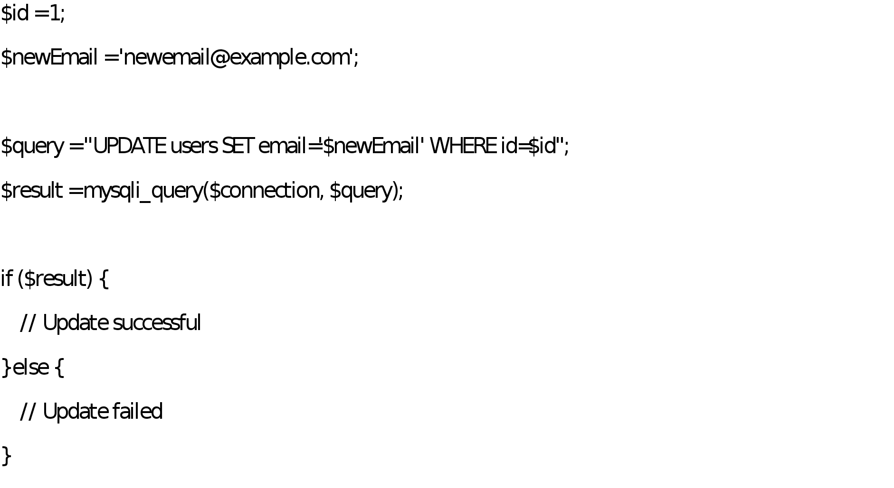

### 删除 (DELETE) 操作

* 要从数据库中移除记录，请使用 `DELETE` 语句构造 SQL 查询并执行它。

使用 MySQLi 的示例：

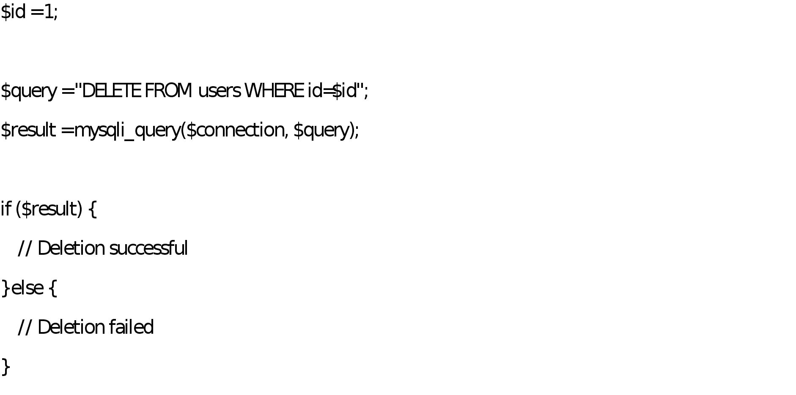

### 关闭数据库连接

* 在执行必要的数据库操作后，关闭数据库连接以释放资源。

使用 MySQLi 的示例：


值得注意的是，其他数据库扩展（如 `PDO`）为数据库管理系统提供了一致的接口，并提供预处理语句等功能。

# SQL 和 MySQL 简介

SQL（结构化查询语言）是管理数据库的标准语言。MySQL 是一种流行的关系型数据库管理系统 (RDBMS)。在 PHP 中，以下是对 SQL 和 MySQL 的全面介绍：

### 数据库概念

1. 数据库是组织成表的结构化数据集合，由行（记录）和列（字段）组成。
2. 每个表代表一个特定的实体或概念，表之间的关系通过键（keys）建立。
3. SQL 用于定义和与数据库交互，允许开发者创建、修改和查询数据。

### 创建数据库和表

1. 在 MySQL 中创建数据库，可以使用 `CREATE DATABASE` 语句。
2. 创建数据库后，可以使用 `CREATE TABLE` 语句在其中创建表，并指定表名、列及其数据类型。

示例：

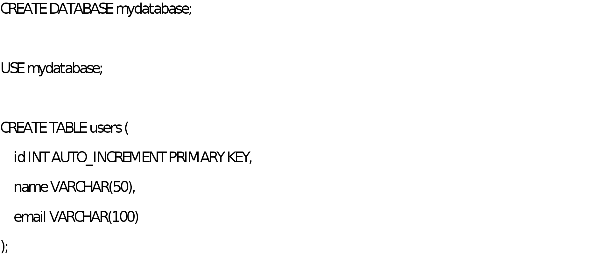

### 插入数据

* 向表中插入数据，使用 `INSERT INTO` 语句后跟表名和要插入的值。

示例：


### 查询数据

* SQL 提供了多种从数据库检索数据的命令，最常用 `SELECT` 语句。
* 使用 `SELECT` 语句指定要检索的列和要查询的表。你还可以使用条件和过滤器来缩小范围。

示例：

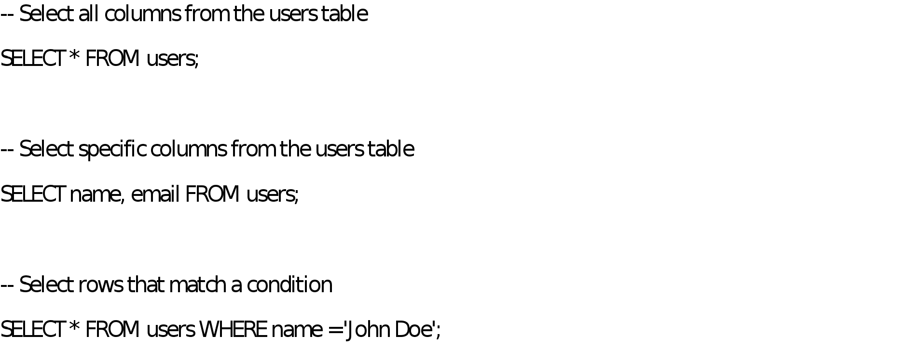

### 更新数据

* `UPDATE` 语句允许修改表中的现有记录。
* 指定要更新的表，设置新值，并使用条件定位特定的行。


### 删除数据

* `DELETE` 语句用于从表中删除记录。
* 指定表并使用条件确定删除哪些行。

示例：


### 关联与关系

* SQL 允许通过连接 (joins) 来自多个表的数据。
* 常见的连接类型包括 `inner join`, `left join`, `right join` 和 `full outer join`。
* 连接用于根据键建立表之间的关系。

示例：

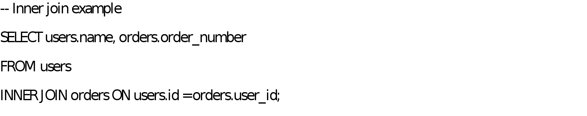

* 在 PHP 中的实际相关性：


1. `SQL` 和 `MySQL` 在 PHP 开发中高度相关，因为它们允许你从数据库中存储和检索数据，对于 Web 应用至关重要。
2. PHP 提供了 `MySQLi` 和 `PDO` 等扩展，允许你通过 PHP 代码与 `MySQL` 数据库交互并执行 `SQL` 查询。
3. 通过利用 `SQL` 和 `MySQL`，PHP 开发者可以创建动态 Web 应用、处理用户身份验证、管理用户生成的内容并高效地存储应用程序数据。

安全地处理 `SQL` 查询以防止 SQL 注入攻击。使用预处理语句、参数化查询或 `ORM`（对象关系映射）库来确保 PHP 中数据库交互的安全性。

# 表单验证与数据清洗

表单验证和数据清洗是 Web 开发中的基本步骤，用于确保用户输入是安全的、准确的并符合要求的。PHP 提供了各种函数和技术来验证和清洗用户输入。以下是如何在 PHP 中执行表单验证和数据清洗的概述：

### 表单验证

1. 表单验证是检查用户提交的数据是否符合指定验证规则的过程。
2. PHP 提供了内置函数、正则表达式和过滤器，用于验证不同类型的输入，如文本、数字、电子邮件地址、URL 等。
3. 常见的验证技术包括检查必填字段、数据格式、长度限制等。

示例：

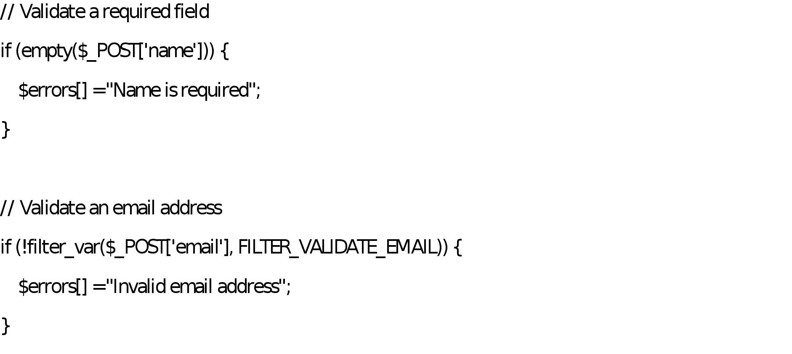

在验证表单输入后，你可以向用户显示错误信息，或根据验证结果采取适当的操作。

### 数据清洗

1. 数据清洗是清理和过滤用户输入以防止恶意或意外行为的过程。
2. PHP 提供了函数和过滤器来清洗输入并移除潜在的有害或不需要的字符。

示例：

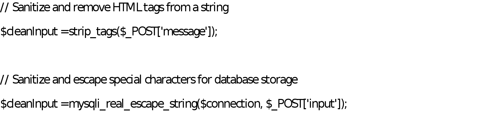

清洗技术包括移除 HTML 标签、转义特殊字符以及使用预处理语句或参数化查询来防止 SQL 注入攻击。

在将用户输入用于数据库查询或显示在网页上之前进行清洗至关重要，以防止安全漏洞。

### 验证与清洗库

1. PHP 还提供了各种验证和清洗库，提供了更高级的功能和灵活性。
2. 流行的库示例包括“Respect Validation”、“Symfony Validator Component”和“HTMLPurifier”。
3. 这些库简化了表单验证和数据清洗的过程，并提供了自定义验证规则、多语言支持等额外功能。

使用 Respect Validation 的示例：

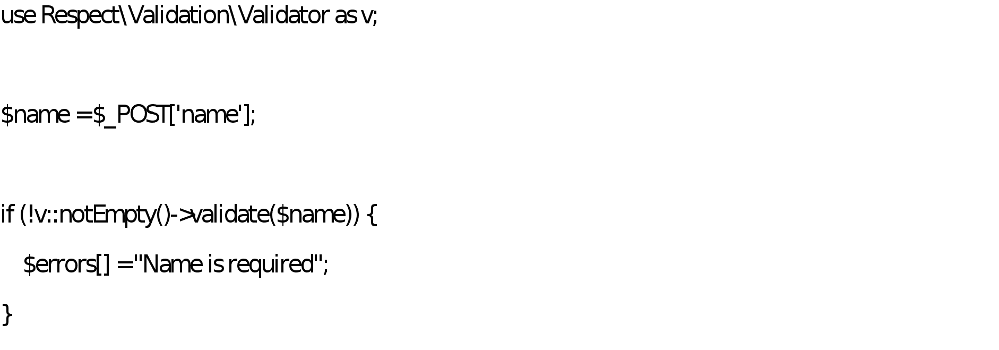

* 使用验证库可以增强代码的可读性、可维护性，并为整个应用程序中提供标准化的验证规则。

通过在 PHP 中实现表单验证和数据清洗技术，你可以确保用户提交数据的完整性和安全性。这有助于防止错误、提升用户体验，并防止 SQL 注入和跨站脚本 (XSS) 攻击等潜在漏洞。

# PHP 模板化（包括 PHP 框架）

PHP 中的模板化是指将表现逻辑与应用程序逻辑分离的做法。它涉及使用模板文件来定义网页的结构和布局，而动态内容在运行时插入。PHP 框架通常提供内置的模板引擎来辅助这一过程。以下是使用 PHP 进行模板化的概述，包括 PHP 框架的使用。

### PHP 基础模板化

* 在基础 PHP 模板化中，你创建单独的模板文件，其中包含 HTML 标记和动态内容的占位符。
* 占位符通常封装在特殊标签或分隔符中，在运行时使用 PHP 变量或从应用程序传递的数据替换为实际值。

示例：

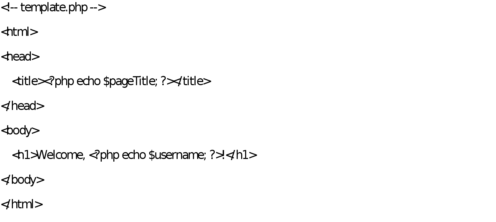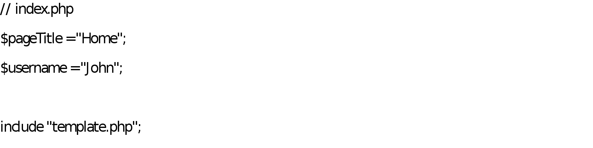

在此示例中，变量 `$pageTitle` 和 `$username` 被插入到定义占位符的模板中。

### 带有模板引擎的 PHP 框架

1. `Laravel`、`Symfony` 和 `CodeIgniter` 等 PHP 框架提供了内置的模板引擎来简化模板化过程。
2. 这些模板引擎提供了高级功能，如布局继承、局部、条件渲染和循环结构。
3. 模板引擎通常使用自己的语法和文件扩展来区分模板文件和普通 PHP 文件。

使用 Blade（Laravel 的模板引擎）的示例：

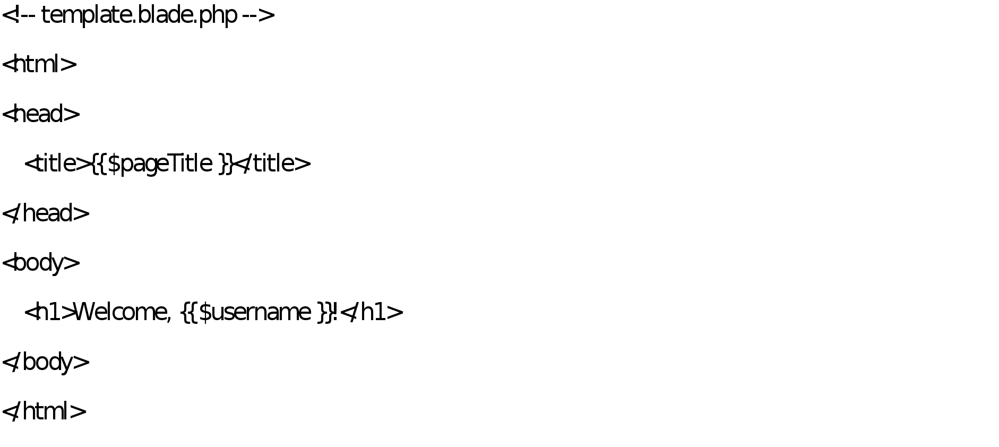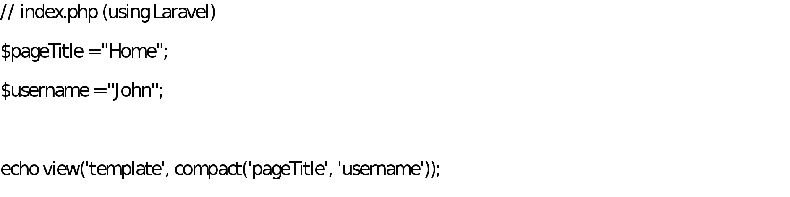

在此示例中，模板文件中使用了 Blade 语法，并使用 `view` 函数配合指定的变量渲染模板。

### 模板化的优势

1. 关注点分离：模板化允许应用程序逻辑（PHP 代码）与表现逻辑（HTML 标记）之间进行清晰的分离。
2. 可重用性和可维护性：模板化促进了代码的可重用，因为模板可以在多个页面中使用。它还让维护和更新变得更容易，因为更改可以在一个中心位置进行。
3. 协作：模板化通过为将设计元素整合到模板中提供清晰结构，实现了设计师与开发者之间的协作。
4. 性能：模板引擎通常提供模板缓存和预编译等优化，从而提高性能。

使用 PHP 和 PHP 框架进行模板化为构建动态网页提供了一种结构化且高效的方法。它有助于保持代码组织，提高开发效率并增强 Web 应用程序的可维护性。

# 错误处理与调试技术

错误处理和调试是 PHP 开发中的重要方面，用于识别和解决代码中的问题。PHP 提供了各种技术和工具来有效处理错误并调试应用程序。以下是 PHP 中常用的错误处理和调试技术：

### 错误报告

1. PHP 有一个错误报告系统可以显示错误、警告和通知。
2. 在开发期间，建议使用以下代码设置报告级别以显示所有错误：

```
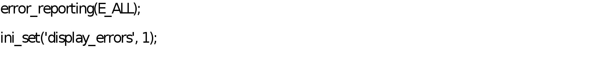
```

此配置确保所有错误都能报告并显示在屏幕上，帮助你快速识别并修复问题。然而，出于安全考虑，在生产环境中禁用错误报告是重要的。

# 异常处理

1. PHP 支持异常处理，允许你以受控的方式捕并处理运行时错误或异常情况。
2. 使用 `try`、`catch` 和 `finally` 块来处理异常并在发生异常时执行特定代码。
3. 通过抛出自定义异常，你可以提供有意义的错误信息并对类型处理不同类型的错误。

示例：

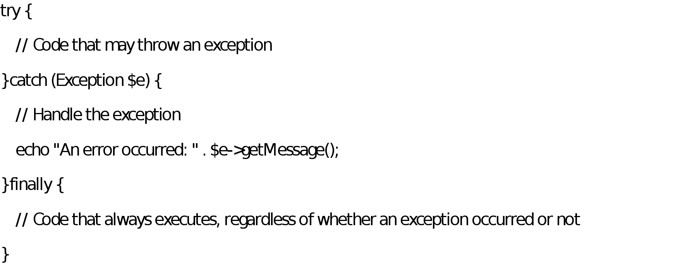

### 日志

* 日志是记录错误和调试信息的重要技术。
* PHP 提供了如 `error_log` 等函数，可以将日志消息写入文件或系统日志。
* 你可以记录特定的错误信息、堆栈跟踪或自定义调试信息，帮助追踪代码中的问题。

示例：

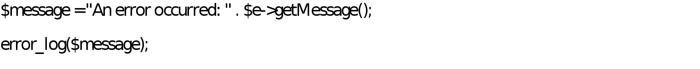

### 调试工具

1. PHP 提供了各种调试工具和扩展，有助于识别和修复问题：
    - `Xdebug`：一个强大的调试扩展，提供了断点、堆栈跟踪、变量检查和远程调试等功能。
    - `PHPStorm`：一种流行的集成开发环境 (IDE)，为 PHP 应用程序提供高级的调试功能。


### 3. Firebug 和 Chrome 开发者
基于浏览器的工具具有调试功能，可以检查网络请求、分析 JavaScript 以及调试在浏览器中执行的 PHP 代码。

#### 调试技术
1. 除了专门的调试工具外，你还可以使用 `var_dump`、`print_r` 和 `echo` 语句输出变量值和调试信息。
2. 你还可以利用条件语句和日志来隔离并跟踪代码中的特定问题。
3. 此外，错误日志、服务器日志和数据库查询日志可以为应用程序的行为提供有价值的见解，并帮助识别错误或性能瓶颈。

在将应用程序部署到生产环境之前，请移除或禁用调试代码和错误报告配置。还要考虑使用如 `Laravel` 或 `Symfony` 等开发框架，它们提供了内置的调试和错误处理功能。

通过应用有效的错误处理和调试技术，你可以快速识别并解决 PHP 应用中的问题，从而获得更稳定、可靠的软件。

# PHP 安全规范

在开发 PHP 应用程序时，优先考虑安全性以保护敏感数据并防止未经授权的访问至关重要。以下是 PHP 开发中应遵循的基本安全规范：

1. **输入验证与过滤**：
   - 始终验证并过滤用户输入，以防止常见的安全漏洞，如 SQL 注入、跨站脚本 (XSS) 和跨站请求伪造 (CSRF)。
   - 根据预期的数据类型、格式和上下文，使用适当的函数或库来验证和过滤输入。

2. **参数化查询与预语句**：
   - 与数据库交互时利用参数化查询或预语句来防止 SQL 注入攻击。
   - 参数化查询将 SQL 逻辑与用户输入分离，并自动处理转义和过滤。

3. **安全密码存储**：
   - 使用 `bcrypt` 或 Argon2 等强哈希算法对密码进行哈希。
   - 避免明文存储密码，避免使用 `MD5` 或 `SHA1` 等弱哈希技术。
   - 使用加盐哈希（salted hashes）增加额外的安全层。

4. **跨站脚本 (XSS) 防御**：
   - 在网页中显示之前，对所有用户生成的内容进行验证和过滤。
   - 在 `echo` 用户输入时，使用输出编码或 HTML 过滤函数以防止恶意脚本执行。

5. **跨站请求伪造 (CSRF) 保护**：
   - 实现 CSRF 令牌以防御 CSRF 攻击。
   - 为每个用户会话生成唯一令牌并将其包含在表单或 AJAX 请求中。
   - 在服务器端处理请求之前验证令牌。

6. **会话安全**：
   - 设置安全的会话 Cookie 属性如 `"Secure"` 和 `"HttpOnly"` 以防止会话劫持和 XSS 攻击。
   - 在身份验证成功或权限级别更改后重新生成 ID。

7. **文件和目录权限**：
   - 设置适当的文件和目录权限以限制对敏感文件和目录的访问。
   - 将写入权限限制在必要的目录。
   - 避免授予可能暴露敏感信息的必要文件权限。

8. **输入/输出过滤**：
   - 实现输入输出过滤以防止代码注入和文件包含漏洞。
   - 在 HTML 上下文中显示用户输入时，使用 `htmlspecialchars` 或 `htmlentities` 等函数对输入进行转义。
   - 使用用户输入配合 `include` 或 `eval` 等函数时要谨慎。

9. **安全文件上传**：
   - 验证文件类型并强制执行大小限制。
   - 将上传的文件存储在 Web 根目录之外的安全位置。
   - 使用服务端验证确保上传的文件是安全的，不构成安全风险。

10. **定期更新 PHP 和库**：
    - 保持 PHP 及其相关库的更新，以获得最新的安全补丁和错误修复。
    - 定期检查并更新应用程序使用的第三方库和框架。

11. **错误处理与日志**：
    - 实现适当的错误处理和日志以捕获并监控应用程序错误。
    - 在生产环境中向用户显示详细的错误信息。

12. **使用 SSL/TLS**：
    - 使用 SSL/TLS 加密保护客户端和服务器之间传输的数据。
    - 获取并安装 SSL/TLS 证书以启用 HTTPS 连接。

13. **安全审计与渗透测试**：
    - 定期进行安全审计和渗透测试以识别应用程序中的漏洞。
    - 根据审计结果实施必要的修复和安全补丁。

通过遵循这些基本安全规范，你可以显著增强 PHP 应用程序的安全性。保持对最新的安全实践和指南的更新，并随着新漏洞的出现不断监控和改进应用程序的安全性是非常重要的。

# 练习题

注意：为了确保你能够发挥最佳水平，我们希望为你提供一项关键指令：请在检查正确答案之前花时间仔细思考。

1. 关于 PHP 的以下陈述中哪是正确的？a) PHP 是一种客户端脚本语言。b) PHP 是 Bill Gates 在 1994 年创建的。c) PHP 主要用于桌面应用程序开发。d) PHP 在 HTML 发送到客户端浏览器之前在服务器上执行。

正确答案：d) PHP 在 HTML 发送到客户端浏览器之前在服务器上执行。

2. 在 HTML 文档中嵌入 PHP 代码的目的是什么？a) 让 HTML 代码更具可读性。b) 在客户端浏览器上执行 PHP 代码。c) 创建动态网页。d) 将 PHP 代码与 HTML 标记分离。

正确答案：c) 创建动态网页。

3. 下列哪项不是 PHP 的特性？a) 易于与 HTML 集成。b) 支持面向对象编程。c) 平台依赖性。d) 通过内置函数和库具有丰富的功能。

正确答案：c) 平台依赖性。

4. 哪个术语是指 PHP 中存储数据的命名容器？a) 函数 b) 数组 c) 变量 d) 运算符

正确答案：c) 变量

5. PHP 中循环的目的是什么？a) 在单个变量中存储多个值。b) 执行特定任务直到满足某个条件。c) 根据特定条件执行代码块。d) 封装数据和函数。

正确答案：b) 执行特定任务直到满足某个条件。

6. 下列哪项用于 PHP 中的错误处理？a) 变量 b) 函数 c) 异常 (Exception) d) 类 (Class)

正确答案：c) 异常 (Exception)

7. PHP 中命名空间（namespace）的目的是？a) 存储和操作数据。b) 将外部 PHP 文件导入当前脚本。c) 封装和组织 PHP 类、函数和常量。d) 根据条件执行特定任务。

正确答案：c) 封装和组织 PHP 类、函数和常量。

8. 关于 CMS（内容管理系统）的述陈述哪是正确的？a) 它是一种用于 Web 开发的编程语言。b) 它促进了数字内容的创建、管理和修改。c) 它是一种在单个变量中存储多个值的数据结构。d) 它是一个表示程序执行期间错误或异常事件的对象。

正确答案：b) 它促进了数字内容的创建、管理和修改。

9. 变量 `$age = 25` 的数据类型是什么？a) 整数 (Integer) b) 浮点数 (Float) c) 字符串 (String) d) 布尔值 (Boolean)

答案：a) 整数 (Integer)


## 10. PHP 中用哪个运算符来连接字符串？a) 加法运算符 (`+`) b) 乘法运算符 (`*`) c) 拼接运算符 (`.`) d) 取模运算符（%`）
答案：c) 拼接运算符 (`.`)

## 11. 使用哪种控制结构根据不同的条件执行不同的操作？a) If-else 语句 b) 循环 c) 函数 d) 变量作用域
答案：a) If-else 语句

## 12. 当提前知道迭代次数时，使用哪种类型的循环？a) For 循环 b) While 循环 c) Foreach 循环 d) If-else 循环
答案：a) For 循环

## 13. PHP 中用哪个关键字来声明静态变量？a) var b) static c) const d) let
答案：b) static

## 14. 哪种类型的数组使用键值对？a) 索引数组 b) 关联数组 c) 多维数组 d) 字符串数组
答案：b) 关联数组

## 15. 在 PHP 中如何访问通过 POST 方法提交的表单数据？a) 使用 `$_POST` 超全局变量 b) 使用 `$_GET` 超全局变量 c) 使用 `$_REQUEST` 超全局变量 d) 使用 `$_SERVER` 超全局变量
答案：a) 使用 `$_POST` 超全局变量

## 16. PHP 中用于清理用户输入的函数是哪个？a) `sanitize_input()` b) `validate_input()` c) `htmlspecialchars()` d) `trim()`
答案：c) `htmlspecialchars()`

## 17. 哪种安全措施可以防止跨站脚本 (XSS)？a) CSRF 令牌 b) 输入验证 c) 数据清理 d) `htmlspecialchars()`
答案：d) `htmlspecialchars()`

## 18. 在 PHP 中处理表单后，你应该做什么？a) 显示成功消息 b) 将用户重定向到另一个页面 c) 提供适当的反馈 d) 以上所有
答案：d) 以上所有

## 19. 在基本操作的背景下，CRUD 代表什么？a) 创建 (Create)、读取 (Read)、更新 (Update)、删除 (Delete) b) 连接 (Connect)、检索 (Retrieve)、更新 (Update)、删除 (Delete) c) 构建 (Construct)、读取 (Read)、更新 (Update)、设计 (Design) d) 配置 (Configure)、移除 (Remove)、更新 (Update)、设计 (Design)
答案：a) 创建 (Create)、读取 (Read)、更新 (Update)、删除 (Delete)

## 20. 在 PHP 中执行操作之前如何建立数据库连接？a) 使用 `mysqli_connect` b) 使用 `pdo_connect` c) 使用 `connect_db` d) 使用 `mysql_connect`
答案：a) 使用 `mysqli_connect`

## 21. 使用哪种操作向数据库插入新记录？a) SELECT b) UPDATE c) DELETE d) INSERT
答案：d) INSERT

## 22. 在 PHP 中如何使用 MySQLi 从数据库检索数据？a) 使用 `mysqli_retrieve` b) 使用 `mysqli_query` c) 使用 `mysqli_update` d) 使用 `mysqli_select`
答案：b) 使用 `mysqli_query`

# 23. 使用哪种操作更新数据库中的现有记录？a) INSERT b) DELETE c) SELECT d) UPDATE
答案：d) UPDATE

# 24. 在 PHP 中如何使用 MySQLi 从数据库删除记录？a) 使用 `mysqli_delete` b) 使用 `mysqli_remove` c) 使用带有 DELETE 的 `mysqli_query` d) 使用带有 DELETE 的 `mysqli_select`
答案：c) 使用带有 DELETE 的 `mysqli_query`

# 25. 在 PHP 中执行必要的数据库操作后，你应该做什么？a) 关闭数据库连接 b) 删除数据库表 c) 重新连接数据库 d) 执行 COMMIT 语句
答案：a) 关闭数据库连接

# 26. 执行 PHP 数据库操作时应该考虑什么来增强安全性？a) 清理用户输入 b) 使用准备语句或参数化查询 c) 妥善处理错误 d) 以上所有
答案：d) 以上所有

# 27. 哪个扩展为不同系统提供了统一接口？a) MySQLi b) PDO c) SQL
答案：b) PDO

# 28. PDO (数据对象) 为数据库提供了哪些功能？a) 准备语句 b) 参数化查询 c) 统一接口 d) 以上所有
答案：d) 以上所有

# PHP 中的面向对象编程 (OOP)
面向对象编程 (OOP) 是一种关注对象的编程范式，它封装了数据和行为。

## 类和对象
1. 类是蓝图或模板，定义了对象的结构和行为。
2. 对象是类的实例。它代表一个特定的实体。

## 封装
1. 封装是将数据和方法封装在类中的做法，隐藏细节。
2. 类属性通常被声明为 `private` 或 `protected` 以限制外部访问。
3. 公有方法用于访问这些属性。

## 继承
1. 继承允许从其他类继承属性和方法，创建父子关系。
2. 子类（子类）可以继承父类（父类）的属性和方法。
3. 继承的属性和方法可以在子类中重写或扩展。

### 多态
1. 多态允许将不同类的对象视为共同父类的对象，提供了灵活性和扩展性。
2. 多态允许在子类中重写方法，从而实现相同方法的实现。

## 抽象
1. 抽象涉及定义接口和抽象类，指定方法但不提供实现细节。
2. 抽象类不能实例化，作为子类实现抽象方法的蓝图。

### 接口
1. 接口定义了类必须实现的方法 set。
2. 一个类可以实现多个接口，允许它定义并强制接口所需的方法。

# 类、对象和继承
在 PHP 开发中，类、对象和继承是面向对象编程 (OOP) 的基本概念。它们允许你创建复用代码，定义不同实体之间的关系，并有效地组织应用程序逻辑。

## 类
1. 类是定义对象结构和行为的蓝图或模板。
2. 它将数据（属性）和行为（方法或函数）封装在一个单元中。
3. 类使用 `class` 关键字加类名进行声明，通常位于自己的 PHP 文件中。

## 对象
1. 对象是类的实例。它代表一个具有特定状态和行为的实体。
2. 对象使用 `new` 关键字加类名创建，并可以赋值给变量。
3. 每个对象都有自己的属性集，并可以调用其类定义的方法。

## 继承
1. 继承是一种允许类从其他类继承属性和方法的机制，创建了父子关系。


*   被继承的类被称为父类或超类，而继承它的类被称为子类或派生类。
*   继承实现了代码复用，因为子类可以扩展并特化父类的行为。

### PHP 继承示例

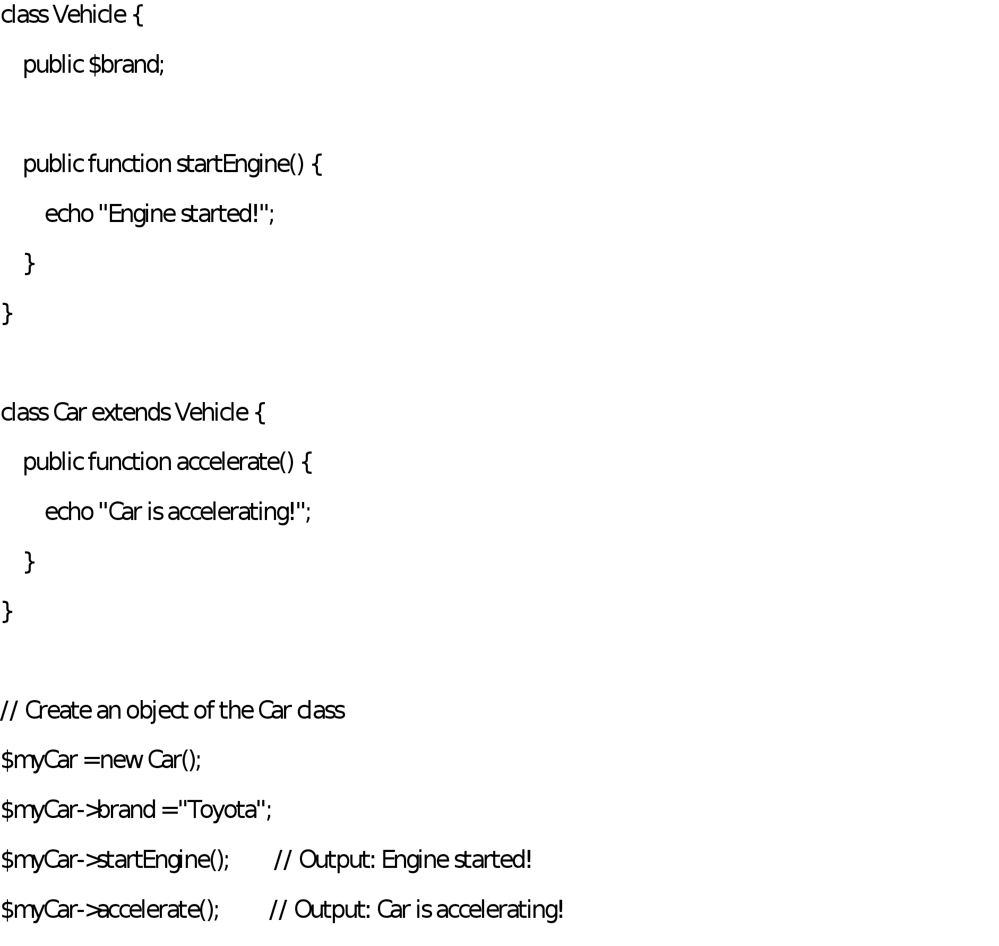

在上面的示例中，`Car` 类扩展了 `Vehicle` 类，继承了 `brand` 属性和 `startEngine()` 方法。此外，`Car` 类定义了它自己的 `accelerate()` 方法。

继承允许你创建类的层次结构，其中子类从其父类继承属性和方法。这促进了代码复用，并允许对代码进行更好的组织和模块化。

通过在 PHP 中利用类、对象和继承，你可以创建更结构化、可重用且易维护的代码。这些概念是面向对象编程（OOP）的核心组件，为设计和开发复杂应用程序提供了一种强大的方法。

# 高级 OOP 概念

PHP 中的高级面向对象编程（OOP）概念为你的代码库提供了额外的灵活性和抽象。让我们探索其中的一些概念：

### 多态

1.  多态允许不同类的对象被视为共同父类的对象，提供了灵活性和扩展性。
2.  多态允许在子类中重写方法，允许为同一个方法名提供不同的实现。
3.  多态是通过继承和方法重写实现的。

### PHP 多态示例

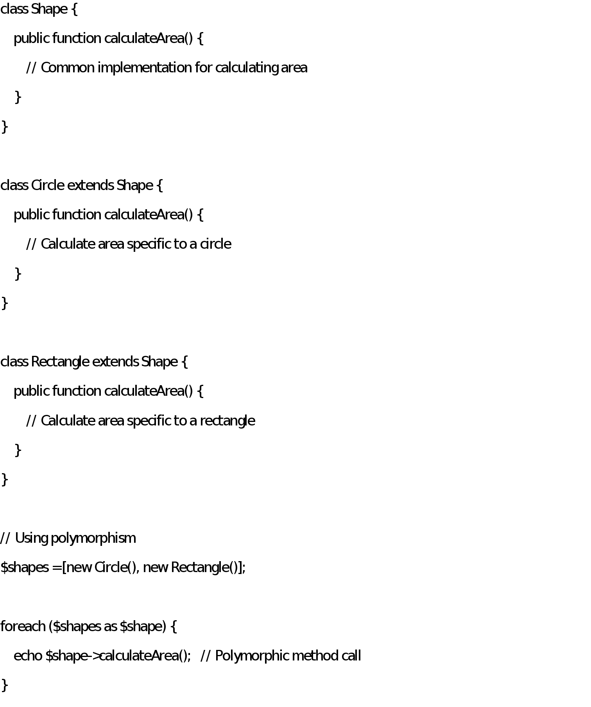

### 接口

*   接口是一种合约，定义了类必须实现的一组方法。
*   接口提供了一种强制执行某些行为而不指定实现细节的方法。
*   一个类可以实现多个接口，允许它履行多个合约。

### PHP 接口示例

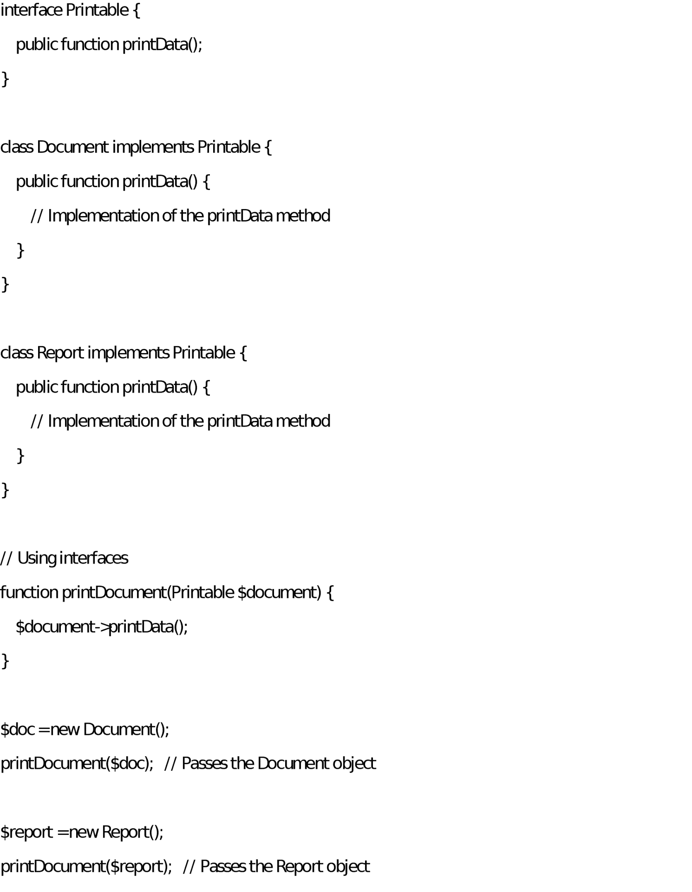

### 抽象类

*   抽象类不能实例化，作为子类实现的蓝图。
*   它们既可以包含抽象方法也可以包含非抽象方法。

### 抽象类示例

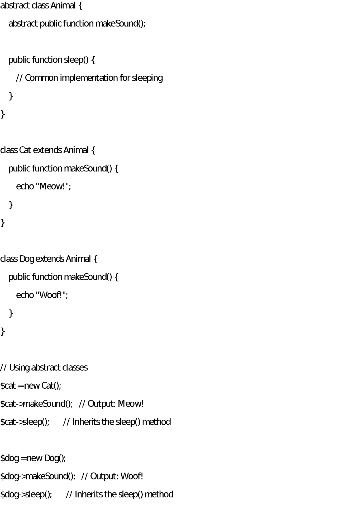

通过在 PHP 中利用类、对象和继承，你可以创建更结构化、可重用且易维护的代码。这些概念是面向对象编程（OOP）的核心组件，为设计和开发复杂应用程序提供了一种强大的方法。

# 异常处理

PHP 中的高级面向对象编程（OOP）概念为你的代码库提供了额外的灵活性和抽象。让我们探索其中的一些概念：

### 异常处理基础

1.  异常处理允许你优雅地处理错误。
2.  `try` 块包含可能抛出异常的代码。
3.  `catch` 块在发生异常时处理该异常。
4.  `finally` 块无论是否抛出异常都会执行。

### 抛出异常

*   PHP 使用 `throw` 关键字来触发异常。
*   你可以抛出自定义异常类来处理特定的错误。

### 自定义异常

*   你可以通过扩展基类 `Exception` 类来创建自定义异常。
*   这允许进行更细粒度的错误处理。

# 处理日期和时间

PHP 中的高级面向对象编程（OOP）概念为你的代码库提供了额外的灵活性和抽象。让我们探索其中的一些概念：

### 当前日期和时间

1.  要获取当前日期和时间，可以使用 `date()` 函数。
2.  PHP 提供了 `DateTime` 类用于更复杂的日期操作。

### 格式化日期和时间

*   PHP 提供了各种格式代码来格式化日期和时间。
*   常用代码包括年份的 `Y`、月份的 `m`、日期的 `d`、小时的 `H`、分钟的 `i` 和秒的 `s`。

### 日期和时间计算

*   PHP 允许使用 `strtotime()` 对日期和时间进行计算。
*   你可以从给定的日期增加或减去间隔。

### 时区

*   PHP 提供了 `date_default_timezone_set()` 函数来设置默认时区。
*   你也可以使用 `DateTime` 类处理不同的时区并进行转换。

# PHP 中的正则表达式

PHP 中的正则表达式（regex）是用于模式匹配和字符串处理的强大工具。它们允许你根据特定模式搜索、验证和处理文本。

### 使用 `preg_match()` 进行模式匹配

1.  `preg_match()` 函数允许你对字符串执行简单的模式匹配。
2.  如果找到匹配则返回 1，如果未找到匹配则返回 0，出错时返回 false。

### 使用 `preg_match_all()` 提取匹配项

*   `preg_match_all()` 函数用于查找字符串中模式的所有出现处。
*   它返回找到的匹配次数并将匹配项存储在数组中。

### 使用 `preg_replace()` 进行模式替换

*   `preg_replace()` 函数允许你搜索并替换字符串中的模式。
*   它将模式的所有出现处替换替换为指定的替换内容。


# 使用 `preg_replace()` 进行模式替换示例

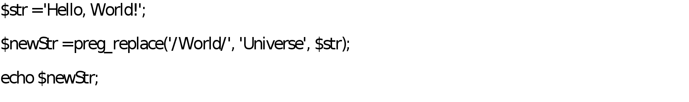

### 正则表达式函数

- PHP 提供了一系列用于处理正则表达式的函数，包括 `preg_match()`、`preg_match_all()`、`preg_replace()`、`preg_split()` 等。
- 这些函数结合正则表达式模式和字符串操作来执行各种任务。

使用正则表达式函数的示例：


正则表达式为处理文本提供了一种强大且灵活的方法。它们可以用于模式匹配、提取和验证等任务。理解正则表达式语法并使用适当的函数将帮助你在应用程序处理模式。

## 身份验证与授权

身份验证（Authentication）和授权（Authorization）是 Web 开发的核心组成部分，用于确保安全访问资源并保护敏感信息。PHP 提供了各种机制和技术在应用程序中实现身份验证和授权。

### 身份验证
1. 身份验证是验证用户身份的过程。它确保用户确实是其言。
2. 常见的身份验证方法包括用户名/密码、基于令牌的验证以及单点登录 (`SSO`)。
3. PHP 提供了内置函数和库来处理密码哈希和验证。

PHP 中用户名/密码身份验证的示例：


### 授权
- 授权决定了用户在通过身份验证后被允许访问的操作或资源。
- 它涉及定义角色或权限，并检查用户是否具有执行操作所需的必要权限。
- 授权可以使用访问控制列表 (`ACLs`)、基于角色的访问控制 (`RBAC`) 或自定义授权规则来实现。

PHP 中使用 RBAC 授权的示例：


### 会话管理
- PHP 提供会话管理功能来跟踪会话并安全地存储数据。
- 会话用于在多个请求之间维护用户状态，通常用于身份验证。
- PHP 的 `$_SESSION` 超全局变量允许你存储和检索会话数据。

PHP 中基于会话的身份验证示例：


实现身份验证和授权需要考虑数据存储、会话管理和访问控制等因素。PHP 提供了各种库、框架和最佳实践帮助你在应用程序中有效地实施这些措施。遵循安全指南并跟上最新实践对于保护你的应用程序和数据至关重要。

## RESTful APIs 与 JSON

RESTful APIs 和 JSON 在 PHP 开发中被广泛用于构建与其他系统或客户端通信的 Web 服务。让我们探索 PHP 开发中的 RESTful APIs 和 JSON：

### RESTful APIs
- `REST`（表述性状态转移）是一种构建 Web 服务的架构风格。
- RESTful APIs 设计为无状态，并使用标准的 HTTP 方法（`GET`、`POST`、`DELETE`）对资源执行操作。
- PHP 提供了各种框架和库，如 `Laravel`、`Symfony` 和 `Slim`简化了 RESTful APIs 的创建和管理。

使用 Slim 框架在 PHP 中创建简单 RESTful API 的示例：

- 此代码设置了一个基础路由，通过 JSON 消息响应 `GET` 请求。

### JSON
1. `JSON`（JavaScript 对象表示法）是一种轻量级的数据交换格式。
2. 它通常用于在服务器和客户端之间以结构化且人类可的格式传输数据。
3. PHP 提供了编码和解码 JSON 数据的函数，允许你将 PHP 数组或对象转换为 JSON，反之亦然。

PHP 中编码和解码 JSON 的示例：


### 消费 RESTful APIs
- PHP 可以通过 `file_get_contents()`、`curl` 或使用 `Guzzle` 等库发送 HTTP 请求来消费外部 RESTful APIs。
来自 API 的响应可以是 JSON 格式，可以在你的 PHP 应用程序中进行解码和处理。

消费 RESTful API 并解析 JSON 响应的示例：


RESTful APIs 和 JSON 是构建灵活且可操作 Web 服务的强大工具。它们实现了不同系统之间的通信，并允许以标准化格式进行数据交换。PHP 提供了多种库和函数简化 RESTful APIs 和 JSON 数据的创建、消费和处理。

## PHP 中的缓存技术

缓存是 PHP 开发中的一项重要技术，通过在内存中存储频繁访问的数据帮助提高 应用程序的性能和可扩展性。缓存减少了重新计算或从慢源（如数据库或外部 API）检索数据的需求，从而缩短响应时间。以下是 PHP 中常用的缓存技术：

### 1. Opcode 缓存
- PHP 使用解释器执行 PHP 脚本，这可能会消耗大量资源。
- Opcode 缓存通过在内存中缓存 PHP 脚本的编译字节码来减少脚本解释的开销。
- PHP 流行的 Opcode 缓存解决方案包括 `APCu`、`OPcache` 和 `XCache`。
- Opcode 缓存通常在 PHP 配置文件 (`php.ini`) 中启用和配置。

### 2. 数据缓存
- 数据缓存涉及将昂贵的计算或数据库查询结果存储在内存中以便快速访问。
- 流行的 PHP 缓存库和工具如 `Memcached` 和 `Redis` 为为数据缓存提供了高效的键值存储。
- 缓存的数据可以根据唯一密钥存储，并快速检索，无需重复计算或数据库查询。

### 3. 输出缓存
- 输出缓存涉及缓存 PHP 脚本或 Web 页面的渲染输出，以避免重复处理。
- 缓存页面的 HTML 输出可以显著提高静态或半静态内容的响应时间。
- `Laravel` 和 `Symfony` 等 PHP 框架提供了通过 HTTP 缓存头或全页缓存实现输出缓存的内置支持。

### 4. 片段缓存
- 片段缓存涉及缓存 Web 页面中生成成本高或频繁访问的部分或区域。
- 片段缓存适用于页面中的动态内容，这些内容与其他内容分开缓存。
- 流行的 PHP 库如 `Smarty` 和 `Twig` 提供了片段缓存的内置支持。

### 5. 缓存失效
- 缓存失效是在缓存数据过期或过时时更新或清除缓存的过程。
- 每当底层发生变化，都需要失效并刷新缓存数据。
- 缓存失效的技术包括基于时间的过期、事件驱动失效以及数据发生变化时的手动失效。

### 6. HTTP 缓存
- HTTP 缓存利用 HTTP 头来控制 Web 应用程序的缓存行为。
- 响应头如 `Cache-Control`、`Expires` 和 `Last-Modified` 可用于指定缓存规则和时长。
- PHP 框架通常提供抽象和辅助方法来设置和管理 HTTP 缓存头。


在 PHP 中实现缓存需要仔细考虑可以缓存的数据或内容、缓存过期策略以及缓存管理策略。监控和分析应用程序的缓存性能至关重要，以确保最佳缓存效果。缓存可以显著提高 PHP 应用程序的响应速度和扩展性，特别是当与其他性能优化技术结合使用时。

# 处理文件上传与下载

处理文件上传和下载是 Web 开发中的一项常见需求，PHP 提供了内置函数和特性来处理这些操作。让我们来探索如何在 PHP 中处理文件上传和下载：

### 文件上传
1. 当用户通过 HTML 表单提交文件时，PHP 可以处理并将上传的文件存储在服务器上。
2. 若要处理文件上传，你需要使用 `$_FILES` 超局变量变量，该变量包含了关于上传文件的信息。
3. 上传的文件存储在服务器的临时位置，你可以使用 `move_uploaded_file()` 函数将其移动到永久位置。

PHP 中处理文件上传的示例：


### 文件下载
* PHP 可以通过向客户端浏览器发送适当的 HTTP 头部和内容来辅助文件下载。
* 要触发文件下载，你需要设置合适的头部，例如 `Content-Type` 和 `Content-Disposition`，并使用 `readfile()` 或 `fread()` 等函数读取文件内容。

PHP 中处理文件下载的示例：

* 在示例中，头部指定内容类型为 PDF 文件，`Content-Disposition` 头部指示浏览器下载文件而不是显示。

### 文件大小和类型验证
1. 验证上传的文件非常重要，以确保它们符合某些标准，例如大小和文件类型限制。
2. 你可以使用 `$_FILES['file']['size']` 属性检查文件大小，并将其与所需的限制进行比较。
3. 若要验证文件类型，可以使用 `pathinfo()` 或 `mime_content_type()` 等函数提取文件扩展名或 MIME 类型，并将它们与允许类型的白名单进行比较。

文件大小和类型验证的示例：


在此示例中，使用 `pathinfo()` 提取文件扩展名并与允许的扩展名进行比较。文件大小与最大允许大小进行比较。

处理文件上传和下载需要适当的安全措施，例如验证用户输入、保护文件存储位置以及防止恶意文件上传。仔细处理和处理用户上传的文件非常重要，以防止安全漏洞并确保你的 PHP 应用程序顺利运行。

# 使用 PHP 发送电子邮件

发送电子邮件是 Web 开发中的常见任务，PHP 提供了内置函数和库从你的 PHP 应用程序发送电子邮件。以下是使用 PHP 发送电子邮件的概述：

### 使用 mail() 函数
1. PHP 提供了 `mail()` 函数，允许你使用简单邮件传输协议 (SMTP) 发送电子邮件。
2. `mail()` 函数接收多个参数，包括接收者的电子邮件地址、主题、邮件主体和额外的头部。
3. 使用 `mail()` 函数发送邮件的示例：


注意，`mail()` 函数依赖于服务器配置的邮件设置，在所有系统上可能无法开箱即用。你可能需要配置服务器或使用额外的库来实现更高级的邮件功能。

### 使用 PHP Mailer 库
1. PHP mailer 库为发送电子邮件提供了一种更健壮、功能更丰富的解决方案。
2. 这些库提供了优势，例如对 HTML 邮件更好的支持、附件、SMTP 身份验证以及邮件头部的处理。
3. 一个流行的 PHP mailer 库是 `PHPMailer`，它可以使用 `Composer`（PHP 包管理器）轻松安装。

使用 `PHPMailer` 发送邮件的示例：


在此示例中，使用 `PHPMailer` 来创建和发送电子邮件。与基本的 `mail()` 函数相比，它提供了更多的灵活性功能。

发送电子邮件时，考虑安全实践以防止误用或滥用很重要。避免直接在邮件头部中使用用户提供的数据，以防止头部注入攻击。此外，如果你正在发送大量电子邮件或需要更高级的邮件功能，请考虑使用专门为邮件递设计的第三方邮件服务或库，例如 `SendGrid` 或 `Mailgun`。

彻底测试你的邮件功能，并处理邮件发送过程中可能出现的任何错误或异常，以确保流畅的用户体验。

## 练习

注意：为了确保你发挥最佳水平，我们希望为你提供一条关键指令：请在检查正确答案之前花些时间仔细思考。

1.什么是 PHP 中的类 (class)？
a) 对象的实例
b) 具有自身状态和行为的特定实体
c) 定义属性和方法的蓝图或模板
d) 定义一组方法的契约

正确答案：c) 定义属性和方法的蓝图或模板

2.如何在 PHP 中创建对象 (object)？
a) 使用 `object` 关键字声明它
b) 调用 `createObject()` 函数
c) 使用 `new` 关键字后跟类名
d) 直接将值分配给变量

正确答案：c) 使用 `new` 关键字后跟类名

3. 什么是 PHP 中的封装 (encapsulation)？
a) 从父类创建子类的过程
b) 将数据和方法封装在类中的做法，从外部隐藏内部实现细节
c) 不同类的对象被视为共同父类的能力
d) 定义一组方法的契约

正确答案：b) 将数据和方法封装在类中的做法，从外部隐藏内部实现细节

4. 什么是 PHP 中的继承 (inheritance)？
a) 不同类的对象被视为共同父类的能力
b) 从父类创建子类的过程
c) 将数据和方法封装在类中的做法，从外部隐藏内部实现细节
d) 定义一组方法的契约

正确答案：b) 从父类创建子类的过程

5. 什么是 PHP 中的多态 (polymorphism)？
a) 将数据和方法封装在类中的做法，从外部隐藏内部实现细节
b) 不同类的对象被视为共同父类的能力
c) 从父类创建子类的过程
d) 定义一组方法的契约

正确答案：b) 不同类的对象被视为共同父类的能力

6. 什么是 PHP 中的接口 (interface)？
a) 定义属性和方法的蓝图或模板
b) 定义类必须实现的方法集的契约
c) 允许类从其他类继承属性和方法的机制
d) 将数据和方法封装在类中的做法，从外部隐藏内部实现细节

正确答案：b) 定义类必须实现的方法集的契约


## 7. 什么是 PHP 中的抽象类 (abstract class)？
a) 对象的实例
b) 具有特定状态和行为的特定实体
c) 定义属性和方法的蓝图或模板
d) 一种不能实例化的类，作为子类实现的蓝图

正确答案：d) 一种不能实例化的类，作为子类实现的蓝图

## 8. 下列哪哪项是 PHP 中面向对象编程 (OOP) 的核心概念？
a) 模式匹配
b) 字节缓存 (Opcode caching)
c) 身份验证
d) 类和对象

正确答案：d) 类和对象

## 9. 面向对象编程 (OOP) 中封装的目的是？
a) 在内存中存储数据
b) 验证用户身份
c) 将数据和方法封装在类中
d) 替换字符串中的模式

正确答案：c) 将数据和方法封装在类中

## 10. PHP 中的继承允许：
a) 类从其他类继承属性和方法
b) 对类属性的访问控制
c) 重写父类中的方法
d) 以上所有

正确答案：d) 以上所有

## 11. 面向对象编程 (OOP) 中的多态允许：
a) 将不同类的对象被视为公共父类的对象
b) 重写父类中的方法
c) 定义接口和抽象类
d) 以上所有

正确答案：a) 将不同类的对象被视为公共父类的对象

## 12. 下列关于 PHP 中正则表达式 (regex) 的描述正确的是：
a) 它们用于字节缓存
b) 它们用于会话管理
c) 它们允许字符串的模式匹配和处理
d) 它们用于 HTTP 缓存

正确答案：c) 它们允许字符串的模式匹配和处理

## 13. PHP 中的 `preg_match()` 函数用于：
a) 从字符串提取匹配项
b) 编码 JSON 数据
c) 对字符串进行模式匹配
d) 向外部 API 的 HTTP 请求

正确答案：c) 对字符串进行模式匹配

## 14. JSON 代表什么？
a) JavaScript Output Notation
b) Java Serialized Object Notation
c) JavaScript Object Notation
d) Java Scripting Object Namespace

正确答案：c) JavaScript Object Notation

## 15. 下列哪种缓存技术将 PHP 脚本的编译字节码存储在内存中？
a) 字节缓存 (Opcode caching)
b) 片段缓存 (Fragment caching)
c) 数据缓存
d) 输出缓存 (Output caching)

正确答案：a) 字节缓存 (Opcode caching)

## 16. 缓存失效 (Cache invalidation) 的过程是：
a) 将复杂计算的结果存储在内存中
b) 在缓存数据过期或过时时清除
c) 编码和解码 JSON 数据
d) 实现访问控制机制

正确答案：b) 在缓存数据过期或过时时清除

## 17. PHP 中的 HTTP 缓存利用了以下哪项？
a) 正则表达式
b) HTTP 头部 (headers)
c) 字节缓存 (Opcode caching)
d) 继承

正确答案：b) HTTP 头部 (headers)

## 18. PHP 使用哪个超全局变量来处理文件上传？
a) `$_POST`
b) `$_GET`
c) `$_REQUEST`
d) `$_FILES`

正确答案：d) `$_FILES`

## 19. 如何在 PHP 中将上传的文件移动到永久位置？
a) 使用 `move_uploaded_file()` 函数
b) 使用 `copy()` 函数
c) 使用 `rename()` 函数
d) 使用 `fopen()` 函数

正确答案：a) 使用 `move_uploaded_file()` 函数

## 20. PHP 中通常设置哪些头部 (headers) 来触发文件下载？
a) Content-Type 和 Content-Length
b) Cache-Control 和 Expires
c) Content-Disposition 和 Content-Encoding
d) Authorization 和 User-Agent

正确答案：c) Content-Disposition 和 Content-Encoding

## 21. 如何在 PHP 中验证文件大小？
a) 检查 `$_FILES['size']` 属性
b) 通过白名单对比文件扩展名
c) 使用 `file_exists()` 函数
d) 检查文件权限

正确答案：a) 检查 `$_FILES['size']` 属性

## 22. 哪个 PHP 函数常用于发送邮件？
a) `sendmail()`
b) `mail()`
c) `smtp_send()`
d) `email_send()`

正确答案：b) `mail()`

## 23. PHPMailer 库为发送邮件提供了什么功能？
a) 对 HTML 邮件更好的支持
b) 附件处理
c) SMTP 身份验证
d) 以上所有

正确答案：d) 以上所有

## 24. 通常使用哪个包管理器来安装 PHPMailer？
a) Composer
b) npm
c) pip
d) yum

正确答案：a) Composer

## 25. 发送邮件时应该考虑什么？
a) 避免直接使用用户数据
b) 加密邮件
c) 使用 `mail()`
d) 在头部中包含敏感信息

正确答案：a) 避免直接使用用户数据

## 26. 发送大量邮件时，哪项是推荐做法？
a) 使用基础 `mail()`
b) 使用第三方服务或库交付
c) 一次发送

正确答案：b) 使用第三方服务或库交付

## 27. 为什么在发送邮件过程中处理错误或异常很重要？
a) 防止邮件被标记为垃圾邮件
b) 确保良好的体验
c) 提高送达率

正确答案：b) 确保良好的体验


这些示例演示了 Doctrine ORM 和 Eloquent ORM 的基本用法。这两个库都提供了许多更高级的功能，如查询构建、关系映射和缓存。你可以参考这些库的官方文档，获取更多关于其功能和能力的深度信息。

# 性能优化技术

在优化 PHP 应用程序的性能时，有几种技术是可以采用的。以下是 PHP 中一些常用的性能优化技术：

1.  代码优化：
    *   使用高效的算法和数据结构。
    *   尽量减少函数调用次数，并改用局部变量。
    *   避免过度的字符串拼接或操作。
    *   通过减少不必要的迭代来优化循环。
    *   使用适当的数组函数进行数据处理。
    *   避免过度或不必要的文件 I/O 操作。

2.  缓存：
    *   利用 `OPcache` 或 `APCu` 等扩展进行字节码（opcode caching），将编译后的 PHP 代码存储在内存中，减少重复解析和编译的需求。
    *   实现数据缓存机制（例如 `Memcached` 或 `Redis`）来存储频繁访问的数据并减少数据库查询。
    *   通过为 CSS、JavaScript 和图像等静态资源设置合适的响应头来利用浏览器缓存。

3.  数据库优化：
    *   通过在频繁访问的列和表上使用适当索引来优化数据库查询。
    *   利用数据库系统提供的数据库查询缓存机制。
    *   在使用 ORM 库时，采用预加载（eager loading）或懒性加载（lazy loading）技术来优化相关数据的获取。
    *   避免使用可能导致过度查询或低效数据库访问模式的 ORM 特性。

4.  HTTP 请求优化：
    *   通过合并 CSS 和 JavaScript 文件、使用图片精灵图（sprites）以及利用 `HTTP/2` 进行并行请求来减少 HTTP 请求的数量。
    *   实现 HTTP 响应压缩（例如 `gzip`）以减小网络传输的数据量。
    *   使用 CDN（内容分发网络）将静态资产分发到靠近用户的地方，减轻负载。

5.  内存优化：
    *   避免将不必要的数据加载到内存中。
    *   在资源不再需要时适当管理并关闭连接。
    *   使用适当的数据结构来最小化内存消耗（例如对于大数据集使用 `SplFixedArray` 代替普通数组）。
    *   限制全局变量的使用，因为它们会在整个应用程序生命周期内消耗内存。

6.  异步处理：
    *   使用队列、消息代理（例如 `RabbitMQ` 或 `Apache Kafka`）或后台作业处理器（例如 `Gearman` 或 `Beanstalkd`）等工具实现异步处理，将耗时任务从主应用流中卸载。
    *   使用 `cURL` 或 `ReactPHP` 等扩展对网络相关任务使用非阻塞 I/O 操作。

7.  性能分析与监控：
    *   使用 `Xdebug` 或 `Blackfire` 等性能分析工具识别代码中的瓶颈和性能问题。
    *   使用 `New Relic`、`Datadog` 或自定义监控解决方案监控应用程序性能，以获取对资源使用、响应时间和其他关键指标的洞察。

需要注意的是，这些技术的有效性取决于应用程序的具体特性和底层基础设施。对应用程序进行性能分析（Profiling）和基准测试（benchmarking）将帮助识别需要优化的领域，并衡量所实施技术的影响。

# PHP 中的多线程与异步编程

PHP 由于其请求-响应机制以及在 Web 应用中通常的使用方式，传统上并没有原生多线程支持。然而，PHP 确实提供了执行异步编程和并行处理的选项。让我们探索两种流行的方法：

*   使用 Promise 进行异步编程：可以使用实现 promise 或未来任务（futures）的库来实现 PHP 中的异步编程。Promise 允许你执行非阻塞 I/O 操作并更高效地处理异步任务。这里是一个使用流行库 `ReactPHP` 的示例：

首先，使用 `Composer` 安装 `ReactPHP`：


- `ReactPHP` 是一个强大的库，提供了事件驱动和非阻塞 I/O 能力，允许构建可扩展的应用程序。

*   使用扩展进行并行处理：PHP 提供了通过多进程或线程实现并行处理的扩展。一种流行的并行处理扩展是 `threads`。

要使用 `threads`，需要在在 PHP 安装中启用。请注意，`threads` 并非在所有 环境中都可用。


值得注意的是，PHP 8 引入了 `FFI`（外部函数接口）扩展，允许直接从 PHP 调用并与 C 交互。这开启了利用 C 库的可能性，但对 C 编程有了解。

总的来说，尽管 PHP 缺乏内置的多线程支持，但通过 Promise 进行异步编程和通过扩展进行并行处理为 PHP 应用程序提供了并发和并行的方法。


- SOAP（简单对象访问协议）：SOAP 是一种允许应用程序使用基于 XML 的消息在互联网上通信的协议。在 PHP 中构建 SOAP Web 服务，可以遵循以下步骤：

### 第 1 ：定义 Web 服务
首先定义将作为 Web 服务操作暴露的函数或方法。这些函数应该执行 Web 服务所需的功能。


### 第 2 ：创建 SOAP 服务器
创建 `SoapServer` 类的实例，并指定描述 Web 服务的 WSDL（Web 服务描述语言）文件。


### 第 3 ：注册 Web 服务函数
使用 `SoapServer` 实例的 `addFunction()` 方法注册作为 Web 服务操作的函数或方法。


### 第 4 ：处理请求
通过调用 `SoapServer` 实例上的 `handle()` 方法来处理传入的 SOAP 请求。


### 第 5 ：生成 WSDL
如果你没有现有的 `WSDL` 文件，可以使用 `SoapServer` 实例的 `dump()` 方法动态生成它。


XML-RPC（XML 远程过程调用）：XML-RPC 是一种允许使用 XML 作为数据格式进行远程过程调用的协议。在 PHP 中构建 XML-RPC Web 服务，可以遵循以下步骤：

### 第 1：定义 Web 服务
定义将作为 Web 服务操作暴露的函数或方法，类似于 SOAP 示例。


### 第 2：创建 XML-RPC 服务器
从一个来自 `Zend Framework` XML-RPC 组件的 `Zend\\XmlRpc\\Server` 类的实例。


### 第 3：注册 Web 服务函数
使用 `addFunction()` 方法注册作为 Web 服务操作的函数或方法。


### 第 4：处理请求
通过调用 `Server` 实例上的 `handle()` 方法来处理传入的 XML-RPC 请求。


### 第 5：生成 XML-RPC 文档
可选，你可以使用 `getFunctions()` 方法生成 XML-RPC 文档，以获取可用函数及其参数的信息。


这些是在 PHP 中使用 SOAP 和 XML-RPC 构建 Web 服务的示例示例。在开发生产级应用时，请记住处理错误、执行输入验证并确保 Web 服务的安全性。此外，考虑使用如 `Zend Framework`、`Symfony` 或 `Laravel` 等库或框架，它们为构建 PHP 构建 Web 服务提供了更高级的功能和工具。

# PHP 安全最佳实践

安全是 PHP 应用开发的一个关键方面。以下是增强你的 PHP 应用安全性时需要遵循的一些最佳实践：

1. **输入验证**：
   - 验证并清理所有用户输入，以防止 SQL 注入、跨站脚本 (XSS) 和远程代码执行等常见漏洞。
   - 使用白名单或正则表达式确保输入符合预期的格式和值。
   - 不要仅依赖客户端验证，因为它们可以被绕过。请同时进行服务器端验证。

2. **参数化查询（预语句）**：
   - 在执行 SQL 查询时使用参数化查询或预语句，以防止 SQL 注入攻击。
   - 避免直接将用户输入嵌入 SQL 查询中。相反，使用占位符将参数绑定到查询中。

3. **防止跨站脚本攻击 (XSS)**：
   - 在显示用户提供的数据时使用输出编码或 HTML 转义函数（例如 `htmlspecialchars()`）以防止 XSS 攻击。
   - 使用用户提供的数据配合 `eval()` 或 `include()` 函数要小心，因为它们可能会引入漏洞。

4. **跨站请求伪造 (CSRF) 保护**：
   - 在表单中实现 CSRF 令牌以防止伪造请求发恶意恶意。
   - 确保每个表单提交都包含一个在服务器端验证的唯一令牌。

5. **密码哈希与存储**：
   - 使用 `bcrypt` 或 `Argon2` 等强哈希算法安全地存储密码。
   - 使用唯一的随机值对密码进行加盐（Salt），以增加额外的安全层。
   - 避免使用 `MD5` 或 `SHA1` 等过时的哈希算法。

6. **访问控制与授权**：
   - 实现适当的访问控制并强制执行规则，确保只有经过身份验证和授权的用户才能访问敏感资源或执行某些操作。
   - 在执行任何关键操作之前，在服务器端验证用户权限。

7. **会话管理**：
   - 使用安全的会话管理技术，例如生成唯一的会 ID、为 cookie 设置安全标志并在登录后重新生成 ID。
   - 避免在明文会话数据或 cookie 中存储敏感信息。
   - 设置适当的会话超时值以平衡可用安全性。

8. **文件与上传安全**：
   - 验证上传文件的类型、大小和内容，以防止任意文件执行和路径遍历攻击。
   - 将上传的文件存储在 Web 根目录之外，或使用适当的访问控制来防止直接访问。

9. **安全配置**：
   - 保持 PHP 及其扩展为最新的安全补丁。
   - 禁用应用程序不需要的必要 PHP 扩展和函数。
   - 为 PHP 设置安全配置，例如在生产环境中禁用错误报告并启用安全的会话管理。

10. **日志记录与错误处理**：
    - 实现适当的日志记录机制以跟踪监控监控活动以及潜在的安全问题。
    - 优雅地处理错误，而不向用户暴露敏感信息。

11. **安全的第三方库与依赖**：
    - 定期更新并补丁 PHP 应用中使用的所有第三方库和依赖。
    - 监控与你依赖的库相关的安全公告和漏洞。

12. **安全审计与渗透测试**：
    - 定期进行安全审计和渗透测试，以识别并修复 PHP 应用中的漏洞。
    - 利用安全工具和服务自动化漏洞扫描和代码分析。

遵循这些安全最佳实践将帮助你缓解常见的安全风险并增强 PHP 应用的整体安全态势。此外，通过关注良好的来源和社区，获取最新安全漏洞和最佳实践的信息。

# PHP 中的单元测试与测试驱动开发 (TDD)

单元测试和测试驱动开发 (TDD) 是软件开发中的基本实践，有助于确保代码的质量和可靠性。以下如何在 PHP 中执行单元测试并采用测试驱动开发方法的概述：

- **单元测试**：单元测试涉及隔离测试代码的单个单元或组件以验证其正确性。在 PHP 中，你可以使用流行的测试框架 `PHPUnit` 来编写和执行单元测试。以下是开始方法：

### 第 1 步安装 PHPUnit
使用 PHP 项目的依赖管理工具 `Composer` 安装 `PHPUnit`。


### 第 2 编写单元测试
创建一个继承 `PHPUnit\\Framework\\TestCase` 类的类，并编写测试方法来验证代码的行为。示例所示：


### 第 3 步运行测试
使用 `phpunit` 命令行工具运行单元测试：


`PHPUnit` 将执行测试并提供其成功或失败的反馈。

- **测试驱动开发 (TDD)**：测试驱动开发是一种在实现代码之前编写测试的方法。它遵循“红-绿-重构”循环：


### 步骤 1：编写失败的测试
通过编写测试来定义你想要实现的行为。运行测试以使其失败。

### 步骤 2：实现代码
编写代码以让测试通过。仅关注让测试通过，而不是关注额外的功能。

### 步骤 3：运行测试并重构
再次运行测试以确保其通过。一旦测试通过，你可以重构代码以改进其设计和可读性。

### 步骤 4：循环
对于每个想要引入的新功能重复此循环，确保在编写代码之前编写测试。

遵循测试驱动开发（TDD）方法有助于创建健壮的测试套件，并确保代码符合预期。`PHPUnit` 和其他测试框架提供了各种断言、固定程序和模拟能力，可以帮助你编写单元测试。

目标是良好的测试覆盖率，关注代码的单元测试，并编写独立的、可重复的测试。这将帮助你尽早发现错误，提高代码质量并增加 PHP 应用的信心。

# 国际化与本地化

国际化（i18n）和本地化（L10n）是构建支持多种语言和地区的 PHP 应用的重要方面。以下是关于如何在 PHP 中实现国际化和本地化的概述：

## 1. 国际化 (i18n)
国际化涉及设计你的应用以支持多种语言和文化。国际化的关键方面包括：

a. **语言文件**：创建包含不同语言翻译字符串的语言文件。这些可以是 PHP 数组、XML、JSON 或 Gettext（`.po`/`.mo`）格式。

b. **语言检测**：实现检测用户喜爱语言的机制。你可以使用 `Accept-Language` 请求头、用户设置或话来确定语言。

c. **语言切换**：为用户提供切换不同语言的选项。将语言存储在话或 cookie 中。

d. **数字和日期格式化**：使用 PHP 的内置函数 `number_format()` 和 `strftime()` 根据用户的区域格式化数字、日期时间和。

## 2. 本地化 (L10n)
本地化通过使用来自国际化过程的翻译资源，使应用适应特定的地区或区域。本地化的关键方面包括：

a. **字符串翻译**：使用语言文件中的翻译字符串替换应用中的静态文本。根据所选语言使用函数。

b. **日期和时间本地化**：调整日期、时间和日历显示以匹配用户的区域。利用 PHP 的 `strftime()` 函数或日期格式化库来处理本地化的日期格式。

c. **数字格式化**：使用 PHP 的 `number_format()` 或支持区域特定格式的库来本地化数字格式。根据用户的区域调整小数点、千分位符和货币符号。

d. **货币和单位**：以本地化格式显示金额和单位。使用 PHP 的 `NumberFormatter` 类或支持货币和单位本地化的库。

e. **从右向左 (RTL) 支持**：如果你的应用支持从右向左写的语言，确保文本对齐和 RTL 脚本。修改 CSS 和布局以适应 RTL 语言。

注意的是，PHP 通过 `intl` 扩展提供了内置的国际化和本地化支持。该扩展提供了各种类和函数来处理区域特定的操作，如格式化数字、日期和。

此外，Laravel 和 Symfony 等框架提供了专用本地化功能和库，简化了 PHP 应用中国际化和本地化的实现。

通过遵循国际化和本地化的最佳实践，你可以创建轻松适应不同语言、地区和文化习惯的 PHP 应用，为全球观众提供更好的用户体验。

# 高级调试技术

调试是 PHP 开发中的一项基本技能，用于识别和修复代码中的问题。以下是你可以用于有效调试 PHP 应用的一些高级调试技术和工具：

### 使用 `var_dump()` 和 `print_r()` 调试

1. 使用 `var_dump()` 和 `print_r()` 函数在运行时显示变量和数据结构的内容。这些函数对于检查值和识别意外行为很有用。

示例：
` 记录

* 使用 `error_log()` 函数将自定义消息或变量值记录到日志文件中用于调试。

示例：
![](image_rsrc2WE.jpg

### 使用 PHP 内置调试工具调试

1. PHP 提供了一个名为 `Xdebug` 的内置调试工具，它提供了堆栈跟踪、变量检查和分析等功能。
2. 要使用 `Xdebug`，你需要安装 `Xdebug` 扩展并结合 PHP 环境对其进行配置。请参考 `Xdebug` 文档获取安装和配置说明。
3. 配置完成后，`Xdebug` 可以与 `PhpStorm`、`Visual Studio Code` 或 `NetBeans` 等 IDE 集成，允许你在运行时设置断点、单步执行代码并检查变量。

### 使用调试和分析工具调试

1. PHP 有多种调试和分析工具可用，提供代码分析和性能分析功能。流行的工具包括：

    a. `PhpStorm`：一个具有内置 PHP 调试功能的 IDE。
    2. `Xdebug` + IDE 集成：在 IDE 中使用 `Xdebug` 进行高级调试。
    3. `Blackfire`：一种性能分析工具，可以帮助识别瓶颈并优化 PHP 代码。
    4. `New Relic`：一种监控和分析工具，提供 PHP 应用性能的洞察。

这些工具提供了断点、单步调试、变量检查和性能分析等高级调试功能，允许你诊断和解决复杂问题。

### 远程系统调试

1. 远程调试允许调试运行在远程服务器或系统上的 PHP 代码。
2. `Xdebug` 等工具通过建立本地机器与远程服务器之间的连接支持远程调试。
3. 在远程服务器上配置 `Xdebug` 设置，并从本地 IDE 启动调试会话来调试远程代码。

这些高级技术和工具提供了强大的调试能力，用于诊断 PHP 应用中的问题。选择最适合你开发环境和需求的方法与工具。

# PHP 框架简介（例如：Laravel, Symfony, CodeIgniter）

PHP 框架是强大的工具，为 Web 应用开发提供了结构化且高效的方法。它们提供了一系列库、组件和预定义约定，简化了开发过程并促进了代码的可重用。


# PHP 框架

1. `Laravel`: `Laravel` 是最广泛使用的 PHP 框架之一。它遵循 `MVC`（模型-视图-控制器）架构模式，并提供简洁且优雅的语法。`Laravel` 提供了路由、`ORM`（对象关系映射）、缓存、身份验证和测试等功能。它拥有丰富的软件包和扩展生态系统，使其与其他库和工具轻松集成。

2. `Symfony`: `Symfony` 是一个健壮且高度模块化的 PHP 框架。它提供了一组可重用的组件并遵循 `MVC` 模式。`Symfony` 强调代码的可用性、可维护性和扩展性。它提供了路由、`ORM`（`Doctrine`）、表单处理、安全和缓存等强大功能。`Symfony` 还拥有蓬勃的社区以及广泛的可用扩展和包（Bundles）。

3. `CodeIgniter`: `CodeIgniter` 是一个轻量级且易于使用的 PHP 框架，以简单和快速著称。它的占用空间小，且配置极少。`CodeIgniter` 提供了直接的 `MVC` 结构，以及数据库抽象、表单验证、会话管理和缓存等功能。它是中小型项目的良好选择。

4. `Zend Framework`: `Zend Framework` 是一个健壮且灵活的 PHP 框架，强调性能和扩展性。它提供了一系列松耦合的组件，可以独立使用或共同使用。`Zend Framework` 支持各种数据库系统、缓存机制和身份验证方法。它还对国际化、本地化和 API 开发提供了广泛支持。

5. `CakePHP`: `CakePHP` 是一个现代 PHP 框架，专注于简单性和“约定优于配置”。它遵循 `MVC` 模式，并提供了一套用于快速应用开发的功能。`CakePHP` 包含了 `ORM`、数据库迁移、缓存、表单验证和安全功能。它还强调代码生成和脚手架（Scaffolding），便于快速创建 `CRUD`（增、删、改、查）应用程序。

这些只是 PHP 框架的一些示例。每个框架都有自己的优势和侧重点，因此选择一个符合你的项目需求、开发风格和专业水平的框架非常重要。

## 使用 PHP 框架的优势

- **更快的开发**：框架提供了结构化的方法和预构建组件，减少了开发所需的时间。
- **代码复用性**：框架鼓励代码复用，允许开发者利用现有的库和模块。
- **可维护性**：框架强制执行最佳实践、标准化的编码规范和关注点分离，从而产生更整洁、易维护的代码。
- **安全性**：框架通常包含内置安全功能，如输入验证、`CSRF` 保护和数据库查询参数化。
- **社区支持**：PHP 框架拥有活跃的社区，提供文档、教程、论坛和插件，使得寻找帮助和资源变得更加容易。

在选择 PHP 框架时，请考虑你的项目需求、社区支持、文档、性能和学习曲线等因素。尝试不同的框架，以找到最符合你的需求并能提高你作为 PHP 开发者生产力的框架。

# 使用 PHP 框架构建 Web 应用

使用 PHP 框架构建 Web 应用可以大大简化开发过程，并为你的项目提供坚实的基础。以下是使用 PHP 框架构建 Web 应用的步骤指南：

1. **选择一个 PHP 框架**：选择最符合你项目需求的 PHP 框架，例如 `Laravel`、`Symfony`、`CodeIgniter`、`Zend Framework` 或 `CakePHP`。考虑框架的功能、社区支持、文档和学习曲线等因素。
2. **搭建开发环境**：搭建包含 `PHP`、Web 服务器（如 `Apache` 或 `Nginx`）和数据库服务器（如 `MySQL` 或 `PostgreSQL`）的本地开发环境。安装选定的 PHP 框架和任何所需的依赖。
3. **项目结构与配置**：遵循框架文档了解推荐的项目结构和配置选项。配置框架以连接数据库。
4. **定义路由**：定义映射到操作的路由。路由决定了如何处理请求以及执行哪个操作。使用框架的路由机制定义应用的 URL。
5. **创建控制器**：创建处理路由逻辑的控制器。控制器接收请求、处理数据并生成响应。在控制器中实现执行特定任务的方法。
6. **设计视图**：创建表示用户界面并显示数据的视图。视图通常是结合了 `PHP` 或模板语法的 HTML，用于动态渲染来自控制器的数据。
7. **定义模型与数据库交互**：定义表示应用程序数据结构并与数据库交互模型。模型处理查询、插入、更新和删除任务。使用框架的 `ORM`（对象关系映射）或数据库查询构建器简化数据库交互。
8. **实现业务逻辑与功能**：添加应用程序特定的业务逻辑和功能。这包括处理表单提交、用户身份验证、授权、数据验证以及任何其他功能。
9. **处理表单与用户输入**：实现表单处理和验证机制。验证并过滤用户输入以确保数据完整安全。利用框架的表单验证功能简化此过程。
10. **测试与调试**：编写单元测试以验证应用程序组件（如控制器、模型和业务逻辑）的正确性。利用框架的测试工具或流行的 PHP 测试框架（如 `PHPUnit`）进行测试。使用调试技术和工具在开发过程中识别并修复问题。
11. **部署与发布**：将你的 Web 应用部署到生产环境。设置必要的服务器配置，包括 Web 服务器设置、安全措施和数据库连接。在公开之前确保对应用程序进行了性能和安全优化。

在整个开发过程中，参考框架文档、社区资源和教程来获取有关使用特定功能的指导。

# 基于 PHP 的内容管理系统 (CMS)

使用 PHP 构建的内容管理系统 (CMS) 为创建和管理网站提供了一个健壮且易于使用的平台。PHP 有许多流行的 CMS 选项，提供了广泛的功能和特性。以下是一些广泛使用的基于 PHP 的 CMS：

1. `WordPress`: `WordPress` 是全球最流行的 CMS，驱动着数百万网站。它提供了易于使用的界面、海量的主题和插件库以及广泛的自定义选项。`WordPress` 支持多种内容类型，包括博客文章、页面、媒体文件等。它还提供了用户管理、SEO 工具、电子商务功能以及强大的社区支持。


2. **Joomla**: Joomla 是另一个被广泛使用的 PHP CMS，它在易用性和灵活性之间取得了平衡。它提供了内容发布、媒体管理、用户管理、多语言支持以及强大的扩展系统等功能。Joomla 适用于简单网站和复杂的 Web 应用程序。

3. **Drupal**: Drupal 是一个功能强大的 PHP CMS，以其灵性和可扩展性而闻名。它提供了高级内容管理功能、自定义内容类型、细粒度的用户权限以及灵活的主题系统。Drupal 适用于构建复杂网站、社区门户和企业级应用程序。

4. **TYPO3**: TYPO3 是一种企业级 PHP CMS，以其可扩展性和灵活性而闻名。它提供多站点管理、多语言支持、高级用户权限和内容版本控制等功能。TYPO3 适用于构建大型网站和 Web 应用。

5. **MODX**: MODX 是一种强调简单性的 PHP CMS，它提供了强大的内容编辑器、自定义内容类型、符合 SEO 的 URL 以及模板驱动架构。MODX 以其易用性和创建高度自定义网站的能力而闻名。

基于 PHP 的 CMS 平台提供广泛的功能并不断演进以满足各种需求。它们提供了用户友好的界面、丰富的自定义选项以及贡献主题和插件的社区支持。

在选择 PHP CMS 时，请考虑项目需求、可扩展性、易用性、可用扩展以及社区支持。评估 CMS 的功能、安全措施、性能优化以及定期更新的错误修复能力。值得注意的是，某些 PHP 框架如 `Laravel` 和 `Symfony` 也提供了可用的组件，允许开发者根据特定项目需求构建定制化的解决方案。总体而言，基于 PHP 的 CMS 平台为创建网站提供了强大的工具，使开发者能够构建功能丰富的动态应用程序。

# 自定义和扩展 PHP 框架与 CMS

自定义和扩展 PHP 框架与 CMS 允许你根据项目需求定制系统的功能和外观。以下是自定义扩展 PHP 框架和 CMS 的常用方法：

1. **主题与模板**: 大多数 PHP 框架和 CMS 支持主题或模板系统，将表现层与应用程序逻辑分离。你可以创建自定义主题或模板来修改系统的外观。自定义 `CSS` 样式、`HTML` 结构和 `JavaScript` 代码以匹配你的设计。

2. **插件与扩展**: PHP 框架和 CMS 通常提供插件或扩展架构，允许你添加新功能和特性。开发自定义插件或扩展以扩展系统的能力，这些扩展可以与现有框架或 CMS 无缝集成。

3. **钩子（Hooks）与事件（Events）**: 许多 PHP 框架和 CMS 提供钩子或事件系统，允许你在执行流的特定点进行操作。通过使用钩子或事件，你可以在不修改核心文件的情况下修改或扩展系统的行为。

4. **自定义模块或组件**: 如果框架或 CMS 支持模块化架构，你可以创建自定义模块或组件来封装特定功能。这些模块可以集成到系统中提供新功能或修改现有功能。模块化开发有助于代码组织和可用用。

5. **控制器与模型**: PHP 框架通常遵循 `MVC`（模型-视图-控制器）模式。你可以通过创建自定义控制器和模型来自定义和扩展系统。控制器处理应用程序逻辑并与模型交互以获取数据。通过添加控制器和模型，你可以引入新功能或修改系统行为。

6. **自定义路由与 URL 处理**: 大多数 PHP 框架和 CMS 拥有将 `URLs` 映射到特定操作或控制器的路由系统。你可以自定义路由配置以定义路由、`URL` 模式和关联操作。这允许你创建符合 SEO 的 `URLs` 并实现 URL 处理逻辑。

7. **数据库自定义**: 如果你的自定义需要修改数据库模式或存储方式，可以使用框架或 CMS 提供的迁移脚本或数据库管理工具更改数据库结构。这允许你添加自定义表、字段或关系以支持你的特定需求。

8. **第三方库与集成**: PHP 框架和 CMS 通常允许你集成第三方库或 `API` 来增强功能。利用外部库或服务来扩展系统能力，例如集成支付网关、社交媒体 `API` 或其他服务。

在自定义和扩展 PHP 框架与 CMS 时，遵循最佳实践并确保更改文档良好、可维护且向后兼容至关重要。定期更新自定义内容以匹配框架或 CMS 的更新，避免兼容性问题。

始终参考框架或 CMS 提供的文档和社区资源，以理解自定义扩展所需的推荐实践和扩展点。这将帮助你根据项目的独特需求高效地利用框架或 CMS。

# 部署 PHP 应用程序

部署 PHP 应用程序涉及在生产服务器上发布应用程序、确保正确配置并优化性能。以下是部署 PHP 的步骤：

1. **选择主机供应商**: 选择一个在服务器资源、可扩展性、可靠性和价格方面符合你要求的主机供应商。确保该供应商支持 PHP 并提供必要的服务器配置，如 Web 服务器（`Apache`、`Nginx`）、PHP 版本和数据库服务器（`MySQL`、`PostgreSQL`）。

2. **准备你的应用程序**: 确保你的 PHP 应用程序已准备好部署。执行以下任务：
    * 删除不需要的文件，如开发特定的文件、调试代码和未使用的依赖。
    * 设置正确的文件和文件夹权限以确保安全。
    * 优化应用程序代码、数据库查询和资源以提高性能。

3. **配置服务器环境**: 配置服务器环境以你的 PHP 应用程序：
    * 安装必要的软件组件，如 Web 服务器（`Apache` 或 `Nginx`）和 PHP。
    * 根据应用程序配置 PHP 设置（例如内存限制、错误报告）。
    * 设置任何所需的服务器模块或扩展（例如数据库驱动、图像处理库）。

4. **传输文件**: 将你的 PHP 应用程序文件上传到服务器。你可以使用 `FTP`（文件传输协议）、`SFTP`（SSH 文件传输协议）或主机供应商的文件管理器将文件传输到服务器上的相应目录。

5. **设置数据库**: 如果你的 PHP 应用程序依赖数据库，请在服务器上创建数据库并导入应用程序的数据库架构和数据。更新应用程序配置以正确的凭据连接数据库。


## 6. 配置 DNS 和域名
通过更新 DNS（域名系统）设置，将您的域名指向服务器的 IP 地址。这允许用户使用您的自定义域名访问应用程序。

## 7. 测试与验证
在生产服务器上测试您的应用程序，以确保其运行正常。检查是否存在任何错误、断链或缺失的功能。进行彻底的测试以确保流畅的用户体验。

## 8. 启用安全措施
实施安全措施来保护您的 PHP 应用程序和服务器：

* 通过获取并安装 `SSL` 证书来启用 `HTTPS` 以加密数据传输。
* 实现防火墙规则并配置访问控制以保护服务器安全。
* 保持您的应用程序和服务器软件更新到最新的安全补丁。

## 9. 监控与扩展
设置监控工具以跟踪应用程序的性能、服务器健康状况和潜在问题。监控服务器资源（`CPU`、内存、磁盘使用率）和应用程序日志，以识别并解决性能瓶颈或错误。如有需要，扩展您的服务器资源以处理增加的流量或需求。

## 10. 定期维护
执行例行维护任务，如备份、安全更新和监控应用程序性能。定期更新您的 PHP 框架、`CMS` 或依赖项，以获取最新的错误修复、安全补丁和新功能。

请咨询托管提供商提供的文档和资源，获取有关在其基础设施上部署 PHP 应用程序的特定说明。此外，考虑实施部署自动化工具或脚本以简化部署过程并确保部署的一性和可靠性。

## 练习

**注意**：为了确保您发挥最佳水平，我们提供一项关键指令：请在检查正确答案之前花时间仔细思考。

1. PHP 中常用哪个库来执行连接、索引和事务等高级数据库操作？a) `mysqli` b) `Doctrine ORM` c) `Eloquent ORM` d) `PDO`

正确答案：d) `PDO`

2. 索引是一种在特定列上创建索引以优化数据库性能的技术。哪个 PHP 扩展常用于定义索引？a) `mysqli` b) `PDO` c) `cURL` d) `GD`

正确答案：b) `PDO`

3. PHP 中的事务允许将多个数据库操作组合成单个工作单元。哪个扩展常用于处理事务？a) `mysqli` b) `PDO` c) `Redis` d) `GD`

正确答案：b) `PDO`

4. PHP 中广泛使用的哪个 ORM 库将数据库表和记录映射到对象？a) `Doctrine ORM` b) `Eloquent ORM` c) `cURL` d) `GD`

正确答案：a) `Doctrine ORM`

5. Opcode 缓存是一种用于优化 PHP 应用程序性能的技术。哪个扩展可以用于 opcode 缓存？a) `PDO` b) `cURL` c) `OPcache` d) `Redis`

正确答案：c) `OPcache`

6. 哪种缓存机制可以存储频繁访问的数据并减少 PHP 中的数据库查询？a) `Memcached` b) `Doctrine ORM` c) `Eloquent ORM` d) `GD`

正确答案：a) `Memcached`

7. 哪种技术可以通过在频繁访问的列和表上使用适当索引来优化数据库查询？a) `Profiling` b) `Caching` c) `Lazy loading` d) `Query optimization`

正确答案：d) `Query optimization`

8. 哪种技术可以减少 PHP 应用程序中的 HTTP 请求数量？a) `Opcode caching` b) `Database optimization` c) `Asynchronous processing` d) `Combining CSS and JS`

正确答案：d) `Combining CSS and JS`

9. PHP 中可以使用哪个库来执行异步编程和处理非阻塞 I/O？a) `pthreads` b) `ReactPHP` c) `Doctrine ORM` d) `GD`

正确答案：b) `ReactPHP`

10. 哪个 PHP 扩展允许发送 HTTP 请求并与远程服务器交互？a) `cURL` b) `PDO` c) `Redis` d) `GD`

正确答案：a) `cURL`

11. PHP 中构建 Web 服务常用哪些协议？a) `SOAP` b) `XML-RPC` c) a 和 b 都 d) 以上都不是

正确答案：c) a 和 b

12. 构建 `SOAP` 服务涉及哪些步骤？a) 创建 `XML-RPC` b) 注册函数 c) 定义服务 d) 生成 WSDL

正确答案：c) 定义服务

13. 构建 `XML-RPC` 服务涉及哪些步骤？a) 创建 `SOAP` b) 处理请求 c) 注册函数 d) 生成 WSDL

正确答案：c) 注册函数

14. PHP 应用程序中输入验证的目的是？a) 防止 SQL 注入 b) 防止跨站脚本 (XSS) c) 确保服务的安全 d) 以上都是

正确答案：d) 以上都是

15. PHP 存储密码推荐哪些哈希算法？a) `MD5` b) `SHA1` c) `bcrypt` 和 `Argon2` d) 以上都不是

正确答案：c) `bcrypt` 和 `Argon2`

16. 哪个测试框架可以用于 PHP 测试？a) `PHPUnit` b) `Selenium` c) `Codeception` d) `Behat`

正确答案：a) `PHPUnit`

17. 测试驱动开发 (TDD) 的主要目标是什么？a) 确保代码质量和可靠性 b) 在代码实现后编写测试 c) 在通过测试之前关注额外功能 d) 跳过软件开发的测试阶段

正确答案：a) 确保代码质量和可靠性

18. 如何在 PHP 应用程序中实现国际化？a) 通过创建语言文件 b) 通过调整日期和时间的显示 c) 使用 `Accept-Language` 头部 d) 以上都是

正确答案：d) 以上都是

19. 哪个 PHP 扩展提供了国际化和本地化支持？a) `Zend Framework` b) `Symfony` c) `Laravel` d) `intl`

正确答案：d) `intl`

20. 哪个框架为 PHP 应用程序提供了专门的本地化功能和库？a) `Zend Framework` b) `Symfony` c) `Laravel` d) `PHPUnit`

正确答案：c) `Laravel`

