# 深度学习与人工智能精要：使用 TensorFlow、Keras 和 scikit-learn 体验无监督学习、自动编码器、特征工程和时间序列分析（英文版）

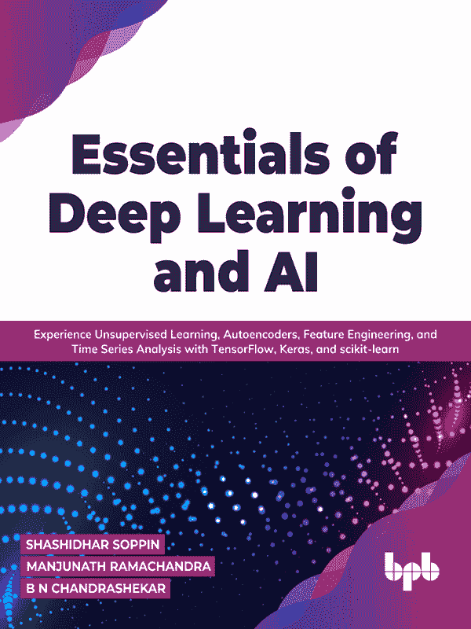


# 前言

机器学习（`ML`）和人工智能（`AI`）正在改变业务的几乎每一个方面。从自动驾驶到库存预测再到癌症诊断，`AI` 将影响几乎每一个领域和垂直行业。

虽然显而易见 `AI` 是我们时代最重要的技术，但市场的人才不足。这部分部分是因为学习和掌握 `ML` 和 `AI` 概念的复杂性。许多渴望成为 `AI` 工程师的新专业人士和现有软件开发人员往往会被工具和技术的深度所困扰。

这本由 Shashidhar Soppin、Manjunath Ramachandra 博士和 B N Chandrashekar 编写的《深度学习与人工智能精要》，采用独特的方法介绍了 `AI` 和 `ML` 的基本概念。由于涵盖的主题广泛而深入，它将吸引初学者和丰富的机器学习工程师。它是市场上最全面的 `AI` 书籍之一。

我喜欢这本书的一点是它在 `AI` 的理论与实践之间取得了平衡。它没有让那些背景并非数学或统计学的人感到畏惧。它在经典机器学习与深度学习、当前与新兴 `AI` 技术之间取得了正确的平衡。它对于开发者、业务经理、技术决策者和 `IT` 领导者都有意义。

这本书具备成为教授 `ML` 和 `AI` 的权威指南或教科书的所有要素。每章都有摘要作为快速参考。每章最后的选题让读者能够评估自己。

如果你想学习从 `AI` 的演变到集成方法和模型优化等高级概念的所有内容。

# 关于作者

## Shashidhar Soppin

Soppin 现任首席顾问，是 Wipro Technologies 的资深专家，拥有约 20 年的行业经验。他是印度科学学院研究生，通过担任研究员、数据科学顾问、技术总监和全栈 `AI` 顾问等角色，提升了自己的信誉。他处理过多个跨领域项目，从基础设施搭建到范围确定、开发、交付以及支持和维护。他具有尖端技术的工作经验，并在短时间内适应任何新技术。他具有编写提案的经验，并精通多种高级编程和脚本语言。他对开源程序和工具做过贡献，并合著了期刊和会议论文。他在 `medium.com`、`researchgate.net` 和 `OSFY.com` 等在线门户发表过著作。

## Manjunath Ramachandra 博士

Ramachandra 博士在医疗保健、电信和消费电子领域拥有超过二十年的混合经验，涵盖信号处理、人工智能、云计算、物联网、无线通信和量子计算等技术。他曾任职于 Tata Consultancy Services、Royal Philips，并在 Wipro 首席顾问。他申请了约 90 项专利，在国际会议和期刊上发表了 210 篇论文，并是 NASSCOM 嵌入式系统特别小组的成员。他在 Wi-Fi Alliance 等国际标准化组织中代表行业，担任数字生活网络（`DLNA`）区域配置文件标准的编辑，并担任 CE-Linux 论坛的行业联络官。他发表过 24 多场主旨演讲，并主持了 21 多场工作坊和教程课程。他入选了《2008 年世界名人录》和英国国际传记中心的“21 世纪 2000 名杰出知识分子”。他的兴趣领域包括深度学习、人工智能和信号处理。

## B N Chandrashekar

Chandrashekar 现任首席顾问，是 Wipro Technologies 的资深专家，拥有约 20 年的行业经验。他是印度科学学院研究生，通过担任研究员、数据科学顾问、技术总监和全栈 `AI` 顾问等角色，提升了自己的信誉。他处理过多个跨领域项目，从基础设施搭建到范围确定、开发、交付以及支持和维护。他具有尖端技术的工作经验，并在短时间内适应任何新技术。他具有编写提案的经验，并精通多种高级编程和脚本语言。他对开源程序和工具做过贡献，并合著了期刊和会议论文。他在 `medium.com`、`researchgate.net` 和 `OSFY.com` 等在线门户发表过著作。

`Sethuraman U.` 目前在德国黑森州美因克福的松下汽车电子公司担任技术主管。他在计算机视觉、深度学习、机器学习、`AR/VR`、高级驾驶辅助系统（`ADAS`）、嵌入式系统、视频编码器等多个领域拥有多年经验。他毕业于皮拉尼比拉理工学院（Birla Institute of Technology and Science, Pilani），获得技术硕士学位（`MTech` 软件系统，数据分析方向）。他拥有巴拉蒂达森大学（Bharathidasan University）电子与通信工程（`ECE`）学士学位。他在 `IT` 行业多个领域拥有多年经验，并拥有多项专利且发表过学术论文。在加入松下之前，他曾就职于 Wipro R&D、Toshiba India Pvt. Ltd 和 GDA Technologies Inc（现为 L&T InfoTech 公司）。

# 致谢

我们非常感谢 BPB 出版公司，他们愿意出版这本书，且 BPB 的整个团队始终友善、合作且体贴。Sethuraman 先生和 Raju（来自 Wipro CTO 团队）以极大的耐心审查了这本书，帮助我们表达了想说的内容，并用心心地改进了书中的每一页。他们的耐心和指导是无价的。

通过使用现代方法以及人工智能和机器学习技术，将学习概念性技术的旅提升到了高度，这是非常有意义的，因为它让我们获得了为一些客户服务并解决他们关键问题的机会。

特别感谢 BPB 的设计、技术和手稿团队在设计精美封面时的耐心，感谢 `Mr Janakiram MSV` 这位在接到短通知后撰写序言的分析师、顾问和架构师。

`Chandrashekar B N`：此外，我想感谢我的妻子、父母、女儿、家人和亲戚，无论他们是否察觉，他们都在方方面支持我以完成这本书的成型。感谢我的经理、朋友以及所有信息媒体来源，他们帮助我构建了本书的知识。

`Shashidhar Soppin`：特别大感谢我的妻子、女儿、妈妈和岳母这“四位女士”，她们用美味的食物和持续的支持支持我；感谢我的兄弟和已故父亲在写书期间提供的激励和指导。我也感谢我的家人、亲戚、经理、朋友以及所有帮助我构建本书知识的来源。

`Manjunath Ramachandra Iyer`：我深感谢那些让 `AI/ML` 技术普及并易于使用的科技巨头。也感谢我的妻子、母亲、孩子、阿姨、家人、亲戚和猫咪，他们在整个项目中给予理解和支持。

我们感谢 Wipro 的同事、CTO 团队、ER&D 团队及其领导们，如果没有他们的理解，这本书无法出版。

我们感谢 Zeta 的同事、CTO 和领导们，如果没有他们的理解，这本书无法出版。

# 前言

人工智能已经深入渗透到各行业的各个垂直领域。它不仅为现有问题提供了业务解决方案，还提供了新的机会和途径。因此，对底层技术具有不同程度专业知识和接触的专家社区会有兴趣快速学习尖端技术并采用这些解决方案。虽然公共领域的内容在某种程度上为他们提供了所需信息，但也提供了过多的信息。这会导致用户失去焦点，最终可能无法获得精确信息。如今这类问题没有单一的解决方案。编写这本书的目的是通过直接提供所需信息，在很大程度上减轻用户的负担。因此，所有章节都尽可能组织成自包含的形式，提供读者寻找的精确内容。书的结构分为几个独立的模块，以增强可读性。

在每一章中，都为读者提供了充分的示例和代码段供其尝试。程序可以直接在指定的平台上执行以观察结果。书中详细介绍了用于开发模型所需的数据源、预训练模型以及获得最佳输出的可配置参数设置。章节提供的案例研究指示了当今的业务问题，书中也详细说明了解决方案。全书共包含 14 章。每章涵盖的细节如下所示。

## 这本书是写给谁的？

这本书最适合从事各种 `IT` 位的读者，如开发者、经理、业务领导者、数据科学家、机器学习工程师等。即使是经验丰富的 `AI/ML` 专家/用户也可以从书中获得价值材料。它还触及了 `AI/ML` 和深度学习（`DL`）技术的高级主题。

## 本书回答哪些问题？

在编写这本书时，我们作者与来自各行各业的许多学术和行业专家。以下是我们想要强调的一些问题：

*   对神经网络构建的基础理解，以尽可能简单的方式解释 `AI` 概念。

*   我们想强调为什么人们应该投入时间学习这些技术。

*   以简化的方式详细介绍了学习概念和技术的多种方法。

# 第 1 章

本章提供了不同行业垂直领域所用 `AI` 技术的概述和历史演变。它考虑了用户偏好以及动态情绪状态。简述了 `AI`、`ML` 和 `DL` 的广泛分类。本章涵盖了 `AI` 在不同行业领域和部门的应用。涵盖了 `AI` 生命周期中使用的端到端工具和框架。描述了用于构建 `ML` 和 `DL` 模型的各种数据集。

# 第 2 章

本章描述了监督学习中最常用的一类算法。本章详细介绍了数据提取、数据标注和更佳预测的各种方法。描述了工业上广泛使用的光学字符识别。本章详细介绍了用于监督学习算法的库和包。涵盖了用于优化和损失方法的性能指标描述和计算技术。

# 第 3 章

本章描述了在没有标记数据时使用的一种流行且具有挑战性的算法类。本章描述了各种聚类技术和数据预处理方法。解释了重要输入特征的选择，以及使用各种 `PCA` 技术和 `奇异值分解 (SVD)` 进行降维的方法。提供了所解释的各种技术所需的库和包。涵盖了用于优化和损失方法的性能指标描述和计算技术。

# 第 4 章

本章描述了将原始数据一组有用特征的过程。它详细介绍了特征提取、特征选择和特征硬化。通过更好的特征选择，它有助于构建稳健且灵活的模型。它描述了特征编码、数据准备和特征工程的各种技术。

# 第 5 章

本章提供了对高级分类技术、数据关联、聚类和回归的深入理解。本章解释了处理从简单到复杂特征以及从小到巨大数据量的各种数据的技术。提供了零售业推荐系统的案例。

## 第 6 章

本章解释了处理时间序列数据的各种方法。它涉及了各种时间序列模型和相关算法。描述了时间序列算法的分类并附带示例。描述了如何将时间序列数据用于预测模型。

## 第 7 章

本章提供了在数据被模型消耗之前的各种数据清洗技术。描述了数据格式化和归一化等各种预处理技术。分析了偏置和方差对模型的影响。提供了处理模型过拟合和欠拟合的不同技术。提供了数据格式化和归一化的用例和示例。

## 第 8 章

本章涵盖了使用算法集成将弱模型组合以开发强模型的机制。描述了工业级模型的系统化方法、超参数调优和最优参数选择。解释了提升（`boosting`）和遗传算法等集成方法的最新趋势。

## 第 9 章

本章解释了使用深度学习技术处理的最复杂、最最困难的人类类数据处理方法之一。这种技术有助于解决机器学习算法无法处理的问题。本章详细介绍了 `CNN` 的训练机制和架构。

## 第 10 章

本章重点关注从简单感知器和激活函数开始的多层感知器（`MLP`）。它解释了简单感知器模型的架构。提供了 `MLP` 的最新趋势，如知识蒸馏，并附有编程示例。

## 第 11 章

本章主要用于处理序列数据的长短期记忆模型。解释了 `RNN`、`GRU` 和 `LSTM` 的架构。描述了门架构的分析细节。详述了 `LSTM` 的变体，如双向 `LSTM` 和基于注意力的 `LSTM`。

## 第 12 章

本章涉及为给输入数据自动生成特征。`Autoencoders` 处理编码器和解码器，并与前馈神经网络连接。提供了 `MNIST` 数据集的特征生成示例，并讨论了 `autoencoders` 及其变体的架构。本章详细介绍了 `autoencoders` 在去噪和稀疏表示中的用法。

## 第 13 章

本章涵盖了深度学习和机器学习算法的工业应用。详细介绍了不同的硬件和软件方法。描述了电信、`IoT`、医疗和云领域的业务用例。本章解释了多个 `AI/ML` 算法如何整合到工作系统中。

## 第 14 章

最后一章讨论了 `AI`、`ML` 和 `DL` 的潜在用途以及未来的新兴技术。这些技术丰富了 `AI/ML` 算法，为它们的执行提供了更快更安全的方法。这些技术包括量子计算、云计算、`5G` 和神经形态计算。`AI/ML` 使得这些技术的广泛成为。

# 下载代码包和彩色图片：

请点击链接下载书籍的`Code Bundle` 和`Coloured Images`：

[`rebrand.ly/a49452`](https://rebrand.ly/a49452)

# 版错 (Errata)

我们对 BPB Publications 的工作感到非常自豪，并遵循最佳实践以确保内容的准确性，为订阅者提供极佳的阅读体验。读者是我们的镜子，我们利用他们的反馈来反映并改进出版过程中可能出现的任何人为错误。为了让我们维持质量并帮助我们联系到可能因不可见错误遇到困难的读者，请邮件联系我们：

`errata@bpbonline.com`

BPB Publications 全家非常感谢您的支持、建议和反馈。

您知道吗？BPB 为出版的每本书都提供 `eBook` 版本（包含 `PDF` 和 `ePub` 文件），您可以在 [www.bpbonline.com](http://www.bpbonline.com) 升级到 `eBook` 版本。作为纸质书客户，您还可以获得 `eBook` 的折扣。更多详情请通过 `business@bpbonline.com` 与我们联系。

## BPB 正在寻找作者

如果您对成为作者感兴趣，请访问 [www.bpbonline.com](http://www.bpbonline.com)

## 盗版 (PACY)

如果您在网上发现我们作品的任何形式的非法副本，请提供位置或网站名称，我们将不胜感激。请联系我们：`business@bpbonline.com`

## 如果您对成为作者感兴趣

如果您在某个领域有专业知识，并对编写或贡献书籍感兴趣，请访问 [www.bpbonline.com](http://www.bpbonline.com)

## 评论 (REVIEWS)

请留下您的评论。在您阅读并使用这本书后，为什么不在购买的网站上留下评论呢？潜在读者随后可以看到并利用您的公正意见来做出购买决策，我们 BPB 可以了解您对产品的看法，我们的作者也可以看到他们的反馈。感谢！

欲了解更多关于 BPB 的信息，请访问 [www.bpbonline.com](http://www.bpbonline.com)

# 第 1 章

## 引言

人类使用不同的仪器运行日常活动可以追溯到*石器时代*。从那时起，已经数以万计的设备以满足家庭、基础设施、医疗保健、娱乐、交通等需求。虽然大多数设备都是“愚笨”的，但个人助理等智能设备已开始进入市场。这类设备的愿景并不新鲜，在故事和传说中已有一席之地。从《阿拉丁》的魔灯到艾萨克·阿西莫夫的机器人，这导致了许多发明。随着时间的推移，“愚笨”设备被注入了所需的智能，以理解周围并采取相应行动。例如，当环境温度超过 35 摄氏度时，风扇就会开启。

在本章中，我们将讨论以下主题：

*   人工智能（Artificial intelligence）

    *   什么是人工智能？

    *   `AI` 的定义

    *   `AI` 的应用

    *   `AI` 的用例

    *   `AI`、`ML`、`FL` 和 `DL` 的广义分类？

*   机器学习（Machine learning）

    *   `ML` 的历史和定义

    *   `ML` 及其应用

    *   `ML` 算法分类

*   深度学习（Deep Learning）

    *   理解深度学习的前提

    *   机器学习与深度学习的区别

*   用于 `AI`、`ML` 和 `DL` 的工具和框架

*   用于 `AI`、`ML` 和 `DL` 的语言

*   用于 `AI`、`ML` 和 `DL` 的数据集

## 目标

学习完本章后，你应该能够：

*   理解 `AI`、`ML`、`DL` 的概念及其组成部分

*   了解 `AI`、`ML` 和 `DL` 的历史

*   定义 `AI`、`ML`、`DL` 并给出一些示例和应用

*   总体使用 `AI`、`ML` 和 `DL` 的好处

*   用于 `ML` & `DL` 的编程语言

*   用于 `ML` & `DL` 的标准工具

*   用于模型开发的参考数据库

## 1.1 人工智能

让计算机“`像人类一样思考`”是人工智能发展的主要动力。以这一目标为指导，本章后文将描述的许多先驱都对 `AI` 及其发展做出了贡献。计算机科学领域的许多进展也间接帮助了 `AI`。所有这些因素共同作用，使得人工智能在多年里得到了蓬勃发展。

### 1.1.1 什么是人工智能？

`人工智能`（`AI`）是一个跨学科的统术语，涵盖了将人类智能整合到系统中所需的工具和技术。该系统可以是一段软件（如对话系统），也可以是硬件组件（如智能`物联网`（`IoT`））或机器（如机械臂）。`Alan Turing`（艾伦·图灵）为设备或程序被称为智能的测试标准，以指示它们模仿人类的接近程度。

我们正处于`信息时代`（有时也称为`计算机时代`、`数字时代`或`新媒体时代`），这是现代人类历史的黄金时代。从自拍到云端存储文件，从基于 `IoT` 的设备的增长到社交媒体的使用，我们每天处理数万亿字节的数据。20 世纪个人产生的数据量是惊人的，而未来这个数字将是巨大的。截至 2019 年底，估计人类已经生成了大约 2.5 万亿字节的数据。

这种数据的突增需要人类大脑来处理，将非常具有挑战性且繁琐。目前的大部分数据分析是由基于人工智能的机器/系统完成的，因为有了海量的数据收集并产生了大量的见解，帮助人类应对业务和软件行业中出现的许多预测趋势。

### 1.1.2 人工智能的定义

`AI` 从 1950 年代 `Alan Turing` 时代演变至今。这些年来出现了许多 `AI` 的定义。为了让事情变得更简单容易，汇编了行业先驱们对 `AI` 的所有标准定义。下表解释了 `AI` 的演变，描述了在某一年创造/定义 `AI` 术语的人及其时间和链接。

| 索引 | 年份 | `AI` 定义 | 定义者 | 参考：链接 |

| --- | --- | --- | --- | --- |


| 1 | 1950 | `Alan Turing` 没有定义什么是 AI。但在执行非常著名的`图灵测试`时，他提出了`机器是否可以思考？`的问题。 | `Alan Turing` | [`plato.stanford.edu/entries/turing-test/`](https://plato.stanford.edu/entries/turing-test/) [`www.csee.umbc.edu/courses/471/papers/turing.pdf`](https://www.csee.umbc.edu/courses/471/papers/turing.pdf) |

| 2 | 1978 | 自动化我们与人类思维相关的活动 | `Bellman` | [`archive.org/details/`](https://archive.org/details/) |

| 3 | 1985 | 为了让计算机思考而进行的有趣尝试 | `Haugel` | [`archive.org/details/`](https://archive.org/details/) |

| 4 | 1985 | 通过计算模型研究具有智能的功能 | `Charni &McDermott` | [`dl.acm.org/doi/10.5555/3026`](https://dl.acm.org/doi/10.5555/3026) |

| 5 | 1990 | 创建执行人类智能机器的艺术 | `Kurzweil` | |

| 6 | 1992 | 研究能够感知、推理和行动的计算 | `Winston` | |

| 7 | 1998 | 计算智能是研究关于人工制品的智能行为 | `Poole et.al` |

表 1.1

当我们谈论人工智能时，脑海中立即出现了一个问题：“计算机能像人类一样思考吗？”。上述许多定义都尝试回答这个问题。但最近的一对 AI 先驱 `Peter Norvig` 和 `Stuart J` 让它比定义变得更简单。他们认为，通过`像人类一样思考`和`理性思考`相结合，可以对 AI 如何工作得出结论。他们继续说：`计算机代理能够自主行动、感知环境并长时间持续、适应变化并采取目标` `理性代理是指能够为了实现预期的最佳结果（例如持续或达到目标）`

从上述定义可以看出，计算机不仅能够自主工作，还能与理性代理一起工作产生最佳结果。

### 1.1.3 人工智能的应用

今天，机器可以玩挑战脑力的游戏，如 `Pogo Atari`、象棋，并击败领域的冠军。第二次世界大战后，变化的的地缘政治格局和可用的技术导致了医疗保健和制造业在内的各行业的革命。大量数据涌入，促成了具有强大计算能力的智能机器的发展。智能算法使用 `Prolog` 和 `Lisp` 等语言开发，用于处理机器人和卫星的数据。人工智能系统起源于那里并继续了这段旅程，经历了蜕变为 `Python` 或 `Java` 驱动的深度学习算法，支持来自移动手机或游戏盒的数据。

人工智能系统在结构和功能上通常模仿人类。信息被组织成具有不同抽象层次层次、聚类、分类、插值和预测，就像在大脑中发生的一样。人工智能的几个学科（如卷积神经网络、神经形态芯片`自组织映射`（`SoM`））与人类大脑具有惊人的相似之处。人工智能系统的各种功能属于人工智能系统的抽象层，如 `图 1.1` 所示：

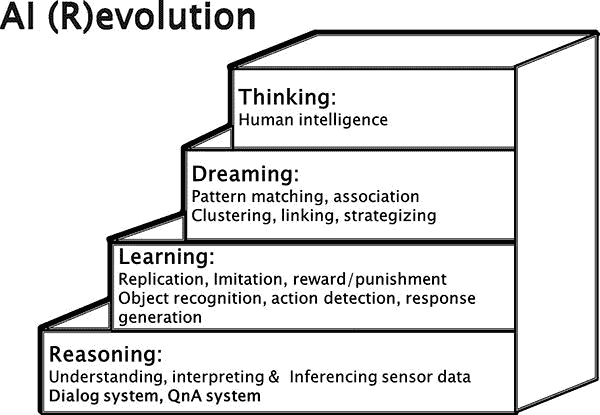

**图 1.1:** 人工智能系统的抽象层

让人工智能（AI）跨越多个领域，包括机器学习、机器人、认知计算、神经科学、计算机视觉、自然语言处理、特征工程、数据科学等。此外，这些领域之间存在某种程度的重叠。与 AI 重叠的一些技术在`图 1.2`所示：

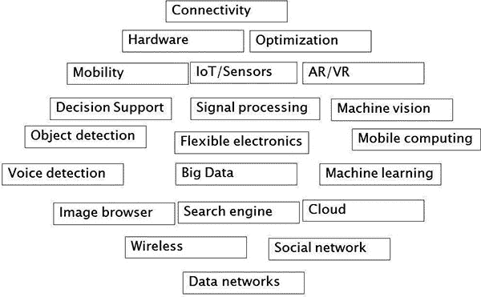

**图 1.2:** AI 系统的抽象层次

虽然人们预期机器能够代表用户进行思考（并行动），但这仍然是幻的。然而，硬件架构和算法领域的发明正在让这一变为现实。今天，设备已经能够根据用户的上下文操作，“个人助手”可以根据它们能够挖掘和提取的大量数据以及与用户相关的信息，提供及时建议。它们能够为用户提供及时指导。例如，当用户在小巷中开车时，可以提供出口路径，或者在预计几小时后可能下雨时提醒用户带伞。构建 AI 系统的要求之一是拥有大型数据语料库。虽然更多数据是好事，但会导致模型过拟合，使模型过度暴露于特定示例，导致在处理异构数据时表现不佳。为了确保设备或应用使用充分的数据进行学习，机器学习学科在 AI 内部得到了发展。

`图 1.3`提供了 AI、ML、FL 和 DL 之间的区别。这个洋葱结构图清晰地解释了它们各自是什么以及相互依赖的关系。图的右侧简要解释了每个定义：

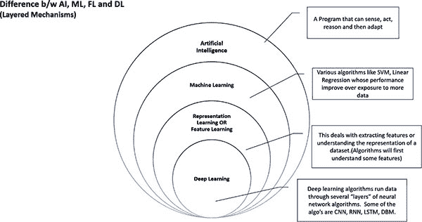

**图 1.3:** AI、ML、FL 和 DL 的区别

上述图表解释了 AI、ML、FL 和 DL 如何区分。所有这些机制都相互依赖，或者说它们像洋葱结构一样。

# 1.1.4 行业领域、部门及示例案例](#toc.xhtml#s7a)

后续章节介绍的概念被用于各种现实解决方案。它涵盖了金融、医疗保健、自动化、汽车、能源、消费、电信等领域，以及如物联网（IoT）、5G、云计算、大数据、聊天机器人、脑机接口、增强现实、虚拟现实和无人机等技术。

应用可以分为实时和离线两类。这种区别影响执行平台。实时应用要求算法在规定时间内执行并渲染结果。例如，在威胁检测中，需要对监控摄像头的图像进行实时分析。根据推理结果，用户需要对潜在威胁的警报。这与基于用户数据的信用卡分配示例形成对比。模型可以离线运行，并根据提供的数据给出“分配/不分配”的决策。

根据数据大小分类，存在两类应用——一类大量利用数据，另一类则处理较少的数据。

*   例如，人脸检测或光学字符检测模型需要大型数据库进行训练和严谨的验证。由于此类数据库可用且可访问，可以构建出高精度的 AI 模型。

*   根据数据大小分类，存在两类应用——一类大量利用数据，另一类则处理较少的数据。

（注：原文后续存在大量重复的段落，已根据不重复输出原文的原则进行处理。）

深度学习是更广泛的机器学习方法家族的一个子集。它的引入目标是让机器学习更接近其主要目标——人工智能。同样，表示学习或特征学习是机器学习机制的一个子集，负责处理从提供的数据集中提取特征或理解数据集的表示问题。

## 1.2 机器学习

如前文所述，机器学习是人工智能的一个子集。

1959 年，`Arthur Samuel` 将机器学习定义为：“一个赋予计算机在不经过显式编程的情况下进行学习能力的研究领域。”这在随后的几年里开启了大量的研究，但后来陷入了停滞。

在近期，`ML`（机器学习）被认为是数据科学不可或的一部分，可用于构建预测模型。在任何机器学习机制或系统中，计算机都被教导如何利用海量数据集解决特定问题，并为其提供模型。

机器学习也被定义为计算机科学的一个分支，其中算法（运行在计算机内部）从其可用的数据或数据集中学习。通过这种学习机制，这些各种机制的输出将用于用于构建预测模型。

### 1.2.1 机器学习的历史与定义

从历史角度来看，机器学习一直由许多行业专家定义和发展。下表列出了行业领柱对机器学习的各种定义/解释：

| 索引 | 定义者 | 期间 | 定义 |

| --- | --- | --- | --- |

| 1 | `Arthur Samuel` | 1959 | “ML 是一个赋予计算机在不经过显式编程的情况下进行学习能力的研究领域。” |

| 2 | `Tom Mitchell` | 1997 | “如果一个计算机程序对于某些任务 T 和某些性能衡量标准 P，其根据 P 测量的在 T 上的性能随着经验 E 的增加而提高，则说该程序从经验 E 中学习。” |

| 3 | `Drew Conway` 注：- 他创建了所谓的“数据科学恩图”。 | 2010 | Drew 在 2010 年 9 月创建了一张精美的恩图，在其中的解释中，他表示：机器学习 = 黑客技能 + 数学与统计学 |

| 4 | 开发者社区的通用定义 | 2014 | 机器学习是从数据中训练模型，并针对性能衡量标准做出泛化的决策。 |

| 5 | `Stephen Marsland` | 2009-10 | “那么，机器学习就是关于让计算机修改或适应它们的动作（无论这些动作是做出预测还是控制机器人），以便这些动作更加准确，其中准确性通过所选动作反映正确动作的良好程度来度量。” |

| 6 | `Aurélien Géron`（作者） | 2014-17 | “机器学习是计算机编程的科学（和艺术），使其能够从数据中学习，” |

**表 1.2**

### 1.2.2 机器学习及其应用

许多时候，机器学习被描绘为数学与统计、黑客技能和实质性知识之间的交集。`Drew Conway` 用一个恩图著名地描绘了这一点。这被称为“数据科学恩图”。

附图清楚地显示了机器学习是如何与各个方面交叉的。因此，为机器学习给出一个标准定义是有挑战性的。所以，人们很容易说，机器学习是“黑客技能”和“数学与统计学”的结合。从更广泛的角度来看，数据科学跨越了三个方面：“黑客技能”、“数学与统计学”和“领域知识”。因此，机器学习（ML）和数据科学（DS）之间存在细微差异。下图完美地解释了这一点：

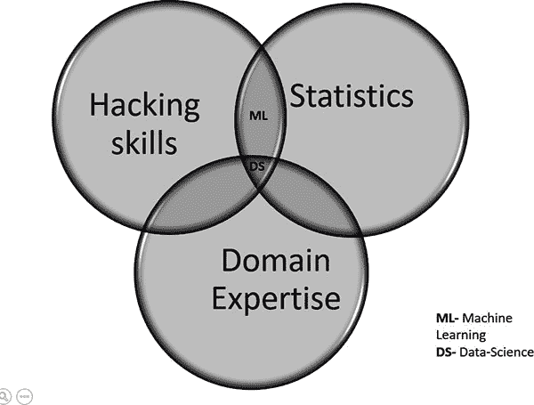

**图 1.6:** 数据科学与机器学习恩图

`Figure 1.6` 是一种恩图，显示了数据科学和机器学习如何依赖于“统计学”和“黑客技能”。

基于机器学习的算法最常见的应用之一是垃圾邮件分类。垃圾邮件中的一些常用术语被用作标签来训练模型，以将其分类为垃圾邮件或非垃圾邮件。垃圾邮件中的常用术语被用于训练模型将其分类为垃圾邮件或非垃圾邮件（有时称为 ham）。常见的关键词包括“全大写主题”、“贷款获批”、“中奖”等。

这里的“标注数据”指的是被标记了与其关联的一个额外名称的数据。例如，根据照片的特征和性状，一张图像被标记为猫的照片或狗的照片。

这有助于在后期通过进一步的分类和归类，对“未标注数据”进行分类和训练。

基于某些特征，这些标签是被预测/猜测出来的。一旦预测完成，该样本组就会被标记上该名称。通过持续提供输入来生成输出，这些输出无非仅仅是“标签”。训练涉及各种类型的数据集和模型构建。这些将在后面的章节中进行详细解释。

一些知名且常用的监督学习算法如下：

*   回归（连续目标变量）

    *   线性回归

    *   逻辑回归

    *   集成方法

    *   决策树和随机森林

    *   支持向量回归 (SVR)

    *   高斯过程回归 (GPR)

*   分类（离散目标变量）

    *   支持向量机 (SVMs)

    *   朴叶贝斯

    *   K-近邻 (KNN)

*   常见神经网络

    *   多层感知器 (MLP)

## 2. 无监督学习

这些算法顾如其名，不受人类的监督。这意味着训练数据是“未标注”的。

在无监督学习中，完全没有老师的参与。系统或计算机学习的是数据中不同的模式/结构。基于这些模式，可以将数据分组，并将模式作为输出类别。基于这些模式，可以发现一组规则，这些规则以后可以推导出有意义的见解。这些算法也可以用于构建描述性模型。

与监督学习不同，这些算法不会预测或发现针对数据集特定内容。

一些知名且常用的无监督学习算法如下：

*   聚类（连续）和降维

    *   K-means

    *   K-medoids

    *   层次聚类分析 (HCA)

    *   期望最大化算法

    *   隐马尔可夫模型

    *   神经网络

    *   PCA (主成分分析)

    *   SVD (奇异值分解)

    *   核 PCA

    *   t 分布随机邻域嵌入 (t-SNE)

    *   局部线性嵌入 (LLE)

*   关联分析（离散）

    *   Apriori

    *   Eclat

    *   FP-Growth

## 3. 半监督学习

坦率地说，这并不是一种算法类型。但为了对某些属于监督算法或无监督算法或二者兼有的算法进行分类，使用了这种机制。因此，可以这样理解：数据集中的观测值没有标签，或者标签仅适用于某些观测值。

在某些数据标注成本高昂但需要结合部分数据标注和部分未标注的情况下，可以使用这些算法。

一些知名且常用的无监督学习算法如下：

*   Uclassify

*   GATE

## 4. 强化学习

这是目前流行的算法学习机制类型之一。许多复杂模型正在通过监督学习或无监督学习与强化算法相结合来构建。

这本身就是一个不同的类别，所谓的 `agent`（代理）观察环境，选择并执行各种动作，并相应产生奖励或惩罚。

*   **Q-Learning**: `Q-Learning` 是一种无模型的强化学习算法，`Q-Learning` 中的 "Q" 代表质量（quality），用于确定给定动作在获得未来奖励方面有多有用。

*   **时序差 (TD)**: `TD` 是一种学习如何预测某个值的方法，该值可能依赖于给定信号的未来值。

*   **深度对抗网络**: 深度对抗信念网络有时也称为 `DBN`，是高度可行的数值算法。

*   **马尔可夫决策过程 (MDP)**: `MDP` 使用涉及 `agent`、`environment`、`state` 和 `action` 的方法论，这些要素相互依赖。

*   **蒙特卡洛树搜索**: 这是一种用于决策过程的启发式搜索算法。

*   **异步执行者-评论者代理 (AAAC)**: 该算法在涉及不同环境并行进行某些全局网络优化以用于泛化的实验中是有益的。

## 1.3 深度学习

在跳到定义深度学习之前，让我们先学习人类大脑是如何工作的？人类的中枢神经系统是如何连接在一起并让数十亿个神经元相互通信的？

人类神经系统与深度学习网络之间存在某种类比。

人类大脑由数十亿个神经细胞或神经元组成。这些神经元具有通过“突触”传输电化学信号的能力，突触是任何两个神经细胞之间的连接。这些有时被认为类似于计算机世界中的门和电线。

我们每天的经历、感觉和各种正常功能都会触发许多基于神经元的活动，这些活动随后转换为所谓的反应/通信通道。

从人类大脑中提取了第一个神经元（神经细胞），通过显微镜观察，“圣地亚哥·拉蒙··卡哈尔 (Santiago Ramon y Cajal (1852-1934))”看到了神经元——单个细胞，并确立了神经元是使用众为人知的“突触”进行通信的。由于这一发现，他在 1906 年荣得了生理学或医学领域的诺贝尔奖。

参考：- [`www.nobelprize.org/prizes/medicine/1906/cajal/facts/`](https://www.nobelprize.org/prizes/medicine/1906/cajal/facts/)

请参考参考链接中提到的图，该图显示了由 `Santiago Ramon` 绘制的最神经神经元。这张照片是最伟发现之一，因为它引导医学科学走向了新的道路。

参考：- [`www.quantamagazine.org/why-the-first-drawings-of-neurons-were-defaced-20170928/`](https://www.quantamagazine.org/why-the-first-drawings-of-neurons-were-defaced-20170928/)

`Santiago Ramon` 还通过实验提取了单个神经元，并绘制了第一个神经元图，同时解释了该神经细胞所有部分的功能。参考链接中的图是他提取并绘制的第一个神经细胞。该神经细胞由细胞体、细胞核、轴突等组成。它们在新的图中得到了解释。

参考：- [`www.brainfacts.org/brain-anatomy-and-function/cells-and-circuits/2018/santiago-ramon-y-cajal-the-first-modern-neuroscientist`](https://www.brainfacts.org/brain-anatomy-and-function/cells-and-circuits/2018/santiago-ramon-y-cajal-the-first-modern-neuroscientist)***

这一发现并在近一个世纪里为人类大脑、认知能力、人类感知、人类对感的反应、人类记忆及其类型、人类思考等开启了许多研究。

在过去的几年里，广泛的研究重点集中在人类大脑及其内部神经网络上。这项研究随着计算机行业的进步，促进了 AI 和 ML 技术的发展。计算机行业和学术界的许多研究人员长期梦想构建类似于人类大脑的智能机器。希望有一天能够实现。

*[图 1.7]* 解释了单个神经元、它的外观以及各个部分和功能，如下所示：

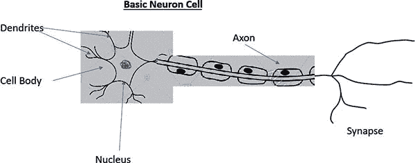

**图 1.7:** 单个神经细胞

1958 年，美国心理学家 `Frank Rosenblatt` 尝试构建一种“能够像人类大脑一样感知、识别、记忆和响应的机器”。他将这种机器命名为 `Perceptron`（感知机）。

在同期的 1956 年左右，`Hubel` 和 `Wiesel` 进行了广为人知的“猫实验”。在这次实验中，他们根据猫视网膜前方亮物体的运动，记录了猫视觉皮层的神经元读。这发现复杂信息是如何通过亮物体的运动从视觉通路中提取的。

通过观察这些事件，主要有“六件事帮助了深度学习的繁荣”。以下列表和图表清晰地解释了这些转折点：

1. **1906：** `Santiago Ramon` 发现了人类神经细胞的样子。

2. **1950：** 图灵所有广为人知的“图灵实验”。

3. **1961-1980：** `Geoffrey Hinton` 团队使用 `MLP`、`backpropagation`（反向传播）和 `Boltzmann’s machine`（玻尔兹曼机）提出了前馈神经网络（ANN）。

4. **1988-1996：** `Yann Lecun` 致力于手写字符识别以及卷积神经网络（`CNN`）的开发工作。

5. **1996-2005：** `Yoshua Bengio` 团队提出了序列概率模型、词嵌入以及生成对抗网络等。

6. **2010-2020：** 数据、计算能力（`CPU`）和 `GPU` 的可用性以及负担能力。

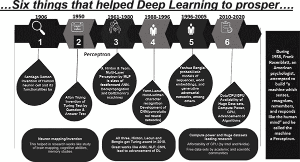


**图 1.8：** 帮助深度学习繁荣的六件事

图 1.8 清晰地解释了这六个事件如何帮助深度学习走向繁荣。任何深度学习领域的新手都能轻松看出是什么导致了深度学习的进展和发展。这些事件虽然是独立的，但都发生在一个重要的时期。

### 1.3.1 理解深度学习的先决条件是什么？

如今，任何人都可以找到多个关于学习深度学习的讨论论坛和博客。但是，理解深度学习是否必须掌握高等数学（微积分）？或者是否必须成为所有机器学习概念的专家？

现在有许多关于深度学习及其研究的论坛和博客。但在开始学习深度学习之前，选择合适的论坛或内容始终是一个挑战。早人们认为只有 `ML` 专家才能学习深度学习；而这只是一个假设。现在，任何人都可以从零开始快速上手学习深度学习。

但在我们看来，这应该根据具体情况进行评估。话虽如此，如果你想在没有任何先决条件的情况下直接理解深度学习并认真对待它，最好了解以下内容：

* 神经网络的基本功能
* 对高等微积分基础的理解
* 对矩阵、向量和线性代数的理解
* 算法（监督学习、无监督、梯度下降、在线、批量等）
* `Python/R` 编程
* 针对具体情况的数学方程或公式

如今模拟人类大脑的活动正变得越来越可行。

以下是一个简单的人工神经网络。它具有简单的架构，包含少量的 `inputs (x1, x2…Xn)`、`weights (w1, w2,…Wn)`，这些被输入到函数 `f`，输出的 `y` 是其结果。如果你比较这个简单的 ANN，它清楚地显示了 `figure 1.9` 中所示真实神经元的一些特征：

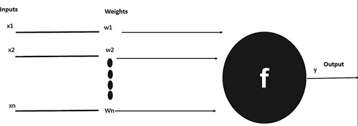

**图 1.9：** 人工神经网络

多种因素导致了这一发展，以下是主要因素：

* 我们构建大型神经网络所需的数据量和规模
* 高计算能力的可用
* `GPU` 的可用性
* `CPU` 和 `GPU` 成本降低以及两者的结合
* 机器学习的进步
* 性能的提升

2009-10 年间，ImageNet 挑战变得流行。工业界专家和学术界都参与并为这些挑战做出了贡献。

**ImageNet 大视觉识别挑战**（`ILSVRC`）是一个评估大规模物体检测和图像分类算法的机构。

一个高层动机是允许研究人员比较跨多种对象的检测进展（这是通过非常昂贵的标注工作实现的）。另一个动机是衡量计算机视觉在大规模图像索引检索和标注方面的进展。这些挑战的各种形式如下：

参考：`[http://www.image-net.org/challenges/LSVRC/]`

* `ILSVRC 2017`
* `ILSVRC 2016`
* `ILSVRC 2015`
* `ILSVRC 2014`
* `ILSVRC 2013`
* `ILSVRC 2012`
* `ILSVRC 2011`
* `ILSVRC 2010`

这些挑战的结果是各种基于图像的深度学习架构。此外，ImageNet（参考：`[https://www.image-net.org]`）也是维护巨大图像数据库的机构之一。它包含了大约 2 万类别和 1400 万张图像。这些图像涵盖动物、植物、结构等，包括各种子类。

许多深度学习架构是使用全连接层构建的。

全连接网络将输入列表转换为输出列表（也称为预测输出）。

以下是许多深度学习机制：

* 卷积神经网络（`CNN`）层
* 循环神经网络（`RNN`）层
* 长短期记忆（`LSTM`）单元
* 门控循环单元（`GRU`）
* 深度信念网络（`DBN`）
* 深度堆叠网络（`DSN`）
* 编码器

以下是许多深度学习架构：

* LeNet
* ImageNet
* AlexNet
* ResNet
* Google-NMT（神经机器翻译）
* 自组织映射
* 受限玻尔兹曼机（`RBM`）
* 网络中网络
* SqueezeNet
* GoogleNet 和 Inception

深度学习框架：

* Caffe
* TensorFlow
* Keras
* Torch
* MxNet
* PyTorch
* Glon
* Chainer

深度学习取得了许多进展。例如，由 `Demis Hassabis` 开发的名为 `Deep Mind` 的非常稳健且先进的算法（2014-15 年该公司被谷歌收购），开发了复杂的游戏 `AlphaGo`，它通过持续学习击败了人类冠军。在这个算法中，使用了深度价值网络和深度策略网络等思想。

最近，在**生成对抗网络**（`GAN’s`）中，这些深度网络看到了许多新算法的加入。GAN 内部使用的思想被称为判别器和生成器。

### 1.3.2 机器学习与深度学习的区别

下表清晰地解释了机器学习与深度学习之间的主要区别：

| **索引** | **机器学习** | **深度学习** |
| --- | --- | --- |
| **1** | 这些模型可以使用较少的数据学习 | 需要更大的数据集。 |
| **2** | 通常使用 `CPU` 进行训练 | 训练可以使用 `CPU` 或 `GPU`，两者皆可。 |
| **3** | 超参数调优有限 | 可以通过多种方式进行调优。 |
| **4** | 训练所需时间较短 | 通常，由于使用了更大的网络和数据集进行训练，需要更多时间。 |
| **5** | 准确率较低 | 准确率更高且更精确。 |

**表 1.3**

### 1.3.3 深度学习的应用

深度学习在我们经常遇到的许多即时行业应用和日常活动中发挥着作用。深度学习使用了大量数据集，而现在这些数据集使得深度学习（DL）建模变得更加容易。在难以手动识别特征的情况下，会使用深度学习模型。

以下是一些著名的深度学习应用：

* 自动驾驶汽车
* 医疗保健中的 X 射线分类 (`CNN`)
* 高级人脸识别 (`CNN`)
* 股票市场 (`ML`)
* 视觉问答 (Visual QA) (`CNN/ML`)
* 高级语音及语音辅助工具与设备 (RNN, LSTM, 语言翻译)
* 自动机器翻译 (RNN, LSTM)
* 图像识别、图像描述 (CNN, RNN)
* 异常检测与分类 (ML, DL 算法)
* 预测预测 (高级 DL, ML)
* 金融市场分析
* 自动玩游戏
* 语言翻译 (NLP, RNN)
* 像素修复 (CNN, GAN)
* 照片描述 (CNN, GAN)
* 人口统计和选举预测

## 1.4 用于 AI、ML 和 DL 的工具和框架

如前章节所述，AI、ML 和 DL 是相互关联的，它们是彼此的子集，或者相互重叠。随着对这些技术的意识提高以及海量数据的可用，世界在这些领域开始了巨大的发展，以使用 AI、ML 和 DL 来完成前几节所示的任务。为了支持这一发展，各个社区构建了多种工具和框架，允许这些技术的进步。有各种工具和框架来支持开发者、数据科学家和非编程人员，支持云端、桌面端、边缘设备和移动端等不同平台，并支持多个框架之间的交互。其中一些列举如下：

某些工具可以由没有编程知识的经理和非技术人员使用。

* `DataRobot` 是一个自动化机器学习平台，提供模型优化、并行处理和模型部署。
* `Tableau` 和 `Datawrapper` 是流行的可视化工具，允许通过点击操作以最少的精力创建图表、地图和图表。
* `Rapid Miner` 是最优秀的数据挖掘工具，允许数据准备、数据验证、建模和部署。它支持团队协作，简化项目管理和模型部署。
* `BigML` 是一个机器学习平台，允许分类、聚类、回归和集成。

有许多开源工具和框架将被研究人员和许多企业用于开发基于 AI、ML 和 DL 的应用。

* `Caffe` (用于快速特征嵌入的卷积架构) 由伯克利 AI 研究开发，是一个开源深度学习框架。它用 `C++` 编程编写并提供 `Python` 接口。
* `Deeplearning4j` 为 Java 虚拟机开发，是由位于东京和旧金山的一组 AI 研究人员在 Apache License 2.0 下开发的开源深度学习框架。
* `H2O` 是由 `H2O.ai` 设计的深度学习框架，用于处理数据和提取数据洞察。
* `OpenNN` 使用 `C++` 语言编写，是一个主要用于机器学习研究的库。
* `TensorFlow` 由 Google 的研究人员和工程师开发，是一个深度学习框架，支持 `C++`、`Java` 和 `Python` 等多种编程语言。
* `Keras` 由 Francois Chollet 于 2015 年开发，是深度学习框架的高级接口。
* `Apple’s CoreML` 是一个用于 Apple 系统和设备的开源框架。它允许将机器学习模型集成到 iOS、Apple TV、Mac OS 和 Apple Watch 应用程序中。
* 微软的 `Distributed Machine Learning Toolkit` 是一个深度学习框架，适用于实现机器学习任务、自然语言处理并进行分布式实现。
* `MLlib` 由 Apache Spark 开发，运行在 Kubernetes、Hadoop 或云平台上，使用 `Python`、`R`、`Java` 和 `Scala` 多种语言。
* `PyTorch` 是一个流行的开源深度学习框架。

有各种工具和框架来支持开发者、数据科学家和非编程人员，支持云、桌面、边缘设备和移动等不同平台，支持多个框架之间的交互。`ONNX` 是由微软和 Facebook 开发的用于特定应用的框架和工具。它允许在一个框架中训练模型并迁移到另一个框架。

* `MXNet` 和 `Gluon` 是深度学习框架，支持多种语言如：

* `C++`
* `Perl`
* `R`
* `Python`
* `Scala`
* `Javascript`
* `Julia`

它们可以配合 AWS 平台使用。

以下是主要为移动、嵌入式和边缘设备开发的深度学习框架。

* `Caffe2` (Android)
* `CoreML` (Apple iOS)
* `DeepLearningKit` (Apple iOS)
* `Mobile Compute Engine` (Android, Apple iOS)
* `PyTorch Mobile` (Android, Apple iOS)
* `TensorFlow Lite` (Android, Apple iOS)
* `Oryx2` 用于实时执行机器学习任务。基于 `Apache Kafka` 和 `Apache Spark` 构建。
* `Accord.Net` 是基于 `C#` 的 .net 机器学习框架。
* `Amazon Machine learning` 集成来自 `RDS`、`S3` 或 `Redshift` 的多种数据。在 AWS 中，有一个名为 "Sage Maker" 的服务（亚马逊机器学习平台），有助于构建各种 ML 模型。
* `Google Cloud ML Engine` 是用于构建机器学习和深度学习模型的云托管平台。

**注意：** 单一工具或框架可能无法提供所需的所有优势，可以根据灵活性、开源支持、速度、平台支持、语言支持、设备支持和环境支持进行选择。

## 1.5 用于 AI、ML 和 DL 的语言

前面的章节列出了由不同公司和研究社区提供的各种工具和框架。它们用多种语言编写，语言的选择基于项目、环境、平台、目的和灵活性。AI、ML 和 DL 的开发可以使用多种语言进行。公共领域的领域智能编程语言如下：

### 编程语言列表

* `IPL`
* `Lisp`
* `Smalltak`
* `Prolog`
* `STRIPS`
* `Planner`
* `POP-1`
* `R`
* `Perl`
* `Haskell`
* `Wolfram`
* `C++`
* `MATLAB`
* `Python`
* `Julia`

`Python`, `Java`, `C++`, `Prolog`, `Lisp` 和 `R` 是最流行的机器学习语言，其后是其他语言。Python 由 `Guido van Rossum` 开发并于 1991 年发布。它是一种强大的语言，拥有庞大的社区支持、海量的库集合，并允许灵活的使用。它提供了平台无关性，并拥有深度学习和机器学习拥有广泛的框架。Java 由 `James Gosling` 在 `Sun Micro Systems` 开发并于 1995 年发布。Java 是一种非常流行且增长最快的编程语言。Java 安全、面向对象且与平台无关，支持“一次编写，随处运行”，并广泛应用于 AI 开发中。R 语言由 `Robert Gentlemen` 和 `Ross Ihaka` 首次创建，并于 1995 年发布。它是 `S` 编程语言的实现，用于统计计算、分析、可视化和预测分析。`C++` 是最快的编程语言，由 `Bjarne Stroustrup` 于 1983 年开发。它通常用于对时间敏感的 AI 项目，拥有许多机器学习算法、统计技术，并提供高性能和效率。Prolog 由 `Alain Colmerauer` 和 `Phillippe Roussel` 于 1972 年在法国马赛开发。它是最古老的编程语言之一，是一种基于规则的声明式语言。它非常适合 AI 编程，支持模式匹配、基于树的数据结构化、自动回溯，并且最适合创建聊天机器人。Lisp 由 `John McCarthy` 于 1958 年在马萨诸塞理工学院（`MIT`）开发。它也是最古老的编程语言之一，是一个计算机编程语言大家族。它支持快速原型设计、动态对象创建，适用于归纳逻辑项目、机器学习和符号 AI。它拥有一个独特的宏系统，可以创建领域特定级别的抽象。

## 1.6 用于 AI、ML 和 DL 开发的示例数据集

早些时候为 AI 项目寻找数据集非常困难，因为每个人都担心数据共享，因为数据可能被用于错误的用途。近年来，许多社区和组织已经在网上提供了数据集，可供任何人免费使用。数据集在 AI、ML 和 DL 项目中起着关键作用。由于现在可用大量数据集，找到合适的数据集是一项艰巨的任务。你可以使用数据集查找器来寻找数据集。`Kaggle` 起于 2010 年，是 `Google LLC` 的子公司，是流行的数据集所在地之一，每个数据集都有小型社区来讨论数据和代码的细节（如果有的话）。一个带有大小、文件类型、许可证、标签、最后更新搜索选项的搜索框将轻松找到所需的数据集。`UCI machine learning repository` 由加利福尼亚大学信息与计算机科学学院创建。它是网上可用的最老的数据源之一，包含一些有趣的数据集。`Kdnuggets` 由 `Gregory Piatetsky-Shapiro` 于 1993 年作为通讯报创办。它是商业和科学社区中值得信赖的网站。它拥有来自政府机构、交易所和研究中心的数据集。`Google Datasets` 创建于 2018 年，带来了约 2500 万个数据集，并配有一个搜索工具箱，可以按名称搜索数据集并找到数据所在位置链接。`Microsoft Datasets` 由 `Microsoft` 和外部研究社区创建，拥有许多精选的数据集。

人工智能涵盖了多种新兴技术和应用。硬件平台的进步、众多算法的研究以及便携编程语言的出现，加速了这些技术在每个业务领域解决方案中的普及。如前所述，机器学习在各个领域都有其应用。机器学习（ML）中的许多算法处理的是较小的数据集。根据应用机器学习技术的背景和情况，这既是优势也是缺点。

深度学习（DL）的应用适用于更大数据集的场景，而且当我们对特征一无所知时，也可以使用 DL 技术。许多复杂的现实问题可以通过 DL 方法和算法来解决。各种工具和框架允许构建和使用 AI、ML 和 DL 应用。各种数据集的可用使能够对 AI、ML 和 DL 技术进行探索、实验和研究。这就是在本章中学习的内容。在下一章，我们将详细学习 ML 模型、应用和算法等主题。

## 要点

* 人工智能进化于 20 世纪 50 年代初
* 人工智能存在所谓的“AI 寒冬”，这是一种低谷期
* 机器学习应用于几乎所有的行业部门和领域
* 机器学习在过去十年中发展非常迅速
* 机器学习中开发了许多先进算法
* 深度学习是进化最快的技术之一
* 学习深度学习非常迷
* 深度学习技术在近年来帮助解决了复杂问题
* 深度学习已在医学领域、人脸识别和图像识别中应用
* 目前大部分研发工作发生在深度学习领域

## 问题

1. 什么是人工智能？它的意义是什么？
2. 什么是机器学习？
3. 机器学习是由谁以及如何以各种方式定义的？
4. 机器学习的各种应用有哪些？
5. 列出可以使用/应用机器学习的行业领域和部门？
6. 机器学习中的算法有哪些？
7. 什么是标记数据？
8. 机器学习算法的分类有哪些？
9. 导致深度学习发展的六个因素是什么？
10. 深度学习最近的进展是什么？
11. 深度学习中有哪些流行的架构？
12. 深度学习开发的先驱是谁？列出这三个人。
13. 深度学习术语与机器学习有何区别？
14. 研究工作通常使用哪些工具或框架？
15. 列出可用于移动设备的工具或框架？
16. 在 AI、ML 和 DL 开发方面，工具、框架和语言之间是什么关系？
17. 列出五个最流行的数据集查找工具公共数据集？

## 单选题

1. **选择正确答案**
    1. AI 是机器学习的一部分
    2. 机器学习是 AI 的一部分
    3. AI 的目标是取代人类
    4. AI 是对自我复制机器的研究

2. **选择正确答案**
    1. 深度学习是 AI 的子集
    2. 深度学习是 ML 的子集
    3. 深度学习不是 ML 的子集
    4. 以上都不是

3. **选择正确答案**
    1. TensorFlow 和 Keras 是深度学习的框架
    2. PyTorch 和 Keras 不是深度学习的框架
    3. 许多工具和 Python 库被用作 DL 框架
    4. 以上都不是

4. **选择正确答案**


1. 深度学习和机器学习都需要 CPU/GPU

2. 深度学习只需要 CPU/GPU

3. ML 只需要 GPU

4. 以上都不是

**选择正确答案**

1. 感知器由 Hinton 开发

2. 感知器由 Yann Lecun 开发

3. Yann Lecun 发明了一种读取第一个手写数字的机制

4. Hinton 设计了 NLP

**选择正确答案**

1. TensorFlow 是由微软开发的

2. Keras 是一个开源深度学习框架

3. 所有工具和框架提供相同的益处

4. PyTorch 是唯一流行的深度学习框架

**选择正确答案**

1. Kaggle 和 Kdnuggets 拥有在线竞赛的网站。

2. MS-COCO 数据集最适合自然语言处理应用

3. Visual Data 是可以用于构建视觉问答模型的数据集

4. Wikipedia Corpus 数据集最适合自然语言处理应用。

**选择正确答案**

1. C 和 C++ 用于对时间敏感的 AI 应用

2. Python 最适合构建聊天机器人

3. Prolog 和 Lisp 是脚本语言

4. 没有基于 .NET 的机器学习框架

## 答案

1. b

2. b

3. a

4. a

5. c

6. b

7. d

8. a

# 第 2 章

## 监督学习

如上一节所示，机器学习被定义为计算机科学的一个分支，其中算法从其可用数据或数据集中学习。通过这种学习机制，这些机制的输出将是预测模型。在存在的许多学习机制中，本章重点关注什么是监督学习、数据准备、清理以及监督学习的几种学习机制。随后将深入探讨分类、回归、优化和损失方法的细节。然后讨论性能，并以提供监督学习在实践和工业领域的示例或用例作为结束。

在采用监督学习时需要考虑的三个主要方面是收集数据、标记数据和预测数据。监督学习帮助组织理解不想要的结果并避免它们。对于预期的结果，它可以通过采用技术来改进它们。行业可以将监督学习应用于资源分配、销售预测和欺诈检测。监督机器学习模型必须根据新的输入数据变化进行构建，以确保它们对当前变化的输入数据做出正确的预测。

## 结构

在本章中，将讨论以下主题：

* 监督学习简介

* 数据准备

* 数据清理

* 分类与回归

* 架构与实现

    * 线性回归

    * 支持向量机 (SVM)

    * 决策树

    * 随机森林

* 优化与损失方法

* 方法性能

* 示例或用例

## 目标

学习本章后，应该能够：

* 理解监督学习的机制。

* 用于数据集的数据准备和清理步骤。

* 分类和回归的细节。

* 理解监督学习中的几种学习机制。

* 优化和损失方法。

* 学习机制的性能。

* 使用监督机器学习的示例或用例。

# 2.1 监督机器学习简介

监督学习是机器学习的一种，其原始输入及其对应的结果对于学习机制是已知的。这意味着你有一个输入变量（`x`）和一个输出变量（`y`），并使用学习机制来推断函数 `f`。理想情况下，学习算法用于学习从给定的输入（`x`）到输出（`y`）的映射函数。

`y = f(x)`

通过学习机制从给定输入输出推断出映射函数后，该函数现在可以用于映射一组新的示例。当函数能够正确确定未见实例（`x`）的输出（`y`）时，它被认为是最优的。它被称为`监督学习`，是因为在推断映射函数过程中的学习方法类似于专家或教师监督教学或学习过程。算法知道正确答案，因此它对输入进行预测，如果发现错误，将由老师或专家进行纠。当达到预期的性能水平时，可以停止学习过程。

机器学习中的许多学习算法要求数据处于某种格式。因此，可用数据集在用于学习算法之前，必须经过一些清理和准备步骤。数据清理和数据准备的主题将在后面的章节中讨论。

有许多常用的监督学习技术或方法，它们都使用前面指示的学习机制。为了更好地理解学习过程，将在“架构与实现”部分详细介绍少数学习算法。

根据输出变量的类型，监督机器学习进一步分为两类。如果输出变量是实值，则此类问题被归类为回归问题。如果输出变量是类别，则此类问题被归类为分类问题。这类学习每将在在本章的后续部分详细讨论。

作为学习过程的一部分，一旦机制能够以正确的标签或输出变量预测未见实例，学习过程将停止。这将是最优解决方案，通常将使用损失函数来实现这一点。需要衡量任何学习机制的性能，以使其成为所考虑问题的正确选择。用于衡量学习机制的性能指标将在“性能统计”部分进行讨论。

截至今天，监督机器学习已应用于几乎所有行业领域——零售、能源、银行、金融、保险、证券、电子商务、制造业、石油天然气和教育。在“示例与用例”部分，将讨论一些示例或用例，以了解监督学习如何适用于所考虑的场景。

### 监督学习的优点：

- 可以决定学习类别的数量。

- 学习方法简单易懂。

- 训练后可以删除训练数据，仅保留决策边界。

- 可以根据用于训练的示例数量使学习机制学习完美的决策边界。

- 它有助于解决各种现实世界问题，如欺诈检测、图像分类和医学图像分类。

### 监督学习的缺点：

- 算法在示例更多时容易过拟合。

- 如果训练样本包含不需要的数据，将影响准确性。

- 训练期间需要大量计算时间。

- 需要大量的数据、数据清洗和数据准备。

- 学习无法从训练数据中获得新信息。

- 训练数据应具有良好的示例以获得良好的准确性。

- 往往会导致偏差模型。

## 2.2 数据清理

可用数据不能直接用于学习机制。必须对其正确性、缺失数据、异常值的存在、格式正确性、数据量、稀疏性、重复和数据偏差进行验证。本节将更多地讨论数据清理，下一节详细介绍数据准备。

数据清理包括以下活动：

- 缺失值处理

- 异常值处理

- 检查数据稀疏性

- 去重

- 处理不一致或非标准化的值

很多时候，数据记录或实例在输入的某些字段或属性上会有空数据或缺失值。如果有足够的数据进行训练，则排除带有这些缺失值的记录，仅将未缺失任何值的记录考虑用于训练。在数据量不足的情况下，需要咨询领域或学科专家。或者，可以使用相应值的平均值、中位数和众数来填充缺失值。对于类别属性值，可以填充“缺失”或“未知”等标签名称。如果缺失值被认为对学习机制很重要，则可以使用复杂的解决方案，如随机回归插补、多重随机回归插补、回归插补、`K-Nearest Neighbors`（`KNN`）或链式多变量插补（`MICE`）来替换为适当的值。*Martijn W Heymans*和*Iris Eekhout*的作品《Applied Missing Data Analysis with SPSS and ‘R’ Studio》提供了这些方法的详细信息。

异常值对学习机制通常是错误的，因此通常需要被替换或删除。有时可以使用替换缺失数据的技术来替换异常值，例如，用属性值的平均值、中位数或众数替换它们。或者，可以使用替换最大和最小百分位数（Winsorizing 或 Winsorization）等技术，通过限制统计数据中的极值来转换统计数据，以减少可能的伪异常值的影响；可以将真实值划分为离散组（分箱）。可以应用单变量、多变量和闵可斯基方法（参见 https://www.neuraldesigner.com/blog/3_methods_to_deal_with_outliers）。也可以使用`Z-score`和`IQR`分数计算来删除异常值。

对于类别数据，不同类别的数量在机器学习中起着关键作用。数据可能具有高频类别或低频类别。如果类别数量很高，维度也会之增加，这将给学习机制带来问题。为了解决此类问题，可以采用两个或多个类别的相似值分组、咨询学科专家建议等技术。或者，对于拼写错误、大小写不一致，可以使用模糊匹配或模式匹配工具。

数据中可能会出现重复数据。重复可能出现在某个属性内部，也可能跨属性出现。需要妥善判断数据是否重复。某个属性的值可以是重复的，但其在其他属性上的对应值可能是不同的。而且，某些机器学习算法在具有重复值时表现可能更好。因此，最好在包含和不包含重复数据的情况下通过学习机制对数据进行实验。或者尝试使用选定的重复数据集增强数据集，并对学习机制进行实验。根据有无重复数据之间的性能差异，可以做出决策。如果有领域专家可用，可以根据他/她的建议来删除或保留这些数据。

由于多种原因，数据可能具有不一致或非标准化的值。假设数据是从多个遵循不同表示标准的源收集的，那么含义相同的数据将会表现不同，并可能无法被正确训练。必须对数据进行解析，并通过正确的标准化来消除不一致性。

## 2.3 数据准备

数据清洗完后，需要使用合适的数据操作和技术为学习机制准备数据。数据可能没有经过正确的格式化、采样、缩放和编码。数据中可能存在偏差、偏斜，且数据可能需要聚合或与其他数据集成。所有这些活动都属于学习机制的数据准备范畴。

这些活动如下：

*   数据集成

*   数据转换

*   数据格式化

*   数据削减

很多时候，由于实例数量较少，来自单一源的数据可能不足以学习机制。在这种情况下，可以将来自多个源的数据集成或组合，形成一个为学习机制提供足够实例的集合。在某些情况下，特征独立存在时相关性较低，但如果它们与两个或多个特征聚合或组合，就会具有更多的意义，并帮助学习机制提高性能。这被称为数据集成或聚合。相反，有时必须将特征拆分为两个或多个独立特征以提高性能，这被称为 `data decomposition`。

用于学习机制的数据在给定属性上具有非常低和非常高的数值。在这种情况下，学习机制可能会对同一属性出现的高低值赋予不同的权重。在某些情况下，尽管该属性代表一个共同实体（例如货币），但它们的数值可能代表不同的货币价值（例如美元、卢比和英镑），这可能导致学习机制产生错误的预测。数据中的这类问题需要使用数据转换技术进行纠正。缩放可以将数据转换为特定范围，使得给定属性的值被设置为共同比例。可以使用归一化和 z-score 标准化等方法来实现此目的。如果在数据中检测偏差，可以使用以下技术进行偏差缓解：

*   **预处理算法**：重新加权、优化预处理、公平表示学习和差异影响消除器

*   **处理中算法**：对抗性去偏和偏见消除器

*   **后处理算法**：等化概率预处理、校准等化概率预处理和拒绝方案分类

如果存在偏斜数据，则可以使用适用于平方根、立方根、对数、倒数和 box-cox 变换的更好的对称数据分布。

学习机制的数据应该经过格式化。根据数据的类型和分布，人们必须仔细地使用适当的预处理步骤。

数据具有特征，选择正确的特征对于任何学习机制都至关重要。有时必须丢弃或移除贡献信息较少的特征。或者，可以应用特征提取技术来减少特征数量。有许多技术——`Principal Component Analysis (PCA)`、随机森林、特征消除、`t-Distributed Stochastic Embedding (t-SNE)` 和独立成分分析。

数据清理和数据准备是预处理步骤。通过描述性统计理解数据以及通过数据可视化理解数据是预处理中的两个关键活动。使用描述性统计，以下是分析数据以理解问题的方法：

*   理解数据规模。

*   检查是否存在缺失数据。

*   理解数据类型。

*   总结数据的描述性统计以获取洞察。

*   通过相关性理解属性之间的关系。

**注意：** 数据清洗和数据准备是在应用学习方法到数据集之前执行的预处理步骤。

## 2.4 分类与回归

如图 2.1 所示，监督学习算法有两种类型：回归和分类。图中还列出了每个类型的算法列表：

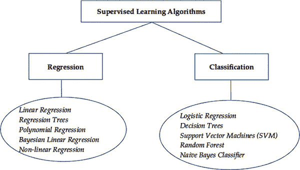

**图 2.1:** 监督学习算法类型

回归用于预测连续变量，当输入变量和输出变量之间存在关系时。例如，根据许多参数和天气预测预测房屋成本。属于这一类的算法列如下：

*   线性回归

*   回归树

*   多项回归

*   贝叶斯线性回归

*   非线性回归

分类用于预测离散或分类输出变量，这些变量可以被分为两类（二分类）或更多类（多分类）。因此，分类从标记过的数据集中学习，并将输入映射到输出中的某一类。属于这一类的算法列表如下：

*   逻辑回归

*   决策树

*   支持向量机 (SVM)

*   随机森林

*   朴素贝叶斯分类器

在上述算法中，下一节将详细讨论其中几种算法的架构和实现。

# 2.5 算法的架构与实现

在本节中，将就线性回归、支持向量机、决策树和随机森林算法的架构与实现进行详细讨论。

### 2.5.1 线性回归

回归分析是一种预测建模技术，它用于分析自变量与因变量之间的关系。自变量被称为 `predictors`（预测器），因变量被称为 `targets`（目标）。这些技术允许人们发现因变量与自变量之间的关系，以及单个或多个自变量对因变量的影响。

**线性回归**：是一种预测建模技术，通过最佳拟合直线（也称为回归线）确定自变量（`y`）与单个或多个因变量（`X`）之间的关系。变量可以是连续的或离散的。它由以下方程表示：

```
Y = aX + b + e
```

在这里，`a` 是线的斜率，`b` 是截距，`e` 是误差项。这是直线的方程，用于确定最佳拟合线或回归线，从而根据自变量的值（`X`）预测因变量的值（`Y`）。

下表给出了线性回归的类型：

| 类型 | 描述 |
| --- | --- |
| 简单线性回归 | 在给定一个因变量的情况下，预测一个自变量。 |
| 多线性回归 | 在给定两个或多个因变量的情况下，预测一个自变量。 |
| 逻辑回归 | 在给定两个或多个因变量的情况下，预测一个自变量（离散值）。 |
| 有序回归 | 在给定一个或多个因变量的情况下，预测一个自变量（有序值）。 |
| 多分类回归 | 在给定一个或多个因变量的情况下，预测一个自变量（名值）。 |

**表 2.1：** 回归类型表

现在让我们进入简单线性回归的细节。考虑点 `(x, y)` 的数据集，其散点图如图图 2.2 所示。该图展示了绘制图，其中 `y` 变量是因变量，`x` 变量是自变量：

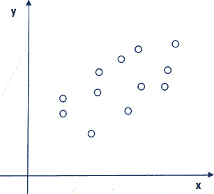

**图 2.2：** 简单线性回归的数据集点

从图中可以看出，`x` 和 `y` 之间似乎存在线性关系。一条可能从原点到顶部的、与 `x` 轴和 `y` 轴成对角的直线可以描述 `x` 和 `y` 之间的关系。这种类比很好地表明该数据集适用于线性回归。因此，可以使用之前提供的线性回归方程对数据进行建模：

```
Y = aX + b + e
```

这是直线的方程，`a` 和 `b` 是使直线移动的系数。`b` 是在给定的 `x` 和 `y` 值下，直线截交 `y` 轴的值。它被用于偏移所有做出的预测值，在机器学习术语中被称为**偏置**（bias）。`a` 定义了线的斜率，并定义了在添加偏置 `b` 之前 `x` 如何转换为 `y` 值。它在机器学习术语中被称为**权重**（weight）。`e` 是误差项，对模型起到正则化的作用。目标是在给定 `x` 和 `y` 的值的情况下，找到 `a` 和 `b` 的最佳估计值。正如图 2.3 所示，可以为给定的 `x` 和 `y` 值估计 `n` 条线，但目标是找到最佳或最优的线，以在给定 `x` 的情况下最佳估计 `y` 的值。最优线将是最佳估计，允许在给定 `x` 值的情况下找到 `y` 的最近似值，它可能不是 `y` 的精确值，但非常接近该值。

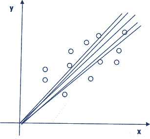

**图 2.3：** 简单线性回归的估计线

| `fit(self, X, y)` | 接收训练样本 X 和目标值 y，并在根据定的训练数据拟合模型后返回自身。 |
| `get_params(self)` | 此函数获取估计器以及包含的估计器子对象的参数。 |
| `predict(self, X)` | 该函数接收输入样本 X，并返回 X 中样本的预测类别标签。 |
| `score(self, X, y)` | 该函数接收样本 X 作为输入、相应的目标值 y，并返回预测的决定系数 R2。返回预测的决定系数 R2。系数 R2 定义为 (1 - u/v)，其中 $u$ 是残差平方和 `((y_true - y_pred) ** 2).sum()`，而 $v$ 是总平方和 `((y_true - y_true.mean()) ** 2).sum()`。最佳可能分值为 1.0，也可以为负数（因为模型可能变得任意糟糕）。一个忽略输入特征、始终预测 y 的期望值的常数模型将获得 0.0 的 R2 分数。 |
| `set_params(self, **params)` | 此函数设置估计器的参数。 |

**表 2.2：** `Linear Regression` 类的方法

### 2.5.2 支持向量机 (SVM)

支持向量机是一种监督学习机器学习算法，主要用于分类。SVM 的主要目标是以最好的方式将给定数据划分为两类。它通过在两类数据之间找到一条直线（或超平面）来实现这一目标。让我们来看以下示例，该任务是找到一条决策边界（直线），将给定的黑盒数据与白色圆圈分开：

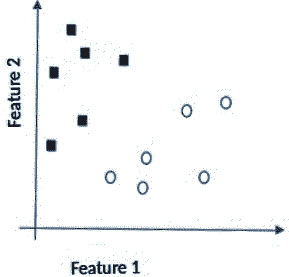

**图 2.5：** 带有黑盒和白色圆圈的数据集点

如图 2.6 所示，存在多条直线可以将给定数据分为两类，但任务是找到最能将给定数据分为两类的直线。

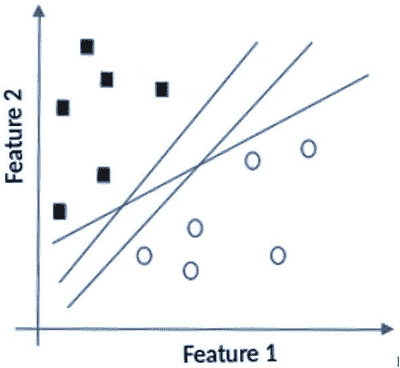

**图 2.6：** 分隔两类数据的直线

SVM 算法通过寻找最优直线来解决这个问题。它首先选择一条直线以及两类数据中离该直线最近的点。这些点被称为**支持向量**。然后它计算支持向量与直线之间的距离，该距离被称为**间隔 (margin)**。算法的目标是使直线的间隔最大。间隔最大的直线或超平面将是最优直线或超平面，如图图 2.7 所示。图 2.7 还显示了支持向量（带星号的方框和圆圈）以及具有最大间隔的最优直线：

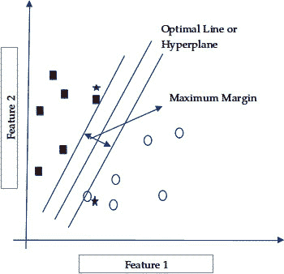

**图 2.7：** 数据集的最优直线

考虑图 2.8 中的两类数据，可以看到数据是线性不可分的。无法使用直线来线性分离这些数据，但可以使用 SVM 在高维中使其变为线性可分。

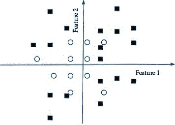

**图 2.8：** 非线性可分数据集

假设以下数据位于 x 轴和 y 轴。现在考虑根据以下方程约束构建的 z 轴，该方程告诉我们 z 轴上的新数据点将当前数据点到 x 轴和 y 轴原点距离的平方和：

`z = x² + y²`


图 2.9 显示了数据在 `z` 轴上的分布，与 `x` 和 `y` 轴相比这是一个更高的维度：

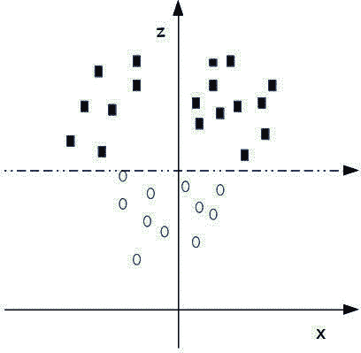

**图 2.9：** 高维中的决策边界

虚线代表高维中的决策边界。可见，虚线（决策边界）的方程由 `z = n` 给出，其中 `n` 是常数。因此，方程 `x² + y² = z` 现在将变为 `x² + y² = n`，这是一个圆方程。如果使用此变换将分割线投影回原始维度，则可以在原始维度中获得决策边界，如图 2.10 所示。该图显示了数据如何在原始维度中分布并具有分离边界：

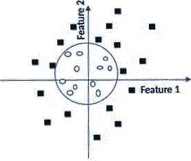

**图 2.10：** 原始维度中的决策边界

函数 `z` 被称为核函数（kernel function），用于为原始维度中不可分的数据在高维中寻找决策边界。

可以使用 `sklearn` 软件包中的 `libsvm` 库实现带有所有特征的 SVM 算法。默认参数的 SVM 类定义如下：

```
class sklearn.svm.SVC(C=1.0, kernal='rbf', degree=3, gamma=0.0, shrinking=True, probability=False, tol=0.001, cache_size=200, class_weight=None, verbose=False, max_iter=-1, random_state=None)
```

一些重要参数的细节如下：

**Kernel：** 可以是 `'linear'`、`'poly'`、`'rbf'`、`'sigmoid'`、`'precomputed'` 或 callable。它指定了使用的核类型。如果没有给出，默认为 `'rbf'`。如果设置为 callable，则使用核矩阵。

**Degree：** 是多项式核（poly）的阶，对所有其他核忽略。

**Gamma：** `'rbf'`、`'poly'` 和 `'sigmoid'` 的核系数，如果为 0.0 则将使用 `1/n_features`。

该类的方法列如下：

| 方法名称 | 说明 |
| --- | --- |
| `decision_function(X)` | 函数接收输入样本 `X`，并返回模型中每个类的决策函数。 |
| `fit(X, y, sample_weight=None)` | 接收训练样本 `X` 和目标值 `y`，并在根据给定的训练数据拟合模型后返回自身。 |
| `predict(X)` | 函数接收输入样本 `X`，并返回 `X` 中样本的预测类别标签。 |
| `predict_log_proba(X)` | 函数接收样本 `X` 作为输入，并返回模型中每个类概率的对数。 |
| `predict_proba(X)` | 函数接收样本 `X` 作为输入，并返回模型中每个类的概率。 |
| `score(X, y, sample_weight=None)` | 函数接收样本 `X` 作为输入、相应的目标值 `y`，并返回预测的平均准确率。 |
| `get_params(deep=True)` | 此函数获取估计器的参数。 |
| `set_params(**params)` | 此函数设置估计器的参数。 |

**表 2.3：** `SVC` 类的方法

## 2.5.3 决策树

决策树是一种非参数监督学习机制，可用于分类和回归问题。算法的目标是根据输入数据特征学习决策规则，并预测输出变量的目标值。直观地说，根据公共资源，它可以定义为：“决策树是一种决策支持工具，使用决策及其可能后果的树模型，包括偶然事件结果、资源成本和效用。它是显示仅包含条件控制语句算法的一种方式。”简单来说，决策树使用树形数据结构（通常是二叉树），通过树的每个节点使用大量的 `if-else` 条件来对数据建立模型。

考虑这样一个例子：`John` 想在某特定一天（比如周日）打羽毛球。决定的依据是 `John` 周日是否可以打羽毛球。`John` 需要检查天气（雨、晴天或多云）、温度（热、温和、凉爽）、风力（大、小）以及球场是否被占用（是、否），以决定他周日是否可以打。如果给 `John` 提供的下表 2.2 包含了他过去 11 天想要检查的所有特征，这将使他很容易做出决定。但如果下表中没有任何一行符合 `John` 所要求的温度、湿度和其他特征的条件，那么他将很难做出决定。在这些以及类似的场景中，决策树算法作为救星出现了，它使用决策树将数据表示为树结构，如图 2.11 所示，通过分析所有可能的路径并遵循树形结构做出最终决定。

下表列出了 `John` 可用于判断周日是否可以打羽毛球的 11 天的特征列表：

| 天数 | 天气 | 湿度 | 风力 | 占用 | 打羽毛球 |
| --- | --- | --- | --- | --- | --- |
| 1 | 雨 | 热 | 大 | False | 否 |
| 2 | 雨 | 热 | 大 | True | 否 |
| 3 | 晴 | 温和 | 小 | False | 是 |
| 4 | 晴 | 凉爽 | 小 | False | 是 |
| 5 | 晴 | 凉爽 | 大 | False | 是 |
| 6 | 晴 | 凉爽 | 大 | True | 否 |
| 7 | 雨 | 温和 | 大 | False | 否 |
| 8 | 雨 | 凉爽 | 小 | False | 否 |
| 9 | 多 | 热 | 小 | False | 是 |
| 10 | 多 | 凉爽 | 大 | False | 是 |
| 11 | 多 | 热 | 小 | True | 否 |

**表 2.4：** 打羽毛球问题的输入数据和目标值

当允许决策树算法学习特征并构建决策树时，其结果将如图 2.11 所示。该图展示了一个决策树，`John` 可以通过它来决定周日是否可以打羽毛球：

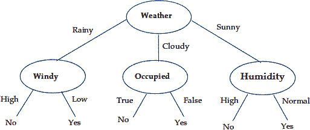

**图 2.11：** 打羽毛球问题的决策树

如果前表中的特征是连续值，那么决策树中的内部节点将根据阈值对数值进行测试，如图 2.12 所示。该图给出了具有相同特征集合的决策树，但某些特征的值不是离散的：

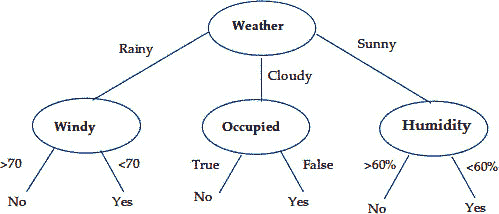

**图 2.12：** 打羽毛球问题的决策树（带有连续值特征）

下表给出了与决策树相关的术语：

| 术语 | 说明 |
| --- | --- |
| 根节点 | 代表整个集合。 |
| 决策节点 | 将数据划分为两个或多个部分。 |
| 叶子节点 | 代表目标类别。 |
| 划分 | 划分根节点的过程。 |
| 剪枝 | 移除子节点的过程。 |
| 分支 | 父节点的子节点。 |
| 子节点 | 划分产生的子节点。 |

**表 2.5：** 决策树的术语

决策树算法的步骤如下：

1. 理解问题的熵（entropy）。
2. 在开始时，计算根节点的熵。
3. 选择能最好分离数据的属性作为根节点。
4. 根据熵递归创建内部节点。
5. 常用的划分方法是信息增益和基指数。

## 信息增益

信息增益是衡量属性划分数据效果的统计属性。熵是随机变量随机性的度量。它描述了任意集合的纯度。信息量越大，熵值越高。相反，对于二分类，如果样本两类比例相等，则熵为 1；如果样本是同质，则熵为 0。这表明熵越低越容易定义类别。熵使用以下公式计算：

```
Entropy = -p[1] log(p[1]) - p[2] log(p[2])...-p[n] log(p[n])
```

这里，`n` 是类别数量，`pi` 是类别 `i` 的概率。信息量越高，熵越低。信息增益与熵成反比。因此，熵越低的属性越能定义样本。特定节点的信息增益由以下公式给出：

```
Information gain = 熵 - sum (weighted average * 子节点熵)
```

```
Weighted average = 子节点观测数 / 所有子节点观测总和
```

在使用信息增益进行划分时，首先计算划分父节点的熵，然后计算每个子节点的熵并计算所有可用子节点的加权平均，最后使用上述公式计算信息增益。对所有划分重复此步骤，并选择信息增益值最大的划分。

## 基指数

基指数是衡量随机选择样本被错误识别的频率。它也被称为基尼不纯（Gini impurity）。基指数使用以下公式计算：

```
Gini index = 1 - sum(pi²)
```

这里，`n` 是类别数量，`pi` 是类别 `i` 的概率。属性的基指数越高，对样本的定义越好。因此，选择基指数最高的属性进行划分。

基尼指数的值范围在 0 到 1 之间。如果所有元素都属于同一个类别，则认为它是“纯的”，并用 0 表示。当所有元素随机分布在各个类别中时，它是“不纯的”，并用 1 表示。0.5 的值表示元素在各个类别中均匀分布。

可以使用 `sklearn` 中的 `DecisionTreeClassifier` 类实现所有功能的决策树算法。`sklearn` 包中决策树的类原型如下：

```python
class sklearn.tree.DecisionTreeClassifier(*, criterion='gini', splitter='best', max_depth=None, min_samples_split=2, min_samples_leaf=1, min_weight_fraction_leaf=0.0, max_features=None, random_state=None, max_leaf_nodes=None, min_impurity_decrease=0.0, min_impurity_split=None, class_weight=None, presort='deprecated', ccp_alpha=0.0)
```

该类的重要输入参数及其用途如下：

**Criterion**：用于衡量划分质量的函数。支持的标准包括用于基尼不纯度的 `gini` 和用于信息增益的 `entropy`。

**Splitter**：在每个节点选择划分的策略。支持的策略包括选择最佳划分的 `best` 和选择最佳随机划分的 `random`。

**max_features**：在寻找最佳划分时考虑的特征数量。

- 如果是 int，则在每次划分时考虑 `max_features` 个特征。
- 如果是 float，则 `max_features` 是一个比例，且在每次划分时考虑 `int(max_features * n_features)` 个特征。
- 如果是 `"auto"`，则 `max_features=sqrt(n_features)`。
- 如果是 `"sqrt"`，则 `max_features=sqrt(n_features)`。
- 如果是 `"log2"`，则 `max_features=log2(n_features)`。
- 如果是 None，则 `max_features=n_features`。

下表给出了上述决策树类中方法的详细信息：

| 方法名称 | 描述 |
| --- | --- |
| `apply(self, X)` | 接收输入训练样本 `X`，并返回 `X` 中每个数据点 `x` 最终落到的叶子节点索引。 |
| `cost_complexity_pruning_path(self, X, y)` | 接收输入训练样本 `X`、目标值 `y` 和样本权重，并在最小代价复杂度剪枝期间计算剪枝路径。 |
| `decision_path(self, X)` | 接收输入训练样本 `X` 并以矩阵形式返回决策路径。 |
| `fit(self, X, y)` | 接收训练样本 `X` 和目标值 `y`，根据给定训练数据拟合模型后返回 `self`。 |
| `get_depth(self)` | 返回决策树的深度。 |
| `get_n_leaves(self)` | 返回决策树的叶子节点数量。 |
| `get_params(self)` | 此函数获取估计器的参数。 |
| `predict(self, X)` | 该函数接收输入样本 `X`，返回 `X` 中样本的类别标签。 |
| `predict_proba(self, X)` | 该函数接收输入样本 `X`，返回 `X` 中样本的类别估计。 |
| `score(self, X, y=None, sample_weight=None)` | 返回平均准确率。 |
| `decision_path(self, X)` | 接收训练样本 `X` 并以矩阵形式返回决策路径。 |
| `fit(self, X, y)` | 接收训练样本 `X` 和目标值 `y`，根据给定训练数据拟合模型后返回 `self`。 |
| `get_params(self)` | 此函数获取估计器及其包含的估计器子对象的参数。 |
| `predict(self, X)` | 该函数接收输入样本 `X` 并返回 `X` 中样本的预测类别标签。类别标签基于森林中树的投票预测的，且投票根据其相应的概率估计进行加权。最终预测的类别将是所有树中发现的平均概率估计最高的类别。 |
| `predict_log_proba(self, X)` | 该函数接收样本 `X` 作为输入，返回样本在模型中每个类别概率的对数。 |
| `predict_proba(self, X)` | 该函数接收样本 `X` 作为输入，返回样本在模型中每个类别的概率。 |
| `score(self, X, y)` | 该函数接收样本 `X` 作为输入、相应的目标值 `y` 并返回预测的平均准确率。 |
| `set_params(self, **params)` | 此函数设置估计器的参数。 |

**表 2.7：** `RandomForestClassifier` 类的方法

## 2.6 性能统计

机器学习算法的性能是根据指标进行评估的。有多种可以用于评估监督机器学习算法的指标，例如分类准确率、F1 分数、混淆矩阵、平均绝对误差、均方误差和对数损失。选择评估指标非常重要，因为它判断了模型的性能。此外，它提供了受所选指标影响的结果中各种特征的重要性。有多种指标可以衡量回归和分类问题的性能。

### 2.6.1 回归问题的性能指标

回归是监督学习的一种类型，其中预测的因变量将是连续变量。有不同的指标来评估回归模型的性能。其中一些指标详细列如下：

#### 平均绝对误差

平均绝对误差是回归模型预测值与实际目标值之间平均差异的衡量。它由以下方程给出：

```
MAE = 1/n Σ |y - y'|
```

可见，它是一个线性评分，所有值的差异权重相同。因此，它不是各种应用程序的良好衡量标准，对于包含离群值的数据集也不适用。它不是微分的，因此适用于某些优化技术。

#### 均方误差

均方误差是一种衡量方法，使用回归模型的目标（或实际）值与预测值之间的平均平方差来评估性能。它由以下方程给出：

```
MSE = 1/n Σ (y - y')²
```

在这里，`n` 是样本总数，`y` 是实际值，`y'` 是回归模型的预测值。这是最常用的指标，因为它考虑了误差的平方，因此会对误差的平方进行惩罚。

#### 根均方误差

根均方误差是均方误差的平方根。它是回归模型预测值与实际目标值之间平均差异的衡量。它由以下方程给出：

```
RMSE = √(1/n Σ (y - y')²)
```

可见，它是一个线性评分，所有值的差异权重相同。因此，它不是各种应用程序的良好衡量标准，对于包含离群值的数据集也不适用。它不是微分的，因此适用于某些优化技术。

#### R 方

R 方，或判定系数，是衡量自变量解释因变量方差的比例。它由以下方程给出：

```
R² = SSR / SST
```

其中 `SSR` 是残差平方和，`SST` 是总平方和。

#### 残差平方和

残差平方和是实际值与预测值之间平方差之和。它由以下方程给出：

```
SSR = Σ (y - y')²
```

#### 总平方和

总平方和是实际值与实际平均值之间平方差之和。它由以下方程给出：

```
SST = Σ (y - ȳ)²
```

#### 调整 R 方

调整 R 方是 R 方的一个版本，考虑了模型中预测变量的数量。它由以下方程给出：

```
R²a = 1 – (1 – R²) (n – 1) / (n – p - 1)
```

其中 `n` 是样本总数，`p` 是特征总数。

对于二分类问题，目标变量将有两个值，称为实际值（actual values）。它们可以表示为 0 和 1，或者 True 或 False。这里使用了 0 和 1。模型的预测结果被称为预测值。混淆矩阵是一个具有两行两列的二维矩阵，其中行表示预测值，列表示实际值，如图 2.13 所示：

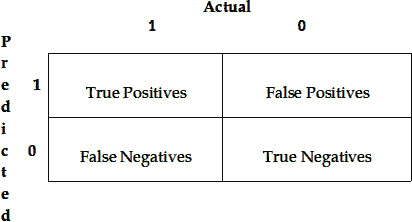

**图 2.13:** 混淆矩阵

图 2.13 中使用的术语如下：

1. **真正例 (TP)**：真正例是指实际值为 1 且预测值也为 1 的数据样本计数。
2. **真负例 (TN)**：真负例是指实际值为 0 且预测值也为 0 的数据样本计数。
3. **假正例 (FP)**：假正例是指实际值为 0 但预测值为 1 的数据样本计数。
4. **假负例 (FN)**：假负例是指实际值为 1 但预测值为 0 的数据样本计数。

从上述术语的含义可以明显看出，`TP` 和 `TN` 的值越高、`FP` 和 `FN` 的值越小，模型的性能越好。训练模型以获得更高的 `TP` 和 `TN` 值，并最小化 `FP` 和 `FN` 的值。在 `FP` 和 `FN` 中需要最小化哪一个或两者，取决于分类问题的需求。在医学领域，最小化假负例尤为重要。例如，如果分类问题是检测患者是否患有癌症或 HIV 等严重疾病。假设患者患癌表示为 1，未患癌表示为 0。在这种情况下，减少假负例比减少假正例总是好的。这意味着，如果患者患有癌症（1）而模型预测为阴性（0）——即假负例，这将对患者和诊断产生严重影响。因此，`FN` 需要尽可能地最小化。另一方面，如果患者未患癌（0）而模型预测患有癌症（1）——即假正例，产生的影响较小，因为通常在确认疾病为阳性之前，会对严重疾病进行二次检测。因此，在这一问题中，假正例比假负例更好。

#### 准确率 (Accuracy)

模型的准确率衡量了模型的正确性，这意味着它是通过模型预测总数中正确预测的数量给出的。从混淆矩阵来看，它等于以下方程：

```
Accuracy = (TP + TN) / (TP + TN + FP + FN)
```


`= 正确预测 / 正确和错误的预测总数`

`= 正确预测 / 预测总数`

当数据集中每个类的目标变量数量平衡时，准确率是一个很好的衡量标准，因为每个类的正确和错误预测将等比例分布在每个类中。在不平衡的数据集（某一类的数据样本比其他类多）的情况下，准确率是衡量模型性能的正确评估指标。

### 精确率 (Precision)

模型的精确率是模型预测的正例结果正确计数与模型预测的正例结果总数的比例。从混淆矩阵来看，精确率的方程如下：

`Precision = TP / (TP + FP)`

因此，模型的精确率指标告诉我们，在模型预测的所有正例结果中，模型预测正确的正例数量是多少。在肺炎检测模型的情况下，如果模型能够检测出五例肺炎病例并正确预测了所有病例，那么该模型的精确率为 100%。

### 回召率或灵敏度 (Recall or Sensitivity)

模型的回召率或灵敏度是模型预测的正例计数与实际实际结果的比例。从混淆矩阵来看，回召率或灵敏度的方程如下：

`Recall = TP / (TP + FN)`

因此，模型的回召率指标告诉我们，与数据集中的实际正例相比，模型预测正确的正例数量。根据这一解释，如果模型对数据集中的所有样本都预测为 1，则回召率将是 100%。

### 特异性 (Specificity)

模型的特异性是模型预测的负例正确计数与数据集中实际负例的比例。从混淆矩阵来看，特异性的方程如下：

`Specificity = TN / (TN + FP)`

假设在 100 人的数据集中有 10 人患有肺炎。假设模型正确预测了这 10 个人都患有肺炎。在这种情况下，`TN + FP` 将为 90，而 `TN`（模型将正常人预测为正常）将为 0。`TN` 为 0 是因为模型预测了所有的肺炎病例。因此，该模型的特异性将为 0%。

对精确率和回召率指标进行适当处理是为了进行它们之间的权衡。如前所示，高精确率或高回召率对模型有不同的含义。因此，这引出了 F1 分数，其定义如下：

### F1 分数 (F1 Score)

在定义 F1 分数之前，最好了解调和平均数。两个数字 `x` 和 `y` 的调和平均数如下：

`Harmonic mean = 2xy / (x + y)`

从方程可以看出，当 `x` 和 `y` 相等时，调和平均数等于它们的平均值。当 `x` 和 `y` 差异较大时，它更接近较的值。

根据调和平均数的定义，F1 分数是精确率和回召率的调和平均数。因此，F1 分数的方程如下：

`F1 Score = 2 * Precision * Recall / (Precision + Recall)`

从上述方程可以看出，F1 分数指标告诉我们模型有多精确（对预测正确实例的衡量）以及有多稳健或回召率（不漏掉难以分类的重要实例）。在许多分类问题中，F1 分数指标相比准确率指标是一个更好的指标，因为准确率主要由 `TN` 贡献。对于许多问题，`TN` 可能不重要，但 `FN` 和 `FP` 是。在许多问题中，`FN` 和 `FP` 比 `TN` 更有助于处理业务成本。在这些情况下，F1 分数会给出更好的结果，因为它兼顾了 `FN` 和 `FP`，并且在不平衡类别分布下效果更好。

### 曲线下面积 (AUC) – 工作特征曲线 (ROC)

AUC ROC 是一种衡量正类概率与负类概率分离程度的指标。AUC 是模型对随机选择的正类样本排名高于随机选择的负类样本的概率。因此，在某种程度上，AUC 代表两个类的分离程度，而 ROC 是两个类分离的概率曲线。定义 AUC-ROC 需要以下术语：

* **真正例率 (TPR 或 灵敏度)**：之前已定义。

* **真负例率 (TNR 或 特异性)**：之前已定义。

- **假阳性率 (FPR)**：这是衡量在所有负样本中，被预测为正样本的负样本计数所占的比例。它由以下方程给出：

`False Positive Rate = FP / TN + FP`

现在，以 `FPR` 为 x 轴、`TPR` 为 y 轴绘制图形。`FPR` 和 `TPR` 的值在 0 到 1 之间。针对不同的阈值计算了相应的 `FPR` 和 `TPR` 并进行了相应的绘图。由此得到的曲线被称为 `ROC`，`ROC` 下的面积称为 `AUC`。`AUC` 较大的模型被认为比 `AUC` 较小的模型性能更好。在 `图 2.14` 中，显示了三个 `ROC` – `C1`、`C2` 和 `C3`。`C1` 的 `AUC` 大于 `C2` 和 `C3`，`C2` 的 `AUC` 大于 `C3`。`ROC` `C1` 的 `AUC` 模型性能优于 `ROC` `C2` 的 `AUC` 模型，而 `ROC` `C3` 的 `AUC` 模型性能最差：

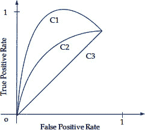

图 2.14：AUC-ROC 比较

- **对数损失 (Log Loss)**

对数损失是通过惩罚错误分类来量化准确率指标的方法。为了计算对数损失，分类器必须输出每个类的概率，而不仅仅是给出最可能的类别标签结果。据此，对数损失的方程由以下方程给出：

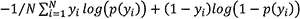

在这里，`yi=1` 代表正类，0 代表负类。这些是实际的目标值。`p(yi)` 是正类的预测概率，而 `1 – p(yi)` 是负类的概率。从公式中可以看出，对数损失越低，模型的性能越好，准确率越高；对数损失越高，模型的性能越差，准确率越低。

正如二分类分类所示，`AUC` 是通过变化的决策阈值计算的，而对数损失是基于分类的确定性计算的。

# 2.7 优化与损失方法

实际值或目标值与预测值之间的差异称为 `error`。用于确定误差的函数称为 `loss function`。有不同的损失函数用于计算误差，每种函数都有不同的误差计算方式，并对确定模型性能有显著影响。由于回归和分类问题的学习机制和输出不同，每种类型都有自己的损失函数。当考虑整个数据集时，损失函数被称为 `cost function`。

损失函数计算误差，为了让模型有更好的性能，需要将此误差最小化。正如回归和分类问题的定义所示，因变量是根据自变量预测的。损失函数将根据权重、偏置和自变量来定义。从 2.6.1 节的线性回归来看，输出 `Y` 给出：

`Y = aX + b + e`

在这里，"a"被称为权重，"b"被称为偏置，"e"是误差项。损失函数由 `(h(y) – y)` 给出，而代价函数由给出：

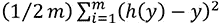

在训练期间需要更新权重和偏置，以便误差最小化。权重使用一种称为 `optimization function` 的函数进行修改。常用的优化技术之一是梯度下降。在这种技术中，损失函数的偏导数被提取。这种技术沿着损失函数梯度的反方向修改权重。这些步骤被重复，直到损失函数达到最小值。从 2.6 节，代价函数关于 'b' 的偏导为：

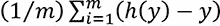

代价函数关于 'a' 的偏导为：

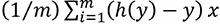

在这里，alpha 称为学习率。通常设置为较小的值。据此，回归和分类的损失函数如下：

- **L2 损失或均方误差 (MSE)**：回归中最常用的损失函数是 MSE。它是可微的，因此可以配合梯度下降使用。`MSE = 1/n Σ (y – y)²`

- **L1 损失或平均绝对误差 (MAE)**：该函数在不考虑方向的情况下衡量误差的大小。当数据集中存在更多离群值时，它非常有用。`MAE = 1/n Σ |y – y|`

- **平滑误差或 Huber 损失 (huber loss)**：当误差较小时，该函数变为均方误差。该函数的误差阈值是平方误差。它是可微的，因此可以使用梯度下降。

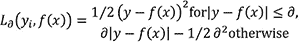

- **Log-cosh 损失**：log-cosh 函数是预测值与实际值的双曲余弦的对数。`LCh = Σ log (cosh(y – y))`

从方程可以看出，对于大误差 LCh 等于 `abs(x) – log(2)`，对于小误差则约为 `x² / 2`。因此，它大多数情况下类似于 MSE，且是可微的。

以下列表是分类问题中常用的损失函数：

- **交叉熵损失或二分类交叉熵或对数损失或负似然损失**：这是分类问题中最常用的损失函数，由以下方程给出：

`Cross Entropy Loss = - y log (p) + (1 – y) log (1 - p)`

在这里，`y = 1` 如果实际目标值为 1（即正类），否则 `y = 0`（负类）。`p` 是观测值属于类别 y 的预测概率。如果目标的预测概率不等于实际值或目标值，则该损失会增加。因此，它会严厉惩罚错误预测并对待正确预测。它是可微的，因此可以配合梯度下降优化技术使用。

- **分类交叉熵或多分类交叉熵**：这种损失函数用于多个类别的情况，由以下方程给出：

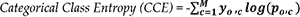

在这里，`M` 是类别的总数，`y = 1` 如果 `c` 是样本 `o` 的正确类别标签，否则为 0。`po, c` 是观测值 `o` 属于类别 `c` 的预测概率。

它与交叉熵相似，但适用于多分类问题。它是可微的，因此可以与梯度下降优化技术一起使用。

### 页损失或多分类 SVM 损失

页损失通常用于使用 SVM 解决的分类问题，其方程如下。

在这里，`y` 是 -1 到 1 之间的实际值或目标值，`y’` 是模型预测的 -1 到 1 之间的预测值。可见，它简单地取 0 或 `(1 – y’ * y)` 值的最大值。当预测值等于实际或目标值时，损失会增加；而当 `y = y’`（目标值等于预测值）时，损失将等于零。它试图通过 `Hinge Loss = max(0, (1 – y’ * y))` 最大间隔操作来寻找最优的决策边界。

因此，它最适用于 SVM 学习方法。由于它是不可微的，因此不适用于梯度下降优化方法。

### 平方页损失

该损失函数与页损失相似，不同在于最大函数的输出会被平方，其方程如下：

`Squared Hinge Loss = (max(0, (1 – y’ * y)))²`

将页损失平方的优势是，与页损失相比，它能更好地处理离群值。其次，它是可微的，可以用于梯度下降优化方法。

在本节开始时，简要定义了称为梯度下降的优化技术。因变量、自变量、损失函数、代价函数、权重和偏置以及权重和偏置的更新函数在之前都已定义。现在，讨论梯度下降的问题。

梯度下降适用于定义的损失函数显示凸曲面的问题。它不适用于非凸曲面，这是某些问题的陷阱。梯度下降旨在寻找凸误差曲面的全局最小值。如果误差曲面上存在许多局部最小值，则很难使用梯度下降法找到全局最小值。当误差曲面上存在鞍点时，梯度下降法表现并不佳。鞍点是那些梯度或斜率为零，但它们是曲面上的最优点的点。

当梯度太大或太小时，梯度下降优化方法会遭遇梯度消失和梯度爆炸问题。这会导致该方法需要很长时间才能收敛，有时可能无法收敛到全局最小值。梯度下降优化方法需要更多的内存，并且需要使用浮点表示。以下是用于克服基础或原始梯度下降陷阱的不同梯度下降方法：

#### 原始或批量梯度下降

让代价函数表示为 `J(θ)`。因此得到 `J(θ)` 的以下方程：

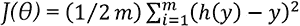

在这里，`θ` 是权重'a'和偏置'b'的函数。权重和偏置的更新函数如下：

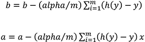

之前的更新函数可以使用以下通用步骤进行泛化：

`Update Function = Learning Rate * Gradient of Parameters`

`update_func = learn_rate * grad_params`

（此处省略重复的赋值行，已按要求不重复输出）

这种方法类似于 `AdaGrad` 和 `RMSProp`，它们都用于计算自适应学习率。它实际上使用了两个因素来适应学习率：首先，它使用了过去平方梯度的指数衰减平均值，但也使用了过去梯度平均值的指数衰减，类似于动量。之前定义的动量行为像一个向着斜坡滚落的球，试图防止在深谷周围震荡；而 Adam 的行为像一个带有摩擦力的重球，试图向正确的方向驱动达到最小值。`Adam` 优化器的伪方程如下：

`momentum = exp((gradient)) + correction parameter (ε)`

`adaptive_momentum = prev_update * momentum`

`gradient = previous gradient + (current gradient * current gradient)`

`adaptive gradient = exp(√(gradient)) + correction parameter (ε)`

`adaptive learning rate = learning rate / adaptive gradient`

`update_func = adaptive learning rate * adaptive momentum`

`curr_params = prev_params – update_func`

# 2.8 用例场景与示例

让我们考虑手写数字识别，这是光学字符识别中的一个常见问题。这个问题包括在图像中定位数字和识别数字。以下是使用 `sklearn` 包中的 `Random Forest` 类将数字分类为 10 个类之一（0 到 9）的示例代码。该代码提供了实现此目标的编程步骤，并最终按照之前的讨论报告了评估指标：

```python
from sklearn.datasets import load_digits
handw_digits = load_digits()
print (handw_digits.images.shape)
```

→

`(1797, 8, 8)`

前面的几行从 `sklearn` 包加载了预加载的数字数据集。然后它打印了数据集的形状。

从形状可以清楚，每个样本的大小为 8 * 8，数据集中有 1797 个样本。

```python
import matplotlib.pyplot as plt
fig, axes = plt.subplots(1, 10, figsize=(8, 8),
subplot_kw={'xticks':[], 'yticks':[]},
gridspec_kw=dict(hspace=0.1, wspace=0.1))
for i, ax in enumerate(axes.flat):
    ax.imshow(handw_digits.images[i], cmap='bin', interpolation='nearest')
    ax.text(0.05, 0.05, str(handw_digits.target[i]),
    transform=ax.transAxes, color='green')
plt.show()
```

*图 2.15* 是应用于模型输入的 MNIST 数据集。这些是以矩阵像素格式表示的 0-9 数字：

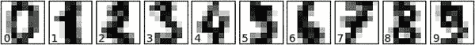

**图 2.15:** MNIST 数据输入

前面的几行显示了数据集中的前 10 个数字。由于对于随机森林，每个像素都被视为一个特征，因此 8 * 8 大小的样本需要被展平为单维数组，每个像素代表一个特征。对于每个样本，需要映射对应的目标值，该值也是每个数字图像的类别标签。这两个要求已经在 `sklearn` 中得到解决，并通数据集的 `data` 和 `target` 变量提供给用户。接下来的代码显示了输入和输出的形状：

```python
X = handw_digits.data
print ("The input shape is: ", X.shape)
y = handw_digits.target
print ("The output shape is: ", y.shape)
```

→

`The input shape is: (1797, 64)`

`The output shape is: (1797,)`

现在，可以使用 `sklearn` 的 `Random Forest` 分类器对数据集进行训练和评估。该类及其方法的原型在*第 2.5.4 节*给出。

```python
from sklearn.model_selection import train_test_split
from sklearn.ensemble import RandomForestClassifier
Xtrain, Xtest, ytrain, ytest = train_test_split(handw_digits.data, handw_digits.target, random_state=0)
print ("The training input data shape is: ", Xtrain.shape)
print ("The training target data shape is: ", ytrain.shape)
print ("The testing input data shape is: ", Xtest.shape)
print ("The testing target data shape is: ", ytest.shape)
model = RandomForestClassifier(n_estimators=1000)
model.fit(Xtrain, ytrain)
print (model.get_params())
ypred = model.predict(Xtest)
```

前面的几行显示了训练输入数据、目标数据形状、测试目标数据形状以及 `Random Forest Classifier` 参数。

→

`The training input data shape is: (1347, 64)`

`The training target data shape is: (1347,)`

`The testing input data shape is: (450, 64)`

`The testing target data shape is: (450,)`


`{'bootstrap': True, 'class_weight': None, 'criterion': 'gini', 'max_depth': None, 'max_features': 'auto', 'max_leaf_nodes': None, 'min_impurity_decrease': 0.0, 'min_impurity_split': None, 'min_samples_leaf': 1, 'min_samples_split': 2, 'min_weight_fraction_leaf': 0.0, 'n_estimators': 1000, 'n_jobs': None, 'o_score': False, 'random_state': None, 'verbose': 0, 'warm_start': False}`

现在，可以观察分类器的性能指标进行评估。接下来的几行显示了分类报告：

```python
from sklearn import metrics
print ("The classifier metrics are as follows:")
print(metrics.classification_report(ypred, ytest))
```

→

`The classifier metrics are as follows:`

`precision    recall  f1-score  support`

`0      1.00      0.97      0.99      38`

`1      1.00      0.96      0.98      45`

`2      0.95      1.00      0.98      22`

`3      0.98      0.98      0.98      45`

`4      0.97      1.00      0.99      37`

`5      0.98      0.96      0.97      49`

`6      1.00      1.00      1.00      52`

`7      1.00      0.96      0.98      50`

`8      0.94      0.98      0.96      46`

`9      0.96      0.98      0.97      46`

`micro avg       0.98      0.98      0.98      450`

`macro avg       0.98      0.98      0.98      450`

`weighted avg   0.98      0.98      0.98      450`

从前面的报告中显示了精确率、召回率、f1 分和支持度。支持度是该类别中真实样本的数量。结果显示模型性能良好。为了进行更好的分析，可以打印混淆矩阵。接下来的几行代码打印分类器的混淆矩阵：

```python
import seaborn as sns; sns.set()
from sklearn.metrics import confusion_matrix
mat = confusion_matrix(ytest, ypred)
sns.heatmap(mat.T, square=False, annot=True, fmt='d', cbar=False)
plt.xlabel('target or actual label')
plt.ylabel('predicted label');
plt.show()
```

*图 2.16* 描绘了 `Random Forest Classifier` 模型实际标签与预测标签的对比图：

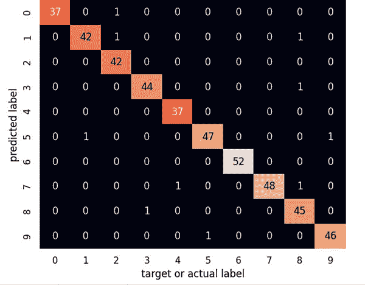

**图 2.16:** 混淆矩阵

## 2.9 总结

监督学习是人工智能中的重要技术。它允许系统从注释或标记的示例中学习。当给系统一个训练期间未见的示例时，它能够根据学习结果做出正确的决策。监督学习算法适用于从回归到分类的许多问题。由于监督学习算法可以实现的高准确性以及对不同问题的广泛适用性，它深受数据架构师的欢迎。它几乎应用于所有领域，如人员分析、时间序列市场预测、营销和销售、故障诊断、医疗保健、社交媒体服务等。尽管受欢迎，这些算法无法应用于未标记的数据。另一类型的机器学习被称为无监督机器学习，处理这类问题的将在章详细讨论。

## 要点回顾

* 监督学习算法仅适用于已标注的数据。

* 训练过程中的数据清洗和数据准备属于预处理步骤，这在模型开发期间至关重要。它们允许模型使用良好的准确率和正确的数据集进行构建。

* 监督学习中的大多数问题都可以映射为回归问题或分类问题。

* 在选择监督学习算法时，必须仔细考虑使用该算法的优点和缺点。

* 在许多机器学习的包中，`sklearn` 是最流行且使用广泛的包。

* `SVM` 在现实世界中有许多应用。核函数的选择对于 `SVM` 的性能最重要。

* 决策树算法根据决策的可能结果工作并找到通结论的每条路径。它用于特定的问题。`Random Forest`（随机森林）基于多棵单树和训练数据的随机样本工作，与决策树相比提供了更准确的结果。

* `Information Gain`（信息增）和 `Gini Index`（吉尼指数）是决策树中常用的选择标准之一。必须根据应用和问题来选择它们。

* 性能指标是衡量模型基准并反映其性能优劣的方法。

* `Gradient descent`（梯度下降法）是监督机器学习中最常用的优化技术。`gradient descent` 的许多变体已经演变出来，每种变体都有独特的用途并有其缺点。

* 损失函数对模型的设计至关重要。损失函数是衡量模型预测所需输出性能好坏的标准。

## Questions

1. 在 `SVM` 中选择核函数的标准是什么？

2. 列举基于回归和分类的各种监督学习算法。

3. 解释监督机器学习中 `qcost` 函数、`loss function`（损失函数）和 `backpropagation`（反向传播）的概念？

4. 用于在给定数据合成缺失数据的技术有哪些？

5. 列出监督机器学习的主要优点和缺点。

6. get 在给定问题的建模过程中数据清洗和数据准备过程涉及的步骤。

7. 详细描述一种分类和回归学习方法。

8. 描述 `SVM` 及其应用。

9. 用例子解释决策树算法中的 `information gain`（信息增）选择标准。

10. 列出基于回归的监督机器学习的性能指标。解释其中一种。

11. 列出基于分类的监督机器学习的性能指标。解释其中一种。

12. 什么是 `loss function`（损失函数）？列出不同类型的 `loss functions`。

13. 描述 `confusion matrix`（混淆矩阵）。用例子说明。

14. 描述 `AUC-ROC`。用图表说明。

15. 编写 `Random Forest` 算法的伪代码。

## Multiple choice questions

1. **选择正确答案**

    1. `SVM` 总是用直线分割分特征空间。

    2. 数据越多往往会导致模型过拟合。

    3. 回归总是使用线性核。

    4. `Backpropagation` 总是给出全局最小值。

2. **选择正确答案**

    1. 可以使用 `Random Forest`对手写字符进行分类。

    2. `SVM` 使用核技巧作为 `loss function`。

    3. 数据集中缺失数据总是通过线性插值生成的。

    4. `Cross entropy loss`（交叉熵损失）总是导致局部最小值。

3. **选择正确答案**

    1. `Cross entropy`（交叉熵）可用于二分类和多分类问题。

    2. `F1 Score` 对于平衡和不平衡类别分布的数据集都是最好的。

    3. `F1 Score` 不是基于调和平均。

    4. 模型的特异性基于精确率（precision）和召回率（recall）。

4. **选择正确答案**

    1. `F1 Score` 同时考虑假阳性（False Positives）和假阴性（False Negatives）以获得得分。

    2. 召回率（recall）也称为 `F1 Score`。

    3. 模型的精确率基于预测的正确结果。

    4. 准确率（Accuracy）是衡量性能的指标。

5. **选择正确答案**

    1. `confusion matrix`（混淆矩阵）是数据的矩阵。

    2. `Adjusted R-squared`（调整后 R 方）用于衡量模型性能。

    3. `R-squared` 性能指标优于 `Adjusted R-squared`。

    4. 损失函数是误差指标。

6. **选择正确答案**

    1. `Decision Trees`（决策树）性能优于 `Random Forest`。

    2. `Random Forest` 使用决策森林并使用集成方法做出决策。

    3. `Information Index`（信息指数）和 `Gini Index`（吉尼指数）是决策树的标准。

    4. 决策树的深度无法控制，取决于算法。

7. **选择正确答案**

    1. `Simple Linear Regression`（简单线性回归）、`Multiple Linear Regression`（多元线性回归）和 `Logistic Regression`（逻辑回归）用于预测一个或多个变量。

    2. `Non-linear Regression`（非线性回归）不是一种回归方法。

    3. 分类问题不处理离散值。

    4. 回归技术用于解决连续值数据集。

8. **选择正确答案**

    1. 数据集的大小不是重要因素。

    2. 在监督机器学习建模期间特征之间的关系并不重要。

    3. `SVM` 用于解决回归和分类问题。

    4. `Adversarial Debiasing`（对抗去偏）和 `Prejudice Remover`（偏见消除器）是误差缓解算法。

9. **选择正确答案**

    1. 监督机器学习仅适用于医学领域的问题。

    2. `Regression imputation`（回归插补）和 `K-Nearest Neighbors (KNN)` 用于在数据清洗期间删除数据的重复项。

    3. 离群值对学习机制是有益的。

    4. `Data Integration`（数据集成）、`Data Transformation`（数据转换）、`Data Formatting`（数据格式化）和 `Data Reduction`（数据归约）方法应用于监督学习问题建模期间的数据准备。

## Answers

1. B

2. a

3. a

4. a

5. b

6. b

7. a

8. c

9. d

# 第 3 章 机器学习系统分析/无监督学习

我们可能会遇到诸如“*为什么需要无监督学习？”、“*它到底关于什么？”以及“*它与监督学习算法和方法相比有何不同？”

在现实场景中，许多标注数据可能不可用。数据模式和数据格式也无法定义或获取。在这种情况下，我们使用无监督学习机制和算法来解谜。

`Fashion-MNIST` 数据集是一个映射到标注类别的示例，很容易作为监督学习算法的参考。但此相同的数据可以在没有“*标签*”的情况下用于无监督学习机制和算法。

如前面的节所述，机器学习被定义为计算机科学的一个分支，其中算法从其可用的数据或数据集中学习。绝大多数机器学习算法都是基于这些算法和数据集设计的。这些主流算法在标记数据上运行。但也有一些算法可以在没有标记数据的情况下工作。通过使用无标记数据，系统可以提取模式并将其用于解释。与简单的标记数据集相比，使用无标记数据更具挑战性和技巧性。在没有标签的情况下将这些数据划分为相似特征或相似性质的组是采用的方法之一。

## 结构

在本章中，我们将讨论以下主题：

* 无监督机器学习的介绍与架构

* 数据准备的方法和步骤

    * `StandardScaler`

    * `MinMaxScaler`

    * `RobustScaler`

    * `Normalizer`

* 聚类算法与技术

    * `K-means`

    * `层次聚类`

    * `DBSCAN`

    * `HDBSCAN`

* 其他算法

    * `降维`

        * 主成分分析 (PCA)

        * 奇异值分解 (SVD)

        * 独立成分分析 (ICA)

        * t 分布随机邻域嵌入 (t-SNE)

        * 字典学习

* 误差最小化

    * 距离计算

    * 阈值限制

    * 对数损失

    * 欧式距离

* 示例与样本

    * 带示例的一些样本

## 目标

学习本章后，你应该能够：

* 理解无监督机器学习的机制。

* 无监督学习中的各种算法，包括聚类机制。

* 误差最小化的各种步骤。

* 理解无监督机器学习中的少数学习机制。

* 阈值选择机制和方法。

* 学习机制性能。

* 无监督机器学习的示例或用例。

# 3.1 无监督机器学习的介绍与架构

在无监督学习中，训练数据是“未标记的”。我们在这里可以做的类比是“任何没有老师指导的学习的系统”。我们必须记住，这并不意味着它是一个自学习模型。

大多数无监督算法使用不同的聚类技术，这些将在章节的后续部分进行描述。还将提供误差最小化的机制。

深度学习领域的先驱之一 `Yann LeCun` 完美地解释了什么是无监督学习。他指出，“人类大多数日常学习活动和动物学习”都是基于无监督学习的。在这些学习中，没有预定的或标记的数据。

与监督学习相比，无监督学习有其优势，特别是涉及大型无标记数据集时。在这种情况下，无监督学习脱颖而出。众所周知，无监督学习不是在标记数据集上工作，而是通过学习数据的底层结构以及它是如何训练的。通过使用基于表示的学习或较小的参数集，无监督学习可以识别并分类数据集中的模式。通过这些识别出的模式，可以很容易地分类具有相似特征的簇/组：

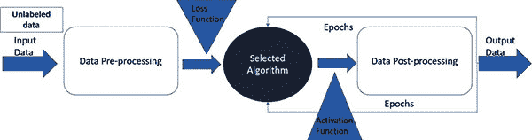

**图 3.1:** 示例无监督学习架构

上一个图是无监督学习机制的简单架构。该图解释了构建和执行无监督学习算法所需的各种组件。由于我们处理的是无监督学习，输入数据是未标记的。数据预处理是清理数据中任何越界值的步骤。一旦选定了特定算法，就会输入输入数据，使用损失函数将输出与实际输出进行比较，调整权重以确保数据后处理不会产生恶意数据反馈。一旦运行所有这些步骤（经过若干轮 epoch），就会比较输出以获得准确的结果。准确率越高，算法运行得越好。

使用无监督聚类算法的一个通用示例：假设你正在运营你的在线购物网站。该网站最近上线，有几千名客户。你想对只购买服装的客户、只购买书籍的客户以及只购买文具的客户等进行研究。在这样的情况下，利用所有用户的历史数据（确保不泄露隐私），可以使用无监督算法为每种购买类型创建一个簇。例如，根据服装、书籍、文具等的购买情况可以形成几个簇。根据此，可以在一段时间内观察到用户的买买//购买模式。

通过这种方法，许多以前无法解决的问题将得到解决。无监督学习提供了对历史数据和未来数据相似性的识别。这有助于解决数据科学领域中许多早期的复杂问题和挑战。

在本章后续部分将详细描述和讨论的某些算法如下：

* 各种聚类技术和算法。

* 其他算法和方法论，包括降维方法。

无监督学习的优势：

* 在大型数据集上运行。

* 使用无监督学习解决复杂的机器学习问题。

* 使用降维技术，高维表示有助于通过仅总结本质特征将大量特征减少为少数几个。

* 使用无监督学习，可以轻松地从大型基于文本的数据集中提取主题。

* 这些算法最适合探索型设置，例如，更好地理解数据。

无监督学习的劣势：

* 无监督学习不适用于简单任务和较小的数据集。

* 评估算法是否学习是困难的。

* 由于没有使用标记数据，我们不确定输出将会是什么。

* 有时预测模型运行得好坏是一个挑战。

* 由于该领域仍在演变中，产生新算法需要一些时间。

# 3.2 数据准备的方法和步骤

我们需要相关的数据。数据应该具有共性和模式才能继续进行。在大多数数据样本中，数据可能包含超出范围的离群值、越界数据模式和不匹配的数据等。这将对数据长度产生限制，并对“离群值”产生一些限制。在许多情况下，与其直接采用原始数据，我们可能需要先进行聚类。在无监督学习中，数据的转换与正确的超参数调优同样重要。

# 3.2.2 数据预处理与缩放

在无监督学习中，调整特征是一种最佳实践，以便数据表示适用于此类算法。`sklearn.preprocessing` 包是此类最常用的工具。

通常，大多数学习算法都能从数据集的标准化中获益。通过标准化，数据集中的任何离群值将被突出显示。

对于包含此类异常值的数据，使用各种缩放器（scalers）、变换（transformers）和归一化器（normalizers）是任何机器学习从业者的标准做法。有时，无监督算法被用作学习数据新表示预处理步骤。这不仅有助于监督算法，还能提高监督算法的准确性，同时减少时间消耗和存储数据的内存占用。

可以使用以下工具对原始数据进行绘制：

* `StandardScaler`

* `MinMaxScaler`

* `RobustScaler`

* `Normalizer`

# 3.2.2.1 StandardScaler

以下是 scikit 库中 `StandardScaler` 的函数以及其类定义和各种示例参数：

`sklearn.preprocessing.StandardScaler`

`class sklearn.preprocessing.StandardScaler(*, copy=True, with_mean=True, with_std=True)`

使用这种预处理技术/函数，可以通过移除均值并缩放到统一方差来对特征进行标准化。任何样本 `x` 的标准分数计算如下：

`z = (x - u) / s`

其中，`u` = 训练样本的均值


`x` = 样本

`s` = 训练样本的标准差

有时会在训练集的样本上应用相关的统计方法。这可以是像 `centering`（去中心化）这样简单的技术，有时是像这里解释的 `scaling`（缩放）。这些技术应该独立应用于每个特征，而不应组合使用。

以下是用于标准化、均值和标准差计算的各种数学公式：

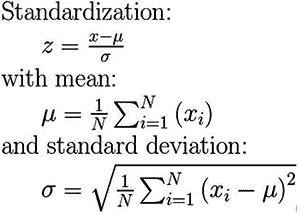

图 3.2：标准化、均值和标准差的公式

在前面的示例中，使用了以下各种变量：

- `μ` = 任何数据集的均值
- `σ` = 数据的标准差
- `N` = 样本数或样本量
- `x` = `X` = 包含数据值的矩阵（行/列）
- `z` = 标准化

核心思想是在应用任何机器学习模型之前，单独对 `X` 的特征/变量/列进行标准化或规格，使得 `μ = 0` 且 `σ = 1`。这意味着通过应用 `StandardScaler()`，该函数将单独地归一化 `X` 值中每列的特征，使得每列/特征/变量都具有 `μ = 0` 和 `σ = 1`。

对任何数据集进行标准化是任何机器学习估算器中最常用的需求和技术。

## 代码示例

以下代码是执行和应用标准缩放器方法的简单说明和步骤。在此方法中，取数组或矩阵形式的样本数据，并应用标准缩放器将其转换为归一化数据格式：

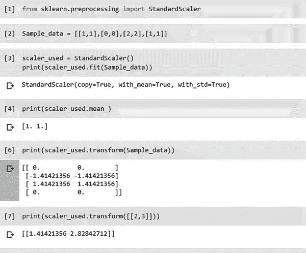

图 3.3：`StandardScaler` 的代码示例

## 3.2.2.2 `MinMaxScaler`

`MinMaxScaler()` Scikit 库函数可以直接应用于任何数据集，以归一化输入变量。`MinMaxScaler` 实例使用一些著名的默认超参数定义。一旦完成，即可将 `scaler.transform()` 函数应用于数据集，以创建数据集的最终转换版本。

`minmaxscaler()` 移动数据，使得所有特征恰好处于 0 到 1 之间。当应用 `MinMaxScaler` 时，对于特征中的每个值，`MinMaxScaler` 会减去该特征的最小值，然后除以范围。该范围是原始最大值与原始最小值之差。`MinMaxScaler` 保持了分布的原始形状不变。

对于任何二维数据集，整个数据集是由 x 轴 0 到 1 之间和 y 轴 0 到 1 之间创建的。最后，可以使用归一化器进行重新缩放，以便对特征向量的数据点进行缩放。

以下是 scikit 库中 `MinMaxScaler` 的函数以及类定义和各种示例参数：

- `sklearn.preprocessing.MinMaxScaler`
- `class sklearn.preprocessing.MinMaxScaler(feature_range=(0, 1), *, copy=True)`

使用以下公式描述 `Xnorm` 值。`Xnorm` 可以计算为两者之间的差：

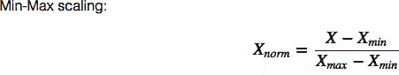

图 3.4：最小最大缩放公式

以下是详细解释 Scikit 库 `MinMaxScaler` 的示例：

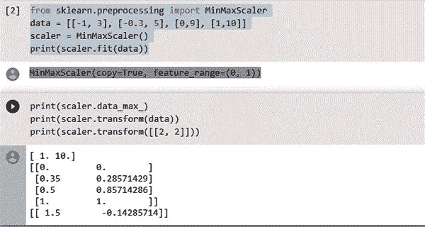

图 3.5：`MinMaxScaler` 的代码示例

## 3.2.2.3 `RobustScaler`

`RobustScaler` 通过减去中然后除以四分位间距（约 75% 值到 25% 值）来转换特征或特征向量。`RobustScaler` 不像之前的 `MinMaxScaler` 那样将数据缩放到预定的区间内。通常，在每个特征上应用后，`Robust scaler` 的取值范围会比 `MinMaxScaler` 大。

以下是 scikit 库中 `RobustScaler` 的函数以及类定义和各种示例参数：

- `sklearn.preprocessing.RobustScaler`
- `class sklearn.preprocessing.RobustScaler(*, with_centering=True, with_scaling=True, quantile_range=(25.0, 75.0), copy=True)`

以下是详细解释 Scikit 库 `RobustScaler` 的示例代码：

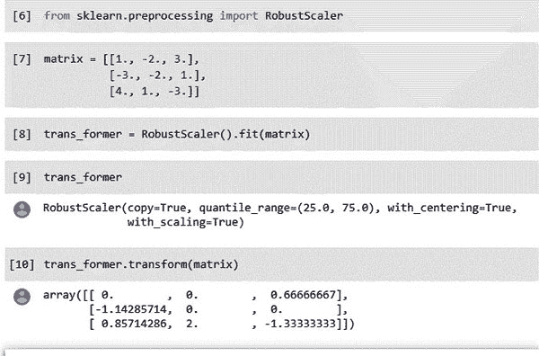

图 3.6：`RobustScaler` 的代码示例

`RobustScaler` 移除中位数并根据分位数范围缩放数据，有时默认为四分位间距（`IQR`）。此 `IQR` 是衡量大部分值所在位置的指标。这是它优于其他离散度量的原因之一：

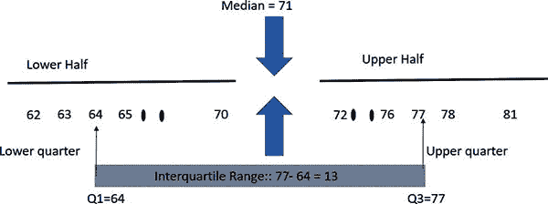

图 3.7：`Robust Scaler` 的取值范围示例

前图显示了在如之前所示具有 `Q1` 和 `Q3` 值的情况下，落在 `IQR` 下的取值范围示例。

四分位公式可以定义为第三分位数和第一分位数之差。简单来说，这可以计算为：

**`IQR = Q3 – Q1`。（在前面的示例中，77 – 64 = 13）**

各种取值范围可以定义为从 `Q1` 到 `Q3`。

其中，`Q1` 是有序数据集前半部分的中心或中间值。

`Q2` 可以是集合中的中位数值（假设你已经考虑了均值/中位数/众数）。

最后，`Q3` 是有序数据集后半部分的中间值。

## 3.2.2.4 `Normalizer`

以下是 scikit 库中 `Normalizer` 的函数以及类定义和各种示例参数：

- `sklearn.preprocessing.Normalizer`
- `class sklearn.preprocessing.Normalizer(norm='l2', *, copy=True)`

归一化作用于矩阵的行，而不是列。

归一化的处理方式使得数据矩阵中具有至少一个非零分量的每个样本行独立于其他样本进行重新缩放，使其范数等于一。通常使用 `L1` 或 `L2` 归一化。为了清晰起见，以下注释定义了这些范数：

**注意：`L1` 范数：** 这也称为曼哈顿距离或出租距离范数。`L1 范数`的计算方法是向量绝对值的和。（假设这些向量值位于空间中）。此 `L1 范数` 是衡量向量间距离最自然的方法，即向量分量之间绝对差之和。在此范数中也确保了向量的所有分量权重相等。

**`L2` 范数：** 这是实践中最常用的范数之一。它也被称为欧几里得范数。它被测量为从一点到另一点的最距离。`L2 norm`的计算方法为向量值平方之和的平方根。

**曼哈顿距离：** 这是 N 维向量空间中两点之间的距离度量。它是两点之间连线段在坐标轴上投影长度的之和。简单来说，它是空间中两个点在所有维度上的测量值之间的绝对差。

`L1 范数`可以计算，并在图 3.8 中所示。

下面的图解释了 `X`、`Y` 坐标，其中 `X` 和 `Y` 值被绘制在图中。在图中，假设 `X` 值为‘5’，`Y` 值为‘7’。

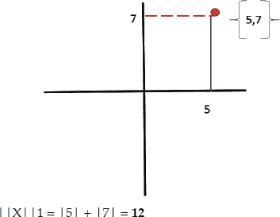

图 3.8：使用两个向量值的 `L1` 范数计算

前面的方程表示 `L1 范数`可以计算为如前绘制的 `X` 和 `Y` 值的绝对值。“X”和“Y”分别是特征值。

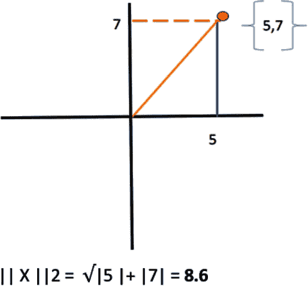

图 3.9：使用两个向量值的 `L2` 范数计算

前面的方程表示 `L2 范数`绝对值的平方根。在这里，“X”和“Y”轴代表特征变量。`L2 范数`的计算方法为向量值平方之和的平方根。

**注意：** 其他范数如 `L0` 和 `L∞` 的解释：

**`L0` 范数：** 这不是范数。因为它不满足范数应该具备的条件。它用于描述向量中非零元素的数量。

**`L∞` 范数：** 这种范数给出向量每个元素中最大的幅度。但它很少被使用。

以下是详细解释 Scikit 库中 `NormalizerScaler` 的代码示例：

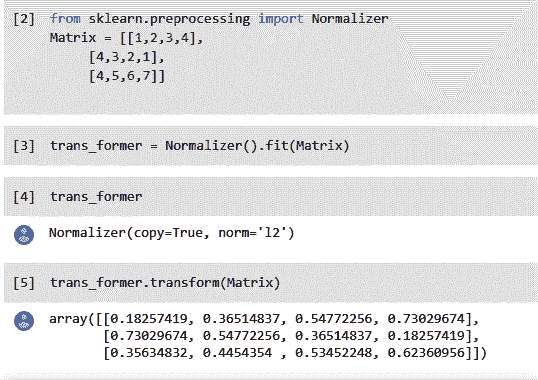

图 3.10：归一化器的代码示例

# 3.3 聚类技术（`#toc.xhtml#s56a`）

这可以定义为将数据集分组或划分为称为“类”的组的任务。这种数据划分或分割的主要目标是让相似的数据点分到同一个类中，将不同的点分到不同的类中。这种分组也被称为“聚类分析”。正如前面解释的，根据对象之间的相似程度，将相同的特征对象/点分到一个类中，将其他点分到其他类中。这些组的数量由我们选择的算法决定。这些聚类方法用于数据挖掘和统计数据分析技术中。

聚类分为两类，如下：

1. 坦聚类（Flat clustering）
2. 层次聚类（Hierarchical clustering）

根据解释，以下内容细分为硬聚类和软聚类：

1. **硬聚类（Hard Clustering）**：从完全上说，数据点要么属于某个类，要么属于。没有中间状态或步骤来进一步分类。
2. **软聚类（Soft Clustering）**：每个数据点将根据其分配到相应类的概率或可能性放置在单独的类中。

聚类算法应该满足的主要要求如下：

- 可扩展性方面的考虑。
- 如何处理不同类型的属性。
- 如何发现任意形状和大小的类。
- 在选择聚类技术或方法时，不需要完整的领域知识。
- 必须具有处理任何噪声和离群值的知识和能力。

在统计学中，聚类被定义为将人口或各种数据点分为若干组或类的任务，使得同一组中的数据点与该组内的其他数据点相似，而与其他组中的数据点不相似。

一些知名的聚类用例如下：

- 相似文档的聚类。
- 根据各种特征和特性对客户进行聚类。
- 便于分析的市场分割。
- 识别相似的物理群体。
- 根据价值、目标和得分将分组归分为不同的类。

| 算法/方法名称 | 参数 | 可扩展性 | 用例 | SciKit 库 | 使用的指标 |
| --- | --- | --- | --- | --- | --- |
| `K-Means` | 聚类数量 | 非常大的 `n_samples`，带有 `Minbatch` 的中等 `n_clusters` | 用于通用目的 | `from sklearn.cluster import K-Means` | 点之间的距离 |
| 层次聚类（也称为 `ward` 聚类） | 类的数量或作为阈值的距离 | 大 `n_samples` 和 `n_clusters` | 许多类 |  | 点之间的距离 |
| `DBSCAN` | 邻域大小 | 非常大的 `n_samples`，中等的 `n_clusters` | 非平坦几何或不均匀的类大小 |  | 最近点之间的距离 |
| `t-SNE` | 通常，它被归类为聚类算法。但在某些情况下，它被用作数据点相似性到联合概率的转换机制，并用于最小低维数据和高维数据联合概率值之间的散度（由 `Kullback-Leibler` 定义）。 |  |  |  |  |

表 3.1：聚类比较表

## 3.3.1 `K-Means`（`#toc.xhtml#s57a`）

`K-Means` 是最流行的无监督算法之一。它用于将无标记数据归分为不同的组。

```python
from sklearn.cluster import K-Means
```

`X`、`Y` 坐标其中 `X` 和 `Y` 值被绘制在图中。在图中，假设 `X` 值为‘5’，`Y` 值为‘7’。

前面的方程表示 `L2 范数`绝对值的平方根。在这里，“X”和“Y”轴代表特征变量。`L2 范数`的计算方法为向量值平方之和的平方根。

以下是带有 `sklearn` 包的 `KMeans` 原型：


```text
KMeans
```

**Scikit Learn K Means**

| 定义的类 | `from sklearn.cluster import KMeans` |
| --- | --- |
| 方法的各种参数 | `KMeans(n_cluster=6)` |

下表提供了 `K-Means` 算法的各种功能：

| 方法名称 | 描述 |
| --- | --- |
| `KMeans` | 首先，必须从 Scikit learn 库导入此库方法：`from sklearn.cluster import KMeans` |
| `KMeans(n_cluster = <数值>)` | 该函数用于初始化类的数量，也可以被称为“K”值。 |
| `KMeans.fit(data[0])` | 该函数接收“data”作为输入，并根据给定的训练数据进行拟合。 |
| `KMeans(copy_x = True, init='K-means', max_iter=300, n_cluster=6, n_init=10, n_jobs=1, precompute_distance='auto', random_state=None, tol=0.0001, verbose=0)` | K-Means 按照函数本身 get 各种输入值。需要记住的关键点是，该函数必须使用 `init='K-means'` 初始化，最大迭代次数可以在 100-300 之间。“`n_cluster = <类的数量>`”。 |
| `kmeans.cluster_centers_` | `kmeans.cluster_centers_` 是 `sklearn.cluster.KMeans` 类的一个属性，而不是函数。 |

表 3.2：KMeans 库函数

```python
kmeans = KMeans(n_cluster=6)
kmeans.fit(data[0])
```

打印类的质心：

```python
kmeans.cluster_centers_
```

以下指针提供了关于如何为 `K-Means` 算法选择最佳参数值的步骤和提示：

- 在启动算法执行之前，选择簇的数量 `K` 的值。此步骤将在本节稍后的部分进行详细解释。
- 起初，随机将每个点分配给一个簇。
- 如果你观察到簇停止变化，或者在簇停止变化为止，请重复以下子步骤：
  - 通过取每个簇中点的平均向量来计算簇质心。
  - 现在，可以根据数据点到每个簇质心的距离远来分配数据点。
  - 初始时可以将点分配给最近的质心，稍后根据情况进行修改。

### 选择“K”值

选择 `K` 值并不是一项简单的任务，而且没有简单的方法可以做到。这是关键步骤之一，通常的做法是使用 `Elbow`（肘部）法：

1. 计算某些 `K` 值的平方和（例如 2、4、6、8 等）。
2. 使用试错法计算出 `SSE` 后，尝试通过与 `Elbow` 方法比较或寻找最小的 `K` 值来使用该值。

### 肘部法解释

该方法用于通过对一系列 `K` 值进行模型拟合来选择簇的数量。这被称为 `Elbow` 方法，因为在绘制的折线图中，曲线上出现的拐点类似于肘部形状的手臂。如果曲线呈这种形状，说明底层模型在该拐点处的拟合效果最好，这是一个象。

下表提供了肘部法以及各种参数值的描述和示例：

| 方法名称 | 描述 |
| --- | --- |
| 肘部法 | 导入两个库函数：<br><br>```python<br>from sklearn.cluster import KMeans<br>from sklearn.datasets import make_blobs<br># 导入 KMeans 和 make_blobs<br># （生成用于聚类的向同性高斯簇）<br># 导入 KElbowVisualizer 用于选择<br># 最佳肘部值，即 K-means 聚类的最优<br># （继续）簇数量<br>```<br><br>`from yellowbrick.cluster import KElbowVisualizer` |
| 使用 `make_blobs()` 方法生成合成数据 | ```python<br># 生成具有 6 个随机簇的简单合成数据集<br><br>X, y = make_blobs(n_samples=1000, n_features=12, centers=6, random_state=42)<br>```<br><br>此函数接受各种输入，如样本数 `n_samples`、特征数 `n_features`、中心数 `centers` 以及最后的 `random_state` 变量。 |
| `KMeans` 和 `KElbowVisualizer` 实例化 | 现在实例化以下内容：<br><br>```python<br>model = KMeans()<br><br>visualizer = KElbowVisualizer(model, k=(4,12))<br>``` |
| 最终结果的拟合与可视化 | ```python<br># 为最终曲线实例化聚类模型和可视化器<br><br>visualizer.fit(X)<br><br># 将数据拟合到可视化器<br><br>visualizer.show() # 渲染并显示图表<br>``` |


**表 3.4：** K-Means 中的肘部法表

在下面的图中展示了 K-Means 中的肘部法。在下面的图中，曲线上的拐点类似于肘部形状的手臂。如果曲线呈这种形状，说明底层模型在该拐点处的拟合效果最好，这是一个象。

在下面的图中，展示了 K-Means 中的肘部法。在下面的图中，曲线上的拐点类似于肘部形状的手臂。如果曲线呈这种形状，说明底层模型在该拐点处的拟合效果最好，这是一个象。

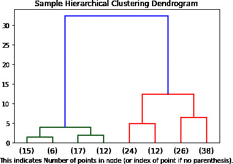

DBSCAN 算法用于根据密度值分离聚类，特别是通过将高密度区域与低密度聚类区域进行分离。对于该算法，可以使用任何形状的聚类进行分析（而 K-Means 仅限于使用凸形状的聚类）。来自高密度区域的样本被选择为 DBSCAN 的核心样本。任何聚类都是核心样本的组（使用距离度量标准）。该算法使用了两个主要参数：`min_samples` 和 `eps`，它们用于定义密度。这两个参数（`min_samples` 或 `eps`）可以根据较高或较低的值来定义形成聚类所需的密度。

`sklearn.cluster.DBSCAN`

下表提供了 DBSCAN 的类和 scikit 库函数：

| **定义的类** | **class sklearn.cluster.DBSCAN** |
| --- | --- |
| **传递给此类的各种方法/函数参数** | `class sklearn.cluster.DBSCAN(eps=0.5, *, min_samples=5, metric='euclidean', metric_params=None, algorithm='auto', leaf_size=30, p=None, n_jobs=None)` |

**表 3.7：** DBSCAN 表格

下表提供了 DBSCAN 的各种参数及其默认值：

| **方法名称** | **描述** |
| --- | --- |
| DBSCAN 方法 | 该方法或函数用于从向量数组或距离矩阵执行聚类。`eps` 默认值为 0.5，是两个样本之间的最大距离。`min_samples` 默认值为 5。`metric` 默认‘euclidean’，用于计算特征数组中实例之间的距离。`metric_params` 默认=None；`algorithm`{auto’, ‘ball_tree’, ‘kd_tree’, ‘brute’}，默认=’auto’。这用于计算点点距离并寻找最近邻居。`leaf_size`，默认=30，传递给 BallTree 或 cKDTree 的叶大小。`p`，默认=None，使用 Minkowski 度量计算点之间的距离。`n_job`，默认=None。 |
| `fit(self, X,y,sample_weight)` | 接收训练样本 X 和目标值 y，并在根据给定的训练数据拟合模型后返回自身。 |
| `fit_predict(self, X,y,sample_weight)` | 该函数用于从特征或距离矩阵执行 DBSCAN 聚类并最终返回聚类标签。 |
| `get_params(self, deep=True)` | 该函数用于获取此估计器的参数。 |
| `set_params(self, **params)` | 此函数用于设置此估计器的参数。 |

**表 3.8：** DBSCAN 方法表格

# 3.4 其他算法和方法论

## 3.4. 降维技术

维度灾难是机器学习中最常见且为人所知的问题之一。由于这些问题，算法无法在数据上进行高效且有效的训练。另一个主要原因是这些示例中数据量极极其庞大。对于如此大规模的数据集，将投入巨大的计算力到训练中。相反，可以在不丢失原始意图的情况下智能地降低数据维度。这种方法或手段被称为“降维”技术。在过去的几年里，这一领域出现了许多算法和方法。本章接下来的章节将讨论并解释最受欢迎的各种降维技术。

### 3.4.1 t-分布随机邻域嵌入 (t-SNE)

`sklearn.manifold.TSNE`

上述函数是 TSNE 的类方法。

下表描述了传递给类 TSNE 的各种参数及其默认值：

| **定义的类** | **class sklearn.manifold.TSNE** |
| --- | --- |
| **传递给此类的各种方法/函数参数** | `class sklearn.manifold.TSNE(n_components=2, *, perplexity=30.0, early_exaggeration=12.0, learning_rate=200.0, n_iter=1000, n_iter_without_progress=300, min_grad_norm=1e-07, metric='euclidean', init='random', verbose=0, random_state=None, method='barnes_hut', angle=0.5, n_jobs=None)` |

**表 3.9：** manifold.t-SNE 表格

t-SNE 是一种用于高维数据可视化的非线性降维技术。通过将相似点放置得近、不相似的点推远，通过将所有高维数据点建模到 2 维或 3 维空间来实现数据维度的降维。这是通过使用两个概率分布实现的：一个在高维空间中，另一个在低维空间中。同样，相似概率在高维空间中，而不相似的点在低维空间。在某些情况下，t-SNE 可以被视为可视化高维数据的工具。

更好的做法是在应用 t-SNE 之前应用 PCA，将维度减少到合理的数量，特别是当特征数量非常高时。这种方法方法有助于抑制噪声并增加样本间基于对的距离的计算速度。

| **方法名称** | **描述** |
| --- | --- |
| `Sklearn.manifold.TSNE` | `n_components` 可选（默认: 2），用于嵌入空间的维度。`perplexity` 可选（默认: 30），通常的实践是使用 5 到 50 之间的值。`early_exaggeration` 可选（默认: 12.0），此值用于控制原始空间中簇的紧密程度。`learning_rate` 可选（默认: 200.0），t-SNE 的此值通常在 [10.0, 1000.0] 范围内。`n_iter` 可选（默认: 1000），表示优化的最大迭代次数。`n_iter_without_progress` 可选（默认: 300），在此值方面使用此值。`min_grad_norm` 可选（默认: 1e-7），用于检查梯度范数是否低于此值，如果是，优化将停止。其他使用的选项有 `metric`字符串或可调用对象`init`字符串或 numpy 数组，可选（默认：“random”）``verbose`整数，可选（默认:0），详细级别。`random_state` RandomState 实例，默认=None``method`（默认=’barnes_hut’）`angle`（默认:0.5）``n_jobs` 或 None，可选。 |
| `fit(self, X, y, sample_weight)` | 接收训练样本 X 和目标值 y，并在根据给定的训练数据拟合模型后返回自身。 |
| `fit_transform(self, X, y=None)` | 该函数用于将 X 拟合到嵌入空间并返回转换后的输出。 |
| `get_params(self, deep=True)` | 该函数用于获取此估计器的参数。 |
| `set_params(self, **params)` | 此函数用于设置此估计器的参数。 |

**表 3.10：** t-SNE 方法表格

### 3.4.2 主成分分析 (PCA)

PCA 是降维技术之一。

PCA 的主要目的是为了降低给定模型的复杂性。在简化模型的同时，应该保留所有的相关性和性能，PCA 有助于实现这一目标。在许多涉及巨大数据集的案例中，这些数据集将包含数百个变量和特征，但通过提取少数独立变量，我们能够利用 PCA 解释大部分的方差。

PCA 有助于分析和提取观测变量的线性组合成分。有时也可以使用因子分析，该分析基于形式模型，通过从理论知识和潜因子预测观测变量来这些这些提取。在可区分的模式和因子分析中，PCA 有助于在构建潜变量的同时实现最大方差和最大共享方差。

### PCA 的优势：

*   方差最大化。
*   有助于密切确定最大方差的方向。
*   独立变量方差随与其他因变量的变化而。

以下是用于 PCA 的各种 scikit 库函数。接下来的章节将详细解释这些每个库函数，以及传递的参数和默认值：

* `sklearn.decomposition.IncrementalPCA`
* `sklearn.decomposition.KernelPCA`
* `sklearn.decomposition.MiniBatchSparsePCA`
* `sklearn.decomposition.PCA`
* `sklearn.decomposition.SparsePCA`

# 3.4.2.1 增量 PCA 分解 (De incremental PCA)

以下是 `IncrementalPCA` scikit 库函数，表格详细解释了随后传递的参数：

`sklearn.decomposition.IncrementalPCA`

下表显示了带有各种参数及其默认值的 `IncrementalPCA` 库函数：

| **定义的类** | `class sklearn.decomposition.IncrementalPCA` |
| --- | --- |
| **传递给此类的方法/函数的各种参数** | `class sklearn.decomposition.IncrementalPCA(n_components=None, *, whiten=False, copy=True, batch_size=None)` |

**表 3.11：** IncrementalPCA 表格

这是一种线性降维方法，使用了数据的奇异值分解。仅保留最显著的奇异向量以将数据投影到低维空间（`奇异值分解` (`SVD`)）。该算法允许输入稀疏化，且与 PCA 相比，内存效率更高。

下表解释了 `IncrementalPCA` 库函数的方法及其默认值：

| **方法名称** | **描述** |
| --- | --- |
| `IncrementalPCA` | 首先，必须如前所示从 Scikit learn 库中导入此库方法。各种参数如下：`n_components` (int 或 None, default=None)，要拥有的组件数量。`whiten` (bool, 可选, default=False)。`copy` (bool, default=True)，如果为假，X 值将被覆盖。`batch_size` (int 或 None, default=None)，每个批次使用的样本数。 |
| `fit(self, X, y)` | 接收训练样本 `X` 和目标值 `y`，并在根据给训练数据拟合模型后返回 `self`。（使用大小为 `batch_size` 的小批量） |
| `fit_transform(self, X, y=None)` | 拟合数据，然后转换。 |
| `get_covariance(self)` | 使用生成模型计算数据协方差。 |
| `get_params(self, deep=True)` | 获取此估计器的参数。 |
| `get_precision(self)` | 使用生成模型计算数据精密度矩阵。 |
| `inverse_transform(self, X)` | 将数据转换回原始空间。 |
| `partial_fit(self, X[, y, check_input])` | |
| `set_params(self, **params)` | 设置此估计器的参数。 |
| `transform(self, X)` | 转换数据。 |

**表 3.12：** IncrementalPCA 表格

# 3.4.2.2 核 PCA 分解 (Decomposition kernel PCA)

以下是 `KernelPCA` scikit 库函数。下表显示了带有各种参数及其核 PCA 默认值的 `IncrementalPCA` 库函数：

| **定义的类** | `class sklearn.decomposition.KernelPCA` |
| --- | --- |
| **传递给此类的方法/函数的参数** | `class sklearn.decomposition.KernelPCA(n_components=None, *, whiten=False, copy=True, batch_size=None)` |

**表 3.13：** KernelPCA 表格

下表解释了 KernelPCA 库的方法及其默认值：

| **方法名称** | **描述** |
| --- | --- |
| `KernelPCA` | 首先，必须如前所示从 Scikit learn 库中导入此库方法。各种参数如下：`n_components` (int 或 None, default=None)，要拥有的组件数量。`kernel` (str, default='rbf')，`gamma` (float, 可选, default=None)。`alpha` (float, default=1.0)。`fit_transform` (bool, default=False)。`eigen_solver` (str 在 ['auto', 'dense', 'arpack'], default='auto')。`tol` (float, default=0)。`max_iter` (int, default=None)。`remove_zero_eig` (bool, default=False)。`random_state` (RandomState instance, default=None)。`copy` (bool, default=True)，`n_jobs` (int 或 None)。 |
| `fit(self, X, y)` | 接收训练样本 `X` 和目标值 `y`，并在根据给训练数据拟合模型后返回 `self`。 |
| `fit_transform(self, X, y=None)` | 拟合数据，然后转换。 |
| `get_params(self, deep=True)` | 获取此估计器的参数。 |
| `inverse_transform(self, X)` | 将数据转换回原始空间。 |
| `set_params(self, **params)` | 设置此估计器的参数。 |
| `transform(self, X)` | 转换数据。 |

| `MiniBatchSparsePCA` | 首先，如所述，必须从 Scikit learn 库中导入此库方法。各种参数如下：`n_components`，提取的稀疏原子数量；`alpha`，稀疏性控制参数（值越大，组件越稀疏）。`ridge_alpha`，在调用 `transform` 方法时应用的岭收缩量，以改善条件数。`n_iter`，每个 mini-batch 执行的迭代次数。`callback`，可调用对象或 `None`，可选（默认：`None`），每隔五次迭代调用一次的可调用对象。`batch_size`，每个 mini-batch 摄取的特征数量。`verbose`，控制详细程度；值越高，消息越多。默认值为 0。`shuffle`，是否在将数据划分批次之前对其进行打乱。`n_jobs` 或 `None`，可选（默认=None），运行的并行作业数。除非在 `joblib.parallel_backend` 上下文中，否则默认为 1。“-1”表示使用所有处理器。`method`{‘lars’, ‘cd’}，lars：使用最小角回归法求解 lasso 问题（`linear_model.lars_path`）；cd：使用坐标下降法计算 Lasso 解（`linear_model.Lasso`）。如果估计的组件是稀疏的，Lars 将更快。`random_state`，`RandomState` 实例，`default=None`，当 `shuffle` 设置为 True 时，在线字典学习期间用于随机打乱。 |
| `fit(self, X, y)` | 训练样本 X 和目标值 y，并在根据给定训练数据拟合模型后返回 self。 |
| `fit_transform(self, X, y=None)` | 拟合数据然后进行转换。 |
| `get_params(self, deep=True)` | 获取此估计器的参数。 |
| `set_params(self, **params)` | 设置此估计器的参数。 |
| `transform(self, X)` | 数据在稀疏组件上的最小二乘投影。 |

**Table 3.16:** MinBatchSparsePCA 方法表

# 3.4.2.4 分解主成分分析 PCA

这是最常见的线性降维技术之一。该算法在尽可能保留变异的同时，寻找数据的低维表示。如前文所述，线性降维是通过对数据进行**奇异值分解**（**SVD**）并将其投影到低维空间来实现的。

以下是用于分解主成分 PCA 的 scikit 库函数：

`sklearn.decomposition.PCA`

| **定义的类** | **class sklearn.decomposition.PCA** |
| --- | --- |
| **传递给此类的方法的/函数的各种参数** | `class sklearn.decomposition.PCA(n_components=None, *, copy=True, whiten=False, svd_solver='auto', tol=0.0, iterated_power='auto', random_state=None)` |

**Table 3.17:** decomposition.PCA 分解表

# 3.4.2.5 分解稀疏 PCA

算法“稀疏主成分分析”或“SparsePCA”有助于找到能够最优重建数据的稀疏组件。这里的稀疏性由 L1 惩罚项的系数控制，可以通过参数“alpha”给出：

`sklearn.decomposition.SparsePCA`

| **定义的类** | **class sklearn.decomposition.SparsePCA** |
| --- | --- |
| **传递给此类的方法的/函数的各种参数** | `class sklearn.decomposition.SparsePCA(n_components=None, *, alpha=1, ridge_alpha=0.01, max_iter=1000, tol=1e-08, method='lars', n_jobs=None, U_init=None, V_init=None, verbose=False, random_state=None, normalize_components='deprecated')` |

**Table 3.18:** decomposition.SparsePCA 分解表

下表解释了传递给 `SparsePCA` 方法的各种参数和默认值：

| **方法名称** | **描述** |
| --- | --- |
| SparsePCA | 首先，如所述，必须从 Scikit learn 库中导入此方法。各种参数如下：`n_components`，提取的稀疏原子数量。`alpha`，稀疏性控制参数。`ridge_alpha`，在调用 `transform` 方法时应用的岭收缩量以改善条件数。`max_iter`，执行的最大迭代次数。`tol`，停止条件的容差。`method`{‘lars’, ‘cd’}，lars：使用最小角回归法求解 lasso 问题（`linear_model.lars_path`）；cd：使用坐标下降法计算 Lasso 解（`linear_model.Lasso`）。`n_jobs` 或 `None`，可选（默认=None），运行的并行作业数。除非在 `joblib.parallel_backend` 上下文中，否则默认为 1.-1 表示使用所有处理器。`U_init` 形状为 (n_samples, n_components)，热启动场景下载荷的初始值。`V_init` 形状为 (n_components, n_features)，热启动场景下组件的初始值。`verbose`，控制详细程度；越高消息越多。默认值为 0。`random_state, RandomState instance`，`default=None`，在字典学习期间使用。传递整数以实现跨多次函数调用的可重复结果。`normalize_components`‘已弃’，此参数不起作用。 |
| `fit(self, X, y)` | 取训练样本 X 和目标值 y，并在根据给定训练数据拟合模型后返回 self。 |
| `fit_transform(self, X, y=None)` | 拟合数据然后进行转换。 |
| `get_params(self, deep=True)` | 获取此估计器的参数。 |
| `set_params(self, **params)` | 设置此估计器的参数。 |
| `transform(self, X)` | 数据在稀疏组件上的最小二乘投影。 |

**Table 3.19:** SparsePCA 方法表

# 3.4.3 奇异值分解 (SVD)

奇异值分解或 SVD 是一种用于执行截奇异值分解的线性降维。与 PCA 算法相比，它在计算之前不对数据进行中心化；这意味着处理稀疏矩阵时非常高效：

`sklearn.decomposition.TruncatedSVD`

| **定义的类** | **class sklearn.decomposition.TruncatedSVD** |
| --- | --- |
| **传递给此类的方法的/函数的参数** | `class sklearn.decomposition.TruncatedSVD(n_components=2, *, algorithm='randomized', n_iter=5, random_state=None, tol=0.0)` |

**Table 3.20:** TruncatedSVD 表

该 SVD 估计器主要支持两种算法：

1. 快速随机 SVD 求解器。
2. 使用 ARPACK 作为特征求解器的“原生”算法。

| **方法名称** | **描述** |
| --- | --- |
| TruncatedSVD | 首先，通过以下代码从 Scikit learn 库导入此方法：`n_components`，输出数据的维度。`algorithm`,默认="randomized"，使用的 SVD 求解器。`n_iter`,可选（默认 5），随机 SVD 求解器的迭代次数。`random_state`,在随机 SVD 期间使用。`tol`,可选，ARPACK 的容差。0 表示机器精度。 |
| `fit(self, X, y)` | 取训练样本 X 和目标值 y，并在根据给定训练数据拟合模型后返回 self。 |
| `fit_transform(self, X, y=None)` | 拟合数据然后进行转换。 |
| `get_params(self, deep=True)` | 获取此估计器的参数。 |
| `inverse_transform(self, X[, copy])` | 将源转换回混合数据（应用混合矩阵）。 |
| `set_params(self, **params)` | 设置此估计器的参数。 |
| `transform(self, X)` | 对 X 执行降维。 |

**Table 3.21:** TruncatedSVD 方法表

# 3.4.4 独立成分分析 (ICA)

无标记数据面临的主要挑战之一是，在提供的特征中包含了许多隐藏的信息或信号。分离这些所谓的信号或信息至关重要，可以通过使用 `ICA` 实现。通过使用 `ICA`，这些分量被独立地分离。`ICA` 在 `scikit-learn` 中通过 `Fast ICA` 算法实现。通常，`ICA` 不用于降维，而是用于分离叠加的信号。

因此，`ICA` 的应用场景是信号处理任务，例如从任何嘈杂噪声的音频片段中识别个体声音。由于该模型中不包含任何噪声项，因此使用了 `whiten` 参数：

`sklearn.decomposition.FastICA`

| **定义的类** | **sklearn.decomposition.FastICA** |
| --- | --- |
| **传递给该类的各种方法/函数参数参数** | `class sklearn.decomposition.FastICA(n_components=None, *, algorithm='parallel', whiten=True, fun='logcosh', fun_args=None, max_iter=200, tol=0.0001, w_init=None, random_state=None)` |

**表 3.22:** FastICA 表格

| **方法名称** | **描述** |
| --- | --- |
| `FastICA` | 首先，必须通过以下函数从 Scikit learn 导入此库方法：``sklearn.decomposition.FastICA`。以下是该方法使用的各种参数：`n_components`，可选，使用的分量数量。*`algorithm`{‘parallel’, ‘deflation’}*为 `FastICA` 应用并行或收缩算法。*`whiten`，可选，如果 `whiten` 为 false，则数据被认为已白化，不进行白化处理。*`fun`字符串或函数，可选。默认值：‘logcosh’，*`fun_args`字典，`optional`，发送到函数形式的参数。`max_iter`，`可选，拟合期间的最大迭代次数。`tol`，可选，每次迭代更新的容差。`w_init`*，None 或形状为 (*`n_components`, `n_components`*) 的 `ndarray`，用于初始化算法的混合矩阵。`random_state`，`RandomState` *实例,* `default=None`，在未指定时使用正态分布初始化 `w_init`。传递一个 `int,` 以实现跨多次函数调用的结果的可重现性。 |
| `fit(self, X, y)` | 接收训练样本 X 和目标值 y，并在根据给定训练数据拟合模型后返回自身。 |
| `fit_transform(self, X, y=None)` | 拟合数据然后进行转换。 |
| `get_params(self, deep=True)` | 获取此估计器的参数。 |
| `inverse_transform(self, X[, copy])` | 将源转换回混合数据（应用混合矩阵）。 |
| `set_params(self, **params)` | 设置此估计器的参数。 |
| `transform(self, X)` | 从 X 恢复源（应用去混合矩阵）。 |

**表 3.23:** FastICA 方法表格

# 3.4.5 字典学习 (Dictionary learning)

这是降维算法之一，它学习原始数据的稀疏表示。输出结果或结果矩阵被称为 `dictionary`（字典），该字典内部的向量被称为 `atoms`（原子）。这些原子是由 0 和 1 填充的二进制向量：`sklearn.decomposition.DictionaryLearning`

| **定义的类** | **sklearn.decomposition.DictionaryLearning** |
| --- | --- |
| **传递给该类的各种方法/函数参数** | `class sklearn.decomposition.DictionaryLearning(n_components=None, *, alpha=1, max_iter=1000, tol=e-8, fit_algorithm='lars', transform_algorithm='omp', transform_nonzero_coefs=None, transform_alpha=None, n_jobs=None, code_init=None, verbose=False, split_sign=False, random_state=None, positive_code=False, positive_dict=False, transform_max_iter=1000)` |

**表 3.24:** DictionaryLearning 表格

| **方法名称** | **描述** |
| --- | --- |
| `MiniBatch PCA` | 类名为 `sklearn.decomposition.DictionaryLearning`。如前所述，首先必须从 Scikit learn 导入此库方法。各种参数如下：`n_components`，`default=features`，字典元素的数量。`alpha`，`default=1.0`，控制稀疏性的参数。`max_iter`，`default=1000`，执行的最大迭代次数。`tol`，`default=e-8`，数值误差的容差。`fit_algorithm`{‘lars’, ‘cd’}, `default='lars'` lars: 使用最小角度法来解决 lasso 问题 (`linear_model.lars`)。 cd: 使用坐标下降法计算 Lasso 解 (`linear_model.Lasso`)。如果估计的分量是稀疏的，Lars 会更快。`transform_algorithm`{‘lasso_lars’, ‘lasso_cd’, ‘omp’, ‘threshold’}, `default='omp'` 用于转换数据的算法。lars: 使用最小角度法 (`linear_model.lars`) `lasso_lars`:`transform_nonzero_coefs`，`default=0.1` `features`，目标中解决方案中每列的非零系数数量。这仅在 `algorithm='lars'` 和 `algorithm='omp'` 时使用，在 omp 情况下会被 `alpha` 覆盖。`transform_alpha`，`default=1.0`，如果 `algorithm='lars'` 或 `algorithm='omp'`，`alpha` 是应用于 L1 范数的惩罚。`n_jobs` 或 `None`，运行的并行作业数。1 表示所有处理器（在 `joblib.parallel` 上下文中）。`code_init`形状为 (`samples`, components) 的数组，`default=None`，代码的初始化值。`dict_init`形状为 (`components`, features) 的数组，`default=None`，字典的初始化值。`verbose`，`default=False` 控制过程详细程度。`split_sign`，`default=False` 是否将稀疏特征向量分为负部分和正部分。这可以提高下游分类器的性能。`random_state`，`RandomState` 实例或 `None`，可选 (`default=None`)，在未指定 `dict_init` 时，并在 `shuffle` 设置为 True 时随机洗牌数据并更新字典。`positive_code`，`default=False` 在寻找代码时强制执行正性。`positive_dict`，`default=False` 在寻找字典时强制执行正性。`transform_max_iter`，`default=1000`，当 `algorithm='lasso_cd'` 或 `algorithm='lars'` 时执行的最大迭代次数。 |
| `fit(self, X, y)` | 接收训练样本 X 和目标值 y，并在根据给定训练数据拟合模型后返回自身。 |
| `fit_transform(self, X, y=None)` | 拟合数据然后进行转换。 |
| `get_params(self, deep=True)` | 获取此估计器的参数。 |
| `set_params(self, **params)` | 设置此估计器的参数。 |
| `transform(self, X)` | 将数据编码为字典原子的稀疏组合。 |

与 `DictionaryLearning` 方法相比，仅使用了如下所述的额外方法。

`partial_fit(self, X[, y, iter_offset])`，用于使用 `X` 中的数据作为小批量（mini-batch）来更新模型。

## 3.5 误差最小化

在任何机器学习或人工智能术语中，误差都是实际输出与预期输出之间的差异。这也被称为`损失函数`（Loss Function）。为了避免混淆，后文中统称为误差（Error）。

线性方程描述如下：

`Y = WX + b`（其中，`Y` 是实际输出，`W` 是权重，`X` 是输入，`b` 是偏置）。

Ŷ 表示预期输出。现在可以通过以下方式计算误差：

`Error = Y - Ŷ`

为了提高任何模型的准确性，误差越小越好。误差越小，模型越优秀。从理论上讲，这应该是零，但在实际上，实现零值是可能的。

因此，任何损失函数或代价函数都可以定义为一种衡量机器学习模型在所提供数据上性能的函数。该函数有助于量化预测输出值与预期输出值之间的误差值。这将以单个实数值的形式呈现。

有多种方法和步骤用于减少此误差值，使得模型最终能够提供更好的准确性。以下是减少此误差或误差率的一些方法和技术：

### 3.5.1 距离计算

通过纯几何或从几何角度来看，这种误差可以表示为坐标系两点之间的距离。

这是最直接的想法之一，通过对两个值进行简单的减法即可确定误差值。

这里的距离是：

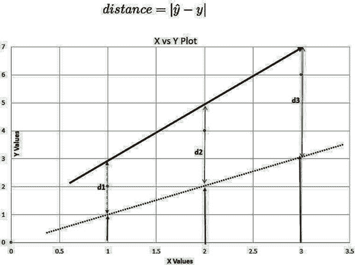

**图 3.13：** 输入‘X’与输出‘Y’的绘图，以及实际值与预测值的比较

在前面的图中，`X` 值是输入值，`Y` 值是所绘制的输出值。对于 `X` 值为 1、2 和 3 的情况，实际输出 `Y` 值为 1、2 和 3（用虚线表示）。但 `Y` 的预期值为 3、5 和 7（用实线表示）。距离可以如前所述通过预期值与实际值之间的差异来计算。“d1”、“d2”和“d3”是可以通过以下方式计算的各种距离：

`d1= 1 – 3 = – 3`

`d2= 2 – 5 = – 2`

`d3= 3 – 7 = – 4`

现在损失函数为 `1/3` × `[–3+ (–2) + (–4)] = –9/3 = –3`

我们将考虑它的绝对值，即“3”，这就是我们的误差距离或代价值。

### 3.5.2 阈值限制

这不是一种可以称为优化方法或技术的损失函数。它用于最大化每个值的 F1 分，范围在 0 到 0.5 之间。通过各种概率机制和步骤计算。设置阈值限制后，可以获得最大的 F1 分并相应构建模型。注意：`F1 Score`的细节见`[第 2 章（监督机器学习）]`。

### 3.5.3 对数损失 (Log loss)

在`[第 2 章（监督机器学习）]`中关于模型性能的性能指标部分进行了详细介绍。

### 3.5.4 欧几里距离

这是均方误差，在`[第 2 章，监督机器学习]`中关于模型性能的性能指标部分进行了详细介绍。

在机器学习算法和模型中使用的其他损失函数如下：

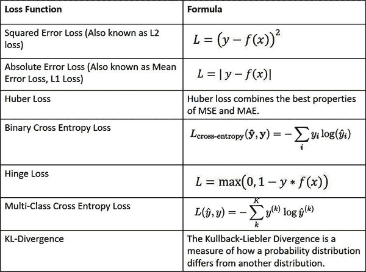

**图 3.14：** 带有公式的各种损失函数

其中 `L` 是损失函数，

`y` 是实际输出，`f(x)` 是预期输出函数。

### 3.5.5 示例与样本

正如详细解释的，无监督学习和无标签数据的降维技术非常流行，这些算法有助于分析各种技术并优化所需的计算。某些算法可用于所需的可视化，例如聚类和异常检测（如信用卡欺诈检测，其中可以应用各种 `PCA` 降维步骤）。在存在巨大的特征集和多维数据集时，可以使用 `t-SNE` 和 `SparsePCA` 的组合。需要聚类技术的应用是无监督算法以前所未有的应用的常见领域。

最近，关联挖掘（频繁发生）被零售商广泛用于篮分析、商品识别等。

减少特征数量是无监督学习算法和技术在当今复杂世界中解决的巨大挑战之一。

## 结论

人们仍然认为无监督学习具有最复杂的机器学习算法。但事实并非如此，在本章中我们已经证明了这一点。

## 记忆点

- 无监督学习不需要标记数据。
- K-means 聚类算法仅支持凸形状的簇。
- 引用了所有的算法和降维技术。
- 主成分分析（PCA）用于减少输入的维度。
- t-SNE 在可视化高维数据的同时提供降维功能。
- DBSCAN 算法将高密度簇与低密度区域分开。

## 问题

1. 什么是无监督学习？它的意义是什么？
2. 监督学习和无监督学习之间的区别是什么？
3. 降维技术是什么？
4. 有哪些流行的无监督学习算法？
5. 本章介绍了哪些降维技术？
6. 无监督算法的应用有哪些？
7. 什么是 PCA？
8. 什么是 t-SNE？
9. 什么是 SVD？
10. 什么是树图？
11. 什么是 ICA？
12. 列举一些著名的算法和各种降维方法。
13. 本章描述的各种损失函数有哪些？
14. 什么是损失函数和代价函数？
15. 无监督学习的优点有哪些？

## 单选题

1. **选择正确答案**
   - 无监督学习需要标记数据。
   - 无监督学习作用于无标记数据。
   - 无监督学习非常快。
   - 无监督学习适用于任何数据。

2. **选择正确答案**
   - t-SNE 是一种降维技术。
   - t-SNE 是一种监督算法。
   - t-SNE 作用于任何数据。
   - 以上都不是。

3. **选择正确答案**
   - SciKit Learn 是用于无监督学习算法的库。
   - 任何库都可以用来定义任何算法。
   - 大多数算法并没有包含在 SciKit 库中。
   - 以上都不是

## 4. 选择正确答案
1. PCA 没有任何含义。
2. PCA 无法被扩展。
3. PCA 代表主成分分析（Principal Component Analysis）。
4. 以上都不是

## 5. 选择正确答案
1. ICA 代表独立成分分析（Independent Component Analysis）。
2. ICA 无法被扩展。
3. ICA 是移民与检查点局（Immigration and Checkpoints Authority）。
4. 以上都不是

## 6. 选择正确答案
1. SVD 是奇异值分解（Singular Value Decomposition）。
2. SVD 无法被扩展。
3. SciKit learn 中没有找到 SVD。
4. 以上都不是

## 7. 选择正确答案
1. SVD 是一种快速的无监督学习算法。
2. SVD 是一种监督算法。
3. 奇异值分解（SVD）是一种降维技术。
4. 以上都不是

## 8. 选择正确答案
1. 损失函数（Loss function）和误差函数（error function）不能是相同的。
2. 损失函数作用于损失，误差函数作用于误差率。
3. 两者均不能相互相关。
4. 损失函数和误差函数是相同的。

## 答案
1. b
2. a
3. a
4. c
5. a
6. a
7. c
8. d

# 第 4 章
## 特征工程

特征工程是将原始数据转换为特征的过程，以便更好地向预测模型表示底层问题，从而提高模型在未见数据上的准确性。因此，在对机器学习算法进行训练数据之前，你必须从收集的原始数据集中提取特征。否则，将很难对你的数据获得良好的洞察。

特征工程不是机器学习中直接涉及的主题，但在围绕各种数据集构建模型和算法时具有至关重要的意义。

## 为什么需要特征工程？

为了构建最好的预测模型，拥有良好且具有选择性的特征是一项重要任务。此外，选择尽可能好的特征也很重要，这可能会影响更高的准确性。某些特征对模型的影响、它们对结果或输出的影响，以及结合可用数据进行选择被称为特征工程。

众所周知的事实是，来自更好数据的更好特征会导致更好的结果。因此，预先对数据进行处理至关重要。有时在处理数据之后，如果我们没有选择正确的特征集，结果和准备好的数据可能会产生误导。因此，需要优秀的特征来获得更好的结果。

然而，对于模型来说，这可能不是最好的，但可以帮助它们运行得更快，使其更容易理解和维护。

**更好特征的优点解释如下：**

* 更好的特征导致更好的灵活性
* 更好的特征有助于构建简单且稳健的模型
* 更好的特征带来更好的结果
* 更好的特征有助于构建更好的预测模型，从而提高模型的准确性
* 更好的特征帮助模型在未见数据上工作表现得更好

## 结构

在本章中，我们将讨论以下主题：
* 特征工程简介
* 更好的特征选择的方法和步骤
    * 基准模型建立
    * 类别编码
    * 特征生成
    * 特征选择
    * 收集和完善数据
    * 清洗和组织数据
    * 数据准备
    * 用于模式选择的数据挖掘
* 其他流行的特征工程技术
    * 填充（Imputation）
    * 异常值处理
    * 分箱（Binning）
    * 独热编码（One-hot encoding）
    * 特征划分
    * 缩放（Scaling）
    * 对数变换
    * 分组操作
* 示例和样本
    * 带有示例的样本

## 目标

学习本章后，你应该能够：
* 理解特征工程和特征选择的机制和方法。
* 用于编码和特征选择的各种技术。
* 特征选择的最佳方法和步骤。
* 特征选择如何帮助选择最佳模型并提高模型的准确性。
* 特征工程的示例或用例。

## 4.1 介绍特征工程

在进入“特征工程”之前，让我们解释什么是特征。在任何数据格式中，无论是表格还是 `.CSV` 文件，它们都是各种观测值的表示，由实例（可能是数据行）和属性（可能是数据列）组成。在这些表示中，属性可以被视为“特征”。因此，包含一种特定类型数据的列就代表一个特征。在收集或构建这些数据模型时，可能会遇到错误的、越界的、恶意的和无关的数据。处理或忽略此类特征的整体艺术也可以称为特征工程。例如，有一个关于住在夏威夷岛的人年龄的数据集，在这种情况下，数据集可能包含 100 岁的年龄。下图解释了如何执行特征工程及其步骤：

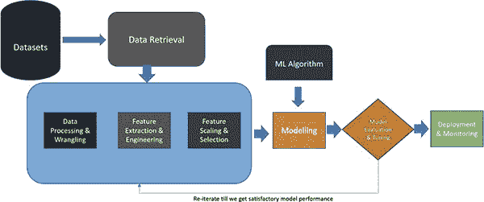

**图 4.1:** 特征工程涉及的各种步骤和工作流

在准备适用于机器学习并满足所有学习要求的数据集时产生了工程的需求。

如果对数据进行了良好的特征工程，有助于构建模型并提高它们的性能。观察到，大多数数据科学家将 80%的时间花在数据准备上。以下是数据科学家花费最多时间的各种任务（近似百分比）：

1. 构建和准备训练集：~3-5%
2. 清洗并整齐组织数据：~50-60%
3. 从各种来源收集数据集：~15-20%
4. 模式挖掘数据：~8-12%
5. 完善数据算法：~4-6%
6. 其他数据相关活动：~5-7%

许多前面的技术和方法解释了*为什么特征工程是重要的*，并有助于更好地准备数据。

我们从机器学习模型中获得的结果取决于对数据进行了怎样的特征工程、提取了哪些特征、我们考虑了数据的哪些固有属性等等。

以下是选择更好特征的一些优点：
* 模型的灵活性
* 它使构建更简单的模型变得更容易
* 捕捉错误的参数，这有助于获得更好的结果
* 对底层问题的背景有更好的表示

精通特征工程技术有助于开发更快速、更好的 ML 模型。

## 4.2 什么是特征选择？

特征选择是一个自动或手动选择对你的预测变量或输出贡献最大的特征的过程。

随着时间的推移，为了更好地选择特征，进化出了许多方法和步骤。有些模型是传统的，而一些涉及技术步骤。但无论使用哪种模型，它们都有助于特征的提取或选择。一旦我们选择了更好的特征，构建模型将会变得容易。在选择了最佳特征的情况下，某些算法也表现良好。

以下是一些知名且行业通用的更好的特征选择方法和步骤：

**使用特征选择的原因：**

* 它能让机器学习算法训练得更快。
* 它降低了模型的复杂度并使其更易解释。
* 如果选择了正确的子集，它可以提高模型的准确性。
* 它减少了过拟合。

### 4.2.1 基准模型 (Baselining model)

这是用于特征工程的初始方法之一。首先，最好选择重要的特征，然后围绕这些特征构建预测模型。它识别现有的输入变量、数据列、数据属性或为我们提供所需基准准确的特征。根据这些特征选择相应的特征。一旦确定，就会决定要使用的模型和算法，并相应地开始训练。

### 4.2.2 类别编码 (Categorical encodings)

在任何涉及数据的已知机器学习或数据科学活动中，它们都主要包含类别变量。通常，这些变量将存储为`text values`。例如，一个包含法国、印度、英国、美国、西班牙、意大利等国家名称的列。计算机算法无法理解什么是国家。因此，这些国家名称将转换为机器可以理解的数字。例如，每个国家名称可能被分配一个数字。例如：法国=1，印度=2，美国=3，以此此类推。每当引用涉及这些国家的特征列时，这些数字将代表相应的国家。

在这些情况下，大多数机器学习算法支持类别值，无需进行任何进一步的操作。

有各种编码技术和方法可以使用。以下根据标准实践和通用用途进行描述。主要分类为“名义编码”（Nominal Encoding，包括独热编码、多类别独热编码和均值编码）和“序数编码”（Ordinal Encoding，包括标签编码和目标引导序编码）。这里描述了一些知名的方法和技术。

#### 名义编码类型 (Nominal encoding types)

类别仅有标签而没有优先级顺序的特征被称为`nominal features`或`encodings`。以下是详细解释的某些名义编码类型：

#### 4.2.2.1 独热编码 (One Hot Encoding)

使用这种方法，每个类别都用包含“1”和“0”的数值向量表示。使用的向量数量取决于我们想要为特征工程保留的类别。对于涉及基数（用许多数字表示）的特征，这种技术可能会产生大量的列。通常，数据科学家或决定机器学习算法的人必须谨慎地选择正确的技术。在某些情况下，建议也使用哑编码（dummy encoding）：

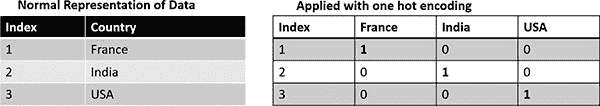

**图 4.2：** 应用独热编码前数据后的数据

#### 4.2.2.2 均值编码 (Mean Encoding)

目标编码（Target encoding）与标签编码相似。在这里，根据每个类别的目标变量计算平均值。

**优点**：均值编码有助于捕捉信息。
**缺点**：在某些情况下，可能会导致过拟合。

#### 4.2.2.3 多类别独热编码 (One Hot Encoding with Many Categories)

在某些情况下，假设频率是相关的，在这些模型中有助于理解。

#### 序数编码 (Ordinal Encoding)

如解释所示，有各种序数类型：

#### 4.2.2.4 标签编码 (Label Encoding)

在这种技术中，使用序数编码器将类别特征转换为数值形式。应用之后，可能会丢失一些信息：

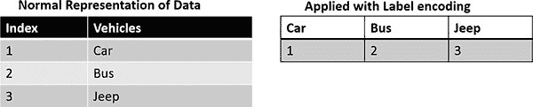

**图 4.3：** 应用标签编码后的正常数据

#### 4.2.2.5 目标引导序编码 (Target Guided Ordinal Encoding)

目标编码基于类别的后验概率。

#### 4.2.2.6 频率编码 (Frequency Encoding)

该技术使用类别的频率。应用此方法使用了以下三个步：

1. 选择想要转换或更改的类别变量。
2. 将它们分组并获取每个的计数。
3. 将它们连接回训练数据。

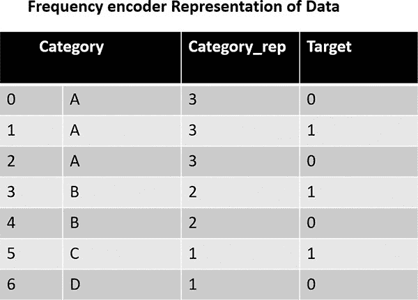

**图 4.4：** 数据的频率编码表示

用于相同的各种类和参数如图 4.4](#fig_4）所示：

#### 4.2.2.7 其他编码技术

让我们在本节了解一些其他编码技术。

##### 哈希编码器 (Hash Encoder)

哈希编码是一个单向过程，不可逆。因此，无法从哈希表示生成原始输入。任意大小的输入数据通过哈希机制转换为固定大小。使用各种哈希算法执行哈希操作。

##### 效应编码 (Effect Encoding)

这与哑编码非常相似，但有微小差异。它也被称为偏差编码或和编码。在这里，使用“0”、“-1”和“1”三个值来构建编码并表示数据。

##### 哑编码 (Dummy Encoding)

哑编码是独热编码。这是一种类别编码，将类别转换为代表“0”和“1”的二进制值。与独热编码相比，我们使用从 1 到 N 个类别的值。

##### 二进制编码 (Binary Encoding)

这是哈希和独热编码技术的结合。在这里，使用序数编码器将类别特征转换为数值形式，然后将数字转换为二进制数，随后拆分为不同的列：

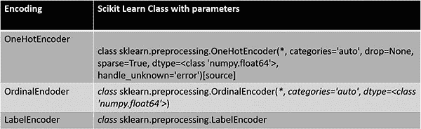

**表 4.1：** 用于编码技术的 Scikit Learn 库

## 4.2.3 特征生成 (Feature generation)

特征生成是产生新特征的过程。从原始数据中创建新特征是一门艺术，也是改进模型的最佳途径之一。

这些新生成的特征并不是特征转换的结果。例如，我们可以为图像及其像素像素生成新特征。

可以通过多种方法和方式生成新特征。在构建新特征时，记住以下几点非常重要：

*   新生成的特征对模型构建有多重要、适用性如何？
*   它们是否有助于提高准确率？
*   新特征中是否包含任何特定领域的知识？
*   构建新特征后，它们对模型构建的影响有多大？
*   最后，需要验证新构建的特征对整体模型准确率提升有多用。

特征生成的最简单且使用最频繁的方法之一是组合变量。例如，我们有一条国家名称为 `Country`、类别为 `Flag` 的记录，那么我们可以创建一个名为 `Country_Flag` 的新值。这是一个新的类别特征，可以提供关于两个类别变量之间相关性的信息。

## 4.2.4 特征选择

正确的特征选择是机器学习中最重要的方面之一。

一种常见的现象是，在应用各种编码并进行特征生成后，从数据集中会出现成百甚至上千个特征。

大量的特征会导致多项挑战。特征数量越多，过拟合训练集和验证集的概率就越大。这会阻碍模型，使模型在泛化接触的新数据时表现可能更差。

此外，如果存在大量特征，模型训练所需的时间将更长，而且超参数的优化或调优将花费更长的时间。如果期望更快的推理或结果，可能无法实现。因此，使用经过选择且数量较少的特征是关重要的。同样，还有许多特征选择技术和方法可以用来克服上述问题。以下是一些特征选择技术和方法。

选择一组重要且有助于构建更好模型的特征子集是非常重要的。有多种特征选择算法配合评分方法来对某些特征进行排序和选择。

一些著名方法如下：

*   相关性 (Correlation)
*   特征重要性方法 (Feature importance methods)
*   单变量特征选择 (Univariate feature selection)

随着时间的推移，演化出了更先进的方法，这些是一种或多种方法的组合。某些模型可以通过尝试错误、频繁评估等方式来构建。这是一门随着时间推移而发展的艺术。

### 相关性 (Correlation)

这是一个统计学术语，用于定义两个变量之间具有线性关系的紧密程度。例如，两个变量 `a` 和 `b` 的线性相关关系为 `a=5b`。因此，当两个特征具有较高的相关性时，我们可以丢弃其中一个变量。因为两个变量对因变量的影响几乎相同。这有助于在很大程度上减少特征数量。

### 特征重要性方法 (Feature importance methods)

`Feature importance` 是一种根据输入特征值分配评分来决定的技术。该评分基于这些特征的有用性以及它们如何帮助预测目标变量。这是一种使用 `scikit learn` 库模块的评分生成技术。最重要的特征。

### 单变量特征选择 (Univariate feature selection)

`advanced methods have evolved which are the combinations of one or more methods. Some models can be built using trial and error, frequent evaluation, and so on. This is an art that can be developed over a period of time.`

数据质量随着时间的推移而下降。需要不断验证结果以检查数据质量。准备好更好的挖掘技术用于模式选择和识别是一项良好的做法。

如前面的章节所述，准确的特征选择可以提高模型质量，并使整体建模过程变得高效。

如果在构建模型时选择了不需要的列或特征，将消耗更多的计算能力（`CPU`）和内存，并占用更多的存储空间。这些不需要的列或特征可能会导致噪声或冗余数据，使得难以识别存在的大型数据集。

在噪声或冗余数据中识别模式会变得具有挑战性。此外，如果数据集是高维的，大多数数据挖掘和基于模式的特征搜索将变得非常有挑战性。

有各种算法和方法来选择这些模式并识别正确的特征。以下是一些著名的技术：

*   `趣味性评分`（interestingness score）：这是一种评分技术，用于对包含非二进制连续数值数据的列中的属性进行排名和排序。
*   `香农熵`（Shannon's entropy）：它可以应用于包含离散和离散化数据的列特征。
*   `贝叶斯评分`（带有 K2 先验的贝叶斯算法或带有均匀先验的贝叶斯 Dirichlet（默认）：这些评分可用于识别包含离散和离散化数据的列特征。如果数据包含连续列，则可以使用前面的方法，即`趣味性评分`。

然而，在实践中今天有各种方法和机制。

这取决于我们用于构建模型的机器学习算法以及我们手头的数据集类型。根据这些，可以应用和使用一些评分技术。

# 4.3 特征工程的其他流行技术

本节是对我们讨论过的所有与特征工程相关的主题的全面回顾。本节提供了一些见解以及上一节中缺失的技术。如果在使用数据时彻底使用这些步骤中的任何一步，就可以构建更好的模型或提高其模型的性能。

# 4.3.1 填补

如前所述，处理缺失值是机器学习数据处理中的常见问题之一。当数据由于人为错误、收集数据流时的中断或由于隐私法律和担忧而产生时，可能会出现这些缺失值。

如之前描述，有各种技术：删除包含缺失值的行，如果某些列中存在过多的缺失值，则删除这些列。与其直接删除行和列，可以使用填补，因为它保留了数据而不是完全丢弃它。

再次，使用填补有两种方法，描述如下：

1.  `数值填补`（Numerical Imputation）：这些是使用平均值、标准差等表示和处理的数值。在某些情况下，如果数据集中存在 `NA`，它将用零值（`0`）替换。如果某个特征集中有太多的缺失值，则取其他值的平均值并替换缺失值的位置。
2.  `分类填补`（Categorical Imputation）：这些值是分类的，最好用特定列/特征中的`出现频率最大值`来替换缺失值。

# 4.3.2 处理异常值

在实践中今天有各种方法和机制。

这取决于我们用于构建模型的机器学习算法以及我们手头的数据集类型。根据这些，可以应用和使用一些评分技术。

如前所述，处理缺失值是机器学习数据处理中的常见问题之一。当数据由于人为错误、收集数据流时的中断或由于隐私法律和担忧而产生时，可能会出现这些缺失值。

如之前描述，有各种技术：删除包含缺失值的行，如果某些列中存在过多的缺失值，则删除这些列。与其直接删除行和列，可以使用填补，因为它保留了数据而不是完全丢弃它。

再次，使用填补有两种方法，描述如下：

1.  `数值填补`：这些是使用平均值、标准差等表示和处理的数值。在某些情况下，如果数据集中存在 `NA`，它将用零值（`0`）替换。如果某个特征集中有太多的缺失值，则取其他值的平均值并替换缺失值的位置。
2.  `分类填补`：这些值是分类的，最好用特定列/特征中的`出现频率最大值`来替换缺失值。

在噪声或冗余数据中识别模式会变得具有挑战性。此外，如果数据集是高维的，大多数数据挖掘和基于模式的特征搜索将变得非常有挑战性。

有各种算法和方法来选择这些模式并识别正确的特征。以下是一些著名的技术：

*   `趣味性评分`：这是一种评分技术，用于对包含非二进制连续数值数据的列中的属性进行排名和排序。
*   `香农熵`：它可以应用于包含离散和离散化数据的列特征。
*   `贝叶斯评分`（带有 K2 先验的贝叶斯算法或带有均匀先验的贝叶斯 Dirichlet（默认）：这些评分可用于识别包含离散和离散化数据的列特征。如果数据包含连续列，则可以使用前面的方法，即`趣味性评分`。

然而，在实践中今天有各种方法和机制。

这取决于我们用于构建模型的机器学习算法以及我们手头的数据集类型。根据这些，可以应用和使用一些评分技术。

# 4.3.3 分箱

在实践中今天有各种方法和机制。

这取决于我们用于构建模型的机器学习算法以及我们手头的数据集类型。根据这些，可以应用和使用一些评分技术。

# 4.3.4 独热编码

在实践中今天有各种方法和机制。

这取决于我们用于构建模型的机器学习算法以及我们手头的数据集类型。根据这些，可以应用和使用一些评分技术。

# 4.3.5 特征拆分

在实践中今天有各种方法和机制。

这取决于我们用于构建模型的机器学习算法以及我们手头的数据集类型。根据这些，可以应用和使用一些评分技术。

# 4.3.6 缩放

在实践中今天有各种方法和机制。

这取决于我们用于构建模型的机器学习算法以及我们手头的数据集类型。根据这些，可以应用和使用一些评分技术。

# 4.4 示例和样本

特征工程是机器学习/深度学习（ML/DL）模型最重要的步骤之一。如果提前完成了正确的特征工程，模型的性能会更好、速度更快。此外，特征工程有助于构建更健壮、性能更好的模型。无论是像深度学习那样由模型选择特征，还是像传统机器学习那样由人工专家选择，正确选择特征都决定了系统的准确性。冗余特征往往会导致模型的困惑。

最后，特征工程有助于对问题建立更好的表示、用于快速学习解决方案的样本数据并描述问题的背景。如前所述，特征工程既是一门艺术也是一种技术，它在过去的十年中变得越来越流行。

在下一章中，将涵盖`分类、聚类、关联和回归`主题。并将详细讨论特征推理在每个 AI 系统中的重要性。

# 要点回顾

- 特征工程是机器学习中最重要的步骤之一。
- 在当今世界，数据是新的石油，我们构建的所有模型都依赖于数据，因此手头有更好的数据是更好的做法。
- 特征工程有助于获得更好的数据，从而构建更健壮、性能更好的模型。
- 随着机器学习领域的发展，许多技术和方法论开始凸显。
- 某些技术和方法可以在试错的基础上应用。
- 某些特征工程技术可以组合以获得更好的结果。
- 没有硬性规定说，如果某些技术组合对某个领域效果更好，它在在该领域的其他模型上也同样有效。

## 问题

1. 什么是特征工程？它的意义是什么？
2. 特征工程中的`baselining`（基准）和`encoding`（编码）是什么？
3. 特征工程中使用了哪些技术？
4. 使用特征工程的应用和模型有哪些？
5. 什么是填充（imputation），为什么要用它？
6. 有哪些不同的填充技术？
7. 什么是独热编码（one hot encoding）？它与类别编码有什么区别？
8. 什么是分箱（binning）？
9. 什么是数据清洗和精炼？

## 多选题

1. **选择正确答案：**
    1. 特征工程是根据某些模式选择最佳特征。
    2. 特征工程是构建新特征。
    3. 特征工程是填充。
    4. 以上皆是
2. **选择正确答案：**
    1. 填充是通过某些数值替换来保留数据。
    2. 填充是删除列。
    3. 填充是删除数据集。
    4. 以上均非
3. **选择正确答案：**
    1. 独热编码使用 10, 20, 30, …, 1000 等值。
    2. 独热编码使用值“0”和“1”。
    3. 独热编码使用代数方程程。
    4. 以上均非
4. **选择正确答案：**
    1. Scikit 库中有一个名为 `OneHotEncoder` 的函数。
    2. Scikit 中没有这样的库。
    3. A 是的。
    4. B 是的。
5. **选择正确答案：**
    1. 在特征工程中，特征可以被分割。
    2. ”a”是无法实现的。
    3. 特征不能被分割或合并。
    4. 以上均非

## 答案

1. **d**
2. **a**
3. **b**
4. **c**
5. **a**

# 第 5 章

# 分类、聚类、关联规则和回归

如`第 2 章，监督学习`和`第 3 章，面向机器学习的系统分析 / 无监督学习`中所讨论，介绍了一些监督和无监督分类方法。在本章中涵盖了这些主题的细节，提供了有关算法类型的额外信息。分类、回归和聚类技术得到了讨论。

## 结构

在本章中将讨论以下主题：
- 引言
- 分类技术
- 聚类技术
- 关联规则
- 回归技术
- 示例

## 目标

学习本章后，应该理解：
- 各种分类技术及其应用场景。
- 不同类型的聚类技术及其适用性。
- 什么是关联规则以及它们为什么重要？
- 回归类型及其目的。
- 具体的编程示例

## 5.1 引言

在深度学习和机器学习中，有分类、回归和聚类技术。这些技术中的每种都是根据数据集的大小、类型、属性以及问题的目的而设计的。通常这些技术有不同的目的，解决问题的方法也是不同的，它们之间存在重叠。分类、回归和聚类技术的细节主要在`第 2 章，监督学习`和`第 3 章，面向机器学习的系统分析 / 无监督学习`中涵盖。然而，在本章中，将专门针对用例涵盖这些主题的细节。关联规则技术、概念、目的、用法以及`Apriori`算法将进行详细讨论。

## 5.2 分类技术

可以使用许多分类算法对数据进行分类。以下是适用于感兴趣用例的一些分类方法。每种方法都有其优缺点，必须根据以下多个参数进行仔细选择：

1. 数据集的大小
2. 训练样本的特征数量
3. 预期性能或准确率
4. 训练时间
5. 数据集类型，特征是否可线性分
6. 数据的质量和性质（数值、类别、缺失数据、图像数据或混合数据）
7. 分类的目的和预期输出以及如何解释输出
8. 任何环境或平台依赖性

# 5.3 一类分类

单类分类由 `Moya` 和 `Hush` 在 1996 年引入。通常，在单类分类中，会有两个具有特殊含义的类，通常命名为目标类（target class）和离群类（outlier class）。它们通常用于离群检测和异常检测问题。例如，如果问题是寻找机器是在正常运行状态还是故障状态。在这种情况下，正常运行状态的机器样本很容易生成，但故障样本则很难获得。由于很难为这类示例准备一个平衡的数据集，因此人们可以使用单类分类。其他示例还包括直升机齿箱的监控和新颖性检测。

图 5.1 展示了一个单类分类的示例，其中椭圆物体作为目标类，属于未知类的正方形物体。虚线显示了分类的决策边界：

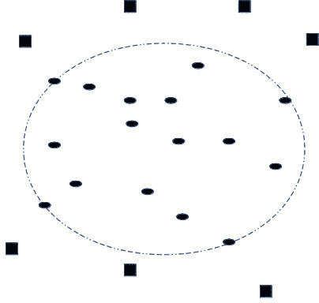

**图 5.1:** 单类分类的一个示例

在分类问题是为了分类（决定）对象是否属于某个特定类别的情况下。例如，如果有一个分类器可以将给定对象分类为植物或动物。如果输入一本书，分类器将其归为植物类或动物类，这是不正确的。在这种情况下，需要构建一个分类器，可以判断给定对象属于植物类、动物类或其他其他类。因此，在单类分类中，其中一类的样本将是良好定义的（如前例中正常工作状态的机器样本），并被称为 `target class`，而另一类只有少量或没有样本（如前例中机器故障运行的样本），将被称为 `negative` 或 `outlier` 类。负类样本并不能构成该类的统计学代表性样本。

根据研究探索，单类分类可以基于以下几类广泛构建：

1. 仅使用目标类样本进行学习。
2. 使用目标类样本和少量弱采样的负类或离群类样本进行学习。在某些情况下，这些样本可以人工生成。
3. 使用目标类样本和未标记的负类数据样本进行学习。

# 5.4 零样本学习

通常，分类模型可以检测其训练时过的类别。假设存在这样一个问题：需要为某个数据集构建分类器，该数据集某些未标记类的样本非常少。普通的分类器模型不适用于这类问题。零样本学习（Zero-shot learning）是一种解决方案，旨在将给定样本分类到一个分类器未训练过的新类。因此，零样本学习是一种学习方法，学习者在测试期间观察训练期间过的类别，并预测其属于哪一类别。

领域自适应（Domain adaptation）是一种为给定的数据分布（源）训练的学习算法，并允许在不同的数据分布（目标）上执行。通过这样，零样本学习可以被视为领域自适应的最坏情况。在零样本学习中，训练数据包含以下类别：

1. 存在类别标签的类别（源类）数据样本。
2. 不存在类别标签的类别（目标类）数据样本。
3. 在训练时提供的包含源类和目标类语义、词嵌入或描述的支持数据。这是重要数据，在源类和目标类中嵌入了数据。

不同类型的零样本学习如下：

* 转导式零样本学习（Transductive Zero-Shot Learning），存在源类和目标类的数据样本，且存在源类和目标类的支持数据。
* 归纳式零样本学习（Inductive Zero-Shot Learning），存在源类的数据样本，且存在源类和目标类的支持数据。
* 通用化零样本学习（Generalized Zero-Shot Learning），测试数据包含属于源类和目标类的样本。
* 传统零样本学习（Conventional Zero-Shot Learning），测试数据包含仅属于目标类的样本。

图 5.2 展示了如何通过属性描述未见类特征，以及零样本学习模型如何使用训练特征对其进行预测：


**图 5.2:** 零样本学习

零样本学习的应用：

1. 多媒体信息检索
2. 多任务强化学习
3. 自然语言处理
4. 图像分类
5. 语义分割

# 5.5 单样本、少样本、K-样本或 N-样本学习

在单样本学习（one-shot learning）机制中，系统从一张或极少数训练图像或样本中学习对象类别。当某些类别只有未标记的图像或少量样本用于训练时，就会出现这种情况。例如，在人脸识别问题中，为了识别一个人的脸，模型必须用大量图像进行训练。当使用一个模型未训练过的新人的图像时，它无法识别该人的脸。单样本学习算法的核心主题是构建能够学习图像类别之间差异的模型。因此，当给模型提供一张图像时，如果图像之间的差异小于阈值，它返回一个接近零的值，否则返回一个大于阈值的值。孪生网络（Siamese networks）基于单样本学习机制。

单样本学习涉及三个主要挑战：

1. 首先，对象和类别的表示，或者如何对对象和类别进行建模。
2. 第二，为此目的构建或学习模型。
3. 第三，在不同场景下识别和检测已知对象或类别，例如光照变化不清晰、部分未显示或被其他物体遮挡。

单样本学习根据其如何利用学习类别的先验知识从给定最小示例学习或迁移知识可以大致分类：

基于信息的知识迁移根据物体放置场景的全局知识学习新类与之前学习类之间的差异。例如，`D. Hoiem` 等人的用于目标检测算法使用了来自场景几何和相机高度的环境信息。

特征共享知识迁移通过跨类别共享对象的部位或特征来实现知识迁移。

模型参数知识迁移通过重用模型参数并利用之前学习与新学习类之间的相似性获得知识迁移。

单样本学习的一些应用如下：

* 人脸识别
* 低数据药物发现
* 自定义目标检测任务

聚类技术的主要目的是将具有相似属性的数据组分开并将它们分配到不同的类中。这是无监督学习方法的一种，其中输入数据没有标签，但仍然对它们进行推断。在接下来的几个章节中，将讨论一些流行的聚类技术，并列出它们的类型或算法：

## 5.7 基于分布的聚类

这些聚类算法基于统计学。`聚类的执行是基于数据的分布的，例如高斯、`Bernoulli`、`Poisson` 和 `Log-normal` 类型分布`。通常使用 `Gaussian distribution`，`Gaussian Mixture Models`（高斯混合模型）就是其中的示例。类的定义是根据包含在类中的样本属于同一分布的概率。在这种技术中，使用一组有限的 `Gaussian distributions` 对数据集进行建模，这些分布是随机初始化的，并通过迭代过程对聚类进行优化。为了获得更好的聚类性能，模型的复杂度随之增加。这些模型利用了属性之间的相关性和依赖性，因此复杂性增加，导致在真实数据集上使用变得困难。如果数据集内部没有分布，或者无法在数据集上拟合数学模型，这些模型将无法执行或工作。为了使这些模型正常工作，假设数据集具有前述的内在分布。形成的类及其内部样本将具有高斯分布。

在聚类过程中，随着样本到特定分布的距离增加，该点属于该类的概率随之降低。如果数据内部的分布未知，建议不要使用基于分布的聚类技术。此类聚类技术的示例包括：

*   `Gaussian mixture models`
*   `Expectation-maximization algorithm`
*   `Auto-class clustering algorithm`

### 5.7.1 基于密度的聚类

另一类聚类算法是基于密度的聚类算法，它根据密度发现非线性形状结构。它还避免了数据中的离群值和噪声。在这种聚类方法中，根据数据空间中数据的不同密度形成不同的类。它们识别不同密度的区域，并将数据点放置在相应的区域以形成类。根据密度的确定方式，有不同类型的基于密度的聚类算法：

1.  **基于噪声的应用空间密度聚类** (`DBSCAN`)：类根据邻域内数据点的密度形成。它可以用于温度数据中的异常检测和卫星图像聚类等应用。
2.  **基于密度的聚类** (`DENCLUE`)：类根据密度函数形成。它可以用于对追踪自然灾害或恐怖攻击的地理定位推文进行聚类，根据发现的类的大小和位置，提供救援和疏散需求的信息。
3.  **识别聚类结构的点排序** (`OPTICS`)：类的形成方式与 `DBSCAN` 类似，但不同在于它存储了聚类过程中处理数据点的顺序。它可以用于原子质探射电子显微成像数据中的聚类分析。

在基于密度的聚类算法中，类的形状不需要是凹的、椭圆的或球形的，也可以是这些之外的不同形状。

### 5.7.2 模糊聚类

通常，聚类是一种根据每个数据点彼此之间的相似程度将它们分组到不同区域的技术。大多数聚类算法都旨在寻找集合中数据点之间的模式或相似性。这表明类内部的数据点比类外的数据点更相似。在模糊聚类中，数据点在给定时间点属于多个类。这种技术之所以产生“模糊性”，是因为它使用最小二乘法来寻找给定数据点的最佳位置。这使得数据点的最佳位置处于两个或多个类之间的概率空间中。通常，它们用于代谢组学数据分析、彩色图像分割以及文本文档分类和标注等应用。

模糊聚类广泛地分为以下两类：

*   经典模糊聚类
*   基于形状的模糊聚类

经典模糊聚类有多种算法，如下：

1.  `Fuzzy C-Means Algorithm` (`FCM`)
2.  `Gustafson-Kessel` (`GK`) 算法
3.  `Gath-Geva Algorithm`

基于形状的模糊聚类有多种算法，如下：

1.  通用形状
2.  椭圆形
3.  圆形形状

### 5.7.3 基于网格的聚类

基于网格的聚类通常用于大规模数据集。该技术的基本思想是用网格表示组织数据集，并通过合并网格单元来生成类。在这种技术中，聚类不是基于数据点，而是基于围绕数据点的值空间。

不同类型的基于网格聚类如下：

1.  `CLIQUE` (`CLustering In QUEst`)
2.  `STING` (`STatistical INformation Grid`)
3.  `MAFIA` (`Merging of Adaptive Intervals Approach to Spatial Data Mining`)
4.  `Wave Cluster`
5.  `O-CLUSTER` (`Orthogonal partitioning CLUSTERing`)
6.  `Axis shifted grid clustering algorithm`
7.  `Adaptive mesh refinement`

## 5.8 关联规则技术

在数据挖掘中，寻找频繁模式是一项常见任务。所谓“模式”，是指两个或多个项目共同出现的频率。在应用领域中，各种示例都需要执行这种挖掘。例如：

*   当用户访问特定网站时，他们在同一个会话中可能会访问哪些网页？
*   当客户购买产品 A 时，他/她可能还会购买哪些产品？
*   在医学诊断期间，如果患有疾病 A，可能会出现什么新症状或副作用？
*   使用人口普查数据，如果建立了特定的公共服务或公共企业，哪些其他服务或企业会受到影响或需要建立？
*   在合成蛋白质期间，如果使用了氨基酸 A，还需要哪些氨基酸？
*   银行尝试作为**客户关系管理**（CRM）的一部分，利用关联规则识别不同客户群对产品的偏好。

关联规则是一种发现数据集中变量之间有趣关联的技术。关联规则也可以被看作简单的 if-then 语句，用于发现关系型数据库或特定数据存储中变量之间的关联或关系。关联规则挖掘可以被视为旨在寻找数据集中独立变量之间频繁模式、关联关系或相关性的技术。这些关联规则通常被称为**正关联规则**。而基于不频繁模式建立关系的关联规则则被称为**负关联规则**，它们近年来日益受到关注。这些规则在医学领域具有影响，因为诊断期间的不频繁模式可能为新疾病或当前疾病的副作用提供见解。

关联规则包含两个部分：

*   前件 (`if`) 和
*   后件 (`then`)

前件（Antecedent）是数据中的一种独立变量，而后件（Consequent）是与前件一起出现的变量。换句话说，前件是变量的组合，通过对它们进行研究或分析，以确定该组合隐含了哪些其他变量组合。

### 例如：

如果一个客户买了一支笔（墨水笔），那么他/她有 70% 的概率购买墨盒。

在前面的例子中，笔是前件，墨盒是后件。

`图 5.3` 显示了不同客户的购物车，关联规则学习旨在发现购买模式，从而在数据集中变量之间产生有趣的关联：


**图 5.3:** 关联规则学习

关联规则挖掘中常用的一些术语列如下：

- **支持度（Support）**：该指标衡量变量在所有交易中出现的频率。该指标适用于变量的组合，因此 `(A, B)` 的支持度是 `X` 和 `Y` 同时出现的交易频率。它由以下方程给出：

  `Support (A, B) = 包含 A 和 B 的交易数 / 总交易数`

  变量或变量组合的支持度值有助于判断其中哪些变量对发现关联规则有帮助。通常会将支持度值较高的变量考虑用于构建关联规则。

- **置信度（Confidence）**：该指标衡量了在选择前件的情况下，后件出现的概率。在数学上，它是给定前件时后件呈现的条件概率。它由以下方程给出：

  `Confidence (A, B) = 同时包含 A 和 B 的交易数 / 包含 A 的交易数`

- **提升度（Lift）**：该指标确定了在已知前件的情况下出现后件的概率相对于未知前件时出现后件概率的比例。它由以下方程给出：

  `Lift (A, B) = (包含 A 和 B 的交易数 / 包含 X 的交易数) / 包含 Y 的交易比例`

对于交易中所有 `A` 导致 `B` 出现的情况，提升度值将大于 1。

关联规则通常是为了满足某个特定时刻给定的最小支持度和最小置信度而构建的，其生成方法是首先对数据集中所有频繁交易应用最小支持度。然后利用这些频繁交易和最小置信度约束来生成规则。

在数据集中寻找频繁交易是一项繁燥的工作，因为需要研究数据集中所有可能的交易。而且需要进行大量的计算来找到它们。目前存在多种算法来寻找频繁交易，其中最流行的算法是 Apriori 算法。

给定一个项集的超集 `S`，则所有可能的项集将是 `S` 的幂集，且其大小为 `2^n-1`（不包含空集，因为空集不是有效的项集），其中 `n` 是 `S` 中项的数量。幂集的大小随 `n` 呈指数级增长，但存在一种利用反单调性属性（anti-monotonicity property，也称为支持度的向向闭性属性，downward-closure property）的有效搜索方法。该属性保证了：对于一个不频繁的项目集，其所有超集也必须是不频繁的；因此，对于一个频繁的项目集，其所有子集也必须是频繁的。

Apriori 算法基于提到的层级搜索算法。令 `Tk` 为大小为 `k` 的频繁项集集合，其对应的候选集为 `D`。算法首先扫描数据库，通过统计每个项目的出现次数来搜索大小为 1 的频繁项集，然后收集满足最小支持度要求的项目。重复以下步骤，直到提取出所有频繁项集：

1. 从大小为 `k` 的频繁项集中生成 `Tk`，即大小为 `k+1` 的频繁项集候选集。
2. 通过扫描整个数据库计算每个频繁项集候选者的支持度。
3. 通过添加满足最小支持度要求的项集确定 `Tk+1`。

Apriori 算法的优点是易实现且通过减少候选集的大小具有良好的性能，但也有以下缺点：

- 它需要多次扫描整个数据库以确定支持度。
- 它在候选集生成过程中消耗更多的时间、空间和内存。
- 它更适用于具有大支持因子的小型数据库。

例如，假设需要生成 260 个候选项集来获取大小为 60 的项集，这在时间、空间和内存需求方面都是无效的。

不同类型的关联规则技术列如下：

- 多级关联规则
- 多维关联规则
- 加权关联规则
- 多关系关联规则
- 模糊关联规则

# 5.9 回归技术

`第 2 章，监督机器学习` 涵盖了线性回归的细节，讨论了学习方法及其解决的问题类型。本节试图揭示其他回归方法的细节。

**注意：** 关联规则技术已扩展到大数据领域。Apriori 算法试图寻找频繁项集或关联规则。它发现的是正关联规则。某些算法用于寻找负关联规则。

# 5.10 逻辑回归

逻辑回归是一种回归统计模型，使用逻辑函数（logistic function）对二分类因变量建模。二分类因变量取两个值如通过/失败、是/否、生病/不健康，这些值被映射到两个数值上。逻辑回归可以使用逻辑函数来表示，公式如下：

`log (p(X) / (1 – p(X)) = b + aX`

前述表达式的左侧称为逻辑函数，其取值范围在 0 到 1 之间。它也被称为对数几率函数（log-odds function），表达式 `(p(X) / (1 – p(X))` 是几率（odds）。`X` 是自变量，`b` 是偏置项。如果我们对前述函数取反，得到以下方程：

`p(X) = eb +a X / (1 + eb + aX)`

方程右侧是 sigmoid 函数（sigmoid function），由 S 型曲线表示。下图给出了逻辑回归的图形表示，它给出的值在 0 到 1 范围内，因此可以映射到输出结果 `p(X)` 的概率：


**图 5.4:** 逻辑回归

逻辑回归在二分类和不同类型的数据方面表现良好，但它也有一些缺点，列如下：

### 逻辑回归的缺点：

1. 逻辑回归假设自变量和因变量之间存在线性分割。
2. 它在较小的数据集上表现不会更好。
3. 它期望结果是分类的，且不适用于连续值。

# 5.11 岭回归 (Ridge Regression)

在[第 2 章“监督机器学习”]中讨论过的，线性回归的代价函数由以下方程给出，其中 `m` 是数据样本的数量，`h(y)` 是给定样本的 `y` 的估计值，而 `y` 是该样本对应的实际值。`(h(y) – y)²` 的值反映了估计值与实际值之间的距离。需要最小化该值以找到拟合给定样本的最优直线：

```


|| h(y) – y² || = || h(y) – (aX)² ||

其中 `a` 是系数向量，由学习方法确定以最小化代价函数。但当数据样本遭受多共线性影响时，最小二法估计将是无偏的，但它们的预测变量的方差会非常大，以至于可能远离真实值。在这种情况下，`a` 的几个系数将主导地驱动数据样本的结果。这意味着少数系数的幅度将高于其他系数，因此，结果将由这些预测参数不均匀地驱动。因此，需要使用正则化机制来降低该系数的值，使得结果不会被少数系数所偏偏。岭回归通过对系数进行惩罚来实现这一点，如果系数远离零，则系数的大小会被缩小。岭回归的代价函数由以下方程给出：

```
|| h(y) – y² || + λ ||a²|| = || h(y) – y² || + λ
```

其中 `λ` 是正则惩罚项，用于控制惩罚系数。通过改变 `λ` 的值，控制惩罚系数，使得系数幅度得到调整，并以最小误差确定估计。`λ` 是一个超参数，它不是学习出来的，而是被设置为一个使岭回归代价函数最小化的值。由于它应用于系数平方，因此它被称为 L2 惩罚。

在以下情况下可以用岭回归代替线性回归：

- 预测系数 (`a`) 之间存在高相关性。
- 预测系数的数量相对较多，导致方差趋于无穷大（当数据样本数量 `m` 接近预测系数 (`a`) 数量 `n` 时）。

## 5.12 Lasso 回归 (Lasso Regression)

Lasso 回归在概念上与之前定义的岭回归相似，不同在于 `λ` 惩罚项被应用于系数绝对值的之和，因此也称为 L1 惩罚项。Lasso 回归的代价函数由以下方程给出：

```
|| h(y) – y² ||2 + λ |a| = || h(y) – y² || + λ
```

使用前述方程中的 L1 惩罚使得 Lasso 回归中的许多系数恰好为零，但这在岭回归中不会发生。

## 5.13 弹性网回归 (ElasticNet Regression)

当存在少数重要的预测参数且其余参数接近于零时，Lasso 回归倾向于表现良好。这意味着只有少数预测参数影响结果。当存在许多大参数且值几乎相同时，岭回归表现良好，因此大多数预测参数影响结果。弹性网回归试图通过使用下面给出的两种惩罚项来获得岭回归和 Lasso 回归的优点：

```
|| h(y) – y² || + λ |a| = || h(y) – y² || + λ ((1 – α) / 2) + α
```

现在有两个惩罚参数需要调整，`λ` 和 `α`，这允许对性能进行更多控制。

还有更多的回归技术，每种技术的使用取决于数据集的类型、属性、预测系数和预期结果。其中一些列如下：

- 逐步回归 (Stepwise Regression)
- 分位数回归 (Quantile Regression)
- 序数回归 (Ordinal Regression)
- 泊松回归 (Poisson Regression)
- 贝叶斯线性回归 (Bayesian Linear Regression)
- 支持向量回归 (Support Vector Regression)
- 负二项回归 (Negative Binomial Regression)
- 主成分回归 (PCR)
- 偏最小二乘法 (PLS)
- 拟泊松回归 (Quasi Poisson Regression)
- Cox 回归 (Cox Regression)
- Tobit 回归 (Tobit Regression)

## 5.14 选择正确模型的因素

对于给定的数据集，决定哪种是正确的技术通常是困难的。这取决于变量的关系和影响。以下是帮助决定正确模型的若干因素：

- 如果使用一组自变量（预测变量）预测单个因变量，则使用多元回归模型。
- 如果自变量和因变量之间存在线性关系，则使用线性回归模型。
- 如果问题是将给定数据集分类为两类、预测这两类的概率，或者数据集服从二项分布，则使用逻辑回归模型。
- 使用调整后 `R²`、残差项和自变量的 P 值来选择正确模型。
- 使用逐步回归和最佳子集回归，这些自动化工具可以在探索阶段通过平衡精度和偏差的统计数据来帮助选择正确模型。

注意：岭回归、Lasso 和弹性网回归技术在代价函数方面是密切相关的，该函数基于数据集的属性。更好地理解数据的特征有助于判断哪种技术最合适。

## 5.15 用例与示例

让我们考虑一个编程示例来说说明关联规则技术的 Apriori 算法，该算法应用于市场篮分析。“啤酒和尿布”案例是市场篮分析中最常用的例子。这个案例是由一家大型零售商发现的，他们发现客户在购买啤酒和婴儿尿布时存在异常的购买模式。这些购买模式是通过挖掘所有客户的交易数据发现的。通过利用这些见解，大型零售商能够为客户提供建议，从而增加销售额。以下程序使用了关联规则技术的 Apriori 算法，并将其应用于零售数据集以识别感兴趣的购买组合。

```python
import pandas as pd
from mlxtend.frequent_patterns import apriori
from mlxtend.frequent_patterns import association_rules

# 读取在线零售交易数据
df = pd.read_excel('./OnlineRetailData.xlsx')
print ("Completed reading the xlsx file")
print (df.head())
```

`OnlineRetailData.xlsx` 下载自链接 [`archive.ics.uci.edu/ml/machine-learning-databases/00352/Online%20Retailxlsx`](http://archive.ics.uci.edu/ml/machine-learning-databases/00352/Online%20Retailxlsx)。表 5.1 给出了欧洲不同国家的客户购买的少数产品的交易数据：


**表 5.1：** 产品购买交易记录

以下代码对数据进行初始预处理：

```python
df.dropna(axis=0, subset=['InvoiceNo'], inplace=True)
df['InvoiceNo'] = df['InvoiceNo'].astype('str')
df['Description'] = df['Description'].str.strip()
```

在检查交易数据值后，发现交易需要进行预处理。之前的代码行对以下清理工作进行了预处理：

- 少数描述包含空格，需要将其移除以保持整洁。
- 少数交易没有发票号，这些需要从数据集中删除或丢弃。

以下代码允许将每笔交易视为行，其中每个发票号对应的产品列在列，并进行了独热编码（one-hot encoded）。为了可视化，仅考虑并列出了“芬兰”国家的少数交易，且仅列出了购买的五种产品，但实际列表包含约 288 个发票号：

```python
basket = (df[df['Country'] =="Finland"]
.groupby(['InvoiceNo', 'Description'])['Quantity']
.sum().unstack().reset_index().fillna(0)
.set_index('InvoiceNo'))
print (basket.head())
```

| **Invoice No** | **10 COLOUR SPACEBOY PEN** | **12 COLOURED PARTY BALLOONS** | **12 DAISY PEGS IN WOOD BOX** | **BLUE PUDDING SPOON** | **CHOCOLATE THIS WAY METAL SIGN** |
| --- | --- | --- | --- | --- | --- |
| 536540 | 0 | 0 | 0 | 0 | 0 |
| 539421 | 24 | 0 | 0 | 0 | 0 |
| 548664 | 0 | 0 | 12 | 0 | 0 |
| 548718 | 0 | 0 | 0 | 0 | 144 |
| 548858 | 0 | 0 | 0 | 0 | 0 |
| 549118 | 0 | 0 | 12 | 48 | 0 |
| 549196 | 0 | 0 | 12 | 0 | 0 |

**表 5.2：** 购买数量的值

如表 5.2 所示，其中有很多 0，少数是正数，这表示购买数量的值。为了将这些值转换为独热编码，任何小于 0 的值均设为 0，非零值均设为 1，通过以下代码实现：

```python
def normalize_units(x):
    if x <= 0:
        return 0
    if x >= 1:
        return 1

basket_sets = basket.apply(normalize_units)
mostused_itemsets = apriori(basket_sets, min_support=0.06)
```

`mostused_itemsets` 包含支持度为 6% 的频繁项集，由于数据已经过组织，通过 `apriori` 库选择 6% 这个数字变得更容易获得。现在我们使用 `association_rules` 函数为这些频繁项目生成对应支持度（support）和置信度（confidence）的规则。以下是规则框架的前五行，提供了表头。为了可视化，丢弃了少数列，仅保留了显著列：

```python
rules = association_rules(frequent_itemsets, metric="lift", min_threshold=1)
print ("The rules are given below ")
print (rules.head())
```

| Antecedents | Consequents | Support | Confidence | Lift |
| --- | --- | --- | --- | --- |
| frozenset({'PINK REGENCY TEACUP AND SAUCER'}) | frozenset({'GREEN REGENCY TEACUP AND SAUCER'}) | 0.0902777777777778 | 0.722222222222222 | 7.428571428571428 |
| frozenset({'ROSES REGENCY TEACUP AND SAUCER', 'PINK REGENCY TEACUP AND SAUCER'}) | frozenset({'GREEN REGENCY TEACUP AND SAUCER'}) | 0.0868055555555555 | 0.9259259259259259 | 7.407407407407407 |
| frozenset({'PINK REGENCY TEACUP AND SAUCER'}) | frozenset({'ROSES REGENCY TEACUP AND SAUCER', 'GREEN REGENCY TEACUP AND SAUCER'}) | 0.0868055555555555 | 0.8928571428571428 | 7.79220779220779 |
| frozenset({'GREEN REGENCY TEACUP AND SAUCER', 'REGENCY CAKESTAND 3 TIER'}) | frozenset({'ROSES REGENCY TEACUP AND SAUCER'}) | 0.0868055555555555 | 0.694444444444444 | 2.81690140845074 |
| frozenset({'REGENCY CAKESTAND 3 TIER'}) | frozenset({'GREEN REGENCY TEACUP AND SAUCER'}) | 0.0868055555555555 | 0.352112676056338 | 2.81690140845074 |
| frozenset({'ROSES REGENCY TEACUP AND SAUCER'}) | frozenset({'GREEN REGENCY TEACUP AND SAUCER'}) | 0.1145833333333333 | 0.6875 | 5.5 |
| frozenset({'GREEN REGENCY TEACUP AND SAUCER'}) | frozenset({'ROSES REGENCY TEACUP AND SAUCER'}) | 0.1145833333333333 | 0.916666666666666 | 5.5 |

从上述规则中，可以得出许多见解。首先，较高的提升度（lift）值表示给定交易次数下，产品组合的频率高于预期。结合领域知识，可以根据置信度和提升度的值组合得出更好的见解。为了说明起，让我们考虑特定提升度和置信度值的组合结果：

```python
print (rules[(rules['lift'] >= 6) & (rules['confidence'] >= 0.8)])
```


| Antecedents | Consequents | Support | Confidence | Lift |
| --- | --- | --- | --- | --- |
| `frozenset({'PINK REGENCY TEACUP AND SAUCER'})` | `frozenset({'GREEN REGENCY TEACUP AND SAUCER'})` | `0.0902777777777778` | `0.9285714285714285` | `7.428571428571428` |
| `frozenset({'ROSES REGENCY TEACUP AND SAUCER', 'PINK REGENCY TEACUP AND SAUCER'})` | `frozenset({'GREEN REGENCY TEACUP AND SAUCER'})` | `0.0868055555555555` | `0.9259259259259259` | `7.407407407407407` |
| `frozenset({'PINK REGENCY TEACUP AND SAUCER'})` | `frozenset({'ROSES REGENCY TEACUP AND SAUCER', 'GREEN REGENCY TEACUP AND SAUCER'})` | `0.0868055555555555` | `0.8928571428571428` | `7.79220779220779` |

从上述规则中，可以得出许多见解。

## 结论

在近期，数据正以远乎想象的速度增长。数据需要被结构化和组织，以提取正确的信息并仅存储需要的信息。这带来了从数据中发现更多见解的问题，以便从数据中提取隐含和显式知识，建立智能关系，并进行预测性和描述性分析，从而实现直观的决策。

在下一章中，将讨论分析过去数据点或序列，并预测当前数据点和提前预测结果的技术。是的，`时间序列`（`Time Series`）章节讨论了预测数据并相应预测时间序列的技术。

# 记忆点 (#toc.xhtml#s146a)

* 单类算法（one-class algorithm）有助于将数据分类为两类，其中一类数据可以很容易生成或获取，而另一类数据则难以生成或无法获取。
* 零样本分类器（zero-shot classifier）经过训练，可将给定样本分类到分类器未经过训练的新类别中。
* 单样本（one-shot）、少样本（few shot）或 K 样本（K-shot）分类器用于对每个类别只有少量训练样本或具有未标记数据的对象类别图像进行分类。
* 关联规则挖掘用于利用数据类别之间的关系发现推荐结果。
* `Apriori` 算法寻找频繁事务，可用于得出有用的见解。
* `Ridge`、`Lasso` 和 `ElasticNet` 具有相似的代价函数，但惩罚项不同，分别为 `L1` 惩罚和 `L2` 惩罚。
* 模糊聚类技术（Fuzzy clustering technique）允许数据点在任何给定时间属于多个聚类。
* 如果给定数据集巨大，那么基于网格的聚类（grid-based clustering）将是一个正确的选择。

# 问题 (#toc.xhtml#s147a)

1. 列举监督学习方法中的任意六分类算法？
2. 给定数据集和一个分类问题，在分类、回归和聚类技术中，哪一种将适用于该问题？请解释。
3. 说明分类、聚类和回归技术之间的三个区别。
4. 什么是关联规则？给出它的应用及两个例子。
5. 解释 `Apriori` 算法及其方法步骤。
6. 写出任意五个回归算法。
7. 从代价函数的角度说明 `Ridge`、`Lasso` 和 `ElasticNet` 回归算法之间的区别。
8. 简述基于密度和基于分布的聚类技术。
9. 列出模糊聚类和基于网格聚类技术中不同类型的聚类算法。
10. 给出一个为零售应用设计推荐系统的问题。在分类、回归、聚类和关联规则技术中，你会使用哪种技术？为什么？

# 多选题 (#toc.xhtml#s148a)

1. **选择正确答案**
    1. 单类分类是一种监督学习算法。
    2. 单类分类是一种无监督学习算法。
    3. 单类分类是一种半监督学习算法。
    4. 单类分类是一种聚类算法。
2. **选择正确答案**
    1. 零样本和单样本分类用于数据挖掘。
    2. 零样本学习用于将图像分类到分类器未经过训练的新类别中。
    3. 当待分类的物体类别有足够的样本时，使用零样本学习。
    4. 零样本学习是一种回归算法。
3. **选择正确答案**
    1. 单样本、少样本和 K 样本学习经过训练，将图像分类到分类器未经过训练的新类别中。
    2. 少样本学习是一种聚类算法。
    3. 单样本、少样本和 K 样本学习用于对具有未标记样本或少量样本的物体类别样本进行分类。
    4. 单样本学习是一种挖掘算法。
4. **选择正确答案**
    1. 模糊聚类用于对始终属于特定簇的数据进行聚类。
    2. 基于密度的聚类基于数据点的分布。
    3. 基于分布的聚类基于数据点的密度函数。
    4. 基于网格的聚类通常用于涉及大量数据点的情况。
5. **选择正确答案**
    1. 基于分布的聚类根据数据分布（如 `Gaussian`、`Bernoulli`、`Poisson` 和 `Log-normal` 类型分布）进行聚类。
    2. `AUTOCLASS` 是一种基于密度的聚类算法。
    3. `DBSCAN` 是一种基于密度的聚类算法。
    4. `STING` 是一种基于分布的聚类算法。
6. **选择正确答案**
    1. `CLIQUE` 是一种基于网格的聚类算法。
    2. 模糊均值算法（`FCM`）、`Gustafson-Kessel`（`GK`）算法、Gath-Geva 算法是基于形状的模糊聚类算法。
    3. 高斯混合模型（`Gaussian Mixture Models`）是基于分布的聚类算法。
    4. `AUTOCLASS` 是一种基于密度的聚类算法。
7. **选择正确答案**
    1. `DENCLUE` 和 `OPTICS` 是基于密度的聚类算法。
    2. 多级关联规则、多维关联规则和加权关联规则是负挖掘关联规则技术。
    3. 多关系关联规则、模糊关联规则是负挖掘关联规则技术。
    4. `DBSCAN` 是一种基于分布的聚类算法。
8. **选择正确答案**
    1. `Apriori` 算法多次扫描整个数据库以确定支持度。
    2. `Apriori` 算法在候选集生成过程中使用较少的时间、空间和内存。
    3. `Apriori` 算法更适合支持因子较低的大数据库。
    4. `STING` 是一种基于分布的聚类算法。
9. **选择正确答案**
    1. `Support` 是所有事务中变量频率的度量。
    2. `Confidence` 是给定前置条件的概率度量。
    3. `DBSCAN` 是一种基于分布的聚类算法。
    4. `Lift` 是无前置知识情况的概率度量。

# 答案 (#toc.xhtml#s149a)

1. **a**
2. **b**
3. **d**
4. **d**
5. **a**
6. **a**
7. **a**
8. **a**
9. **a**

# 第 6 章 (#toc.xhtml#c06)

# 时间序列分析 (#toc.xhtml#c06)

在考虑某些预测时，时间是一个重要因素。本章考虑的模型是基于时间的变化。这些被称为`时间序列数据`。

# 结构 (#toc.xhtml#s150a)

在本章中，我们将讨论以下主题：

* 时间序列简介
* 各种类型的时间序列数据
* 单变量和多变量时间序列模型
* 时域和频域模型
* 线性和非线性时间序列模型
* 时间序列模型
    * 自回归（`AR`）
    * 移动平均（`MA`）
    * 自回归移动平均（`ARMA`）
    * 自回归整合移动平均（`ARIMA`）
    * 向量自回归（`VAR`）
    * 向量自回归移动平均（`VARMA`）
    * 傅里叶变换（`FFT`）
* 相关性提取
* 季节性变化
* 高级时间序列方法
* 示例和样本

# 目标 (#toc.xhtml#s151a)

学习本章后，你应该能够：

* 理解时间序列数据
* 各种类型的时间序列
* 什么是时间序列以及为什么需要它
* 如何使用时间序列模型进行预测？
* 时间序列的示例或用例。

# 6.1 时间序列简介 (#toc.xhtml#s152a)

如前所述，时间序数据点是随时间采集的，并且通常具有其内部结构，这些结构将在本章后面进行详细解释。在传统方法中，`单变量时间序列`是指由在等时间间隔内按顺序记录的单个观测值组成的时间序列。后来，许多时间序模型及其不同类型开始脱颖而出。这些模型是根据行业类型和领域进行构建和构建的。这些可以是简单的数据集，例如特定城市在一周内的二氧化碳排放量，每 15 分钟采集一次数据点。这些数据点可能会根据季节、一天的时间、环境或周围性质等而变化。

同样，周期性间隔内的电力波动也是时间序数据集之一。使用这些数据集对各种结果进行分析和预测有助于构建各种基于时间序的模型。

# 6.2 各种类型的时间序

在深入介绍时间序数据类型之前，让我们先了解处理时间序数据集时涉及的方面：

- **自相关性**：这是观测值之间相似性关于它们之间时间滞后的函数。某些值会在一段时间后重复，这些值被称为`相关值`。如果这种情况在规则且重复的间隔上自动发生，则被称为自相关。例如，在时间序数据类型中观察到正弦模式。
- **平稳性**：如果统计属性不随时间改变；这些值被称为`平稳值`。统计属性是恒定的均值和方差值。例如，某些股票的股价在一段时间内保持平稳。
- **季节性**：某些周期性波动是季节性数值。例如，用电量、股票价值、某些节假日期间在线销售的峰值等。

以下是一段时间内股票价格指示的一些示例。使用 `plotly` 库在 Jupyter notebooks 中绘制这些图表。如果未安装此库，可以使用以下命令进行安装：

```bash
!pip install plotly
```


**图 6.1：** 在 jupyter notebook 中安装“plotly”库

后续步骤是导入 `plotly` 库并使用股票数据集初始化数据框 `df` 的示例：


**图 6.2：** 导入“stocks”数据集并显示几个示例


**图 6.3：** 导入“stocks”数据集并带有时间序图显示几个示例

以下代码用于显示不同公司股票值与日期（2018-2019）的对比：

```python
# 各公司股票价值对比日期 (2018-2019)

import plotly.express as px

df = px.data.stocks()

fig = px.line(df, x="date", y=df.columns,

hover_data={"date": "|%B %d, %Y"},

title='Customized labels')

fig.update_xaxes(

dtick="M1",

tickformat="%b\n%Y")

fig.show()
```


**图 6.4：** 股价对比日期（2018-2019）

时间序模型通常根据各种方面创建，这些方面在性质上可以是`趋势`、`季节性`或`周期性`。详细描述如下：

- **趋势**：基于生成的数据方向方向的变化。这种变化在性质上可以是增加或减少的。这种变化不需要是线性的；可以是任何形式。例如，成年人心率随年龄的变化可以是一种趋势。糖尿病患者通常会有血压波动，这可以是基于特定时期年龄和饮食习惯的趋势。
- **季节（Season）**：时间序数据受季节因素的影响，这些因素可能是天气、一年中的时间或月份的某一天。如前所述，季节性是重要因素之一，并被假设在特定时间段内是恒定的。
- **周期**：当数据在某段时间内上升和下降，但没有固定频率时，被称为周期。这些变化或波动可能是由于经济状况、天气、环境、业务趋势等各种因素引起的。假设这些周期在有限的时间间隔内重复。

## 6.3 单变量和多变量时间序模型

单变量时间序数据包含`仅一个`变量，且这是随时间变化的唯一变量。

**示例**：从测量光强（流明）的传感器、或测量房间温度的传感器等采集的数据。

单变量将是单一或一维的，且没有任何依赖关系：


**表 6.1：** 描述单变量的表格

**多变量时间序**数据包含多个变量，且其中许多或全部随时间变化。

**示例**：从测量温度、湿度、风速等各种传感器采集的数据。

多变量将是多一维的，并与其他变量有依赖关系：


**表 6.2：** 描述多变量的表格

## 6.4 时域和频域时间序模型

**时域序**：在这种时间序中，通常对信号随时间的特性进行检查或分析。

**频域序**：这些通常是正弦波，可能包含幅度、频率以及各种相位。

下表详细解释了`时域序`和`频域序`之间的差异：


**表 6.3：** 时频序的区别

## 6.5 线性和非线性时间序模型

线性时间序通常用`ARMA`和`ARIMA`建模，但非线性时间序需要通过非线性传递函数，如`sigmoid`或`Tanh`。（非线性函数参考`[10 章，深度学习设计/MLP]`）

在大多数通用线性系统中，输出`y`是外部输入`x`以及任何之前输出的线性函数。

## 6.6 时间序模型

通常有各种流行的时间序模型用于进行不同的预测。

### 6.6.1 自回归（AR）

该方法通常用于`单变量时间序`，不包含趋势和季节分量。在该方法中，将变量建模为多个之前时间步（过去值）的观测值/预测值的线性组合。

这些模型能够灵活处理各种不同的时间序模式。在自回归时间序模型中，之前时间步的观测值被用作回归方程的输入，并在后续步骤中使用它们预测值。`AR`是一种简单的随机过程，用于描述随时间的变化。

### 6.6.2 移动平均（MA）

该方法通常用于涉及残差误差作为均值线性函数的时间序列。简单来说，这是对给定数据序列算术平均值的计算。例如，该数据序列可以是价格值或月份的某些天等。

该方法也适用于不涉及趋势和季节性成分的`univariate time series`。移动平均模型在类似于回归的模型中使用过去的预测误差，而不是在回归中使用预测预测变量的过去值。`MA`用于股票价格预测或某些交易股票价值的收益率预测。

### 6.6.3 自回归移动平均模型（ARMA）

该模型通过结合`AR`模型和`MA`模型构建而成。它是先验时间步的观测值和残差误差的线性函数。该方法适用于不涉及趋势和季节性成分的`univariate time series`。

`ARMA`模型是一种用于理解和预测时间序列未来值的工具。`ARMA`模型中的`AR`部分用于对变量进行回归，而`MA`部分用于处理过去发生过多次的误差。

`ARMA`模型应用于许多领域，包括股票趋势分析、市场波动观察等。

### 6.6.4 自回归积分移动平均模型（ARIMA）

自回归积分移动平均技术用于通过差分后观测值和残差误差的线性函数序列来构建模型。这是时间序列预测中广泛使用的模型之一。特别是`ARIMA`模型和指数平滑模型被最广泛使用，它们提供了互补的方法。

当我们谈论`ARIMA`模型时，脑中主要出现的点是`Stationarity`（平稳性）和`differencing`（差分）。如前所述，平稳时间序列无非其属性不依赖于时间。

许多具有周期性行为的时间序列是平稳的。这些周期的长度并不固定，我们无法保证周期的峰值和谷值以恒间隔出现，因此使得这些模型变得有些困惑。

当我们进行连续观测时，例如对某公司在一个月或一年内的股票价格进行观测，我们会计算这些观测值之间的差，这被称为`differencing`（差分）。平稳性和差分在`ARIMA`模型中是密不可分的。

对数是一种有助于稳定时间序列方差的变换。如前文所述，差分有助于稳定时间序列的均值（这通过消除时间序列水平水平的变化来实现），并能消除趋势和季节性。

### 6.6.5 向量自回归模型（VAR）

向量自回归方法通常在模型中使用`AR`。这是`AR`对多个并行时间序列的推广。这些是`multivariate`时间序列。

`VAR`用于捕获随时间变化的多个数量之间的关系。`VAR`模型中的变量包含过去值、其他变量的值以及误差值。这就是为什么它在本质上是多元的。

这类模型被用于业务预测、经济学和自然科学。

### 6.6.6 向量自回归移动平均模型（VARMA）

向量自回归移动平均是`VAR`模型、`VMA`模型以及广义`ARMA`模型的结合。它支持多元平稳时间序列数据。通常来说，这个模型并不常用，因为其他模型的组合可以很容易获得。

该模型有时用作。

### 6.6.7 傅里叶变换（FT）

傅里叶变换用于将信号分解为其组成频率的工具。它广泛应用于信号处理、通信和物理领域。傅里叶变换有几种，包括：

- `Discrete Fourier Transform (DFT)`：用于离散时间信号。
- `Fast Fourier Transform (FFT)`：用于计算`DFT`的高效算法。
- `Short-Time Fourier Transform (STFT)`：通过分析局部片段用于非平稳信号。
- `Wavelet Transform`：用于具有非平稳特征的信号。

## 6.8 示例与样本

时间序列分析用于各个领域。以下是一些示例：

- **股票市场预测**：根据历史数据预测未来股票价格。
- **天气预报**：预测温度、降水量和其他气象变量。
- **需求预测**：估计产品或服务的需求。
- **异常检测**：识别传感器数据中的异常模式。
- **健康监测**：分析心电图（ECG）或脑电图（EEG）信号。

### 选择正确答案

1. `ARIMA`代表“自回归积分移动平均”（Autoregressive Integrated Moving Average）。
2. `ARIMA`代表“自动回归整合模型平均”（Automated Regression Integration Model Average）。
3. `ARIMA`没有扩展。
4. 以上均非

## 4. 选择正确答案

1. `ARMA`不是一种时间序列。
2. `ARMA`（自回归移动平均）同时包含`AR`（自回归）和`MA`（移动平均）。
3. `ARMA`（自回归移动平均）不包含任何内容。
4. 以上均非

## 5. 选择正确答案

1. 股市预测是时间序列数据的应用。
2. 天气预报是时间序列数据的应用。
3. 使用特定模型进行自然分析是时间序列数据的应用。
4. 所有选项均正确。

## 答案

1. **d**
2. **b**
3. **a**
4. **b**
5. **d**

# 第 7 章：数据清洗、特征与特征选择

在`第 1`-`第 6 章`中，讨论了许多深度学习和机器学习的概念。数据准备、数据预处理、数据清洗以及不同的数据模式和类型已详细介绍。监督学习和无监督学习方法以及各种学习算法也得到了介绍。数据的属性、特征的重要性以及特征提取技术进行了讨论。本章讨论了这些未提及的信息，虽然与之前的章节相似，但确保了内容不重复。本章涵盖了数据的不同格式、如何将输入数据集划分为训练集和测试集的必要性。它提供了关于将数据集划分为训练集和测试集的详细信息，并介绍了数据的偏差和方差及其对学习方法的影响。

## 结构

在本章将讨论以下主题：

- 引言
- 数据格式化
- 归一化
- 训练/测试数据划分
- 偏差-方差权衡
- 模型过拟合与欠拟合
- 交叉验证
- 特征减少

## 目标

学习本章后，应该：

- 理解数据的不同格式、其用途以及如何适用于模型。
- 归一化的基础知识。
- 将数据集划分为训练集和测试集的必要性。
- 数据的偏差和方差及其对于构建高性能模型的重要性。
- 模型过拟合和欠拟合的原因。
- 交叉验证技术及其不同类型。

## 7.1 引言

用于构建模型的数据格式对模型性能有很大影响。因此，理解数据格式、属性、大小以及它们如何影响模型是重要的。给定具有代表性的通用数据集，使用其构建的模型表现可能好也可能差。在构建模型时需要注意会导致模型过拟合或欠拟合的参数。这些细节将在章节的后续部分介绍。输入数据集的关键属性、偏差和方差已详细阐述，以便了解数据集偏差与方差之间的权衡。本章将讨论详细主题并结束。

## 7.2 数据格式化

机器学习或深度学习问题需要数据格式化。给定数据将具有`n`数量属性。为了得出见解，需要选择相关或不相关的特征。在监督学习的情况下，需要检查这些特征与输出的相关性。根据相关性，应该选择正确的属性集并丢弃其余。格式化后的示例数据如[图 7.1]所示。根据数据的格式化、存储、收集和组织方式，数据进一步分为两种类型：

- 结构化
- 非结构化


**图 7.1：** 格式化后的数据

结构化数据包括：

- **名义数据（Nominal Data）**包含数字、文本和标签，表示对象类别。也称为分类数据。
  **例如：**
  1. 男性和女性，对应`M`和`F`或`0`和`1`。
  2. 植物和动物，对应`P`和`A`或`0`和`1`。
- **序数数据（Ordinal Data）**具有名义数据的所有属性，并根据偏好和顺序进行排序。
  **例如：**
  1. 根据身高测量，人的身高可以是高、中、低。
  2. 根据收入，薪资人员的收入可以是高、中或低。

非结构化数据包含所有未结构化或未组织的数据。

**例如：**

- 文本、视频、图像和音频。

属性类型通常如下：

- **定量数据（Quantitative data）**仅包含数字。分为两种类型：
  - **连续数据（Continuous data）**通常用小数或浮点数表示，取值范围连续。
    - **例如：**`1.99`、`2.55`等。
  - **离散数据（Discrete data）**通常用整数或离散值表示，不能进一步划分。
    - **例如：**苹果的数量以及`10`、`20`、`22`、`34`等数字。
- **定性数据（Qualitative data）**包含不是数字的数据：
  - **数据（Interval data）**没有起点或基准（绝对零），具有名义和序数数据的特征。因此，间隔数据允许负值，且仅支持加法和减法（因为没有起点或基准）。例如，摄氏和华氏温度而不是开尔文温度（开尔文有绝对零）。
  - **比例数据（Ratio data）**具有名义、序数和间隔数据的特征，并且具有起点或基准。因此，它允许四种运算：加、减、乘、除。例如，开尔文温度。

在数据科学领域，还发现数据被分为四种基本类型：

- **数值数据（Numerical data）**
  1. 数值数据表示数字值，并进一步分为连续数据和离散数据，其意义与之前相同。
- **分类数据（Categorical data）**
  1. 分类数据代表前述的名义和序数数据。
- **时间序列数据（Time series data）**
  1. 时间序列数据表示在特定或定期时间间隔内收集的数字序列。例如，某些年份的房屋平均销量。
  2. 时间序列数据不仅是数字集合（数值数据），而且在时间上是有序的。
- **文本（Text）**
  1. 通常文本数据只是单词。

## 7.3 归一化

通常，对于分类算法，具有不同范围和尺度的属性需要进行缩放，使其落入较小的标准范围，例如`-1`到`1`或`0.0`到`1.0`。这种从原始值到归一化值的转换被称为`归一化`。归一化很重要，因为如果属性值处于不同的范围和尺度，分类算法将会忽略属性。关于归一化的更多细节请参见*第 3 章，机器学习/无监督学习*。

属性的动态范围在*图 7.2*中所示：


**图 7.2：** 属性的动态范围

执行归一化的方法有很多，其中一些：

- 最大最小归一化
- Z-Score 归一化
- Box-Cox 转换
- 小数缩放

### 最大最小归一化

在这种归一化方法中，属性`K`中每个需要归一化的值通过以下表达式确定：

`new_value = (((old_value) – min(K)) / (max(K) – min(K)) + new_min(K)`

其中，`new_value`是`K`中原始值（`old_value`）的新值。`min(K)`、`max(K)`、`new_min(K)`和`new_max(K)`分别是`K`中值的最小值和最大值。归一化的经验在*图 7.3*中所示：


**图 7.3：** 最大最小归一化

### Z-Score 归一化或标准化

在这种归一化方法中，属性`K`的新值根据以下方程确定：

`new_value = old_value – mean(K)/σK`

其中，`new_value`和`old_value`是元素`K`中的新值和原始值。`mean(K)`和`σK`是`K`的均值和标准差。

### Box-Cox 转换

在这种归一化方法中，如果因变量没有正态分布，则将其转换为具有正态分布的分布。具有正态分布的数据有助于许多基于它的统计方法。它以*George Box*和*David Cox 士*命名。由以下表达式给出：

`Y = (X + δ)λ`

`δ`（delta）是当`X`为零或负时添加的修正因子。`X`是因变量的向量，`Y`是新转换值的向量。主要目的是找到合适的`λ`（lambda）值以获得正态分布。如果为零，则表达式取以下形式：

`Y = ln(X + δ)`

通常，`λ`取值为`-1.5`、`-1.0`、`-0.5`、`0`、`0.5`、`1.0`、`1.5`等。

### 缩放

在这种归一化技术中，通过移动属性值的小数点来进行归一化。移动小数点数取决于所有属性值的最大值。由以下表达式给出：

`Normalized value of attribute = value/10j`

其中，`j`是属性值最大的数字位数。

## 7.4 模型训练与测试划分

训练和测试数据划分用于评估机器学习和深度学习算法的模型性能。此过程涉及将数据集分为两个子集：训练数据集和测试集。训练数据集用于模型训练期间，测试集用于模型的验证或测试。为什么有必要将数据集分为两个子集？

首先，对于给定的问题和数据集开发的模型预计将在未见的或新的示例上做出正确预测。为了实现这一点，数据集应该是问题域的良好表示。数据集应该涵盖领域中所有常见和不常见的情况。为了实现这一点，数据集应该足够大，因此训练和测试划分方法不适用于小数据集。如果数据集较小，则使用替代评估程序，如`k 折交叉验证`程序，这将在后文中讨论。因此，为了评估模型的性能，需要将数据集分为训练集和测试集，以便其对真实世界的示例做出正确预测。

其次，某些模型的训练成本很高，在这些情况下将使用训练和测试评估程序。

第三，某些模型具有足够的数据且性能良好，但需要考虑划分比例。具体的划分比例取决于数据的可用性。如果可用更多数据，可以留出更多数据进行测试。

## 7.5 偏差与方差的权衡

对于机器学习或深度学习算法，总是需要构建一个高精度的模型。通过平衡偏差和方差，模型的高精度总是有代价的。这些术语是预测误差的一部分，需要一种权衡策略以获得最佳算法。不同分布的偏差和方差在*图 7.4*中所示：


**图 7.4：** 方差与偏差的组合

预测误差是三种误差的累加，如下：

`Prediction Error = Bias + Variance + Noise`

- 偏差和方差使用“黄金标准”值计算。
- 通过使用之前提到的公式。

从前面关于偏差（bias）和方差（variance）的定义可以看出，为了获得一个既不过拟合又欠拟合的高性能模型，需要减少偏差和方差。那么，偏差和方差之间的最佳平衡是什么呢？

如第 2 章，机器学习系统分析/监督学习和第 3 章，机器学习系统分析/无监督学习中所示，模型通常使用以下代价函数进行训练，并以最小化为目标：

`Y = f(X) + e`

其中`Y`是真值，`X`是输入样本，`f`是映射输入到输出的函数，`e`是误差项。

通过监督学习或无监督学习，模型旨在学习函数`f(X)`，使得预测结果`Y`最接近`Y`且预测误差最小化。

模型的偏差公式为：

`Bias(X) = E[f(X) – f(X)]`

模型的方差公式为：

`Variance(f(X)) = E[(f (X))²] - (E[f(X)])²`

如前所述，预测误差公式为：

`Prediction error = Bias + Variance + Noise or Irreducible Error`

任何输入样本`x`或`X`的期望平方误差公式为：

`Error(x) = E [(Y – Y`)²]`

`= E [(Y – f(x))²]`

`error(x)`可以进一步写为：

`Error (x) = (E[f(x)] – f(x))² + E [(f'(x) – E [f(x)])²] + σe²`

`= [Bias]² + Variance + Irreducible Error`

图 7.5 展示了给定数据集中，模型复杂度随误差从低到高变化的图表：


**图 7.5：** 模型复杂度与误差的关系

它还详细解释了欠拟合区域、过拟合区域、训练误差、测试误差以及不可约误差。偏差和方差的最佳平衡区域在图中清晰地描绘，与本节开头关于偏差-方差权衡的讨论对应。

## 7.6 模型过拟合与欠拟合

欠拟合发生在学习算法在训练期间无法对数据点泛化或拟合函数时。这是由于数据点的高偏差和低方差，或者数据点数量不足。当模型在训练集上的误差大于理想模型的预期误差时，就会发生。有时在训练期间使用正则化参数对模型进行过度正则化，也会导致这种情况。

数据不足意味着用于训练的数据点没有完全反映或代表该问题。因此，模型将无法捕捉特征之间的关系，从而性能不会更好，并被视为欠拟合。以下是克服模型欠拟合的几种方法：

- 向数据集中添加更多数据。
- 在模型中添加更多参数。
- 通过添加不同层来增加模型的复杂度。
- 增加训练时间，直到代价函数最小化。

过拟合发生在学习算法通过最大限地学习数据之间的关系（包括数据中的任何噪声和随机波动）来泛化或拟合函数，因此其表现优异。训练期间的卓越性能对测试数据或新数据的性能产生了负面影响，因为它即使对测试数据的细微变化也会做出错误的预测。通常，过拟合在机器学习或深度学习模型中非常常见，因为模型的学习函数是非参数的，代价函数是非线性的，学习算法具有足够的灵活性来学习目标函数。因此，它们需要进行偏差和方差的权衡。

在某些深度学习模型中，引入了如池化（pooling）和丢弃（dropout）等新层，以便在训练过程中随机或选择性某些神经元。这将使模型不会对训练期间使用的数据点关系和属性过度泛化。

### 交叉验证

在这种方法中，将输入数据集划分以生成多个训练-测试划分。这些划分被用于调整模型。这种划分和调整模型的方法被称为`交叉验证`，将在下一节中详细讨论。

### 正则化

这些技术用于限制、约束或缩小模型的灵活性，以防止模型变得过于复杂。它们在训练方法中引入了惩罚机制并降低模型的复杂度。这些技术在`第 2 章，机器学习的系统分析/监督学习`和`第 3 章，机器学习的系统分析/无监督学习`中进行了详细讨论。

### 集成

在这种方法中，使用最大投票和平均等机制将多个模型的输出相结合，以预测输入样本的最终结果。这些方法并行训练许多模型并结合它们以避免过拟合。Bagging（袋法）和 Boosting（提升法）集成方法是用于此目的的最常用技术。

## 7.7 交叉验证

在分类模型或一般的预测模型中，是在已知数据集上进行建模的，并期望其在未知数据样本上有相同的性能。如何保证这一点呢？这在很大程度上是通过交叉验证方法来实现的。

在之前的“训练与测试划分”部分中，给数据集被相应地划分为训练和测试数据集。训练数据集用于训练模型，测试数据集用于验证。这对于模型能够对任何随机数据或新样本执行泛化操作来说，真的足够了吗？交叉验证通过允许多个训练数据集和测试数据集证明了这一点是错误的。交叉验证有几大类，如下所示：

### 穷尽式交叉验证

在这种方法中，原始数据集以所有可能的方式划分为训练集和测试集，并对所有可能的划分方式进行测试。这种方法有两种类型：

- 留 p 法交叉验证（Leave-p-out）
- 留一法交叉验证（Leave-one-out）

### 非穷尽式交叉验证

在这种方法中，原始数据集仅以一组可能的方式划分为训练集和测试集，而不包含所有可能的划分方式。因此，这些方法是针对不同`p`值对留 p 法的近似。该方法的各种类型如下：

- K 折交叉验证（K-fold）
- 分层 K 折交叉验证（Stratified K-fold）
- 留出法（Holdout）
- 蒙特卡洛交叉验证（Monte Carlo）

### 滚动交叉验证（Rolling Cross Validation）

这种交叉验证方法用于时间序列数据。

此处给出了上述每种方法的简要描述及其其目的。

### 留 p 法交叉验证

在这种方法中，从观测值集中随机选择一个集合`p`作为测试集。剩余部分被视为训练集。所有此类可能的训练-测试划分组合都将被使用并验证。这是一种穷尽式方法，因为它消耗了大量的计算时间。

### 留一法交叉验证

这种方法与留 p 法交叉验证相似，但`p`被设置为`1`。这种方法中的组合较少，因此与留 p 法交叉验证相比，其计算密集程度较低。

### K 折交叉验证

在这种方法中，将输入数据集划分为`k`个等大小的子集。取一个子集并将其保留作为测试数据集，其余作为训练数据集并进行训练。重复此步骤，从`k`个子集中选取不同的子集作为测试数据集，其余作为训练数据集。`k`个结果的平均值将是模型的最终性能。这种方法的优点是，每个子集都被用于验证，在某种意义上，输入数据集中的每个样本都同时用于测试和训练。用于获得最佳性能的`k`值应该是多少？没有适用于所有模型的标准值，通常使用`5`或`10`，但并非强制性的。

### 分层交叉验证

有时，输入数据中的正样本和负样本数量可能不相等。或者在回归问题中，少数样本可能具有与其他样本不同的值，这些值代表了所用整个数据集的特征。例如，在预测房价的回归问题中，会有几组样本的房价与其他样本相比较高。在这些情况下，需要训练集和测试集的划分按比例进行划分，使其与输入数据集相似。这是 K 折交叉验证方法的变体。当输入数据集被分为`k`个子集时，可以发现所有`k`折的平均响应值大约相等，或者在每个`k`子集中都存在相同比例的目标类样本。

### 留出交叉验证

在这种方法中，将输入数据集划分为两个数据集：训练集和测试集，比例为`70:30`、`60:30`或`50:50`。在每次划分之前先对数据进行洗乱。在每个划分上进行训练和验证，并根据所有划分的平均结果进行最终估计。这种方法在划分时并不检查该划分是否具有整个数据集的代表性。如果输入数据集非常巨大，测试集或训练集可能会包含另一个数据集中不包含的重要信息。因此，这种方法通常用于性能不重要但时间至关重要的情况。如果你时间较短且想检查大型数据集的模型运行情况，可以有效地使用该方法。

### 蒙特卡洛交叉验证

在这种方法中，输入数据集按照`70:30`、`60:30`或`50:50`的比例划分为训练和测试集。训练集和测试集的每个样本都是随机选择。此过程重复多次，并对所有结果取平均。由于数据样本是随机选择的，某个样本可能会多次出现在测试集或训练集中，而某些样本可能完全没有被选中。

### 滚动交叉验证

这种方法适用于特定类型的数据集，如时间序列数据。首先，对于此类数据集，不能使用之前的交叉验证方法，因为数据集划分为训练集和测试集时没有考虑时间事件，因此划分在时间间隔内是无效的，且代表原始数据集特征的事件顺序将会丢失。

其次，可能会出现训练数据集包含当前数据样本和未来数据样本，而缺少过去的样本，且类似的测试集可能只包含未来数据样本。这将再次导致错误的结果，不是时间序列问题的正确划分方式。在这种情况下，使用了滚动交叉验证（rolling cross validation）。在该方法中，划分应该按照前向链模式进行。这意味着在选择样本用于训练集或测试集时，训练集应该包含过去的事件，而测试集应该包含未来的事件，且这些事件仅依赖于训练集中的事件。例如，如果某一年有“n”周的天气预报。那么数据划分训练集和测试集的方式如下：如果训练集包含第一、第二和第三周的数据，那么测试集应该包含第四周的数据。如果训练集由第二、三、四、五和六周组成，那么测试集应该包含第七周的数据。

## 7.8 特征减少技术

这些技术用于根据数据点的数学属性从原始集中提取降维后的特征。提取出的特征代表了原始数据集的大部分信息，因此，它们可以在不丢失信息的情况下用于模型训练。许多特征提取技术在本书的*[第 3 章，机器学习中的系统分析 / 无监督学习]*中有详细讨论。

## 7.9 用例与示例

现在，给出了在构建机器学习或深度学习模型处理数据集时需要遵循的数据处理步骤。提供的伪代码用于说明：

### 数据重缩放（Re-scaling Data）

如果给定数据集的属性值处于不同的尺度，则需要对它们进行重缩放以将其带到相同的尺度。可以使用`scikit-learn`的`MinMax Scaler`函数来实现此目的。通用用于任何数据集的`MinMaxScaler`的伪代码如下：

```python
```


```python
from sklearn.preprocessing import MinMaxScaler
```

### 使用 pandas 读取数据集并存储在`df`中

```python
df = pandas.read_csv('data set file name', sep=',')

array = df.values

# 从数组读取输入特征到 x

# 从数组读取输出特征到 y

scaler = MinMaxScaler(feature_range=(0, 1))

rescaledX = scaler.fit_transform(x)
```

`rescaledX`包含了输入特征，其属性值被重缩放到 0 和 1 的范围内。

### 数据归一化（Normalizing data）

属性值可以被归一化或重缩放到不同的范数，如 L1 范数和 L2 范数。可以使用 scikit-learn 的`Normalizer`函数来实现此目的，此处提供了使用该函数的伪代码。

以下代码行将输入数组`x`归一化为 L1 范数或单位范：

```python
from sklearn.preprocessing import Normalizer

normscaler = Normalizer().fit(x)

normX = normscaler.transform(x)
```

### 数据标准化（Standardizing data）

如果需要将数据集的值转换为均值为 0、标准差为 1 的高斯分布，则可以使用 scikit-learn 的`StandardScaler`函数。当给定数据集具有高斯分布且具有不同的均值和标准差时，使用这种标准化转换技术。以下代码使用`StandardScaler`对输入数组`x`进行转换：

```python
from sklearn.preprocessing import StandardScaler

standardScaler = StandardScaler().fit(x)

rescaledX = standardScaler.transform(x)
```

### 数据二值化（Binarizing data）

这种转换技术用于根据阈值对属性值 0 和 1 进行标准化。所有高于阈值的值将被标记为 1，低于阈值的值将被标记为 0。使用 scikit-learn 的`Binarizer`函数来实现此目的，以下代码使用`Binarizer`转换输入数组`x`。在以下代码段中，输入数组`x`中高于 0.2 的值标记为 1，低于标记为 0。通常，这种转换可以将概率值转换为特定的值：

```python
from sklearn.preprocessing import Binarizer

binarizerScalar = Binarizer(threshold=0.2).fit(x)

binaryX = binarizerScalar.transform(x)
```

### 标签编码（Label encoding）

这种转换将带有单词的属性值转换为数字，以便在处理期间更容易处理。可以使用 scikit-learn 的`LabelEncoder`函数，以下代码段显示了它的用法：

```python
from sklearn.preprocessing import LabelEncoder

labelencoderInstance = LabelEncoder()

classesNames = ['Havells', 'Philips', 'Syska', 'Eveready', 'Lloyd']

labelencoderInstance.fit(classesNames)
```

### 独热编码（One-hot encoding）

对于离散且样本较少的属性值，最好将其转换为独热编码。它将特征中的 m 个不同值转换为 m 维数组，其中一个元素的值为 1，其余元素为 0。可以使用 scikit-learn 的`OneHotEncoder`来实现此，以下代码段显示了它的用法：

```python
from sklearn.preprocessing import OneHotEncoder

encoderInstance = OneHotEncoder()

encoderInstance.fit([[1, 1, 2, 2], [1, 6, 3, 8], [1, 4, 9, 7], [4, 0, 5]])
```

### 处理缺失数据（Handling missing data）

处理缺失数据的方法之一是如果列中的缺失值超过 50%，则删除该行。对于数值性质的数据值，处理缺失数据的另一种方法是将其替换为特征的均值、中位数或众数。当数据值为线性的，另一种方法是将其替换为与相邻值的偏差。以下代码段将缺失值（`NaN`）替换为其特征的均值。使用 scikit-learn 的`Imputer`实现此目的：

```python
from sklearn.preprocessing import Imputer

imputerInstance = Imputer(missing_values='NaN', strategy='mean', axis=0)

imputer = imputerInstance.fit(X)

X = imputer.transform(X)
```


## 结论

对数据格式和数据集属性的知识将使人们能够为模型准备通用数据集。归一化技术有助于标准化数据集，使模型重视数据集中的所有特征。训练和测试划分的方法及其目的，以及关于如何使用每种方法的信息，有助于构建高性能模型。特征选择技术、特征提取技术、正则化和交叉验证将帮助人们避免过拟合和欠拟合，并构建一个可以对未见和随机数据样本进行预测的通用高性能模型。

在下一章“集成方法（Ensemble Methods）”中，将讨论组合多个模型、并行训练以及如何使用它们来学习独特特征。

## 注意点

- 数据格式是构建模型过程中重要的处理步骤。
- 如果不对范围和区间不同的属性进行归一化，模型往往会忽略低范围或区间的值。
- 将数据集划分为训练集和测试集是针对特定问题开发模型所要求的，并且期望数据集在未见或新示例上做出正确预测。
- 需要降低偏差（Bias）和方差（variance）以获得性能良好的模型，使其既不过拟合也不会欠拟合。因此，需要找到偏差和方差之间的最佳平衡点。
- 欠拟合（Underfitting）发生在学习算法在训练期间无法对数据点进行泛化或拟合函数时。
- 过拟合（Overfitting）发生在学习算法通过最大限度地学习数据之间的关系（包括数据中的噪声和随机波动，如果有的话）来泛化或拟合函数时。
- 在 `K-fold` 交叉验证方法中，将输入数据集分为 `k` 个等大的子集。取一个子集并将其作为测试数据集，剩余部分作为训练数据集并进行训练。

## 问题

- 机器学习和深度学习模型使用的数据集中，可用数据具有哪些不同的格式？
- 定性数据（qualitative data）和定量数据（quantitative data）之间有什么区别？
- 列出四种用于规范化数据集属性的归一化技术。简要描述其中一种方法。
- 将数据集分为训练集和测试集的目的是什么？适用于构建高性能模型的最优数据划分是什么？
- 偏差和方差对于模型过拟合和欠拟合非常重要。请讨论。
- 画出模型复杂度与误差的关系图，并解释图中使用的各种术语。
- 列出避免欠拟合需要采取的步骤。
- 什么是模型的过拟合和欠拟合？
- 列出可以避免模型过拟合的不同特征选择技术。
- 列出五种避免模型过拟合的方法。
- 讨论防止模型过拟合的早停（early stopping）和丢弃（dropout）方法。
- 列出三种交叉验证方法并解释分层 K 折交叉验证（stratified k-fold cross validation）。
- 什么是滚动交叉验证（rolling cross validation），它与其他交叉验证方法有什么不同？

## 单选题

1. **选择正确答案**
   1. 名数据（Nominal data）和序数数据（ordinal data）是非结构化数据的两种形式。
   2. 连续数据和离散数据是定量数据的两种形式。
   3. 整数和浮点数是非结构化数据的两种形式。
   4. 文本是结构化数据的形式。

2. **选择正确答案**
   1. 区间数据（Interval data）和比例数据（ratio data）是定性数据的形式。
   2. 整数和浮点数是结构化数据的两种形式。
   3. 文本和数字是仅两种数据格式。
   4. 结构化数据仅构建机器学习模型。

3. **选择正确答案**
   1. 最小最大归一化（Min-Max normalization）是避免模型欠拟合的技术。
   2. 小数缩放（Decimal scaling）是避免模型欠拟合的技术。
   3. 零分归一化技术（Zero-score normalization）用于避免模型过拟合。
   4. Box-Cox 变换（Box-Cox transformation）是一种数据归一化技术。

4. **选择正确答案**
   1. 80:20 是测试集和训练数据集的最优划分。
   2. 50:50 是测试集和训练数据集的最优划分。
   3. 80:20 是测试集和训练数据集的最优划分。
   4. 结构化数据仅构建机器学习模型。（等等，选项 1 和 3 与原文相同，保持不变）。

   根据原文纠正：
   1. 80:20 是最优划分……
   2. 50:50 是最优划分……
   3. 80:20 是最优划分……
   4. 结构化数据仅……

   （等等，重新读原文）：
   1. 80:20 是测试集和训练数据集的最优划分。
   2. 50:50 是测试集和训练数据集的最优划分。
   3. 80:20 是测试集和训练数据集的最优划分。
   4. 结构化数据仅构建机器学习模型。

5. **选择正确答案**
   1. 偏差和方差对于模型过拟合和欠拟合很重要。
   2. 高偏差。
   3. 高方差模型。
   4. 高偏差模型欠拟合。

6. **选择正确答案**
   1. 增加更多参数。
   2. 增加数据。
   3. 增加模型的复杂度。
   4. 增加训练时间。

7. **选择正确答案**
   1. 欠拟合发生在数据具有许多特征时。
   2. 高偏差模型欠拟合。
   3. 高方差模型过拟合。
   4. 输出。

8. **选择正确答案**
   1. 方差阈值技术用于避免欠拟合。
   2. 遗传算法用于数据。
   3. 步进搜索。
   4. 特征提取避免过拟合。

9. **选择正确答案**
   1. 留一法和留 p 法是交叉验证。
   2. K 折交叉验证和蒙特卡洛是交叉验证。
   3. 分层 K 折和留出是交叉验证。
   4. 滚动交叉验证是一种方法。

## 答案

1. a
2. a
3. d
4. d
5. b
6. d
7. c
8. d
9. a

# 第 8 章：集成模型

当输入输出之间的关系不可用时，基于 AI 的推理模型非常有用。为此，已经开发了许多算法。然而，这些算法的准确性和稳定性仍然是一个问题。这是因为每个模型学习特定的特征。由于单个模型可能无法提供准确的结果，有时需要结合学习独特特征的多个模型，从而提高准确性。在 Kaggle 等比赛中，已知结合算法可以获得更好的准确性和结果。此外，算法结合可以产生强大的模型。

此外，模型使用大量的待配置参数进行训练。模型的性能在特定的参数组合下最好。当这些超参数的空间很大时，手动尝试所有参数是非常困难的。需要一种系统的方法来获得最优参数集。本章解释了超参数调优。

## 结构

- 集成方法
  - 序列集成方法
  - 并行集成方法
  - 平均集成方法
  - 提升集成方法
  - 极端梯度提升（`X boost`）
- 结合弱学习器
- 高级集成模型构建
- 超参数调优
  - 影响调优的因素
  - 基于遗传算法的调优
- 示例与样本

## 目标

学习本章后，你应该能够：

- 多种算法的设计与实现
- 设计和实现提升及极端提升技术
- 开发结合多个模型的机制以提高性能
- 微调模型参数以获得最佳性能
- 利用遗传算法进行超参数调优

## 8.1 引言

人工智能系统随着时间的推移不断进化。根据所使用的算法，模型提供了不同程度的准确率。提升（Boosting）方法通过组合这些模型来增强性能。模型的超参数使用遗传算法进行系统性选择。

## 8.2 集成方法

如今出现了许多集成方法。通过结合许多估计器的预测，其鲁棒性比单一估计器得到了提高。正如前面提到的，这是一个众所周知的事实：结合多个学习算法可以产生更好的准确率和强大的模型结果。`Figure 8.1` 显示了各种集成方法：


**图 8.1：** 集成方法

### 8.2.1 常见的集成方法

如引言和前面的章节所述，集成方法的主要目标是结合各种方法的预测/结果。这些方法每种都有其优势，并已进行简要讨论。

#### 8.2.1.1 顺序集成方法

不同类型的学习器按顺序学习。在某些情况下，早期的学习器会对数据拟合简单模型。通过分析数据中的错误，性能将不断增强。通过对高权重修正的标记错误的示例进行正确分类，可以实现性能的整体提升。`Figure 8.2` 显示了顺序集成方法的图示。这种方法的示例包括 `Adaboost` 和 `Stochastic Gradient Boosting`：


**图 8.2：** 顺序集成方法

#### 8.2.1.2 并行集成方法

在这些方法中，基学习器是同时生成的。例如，你想选择一个独特的度假目的地，你可以向朋友寻求建议，并在网上浏览优秀选择或查看一些杂志。并行集成方法的示例包括 `stacking`、`random forest` 和 `bagging`。

- **同质并行集成方法：**  
  在这种方法中，基学习器使用单一机器学习算法。`Bagging` 和 `boosting` 属于这一类。
- **异质并行集成方法：**  
  在这种方法中，基学习器使用多种机器学习算法。`stacking` 属于这一类。

`Figure 8.3` 显示了并行集成方法的图示：


**图 8.3：** 并行集成方法

#### 8.2.1.3 平均集成方法

首先，独立构建多个估计器，然后通过组合它们对它们的预测取平均。在许多情况下，这些估计器比单一基估计器更好。由于组合模型减少了方差，因此使用这类集成模型是更好的做法。

#### 8.2.1.4 提升集成方法

在提升方法中，多个估计器的组合方式类似于顺序方法，但其动机是减少偏差值。此外，在提升技术中组合多个弱模型以产生强大的集成模型。

## 8.3 结合弱学习器

观察到，结合 `weak learners` 通常会产生结果。在某些情况下，早期的学习器会对数据拟合简单模型。通过分析数据中的错误，性能将不断增强。通过对高权重修正的标记错误的示例进行正确分类，可以实现性能的整体提升。

为了衡量任何模型的准确率，将其训练准确率与验证准确率进行比较。如果任何个体或单一模型的性能较低，那么 `bagging` 将无法获得更好的偏差值，但 `boosting` 可以组合误差更低且优化的模型。`Bagging` 有助于模型的泛化能力，以便对新样本进行更好的预测。

### 如何结合弱学习器？

这两种方法之间没有明确的胜者。它完全取决于数据、使用的模拟方法以及周围的环境。这两种方法通过结合来自不同模型的许多估计，有助于减少单一估计的方差。

以下是一些探索过的方法：

- **Boosting：** 思想是结合多个弱学习器（相同类型的同质学习器）以产生强大的模型。在这种方法中，基估计器按顺序和自适应的方式构建。
- **Bagging：** Bagging 方法主要通过在基估计器中引入随机性。通过聚合个体预测形成最终预测。它对于全随机和决策树等复杂模型效果最好。
- **Stacking：** 这种方法考虑异质弱学习器，并行学习它们，并最终使用元模型将它们结合。然后根据不同弱模型的预测做出最终预测。假设我们想拟合由 `K` 个弱学习器组成的堆集成。可以遵循以下步骤：
  1. 首先，将训练数据分为两部分。
  2. 然后选择 `K` 个弱学习器并使用第一部分数据进行训练。
  3. 现在，对于每个 `K` 学习器，对第二部分的观测值进行预测。
  4. 最后，使用弱学习器的预测作为输入，并在第二部分上拟合元模型。

| Index | 集成方法 | SciKit Learn 库 |
| --- | --- | --- |
| 1 | Bagging 元估计器 | `from sklearn.ensemble import BaggingClassifier; from sklearn.neighbors import KNeighborsClassifier; bagging = BaggingClassifier(KNeighborsClassifier(), max_samples=0.5, max_features=0.5)` |
| 2 | 随机森林 | `from sklearn.ensemble import RandomForestClassifier` |

| # | 方法 | 代码示例 |
| :--- | :--- | :--- |
| 3 | AdaBoost | `from sklearn.model_selection import cross_val_score` `from sklearn.datasets import load_iris` `from sklearn.ensemble import AdaBoostClassifier` |
| 4 | Gradient Tree Boosting | `from sklearn.datasets import make_hastie_10_2` `from sklearn.ensemble import GradientBoostingClassifier` |
| 5 | Histogram-Based Gradient Boosting | `from sklearn.experimental import enable_hist_gradient_boosting` `from sklearn.ensemble import HistGradientBoostingClassifier` |
| 6 | Boosting（Voting Classifier、Regressor and Stacked Generalization） | `from sklearn.ensemble import VotingClassifier` `from sklearn.ensemble import VotingRegressor` `from sklearn.ensemble import GradientBoostingRegressor` `from sklearn.ensemble import StackingRegressor` |

**表 8.1：** 用于各种集成学习方法的 Scikit–learn 库

## 8.4 高级集成模型构建技巧

当 AI 模型存在噪声时，组合多个模型可以显著减少噪声。模型的组合能够显著降低推理过程中的方差。

模型或估计器的数量需要仔细选择。虽然增加模型数量可以减少方差，但也可能导致过拟合并增加计算时间。遗传算法将在下一节中详细介绍，并可用于选择最优模型数量。通常，设计从 10 个估计器开始。

## 8.5 超参数调优

机器学习模型的准确性取决于各种各种参数。这些设计参数是可配置的，被称为 `hyperparameters`（超参数）。这些参数选择的微小变化会显著影响模型的性能和稳定性。

参数有多种组合方式，因此为模型的精调带来了最优化选择的问题。其中某些参数是至关重要的。例如，决策树中的最大深度、随机森林中树的数量，或者卷积神经网络中的层数、过滤器、池化方法或步长长度。这些参数都是可配置的，以实现精调。

`hyperparameters` 与模型参数、网络权重或系统参数不同。它们不是作为训练的一部分获得的，而是通过最小化损失函数获得的。`hyperparameters` 的选择从定义其取值范围开始。在该范围内，通过不同的组合对值进行采样以优化性能。

## 8.6 基于遗传算法的调优

`hyperparameters` 的数量以及它们可能取的值是巨大得惊人的。尝试所有取值的组合以获得最优性能是不切行的。通过对值进行采样来缩小输入域。

在参数空间内对值进行采样的技术之一是遗传算法。它是一种用于最小化采样数据的优化算法。它的灵感源于查斯·达尔文（Charles Darwin）的自然选择理论。因此，它包含三个部分：

- **变异（Variation）：** 通过突变产生更多实体或生物的变体。
- **继承（Inheritance）：** 作为变异一部分生成的特征会被传递给代的生物或实体。
- **优胜劣汰（Survival of the fittest）：** 为后代创建的实体或生物变体之间相互竞争各种元素（基于以最小资源生存等标准）。其中一个存了下来。

遗传算法的原理被应用于下一代。该过程重复直到满足标准。

## 8.7 用例

在本节中，我们提供了一种用于特征选择的遗传算法实现。

```python
import numpy as np
import pandas as pd
import random

from sklearn.datasets import load_iris
from sklearn.model_selection import train_test_split
from sklearn.linear_model import LogisticRegression
from sklearn.metrics import accuracy_score

def init_of_pop(size, num_feat):
    pop = []

    for i in range(size):
        chromosome = np.ones(num_feat, dtype=bool)
        chromosome[:int(0.3*num_feat)] = False
        random.shuffle(chromosome)
        pop.append(chromosome)

    return pop

def fit_score(pop, Xtrain, Xtest, ytrain):
    scores = []

    for chromosome in pop:
        model = LogisticRegression()
        model.fit(Xtrain[:, chromosome], ytrain)
        preds = model.predict(Xtest[:, chromosome])
        scores.append(accuracy_score(ytest, preds))
```


```
scores = np.array(scores)
pop = np.array(pop)
inds = np.argsort(scores)
return list(scores[inds][::-1]), list(pop[inds][:][::-1])
```

```
def selection(popAfterFit, num_parents):
    popNextgen = []
    for i in range(num_parents):
        popNextgen.append(popAfterFit[i])
    return popNextgen
```

```
def crossover(popAfterSel):
    popNextgen = popAfterSel
    for i in range(len(popAfterSel)):
        child = popAfterSel[i].copy()
        child[3:7] = popAfterSel[(i+1)%len(popAfterSel)][3:7]
        popNextgen.append(child)
    return popNextgen
```

```
def mutation(popAfterCross, mutation_rate):
    popNextgen = []
    for i in range(0, len(popAfterCross)):
        chromosome = popAfterCross[i].copy()
        for j in range(len(chromosome)):
            if random.random() < mutation_rate:
                chromosome[j] = not chromosome[j]
        popNextgen.append(chromosome)
    return popNextgen
```

```
def generations(size, num_feat, num_parents, mutation_rate, n_gen, Xtrain, Xtest, ytrain, ytest):
    best_chromo = []
    best_score = []
    population_nextgen = init_of_pop(size, num_feat)
    for i in range(n_gen):
        scores, pop_after_fit = fit_score(population_nextgen, Xtrain, Xtest, ytrain)
        best_chromo.append(pop_after_fit[0])
        best_score.append(scores[0])
        pop_after_sel = selection(pop_after_fit, num_parents)
        pop_after_cross = crossover(pop_after_sel)
        population_nextgen = mutation(pop_after_cross, mutation_rate)
    return best_chromo, best_score
```

# Example 用法

```
data = load_iris()
X, y = data.data, data.target
Xtrain, Xtest, ytrain, ytest = train_test_split(X, y, test_size=0.3, random_state=42)
best_chrom, best_scores = generations(10, X.shape[1], 5, 0.01, 10, Xtrain, Xtest, ytrain, ytest)
```

```
return bestChromo, bestScore
```

通过调用以下方法使用遗传算法来选择最佳或最优特征集。它将染色体数量、种群中每个体的基因数量、父代数量、变异率和代数作为输入参数来寻找最优后代：

```
chromo,score=generations(size=200, numFeat=30, numParents=100, mutationRate=0.10, nGen=38, Xtrain=Xtrain, Xtest=Xtest, ytrain=ytrain, ytest=ytest)
```

首先，使用以下方法根据染色体数量和基因数量构建初始种群：

```
popNextgen=init_of_pop(size, numFeat)
```

其次，使用此处提供的适应度函数构建当前种群的最优个体：

```python
def generations(size, numFeat, numParents, mutationRate, nGen, Xtrain, Xtest, ytrain, ytest):
    bestChromo= []
    bestScore= []
    popNextgen=init_of_pop(size, numFeat)
    for i in range(nGen):
        scores, pop_after_fit = fitness_score(population_nextgen)
        print(scores[:2])
        popAfterSel = selection(popAfterFit, numParents)
        popAfterCross = crossover(popAfterSel)
        popNextgen = mutation(popAfterCross, mutationRate)
        bestChromo.append(popAfterFit[0])
        bestScore.append(scores[0])
    return bestChromo, bestScore
```

此之后，使用之前定义的遗传算法的交叉和变异方法产生下一代的后代：

```
popAfterCross = crossover(popAfterSel)
popNextgen = mutation(popAfterCross, mutationRate)
```

这一过程会在所有代中重复，并跨所有代生成最优染色体。列表 `bestChromo` 和 `bestScore` 将包含最优染色体及其对应的适应度评分：

```python
for i in range(nGen):
    scores, pop_after_fit = fitness_score(population_nextgen)
    print(scores[:2])
    popAfterSel = selection(popAfterFit, numParents)
    popAfterCross = crossover(popAfterSel)
    popNextgen = mutation(popAfterCross, mutationRate)
    bestChromo.append(popAfterFit[0])
    bestScore.append(scores[0])
```

使用前述通过遗传算法生成的最优染色体或特征，使用以下提供的新特征集再次训练逻辑回归模型：

```
chromo,score=generations(size=200, numFeat=30, numParents=100, mutationRate=0.10,nGen=38, Xtrain=Xtrain, Xtest=Xtest, ytrain=ytrain, ytest=ytest)
logmodel.fit(Xtrain.iloc[:,chromo[-1]], ytrain)
```

如前所述，对训练后的模型进行测试集进行评估并确定准确率：

```
predictions = logmodel.predict(Xtest.iloc[:,chromo[-1]])
print("Accuracy score")
```

`Hubel` 和 `Wiesel` 发现视觉皮层中存在三种细胞，根据它们学习或反应的特征，每种细胞都具有不同的特性。这些分别是简单细胞、复杂细胞和超复杂细胞。简单细胞负责学习线条和颜色等基础特征；复杂细胞负责学习边缘、角和轮廓等特征；而超复杂细胞则负责学习由简单细胞和复杂细胞学到的特征组合。这种深刻的洞察为理解感知是如何构建的铺平了道路——多个神经元的感受野可能会重叠，它们共同覆盖整个视野区域。这些神经元协同工作，其中一些神经元独立学习特征，另一些通过组合其他神经元学习的特征来学习，最终整合以检测视觉场任何区域的所有形式的复杂特征。

Hubel 和 Wiesel 实验的视频请访问 [`www.youtube.com/watch?v=y\_l4kQ5wjiw`](https://www.youtube.com/watch?v=y_l4kQ5wjiw)。

CNN 是图像分类或图像相关问题中最青睐的深度学习模型。后来，CNN 还被用于处理自然语言处理、语音识别、动作识别和文档分析等多个领域的问题。CNN 最重要的特性是它们可以在没有任何引导监督的情况下自动学习重要特征。例如，给定狗和猫的两个类别的图像，CNN 能够自己学习狗和猫的区分性特征。

与其他用于图像相关问题的深度学习模型相比，CNN 的计算效率更高，这使得它们成为最理想的选择，因为它们可以配置为运行在许多设备上。自从 2012 年 `AlexNet` 出现以来，研究人员已成功构建了具有良好准确率、强大且高效的新型 CNN 架构。流行的 CNN 模型架构包括 `VGG-16`、inception 模型、`ResNet-50`、`Xception` 和 `MobileNet`。

## 9.2 CNN 架构

通常，所有的 CNN 模型都使用以下构建块或组件构建架构。`Figure 9.2` 描述了 CNN 模型的基本架构：

*   输入层
*   卷积层
*   激活函数
*   池化层
*   Dropout 层
*   全连接层
*   Softmax 层

在 CNN 架构中，涉及卷积层、激活函数、池化层和 Dropout 层的构建块会重复出现，最后以一个或多个全连接层和 softmax 层结束。

卷积层是 CNN 架构中最重要的构建块。第一卷积层中的神经元并没有连接到输入图像的所有像素，而是连接到其局部感受野的像素，如`figure 9.2`所示。从数学上讲，卷积层合并了两组信息以产生特征图。它将卷积滤波器或核应用于输入并产生特征图：


**图 9.2:** CNN 架构

让我们通过一个例子来更好地理解。假设输入图像大小为 6 x 6，核大小为 3 x 3。类比视觉皮层，视野大小为 6 x 6，局部感受野大小为 3 x 3。为了生成特征图，核在输入图像的每个像素位置上滑动。因此，每次卷积操作都会生成一个值（像素值与相同位置对应核值的加和或乘积）。每次卷积操作期间使用的输入图像区域是感受野，其大小等于核的大小。由于核在整个输入图像上滑动，在卷积操作应用于整个图像后，会产生一个与输入图像大小相同的特征图。3D 图像或多颜色通道输入图像也遵循相同的步骤。在这种情况下，每个通道也会产生一个独立的特征图。由于使用核的每次卷积操作都会产生一个特征图，因此对于普通的灰度 2D 图像，每层产生的特征图数量等于该层中使用的核的数量。对于 3D 图像，由于有三个颜色通道，该数量是核数量的三倍。

在卷积过程中，对于特征图中的每行 `x` 和每列 `y`，位置 `(x, y)` 处的值将是第 `x` 到 `x + kh – 1` 行以及第 `y` 到 `y + kw – 1` 列之间值的乘积和，其中 `kh` 和 `kw` 是感受野的高度和宽度。因此，为了产生与输入图像大小相同的特征图，必须在输入图像周围进行适当的填充（padding）。通常，对输入图像应用零填充（zero padding）。

也可以通过错开像素位置来让核在输入图像上滑动。这意味着如之前所述，核在输入图像的每个像素位置上滑动以生成特征图。相邻感受野之间的距离为一（基于像素位置）。相邻感受野之间的间距或距离称为步长（stride）。由于核在行和列上滑动，跨行（垂直方向）和跨列（水平方向）的步长可以不同。当步长大于 1 时，可以产生比输入尺寸更小的特征图。通过步长，特征图中位于 `(x, y)` 的神经元值是由 `(x) * sh + kh - 1` 行和 `(y) * sw + kw – 1` 列产生的，其中 `sh` 和 `sw` 是水平和垂直步长。特征图中的每个位置 `(x, y)` 都是使用该卷积层特定核生成的神经元。因此，神经元在位置 `(x, y)` 处的权重是卷积应用于第 `x` 到 `x + kh – 1` 行以及第 `y` 到 `y + kw – 1` 列之后的值，其中 `kh` 和 `kw` 是输入感受野的高度和宽度。CNN 模型构建用于学习方程 `WX + b`，其中 `W` 是神经元的权重，`X` 是神经元的激活值，`b` 是偏置项。特征图中的所有神经元共享相同的权重（核）和偏置项，但激活值对应于特征图中该神经元相应感受野的值。这就是为什么 CNN 计算量少于**深度神经网络**（**DNN**）的原因之一。神经元在特定位置学习的特征将使其能够在输入中的任何地方都检测到相同的特征，无论该位置如何。这是 CNN 相比于 **DNN** 的另一个重要特性，后者不具备平移不变性。

接下来，考虑第一个卷积层之后的卷积层。卷积层 `l` 中特征图 `k` 在位置 `(x, y)` 处的神经元的输入来自于前一层 `l -1` 中的所有神经元，这些神经元位于行 `x * sw` 到 `x * sh + kw-1` 以及列 `y * sh` 到 `y * sw + kh – 1`，并且涵盖层 `l -1` 中的所有特征图。这些输入对于位于所有特征图中相同行 `x` 和相同列 `y` 的神经元都是相同的。这解释了在某层中学习的特征是如何整合以在后续层中学习组合特征或复杂模式的。这也解释了 CNN 如何在初始层学习不同的特征，并通过卷积在中间卷积层中整合基本特征以学习复杂的不同特征或模式，最后在最后的卷积层中学习输入中存在的物体。如前所述，CNN 在任何层学习到的任何特征、模式或对象都允许其在输入的任何其他地方检测到该对象，而与位置无关。因此，在使用 CNN 检测输入中相似的组合对象时，需要格外小心。例如，在人脸检测的情况下，如果人们对将眼睛和眉毛作为一个组合来研究其特征感兴趣，那么普通的 CNN 将眉毛和眼睛的特征作为两个不同的特征进行学习，可能可能有助于学习特征组合的细微差异。在这种情况下，必须调整卷积层以适当学习这些特征。

# 9.3.1 AlexNet

AlexNet 使用 `ImageNet` 数据库进行训练和推理。`ImageNet` 是包含图像的最著名的数据库之一。它最初正式作为一个项目启动，旨在为了基于计算机视觉的研究和学习，对 20000 多个独立物体类别的图像进行手动标记和分类。

以下是可以找到所有图像分类和各种出版物的官方网站：

[`www.image-net.org/`](http://www.image-net.org/)

`ImageNet` 的以下部分用于探索和更多地了解已完成标记的各种标记特征：

[`image-net.org/explore`](http://image-net.org/explore)

`ImageNet` 举办过多次被称为“ImageNet 大规模视觉识别挑战 (`ILSVRC`)”的活动，从 2010 年持续到 2017 年，用于评估大规模物体检测和图像分类的算法。

AlexNet 是 `ILSSVRC` 2012 的顶级表现者，其成就是将前-5 错误率从 26% 降低到 15.3%。该架构由五个卷积层、3 个最大池化层和 3 个全连接层组成。卷积层用于使用不同尺寸的滤波器和步长生成特征图。最大池化层用于在保持深度不变的同时对张量的高度和宽度下采样。AlexNet 使用 `ReLU` 作为非线性激活函数，并证明其训练速度比 `tanh` 和 `sigmoid` 等其他激活函数更快。AlexNet 使用 `DropOut` 层来避免过拟合。在 AlexNet 的 dropout 层中，神经元以 0.5 的概率从网络中丢弃。由于神经元在训练期间被丢弃，该架构由五个卷积层、3 个最大池化层和 3 个全连接层组成。

```
if (condVar > someVal) {console.log("xxx")}
```


如前所述，CNN 在任何层学习到的任何特征、模式或对象都允许其在输入的任何其他地方检测到该对象，而与位置无关。因此，在使用 CNN 检测输入中相似的组合对象时，需要格外小心。例如，在人脸检测的情况下，如果人们对将眼睛和眉毛作为一个组合来研究其特征感兴趣，那么普通的 CNN 将眉毛和眼睛的特征作为两个不同的特征进行学习，可能有助于学习特征组合的细微差异。在这种情况下，必须调整卷积层以适当学习这些特征。

## 9.4 训练 CNN 网络

训练涉及将输入图像通过各种层并使用各种技术来仅提取相关的特征。使用这些相关信息，识别图像的输出或标签。CNN 的训练机制类似于使用反向传播的普通监督学习。

首先，用随机值初始化 CNN 的权重和偏置。由于它是一种监督学习机制，训练数据集或输入由输入样本及其对应的标签组成。让我们考虑图像分类示例，即将给定图像分类为猫或狗。该分类的编程示例在下一节“用例或示例”中给出。使用二熵函数作为损失函数。学习机制的目标是最小化损失函数的值。如何最小化损失函数以及如何使用反向传播训练模型以获得高精度的详细描述将在第 2 章“监督学习”中解释。

## 9.5 CNN 的最新趋势和算法

CNN 在架构上有几种变体，如上一节详细过的 `ImageNet` 和 `AlexNet`。它还包括 `ResNet`、`VGGNet`、`LeNet`、`GoogleNet` 或 `Inception Net` 等，每种都有不同的滤波器组合、池化等。架构的选择取决于底层应用，例如 `LeNet` 对于 `MNIST` 数据分类效果良好。它使用 `sigmoid` 或 `tanh` 非线性函数。

如 `AlexNet` 等网络使用 `dropout` 来防止过拟合。它在训练期间支持并行化，因此网络部分可以在 `GPUs` 上并行训练。尽管对于给定的准确率来说它很快，但 `dropout` 显著降低了速度。它使用 `ReLu` 作为非线性激活函数。`GoogleNet` 或 `Inception Network` 基于 `inception module` 的理念。它不是在不同层中实现各种超参数的卷积层，而是将所有卷积的滤波操作一起输出为包含结果的矩阵。这将减少权重数量，从而降低计算的总体成本。`ResNet` 支持 `skip connections`（跳跃连接）。`skip connections` 也称为 `gated units`（门单元）。它使用 `ReLu` 激活函数。`VGGNet` 中的权重很大，使用了大量的滤波器。然而，其统一的架构是一个特点。另一方面，`MobileNet` 和 `Squeeze Net` 以牺牲准确率为代价提供了压缩模型。优化可以针对最小平方误差、`entropy` 或根据使用情况从上下文定义的新代价函数进行。

### 9.6 用例或示例

在本节中，给出了构建简单卷积神经网络的编程示例。问题是将给定的图像分类为狗或猫图像。可以使用 `Theano`、`Tensorflow` 和 `Keras` 框架使用卷积层、最大池化层和全连接层构建简单的卷积神经网络。截至今天，`CNN` 模型的架构已经演变成复杂的网络，结合了许多卷积层、全连接层、池化层和 `dropout` 层，以实现高准确率并解决复杂的图像分类问题。由于本节的目的是理解 `CNN` 的基本实现，下面的示例通过一个简单的 `CNN` 模型来分类狗和猫的图像：

程序假设已安装了 `Theano`、`Tensorflow` 和 `Keras` 框架。

首先，导入构建 `CNN` 模型所需的 `Keras` 库和包。

```python
from keras.models import Sequential
from keras.layers import Conv2D
from keras.layers import Flatten
from keras.layers import Dense
from keras.layers import MaxPooling2D
```

初始化 `CNN` 并开始构建序列模型：

```python
imgclassifier = Sequential()
```

通过提供滤波器数量、卷积大小、输入形状和激活函数来添加卷积层。

添加以下卷积层，具有 32 个滤波器、卷积大小为 (3, 3)、输入大小为 (64, 64, 3)，并添加 `relu` 作为激活函数：

```python
classifier.add(Conv2D(64, (3, 3), input_shape = (64, 64, 3), activation = 'relu'))
```

添加池化层，池化大小为 2×2，池化层类型为最大池化。此层将在不损失性能和空间结构的情况下减少模型的大小复杂性：

```python
classifier.add(MaxPooling2D(pool_size = (2, 2)))
```

现在添加第二个卷积层，具有 32 个滤波器、卷积大小为 (3, 3)、激活函数为 `relu`，并为该卷积层再添加一个最大池化类型的池化层：

```python
classifier.add(Conv2D(32, (3, 3), activation = 'relu'))
classifier.add(MaxPooling2D())
```

### 3. 影响 CNN 分类器准确性的因素有哪些？

### 4. CNN 的应用有哪些？

5. CNN 中使用了哪些各种滤波技术？

## 多选题

1. **选择正确答案**
   1. 在 CNN 中，卷积滤波器被用于推理。
   2. 全连接层汇聚特征并基于此进行推理。
   3. 不同层中的滤波器大小相相等。
   4. CNN 的所有层都应该具有相同数量的滤波器。

2. **选择正确答案**
   1. Padding（填充）是在矩阵中添加 0 或 1。
   2. Padding 是在矩阵中添加任何随机数。
   3. Padding 是移除矩阵的最后一行。
   4. Padding 是对矩阵进行相加。

3. **选择正确答案**
   1. 池化（Pooling）是增加了大量的参数。
   2. CNN 中不需要池化。
   3. 池化是减少了参数的数量。
   4. CNN 的所有层都应该有池化。

## 答案

1. **b**
2. **a**
3. **c**

# 第 10 章 使用多层感知机 (MLP) 进行设计

在 AI 革命黎明时期开发的学习模型之一是多层感知机。它模拟了生物神经元的工作方式。在这里，输出信号通过通过非线性处理的输入加权和生成，并涉及一个或多个隐藏层。非线性以双曲正切（tan hyperbolic）、sigmoid 或整流线性单元（ReLU）的形式出现。通常会增加隐藏层的数量，以便网络架构能够学习模式中的细微差异。权重通过最常用的优化算法（如梯度下降、最大熵等）之一进行训练。

## 结构

在这一章中，我们将讨论以下主题：

* 引言
* MLP 的组件
  * 层
  * 非线性函数
* MLP 架构
  * MLP 中的学习
* MLP 中的训练机制
  * 反向传播
  * 优化
* MLP 的最新趋势
  * 学生-教师方法（Student–Teacher method）
* 示例
  * 样本

## 目标

学习本章后，你应该能够：

* 设计并实现 MLP 分类器。
* 选择正确的优化函数。
* 选择合适的隐藏层数量。
* 在仿真中使用适当的非线性函数。

## 10.1 引言

在生物神经元中，输入激活被加权并求和。这种积累的电压在超过阈值后会触发神经元，使脉冲通过突触连接传播到与之接触的下一个神经元。接触通过化学介质发生，权重取决于刺激-响应模式。

**多层感知机**（**MLP**）对输入数据进行加权，并将累积和通过非线性传输函数。这一动作精确地类似于之前描述的生物神经元。一层可以包含多个组织成向量的神经元。MLP 在输入和输出之间包含若干这样的层，被称为**隐藏层**。

## 10.2 MLP 的组件

MLP 是整个神经网络架构的构建模块。通常，MLP 包含大量的激活函数、神经元和权重。感知机是一个单一神经元模型，神经网络通过这些单一单元构建。以人脑为参考，这些 MLP 是围绕人脑构建的，但可能并不是大脑的精确复制。

人类大脑和思维产生了理解周围和本能学习的能力，但 MLP 与这些在某种程度上相似。使用 MLP，实现类神经元的连接以及跨越各个神经元单元的信息传递来预测结果是可能的，但可能不像直觉那样。神经元或神经网络的这些预测能力是它们受欢迎的原因。如果一个人将数学和神经映射相结合，学习就是……（注：原文在此处突然中断，但我遵循了提供段落的格式）。

为了使事情变得复杂且有趣，如果连接更多此类神经元以构建神经元网络，那么 MLP 就会变得流行且强大。

训练这些 MLP 也至关重要。在开始任何训练模型之前，对数据进行清理、准备并使其就绪是非常重要的。

## 10.3 MLP 架构

与输入层和输出层全连接的神经网络被称为感知器。如果隐藏层的数量多于一个，则这种网络被称为`多层感知器`（`MLP`）。感知器通常用于学习线性函数，而 MLP 则用于学习非线性函数。`[图 10.8]` 显示了多层感知器的典型网络图。如图所示，它具有两层隐藏层、一个输入层和一个输出层。多层感知器是人工神经网络中最复杂的架构之一，因为它是由许多层感知器构成的。通过使用诸如 `TensorFlow` 和 `Numpy` 组合之类的库和框架，可以轻松地开发 MLP。

MLP 也是前馈人工神经网络的一个示例。MLP 通常在标记数据上进行训练，因此它们学习输入数据与输出数据之间的相关性，因此遵循监督机器学习算法。超参数的调整方式与其他任何模型训练类似，以减少误差并获得最佳性能。层数和神经元数量是 MLP 的超参数，这些需要进行精调以获得更好的准确性：


**图 10.8：** 多层感知器

由于 MLP 是一种监督学习模型，其代价函数、激活函数、反向传播以及相应的学习参数细节与通常任何监督模型都相似，因此可以从`[第 2 章，监督机器学习]`中查阅。

输入数据一起通过输入层、权重和偏置。输入在到达第一个隐藏层之前会通过激活函数。然后，在传递给第二个隐藏层之前，在第一个隐藏层的输出上重复相同的步骤，依此类推，直到到达最终的输出层。将输出层的输出与实际输出进行比较，并使用代价函数确定误差。使用`[第 2 章，监督机器学习]`中讨论的反向传播技术跨层更新权重，以最小化所确定的误差。重复整个过程，对超参数和激活函数进行适当的选择和精调，以在给定的数据集上实现最佳性能。

## 10.4 MLP 中的训练机制

训练 MLP 模型与任何神经网络类似，在其中神经元的连接权重被调整，以使网络执行其设计所需的功能。训练基于一种学习机制或方法，该方法可以是监督学习或无监督学习。因此，MLP 的训练机制将与`[第 2 章，监督学习]`和`[第 3 章，无监督学习]`中描述的相似。正如这些章节所示，将在反向传播期间使用更新函数更新隐藏层神经元的权重和偏置，其值将在前馈传播操作中进行处理。学习率、动量和正则化等超参数将用于精调模型并提高准确性，使模型在未见的数据样本上表现更好。可以使用以下一些最佳实践来更好地训练 MLP：

* **数据准备**：此处使用的数据是数值型的，如果数据是类别的，可以使用独热编码（one-hot encoding）将其转换为实数值进行表示。
* **选择训练算法**：现在有许多算法可用，最好使用诸如`随机梯度下降`（`SGD`）等算法结合反向传播算法可以将误差减少到最小。
* **频繁更新权重**：这些网络中使用的权重值可以频繁升级或校准，以获得更好的输出值。
* **更好的预测**：为了获得更好的预测输出，可以使用各种未见的数据值进行测试。

## 10.5 MLP 的最新趋势

由于其架构简单，MLP 与新兴应用（如物联网）结合使用。输入在到达第一个隐藏层之前会通过激活函数。`知识蒸馏`是一种技术，其中一个或两个隐藏层是足够的。

### 10.5.1 知识蒸馏

通常情况下，机器学习模型，特别是深度学习模型由教师表示。学生仍然可以是 MLP，从而帮助实现精度。压缩可以达到两个数量级。

下面的图解释了教师-学生模型的知识蒸馏：


**图 10.9：** 知识蒸馏——教师-学生模型

最近，MLP 用于能源、实用等领域。

## 10.6 使用各种框架构建 MLP 的用例或示例

使用 MLP 方法进行以下手写数字分类。使用 `Tensorflow` 和 `Keras` 框架，`Keras` 中的 MNIST 数据集用于模型的训练、测试和验证。模型由具有 256 和 64 个神经元的两个隐藏层构建，使用 `ReLU` 激活函数，并以 `cross-entropy` 作为损失函数。在超参数学习率设置为 0.001 的情况下，模型实现了 98% 的训练准确和 97% 的测试准确率。Python 程序如下：

```python
import keras
from sklearn.preprocessing import LabelBinarizer
import matplotlib.pyplot as plt
import numpy as np
import tensorflow as tf
from sklearn.metrics import accuracy_score

# 从 Keras 加载 MNIST 数据用于训练和测试
(Xtrain, ytrain), (Xtest, ytest) = keras.datasets.mnist.load_data()

# 归一化输入样本
Xtrain = Xtrain.astype(float) / 255.
Xtest = Xtest.astype(float) / 255.

# 将训练样本分为训练样本和验证样本
Xtrain, Xval = Xtrain[:-10000], Xtrain[-10000:]
ytrain, yval = ytrain[:-10000], ytrain[-10000:]

# 改变训练输入图像的维度从 N*28*28 到 N*784，展平输入尺寸以馈送 MLP
Xtrain = Xtrain.reshape((Xtrain.shape[0],Xtrain.shape[1]*Xtrain.shape[2]))
```

将测试图像的维度从 N*28*28 修改为 N*784，展平输入尺寸以馈入 MLP：

```python
Xtest = Xtest.reshape((Xtest.shape[0],Xtest.shape[1]*Xtest.shape[2]))
```

将标签转换为独热编码向量（one-hot encoded vector）：

```python
labelM = LabelBinarizer()
ytrain = labelM.fit_transform(ytrain)
ytest = labelM.transform(ytest)

print('Training samples dimension:');
print(Xtrain.shape)
print('Testing samples dimension:');
print(Xtest.shape)
print('Training samples labels dimension:');
print(ytrain.shape)
print('Testing samples labels dimension:');
print(ytest.shape)
```

```python
s = tf.InteractiveSession()

# 模型架构
# 输入层 784
# 第一隐藏层 - 256 个神经元
# 第二隐藏层 - 64 个神经元
# 最终层输出 - 10

numClasses = ytrain.shape[1]
numFeatures = Xtrain.shape[1]
numOutput = ytrain.shape[1]
numLayers_0 = 256
numLayers_1 = 64

# 定义超参数、学习率和正则化率
starterLearningRate = 0.001
regularizerRate = 0.1

# 输入数据的占位符
inputX = tf.placeholder('float32',shape =(None,numFeatures),name="inputX")
inputY = tf.placeholder('float32',shape = (None, numClasses),name="inputY")
```

用于 dropout 层：

```python
keepProb = tf.placeholder(tf.float32)

# 使用 He 初始化随机值初始化层 1 的权重和偏置
temp = np.random.randn(numFeatures, numLayers_0) * np.sqrt(2/numFeatures)
temp = temp.astype(np.float32)
weights_0 = tf.Variable(temp)
temp = np.random.random_sample((numLayers_0))
temp = temp.astype(np.float32)
bias_0 = tf.Variable(temp)

print (type(weights_0), weights_0.shape)
print (type(bias_0), bias_0.shape)

# 使用 He 初始化随机值初始化层 2 的权重和偏置
temp = np.random.randn(numLayers_0, numLayers_1) * np.sqrt(2/numLayers_0)
temp = temp.astype(np.float32)
weights_1 = tf.Variable(temp)
temp = np.random.random_sample((numLayers_1))
temp = temp.astype(np.float32)
bias_1 = tf.Variable(temp)
```


# 使用 He 初始化随机值初始化最终层的权重和偏置

`temp = np.random.randn(numLayers_1, numOutput) * np.sqrt(2/numLayers_1)`

`temp = temp.astype(np.float32)`

`weights_2 = tf.Variable(temp)`

`temp = np.random.random_sample((numOutput))`

`temp = temp.astype(np.float32)`

`bias_2 = tf.Variable(temp)`

## 初始化权重和偏置，并定义激活函数和 dropout

```python
hiddenOutput_0 = tf.nn.relu(tf.matmul(inputX,weights_0)+bias_0)
hiddenOutput_0_0 = tf.nn.dropout(hiddenOutput_0, keep_prob)
hiddenOutput_1 = tf.nn.relu(tf.matmul(hiddenOutput_0_0,weights_1)+bias_1)
hiddenOutput_1_1 = tf.nn.dropout(hiddenOutput_1, keepProb)
predictedy = tf.sigmoid(tf.matmul(hiddenOutput_1_1,weights_2) + bias_2)
```

## 定义损失函数，这里使用了 softmax 交叉熵

```python
loss = tf.reduce_mean(tf.nn.softmax_cross_entropy_with_logits_v2 (logits=predictedy, labels=inputy)) \
 + regularizerRate * (tf.reduce_sum(tf.square(bias_0)) + tf.reduce_sum(tf.square(bias_1)))
```

## 可变学习率

```python
learningRate = tf.train.exponential_decay(starterLearningRate, 0, 5, 0.85, staircase=True)
```

## 用于寻找合适权重的 Adam 优化器

```python
optimizer = tf.train.AdamOptimizer(learningRate).minimize(loss,var_list = [weights_0, weights_1, weights_2, bias_0,bias_1,bias_2])
```

## 指标定义

```python
correctPrediction = tf.equal(tf.argmax(ytrain, 1), tf.argmax(predicted_y, 1))
accuracy = tf.reduce_mean(tf.cast(correctPrediction, tf.float32))
```

## 训练参数

```python
batchSize = 64
epochs=14
```

LSTM 是一种人工神经网络，能够识别文本序列中的模式。许多与语言处理、机器翻译以及涉及数据序列的应用都通过 LSTM 网络得以解决。本章讨论了 RNN 如何演变为能够处理数据序列，随后介绍了 GRU 和 LSTM 架构。它详细给出了 GRU 和 LSTM 单元的设计细节，并解释了它们内部的门机制。LSTM 的变体旨在解决特定问题，并在“LSTM 架构”节中进行了讨论。LSTM 的训练机制在后续章节中描述，而“用例或示例”节则通过示例给出了 LSTM 实现的编程细节。该编程示例给出了使用任何现有深度学习框架实现的实现细节。最后一节讨论了使用 LSTM 的 NLP 及其进展，以及允许研究人员进行探索、发现和构建新架构的领域。

## 结构

在本章中，将讨论以下主题：

*   引言
*   循环神经网络 (RNN)
*   门控循环单元 (GRU)
*   长短期记忆网络 (LSTM) 架构
*   LSTM 的训练机制
*   使用 LSTM 的用例和示例
*   通过 LSTM 进行自然语言处理及进展

## 目标

学习本章后，学生应该能够：

*   理解循环神经网络的机制。
*   了解门控循环单元和长短期记忆网络 (LSTM)。
*   简要理解 LSTM 的不同架构。
*   理解 LSTM 是如何训练的。
*   编写 LSTM 模型或使用 LSTM 的用例。
*   了解使用 LSTM 的自然语言处理中正在发生什么及其进展。

## 11.1 引言

传统的神经网络接收输入并使用一组层进行处理，然后提供输出。输出依赖于当前输入。假设问题是根据之前的输入预测当前输出。例如，问题是根据之前的词来预测句子中的一个词。传统的神经网络无法解决这个问题。因此，RNN 诞生了，它通过馈入之前的输入来预测当前输入。这些网络能够解决许多自然语言处理问题。但它们也有一些缺点，如梯度消失、梯度爆炸、激活函数使用限制等，由于这些问题，它们在序列模型中预测下一个词时无法记住较长的单词序列。为了克服这些问题，GRU 和 LSTM 诞生了。GRU 和 LSTM 的不同之处在于每个单元的设计方式，与 LSTM 相比，GRU 具有更少的门。这些门的细节将在后面的章节中定义。尽管 GRU 的计算速度比 LSTM 快，但存在记住非常长单词序列的问题。LSTM 通过增加额外的门解决了这个问题。现在几乎所有的 NLP 高端问题都是使用这些架构的不同变体来解决的。LSTM 及其变体用于以下应用：

1.  音乐作曲
2.  人体动作识别
3.  时间序列异常检测
4.  语法学习
5.  机器翻译
6.  图像描述
7.  语言建模
8.  手写识别
9.  问答
10. 蛋白质检测

RNN、LSTM、架构和训练机制的细节将在后续章节中详细介绍。

## 11.2 循环神经网络 (RNN)

传统的神经网络接收输入并使用一组层进行处理，然后提供输出。输出依赖于当前输入。假设问题是根据之前的输入预测当前输出。例如，问题是根据之前的词来预测句子中的一个词。传统的神经网络无法解决这个问题。因此，RNN 诞生了，它通过馈入之前的输入来预测当前输入。这些网络能够解决许多自然语言处理问题。但它们也有一些缺点，如梯度消失、梯度爆炸、激活函数使用限制等，由于这些问题，它们在序列模型中预测下一个词时无法记住较长的单词序列。为了克服这些问题，GRU 和 LSTM 诞生了。GRU 和 LSTM 的不同之处在于每个单元的设计方式，与 LSTM 相比，GRU 具有更少的门。这些门的细节将在后面的章节中定义。尽管 GRU 的计算速度比 LSTM 快，但存在记住非常长单词序列的问题。LSTM 通过增加额外的门解决了这个问题。现在几乎所有的 NLP 高端问题都是使用这些架构的不同变体来解决的。LSTM 及其变体用于以下应用：

1.  音乐作曲
2.  人体动作识别
3.  时间序列异常检测
4.  语法学习
5.  机器翻译
6.  图像描述
7.  语言建模
8.  手写识别
9.  问答
10. 蛋白质检测

RNN、LSTM、架构和训练机制的细节将在后续章节中详细介绍。

RNN 中的梯度计算通常会导致梯度爆炸或梯度消失。从 `RNN` 中可以看出，梯度的计算涉及在不同时间步上对 `W` 进行重复乘法。在每个单元中对 `W` 的这种乘法导致了该问题。在 `RNN` 中，在反向传播过程中，梯度是通过导数的连续乘法计算得的。因此，如果导数较小，这些导数的重复乘法会导致梯度消失。这被称为`梯度消失`问题。如果梯度值是一个很大的值，那么相同值的重复乘法将导致结果趋于无穷大并导致梯度爆炸。这被称为`梯度爆炸`问题。梯度消失和梯度爆炸问题可以使用合适的激活函数来减轻或克服。

由于这些问题，`RNNs` 具有学习长窗口依赖关系的缺点。因此，定义了新的架构来克服这些问题，`GRU` 和 `LSTM` 就是其中之一，我们将在接下来的节中讨论。

## 11.3 门控循环单元 (GRU)

当需要通过时间记住每一个信息时，`RNNs` 是非常有用的，因此它们适用于时间序列问题。在某些情况下，`RNNs` 也与卷积神经网络结合使用以扩展有效的像素邻域。`RNNs` 受到梯度消失和梯度爆炸问题的影响。如果需要构建非常深的模型，很难堆叠 `RNNs`。为了通过 `RNNs` 克服这些问题，引入了 `LSTM` 和 `GRU`。虽然将在下一节中讨论 `LSTM`，但本节将讨论 `GRU` 的细节。

`GRUs` 的设计旨在解决 `RNN` 的梯度消失和梯度爆炸问题。为了实现这一点，它们使用了 `update gate`（更新门）和 `reset gate`（重置门）。这些门有助于保留或移除信息，因此它们决定了哪些信息需要传递到输出。

*图 11.5* 给出了 `GRU` 单元的架构，展示了门、隐藏状态以及输入和输出状态：


**图 11.5：** GRU 单元架构

`z[t]` 的计算由 `update gate` 完成，`z[t]` 的公式如下：

```
z[t] = σ (W[z] x[t] + U[z] h[t-1])
```

这里，`σ` (sigma) 是 sigmoid 函数，`W[z]` 是 `x[t]` 的权重矩阵，`x[t]` 是时间步 `t` 的输入，`U[z]` 是 `h[t-1]` 的权重矩阵，`h[t-1]` 是来自上一个状态的隐藏状态输入。`update gate` 用于确定需要传递多少过去信息到未来，并有助于克服梯度消失问题。

`r[t]` 的计算由 `reset gate` 完成，`r[t]` 的公式如下：

```
r[t] = σ (W[r] x[t] + U[r] h[t-1])
```

这里，`σ`、`x[t]` 和 `h[t-1]` 的意义与 `update gate` 中相同。`W[r]` 和 `U[r]` 是 `x[t]` 和 `h[t-1]` 的权重矩阵，与 `update gate` 不同。尽管公式与 `update gate` 相同，但 `reset gate` 用于决定必须丢弃或遗忘多少过去信息。

使用新的隐藏状态或新的记忆状态 `h’[t]` 通过 `reset gate` 仅存储来自上一个状态的相关信息。确定此点的公式为：

```
h′t = tanh(W x[t] + r[t]* U h[t-1])
```

这里，`tanh` 是激活函数，`W` 和 `U` 是权重矩阵。`reset gate` 决定了需要丢弃或遗忘的过去信息。

# 11.4 长短期记忆网络 (Long Short Term Memory)

类似于 `GRU`，`LSTM` 网络也是为了解决梯度消失问题而产生的。`LSTM` 相比于 `GRU` 的区别在于它有三个门：`input gate`（输入门）、`output gate`（输出门）和 `forget gate`（遗忘门）。`GRU` 只有两个门：`update gate` 和 `reset gate`。`LSTM` 能够更好地处理长距离依赖关系，因为它在 `RNN` 的基础上引入了“细胞状态”（cell state），这允许信息在多个时间步中更久地保留。

最后，单元的输出（`h[t]`）由当前单元状态和输出门决定。它对 `o[t]` 和单元状态 `c[t]` 的 sigmoid 函数进行哈达玛积（或逐点）运算。公式如下：

```
h[t] = o[t] * σ(c[t])
```

它决定了有多少输入、上一个隐藏状态以及当前单元状态的信息需要传递到下一层，以及有多少需要用于输出预测。

LSTM 架构有不同的类型，用于解决涉及数据序列的不同问题。接下来两个部分将讨论两种最常用的 LSTM 架构、它们的用途、优缺点（如果有的话）。

### 11.4.1 双向 LSTM

双向 LSTM 是通过将两个独立的普通 LSTM 组合而成的。这种结构允许在数据输入序列的每个时间步上都同时拥有正向和反向的信息。

`图 11.7` 给了双向 LSTM 的框图。它包含输入、输出以及两个普通 LSTM，其中一个按正向接收序列，另一个按反向接收：


**图 11.7：** 双向 LSTM 的框图

如果将上述框图展开，就可以得到双向 LSTM 的架构。双向 LSTM 的每个隐藏状态都将有两个隐藏状态，一个来自正向层，另一个来自反向层。这两个隐藏状态将通过某种操作合并以得到最终输出。

`图 11.8` 给了包含输入、输出、隐藏状态以及正向和反向 LSTM 层的双向 LSTM 架构：


**图 11.8：** 双向 LSTM 的架构

对于双向 LSTM，如 `图 11.8` 所示，输入在一个方向按正常时间顺序馈入，在另一个方向按反向时间顺序馈入。正向层 LSTM 有助于保留从过去到未来的信息，反向层 LSTM 有助于保留从未来到过去的信息，结合两者的输出将允许双向 LSTM 在任何时间步保留来自过去和未来的信息。这些 LSTM 的学习速度比普通 LSTM 快，表现也更好。然而，它们需要在正向和反向两个方向上训练，因此需要更多的计算能力。

### 11.4.2 基于注意力机制的 LSTM

LSTM 通常用于多种语言之间的机器翻译、问答对话生成等。这些问题通过使用编码器-解码器架构的 LSTM 来解决。编码器接收输入序列并将输入信息以上下文向量（也称为句子嵌入或思维向量）的形式编码。上下文向量是输入序列的汇总输出。解码器则使用此上下文向量作为输入并提供翻译输出。当最初构建编码器-解码器架构时，编码器网络的最后一个状态被用作解码器网络的输入。

`图 11.9` 给了基于注意力机制的 LSTM 的框图。编码器-解码器架构显示了输入、输出和上下文向量：


**图 11.9：** 基于注意力机制的 LSTM 的框图

LSTM 是一种监督学习神经网络。输入值和目标值在训练之前就已经已知，因此任何监督训练或学习机制都适用于 LSTM 的训练。监督学习机制的细节请参阅第 2 章“监督机器学习”。因此，将给出前向传播、反向传播和更新函数的详细信息，训练机制的其余步骤保持不变。以下方程适用于一个时间步，并将应用于 LSTM 训练期间的所有时间步。

### 前向传播

在前向传播过程中涉及的方程如下：

```
z[t] = σ (W[z] x[t] + U[z] h[t-1])
a[f] = W[f] z[t] + b[f]
a[i] = W[i] z[t] + b[i]
a[o] = W[o] z[t] + b[o]
a[c] = W[c] z[t] + b[c]
f[t] = σ (a[f])
i[t] = σ (a[i])
o[t] = σ (a[o])
c’[t] = tanh (a[c])
c[t] = i[t] * c’[t] + f[t] * c[t-1]
h[t] = o[t] * tanh (c[t])
v[t] = W[v] h[t] + b[v]
```

图 11.11 给出了时间步和单个 LSTM 单元在前向传播中涉及的输入、输出和项：


**图 11.11：** LSTM 单元的前向传播

上述方程应用于在前向传播期间所有时间步的 LSTM 的每个单元。

### 反向传播

反向传播的方程是前向传播方程的导数，通过应用链式法则获得。

图 11.12 展示了 LSTM 单元中的反向传播，相应的导数使用链式法则从输出到输入计算：


**图 11.12：** LSTM 单元的反向传播

假设使用的损失函数是交叉熵损失函数，则损失函数方程给出如下：


在这里，`y[t]` 是目标值，`y’[t]` 是预测目标值的概率。基于此，`J` 对输出的导数给出：

```
δJ/δv[t] = y’[t] – y[t]
δJ/δW[v] = δJ/δv[t] * δv[t]/δW[v] = δJ/δv[t] * h[t]
δJ/δb[v] = δJ/δv[t]
```

隐藏状态的导数给出：

```
δJ/δh[t] = W[v] * δJ/δv[t]
```

输出门的导数给出：

```
δJ/δo[t] = δJ/δh[t] * tanh(c[t])
δJ/δa[o] = δJ/δh[t] * tanh(c[t]) * (1 – o[t])
δJ/δW[o] = δJ/δa[o] * z[t]
δJ/δb[o] = δJ/δa[o]
```

单元状态的导数给出：

```
δJ/δc[t] = δJ/δh[t] * (1 - tanh(c[t]))
δJ/δc’[t] = δJ/δc[t] * i[t]
δJ/δa[c] = δJ/δc[t] * i[t] * (1 – c’[t])
δJ/δW[c] = δJ/δa[c] * z[t]
δJ/δb[c] = δJ/δa[c]
```


输入门的导数给出：

`δJ/δf[t] = δJ/δc[t] * c’[t-1]`

`δJ/δa[f] = δJ/δc[t] * c’[t-1] * (1 – f[t])`

`δJ/δW[f] = δJ/δa[f] * z[t]`

`δJ/δb[f] = δJ/δa[f]`

输入门的导数给出：

`δJ/δz[t] = W[f] * δJ/δa[f] + W[i] * δJ/δa[i] + W[o] * δJ/δa[o] + W[c] * δJ/δa[c]`

`δJ/δc[t-1] = δJ/δc[t]`

反向传播期间，之前的导数针对每个训练迭代或 epoch 中的所有时间步计算。在每个 epoch 之后，根据权重的累计梯度更新门和输出。假设上一次迭代的权重为`W[f]`、`W[i]`、`W[o]`、`W[c]`和`W[v]`，而`W’[f]`、`W’[i]`、`W’[o]`、`W’[c]`和`W’[v]`分别为当前迭代的权重：


`W’[f] = W[f] + (alpha) * δJ/δW[f]`

`W’[i] = W[i] + (alpha) * δJ/δW[i]`

`W’[o] = W[o] + (alpha) * δJ/δW[o]`

`W’[c] = W[c] + (alpha) * δJ/δW[c]`

`W’[v] = W[v] + (alpha) * δJ/δW[v]`

假设梯度下降或梯度下降的变体作为优化方法，每个迭代将使用之前的更新方程。根据前向传播、反向传播和更新函数的之前的方程，需要遵循监督学习机制步骤来训练 LSTM 模型。

**注意：** 如第 2 章所述，可以使用不同的超参数调优技术和优化器改进训练机制。模型的性能可以使用第 2 章中定义的相同技术进行测量。

# 11.6 用例与示例

在下面的编程示例中给出了一个文本生成用例，使用特定的文本数据训练 LSTM 模型。训练好的模型将用于输入随机文本，并检查基于训练数据的预测。正如 CNN 章节中学到的，CNN 的层将从低层到高层学习不同的特征，如水平线、垂直线、曲线、颜色、边缘、角、轮廓、形状、文本和物体。同样，LSTM 通过学习文本分隔符、大写字母、标点符号、单词等特征学习文本输入数据。程序尝试可视化训练期间 LSTM 层中每个单元描述了什么特征。

## 导入程序所需的包

```python
import re

import numpy as np

from keras.utils import np_utils

from keras.models import Sequential

from keras.callbacks import ModelCheckpoint

from keras.layers import Dense, Dropout, LSTM

import keras.backend as K

from IPython.display import display
```

以下行用于从输入语料库`galaxy.txt`读取文本数据。`galaxy.txt`文件包含了关于星系的 Wikipedia 数据，涉及恒星、气体、尘埃和暗物质系统：

```python
# 从语料库文件 galaxy.txt 读取数据

fname = "galaxy.txt"

rtext = open(fname, 'r', encoding='utf-8').read()

rtext = re.sub(r'\s+', ' ', rtext)
```

以下行将通过执行以下操作预处理输入文本数据。通常使用 word2vec、Glove 和 BERT 嵌入来表示输入输出数据。在本程序中，使用了独热向量表示。如果使用了不同的嵌入，程序只需自定义处理输入数据，无需更改代码的其他部分：

1. 输入数据的排序
2. 字符到整数的转换
3. 输入数据的索引
4. 适用的数据归一化
5. 为输入和目标数据使用嵌入

```python
# 生成唯一字符的映射并映射到整数

characters = sorted(list(set(rtext)))

print (len(characters))

charactersToInteger = {ch: index for index, ch in enumerate(characters)}

integerToCharacter = {index: ch for index, ch in enumerate(characters)}

# 获取字符计数和唯一字符数量

numOfChars = len(rtext)

numOfVocab = len(characters)

# 为了获取训练数据集，准备编码为整数的输入输出对

lengthOfSequence = 100

dataX = []

dataY = []

# dataX 将是输入数据，dataY 将是目标输出

for i in range(0, numOfChars - lengthOfSequence, 1):

    inSequence = rtext[i:i + lengthOfSequence]

    outSequence = rtext[i + lengthOfSequence]

    dataX.append([char_to_int[char] for char in inSequence])
```

```python
dataY.append(char_to_int[outSequence])

numOfPatterns = len(dataX)

print("Total number of Patterns in the corpus or dataset: ", numOfPatterns)

# 变形 X

# [样本, 时间步, 特征]

X = np.reshape(dataX, (numOfPatterns, lengthOfSequence, 1))

# 对 X 进行归一化以供训练

X = X / float(numOfVocab)

# 对作为目标的输出变量进行独热编码

y = np_utils.to_categorical(dataY)
```

需要训练的模型可以保存到模型文件中，并为其赋予特定的名称，如下：

```python
# 需要保存模型的文件名

filepath="galaxyLSTMmodel-{epoch:02d}-{loss:.4f}.hdf5"

checkpoint = ModelCheckpoint(filepath, monitor='loss', verbose=1, save_best_only=True, mode='min')

callbacks_list = [checkpoint]
```

以下行定义了 LSTM 模型架构，包含两层堆叠的 LSTM 和 Dropout 层（丢弃层）。该架构用于说明 LSTM 单元的输入、输出、LSTM 层、训练、预测以及可视化，并非为了展示预测准确率表现最优的模型：

```python
# 现在定义带有所需层的 LSTM 模型

model = Sequential()

model.add(LSTM(512, input_shape=(X.shape[1], X.shape[2]), return_sequences=True))

model.add(Dropout(0.6))

model.add(LSTM(256))

model.add(Dropout(0.5))
```

现在，定义损失函数、训练参数（轮数、优化器和批大小）并据此训练模型：

```python
# 定义训练的损失函数和轮数

model.compile(loss='categorical_crossentropy', optimizer='adam', metrics=['accuracy'])

model.summary
```

执行上述代码行后的程序输出如下：

```text
Using TensorFlow backend.

Total Patterns: 143441

Model: "sequential_1"

________________________________________________________________________________

Layer (type) Output Shape Param #

============================================================

lstm_1 (LSTM) (None, 100, 512) 1052672

________________________________________________________________________________

dropout_1 (Dropout) (None, 100, 512) 0

________________________________________________________________________________

lstm_2 (LSTM) (None, 256) 787456

________________________________________________________________________________

dropout_2 (Dropout) (None, 256) 0

________________________________________________________________________________

dense_1 (Dense) (None, 73) 18761

============================================================

Total params: 1858889

Trainable params: 1858889

Non-trainable params: 0
```

```python
# 使用相同的数据训练模型

model.fit(X, y, epochs=200, batch_size=1024, callbacks=callbacks_list)
```

当训练开始时，模型会逐步学习特征，在每个轮次（epoch），样本输出如下所示：

```text
Epoch 1/300

143441/143441 [==============================]] - 160s 11ms/step - loss: 3.3080 - accuracy: 0.1519

Epoch 0001: loss improved from inf to 3.3080, saving model to galaxyLSTMmodel-01-3.3080.hdf5

Epoch 2/300

143441/143441 [==============================]] - 161s 11ms/step - loss: 3.1967

Epoch 0002: loss improved from 3.3080 to 3.1967, saving model to galaxyLSTMmodel-02-3.1967.hdf5

Epoch 3/300

143441/143441 [==============================]] - 161s 11ms/step - loss: 3.1508 - accuracy: 0.1690
```

可以看到，随着轮数的增加，损失在下降，准确率在提高。

## 预测随机序列并观察激活情况

模型现在可以对随机序列进行预测并观察激活情况：

```python
# 给定随机序列的预测

def get_predictions(data):

    start = np.random.randint(0, len(data)-1)

    pattern = data[start]

    resultList, outputValues = [], []

    print("\"" + ''.join([integerToCharacter[value] for value in pattern]) + "\"")

    for i in range(500):

        # 为预测下一个字符重塑数组

        x = np.reshape(pattern, (1, len(pattern), 1))

        x = x / float(numOfVocab)

        # 为给定的随机输入预测文本

        prediction = model.predict(x, verbose=0)

        # 获取 LSTM 激活

        output = attn_func([x])[0][0]

        output = sigmoid(output)

        outputValues.append(output)

        # 获取预测字符

        index = np.argmax(prediction)

        result = intTochar[index]

        # 现在预测了当前字符，为下一个字符做准备

        inSequence = [intTochar[value] for value in pattern]

        pattern.append(index)

        pattern = pattern[1:len(pattern)]

        # 将生成的字符保存到列表中

        resultList.append(result)

    return outputValues, resultList

predictedOutput, ListResult = get_predictions(dataX)

cellsToBeVisualized = [给出单元编号]

for ncell in cellsToBeVisualized:

    cellVisualize(predictedOutput, ListResult, ncell)
```


自然语言处理模型可以使用不同类型的深度学习架构，如`MLP`、`RNN`、`CNN`和`LSTM`进行设计，也可以使用这些模型的任何组合。有多种文本表示方法，如`word2vec`、`Glove`、`BERT`、`ELMo`、`GPT`和`fastText`，它们各有优势，并根据 NLP 应用的目的和用途进行选择。许多使用 NLP 的 AI 机器人正在快速发展——如`Alexa`、`Siri`、`Cortana`和`Google Assistant`。自然语言处理的应用已进入我们的日常生活，包括搜索引擎、聊天机器人、机器语言翻译、虚拟助手、问答系统等。因此，多年年来，NLP 领域取得了巨大进展。以下讨论了 NLP 领域最新进展的简要历史：

首个前馈神经网络（神经语言模型）由 Bengio 等人于 2001 年提出。后来，前馈神经网络被`RNN`、`LSTM`、`GRU`取代，最近则使用了`MLP`、`RNN`、`CNN`和`LSTM`等深度学习架构的组合，以获得更高的性能和准确性。

多任务学习是`Rich Caruana`在 1993 年提出的一个想法。后来，`Caruana`在 1998 年将其应用于肺炎检测。2008 年，`Collobert`和`Weston`将多任务学习神经网络应用于 NLP。这催生了许多想法，例如使用预训练词嵌入模型来训练用于文本处理的`CNN`。近年来，多任务学习在解决 NLP 问题方面变得越来越重要。

词的向量表示早在 2001 年就已文本处理应用。`Mikolov`等人于 2013 年提出了从训练好的神经网络模型中生成词嵌入的方法。随之，`word2vec`词嵌入应运而生，并比其他词表示提升了 NLP 应用的性能。之后，演化出了许多预训练词嵌入，如`Glove`、`fastText`、`ELMo`、`BERT`、`BERT-1`、`GPT`、`GPT-2`，它们与早期的词嵌入相比提供了更好的性能，每一种在词嵌入表示方面都有其意义。

`RNN`、`CNN`和`LSTM`在 2013 年至 2014 年间被应用于 NLP 任务。`Sutskever`于 2014 年提出了一个序列映射到另一个序列的通用框架，即编码器-解码器神经网络。这为机器翻译、自然语言生成、字幕生成和命名实体识别的新想法开辟了道路。

`Bahdanau`等人于 2015 年提出的注意力机制是一个关键想法，它允许带有注意力机制的机器翻译模型优于之前没有机制的模型。`Luong`等人于 2015 年提出了不同类型的注意力。这些模型被用于句法分析、阅读理解和 transformer 架构。

类似于注意力机制的记忆网络在 2014 年到 2017 年间被开发，例如神经图灵机、记忆网络、动态记忆网络和循环实体网络。这些网络适用于处理阅读理解和语言建模应用。

以下是自 2017 年以来 NLP 领域的一些进展：

2017 年，`Google`带有自注意力的 transformers 在 NLP 领域取得了突破。来自 Transformers 的双向编码器（`BERT`）使用了 transformers 和迁移学习（并提供词嵌入），目前是用于大多数 NLP 任务的最先进词嵌入之一。2018 年，`通用语言模型微调`（`ULMFit`）为 NLP 领域提供了迁移学习的使用。它使用了`AWD-LSTM` `异步随机梯度`（`ASGD`）。上述提到的模型的一些变体包括：

1. Google 的`Transformer-XL`
2. `XLNet`
3. `PyTorch-Transformers`
4. OpenAI 的`GPT-2`
5. RoBERTa：鲁棒优化的 BERT 预训练
6. 百度增强表示 ERNIE
7. Facebook 的`XLM/mBERT`
8. `spaCy-PyTorch`
9. `Stanza`

有很多用于构建深度学习 NLP 模型的框架和工具，如下：

* `AllenNLP`是基于`PyTorch`的，适用于处理 NLP 任务。
* `PartAI`用`Python`编写，主要用于对话研究。
* `OpenNMT`是用于对话模型的开源工具包，支持训练和测试。
* `Stanford Generalized Tool`可以作为简单的 Web 服务运行，支持 53 种语言并解决 NLP 任务。
* 它提供了模块化、可读性和扩展性的支持。

构建深度学习 NLP 模型的通用框架有`TensorFlow`、`PyTorch`、`Theano`、`Keras`和`Chainer`。

## 结论

`RNN`、`GRU`和`LSTM`是用于解决 NLP 问题的神经网络。`LSTM`根据针对的问题有不同的变体。许多新变体正在进化，能够解决从未被考虑过的复杂序列。

# 注意事项

* `RNN`的演变是为了解决涉及序列的问题。
* `GRU`和`LSTM`的出现是为了克服`RNN`的缺点。
* `GRU`由两个门组成：更新门和重置门。
* `LSTM`由三个门组成：遗忘门、输入门和输出门。
* 双向 LSTM 的正向层保留从过去到未来的序列，反向层保留从未来到过去的序列。
* 编码器-解码器 LSTM 网络中的注意力层用于计算保留序列重要单词的向量。
* `LSTM`的正向传播、反向传播和更新方程可以结合监督训练机制构建`LSTM`模型。

## 问题

1. `RNN`的演变导致了什么？
2. 列出`RNN`的优点和缺点。
3. `GRU`和`LSTM`有什么区别？
4. 结合描述`LSTM`的架构。
5. 画出`GRU`架构的整幅图。
6. 图简要描述双向 LSTM 的工作原理。
7. 用方程描述注意力编码器-解码器 LSTM 网络如何构建上下文向量。
8. `LSTM`训练机制中重要的步骤是什么？
9. 用约 10 行伪代码实现双向 LSTM。

## 多选题

1. **选择正确答案**
    1. `RNN`可以使用任何非线性函数作为激活函数。
    2. `RNN`可用于记忆长序列数据。
    3. `RNN`是一种人工神经网络。
    4. `RNN`有两个门：遗忘门（forget gate）和重置门（reset gate）。

2. **选择正确答案**
    1. `GRU`和`LSTM`试图克服`RNN`的梯度消失问题。
    2. `GRU`由三个门组成：遗忘门、重置门和输出门。
    3. `LSTM`由三个门组成：遗忘门、更新门和输出门。
    4. `GRU`和`LSTM`是传统的神经网络。

3. **选择正确答案**
    1. `LSTM`的正向传播和反向传播方程与`GRU`和`RNN`相同。
    2. `GRU`、`RNN`和`LSTM`有相同的权重和偏置更新方程。
    3. 在`LSTM`、`GRU`和`RNN`中，`GRU`的性能效率最高。
    4. 监督训练机制可用于`LSTM`的训练，并为正向传播、反向传播以及权重和偏置更新函数定义适当的方程。

4. **选择正确答案**
    1. `word2vec`、`Glove`和 one-hot 只能作为`LSTM`的输入数据表示。
    2. `BERT`是一种`LSTM`架构。
    3. `LSTM`的性能取决于表示输入数据的嵌入类型。
    4. `GRU`、`LSTM`和`RNN`仅在使用 glove 嵌入工作。

5. **选择正确答案**
    1. 注意力机制的发展是对现有编码器-解码器机器语言翻译神经网络的改进。
    2. 注意力机制将把所有信息编码到一个固定宽度的向量中，而不是允许网络引用输入序列。
    3. 注意力模型生成的上下文向量在每个输出时间步都是相同的。
    4. 注意力机制使带有注意力的`LSTM`模型能够考虑所有输入或特征进行预测的能力。

## 答案

1. **c**
2. **a**
3. **d**
4. **c**
5. **a**

# 第 12 章

## 自动编码器

自动编码器是一种表示学习，其中神经网络的每一层都学习原始特征的表示。此外，自动编码器也是被广泛使用的特征提取方法之一。

在分层方法中，每个自动编码器逐层地从简单表示中学习复杂的表示。这被称为“概念层次结构”（`hierarchy of concepts`）。

`Tensorflow`和`Keras`是用于构建和表示自动编码器的两个流行库。通常，自动编码器是使用`encoder`（编码器）和`decoder`（解码器）构建的。`encoder`用于压缩高维输入数据。`decoder`将提供的表示解压缩回原始数据格式/域。自动编码器是神经网络最简单的形式。它们用于生成数据特征。它们是许多深度学习模型和方法的一部分。

## 结构

在本章中，我们将讨论以下主题：

* 自动编码器及其简单架构介绍
* 自动编码器的类型
    * 欠完自动编码器 (Undercomplete autoencoders)
    * 完备自动编码器 (Overcomplete autoencoders)
    * 降噪自动编码器 (Denoising autoencoders)
    * 稀疏自动编码器 (Sparse autoencoders)
    * 堆叠自动编码器 (Stacked autoencoders)
    * 变分自动编码器 (VAEs)
    * 其他自动编码器
        * 对抗自动编码器 (Adversarial autoencoders)
        * 胜者为自动编码器 (WTA autoencoders)
        * 收缩自动编码器 (Contractive autoencoders)
* 示例与样本
    * 带有示例的一些样本

## 目标

学习本章后，你应该能够：

* 理解自动编码器的机制。
* 各种类型的自动编码器。
* 什么是编码和解码。
* 如何使用自动编码器进行降维。
* 使用自动编码器的示例或用例。

## 12.1 自动编码器介绍及简单架构

几年来，自动编码器已在软件行业用于降维和自动特征生成，特别是用于构建生成对抗网络（`GANs`）。自动编码器有时被称为前馈神经网络，因为其输入和输出是相同的。通过压缩技术，它们将输入压缩为低维代码，然后使用解压缩技术获取输出。通常，自动编码器由三个部分组成：`Encoder`（编码器）、`Code`（代码）和`Decoder`（解码器），这些组件是这种简单架构的一部分。

在以下架构中，如果你看到，编码器和解码器都是全连接前馈神经网络。`code`是一个单层简单的人工神经网络（`ANN`），包含了我们可以使用的降维方法：


**图 12.1：** 自动编码器的简单架构

自动编码器是一种神经网络（`NN`），用于学习（特别是未标记数据）的高效编码（无监督学习）。

**自动编码器可以分为三个部分：**

1. **Encoder (编码器)**：架构的这部分用于将输入压缩或下采样为较少的位。这个空间有时被称为`latent-space`（潜空间）或`bottleneck`（瓶颈）。所有输入点都是表示原始空间的压缩位，这些位共同称为输入的`encoding`（编码）部分。
    自动编码器用于从输入生成多种模式。

2. **Decoder (解码器)**：架构的这部分用于仅使用编码来重建输入。在某些情况下，如果解码器可以产生与输入相同的输出，我们称编码器可以产生最好的编码。
    使用从编码器生成的模式，生成原始输入。在理想条件下，它与输入相同。然而，由于噪声的存在，编码器的模式会发生一些变化，但解码器即使在噪声时也能生成。

3. **Codings or Code (编码或代码)**：这些自动编码器也用于输入数据的有效表示，称为`codings`，且不需要任何监督。模式本身被视为代码，并作为输入的表示。微小的失真将作为输入模式的相似物。

因此，自动编码器是无监督的，意味着它们使用未标记的训练数据。如前提到的，自动编码器生成的简单输出通常是单维的，这就是为什么它们被用于降维。自动编码器简称为 AE。在本章中，如果在任何地方使用 AE，意思就是自动编码器。

以下是自动编码器的一些著名优点：

* 自动编码器充当强大的特征检测器。
* 自动编码器可以用于降维。
* AEs 能够随机生成与训练数据相似的新数据。
* AEs 可以很容易用于深度神经网络的无监督训练。
* 使用 AEs，我们可以限制输入数据内部表示的大小。
* AEs 提供了计算效率，因为它们有助于减少维度。

AEs 的一些缺点如下：

* 有时在减少维度时，训练数据集的实际含义可能会丢失。
* 人们在降维方面需要稍微小心。

自动编码器显示出以下字符：

## 自编码器的特性

1. **AE 具有数据特定性**：数据的压缩方式与其训练时使用的数据相似。根据特征和属性，`AEs`执行压缩操作，例如，在音频上训练的`AEs`无法用于人脸。
2. **AE 是有损的**：这意味着当解压缩完成后，输出与传入的原始输入相比会下降。
3. **AE 从数据示例中自动学习**：可以在任何可用的特定类型输入数据上进行训练。

## 自编码器与 PCA 的比较

尽管`PCA`和自编码器都是降维方法/技术，但它们之间存在主要差异。`PCA`使用线性变换，而`autoencoders`使用非线性变换。

`autoencoders`的抗噪能力比`PCA`强得多。虽然`autoencoders`与编码器-解码器模型相关，但在`PCA`中使用了多个主成分。`PCA`用于模式存储、计算简化和其他类似任务。但在`autoencoder`中，它主要用于从噪声图像中恢复图像。

## 图像编码和解码的示例用例

考虑图像的编码和解码是如何分步骤进行的。在理解之前解释的架构后，我们必须首先对图像进行编码，然后逐步完成图像解码：

### 1. 首先，对图像进行编码

取一个示例输入图像通过一系列卷积，图像尺寸被压缩/浓缩为一个较小的向量。该压缩向量代表了用于重建具有这些特征的图像的特征。

### 2. 第二，对图像进行解码

如之前所述，压缩/浓缩后的（图像）向量应用于反卷积层，这会增加图像尺寸并尝试将其恢复到原始大小：


**图 12.2：** 带有原始和重建输入图像的编码器和解码器

以下是 MNIST 数据集的代码段和示例，该数据集被下载并用于自编码器。最后的代码段显示了自编码器（同编码器和解码器）如何帮助减少样本输出中的噪声：


**图 12.3：** 所有所需库函数的代码段

在前面的图中，使用了 Python 代码用于构建自编码器所需的各种 Keras 库，这些库与 MNIST 数据集一同导入。该数据集被下载以提取数字。


**图 12.4：** 设置训练集和测试集的代码段

在前面的图中，完成了数据集的训练和测试划分以及缩放。此外，这些`numpy`数组被重塑（reshape）以匹配 28 X 28 的矩阵形状。


**图 12.5：** 为训练集和测试集添加噪声因子的代码段

在前面的图中，使用`numpy random.normal`函数引入了噪声水平。噪声水平可以在 0.1 到 0.5 之间。


**图 12.6：** 为训练集和测试集添加噪声因子的代码段

（注：原文中关于图 12.6 的描述存在多次重复，此处已合并去重）

通过在代价函数中添加适当的项，可以减少激活神经元的数量，这导致了这种特征提取之一，被称为“稀疏性”（稀疏分布或分布）。在某些情况下，编码层中只有 5-10% 的神经元被认为是激活的。由于这种特性，自动编码器将每个输入表示为少数激活值的组合，而这些激活值无非有用特征的某种表示。

构建稀疏自动编码器的一些关键考虑因素如下：

* 批量大小（batch size）不能太小，否则可能导致平均值不准确。
* 在每次训练迭代期间编码层的实际稀疏性。
* 通过向代价函数中添加稀疏损失来对激活的神经元进行惩罚。
* 一种最好的方法是将平方误差直接添加到代价函数中。

**注意：**均方误差：将在第 2 章和第 3 章中详细解释。

## 12.6 堆叠自动编码器

与任何其他神经网络一样，自动编码器可以拥有多个与输入层和输出层连接的隐藏层。这被称为`Stacked Autoencoder`（堆叠自动编码器）。添加多个层有助于学习复杂的编码：


**图 12.12：**堆叠自动编码器的架构

前面的图显示了如何构建简单的堆叠自动编码器架构，在这里所有的隐藏层都与输入层和输出层连接。输入以单元数量传递；这些单元可以是像素值或数据点值，取决于类型（可以是图像或其他数据格式）。

如果我们构建一个完美的自动编码器来精确接收输入并重建输出，那么它就违背了学习的目的，输出将映射到输入。如果它太强大，那么期望从该自动编码器中学习的内容将会丢失，因此设计任何自动编码器时必须确保它们不会过于强大。

堆叠自动编码器通常是对称的，即中央隐藏层上方和下方的隐藏层分布相等。例如，对于 MNIST 等数据集，输入和输出单元的数量均为 784 个（28 X 28 矩阵）。对于每个隐藏层，我们可以选择相应的神经元数量，这取决于具体的设计。

使用各种自动编码器的组合进行无监督预训练可以成功构建堆叠自动编码器模型。在每轮预训练后，可以验证输出的可视化结果，以检查训练达到所需结果的程度。

`Sknn.ae.Layer`是一个模块，由堆叠的权重层组成，这些层编码输入数据（我们可以称之为上向传递），然后再次将其解码为下向传递。非线性激活被应用于此层。

在实践中，你需要创建这些规格的的列表，并将其作为`layers`参数提供给`sknn.ae.AutoEncoder`构造函数。

以下是用于定义和使用自动编码器的库：

| **定义的类** | **类定义格式** |
| --- | --- |
| `classsknn.ae.Layer` | `classsknn.ae.Layer(activation, warning=None, type='auto')` |

## 12.7 变分自动编码器 (VAEs)

在 2014 年，`variational autoencoders`（变分自动编码器）变得流行。以下是`VAEs`的一些独特特性：

* `VAEs`是概率性的。
* `VAEs`使用`encoder`（编码器）和`decoder`（解码器）。
* `VAEs`使用`mu`和`sigma`。
* `VAEs`用于生成合成数据。
* `VAEs`与其他自动编码器不同。

## 12.8 其他自动编码器

以下是一些日益流行的自动编码器类型：

* `Adversarial autoencoders`（对抗自动编码器 `GAN`）
* `Winner-take-all` 自动编码器（优者胜 `WTA`）
* `Contractive autoencoders`（收缩自动编码器）

## 12.9 示例与样本

自动编码器的各种应用如下：

* 降噪
* 图像复制
* 降维
* 特征提取
* 异常检测

## 结论

自动特征提取对于 ML/DL 模型至关重要。随着最近的发展和增强，自动编码器已成为各种用途的强大工具。

## 要点

* AEs 用于降维和特征提取。
* 如果与神经网络组合或其他 DL 算法结合使用，AEs 是非常强大的。
* AEs 被视为一个不断发展的领域。
* 可以使用各种 AEs 和算法构建许多强大的应用程序。
* 根据当前需求，有许多类型的 AEs 可用。
* VAEs 和去噪 AEs 最近最流行。
* 可以使用 AEs 构建 GANs。

## 问题

1. 什么是自动编码器？它的意义是什么？
2. AEs 中的`encoder`、`decoder`和`coding`（编码）分别指什么？
3. 本章中讨论了多少种 AEs？
4. AEs 可以用于哪些应用和模型中？
5. 这里讨论过的最流行的 AEs 是哪些？
6. 用简单的语言解释 AEs 的组件。

## 单选题

1. **选择正确答案**
   A. AEs 用于特征提取。
   B. AEs 不用于降维。
   C. AEs 学习很复杂。
   D. 以上都不是。

2. **选择正确答案**
   A. AEs 内部包含复杂的模型。
   B. AEs 包含`encoder`、`decoder`和`coding`。
   C. AEs 内部包含不需要的特征。
   D. 以上均不是

### 3. 选择正确答案
1. AEs 可用于 GAN 的构建。
2. AEs 无法用于 AGNs。
3. AEs 无法用于 GAN。
4. 以上均不是

## 4. 选择正确答案
1. VAE 不是自动编码器（autoencoder）。
2. VAE 不可以是自动编码器。
3. VAE 是自动编码器的一种类型。
4. 以上均不是

## 5. 选择正确答案
1. 以下选项均不正确。
2. 去噪自动编码器不用于任何用途。
3. 去噪自动编码器用于去除噪声。
4. 所有选项均正确

## 答案
1. **a**
2. **b**
3. **a**
4. **c**
5. **c**

# 第 13 章

## 机器学习与深度学习的应用

人工智能模型日益应用于涵盖电信、消费电器、信息技术、医疗保健、金融、国防、基础设施、汽车及交通等业务领域。医疗保健应用包括通过 CT、X 射线、MRI 和超声等模态获取的图像，对肿瘤进行良性或恶性分类、癌症分期、肺炎检测等。其他应用还包括基因编辑与打印、药物发现和健康记录。从图像中提取文本和标志对于考古和手写文档分析很有用。生成对抗网络用于生成超分辨率图像。人工智能在文本处理上的应用适用于不同的垂直行业，如银行保险、推荐系统、社交媒体等。机器学习算法强大的预测能力对于股市数据分析、天气预报、异常检测、机器故障预测等非常有用。针对用户特定和行为模式的推荐系统有助于建议针对性广告、电影、图像标记、搜索引擎上的相似内容等。

使用量的突然激增可能归功于硬件加速器的可用性。它们加速了执行并支持实时决策，由于预训练模型、开源参考代码等的可用性，缩短了开发周期。加速器平台涵盖了现场可编程门阵列 (`FPGA`)、现场可编程模拟阵列 (`FPAA`)、数字信号处理器 (`DSP`)、图形处理器 (`GPU` 等）。训练时间已大幅缩短，允许在短时间内进行多次微调、配置和设计。

## 结构
在本章中，我们将讨论以下主题：

* 人工智能应用概览
* 技术领域中的 AI
    * 电信
        * 数据流量整形与 SLA
        * 资源管理
* 赋能技术中的 AI
    * 车辆交通控制
* 设备特定应用
    * 食品推荐器
* 实现平台
    * 用于实现的`FPGAs`
    * 业务中的 AI
    * 故障排除

## 目标
学习本章后，你应该能够：

* 欣赏 AI 在医疗保健中的用途。
* 了解电信领域 AI 的概要。
* 理解 AI 如何工作。
* 了解 AI 在金融领域的重要性。
* 了解 AI 在运输领域的优势。
* 理解日常应用。
* 使用 AI 解决方案。

## 13.1 引言
使用量的突然激增可能归功于硬件加速器的可用性。它们加速了执行并支持实时决策，由于预训练模型、开源参考代码等的可用性，缩短了开发周期。加速器平台涵盖了现场可编程门阵列 (`FPGA`)、现场可编程模拟阵列 (`FPAA`)、数字信号处理器 (`DSP`)、图形处理器 (`GPU` 等）。训练时间已大幅缩短，允许在短时间内进行多次微调、配置和设计。

## 13.2 领域特定应用
人工智能模型日益应用于涵盖电信、消费电器、信息技术、医疗保健、金融、国防、基础设施、汽车及交通等业务领域。医疗保健应用包括通过 CT、X 射线、MRI 和超声等模态获取的图像，对肿瘤进行良性或恶性分类、癌症分期、肺炎检测等。其他应用还包括基因编辑与打印、药物发现和健康记录。从图像中提取文本和标志对于考古和手写文档分析很有用。生成对抗网络用于生成超分辨率图像。人工智能在文本处理上的应用适用于不同的垂直行业，如银行保险、推荐系统、社交媒体等。机器学习算法强大的预测能力对于股市数据分析、天气预报、异常检测、机器故障预测等非常有用。针对用户特定和行为模式的推荐系统有助于建议针对性广告、电影、图像标记、搜索引擎上的相似内容等。

### 13.2.1 电信
人工智能模型日益应用于涵盖电信、消费电器、信息技术、医疗保健、金融、国防、基础设施、汽车及交通等业务领域。医疗保健应用包括通过 CT、X 射线、MRI 和超声等模态获取的图像，对肿瘤进行良性或恶性分类、癌症分期、肺炎检测等。其他应用还包括基因编辑与打印、药物发现和健康记录。从图像中提取文本和标志对于考古和手写文档分析很有用。生成对抗网络用于生成超分辨率图像。人工智能在文本处理上的应用适用于不同的垂直行业，如银行保险、推荐系统、社交媒体等。机器学习算法强大的预测能力对于股市数据分析、天气预报、异常检测、机器故障预测等非常有用。针对用户特定和行为模式的推荐系统有助于建议针对性广告、电影、图像标记、搜索引擎上的相似内容等。

随机早期检测 (`RED`) 的一种变体提供了缓冲区中数据包丢失的概率，被广泛用作控制信号。它有助于控制数据传输速率并减少满足服务质量 (`QoS`) 的网络拥塞。


**图 13.4:** 预测所需的各种数据库

以下是使用的主要数据库：

* 客户详情
* 手机详情
* 充值数据
* 站点位置
* 产品目录
* 使用 CDR（通话详细单）

对于不同模式的响应，如果对多个模式采取相同的操作，可能会落入同一个簇。

`N`应保持可配置，并在模型开发期间进行调优。

模式学习的工作架构如图`figure13.5`所示。它由一个`QoS`（服务质量）预测器和一个无监督学习模型组成，将数据聚类到上述组中。QoS 预测有三种候选方案（在文献中被引用）：`随机神经网络`（`RNN`）、基于 SVM 的预测器和自适应神经模糊系统。根据所实现的准确率和数据的性质，选择其中一种作为预测模型。对于学习，在模型开发期间应尝试`自组织映射`（`SOM`）和`自适应共振理论`（`ART`）架构，并使用其中最好的一个。性能取决于模式的数量、模式之间的`distance`等。

在现场测试期间，将使用强化学习进行微调。QoS 状态的分类器如图`figure13.5`所示：


**图 13.5:** QoS 状态分类器

预测能力随着簇定义的精粒度增加而增强，即正常模式（安全区域）的轻微变化必须将输入置于`恶化开始`区域，从而提供足够的响应时间。下表显示了指示性数据（输入）和模式的聚类操作。开发模型所需的数据在表中列出。此处显示的参数具有参考性。如果可用，可能需要或可以使用额外的参数。此外，还需要上游/下游信息，因为`QoS`参数会有所不同。QoS 因素的模板如图`Table 13.1`所示：


**表 13.1:** 影响 QoS 参数的因素

现场测试是一个关键阶段，在此期间算法将接受严格测试。至少使用来自同一地点的 2 台手机，针对相同的（视频）URL。本提议中解释的 QoS 恶化主动算法将覆盖第一台手机，而第二台手机将由现有的响应式算法覆盖。需要比较接收数据中的（视频）质量/信噪比（SNR），以评估算法的部署情况。

# 13.3 特定于技术的应用 (`#toc.xhtml#s275a`)

AI 算法通常与`IoT`、聊天机器人、机器视觉、机器人等先进技术融合，以处理数据。传统的算法和硬件组件配备了内置智能，以获取过程、传输数据并推断结果。以下是物联网（`IoT`）技术的详细用法：

车辆交通控制是智能城市设计中的热点话题。随着道路上车辆数量的增加，交通灯前的总等待时间显著增加。通常情况下，一旦某个方向的流量清理完毕，道路就会变空，第二波车辆开始涌入。这项工作的目标是利用交通模式来缩短等待时间。利用来自交通灯摄像头产生的流量数量反馈来预测提前几步的流量，并调节车辆速度，以最小化地减少交通路口附近的等待时间。为了支持救护车等高优先级车辆，还为此分配了优先级索引。

车辆交通控制是一个经过充分研究的问题。通常，使用神经网络来预测特定方向的流量数量，并相应设置交通信号时长。它还为车辆提供输入，如果该方向的流量在下一个信号处拥堵，则减速以减少堆积。车辆通过道路上某点的概率分布/到达率以及向不同方向行驶的速率对于限制速度和实时更改交通信号时长至关重要：

* 根据每种类别车辆在沿路每隔一段时间显示的建议速度，调节一组车辆的速度（增加或减少）。或者，可以以订阅的形式提供信息。除了车辆的交叉率外，车辆组之间的时间或空间间隙还被分配了权重。

* 为某类车辆（例如救护车、消防车、交警）分配优先级索引，以确保通过信号灯的无缝衔接并最小化停留时间。

* 对预测信号进行考虑未来的消耗点（预测时间与交叉时间之间差值）引起的时间平移。

AI 工具提供了一种维持交通路口信号零或近零等待时间的机制。它还当车辆在路口堆积或救护车、消防车等高优先级车辆接近时，为特定方向的流量提供优先级。

# 13.3.1 工作机制 (`#toc.xhtml#s276a`)

工作流如图`figure13.8`所示。动态执行以下步骤：

1. 固定在交通灯上的摄像头通过云端进行的图像处理捕捉车辆的数量和类型。每种类型都有一个建议速度以减少停留时间。不同的速度可以增加这一点。例如，汽车、自行车等。

摄像头告知特定方向的交叉（转弯）何时开始，该方向绿灯的时长，以及该方向连续绿灯之间的时间间隔。通过了解这些值以及从 GPS/摄像头获取的车辆距离，应该能够告知车辆必须行驶的速度，以便赶上路口的绿灯。向驾驶员提供反馈。

2. 每个类别通过自然方式形成一组，如图`figure13.6`所示，尽管没有必要一组是相同的车辆。自行车在到达信号灯之前，可能会发现多组自行车交叉通过。

车辆可以单独订阅系统以获取其速度（或一组速度），使等待时间为零或几近零。

3. 计算同一方向组之间的时间间隔，以便将此时间分配给其他方向的流量。

如果组太大（可能是由于异构车辆的汇聚），车辆可能无法一次通过，导致剩余车辆产生最大的等待时间。这可以通过两种方式避免——自适应地增加绿灯周期，以及减少剩余车辆的到达速度（或以牺牲已通过车辆为代价增加其速度。这通过进一步引入优先级来实现）。现在，车辆被留的概率 = 车辆距离领先边缘的位置/组的最大长度。组的最大长度通过知道车辆的速度和信号开启时长计算出来。它是车辆必须等待第二次绿灯才能交叉的概率：


### 图 13.6：车辆汇聚

速度取决于该概率。然而，它是基于当前的交通状态计算的。因此，必须对交叉时刻进行预测。

4. 聚类概率使用 `Multilayer Perceptron`（多层感知机 `MLP`）进行预测。

5. 该信号经过时间偏移并用作预测信号，以便映射到车辆到达路口的时间。

6. 某类车辆在通过信号时会被分配优先级。此类聚集车辆被赋予高优先级，并可以以任何速度行驶。聚集车辆不需要等待。它们被提取到轮询（round-robin）机制之前的几步：

```text
images/Figure-13.7.jpg
```

### 图 13.7：速度调制

车辆流量整形带来了增量性收益，例如缩短旅行时间和减少拥堵。当对车辆维持平均速度反馈时，它会带来额外收益，例如减少交通流量前的等待时间、对救护车等特定类型的车辆优先，并提供无缝体验：

```text
images/Figure-13.8.jpg
```

### 图 13.8：工作流步骤

这是通过预测车辆在交通中的等待概率并对时间来进行计算的。`Figure 13.7` 显示了这种速度调制。安装在交通路口的简单 IoT 摄像头和在云端运行的算法为用户提供“零（最小）等待”服务，从而开启新模型。工作流涉及的步骤如图 `figure 13.8` 所示。

## 13.4 设备特定应用

针对特定设备可以使用并开发 AI 算法。算法的选择取决于数据的可用性、硬件接口等。以下示例说明了多种算法在实现食物推荐器中的用法。过度进食和饥饿对健康同样有害，会导致慢性疾病。为了在日常生活中预防这种情况，如果有一种机制在下一次摄入之前提醒用户从盘中物品应该吃多少，将非常有帮助。它必须考虑用户的胃部空间（拉伸程度）、考虑到用户物理和心理状态的盘中不同物品的消化速率，以及下一次摄入的时间间隔。

认知腰带整合了食物图像、身体/心理参数（如干燥度、温度、情绪……）以及消化速率（通过超声波传感器、腰带松紧等，以及对图像进行深度学习）。系统会在一段时间内学习特定个人的情况，并能够预测他消化食物需要多久以及有多少能转化为可用热量。根据食物的成分，它被分类为 `A`、`B`、`C` 或 `D` 等类别，其中 `A` 代表富蛋白质食物，`B` 代表富碳水化合物食物，`C` 代表脂肪食物，`D` 代表均衡混合。

解决方案涉及以下步骤：

1. **预测**：根据食物成分，将其分类为 `A`、`B` 或 `D` 等类别之一。对食物物品的近似分类足以开始预测消化食物所需的时间（或胃的空腹程度）。
2. **修正**：使用超声波腰带测量空腹程度，该腰带仅用于短时间内的测量和模型微调。使用频率取决于多个参数，如成分识别的准确性、消化速率的均匀性等。一旦完成同步（如 `figure 13.9` 所示），系统即可进行准确预测。如果无法提前知道成分，则需要定期进行几次同步，以进一步预测所消耗食物的类型和数量。然后将其添加到数据库中供后续使用。

## 13.4.1 反馈模型

现有的关于食物成分与空腹程度关系的模型高度依赖于数据。为了使其依赖于个人和状态，通常需要调优。一阶反馈模型提供了调优和准确预测的机制，如 `figure 13.10` 所示：

```text
images/Figure-13.9.jpg
```

### 图 13.9：胃空腹模型

`y(n+1)= f[y(n)+a,b,c]` 的泰勒级展开，其中项 `a`、`b` 和 `c` 需要定期同步。底线是，当前的预测取决于之前的值：

```text
images/Figure-13.10.jpg
```


### 图 13.10：带反馈的预测

从腰带测量的空腹度用于预测种子。随后，通过延迟预测值来使用。定期同步确保了更好的准确性。设备的工作涉及以下步骤：

1. **数据库初始化**：它包含了健康成年人参考的常用食物物品消化速率数据。这些数据在公共领域可用。它们被重写为以下格式。`Table 13.2` 了了不同用户组消化速率的字段：

| 组 ID | 成分分类 | 消化速率 |
| :--- | :--- | :--- |
| A | 谷物 | 2 小 |

**表 13.2：消化速率**

个人的特定值将在观察食用这些混合物品时的胃排空速率后，经过一段时间进行填充/更新。常见食物物品的图像和描述如 `table 13.3` 所示：

| 图像 | 名称 | 成分分类 |
| :--- | :--- | :--- |
| 图片 URL | 披萨 | 谷物 |

**表 13.3：图像数据库**

每个类别的热量值也作为元数据可用。

2. **检测胃空腹**：这是使用设备的第一步。使用超声波传感器检测空腹程度。消耗的食物预计与空腹程度成正比。例如，饱 80%。体积通过图像计算。通过点击手机 GUI 上的控制按钮进行扫描。

3. **识别要消费的食物**：一旦识别出要消费的食物并放入相应的成分分类，就可以计算消化所需的大致时间。识别通过多种方式进行：

   - 用户拍摄包含待供食物图像以及任何文本描述的菜单。如果图像或描述与数据库条目不匹配，则跳转到 b 步骤。
   - 在此处，待供食物摊在盘中并拍照。如果物品的图像或文本描述不匹配，则跳转到 c 步骤。
   - 用户可以直接输入系统未知的菜单名称（如果他知道的话）。通信通过第 6 节解释的 AR 进行。如果用户不知道，则跳转到 d 步骤。
   - 用户可以获取物品的名称或其位类型（以及其主要成分详情，例如，披萨->小麦面粉、奶酪和蔬菜配料）。如果不可行，则跳转到 e 步骤。

5. **系统记录未知食物的图像**（并在用户未来某时刻获取名称后对其进行标记），警告用户计算的准确性会较低（因为它将被排除在外），并建议他少吃一些。

4. **确定每种物品的消耗量**

菜单中每个成分的消耗量取决于几个因素：

- 胃的空闲容量
- 每个类别的消化速率
- 类别之间的组合（例如，披萨和酱料；酱料不能大量食用）以及它们的相对比例。通常，这在盘子上就可以处理。
- 用户对某些物品的喜好
- 用户的健康状况和慢性疾病（例如，糖尿病）
- 用户的饮食习惯（例如，用户在下午没有时间吃饭，食物在胃中停留时间较长）。
- 卡路里需求/生活方式
- 每个类别的热值（从第 1 步的表格中获得）

每种物品的量是这些因素的加权和（例如，如果人不是糖尿病患者，则米饭的健康状况权重 `weight = 0`）。

5. **确定单个物品的消化速率**

消化速率因人而异，尽管第 1 步的表格提供了一个通用值。通过混合物的消化速率，可以使用多次观测计算出单个类别的消化速率。这是可行的，因为每个类别消耗的食物量是知的。

6. **与用户的交互**

用户通过对话引擎与系统交互，提供菜单中食材的名称，并通过 AR 识别系统正在说的哪种物品。

### 基于 AI 的解决方案的优势

- 手带学习个人的消化生理学。
- 开始预测他的胃多久会排空。
- 考虑到消化速率、卡路里需求和健康状况，可以推荐人总共吃多少。
- 探器的部署/设计。

# 13.5 特定平台的应用

执行平台在 AI 技术的演进中发挥了决定性作用。尽管 AI 技术已经存在了 60 年，但花了几十年才转化为业务解决方案。这部分是因为有了合适的硬件和软件平台，可以实时实现算法。设计流中出现了许多替代方案，如 `FPGA`、`ASIC`、`DSPs`、`加速器`、`神经神经形态芯片`、`分层时间记忆`等，它们经过一段时间的发展已成功运行算法。

在 `FPGA` 上进行 `CNN/LSTM` 训练以减少总时间是一个很好的研究问题，要求对 `CNN/LSTM` 层有深入理解并对 `FPGAs` 有足够的了解。

`FPGAS` 通常在部署期间使用，从 `GPU` 训练中获取权重（并剪枝网络以使其更快）。剪枝是另一个研究领域。`GPUs` 的速度高于 `FPGAs`（尽管 `FPGAs` 的功耗低 10 倍）。出于相同的原因，云服务提供商在数据中心使用 `FPGA Stack`，为研究开辟了足够的空间。

该系统可用于用户在线阅读故事、笑话、演讲、产品手册、技术文档等，并理解这些内容（根据阅读速率，在用户遇到卡壳时提供简化的信息）。该解决方案涉及以下步骤：

1. **针对不同难度级别创建帮助性内容：**  
   根据系统观察到的用户难度水平，可以根据语境提供适当的辅助材料。提供的内容按多个难度级别进行分级组织。

2. **为内容创建阅读特征画像：**  
   这涉及从内容开始到结束的累计阅读时间图。虽然假设阅读速度是均匀的，但在用户开始阅读时，速度在句子（或部分句子）之间会有变化。涉及方程、图表和图形的某些句子需要更多时间来阅读（同时进行理解）。

3. **消除伪性眼动：**  
   这是为了消除进入系统的非自主噪声。设置一个时间阈值来消除快于该阈值的运动或波动。

4. **删除用户的随机（跳跃式）阅读：**  
   这种根据用户情绪或兴趣水平（吸引用户注意的内容）在空间内容上的突然跳跃，可能被视为另一个阅读会话的开始。

5. **估计用户的难度级别：**  
   根据用户的往返移动、在句子上花费的时间、自然停顿以及不被视为难以理解的深度思考，使用回归网络生成参数。

6. **基于用户行为的运行时帮助：**  
   用户的阅读速度在运行时进行自适应计算。根据此，阅读每个句子所需的时间会进行相应的缩放。如果用户在遍历句子或往返移动上花费过多时间，则对该内容提供更多细节。根据用户如何接受这些帮助（是否完全阅读、是否返回原内容并继续），将提供更进一步的帮助。

*图 13.11* 显示了系统生成的响应如何受用户针对特定问题的影响的影响。


**图 13.11：** 基于用户状态的结果生成

AI 解决方案的优势如下：

- 获取用户的隐式反馈。
- 实时情境化的帮助；仅在需要时提供。
- 适应任何读者或内容。

# 13.6.2 基于上下文的搜索

搜索引擎根据关键词提供所需信息。基于图像的搜索引擎也可以摄取图像对象。搜索键与内容的元数据进行比较，以检索包含这些关键词的信息。比较是通过主题建模（Topic Modelling）、线性狄利克雷算法（LDA）等机制以语义方式执行的。

传统上，单词或特征的匹配是搜索引擎提取/检索内容的唯一标准。因此，它们没有考虑上下文中的关键信息。虽然搜索引擎会考虑之前的检索模式（浏览器历史），但它们没有考虑搜索的上下文，即跨越时间的场景。相反，重点在于内容的瞬时匹配，且被匹配的内容之间没有联系。

传统的搜索引擎是基于关键词的，在特定时刻提供内容匹配，而不考虑时间性或情境化信息。因此，这导致了错误的解释，因为背景信息被忽略了。匹配可能是正确的，也可能是错误的。这需要一个包含上下文信息的具有时间一致性的搜索引擎。大多数现有搜索引擎只考虑浏览历史，而不考虑所搜索数据的上下文或环境。在搜索之前，需要对内容进行全局观察，这通过基于 AI 的技术来解决。例如，在搜索一个情感场景时，如果用户在某些视频帧中大笑，搜索引擎会将该场景视为快乐的。场景中的人可能是在讽刺地表达沮丧，评论道：“我为你服务了一了一辈子，你却用一个面包来回报我”。这并不意味着这个人是开心的。需要表达的上下文来更好地理解情况，然后将其考虑为搜索结果。

搜索机制仅依赖关键词，而不考虑它是如何演变的（即如何到达文档空间中的某一点）或它会导致什么。由于由于，场景中对象之间的交互或动作之间的关键信息缺失了。此外，呈现给用户的输出结果散落在文档空间中并被视为是不连续的。这些结果需要有意义且符合语境地聚集并缝合，以为用户提供有意义的搜索结果。此外，没有基于上下文缝合的排名系统。

基于 AI 的方法使用内容搜索引擎根据上下文相关性进行内容提取。基于上下文的搜索如*图 13.12](#c13.xhtml#fig13_12)*所示：


**图 13.12：** 基于上下文的搜索引擎

在这里，搜索结果基于查询的上下文以及历史信息（即事务数据）生成的。该机制考虑了上下文的断连续性（即从历史数据派出的多个上下文）以及上下文与历史数据的连续性，以决定是否合并散落在内容提供者数据存储库中的搜索结果。可以使用强化学习机制来追溯为最终用户提供更好、更高效搜索结果的最短路径。它包含了三个主要组件，下文针对视频搜索引擎进行了详细说明：

- **上下文检测：** 在这里，检测视频中的上下文。通过上下文检测单元和上下文指示单元完成。
- **上下文保留：** 保留对特定类别具有可能影响的正确上下文。通过上下文提取单元实现。
- **上下文使用：** 此部分使用上下文信息进行内容分类，并通过最短路径识别单元实现。

为了计算最短路径，将从搜索上下文提取接收与搜索相关的上下文信息。将搜索键应用于系统配置为提取搜索结果的数据库中。最短路径的识别涉及根据上下文接近度和权重对搜索结果进行排名。接收基于相关性的上下文结果并对结果进行组织。系统接收用户反馈以进行强化学习，从而微调搜索结果。

在接收视频数据后，系统检测并分离数据中的上下文。一旦数据中的上下文被检测并分离，就会生成一个上下文表。在这里，最初会检测场景中的所有对象。一旦场景中的对象被检测到，它们的交互将以表格的形式被捕获。接下来，系统检测数据中上下文切换点的精确变化。与上下文切换相关的时间点被存储为交互的开始时间和结束时间。需要捕获每组交互。

在给定的图像中，检测交互对象以捕获依赖关系。对象之间的依赖关系可以是进入上下文表的动作和交互。

内容根据场景中对象（或角色）之间动作和交互的变化被组织成多个上下文，从而标记上下文的起点和终点。需要识别对象之间交互的性质。

上下文通过包含主体对象或注意力对象周围的交互而生成。它包含了视频场景中对象之间交互的对象的属性。检测交互期间的上下文变化。然后将其存储在数据库中。在这里，检测到场景中交互对象的变化或现有对象之间交互性质的变化。

在接收搜索查询后，系统被配置为将其翻译为上下文查询。根据搜索结果中对象之间的交互将其翻译为上下文查询。搜索键根据用户提供的搜索查询生成。关键词通过正确选择布尔关系相关联。最短路径的识别有助于处理与搜索相关的上下文信息。

对与响应相关的不同上下文进行加权，并对在搜索结果中保留或丢弃上下文做出决策。将用户的上下文键应用于数据库，以获得多个匹配结果。强化学习被用于识别最短路径。

搜索结果或上下文集在渲染之前进行拼接。如果上下文不是连续的，则会在两侧进行外推以使其具有意义。此操作是针对每个搜索结果执行的。

## AI 优势

- 它提供了与搜索查询相似的上下文。
- 动作与上下文的良好协调。
- 搜索结果与历史背景相关。避免了基于瞬时数据的结果。
- 结果是稳定的，因为它们利用了大量的观测和关联模式。
- 搜索结果包含了正确拼接的内容正确部分。

## 结论

人工智能支持跨越各种技术和业务垂直领域的大量应用。这些领域的问题性质是独特且特殊的，推动了对架构和算法的进一步研究。这些算法通常是易于理解的，并附有参考实现作为基准版本。因此，围绕这些应用出现了许多基于 AI 的开发平台、解决方案架构和业务模型。随着其他技术（如文中述的量子计算）的进步，这一进程得到了进一步加速。

## 注意事项

- 它提供了与搜索查询相似的上下文。
- 动作与上下文的良好协调。
- 搜索结果与历史背景相关。避免了基于瞬时数据的结果。
- 结果是稳定的，因为它们利用了大量的观测和关联模式。
- 搜索结果包含了正确拼接的内容正确部分。
- 这些领域的问题性质是独特且特殊的，推动了对架构和算法的进一步研究。
- 这里的算法通常是易于理解的，并附有参考实现作为基准版本。
- 因此，围绕这些应用出现了许多基于 AI 的开发平台、解决方案架构和业务模型。
- 随着其他技术（如文中述的量子计算）的进步，这一进程得到了进一步加速。

# 第 14 章 新兴与未来技术

在过去的十年里，人工智能（`AI`）从历史的阴影中出现并变成了现实。这得益于其他技术的进步。尽管 AI 存在很久，但在可用资源上实现它非常困难。由于算法的迭代性质以及 AI 硬件的并行架构，即使是简单的算法也需要巨大的计算能力支持。结果是 AI 应用限于离线处理。只有少数部门（如航天机构、能源和制造业）负担得起 AI 技术。然而，云计算和 4G 等新兴技术成为了游戏规则的改变者。云计算提供了训练和运行 AI 算法所需的基础设施，而 4G 网络提供了快速连接。技术进一步进步，提供了更好的基础设施，使得 AI 算法可以在客户现场部分训练，并在云端完成剩余循环。未来，连接不再是获取云端算法实时或实时响应的问题。

## 结构

在本章中，我们将讨论以下主题：

- 下一代技术介绍
- 物联网（`IoT`）
  - `IoT` 有哪些问题？
  - 认知物联网
- 云计算
  - 用于云资源管理的 AI
- `5G` 网络
  - 满足 `5G` 的 AI
- 量子计算
  - 量子计算机上的 AI 算法
- 对话系统
  - 基于 AI 的对话系统

## 目标

学习本章后，你应该能够：

- 欣赏 AI 处理 `IoT` 数据的价值。
- 理解 AI 在解决云计算问题中的作用。
- 理解 `5G` 在加速 AI 普及的必要性。
- 理解利用量子计算机执行 AI 算法的应用。
- 学习使用 AI 算法设计对话系统。

## 问题

1. `IoT` 有哪些问题？
2. 哪些新兴技术与 AI 工作？
3. 数字经济如何使用 AI？
4. AI 的作用是什么？
5. 硬件如何影响 AI？

## 单选题

1. 选择正确答案  
   a. AI 因为变得便宜。  
   b. AI 最近开始。  
   c. AI 因为现在变得可行。  
   d. AI 应用限于离线处理。

2. 选择正确答案  
   a. AI 可用于预测。  
   b. AI 是可移植的。  
   c. AI 仅在云端训练。  
   d. 机器像人类一样学习。

3. 选择正确答案  
   a. `IoT` 使用 AI 技术。  
   b. AI 替代人类智能。  
   c. AI 仅在高端服务器上运行。  
   d. AI 系统每天都会忘记。

## 答案

1. c
2. b
3. a

# 14.1 下一代技术引言

人工智能系统已根据用于执行算法的可用计算力和内存不断演进。通过云和量子计算实现的计算平台进步、通过 `5G` 网络的高速连接等，已将 AI 执行工作流推向了新的高度。相反，之前提到的技术也从 AI 技术中获益。

# 14.2 物联网

`Internet of things`（`IoT`）是一项新兴技术，对于广泛的应用领域来说非常趣味且有用。通过无线信道从 `IoT` 设备传输的数据往往会受到衰落和多径效应的影响，如果在设计阶段不进行处理，这些问题会变得严重。通常需要对这些 `IoT` 设备（以及基站）的无线网络进行仿真，以更好地了解这些问题。可以对设计参数进行微调以获得最佳性能。

解决设计问题的方法使用`循环神经网络`（Recurrent Neural Network）来模拟无线信道上的端到端数据传输。神经网络的参数被映射到神经网络的权重和顺序上。神经网络可以作为实际设计的一部分，控制导致衰落和多径效应的因素。它具有自学习组件，用于对 `IoT` 设备的数据传输进行自适应建模。

今天，人体内部及周围存在大量设备，提供了关于健康状况的大量数据并实现了多个实时应用。家用 `IoT` 系统的生态系统（如通过云进行设备控制）如图 14.1 所示。虽然设备之间在有限范围内相互通信并协同工作，但它们通常仍然是松散耦合的。此外，交互是静态的，不依赖于与其相关的用户动态。例如，人体上的温度传感器和开启风扇的 `IoT` 设备之间互不通信。尽管用户感到很热，但并没有通过 `IoT` 自动开启风扇：


**图 14.1：** IoT 生态系统

解决方案涵盖了基于历史数据和上下文触发 `IoTs`，例如，如果一个人进行了快走（通过加速度计感知），它会触发血压传感器、心率传感器等。根据结果，它会触发 `Holter ECG` 测量。它还会进行情绪检测，以检查他是否发生了激烈的争吵。这些设备需要根据共同目标在正确的时间自动顺序（或根据需要并行）触发，然后做出统一决策。该决策通过 AI 组件做出。

## 14.2.1 IoT 问题

对来自 `IoT` 器的数据的统计分析为互联网上发生的交易提供了重要信息。这为准备正确类型的资源来处理这些交易提供了充足的时间。与 `IoTs` 相关的各种设计问题如图 14.2 所示，并进行了进一步详细讨论：


**图 14.2：** IoT 问题

前图中提到的每个问题都是基于预测技术解决的。预测的形式可以是指向路由的数据量、数据包丢失概率等。影响卸载决策的各种因素如图 14.3 所示：


**图 14.3：** MLP 架构

大多数连接性问题将通过流量预测和流量整形得到解决。当网络拥塞时，要求视频摄像头等产生大量数据的资源降低数据速率。这是在为云服务申请额外资源的基础上。低优先级数据源根据统计分析进行识别，并在网络拥塞时被分配较少的带宽。

将处理从 `IoT` 卸载到附近的雾节点或边缘服务器是一个主要问题。需要在适当的时间传输恰当的数据。这里展示了基于 `MLP` 的用于此类决策的架构。

通过在数据源处分析数据并通过云发送最终结果或部分结果，可以减少处理和数据问题。它还减轻了网络负载。云基础设施将通过量子计算和自旋存储器得到加强，从虚拟上提供了无限的计算和存储能力。

为了节省功率，`IoT` 传感器仅在需要时捕获数据，例如，监控摄像头只有当物体在其前方移动时才以较高频率拍摄快照。因此，它需要与能量优化结合物体跟踪算法。在普通模式下，帧率以及处理所需的计算能力可以非常小。利用杂散电磁场的局部能量采集足以驱动传感器中的微米和纳米级电路。当它们被安装在振动的机器上时，供电所需的可以通过压电效应产生。

# 14.3 云计算

数据分析是组织不可或缺的一部分，涵盖了结果收集、处理和呈现。数据处理涉及大量算法。它包含了数据中的模式识别、聚类与分类、数据关联等。如果数据量过大，就需要系统地拆分、处理，然后融合结果。这一步涉及大数据分析，利用机器学习范式。在将处理后的数据呈现给终端用户之前，需要对其进行仔细分析并与当前问题建立联系。

新的一波工具和技术正在出现，以应对行业的数据分析，考虑到并利用不断增长的数据量。它们主要利用机器学习算法。

机器学习算法为在限制的时间内处理这些提供了所需的智能，提供有意义的推理。通常，这些算法被部署在云端，以支持针对大量用户的数据处理实时推理。

随着云在各种应用中的增加，今天有越来越多的应用程序部署在互联网上。这些应用的使用需要遵守服务水平协议（`SLAs`），包括实时服务质量（`QoS`）约束。在 `SaaS` 或 `IaaS` 范式下，将应用模块组织为最优块以支持完整任务的完成。

AI 算法被用于对云端的软件组织进行详细分析及其相关优势。考虑了多个从 `App1` 到 `AppN` 的应用。这些软件应用按顺序工作以实现业务解决方案，即应用 1（`App1`）的输出可以作为应用 2（`App2`）的输入，此类推。它们被部署在云端，如图 14.4 所示。它包含了对资源的自适应渲染，以在保障 `QoS` 的情况下实现云端的各种服务模型。此外，层次结构具有可扩展性，能够满足各种客户的需求。组织的每一层都提供不同程度的服务。这些层级在云服务部署之前就会划分。运行期间对这些模块满足给定服务质量（`QoS`）的需求，取决于每一层软件模块的捆绑方式。

支持多种用户并发并具有可扩展性的要求对网络上的 `APIs` 进行优化利用。因此，需要对软件模块进行高效组织，以便在给定时间内实现最大化利用：


**图 14.4：** 云架构

在云端托管 ERP 软件的优势如果得不到专门解决，就会被相关问题所掩盖。随着软件复杂性和用户数量增加而扩大的的一系列问题如图 14.5 所示。

它包括一个大型（单式的）应用对象（`App`）、对应用的突发性用户请求、支持用户数量增加时的资源可扩展性、可用资源的利用不足或过度利用，以及对寻求这些应用的不同类别用户的优先级支持：


**图 14.5：** 云端软件存在的问题

上述每个问题都需要适当的解决机制，如图 14.6 所示。消耗大量（运行）内存的单式对象需要被划分成更小的块。用户请求的突发可以通过将其建模为分形过程来处理。

不同用户在云应用使用中的优先级可以通过提供服务差异化来解决。通过将流量整形器转换为服务，可以有效利用云资源。最后，通过提前预测流量量可以使服务具有可扩展性。

与其将软件作为一个单式块托管，不如可能将其拆分成许多块，每个块提供独立的服务。根据云端运行应用程序的需求，需要跳过这些块中的一些。此外，耗时更长、被频繁调用或被更多应用访问的块应该被复制：


**图 14.6：** 云端软件问题的解决方案

图 14.7 显示了划分软件的架构。应用 `APa` 和 `APPb` 按顺序访问。划分划分以以下几点为特征：

- 模块在消费时应当是自包含的，以满足特定应用程序的需求。
- 应当以具有不同权限级别的多种抽象形式存在，支持多个平台、`SLAs`、`QoS` 等。


**图 14.7：** 划分软件的云

图 14.8 显示了云端模块访问其他模块的情况。企业通常对服务水平协议（`SLA`）采用“一刀切”的方法，导致成本增加和投资回报（`RoI`）的损失。然而，将软件组织成云端模块能够关注资源的关键部分，并根据软件模块的性质和调用应用程序提供广泛的 `SLA` 选择。在 99.999% 级别之后，实现进一步效率所需的成本呈指数级增长：


**图 14.8：** 访问其他模块的云端模块

层次模块方法带有额外的优势。首先，软件不同部分对安全的需求不同。模块化允许将敏感数据/代码收集并放置在某处，通过加密提供额外的保护。如果代码包含基于区域的通用个人信息数据，可以仅针对这部分代码相应构建安全性：


**图 14.9：** 层次结构

其次，如果软件是模块化的，其可维护性将更容易。频繁更改的代码必须分离到不同的模块中。

第三，基于角色的对象控制。在这里，根据登录凭据强制的身份对系统对象提供个人访问。

最后，高能耗模块可以物理地放置在带有适当散热器的同一服务器上。

为了这些优势和 `RoI` 所付出的代价并不小。云必须处理跨不同模块的增加流量以满足整体 `SLA`。在应用程序层面，这归结为为不同用户提供不同的 `UI`，增强用户体验。

图 14.9 显示了为了满足不同用户的软件层次结构的实例。它支持多个版本的软件、应用程序、平台甚至软件 `App` 的多种划分方式。当高优先级应用程序或用户可以持有大单块软件及其执行所需的资源时，相同的碎片化版本将提供给在切换期间需要释放资源的低优先级用户。优先级作为 `SLA`、应用程序性质、可用资源等的一部分进行决定，并由 AI 算法动态决定。

`软件定义网络`（Software Defined Network）框架和虚拟化是 `5G` 网络技术的两大支柱。它们支持对资源需求不同的异构服务的部署。资源需求随着时间的推移而变化，例如基于增强现实（`AR`）的应用。这会影响静态和动态资源分配。

尽管该技术在连接性方面解决了一些问题，但它也带来了一系列新的复杂性和要求，如图 14.10 所示：


**图 14.10：** 5G 需求

连接性需求在下面的表 14.1 中列出。文中提供了实现这些需求的机制：

| 序号 | 需求 | 满足需求的机制 |
| --- | --- | --- |
| 1 | 往返现场端点的 1-10 Gbps 连接 | MIMO |
| 2 | 1 毫秒端到端往返延迟（延迟） | 雾计算/边缘/云节点 |
| 3 | 单位面积带宽增加 1000 倍 | 毫米波为每个波形提供更多比特 |
| 4 | 连接设备数量增加 10-100 倍 | 取决于接入技术（RAT），包括 2G、3G、4G、Wi-Fi、蓝牙 |
| 5 | （感知）99.999% 的可用性 | 切换到异构网络、室内微天线、基于位置的切换 |
| 6 | （感知）100% 的覆盖率 | 波束成形 |
| 7 | 网络能耗减少 90% | 定向波束 |
| 8 | 低功耗机器类设备具有长达十年的电池寿命 | 能量采集 |

**表 14.1：** 5G 需求

为了支持异构网络，网络被划分为不同的切片。切片之间的资源分配和管理涉及支持性 AI 系统的自适应决策。

异构流量可以使用 `LSTM` 进行预测。网络功能通过网络功能虚拟化（`NFV`）卸载到通用处理平台。`CNNs` 有助于检测异常/异常活动。

AI 的贡献在于网络切片之间的动态资源管理。这是通过提前预测支持良好流量所需的资源来实现的。因此，可以轻松地提供约的服务质量（`QoS`）。

基于数据网络流量预测的资源分配通过深度学习网络来解决。例如，基于 AI 的拥塞控制机制在预测流量时会考虑 `5G` 架构的组件，修正机制则与闭环反馈结合处理，详见此处。

资源竞争会通知数据源。然而，源需要一段时间来做出响应，在此期间网络动态会发生巨大变化，导致缓冲区溢出、延迟等。如果使用基于 AI 的预测，通过提前预测这些场景并通知数据源，为它们留出充足的响应时间，就可以主动消除这一问题。

## 14.4.1 5G 中的资源管理

`5G` 网络标准考虑了支持多种服务。在 `5G` 架构中，每个服务都获得一个由网络资源子集组成的专用切片。因此，即使是低数据速率服务，也不需要专用网络。

将根据服务的类型提供不同的网络切片。

`5G 新型无线多业务自适应网络`（`NORMA`）架构为资源分配及其切片间的共享提供了大量的功能块。此处使用的架构直接与两个资源管理块交互。其功能的简要描述如下：

1. **SDM-C**  
   该功能模块为系统提供了自组织能力、调度控制、无线资源控制等功能。它使底层硬件资源对其他层透明，并以程序化的方式利用。

2. **SDM-X**  
   该功能块负责切片之间的资源共享。资源包括频谱和硬件组件。资源控制通过公共实体进行。

资源预测器通过循环神经网络（`RNN`）实现。

简化模型所示在图 14.11 中。在这里，时间序列预测器的输出被用作额外输入。具有一个隐藏层的多层感知器（`MLP`）深度学习模型用于预测缓冲区的丢包概率。该信号通信到数据源以控制数据传输速率。它为优化资源分配提供了充足的时间：


**图 14.11：** 带反馈的 MLP

预测信号将提供两个方面的见解：在任何时间点需要或利用的资源量，以及近期将使用的资源。这些信息将由 `SDM-C` 用于不同切片的资源分配，并由 `SDM-X` 用于在运行时满足 `QoS` 约束（包括延迟、抖动等）的同时优化资源共享。预测还有助于释放或分配可用资源给切片。它还有助于动态地重新分配资源到切片。`NORMA` 架构的 QoS 监控与映射模块确保满足约定的服务水平协议（`SLA`）。

## 14.4.2 基于预测的架构

聚合流量中异构服务的存在赋予了分形或自相似特征，统计特征在时间尺度上保持不变。这种特性导致了流量中的长程依赖（`LRD`）。此处提出的架构在预测拥塞时考虑了这种 `LRD`。拥塞程度通过丢包概率进行预测。`LRD` 的引入包含了多个先预测值作为额外输入。

## 14.4.3 资源分配

在 `5G` 软件定义网络（`SDN`）的支持下，不同服务供应商之间的网络资源共享将成为现实。资源可以分配给不同的服务，随后在 `5G` 网络切片之间进行有效共享。同样，可以使用简单的 `MLP` 进行资源分配，如图 14.12 所示。

`5G` 网络标准实现了过去无法想象的应用程序。然而，当用户开始高速漫游时，这些应用会带来巨大的可用性问题。问题之一是支持高速用户的数据卸载，以提供无缝体验。例如，普通用户在道路上旅行花费大量时间。换句话说，在任何时刻，道路上都有大量行驶的车辆。每辆车辆上运行着许多应用程序，需要将数据流到云端或附近的雾终端并实时处理。这需要系统内置足够的智能，以便随着车辆移动上载或卸载数据，并保持用户体验完整。卸载需要在正确的雾或边缘设备上进行，迁移必须在正确的时间发生，以便用户在未来的某个时间点获得处理结果。这要求将用户的预测移动与雾终端的序列进行匹配：


**图 14.12：** 用于资源分配的 ANN

处理卸载数据的方法很大程度上取决于流传输和迁移协议。部分结果应迁移到用户路径上的下一个雾网终端，以确保结果在无线射频（RF）范围内可用，并避免进一步的跳数。最佳卸载涉及与用户移动性以及卸载速度和时机相关的迁移。部分结果的传输（例如在雾网终端上处理多少内容以及将这些结果发送给谁）对结果可用性起着重要作用。

在不久的未来，云资源将越来越多地通过 `5G` 网络用于实时数据流传输和处理。这要求往返延迟处于低水平。支持移动用户延迟小于 1 毫秒是 `5G` 技术的一个重要方面。为此，支持在以 500 km/h 速度通过 `5G` 网络的高铁旅客的 AR/VR 应用并提供无缝体验是一项挑战。当通道建立并与地面站或雾网开始流传输时，用户就已经从地平线上消失了。这需要对用户进行持续跟踪、预测下次移动并对网络流量模式进行监控，以提供无缝体验。为了实现这一点，数据或过程的卸载应该沿着用户的路径，通过对合适的雾网或边缘终端的选择动态地进行。此外，带有部分或完整结果的过程迁移应该以相同的速度跟随用户。为了满足服务质量（`QoS`）约束，需要为每个切片分配所需的资源并具备预测其各自需求的能力。设计中需要考虑多种因素，包括：

- 个体网络切片内的未来流量需求预测。如果对数据中心的流量进行预测，由于其数据量巨大，而非来自基站独立预测的组合，将更加高效。将资源精确分配到切片以优化总网络效用。
- 不同服务的性能通常取决于带宽、对的敏感性或产生流量的货币价值之间的冲突需求。最大化切片化网络效用的最佳端到端流速率。
- `CNN` 应用：针对容量的定制损失函数。通过预测来帮助运营商在过度配备和需求违约之间取得平衡；预测误差决定了移动网络提供商损失的特定（例如经济上的）成本，该损失函数与 `SLA` 违约成正比。
- 根据网络切片需求按服务基础进行操作。这驱动了 `C-RAN`、`MEC` 和核心数据中心的编排。

`CNN` 在 5G 中的应用见图 14.13：


**图 14.13：** `CNN` 在 5G 中的应用

# 14.5 量子计算机

即将推出的 `5G` 网络标准提供了无数机会和用例。然而，它也带来了扩展性、优先级、安全威胁等新挑战。动态变化非常快，传统算法已被推向了极限。这需要大规模并行处理来实时呈现结果。在技术的交叉领域，量子计算机也与 `5G` 结合使用。为了在实时通信中支持具有约定服务质量的众多应用和设备，在部署 `5G` 网络之前进行大规模规划以及随后的参数调整是必要的。这要求网络具有动态适应性，并内置智能以塑造流量。人工智能和优化算法可以成功用于此目的。尽管这些技术有用且实用，但在时空范围内是有限的。例如，此类算法仅对少数数据中心具有可见性，且预测仅持续几秒钟，通常需要负担不起的资源、时间和能量。要将其提升到下一个水平，需要一个全球智能平台来实现涵盖大型网络的实时预测、优化和分类等。量子计算机通过其对大规模并行的支持一次性解决所有这些问题。并行性被利用求解矩阵逆求解，例如 50×50 的矩阵逆、涉及 50 个变量的方程组求解等。

量子计算机以在涉及低延迟的计算中提供这种并行性而闻名。随着量子计算通过云提供商业 `APIs`，利用这些服务解决这些问题是自然的。多个因素有助于量子算法比其经典算法运行更快。量子计算机的重要特性包括：

1. **量子并行性**：通过使用量子态的叠加，计算机在所有可能的输入上同时并行执行算法，例如在矩阵与标量相乘中，所有元素一次性同时完成乘法。
2. **量子希尔伯特空间维度**：量子系统中状态空间的跨度比相应的经典系统呈指数级增长。
3. **纠缠能力**：量子计算机中的不同组件或 `qubits` 变得纠缠，表现出相关性。
4. **瞬传**：跨远距离瞬间传输数据集的能力。

量子计算机与高处理能力相关的其他特性包括：

1. 在经典存储中：`n` 位存储从 0 到 `n` 的单个值；在量子存储中，`n` 量比特存储所有值。
2. 在经典计算中，`n`-位 `ALU` 每周期执行 1 次操作。在量子计算中，`n` 量比特 `ALU` 每周期执行“2n”次操作。
3. 叠加允许多个状态同时存在并执行多次操作，而纠缠允许同时对多个状态进行操作。
4. 支持超密集编码——可以通过单个纠缠 `qubit` 传输两个比特的经典信息。
5. 同时探索问题的海量可能解决方案。
6. 量子计算机上的给定问题无论输入数量如何都需要固定深度。在经典计算机上，对于相同的问题，电路深度随输入指数级增长。
7. 量子计算机可以一次访问整个数据库。经典计算机上的 64 个比特也可以一次次表示海量的（264）状态。以每秒十亿次的速度（现代 PC 的典型速度）循环这些组合，大约需要 400 年。

如今，`APIs` 正在利用托管在云端、用于商业应用的量子计算机。电信服务提供商已开始使用这些应用程序规划下一代移动网络。使用量子计算机解决 `5G` 设计挑战的方案包括：

- 资源规划
- 使用量子算法进行动态资源分配和微调

表 14.2 总结了量子算法的使用：

| 范式 | 量子对应实现 |
| --- | --- |
| 贝叶斯网络 | 由于量子系统的随机性，统计推理很常见。用于决策树 |
| 玻尔兹曼机 | 能量最小化的伊森模型类似于绝热计算中的哈密量最小化 |
| 量子遗传算法 | 参数削减 |
| 量子神经网络、感知器 | 振动量子电路 |
| 量子强化学习 | 在下状态选择 `/Q learning` 中实现了参数削减（减少了 50%） |
| 量子关联记忆 | 存储模式容量的指数级增长 |
| 量子系统中的竞争学习 | 在模式不完整的情况下工作 |

**表 14.2：** 量子计算机上的算法

# 14.6 会话系统

会话系统是人机交互系统中的重要组件。它可能类似于机器交互（M2M）中的物联网（`IoTs`）。对交互式对话引擎（`CE`）的研究正变得流行，并广泛取代传统的交互式语音响应（`IVR`）系统和呼叫中心。其主要优势体现在两个方面：首先，它消除了进入对话的等待时间以及用户切换主题时的通话转接时间。其次，可以根据用户的意图对响应进行定制。

对话系统根据用户查询调用框架填充（frame-filling）。通常情况下，用户每次被问一个问题，直到所有槽位（slots）都被填满。然而，如果用户的回答包含了可以填充多一个槽位的信息，则不会再问相应的问题。根据用户话语（查询或请求）中的标记，将调用相应的框架。一些示例应用详细如下：

### 示例 1：用户可以查询会话系统，以了解通过银行 ATM 进行交易详情。一个示例对话如下

**用户**：2020 年 7 月 ATM 的最高取款金额是多少？

调用与 ATM 取款对应的框架。这是一个三步方法：

- 从用户话语或标记中识别框架类型。
- 如果框架的某些字段未从用户话语中获得足够的信息来填充，则从预定义的模板中提出澄清问题。
- 根据用户对所提查询的回答开始填充槽位。重复此过程，直到模板框架中的所有槽位都填满。

**系统**：2020 年 7 月 15 日为 500 元

### 示例 2：用户可以查询会话系统以获取银行账户余额

**用户**：显示账户余额。

从用户话语中提取诸如 `account balance*` 等标记或关键词。获取与账户余额对应的模板框架并填充信息。对于不同的查询（如账户余额、公用事业账单支付等），模板框架可以不同。带有可能字段和关键词或值类型的账户余额模板如表 14.3 所示：

**模板：**

| 起始月份年份 | 结束月份和年份 | 金额（可选） | 关系（可选） |
| --- | --- | --- | --- |
| 昨天今天本月 1 月 12 月 201320142020 | | RS 100100$ | 最高最低高于低于小于第一直到最后上一次最后一次（Last time）最近最后（N）全部 |

**表 14.3：** 账户余额查询的模板框架

### 示例 3：对银行系统的查询

如果蕴（entailment）效果更好，则可以将其整合。否则，可以使用现有基于标记的搜索。用户查询可以有两种形式，如图 14.14 所示——个人或特定于用户以及常见问题（`FAQs`）。FAQ 是所有用户通用的。FAQ 应组织作为一个独立的数据库：


**图 14.14：** FAQ 系统

### 示例 4：交互式操作/故障排除

交互式故障排除可以实现为状态机，因为框架填充与此无关。预计用户的响应是简洁的，并映射到已知形式之一，以触发下一个问题。用户与机器之间会频繁交互。决策树被转移到状态机中。在每个状态下，都会触发一个查询。根据用户的响应，会有另一个查询/语句。

此应用是主观的，一个非语言的菜单就足够了。然而，它的实现完全类似于槽位填充，只是用状态机代替了槽位填充。例如更改密码、启用被封账户、丢卡报告、锁定账户、撤销扣款等。更改触发密码的步骤如下：

**用户**：我想更改密码。

[系统调用相应的 FAQ/消息；关键词：“更改密码”。该 FAQ 包含以下树]

**系统**：请告诉您的出生日期作为证明。

**用户**：1956 年 8 月 2 日

```text
如果用户响应正确
    进入下一步
否则，
    响应“请输入正确的数据。”
```

**系统**：请在窗口中输入您的登录名（系统弹出一个窗口）。

**用户**：提供登录详情。

```text
如果用户响应正确
    进入下一步
否则，
    响应“请输入正确的数据。”
```

**系统**：现在输入旧密码和新密码。

**用户**：提供密码。

```text
如果用户响应正确
    进入下一步
否则，
    响应“请输入正确的数据。”
```

**系统**：激活需要 2 天。还有什么我可以帮的吗？

在起初，它看起来像是一个硬编码程序。然而，如果用户在工作流的任何一点没有遵循系统或提问，系统应提供适当的响应。这要求推断用户正在做什么、检测发生的问题，并像人类操作员一样进行上下文响应。这就是机器学习算法大益之处，即对用户话语进行标记化，使用自然语言处理进行解释，并根据存储槽位以及本地数据库中的信息生成上下文响应。

# 14.7 脑计算

脑计算芯片本质上获取目标模式，并学习从大型数据库中匹配模式。当模式随时间逐渐变化时，系统生成新的增强模式并将其用于后续匹配。这是推理动态添加新知识的经典示例。

脑计算对于模式学习和特定模式的检索非常有用；各种应用程序包括实时学习、动态添加新知识、无监督学习和增量学习（使用较少的数据）。它涵盖了前馈神经元、记忆和模式关联。例如，感兴趣人物的声音、虹膜或面部或任何目标的属性可以存储在芯片中。当输入实时数据时，它会寻找这些模式并检测其是否存在。它模拟了大脑神经元的并行性、神经元之间的通信等。这补充了 `CNNs` 的架构，后者模拟了大脑的不同行为。学习也可以通过反例进行。

脑计算芯片适用于多种应用程序，例如运行数据中的模式/异常检测（例如股票价值）、ECG 信号处理、医学成像、工业故障检查等：

1. **物体识别**：通过来自不同人的图像/语音输入的单个实例，可以将后续图像与正确的名称关联。它也用于检测缺陷、稀有事件和异常。

2. **光字符识别**：通过跨越所有字母数字的单个手写实例，可以对用户的手写文档进行数字化。例如政府官方文件。它也被用于实时生物识别评估，如图 14.15 所示。

3. **用户识别**：系统获取周围环境实时交易信息并关联模式。例如，系统通过显式提到或上下文学习学习通过面部识别“John”。随后，它可以将 John 与其他人区分开来。


**图 14.16：** 深度强化学习系统的组件

## 14.8 深度强化学习

深度强化学习用于各种解决方案。代理根据与预期结果匹配或不匹配所获得的奖励和惩罚从环境中学习。

系统在有限的先验信息下学习最优资源管理策略，并动态适应变化。系统推导出控制决策以实现效率最大化。动作选择函数不断被强化以最大化收到的奖励。深度强化学习系统的组件如图 14.16 所示。

深度强化学习也用于解决随机约束优化。通常在大多数情况下，优化函数无法直接获得，导致数值解变得不切实际。示例包括：

1. 企业治理。
2. 战争模拟（最终目标是在最短时间内以最小损失赢得“胜利”，每一步移动都基于随机限制资源的结果）。
3. 赢得选举！（目标是赢得选举。为了实现这一目标的实施策略需要迭代学习）。
4. 药物发现。
5. 漏洞和错误的泛滥及其对收入的影响，而修复这些错误的补丁随后会发布。
6. 社会网络——在投资限制、波动市场、销售量等因素下，针对产品/公司/人员相对于竞争对手的正面评价进行深度渗透（或其他方式）；人为引入随机约束以使其病毒式传播。
7. 饥荒、流行病（如 SARS）、经济崩溃和房地产泡沫破裂的控制。
8. 信号-调节通路推理。


**图 14.15：** 用于模式匹配的类脑芯片


**图 14.16：** 深度强化学习系统

## 结论

技术的进步已将 AI 算法从实验室推向云端，然后到达客户现场。虽然 AI 的先进研究有助于解决新兴技术中的若干问题，但反之亦然。由于前几章讨论的利基技术可用，许多 AI 应用得以实现。几年前被认为是虚构的场景已随着这些技术的出现而将 AI 推向了新的高度。本章所示，更多此类算法和技术正与 AI 织在一起以实现互利。

## 记忆要点

- 量子计算机实现了 AI 算法。
- 认知 IoT 审慎地获取数据。
- 5G 在运行期间的资源分配由机器学习算法解决。
- 云计算彻底改变了 AI，而 AI 算法也用于增强云性能。
- AI 硬件的研究有助于该技术的进一步普及。

## 问题

1. AI 对云计算的贡献是什么？
2. 5G 中使用了哪些类型的机器学习算法？
3. 类脑芯片的优势是什么？
4. 量子计算机如何帮助执行 AI 算法？
5. IoT 的应用有哪些？
6. 在什么情况下无监督学习优于监督学习？

## 单选题

1. **选择正确答案**
    1. AI 算法存在于认知 IoT 中。
    2. 量子计算机可以取代传统机器执行 AI 算法。
    3. 需要 5G 来加速机器学习。
    4. 运行 AI 算法需要云 API。
2. **选择正确答案**
    1. 认知 IoT 以优获取数据。
    2. 量子计算机只能处理与物理相关的数据。
    3. 5G 技术的实施相对于 4G 较容易。
    4. 类脑计算需要监督学习。
3. **选择正确答案**
    1. 自然语言生成器对用户查询生成响应。
    2. 对话管理器对查询生成响应。
    3. 对话系统等同于聊天机器人。
    4. 在对话系统中，槽位在用户每次发言后都会被重置。

## 答案

1. **a**
2. **a**
3. **a**

# A

- 优势 292
- 对抗自编码器 300
- 应用 301
- 架构 290, 291
- 字符 292
- 编码 291
- 收缩性自编码器 300
- 解码器 291
- 去噪自编码器 297
- 缺点 292
- 编码器 291
- 示例 301
- 过完全自编码器 297
- 样本用例 292-296
- 稀疏自编码器 298
- 堆叠自编码器 298
- 欠完全自编码器 296, 297
- 变分自编码器 (VAEs) 299, 300
- 与 PCA 对 292
- 胜者通吃 (WTA) 自编码器 300
- 平均集成方法 217

# B

- 装袋法 (Bagging) 58
- 基准模型 133
- 贝斯分 142
- MLP 中的最佳实践、训练机制
- 更好的预测 250
- 数据准备 250
- 权重频繁更新 250
- 训练算法，选择 250
- 偏差 197
- 偏差与方差权衡策略 196-198
- Transformer 双向编码器 (BERT) 284
- 双向 LSTM
    - 架构 269
    - 块图 268
- BigML 25
- 二进制编码 137
- 分箱法 143
- 提升集成方法 217
- 自助聚合 (Bootstrap Aggating) 58
- 波士顿房价数据集 30
- Box-Cox 变换 195
- 箱线图 143
- 威斯康星州乳腺癌（诊断）数据集 30

# C

- 类别型编码 134
- 名义编码类型 134
- 序数编码类型 135
- 类别数据插值 143
- 分类 42
- 算法 43
- 分类技术 151
- 云计算 334
    - 架构 335
    - 层级组织 338, 339
    - 软件问题 335, 336
    - 软件问题的解决方案 336, 337
    - 分区软件 337
- 聚类分析 95
- 聚类技术 155
- 聚类，无监督学习 95
    - DBSCAN 算法 103, 104
    - 坦聚类 96
    - 硬聚类 96
    - 层层聚类 96, 101
    - K-Means 97-101
    - 软聚类 96
    - 类型 96
    - 用例 96
- 聚类 95
- CNN 模型 230, 231
    - 架构 231-234
    - 用例 237-239
    - 网络训练 236
- 常见损失函数
    - log-cosh 损失 69
    - 平均绝对误差 (MAE) 69
    - 均方误差或二次方损失 (MSE) 69
    - 平滑均误差或 Huber 损失 69
    - AdaGrad 73
    - 自适应量估计 (Adam) 74
    - 二元交叉熵 70
    - 类别交叉熵 70
    - 交叉熵损失 70
    - 带有动量的梯度下降 73
    - 铰链损失 (hinge loss) 70
    - 对数损失 70
    - 小批量梯度下降 72
    - 多分类交叉熵 70
    - 多分类 SVM 损失 70
    - 负对数似然损失 70
    - RMSProp 73
    - 平方铰链损失 71
    - 随机梯度下降 (SGD) 72
    - 原生或或批量梯度下降 71, 72
- 混淆矩阵 63
    - 假阴性 (FN) 64
    - 假阳性 (FP) 64
    - 真阴性 (TN) 63
    - 真阳性 (TP) 63
- 基于上下文的搜索 323, 324
- 上下文检测 324
- 上下文保留 324
- 上下文使用 324
- 对话引擎 (CE) 347
- 对话系统 347
    - 示例 348-350
- 卷积神经网络 (CNN) 230
    - 算法 236, 237
    - 最新趋势 236
- 越性 177
- 代价函数 46
- 交叉验证 95, 68
    - 详尽交叉验证 82
    - 留法交叉验证 80
    - K-折交叉验证 97
    - 留一交叉验证 92
    - 蒙特卡洛交叉验证 94
    - 非详尽交叉验证 95
    - 滚动交叉验证 98
    - 分层交叉验证 99
- 客户关系管理 (CRM) 158
- 数据分解 40
- 数据准备，无监督学习 87
- 数据处理
    - 二值化 206
    - 归一化 205
    - 缩放 205
    - 标准化 205, 206
- 偏差与方差权衡策略 196-198
- 数据
    - 类别型 192
    - 格式化 191
    - 数值型 192
    - 序数 191
    - 结构化 191
    - 测试 195
    - 文本 193
    - 时间序列 192
    - 训练 195
    - 非结构化 192
- 数据准备，监督学习 40
- 数据预处理与缩放 87, 88
    - `MinMaxScaler` 示例 91
    - `Normalizer` 示例 95
    - `RobustScaler` 示例 92
    - `StandardScaler` 示例 89
    - `RobustScaler` 的取值范围 92, 93

# 独热编码 206

# 用例 205

# DataRobot 25

# 数据科学维恩图 12, 13

# Datawrapper 25

# DBSCAN 算法 103, 104

# 小数缩放 195

# 决策树算法

## criterion 参数 56

- Gini 指数 56
- 信息增益 55, 56
- `max_features` 参数 56

## 方法 57

- splitter 参数 56

## 步骤 55

# 决策树 52

- 示例 52-54
- 术语 54

# 深度对抗网络 17

# 深度学习

## 应用 24

## 架构 23

## 框架 23, 27

## 机制 22

## 前提条件 20, 21

- 对比，机器学习 24

# Deeplearning4j 26

# 深度神经网络 (DNN) 233

# 深度强化学习 352

- 示例 352, 353

# 去噪自编码器 297

# 基于密度的聚类 156

- DBSCAN 156
- DENCLUE 157
- OPTICS 157

# 偏差 137

# 设备特定应用

- 示例 315, 316
- 反馈预测器模型 316-319
- 字典 118

# 数字信号处理器 (DSP) 306

- 维度降维，无监督机器学习 105
- 字典学习 118-121
- ICA 116, 117
- PCA 108
- 奇异值分解 (SVD) 115, 116
- t-SNE 105, 106

# 分布式机器学习工具包 26

- 基于分布的聚类 156, 156
- 模糊聚类 157
- 领域特定应用 307
- 哑变量编码 137
- 效应编码 137

# ElasticNet 回归 164

# 肘部法 99

# 编码技术

- 二进制编码 137
- 哑变量编码 137
- 效应编码 137
- 哈希编码 137

# 集成方法 215

- 平均集成方法 217
- 提升集成方法 217
- 并行集成方法 216
- 流行的集成方法 215
- 序列集成方法 215

# 集成模型开发

- 进阶模型构建技巧 220
- 用例 221-226
- 熵 55
- 误差 67
- 误差最小化 121, 122
- 欧几得距离 123
- 示例 124
- 损失 123, 122
- 梯度问题 264

# F

# Fashion-MNIST 数据集 30, 83

# 特征工程 131

- 优势 133
- 分桶 131, 144
- 特征选择 133
- 特征划分 143
- 缺失值处理 142
- 需要 129
- 独热编码 143
- 群值处理 143
- 缩放 144
- 工作流 132
- 特征生成 137
- 特征重要性 138
- 特征降维 204
- 选择 138

# 遗传算法 200

# 遗传调优

- 继承 221
- 优胜劣 221
- 变异 221

# Gini 纯度 56

# Gini 指数 56

# Gluon 26

# Google 数据集 29

# GoogleNet 237

# 图形处理器 (GPU) 306

# 网网的聚类 158

# 类型 158

# H

# H2O 26

# 哈希编码器 137

# 分层次聚类 101

- 凝聚聚类 101, 102
- 散度聚类 102, 103
- 人类大脑 18
- 超参数 220
- 调优 220, 221

# I

# ImageNet 30, 234

# ImageNet 大规模视觉识别挑战 (ILSVRC) 22, 234

# IMDB 评论数据集 30

# imputation

- 类别插值 143
- 数值插值 142

使用 `142`

独立成分分析 (ICA) 116-118

印度人糖尿病数据集 30

工业领域和行业

样本用例 7-9

信息增 55, 56

交互式语音响应 (IVR) 系统 347

有趣性评分 142

物联网 (IoT) 3, 330, 331

问题 332, 333

# K

Kaggle 29

Kdnuggets 29

Keras 26

核函数 51

K-Means 算法 97-99

K-近邻 (KNN) 39

知识蒸馏 251

# L

L1 范数 93

L2 范数 93

用于 AI、ML 和 DL 的语言 27-29

lasso 回归 164

学习机制 36

学习商 46

线性回归 43

方法 47, 48

类型 44

线性时间序列 182

逻辑回归 162

二分类逻辑回归 163

缺点 163

多项逻辑回归 163

有序逻辑回归 163

长程依赖 (LRD) 342

长短期记忆网络 (LSTM) 259

架构 266-268

基于注意的 LSTM 269-271

双向 LSTM 268, 269

训练机制 272-275

用例 276-282

损失函数 67, 68, 121

# M

机器学习 11, 35

应用 12-14

定义 11, 12

历史 11

监督学习 36

对比深度学习 24

曼哈顿距离 93

边界 49

马尔可夫决策过程 (MDP) 17

马省诸理工学院 (MIT) 29

元算法

bagging 方法 218

bagging 对比方法 219

boosting 方法 218

集成方法 218

交叉验证 201

dropout 201

早停 201

集成 201

特征提取 201

特征选择 200

正则化 201

测试集验证 199

用于欠拟合的方法 199

百万歌曲数据集 30

最小最大归一化 194

ML 算法

分类 14, 15

强化学习 17

半监督学习 16, 17

监督学习 15

无监督学习 16

MLlib 26

MNIST 数据集 30

MobileNet 237

模型

过拟合 199

欠拟合 199

蒙特洛树搜索 17

MS-COCO 数据集 30

多层感知器 (MLP) 244

架构 249, 250

组件 244, 245

知识蒸馏 251

最新趋势 251

简单感知元（神经元） 245

训练机制 250

用例 252, 257

多变量链方程插补 (MICE) 39

多变量时间序列 180

示例 180

MXNet 26

# N

自然语言处理 (NLP)

进展 284

使用 LSTM 282, 283

负类 152

网络函数虚拟化 (NFV) 341

神经网络 (NN) 291

神经形态芯片 351

示例 351

模式匹配 352

下一代技术 330

噪声 197

类别编码类型

均值编码 135

独热编码 134

多类别的独热编码 135

类别特征 134

非线性时间序列 182

归一化 193

Box-Cox 变换 195

小数缩放 195

最小最大归一化 194

执行 193

z-score 归一化 194

数值插补 93

Numpy 182

# O

异常 162

一类分类 163

示例 180

独热编码 134

少样本学习 36

应用 12-14

挑战 163

ONNX 26

OpenNMT 284

OpenNN 26

优化函数 68

类别编码

频率编码 136

其他编码技术 (136)

标签编码 135

目标引导类别编码 136

异常类 152

离群值 143

处理 143

完全自编码器 297

过拟合 199

# 性能指标

- 分类问题的性能指标 63
- 回归问题的性能指标 60
- 特定于平台的应用程序 319, 320
- plotly 库 177
- 预测因子 43

# 主成分分析 (PCA) 41, 108

- 优势 108
- 分解 Kernel PCA 方法 110, 111
- 分解 MiniBatchSparse PCA 111-113
- 分解 PCA 113
- 分解稀疏 PCA 114, 115
- `IncrementalPCA` scikit 库函数 108, 109

# PyTorch 26

# Q

- Q-Learning 17
- 定性数据
    - 间距数据 192
    - 比例数据 192
- 服务质量 (QoS) 8, 308
- 定量数据
    - 连续性数据 192
    - 离散数据 192
- 量化 143
- 量子计算机 345
- 算法 347
- 特征 346

# R

- 随机早期检测 (RED) 308
- 随机森林 58
    - 举法参数 59
    - 准则参数 59
    - `max_features` 参数 59
    - 方法 59, 60
    - 分割器参数 59
- Rapid Miner 25
- 循环神经网络 (RNN) 261, 262
    - 架构 262
    - 计算 263
- 兴趣区域 (RoI) 8

# 回归 42

- 算法 42
- 回归分析 43
- 回归模型
    - 因素选择 165, 166
    - 回归技术 161, 165
- 强化学习算法 17
- ResNet 237
- 岭回归 163, 164
    - 用途 164

# S

- AI 和 DL 的样本数据集 29, 30
- 缩放 144
- SciPy 184
- SDM-C 341
- SDM-X 342
- 自组织映射 (SoM) 5
- 半监督学习算法 16, 17
- 序列集成方法 215
- 图像化表示 216
- 服务等级协议 (SLAs) 334
- 农熵 142
- 简单线性回归
    - 数据集 44
    - 估计线 45
    - 最佳线 47
- 简单感知器（神经元）
    - 激活函数 245
    - 隐藏层 248
    - 输入函数 245
    - 输出 248
    - 权重 247
    - 多种参数 245
- 单神经元单元 9
- 奇异值分解 (SVD) 115, 116
- 软件定义网络 (SDN) 343
- 特定解决方案的应用程序 321
- 基于上下文的搜索 323-326
- 上下文建议 321, 322
- 垃圾短信 数据集 30
- 稀疏自动编码器 298
- Squeeze Net 237
    - 架构 298, 299
- 标准差 143
- 斯坦福通用工具 284
- 平稳 177
- 随机梯度下降 (SGD) 72
- 步幅 233
- 结构化数据
    - 名义数据 191
    - 求和编码 137
    - 误差平方和 (SSE) 62
    - 残差平方和 (SSR) 62
- 监督式机器学习 15, 36, 37
    - 优势 38
    - 分类 42
    - 数据清洗 38-40
    - 数据准备 40, 41
    - 缺点 38
    - 回归 42
    - 用例 74-78
- 支持向量机 (SVM) 48
    - 方法 52
    - 支持向量 49
- SVM 算法
    - 高维下的决策边界 50
    - 原始维度下的决策边界 51
    - 非线性分离数据集 50
    - 最佳线 49
    - 参数 51
    - 突触 18

# T

- Tableau 25
- 目标类 152
- 目标 43
- t-分布流域嵌入 (t-SNE) 41
- 技术特定应用
    - 车辆控制 312, 313
    - 工作机制 313-315
- 电信
    - 流失预测网络 309
    - RED 中的信号计算 308
    - 用于流失预测的数据库 310
- 服务质量 (QoS) 8, 308
- 状态 311
- 时间差分 (TD) 17
- TensorFlow 26
- 测试数据 195
- 文本值 134
- 时间域 81
- 时间序列数据 76
- 时间序列，方面
    - 周期 180
    - 季节 180
    - 趋势 179
- 时间序列模型
    - 自回归 (AR) 182
    - 自回归移动平均 (ARMA) 183
    - 差分移动平均 (ARIMA) 183
- 傅里变换 (FT) 184
- 移动平均 (MA) 182
- 向量自回归移动平均 (VARMA) 184
- 向量自回归 (VAR) 183, 184
- 用于 AI、ML DL 的工具和框架
    - Apple 的 CoreML 26
    - BigML 25
    - Caffe 25
    - DataRobot 25
    - Datawrapper 25
    - Deeplearning4j 26
    - 分布式机器学习工具 26
    - Gluon 26
    - H2O 26
    - Keras 26
    - MLlib 26
    - MXNet 26
    - ONNX 26
    - OpenNN 26
    - PyTorch 26
    - Rapid Miner 25
    - Tableau 25
    - TensorFlow 26

# 训练机制

- `LSTM` 272-275
- `MLP`

# 最佳实践

- `最佳实践` 250
- `t-SNE` 105, 106
- `Twitter 情感分析数据集` 30

# 类型，零样本学习

- `常规零样本学习` 153
- `泛化零样本学习` 153
- `归纳式零样本学习` 153
- `转化式零样本学习` 153

# U

- `UCI 机器学习库` 29
- `欠完备自动编码器` 296, 297
- `欠拟合` 199
- `模型的欠拟合`
- `克服方法` 199
- `单变量时间序列` 176
- `单变量时间序列数据` 180
- `示例` 180
- `通用语言模型微调 (ULMFit)` 284
- `非结构化数据`
- `定性数据` 192
- `定量数据` 192
- `无监督学习算法` 16

# 无监督机器学习

- `优势` 85, 87
- `架构` 86
- `聚类技术` 95
- `数据准备方法` 87
- `降维技术` 105
- `缺点` 87
- `误差最小化` 121
- `引言` 85

# V

- `梯度消失问题` 264
- `方差` 197
- `变分自动编码器 (VAEs)` 299
- `架构` 300
- `VGGNet` 237
- `VisualData` 29
- `VisualQA 数据集` 30

# W

- `弱学习器`
- `组合` 217, 218
- `维基百科语料库数据集` 30

# Y

- `YouTube 数据集` 30

# Z

- `零样本学习` 153
- `应用` 154
- `类别` 153
- `模型` 154
- `类型` 153
- `z-score 标准一化` 194
