# 社区网络安全成熟度模型（CCSMM）构建网络安全计划

## 使命

随着数字技术在日常生活中变得更加普遍，私营和公共实体对互联网的使用也在不断增加，数字威胁的担忧也随之增大。

信息安全、隐私与伦理（AISPE）书籍系列提供前沿的研究成果，涵盖信息和技术在各行各业和场景中的保护及滥用。该系列包括关于身份管理、密码学、系统安全、认证和数据保护等学术研究成果，适合作为 IT 专业人士、学者和高年级学生的参考。

- Devjani Sen（独立研究者，加拿大）和 Rukhsana Ahmed（纽约州立大学，美国）
- 信息科学参考 • 版权 2020 • 300 页 • 平装/精装（ISBN: 9781799834878）• 美国售价 US $215.00（我们的价格）
- David Rehak（捷克共和国技术大学，布拉格技术学院）Ales Bernatik（捷克共和国技术大学，布拉格技术学院）Zdenek Dvorak（斯洛伐克扎利纳大学）和 Martin Hromada（捷克共和国扎林巴托大学）
- 信息科学参考 • 版权 2020 • 499 页 • 平装/精装（ISBN: 9781799830597）• 美国售价 US $195.00（我们的价格）
- Akashdeep Bhardwaj（印度石油与能源研究大学，德哈拉敦）和 Varun Sapra（印度石油与能源研究大学）
- 信息科学参考 • 版权 2020 • 300 页 • 平装/精装（ISBN: 9781799834915）• 美国售价 US $215.00（我们的价格）
- Harshita Patel（印度安得拉邦古特尔，KLEF）和 Ghanshyam Singh Thakur（印度中央技术学院，布帕尔）
- 信息科学参考 • 版权 2020 • 300 页 • 平装/精装（ISBN: 9781799824145）• 美国售价 US $215.00（我们的价格）
- 信息科学参考 • 版权 2020 • 374 页 • 平装/精装（ISBN: 9781799829102）• 美国售价 US $195.00（我们的价格）

## 提升信息安全实践的计算智能方法

- 社区内部有哪些机制用于共享网络相关的安全事件信息？
- 有哪些机制用于分析网络安全信息？是否存在验证或确认信息的机制？
- 网络安全信息与物理安全信息之间进行哪些筛选和分析，以创造有意义的信息？
- 有哪些分发方法以及谁应接收网络相关信息？

### 政策

政策在高层面上确立了社区希望实施的指南。它们设定期望和限制。选择政策维度的目的在于确保能够反映出网络安全所需的网络安全原则。发现如果政策没有专门聚焦于网络安全，那么政策就难以被各方一致执行，也难以被不同的人以相同的方式解读。关于政策实施的建议包括以下内容：

**Table 3. Recommendations**

| 建议 |
| --- |
| 审查并/或创建针对可能遇到的特定网络事件的政策 |
| 与政府合作，制定社区应对网络安全事件的流程、程序和指南 |
| 指定政策生命周期，以确保政策的持续适用性和相关性 |
| 审查现有政策，识别阻碍网络安全目标的障碍，判断这些障碍是真实还是感知的，以及如何绕过它们 |
| 确保政策简洁易懂，以促进个人对网络安全的所有权 |
| 确保每项政策均符合所有适用法律 |

该维度解决了将网络元素整合到政策或指导原则中、以及所有规范、法律、规则和文档的需求，这些文档规范了社区的日常运作。政策应反映社区在正常业务运营期间、以及在网络事件发生前、期间和之后计划采用的网络相关做法。每一项政策都必须检查是否具体 `Addressed` 了网络问题。例如，市政府可能有一项政策，要求以安全且有弹性的方式开展业务。支持该政策的流程和程序应被分析，确保在市网络上使用的所有新技术都已识别并纳入。此外，市政府可能决定为使用市网络的所有供应商或合作伙伴设定最低网络安全健康标准。社交媒体是一种新的网络相关工具，用于向公众提供信息。这些政策应被分析，确保社交媒体实践已被纳入。此外，其他专门的网络政策可能需要开发，以覆盖其他已有政策未涉及的网络问题。

评估社区政策中网络集成的根本问题包括：

- 社区内各组织已有哪些针对网络安全的政策？
- 社区范围的政策是否已被审查，以确认其是否具体 `Addressed` 了相关的网络影响（如适用）？
- 支持流程和程序是否已被审查，以确认其是否适当地 `Addressed` 了网络问题？
- 对已制定的程序和支持政策进行了哪些测试、练习或演练以评估其有效性？这些测试是否充分？
- 社区中谁应了解政策中关于网络的添加内容？他们是否接受了培训？
- 社区如何频繁地更新政策以应对当前和新兴的网络威胁？
- 更新政策的时间间隔是否足够，以确保新威胁能够及时得到应对？

评估整个社区的政策是一个渐进的过程。应首先评估的组织是关键基础设施和地方政府，包括执法部门。随后应评估社区中规模最大的组织。最终，随着时间的推移，所有规模的组织，包括最小的企业，都应被纳入评估范围。

### 规划

规划维度被选中，以确保在社区开发和使用的计划中包含网络安全要素，这些计划用于应对可能对其产生不利影响的事件。社区已经制定了应对各种不同危害的计划，但许多计划未包含可能影响社区运营的网络事件。规划建议包括：

**Table 4. Recommendations**

| 建议 |
| --- |
| 为社区创建关于网络问题的咨询小组 |
| 尽可能早期地在规划过程中让关键组织利益相关者参与，如高层管理、法律部门和通信团队 |
| 为社区领导和高层管理人员提供额外的安全问题和技术培训和教育的机会 |
| 创建或继续开展针对网络和网络/物理问题、漏洞以及应对选项的练习项目 |
| 实施网络安全改进计划，并将其与现有的改进计划相结合 |
| 利用从 SANS Institute 和国家标准与技术局等免费在线来源获取的现成策略和流程模板 |
| 研究低成本政府和非营利组织的培训资源，如 DHS、各大学、NIST 和 CIAS |

规划维度的重点是将网络安全纳入所有的连续性、应急和灾难恢复计划，说明如何准备、减缓、应对和恢复可能对社区造成不利影响的事件。该维度需要识别网络如何影响整个社区，以及网络事件可能引发的连锁效应。每个计划应被分析，以识别所需的网络资源和行动，并将其纳入整体策略以实现目标。例如，应确保在社区遭受网络攻击时，已建立网络事件响应团队。计划可以包括 `Continuity of Operations Plans（COOP）`、`Disaster Recovery Plans（DRP）`、`Emergency Operation Plans（EOP）` 等。

用于评估网络安全在社区计划中被纳入程度的基本问题包括：

- 网络在社区的灾害规划过程中被考虑到了多大程度？
- 已实施并测试了哪些事件响应步骤？
- 计划是否考虑了仅限于网络事件以及网络问题如何影响其他紧急情况？
- 网络是否被纳入社区的灾害规划过程？
- 已实施了哪些事件响应步骤？
- 如何检测网络事件对整个社区的影响？
- 如果网络事件对社区持续时间较长，是否存在请求帮助并与谁联系的计划？
- 是否在您的社区建立了网络事件团队？
- 计划是否考虑了仅限于网络事件以及网络问题如何影响其他紧急情况？

## 实施机制

一旦确定了改进的领域，CCSMM 的下一阶段是确定改进将如何发生以及在每个维度中需要开展哪些活动。考虑的问题包括：

- 将如何提高意识，以及谁需要理解网络安全原则？
- 将如何建立信息共享实践？
- 需要什么来以有意义的方式添加网络政策？
- 网络将如何融入连续性计划中？

经过广泛讨论，达成了几个共识点。首先，需要一种方式来确定改进。社区需要能够评估其当前的网络安全态势，并且知道应测量什么。改进的网络安全实践和信息共享最终需要通过技术加以补充。新的实践和技术需要共享的理解，并可能需要新的技能。最后，需要一种方式来测试新的实施，以确保其按预期工作。基于这些点，在 CCSMM 中添加了帮助社区提高网络安全态势的活动和工具，包括指标、技术、培训、流程和程序、以及评估。在模型中，它们被称为实施机制。

### 指标

指标主要被选为实施机制，因为社区需要回答以下问题：

- 社区应测量什么来改进其安全态势？
- 社区如何知道它在防止或防御网络攻击方面的能力已经得到改进？
- 社区如何知道在其计划中应测量什么？
- 社区如何测量对网络安全问题的意识提升？

**Figure 4.**

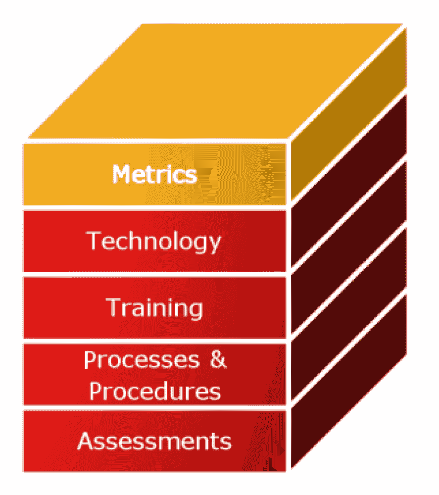

指标是使个人、组织或社区能够确定其起点，并评估在各个维度内是否实现了网络准备度提升的测量标准。可以测量以确定准备度提升的改进领域包括：

- 网络安全意识：确定社区领导和公民的意识水平。
- 网络安全能力：确定社区初始具备的能力；发现网络事件发生所需的时间；或应对网络事件所需的时间。
- 信息共享：确定社区内是否进行信息共享。是否发生双向共享？换句话说，所共享的信息是否被采取行动？
- 政策：确定专门针对网络安全的政策百分比。确定社区中拥有特定政策的组织百分比。
- 计划：确定专门针对网络安全的计划百分比。确定社区中拥有特定计划的组织百分比。

指标还可以用于判断社区是否正在遭受攻击。要判断社区是否正在遭受攻击，首先需要建立基线。基线是基于历史数据创建的，这些数据表明社区内的正常活动是什么。随后收集的指标可以聚合为社区整体，提供对社区内敌对网络活动的整体视图。这些指标多年来一直在组织层面使用。同样，来自社区的信息可以在州和联邦层面聚合，分别提供州和全国范围内的活动情况。

### 技术

技术被选为实施机制，因为它是讨论提升社区安全态势的任何内容的基础。需要解决的问题是：

- 目前存在什么技术来监控与社区相关的网络安全活动？
- 社区需要采取什么措施来增加安全控制？
- 为了实现指标中所列明的测量，需要什么技术？
- 将使用什么技术在社区内共享信息？
- 将使用什么技术来融合、分析和关联信息？
- 将需要什么技术安全地在社区内分发信息？

**Figure 5.**

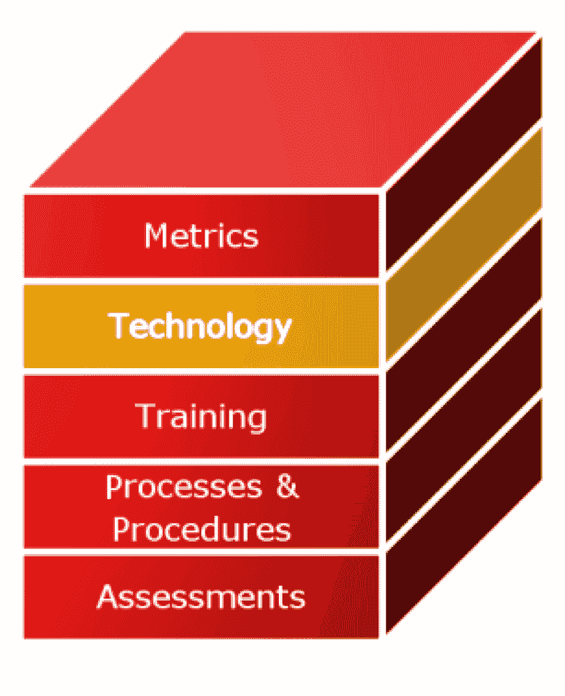

它还需要在准备的每个阶段定义所需的技术类型。技术可以帮助识别、预防、检测、应对和恢复网络事件。以下是一些示例技术：

- 识别：确定用于监控流量、跟踪异常行为并辅助处理网络活动量的监控技术。
- 预防：确定用于阻止攻击的技术。
- 检测：确定提供聚合异常行为警报、能够分析活动以识别潜在入侵迹象的技术，并确保能够安全地分发关于网络事件的信息。
- 响应：确定用于事件分析的工具，包括取证收集和分析。
- 恢复：选择能够帮助恢复数据、系统及其他措施，使社区回到正常运营的工具和技术。

了解社区可用的技术以及哪种技术最适合社区，将是关键因素。随着社区在其网络安全计划中成熟并确定所需技术，新技术将被引入以提升社区的能力。

### 培训

提升或改进所需技能、知识或行为的最常用方法是`培训`。这也是选择培训作为实施机制的原因。与培训相关的问题有：

- 社区如何提升对网络相关问题的知识？
- 如何使行为更加以安全为导向？
- 如何在社区中分发新实施的活动？
- 是否所有提升社区网络安全态势所需的技能都已涵盖？如果没有，社区将如何增加这些技能？
- 如果引入新技术以提升网络安全，社区可使用哪些方法确保能够实施和运营这些技术？
- 随着新政策或计划的修订或创建以应对网络相关问题，新实践将如何分发？以及如何确保所需的知识得到实现？

**Figure 6.**

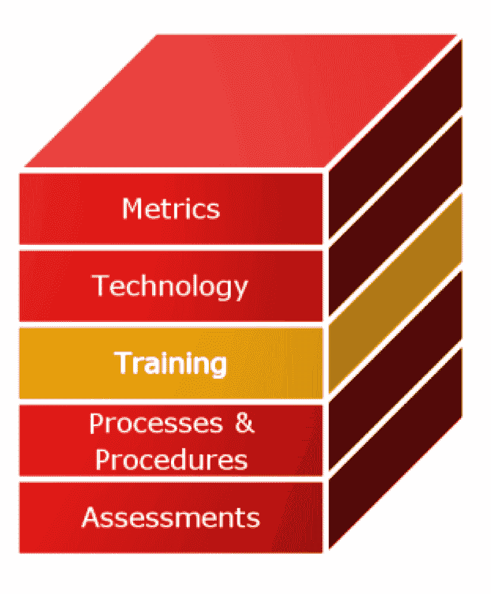

培训本质上是一项组织化的活动，旨在提升特定主题的表现，增加技能、知识、态度和行为。任何针对网络威胁的知识、技能或预期行动都必须在适当的水平教授给目标受众。培训方法在模型的每个环节都被使用：

- **Awareness（意识）**：确定社区中需要接受网络相关问题培训的人员及其所需程度。
- **Information Sharing（信息共享）**：培训社区在何种信息应被共享、与谁共享、何时共享以及如何共享。
- **Policies（政策）**：确定社区应采纳的网络安全原则、规则和指南，并在所有社区培训中融入这些概念。
- **Plans（计划）**：将网络原则纳入社区 `continuity（连续性）` 和 `incident response（事件响应）` 计划，然后培训相关利益方，确保其认知与理解。
- **Metrics（指标）**：培训用于收集、分析并按需分发指标。
- **Technology（技术）**：审计所有用于网络准备的技术，并培训关键人员了解技术工作原理、在出现故障时联系谁、以及如何进行维护、更新和替换。
- **Processes and Procedures（流程与程序）**：培训用于介绍新流程与程序，并确保其正确实施和理解。
- **Assessments（评估）**：培训用于确保进行练习、漏洞评估、渗透测试及其他测试机制时能够正确且必要地进行。

需要注意的是，培训并非一次性的努力。培训应被视为社区改进计划的一部分，并随着新信息和实践的发展而定期开展。

**培训方法**会根据需要解决的内容和时间范围而有所不同。培训必须针对不同人群和角色进行，以确保其针对性。例如，网络安全意识培训如果采用统一的年度培训方式，往往并不成功。应使用培训来针对特定人群及其在网络安全中的角色。因此，技术培训不应提供给非技术人员（即不需要理解系统技术细节的个人）。

### 流程与程序

支撑已制定的网络准备政策的自然实施机制是`流程与程序`。关于流程与程序的许多问题包括：

- 人员对网络相关问题的了解程度以及他们应如何处理这些问题？
- 用于识别、预防、检测、响应和恢复网络问题的技术有哪些，以及这些技术将在哪里记录？
- 社区是否已有针对每项任务的逐步流程与程序？
- 当前社区已有哪些流程与程序，它们是否涵盖所有网络相关方面？
- 谁在社区中负责处理网络事件？
- 将新的网络安全原则整合到社区运营和计划中的流程是怎样的？
- 信息何时、如何提供？
- 社区应多久审查并更新与网络相关的流程？

**Figure 7.**

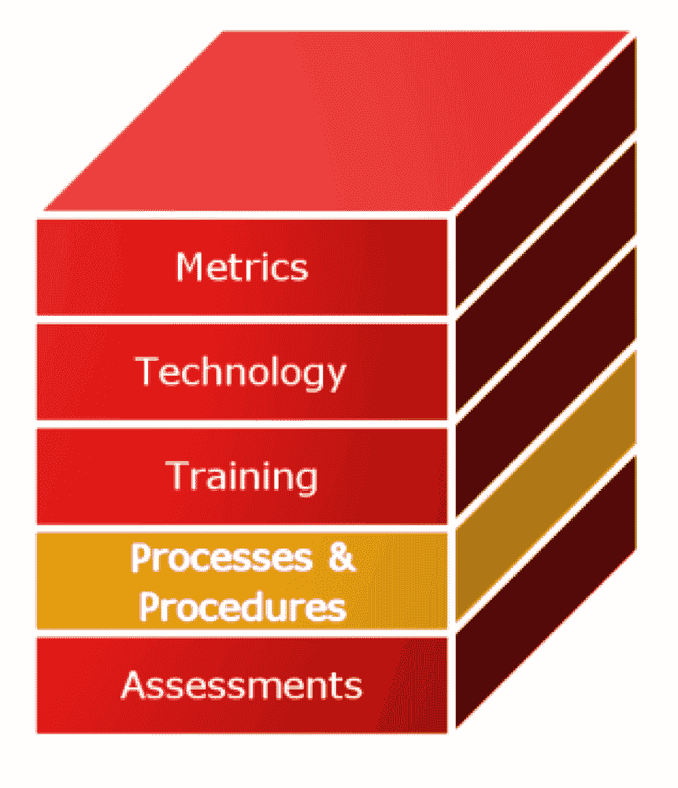

流程与程序是具体支撑社区能力逐步提升的任务与方法系列。它们应准确反映社区希望处理网络相关问题的方式。例如：

- 社区如何检测是否正在遭受跨部门组织的协同网络攻击？
- 是否存在将孤立或看似无关的事件进行沟通的流程？
- 是否有报告异常事件的流程？
- 谁负责处理社区中的网络事件？是执法部门、融合中心，还是其他？
- 是否有逐步流程帮助识别可能的网络事件？
- 信息如何以及何时提供？
- 信息分析人员是否在判断这是否为协同攻击？

上述所有内容应纳入政策文档，并附带逐步操作指南，说明将如何实施。

考虑使用尺寸来确定提升社区意识所需的内容；信息收集、分析、审议和传播应在社区内外都得到处理；社区将如何制定、采纳并测试政策；以及计划将如何记录、采纳和测试。成功的网络安全计划必须包含`人、流程和技术`三要素。如果任一要素被遗漏或未加以处理，计划很可能会失败。至少，社区应拥有覆盖以下方面的流程与程序：

- 人们：确定社区内的个人了解他们需要做什么、他们扮演的角色，并确保所有需要此信息的人知道如何获取这些要求。
- 进程：确定网络安全准备活动将如何开展并予以记录。这将包括新活动如何被识别、纳入、执行、培训、测试和更新。
- 技术：确定所需技术、如何采购、实施和维护。还需考虑谁负责安装、运营，以及谁需要接受培训来管理该技术。

确定需要哪些政策以及哪些政策应首先建立可能是一项挑战性任务。国家标准与技术局（NIST）于 2018 年更新了《提升关键基础设施网络安全框架》（NIST, 2018）。该框架采用基于风险的方法管理网络安全风险，并为组织在其安全计划中推进提供了分层方法，涵盖 5 个核心功能。虽然该框架最初设计用于保护关键基础设施的安全，但其基本要素仍可帮助州和社区建立政策、进程、程序和指南，用于制定其网络安全计划。框架的分层特性能够无缝融入 CCSMM。关于 NIST 网络安全框架的更详细信息将在后续章节中提供。

### 评估

最终选定的实施机制是`评估`。该机制的目的在于测试并演练每项活动、进程、程序和能力，确保其按预期工作。关于评估的问题包括：

- 需要什么测试机制来评估社区是否达成目标？
- 如何评估政策和程序，以确保其涵盖网络安全？
- 社区内不同组织之间的信息共享活动如何进行练习？
- 我们的社区应急响应计划和连续性计划是否存在需要解决的缺口？
- 我们如何测试我们的网络安全能力？

**Figure 8.**

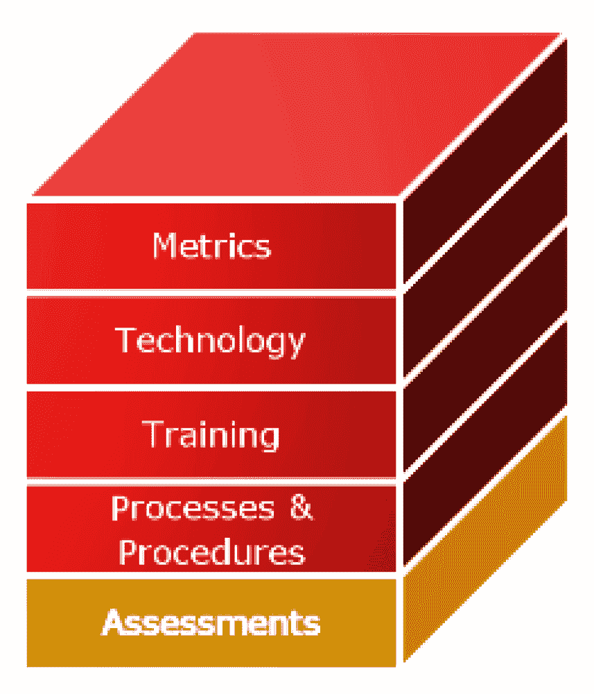

评估可以是技术性的，例如用于发现计算机和网络安全漏洞；也可以是非技术性的，用于确认人员在特定情境下是否了解特定程序。非技术性评估可以简单到询问社区中的不同人员是否知道在社区内报告网络安全事件的去向。

下面是一些可测试的领域示例：

- **培训效果**：评估已开展的网络安全培训的有效性
- **能力提升**：评估社区中新增的网络安全能力；演练也可用于评估特定能力的个人表现
- **信息共享**：评估所共享信息的价值，判断其是否具备可操作性、相关性和及时性
- **政策**：评估已实施的网络安全政策的有效性
- **计划**：评估网络攻击的操作影响，以及恢复程序是否按计划执行

评估社区的网络准备程度可通过多种方式实施，包括开展练习和演练、统计数据、渗透测试或漏洞评估。在每个成熟度水平上，评估都能帮助社区识别所有缺口，并在未来网络问题变化时及时纳入更新。

## 结论


全国范围内开展的社区网络安全演练表明，社区需要一个协调的计划来指导它们构建网络安全计划。基于这些演练的经验教训，社区网络安全成熟度模型（CCSMM）被确立为发展可行且可持续的社区网络安全计划的框架。该模型涉及四个改进领域：意识、信息共享、政策和计划。通过实施机制（如指标、技术、过程与程序、培训和评估）将网络安全控制和措施纳入计划。

## 参考文献

- About the Agency. (n.d.). Retrieved from FEMA website: https://www.fema.gov/about-agency
- Awareness. (n.d.). Retrieved from Merriam-Webster website: https://www.merriam-webster.com/dictionary/awareness
- Crezo, A. (2012). 5 U.S. cities that were destroyed - and completely rebuilt. Retrieved from Mental Floss website: http://mentalfloss.com/article/12982/5-us-cities-were-destroyed%E2%80%94and-completely-rebuilt
- Dictionary. (n.d.). Retrieved from Google.com website: https://www.google.com/search?q=what+does+dimension+mean
- Exercises. (2016). Retrieved from Ready website: https://www.ready.gov/business/testing/exercises
- Harrington, J. (2018). What are the worst floods in American history? A rundown of the top 30. Retrieved from USA Today website: https://www.usatoday.com/story/money/economy/2018/07/24/worst-floods-in-american-history/37070093/
- History.com (Ed.). (2018). San Francisco earthquake of 1906. Retrieved from History.com website: https://www.history.com/topics/natural-disasters-and-environment/1906-san-francisco-earthquake
- Types of Training. (2019). Retrieved from Business Jargons website: https://businessjargons.com/types-of-training.html

# Chapter 2

## ABSTRACT

社区网络安全成熟度模型（CCSMM）定义了四个维度和五个实施机制，用于描述组织或 SLTT（地方政府或特定区域）网络安全计划的相对成熟度。这些维度和机制用于界定成熟度级别及各级别的网络安全特征。要从一个级别进阶到下一级别，需要进行一系列活动，这些活动以五种不同的机制来定义。在两个级别之间，会有若干活动帮助实体推进。这些活动组成了四个阶段，每个阶段发生在两个级别之间。因此，第 1 阶段定义了实体从第 1 级升级到第 2 级所需的活动。

## INTRODUCTION

社区网络安全成熟度模型（CCSMM）是基于全国范围内开展的州和社区网络安全演练所汲取的经验教训而开发的。演练是一种意识工具，帮助人们理解特定灾害情境下的相关问题；同时也是验证组织所建立的机制、进程和程序是否足以应对多种灾难场景的可靠方法。在网络安全领域，最初的挑战是意识不足——州和社区领导者大多未意识到网络安全事件的潜在影响，需要被教育说明网络安全对其而言的重要性。领导者必须认识到，缺乏网络安全会对社区产生多种负面影响，对公民造成严重后果。当时的信念是，通过提高领导者的意识，使其关注网络安全，随后便会推动相应的流程、程序和技术的研发。事实却证明并非如此。

- 在 [DOE 2014] 的背景下，网络安全不是二元问题。一个州或社区要么拥有安全，要么没有。存在许多安全准备程度的层级，不同实体所需的安全准备程度也不相同——这应基于针对州、社区、部落、领土或组织的实际威胁。这意味着可以实施不同的安全水平，因此在制定计划时，第一项任务是理解这些不同的水平，了解当前已实施的内容，并明确最终目标。换言之，社区需要或期望的安全水平是多少？因此，CCSMM（网络安全能力成熟度模型）被创建，以提供三项内容：

1. 一个“标尺”，让 SLTTs（州、地方和部落）能够判断其当前在网络安全计划成熟度中的位置。他们目前处于什么水平？整个社区，或社区内的个别组织，在防止、发现、应对和从网络攻击中恢复方面准备得有多少？起初，模型主要聚焦于社区的关键基础设施和地方政府实体，但随着社区成熟，模型将逐步转向整体社区的方式。模型包含多个维度，社区在不同维度上的水平可能不一致，甚至在发展过程中，社区可能在各个维度上处于不同的水平。要在整体上被视为某个特定水平，社区必须在所有维度上展现出该水平的特征。

2. 一个“路线图”，描述从当前水平到下一水平的进阶路径。这将说明为实现进阶所需开展的各项活动。在确定社区当前处于什么水平后，需要决定社区希望达到的水平。各社区情况各异，并非所有社区都需要达到模型中所代表的最高安全水平。社区的威胁水平很大程度上取决于社区内的组织类型。例如，是否存在军事基地或联邦/州政府的重要组成部分？是否有象征国家的重要纪念碑或历史遗迹？是否存在重要的工业或制造设施？这些因素都会影响攻击的可能性以及潜在的威胁行为者（即可能发起攻击的一方——如国家行为体、犯罪组织、恐怖组织或好奇的个人）。路线图将帮助社区及其内部组织确定在达成目标水平的道路上需要执行哪些任务。

3. 一个“共同参照系”，使得全国各地不同社区的个人能够就其各自的计划进行讨论，并相互关联。如果所有人都基于同一模型进行工作，那么讨论共同问题、挑战和解决方案就会更加容易。若缺乏共同参照系，个人就难以比较其计划，也难以从他人经验中受益。社区不应各自独立构建计划而忽视他人的经验——它们应能借鉴已经走过类似道路的其他社区。为了实现这一点，路径需要大致相似。

在上述三大目标指引下，首先需要定义模型的不同水平。SLTTs 将为此而奋斗的目标水平。每个水平将描述 SLTT 在该水平的特征，从而说明其所追求的目标。同时，这也有助于制定达成该水平所需的步骤，并为不同社区提供经验共享的基础。

### 定义水平

已有许多为不同环境制定的成熟度模型。2014 年，能源部（DOE）发布了《网络安全能力成熟度模型》（C2M2）第 1.1 版，其中对成熟度模型的定义尤为清晰：

> “成熟度模型是一组代表特定学科能力与进展的特征、属性、指标或模式。模型内容通常体现最佳实践，可能包含该学科的标准或其他实践规范。成熟度模型因此为组织提供了一个衡量其实践、流程和方法当前能力水平的基准，并帮助其设定改进目标和优先级。此外，当模型在某一行业被广泛使用（且评估结果可共享）时，组织可以将自身绩效与其他组织进行对标。行业可以通过查看其成员组织的能力来整体评估自身表现。成熟度模型通常设有“级别”，在尺度上表示进展——C2M2 采用 0 至 3 的成熟度指标级别（MIL），详见 DOE 2014 第 3.2 节。该模型的可衡量过渡状态使组织能够利用该尺度实现：
>
> * 定义其当前状态
> * 确定更成熟的未来状态
> * 识别为达成该未来状态必须获得的能力。（DOE 2014）

DOE 提出的模型采用四个成熟度指标级别（MIL）来描述组织可能处于的不同成熟度水平。MIL 0 级基本代表组织未执行任何高级别定义的实践。这些实践被划分为十个领域：

- 风险管理
- 资产、变更与配置管理
- 身份与访问管理
- 威胁与漏洞管理
- 情境感知
- 信息共享与通信
- 事件与事件响应、业务连续性运营
- 供应链与外部依赖管理
- 工作人员管理
- 网络安全计划管理

2015 年，卡内基梅隆大学（CMU）软件工程研究所（SEI）发布了《信息技术服务网络安全能力成熟度模型（C2M2 for IT Services）》（版本 1.0）。该文档大体上取自能源部（DOE）的 C2M2，如其致谢章节所述。（SEI，2015）2019 年，国防部宣布将于 2020 年实施网络安全成熟度认证（CMMC）计划。该计划由约翰霍普金斯大学应用物理实验室与卡内基梅隆大学（CMU）的 SEI 共同开发。（MeriTalk，2019）该计划主要基于 NIST SP 800-171 发布的要求（Edwards and Hays，2019），并与 NIST SP 800-53 发布的受控非公开信息（CUI）安全要求相映射。（NIST 2015）

C2M2 定义了五个虚构的成熟度级别，用以描述组织安全流程的成熟程度。这五个级别分别是：

- 级别 1：流程为自发的
- 级别 2：流程为文档化的
- 级别 3：流程由政策指导
- 级别 4：实践定期评估其有效性
- 级别 5：流程经过定制，并共享改进数据

所有较近期的文档都表明，目标是帮助组织构建强大的安全程序。C2M2 最初于 2008 年开发，并于 2009 年首次讨论（White，2009），它并非基于上述后续文档，但与这些文档共享许多相同组成部分，且同样是五级模型。由于其他安全相关的成熟度模型是在 C2M2 之后才出现的，因此 C2M2 更多地受到 1987 年由卡内基梅隆大学（CMU） SEI 发布的原始软件工程能力成熟度模型（CMM）的影响。此后陆续有多部描述该模型的出版物，部分文字表述略有差异。该模型旨在帮助组织成熟其软件开发流程，提高效率，最终产出更可靠的软件。CMM 也有五个级别：

- 级别 1：初始
- 级别 2：可重复
- 级别 3：定义
- 级别 4：管理
- 级别 5：优化

除级别 1 外，每个级别都包含若干关键过程域（KPA），描述组织软件流程应满足的基本要求。级别 1 未分配任何 KPA。该模型为组织提供了一条提升软件开发流程的路径。

这些并非唯一的成熟度模型，新模型不断被开发。重要的是要理解 C2M2 最初设计之初，它并未像 NIST 网络安全框架那样针对特定安全要求，而是针对实现网络安全程序所需的类型要求。因此，它允许不同行业的组织根据自身需求设定具体的安全要求；例如，C2M2 可能提到需要定期进行安全评估。对于金融服务行业的组织，这可能意味着每年进行一次特定类型的外部评估；而对于零售鞋店等其他行业的组织，则可能只需每两年进行一次外部评估即可。总体而言，C2M2 的核心在于实体在应开展评估时确实开展了相应的评估。

与 CMM 类似，C2M2 也拥有五个级别。最初，它旨在帮助社区提升其网络安全流程或计划的成熟度。随后，该模型被扩展，涵盖更广泛的范围，相关内容将在下一章节中说明。正如 CMM 所做的那样，C2M2 也为社区提供了一条提升网络安全计划成熟度的路径。CCSMM 的五个级别如图 1 所示。

| Figure 1. The Five Levels of the CCSMM and the Characteristics Found in Each level |
| --- |
| 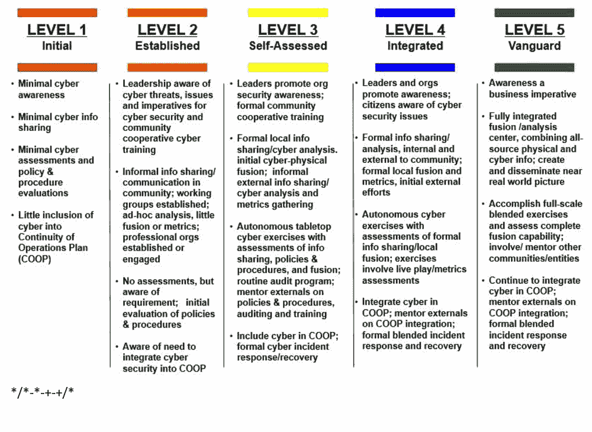 |

#### CCSMM 级别 1：初始

以 CCSMM 作为社区网络安全框架，级别 1 的社区可能尚未建立高级级别所需的流程，甚至可能没有针对网络安全的整体计划。社区在级别 1 可能已实施某些流程或项目，但数量不足以满足级别 2 的要求。

图 1 还提供了针对模型四个维度的特征描述。例如，在级别 1 时，社区及其领导者对网络安全及安全损失对社区可能产生的影响缺乏基本认知，也未能充分理解其对 cyber 基础设施的依赖。社区要么没有组织化的网络安全信息共享计划，要么仅有极其有限的计划，且仅少数组织参与。社区内部的流程要么未定期评估或测试，要么根本没有将网络安全纳入 Continuity of Operations Plan（COOP）。值得一提的是，可能并不令人惊讶，CIAS 所开展的社区演练中，所有参与的社区其程序成熟度均未超过级别 1。

#### CCSMM 级别 2：已建立

在级别 2：已建立时，社区已建立基础计划，并在四个维度上具备相应的元素和流程。已实施意识提升计划（如面向用户的网络安全培训及针对社区领导的专项培训），领导者认识到网络安全对社区及其各组织的重要性，并明白网络安全是全体共同责任，而非仅由 IT 或安全部负责。

社区还建立了至少一种非正式的网络安全信息共享机制。这并不意味着已建立配备 24 小时人员的安全操作中心（SOC），而是说明已实施能够在社区内部传播网络安全问题信息的方法。社区仍可能未进行评估或其他流程、政策、程序的测试活动，但这些需求已被认知，各组织可能已自行开展相关工作。社区还将网络安全纳入 COOP，并制定了网络安全事件响应计划。虽然可能尚未开展演练，但未来应制定相关演练计划。

#### CCSMM 级别 3：自评估

社区在第三级：自评估阶段：社区已经发展得足够，拥有稳定的网络安全程序。他们对网络安全及其需要实现的目标理解足够，能够自行进行评估，以判断社区的整体情况。这并不意味着不能进行改进或在其程序中添加更多组成部分，但此时社区应至少拥有一个最小可行且可持续的程序，这正是 CCSMM 计划的目标。当社区达到第三级时，他们应更加意识到当前安全态势中的缺口。他们应建立基线，定期共享信息，并不断完善流程和程序。他们认识到，在这些方面的表现需要频繁监测和测量。领导层必须持续在各层级推广安全意识，培训计划也应已全面开展。在演练方面，第三级社区应至少每年举办一次包含网络安全要素的活动，最好至少有一项主要聚焦于网络安全的演练。演练最初可能仅涉及关键基础设施和地方政府部门的参与，但应逐步演变为全社区范围的方式，纳入工业部门的参与。社区应在演练中尽可能频繁地融入前几级的关键概念，包括信息共享、政策与程序以及业务连续性。到第三级时，网络安全事件的响应与恢复应已正式化，并成为演练的重点。在第三级：自评估阶段，社区还应了解社区内个人和组织（以及州和其他社区）对社区本身的影响。

#### CCSMM 第三级：集成

在第三级：集成中，网络安全在社区范围内得到整合，凡是应考虑的地方都如此。公民和组织在社区网络安全中扮演角色，整体公民都理解这一点。社区需与州政府沟通（若存在州级计划，否则需直接与其他社区或组织如多州信息共享与分析中心（Multi-State ISAC）沟通）。迄今为止主要局限于组织内部的信息应扩大到整个社区的所有人。对流程、程序、政策和技术的评估应定期进行。应至少每年开展一次网络安全演练，同时也应开展将网络安全与影响实体或功能的实体与网络资产或功能的攻击相结合的演练。应急管理部门应牢固掌握网络安全概念，并将其融入常规运营。社区导向的应急响应计划必须直接处理网络安全事件，并对相关程序进行定期评估。第三级：集成的核心在于社区应与其所有成员和组织，以及州和其他社区协同工作，将网络安全视为社区及其内部组织的固有关注事项。

#### CCSMM 第四级：先锋

达到第五级：先锋意味着社区保持着完全警觉的网络安全姿态。演练能力全面，包含网络与非网络事件。社区及其内部组织必须持续评估当前的政策、程序和计划，以实现更大的整合与完善，尤其是在应急响应方面，由于威胁环境的高度动态性。网络安全计划此时已涵盖社区的全部人口，公民之间形成了完整的网络安全意识。演练常规进行，并与本地的其他社区和组织以及州政府协同开展。演练也应为大规模、高度真实的事件，尽可能包含多种要素以进行有效测试。演练已超越简单的桌面推演（虽然仍可能进行桌面演练），现在应包括功能性演练。

在此级别，信息共享达到最先进水平，来自不同来源的数据融合与传播速度适中。收集的信息被视为“全源”（all-source），即从社区内所有部门接收并近乎实时处理。结果即为“接近地面真相”（near ground truth），即当前时刻的真实情况。

预计在第五级：先锋阶段，社区将积极参与指导其他地方政府（SLTTs）的工作，以提升网络安全和信息共享。即便在第四级后不再期待新增能力，社区也应定期依据 CCSMM 各级的指标重新评估自身的网络安全姿态，以保持进度并避免利益相关者的懈怠。

此处对每个层级的详细描述尚未深入展开，后续章节将进一步阐述。目前，只需理解各层级的基本差异及其各自的侧重点。对前文或图 1 中各层级描述的对比，会发现社区在逐步推进过程中必须完成的多项活动。这些活动通过模型所称的“阶段”（Phases）实现，各阶段连接不同层级的过渡事件。

## THE PHASES

若 CCSMM 的层级是里程碑，则模型的阶段即为实现这些里程碑的路线图。每个阶段必须按顺序遵循，以到达下一目的地，且必须满足每个阶段的所有要求，以确保为后续阶段做好准备。因此，CCSMM 的阶段被组织为五个类别的要求集合。

指标帮助社区及其公民确定应测量的内容，以全面了解当前的安全姿态。技术显然也扮演重要角色，因此判断何时购买并部署新技术（硬件和软件）以应对下一层级的特征是组织和社区必须经常考虑的问题。还需思考谁需要接受何种培训，每个阶段会引入针对新用户的培训。流程与程序是网络安全就绪的基石，查看后续层级要求意味着每个阶段将涉及已有文档与仍需创建的内容。最后，评估是衡量成功的关键，参与者必须决定如何规划并开展评估，以契合其 CCSMM 策略。基于这五类要求，阶段可进行讨论，后续章节将更详细解析。

### 阶段 1：初始到成熟

第一阶段主要是启动关于各种网络安全话题的对话。对流程和程序的建立期望不高，除了部门间的讨论外，还期望有最少的信息共享。随着组织、社区和国家进入第一阶段，高层和中层管理者的意识将得到提升，信息共享成为主要讨论点，网络安全培训和演练等主题被引入。


# 社区网络安全成熟度模型（CCSMM）实施指南

## 第一阶段：初始到建立

到本阶段结束时，参与者必须至少拥有：
- 一个定义的网络安全意识计划
- 非正式但定期的信息共享工作组
- 一定程度的网络安全培训和教育
- 完成评估与规划
- 至少进行一次网络安全演练或正在计划进行演练

此处的演练主要用于意识提升，通常是桌面演练。在后续阶段，一旦程序建立，演练可用于评估已建立流程、程序和项目的有效性。

需要注意的是，在制定模型时已考虑到大多数，如果不是全部，处于第 1 级的社区可能没有大额预算用于实施第一阶段的活动。预算通常在一年或更长时间前就已设定。当社区刚开始致力于网络安全准备时，成员会学习需要做的事，从而能够更好地为相关活动进行预算。因此，大部分第一阶段的活动应当对社区及其组织几乎没有成本或成本极低。随着社区成熟度的提升，可在后期引入网络安全预算，以确保后续阶段有足够的资金完成建立长期、可行且可持续的计划所需的工作。

## 第二阶段：已建立到自评估

第二阶段汲取了实施第一阶段的经验教训，并进一步侧重信息共享和演练。组织和社区的领导层应积极参与推动各层级（如用户、主管和高层）的网络安全意识，并按需提供支持。如果组织领导对网络安全问题不感兴趣，员工也同样缺乏兴趣；相反，若首席执行官、市长或政府部门负责人经常询问组织的网络安全状态，则会对下一层领导产生积极影响，进而激发整个组织各层级的兴趣。

到第二阶段结束时，信息共享工作组应已建立并定期召开，拥有正式的议程和讨论主题。可能的话，这些工作组应包含公共和私营组织的混合成员，这有助于保持对整个社区的讨论相关，并形成所期望的全社区关注。

在此阶段，技术评估应已完成，并回答了需要什么以及在何处需要。强烈建议实施“低垂果实”（即简便、低成本的安全流程或技术，尤其是已有文档化、经过审查的公共领域软件），以提升组织或社区的网络安全状态。

如有需要，为配合组织内所有个人对网络安全重要性的认知提升，应建立培训和教育体系，为每个群体提供所需的知识和技能。例如，可由内部员工组织的培训研讨会或供应商提供的正式培训课程。关键在于确保在定期且有计划的基础上开展一定程度的培训。还可能出现在社区内部之间共享网络安全培训项目的可能性。若有组织已开发出有效的用户网络安全培训项目，并愿意与社区其他成员共享，那么从全社区视角审视网络安全问题将更有利于这种共享的开展。

最终，演练必须包含对网络安全事件的响应和恢复。如果社区的应急管理组织每年进行演练或练习，则应在其中加入强烈的网络安全元素，甚至计划一场专门的网络安全演练。社区在将网络安全元素加入传统演练（如自然灾害、化学事故或恐怖袭击）时，往往会倾向于他们熟悉的部分，而忽视不太熟悉的部分。将网络安全元素加入其他演练的价值，仅当它与其他需要解决的问题一起被考虑时才有意义。社区常常发现，答案可能是“我们会回到过去用纸笔的方式处理”，导致网络事件被忽视。实际经验表明，回到旧方法并不总是容易，甚至可能不可行。过去存在的表格、培训和使用这些表格的流程可能已不复存在，尤其是那些不是“旧时代”参与者的个人也不知道如何操作。将网络元素纳入其他演练有助于引入 Phase 3 及以后的更广泛演练程序，但专门的网络演练则让参与者专注于网络问题，不会因转向更熟悉的应急响应而把网络安全 swept aside。

## 第三阶段：自评估到整合

当社区达到第 3 级时，已在 CCSMM（网络安全成熟度模型）中发展出可持续的网络安全计划。从第 3 级向第 4 级迈进的社区和组织应期望在提升成功度量（如意识、信息共享以及流程和评估（如演练计划））等方面得到更大的重视。第三阶段大幅扩大网络安全意识，使其超出...

信息共享在这一阶段仍然是重点倡议之一。社区需要越来越努力建立一家全天候运作的正式融合中心。融合中心通常是州一级的实体，但也可能在更大的社区中建立，这些社区接受来自社区各地的各种“观察”报告，并将它们融合在一起，以判断哪些项目可能相关，并可能预示着更大的问题正在酝酿。在网络安全方面，也有公司可以提供当前网络威胁形势的帮助，并可作为社区计划或个人组织的有价值补充。融合中心通常与执法和情报社区关联，雇佣的个人背景来自这两个领域中的一项或两项。融合中心类似于 ISAOs，但其关注范围更广，涵盖社区内发生的所有危害。公民应被告知在日常生活中可以采取的预防性安全措施，以及可能对其产生影响的网络安全事件信息应以标准化方式进行传播。年度网络安全日（最初可在社区较低层级推出）应现在包含更多公民可以/应当采取的行动。地方电视、有线电视和广播电台的公共服务公告可以包含关于网络安全的简短信息，社区频道的短培训和意识提升项目可围绕各种网络安全主题（包括技术层面）开展。

信息的“融合”并非易事，但过去几十年里已有更详细的讨论。一个著名的例子是 1995 年俄克拉荷马州联邦大楼的爆炸案。实施爆炸的个人在袭击前几个月购买了大量（但并不罕见）的硝酸铵（可用于炸药制造，也常用于肥料）、硝基甲烷和 Tovex。他们以摩托车赛燃料为由尝试购买硝基甲烷，而想要的数量不寻常，第一个被询问的人拒绝出售并向 FBI 举报了此请求。他们还从采石场盗取了 500 枚引爆帽。随后他们购买了 17 袋 ANFO（硝酸铵/燃油）用于炸弹。这些物品并非来自同一社区，而是跨越多个州获得；他们租用了存储空间，随后租用了卡车运输炸弹。融合中心的任务是记录那些在可疑情况下被报告的、可能用于制造炸弹的物品的购买情况。将这些看似分散的事件整合在一起，能够呈现出不同于单独观察所暗示的整体图景，这正是融合中心的目标——在攻击发生前将碎片拼凑起来。然而，实现这一目标的难度同样显而易见：事件跨越多个社区和州，嫌疑人使用了别名，单独来看这些交易都是普通的。为了在网络领域实现类似活动，公共和私营合作伙伴应在此层级建立合作关系，并明确、发展通信渠道。从流程、规划和演练的角度来看，融合中心的参与者将在日益重要的角色中，识别跨越网络与其他领域的交叉点，制定应对网络安全事件的计划，并定期进行演练。

随着达到第 4 级，评估的频率和细节将增加。评估主题在网络安全领域日益受到关注。多年来，一些行业组织要求其提供信息或连接其网络的供应商在被接受为供应商之前，必须完成特定类型的评估。该主题也常与网络保险政策相关，且联邦政府部门正 increasingly 向任何希望与其业务往来的行业施加要求。重要的是要说明社区在评估中的角色以及其应承担的责任。社区内的个别组织可能要求其供应商进行评估，但这并非社区的总体要求，而是个别组织的要求。社区不会参与单个组织及其安全政策的评估，除非与整体社区网络安全努力相关。社区可以为个别组织（尤其是小企业）提供程序建议，指导其应检查哪些方面。组织也可能愿意分享其使用的工具与社区其他成员，且 Internet 上 increasingly 免费的资源可帮助组织开展评估，尤其是针对 NIST 网络安全框架中列出的要求。DHS/CISA 也为地方政府和关键基础设施提供部分评估服务。

练习是社区评估努力的重要组成部分，将从桌面活动转变为功能性、实时或接近实时的练习。也就是说，对于包含网络元素的功能性（或部分功能性）网络安全或物理练习，实际攻击者可能采取的事件序列将在一定程度上被再现，以检验个人和组织是否知道在发生时应采取什么行动。此类练习需要更大的协调工作，并应尽可能多地纳入相关方。关键在于尽可能真实地模拟事件，而不必修改真实系统的运行或影响运营网络。不影响运营网络是一个关键因素——虽然练习可能需要“触碰”运营网络，但不应过度干扰正在进行的业务。可能时，练习策划者应争取外部组织和邻近社区的参与，以获得更真实的区域影响图景。

## 第四阶段：整合至前沿

在 CCSMM 实施的第四及最后阶段，所有环节将整合成一个全面的计划。结果将是一个包含全方位网络安全意识的社区，涵盖公共和私营组织以及当地公民。类似于物理犯罪或事件，公民具备向正确当局报告网络事件的工具，以便进行进一步调查、跟进和响应。居民将学习如何通过低成本或无成本的方法保护自己、数据和设备。已在一些社区提出并实施了模拟非网络活动（如 Crime Stoppers 和社区守望）的网络模拟项目，如“社区网络守望”和“网络犯罪举报”已在基层推出，到第 5 级时这些内容应已在社区中得到充分融合与理解。虽然“网络安全文化”最早在早期阶段萌芽，但应在整个社区内广泛扎根。

信息共享在这一阶段将得到巩固，实现全方位、双向的数据共享与融合。随着组织和个人开始共享信息，他们虽然对接收信息感兴趣，但通常不愿分享自己的信息。随着他们对信息共享计划的熟悉程度提高，他们将逐渐进入双向共享阶段，不仅会主动接收信息，还会愿意分享自己组织中所见所闻的信息。除了从各行各业的多个来源收集数据外，融合中心和/或社区信息共享组织（ISAO）会定期向相关方传播相关信息。参与融合中心和/或社区 ISAO 的范围将扩大，涵盖所有主要的社区功能，包括执法部门、应急服务、各类政府职能、私营企业、教育机构等。融合中心和/或社区 ISAO 将由当地政府提供资金支持，或在 ISAO 模式下实现完全自给自足。必要时，它们将整合到应急响应活动中。

安全领域的技术决策将保持一致性，并将社区需求纳入决策过程。在此阶段，小幅改进应已完成，大型项目将被启动或安排开始。社区中关于工具和使用方法的最佳实践共享将十分普遍。

培训与教育将结合本地社区的需求，既提供基础认知培训，也开展专业技能培训。此举将扩展至包括 K-12 学校和高等教育机构，构建安全意识强的专业人才管道，社区应提供可能的支持。

网络事件的响应与恢复将正式化，关键合作伙伴将建立并得到良好记录。组织之间或相邻社区之间可能需要建立互助协议，并予以制定。互助协议是一份文件，说明两个或多个社区在其中一名或多名成员遭受网络安全事件并产生负面影响时，将如何相互提供帮助。例如，协议可能规定在恢复期间，受攻击的社区可使用支持社区的计算资源。领导层将在需要时提供支持与协助。作为 CCSMM 实施过程的一部分所制定的计划将至少每年审查一次，并应成立专门团队负责批准和实施变更。

最后，评估、测试和演练活动将发展为更高级、更全面的水平。所有这些活动应当包括与州政府及其他社区的互动。只要可能，所有演练——无论其侧重点如何——都应考虑加入网络安全元素，包括自然灾害演习、反恐练习以及医疗紧急事件。参与此类活动的范围将变得全面，即社区内的所有部门都将得到体现。CCSMM 在此阶段不规定具体的演练类型，由规划者自行决定。但强烈建议每年至少规划并开展一次全面的社区范围网络/物理演练。这是确保所有人在直接或间接影响社区网络资产的紧急情况下能准确履行自身角色的唯一途径。

请记住，第五级是“先锋”级别。此阶段的努力应开始纳入社区之外的因素。应邀请其他社区参与网络安全指标、情报共享、培训、最佳实践分享以及演练。实际上，社区不会在本阶段直接跃升为先锋级，而是在低阶段已引入部分元素，而在本阶段这些元素将深植于规划流程中。

# LESSONS LEARNED: THE COMMUNITY CYBER SECURITY MATURITY MODEL

没有像 Community Cyber Security Maturity Model（社区网络安全成熟度模型）这样的模型作为指导，城市在建立可持续的安全计划时容易失去方向。虽然有了模型，建立全社区的安全计划本身也不易，需要时间，且初期的兴趣容易因组织日常事务和需求而消退。这种情况在领导层频繁更替的社区尤为明显。选举产生的官员有诸多关注点，网络安全通常不是他们竞选时强调的重点。证明是关键因素是社区中拥有一位“倡导者”，其能力保持社区内足够长的时间，使社区能够建立并发展该计划，直至其能够自行持续。

倡导者的行业背景并不重要，关键是其必须在社区内停留足够长的时间，以完成社区计划的建立。过去，倡导者包括城市职员（如 CISO 或 CIO）、本地商会成员或拥有足够领导支持的组织代表，能够抽出时间组织会议并推动各社区部门的参与。初期可能不会有全社区的全面代表，但应尽早让以下组织参与进来：地方政府、公用事业、应急管理、执法部门以及具有重要影响力的行业代表。

此外，政治层面的支持也非常有帮助。社区所在国会议员常能在社区兴趣下降、注意力转移时，调动相关人士召开会议。快速组织“网络安全日”或“安全文化日”同样有效，这些活动应包含政府、行业和公民的环节，以提升社区整体的网络安全水平，并不断激发推进计划的动力。

从项目起步阶段起，参与者应理解，建立网络安全计划不会一蹴而就，也不是一次性完成后就可以置之不理。它是一项持续的工作，需要随着新技术的发展而不断更新。正如警察、消防或应急服务部门需要持续保持高水平的准备和培训一样，网络安全也必须保持高度的准备状态，因为问题不会消失。

# CONCLUSION

- 攻击国家和社区的行为已增加，几乎已成为常态。为了更好地处理入侵行为，并希望在最初就防止它们，组织需要在社区和整个社区的视角下建立一个有组织的网络安全计划。提高意识通常是建立此类计划的第一步，但仅提高对网络安全问题的认识是不足以维持长期支持的。仅靠意识也不足以确保采取有组织的方式来开发可持续的计划。

- 社区网络安全成熟度模型（CCSMM）为社区提供了确定其在计划成熟度方面所处位置的方法，制定提升计划成熟度的行动方案，并提供一个共同的术语，以便在国家不同地区的社区之间讨论计划。讨论和比较计划的能力使所有社区能够分享如何实施模型各个方面的想法，从而促使所有社区协作，共创更安全的国家。

- 社区首先需要评估其网络安全计划的成熟度。随后，他们必须决定他们认为需要达到的成熟度水平，以应对社区面临的威胁。并非所有社区都需要处于相同的水平，也并非所有社区都需要达到模型的最高水平。

- 2 维模型包含五个层级——初始、建立、自评估、集成和先锋。所有社区均从初始层级开始，该层级是规划其计划的起点。当社区首次认识到网络安全的重要性时，通常没有专门的预算，因为预算通常在一年或更长时间内制定。因此，初始层级的努力主要局限于尽可能多的无成本或低成本项目。

- 第二层级是建立。顾名思义，此层级的计划已正式建立，社区内建立可行且可持续的网络安全计划的工作已全面展开。第三层级是自评估，此时社区的计划已足够成熟，能够持续运行，并能够评估和理解自身需求。社区内的组织应当开展并实际在进行相互协助的工作。第四层级是集成，在此层级社区和组织不再将网络安全视为独立组成部分，而是认识到它是贯穿所有运营的交叉切割问题，影响社区的方方面面。因此，网络安全必须由所有人考虑。最后，第五层级是先锋，处于该层级的社区被视为他人效仿的典范。先锋社区会向州政府和其他社区提供帮助，以推进其网络安全计划。

- CCSMM 模型围绕四个维度展开。每个层级在每个维度上，社区的特征都有描述。这些维度为意识、信息共享、政策与规划。后续章节将对这些维度进行更详细的讨论。在每个层级之间是一个阶段，该阶段包含推进社区从一个层级到下一个层级所需的活动。五个层级之间有四个阶段。

- 最后，应强调，很容易混淆社区内部个别组织的活动与整体整体网络安全计划。虽然社区应鼓励其成员组织提升自身的网络安全成熟度，但社区（即地方政府）并不对其管辖范围内的所有组织的安全负责。CCSMM 计划旨在帮助整个社区提升安全准备程度。它将鼓励一些组织（如关键基础设施和地方政府实体）采用特定的网络安全实践，但这些实践仅在其对整个社区产生影响的范围内进行。还有其他模型（包括 CCSMM 的其他部分）旨在帮助个别组织，这些将在后续章节中简要讨论。

# REFERENCES

- Cybersecurity capability maturity model (C2M2). (2014, February). Retrieved February 27, 2020, from Energy.gov website: `https://www.energy.gov/sites/prod/files/2014/03/f13/C2M2-v1-1_cor.pdf`
- DoD to streamline cyber acquisition with new certification model. (2019). Retrieved from MeriTalk website: `https://www.meritalk.com/articles/dod-to-streamline-cyber-acquisition-with-new-certification-model/`
- Edwards, S., & Hays, S. (2019). What is the cybersecurity maturity model certification (CMMC)? Retrieved from SUMMIT7 website: `https://info.summit7systems.com/blog/cmmc`
- WhiteG. (2011). The community cyber security maturity model. IEEE Conference on Technologies for Homeland Security, 173-178.
- WhiteG. (2012). A Grassroots Cyber Security Program to Protect the Nation. 45^(th) Hawaii International Conference on System Science. 10.1109/HICSS.2012.60
- WhiteG.GranadoN. (2009). Developing a Community Cyber Security Incident Response Capability. 42^(nd) Hawaii International Conference on System Science.

# ADDITIONAL READING

- Curtis, P., Mehravari, N., & Stevens, J. (2015). Cybersecurity capability maturity model for information technology services (C2M2 for IT services), version 1.0 (Technical Report No. CMU/SEI-2015-TR-009). Retrieved from Software Engineering Institute Carnegie Mellon University website: `https://apps.dtic.mil/dtic/tr/fulltext/u2/1026943.pdf`


# Ross, R., Viscuso, P., Guissanie, G., Dempsey, K., & Riddle, M. (2015). NIST Special Publication: Vol. 800-171 Rev. 1. Protecting controlled unclassified information in nonfederal information systems and organizations. Retrieved from National Institute of Standards and Technology website: https://nvlpubs.nist.gov/nistpubs/SpecialPublications/NIST.SP.800-171.pdf

## Chapter 3

### ABSTRACT

The community cyber security maturity model (CCSMM) was designed and developed to provide communities with an action plan to build a viable and sustainable cybersecurity program focused on improving their overall cybersecurity capability. Not long after the initial development of the model, it was realized that there are intertwined relationships that needed to be addressed. This drove the creation of the three-dimensional model broadening the scope to include individuals, organizations, communities, states, and the nation. This chapter will provide an overview of the development and importance of the 3-D model and will describe the scope areas that were included.

### INTRODUCTION

The 2-Dimensional model was the initial step to creating a roadmap for communities to follow when developing their cybersecurity program. The established characteristics help to define a community’s cybersecurity posture at each level. As a reminder, the characteristics are organized by awareness, information sharing, policy, and planning dimensions. They also establish the three building blocks; a yardstick, a roadmap, and a common point of reference as previously discussed. It wasn’t long after the characteristics were developed, that the CIAS researchers were discussing how cybersecurity guidelines affecting individuals in the community could be integrated into the CCSMM or how cybersecurity concepts for states should be integrated. This led to the realization that the model didn’t have enough depth to address these other areas. After many discussions, it was determined that the model needed to be 3-Dimensional (3-D). The model needed to be able to incorporate what individuals would need to do to improve their cybersecurity posture. It also needed to address organizations, states and ultimately the nation. There are two major considerations supporting this:

1.  Everyone should have a role in cybersecurity
2.  Effective cybersecurity is a collaborative effort

These concepts became the “The Whole Community Approach” theme for the Department of Homeland Security’s cybersecurity initiatives many years later.

### THE 3-DIMENSIONAL MODEL

The purpose of the 3-D Model is to broaden the capability of the framework allowing it to be flexible and scalable to address all aspects of a cybersecurity program. Consider the idea that individuals make up organizations; individuals and organizations make up communities; individuals, organizations and communities make up a state, tribe or territory; and the states, tribes and territories make up the nation. The change from a 2-D model to the 3-D model was a pivotal point in the creation of the Community Cyber Security Maturity Model. This shift created a model that can provide the improvement progression for everyone in the nation because the model can now support a roadmap for individuals, organizations, communities, states and the nation. In addition, it can integrate other frameworks such as the National Institute of Standards and Technology’s (NIST) Cyber Security Framework (CSF) (NIST, 2018) outlining the security controls necessary for an organization. It can also support the National Initiative for Cybersecurity Education (NICE) Cybersecurity Workforce Framework (NICE Framework) (NIST, 2017) a resource that categorizes and describes cybersecurity work and the cybersecurity workforce. Communities should be able to advance their cybersecurity posture naturally, but a defined program that provides step by step guidance is the assistance that is realistically needed.

Once the 3-D Model was accepted, all the major concepts needed to be brought together. A visual was developed that could show the primary concepts in an easy and understandable fashion. The visual depiction of the 3-D Community Cyber Security Model is a cube as shown in Figure 1. The cube contains blocks representing the dimensions, the levels of improvement, and the scope areas. Across the top there are 5 blocks that identify the progression levels of cybersecurity maturity. The lowest level of maturity is Level 1 – Initial, and the most mature is Level 5 - Vanguard. Each level is a different color making the distinction of levels easier to see. The 4 vertical blocks represent the dimensions. The dimensions are the focus areas where cybersecurity is being improved. The blocks are 5 deep. Each of these blocks represents the scope areas. The scope areas are individual, organization, community, state and nation. These represent who is improving their cybersecurity posture.

| Figure 1. |
| --- |
| 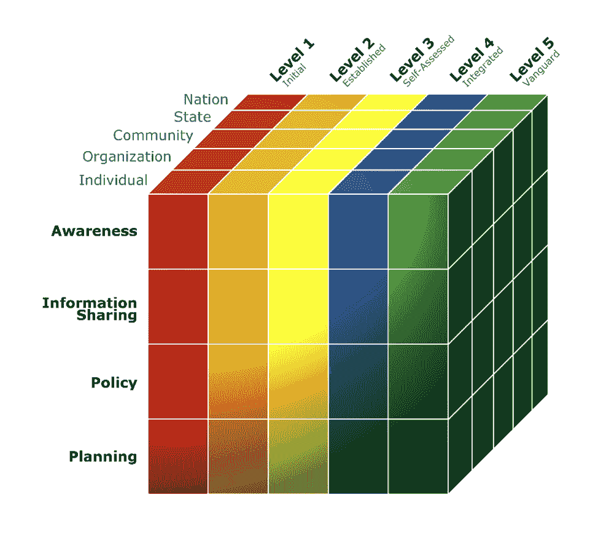 |
| --- |

The 3-D Model shown in Figure 1 shows the relationships of preparedness for the scope areas. As an example, the composition of a community includes individuals and organizations. The community’s maturity level is influenced by the maturity of the individuals and organizations in that community. This dynamic shows how they are integrated together, and this directly affects the ability of the community’s cybersecurity preparedness to address cyber threats. In fact, these relationships drive home the point that everyone has a role in cybersecurity.

The last major concept that needed to be reflected in the 3-D Model is how the implementation mechanisms are used to transition from Level 1 to Level 2 and so on. This visual depiction is represented in Figure 2.

| Figure 2. |
| --- |
| 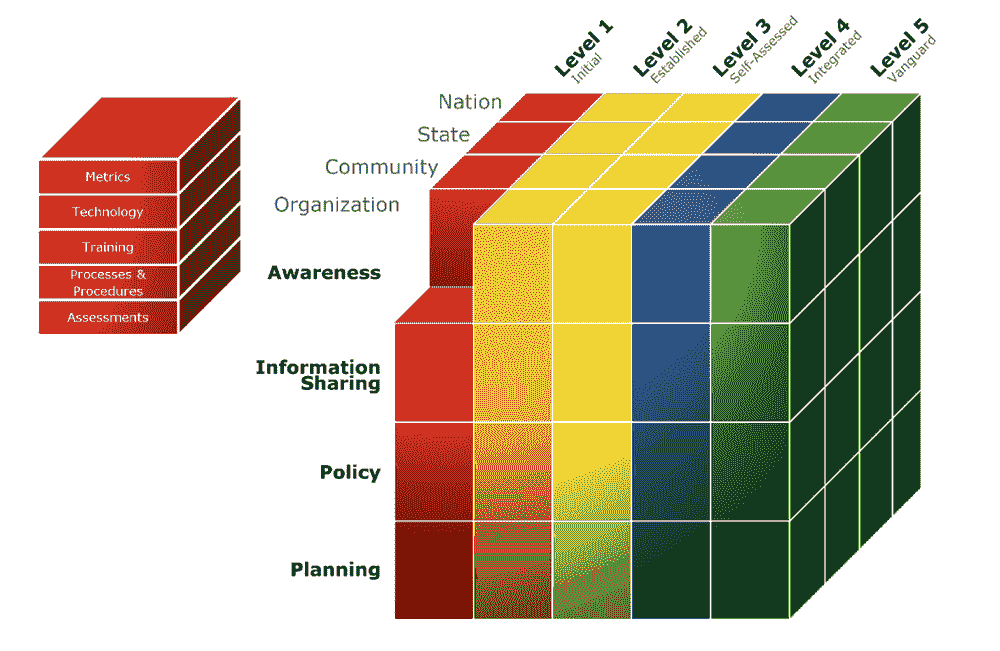 |
| --- |

Each block in the cube individually represents the characteristics for the level and the phase activities to transition to the next level. Each phase is associated with a specific scope area. To transition from one level to the next, for a specific dimension, the implementation mechanisms listed in the block are utilized to provide the activities needed to transition.

To use Figure 2 as an example: the separated block represents an organization that is currently at Level 1 and working on improving their cybersecurity awareness. The activities they need to complete in order to improve their awareness are metrics, technology, training, processes and procedures and assessments.

### THE SCOPE AREAS

The CCSMM identifies specific scope areas that have a role in cybersecurity preparedness. The scope is defined as the range or the extent of the area that is involved in maturing their cybersecurity posture. As mentioned previously, the scope areas are individuals, organizations, communities, states, and the nation. Each of these scope areas can determine their own maturity level which ultimately affects each of the other areas.


# 网络安全范围领域

重要的是要强化这样一个理念：每个人都需要具备一定程度的网络安全理解。技术触及我们现代生活的方方面面。曾经看似科幻的事物，如今已成为现实。请考虑家庭、车辆中连接互联网的技术和设备数量，以及智能手机的广泛功能。此外，几乎没有工作不在一定程度上集成技术。个人在家庭中的安全状况现在会影响其工作的组织。使用受感染的电脑在家办公并连接到组织网络；或用含有恶意软件的 USB 在家庭和工作间传输信息；或在社交媒体上发布有价值的商业信息，这些都是对企业的重大风险。这一原则也存在于社区组织之间、社区与州之间等。这就是 `CCSMM` 必须识别每个范围领域的原因。

## 个人

个人范围包括以某种形式使用技术的每个人。提高个人的网络安全准备度，将从他们个人使用并负责保护的联网设备开始，例如智能手机和家庭无线技术。还应包括他们上网时的计算习惯。

以维度为指导，个人需要了解以下内容：

*   **意识**：个人需要了解使用技术面临的威胁，以及如果其设备或在线账户被攻破，会如何影响他们。他们需要识别所有对他们重要的设备和数据，然后学习如何保护它们。他们需要了解如何保护隐私以及为什么这很重要。他们还需要了解计算机道德的重要性，特别是涉及下载软件、音乐或其他授权数字产品时。
*   **信息共享**：当个人发现恶意活动、经历网络犯罪或事件时，应采取哪些措施？个人需知道向谁报告此类活动，以及何时和如何报告。
*   **政策**：个人需了解在使用电脑、笔记本电脑或其他设备时应遵循的良好网络安全实践，同时也需理解在使用电子邮件、社交媒体或在线购物时的良好与不良实践。
*   **计划**：如果个人遭到入侵，应如何应对？个人应了解如何进行备份及其重要性，并具备在被入侵后应对的基本认知。

在每个成熟度层级中，改进活动将变得更加复杂。

此范围可支持其他框架和计划项目，涵盖家庭网络安全、青少年网络安全（如网络欺凌、网络游戏、竞赛及教育活动）以及其他网络安全倡议（如图 3 所示的网络安全文化）。网络安全文化由德克萨斯大学圣安东尼奥分校基础设施保障与安全中心创建。此类项目应被纳入整体网络安全意识提升计划，更多相关项目信息将在“意识提升计划”章节中详细说明。

| Figure 3. |
| --- |
| 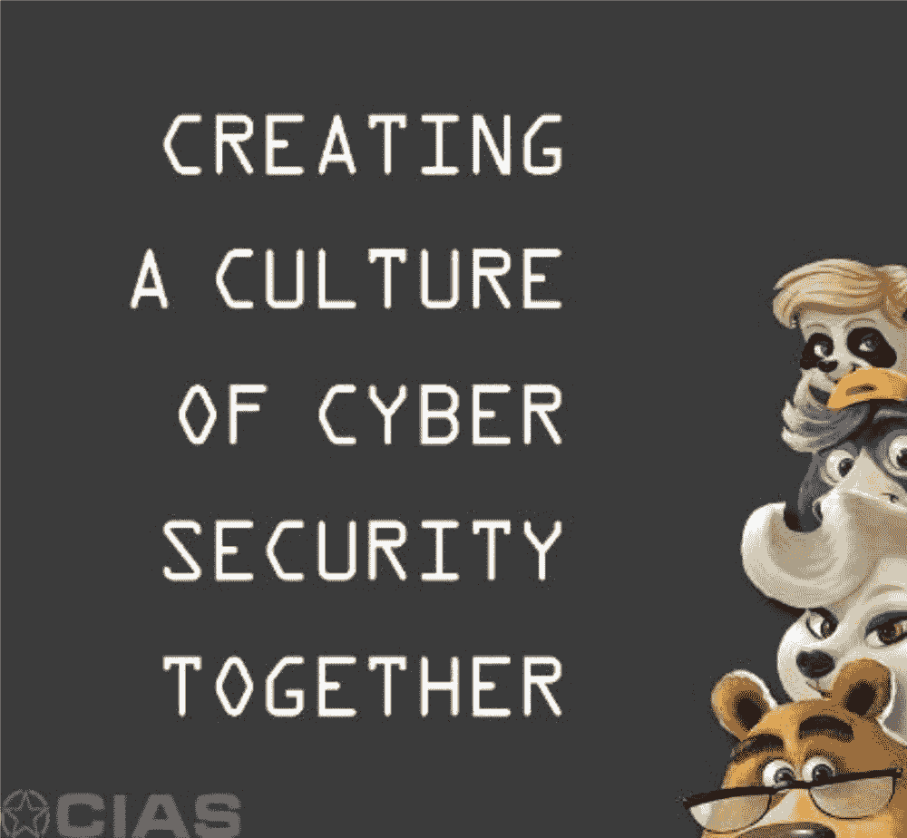 |

## 组织

组织范围涵盖小型企业、政府机构、非营利组织、中型企业及大型公司，本质上是指社区内的任何商业活动。组织的网络安全准备度应包括其员工或用户、客户、合作伙伴及供应链成员。准备能力还需覆盖组织的资产，包括信息、计算机和网络。

基于这些维度，组织需理解以下内容：

*   **意识**：组织需识别其面临的威胁，如恶意或犯罪攻击、系统故障、人为错误或社会工程学手段。每种威胁均需明确识别。
*   **威胁影响**：组织需了解已识别威胁对业务的潜在影响，如破坏性恶意软件、信用卡信息被盗、移动勒索软件等，这些攻击不仅影响业务运营，还可能导致客户、员工或供应链合作伙伴因关键信息不可用而受影响，同时也可能损害信息的保密性或完整性，进而损害组织声誉。组织需保护业务的所有方面，包括其声誉。
*   **威胁检测**：组织需掌握如何在其网络中发现恶意活动。
*   **保护措施**：组织需知道如何保护其信息和系统，理解物理安全在网络安全中的作用，并确定每位员工、合作伙伴或供应链关联方所需的网络安全意识水平，以保护组织。
*   **信息共享**：组织应考虑内部及外部的信息共享，员工应知道在组织内向谁报告可疑活动，并明确如何向管理层升级网络事件信息以提升情境认知，在关键情况下进行决策。此外，需确定需向组织外报告的网络事件类型、报告对象及触发外部报告的阈值。建议咨询法律顾问以确保符合法律、隐私及监管要求。在事件发生前建立与其他组织及机构的联系与信任，可在紧急情况下简化流程，明确联系人、预期响应及需求。若在紧急情况下不知如何行动或联系谁，将增加压力并延误响应时间。
*   **政策**：组织需记录所有关联人员应遵循的网络安全实践，如互联网使用、访问社交媒体、远程访问组织及技术处置等。政策的定期审查与更新也应纳入实施流程。
*   **计划**：组织至少需制定信息备份计划，一旦建立，还应实施网络安全事件响应、业务连续性及灾难恢复计划。

在每个成熟度层级中，改进活动将变得更加复杂。

组织可将以下框架纳入此范围以提升网络安全：国家标准暨技术研究院（`NIST`）的网络安全框架（`CSF`）（`NIST`, 2018），可用于政策维度；国防部的网络安全控制验证机制——网络安全成熟度模型认证（`CMMC`）亦可整合。为描述组织内需设岗位，可使用国家网络安全教育计划（`NICE`）网络安全职业框架（`NICE Framework`）（`NIST`, 2017）。

## 社区

社区范围涵盖定义地理区域内的小、中型及大型企业、地方政府、应急服务、非营利组织、关键基础设施及该区域内的居民。社区将决定其网络安全准备范围，例如，社区可能决定将其网络安全计划范围包括周边城市及城镇，或较小的城市或县自行制定计划并以更大社区为导师。

基于维度指南，社区需关注以下内容：

*   **意识**：社区需识别其面临的威胁及其对业务运营和关键服务（如电力、交通）的影响，并评估潜在的连锁效应，了解网络事件如何影响社区服务、组织及居民。若关键服务（如电力）受网络攻击影响，需认识到其他社区、州或地区可能受波及，从而决定可获取的援助来源。
*   **信息共享**：社区需在内部及外部进行信息共享，并明确识别应对网络攻击所需的威胁指标。
*   **上报机制**：社区需要解决如何向州和国家机构上报网络事件信息。此外，需要确定在社区外部报告的网络事件类型、报告对象以及触发报告的阈值。在发生网络事件之前，与这些组织和机构建立关系并建立信任，有助于确保共享的信息及时、相关且可操作。
*   **政策**：社区需要将网络安全概念纳入既有的社区政策。这些政策至少应涵盖标准操作流程、通信方式，并确定社区内部的授权层级。例如，将社交媒体渠道用于通信的社区应确保其政策包含符合隐私和安全考量的良好网络安全行为。社区需要识别角色以及授权层级，以应对社区的网络安全实践。例如，谁负责决定将提供关键服务的服务器“脱机”。
*   **计划**：社区至少应制定一份业务连续性计划（`COOP`）或应急管理计划，以应对可能影响社区的灾难。这些计划应经过审查，确保已将网络安全元素纳入其中。随着社区成熟，还应建立网络安全事件响应计划（如网络安全事件响应附录）以及灾难恢复计划（也称为中断计划）。

一个至关重要的考量点是社区计划中将在地方层面执行什么操作。所有事件均发生在地方层面，即使需要向州或联邦层面请求援助，也可能在援助到达现场之前耗时较长。社区应制定在至少请求援助后 `72` 小时内应采取的行动计划。认识到恢复并回到正常状态可能需要更长时间。需要考虑对媒体和公民的沟通，以及为关键功能制定的替代运营方式。过去许多社区被迫改用纸笔进行关键功能。在这种情况下，有多少人员具备相应的操作能力？是否有培训确保可实现此备份能力？

社区范围区域是融合中心、安全运营中心以及社区信息共享与分析组织（`ISAOs`）将被整合到社区网络安全计划的地方。专业组织如 `ISACA`、`ISSA` 和 `InfraGard` 分会应建立并整合进计划，以提升社区整体的网络安全和信息共享能力。例如，可在当地社区学院或大学开展网络安全人才培养计划。

## 州

州的范围包括其县、市、镇、关键基础设施、州级机构以及公民。虽然此范围仅提及州一级，但也旨在涵盖部落和领土。州、部落和领土在许多方面存在差异，尤其是灾害规划方面；然而，应考虑的网络安全实践高度相似。

州的网络安全准备通常涵盖该州所有政府机构，并可能包括关键基础设施。仅针对政府机构进行规划任务庞大，因为任何给定州可能存在数百个机构。然而，问题在于该州的所有个人、组织和社区均会影响其网络安全准备，无论是正面还是负面。简单来说，如果州内的社区未做好准备，可能需要大量的事件响应援助并消耗大量资源。州级网络资源通常有限，这意味着同时影响多个社区的网络攻击可能会耗尽所有可用资源，甚至可能没有足够资源应对多次攻击。另一方面，私营部门提供了巨大且有价值的网络安全能力和技能。通过公私合作伙伴关系，州可在重大网络事件发生时获得补充网络安全资源。此外，国家警卫队也可在应对网络攻击和事件时发挥作用。

基于这些维度，州、部落和领土需要理解以下内容：

*   **意识**：州、部落和领土需要了解所面临的威胁及其对本州业务运营和提供的关键服务可能产生的影响。同时，还需确定潜在的连锁效应，以及州和社区服务、组织及公民可能受到的影响。
*   **关键资产保护**：州需要确定哪些关键服务、信息和系统需要受到保护，并理解物理安全在其网络安全计划中的作用。同时，还需明确州内需要哪类网络安全意识培训。
*   **信息共享**：州需考虑州内的信息共享，并应说明如何向国家机构上报网络事件信息。州需了解辨识本州正在经历网络攻击所需的网络威胁指标。此外，还需确定将报告哪类网络事件、报告对象以及触发报告的阈值。在发生事件前与相关机构建立关系并建立信任，有助于确保共享的信息及时、相关且具可操作性。
*   **政策**：州需将网络安全概念纳入既有政策。这些政策至少应涵盖标准操作流程、通信方式、角色以及处理州级网络安全实践的授权层级。同时应包括政策，说明州内社区如何请求网络准备和网络事件响应方面的援助。
*   **计划**：州至少应制定一份业务连续性计划（`COOP`）或应急作业计划，以应对可能影响州的“所有危害”灾难。这些计划应审查，确保已将网络安全元素纳入。此外，还应制定网络安全事件响应计划（如网络安全事件响应附录）以及灾难恢复计划（也称为中断计划）。在此过程中，网络安全事件响应团队和国家警卫队可能发挥作用。

州计划还应说明在何种情况下、由谁、使用何种资源以及在何种条件下，州将协助本州社区实施网络安全实践并应对网络攻击或事件。

州范围还应考虑如何将以下组织和机构整合至整体州级网络安全计划中：

*   `Fusion Centers`（融合中心）
*   `State Operations Centers`（州级作业中心）
*   `Security Operations Centers`（安全运营中心）
*   `Information Sharing and Analysis Organizations (ISAOs)`（包括社区、区域、私营部门）
*   `Information Sharing and Analysis Centers (ISACs)`（与关键基础设施相关）

## 国家

*   **国家范围**包括州、部落、领地、社区、关键基础设施、联邦机构和公民。联邦政府的职责是确保个人自由、经济活力，并为美国公民提供国家安全。联邦政府还负责国家的网络准备工作。“2018 年 11 月，特朗普总统签署了《网络安全基础设施安全局法案》，该法案建立了网络安全基础设施安全局（`CISA`），旨在‘建立应对网络攻击的国家能力，并与联邦政府合作提供网络安全工具、事件响应服务和评估能力，以保护支持合作部门和机构关键运营的‘.gov’网络’。”
*   `CISA` 的主要关注领域包括：
    *   打击网络犯罪和网络事件响应
    *   保护联邦网络、关键基础设施及提供网络安全治理
    *   推动信息共享、培训与演练以及网络安全信息（`DHS`，2019）。
*   依据这些维度，国家范围应涵盖以下内容：
    *   **意识**：联邦政府需了解国家面临的威胁及其对联邦提供的关键服务的影响，并判断潜在的连锁效应及其对服务的影响。
    *   **信息共享**：联邦政府需考虑国内的信息共享机制，并确定哪些网络事件应被共享、与谁共享以及何种情况构成可能影响全国的网络事件。
    *   **政策**：联邦政府需将网络安全概念纳入既定政策，这些政策应涵盖标准作业流程、沟通策略以及关键基础设施的保护。
    *   **计划**：联邦政府必须制定应急运营连续性策略，以应对可能影响全国的各类灾害（包括网络威胁）。还需制定可融入全国所有政策的网络安全策略，以及一套国家级网络事件响应策略。这一维度是网络事件响应团队和国防部发挥作用的地方。
*   联邦政府建立了大量计划，以促进公私合作伙伴关系，提升对网络威胁的感知水平和整体网络安全能力；制定了以网络安全为重点或包含网络安全的策略；建立了信息共享项目以提升网络安全能力；并创建了可供州和社区参考的计划，帮助其提升网络安全水平。
*   以下是联邦政府为提升国家网络安全态势所建立的部分倡议、计划和合作伙伴关系：
    *   **关键基础设施信息保护计划（`PCII Program`）**：该计划源于 2002 年《关键基础设施法案》的通过，为私营企业向联邦政府提供的信息提供保护。保护措施包括免受联邦《信息公开法案》（`FOIA`）、州和地方披露法规、监管行动以及民事诉讼。虽然由美国国土安全部（`DHS`）在联邦层面管理 `PCII` 计划，但各州被鼓励建立自己的计划，以便向需要知情的州和地方当局提供受保护的信息。
    *   **`ISAO` 标准组织（`ISAO Standards Organization`）**：该非政府组织于 2015 年 10 月 1 日通过行政命令 13691 设立。`ISAO` 标准组织的使命是通过识别与网络安全风险、事件及最佳实践相关的强有力且有效的信息共享标准和指南，提升全国的网络安全水平。
    *   依据行政命令，由德克萨斯大学圣安东尼奥分校牵头的 `ISAO` 标准组织一直在与现有的信息共享组织、关键基础设施所有者和运营商、相关机构以及其他公共和私营部门利益方持续合作，旨在确定自愿的、统一的标准或指南，用于 `ISAO` 的创建与运作。
    *   **国家培训与教育分部（`National Training and Education Division, NTED`）**：`NTED` 提供定制化培训，以增强州和地方政府应对、预防、遏制、应对和安全恢复潜在的人为或自然灾害（包括恐怖袭击）的能力。
    *   **网络安全顾问（`Cyber Security Advisors, CSAs`）**：`CSAs` 是驻地区的国土安全部人员，负责协调、宣传并提供区域性支持，保护对美国关键基础设施及州、地方、领地和部落（`SLTT`）政府而言至关重要的网络组件。`CSAs` 提供即时且持续的帮助，协助这些实体进行准备和保护，提升其网络安全准备度、风险缓解和事件响应能力，并促进其与联邦政府的更紧密协作。`CSAs` 作为前线力量，推动美国及其领地关键网络设施的韧性。
    *   **国家连续性计划（`National Continuity Programs, NCP`）**：联邦应急管理局的 `NCP` 通过协调联邦各项旨在保障国家 `essential functions`（基本功能）的计划和活动，服务于公众。在白宫、国土安全部长和 `FEMA` 管理员的代表下，`NCP` 指导并协助各级政府（联邦、州、部落、领地和地方）制定并实施连续性计划，确保在灾难的各个阶段，政府能够向灾难受害者提供关键服务。连续性和维持基本功能是全社区的共同责任。发展和维护连续性能力有助于构建更具韧性的国家，使其在任何条件下都能维持基本功能、提供关键服务并供应核心能力。
    *   **国家网络安全与通信整合中心（`NCCIC`）**：其使命是降低系统性网络安全和通信挑战，作为国家的旗舰网络防御、事件响应和运营整合中心。自 2009 年以来，`NCCIC` 一直作为全国性的网络与通信信息、技术专业知识以及运营整合的枢纽，并通过 `24/7` 的情报感知、分析和事件响应中心履行职责。


*   **关键基础设施合作咨询委员会（Critical Infrastructure Partnership Advisory Council, CIPAC）**：参与该委员会的合作伙伴能够提升沟通、规划、风险评估、方案实施、事件响应、恢复以及运营活动的效率。

## 3-维度模型

3-维度模型扩展了 CCSMM 框架的能力，使其能够灵活且可扩展，以应对网络安全计划的所有方面。3-维度模型为全国各地的每个人提供改进路径。它是提升个人、组织、社区、州和国家层面网络安全的路线图，称为范围领域。范围领域可以通过使用维度来提升对网络威胁和影响的意识，网络威胁指标的共享能力，将网络融入政策，以及了解为持续性、响应和恢复所需的计划。

**个人范围**包括所有使用技术的人，无论是智能手机、智能电视、笔记本电脑、平板电脑、iPad 或其他连接互联网的设备。该范围领域还应包括本国的青年，并应涵盖网络欺凌等安全话题。还应包括网络安全游戏、网络安全竞赛和其他教育活动等吸引性项目。

**组织范围**包括小企业、政府机构、非营利组织、中型公司和大型企业。组织的网络安全准备程度应包括与组织相关的所有个人，这可能包括个人或员工、客户、合作伙伴以及供应链中的相关方。组织资产应纳入准备能力，包括信息、计算机和网络。

**社区范围**是一个定义的地理区域，包括小型、中型和大型企业、地方政府、应急服务、非营利组织、关键基础设施以及该地理区域内的居民。社区应定义其准备工作所涵盖的范围区域。这可能包括围绕社区的较小城市和县。更大的社区可以成为指导相邻较小城市和县的导师。

**州、部落或领土的范围**包括其县、城市、镇、关键基础设施、州级机构和居民。州、部落或领土的网络安全准备工作主要针对政府机构，也可能包括关键基础设施。为了应对可能影响州、部落或领土的其他方面，网络安全准备工作应包括私营部门的个人和组织以及该州、部落或领土的社区。此外，应考虑融合中心、州运营中心、ISAOs 和 ISACs 在整体网络安全计划中的作用。

最后，**国家范围**包括州、部落、领土、社区、关键基础设施、联邦机构和居民。联邦政府在国家层面的网络准备工作中扮演角色，并建立了众多倡议、计划和合作伙伴关系，以改善网络安全、信息共享和网络安全能力。

接下来的几章将深入阐述维度的概念，并提供通过层级改进的映射。

## 参考文献

About Us. (n.d.). Retrieved August 16, 2019, from ISAO Standards Organization website: `https://www.isao.org/about/`

CISA Cyber Infrastructure. (n.d.). Protected critical infrastructure information (PCII) program. Retrieved August 22, 2019, from U.S. Department of Homeland Security CISA Cyber Infrastructure website: `https://www.cisa.gov/pcii-program`

CMMC model v1.0. (n.d.). Retrieved February 25, 2020, from Office of the Under Secretary of Defense for Acquisition & Sustainment Cybersecurity Maturity Model Certification website: `https://www.acq.osd.mil/cmmc/draft.html`

County of Marin. (n.d.). `www.marincounty.org/depts/ad/divisions/management-and-budget/administrative-policies-and-procedures/administrative-regulation-no-1_25`

Cyber Incident Annex. (n.d.). Retrieved August 13, 2019, from US Department of Homeland Security FEMA website: `https://www.fema.gov/media-library/assets/documents/25556`

Cybersecurity division mission and vision. (n.d.). Retrieved August 17, 2019, from US Department of Homeland Security CISA Cyber + Infrastructure website: `https://www.dhs.gov/cisa/cybersecurity-division`

DHS role in cyber incident response. (n.d.). Retrieved August 25, 2019, from US Department of Homeland Security CISA Cyber + Infrastructure website: `https://www.cisa.gov/publication/dhs-role-cyber-incident-response`

Information sharing and awareness. (n.d.). Retrieved August 22, 2019, from US Department of Homeland Security CISA Cyber + Infrastructure website: `https://www.cisa.gov/information-sharing-and-awareness`

National continuity programs. (n.d.). Retrieved August 2, 2019, from US Department of Homeland Security FEMA website: `https://www.fema.gov/national-continuity-programs`

National Institute of Standards and Technology. (2018, April). Framework for improving critical infrastructure cybersecurity (Publication No. Version 1.1). Retrieved from `https://nvlpubs.nist.gov/nistpubs/CSWP/NIST.CSWP.04162018.pdf`

NIST Special Publication 800-181. (2017). National Initiative for Cybersecurity Education (NICE) Cybersecurity Workforce Framework (NICE Framework). Retrieved from `https://nvlpubs.nist.gov/nistpubs/SpecialPublications/NIST.SP.800-181.pdf?trackDocs=NIST.SP.800-181.pdf`

The national cyber incident response plan (NCIRP). (n.d.). Retrieved August 19, 2019, from US Department of Homeland Security CISA Cyber + Infrastructure website: `https://www.us-cert.gov/ncirp`

U.S. Department of Homeland Security. (n.d.). Cybersecurity strategy. Retrieved October 27, 2019, from `https://www.dhs.gov/sites/default/files/publications/DHS-Cybersecurity-Fact-Sheet.pdf`

U.S. Department of Homeland Security. (n.d.). Cybersecurity. Retrieved August 24, 2019, from The Department of Homeland Security website: `https://www.dhs.gov/topic/cybersecurity`

欢迎来到国家准备课程目录。(n.d.)。2019 年 8 月 31 日，从国家培训与教育分处 | 美国国土安全部 - FEMA 网站：`https://www.firstrespondertraining.gov/frts/npcc` 获取。

## 第 4 章

### ABSTRACT

意识是描述个体对某一主题了解程度的术语。人们会期望网络安全威胁的意识因为持续的网络事件和攻击报告而被个人、组织以及社区和州的网络攻击所理解。CIAS 发现这确实属实：人们了解网络事件和攻击正在发生，他们也知道需要保护自己的资产和信息，并且需要能够应对和恢复可能发生的事件。重大的差距在于他们不了解网络事件可能带来的所有影响，也不明白单一攻击可能导致的连锁连锁影响。关于意识的经验教训被纳入 CCSMM 的意识维度，包括社区中每个成员根据其在社区中的角色需要了解的内容。

### INTRODUCTION

安全意识计划可以是确保每个人都理解网络威胁并减少攻击者可以利用的弱点的有价值工具。每个人都需要了解常见威胁，以免成为更易受骗和网络钓鱼尝试的受害者。在应对更高级的攻击时，用户至少可以利用培训中获得的知识来减轻攻击的影响，收集安全专业人员需要的信息，并通过正确的渠道告知相关人员。终端用户是安全计划降低风险和防止网络威胁的极其重要的方面。

安全意识计划在评估其价值时常常受到审查。反对意识计划的最大论点是，无论用户接受多少培训，针对终端用户的泄露仍在发生，并且因人们仍是网络安全链条中最弱的一环而成功率仍然很高。经常也会指出，用户的表现与其在真实环境中识别威胁的行为和反应之间存在脱节。在设计和实施安全意识计划以及构建网络安全文化时，重要的方面不是意识计划是否值得，而是所实施的计划是否有效，并且真正满足社区的需求。

需要思考的问题包括：

*   这种努力是否得到领导层的支持？
*   是否针对个人角色在社区中的职责而选择了相关的意识主题？
*   我们是否教育过人们如何预防和应对数据泄露？
*   当人们发现安全威胁时，是否知道联系谁？
*   人们是否知道什么是安全威胁？
*   我们是否有定期的培训，使社区了解最新的网络威胁？
*   我们如何知道意识计划是否有效？

### BACKGROUND

前面章节讨论的社区网络安全演习，除了用于评估社区在网络安全事件发生时的应对准备度外，也被用作向社区相关方提供相关意识的机制。CIAS 利用演习作为催化剂，能够向相关方介绍网络安全术语、各种网络攻击类型，展示每种攻击如何影响特定组织或行业，并通过注入的情境展示单一网络攻击如何在更大社区产生连锁影响。

演习中使用的注入情境包括：

*   针对城市的电子邮件威胁
*   网页被篡改
*   恶意软件导致关键数据丢失
*   恶意软件导致虚假计算机交易的产生
*   分布式拒绝服务攻击
*   入侵检测系统警报增加
*   垃圾邮件和网络钓鱼攻击
*   误信攻击
*   战争驾驶
*   战争粉笔
*   网络警报
*   影响网络能力的物理事件
*   导致物理效应的网络攻击

这些攻击被用于针对社区内的多种目标，如城市政府部分、港口管理局、公用事业、海岸警卫队以及工业部门。目标是专门针对该社区的；因此，如果该社区没有海岸警卫队的代表，则会选择其他部门。学术机构通常不参与应急响应，但被用作某些网络攻击的发射点。从意识角度来看，经验教训表明，社区中谁有潜力观察或应对可疑活动，从而提升情境意识或及早发现事件。对参与者的提问提供了关于他们对网络威胁真正理解程度的洞察，帮助判断参与者是否认识到网络事件的潜在影响，以及他们是否知道在发现可疑活动时应联系谁以及需要采取哪些其他行动。

社区演习的推荐指出，需要为社区内的各类相关方建立意识计划，并研究并实施低成本或无成本的高质量网络安全培训方案，以合作的方式推进。

社区意识始于确保社区的领导者对其可能面临的网络威胁有良好理解。这可能包括工业界的高管、企业所有者、地方政府官员、当选官员、社区内宗教组织的领导、与学校、学院或大学相关的领导。这显然不是一份全面的清单，最终领导者被定义为在社区中拥有影响力的任何人。一旦这些领导者参与，他们就能在其组织内部推广网络安全意识，然后扩大到更多组织，最终让社区的所有公民参与其中。

### Culture of Cybersecurity

网络安全最终需要成为一种心态，并融入一切之中。必须建立一种网络安全文化。像“Smokey Bear”（1944 年创立，是最长寿的公共服务运动）和“McGruff the Crime Dog”（1979 年推出，鼓励美国人参与犯罪预防）这样的国家运动可以作为例子。Smokey Bear 是现代历史上最知名的吉祥物之一，80%的人认识他的口号“Only You Can Prevent Forest Fires”（只有你才能防止森林火灾）。McGruff the Crime Dog 于 1979 年推出，旨在鼓励美国人帮助预防犯罪。McGruff 的形象和标语“Take a Bite out of Crime”（咬一口犯罪）至今仍然有效，超过 93%的儿童能够识别这只犯罪小狗（“Crime Prevention”，n.d.）。CIAS 创建了一系列角色，帮助各年龄段的人更加了解网络安全原则，从而安全地在数字世界中导航。CyBear Family 于 2019 年 3 月推出。为适应所有年龄层并满足不同的技术兴趣和需求，创建了一个完整的家庭。CyBear 家庭的每个成员都以对网络安全做出重要贡献的重要历史人物命名。提供面向儿童的活动、成人技巧以及免费网络安全教育游戏链接的网站可于 `www.cultureofcybersecurity.com` 访问。

| Figure 1. |
| --- |
|  |
| --- |

安全文化需要时间。它要求每个人共享围绕安全行为的价值观，例如他们如何思考网络安全。这些价值观还将帮助他们设定良好网络安全实践的期望。建立安全文化不仅需要意识，还需要实施 CCSMM 的所有原则，形成知识与实践的结合。在设计社区网络安全计划时，应将追求安全文化视为重要考量因素。意识部分的计划应立即启动，因为要让所有人都参与进来并达到真正的网络安全理解水平需要时间。

实施安全文化可以分为若干阶段。针对社区的特定部分进行实施会让过程更加聚焦，也更易管理。以下是社区可考虑的建议分组。需要注意的是，范围领域往往相互交织。无论是提高意识、信息共享、政策或计划，通常都会涉及其他领域。例如，要提升整体社区意识，通常需要考虑个人和组织。同样的道理适用于各个维度。例如，提高意识对于信息共享流程和应急响应计划也至关重要。

*   **Security Culture for Leadership:** 这是首批需要推动的倡议之一。社区领导者是构建社区安全文化的关键。领导者的支持将决定未来倡议的规划、资金、优先级以及运动的持续活力。因此，需要确定最初应参与的领导者，并探索如何将更多社区领袖纳入讨论和活动中。还需要制定提升领袖网络安全意识的方法，使其能够在繁忙的日程中快速了解当前的网络威胁、这些威胁如何影响社区内的组织以及整体社区，以及应对事件所需采取的措施。这将帮助领袖做出决策、分配资源并指挥行动。同时，还需考虑如何维持领袖的意识，例如通过每月或每季度的简报来支持。随着参与领袖数量增加，可建立领袖论坛，通过简报向其传达更新、趋势和新兴威胁。

*   **Security Culture for K-12:** 将 K-12 纳入社区计划的倡议也应在项目早期就实施。儿童从很小的年龄就接触技术——甚至两岁的孩子也会被父母给手机看视频或视频通话。孩子入学时，很可能已经接触或使用过技术，如在线游戏主机（如 PlayStation 或 Xbox）。因此，儿童应至少了解如何在网络上保持安全，以及网络伦理的基本知识。社区计划可以整合现有的相关项目，同时也可利用科学技术工程数学（STEM）K-12 项目中包含的网络安全内容，让这类学生受益。将学生引入 STEM 活动能够激发他们对网络安全职业的兴趣。网络安全谜题、练习题、游戏、竞赛和实习都可以提升 K-12 学生的网络安全意识，同时也能培养技术能力并巩固技能。Cyber Threat Defender（CTD）这款可收藏的网络安全卡牌游戏可用于中学和高中课堂，用于介绍和强化课堂中的网络安全主题。CyberPatriot 计划和 Code Jam 也是可介绍给该群体的额外网络安全资源。请检查社区内的学校是否已参与此类网络安全 STEM 项目；如果没有，则需了解如何将它们引入社区，以启动 K-12 的安全文化。

*   **安全文化（高等教育）**：该小组将包括两年制学院、技术培训机构以及大学。如果当地的学院和大学没有网络安全学位课程，则————

*   **[社区网络安全日]的一个例子是社区网络安全日。** 社区可以举办网络安全意识日，该日聚焦社区的不同部分，并提供对当地政府、行业、关键基础设施、小企业和公众有益的信息。这可以以会议形式组织，演讲者讨论网络安全趋势、挑战以及防止、减缓、应对和恢复事件的最佳实践。上午，演讲者可讨论对大型组织、关键基础设施和地方政府有益的网络安全话题；下午，讨论针对小企业的内容；傍晚，可向公众开放，鼓励公民进一步了解网络安全。此类一天是一种低成本的方式，以吸引社区成员学习网络安全。演讲者可在社区内寻找。FBI 经常在社区活动中发言，以提高网络安全意识；InfraGard、ISSA 等组织通常有志愿者愿意在本地活动中就网络安全讲话。社区周边的组织可能愿意以象征性费用提供场地，或免费捐赠场地。此类一天可能在确保社区组织和公民理解其面临的威胁方面非常有效，同时也能让人们了解在发生 breaches、网络攻击或事件时应报告的地点以及社区中可提供帮助的组织或个人。


*   **Games:** 网络安全游戏将重要且严肃的概念转化为有趣的传递方式，用于介绍这些主题。游戏日益流行，并被用作 K-12 学生的 STEM 教育工具。此类倡议通过向中学生至高中生介绍网络安全原理和未来职业可能性，以解决网络安全人才短缺问题，这些学生可能原本不会将此视为职业方向。

    **Cyber Threat Defender (CTD)**，由 CIAS 创建，是一款原创产品，有潜力通过引入术语、概念和职业，以游戏化格式改变课堂关于网络安全的讨论。CTD 已向全国和全球分发了超过 40,000 套卡牌。该游戏在中学和高中课堂、STEM 俱乐部、CyberPatriot 队伍、编程营中使用，且不断有新的实施形式出现。

    最初为中学生和高中生创建，该游戏也被组织用于提高 workforce 对网络安全的认识。

| Figure 2. |
| --- |
| 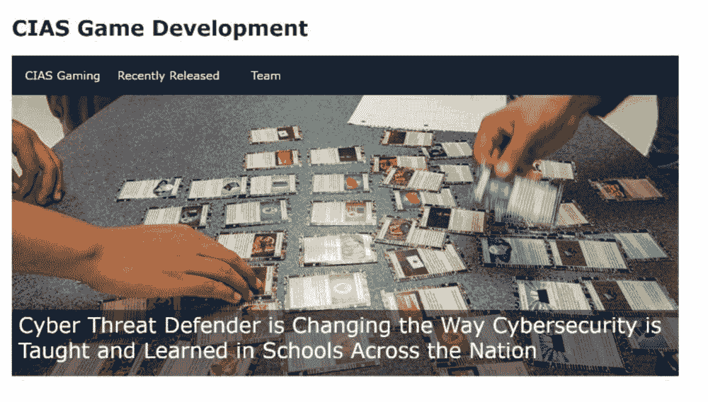 |

*   **Training:** 网络安全培训是建设安全文化的有效工具。培训类型多样，从传统的以 PPT 演示的讲师-led 培训（可包含动手活动）到 24/7 可随时访问的 Web 培训。后者是广泛覆盖受众、方便学习者随时学习的好选择。另一种培训方式是将培训融入模拟器。模拟器设计用于模拟用户可能面临的过程、事件和情境，是进行角色扮演或为学习者提供情境的好方法。

    Security training needs to be strong, more effective, more comprehensive, more in-depth and should leave a sense of responsibility to those being trained. Cybersecurity training tends to be provided on an annual basis and as a compliance measure. INFOSEC reports on their website that random security training results in an approximate 10-15% reduction of the likelihood an attack will be successful, but with consistent training there is an estimated 40-50% reduction. Get away from the mindset that security training is to check off a box for compliance and make the community cybersecurity training fun and make it available often.

*   **Train-the-trainer:** 该模式用于培训潜在的讲师或经验不足的讲师，教授其传授既定培训材料或内容的最佳实践。通过提升更多讲师在网络安全意识内容方面的水平，可以更广泛地覆盖社区，鼓励更多人参与网络安全活动。例如，若一名讲师教一门网络安全课程，可能一次培训 30 人。若社区有 5 名讲师在不同地点提供同一课程，则同一内容已覆盖 150 人。

    The train the trainer model is normally thought of in conjunction with a classroom style environment, while this format still works, the train-the-trainer model can be used in other capacities. Some examples of train-the-trainer activities are to train:

    *   K-12 teachers how to integrate cyber concepts into their classroom lesson plans such as the **Cyber Threat Defender Card Game**.
    *   Mentors who are assisting **CyberPatriot** and **Collegiate Cyber Defense Competition (CCDC)** students to prepare for competitions. Mentors can be trained on various cybersecurity concepts such as perimeter security, flashing and patching, networking, operating systems and vulnerabilities, services and applications, various tools and malware reversing and analysis.
    *   High school, community college and technical college teachers on cybersecurity concepts to prepare students for entry-level certifications such as **CompTIA’s Network +**, **Security +**, and **A+**.
    *   Sponsors how to add cybersecurity into summer camps offered to K-12 students.

*   **Competitions:** 网络安全竞赛是提供学生学习网络安全的竞争性环境。竞赛也可用于希望提升技能的专业人士，让其练习设计、配置或保护网络的技术与决策能力。竞赛从中学水平开始，延伸至专业级别。高校层面的竞赛常导向实习、奖学金和工作机会。全国范围内有众多网络安全竞赛，目标受众和专业领域各异。例如：

    *   **CyberPatriot** 是由空军协会赞助的 K-12 项目。其倡议之一是面向中学和高中学生的网络防御竞赛。“通过一系列在线竞赛轮次，团队将获得一组虚拟操作系统，并被要求查找并修复网络安全漏洞，同时保持关键服务的运行。全国顶尖团队可获全额支付的马里兰州前往全国总决赛的机会，获得全国认可和奖学金”（“What Is Cyberpatriot?,” n.d.）。

    **National Collegiate Cyber Defense Competitions (NCCDC)** 是全美地区大学网络安全竞赛的冠军赛，由前 10 支获胜团队参与。2004 年由 CIAS 创立，NCCDC 是美国最大的大学级网络安全竞赛（“National Collegiate”，n.d.）。**CCDC** 是首个专注于管理和保护已有“商业”网络基础设施的运营层面的竞赛系统。CCDC 赛事为学生提供了实践、动手的网络安全与信息技术经验，使其学习超出传统课堂环境。

    **Code Jam** 是 Google 最长寿的全球编程竞赛。“Code Jam 号召全球程序员在限时内解决富有挑战性的算法谜题。参赛者通过四轮线上赛晋级，每年在不同的 Google 办公地点举办年度 Code Jam 世界总决赛。每一轮都带来新的挑战，最终 25 名选手有机会在世界总决赛上展示技能，争夺现金奖金和备受瞩目的冠军头衔”（“Code Jam What’s,”n.d.）。

    Code Jam 还设有面向 K-12 的 **Youth Code Jam** 项目，针对 7 到 17 岁的儿童。该课后项目提供动手编程活动，并为教师提供专业发展，旨在将计算机科学纳入每所学校和课堂（“Code Jam What’s,”n.d.）。

*   **Internships:** 建立网络安全实习项目对学生和社区机构均有益。夏季实习项目让高中及大学生有机会体验在政府机构或大中小企业工作的情景。实习生可学习并交付创新解决方案，解决真实业务难题。社区实习项目会将对网络安全感兴趣的高中生、社区学院生和大学生与本地参与机构配对。这些机构可能希望招聘未来员工，并通过实习评估实习生的工作态度、学习能力、对组织文化及流程的适应度以及工作环境匹配度。实习可付费或不付费，无论付费与否，实习生都是以低成本向网络安全职业领域输送未来人才。实习不仅帮助社区学生，也能提升本地劳动力水平。社区实习项目是一种成本效益高的公共关系工具，有助于提升整个社区对网络安全的认知。

*   **Education and Degree Programs:** 越来越多的大学和学院提供信息安全、信息保障和网络安全学位。此类学位有助于培养能胜任信息安全分析员、系统管理员、网络安全顾问、渗透测试员等的能力，同时也扩大了一般信息技术职位（如软件开发人员、计算机程序员、信息系统经理等）的人才储备。“纽约时报”报道称，一个令人瞩目的数据正在在网络安全领域回荡：**Cybersecurity Ventures** 预测，到 2021 年全球将有 350 万个网络安全职位空缺，而 2014 年仅有一百万个职位（Morgan，n.d.）。

*   **Certifications:** 网络安全认证是证明已获得特定技能或知识的凭证，通常与职业、技术或行业相关。认证一般由专业组织或专注于某一领域或技术的公司颁发，要求个人通过考试方可获得。雇主常用认证来核实应聘者的技能和能力（“Earning a certification”，n.d.）。以下是部分网络安全认证示例：

    *   **Certified Information Systems Security Professional (CISSP)：** CISSP 是由 **(ISC)²**（国际信息系统安全认证联盟）颁发的高级认证，要求至少 5 年在以下 8 个 **CBK** 域中的任意一项或多项的工作经验：
        *   安全与风险管理
        *   安全架构与工程
        *   资产安全
        *   身份与访问管理
        *   安全运营
        *   安全评估与测试
        *   软件开发安全
        *   通信与网络安全

    *   **Certified Ethical Hacker (CEH)：** CEH 由 **EC‑Council**（国际电子商务顾问委员会）颁发，属于中级认证。持有者具备网络扫描、系统入侵、蠕虫与病毒、木马、窃听器、社会工程、拒绝服务攻击、枚举、踪迹追踪、会话劫持、SQL 注入、Web 服务器入侵、密码学、无线网络与 Web 应用、蜜罐、规避 **IDS**、渗透测试、防火墙等 hacking 实践（“Top 7 Cybersecurity”，n.d.）。

    *   **Certified Information Security Manager (CISM)：** CISM 是面向负责制定、监督和管理企业级信息安全系统的 IT 专业人员的高级认证，要求至少 5 年工作经验并具备项目开发与管理、安全风险管理、事件管理与响应、治理等技能（“Top 7 Cybersecurity”，n.d.）。

    *   **CompTIA Security+：** 是全球公认的供应商中立安全凭证，属于入门级别，要求至少 2 年网络安全经验，并符合 **ISO‑17024** 标准。持证者具备加密、威胁管理、身份管理、安全风险识别与缓解、安全基础设施与系统、网络访问控制等知识（“Top 7 Cybersecurity”，n.d.）。

    *   **SANS GIAC Security Essentials (GSEC)：** 由 **GIAC** 提供的入门级凭证，持证者具备访问认证、识别与缓解普通及无线攻击、密码管理、密码学基础、访问控制、**DNS**、**IPv6**、**ICMP**、网络映射、公钥基础设施、网络协议以及 **Linux** 等技术知识（“Top 7 Cybersecurity”，n.d.）。

*   **Tabletop Exercises:** 可以以相对低廉的成本（取决于细节程度）构建 **incident response** 技能，并发现计划、流程和培训项目中的潜在差距。**Tabletop exercises** 通过模拟情境测试社区协作与应对能力，评估准备程度。虽然传统上用于检验社区已有的机制和能力，但 CIAS 发现 Tabletop exercise 对提升网络安全术语认知、了解网络事件可能发生的方式及其潜在影响极具价值。

## Effective Awareness Programs

Effective security awareness programs have these qualities:

*   need to be fun
*   supported by the leadership
*   focused on changing the behavior of individuals
*   interactive (encouraging feedback and ideas)
*   **多样化部署方法** ([https://example.org](https://example.org)) (`使用新闻简报、海报、电子邮件技巧和其他通信方式` 定期进行)
*   `个别安全意识计划成员` 需要反复接触相同的信息
*   `安全意识计划` 需要 `可持续`、`可重复` 和 `长期`。

`安全意识计划的有效性` 需要进行测量。`安全不是目的地，而是一段旅程`，进度也需要测量。大多数安全计划通过培训完成人数来衡量有效性，这只关注出勤率。应收集的指标是那些能够显示行为变化的指标。

## 合作网络安全培训计划

建立合作网络安全培训计划是向社区所有利益相关者介绍网络安全培训的一种方式，这样的计划可以利用社区已有的资源来启动。合作组织可以是由社区内多个组织的代表自愿组成的自主小组，旨在共同实现网络安全培训目标。该小组也可以以工作组、委员会或其他形式存在。合作计划通常用于满足社区的教育、就业、经济、社会和文化需求。

合作培训计划涉及社区内参与组织的相互协助。社区内的组织可能拥有愿意分享的网络安全培训课程。这些课程可以分发给其他组织，由它们自行开展培训，或由创建材料的组织进行教学，并向社区其他成员提供课程名额。另一种合作培训方式是合并资源，引入难以获取且昂贵的培训。例如，一门高度专业化或技术性的培训课程对个人而言费用为 3,000 美元，但如果将该课程引入社区并让 20 个组织参与，每人费用将降至 750 美元。这将使该培训对组织更加负担得起。

## 意识道路图

CCSMM 意识道路图包含五个层级。起点是第 1 层 – 初始阶段，意味着社区缺乏较高的网络安全意识。这并不表示社区成员不了解网络威胁。事实上，如果社区的任何成员被问及是否认识到网络是一种威胁，答案几乎肯定是“是”。意识层级并不单纯指社区是否了解网络是威胁，而是指社区成员不清楚本社区可能成为网络攻击目标、攻击可能带来的影响以及潜在的连锁效应。道路图指导社区发展更为全面的意识计划，最终达到第 5 层 – 前沿阶段，此时对网络威胁、影响及连锁效应的意识已渗透到社区的一切活动中，形成了网络安全意识文化。

要开始提升社区意识的过程，请参考图 3 查看意识维度的特征。

| Figure 3. |
| --- |
| 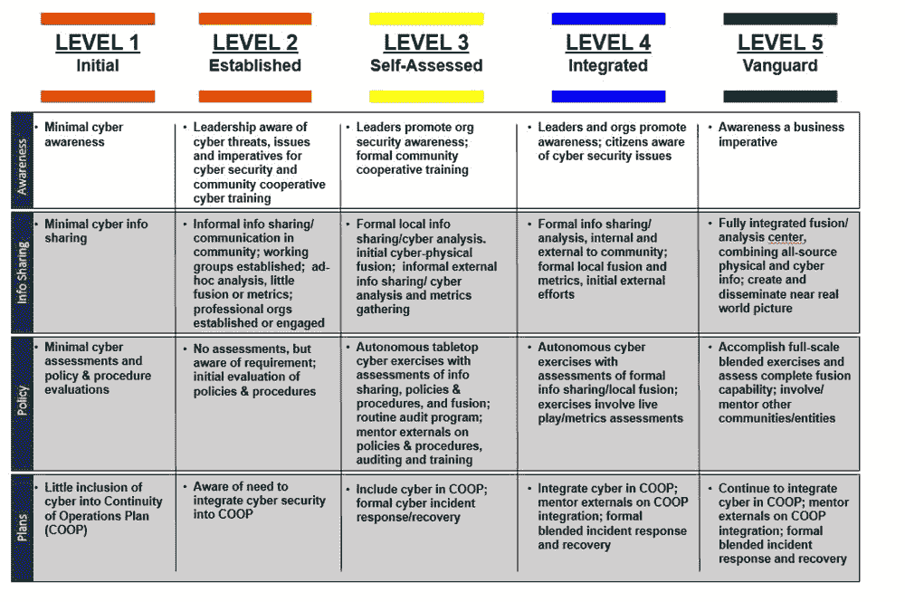 |

### 第 1 层：最小化的网络安全意识

第 1 层社区的特征是大多数成员拥有最小化的网络安全意识。这是社区开始的常见位置。请记住，社区意识并不是单纯衡量人们是否知道网络事件正在发生。真正需要的意识是对威胁、影响及连锁效应的更深入理解。

建立网络安全计划的第一步是找到一位倡导者。CIAS 发现，拥有倡导者的社区在建立计划时更为成功。倡导者是那位激发社区成员兴趣并参与网络安全项目的个人，他/她会在会议中提出网络安全议题，并在面对竞争性优先事项时推动计划前进。倡导者因社区而异。潜在的社区倡导者包括：消防局长、市长、县法官、警察局长、市议员或行业领袖。

### 第 2 层：领导层对网络威胁知晓

第 2 层意味着社区的领导层了解网络威胁、问题及网络安全的必要性。第二个特征是启动了合作网络安全培训计划。回顾第 3 章，我们介绍了阶段概念。阶段包含为从模型的一个层级提升到下一层级所需的活动，这些活动被称为实施机制。

**第 1 阶段**包括实施机制，用于将社区的意识从第 1 层提升至第 2 层。首先，度量指标将用于判断社区是否已达到第 2 层。

**度量指标：** 此层的度量将评估领导层是否知晓以及是否已启动培训计划。

用于从第 1 层过渡到第 2 层的问题包括：

*   社区中的领导是否已被识别？
*   这些领导应了解网络事件如何影响社区，并认识到潜在的连锁效应。并没有特定数量的领导需要被识别，他们将在社区的特定群体中拥有影响力。
*   社区是否建立了领导网络安全论坛或工作组？
*   是否已识别能够提升领导层意识且符合其时间安排的活动？
    *   这可能包括向领导论坛提供的演示或简报。
*   领导层的意识将如何保持，以及如何引入更新、趋势和新威胁？
    *   领导论坛应定期召开，频率可为每月或每季度。
*   社区是否已确定首先需要的培训类型？
*   社区是否已确定社区内哪些组织将从该培训中受益？

**技术：** 提升意识至第 2 层所需的技术应予以考虑。此层级的技术可以用于促进意识倡议，并支持培训计划的启动。主要考虑因素包括：

*   是否可以使用技术为领导层提供全部或部分网络安全培训或辅导？
*   是否已创建网站来推广合作网络安全培训计划？

**培训：** 领导层所需的培训应持续进行。网络威胁和影响不断变化，领导层需要频繁更新。内容应聚焦于他们必须了解的要点。可能涉及的主题包括：

*   网络安全的重要性
*   网络风险管理概念
*   攻击类型及演变威胁
*   网络安全术语
*   对网络威胁的情境感知
*   演变威胁
*   网络事件响应
*   安全文化

传统培训可以使用，但若时间受限，领导层可定期接受高级网络安全简报。

下一个需要考虑的是合作培训计划。网络安全培训可能非常昂贵，且由于费用高昂，组织可能难以参与。合作培训计划旨在实施组织可以参与的网络安全培训能力，且成本可在多个组织之间共享，从而使培训更加负担得起。

为社区从 Level 1 升级到 Level 2，需要完成以下工作：

*   是否已开发出能够向社区领导说明网络威胁、影响以及对社区潜在连锁影响的培训？
*   是否已向应接受培训的领导层交付培训？
*   是否已确定并启动了合作网络安全培训的培训主题？
*   是否已确定需要培训的组织？

**流程与程序：** 应考虑的流程与程序将确立领导意识计划和合作培训计划，并定义两者的管理与维护方式。

*   社区是否已建立制定领导意识计划的程序？
*   领导意识计划是否有程序规定培训、演示或简报的频率？
*   程序是否规定培训的更新频率？
*   社区是否已建立制定合作培训计划的程序？


### 程序是否包含确定培训主题的内容？

### 程序是否描述组织加入合作培训计划的方式？

#### 评估
评估将检查已建立的内容。在此级别，领导意识计划的有效性将被评估。培训计划的特征是要建立，因此评估将判断该计划是否已搭建。需要考虑的问题包括：

*   是否存在评估领导意识的机制，在培训前后进行？
*   社区是否已开发出面向社区内组织的培训计划？

## 意识水平 3：领导者推动组织安全意识

领导意识计划已在社区内建立，领导者现在正推广网络安全，确保社区内的所有组织意识到需要在其组织内实施网络安全实践，并需要一个网络安全意识计划。考虑社区中的组织类型，如金融机构、医疗、制造、教育、零售和政府机构。这些组织规模各异，从大型机构到中小企业皆有可能。每年发布的数据泄露报告显示，所有这些组织均可能成为网络攻击的目标，这意味着它们都需要良好的网络安全实践和控制措施。

Level 3 社区的特征是，社区领导者在推广组织安全意识，且社区合作网络安全培训计划已正式化。

### 第二阶段包括：

#### 指标
此级别的指标将评估组织意识的提升以及合作培训计划的正式化。相关问题包括：

*   社区是否已制定推广网络安全意识的活动？
*   是否已建立机制吸引组织参与？这可能是由商会等在社区层面运营的网络安全工作组。
*   培训计划已建立由社区内各组织代表的委员会或工作组，以保持需求的相关性和及时性。
*   是否有专职人员协助已建立计划的后勤与管理工作？
*   是否开展调查以识别社区内所需的网络安全主题、实践和技术？

#### 技术
此级别所需的技术将支持组织意识的提升和培训计划的实施。

*   用于在社区内促进组织意识和培训活动的技术有哪些？
    *   这可能包括每月的网络研讨会、播客或其他平台，供组织参与学习网络安全知识。
    *   邮件、社交媒体和网站可用于宣传和提供意识与培训活动的信息。
*   调查中识别出的网络安全主题需要哪些技术支持？

#### 培训
培训在 CCSMM 的每个级别均为关键工具。将培训融入的良好方式是找出免费或低成本的培训资源，并确保社区成员知道如何利用这些资源。

*   为响应社区关于网络安全需求的调查和反馈，可以开展哪些培训？
*   基于网络研讨会收到的反馈，是否需要更详细的培训？
*   是否已利用 FEMA 提供的免费培训资源？
    *   `Firstrespondertraining.gov` 提供免费在线网络安全培训，供个人自行按步骤学习入门、进阶和高级课程，涵盖事件响应、取证、网络安全基础等多个领域。
    *   可安排教师现场培训，每班人数 20 人以上，帮助社区更好地识别、保护、检测、响应和恢复网络攻击和事件。这些课程以讨论为主，并包含大量动手实践，以提升网络安全能力。
*   组织是否愿意分享培训课程？

#### 流程与程序
将需要建立流程与程序，以处理现有的社区计划，说明社区将如何向领导和组织介绍网络安全，以及培训将如何开展。

*   网站和社交媒体是否定期更新，以发布社区提供的培训和意识活动信息？
    *   更新频率是多少？负责更新的人员是谁？
*   是否已制定流程与程序，以满足意识和培训计划的结构与治理需求？
*   这些流程与程序是否可供所有需要的人员使用？

#### 评估
评估将衡量意识和培训计划的有效性。

*   社区是否已建立收集参与组织数量反馈的方法？
    *   社区最初启动了多少组织，六个月后、一年后等时间点有多少组织参与？
*   社区是否已建立了解网络安全意识是否提升的方法？

## 意识水平 4：领导者与组织推动意识

Level 4 社区拥有越来越多的领导者和组织认识到网络威胁、影响及其连锁效应。他们认识到自身在社区中的角色，并认识到网络事件可能影响整个社区的业务运营。组织通过实施和强化工作队的意识计划，教育其员工，提升整体安全意识。

The Verizon Data Breach Report for 2019 reports more than 100,000 breaches and of those breaches 32% were accomplished through Phishing and another 29% were from stolen credentials. To summarize, more than 60% of the breaches impacting organizations were successful because of the people. Organizations need to educate their workforce in cybersecurity threats and issues.

The workforce is a large portion of the community that will be aware of cyber security issues, but citizens include not only the workforce but also children, young adults perhaps in high school and college, stay at home parents, retired and elderly.

Level 4 characteristics for a community are the leaders and organizations are promoting cybersecurity awareness and the citizens are aware of cybersecurity issues.

### Phase 3 includes:

#### Metrics
The metrics at this level will assess if the effectiveness of established initiatives and programs and will include awareness programs for the citizens of the community.

#### Technology
The technology needed will support established initiatives. As the numbers of people included in the programs increase, new technologies may need to be evaluated and used. As an example, more online courses may need to be made available to fit into schedules and to allow flexibility for the amount of time spent at any given sitting.

#### Training
The community will have multiple training initiatives implemented at this level. Seminars, conferences, webinars, face-to-face training, podcasts, games and technical training, to name a few. Establishing an annual Community Cybersecurity Day is a great way to include the entire community to engage in cybersecurity awareness. This would be a day of speakers who focus on the different target audiences in regard to what they need to know about cybersecurity. As an example, a community could hold a one-day conference that had speakers for the community in the morning, focused on organizational security in the afternoon and held a security session for personal security in the evening for private citizens. This type of awareness activity could be established as early as in Level 2 with the intent to grow the number of participants each year.

Culture of security activities are implemented by this level to address cybersecurity for the youth that are age appropriate. Ensuring every school in the community has cybersecurity tools to teach cybersecurity such as the Cyber Threat Defender Game discussed earlier. Competitions at the middle school, high school and college levels will engage the young adults. And programs for adults not in the workforce need to be considered ideally before this level, but at a minimum should be addressed at this point.

#### Processes and Procedures
At this level of the CCSMM awareness dimension, the community should have a number of established programs that have processes and procedures identifying programs, how they work, how they are maintained and how they are updated.

#### Assessments
Each awareness initiative should be evaluated for its effectiveness, increased participation and increased awareness.

## Awareness at Level 5: Awareness a Business Imperative

At this level, cybersecurity principles are integrated into most day to day activities. Everyone in the community recognizes the importance of cybersecurity and how it is incorporated. It is understood that technology alone will not solve cybersecurity issues.

### Phase 4 includes:

#### Metrics
The metrics at this level will assess how awareness of evolving and new cyberthreats are being integrated into established programs and initiatives. Mentoring smaller communities with establishing their awareness programs would occur at this level.

#### Technology
Technologies that help distribute awareness training and programs to other communities can be assessed here.

#### Training
The training program is documented and distributed to smaller communities to help increase their capabilities and awareness. Regional awareness seminars and conferences can be established.

#### Processes and Procedures
Continued documenting of established programs.

#### Assessments
Not only are programs being assessed, but lessons learned are created from successful activities for others to use.

## CONCLUSION

Increasing awareness throughout the community will begin with the leadership in the community. This is key because the leadership ultimately determine budgets and priorities for the community. With leadership understanding and support, organizations within the community can be integrated into the awareness campaign for the community. Organizations will help distribute awareness to the workforce within the community, but additional and separate efforts will need to be established in order to address the youth, retired, elderly and other adults in the community who use technology.

In order to achieve a culture of security that is understood by everyone, initiatives should be started early in the process because it will take a substantial amount of time to reach everyone in the community and to provide enough training and other awareness activities that will make an impact and change behaviors of everyone in the community. Awareness is a good place to start because it will make implementation of the other dimensions much easier, because the need will already be understood for additional programs that will address community information sharing, policy and plans for cybersecurity.

## REFERENCES

*   A comprehensive list of cyber security competitions. (n.d.). Retrieved from Cyber Security Degrees website: `https://cybersecuritydegrees.com/faq/comprehensive-list-of-cyber-security-competitions/`
*   About stop. think. connect. (n.d.). Retrieved from STOP | THINK | CONNECT website: `https://www.stopthinkconnect.org/about`
*   Cobb, S. (2018, May 30). Trends 2018: Critical infrastructure attacks on the rise. Retrieved from welivesecurity website: `http://www.welivesecurity.com/2018/05/30/trends-2018-critical-infrastructure-attacks/`
*   Code jam what’s involved? (n.d.). Retrieved from code jam website: `https://codingcompetitions.withgoogle.com/codejam`
*   Connect>code>create. (n.d.). Retrieved from Youth Code Jam website: `https://www.youthcodejam.org/`


# Crime prevention - McGruff the crime dog. (n.d.). Retrieved from AdCouncil website: https://www.adcouncil.org/Our-Campaigns/The-Classics/Crime-Prevention-McGruff-the-Crime-Dog

# Critical infrastructure threats placing incident response in the crosshairs. (n.d.). Retrieved from Homeland Security Today.com website: http://www.hstoday.us/subject-matter-areas/infrastructure-security/perspective-critical-infrastructure-threats-placing-incident-response-in-the-crosshairs/

# Cyber threat defender. (n.d.). Retrieved from CIAS website: https://cias.utsa.edu/ctd.php

# Earning a certification can help you enter or advance in many careers. (n.d.). Retrieved from Careeronestop website: https://www.careeronestop.org/FindTraining/Types/certifications.aspx

# Morgan, S. (Ed.). (2019). Cybersecurity talent crunch to create 3.5 million unfilled jobs globally by 2021. Retrieved from Cybercrime Magazine website: https://cybersecurityventures.com/jobs/

# National Collegiate Cyber Defense Competition. (n.d.). In Wikipedia. Retrieved from en.wikipedia.org/wiki/

# Security awareness statistics. (n.d.). Retrieved from INFOSEC website: https://resources.infosecinstitute.com/category/enterprise/securityawareness/security-awareness-fundamentals/security-awareness-statistics/#gref

# Smokey bear. (n.d.). In Wikipedia. Retrieved from https://en.wikipedia.org/wiki/Smokey_Bear

# Top 7 cybersecurity certifications to consider in 2019. (n.d.). Retrieved from PrepAway website: https://www.prepaway.com/certification/top-7-cybersecurity-certifications-consider-2019/

# Verizon. (2019). 2019 data breach investigations report. Retrieved from https://enterprise.verizon.com/resources/reports/dbir/#2018DBIR

# What is cyberpatriot? (n.d.). Retrieved from Air Force Association's Cyberpatriot website: https://www.uscyberpatriot.org/Pages/About/What-is-CyberPatriot.aspx

# 第 5 章

## ABSTRACT

自 2002 年在圣安东尼奥由 `UTSA` 开展的首个社区网络安全演习 `CIAS` 以来，信息共享一直是社区网络安全计划的关键要素。信息共享在 `NIST` 网络安全框架等项目的保护和检测方面至关重要。信息共享有助于向其他组织警报攻击者正在进行的侦察和攻击活动。在网络安全领域，组织之间并非处于竞争关系，而是作为互相防御的合作伙伴。这一课题并非易学，也耗时良多，但如今已有许多强大的信息共享项目，帮助各行业和不同地区团结在一起，相互协助以阻止针对任何成员的攻击。信息共享是社区网络安全成熟度模型的组成部分，也能为社区整体网络安全计划的启动提供催化剂。

## INTRODUCTION

人们经常会问：“为什么我要与他人共享信息，尤其是与我的竞争对手？”这是当个人被询问是否参加信息共享项目时，自然会提出的问题。对此，可以参考以下评论：

> 从他人的错误中学习听起来很棒，但当这些“其他人”不愿公开他们的错误时，要实现这一点却很困难。

> 为什么情报共享很重要？网络罪犯每天都在发现新的软件漏洞和攻击向量。网络安全专家面临持续的挑战，保持跟上。如果同行主动互相 `information` 共享，可以增强我们对潜在威胁的集体弹性和应对能力。（Red Team, 2016）

这段 2016 年博客的简短引用突出了两点。首先，人们往往不愿与他人共享信息，这使得“从他人的错误中学习”或更重要的“从影响他人的当前事件中学习”变得困难甚至不可能。人们不愿共享的原因有很多，首要的是担心所共享的信息会被他人如何利用。比如，披露一家公司的泄露事件是否会被竞争对手用于在营销活动中强调该公司过去的安全问题？

另一个问题是公司及其客户的隐私。不过，这些问题已经被信息共享组织成功解决，新组织只需一些时间来建立信任，确认共享信息不会对其造成损害。

第二点指出，情报共享（即信息共享）之所以重要，是因为网络安全专业人员必须应对不断发现的新漏洞和攻击向量带来的“持续挑战”。新漏洞和攻击向量频繁出现，往往让专业人员难以从海量信息中筛选出对组织最重要的内容。常常看起来，犯罪（或“黑客”）社区比网络安全防御者更擅长信息共享。

本章将讨论与社区相关的信息共享话题，并呈现在社区网络安全成熟度模型（`CCSMM`）的不同层级上实施社区网络安全信息共享的计划。全书强调，没有单一完美的描述或计划能够描述希望建立可持续网络安全计划的社区。本章提供的内容为高层次构架，并给出一些建议性细节，具体实施方式必须根据各社区的本地环境进行适配。

## BACKGROUND

在本书语境和当今媒体中，"信息共享"通常指安全、威胁和情报信息的共享。这种信息共享并非新事物，也不仅限于情报收集组织（如 `CIA` 和 `NSA`）。

提升国家安全和改善公共安全的信息共享，并非始于 9/11 恐怖袭击后的反恐转型与情报改革时代，而是自政府改革运动伊始，旨在通过数据使用使公共部门更高效、更有效。

例如，20 世纪 90 年代，纽约市警察部门实施基于先进犯罪地图的社区警务改革，显著降低了犯罪率。此后，许多其他警方部门也采用了类似做法。

在联邦层面，军事和情报社区也投入了大量努力以实现更紧密的整合。1986 年，金乃斯-尼科斯法案（`Goldwater-Nichols Act`）大幅重组了国防部及其指挥链，以实现联合作战并提升作战效率。该法案通过消除不同军种之间的壁垒，同时保留了陆军、海军、空军和陆军的独特文化与身份。

在 90 年代，中央情报局（`DCI`）罗伯特·盖茨（`Robert Gates`）推动情报界类似的改革。尽管取得了一定进展，但这些改革的深度和速度仍不足。

9/11 袭击后，一系列审查揭示了机构内部及机构间信息共享的失败，以及各种法律、政策和流程障碍。这些障碍是导致政府未能防止 9/11 袭击的因素之一。美国总统恐怖袭击调查委员会（`9/11 Commission`）描述了多项信息共享失误，并提出了一系列改革建议，以防止未来重演。（`DNI`, 2015）

在 9/11 事件之前，总统决策指令 63（`PDD 63`）《保护美国关键基础设施》于 1998 年 5 月 22 日发布。该指令呼吁建立信息共享与分析中心（`ISACs`）。同日发布的同伴白皮书《克林顿政府对关键基础设施的保护政策：总统决策指令 63》进一步说明，`ISACs` 应为每个关键基础设施行业成立，并

作为机制，在恰当脱敏后，将私营部门信息聚集、分析、传播给行业和国家关键基础设施中心（`NIPC`）。中心也可以从 `NIPC` 获取信息并进一步分发给私营部门。虽然这一机制对政府与产业的合作至关重要，但它不应妨碍公司与政府之间的直接信息交换。（White House, 1998b）

在本伴随白皮书中，`ISAC` 的目标被明确列出，即收集、分析、整理并向行业和政府（通过 `NIPC`）分发信息。随后，一系列 `ISAC` 相继成立，包括金融服务 `ISAC`（`FS-ISAC`）、电力 `ISAC`（`E-ISAC`）、通信 `ISAC`（`NCC`）以及多州 `ISAC`（`MS-ISAC`）。截至目前，已有 21 个 `ISAC` 是国家 `ISAC` 理事会（`NCI`）成员，虽然该数字会随时间变化，但仍在增长。部分 `ISAC` 现在接受非美国组织的会员，且该社区长期致力于跨行业和跨边界的信息共享。

随着 `ISAC` 的形成和能力提升，以及 2001 年 9 月 11 日恐怖袭击后，业界对提升美国情报机构之间以及这些机构与行业之间的信息共享能力产生了浓厚兴趣。最初仅针对恐怖威胁信息的共享，随后逐步扩展至网络安全领域。2013 年，白宫发布第 13636 号行政令“改进关键基础设施网络安全”，该文件指出信息共享流程需要在多个方面得到改进。

> 美国政府的政策是增加向美国私营部门实体分享的网络威胁信息的量、及时性和质量，以便这些实体能更好地保护和防御自身免受网络威胁。（白宫，2013）。

虽然该行政令认识到加强情报机构与关键基础设施之间的合作需求，但其关注点仅限于各种关键基础设施。正如名称所示，这些基础设施对国家至关重要，但并不代表全国大多数组织。因此，2015 年发布了第 13691 号行政令“促进私营部门网络安全信息共享”，指示国土安全部（`DHS`）秘书长挑选一家非政府实体成为信息共享分析组织（`ISAO`）标准组织（`SO`）。`ISAO SO` 将牵头制定组织在其创建 `ISAO` 时所需的标准、指南、最佳实践及其他文档。与 `ISAC` 模式不同，`ISAO` 可以基于多种因素成立，而不仅仅是行业部门；它们可以按“行业、子行业、地区或其他亲和关系”组织，甚至针对特定的新兴威胁或漏洞进行组织。白宫（2015）还解释了为何要纳入非关键基础设施实体：“参与网络安全风险和事件信息共享的组织在提升美国整体网络安全方面发挥不可估量的作用。”（白宫，2015）因此，讨论信息共享的对象从单纯的关键基础设施和政府转向了更广泛的组织范畴。由德克萨斯大学圣安东尼奥分校牵头、并包括 `LMI` 和零售网络情报共享中心（`R-CISC`）在内的团队被选为 `ISAO SO`。

同年稍后，又发生了一件重要的信息共享事件。2015 年 12 月，2015 年《网络安全信息共享法案》（`CISA`）被签署成为法律。起初，该法案引发了相当大的争议，担忧政府会利用它获取私人公民和组织的个人信息。随着 `DHS` 进一步公布其对信息共享的看法以及感兴趣接收的信息类型，这一争议最终得到缓解。

除了 `ISAO`（其中包括作为信息共享组织的 `ISAC`），还有其他多个实体在不同程度上参与网络安全信息共享。一些是专业组织（如 `ISSA`、`ISACA` 和 `InfraGard`），一些是政府实体（如 `DHS` 的自动指标共享（`AIS`）能力），还有的则是提供实时威胁分析服务的商业公司。信息共享生态系统正迅速成长，变得日益健壮。

## 社区网络安全信息共享

社区网络安全信息共享计划正是其名称所暗示的内容。该计划致力于让某一地理区域（如社区）的成员共享与各类网络安全方面相关的信息。相较于 `ISAC` 和 `ISAO` 的信息共享，此类计划中共享的信息通常以“可疑指标”（`IOCs`）为主。这意味着，如果过去某些可被检测到的行为已被证明是潜在破绽的迹象（即表明系统已被或正在被攻击并可能被入侵），则需要进一步核查以确认系统是否已被 `compromises`。你也可以将这些信息分享给其他人，以防他们同样受到相同攻击但尚未察觉。这正是信息共享生态系统的最初初衷，但随着时间的推移，可共享的内容已扩展，尽管可疑指标仍是该计划的基石。

此外，在社区网络安全信息共享计划中，还可能分享与网络安全多个方面相关的最佳实践、有效的认知与培训项目，以及针对各类安全硬件或软件的产品评估。组织也会分享自己在实施信息共享计划方面的经验，帮助刚刚起步的其他组织。

信息共享并非组织立即就能接受的活动，尤其是涉及安全事故相关的信息时。此类信息若被用于竞争优势，可能会导致组织的竞争对手获利，从而引起分享的犹豫。要让组织对分享这类信息产生信任，必须确保接收方不会以损害自身为目的使用该信息。建立信任的最佳方式之一是通过面对面的个人接触和协作。在社区内部往往更容易实现这种信任建立，而在地理上分散的信息共享组织则相对困难。

-   两个与信息共享相关的重要事项需要提及。第一点是，组织只需分享它愿意分享的信息，不需要包含它不愿分享的信息。虽然组织需要遵守法律（如数据泄露通知法），但社区计划中分享的信息类型与因法律或法规而强制披露的信息是分开的。第二点是，已建立并蓬勃发展的项目之所以能成功，是因为成员认识到在安全方面，“竞争”并非同一行业内的竞争公司之间，而是所有行业成员与网络攻击者之间。行业成员站在一侧，试图 `compromising` 一个或多个成员系统的个人或团体站在另一侧。当组织意识到自己站在同一阵营，且分享信息并妥善使用他人提供的信息有益时，双向信息共享更有可能发生。

## INFORMATION SHARING ROADMAP

是时候审视此前讨论的 2-D 模型中的信息共享领域，并将其分解为各种特征和组成部分。下方图表展示了 `CCSMM` 社区范围（`CCSMM Community Scope`）中各层级的特征，信息共享领域的特征被高亮显示。各层级之间的阶段将帮助社区识别为从一层级推进到下一层级所需开展的活动类型。以下内容在后续章节中详细讨论。

| Figure 1. |
| --- |
|  |
| --- |

### 信息共享在 Level 1：最小信息共享

处于 Level 1 的社区几乎没有或几乎没有信息共享发生。这是大多数社区在开始将 `CCSMM` 融入自身时所处的层级。虽然事实上可能存在一些共享行为（如果完全没有任何共享会显得奇怪），但这通常是零星的，大多发生在相互认识的个人之间，通过电话或电子邮件讨论影响其中一方或双方的问题，或讨论时事。此外，社区内的组织可能是 `ISAC`（信息共享与分析中心）或 `ISAO`（信息共享与组织）成员，接收针对其所在行业的行业级信息。也有可能存在服务提供商与它们共享安全信息。这些情况均可能发生，但它们并非旨在帮助整个社区集体共享，而是聚焦于特定行业或社区内的组织。

### 信息共享在 Level 2：非正式内部共享

所有社区均应至少达到 Level 2 并力求更高层级。对于小型农村社区，这可能是其本地计划能达到的成熟程度，也可能通过与其他社区合作获得更多能力。处于 Level 2 的社区已开始分享会影响多个成员的信息，并聚焦于社区本身。社区可能形成一个或多个由个人组成的小组，定期聚会讨论影响他们的安全问题。这些个人可能来自社区内的多个行业，并定期召集讨论安全问题。例如，社区内多家组织的首席信息安全官（`CISO`）每月聚会午餐，讨论影响社区内组织的安全问题。此类小组通常无需会员费，也不要求对成员进行审查。然而，这种信任能够在成员之间建立，使得在发生事件时，成员能够联系其他成员讨论最佳响应，并警告其他成员可能面临类似攻击。

除了上述非正式小组，社区成员还将参与专业安全网络组织（如 `ISSA` 和 `ISACA`）。如果社区规模不足以支持某组织的本地章节，个人将加入最近的章节。这尤其适用于 `InfraGard` 等组织，它们会向成员发布安全问题信息。

信息共享的一个重要方面是，共享的信息必须是组织能够利用的。接收大量无关或无法使用的信息会导致人们忽视所接收的内容。因此，必须进行一定程度的分析，确保仅分享对组织重要且相关的信息。在 Level 2，个别参与信息共享的组织和个人会尝试进行分析。

必须有一个社区 `ISAO`（信息共享与组织）。其成员资格应对社区内的任何成员开放。在 Level 2，该 `ISAO` 尚未建立 24/7 安全运营中心，但拥有与所有成员沟通的方式。这可能仅仅是一个电子邮件列表，在向成员发送信息前，需对信息进行分析，确保不泄露个人信息并保持组织匿名。社区政府官员应熟悉该 `ISAO`，若不存在网络安全咨询委员会，可由成员的一部分组建此类委员会以协助市长/市经理。

尽管 Level 2 的信息共享往往是零星且非正式的，但这并不意味着从 Level 1 到 Level 2 的过程容易。社区正在建立其安全计划的基础，信息共享可作为催化剂推动进程并保持动力。

#### 指标：阶段 1 包括将社区从 Level 1 升至 Level 2 所进行的活动。首先，如何衡量社区是否处于 Level 2？相关指标简单且二元化——对于信息共享的每个方面，判断其是否在社区内存在。可提出的问题包括：

*   社区内是否存在非正式信息共享？是否有定期召开的个人小组讨论安全对其组织及社区的影响？
*   是否由商会等组织成立工作组，以解决社区内工业界的网络安全需求？
*   是否建立了咨询委员会，以向市政官员提供应对可能影响社区的网络安全问题的支持？
*   是否正式成立了社区 `ISAO`？该 `ISAO` 是否向成员通报相关安全信息？是否对接收的信息进行至少某种程度的分析，以判断其他成员是否需要知晓？
*   社区内或附近是否存在 `ISSA`、`ISACA` 或 `InfraGard` 等专业组织的本地章节？成员是否定期参与这些组织的活动？
*   社区是否加入 `MS-ISAC` 或类似组织，并接收其发布的警报？

#### 技术：实现社区层级 2 信息共享所需的技术必须具备。具体的软件和硬件并不重要，重要的是软件和硬件（或已外包的服务）能够提供具体的功能。这包括以下内容：

*   已建立某种方法，以向社区 `ISAO` 的成员传播相关信息？


# 信息共享成熟度模型

## 培训

培训始终是推进至下一层级的关键问题。虽然有许多与网络安全相关的主题需要培训，但我们目前关注的是仅限于信息共享的培训。要使社区从层级 1 晋升至层级 2，必须完成以下培训：

*   社区 ISAO 是否已制定或正在使用培训，向其成员说明正确的信息共享程序？培训是否明确说明 ISAO 期望从成员收到的信息类型？
*   是否向社区内的组织提供有关信息共享利弊的培训？
*   是否已创建短期培训模块，并且社区官员是否在使用这些模块学习信息共享？

## 流程与程序

必须建立流程和程序，以完整定义信息在社区内部如何共享。大部分工作将与社区 ISAO 相关，因为 ISAO 成立并成为社区信息安全的焦点。非正式的小组往往没有建立流程和程序，因为信息共享往往是即兴的，且在熟悉的两三个人之间进行。随着 ISAO 成熟并承担更多社区信息共享责任，其制定和遵循文档化的流程与程序变得愈发重要。在层级 2，可提出的关于流程与程序的问题包括：

*   社区 ISAO 是否已建立接收成员信息的程序？是否已建立分析程序，以确定信息应分发给谁？
*   ISAO 是否已制定程序，确保在其信息共享机制中不泄露个人信息。
*   社区领导是否有计划向社区及州政府在发生网络安全事件时传播信息？
*   是否采用如交通灯协议（Traffic Light Protocol）等协议，依据信息所有者的意愿保护数据？
*   社区是否在网络事件发生时，向相关人员提供联系信息？

## 评估

为确保社区在发生网络事件时能够有效应对，已制定的流程与程序必须经过测试和演练。不同类型的评估可用于识别已建立流程是否不足，或确认关键人员是否了解自己的职责。这一点适用于 CCSMM 的所有方面，而不仅仅是信息共享。由于信息共享的目的之一是提供足够信息，以防止至少部分社区受到攻击，因此需要审视成员之间的信息流向、共享内容以及共享时机。判断社区是否已建立层级 2 信息共享评估程序的问题包括：

*   社区是否已开展一次仅针对网络的桌面推演，该推演应包含能够让社区信息共享政策和程序得以实践并接受检验的要素？
*   社区是否在非网络桌面推演中纳入网络事件信息共享？
*   是否已建立机制，判断社区成员知道向谁报告网络事件，包括何时向执法机构以及向哪个机构报告？

## 信息共享（层级 3）：正式内部共享

拥有超过 50,000 名居民的社区应努力获得层级 3 认证，规模较小的社区也应争取在层级 2 讨论的能力之外加入更多功能。层级 3 时，本地信息共享程序应正式化，并应包含分析能力。大多数社区组织应知晓信息共享工作（100% 认知率可能难以实现），但整个社区无需全部参与共享即可符合层级 3 的条件。总会有部分成员永远不会与他人共享信息，但他们希望了解正在发生的问题或事件。随着时间推移，积极参与信息发送和接收的组织比例将提升，因为人们对共享概念的接受度提高，且 ISAO 证明能够保护成员的匿名性和隐私。

ISAO 应向其成员以及可能愿意提供攻击指标的社区非成员提供希望获取的信息类型清单。ISAO 还将对提交的信息进行更深入的分析，确保仅向成员发送相关且有价值的信息。可能会识别出不同的共享层级，例如针对即时威胁的层级和针对常规网络安全相关信息的层级。社区应开始建设安全运营中心（SOC）。大型社区可能会选择建立 SOC，并拥有足够资源使其 24/7 运行。24/7 SOC 并非层级 3 社区的强制标准，具体由社区自行决定。若社区未自行建立 SOC，可委托公司提供该服务，或加入已有 SOC 的社区，或加入区域 SOC（如存在的话）。

对于大型社区，信息量庞大，单靠人工分析难以应付，因此应实施一定程度的自动化共享与分析。此外，来自其他组织（如 DHS）或服务提供商的自动化数据流将变得愈发重要，所有层级 3 社区均应成为 MS-ISAC 成员。

人们普遍认识到，网络事件可影响所有行业，而网络基础设施依赖于电力、通信等其他行业的服务。层级 3 社区应当将网络事件和物理事件视作同等对待，而非分开处理，并理解相互依赖关系。层级 3 时，完整的整合并非必然要求，但社区应朝着这一方向持续推进。

在层级 3，社区应从更多外部来源共享和接收网络安全信息。正如前文所述，MS-ISAC 或提供网络威胁分析的安全服务提供商等组织是信息交流的对象，社区还应与州政府及其他社区进行信息交换。这要求这些外部实体具备一定的网络安全程序；即便它们尚在起步阶段，社区仍可分享所见所闻，以鼓励其他外部实体开展信息共享。

-   [费曼学习法](https://wiki.example.org/feynmans_learning_method)的灵感源于诺贝尔物理奖获得者`Richard Feynman`。

1.  运用费曼技巧，你只需花上`20 min`就能深入理解知识点，而且记忆深刻，难以遗忘。

```
if (condVar > someVal) {console.log("xxx")}
```

## 信息共享（层级 4）

第 4 级社区的信息共享计划仍将以 ISAO 为中心，但也应设立社区网络安全运营中心（SOC）。对于更大的社区，城市应拥有自己的 SOC。对于较小的社区，SOC 可以与其他社区共享，或委托服务提供商提供 SOC 能力。ISAO 和 SOC 的主要目标有所不同——大部分 ISAO 关注在事件发生前进行信息共享，并在事件发生后帮助传播相关信息。SOC 监控当前活动，并在事件发生时协助应对。这只是一种概括，SOC 和 ISAO 都能做得比描述的更多。事实上，在 4 级时，ISAO 完全可以将社区 SOC 作为其组织的一部分。如果不是，例如城市运营 SOC，那么 ISAO 和 SOC 应当紧密协作。SOC 应当全天候有人值班，或通过与服务提供商合作在社区 SOC 人员不在岗时提供此能力。

ISAO 应当进行更多的分析，并从多种不同来源获取信息流。社区内的组织大体上应当对向 ISAO 共享信息感到舒适。参与度不可能达到 100%，但整个社区应当理解信息共享的重要性，并在发生事件时进行上报。ISAO 还应当与州政府及其他社区共享和接收信息，这可以通过与地理划分社区 ISAO（即“ISAO 的 ISAO”，其成员为其他社区、县、地区或州 ISAO）建立联系来实现。社区 ISAO 还应当是 MS-ISAC 的成员，并参与其他自动化信息共享活动，如 DHS 自动指标共享（AIS）计划或网络信息共享与协作计划（CICSP）。

### 指标

第 3 阶段包括将社区从第 3 级提升至第 4 级的活动。与其他阶段一样，我们首先要确定衡量社区是否处于第 4 级的指标。在第 4 级，我们将更关注社区是否不仅仅存在某个程序，还涉及到信息共享的程度。信息共享是由社区的大部分成员积极参与，还是仅由少数人参与？判断社区是否达到信息共享第 4 级的问题包括：

*   ISAO 是否拥有正式的信息共享分析能力？是否开展跨行业信息共享？
*   社区中有多少比例加入了社区 ISAO？
    *   所有公用事业应为成员。
    *   城市政府应为成员（或多个成员）。
    *   50%的高校和大学应为成员。
    *   20%的行业应为成员。
*   在过去一年中，是否有 30%的 ISAO 成员向 ISAO 共享信息？
*   在社区调查中，是否有 70%的被调查组织知道 ISAO？
*   在社区调查中，是否有 70%的被调查组织知道向谁报告网络事件？
*   ISAO 在过去一年中是否向成员提供警报？（很难界定应产生多少报告，但不应存在“错失机会”——即本可以向社区成员通报警告从而帮助他们避免事件）。
*   在 ISAO 成员调查中，是否有 70%对 ISAO 开展的信息共享水平感到满意？

### 技术

实现社区第 4 级信息共享所需的技术将在第 3 级的基础上，加入更多工具以支持自动化信息共享。随着社区参与信息共享计划的人数增加，技术必须能够扩展以处理更大的信息量。随着自动化信息共享在社区中被采用，来自各类来源的信息流的系统也需要扩容。第 4 级需要 SOC 能力，这将进一步要求工具和技术的增加。第 4 级所需的技术包括：

*   用于共享信息的技术是否支持对相关信息进行及时分析并及时向社区 ISAO 成员传播？
*   是否有工具能够实现对关键信息的近实时自动共享，以向社区 ISAO 成员传递？
*   ISAO 是否拥有工具以及人员，以利用这些工具进行网络威胁分析？
*   SOC 是否拥有工具，能够接收来自多个来源的信息流，并提供社区网络状态的近实时全景？
*   ISAO 和 SOC 是否与州政府及其他社区共享信息（通过直接馈送或通过 GBC-ISAO、MS-ISAC 等组织）？
*   社区或 ISAO 是否拥有在线培训程序的方法？

### 培训

培训将继续是提升级别的关键问题。在第 4 级，运营 SOC 和 ISAO 以实现信息的近实时分析与传播的需求将大幅增加，因此对技术型人员的培训需求也将显著提升。社区领导者也需要接受一定程度的培训，以便理解 SOC 和 ISAO 在此级别的能力以及它们提供的信息对社区意味着什么。为社区从第 3 级提升至第 4 级，应当完成以下培训：

*   SOC 人员和 ISAO 网络威胁人员是否接受过使用其可用工具的培训？
*   政府、行业和学术领导者是否接受过了解 SOC 和 ISAO 所呈现内容的培训？他们是否接受过应对影响社区的网络事件的培训？
*   ISAO 或其他实体是否为社区成员提供关于信息共享计划（包括自动化信息共享）的培训？
*   是否所有 ISAO 成员在其组织的年度网络安全培训计划中包含用户级信息共享培训？
*   ISAO 或社区是否为其公民提供家庭网络安全培训？
*   ISAO 和 SOC 是否接受过与社区外部组织沟通的培训？

### 流程与程序

第 4 级信息共享的流程与程序主要体现在 ISAO 和 SOC 中，因为大部分社区信息共享活动将由它们负责。从主要面向内部（即仅在社区内部）的程序转变为能够与外部实体实时共享信息的程序，需要建立相应的流程与程序。随着自动化信息共享的加入，还需要建立能够信任所接收信息的机制。

*   是否建立了针对希望参与自动化信息共享的组织和个人的扩展审查流程？
*   是否已建立流程，用于管理 SOC、ISAO 与市政官员之间以及社区与外部组织之间的网络事件处理与协调？
*   过程和程序是否明确阐明信息将如何分析，以及何时以及如何向 ISAO 成员和社区传播信息——包括自动共享如何实现？
*   社会安全中心（SOC）是否拥有针对更高级别网络安全事件的适当“手册”，且所有“手册”是否都包含与相应外部实体的沟通？

### 评估

Level 4 的评估将包含 Level 3 中已有的练习，但在此层级应当将功能性练习视为桌面练习的补充。功能性练习应评估城市内的网络安全人员是否知道如何应对网络事件、向谁以及分享什么信息以及如何进行分享。运行系统无需实际被入侵或受影响（虽然轻度扫描是可能的），可以使用白卡注入让运行人员观察其反应和行为。练习应包含城市内广泛的社区成员，包括政府办公室（如州、联邦层面的机构，如果有的话）、公用事业、行业和学术机构。至关重要的是，市领导必须参与这些练习，以让他们了解网络事件对社区的影响，并帮助他们在发生事件时能够领导应对。

*   社区网络安全练习是否已扩展，以纳入更多更广泛的社区代表？
*   是否已在保持城市运营不中断的前提下，开展过功能层面的练习？市长及其他社区领导是否参与这些练习？是否有以决策和应急管理领导职能为重的仅限领导层面的桌面练习？
*   社区内的组织是否开展自己的组织练习（至少桌面练习），包括：
    *   所有公用事业
    *   城市官员和部门
    *   50% 的 ISAO 行业和学术成员
*   是否在过去一年中，至少有 55% 的 ISAO 成员向 ISAO 分享信息？
*   在社区调查中，是否有至少 85% 的被调查组织了解 ISAO 和 SOC？针对个人公民的类似调查应显示至少 70% 的受访者了解 ISAO 和 SOC。
*   在社区调查中，是否有 85% 的被调查组织清楚知道向谁报告网络安全事件？
*   ISAO 是否在过去一年向成员发布过警报？（虽然难以量化具体报告数量，但应当没有任何“错失机会”，即未能向本社区成员通报可能帮助他们避免事件的警示信息）。
*   在 ISAO 成员调查中，是否有 85% 的受访者对 ISAO 开展的信息共享工作表示满意？
*   ISAO 和 SOC 是否帮助附近的社区，或是否协助这些社区建立自己的 ISAO 和 SOC？它们是否定期就网络安全问题与这些社区保持沟通？
*   在过去一年内，是否有至少 25% 的社区居民参加了 ISAO 或其赞助的公民网络安全培训项目？（虽然这个比例看似较低，但组织本身会开展网络安全培训，大部分社区成员可能通过这些培训获得教育，而不一定需要专门的公民培训项目）。

## 信息共享（层级 5）

### Technology

Level 5 社区信息共享所需的技术将在 Level 4 已建立的技术基础上进行构建，同时提供帮助其他社区开发其自身的 ISAO 和网络安全计划的机会。随着参与信息共享计划的社区成员数量增加，以及其他附近社区加入进来，技术必须能够扩展以应对信息量的增长。随着自动化信息共享扩展到其他社区，必须有办法保持已从一个社区接收的信息与其他社区的信息分离，以便仅在该社区希望时与其共享，而不向其他社区泄漏。在 Level 5 引入 SOC（安全运营中心），这也需要额外的工具/技术。Level 5 的技术需求包括以下内容：

*   该技术是否支持在不同合作社区之间对收集的信息进行分离？
*   SOC 是否拥有提供增强的取证、缓解、响应和恢复能力的工具，以支持社区？
*   ISAO 是否拥有处理实时信息共享并向多级成员传播的必要技术？

### Training

随着社区从一个级别向下一个级别推进，培训始终是关键问题。Level 5 社区及其 ISAO 和 SOC 需要建立一个培训方案，以培养其正在赞助或合作的其他社区。社区领导至少需要接受一定程度的培训，以便理解社区如何与其他附近社区协同，以及如何帮助这些社区开展自身的网络安全计划。要从 Level 4 升级到 Level 5，需要完成以下培训：

*   由 ISAO 或社区主办的公民培训是否开展，并且是否可供其他附近社区使用？
*   政府、行业和学术领导是否接受过培训，以理解他们如何协助其他社区，以及社区如何合作应对网络安全事件？
*   是否有培训可供其他附近社区，以解释如何建立或加入信息共享计划？

### Processes and Procedures

此级别信息共享的流程和程序主要位于 ISAO 和 SOC 内。从内部导向的程序转变为可供其他社区借鉴、并能够与其他社区协作的模式，需要建立相应的流程和程序。如何处理来自其他社区的信息，以及在需要时如何将其与其他社区的信息区分开？其他社区若成为合作伙伴，如何进行审核？社区之间如何建立信任？

*   是否存在考虑如何审核其他社区及其组织的扩展审核流程？
*   是否已建立流程，以在需要时保持从不同社区获取的信息的分离？
*   社区是否开发了提升不同社区个人和组织之间信任程度的程序？
*   是否建立了程序，使 ISAO 和 SOC 能够招募并与正在初步发展自身信息共享和网络安全计划的附近社区合作？

### Assessments

Level 5 的评估将包括 Level 4 中的功能性和情景演练，并增加邀请其他社区参与的特定情景演练。这些演练将聚焦于不同社区之间在信息共享、响应和恢复操作方面的合作。随着其他社区网络安全计划的成熟度提升，这些演练可以在多个地点同时进行，以增强信息共享环节。社区的演练应持续扩展，以纳入更广泛的社区成员。正如之前所述，市领导必须参与这些演练，以确保他们理解网络事件对社区的影响，并为在发生事件时提供领导力做好准备。

*   社区是否至少参与过一次其他附近社区全面参与的网络安全演练？
*   社区内的组织是否开展自己的演练，包括
    *   所有公用事业
    *   市官员和部门
    *   70% 的 ISAO 行业和学术成员

**NOTE:** 上述列表被视为累积的，因此希望达到成熟度 4 的城市应不仅包括 Level 4 部分列出的项目，还应包含 Level 2 和 Level 3 的项目。

## CONCLUSION

信息共享是网络安全斗争中的重要工具。美国政府已扩大其在该领域的努力，帮助促进来自情报机构等联邦来源以及国土安全部的信息共享，并鼓励私营部门通过 ISAO 等组织与联邦政府及彼此共享信息。

网络安全信息共享对于可行且可持续的网络安全计划至关重要，并可作为跳板启动网络安全计划。多年来一直是网络攻击目标的社区，可以创建自己的 ISAO，扩大网络安全生态系统，并通过建立信任，使组织更加愿意分享自身信息。要为社区构建有效的网络安全信息共享计划需要时间，也需要资金；尽管 CCSMM 表明大多数社区最初的网络安全预算有限，初期工作仍需依赖无成本或低成本的活动。

起初，社区内的信息共享工作主要是单向的。组织处于“倾听模式”，仅接收信息而不进行共享。这很自然，应被接受。随着社区在 CCSMM 级别提升，信息共享将变得更加频繁，组织应被鼓励参与双向信息共享。社区的做法有助于促进共享，因为在需要时愿意分享敏感信息的前提是信任。在社区内建立个人关系是建立信任的最佳方式，相比于全国范围内的行业，这种关系更易实现。

## REFERENCES

A brief history of the information sharing environment. (n.d.). Retrieved from Office of the Director of National Intelligence website: `https://www.dni.gov/files/ISE/documents/DocumentLibrary/Brief-History-ISE-2015.pdf`

Executive Order 13636: Improving Critical Infrastructure Cybersecurity. (2013). Retrieved from `https://www.govinfo.gov/content/pkg/FR-2013-02-19/pdf/2013-03915.pdf`


# Executive Order 13691: Promoting Private Sector Cybersecurity Information Sharing. (2015). Retrieved from `https://www.govinfo.gov/content/pkg/FR-2015-02-20/pdf/2015-03714.pdf`

Presidential decision directives - PDD. (1998). Retrieved from The White House website: `https://fas.org/irp/offdocs/pdd-63.htm`

The Clinton administration's policy on critical infrastructure protection: Presidential decision directive 63. (1998). Retrieved from The White House website: `https://fas.org/irp/offdocs/paper598.htm`

# ADDITIONAL READING

Talamantes, J. (2016). 为何在网络安全中共享情报很重要？RedTeam 网站获取：`https://www.redteamsecure.com/ why-is-intelligence-sharing-important-in-cyber-security/`

# 第 6 章

## ABSTRACT

地方政府提供包括警察、消防部门、紧急服务等公共服务。运营遵循政策、法律和法规。社区需要将网络安全概念整合到既定的社区政策中。现有政策需审查，以评估其在网络安全方面的整合情况，并识别在网络事件可能中断或影响的关键服务。社区需确定一个授权层级，用于就受网络攻击影响的关键服务做出决策。角色需在政策中建立并整合，以识别应对网络事件的现有能力，并明确在必要时谁将负责响应。公私合作伙伴关系需审查，并在发生事件之前制定并签署法律协议。这些初步措施是提升社区网络安全态势、完善社区政策的起点。

## INTRODUCTION

社区提供广泛的服务，并对居住和经营在其划定地理区域内的组织和公民负有责任。“市政机构通常负责公园和休闲设施、警察和消防部门、住房服务、急救医疗、市法院、交通服务（包括公共交通）以及公共工程（街道、污水、除雪、标识等）”（“State and Local” n.d.）。制定的政策将反映社区在上述责任领域计划长期目标、范围和指导方针。许多社区政策由立法机构制定，如城市或镇议会、县议会以及县委员会。政策设定了程序和服务在社区内实施的期望和 desired outcomes。一些影响非政府和非关键基础设施部门的政策可能需要私营部门的合作与接受，这意味着社区必须确定谁主导网络安全计划，并可能需要获得公共和私营部门的同意。网络安全计划的监督者可能是地方政府、公私合作伙伴关系，或是商会。

社区政策也可能规定公私合作伙伴关系与行业的建立方式、运作方式，并定义目标和成果。社区的流程和功能也会关联相应的政策。例如，公共通信或公共关系政策规定了信息的创建、批准和管理方式，以向社区内的公民和组织传达信息。社区需审视现有政策，并在此基础上整合网络安全概念和措施，尤其是当网络事件和攻击可能影响整个社区的业务运营时。在此情形下，通信职能可能在关键时期（如事件发生时）因中断而失去功能，或被劫持并用于散布误导信息。两种情况都需要制定备选行动方案。评估与该政策相关的业务功能将推动进一步的流程和程序的创建。

## BACKGROUND

术语 `policy`、`processes` 和 `procedures` 常被混用或误解。它们各不相同，但协同工作以实现期望结果。`policy` 是高层次的计划，表达社区希望实现的总体目标或指导方针。`processes` 和 `procedures` 通过阐述必须发生的内容，并提供实现政策所需的步骤或详细操作，来支持该目标。此概念尤为重要，因为 `policy` 是 CCSMM 维度的一部分。请回顾，维度聚焦于网络安全计划中需要改进的特定领域。`processes` 和 `procedures` 是实施机制，用于定义实施的主要元素并提供具体步骤。

政策规定并执行组织和社区内一切工作的方式。在社区层面，政策将驱动并设定公共和私营部门的期望。政策应说明在网络事件影响社区业务运营前、期间及之后，各类组织在社区中将扮演的角色。政策还应明确城市政府的具体角色和责任。了解社区内各组织之间的关系和依赖性，在审查和修改政策、法规及法规以纳入网络安全考量时极为有用。

社区网络安全演练可用于展示如何识别相互依赖关系和角色。如前所述，这些演练侧重于提升网络安全意识，理解信息共享的重要性，找出政策中未整合网络安全考量的位置，并测试应急响应能力，识别潜在缺口。随着每个目标的深入探讨，应思考如何利用政策在社区内建立角色以应对网络攻击。下文引用的社区演练是通过国防部（DoD）倡议开展的。这些演练的基本前提是评估若向城市或社区发起网络攻击，可能对军事设施产生的影响。核心思想是：如果攻击者针对军事基地发起网络攻击，是否能通过攻击社区而影响基地的任务。社区通常防御较弱，比基地本身更易成为攻击目标，且供向基地的基础设施服务位于社区内。此外，部分军事基地拥有网络相关任务；若情报显示社区被目标锁定，基地能否向社区提供该信息？演练结果表明，军事基地与其所在社区需要建立某种备忘录（MOU）或其他形式的协议，以便在网络事件或攻击发生时进行正式沟通。演练后，一家基地通过指挥链请求批准向社区提供网络相关信息，批准过程耗时两周。这表明两周的延迟对防止攻击缺乏帮助，已不再是有效的时限。在发生网络事件之前建立正式协议，可在事发前预先建立沟通渠道。

下文提供了其中一项演练的目标，供参考。组织、城市和县名称已被摘除。部分目标专门指向 DoD，由于大多数社区没有军事基地，DoD 相关表述可替换为联邦机构、州机构或位于社区的大型企业总部，以便应用于此类情境，使其更具普适性。

### 社区网络安全演习目标：

*   测试城市、县及周边地区应对网络恐怖袭击的响应能力。
*   为所有行业（工业、执法、政府、学术）提供协作保护国家关键基础设施的方法建议/开发。
*   为其他城市在应对网络恐怖袭击或类似事件时提供典范。

在实现这些目标的过程中，预计将解决以下问题：

#### 准备

*   地方政府和工业部门如何为网络攻击做准备？
*   这项准备中，国防部（DoD）、联邦和州政府分别扮演什么角色？

#### 警报

*   地方政府和工业部门如何被警报可能的网络攻击？
*   基于观察到的征兆和警报，国防部（空军、国民警卫队等）在网络警报中可以扮演什么角色？

#### 检测

*   需要建立什么机制来检测网络攻击？
*   如何最好地在不同部门和政府层级之间协调？

#### 响应

*   如何在不同部门之间实现针对网络攻击的协调响应？

表 top 演习并非旨在涵盖所有这些目标——它侧重于准备和警报阶段，重点在于进行这些活动所需的通信渠道。

在审阅上述目标后，请考虑网络事件（准备、警报、检测、响应）各阶段提出的问题。这些问题可用于启动讨论，探讨社区中各组织在网络攻击发生时可扮演的角色。在发生事件之前进行这些讨论很重要，并且必须制定并签署协议，以正式化这些角色。现在思考如何通过社区政策来建立和鼓励这些对话，以及如何利用政策来正式化参与社区的组织的角色。一个有趣的例子来自 CIAS 在 2006 年左右进行的州级演习。该演习涉及三个社区以及一个州级组成部分（包括州信息资源部和融合中心）。在演习过程中，评估了三个社区是否会将网络事件与州级单元共享。随着情景的推进，一座城市最终与州级单元共享了一起网络事件。这里变得很有意思：州信息资源部审查了接收到的网络信息，决定由融合中心进行分析和分发。融合中心审查信息后，认识到其中包含网络相关信息，决定由州信息资源部处理。这标志着两个实体意识到，迄今为止从未讨论或建立过与网络相关信息的角色分配。

Darkscreen 演习所产生的另一个例子是认识到《德克萨斯州公开信息法》（FOIA）规定，任何人均可应要求获得政府机构的相关文档。但在某些情况下，这并不利于安全，因为部分文档可能揭示机构容易受到网络攻击的弱点。FOIA 赋予公众获取政府机构公共记录的权利。问题是：如果州级机构进行脆弱性评估并生成报告，显示这些弱点和不安全区域，任何人都可以通过 FOIA 请求获取报告结果，从而获得可被利用的脆弱性列表。这一认识源于 Darkscreen 演习期间的讨论，随后出现了一个倡议，旨在通过立法为机构脆弱性信息提供特定豁免以防止被滥用。

## 战略安全政策

战略安全政策需要高层、长期且面向整个社区。为实施安全政策而进行的周密规划必须制定，以结构化地组织活动并提供安全问题和关注事项的实施指南。要认识到安全既包括物理安全也包括网络安全。在整体政策中同时考虑两者很重要，因为网络事件可能导致物理后果，而对系统的物理破坏可能直接影响数据、系统或连接的访问。将物理安全和网络安全纳入同一框架，有助于社区更全面地关注所有安全需求。

2018 年 9 月 20 日，白宫发布了《国家网络安全战略》，这是过去十五年来的首份全面性国家网络安全战略。虽然它侧重于国家安全，但也展示了跨部门协作的方式，这对于设计和确定社区安全政策具有参考价值。战略首先承认，保护国家的关键基础设施并管理其网络安全风险是联邦政府与私营部门共同承担的责任。白宫战略涵盖了以下“四大支柱”：

*   保护美国人民、家园及生活方式，包括政府系统和关键基础设施的安全战略；
*   促进美国繁荣，鼓励对网络安全技术的投资和创新，并培养网络安全人才；
*   通过力量保持和平——包括在 `cyberspace` 中追责和威慑“不可接受的行为”；
*   提升美国影响力，包括“推动一个开放、互操作、可靠且安全的互联网”。

每个支柱都涉及社区在不同发展阶段可能希望在其安全政策中纳入的网络安全改进领域。在社区网络安全成熟度的早期阶段，可参考以下几点，这些点均来源于国家网络安全战略，供社区在制定安全政策时参考。部分内容直接针对社区内的组织，但也可用于制定涉及公共隐私、安全和公共信息保护的社区政策。

### 保护政府系统和关键基础设施

自 90 年代末以来，地方政府机构持续致力于将风险管理原则纳入关键基础设施的保护，这已成为重点。社区政策若要确保系统得到保护，需要审查并包括以下内容：

*   互联网服务提供商（ISP）在网络事件发生时能够提供哪些帮助？
*   社区通常有多家 ISP，是否已将所有 ISP 纳入可能的网络攻击和事件应对计划？
*   是否已建立网络事件报告渠道？
*   如果已建立，社区中谁知道这些渠道？
*   社区内的所有关键基础设施是否已纳入社区演练？
*   大多数关键基础设施均为私营所有
*   许多规模很小的电力合作社（co-ops）需要被识别
*   这些合作社是否了解自身面临的网络威胁？他们是否受到保护？能否应对网络事件？若合作社发生网络事件，对更大社区会有什么影响？

以下政策旨在更多针对组织而非社区；然而，社区可以考虑制定一项要求在与市或县开展业务的组织内建立这些政策的规定。另一个建议是设定目标，规定社区希望在组织运营中纳入的拥有网络安全政策的组织比例。

随着地方政府寻求实施网络安全政策以保护其网络和关键信息，有一些政策不容忽视。首要任务是指定一名负责网络安全的员工。以下政策应纳入网络安全计划：

*   **可接受使用政策**：规定用户必须遵守的规则，以获得网络或互联网访问权限。此类政策在许多组织中已成为常规做法，要求所有用户在获得网络访问权限前必须签署可接受使用政策。
*   **访问控制政策**：降低对物理和逻辑系统未经授权访问的风险。访问控制是安全合规程序的基础组成部分，确保相关安全技术和访问控制政策已到位，以保护机密信息（如客户数据）。访问控制政策可能包括：
    *   用户访问标准
    *   网络访问控制
    *   操作系统软件控制及密码创建要求
    *   监控系统的访问和使用情况
    *   未受监督的工作站安全
    *   员工离职时终止访问权限
*   **远程访问政策**：定义远程连接组织网络的必要方法。该政策应涵盖在未受管理的家庭网络或咖啡店等不安全网络位置的使用。
*   **变更管理政策**：确立信息技术、软件开发和安全服务及运营变更的流程。该政策确保组织了解所有计划变更，以最大程度减少对服务和客户的不利影响。
*   **事件响应政策**：描述处理事件的流程，并限制对业务运营和客户造成的损害。该政策旨在缩短并降低与网络事件相关的恢复时间和成本。
*   **业务连续性政策**：关注组织信息技术平台的任何部分故障，确保业务能够持续运行且不间断。

**发展网络安全人才**：社区普遍认同，提高所有员工对网络事件和攻击向量的认知是必要的。另一个常见的 `workforce development`（人才发展）举措是增加拥有技术学位的人数，并提升技术技能，以缓解当前网络安全专业人才短缺的问题。与社区学院、大学、技术学院及技术培训机构的合作是推动该举措的公认方式。为中学生和高中生开发的网络安全原则课程，以及鼓励学生学习安全编码、网络防护和 `incident response`（事件响应）的项目层出不穷。这些项目虽有益，但并非所有社区均已实施。这些努力正在构建教育管道，以鼓励更多学生将网络安全视为职业方向。社区可考虑制定针对网络安全人才发展的政策，或在现有 `workforce`（人才）政策中加入相关内容。

**网络空间不当行为**：社区对其边界内的所有人的安全不负责，也无法精确规定私人实体在网络安全方面必须做什么。但鼓励全社区的伦理计算机使用行为，可抑制不当行为。网络伦理体现了在不违背组织及在此例社区的价值观和信念的前提下，计算技术使用的价值观和实践。网络伦理涵盖了互联网、电子邮件、社交媒体上的适当行为，同时也包括隐私原则，确保不发生意外的非法行为。社区应考虑将全社区范围的网络伦理运动纳入安全政策之中。

**伦理政策**应体现：

*   计算机使用的期望。
*   应体现既定的伦理与核心价值观。
*   应明确说明使用计算机资源时的预期行为。
*   应简洁明了、易记。

在审查现有政策并可能制定新策略时，确保有一项 **连续性政策** 为优先事项。该政策需要求社区制定计划，说明在灾难发生时如何继续提供 `essential services`（关键服务）。同时，它应说明在服务在一段时间内中断后如何恢复。若社区尚未制定连续性政策，应立即实施；若已有政策，则应审查，确保网络事件和攻击已被纳入考量。

随着社区审查并可能创建新的安全策略，可以下问题进行探讨：

*   正式记录政策的流程是什么？负责的机构是哪个？
*   我们如何教育和培训社区成员，使其理解并遵循这些政策？
*   政策修订的频率是多少？
*   社区成员是否知道在哪里可以找到这些政策？
*   我们的政策是否涵盖当前的最佳网络安全实践？
*   我们多久测量政策的有效性？谁将参与此过程？

实施政策的关键实践是确保人们知晓政策、能够获取政策、接受相关培训，并对其进行演练。

## COMMUNITY CYBERSECURITY POLICIES

将网络安全原则融入社区范围的政策将是一项重大工作。审查政策并判断其是否有网络影响，将是政策制定者、技术人员和决策者的协同努力。政策制定者可提供特定政策的意图；技术人员可审查政策，判断是否有技术关联，并就该技术在被禁用或不可用时的影响提供见解。决策者可能需要决定政策是否需要实施、修改或废除，这些决定通常基于政策制定者和技术人员的建议。政策制定的另一环节是向关键利益相关者社会化变更，以评估变更对其的影响及方式。目的并非制造障碍，而是解决网络安全顾虑，识别未涉及网络安全的盲点，防止社区易受网络攻击。社区在制定网络安全政策时可参考以下建议：

## CCSMM POLICY ROADMAP

## Level 1 – Initial

在此级别，社区现有的政策并未涉及网络安全问题。未对这些政策是否已将网络安全纳入进行评估，也未对个人是否了解如何处理该政策进行测试。政策路线图引导社区迈向 Level 5 – Vanguard，意味着社区在所有工作中均已实施网络安全原则，并针对相互关联的网络与物理能力开展全面的练习。社区的网络威胁指标分类、分析和融合能力也在 Level 5 中受到测试。在 Level 5，社区会指导较小的社区建立关系，提升其能力。

## Figure 1. Characteristics for the Policy Dimension

| Figure 1. |
| --- |
| 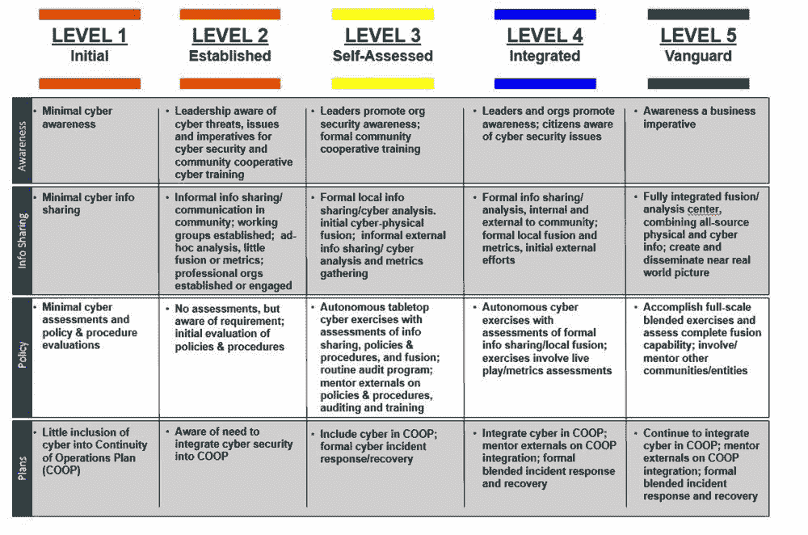 |

## Policy at Level 1: Minimal Cyber Assessments and Policy

## 结论

在 `政策` 维度的 `Level 1` 中，社区的网络评估极少，且相关流程和程序尚未针对网络安全进行评估。这一层级如其所显示，意味着已有社区政策存在，但尚未评估是否需要将网络安全概念纳入其中。

评估会评估社区的优势、能力、需求和挑战。社区主要通过 `练习` 来评估其在实现练习中定义的具体目标的能力。练习有助于识别能力、流程和计划中的差距。

## 政策在 Level 2：初步评估

在 `Level 2`，社区尚未进行评估，但他们意识到应当进行评估。会进行初步评估，以确定网络安全是否已纳入任何政策和程序中。

政策在高层面上确立了社区希望实施的指南，设定期望和限制。政策维度的选择旨在确保所需的网络安全原则得以体现。CIAS 研究人员发现，非专门针对网络安全的政策执行不一致，且解读方式也不尽相同。

*   政策必须对组织内的每个人和社区都清晰明了
*   确定谁将“拥有”这些政策
*   制定实施计划
*   确定技术需求
*   确定谁应接受政策培训
*   进行练习/评估/更新
*   确定执行频率

`Phase 1` 包含以下活动，以实现 `Level 2`：

*   **指标**：
    *   确定当前已有多少政策
    *   确定当前有多少政策已将网络安全整合其中
    *   确定有多少政策接收更新的网络安全信息
*   **技术**：
    *   使用的技术将协助跟踪政策及培训情况
*   **培训**：
    *   培训将提供信息，提高对将网络安全整合进政策的良好实践的认识
*   **流程与程序**：
    *   指定一名负责网络安全的人员，该人员将管理技术、工作流程和文档化政策与程序带来的风险


## 政策在 Level 3：评估与融合

在 `Level 3`，社区正在开展自主的桌面网络安全练习，这些练习的评估将包含信息共享、政策与程序以及融合。社区已建立审计程序，并将其纳入网络安全计划，定期进行。社区现在能够向外部提供关于政策与程序、审计和培训的指导。

`Phase 2` 活动需要实现 `Level 3`：

### 指标

*   跟踪社区开展了多少次桌面网络安全练习
*   跟踪进行了多少次、多少频率的评估
*   跟踪进行了多少次、多少频率的审计

### 技术

*   用于进行和分析桌面练习及其结果，并整合后续报告的技术
*   审计所需的技术

### 培训

*   制定与审计结果相关的培训主题
*   针对将网络安全整合进新政策的培训
*   针对开展练习的培训
*   针对协助开展练习的培训

### 流程与程序

*   建立审计程序的运作流程，包括审计频率、结果存储位置及报告对象
*   建立练习程序的政策，包括练习频率、结果存储位置及后续报告的接收方

### 评估

评估应：
*   每年进行 1 次练习，以评估政策与程序的有效性及当前能力水平

## 政策在 Level 4：正式信息共享/本地融合的评估

在 `Level 4`，社区开展自主的网络安全练习，评估涉及正式信息共享和本地融合。练习包含实时参与和指标评估。

`Phase 3` 活动用于实现 `Level 4`：

### 指标

*   比上一层级多进行 1 次桌面网络安全练习
*   比之前多进行 1 次评估
*   比之前多进行 1 次审计

### 技术

*   分析桌面练习结果并整合后续报告的技术
*   审计所需的技术

### 培训

*   制定与审计结果相关的培训主题
*   针对将网络安全整合进新政策的培训
*   针对开展练习的培训
*   针对协助开展练习的培训

### 流程与程序

*   更新审计程序的运作流程，包括审计频率、结果存储位置及报告对象
*   更新练习程序的政策，包括练习频率、结果存储位置及后续报告的接收方

### 评估

评估应：
*   每年进行 1 次练习，以评估政策与程序的有效性及当前能力水平，并扩大邀请，邀请更多合作伙伴参与练习

## 政策在 Level 5：指导其他社区/实体

在 `Level 5`，社区能够开展全面的混合练习，并评估完整的融合能力。社区参与并指导其他社区和实体。

`Phase 4` 活动用于实现 `Level 5`：

### 指标

*   比上一层级多进行 1 次桌面网络安全练习，并与外部社区进行 1 次桌面练习
*   比之前多进行 1 次评估，并与外部社区进行 1 次桌面练习
*   比之前多进行 1 次审计，并与外部社区进行 1 次桌面练习

### 技术

所需技术：
*   分析桌面练习结果并整合后续报告的技术
*   审计所需的技术

### 培训

所需培训：
*   针对信息共享、融合、练习（内部及与外部社区共享）的培训
*   针对如何建立网络安全政策、新政策整合网络安全及与外部社区共享的培训
*   针对开展全面混合练习并与外部社区共享的培训
*   针对协助开展全面混合练习并与外部社区共享的培训

### 流程与程序

*   更新审计程序的运作流程，包括审计频率、结果存储位置及报告对象
*   更新练习程序的政策，包括练习频率、结果存储位置及后续报告的接收方

### 评估

评估应：
*   每年进行 1 次全面混合练习，以评估政策与程序的有效性及当前能力水平，并扩大邀请，邀请更多合作伙伴参与练习

社区提供许多公共服务，并制定政策以确保这些服务的可用性、实施方式以及运作方式。网络攻击可能会影响这些服务的可用性，进而影响整个社区。将网络安全概念纳入社区整体政策中，将有助于在发生网络事件时明确运营应如何开展，并帮助识别社区提供的业务关键功能所涉及的系统。一旦系统被识别，就可以发现这些系统的漏洞，并通过相应的控制措施加以保护，从而保障提供服务的能力。

为国防部（DoD）进行的社区网络安全演习提供了一些洞见：在发生事件之前建立协议，使军事设施能够与其所在的社区进行沟通。CIAS（社区网络安全咨询小组）开展的其中一项练习所提供的目标，为该练习的重点提供了背景，这些目标同样可用于帮助社区制定自身的目标，以用于其开展的网络安全演习。

本文讨论了 2018 年 9 月 20 日白宫发布的《国家网络安全战略》中提取的若干政策，并说明这些政策如何在设计和制定社区网络安全政策时被引用。本次审查的国家网络安全战略领域包括：“保护政府系统和关键基础设施”、“网络安全人才培养”以及“网络空间的不可接受行为”。此外，还建议社区在审查现有网络安全相关政策、并制定新的网络安全政策时，应重点考虑以下几方面的社区政策因素。

## 参考文献

白宫. (2018). National cyber strategy of the United States of America. Retrieved from https://www.whitehouse.gov/wp-content/uploads/2018/09/ National-Cyber-Strategy.pdf

## 附加阅读

*   网络安全委员会. (n.d.). Retrieved from San Antonio Chamber of Commerce website: https://www.sachamber.org/get-involved/cyber/
*   Hayslip, G. (2018). 9 policies and procedures you need to know about if you're starting a new security program. Retrieved August 18, 2019, from CSO website: https://www.csoonline.com/article/3263738/9-policies-and-procedures-you-need-to-know-about-if-youre-starting-a-new-security-program.html
*   准备工具包. (n.d.). Retrieved from FEMA website: https://preptoolkit.fema.gov/web/validate-capability
*   州及地方政府. (n.d.). Retrieved from White House website: https://www.whitehouse.gov/about-the-white-house/state-local-government/

## 第 7 章

### 摘要

社区长期以来一直在为灾害做规划，尤其是自然灾害。预测飓风何时会袭击沿海地区或岛屿的能力已经可用。公众会报告预防措施，并持续发布准备活动。针对网络事件的规划是一项相对新颖的活动，且随着时间的推移逐渐变得更加复杂。社区会为飓风、洪水或龙卷风等物理事件进行规划，因为这些事件发生在容易受到这些威胁的地理区域。所有社区都需要为网络事件或攻击做好准备。在本世纪初，CIAS 会听到诸如“我们的县太小”或“没有人会针对我们，我们没有他们想要的东西”之类的评论。无论组织多小，社区多大，今天人人都是目标。做好“何时”发生网络事件的准备是最佳策略，这意味着每个市镇、县和教区都应制定计划，以便在发生网络事件时继续业务运营并应对事件。

### 引言

社区数十年来一直聚集在一起，规划并应对可能对社区居民或社区业务运营造成有害或潜在危害的多种情形。这些事件可能来源于自然因素或人为因素，需要紧急响应以保护生命和财产。

事件可能包括重大灾难、紧急情况、恐怖袭击、恐怖威胁、野林火灾、城市火灾、危险化学品泄漏、核事故、航空事故、地震、飓风、龙卷风、热带风暴、战争相关灾难、公共卫生与医疗紧急事件以及其他需要紧急响应的事件，其中包括网络事件。

谁应该响应事件取决于事件的性质及其重要性。需要注意的是，大多数事件均在地方层面进行管理。社区的应急计划涵盖所有危害事件（如前所述），通常需要地方机构、私营部门以及非政府组织的统一响应。部分事件可能需要邻近司法管辖区或州政府的额外支持。少数事件则需要联邦支持或由联邦政府主导。需要考虑的重要因素是，并非所有事件都局限于特定的地理范围。例如，疫情或网络事件可能跨越司法管辖区、州或地区。根据事件的性质，这类事件可能在地方、州、部落、领土或联邦层面进行管理。

### 背景

结合社区网络安全演习的综合结果，一个常见发现是：既没有包含网络安全威胁和问题的计划，也没有针对网络事件的协调与响应能力。常见的误解是，任何与网络相关的事务都仅仅是 IT 问题。因此，建议在现有应急管理/民防应急计划之上，制定一个网络安全附录，以覆盖社区和州两级。至少，该附录应包含报告疑似网络安全相关事件的程序，这不仅包括实际事件（如入侵、企图入侵、拒绝服务攻击等），还包括可能是实际攻击前兆的事件。

附录还应说明在报告安全相关事件时所遵循的流程，并阐明社区、州及联邦机构（包括社区内的军事设施）在网络事件发生时的接口。

规划维度旨在确保网络安全要素被纳入社区计划，以应对可能对整个社区产生不利影响的事件。

### 社区计划

Cities and counties all over the United States have suffered from cyber-attacks over the past several years. These attacks have caused massive disruptions such as loss of police video in patrol cars, municipal courts being unable to accept payments for traffic tickets, staff being locked out of systems so they are unable conduct business, 9-1-1 dispatchers unable to deploy emergency services, and access to mobile data public safety computers used by law enforcement, fire, and emergency medical agencies made unavailable. These are only some of the impacts communities have faced due to a cyber-attack. Having a plan in place to ensure operations are maintained and response and recovery methods are in place to get services back up quickly are essential.

There are several different plans that can be developed, some examples are the Emergency Operations Plan, Disaster Recovery Plan, Incident Response Plan and Continuity Plan. From a community perspective, the Continuity of Operations (COOP) plan, defines how individual executive departments and agencies will “ensure that Primary Mission Essential Functions (PMEFs) continue to be performed during a wide range of emergencies, including localized acts of nature, accidents and technological or attack-related emergencies” (FEMA). Implementing a functional annex to include cyber incident response will focus on specific responsibilities, tasks and operational actions that pertain to the portions of continuity plan.

### 业务连续性计划 (COOP)

The National Security Presidential Directive 51 (NSPD-51) and Homeland Security Presidential Directive 20 (HSPD-20) establish a national policy on the continuity of Federal Government structures and operations. Continuity of Operations (COOP, 2011) are defined in the National Continuity Policy Implementation Plan (NCIP) and the NSPD-51/HSPD-20. The COOP plan is the continuity plan developed and utilized by communities.

COOP plans are focused on identifying essential functions and services that are provided by the community and ensure these functions and services can be continued throughout or resumed rapidly after an emergency or disaster. Partnerships with federal government agencies, non-federal government entities and with private sector owners and operators can play an important role in the continuity plan.

The continuity plan addresses the following:

*   **Essential Functions**: critical activities performed by organizations, especially after a disruption of normal activities.
*   **Succession**: identification of the senior agency offices during an emergency in the event any officials are unavailable to execute their legal duties.
*   **Delegation of Authority**: list of positions who will make policy determinations and decisions when normal channels of direction have been disrupted.
*   **Continuity Facilities**: alternate facilities used to carry out essential functions during a continuity event. This can include working from home or another mobile-office concept.
*   **Vital Records Management**: identify, protect and ensure electronic and hard copy documents, information systems, software and equipment needed to support essential functions are available.
*   **Human Capital**: personnel activated in an emergency to perform assigned response duties.
*   **Tests, Training, and Exercises**: measures needed to ensure the continuity plan can support the execution of the essential functions throughout an event.
*   **Devolution of Control and Direction**: the ability to transfer authority and responsibility for essential functions from the primary staff to other agencies and facilities.


## Reconstitution

Reconstitution: process for existing primary staff and replacement personnel resume normal operations from the original or replacement facility. (“Continuity of operations: An overview,” n.d.).

> “The plan could be activated in response to a wide range of events or situations – from a fire in the building; to a natural disaster; to the threat or occurrence of a terrorist attack. Any event that makes it impossible for employees to work in their regular facility could result in the activation of the Continuity plan” (“Continuity of operations: An overview,” n.d.).

Not only should a continuity plan be developed to create a roadmap to ensure services and functions continue, but they must take cyber-attacks into consideration and must be exercised to make sure they work. A perfect example of this is from the ransomware attack that occurred with the Colorado Department of Transportation (CDOT).

The Colorado Department of Transportation experienced a ransomware attack on or about February 18, 2018. A threat actor gained access to the CDOT network and installed the SamSam ransomware malware variant. On Wednesday, 21 Feb, OIT declared a security incident when the ransomware became active and infected approximately 150 servers and 2000 workstations.

CDOT had a continuity of operations plan. The issue however was that one of the provisions in the CDOT’s continuity of operations plan directed workers to take their laptops to the Department of Public Health’s headquarters. If this action had been successful, the infected devices could have exposed another agency’s network to the malware. Fortunately, officials were able to stop the two people before they could get to the alternate location’s headquarters (Statescoop).

The lesson learned identified in the after-action report stated:

> Continuity of Operations Plans (COOP). Though CDOT had a thorough COOP that was instrumental in continuing its mission, these plans did not account to the challenges related to a cyber incident. Plans considered loss of infrastructure and the requirement to move people to alternate worksites, however, these plans assumed that employees would take their computers with them and be able to establish connectivity with key online applications. All State Agencies could benefit from capabilities gap analysis in their COOP for a cyber incident response. (CDOT, 2018)

While this action to move to an alternate location to conduct essential functions was appropriate for a physical event, the way a cyberattack can move throughout the network to infect additional machines was not considered. This example shows what is meant by examining policies and plans for cyber implications.

## Cyber Annex for Incident Response

A community needs to have a plan in place to address how an individual hazard will be handled and as part of that plan, an individual should be able to determine the type of incident and the severity of the incident to allow for response measures to be escalated appropriately. It is important to note that each hazard should be addressed individually and considered unique. To begin the planning process the National Response Framework (NRF) can be used as a reference.

The NRF, updated in 2016, provides guides for how the community works together and how response efforts relate to all types of disasters and emergencies.

The NRF identifies the following Annexes:

*   **Emergency Support Function (ESF) Annexes** - describe the Federal coordinating structures that group resources and capabilities into functional areas that are most frequently needed in a national response.
*   **Support Annexes** - describe the essential supporting processes and considerations that are most common to most incidents.
*   **Incident Annexes** - address response to specific risks and hazards. The Incident Annexes address the unique aspects of how the response will occur for an incident.

The annexes provide detailed information to assist with the implementation of the NRF. The graphic below, found in the NRF, indicates that each of these annexes are focused on Response. However, the NRF includes a holistic approach to the response capability which integrates the relationships among all the mission areas Prevention, Protection, Mitigation, Response and Recovery and addresses the transition between mission areas.

-   [网络事件附录](https://example.org/cyber_incident_annex)针对因自然灾害导致的互联网或其他关键基础设施信息系统中断，或恶意软件、分布式拒绝服务攻击等故意攻击造成的重大网络后果的中断情况。

近年来，显示网络威胁在数量和复杂度方面持续上升的指标包括：

*   公共和私营部门网络攻击数量增加，以及网络防御支出增加。
*   对网络犯罪、网购诈骗和网络欺凌的关注度提升。
*   全球政府的关注度和行动力度提升。各国政府正在加强网络安全防护，并扩大网络力量。
*   网络保险保单的数量增加。
*   联邦政府的泄露事件数量增加。
*   未来属于物联网（IoT）范畴的网络发明，包括连接汽车、住宅、智慧城市、云计算、新手机、大数据、社交媒体等。

这些指标表明，网络环境面临持续的关注点和更具挑战性的威胁。准备应对网络事件的社区在实施网络事件附录时，应考虑并处理任何电子生成的威胁。

网络事件附录讨论了针对影响关键国家进程和国家经济的网络相关事件，制定、应对和恢复的协调、多学科、广泛基础的政策、组织、行动和责任。

### 网络事件附录的目的

*   建立标准化、灵活且可扩展的基础，以应对和响应网络威胁或攻击。
*   为实际或潜在的网络相关威胁和攻击提供缓解、预防、保护、响应和恢复方面的指导，供参与机构和组织使用。
*   为可用的资产和资源提供指导。
*   确保核心能力（预防、保护、缓解、响应、恢复）与国家安全政策和指导方针保持一致。

## 网络事件响应计划（CIRP）

网络事件响应计划将被整合到网络附录中。响应计划包括：

*   所需的角色和责任
*   定义响应类型（威胁响应、资产响应、情报支持）
*   网络事件响应团队
*   通信计划
*   设备需求
*   资源和援助机制
*   风险评估

### 角色与责任

角色与责任将被明确。下表取自 NCIRP，可用于快速确定 CIRP 不同方面的责任人。若该小组纳入 CIRP，可能会延迟决策，因为网络事件可能迅速蔓延。该小组需迅速组建，以免延缓响应。角色与责任基于四条（4）努力线，见表 1。

#### 表 1. 四条努力线

| 努力线 | 主导 SLTT 机构 |
| --- | --- |
| Threat Response | State\Local Law Enforcement |
| Asset Response | State\Local Department\Division of Homeland Security State IT agency |
| Intelligence Support | Fusion Center\State Level ISAO |
| Affective Entity Response | 当重大网络事件影响 SLTT 政府或机构时，该机构拥有主要责任；若影响私营实体，联邦或 SLTT 政府通常不参与，但相关行业特定机构可协调联邦或 SLTT 政府努力，了解对关键基础设施的业务或运营影响。 |

一旦角色确定，负责各努力线的主导机构需被指派。随后，各机构的能力将被定义，并在网络附录中明确其具体作用。

### 响应类型（威胁响应、资产响应、情报支持）

每种响应类型均应被定义。响应类型的描述如下：

*   **威胁响应**：包括跨执法和国防社区的众多资源与能力。威胁响应活动包括调查、取证、分析、缓解；拦截威胁行为者；以及提供可能引发信息共享和与资产响应活动同步的归因，从而支持情报支持。
*   **资产响应**：包括向受影响实体提供技术支持，缓解漏洞，识别其他可能受影响的实体，并评估其对相同或类似漏洞的风险。这些活动还包括与受影响实体沟通，了解网络事件的性质；向实体提供可用的联邦、SLTT 及私营部门资源和能力；及时通过适当渠道传播新情报和信息；以及促进信息共享和与其他联邦、SLTT 及私营实体的协同作战。关键资产响应还包括评估对行业或地区的潜在风险，包括潜在的连锁和依赖效应，制定缓解措施，并指导如何及时、有效地利用联邦、SLTT 及私营部门的资源和能力。
*   **情报支持**：包括通过了解网络事件及其针对性的外交、经济或军事能力来更好地理解事件，并与其他潜在受影响实体或响应者共享威胁和缓解信息。在重大网络事件期间，资产和威胁响应者应在必要时利用情报支持来构建情境感知，共享相关威胁指标和分析，识别并承认差距，最终形成对事件的全面图景。

在每种响应中，联邦政府和私营部门均有角色，以支持响应机构。

### 中央事件响应团队结构

[中央事件响应团队]的结构通常分为以下三类：

*   **中央事件响应团队**：一个负责整个组织事件响应的单一事件响应团队。对于小型组织以及大型组织且计算资源地理分布相对集中的情况最有效。
*   **分布式事件响应团队**：多个事件响应团队，每个团队负责处理组织的特定逻辑或物理部分的事件。该模式适用于大型组织以及拥有主要计算资源位于远程位置的组织。但团队应属于同一集中实体，以确保组织范围内的事件响应流程一致，并在团队间共享信息，这尤其重要，因为多个团队可能观察到同一事件的不同组成部分，或处理相似的事件。
*   **协调团队**：事件响应团队在不拥有对其他团队权威的前提下，为其他团队提供指导和建议。

### Communications Plan

在发生网络事件时，制定通信计划至关重要。国家事件管理系统（NIMS）已明确定义了通信管理计划。拥有稳健的通信能力可建立共同的作战画面，这只能通过信息的收集、整理、综合和传播来维持。NIMS 通信计划的最关键方面之一是其可互操作性，即使用统一的术语来指代组织结构、操作资源和设施。此外，还需整合通信计划，涵盖共同流程和技术。关于通信计划的更多内容将在后续模块中讨论。

### Equipment Needs

许多事件响应团队会准备“跳包”（jump kit），即一个便携包或箱，内含应急处理人员在现场调查时可能需要的材料。跳包随时保持可用，以便在发生严重事件时，处理人员可直接取用并出发。跳包通常包括笔记本电脑（已安装相应软件，如`packet sniffers`、`computer forensics tools`），以及`backup devices`、`blank media`、`basic networking equipment and cables`，以及`operating system and application media and patches`。鉴于跳包的目的在于加快响应速度，团队应避免从跳包中借用物品。同时，需时刻保持跳包的更新（例如在笔记本电脑上安装安全补丁，更新操作系统媒体）。组织应权衡创建和维护跳包的成本与通过更快、更有效地遏制事件所节约的成本。

### Mechanisms for Resource and Assistance

事件行动计划会确定所需资源。对于已识别但当前不可用或难以获取的资源，可参考以下援助渠道：

*   `与另一个社区签订互助协议`
*   `紧急管理互助紧急公约（EMAC）`
*   `针对 SLTT 社区：`
    *   `区域 homeland security 办公室和融合中心`
    *   `多州信息共享与分析中心（MS-ISAC）`
    *   `拨款资金，包括 Urban Area Security Initiative`
        *   `符合条件且可申请 Urban Area Security Initiative 拨款资金的地方政府被鼓励将网络安全和培训项目纳入支出计划。`

### Risk Assessment

事件准备还包括理解风险并识别危害。风险评估的目的在于识别：

*   `对组织（即运营、资产或个人）的威胁，或针对组织的威胁通过组织指向其他组织或国家的威胁，`
*   `组织内部和外部的脆弱性，`
*   `当潜在威胁利用脆弱性时，可能发生的损害（即不利影响或后果）；以及（iv）损害发生的可能性。（NIST 800-30 Revision 1）`

Risk = `Threat x Vulnerability x Consequence`

在进行风险评估时，必须注意：

*   `识别与组织相关的威胁来源；`
*   `识别由这些来源产生的可能威胁事件；`
*   `识别组织内部可能被威胁来源通过特定威胁事件利用的脆弱性，以及影响成功利用的前提条件；`


## 风险评估步骤

*   确定已识别威胁来源发起特定威胁事件的可能性，以及威胁事件成功的可能性；
*   确定因威胁来源利用脆弱性导致的组织运营和资产、个人、其他组织以及国家的不利影响（通过特定威胁事件）；以及
*   确定信息安全风险，即威胁利用脆弱性的可能性与此类利用的影响（包括风险确定中的不确定性）的综合结果。

一旦识别出威胁、脆弱性和后果，下一步即为特定资产、流程和系统计算风险评分。评分范围为 0 到 10，0 表示无影响/无威胁/无脆弱性，10 表示最高影响/最高威胁/最高脆弱性。

## CCSMM 计划路线图

CCSMM 计划路线图从 **Level 1 – Initial（初始阶段）** 开始，该阶段描述社区在 `Continuity of Operations Plan`（COOP，业务连续性计划）中对网络的纳入程度极低。这意味着社区缺乏应对可能影响关键功能运作的网络事件的计划，也缺乏恢复数据和关键系统的备份计划。此外，社区尚未评估支撑任务必备技术。路线图指引社区进阶至 **Level 5 – Vanguard（先锋阶段）**，此时社区已将网络安全实践整合至业务连续性计划中，并指导较小的社区亦如此。在此阶段，社区拥有正式的事件响应和恢复计划，涵盖网络和物理事件，并已考虑物理与网络事件相互影响的可能性。

规划过程提供实现目标所需的信息，并有助于在特定情境下做出有效决策，以最大化资源利用和生产力。在此维度上，计划将阐述在网络事件或攻击发生前、中、后所需的行动和资源。

### Figure 2

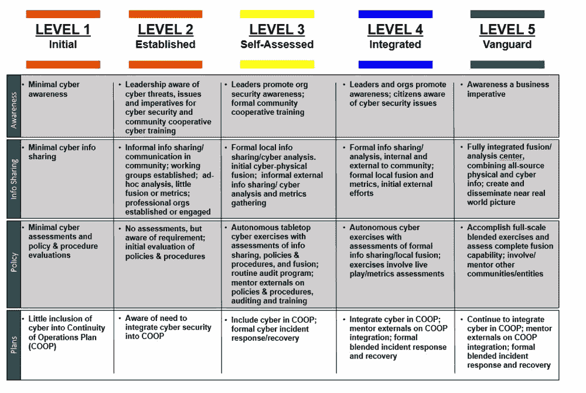

### Level 1：极少将网络纳入业务连续性计划 (COOP)

社区在规划维度的 Level 1 级别特征是对网络的包含极少。该级别的社区可能根本没有 Continuity Plan，或虽有 COOP 但未针对网络因素进行评估。随着网络安全计划的建立，需参考以下 FEMA 指南：

*   **识别并评估风险**：帮助社区了解其面临的风险。
*   **估算能力需求**：帮助确定针对风险所需的具体能力及相应活动。
*   **建立并维持能力**：确定在有限资源下最佳利用方式，以提升并持续所需的能力。

*   **计划提供能力**：反映社区将如何应对特定风险。
*   **验证能力**：有助于确定向准备目标进发的进展。
*   **审查和更新**：确保所有能力、资源和计划都定期审查并更新。

### Level 2：意识到将网络安全整合到 COOP 的必要性

在 Level 2，社区将意识到将网络安全整合到 COOP 的必要性。

为实现 Level 2 而进行的 Phase 1 活动包括：

*   **指标**：
    *   识别并记录当前已有的备选计划。
*   **技术**：
    *   所使用的技术将协助跟踪规划活动和开展的培训。
*   **培训**：
    *   培训将提供信息，提高对为何将 COOP 视为良好实践的认识。
*   **流程和程序**：
    *   COOP 计划从全危害角度应对紧急情况。`Continuity of operations plan`（COOP）制定政策和指导，确保关键功能持续，并在紧急情况下将人员和资源转移到备用设施。计划应制定以下程序：
        *   警报、通知、激活和部署人员
        *   识别关键业务功能
        *   建立备用设施
        *   名单具有权威性和功能知识的人员
*   **评估**：
    *   评估可用于评估提高对创建 COOP 重要性认识的程度。

### Level 3：COOP 和应急响应与恢复已建立

社区在 Level 3 已创建 COOP 并将网络安全纳入其中。他们已建立并正式化了其网络事件响应和恢复能力。

为实现 Level 3 而进行的 Phase 2 活动包括：

*   **指标**：
    *   记录当前事件响应团队已有的能力。我们将随时间改进这些能力。
    *   记录正在发生的事件，并确定 COOP 是否防止了网络攻击。
    *   确定网络事件仍在发生的位置。这将导致改进计划，以更新政策、培训并将新流程纳入 COOP 和事件响应。
*   **技术**：
    *   所使用的技术将协助支持 COOP
    *   将协助事件响应团队的技术
*   **培训**：
    *   COOP 程序培训。
    *   为事件响应团队提供培训，以建立和扩展当前能力
*   **流程和程序**：
    *   COOP 计划从全危害角度应对紧急情况。`Continuity of operations plan`（COOP）制定政策和指导，确保关键功能持续，并在紧急情况下将人员和资源转移到备用设施。计划应制定以下程序：
        *   警报、通知、激活和部署人员
        *   识别关键业务功能
        *   建立备用设施
        *   名单具有权威性和功能知识的人员
    *   建立包含事件响应和恢复能力的网络附录
    *   建立事件响应团队
*   **评估**：
    *   进行 COOP 演练。
    *   测试事件响应团队

### Level 4：网络已整合到 COOP 中；对外部社区进行 COOP 整合指导；正式建立混合事件响应和恢复

社区已将网络安全整合到 COOP 中。他们现在正指导外部社区如何整合 COOP，并已建立正式的混合事件响应和恢复程序。

为实现 Level 4 而进行的 Phase 3 活动包括：

*   **指标**：
    *   记录当前事件响应团队已有的能力。我们将随时间改进这些能力。
    *   记录正在发生的事件，并确定 COOP 是否防止了网络攻击。
    *   确定网络事件仍在发生的位置。这将导致改进计划，以更新政策、培训并将新流程纳入 COOP 和事件响应。
*   **技术**：
    *   所使用的技术将协助支持 COOP
    *   将协助事件响应团队的技术
*   **培训**：
    *   COOP 程序培训。
    *   为事件响应团队提供培训，以建立和扩展当前能力
*   **流程和程序**：
    *   向外部社区分享 COOP 政策
    *   向外部社区分享网络附录政策
*   **评估**：
    *   演练 COOP 并邀请外部社区参与
    *   此级别所有其他计划均已将网络安全纳入。全危害焦点已整合到 COOP 中。
    *   网络安全已整合到所有其他附录中。

### Level 5：继续在 COOP 中整合网络安全；对外部社区进行 COOP 整合指导；正式建立混合事件响应和恢复

在 Level 5，社区将继续在 COOP 中整合网络安全。社区将指导没有计划的社区，并已建立正式的混合事件响应和恢复能力。

为实现 Level 5 而进行的 Phase 4 活动包括：

*   **指标**：
    *   记录并跟踪事件响应团队的改进情况
    *   记录正在发生的事件，并确定 COOP 是否防止了网络攻击。
    *   继续跟踪网络事件并评估改进需求
*   **技术**：
    *   所使用的技术将协助支持 COOP
    *   将协助事件响应团队的技术
*   **培训**：
    *   对没有计划的社区进行 COOP 程序培训
    *   为事件响应团队提供培训，以建立和扩展没有计划的社区的当前能力
*   **流程和程序**：
    *   向没有计划的社区分享 COOP 政策
    *   向没有计划的社区分享网络附录政策
*   **评估**：
    *   演练事件响应和恢复能力，针对外部社区。

## 总结

社区需要确保在发生网络事件时，所提供的服务仍能持续。本章讨论了需要纳入的社区计划。本章的两项参考是操作计划（COOP）和网络附录。`Continuity of Operations Plan`（COOP）将帮助社区规划应急并建立事件响应和恢复能力。一旦社区达到 Level 4 状态，他们将能够与没有计划的社区分享其程序。这将是一个乘数效应，帮助社区更快成熟，并使他们能够应用经过验证且效果良好的实践。

网络附录可帮助社区进行事件响应。网络事件响应计划可以纳入附录。响应计划将涵盖参与社区成员的角色和责任。计划还将涵盖响应类型、网络事件响应团队的人员构成、通信计划、设备需求、资源和援助机制以及风险评估。

## 参考文献

*   After action report released for CDOT cyber incident. (2018). Retrieved from Colorado Official State Web Portal website: `https://www.colorado.gov/pacific/cobeoc/news/after-action-report-released-cdot-cyber-incident`
*   Continuity of operations: An overview. (n.d.). Retrieved from FEMA website: `https://www.fema.gov/pdf/about/org/ncp/coop_brochure.pdf`
*   Continuity of operations planning (COOP). (2011). Continuity of operations planning (COOP). Retrieved from govloop website: `https://www.govloop.com/community/blog/continuity-of-operations-planning-coop/`
*   FEMA. (2011). Continuity of Operations Plan Template and Instructions for Federal Departments and Agencies. Retrieved from `https://www.fema.gov/pdf/about/org/ncp/coop/continuity_plan_federal_d_a.pdf`
*   National Institute of Standards and Technology & Joint Task Force Transformation Initiative. (2012). NIST Special Publication: Vol. 800-30 Rev. 1. Guide for conducting risk assessments. Retrieved from `https://nvlpubs.nist.gov/nistpubs/Legacy/SP/nistspecialpublication800-30r1.pdf`
*   National security presidential directive 51 and homeland security presidential directive 20: National continuity policy. (n.d.). Retrieved from Homeland Security Digital Library website: `https://www.hsdl.org/?abstract&did=776382`

## 补充阅读

*   Freed, B. (2019). What Colorado learned from treating a cyberattack like a disaster. Retrieved from `statescoop.com/what-colorado-learned-from-treating-a-cyberattack-like-a-disaster/`

## 第 8 章

### 摘要

近年来网络犯罪的增加，使得国家逐渐认识到网络安全的必要性。遗憾的是，意识到网络安全是需要担忧的问题，与知道该采取什么步骤，完全是两码事。在美国，`National Institute of Standards and Technology`（NIST，美国国家标准与技术研究院）开发了 `Cyber Security Framework`（CSF，网络安全框架），以协助关键基础设施确定保护其计算机系统和网络所需的措施。虽然 CSF 面向组织，但其提供的大量指导，尤其是其确定的基本功能，对于试图建立社区网络安全计划的社区同样具有价值。

### 引言

试图保护组织关键计算机系统和网络的个人，普遍面临“从何入手”的难题。在预算有限的情况下，资金应用在何处最明智？能否制定一个循序渐进的计划，最终达到期望的安全态势，同时考虑在预算范围内工作的需求？

本书介绍的 `CCSMM` 是一个指导社区创建和成熟其网络安全计划的规划。然而，一个地理社区由许多组织和个人组成，他们都将为社区的安全或不安全做出贡献。本书侧重于整个社区的计划，并不深入探讨针对任何单一类型组织或部门的计划。这正是 `NIST Cyber Security Framework`（CSF）发挥作用的地方。CSF 旨在为关键基础设施提供指导，说明如何根据以具有成本效益的方式管理网络安全风险的计划来组织其安全工作。

CSF 包含大量优秀的信息和指导。不幸的是，对于许多组织，特别是较小的组织，CSF 中包含的海量信息可能会让人不知所措，使人们处于阅读 CSF 之前类似的境地。认识到这一点，NIST 编制了另一份文件 `Small Business Information Security: The Fundamentals`（小企业信息安全：基础知识），其中讨论了 CSF 基础核心介绍的大部分内容，而不包含 CSF 中令人望而生畏的子类别和参考文献列表。这使得小企业能够在保护其系统和网络的过程中，以有组织的方式集中精力。


# For Communities

For communities, the CSF also contains much information that will not be immediately useable at the community level although it will pertain to many of the individual organizations within the community. Instead, the topics introduced in the companion document for small businesses that NIST produced can help focus a community’s efforts providing an extra level of guidance that will enable the community to organize their efforts. Thus, the CCSMM and the CSF can go hand-in-hand within a community to help the community address cybersecurity from different angles.

# Background

Since the 1990’s, the federal government has been keenly aware of the dangers cyber events posed to the various critical infrastructures and thus focused considerable attention on securing these infrastructures. PDD 63 issued in 1998 and discussed earlier in the text was a big step forward in organizing the efforts of the various critical infrastructure sectors so that they could collectively work together to solve the challenges they each faced. Then in 2013 the White House issued Executive Order 13636 (2013) Improving Critical Infrastructure Cybersecurity which continued the focus on the critical infrastructures and attempted to keep things moving in a direction that would lead to more secure infrastructures. Besides addressing information sharing as was discussed in a previous chapter, EO 13636 also directed NIST to “lead the development of a framework to reduce cyber risks to critical infrastructure.”

In 2014 the Cybersecurity Enhancement Act (CEA) of 2014 was signed into law. One of the things that this act did was to expand the role of NIST to “identify a prioritized, flexible, repeatable, performance-based, and cost-effective approach, including information security measures and controls, that may be voluntarily adopted by owners and operators of critical infrastructure to help them identify, assess, and manage cyber risks”. (CEA, 2014) This in essence expanded upon the previous guidance in EO 13636 provided additional guidance to NIST for the creation of a framework.

In 2014 NIST released version 1.0 of the Framework for Improving Critical Infrastructure Cybersecurity. In 2016 revision 1 of the Small Business Information Security: The Fundamentals document was released which incorporated much of the basic framework from the CSF but made it more useable for small businesses. In 2017 a draft of CSF version 1.1 was released for public comment and in April of 2018 version 1.1 was officially released. This new version was compatible with the original in that it did not change the basic framework but instead expanded upon it to take into account things outside of the critical infrastructures such as their supply chains.

NIST and the federal government have been encouraging not only the critical infrastructures but government agencies to adopt the framework as part of their cybersecurity programs. They have also encouraged industry to use it as well and several large government contractors have done so and published papers on how well it has worked for them. The framework has taken hold in this government enclave but has not really caught on as well outside of government circles. This is actually somewhat disappointing as there is much useful guidance in the various NIST documents concerning the CSF. This is also true for communities. The NIST CSF can provide additional guidance beyond the steps outlined in the CCSMM that will allow communities to develop a more coordinated approach to establishing their cybersecurity program.

# The NIST Cyber Security Framework (CSF)

Before jumping into how the CSF applies to community cybersecurity programs, it will be useful to have a better understanding of what the CSF entails. The CSF was initially created for organizations that are part of the various critical infrastructures. The CSF is made up of three parts: the Framework Core, the Implementation Tiers, and the Framework Profiles. Not all of these are going to be equally as important to a community cybersecurity program but they will be important to organizations within the community. What is involved in each of these parts is as follows:

*   **Framework Core**: a set of cybersecurity activities, outcomes, and informative references that are common across sectors and critical infrastructure. Elements of the Core provide detailed guidance for developing individual organizational Profiles.
*   **Implementation Tiers**: 提供一种机制，让组织能够查看并理解其在管理网络安全风险方面的做法特点，从而帮助优先排序并实现网络安全目标。
*   **Framework Profiles**: 将帮助组织将其网络安全活动与业务/使命需求、风险容忍度和资源相匹配并进行优先排序。（NIST，2018）

A deeper discussion of these two will begin with the Framework Core. The Framework Core is the most well-known part of the CSF. As stated in the CSF, the Core consists of:

- A set of cybersecurity activities, desired outcomes, and applicable informative references that are common across critical infrastructure sectors. The Core presents these in a common industry-standard, guideline, and practice format to enable communication of cybersecurity activities and outcomes across the organization from the executive level to the implementation/operations level. The Framework Core consists of five concurrent and continuous Functions—Identify, Protect, Detect, Respond, Recover. Together, these Functions provide a high-level, strategic view of the lifecycle of an organization's management of cybersecurity risk. The Framework Core further identifies underlying key Categories and Subcategories for each Function, which represent specific outcomes, and matches them with example Informative References (such as existing standards, guidelines, and practices) for each Subcategory. (NIST, 2018)

The Functions mentioned are particularly important for establishing a community-level cybersecurity program. As mentioned previously, the CSF Core consists of Functions, Categories, Subcategories, and Informative References, as shown in the figure below.

| Figure 1. NIST Cybersecurity Framework Core. (NIST, 2018) |
| --- |
| 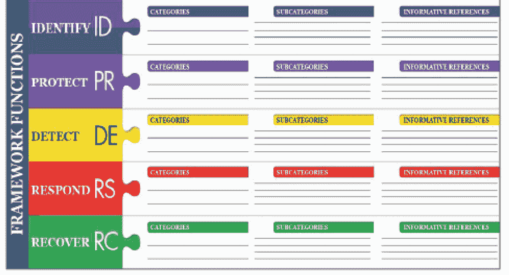 |

From the perspective of a community program, the key to the Core is these five Functions: Identify, Protect, Detect, Respond, and Recover.

**Identify** means that an organization needs to understand what resources it has, what critical data needs protection, what protections are already in place, and what vulnerabilities and risks remain that the organization has deemed acceptable. Only by clearly understanding what resources are owned can an organization determine what needs attention. For example, if a new operating system vulnerability is discovered and being exploited, an organization that knows its hardware and software assets can determine if it needs to respond or if it does not run that OS and therefore does not need to worry.

**Protect** is what one would expect: all measures an organization takes to protect its resources, data, and people—not just cybersecurity, but also physical security, personnel security, and operational security. It includes everything done to maintain the security of the organization's valuable resources and data. Notably, security in the early days of computing focused primarily on physical security: controlling access to computing devices and allowing only authorized personnel to use systems. By locking down devices and terminals, organizations could protect data. Passwords were commonly used to control access and limit specific users' usage time. A fundamental change did not occur until the advent of the IBM PC in the 1980s. Initially still relying on usernames and passwords, but as these relatively inexpensive personal computers were networked, a trend emerged to build networks and connect them to other networks—what we know today as the Internet. It is worth noting that the protocols used by ARPANET were designed without security in mind, leading to numerous security issues in the 80s and 90s. It was not until the late 80s that the US Air Force developed a network security operations model that introduced Detection and Response in addition to Protection.

The **Detect** Function first reflects the fact that the security community has long been unable to build computing systems that are absolutely secure in all environments. Whether a new application or OS vulnerability is discovered, or user error occurs (such as disclosing credentials to others), or a system is misconfigured, protective mechanisms will eventually fail. At that point, the organization needs the technology and processes to detect the security loss in a timely manner and assess its impact (such as loss of intellectual property, theft of service, or disclosure of sensitive information).

When an aspect of security fails, the **Respond** Function includes the technologies and actions an organization takes to effectively respond to the incident. The immediate focus is to gain control of the system or network to prevent further loss of data or services. One can analogize these Functions to measures an organization takes for fire protection: although fire prevention measures are implemented beforehand, smoke/fire detection equipment is still needed just in case. Once a fire is detected, the primary task is to prevent loss of life and resources by evacuating personnel and activating suppression equipment. This typically requires trained professionals acting quickly in rehearsed scenarios to prevent the fire from spreading to other areas of the facility. Cybersecurity is similar: once an incident is contained, the focus can shift to Recovery.

The **Recover** Function involves the technologies and processes an organization uses to invest resources in the most critical activities and restore normal business operations as quickly as possible (ideally within a short time). The Recover Function is equally important in cybersecurity and other security domains. Processes and technologies that enable rapid recovery must be identified and deployed, and plans must be developed so that everyone knows their role in recovery, ensuring the most critical activities are restored to an operational state as soon as possible.

These five Functions are what everyone involved in cybersecurity—whether an organization, city, state, or nation—must be familiar with. Categories are subdivisions within a Function used to group outcomes related to programmatic needs. The figure below shows the list of Categories for each Function.

| Figure 2. NIST CSF Functions and Categories |
| --- |
| 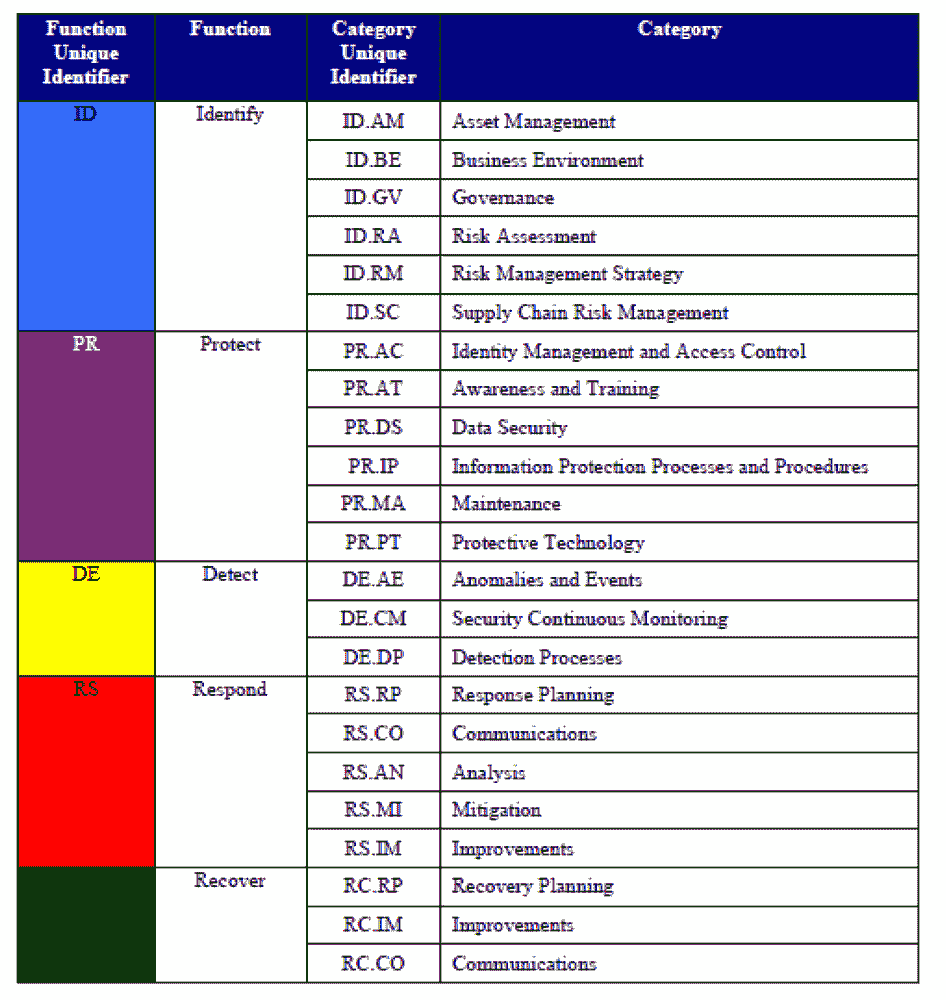 |

Subcategories further divide Categories into technical and management activities. For each Subcategory, Informative References are provided. Informative References are pointers to specific standards, guidelines, best practices, or other documents where more information can be found on how to achieve the outcomes of a specific Subcategory.

The table below shows an example of Subcategories and Informative References for the Asset Management Category under the Identify Function.

| Figure 3. Example of NIST CSF Subcategories and Informative References |
| --- |
| 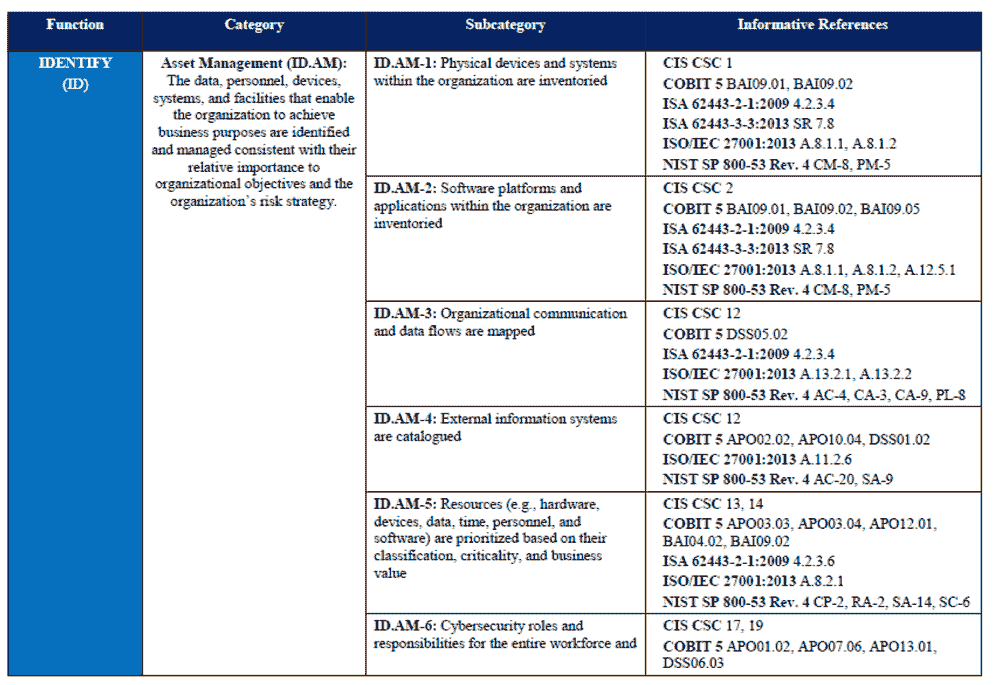 |

The CSF contains a large number of similar references, which is a disadvantage for small businesses. The sheer volume of Subcategories and References makes it difficult to address. For critical infrastructures, this information is very important, and arguably applies to small businesses as well, but providing them with an encyclopedic volume of knowledge is not the "how-to guide" they truly need; consequently, it is unlikely to be used. This is why the CSF is used more by critical infrastructures, government agencies, and large government contractors.

As mentioned previously, the CSF also contains two other parts: Implementation Tiers and Framework Profiles.

Implementation Tiers provide context on how an organization views cybersecurity risk and the processes it has established to manage that risk. Tiers describe the degree to which an organization's cybersecurity risk management practices exhibit the characteristics defined in the Framework (e.g., risk and threat awareness, repeatable, adaptive). Tiers range from Partial (Tier 1) to Adaptive (Tier 4), describing a progression from informal, reactive responses to agile, risk-informed approaches. When selecting a Tier, an organization should consider its current risk management practices, threat environment, legal and regulatory requirements, business/mission objectives, and organizational constraints. (NIST, 2018)

The CSF defines four Tiers, ranging from Tier 1 to Tier 4. Each higher Tier describes a greater degree of rigor and sophistication. NIST emphasizes that Tiers do not represent maturity levels and recommends that organizations seek guidance from other sources such as ISAOs, other maturity models, and federal departments. The target Tier an organization selects should reflect its goals and consider the threat environment, risk management practices, legal and regulatory requirements, and what is feasible for the organization. The four Tiers and their characteristics are listed below:

*   **Tier 1: Partial**
    *   **Risk Management Process**: The organization's cybersecurity risk management practices are not formalized, and risk management is performed in an ad hoc and sometimes reactive manner.
    *   **Integrated Risk Management Program**: The organization has limited awareness of risk, and implementation of cybersecurity risk management is irregular and case-by-case due to varied experience or reliance on external information.
    *   **External Participation**: The organization does not understand its role in the larger ecosystem, whether as a dependent or a dependency. The organization does not collaborate with other entities, nor does it receive threat intelligence, best practices, or technologies from external sources.

*   **Tier 2: Risk Informed**
    *   **Risk Management Process**: Risk management practices are approved by management but may not be established as organization-wide policy.
    *   **Integrated Risk Management Program**: The organization is aware of risk but has not established an organization-wide risk management approach.
    *   **External Participation**: The organization generally understands its role in the larger ecosystem but only addresses its dependents or dependencies, not both.

*   **Tier 3: Repeatable**


*   **Tier 1: Partial（部分）**
    *   Risk Management Process – 风险管理实践已正式批准并作为政策表达。
    *   Integrated Risk Management Program – 组织建立了全局的风险管理方法，风险感知的政策、流程和程序已定义、实施并按预期执行，同时进行审查。
    *   External Participation – 组织理解自己在更大生态系统中的角色、依赖方和依赖对象，并可能为更广泛的风险认知贡献力量。

*   **Tier 4: Adaptive（适应性）**
    *   Risk Management Process – 组织根据以往和当前的网络安全活动（包括经验教训和预测指标）调整其网络安全实践。
    *   Integrated Risk Management Program – 组织建立了全局的风险管理方法，利用风险感知的政策、流程和程序来应对潜在的网络安全事件。
    *   External Participation – 组织理解自己在更大生态系统中的角色、依赖方和依赖对象，并为更广泛的风险认知作出贡献。（NIST, 2018）

上述内容是对 CSF 层级的简要描述。它并非用于指导如何选择层级的教程或操作文档，而是作为入门介绍，帮助理解概念。文中多次使用“community”（社区）一词，这可能会产生混淆。这里的“community”指的是一个城市或镇等地理区域。而在 NIST CSF 中的“community”通常指“利益共同体”，即一类具有共同点的组织群体（如电力、水务、电信等行业），也可能指城市，但两者概念并不完全等价。原因在于城市由众多组织组成，没有单一实体对它们全部进行控制。城市的市长可以建议、推荐或鼓励组织采取特定行动，但市长最终并不控制所有位于城市边界内的组织。

CSF 的最后部分是框架档案（Framework Profile）。实际上有两个档案——当前档案（Current Profile）和目标档案（Target Profile）。关于档案的定义，NIST CSF 如下：

> 框架档案代表组织从框架类别和子类别中选择的、基于业务需求的结果。档案可以被描述为在特定实施场景下，将标准、指南和实践与框架核心（Framework Core）对齐的结果。档案可用于通过对比“当前”档案（即“现状”）与“目标”档案（即“未来状态”）来识别改进 cybersecurity 姿态的机会。要构建档案，组织可以审查所有类别和子类别，并根据业务/使命驱动和风险评估，确定哪些最为重要；如有需要，可增添类别和子类别以应对组织的风险。当前档案可用于支持对目标档案的优先级排序和进度测量，同时考虑其他业务需求，如成本效益和创新。档案可用于组织内部或组织间进行自我评估和沟通。（NIST, 2018）

`Profiles` 针对组织将要处理的具体类别和子类别，而 `Tiers` 关注组织的风险管理目标。这两部分相辅相成，是帮助组织开发或改进网络安全计划的整体计划的一部分。请注意，描述中指出组织需要确定哪些类别和子类别对其最为重要。这是一句简单的话，却是一个巨大的挑战。有时监管要求可能会指导组织确定哪些类别至关重要，但在缺乏额外指导的情况下，确定哪些类别和子类别最为重要更具挑战性——尤其是对于没有专职安全人员的小型企业。CSF 进一步描述了七个步骤，说明它如何帮助组织完善其计划。

## Step 1: Prioritize and Scope

组织识别其业务/使命目标和高层组织优先事项。

## Step 2: Orient

在确定业务线或流程的网络安全计划范围后，组织识别相关系统和资产、监管要求以及整体风险方法。

## Step 3: Construct a hypothesis, Create a Current Profile

组织通过指示当前已实现的 Framework Core 类别和子类别的结果来构建当前 Profile。

## Step 4: Conduct a Risk Assessment

组织分析运营环境，以判断网络安全事件的可能性以及该事件可能对组织造成的影响。

## Step 5: Create a Target Profile

组织创建目标 Profile，聚焦于描述组织期望的网络安全结果的 Framework 类别和子类别的评估。组织还可以制定额外的类别和子类别，以考虑独特的组织风险。

## Step 6: Determine, Analyze, and Prioritize Gaps

组织将当前 Profile 与目标 Profile 进行比较，确定差距。随后，它会制定一项按风险、成本效益和使命驱动因素优先的行动计划，以实现目标 Profile 中的结果。

## Step 7: Implement Action Plan

组织决定采取哪些行动来解决前一步中识别的差距，并据此调整现有的网络安全实践，以实现目标 Profile。（NIST, 2018）

再次强调，这些步骤的目的是为介绍框架及其各部分提供基本概念，而不是提供具体的实施指南。想要实施 CSF 的组织应参阅原始文档以获取更详细的指导（NIST, 2018）。

## APPLYING THE FRAMEWORK TO COMMUNITIES

网络安全框架旨在帮助个人组织改进其网络安全计划。即使是规模很大的组织也可以使用其提供的指导——事实上，可以认为它更适用于至少中型企业，因为其包含的信息量较大，且组织在将其整合到运营中时需要经历的步骤较多。一个社区并非由单一组织，也不是同一行业内的相似组织的集合，并且社区对其边界内所有实体缺乏管理控制。这意味着社区级的网络安全计划将在其能够实现的方面与单个组织有所不同。

社区的一个主要差异在于，它不能强制要求社区内所有成员执行特定的网络安全活动。虽然政府可以通过诸如 `breach notification` 法律等已在许多州实施的基本要求来强制执行某些活动，但社区不能简单地要求所有私营组织开展用户意识培训。社区需要鼓励组织开展特定活动，并向组织展示完成这些活动的好处。在某些独特情况下，社区还可以提供激励措施，例如与保险公司合作，如果组织完成特定步骤，则为社区成员提供网络保险费率折扣。另一种潜在的激励是将网络安全作为业务优势。当组织在选择两家供应商时，其中一家已达到一定的网络安全成熟度，另一家未达到，组织可能会倾向于选择安全成熟度较高的供应商，因为这可以降低第三方安全漏洞的可能性，这足以成为选择的动力。类似地，国防部（DoD）及其他组织已在其供应商未满足特定要求前，决定不与其业务往来。由于 DoD 高度重视安全，尤其是网络安全，它要求供应商遵循特定的流程和程序才能与其开展业务。获得合规证书或进行评估以证明组织已达到一定安全水平必然会产生成本。最终，这仍是组织在决定参与或采用哪些网络安全活动时的商业决策。

由于社区并非单一的大型组织，为社区制定网络安全计划本身就是一项挑战。如前几章节所述，已识别的阶段是组织协作时社区可以执行的活动。然而，CCSMM 级别中列出的少数项目可以由单一组织（通常是城市政府的一部分）完成，例如为城市应急响应计划创建网络安全附录。大多数项目则需要整个社区协作并鼓励其他成员参与，例如创建 ISAO（信息共享与分析组织）。因此，框架的参考文献列表对社区整体的适用性有限，但对社区内的各个组织而言却极具价值。

那么，社区在 CSF 中的角色是什么？如前所述，社区的角色是鼓励其成员考虑使用 CSF 或其他模型/指南，以提升各自组织的网络安全计划。由于社区成员中大多数并不属于任何政府层级或关键基础设施，详细的 CSF 可能难以直接应用。相反，NIST 的《小企业信息安全：基础》出版物（Paulsen & Toth, 2016a）可作为社区用来帮助所有组织发展其个人网络安全计划的工具。

*   社区的角色将主要在鼓励其组织中发挥作用。显而易见的问题是：“谁将负责这种鼓励？”为了在社区中推广 CCSMM，必须有一位社区网络安全倡导者。这位倡导者可以是市政官员，也可以是行业领袖，但必须有一位倡导者，以确保项目持续推进，直至其在社区内稳固立足。在基层（第 1 级和第 2 级），倡导者有时会感觉到自己在鼓励整个社区前进的努力上略显孤立。先前章节中列出的各维度活动清单将有助于倡导者在最初阶段知道应鼓励哪些类型的工作。一旦社区 ISAO 创建并稳固，该 ISAO 将成为社区的倡导者，并主导各维度中提到的各项工作。

*   随着组织开始建立其安全计划，这可能会让人望而却步。正因 CCSMM 为社区建立（提供衡量标准和路线图），组织也需要类似的工具来帮助其制定计划。完整的 CCSMM 包含组织层面的内容，这部分模型最贴近 CSF（安全框架）。从整个社区的角度来看，程序应考虑两个关键要素，社区倡导者可以在讨论时向社区成员阐述这两点。这两点在 CSF 以及面向小企业的配套指南中有所描述。第一点是小企业基本指南中列出的六项安全措施，如下图所示。

| Figure 4. The six security measures (Paulson & Toth, 2016a) |
| --- |
| 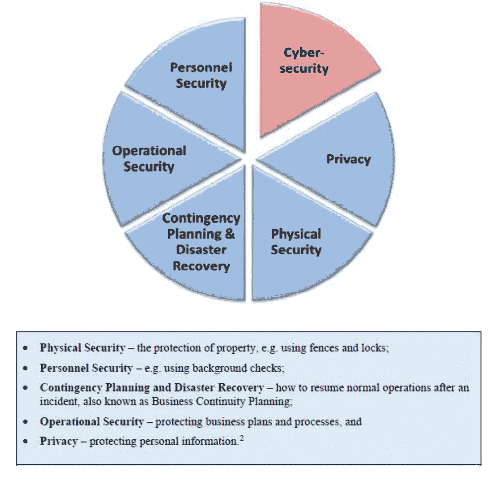 |
| --- |

该图所示的六项安全措施是任何组织构建安全计划时应考虑的安全领域。网络安全只是其中之一。缺失任何一项措施都可能导致安全事件，进而对组织产生不利影响。当组织开始开发其安全计划时，应问自己：“我在每个领域都在做什么？”目前已有的措施包括实体安全（Physical Security）和人员安全（Personnel Security），因为我们已经习惯于这些以及恢复能力。这五项功能是构建可行且可持续的组织网络安全计划所必需的。

这五项功能同样对社区层面也很重要。作为社区倡导者，随后作为社区 ISAO，负责推动社区网络安全计划的创建，上述五个功能领域同样适用于社区，只是实施方式略有不同。例如：

*   **Identify（识别）**：社区拥有哪些网络安全资源？谁在发生事件时能够帮助他人？社区的潜在目标有哪些，可能的威胁行为者是谁？此外，在州或国家层面还有哪些资源可以在网络事件发生时提供帮助？
*   **Protect（保护）**：社区内高价值目标在保护其网络基础设施方面做了哪些工作？社区已建立哪些流程和程序，用于在一名成员遭受攻击后向其他成员共享攻击信息？社区内的组织是否在分享最佳实践以帮助彼此保护资产？社区是否成立了专业网络安全组织（如 ISSA、ISACA）的分会？社区是否每年至少举办一次面向所有成员的网络安全工作坊或研讨会？
*   **Detect（检测）**：社区在寻找并共享攻击指标方面做了什么？还有哪些信息共享活动正在进行？社区与谁沟通以获取其他潜在的攻击指标？社区是否建立了 SOC（安全运营中心），或已委托其他实体提供 SOC 服务？

NIST 网络安全框架是一份包含大量有用信息的文档，其中包含了许多参考文献，可指引安全专业人员查阅关于多种安全主题的其他文档。该框架并非面向社区或社区内的所有组织设计，而是针对关键基础设施的网络安全，并被关键基础设施、政府部门及机构以及大型政府承包商所使用。框架中引入了五个功能——识别、保护、检测、响应和恢复——这些功能均应是每个组织的网络安全计划的一部分，无论其规模如何。NIST 的配套出版物《小企业信息安全：基础要点》是专为那些无法全面应对 CSF 文档内容的小企业而设计的，该文档对整个社区的适用性更强。它提出了六项安全措施——网络安全、物理安全、人员安全、运营安全、隐私保护以及应急计划与灾难恢复——这些措施对组织和社区的网络安全计划均具有重要意义。社区在制定其计划并鼓励社区内的组织提升自身网络安全水平时，需要同时考虑这六项安全措施以及 CSF 的五个功能。

此前，社区内的组织在制定网络安全计划时，已被视为同等对待，并被要求考虑五个功能领域。虽然此要求成立，但各组织在覆盖这些功能领域的深度上并不相同。要使社区达到特定的 CCSMM 级别，社区内的组织也必须实施其各自的网络安全计划。除非社区内的组织达到相应的成熟度，否则社区难以建立可行的信息共享计划。这并不意味着社区内的所有组织必须达到相同的成熟度，才能被视为已达到该级别。每个组织均应根据自身情形考虑网络安全，但并非所有组织都需要达到相同的成熟度。例如，规模较小且不存储社区居民个人信息的组织，可能不需要像处理此类信息的组织那样维持高水平的网络安全，因为它们可能不是网络攻击的主要目标。尽管如此，它们仍需考虑若其业务受到网络攻击影响，对员工、客户或社区可能产生的后果。相反，金融服务等行业的组织因系统可能受到攻击的风险，必须保持高水平的安全性。社区所依赖的各种基础设施以及地方政府系统也必须达到更高的安全水平。

因此，社区整体的成熟度与其内部各组织的安全水平之间存在何种关系？答案并不简单，因为组织的安全要求应基于其具体情境。总体而言，与社区目标一致的基础设施、供应商、关键市政部门、关联机构以及大型社区雇主等组织，应与社区的安全目标保持一致的安全水平。其余组织则应保持足够的安全水平，以便能够参与社区的安全计划，如信息共享、网络安全演练和教育活动。

本文的重点在于 NIST 网络安全框架及其配套文档《小企业信息安全：基础要点》。此外，还有其他文档可帮助社区及其内部组织。NIST 特刊 800-171《保护非联邦系统和组织中的受控非机密信息》列出了 14 个安全要求家族，如下图所示：

| Figure 5. Security Requirements Families (Ross et al. 2016b) |
| --- |
| 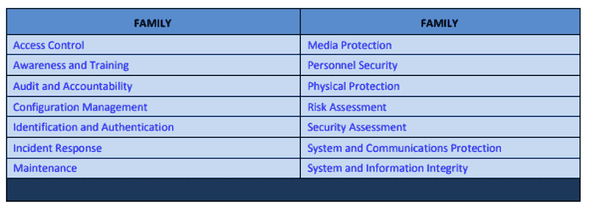 |
| --- |

每个安全要求家族包含若干与该家族主题相关的要求。每个家族既有基础安全要求，也有衍生安全要求。基础安全要求提供该家族的高层次、根本性安全要求；衍生安全要求基于 NIST 特刊 800-53，补充基本要求。NIST SP 800-171 详细讨论了基础安全要求和衍生安全要求。NIST SP 800-53 的目的在于“为联邦政府执行部门支持的组织和信息系统提供选择和指定安全控制的指南”。（NIST，2013）这两份文档均未提供系统安全步骤的逐步指导，但为希望实施网络安全计划的组织提供了有价值的信息。从社区的角度来看，这些文档有助于更好地理解组织在社区内应开展的工作，并可由社区的倡导者向社区成员宣传，帮助其明确自身应承担的责任。

*   [费曼学习法](https://wiki.example.org/feynmans_learning_method)的灵感源于诺贝尔物理奖获得者 `Richard Feynman`。
    1.  运用费曼技巧，你只需花上 `20 min` 就能深入理解知识点，而且记忆深刻，`难以遗忘`。

```
if (condVar > someVal) {console.log("xxx")}
```

*   自 2012 年以来，网络安全在各州认为自己能够应对网络事件的百分比排名中始终位于底部或接近底部。尽管各州在其他许多方面认为自己的准备程度有所提高，但网络安全方面并未改善。各州意识到自己准备不足，但尚未采取必要措施加以改变。虽然报告是按州层面编写的，但如果向城市提出相同的问题，预计会得到类似的结果。这凸显了各州需要开发网络安全计划的必要性。如果各州能够实现这一点，那么这将足以应对城市可能面临的事件，还是社区也需要开发自己的网络安全计划？

当网络事件袭击城市时，大多数情况都需要帮助来应对。州政府和联邦政府拥有某些资源，可能在帮助方面有所助益，但若大规模事件同时影响大量城市，其资源便显不足。若攻击使用多种向量，或使用不同版本的勒索软件，情况会如何？截至目前，当多个社区同时遭受攻击时，当局通常依赖于相同的攻击向量被广泛使用的事实，即针对单一向量的分析可助多个目标。但若使用了数十种不同的攻击向量，国家或州是否拥有同时对多种攻击工具进行取证分析的资源？

迄今为止，当多个社区遭受攻击时，当局依赖于相同攻击向量被广泛使用的事实，即针对单一向量的分析可助多个目标。但若出现数十种不同的攻击向量，国家或州是否拥有同时对多种攻击工具进行取证分析的资源？

社区必须采取立场：它们必须能够独立应对网络事件，而不能依赖联邦政府或州政府的帮助。如果是唯一目标，帮助或许可用，应当利用好现有资源，但不可假设帮助一定会到位。另一种援助途径是与安全服务提供商签约，在事件发生时由其介入协助。这当然会产生费用，社区需权衡该选项是否优于自行建设能力、是否符合预算。两者结合的模式也可能成立。无论采取何种方式，社区仍需履行 NIST CSF（网络安全框架）的其他功能，并自行构建网络安全计划。

## 可行且可持续的程序

两个术语经常用于描述社区网络安全计划的创建——可行性（viable）与可持续性（sustainable）。这两者是程序建立的关键概念。说服个人参加几次会议或参加几场网络安全研讨会并不困难，但构建一个能长期维持社区努力的结构则远更具挑战性。个人的日常职责会干扰其投入社区安全计划的时间。虽然他们可能认同其必要性，但其他责任的现实会逐渐将他们拉离计划。要实现可持续性，程序必须能够在与个人日常事务竞争的情况下依然持续运行。该程序必须设计得自我维持，不能依赖先前提到的“倡导者”始终在场。个人会更换职位、承担新责任、换工作，甚至因各种原因离开社区。倡导者需要在项目启动初期起到关键作用，但并非总会在场，程序仍需在倡导者离开后继续生存。

程序还必须具备可行性，即必须能够开展规定的活动并达到设定的成熟度水平。该程序需设计得灵活，以适应社区、法规及技术的变化，同时考虑长期成本。要确保安全，必然存在成本。仅在 Level 1 阶段，无成本或低成本项目占主导。正如保险和实物安全一样，网络安全也存在持续成本。构建一个既可行又可持续的程序，正是 CCSMM（社区网络安全成熟度模型）设计用来帮助实现的目标。


# CCSMM 的演变与社区网络安全计划启动指南

CCSMM 最初遵循前几章所述的二维模型，但迅速演变为三维模型。原因在于：要提升社区网络安全计划的成熟度，社区内的组织也必须达到相应的计划成熟度。同样的逻辑适用于州一级——州需达到一定成熟度才能推动社区进步，而社区的成熟度也决定州的提升空间。因此，组织和州最终都需要拥有可行且可持续的程序，并能与社区计划相互作用。这尤其体现在认知度和信息共享两个维度上。这两个维度高度依赖社区内组织和个人的参与。例如，在能够分享攻击指标（`indicators of compromise`）之前，组织必须拥有能够在发生 `breaches`（突发入侵）时及时检测的组织计划，并制定相应政策以便与他人共享信息。此外，还需具备对信息共享相关网络安全议题及其重要性的认知。组织及其内部人员需理解社区内信息共享计划的益处。

## 启动社区 ISAO（信息共享组织）

启动社区计划的一种方式是开发社区 ISAO（信息共享组织）。ISAO 无需立即拥有 24/7 的安全运营中心或网络威胁分析员。其目标是起步实施，而非瞬间达到高级能力。此处的社区 ISAO 应设计得超越对 ISAO 的基础定义，常被称为“ISAO Plus”（ISAO+）。所谓“ISAO+”，意指其在信息共享与活动方面不仅限于常规的指标共享，还涉及社区政策制定、评估、认知宣传以及通用网络安全知识的共享。信任建立也是此过程中提到的关键因素，而建立信任的有效方式之一是让相关方共同开展项目、相互了解。信任不会在短时间内产生，但随着时间的推移会逐渐形成。

### 案例：圣安东尼奥安全领袖论坛 (SLF)

作为此情况的一个例子，在 `San Antonio, Texas`，2005 年成立了一个名为 `Security Leaders Forum (SLF)` 的小组。该小组最初规模较小，主要由 `Chief Information Security Officers (CISOs)` 或来自社区各组织的安全管理员组成。该组织没有制定章程，也没有收取加入费用。该小组每月召开会议，讨论当前的网络安全趋势，并在成员之间分享面临相同挑战的信息。每个月，一个组织会在午餐时间于其设施举办会议，并自行选择主题和演讲者。这并非供应商的销售推介，但偶尔会受邀请供应商进行特定主题的演讲（但不会针对特定产品）。随着时间的推移，SLF 的成员彼此了解并建立信任，认识到他们共同的目标是打造更安全的组织。

在某个时刻，SLF 中的一位成员经历了重大的安全泄露。该成员所在的组织属于金融服务行业，SLF 中还有其他来自金融服务行业的组织成员——他们是该行业的竞争对手。该成员向其管理层申请并获得了详细阐述泄露原因及其组织从中学到的教训的许可。组织认识到这段信息对 SLF 其他成员保护自身组织具有价值，但这也可能被竞争对手用于公开 highlight 问题，以诱导客户转向其他金融机构。然而，该成员已经与 SLF 的其他成员建立了关系，其他成员认识到协同作战打击网络攻击的好处。他们明白到，尤其是关于安全泄露的敏感信息的共享，比短期利用该信息获取竞争优势更为重要。建立这种信任的过程历时多年，且该信息并未被他人以竞争方式使用。

有人可能会问，加入 `Financial Services ISAC` 是否能提供相同的信息，答案是大体上可以。与 FS-ISAC 共享将向该行业的其他成员提供事件的基本情况，并让他们能够采取措施避免类似发生。不同之处在于，FS-ISAC 的警报通常会对信息进行匿名处理，使得行业内的其他成员难以确定目标是谁。而在 SLF 成员的演讲中，目标明显可知，但成员还能就事件的战术、技术、利用的具体漏洞以及目标组织的响应提出更详细的问题。此外，SLF 中的大多数成员并不属于金融服务行业，因此他们无法从 FS-ISAC 获取关于该泄露的信息，因为他们不是该组织的会员。当时 SLF 尚未被设立为 ISAO，因此没有快速共享事件信息的机制；但当信息共享时，其详细程度通常高于 ISAO 发出的普通警报。该事件发生的组织是 FS-ISAC 的会员，但 SLF 成员认为该事件及其经验教训足以向其信任的同行分享更详细的内容。这教会了我们社区信息共享的重要性。顺带一提，当 ISAO 的行政命令发布时，SLF 曾考虑将自己设立为 ISAO，但因 `San Antonio` 市采取了创建自身 ISAO 的措施，最终 SLF 的成员与 ISAO 的倡导者合作，共同推动城市的网络安全工作。

## CCSMM 的设计理念

`CCSMM` 设计用于帮助社区以无成本或低成本的方式开展活动，因为社区通常没有大量的网络安全预算。社区需要时间来规划未来的支出，并确定最需要投入预算的产品或服务。早期建立一个 ISAO，即使最初只是社区中 CISO 的非正式群体，也能成为推动社区网络安全计划进一步发展的催化剂。

随着社区项目的发展，社区应鼓励其成员组织建立自身的项目。这可以通过结合 CCSMM 的 `Organization Scope` 与 NIST CSF 来实现。社区项目主要依赖于 SOC 和 ISAO 类的产品，而组织则拥有更多资源。毕竟，组织需要保护自己的电脑和网络，而社区并非一个控制所有成员网络资产的单一实体。因此，保护电脑和网络的实际责任主要由各组织的 `Organization Scope` 承担。

# MOVING FORWARD

如果你尚未在社区内实施网络安全计划，现在是时候开始了。网络犯罪的速率在上升，许多旧漏洞仍在被利用。旧攻击虽被使用，但往往以更成熟、更复杂的方式出现。你不应等到社区遭受数百或数千美元赎金的勒索软件攻击后才着手恢复。启动网络安全计划并不保证你不会受到攻击，也不会保证没有遗漏的漏洞导致泄露或其他网络事件。但它能保证你对日常看到的多种攻击更具抵御能力；即使漏掉了系统的安全或发现了新漏洞导致泄露，拥有网络安全计划也能让你更有效地应对和恢复。

那么，如何开始呢？这取决于你的具体环境，但总体上有几项基础步骤可以推动计划前进。CCSMM 的各级提供了早期可考虑的事项，但也有几项非常基础的第一步你几乎必须执行。以下内容大致按时间顺序排列，但根据具体环境的不同，顺序可能会调整以更好地符合本地需求。你可以使用这些步骤作为起点，但切勿害怕根据本地情况进行修改。

## 步骤 1：找到一位倡导者

无论这位个人是否在市政府办公室任职，或是行业领袖，你都需要一位对网络安全充满热情且对社区有承诺的人。该倡导者不应计划在近期调动，因为你需要他/她至少推动两年（视社区情况而定）来推动工作。

## 步骤 2：争取城市和行业领袖的支持

此时你并未请求金钱（未来可能需要社区 ISAO 的资金支持，或根据组织规模提出会员费，但这可以稍后处理），你所请求的是让社区人员能够参与相关工作。

## 步骤 3：组建核心规划小组

组建一支由对该项目感兴趣的安全专业人员组成的核心小组。您应该拥有一支由市政府、行业以及关键基础设施人员组成的混合团队。您可能不希望这个初始规划小组过于庞大，最多 10-15 人即可启动。随着任务的推进，这个小组将会迅速扩大。您可以参考之前提到的 **圣安东尼奥安全领袖论坛**，其方式之一是每月举办午餐会议，讨论后续路线。

## 步骤 4：规划社区“网络安全日”

选择一个未来的日期（可能不少于 6-9 个月，也不超过 9-12 个月），计划举办城市“网络安全日”，并安排包含三个部分的研讨会或工作坊：
1. 面向市政府员工及各关键基础设施人员的会议；
2. 面向本地行业（任何规模）的会议，未来可能细分为大型企业与中小企业两个会场；
3. 面向社区居民的会议，让他们了解如何在家中保护自己。

十月是 **国家网络安全月**，是一个合适的举办时间。全国各地都有由行业、专业网络安全组织以及如 **国土安全部** 等联邦机构赞助的活动，旨在提高公众对网络安全问题的认识。将社区网络安全日与这些全国性活动相结合，有助于吸引更多关注，也让首次活动不必过于技术化，重点应放在社区项目的构想上，让参与者能够带走一些可操作的指导，以便自行启动网络安全工作。

## 步骤 5：正式宣布并启动社区 ISAO

与网络安全日同步，正式宣布 **社区信息共享组织（ISAO）**，并在该活动中正式亮相。您需要在正式启动 ISAO 之前，举办一些信息会议，向公众宣传 ISAO 及其使命。您需要制定章程，并确定社区 ISAO 的初始目标和任务。相关文档可在 **ISAO 网站**（`www.isao.org`）上找到。

也有社区可能认为，先成立 ISAO 是个良好起点，初始成员即可成为社区网络安全计划的推手。如果是这样，网络安全日可以用来提升整个社区的网络安全意识，同时宣传社区 ISAO 及其会员优势。一旦 ISAO 成立，依据 ISAO 指导文档（在 **ISAO 网站** 上），它最初可能只有有限的功能。这没关系，关键是要 **启动** 它。

## 步骤 6：建立社区网络安全网站

建立社区网络安全网站。该网站可以由 ISAO 本身维护，也可以由 ISAO 成员负责运营。有观点认为，由当地政府赞助该网站更为合适，因为社区成员在发生灾害或事件时，往往会自然转向当地政府寻求信息。无论由谁维护，网站都应提供可以分享给社区的网络安全资讯、活动、最佳实践、即将举办的培训等内容。

## 步骤 7：开展社区网络安全桌面推演

在首个 9-18 个月内开展社区网络安全桌面推演（`tabletop exercise`）。可以在 **网络安全日** 之前或之后进行。若在活动之前举行，可在活动现场进行汇报；若在活动之后进行，则可借此宣传并鼓励参与。

需要特别强调的是，推演应邀请 **社区决策者和领导者**（能够“签字”的人物）参与，而非社区的 IT 或安全人员。IT 与安全人员可以协助策划和设计活动，但主要参与者应是市长、市经理、应急中心负责人、当地行业领袖等。要确保此次桌面推演保持简洁，避免过于复杂导致非技术性领导难以理解，或出现“这里根本不会发生”此类言论。让这些领导假设自己已在处理网络安全，进而认识到网络事件对社区的潜在影响。此次推演聚焦 **整体社区概念**，展示社区如何协同应对事件，而非仅针对单个组织的具体问题（如数据备份）。

另一种选择是使用 **2020 年国家级演习（NLE 2020）** 社区网络安全“游戏”，该游戏旨在向社区介绍网络安全事件。更多关于网络安全推演或 NLE 2020 游戏的信息，请联系 `CIAS@utsa.edu`。

## 步骤 8：启动社区安全文化宣传运动

启动社区安全文化宣传运动。可以类比 **Smokey Bear**（常被误称为 “Smokey the Bear”）或 **McGruff** 警察小狗的宣传方式。目标是让社区青年从小培养网络安全意识，让他们知道“他们可以防止网络‘火灾’”或“帮助打击网络犯罪”。

宣传活动应包括让中学和高中参与 **CyberPatriot** 网络防御竞赛等项目。该竞赛已有十余年历史，全国已有数千支队伍报名参与。更多信息请访问 `www.uscyberpatriot.org`。

另一种适合青少年的学习方式是 **Cyber Threat Defender 可收藏卡牌游戏**（适用于 6 年级及以上）及其伴随的 **Cyber Threat Protector** 游戏（适用于 3-5 年级）。这些游戏已成功向青少年和成人普及网络安全基础，提升对该领域的兴趣，并鼓励青年考虑网络安全职业。`Cyber Threat Defender` 已经转为 PC 版免费下载游戏，并已译为西班牙语，正在进行其他语言的翻译。关于卡牌版和电子版的更多信息，请访问 `www.cias.utsa.edu`。

## 步骤 9：加入多州 ISAC (MS-ISAC) 及相关组织

城市应成为多州 ISAC（MS-ISAC）的成员，社区 ISAO 也应成为 MS-ISAC 以及 GBC-ISAO 的成员。有关 MS-ISAC 的更多信息请参阅 `www.cisecurity.org/ms-isac/`。一旦它完全形成，社区 ISAO 还应考虑加入国家注册 ISAO 理事会，请参阅 `www.ncrisaos.org`。

在成为 MS-ISAC 和 GBC-ISAO 成员之前，社区 ISAO 必须足够成熟，以便了解从这些组织接收到的信息，并准备好妥善处理接收到的信息。这些组织可以为正在启动其网络安全计划的社区提供有用资源，但也可能提供社区目前尚未准备好利用的信息。随着社区 ISAO 的成熟，它将能够逐步将收到的更技术性的信息纳入其中，并妥善处理和利用这些信息。

## 步骤 10：成立网络安全咨询委员会

在九个月内，为市长和市议会成立一个网络安全咨询委员会。该委员会应至少每年向市长和市议会会面一次（或提供报告），最好更频繁地进行。委员会应帮助向市领导人通报网络安全问题，以便他们能够更有效地规划网络安全支出和可能的事件。这应是公私合作的努力，并且应鼓励社区内部就网络安全问题开展公私合作伙伴关系。

## 步骤 11：确定 CCSMM 目标级别与时间表

在首个年度结束前，您应已组织一次社区领袖会议，以确定尝试达成的适当 CCSMM 级别及其时间表。这将成为整个社区网络安全计划的一部分，该计划应在后续步骤中建立并随着项目成熟进行调整，但它将是后续开展成熟网络安全计划的基石。

## 步骤 12：创建应急作业计划网络安全附件

在十八个月内，为社区的应急作业计划创建一个网络安全附件，并将网络安全纳入社区的业务连续性计划及演练中。

## 步骤 13：向组织介绍 CCSMM 与 NIST CSF 组件

随着各组织逐步建立其自身的网络安全计划，向它们介绍相关的组成部分，例如 CCSMM 的四个维度和 NIST CSF 的五个功能。这些可以作为首次或后续社区网络安全日的讨论主题。由于社区内部组织的网络安全计划差异很大，该步骤的时间安排也会相应变化。关于上述组件的讨论可能会在技术跟踪中进行更技术性的演讲，并且需要反复进行两次：第一次，因为各组织开始网络安全计划的时间不一致（尤其是新公司可能随时成立）；第二次，因为关于模型和框架组件的演讲或讨论内容会随着组织内部计划的成熟程度而改变。

## 步骤 14：关注中小企业 (SMB) 需求

由于中小企业，尤其是新成立的企业，往往没有专门的网络安全计划（甚至可能只关注最基本的防护措施），因此社区在其网络安全计划中应当牢记这些企业。最终应在网络安全日设立专门的 track，初始网络安全日至少应有一场针对他们的讲座。在大型社区中，若有大量中小企业，举办专门面向这些实体的研讨会或工作坊可能更为合适。

## 步骤 15：将网络安全教育引入课堂

与介绍 CyberPatriot 竞赛和 Cyber Threat Defender 卡牌游戏相关的步骤一起，您应考虑如何将网络安全引入课堂，而不仅仅局限于中学和高中阶段，甚至可以在小学阶段（在此阶段可以引入网络伦理和网络欺凌等话题）。同时，还需考虑在社区和四年制高校层面的网络安全教育。

CyberPatriot 和 Cyber Threat Defender 可作为公立学校相关项目的良好工具和催化剂，但当地学区可能需要开发更深入的项目，甚至让高中生获得各种技术网络和安全认证。这在学生中比例较高且传统上不太考虑上大学的社区尤为重要。网络安全和技术认证能够带来更高薪酬的工作，这些工作可能会激励个人继续深造。此类情况已在多个社区中得到验证。

## 步骤 16：规划财务资源与商业服务

随着社区网络安全计划的建立，各组织（尤其是地方政府）应考虑实施各项步骤所需的财务资源。地方政府可能已为加强网络安全措施预算，但往往没有为社区计划预留资金，也未曾预算相关项目。未来需要为这些项目进行预算。

一种能够极大促进个人和社区计划的因素是供应商提供的商业服务，例如网络威胁与攻击检测、网络事件响应与恢复等，这些服务通常需要特定的资金。如果财务状况允许，无论是针对社区内的组织还是整个社区计划，均应考虑采用这些服务。

## 总结与资源

这些步骤不会直接形成完整的社区网络安全计划，它们只是启动计划时应考虑的事项。其中一些已在 CCSMM 各章节中讨论，还有许多工作需要完成，但为避免感到不知所措，请从这些项目中挑选几项作为起点。某些项目可能需要进行调研，但公开可用的资源和组织可以提供帮助和培训。

两个可以帮助培训并设立社区计划和 ISAO 的组织是：
*   国家网络安全准备联盟（NCPC），网站为 `www.nationalcpc.org`
*   地理化社区 ISAO 组织（GBC-ISAOs），网站为 `www.gbcisaos.org`

NCPC 专门为 SLTT（州、地方和部落）机构提供培训，其目录中的所有认证培训课程均由 DHS/FEMA 全额资助并对 SLTT 政府内部人员免费，对其他人员在名额充足时也可免费参加。部分培训为在线形式，可供更广泛的感兴趣方参与。

第三个可供社区参考的组织是多州 ISAC（其网站为 `https://www.cisecurity.org/ms-isac/`），此前已在前文提及。它提供可供 SLTT 使用的资源，有助于建立各类计划，并可提供当前的漏洞和网络情报数据（当社区准备好妥善处理此类信息时）。

> 各个社区将有所不同，你需要考虑哪个步骤适合你的社区尝试，以及按什么顺序进行。最终，这些步骤都将在你开始为整个社区建立安全计划时以某种方式被处理，但你的具体路径可能会，而且大概率会与其他社区不同。本列表也并非全部包含，因为还有许多其他步骤可以采取，但当你和社区的其他成员聚会时，你可以讨论并考虑对你具体情况最重要的内容。使用这些步骤仅作为启动你自己讨论的指南。

# CONCLUSION

国家需要提高其网络安全准备程度，而启动这项工作的最佳地点之一是全国各地的城市和州。城市和州正日益成为目标，许多将无法防止成功的攻击，而且大多数都未做好应对成功攻击的准备。社区和州内的大多数组织并不属于拥有 ISAC（信息共享与分析中心）的部门，因此他们没有 readily（随时可得）可以联系的组织来共享与网络安全相关的信息，或在发生网络事件或攻击时提供帮助。

虽然在州和联邦层面有一些努力，旨在开发程序以帮助城市防止成功攻击或在攻击发生时进行应对，但考虑到美国数千个县、镇和城市，州和联邦层面的资源根本不足以应对大规模网络攻击，尤其是当攻击设计为利用多个攻击向量并利用不同漏洞时。这意味着最佳方案是让州、县、镇、城市、部落和领地自行应对事件，如果可能的话，并且如果有外部帮助可用，则利用外部资源。

SLTT（州、县、镇、市、部落和领地）至少应准备好处理事件的即时响应，即使其他资源（可能包括提供检测、响应和恢复服务的商业实体）也被使用。由于大多数选举官员对网络安全一无所知，因此需要帮助城市建立自己的计划。即使城市内部有网络安全专业人员，他们大多数也只接受过保护单个组织的培训，缺乏将社区的各个部分整合到协调的整体计划中的经验。

正是 CCSMM（整体社区安全计划）及本文的设计初衷，为有兴趣开发自己整体计划的个人提供前进的方向，以完成这一任务。这将不会轻松，也不会快速，但它并非不可能，而且努力是有价值的，因为它将帮助保护社区的资产以及其公民的私人信息。

本章提出了若干建议，供社区在开始建立整体网络安全计划时参考。虽然每个社区都有其独特性，但它们也存在某些相似之处。本章提供的列表应被视为参考，但需根据各社区的具体需求进行调整。社区可能会发现，除了本章中列出的步骤之外，还有其他步骤值得采取，或者在采取本章中提到的某些步骤之前需要先采取其他步骤。这些步骤仅作为指导，旨在激发社区在决定采用整体网络安全方法时的讨论。像 MS-ISAC、GBC-ISAOs 和 NCPC 等其他组织也提供资源和帮助，社区应利用它们所提供的内容来推进整体网络安全计划的建立。


## 第 10 章

## 摘要

- 计算机科学及其子领域网络安全的特点之一是不断变化。无论是操作系统新版本发布、新技术出现，还是新发现的漏洞被披露，该领域都在持续演变。有些变化对 CCSMM 没有任何影响，而其他变化可能需要在一个或多个层面进行调整。模型本身极具灵活性，经常不指定具体需要覆盖的项目，而是强调需要考虑的更抽象概念。这不仅适用于技术变革，也适用于新政府指导或法规的引入，以及专注于网络安全其他方面的其他成熟度模型的创建。本章探讨如何将其他模型和技术整合到 CCSMM 中。

## INTRODUCTION

- [CCSMM 的创建](https://wiki.example.org/ccsmm)是在多年处理 SLTTs 并协助其安全计划开发的过程中产生的。这些年份并非静止的，因为早期的成果与后来的情况并不完全相同。这主要是由于多种因素导致的，包括新技术、法规、联邦指导的引入，或在软件和硬件中发现新的漏洞。随着模型的发展，人们认识到模型要保持适用性，就需要足够灵活以容纳这些变化，并且已经进行了规划。

  幸好，从社区范围来看，这一点很容易被满足。对于组织范围，你会发现每个层级的要求在技术上更为具体。与社区范围的一般性要求不同——即组织需要建立某种资产管理系统来跟踪硬件和软件（这可能是社区范围的要求）之外，在组织范围内，要求可能是某个组织需依据 `NIST SP 800-53 Rev 4` 的 `CM-8`、`PM-4` 实施资产控制，又或者采用 `ISA 62443-2-1:2009 4.2.3.4`。鉴于本书涵盖社区范围，本章将讨论如何在 CCSMM 中纳入新技术、法规、指导以及其他模型。

## 背景

CCSMM 覆盖从个人公民到整个国家的多个范围。它定义了五个不同的安全计划成熟度级别，描述了其特征和活动。本文针对 CCSMM 的社区范围。社区由多种类型的组织组成，具有不同的具体安全需求。例如，银行受不同的联邦安全法规约束，而医院则受其他法规约束。从更高层面看，两者的安全需求其实相似。如果监管要求发生变化，这并不削弱 CCSMM 对社区的适用价值；它只是改变了受该法规约束的实体在组织层面的要求。整体 CCSMM 模型本身保持不变。

另一个可能发生变化的领域是技术。随着新技术的出现，它往往会引入新的安全漏洞，同时消除旧的漏洞。例如，从 1990 年代中期到 2000 年代中期，购买笔记本电脑时，它大概配备了拨号调制器，用于连接互联网服务提供商以浏览网页。十年后，笔记本电脑中拨号调制器的情况大幅下降，因为它们被无线设备所取代。无线连接的普及消除了使用较慢的拨号调制器的需求，拨号调制器逐渐消失，被无线网卡取而代之。从网络安全角度看，拨号调制器为网络带来了特定漏洞，需要安全专业人员进行检查；而无线技术则大幅减少了这种漏洞（尽管在未来几年仍可能保留少量拨号连接）。然而，无线技术本身也带来了以前未曾考虑的新漏洞。

## 其他倡议

正如本文多次指出的，定期会有新的指导或法规推出，这些可能要求新的安全控制，或引入针对网络安全某些方面的新方法。例如，我们讨论过的多个行政命令，以及 NIST 网络安全框架，它为组织提供了组织化的安全处理方式。还有其他哪些指导或文件可能影响 CCSMM 的实施方式？

美国国土安全部（DHS）网络安全和基础设施安全局（CISA）还引入了 55 项国家关键功能的概念。DHS 网站对该概念的定义是：

> “政府和私营部门的功能，若其中断、损坏或失效，会对美国的安全、国家经济安全、公共健康或安全产生严重影响，或对上述任何组合产生影响。” [DHS 2019]

虽然它与原始关键基础设施的识别紧密相关，但侧重点略有不同，极其重要。关键功能的关注点在于“更好地理解实体所促进或贡献的功能”，而不是围绕固定的行业或资产视角。[DHS 2019] 因此，关键功能不采用行业视角，而是跨行业观察：一次针对关键功能的攻击可能在其他行业产生连锁影响。

那么，这对采用 CCSMM 的社区有什么影响，以及 CCSMM 如何适应？首先要记住，在社区范围内，具体的安全控制和机制并未被详细说明。社区在审视这 55 项功能时，应思考如何将它们整合到已有的工作中。通过 ISAO（信息共享与协作组织）开展的意识提升活动，应向社区内的组织介绍这些功能。这一方面的审视将对评估环节产生积极影响。这些功能不局限于单一行业，而是横跨多个行业，这正是社区最初致力于实现的目标。一次行业的中断可能会影响其他行业，而这 55 项功能正好与 CCSMM 所追求的整体社区安全方法相契合——即从整体社区视角审视安全。

将这 55 项国家关键功能纳入已使用 CCSMM 发展安全计划的社区，并不构成重大问题。事实上，如果社区正在按应有的方式开展工作，许多相互依赖关系很可能已经被发现。我们相信这并非唯一案例，其他倡议以及联邦政府制定的新法规不应对社区的网络安全计划产生显著负面影响。相反，社区越习惯协作，新举措越不易产生重大影响，因为社区会共同探索如何将其融入现有框架。

## 新威胁与技术

- [回到无线介绍及其伴随的电话调制解调器消失的例子中，让我们来审视在一个已经建立了网络安全计划的社区中将会发生什么。从 CCSMM 视角来看，这些问题在社区范围内会更加聚焦，但广泛而言，它们也需要在五个 NIST CSF 功能的框架内被考虑。它们应该出现在识别功能期间，然后在保护功能中应当考虑如何保护它们。这两点都应在 CCSMM 机制中被考虑，以便个人能够了解其特定的脆弱性，实施针对它们的保护技术，建立处理它们的政策和流程，采用指标来衡量它们的安全性以及组织在遵循相关政策方面的表现，并采用将其纳入评估的方法。在社区层面，ISAO 可以主动发起宣传，让成员了解新技术及其相关的安全考量。ISAO 不会负责保护社区内组织的无线网络，但会在确保所有成员了解这一新兴技术及其带来的安全问题方面发挥主导作用。社区内的成员可能会交换无线安全技巧，并制定一份最佳实践文档以在整个社区中推广。市长和市议会咨询委员会应当与他们会面，或提供报告，让他们了解这可能对城市意味着什么。如果社区的目标是为所有公民提供免费 Wi‑Fi 接入，那么向社区居民创造信息以让他们了解在咖啡店等地点使用免费 Wi‑Fi 的风险就尤为重要。需要提出的问题是：“无线技术对社区意味着什么，以及我们如何确保其安全采用，防止过度暴露社区内的公民或组织。”

另一个更具当代性的技术引入案例是关于长期停电可能导致电磁脉冲（EMP）引发的连锁停电的当前担忧。2019 年 3 月 26 日发布了执行令 13865。其中对 EMP 的定义如下：

```
'Electromagnetic pulse' is a burst of electromagnetic energy. EMPs have the potential to negatively affect technology systems on Earth and in space. A high-altitude EMP (HEMP) is a type of human-made EMP that occurs when a nuclear device is detonated at approximately 40 kilometers or more above the surface of Earth. A geomagnetic disturbance (GMD) is a type of natural EMP driven by a temporary disturbance of Earth's magnetic field resulting from interactions with solar eruptions. Both HEMPs and GMDs can affect large geographic areas. [White House, 2019]
```

之所以白宫对此感兴趣，原因如下：

```
An electromagnetic pulse (EMP) has the potential to disrupt, degrade, and damage technology and critical infrastructure systems. Human-made or naturally occurring EMPs can affect large geographic areas, disrupting elements critical to the Nation's security and economic prosperity, and could adversely affect global commerce and stability. [White House, 2019]
```

军方已关注几十年的 EMP 潜在的 catastrophic 影响。近年来，这种关注逐渐被更广泛的公众所知晓，导致国内许多人对该现象的担忧提升。例如，InfraGard 已建立 InfraGard EMP Resource Center，为个人提供更多信息渠道。他们还在组织内部设立了 Special Interest Group（SIG），以探索其他方式向成员及公众宣传这一现象并做好准备。基本上，一次大规模的 EMP 爆发（无论是人为还是自然）可能导致长期停电，进而影响世界大部分地区。在 CCSMM 框架下，这将如何被纳入模型，社区应如何应对？

首先，与其他例子类似，社区将不对社区内所有组织免受 EMP 爆发影响负责。社区能做的是再次调动 ISAO 开展意识宣传，向社区成员以及社区内的组织传递潜在危害及对社区的风险。可能会成立一个工作组，汇集关于防范 EMP 影响的指导。可以制定一份“最佳实践”指南（如果已有可直接采用），让组织和公民能够做好准备，并向 ISAO 所有成员以及更广泛的社区提供这份指南。市长和市议会咨询委员会应当会面，或提供报告，向市政府提出关于保护和应对能力的建议。在测试方面，EMP 爆发可以被纳入即将开展的社区演练中，以检验城市的准备程度，确保社区了解 EMP 可能带来的问题。因此，正如之前一样，城市并不负责保护整个社区，而是在引导社区成员了解威胁并提供应对措施方面发挥主导作用。正是这种方式使得任何新兴技术对安全的影响都能够通过 CCSMM 得到处理。请记住，在大多数新技术的情况下，真正的影响主要出现在组织范围内。社区可以在引入新技术的问题时发挥引导作用，组织则负责实施新的安全控制或机制。

## OTHER MODELS

如果在 Internet 上搜索成熟度模型，会得到数百条相关结果，涉及多种模型，例如 IT 服务、电力子行业以及工业控制系统的成熟度模型。如果目标是将另一个成熟度模型叠加或嵌入到 CCSMM 中，可能并不容易。首先，CCSMM 是一个三维模型，而大多数其他模型是二维的。将它们叠加到社区范围（Community Scope）上意义不大。但在组织范围（Organizational Scope）则更为合理，因为这里具体的安全控制会被发现。

在组织范围（本文未涵盖）内的 CCSMM 中，讨论的控制措施并不十分具体。相反，文中提到的是组织或控制类型，组织可根据其所在行业的特点自行进行相应处理。因此，针对特定类型组织的成熟度模型很容易与 CCSMM 组织范围相融合。这可以通过以下三种方式实现。第一种方式是以 CCSMM 组织范围为基线，然后将新的成熟度模型中的特定元素提取出来，并插入到 CCSMM 模型中。具体来说，CCSMM 模型会指定应包含的一种控制类型，然后检查新成熟度模型是否包含该类型的控制。如果有，则将其插入 CCSMM 模型。完成此过程后，新模型中任何额外的控制都可以插入 CCSMM（因为它们很可能代表特定行业的独特方面，而这些在更通用的 CCSMM 模型中并未体现）。对于 CCSMM 模型中可能仍然存在但新模型中没有对应项的项目，需检查这些项目是否适用于特定行业。如果适用，则应将其纳入，可能借鉴 NIST CSF 等标准；如果不适用，则可将其移除。

第二种方式是以新模型为基线，检查 CCSMM 中识别出的所有通用控制是否在新模型中有对应项。对于那些没有对应项的控制，需检查其内容并根据行业适用性决定是否保留或删除。此方法与前一种方法基本能实现相同甚至完全相同的模型结果。第三种方式则是第二种方式的轻微变体，即直接移除 CCSMM 组织范围，将新模型填入其位置。对于行业特性独特的领域，这种方式可能是最简便的选择。无论采用哪种方法，都应确保不会对社区范围造成显著影响。

以下为工业控制系统（ICS）成熟度模型的示例。工业控制系统通常被视为运营技术而非信息技术，具有独特的特点和需求。它们在可靠性至关重要的环境中运行，远高于普通 IT 设备。虽然我们希望网络始终保持 100% 可用性，但偶尔出现故障是可以接受的，且通常影响有限。在制造环境或关键基础设施中，系统宕机可能导致关键流程停止，甚至引发重大灾难，部分情况下还可能引发爆炸和生命损失。因此，ICS 的关注点与普通企业 IT 系统不同。在 CCSMM 中，该环境可能独特，以至于直接用新成熟度模型替换组织范围是最简便且合适的做法。

## 结论

网络世界不断变化，任何制定的全面安全计划都必须能够适应这些变化。本文主要涵盖了 CCSMM 的社区范围。该范围不关注具体的安全控制，而是从更高视角审视整体安全计划。因此，新技术、新法规或联邦、州、部门等倡议的引入，以及不同成熟度模型的出现，都不会影响该模型在社区中的适用性。社区（通常由社区 ISAO 主导）可通过成为新或变化安全问题的引导者来应对变化。这也是 ISAO 的核心任务之一，其在构建社区网络安全计划时所建立的结构和举措不会因上述变化而受到显著影响。对于更具体的成熟度模型，这同样不构成难题。事实上，社区中两个不同组织的安全控制可能因所在行业不同而有显著差异。组织范围内的具体安全控制可能差异很大，因此可以用针对某一组织的特定模型替换社区范围，同时用另一模型替换另一组织的社区范围，这种做法不会影响整体社区计划。

## 参考文献

DHS. (2019). National critical functions. Retrieved from https://www.cisa.gov/sites/default/files/publications/national-critical-functions-overview-508.pdf

White House. (2019). Coordinating national resilience to electromagnetic pulses. Retrieved from National Archives Federal Register website: https://www.federalregister.gov/documents/2019/03/29/2019-06325/coordinating-national-resilience-to-electromagnetic-pulses

Gregory B. White has been involved in computer and network security since 1986. He spent 30 years with the Air Force and Air Force Reserves. He obtained his Ph.D. in Computer Science from Texas A&M University in 1995 conducting research in the area of Computer Network Intrusion Detection. He currently serves as the Director of the Center for Infrastructure Assurance and Security (CIAS) and the Geographically-Based ISOA (GBC-ISAO) and is a Professor of Computer Science at The University of Texas at San Antonio (UTSA). He has written numerous papers and is the co-author on six books on cybersecurity.


# Natalie Sjelin

Natalie Sjelin is the Director of Training for the Center for Infrastructure Assurance and Security (CIAS) at The University of Texas San Antonio. She brings over 17 years of cybersecurity experience focused on designing and facilitating cyber security exercises, developing and delivering cyber security training, and information sharing initiatives. Her focus is working with communities to build viable and sustainable cyber security programs. Ms. Sjelin has co-authored white papers on Community Cyber Security topics and a chapter for the book, *Cyber-Physical Protecting Critical Infrastructure at the State and Local Level*. She speaks regularly for professional groups, meetings, panels and conferences across the country.
