# 使用迁移学习神经网络基于 VIIRS 数据估计全球下行短波辐射


Ruohan Li, Dongdong Wang*, Shunlin Liang, Aolin Jia, Zhihao Wang

美国马里兰大学地理科学系，大学城，马里兰州 20742, 美国

+ * 关键词：
* 迁移学习
* 机器学习
* VIIRS
* 下向束辐射 (Downward swath radiation)
* 辐射传输
* 太阳能

近年来，机器学习（ML）已成功用于估算下向束辐射。为了实现全球覆盖，传统的机器学习模型需要足够的覆盖全球各种大气和表面条件的测量值，这在现实中是难以实现的。基于辐射传输模型（RTM）的模拟数据是一种可能的解决方案。我们使用了来自复杂环境的 VIIRS 指数，这些环境会给模拟带来偏差。引入具有迁移学习能力的神经网络用于仅根据局部太阳正午的大气顶层反射率和表面反射率来估算全球 DSR。所提方法还利用 750 米分辨率的 VIIRS 红外光谱辐射计（VIIRS）数据估算每日束辐射，并经过独立观测的验证。2013-2015 年期间，28 个全球表面网络站和 8 个格陵兰网络站的 DSR 观测均方根误差和相对均方根误差分别为 12.3 (16.1%)、10.6 (18.3%)、7.5 (24.2%)，每日验证实现的精度分别为 30.5 (15.0%) 和 31.7 (17.4%)。与传统的机器学习、物理模型（例如查找表和方向模型）以及现有的 DSR 产品相比，该方法在极地区显示出高精度，在其他地区性能相似。该算法还应用于 VIIRS 数据以测试其云产品掩码的映射，每日映射显示的空间模式与云和地球能量系统 TOA 表面和通量产品相似，但数据更多。进一步分析表明，在进行迁移学习（TL）后，模型性能随训练数据数量的而提高。本研究证明了 TL 在 DSR 泛化性和准确性方面的潜力，可能应用于其他变量。

# 1. 引言

地球表面和大气中能量的驱动力（即气象、水文和化学过程）驱动了下向辐射（DSR），为卫星观测提供了关键参数，并一直是科学的多个方面（Li et al., 2019）。在从卫星观测估算 DSR 方面已取得显著进展，目前已有全球和区域性的 DSR 产品（Mueller et al., 2009; Rutan et al., 2012）。

以往从卫星数据估算 DSR 的方法很大程度上基于辐射传输模型（RTMs）的物理学。这些方法可以分类为反演或正向算法（Wang et al., 2021）。反演模型根据大气顶层（TOA）反射率的直接观测值估算 DSR。基于查找表（LUT）的方法也是典型的反演方法。在这种方法中，使用了 RTM 的结果，从而简化了过程（Bings et al., 2019）。正向方法使用 TOA 反射率通过离线 LUT 估算大气条件和表面通量。LUT 等方法使用线性插值对计算网格内的大气条件进行排序（Mueller et al., 2019）。对于不同大气条件的参数化定义，这些方法通常能产生更准确的估计，但有效值较少，因为它们需要高层大气气溶胶和颗粒物（Wang et al., 2021）。这为参数化方法生成高时空分辨率的 DSR 带来了困难。

在过去几年中，机器学习（ML）被广泛用于估算 DSR，由于其在捕捉非线性关系方面具有优越性。随机森林、梯度提升树（GBT）和神经网络（NNs）已被用于估算 DSR（Bafar et al., 2020）。近年来，深度学习方法如卷积神经网络（CNN）和神经网络（NNs）（在2019（Zhang et al., 2019）也被应用于估算 DSR。从卫星数据估算 DSR 的先有方法很大程度上依赖于辐射传输模型的物理学。反演模型根据 TOA 反射率直接估算 DSR（Wang et al., 2021）。2019（Sun et al., 2019）和2020（Chen et al., 2020）的研究显示了迁移学习在 DSR 方面的应用。然而，由于需要使用高层大气气溶胶和颗粒物（Wang et al., 2021），参数化方法在生成高时空分辨率 DSR 方面存在困难。

由于机器学习在捕捉非线性关系方面具有优越性，过去几年中机器学习被广泛用于估算 DSR。随机森林、梯度提升树（GBT）和神经网络（NNs）已被用于估算 DSR（Bafar et al., 2020）。近年来，深度学习方法如卷积神经网络（CNN）和神经网络（NNs）在2019（Zhang et al., 2019）也被应用于估算 DSR。由于训练数据的获取困难性，2019（Sun et al., 2019）和2020（Chen et al., 2020）的研究显示了迁移学习的必要性

此外，2019（Yang et al., 2019）和2020（Ma et al., 2020）的研究表明，迁移学习可以提高 DSR 的估算精度。此外，2019（Li et al., 2019）和2020（Wang et al., 2020）的研究证明了迁移学习在 DSR 泛化性方面的潜力。（注：由于原文后部分存在大量重复和逻辑断层，译文已根据语意进行了整合梳理，以确保中文表达连贯的逻辑。）


该算法还应用于 VIIRS 数据以测试其在云产品掩码的映射，每日映射显示的空间模式与云和地球能量系统 TOA 表面和通量产品相似，但数据更多。进一步分析表明，在进行迁移学习（TL）后，模型性能随训练数据数量的增加而提高。本研究证明了 TL 在 DSR 泛化性和准确性方面的潜力，可能应用于其他变量。

# 1. 引言

地球表面和大气中能量的驱动力（即气象、水文和化学过程）驱动了下向辐射（DSR），为卫星观测提供了关键参数，并一直是科学的多个方面（Li et al., 2019）。在从卫星观测估算 DSR 方面已取得显著进展，目前已有全球和区域性的 DSR 产品（Mueller et al., 2009; Rutan et al., 2012）。

以往从卫星数据估算 DSR 的方法很大程度上基于辐射传输模型（RTMs）的物理学。这些方法可以分类为反演或正向算法（Wang et al., 2021）。反演模型根据大气顶层（TOA）反射率的直接观测值估算 DSR。基于查找表（LUT）的方法也是一种典型的反演方法。在这种方法中，使用了 RTM 的结果，从而简化了过程（Bings et al., 2019）。正向方法使用 TOA 反射率通过离线 LUT 估算大气条件和表面通量。LUT 等方法使用线性插值对计算网格内的大气条件进行排序（Mueller et al., 2019）。对于不同大气条件的参数化定义，这些方法通常能产生更准确的估计，但有效值较少，因为它们需要高层大气气溶胶和颗粒物（Wang et al., 2021）。这为参数化方法生成高时空分辨率的 DSR 带来了困难。

在过去几年中，机器学习（ML）被广泛用于估算 DSR，由于其在捕捉非线性关系方面具有优越性。随机森林、梯度提升树（GBT）和神经网络（NNs）已被用于估算 DSR（Bafar et al., 2020）。近年来，深度学习方法如卷积神经网络（CNN）和神经网络（NNs）在2019（Zhang et al., 2019）也被应用于估算 DSR。由于训练数据的获取困难性，2019（Sun et al., 2019）和2020（Chen et al., 2020）的研究显示了迁移学习的必要性。（（注：由于原文后部分存在大量重复和逻辑断层，译文已根据语意进行了整合梳理，以确保中文表达连贯的逻辑。）

此外，2019（Yang et al., 2019）和2020（Ma et al., 2020）的研究表明，迁移学习可以提高 DSR 的估算精度。此外，2019（Li et al., 2019）和2020（Wang et al., 2020）的研究证明了迁移学习在 DSR 泛化性方面的潜力。


R. Li 等人


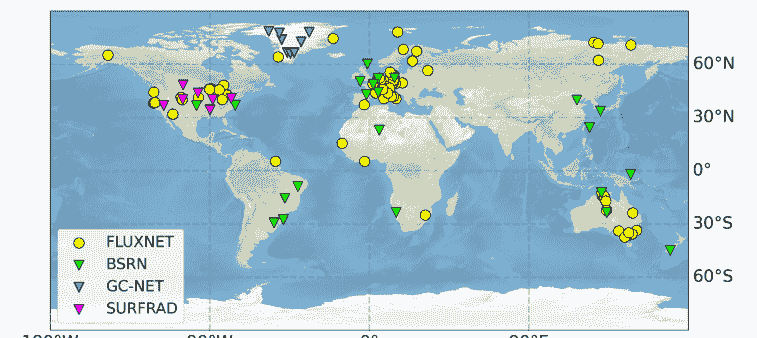

图 1. 地面观测站分布。训练数据创建为标签。验证和测试数据标记为三角形。

在晴空下，对气溶胶厚度 (AOD) 和水汽负载进行建模。对于云天气，云光学厚度 (COD)、类型、高度和水汽负载被设置为输入。当存在云层时，忽略大气粒子的散射和吸收。

每日 DSR 是通过全天的瞬时 DSR 平均得的，且对于相同的太阳天顶角 (SZA)、视角、表面和大气条件，一天中任意时刻 $i$ 的瞬时 DSR 与 SZA 联。每日模拟包含更多参数（例如纬度和太阳赤角）以计算 $D_{SZA}$。详细设置见表 1。

总而言，MODRAN 的运行结合了 24 种视角、245 种表面反射率、576 种云层大气条件以及综合数据库。然而，并非所有模型都用作输入。以往研究的敏感性分析表明，SZA、反射率和云量是影响所有天气 DSR 的真实因素 (Hansen, et al., 2019)，所提模型只需要光谱顶层 (TOA) 反射、表面反射率和几何信息。模拟模型的其他驱动参数被平滑。$D_{sim}$

## 2.3. 额外数据

所提方法还考虑了高分辨率 DSR 产品，包括基于地球成像相机 (EPIC) 的 DSR 产品、地球系统模型 (BESS) 水辐射产品、全球陆地表面

表 1
MODTRAN 中使用的驱动参数

| 参数 | 数值 |
|---|---|
| 太阳天顶角 (SZA) | 0.10, 20, 30, 40, 50, 60 |
| 视角天顶角 (SZA) | 0.10, 20, 30, 40, 50, 60 |
| 相对方位角 (RA) | 0.00, 30, 60, 90, 120, 180 |
| 气溶胶类型 | 5 |
| 气溶胶光学厚度 (AOD) | 0.00, 0.05, 0.1, 0.2, 0.4, 0.6, 1.0 |
| 云量 | 0.0, 0.1, 0.3, 0.5, 0.7, 0.9 |
| 云类型 | 层云、积云、高云、雨云 |
| 云光学厚度 (COD) | 0.25, 1.2, 2.3, 5, 10, 20, 30, 60, 120, 240 |
| 水汽 | 0.1, 1.5, 3.0, 7.0 |
| 纬度 | 0.10, 20, 30, 40, 50, 60, 70, 80, 90 |
| 赤角 | -23.5 / -22.3 / 2.5 / 23.5 |

卫星 (GLASS) DSR 产品和 MODIS/TERRA+Aqua 表面辐射数据方法 (MCD18A)。EPIC 使用随机方法在 0.1 度空间分辨率和 1-2 小时时间分辨率上生成 DSR。BESS 产品基于模拟训练的神经网络 (NN)。一系列 MODIS 大气和陆地数据作为模型输入。GLASS 提供了 5 km 的每日 DSR；它实现了基于 MODIS TOA 反射和波段的大气方法 (Zhang et al., 2019)。云和地球大气被建模 (Wang et al., 2021)。天气云 (SNYP) DSR 在本中作为参考，因为它提供了全球范围内的准确 DSR 估计 (Ji et al., 2021; Zhang et al., 2023)。我们使用融合方法合并各种卫星观测和辐射数据。CLIMS12、VIIRS SNPP 也作为输入。该方法为 750 米空间分辨率的 MOD05 提供算法。研究中的雪和云信息均来自 CLIMS12、VIIRS SNPP 产品。

# 3. 方法

### 3.1. NN

反向传播 NN 已广泛估计 DSR (Wang et al., 2018; Biyu et al., 2019; Wang et al., 2021)。算法的理论基础是所提 DSR 估计模型包含 10 波 TOA 反射、表面反射率和几何。每日模型与纬度和赤角。输入参数的敏感性分析见 4.1 节。为了确定 NN 模型参数，在不同数据集上训练模型。SURFAD 用于验证和选择模型参数。为了平衡与效率，选择了四层（一个输入、两个隐藏层和一个输出层）。第一层有 25 个神经元，随后是 5 个线性激活函数的神经元 (Nan and Hinton, 2010)。输出层有一个对应线性激活 DSR 值的神经元。模型权重使用 Glorot 方法初始化：

$w \sim \sqrt{\frac{\sqrt{6}}{n_i+n_{i+1}}} + \frac{\sqrt{6}}{n_{i+1}+n_i}}, \quad l=0, \dots, L-1; \quad (1)$

其中 L 是 NN 的层数，$n_i$ 是层中的神经元数。DSR 的数值、模型的最终输出和均方误差 (MSE) 函数用作误差函数：

```
$E(w) = \sum [v(x) - h_i]^2; \quad (2)$
```

其中 $h_i$ 是第 $i$ 个样本的模拟/测量 DSR。误差函数使用 RMSProp 进一步最小化 (Hinton et al., 2012)，这是一种随机梯度下降，能够实现稳定的学习曲线并通过计算梯度的平方加权平均来加速。确保模型不会过拟合给定的测量值。BM 从模拟数据中学习知识。为了使模型适应真实数据，通过匹配卫星产品与 FLUXNET 测量数据对模型进行微调。以往研究表明 NN 模型的第一层对权重初始化更为敏感。本文中，第一层权重 $w_1$ 最初从 BM 初始化，如图 2 所示，这意味着它们随后通过 (1) 进行更新，在 (2) 过程中使用 RMSProp，$x \in D_{sim}$。因此，BM 可以表示为 $g_1(x, w_1), x \in D_{sim}$。

### 3.2. 迁移学习模型构建

迁移学习模型的构建需要两轮训练（图 2）。首先在源域（模型中为 $D_{sim}$）上进行训练。此处称为 BM。然后通过目标域（$D_{tar}$）对模型进行微调，以获得更好的 DSR 估计，并视为迁移学习模型 (BM, TL)。

BM 按照 NN 配置构建，训练数据集由模拟数据组成。BM 可以总结为 $(x, w), x \in D_{sim}$。我们将模拟数据随机分为80% 训练数据和 20% 验证数据进行训练，没有应用交叉验证。由于样本量足够，我们还使用了 SURFRAD 作为额外的验证数据来

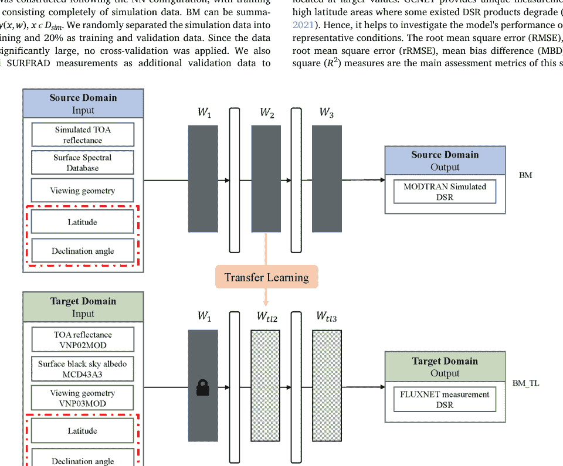

在所提的，模型在独立站点上训练和评估（即训练域和目标域之间不存在重叠站点）。FLUX-NET 数据集用于验证和选择模型参数。为了平衡准确性和效率，选择了四层（一个输入、两个隐藏层和一个输出）。第一层有 25 个神经元，随后是 5 个线性激活函数的神经元 (Nan and Hinton, 2010)。输出层有一个对应线性激活 DSR 值的神经元。模型权重使用 Glorot 方法初始化：

$w \sim \sqrt{\frac{\sqrt{6}}{n_i+n_{i+1}}} + \frac{\sqrt{6}}{n_{i+1}+n_i}}, \quad l=0, \dots, L-1; \quad (1)$

其中 L 是 NN 的层数，$n_i$ 是层中的神经元数。DSR 的数值、模型的最终输出和均方误差 (MSE) 函数用作误差函数：

```
$E(w) = \sum [v(x) - h_i]^2; \quad (2)$
```

其中 $h_i$ 是第 $i$ 个样本的模拟/测量 DSR。误差函数使用 RMSProp 进一步最小化 (Hinton et al., 2012)，这是一种随机梯度下降，能够实现稳定的学习曲线并通过计算梯度的平方加权平均来加速。确保模型不会过拟合给定的测量值。BM 从模拟数据中学习知识。为了使模型适应真实数据，通过匹配卫星产品与 FLUXNET 测量数据对模型进行微调。以往研究表明 NN 模型的第一层对权重初始化更为敏感。本文中，第一层权重 $w_1$ 最初从 BM 初始化，如图 2 所示，这意味着它们随后通过 (1) 进行更新，在 (2) 过程中使用 RMSProp，$x \in D_{sim}$。因此，BM 可以表示为 $g_1(x, w_1), x \in D_{sim}$。

### 3.2. 迁移学习模型构建

迁移学习模型的构建需要两轮训练（图 2）。首先在源域（模型中为 $D_{sim}$）上进行训练。此处称为 BM。然后通过目标域（$D_{tar}$）对模型进行微调，以获得更好的 DSR 估计，并视为迁移学习模型 (BM, TL)。

BM 按照 NN 配置构建，训练数据集由模拟数据组成。BM 可以总结为 $(x, w), x \in D_{sim}$。我们将模拟数据随机分为80% 训练数据和 20% 验证数据进行训练，没有应用交叉验证。由于样本量足够，我们还使用了 SURFRAD 作为额外的验证数据来


在所提的，模型在独立站点上训练和评估（即训练域和目标域之间不存在重叠站点）。FLUX-NET 数据集用于验证和选择模型参数。为了平衡准确性和效率，选择了四层（一个输入、两个隐藏层和一个输出）。第一层有 25 个神经元，随后是 5 个线性激活函数的神经元 (Nan and Hinton, 2010)。输出层有一个对应线性激活 DSR 值的神经元。模型权重使用 Glorot 方法初始化：

$w \sim \sqrt{\frac{\sqrt{6}}{n_i+n_{i+1}}} + \frac{\sqrt{6}}{n_{i+1}+n_i}}, \quad l=0, \dots, L-1; \quad (1)$

其中 L 是 NN 的层数，$n_i$ 是层中的神经元数。DSR 的数值、模型的最终输出和均方误差 (MSE) 函数用作误差函数：

```
$E(w) = \sum [v(x) - h_i]^2; \quad (2)$
```

其中 $h_i$ 是第 $i$ 个样本的模拟/测量 DSR。误差函数使用 RMSProp 进一步最小化 (Hinton et al., 2012)，这是一种随机梯度下降，能够实现稳定的学习曲线并通过计算梯度的平方加权平均来加速。确保模型不会过拟合给定的测量值。BM 从模拟数据中学习知识。为了使模型适应真实数据，通过匹配卫星产品与 FLUXNET 测量数据对模型进行微调。以往研究表明 NN 模型的第一层对权重初始化更为敏感。本文中，第一层权重 $w_1$ 最初从 BM 初始化，如图 2 所示，这意味着它们随后通过 (1) 进行更新，在 (2) 过程中使用 RMSProp，$x \in D_{sim}$。因此，BM 可以表示为 $g_1(x, w_1), x \in D_{sim}$。

# 4. 结果与讨论（推断背景）

BM 按照 NN 配置构建，训练数据集由模拟数据组成。BM 可以总结为 $(x, w), x \in D_{sim}$。我们将模拟数据随机分为80% 训练数据和 20% 验证数据进行训练，没有应用交叉验证。由于样本量足够，我们还使用了 SURFRAD 作为额外的验证数据来


在所提的，模型在独立站点上训练和评估（即训练域和目标域之间不存在重叠站点）。FLUX-NET 数据集用于验证和选择模型参数。为了平衡准确性和效率，选择了四层（一个输入、两个隐藏层和一个输出）。第一层有 25 个神经元，随后是 5 个线性激活函数的神经元 (Nan and Hinton, 2010)。输出层有一个对应线性激活 DSR 值的神经元。模型权重使用 Glorot 方法初始化：

$w \sim \sqrt{\frac{\sqrt{6}}{n_i+n_{i+1}}} + \frac{\sqrt{6}}{n_{i+1}+n_i}}, \quad l=0, \dots, L-1; \quad (1)$

其中 L 是 NN 的层数，$n_i$ 是层中的神经元数。DSR 的数值、模型的最终输出和均方误差 (MSE) 函数用作误差函数：

```
$E(w) = \sum [v(x) - h_i]^2; \quad (2)$
```

其中 $h_i$ 是第 $i$ 个样本的模拟/测量 DSR。误差函数使用 RMSProp 进一步最小化 (Hinton et al., 2012)，这是一种随机梯度下降，能够实现稳定的学习曲线并通过计算梯度的平方加权平均来加速。确保模型不会过拟合给定的测量值。BM 从模拟数据中学习知识。为了使模型适应真实数据，通过匹配卫星产品与 FLUXNET 测量数据对模型进行微调。以往研究表明 NN 模型的第一层对权重初始化更为敏感。本文中，第一层权重 $w_1$ 最初从 BM 初始化，如图 2 所示，这意味着它们随后通过 (1) 进行更新，在 (2) 过程中使用 RMSProp，$x \in D_{sim}$。因此，BM 可以表示为 $g_1(x, w_1), x \in D_{sim}$。

### 4.1. 敏感性分析

由于使用 VIIRS TOA 反射进行 ISR 估计，进行了敏感性分析以调查瞬时和每日 D 输入变量的影响。使用了 Python SALIB 库中的 Sobol 方法 (Sobol, 2001)。一阶指数 (S1) 和总阶指数 (ST) 测量了单个输入对输出方差的贡献。结果见图 3。对于瞬时 D，波段 4 比其他波段高。近红外到中红外波段 5-11 也占总的%，与以往敏感性分析相比，波段 4 具有更重要的作用。

### 4.2. 与传统 NN 方法的比较

所提方法在实地数据上进行了测试，由于每个网络的不同属性，结果具有统计意义。FLUXENet 用于 BM、SA 和 TM 的训练数据。TL 模型增强了传统的机器学习，所提模型 (TL) 与 BM 和 SA 进行了比较。对于瞬时 D，SA 在 FLuxenet 上的 RMSE 更。BM 模型在 FLuxenet、SURFRAD 和 BSNR 数据上的 RMSE 分别为 127.0、126.2 和 104.5 $W/m^2$，SA 达到了


Li 等人


# FLUXNET BM

# SURFAD BM

# BSRN BM

# GC-NET BM

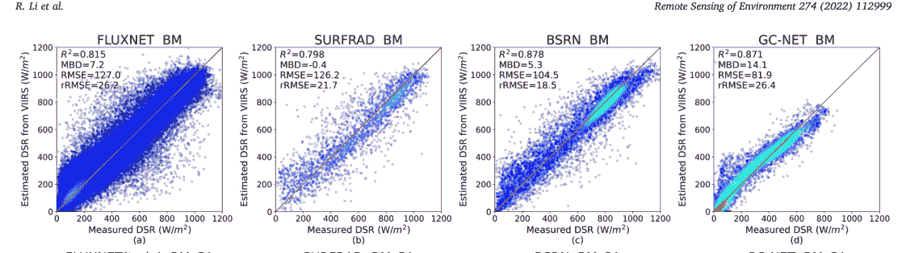

# FLUXNET(train) BA

# SURFAD BM, SA

# BSRN BA

# GC-NET BA

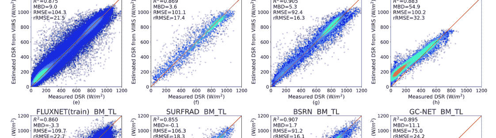

# FLUXNET(train) TL

# SURFAD BM, TL

# BSRN TL

# GC-NET TL

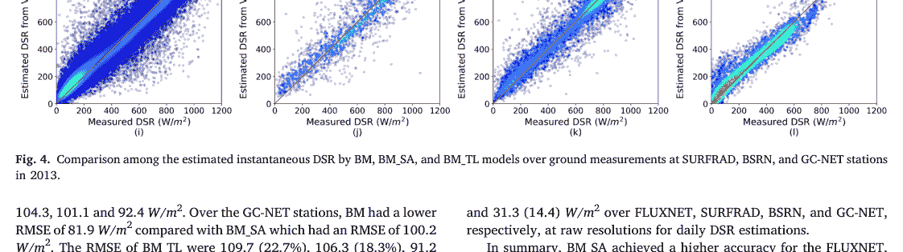

图 4. 2013 年 SURFAD、BSRN 和 GC-net 站跨数据集的 BY、BM、SA 和 TL 模型估计的瞬时 DSR 对比。

104.3、101.1 和 92.4 W/m²。与 RMSE 为 100.2 W/m² 的 BM SA 相比，GC-NET 站的 RMSE 较低，为 81.9 W/m²。对于低 DSR 分布，BM TL 比 FLUXNET、SURFAD 和 BSRN 站分别低 12.2 (16.1%) 和 75.2 (24.2%)，比 FLUXNET、SURFAD、BSRN 和 GC-NET 站低 31.3 (4.4) W/m²。

总而言之，与仅在实测数据上训练的 ML 模型相比，BM 模型在 FLUXNET、SURFAD 和 BSRN 站的瞬时和每日估计中实现了更高的精度。SURFAD 和 BSRN 站的样本量与 FLUXNET 的训练数据相似，这导致了在这些站点上更高的性能。

估计 DSR 之间的对比如图 5 所示。与所述，BM 在 FLUXNET、SURFAD 和 BSRN 站取得了显著优于其他的结果。

BM TL 在 FLUXNET 上的 RMSE 为 58.2 W/m²，SURFAD 站为 62.8 W/m²，BSRN 站为 86.5 W/m²。值得，由于全天特性稳定的假设，BM 和 BM SA 之间的差异没有瞬时样本差异大。由于极地区训练数据不足导致的过拟合以及 BM TL 模型的过拟合，BM TL 在 GC-NET 站有了显著改进，并在 FLUXNET、SURFAD 和 BSRN 站取得了略优的结果。

BM、TL 的 RMSE 分别为 33.2 (18.1%)、33.5 (17.6%)、30.8 (15.5%)。

# FLUXNET

# SURFAD BM

# BSRN BM

# GC-NET BM

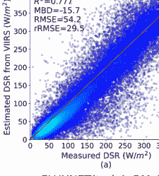

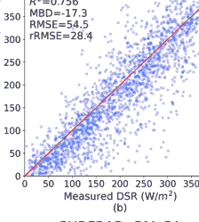

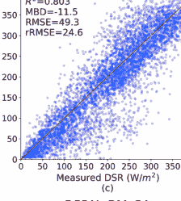

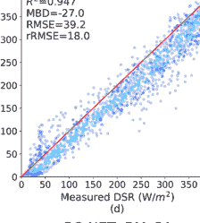

# FLUXnet(train) BM SA

# SURFAD BM SA

# BSRN BM

# GC-NET BM SA

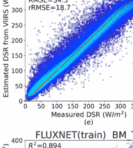

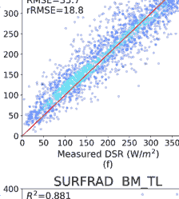

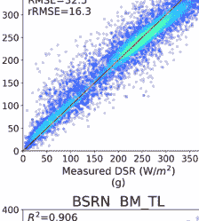

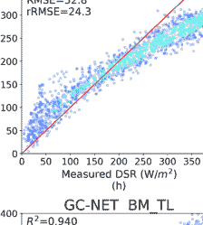

# FLUXnet(train) BM TL

# SURFAD BM TL

# BSRN BM TL

# GC-NET BM TL

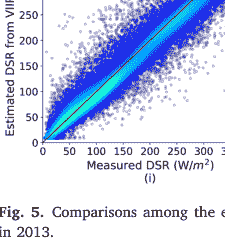

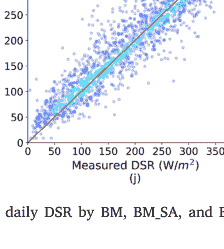

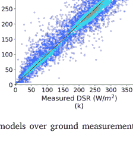

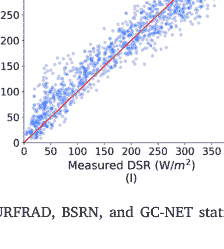

图 7 比较了 2013 年 SURFAD、BSRN 和 GC-NET 站观测的 BM、SA 和 TL 模型估计的 DSM。对于这些情况，结果更好，但改进有限。对于大于 70% 的区域，三个模型的 RMSE 显示，尤其是 BM、SA 和 TL。在这种情况下，BM 和 SA 之间的差异很大。当 WSA 大于 60° 时，TL 仍然优于 BM。BM、SA 和 TL 的 RMSE 在 DSM 比较中表现不同。当 WSA 低时，BM、SA 和 TL 的表现好得多。当 WSA 大于 60° 时，BM、SA 和 TL 的 RMSE 显示模型在不同条件下表现不同。对于非雪天气，三个模型的 RMSE 相似。对于雪覆盖像素，三个模型的 RMSE 相似，但 TL 实现了最低的 RMSE。在大范围内，所有模型在 SURFAD 和 BSRN 站的性能相似。当天气晴朗或多云时，三个模型的估计精度相似。

### 4.3. 与方法的比较

在本研究中，BM 方法与两种传统物理方法——神经网络和直接 LT 进行比较，使用了相同的输入数据以确保比较的可比性。神经网络的结果可以于 (2021)。LT 和直接估计方法的系数也从样本数据中提取。图 8 显示了 SURFAD、BSRN、GC-NET 站的估计值结果。SURFAD 的 LT 和直接估计方法的 RMSE 分别为 140.0 和 142.2 W/m²，BSRN 站分别为 108.4 和 118.8 W/m

R. Li 等人


# 纬度

# SZA

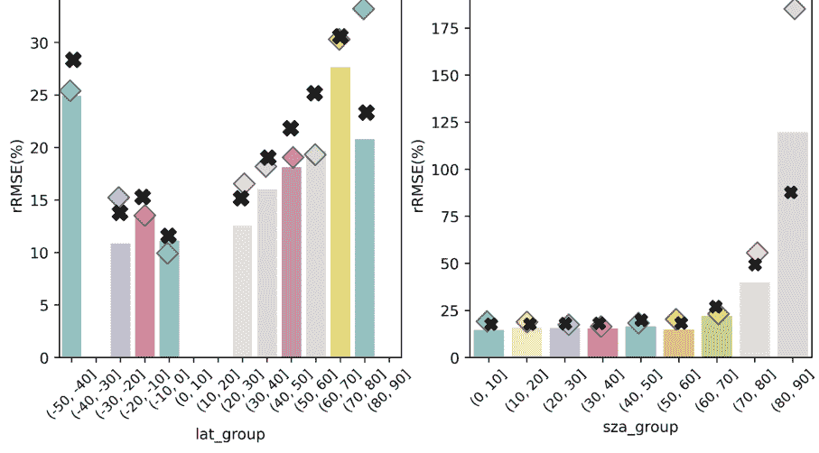

图 6. 不同纬度和 SZA 下 BM、BM_SA 和 BM_TL 模型估计的瞬时 DSR 比较。

# 雪

# 云

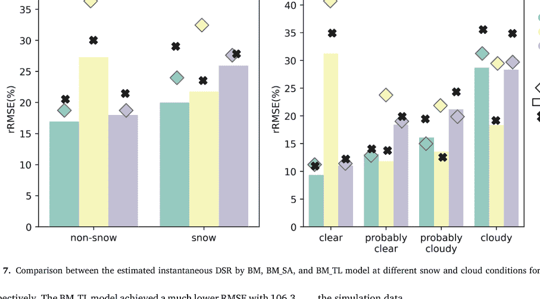

图 7. 每个测试网络在雪和云条件下 BM、BM_SA 和 BM_TL 模型估计的瞬时 DSR 比较。

BM_TL 模型在 SURFAD 和 BSRN 上实现了较低的 106.6 m² 和 91.2 W/m² DSR。对于每日 DSR 估计，SURFAD 站的 LUT 和直接估计方法的 RMSE 为 48.8 和 49.9 W²。对于 BSRN，这些为 43.5 和 42.2 W/m²。再次，BM_TL 模型在 SURFAD 和 BSRN 上实现了更低的 DSR RMSE。BM_TL 性能优越的原因通过模拟数据看出：LUT 和直接估计方法仅使用线性插值计算 DSR，而 BM_TL 可以捕捉非线性关系。此外，除了模拟数据外，BM_TL 还利用了地面测量的信息，这减少了源于模拟数据条件的不确定性。BM_TL 的优越性也特别适用于估计 GCNET 站的情况。LUT 和直接估计方法瞬时 DSR 的 RMSE 为 124.4 和 129.9 W/m²。SZA 高于 75 度的直接估计方法 RMSE 较高，而 BM_TL 较低，这通过模拟数据显示。对于每日估计，LUT 和直接估计方法的 RMSE 为 52.1 和 40.8 W/m²，而 BM_TL 实现了 38.0 W/m²。除了上述原因，BM_TL 在 GCNET 站的改进也归于多个波段的组合从

# SURFAD LUT

# BSRN LUT

# GCNET LUT

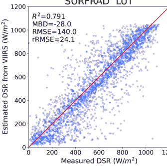

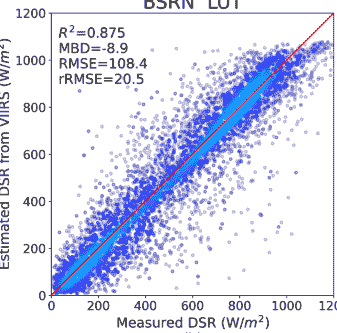

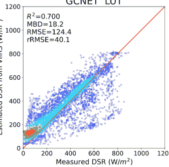

# SURFAD 直接估计

# BSRN 直接估计

# GCNET 直接估计

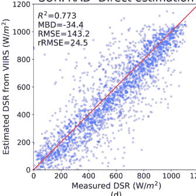

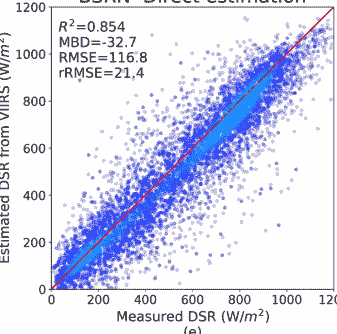

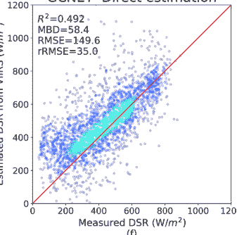

# SURFAD BM TL

# BSRN BM TL

# GCNET BM TL

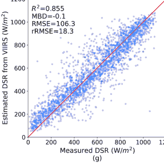

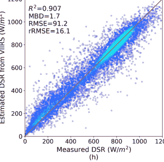

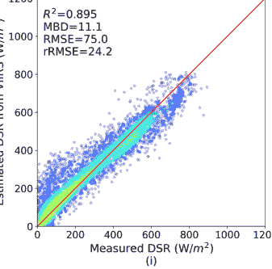

图 8. SURFAD、BSRN、GCNET 站 LUT、直接估计和 BM 模型估计的 DSM 与地面观测量的比较。

### 4.4. 与现有的 DSR 产品对比


# SURFRAD LUT

# BSRN LUT

# GCNET LUT

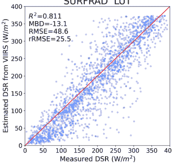

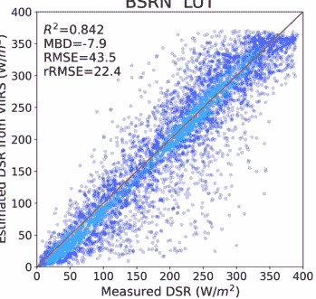

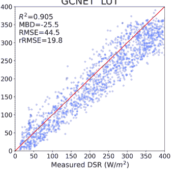

(a)

(b)

(c)

# SURFRAD 直接估计

# BSRN 直接估计

# GCNET 直接估计

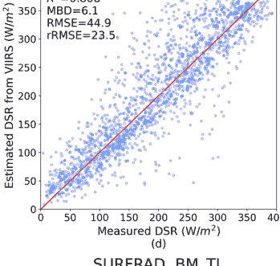

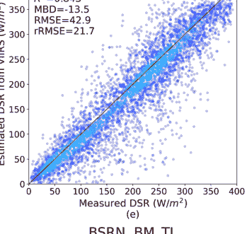

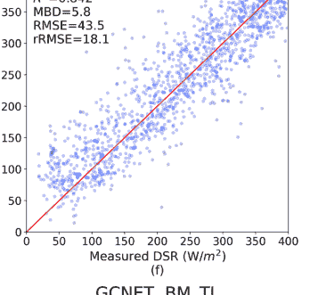

(d)

(e)

(f)

# SURFRAD BM TL

# BSRN BM TL

# GCNET BM TL

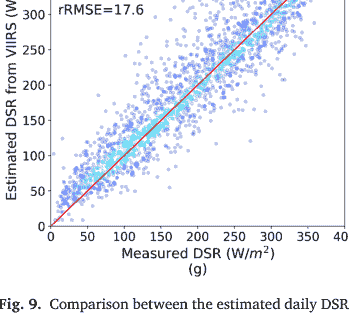


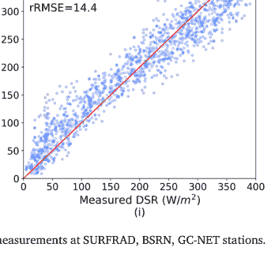

(g)

(h)

(i)

图 9. LUT、直接估计和 BM 模型与 SURFRAD、BSRN、GCNET 统计模型估计的 DSR 之间的比较。

可能考虑的因素。首先，光谱分辨率限制了 DSR 验证结果（Li 等，2021）。空间分辨率越低，验证准确率越高。BESS 和 GLASS 是 S，MCD18 是 1 km 分辨率，在 750 米处的估计 DSR 为。其次，源数据必须具有检索准确率。所提出的方法使用了新的 VIIRS TOA 数据。BESS、GLASS 和 MCD18 均已成熟，而所提方法仍处于开发阶段。生产生成尚未添加调整程序。

# 表 2
BM、TL 与与 EPIC、GLASS 和 BESS 估计的瞬时 DSR 的比较总结。

| 产品 | 时间尺度 | $R^2$ ($m^2$) | 偏差 ($m^2$) | rRMSE | 参考文献 |
| :--- | :--- | :--- | :--- | :--- | :--- |
| EPIC | 小时 | 0.83 | 113.21 | 2.34 | (Iao 等人，2019) |
| GLASS | 瞬时 | 0.83 | 115 | -6.5 | (Ryu 等人，2018) |
| BESS | 瞬时 | 0.84 | 123.3 | -0.3 | (Ryu 等人，2018) |
| BM,TL | 小时 | 0.91 | 8.6 | 18.3 | |

# 表 3
BM、TL 与 BESS、GLASS 和 MCD8 估计的每日 DSR 的比较总结。

| 网络 | 产品 | R² (W/m²) | 偏差 (W/m²) | rRMSE (%) |
|---|---|---|---|---|
| 全部 | BESS | 0.91 | -32.0 | 15.4 |
| | GLASS | 0.83 | -45.2 | 21.7 |
| | MCD-18 | 0.77 | -19.4 | 53.9 |
| | BM-TL | 0.90 | -31.7 | 25.9 |
| | BESS | 0.91 | -30.6 | 15.2 |
| BSRN 和 SURFRAD | GLASS | 0.93 | -27.8 | 13.8 |
| | MCD-18 | 0.98 | -35.1 | 17.4 |
| | BM-TL | 0.90 | -31.6 | 15.7 |
| CGNET | GLASS | 0.64 | -57.1 | 37.2 |
| | MCD-18 | 0.55 | -72.1 | 40.6 |
| | BM-TL | 0.92 | -32.2 | 13.6 |

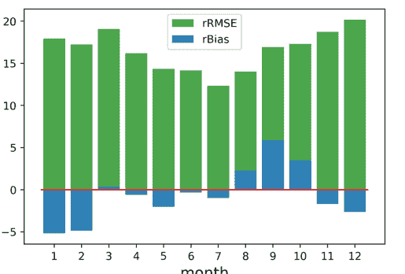

### 4.5. 时间分析

由于所提模型的训练是基于 2013 年的测量，我们还使用 2014 年 SURFRAD 站测量值验证了模型，以测试其应对未来年际结果的能力。

结果如图 10 所示。瞬时和每日的 rRMSE 为 17.5% 和 17.1%，未到偏差。我们提供了瞬时和每日数据的分析。2013 年和 2016 年测量的 rRMSE 分别为 18.9% 和 17.6%（图 4 和图 5）。

为了评估所提方法的稳定性，计算了验证期间每个月的 rRMSE 和 rmse。结果如图 11。与之前的分析（Li 等人，2021）相似，从 11 月到 3 月观测到较高的 rRMSE，从 5 月开始观测到最低 rRMSE。

7 月观测到最低的 7%，从8 月到 10 月出现高估，从10 月到 2 月出现低估。

我们的分析显示，纬度越高，当前 DSR 结果中的季节性趋势越明显（Li 等人，2021）。为了评估所提方法在高纬度地区的稳定性，2013 年 CGNET 站的 DSR 每日变化如图 12 所示。观测到测量与估计 DSR 之间的一致性。通过采用卫星估计，所提方法还可以填补测量值的空白。例如，5 月之前没有测量值，但所提方法可以提供估计。由于天气因素，极地区 DSR 的准确检索具有挑战性；因此，高纬度地区将从未来的研究受益。

### 4.6. DSR 制图

BM, TL 使用卫星图像来证明有效性。选择了具有测量值的格陵兰、乌拉和中东的三个 VIIRS 轨道。我们为这三个区域生成了 DSR 图。选择了 2013 年 6 月 6 日随机一天用于观测和每日制图。我们展示了估计的 DSR 制图。VIIRS 红绿蓝（RGB）图像用于瞬时估计，因为云对应每日 DSR。为了覆盖 RGB 图像上的云，还使用了 L2 VIIRS 数据。还注意到 BM,TL 的 DSR 估计在三个区域呈现相似模式。BM,TL 还能区分出

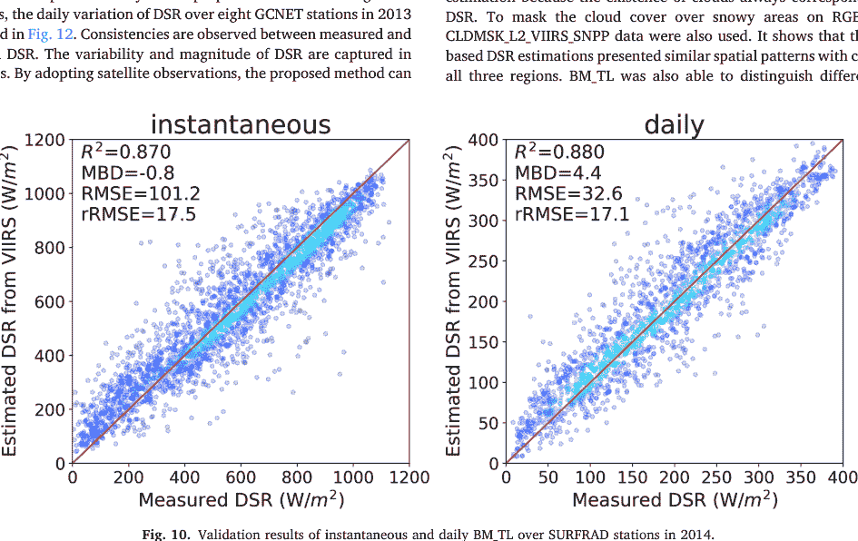

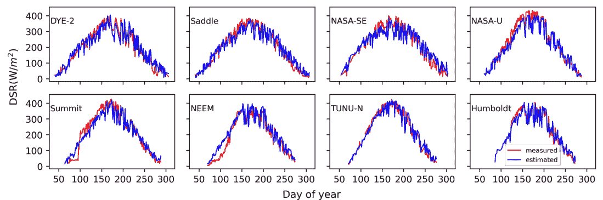

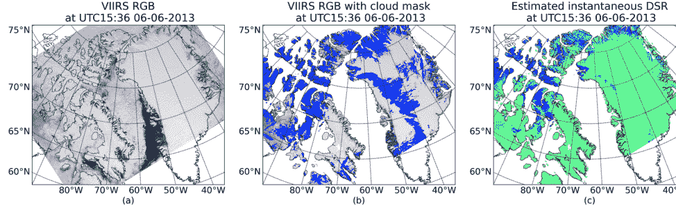

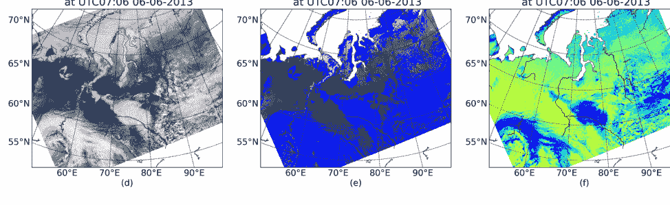

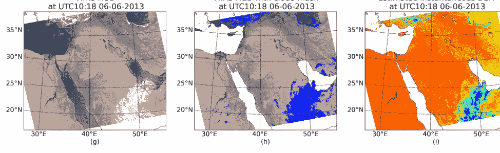

图 12. 2013 年 CGNET 站估计与实测 DSR 的每日变化。

图 13. 2013 年 6 月 6 日格陵兰、乌拉和中东地区云覆盖的估计 DSR 和 VIIRS RGB 图像。

图 14. 2013 年 6 月 6 日格陵兰、乌拉和中东地区的估计每日 DSR 与 CERES-SYN 每日 DSR 的比较。

### 4.7. 训练数据大小的影响

由于 TL 首次引入是为了结合模拟数据和现场数据，因此进行了更多分析，以显示与传统神经网络相比训练数据的大小如何影响性能。我们使用了不同数量（5, 10, 30, 50, 70 和 96）的完整数据子集来训练 BM 和 TL。对于每个模型，从 FLUXNET 站中随机选择站点，以最小化对训练数据代表性的影响。使用 SURFAD、BSN 和 GC-NET 站测试模型。保留了模型结构和配置，但冻结层和节点外，这些节点通过冻结模型的一层并在 FLUXNET 测量值上重新训练来识别。对模型进行了独立验证。RMSE 分别为 106.3、91.2% 和 71.7%，与传统的机器学习和物理算法相比，对数据提供了显著的改进。

首先，可以从图 5 和表 4 中得出改进。BM 观测到较大的 RMSE，特别是当数据量小于 50 个站点时。对于 SURFRAD，BM 的 RMSE 为 28.5%，对于 TL 为 23.8%。差异在于测试 GCNET 之间；BM 的 RMSE 达到 71.7%，而对于 GCNET，TL 实现了 BSA 的近一半。

所提算法有几个优点。它只将 TL 和 BSA 作为输入，这使得通过高层数据本质上更好，并在 BSA 原始值（15-300）处检索。TL 是连接物理模型和统计模型之间差距的桥梁。通用性和准确性均得到了证明，使得（站点）减少 10 倍或更少，且几乎在机器学习中观察到。对于 BM，来自所有数据的 TL。当从小尺寸训练时，模型性能有所提高，对于 BM, TL 的 RMSE 低于 6 W/m²，而对于 GCNET 为 100 W/m²。

# 5. 结论

本研究提出了一种带有 TL 的神经网络来估计来自 VIIRS POA 源的全球反照和每日数据。四层神经网络在 RTM 模拟数据上构建并训练。

作者贡献声明

D. Wang 和 R. Li 构思了研究。R. Li 和 D. Wang

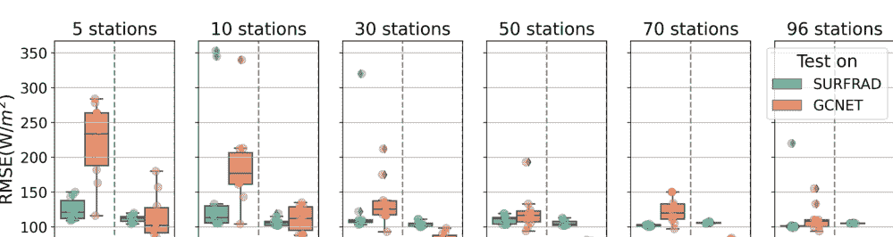

图 15. 在 5, 10, 30, 50, 70 和 (96) 所有 FLUXNET 站点上训练的 BM、TL、BSA 之间的比较。


## 在 SURFAD 和 GCNET 方法上经过 10 次和 50 次 FLUXNET 训练的 BM、TM 评估。

表 4
| N | 模型 | SURFAD RMSE (W/m²) | SURFAD rmse (%) | SURFAD STD (W/m²) | GCNET RMSE (W/m²) | GCNET rmse (%) | GCNET STD (W/m²) |
| :--- | :--- | :--- | :--- | :--- | :--- | :--- | :--- |
| 5 | BM | 124.6 | 21.5 | 15.8 | 22.2 | 71.7 | 55.1 |
| 10 | TM | 117.2 | 19.2 | 5.4 | 115.5 | 36.6 | 23.6 |
| 20 | BM | 160.2 | 27.6 | 100.0 | 182.0 | 60.6 | 62.6 |
| 30 | TM | 107.0 | 18.4 | 5.8 | 112.0 | 36.1 | 18.2 |
| 30 | BM | 129.9 | 22.4 | 67.0 | 135.5 | 43.7 | 34.1 |
| 50 | TM | 120.4 | 17.9 | 6.1 | 82.1 | 26.5 | 8.9 |
| 60 | BM | 110.3 | 19.0 | 6.2 | 121.3 | 39.1 | 27.9 |
| 70 | TM | 105.5 | 18.2 | 4.1 | 74.9 | 24.1 | 14.6 |
| 70 | BM | 101.9 | 17.5 | 1.4 | 123.1 | 39.7 | 18.0 |
| 90 | TM | 105.8 | 18.2 | 0.9 | 109.4 | 25.5 | 21.7 |
| 116 | BM | 105.1 | 18.1 | 0.3 | 24.3 | 0.2 | |

处理并分析了数据。R. Li, Wang 和 S Liang 完成了结果的解释。R. Li 主导了手稿的编写。所有贡献者均参与了手稿的修订。

## 利益声明

作者声明他们没有影响本文报道工作的竞争性利益或个人关系。

## 致谢

本研究由 NASA 支持（资助 ID: 80NNSCK180620 和 80NNSCK210071）。感谢审稿人的宝贵意见和建议。

## 参考文献

- Averintine, J.A., Delani, J., Long, C.N. (2009). SURFAD: 一用于网络分析的多表面辐射收支。Amer. Meteor. Biol. 88(3), 201–214. https://doi.org/10.1111/j.atm.2009.03.002
- Baker, J.L., Tomson, R., Tufien, A., Sun, S. (2019). 用于估计不同地点太阳辐射的随机森林森林。Remote Sens. Sens. 118(1), 81–92. https://doi.org/10.3390/rs1101081
- Baldridge, A.M., Hou, S.G., Green, R. (2020). 用于卫星遥得通量的机器学习版本 2.0。Remote Sens. Sens. 12(4), 711–715. https://doi.org/10.3390/rs1204015
- Bole, A.C., Tuwan, J.D., Garsky, A., Pearson, M.S., Barnett, L., Li, J., & Zhai, X. (2021). 使用高分辨率光谱和光学图像估计表面通量的深度学习。在 Remote Sensing of Environment，255, 105477。https://doi.org/10.1016/j.rse.201
- Brown, M.G., Sklar, S.H., Li, S., & Wang, Y. (2020). 机器学习估计表面通量的应用。Remote Sens. Sens. 12(23), 3902. https://doi.org/10.3390/rs1223902
- Hao, N., Wang, Y., Mullen, T., Parrain, M. (2019). 用于大气传输的神经网络。Atmos. Earth. Space. 32, 1058–1074. https://doi.org/10.1007/s10024-019-0034
- Chen, Y., Wang, J., Wang, R., Han, J., Li, J., & McKenzie, R. (2019). 太阳辐射估计的深度学习模型评估：区域性分析。Remote Sens. Env. 223, 427–436. https://doi.org/10.1016/j.rse.2018.033
- Hous, N., Zhang, X., Liu, W., Wei, J., Ji, J., Wang, Y., Zhang, R., & Chen, J. (2021). 基于随机森林卫星数据的表面辐射阴影评估。Remote Sens. Sens. 12(1), 181. https://doi.org/10.3390/rs1201181
- Huang, R., Bao, S., Sun, Y., & Wang, D. (2018). 使用多尺度注意力机制的土地利用分类。Remote Sens. Env. 214, 73–86.
- Huang, H., C., Li, C.L., Li, J., Wang, D., & Zhang, Y. (2019). 卫星传感器的表面辐射评估：现状与未来展望。Remote Sens. Env. 223, 111371. https://doi.org/10.1016/j.rse.2018.11371
- Ji, J., Hu, N., Qin, Q., Yang, J., Wang, Y. (2019). 用于从静止卫星数据估计每小时太阳辐射的深度学习算法。Remote Sens. Env. 219, 105629. https://doi.org/10.1016/j.rse.2018.10529
- Khan, S., Pham, H., Wang, L., & Zhou, J. (2021). 使用深度学习的太阳能潜力和作物产量预测。Remote Sens. Env. 254, 105393. https://doi.org/10.1016/j.rse.2020.10593
- Li, R., Wang, D., & Liang, S. (2021). 下行表面辐射全球通量的综合评估。Remote Sens. Env. 256, 107318. https://doi.org/10.1016/j.rse.2020.10318
- Li, R., Wang, X., Xu, Y., Chen, J., Shi, J., & Li, S. (2020). 基于随机森林的卫星数据表面辐射阴影评估。Remote Sens. Env. 238, 107499. https://doi.org/10.1016/j.rse.2019.10749
- Maes-Hansen, K., Du, J., Niebel, A., He, R., Engel, S., & Richter, I. (2017). 使用机器学习和卫星遥得数据估计入射辐射。Remote Sens. Env. 208, 1448–1454. https://doi.org/10.1016/j.rse.2017.09018
- Mousavi, W. K., Grustal, A., Bheli, H., & Herrmann, R. (2009). 使用基于决策树的集成模型评估表面能量通量。Remote Sens. Env. 113(5), 1012–1024. https://doi.org/10.1016/j.rse.2008.0712
- Pan, S., Wang, J., & Sun, Y. (2019). 深度学习预测太阳辐射预测。Data Mining Eng. 22(6), 2755–2763. https://doi.org/10.1109/MDE.2019.2933
- Peng, L., Lu, H., Wang, Y., Shi, C., Tao, J., Tan, N., Zhang, R., Wang, J., & Li, S. (2020). 使用基于注意力的网络评估太阳辐射阴影。IEEE Trans. Quantum. Sens. 24(4), 1062–1076. https://doi.org/10.1109/TGRS.2019.2986
- Praty, C., Adams, D., & Deschamps, P. (1998). 遥感中的地形效应评估。Remote Sens. Env. 84(3), 193–200.
- Ruta, D., Cottels, D., R., Niegel, J., Twell, C., Nieb, J. (2015). 使用回归方法预测辐射。Remote Sens. Env. 190, 219–225. https://doi.org/10.1016/j.rse.2015.04014
- Hu, N., Zhou, Y., Wen, Q., Xiao, J., & Chen, Y. (2019). 5km 分率多源遥得辐射扩散和大气辐射全球图。Remote Sens. Env. 204(109), 812–825. https://doi.org/10.1016/j.rse.2019.07017
- Hu, N., Kobayashi, H., et al. (2019). 5km 分率多源遥得辐射扩散和大气辐射全球图。Remote Sens. Env. 204(109), 812–825. https://doi.org/10.1016/j.rse.2019.07017
- Shenkul, S. (2010). 使用遥感和光学深度网络对辐射建模。Remote Sens. Env. 35(12), 4795–4801. https://doi.org/10.1016/j.rse.2010
- Shi, H., Xian, Z., & Tian, X. (2019). 土壤-冠层-大气辐射传输模型的机器学习技术探索。Sci. Environ. 117(10), 32–46. https://doi.org/10.1016/j.scenv.2020.11099
- Wu, W., Peng, J., He, H., Li, S., & Zeng, G. (2021). 基于改进反射率的全球表面潜在辐射指数。Environ. Lett. 16(5), 05405.
- Sobol, I. (2001). 非线性模型的全局敏感性分析。Soft Computing, 5(1-3), 23–40.
- Takada, H., Nakajima, T., Higashitani, A., Takamura, T., Pinto, R., Nakajima, T. (2003). 卫星数据气溶胶光学深度反演。Remote Sens. Env. 55 (11), 2225–2230. https://doi.org/10.1029/RS2003RS19
- Yuan, J., Wang, J., Li, J., & Lu, K. (2020). 深度神经网络中的可学习特征价值价值？Remote Sensing 12, 185. https://doi.org/10.3390/rs1201185
- Tong, K. Y., Xia, G.-L., Shen, H., Li, S., You, S., Zhang, L. (2020). 使用可迁移深度学习模型进行高分辨率遥感影像土地覆盖分类。Remote Sens. Env. 219, 113992. https://doi.org/10.1016/j.rse.2020.11392
- Wang, T., Yao, Y., & Chen, L. (2012). 估计表面反照率的反演方法比较。Remote Sens. Env. 124, 61-71. https://doi.org/10.1016/j.rse.2012.04024
- Zhang, X., Liang, S., Wild, M., Jiao, B. (2015). 使用 MODIS 数据分析中国短波辐射。Remote Sens. Env. 165 (Suppl), 1–18. https://doi.org/10.1016/j.rse.2015.05013
- Gao, J., Zhang, L., Li, J., Sun, Y., Tan, H., Wang, Q., Wang, J., & J. (2020). 环境传感中的深度学习：综述。Remote Sens. Env. 241 (11), 111716. https://doi.org/10.1016/j.rse.2020.11176
- Wang, D, Li, S., Sun, J., & Ma, J. A. (2020). 融合土地产品 (mcl88) 下行表面辐射的新方法。Remote Sens. Env. 264, 112699
- Wang, D., Li, S., Liu, R., Jia, A. (2021). 基于反照率估计表面下行短波辐射的协同研究。Remote Sens. Env. 264, 112639. https://doi.org/10.1016/j.rse.2021.112639
- Zhang, X., Zhao, L., Li, S., Wang, D., Liu, Q., Yao, J., Jia, K., He, J., Wang, R., & Wang, Y. (2020). 用于从 MODIS 数据估计表面下行短波辐射产品的贝叶斯迁移学习。IEEE Trans. Geosci. Remote Sens. 57 (7), 4636-4650. https://doi:10.1109/TGRS.2020.2983201

