# 基于注意力神经网络的船舶运动响应海况参数估计


## 文章信息

关键词：
- 船舶运动
- 海况估计
- 深度学习
- 注意力神经网络
- 不确定性估计

## 摘要

现场估计海况参数对船舶导航至关重要。基于船舶运动响应的模型估计方法已经进行了广泛研究。基于机器学习（ML）的无模型方法近年来越来越受欢迎，使用深度学习（DL）方法从船舶运动响应时间序列进行估计已取得有前景的结果。在本研究中，我们应用新颖的基于注意力的神经网络（AT-NN）从船舶纵摇、垂荡和横摇的原始时间序列数据估计波高、过零周期和相对波向。尽管输入数据减少，但已证明，通过改进的最先进技术（基于卷积神经网络（CNN）进行回归、多元长短期记忆CNN和滑动拼图神经网络）所提出的方法相对于所有海况参数的最佳原始方法，将估计MSE、MAE和NSE分别提高了高达86%、66%和56%。此外，基于AT-NN的所提技术优于所有测试方法（原始和增强方法），在考虑所有海况参数时，MSE提高了94%，MAE提高了74%，NSE提高了80%。最后，我们提出了一种基于蒙特卡洛Dropout方法解释神经网络输出不确定性估计的新方法，以增强模型的可信度。

## 1. 引言

船舶航行时不利的天气条件可能导致各种危险情况，对船舶货物和船员产生负面影响。船舶对不安全情况的敏感性取决于其稳性参数、船体几何形状、尺寸和速度（IMO, 2007）。因此，维持船舶航线稳定的操作性能对于安全性和航行效率至关重要。这对船上决策支持系统（DSSs）构成挑战，这些系统考虑获取周围海况数据的问题，并帮助使操作决策更加精确（Faltinsen, 1990）。由于遭遇波浪几乎影响所有船舶操作，实时估计其特性至关重要。存在不同的收集海况数据的方法。传统上使用系泊波浪浮标、导航雷达或卫星数据。然而，这些方法由于其在可用性、可靠性、便利性和/或维护成本方面的局限性，并未代表完整的解决方案（Nielsen, 2017）。例如，基于统计的方法可以提供准确的波高估计，但波周期和波向估计相对较差。另一方面，昂贵的波浪雷达可以产生波周期和波向的准确估计，但波高并不总是被正确估计（Selimović et al., 2020）。作为标准估计方法的更高效替代方案，“波浪浮标类比”的概念旨在仅测量可用的船舶响应来推断海况信息。这导致更低的复杂性、更容易的维护，以及最终更低的成本。这一概念已经进行了数十年的研究。Nielsen (2017) 给出了基于船舶运动的海况估计技术的简要概述。随着计算资源的改进，优化方法得到发展并不断改进。最终，这导致了几篇包含前进速度问题和全尺度测试的已发表研究论文。该概念以海况与测量的船舶响应之间存在线性关系的假设引入。借助适当的数学模型，文献中可以找到两种不同的估计方法，一种在频域中，另一种直接在时域中。后者旨在解决频域过程中出现的挑战。在时域中，研究集中于应用卡尔曼滤波（Pascoal and Guedes Soares, 2009; Pascoal et al., 2017）或逐步程序（Nielsen et al., 2015, 2016）的方法。然而，在频域中进行的大多数研究使用谱分析，利用响应谱与方向波谱（DWS）之间的数学关系。模型描述通过复传递函数给出，即响应幅值算子（RAOs）。相应的DWS随后通过逆映射程序找到。频域中的程序被公式化，使得数学模型基于谱能量分布的等效性（Nielsen, 2006; Tannuri et al., 2003; Hinostroza and Guedes Soares, 2016）或谱矩（Montazeri et al., 2016）。

尽管上述DWS估计技术在许多报告中表现出良好的性能，但其实现可能包含一些约束。类比概念以线性假设给出，频谱分析需要稳定的操作条件，其中应该有一个最小平稳期来执行。此外，估计的准确性和可靠性在很大程度上取决于RAO的准确性，而RAO可能由于对输入条件的了解不足而不太准确或不完整。

最近，海况估计与数据驱动的ML方法相关联，以克服传统的基于RAO方法的局限性。其想法是在不了解船舶模型描述的情况下构建参数化的ML模型。已经发表了一些关于使用ML方法训练模型的研究。所提出的模型在时域和/或频域特征上训练，在预测波浪特性方面显示出足够的准确性。由于该模型仅基于船舶运动数据，因此假设它可以适用于各种类型的船舶。Tu et al. (2018) 提出了无模型方法识别海况等级的一个例子。作者应用可用的动力定位（DP）传感器收集四个自由度（DOF）的时间序列数据。估计过程包括多层分类器，并利用几种预处理技术从数据中提取时域和频域特征。

由于基于特征的方法中的分类依赖于手工设计特征的质量和数量，研究建议应用DL方法。Cheng et al. (2019) 提出的基于DL的海况等级分类模型仅使用原始时间序列数据。这里，使用多组件模型提高了分类精度。即，卷积神经网络（CNNs）和快速傅里叶变换帮助提取时间和频率特征，而递归神经网络在运动数据中搜索长期依赖关系。Cheng et al. (2020a) 使用密集连接CNN扩展了这项工作，以考虑波向特征的估计。此外，为提高可解释性并实现更好的精度，Cheng et al. (2020b) 提出了一种基于2D频谱图图像的模型，该模型同时携带时间和频率信息。

上述论文涉及没有船舶前进速度的DP应用。另一方面，Duz et al. (2019) 和 Mak and Düz (2019) 成功预测了前进速度条件下的波高和波向。使用6自由度船舶运动作为输入，问题被视为多元时间序列回归。结果给出了几种NN结构及相应的性能比较。这些工作被扩展到使用深度卷积编码-解码NN在Scholcz and Mak (2020) 中识别实时DWS。然而，该方法侧重于在模拟数据上训练模型，然后将这些模型直接用于测量数据或使用迁移学习方法应用。在Mittendorf et al. (2022) 中，几种提出的DL架构在横浪和随浪中的高级船舶情况下也证明了足够的结果，当应用不同的前进速度时对预测精度没有显著影响。

在本文中，我们提出了几种用于海况参数估计的DL模型（研究流程图见图1）。主要焦点是改进当前提出的模型并实现基于AT-NN的新DL模型。输入数据是3自由度船舶运动时间序列，输出指示波浪周期、相对波向和有效波高。正如Duz et al. (2019) 中所述，该问题被表征为多元时间序列回归。算法使用根据推荐指南生成的数值模拟数据进行训练。所提出的方法已与最先进的报告进行比较，以评估研究的新颖性及其潜在的实际应用。

本文的其余部分结构如下。在第2节中，给出了数据生成过程和描述的模拟程序。接下来，描述了应用的NN架构和DL模型。第3节中评估和描述了应用模型的性能。第4节提供了关于本工作局限性和可能的未来工作的结论性意见。

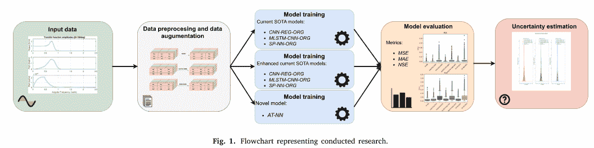

图1. 表示所进行研究的流程图。

## 2. 方法

收集遭遇波浪特性的实时估计可能有助于提高航行效率。在航线中，船舶遭遇随机环境力，因此经受三个旋转（横摇、纵摇和首摇）和三个线性（纵荡、横荡和垂荡）运动响应，如图2所示。根据论文引言中提到的许多先前研究，在波浪浮标类比方法中，考虑一组三个运动响应有利于成功估计海况。基于给定的输入-输出数据对，其想法是创建一个DL模型，以根据给定的3自由度船舶运动响应估计遭遇波浪的特性。我们观察横摇、纵摇和垂荡运动，这些运动主要由海浪驱动，且受推进器操作影响最小（Selimović et al., 2020; Nielsen, 2006）。

为了测试DL模型的准确性，根据已知的波谱计算3自由度船舶运动响应的平稳随机时间序列。时间序列模拟程序按照DNV-GL (2018) 和Mittendorf et al. (2022) 的相关研究工作给出的推荐指南进行。本节描述了用于生成时间序列数据和波浪特性估计模型的程序。

### 2.1. 时间序列数据的计算

让我们假设船舶在自然航道中航行，即在不规则波中，以指定的前进速度U和相对

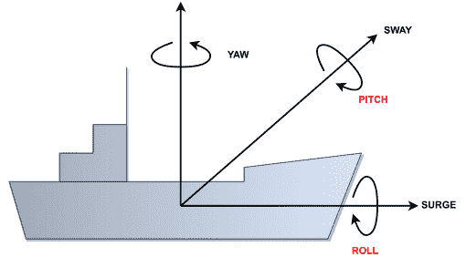

图 2. 六自由度（6-DOF）中的船舶运动响应。

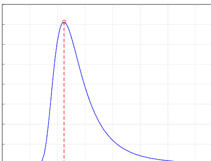

图 3. 波高 H_s = 3.0 m 且 T_z = 4.0 s 的单向一维 Bretschneider 波谱。

表 1
散货船的主要特性。
| 名称 | 值 |
|---|---|
| 长度 L_pp | 160.4 m |
| 宽度 B | 27.2 m |
| 吃水 T | 6.55 m |
| 初稳性高度 G_M | 3.97 m |
| 块系数 C_B | 0.77 |
| 排水量 | 22,193 t |

关于迎浪航向 β。在此情况下，波面升高可表示为多个正弦（规则）波分量的总和：

ζ(x,t) = Σ_{i=1}^{n} A_i cos(ω_i t - k_i x + ε_i)   (1)

其中 ω_i 是特定波分量的波频率，k_i 是波数，ε_i 是范围在 [0,2π] 内的随机相位偏移，以确保波的随机性。振幅 A_i 可由与波谱 S(ω) 的关系求得，给出式（2）：

½ A_i² = S(ω_i) Δω_i   (2)

其中所考虑的频率间隔 Δω_i 具有随机分布的边界。

波谱 S(ω) 在频域给出，并描述了在平稳海况下所有波频率 ω_i 的总波能量的分布（Faltinsen, 1990）。它可由国际拖曳水池会议（ITTC, 1969）建议的众所周知的谱之一估计。在完全成长海况下，建议使用双参数 Bretschneider 谱，见式（3）。

S(ω) = 124 H_s² / T_z⁴ ω^{-5} exp(-496 / (T_z⁴ ω⁴))   (3)

式（3）以重写形式给出，其特征统计周期为零上穿周期 T_z，与平均波周期 T_1 的关系为 T_1 = 1.087 T_z，峰值周期 T_p 为 T_p = 1.405 T_z。H_s 表示有效波高，ω 为波频率（DNV-GL, 2018）。

在双参数 Bretschneider 谱的一个示例中，能量分布在图 3 中给出，H_s = 3.0 m 且 T_z = 4.0 s 的值。该一维谱具有单一峰值，表明观测到的是单峰海况。单一峰值出现在角频率 ω_p = 1.12 rad/s 处，对应于峰值周期 T_p 和零上穿周期 T_z 的上述关系，因为 ω_p = 2π / T_p。此外，所提供的谱包含关于有效波高 H_s 的信息，可由谱下的面积确定。应注意，出于实用性和简便性考虑，所生成的时序不包含波方向性信息。换句话说，我们仅观察到长波峰或单向波，具有较窄的展布。

在航行时，船舶被视为具有前进速度 U 的复杂物体，并以特定迎浪角 β 遭遇波浪。由于多普勒频移，遭遇波谱不等于波频率域 ω 中给出的波谱。因此，船舶响应应在遭遇频率域 ω_e 中观察。波频率域到遭遇频率域的转换适用以下表达式：

ω_e = ω - ω² U / g cos(β)   (4)

其中 g 为所采用右手坐标系中的重力常数，其中 180 deg 的遭遇角表示迎浪。

给定船舶速度和航向角，我们可以从波周期轻松计算遭遇周期。遭遇周期很重要，因为它表示船舶遭遇波浪的周期。因此，如果它与船舶自然运动周期相吻合，则可能发生显著的船舶运动。由于它取决于船舶速度和航向角，以及波频率，船长可以通过调整船舶速度或航向角来“控制”它。

已知遭遇波谱和适当的复值传递函数 Φ_R，可以根据（Denis and Pierson, 1953）计算船舶运动响应 R_i(t) 的时序：

R_i(t) = Σ_{i=1}^{n} A_i |Φ_R(ω_{e,i})| cos(ω_{e,i} t + ε_i)   (5)

其中频率离散是非等距的，且振幅 A_i 在波频率域 ω 中给出，如式（2）所述。由于观测到的是单向谱，每个时序集 R_i(t) 针对单一遭遇角 β 生成，其他波特性包含在振幅 A_i 中。

传递函数使用条带理论求解器计算，针对纵摇、横摇和垂荡作为遭遇频率 ω_e 和遭遇角 β 的函数。前进速度为 16.19 节，相对波向离散为 36 个航向，范围为 [0,360]deg，其他值通过线性插值获得。波频率 ω 的范围定义为 [0,4.0] rad/s。所研究的船舶为 20,000 DWT 散货船，其主要特性如表 1 所示。垂荡、纵摇和横摇运动的频率响应函数振幅在图 4 中给出，相对波向 β = 150 deg，船舶前进速度 U = 16.19 节。

应用式（5），我们计算了 3-DOF 中的运动响应时序，采样频率为 5 Hz，样本长度为 300 s。时序响应的示例在图 5 中给出。

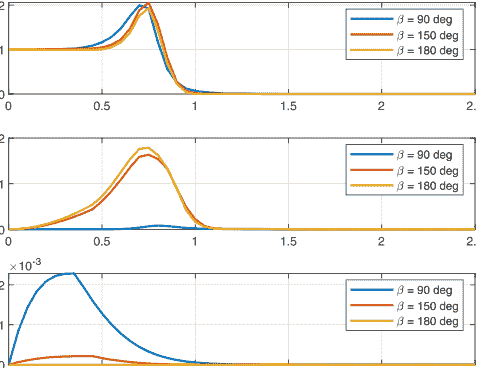

**图 4.** 不同相对波向（β = 90 deg.、β = 150 deg. 和 β = 180 deg.）下垂荡、纵摇和横摇响应的传递函数振幅，以及船舶前进速度 $U = 16.19$ 节。

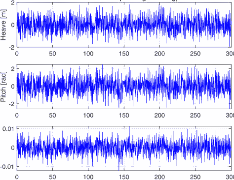

**图 5.** 船舶前进速度 $U = 16.19$ 节，海况参数 $H_s = 3.0$ m、$T_z = 4.0$ s 且 β = 150 deg 时计算的船舶运动响应时序。

我们设计拉丁超立方采样（LHS）以 20,000 个样本点在均匀距离上离散化 $H_s$、$T_z$ 和 β 的三维搜索空间。参数 $H_s$ 的有效范围为 [0.5, 10.5] m，参数 $T_z$ 为 [3.5, 9.6] s。遭遇角 β 定义在范围 [0, 360] deg 内。此外，遵循（Mittendorf et al., 2022）的工作，对不规则波应用约束以包含波破碎条件，即以适度的波陡为限，最大值为 $S_s$，根据 DNV-GL（2018）：

$$S_s = \begin{cases} \frac{1}{10} & \text{for } T_z \leq 6\ s \\ \frac{1}{15} & \text{for } T_z \geq 12\ s \end{cases} \tag{6}$$

在上述方程给出的极限之间的值通过线性插值求得。应用这些约束后，数据集包含约 13,000 个样本。$H_s$、$T_z$ 和 β 的最终三维搜索空间由 LHS 采样。由于 LHS 方法有助于确保样本均匀分布并减少在给定范围内遗漏样本的可能性，它是我们模拟和实验的有用工具。LHS 在计算上也比标准蒙特卡洛采样便宜。虽然在现代计算机上这可能不那么重要，但它被使用，因为它可能在真实变异性方面给出略微更准确的结果（给定处理时间）。

图 3 显示了使用选定的分布参数对（$H_s$ 和 $T_z$）的波谱的二维表示示例。如果考虑三维搜索空间中的第三个参数（波向 β），则可以获得方向波谱。

以下是数据增强过程和用于创建 DL 模型的 NN 架构的详细描述。

### 2.2. 数据预处理

输入-输出样本以 JSON 文件的形式为模型训练准备，随后进行处理和缩放。海况参数的输出值被缩放，使得 $H_s$ 和 $T_z$ 除以 15，相对波向 β 值除以 360。大量实验表明，输入数据（3-DOF）的缩放并不影响所测试模型的收敛。然而，模型的收敛很大程度上受输出尺度（设为 0 到 1 之间）的影响。通过选择 15 和 360 作为我们的数据集扩大 10% 后的最大值，我们确保了这些条件的满足。

数据增强策略在数据预处理步骤中采用以提高模型精度。数据增强应用于所提出的模型后，我们增加了数据的多样性并消除了过拟合。

接下来，我们解释所使用的增强方法。图 6 显示了一个包含 $n = 32$ 个样本的批次。批次中的每个样本由三个船舶运动响应时序输入数据组成，记为 $M_1$、$M_2$ 和 $M_3$。在每个批次内，以大小 $s = 32$ 进行采样，导致每个输入数据的 $k = 47$ 个子样本。

图 7 比较了对每个输入数据的子样本进行洗牌的变换。我们区分两种不同的增强方法：批处理方式和行方式。比较使用一个包含 $n = 3$ 个样本和 $k = 3$ 个 token 的批次。如图所示，批处理方式增强随机洗牌输入数据信号，使得所有行以相同方式同时洗牌。行方式增强则分别对每个数据样本进行洗牌。为了比较结果，所有 DL 模型均在无增强、批处理方式增强和行方式增强下训练。经过训练的模型始终优于未使用上述数据增强的模型。

除了证实使用行方式和批处理方式增强的好处外，还需要进一步阐述所使用的增强对模型训练的作用。与 YoloV4 论文中引入的“mosaic”和“bag of freebies”增强类似，所使用的增强也处理数据变化（Bochkovskiy et al., 2020）。总体思路是置换数据块以迫使模型学习块之间的不同关系并使整个问题更具挑战性。通过引入更多数据变化，模型被迫学习散布模式中更深入的关系。因此，行方式和批处理方式增强在模型训练期间引入到数据中的置换数量（增加的方差）不同。批处理方式增强引入的训练变化较少，因为批次中的所有样本都使用相同的随机种子重新排列。相反，行方式增强对数值运算成本更高，但由于按样本随机种子，引入了更多的数据集变化。根据我们的评估，我们无法为所有方法确定最佳方法——有些方法从批处理方式增强中受益更多，而其他方法在

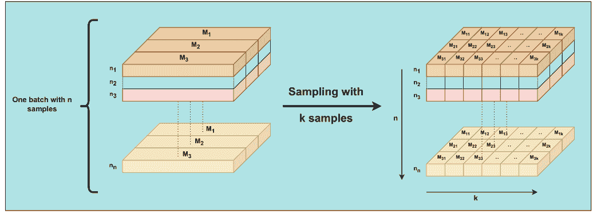

图 6. 数据增强建模，样本更多。

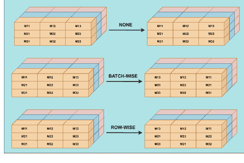

图 7. 逐批与逐行数据增强的比较。

逐行增强。尽管如此，任何数据增强都比不进行增强更好，正如 Mak 等人的工作中所展示的那样，逐批和逐行增强可以帮助模型学习信号中的散射信息。

### 2.3. 深度学习模型

在本研究中，我们提出了一种新颖的 DL 模型用于海况参数估计，该模型基于当前最先进的模块 Attention（Vaswani 等，2017）。为了证明所提出的模型经过微调并且可以被视为目前可用的最佳解决方案，我们将其与 Mak 和 Düz（2019）中提出的另外三种 DL 模型进行了比较。此外，为了正确地将所提出的模型与现有模型进行比较，我们通过缩放核数和神经元数量来增强现有模型。在此我们认为 Mak 和 Düz（2019）所做的工作最为相关，原因有几点：他们的方法定义明确，能够实现模型的可重复性，所提出的模型基于不同的模块，最后但并非最不重要的是，他们处理的问题与本文所涉及的问题相同。我们使用现有模型与原始使用之间的唯一区别是输入信号的数量。也就是说，在原始论文中，现有模型使用了船舶运动的 6-DOF，而我们的实验仅使用了 3-DOF。通过减少 DOF 数量，我们在任何方面都没有损害模型的完整性，这一点得到了与原始论文结果相当的实验结果的支持。

在下面的小节中，将详细介绍所使用的 DL 模型，而实现这些模型的源代码可以在以下存储库中找到（Selimović 等，2022）。此外，在本小节末尾，我们简要总结了所有模型的超参数并探讨了模型背后的动机。

#### 2.3.1. CNN回归：原始版和增强版

Mak 和 Düz（2019）中提出的第一个 NN 是基于卷积的最直接的 NN。因此，CNN-REG 非常适合此 DL 模型：用于回归的 CNN。该 NN 由两个卷积和一个密集层组成，主要后接 tanh 激活函数（如图 8 所示）。第一个卷积层有 48 个滤波器，核大小为 3 × 15，而第二个卷积层有 48 个滤波器，核大小为 1 × 9。密集层由 30 个神经元组成，后接 dropout 层，dropout 概率设置为 0.25。此外，我们对以下超参数的值进行了实验以找到最佳性能：

- 最大池化核大小：1, 3, 5, 7, 10
- 缩放因子 κ ：1, 5, 10
- 测试的优化器为 ADAM 和 SGD，均使用学习率 α = 5 · 10⁻³, 5 · 10⁻⁴, 5 · 10⁻⁵
- 数据增强：逐行和逐批

需要注意的是，Mak 等人提出的 NNs 通过添加缩放因子来增强，从而增加 NN 的“宽度”。宽度通过将卷积层中的滤波器数量和密集层中的神经元数量乘以缩放因子 κ 来增强。例如，初始提出的第一个卷积层的滤波器数量为 48，经过 κ = 5 的缩放后变为 240。这样，我们不仅将所提出的 AT-NN DL 模型与当前最先进的 NNs 进行了比较；我们甚至尝试增强了原始提出的模型。因此我们将为 CNN-REG NN 拓扑的两个版本呈现结果：原始版（CNN-REG-ORG）和增强版（CNN-REG-ENH）。

CNN-REG-ORG 的参数与 Mak 和 Düz（2019）中所述相同（κ = 1，最大池化核大小等于 3），除了我们使用了学习率为 α = 0.005 的 SGD，因为原始提出的学习率 α = 0.03 在我们的数据集上无法收敛。最佳数据集增强方式被证明为“逐行”数据增强。对于 CNN-REG-ENH，最佳性能参数如下：κ = 10，最大池化核大小 5，优化器为学习率 α = 0.0005 的 ADAM，以及逐行数据增强。

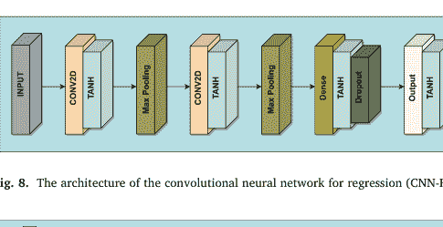

图 8. 用于回归的卷积神经网络的架构（CNN-REG）。

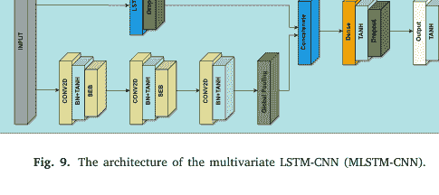

图 9. 多变量 LSTM-CNN 的架构（MLSTM-CNN）。

#### 2.3.2. 多变量长短期记忆 CNN（MLSTM-CNN）：原始版和增强版

多变量长短期记忆（LSTM）CNN 由两个组件组成，如图 9 所示。第一个组件基于卷积（类似于 CNN-REG 模型），但增强了 squeeze and excitation 块（SEB）（Hu 等，2018）。SEB 块引入权重，增加卷积层特征图之间的相互依赖性，同时仅增加少量计算成本。第二个组件基于 LSTM 块（Hochreiter 和 Schmidhuber，1997）。LSTM 块引入了记忆，能够“记住”观察时刻的信号样本与观察时刻之前所有样本之间的依赖关系。

MLSTM-CNN 测试的超参数与缩放因子 κ 相关，选择范围为：1、5 和 10。其他超参数，如数据增强和优化器（及其各自的学习率），与 CNN-REG 的情况相同。在增强了原始提出的 MLSTM-CNN 之后，MLSTM-CNN-ENH 的最佳性能参数为：数据增强逐行，优化器为学习率设置为 α = 0.005 的 ADAM，以及缩放因子 κ = 5。另一方面，MLSTM-CNN-ORG 的最佳性能参数为：数据增强逐批，以及学习率为 α = 0.005 的 SGD 优化器。

#### 2.3.3. 滑动拼图网络：原始版和增强版

Mak 和 Düz（2019）中提出的滑动拼图神经网络（SP-NN）具有相当不错的动机。该模型旨在以类似于滑动拼图的方式打乱输入数据的随机补丁。在滑动拼图中，尽管图像被打乱，但图像的内容仍然可见。这一想法导致了 NN 的构建，其拓扑结构如图 10 所示。SP-NN 设计用于完全消除样本之间的位置依赖性。

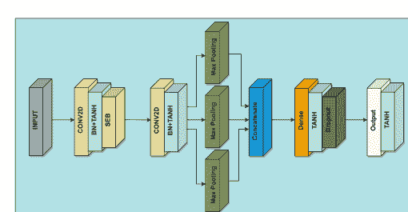

图 10. 滑动拼图神经网络的架构（SP-NN）。

为此，对第二个卷积层的每个特征图执行平均、最大和最小池化。正如原始作者所述：编码的结果完全基于初始卷积。

我们构建了 SP-NN 的两个版本：类似于其作者提出的模型的原始版（SP-NN-ORG）和增强版（SP-NN-ENH），其中我们通过因子 κ 增加了 SP-NN-ORG 的宽度。因此 SP-NN-ORG 具有以下超参数：第一个卷积层有 64 个滤波器，核大小为 1 × 25，第二个卷积层有 128 个滤波器，核大小为 3 × 1，密集层由 30 个神经元组成，SEB 块的收缩比为 16。

对于 SP-NN-ENH，我们通过将滤波器和神经元数量乘以因子 κ = 10 来缩放。SP-NN-ENH 的优化器为 α = 0.00005 的 ADAM。原始版本的优化器为 α = 0.005 的 SGD。

我们相信我们以一种不违反原始作者对 NN 设计的理由和动机的增强方式增强了所有 NNs。此外，在我们对参数值有疑问时（当这些值在原始工作中未指定时），我们测试了不同的参数值并采用了性能最好的一个。

#### 2.3.4. 基于注意力的神经网络（AT-NN）

计算机视觉、自然语言处理（NLP）或甚至数据增强生成的许多最先进算法都依赖于注意力模块（Galassi 等，2021；Zhang 等，2019；Woo 等，2018）。注意力模块，包括自注意力模块，已在论文（Vaswani 等，2017）中引入，该论文声称“Attention is all you need”。注意力模块背后的直觉来自 NLP，其中需要在句子/文本中捕捉彼此相距很远的词语之间的关系是必要的。

我们认为描述船舶运动的时间序列信号也具有需要分组的散射信息。所提出的模型 AT-NN 可以通过利用自注意力模块来把握输入信号不同部分之间的交互和相关性。因此，模型可以创建简单卷积操作无法获得的对海况估计至关重要的新信息特征。


##### 基于注意力的神经网络
##### 自注意力块
##### 全连接块

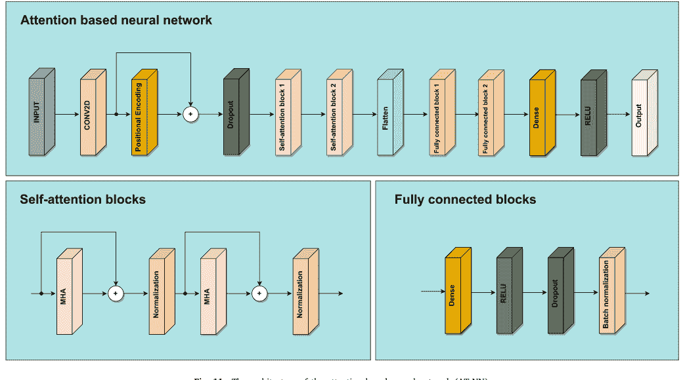

图 11. 基于注意力的神经网络（AT-NN）的架构。

3 × 125. 由于我们在此操作中使用了 128 个核，NN 对 128 个嵌入信号而不是三个原始信号进行操作。除了将三个信号合并为一个之外，卷积操作还导致原始信号上产生 1377 个重叠窗口位置。每个窗口捕获输入信号的 125 个样本。这些重叠窗口位置相当于 NLP 模型中的“tokens”。NLP 中的既定做法建议每个 token 都对其在句子/信号中的位置进行编码，因为 token 之间的位置可能是相关信息（Jaderberg et al., 2015）。我们遵循这一做法，并使用了 Vaswani et al. (2017) 提出的正弦和余弦编码。

在合并并对输入信号进行标记化之后，所提出的 AT-NN 利用两个自注意力块。如图 11 所示，每个自注意力块由两个多头注意力（MHA）层后跟一个归一化层组成。注意力机制由公式（7）给出：

```
attention(Q, K, V) = softmax( Q K^T / sqrt(d_k) ) V   (7)
```

其中 Q、K 和 V 分别代表查询、键和值矩阵，其权重已包含在内（W_q、W_k、W_v）。在我们的情况下，我们使用了自注意力，其中 Q、K 和 V 都等于该层的输入。一般来说，自注意力机制寻求同一输入信号中 token 之间的关系，而不是观察到的输入信号与其他不同信号之间的关系。参数 d_k 是缩放因子，等于输入嵌入的长度（在我们的情况下为 1377）。

```
multihead(Q, K, V) = concat(head_1, ..., head_j) W^O
head_i = attention(Q, K, V)   (8)
```

执行利用权重 W^O 的简单线性投影。此外，MHA 的输出与其输入相加。加法完成后，MHA 的最终求和输出会被归一化。归一化是通过从嵌入值中减去嵌入均值并除以其标准差来完成的（Garbin et al., 2020）。如 Fig. 11 所示，上述机制在一个自注意力块中重复两次。AT-NN 模型由两个连续的自注意力块构建。

第二个 MHA 计算的最终嵌入（batch_size × 128 × 1377）被展平为 batch_size 个长度为 176,256 的 1D 向量。这很重要，因为所提出的 AT-NN 的下一部分由全连接（密集）层组成。如图 11 所示，AT-NN 由三个密集层组成。第一个密集层有 128 个神经元，其后是 RELU 激活函数、dropout 层和批归一化层（Agarap, 2018; Santurkar et al., 2018）。

- MHA 块数：2、4、8，
- 每个 MHA 块中的头数：2、4、8，

##### Table 2

每个模型最佳超参数的概述。

| 模型 | 数据增强 | 优化器 | 学习率 | 缩放 | 最大池化 | 块数 | 头数 | 嵌入大小 | 嵌入数 | 神经元 |
|---|---|---|---|---|---|---|---|---|---|---|
| CNN-REG-ORG | 行式 | SGD | 0.005 | 3 | 1 | / | / | / | / | / |
| MLSTM-CNN-ORG | 批式 | SGD | 0.005 | 1 | / | / | / | / | / | / |
| SP-NN-ORG | 批式 | SGD | 0.005 | 5 | 1 | / | / | / | / | / |
| CNN-REG-ENH | 行式 | ADAM | 0.0005 | 10 | 5 | / | / | / | / | / |
| MLSTM-CNN-ENH | 行式 | ADAM | 0.005 | 5 | / | / | / | / | / | / |
| SP-NN-ENH | 批式 | ADAM | 0.00005 | 10 | 5 | / | / | / | / | / |
| AT-NN | 批式 | ADAM | 0.0005 | / | / | 2 | 2 | 125 | 128 | 128,64,3 |

- token 大小：125、250、500，
- 嵌入数量：32、64、128、256，
- 全连接层中神经元的连续数量：（128、64、3）、（256、128、3）、（512、256、3）和（1,024、512、3），
- 测试的优化器为 ADAM 和 SGD，两者学习率均为 α = 5·10⁻³、5·10⁻⁴、5·10⁻⁵（Kingma and Ba, 2014; Bottou, 2012），
- 数据增强：行式和批式。

在考虑优化器的选择时，决定使用 SGD 以保持与论文（Mak and Düz, 2019）一致，并使用最流行的优化器 ADAM。其他流行的优化器，例如 RMS-prop（Zou et al., 2019）和 ADAGRAD（Mukkamala and Hein, 2017），也可以使用；然而，这不会显著影响方法性能和研究结论。也许某些模型会更快收敛或获得更好的结果，但所取得的结果显示模型性能令人满意，因此无需进一步测试优化器。

模型以 batch_size 设置为 32 进行训练，共 250 个 epoch，如果在验证数据集上损失函数 10 个 epoch 没有变化则提前停止。最佳模型由 2 个 MHA 块组成，每个块有 2 个头，token 大小为 125，嵌入数量设置为 128。密集层中的神经元数量分别为（128、64、3），而优化器为 ADAM，学习率设置为 5·10⁻⁴。

### 2.4. 超参数概述、训练设置和模型的机制

每个模型的最佳超参数概述见表 2。由于我们训练了大量模型，使用不同超参数进行的最佳性能（前 25 名）由使用某种数据增强的模型取得。然而，就产生的结果而言，两种增强类型（批式和行式）之间没有明显的区分。

损失函数为均方误差（MSE）（James and Stein, 1992）。第 2.3.4 节中提到的训练过程对所有模型都相同：batch size 始终设置为 32，在验证损失 10 个 epoch 没有改善后提前停止。模型训练 250 个 epoch 的约束从未得到满足，因为所有模型都在 100 到 150 个 epoch 后收敛。

要理解模型之间的差异，就需要理解所使用模型的机制。Mak 和 Düz（2019）提出的三个原始模型（CNN-REG、MLSTM-CNN 和 SP-NN）依赖于机器学习社区中流行的机制。在它们发布之时，利用这些机制的模型赢得了各种竞赛（Russakovsky et al., 2015）。CNN-REG（图 8）使用的最直接机制基于普通的 2D 卷积。2D 卷积学习不同的模式，有助于提取预测目标变量的有用信息。卷积的问题在于它通过仅将学习到的模式（表示为二次窗口）移动到输入信号中相邻的数据来“线性”扫描。该原理在检测输入数据/信号中分散模式之间的连接或在数据模式之间寻找因果关系方面存在困难。虽然卷积机制易于理解和优化。为了应对数据各部分之间因果关系的问题，Mak 等人提出了一个名为 MLSTM-CNN（图 9）的第二种神经网络，基于长短期记忆（LSTM）机制（Yu et al., 2019）。LSTM 机制利用可以记住输入部分状态的向量，同时预测下一部分，这在自然语言处理中特别有用，其中一个词会影响其后的词。在从船舶运动估计海况参数的研究案例中，很明显时间 t_i 的海况会影响时间 t_{i+1} 的海况。因此，记住海洋的先前状态可能是有益的。在 Mak 和 Düz（2019）提出的架构中，LSTM 部分与 CNN-REG 类似的神经网络合并，如图 9 所示。在训练过程中，我们注意到由于两个分支，该模型计算缓慢。Mak 等人提出的最后一个模型试图通过涉及巧妙的数据增强机制（批式和行式增强）来实现 LSTM 机制的好处，迫使 2D 卷积学习更高级的模式。这样做不会增加模型的复杂性，因此输出计算快速。在保持这些指导方针为重点的情况下，创建了名为滑动拼图（SP-NN，图 10）的神经网络模型。为了增加感受野，SP-NN 利用三种不同的尺度进行特征聚合（最大池化层）。这为使用 2D 卷积层处理的输入信号特征创建了不同的视图。该机制实现了快速计算，同时易于理解。同时，由于创新的增强和不同感受野大小，捕捉输入信号不同部分之间因果关系是可行的。

最后，基于注意力机制的新模型遵循论文（Vaswani et al., 2017）中提出的直觉，其中认为该机制由于能够捕捉输入数据中甚至长期依赖性而在许多不同任务上表现更好。LSTM 和对混合数据进行普通 2D 卷积无法捕捉此类长期依赖性，因此我们认为利用注意力（和自注意力）机制作为特征提取器是有效的方法。此外，关于机制的复杂性，注意力机制比 LSTM 机制复杂得多，并且与 2D 卷积相似。因此，其利用是完全合理的。此外，我们还研究了对 Mak 等人提出的模型可能的增强。增强导致卷积层中滤波器数量的缩放。引入的缩放增加了模型学习不同模式的能力，最终导致更好的特征（从而导致更好的结果）。同时，增强并未损害模型及其机制背后的原始思想。

接下来，我们提供所有测试模型的实现结果，并阐述其效率、优点和局限性。

## 3. Results and discussion

### 3.1. NN models performance

模型性能的评估针对每个海况参数分别进行：H_s、T_z 和 β。我们在验证集和测试集上计算了三个指标：均方误差（MSE）、平均绝对误差（MAE）和纳什-苏特克利夫效率（NSE）（Chai and Draxler, 2014; Nash and Sutcliffe, 1970）。MSE 和 MAE 是神经网络评估中常用的指标，而 NSE 是源自水文学的更严格的指标。也就是说，在训练 NN 时，它


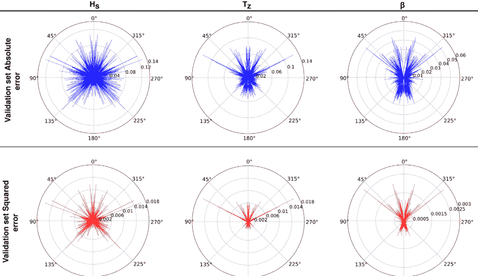

图 12. 雷达图显示了在验证数据集上针对每个波浪角度使用 AT-NN 估计的每个海况参数的绝对误差和平方误差。

#### 表 3

验证数据集上估计参数的模型结果 (-10^-3)。

| 模型 | MSE | | | MAE | | | NSE | | | MSE | MAE | NSE |
| | H_s | T_z | β | H_s | T_z | β | H_s | T_z | β | | | |
| CNN-REG-ORG | 5.285 | 3.889 | 1.252 | 57.042 | 50.812 | 26.703 | 843.208 | 598.950 | 937.176 | 3.476 | 44.852 | 793.111 |
| MLSTM-CNN-ORG | 4.942 | 4.194 | 1.113 | 56.162 | 53.026 | 25.387 | 853.407 | 567.514 | 944.171 | 3.416 | 44.859 | 788.364 |
| SP-NN-ORG | 5.226 | 4.765 | 1.413 | 57.097 | 54.960 | 26.935 | 844.973 | 508.647 | 929.108 | 3.801 | 46.331 | 760.909 |
| CNN-REG-ENH | 0.939 | 0.478 | 0.210 | 23.321 | 16.436 | 11.417 | 972.146 | 950.675 | 989.456 | 0.543 | 17.058 | 970.759 |
| MLSTM-CNN-ENH | 1.260 | 0.605 | 0.298 | 26.480 | 19.14 | 13.94 | 962.63 | 937.67 | 985.04 | 0.720 | 19.85 | 961.78 |
| SP-NN-ENH | 1.290 | 0.752 | 0.169 | 26.582 | 19.686 | 9.921 | 961.736 | 922.505 | 991.502 | 0.736 | 18.730 | 958.581 |
| AT-NN | 0.803 | 0.372 | 0.115 | 20.823 | 13.836 | 7.600 | 976.182 | 961.543 | 994.214 | 0.430 | 14.086 | 977.313 |

#### 表 4

测试数据集上估计参数的模型结果 (-10^-3)。

| 模型 | MSE | | | MAE | | | NSE | | | MSE | MAE | NSE |
| | H_s | T_z | β | H_s | T_z | β | H_s | T_z | β | | | |
| CNN-REG-ORG | 5.039 | 3.940 | 1.620 | 55.412 | 50.962 | 28.445 | 848.066 | 605.270 | 920.216 | 3.533 | 44.940 | 791.184 |
| MLSTM-CNN-ORG | 4.887 | 4.118 | 1.556 | 55.246 | 52.170 | 28.297 | 852.675 | 587.368 | 923.360 | 3.520 | 45.238 | 787.801 |
| SP-NN-ORG | 5.262 | 4.663 | 1.903 | 58.078 | 53.857 | 28.713 | 841.354 | 532.818 | 906.277 | 3.943 | 46.883 | 760.150 |
| CNN-REG-ENH | 0.982 | 0.561 | 0.231 | 24.166 | 17.323 | 11.694 | 970.400 | 943.744 | 988.617 | 0.591 | 17.728 | 967.587 |
| MLSTM-CNN-ENH | 1.345 | 0.692 | 0.290 | 26.954 | 20.598 | 13.600 | 959.442 | 930.708 | 985.716 | 0.776 | 20.384 | 958.622 |
| SP-NN-ENH | 1.257 | 0.862 | 0.217 | 26.768 | 21.340 | 10.730 | 962.107 | 913.647 | 989.319 | 0.779 | 19.613 | 955.024 |
| AT-NN | 0.852 | 0.404 | 0.115 | 21.122 | 13.956 | 7.485 | 974.325 | 959.516 | 994.359 | 0.457 | 14.188 | 976.067 |

有必要让模型关注最棘手的样本。这种行为可以通过 MSE 实现，因为它会使小的误差（正确的预测）变得更小。同时，它增加了模型预测不正确（或与正确预测相差最远）的样本中误差的影响。另一方面，我们还使用了 MAE 和 NSE，它们可被视为海况估计实际应用场景中可靠且现实的指标。表 3 和表 4 分别展示了验证集和测试集上每个估计参数的模型结果。如图所示，列 MSE、MAE 和 NSE 表示三个估计海况参数的平均 MSE、平均 MAE 和平均 NSE（显示模型在全部三个估计海况参数上的总体得分）。模型

MSE 和 MAE 最低且 NSE 最高的被视为表现最好的模型。由于论文中数据集（Mak and Düz, 2019）未公开，我们无法将其应用于我们的方法，因此不得不重新实现所有模型。通过比较验证集上它们的损失值结果（MSE = 0.05），我们可以得出结论，使用原始模型产生的[content]


图 12. 雷达图显示了在验证数据集上针对每个波浪角度使用 AT-NN 估计的每个海况参数的绝对误差和平方误差。

#### 表 3

验证数据集上估计参数的模型结果 (-10^-3)。

| 模型 | MSE | | | MAE | | | NSE | | | MSE | MAE | NSE |
| | H_s | T_z | β | H_s | T_z | β | H_s | T_z | β | | | |
| CNN-REG-ORG | 5.285 | 3.889 | 1.252 | 57.042 | 50.812 | 26.703 | 843.208 | 598.950 | 937.176 | 3.476 | 44.852 | 793.111 |
| MLSTM-CNN-ORG | 4.942 | 4.194 | 1.113 | 56.162 | 53.026 | 25.387 | 853.407 | 567.514 | 944.171 | 3.416 | 44.859 | 788.364 |
| SP-NN-ORG | 5.226 | 4.765 | 1.413 | 57.097 | 54.960 | 26.935 | 844.973 | 508.647 | 929.108 | 3.801 | 46.331 | 760.909 |
| CNN-REG-ENH | 0.939 | 0.478 | 0.210 | 23.321 | 16.436 | 11.417 | 972.146 | 950.675 | 989.456 | 0.543 | 17.058 | 970.759 |
| MLSTM-CNN-ENH | 1.260 | 0.605 | 0.298 | 26.480 | 19.14 | 13.94 | 962.63 | 937.67 | 985.04 | 0.720 | 19.85 | 961.78 |
| SP-NN-ENH | 1.290 | 0.752 | 0.169 | 26.582 | 19.686 | 9.921 | 961.736 | 922.505 | 991.502 | 0.736 | 18.730 | 958.581 |
| AT-NN | 0.803 | 0.372 | 0.115 | 20.823 | 13.836 | 7.600 | 976.182 | 961.543 | 994.214 | 0.430 | 14.086 | 977.313 |

#### 表 4

测试数据集上估计参数的模型结果 (-10^-3)。

| 模型 | MSE | | | MAE | | | NSE | | | MSE | MAE | NSE |
| | H_s | T_z | β | H_s | T_z | β | H_s | T_z | β | | | |
| CNN-REG-ORG | 5.039 | 3.940 | 1.620 | 55.412 | 50.962 | 28.445 | 848.066 | 605.270 | 920.216 | 3.533 | 44.940 | 791.184 |
| MLSTM-CNN-ORG | 4.887 | 4.118 | 1.556 | 55.246 | 52.170 | 28.297 | 852.675 | 587.368 | 923.360 | 3.520 | 45.238 | 787.801 |
| SP-NN-ORG | 5.262 | 4.663 | 1.903 | 58.078 | 53.857 | 28.713 | 841.354 | 532.818 | 906.277 | 3.943 | 46.883 | 760.150 |
| CNN-REG-ENH | 0.982 | 0.561 | 0.231 | 24.166 | 17.323 | 11.694 | 970.400 | 943.744 | 988.617 | 0.591 | 17.728 | 967.587 |
| MLSTM-CNN-ENH | 1.345 | 0.692 | 0.290 | 26.954 | 20.598 | 13.600 | 959.442 | 930.708 | 985.716 | 0.776 | 20.384 | 958.622 |
| SP-NN-ENH | 1.257 | 0.862 | 0.217 | 26.768 | 21.340 | 10.730 | 962.107 | 913.647 | 989.319 | 0.779 | 19.613 | 955.024 |
| AT-NN | 0.852 | 0.404 | 0.115 | 21.122 | 13.956 | 7.485 | 974.325 | 959.516 | 994.359 | 0.457 | 14.188 | 976.067 |

有必要让模型关注最棘手的样本。这种行为可以通过 MSE 实现，因为它会使小的误差（正确的预测）变得更小。同时，它增加了模型预测不正确（或与正确预测相差最远）的样本中误差的影响。另一方面，我们还使用了 MAE 和 NSE，它们可被视为海况估计实际应用场景中可靠且现实的指标。表 3 和表 4 分别展示了验证集和测试集上每个估计参数的模型结果。如图所示，列 MSE、MAE 和 NSE 表示三个估计海况参数的平均 MSE、平均 MAE 和平均 NSE（显示模型在全部三个估计海况参数上的总体得分）。模型

MSE 和 MAE 最低且 NSE 最高的被视为表现最好的模型。由于论文中数据集（Mak and Düz, 2019）未公开，我们无法将其应用于我们的方法，因此不得不重新实现所有模型。通过比较验证集上它们的损失值结果（MSE = 0.05），我们可以得出结论，使用原始模型产生的结果得到改进。在我们的研究中，作为输入参数使用的是 3-DOF 而非 6-DOF 运动。因此，我们成功证明了原始模型在减少输入数据的情况下仍能取得相同或更好的结果。这也是除估计精度之外，这里所提出方法的一个优势。

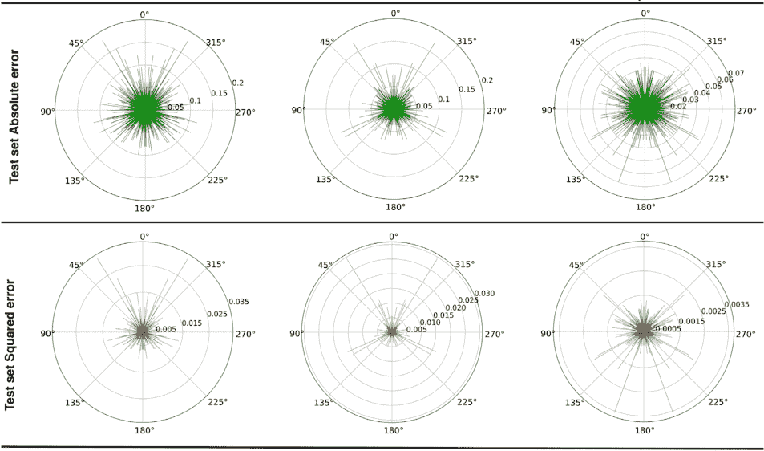

**图 13.** 雷达图显示了在测试数据集上针对每个波浪角度使用 AT-NN 估计的每个海况参数的绝对误差和平方误差。

接下来，我们指出我们提出的模型 AT-NN 在所有测试模型中取得了最佳结果。在表 3 和表 4 中，每个估计参数的最佳结果均已加粗。在测试集上，AT-NN 的总体最佳 MSE 为 0.457 · 10⁻³。其 MAE 为 14.188 · 10⁻³，NSE 为 976.067 · 10⁻³。亚军模型为 CNN-REG-ENH 模型，其平均 MSE 为 0.591 · 10⁻³，平均 MAE 为 17.728 · 10⁻³，平均 NSE 为 967.587 · 10⁻³。由于现有模型已实现的误差很低（<4 · 10⁻³），所提出模型 AT-NN 带来的改进具有影响力。换句话说，在考虑所有海况参数时，AT-NN 相比表现最好的增强模型将 MSE 提高了最高达 13%，相比表现最好的原始模型提高了最高达 83%。在考虑所有海况参数的 MAE 和 NSE 时，AT-NN 相比最佳增强模型将 MAE 提高了最高达 13% 和 62%，以及相比最佳原始模型将 NSE 提高了最高达 0.4% 和 8%。

图 12 和图 13 展示了作为我们研究中表现最好的模型的 AT-NN 在验证集和测试集的每个数据点上的绝对误差和平方误差。估计参数 $H_s$、$T_p$ 和 $β$ 随波浪角度的雷达图有潜力识别出所提出模型误差最大的区域。然而，经过仔细检查，我们可以得出结论，在两个数据集上都无法断言模型存在持续失效的区域。误差似乎与单个角度相关，而非相邻角度。这种行为证实模型既未过拟合也未欠拟合。当模型表现不佳时，它仍然能取得显著良好的结果。此外，为了提高所提出模型的可靠性，我们还启用了不确定性估计作为附加功能。

该过程在实质上相当简单：对于相同的输入时间序列信号，我们运行 AT-NN 的预测 256 次，每次预测时随机丢弃神经元。通过丢弃随机神经元，我们获得了原始 NN 的新版本，其预测结果与其他“采样”网络略有不同。通过计算所有预测的均值 $μ$ 和标准差 $σ$，我们可以计算出估计模型决策不确定性的高斯曲线。伴随不确定性估计，我们还拥有在不丢弃任何神经元的情况下生成的模型的实际预测。

为了提高可解释性并提供额外信息，我们通过引入统计测量扩展了 Monte-Carlo dropout 采样的输出。尽管其本质相当简单，统计测量涉及计数有多少个测试集的正确测量落入由 Monte-Carlo dropout 采样以不同 $σ$ 值估计的高斯曲线中（$μ$ 固定）。不同的 $σ$ 值是通过将 sigma 乘以 $n ∈ [1, 2, 3, 4, 5]$ 计算得出，从而得到更宽的高斯曲线。因此，遵循预期，更宽的高斯曲线也会涵盖更多正确的海况测量。因此对于 $n = 1$，$σ_{scaled} = 1×σ$ 的高斯曲线包含了 387 个正确预测，而 896 个预测/样本在范围之外。这使我们得出该相当窄的高斯曲线的总体置信度为 30%（387/1283）。另一方面，$σ_{scaled} = 5 × σ$ 的更宽高斯曲线包含了测试集中 1283 个样本中的 1246 个预测，从而得出置信度为 97%。验证数据集在 $σ$ 值和包含样本数量方面的表现相似，因此估计的完整性未受损害。最终 AT-NN 输出的图形示例在图 14 中给出。可以看出，蓝色线代表给定输入信号的真实值，黑色线代表不丢弃任何神经元的 AT-NN 预测。相比之下，高斯曲线代表正确测量可能落入的不同“区间”/“区域”概率。我们相信这种估计和解释 NN 输出的新颖过程提高了所提出模型的可靠性。此外，除了仅有一个数字作为结果外，如果用户对模型估计存疑，所提出模型的现在具有置信水平

### 3.2. 不确定性估计

如第 2.3.4 节所述，在 AT-NN 模型的“head”部分添加 dropout 层使得能够利用 Monte-Carlo 采样。通过利用 Monte-Carlo dropout 采样，我们模拟了高斯过程，因此获得了每个估计海况参数的模型预测不确定性（Gal and Ghahramani, 2016）。


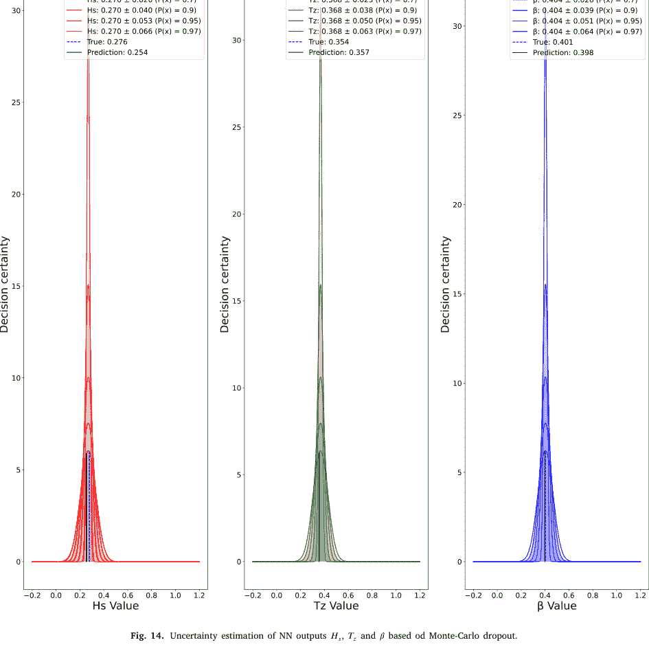

图14. 基于 Monte-Carlo dropout 的 NN 输出 H_s、T_z 和 β 的不确定性估计。

由不同的高斯曲线提供。我们认为，以前述方式定制的不确定性估计在各种实际场景中可能至关重要。

## 3.3. 讨论

在我们的研究中，我们重新实现了 Mak 和 Düz (2019) 提出的模型，并通过缩放其滤波器数量对其进行了增强，从而得到模型的一个增强版本。正如第 2.4 节末尾所讨论的，增强背后的动机以及每个模型机制都有充分的理由。本研究中提出的新模型也是如此。实验表明，原始模型的增强版本优于原始模型。这种增强在图15中测试集上的 MSE 和 MAE 结果的箱线图中很明显。该图还表明，所提出的 AT-NN 模型优于原始模型和增强模型，成为根据船舶运动响应估计海况参数的新最先进模型。基于注意力机制的所提出模型的优越性甚至通过测试集上的 NSE 指标 NSE(AT − NN) = 976.067 · 10⁻³ 得到证实（表4）。如果我们将测试集上性能最佳的原始模型（即 CNN-REG-ORG，MSE(MLSTM − CNN − ORG) = 3.533 · 10⁻³）与所提出的模型（MSE(AT − NN) = 0.457 · 10⁻³）进行比较，误差降低了 3.076 · 10⁻³，折算成比率则误差率降低了约 ≈ 7.73 倍。此外，通过分析图12和图13中的雷达图，确定没有特定角度范围会在估计海况参数时导致所建议模型始终表现不佳。此外，引入的模型海况参数预测不确定性估计将所提出模型的可信度提升到了更高水平，这对于开发利用机器学习模型的应用至关重要。下一步研究将是在各种真实数据集上测试所提出的方法。我们相信，通过对输入数据进行适当的预处理，可以实现类似的结果，但还需要针对不同的海况测量做进一步研究。

最后，让我们通过明确指出本手稿中取得的成就和新颖性来总结我们的研究，总结如下：

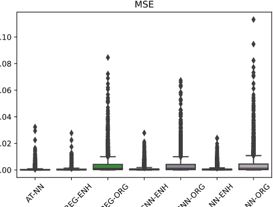

(a)

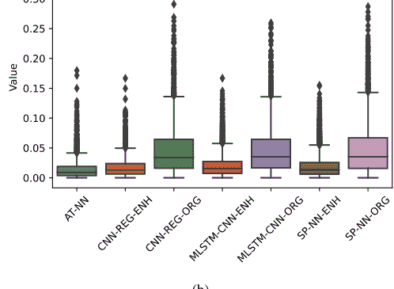

(b)

图15. 测试集上的箱线图，包含两种度量：(a) MSE 和 (b) MAE。

- 我们重新训练了 Mak 和 Düz (2019) 提出的现有最先进模型，并通过增加其宽度对其进行了增强。增强后的模型表现优于最初提出的模型。
- 我们证明了仅使用3自由度船舶运动响应（而非使用6自由度船舶运动响应）即可获得相似或更好的结果（当考虑所有测试方法和海况参数时，海况参数估计在 MSE 方面最高提升 94%，在 MAE 方面最高提升 74%，在 NSE 方面最高提升 80%）。与性能最佳的原始模型相比，MSE、MAE 和 NSE 分别最多提升 83%、62% 和 8%。
- 作为模型训练指南，我们深入研究了基于输入信号切片洗牌的数据增强方法。调查得出结论：所有测试模型在使用洗牌后的输入信号切片时都能取得更好的结果。
- 我们提出了一种新颖的 AT-NN 模型，在测试的所有模型中，针对每个估计的海况参数都取得了最佳结果。据我们所知，这是 AT-NN 首次被应用于海况估计。
- 此外，在本手稿中，我们提出了一种基于 Monte-Carlo dropout 方法解释 NN 输出不确定性估计的新方法。我们解释模型预测不确定性的方式将提高模型的可信度，即使其初始预测误差率很低。同时，根据广泛的文献综述，这也是海况估计中首次对深度学习模型进行不确定性估计。

## 4. 结论

本文提出了一种新颖的基于注意力的深度学习模型，用于估计重要的海况特征。通过评估每个海况参数的性能，我们确认 AT-NN 模型经过微调，适合估计关键的海况参数。所提出的 AT-NN 模型带来的改进被证明是显著的，与先前提出的最佳原始最先进模型相比，在考虑所有估计的海况参数时，MSE 降低了多达 83%，MAE 降低了多达 62%，NSE 降低了多达 8%。与修改后的模型的最佳版本相比，MSE 降低了多达 13%，MAE 降低了多达 12%，NSE 降低了多达 0.4%。尽管使用 3 自由度输入运动数据，所提出的模型在每个估计的海况参数上，在所有测试的原始模型和增强模型中都取得了最佳结果。作为未来研究的后续步骤之一，利用 6 自由度船舶运动响应可能潜在地提高参数估计的精度。此外，在实际应用中，整个波浪方向谱的估计非常重要。因此，未来的工作方向还可能包括数值模拟中的波浪方向性信息，这可以将深度学习模型的应用扩展到短峰波以及风浪和涌浪组合的海况谱。

## CRediT 作者贡献声明

Denis Selimović：概念化，方法论，软件，验证，调查，数据管理，写作 – 初稿，可视化。Franko Hržić：概念化，方法论，软件，验证，调查，数据管理，写作 – 初稿，可视化。Jasna Prpić-Oršić：概念化，方法论，验证，形式分析，资源，数据管理，写作 – 审阅与编辑，监督，项目管理，获取资助。Jonatan Lerga：概念化，方法论，验证，形式分析，调查，资源，写作 – 初稿，写作 – 审阅与编辑，监督，项目管理，获取资助。

## 利益冲突声明

作者声明，他们没有任何已知的竞争性经济利益或个人关系，这些利益或关系可能影响本文所报告的工作。

## 数据可用性

数据将在合理要求下提供。

## 资助

本工作完全由克罗地亚科学基金会项目 IP-2018-01-3739、欧盟地平线 2020 项目 INNO2MARE（“加强斯洛文尼亚和克罗地亚创新生态系统能力，以支持海事区域的数字和绿色转型”，编号 101087348）、IRI2 项目“ABsistemDCiCloud”（KK.01.2.1.02.0179）以及里耶卡大学项目 uniri-tehnic-18-17 和 uniri-tehnic-18-15 支持。

## 参考文献

Agarap, A.F., 2018. Deep learning using rectified linear units (ReLU). CoRR abs/1803.08375 URL http://arxiv.org/abs/1803.08375, arXiv:1803.08375.

Baldi, P., Sadowski, P.J., 2013. Understanding dropout. In: Burges, C., Bottou, L., Welling, M., Ghahramani, Z., Weinberger, K. (Eds.), In: Advances in Neural Information Processing Systems, vol. 26, Curran Associates, Inc., URL https://proceedings.neurips.cc/paper/2013/file/71f6278d1a0f599e06ad9bf1ba03cb0-Paper.pdf.

Bochkovskiy, A., Wang, C., Liao, H.M., 2020. YOLOv4: Optimal speed and accuracy of object detection. CoRR abs/2004.10934 URL https://arxiv.org/abs/2004.10934, arXiv:2004.10934.

Bottou, L., 2012. Stochastic gradient descent tricks. In: Montavon, G., Orr, G.B., Müller, K.-R. (Eds.), Neural Networks: Tricks of the Trade: Second Edition. Springer Berlin Heidelberg, Berlin, Heidelberg, pp. 421–436. http://dx.doi.org/10.1007/978-3-642-35289-8_25.

Chai, T., Draxler, R.R., 2014. Root mean square error (RMSE) or mean absolute error (MAE)? – Arguments against avoiding RMSE in the literature. Geosci. Model Dev. 7 (3), 1247–1250. http://dx.doi.org/10.5194/gmd-7-1247-2014, URL https://gmd.copernicus.org/articles/7/1247/2014/.

Cheng, X., Li, G., Ellefsen, A., Chen, S., Hildre, H., Zhang, H., 2020a. A novel densely connected convolutional neural network for sea state estimation using ship motion data. IEEE Trans. Instrum. Meas. PP, 1. http://dx.doi.org/10.1109/TIM.2020.2967115.

Cheng, X., Li, G., Skulstad, R., Chen, S., Hildre, H., Zhang, H., 2019. Modeling and Analysis of Motion Data from Dynamically Positioned Vessels for Sea State Estimation. pp. 6644–6650. http://dx.doi.org/10.1109/TRA.2019.8794069.

Cheng, X., Li, G., Skulstad, R., Zhang, H., Chen, S., 2020b. SpectralSeaNet: Spectrogram and convolutional network-based sea state estimation. In: IECON 2020 the 46th Annual Conference of the IEEE Industrial Electronics Society. pp. 5069–5074. http://dx.doi.org/10.1109/IECON43393.2020.9254890.

Denis, M., Pierson, W., 1953. On the Motions of Ships in Confused Seas. Defense Technical Information Center, URL https://books.google.hr/books?id=3816a0AEACAAJ.

DNV-GL, 2018. Class guideline: Wave loads. DNVGL-CG-0130 84, Edition January.

Düz, B., Mak, B., Hageman, R., Grasso, N., 2019. Real time estimation of local wave characteristics from ship motions using artificial neural networks.

Faltinsen, O.M., 1990. Sea Loads on Ships and Offshore Structures. Cambridge University Press, The Edinburgh Building, Cambridge CB2 2RU, UK.

Gal, Y., Ghahramani, Z., 2016. Dropout as a Bayesian approximation: Representing model uncertainty in deep learning. In: Balcan, M.F., Weinberger, K.Q. (Eds.), Proceedings of the 33rd International Conference on Machine Learning. In: Proceedings of Machine Learning Research, vol. 48, PMLR, New York, New York, USA, pp. 1050–1059, URL https://proceedings.mlr.press/v48/gal16.html.

Galassi, A., Lippi, M., Torroni, P., 2021. Attention in natural language processing. IEEE Trans. Neural Netw. Learn. Syst. 32 (10), 4291–4308. http://dx.doi.org/10.1109/TNNLS.2020.3019893.

Garbin, C., Zhu, X., Marques, O., 2020. Dropout vs. batch normalization: An empirical study of their impact to deep learning. Multimedia Tools Appl. 79 (19), 12777–12815. http://dx.doi.org/10.1007/s11042-019-08453-9.

Hinostroza, M., Guedes Soares, C., 2016. Parametric estimation of the directional wave spectrum from ship motions. Int. J. Marit. Eng. 158, A121–A130. http://dx.doi.org/10.3940/rina.2016.a2.356.

Hochreiter, S., Schmidhuber, J., 1997. Long short-term memory. Neural Comput. 9 (8), 1735–1780. http://dx.doi.org/10.1162/neco.1997.9.8.1735.

Hu, J., Shen, L., Sun, G., 2018. Squeeze-and-excitation networks. In: Proceedings of the IEEE Conference on Computer Vision and Pattern Recognition. CVPR.

IMO, 2007. Revised guidance to the master for avoiding dangerous situations in adverse weather and sea conditions.

ITTC (Ed.), 1969. Proceedings of the 12th International Towing Tank Conference, Vol. 1. ITTC, URL https://www.ittc.info/media/2745/index.pdf.

Jaderberg, M., Simonyan, K., Zisserman, A., kavukcuoglu, k., 2015. Spatial transformer networks. In: Cortes, C., Lawrence, N., Lee, D., Sugiyama, M., Garnett, R. (Eds.), In: Advances in Neural Information Processing Systems, vol. 28, Curran Associates, Inc., URL https://proceedings.neurips.cc/paper/2015/file/33ceb07bf4eeb3da587e268d663aba1a-Paper.pdf.

James, W., Stein, C., 1992. Estimation with quadratic loss. In: Kotz, S., Johnson, N.L. (Eds.), Breakthroughs in Statistics: Foundations and Basic Theory. Springer New York, New York, NY, pp. 443–460. http://dx.doi.org/10.1007/978-1-4612-0919-5_30.

Kingma, D.P., Ba, J., 2014. Adam: A method for stochastic optimization. http://dx.doi.org/10.48550/ARXIV.1412.6980, URL https://arxiv.org/abs/1412.6980.

Mak, B., Düz, B., 2019. Ship as a wave buoy: Estimating relative wave direction from in-service ship motion measurements using machine learning. In: International Conference on Offshore Mechanics and Arctic Engineering, Volume 9: Rodney Eatock Taylor Honoring Symposium on Marine and Offshore Hydrodynamics; Takeshi Kinoshita Honoring Symposium on Offshore Technology, http://dx.doi.org/10.1115/OMAE2019-96201.

Mittendorf, M., Nielsen, U., Bingham, H., 2022. The prediction of sea state parameters by deep learning techniques using ship motion data.

Montazeri, N., Nielsen, U.D., Juncher Jensen, J., 2016. Estimation of wind sea and swell using shipboard measurements – A refined parametric modelling approach. Appl. Ocean Res. 54, 73–86. http://dx.doi.org/10.1016/j.apor.2015.11.004, URL https://www.sciencedirect.com/science/article/pii/S0141118715001388.

Mukkamala, M.C., Hein, M., 2017. Variants of RMSProp and adagrad with logarithmic regret bounds. In: Precup, D., Teh, Y.W. (Eds.), Proceedings of the 34th International Conference on Machine Learning. In: Proceedings of Machine Learning Research, vol. 70, PMLR, pp. 2545–2553, URL https://proceedings.mlr.press/v70/mukkamala17a.html.

Nash, J., Sutcliffe, J., 1970. River flow forecasting through conceptual models part I — A discussion of principles. J. Hydrol. 10 (3), 282–290. http://dx.doi.org/10.1016/0022-1694(70)90255-6, URL https://www.sciencedirect.com/science/article/pii/0022169470902556.

Nielsen, U.D., 2006. Estimations of on-site directional wave spectra from measured ship responses. Mar. Struct. 19 (1), 33–69. http://dx.doi.org/10.1016/j.marstruc.2006.05.001, URL https://www.sciencedirect.com/science/article/pii/S095183390600529.

Nielsen, U.D., 2017. A concise account of techniques available for shipboard sea state estimation. Ocean Eng. 129, 352–362. http://dx.doi.org/10.1016/j.oceaneng.2016.11.035, URL https://www.sciencedirect.com/science/article/pii/S0029801816305388.

Nielsen, U., Bjerregård, M., Galeazzi, R., Fossen, T., 2015. New concepts for shipboard sea state estimation. http://dx.doi.org/10.23919/OCEANS.2015.7404386.

Nielsen, U.D., Galeazzi, R., Brodtkorb, A.H., 2016. Evaluation of shipboard wave estimation techniques through model-scale experiments. In: OCEANS 2016 - Shanghai. pp. 1–8. http://dx.doi.org/10.1109/OCEANSAP.2016.7485701.

Pascoal, R., Guedes Soares, C., 2009. Kalman filtering of vessel motions for ocean wave directional spectrum estimation. Ocean Eng. 36 (6), 477–488. http://dx.doi.org/10.1016/j.oceaneng.2009.01.013, URL https://www.sciencedirect.com/science/article/pii/S0029801809000183.

Pascoal, R., Perera, L., Guedes Soares, C., 2017. Estimation of directional sea spectra from ship motions in sea trials. Ocean Eng. 132, 126–137. http://dx.doi.org/10.1016/j.oceaneng.2017.01.020, URL https://www.sciencedirect.com/science/article/pii/S0029801817300288.

Russakovsky, O., Deng, J., Su, H., Krause, J., Satheesh, S., Ma, S., Huang, Z., Karpathy, A., Khosla, A., Bernstein, M., Berg, A.C., Fei-Fei, L., 2015. ImageNet large scale visual recognition challenge. Int. J. Comput. Vis. (IJCV) 115 (3), 211–252. http://dx.doi.org/10.1007/s11263-015-0816-y.

Santurkar, S., Tsipras, D., Ilyas, A., Madry, A., 2018. How does batch normalization help optimization? In: Bengio, S., Wallach, H., Larochelle, H., Grauman, K., Cesa-Bianchi, N., Garnett, R. (Eds.), In: Advances in Neural Information Processing Systems, vol. 31, Curran Associates, Inc., URL https://proceedings.neurips.cc/paper/2018/file/905056c1ac1ad141560467e0a99f1ec-Paper.pdf.

Scholz, T., Mak, B., 2020. Ship as a wave buoy: Estimating full directional wave spectra from in-service ship motion measurements using deep learning. http://dx.doi.org/10.1115/OMAE2020-18783.

Selimović, D., Hrizić, F., Prpić-Oršić, J., Lerga, J., 2022. Sea state estimation from ship motion responses using deep learning. URL https://github.com/fhrzic/DselimovicProject.git.

Selimović, D., Lerga, J., Prpić-Oršić, J., Kenji, S., 2020. Improving the performance of dynamic ship positioning systems: A review of filtering and estimation techniques. J. Mar. Sci. Eng. 8 (4), http://dx.doi.org/10.3390/jmse8040234, URL https://www.mdpi.com/2077-1312/8/4/234.

Tannuri, E.A., Sparano, J.V., Simos, A.N., Da Cruz, J.J., 2003. Estimating directional wave spectrum based on stationary ship motion measurements. Appl. Ocean Res. 25 (5), 243–261. http://dx.doi.org/10.1016/j.apor.2004.01.003, URL https://www.sciencedirect.com/science/article/pii/S014111870400070.

Tu, F., Ge, S.S., Choo, Y.S., Hang, C.C., 2018. Sea state identification based on vessel motion response learning via multi-layer classifiers. Ocean Eng. 147, 318–332. http://dx.doi.org/10.1016/j.oceaneng.2017.08.047, URL https://www.sciencedirect.com/science/article/pii/S0029801817305188.

Vaswani, A., Shazeer, N., Parmar, N., Uszkoreit, J., Jones, L., Gomez, A.N., Kaiser, L.U., Polosukhin, I., 2017. Attention is all you need. In: Guyon, I., Luxburg, U.V., Bengio, S., Wallach, H., Fergus, R., Vishwanathan, S., Garnett, R. (Eds.), In: Advances in Neural Information Processing Systems, vol. 30, Curran Associates, Inc., URL https://proceedings.neurips.cc/paper/2017/file/3f5ee243547de91fb053c1c4a845a-Paper.pdf.

Woo, S., Park, J., Lee, J.Y., Kweon, I.S., 2018. CBAM: Convolutional block attention module. In: Proceedings of the European Conference on Computer Vision. ECCV.

Yu, Y., Si, X., Hu, C., Zhang, J., 2019. A review of recurrent neural networks: LSTM cells and network architectures. Neural Comput. 31 (7), 1235–1270. http://dx.doi.org/10.1162/neco_a.01199.

Zhang, H., Goodfellow, I., Metaxas, D., Odena, A., 2019. Self-attention generative adversarial networks. In: Chaudhuri, K., Salakhutdinov, R. (Eds.), Proceedings of the 36th International Conference on Machine Learning. In: Proceedings of Machine Learning Research, vol. 97, PMLR, pp. 7354–7363, URL https://proceedings.mlr.press/v97/zhang19d.html.

Zou, F., Shen, L., Jie, Z., Zhang, W., Liu, W., 2019. A sufficient condition for convergences of adam and rmsprop. In: Proceedings of the IEEE/CVF Conference on Computer Vision and Pattern Recognition. CVPR.

