## 以太坊：工具与技能


## 前言

随着以太坊平台的发展，支持它的工具生态系统也随之壮大。在本书中，我们将探讨一些最流行的以太坊工具，并指导您在构建自己的以太坊应用时如何使用它们。

### 谁应该阅读本书？

本书适合任何有兴趣使用以太坊平台进行开发的人阅读。如果您不熟悉区块链技术，建议在阅读本书前先阅读《以太坊开发者指南》。

### 约定说明

#### 代码示例

本书中的代码使用等宽字体显示，如下所示：

```
<h1>A Perfect Summer's Day</h1>
<p>It was a lovely day for a walk in the park.
The birds were singing and the kids were all back at school.</p>
```

当需要现有代码作为上下文时，为了避免重复所有代码，将显示 `⋮`：

```
function animate() {
    ⋮
    new_variable = "Hello";
}
```

某些代码行本应在一行内输入，但因页面宽度限制不得不换行。`➥` 表示仅为排版目的而存在的换行，输入时应忽略：

```
URL.open("http://www.sitepoint.com/responsive-web-
➥design-real-user-testing/?responsive1");
```

您会注意到，我们在全书中使用了特定的排版风格来表示不同类型的信息。请留意以下项目。

#### 提示、注释与警告

##### 嘿，您！

提示提供有用的小建议。

##### 嗯，打扰一下……

注释是相关但非关键的补充说明。可将其视为额外的信息片段。

##### 请务必……

……关注这些重要要点。

##### 当心！

警告会强调那些可能让您在过程中绊倒的陷阱。

## 第 1 章：Remix：为以太坊区块链开发智能合约

### 作者：Ahmed Bouchefra

**Remix 是一款 Solidity IDE，用于编写、编译和调试 Solidity 代码。[Solidity](https://solidity.readthedocs.io) 是一种高级的、面向合约的编程语言，用于编写智能合约。它受 C++、Python 和 JavaScript 等流行语言的影响。**

`IDE` 代表集成开发环境，是一款包含一组工具的应用程序，旨在帮助程序员执行与软件开发相关的各种任务，如编写、编译、执行和调试代码。

在开始使用 Remix 开发智能合约之前，请确保您熟悉一些基本概念。特别是，请阅读这些关于[区块链](https://www.sitepoint.com/blockchain-what-it-is-how-it-works-why-its-so-popular)和[以太坊](https://bitfalls.com/2017/09/19/what-ethereum-compare-to-bitcoin/)的文章。

### 什么是智能合约/Dapp？

智能合约是双方之间利用区块链技术达成的无需信任的协议，它强制双方遵守条款，而不依赖传统方式，如信任中间人或利用法律解决纠纷。

使用以太坊区块链，您可以用 Solidity 语言（以及其他语言）创建智能合约。以太坊并非唯一可用于创建智能合约的平台，但它是最受欢迎的选择，因为它从一开始就设计为支持构建智能合约。

[Dapp](http://ethdocs.org/en/latest/contracts-and-transactions/developer-tools.html#dapps) 代表**去中心化应用程序**，是一种 Web3 应用程序，其前端可用 JavaScript、HTML、CSS 等传统语言编写，智能合约（作为后端代码）则运行在区块链上。因此，您可以简单地将 Dapp 视为前端加上相关的区块链智能合约。

与部署在区块链上的智能合约不同，Dapp 的前端既可以托管在 CDN 等中心化服务器上，也可以托管在 [Swarm](http://ethdocs.org/en/latest/contracts-and-transactions/developer-tools.html#swarm) 等去中心化存储上。

### 访问 Remix IDE

您可以通过不同方式访问 Remix IDE：在线访问、通过 Chrome 等 Web 浏览器、从本地安装的副本，或从 Mist（以太坊 Dapp 浏览器）启动。

#### 使用浏览器版 Remix IDE

您无需任何特殊安装，即可从 Web 浏览器访问 Remix IDE。访问 [`remix.ethereum.org/`](https://remix.ethereum.org/)，您将看到一个完整的 IDE，包含代码编辑器和各种面板，用于编译、运行和调试智能合约。您将获得一个默认的示例 *Ballot*（投票）合约供您练习。

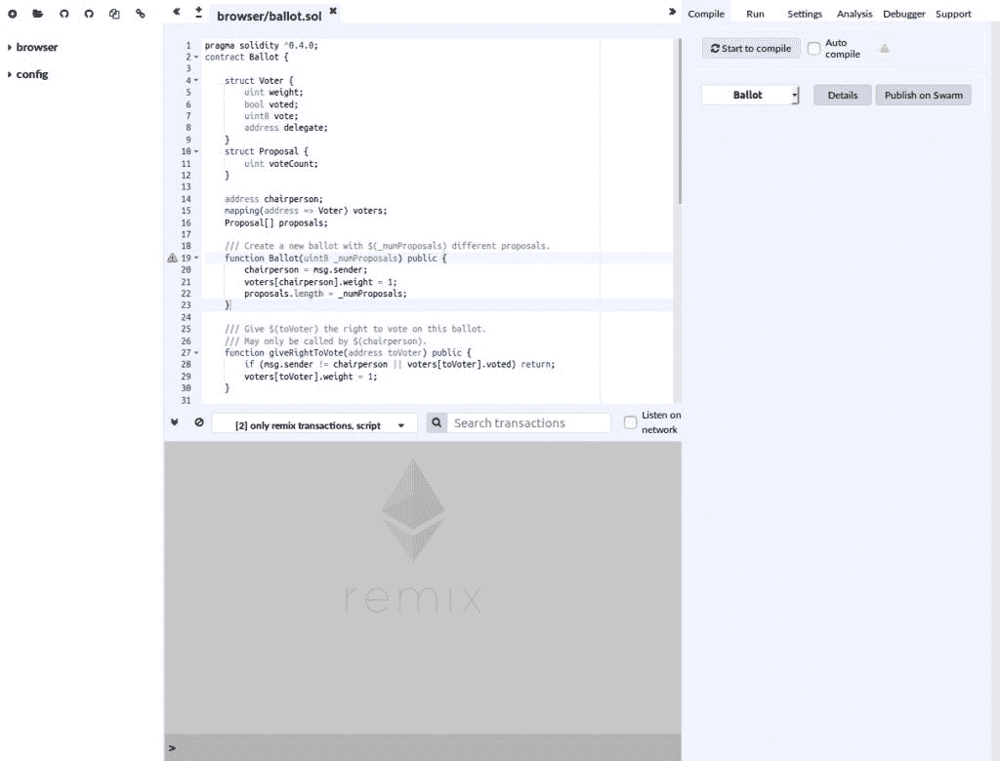

#### 从 Mist 启动 Remix IDE

您可以通过点击 *Develop*（开发），然后选择 *Open Remix IDE*（打开 Remix IDE）从 Mist 启动 Remix IDE。Remix 将在新窗口中打开。如果这是您首次运行该 IDE，将会看到一个简单的示例 *Ballot* 合约。

要熟悉 Mist，请参阅[这篇文章](https://bitfalls.com/2018/02/12/explaining-ethereum-tools-geth-mist/)。

#### 运行您自己的 Remix IDE 副本

您也可以通过执行以下命令运行自己的 Remix IDE 副本：

```
npm install remix-ide -g
remix-ide
```

您需要安装 Node.js 和 npm。更多信息请查看此 [GitHub 仓库](https://github.com/ethereum/remix-ide)。

### Remix 面板

了解如何打开 Remix IDE 后，现在让我们看看构成该 IDE 的各个面板。

#### 文件浏览器

文件浏览器提供了一个视图，显示存储在浏览器存储中的已创建文件。您可以通过右键点击文件，然后从上下文菜单中选择相应操作来重命名或删除文件。

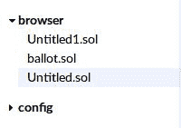

请注意，文件浏览器默认使用浏览器的本地存储，这意味着如果您清除存储或操作系统自动清除存储，可能会丢失所有文件。对于高级工作，建议使用 [Remixd](https://github.com/ethereum/remixd) —— 一个 Node.js 工具（可通过 npm `npm install -g remixd` 获取），它允许 Remix IDE 访问您计算机的文件系统。

现在让我们看看浏览器顶部按钮可以执行的不同操作。


##### 在 Remix 中创建/打开文件


### Remix IDE 指南

#### 文件浏览器

您可以使用左上角带有 `+` 图标的第一个按钮，在浏览器本地存储中创建一个新文件。随后，您可以在弹出的对话框中提供名称并按下 `OK`。

使用左上角的第二个按钮，您可以将计算机文件系统中现有的 Solidity 文件打开到 Remix IDE 中。该文件也将存储在浏览器的本地存储中。

##### 将浏览器文件发布为 GitHub Gist

使用左上角的第三个和第四个按钮，您可以将 IDE 中的文件发布为公开的 GitHub Gist。

##### 将文件复制到另一个 Remix IDE 实例

使用左上角的第五个按钮，您可以通过提供目标实例的 URL，将文件从本地存储复制到另一个 Remix 实例中。

##### 连接到本地文件系统

如果您正在运行 `Remixd` 工具，可以使用最后一个按钮将 Remix IDE 连接到您的本地文件系统。

#### Solidity 代码编辑器

Solidity 代码编辑器提供了一个编写代码的界面，具有语法高亮、自动重新编译、自动保存等众多功能。您可以打开多个标签页，也可以使用左上角的 `+/-` 按钮增加或减小字体大小。

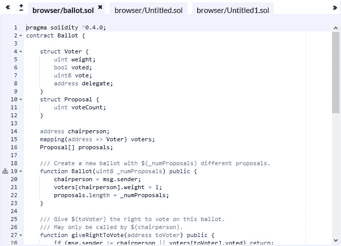

#### 终端

编辑器下方的终端窗口集成了一个 JavaScript 解释器和 `web3` 对象。您可以在当前上下文中执行 JavaScript 代码，可视化 IDE 执行的操作，可视化所有网络交易或从 Remix IDE 创建的交易等。您还可以在终端中搜索数据并清除日志。

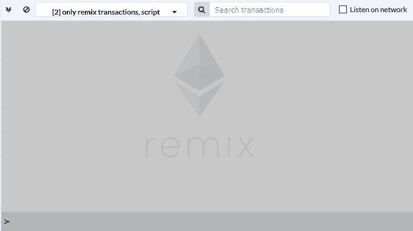

#### 标签页面板

`Tabs` 面板提供了许多用于操作 IDE 的标签页：

*   `Compile` 标签页：用于编译智能合约并发布到 Swarm。
*   `Run` 标签页：用于向配置的环境发送交易。
*   `Settings` 标签页：用于更新设置，如编译器版本和编辑器的许多通用设置。
*   `Debugger` 标签页：用于调试交易。
*   `Analysis` 标签页：用于获取关于最新编译的信息。
*   `Support` 标签页：用于与 Remix 社区联系。

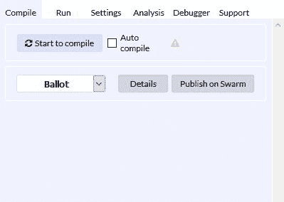

### Remix 执行环境

Remix IDE 提供了多种用于执行交易的环境：

*   **JavaScript VM**：一种在浏览器中用 JavaScript 实现的沙盒区块链，用于模拟真实的区块链。
*   **Injected Web3**：一种注入 web3 的提供者，例如 `Mist` 和 `Metamask`，[将您连接到您的私有区块链](https://bitfalls.com/2018/03/26/connecting-myetherwallet-mist-metamask-private-blockchain/)。
*   **Web3 Provider**：一个运行 geth、parity 或任何以太坊客户端的远程节点。可用于连接到真实网络，或直接连接到您的私有区块链，而无需 MetaMask 作为中介。

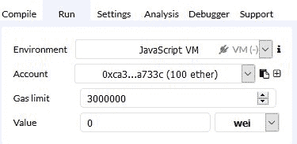

### 使用 Remix IDE 编译和部署智能合约

为了演示使用 Remix IDE 可以实现的功能，我们将使用一个示例合约，并了解如何：

*   在 Remix IDE 中编译合约。
*   查看编译器在未遵循最佳实践时发出的一些警告。
*   在 JavaScript EVM（以太坊虚拟机）上部署合约。
*   对已部署的合约进行交易。
*   在终端 IDE 中查看示例读写操作。

我们将使用以下示例合约 [来自本教程](https://bitfalls.com/2018/03/31/solidity-development-crash-course-building-blockchain-raffle/)，它实现了一个区块链抽奖：

```
pragma solidity ⁰.4.20;

contract Blocksplit {

    address[] public players;
    mapping (address => bool) public uniquePlayers;
    address[] public winners;

    address public charity = 0xc39eA9DB33F510407D2C77b06157c3Ae57247c2A;

    function() external payable {
        play(msg.sender);
    }

    function play(address _participant) payable public {
        require (msg.value >= 1000000000000000 && msg.value <= 100000000000000000);
        require (uniquePlayers[_participant] == false);

        players.push(_participant);
        uniquePlayers[_participant] = true;
    }

}
```

该合约声明了一些变量，例如：

*   `players` 数组变量，用于存储抽奖参与者的地址。
*   `uniquePlayers` 映射，用于保存唯一参与者，防止参与者从同一地址多次参与。（一个地址将映射到一个布尔值，true 或 false，表示该参与者是否已参与。）
*   `winners` 数组变量，将存储获奖者的地址。
*   `charity` 变量，存储一个硬编码的慈善机构地址，利润将流向该地址。

它还声明了：

*   一个标记为 `payable` 的回调函数，使智能合约能够接收付款。
*   一个 `play()` 函数，允许参与者通过提供地址来参加抽奖。

您可以从这个 [教程](https://bitfalls.com/2018/03/31/solidity-development-crash-course-building-blockchain-raffle/) 阅读关于该合约的更多详细信息，其中详细解释了所有代码。

现在，请前往 [remix.ethereum.org](https://remix.ethereum.org/) 打开 Remix IDE。

接下来，点击带有 `+` 图标的按钮创建一个新文件。

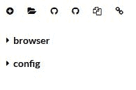

一个新的对话框将弹出。输入您的文件名（`blocksplit.sol`），然后按下 `OK`：

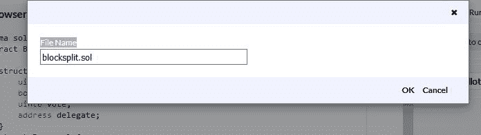

代码编辑器中将打开一个新标签页，您可以在其中开始编写合约。因此，只需将之前的合约代码复制粘贴进去即可。

首先，开始编译合约。从 `Compile` 标签页，点击 `Start to compile` 按钮。

我们收到一个包含两个由静态代码分析提出的警告的消息框。

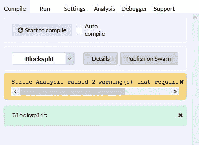

如果您点击该消息框，将被带到 `Analysis` 标签页，该标签页提供关于警告的更多信息：

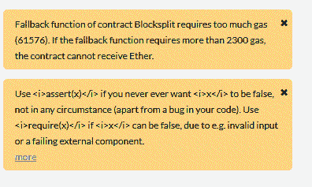

第一个警告在函数的 Gas 需求过高时触发，第二个警告在 `require()` 或 `assert()` 函数使用不当的时候触发。

您还可以使用 `Analysis` 标签页中的复选框来确定何时希望编译器发出警告。

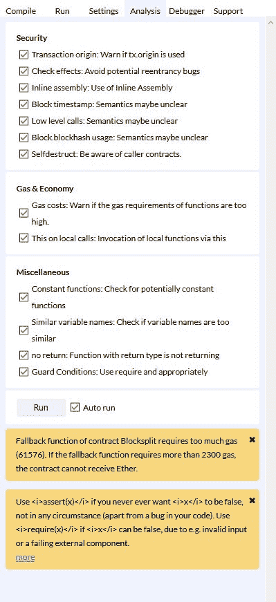

接下来，让我们使用 JavaScript VM 部署合约。切换到 `Run` 标签页，并从下拉菜单中选择 `JavaScript VM`。

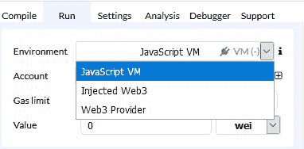

接下来，点击合约名称下方的 `Deploy` 按钮。

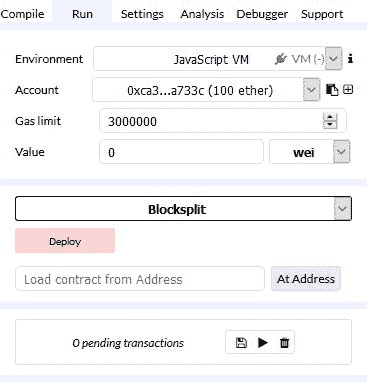

一旦合约在 JavaScript VM 上成功部署，`Run` 标签页底部将打开一个框。

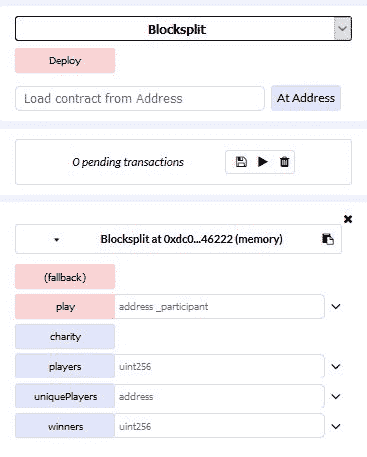

在已部署合约的名称和地址下方，我们有一些红色和蓝色的按钮。红色按钮代表会导致区块链写入的操作（在本例中为回调函数和 `play()` 函数），需要一笔交易；蓝色按钮代表从区块链读取数据（我们在合约代码中定义的 `charity`、`players`、`uniquePlayers` 和 `winners` 公共变量）。

您还将在 IDE 终端中看到类似于下面截图的消息。

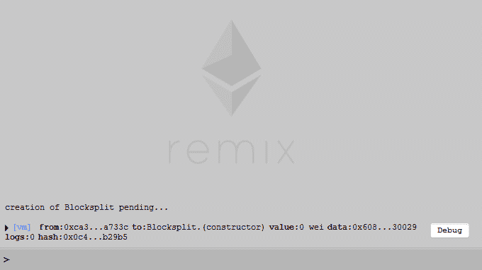

目前，唯一持有值的变量是 `charity` 变量，因为地址在代码中是硬编码的，所以如果您点击相应的按钮，将获得该地址的值。

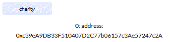

该合约的构建允许参与者通过向地址发送以太币（使用可支付的回调函数）或调用带有参与者地址的 `play()` 函数来参加抽奖。


JavaScript 虚拟机提供了五个拥有 `100` 以太币的假账户，我们可以用它们来测试合约。你可以从 `Environment` 下拉菜单下方名为 `Account` 的下拉菜单中选择一个当前账户。

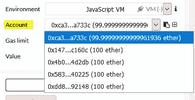

现在，要向合约发送资金，我们首先从下拉菜单中设置 `Value` 变量（在 0.001 和 0.1 之间）和单位（ether）。然后，只需点击其对应的红色按钮即可调用 fallback 函数。

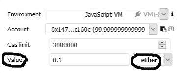

就这样。我们已经向合约发送了资金。所选账户的地址应该已被添加到 `players` 数组中。要检查这一点，只需点击蓝色的 `players` 按钮。

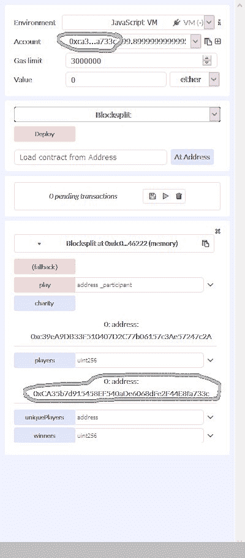

你可以通过选择一个新账户并重复上述过程来添加其他参与者（要检查某个账户是否已添加到数组中，只需在 `players` 按钮旁边的文本框中输入该账户的索引，范围从 0 到 4）。

如果你添加一个已经参与过的账户，你应该会在终端收到一条警告，并且交易将失败，显示类似如下的消息：

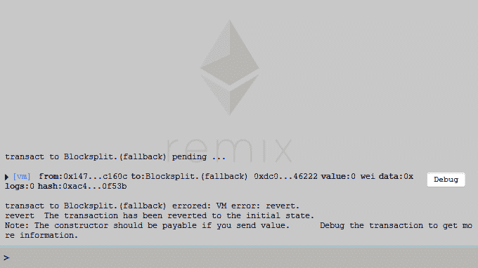

#### Remix 替代方案

有许多用于轻松开发和部署智能合约的替代方案，例如：

*   [Truffle](http://truffleframework.com/): 号称以太坊的“瑞士军刀”，并声称是以太坊最流行的开发框架，其使命是让你的生活轻松得多。我们将在后续章节中大量使用 Truffle。
*   [Embark](https://github.com/embark-framework/embark): 一个允许你轻松开发和部署去中心化应用（DApps）的框架。
*   [MetaMask](https://metamask.io/): 一个桥梁，让你今天就能在浏览器中访问明天的分布式网络。它允许你直接在浏览器中运行以太坊 DApps，而无需运行完整的以太坊节点。关于如何使用 MetaMask 进行开发，请查看此 [FAQ](https://github.com/MetaMask/faq/)。
*   [Dapp](https://dapp.readthedocs.io/en/latest/): Dapp 是一个用于智能合约开发的简单命令行工具。
*   用于为流行 IDE 添加 Solidity 支持的不同插件，例如 [这个 Visual Studio Code 插件](https://marketplace.visualstudio.com/items?itemName=JuanBlanco.solidity) 和 [这个 Atom 插件](https://atom.io/packages/language-ethereum) 等。

### 结论

我们向你介绍了用于为以太坊区块链开发智能合约的 Remix IDE。你可以在 [文档](http://remix.readthedocs.io/en/latest/) 中找到更详细的信息。

有了基础介绍，请随意深入探索，尝试修改代码并探索编辑器提供的不同功能和标签页。

## 第 2 章：Geth 简介与运行以太坊节点

### 作者：Mislav Javor

**在本文中，我们将了解什么是以太坊节点，并探索最流行的节点之一，称为 Geth。**

为了与区块链通信，我们必须使用区块链 **客户端**。客户端是一段能够与其他客户端建立 p2p 通信通道、签名并广播交易、挖矿、部署和交互智能合约等的软件。客户端通常被称为 **节点**。

以太坊节点必须遵循的功能正式定义见 [以太坊黄皮书](https://ethereum.github.io/yellowpaper/paper.pdf)。黄皮书定义了网络上节点所需的功能、挖矿算法、私钥/公钥 [ECDSA](https://en.wikipedia.org/wiki/Elliptic_Curve_Digital_Signature_Algorithm) 参数。它定义了使节点成为完全兼容的以太坊客户端的全部特性。

基于黄皮书，任何人都可以用他们认为合适的任何语言创建自己的以太坊节点实现。

完整的客户端列表可见 [此处](https://github.com/ethereum/wiki/wiki/Clients,-tools,-dapp-browsers,-wallets-and-other-projects#ethereum-clients)。

目前最流行的客户端是 [Geth](https://github.com/ethereum/go-ethereum/wiki) 和 [Parity](https://wiki.parity.io/)。实现上的差异主要在于编程语言的选择 —— Geth 使用 Golang，而 Parity 使用 Rust。

由于 Geth 目前是最流行的客户端实现，我们将暂时专注于它。

### 节点类型

当你加入以太坊网络时，你可以选择运行各种类型的节点。目前的选项有：

*   轻节点
*   全节点
*   归档节点

归档节点是全节点的一种特殊情况，所以我们不会详细介绍它。我找到的关于节点类型最好的总结之一在 [Stack Exchange](https://ethereum.stackexchange.com/questions/5975/what-are-the-types-of-nodes-in-ethereum) 上：

> 一般来说，我们可以将节点软件分为两类：全节点和轻量节点。全节点验证广播到网络上的区块。也就是说，它们确保区块中包含的交易（以及区块本身）遵循以太坊规范中定义的规则。它们维护网络的当前状态（根据以太坊规范定义）。
>
> 不遵循规则的交易和区块不用于确定以太坊网络的当前状态。例如，如果 A 试图向 B 发送 100 以太币，但 A 拥有 0 以太币，而一个区块包含了这笔交易，全节点会意识到这不符合以太坊的规则并拒绝该区块，视其为无效。特别地，智能合约的执行就是一个交易的例子。每当智能合约在交易中被使用时（例如发送 ERC-20 代币），所有全节点都必须运行所有指令，以确保它们到达正确的、商定一致的区块链下一个状态。
>
> 到达相同状态有多种方式。例如，如果 A 有 101 以太币，并在一笔交易中给了 B 一百个，支付 1 以太币作为 Gas，最终结果将与 A 发送 100 笔每笔 1 以太币的交易给 B，每笔支付 0.01 以太币（忽略谁收到了交易费）的结果相同。要想知道 B 现在是否被允许发送 100 以太币，只需知道 B 当前的余额即可。保留完整交易历史的全节点被称为全归档节点。网络健康运行需要这些节点的存在。
>
> 节点也可以选择丢弃旧数据；如果 B 想向 C 发送 100 以太币，不重要以太币是如何获得的，只重要 B 的账户包含 100 以太币。相比之下，轻节点不验证每个区块或交易，并且可能没有当前区块链状态的副本。它们依赖全节点为它们提供缺失的细节（或仅仅缺乏特定功能）。轻节点的优势在于它们可以更快地启动和运行，可以在计算/内存受限的设备上运行，并且不会占用近乎那么多的存储空间。缺点是存在对其他节点的信任成分（这因客户端而异，可以使用概率方法/启发式算法来降低风险）。一些全客户端包含实现更快同步的功能（例如 Parity 的 warp sync）。

### 安装 Geth

在各种平台（Windows、macOS、Linux）上安装 Geth 的说明可以在 [这里](https://github.com/ethereum/go-ethereum/wiki/Building-Ethereum) 找到。该列表非常全面且保持更新，所以我不会在文章中重述。

### 运行 Geth

要启动一个 Geth 节点，你只需要打开终端窗口并运行 `geth`。当你这样做时，你应该会得到类似如下的输出：


```
➜  ~ geth
INFO [06-03|11:03:13] 最大对等节点数                       ETH=25 LES=0 total=25
INFO [06-03|11:03:13] 启动点对点节点                       instance=Geth/v1.8.10-stable/darwin-amd64/go1.10.2
INFO [06-03|11:03:13] 分配缓存和文件句柄                 database=/Users/mjvr/Library/Ethereum/geth/chaindata cache=768 handles=128
INFO [06-03|11:03:13] 写入默认主网创世区块
INFO [06-03|11:03:14] 从内存数据库持久化 Trie              nodes=12356 size=2.34mB time=48.31016ms gcnodes=0 gcsize=0.00B gctime=0s livenodes=1 livesize=0.00B
INFO [06-03|11:03:14] 初始化链配置                       config="{ChainID: 1 Homestead: 1150000 DAO: 1920000 DAOSupport: true EIP150: 2463000 EIP155: 2675000 EIP158: 2675000 Byzantium: 4370000 Constantinople: <nil> Engine: ethash}"
INFO [06-03|11:03:14] 为 ethash 缓存启用磁盘存储           dir=/Users/mjvr/Library/Ethereum/geth/ethash count=3
INFO [06-03|11:03:14] 为 ethash DAG 启用磁盘存储           dir=/Users/mjvr/.ethash                      count=2
INFO [06-03|11:03:14] 初始化以太坊协议                   versions="[63 62]" network=1
INFO [06-03|11:03:14] 加载最近的本地区块头               number=0 hash=d4e567…cb8fa3 td=17179869184
INFO [06-03|11:03:14] 加载最近的本地完整区块             number=0 hash=d4e567…cb8fa3 td=17179869184
INFO [06-03|11:03:14] 加载最近的本地快速区块             number=0 hash=d4e567…cb8fa3 td=17179869184
INFO [06-03|11:03:14] 重新生成本地交易日志               transactions=0 accounts=0
INFO [06-03|11:03:14] 启动 P2P 网络
INFO [06-03|11:03:16] UDP 监听器启动                     self=enode://a4cb08519bc2bceecb8ad421871c624d5212888653bbaee309fda960f3c87ca7aa9855ee14684d521836ae88ad1986b8ca944348e976760d2bd1247ed3ca7628@[::]:30303
INFO [06-03|11:03:16] RLPx 监听器启动                    self=enode://a4cb08519bc2bceecb8ad421871c624d5212888653bbaee309fda960f3c87ca7aa9855ee14684d521836ae88ad1986b8ca944348e976760d2bd1247ed3ca7628@[::]:30303
INFO [06-03|11:03:16] IPC 端点已打开                     url=/Users/mjvr/Library/Ethereum/geth.ipc
```

在此之后，你应该会定期看到新行出现，Geth 会提示“正在导入新状态”、“正在导入新区块头”或“正在导入新收据”。状态、区块头和交易是 [以太坊的树形 Trie](https://ethereum.stackexchange.com/questions/15142/how-many-tries-does-ethereum-have) 的一部分：必须下载它们才能将你的节点与以太坊区块链同步。

这是一个可能需要非常长时间的过程，因此你的选项之一是像这样运行轻节点：

```
geth --light
```

现在 Geth 只需要拉取最新的区块头，并通过使用 [Merkle 证明](https://www.quora.com/Cryptography-How-does-a-Merkle-proof-actually-work) 依赖其他全节点来验证交易。

### 访问 Geth 控制台

现在你已经创建了一个节点，可以通过在终端中打开一个新标签页并运行以下命令来访问它：

```
geth attach
```

这将把一个 Geth 控制台（一个用于与区块链通信的 JavaScript 环境）连接到你正在运行的节点。这既可以在全客户端模式下完成，也可以在轻节点模式下完成。

打开控制台后，输入以下内容：

```
web3.eth.blockNumber
```

你应该会得到一个数字输出（例如 5631487），它代表以太坊网络的当前区块号。

### 创建新账户

为了使用区块链，你需要拥有一个账户。使用 Geth，你可以通过在终端中运行以下命令来创建：

```
geth account new
```

完成后，它会要求你输入密码，该密码用于保护你的账户。请务必使用安全的密码并妥善保管。

当你运行 `geth account new` 时，Geth 会更新 Geth 数据目录中的一个文件（Geth 存储所有必要数据的目录，包括区块和区块头）。各平台的位置如下：

*   macOS: `~/Library/Ethereum`
*   Linux: `~/.ethereum`
*   Windows: `%APPDATA%\Ethereum`

### 从其他客户端访问 Geth

当你启动 Geth 时，客户端会自动在端口 `8545` 启动一个 RPC 服务器。你可以通过连接到 `localhost:8545` 来访问该 RPC 服务器及其 [方法](https://github.com/ethereum/wiki/wiki/JSON-RPC)，使用像 `web3js` 或 `web3j` 这样的库，*或者* 手动使用 `curl` 或 `wget` 调用它。

要了解如何使用这些外部工具连接到正在运行的 Geth 实例（无论是启动你自己的区块链时的私有实例，还是如上述说明的公共实例），请参阅 [这篇文章](https://bitfalls.com/2018/03/26/connecting-myetherwallet-mist-metamask-private-blockchain/)。

### 结论

在本简短介绍中，我们涵盖了 Geth、以太坊节点的类型及其用途。你现在可以运行自己的 Geth 节点，并使用第三方工具对其进行增强。在未来的文章中，我们将介绍运行私有网络（使用 Geth 的你自己的以太坊区块链）等更多内容。

## 第 3 章：介绍 Mist，一个对人类友好的 Geth 界面

### 作者：Mislav Javor

**本文解释了如何安装和使用 Geth 和 Mist，它们允许你挖矿或开发以太坊软件，并控制你自己的节点和你自己钱包的密钥，从而签署你自己的交易，而不必依赖第三方软件。**

为了与以太坊区块链通信，我们必须使用区块链*客户端*。客户端负责广播交易、挖矿、签名消息和与智能合约通信。

目前，以太坊最流行的客户端是 [Geth](https://www.sitepoint.com/an-introduction-to-geth-and-running-ethereum-nodes/) 和 Parity。它们都作为带有用于区块链操作的终端控制台的命令行工具提供。

由于大多数人不习惯使用命令行工具，因此创建了像 Mist 这样的客户端*扩展*。它们将客户端的功能“包装”在一个用户友好的界面中——使不精通命令行用法的人也能参与网络。

### 什么是 Mist？

Mist 是一个在后台连接到 Geth 的程序，同时也作为钱包的界面。

当 Geth 运行时，它通过下载所有数据与公共区块链同步。Mist 只是一个用于与 Geth 对话的对人类友好的界面。换句话说，Geth 既是你的节点也是你的钱包，但你不必通过晦涩的命令（例如 `web3.fromWei(eth.getBalance(eth.coinbase)`）来获取账户余额），Mist 会在 UI 中提供相同的信息，甚至不需要你询问。

你可以从 [此链接](https://github.com/ethereum/mist/releases) 下载 Mist。下载名为 Mist-installer 的版本，而不是 Ethereum-Wallet 版本。

*Mist-installer 和 Ethereum-wallet 的区别在于 Mist 本身就是一个 Web 和以太坊浏览器以及钱包界面。Ethereum-wallet 出于安全考虑移除了浏览器功能，仅安装了一个 dapp——钱包界面。因此，它们本质相同，但后者功能受限。*

你选择的文件将取决于你的操作系统。macOS 用户将选择 `.dmg` 文件，Windows 用户将选择 `.exe` 文件，而 Linux 用户通常会选择 `.deb` 文件。

下载后，运行安装过程，然后运行应用程序。如果你不确定它安装在哪里，只需在操作系统的搜索栏中输入其名称：

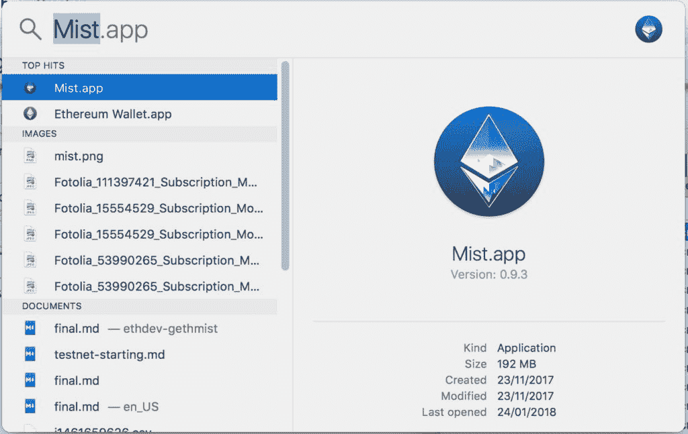

### Mist：首次运行

首次运行后，Mist 会检查同一台机器上是否安装了最新的 Geth，然后检查与以太坊网络的连接。


然后，Mist 会寻找对等节点 —— 它可以连接以从中下载区块链数据的节点。

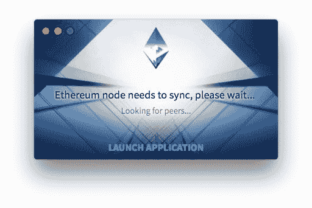

找到它们后，Mist 开始下载所需的海量数据。

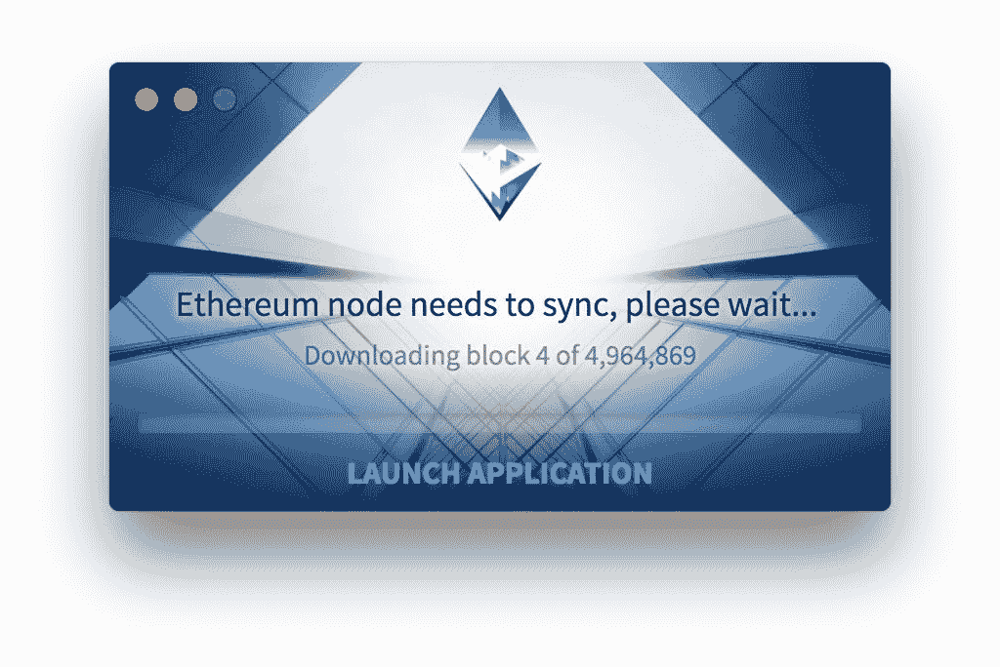

这可能需要几天时间，具体取决于计算机和互联网连接的速度。不必一次性完成：你可以关闭它稍后再来，或让它整夜运行。你也可以直接启动应用程序，在后台等待同步完成的同时实际使用该应用。

同步完成后，Mist 会询问使用哪个网络：主网或测试网。任选其一。除非你之前已在 Geth 中通过 `personal.newAccount` 命令创建了地址（你大概率没创建，这也没关系），它还会要求你设置密码。该密码为你的钱包提供额外安全保障，但请勿遗忘：它无法更改，也无法恢复。请慎重选择。此过程生成的 JSON 文件将使用该密码加密，并可导入 MetaMask、MyEtherWallet 等各种钱包工具。要获取 JSON 文件（用于备份），请前往 `File -> Backup -> Accounts`，Mist 将打开包含已生成地址的 JSON 文件的文件夹。

### Mist：地址

完成这些初始步骤后，Mist 应用的主界面将出现。屏幕上将仅显示你刚生成的主地址。该地址称为币基地址，如果你在这台机器上挖矿，挖出的以太币将记入该地址。

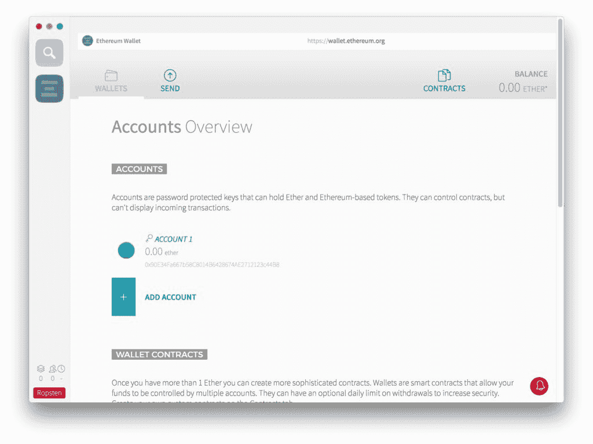

为了能安全地试用以太币和 Mist 的功能，如果你尚未连接到测试网络，我们需要切换到测试网络。在 Develop（开发）菜单中，前往 `Network -> Ropsten`。

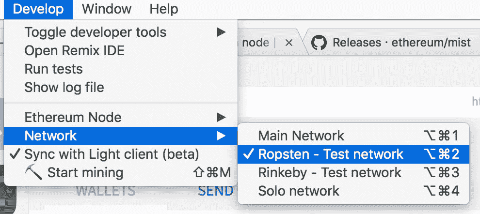

关于测试网的解释，请阅读[这篇文章](https://bitfalls.com/2018/02/08/what-is-an-ethereum-testnet-and-how-is-it-used/)。大意是存在各种用于测试以太坊软件的公共测试网络，但这些网络上的以太币毫无价值，因此鲁莽操作和随意开发也不会有危险。Ropsten 就是其中之一。

请随意使用 *Add Account*（添加账户）功能来添加更多地址。一个 Geth/Mist 可支持无限数量的地址。下图显示了三个生成的地址。

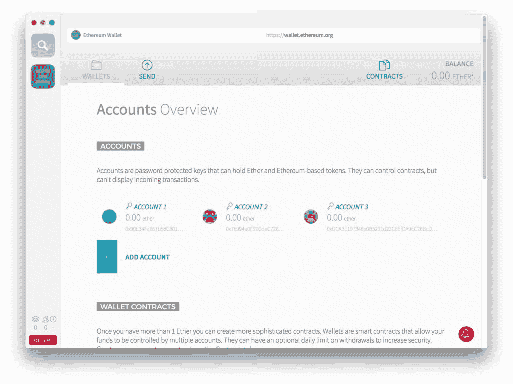

如果我们点击任意一个，将看到一些详细信息。

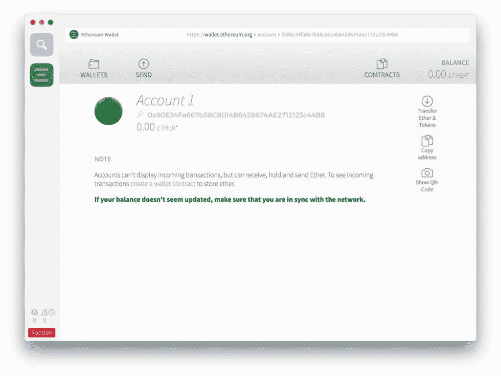

余额上方图标旁边的部分 —— 以 0x90 开头的那个 —— 是我们可以向其发送以太币的地址。但我们如何获取一些呢？如果你连接的是 Ropsten 网络，可以使用他们的水龙头网站：[faucet.ropsten.be:3001/](http://faucet.ropsten.be:3001/)

将该地址输入该网站第一个字段并请求一些以太币。

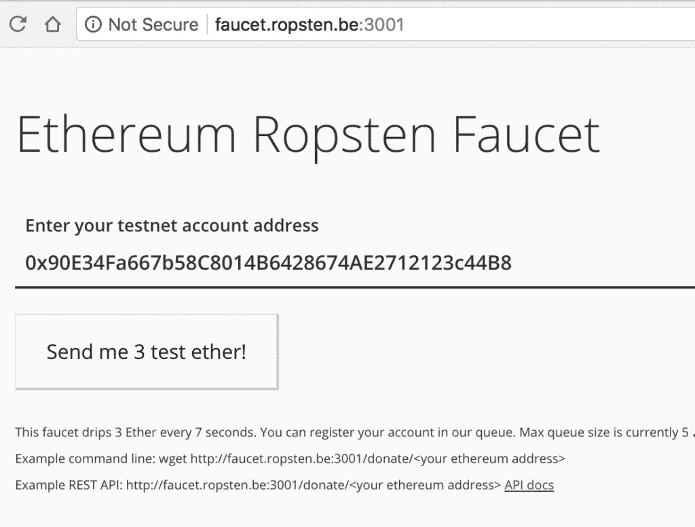

如果你的节点已同步完毕，新余额应立即显示。如果没有，请关闭应用再重新打开；有时它需要重置才能正确地重新同步。

### 发送和接收以太币

发送极其简单。在 Mist 中打开 *Send*（发送）界面，将接收地址填入“To”（收款人），并在“From”（付款人）下选择发送方（使用你从水龙头接收以太币的那个地址）。

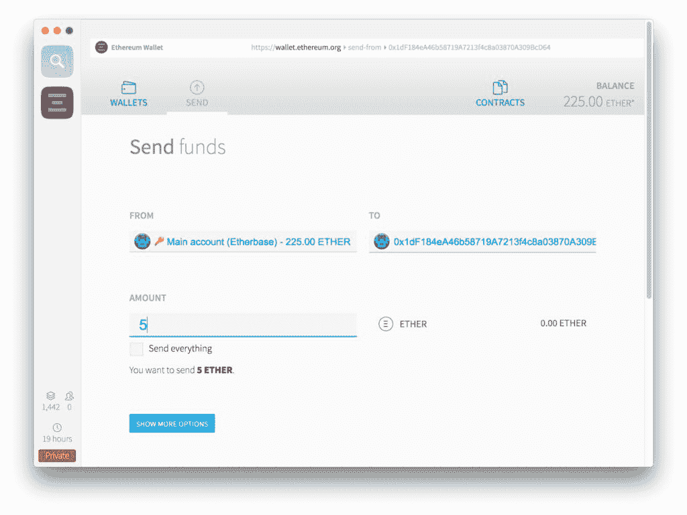

你可以在屏幕底部选择发送速度。越慢越便宜。按发送以发送以太币，并在提示时输入你之前设定的密码。

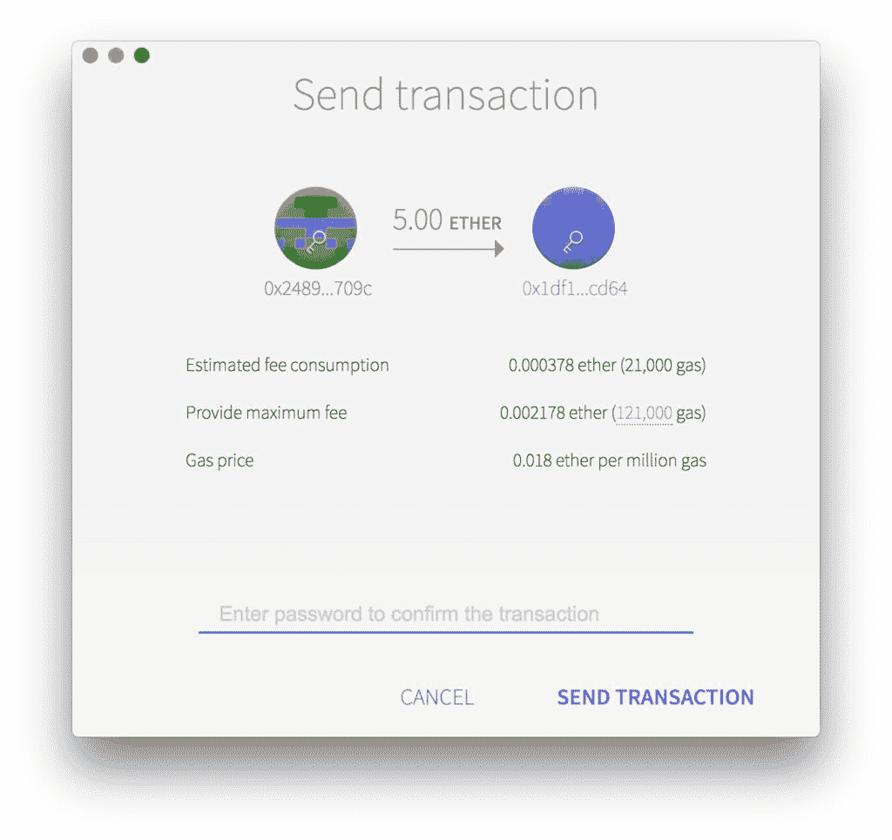

在本例中，我们从一个拥有 225 Eth 的地址向另一个拥有 0 Eth 的地址发送 5 Eth。以太币应几乎瞬间到账。

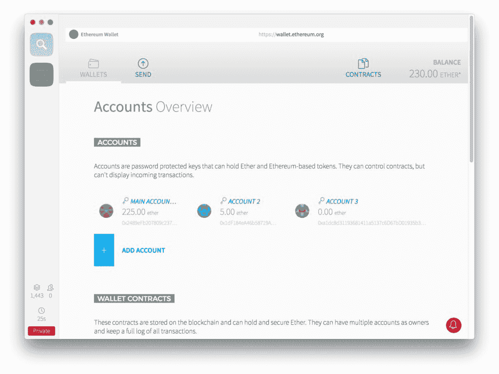

### 合约

Mist 通过 Mist 套件的两个组件，实现了智能合约到以太坊区块链的简易且用户友好的部署：

#### 1. Remix IDE

Remix 是一个用于部署智能合约的基于 Web 的开发环境。Remix 具有语法高亮、代码片段、合约编译和部署脚本生成等许多其他有趣功能。

你可以通过点击工具栏上的 *Develop*（开发），然后点击“Open Remix IDE”（打开 Remix IDE）来访问 Remix。你应该会看到一个类似这样的窗口：

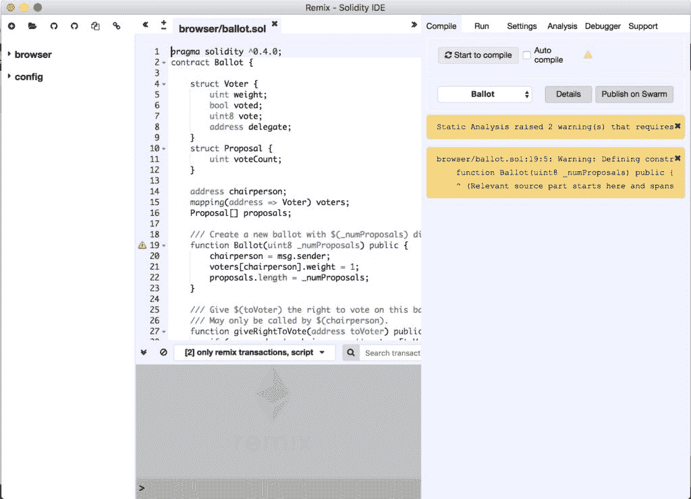

#### 2. 合约部署

在 Remix 中，你可以编写、编译和测试智能合约。完成后，返回 Mist，从 *Wallet*（钱包）页面打开 *Contracts*（合约）选项卡。你应该会看到如下界面：

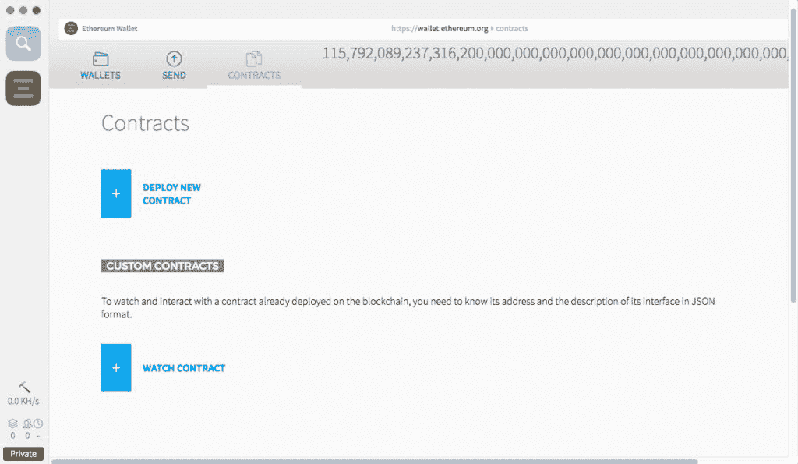

当你点击 *Deploy new contract*（部署新合约）时，一组输入框将打开。在那里你可以粘贴合约源代码或字节码，并将其部署到以太坊网络。完成后，你可以与你的合约进行交互。

### 结论

Geth 和 Mist 是每位有志于参与以太坊网络的人必不可少的工具。如果你想尝试挖矿或开发以太坊软件（ICO、代币、DApp），或者只是想控制自己的节点从而掌控自己钱包的密钥，进而自己签署交易而非依赖第三方软件，那么安装并熟悉 Geth 和 Mist 绝对值得付出努力。

## 第 4 章：介绍 Truffle，一个区块链智能合约套件

### 作者：Mislav Javor

**在 `smart contract`（智能合约）开发的早期（约 2016 年），常规做法是在你喜欢的文本编辑器中编写智能合约，并通过直接调用 `geth` 和 `solc` 来部署它们。**

让这个过程变得更加 `user friendly`（用户友好）的方法是编写 bash 脚本，先编译再部署合约……这虽然好一些，但仍相当原始 —— 脚本方法的问题当然在于缺乏 `standardization`（标准化），且 bash 脚本的体验并不理想。

答案以两种截然不同的形式出现 —— `Truffle and Embark`（Truffle 和 Embark） —— 其中 Truffle 更受欢迎（也是本文将讨论的工具）。

要理解 Truffle 背后的原理，我们必须了解它试图解决的问题，详情如下。

**编译** 应同时支持多个版本的 `solc` 编译器，并明确指示使用哪一个。

**环境** 合约需要拥有开发、集成和生产环境，每个环境都有自己的以太坊节点地址、账户等。

**测试** 合约*必须*可测试。软件测试的重要性怎么强调都不为过。对于智能合约，其重要性更是无限放大。所以，测试！你的！合约！

**配置** 你的开发、集成和生产环境应封装在配置文件中，以便提交到 git 并供团队成员复用。

**Web3js 集成** Web3.js 是一个 JavaScript 框架，用于让 Web 应用更轻松地与智能合约通信。Truffle 更进一步，在 Truffle 控制台中启用了 Web3.js 接口，因此你可以在开发模式下、在浏览器之外调用 Web 函数。

#### 安装 Truffle

安装 Truffle 的最佳方式是使用 Node 包管理器 (npm)。在你的电脑上[设置好 NPM](https://nodejs.org/en/) 后，打开终端并输入以下命令来安装 Truffle：

```
npm install -g truffle
```

#### Linux 系统上

Linux 机器上可能需要加 `sudo` 前缀。

### 入门

安装好 Truffle 后，了解其工作原理的最佳方式是设置名为 “MetaCoin” 的 Truffle 演示项目。

打开终端应用（Linux 和 macOS 上字面意义上的 Terminal，或 Windows 上的 Git Bash、Powershell、Cygwin 或类似工具），定位到你希望初始化项目的文件夹。

然后运行以下命令：

```
mkdir MetaCoin
cd MetaCoin
truffle unbox metacoin
```

你应该会看到如下输出：


正在下载...
正在解包...
正在设置...
解包成功。太棒了！

命令：

*   编译合约：`truffle compile`
*   迁移合约：`truffle migrate`
*   测试合约：`truffle test`

如果你遇到一些错误，可能是因为你使用的 Truffle 版本不同。本教程编写时使用的版本是 `Truffle v4.1.5`，但这些说明至少在未来几个版本中仍应保持相关性。

### Truffle 项目结构

你的 Truffle 文件夹看起来应该有点像这样：

```
.
├── contracts
│   ├── ConvertLib.sol
│   ├── MetaCoin.sol
│   └── Migrations.sol
├── migrations
│   ├── 1_initial_migration.js
│   └── 2_deploy_contracts.js
├── test
│   ├── TestMetacoin.sol
│   └── metacoin.js
├── truffle-config.js
└── truffle.js
```

#### Contracts 文件夹

这是你存放所有智能合约的文件夹。

在你的 contracts 文件夹中，还有一个 `Migrations.sol` 文件，这是一个特殊文件——关于这一点我们将在下一节详细介绍。

当 Truffle 编译项目时，它会遍历 `contracts` 文件夹并编译所有兼容的文件。目前，最常用的文件是扩展名为 `.sol` 的 Solidity 文件。

未来，这可能会过渡到 Vyper 或 SolidityX（两者都更适合智能合约开发，但目前使用较少）。

#### Migrations 文件夹

什么是 Truffle 迁移？从本质上讲，它是一个定义合约*如何*部署到区块链的脚本。

##### 为什么我们需要迁移？

随着你的项目变得越来越复杂，你的部署复杂度也会随之相应增加。

让我们举个例子：

*   你有智能合约 `One`、`Two` 和 `Three`
*   智能合约 `Three` 包含对智能合约 `One` 的引用，*并且* 在其构造函数中需要合约 `Two` 的地址。

这个例子要求合约不仅要按顺序部署，还要相互引用。简而言之，迁移使我们能够自动化这个过程。

你大致会这样做：

```
var One = artifacts.require("One");
var Two = artifacts.require("Two");
var Three = artifacts.require("Three");

module.exports = function(deployer) {
  deployer.deploy(One).then(function() {
    deployer.deploy(Two).then(function() {
      deployer.deploy(Three, One.address);
    })
  });
};
```

除此之外，迁移还允许你做很多其他很酷的事情，比如：

*   设置部署的最大 Gas 限制
*   更改部署的 `from` 地址
*   部署库
*   调用任意合约函数

#### 初始迁移

正如你在 `MetaCoin` 项目中注意到的，你有一个名为 `1_initial_migration.js` 的文件。该文件的作用是将 `Migrations.sol` 合约部署到区块链。

通常一旦初始化完成，你不需要对该文件做任何操作，所以我们不会过多关注这一点。

#### Test 文件夹

正如我所说：你！必！须！测！试！智！能！合！约！没有借口，没有假设，没有也许：你必须这么做。

但如果你要做，拥有一个自动化工具来让你无缝地完成它会很酷。

Truffle 通过内置测试框架实现了这一点。它允许你用 Solidity 或 JavaScript 编写测试。

MetaCoin 项目中的示例基本上不言自明，所以我们不会深入探讨。

关键在于，如果你编写 Solidity 测试，你可以使用 Solidity `import` 指令将合约导入测试中：

```
import "../contracts/MetaCoin.sol";
```

如果你用 JavaScript 编写测试，则使用 `artifacts.require()` 辅助函数导入它们：

```
var MetaCoin = artifacts.require("./MetaCoin.sol");
```

#### 配置文件

配置文件名为 `truffle.js` 或 `truffle-config.js`。在大多数情况下它叫 `truffle.js`，但之所以有备选名称，是因为 Windows 机器上奇怪的命令优先级规则。

只需知道，当你看到 `truffle.js` 或 `truffle-config.js` 时，它们基本上是同一个东西。（另外，不要在 Windows 上用 CMD；PowerShell 好得多。）

配置文件定义了以下几个方面，详见下文。

**环境** 开发环境、测试网、主网（生产环境）。你可以定义 Geth 节点的地址、`network_id`、部署的最大 Gas 限制、你愿意支付的 Gas 价格。

**项目结构** 你可以更改文件构建和存放的位置，但这既非必要也不推荐。

**编译器版本和设置** 固定 `solc` 版本并设置 `-O`（优化）参数。

**包管理**

*   Truffle 可以配合 EthPM（以太坊包管理器）工作，但目前仍不太稳定。
*   你可以为 Truffle 项目设置 EthPM 依赖。

**项目描述** 项目作者、项目名称、联系地址等。

**许可证** 使用 [GPLv3](https://pbs.twimg.com/profile_images/561116211258220544/FlICmGnj_400x400.jpeg)。

### 运行代码

要编译你的合约，请运行：

```
truffle compile
```

要运行迁移，你可以直接使用：

```
truffle migrate
```

或者你可以通过指定环境来运行：

```
truffle migrate --network live
```

要测试你的合约，请运行：

```
truffle test
```

或者你可以通过运行以下命令来运行*特定*测试：

```
truffle test ./path/to/FileTest.sol
```

### 结论

Truffle 是一个非常实用的工具，它让这个全新生态系统中的开发变得更容易一些。它旨在将开发世界其他领域的标准和通用实践带入区块链实验的一个小角落。

## 第 5 章：使用 OpenZeppelin 等编写高质量 Solidity 代码

### 作者：Tonino Jankov

**鉴于 [Ethereum](https://bitfalls.com/2017/09/19/what-ethereum-compare-to-bitcoin/) 的所有计算都需要在网络中的所有 [节点](https://bitfalls.com/2017/11/26/whats-bitcoin-node-mining-vs-validation/) 上重现，Ethereum 的计算本质上是昂贵且低效的。（事实上，GitHub 上的 Ethereum 开发者文档指出，我们不应期望 Ethereum 提供的计算能力超过 1999 年的手机。）**

因此，Ethereum 虚拟机上的安全性——即部署在 Ethereum 区块链上的智能合约的安全性——至关重要。所有错误都会造成真金白银的损失——无论是编写糟糕的合约抛出的错误，还是黑客利用合约中的漏洞，就像著名的 DAO 黑客事件那样，导致社区分裂并催生了 Ethereum Classic 区块链。

*图灵完备性*——以及一系列其他使 Ethereum 变得更强大、更复杂的设计决策——都是有代价的。Ethereum 的丰富性使其更容易受到错误和黑客的攻击。

更糟糕的是，部署在 Ethereum 上的智能合约无法修改。[区块链](https://www.sitepoint.com/blockchain-what-it-is-how-it-works-why-its-so-popular) 是一种不可变的数据结构。

[这篇](https://medium.com/loom-network/how-to-secure-your-smart-contracts-6-solidity-vulnerabilities-and-how-to-avoid-them-part-1-c33048d4d17d) 和 [这篇](https://medium.com/loom-network/how-to-secure-your-smart-contracts-6-solidity-vulnerabilities-and-how-to-avoid-them-part-2-730db0aa4834) 文章更深入地探讨了智能合约的安全性，以及帮助我们保障智能合约安全的工具和库生态系统。

让我们看看今天可以用来利用 Solidity 环境提供的最佳实践的一些令人惊叹的工具集升级。

### 辅助工具


### OpenZeppelin 库

OpenZeppelin 库是以太坊开发者工具箱中最酷的工具之一。它是一个框架，包含许多以安全方式编写的 Solidity 代码模式和智能合约模块。作者本身就是 Solidity 审计师和顾问，你可以[在此阅读关于这些模块的第三方审计报告](https://blog.zeppelin.solutions/external-audit-of-openzeppelin-2ea50404ba7b)。OpenZeppelin 背后的阿根廷公司 Zeppelin Solutions 的 Manuel Araoz [概述](https://blog.zeppelin.solutions/onward-with-ethereum-smart-contract-security-97a827e47702)了主要的 Solidity 安全模式和注意事项。

OpenZeppelin 正确立自己作为可复用且安全的开源（MIT 许可）Solidity 代码库的行业标准，[可使用 Truffle 轻松部署](https://blog.zeppelin.solutions/how-to-create-token-and-initial-coin-offering-contracts-using-truffle-openzeppelin-1b7a5dae99b6)。它由智能合约组成，一旦通过 `npm` 安装，即可轻松导入并在我们的合约中使用。

Truffle 框架[发布了一个关于结合 Truffle 和 Ganache 使用 OpenZeppelin 的教程](http://truffleframework.com/tutorials/robust-smart-contracts-with-openzeppelin)。

这些合约旨在被导入，其方法旨在根据需要被重写。文件本身不应被修改。

### ICO 模式

OpenZeppelin 库包含一组用于在以太坊平台上发布代币的合约——针对 [ERC20](https://en.wikipedia.org/wiki/ERC20) 代币，包括 `BasicToken` 合约、`BurnableToken`、`CappedToken`。这是一种具有固定上限的可铸造代币、`MintableToken`、`PausableToken`，可暂停代币转账。还有 `TokenVesting`，一种*可像典型的归属方案一样逐步释放其代币余额的合约，包含悬崖期和归属期*，以及更多。

还有一组用于 [ERC721](https://openzeppelin.org/api/docs/token_ERC721_ERC721Token.html) 代币的合约——即非同质化、独特的 CryptoKitties 类型代币。

[ERC827 代币](https://github.com/ethereum/EIPs/issues/827)合约，即随交易代币发送数据的标准，[也已包含在内](https://openzeppelin.org/api/docs/token_ERC827_ERC827.html)。

还有一组*[众筹合约](https://openzeppelin.org/api/docs/crowdsale_Crowdsale.html)*——用于进行首次代币发行（ICO）的合约。这些合约可以[记录购买](https://openzeppelin.org/api/docs/crowdsale_Crowdsale.html#TokenPurchase)，向购买者[交付/发放代币](https://openzeppelin.org/api/docs/crowdsale_Crowdsale.html#_deliverTokens)，[转发 ETH 资金](https://openzeppelin.org/api/docs/crowdsale_Crowdsale.html#_forwardFunds)。其中包含用于验证和处理代币购买的函数。

[FinalizableCrowdsale](https://openzeppelin.org/api/docs/crowdsale_distribution_FinalizableCrowdsale.html) 合约提供了众筹结束后执行某些逻辑的功能。[PostDeliveryCrowdsale](https://openzeppelin.org/api/docs/crowdsale_distribution_PostDeliveryCrowdsale.html) 允许冻结提款直到众筹结束。[RefundableCrowdsale](https://openzeppelin.org/api/docs/crowdsale_distribution_RefundableCrowdsale.html) 是*Crowdsale 合约的扩展，增加了融资目标，以及在目标未达成时用户可退款的可能性*。

[可销毁合约](https://openzeppelin.org/api/docs/lifecycle_Destructible.html)可由所有者销毁，并将所有资金发送给所有者。还有用于向子合约[实现*可暂停性*](https://openzeppelin.org/api/docs/lifecycle_Pausable.html)的合约。

OpenZeppelin 为进行 ICO 提供了许多辅助工具和实用程序——例如[用于恢复误发送到 ICO 地址而非 ETH 地址的 ERC20 代币的合约](https://openzeppelin.org/api/docs/ownership_CanReclaimToken.html)。[可继承合约](https://openzeppelin.org/api/docs/ownership_Heritable.html)提供在特定情况下将所有权转移给另一所有者的功能。[Ownable 合约](https://openzeppelin.org/api/docs/ownership_Ownable.html)拥有一个所有者地址，并提供基本的授权/权限控制和所有权转移功能。

[RBAC 合约](https://openzeppelin.org/api/docs/ownership_rbac_RBAC.html)提供基于角色的访问控制实用程序。我们可以为不同地址分配不同角色，角色数量无上限。

Zeppelin 还提供了一个示例众筹启动 Truffle 项目，该项目尚未经过审计，因此最适合作为 OpenZeppelin 使用入门。它使快速启动众筹和代币变得容易。

### ZeppelinOS

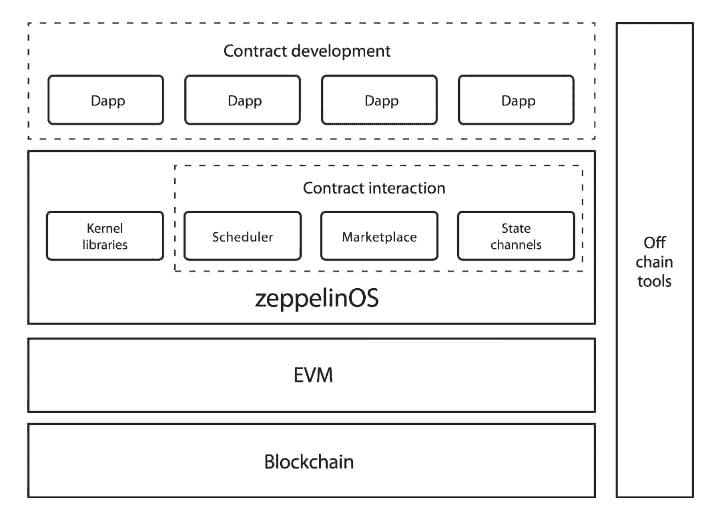

[ZeppelinOS](https://zeppelinos.org/) 是*一个建立在 EVM 之上的开源、去中心化的工具与服务平台，用于安全地开发和管理智能合约应用*。

实际上，这是一种建立在 EVM 之上的中间件层，比目前的 OpenZeppelin 框架更进一步。Zeppelin Solutions 此处承诺*通过[可升级模式](https://blog.zeppelinos.org/proxy-patterns/)，使开发者能够选择让其已部署的代码具备可变性*。为 EVM 编写智能合约的人都知道，其中一个顾虑/限制是已部署合约的不可变性：一旦上链，合约无法更改。这正是 ZeppelinOS 承诺中有趣的地方之一。

直到现在，为了“更新”合约，必须部署两个合约——一个作为带有接口的代理，另一个作为实现。代理的函数会被调用，并将请求转发给实现。如果需要更改，则在代理中替换实现（重定向到另一个实现，并可选择用 `suicide` 函数销毁原始实现），新实现便无缝激活。

我们正在等待观察社区对 ZeppelinOS 的未来采用情况。Zeppelin Solutions 已点名一些举足轻重的参与者，如 OpenBazaar、district0x、storj.io 等正在使用 ZeppelinOS。

### Truffle Boxes

[Truffle 框架](http://truffleframework.com)是以太坊的开发环境、测试框架和资源管道。它是工具集最完整、在以太坊开发者中关注度最高的框架。Truffle 的生态系统包含许多 [Truffle Boxes](http://truffleframework.com/boxes/)——即样板项目，包含前端 JavaScript 代码、Solidity 合约和工作流实用程序，如带有工具集的样板 webpack 项目——迁移、测试、构建管道等。Truffle Boxes 可包含完整的入门级 dapp。

部分官方支持的 Boxes 包括：

*   **Drizzle**：一组[基于 React/Redux 的前端库](http://truffleframework.com/boxes/drizzle)，可简化 dapp 前端的创建。
*   **React box**：一个用于从 React 前端应用开始与智能合约交互的[基础应用](http://truffleframework.com/boxes/react)。
*   **[React Auth box](http://truffleframework.com/boxes/react-auth)**：提供由智能合约驱动的身份验证所需的组件集。
*   **[React-Uport](http://truffleframework.com/boxes/react-uport)**：此身份验证 box 将前端与 UPort 区块链身份验证系统连接。
*   还有我们之前提到的 [webpack 项目样板](http://truffleframework.com/boxes/webpack) box。

社区创建的 boxes 还带来了用于[合约与移动应用 / Status IM 集成](http://truffleframework.com/boxes/status)的样板，或提供 Angular 和 Vue.js 样板等。

这些 boxes 与 Truffle 集成，因此我们可以通过运行类似 `truffle unbox react` 的命令开始使用它们——这将下载 *React* box 并在本地安装其依赖项。


### TokenMarket

[TokenMarket](https://tokenmarket.net/about) 是另一家发布了 Solidity 合约和管理代币销售 / ICO 工具存储库的公司。它是一家在直布罗陀注册的有限公司，从事 ICO 咨询。它在 [Cryptocurrency World Expo Berlin Summit 2018](https://cryptocurrencyworldexpo.com/) 上获得了“最佳 ICO 顾问”奖。

[TokenMarket 的 ICO GitHub 存储库](https://github.com/TokenMarketNet/ico) 表明，其[设计目标/原则之一](https://github.com/TokenMarketNet/ico#features-and-design-goals) 是使用或构建在现有的 OpenZeppelin 合约之上，称其为 Solidity 合约的黄金标准。因此，TokenMarket 的 ICO 代码库很大程度上基于 OpenZeppelin 的代码库，并在此基础上进一步构建（通过面向对象的方式继承）。

TokenMarket 定期（尝试）跟进其上游代码库 OpenZeppelin 的更新。但它也增加了更多内容，例如：

*   [`AMLToken` 合约](https://github.com/TokenMarketNet/ico/blob/master/contracts/AMLToken.sol)：该合约*在参与者经历漫长的 AML 流程失败后，代币发布前，给予所有者从参与者处追回代币的机会*。
*   [`GnosisWallet`](https://github.com/TokenMarketNet/ico/blob/master/contracts/GnosisWallet.sol)：基本上是一个多签钱包，需要多方共识才能进行某些交易。
*   一个 [`CentrallyIssuedToken`](https://github.com/TokenMarketNet/ico/blob/master/contracts/CentrallyIssuedToken.sol) 合约。
*   [`KYCCrowdsale`](https://github.com/TokenMarketNet/ico/blob/master/contracts/KYCCrowdsale.sol)：一个只允许非匿名投资者参与的合约。
*   [`RelaunchedCrowdsale`](https://github.com/TokenMarketNet/ico/blob/master/contracts/RelaunchedCrowdsale.sol) 合约：该合约恢复之前的众筹，并允许更改某些参数。
*   [`MilestonePricing`](https://github.com/TokenMarketNet/ico/blob/master/contracts/MilestonePricing.sol)：该合约提供基于里程碑的定价和预 ICO 交易。

尽管我们在这里讨论的存储库中有大量代码，但 EVM 图灵完备，因此所有这些不同的合约甚至远未穷尽其全部能力。只要系统 —— Ethereum —— 能够生存并保持竞争力，网络上有足够多的人，我们就可以期待这些区块链合约尝试解决的问题将具有更大的多样性。

### ConsenSys

ConsenSys Ventures 是一家瑞士风投/投资公司，将自己定位为去中心化领域的 *天使/种子投资公司* —— 特别是指 Ethereum 领域。除了为其孵化公司提供其他资源外，他们还整理了一份 [Ethereum 智能合约最佳实践的精选汇编](https://consensys.github.io/smart-contract-best-practices/)。虽然狭义上讲这不是代码，但它仍包含大量好的和坏的 Solidity 代码示例。

它主要关注 Solidity 智能合约的 *安全最佳实践*。

完整的主题列表超出了本文的范围，因为该资源 *全面* 且值得一读，即使只是为了提醒智能合约开发者在为 EVM 编写软件时需要牢记的所有事项。如果从头编写程序（不依赖像 OpenZeppelin 这样已经制作并经过审核的代码），这一点 *尤其* 重要。

一些文章涉及外部调用、避免在外部调用后更改状态、处理外部调用中的错误、倾向于对外部调用使用拉取而非推送模式、注意抽象合约和接口之间的权衡、不要假设合约创建时余额为零、区分函数和事件、多重继承的注意事项、关于时间戳依赖及此类结构可被博弈的警告 —— 例如与区块相关的 —— 以及许多其他带有大量代码示例的提示。

然后还有特定于代币的警告、与代币标准相关的警告、软件工程技术、安全工具 —— 用于静态分析、测试、代码检查等。

他们还列出了已知攻击，包括调用外部代码和合约的攻击、此类情况下可能被重复调用的函数、重入问题、跨函数竞态条件。在这里，他们分析了一系列问题，其中一些表现为 [The DAO 攻击](https://en.wikipedia.org/wiki/The_DAO_\(organization\))。

他们进一步提到了交易顺序依赖、时间戳依赖、整数溢出和下溢、不同的 DoS 攻击可能性/切入点，如区块 Gas 限制导致的 DoS、强制向合约发送 Ether；他们还分析了历史上的和已弃用的攻击。强烈建议阅读他们的文档。

### 结论

在本生态系统介绍中，我们浏览了一些可用于在 Ethereum 虚拟机上编写优秀、生产就绪智能合约的资源。这包括复用已经过审计、验证的代码（OpenZeppelin 声称有超过 40 亿美元价值的加密货币运行在其合约上），以及学习编写自己安全、生产就绪软件的实用资源。

## 第 6 章：Truffle：测试智能合约

### 作者：Mislav Javor

在我们的 Truffle 简介 中，我们讨论了什么是 Truffle 以及它如何帮助你自动化编译、测试和部署智能合约的工作。

在本文中，我们将探讨如何测试智能合约。测试是高质量智能合约开发 *最* 重要的方面。

为什么要进行广泛测试？这样你可以避免类似 [这种](http://www.businessinsider.com/ethereum-price-parity-hack-bug-fork-2017-11) 或 [这种](https://coincodex.com/article/50/the-dao-hack-what-happened-and-what-followed/) 事件。智能合约处理价值，有时是巨额价值 —— 这使它们成为有时间和技能攻击它们的人极具吸引力的猎物。

你肯定不希望你的项目最终进入 [区块链墓地](https://magoo.github.io/Blockchain-Graveyard/)，对吧？

### 入门

我们将构建 *HashMarket*，一个基于智能合约的简单二手商品市场。

打开终端，定位到你想要构建项目的文件夹。在该文件夹中，运行以下命令：

```
mkdir HashMarket
cd HashMarket
truffle init
```

你应该会得到类似如下的结果：

```
Downloading...
Unpacking...
Setting up...
Unbox successful. Sweet!

Commands:

  Compile:        truffle compile
  Migrate:        truffle migrate
  Test contracts: truffle test
```

你还将获得如下的文件结构：

```
.
├── contracts
│   └── Migrations.sol
├── migrations
│   └── 1_initial_migration.js
├── test
├── truffle-config.js
└── truffle.js
```

有关文件的回顾，请参阅 [上一篇文章](https://www.sitepoint.com/truffle-introduction/)。简而言之，我们有基本的 `truffle.js` 和两个用于进行初始区块链迁移的文件。

#### 准备测试环境

最简单的测试方式是在本地网络上进行。我强烈建议使用 `ganache-cli`（以前称为 `TestRPC`）工具进行合约测试。

安装 `ganache-cli`（需要 Node 包管理器）：

```
npm install -g ganache-cli
```

之后，打开一个单独的终端窗口或标签页并运行：

```
ganache-cli
```

你应该会看到类似如下的输出：


Ganache CLI v6.1.0 (ganache-core: 2.1.0)

可用账户
==================
(0) 0xd14c83349da45a12b217988135fdbcbb026ac160
(1) 0xc1df9b406d5d26f86364ef7d449cc5a6a5f2e8b8
(2) 0x945c42c7445af7b3337834bdb1abfa31e291bc40
(3) 0x56156ea86cd46ec57df55d6e386d46d1bbc47e3e
(4) 0x0a5ded586d122958153a3b3b1d906ee9ff8b2783
(5) 0x39f43d6daf389643efdd2d4ff115e5255225022f
(6) 0xd793b706471e257cc62fe9c862e7a127839bbd2f
(7) 0xaa87d81fb5a087364fe3ebd33712a5522f6e5ac6
(8) 0x177d57b2ab5d3329fad4f538221c16cb3b8bf7a7
(9) 0x6a146794eaea4299551657c0045bbbe7f0a6db0c

私钥
==================
(0) 66a6a84ee080961beebd38816b723c0f790eff78f0a1f81b73f3a4c54c98467b
(1) fa134d4d14fdbac69bbf76d2cb27c0df1236d0677ec416dfbad1cc3cc058145e
(2) 047fef2c5c95d5cf29c4883b924c24419b12df01f3c6a0097f1180fa020e6bd2
(3) 6ca68e37ada9b1b88811015bcc884a992be8f6bc481f0f9c6c583ef0d4d8f1c9
(4) 84bb2d44d64478d1a8b9d339ad1e1b29b8dde757e01f8ee21b1dcbce50e2b746
(5) 517e8be95253157707f34d08c066766c5602e519e93bace177b6377c68cba34e
(6) d2f393f1fc833743eb93f108fcb6feecc384f16691250974f8d9186c68a994ef
(7) 8b8be7bec3aca543fb45edc42e7b5915aaddb4138310b0d19c56d836630e5321
(8) e73a1d7d659b185e56e5346b432f58c30d21ab68fe550e7544bfb88765235ae3
(9) 8bb5fb642c58b7301744ef908fae85e2d048eea0c7e0e5378594fc7d0030f100

HD 钱包
==================
助记词：      ecology sweet animal swear exclude quote leopard erupt guard core nice series
基础 HD 路径：  m/44'/60'/0'/0/{account_index}

正在监听 localhost:8545

这是 `ganache-cli` 为你创建的所有账户的列表。你可以使用任意账户，但这些账户将预加载以太币，这使它们非常有用（因为测试需要以太币来支付 [gas 成本](https://www.sitepoint.com/ethereum-transaction-costs)）。

之后，前往你的 `truffle.js` 或 `truffle-config.js` 文件，并在配置中添加一个开发网络：

```javascript
module.exports = {
    networks: {
      development: {
        host: "127.0.0.1",
        port: 8545,
        network_id: "*"
      }
    }
};
```

#### 编写智能合约

我们要做的第一件事是编写 HashMarket 智能合约。我们将尽量保持其简洁，同时仍保留所需的功能。

HashMarket 是区块链上的一种 eBay。它允许卖家发布商品，买家用以太币购买。它还允许卖家在商品未售出时将其移除。

在你的项目中，在 `contracts` 文件夹下，创建一个新文件并命名为 `HashMarket.sol`。在该文件中，添加以下代码：

```solidity
pragma solidity 0.4.21;


contract HashMarket {

    // 跟踪物品状态，同时保留历史记录
    enum ItemStatus {
        active,
        sold,
        removed
    }

    struct Item {
        bytes32 name;
        uint price;
        address seller;
        ItemStatus status;
    }

    event ItemAdded(bytes32 name, uint price, address seller);
    event ItemPurchased(uint itemID, address buyer, address seller);
    event ItemRemoved(uint itemID);
    event FundsPulled(address owner, uint amount);

    Item[] private _items;
    mapping (address => uint) public _pendingWithdrawals;

    modifier onlyIfItemExists(uint itemID) {
        require(_items[itemID].seller != address(0));
        _;
    }

    function addNewItem(bytes32 name, uint price) public returns (uint) {

        _items.push(Item({
            name: name,
            price: price,
            seller: msg.sender,
            status: ItemStatus.active
        }));

        emit ItemAdded(name, price, msg.sender);
        // 物品被推到末尾，所以长度用作
        // 物品的 ID
        return _items.length - 1;
    }

    function getItem(uint itemID) public view onlyIfItemExists(itemID)
    returns (bytes32, uint, address, uint) {

        Item storage item = _items[itemID];
        return (item.name, item.price, item.seller, uint(item.status));
    }

    function buyItem(uint itemID) public payable onlyIfItemExists(itemID) {

        Item storage currentItem = _items[itemID];

        require(currentItem.status == ItemStatus.active);
        require(currentItem.price == msg.value);

        _pendingWithdrawals[currentItem.seller] = msg.value;
        currentItem.status = ItemStatus.sold;

        emit ItemPurchased(itemID, msg.sender, currentItem.seller);
    }

    function removeItem(uint itemID) public onlyIfItemExists(itemID) {
        Item storage currentItem = _items[itemID];

        require(currentItem.seller == msg.sender);
        require(currentItem.status == ItemStatus.active);

        currentItem.status = ItemStatus.removed;

        emit ItemRemoved(itemID);
    }

    function pullFunds() public returns (bool) {
        require(_pendingWithdrawals[msg.sender] > 0);

        uint outstandingFundsAmount = _pendingWithdrawals[msg.sender];

        if (msg.sender.send(outstandingFundsAmount)) {
            emit FundsPulled(msg.sender, outstandingFundsAmount);
            return true;
        } else {
            return false;
        }
    }
}
```

完成此操作后，尝试运行 `truffle compile` 以查看代码是否能编译通过。由于 Solidity 惯例经常变更，如果你的代码无法编译，可能的解决方案是使用旧版本的编译器（0.4.21 是编写此代码时的版本，将工作正常）。

#### 编写迁移脚本

你需要编写一个迁移脚本，让 Truffle 知道如何将你的合约部署到区块链。进入 `migrations` 文件夹并创建一个名为 `2_deploy_contracts.js` 的新文件。在该文件中，添加以下代码：

```javascript
var HashMarket = artifacts.require("./HashMarket.sol");

module.exports = function(deployer) {
    deployer.deploy(HashMarket);
};
```

因为我们只有一个合约，所以迁移文件非常简单。

现在运行 `truffle migrate`，希望你能看到类似如下的输出：

```
Using network 'development'.

Running migration: 1_initial_migration.js
  Deploying Migrations...
  ... 0xad501b7c4e183459c4ee3fee58ea9309a01aa345f053d053b7a9d168e6efaeff
  Migrations: 0x9d69f4390c8bb260eadb7992d5a3efc8d03c157e
Saving successful migration to network...
  ... 0x7deb2c3d9dacd6d7c3dc45dc5b1c6a534a2104bfd17a1e5a93ce9aade147b86e
Saving artifacts...
Running migration: 2_deploy_contracts.js
  Deploying HashMarket...
  ... 0xcbc967b5292f03af2130fc0f5aaced7080c4851867abd917d6f0d52f1072d91e
  HashMarket: 0x7918eaef5e6a21a26dc95fc95ce9550e98e789d4
Saving successful migration to network...
  ... 0x5b6a332306f739b27ccbdfd10d11c60200b70a55ec775e7165358b711082cf55
Saving artifacts...
```

### 测试智能合约

你可以使用 Solidity 或 JavaScript 进行智能合约测试。测试智能合约时 Solidity 可能稍微更直观一些，但 JavaScript 给你提供了更多可能性。

#### Solidity 测试

为了开始测试，在你项目的 `test` 文件夹中，创建一个名为 `TestHashMarket.sol` 的文件。Truffle 套件为我们提供了用于测试的辅助函数，所以我们需要导入它们。在文件开头，添加：

```solidity
pragma solidity ⁰.4.20;

import "truffle/Assert.sol";
import "truffle/DeployedAddresses.sol";
import "../contracts/HashMarket.sol";
```

前两个导入是最重要的。

`Assert` 导入让我们能访问各种测试函数，如 `Assert.equals()`、`Assert.greaterThan()` 等。通过这种方式，Assert 配合 Truffle 自动完成大部分“枯燥”的代码编写工作。

`DeployedAddresses` 导入为我们管理合约地址。因为每次你更改合约，都必须将其重新部署到新地址，*并且*即使你不更改它，每次测试时合约也应该重新部署以从原始状态开始。`DeployedAddresses` 库为我们处理了这个问题。

现在让我们编写一个测试。在 `import` 指令下方，添加以下内容：


#### 使用 Truffle 进行 Solidity 测试

```solidity
contract TestHashMarket {

    function testAddingNewProduct() public {
        // DeployedAddresses.HashMarket() 为我们处理合约地址
        // 管理
        HashMarket market = HashMarket(DeployedAddresses.HashMarket());

        bytes32 expectedName = "T";
        uint expectedPrice = 1000;

        uint itemID = market.addNewItem(expectedName, expectedPrice);

        bytes32 name;
        uint price;
        address seller;
        uint status;

        (name, price, seller, status) = market.getItem(itemID);

        Assert.equal(name, expectedName, "Item name should match");
        Assert.equal(price, expectedPrice, "Item price should match");
        Assert.equal(status, uint(HashMarket.ItemStatus.active), "Item status at creation should be .active");
        Assert.equal(seller, this, "The function caller should be the seller");
    }

}
```

让我们看看测试中的一些重要部分。首先：

```solidity
HashMarket market = HashMarket(DeployedAddresses.HashMarket());
```

这段代码使用 `DeployedAddresses` 库来创建一个用于测试的 `HashMarket` 合约新实例。

```solidity
Assert.equal(<current>, <expected>, <message>)
```

这部分代码负责检查两个值是否相等。如果相等，它会向测试套件传达成功消息。如果不相等，则传达失败消息。它还会附加该消息，以便你能知道代码*在何处*失败。

现在让我们运行它：

```bash
truffle test
```

你应该会得到如下结果：

```
TestHashMarket
    1) testAddingNewProduct
    > No events were emitted


  0 passing (879ms)
  1 failing

  1) TestHashMarket testAddingNewProduct:
     Error: VM Exception while processing transaction: revert
      at Object.InvalidResponse (/usr/local/lib/node_modules/truffle/build/webpack:/~/web3/lib/web3/errors.js:38:1)
      at /usr/local/lib/node_modules/truffle/build/webpack:/~/web3/lib/web3/requestmanager.js:86:1
      at /usr/local/lib/node_modules/truffle/build/webpack:/~/truffle-provider/wrapper.js:134:1
      at XMLHttpRequest.request.onreadystatechange (/usr/local/lib/node_modules/truffle/build/webpack:/~/web3/lib/web3/httpprovider.js:128:1)
      at XMLHttpRequestEventTarget.dispatchEvent (/usr/local/lib/node_modules/truffle/build/webpack:/~/xhr2/lib/xhr2.js:64:1)
      at XMLHttpRequest._setReadyState (/usr/local/lib/node_modules/truffle/build/webpack:/~/xhr2/lib/xhr2.js:354:1)
      at XMLHttpRequest._onHttpResponseEnd (/usr/local/lib/node_modules/truffle/build/webpack:/~/xhr2/lib/xhr2.js:509:1)
      at IncomingMessage.<anonymous> (/usr/local/lib/node_modules/truffle/build/webpack:/~/xhr2/lib/xhr2.js:469:1)
      at endReadableNT (_stream_readable.js:1106:12)
      at process._tickCallback (internal/process/next_tick.js:178:19)
```

我们的测试失败了！

让我们深入合约内部检查可能的错误。

经过仔细检查，我们会发现合约的问题出在 `addNewItem` 方法的 `return` 语句上：

```solidity
function addNewItem(bytes32 name, uint price) public returns (uint) {

        _items.push(Item({
            name: name,
            price: price,
            seller: msg.sender,
            status: ItemStatus.active
        }));

        // Item is pushed to the end, so the lenth is used for
        // the ID of the item
        return _items.length;
}
```

由于数组是零索引的，且我们使用数组位置作为 ID，实际上我们应该返回 `_items.length - 1`。修复此错误并再次运行：

```bash
truffle test
```

你应该会收到一条令人欣喜的消息：

```
TestHashMarket
  ✓ testAddingNewProduct (130ms)


1 passing (729ms)
```

我们已成功使用 Truffle 测试修复了代码中一个极可能存在的错误！

#### JavaScript 测试

Truffle 使我们能够使用 JavaScript 进行测试，利用 Mocha 测试框架。这使你能够编写更复杂的测试，并从测试框架中获得更多功能。

好的，让我们编写测试。首先，在 `test` 文件夹中创建一个文件，命名为 `hashmarket.js`。

我们需要做的第一件事是获取合约在 JavaScript 中的引用。为此，我们将使用 Truffle 的 `artifacts.require(...)` 函数：

```javascript
var HashMarket = artifacts.require("./HashMarket.sol");
```

现在我们有了合约的引用，让我们开始编写测试。首先，我们将使用提供给我们的 `contract` 函数：

```javascript
contract("HashMarket", function(accounts) {

});
```

这为我们的合约创建了一个测试套件。现在为了测试，我们使用 Mocha 的 `it` 语法：

```javascript
contract("HashMarket", function(accounts) {
    it("should add a new product", function() {

    });
});
```

这描述了我们将要编写的测试，并为我们呈现一条消息以了解测试的目的。现在让我们编写测试本身。最后，`hashmarket.js` 文件应如下所示。推理过程在源代码的注释中已有解释：

```javascript
var HashMarket = artifacts.require("./HashMarket.sol");

contract("HashMarket", function(accounts) {
    it("should add a new product", function() {

        // 设置测试数据的名称
        var itemName = "TestItem";
        var itemPrice = 1000;
        var itemSeller = accounts[0];

        // 由于我们所有的测试函数都是异步的，我们将合约实例
        // 存储在较高层级以便所有函数均可访问
        var hashMarketContract;

        // Item ID 将异步提供，因此我们将其提取出来
        var itemID;

        return HashMarket.deployed().then(function(instance) {
            // 将合约实例设置到变量中
            hashMarketContract = instance;

            // 订阅一个 Solidity 事件
            instance.ItemAdded({}).watch((error, result) => {
                if (error) {
                    console.log(error);
                }
                // 事件触发后，将结果存储在外部变量中
                itemID = result.args.itemID;
            });

            // 调用 addNewItem 函数并返回 Promise
            return instance.addNewItem(itemName, itemPrice, {from: itemSeller});
        }).then(function() {
            // 此函数在 addNewItem 调用交易被挖出后触发。
            // 现在使用我们从事件中接收到的 itemID 调用 getItem 函数
            return hashMarketContract.getItem.call(itemID);
        }).then(function(result) {
            // getItem 的结果是一个元组，我们可以像这样将其
            // 解构为变量
            var [name, price, seller, status] = result;

            // 开始测试。使用 web3.toAscii() 将智能合约的结果
            // 从 Solidity 字节码转换为 ASCII。之后使用 .replace()
            // 去除 bytes32 中多余的填充字节
            assert.equal(itemName, web3.toAscii(name).replace(/\u0000/g, ''), "Name wasn't properly added");
            // 使用 assert.equal() 检查所有变量
            assert.equal(itemPrice, price, "Price wasn't properly added");
            assert.equal(itemSeller, seller, "Seller wasn't properly added");
            assert.equal(status, 0, "Status wasn't properly added");
        });
    });
});
```

运行 `truffle test`，你应该会得到类似如下的结果：

```
TestHashMarket
  ✓ testAddingNewProduct (109ms)

Contract: HashMarket
  ✓ should add a new product (64ms)


2 passing (876ms)
```

你的测试已通过，你可以确信没有回归 Bug。

作为作业，为合约中的所有其他函数编写测试。

## 第 7 章：Truffle 迁移详解

### 作者：Mislav Javor

一般来说，迁移是开发者实现数据及其支持结构自动化部署的方式。它们对于管理新软件版本的部署非常有用，因此并非区块链开发所独有。


### Truffle 迁移

Truffle 迁移使我们能够将智能合约“推送”到以太坊区块链（无论是[本地、测试网还是主网](https://bitfalls.com/2018/02/08/what-is-an-ethereum-testnet-and-how-is-it-used/)），并设置将合约与其他合约链接以及用初始数据填充合约所需的步骤。

迁移真正大放异彩的地方在于对区块链上合约地址的管理。这项通常繁琐的工作在 Truffle 中几乎被完全抽象化了。

### 先决条件

请确保您已安装 [Truffle 框架](http://truffleframework.com/) 和 [Ganache CLI](https://github.com/trufflesuite/ganache-cli)。

### 入门

首先，选择一个项目文件夹，然后运行 `truffle init`。您应该会得到类似如下的输出：

```
Downloading...
Unpacking...
Setting up...
Unbox successful. Sweet!

Commands:

  Compile:        truffle compile
  Migrate:        truffle migrate
  Test contracts: truffle test
```

此命令会在您当前所在的目录中创建一个基础的 Truffle 项目。目录结构如下：

```
.
├── contracts
│   └── Migrations.sol
├── migrations
│   └── 1_initial_migration.js
├── test
├── truffle-config.js
└── truffle.js
```

首先，在 `contracts` 目录中，创建一个名为 `Storage.sol` 的新文件，内容如下：

```
pragma solidity ⁰.4.21;


contract Storage {

    mapping (string => string) private _store;

    function addData(string key, string value) public {
        require(bytes(_store[key]).length == 0);
        _store[key] = value;
    }

    function removeData(string key) public returns (string) {
        require(bytes(_store[key]).length != 0);
        string prev = _store[key];
        delete _store[key];
        return prev;
    }

    function changeData(string key, string newValue) public {
        require(bytes(_store[key]).length != 0);
        _store[key] = newValue;
    }

}
```

#### 初始迁移

正如您可能已经注意到的，运行 `truffle init` 时会创建两个文件。它们是 `Migrations.sol` 和 `1_initial_migration.js`。

初始迁移文件很少需要更改。它们的作用本质上是跟踪区块链上的地址。

`Migrations.sol` 文件可以是您想要的任何样子，但它必须符合一个固定的接口，该接口类似于 `truffle init` 命令创建的接口。您可以在这些文件中对迁移进行一些高级处理，但正如我所说，这很少需要。

`1_initial_migration.js` 文件也是如此。它的作用仅仅是将 `Migrations.sol` 文件推送到所需的区块链。

#### 迁移数据

为了将智能合约部署到以太坊区块链，您必须首先编写迁移脚本。为了开始，在您的 `migrations` 目录中，创建一个名为 `2_deploy_contracts.js` 的文件。您的项目结构现在应该如下所示：

```
.
├── contracts
│   ├── Migrations.sol
│   └── Storage.sol
├── migrations
│   ├── 1_initial_migration.js
│   └── 2_deploy_contracts.js
├── test
├── truffle-config.js
└── truffle.js
```

为了使用迁移部署智能合约，首先我们需要访问它们的*工件*。这些文件描述了合约地址、合约已部署的网络以及合约拥有的函数。

那么所有这些数据来自哪里？

在您的项目目录中，运行 `truffle compile`。如果一切顺利，您应该会得到类似如下的输出：

```
Compiling ./contracts/Migrations.sol...
Compiling ./contracts/Storage.sol...

Writing artifacts to ./build/contracts
```

*根据编译器版本的不同，您可能会收到一些警告，但只要没有错误，就可以继续。*

现在再次检查您的项目目录结构：

```
.
├── build
│   └── contracts
│       ├── Migrations.json
│       └── Storage.json
├── contracts
│   ├── Migrations.sol
│   └── Storage.sol
├── migrations
│   ├── 1_initial_migration.js
│   └── 2_deploy_contracts.js
├── test
├── truffle-config.js
└── truffle.js
```

请注意，现在有一个 `build` 文件夹，其中包含两个文件 —— `Migrations.json` 和 `Storage.json` —— 它们与 `contracts` 目录中的智能合约文件相对应。

这些 `*.json` 文件包含其各自智能合约的描述。描述包括：

*   合约名称
*   合约 ABI（应用程序二进制接口 —— 智能合约中所有函数及其参数和返回值的列表）
*   合约字节码（编译后的合约数据）
*   合约已部署字节码（部署到区块链的最新版本字节码）
*   最后编译合约的编译器版本
*   合约已部署的网络列表以及合约在每个网络上的地址。

此文件使 Truffle 能够创建一个 JavaScript 包装器，用于与智能合约通信。例如，当您在 JavaScript 代码中调用 `contract.address` 时，Truffle 框架会从 `*.json` 文件中读取地址，从而实现合约版本和网络之间的轻松切换。

#### 编写迁移

掌握了这些知识，让我们编写第一个迁移脚本。在 `2_deploy_contracts.js` 文件中，编写以下内容：

```
// 从 Storage.json 文件获取 Storage 合约数据
var Storage = artifacts.require("./Storage.sol");

// JavaScript 导出
module.exports = function(deployer) {
    // Deployer 是用于将合约部署到网络的 Truffle 包装器

    // 将合约部署到网络
    deployer.deploy(Storage);
}
```

编写迁移就是这么简单。要运行迁移脚本，请在终端中运行以下命令：

```
truffle migrate
```

您应该会收到一个错误，内容如下：

```
Error: No network specified. Cannot determine current network.
```

这意味着 Truffle 找不到您要部署的网络。

为了使用模拟的以太坊区块链，在终端中打开一个新标签页并运行 `ganache-cli`。您应该会得到类似如下的输出：

```
Ganache CLI v6.1.0 (ganache-core: 2.1.0)

Available Accounts
==================
(0) 0x828da2e7b47f9480838f2077d470d39906ad1d8e
(1) 0xa4928865329324560185f1c93b5ebafd7ae6c9e8
(2) 0x957b8b855bed52e11b2d7e9b3e6427771f299f3f
(3) 0xf4b6bcabedaf1ccb3d0c89197c4b961460f1f63d
(4) 0x4bcae97be4a0d1f9a6dea4c23df8a2bffdb51291
(5) 0xe855c7cccac3a65ad24f006bf084c85c0197a779
(6) 0x168cb232283701a816a3d118897eedfcae2aec9d
(7) 0x49563e64868e1d378e20b6ab89813c1bbaa0fd48
(8) 0x467c6f6f526eee9f66776197e3a9798c1cbf78e0
(9) 0xf65b47a3c663e2cc17ded8f197057a091686da43

Private Keys
==================
(0) 8729d0f1d876d692f2f454f564042bd11c1e6d0c9b1808954f171f6f7b926fd6
(1) 452dfeee16e5a0e34fa5348f0ef11f39a8b4635e5f454f77fc228ca9598f6997
(2) 9196ad9fd6234f09ee13726cb889dcbc438c15f98e8ff1feb36a93758fa6d10a
(3) fa47edd832e896314544b98d7e297ac2ce2097b49f8a9d7e7ae0e38154db8760
(4) 7ba1a96db190c14aaee5401dd5faab1af9074d7e6f24bc2f24b5084514bbf405
(5) 90088ce271f227db6be251c3055872c0d3dbdda9fc23ed119cf9d55db7c91259
(6) c36afd6f8f291b45e94ef0059576a86602e9a982b87e0c6fb25cfab4d68e9030
(7) 2766ac8aee110e9ad1ea68d1f28aaafb464fb1ef2a759bf5b2f628d256043c15
(8) 51ccf45f87806e8e9f30f487d6cdd0b44de3ad103f0d8daf9f1e20d9a4728dd9
(9) 398c0f079448c1e3724c9267f07ca4ab88233fc995a3d463c7c64d1a191688f5

HD Wallet
==================
Mnemonic:      void august badge future common warfare dismiss earn dog shell vintage dice
Base HD Path:  m/44'/60'/0'/0/{account_index}

Listening on localhost:8545
```

这意味着您已经启动了一个私有区块链，它正在 `localhost:8545` 上运行。现在让我们设置 Truffle 以部署到该网络。

将以下内容放入 `truffle.js` 文件中：

```
module.exports = {
  networks: {
    development: {
      host: "127.0.0.1",
      port: 8545,
      network_id: "*"
    }
  }
};
```


这仅仅意味着你要将合约部署到运行在 `localhost:8545` 上的网络。

现在运行 `truffle migrate`。你应该会得到类似如下的输出：

```
Using network 'development'.

Running migration: 1_initial_migration.js
  Deploying Migrations...
  ... 0x06595c0eccde8cb0cf642df07beefea11e3e96bfb470e8dbaf6567cecc37aed8
  Migrations: 0x6008e9a2c213d51093d0f18536d1aa3b00a7e058
Saving successful migration to network...
  ... 0x392fb34c755970d1044dc83c56df6e51d5c4d4011319f659026ba27884126d7b
Saving artifacts...
Running migration: 2_deploy_contracts.js
  Deploying Storage...
  ... 0xb8ec575a9f3eca4a11a3f61170231a1816f7c68940d8487e56567adcf5c0a21e
  Storage: 0xd8e2af5be9af2a45fc3ee7cdcb68d9bcc37a3c81
Saving successful migration to network...
  ... 0x15498a1f9d2ce0f867b64cdf4b22ddff56f76aee9cd3d3a92b03b7aa4d881bac
Saving artifacts...
```

Truffle 将你的合约迁移到了网络并保存了构件。在 build 目录下的 `Storage.json` 文件中，通过检查 `networks` 对象来确认这是正确的。你应该会看到类似如下的内容：

```
"networks": {
  "1525343635906": {
    "events": {},
    "links": {},
    "address": "0xd8e2af5be9af2a45fc3ee7cdcb68d9bcc37a3c81",
    "transactionHash": "0xb8ec575a9f3eca4a11a3f61170231a1816f7c68940d8487e56567adcf5c0a21e"
  }
}
```

`1525343635906` 是网络的 ID。（以太坊主网和所有主要测试网都有固定的 ID，如 1、2、3 等。）

`address` 是合约部署到的地址。

`transactionHash` 是用于合约部署的交易的哈希值。

我们稍后在教程中将看到这有何用处。

##### 多合约

Truffle 迁移真正大放异彩的地方在于当有多个合约需要编译、部署和跟踪时（几乎所有区块链项目都是这样）。

迁移不仅允许我们用一条命令部署多个合约，还允许我们在合约上运行任意函数，获取这些函数的返回值并将它们传递给后续合约。

现在在你的 `contracts` 目录下，创建一个名为 `InfoManager.sol` 的文件。在文件中编写如下合约：

```
pragma solidity ⁰.4.21;

import "./Storage.sol";


contract InfoManager {

    Storage private _dataStore;

    uint private _lastAdded;

    function InfoManager(Storage dataStore) public {
        _dataStore = dataStore;
    }

    function addData(string key, string value) public {
        require((now - 1 days) > _lastAdded);
        _dataStore.addData(key, value);
    }

}
```

正如我们所见，该合约依赖于 `Storage` 合约。不仅如此，它还在构造函数中将 `Storage` 合约作为参数。让我们来检查使这成为可能的迁移脚本。迁移包含在同一个名为 `2_deploy_contracts.js` 的文件中：

```
var Storage = artifacts.require("./Storage.sol");
var InfoManager = artifacts.require("./InfoManager.sol");

module.exports = function(deployer) {

    // Deploy the Storage contract
    deployer.deploy(Storage)
        // Wait until the storage contract is deployed
        .then(() => Storage.deployed())
        // Deploy the InfoManager contract, while passing the address of the
        // Storage contract
        .then(() => deployer.deploy(InfoManager, Storage.address));
}
```

部署的语法是：

```
...
deployer.deploy(`ContractName`, [`constructor params`]) // Returns a promise
...
```

由于 `deploy(...)` 函数返回一个 Promise，你可以用任何你喜欢的方式来处理它，值得注意的是 `async` 在迁移中由于某些原因无法工作。

你也可以在合约部署后运行自定义步骤。例如，迁移可能如下所示：

```
deployer.deploy(Storage)
    .then(() => Storage.deployed())
    .then((instance) => {
        instance.addData("Hello", "world")
    }).then(() => deployer.deploy(InfoManager, Storage.address));
```

这会在部署 `InfoManager` 合约之前，用字符串 `world` 填充 `Storage` 合约中键 `data` 处的值。

这很有用，因为有时合约之间的相互依赖关系可能要求在合约构造函数的作用域之外检索或插入某些数据。

##### 网络

你可以根据所处的网络有条件地运行特定的迁移。这在开发阶段填充模拟数据或将已部署的主网合约输入到你的合约中时非常有用。

这是通过“展开” `module.exports` 函数的插入参数来完成的：

```
module.exports = function(deployer, network) {
    if (network == "live") {
        // do one thing
    } else if (network == "development") {
        // do other thing
    }
}
```

##### 账户

`module.exports` 默认函数还暴露了你通过以太坊节点或钱包提供者访问的账户。这是一个示例：

```
module.exports = function(deployer, network, accounts) {
    var defaultAccount;
    if (network == "live") {
        defaultAccount = accounts[0]
    } else {
        defaultAccount = accounts[1]
    }
}
```

##### 库

你还可以通过使用 `deployer.link(...)` 函数来链接现有的库（已部署的）：

```
...
deployer.deploy(MyLibrary);
deployer.link(MyLibrary, MyContract);
deployer.deploy(MyContract);
...
```

### 结论

通过使用上述技术，你可以自动化大部分区块链部署工作，并减少去中心化应用开发中涉及的大量样板工作。

## 第 8 章：扁平化合约与使用 Remix 进行调试

### 作者：Ahmed Bouchefra

[以太坊](https://www.sitepoint.com/ethereum-introduction/)主网上的智能合约使用真金白银，因此构建**无错误的**[智能合约](https://bitfalls.com/2018/03/31/solidity-development-crash-course-building-blockchain-raffle/)至关重要，这需要像调试器这样的特殊工具。

[Remix IDE](https://www.sitepoint.com/remix-smart-contracts-ethereum-blockchain) 是 Solidity 功能最全面的 IDE。除其他工具外，它还拥有一个出色的逐步调试器。你可以执行各种任务，例如时光倒流、更改当前步骤、通过展开各个面板来探索局部变量和当前状态。

你还可以设置断点以在代码的不同点之间移动。终端允许你显示从 Remix 执行的交易并对其进行调试。

在整个教程中，我们将使用 [Truffle 和 OpenZeppelin](https://www.sitepoint.com/solidity-openzeppelin) 来构建一个简单的自定义代币。我们将了解为什么以及如何扁平化合约，最后我们将使用 Remix IDE 开始调试合约。

### 为什么要扁平化智能合约？

**扁平化**智能合约是指将所有 Solidity 代码合并到一个文件中，而不是分散在多个源文件中，这样就不需要导入，导入的代码会嵌入在同一个文件中。我们需要扁平化智能合约的原因有很多，例如手动审查合约、在 [Etherscan](https://etherscan.io) 上验证合约，或使用 Remix IDE 调试合约，因为它目前不支持导入。

### 使用 Truffle 和 OpenZeppelin 编写简单代币

Remix IDE 官方推荐用于构建小型合约或学习 Solidity，但一旦你需要构建更大的合约或需要高级编译选项，你就必须使用 Solidity 编译器或其他工具/框架，如 Truffle。

除了无错误的合约，安全性也是构建智能合约的关键部分。因此，使用像 [OpenZeppelin](https://openzeppelin.org/) 这样经过实战检验的框架——它提供可复用、经过充分测试、社区审核的智能合约——将有助于你减少 Dapp 中的漏洞。


### 使用 Truffle 和 OpenZeppelin 创建自定义 Token

本文介绍如何使用 Truffle 和 OpenZeppelin 创建一个扩展自 OpenZeppelin 标准 Token 的简单自定义 Token。

#### 环境要求

本教程需要具备 Truffle、Ethereum 和 Solidity 的基础知识。您可以阅读 [区块链简介](https://www.sitepoint.com/blockchain-what-it-is-how-it-works-why-its-so-popular/) 和 [Ethereum 简介](https://www.sitepoint.com/ethereum-introduction/)。

您还需要在系统上安装 Node.js `5.0+` 和 npm。请参考其 [下载页面](https://nodejs.org/en/download/) 获取安装说明。

#### 安装 Truffle

在终端中运行以下命令安装 Truffle：

```
npm install -g truffle
```

#### 创建新的 Truffle 项目

首先创建一个新的项目目录，命名为 `simpletoken` 并进入该目录：

```
mkdir simpletoken
cd simpletoken
```

接下来，使用以下命令创建实际的项目文件：

```
truffle init
```

该命令将创建多个文件夹（如 `contracts/` 和 `migrations/`）以及部署合约到区块链时所需的文件。

接着，安装 OpenZeppelin：

```
npm install openzeppelin-solidity
```

#### 创建简单的 Token 合约

在 `contracts/` 文件夹内，创建一个名为 `SimpleToken.sol` 的文件并添加以下内容：

```
pragma solidity ⁰.4.23;

import 'openzeppelin-solidity/contracts/token/ERC20/StandardToken.sol';

contract SimpleToken is StandardToken {
    address public owner;

    string public name = 'SimpleToken';
    string public symbol = 'STt';
    uint8 public decimals = 2;
    uint public INITIAL_SUPPLY = 10000;

    constructor() public {
      totalSupply_ = INITIAL_SUPPLY;
      balances[owner] = INITIAL_SUPPLY;
    }

}
```

这是我们将要扁平化和调试的合约。我们导入了 OpenZeppelin 的 `StandardToken.sol` 合约，并使用 `is` 操作符声明了继承自 `StandardToken.sol` 的 `SimpleToken` 合约。

我们的合约将继承一系列变量和函数，这些需要被重写以实现自定义。

为了完成 Truffle 项目，在项目的 `migrations/` 文件夹内创建一个名为 `2_deploy_contract.js` 的文件并添加以下内容：

```
var SimpleToken = artifacts.require("SimpleToken");
module.exports = function(deployer) {
    deployer.deploy(SimpleToken);
};
```

使用该文件，我们可以将智能合约部署/迁移到区块链，但本例中并不需要此步骤，因为我们将在扁平化后使用 Remix IDE 部署智能合约。

#### 使用 Truffle Flattener 扁平化合约

[Truffle Flattener](https://www.npmjs.com/package/truffle-flattener) 是一个 npm 工具，用于将 Truffle 下开发的 Solidity 文件及其所有依赖按正确顺序扁平化或合并。

首先，全局安装 `truffle-flattener`：

```
npm install -g truffle-flattener
```

接下来，在 Truffle 项目中运行以下命令扁平化 `SimpleToken.sol` 文件：

```
truffle-flattener contracts/SimpleToken.sol > FlattenedSimpleToken.sol
```

`truffle-flattener` 将扁平化后的合约输出到标准输出（终端）。使用 `>` 操作符将输出保存到当前文件夹下的 `FlattenedSimpleToken.sol` 文件中。

#### 使用 Remix IDE 编译和部署合约

您可以从 `FlattenedSimpleToken.sol` 文件获取扁平化后的智能合约。打开文件并复制其内容。

接着，打开 Remix IDE（[`remix.ethereum.org`](https://remix.ethereum.org)），将扁平化后的智能合约粘贴到 IDE 中的新文件里。

如果出现 *Mock compiler : Source not found* 错误，请确保在 *Settings tab > Solidity version pane > select new compiler version dropdown* 中选择了更新的编译器版本。

如果 *Auto compile* 被禁用，请在 *Compile* 面板点击 *Start to compile* 按钮。

接下来，激活 *Run* 面板。首先确保 *Environment* 选择了 *JavaScript VM*。在第二个下拉框中选择 *SimpleToken* 合约，然后点击下拉框下方的红色 *Deploy* 按钮。

您的合约已部署并在 JavaScript VM 上运行，该虚拟机模拟了区块链环境。现在我们可以开始以不同方式对其进行调试。

### 调试自定义 Token 合约

为了演示如何调试合约，我们将首先引入一些错误。

在 Remix IDE 中，根据用例不同，有两种方式开始调试智能合约。

当您首次部署智能合约或随后执行任何交易时，终端会记录一些信息，您可以点击日志旁边的白色 *Debug* 按钮开始调试。让我们看看实际操作。

#### 使用 assert()

SafeMath 是 OpenZeppelin 用于带安全检查的数学运算的库，检查失败会抛出错误。`sub(a,b)` 函数用于两数相减并返回无符号数。第一个参数必须大于第二个参数以保证结果为正数。该函数使用 `assert()` 函数强制执行此规则。以下是 `sub` 函数的代码：

```
function sub(uint256 a, uint256 b) internal pure returns (uint256) {
    assert(b <= a);
    return a - b;
}
```

只要您提供的 `a` 和 `b` 值满足条件 `b <= a`，执行就会继续而不会出现问题；但一旦您提供的 `b` 值大于 `a`，`assert()` 函数将抛出如下错误：

```
VM error: invalid opcode. invalid opcode The execution might have thrown. Debug the transaction to get more information.
```

因此，让我们在 `SimpleToken` 合约的构造函数中添加一个带有错误参数的 `sub()` 调用：

```
constructor() public {
    totalSupply_ = INITIAL_SUPPLY;
    balances[owner] = INITIAL_SUPPLY;
    SafeMath.sub(10, 1000);
}
```

如果您重新部署合约，终端将显示 invalid opcode 错误：

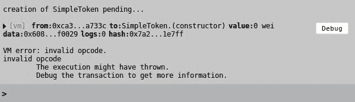

点击 *Debug* 按钮后，您将进入 *Debugger* 面板，可以开始调试代码。

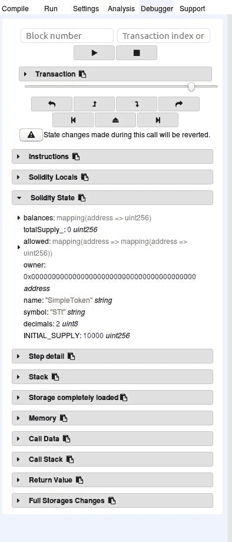

在代码编辑器中，第一行/指令会被高亮显示，标记当前所在位置。

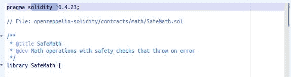

点击 *Step over forward* 按钮逐步执行代码。

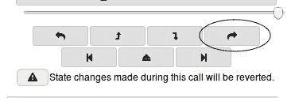

您也可以使用 *Jump to exception* 按钮直接跳转到异常处。

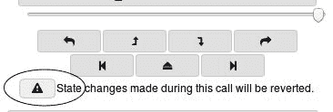

无论使用哪种方式，调试器都会定位到导致问题的代码并停下。

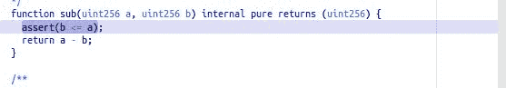

您可以在当前步骤检查局部变量的状态。

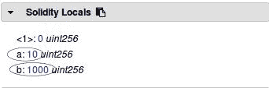

*Solidity Locals* 面板显示与当前上下文关联的局部变量。

通过源代码和 *Solidity Locals*，您可以得出结论：问题源于 `assert()` 方法以及 `b` 的值大于 `a` 的值。

您可以使用 *stop debugging* 按钮停止调试。


查看调试器的其他面板也很有价值。

##### Instructions（指令）

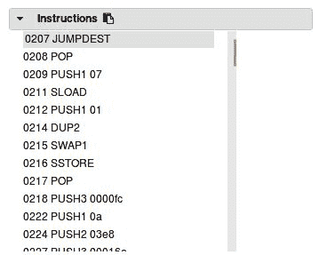

*Instructions* 面板显示被调试合约的字节码。当前步骤的字节码会被高亮显示。

##### Solidity State（Solidity 状态）

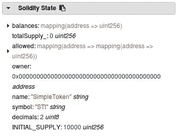

*Solidity State* 面板显示当前被调试合约的状态变量。

##### Low Level Panels（底层面板）

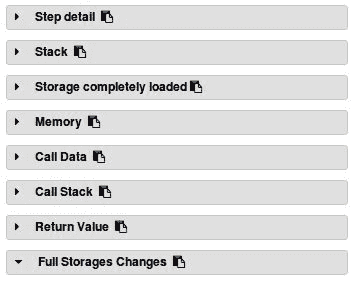

这些面板显示执行的底层信息，如步骤详情、内存、堆栈和函数返回值。

### 结论


在本教程中，我们使用了 Truffle 和 OpenZeppelin 来构建一个简单的代币，然后使用 `truffle-flattener` 扁平化自定义合约，并使用 Remix IDE 开始调试合约以查找错误。

希望这能帮助你无畏地深入到自己合约的逐步调试中。请告诉我们效果如何！

## 第 9 章：使用 Truffle CLI 进行调试

### 作者：Mislav Javor

**三十多年来，调试器一直是至关重要的软件开发工具。**

现代调试器使我们能够：

*   逐行运行代码
*   在代码中设置断点
*   为断点设置条件
*   在运行时求值表达式。

大多数现代调试器也与其服务的语言的开发环境高度集成。它们支持通过点击行号设置断点、通过悬停变量求值表达式、在代码注释中编写条件断点……等等。

那么，Solidity 智能合约调试和调试器的现状如何呢？

### Solidity 调试器

与大多数区块链事物一样，我们仍处于起步阶段。基础调试器已可用（并正在快速发展），但尚无编辑器集成，且调试器高度依赖所选框架。

在本文中，我们将探索随 [Truffle Suite](http://truffleframework.com/) 捆绑的 Solidity 调试器。

### 入门

首先，我们需要安装所有必需的工具。幸运的是，Truffle 框架集成度很高，所以我们只需安装它即可。

首先，安装 [Node.js 和 NPM](https://nodejs.org/en/download/)。安装 Node 后，你可以通过检查工具版本来验证是否安装成功，如下所示：

```
~ node -v
v10.2.1
~ npm -v
5.6.0
```

如果你的 Node 已启动并运行，让我们安装 Truffle 框架。借助 `npm` 的使用，这变得足够简单，只需运行以下命令：

```
npm install -g truffle
```

你可以通过检查版本来查看安装是否成功：

```
truffle version
Truffle v4.1.11 (core: 4.1.11)
Solidity v0.4.24 (solc-js)
```

### 设置项目

现在你已经完全设置好 Truffle，让我们创建一个新的（空的）Truffle 项目。打开终端，定位到所需目录并运行 `truffle init`。输出应类似于以下内容：

```
truffle init
Downloading...
Unpacking...
Setting up...
Unbox successful. Sweet!

Commands:

    Compile:        truffle compile
    Migrate:        truffle migrate
    Test contracts: truffle test
```

完成此操作后，你应该会得到类似以下的合约结构：

```
.
├── contracts
│   └── Migrations.sol
├── migrations
│   └── 1_initial_migration.js
├── test
├── truffle-config.js
└── truffle.js
```

现在打开 `truffle.js` 文件并将以下数据放入其中：

```
module.exports = {
    networks: {
        development: {
            port: 9545,
            host: "127.0.0.1",
            network_id: "*"
        }
    }
};
```

保存文件并运行 `truffle develop`。你应该会得到类似以下的输出：

```
truffle develop
Truffle Develop started at http://127.0.0.1:9545/

Accounts:
(0) 0x627306090abab3a6e1400e9345bc60c78a8bef57
(1) 0xf17f52151ebef6c7334fad080c5704d77216b732
(2) 0xc5fdf4076b8f3a5357c5e395ab970b5b54098fef
(3) 0x821aea9a577a9b44299b9c15c88cf3087f3b5544
(4) 0x0d1d4e623d10f9fba5db95830f7d3839406c6af2
(5) 0x2932b7a2355d6fecc4b5c0b6bd44cc31df247a2e
(6) 0x2191ef87e392377ec08e7c08eb105ef5448eced5
(7) 0x0f4f2ac550a1b4e2280d04c21cea7ebd822934b5
(8) 0x6330a553fc93768f612722bb8c2ec78ac90b3bbc
(9) 0x5aeda56215b167893e80b4fe645ba6d5bab767de

Private Keys:
(0) c87509a1c067bbde78beb793e6fa76530b6382a4c0241e5e4a9ec0a0f44dc0d3
(1) ae6ae8e5ccbfb04590405997ee2d52d2b330726137b875053c36d94e974d162f
(2) 0dbbe8e4ae425a6d2687f1a7e3ba17bc98c673636790f1b8ad91193c05875ef1
(3) c88b703fb08cbea894b6aeff5a544fb92e78a18e19814cd85da83b71f772aa6c
(4) 388c684f0ba1ef5017716adb5d21a053ea8e90277d0868337519f97bede61418
(5) 659cbb0e2411a44db63778987b1e22153c086a95eb6b18bdf89de078917abc63
(6) 82d052c865f5763aad42add438569276c00d3d88a2d062d36b2bae914d58b8c8
(7) aa3680d5d48a8283413f7a108367c7299ca73f553735860a87b08f39395618b7
(8) 0f62d96d6675f32685bbdb8ac13cda7c23436f63efbb9d07700d8669ff12b7c4
(9) 8d5366123cb560bb606379f90a0bfd4769eecc0557f1b362dcae9012b548b1e5

Mnemonic: candy maple cake sugar pudding cream honey rich smooth crumble sweet treat

Important  : This mnemonic was created for you by Truffle. It is not secure.
Ensure you do not use it on production blockchains, or else you risk losing funds.
```

这启动了一个由 `ganache-cli`（前身为 `TestRPC`）支持的 Truffle 开发区块链实例。

### 编写和部署合约

在 contracts 目录中，创建一个名为 `Storage.sol` 的文件。在该文件中，放入以下代码：

```
pragma solidity ⁰.4.23;


contract Storage {

    uint[] private _numberStorage;

    event AddedNewNumber(uint position);

    function addNumber(uint newNumber) public returns (uint) {
        _numberStorage.push(newNumber);

        uint numberPosition = _numberStorage.length;

        emit AddedNewNumber(numberPosition);
        return numberPosition;
    }

    function getNumber(uint position) public constant returns (uint) {
        return _numberStorage[position];
    }

}
```

完成此操作后，你的文件结构应如下所示：

```
├── contracts
│   ├── Migrations.sol
│   └── Storage.sol
├── migrations
│   └── 1_initial_migration.js
├── test
├── truffle-config.js
└── truffle.js
```

在 `migrations` 目录中，创建一个名为 `2_deploy_migrations.js` 的新文件并将以下代码放入其中：

```
var Storage = artifacts.require("./Storage.sol");

module.exports = function(deployer) {

    deployer.deploy(Storage);

}
```

这段代码定义了 Truffle *如何* 将我们的项目迁移到区块链。

现在在终端中打开一个新标签页（保持 `truffle develop` 运行）并运行 `truffle migrate`。这将编译并将你的合约迁移到开发区块链。你应该会得到如下输出：

```
Using network 'development'.

Running migration: 1_initial_migration.js
    Deploying Migrations...
    ... 0x819678a9812313714a27b52c30f065544a331ec5c79ec6c251bc97cd09398d08
    Migrations: 0x8cdaf0cd259887258bc13a92c0a6da92698644c0
Saving successful migration to network...
    ... 0xd7bc86d31bee32fa3988f1c1eabce403a1b5d570340a3a9cdba53a472ee8c956
Saving artifacts...
```

现在输入 `truffle console`。这将为你打开一个交互式控制台来测试你的合约。在控制台中执行以下操作：


~> `Storage.deployed().then((i) => { iStorage = i })` // 将合约实例存储到 `iStorage` 变量中

~> `iStorage.AddedNewNumber({}).watch((err, res) => { console.log("NUMBER POSITION: " + res.args.position.toNumber()) })` // 订阅新增数字事件

```
Filter {
    requestManager:
    RequestManager {
        provider: Provider { provider: [HttpProvider] },
        polls: {},
        timeout: null },
    options:
    { topics:
        [ '0x197006a61de03a2f3b4de7f4c4fab6e30ebedef7c1a42d716b2140f184c718b7' ],
        from: undefined,
        to: undefined,
        address: '0xdda6327139485221633a1fcd65f4ac932e60a2e1',
        fromBlock: undefined,
        toBlock: undefined },
    implementation:
    { newFilter:
        { [Function: send] request: [Function: bound ], call: [Function: newFilterCall] },
        uninstallFilter:
        { [Function: send] request: [Function: bound ], call: 'eth_uninstallFilter' },
        getLogs:
        { [Function: send] request: [Function: bound ], call: 'eth_getFilterLogs' },
        poll:
        { [Function: send] request: [Function: bound ], call: 'eth_getFilterChanges' } },
    filterId: null,
    callbacks: [ [Function] ],
    getLogsCallbacks: [],
    pollFilters: [],
    formatter: [Function: bound ] }
```

~> `iStorage.addNumber(13)` // 添加一个新数字

```
{ tx:
    '0xad3f82a6a6cec39dff802f2f16e73bbbc8eff3b68c2ac4da4c371a4c84345a4f',
    receipt:
    { transactionHash:
        '0xad3f82a6a6cec39dff802f2f16e73bbbc8eff3b68c2ac4da4c371a4c84345a4f',
        transactionIndex: 0,
        blockHash:
        '0x464bc0075036cf95484dec165f0248fb0a7db929d14068a312076be14d43d1fe',
        blockNumber: 5,
        gasUsed: 63362,
        cumulativeGasUsed: 63362,
        contractAddress: null,
        logs: [ [Object] ],
        status: '0x01',
        logsBloom:
        '0x0000000000000000000000000000000000000000000000000000000000000000000000000000000000000000020000000000000000000000000000000000000000000000000000000000000000000000000000010000000000000000000000000000000000000000000000000000000000000000000000000000000000000000000000000000000000000000000000000000000000000000000000000000000000080000000000000000000000000000000000000000000000000000000000000000000000000000000000080000000004000000000000000000000000000000000000000000000000000000000000000000010000000000000' },
    logs:
    [ { logIndex: 0,
        transactionIndex: 0,
        transactionHash:
        '0xad3f82a6a6cec39dff802f2f16e73bbbc8eff3b68c2ac4da4c371a4c84345a4f',
        blockHash:
        '0x464bc0075036cf95484dec165f0248fb0a7db929d14068a312076be14d43d1fe',
        blockNumber: 5,
        address: '0x345ca3e014aaf5dca488057592ee47305d9b3e10',
        type: 'mined',
        event: 'AddedNewNumber',
        args: [Object] } ] }
```

运行 `iStorage.addNumber(...)` 函数后，我们订阅的事件应该已经触发。如果是这种情况，输出应包含类似如下内容：

```
truffle(development)> NUMBER POSITION: 1
```

现在让我们尝试从存储数字的位置获取该数字：

```
~> iStorage.getNumber(1)
iStorage.getNumber(1)
Error: VM Exception while processing transaction: invalid opcode
    at XMLHttpRequest._onHttpResponseEnd (/usr/local/lib/node_modules/truffle/build/webpack:/~/xhr2/lib/xhr2.js:509:1)
    at XMLHttpRequest._setReadyState (/usr/local/lib/node_modules/truffle/build/webpack:/~/xhr2/lib/xhr2.js:354:1)
    at XMLHttpRequestEventTarget.dispatchEvent (/usr/local/lib/node_modules/truffle/build/webpack:/~/xhr2/lib/xhr2.js:64:1)
    at XMLHttpRequest.request.onreadystatechange (/usr/local/lib/node_modules/truffle/build/webpack:/~/web3/lib/web3/httpprovider.js:128:1)
    at /usr/local/lib/node_modules/truffle/build/webpack:/~/truffle-provider/wrapper.js:134:1
    at /usr/local/lib/node_modules/truffle/build/webpack:/~/web3/lib/web3/requestmanager.js:86:1
    at Object.InvalidResponse (/usr/local/lib/node_modules/truffle/build/webpack:/~/web3/lib/web3/errors.js:38:1)
```

我们得到了一个错误！多方便啊：看来我们现在可以使用调试器了。简直就像是早有预谋似的！

### 使用调试器

为了调试交易，你需要找到想要调试的交易的交易哈希。复制交易哈希，并在终端中按以下形式输入：

```
truffle debug tx_hash
```

我们将调试向存储添加数字的函数。你的交易哈希会有所不同，但整体形式将类似于这样。且输出应相同：

```
truffle debug 0x34d26b8bcf01f23dfbef0de28384623ca3ed3e3e7fe28f1a0968d363cf38765f
Compiling ./contracts/Migrations.sol...
Compiling ./contracts/Storage.sol...

Gathering transaction data...

Addresses affected:
    0x345ca3e014aaf5dca488057592ee47305d9b3e10 - Storage

Commands:
(enter) last command entered (step next)
(o) step over, (i) step into, (u) step out, (n) step next
(;) step instruction, (p) print instruction, (h) print this help, (q) quit
(b) toggle breakpoint, (c) continue until breakpoint
(+) add watch expression (`+:<expr>`), (-) remove watch expression (-:<expr>)
(?) list existing watch expressions
(v) print variables and values, (:) evaluate expression - see `v`


Storage.sol:

2:
3:
4: contract Storage {
    ^^^^^^^^^^^^^^^^^^

debug(development:0x34d26b8b...)>
```

这里我们可以看到调试控制台。它比大多数开发者习惯的现代调试器要原始得多，但它具备所有必需的功能。让我们来探索一下这些功能。

在控制台中，运行以下系列命令：

```
debug(development:0x34d26b8b...)> o

Storage.sol:

    8:     event AddedNewNumber(uint position);
    9:
10:     function addNumber(uint newNumber) public returns (uint) {
        ^^^^^^^^^^^^^^^^^^^^^^^^^^^^^^^^^^^^^^^^^^^^^^^^^^^^^^^^^^
```

通过输入 `o`，我们**单步跳过**了函数行 —— 这意味着我们没有进入所调用函数的函数体内部。

现在我们位于第 10 行 —— 即添加数字函数的函数头。让我们继续。再次输入 `o`。

```
Storage.sol:

    9:
10:     function addNumber(uint newNumber) public returns (uint) {
11:         _numberStorage.push(newNumber);
            ^^^^^^^^^^^^^^
```

现在我们将数字推入数组。再次输入 `o`。

```
Storage.sol:

11:         _numberStorage.push(newNumber);
12:
13:         uint numberPosition = _numberStorage.length;
```

我们已推入数字，并正在获取数字在数组中的位置。按 `o` 继续。

```
Storage.sol:

13:         uint numberPosition = _numberStorage.length;
14:
15:         emit AddedNewNumber(numberPosition);
                    ^^^^^^^^^^^^^^^^^^^^^^^^^^^^^^
```

我们位于触发位置事件的那一行。现在不按 `o`，让我们检查一下变量，并尝试从数组中取回数字。我们可以用两种方法中的一种。第一种更通用的方法是直接输入 `v`，检查函数上下文中所有可用的变量。

输入 `v` 执行。输出应如下：

```
numberPosition: 1
        newNumber: 12
                : 189
_numberStorage: [ 12 ]
```

另一种方法更具体，我们可以通过输入 `:<variable_name>` 来实现。输入 `:numberPosition` 试试。你应该得到输出 `1`。

现在让我们尝试计算一个表达式。你也可以用 `:` 结构来做到这一点。

让我们尝试用 `:_numberStorage[numberPosition]` 取回我们的数字：

```
debug(development:0x34d26b8b...)> :_numberStorage[numberPosition]
undefined
```

运行后，我们得到输出 `undefined`。这意味着那里没有数字。

对所有开发者来说，这个错误应该是相当显而易见的。我们试图在位置 1 访问第一个元素。由于在 Solidity 中，就像在大多数语言中一样，数组是**零索引**的，我们需要用数字零来访问它。

按 `q` 退出调试器，然后我们来修复代码。在你的 `Storage.sol` 中修改这部分：


```
uint numberPosition = _numberStorage.length;
```

修改为：

```
uint numberPosition = _numberStorage.length - 1;
```

现在再次运行 `truffle migrate`，完成后，运行 `truffle console`。在控制台中，再次运行以下命令：

```
~> Storage.deployed().then((i) => { iStorage = i})
~> iStorage.AddedNewNumber({}).watch((err, res) => { console.log("NUMBER POSITION: " + res.args.position.toNumber()) });
~> iStorage.addNumber(12);
~> output: "NUMBER POSITION: 0"
~> iStorage.getNumber(0)
~> iStorage.getNumber(0).then((res) => { console.log(res.toNumber()) } )
~> output: 12
```

你已成功部署并调试了智能合约！

## 第 10 章：使用 Puppeth，以太坊私有网络管理器

### 作者：Bruno Škvorc

**在前面的章节中，我们讨论了 Geth，它是最流行的以太坊节点之一。**

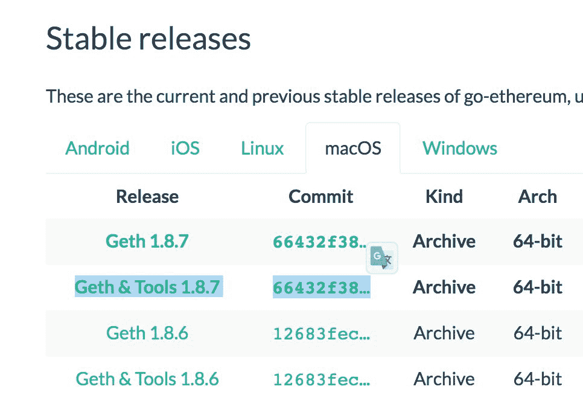

当你安装带有辅助工具的 Geth 时，它会附带一个名为 Puppeth 的实用工具，你可以用它来维护和安装各种辅助工具，以管理和部署你的私有区块链。如果你安装了 Go，也可以通过以下命令独立安装 Puppeth：

```
go get github.com/ethereum/go-ethereum/cmd/puppeth
```

让我们来看看这个工具。

### 先决条件

本教程要求你拥有两台远程机器。无论是像 [Homestead Improved](http://www.sitepoint.com/quick-tip-get-homestead-vagrant-vm-running/) 这样的虚拟机，还是你网络上的实际服务器，亦或是两者的组合，都无所谓。在本教程中，我们将通过虚拟机演示设置过程。

#### 烦人的 Bug

由于 [Puppeth 中的一个 Bug](https://github.com/ethereum/go-ethereum/issues/16905)，如果你的虚拟机（见下文）太小，这种方法可能行不通。要么创建更大的虚拟机（更多内存），要么如果无法做到这一点，就等待修复。

### 引导启动

我们将遵循 [此流程](http://www.sitepoint.com/quick-tip-get-homestead-vagrant-vm-running/) 启动并运行两台虚拟机。我们需要两台机器，因为我们将运行两个以太坊节点，每个节点拥有自己的 IP 地址。

#### 为什么需要两个节点？

这是 Puppeth 的一个限制，因为无法使用此工具在同一台机器上部署一个出块节点。

如果你不知道什么是 Vagrant，以及我们在这里使用了什么工具，我们建议你阅读 [Vagrant 入门](http://www.sitepoint.com/re-introducing-vagrant-right-way-start-php/)，它以对新手友好的方式进行了详细拆解。

```
mkdir my_project; cd my_project
git clone https://github.com/swader/homestead_improved hi_puppeth1
git clone https://github.com/swader/homestead_improved hi_puppeth2
```

通过进入 `hi_puppeth2` 文件夹并将 `IP address` 字段修改为 `192.168.10.11` 而不是 `192.168.10.10`，来更改第二个克隆的 IP 地址。

接下来，通过修改每个克隆的 `Homestead.yaml` 末尾部分来在虚拟机上打开一些端口，如下所示：

```
 ports:
     - send: 8545
       to: 8545
     - send: 30301
       to: 30301
     - send: 30302
       to: 30302
     - send: 30303
       to: 30303
     - send: 30304
       to: 30304
     - send: 30305
       to: 30305
     - send: 30306
       to: 30306
```

别忘了将这些虚拟主机也添加到宿主机的 `/etc/hosts` 文件中。否则虚拟机将无法通过域名访问！

```
192.168.10.10 homestead.test
192.168.10.11 puppethnode.test
```

#### IP 地址

如果你的虚拟机 IP 地址不同，请相应更改。

最后，运行 `vagrant up; vagrant ssh` 启动每台机器并通过 SSH 登录。记得要从*两个单独的标签页*运行此命令，以便保持两台机器都处于开启和运行状态。

### 先决条件

现在让我们在*每台机器*上安装先决软件。

Puppeth 会在 Docker 容器中为你运行辅助应用程序和以太坊节点，所以我们需要 Docker。安装 Geth 本身也很有用。

```
sudo add-apt-repository -y ppa:ethereum/ethereum
sudo apt-get update
sudo apt-get install \
    apt-transport-https \
    ca-certificates \
    curl \
    software-properties-common \
    ethereum \
    docker.io \
    docker-compose
```

所有其他先决条件将由 Puppeth 通过 docker 自动拉取，但我们需要先确保当前用户被允许操作 Docker 命令：

```
sudo usermod -a -G docker $USER
```

在宿主机上（虚拟机外部），我们应该在运行项目的文件夹中创建新的以太坊账户。

如果你按上述建议使用虚拟机，如果 `myproject` 是包含 `hi_puppeth1` 和 `hi_puppeth2` 的父文件夹，那么可以在 `myproject` 中进行。

```
mkdir node1 node2
geth --datadir node1 account new
geth --datadir node2 account new
```

记下此过程生成的地址：

```
$ mkdir node1 node2
$ geth --datadir node1 account new
INFO [05-20|10:27:20] Maximum peer count                       ETH=25 LES=0 total=25
Your new account is locked with a password. Please give a password. Do not forget this password.
Passphrase:
Repeat passphrase:
Address: {aba88be2dc16eaed464e3991eed5a1eaa5e7b11b}
$ geth --datadir node2 account new
INFO [05-20|10:27:35] Maximum peer count                       ETH=25 LES=0 total=25
Your new account is locked with a password. Please give a password. Do not forget this password.
Passphrase:
Repeat passphrase:
Address: {655a6ea9950cdf9f8a8175fda639555f17277bdf}
```

我们需要两个账户，因为在权威证明区块链中至少需要两个*签名者*（稍后详述）。

### Puppeth

现在我们的虚拟机正在运行，账户也已初始化，让我们看看 Puppeth 提供了什么功能。在远程服务器/虚拟机仍在运行的情况下，在宿主机上打开一个新标签页，通过 `puppeth` 运行 Puppeth。

它首先会询问网络名称。如果你在本地机器上运行多条区块链，这有助于识别各个区块链。我们这里将使用 "puptest"。

```
Please specify a network name to administer (no spaces or hyphens, please)
> puptest

Sweet, you can set this via --network=puptest next time!

INFO [05-20|10:32:15] Administering Ethereum network           name=puptest
WARN [05-20|10:32:15] No previous configurations found         path=/Users/swader/.puppeth/puptest
```

现在让我们连接到我们的“远程”服务器，以便 Puppeth 将它们列入列表并可以对它们执行操作。

#### 跟踪新的远程服务器

使用此选项可以连接到将运行区块链相关服务的服务器。选择选项 3，然后按如下方式输入值：

```
Please enter remote server's address:
> vagrant@192.168.10.10
What's the decryption password for /Users/swader/.ssh/id_rsa? (won't be echoed)
>

The authenticity of host '192.168.10.10:22 (192.168.10.10:22)' can't be established.
SSH key fingerprint is 38:53:d3:c2:85:cf:77:54:a5:54:26:3b:93:5b:6f:09 [MD5]
Are you sure you want to continue connecting (yes/no)? yes
What's the login password for vagrant at 192.168.10.10:22? (won't be echoed)
>
INFO [05-20|10:39:53] Starting remote server health-check      server=vagrant@192.168.10.10
+-----------------------+---------------+---------+--------+-------+
|        SERVER         |    ADDRESS    | SERVICE | CONFIG | VALUE |
+-----------------------+---------------+---------+--------+-------+
| vagrant@192.168.10.10 | 192.168.10.10 |         |        |       |
+-----------------------+---------------+---------+--------+-------+
```

Puppeth 会询问你的 SSH 密钥密码，以防通过 SSH 连接到服务器。如果不是，它将询问 SSH 密码（如上例所示）。相关虚拟机上用户 `vagrant` 的默认 SSH 密码是 `vagrant`。


末尾的输出显示了远程服务器的“健康”状态。由于没有运行任何服务，它将仅列出 IP 地址。你可以通过选择选项 1：`Show network stats` 看到相同的结果。

对另一台虚拟机重复此过程，以便两者都出现在健康状态屏幕中。

### 新建创世区块

要启动我们的区块链，我们应该配置一个新的创世文件。创世文件是用于构建第一个（创世）区块的文件，每个后续区块都在此基础上增长。

选择选项 2，`Configure new genesis`，并按如下方式填充选项：

```
Which consensus engine to use? (default = clique)
 1. Ethash - proof-of-work
 2. Clique - proof-of-authority
> 2

How many seconds should blocks take? (default = 15)
> 10

Which accounts are allowed to seal? (mandatory at least one)
> 0xaba88be2dc16eaed464e3991eed5a1eaa5e7b11b
> 0x655a6ea9950cdf9f8a8175fda639555f17277bdf
> 0x

Which accounts should be pre-funded? (advisable at least one)
> 0x655a6ea9950cdf9f8a8175fda639555f17277bdf
> 0xaba88be2dc16eaed464e3991eed5a1eaa5e7b11b
> 0x

Specify your chain/network ID if you want an explicit one (default = random)
>
INFO [05-20|11:25:55] Configured new genesis block
```

你可以在此处了解 PoW 和 PoA 的区别 [here](https://www.sitepoint.com/proof-of-stake-vs-proof-of-work/)。PoW 浪费大量算力，且不适合在本地机器上运行，因此我们这里选择 PoA。我们将出块时间减少到 10 秒，以便交易能更快确认，并将我们之前生成的地址添加为允许的出块者和预分配账户。成为出块者意味着它们被允许创建新区块。由于 PoA 中没有挖矿奖励，我们还为它们预分配了近乎无限的以太币，以便我们可以使用这些账户测试交易。

创世文件现已生成，为了备份目的，你可以通过再次选择选项 2 将其导出到外部文件中（如果需要）。目前这不是必须的。

现在让我们部署一些区块链组件！

### 部署网络组件

Puppeth 使用 `docker-compose` 工具在独立的 Docker 容器中部署这些组件。Docker 作为一种工具超出了本文的范围，但你无需熟悉它也能使用此功能。让我们从第一个组件 Ethstats 开始。

#### Ethstats

安装 Ethstats 会安装并运行 [ethstats.net 网站](https://ethstats.net/) 的本地版本。选择第一个选项。

```
Which server do you want to interact with?
 1. vagrant@192.168.10.10
 2. Connect another server
> 1

Which port should ethstats listen on? (default = 80)
> 8081

Allow sharing the port with other services (y/n)? (default = yes)
>
INFO [05-20|11:43:32] Deploying nginx reverse-proxy            server=192.168.10.10         port=8081
Building nginx
Step 1/1 : FROM jwilder/nginx-proxy
 ---> e143a63bea4b
Successfully built e143a63bea4b
Recreating puptest_nginx_1

Proxy deployed, which domain to assign? (default = 192.168.10.10)
> homestead.test

What should be the secret password for the API? (must not be empty)
> internet2
Found orphan containers (puptest_nginx_1) for this project. If you removed or renamed this service in your compose file, you can run this command with the --remove-orphans flag to clean it up.
Building ethstats
Step 1/2 : FROM puppeth/ethstats:latest
```

我们选择第一个之前添加的服务器。然后我们添加一个用于部署此软件的端口，并命名我们将用来访问该应用的域名。最后，我们为访问该应用的 API 生成一个简单的“密钥”。随后 Docker 接管并为我们构建软件。

最终结果应该是另一个健康屏幕输出，但这一次表格将多出一个条目：它还将列出 `ethstats` 应用及其配置详情：

```
INFO [05-20|11:44:23] Starting remote server health-check      server=vagrant@192.168.10.10
+-----------------------+---------------+----------+-----------------------+----------------+
|        SERVER         |    ADDRESS    | SERVICE  |        CONFIG         |     VALUE      |
+-----------------------+---------------+----------+-----------------------+----------------+
| vagrant@192.168.10.10 | 192.168.10.10 | ethstats | Banned addresses      | []             |
|                       |               |          | Login secret          | internet2      |
|                       |               |          | Website address       | homestead.test |
|                       |               |          | Website listener port | 8081           |
|                       |               |          | --------------------- | -------------- |
|                       |               | nginx    | Shared listener port  | 8081           |
+-----------------------+---------------+----------+-----------------------+----------------+
```

在浏览器中访问 URL `homestead.test:8081` 应该会显示如下屏幕：

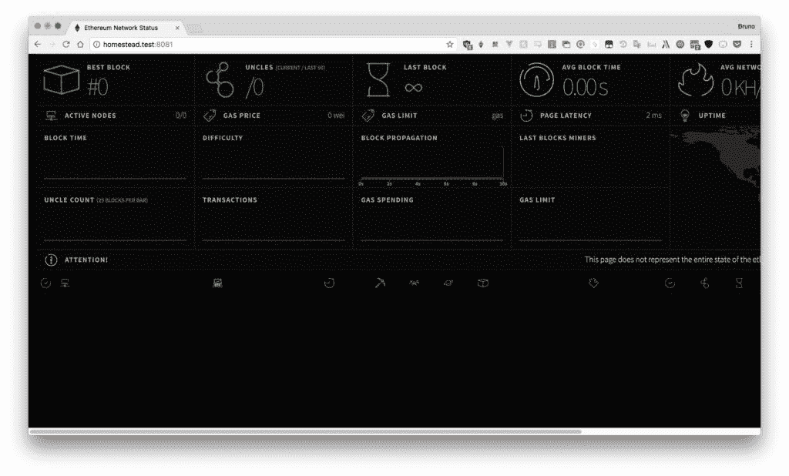

该应用目前毫无用处：我们需要至少部署一个节点，该应用才会开始显示内容！

#### 引导节点

让我们部署一个引导节点。

引导节点是一个仅作为以太坊 [节点](https://bitfalls.com/2017/11/26/whats-bitcoin-node-mining-vs-validation/) 连接到其他节点的第一个连接点的节点。它基本上是一个信息中继，帮助节点建立连接。

选择选项 2 部署引导节点。同样，在同一台远程服务器上部署并选择一些默认值，然后为节点命名以便在“健康统计”表格中显示：

```
Which server do you want to interact with?
 1. vagrant@192.168.10.10
 2. vagrant@192.168.10.11
 3. Connect another server
> 1

Where should data be stored on the remote machine?
> /home/vagrant/mychain

Which TCP/UDP port to listen on? (default = 30303)
>

How many peers to allow connecting? (default = 512)
>

How many light peers to allow connecting? (default = 256)
>

What should the node be called on the stats page?
> booty
```

Docker 将构建并运行该节点。在远程机器上存储数据的位置是任意的。我们选择了 `vagrant` 用户的主目录。

如果你现在重新访问 `ethstats` 页面（`homestead.test:8081`），你会注意到 `booty` 出现在节点列表中！

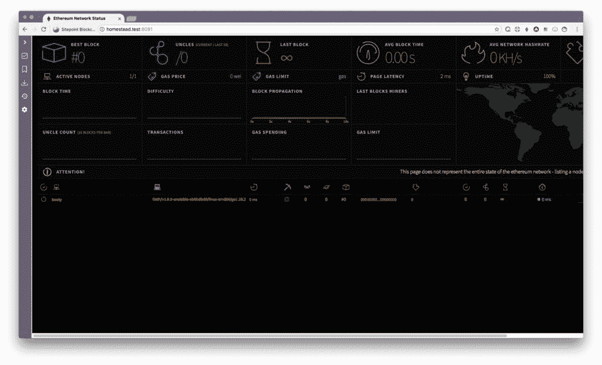

##### 如果你的引导节点显示为离线

如果并非如此，且你的引导节点在健康检查中显示为离线，请重启远程服务器（对于虚拟机，即 `vagrant reload`），然后再次检查。

#### 出块节点

出块节点是可以作为新区块矿工（出块者）的节点。接下来让我们部署它：

```
Which server do you want to interact with?
 1. vagrant@192.168.10.10
 2. vagrant@192.168.10.11
 3. Connect another server
> 1

Where should data be stored on the remote machine?
> /home/vagrant/mychainsealer

Which TCP/UDP port to listen on? (default = 30303)
> 30301

How many peers to allow connecting? (default = 50)
>

How many light peers to allow connecting? (default = 0)
>

What should the node be called on the stats page?
> sealer

Please paste the signer's key JSON:
> {"address":"655a6ea9950cdf9f8a8175fda639555f17277bdf","crypto":{"cipher":"aes-128-ctr","ciphertext":"9278db9216e3c58380864bb53edcec245c5bc919a51733333410fe4b22818914","cipherparams":{"iv":"ca6579d08e97c25f46e127e026bafadb"},"kdf":"scrypt","kdfparams":{"dklen":32,"n":262144,"p":1,"r":8,"salt":"93e5f080d76e50c0e08add15d3fdd9b143295d0ccaeec9dae89446e0478ba4a1"},"mac":"28fcdaaf6008d82a0fe22ac60de3398f12a47e471a21618b2333fe15d8d6c9c3"},"id":"20ae40fe-ebf9-4047-8203-711bf67213e9","version":3}

What's the unlock password for the account? (won't be echoed)
>

What gas limit should empty blocks target (MGas)? (default = 4.700)
>

What gas price should the signer require (GWei)? (default = 18.000)
>
```


除数据存储位置和节点名称外，均为默认值。对于 JSON，请从我们之前创建新以太坊账户时生成的文件中获取内容。该文件位于 `my_project/node1/keystore`。应将该文件的完整内容粘贴至此，随后 Puppeth 会要求输入密码以解锁该钱包。此后一切均为自动化操作。

健康检查屏幕应显示节点运行正常，且应在 Ethstats 屏幕中以您赋予的名称出现。

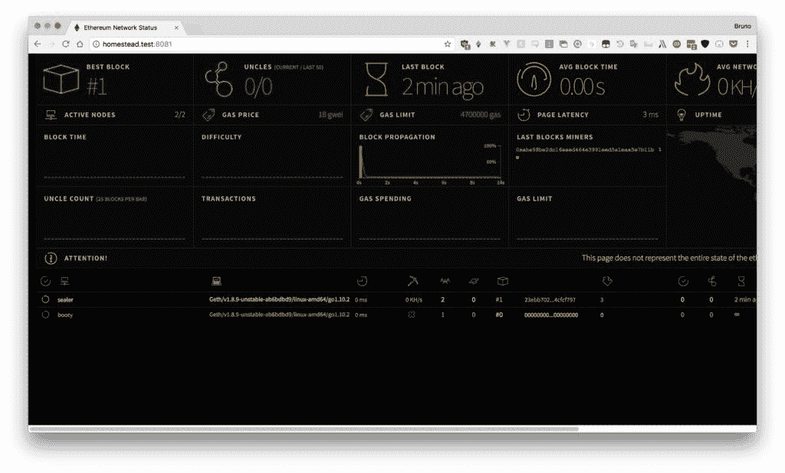

接下来，对另一台机器（IP 地址为 `192.168.10.11` 的那台）重复上述过程。为该节点指定一个不同的名称，并使用另一个 keystore 文件。换句话说，将我们创建的 `other` 账户设置为该节点的密封者。

您的节点现在将一起运行并挖矿。您应该能在上一步部署的 Ethstats 屏幕上看到一些进度。

##### 死锁

如果状态不变，或者仅挖出一个区块后就无任何反应，则节点已**死锁**。这可能发生在全新安装时。重启虚拟机即可恢复正常。

##### 钱包

为了能轻松发送以太币和自定义代币，您可以使用 Puppeth 部署您自己的 [MyEtherWallet](https://www.sitepoint.com/ethereum-wallets-myetherwallet/) 版本。

在要部署的组件选择中选择 Wallet，并按如下方式填写选项：

```
钱包应监听哪个端口？ (默认 = 80)
> 8083

允许与其他服务共享端口 (y/n)？ (默认 = yes)
> no

远程机器上数据应存储在何处？
> /home/vagrant/wallet

后端节点应监听哪个 TCP/UDP 端口？ (默认 = 30303)
> 30304

后端 RPC API 应监听哪个端口？ (默认 = 8545)
>

统计页面上钱包应显示为什么名称？
> wallet
```

钱包应可用，并自动连接到您的测试网络。

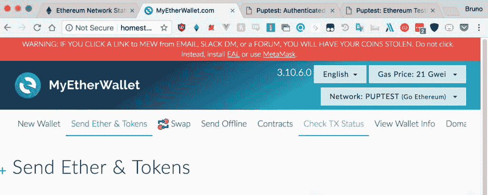

您可以通过选择 JSON 文件作为解锁方式，并指向我们之前在 `my_project/nodeX/keystore` 文件夹中生成的 JSON 文件之一来打开钱包。然后输入密码，您将拥有数万亿以太币可供发送。您可以使用这个钱包的本地版本在您的私有区块链上创建账户并彻底测试所有功能。请尝试发送一些以太币！

##### 水龙头

`Faucet`（水龙头）是一个用户可以轻松请求测试以太币的网站。公开可访问的水龙头（如 [Rinkeby 水龙头](https://faucet.rinkeby.io/)）具有防垃圾邮件保护机制，但由于我们的是测试区块链，本地水龙头可以不那么安全。

```
水龙头应监听哪个端口？ (默认 = 80)
> 8084

允许与其他服务共享端口 (y/n)？ (默认 = yes)
> no

每次请求释放多少以太币？ (默认 = 1)
>

请求间隔强制执行多少分钟？ (默认 = 1440)
> 1

包含多少资金梯度（金额 x2.5，超时 x3）？ (默认 = 3)
>

启用 reCaptcha 机器人防护 (y/n)？ (默认 = no)
>
WARN [05-20|12:51:13] 用户将能够通过自动化脚本请求资金

远程机器上数据应存储在何处？
> /home/vagrant/faucet

轻客户端应监听哪个 TCP/UDP 端口？ (默认 = 30303)
> 30305

统计页面上节点应显示为什么名称？
> faucet

请粘贴水龙头资金账户的密钥 JSON：
> {"address":"655a6ea9950cdf9f8a8175fda639555f17277bdf","crypto":{"cipher":"aes-128-ctr","ciphertext":"9278db9216e3c58380864bb53edcec245c5bc919a51733333410fe4b22818914","cipherparams":{"iv":"ca6579d08e97c25f46e127e026bafadb"},"kdf":"scrypt","kdfparams":{"dklen":32,"n":262144,"p":1,"r":8,"salt":"93e5f080d76e50c0e08add15d3fdd9b143295d0ccaeec9dae89446e0478ba4a1"},"mac":"28fcdaaf6008d82a0fe22ac60de3398f12a47e471a21618b2333fe15d8d6c9c3"},"id":"20ae40fe-ebf9-4047-8203-711bf67213e9","version":3}

账户的解锁密码是什么？ (不会回显)
>

允许未认证的资金请求 (y/n)？ (默认 = false)
> y
```

一旦添加了所有这些服务，您应该能在 Ethstats 列表中看到它们。

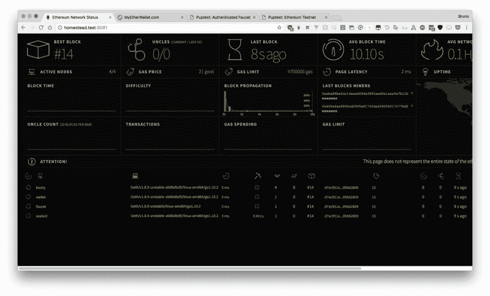

##### 仪表盘

最后，Puppeth 提供了“仪表盘”，一个结合了我们迄今为止启动的所有界面的 Web 界面。部署过程同样简单：只需遵循步骤操作，当询问是否链接到现有组件时，选择我们已经启动的那些。最终结果应如下所示：


仪表盘是我们迄今部署的所有工具的集合，外加一些关于如何手动连接到我们构建的区块链的说明。

### 结论

您现在可以轻松开始开发智能合约，并通过您的 MyEtherWallet 本地版本、Remix 的 MetaMask 集成，或任何[其他组合](https://bitfalls.com/2018/03/26/connecting-myetherwallet-mist-metamask-private-blockchain/)将其部署到您的测试区块链。

Puppeth 是区块链服务管理工具的一站式商店。当您经常进行区块链开发时，它非常方便，但理解其原理可能比较复杂。希望本指南能帮助您了解它的功能和工作原理，并协助您未来的区块链探索。

运行组件的 Docker 容器配置为开机自启，因此重启任一虚拟机均无需重新配置，但如果您想进一步调整某些组件或安装新组件，则需要将服务器重新添加到 Puppeth 中。

有任何问题？请在 [Twitter](https://twitter.com/bitfalls) 上联系作者！

