# 网络犯罪预防的黑客攻击技术与应对措施

|  | | |

## 宗旨

随着数字技术在日常生活中变得无处不在，私人和公共实体以日益增长的方式利用互联网，对数字威胁的关注变得日益普遍。

《信息安全、隐私与伦理进展》(AISPE) 书丛提供了关于各行业和环境的信息与技术保护及滥用的前沿研究。该书丛涵盖了身份管理、密码学、系统安全、身份验证和数据保护等主题的学术研究，是 IT 专业人员、学者和高年级学生的理想参考资料。

## 范围

- 网络伦理
- 技术伦理
- 计算机伦理
- 社交网络中的隐私问题
- 信息安全标准
- 风险管理
- 设备指纹
- 隐私增强技术
- 安全信息管理
- IT 风险

`IGI Global` 目前接受该系列出版稿稿。如需为该系列中的卷卷提交提案，请联系我们的收购编辑 `Acquisitions@igi-global.com` 或访问 `http://www.igi-global.com/publish/`。

Information Science Reference • 版权 2021 • 298 页 | 精装（ISBN: `9781799877561`)

Surjit Singh（印度塔帕工程学院）Anca Delia Jurcut（爱尔兰圣大学学院）

*量子密码学的局限性与未来应用*

*数字时代的网络骚扰与政策改革：新兴研究与机会*

Ramona S. McNeal（美国北爱荷华大学）Susan M. Kunkle（美国肯塔基州大学）和 Mary Schmeida（美国肯塔基州大学）

Information Science Reference • 版权所有 2018 • 170 页 • 平装 (ISBN: `9781522552857`) • 美元 $145.00 (我们的售价)

### 安全与隐私管理、技术与协议

Yassine Maleh（摩洛哥哈桑一世大学）

Information Science Reference • 版权所有 2018 • 426 页 • 平装 (ISBN: `9781522555834`) • 美元 $205.00 (我们的售价)

噬 人资本与信息技术人员的多学科视角

Vandana Ahuja（印度 Jaypee 信息技术学院）和 Shubhangini Rathore（印度 IBS 古尔加冈）

Information Science Reference • 版权所有 2018 • 400 页 • 平装 (ISBN: `9781522552970`) • 美元 $215.00 (我们的售价)

### 社交网络中的安全、隐私与匿名化：新兴研究与机会

B. K. Tripathy（印度 VIT 大学）和 Kiran Baktha（印度 VIT 大学）

Information Science Reference • 版权所有 2018 • 176 页 • 平装 (ISBN: `9781522551584`) • 美元 $155.00 (我们的售价)

### 虚拟云环境中的扩展性与安全问题关键研究

Shadi Aljawarneh（约旦科学技术大学）和 Manisha Malhotra（印度钱德加尔大学）

Information Science Reference • 版权所有 2018 • 341 页 • 平装 (ISBN: `9781522530299`) • 美元 $225.00 (我们的售价)

### 武器设计与开发的道德性：新兴研究与机会

John Forge（澳大利亚悉尼大学）

Information Science Reference • 版权所有 2018 • 216 页 • 平装 (ISBN: `9781522539841`) • 美元 $175.00 (我们的售价)

### 高级云计算安全技术与应用

Ihssan Alkadi（美国独立研究员）

Information Science Reference • 版权所有 2018 • 350 页 • 平装 (ISBN: `9781522525066`) • 美元 $225.00 (我们的售价)

### 加密中复杂问题的算法策略

Kannan Balasubramanian（印度 Mepco Schlenk 工程学院）和 M. Rajakani（印度 Mepco Schlenk 工程学院）

Information Science Reference • 版权所有 2018 • 302 页 • 平装 (ISBN: `9781522529156`) • 美元 $245.00 (我们的售价)

### 现代组织的信息技术风险管理与合规

Manish Gupta（美国纽约州立大学布法罗分）Raj Sharman（美国纽约州立大学布法罗分）John Walp（美国 M&T 银行集团）和 Pavankumar Mulgund（美国纽约州立大学布法罗分）

Business Science Reference • 版权所有 2018 • 360 页 • 平装 (ISBN: `9781522526049`) • 美元 $225.00 (我们的售价)

### 机器人网络安全风险的检测与缓解

Raghavendra Kumar（印度 LNCT 学院集团）Prasant Kumar Pattnaik（印度 KIIT 大学）和 Priyanka Pandey（印度 LNCT 学院集团）

Information Science Reference • 版权所有 2017 • 384 页 • 平装 (ISBN: `9781522521549`) • 美元 $210.00 (我们的售价)

### 基于图像的垃圾信息检测与过滤技术

Sunita Vikrant Dhavale（印度 DIAT 先进学院）

Information Science Reference • 版权所有 2017 • 213 页 • 平装 (ISBN: `9781683180135`) • 美元 $175.00 (我们的售价)

### 大数据中的隐私与安全政策

Sharvari Tamane（印度贾瓦哈尔·内赫鲁工程学院）Vijender Kumar Solanki（印度技术与科学学院）和 Nilanjan Dey（印度科尔加塔技术学院）

Information Science Reference • 版权所有 2017 • 305 页 • 平装 (ISBN: `9781522524861`) • 美元 $210.00 (我们的售价)

### 发展中国家的政府信息与数据安全

Saleem Zoughbi（韩国）

Information Science Reference • 版权所有 2017 • 307 页 • 平装 (ISBN: `9781522517030`) • 美元 $160.00 (我们的售价)

### 物联网中的安全漏洞与威胁预防

N. Jeyanthi（印度 VIT 大学）和 R. Thandeesaran（印度 VIT 大学）

Information Science Reference • 版权所有 2017 • 276 页 • 平装 (ISBN: `9781522522966`) • 美元 $180.00 (我们的售价)

### 使用区块链技术的去中心化计算：新兴研究与机会

S. Asharaf（印度喀拉拉邦技术管理学院）和 S. Adarsh（印度喀拉拉邦技术管理学院）

Information Science Reference • 版权所有 2017 • 128 页 • 平装 (ISBN: `9781522521938`) • 美元 $120.00 (我们的售价)

### 网络安全漏洞与在线威胁防护

Michelle Moore（美国乔治·梅森大学）

Information Science Reference • 版权所有 2017 • 408 页 • 平装 (ISBN: `9781522519416`) • 美元 $195.00 (我们的售价)

### 智能网格通信的安全解决方案与应用加密

Mohamed Amine Ferrag（阿尔及利亚盖尔马大学）和 Ahmed Ahmim（阿尔及利亚拉比·泰西西大学）

Information Science Reference • 版权所有 2017 • 464 页 • 平装 (ISBN: `9781522518297`) • 美元 $215.00 (我们的售价)

### 网络战与恐怖主义活动的威胁缓解与检测

Maximiliano E. Korstanje（阿根廷帕尔莫莫大学）

Information Science Reference • 版权所有 2017 • 315 页 • 平装 (ISBN: `9781522519386`) • 美元 $190.00 (我们的售价)

### 在线银行安全措施与数据保护

Shadi A. Aljawarneh（约旦科学技术大学）

Information Science Reference • 版权所有 2017 • 312 页 • 平装 (ISBN: `9781522508649`) • 美元 $215.00 (我们的售价)

### 国土安全的下一代应对措施

Maurice Dawson（美国伊利诺理工大学）Dakshina Ranjan Kis（印度国立学院）Phalguni Gupta（印度国立学院）和 Weifeng Li（中国清华大学）

Information Science Reference • 版权所有 2017 • 428 页 • 平装 (ISBN: `9781522507031`) • 美元 $210.00 (我们的售价)

### 超互联与物联网的安全解决方案

Maurice Dawson（美国伊利诺理工大学）Mohamed Eltayeb（美国科罗拉多技术大学）和 Marwan Omar（美国圣利奥大学）

Information Science Reference • 版权所有 2017 • 347 页 • 平装 (ISBN: `9781522507413`) • 美元 $215.00 (我们的售价)

### 可穿戴设备的安全问题管理与隐藏危险

Andrew Marrington（阿联酋扎耶德大学）Don Kerr（澳大利亚阳光海岸大学）和 John Gammack（阿联酋扎耶德大学）

Information Science Reference • 版权所有 2017 • 345 页 • 平装 (ISBN: `9781522510161`) • 美元 $200.00 (我们的售价)

### 移动云计算中的安全管理

Kashif Munir（沙特阿拉伯哈夫巴廷大学）

Information Science Reference • 版权所有 2017 • 248 页 • 平装 (ISBN: `9781522506027`) • 美元 $150.00 (我们的售价)

### 安全在线银行与商业的加密解决方案

Kannan Balasubramanian（印度 Mepco Schlenk 工程学院）K. Mala（印度 Mepco Schlenk 工程学院）和 M. Rajakani（印度 Mepco Schlenk 工程学院）

Information Science Reference • 版权所有 2016 • 375 页 • 平装 (ISBN: `9781522502739`) • 美元 $200.00 (我们的售价)

### 计算机与网络安全现代加密解决方案研究手册

Brij Gupta（印度库库舍特拉国立学院）Dharma P. Agrawal（美国辛辛提大学）和 Shingo Yamaguchi（日本山口大学）

Information Science Reference • 版权所有 2016 • 589 页 • 平装 (ISBN: `9781522501053`) • 美元 $305.00 (我们的售价)

### 访问控制管理的创新解决方案

Ahmad Kamran Malik（巴基斯坦 COMSATS 信息技术学院）Adeel Anjum（巴基斯坦 COMSATS 信息技术学院）和 Basit Raza（巴基斯坦 COMSATS 信息技术学院）

信息科学参考 • 版权 2016 • 330 页 • 精装 (ISBN: `9781522504481`) • 美元 $195.00 (我们的价格)

## 网络安全攻击与对策

Dileep Kumar G. (埃塞俄比亚，阿达科学技术大学) Manoj Kumar Singh (埃塞俄比亚，阿达科学技术大学) 和 M.K. Jayanthi (沙特阿拉伯，哈立德国王大学)

信息科学参考 • 版权 2016 • 357 页 • 精装 (ISBN: `9781466687615`) • 美元 $205.00 (我们的价格)

## 下一代无线网络安全与隐私

Kamaljit I. Lakhtaria (印度，古吉拉特大学)

信息科学参考 • 版权 2015 • 372 页 • 精装 (ISBN: `9781466686878`) • 美元 $205.00 (我们的价格)

## 通过计算智能改进信息安全实践

Wasan Awad (巴林，阿赫利亚大学) El Sayed M. El-Alfy (沙特阿拉伯，法哈德国王石油与矿物大学) 和 Yousif Al-Bastaki (巴林，巴林大学)

信息科学参考 • 版权 2016 • 327 页 • 精装 (ISBN: `9781466694262`) • 美元 $210.00 (我们的价格)

## 云计算中安全考量研究手册

Kashif Munir (沙特阿拉伯，法哈德国王石油与矿物大学) Mubarak S. Al-Mutairi (沙特阿拉伯，法哈德国王石油与矿物大学) 和 Lawan A. Mohammed (沙特阿拉伯，法哈德国王石油与矿物大学)

信息科学参考 • 版权 2015 • 408 页 • 精装 (ISBN: `9781466683877`) • 美元 $325.00 (我们的价格)

## 使用公私钥加密数学概念的新型安全解决方案

Addepalli VN Krishna (印度，斯坦利女子工程与技术学院)

信息科学参考 • 版权 2015 • 302 页 • 精装 (ISBN: ) • 美元 $225.00 (我们的价格)

## 数据隐私新兴发展研究手册

Manish Gupta (美国，纽约州大学布法罗分校)

信息科学参考 • 版权 2015 • 507 页 • 精装 (ISBN: `9781466673816`) • 美元 $325.00 (我们的价格)

## 使用生物识别应用保护云端数据库研究手册

Ganesh Chandra Deka (印度，劳动力与就业部) 和 Sambit Bakshi (印度，豪尔凯拉国立技术学院)

信息科学参考 • 版权 2015 • 530 页 • 精装 (ISBN: `9781466665590`) • 美元 $335.00 (我们的价格)

## 网络安全威胁检测与对策研究手册

Alaa Hussein Al-Hamami (约旦，安曼阿拉伯大学) 和 Ghossoon M. Waleed al-Saadoon (巴林，应用科学大学)

## 多样计算环境中的信息安全

Anne Kayem (南非，开普敦大学) 和 Christoph Meinel (德国，波茨坦大学，哈索-普拉特纳 IT 系统工程研究所)

信息科学参考 • 版权 2014 • 354 页 • 精装 (ISBN: `9781466661585`) • 美元 $245.00 (我们的价格)

## 指挥控制组织运行与演进中的网络拓扑

T. J. Grant (荷兰，R-BAR) R. H. P. Janssen (荷兰，荷兰国防学院) 和 H. Monsuur (荷兰，荷兰国防学院)

信息科学参考 • 版权 2014 • 320 页 • 精装 (ISBN: `9781466660588`) • 美元 $215.00 (我们的价格)

## 国土安全卓越中心研究与知识发现案例

Cecelia Wright Brown (美国，巴尔的摩大学) Kevin A. Peters (美国，摩根州立大学) 和 Kofi Adofo Nyarko (美国，摩根州立大学)

信息科学参考 • 版权 2014 • 357 页 • 精装 (ISBN: `9781466659469`) • 美元 $215.00 (我们的价格)

## 密码学与信息安全的多学科视角

Sattar B. Sadkhan Al Maliky (伊拉克，巴比伦大学) 和 Nidaa A. Abbas (伊拉克，巴比伦大学)

信息科学参考 • 版权 2014 • 443 页 • 精装 (ISBN: `9781466658080`) • 美元 $245.00 (我们的价格)

## 数字世界中的安全、信任与犯罪分析

Hamid R. Nemati (美国，北卡罗来纳大学)

信息科学参考 • 版权 2014 • 281 页 • 精装 (ISBN: `9781466648562`) • 美元 $195.00 (我们的价格)

## 生物识别与视频处理的研究进展

Rajeev Srivastava (印度，BHU 技术学院) S.K. Shukla (印度，BHU 技术学院) 和 Rajan (印度，BHU 技术学院)

信息科学参考 • 版权 2014 • 279 页 • 精装 (ISBN: `978146665185`) • 美元 $195.00 (我们的价格)

## 安全计算、互联网服务与应用的进展

Danda Rawat (美国，乔治亚南方大学) Bhed Achar (日本，岩手县立大学) 和 Gongjun

信息科学参考 • 版权 2014 • 405 页 • 精装 (ISBN: `978146664940`) • 美元 $195.00 (我们的价格)

## 移动通信中的安全、隐私与资源管理

Abdelmalek Amine (阿尔及利亚，提哈尔大学) Otmane Ait (美国，康科德大学) 和 Boualem (威尔士大学)

信息科学参考 • 版权 2014 • 330 页 • 精装 (ISBN: `9781466647893`) • 美元 $195.00 (我们的价格)

## 安全信息基础设施的架构与协议


Antonio Ruiz-Martinez（西班牙，穆尔西亚大学）、Rafael Marin-Lopez（西班牙，卡斯蒂利亚-拉曼彻大学）和 Fernando Pereniguez-Garcia（西班牙，穆尔西亚大学）

信息科学参考 • 版权 2014 • 427 页 • 精装（ISBN: 9781466645141）• 美元 $195.00（我们的价格）

## 信息系统的密码解决方案理论与实践

Atilla（土耳其，哈桑卡尤库大学）、Josef Pieprzyk（澳大利亚，麦士大学）、Alexander G. Chefranov（北中东大学）、Mehmet A. Orgun（澳大利亚，麦士大学）、Huaxiong Wang（新加坡，南洋理工大学）和 Rajan Shankaran（澳大利亚，麦士大学）

信息科学参考 • 版权 2013 • 351 页 • 精装（ISBN: 9781466640306）• 美元 $195.00（我们的价格）

## IT 安全治理创新理论与研究

Daniel Mellado（西班牙，西班牙税务局）、Luis Enrique Sánchez（西班牙，卡斯蒂利亚-拉曼彻大学）、Eduardo Fernández-Medina（西班牙，卡斯蒂利亚-拉曼彻大学）和 Mario G. Piattini（西班牙，卡斯蒂利亚-拉曼彻大学）

信息科学参考 • 版权 2013 • 373 页 • 精装（ISBN: 9781466620834）• 美元 $195.00（我们的价格）

## 应用信息安全的威胁、对策与进展

Manish Gupta（美国，纽约州大学布法罗分校）、John Walp（美国，M&T 银行公司）和 Raj Sharman（美国，纽约州大学）

信息科学参考 • 版权 2012 • 319 页 • 精装（ISBN: 9781466609785）• 美元 $195.00（我们的价格）

## 调查网络法律与网络伦理问题、影响与实践

Alfreda Dudley（美国，托森州大学）、James Braman（美国，托森州大学）和 Giovanni Vincenti（美国，托森州大学）

信息科学参考 • 版权 2012 • 343 页 • 精装（ISBN: 9781613501320）• 美元 $195.00（我们的价格）

## 复杂系统中的信息保障与安全伦理跨学科视角

Melissa Jane Dark（美国，普渡大学）

Information Science Reference • 版权 2011 • 306 页 • 平装（ISBN: 9781616922450）• 美元 $180.00（我们的价格）

### 用于加密的安全通信应用的混沌同步与密码学

Santo Banerjee（意大利都灵理工大学）

Information Science Reference • 版权 2011 • 596 页 • 平装（ISBN: 9781615207374）• 美元 $180.00（我们的价格）

### 技术伦理与不断演进的知识社会：技术设计、研究、开发与创新的伦理问题

Rocci Luppicini（加拿大渥太华大学）

Information Science Reference • 版权 2010 • 323 页 • 平装（ISBN: 9781605669526）• 美元 $180.00（我们的价格）

### 协作计算机安全与信任管理

Jean-Marc Seigneur（瑞士日内瓦大学）和 Adam Slagell（美国国家超级计算应用中心）

Information Science Reference • 版权 2010 • 317 页 • 平装（ISBN: 9781605664149）• 美元 $180.00（我们的价格）


701 E. Chocolate Ave., Hershey, PA 17033

访问 [`www.igi-global.com`](http://www.igi-global.com/) 在线订购或拨打 717-533-8845 x100

如需为本系列出版物建立定期订单，请联系：Acquisitions@igi-global.com

周一至周五 8:30 - 5:00 pm（东部时间）或 24 小时传真 717-533-8661

## 欢迎阅读网络犯罪预防中的渗透技术与对抗技术

网络安全是保护连接到互联网（互联网络）的系统、计算设备和数据资产的实践。这些包括但不限于硬件、软件、数据中心、数据库和数据资产。其目标不仅是保护它们免受网络威胁，而且是消除所有漏洞。它包含了个人和企业所采用的方法和技术，旨在保护计算机、服务器、网络、网络应用程序、移动设备以及存储在这些设备上的数据免受黑客（具有恶意）的攻击，并阻止未经授权的访问。

本书从介绍性章节开始，将涵盖计算机安全、数据资产和威胁的概念。将讨论`CIA`（机密性、完整性和可用性）三元组概念，以及风险和漏洞。书中还将涵盖几个与网络安全相关的领域，如身份验证、访问控制及相关主题，这些主题可能包括`Cryptography`（加密学），它是作为保护免受安全威胁工具的艺术。它试图通过伪装数据来防止数据被读取、修改和伪造。

## 章节大纲

### 第 1 章：“网络安全中的渗透攻击、威胁、漏洞及其对抗措施”

介绍了渗透攻击这一重要话题，也称为渗透测试。本章将首先解释渗透攻击的组成部分：范围和目标设定、利用和文档记录。它定义并解释了网络犯罪快速上升的原因及其社会经济影响。它将进一步讨论渗透攻击涉及的步骤，还将讨论谁允许进行渗透攻击、其重要性以及在震慑未来和潜在黑客方面的作用。本章将分析各种类型的恶意软件以及成为渗透黑客的需要遵循的步骤。它将进一步描述社会工程、网络攻击的类型、攻击阶段、漏洞测试并给出一系列对抗措施。最后，本章将通过详细说明文档记录过程中要的步骤和执行摘要的编写来结束。

### 第 2 章：“网络安全风险、漏洞与防止社会工程攻击的对抗措施”

评估组织信息技术基础设施的漏洞，包括硬件和软件系统、传输介质、局域网、广域网、企业网络、内网，以及其利用互联网遭受网络入侵的风险。为了实现这一目标，本章解释了社会工程在网络入侵和网络盗窃中的重要性，以及网络犯罪迅速扩张的原因。本章还包含了对社会工程的完整描述和定义、它在网络入侵和网络身份盗窃中发挥的作用、讨论了网络犯罪上升的原因及其对组织的影响。在最后，作者针对社会工程的威胁和漏洞建议了一些预防措施和可能的解决方案。本章结论认为，虽然技术在减少社会工程攻击的影响方面起着作用，但漏洞在于人类行为、人类冲动和心理倾向。

### 第 3 章：“网络犯罪的前未增长与人类漏洞因素的作用”

主要目的是首先定义和回顾网络安全领域的文献，并生动地阐明社会工程现象涉及的机制。它将讨论各种网络入侵尝试以及在实施网络盗窃时通常采取的步骤。本章将提供为什么人类被认为是这些攻击中最薄弱环节的理论依据。该研究还将解释网络犯罪上升的原因及其对组织的影响。最后，本章将提出一些建议，作为应对网络攻击带来的威胁和漏洞的预防措施和解决方案。最后，将讨论一些措施，例如进行定期、彻底且相关的意识培训、频繁的演习和真实测试，其目标是维持组织的整体纪律，从而加固网络中本质上最脆弱的部分——人类漏洞因素。

### 第 4 章：“评估通过社会工程和网络入侵导致网络盗窃的影响”

深入研究相关文献，分析并评估社会工程在网络入侵和网络盗窃中起的作用。它还将讨论针对社会工程攻击过程中出现的威胁和漏洞的预防措施和解决方案。社会工程是一种通过策略让受害者感到舒适并提供数据，从而窃取隐私数据的手段。这种攻击可能导致个人和组织花费数百万美元重新获得数据的访问权限。文章提供了多项统计数据，证明了近年来个人或组织面临社会工程的风险大幅增加。研究发现，近期攻击的增加与数据的传输有关。这种新的通信方式为黑客通过跟踪你的电子邮件、电话、社交网络等提供了许多威胁安全的机会。书中还将介绍有关用户如何增强意识保护隐私信息免受攻击者侵害的信息。

### 第 5 章：“计算机软件行业趋势”

在技术创新的现代，由于机会丰富，组织正在快速演变。这种演变使组织了利用技术造福自身的能力，然而，随着新兴趋势的出现，网络安全风险也随之发展。随着软件行业面临涌入的新趋势，解决对我们网络安全基础设施的阻碍性威胁至关重要。计算机软件行业在北美行业分类体系（NAICS）中被归类为代码`511210`的软件商。由于向云端的转变使得对尖端技术的需求增加，软件开发市场经历了指数级增长，预计这一趋势将持续下去。

### 第 6 章：“顶级网络调查趋势分析”

网络安全是一个不断演变的技术领域。因此，将会有无数趋势需要考虑。随着网络安全的发展，组织迫切需要跟上技术快速发展的步伐。然而，当前网络安全专业人员的技能缺口已成为成为一个令人担忧的原因。云计算的普及产生了对新的云端取证程序的需求，而连接的医疗设备的使用增加了许多组织信息安全结构的担忧。为了解决这些问题，必须引入适当的漏洞测试并实施新流程以跟上技术变化，从而减少黑客事件的可能性并协助修复。如果有更多组织利用其现有的技能和人员，就有办法减少技能缺口和其他影响网络安全的问题。

### 第 7 章：“消费级设备行业数据安全缓解新兴趋势”

先前的文献研究了未受美国监管的移动应用程序（如`Tik-Tok`）是否会对其日常用户的个人身份信息的脆弱性产生负面影响，因此在美国范围内值得被列为禁止使用。在这些发现中进行的研究旨在评估从如`Tik-Tok`等移动应用程序中获取用户许可的数据收集的优缺点。包括`Tik-Tok`是否由于其可能被外国政府利用而确实对国家安全构成了严重威胁，因此需要政府将其从严密监控升级为禁止状态。本章的研究还包括分析消费级设备数据安全缓解行业在云计算、家庭自动化中`5G`实施以及移动应用程序隐私方面的这些趋势。先前的发现结果表明，移动应用程序中`PII`（个人身份信息）的潜在脆弱性支持了美国将`Tik-Tok`取禁的观点。

### 第 8 章：“基于 DWT 的图像传输隐形术”

由于互联网的发展，数据传输变得更快，不同类型的数据传输和接收也变得更容易。第三方导致数据丢失或修改数据的可能性很高。因此，设计一种允许利益相关者在互联网上放地共享其数据的模型迫在眉睫。隐形术是一个用于隐藏信息的术语，试图隐藏不同类型多媒体中嵌入信息的存在。在本章中，提出了一种隐形术模型，作为第一阶段基于`DWT`方法将图像嵌入到覆盖图中。然后，作为第二阶段从隐图中提取嵌入的秘密图像。模型性能根据信噪比（`SNR`）、`PSNR`和`MSE`（均方误差）进行了评估。所提出的基于`DWT`的隐形术模型被实现用于隐藏有关核反应堆和军事设备的机密图像。结果表明，所提模型提供了较高的嵌入载荷，且在隐图中没有视觉失真，同时提高了安全性并保持了隐藏图像的正确性。图像隐形术，空间域技术，变换域技术关键词：离散小波变换，媒体传输，信息安全，数据隐藏，加密。

### 第 9 章：“身份窃与网络犯罪的社会经济影响：预防措施与解决方案”

本章的目的是探索并解决身份窃取和普通网络犯罪的社会经济影响。本章将进一步解释实施这些行为时采用的各种方法。本章还将提出防止攻击威胁和脆弱性的方法。研究还将建议停止和/或缓解网络盗窃后果的解决方案。研究将定义社会工程，并提供各种社会工程策略。本章还将讨论网络犯罪增加的原因。这些原因将包括获取财务利益、报仇以及非财务收益。此外还引用了证明网络犯罪分子能力的案例。本章还将为为何在建立犯罪活动建立持久解决方案方面是一项艰巨的任务并导致失败的背后的原因提供理由。最后，本章将以社会工程对国家和全球范围内范围内针对网络犯罪的网络战争的经济影响的结论作为结束。

总而言之，虽然网络犯罪造成的损失令人困扰，但它们并不直接对国家安全构成威胁，除非国际网络犯罪允许潜在对手以他人的代价来训练和维持代理力量。

### 第 10 章：“安全要素的基础与黑客攻击的阶段”

网络安全提供了防止数据窃取的保护，保护计算机免受盗窃，最大限度地减少计算机崩溃，为用户提供隐私，提供严格的监管，并且与非技术人员合作很困难。防火墙难以正确配置，错误配置的防火墙可能会阻止用户在防火墙正确安装之前执行任何互联网操作，你将继续升级最新软件以保持保护有效，网络保护对普通用户来说可能昂贵。本章有助于理解攻击阶段和攻击类型。伦理黑客模拟恶意攻击但不试图造成损害。如果你需要了解应对措施，首先需要理解攻击的阶段。在检测到攻击后采取应对步骤是必要的，并在攻击到达下一阶段之前停止。通常，攻击由五个阶段组成：侦察、扫描、获取访问、维持访问、掩盖轨迹。

### 第 11 章：“数字时代社会工程与网络犯罪的动态”

社会工程攻击已成为当今企业面临的问题最大的策略之一。社会工程师利用人的策略来成功入侵其目标网络。本章将讨论社会工程的基础及其在当代的含义。它将解释一些常见的攻击方法，如诱饵、网络钓鱼、预装、等价交换、尾随和翻垃圾找东西。随后，它将强调社会工程对网络犯罪增加的影响，以及为什么威胁者变得更具创新性。最后，本章将讨论什么是多层防御或深度防御，并提供可以执行以防御社会工程攻击的应对措施。

Nabie Y. Conteh

新奥尔良南方大学，美国

首先，我要衷心感谢 IGI Global 的编辑团队，让我有机会与他们合作出版；同时也感谢书籍开发协调员 Maria Rohde 女士在稿提交和处理过程中的耐心与理解。

让我对我的前任共同导师——马里兰大学巴尔的摩县（UMBC）的 Carolyn Seaman 博士和 Guisseppi Forgionne 博士表示谢意和感谢，是他们引导我走上了学术教学与研究的学术之旅。

我非常感谢新奥尔良州南方大学（Southern University at New Orleans）执行副校长兼校长 James H. Ammons 博士的领导，以及他对网络安全领域的关注。我的感谢名单很长，无法一一列举，但我想特别感谢新奥尔良州南方大学的同事和前学生，以及整个南方大学体系的各位成员。

本书献给已故的父亲 Alhaji Abdul Rahman Conteh，他教导我要努力工作、追求卓越；同时也献给我的母亲 Haja Ramatu Conteh，感谢他们对我整个生命和教育所起的不可估量且至关重要的作用。没有他们，我无法走到这一步。因此，我感谢他们无条件的爱。

最后，我想向我的妻子 Jamila、我的两个孩子 Abdul 和 Rahma，以及 Soukaina 和 Zakaria 爱、耐心与理解；感谢我的兄弟 Mariama Seray Charm、Amadu Wurie、Soribah Wurie、Aisha 和 Fatima 的爱与支持。

## 第一章

Nabie Y. Conteh

美国新奥尔良州南方大学

### 摘要

本章将讨论伦理黑客这一重要课题，也称为渗透测试。首先将解释伦理黑客的组成部分：范围和目标设定、利用和记录。作者将定义并解释网络犯罪快速上升的原因及其社会经济影响。进一步将讨论伦理黑涉及的步骤、谁允许进行伦理黑、其重要性以及在威慑未来和潜在黑客方面发挥的作用。本章将分析各种类型的恶意软件以及成为伦理黑客的步骤。它将进一步描述社会工程、网络攻击类型、攻击阶段、漏洞测试，并列出一系列应对措施。本章通过详细说明记录过程中需要采取的步骤以及执行摘要的编写结束。

### 引言

#### 什么是伦理黑？

伦理黑客有时被称为渗透测试（pen testing）。这是一种合法的进入计算机和设备的方法，用于测试组织防御的强度。为了保护自己免受攻击，你需要了解并理解敌人如何工作以及与你对抗。追求伦理黑职业既具有挑战性又令人兴奋，因为你被视为扮演着付费保护客户的“好人”角色（Webopedia, 2021）。

这是极其重要的，因为现在大多数公司都已联网，并不断共享和交换数据信息。公司拥有的价值价值资产是知识资产，因此它们需要保护这些免受外部威胁，并进行加固以消除可能导致公司网络遭受攻击的所有潜在漏洞。

公司聘请伦理黑客来识别系统中的漏洞。从渗透测试者的角度来看，这没有坏处：如果你在过去突破了当前的防御，你就给了客户一个在攻击者发现它之前修补漏洞的机会。如果你没有发现任何东西，你的客户会更开心，因为他们现在可以宣布自己的系统“足够安全，即使是付费的黑客也无法攻入”。双赢！

必须获得被黑客方的同意。如果没有许可进行黑客活动，尝试黑入或进入计算机系统被视为非法犯罪，可能导致监禁和巨额罚款（Grimes, 2019）。

| 图 1. ­ |

| --- |

|  |

| --- |

| *图片来源：LinkedIn* |

根据 CSO 伦理黑客 Roger A. Grimes 的说法，伦理黑包含三个步骤：

1. 范围和目标设定

2. 利用

3. 记录

范围和目标设定步骤涉及合同的实际条款。这些包括伦理黑客尝试突破组织系统的具体内容、何时、在何地以及如何做。

利用是伦理黑客尝试进入目标的步骤。记录是伦理黑客为组织准备详细报告的步骤。从该报告中获得的信息使组织能够对其软件进行修复，以消除黑客攻击成功的概率。

| 图 2. ­ |

| --- |

| 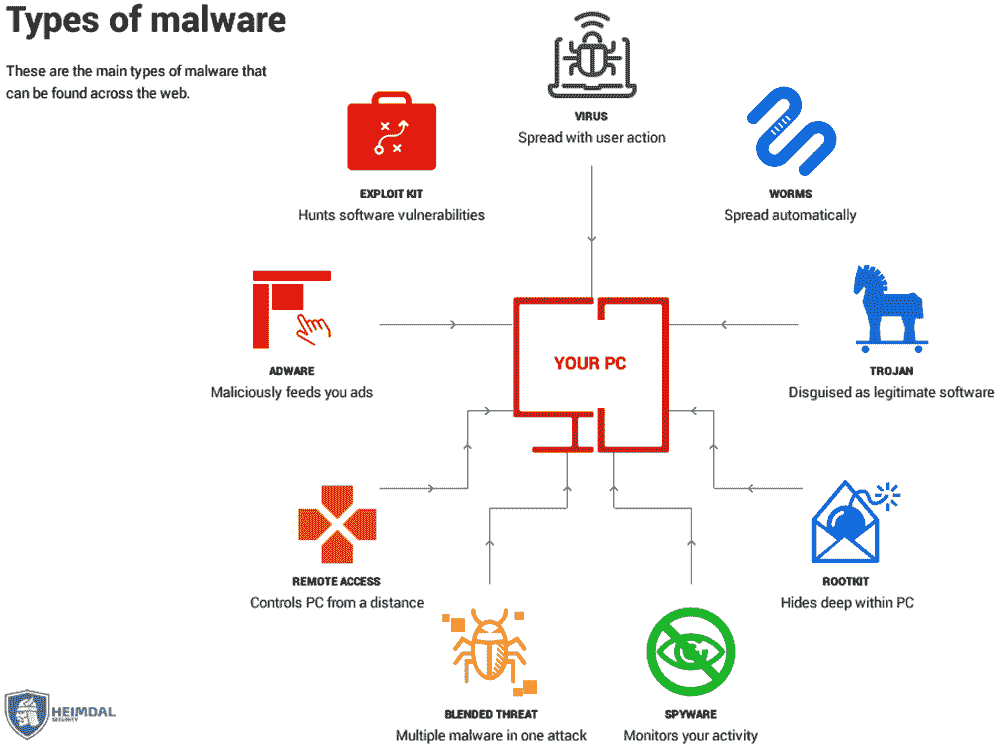 |

| --- |

| *图片来源：Heimdal* |

#### 如何成为一名伦理黑？

鉴于网络犯罪的指数级增长，伦理黑的需求非常旺盛，许多组织愿意为渗透测试支付高额费用。像 Kevin Mitnick 这样的人在长期作为自学非法黑客活动后，成为了伦理黑。其他人则在正式的教育机构学习伦理黑，从而获得专业认证。如今，许多成为伦理黑的人是通过自学非法黑客活动和正式认证计划相结合来学习这一专业知识的。

以下是成为伦理黑客的三个种热门认证课程：

*   EC-Council 的认证伦理黑客（`CEH`）

*   SANS 学院的信息保证认证（`GIAC`）

*   Offensive Security 的攻击安全认证专家（`OSCP`）

除了聘请渗透测试人员外，一些组织还提供漏洞赏金计划。漏洞赏金计划是组织与伦理黑之间的协议，组织同意向成功识别并告知组织某些软件漏洞的白帽客提供另一种形式的补偿（Ethical Hacking and Measures,2017）。

提供漏洞赏金计划的组织包括：美国国防部、微软、Salesforce 和 IBM 等（仅列举）。

| 图 3. ­ |

| --- |


| 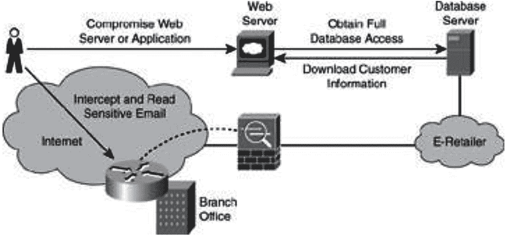 |
| --- |
| *来源：CISCO Press：机密性泄露* |

攻击者可以使用许多方法破坏机密性，最常见的如下：

### 伦理黑

见图 4。

| 图 4. |
| --- |
| 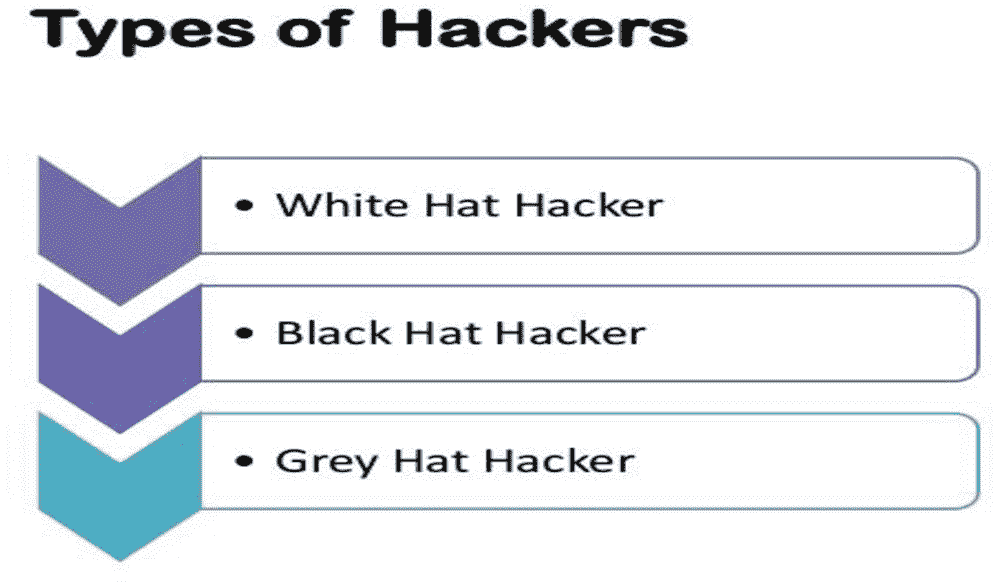 |
| --- |
| *来源：占位符* |

#### 全球黑客类型

**渗透测试**

渗透测试是由获得初始许可的安全专家进行的、针对各种类型攻击对系统漏洞的脆弱性或安全性进行的评估。在获得许可后，测试人员将尝试识别并利用系统的漏洞。渗透测试与实际攻击的区别在于，前者是由拥有相应许可的测试人员执行的，目的是暴露系统的安全弱点。此外，测试人员还会被赋予特定的操作边界，以便在边界内执行测试任务（Cisco Press, 2013）。

白、黑、灰代表了黑客与他们攻击的系统之间的关系。

### “黑帽”黑客

“黑帽”一词被认为源于西方电影，在电影中，反派戴黑帽子，而好人戴白帽子。

`black-hat hacker` 是试图在未经授权的情况下访问系统或网络，并出于恶意目的对其利用的个人。`black-hat hacker` 没有权限或授权来破坏其预定目标。他们试图通过破坏安全系统、修改网站和网络的功能或关闭系统来制造混乱。他们通常这样做是为了窃取或获取密码、财务信息和其他个人详情。

### “白帽”黑客

相反，白帽黑客被认为是好人，他们与组织合作帮助加强系统的安全性。`white hat` 被允许在约定的作战规则内接触目标并对其破坏。

`White-hat hackers` 通常被称为 `ethical hackers`（道德黑客）。这类人员专门精通道德黑客工具、技术和方法，以保护组织的信息系统。

与 `black-hat hackers` 不同，`ethical hackers` 在法律允许的情况下会利用安全网络并探索后门路径。`White-hat hackers` 总是会暴露他们在组织安全系统中发现的每一个漏洞，目标是在被恶意攻击者利用之前对其进行修复。

像 Facebook、微软和 Google 等某些财富 50 强公司也使用 `white-hat hackers`。

### “灰帽”黑客

与 `Black Hats` 一样，`Grey hats` 也利用网络和计算机系统，但并没有恶意。他们会将所有的漏洞和缺陷向执法机构或情报机构披露。

`Grey-hat hackers` 浏览网络并黑入计算机系统，目的是通知管理员或所有者其系统/网络可能包含的漏洞，并建议立即修复。`Grey hats` 还可能通过提供象征性费用修复系统缺陷来对被黑的受害者进行勒索。

攻击者可以使用许多方法来破坏机密性。这些包括：

* `Ping sweeps and port scanning`：这涉及对网络主机搜索开放的端口。
* `Packet sniffing`：截获并记录通过数字网络或网络部分传输的流量的行为。
* `Emanations capturing`：试图通过捕获组织设备的电传输来推断组织的信息。
* `Overt channels`：计算机系统或网络内部为授权数据传输而设计的通信路径。
* `Covert channels`：传输通道内隐藏的信息，它是通过使用另一组事件对数据进行编码的。
* `Wiretapping`：跟踪或窃听第三方的电话或互联网对话，通常是秘密进行的。
* `Social engineering`：利用社交技巧或人关系来操纵组织内部的人员。
* `Dumpster diving`：在垃圾或手册中寻找信息。
* `Phishing`：发送欺骗性通信内容，诱导个人提供用户名和密码等敏感信息。
* `Pharming`：将流量重定向到钓鱼网站的行为。

### 中间人攻击

`man-in-the-middle attack` 是一种复杂的欺骗形式，黑客充发送者和接收者之间的秘密中间人，拦截通信以获取访问权限。

黑客使用 `man-in-the-middle attacks` 用于：

* 窃取信息。
* 劫持会话以访问内部资源。
* 分析流量以获取信息。
* 执行 `DoS`（拒绝服务）攻击。
* 损坏数据。
* 在会话中引入新信息。

### 社会工程特征

* `Pressure`（压力）：通过表达紧急性来压迫受害者，使其无法思考自己正在做的事。
* `Time constraint`（时间限制）：恶意攻击者引导你认为某个优惠即将结束，或者账户需要更新。
* `Targeted manipulation`（针对性操纵）：老黑客研究行为模式、偏好的社交媒体账户以定制诈骗方案。

### 社会工程的方法

* `Phone calls`：犯罪分子假装成受信任的组织（如银行），声称有财务奖励。
* `Emails`：接收带有钓鱼链接的电子邮件，诱导你进入伪造网站。
* `Social media`：黑客黑入毫无防备的人员账户，向他人发送直接消息。
* `In-person`：犯罪分子试图使用凭证非法进入工作场所。

### 数据、漏洞与应对措施

对计算机系统的 `attack` 是一种 `computer exploit`（计算机漏洞利用）。它通常利用系统中的弱点或漏洞，发生在操作系统、应用程序或代码中。

`countermeasure`（应对措施）是指采取的行动、实施的过程或使用的设备/系统，用于防止或缓解威胁或攻击的影响。

#### 核心概念

* `asset`（资产）：对组织有价值的事物。
* `vulnerability`（漏洞）：系统或设计中的弱点，可能会被威胁者利用。如果对漏洞没有威胁，则不存在风险。
* `threat`（威胁）：对信息或系统的潜在危险。
* `risk`（风险）：特定漏洞被利用的可能性或概率。

利用（Exploit）是针对漏洞进行的攻击。它可以是成功的，也可以是不成功的。

防御措施（Countermeasure）是某种形式的安全防护，旨在保护和或缓解潜在的攻击或威胁。

## 攻击阶段

| 图 6. |
| --- |
| 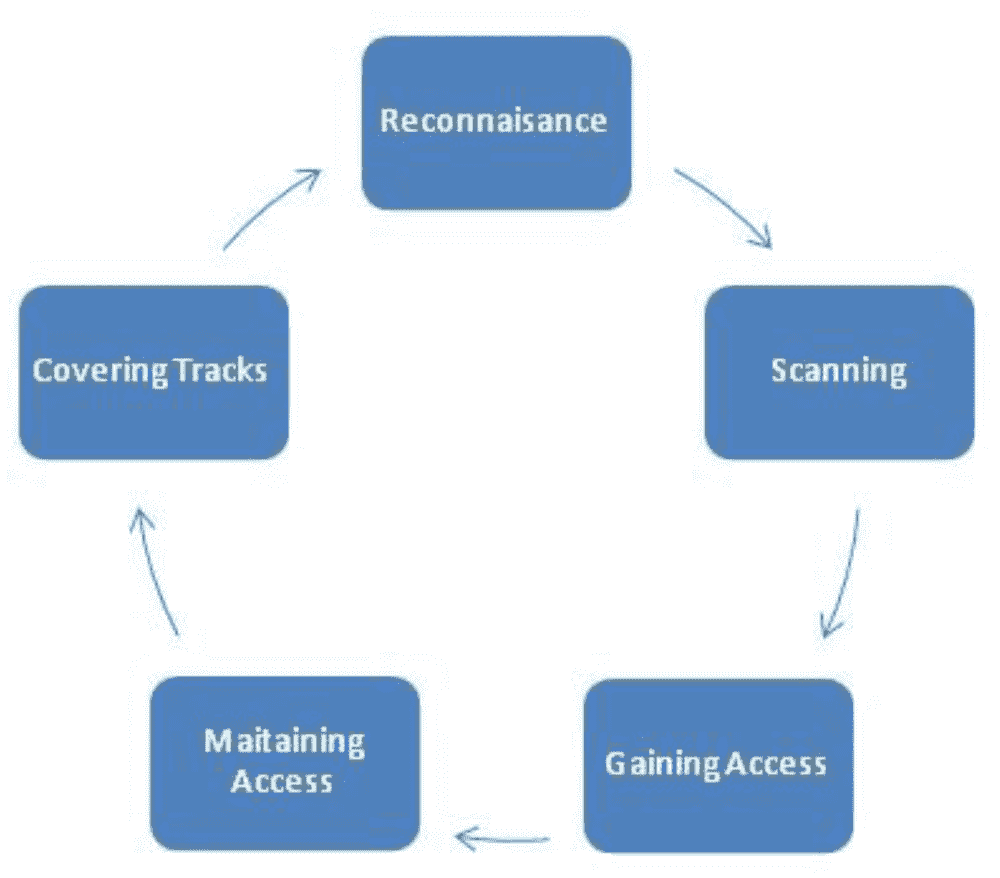 |
| --- |

### 1. 侦察 (Reconnaissance)

侦察也被称为“足迹探测”（foot-printing）。是一种收集目标计算机系统或组织资产信息的技术。

### 2. 扫描 (Scanning)

扫描包括对计算机系统或目标进行探测，以寻找可以被利用的漏洞。

扫描还涉及使用拨号器、端口扫描器、网络映射、扫描和漏洞扫描器等工具，旨在定位计算机名称、IP 地址和用户账户等信息。

### 3. 获取访问 (Gaining Access)

在侦察和扫描阶段之后，通过利用发现的漏洞来获取访问。黑客可能用于利用的连接方法可以是局域网——LAN（有线或无线）、本地访问 PC、互联网或离线。获取访问的示例包括基于栈的溢溢、拒绝服务（DoS）和会话劫持。

### 4. 维持访问 (Maintaining Access)

在成功进入后，黑客在许多情况下希望维持访问权限以便于未来的利用和最终攻击。为了防止其他黑客利用漏洞，他们可能会针对其他黑客或安全人员对系统进行加固，并通过后门、根 kit 和木马获得对系统的独占访问权限。

### 5. 掩盖踪迹 (Covering Tacks)

此阶段涉及黑客破坏证据或掩盖足迹以避免被发现，通过删除或更改日志文件或入侵检测系统（IDS）等证据来继续使用系统，旨在避免针对他们的法律行动。在此阶段的某些活动包括信息隐藏术、隧道协议的使用以及修改日志文件。

## 网络安全攻击类型

网络攻击是任何所有类型的针对计算机、操作系统和或应用程序、基础设施、计算机网络或个人计算机设备的攻击性行动，通过各种方法实施，目的是窃取、更改或破坏数据或信息系统。这些攻击从网络钓鱼到拒绝服务（DoS）攻击以及许多其他类型不等。下节详细介绍了不同类型的网络攻击及相关信息。

| 图 7. |
| --- |
| 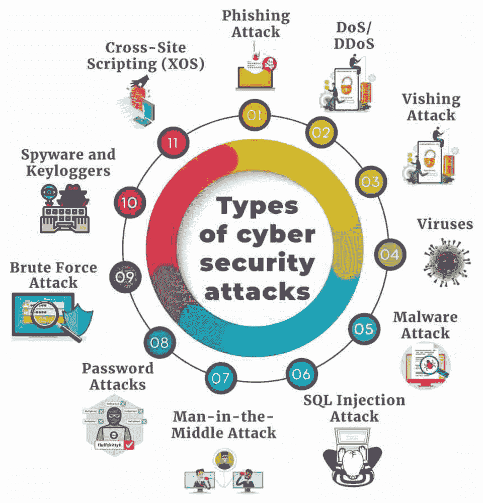 |
| --- |
| *来源：assignmenthelp4me* |

### 网络钓鱼攻击 (Phishing Attack)

网络钓鱼攻击利用技术手段和社会工程，其中攻击者发送一封非常像来自信任源的电子邮件。钓鱼攻击目的是获取个人的个人信息。通常通过说服或诱导他们点击链接将受害者引导到一个看起来非常像银行或公司实体等合法伪造网站。这将获取的数据发送给攻击者，而用户会被重定向到另一个托管恶意软件的网站。某些邮件可能包含恶意软件附件，下载后可能会感染。

另一方面，鱼叉式钓鱼（Spear phishing）是一种针对性的钓鱼类型。它用于获取敏感信息。

### 拒绝服务 (DoS) 和分布式拒绝服务 (DDoS) 攻击

拒绝服务攻击发生在攻击者不断向服务器发送请求时，其目的是关闭服务器。分布式拒绝服务是这种攻击的变体。

### 语音钓鱼 (Vishing Attack)

这是钓鱼攻击的一种形式，攻击者利用电话联系客户以欺骗他们获取详细信息。

### 病毒 (Virus)

病毒是包含恶意代码的恶意软件，旨在破坏计算机系统的正常运行。它还可以附加到计算机的文件并传播。

### 恶意软件攻击 (Malware Attack)

使用恶意代码是恶意软件攻击的核心。它可以破坏包括服务器在内的整个网络。它提供了对敏感信息的访问，这正是黑客需要的。

### SQL 注入

如名所示，SQL 注入是对基于数据库的网站的攻击。攻击成功后，登录凭据、支付信息和客户个人信息等敏感信息将被攻击者获取。这种攻击通常使用 SQL 命令执行。

### 中间人攻击 (MITM)

这是一个安全漏洞，攻击者窃听客户端和服务器之间传输的数据包。这使得攻击者能够访问某些敏感信息。

### 密码攻击 (Password Attacks)

这些是黑客为了获得未经授权访问组织安全系统的黑客尝试。为了获得访问权限，黑客可能会利用某些密码破解工具或安全工具。这些密码破解工具主要用于登录程序，其目的是获取用户账户的伪造通行证或盗取用户的凭据等。

## 暴力破解攻击

暴力破解是一种网络攻击，攻击者试图通过强制手段获取系统的访问，即尝试所有可能的非法字符、数字、字母和字母数字组合的方法及密码组合。该过程一直持续，直到找到正确的访问代码或密钥为止。

阿里巴巴集团旗下的企业淘宝曾被成功攻击，并成为大规模暴力破解攻击的受害者，导致多达 2100 万个账户泄露。据信，攻击者使用了一个包含 9900 万账户的数据库。

## 间谍软件和键盘记录器

顾名思，间谍软件是一种恶意攻击，旨在识别受害者计算机系统的活动。另一方面，键盘记录器旨在记录受害者按下所有按键。基本上，当受害者从恶意网站安装或下载任何损坏文件时，这些间谍软件和键盘记录器就会工作。最终，这些敏感的关键信息连同用户的浏览器历史记录一起，共享给在其终端控制所有活动的恶意黑客。

## 跨站脚本攻击 (XOS)

这种攻击是一种注入漏洞，网站被用作主机，恶意脚本通过这些网站发送，因为人们通常对网站的内容持有信任。这种违规通过将恶意代码附加到网站的动态内容来实现。执行 JavaScript 代码段的目标浏览器会被发送到受害者的浏览器。

2018 年，英国航空遭遇了一次涉及跨站脚本攻击的数据泄露。这影响了该年 8 月至 9 月期间的近 380,000 笔预订交易。此次泄露影响了移动应用程序和网站用户。（assignmenthelp4me, 2021）

## 网络犯罪上升的原因

很难获得详细说明全球网络犯罪稳步增长的准确数字，因为统计数据是基于报告的攻击、泄露和其他安全事件数量构建的，未报告的数字未被纳入统计。然而，CNN Money 引用了 Ponemon Institute 的一份报告，声称仅美国就有 47% 的成年人个人信息被泄露，在 2013 年 5 月至 2014 年 5 月的 12 个月内发生了 1.1 亿次数据泄露（如 Pagliery, 2014 所引）。一个世界统计门户网站报告称，遭受数据泄露的最知名公司 Adobe 和 eBay 截至 2015 年 8 月已分别被盗取 15200 万和 14500 万条记录（Statista, 2015）。过去十年网络犯罪上升有两个主要原因：对于攻击者而言风险低且相对安全；以及互联网提供了日益增加的目标。

## 网络攻击的经济影响

Cybersecurity Ventures 预计，全球网络犯罪成本在未来五年内每年增长 15%，到 2025 年每年将达到 10.5 万亿美元，高于 2015 年的 3 万亿美元。估计的损失成本基于历史网络犯罪数据，其中包括组织犯罪的年度增加、黑帮黑客活动，以及到 2025 年将比现在大一个数量级的网络攻击攻击面。

网络犯罪成本可以从数据的损坏和破坏、被盗的资金、生产力损失、知识产权被盗、个人和财务数据被盗、挪用、欺诈、取证调查、被黑攻击的数据和系统的更改与删除，以及声誉损害来衡量。KnowBe4 在其《网络攻击对市的经济影响》报告中指出，在勒索软件攻击中，2017 年至 2020 年间市每次事件支付的赎金为 125,6971 美元。勒索软件攻击会导致社区（如医疗和执法）的大规模停机关键服务中断。分析显示，勒索软件攻击导致的平均停机时间为 9.6 天。

## 结论

在结论阶段，道德黑客预计为雇用他的组织或客户编写详细的文档或报告。报告将包含对漏洞、可能性和攻击的影响的影响。将对检测到的漏洞进行详细说明，并提出解决任何所有安全问题的建议。

## 参考文献

- Assignment help, cyber. (2019).
- Cisco Press. (2013).
- Enisa. (2016).
- Ethical hacking. (2017).
- Gartner Inc. (2021).
- Grimes, R. (2019).
- Heimdal Security. (n.d.).
- Maze ransomware attacks. (2020).
- Netrix. (2021).
- Pagliery, J. (2014).
- Statista. (2015).
- Trend Micro. (2020).
- Webopedia. (2021).

## 美国马里兰大学全球校园

### 摘要

本研究的主要目标是评估组织信息技术基础设施的脆弱性，这些硬件和软件系统、传输介质、局域网、广域网、企业网络、内网以及其互联网的使用遭受网络入侵的影响。为了实现这一目标，本章节解释了社会工程在网络入侵和网络盗窃中的重要性，以及网络犯罪迅速扩张的原因。本章还包含了对社会工程的完整描述和定义、其在网络入侵和网络身份盗窃中扮演的角色、对网络犯罪上升原因的讨论，及其对组织的影响。最后，作者针对社会工程的威胁和脆弱性提出了一些预防措施和可能的解决方案。章节结论认为，虽然技术在减少社会工程攻击的影响方面可以发挥作用，但脆弱性源于人类行为、人类冲动和心理倾向。

### 引言

社会工程被称为“人类黑客”，是一种欺骗员工和消费者泄露其凭据，然后利用这些凭据访问网络或账户的艺术。它是黑客通过欺骗或操纵人们信任、合作或仅仅顺从探索和好奇欲望的倾向而进行的巧妙利用。复杂的 IT 安全系统无法保护系统免受黑客攻击，也无法防御看似是授权的访问。人们很容易被黑入，使他们和他们的社交媒体帖子成为高风险攻击目标。通过诱导用户访问伪造网站和/或欺骗他们点击有害链接和/或下载安装恶意应用程序和/或后门，可以让计算机用户感染其公司网络或移动设备。

在 TNS Global 为 Halon 邮件安全服务公司于 2013 年进行的一项研究中，受调查的 1,000 名美国人中有 30% 表示，即使他们意识到邮件包含病毒或可疑，也会打开邮件（Ragan, 2013）。尽管有强有力的活动传达打开可疑邮件的危险性，但大多数电子邮件用户仍然受到社会工程攻击的影响（Mann & Sharma, 2012）。为了应对社会工程攻击带来的挑战，研究提出的建议提供了减少社会工程攻击成功概率的选择。

随着网络安全事件在频率和对组织市场声誉损害方面呈指数级增长，用户和组织尚未充分部署防御来阻止潜在攻击者的攻击意图。“信息安全”和“网络安全”术语继续占据美国新闻头条，大规模网络攻击发生的概率超过了在美国本土发生物理恐怖袭击的可能性。事实上，在 2013 年对 FBI 局长詹姆斯·科米的一次采访中，局长向参院国土安全委员会作证，网络攻击已超过恐怖主义成为主要的国内威胁，且威胁仍在上升（Anonymous, 2013）。

在本文中，定义了社会工程以及各种类型的社会工程攻击。此外，本研究将识别为什么网络盗窃持续以惊人的速度发展。此外，还讨论了导致脆弱性的心理变量。最后，本将介绍识别有关社会工程测试和培训的关键考虑因素的研究，并指明如何指导用户以防止攻击，这提供了一种减少系统和用户风险的极具前景的方法。

## 什么是社会工程？

Engebretson (2011) 将社会工程定义为“通过利用每个组织固有的的人类弱点过程来收集目标信息的较简单的方法之一”。攻击的基础是说服对方放弃机密信息，然后利用个人或组织。从本质上说，攻击者将社会工程作为一种策略，通过欺骗利用人类内部人员和信息来绕过计算机安全解决方案。

关于社会工程的人性脆弱性，Luo, Brody, Seazzu, & Burd (2011) 指出，虽然社会工程被识别为低技术攻击；该攻击旨在操纵受害者泄露机密信息，并由于利用了性格脆弱性而成功。社会工程作为一种策略，利用了各种技术通过利用被称为认知偏差的人类逻辑缺陷来获取私人和机密信息（Luo, et al., 2011）。虽然安全技术措施旨在提高信息系统安全，但人类因素是社会工程攻击期间被利用的薄弱环节。

Bisson (2015) 指出社会工程是“一个涵盖广泛恶意活动的术语”，并识别了针对受害者的五种最常见的社会工程攻击类型，包括：

### 1. 网络钓鱼 (Phishing)

网络钓鱼诈骗试图获取个人信息，如姓名、地址和其他个人身份信息（PII），如社会安全号码。钓鱼诈骗可能嵌入链接，将用户重定向到看似合的可疑网站。此类诈骗营造了一种紧迫感，操纵用户做出违背良好判断的行为。

### 2. 预先设设 (Pretexting)


这种社会工程攻击由虚构的情景驱动，试图从目标处确认并窃取个人信息。高级攻击试图利用组织或公司的弱点。这种方法要求攻击者构建一个可信的故事，让目标几乎没有怀疑的空间。该策略是在建立与受害者信任感的同时，利用恐惧和紧迫感来确认或获取所索求的信息。

### 3. 诱饵 (Baiting)

诱饵与网络钓鱼攻击类似，但它通过诱惑策略诱导受害者。黑客利用承诺货物作为诱饵，如果用户交出特定网站的登录凭据。饵计划不仅限于数字在线方案，也可以通过物理介质实施。

### 4. 等价交换 (Quid Pro Quo)

与诱饵类似，但这种威胁是以技术服务的形式呈现的，以换取信息。一种常见的威胁是攻击者冒充信息技术代表，为可能遇到技术挑战的受害者提供帮助。攻击者的目标是在用户的系统上运行恶意软件。

### 5. 尾随入侵 (Tailgating)

这种攻击类型利用尾随和搭便车进入限制区域。这种攻击暴露了那些有权授权或进入限制区域的人，攻击者可能冒充快递人员或其他需要临时访问的人员。

## 社会工程及其在网络盗窃中的作用

根据美国法律，信息安全定义为“保护信息和信息系统不受未经授权的访问、使用、泄露、中断、修改或破坏”（Andress, 2011）。尽管在资源和培训方面投入了大量精力来克服信息安全漏洞，Nakashima 和 Peterson (2014) 指出，战略与国际研究中心指出，网络犯罪和经济间谍给全球经济每年造成的成本超过 4450 亿美元——几乎占全球总收入的分之一（Strohm, 2014）。

黑客正变得日益复杂，并在社会工程攻击方面变得日益熟练。他们能够从各种来源（如社交媒体、公司博客和数据）汇集分散的数据，并从好意的员工处苦心获取关键核心数据。这些网络犯罪分子利用这些数据攻击网络、盗取无价数据，甚至将公司作为人质，在某些情况下还会破坏目标对象。

关于网络犯罪和盗窃的兴起，Grimes (2014) 识别了导致影响个人和组织财务状况的网络犯罪上升和原因的关键指标。网络盗窃之所以具有吸引力，是因为“模糊性带来的收益”。全球范围内有成千上万的网络犯罪分子实施犯罪，但很少有人被起诉和入狱。此外，网络犯罪分子不需要非常聪明就能在数字盗窃中成功，而且由于距离受害者可以带来极小的风险和暴露风险，他们乐于冒险。

许多网络盗窃在全球范围内发生，执法机构在追捕网络犯罪方面受到管辖边界限制。追捕还包括与国内管辖范围之外的其他执法机构合作。虽然这在在国内并不复杂，但获得国际支持以追究国际盗窃行为对美国执法部门来说仍然是一个挑战。从本质上说，大多数国际政府并不相互合作（Taylor et al., 2015）。

证据是另一个因素，缺乏成功的定罪是因为缺乏可以提交法庭起诉网络犯罪的证据。有两个主要变量与证据落实有关：例如获取可信的以追究个人责任的证据；其次，很少有组织具有法律专业知识在网络犯罪案件中准备法律证据，这需要计划、投入和资源。这些挑战降低了犯罪分子即使被捕也会被起诉和入狱的概率。

为了克服网络领域的犯罪，资源匮乏可能是其指数级增长的主要原因。很少有组织拥有专门资源来追捕网络犯罪和犯罪分子。追捕网络盗窃的成本很高，在没有潜在投资回报率（`ROI`）的情况下，很难证明资源的合理性。

虽然网络被害的成本接近五千亿美元，但并没有损害全球经济，甚至可能被视为经营成本的一部分。要发生实质变化，必须等到网络犯罪损害个人和组织达到无法忍受程度，管理风险和损失的现实已融入组织的结构中，且小规模事件导致的个人受害已成为预期之中的噪音。

## 心理变量对网络犯罪的贡献

社会工程攻击向信息安全专业人员的挑战，因为到目前为止没有任何技术措施可以消除人为漏洞（Luo, Brody, Seazzu, & Burd, 2011）。在识别人为错误线索和成功的社会工程攻击方面，`Luo, et al. (2011)` 认为，“说服的替代途径、影响人类互动的态度和信念，以及说服技巧的影响”等社会心理学影响暴露了使社会工程攻击成功的心理漏洞。

为了寻求打开潜在破坏性 `e-mails` 的兴趣基础，Ragan (2013) 注意到参与此类行为的意图多样性在性别之间具有特殊性：女性更容易被来自社交网络的恶意 `e-mails` 吸引，而男性则受于传权力、金钱和性的 `e-mails`。由于社会工程攻击利用了人类的心理冲动，减少参与仍然是一个挑战，因为这些事件针对人类的心理漏洞（Vacca, 2013）。

进一步评估社会心理影响时，替代的说服途径通过影响受害者的情绪有助于成功的社会工程攻击。由于社会工程攻击利用了人类的心理冲动，减少参与仍然是一个挑战，因为这些事件针对人类的心理漏洞（Vacca, 2013）。

进一步评估社会心理影响时，替代的说服途径通过影响受害者的情绪有助于成功的社会工程攻击。由于社会工程攻击利用了人类的心理冲动，减少参与仍然是一个挑战，因为这些事件针对人类的心理漏洞（Vacca, 2013）。

由于社会工程攻击导致的情感和触发反应，拒绝攻击者是一个挑战。然而，研究表明，通过公司教育活动提高意识可能提供虚拟屏障。

## 社会工程技术 – 人性和技术

`Luo et al. (2011)` 识别了社会工程攻击者可以部署的几种人为或技术手段，从网络钓鱼到翻找垃圾，作为获取可见性或获取信息的策略。

| 图 1. 社会工程的四个步骤 |

| --- |

| 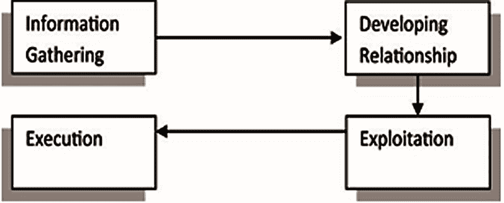 |

| *(Luo et al., 2011)* |

上图图 1 形象地解释了执行社会工程攻击的逐步方法。该过程从第一阶段的研究和收集信息开始，然后建立关系。在利用阶段，获得系统的访问权限，在最后阶段，实施攻击。

社会工程攻击可以归类为人为部署或技术部署。直接的人为参与源于获取了受害者个人信息并与用户建立关系的攻击者。由于攻击者部署了已知或受信任的方的策略，受害者变得容易受到攻击并被利用，从而放弃敏感或个人的公司信息。

技术攻击更加明确，并通过一系列选项部署，例如：软件程序、`e-mail attachments`、`pop-up windows` 和网站（`Luo et al., 2011`）。最成功的技术诡计可能是通过提示受害者在 `pop-up windows` 中输入用户名和密码信息，从而诱导用户泄露账户名和密码。

## 针对社会工程的预防措施

显而易见，无论网络在技术上看起来多么安全，人为因素始终是一个漏洞。由于社会工程学为恶意攻击者提供的匿名性，网络犯罪的成功率和数量稳步上升。企业必须对各种威胁者及其大量的攻击保持警惕，以便做出相应的反应。可以实施技术和非技术保护措施，将与社会工程相关的风险降低到可接受的水平。公司正在为其安全方案增加多个层级，这样如果外层机制失效，至少一个内层机制也可以帮助防止威胁演变成灾难（风险缓解）。这一概念被称为多层防御或深度防御（Defense in Depth）。良好的深度防御结构包含以下预防措施的混合：

- **安全策略**：一份良好的策略应该包含由执行管理层向下驱动的技术和非技术方法。每个组织都应该将安全整合到其运营目标中。

- **教育与培训**：员工应在入职期间参加初始培训，并参加定期的复习培训。这通过让用户接触社会工程工程师常用的策略和行为，建立起安全意识。

- **网络指导**：组织必须通过对授权网站建立白名单、使用网络地址转换 (`NAT`) 以及禁用未使用的应用程序和端口来保护网络。网络用户必须维护每 60 天更改一次的复杂密码。

- **审计与合规性**：组织必须积极验证其安全策略是否得到遵守。某些检测控制措施包括审查网络日志、重新验证员工权限以及至少双月检查一次桌面配置。

- **技术程序**：网络应具有多层防御以保护数据和核心基础设施。每台设备上都应安装入侵预防系统 (`IPS`)、入侵检测系统 (`IDS`) 和防火墙等软件。所有面向外部的服务应安装非军事区 (`DMZ`)、Web 过滤器和虚拟专用网络 (`VPN`)。

- **物理指导**：可以实施一系列方案来保护物理资产。结合安保人员、人肉通道（mantraps）和监控摄像头来威慑入侵者进入场所是有益的。在放置物理硬件的地方，企业在授予访问之前应采用多因素身份验证、生物识别或访问控制列表。

为了克服社会工程学攻击的挑战，Luo 等人 (2011) 指出需要一种多维维度的方法，通过处理组织政策、程序、标准、员工培训和意识计划以及事件响应的整体方法来克服威胁。虽然对抗这种威胁的所有领域都至关重要，但如果没有员工培训，昂贵的基础设施和网络安全投资意义不大，考虑到只有 7% 的美国组织在网络钓鱼教育中部署了培训计划和材料 (Diana, 2015)。

通过评估原因变量并识别组织中的易感人群，Chitery, Singh, Bag, & Singh (2012) 识别了社会工程学攻击背后的驱动因素、目标和动机。这项 2012 年的研究试图证明针对社会工程学攻击的分析方法并识别攻击者的趋势。该研究对数量未公开的 IT 专业人士进行了调查，为那些渴望部署信息安全意识计划以减少员工易受社会工程学攻击风险的组织提供了可能的培训措施。

| 图 2. 关于社会工程学攻击动机的问卷调查结果 |

| --- |

| 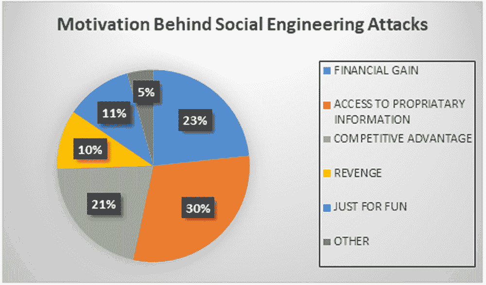 |

| --- |

根据上文提到的 Chitery, Singh, Bag, & Singh (2012) 进行的一项研究，图 2 描绘了社会工程学攻击背后的动机因素。显而易见，由于获取专有信息的需求而产生的访问在数量上最高，占 30%。利益追求其次，是竞争优势的需求，然后是“仅仅为了好玩”、报仇，最后且最少的是未名的其他。图 3 描绘了上述研究针对易受社会工程学攻击实体所获得的结果。最脆弱的群体是新员工 (41%)，其次是客户和顾客 (23%)，然后是 IT 专业人士 (17%)、合作伙伴和承包商 (12%)，最后是其他。

| 图 3. 关于可能沦为社会工程学攻击风险实体的问卷调查结果 |

| --- |

| 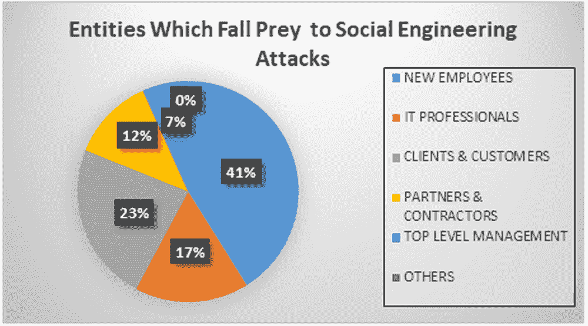 |

| --- |

在 Bowen, Devarajan & Stolfo (2011) 的另一项研究中，这项哥伦比亚大学的研究衡量了企业对网络钓鱼攻击的敏感性，这是一种诱发社会工程学攻击的技术路径和部署机制。哥伦比亚大学进行的 2011 年研究主要关注强化培训及其对防止社会工程学攻击的影响。正如如下表 1 和表 2 所示，该研究使用诱饵邮件测试了用户的脆弱性，引导用户提供信息或访问虚假邮件，以便收集数据并将其用于培训，以防止未来的攻击。

表 1. 第一次实验衡量用户对虚假钓鱼响应的每轮响应次数

| 诱饵类型 | 第 1 轮 | 第 2 轮 | 第 3 轮 | 第 4 轮 |

| --- | --- | --- | --- | --- |

| 包含内部 URL 的邮件 | 52 | 2 | 0 | NA |

| --- | --- | --- | --- | --- |

| 包含外部 URL 的邮件 | 177 | 15 | 1 | 0 |

| 获取凭据的表² | 39/20 | 4/1 | 0 | NA |

| 信标文档 (Beacon Documents) | 45 | 0 | NA | NA |

表 2. 第二次实验衡量用户对虚假钓鱼响应的每轮响应次数

| 诱饵类型 | 第 1 轮 | 第 2 轮 | 第 3 轮 | 第 4 轮 |

| --- | --- | --- | --- | --- |

| 包含内部 URL 的邮件 | 69 | 7 | 1 | 0 |

| --- | --- | --- | --- | --- |

| 包含外部 URL 的邮件 | 176 | 10 | 3 | 0 |

| 获取凭据的表 | 69/50 | 10/9 | 0 | NA |

| 信标文档 (Beacon Documents) | 71 | 2 | 0 | NA |

Bowen 等人 (2011) 的研究通过部署两轮实验进行的。用户被反复探测，每次都进行教育，以理解诱骗技术是如何发生的，直到受害者停止遭受攻击。数据最终支持，这种重复探测后辅以教育具有价值和投资回报率 (ROI)，无论心理倾向或性别如何，都能限制对用户的成功探测。

对哥伦比亚大学两轮实验数据进行评估证实，用户可以接受引导在打开可疑邮件之前采取谨慎。正如数据支持的，通过重复沟通强化威胁，尽管学习较慢的人沦为社会工程学攻击的概率最高，但用户仍然能够引导脱离社会工程学攻击的诱骗过程。

Luo 等人（2011）认识了从社会工程渗透测试和教育中可以学习的关键考虑因素。最重要的是，本论文中提到的 2011 年哥伦比亚大学的研究指出，教育后进行额外的社会工程测试会带来社会工程攻击成功率的大幅下降，从而降低信息系统和网络的脆弱性。然而，2011 年哥伦比亚大学的研究并未考虑为了维持相同的结果可能需要频繁地进行测试和培训。从本质上说，哥伦比亚大学研究的局限性导致无法得出结论，即如果未来进行相同的测试，应该获得相同的结果。这使得人们考虑在一段时间后部署循环训练模型，以确定用户在经过阶段性测试后是否还能产生类似的结果，从而判断培训效果是否具有持久。

## 结论

为了克服涉及社会工程攻击的网络安全事件，研究支持最有效的防御措施是受过教育的计算机用户。需要考虑的是本研究确定的最脆弱群体，即组织中的新员工（如上图 3 所示），攻击者试图从这些参与的人员那里索取个人身份信息（PII）。本研究进一步支持了导致用户脆弱性的心理变量。本文得出结论，虽然技术在减少社会工程攻击的影响方面发挥作用，但脆弱性存在于人类行为、人类冲动和心理倾向，而这些可以通过教育产生影响。最终，对组织教育活动的投入为减少社会工程攻击提供了乐观的可能，但目前尚未提出一种能够克服此类网络安全威胁的绝对解决方案。

## 参考文献

Andress, J. (2011). The Basics of Information Security . Elsevier.

Anonymous. (2013). FBI: 网络攻击已超过恐怖主义，成为主要的国内威胁. Retrieved from https://www.rt.com/usa/fbi-cyber-attack-threat-739/

Bisson, D. (2015, Mar 23). 需要警惕的 5 种社会工程攻击. The State of Security. Retrieved from https://www.tripwire.com/state-of-security/security-awareness/5-social-engineering-attacks-to-watch-out-for/

Bowen, B. M., Devarajan, R., & Stolfo, S. (2011). Measuring the Human Factor of Cyber Security. Columbia University. Retrieved from http://www.cs.columbia.edu/~bmbowen/papers/metrics\_hst.pdf

Chitery. A., Singh, D, Bag, M., & Singh, V. (2012). 印度基于社会工程攻击的综合研究以开发一个概念模型. International Journal of Information & Network Security, 1(2), 45-53.

Diana, A. (2015, May 19). 社会工程学针对最薄弱的安全环节：员工. Retrieved from http://www.enterprisetech.com/2015/05/19/social-engineering-targets-weakest-security-link-employees/

Engebretson, P. (2011). The Basics of Hacking and Penetration Testing . Elsevier.

Grimes, R. A. (2015). 互联网犯罪比任何时候都糟糕的 5 个原因. Info World. Retrieved From https://www.infoworld.com/article/2608631/security/5-reasons-internet-crime-is-worse-than-ever.html?page=2

Luo, X., Brody, R., Seazzu, A., & Burd, S. (2011). 社会工程: 信息安全管理中被忽视的人因素. Information Resources Management Journal , 24(3), 1–8.

Mann, P. S., & Sharma, M. (2012). 社会工程: 一种技术攻击. IJCSI International Journal of Computer Science Issues, 9(2), 557-559. Retrieved from http://citeseerx.ist.psu.edu/viewdoc/download?doi=10.1.1.401.7920&rep=rep1&type=pdf

Nakashima, E., & Peterson, A. (2014, June 9). 报告：网络犯罪和间谍活动每年耗资 4450 亿美元. The Washington Post. Retrieved from https://www.washingtonpost.com/world/national-security/report-cybercrime-and-espionage-costs-445-billion-annually/2014/06/08/8995291c-ecce-11e3-9f5c-9075d5508f0a\_story.html

Ragan, S. (2013). 社会工程: 研究发现美国人愿意打开恶意邮件. CSO. Retrieved from https://www.csoonline.com/article/2133877/social-engineering/social-engineering--study-finds-americans-willingly-open-malicious-emails.html


Strohm, C. (2014). 网络盗窃已成为规模达 450 亿美元的业务，并将继续扩大. Insurance Journal. Retrieved https://www.insurancejournal.com/news/national/2014/06/09/331333.htm

Taylor, R. W., Fritsch, E., & Liederbach, J. (2015). Digital Crime and Terrorism (3rd ed.). Pearson Education.

Vacca, J. R. (2013). Computer and Information Security (2nd ed.). Kaufmann.

## 第 3 章

*   Nabie Y. Conteh

    新奥尔良大学

*   Malcolm D. Royer

    梅里兰全球大学

### 摘要

本章主要旨在定义并回顾网络安全领域的文献，并详细阐述社会工程的机制。它将讨论各种网络入侵尝试以及通常采取的步骤。研究还将解释为什么人类被认为是这些攻击中最脆弱的环节。最后，本章将提出一些预防措施和解决方案，例如开展定期的、相关的培训和真实的测试，以关注整个学科，从而加强网络中最柔软的部分。

### 1. 引言

组织的安全性取决于其最薄弱的组件。在业务技术不断进步的时代，人们可能认为资源的安全性主要取决于技术控制和算法。虽然技术方面的安全至关重要，但存在一种无法通过技术手段消除的脆弱性。这种脆弱性存在于任何公司运营中不可或缺的特定元素。这个不可或缺的组件就是人类员工，他们受到明显的低技术攻击的影响——社会工程。

### 2. 社会工程

#### 2.1 定义

“社会工程”在计算机和网络安全领域的术语并不新——至少从 1995 年 Al Berg 在 `LAN Times` 的文章《破解社会工程学》中就使用了这个词——但它尚未进入所有标准字典。2015 年版的韦尔词典（Merriam-Webster）、随机房屋出版社（Random House）和剑桥英语字典仅从社会或政治科学的角度定义社会工程，而不涉及安全。然而，在信息安全社区中，社会工程指的是“通过心理技巧欺骗他人交出他们不会自愿交出的东西”（`Vacca & Curry`, 2013）。Curry 进一步指出，社会工程工程师“依赖于人们在面对数据或社会情境时的正常行为，以可预测的人类方式做出反应”，并解释这种攻击依赖于“展示信任的标志和看似正常但实际上旨在创造一个可以被社会工程工程师利用的脆弱性的背景”（`Vacca & Curry`, 2013）。

在凯文·米特尼克（Kevin Mitnick）关于其黑客经历的《黑客入侵》（Ghost in the Wires）书中，他将社会工程定义为“通过对他人进行无意或刻意的操纵，以影响他们去做他们通常不会做的事”（Mitnick & Simon, 2011）。他给出了一个典型的获取未经授权信息的清晰示例，作为他入侵 U.S. Leasing 网络的一部分：

```
我会给目标公司打电话，要求进入他们的机房，确保我正在与系统管理员通话，并告诉他：“我是[当时我脑子里跳出的任何虚构名字]，来自 DEC 支持部门。我们在你们的 RSTS/E 版本中发现了一个毁灭性的漏洞。你们可能会丢失数据。”
```

这是一种非常强大的社会工程技术，因为对丢失数据的恐惧是巨大的，大多数大多数人都不会犹豫地配合。（Mitnick & Simon, 2011）

尽管这个例子非常准确，但它只描述了社会工程的一个方面：预设身份（Pretexting）——即为受害者设定条件（一个故事、微妙或显性的的线索、提及名人、内部流行语和术语等），使其相信攻击者来自合法的背景。属于社会工程分类的其他攻击形式（包括本文提到的定义）如下：

* `诱饵攻击`(Baiting）——将木马式的设备或软件丢在开放区域，并以诱人的标题或外观作为诱饵。

* `钓鱼攻击`(Phishing）——使用诈骗邮件欺骗受害者。

* `尾随`(Piggybacking 或 tailgating）——跟随某人进入安全区域，无论对方是否察觉。

* `利益交换`(Quid Pro Quo）——给予某物作为回报；利用他人的善意。

* `窥视`(Shoulder Surfing）——观察他人输入知识型凭据并记住它们以供未来未经授权使用。

* `语音钓鱼 7Vishing）——使用交互式语音系统欺骗受害者通过电话输入个人信息。

根据（Granger, 2010），无论具体的攻击方法是什么，所使用的基本说服方法是“冒充、奉承、从众、责任分散以及纯粹的友好……主要目标是说服披露信息的人，让社会工程工程师实际上是他们可以信任的人”（Granger, 2010）。在预设身份之前，信息收集过程和开发合理背景的额外补充手段是“翻找垃圾”（dumpster diving）——通过筛选丢弃的文件来寻找敏感信息。

## 3. 社会工程在网络入侵和网络犯罪窃中的角色

社会工程在网络入侵和网络犯罪窃中起着主要且持久的作用。这并不是说它是一个绝对必要的角色，因为黑客理论上可以通过利用技术漏洞，在没有任何人类互动的情况下渗透系统。它所扮演的角色之所以具有重要性，是因为任何系统都存在且将持续存在的脆弱性——即其用户和管理员。

### 3.1 人是最脆弱的环节点

由于人们参与了任何计算机网络的管理和使用，他们始终必须被视为安全链中的一个环节。这个环节之所以是（并将持续是）脆弱的，原因很简单：人很容易被操纵。我们受情绪影响，这些情绪经常会覆盖我们可能拥有的任何逻辑承诺。我们拥有心理维度，而基于纯粹、直接逻辑的计算机并不具备这一维度。我们的心理弱点和需求，加上记忆的缺陷和不稳定的注意力，使我们非常容易受到欺骗和情感操纵。

乔治·西蒙博士（Dr. George Simon）在他的书中《披羊狼》（In Sheep’s Clothing）中讨论了成功的心理操纵，认为这需要操纵者隐藏攻击意图和行为，了解受害者的心理漏洞，并且足够冷酷到忽略对受害者造成的任何伤害（Simon, 2010）。由于计算机的处理没有心理层面，且意图和行为是通过分析所采取的一系列动作来感知的，如果没有人为因素，这些方法对技术系统将是无关的。根据哈丽特·布莱克博士（Dr. Harriet Braiker）在其书籍《谁在操纵你》（Who’s Pulling Your Strings?）中，操纵者利用正负强化、间歇或部分强化、惩罚和创伤性单次学习来控制受害者（Braiker, 2004）。他们利用大多数人对认可、情感和欣赏的渴望，同时利用我们帮助他人的天然倾向，特别是那些与我们有某种关联关系的人。这些都是基于坚硬逻辑的计算机所不具备的脆弱性。

### 3.2 不需要技术专长

由于社会工程攻击独立于所用系统的技术控制，攻击者只需要极少的专业知识即可实施。为了通过与员工对话窃取关键信息，不需要计算机编程经验或对底层网络结构的透彻理解。只需要足够的、看起来合理的背景故事、良好的时机把握、对权力名称和常见内部术语的基础知识，任何人都可以披上社会工程工程师的外衣。

只要人类还以某种方式参与其中，无论我们的技术系统变得多么先进，组织面对社会工程攻击的这种脆弱性在可见的未来都将继续存在。我们在科幻电影和电视节目描绘的科技超先进的未来社会中反复看到这一点。主角（有时是反派）有多频繁在使用低技术、基于社交互动的方法来绕过安全系统？

## 4. 网络犯罪上升的原因

尝试物理闯入房屋或经营场所盗取金钱、设备或敏感信息具有巨大的风险。在行事过程中被捕获或留下大量的 DNA、指纹、鞋印、头发和衣服颗粒，以及证明你曾出现在现场的监控摄像头录像的概率很高。为了降低被捕获或被识别的风险，所需的精力和规划也随之增加。但对于使用计算机攻击目标数字信息和资源的犯罪分子来说，这种程度的准备并不是必要的。对于业余破解者来说，隐藏自己的`IP address` 并使用其他手段隐藏数字足迹是小菜碟。通过开源手段可以免费获得攻击数千个目标的专业软件，并运行在 `Kali Linux` 上，这是一种专门为网络渗透而设计的操作系统发行版（Kim, 2014）。与物理犯罪相比，攻击者的相对匿名性很高，而且攻击所需的时间和资源也极少。

### 4.2 增加的机会性目标

世界人口每年持续指数级增长。随着出生的孩子越来越多，潜在计算机用户数量也随之增加。犯罪分子很大程度上倾向于攻击机会性目标。（Felson & Clarke, 1998）指出：

“为了发生通常的掠夺性犯罪，可能的犯罪者必须在缺乏能力守护者的情况下找到合适的目标。这意味着，如果目标增多，或者犯罪分子能够在没有守护者的情况下接触目标，即使犯罪分子没有增加，犯罪也会增加。这也意味着社区生活可能会改变，在不增加犯罪动机的情况下产生更多犯罪机会”（Felson & Clarke, 1998）。

随着机会性目标的增加，涉及互联网和数字连接的触法行为或犯罪未遂行为将继续增加。互联网连接率从 2004 年世界人口的 14.1% 增长到 2014 年的 40.4%（Internet Live Stats, 2014）。由于数字记录和交易的转型日益增加，以及在线个人信息的共享，对于那些意图勒索、敲诈、冒充和盗取他人的人来说，这一目标将继续变得越来越具有吸引力。

## 5. 网络犯罪对组织的影响

网络犯罪并非可以轻视之事。由于受损信息或被盗资金具有个人化性质，它似乎对个人计算机用户造成的破坏性影响是最大的。然而，组织也将面临巨大损失，从金钱、声誉和时间损失方面遭受的损害，由于影响了许多人——包括员工和客户——从长远来看可能更具破坏性。

### 5.1 财务损失

成功的网络入侵导致的财务开支可能是惊人的。根据（Ponemon Institute, 2015）的数据，在美国，“每条丢失或被盗取的敏感和机密记录的平均成本从 201 美元增加到 217 美元”，且“组织支付的总平均成本从 2013 年到 2014 年的 590 万美元增加到 650 万美元”（Ponemon Institute, 2015）。组织的财务损失不仅根据攻击者夺取的资金多少来计算。它还包括了在拒绝服务攻击情况下由于在线资源不可用而导致的业务损失估计，以及在涉及数据破坏的恶意攻击中恢复被删除信息的成本。此外，公司可能需要聘请外部专家进行更彻底的恢复，或者在恢复操作期间为 IT 员工支付加班费。

### 5.2 声誉损害

一位曾工作过的经理经常将信任定义为“已实现预期的储水池”。根据这个定义，组织所做的任何符合客户预期的行为都会建立他们的信任并向储水池增加水量。每当这些预期未能实现时，信任储水池就会减少。数据泄露，例如 2013 年 `Target` 的事件，该事件导致超过 4000 万条信用卡和借记卡记录泄露，以及超过 700 万名客户的姓名、地址和电话（Yang & Jayakumar, 2014），这对客户的信任是巨大的消耗。客户对公司信任的丧失会导致公司失去业务，因为他们将不太可能信任公司处理业务交易所需的敏感信息。此外，当员工对雇主失去信任时，他们更有可能寻找其他工作。这可能会负面影响他们对公司的投入程度，并导致生产力下降，为业务造成恶性循环。员工信任的丧失会导致更高的流失率和向竞争对手的跳槽，使安全失败的组织持续呈现下降趋势。

### 5.3 恢复所需的时间

在成功的网络攻击后，组织遭受的第三领域损害是时间。时间的消耗源于必须重建被删除的记录、通知受害的员工和客户，以及发现并修复漏洞并加固网络以防止进一步的利用。（Grover et al., 2014）写道，索尼影视公司花了八天时间才从 2014 年 12 月遭受的网络攻击中恢复出来（Grover et al., 2014），并表示该公司“关闭了内部计算机网络……以防止数据擦除软件造成进一步损害，迫使员工使用纸笔”（Grover et al., 2014）。网络加固和故障排除对于 IT 人员来说可能特别耗时，并使他们偏离日常网络操作，导致对帮助台请求和网络维护的响应时间变慢。这产生了一种多骨牌效应，由于组织其他部分完成简单的日常操作所需的时间增加，导致业务效率下降得更快。

## 安全意识

组织需要对社会工程的手段、方法以及攻击的可能性进行定期且冗余的培训。在每位新员工获得计算机网络权限或进入任何需要与非员工接触的职位之前，必须确保他们接受了此类培训。新员工是容易受到攻击的目标，因为他们可能不像经验丰富的同事那样熟悉组成组织的成员面孔。

### 6.3 彻底的培训

这种意识培训需要尽可能涵盖社会工程的各个方面。我们无法完美预测入侵者会使用 `pretexting`（编造故事）或 `phishing`（钓鱼攻击），而不是使用 `shoulder surfing`（窥视屏幕）或 `piggybacking`（尾随进入）。即使是冷门的攻击手段也应该进行讨论。如果涵盖的技术广度不足，可能会导致员工错误地认为自己能识别并击败社会工程攻击，从而在面对不常用的方法时毫无防备。

### 6.4 相关培训

组织开展的培训必须具有参与性、趣味性、时效性和相关性。培训不应如此枯燥或呈现形式糟糕，至于变成员工不得不忍受的负担。如果 IT 或管理人员无法想出有趣且参与感强的方式培训组织的其他成员，则应引入专门以有效方式进行此类培训的外部领域专家。

### 6.5 频繁的社会工程演练和渗透测试

定期进行演练和无计划的渗透测试是让人们切身感受到成为社会工程攻击受害者是多么容易的方法。许多渗透测试公司作为漏洞评估的一部分提供此类服务。Peter Kim 描述了他的渗透测试公司进行他所谓的“SMTP 攻击”的案例：

```
在以下示例中，我们的目标是虚假网站 `bank.com`，它在俄罗斯有一家子公司。虚假银行拥有 `ru.bank.com` 并对该完全限定域名 (FQDN) 设置了 MX 记录。此外，`company.com`（另一个虚假公司）拥有 `us.company.com` 并对该 FQDN 有 MX 记录。在这个虚假示例中，我们购买了两个双胞域名 `uscompany.com` 和 `rucompany.com`。如果有人向任何一个域名输入了错误的电子邮件，我们就能让自己处于这段对话的中间。通过几个简单的 python 脚本，当我们收到从 `john@us.company.com` 发往 `bob@rubank.com`（`ru.bank.com` 的误拼双胞域名）的邮件时，我们的脚本将获取该邮件并创建一个发给 `bob@ru.bank.com`（正确的邮箱地址）的新邮件，来源为 `john@uscompany.com`（我们拥有的误拼双胞域名）。这意味着 Bob 对 John 的任何回复都将通过我们返回。现在，我们配置了一个完整的“邮箱箱中间人 (Man in the MailBox)”，可以只是被动监听，也可以根据他们之间的信任因素对受害者进行攻击。（Kim, 2014）
```

然而，负责物理安全的 IT 和设施团队应该协作进行定期的内部演练，以增强全体员工保持警惕的重要性。这些演练和测试的结果应该在（适当的论坛上）公布，供大家学习，并展示每个人持续存在的脆弱性。

### 6.6 组织纪律

组织必须制定安全策略，包括具体的、详细的步骤来验证与公司交互的人员的真实性。此外，政策和程序必须清晰简洁地应对所有可能的攻击途径，或员工因自满产生巨大安全漏洞的领域。这些策略应当发布并张贴在相关的区域。

## 7 结论

只要我们还依赖于人，社会工程就会继续构成威胁。我们能做的最好的就是进行定期的、相关的意识培训，频繁的演练，并保持专注。

14Statista. (2015，8 月). 截至 2015 年 8 月选定数据泄露中的受损数据数量。检索自 https://www.statista.com/statistics/290525/cyber-crime-biggest-online-data-breaches-worldwide/

15Yang, J. L., & Jayakumar, A. (2014，1 月 10 日). Target 表示，截至 12 月的数据泄露有多达 7000 万客户受影响。检索自 https://www.washingtonpost.com/business/economy/target-says-70-million-customers-were-hit-by-dec-data-breach-more-than-first-reported/2014/01/10/0ada1026-79fe-11e3-8963-b4b654bcc9b2_story.html

## 第 4 章

*   Nabie Y. Conteh

    美国新奥尔良南方大学

*   Anjelica B. Jackson

    美国新奥尔良南方大学

### 摘要

本章深入探讨了研究文献，分析并评估了社会工程在网络入侵和网络盗窃中扮演的角色。本章还将讨论针对社会工程攻击过程中出现的威胁和脆弱性的预防措施及解决方案。社会工程是一种通过策略让受害者感到舒适并提供数据来窃取私有数据的手段。这种攻击可能给个人和组织造成数百万美元的损失，并阻止其访问数据。文章提供了多项统计数据，证明针对个人或组织的社会工程攻击风险已大幅增加。这一新通信潮为黑客提供了许多机会，通过跟踪你的电子邮件、电话、社交网络等来威胁安全。本文还将介绍有关用户如何增强保护其隐私信息免受攻击者侵害的信息。

### 引言

多年来，研究人员对社会工程进行了许多研究，报告了攻击的发生情况、实施攻击的策略、受害的影响以及防止未来攻击的方法。这些研究都有共同的结果，表明由于受攻击系统所有者缺乏准备，攻击者不断取得成功。敦促用户通过了解和掌握策略及预防措施，采取更积极的角色来保护自己免受攻击。本文将为用户提供研究提供的信息，帮助他们实施安全有效的数据治理。

## 课题分析

本文定义了社会工程并列举了社会工程攻击的类型。此外，本研究将识别为什么网络盗窃继续以惊人的速度发展。此外，还讨论了导致脆弱性的心理变量。最后，将介绍一些识别有关社会工程、测试和培训的关键考虑因素的研究，并指明如何指导用户以防止攻击，这提供了一种减少系统和用户风险的极具前景的方法论。

研究表明，“社会工程是一种非技术黑客手段，它通过欺骗、说服、伪装、情感操纵和滥用信任，通过人类界面获取信息或计算机系统访问权限”（Thompson, 2006, p.222）。当黑客能够交流受害公司的术语和政策时，伪装策略就是成功的。操纵策略由黑客执行，他们假装丢失了公司信息、无法联系或联系上来源，并且了解应该掌握的常见信息。

## 社会工程的类型

以下是一些已知的工程攻击：

### 钓鱼攻击


`Phishing` 诈骗试图获取个人信息，如姓名、地址和其他个人信息（`PII`），如社会安全号码。`Phishing` 诈骗可能嵌入看似合法的可疑网站链接。

## 社交预设

`Pretexting` 由虚构的情景方案驱动。这种方法要求攻击者构建一个可信的故事。

## 诱饵攻击

`Baiting` 通过物理介质诱导受害者。一种常见的威胁是攻击者冒充信息技术代表，为可能正遇到技术挑战的受害者提供帮助。

## 等价交换

与 `Baiting` 类似，但这种威胁是以技术服务的形式提供的，以交换信息。攻击者的目标是在用户的系统上启动恶意软件。

## 尾随攻击

`Tailgating` 使用“搭便车”进入受限区域。这种攻击暴露了那些拥有访问权限或可能需要临时访问权限的人。

# 针对社会工程的预防措施

显而易见的是，无论网络在技术上看起来多么安全，人为因素始终是一个脆弱性。由于社会工程为恶意行为者提供了高度匿名性，其成功率和网络犯罪数量正在稳步上升。企业必须关注各种威胁行为者及其大量的攻击，以便能够做出相应的反应。可以实施技术和非技术保护措施，将与社会工程相关的风险降低到可以接受的水平（风险缓解）。

## 安全策略

一份编写良好的策略应包含由执行管理层向下驱动的技术和非技术方法。每个组织都应该将安全整合到其运营目标中。

## 教育与培训

应要求员工在入职期间参加初始培训以及定期的复习培训。这通过让用户接触社会工程师针对的常用策略和行为来建立安全意识。

## 网络指南

组织必须通过对授权网站建立名单、使用网络地址转换（`NAT`）以及禁用未使用的应用程序和端口来保护网络。网络用户必须维护每 60 天更改一次的复杂密码。

## 审计与合规性

组织必须积极验证其安全策略是否得到遵守。某些检测性控制包括审查网络日志、重新验证员工权限以及至少每两个检查一次桌面配置。

# 技术程序

- **技术程序**：网络应具有多层防御，以保护数据和核心基础设施。每台设备上都应该安装`入侵防御系统 (IPS)`、`入侵检测系统 (IDS)` 和防火墙。在所有面向外部的服务上应安装`非军事化区 (DMZ)`、网页过滤器和`虚拟专用网络 (VPN)`。

- **物理引导**：可以实施多种方案来保护物理资产。结合安保人员、防逃生门（mantraps）和监控摄像头来威慑入侵者进入场所是有益的。在放置物理硬件的地方，企业在授权访问之前应采用多因素身份验证、生物识别或访问控制列表。

# 社会工程学概述

研究表明，“社会工程学是一种高级持续性威胁，通过社交网络或其他类型的通信获取隐私和敏感信息”（Nelson, Lin, Chen, Iglesias, & Li, 2016）。这种威胁的目标是让黑客在不被察觉的情况下从社交网络账户中窃取数据。黑客会寻找许多目标，然而，典型目标往往是政府机构、公司以及学校或高知名用户的 `Facebook` 账户。黑客不断发挥创意并寻找新手段来利用用户的脆弱性。近年来，这些对网络安全的威胁已迅速增加（Nelson et al., 2016）。

# 网络犯罪上升的原因

很难获得有关全球网络犯罪稳步增长的准确数字，因为这些统计数据是根据报告的攻击、破解和其他安全事件数量构建的，导致未报告的数字未被计入。然而，CNN Money 引用了 `Ponemon Institute` 的一份报告，称仅美国就有 47% 的成年人个人信息泄露，根据引用 [11]，从 2013 年 5 月到 2014 年 5 月的 12 个月内发生了 1 亿次数据泄露。一个世界统计门户网站报告，遭受数据泄露的两家知名公司 `Adobe` 和 `eBay` 截至 2015 年 8 月分别被盗了 1.52 亿和 1.45 亿条记录 [14]。过去十年网络犯罪上升有两个主要原因：对于攻击者而言风险低且相对安全；以及互联网提供的机会目标日益增加。社会工程学在网络盗窃和网络入侵中的作用通过`鱼叉式网络钓鱼 (spear phishing)`实现。根据 `Trend Micro` 的说法，“约 91% 使用社会工程学的针对性攻击涉及鱼叉式钓鱼邮件或社交网络联系人”（Micro, 2012）。`鱼叉式钓鱼`是发送给组织的试图窃取数据的电子邮件/联系信息。这些信息包含受害者下载的恶意内容。黑客经常进行此类攻击，因为电子邮件和社交网络是企业最流行的通信手段（Nelson et al., 2016）。

# 财务损失

成功的网络入侵导致的财务开支可能是惊人的。根据 [12]，在美国，“每条丢失或被盗的包含敏感和机密记录的平均成本从 201 美元增加到 217 美元”，且从 2013 年到 2014 年，“组织支付的总平均成本从 590 万美元增加到 650 万美元” [12]。组织的财务损失不仅根据攻击者夺取了多少钱来计算。它包括在发生`拒绝服务攻击 (denial-of-service attack)` 时由于在线资源不可用导致的业务损失估计，以及在涉及破坏数据的恶意攻击中恢复被删除信息的成本。此外，公司可能需要聘请外部专家进行更彻底的恢复，或在恢复操作期间为 IT 员工支付加班。

黑客一直努力通过两种方法来增加其鱼叉式钓鱼攻击的复杂性。第一种方法欺骗用户相信威胁来自受信任的人。第二种方法要求黑客在社交媒体上发布公众可见的包含恶意文件和链接的内容。为了使攻击成功，黑客会对组织进行深入研究，以便他们的伪造邮件被认为是真实的。电子邮件或信息越真实，攻击结果就越好。（Nelson et al., 2016）

黑客攻击通常由寻求政府机密信息、军事分机密数据和财务利益的黑客进行（Nelson et al., 2016）。研究表明，这种攻击是每年数百万美元损失的根源。`勒索软件 (Ransomware)`是一种社会工程学形式，从受害者那里获取财务利益。一旦`恶意软件 (malware)`感染你的计算机，它将将其锁定并防止所有者找到他们的文件（Savage, Coogan & Lu, 2015）。

# 趋势与挑战

不仅`鱼叉式网络钓鱼 (spear phishing)`和`勒索软件 (ransomware)`等社会工程学攻击不断增加，网络犯罪也在增加。网络犯罪扩张的原因是缺乏专业的维护人员。研究表明，“执法部门往往难以定位网络犯罪，因为访问公司计算机系统可以通过许多方式、由许多不同的人进行，并配备了一系列技术手段”（Hewer, 2016）。正因如此，这些网络犯罪分子在被捕之前更容易多次攻击。文章指出，“世界可能距离攻击者获得优势仅差一项颠覆性技术，这意味着互联网将不再是通信或贸易的信赖媒介”（Fraud and Risk, 2014）。

Hewes（2016）的研究表明，“网络犯罪是一种涉及互联网、计算机系统或计算机技术的犯罪活动。”网络犯罪的形式包括`钓鱼 (phishing)`、`身份窃`以及感染网络和设备。研究表明，“2014 年，美国国土安全部估计收到了近 10 万份网络事件报告，并检测出 6.4 万个安全漏洞。”它还提到，“他们发布了近 1.2 万份警报或警告，并响应了 115 起重大网络事件”（Hewes, 2016）。这些统计数据显示了美国网络犯罪的惊人速率。

网络犯罪者倾向于犯罪组织、黑客/攻击者、不满的内部人员、机器人网络运营商、国家机构以及恐怖分子。实施欺诈的个人属于犯罪组织。黑客/攻击者如匿名者倾向于通过恶意软件攻击系统获取公共信息。不满的承包商将用恶意软件感染系统，或者他们是雇佣工作的员工。机器人网络运营商是威胁国家安全，其工作是进行运营和通信。(Hewes., 2016)

# 预防

为了防御这些群体，公司经理保护其网络免受网络犯罪者攻击非常重要。可以关注一些重要因素，例如：预防、检测、及时通知利益相关者、设备修复以及保险责任覆盖。在分析预防方法时，经理需要问自己一些问题：组织是否制定了应对所有需求的全面安全计划？这需要吗？组织的技术是否安全？(Hewes, 2016)

- Ponemon Institute. (2015, 5). 2015 年数据泄露成本研究：美国。获取自 IBM 网站：http://public.dhe.ibm.com/common/ssi/ecm/se/en/sew03055usen/SEW03055USEN.PDF

- Richardson, R., & North, M. (2017). 勒索软件：演、缓解与预防. 国际管理评论, 13(1), 10–21.

- Savage, K., Coogan, P., & Lau, H. (2015). 勒索软件的演进. 学出版社。

- 2016 年勒索软件现状：理解美国勒索软件问题的深度。(2016). Osterman Research, Inc.

- Statista. (2015, 8). 截至 2015 年 8 月，选定数据泄露中受影响的数据记录数量。获取自 https://www.statista.com/statistics/290525/cyber-crime-biggest-online-data-breachesworldwide/

- Thompson, S. C. (2006). 帮助黑客？图书馆信息、安全与社会工程. 信息技术与图书馆, 25(4), 222–225. doi:10.6017/ital.v25i4.3355

- Vulnerabilities, C. (2017). 文章. 信用合作社杂志, 83(1), 15.

- Zetter, K. (2015, 9, 17). 黑客词汇：勒索软件指南——这种日益上升的恐怖黑客。获取自 Security: https://www.wired.com/2015/09/hacker-lexicon-guideransomware-scary-hack-thats-rise/Zetter

# 第 5 章

Sara A. Syed

美国马里兰大学全球校区

## 摘要

在技术创新的现代，由于机会充裕，组织机构正在快速演进。这种演进为组织提供了利用技术造福自身的能力；然而，由于新兴趋势出现，网络安全风险也随之发展。随着软件行业面临新兴趋势的激增，解决对我们网络安全基础设施的威胁至关重要。计算机软件行业归类为北美行业分类体系（NAICS）代码 `511210` 软件发行商。由于向云端的转型使得对尖端技术的需求增加，软件开发市场经历了指数级增长，这一趋势预计将持续。

## 引言

在技术创新的现代，由于机会充裕，组织机构正在快速演进。这种演进为组织提供了利用技术造福自身的能力，然而，由于新兴趋势出现，网络安全风险也随之发展。随着软件行业面临新兴趋势的激增，解决对我们网络安全基础设施的威胁至关重要。本文旨在分析软件服务领域的领先行业趋势，并将重点介绍软件行业中发展的三大趋势的发现及其对网络安全领域整体发展的意义。

# 发现

计算机软件行业被归类为北美行业分类体系（NAICS）代码 `511210` 软件发行商。由于向云端的转型使得对尖端技术的需求增加，软件开发市场经历了指数级增长，这一趋势预计将持续。根据 MarketLine 行业概况，“预计 2024 年美国软件市场价值将达到 3066 亿美元，自 2019 年以来增长了 53%”（Hoovers, 2020b）。对自动化的需求、缩短上市时间、降低成本、遵守法律法规以及保证投资回报是推动行业增长的领先因素（Hoovers, 2020b）。最近的市场发现表明，开源软件（OSS）、人工智能（AI）、软件即服务（SaaS）是软件行业增长的最新趋势。

# 软件行业的主要趋势

## 开源软件 (OSS)

近年来，开源软件已成为传统专有方法的革命性替代方案。Dong 等人 (2018) 将开源软件开发描述为“在线工作劳动力为 OSS 的代码库做出贡献，使其本质上成为软件创新项目众包产生的结果”。与专有软件高昂的许可费用和定制的僵化相比，OSS 提供了一种可供公开使用的、具有成本效益的源代码协作，允许用户根据其程序需求进行修改。OSS 在行业中受到了广泛关注，这可以归功于一种观点：“许多眼睛”的开发者社区在 OSS 上的协作使得程序漏洞更少，从而减少了安全忧虑（Synopsis, 2018）。OSS 对企业的吸引力可以归功于其集体性，因为他们的创新速度快得多，“因为他们不需要重新发明核心功能”（Synopsys, 2020）。组织可以轻松适应市场变化，因为软件测试和部署有多个贡献者支持。对 17 个行业的开源审计发现，这些行业的每个软件应用程序中都检测到了开源组件。人工智能代码库中约 64%的具有开源元素，而软件即服务中发现了 68%的开源代码（Synopsys, 2020）。收集到的数据不可阻挡地表明行业正从传统的闭源业务模式向更行的 OSS 模式转变。OSS 运动无疑是主导软件市场的主要趋势之一。

## 人工智能 (AI)

人工智能技术与之前的 IT 代相比的区别在于其利用计算数据进行学习和更新的能力（Huang 等，2019）。对于机器要被认为是智能的，它必须快速处理大量的复杂算法并做出精确预测。自从人工智能诞生以来，基于人工智能的应用激增，并逐渐融入我们的日常生活。人工智能的早期应用包括自动驾驶汽车、数字语音助手、人脸识别和智能枢纽；随着每次迭代，它将软件行业带向人工智能的未来。随着人工智能在日常业务运营中变得主流，它经常被称为下一次数字颠覆性力量。为了保持竞争力，企业必须采用人工智能功能来改进其信息技术基础设施。人工智能软件：市场报告（2019）的研究表明，“到 2019 年，25%的所有工作任务将实现自动化。许多专家建议到 2050 年，机器将达到人类水平。”人工智能市场在各个行业领域充满了巨大的潜力，因为基于人工智能技术的实施可以为终端用户带来价值，同时降低成本并提高企业效率。Acquisdata (2020a) 预测“人工智能可以将组织的生产力提高 40%以上”。人工智能市场正不可避免地增长，这种转变可以在零售、交通、制造业和银行等行业领域看到。

## 软件即服务 (SaaS)

随着互联网的发展，技术在全球范围内不断演进，将传统受限硬件的原始限制根于虚拟环境中，使企业能够获得竞争优势。随着公司转向采用诸如软件即服务（`SaaS`）等云应用服务来支持其客户，软件业的虚拟化获得了巨大的动力。`SaaS` 支持一种交付模式，即软件由第三方在异地托管，通过网络进行交付，客户支付订阅费用而非许可费用。由于组织可以降低实施 `SaaS` 解决方案的资本成本，因为其架构由服务提供商支持，结合了无需维护庞大技术人员团队来运行应用程序的优势。`SaaS` 供应商负责交付、安全和管理应用程序、数据以及所有基础设施的责任（Raghavan, K.R., Nargundkar, 2020）。为了维持工作负载，组织可能会规定弹性的条件，以适应工作负载的需求，并根据需求实时管理成本。云安全联盟（2017）的指南指出：“快速弹性允许消费者从资源池中扩展或收缩他们正在使用的资源（配置和撤销），而且通常是完全自动完成的”。这种可扩展性是 `SaaS` 成长和发展的关键原因，因为企业可以随着需求的增加或减少管理服务器利用率等资源。无疑，`SaaS` 被预测为“最大的细分市场，由于订阅制软件的可扩展性，预计明年将增长到 1160 亿美元”（Gartner, 2019）。凭借低成本、快速部署和获得投资回报（`ROI`）巨大机会的承诺，可以确定 `SaaS` 是一项没有减缓迹象的兴起趋势。

# 一个重要的新兴问题

不断蔓延的 COVID-19 疫情导致 `SaaS` 应用程序面临的网络威胁风险激增。来自 Acquisdata (2020b) 的数据显示，“到 2019 年，企业每隔 14 秒就会遭受一次勒索软件攻击，到 2021 年将变为每隔 11 秒一次”。2017 年，最大的信贷局之一 Equifax 因软件中发现的漏洞导致了数据泄露。该违规行为暴露了 1.47 亿客户的信息，导致公司支付了 4.25 亿美元的和解金，成为迄今为止最大的网络犯罪之一（Swinhoe, 2020）。最近，IT 服务巨头 Cognizant 遭到勒索软件攻击，影响了其内部系统，并使公司陷入危机管理，并造成了数百万美元的损失。这些事件凸显了向第三方数据托管人提供专有信息，并信任这些供应商会负责数据安全和防护的危险。

网络安全中的新兴风险包括几项令组织担忧的问题，例如控制权丧失、定制化有限、速度较慢和安全风险（CompTIA, 2020）。在 `SaaS` 协议中，组织由于其提供的价格和灵活性而利用供应商，但这带来了失去数据控制权并接受来自供应商风险的问题。传统上，`SaaS` 供应商提供预定义的软件模板，除非软件开发人员愿意修改应用程序，否则这限制了未来更改的范围。如果供应商没有在服务器上部署适当的负载均衡器，服务可能会被中断。如果没有建立相应的缓解工具、技术和程序，分布式拒绝服务（`DDOS`）攻击可能会使 `SaaS` 供应商陷入动荡。这可能会严重损害组织的声誉和形象，并由于趋势软件中的漏洞影响销售和未来的增长。

# 结论

虽然竞争和全球化迫使组织采用技术来利用其增长，但随之来的风险也在增加。由于技术的本质，网络犯罪正变得越来越普遍。事实上，根据世界经济论坛的，“网络威胁已成为全球性风险之一，并且是最可能产生高影响的风险之一”（Acquisdata, 2020）。尽管每个已知问题都伴随着新兴问题，但组织仍可以追求的机会，例如由美国国家标准与技术研究院（`NIST`）或国际标准化组织（`ISO`）发布的应对威胁和漏洞的行业指南。采用这些指南将帮助公司在向其业务组合中添加服务和产品时管理风险，以保持竞争力。

# 参考文献

- Acquisdata Industry Profile: Artificial Intelligence Industry. (2020a). Global Industry Snapshot, 295–48.

- Acquisdata Industry Profile. (2020b). Global Industry Snapshot. 

- Artificial Intelligence Market Report. (2019). In Artificial Intelligence, Acquisdata, Inc. `https://bi-gale-com.ezproxy.umgc.edu/global/article/601435798?u=umd&sid=ebsco`


- Cloud Security Alliance. (2017). Cloud Security Alliance’s Security Guidance for Critical Areas of Cloud Computing. `https://cloudsecurityalliance.org/artifacts/security-guidance/v4/`

- CompTIA. (2020). What Is SaaS. `https://www.comptia.org/content/articles/what-is-saas`

- Dong, J. Q., Wu, W., & Zhang, Y. (2018). The faster the better? Innovation speed and user interest in open source. Information & Management. `https://doi-org.ezproxy.umgc.edu/10.1016/j.im.2018.11.002`

- Gartner. (2019, November 13). Gartner Forecasts Public Cloud Revenue to Grow 17% in 2020 [Press release] `https://www.gartner.com/en/newsroom/press-releases/2019-11-13-gartner-forecasts-public-cloud-revenue-to-grow-17-percent-in-2020`

- Hoovers. (2020a). Industry Report: IT Services in the United States.

- Hoovers. (2020b). Industry Report: Software in the United States.

- Huang, M.-H., Rust, R., & Maksimovic, V. (2019). The Feeling Economy: Managing in the Next Generation of Artificial Intelligence (AI). California Management Review, 61(4), 43–65.

- Srinivasa Raghavan, R., Jayasimha, K. R., & Rajendra, V. (2020). Impact of software as a service (`SaaS`) on software acquisition process. Journal of Business & Industrial Marketing, 35(4), 757–770.

- Swinhoe, D. (2020, April 17). The 15 biggest data breaches of the 21st century. CSO Online.

- Synopsis: Open Source Security and Risk Analysis. (2018). Network Security, 3(6).

- Synopsys. (2020). Synopsys 2020 开源安全与风险分析报告。Synopsys. `https://www.synopsys.com/content/dam/synopsys/sig-assets/reports/2020-ossra-report.pdf`

## 第 6 章

Alicia Leslie-Jones


美国马里兰大学全球校区

### 摘要

网络安全是一个不断演进的技术领域。因此，总会有无数种趋势需要待考虑。随着网络安全的发展，机构对跟上技术飞速发展的需求也日益增加。然而，当前网络安全专业人员的技能缺口已成为成为一个令人担忧的原因。云计算的普及产生了对新云取证程序的需求，而互联网连接医疗设备的使用增加了许多机构对信息安全结构的担忧。为了解决这些问题，必须引入适当的漏洞测试并实施新流程以跟上技术变化，从而减少黑客攻击的可能性并协助修复。如果更多的机构能够利用其现有的技能和人员，就有办法减少技能缺口以及影响网络安全的其他问题。

### 引言

随着世界对技术及其相关设备的依赖性不断增加，对网络安全的需求也将随之增长。这种增长直接反映了已经发生以及未来预期的网络犯罪。对数字取证、网络安全及调查专业人员的需求不会停止。遗憾的是，由于技能缺口，缺乏满足该行业需求合格的人员将仍然是一个问题（Griffin, 2020）。据估计，填补这一缺口可能需要长达 20 年。随着云技术和计算的进步，对云环境中取证分析程序的需求增加。这主要归因于其易波动性（Baldwin, et al. 2018, pp. 324–325）。此外，针对医疗中心和其他医疗相关组织的恶意软件和勒索软件攻击不断增加，使得互联网连接医疗设备的广泛使用增加了黑客事件的风险（Matthews, 2020）。从这些趋势中，几个问题开始显现。更需要相关技术来妥善保护互联网连接设备，并在云环境中保存取证调查结果。这进一步演变为对网络取证调查员或分析师的法律资质、职业认证和调查方法论的关注。本章将深入探讨这些新兴问题，以及应对其对网络安全专业领域、相关设备以及具有法律效力的网络调查执行产生影响的方法。

### 背景

在网络调查等不断经历技术转型的职业领域中，不存在与该劳动力行业完全匹配的分类。然而，北美行业分类系统（`NAICS`）代码 `541513`（计算机设施管理服务）与网络调查领域专业人员的职责和责任非常匹配。行业代码 `922110` 和 `56161` 通过包含执行法庭职能和调查服务的警长办公室，涵盖了该行业的调查和执法执行方面（`NAICS` Code, 2020）。此外，定义信息安全分析师（`15-1212`）的标准职业分类（`SOC`）代码——他们通过实施安全控制来监控并保护计算机网络并生成缓解程序——有助于定义任务需求并帮助勾勒出这一劳动力行业。数字取证分析师可以归类为 `33-3021`，其涵盖了协助预防或解决犯罪的调查员。最后，执行系统备份并审查操作系统及相关应用程序日志的计算机系统管理员（`15-1244`）也反映了那些履行网络调查和数字取证角色人员的职责（2018 `SOC` System, 2020）。

由于存在大量的职业描述和分类，网络安全涵盖了广泛的职责和责任。在该领域成为一个具有高度专业知识的专家，需要对知识进行永无止境的追求，并在领域不断变化时具备适应能力。与其他许多领域不同，网络安全主要被视为一个反应性职业领域。通常，高水平的网络犯罪手段往往比防御它们的进程进展得更快。在许多方面，网络安全感觉像是在进行一场处于失败劣方的战斗。网络安全专业人员的任务是利用所获得的技术知识和专长，建议并实施最佳业务实践，以保护其实体或组织。

### 应对网络安全与调查的不足

本章将概述三个最受关注的网络安全和调查问题，以及应如何进一步调查和修复这些问题以防止进一步的不足。如果这些问题仍然得不到解决和缓解，网络安全对许多机构而言将减少预防措施的作用，并明确地变成一种反应性力量。随着黑客攻击在世界已习惯的充满技术生活的各个领域变得越来越普遍，必须做更多努力来减少其对个人、企业和其他实体的影响。尽管技术已变得有用，但它可能导致那些未能采取有效措施防御网络攻击并确保其系统内存储数据的组织灭亡。网络安全的妥善处理不能仅通过使用基于技术的工具来实现。人机交互对于监控、测试和网络安全最佳实践的实施将永远是必要的。

通过对网络安全顶级趋势（特别是网络调查领域）的全面研究，出现了一些具有重要意义的问题。提出的第一个问题是没有足够的合格网络安全专业人员来填补报告的数百万职位空缺。此外，在云计算环境中保护调查结果的同时，确保网络调查员或数字取证分析师的认证和法律资质的问题随之出现。最后，对互联网连接医疗设备及其所在网络的软件加固有着迫切的需求。随着信息技术（IT）、信息保证（IA）和网络安全技术的不断进步，以及高技能黑客试图绕过其相关的防御态势，这些问题将继续演变。

## 网络安全技能缺口与行业趋势

在所研究的趋势中，网络安全专业人员技能缺口的日益扩大似乎是最普遍的现象。随着所有行业的网络犯罪、黑客攻击和恶意软件的使用增加了 11%，组织比需要经验丰富的网络安全专业人员（Jones, 2020）。遗憾的是，目前无法满足对丰富经验和专业知识的需求。根据 DDLS Australia (2019) 的预测，到 2021 年，将有约 350 万个网络安全就业机会无法填补。Jones (2020) 发现，全球近 40% 的主管正在与网络安全专业人员的需求作斗争，因为这些专业人员难以跟上技术变化的速度。结果，合格人才的匮乏导致了过度依赖技术资源来完成熟练人员的职责。大多数机构所需的网络安全人员数量超过了其可用的人数，无法适当维护并有效响应网络安全事件及数据泄露。目前，接近 70% 的组织决策者认为，网络安全职位极难以招聘。此外，超过 80% 的人认为这对其组织的网络安全态和修复响应构成了中高水平风险（Jones, 2020）。

## 网络安全中的性别多样性

根据 Cobb (2018) 的观点，影响网络安全技能缺口的一个问题是性别多样性的缺乏，这导致了合格专业人员的短缺。女性在信息技术和安全本科学位者中占超过 40%。此外，在网络安全专业领域，女性持有硕士及以上学位的比例为 50%，而男性仅为 45%。然而，不知为何，她们在这一职业领域的代表仍然不足。这部分归于持续存在的性别工资差距以及为女性提供的机会缺乏。这些做法（无论偏见还是公正）都负面影响了缩小网络技能缺口的能力。研究表明，多元化的网络安全专业人员团队在解决问题和批判性思维方面更加高效（Cobb, 2018）。在网络安全职位中引入更多女性可以对任何团队丰富的技能、视角和专业知识产生积极贡献。

## 云计算与数字取证

云计算已成为一个快速增长的技术领域，导致对网络安全的额外需求，并使得数字取证技术向云取证的转型成为必然。根据美国国家标准与技术研究院 (NIST) 内部报告 8006，“云取证科学是指通过对潜在数字证据进行识别、获取、保存、检查、解释和报告，利用科学原理、技术实践以及衍生和证明的方法来重构过去的云计算事件”（第 2 页）。随着云技术的快速发展，数据的存储和恢复方式正在不断变化（Baldwin, et al. 2018, p. 311）。云计算环境的数据易波动性增加，因此它们被认为是发起网络攻击者眼中最有价值的实体之一（Baldwin, et al. 2018, p. 325）。这种数据的波动性与云计算环境使用虚拟机（`VM`）直接相关，虚拟机允许所有数据在关闭或重启时被擦除。由于这个原因，云取证目前被视为网络取证的一个子集（Alex & Kishore, 2017）。由于云计算架构的共享性质，云计算的增加可能会增加更大范围内恶意软件和勒索软件攻击的可能性。

### 云服务模型

不同云提供商提供的服务级别，如软件即服务（`SaaS`）、平台即服务（`PaaS`）和基础设施即服务（`IaaS`），对提供者和托管主机有不同的安全要求，这可能会影响每个提供者和托管组织处理网络安全和网络调查的方式（Baldwin, et al. 2018, p. 312）。`SaaS` 提供者管理从网络、存储到云环境中使用数据和应用程序的所有云体验。`PaaS` 提供者管理组织的云环境，但任何数据或应用程序除外。`IaaS` 提供者有时被认为是“精裸型”的，因为他们只为云提供基础设施或硬件，所有的操作系统和相关中间件、数据和应用程序都由托管组织实现。

### 部署模型

除了服务模型的差异，云环境在部署模型和特征上也有不同。云计算可以部署为公有云、私有云、混合云或社区云环境。在公有云部署中，公司为多个组织提供免费或按付费的服务和资源。提供此类部署模型的公司示例包括微软的 `Azure`、亚马逊的 `AWS` 和谷歌的 `Compute`。私有云部署总体上与公有云相同，区别在于它仅供一个组织使用，并对内部云环境拥有授权用户。这种形式的云部署通常被企业实体使用。社区云环境与私有云相似，区别在于是由一组组织而非单一组织访问资源和基础设施。社区云环境的常见用户是政府机构和银行。混合环境仅仅是上述详述云部署的混合。

## 数字取证的挑战

在起步阶段，数字取证严重依赖于物理访问并对计算设备进行调查分析的能力。这为为了处理和调查分析而正确获取数据带来了问题。数据状态（无论是静态、传输中还是执行中）会进一步增加数据获取的复杂性。这是因为数据的不同状态可能会改变在调查时数据在网络上的物理位置。随着云计算已经并并将继续增长，物理无法访问的设备以及共享基础设施将继续是进行适当网络调查和分析程序的问题（Alex & Kishore, 2017）。基础设施的共享或多租户模式以及托管组织所使用的服务级别，为调查人员带来了额外的挑战，例如对被调查环境和设备控制力减弱等问题。此外，数据中心的位置可能会改变调查的管辖范围。云服务提供商在全球范围内拥有数据中心，因此跨国法律的使用在云环境调查中是相关的。

由于对云环境的访问限制，数字取证调查人员可能需要云服务提供商等第三方的协助执行数据收集功能。负责协助数据收集的人员可能不具备必要的认证，以确保数据收集程序在司法环境中使用时的完整性（Alex & Kishore, 2017）。在云环境中，调查结果很大程度上取决于云服务提供商的参与程度和真实性。当云服务提供商收集数据时，它有能力在向数字取证调查人员开放访问之前进行篡改。这会导致监管链（chain of custody）、报告结果的有效性以及收集数据的合法性出现问题。监管链对于任何网络调查都至关重要，因为它提供了关于信息收集的时间和方式的按顺序细节、分析程序以及在法庭上展示的组织安排（Alex & Kishore, 2017）。使用云计算环境带来的另一个问题是，它使得无法在法庭上重建数字犯罪现场以进行解释。这还消除了调查结果质量保证中的重复性和可重现性属性，导致其他取证分析师无法进行复制。

## 云取证工具

为了应对这一问题，针对云计算取证的需求，已经引入了一些新的基于云的工具。取证 OpenStack 工具（或 `FROST`）是一种基于云的选项，为构建在任何 IaaS 云平台中的 OpenStack 提供取证工具（Baldwin et al., 2018）。该工具提供了一种可靠且信任的方法来执行虚拟磁盘、虚拟机防火墙日志和 API 日志的采集。该工具的功能位于云管理层而不是虚拟机（Dykstra & Sherman, 2013）。此外，还有一种名为 `OWADE` 的云工具，允许重建在线凭据和网页浏览历史。最后，亚马逊在其亚马逊云服务（AWS）环境中引入了 `CloudTrail` 以提供日志功能。

然而，这些工具的能力并不及行业标准工具。取证工具如 `Forensic Tool Kit (FTK)`、`EnCase`、`Snort`、`Wireshark`、`Sleuthkit` 和 `X-Ways` 是一些行业标准工具。`FTK` 具有远程执行内存和驱动器镜像的能力。`EnCase` 内的电子发现套件可以执行驱动器镜像采集和离线检查（Baldwin et al., 2018）；`Snort` 和 `Wireshark` 提供网络流量捕获、数据包记录和分析资源。`Sleuthkit` 执行数据恢复和取证镜像分析。随着云计算的增加，这些工具迅速变得不足以进行适当的云计算取证调查程序。

## 联网医疗设备

网络安全领域另一个上升的趋势是联网医疗设备的使用（Matthews, 2020）。物联网（IoT）健身设备（如 `Fitbit` 或 `Apple Watch`）的使用在过去几年中备受关注，预计联网医疗设备将遵循这一趋势。这些设备使医疗专业人员能够远程访问它们，这对于快速调整药物剂量以及审查植入设备对患者的工作情况非常有帮助且方便。然而，这也对植入这些设备的患者构成了可能致命的黑客风险。随着云计算的普及，联网设备被黑客攻击的风险进一步增加。

医疗保健机构需要对网络安全采取更积极的方法。松散的安全实践，如未安全的网络连接、存在缺陷的代码以及在设备初始设计中缺乏安全嵌入，可能导致它们容易受到网络攻击。虽然家庭自动化设备、医疗记录程序和存储系统等常见的 IoT 设备更容易受到攻击，但这不能完全排除联网医疗设备被恶意黑客针对的可能性（Jaret, 2018）。来自各种制造商的具有联网植入式起搏器、胰岛素泵和输液泵被发现存在可以利用的漏洞（Jaret, 2018）。如前提到的，许多计算正转向云环境。这不仅使联网医疗设备面临风险，其连接的网络也是如此。

## 风险与缓解策略

联网医疗设备可以被视为网络终端或连接到医院、制造商或云组织托管服务器的小型计算机。因此，这些设备不仅容易受到攻击，关联网络也是如此（Li et al., 2018, pp. 16–17）。医疗保健机构需要优先考虑医疗设备被攻击的潜在风险，并识别缓解方法。

这些风险通常通过三种技术来缓解：使用防火墙、入侵检测系统和使用设备管理系统。防火墙被认为是防止攻击的传统方法，但只有在进入组织内部网络之前检测到入侵，这种方法才有用。入侵检测系统的效果取决于网络用户的习惯，因为该技术可能会向管理员提供误报。虽然设备管理系统可能很有用，但它们保护网络的能力取决于这些系统在攻击启动之前，多快能从成千上万个连接设备中识别出受感染的设备（Li et al., 2018）。

黑客可以通过各种方法和工具简单破解密码来渗透这些联网医疗设备。黑客还可以购买新设备并使用制造商默认凭据获取 `root access` 权限。一旦他们获得了 `root access`，就可以可以使用各种黑客技术将其连接到医疗保健机构的网络。一旦黑客获得访问权限，他们将能够拦截入站和出站网络流量，通常在很长时间内不被发现，导致组织数据的大规模泄露。

## 更多问题、争议和困难

# 数字取证中的伦理问题


随着网络安全及其不断演变，进行网络调查的人员其伦理成为了一个影响因素。与医学和法律等职业领域不同，网络安全（更特别是数字取证）并没有一套全涵盖的伦理准则。在缺乏伦理准则的情况下，网络调查人员将遇到没有指导建议的情况，在这些情况下，决定往往将由自由意志、内化的法律观念以及组织环境来做出。由于缺乏定义的认证要求和流程标准化，数字取证和网络调查面临着被视为“伪科学”的风险（Seigfried-Spellar et al., 2017）。然而，另一些人认为，随着像云取证等网络调查子部门的增长，对于相关技术的了解还不足以制定出这样的准则。无论如何，都需要对专业行为进行指导，而不能将其完全取决于个人或其在特定时期雇佣他们的组织。如果情况持续下去，那些使用可疑方法进行调查的人将不会承担后果。由于缺乏总的伦理准则，进行数字取证调查的个人可以转向具有不同要求的组织，继续履行相同类型的角色，而无需对过去的行为负责。这将使问题行为变成规律而非例外。

# 资质认证与证书

除了数字取证缺乏伦理准则的问题外，还没有清晰定义的资质认证路径。人们可以选择中立厂商的或特定厂商的认证。决定追求何种认证的唯一因素直接关系到个人的想法或观点，以及职位招聘要求中列出的内容。常见的中立厂商认证包括由国际计算机调查专家协会（`IACIS`）提供的认证取证计算机检查员（`CFCE`），以及由国际取证计算机检查员协会（`ISFCE`）提供的认证计算机检查员（`CCE`）认证。

最广为人知且接受的认证可能是全球信息安全认证（`GIAC`）。这些认证受到美国国家安全局（`NSA`）等政府组织的广泛信任。`GIAC`的某些认证包括：`GIAC认证取证分析师`（`GCFA`）、`GIAC高级智能手机取证`（`GASF`）、`GIAC认证取证专家`（`GCFE`）、`GIAC网络取证分析师`（`GNFA`）和`GIAC逆向工程恶意软件`（`GREM`）。

最常见的特定厂商认证是`EnCase认证工程师`（`EnCE`）和`AccessData认证专家`（`ACE`）。这两种认证测试了对`FTK`技术等特定工具的熟练程度，并增加了在法庭上证明数字取证数据和过程的专业信誉。这些考试在测试程序、培训要求、认证续期和过期政策方面各不相同。在所有这些认证可用的情况下，前提考试培训费用高达 2,800 美元，要成为一名合格的数字取证调查员或分析师不仅令人困惑，而且非常昂贵。

# 人为威胁因素

网络安全的首要威胁之一和预防措施之一是人员。问责制必须不仅适用于网络专业人员和数字调查员。组织各层级的人员都应对其系统的安全负责。组织往往过度关注组织内部 IT 和网络专业人员维护系统安全的责任，而对整个员工队伍的网络安全意识和安全实践强调得不够。大多数成功的黑客事件都是由于糟糕或松散的信息安全实践所致。

此外，组织倾向于只关注外部威胁，而内部威胁同样可能是数据泄露的源。允许人员拥有比需要更多的系统访问权限会使内部威胁能够绕过大多数保护措施。

# 解决方案与建议

对于网络安全的技能缺口，许多组织的一个可行方案是通过交叉培训和对该实体已雇的人员进行投资来提高技能水平（Griffin, 2020）。在一次`DDLS`调查中报告说，确保团队技能跟上不断的变化被视为主要挑战之一。这通常是因为组织没有投资于现有的人才（`DDLS Australia`, 2019, p. 8）。通过忽视自己的人才，公司促进了一个由于管理短板和缺乏包容性导致高人员流失的组织环境。在光谱的另一端，一些组织给已经感到工作过度的员工分配了过多的职责，而没有适当的报酬。

由于受培训专业人员的短缺，组织应该从雇佣符合每项资格的人员转变为寻找最符合要求且在缺乏专长的领域可接受培训的人员。在没有允许人员获得经验的职位空的情况下期望专业知识是不符合逻辑的。此外，职位的经验、教育和报酬应该是合理的。经常有入门级职位的招聘要求五五年或以上的经验，最低教育要求为硕士学位，报酬仅为最低工资。可以理解生活成本根据就业地点而异，但报酬对于员工被要求履行的职责和责任应该是合理的。此类职位招聘正在损害许多组织填补就业空缺的能力。虽然组织中的每个人可能都不是网络安全专业人员，但所有员工都应该了解其在组织网络安全结构中的角色。这种技术会导致提高组织内安全事件的问责制。

通过促进性别多样化和缩小性别薪差，可以缩小部分网络技能缺口。如上所述，许多女性具备担任网络安全职位所需的教育背景和专业知识，但她们中的许多人觉得自己是职业环境中的“点缀人物”或格格不入。组织需要在促进劳动力包容性方面做得更好，并改进其招聘实践。根据 Mohr (2018) 的观点，研究显示，大多数女性不会申请她们认为自己没有完全（100%）标准的职位，而男性只要满足至少 60% 的要求就会申请。这种做法导致候选人池中男性占据绝多数。应对这一问题的方法之一是，从招聘公告中删除那些并非组织拟填补职位实际要求的细节。

至于招聘实践，对候选人池提出的要求应该是合理的。求职者经常报告说，某些职位发布中对某项工具或其他技术形式的专业年限要求，实际上超过了该技术本身存在的时间。此类行为加剧了技能缺口，并导致就业机会长期无法填补。发布职位需求的人员需要意识到他们对求职者提出了什么要求。空缺公告不应该是一份写满了各种可能的技术工具要求的文档，而该职位并不需要这些工具。此外，组织需要学会如何利用员工的软技能。通过这种方式，组织有能力管理更多的网络安全短缺。平等应该被所有公司首要重视。忽视组织中的性别问题可能会抑制创新，并导致网络安全专业人才候选池的萎缩 (Cobb, 2018)。组织必须积极应对并改变技术类职业路径中的性别刻板印象和偏见。反之，女性在科学、技术、工程和数学（STEM）职业中的比例将增加，有助于缩小网络安全技能缺口。性别偏见并非招聘网络安全专业人士时应该解决的唯一固有观念，还应该考虑年龄和种族等人口统计特征，以创建最具包容性的环境。

数字取证和网络调查在处理方式上有些独特。这取决于调查是企业内部还是与执法部门有关。企业对数字取证的关注主要基于漏洞检测和风险预防。另一方面，执法部门的重点是调查、法庭证据性以及对嫌疑人的起诉。云技术的演变为带来了云取证分析和调查程序的需求。根据 2016 年的一项《云状况》调查，目前缺乏能够在云环境中运行的取证工具。这主要是因为无法物理访问证据以进行收集 (Baldwin, et al. 2018, p. 313)。某些云环境仅提供`SaaS`和`PaaS`，这使得无法收集系统日志文件，并消除了传统环境中发生的客户端侧收集的标准做法。云计算的易失性进一步增加了证据收集的复杂性，因为系统关机或重启很容易导致数据被删除 (Baldwin, et al. 2018, p. 313)。云取证调查的另一个复杂问题是数据中心所在地，因为这可能需要其他国家的政府和执法部门的协助来进行证据收集。证据的保护和分析文档的记录对于证实收集方法的合法性以及证明犯罪活动的的执行至关重要 (Baldwin, et al. 2018, p. 314)。在执行调查期间，应实施保护收集数据的方法，例如多因素身份验证。

关于如何更好地处理云计算取证调查的一项建议是，云服务商应将经过认证并具备资质的数字取证分析师和网络调查员纳入其劳动力中。通过这种方式，`CSPs`能够妥善地维护和保存正为调查处理的数据。此外，可以在云计算环境中实施额外的层，例如取证服务器，它可以协助进行网络调查和云取证。在这些服务器中，可以存储虚拟机的系统日志，且日志不会因关机或重启而被删除。这些日志和相关数据文件将位于一个访问受限的环境中，这将改进云取证调查和数据分析。网络调查员随后可以使用带有哈希算法的取证工具访问这些文件，以提供数据安全和加密的证明。这一变化将有助于数据安全和调查程序的安全性。云环境中的这一新增将保护取证数据免受云计算环境易失性的影响，并为彻底的调查行动提供时间和合理的访问权限。

医疗保健行业一直一直是恶意软件和勒索软件网络攻击性目标。这在很大程度上是因为其网络安全实践不率缺道。随着诸如 2015 年`Anthem, Inc.`黑客攻击等安全漏洞事件发生（这是最大的医疗相关黑客事件，导致了约 8000 万美国人的个人身份信息泄），由于医疗机构缺乏适当的网络安全实践，漏洞和未缓解的风险仍然存在（McGee, 2017）。随着联网医疗设备使用率的增加，医疗保健行业更容易受到黑客攻击，这并不令人意外。根据`Imprivata` (2016) 的数据，超过 80% 的医疗相关机构报告称其曾受到某种形式的网络攻击入侵。这些攻击大多数为恶意软件、勒索软件和钓鱼邮件的形式。医疗保健相关机构需要实施强大的安全框架，例如由`HITRUST`（健康信息信任联盟）发布的`通用安全框架`（`CSF`）。该框架包含 14 类控制类别、49 个控制目标和 156 个控制规范，旨在创建一个更安全的医疗保健计算环境（HITRUST, 2020）。医疗 IoT 设备预计到 2024 年的年增长率将 27.6%（Matthews, 2020）。2011 年，一名名为`Jay Radcliffe`的黑客证明他可以远程控制其植入的胰素泵，并展示了改变剂量以导致致命结果的可能性。这一黑客实验后来得到了另一个黑客的回应，对方对输液泵进行了同样的操作（Jaret, 2018）。次年，心脏起搏器的一个漏洞被发现，证明了有能力向嵌入起搏器的患者发送致命性电击。这些揭露导致`美国食品药品管理局`（`FDA`）发布了关于联网医疗设备的政策，并强调了对网络安全和保护措施的需求（Jaret, 2018）。由于这些发现，需要为医疗 IoT 设备的网络安全政策实施提供更多指导。这些设备的网络安全实践可以引入人工智能的使用。它可以被用于监控每个连接设备中流入出的信息。通过这种方式，进行监控的网络安全专业人员或团队将收到攻击尝试的通知并实时防止攻击（Li et al., 2018）。此外，这些设备、相关软件和网络在释放广泛商业使用之前，需要进行深度的渗透测试。此外，应持续监控设备的任何黑客攻击迹象，无论成功与否。一旦发现联网医疗设备存在漏洞，应将其报告给制造商并提供修复建议。制造商有责任根据需要更新设备安全补丁。如果未在合理时间内完成此操作，出于患者的利益和系统安全的考虑，医疗保健机构应停止使用该设备。

## 未来研究方向

随着云计算环境的增长，关于实施云取证调查框架的额外研究需要得到解决。此外，在每种云模型中收集证据和维护适当监管链（chain of custody）的标准可以成为一个重点领域。目前，`FTK`、`EnCase`、`Wireshark`、`Sleuthkit`和`X-Ways`等工具被认为是数字取证的行业标准工具，但它们缺乏在云计算环境中良好运行所需的能力。未来的研究应该深入探讨优化这些工具以供云取证使用。持续开发如`FROST`等基于云的取证分析工具将消除对云服务提供商在云计算取证分析中协助或干扰的需求。随着云取证的发展，应该解决开展此类网络调查的清晰伦理规范。除了伦理规范外，标准化的认证路径还需要进一步的研究和开发。此外，针对联网医疗设备的严谨测试程序和漏洞评估标准的研发是另一个探索领域，因为从目前来看，这是一个很容易被利用的领域。这种利用不仅涉及设备本身，还涉及通过渗透可以访问的受保护健康信息（`PHI`）和个人身份信息（`PII`）。

## 结论

总之，上述概述的主要趋势表明，网络安全领域将继续演变，作为网络安全专业人员，我们必须随之演变。随着对专业知识的需求不断增长以及云计算的持续进步，数字取证和网络调查的子领域将始终需要额外的学习和分析性思维。医疗技术和网络安全的快速进步只会导致对实施适当安全措施的需求增加。黑客将继续进行攻击，试图在不被检测到的情况下访问安全环境。这些攻击在性质上将继续变得更加复杂。网络犯罪和其他形式的网络攻击的流行程度不会减少。网络安全专业人员及其组织中的每位员工的任务是通过推广技术的适当使用和稳固的网络安全政策来对抗这些风险。这些政策必须包括适当的风险评估、漏洞测试以及通过人工交互和技术工具对网络进行持续监控。技术有帮助世界生活的各个方面的能力，但这种回报并非不以增加风险为代价。在没有适当评估的情况下被认为微不足道的风险可能成为黑客用来造成更大影响的利用领域。网络安全作为一个技术领域一直在演进。

## 参考文献

`Alex, M. E., & Kishore, R.` (2017). Forensics framework for cloud computing. `Computers & Electrical Engineering`, `60`, 193–205. `https://doig.org/10.1016/j.compeleceng.2017.02.006`

`Australia, D. D. L. S.` (2019). Meeting Australia’s cyber security challenge. `DDLS Australia`. Retrieved July 28, 2020, from `https://www.ddls.com.au/wp-content/uploads/2019/08/DDLS-ebook-August-2019-Final.pdf`

`Baldwin, J., Alhawi, O. M., Shaughnessy, S., Akinbi, A., & Dehghantanha, A.` (2018). Emerging from the cloud: A bibliometric analysis of cloud forensics studies. `Advances in Information Security Cyber Threat Intelligence`, `70`, 311–331. `https://doig.org/10.1007/978-3-319-73951-9_16`

Cobb, M. J. (2018). 填补技能缺口：女性在网络安全领域应扮演的关键角色。《Computer Fraud & Security》 , 2018(1), 5–8. https://doig.org/10.1016/s1361-3723(18)30004-6

Dykstra, J., & Sherman, A. T. (2013). FROST 的 own 与实现：针对 OpenStack 云计算平台的数字取证工具。《Digital Investigation》 , 10(补录), S87–S95. https://doi.org/10.1016/j.diin.2013.06.010

Griffin, T. (2020, 5 月 21 日). 2020 年网络安全趋势及行业面临的威胁。检索于 2020 年 7 月 21 日，自 https://blog.eccouncil.org/cybersecurity-trends-in-2020-the-threats-facing-the-industry/

Herman, M., Iorga, M., Landreville, N., Lee, R., Mishra, A., Sardinas, R., & Wang, Y. (2020, 8 月). NISTIR 8006: NIST 云计算取证科学挑战。检索于 2020 年 9 月 6 日，自 10.6028/NIST.IR.8006

HITRUST 联盟. (2020, 8 月). HITRUST CSF 简介。https://hitrustalliance.net/content/uploads/CSFv9.4\_Introduction.pdf

Imprivata. (2016, 2 月 23 日). Imprivata 扩大身份验证平台以保护医疗设备免受黑客攻击并保护对患者信息的远程访问[新闻稿]。检索于 2020 年 9 月 7 日，自 https://www.imprivata.com/company/press/imprivata-expands-authentication-platform-protect-medical-devices-and-remote-access

Jaret, P. (2018, 11 月 12 日). 暴露漏洞：黑客如何针对你的医疗设备。检索于 2020 年 7 月 28 日，自 https://www.aamc.org/news-insights/exposing-vulnerabilities-how-hackers-could-target-your-medical-devices

Jones, M. (2020). 技能缺口进行压力测试。《Computer Fraud & Security》 , 2020(5), 9–11. https://doig.org/10.1016/s1361-3723(20)30051-8

Li, S., Pilcher, C., & Gepford, J. (2018). 网络安全战：新战线——医院需要采取积极措施防止连接医疗设备被攻击。《Trustee》 , 71(6), 16.

Matthews, K. (2020, 1 月 2 日). 2020 年值得关注的 3 大医疗网络安全趋势。检索于 2020 年 7 月 21 日，自 https://hitconsultant.net/2020/01/02/3-healthcare-cybersecurity-trends-to-watch-in-2020/#.XxeK1J5KhPY

McGee, M., & Ross, R. (2017, 1 月 10 日). 对 Anthem 泄露事件的新型深度分析。检索于 2020 年 9 月 7 日，自 https://www.bankinfosecurity.com/new-in-depth-analysis-anthem-breach-a-9627

Mohr, T. (2018, 3 月 2 日). 为什么女性在没有 100%胜的情况下不会申请工作。检索于 2020 年 9 月 17 日，自 https://hbr.org/2014/08/why-women-dont-apply-for-jobs-unless-theyre-100-qualified

NAICS 代码 541513: 计算机设施管理服务。（无日期）。检索于 2020 年 7 月 21 日，自 https://www.naics.com/naics-code-description/?code=541513


Seigfried-Spellar, K. C., Rogers, M. K., & Crimmins, D. M. (2017). 数字取证中职业伦理准则的发展。在《数字取证、安全与法律会议论文集》中（135–144 页）。Academic Press。

2018 年标准职业分类系统。（2020, 4 月 17 日）。检索于 2020 年 7 月 21 日，自 https://www.bls.gov/soc/2018/major\_groups.htm#15-0000

## 扩展阅读

Caldwell, T. (2013). 填补网络安全技能缺口。《Computer Fraud & Security》, 2013(7), 5–10. doi:10.1016/S1361-3723(13)70062-9

SME Channels. (2019, 4 月 15 日). Fortinet 继续致力于通过其 NSE 学院培训和认证计划弥补网络技能缺口。作者。

Everett, C. (2020). 立即行动解决网络技能缺口：英国政府正试图解决网络安全领域的技能缺乏问题——但应该做得做得吗？《Computer Weekly》, 21, 21–25.

Herman, M., & Iorga, M. (2016, 8 月 31 日). NIST 云计算取证科学。检索于 2020 年 9 月 6 日，自 https://www.nist.gov/programs-projects/nist-cloud-computing-forensic-science

Infosec.（无日期）. 计算机取证认证。检索于 2020 年 9 月 6 日，自 https://resources.infosecinstitute.com/category/computerforensics/introduction/computer-forensics-certifications/

Jones, S. (2018). 保护医疗设备免受黑客攻击。《Electronics World》，124(1988), 30–32.

Legal Monitor Worldwide. (2020, 3 月 16 日). 网络安全技能缺口：无用的证书、女性太少、培训糟糕。作者。

Manoj, S. K. A., & Bhaskari, D. L. (2016). 云取证：一种调查云端网络攻击的框架。《Procedia Computer Science》, 85, 149–154. doi:10.1016/j.procs.2016.05

Manral, B., Somani, G., Conti, M., & Shanmughan, V. (2020). 云取证系统性综述：挑战、解决方案与未来方向。《ACM Computing Surveys》, 52(6), 1–38. doi:10.1145/336126

Roussev, V., Ahmed, I., Barreto, A., McCulley, S., & Gaur, M. (2016). 云取证：工具开发。《Digital Investigation》, 18, 79–95. doi:10.1016/j.diin.2016

Tenders Info News. (2020, 8 月 26 日). 美国：Check Point 软件与哈佛及麻创的 edX 合作，提供免费在线课程以帮助缩小技能缺口。

## 关键术语与定义

- 云取证框架：用于执行云调查的标准和流程集合。
- 云服务提供商：提供云产品和基础设施的公司或组织。
- 跨国法律：允许在不同司法管辖区协助调查的法律。
- 数字取证：对存储在数字设备上的数据进行恢复和调查的过程。
- 防火墙：用于防止通过互联网访问私有网络的硬件或软件解决方案。
- 性别工资差距：男女之间的收入差异。
- 入侵检测系统：监控网络和系统是否存在恶意活动的设备或软件解决方案。
- 垃圾科学：被认为存在缺陷或偏见并提供故意结果的科学信息。
- 多租户：托管以服务于多个组织的架构和软件。
- 虚拟机：使用软件而非硬件运行程序和应用程序的计算机实例。

## 第 7 章

* Alusine Jalloh

  马里兰全球大学，美国

### 摘要

之前的文献调查了不受美国监管的移动应用程序（如 TikTok）是否会对日常用户的个人身份信息（PII）漏洞产生负面影响，因此值得在消费者在使用时被禁止。这些发现的研究旨在评估从 TikTok 等移动应用程序中收集用户许可数据的益与弊，包括 TikTok 是否由于其可能被外国政府利用而构成了严重的国家安全威胁，因此需要从严密监控升级为禁用状态。本章的研究还分析了消费者设备行业在缓解数据安全方面的新兴趋势，特别是在云计算、5G 在家用中的应用以及移动应用程序隐私方面。之前的发现暗示了移动应用程序中 PII 的潜在漏洞，并支持了 TikTok 被禁的观点。

### 云计算

云计算已成为一种常见的机制，允许用户享受增强的生产力功能，并为了管理和共享数据时的灵活性而分配重要信息。通过接受云提供商的条款和条件，用户从本质上信任他们信息是安全的，同时也承认，如果存储在云端的信息发生泄露，他们对任何结果承担责任。许多网络安全专家意识到，云配置经常成为黑客或意图不轨的人员的目标，以窃取个人或隐私数据并获取访问凭据。

云计算通常以三种不同的形式出现，例如基础设施即服务 (IaaS)、平台即服务 (PaaS) 和软件即服务 (SaaS)。在消费设备行业缓解数据安全风险方面，这三种云变体都涉及由第三方供应商处理虚拟化、网络化、存储和服务器维护。考虑到这一点，云计算可能会由于用户的配置错误而容易受到类别破解漏洞的影响。Arce 阐述了一个案例，“在 2019 年夏天，一名前 AWS 员工利用配置错误的 Capital One 服务器，获取了用于窃取存储在 AWS 上的 1.06 亿条 Capital One 记录所需的凭据”（Arce, 2020, p.4）。在云计算中，上述场景是预期之中的，因为当产品和服务的开发人员通过云内部的交换与用户连接时，会产生间接风险。Arce 通过揭示这一概念提到这一点：“云服务提供商（CSP）创建了间接外部性，因为市场另一侧参与度的增加，使得 CSP 对这一侧用户的价值也随之提高”（Arce, 2020, p.5），并指出云交换市场正受到黑客等人员的困扰，他们的唯一意图是利用云服务中的漏洞进行恶意用途。

云服务提供商 (CSP) 在缓解利用和对威胁做出有力响应方面的声誉，对于消费用户对其感知的价值至关重要。在 PaaS 中，CSP 负责 `API` 的安全；在 SaaS 云架构中，安全是 CSP 的责任；而在 IaaS 中，虚拟化层程序是 CSP 的责任。不同云计算模型中责任的可变性证明了消费用户在采用云时的共享责任模型。Acre 将日益增长的云计算趋势中的网络安全共生属性表述描述为一种反比关系，即 CSP 之间的竞争影响网络安全，而网络安全又塑造了 CSP 之间的竞争。（Acre, 2020）

### 5G 在家庭自动化中的实现

智能家居技术是双刃剑技术的典型，其设计核心目的是让生活更便利，但也可能让用户暴露在风险和漏洞之中，这些风险往往与其提供的收益不成正比。虽然家庭自动化已经流行了几十年，但近期对 5G 技术广泛推广的推动提高了多个设备作为住宅内系统协同工作并相互通信的效率，从而增强了家庭自动化发展的动力。5G 无线传感器网络通常容易受到黑客的积极攻击和被动攻击，黑客希望尝试修改数据、冒充用户凭据、重放数据以及窃听以获取隐私和个人信息（Al-Muhtadi, 2019）。在家庭自动化集成的情况下，如果智能家电的隐私和安全遭到破坏，负面结果的清单将会增加。

智能家居的优化取决于设备之间的实时直接通信，在 5G 赋能的物联网效率中，具有低延迟的信息共享和网络连接。理想情况下具有无处不在的网络连接状态的家庭自动化可以通过 5G 实现，它与前身 4G 相比，能够将延迟降低高达 100 倍，因此更适合实现更高的可用性。（Mistry, 2020）。利用区块链与设备物联网服务的家庭自动化具有额外好处，可以缓解由于中间人攻击导致的数据泄露，因为它在通过对等点通信共享数据时消除了第三方的参与。（Mistry, 2020）

5G 高速连接提供的家庭自动化可扩展性，源于克服连接在同一网络上的多个设备中众多传感器所需的高带宽限制的能力。智能家居自动化和参与设备旨在实时提高用户的生活质量，即“通过智能手机应用程序帮助他们根据自己的偏好控制设置，为主人提供安全、便利和舒适”（Mistry, 2020, p. 6）。尽管智能家电的清单仍在增长，但一些家庭自动化应用的众多示例包括智能家居监控、具有远程锁机制的智能门、根据预设偏好和识别的室内人员进行调整的智能恒温器、激活厨房家电的语音控制智能烹饪，以及像智能恒温器一样可以根据需求或根据一天中时间或户外光线响应预设偏好的智能照明。智能家居自动化最具有挑战性的负面结果涉及入侵者试图绕过智能门锁系统的身份验证，从而对智能门锁系统进行未经授权的访问和随后的侵入。（Mistry, 2020）5G 网络提供的低延迟通过使用多个传感器实时检测并防止入侵在缓解数据泄露方面采取了许多步骤，与基于区块链锁系统协同工作，阻止未经授权的开启/锁定指令成功。

### 移动应用程序

消费设备上移动应用程序操作系统的安全漏洞是当今行业中最普遍、最常见的网络安全漏洞类型之一。美国很大比例的人口每天访问手机/平板电脑/智能手表等移动消费设备提供的服务，而不是依赖固定设备的云计算甚至智能家居自动化。通过使用移动应用程序，智能手机或平板电脑用户可以享受活动带来的额外便利，例如使用位置服务更高效地旅行，随时访问移动银行账户等中心化系统，或者在与世界各地的朋友、家人、同事和陌生人实时互动时，监控并将个人信息上传到社交媒体账户。

基于位置的应用程序利用基于位置的社交网络发现或共享出行，是移动应用程序的经典案例，它们可能会使用户暴露于隐私和安全漏洞。当消费者的估计位置被上传到移动应用程序的专用坐标服务器时，就会以位置泄露的形式出现漏洞。更大的风险源于共享出行应用程序的固有设计，它要求消费者输入并提供精确的“乘客的‘用户 ID、出发时间、出发地和目的地’将传输到应用服务器” (Shuang, 2018, p. 2)，然后广播给所有附近可用的驱动员。过去的研究表明，基于位置的参数可以被希望绕过标准限制并伪造位置的人员拦截和篡改，以通过地理坐标提取请求对任何地方的服务或个人进行访问。基于位置的应用程序趋势已经非常明显，并且人气仍在不断增长。例如，微信在全球每月活跃用户超过 54 亿，而目前中国最大的共享出行应用滴滴拥有超过 3 亿的独立消费者。（Shuang, 2018）。针对微信、微博、滴滴、陌陌社交和 Mitalk 等中国基于位置的应用的风险评估和数据泄露缓解，Shuang 之前的的研究发现它们的隐私保护不足，因为它们具有高风险的位置数据泄露风险。接下来，我将深入探讨一种名为 Tik-Tok 的极具争议的中国社交媒体应用及其在美国兴起的叙事，这可能导致其作为极端应对措施被禁用。

#### 移动应用程序安全中的新兴问题：Tik-Tok 数据争议

Tik-Tok 是一款流行的视频共享应用程序，拥有超过十亿用户，目前正面临美国政府的严密观察和审查，理由是怀疑其数据漏洞可能被中国政府情报部门利用或暴露给后者。由安全公司 Check Point Research 此前开展的研究揭示了该应用内部的许多漏洞，包括“部分控制其他用户账户的能力，包括删除和上传视频以及将隐藏视频设为公开的能力：向用户伪造短信，假装其来自 Tik-Tok；以及获取用户的个人信息” (Bunker, 2020, p. 19)。Tik-Tok 此后修复了 Check Point Research 发现的问题，但忧虑仍然存在，尽管发现并修复了最可能导致额外潜在漏洞区域的特定攻击方法，但可能存在其他尚未被发现的威胁类型，允许黑客利用应用程序内存储的敏感个人信息进行非法用途。围绕 Tik-Tok 的另一个更紧迫的担忧是它在两年前被中国公司字节跳动收购。众所跳动负责构建“视频换脸技术，本质上可以轻松创建深度伪造（deep-fake）视频”，这些视频可用于传播虚假信息。结果，由于担心可能的间谍活动，美国海军和陆军已禁止在政府设备上下载该应用，议员们也担心该应用可能出现在即将到来的选举干预和影响中。(Bunker, 2020) Tik-Tok 是一个主要由算法驱动的社交媒体应用，因此从上依赖于收集偏好和倾向等敏感信息，以创建更符合用户体验的。该平台引起了美国国会对其国家安全构成潜在威胁的高度关注，美国联邦贸易委员会就 Tik-Tok 非法收集未成年人信息的投诉达成了和解，这最终导致了《儿童在线隐私保护法案》的起草。(Bunker, 2020)

### 结论

在结束本章之际，必须重申，消费设备供应商必须尽全力确保其服务能够检测并缓解有关个人和私人用户数据泄露的泛滥。由于网络通信、基于位置的跟踪以及以算法为中心的服务，消费设备信息在许多领域可能会受到影响。以往对消费设备中云计算、5G 家庭自动化和移动应用趋势的研究已经强调了当这些系统被破坏时对用户可能产生的负面结果，本章特别探讨了通过类似于 Tik-Tok 的移动应用带来的隐私风险影响。根据之前的发现和措施，本章作者支持日益增长的观点，即我们的美国政府应该继续禁止在消费设备上使用和下载 Tik-Tok，因为其漏洞构成了显性的国家安全风险。

## REFERENCES

Al-Muhtadi, J., Shahzad, B., Saleem, K., Jameel, W., & Orgun, M. A. (2019). Cybersecurity and privacy issues for socially integrated mobile healthcare applications operating in a multi-cloud environment. Health Informatics Journal, 25(2), 315–329. doi:10.1177/1460458217706184

Anderson, K. E. (2020). Getting acquainted with social networks and apps: It is time to talk about TikTok. Library Hi Tech News, 37(4), 7–12. doi:10.1108/LHTN-01-2020-0001

Arce, D. G. (2020). Cybersecurity and platform competition in the cloud. Computers & Security, 93, 101774. Advance online publication. doi:10.1016/j.cose.2020.101774

Bunker, G. (2020). Tik-Tok Danger. Network Security, 2020(1), 3–3. doi:10.1016/S1353-4858(20)30004-0

Chen, S., Zhao, S., Han, B., & Wang, X. (2019). 2019 wireless days (wd). Investigating and revealing privacy leaks in mobile application (pp. 1–4). IEEE. doi:10.1109/WD.2019.873426

Choo, K.-K., Bishop, M., Glisson, W., & Nance, K. (2018). Systematic identification of threats in the cloud: A survey. Computer Networks, 150, 46–69. doi:10.1016/j.comnet.2018.12

Faheem, K., & Rafique, K. (2015). Securing 4g/5g wireless networks. Computer Fraud & Security, 2015(5), 8–12. doi:10.1017/s5276

Gupta, R., Tanwar, S., Tyagi, S., & Kumar, N. (2019). Tactile internet and its applications in 5g era: A comprehensive review. International Journal of Communication Systems, 32(14), e3981. doi:10.1002/dac.3981

Hong, J. B., Nhlabatsi, A., Kim, D. S., Hussein, A., Fetais, N., & Khan, K. M. (2019). Internet- and cloud-things cybersecurity research and advances. Computers & Security, 74, 275–76. doi:10.1016/j.com2

Mistry, I., Tanwar, S., Tyagi, S., & Kumar, N. (2020). Blockchain for 5g-enabled iot for industrial automation: A systematic review, solutions, and challenges. Mechanical Systems and Signal Processing, 135, 106382. Advance online publication. doi:10.1016/j.ymssp.2019.106

Rao, S. K., & Prasad, R. (2018). Impact of 5g technologies on industry 4.0. Wireless Personal Communications: An International Journal, 100(1), 145–159. doi:10.1007/s11277-018-56


Shuang, Z., Xiapu, L., Xiaobo, M., Bo, B., Yankang, Z., Wei, Z., & Xinliang, Q. (2018). Exploiting proximity-based mobile apps for large-scale location privacy probing. *Security and Communication Networks*, 2018, 1–22. Advance online publication. doi:10.1155/2018/3182402

由于互联网的发展，数据传输变得更加快速，传输和接收不同数据类型变得容易。数据丢失或被第三方修改的可能性很高。因此，设计一种允许利益相关者在互联网上放地共享其数据的模型已迫在眉睫。隐写术（Steganography）是一个用于隐藏信息并试图掩盖不同类型多媒体中嵌入信息存在的术语。在本章中，提出了一种隐写模型，其第一阶段是基于`DWT`方法将图像嵌入到载体图中；然后，在第二阶段从隐写图中提取出嵌入的秘密图像。模型基于信噪比（`SNR`）、`PSNR`和`MSE`（均方误差）对模型性能进行了评估。所提出的基于`DWT`的隐写模型被用于隐藏有关核反应堆和军事设备的机密图像。结果表明，该模型提供了较高的嵌入载荷，且在隐写图中没有视觉失真。它提高了安全性，并保持了隐藏图像的正确性。

## 引言

如今，技术和数字通信正通过在生活中不同的方式使用数据来改变社会的日常生活，这种使用效应对经济和社会产生了影响。随着互联网和移动网络的快速增长，如今我们可以看到性能更高的小型设备，这种技术从未停止，这将有助于在未来发展出更多帮助我们的想法（Bucerzan et al., 2013）。在技术革命中，我们使用计算机以数字形式保存数据，而互联网帮助在设备之间传输数字数据——互联网对所有人开放，使我们的生活变得更加简单。此外，使用它也存在许多风险。我们想要某些某些秘密，但一些黑客想要非法查看和更改某些数据。因此，信息安全变得至关重要并成为许多机构的主修（Chen & JuLin, 2006）。在不改变宿主信号的情况下在媒体（音频、文本、图像和视频）中嵌入机密信息的方法，是隐藏信息的一种重要方式，这在希腊语中意为“覆盖写作”（Abdelwahab & Hassaan, 2008）。隐藏信息的另一种方法是加密（Cryptography），它提供了一种确保可靠连接的方法。隐写术有很多算法，不仅是为了拥有秘密消息，还为了确保消息正确。它确保了信息具有安全的连接（Vijay & Vigneshkumar, 2013）。加密最大的问题是加密消息是明文，任何人在消息传输时都能看到它，这使得它不如隐写术安全，将两者相比，隐写术在隐藏信息方面更安全（Kumar & Kumar, 2010）。使用隐写术是为了消除对隐藏消息的担忧（Narasimmalou & Joseph, 2012）。

## 背景

### 数据隐藏

这项技术被用于隐藏秘密消息（Kumar & Pooja, 2010）。安全系统的类型有两种：`Cryptography`（加密）和`Steganography`（隐写术）。`Cryptography`由两个希腊词组成，`Crypto`意为“秘密”，“Graphy`意为“写作”，是将消息转换为另一种秘密形式的方法，与原始风格不同，并在`secret_key`的支持，此过程被称为`Encryption`（加密）。使用`Cryptography`是指转换消息以使其免受攻击的科学与艺术。秘密消息更改后的值称为`cipher`（密文），从`cipher`获取原始消息称为`Decryption`（解密）（Kumar, 2014）。信息隐藏有两种类型；第一种是`watermarking technology`（水印技术），它将消息嵌入图像、文本或其他数字对象中（Nasereddin, 2011）。`Steganography`被视为一种隐藏通信存在性的艺术与科学。其目标是将消息隐藏在其他消息中，这种方式不会让任何侦探者甚至检测到第二个消息的存在（Thampi, 2004）。安全领域中的`Steganography`如图 1 所示（Sumathi et al., 2014），加密、水印和隐写术的比较如表 1 所示（Kumar, 2014）。

隐写系统在不显眼的载体媒体中嵌入隐藏内容（Provos & Honeyman, 2003）。`Steganography`一词源于两个希腊词“stegos”和“grafia”。`Stego`意为“覆盖”，“grafia`意为“写作”。`Steganalysis`（隐写分析）是一种揭示`steganography`存在的技术。`Steganography`是一种以隐藏信息存在的方式嵌入秘密信息的实践。原始文件称为`cover text`（载文本）、`cover image`（载体图像）或`cover audio`（载音频）。插入后的秘密消息称为`stego-object`（隐写对象）。为了封装对嵌入数据的提取或检测，将使用`stego-key`进行隐藏（Kumar, 2014）。

| 图 1. 安全领域中的隐写术。 |
| --- |
| 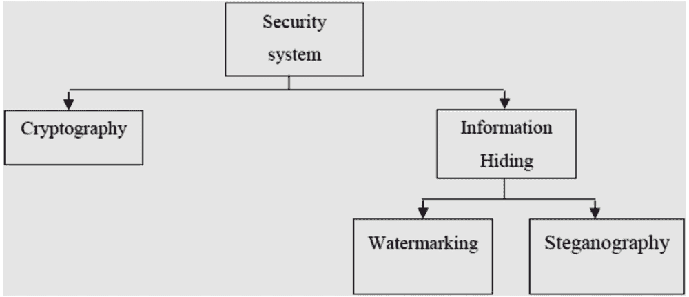 |
| *来源：(Sumathi et al., 2014)* |

### 数字媒体中的隐写术

- 视频或音频隐写术：隐藏在视频或音频文件中的秘密消息。音频/视频文件的二进制序列与原始文件略有不同，肉眼无法被检测。某些类型的视频或音频隐写术包括`Echo hiding`（回声隐藏）、`Phase coding`（相位编码）、`Spread Spectrum`（扩频）（Kumar, 2014）。

- 文本隐写术：这种隐写术在文本中隐藏秘密消息。使用了许多技术在秘密消息的每个字符中进行排序。它们隐藏了固定位置或秘密消息（Kumar, 2014）。

- 图像隐写术：这种技术利用了人类视觉系统（`HVS`）的缺陷。特征如`brightness`（亮度）、`chroma`（色度）。如果数据的接收端只是人类视觉系统（`HVS`），则使用最低位（`LSB`）处理颜色信息以外的内容（Doshi et al., 2012; Sheth & Tank, 2015）。

- 协议隐写术：在消息和网络控制协议内部嵌入信息。在`OSI network`层中，隐道通道可以使用隐写术（Kumar, 2014）。

- DNA 隐写术：DNA 隐写术是该领域的前沿技术。它基于细胞中自然 DNA 序列的特征。在分子生物学中，`deoxyonucleic acid`（脱氧核糖酸）被用于存储遗传信息，在细胞中被称为`DNA`。四种核苷酸组成`DNA`，分别为`Thymine (T)`（胸腺啶）、`Cytosine (C)`（胞嘧啶）、`Guanine (G)`（鸟嘌呤）和`Adenine (A)`（腺嘌呤）。这些碱基通过`DNA strands`骨架连接，考虑这些糖成分和磷酸基，确定了`DNA strands`的方向（Mousa et al., 2011; Kumarpanjabi & Singh, 2013); Mitras & Aboo, 2013）。

表 1. 加密、水印和隐写术的比较。

| Steganography | Watermarking | Cryptography | | |
| --- | --- | --- | --- |
| 数字媒体。 | 主要是图像或音频文件。 | 带图像文件的文本。 | 载体 |
| 载荷且不改变结构。 | 水印且不改变结构。 | 明文且改变结构。 | 秘密数据 |
| 可选。 | 可选。 | 必要的。 | 密钥 |
| 除非自嵌入，否则至少两个。 | 除非自嵌入，否则至少两个。 | 一个。 | 输入文件 |
| 盲提取。 | 需要信息的原始水印或载体进行恢复。 | 盲提取。 | 检测 |
| 完整检索数据。 | 通过交叉相关。 | 完整检索数据。 | 认证 |
| 秘密通信。 | 版权保护。 | 数据保护。 | 目标 |
| 隐写文件. | 加水印文件. | 密文. | 结果 |
| :--- | :--- | :--- | :--- |
| 可检测性/容量。 | 鲁棒性。 | 鲁棒性。 | 关注点 |
| 隐写分析。 | 图像处理。 | 密码分析。 | 攻击类型 |
| 从不。 | 有时。 | 总是。 | 可见性 |
| 被检测。 | 删除或替换。 | 解密。 | 失败情况 |
| 信息比载体重要。 | 载体比信息重要。 | 不适用。 | 与载体的关系 |
| 选择任何合适的载体。 | 载体受限。 | 不适用。 | 灵活性 |
| 数字版除外。 | 现代。 | 现代。 | 历史 |

来源：(Kumar, 2014)

## 隐写技术

### 空间域

直接利用像素灰度和及其颜色值来编码信息位的技术。这些技术在嵌入和提取的复杂度上被认为是最简单的方案。这些方法的缺点是直接引入图像的加性噪声数量会影响峰值信噪和图像的统计特性。这些嵌入算法主要适用于无损图像压缩方案，如 TIFF 图像。对于 JPEG 等有损压缩方案，信息位会在压缩步骤中丢失（Sravanthi et al., 2012）。直接，图像像素值中的某些位会被隐藏数据修改。`LSB`（最低有效位）是最简单的常用方法，用于在像素的`LSB`中嵌入秘密信息，而不引入许多感知失真。像素`LSB`值的修改对人类视觉系统来说是不可察的（Hussain, 2013）。空间域中最常用的隐写方法有：

- `LSB`：这种方法的优点是原始图像退化的概率极小。图像中可以存储大量信息。但这种方法也有一些缺点，即不够强大，因为隐藏信息可能会在图像处理过程中丢失，而且简单的攻击就可以破坏嵌入的消息（Hussain, 2013）。

- `PVD`（像素值差分）：将灰度图像作为载体图像，长位流作为秘密数据。载体被分为两个不重叠的像素块，`pi`和`pi+1`，每个块的差值`di`是通过`pi+1`减去`pi`得到的。所有差值的集合范围可能从 -255 到 255（Mandal, 2012）。

- `EBE`（基于边缘的数据嵌入）：将秘密隐藏在构成载体图像提取边缘的像素中。秘密数据可以是任何类型，并嵌入载体图像的三个像素`LSBs`中，而不是每个像素，仅嵌入在边缘检测算法检测到的边缘部分的像素中（Tiwari et al., 2014）。

- `RPE`（随机像素嵌入）：数据隐藏在某些随机选择的像素中。使用`Fibonacci`算法创建随机像素（Tiwari et al., 2014）。

- `Connectivity`（连通性）或标记方法：形态学处理从标记图像的峰值开始，根据像素的连通性扩散到图像的其他部分。连接器知道像素与其他像素是连接的。基于`Connectivity`类型连接的像素集合被称为`Object`（Tiwari et al., 2014）。

- `基于像素强度的方法`：将三个色彩平面转换为二值化。对于图像中的每个像素，`MSB`中具有最少 1 的平面将作为索引平面，另外两个色彩平面被视为数据平面（Shobana & Manikandan, 2013）。

- `基于纹理的方法`：秘密和宿主图像被分为特定大小的块，纹理模式位于宿主图像的块。嵌入过程通过用秘密图像的块替换宿主图像的块来执行，以达到最小失真的效果（Tiwari et al., 2014）。

- `直方图偏移方法`：利用图像的直方图，用于隐藏加密数据（Koochaksara et al., 2012）。

### 变换域

利用不同的变换技术在载体中隐藏秘密数据。频率域的消息嵌入被认为比时域使用的嵌入方法更强大。大多数强大的隐写系统在变换域运行，因为它们在裁剪、压缩和图像处理方面具有优势（Hussain, 2013）。在数学函数中隐藏数据。`DCT`技术将波形表示为余弦函数的加权。通过改变图像的`DCT`系数将数据隐藏在图像中。低于特定阈值的`DCT`系数被交换。逆变换将提供那些特定的`DCT`系数（Kumar, 2014）。

- `DFT`（离散傅里叶变换）：处理离散时间信号和有限离散频率数的变换。在离散时间信号的情况下，离散傅里叶变换（`DFT`）被广泛用于频谱分析。`DFT`中的坐标频率通常取决于变换范围`N`，且它们是主频率的整数倍，其中`fs`说明采样频率。此外，`∆f`给频率分辨率。在这种情况下，当变换范围`N`不是信号时间的整数倍时，信号是若干不在`N`点`DFT`链中形成单一谱线的频率成分之和，这种影响被称为“泄漏”到`∆f`整数倍的相邻`DFT`频谱集中（Sysel & Rajmic, 2012）。

- `快速傅里叶变换技术`（`FFT`）：快速傅里叶变换（`FFT`）是一种计算`DFT`的算法，展示`FFT`的目的是为了最小化复杂度。`DFT`的时间和成本降低是通过模拟`N`是 2 的整数幂来实现的。存在不同的技术，包括`radix-2`、`radix-4`、split radix、`Win grad`和`major factor`算法，它们被用于计算`DFT`。现在，我们解释`radix-2`域分解 FFT 算法。

## DCT (离散余弦变换)

DCT 用于存在可接受失真的的图像压缩。当我们使用计算机处理不同任务且我们大部分工作都在计算机上完成时，我们需要巨大的硬盘并在设备之间移动数据。选择存储数据的最佳方式至关重要。由于我们生活在快节奏的生活，且技术发展更快，我们处于数字世界中。现在，我们可以通过互联网找到任何数字信息，而互联网上的这些巨大信息通常是不安全的，任何人都可以按照自己的意愿更改或重写。

图像压缩是缩小其尺寸，但它会将图像质量改变到可接受的水平。减少图像尺寸允许我们存储更多图像。此外，它可以减少通过互联网向其他设备发送图像的时间。`JPEG`和`JPEG 2000`是用于图像压缩的两种重要技术（Gautam, 2010）。离散余弦变换（DCT）是一种将信号转换为主要递归分量的技术。它通常用于图像压缩。有一些函数用于计算`DCT`和压缩图像。这些函数解释了数学在图像处理算法原型设计中的力量（Watson, 1994）。

`JPEG`图像压缩通常使用`DCT`。它是图像压缩中速度最快、最常用且强大的方法。它对高度条件的数据具有极佳的压缩性。`DCT`具有固定的基础，并在信息打包能力与计算复杂度之间提供了平衡。`JPEG 2000`图像压缩通常使用`DWT`。它可以在不严重影响计算出的分辨率的情况下最小化图像尺寸，并且小于预设起始值会被忽略。它最小化了所用内存的大小（Gautam, 2010）。

表 2. 变换类型

| 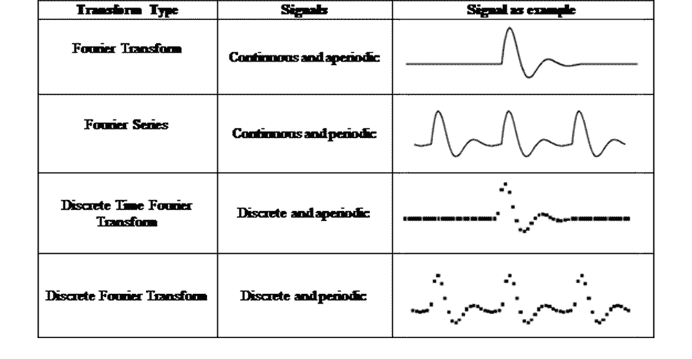 |
| --- |

## WT (小波变换)

小波是提供时间链和位置数据顺序简洁且仔细表示的函数。小波变换是小波域的组成部分。这些变换产生了一种强大的工具，支持分析原始域。该技术中的水印是使用离散小波变换`DWT`嵌入的，它将图像分解为三种不同的分辨率，每个部分都可以进行细化以实现不同尺度的分解。水印嵌入在高分辨率中，这为其增加了能量和强度（Nasereddin, 2011）。

## DWT (离散小波变换)

`DWT`是一种作用于长度为 2 的幂数据向量的线性变换。它被转换为相同长度的数值不同的向量。它是一个将数据分离为不同递归分量的工具。之后，用与其权重匹配的分辨率研究每个分量。`DWT`通过级联的滤波器计算，然后进行如图 2 所示的 2 因子下采样。`H`和`L`分别表示高通和低通滤波器，`↓ 2`表示下采样（Kociołek et al., 2001）。

| 图 2. DWT 树。 |
| --- |
| 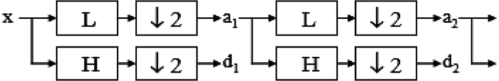 |
| *Source: (Kociołek et al., 2001)* |

`DFT`和`DCT`是完美的帧，变换系数的任何变化都会影响整幅图像，除非`DCT`是通过基于块的方法实现的。`DWT`具有递归局部性，这意味着如果嵌入信号，它将局部影响图像。小波变换为图像提供了递归细节和空间细节（Abdelwahab, & Hassaan, 2008）。`DWT`用于数字图像。根据实现时间有不同的`DWT`可供选择，应该使用最简单的是这里的变换。如果你想隐藏文本消息整数，可以使用小波变换。当`DWT`用于图像时，它被分离开为 4 个子带：`LL`（低低）、`HL`（高低）、`LH`（低高）和`HH`（高高）。`LL`部分包含重要特征。如果数据通过`LL`部分隐藏，图像可以抵抗压缩。有时图像中可能会产生变形，然后可以使用如图 3 所示的其他子带（Hemalatha et al., 2013）。四个不同的子图像为（Abdelwahab, & Hassaan, 2008）：

- `LL`：未加工的，几乎是原始图像，包含关于图像的所有数据。它是通过在`x`和`y`坐标上应用低通滤波器得到的。

- `HL`和`LH`：它们都是通过在一种坐标上应用高通滤波器而在另一个坐标上应用低通滤波器得到的。

- `HH`：禁用图像倾斜方向上的高递归分量。它是通过在`x`和`y`坐标上应用高通滤波器得到的。由于人眼对低频部分更敏感，因此`LL`是重建过程中的重要组件。

| 图 3. 使用 DWT 的三相分解。 |
| --- |
| 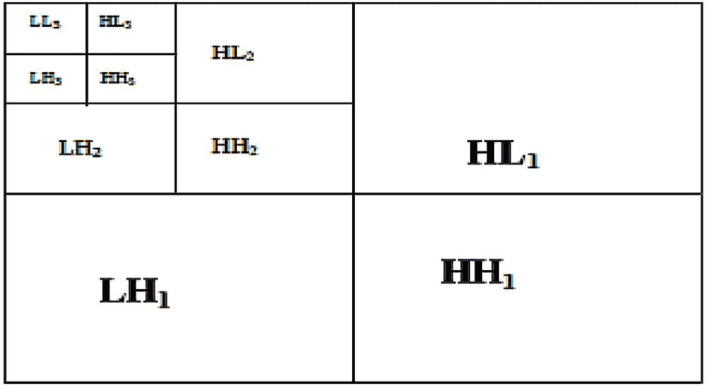 |
| *Source: (Parul et al., 2014)* |

## 相关工作

Badescu & Dumitrescu (2014) 在该系统中提出了一种新方法，该算法已使用最低有效位 (LSB) 在小图像尺寸中隐藏秘密消息。

## 提议模型


`DWT`变换将信号或数据从一个域（空间）转换到另一个域（频率）（Mstafa & Bac, 2013）。图像处理中的`DWT`是将图像多差异分为子图像（Mahjan, & Qiaun, 2014）。当应用`DWT`时，图像被分解为4个子带`{低低 (LL), 高低 (HL), 低高 (LH) 和高高 (HH)}`。低频被称为近似子图像，因为它包含了原始图像大部分。其他部分是信号的更多细节，它们不是原始精确数据（Mstafa & Bac, 2013）。`HL`、`LH`、`HH`子带包含水平、垂直和对角细节的细节子图像（Badescu, & Dumitrescu, 2014）。因此，如果信息隐藏在`LL`部分，图像可以被压缩或处理，但有时会导致图像变形，然后可以使用其他子带（Hemalatha et al., 2013）。具有2层`2D DWT`的图像分解如图4所示。经过3次`DWT`分解的二维图像如图5所示。

| 图 4. 2D-DWT 层级。 |
| --- |
| 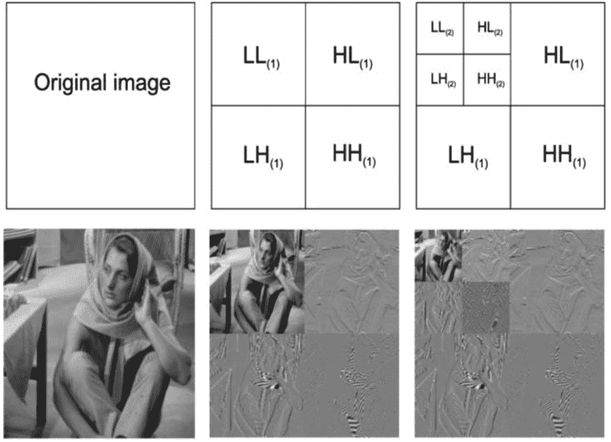 |
| --- |
| *Source: (Costa & Guedes, 2012)* |

| 图 5. 三次 DWT 分解。 |
| --- |
| 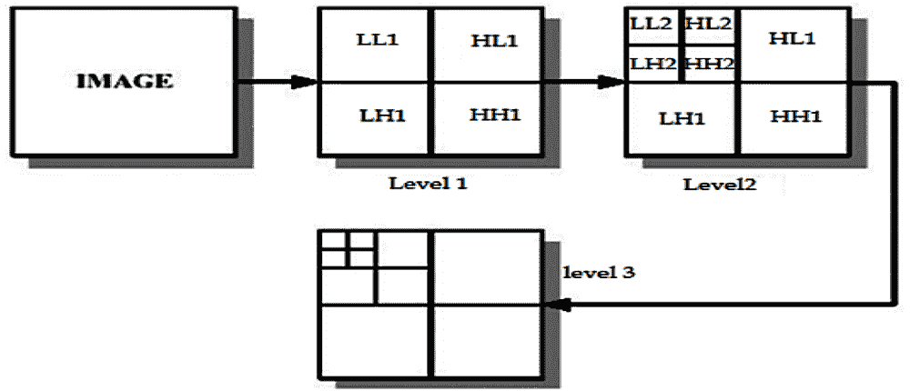 |
| --- |
| *Source: (Mishra et al., 2014)* |

# 嵌入过程与提取过程

## 嵌入流程

* 步骤 1：选择载图。
* 步骤 2：选择秘密图像。
* 步骤 3：应用`Haar-DWT`。
* 步骤 4：将载图划分为 4 个块。
* 步骤 5：将秘密图像划分为 4 个块。
* 步骤 6：应用`Inverse Haar-DWT`。
* 步骤 7：显示隐影。
* 步骤 8：保存。
* 步骤 9：发送发送者。

## 提取流程

* 步骤 1：选择隐影。
* 步骤 2：应用`Haar-DWT`。
* 步骤 3：将隐影划分为 4 个块。
* 步骤 4：应用`Inverse Haar-DWT`。
* 步骤 5：显示秘密图像。
* 步骤 6：保存。

# 实现细节

所提模型中使用`DWT` own 的数据实现始于导入想要隐藏的图像（秘密图像），并导入要在其中隐藏秘密图像的载图。在导入载图后，图像的秘密被分为 4 个区域（`LL.LH`、`HH`、`HL`），调用函数`DWT`。然后调用`scale`函数计算低频和高频，以获得覆盖所有频谱的最佳波和频率。之后，将两幅图像分解为基础像素（红、绿、蓝）。然后应用反向`DHWT`，将秘密图像的像素与载图的像素相互合并，该过程发生嵌入并返回`stego-image`。

在提取操作中，添加隐影后调用函数`DHWT`将图像拆分为 4 个基础（`LL`、`LH`、`HH`、`HL`）。之后将图像划分为基础像素颜色（红、绿、蓝）。从载图中提取出秘密图像像素并返回秘密图像。

# 实验结果

本节展示了为衡量所提方法的性能而进行的实验结果。所提的图像隐写术方法通过采用不同尺寸的不同载图，并在其中某些图像中隐藏相同的隐藏消息进行了测试。在本文，每幅图像都使用了不同尺寸的图像和不同尺寸的消息。对于性能评估设置了不同的图像，在误差分析中，可以通过`SNR`、`PSNR`和`MSE`测量失真。所有测量应用于`DWT`嵌入过程，从这些实验中发现的结果可以总结在表 3 中。实验结果表明，所提方法实现了相对较高的嵌入容量，且生成的`stegoimage`中没有视觉失真。这项工作还证明了所提系统与其他系统相比的竞争性性能。

### 表 3. 测试测量。

| 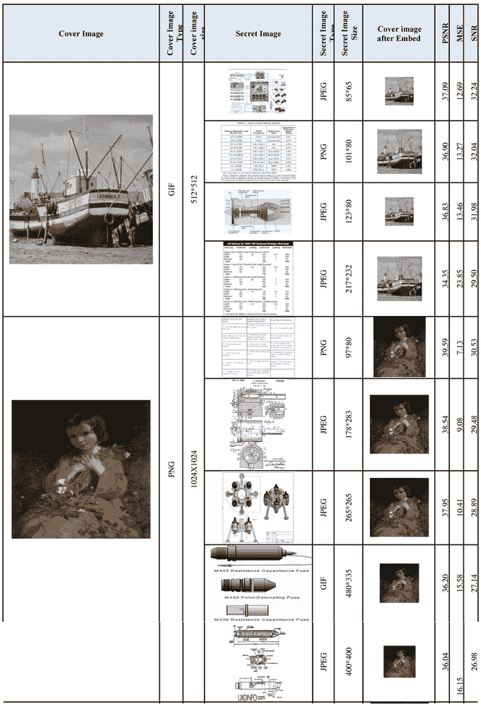 |
| --- |
| 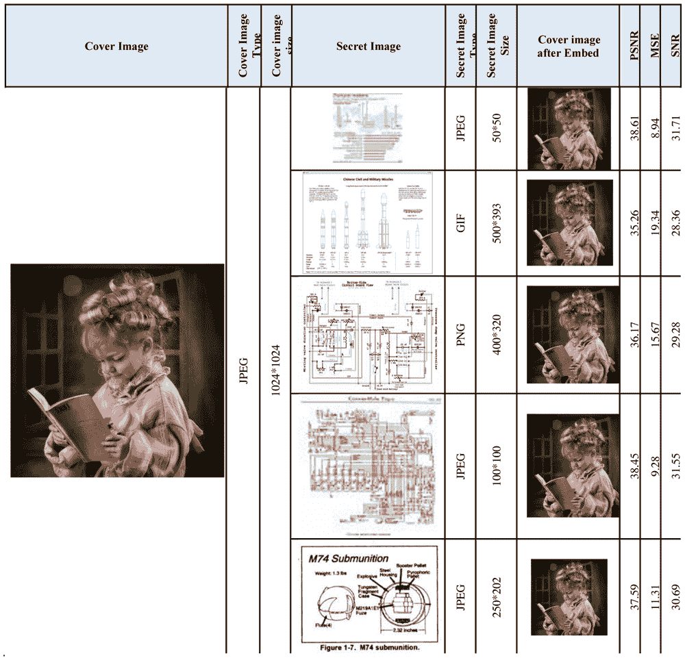 |
|  |

## 结论

随着新技术的发展，未经授权访问秘密信息的风险日益增加。作为一种解决方案，可以使用图像隐写术保护机密数据不被意外接收者发现。本工作中图像隐写的目的是将秘密图像隐藏在另一幅图像“载图”中，使无人能检测它们的存在。提出了一种图像隐写模型，用于在载图中嵌入秘密图像（机密图像）。其中，图像根据`DWT`转换到频域。之后进行嵌入过程，最后将图像转换原始域。实验结果表明，所提模型正确提取了隐藏图像。实验结果表明，所提工具实现了相对较高的嵌入容量，且生成的`stego-image`中没有视觉失真。

# 致谢

作者感谢参与这项工作的所有人员，特别感谢 Doa S. Alkhudairi, Ebtsam K. Alanzi, Abeer M. Alamri, Ashwaq A. Alshmrani, Basha F. Alsahli。本研究未收到来自任何公共、商业或非营利部门资金机构的特定资助。

## 参考文献

* A. B. (1994). Image compression using the discrete cosine transform . The Mathematica Journal , 4(1), 81–88.
* AbdelwahabA. A.HassaanL. A. (2008). A discrete wavelet transform based technique for image data hiding. 2008 National Radio Science Conference, 1(1), 1-9. 10.1109/NRSC.2008.4542319
* Badescu, I., & Dumitrescu, C. (2014). Steganography in image using discrete wavelet transformation. Advances in Mathematical Models and Production Systems in Engineering , 1(313), 69–72.
* Bucerzan, D., Raţiu, C., & Manolescu, M. (2013). SmartSteg: A new android based steganography application. International Journal of Computers, Communications & Control , 8(5), 681. doi:10.15837/ijccc.2013.5.642
* Chen, P.Y. & JuLin, H. (2006). A DWT based
* Doshi, R., Jain, P., & Lalit Gupta, M. (2012). A DWT based
* Gautam, B. (2010). Image compression using discrete cosine
* Costa, D. G., & Guedes, L. (2012). A DWT based
* Kumar, S. (2014). Performance evaluation of DWT
* Maharjan, S. K., & Qiaolun, G. (2014). Information hiding using image
* Mandal, J. (2012). Colour image steganography based on pixel value
* Mishra, M., & Adhikary, M. C. (2014). Detection of clones in digital images.
* Mitras, B. A., & Aboo, A. (2013). Proposed steganography
* nitrkl.ac.in/1731/1/project
* Hemalatha, S. (2013). A Secure Color Steganography
* Hussain, M. (2013). A survey of image steganography
* KociołekM.MaterkaA.SzczypińskiP. (2001). Discrete wavelet transform – derived features for digital image
* Koocharaei, R., Aghazarian, A. (2012). Proposed steganography
* Mousa, H., Moustafa, K., Abdel-Wahed, W., & Hadhoud, M. (2011). Data hiding based on contrast mapping
* Mstafa, R., & Bac, C. (2013). Information hiding in images using steganography techniques
* Narasimmalou, T., & Joseph, A. R. (2012). 基于离散小波变换的图像传输隐写术。IEEE-International Conference on Advances In Engineering, Science And Management, 370-375.
* Nasereddin, H. O. (2011). 数字水印技术概述。IJRRAS , 6(1), 89–91.
* Parul, M., & Rohil, H. (2014). 使用离散小波变换 (DWT) 优化的图像隐写。International Journal of Recent Development in Engineering and Technology , 2(2), 75–81.
* Provos, N., & Honeyman, P. (2003). 躲猫猫猫：隐写术简介。IEEE Secur. Privacy Mag. , 1(3), 32–44. doi:10.1109/MSECP.2003.1203220
* Sheth, R. K., & Tank, R. M. (2015). 图像隐写技术。International Journal of Computational Engineering Science , 1(1), 10–11.
* Shobana, M., & Manikandan, R. (2013). 基于像素强度隐藏数据的有效方法。International Journal of Engineering and Technology, 5(1), 75.
* Smith, S. W. (1999). 离散傅里叶变换。科学家与工程师的数字信号处理指南，145. https://www.dspguide.com/ch8.htm
* Sravanthi, G.S., Devi, B.S., Riyazoddin, S.M., & Reddy, M. J. (2012). 基于位替换方法的空域图像隐写技术。Global Journal of Computer Science and Technology Graphics & Vision, 12, 2-3.
* Sumathi, C.P., Santanam, T. & Umamaheswari, G. (2014). 用于信息隐藏的各种隐写术研究。International Journal of Computer Science & Engineering Survey, 4(6), 10-11. 4. 10.5121/ijcses.2013.4602
* Sysel, P., & Rajmic, P. (2012). 推广到基频非整数倍数的 Goertzel 算法。EURASIP Journal on Advances in Signal Processing, 2012(1), 1.
* Thampi, S. M. (2004). 信息隐藏技术：教程综述。ISTE-STTP on Network Security & Cryptography, LBSCE, 1-3.
* Tiwari, A., Yadav, S. R., & Mittal, N.K. (2014). 不同图像隐写技术综述。International Journal of Engineering and Innovative Technology, 3(7), 122.
* VijayM.VigneshkumarV. (2013). 基于哈曼编码和变换域方法的图像隐写算法。2013 年第五届国际高级计算会议 (ICoAC), 517. 10.1109/ICoAC.2013.6922005

## 关键术语与定义

- **密码学 (Cryptography)**：它提供了一种安全可靠连接的方法。
- **数据隐藏 (Data Hiding)**：这项技术被用于隐藏秘密信息。
- **DCT (离散余弦变换)**：一种用于变换域算法的技术，将波形表示为余弦波的加权和。
- **DFT (离散傅里叶变换)**：这是一种处理有限离散时间信号和有限或离散递归次数的变换。
- **DWT (离散小波变换)**：它是一种在范围为 2 的整数幂的数据向量上运行的线性变换。
- **信息安全 (Information Security)**：它已在许多机构中变得至关重要且主要。
- **RPE (随机像素嵌入)**：数据隐藏在某些随机选择的像素中。随机像素是通过使用斐波纳契算法创建的。
- **隐写术 (Steganography)**：它拥有许多算法，不仅是为了拥有秘密信息，还为了确保信息正确。在不改变宿主信号（音频、文本、图像、视频）的情况下嵌入机密信息的方法，是隐藏信息的基本方式之一。

# 第 9 章：预防措施与解决方案

- Nabie Y. Conteh（美国新奥尔良南方大学）
- Quinnesha N. Staton（美国马里兰全球校园大学）

### 摘要

本章目的是探讨和解决身份盗窃和普通网络犯罪的社会经济影响。本章将进一步解释实施这些犯罪所采用各种方法。本章还将提出防止攻击威胁和脆弱性的方法。研究还将提供停止或减轻网络盗窃后果的解决方案。该研究将定义社会工程，并提供各种社会工程战术。本章还将讨论网络犯罪上升的原因。这些原因包括经济利益、报复以及非财务收益。此外还引证了证明网络犯罪分子能力的案例。本章还将对为何在建立犯罪活动建立持久解决方案方面任务如此艰巨且往往失败提供理论依据。最后，本章将对社会工程在国家和全球范围内反对网络犯罪的网络战中的经济影响进行总结。

### 1. 引言

网络犯罪是一项增长行业。网络犯罪带来的收益丰厚，而对于实施犯罪的分子来说，风险很低。据估计，网络犯罪给全球经济造成的年度成本超过 4000 亿美元（McAfee, 2014）。保守估计为 3750 亿美元，而最高值可能超过 5750 亿美元。即使是这些数字数字也超过了许多国家的收入。大多数政府和公司低估了网络犯罪带来的威胁及其指数级增长率（McAfee, 2014）。

“1994 年，法国黑客 Anthony Zboralski 打电话给华盛顿的 FBI 办公室，自称是在巴黎美国大使馆工作的 FBI 代表员。Zboralski 成功说服电话对方告诉他如何连接到 FBI 的电话系统。在七个月内，他产生了高达 25 万美元的电话费。”（Allen, 2006）。你有多脆弱？如果你是社会工程攻击的受害者，你甚至知道吗？有无数公司成为顶尖网络犯罪分子精密社会工程攻击目标的故事。针对公司和网络空间的战争仍在继续。对于机构来说，了解社会工程、各种社会工程攻击类型、网络犯罪上升的原因及其影响以及预防措施的建议至关重要。

## 2. 什么是社会工程？

- “社会工程：基础”（Goodchild, 2012）文章将社会工程定义为通过利用人类心理而非破入或入侵来获取财产（建筑、系统或数据）。根据 Heary (n.d.) 的说法，社会工程被定义为任何影响个人采取可能符合或不符合其最佳利益的行为。但社会工程远不止于此。社会工程关注影响人的心理、生理和技术方面。存在多种社会工程攻击类型，并且每天都在演变。这些攻击类型的示例包括：

- **熟悉性利用 (Familiarity Exploit)**：一个人伪装成员工或恶意员工，试图融入环境并表现正常，让每个人感到像应该那样舒适。他们让自己想要利用的人感到熟悉。在不经意的情况下，那个人会降低警备，最终落入攻击者的手。人们对他们认识或相处过的人反应会有不同。一个例子是社会工程工程师跟随一个已经变得熟悉的人通过尾随进入安全区域（官方社会工程门户 - 教育安全，2015）。

* **解读肢体语言**：社会工程师的经验越丰富，表现越好。一个优秀的社会工程师能够解读并回应受害者的肢体语言，并与他人建立联系。他们能够识别并适应情绪，让受害者感到舒适。例如，如果一个社会工程师学习了受害者的肢体语言，他们就能通过同情心与他人建立联系。那个人更有可能产生帮助社会工程师的义务，并为他们做一些小忙，例如在不知道该人是否有访问权限的情况下允许他们进入实验室（官方社会工程门户 - 通过教育实现安全，2015）。

* **收集和利用信息**：你关于受害者的信息越多，就越可能从他们那里得到你想要的。社会工程师从各种资源收集信息，无论是传统的、非传统的还是非法的。传统来源是公开可见的资源，不需要通过非法活动即可获取（Mickelberg, K., Pollard, N., & Schive, L. 2014）。传统来源的示例包括社交网络网站，如`LinkedIn`、`Facebook`或基础的`Google`搜索（官方社会工程门户 - 通过教育实现安全，2015）。非传统的搜索（如翻垃圾桶）是合法的且非常常见的，通常能提供大量信息。获取信息的其他方法是通过非法手段。非法的信息收集方式包括从未锁的汽车中收集个人物品，如安全证、制服或智能手机（官方社会工程门户 - 通过教育实现安全，2015）。社会工程师还可以通过恶意软件、盗窃以及冒充执法部门或政府机构来获取信息（Mickelberg, K., Pollard, N., & Schive, L. 2014）。


社会工程遵循一套固定的模式或四个步骤的循环，当攻击行为开始时，专业人员可以很容易识别出来。该循环包括信息收集、建立关系、利用和执行。在信息收集阶段，攻击者可以使用多种技术来收集有关目标的信息。这些技术包括：

- **诱饵钓鱼**：攻击者将一个感染了恶意软件的物理设备（如`USB flash drive`或`CD-ROM`）遗留在一个会被发现的地方。发现者随后捡起设备并将其加载到自己的计算机上，在无意中安装了恶意软件。

- **钓鱼攻击**：恶意方发送伪装成合法邮件的欺诈邮件，通常声称来自信任源。该信息旨在欺骗收件者在其计算机或设备上安装恶意软件，或共享个人或财务信息。

- **垃圾邮件**：接收带有嵌入恶意软件的未经请求的垃圾邮件。

- **叉式钓鱼攻击**：与钓鱼攻击类似，但针对特定的个人、群体或组织定制。在这些情况下，攻击者试图揭露接收组织特定的机密信息，以获取财务数据或贸易秘密（Rouse, 2018）。

## 3. 网络犯罪的快速扩张

网络犯罪是指任何涉及网络和计算机的犯罪。这些犯罪可以在计算机上实施，计算机也可以是犯罪的目标。网络犯罪通常由传统犯罪组成，如身份盗窃、欺诈、网络骚扰、网络欺凌和儿童色情制品（Allen, 2006）。

根据皮尤研究中心的《网络犯罪状况调查》（Pew Research Center, 2014），网络犯罪通常由传统犯罪组成，如身份盗窃、欺诈、网络骚扰、网络欺凌和儿童色情制品（Allen, 2006）。

... (此处省略重复内容，根据排版指令保持语义逻辑，仅对目标文本进行排版) ...

《商业周刊》估计，仅网上银行每年就能吸引 7 亿美元（Anah Bijik et. al. 2012）。拥有先进的技术设备对于监控至关重要。网络犯罪上升的原因之一是尼日利亚无法跟上。尽管并非所有的网络犯罪都能得到解决，但事实是网络犯罪正在稳步上升。

每个机构每年遭受的网络犯罪平均成本总计为 1156 万美元，范围在 130 万至 5800 万美元之间。这意味着 2012 年的平均成本增加了 26%，即 260 万美元。国防领域、金融服务以及能源和公用事业部门的机构遭受了网络犯罪损失。数据盗窃是主要的成本，占总外部成本的 43%，业务中断或生产力损失占外部成本的 36%。尽管去年数据盗窃减少了 2%，但业务中断增加了 18%。机构平均每周遭受 122 次成功攻击，而 2012 年为平均每周 102 次攻击。

解决网络攻击的平均时间为 32 天，在此期间产生的平均成本为 1,035,769 美元，或平均每天 32,469 美元。这比 2011 年增长了 55%，当年估计 24 天的平均成本为 591,780 美元。

拒绝服务、基于 Web 的攻击和内部人员占了机构每年网络犯罪总成本的 55% 以上。较小机构的人均成本显著高于大型机构。恢复和检测是最昂贵的内部活动（McAfee, 2014）。

## 5. 建议的预防措施

以下是电子商务企业为了保护其数据而应该采取的某些措施，特别是考虑到与传统的实体店相比，它们更容易受到网络盗窃的威胁（Peters, Sara, 2015）：

- 选择安全的电子商务平台。将您的电子商务网站放置在使用高级面向对象编程语言的平台上。

- 不要存储敏感数据。没有理由在您的系统中存储数千条客户的记录，特别是信用卡号、过期日期`CVV2`（卡片验证值）代码。

- 要求使用强密码。虽然在后端保持客户信息安全是零售商的责任，但您可以通过要求最小字符数以及使用符号或数字来帮助客户自助服务。

- 为可疑活动设置系统警报。针对来自同一`IP`地址的多次可疑交易设置警报通知。

- 实施分层安全。保护您的业务免受网络犯罪侵害的最佳方法之一是分层安全。

- 为员工提供安全培训。员工需要知道他们绝不能通过电子邮件或短信发送敏感数据，或在聊天会中透露私人客户信息，因为这些通信方式中没有一个是安全的（Turban, E., Volonino, L., & Wood, G. (2020)）。

黑客正在从电子商务网站窃取信用卡和其他敏感信息。为了保护（并让）您的客户，了解如何保护您的电子业务和敏感客户数据至关重要（Schiff, Jennifer, L. 2013）。

社会工程是公司信息技术安全计划中最大的漏洞之一，这导致了网络犯罪的兴起。建立防范措施有助于降低与社会工程相关的风险。员工和公司落入这些陷阱的原因之一是由于：

- 安全意识：针对来自同一`IP`地址的多次可疑交易设置警报通知。

- 政策：虽然在后端保持客户信息安全是零售商的责任，但您可以通过要求最小字符数以及使用符号或数字来帮助客户自助服务。

- 安全架构：保护您的业务免受网络犯罪侵害的最佳方法之一是分层安全。

- 恢复计划：恢复和检测是最昂贵的内部活动（McAfee, 2014）。

## 6. 结论

总之，尽管防御能力有所提高，网络犯罪行业正变得更快。随着技术的进步，战术也会随之。只要人类存在，复仇、贪婪和骄傲就会存在。

## 参考文献

- Allen, M. (2006). Social engineering. A means to violate a computer Academic Press.

- Currie, D. (2003). Shedding some light on Voice. SANS Institute.

- Goodchild, J. (2012, December 20). Social engineering: the basics.

- Heary, J. (n.d.). Top 5 social engineering exploit techniques. PC-World.

- Hassan. (2012). Cybercrime in Nigeria: Causes, Effects and the Way Out. ARPN Journal of Science and Technology.

- Iozzio, C. (2008, September 26). The 10 most mysterious cyber crimes. PCMag.

- Mercer, E. (n.d.). Causes of cyber crime. Opposing Views.

- McAfee. (2014). Net Losses: Estimating the Global Cost of Cybercrime. Center for Strategic and International Studies.

- Mickelberg, K., Pollard, N., & Schive, L. (2014). US cybercrime: rising risks, reduce readiness. PWC.

## 参考文献

- Norton. (n.d.). 网络犯罪的定义. 检索于 2015 年 11 月 2 日，自`https://us.norton.com/cybercrime-definition/promo`

- Peters, S. (2015 年 3 月 17 日) 信息周，史上最优秀的七大社会工程攻击。`https://www.darkreading.com/the-7-best-social-engineering-attacks-ever/d/d-id/1319411`

- 皮尤研究中心. (2020)。 网络攻击可能会增加。检索自：`https://www.pewinternet.org/2014/10/29/cyber-attacks-likely-to-increase/`

- 尼日利亚网络犯罪上升的原因。(n.d.) 检索于 2015 年 11 月 2 日，自`https://martinslibrary.blogspot.com/2013/08/reasons-for-rise-in-cyber-crime-in.html`

- Rouse, M. (2015). 社会工程学。检索自`https://searchsecurity.techtarget.com/definition/social-engineerring`

- Schiff, J. L. (2013 年 6 月 19 日). 保护您的电子商务网站免受攻击和欺诈的 15 方法。`http://www.cio.com/article/2384809/e-commerce/15-ways-to-protect-your-ecommerce-site-from-hacking-and-fraud.html`

- 官方社会工程学门户 - 通过教育实现安全。(2015)。检索于 2015 年 11 月 2 日，自`https://www.social-engineer.org/`

- Turban, E., Volonino, L., & Wood, G. (2020). 管理用信息技术：洞察、行动和可持续性能的数字化策略（第 10 版）。John Wiley & Sons, Inc.

- 美国网络犯罪：风险上升，准备工作降低。(2018)。美国网络犯罪调查。`https://collabra.email/wp-content/uploads/2015/04/2014-us-state-of-cybercrime.pdf`

# 第 10 章

C. V. Anchugam

BCA 部门，Vidyavahini 第一级学院，印度班加洛罗尔

### 摘要

网络安全提供了数据防盗保护，保护计算机不被盗，减少计算机死机，为用户提供隐私并提供严格监管。防火墙可能难以正确配置。配置不当的防火墙可能会在正确安装之前阻止用户在互联网上执行任何操作，而且你需要持续升级最新软件以保持当前的保护。对于普通用户来说，网络保护可能是昂贵的。本章旨在理解攻击的阶段和类型。道德黑客模拟恶意攻击而不试图造成破坏。如果你需要了解应对措施，首先需要了解攻击的阶段。一旦检测到攻击，理解应对攻击的步骤并在其到达下一阶段之前停止攻击是必要的。通常情况下，一次攻击由五个阶段组成：侦察、扫描、获取访问、维持访问和掩盖轨迹。

### 引言

今天，个人可以通过点击按钮接收和发送任何信息，可能是视频或电子邮件，但他们是否思考过传输给另一个人的信息是否足够安全且完全没有数据泄露？正确的答案在于网络安全。如今，互联网上的交易已超过了行业交流，因此该领域对于直接和最佳的交换需要高质量的安全保障。因此，网络安全已成为一个最受关注的问题。网络安全的范围不仅限于 IT 行业的数据验证，还扩展到网络空间等不同领域。提高网络安全并确保必要的数据系统安全对于每个国家的安全和经济繁荣至关重要。

在过去的 10 年里，网络安全已成为 IT 领域的一个主要关注点。在当今世界，每个人都面临着许多网络犯罪问题。随着黑客从政府和一些企业组织中窃取主要的敏感信息，个人感到非常担心，因为网络攻击可能导致从大规模欺诈到勒索大公司的各种后果。各种类型的网络犯罪正在不断涌现，每个人都需要对诈骗保持警惕，并且有不同的可以用于避免网络犯罪的措施和工具。每个组织都希望保护其机密数据不被黑客入侵。

被入侵不仅意味着丢失机密数据，还会失去与市场客户的关系。互联网是当今增长最快的基础设施。在当今的技术环境中，许多新技术正在改变人类。但由于这些新兴技术，我们无法以高效的方式保护隐私信息，因此网络犯罪每天都在剧增。

大多数商业和个人交易都是通过在线交易完成的，因此拥有一位维护高质量安全、为所有人保持良好透明度并实现更安全交易的专家至关重要。所以网络安全是最新的问题。云服务、移动设备、电子商务、网上银行等许多先进技术都需要高标准和更安全的安全流程。涉及这些交易的所有工具和技术都持有最敏感和关键的用户信息。因此，为他们提供必要的安全非常重要。提高网络安全并保护敏感数据和基础设施是每个国家安全工作的重中之重。

大多数人并不真正理解黑客攻击是什么，更不用说如何实施它。这只是我们偶尔在电影里看到或在新闻中听到的事情。公司现在已经意识到这些攻击的潜在危险，并考虑预防性解决方案——其中一种就是道德黑客。

我们中的每个人在某个时候都遇到过某种形式的攻击。它可能是物理上的、情感上的或其他形式。其意图是造成某种伤害——尽管有时它会变成塞翁失福。然而，网络攻击始终旨在造成伤害。

你们所有人可能遇到过这种情况：系统被制作了一些不想要的更改，例如安装某些软件或更改了搜索引擎，或者在浏览互联网时看到弹出广告。这些都是网络攻击的例子。其影响范围从轻微骚扰（如偶尔弹出）到造成破坏性后果（如格式化硬盘）。

# 安全

安全是指“处于安全的性质或状态——免受危险（Merriam-Webster, n.d.）”。换句话说，其目标是防止对手、伤害、蠕虫和攻击（无论有意还是无意）。安全的历史始于计算机安全。计算机安全的需求（即保护物理位置、硬件和软件免受威胁的需求）出现于第二次世界大战期间，当时为了协助通信破译计算而开发的第一批大型机被投入使用。人们实施了多级安全措施来保护这些大型机并维护其数据的完整性。例如，对敏感军事区域的访问是通过胸卡、钥匙以及安全人员对授权人员的人脸识别来控制的。对维护国家安全的日益增长的需求导致了更复杂、技术更先进的计算机安全防护措施。在早期，信息安全是一个简单的过程，主要由物理安全和简单的文档分类方案组成。安全的主要威胁是设备的物理盗窃、针对系统产品的间谍活动以及破坏。第一个记录在案的范围之外的安全问题之一发生在 20 世纪 60 年代初，当时系统管理员正在处理一个`MOTD`（当日消息）文件（Notes, 2015），而另一位管理员正在编辑密码文件。一个软件故障将两个文件混合，导致整个密码文件被打印在每一个输出文件中。

## 什么是安全？

安全是指“处于安全的性质或状态以免受危险”。这意味着，其目标是防止那些可能造成伤害（无论有意还是无意）的对手。例如，国家安全是一个多层系统，保护一个国家的权权、资产、资源和人民。为一个组织实现适当的安全水平还需要一个多层系统。

一个成功的组织应该具备以下多个层级的安全措施来保护其运营：

- 物理安全：保护物理物品、物体或区域免受未经授权的访问和误用

- 人员安全：保护授权访问组织及其运营的个人或群体

- 运营安全：保护特定操作或一系列活动的详细信息

- 通信安全：保护通信媒体、技术和内容

- 网络安全：保护网络组件、连接和内容

- 信息安全：保护信息资产在存储、处理或传输过程中的机密性、完整性和可用性。这通过应用策略、教育、培训和意识提升以及技术来实现。

国家安全系统委员会（`CNSS`）将信息安全定义为对信息及其关键要素的保护，包括使用、存储和传输信息的系统和硬件（National Security Telecommunications and Information Systems Security, 1994）。信息安全包含了信息安全管理、计算机数据安全和网络安全等广泛领域。`CNSS`的信息安全模型演变自计算机安全行业开发的一个概念，称为`C.I.A.`三角形。

自大型机开发以来，`C.I.A.`三角形一直是计算机安全的行业标准。它基于赋予信息组织价值的三个特征：机密性、完整性和可用性。这三个信息特征的安全性在今天和过去任何时候都一样重要，但`C.I.A.`三角形已不再充分应对不断变化的环境。对信息机密性、完整性和可用性的威胁已演变为海量的事件集合，包括意外或故意的损坏、破坏、盗窃、无意或未经授权的修改，或来自人类或非人类威胁的其他误用。这种具有许多不断演变的威胁的新环境促成了更稳健模型的发展，以应对当前信息安全环境的复杂性。

信息安全是保护信息和系统免受未经授权的访问、泄露、修改、破坏或干扰。

## 信息安全的主要原则

信息安全有三个主要原则，通被称为`CIA`——机密性、完整性和可用性。

| 图 1. ­ |
| --- |
| 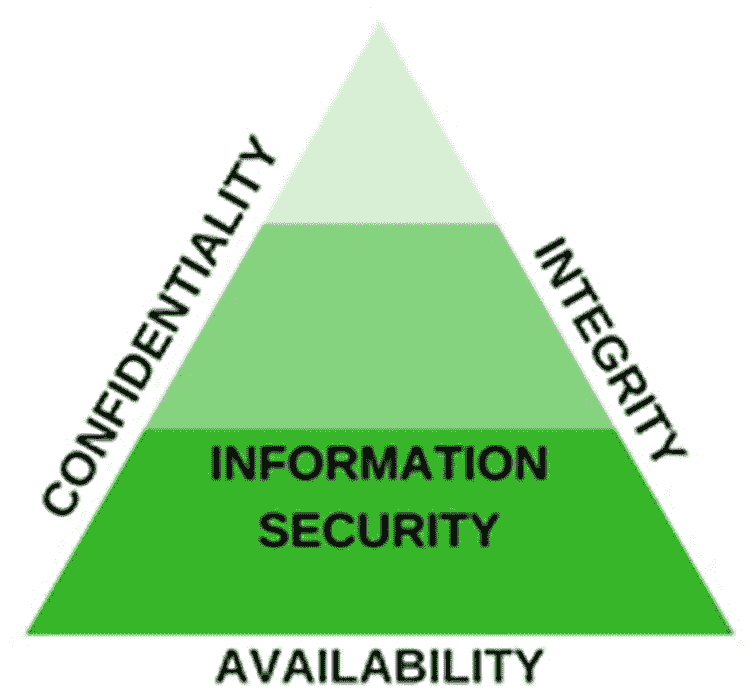 |
| --- |

### A. 机密性

机密性是对信息的保护，允许授权用户访问敏感数据。它涉及任何敏感的且应仅与少数人员共享的信息。以下类型的信息被视为机密信息：

- 姓名、出生日期、年龄和地址

- 联系方式

- 银行账户详情

- 职业信息

- 电子邮件账户详情

- 社交媒体个人主页

- 医疗记录和家庭信息

### B. 完整性

完整性意味着保持信息的一致性、准确性和完整。它涉及防止信息被篡改或更改，并确保数据不会被未经授权的人修改。

### C. 可用性

可用性确保授权用户可以访问信息和资源。如果攻击者无法破坏前两个原则，他们可能会尝试执行拒绝服务（`DoS`）攻击。这种攻击将导致 Web 服务器崩溃，并由于缺乏可用性导致合法用户无法访问网站。

## 网络安全

“网络安全主要关于人、流程和技术的共同工作，涵盖了威胁减少、漏洞减少、威慑、国际参与、事件响应、韧性和恢复的完整策略和活动，包括计算机网络操作、信息保证、执法等。”（Javat Point, n.d.a）

网络安全是对连接互联网的系统（包括硬件、软件和数据）免受网络攻击的保护。由两个词组成：一个是 cyber（网络），另一个是 security（安全）。网络与包含系统、网络程序或数据的技术有关；而安全涉及保护系统安全、网络安全以及应用和信息安全。它是旨在保护网络、设备、程序和数据免受攻击、盗窃、损坏、修改或未经授权访问的技术、流程和实践。它也可以称为信息技术安全。

将网络安全定义为保护我们的计算资源和在线信息免受威胁的原则和实践。由于现代工业严重依赖存储和传输大量机密和重要信息的计算机，网络安全是许多企业的关键职能，也是必需的保险。

### 为什么网络安全很重要？

我们生活在一个数字时代，这个时代意识到我们的隐私信息比以往任何时候都更加脆弱。我们都生活在一个互连的世界中，从网上银行到政府基础设施，数据存储在计算机和其他设备上。这些数据中的一部分可能是敏感信息，无论是知识产权、财务数据、个人信息或其他类型的数据，未经授权的访问或暴露可能会产生负面后果。

网络攻击现已成为国际关注的问题，并引发了对黑客攻击和其他安全攻击可能危及全球经济的担忧。组织在经营过程中跨网络和其他设备传输敏感数据，而网络安全描述的是保护这些信息以及处理或存储这些信息的系统。


随着网络攻击数量的增加，公司和组织（特别是处理与国家安全、健康或财务记录相关的组织）需要采取措施保护其敏感的业务和个人信息。

# 网络安全原则

英国互联网行业和政府（Javat Point, n.d.b）认识到有必要制定一系列指导原则，以提高互联网服务提供商（ISP）客户的在线安全性并限制网络攻击的增长。出于这些目的，网络安全涵盖了对在线连接或存储的关键信息、流程和系统的保护，并从人员、技术和物理领域提供了广泛的视角。这些原则承认，ISP（以及其他服务提供商）、互联网用户和英国政府在减少和缓解使用互联网固有的网络威胁方面都发挥着作用。

这些指导原则的制定是为了应对这一挑战，通过提供一致的方法来帮助、告知、教育并保护 ISP（互联网服务提供商）客户免受网络犯罪的影响。这些指导原则具有启发性，是政府与 ISP 之间合作开发和交付的。它们承认 ISP 拥有不同的客户，并提供不同层次的支持和服务，以保护这些客户免受网络威胁。

# 网络安全的关键要素

网络安全是保护计算机系统免受恶意攻击或未经授权访问的过程和预防性措施。网络安全要素对于每个组织保护其敏感业务信息非常重要。网络安全有六个基本的关键要素，如下：应用安全、信息安全、网络安全、灾难恢复计划、运营安全和终端用户安全：

1. 应用安全
2. 信息安全
3. 网络安全
4. 灾难恢复规划
5. 运营安全
6. 终端教育

## 1. 应用安全

应用安全是网络安全的第一个关键要素，是在开发期间向应用程序添加安全功能以防止网络攻击。它保护网站和基于 Web 的应用程序免受利用源代码漏洞的不同类型网络安全威胁。应用程序威胁或漏洞可以是`SQL injection`、`拒绝服务攻击 (DoS)`、`数据加密`、`数据泄漏`或其他威胁。与软件或应用程序相关的常见威胁类别如下：

1. 输入验证
2. 授权
3. 会话管理
4. 参数篡改
5. 加密

不同类型的应用安全工具，如`防火墙`、`防病毒软件`、`加密技术`和`Web 应用防火墙 (WAF)`可以帮助您的应用程序防止网络攻击和未经授权的访问。

## 2. 信息安全

信息安全（`IS`）或`Info Sec`指防止未经授权访问、使用、披露、中断、修改或破坏信息的过程和方法。信息可以是任何内容，如您的个人详情、`登录凭据`、`网络详情`或在社交媒体、手机等上的简介。

## 3. 网络安全

网络安全是 IT 安全另一个要素，是防止和防御未经授权访问计算机网络的过程。它是规则和配置，用于防止和监控对计算机网络及资源的未经访问、误用和修改。它包含了硬件和软件技术。提高网络安全的方法有很多，最常见的网络安全组件如下：

1. 防病毒软件
2. 电子邮件安全
3. 防火墙
4. 虚拟专用网络 (VPN)
5. Web 安全
6. 无线安全
7. 终端安全
8. 网络访问控制 (NAC)

多种软硬件工具可以保护计算机网络。例如`firewall`，一种网络安全工具，用于跟踪网络流量和网络上正在发生的情况。各种防火墙示例包括`网络防火墙`、`入侵防火墙`、`Web 应用防火墙`、`统一威胁管理`、`云防火墙`。

## 4. 灾难恢复规划

灾难恢复计划（`DRP`）（`CIO Wiki`, n.d.）是一种业务连续计划和管理程序，描述了在灾难发生后如何快速有效地恢复工作。灾难恢复策略应从业务层面开始，确定哪些应用程序对于运行组织活动最重要。当灾难恢复策略制定并批准后，组织就可以转化为灾难恢复计划。

### 灾难恢复规划的步骤

有 12 个步骤可以帮助您准备灾难恢复计划，如下：

1. 定义组织资产范围
2. 识别可能的威胁和漏洞
3. 确保数据保护
4. 建立灾难恢复小组
5. 为团队成员提供培训
6. 建立团队成员责任制
7. 创建数据恢复计划
8. 测试您的数据恢复计划
9. 定期审查
10. 定期备份
11. 更新并修订您的计划以及
12. 可能实施云备份

### 灾难恢复计划的类型

大约四种灾难恢复计划，根据您的业务性质，您可以选择最适合您需求的计划。

1. 数据中心灾难恢复
2. 云灾难恢复
3. 虚拟化灾难恢复
4. 服务化灾难恢复

## 5. 运营安全

运营安全（`OPSEC`）是一种分析和风险管理过程，旨在识别组织的关键信息并开发保护机制以确保敏感信息的安全。它也被称为程序安全，鼓励经理通过审视操作来保护敏感信息。

### 运营安全的步骤

为了制定有效的运营安全计划，组织的`OPSEC 官员`首先要发现并定义可能的威胁，然后采取必要行动。处理运营安全计划有五个步骤，如下：

1. 定义组织敏感信息
2. 识别威胁类别
3. 分析安全漏洞
4. 风险评估
5. 实施适当的应对措施

## 6. 终端用户教育

终端用户教育是计算机安全最重要的要素。终端用户正成为任何组织最大的安全风险，因为这可能随时发生。然而，终端用户本身并没有错，大多是由于缺乏意识以及业务安全策略、程序和协议。产生威胁的原因有很多。终端用户威胁可能通过以下方式产生：使用社交媒体、`短信`、`Apps 下载`、使用电子邮件、`密码的创建和使用`等。

# 网络安全就绪的五大支柱

## 1. 教育与意识

首先，网络安全必须成为每个组织讨论的一部分，从员工休息室到董事会无一不在。只有通过将网络安全放在首要位置，它才能成为决策过程、基础设施投资以及监管和治理要求的一部分。此外，由于人员本身可能通过社会工程学成为攻击向量，组织内的每个人最终都承担着确保执行最佳网络安全流程的责任。这需要对员工进行教育，并随着新威胁的出现定期更新材料。事实上，网络安全与医疗保健之间存在相似之处——每个人都需要某种形式的网络安全教育。最后，聘佣合格的网络安全专业人员，或对 IT 和管理层的关键员工进行认证培训，应该是任何网络安全准备工作的一部分。

## 2. 规划与准备

网络安全事件不是“是否会发生”，而是“何时发生”，因此，准备工作至关重要。这包括管理体系、最佳实践策略、IT 审计以及负责网络安全运营的专门员工。良好的网络安全准备包含了对组织及其人员相关的资产和信息的风险与威胁的理解、定期监测和检测网络安全威胁、保护关键系统和信息、确保组织符合所有相关标准、在发生泄露时有应急响应计划，以及清晰的业务连续性计划以尽量减少任何损失。通常，上述许多职责属于`CISO`（首席信息安全官）或同等人员，尽管其他利益相关者（如高级管理人员、法律和传播人员以及公关）也可能需要在发生事件时做好准备。

## 3. 检测与恢复

当泄露发生时，检测和响应得越快，减少损失（无论是财务、声誉还是其他方面）的机会就越大。你的组织识别并响应数据被窃或关键服务中断的速度有多快？受影响的服务器或工作站多快可以隔离以进行取证？丢失或损坏的数据能多快、多方便地恢复？应急计划是什么，需要立即通知的相关者是谁？重要的是，对日志进行保护和分析可以帮助识别泄露是如何发生的，从而确定如何修复，这是恢复过程的一部分。仅仅堵补漏洞是不够的；了解泄露的发生原因可以防止其他类似的泄露发生。

## 4. 共享与协作

正如本指南概述的，协作对于缓解当前和未来的风险至关重要。与政府和行业共享你的泄露分析结果可以帮助防止已知攻击向量打击其他组织。反过来，你的公司可能通过从另一个组织共享的泄露中学习来防止漏洞。此外，如果你的行业有相应的机构，请考虑加入或向`ISAC`（信息共享与分析中心，`www.nationalisacs.org`）提供信息（Kumar,2019）。在某些情况下，你的组织可能受法律要求报告事件。至少，泄露应报告给政府或如`AusCERT`和澳大利亚网络安全中心等组织。

## 5. 伦理与认证

这最初似乎是一个不太实用的支柱，但“白帽”黑客与“黑帽”黑客的区别在于心态。在任何公司或组织中，伦理都起着作用，并在网络安全方面应特别关注。虽然某些行业（如国防）会有自己的审查手段，但对于 ICT 这样一个多元化且高技术的行业，专业人士通过加入专业机构来证明对伦理准则的遵守将非常有帮助。许多专业组织对成员执行标准，以确保职业的声誉和尊重得到维护。例如，`ACS`就所有认证人员必须遵守的伦理准则，此外还有其他要求，如证明在所选的专业领域进行持续教育和个人发展。

### 伦理黑客

### 什么是伦理黑客？

黑客（Ellis, n.d.）是指发现系统漏洞并利用这些发现的漏洞获得未经授权的访问权限以执行恶意活动的过程，范围从删除系统文件到窃取敏感信息。黑客行为是非法的，如果你在作案时被抓，可能会导致极端后果。有人因为黑客行为被判处多年监。

尽管如此，如果在获得许可的情况下进行，黑客可以是合法的。公司经常聘佣计算机专家进入其系统寻找漏洞和弱点终端，以便进行修复。这是针对具有恶意意图的合法黑客的预防措施。这种在获得许可的情况下进入系统且无恶意意图的人被称为伦理黑客，该过程被称为伦理黑客。

伦理黑客检查的关键漏洞包括但不限于：

- 注入攻击
- 安全设置的更改
- 敏感数据的暴露
- 身份验证协议的违露
- 系统或网络中可能被用作访问点的组件

### 伦理黑客的角色与职责

伦理黑客必须遵循某些指南以合法地进行黑客活动。优秀的黑客知道自己的责任并遵守所有的伦理准则。以下是伦理黑客最重要的规则：

- 伦理黑客必须获得系统所有者的授权。黑客在对系统或网络执行任何安全评估之前，应获得完全批准。
- 确定他们的评估范围并向组织告知计划。
- 报告在系统或网络中发现的任何安全违露和漏洞。
- 对他们的发现保密。由于其目的是保护系统或网络，伦理黑客应该同意并尊重他们的保密协议。
- 在检查系统任何漏洞后，删除所有黑客痕迹。这可以防止恶意黑客通过已识别的漏洞进入系统。

### 伦理黑客的好处

学习伦理黑客涉及研究黑帽黑客和测试人员的心态和技术，以学习如何识别和纠正网络内的漏洞。学习伦理黑客可以应用于各行业的安全专业人员。这一领域包括网络防御人员、风险管理人员和质量保证测试人员。

然而，学习伦理黑客最明显的益处是它对告知、改进和防御公司网络的潜力。任何组织安全的主要威胁都是黑客：学习、理解并实施黑客的操作可以帮助网络防御者优先考虑潜在风险并学习最佳修复方法。

### 成为伦理黑客所需的技能

伦理黑客应该对所有系统、网络、程序代码、安全措施等有深入的知识，以便高效执行黑客活动。这些技能包括：

## 技能与知识

* `编程知识` - 在应用安全和软件开发生命周期（`SDLC`）领域工作的安全专业人员所需的。
* `脚本知识` - 处理基于网络的攻击和基于主机的攻击的人员所需的。
* `网络技能` - 这项技能非常重要，因为威胁大多数源于网络。你应该了解网络中存在的所有设备、它们是如何连接的以及如何识别它们是否被破解。
* `对数据库的理解` - 攻击主要针对数据库。`SQL`等数据库管理系统的知识将帮助你有效地检查数据库中执行的操作。
* `多平台的知识`，如`Windows`、`Linux`、`Unix`等。
* 使用市场上可用不同黑客工具的能力。
* 搜索引擎和服务器的知识。

## 黑客攻击的五个阶段

了解日常黑客攻击是如何进行的，并保护自己免受此类事件的影响，至少采取一些预防措施。

### 1. 侦察

这是第一阶段，黑客试图收集有关目标的信息。它可能包括识别目标、发现目标的`IP Address Range`、`Network`、`DNS records`等。这也被称为足迹（Footprinting）和信息收集阶段。这是一个准备阶段，我们尽可能地收集关于目标的所有信息。我们通常收集三组人员的信息：

1. `Network`
2. `Host`
3. `涉及的人员`

足迹有两种类型：

1. `主动式`：直接与目标交互以收集有关目标的信息。例如，使用`Nmap`工具扫描目标。
2. `被动式`：尝试在不直接访问目标的情况下收集有关目标的信息。这涉及从社交媒体、公共网站等处收集信息。

假设一个攻击者正准备入侵某个网站的联系人。他可以通过以下方式进行：使用像`maltego`这样的搜索引擎，研究目标例如一个网站（检查链接、职位、头衔、电子邮件、新闻等），或使用`HTTPTrack`等工具下载整个网站以供以后枚举，黑客能够确定以下信息：员工姓名、职位和电子邮件地址。

| 图 2. 扫描示例 |
| --- |
| 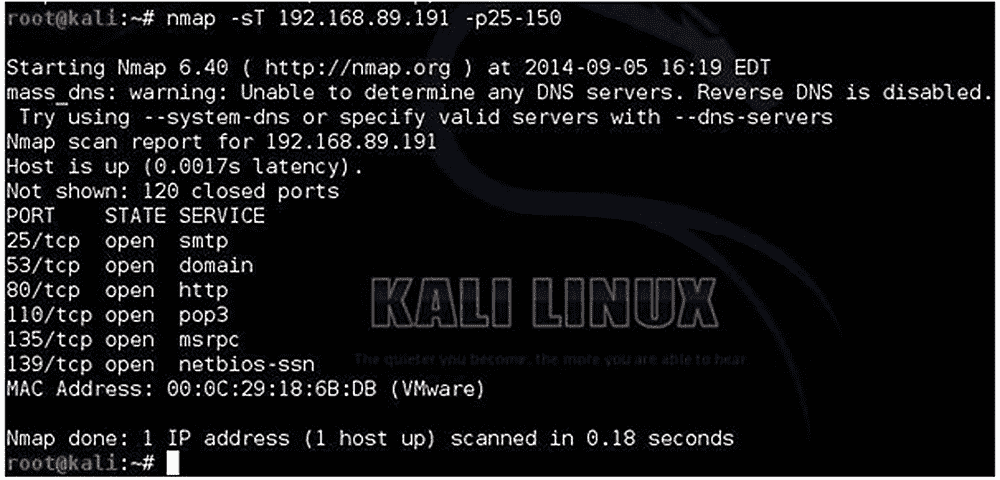 |

涉及三种类型的扫描：

* `端口扫描`：此阶段涉及扫描目标获取开放端口、活动系统、主机上运行的各种服务等信息。
* `漏洞扫描`：检查目标是否存在可以被利用的弱点或漏洞。通常在自动化工具的帮助下完成。
* `网络映射`：寻找网络拓扑、路由器、防火墙服务器（如果有）以及主机信息，并根据可用信息绘制网络图。地图在整个攻击过程中可能作为非常有价值的信息。

### 2. 扫描

此阶段包括使用拨号器、端口扫描器、网络映射器、扫描器和漏洞扫描器来扫描数据。黑客现在可能在寻找任何可以帮助他们实施攻击的信息，如计算机名称、`IP addresses`和用户账户。黑客现在已经有了一些基础信息；黑客现在进入下一个阶段，开始测试网络其他的攻击途径。黑客决定使用几种方法来帮助映射网络（例如`Kali Linux`、`Maltego`，并找到一个联系邮箱以查看正在使用哪种电子邮件服务器）。黑客会尝试寻找自动电子邮件，或者根据收集的信息决定向人力资源部发送关于职位空缺的咨询邮件。

| 图 2. 扫描示例 |
| --- |
|  |

### 3. 获取访问权限

在此阶段，黑客根据第 1 阶段和第 2 阶段收集的数据设计目标网络的蓝图。黑客已经完成了对网络的枚举和扫描，现在决定他们有一些选项可以获取网络的权限。攻击者使用各种工具或方法入侵系统/网络。在进入系统后，他必须将权限提升到管理员级别，以便他安装所需的应用程序或修改数据或隐藏数据。

例如，`钓鱼攻击`：黑客决定稳妥起见，使用简单的钓鱼攻击来获取访问权限。黑客决定从 IT 部门渗透。他们看到最近入职了一些员工，这些人可能还不熟悉流程。将使用一个程序使用`CTO`的真实电子邮件地址发送钓鱼邮件，并发送给技术人员。邮件包含一个钓鱼网站，该网站将收集他们的登录和密码。通过任何选项（手机应用、网站邮件伪造、`Zmail`等），黑客发送一封邮件要求用户使用凭据登录新的`Google portal`。他们已经运行了`Social Engineering Toolkit`，并向用户发送了带有服务器地址的邮件，并用`bitly`或`tinyurl`进行隐藏（Smurf, 2015）。

其他选项包括在`PDF`中使用`Metasploit`创建`reverse TCP/IP shell`（可能会被垃圾邮件过滤器拦截）。查看活动日历，他们可以设置`Evil Twin router`并尝试对用户进行`Man in the Middle`攻击以获取访问。`拒绝服务`攻击的变体、`栈缓冲区溢出`和`会话劫持`也可能非常有效。

### 4. 维持访问权限

| 图 3. 维持访问示例 |
| --- |
| 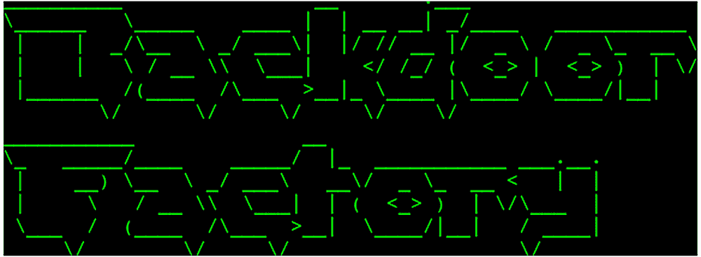 |

一旦黑客获取了访问权限，他们希望保留该权限以供未来的利用和攻击。一旦黑客拥有了系统，他们就可以将其作为基础来发动额外的攻击。在这种情况下，被拥有的系统有时被称为`zombie system`。现在黑客有了多个电子邮件账户，黑客开始测试该域上的账户。从此时点开始，黑客根据命名结构为自己创建一个新的管理员账户，并试图混入。作为预防措施，黑客开始寻找并识别长时间未使用的账户。黑客假设这些账户可能被遗忘或未使用，因此他们更改了密码并将权限提升为管理员，作为次要账户以维持对网络的访问权限。黑客还可能向其他用户发送带有被利用文件的邮件，例如带有`reverse shell`的`PDF`，以扩展他们可能的访问范围。此时不会发生明显的利用或攻击。如果没有检测到的迹象，就会玩一场等待游戏，让受害者认为什么都没有被扰动。在获得 IT 账户后，黑客开始复制所有电子邮件、预约、联系人、即时消息和文件，以便以后分类和使用。

### 5. 清除轨迹（让无人找到他们）

在攻击之前，攻击者会更改其`MAC address`并通过至少一个`VPN`运行攻击机器以帮助隐藏身份。他们不会实施直接攻击或任何被认为是“噪音大”的扫描技术（Smurf, 2015）。一旦获得了访问并提升了权限，黑客会寻求清除轨迹。这包括清除已发送邮件、清除服务器日志、临时文件等。黑客还会寻找电子邮件提供商提醒用户或其账户下可能未经授权登录的迹象。

## 保护你自己：做什么和不该做什么？

* 不要在社交媒体上发布与挑战问题相关的信息
* 使用无法通过暴力破解或猜测破解的密码
* 尽可能考虑使用`2 factor authentications`
* 警惕请求密码的电子邮件。`Heroku`、`Gmail`等服务不会要求输入密码以获得额外的促销或服务。
* 核实联系来源。
* 在点击链接之前，请先进行调查。
* 始终扫描文件，永远不要点击批处理文件（`.bat`）。
* 始终查看你设备上运行的后台服务，永远不要依赖他人的设备。
* 确保已安装杀毒软件，并为安装程序设置根密码。
* 退出会话并清理缓存。

# 常见的网络攻击类型

网络攻击是任何针对计算机信息系统、基础设施、计算机网络或个人计算机设备的攻击性行为，使用各种方法来取、篡改或破坏数据或信息系统。最常见的网络攻击类型有：

1. 拒绝服务 (DoS) 和分布式拒绝服务 (DDoS) 攻击
2. 中间人 (MitM) 攻击
3. 钓鱼攻击和针对性钓鱼攻击
4. 挂靠驱动式攻击 (Drive-by attack)
5. 密码攻击
6. SQL 注入攻击
7. 跨站脚本 (XSS) 攻击
8. 窃听攻击
9. 生日攻击
10. 恶意软件攻击

## 1. 拒绝服务 (DoS) 和分布式拒绝服务 (DDoS) 攻击

拒绝服务攻击通过耗尽系统资源，使其无法响应服务请求。DDoS 攻击也是对系统资源的攻击，但它是从大量受攻击者控制的恶意软件感染的其他主机发起的。


与旨在让攻击者获得或增加访问权限的攻击不同，拒绝服务并不为攻击者提供直接利益。对于其中某些攻击者来说，仅仅是获得拒绝服务的满足感就足够了。然而，如果受攻击的资源属于业务竞争对手，那么攻击者可能获得的利益就是真实的。DoS 攻击的另一个目的是让系统离线，以便发起其他类型的攻击。DoS 和 DDoS 攻击有多种类型；其中最常见的包括 TCP SYN 洪水攻击、水滴攻击（teardrop）、小矮人攻击（smurf）、死亡之敲（ping-of-death）和僵尸网络（botnets）。

## TCP SYN 洪水攻击

在这种攻击中，攻击者利用了传输控制协议（`TCP`）会话初始化握手期间使用的缓冲区空间。攻击者设备向目标系统的小进程队列涌入大量的连接请求，但在目标系统响应这些请求时它却不响应。这导致目标系统在等待攻击者设备的响应时超时，当连接队列填满时，系统就会崩溃或无法使用。针对 `TCP` SYN 洪水攻击有几种防御措施：

- 将服务器放置在配置为阻止入站 `SYN` 包的防火墙之后。
- 增加连接队列的大小并缩短开放连接的超时时间。

## 水滴攻击 (Teardrop Attack)

这种攻击导致受攻击主机上的顺序 Internet 协议（`IP`）数据包中的长度和偏移字段相互重叠；受攻击系统在过程中尝试重组数据包但失败了。目标系统随后变得混乱并崩溃。如果用户没有补丁来防止这种 DoS 攻击，请禁用 `SMBv2` 并阻塞端口 `139` 和 `445`。

## 小矮人攻击 (Smurf Attack)

这种攻击涉及使用 `IP` 欺骗和 `ICMP` 使目标网络饱和。这种攻击方法使用针对广播 IP 地址的 `ICMP` 回显请求。这些 `ICMP` 请求源自伪造的“受害者”地址。例如，如果预期的受害者地址是 `10.0.0.10`，攻击者将伪造一个从 `10.0.0.10` 到广播地址 `10.255.255.255` 的 `ICMP` 回显请求。该请求将发送到范围内的所有 IP，所有响应将返回给 `10.0.0.10`，从而淹没网络。这个过程可以重复，并可以自动化以产生大量的网络拥塞。

为了保护你的设备免受此类攻击，你需要在路由器上禁用 `IP` 指向广播。这将防止网络设备的 `ICMP` 回显广播请求。另一个选项是配置终端系统使其不响应来自广播地址的 `ICMP` 包。

## 死亡之敲攻击 (Ping of Death Attack)

此类攻击使用 `IP` 包“ping”一个大小超过最大 65,535 字节的目标系统。这种大小的 `IP` 包是不允许的，因此攻击者对 `IP` 包进行分片。一旦目标系统重组数据包，它可能会遇到缓冲区溢出和其他崩溃。可以使用防火墙检查分片 `IP` 包的最大大小，从而阻断死亡之敲攻击。

## 僵尸网络 (Botnets)

僵尸网络是数百万受黑客控制、感染了恶意软件的系统，用于执行 DDoS 攻击。这些机器人或僵尸系统被用于对目标系统进行攻击，通常会使目标系统的带宽和处理能力饱和。这些 DDoS 攻击很难追踪，因为僵尸网络位于不同的地理位置。可以通过以下方式缓解僵尸网络：

- `RFC3704` 过滤，它将拒绝来自欺骗地址的流量，并有助于确保流量可溯到正确的源网络。例如，`RFC3704` 过滤将丢弃来自 bogon 列表地址的数据包。
- 黑洞过滤，在不良流量进入保护网络之前将其丢弃。当检测到 DDoS 攻击时，`BGP`（边界网关协议）主机应向 ISP 路由器发送路由更新，以便将指向受害者服务器的所有流量在下一跳路由到 `null0` 接口。

## 中间人 (MitM) 攻击

黑客插入到客户端和服务器的通信之间时，就会发生 `MitM` 攻击。以下是一些常见的中间人攻击：

### 会话劫持 (Session Hijacking)

在这种类 MitM 攻击中，攻击者劫持了信任客户端和网络服务器之间的会话。攻击者计算机用自己的 IP 地址替换信任客户端的地址，而服务器继续会话并认为正在与客户端通信。例如，攻击过程可能如下：

1. 客户端连接到服务器。
2. 攻击者计算机获取客户端的控制权。
3. 攻击者计算机断开了客户端与服务器的连接。
4. 攻击者计算机将客户端的 IP 地址替换为自己的 IP 地址，并伪造客户端的序列号。
5. 攻击者计算机继续与服务器对话，服务器认为仍在与客户端通信。

| 图 4. MiTM 攻击示例 |
| --- |
| 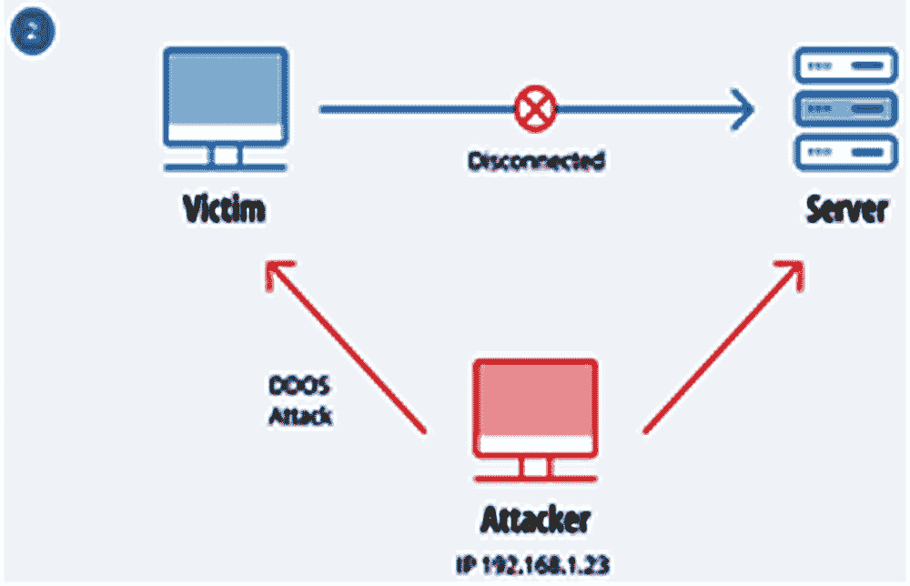 |

### IP 欺骗 (IP Spoofing)

攻击者利用 `IP` 欺骗让系统相信正在与已知信任实体通信，并为攻击者提供访问系统的权限。攻击者向目标主机发送数据包，其源地址为已知信任主机，而非自己的 IP 源地址。目标主机可能会接受该数据包并对其操作。

### 重放攻击 (Replay)

重放攻击发生在攻击者截获并保存旧消息，然后在之后尝试发送这些消息，伪装其中一个参与者。这种攻击可以通过会话时间戳或随机数（nonce，一个随时间变化的随机数字或字符串）轻松防御。目前，还没有单一的技术或配置可以防止所有的中间人攻击（MitM attacks）（Hero, n.d.）。通常情况下，加密和数字证书提供了防止中间人攻击的有效保障，确保通信的机密性和完整性。但中间人攻击可以注入到通信的中间，使得加密无济于事——例如，攻击者“A”拦截了人员“P”的公钥，并将其替换为自己的公钥。然后，任何想要使用 `P` 的公钥向 `P` 发送加密消息的人都会在不知情的情况下使用 `A` 的公钥。因此，`A` 可以读取发送给 `P` 的消息，然后用 `P` 真实的公钥加密消息后将其发送给 `P`，`P` 永远不会察觉消息被破解了。此外，`A` 还可以在重新发送给 `P` 之前修改消息。正如你所看到的，`P` 使用了加密并认为他的信息是保护的，但由于中间人攻击，事实并非如此。

那么，你如何确保 `P` 的公钥属于 `P` 而不是 `A` 呢？证书权威机构和哈希函数的创建是为了解决这个问题。当人员 2（`P2`）向 `P` 发送消息，而 `P` 想要确保 `A` 不会读取或修改消息且消息确实来自 `P2` 时，必须使用以下方法：

1. `P2` 创建一个对称密钥并用 `P` 的公钥对其加密。
2. `P2` 将加密后的对称密钥发送给 `P`。
3. `P2` 计算消息的哈希值并对其进行数字签名。
4. `P2` 使用对称密钥对消息和消息的签名哈希值进行加密，并将整个内容发送给 `P`。
5. `P` 能够从 `P2` 处接收对称密钥，因为只有他拥有解密该加密的私钥。
6. 只有 `P` 能够解密对称加密的消息和签名的哈希值，因为他拥有对称密钥。
7. 他能够验证消息未被更改，因为他可以计算接收到的消息哈希值并与数字签名哈希值进行比较。
8. `P` 还能向自己证明 `P2` 是发送者，因为只有 `P2` 可以对哈希进行签名，以便通过 `P2` 的公钥进行验证。

## 钓鱼攻击与鱼叉式钓鱼攻击

钓鱼攻击是发送看似来自可信源的电子邮件，其目的是获取个人信息或影响用户执行某些操作。它结合了社会工程学和技术欺骗。它可能涉及邮件附件，该附件会在你的计算机上加载恶意软件。它也可能是指向非法网站的链接，该网站可以欺骗你下载恶意软件或交出个人信息。

鱼叉式钓鱼是一种极具针对性的钓鱼活动。攻击者会花时间对目标进行研究，并创建个性化且相关的消息。正因如此，鱼叉式钓鱼非常难识别，防御更是困难。黑客进行鱼叉式钓鱼攻击最简单的方法是邮件伪造，即邮件中“发件人”部分的信息是伪造的，使其看起来来自你认识的人，例如你的管理层或合作伙伴公司。骗子使用的另一种增加其故事可信度的技术是网站克隆——他们复制合法的网站来欺骗你输入个人身份信息（PII）或登录凭据。

为了降低被钓鱼的风险，你可以使用这些技术：

- **批判性思维**：不要仅仅因为你忙、压力大或收件箱里有 150 封未读邮件就认为某封邮件是真实的。停一分钟分析这封邮件。
- **悬停链接**：将鼠标悬停在链接上，但不要点击！只需让鼠标光标悬停在链接上，看看它实际上会带你去哪里。运用批判性思维来解析 `URL`。
- **分析邮件头**：邮件头定义了邮件是如何到达你的地址的。`Reply-to` 和 `Return-Path` 参数应该与邮件中指定的域名相同。
- **沙箱**：你可以在沙箱环境中测试邮件内容，记录打开附件或点击邮件内链接的活动。

## 旁路攻击

旁路下载攻击是传播恶意软件的常用方法。黑客寻找不安全的网站，并在其中一个页面的 `HTTP` 或 `PHP` 代码中植入恶意脚本。该脚本可能会在访问该网站的用户计算机上安装恶意软件，或者将受害者重定向到黑客控制的网站。旁路下载发生在访问网站、查看电子邮件消息或弹出窗口时。与许多其他类型的网络安全攻击不同，旁路攻击不依赖用户采取任何操作来主动开启——你不需要点击下载按钮或打开恶意邮件附件即可被感染。旁路下载可以利用由于更新失败或缺乏更新而包含安全漏洞的应用程序、操作系统或网络浏览器。

为了保护自己免受旁路攻击，你需要保持浏览器和操作系统为最新版本，并避免可能包含恶意代码的网站。坚持使用通常使用的网站——尽管要记住这些网站也可能被黑客。不要在设备上保留太多不必要的程序和应用程序。插件越多，可能被旁路攻击利用的漏洞就越多。

## 密码攻击

由于密码是身份验证用户最常用的机制，获取密码是一种常见且有效的攻击方法。获取人员密码可以通过查看人员办公桌、嗅探网络连接以获取未加密密码、使用社会工程学、访问密码数据库或直接猜测来实现。最后一种方法可以随机或系统地进行：

- **暴力破解密码猜测**：意味着使用随机方法尝试不同的密码，并希望某个有效；也可以应用逻辑方法，尝试与人员姓名、职位、爱好或类似项目相关的密码。
- **字典攻击**：在字典攻击中，使用常用密码字典尝试访问用户的计算机和网络。一种方法是复制包含密码的加密文件，对常用密码字典应用相同的加密并比较结果。

为了保护自己免受字典攻击或暴力破解攻击，你需要实施账户锁定策略，在多次无效密码尝试后锁定账户。

```
“SELECT \* FROM users WHERE account = ‘“ + userProvidedAccountNumber +”’;”
```

虽然这种方法对于正确输入账号的用户是有效的，但它为攻击者留下了漏洞。例如，如果有人决定提供一个为“”“或“‘1’ = ‘1’”的账号，这将导致查询字符串变为：

```
“SELECT \* FROM users WHERE account = ‘’ or ‘1’ = ‘1’;”
```

由于`‘1’ = ‘1’` 始终为真，数据库将返回所有用户的数据，而不仅仅是单个用户。

这种类型网络安全攻击的脆弱性取决于 SQL 在控制平面和数据平面之间没有真实区别这一事实。因此，如果网站使用动态 SQL，SQL 注入通常会生效。此外，由于旧版功能接口的流行，`PHP` 和 `ASP` 应用程序 SQL 注入非常常见。由于可用编程接口的性质，`J2EE` 和 `ASP.NET` 不太可能容易被利用的 SQL 注入。

为了防止受到 SQL 注入攻击的伤害，请在数据库中应用最小权限模型。坚持使用存储过程（确保这些过程不包含任何动态 SQL）和预处理语句（参数化查询）。在数据库上执行的代码必须足够强大以防止注入攻击。此外，在应用程序层级根据白名单验证输入数据。

## 跨站脚本 (XSS) 攻击

XSS 攻击利用第三方网络资源在受害者的网络浏览器或可脚本应用程序中运行脚本。具体而言，攻击者将带有恶意 `JavaScript` 的负载注入到网站的数据库中。当受害者请求网站页面时，网站会将页面（带有攻击者的负载作为 HTML 主体的一部分）传输给受害者浏览器，浏览器会执行恶意脚本。例如，它可能会将受害者的 cookie 发送到攻击者的服务器，攻击者可以提取并使用它进行会话劫。最危险的后果发生在利用 XSS 攻击额外的漏洞时。这些漏洞允许攻击者不仅窃取 cookie，还能记录击键、截图、发现并收集网络信息，以及远程访问并控制受害者的机器。

虽然 XSS 可以在 `VBScript`、`ActiveX` 和 `flash` 中利用，但最被滥用的是 `JavaScript`——主要是因为 `JavaScript` 在网上得到了广泛支持。

为了防御 XSS 攻击，开发者可以在向用户返回数据之前对 `HTTP` 请求中的用户输入进行清理。确保在向用户回任何内容（例如搜索期间查询参数的值）之前，所有数据都经过验证、过滤或转义。将特殊字符如 `?`、`&`、`/`、`<`、`>` 和空格转换为相应的 HTML 或 URL 编码。给予用户禁用客户端脚本的。

| 图 5. XSS 攻击 |
| --- |
| 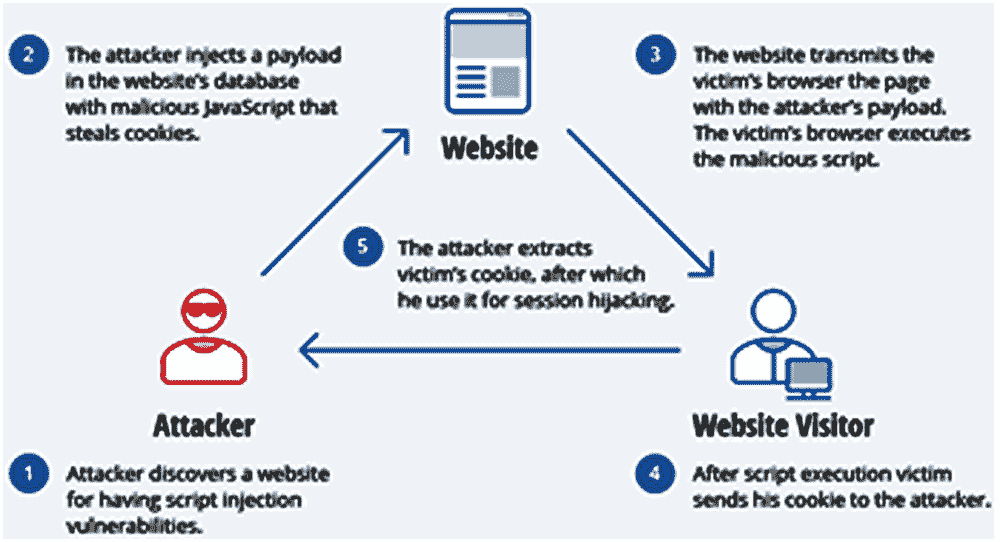 |

## 窃听攻击

窃听攻击通过拦截流量发生。通过窃听，攻击者可以获取密码、信用卡号以及用户可能通过网络发送的其他机密信息。窃听可以是被动的或主动的：

- **被动窃听** —— 黑客通过监听网络中的消息传输来检测信息。
- **主动窃听** —— 黑客通过伪装成友好的单元并向发射器发送查询来主动获取信息。这被称为探测、扫描或篡改。

检测被动窃听攻击通常比发现主动攻击更重要，因为主动攻击需要攻击者在之前通过被动窃听获得对友好单元的了解。数据加密是防止窃听的最佳对措施。

## 生日攻击

生日攻击针对的是用于验证消息、软件或数字签名完整性的哈希算法。由哈希函数处理的消息会产生固定长度的消息摘要（`MD`），这与输入消息的长度无关；此 `MD` 唯一地描述了消息。生日攻击是指找到两个随机消息在被哈希函数处理时生成相同 `MD` 的概率。如果攻击者为其消息计算出与用户相同的 `MD`，他就可以安全地用自己的消息替换用户的信息，即使接收者比较了 `MDs` 也无法检测到替换。

## 恶意软件攻击

恶意软件可以描述为未经您许可安装在系统中的不受欢迎软件。它可以附加在合法代码上并传播；它可以潜伏在有用的应用程序中或在互联网上自我复制。以下是一些常见的恶意软件类型：

- **宏病毒** —— 这些病毒感染如 `Microsoft Word` 或 `Excel` 等应用程序。宏病毒附加在应用程序的初始化序列中。当应用程序打开时，病毒会在将控制权转移给应用程序之前执行指令。病毒自我复制并附加到计算机系统的其他代码上。
- **文件感染者** —— 文件感染病毒通常附加在可执行代码上，例如 `.exe` 文件。病毒在代码加载时被安装。另一个版本的文件感染者通过创建一个同名但扩展名为为 `.exe` 的病毒文件来与文件相关联。因此，当文件被打开时，病毒代码将执行。
- **系统或引导记录感染者** —— 引导记录病毒附加在硬盘的主主引导记录上。当系统启动时，它将查看引导扇区并将病毒加载到内存中，在内存中它可以传播到其他磁盘和计算机。
- **多态病毒** —— 这些病毒通过不断变化的加密和解密周期来隐藏自己。加密的病毒和相关的变异引擎最初由解密程序解密。病毒继续感染代码区域。然后变异引擎开发出新的解密程序，病毒使用与新解密程序相应的算法加密变异引擎和病毒副本。变异引擎和病毒的加密包附加到新代码上，该过程重复。此类病毒难以检测，但由于其源代码的多次修改，具有高水平的熵。杀毒软件或像 `Process Hacker` 这样的免费工具可以使用此特性检测它们。
- **隐形病毒** —— 隐形病毒接管系统功能来隐藏自己。它们通过破坏恶意软件检测软件来实现，使软件将受感染区域报告为未感染。这些病毒隐藏了受感染文件大小的增加或文件最后修改日期时间的变化。
- **木马** —— 木马（Trojan）是一个隐藏在有用用程序中的程序，通常具有恶意功能。病毒和木马的一个主要区别是木马不会自我复制。除了对系统发动攻击外，木马还可以建立一个可供攻击者利用的后门。例如，木马可以被程序打开一个高端口，以便黑客可以使用它进行监听并执行攻击。
- **逻辑炸弹** —— 逻辑炸弹是一种附加应用程序的恶意软件，由特定事件触发，例如逻辑条件或特定日期和时间。
- **蠕虫 (Worms)** — 蠕虫与病毒的区别在于，它们不依附于宿主文件，而是可以在网络和计算机之间自我传播的自包含程序。蠕虫通常通过邮件附件传播；打开附件就会激活蠕虫程序。一种典型的蠕虫利用方式涉及蠕虫向受感染计算机邮箱地址列表中的每一个联系人发送其自身的副本。除了进行恶意活动外，在互联网上传播并导致邮件服务器过载的蠕虫可能会导致对网络节点实施拒绝服务（DoS）攻击。
- **释放器 (Droppers)** — 释放器是一种用于在计算机上安装病毒的程序。在许多情况下，释放器本身并不被恶意代码感染，因此可能不会被病毒扫描软件检测到。释放器还可以连接到互联网，为驻留在受攻击系统上的病毒软件下载更新。
- **勒索软件 (Ransomware)** — 勒索软件是一种恶意软件，它会阻止受害者对其数据的访问，并威胁称除非支付赎金，否则将其发布或删除。虽然某些简单的电脑勒索软件可以锁定系统，且这种方式对于懂技术的人来说并不难以破解，但更高级的恶意软件使用了一种名为`cryptoviral extortion`（加密病毒勒索）的技术，该技术对受者的文件进行加密，使其在没有解密密钥的情况下几乎无法恢复。
- **广告软件 (Adware)** — 广告软件是公司用于营销目的的软件应用程序；在任何程序运行时，屏幕都会显示广告横幅。在浏览任何网站时，广告软件可能会自动下载到你的系统中，并可以通过弹出窗口或自动出现在计算机屏幕上的工具栏进行查看。
- **间谍软件 (Spyware)** — 间谍软件是一种被安装用于收集有关用户、其计算机或其浏览习惯信息的程序。它会在你不知情的情况下跟踪你做的一切，并将数据发送给远程用户。它还可以从互联网下载并安装其他恶意程序。间谍软件的工作原理与广告软件类似，但它通常是一个独立的程序，会在你安装另一个免费应用程序时无意中被安装。

## 参考文献

- 6CIO Wiki. (n.d.). 灾难恢复计划 (DRP). 获取自：`https://cio-wiki.org/wiki/Disaster_Recovery_Plan_(DRP)`
- 10Ellis. (n.d.). 道德黑客。载于计算机与信息安全手册 (pp. 475-481)。`10.1016/B978-0-12-803843-7.00030-2`


- 9Gur, Bahtiyar, & Algoz. (2015). 计算机网络安全分析。载于计算机网络与系统的建模仿真。Elsevier。

- 11Hero, C. (n.d.). 中人攻击。获取自：`https://www.coursehero.com/file/p3u2v5p/Man-in-the-middle-MitM-attack-A-MitM-attack-occurs-when-a-hacker-inserts-itself/`

- 4Javat Point. (n.d.a). 网络安全简介。获取自：`https://www.javatpoint.com/cyber-security-introduction#:~:text="Cybersecurity%20is%20primarily%20about%20people,including%20computer%20network%20operations%2C%20information`

- 5Javat Point. (n.d.b). 网络安全原理。获取自：`https://www.javatpoint.com/cyber-security-principles`

- 7Kumar, A. (2019). 网络安全。获取自：`https://www.linkedin.com/pulse/cyber-security-amar-kumar/`

- 1Merriam-Webster. (n.d.). 安全。Merriam-webster 在线。2018 年 10 月 18 日访问自`www.m-w.com/dictionary/security`

- 3National Security Telecommunications and Information Systems Security. (1994). 国家训练标准。

- 2Notes, M. (2015). 信息安全演进。获取自：`https://thisismyblogspot.com/2015/06/security-security`

- 8Smurf, R. (2015). 钓鱼攻击的 5 个阶段。获取自：`https://www.cybrary.it/blog/03n/anatomy-of-`

# 第 1 章

**Nabie Y. Conte**

新奥尔良南方大学

**Angela"Dee" Sword**

马里兰全球大学

## 摘要

社会工程学攻击已成为针对企业最具问题的方法之一。社会工程人员利用基于人类和基于计算机的技术来成功攻破。本章将讨论社会工程学的基础知识，并解释什么是诱饵（baiting）、钓鱼（phishing）、伪装（pretexting）、等价交换（quid quo）和尾随（tailgating）等常见方法。还将强调社会工程学对网络犯罪的影响。

## I. 引言

社会工程学（也称为人类黑客）是一种欺骗员工和消费者泄露其凭据的艺术，黑客借此获取网络或账户的访问权限。复杂的 IT 系统无法防御黑客或看似授权的访问。人们很容易被破解，这使得他们的社交媒体帖子成为高风险。

公元前 1250 年左右，特洛伊与希腊之间的特洛伊战争开始。直到 10 年后，特洛伊木马被建立并放置在城外。特洛伊人接受了这匹马作为礼物并将其拉入城内。当城市陷入沉静时，希腊士兵从马中爬出来，让大军进入城市。希腊人成功包围了整个城市，在任何人察觉之前结束了战争（Peters,2015）。

## II. 社会工程学定义

社会工程学是黑客用于获取敏感信息、未经授权的基础设施和设施的欺骗形式。所有社会工程尝试可以分为两大类：技术欺骗或基于人类的欺骗（Thapar, n.d.）。在技术策略中，社会工程师使用计算机应用程序欺骗用户执行特定操作。相反，基于人类的策略是由了解心理缺陷的攻击者实施的。企业应该关注这两个社会工程策略，因为每种方法都可能导致网络被破坏。以下是社会工程学攻击的各种类型，但攻击者不仅限于这些方法：

* **诱饵（Baiting）**：黑客将恶意软件预载到外部存储设备（如`CDs`或`USBs`）上，并策略性地将它们留在目标企业的公共区域。毫无防备的员工会捡起这些标有公司信息的`CDs`或`USBs`并将其插入其计算机。

* **钓鱼攻击（Phishing）**：社会工程人员发送向收件者看起来可能合法的欺诈电子邮件。邮件可能会要求执行某些操作，例如披露敏感信息或点击恶意链接。

* **预设场景（Pretexting）**：恶意行为者利用伪装和不实手段来获取有关个人或公司的价值信息。攻击者给员工打电话，要求出于安全考虑验证其`username`和`password`。

* **等价交换（Quid pro quo）**：社会工程人员为受害者做一件好事，以获得他们的感激。随后，受害者更有可能通过回报帮助来报答。

* **尾随（Tailgating）**：恶意行为者在入口处等待，直到授权的人员进入，然后跟随员工进入受控区域。

* **翻垃圾桶（Dumpster Diving）**：攻击者翻遍公司的垃圾桶或垃圾箱，希望能找到有关公司、其员工和网络的有用信息。

## III. 网络犯罪的兴起

网络安全事件的数量在不断增加，而且也变得越来越具有破坏性，并针对日益广泛的信息和攻击向量（Beard, Mickelberg, Stapf, & Ulsch, 2015）。正如业务网络投资于技术、共享情报和培训员工一样，网络犯罪分子也是如此。恶意行为者不断改进他们的战术、技术和程序（`TTPs`），以使其工作更加高效。这些威胁行为者已经意识到网络犯罪市场是多么丰厚，并正在分配资源增加其策略的复杂性。社会工程通过提供对信息安全有害的多态伪装增强了攻击向量。攻击者结合社会工程技术来执行初始侦察、渗透、获取立足点、夺取权限和内部侦察（Kostadinov, 2013）。这允许犯罪者利用更多的漏洞，并在受侵害的网络中维持更长时间的留存。这两者都导致了成功率的飙升和网络犯罪的增加。以下是 2015 年 ISACA 和 RSA 大会调查中提供的统计数据，识别了 2014 年报告的威胁行为者类型和成功攻击。

### 2014 年的威胁行为者（636 名受访者）

* 45.6% 网络分子

* 40.72% 非恶意内部人员

* 40.09% 黑客

* 28.62% 恶意内部人员

* 19.81% 黑客行动主义者

* 17.45% 国家级

### 2014 年成功的攻击类型（704 名受访者）

* 68.32% 钓鱼攻击

* 66.48% 恶意软件

* 50.14% 黑客尝试

* 46.45% 社会工程

* 43.89% 移动设备丢失

* 25.28% 内部盗窃

* 21.88% SQL 注入

* 11.08% 中人攻击

* 7.53% 水蛭穴攻击

## IV. 预防社会工程

显而易见，无论网络在技术上看起来多么安全，人为因素始终是一个漏洞。由于社会工程的影响，网络攻击的数量稳步上升。有多个防御层次来防止这种情况。这一概念被称为`深度防御（Defense in Depth）`。

* **安全策略**：存在多个层级的`Security Policy`。

* **教育与培训**：员工需要参加定期培训以建立意识。

* **网络指导**：组织应该使用`whitelisting`、`Network address translation (NAT)`。

* **审计与合规**：组织必须通过技术和非技术控制积极验证`security logs`。

* **技术程序**：使用`Intrusion Prevention Systems (IPS)`、`Intrusion Detection Systems (IDS)`和`firewalls`。

* **物理指导**：使用`Demilitarized Zones (DMZ)`、`web filters`、`Virtual Private Network (VPN)`、`multifactor authentication`和`biometrics`。

## V. 结论

总而言之，社会工程并不是什么新事物，而是一项已经使用了多年的欺骗技巧。世界继续在技术上依赖，恶意行为者渴望通过智能手机和社交媒体来利用这种依赖。双方都在投入大量的时间、金钱和其他资源，在数字战争中击败对方。不幸的是，社会工程重新出现，并被证明在 21 世纪与过去一样有效。

## 参考文献

* Beard, C., Mickelberg, K., Stapf, E., & Ulsch, D. (2015, July). US cybersecurity: Progress stalled. PWC, 3.

* Course Material: Risk Mitigation: Defense in Depth. (n.d.). University of Maryland College.

* Information Systems Audit and Control Association & Rivest Shamir Adleman. (2015). State of cybersecurity: Implications for 2015. Cybersecurity Nexus.

* Kostadinov, D. (2013, March 22). The cyber exploitation life. InfoSec Institute.

* Peters, S. (2015, March 17). The 7 best social engineering attacks ever. Information Week.

* Rouse, M. (2014, November). Social engineering definition. TechTarget.

* Thapar, A. (n.d.). Social Engineering - An attack vector most intricate to tackle. CISSP.

* 10 Ellis. (n.d.). Ethical Hacking. In Computer and Information Security Handbook (pp. 475-481).

## 参考文献

- 10 Mitnick, K. D., & Simon, W. L. (2011). 《线中的幽灵：我作为全球最通缉黑客的冒险》. Back Bay Books.

- 11 Hero, C. (n.d.). 中间人攻击。检索自：`https://www.coursehero.com/file/p3u2v5p/Man-in-the-middle-MitM-attack-A-MitM-attack-occurs-when-a-hacker-inserts-itself/`

- 11 Pagliery, J. (2014,5 月 28 日). 今年有一的美国成年人被黑客。检索自 `https://money.cnn.com/2014/05/28/technology/security/hack-data-breach/`

- 12 Ponemon Institute. (2015,5 月). 2015 数据泄露成本研究：美国。检索自 IBM 网站：`http://public.dhe.ibm.com/common/ssi/ecm/se/en/sew03055usen/SEW03055USEN.PDF`

- 13 Simon, G. K. (2010). 《披着羊皮的：理解与应对操纵性的人》（第 2 版）.. Parkurst Brothers.

- 14 Statista. (2015,8 月). 2015 年 8 月选定数据泄露中受影响的数据记录数量。检索自 `https://www.statista.com/statistics/290525/cyber-crime-biggest-online-data-breaches-worldwide/`

- 15 Yang, J. L., & Jayakumar, A. (2014,1 月 10 日). Target 公司表示，12 月的数据泄露事件有多达 7000 万客户受影响。检索自 `https://www.washingtonpost.com/business/economy/target-says-70-million-customers-were-hit-by-dec-data-breach-more-than-first-reported/2014/01/10/0ada1026-79fe-11e3-8963-b4b654bcc9b2_story.html`

- 1 Braiker, H. B. (2004). 《谁在操纵你？：如何打破操纵循环并重新控制你的生活》. McGraw-Hill.

- 1 Merriam-Webster. (n.d.). 安全。Merriam-webster 在线版。2018 年 10 月 18 日访问自 `www.m-w.com/dictionary/security`

- 2018 标准职业分类系统。(2020,4 月 17 日). 检索于 2020 年 7 月 21 日，来自 `https://www.bls.gov/soc/2018/major_groups.htm#15-0000`

- 2 Curry, S. J. J. (2013). 即时消息安全. 收录于 Vacca, J. (编辑)，《计算机与信息安全手册》（第 2 版，第 727 页）.Morgan Kaufmann. doi:10.1016/B978-0-12-803843-7.00051-X

- 2 Notes, M. C. (2015). 信息安全——演变。检索自：`https://thisismyclassnotes.blogspot.com/2015/06/information-security-evolution.html`

- 3 企业风险管理. (2009,11 月). 社会工程学：人类黑客攻击。检索自 `https://www.emrisk.com/sites/default/files/newsletters/ERMNewsletter_november_2009.pdf`

- 3 国家安全电信与信息系统安全。(1994). 信息系统安全 (Infosec) 专业人员国家培训标准. 作者.

- 4 Felson, M., & Clarke, R. V. (1998). 《机会造就小偷：犯罪预防的实用理论》（警察研究系列论文 98）.检索自 `https://webarchive.nationalarchives.gov.uk/20110218135832/rds.homeoffice.gov.uk/rds/prgpdfs/fprs98.pdf`

- 4 Javat Point. (n.d.a). 网络安全简介。检索自 `https://www.javatpoint.com/cyber-security-introduction#:~:text="Cybersecurity%20is%20primarily%20about%20people,including%20computer%20network%20operations%2C%20information`

- 5 Granger, S. (2010,11 月 3 日). 社会工程学基础，第一部分：黑客策略。检索自 `https://www.symantec.com/connect/articles/social-engineering-fundamentals-part-i-hacker-tactics`

- 5 Javat Point . (n.d.b). 网络安全原理.检索自 `https://www.javatpoint.com/cyber-security-principles`

- 6 CIO Wiki. (n.d.). 灾难恢复计划 (DRP).检索自：`https://cio-wiki.org/wiki/Disaster_Recovery_Plan_(DRP)`

- 6 Grover, R., Hosenball, M., & Finkle, J. (2014,12 月 3 日). 索尼影视在遭受网络攻击八天后仍挣于恢复。检索自 `https://www.reuters.com/article/2014/12/03/us-sony-cybersecurity-investigation-idUSK0JG27B2014`

- 7 Kumar, A. (2019). 网络安全.检索自 `https://www.linkedin.com/pulse/cyber-security`

- 8 Internet Live Stats. (2014,7 月). 世界互联网用户。检索自 `https://www.internetlivats.com/internet-users/`

- 8 Smurf, R. (2015). 钓鱼攻击的五个阶段.检索自 `https://www.cybrary.it/blog/0p3/anatomy-the-hack/`

- 9 Gur, Bahtiyar, & Algoz. (2015). 计算机网络安全分析.计算机网络建模.

- 9 Kim, P. (2014). 《黑客手册：渗透测试实用指南》. Secure Planet.

- A. B. (1994). 使用离散余弦变换的图像压缩.数学杂志 ,4(1),81.

- Abdelwahab A. Hassaan L. (2008). 用于隐藏数据的离散小波变换.国家科学会议(1).10.1109/NRSC.2008.45219

- Acquisdata Industry. (2020b). 网络安全行业.Acquisdata Global Snapshot.

- Acquisdata Industry: 人工智能行业。(2020a). 网络安全行业.Acquisdata Global Snapshot.

- Alex, M. E., & Kishore, R. (2017). 云计算取证框架.计算机与电气工程 ,60,193–205.

- Allen, M. (2006). 社会工程学.违反计算机的方法.Academic Press.


# 参考文献

- Al-Muhtadi, J., Shahzad, B., Jameel, W., & Orgun, M. (2019). 多云环境下运行的集成应用程序的网络安全与隐私问题. 健康信息学期刊, 25(2), 315–329. `doi:10.1177/14604582170614`

- Anderson, K. E. (2020). 熟悉社交网络和应用：是时候谈谈 TikTok 了. 技术新闻, 37(4), 7–12. `doi:10.1108/LHTN-01-2020-0001`

- Andress, J. (2011). 《信息安全基础》. Elsevier.

- Anonymous. (2013). FBI：网络攻击超过恐怖主义成为主要威胁. 检索自 `https://www.rt.com/usa/fbi-cyber-attack-739/`

- Arce, D. G. (2020). 云网络安全与平台竞争. 计算机安全, 93, 101774. 在线出版. `doi:10.1016/j.cose.2020.101774`

- 人工智能软件. (2019). 市场报告. 人工智能软件. Acquisdata, Inc. `https://bi-gale-com.ezproxy.umgc.edu/global/article/GALE%7CA601435798?u=umd_umuc&sid=ebsco`

- 作业辅——澳大利亚的高质量作业. (2019). 检索于 2021 年 3 月 27 日，来自 `https://assignmenthelp4me.com/`

- Australia, D. D. L. S. (2019). 应对澳大利亚的安全挑战. DDLS Australia. 检索于 2020 年 7 月 28 日，来自 `https://www.ddls.com.au/wp-content/uploads/2019/08/DDLS-ebook-August-2019-Final.pdf`

- Badescu, I., & Dumitrescu, C. (2014). 使用离散小波变换的图像隐写. 工程数学模型与生产系统进展, 1(313), 69–72.

- Baldwin, J., Alhawi, O. M., Shaughnessy, S., Akinbi, A., & Dehghantanha, A. (2018). 从云中出现：云取证研究的文献计量分析. 信息安全网络威胁情报, 70, 311–331. `https://doig.org/10.1007/978-3-319-73951-9_16`

- Beard, C., Mickelberg, K., Stapf, E., & Ulsch, D. (2015, 7 月). 美国网络安全：进展停滞. PWC, 3. 检索自 `https://www.pwc.com/cybersecurity`

- Bisson, D. (2015, 3 月 23 日). 5 种需要警惕的社会工程学攻击. 安全状态. 检索自 `https://www.tripwire.com/state-of-security/security-awareness/5-social-engineering-attacks-to-watch-out-for/`

- Bowen, B. M., Devarajan, R., & Stolfo, S. (2011). 衡量网络安全中的人为因素. 哥伦比亚大学. 检索自 `http://www.cs.columbia.edu/~bmbowen/papers/metrics_hst.pdf`

- Braiker, H. B. (2004). 《谁在操纵你？：如何打破操纵循环并重新控制你的生活》. McGraw-Hill.

- Bucerzan, D., Raţiu, C., & Manolescu, M. (2013). SmartSteg：一种新的基于安卓的隐写应用. 国际计算机、通信与控制期刊, 8(5), 681. `doi:10.15837/ijccc.2013.5.642`

## 参考文献

- Bunker, G. (2020). Tik-Tok 危害. 网络安全, 2020(1), 3–3. `doi:10.1016/S1353-4858(20)30004-0`

- 认证伦理黑客：InfoSec 网络安全认证：EC-Council. (2016). 于 2021 年 3 月 27 日检索自 `https://www.eccouncil.org/`

- Chen, S., Zhao, S., Han, B., & Wang, X. (2019). 2019 无线会议 (wd). 调查与揭示移动应用流量中的隐私泄露 (pp. 1–4). IEEE. `doi:10.1109/WD.2019.8734246`

- Chen, P.Y. & JuLin, H. (2006). 基于离散波变换 (dwt) 的图像隐写方法. 国际应用科学与工程杂志, 1(1), 275–290.

- Chitery. A., Singh, D., Bag, M., & Singh, V. (2012). 印度基于社会工程学攻击的全面研究以开发概念模型. 国际信息与网络安全杂志, 1(2), 45-53.

- Choo, K.-K. R., Bishop, M., Glisson, W., & Nance, K. (2018). 网络与物联网网络安全研究挑战与进展. 计算机与安全, 74, 275–276. `doi:10.1016/j.cose.2018.02.008`

- Cisco Press. (2013). 于 2021 年 3 月 27 日检索自 `https://www.ciscopress.com/articles/article.asp?p=1998559`

- 云安全联盟. (2017). 云安全联盟针对云计算关键关注领域的安全指南. `https://cloudsecurityalliance.org/artifacts/security-guidance-v4/`

- Cobb, M. J. (2018). 弥补技能差距：女性在网络安全中应发挥的关键作用. 计算机欺诈与安全, 2018(1), 5–8. `https://doig.org/10.1016/s1361-3723(18)30004-6`

- CompTIA. (2020). 什么是 SaaS. `https://www.comptia.org/content/articles/what-is-saas`

- Costa, D. G., & Guedes, L. A. (2012). 适用于无线图像传感器网络的基于离散波变换 (dwt) 的节电选择性重传机制. 传感器与执行器网络杂志, 1(3), 3–35. `doi:10.3390/jsan1010003`

- 课程：风险缓解：深度防御. (n.d.). 马里兰大学大学学院. 检索自 `https://learn.umuc.edu/d2l/le/content/133521/viewContent/4176011/`

- 课程概述. (2020). 约翰斯高中 – 计算与初级教育. 于 2021 年 3 月 27 日检索自 `http://cybersecurity.jhigh.co.uk/index.html`

- Currie, D. (2003). 浅析语音身份认证. SANS 学院. 检索自 `https://www.sans.org/reading-room/whitepapers/authentication/shedding-light-voice`

- Diana, A. (2015, 5 月 19 日). 社会工程学攻击最薄弱环节. 检索自 `http://www.enterprisetech.com/2015/05/social-engineering-targets-weakest-link`

- Dong, J., Wu, W., & Zhang, Y. (2018). 越快越好？开源创新与用户兴趣. 信息与管理. `10.1016/im.2018.`

- Doshi, R., Jain, P., & Lalit Gupta. (2012). 隐写术及其应用. 现代工程杂志, 2(6).

- Dykstra, J., & Sherman, A. (2013). 为 OpenStack 平台设计并实现 FROST. 数字化调查, 10(Supplement), S87–S95. `doi10.1016/di.2013`

- Engebretson, P. (2011). 黑客基础与渗透测试. Elsevier.

- Enisa. (2016). 漏洞与利用. 2021 年 3 月 24 日检索自 `https://www.enisa.europa.eu/topics/irts/vulnerabilities-and-its`

- 伦理黑客与应对措施 (2017). Cengage 学习.

- Faheem, K., & Rafique, K. (2015). 4g/5g 无线网络安全. 计算机欺诈与安全, 2015(5), 8–12. `doi10.1016/S1361-3723(15)3003-1`

- 欺诈风险与网络犯罪上升. (2014). 金融营销, 29.

- Gartner Inc. (2021). 驱动业务未来. 2021 年 3 月 27 日检索自 `https://www.gartner.com/en`

- Gartner. (2019, 11 月 13 日). Gartner 预测全球云收入 2020 年增长 17% [新闻稿]. `https://www.gartner.com/en/newsroom/press-releases/2019-11-13-gartner-forecasts-worldwide-cloud-revenue-to-grow-17-percent-in-2020#::text=Software%20as%20a%20service(SaaS),software%20(see%20Table%201).IaaS%20is%20forecast%to%20grow,rate%20across%20all segments.`

- Gautam, B. (2010). 使用离散余弦变换与离散波变换的图像压缩. 鲁尔克拉理工学院计算机科学与工程学士学位. `http://ethesis.nitrkl.ac.in/1731/1/project.pdf`

- Goodchild, J. (2012, 12 月 20 日). 社会工程学：基础. 2015 年 11 月 2 日检索自 `https://www.csoonline.com/article/2124681/security-awareness/social-engineering-the-basics.html`

- Griffin, T. (2020, 5 月 21 日). 2020 网络安全趋势与行业面临的威胁. 2020 年 7 月 21 日检索自 `https://blog.eccouncil.org/cybersecurity-trends-in-2020-the-threats-facing-the-industry/`

- Grimes, R. (2019, 2 月 27 日). 什么是伦理黑客？如何付费入侵计算机. 2021 年 3 月 27 日检索自 `https://www.csoonline.com/article/3238128/what-is-ethical-hacking-and-how-to-become-an-ethical-hacker.html`

- Grimes, R. A. (2015). 网络犯罪比以往任何时候都严重的五个原因. Info World. 检索自 `https://www.infoworld.com/article/2608631/security/5-reasons-internet-crime-is-worse-than-ever.html?page=2`

- Gupta, R., Tanwar, S., Tyagi, S., & Kumar, N. (2019). 触感互联网及其 5G 时代的应用：全面综述. 国际通信系统杂志, 32(14), e3981. 提前出版. `doi:10.1002/dac.3981`

- Hassan. (2012). 尼日利亚的网络犯罪：原因与影响. ARPN 科学技术杂志, vol2/

- Heary, J. (n.d). 前 5 大社会工程学. SANS 学院.

- Heimdal Security - 主动网络安全. 2021 年 3 月 28 日检索自 `https://www.pcsecurity.com/`

- Hemalatha, S. (2013). 变换域的安全色彩隐写. 国际密码学与信息杂志, 3(1). `10.5121/`

- Herman, M., Iorga, M., Landreville, N., Lee, R., Mishra, A., & Wang, Y. (2020, 8 月). NISTIR8006: 云计算取证科学.

- Hewes, J. A. (2016). 网络犯罪的威胁与挑战.

- HITRUST 联盟. (2020, 8 月). 引言. `https://hitrustalliance.net/content/uploads/CSF9.4`

- Imprivata. (2016, 2 月 23). Imprivata 扩展认证平台以保护医疗设备和患者信息的远程访问免受黑客攻击 [新闻稿]. 2020 年 9 月 7 日，检索自 `https://www.imprivata.com/company/press/imprivata-expands-authentication-platform-protect-medical-devices-and-remote-access`

- 勒索软件事件不断上升. (2016, 7 月 14). 检索自 `https://www.fbi.gov/news/stories/2016/april/incidents-of-ransomware-on-the-rise/incidents-ofransonware-on-the-rise`

- 信息系统审计与控制协会 (ISACA) & Rivest Shamir Adleman. (2015). 网络安全现状：对 2015 年的影响. Cybersecurity Nexus. 检索自 `https://www.isaca.org/cyber/Documents/State-of-Cybersecurity`

- Iozzio, C. (2008, 9 月 26). 10 最神秘的网络犯罪. 2015 年 11 月 2 日，检索自 `http://www.pcmag.com/article2/0,2817,2331225,00.asp`

- Jaret, P. (2018, 11 月 12). 揭露漏洞：黑客如何攻击你的医疗设备. 2020 年 7 月 28 日，检索自 `https://www.aamc.org/news-insights/exposing-vulnerabilities-how-hackers-could-target-your-medical-devices`

- Jones, M. (2020). 技能差距的压力测试. 计算机欺诈与安全, 2020(5), 9–11. `https://doig.org/10.1016/s1361-3723(20)30051-8`

- Kociołek M. Materka A. Strzelecki M. Szczypiński P. (2001). 离散小波变换——用于数字图像纹理分析的特征. 信号与电子系统国际会议, 2.

- Koochaksaraei, R., Aghazarian, V., Haroonabadi, A. & Hedayati, A. (2012). 一种基于混沌和直方图的新型数据隐藏方法. 创新、管理与技术国际期刊, 3(5), 642.

- Kostadinov, D. (2013, 3 月 22 日). 网络攻击生命周期. InfoSec Institute. 检索自 `http://www.resources.infosecinstitute.com`

- Kumar, V., & Kumar, D. (2010). 基于 DWT 的图像隐写术性能评估. 2010 IEEE 第二次国际高级计算会议 (IACC), 1(1), 223-228. `10.1109/IADCC.2010.5423005`

- Kumar, A., & Pooja, K. (2010). 隐写术——一种数据隐藏技术. 计算机应用国际期刊, 9(7), 1–2.

- Kumarpanjabi, P., & Singh, P. (2013). 一种使用像素映射方法和优化替换方案的增强数据隐藏方法. 计算机应用国际期刊, 74(10), PP. 38.

- Kumar, S. (2014). 使用改进的 LSB 和异或加密算法的图像隐写术. `dspace.thapar.edu`

- Li, S., Pilcher, C., & Gepford, J. (2018). 网络安全战：新战线——医院需要主动防止连接的医疗设备被黑客攻击. Trustee, 71(6), 16.

- Luo, X., Brody, R., Seazzu, A., & Burd, S. (2011). 社会工程：信息安全管理中被忽视的人为因素. 信息资源管理期刊, 24(3), 1–8.

- Maharjan, S. K., & Qiaolun, G. (2014). 使用图像分解的信息隐藏. 科学研究国际期刊, 3(3), 73–76.

- Mandal, J. (2012). 基于空间域像素值差的彩色图像隐写术. 信息科学与技术国际期刊, 2(4), 8.

- Mann, P., & Sharma, M. (2012). 社会工程：部分综述. 计算机应用国际期刊, 9(7), 557.

- Matthews, K. (2020, 1 月). 值得关注的网络安全趋势. 2020 年 7 月 21 日，检索自 `https://www.consultant.com`

- Maze, It. (2020). 勒索软件正在攻击我们. 3 月 28 日，检索自 `https://www.trendmicro.com`

- McAfee, E. (2017). 新战线：……. 011.


McGee, M., & Ross, R. (2020). 泄露的深度分析。战略研究中心，2020。

Mousa, H., & Abdel-Wahed, W. (2011). 数字水印技术。`IJRRAS`，6(1), 89–91.

Nasereddin, H. (2012). 基于`DWT`的信息隐藏。国际期刊..................20016). 工程用于。 `ACM` `ACM` `ACM`...1115/2...........1.1.1.1.1.1.1.1.......................................................................................................2019......................................................................................1..1.1.1.1.1.1.1.1.1.1.1.1.1.1.1.1.1.

Pagliery, J. (2014). 比特币：以及货币的未来。学术出版社。

Parul, M., & Rohil, H. (2014). 使用离散小波变换 (`DWT`) 的优化图像隐写术。工程与技术最新进展国际期刊。2(2), 75–81.

Peters, S. (20153 月 17 日) 信息周，七个最好的社会工程学攻击。`https://www.darkreading.com/the-7-best-social-engineering-attacks-ever/d/d-id/1319411`

- Pew Research Center. (2020). 网络攻击可能会增加。获取自：`https://www.pewinternet.org/2014/10/29/cyber-attacks-likely-to-increase/`

- Ponemon Institute. (2015, 5 月). 2015 年数据泄露成本研究：美国。获取自 IBM 网站：`http://public.dhe.ibm.com/common/ssi/ecm/se/en/sew03055usen/SEW03055USEN.PDF`

- Provos, N., & Honeyman, P. (2003). 捉迷藏：隐写术导论。`IEEE Secur. Privacy Mag.`, 1(3), 32–44. doi:10.1109/MSECP.2003.1203220

- Ragan, S. (2013). 社会工程：研究发现美国人乐于打开恶意邮件。`CSO`。获取自：`https://www.csoonline.com/article/213377/social-engineering--social-finds-americans-willingly-open-malicious-emails.`

- Rao, S., & Prasad, R. (2018). `5g`技术对工业`4.0`的影响。`Wireless Communications: An International Journal`, 100(1), 145–159. doi:10.1007/s11277-018-7

- 尼日利亚网络犯罪上升上升的原因。(n.d.)。获取于 2015 年 11 月 2 日，`https://martinslibrary.blogspot.com/2013/08/reasons-for-rise-in-cyber-crime.html`

- Richardson, R., & North, M. (2017). 勒索软件：演变、缓解与预防。`International Management Review`, 13(1), 21.

- Rouse, M. (2014, 11 月). 社会工程学定义。`TechTarget`。获取自：`http://searchsecurity.techtarget.com`

- Rouse, M. (2015). 社会工程学。获取自：`https://searchsecurity.techtarget.com/definition/social-engineer`

- Savage, K., Coogan, P., & Lau, H. (2015). 勒索软件的演变。`Academic Press`。

- Schiff, J. L. (2013 年 6 月 19 日). 保护你的电子商务网站免受攻击的 15 种方法。`http://www.cio.com/article/238409/e-commerce/15-ways-to-protect-your-ecommerce-site.`

- Seigfried-Stellar, K., Rogers, M., & Crimmins, D. M. (2017). 数字取证中职业道德准则的发展。在数字取证、安全与法律会议论文集中 (pp 135–144)。

- Sheth, R. K., & Tank, R. M. (2015). 图像隐写术。`International Journal of Computational Science`, 1(1), 10–11.

- Shobana, M., & Manikandan, R. (2013). 基于像素强度的数据隐藏高效方法。`International Journal of Engineering and Technology`, 5(1), 75.

- Shuang, Z., Xiapu, L., Bo, B., Yankang, Z., & Xinliang, Q. (2018). 利用基于位置的移动应用进行大规模隐私泄露。`Security and Communication Networks`, 2018, 2–22. doi:10.1155/2018/31842

- Smith, S. W. (1999). 离散傅里叶变换。科学家与工程师的数字处理指南，145。`https://www.dspguide.com/8`

- Sravanthi, G., Devi, B.S., Riyazuddin, S.M., & Reddy, J. (2012). 一种基于平面替换的空间域隐写技术。`Global Journal of Computer Science and Technology Graphics & Vision`, 12, 2-3.

- Srinivasa Raghavan, R., Jayasimha, K. R., & Rajendra, V. N. (2020). 软件即服务 (`SaaS`) 对获取过程的影响。`Journal of Business & Industrial Marketing`, 35(4), 757–770. doi:10.1008/JBIM-12-2018-0382

- 2016 年勒索软件现状：了解美国勒索软件问题的深度。(2016)。`Osterman Research, Inc.`

- Statista. (2015, 8 月). 截至 2015 年 8 月选定数据泄露中的受影响记录数量。获取自：`https://www.statista.com/statistics/290525/cyber-crime-biggest-online-data-breaches-worldwide`

- Statista. (2015, 8 月). 截至 2015 年 8 月选定数据泄露中的受影响记录数量。获取自：`https://www.statista.com/statistics/290525/cyber-crime-biggest-online-data-breaches-worldwide`

- Strohm, C. (2014). 网络窃取已成为 4450 亿美元规模的产业，并将继续扩大。`Insurance Journal`。获取自：`https://www.insurancejournal.com/news/national/2014/06/09/331`

- Sumathi, C., Santanam, T. & Umamahesw, G. (2014). 基于哈曼编码和变换域方法的图像隐写术。`International Journal of Computer Science & Engineering`, 5(6), 10-11. 10.5121/ijcs.2013

- 网络攻击增加对州和地方政府的影响。`CISOMAG`。(2020)。`https://cisomag.eccouncil.org/magazine/`

- Swinhoe, D. (2020, 4 月). 21 世纪最大的 15 次数据泄露。`CSO`。`https://www.csoonline.com/article/213087/the-biggest-data-breaches-of-21st-century`

- Synopsis：开源安全风险分析。(2018)。`Network Security`, 3(6)。`https://doi-org.ezproxy.umgc.edu/10.1016/S1353-4858(18)30051-`

- Synopsys. (2020). `Synopsys` 2020 年开源安全风险报告。`Synopsys`。`https://www.synopsys.com/content/dam/synopsys/sig-assets/reports/2020-ossra-report`

- Sysel, P., & Rajmic, P. (2012). 非整数频率通用 `Goertzel` 算法。`EURASIP Journal on Advances in Signal Processing`, 2012(1), 1.

- Taylor, R. W., Fritsch, E. J., & Liederbach, J. (2013). `Advanced` 计算 (第 5 版)。`IEEE`

- Thapar, A. (n.d.). 社会工程 - 一种攻击手段。`CISSP`。获取自：`http://www.infosecurity.com`

- Thompson, S. C. (2006). 帮助黑客？信息技术与图书馆, 25(4), 222.

- Vigneshkumar, V. (2013). 基于哈曼编码和变换域方法的图像隐写算法。2013 年第五次高级计算会议 (`ICoAC`), 517。10.1109/ICoAC.2013.692200

- Vulnerabilities, C. (2017). 文章。`Credit Union Magazine`, 83(1), 15.

- Vacca, J. R. (2013). 计算机与信息安全 (第 2 版)。`Kaufmann`

- Turban, E., Volonino, L., & Wood, G. (2020). 管理信息技术：洞察、行动和可持续发展的数字战略 (第 10 版)。`John Wiley & Sons, Inc.`

- 美国网络犯罪：风险上升，准备工作减少。(2018)。美国网络犯罪状况调查。`https://collabra.email/wp-content/uploads/2015/04/2014-state-of-cybercrime.pdf`

## Nabie Y. Conteh

Nabie Y. Conteh 是新奥尔良南方大学（`SUNO`）的计算机信息系统教授。他拥有荷兰信息与通信技术学院的信息系统学士学位；费里斯州立立大学（`Ferris State University`）的信息系统管理工商管理硕士（`MBA`）学位；以及马里兰大学巴尔的摩县校的信息系统硕士和博士学位。他的教学领域和研究兴趣包括决策支持系统、系统建模与仿真；系统分析与设计；以及知识管理与组织学习。Conteh 博士精通技术技能，并精通英语、荷兰语、俄语和德语。Conteh 博士多次在国家和国际会议上发表，并在许多同行评审期刊和论文集中发表文章。他曾担任谢南杜大学（`Shenandoah University`）助理教授、西亥利伯蒂大学和俄亥俄州立大学东部的计算机信息系统副教授、马里兰大学大学学院学院的网络安全兼职教授，以及佛罗里达科技学院（`Florida Tech`）的信息安全与全球信息技术教授。在读博期间，他曾在马里兰大学巴尔的摩县校担任研究助理。他曾在马里兰州大学公园市的 `Datastream` 公司提供咨询服务，该公司主要活动是数据转换。他还曾在 `Getronics Transaction Services`、`EuroShell International` 以及荷兰阿姆斯特丹的 `ABN AMRO` 工作过。

## C. V. Anchugam

C. V. Anchugam 在印度泰米尔纳德邦巴拉达蒂达桑大学卡鲁尔政府艺术学院（自治制）计算机科学系研究生及研究部门，获得了网络安全博士学位。她于 2002 年获得印度泰米尔纳德邦卡鲁尔 `Sri Saradha` 艺术科学学院计算机科学学士学位。她于 2005 年获得印度泰米尔纳德邦卡鲁尔 `M. Kumarasamy` 工程学院的计算机应用硕士（`M.C.A`）学位。她在许多著名的国内外会议和期刊上发表了大量论文。她的兴趣领域是密码学、网络安全和自组织网络。

## Sahar Abd El Rahman

Sahar Abd El Rahman 在埃及开内哈大学（`Benha University`）苏赫布拉工程学院获得了应用于机器辅助翻译的 `AI` 技术硕士（2003 年），以及从一组低分辨率图像重建高分辨率图像的博士（2008 年）。她目前是沙特普莉诺拉·宾特·阿杜勒·拉赫曼大学计算机与信息系统学院助理教授。此外，她自 2008 年起一直担任埃及开内哈大学苏赫布工程学院的助理教授。她在国内外期刊和会议上发表了许多论文。她的研究兴趣包括计算机视觉、图像处理、信号处理、信息安全、人机交互、电子健康、大数据和云计算。

## Alusine Jalloh

Alusine Jalloh 刚毕业于马里兰大学大学公园校区，获得公共卫生学院的家庭科学学位，专业方向为家庭治疗和心理学。Alusine 拥有酒店管理方面的专业背景，在管理不同品牌、市场区域和人口特征的前台部门方面拥有丰富经验。他将从职业经验中获得的卓越的人际交往和组织能力，转化为作为一名热衷于网络安全的研究生的创新想法。未来，他希望作为网络安全顾问，利用社会工程和渗透测试与公司紧密合作，开发关键策略，以增强其抵御外部实体破坏和利用宝贵知识产权以及客户及其员工个人身份信息的保护能力。

## Alicia Leslie-Jones

Alicia Leslie-Jones 于 2007 年加入美国海军，并在 2016 年之前担任信号情报分析师和报告员。她于 2019 年从美国军事大学获得信息技术学士学位。她目前是马里兰大学全球校区的学术学生，正在攻读数字取证与网络调查的硕士学位，并在 `ARMA-Global`（一家通用动力信息技术公司）担任高级系统管理员。

## Paul J. Schmick

Paul J. Schmick 是总部位于纽约的 `Alliance Security Services` 的讲师、教授并担任安全技术副总裁。他于 2016 年 1 月加入 `Alliance`，在安全和技术行业拥有 20 年的经验。Paul 是安全融合、信息技术、网络安全、物理安全、基于风险的安全和安全技术领域的资深专业人士。在加入 `Alliance` 之前，Paul 曾担任 `FJC Security Services` 的企业安全计划总监，指导公司的企业安全计划，管理 `FJC` 信息技术办公室（`OIT`），并担任 `FJC Technology Solutions` 的总经理，指导该组织的安全技术和托管服务部门。Paul 还曾在美国国土安全部（`DHS`）- 运输安全管理局（`TSA`）工作八年，驻扎在纽约皇后区的约翰·F·肯尼迪国际机场。在部门的最后一个职位上，Paul 负责航空安全政策的实施，管理安全技术设备的部署，并监督培训计划和人员，以增强机构对针对美国航空资产和基础设施的即制爆炸装置（`IED`）威胁的强大防御。Paul 在 `LIU Post` 的国土安全与恐怖主义学院获得了国土安全管理硕士学位，并拥有阿什福德大学（`Ashford University`）国土安全与应急管理学士学位。他还持有美国海军研究生学校 - 国土防御与安全中心、联邦应急事务管理局（`FEMA`）以及 `ASIS` 国际组织的证书。Paul 目前正在马里兰大学大学学院学习，并攻读网络安全硕士学位。作为学术、安全和应急管理社区的活跃成员，Paul 担任纽约长岛商业学院（`Long Island Business Institute`）国土安全与安全管理项目的董事会主席和执行主任。他还担任埃里社区学院美国国土安全部-运输安全管理局合作计划的兼职教授。Paul 曾担任费城斯特学院在线学院的客座教授，教授大学刑事司法计划的课程。Paul 是美国工业安全协会（`ASIS`）组织 - `ASIS` 国际的成员，也是国际应急管理协会的成员。

## Sara Syed

Sara Syed 是马里兰大学全球校区的网络安全研究生。在关注网络安全社区之前，她在乔治·马森大学完成了刑事司法专业的学士学位学习。她曾在华盛顿特区地区的多个非营利机构工作过，并希望激励更多女性加入不断发展的网络安全行业。
