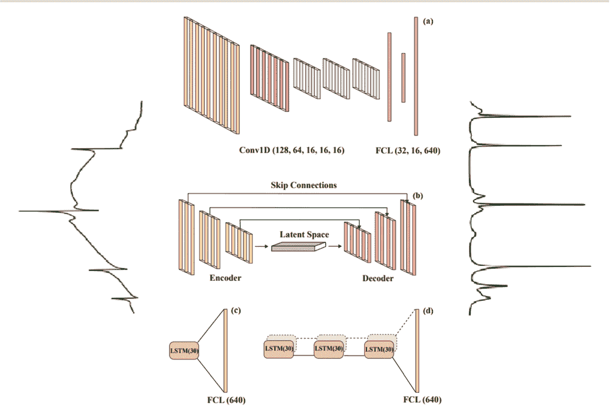
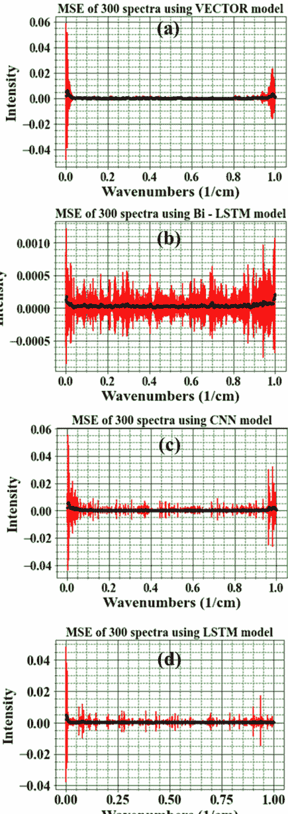
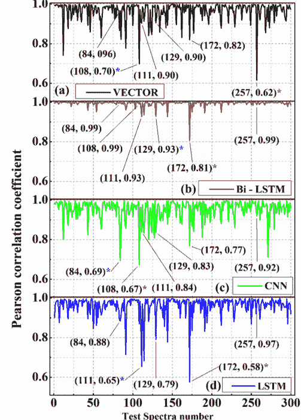
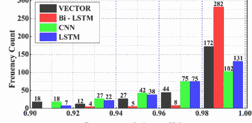
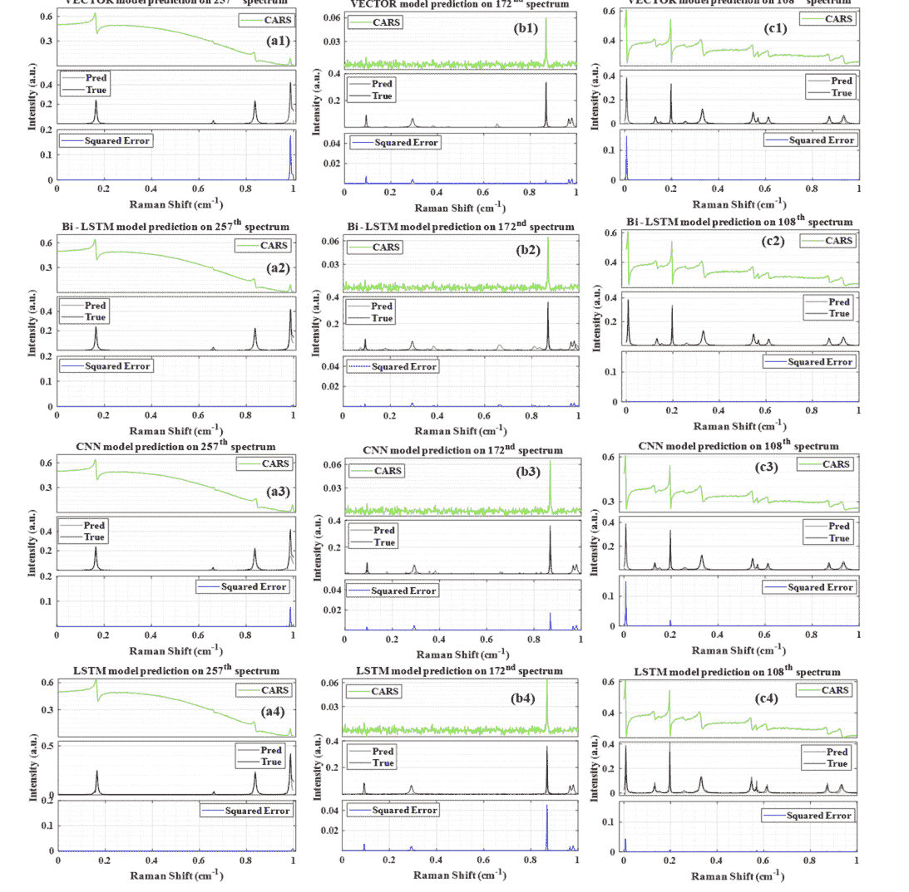
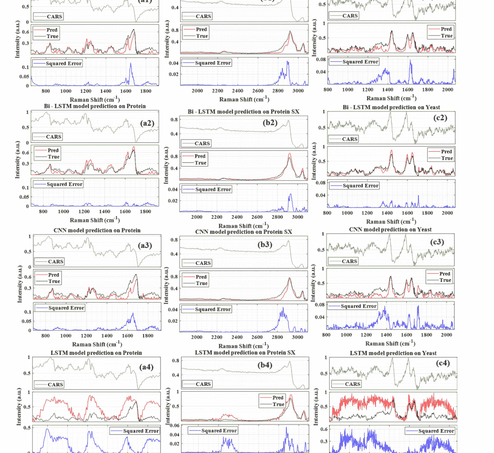
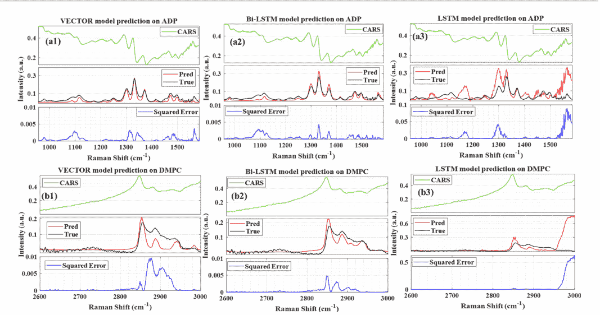
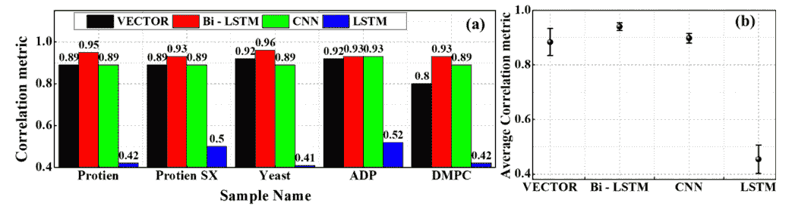

# 评估不同深度学习模型以高效提取CARS光谱中的拉曼信号

非共振背景（NRB）对相干反斯托克斯拉曼散射（CARS）信号的贡献会扭曲谱线形状，从而削弱化学信息。因此，找到一种有效的方法来去除 NRB 并提取共振振动信号是一项具有挑战性的任务。在这项工作中，首次探索了双向长短期记忆（Bi-LSTM）神经网络来自动去除 CARS 光谱中的 NRB，并将结果与文献中报道的三种 DL 模型——即卷积神经网络（CNN）、长短期记忆（LSTM）神经网络和超深卷积自编码器（VECTOR）——的结果进行了比较。合成测试数据的结果表明，Bi-LSTM 模型在整个范围内都能准确提取谱线。相比之下，其他三种模型在预测光谱两端的峰时效率下降，导致其均方误差是 Bi-LSTM 模型的 60 倍。皮尔逊相关分析表明，Bi-LSTM 模型的性能脱颖而出，其中 94% 的测试光谱的相关系数超过 0.99。最后，这四个模型在四种复杂的实验 CARS 光谱（即蛋白质、酵母、DMPC 和 ADP）上进行了评估，其中 Bi-LSTM 模型表现出优越的性能，其次是 CNN、VECTOR 和 LSTM。这项综合研究为简化复杂 CARS 光谱和显微分析迈出了一大步。

# 1. 引言

自发拉曼光谱技术测量分子的振动响应，并提供主要化学成分的功能和组成信息。然而，所获取的拉曼信号强度较弱，再加上荧光贡献，导致采集时间较长，从而限制了其应用。相比之下，相干反斯托克斯拉曼散射（CARS）是一种非线性分析方法，它提供与自发拉曼技术相似的指纹信息，但速度快了几个数量级¹,²。这一特性使其成为生物医学应用中细胞³和组织⁴无标记成像的重要光谱工具⁵。此外，它还在材料科学和纳米技术等其他应用中得到广泛探索。CARS 信号强度与极化率项成正比，可表示为

$I_{\mathrm{CARS}} \propto \left|\chi_{\mathrm{NR}}^{(3)} + \chi_{\mathrm{R}}^{(3)}(\omega)\right|^2$  (1)

这里，χₙᵣ⁽³⁾ 和 χᵣ⁽³⁾ 分别对应于非共振和共振的三阶极化率。由于 CARS 是一种相干现象，样品的 χₙᵣ⁽³⁾ 和 χᵣ⁽³⁾ 响应通过公式 (1) 发生干涉，因此非共振背景（NRB）贡献不能通过简单的减法去除。NRB 充当稳定的零差放大器，它决定了 CARS 的信号强度。然而，这种相干贡献同时也会扰动所测量的 CARS 信号，从而显著扭曲谱线形状。这是所有基于 CARS 的方法固有的局限性。在此背景下，人们探索了各种基于光学的方法来应对 NRB，例如单频 CARS⁶、频率调制 CARS⁷、偏振 CARS⁸、干涉 CARS⁹ 和脉冲整形 CARS¹⁰。所有这些实验方法都降低了 NRB 贡献，但代价是增加了实验复杂性和成本。由于 NRB 是相干信号，所有这些替代方法也大幅降低了 CARS 谱线强度¹¹，从而抵消了 CARS 方法的优势¹²。此外，盖玻片–玻璃、盐和水等替代材料在传统上一直被用于降低 NRB 效应。这些材料在宽光谱窗口内几乎没有或没有振动峰，虽然缓解了一些不良影响，但引入了测量幅度上的误差。

因此，寻找无需物理去除 NRB 即可提取相位关系的其他方法至关重要。在这种情况下，最大熵法（MEM）¹³和克拉默斯–克勒尼希（KK）关系¹⁴等数值方法已被广泛用于相位恢复。此外，文献中还报道了其他算法方法，如“相位误差校正”¹⁵、“分解克拉默斯–克勒尼希与误差校正”¹⁶和“小波棱镜分解分析”¹⁷，以减轻 CARS 光谱中的实验伪影和谱线畸变。最近，Charles 等人提出了离散希尔伯特变换来去除 NRB¹⁸。然而，这些数值技术需要替代参考材料，并且/或者需要调整其他模拟参数以获得最佳结果。所有这些复杂性都可以通过利用机器学习算法来克服，模型从输入的 CARS 数据中学习并预测拉曼信号¹⁹。深度神经网络（DNN）已在多种应用中得到了探索，例如天气预报²⁰、自然语言处理²¹和计算机视觉²²。此外，它也被用于不同的光谱学领域，例如高光谱图像分析²³、振动光谱²⁴,²⁵、分子激发光谱²⁶和激光诱导击穿光谱²⁷–²⁹。

近年来，人们也通过 CARS 光谱探索了各种深度学习（DL）方法来处理 NRB 去除问题³⁰–³⁵。Valensise 等人利用卷积神经网络（CNN）模型从 CARS 光谱数据中恢复虚部³¹。这是利用 DL 方法去除 NRB 的首篇报道，被称为 SpecNet。Houhou 等人使用长短期记忆（LSTM）神经网络模型来恢复拉曼信号，并将他们的结果与 MEM 和 KK 的结果进行了比较³⁰。Wang 等人采用超深卷积自编码器（VECTOR）去除 NRB，并将其模型性能与 SpecNet 进行了比较³²。他们还表明，具有16层的 VECTOR 模型在更短的计算时间内给出了最优结果。

我们最近的工作表明，使用半合成和合成数据组合重新训练 SpecNet 可以提高其性能³³。我们还应用了迁移学习方法，以提高 CNN 模型在恢复 CARS 光谱虚部方面的效能³⁴。此外，还在不同水平上改变噪声，以分析迁移学习后模型的灵敏度。最近，我们还探索了三种不同的 NRB 类型来模拟 CARS 数据³⁵。研究结果表明，将 NRB 视为四阶多项式函数而不是两个 sigmoid 函数的乘积，可以提高 CNN 模型的效率。这三项工作都显示出优于 SpecNet 的性能，即使是强度极小的谱线也能被预测³³–³⁵。尽管使用多项式 NRB 训练的 CNN 模型预测了实验数据的全部谱线，但少数谱线的强度与真实值存在偏差。此外，LSTM³⁰ 和 VECTOR 模型³² 也获得了类似结果，在评估实验 CARS 数据时，其性能表现出敏感性。

此外，在整个光谱范围内估计均方误差（MSE）可被视为评估模型效率的关键参数。然而，据我们所知，除我们的工作³³–³⁵外，没有其他报道介绍过这一点。值得注意的是，SpecNet 在预测光谱两端的峰时给出了较高的 MSE。观察到的原因是，当模型遇到只有上升或下降部分而没有完整线形的谱线时，无法提取峰。即使使用半合成数据³³对 SpecNet 进行再训练、应用迁移学习³⁴，以及使用通过多项式 NRB 模拟的 CARS 数据进行训练³⁵，也无法避免这一问题，并对模型的预测能力提出了挑战。这些研究表明，在 CNN、LSTM 和 VECTOR 模型之外探索其他 DL 方法，可以缓解上述局限性。

因此，在本工作中，我们首次探索了 Bi-LSTM 模型来提取 CARS 光谱的虚部。此外，在生成 CARS 训练数据时，假定 NRB 为四阶多项式函数，这已经显示出最优结果³⁵。此外，我们通过比较四种 DL 模型（即 (1) VECTOR、(2) CNN、(3) LSTM 和 (4) Bi-LSTM）的性能，开展了一项综合研究。据我们所知，这项比较研究尚属首次，并批判性地评估了训练模型从 CARS 数据中恢复拉曼信号的效率。

# 2. 实验细节

## 2.1 CARS 光谱模拟

所有模型均在纯合成光谱数据上进行了训练，训练参数包括峰数、强度、频率和线宽，以使其能够推广到不同 NRB 的光谱形状。CARS 光谱模拟过程可参见我们之前的工作³⁵。模拟参数详情见表1。

简言之，振动频率在归一化范围 [0, 1] 上采样。NRB 被视为如公式 (2) 所示的四阶多项式函数

$\mathrm{NRB} = a\omega^4 + b\omega^3 + c\omega^2 + d\omega + e$  (2)

**表1** 模拟参数详情

| 序号 | 模拟参数 | 范围 |
|---|---|---|
| 1 | 峰数 | (1, 15) |
| 2 | 峰振幅（A_k） | (0.01, 1) |
| 3 | 线宽（Γ_k） | (0.001, 0.008) |
| 4 | 噪声 η(ω) | (0.0005, 0.003) |

系数 *a*、*b* 和 *d* 随机选自取值范围 [−10, 10]，而 *c* 和 *e* 系数的取值范围为 [−1, 1]。均匀分布的噪声 η(ω) 被添加到 χ₃ 数据中以生成 CARS 数据。共在 Python 中生成了 50 000 条合成训练光谱，其中每条光谱包含 640 个数据点/波数。生成每条 CARS 光谱时，所有模拟参数均从给定范围内随机选取，如表 1 所示。用于模拟合成光谱的代码可在 此处³⁶ 获取。用于训练所有模型的合成数据集相同（640 个数据点），除 VECTOR 外，因其架构固有地需要更长的数据长度（1000 个数据点）。因此，采用 1D 三次样条插值从合成数据集的 640 个点生成 1000 个点。该技术可确保插值数据在形状和强度方面不会发生修改，如 ESI 中的图 S1 所示。†

## 2.2 实验 CARS 数据的细节

CARS 数据来自四个样品，即 ADP、DMPC 脂质、酵母以及 FUS-LC 蛋白滴（融合于肉瘤的低复杂度结构域）。前三个样品在一种实验配置下记录，其光学布局可在 此处³⁷ 找到。ADP 是水中 AMP、ADP 和 ATP 的等摩尔混合物，总浓度为 500 mM。DMPC 是浓度为 75 mM 的小单层囊泡（SUV）悬浮液。第三个样品是活的出芽酵母细胞（*Saccharomyces cerevisiae* 的合子），测量自酵母细胞的线粒体。³⁸ Y. Kan *et al.* 使用自制的宽带 CARS 显微镜测量了覆盖 FUS-LC 液滴（蛋白质）指纹区和 CH 振动区的超宽带 CARS 光谱。³⁹ 该蛋白质样品是 RNA 结合蛋白融合肉瘤的低复杂度结构域（FUS-LC）。³⁹ 此外，样品制备细节和 CARS 测量已在其他地方解释。⁴⁰ CARS 线形（最上方的线形）通过小波棱镜程序进行去噪¹⁷，对应的拉曼线形通过 MEM 程序计算。⁴¹

# 3. 深度学习模型

四种 DL 模型，即（1）VECTOR、（2）CNN、（3）LSTM 和（4）Bi-LSTM，在本节中进行了简要的详细讨论。四种模型架构的典型示意图如图 1 所示，完整细节见表 S1 中的

**图 1** 所使用的四种模型的总体示意图，包括（a）卷积神经网络模型、（b）自动编码器模型、（c）LSTM 模型和（d）Bi-LSTM 模型。所有四个模型的输入均为 CARS 光谱，而输出为模型预测的相应拉曼信号。

层。然后正向和反向层的输出通过多种方式组合，包括平均、求和、乘法和拼接。使用两个 LSTM 层可改善长期依赖性的学习，从而提高模型的最终准确性。

LSTM 架构通常应用于无时间标签的有序数据，如文本分类，或恒定时间采样率的数据，如股价预测。所有这些通常在不规则时间采样率中观察到。因此，应用了一种名为函数主成分分析（FPCA）的预处理方法。因此，需要一个额外的维度来包含光谱的相位信息。因此，DL 模型也应具有一个额外的通道来将其作为输入数据包含在内。LSTM 没有此通道，因此作为解决方案，使用了 Bi-LSTM 模型并将相位信息也整合为输入。所提出的 Bi-LSTM 架构源自此工作。44 它由三个双向层组成，每个层有 30 个单元，以及一个作为输出的时间分布全连接层，从而为每个时间步实现输出。MSE 和 Nadam 分别用作损失函数和优化器。44

# 4. 结果与讨论

在以下各节中，讨论了四种模型的结果。首先，模型在模拟数据上进行评估，然后在实验测量的 CARS 数据上进行评估。

## 4.1 合成数据的预测

最初，通过从 300 条合成测试光谱中检索虚部来展示四个训练模型的效率。这些测试光谱独立于训练集生成，其中光谱模拟参数值从表 1 中列出的给定值范围内随机选取。用于生成训练数据的 NRB 是一个 4 阶多项式函数。然而，模拟这 300 条测试光谱时考虑了三种不同的 NRB。这里的想法是估计四种模型在遇到用除 4 阶多项式函数以外的 NRB 模拟的光谱时的性能。此外，300 条测试光谱中的前一百条光谱（1–100）是在将 NRB 视为“两个 Sigmoid 的乘积”的情况下模拟的，而光谱 101–200 是在假设 NRB 为“一个 Sigmoid”的情况下生成的。最后的 100 条光谱（201–300）是通过将 NRB 适配为“4 阶多项式函数”合成的。这 300 条合成测试光谱可在 此处43 获取。

### 4.1.1 虚部的提取

图 2(a)–(d) 分别表示 VECTOR、Bi-LSTM、CNN 和 LSTM 模型对第 295 条测试光谱的虚部预测。该光谱被任意选作整个测试集的一个示例，仅用于可视化四个训练模型的功效。在每个图中，输入中的 CARS 光谱以绿色显示在顶部。真实和预测的虚部
分别以黑色和绿色显示在中间。真实值与预测值之间的误差被估计；然后误差的平方（SE）以蓝色线显示在底部。该 SE 图可被视为验证模型性能的可视化工具。四个模型都提取了所有光谱线，尽管对于某些模型，其强度与实际值有所偏差，如图 2(a)–(d) 所示。估计的 SE 对于 LSTM 最高，其次是 VECTOR、CNN 和 Bi-LSTM。观察到 CNN 在光谱两侧出现了一些强度较低的峰，而这些峰实际上并不存在于真实的拉曼信号中。这些虚假线会降低 CNN 相对于其他模型的性能。在 LSTM 的情况下，预测的光谱线强度略高；相反，VECTOR 预测的强度略低。图 2(c) 说明了从 Bi-LSTM 模型检索到的拉曼信号，其中提取的虚部光谱与真实光谱非常相似。此外，它在整个光谱范围内未预测任何其他虚假线。SE 图的可视化（例如见图 2(a)，表示在图的底部）有效地展示了单个测试光谱在整个光谱范围内真实拉曼信号与检索到的拉曼信号之间的差异。然而，对整个测试集进行可视化是不切实际的。因此，如图 3(a)–(d) 所示，采用均方误差（MSE）图来评估每个训练模型。MSE 通过对 300 条测试光谱测量的 SE 取平均值来估计。图 3(a)–(d) 中的黑色点表示平均 SE，红色线对应其标准差。为了便于解释，总光谱窗口可分为三个部分，第一区域（0–0.1 cm⁻¹）、中部区域（0.1–0.9 cm⁻¹）和最后区域（0.6–1 cm⁻¹），其中中部区域本身占总数据点的 80%，剩余 20% 代表第一和最后区域。还观察到，与光谱的其他两个区域相比，中部区域的误差更小。如图 3(a)–(d) 所示，与其余两个区域相比，测量的 MSE 在第一区域最高。这对所有四个模型都成立，无论其架构如何。标准差对于 VECTOR 和 CNN 最高约为 ~0.06，而 LSTM 略低约为 ~0.055。然而，Bi-LSTM 模型的情况出现了急剧变化，其标准差比其他模型低 60 倍，即仅为 ~0.0012。此外，除 Bi-LSTM 的少数点外，偏差在整个光谱范围内大致相同。然而，对于其他三个模型，情况完全不同。对于 VECTOR 模型，第一区域的偏差比中部区域大 15 倍以上，而 LSTM 和 CNN 模型分别为 5 倍和 10 倍。在最后区域，最大偏差出现在 CNN 模型，即 ~0.035，而最小值出现在 Bi-LSTM，即 ~0.001。在 VECTOR 的情况下，它是

图 3 (a)–(d) 分别估计了 VECTOR、Bi-LSTM、CNN 和 LSTM 模型的均方误差。黑色点表示平均值，而红色线对应从 300 条测试光谱测量的标准差。

~0.025，且 LSTM 模型的为 ~0.005。此外，LSTM 在中部和末部区域的偏差几乎相同。总体而言，MSE 曲线图直观地表明，在全部四个模型中，Bi-LSTM 模型在从 CARS 光谱预测虚部方面具有更优的能力。

均方绝对误差（MAE）也观察到相同的行为，如 ESI 中的图 S5 所示。† 在下一节中，执行 Pearson 相关性分析。它为每个测试光谱提供一个唯一的数值参数，即相关系数。因此，它可被用作验证四个不同模型预测的性能指标。

### 4.1.2 Pearson 相关性分析。

这是一种统计方法，用于估计两组连续变量之间线性关系的强度，并提供一个唯一的数值，即 Pearson 相关系数（PCC）。⁵³ 在此上下文中，它表示 CARS 光谱的真实虚部与预测虚部之间的相似百分比。测得的 PCC 值可在 −1 到 1 的范围内，分别对应负线性相关和正线性相关。⁵⁴ 总体而言，PCC 值 1 表示最佳匹配，即真实光谱与预测光谱完全相同，而相关性 0 则对应完全没有相似性。最后，对四个模型预测的虚部进行相关性分析，结果分别展示在图 4(a)–(d) 中。图 4 中括号内的两个数据点分别表示测试光谱编号及其测得的 PCC 值。

Bi-LSTM 模型估计的 PCC 值在超过 97% 的测试光谱中均高于其他模型，如图 4(b) 所示。

300 个光谱中只有一个光谱的 PCC 值约为 0.80；其余光谱的 PCC 均大于 0.92。在 CNN 和 VECTOR 的情况下，有四个光谱的 PCC 值小于 0.8，而 LSTM 模型为五个光谱。此外，还绘制了直方图以图形化展示 300 个测试光谱估计 PCC 的分布，如图 5 所示。该图展示了具有特定范围 PCC 的光谱数量，即所选 PCC 范围内的频数。例如，LSTM 中有七个光谱的 PCC 在 0.9 到 0.92 之间。累计来看，VECTOR、Bi-LSTM、CNN 和 LSTM 模型中 PCC > 0.9 的光谱数分别为 273、299、264 和 273，约占测试光谱的 ~90% 以上。因此，其分布（x 轴）仅在 0.9–1 的范围内呈现，而非 0–1，以确保 PCC 分布的最佳可视化。

此外，还注意到 Bi-LSTM 模型中有 282 个光谱的 PCC 值 > 0.98，这相当于总测试数据的 ~94%。这表明使用 Bi-LSTM 模型提取的拉曼信号与真实值更为一致。另一方面，CNN 和 LSTM 模型中 PCC 值 >0.98 的光谱仅有 102 个和 131 个，分别占总数据的不到 ~50%。在比较 PCC 值时，CNN 和 LSTM 模型的性能几乎相同。因此，LSTM 和 CNN 模型在大多数箱中的频数大致相同。此外，其

**图 4** 由 (a) VECTOR、(b) Bi-LSTM、(c) CNN 和 (d) LSTM 模型对预测虚部估计的 Pearson 相关系数（PCC）值。括号中的数据点分别表示测试光谱编号及其 PCC 值。红色星号表示整个数据集中最低的 PCC 值。蓝色星号表示第二低的 PCC 值。

**图 5** 四个模型的测得 PCC 值的直方图。

估计的 PCC 差异在 253 个光谱中小于 0.05，在 285 个光谱中小于 0.1，如 ESI 中的图 S2 所示。† 此外，观察到所有模型获得的最大 PCC 值均接近 1。尽管如此，最小值与

图 6 由四个模型获得的结果比较。(a1)–(a4) 使用 VECTOR、Bi-LSTM、CNN 和 LSTM 模型分别从第 257 个测试光谱提取的拉曼信号。(b1)–(b4) 第 172 个光谱的结果。(c1)–(c4) 第 108 个光谱的结果。‘Pred’ 为预测的拉曼信号，‘True’ 表示实际的拉曼信号。平方误差对应于它们之间的差异。

Bi-LSTM 模型的预测相比表现出显著变化。Bi-LSTM 预测的最低 PCC 值约为 0.81；与此同时，LSTM、VECTOR 和 CNN 模型分别为 ~0.58、~0.62 和 ~0.67。每个模型中 PCC 值最低的测试光谱均用红色星号 (*) 标记以便于表示。例如，VECTOR 预测为第 257 个光谱，CNN 为第 108 个光谱，Bi-LSTM 和 LSTM 模型均为第 172 个光谱。

第二低的 PCC 值用蓝色星号表示。这些测试光谱及其由四个模型提取的拉曼线形如图 6 所示。这些可视化本质上代表了每个模型从 CARS 光谱中检索虚部的局限性。它还研究了每个训练模型获得最低 PCC 值的根本原因。图 6(a1)–(a4) 说明了使用 VECTOR、Bi-LSTM、CNN 和 LSTM 模型对第 257 个测试光谱获得的结果，

模型，分别。输入 CARS 光谱在整个光谱范围内具有四个光谱特征，其中所有谱线强度均较高，除 0.66 cm⁻¹ 处的峰外。在四条谱线中，有一条位于右侧极值附近，即 0.99 cm⁻¹ 处，VECTOR 未能提取出来，而其他三个模型均预测到了它，但在 CNN 的情况下误差很大。在我们之前的工作中³³ 也注意到类似的观察，即 CNN 在边缘处的预测能力较差。LSTM 和 Bi-LSTM 模型预测了所有谱线，包括 0.99 cm⁻¹ 处的谱线，且两个模型的预测性能相同。此外，VECTOR 对 0.99 cm⁻¹ 处拉曼谱线的这种低效提取导致 SE 约为 0.19，并导致整个测试数据集中最小的 PCC 值，即 ~0.62。Bi-LSTM、LSTM 和 CNN 的 SE 分别为 ~0.005、~0.01 和 ~0.08。

图 6(b1)–(b4) 显示了由 VECTOR、Bi-LSTM、CNN 和 LSTM 模型获得的第 172 个测试光谱的结果。输入 CARS 光谱在 ~0.86 cm⁻¹ 处有一条强谱线，其余光谱范围内有三条非常微弱的光谱线。这些微弱谱线的强度接近噪声水平。此外，最大光谱线强度仅为 ~0.062，因此与强度高出一个数量级以上的其他测试光谱相比，该光谱看起来更嘈杂。四个模型均仅预测了 ~0.86 cm⁻¹ 处的谱线，其余谱线未被正确提取。此外，Bi-LSTM 的预测强度与真实值相匹配，其中最低的 SE 为 ~0.001，而 VECTOR、LSTM 和 CNN 模型的 SE 分别高出 4、48 和 18 倍。还观察到所有模型在整个光谱范围内均预测了一些强度极小的伪谱线。这些观察影响了 PCC 测量，因此 Bi-LSTM 和 LSTM 模型分别获得了最低的相关系数 ~0.81 和 ~0.58。

图 6(c1)–(c4) 说明了由 VECTOR、Bi-LSTM、CNN 和 LSTM 模型获得的第 108 个测试光谱结果。输入 CARS 光谱具有多个振动光谱特征，不同峰强度各异。尽管如此，左侧极值处 ~0.006 cm⁻¹ 的第一条光谱线仅有一半部分，即光谱线以拖尾部分开始，而不是上升部分。这是由于在 CARS 光谱模拟期间考虑光谱线/峰的产生可在整个光谱范围（0–1）内的任意位置而观察到的。因此，靠近极值产生的谱线有时仅具有上升或拖尾部分，具体取决于峰位置和宽度。因此，误差也可能出现在光谱的右侧，如我们之前的研究³³ 所述。CNN 和 VECTOR 模型预测了除 ~0.006 cm⁻¹ 处第一条谱线外的所有拉曼谱线，这是因为仅考虑了光谱线的一半部分。在之前的研究中也注意到类似的观察，即当 CNN 模型遇到仅具有上升或拖尾部分的光谱线时性能会下降。³³ 这种固有约束导致 SE 高达 ~0.15，并影响了 PCC 测量，其中 CNN 模型的 PCC 值最小（~0.67），VECTOR 模型的 PCC 值第二低（~0.70）。这可能是 VECTOR 和 CNN 模型在极值两侧观察到高 MSE 的原因，如图 3(a) 和 (c) 所示。此外，Bi-LSTM 和 LSTM 预测了所有谱线，包括左侧末端的第一个谱线。然而，LSTM 模型产生的误差高于 Bi-LSTM 模型，高出一个数量级以上。

此外，对应于第二低 PCC 值的测试光谱在 ESI† 图 S3 中呈现。它是 CNN 的第 84 个光谱（~0.69）、LSTM 的第 111 个光谱（~0.65）和 Bi-LSTM 的第 129 个光谱（~0.93）。第 111 个光谱的结果在 ESI† 图 S3(a1)–(a4) 中呈现，其中四个模型均未预测到两个光谱特征。这两条光谱线非常微弱。此外，预测强度存在偏差，LSTM 的误差最高，这反映在 PCC 测量中，而 Bi-LSTM 的误差最小。第 129 个测试光谱的结果如图 ESI† S3(b1)–(b4) 所示，其中输入 CARS 光谱线强度较低。右侧极值处 ~0.97 的光谱线的 SE 对 Bi-LSTM 仅为 ~0.004，而对其他三个模型则高出 20 倍以上。然而，Bi-LSTM 未能预测两条谱线，这导致了第二低的 PCC 值。此外，其他三个模型也未检索到三条/四条谱线。在第 84 个光谱的情况下，四个模型均预测了所有谱线。尽管如此，除 Bi-LSTM 外，所有模型的检索峰强度均存在偏差，如 ESI† 图 S3(c1)–(c4) 所示。偏差最大的是 CNN，其次是 LSTM、VECTOR 和 Bi-LSTM。右侧极值处 ~0.97 的光谱线的 SE 对 Bi-LSTM 仅为 ~0.002，而对 CNN、LSTM 和 VECTOR 模型则分别高出 30、22 和 13 倍。这些视觉发现清楚地表明，Bi-LSTM 模型在预测虚部方面相比其他三个模型具有更优的能力。

总之，图 4、6 和 ESI† 图 S3 从视觉上展示了四个模型的虚部预测能力，其中 Bi-LSTM 模型的性能最佳。数值上，它在超过 97% 的总测试数据集中表现良好（即其 PCC 值高于其他三个模型）。它还揭示了 Bi-LSTM 模型在提取末端光谱线时具有更好的能力，即使它们仅具有上升或拖尾部分，这也导致了边缘处最低的 MSE，如图 3(b) 所示。

此外，当仅遇到强度非常低的嘈杂 CARS 光谱时，其效率下降。实验 CARS 光谱的结果将在下一节中详细讨论。

## 4.2 实验 CARS 光谱的预测

本节通过从实验记录的 CARS 光谱中检索拉曼信号，批判性地检验四个训练模型的潜力。这种详细探究为模型在处理真实 CARS 数据时的性能提供了全面概述，即 ADP/AMP/ATP

混合物、DMPC、酵母和蛋白质样品。这些生物样品具有不同的共振振动带和各种背景。样品制备细节和实验装置概述在第 2.2 节中给出。

图 7 显示了这四种模型在这些实验 CARS 数据上获得的结果。图 7 中的每个图都是一个三叠图（参见图 7(a) 作为参考）。第一行表示输入 CARS 光谱（绿色线），第二行显示真实（黑色线）和预测（红色线）的虚部。图中“True”和“Pred”标签分别对应于最大熵方法提取的虚部和训练好的 DL 模型。此外，第三行表示误差的平方（蓝色线），即预测虚部与真实虚部之差的平方。在每个样品中，为更好地可视化，所有四个模型在 y 轴上的刻度被认为是相同的。

图 7 实验 CARS 光谱的结果。(a1)–(a4) 分别为 VECTOR、Bi-LSTM、CNN 和 LSTM 模型在 800–1800 cm⁻¹ 谱区对蛋白质样品预测的虚部。(b1)–(b4) 在 1830–3100 cm⁻¹ 谱区对蛋白质样品的预测。(c1)–(c4) 对酵母样品的预测。

对于 LSTM，此外，在 2200–2400 cm⁻¹ 谱区还观察到一个宽的虚假峰。Bi-LSTM 的总体最小 SE 约为 0.032，LSTM 的最大值为 ~0.059。

图 7(a1)–(a4) 分别表示 VECTOR、Bi-LSTM、CNN 和 LSTM 模型获得的指纹区（700–1900 cm⁻¹）蛋白质样品的结果。它具有各种共振振动带，包括 850、1210 和 1616 cm⁻¹ 处的酪氨酸峰；酰胺 I 带（~1220–1250 cm⁻¹）；酰胺 III 带（~1600–1700 cm⁻¹）；以及 1445 cm⁻¹ 处的 CH2 带。这里，Bi-LSTM 模型的预测与真实值吻合良好，其中 SE 仅为 ~0.02。相比之下，LSTM 模型的预测较差，提取的线形非常宽，强度与真实值存在偏差。其他两个模型也预测了光谱线，尽管强度与实际信号不同。因此，与 Bi-LSTM 相比，VECTOR 模型的 SE 大约高 6 倍，LSTM 为 20 倍，CNN 为 5 倍。这些观察结果也在 PCC 测量中得到反映，如图 9(a) 所示，其中 Bi-LSTM 的值最高，为 ~0.95，LSTM 最低为 ~0.42。其他两个给出的值相同，约为 ~0.89。

图 7(c1)–(c4) 分别说明了这四种模型从酵母样品中检索到的虚部。除 LSTM 外的所有模型都提取了主要共振光谱特征（脂肪链在 1440 cm⁻¹ 处的 C–H 弯曲、1654 cm⁻¹ 处的酰胺 I 带、苯丙氨酸在 ~1590 cm⁻¹ 处的 C=C 弯曲模式）；尽管如此，与 Bi-LSTM 相比，VECTOR 和 CNN 模型的预测强度有所偏差。在 LSTM 的情况下，整个谱区出现了强烈的振铃结构，排除了真实拉曼光谱中不存在的共振峰位置。Bi-LSTM 的最大估计 SE 为 ~0.04，LSTM 和 CNN 的 SE 超过两倍。由于光谱线形恶化，LSTM 的误差超过一个数量级。测量的 PCC 值也传达了相同的信息，其中预测性能最好的是 Bi-LSTM（~0.96）模型，其次是 VECTOR（~0.92）、CNN（~0.89）和 LSTM（~0.41），如图 9(a) 所示。

图 7(b1)–(b4) 分别表示 VECTOR、Bi-LSTM、CNN 和 LSTM 模型在 1830–3100 cm⁻¹ 范围内对蛋白质样品的结果。Bi-LSTM 的预测线形与真实值相匹配，但峰强度略有偏差。相比之下，CNN 和 VECTOR 模型正确提取了峰强度；然而，线形恶化。类似的行为被注意到

VECTOR、Bi-LSTM 和 LSTM 获得的 ADP/AMP/ATP 混合物的结果如图 8(a1)–(a3) 所示。CNN 模型的预测可以在这里找到。³⁵ 如图 8(a1)–(a3) 所示，腺嘌呤振动在 1270 至 1400 cm⁻¹ 范围内观察到，最强的一个出现在 ~1330 cm⁻¹。⁵⁵ 四个模型都检索到这些腺嘌呤振动，尽管提取的线强度与真实强度不匹配。在该谱区测量的 SE 最大值为 VECTOR 模型（~0.003），其次是 LSTM（~0.04）、Bi-LSTM（~0.004）和 CNN（~0.001）。56 此外，ATP 三磷酸基团的对称伸缩振动（~1123 cm−1）被除 LSTM 外的所有模型检索到。因此，LSTM 的 SE 最高（~0.36），CNN 最低（~10−5）。对于 Bi-LSTM，SE 为 ~10−4，对于 VECTOR 为 ~10−2。对于二磷酸共振带（~1100 cm−1）也观察到类似的行为。AMP 的单磷酸共振带（979 cm−1）仅由 Bi-LSTM 和 CNN 提取。LSTM 和 VECTOR 模型无法预测它并导致较高的 SE。这里，四个模型测量的 PCC 值中，Bi-LSTM 和 CNN 的最佳，其系数最高约为 0.93，其次是 VECTOR（~0.85）和 LSTM（~0.42）。

图 8 实验 CARS 光谱的结果。(a1)–(a3) 分别为 VECTOR、Bi-LSTM 和 LSTM 模型对 ADP/AMP/ATP 混合物预测的虚部。(b1)–(b3) 对 DMPC 样品的预测。

图 9 (a) 使用四个训练模型对实验 CARS 预测测量的 PCC 值。(b) 从五个实验 CARS 数据估计的 PCC 的平均值。

图 8(b1)–(b3) 描述了 VECTOR、Bi-LSTM 和 LSTM 模型检索到的 DMPC 样品的结果。CNN 的结果可以在这里找到。35 在 2600–3000 cm−1 范围内出现了 CH 伸缩模式、亚甲基基团的对称和反对称伸缩模式以及亚甲基剪切模式的倍频。57,58 除 LSTM 外的四个模型都提取了这些振动带。它无法预测 2946 cm−1 处的振动模式并导致高误差。此外，在 LSTM 预测的右侧极端处出现了一个强烈的虚假线。这些观察影响了 PCC 测量，其中 VECTOR、Bi-LSTM、CNN 和 LSTM 模型的 PCC 值分别为 ~0.8、~0.93、~0.89 和 ~0.42，如图 9(a) 所示。Bi-LSTM 模型的性能在所有模型中最好，其中 Bi-LSTM 的平均相关系数最高，其次是 CNN、VECTOR 和 LSTM 模型，如图 9(b) 所示。然而，Bi-LSTM 需要相对较高的计算时间，如 ESI 中表 S1 所示。†

总体而言，Bi-LSTM 模型的预测不仅在合成数据上，而且在实验数据上都是最佳的。然而，在评估其在光谱线强度低且噪声水平较高的光谱上的表现时，注意到一些局限性，其中它无法找到一些峰。这些观察结果表明需要修改光谱模拟参数。尤其是，我们计划在未来的工作中用不同噪声水平生成的数据训练模型。用不同模拟参数（峰数、频率、振幅等）生成的数据训练模型以适应不同谱区中的特定应用也很有趣。59 此外，还可以探索微调或迁移学习机制来规避这些局限性，这对模型性能产生积极影响。

# 5. 结论

我们系统地评估了四种 DL 模型，即 CNN、LSTM、VECTOR 和 Bi-LSTM，以从 CARS 光谱中检索拉曼信号。这四种算法在根本上彼此不同，并在将它们应用于 CARS 数据分析的背景下提供了全面的概述。所有模型均使用 NRB 为四阶多项式函数模拟的 CARS 进行训练。测试数据集（300 个光谱）是独立生成的，其中每 100 个光谱考虑三种不同的 NRB（四阶多项式函数、两个 sigmoid 的乘积和单个 sigmoid）。测试光谱的预测显示 Bi-LSTM 性能优越，其中测量的均方误差比其他三个模型低 60 倍。此外，它预测了光谱两端的光谱线，但其他三个模型无法提取相同结果。此外，相关性分析显示，97% 的测试数据对 Bi-LSTM 模型的关联系数高于其他三个模型。此外，~94% 的总测试光谱的 PCC 值 >0.98 为 Bi-LSTM 模型，而 VECTOR 为 57%，LSTM 为 34%，CNN 为 44%。最后，对四个实验样品（蛋白质、DMPC、ADP 和酵母）的预测也证实了这一点，其中 Bi-LSTM 模型的预测能力相比其他三个模型最佳。这项系统研究表明 Bi-LSTM 模型具有巨大潜力，并为分析 CARS 数据提供了巨大飞跃。

# 作者贡献

Rajendhar Junjuri (RJ)、Lasse Lensu (LL) 和 Erik M. Vartiainen (EMV) 构思了实验的想法。

Rajendhar Junjuri (RJ) 进行了分析并准备了初稿。Ali Saghi (AS) 训练了 VECTOR 模型并对分析部分也做出了贡献。最后，稿件由 LL、EMV 和 AS 修订。

# 利益冲突

无利益冲突可声明。

# 致谢

本工作是“材料与生命科学定量化学特异性成像基础设施（qCSI）”项目的一部分，由芬兰科学院资助（项目编号 FIRI/327734）。此外，我们感谢 Michiel Müller 和 Hilde Rinia 提供 DMPC 脂质样品和 AMP/ADP/ATP 混合物的实验测量，Masanari Okuno 和 Hideaki Kano 提供酵母样品的实验测量，以及 Yelena Kan 和 Sapun Parekh 提供蛋白质液滴的测量。

# 参考文献

- 1. A. Zumbusch, G. R. Holtom and X. S. Xie, 通过相干反斯托克斯拉曼散射进行三维振动成像, *Phys. Rev. Lett.*, 1999, **82**, 4142.
- 2. L. M. Malard, L. Lafeta, R. S. Cunha, R. Nadas, A. Gadelha, L. G. Cançado and A. Jorio, 利用先进拉曼光谱研究二维材料：CARS、SRS 和 TERS, *Phys. Chem. Chem. Phys.*, 2021, **23**, 23428–23444.
- 3. K. I. Popov, A. F. Pegoraro, A. Stolow and L. Ramunno, CARS 和 SRS 中的图像形成：非均匀非共振背景介质的影响, *Opt. Lett.*, 2012, **37**, 473–475.
- 4. G. I. Petrov, R. Arora and V. V. Yakovlev, 与乳腺癌相关的微钙化的相干反斯托克斯拉曼散射成像, *Analyst*, 2021, **146**, 1253–1259.
- 5. C. L. Evans and X. S. Xie, 相干反斯托克斯拉曼散射显微镜：生物医学化学成像, *Annu. Rev. Anal. Chem.*, 2008, **1**, 883–909.
- 6. O. Burkacky, A. Zumbusch, C. Brackmann and A. Enjeder, 双泵相干反斯托克斯拉曼散射显微镜, *Opt. Lett.*, 2006, **31**, 3566–3568.
- 7. F. Ganikzanov, C. L. Evans, B. G. Saar and X. S. Xie, 利用频率调制相干反斯托克斯拉曼散射（FM CARS）显微镜进行高灵敏度振动成像, *Opt. Lett.*, 2006, **31**, 1872–1874.
- 8. J.-X. Cheng, L. D. Book and X. S. Xie, 偏振相干反斯托克斯拉曼散射显微镜, *Opt. Lett.*, 2001, **26**, 1341–1343.
- 9. M. Jurna, J. P. Korterik, C. Otto, J. L. Herek and H. L. Offerhaus, 通过相敏外差 CARS 实现无背景 CARS 成像, *Opt. Express*, 2008, **16**, 15863–15869.
- 10. S. O. Konorov, M. W. Blades and R. F. B. Turner, 用于相干反斯托克斯拉曼散射光谱学和显微镜中非共振背景抑制和增强光谱分辨率的洛伦兹振幅和相位脉冲整形, *Appl. Spectrosc.*, 2010, **64**, 767–774.
- 11. M. Müller and A. Zumbusch, 相干反斯托克斯拉曼散射显微镜, *ChemPhysChem*, 2007, **8**, 2156–2170.
- 12. M. Cui, B. R. Bachler and J. P. Ogilvie, 在生物成像条件下比较相干和自发拉曼散射, *Opt. Lett.*, 2009, **34**, 773–775.
- 13. E. M. Vartiainen, 相干反斯托克斯拉曼散射光谱分析的相位恢复方法, *J. Opt. Soc. Am. B*, 1992, **9**, 1209–1214.
- 14. Y. Liu, Y. J. Lee and M. T. Cicerone, 利用时域克拉默斯-克罗尼格变换进行宽带 CARS 光谱相位恢复, *Opt. Lett.*, 2009, **34**, 1363–1365.
- 15. C. H. Camp Jr, Y. J. Lee and M. T. Cicerone, 定量、可比较的相干反斯托克斯拉曼散射（CARS）光谱学：校正相位恢复中的误差, *J. Raman Spectrosc.*, 2016, **47**, 408–415.
- 16. C. H. Camp Jr, J. S. Bender and Y. J. Lee, CARS 高光谱成像中的实时和高通量拉曼信号提取与处理, *Opt. Express*, 2020, **28**, 20422–20437.
- 17. Y. Kan, L. Lensu, G. Hehl, A. Volkmer and E. M. Vartiainen, 应用于 CARS 光谱学的波形棱镜分解分析：准确和定量提取共振振动响应的工具, *Opt. Express*, 2016, **24**, 11905–11916.
- 18. C. H. Camp, 利用离散希尔伯特变换的学得矩阵表示从 CARS 光谱中提取拉曼信号, *Opt. Express*, 2022, **30**, 26057–26071.
- 19. Y. LeCun, Y. Bengio and G. Hinton, 深度学习, *Nature*, 2015, **521**, 436–444.
- 20. J. N. K. Liu, Y. Hu, Y. He, P. W. Chan and L. Lai, *信息粒度、大数据和计算智能*, Springer, 2015, pp. 389–408.
- 21. L. Deng and Y. Liu, *自然语言处理中的深度学习*, Springer, 2018.
- 22. Y. Guo, Y. Liu, A. Oerlemans, S. Lao, S. Wu and M. S. Lew, 用于视觉理解的深度学习：综述, *Neurocomputing*, 2016, **187**, 27–48.
- 23. F. Lussier, V. Thibault, B. Charron, G. Q. Wallace and J.-F. Masson, 用于拉曼和表面增强拉曼散射的深度学习和人工智能方法, *TrAC, Trends Anal. Chem.*, 2020, **124**, 115796.
- 24. J. Yang, J. Xu, X. Zhang, C. Wu, T. Lin and Y. Ying, 用于振动光谱分析的深度学习：最新进展与实用指南, *Anal. Chim. Acta*, 2019, **1081**, 6–17.
- 25. R. Luo, J. Popp and T. Bocklitz, 拉曼光谱学的深度学习：综述, *Analytica*, 2022, **3**, 287–301.
- 26. K. Ghosh, A. Stuke, M. A. P. B. Jørgensen, M. N. Schmidt, A. Vehtari and P. Rinke, 深度学习光谱学：分子激发光谱的神经网络, *Adv. Sci.*, 2019, **6**, 1801367.
- 27. S. K. Anubham, R. Junjuri, A. K. Myakalwar and M. K. Gundawar, 一种减少基于 LIBS 爆炸物材料识别样品消耗的方法, *Def. Sci. J.*, 2017, **67**(3), 254–259.
- 28. E. Mal, R. Junjuri, M. K. Gundawar and A. Khare, 空气中钨激光诱导等离子体的时域表征, *Laser Part. Beams*, 2020, **38**, 14–24.
- 29. R. Junjuri, S. A. Nalam, E. Manikanta, S. S. Harsha, P. P. Kiran and M. K. Gundawar, 飞秒丝产生的烧蚀 Cu 等离子体的时空表征, *Opt. Express*, 2021, **29**, 10395.
- 30. R. Houhou, P. Barman, M. Schmitt, T. Meyer, J. Popp and T. Bocklitz, 作为 CARS 光谱相位恢复工具的深度学习, *Opt. Express*, 2020, **28**, 21002–21024.
- 31. C. M. Valensise, A. Giuseppe, F. Vernuccio, A. De la Cadena, G. Cerullo and D. Polli, 通过深度学习从 CARS 光谱中去除非共振背景, *APL Photonics*, 2020, **5**, 61305.
- 32. Z. Wang, K. O’Dwyer, R. Muddiman, T. Ward, C. H. Camp and B. M. Hennelly, VECTOR：宽带相干反斯托克斯拉曼散射中非共振背景去除的超深卷积自编码器, *J. Raman Spectrosc.*, 2022, **53**, 1081–1093.
- 33. R. Junjuri, A. Saghi, L. Lensu and E. M. Vartiainen, 基于卷积神经网络从 CARS 光谱中检索拉曼信号, *Opt. Continuum*, 2022, **1**, 1324.
- 34. A. Saghi, R. Junjuri, L. Lensu and E. Vartiainen, 用于微调卷积神经网络以从 CARS 光谱中检索拉曼信号的半合成数据生成, *Opt. Continuum*, 2022, **1**(11), 2360–2373.
- 35. R. Junjuri, A. Saghi, L. Lensu and E. M. Vartiainen, 使用深度神经网络从 CARS 光谱中提取拉曼信号时非共振背景的影响, *RSC Adv.*, 2022, **12**, 28755–28766.
- 36. R. Junjuri, 四种 DL 模型在 CARS 数据上的评估, https://github.com/Junjuri/Four-DL-models-comparison-for-evaluating-CARS.
- 37. M. Müller and J. M. Schins, 利用多路复用 CARS 显微镜成像脂质膜的热力学状态, *J. Phys. Chem. B*, 2002, **106**, 3715–3723.
- 38. M. Okuno, H. Kano, P. Leproux, V. Couderc, J. P. R. Day, M. Bonn and H. Hamaguchi, 利用最大熵方法对单个活细胞进行定量 CARS 分子指纹鉴定, *Angew. Chem., Int. Ed.*, 2010, **122**, 6925–6929.
- 39. A. C. Murthy, G. L. Dignon, Y. Kan, G. H. Zerze, S. H. Parekh, J. Mittal and N. L. Fawzi, FUS 低复杂度结构域液-液相分离的分子相互作用, *Nat. Struct. Mol. Biol.*, 2019, **26**, 637–648.
- 40. S. Chatterjee, Y. Kan, M. Brzezinski, K. Koynov, R. M. Regy, A. C. Murthy, K. A. Burke, J. J. Michels, J. Mittal and N. L. Fawzi, FUS 生物分子凝聚体的可逆动力学捕获, *Adv. Sci.*, 2022, **9**, 2104247.
- 41. E. M. Vartiainen, H. A. Rinia, M. Müller and M. Bonn, 从拥挤的 CARS 光谱中直接提取拉曼线形, *Opt. Express*, 2006, **14**, 3622–3630.
- 42. VECTOR-CARS, https://github.com/villawang/VECTOR-CARS.
- 43. R. Junjuri, 不同 NRB 的 CARS 数据分析, https://github.com/Junjuri/LUT.
- 44. L. Hu, X. Chen and L. Wang, 使用 LSTM 神经网络对 Ia 型超新星进行光谱研究, *Astrophys. J.*, 2022, **930**, 70.
- 45. G. E. Hinton, A. Krizhevsky and S. D. Wang, *国际人工神经网络会议*, Springer, 2011, pp. 44–51.
- 46. A. Géron, *使用 Scikit-Learn、Keras 和 TensorFlow 的机器学习实战*, ‘O’Reilly Media, Inc.’, 2022.
- 47. C.-Y. Liou, J.-C. Huang and W.-C. Yang, 使用 Elman 网络建模词感知, *Neurocomputing*, 2008, **71**, 3150–3157.
- 48. J. Schmidhuber, 神经网络中的深度学习：概述, *Neural networks*, 2015, **61**, 85–117.
- 49. K. He, X. Zhang, S. Ren and J. Sun, in Proceedings of the IEEE conference on computer vision and pattern recognition, 2016, pp. 770–778.
- 50. Z. C. Lipton, J. Berkowitz and C. Elkan, 序列学习循环神经网络的批判性综述, *arXiv*, arXiv1506.00019, Prepr.
- 51. S. Hochreiter and J. Schmidhuber, 长短期记忆, *Neural Comput.*, 1997, **9**, 1735–1780.
- 52. M. Schuster and K. K. Paliwal, 双向循环神经网络, *IEEE Trans. Signal Process.*, 1997, **45**, 2673–2681.
- 53. X. Tan, X. Chen and S. Bong, 用于识别多环芳烃拉曼光谱的光谱匹配算法的计算研究, *J. Raman Spectrosc.*, 2017, **48**, 113–118.
- 54. P. Schober, C. Boer and L. A. Schwarte, 相关系数：适当使用与解释, *Anesth. Analg.*, 2018, **126**, 1763–1768.
- 55. K. T. Yue, C. L. Martin, D. Chen, P. Nelson, D. L. Sloan and R. Callender, 氧化和还原烟酰胺腺嘌呤二核苷酸的拉曼光谱, *Biochemistry*, 1986, **25**, 4941–4947.
- 56. L. Rimai, T. Cole, J. L. Parsons, J. T. Hickmott Jr and E. B. Carew, 腺苷三、双、单磷酸及其相关化合物水溶液拉曼光谱的研究, *Biophys. J.*, 1969, **9**, 320–329.
- 57. R. Mendelsohn and D. J. Moore, 生物膜和模型系统中脂质结构域的振动光谱研究, *Chem. Phys. Lipids*, 1998, **96**, 141–157.
- 58. A. Fazanella, K. Cosentino, A. Beneduci, G. Chidichimo, E. Cazzanelli, R. C. Barberi and M. Castriota, 通过拉曼光谱研究 DMPC-水仿生系统的热结构演变, *Biochim. Biophys. Acta, Biomembr.*, 2018, **1860**, 1253–1258.
- 59. A. Cowen-Rivers, W. Lyu, R. T. Tununov, Z. Wang, A. Grosnit, R. R. Griffiths, A. M. Maraval, H. Jianye, J. Wang and J. Peters, HEBO：推动样本高效超参数优化的极限, *J. Artif. Intell. Res.*, 2022, **74**, 1269–1349.
