# 每一比特都算数：Posit 计算

# 献词

献给 Nan Ripley，她绝对不是一个数字。

# 前言

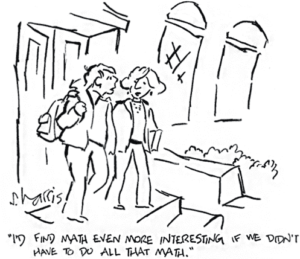

1920 年，化学家撰写科学论文时可能会使用如下语言：

到 1960 年左右，措辞会变得更像这样：

在当今，我不会惊讶于看到它被写成这样：

技术写作似乎形成了一种风格，其目的不那么是为了与你沟通，而是为了用作者的聪明才智给你留下深刻印象。这不是那种书。爱因斯坦曾说：“除非你能向你的祖母解释清楚，否则你并不真正理解某事。”因此我怀着这个想法写了这本书，并进行了测试。我找了一位没有数学训练的祖母（不是我的）来阅读，她通过了测试。她完全懂了。（谢谢，Levitt 女士！）

尽管这是一本关于计算机算术的书，但它面向大众读者。它结合历史记录和我个人的经历，展现了事物的人文一面。阅读本书不需要微积分，也不需要超越 K-12 数学背景的任何知识。我竭尽全力让这个极其枯燥的主题尽可能清晰有趣。有时甚至幽默，近乎离经叛道。


出版商慷慨同意在每一页使用四色印刷。最难的部分或许是所有的二进制数字，即使是计算机科学专业的学生也难以阅读。对长比特串中的 0 和 1 比特进行颜色编码，使其更容易理解。大多数人是视觉学习者，我在创作本书的过程中花费了一半以上的时间来制作解释概念的插图。文本背景也采用颜色编码作为路标，告知您何时涉及数学、计算机代码、重要要点、陷阱等。

每章至少包含一道“读者练习”，供有进取心的读者挑战。如果您不尝试这些练习，仍建议阅读“练习答案”部分，因为那里包含书中其他地方没有的新内容。

本书没有脚注、尾注，甚至没有参考文献。现代网络搜索使得通过作者姓名和主题查找来源变得极其容易，因此参考文献部分显得过时。也没有“定理-证明”结构。采用的是相反的方法：一步步构建概念，甚至允许您看到过程中犯的错误。凭经验我可以断言，数学家会讨厌这本书及其非正式风格。“希腊字母在哪里？晦涩的符号在哪里？我觉得你在居高临下地跟我说话。”他们当然有权保留自己的观点。

# 致谢


美国和新加坡政府，我最喜爱的两个国家，使这本书成为可能。

有三人因促成了导致 `posit` 格式发现的研究，从而使本书内容得以呈现，特此鸣谢：

*   **Marek Michalewicz** 博士，前新加坡 `A*STAR` 计算资源中心（`A*CRC`）主任，
*   **Tin Wee Tan** 教授，新加坡国家超级计算中心（`NSCC`）主任，以及
*   **Weng-Fai Wong** 教授，新加坡国立大学计算机学院教授。

在看到我早期寻找优于浮点运算的尝试的潜力后，他们为我安排了前往新加坡继续研究的绝佳条件。**Wong** 教授还允许我共同指导他的两位优秀研究生 **Elavarasi Manogaran** 和 **Himeshi De Silva**，她们进行了数百小时的实验性计算研究，指导了 `posit` 算术设计中的选择。

我同样无法言喻地感谢那些审阅我的草稿并提供详细（且极其必要）反馈的人。**Hauke Rehr** 不仅是一位敏锐的数学家，对正确性有着敏锐的洞察力，还拥有近乎超人的能力，能发现逗号字体大小相差一个点这类细节。**Laslo Hunhold** 不仅提供了宝贵反馈，还在本书最后一章收录前，凭借他自己的 `takum` 格式推动了技术前沿。我的女儿 **Janice Marquardt** 在发现其他审阅者未注意到的问题方面提供了巨大帮助。

`posit` 格式的创建源于 **MIT** 的 **Kurt Keville** 的请求，他在 2016 年 11 月告诉我 `RISC-V` 委员会想要一种非 `IEEE Std 754` 的实数格式，并请我为他们设计一种。在与 `Type II unums` 的修改斗争了三周后，我在 12 月 3 日实现了硬件友好的突破。我也感谢 **Kurt** 对本书草稿的详细反馈。像我的新加坡支持者一样，他也是 `posit` 算术格式存在的另一个理由。

**NSCC** 的 **Siew Hoon (Cerlane) Leong** 博士主导了 `SoftPosit` 库的开发、[posithub.org](http://posithub.org) 网站的建立以及“下一代算术会议”（`CoNGA`）系列的创办。她还协助在 `Posit Standard (2022)` 中做出了许多关键决策，包括 `quire` 应如何处理异常。没有她无限的精力和敏锐的洞察力，我不知道如何为 `posit` 格式建立桥头堡。

封面艺术由杰出且多才多艺的新加坡艺术家 **Sumei Chew** 创作。尽管她不是数学家，却捕捉到了数学中存在的惊奇感和真正的乐趣，这也是我希望读者能在本书中发现的。在我在新加坡的岁月里，她是我的良师益友，让我的体验比原本更美好。

令我惊喜和欣喜的是，漫画家 **Sidney Harris** 允许我使用他优秀的漫画，您将在全书中看到它们。令人惊叹的是，他的许多妙语竟与所在章节的主题完美契合。作为一个漫画家，他似乎对科学家在黑板前的行为了如指掌。谢谢您，**Sidney**。

# 如何阅读本书

当引入术语时（有些是行业通用的，有些是本书创造的），首次使用会在浅青色的 **Definition** 框中解释，如下所示：

如果您忘记了定义，请查阅词汇表（第 353–361 页）。

当引用他人的著作或历史工作时，会显示在羊皮纸色的框中，如下所示：

浅红色背景用于提示读者涉及数学内容，如下所示：

通常可以跳过那些公式展示，而不影响主体文本的阅读流畅性。

同样，除非您感兴趣，通常也可以跳过计算机代码。代码采用浅绿色背景。有两种计算机代码：一种类似 `C` 或 `C++`，展示如何一般性地编程，如下所示：

```
unsigned reverse (unsigned x) {
    x = ((x & 0x55555555) << 1) | ((x >> 1) & 0x55555555);
    x = ((x & 0x33333333) << 2) | ((x >> 2) & 0x33333333);
    x = ((x & 0x0F0F0F0F) << 4) | ((x >> 4) & 0x0F0F0F0F);
    x = (x << 24) | ((x & 0xFF00) << 8) |
            ((x >> 8) & 0xFF00) | (x >> 24);
    return x;
}
```

另一种是实际执行的实时代码。本书不是用文字处理程序或 `LaTeX` 创建的；整本书是一个用 `Mathematica` 编写的计算机程序。例如，这段代码

```
morris8 = Union[morris8];
Print["morris8 has ", Length[morris8], " unique numbers."]
```

```
morris8 has 144 unique numbers
```

实际执行；它生成文本中后续的内容。`Mathematica` 的输入命令采用粗体 **Courier** 字体（一种打字机风格字体），文本输出采用常规 **Courier** 字体，不加粗。有时输出是图形。

单字母变量简洁，但有时较长的名称能更好地提示所代表的含义。短语中的单词或缩写词连接在一起，用大写字母指示新单词的开始，这种系统称为 `CamelCase`。也有首字母小写的 `camelCase`，这正是创造变量名如 `maxPos`（最大 `posit` 值）和 `eS`（指数大小）所用的规则。`Mathematica` 的保留字使用 `CamelCase`，因此使用小写 `camelCase` 避免了与保留字冲突。

虽然本书目的绝非教授 `Mathematica`，但了解一切皆通过符号数学计算，直到您要求用 `N[...]` 命令转为数字会有所帮助，如下所示：

```
Print[π]
Print[N[π]]
Print[N[π, 16]]
```

```
π
3.14159 2654
3.14159 26535 89793
```

粗体 **Courier** 字体用于显示二进制数字，如 **0101101**。十进制数字保持与主文本相同的字体，如 1000。

这种浅蓝色背景的框内文本很重要，请勿跳过：


# 1 Posit 数字格式

## 1.1 思想的本质

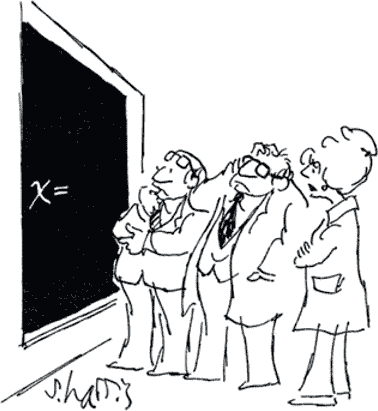

无论 `x` 最终是什么，都有一种方法仅用三位就在计算机上表示它。

大多数关于数学思想的书籍都会建立定义基础，让读者等待以了解事态的发展。相反，本第一章将用尽可能少的页数带你直达核心。稍后，我们可以探讨事物运作方式的底层细节和原因。

这里有一个常见的误区：

假设计算机使用三位来表示数字。共有八种可能的位模式，如果我们把它们视为普通的基数-2 `unsigned`（无符号）整数，它们在任何传统现代计算机上的含义如下：

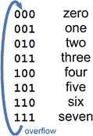

这就是你能得到的一切。你可以用三位从零数到七，给最后一位加 `1` 并传播任何进位，就像小学加法一样，只是用二进制（基数二）代替十进制（基数十）。如果你试图给七的表示 `111` 加 1，会发生溢出，因为你无法存储进位位 `1000`，所以它会绕回零，即 `000`。

当计算机需要 `signed`（有符号）整数时，最常用的系统是：一旦最左边的位变为 `1`，数字就从正翻转为负，然后它们向上计数回到零，如下所示：

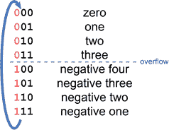

最左边的位（最高有效位，或 `MSB`）能快速告诉我们一个数是否为负，所以它常被称为 `sign bit`（符号位），这里的惯例是将其标为**红色**，因为会计师用这种颜色表示负数金额已久，以至于“入红”成了负债的同义词。

`unsigned` 整数若从 `111` 向上计数会溢出，但 `signed` 整数若从 `011` 向上计数会溢出，所以这只是不连续点放在哪里的问题。如果你从负一 `111` 向上计数，会忽略进位溢出得到 `000`，所以系统会自动做正确的事。

*然而*：假设你改为给位模式赋予以下含义：

| 位模式 | 含义 |
| --- | --- |
| `000` | 0 |
| `001` | 实数 `x`，满足 0 < `x` < 1 |
| `010` | 1 |
| `011` | 实数 `x`，满足 1 < `x` < ∞ |
| `100` | 任何非实数 |
| `101` | 实数 `x`，满足 -∞ < `x` < -1 |
| `110` | -1 |
| `111` | 实数 `x`，满足 -1 < `x` < 0 |

这覆盖了整条实数线，-∞ < `x` < ∞，而且如果 `x` 甚至不是实数，它也提供了一种表示方法。我们将其简写为 `NaR`，意为“非实数”，它包括无穷大的形式、$\frac{0}{0}$ 等不定式、$\sqrt{-1}$ 等复数，甚至包括根本不是数字的东西，比如程序员试图将字符串 "zebra" 转换成这种数字格式。它*不是实数*。

这不是一个非常精确的系统，但它*确实*为每个 `x` 提供了唯一的表示。

最右边的位（最低有效位，或 `LSB`）标为**品红色**，称为 `ubit`（取自 **u**ncertainty **bit**，不确定性位，与 cubit 押韵）。精确数用以 `0` 结尾的位串表示。以 `1` 结尾的位串表示精确值之间（或精确值与 ±∞ 之间）的*开区间*。`a` 和 `b` 之间的开区间写作 (`a`, `b`)。例如，$\sqrt{2}$ 和 π 都用 `011` 表示，因为它们满足 1 < `x` < ∞。`ubit` 是 `unum` 运算的基础思想，`unum` 是 "**u**niversal **num**ber"（通用数）的缩写。因此，它读作 "yoo-num"，而不是拉丁语 "oo-num"（如 *E Pluribus Unum* 中那样）。

包含 `ubit` 就像写 $\sqrt{2} = 1.414\cdots$，其中 "\cdots" 意味着“最后一位显示的数字后还有非零数字：1.414 < $\sqrt{2}$ < 1.415。”这在数学上是正确的。如果你说 $\sqrt{2}$ = 1.414，你犯的错误就像说 2 + 2 = 5 一样。"\cdots" 的有无只需一位来表示，那就是 `ubit`，就像数的符号只需一位来表示一样。

注意我们没有给 `000` 的符号位着色，以提醒零没有符号。我们也不给 `100` = `NaR` 异常着色，因为异常也是无符号的。我们也不给 `NaR` 的 `ubit` 着色，因为把“非实数”视为精确量是讲不通的。

注意 `unums` 映射到一个环上，因为就像 `signed` 整数格式一样，`111` 紧挨着 `000` 完全讲得通。实数值和 `NaR` 以**紫色**显示在环外，位串显示在环内。

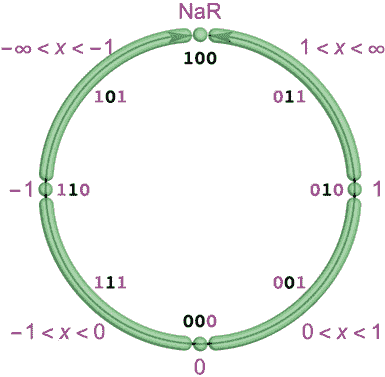

这个 `unum` *环图* 展示了整条实数线仅用三位映射的情况。

有一个概念叫*射影实数*，意思是把实数线看作圆在直线上的投影，光源在圆顶：

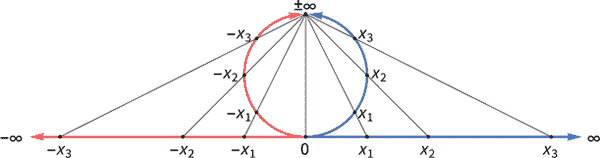

*射影实数*概念将无限直线映射到有限圆上。

我给这个古老概念添加了两点。第一是观察到 `signed` 整数以同样的方式优雅地映射到圆上，在圆顶翻转符号。第二是将 -1 和 1 放在圆的左右（东、西）点，使得在取数的*倒数*时关于水平轴对称。

为节省空间，(`a`, `b`) 表示开区间 `a` < `x` < `b`。三位系统有八项*词汇*：{`NaR`, (-∞, -1), -1, (-1, 0), 0, (0, 1), 1, (1, ∞)}。作为有序集，我们把 `NaR` 视作 -∞，小于所有其他项，尽管它也充当非实数的“垃圾箱”。

我们可以对精确数和区间都做运算。例如，区间 (0, 1) 的平方正是同一组值，(0, 1)。这看似不算什么，但其实意味着该系统比任何计算器都强大。试着在计算器应用（或实体计算器，如今那已近乎古董）中输入一个 0 到 1 之间的数并平方。对结果再平方。反复做下去，最终会发生两种情况之一：显示器错误地称结果恰好是 0，或称它是“非数字”。我刚在笔记本上试了试，得到了后一种情况。

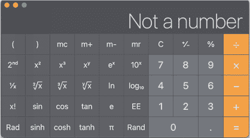

计算器应用的软件肯定用了远不止三位。可它却给不出“1e-50 的平方是多少”这个数学正确答案，因为科学计数法只有两位指数，最小只能到 1e-99（即 10^(-99)）。计算器说 10^(-100) 是“非数字”；我对此持异议。

这是另一个不涉及下溢或上溢的例子。输入 2 并开平方。反复按开平方键，你会越来越接近 1。

输入 2 并按 49 次开平方后，我看到这个结果：

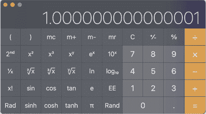


我又开了一次平方根，结果没变，这很有意思。它有一些“保护位”，知道的答案比显示器上显示的更多。但再开一次平方根，我得到这个：

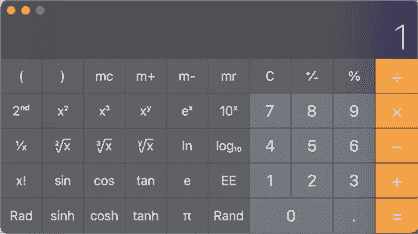

显示器精确显示 1。但那*不是真的*。

三位系统会怎么做？`(1, ∞)` 的平方根是同一组实数，`(1, ∞)`。你可以对 `(1, ∞)` 连续开任意次平方根，它永远不会产生数学上错误的结果 1。

## 1.2 提高精度

如果我们用四位代替三位，现在就可以在之前的值之间插入精确值。有许多可能的取值选择，但这里有一个合乎逻辑的选择：

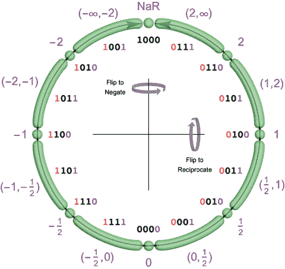

在 unum 环图上追加一位展示了开区间特异性的增加。

在 `0` 和 `1` 之间插入 `½`，并将其映射到负数侧。但我们也可以通过取倒数来绕*水平*轴反射，这样 `2` 就位于 `1` 和 `∞` 之间。注意取倒数对开区间同样适用。唯一的例外是，虽然 `0` 的倒数是 `NaR`，但 `NaR` 的倒数应保持为 `NaR`。一旦落在无效或不确定的结果上，至关重要的是 `NaR` 在每次运算下都得以保留，以便它出现在最终结果中，提醒出了问题。

在大多数数制中，取负是完美的，所以一旦你有方法将 `a` 和 `b` 相加，你也就有方法用 `a` 减去 `b`，通过计算 `a × (−b)`。对于上述系统，一旦你有方法将 `a` 和 `b` 相乘，你也就有方法用 `a` 除以 `b`，通过计算 `a + (1/b)`。如果 `b` 是 `NaR`，这能做正确的事，因为 `1/b` 也是 `NaR`，而任何数乘以 `NaR` 都是 `NaR`，从而保留了计算中出错的信息。

如何对有符号二进制整数取负？规则是：*翻转所有位并加 1，忽略任何溢出*。例如，如果整数是八位大小，整数 5 的二进制是

```
00000101
```

翻转所有位得到

```
11111010
```

然后加 1 就完成了。对于 8 位有符号整数，这是 -5 的位模式：

```
11111011
```

唯一会得到进位溢出的情况是当你试图对零取负时。例如，`00000000` 翻转为 `11111111`，给它加 1 应该是 `100000000`（九位），但你只有八位，所以最左边的位被丢弃。这就是为什么零没有符号；如果你用这种方式对零取负，你会得到零。

`NaR` 也缺乏符号，并具有相同的迷人特性：在环中，将四位值视为整数，所以 `NaR` 是 `1000`。翻转位得到 `0111`，加 1 得到 `1000`，你又回到了 `NaR`。

要“绕垂直轴翻转”以将 `x` 变为 `-x`，将位串视为有符号整数并对其取负。要“绕水平轴翻转”以将 `x` 变为 `1/x`，忽略符号位并对其他位取负（即翻转它们并加 1）。如果有进位，与符号位做逻辑或运算。这样，零 = `0000` 的倒数变为 `NaR` = `1000`。该规则也将 `NaR` 变回 `NaR`，所以没有异常情况。

我们之所以应该关心最小化异常情况，是因为异常情况使计算机算术硬件变得浪费、混乱（且更慢），并且更难在所有情况下证明其正确性。

## 1.3 严谨还是猜测？艰难的抉择


“完美是优秀的敌人。” — 伏尔泰

这将我们带到了一个艰难的选择面前。对于一个让我们在计算机上处理实数的系统，我们可以继续完善这个*完美*的精确数和精确数之间开区间的系统，或者我们可以接受一个*优秀*的系统，其中只有精确数，我们将每个实数舍入到其中一个，在此过程中产生并累积数学误差。

这是两个思想流派之间的战斗，有时类似于宗教战争。“足够好”的系统在计算领域最早出现，它是模仿科学计数法来表示实数，比如 `6.022 × 10²³`，我们为一个数字加上小数部分分配固定存储空间，乘以一个数字基数的幂。指数部分的存储量也是固定的。尾数部分可以是负数、零或正数，指数也是如此。用这种格式表示的数称为`浮点数`，简称 `float`。与整数计算不同，整数计算只要在可表示范围内就是精确的，`float` 计算几乎总是不精确的。但用户发现它们对于我们想用计算机做的许多事情来说“足够好”了。通常是这样。

`区间运算` 一词用于一种约六十年前引入的方法，其中所有量都被视为实数的闭集合 `[a, b]`，即满足 `a ≤ x ≤ b` 的实数 `x`。精确值表示为 `[a, a]`。端点用 `float` 表示，在进行运算时，规则始终是严格地*界定*结果，并希望界限足够紧凑以具有实际价值。

如果你可以选择用计算机获得数学上正确的答案，而不是靠猜测来完成计算且*大概率*足够好，谁会选后者？答案是：*几乎所有人*。在思想市场上，带有舍入误差的近似算术击败了 `区间运算`。主要原因是除非你*真的*知道自己在做什么，否则在计算中使用区间可能会产生类似 `[-∞, ∞]` 这样的结果。知道如何防止区间界限变得荒谬地保守（比应有的宽得多）的专家群体不大，但这是一个狂热的群体，有时会像复兴会布道者一样充满激情地为严谨计算辩护。在全世界进行的所有技术计算中，如果使用 `区间运算` 的量超过 1%，我会感到惊讶。

因此，本书大部分内容将做一些类似于 `float` 的事情，并假设我们在对量执行算术运算后进行*舍入*。但它们将使用上述描述的射影实数框架，而*不是* `float`。我们该叫它们什么？我最初的想法是称它们为 `guess`（猜测），因为舍入量是靠猜测来完成计算的一种方式。然而，“guess”可能带有贬义，所以让我们用一个更乐观的术语：`posit`。当用作名词时，其定义如下：

## 1.4 Posit 格式

有了这个理由，我们现在用精确值替换环图中的开区间，这样最后一位就不再是 `ubit`。不再有末尾的品红色 `0` 或 `1` 位，但我们引入了两种新的位颜色，**金色** 和 **棕色**，原因如下所述。我们还恢复了对 `0` 和 `NaR` 符号位的颜色编码，因为事实证明我们可以不再将它们视为“异常”。

这是 4 位 `posit` 的环图：

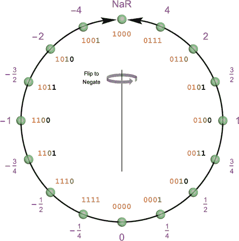

Posit 环图用区间内的单个点替换了开区间。

当最后一位是 `1` 时（我们过去在那里有一个开区间），“插入”规则如下：

*   在 `NaR` 和一个实数之间，插入该实数的两倍。
*   在 `0` 和一个实数之间，插入该实数的一半。
*   否则，在 `x` 和 `y` 之间，插入它们的平均值，`(x + y)/2`。


## 1.5 The Regime（幂制/Regime 表示法）


钢丝绒等级越来越细和衬衫尺码越来越大类似于 `regime` 表示法。

posit 的 `regime` 是紧随符号位之后相同的比特，以**金色**显示，直到遇到相反的比特，以**棕色**显示。

对于 4 位 posit，它们作为整数 `r` 的含义如下（未显示符号位）：

| regime | `r` |
| --- | --- |
| `000` | −∞ |
| `001` | −2 |
| `01` | −1 |
| `10` | 0 |
| `110` | 1 |
| `111` | 2 |

`regime` 值 `r` 由连续相同比特的数量 `k` 决定，即在遇到相反比特之前（如果存储的比特中出现相反比特的话）。

你看，posit 中最后一位之后的所有比特都隐含为 **0** 比特。就像当你说一个数是 1.53，没有其他信息时，你必须将其视为 1.5300000000⋯。因此，如果 `regime` 比特是 `111`，意味着它们一直延伸到最后一位，那么超出范围的隐含比特全是 **0** 比特；称它们为 `ghost bits`（幂灵比特）。紧随其后的幂灵比特是一个 **0**，它充当 **1** 比特序列的停止位。

如果 `regime` 是 `000`，一直延伸到末尾而没有相反比特来结束序列，会怎样？那么它代表一个*无限小的整数*，即 –∞，因为它永远无法到达其相反比特，是一个无限长的 **0** 比特串。

如果有 `k` 个连续相同的比特，`r` 的值为

还记得整数取反的规则吗，即翻转所有比特并对最低有效位 (LSB) 加一？它对 `regime` 表示法也适用，但方式完全不同。例如，如果你对 `regime` `110` = 1 取反，翻转比特得到 `001`，加 1 但将结果读作 `regime` `01`，其中 “·” 比特不属于 `regime`，因为它在相反比特之后。或者尝试对 `regime` `10` = 0 取反。将 `regime` 比特翻转为 `01`，并对 `regime` 的最后一位（即第二位，而非第三位）加 1，你会得到 `10`，即 `regime` 表示法中的 0。同样，如果你尝试对 -∞ 的 `regime` 取反，你会得到相同的比特模式，所以 -∞ 的表现完全像 NaR。它是“无穷远点”。

`Regime` 表示法很像服装尺码：L、XL、XXL、XXXL 表示大、加大等。对于小尺码，0、00 和 000 表示越来越小的服装尺码。

相反比特之后的 “.” 比特是*尾数比特*，代表小数部分 `f`。`regime` 最后一位之后有一个隐含的基点 “.”。到目前为止，我们只有一个尾数比特的可能性，在二进制中，`.0` 意味着 `f` = 0，而二进制 `.1` 意味着 `f` =½。“但如果没有尾数比特怎么办？”你可能会问。答案是：“*总是*有尾数比特。如果它们超出了数字的末尾，它们的值全为 **0**。” 拥有 `f` = 0 的小数值并没有什么错。

符号位的值是 `s`，即符号位为 **0** 时 `s` = 0，符号位为 **1** 时 `s` = 1。我们现在可以给出由 posit 比特串表示的值 `x` 的公式：

让我们通过解码 `1011` 来练习。符号位是 **1**，所以 `s` = 1。`regime` 是 `01`，所以 `k` 是 1 个连续比特，`r` = -1。尾数有一位显示（`.1` 后跟隐含的无限 **0** 比特串），所以 `f` =½。应用公式：

但该公式对 `x` = 0 的情况适用吗？令人惊讶的是，适用。比特串是 `0000`，所以 `s` = 0，`r` = -∞，`f` = 0。公式简化为 1 × 2^(-∞)，即 0。

那 NaR 呢？它的比特串 `1000` 意味着 `s` = 1，`r` = −∞，`f` = 0。公式简化为 (−1) × 2^∞ = −∞。那当然不是一个实数。我们只需规定 −∞ 作为任何非实数的替身，而不仅仅是 −∞。

这才是本章的妙处所在，且适用于任何 posit 精度。1 位 posit 是可能的，但它只能表示 0 或 NaR。

作为后续内容的尝鲜，让我们用 16 位 posit 试跑一下。用相同数量的比特，我们能表示的最大和最小幅度的 posit 值是多少？称这些极值为 `maxPos` 和 `minPos`。`maxPos` 是 `0111111111111111`，有 `k` = 十五个连续的 **1** 比特，所以 `r` = 14；`maxPos` = 2¹⁴ ≈ 1.6 × 10⁴。倒数运算是完美的；`minPos` 是 `000000000000001`，有 `k` = 十四个连续的 **0** 比特，所以 `r` = -14，且 `minPos` = 2^(-14) ≈ 6 × 10^(-5)。跨度超过 8 个数量级。

如果你解码 `0110100100100010`，会得到有理数 $\frac{3217}{1024} \approx 3.1416$，即 *π* 精确到约五位小数。为了对比，IEEE 标准 16 位浮点数能最接近 π 的是 $\frac{201}{64} = 3.140625$，仅精确到约三位小数。这只是 posit 格式优势的一个小小缩影。

如果我们要研究和比较*误差*和*精度*，最好进行深思熟虑且清晰明了地进行。这是 第 2 章 的主题。

# 2 正确处理不精确性


这并未真实发生。这是一张计算机生成的图像。

## 2.1 绝对误差与相对误差

就像数值分析中的许多事物一样，我们习惯了一些广被接受但逻辑其实相当松散的概念。我们衡量各类*误差*的方式就是其中之一。例如，这是一种广泛使用的衡量实数计算结果误差的方法：

这没有错；如果值相同，它们的差为 0，所以没有误差。绝对误差适用于某人谎报年龄、驾驶速度或喝了多少杯酒的情况。但如果计算产生 315 而不是 314，这个误差看起来不是很像返回 3.15 而不是 3.14 吗？为*实数*设计的数制通常跨越很大的动态范围。当被比较的值在同一数量级内时，简单地相减可能是最好的度量。

对于跨越多个数量级的情况，计算值的*相对误差*传统上定义如下：

你有理由对这个定义不满意。如果正确答案是 100 而你计算出 −1，上述相对误差公式结果仅为 1.01。如果你甚至不知道一个数的符号，那么你对答案几乎一无所知，因为符号是数字最重要的部分。在这种情况下，误差公式应返回“未定义”。即使宣布相对误差为无穷大，都算过奖了。

如果你做实验测量得到了两个不同的值 `x[1]` 和 `x[2]`，你可能想谈谈测量中的相对误差。但你不知道 `x[exact]` 值。取决于你将 `x[1]` 还是 `x[2]` 放在分母上，你会得到不同的相对误差。这似乎不对劲。


另外，该公式对于数字及其倒数来说截然不同。假设 `x[computed]` = 0.001 但 `x[exact]` = 0.0001。此时相对误差为 9。但如果我们改为计算这些数字的倒数，相对误差将以 `x[computed]` = 1000 和 `x[exact]` = 10 000 作为输入，上述公式会让我们放心地认为相对误差仅为 0.9。仅通过取倒数就让答案看起来精确十倍，这毫无道理。如果你已知某波长的相对误差为 0.1，得知同一组件的频率（与波长成反比）的相对误差为 0.2，难道这不让你困扰吗？如果我们不计算两个数字的差，而是计算两个数字的 `logarithm`（对数）之差，这些问题就迎刃而解了。

## 2.2 三种对数

处理宽动态范围信号（如声音）的工程师们早就有了比较数字比率的解决方案，即使用 `decibels`（分贝）。比率为 10 即为 10 分贝（10 dB），也称为 1 `bel`（贝尔），尽管这个词不常用。1 dB 的比率意味着比率为 10^(1/10) = 1.2589 ⋯。`Decibels`（分贝）测量两个（正）量 `x[1]` 和 `x[2]` 的对数（以 10 为底）之差，这等同于它们比率的对数：

绝对值使得 `x[1]` 和 `x[2]` 可以互换。因此，它可用于测量实验误差。此外，无论你使用 `x[1]` 和 `x[2]` 作为输入，还是 1 / `x[1]` 和 1 / `x[2]`，它都会产生相同的结果。所以 `that`（这）看起来像是一个数学上合理的定义。但如果 `x[exact]` 是 100，而我们计算出 `x` = 110，误差约为 4 dB，这看起来完全不像传统的相对误差值 0.1。我们能否两全其美，既拥有比率对数的优雅，又拥有类似传统相对误差的形式？

我们这里将用到三种对数。以 10 为底的对数利于人类理解，因为我们倾向于用 10 的幂次来思考，如百、千、十亿等。计算机科学家倾向于使用以 2 为底的对数胜过其他任何类型，以至于以 2 为底的对数有其专用缩写：`log2(x)` 常写作 `lg(x)`。例如，如果被告知“内存地址空间有 4096 个项目”，计算机科学家会立即推断地址中有 `lg(4096)` = `lg(2¹²)` = 12 位。

第三种是 `natural logarithms`（自然对数），以 `e` = 2.71828 ⋯ 为底，因为该底数简化了高等数学中出现的表达式。它也有自己的缩写：`loge(x)` = `ln(x)`。以下是这三种对数的图表：

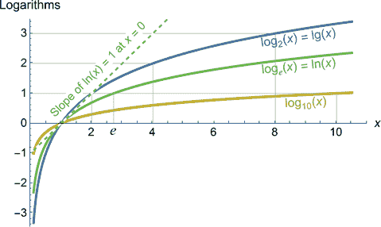

`log2` 适合计算机，`loge` 适合数学，`log10` 适合人类。

分贝类型的方法适用于任何底数的对数，因为对于任何种类的对数，都有 `log(a) - log(b) = log(a / b)`。选择 `natural logarithm`（自然对数）底数 `e` = 2.718 ⋯ 而非 10 来测量相对误差，有一个微妙的原因：随着误差变小，自然对数误差会接近传统相对误差。如图所示，`ln(x)` 在 `x` = 1 附近的斜率为 1。

对数定义满足了其他要求，即不受测量倒数或交换两个值的影响。因此，这是我们将使用的定义：

假设精确答案是 3.00 但我们计算出 3.03；传统相对误差是 `$\frac{0.03}{3.00} = 0.01$`，但上述公式给出 `$\ln(\frac{3.03}{3}) = 0.00995$` ⋯ 两者非常接近，这意味着传统主义者不应对更新后的定义感到太不满。我们要感谢 Peter Lindstrom 的这一敏锐观察。

如果 `x[exact]` 为零怎么办？除非 `x[computed]` 也是零，否则相对误差为 ∞，这让一些人非常不安，因为计算值如 0.000001 似乎理应因与零有 `some`（某些）相似度而得分。抱歉，不行。在实数世界里，零的对数与任何非零值的对数相距无穷远，就像无穷大的对数与任何有限值的对数相距无穷远一样。人们在思考极小值的相对精度时，倾向于在脑海中退回到想要绝对误差；要抵制这种倾向，因为它会让你陷入麻烦。

如果 `x[computed]` 甚至没有正确的 `sign`（符号）怎么办？此时相对误差为 NaR。字面意义上的。公式会取负数的对数，那是一个复数，即非实数。否则，我们得到了期望的对称性，且 `relErr(x, y)` = `relErr(y, x)` = `relErr(1/x, 1/y)`。

通常，我们关心误差的大小，而不关心它是偏低还是偏高。如果我们在表达式中去掉绝对值 |…|，就会得到 `signed relative error`（有符号相对误差）。下一页的图表展示了有符号传统相对误差、倒数的传统相对误差，以及此处使用的自然对数相对误差：

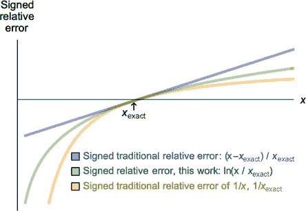

`ln(x/x[exact])` 相对误差介于传统相对误差和传统倒数相对误差之间。

| `ln(x/x[exact])` | 这种情况是“正确处理不准确性”，这是一个具有数学自洽性的定义，且当误差量小时，它与传统相对误差定义非常相似。

## 2.3 精度作为误差的倒数

也就是说，我们能以可证明的方式越严格地限定结果的数值范围，我们就越了解其真实值。

同样，`accuracy`（精度）是相对误差的倒数，当我们说“答案精确到小数点后五位”时，我们就已经在使用这个概念了。如果相对误差约为 0.001，则我们知道答案约精确到 3 位小数；如果相对误差为 0.0000001，则我们知道答案精确到 7 位小数。数学上：

计算机科学家或数值分析师有时可能想知道答案正确到多少 `bits`（位）。这很简单。只需使用以 2 为底的对数而非以 10 为底的对数来求得 `binary accuracy`（二进制精度）。或者计算十进制精度并乘以 `log2(10)` = 3.32…，得到同样的结果。

表达式中混合两种不同的对数类型看起来很特别，但自然对数使传统相对误差类似于我们基于比率的相对误差。然后，`that`（该值）的对数以适合人类（`log` 以 10 为底）或计算机（`log` 以 2 为底）的形式显示精度。

附录 A 包含基于上述十进制精度定义的 `Mathematica` 函数 `decAcc[x, y]` 的代码。让我们用它来测试 π 的近似值：

```
decAcc[3.14, π]
decAcc[3.1416, π]
decAcc[π, π]
```

```
3.29491844
5.63107 5206
∞
```

即 π 精确到约三位小数、约五位小数和无限精确。`Mathematica` 使用符号方法，因此 π 可以精确书写。

## 2.4 数制的精度

既然我们有了精度的定义，也可以分析数制的精度。假设我们使用 8 位 posit，如 第 1 章 所述。我们只需考虑非负值的精度，因为负数表示的精度相同。这里展示了所有 128 个非负 8 位 posit，以环形图形式呈现。称它们所代表的值为 `posit8` 集合。

为了使图表更易读，径向线表示 regime 值的变化，这些变化发生在 2 的整数幂处。注意有一半的值在 0.5 和 2 之间，那里间距最小，因此精度最高。

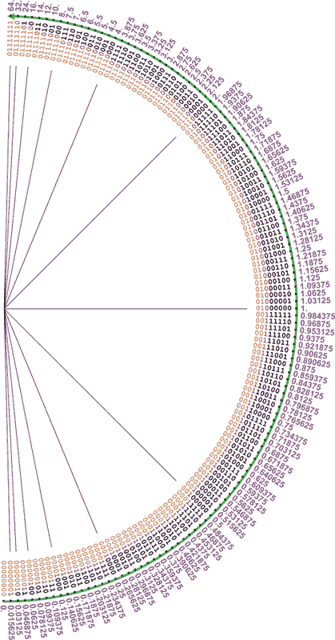

8 位 posit 环形图的右半部分。径向线指示 regime 变化。


## 2.5 舍入与精度

舍入规则可以总结为：“将实数 `x` 舍入到最近的 posit；如果两个 posit 距离相等，则选择以 `0` 位结尾的那个。”还有一些重要的额外细节，但目前这条规则足够使用。让我们先研究 `posit8` 集合中的三个连续值：`{7.5, 8, 10}`。`7.5` 和 `8` 之间的临界点是 `7.75`。`8` 和 `10` 之间的临界点是 `9`。

如果我们计算出的值恰好是 `7.5`、`8` 或 `10`，则精度为无穷大。在这些精确可表示的值之间，精度在临界点处降至最小。

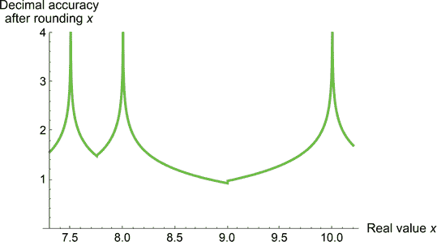

峰值实际上延伸至无穷大，因为在精确点 `7.5`、`8.0` 和 `10.0` 处精度为无穷大。

请注意两个极小值处的轻微不连续性。这是由两个值 `x` 和 `y` 的*几何*平均数 `$\sqrt{x \cdot y}$` 与*算术*平均数 `(`x` + `y`)/ 2` 之间的差异引起的。不连续点位于中点，但这些*并非*十进制误差（定义为对数距离）最小化的位置。最小误差应出现在几何平均数处，即 `$\sqrt{7.5 \times 8} = 7.7459669\cdots$` 和 `$\sqrt{8 \times 10} = 8.944\cdots$`，而不是算术平均数 `7.75` 和 `9`；在如此低的 8 位精度下，这种差异足以在图表中勉强看清。

因此，数制的精度取决于舍入策略。根据我们对相对误差的定义，相邻值 `x[k]` 和 `x[k+1]` 之间最坏情况下的十进制精度出现在它们的算术平均数 `(`x[k]` + `x[k+1]`)/ 2` 处，相对于幅度较小的 `x`。

在算术平均数处，最坏情况下的十进制精度为

换句话说，数值词汇表的最坏情况十进制精度非常接近相邻点的十进制精度再加上 `log10(2) ≈ 0.3`。

下图展示了将一系列实数值舍入到 `posit8` 词汇表时的十进制精度图：

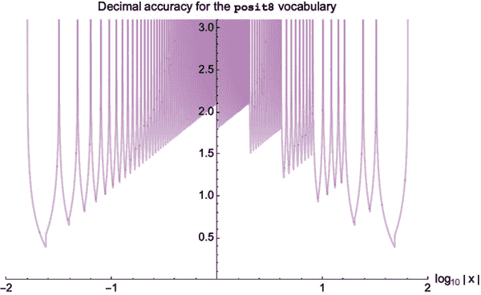

8 位 posit 拥有近 4 个数量级的动态范围，但最多只有 6 个有效位。

该图详细展示了整个数制在其动态范围内的精度，但精确点处垂直延伸至无穷大的尖峰使其难以阅读。让我们改为悲观地看待数值集合中每个点的*最坏情况十进制精度*。

下图仅显示了每个波谷的底部。如果忽略右半部分的锯齿状，它呈现出一个对称的帐篷形状。相对精度从零点向两侧逐渐降低。

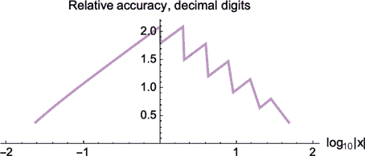

这是精度图的常见形式：十进制相对精度作为幅度的函数。

对于更高精度的 posit，锯齿状不那么明显，十进制精度看起来更像一个在中心达到峰值的对称三角形。

一系列依赖于先前舍入结果的计算，其精度通常仅取决于最不精确的那一步计算，就像链条的强度仅取决于其最薄弱的环节。这就是为什么使用悲观的最小精度是合理的，并假设计算链会跌入每个波谷附近的底部。

还有另一种绘制十进制相对精度的方法，即将其作为 `bit pattern`（位模式）的函数绘制，该位模式被视为二进制整数，而非按 posit 格式规则表示的实数。这说明了有一半的位模式位于最高精度区域，该区域将在下一节定义。


精度也可以作为 `bit pattern` 的函数绘制，此处展示了正数 8 位 posit 的情况。

## 2.6 中心区

最高精度区域多年来一直被称为 posit 用户口中的“最佳区”，但 Will Wray 想出了一个聪明、简短的词来称呼它：`fovea`（中心窝/视网膜中央凹），就像眼睛视网膜上分辨率最高的部分：

正如环形图所示，一半的 posit 都在中心区内。四分之一的 posit 的 regime 长度为三位（`001` 或 `110`），因此比中心区 posit 少一位有效数字。八分之一的 posit 的 regime 长度为四位，依此类推。

要获得 posit 的最精确结果，有助于尽量保持在中心区内或不远离它。游离到非常大或非常小的幅度，即使只是暂时的，也会导致相对精度损失，这种损失可能会传播到最终答案，使其精度降低。幸运的是，大多数现代数值方法已经过精心设计，以避免上溢和下溢，从而保持在动态范围的中心附近。这些方法已经非常适合 posit 了。


8 位 posit 的 `fovea` 范围为 `½ ≤ |x| ≤ 2`。

## 2.7 定点精度

将数字按二的整数次幂缩放，就像移动基点位置。如果不必这样做，而是可以直接假设基点位置固定，会怎样？那将腾出用于指示缩放的位，用于增加尾数位。定点格式类似于美元和美分，基点右侧有两位数字。你可以将每个金额视为美分数（即 `$\frac{1}{100}$` 美元）的整数倍。

假设我们有一种 8 位格式，视为有符号整数，代表 `$2^{-4} = \frac{1}{16}$` 的倍数。即，它在基点右侧有四位，其能表示的 256 个不同值为：

```
\begin{matrix} 
{\mathbf{0000}\mathbf{.0000}} & \text{0} \\ 
{\mathbf{0000}\mathbf{.}\,\mathbf{0001}} & {\frac{1}{16} = \text{0.0625}} \\ 
{\mathbf{0000}\mathbf{.0010}} & {\frac{1}{8} = \text{0.125}} \\ 
\vdots & \vdots \\ 
{\mathbf{0111}\mathbf{.1111}} & {\text{7~+}\frac{15}{16} = \text{7.9375}} \\ 
{\mathbf{1000}\mathbf{.0000}} & {-8} \\ 
{\mathbf{1000}\mathbf{.0001}} & {- \left( {7 + \frac{15}{16}} \right) = - \text{7.9375}} \\ 
\vdots & \vdots \\ 
{\mathbf{1111}\mathbf{.1111}} & {= - \frac{1}{16} = -0.0625} \\ 
\end{matrix}
```

将正值称为 `fixed8` 集合。这些点等距分布。与 `posit8` 的精度图相比，正值集合的十进制精度图会是什么样子？这里它们在同一张图上：

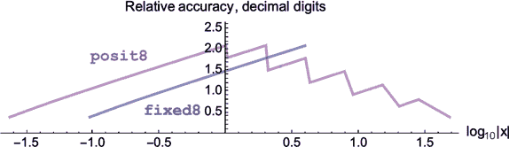

8 位 posit 与 8 位定点的精度图对比

图表显示，定点格式不支持宽动态范围，且小幅度值的表示精度远低于大幅度值。这通常不是技术计算所期望的。在某些应用中，定点格式正是所需（如金融程序），这也是绝对误差可能比相对误差更有用的场景。

## 2.8 ULP 与相对精度“摆动”

术语 `ULP` 代表最后一位单位，它在衡量不精确度方面有一些用途。通常发音类似 "gulp"（咕噜），而不是 "you-ell-P"。测量 ULP 假设当你按二进制计数递增时，所表示的实数值也随之增加。这并非对所有实数格式都成立。它是衡量计算结果与（正确舍入的）精确结果之间距离的一种方法：它们的位串相距多远？


## 2.9 定点数与科学计数法中的相对精度

假设我们使用 `fixed8`，正确答案是 $\frac{1}{8}$ = `0000.0010`，但计算出错，得到 $\frac{3}{16}$ = `0000.0011`。这就是 1 ULP 的误差。但作为相对误差，它是 $\left| {\log(\frac{3}{16}/\frac{1}{8})} \right| \approx 0.41$，这是一个相当差的结果。该结果只有约 0.38 位十进制的相对精度。

另一个极端是，假设正确答案是 $\frac{127}{16}$ = 7.9375 = `0111.1111`，但计算结果仅低了 1 ULP，所以我们得到 $\frac{126}{16}$ = 7.875 = `0111.1110`。由此产生的相对误差小得多：$\left| {\log\left( {\frac{127}{16}/\frac{126}{16}} \right)} \right| \approx 0.008$，我们有约 2.1 位十进制的相对精度。因此，定点数格式的相对精度范围很大，对于小幅度的结果，精度会变小。

在科学计数法中，假设指数正确，ULP 是尾数最后一位十进制数字的误差。例如，光速在米每秒下的 2.99 × 10⁸ 与 3.00 × 10⁸ 的对比。

所以这里的“decade”（十进制数量级）与 10 年的时间跨度无关。它是一个跨越 10 dB 的数值范围。如果一种数字格式的最小正值为 `10^(-6)`，最大正值为 `10⁶`，我们可能会说，“该格式覆盖十二个十进制数量级的动态范围”。另一个常用术语是*数量级*，所以如果某物偏差了 1000 倍，无论是太小还是太大，它就偏差了“三个数量级”（1000 的以 10 为底的对数）。

回到 ULP 的主题：如果我们的科学计数法系统有三位有效数字，十进制数量级底部附近的 1 ULP 误差是 1.01 对比 1.00，其相对误差约为 0.01，十进制精度约为 2 位。但在十进制数量级顶部，9.98 对比 9.99 的相对精度接近 0.001，小十倍，十进制精度接近 3 位。十进制精度随尺度因子 `10^n` 的每个十的幂次从 2 位增加到 3 位，产生如下锯齿形状的十进制精度：

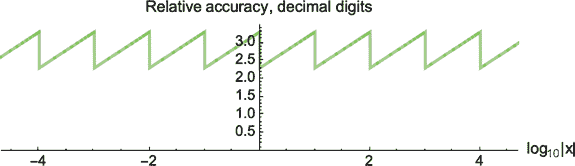

科学计数法中相对十进制精度的“摆动”从最差到最好相差一个十进制数量级。

但这是个误称。*精度* 根本没有摆动。精度是恒定的三位十进制数字。这种现象应称为*摆动相对精度* 或*摆动相对误差*。注意，摆动不是从 2 到 3 位，而是从约 2.3 到 3.3 位，因为当用作数制时，最坏误差发生在两个可表示数字的中点，如 第 2.4 节 所述。

减少摆动的一种方法是将尺度因子的基数设为 2，而不是 10 或 16。这将摆动减少到 `log10(2)` ≈ 0.3 位十进制数字。

在某些数制中，包括 posit，尾数数字始终表示 1 到 2 之间的值，忽略 `2^n` 尺度因子和符号。

早期的 IBM 大型机使用一种以 16 的幂代替 10 的幂的科学计数法形式，以更适合二进制计算机。但 16 为底的指数使摆动比 10 为底的指数更糟。略大于 1 的实数表示精度会比略小于 1 的实数低 16 倍。基数 2 的摆动小得多，如下图所示：

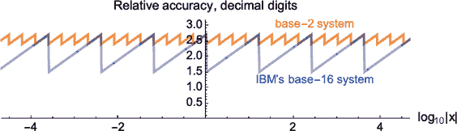

使用基数 16 会降低相对精度，并使摆动比使用基数 2 糟糕四倍。

Posit 的工作方式不像科学计数法，但它们仍然表示二进制数量级乘以尺度因子，所以在它们的相对精度图中你会看到类似的缺口。

例如，`posit8` 中央区（fovea region）锯齿的形状与前面精度图中的锯齿形状完全一样：

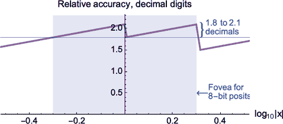

这是中央区的特写视图，叠加了部分常规精度图。

## 2.10 转换中的损失

这是使用计算机进行实数计算时应牢记的图景：

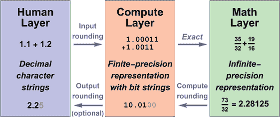

这是使用计算机处理实数时要记住的三个层次。

图表显示了三个层次：人类层、计算机层和数学层。它还展示了一个简单的计算“1.1 + 1.2”如何因三个舍入步骤而变得面目全非。图中的示例将 `posit8` 集用于计算层，但定点数、浮点数或任何其他二进制表示也会发生同样的情况。原因是十进制中的 1⁄10 = 0.1 在二进制中变成了无限循环模式 `0.0001100110011`⋯，就像 ⅓ 用十进制表示时变成无限循环模式 0.333333⋯ 一样。

输入舍入发生在十进制转换为二进制时。这里，最接近 1.1 的二进制是 `1.00011` = $\frac{35}{32}$ = 1.09375。最接近 1.2 的二进制是 `1.0011` = $\frac{19}{16}$ = 1.1875。只有当十进制数恰好能精确表示为有限二进制串时（如 0.375 = `0.011`），才不会发生舍入。不仅分数会遭受输入舍入。例如，如果你尝试添加 9 和 11，这两个整数都不在 `posit8` 的词汇表中，计算会对这些输入进行舍入。任何具有良好动态范围的数制都会有这个问题：大数值*采样*整数空间，跳过大片整数，而不是通过简单地计数在一个区间内包含所有整数。

向数学层的*转换*是完美的。如果你有时间，上帝就有整数。数学层中的计算不需要是完美的。

也就是说，数学层考虑到会有舍入返回计算层，因此它可以执行达到该结果所需的*有限*工作量。在示例中，有理数被正确相加得到 $\frac{73}{32}$ = 2.28125。数学层是具有更多位的额外寄存器、隐藏算法和其他技术，处理用户无法访问的数据。

*计算舍入* 是指当运算结果需要的位数超过了计算层可用位数时发生的情况。我们词汇表中最接近 $\frac{73}{32}$ 的数是 $\frac{9}{4}$ = 2.25。

正确性的最后一击来自*输出舍入*，即二进制数用十进制表示。虽然总能精确表示，但可能非常冗长，且这样做会给人一种误解，以为答案的有效数字远比实际多得多。例如，$\frac{1}{1024}$ = 0.0009765625 精确相等，但如果 $\frac{1}{1024}$ 是涉及舍入误差的计算结果，那么 $\frac{1}{1024}$ ≈ 0.001 的输出舍入能传达输出中的不准确性。经验法则是，输出中表达的有效数字不应超过（至少不应大幅超过）输入中表达的有效数字，“1.1 + 1.2”使用两位数字输入。因此，如果我们使用银行家舍入法（尾数为 5 时舍入到最近的偶数），将结果 2.25 舍入为两位数字输出，在人类层将变为 2.2。


你可能会想：“为什么不让计算机来完成十进制计算的额外工作，从而消除输入和输出的舍入误差呢？”这是一个很好的问题。有时，这确实是应该做的。存在支持精确十进制表示的计算机数字格式。然而，支持二进制格式计算的论点是这样的：通常，你进行的计算舍入次数远多于输入舍入或输出舍入的次数。使用十进制格式计算的速度至少比二进制格式慢一倍。如果你输入一个数字，执行数千次（舍入）计算，并格式化结果以供输出，那么使用十进制格式仅在所有那些数千次计算中的两次（输入和输出）中保护了你。而十进制格式至少让你慢了两倍。通常，这并不是一个好的权衡。

在离开翻译误差这个话题之前，有一个重要问题需要为每种二进制数字格式回答：需要多少位十进制小数才能表达一个二进制结果，使其能转换回同一个二进制结果？例如，`posit8` 中最小的正值是 `$\frac{1}{64}$` = 0.015625，但你是否需要所有这些小数位来确保当它转换回 `posit8` 值时，它能转换为 `$\frac{1}{64}$`？0.0156 足够吗？0.016 呢？

结果表明，你只需要 0.02，仅一位有效小数，就能确保它转换回 `$\frac{1}{64}$`。这很节省空间，*前提是*你确定“人类层”中的“0.02”在下次需要该值时会被转换回同一种低精度格式。

在 `posit8` 值具有更多有效数字的中间范围附近，你需要多达三位小数来表达它们，以确保它们能转换回正确的 posit。例如，连续的 `posit8` 值 `$\frac{33}{32}$`、`$\frac{17}{16}$`、`$\frac{35}{32}$` 可以表示为精确小数 1.03125、1.0625、1.09375，但你只需要 1.03、1.06 和 1.09 就能确保它们转换回 `$\frac{33}{32}$`、`$\frac{17}{16}$` 和 `$\frac{35}{32}$`。

一个小程序让我们能测试每个值，看需要多少位小数。这与十进制精度有关，但不完全相同。它混乱得多，很难找到一个闭式方程来计算需要多少位小数。这是 `posit8` 值的一个实证图表：

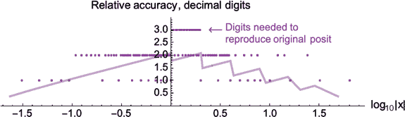

对于每个 8 位 posit，一个深洋红色的点显示了唯一指定它所需的小数位数。

也许 8 位的精度有些太低，无法显示出规律。这是文末提到的 16 位 posits 的图表（见 第 1 章）：

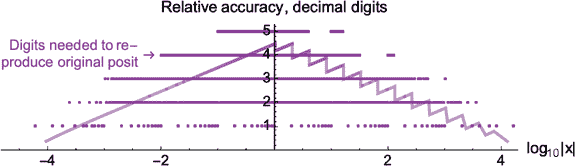

对于 16 位 posits，1 到 5 位小数的范围足以指定每一个。

这表明五位小数足以以一种能重新编码为相同 posit 的方式表达 `posit16`。但它也展示了渐变精度的优势之一：对于大数量级和小数量级的值，用科学计数法表达数字更节省空间，比如 “−6e−5”（五个字符）而不是 “−0.00006”（八个字符）。尽管 “e” 表示法需要额外的字符，但它为极端数量级节省了空间。有了渐变精度，越需要科学计数法，需要显示的小数位就越少。最小的正 `posit16` 值是 `$\frac{1}{16384}$`，可以表示为 “+6e−5”。对于像中央凹区那样的高精度值，需要五位小数但不需要 “e” 表示法，例如紧随 1.0 之后的三个 `posit16` 值：1.0001、1.0002、1.0004。

## 2.11 定义 `Overflow`（上溢）和 `Underflow`（下溢）

### 2.11.1 上溢谬误

一个常见的误解是：

这不完全正确，因为结果可以合法地*向下舍入*到最大可表示值，从而保持在范围内。所以我们提供这个定义：

以 8 位定点格式为例，幅度最大的负数是 −8。数字间隔为 `$\frac{1}{16}$` = 0.0625，因此平局点距离词汇表中的每个值 `$\frac{1}{32}$` = 0.03125。落在区间 `(-8.03125, -8)` 内的任何结果 `x` 都会舍入为 -8，而不算作“上溢”。对于正值，`fixed8` 中的最大值是 7.9375，再加上 `$\frac{1}{32}$` 是 7.96875，所以落在 `(7.9275, 7.95875)` 区间内的值不会上溢，即使它们大于该格式中最大的可表示实数。

下溢也有类似的定义。这里我们用“太小”来表示“数量级太低”（即太接近零），而不是“太接近 −∞”。

再次使用 `fixed8`，我们可以将 `$\frac{1}{16}$` 和 `$\frac{9}{16}$` 相乘，精确结果为 `$\frac{9}{256}$`，但这必须舍入到最小正值 `$\frac{1}{16}$`，或者被归类为下溢。平局点是 `$\frac{1}{32} = \frac{8}{256}$`，所以它向上舍入到 `$\frac{1}{16}$`，并*不*下溢。然而，相对误差相当高，相当于将 9 舍入到 16 的相对误差。该相对误差为 `|ln(16 / 9)|` ≈ 0.58。

下图总结了考虑舍入后的下溢和上溢的仔细定义。相对宽度不按比例绘制。

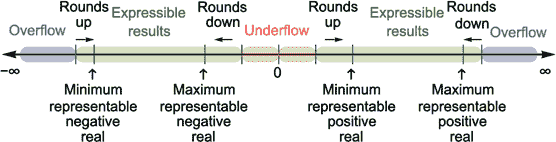

下溢和上溢需要考虑舍入因素。

请注意，结果必须带符号。如果计算结果可以正确地表示为零，那不算下溢。可表示结果范围的端点是开区间还是闭区间，取决于具体的舍入规则，如“平局舍入到偶数”或“平局向零舍入”等。

### 2.11.2 无限相对误差还是饱和？

在一些用于实数的传统格式中，存在 ∞ 和 −∞ 的表示，上溢可以返回适当的带符号无穷大。同样，下溢返回零。请注意，这会产生无限大的相对误差；如果正确答案是带符号值 `x` 而我们返回 0 或 ±∞，相对误差为 `|ln(±∞/x)| = |ln(0/x)| = ∞`。

传奇计算机科学家唐纳德·克努特在其《计算机程序设计艺术》系列中对下溢问题发表了见解：

第 2 卷，*半数值算法*，第 2 版，第 206 页。

Posit 算术则*饱和*到最近的带符号 posit。这保留了关于结果符号的信息，虽然相对误差可能很大，但至少它是已知的且是*有限*的。克努特提到的“某些情况”可以在软件中针对 posit 计算进行处理。

## 2.12 运算的不准确性

我们还需要能够衡量运算后舍入造成的误差量，比如加法、平方或任何其他函数。当在计算机上对*整数*进行加法或乘法运算时，你要么得到精确答案，要么上溢/下溢超出你能表示的范围。而处理*实数*时，你没有这种奢侈。

衡量实数格式优劣的一个指标是：它实际上有可能在不舍入的情况下表示运算结果的情况所占的比例。如果你必须舍入，舍入的相对误差应尽可能小。我们可以查看最坏情况的舍入误差和平均舍入误差。如果我们计算所有误差并按从小到大排序，这有助于我们直观地了解运算的整体不准确性。

### 2.12.1 一个简单的例子：平方根函数

平方根运算很容易评估，因为不存在上溢或下溢的可能性。它将可表示的（非负）实数集合缩减为这些数字的一个子集。让我们将误差评估应用于 `posit8` 集合和 `fixed8` 集合的平方根函数：


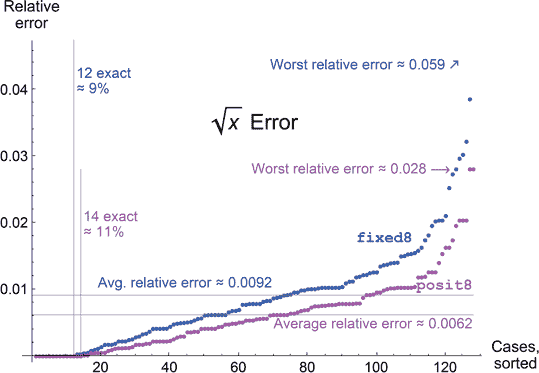

8 位普适数（品红）和 8 位定点数（蓝色）的平方根舍入误差

虽然这显示普适数在平方根运算的精度上更优，但请记住，定点运算的硬件比普适数更简单、更快，因此存在工程权衡。

### 2.12.2 双输入示例：乘法

对于双输入函数（如 `a + b`、`a − b`、`a × b`、`a / b` 和 `a^b`）以及较小的可能输入集合，我们可以详尽列出所有可能输入对的误差表。让我们尝试用乘法来做这件事，再次比较 `fixed8` 和 `posit8`。只需测试非负数即可，因为对输入取反不会改变误差。但与平方根不同，乘法可能会发生上溢或下溢。我们可以统计结果出现以下情况的次数：

*   上溢
*   下溢
*   在该格式中精确可表示
*   舍入为该格式中最接近的数

在最后一种情况下，我们计算舍入产生的相对误差，并找出最坏情况相对误差，以及包括无误差结果（精确）在内的平均误差。从 `fixed8` 开始。

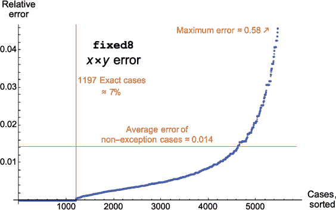

8 位定点数乘法的排序误差（图表大部分超出刻度）

如果我们用图形化方式布局乘法表，用颜色指示实数值的这种不完美表示会发生什么情况，看起来如下：

| 精确 | 舍入 | 下溢 | 上溢 |
| --- | --- | --- | --- |
| 1197 | 10503 | 20 | 4664 |
| 7% | 28% | 0.12% | 64% |

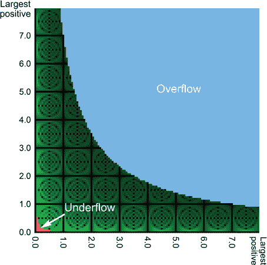

8 位定点数乘法的闭包图

`black` 像素表示精确结果，即乘积恰好能精确表示为定点数的情况。`Light Blue` 表示上溢，这在乘法表中占据了惊人大比例的部分。`Red` 表示下溢。两者都使用严格定义，即该数无法合法地舍入到最近的可表示实数。`green` 像素表示结果舍入为该格式可表示的数；颜色越亮，相对误差越大。

对于 `posit8` 集合，乍看之下平均相对误差似乎更大：

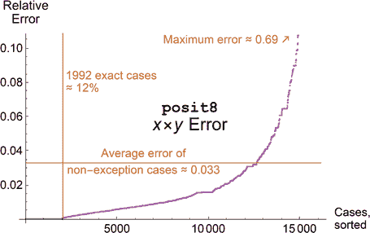

8 位普适数乘法的排序误差

然而，为了获得抗上溢能力的大幅提升，这点代价很小，正如乘法误差的图形表所示：

| 精确 | 舍入 | 下溢 | 上溢 |
| --- | --- | --- | --- |
| 1992 | 14151 | 119 | 122 |
| 12% | 86% | 0.73% | 0.74% |

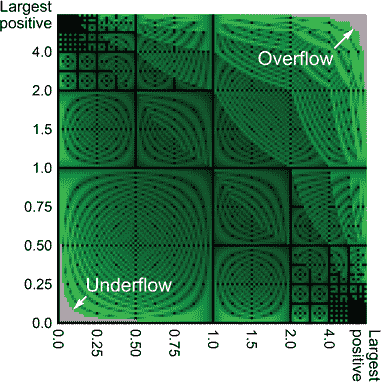

8 位普适数乘法的闭包图

上溢区域已缩减为表格中一个微小的圆角，与下溢区域非常相似（但不完全相同）。

现在我们有了精确测量不准确度的工具，可以开始比较数字格式及其用于计算的方法了。

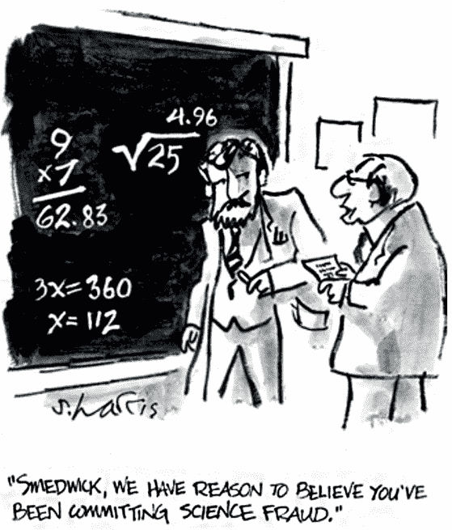

# 3 更强的力量！


1956 年经典科幻电影《禁忌星球》中指数级增长的力量

完整普适数格式的首次解释发表于 2017 年，而在随后的几年里，关于如何更清晰地解释它的方法有了很大改进。如果您已经看过普适数格式的解释，如果以下内容与早期论文略有不同，请不要感到惊讶。

## 3.1 增加普适数动态范围

从一个 3 位普适数环开始，但让制度位表示 4 的幂（即 2² = 4），而不是 2 的幂。这使动态范围翻倍：

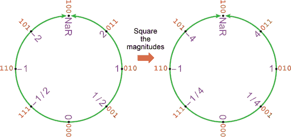

将西北角的值平方（并调整反射值）可使动态范围翻倍。

这还为追加位时插入值创建了一条新规则。像往常一样，追加 `0` 位不会改变值；但当我们追加 `1` 位时，现在可以在值之间插入一个 2 的整数幂。

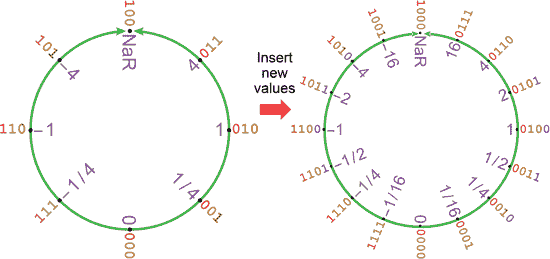

在指数相差超过 1 的 2 的幂之间，插入几何平均数。

当在位终止位后追加一位时，我们称之为 `exponent bit`（指数位），并用 `blue`（蓝色）标记。如果是 `1` 位，两侧的值为 `2^k` 和 `2^m`，插入的值为 `2^((k+m)/2)`。制度位现在充当一种超级指数，它们表示的值是 4 的幂缩放，而不是 2 的幂。指数位随后让我们填补 1 和 4 之间、或 1/4 和 1 之间的空隙。为了更清晰，我们可以再追加一位，使得分数位出现在 1/4 到 3 的量级上（像往常一样用 `black` 显示）。指数位让我们用 4² · 2¹ = 8 填补 4 和 4² = 16 之间的空隙。2 的整数幂仍然有完美的倒数，它们是关于水平轴的镜像。到补码整数的映射仍然是单调的，如这个环图所示：

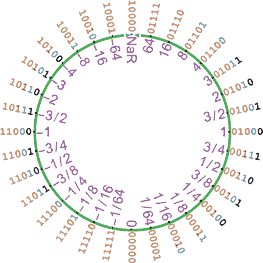

带 1 个指数位的 5 位普适数环图

假设我们想要更大的动态范围。我们可以再次将每个制度位的含义平方，变为 4² = 16，这样东北位置的值就是 16。填补 16⁰ = 1 和 16¹ = 16 之间意味着按 1、2、4 或 8 缩放，即 `2^e`，其中 `e` 从 0 到 3。作为无符号二进制，我们可以用指数位 `00`、`01`、`10` 和 `11` 来实现。这是一个带 2 位指数字段的 5 位普适数的环图：

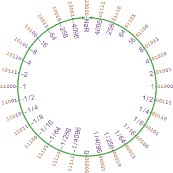

带 2 个指数位的 5 位普适数环图

指数字段的位数是 `eS`，是 `exponentSize` 的简短驼峰命名法。东北位置的值称为 `uSeed`，等于 `2^(2*eS)`。每当 `eS` 增加 1，`uSeed` 就平方，动态范围翻倍，代价是从小数部分的有效位中拿走一位。随着 `eS` 从 0 开始递增，`uSeed` 为 2、4、16、256、65 536……这是一个*非常*快速增长的序列。使用时要小心。

第 1 章 介绍了没有指数位（`eS` = 0）的最简单普适数形式，但通过引入指数位，我们获得了强大得多的能力。以下是随着精度 `n` 增长，在普适数环上引入新值的完整规则：

*   向现有普适数追加 `0` 位不会改变其表示的值。
*   在 `NaR` 和一个实数之间，插入该实数乘以 `uSeed`。
*   在 0 和一个实数之间，插入该实数除以 `uSeed`。
*   在 `2^k` 和 `2^m` 之间（其中 `k` 和 `m` 相差超过 1），插入 `2^((k+m)/2)`。
*   否则，在 `x` 和 `y` 之间，插入它们的平均值 `(x + y)/2`。

我们还推广了普适数值的公式。在 第 1 章 中 `eS` = 0 时，我们有


## 3.2 Posit 值公式

其中 `s` 为符号位值，`f` 为小数位的值，`r` 为运算段所代表的值。`r` 值每增加 1，上述公式中的指数部分就会增加 `2^(eS)`。指数位随后表示一个无符号整数，填补这些运算段步长之间的所有整数，范围从 0 到 `2^(eS) - 1`。乍一看这似乎很怪异，因为它混合了两种不同的书写数字的方式。想象一下，用罗马数字表示十位，用 0–9 阿拉伯数字表示个位，那么二十三将写作“**XX**3”，三十九将写作“**XXX**9”。或者我们用罗马数字表示百位，用 00–99 数字表示十位和个位，那么二百七十一将写作“**CC**71”。这与运算段位和指数位协同工作的方式类似。

例如，若 `eS = 2`，`r` 每增加 1，2 的幂次就会按 `2^(eS) = 4` 的步长增加，而两个指数位 `00`、`01`、`10`、`11` 分别代表 `e = 0, 1, 2, 3`，填补这些 4 的倍数之间的空隙。`x` 的公式可推广为

上述函数即为 `pToX` 函数（posit-to-`X`），其代码见附录 A。若公式产生 –∞，则返回 `Indeterminate`，以适应结果非实数的所有情况，即非实数（`NaR`）值。

帐篷状的相对精度曲线随 `eS` 每增加 1 宽度翻倍，但中央凹区的顶部精度会下降约 0.3 个十进制位，因为小数位少了一位。

下图展示了 16 位 posit 在 `eS` 设为 0、1、2 和 3 时的十进制精度。

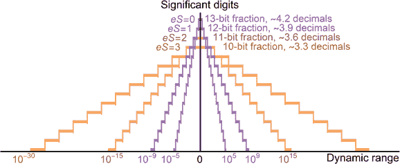

16 位 posit 随 `eS` 从 0 到 3 的精度图

在该图中，摆动被简化为条形，标注的精度指的是*最小*精度。

## 3.3 *幽灵位* 与 *暮光区*

举例来看，让我们观察 6 位精度且 `eS = 2` 的 posit 环：

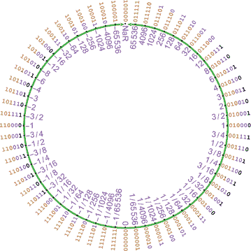

具有 2 个指数位的 6 位 posit 环图

我们需要一种符号来表示精度位数 `n` 和指数大小 `eS`。我们用尖括号 〈`n, eS`〉 表示，因此上图展示的是 “`posit〈6, 2〉`” 格式。

环图显示了 2 个指数位，以**蓝色**标示。但等等，你可能会说；有些值根本*没有*指数位，有些*只有一个*指数位。不对；永远有 2 个指数位，但超出数字末尾的任何位都是 `0` 位，就像我们对小数位所做的那样。幽灵位可以是指数位。

指数位部分或完全超出最低有效位（LSB）的区域被称为*暮光区*，因为多年的经验表明，这个略显怪异的区域是构建 posit 环境时大多数 bug 的来源。

考虑环中的值 1024，其 posit 表示为 `011101`。正确的理解方式是将其视为六个存储的（显式）位，后跟一串无限的幽灵位，在这种情况下，第一个幽灵位是两位指数域的第二位：

```
011101|000000⋯
```

运算段位甚至也可能是幽灵位，即存储位之外隐含的 `0` 位。例如，看看 -1 / 65 536 的表示：

```
111111|000000⋯
```

结束运算段的相反位位于尾随的 `0` 位中，并未显式显示。

举一个容易犯错的例子，假设我们想将数字 600 编码为最近的 `posit〈6, 2〉` 形式，并正确舍入。我们在 256 和 1024 之间选择，两者都在暮光区。两数中点为 (256 + 1024) / 2 = 640，这可能让人觉得 600 应向下舍入到较近的 256。然而，舍入并非如此工作。你应该问：“如果我们使用 `posit〈n + 1, eS〉` 格式而非 `posit〈n, eS〉` 格式，新的中点会是什么，该值会落在哪一侧？”第 `n + 1` 位可能是指数位，而非小数位。

若我们有七位而非六位，便可表示 `0111011`，解码后为 512。因 600 大于 512，作为 posit 的最近表示应向*上*舍入至 1024。这符合我们的相对误差定义，因为选择 1024 的相对误差为 |ln(1024 / 600)| ≈ 0.5，而选择 256 的相对误差为 |ln(256 / 600)| ≈ 0.9。在对数刻度上，600 更接近 1024。在暮光区，中点也是相对精度连续而非略有不连续的点（见第 2.4 节）。

## 3.4 运算段中的相反位是否 “被浪费” 了？

对 posit 格式的另一种常见初步反应是，运算段的结束位是 “被浪费” 的位，理应有办法重新定义它，使每一位都算数。那么，*它*被浪费了吗？

在 `posit〈6, 2〉` 格式中，假设 `x = 010111` 代表 12，我们给它加 2。结果 14 位于可表示值 12 和 16 的正中间，最近的偶数二进制值是 16 = `011000`。我们需要向*上*舍入。注意当我们对 12 的 posit 表示加 1 时，最后四位发生了什么。去掉颜色编码，`010111` 变为 `011000`。神奇的是，进位自动将运算段延长了一位，最高有效指数位变成了结束运算段的相反位，指数整体向右移动一位，形成 posit 最后两个表示位。所有小数位变成了幽灵位。这一切都是*自动*发生的。结果 16 = `011000` 完全正确。无需检查各字段的进位溢出。一切就绪。

运算段的结束位对此至关重要。它绝对没有被浪费。每一位都算数。

常见的错误是担心对小数部分舍入，一旦舍入完成，再组装 posit 的各部分（符号位、运算段、指数、小数）。这产生的 bug 会比热带雨林里的还多。应始终先用更高精度的额外位计算并组装 posit 的各部分，*然后*再进行舍入。

## 3.5 将实数转换为 Posits

第 3.1 节展示了如何将 posit 位串 `p` 转换为实数 `x`（或 `NaR`）。本节解释将实数 `x`（任何格式）转换为 posit 位串 `p` 的算法。该例程称为 `xToP`，其代码见附录 A。为清晰起见，此方法取输入的绝对值，但也可直接转换实数值而无需此步。假设根据请求的精度 `n` 和指数大小 `eS`，以下量已定义或计算为全局变量：

*   `uSeed` 为 `2^(2*eS)`。
*   `minPos` 为最小正 posit 值，`uSeed^(2-n)`。
*   `maxPos` 为最大正 posit 值，`uSeed^(n-2)`。

以下假设 `n > 2`。`n = 2` 的算法可用一句话表达：“任何非实数变为 `NaR` 即 `10`；零变为 `00`；正实数变为 `01`；负实数变为 `11`。”

### 3.5.1 检查非实数输入

第一步是确定输入 `x` 是否代表实数。若其以整数格式存储，则符合。整数是实数。也可能是虚部 `b` 恰好为零的复数 `a + b i`。也可能是像 **“1.6e-19”** 这样的输入字符串，遵循计算机语言用科学计数法表示实数的规则。若未通过实数测试，返回 `NaR` 的 `n` 位串 `1000⋯000`。

### 3.5.2 取绝对值并检查特殊情况


设置 `y` = |`x`| 可以使某些步骤更简单。这不会丢失关于 `x` 是正数、负数（或零）的信息，因为我们不改变输入值 `x`，并且始终可以回溯引用它。

如果 `y` = 0，返回由全 0 位组成的 `n` 位字符串，即 `0000`⋯`000`。在尝试查找阶码位之前，处理可能的 `NaR` 或 0 的情况非常重要。这也处理了 `y` ≥ `maxPos` 或 `y` ≤ `minPos` 的情况：

```
If y ≥ maxPos,
    Return the posit for maxPos times the sign of x,
Else if y ≤ minPos,
    Return the posit for minPos times the sign of x,
End if.
```

这也处理了舍入规则之一，即超出动态范围的幅度会饱和到（带符号的）最大值或最小值。此外，处理这些特殊情况可确保结束阶码的相反位能适应下一小节中构建的 `n` 位字符串。

### 3.5.3 编码阶码位

由于计算机环境通常支持无符号整数类型，因此很容易将 posit 位串视为无符号 `n` 位整数。既然已经处理了 `NaR` 和 0 的情况，阶码最多只能有 `n` - 1 位长。利用一个 `n` 位无符号整数 `p`，我们可以从最高有效位（`MSB`）开始存储阶码，因为我们不需要符号位，这样最后会多出一位，可用于正确舍入。

```
If y ≥ 1, the regime will be a string of 1 bits:
    Set p = 1 and i = 2. The number of posit bits found so far is i.
    While y ≥ uSeed and i < n,
        shift p left by one place and set the LSB to 1 (lengthen the regime).
        Divide y by uSeed and increment i.
    End while.
    Shift p left by one place to prepare for the next phase, and increment i.
Else y < 1, so the regime will be a string of 0 bits:
    Set p = 0 and i = 1 (off by 1 from the y ≥ 1 case, since we seek 1 ≤ y < uSeed).
    While y < 1 and i ≤ n,
        multiply y by uSeed and increment i.
    End while.
    Set p = 1 (the opposite bit ending the regime) and increment i.
End if.
```

“将 `p` 左移一位”会在最低有效位（`LSB`）处创建一个 `0`，当阶码是 `1` 位串时，这就是结束阶码的相反位。

### 3.5.4 编码指数位

将 `x` 转换为 posit 格式的过程是从左向右进行的，查找指数位也不例外。我们知道 1 ≤ `y` < `uSeed`。如果格式使用 `eS` = 0，则无需操作，直接跳到查找尾数位。否则，继续二分查找，从最高有效位到最低有效位确定指数位。计算 `uSeed` = 2²`eS` 对计算机来说其实很容易，因为将 `1` 位左移 `eS` 位得到 2^(`eS`) 的无符号整数，然后将 `1` 位左移该无符号整数位即得到 2²`eS`。在 C 语言中，可以简洁地表示为 `1 << (1 << eS)`。

因此，提取指数位的算法如下：

```
Set e = eS − 1.
While i < n and e > 0,
    Shift p left by one place to make a place for an exponent bit.
    Set scale = 1 << (1 << e).
    If y ≥ scale, set the LSB of p to 1 and set y = y / scale.
    Increment i, since we have used another posit bit for the exponent.
    Set e = e − 1.
End while.
Shift p left by one place to prepare for the next phase, and increment i.
```

如果位计数器 `i` 在 `e` 递减到 0 之前实际达到了 `n`，指数位将被截断，posit 将处于“暮光区”。否则，我们将得到尾数 `y`，满足 1 ≤ `y` < 2。

### 3.5.5 编码尾数位

既然 `y` 现在是介于 1 和 2 之间的定点数，其二进制位串总是以 `1` 位开头，因此无需存储该位。这个 `1` 是隐含的。因此，我们首先通过从 `y` 中减去 1 来得到尾数。然后通过将尾数加倍并测试其是否大于 1 来找到尾数的每一位；如果大于 1，在 posit 位串中安装一个 `1` 位，从 `y` 中减去 1，重复此过程，直到没有更多空间存放尾数位。

一旦填满所有 `n` + 1 位，判断转换是否精确非常简单：`y` > 0 吗？如果是，则 `ubit` 为 `1`，因为最后一位之后还有更多位。但如果 `y` = 0，则转换精确落在一个 posit 值上，所以 `ubit` 为 `0`。记住，`ubit` 是银行家舍入法所需的。

```
Set y = y − 1.
While i < n,
    Shift p left by one place. This puts a 0 in the LSB position.
    Set y = 2 × y.
    If y ≥ 1, set the LSB of p to 1 and set y = y − 1.
    Increment i, since we've used another posit bit for the fraction.
End while.
```

经过此步骤后，`i = n`，所以我们得到一个包含 `n` 位的位串。但它没有符号位，所以比舍入后的值多一位。称之为 `b`[−1]。

### 3.5.6 舍入并应用 `x` 的符号

*银行家舍入法*是将值 `x` 舍入到最近的可表示数 `p`，如果有两个同样接近 `x` 的 `p` 可能性，规则是选择具有*偶数*表示的那个。在二进制中，偶数以 `0` 结尾，奇数以 `1` 结尾。“遇半进偶”规则的原因是它使舍入*无偏差*。想象一家银行需要计算数十亿美元交易的精确到分的利息；即使是最轻微的向上或向下偏差也可能迅速积累成一笔巨款。曾有利用舍入来“白得”利益的方案。

银行家舍入法是 posit 格式的舍入模式，也是*唯一*的舍入模式。无论你是舍入整数格式、定点数、浮点数还是 posit，原则都是一样的。银行家舍入算法只需要*三个位*，下图展示了 8 位格式的情况：

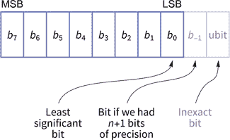

银行家舍入法所需的三个位

对于 `n` 位格式，我们的约定是用下标从 0（`LSB`）到 `n` - 1（`MSB`）标记位。我们需要的三个位是 `LSB`、一个称为*舍入位*的 `b`[−1] 位，以及我们在第 1 章见过的 `ubit`。如果 `ubit` = `1`，表示在 `b`[−1] 之后还有更多有效数字，就像在数字最后一位后写“⋯”一样。

如果 `b`[−1] 是 `1` 且 `ubit` 是 `0`，该值处于临界点；它是如果多一位所能表示的值。为了使舍入值为偶数，如果 `b`[0] 是 0，则不做任何操作（即向下舍入，忽略 `b`[−1]）；但如果 `b`[0] 是 `1`，则向 `LSB` 加 `1` 并向左传播进位。使用 posit 格式，不存在溢出的可能性。

如果 `b`[−1] 是 `1` 且 `ubit` 是 `1`，意味着在 `b`[−1] 位之后还有 `1` 位，则该值高于临界点，需要向上舍入。将值 `x` 舍入为 posit 的四种情况如下：

*   如果 `x` 是 0 或 `NaR`，返回代表该值的相应 posit。
*   如果 |`x`| ≥ `maxPos`，返回带有 `x` 相同符号的 `maxPos` 的 posit。
*   如果 |`x`| ≤ `minPos`，返回带有 `x` 相同符号的 `minPos` 的 posit。
*   如果 `minPos` < |`x`| < `maxPos`，将 `x` 编码为 `n` + 1 位；如果该表示精确，将 `ubit` 设为 `0`，否则设为 `1`。如果 `b`[−1] 是 `1` 且（`b`[0] 是 `1` 或 `ubit` 是 `1`），向 `b`[0] 位置加 1 并传播任何进位。

如果你喜欢数字硬件设计并能看懂电路图，下图展示了带有额外 `b`[−1] 位和临时存储中一些尾随位的数字的银行家舍入逻辑。

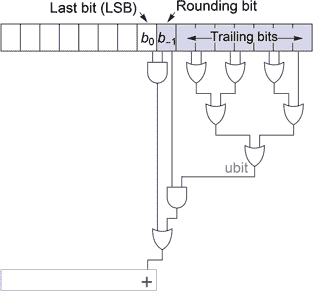

银行家舍入法的逻辑电路


尾随位下方的结构是一个“或树”，如果任何尾随位非零，则产生一个值为 `1` 的 ubit；如果所有尾随位均为零，则产生 `0`。即使你不看电路图，也能看出银行家舍入法确实需要逻辑门和逻辑延迟。如果你不关心舍入中的偏差，可以直接丢弃 `b[0]` 之后的所有位。有些处理器选择对传统格式这样做，这可能导致一个隐蔽的问题，其影响超出了结果中偏差误差的累积：缺乏可移植性和可复现性。当程序员发现程序在不同计算机上产生不同结果时，会花费大量无效工时试图找出原因，最终发现规则以一种不可见的方式被“变通”了。这就是为什么 posit 格式只有一种舍入模式的原因。

```
If b−1 (the LSB of p) is 1,
        If b0 (the next-to-last bit of p) is 1 or y > 0, set p = p + 1.
Shift p right by one place to discard the b-1 bit and make room for the sign bit.
If x < 0, return -p, else return p.
```

### 3.5.7 示例

类代码的描述读起来可能很枯燥；通过示例应该能更容易地理解如何将实数转换为 posit 表示。让我们把十进制数 `x` = −0.003 转换为 `eS` = 2 的 8 位 posit。`uSeed` 为 2^(2²) = 16。

因为 `x` 是实数且非零，我们不必担心那些拥有无限长 `0` 位 regime 的特殊情况。它的幅度也在 `minPos` 和 `maxPos` 之间，因此不会发生饱和。

设 `y` = |`x`| = 0.003。首先注意到 regime 将以 `0` 位开始，因为 `y` 小于 1。换句话说，`y` 的 posit 位于环的东南象限。这消耗了我们的第一个位，所以设置 `i` = 1 来记录 `p` 中已使用的位数。

$$
\begin{matrix} p & y \\ {\bullet \bullet \bullet \bullet \bullet \bullet \bullet \underset{\begin{matrix} \uparrow \\ {i = 1} \\ \end{matrix}}{0}} & 0.003 \\ \end{matrix}
$$

将 `p` 左移以腾出空间给下一位。将 `y` 乘以 `uSeed` = 16 进行缩放，并检查它是否仍小于 1。确实小于 1，所以我们得到另一个 `0` regime 位。`i` 加 1。

$$
\begin{matrix} p & y \\ {\bullet \bullet \bullet \bullet \bullet \bullet \underset{\begin{matrix} \uparrow \\ {i = 2} \\ \end{matrix}}{00}} & 0.048 \\ \end{matrix}
$$

再次左移 `p` 并按 `uSeed` 缩放 `y`；0.048 乘 16 等于 0.768，仍小于 1：

$$
\begin{matrix} p & y \\ {\bullet \bullet \bullet \bullet \bullet \underset{\begin{matrix} \uparrow \\ {i = 3} \\ \end{matrix}}{000}} & 0.768 \\ \end{matrix}
$$

左移 `p` 以腾出空间给下一个 regime 位；这次当我们按 `uSeed` 缩放 `y` 时，结果 0.768 × 16 = 12.288 大于 1，所以用相反的位终止 regime，然后继续寻找指数位。

$$
\begin{matrix} p & y \\ {\bullet \bullet \bullet \bullet \underset{\begin{matrix} \uparrow \\ {i~ = ~4} \\ \end{matrix}}{0001}} & 12.288 \\ \end{matrix}
$$

第一指数位的比例因子为 2²`eS`\-1 = 2²1 = 4，因为 `y` 大于 4，所以最高有效指数位将为 1。左移 `p` 并或入 1 位。将 `y` 除以比例因子 4；12.288 / 4 = 3.072。

$$
\begin{matrix} p & y \\ {\bullet \bullet \bullet \underset{\begin{array}{l} \uparrow \\ {i\operatorname{~=~}5} \\ \end{array}}{00011}} & 3.072 \\ \end{matrix}
$$

下一个（也是最后一个）指数位的比例因子为 2²`eS`\-2 = 2²0 = 2。因为 `y` > 2，下一个指数位将再次为 1。左移 `p` 并或入 1 位。将 `y` 除以比例因子 2；3.072 / 2 = 1.536，现在我们知道了尾数：`y` = 1.536。我们完成了决定 2 的幂次缩放的 regime 位和指数位。

$$
\begin{matrix} p & y \\ {\bullet \bullet \underset{\begin{array}{l} \uparrow \\ {i = 6} \\ \end{array}}{000111}} & 1.536 \\ \end{matrix}
$$

要找到小数位，首先从尾数 `y` = 1.536 中减去隐含的 1，得到小数部分 0.536。将小数部分加倍得到 1.072；因为它大于 1，所以第一个小数位是 `1`：

$$
\begin{matrix} p & y \\ {\bullet \underset{\begin{array}{l} \uparrow \\ {i = 7} \\ \end{array}}{0001111}} & 1.072 \\ \end{matrix}
$$

最后一位将位于最终 posit 位串的 `b[0]` 位置，但我们还需要一位用于银行家舍入，即 `b[-1]` *舍入位*。从 `y` 中减去 1 并加倍，得到 `y` = 0.144。这不大于 1，所以下一个小数位是 `0`，它显示为灰色以提醒我们这是一个超出 posit 最后一位的临时位。这是第 `n` 位，所以现在我们准备进行舍入。

$$
\begin{matrix} p & y \\ \underset{\begin{array}{l} \uparrow \\ {i = 8} \\ \end{array}}{00011110} & 1.144 \\ \end{matrix}
$$

`b[-1]` 是 `0`，所以不需要向上舍入。将 `p` 右移一位，这同时完成两件必要的事：它丢弃 `b[-1]` 并使 `b[0]` 成为 LSB，同时在左侧移入符号位 `0` 表示正数。

$$
\begin{matrix} p \\ {0000\text{1111}} \\ \end{matrix}
$$

最后一步是应用 `x` 的符号。如果 `x` 为正，我们就完成了，但因为 `x` = −0.003，我们需要对 `p` 取反。将所有位翻转为 `11110000` 并在 LSB 上加 1：

$$
\begin{matrix} p \\ {\text{1111}000\text{1}} \\ \end{matrix}
$$

这就是 `x` = -0.003 最接近的 posit 表示。该 posit 解码为 $- \frac{3}{1024} = - 0.0029296875$，保留一位有效数字即为 −0.003。

关于 posit 编码要注意的一点是，它从 `MSB` 进展到 `LSB`，一次一位。这似乎是合乎逻辑且显而易见的做法，但请注意，这不是传统格式编码实数的常用方式。

### 3.5.8 给构建 Posit 环境者的建议

如果你目前有处理实数值的方法（如 `IEEE floats`，将在下一章描述），请确保它们有足够的精度来进行精确的 posit 计算。例如，这里有一个常见的陷阱：

问题在于，这或许令人惊讶，64 位浮点数精度不足。32 位 posit 的尾数最多可达 28 位。相乘时，乘积可达 56 个有效位。但 64 位 IEEE 浮点数只有 53 个有效位。存在一些情况，最终转换回 posit 时最后一位会相差 1，从而产生错误的实验结果。

安全得多的方法是使用整数运算。在检查 `NaR` 后，将 posit 转换为 `k` × 2^`m` 形式的数，其中 `k` 和 `m` 是具有足够精度以覆盖必要动态范围的有符号整数，这样你就可以在 `Math Layer` 停留足够长的时间，以便带着正确的舍入返回 `Compute Layer`。

另一个建议是彻底测试往返转换 `pToX` 和 `xToP`，并用绘图工具绘制 `pToX`(`xToP`(`x`)) 作为 `x` 的函数图像。从极低精度开始，如 `n` = 4 位，调试，然后逐步增加 `eS` 值从 0 到比如 3。也要绘制离散函数 `xToP`(`pToX`(`p`))，针对精度 `n` 以内所有可能的 `p`，超过此精度穷举测试就变得不切实际了。经验表明，这是一种快速且有效的查找 bug 的方法。


`pToX(p)` 函数是最容易编写且最容易写对的；`n` 位 posit 有 2^`n` 种可能的位模式，因此对于较小的 `n`，你可以生成并显示真实的 `x` 值，并检查该例程是否正确解码了每一个 `p`。你不必担心舍入问题。但 `xToP(x)` 函数更具挑战性，因为可能的输入 `x` 远多于可能的输出 `p`，且存在许多制造“差一”编程错误的机会。以下是使用 附录 A 中的 `pToX` 和 `xToP` 函数在 posit〈6, 1〉 环境下的示例图表。

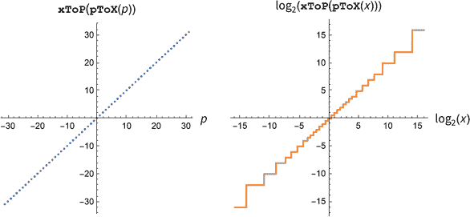

左侧的图表应始终看起来像 `y = x` 的离散版本，其中输入和输出的 posit 位串被视为有符号整数。右侧的图表是对数-对数图；它使用从 `minPos` 到 `maxPos` 的 `x` 值的 log[2]（在本例中，为 $2^{- 16} = \\frac{1}{65536}\\,\\text{到}\\, 2^{16} = 65536$ ）。它应该看起来像一个围绕 `y = x` 线摆动的阶梯，在最小和最大幅度处摆动幅度增加。如果 `xToP` 或 `pToX` 中存在 bug，通常会在这些“往返”图表中立即显现出来。

## 3.6 一种用于舍入算术的简单符号

20 世纪 50 年代推出 FORTRAN 时，它被吹捧为“FORmula TRANslation”（公式翻译），因此得名。它允许你用一种非常类似于代数符号的记法来编写算法，尽管乘法运算符用星号 "`*`" 表示，还有其他一些调整。你可以声明变量 `a`、`b` 和 `c` 为 REAL 类型，然后编写如下代码行：

```
c=a+b
```

乍看之下，这完全像是在用实值变量进行计算。但这是个骗局。如果变量是*整数*，那么这做法还算诚实，因为除非发生下溢或上溢，你真的会得到正确的整数。但如果是*实数*值？恐怕不行。

对于 `a` 和 `b` 许多可能的输入值，你得到的 REAL 类型值无法精确表达 "`a + b`"，计算机也不会告诉你它偏离正确值有多远。FORTRAN 失去了全大写的外观变成了 Fortran，且作为一种计算机语言正在逐渐式微。但它让不止一代程序员极易受到这样的惊吓：计算机上看起来像实数运算的东西，根本不是精确数学，而是一种近似，有时会在毫无预警的情况下可怕地出错。

人们可以想象一种严格的编程语言，要求你必须写成

```
c=ROUND (a+b)
```

否则语言编译器会报错。但那会让代码看起来很丑陋。

这里有个想法，或许至少能进入集成开发环境（IDE），即使不进入语言的实际源代码。IDE 可以用不同颜色为注释、关键字等着色，即使这不是你正在使用的编程语言的官方部分。一个理解舍入误差并使其隐患可见的 IDE，将对程序员有巨大帮助。

假设我们用精确数学计算一个值，使用正确舍入将其转换为可表示的（精确的）posit，然后将该 posit 转换回其数学值？换句话说，

这假设右侧的 `a` `op` `b` 在数学层中计算，即精确计算。全书中，上划线运算符被赋予该复合函数 `pToX(xToP(...))` 的含义。因此

意味着精确输入 `a` 和 `b` 将被精确相加，舍入到 posit 所能表示的最近实数，然后作为一个无舍入误差可表示的值呈现给程序员。

这比到处输入 "`ROUND`" 要不显眼得多。一些关于舍入误差的论文在 "`+ - × /`" 运算符周围加圆圈表示其舍入版本，如用“⊕”表示“舍入加法”。但平方根或余弦怎么表示呢？上划线适用于每一个运算符。你也可以将其用于常量和单参数运算符。例如，

指示计算机将实数值 3.1 舍入到最近的可表示 posit 值，然后计算其以 10 为底的对数，精度足以确定最近的可表示 posit。它看起来仍然很像 `log10`，但上划线装饰提醒你：*你需要保持怀疑*。将上划线定义为一种运算符是 附录 A 代码的一部分，你将在本书中大量看到它。

## 3.7 尽可能简单，但不能过度简化


“一切理论的最高目标，是使不可约的基本要素尽可能简单，而又不放弃对任何单一经验事实的充分表达” ¶ —*阿尔伯特·爱因斯坦*，1933

爱因斯坦这番话的民间意译通常是：“理论应尽可能简单，但不能过度简化。”这更简洁，虽非其原话。

Posit 的设计秉持爱因斯坦的观点。如果我们能在数学层完成整个计算，而无需担心物理计算机的有限性，那将是美妙的，但这通常要么不可能，要么即便可能（需使用符号方法而非仅数值方法）也会因过于复杂而运行极慢。鉴于我们*必须*在计算层和人类层使用有限精度，且我们希望可表示数字的分布类似于所有计算均精确时值的分布，posit 就是尽可能简单的了。但不能更简单。

## 3.8 非事物的当前状态

到目前为止，我们传达了一个积极的信息：*有可能*表示实数，要么作为精确值，要么作为精确值之间的范围（使用 ubit），也*有可能*在运算后舍入，以速度换取可证明的误差界。unum 和 posit 方法是从低精度开始，通过逻辑步骤逐步推导得出的，最终形成了一个无异常的定义。

但在出版之时，处理器硬件为我们提供的实数处理方式并非如此。甚至相去甚远。这意味着我们需要了解我们是如何走到今天这一步的背景故事。在下一章，我几乎可以保证读者会有几个惊喜，并获得一些别处找不到的信息。

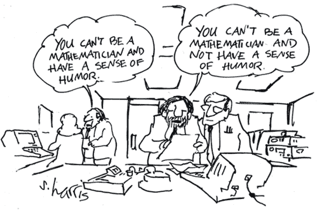

请在阅读 第 4 章 时牢记这一点。

# 4 我们是如何陷入这团糟的


20 世纪 60 年代设想的扫地机器人，以及近期扫地机器人的实际样子。我们在数字格式设计中同样犯了试图让机器模仿人类的错误。

人类有一种强烈的倾向，倾向于设计技术使其表现得像人一样，而不是弄清楚什么是*对技术最优*的。例如，这就是为什么一些最早的数字计算机浪费了大量硬件来操作十进制数字而不是二进制，因为人类使用十进制的唯一原因是生理上碰巧我们的手有十根手指。

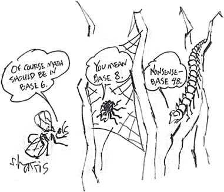


有些文化使用二十进制（手指和脚趾？），而马哈拉施特拉邦的数字是五进制，暗示了单手计数。六十进制和十二进制至今仍用于时间和角度。

本章考察了人类记录和使用数字的浩瀚历史的一个缩影，以及这些方法如何被证明对于*机器*来说远非最优。它还将讲述现代 IEEE Std 754 浮点格式定义的由来；这并非大多数人所想的那样。

## 4.1 令人惊叹的巴比伦人

古巴比伦人在数学上绝不含糊，甚至可以追溯到公元前 1800 年。他们认识到使用 60 作为数制基数的优点，这以每分钟 60 秒、每小时 60 分钟以及每圆 360° 的形式延续至今。埃及人可能同样能干，但他们在纸草纸上用墨水书写，而不是使用放在阳光下烘烤的泥板，所以我们留存下来的他们技能的证据少得多。这里有一件特别令人印象深刻的巴比伦文物，为清晰起见重绘，并用白色现代数字标注：

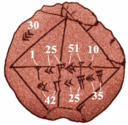

古巴比伦人知道平方根 2 到小数点后七位。

首先，请注意巴比伦数字符号是多么合乎逻辑。在最底层，它是一元的，因为它重复 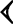十的符号和一的符号来表示 1 到 59 之间的两位位置数字。如果他们需要零，就将该位置留空。在更高一层，该系统像我们现代的十进制一样使用从左到右的位置记数法，但基数是 60 而不是 10。正方形的边在左上角标记为 30。正方形对角线上标记的是他们对 $1 + \frac{25}{60} + \frac{51}{60^{2}} + \frac{10}{60^{3}}$ 的表示法，换算成十进制是 1.414213……，这是平方根 2 精确到小数点后前七位！正方形的边标记为 30，所以对角线长度是 $30 \times \sqrt{2} \approx 42 + \frac{25}{60} + \frac{35}{60^{2}} \approx 42.4264$，同样达到了令人难以置信的小数点后六位精度。

这件文物不是“泥板”，而是将近四千年前某人的草稿。他们知道如何求直角三角形的斜边，所以我们称之为勾股定理的或许应该叫巴比伦定理。那块泥土的背面部分被擦除，但似乎显示了一个 3-4-5 直角三角形，这是斜边为整数的最简单情况，$\sqrt{3^{2} + 4^{2}} = 5$。

巴比伦人还知道如何解一元二次方程和计算复利（指数），他们能用紧贴的梯形近似曲线下的面积（积分学）。他们知道如何解线性方程组。我还能继续列举。然而不知为何，他们的知识和设计良好的数制系统失传了，没有传播到随后的帝国，比如罗马帝国。

## 4.2 罗马数字

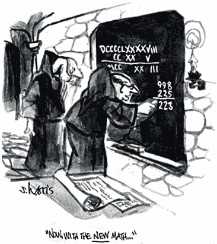

令人惊讶的是，罗马帝国这样一个成功的文明，竟然能靠有史以来最笨拙的数字系统之一繁荣发展。既然我们到处都能看到罗马数字，从模拟时钟上的小时标记到出版物章节编号的用途，它们或许看起来不那么痛苦。但问问你自己：不先转换成其他数制，你如何用手工*相乘* **XIV** 和 **LXV**？

这里有个问题：罗马数字是位置记数法，还是更像不使用位置的计数标记和数字系统？我认为它们*略微*具有位置性，但并不完全是。例如，假设我们用罗马数字写整数 1984。常规写法是 **MCMLXXXIV**，大数字多在左，小数字多在右。

然而，如果我们将其拆分为 **M CM L X X X IV**，它们可以按任何模式书写，仍然表示 1984：

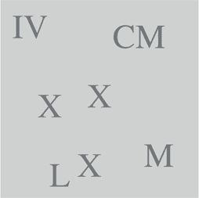

罗马数字不是位置记数法。

罗马数字唯一具有位置性的是减法对 **IV, IX, XL, XC** 等，即第一个字母的值从第二个字母的值中减去。否则，它们不就像扔在桌上加总面值的硬币吗。因此，*略微*具有位置性。有例子显示，第二十二罗马军团把他们的编号写作 **IIXX**，因为他们用拉丁语自称意为“第二十二”。有时抄写员会把 45 写成 **VXL** 而不是 **XLV**，这大概表明当时的抄写员觉得这些规则和我们今天一样令人困惑且容易出错。

这不为人所知，因为现代我们只用罗马数字写正整数，但罗马人*确实*有书写分数的方法。

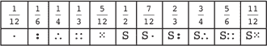

这套系统其实差不多讲得通，像骰子或多米诺骨牌上的点数。然而，除了 12 分之几的整数，他们还有带自己符号的特殊分数，如 ℈ 代表 $\frac{1}{288}$，Ƨ 代表 $\frac{1}{72}$。这类东西就是当数制像人类语言一样有机形成、人们随用随造，而不是从第一性原理*设计*出来时会得到的结果。

那么古罗马人究竟*如何*执行交易中加总物品成本这类常见任务？他们将罗马数字转换为算盘类型的表示。不一定是我们通常想象的串在铁丝上的珠子，而可以简单如躺在槽里可来回滑动的鹅卵石。那绝对是位置制的，且相当适合加减法。

我们没有他们那种槽中鹅卵石式算盘的记录，但大英博物馆有一个精美的便携罗马机械算盘实例：

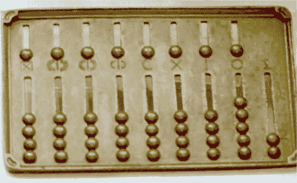

罗马算盘

结果随后可转回罗马数字。算盘上标有千、万、十万、百万的符号。最右两列显示分数计数器为十二分之几，以及表示此后有多少个 $\frac{1}{12}$ 的三分之一的方法。*那*才是位置记数法，甚至排序方式与我们今天的位置数制相同。

罗马数字的设计暗示它们起源于一种仅划一条线就很费力的媒介。在石头上刻 **IV** 要凿三条线，而不是 **IIII**。写 **X** 只需两条凿线，而 **VV** 需四条。显然 **L** 比 **XXXXX** 容易刻得多。考虑到刻曲线有多难，**C** 代表一百、**D** 代表五百的符号暗示他们不指望经常用这么大的整数。对于一千，罗马人最终用 **M**（如今最常见形式），但早期用这个符号：ↀ。那符号明显不利于凿刻，所以不难理解为何刻石时 **M**（*mille* 的缩写，拉丁语千）会取而代之。还有符号 ↁ 代表五千，ↂ 代表一万（上图算盘上可见 ↂ），它们出现在当今 Unicode 字符集中。

有时说印度人发明了零的概念。他们可能是第一个将零作为数字使用的，但上述算盘显示了零：所有珠子拨下。任何使用算盘的文化都有零的表示，那是任何计算的起点。罗马人当然能用 *nullus* 表达零，那是拉丁语“无”的形容词。


当我们使用现代计算机时，计算机会将我们的十进制输入转换为二进制，执行运算，然后将结果转换回十进制，以便我们更轻松地阅读和理解。欧洲似乎也是这样运作了数百年；他们用罗马数字来*交流*数字，但如果必须进行实际的*算术运算*，他们就会转换为带有位值记数法的算盘格式，进行运算，然后再转换回罗马数字。罗马人并不像他们的数字系统所暗示的那样在算术上受到挑战。他们显然拥有建造斗兽场所需的所有 10 的幂次方。

## 4.3 接近二进制的编码：西多会数字

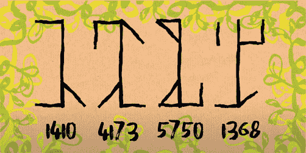

西多会数字可能是被古腾堡的活字印刷术发明所扼杀的。

如果计数符号是表达数字最笨重的方式之一，那么*西多会数字*必定是人类有史以来开发出的书写数字最紧凑的方式之一。它们大约在公元 1200 年由西多会修道会引入，作为罗马数字的替代品，并使用了几百年。它们起源于英国店主使用的一种速记形式，因为它们不仅节省面积，还节省笔画。

它们的定义因修道院而异，但数字 1 到 9 最常见的原始形式如下所示：

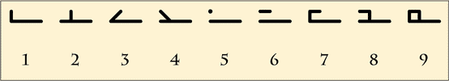

对于十位数，关于水平轴反射：


对于百位数，将个位符号关于*垂直*轴翻转：


还剩一个角落，他们用它表示千位：


但他们没有将这些符号视为独立的数字，而是将它们组合成一个单一的字形，如下所示：


如果你想在任何位置表示零，只需让那个角落保持空白即可。虽然一根简单的竖线可以代表零，但没有证据表明曾经使用过简单的、无装饰的竖线。西多会数字用于给事物编号，而非进行算术运算，他们从未想过从 0 开始编号而不是从 1 开始。

对于早期的手抄书籍，纸张珍贵，他们充分利用纸张提供的空间。想象一下用罗马数字写页码 1368：**MCCCLXVIII**，十个字符。用西多会数字，你只需四五笔就能写出 1368，笔离纸三次；但如果用罗马数字，你需要十一下笔画，笔离纸十次。西多会数字的效率大约高出三倍。一旦习惯了它们，西多会数字也更容易、更快地阅读。

随着演变，使用者开始竖着书写它们，数字 5 通常写作 1 和 4 的组合，而不是一个点：


西多会数字的后期形式，附四个示例

这是一种位值记数法，最多四位。事实上，它是*二维*位值记数法，而非我们习惯的一维从左到右的位值记数法。

西多会数字中包含二进制编码十进制（BCD）的要素。它们*离成功那么近*。比如，7、8、9 的符号就是 6 的符号分别与 1、2、1 和 2 的符号组合而成。他们诱人地接近发现*逻辑二进制编码*。假设发明者当时决定按如下方式定义 1 到 9，其中新线段用红色显示，被舍弃的线段用灰色显示：


那么，西多会数字后来怎么样了？它们非常容易书写，稍加练习也易于阅读（对于那么大的整数，当然比读罗马数字容易）。发生的事情就是这个人和他的发明，大约在公元 1450 年：


古腾堡和他的发明

约翰内斯·古腾堡改变世界的发明——用铸造铅字的活字印刷机。需要多少个格子来存放每一个西多会数字？*一万个*。

与西多会修士制作的手抄《圣经》不同，古腾堡版《圣经》没有页码。当印度-阿拉伯数字最终传遍欧洲时，仅用十个字符 0-9 印刷比用活字印刷西多会数字容易一千倍。西多会数字陷入了极度的默默无闻。

它们在 1780 年左右的法国共济会成员中曾异常复兴。严守特殊知识的秘密是共济会的标志，而用一种简洁的方式书写数字、让非会员完全摸不着头脑的知识，完美契合了一个拥有秘密握手、秘密口令和秘密誓言的团体。

另一次复兴差点发生在 1930 年代的纳粹德国。也许纳粹学者注意到 0-9 系统经由阿拉伯商人从印度传来，认为该系统因此违背了德国民族主义，而西多会数字完全源于欧洲。这次复兴并未走远。除了印刷极不实用外，光想象为它们发明*打字机*有多难就让人望而却步。即使有退格和重叠打印功能，你也需要额外 36 个键来输入四个角落的每个数字，外加一个中央竖线的键。

有趣的是，如果用发光段制成的现代显示器来显示西多会数字，将完美契合（修订后的）西多会系统。想象一下去机场，航班号只用一个字符显示在仅有 16 个开关段（加上始终亮着的中央竖线）的显示器上，却能代表一万个航班号中的任意一个。


如果西多会数字流传至今，4 位航班号将长这样

谁知道呢；也许有一天西多会数字会作为一组*可组合*字符被加入 Unicode，这只会占用一个 Unicode 码位（64 个字符）。

## 4.4 印度-阿拉伯数字传播至欧洲

公元 1 世纪，印度表示数字 1-9 的符号如下：


像许多数字系统一样，它开始于计数符号，达到四个计数符号时切换为更易书写的形式。它是一种位值系统，就像我们今天使用的一样。我们没有记录显示他们那么早就用圆圈表示零，所以他们可能用空白来表示十位、百位等位置上的零。

想象一下试图尽可能快地书写那些数字；这意味着切换到草书，在书写单个数字时避免笔离开书写介质。此外，似乎人类倾向于使字符高度相似，所以前三个数字需要一些垂直填充。

这可以解释数字在印度如何演变为 9 世纪时的样子，每个数字只需一笔涂鸦即可书写：


那时肯定已经有小圆圈表示零了，很容易看出一、二、三的计数符号是如何变成草书的。让我们困惑的是，五的符号看起来完全像现代的 4，但不，那确实代表五。

阿拉伯商人采用了印度系统，随着它从东向西传播，到 11 世纪数字演变成了这样：


也许因为这些数字现在我们能认出来了（虽然 4 有点奇特），所以它们被称为“阿拉伯数字”，尽管这是印度的发明。“Hindu”（印度教/印度人）过去指代该地区和文化，后来才指代宗教。


### 斐波那契与位值记数法

第一个意识到并宣扬 0–9 位值记数法威力的欧洲人是一位意大利人，名叫莱昂纳多·比戈洛·皮萨诺（“皮萨游客莱昂纳多”），一位杰出的数学家，约在公元 1200 年出版了*算术全书*(*Liber Abaci*), 离西斯多会修士创造他们的数字系统仅一步之遥。Never heard of him, you say!
Never heard of him, you say!


莱昂纳多·比戈洛·皮萨诺

他是名叫博纳奇的男子之子（意大利语中“fi”意为儿子），所以他今天更广为人知的是他的父名：

*斐波那契*。

是的，*那位*斐波那契。除了带给我们 0–9 位值记数系统，他还向欧洲介绍了“斐波那契数列” 1, 1, 2, 3, 5, 8, 13,… 这在印度早已为人所知，其中每个数字都是前两个数字之和。

我们在小学学到的笔算技巧迅速传播开来，使用这些技巧的人被称为*算法家*(*algorists*), 相对于那些仍用算盘计算的人被称为*算盘家*(*abacists*)。

这就像一群习练亚洲武术的战士出现在只会拳脚相搏的人群之中，他们深知这给了他们多大的优势。

能够用书写工具进行大数加减乘除，其速度远超算盘，这对那些花时间学习算法技艺的人来说，感觉就像拥有了超能力。

算法家特别理解记录零的秘密力量，其发音类似“cipher”（密码）；至今该词仍传达着一种隐秘的做事方式。

最终，西方文明拥有了一个具有数学基础且易于手写的数字系统，不再需要计数石或算珠。

一串数字 `d[i]` 可以是 0 到 9 的任意符号，它是十的多项式的简写：

艾萨克·牛顿和莱布尼茨共享 17 世纪发明微�分的荣誉，但莱布尼茨还做了一件无人做过的事。

他注意到位值记数法同样适用于十以外的基数，并特别发现在用仅 0 和 1 两个符号表示任意数字方面有着极大的优雅性。二进制算术。

莱布尼茨于 1689 年发明了它，尽管他充分归功于中国人古老的、使用类似概念的记数法。

以下是他关于该概念介绍的英文翻译：

Explication de l'Arithmétique Binaire, Die Mathematische Schriften, volume 7, page 223.

看到二进制概念，我认为莱布尼茨是第一个“领会”并意识到这是“颠覆性创新”的人。

世界其他地方花了几百年才赶上他。

但同样，二进制记数法*不*适合人类阅读，排版也不经济。

要写一个十进制数如 72，在二进制中是 `1001000`，需要七个字符而不是两个。

人眼更擅长匹配类字母的符号模式，而不是跋涉在漫长的仅由两个符号组成的序列中，并跟踪正在查看的是列表中的哪个 `0` 或 `1` 位。

二进制不如计数符笨重，但与十进制相比仍显笨重。

西斯多会数字超级紧凑，但曾因排版不切实际。

因此，印度 0–9 位值记数系统胜出，成为实用的折中方案。

也许几百年后，人类将进化为以十六进制作为主要数字系统，从而消除人机数字转换中的错误。

## 4.5 科学记数法与自动计算

“拟人化”一词描述了本章反复出现的主题。

这是通常的字典定义：

它也可能意味着“将人类特征设计进非人类事物中”，就像制造机器人时尽可能使其外观像人类（仿真人），而不是针对其预期用途进行优化。

我们可以称之为*拟人化变形*。七个音节，有点绕口，但很有用。

查尔斯·巴贝奇于 1837 年提出了分析机，它本应拥有一套巧妙（且雄心勃勃）的机械齿轮系统，能够用*十进制*位值记数法进行可编程计算。

他将人类的 0–9 计数系统拟人化地植入了机器中。

这使得机器过于雄心勃勃，以至于巴贝奇实际建造它的计划从未启动。

它原设计拥有 1000 个十进制数的存储，每个数 50 位。

为什么要这么多位？因为这能给你从 1 到 `10^(50`) 的*动态范围*，使用的是简单的类似里程表的整数硬件。

该设计早于科学记数法或浮动小数点概念，并极大地复杂化了基于齿轮的设计。

过去常用“1 后跟二十个 0”这样的短语来避免在数字中使用大量零，但我们现在称之为*科学记数法*的东西，最早是由莱昂多·托雷斯·奎维多于 1914 年仔细规定的。

他写了一篇法文杰出论文，标题译为“自动机论文”，论述利用机器不仅模仿人类的物理动作，还模仿他们的推理能力（即他在进行拟人化）。

以下是一段翻译节选，阐述了一个强有力的概念：

Reprinted in *The Origins of Digital Computers*, Brian Randell ed., page 102.

就在这里。浮点格式的发明，以及形式为 `n × 10^m` 的科学记数法的发明，其中有效数字是 `n`，`m` 是指数。

他敏锐地指出有效数字位数应为六位，最多八位，符合我们现在所谓的“单精度”浮点数。

他写作 `341862;–5` 的数值，现代程序会打印为 `0.341862e-5`, 非常接近当前记法。

注意，他并未提出表示*负数*的方法；他的 `n` 是一个从 0.100000 到 0.999999 的分数，而非带符号值。

有些人为避开负数简直不择手段。

“计算中涉及的数量”对应临时使用更高精度以最小化舍入误差，但精度不如双精度。

他不可能预料到程序员会想要通过对*每个*实变量使用具有 15 位十进制精度的双精度浮点数来过度防范舍入误差。

请注意，没有存储零的规定，也没有考虑任何异常情况，例如除以零。

奎维多还准确估计了常规计算所需的动态范围完全在 `10^(−99) to 10⁹⁹` 之内。

他知道 `10^(−9) to 10⁹` 不够用，所以他选择了两位（十进制）指数表示，这虽然后来成了过度设计，但足以完成任务。

没有迹象表明他考虑过除人类手指数量以外的其他数制基数。

1930 年代末, 康拉德·楚泽构想了 `Z-1` 计算机, 一种*机械式*二进制计算机, 它使用薄金属片和销连杆存储其 `0` 或 `1` 状态。

他在家庭餐桌上组装了它。

值得注意的是，它实现了奎维多关于单独表示尾数 (`15 bits`) 和指数 (`7 bits`) 的想法。

楚泽无法使零的表示正常工作，尽管他知道这是必要的；他在后来的版本 `Z-3` 中修复了这个问题，该版本使用电磁继电器代替连杆。

`Z-1` 和 `Z-3` 计算机都运行成功，因此它们是历史上首批能够进行浮点计算的二进制计算机。

它们唯一缺少的就是电子开关速度。


约翰·阿塔纳索夫于 1937 年底（独立于楚泽）意识到了二进制表示和布尔运算的必要性，但他想要一台全电子机器，因此使用了真空管。该机器使用 50 位（相当于 15 位十进制）整数而非浮点数，来求解线性方程组。阿塔纳索夫构想了将数据存储与执行运算的设备分离的想法，并为计算设备的该部分创造了“存储器”一词。


1942 年重建的阿塔纳索夫-贝里计算机及其前所未有的创新思想

1938 年完成了一个缩小版原型机，而用于求解最多 29 元一次方程组的全尺寸设计于 1942 年完成。第二次世界大战实际上终结了阿塔纳索夫和楚泽的努力。

1940 年，约翰·莫克利和 J·普雷斯珀·埃克特在宾夕法尼亚大学计划制造一台*模拟*设备，但当阿塔纳索夫向莫克利传达他所谓的“真正”计算理念（即我们现在称之为*数字*计算）时，莫克利和埃克特从构建模拟电子数值积分仪（ENI）转向构建数字电子数值积分计算机（ENIAC），于 1946 年 2 月完工。他们没有采用带有布尔逻辑的真正二进制，而是希望 ENIAC 按人们的方式进行算术运算，因此利用真空管的通断状态从 0 计数到 9，然后进行进位操作，这模仿了斐波那契从印度人那里传来的小学算术经典算法。常数是十位十进制整数，通过机械旋钮设置；它可存储二十个此类常数。

## 4.6 位域思维的出现

*位域思维*是一种大致如下的推理思路：

这就是奎维多和楚泽所做的。如果奎维多真的制造了他的设计，他就会意识到魔鬼藏在细节里。楚泽注意到表示零很难，这造成了科学计数法规则的一个例外。位域设计源于拟人化的冲动，并导致了低效和非数学化的行为。

20 世纪 50 年代初，当 IBM 刚刚推出电子（真空管）计算时，他们用位域思维来设计*整数*。“让我们用第一位表示整数的符号，其余位表示大小。”当时，这似乎和其他方法一样好。工程师们可以查看位模式，并（几乎）读出二进制，稍加练习即可，因为符号-幅度表示法模仿了人类在位值数字前加“+”或“-”来书写整数的方式。例如，在六位精度下，`000101`表示+5，`100101`表示-5。

但如何表示零的两种方式，即“正零”`000000`和“负零”`100000`？它们代表同一个实数零吗？还是有别的情况？如果我测试`100000 < 000000`，计算机会返回真还是假？变通方法是，*如果幅度位为零，则符号位不计数。*这意味着硬件必须测试特殊情况，这会降低速度；这也意味着“每一位都算数”并不成立，至少不总是成立。这是冗余位模式的最早案例之一：用多个位模式表示同一个数字。

这只是类人符号-幅度表示法问题的开始。回想一下小学，大概五年级左右，当你第一次学习负数以及如何加减有符号整数时。你必须在脑海中掌握一个如下所示的流程图：


小学风格的有符号整数加法方法

不久，更深思熟虑的人意识到，使用补码运算（见第 1 章）可以消除这个完整的流程图，并避免“负零”。无符号整数和有符号整数的加法电路变得完全相同，除了溢出定义的位置不同。这是一种不太人性化的整数编码方式，但更适合计算机，现在每台计算机都使用补码格式存储整数。

当你将位域思维与拟人化的科学计数法相结合时，就会得到*浮点格式*。这与首先将格式的理想属性确立为设计目标的工程方法截然不同。这也不同于询问一组位到实数词汇表的逻辑映射是什么的数学方法。

20 世纪 50 年代最成功的科学计算机来自 IBM，一个数据“字”是 36 位，而非 32 位。IBM 704 是第一个支持浮点运算的商用系统，以真空管作为开关元件。


IBM 704 是一台支持浮点运算的 1950 年代真空管计算机。照片来自 Unità Centrale-Museo Scienza Tecnologia Milano

它能在 84 微秒内执行浮点加法或减法，在那个时代算是相当可观的速度；执行乘法或除法所需时间约为其五倍。

该型号及其更可靠的基于晶体管的后继机型使用了这种 36 位格式作为单精度浮点数：


早期 IBM 浮点格式

“特征数”一词加引号是因为它是 IBM 对指数的称呼，但这不是正确的数学术语。在使用对数表进行乘除运算的年代，log(*x*)的小数部分称为*尾数*，如果从 log(*x*)中减去小数部分，剩下的整数部分称为*特征数*。所以如果 log(*x*)是 2.30，尾数是 0.30（查表的部分），特征数是 2（预期你能用笔算加减）。但如果 log(*x*)是-2.30，尾数是 0.70，特征数是-3，始终保持尾数在 0 到 1 之间。如上图所示，这*不是*IBM 浮点数的工作方式。“特征数”位域本应称为“偏移指数”，偏移量为 128。更糟糕的是，阿瑟·伯克斯开始称小数部分为“尾数”，再次将浮点数与对数混淆，术语上的混淆延续至今。

在上例中，指数位代表*m* = 6，小数位代表$n = \frac{18513}{2^{16}} \approx 0.\text{282486}$。符号位为`1`表示值为负（符号-幅度表示法，就像 IBM 在 1950 年代用于有符号整数那样）。所以值为$- n \times \text{2}^{m} = - \text{2}^{\text{6}} \times \frac{18513}{2^{16}} = - \frac{18513}{1024} \approx - \text{18}.0\text{791}0\text{1}$（精度略高于 8 位小数）。该计算机的文档使用上述例子，并说明所表示的值为-18.0790，这表明其作者是手工计算的，并出现了抄写错误或舍入错误。

因为 IBM 还在 1956 年推出了 Fortran，这是第一种比汇编语言级别更高的商用语言，且能识别浮点指令，IBM 开始了其统治科学计算的道路，其主要竞争对手是 Sperry（UNIVAC 系列）和 Burroughs。

IBM 的格式看起来很像奎维多提出的格式，有两个例外：

*   有一种表示负值的方法。
*   比例因子的基数是 2，而不是 10。


就像凯维多的提议一样，有许多不同的方式来表示同一个值，这绝不是好事。每一位都应该算数，但如果尾数位全为零，那么阶码位就不算数了。符号位也不算数。

更糟糕的是，你可以将尾数除以二（将位右移一位）并将阶码加一，结果却是*完全相同的数字*（如果尾数的最低位是`0`）。左移并减小阶码也是类似的情况。因此，原本可以有 `2³⁶` 个不同的实数值，实际上却少得多。“每位信息量”因表示同一值的冗余方式而减少。

## 4.7 IEEE Std 754 标准的兴衰

在 1960 年代和 1970 年代，有数十家小公司（或像通用电气这样的大公司的小部门）试图进入计算机行业并取得成功，它们的名字大多已被遗忘。它们拥有截然不同的浮点格式。阶码和尾数的位数（及其位置）各不相同；阶码和尾数符号的编码方式也不同；有的采用基数 2，有的基数 8，还有的基数 10。

其中一种基数，即行业霸主所采用的，是基数 16。IBM 在 1964 年推出极其成功的 System/360 大型机系列时，从上述的 704 格式切换到了“十六进制浮点数”（HFP），字长也从 36 位变为 32 位；采用 16 作为基数导致的精度动摇（参见第 2.7 节）使其格式的相对精度在约 6.3 到 7.5 位十进制数字之间动摇，实际上使得任何长度计算的精度仅为 6.3 位十进制数字。IBM 704 的单精度至少能产生超过 8 位十进制数字的相对精度作为加减乘除的输出，这通常已足够。许多科学应用在移植到 IBM 的新设计时，产生了无法接受的不准确结果。

解决方案显而易见：使用双精度（64 位）浮点格式，System/360 从一开始就支持该格式。那是在存取内存数据比对浮点数进行算术运算*快得多*的年代，所以改用双精度是不假思索的决定。技术代码程序员习惯性地将所有实数变量设为双精度，而不考虑哪些变量实际上需要 15 位左右的十进制精度。

随着时间的推移，算术运算变得快得多，但跨物理距离的内存访问改善缓慢。“内存墙”——即存取一个浮点数所需时间比对其进行算术运算长数百倍——直到 1970 年代末才变得显而易见。重写软件成本极高，因此我们现在陷入了对许多涉及实数的应用使用过度精度的困境，这主要归因于 IBM 在 System/360 设计中采用 HFP 的那一决定。

为什么没有形成某种*事实上的*标准，统一实数的表示方式？拥有独特的格式意味着很难更换供应商，而供应商喜欢这样。现有机器计算出的数据文件可能包含整数、字符和浮点数的混合数据，虽然你或许能将整数和字符数据移植到不同品牌的计算机上，但提取浮点数据并转换它可能是一场噩梦。如果目标格式的动态范围较小，会导致溢出和下溢。如果尾数位数较少，会导致精度降低到不可接受的程度。这是营销人员所谓的“锁定”；一旦成为客户，永远是客户。

### 4.7.1 计算机行业获得解放

芯片设计商 Intel 在 1970 年代如日中天，已从制造首款商用 DRAM 内存芯片转型为制造首款微处理器。其首款微处理器 `Intel 4004` 每次处理 4 位数据，芯片约含 2300 个晶体管；将设计压缩进单个芯片需要相当大的创新。首次将智能植入微波炉和交通灯控制器变得切实可行，或许还能制造四功能计算器。Intel 联合创始人戈登·摩尔推测晶体管的最佳密度每年翻倍；他后来将其修正为每*两*年翻倍，芯片设计师卡弗·米德将这一预测称为“摩尔定律”。工程师们正在设计功能强大得多的微处理器，如 `Intel 8080`，它们能让计算机变得如此便宜，以至于终有朝一日会成为*个人计算机*。

但计算机行业的巨头们之间还有另一条剧情线：Sperry（斯佩里）、IBM、Honeywell（霍尼韦尔）以及其他 1960 年代大型“主机”计算机制造商。莫克利和埃克特利用他们在政府资助的 ENIAC 上的经验，开发出了足够实用可通过 Sperry 商业销售的计算机。Sperry 为电子数字计算机的概念申请了专利，并向其他计算机制造商收取专利费。IBM 与 Sperry 达成了专利共享协议，因此 IBM 实际上也像 Sperry 一样，从专利费造成的市场准入壁垒中获益。

在 Honeywell，有人偶然发现阿塔纳索夫 1937-1942 年的电子数字计算机在莫克利和埃克特决定从模拟转向数字并开始建造 ENIAC 之前很久就已展示给莫克利看过，这或许能打破 Sperry 的专利。一场联邦诉讼随之开始，成为美国历史上最漫长、最昂贵的案件之一。历经七年、32,000 件证据和 20,000 页的证词记录，厄尔·拉尔森法官裁定该专利*无效*。其判决书摘录如下：

引自克拉克·莫伦霍夫所著《阿塔纳索夫：计算机的被遗忘之父》，1988 年，第 210 页。

判决消息因时机巧合而被掩盖；它发布的当天正是“水门事件”的“周六夜大屠杀”。

埃克特和莫克利理应因将阿塔纳索夫的想法商业化所付出的巨大努力而获得赞誉，Sperry 仍是最大计算机公司中的强劲竞争者，但准入壁垒已不复存在。无论你是否同意拉尔森法官的结论，你必须承认结果是*无人*拥有电子数字计算的广泛专利；任何人都可进入市场，无需担心侵权或支付高额专利费。而此时 Intel 和 Motorola 等公司正制造着日益强大的微处理器，晶体管数量每两年翻倍。

除了法律准入壁垒，设计整机的技术难题对小公司同样令人望而却步。但有了微处理器，这道壁垒也消失了。将处理器、内存、键盘和显示器连接所需的技能，已是电子工程专业学生毕业设计的水平。计算机行业获得了前所未有的解放。

### 4.7.2 IEEE Std 754 标准的真正起源


约翰·帕尔默，1946–2017

竞争对手 Motorola 和 Intel 继续改进其微处理器，晶体管密度提升到足以让它们考虑一次处理超过 8 位数据的地步。Intel 开始研发一款名为 `i8086` 的 16 位处理器，它能寻址超过 `2¹⁶`（“`64K`”）字节的内存，后者限制了来自 Apple、Commodore 和 Radio Shack (Tandy) 的第一代个人计算机。Bruce Ravenel 是 `i8086` 和一个较慢版本 `i8088` 的首席架构师，后者拥有相同的指令集但一次处理 8 位以降低成本。


### Intel i8087 与 IEEE 754 标准的历史

大家都在猜测 IBM 如何能进入个人计算市场；这当然不符合他们传统的销售模式。IBM 在其历史上做了一件前所未有的事：它将处理器设计（Intel）和操作系统的创建（Microsoft）均外包出去。创建后来成为 IBM PC 的工作始于 20 世纪 70 年代末。

1976 年，Intel 工程师 John Palmer 提出 `i8086` 和 `i8088` 可以配备一个协处理器，该协处理器专门用于执行浮点运算，以使 IBM PC 更适合工作站风格的技术计算。

Intel 高管们强烈怀疑是否存在该芯片的可行市场，但 Palmer 深信不疑，甚至表示如果每卖出一片此类芯片就给他一美元，他愿意放弃薪水。该项目最终于 1977 年获得批准，Palmer 经常对我说，他真希望他们当时接受了他的提议，因为那会让他成为一个非常富有的人。

IBM PC 设计时在其主处理器 `i8088` 旁边预留了一个空插槽，用于可选的 `i8087`。Microsoft 的 Bill Gates 向 Intel 表达了他的看法：“你们填不满那些插槽的多少。”但 `i8087` 浮点协处理器以每片 150 美元的价格售出了数百万片，持续销售了多年（不同于大多数芯片），并维持了其价格，而不必像大多数芯片那样遵循摩尔定律降价。

十年前，伯克利教授 William “Velvel” Kahan 在斯坦福大学做过一次客座讲座，内容是关于某些计算机制造商的浮点运算可能产生的极其糟糕的结果。这给作为学生听讲的 Palmer 留下了深刻印象。Palmer 聘请 Kahan 担任 `i8087` 项目的顾问。


*William “Velvel” Kahan, ca. 1980*

Kahan（读音与 “John” 押韵；“h” 不发音）曾为惠普的科学手持计算器算法提供咨询，这些计算器使用十位精度的十进制科学计数法，指数范围从 `10^(−99)` 到 `10⁹⁹`。十进制运算是计算器的正确选择，因为它消除了将数字从十进制（人类层）转换为二进制（计算层）时的舍入误差问题，虽然它运行较慢，但速度对于手持计算器来说不是问题。

在咨询角色中，Kahan 立即且坚定地为数字格式制定了三条基本规则：

* 将使用十进制科学计数法，而非二进制。
* 所有运算和函数将在各计算机系统间可复现。
* `64-bit` 格式的高精度版本将为 `128-bit` 宽。

他输掉了所有三场辩论。Ravenel 和 Palmer 称他们在设计路径上已走得太远，无法进行设计变更。`64-bit` 格式将采用二进制，包含 `sign bit`（符号位）、`biased exponent`（移码指数）和一个带有 `hidden bit`（隐含位）的 `fraction`（尾数），该隐含位始终为 `1`，紧邻 `radix point`（基点）左侧。该格式的高精度版本将为 `80-bit` 宽，且所有计算将隐秘地以该 `80-bit` “`extended double`”（扩展双精度）精度进行。这样，Intel 就可以声称，他们 `64-bit` 计算与其他厂商之间的任何差异，都是因为 Intel 的更 `better`（优秀），这将成为一个卖点。因此，不可复现性和不可移植性成为 Intel 战略的关键部分。

作为 Intel 的顾问，Intel 要求 Kahan 的任务不是做设计选择，而是成为 Palmer 和芯片设计师所做的每一个设计选择的付费辩护者。Kahan 固执且不妥协，讨论让 Palmer 非常恼火，但 Palmer 最终占了上风。

Palmer 和 Kahan 于 1979 年将 `i8087` 的设计选择作为一种提议的浮点运算“标准”方式发表，并于 1980 年 4 月宣布了 `i8087` 芯片。由于 Kahan 作为计算机算术专家的声誉，大家错误地假设他是该设计的架构师。


*The Intel i8087 floating-point coprocessor chip*

Motorola 开始设计其自己的浮点协处理器芯片 `Motorola 68881`，以遵循该提议标准。但 IBM、Digital Equipment Corporation 等计算机公司将该提议视为一种威胁，并请求 IEEE 成立一个标准委员会，以便他们能对提议标准提供意见并使竞争环境公平化。这就是我们现在所称的 `IEEE 754`（官方名称为 `IEEE Std 754™`）的起源。

### 4.7.3 两个 Kahan

通读 Kahan 的著作和他（未经同行评审的）网络帖子，将他的立场声明归类为两类完美的对立面，是一个有趣的练习。它们是：

* 计算机算术中任何不完美之处都不容忍。
* 完美是不切实际的目标；速度和低成本更重要。

从他的著作中挑选第一类的几条：

> “几乎全真，完全是谎。”
>
> “每一次对数学的违背，终将受到惩罚。（惩罚不总降临在肇事者头上。）”
>
> “这里不是列举 `Excel` 所需所有修正的地方。引用它仅是为了体现‘设计成不被发现的错误’。”
>
> “在聪明但数值计算天真的程序员认为不必要的情况下，常规使用远超所需的精度，只要速度不太慢，就是在当今流行编程语言与超负荷、资金不足的教育相混合的环境下，将舍入诱导异常的发生率降低到任何商业意义层面以下的最佳可用方法，即使我们知道每一个异常。”

而在第二类中：

> “一台每个功能都正确舍入的机器是不切实际的。”
>
> “更快的矩阵乘法通常太有价值了，不能为了不需要的精确可复现性而放弃。”
>
> “与其浪费时间测试每个元素那些几乎从不发生的麻烦，不如在数组计算完成后测试一两个标志位，如果标志位被置位，再用更好的方法重新计算数组，这样程序平均运行得更快。”
>
> “因此，数值异常大多未被观察到，或虽被观察到却常被误诊。幸运的是，它们大多无关紧要。大多数计算无关紧要。”
>
> from `https://people.eecs.berkeley.edu/~wkahan/`

通过在两个极端之间反复横跳，Kahan 既击败了批评 Palmer 选择过于完美的人，也击败了认为事情可以做得更好的人（例如像 Kahan 最初想要的那样，使数学函数正确舍入）。他是一名非常有效的“雇佣枪手”。他冗长的檄文嘲笑 Microsoft `Excel` 使用隐藏的额外精度来减少可见数字中的舍入误差，而在下一页，他又吹捧 Intel 使用 `80-bit` 隐藏额外精度来减少可见数字中的舍入误差。

### 4.7.4 i8087 设计最终成为 IEEE 标准

![kludge \[klo͞oj\] NOUN  A workaround or quick-and-dirty solution that is clumsy, inelegant, difficult to extend and hard to maintain.](images/pg88_1.jpg)

`kludge` \[klo͞oj\] NOUN  一种变通方法或速成的粗糙解决方案，笨拙、不雅观、难以扩展且难以维护。


### IEEE 754 标准的历史与缺陷

经过多年的激烈争论（主要围绕 Kahan 坚持要求支持非规格化数，也称为“渐进式下溢”），IEEE Std 754 于 1985 年获批并发布。它不是免费的；任何想要使用它的人都必须向 IEEE 支付 100 美元购买一份标准副本。Palmer 曾兴高采烈地对我说：“8087 里有什么，IEEE 标准里就有什么。”Intel 赢得了这场战役。虽然 IBM 和 Cray 在接下来的十年里抵制遵循该标准，但大多数厂商采纳了（大部分）标准，相信它能带来数据可移植性（确实如此），以及不同计算机系统上完全相同的结果（并未实现）。

当一种格式一开始就做出了一些可疑的选择，例如下溢归零，这就会导致需要其他可疑的选择，例如“渐进式下溢”，从而使电路复杂化并产生数值隐患。该格式无视了 1950 年代的教训——*不*使用符号-幅度运算，因此再次出现了“正零”和“负零”。它们相等吗？是的，委员会决定相等。这两种零在测试时应判定为相等。但它们的倒数应分别为*正无穷*和*负无穷*，于是你得到了一种格式：`x` 可以等于 `y`，但函数 `f(x)` 却可能与 `f(y)` 差之毫厘、谬以千里。当工程师创建一个有缺陷的仓促方案，然后再添加更多仓促方案来修补这些缺陷时，这被称为*克鲁奇（kludge，拙劣的修补方案）*。

Palmer 决定为 `0/0`、`log(-2)` 等不确定结果设置特殊的位模式，并称其为“NaN”，意为“非数字”，尽管虚数和复数嘛，也是数字。然而，位测试仅适用于指数位，留下了大量表示同一个 NaN 的位模式。其中两个模式被单独划分出来表示 –∞ 和 ∞。下表列出了浪费在表示“结果为 NaN”上的位模式数量（IEEE 半精度于 2008 年加入标准）：

| **精度** | **NaN 模式数量** |
| --- | --- |
| IEEE 半精度（16 位） | 4094（超过 6% 的位模式） |
| IEEE 单精度（32 位） | 16,777,214 |
| IEEE 双精度（64 位） | 9,007,199,254,740,990（略超 9 万亿） |

如果 NaN 不是一个特定的位串，它在比较操作中该如何工作？亚里士多德逻辑的第一公理是 A 即 A；事物等于其本身。但令人难以置信的是，委员会决定 NaN *不*等于其本身。网罗越织越密。“正零”和“负零”这些数学上荒谬的概念，造成了关于它们应如何处理的相互矛盾的陈述一团糟。754 标准长达近 100 页。

为了在硬件中支持该标准，逻辑电路必须处理这一组异常情况：


虽然我怀疑 Kahan 最初被指派捍卫带符号零时感到震惊，但他最终完成了所需的思维体操，并宣称这是一件*好事*，因为它有助于复数运算中称为“分支切割”的概念。为了让这套理论自洽，标准要求另一个违反直觉的例外：即“负零”的平方根应为“负零”。我不是在编造。

最初有四种舍入模式；标准修订版中又增加了更多，但一旦有了多种舍入模式，你就彻底失去了在不同计算系间保证相同结果的希望，即使你只做加减乘除。科学计算偏爱银行家舍入法（四舍五入到最近，尾数为偶），但图形加速器偏爱截断（向零舍入），因为它更快，且通常对图像质量的影响难以察觉。

另一个“永不两次相同答案”的保证是，根据标准，*超越*数学库函数（对数、指数、三角和反三角函数）不必正确舍入。正确舍入意味着如果使用相同的舍入模式，不同的计算系统将获得完全相同的结果，精确到最后一位。

Kahan 推翻了他最初对可复现性的要求，撰写立场文件论证这一要求多么困难且完全不切实际。像律师一样，他证明了自己能为任何设计决策的任何一方辩护。当 Intel 的选择提高了精度或正确性时，他引用数学为 Intel 辩护；当选择损害了精度或正确性时，他引用实用性为 Intel 辩护。

### 4.7.5 关于往返完美的大胆断言

在 1983 年的评论文章《写在沙子上的数学》中，Kahan 吹嘘道：你可以对一个 IEEE 浮点数求平方，如果它没有上溢或下溢，然后再求平方根，就能精确得到原数的绝对值。*总是*如此。多么美妙的性质！以下是该评论中的相关文本：

<https://people.eecs.berkeley.edu/~wkahan/MathSand.pdf>

上溢会产生无穷大，求平方根后仍为无穷大，让我们知道出错了。类似地，下溢推测会产生零，随后求平方根仍为零，也告知用户该值是错误的。

我们来试一试？

设 `x = 2.646978 × 10^(−23)` 为单精度 IEEE 浮点数。现在对其求平方并使用默认舍入模式（银行家舍入法）舍入，得到

`y = x² ≈ 1.401298 × 10^(−45)`。

所以它没有下溢为零。标准规定平方根必须正确舍入，现在试着求平方根，看看能否精确到最后一位小数地得到我们开始时的 `2.646978 × 10^(−23)`，即 `x`：

```
z = √y = 3.743392 × 10^(-23)
```

答案中没有一个十进制数字是对的。像 Kahan 这样的数学家怎么能错得*那么离谱*？解释揭示了关于 IEEE 浮点数的一个鲜为计算机技术人员所知的事实：IEEE 浮点数具有*渐变精度*。不是 posit 那种渐变精度，但它确实存在。

还记得第 2 章的十进制精度图吗？这是 IEEE 单精度的十进制精度图：


在大部分范围内（约从 `10^(−38)` 到 `10³⁸`），十进制精度在约 7.2 到 7.5 位小数之间波动。但左侧那条从约 `10^(−45)` 到 `10^(−38)` 的斜坡是什么？精度斜坡式下降到几乎为零，没有一位正确的十进制数字。那些是*非规格化*浮点数，每种 IEEE 精度都有它们。我选择的 `x` 其平方处于那条斜坡的低端，这就是为什么计算 `√(x²)` 时没有一位十进制数字是正确的。

意识到这可能发生后，Kahan 想出了一个“阅读细则”的变通方法：他创造了自己对“下溢”的定义。对每一位我认识的计算机程序员和用户来说，“下溢”意味着“结果太小无法表示”，你通过查看输出（零）就知道它发生了。但 IEEE 标准规定，如果运算结果落入非规格化区域*且不精确*，也必须置位下溢标志。但它*并非*太小而无法表示；它只是不得不被舍入。所以这现在也算“下溢”？普通人怎么知道处理器标志被置位了？难道要用低级调试工具，逐条机器指令单步执行编译后的代码，盯着处理器标志看吗？


### 4.7.6 后记：告别 IEEE 浮点数

几十年来，Kahan 一直愤怒地主张计算机语言标准应提供对处理器标志位的访问，却无人理睬。这事从未实现。直到最近几年，C 和 C++ 语言标准委员会才开始考虑支持可查看的处理器标志位，但这恐怕为时已晚。大批 C 和 C++ 程序员根本不知道，他们的语言其实有版本可以让他们知晓处理器标志位。Java 编程语言明确*禁止*使用处理器标志位，这导致 Kahan 写了一篇诙谐但不太数学化的檄文，标题为《Sun 的 Java 如何伤害全人类》。

有人反对 posit 格式的逐渐精度，称逐渐精度破坏了适用于浮点数的经典精度定理。反对者似乎完全不知道 IEEE 浮点格式*本身就具有*逐渐精度。这是一种奇怪的逐渐方式，因为它只出现在一侧，且坡度很陡。

20 世纪 90 年代末，阿贡国家实验室的研究人员找到了一种优雅的方法，让大数量级数字拥有对称的逐渐精度，而不是浪费位模式来表示各种 `NaN`，并向 IEEE 754 委员会提交了一份非常有说服力的提案，供其下一次修订参考：“逐渐上溢”。委员会立即予以拒绝。这会破坏向后兼容性。2008 年和 2019 年 IEEE Std 754 修订中倾向于被接受的唯一修订，是纳入新精度，如半精度和四倍精度。那些完全是新增的，因此不会破坏先前规定的浮点类型的行为。

说到上溢，让我们在*大*数量级数字上测试一下 Kahan 的 $\\left. \\sqrt{x^{2}} = ~ \\middle| x \\right|$ 断言。假设我们编写一个短程序，令 *x* = 10¹⁶⁰，所有变量均为 IEEE 64 位（双精度）精度，代码大致如下：

```
double x, y, z;
x = 1.0e160;
y = x * x;
z = sqrt(y);
print z;
end
```

如果你在装有 Intel 或 AMD 处理器的机器上运行几次，你很可能会得到 `z` 为 1.0e160，即期望的 10¹⁶⁰，但你可能会发现它偶尔会产生 `Inf`，表示答案上溢到了无穷大。

*这究竟是怎么回事*？于是你可能会尝试最快的调试方式，插入打印语句看看究竟哪里出了问题。

```
double x, y, z;
x = 1.0e160;
y = x * x;
print y;
z = sqrt(y);
print z;
end
```

现在运行它，几十次，它*总是*给出答案 `Inf`。你把 "print y" 语句去掉，它又恢复为大多数时候产生 1.0e160，但不总是。于是你拿出低级调试器仔细单步执行代码。它*总是*产生 `Inf`。

这是最令人恐惧和恼火的编程 Bug 类型之一：调试这一行为，即观察正在发生的事情，*改变了程序的行为*。这个 Bug 有一个俚语术语，叫“海森堡 Bug”，以物理学家维尔纳·海森堡命名，他提出了量子力学原理：观察事件的行为可以改变该事件。用早期 PC 时代的一张图来比喻，那时电子设备又大又笨重：


*一位 1980 年代程序员遭遇海森堡 Bug。*

正如下溢一样，找到这个 Bug 的根源揭示了 Palmer 在设计 `i8087` 时做出的选择的另一个后果。10¹⁶⁰ 的平方运算正在 80 位寄存器中*隐蔽地*进行，尽管所有变量都声明为 64 位精度。80 位寄存器可以处理这个平方（即 10³²⁰），然后开方运算返回 10¹⁶⁰ 并将其转换回 64 位精度。

但如果你试图观察发生了什么，处理器会将临时结果转换回 64 位精度。IEEE 64 位精度只能存储高达约 1.8 × 10³⁰⁸ 的数字，所以 10³²⁰ 上溢为无穷大。打印语句和调试器都隐藏了隐蔽 80 位精度的使用，而这一特性本意是让 Intel 运算比实际使用程序指定的 64 位和 32 位的竞争对手“更好”。

为什么原程序有时产生 10¹⁶⁰ 有时产生无穷大？操作系统偶尔需要通过保存处理器状态、执行一些管家功能、然后恢复状态，来换出一段正在运行的代码。该状态包括寄存器内容，但 80 位临时寄存器中的任何内容都会即时转换为 64 位浮点数，导致其上溢。因此，IEEE 运算不仅在跨系统移植上不可靠，甚至可能在*同一台计算机上用相同数据产生不同答案*。

当 Sun Microsystems 在 20 世纪 90 年代创建 Java 编程语言时，一项绝对的设计要求是它能在*任何*计算机上产生相同的答案。项目首席工程师 James Gosling 认为，只要规定实数运算遵循 IEEE Std 754，就能轻松使其行为完全一致，大功告成。毕竟标签上写着“Standard”（标准）。他惊恐地发现，这根本不是那种标准；它真正标准化的只是位域的位置和含义，以便浮点数据能在计算机间交换。谈到执行运算时，它本该叫 IEEE 754 *Guidelines*（指南）。这迫使 Java 设计者用整数运算自行构建浮点运算，绕过所有人处理器中针对 IEEE 浮点的专用硬件。Kahan 对此暴跳如雷，但如果他最初赢了与 Palmer 的争论，规定结果应完全可复现，这本可以避免。

### 4.7.6 后记：告别 IEEE 浮点数

鲜有计算机技术能流行超过几年，到 2005 年，IEEE 版科学记数法确实已显老态龙钟。主要芯片制造商决定异常情况很少见，因此可以用软件而非硬件来处理。这简化了硬件，使其仅处理*正常*浮点数，节省了芯片面积和执行时间。Sun Microsystems 犯了个错，将 `NaN` 异常陷入操作系统处理，这比其处理器的前几个版本处理 `NaN` 要慢数百万倍。高频股票交易员发现新处理器无法使用，因为当交易算法缺少某些关键数据从而不应发生交易时，`NaN` 异常很常见。

Intel、AMD 和 ARM 做得更好，将异常陷入其处理器中的微代码处理，这可能需要 200 个时钟周期，而正常浮点数通常只需 3-8 个时钟周期。然而，耗时更长是外部可观测的，因此第三方可以利用定时器在未获许可的情况下推断正在处理的数据。这被称为*侧信道攻击*，加州大学圣地亚哥分校的研究人员利用这种时序差异黑入网站并窃取数据。

随着图形处理单元（GPU）的兴起，IEEE 浮点数遭受了致命一击，因为 GPU 不仅倾向于关闭所有异常处理，还将亚正规数冲刷为零。这意味着当你将 IEEE 浮点数移植到 GPU 时，它代表的是一个*不同的数字*。标准的数据交换部分失效了。

已无任何东西能让“Standard”一词依然适用。


告别 IEEE 浮点数的下一阶段是机器学习 (ML) 的兴起，以及人工智能 (AI) 终于兑现了其数十年前的承诺。但 32 位 IEEE 浮点数对于所需用途来说大材小用，而 16 位 IEEE 浮点数的动态范围又不足。于是，各公司开始各自设计表示实数的方式，陷入了一场混战，这非常像 1985 年标准出台之前的日子，那时每个厂商都有自己的做法。截至我写下这些文字时，情况依然如此；硬件对 IEEE Std 754 的全面支持几近灭绝。我们无需为此惋惜，因为我们再次有机会为实数格式进行一场*数学*层面的、白纸黑字式的全新设计。

前述大部分历史此前从未以出版形式出现。它源自我与 John Palmer、William Kahan 以及其他参与该过程的人士进行的数小时交谈。

## 4.8 经验教训

人类记录和处理数字的偏好与机器存储和操作数字的最佳方式之间的错位已持续数百年，最终机器变得更加优化。最近一次插曲是试图用计算机上的比特来模仿人类的科学计数法，而不是采取“每一位都至关重要”的方法。

标准委员会应避免存在利益冲突的成员，如现有产品的大型制造商。这看似常识，但 IEEE 却偏偏反其道而行之，*要求*此类制造商参与。结果是，我们得到的浮点数“标准”实际上是 1970 年代 Intel 的专有设计，其中包含大量由利益相关方做出的偏颇选择。

任何工程工作都应始于一份设计目标清单。它们往往相互竞争，但至少可以明确地权衡取舍。用比特串在现代电子计算机中表示实数系统的设计目标应是什么？对于以下目标（按重要性排序）应几乎没有异议：

1.  所表示值的分布应类似于计算中所需数字的分布。即每种比特模式的使用频率应大致相同（这是信息论专家 Claude Shannon 提出的“最大熵”原理）。

2.  不应存在表示同一事物的冗余比特模式；每一位都至关重要。

3.  程序的输出应仅由源代码和输入数据确定，不受不可见的运行“模式”影响。所用精度必须严格符合源代码中的规定，不多也不少。

4.  所有数学运算应正确舍入。这结合**第 3 条**，可确保跨计算机系统的完美可复现性和可移植性。

5.  应易于更改精度，就像更改整数精度一样容易。

6.  如果结果不是实数，它应有一种表示形式，能将该状态通过后续每个运算传播下去，使最终输出反映该状态。

7.  硬件实现应简单且快速。

    在“锦上添花”类别中：

8.  应易于将精度缩放至任意比特数。

9.  实数应单调映射到有符号整数，以便它们能使用相同的硬件进行比较运算。

10. 同样，对实数表示取反的位运算应与对整数取反的位运算完全相同，以便它们能使用相同的硬件。

11. 应用计算的结果应尽可能接近精确计算的结果。

令人惊讶的是，i8087 以及因此而来的 IEEE Std 754 *未能满足上述任何一个目标*。

下一章将对经 Posit 工作组批准的 12 页 *Posit™ 标准 (2022)* 进行带注释的介绍。该标准满足了上述前十项目标，并在目标**第 11 条**上比浮点数表现更好。

# 5 Posit 标准注释版


这就是完整的 Posit 标准 (2022)，简单明了到足以容纳在十二页纸上。

编写标准与编写解释截然不同，因为标准应尽可能简洁，这意味着省略示例和决策背后的理由。Peter Lindstrom 建议我们编写一份配套文档，提供这些示例和理由，这正是本章的功能。既然上一章解释了 IEEE Std 754 的起源，那么讲述 Posit 标准的来龙去脉也只合情合理。

后续章节不依赖于本章，因此如果读者觉得本章枯燥，可以随意略读。

## 5.1 新加坡幕后故事


新加坡市中心（前景为滨海湾金沙）和融合城，后者是新加坡超级计算中心所在地，也是 posit 数字格式及其标准文档的诞生地。

新加坡在向世界引入重大创意方面有着惊人的记录。闪存驱动器、手机摄像头、番茄酱。2015 年，两位技术远见者身处新加坡：物理学家 Marek Michalewicz 和新加坡 NSCC 超算中心主任 Tin Wee Tan，他们看到了我刚刚发布的 *unum* 数字格式的前景。他们通过新加坡科技研究局 (A*STAR) 和新加坡国立大学 (NUS) 安排我前往该国，继续开发下一代算术以取代过时的 IEEE Std 754。我们知道 unum 格式有一个劣势需要克服：unum 格式*不*利于硬件实现。unum 格式是向 IEEE 浮点数伸出的“橄榄枝”，试图通过创建一个包含三个新字段的 IEEE 浮点数*超集*来修补该设计的缺陷：


最初的 unum 格式是一个附带元数据的 IEEE 风格浮点数

它是一种区间运算，但经过扩展，允许区间端点可以是闭合或开放的，并允许指数和尾数字段的大小根据计算需要而变化。第 1 章描述了 ubit：用“⋯”的有无来表示最后一位显示位之后是否还有非零位。这种自描述位使得浮点误差的管理能够实现自动化（或消除）。虽然它们在软件中得到了全面支持，且中国有一个团队成功制造了使用 unum 运算的定制芯片，但使用 unum 证明很像处理长度可变的字符串，需要动态分配和释放内存。

使用 unum 的一种方法是固定指数和尾数大小并在每次运算后舍入，这使它们能完美模仿 IEEE 浮点数。但这种“向后兼容性”也阻碍了 unum 满足 第 4 章 末尾列出的设计目标。存在冗余的比特模式，即有两种方式表达同一个实数值。它们不单调映射到有符号整数。


## 5.2 从 Unums 到 Posits

新加坡的研究工作很快让人们意识到，完全抛弃 IEEE Std 754 标准，从 第 1 章 所示的环形图入手，可以实现最后两个特性。有优雅的方法可以保持这样一个特性：绕水平轴翻转环形图可完美得到一个数的倒数，使除法像乘法一样简单。2016 年初，这些被引入为“II 型 unums”，并将原始版本重新命名为“I 型 unums”。

II 型 unums 始终使用相同数量的位，解决了针对 I 型的异议，但引入了另一个困难：算术运算需要查表，而不是使用常规的逻辑电路。虽然 Kahan 一贯批评最初的 unum 想法，但在一场公开辩论中（2016 年 6 月），他对 II 型 unums 说道：

[`www.johngustafson.net/pdfs/DebateTranscription.pdf`](http://www.johngustafson.net/pdfs/DebateTranscription.pdf)，第 17–18 页。

II 型 unums 有其用途，第 8 章 将介绍其中一个版本。但正是 第 1 章 中所示的想法（放弃完美倒数的想法），导致了“III 型 unums”的出现，它们映射到有符号整数，具有固定大小，并使用芯片设计师目前设计 IEEE 浮点运算所用的所有标准逻辑电路。如果使用 `ubit` 来指示精确值之间的开区间，则称为 `valid` 类型，它具有 I 型 unums 的无误差能力。如果在每次运算后进行舍入，使用 IEEE 浮点数的默认银行家舍入法，则称为 `posits`。我于 2016 年 12 月采用 第 1 章 中的几何方法发明了 posits，得益于 Isaac Yonemoto 在解码 regime bits（定标位）方面的见解，并于 2017 年 2 月在斯坦福大学进行了展示。它们似乎特别适合机器学习，正如 Yonemoto 在斯坦福演讲结束时现场演示的那样。Posits 的创建也归功于 DARPA，该机构为使用下一代算术的线性代数解决方案提供了资金支持。因此，Posit 标准中有如下脚注：

结果引发了一场国际性运动。第一篇论文，*Beating Floating Point at its Own Game: Posit Arithmetic*（在浮点数的主场击败浮点数：Posit 算术）积累了数百次引用，因为人们测试该想法并设计硬件和软件环境来支持它。在没有实验数据的情况下，第一篇论文做出了这个初步猜测：

初步猜测（2017）：关于不同 posit 精度下多少指数位最好

成立了一个 Posit 工作组来制定标准。它包括来自美国、新加坡、加拿大、德国和英国的专家，均来自大学或国家研究机构；它*排除*了任何在销售计算硬件方面有商业利益的人，以避免 IEEE 委员会表现出的利益冲突：

花了五年时间确保 Posit 标准尽可能简单，但不能过于简单。在这五年里，发表了数百篇论文，测试各种精度的 posits 在各种应用中的表现，它们都指向同一个实证结论：对于所有精度，最佳结果通常出现在指数大小 `eS` = 2 或 `eS` = 3 时。这在测试用于 AI 的 8 位 posits 时尤为重要；指数大小为 0 通常没有足够的动态范围用于 AI 的机器学习部分。因此我们将草案标准改为如下形式：

多年的实验表明所有精度应使用相同的 `eS`。

随后我们意识到，对所有精度始终使用 `eS` = 2 有一个巨大好处：精度之间的转换变得微不足道。只需追加零以提高精度，或对最低有效位（作为二进制小数）进行舍入以降低精度。无需将 posit 拆解为符号、定标位、指数和尾数。这就像通过右移 16 位将 16 位整数变为 32 位整数；实际上没什么可做的。这意味着 posits 可以以细粒度的方式“调整”其精度，而无需任何性能损失。

## 5.3 Posit 标准概述部分

一个主要目标是逐位完美的可重现性，这是浮点数未能且仍未能实现的目标。最后一句话很重要，因为 Posit 标准不规定*如何*满足要求，只规定行为必须是什么。一位设计师可能决定将所有内容放入硬件，包括所有对数、三角和其他数学库函数。另一位可能选择完全通过使用整数数据的软件来创建 posit 合规性。这两种极端都可以接受，中间的一切也是可以接受的。

该部分不言自明，但读者可能会想知道为什么在首次使用“posit”一词后要加上 ™ 商标符号。这是采纳了荷裔美籍计算机科学家 Peter Braam 的极好建议，他是 Lustre™ 并行文件系统的开发者。虽然 posits 是开源的，但总有可能大公司推出自己的 posit 格式版本，破坏其基本原则，却仍声称是“posit”格式。商标为此提供了一定程度的法律保护。

最后一句话很有力，且对可移植性至关重要。假设有多种舍入模式，并且这些模式可由用户通过操作系统调用选择性设置。这意味着一个程序，在单个系统上运行并使用一组固定的输入数据，可能会产生多个答案，原因在源代码和输入数据中是*不可见*的。这就是为什么 posits 只有一种舍入模式。

另一件可能发生的事是，程序员可以调用“优化编译器”，它会更改操作，就好像代数定律适用一样。由于舍入，它们并不适用。例如，优化器可能会将

更改为

以节省一次乘法运算。此类优化仍可提供，但须警告它们会使生成的编译程序不符合 Posit 标准。计算机语言通常指定运算顺序（如没有括号时该怎么做），这会导致算术运算产生确定性结果。

二进制数字格式已在 第 1 章 和 第 3 章 中解释过。

列出加法、减法、乘法等意味着 Posit 标准包含如何生成运算结果的规范。规则非常简单：如果任何输入是 `NaR`，则输出 `NaR`；否则，将输入视为精确实数，并返回如果用无限精度算术执行时正确舍入的结果。使用有限的工作量总是可以知道正确舍入的结果是什么；你只需计算到知道如何舍入结果的那一点即可。

`Fused`（融合）表达式很有趣，融合乘加运算被添加到了 2008 版 IEEE 754 标准中。这意味着返回 `round(a × b + c)`，而不是通常的 `round(round(a × b) + c)`。你可以把融合表达式看作是在数学层停留两个（或更多）操作，而不是在每次操作后返回计算层。Posit 标准的一个关键部分是，它指定了相当多的常用融合函数，这些函数由多个操作组成，仅在最后一步进行舍入。例如，它要求支持

$$\\text{hypot}(x,y) = \\text{round}\\left( \\sqrt{x^{\\text{2}} + y^{\\text{2}}} \\right)$$

因为它在技术计算中非常常见。如果将其编程为单独的操作，你会累积*四个*舍入误差，而不是 $\\text{round}\\left( \\sqrt{x^{\\text{2}} + y^{\\text{2}}} \\right)$，后者仅在最后进行一次舍入。编写如下代码

```
h = sqrt((x*x) + (y*y))
```


实际上是指要求计算机执行以下操作：

`h = round(sqrt(round(round(x * x) + round(y * y))))`。

使用上标线符号（3.6 节）可以写得更简洁：

$$h = \overline{sqrt(\overline{\overline{x\cdot x}+\overline{y\cdot y}})}.$$

无论计算机语言的规则如何，如果它支持 posit，则融合运算或非融合运算的使用必须在代码中可见，绝不能隐蔽进行。稍后我们将看到这为何能防止灾难。

Posit 标准要求支持科学计算器上的函数：对数、指数、三角和反三角函数。我们并未强制要求支持贝塞尔函数等更复杂的函数。那些功能随时可以添加到 Posit 标准的未来版本中。

虽然 posit 可以在程序中替代浮点数，但两种格式似乎很可能会共存一段时间，因此需要一种方法将 posit 转换为 IEEE 754 浮点数，反之亦然。因此，Posit 标准规定了如何针对 IEEE 754 浮点数的各种舍入模式和异常类型进行转换。

该标准还解决了一个微妙且长期存在的问题：不确定结果（posit 的 `NaR`，浮点数的 `NaN`）应如何转换为整数，以及如何转换回去？Posit 可以正确处理，保留发生 `NaR` 结果这一事实。

在指数位数 `eS` 相同的两种 posit 精度之间转换极其容易，很像在两种整数精度之间转换。无需解码该数值。这是草案 Posit 标准 4.0 将 `eS` = 2 规定为任意精度的原因之一。早期草案版本要求精度限制为 `n` = 8, 16, 32, 64, …，对应的 `eS` 值为 `eS` = 0, 1, 2, 3, …，即 `eS` = log2 - 3。此处描述的批准版 Posit 标准不以那种方式限制 `n`。例如，5 位 posit 等奇怪的精度已被证明对 AI 的*推理*任务很有用。固定的 `eS` 也简化了硬件设计师的工作。

解释何时任何运算或函数应返回 `NaR` 的方法是统一应用单一数学原则。这与对不同函数使用不同规则形成对比，后者是 IEEE 754 目前的做法。

因为这不是语言标准，也不规定数学库中的函数如何标记，我们提及知名数学函数，但仅描述它们应如何表现，而不描述它们应如何拼写或解析。计算机语言当然允许编写类似 `a = b + c` 的内容，而非 Posit 标准中使用的 `a = addition(b, c)` 形式。

文档中没有“建议”，因为遵循或不遵循建议会导致不可复现性。包含建议会使文档成为指南，而非标准。

如果有人想为 9 位 posit 构建计算环境，因为它们适合 AI，那么无需支持任何其他精度即可符合 posit 规范。整个环境可以用软件完成，使用原生整数运算编写，或者（似乎更可能）买加累积的核心运算由尽可能快的硬件完成，而对数等不太常用的操作可以用软件完成。

## 5.4 Posit 标准的定义部分

第 3 章介绍了 posit 末尾之后的“幽灵位”概念，其值始终为 `0`。这里有另一幅图说明该概念，其中“`x`”是显式位，可以是 `0` 或 `1`：


如图所示，虽然幽灵位始终为 `0`，但根据显式位的不同，它们可以扮演不同角色。情况 1 是两个异常值，取决于符号位的值，要么是零，要么是 `NaR`。情况 2 是如果符号位 `x` 为 `0` 则为 `maxPos`，如果 `x` 为 `1` 则为 −`minPos`。情况 3 是“暮光区”，指数位可能因机制位的长度而被挤出显式位的末端。情况 4 是正常情况，幽灵位类似于小数“3.75”未表达的位，它等同于“3.7500000”。术语“幽灵位”有助于解释 posit 格式，但为简洁起见，该短语未在 Posit 标准中定义。

第 4 章批评了通过将字拆分为类似科学计数法的位字段来设计数字格式的做法。Posit 运算是由第 1 章的几何推理（环图和射影实数）发明的，这随后*决定了*位字段，包括一个具有新含义且长度可变的字段——机制位。

对于 posit，“异常”并不意味着“将控制权交给异常处理程序”。它意味着软件或电路必须采取不同的做法，因为机制值 −∞ 无法用位置表示法表示。虽然零的公式正确计算结果为 `2^(-∞)`，但显然实际处理方法是针对所有位为 `0` 的情况使用条件分支。

对于 `NaR` 的情况，此定义及其脚注代表了与 IEEE Std 754 最深刻的背离之一，后者规定运算还必须扮演调试器的角色，持续监控计算中的不良行为，然后要么停止计算（“信号 NaN”），要么继续（“静默 NaN”）。但那是调试工具的工作；它们可以在特定值作为结果出现时设置断点。程序调试完成后，你可以关闭“调试模式”并为最大速度编译它；这是标准做法，因为启用调试模式编译会使程序比最优编译慢许多倍。然而，使用 IEEE 浮点数时，你拥有一个无法关闭的调试器。即使程序员已保证异常不会发生，它仍在每个时钟周期消耗能量检查异常。

顺便说一段历史，当我们谈论 Bug 时：

这是一个趣事，格蕾丝·霍珀后来成为海军上将，也是 20 世纪最受尊敬的计算机先驱之一。


格蕾丝·霍珀 (1906–1992)，编程语言概念的发明者

在 IBM 推出 Fortran 多年前，她构想了用高级语言编写可在任何计算机上运行的程序，并构建了一个后来演变为 COBOL 的语言环境。

我们甚至有那只真蛾，贴在记录该事件的日志本上：


名副其实的第一个计算机 Bug

然而，其词源（和昆虫学）并不完全准确。几十年前，托马斯·爱迪生就常写关于从他的电气发明中排除“Bug”的内容，所以该俚语早已流行。日志条目显示，他们觉得 Bug 结果字面上真的是一只虫子，这很有趣。那几乎肯定不是格蕾丝·霍珀的日志本，但她（和她的团队）觉得好玩，并应归功于她们推广了“调试器”一词，用于查找程序错误的软件工具。

在防止程序陷入不确定的胡乱状态方面，有三道防线：

1.  程序员小心翼翼地考虑所有可能出错的方式，并确保程序以智能方式处理异常。调试器和自动语言分析器等工具协助程序员完成此任务。优秀的编译器在软件做可疑事情时（如在变量赋值前使用它）也会发出警告。


### 5.4.1 数学运算的输入检查

如果上述方法失效，现代语言（如 `C`）会检查数学运算的输入，并在例如计算机被要求对负数开平方或除以零时产生错误消息，该消息（通过操作系统）告知用户出了什么问题。

### 5.4.2 最后一道防线

作为最后一道防线，如果处理器以某种方式被要求执行无法产生实数作为结果的操作，可以通过调用 `NaR` 并将该无效性传播到最终输出来处理。程序员可能确信程序永远不会出错，从而要求编译器禁用第 **2** 道防线的所有异常处理，这样运行速度会稍快一些，因为数学库例程不必首先测试输入是否有效。

这就是为什么 `posits` 将 `NaR` 作为算术定义的一部分中的唯一异常。有人表示他们确实需要正无穷和负无穷，但这又混淆了调试和计算。很难想象有人会使用成品生产代码来“计算”无穷大作为有用结果。第 **2** 道防线通常会在结果将是某种无穷大时提供信息，以及为什么会发生这种情况。`Posit Standard` 并不妨碍程序员插入类似以下的结构：

```
if x = 0, print "-Inf"; halt;
else y = log(x);
```

如果你使用 `valid` 数据类型，其中以 `1` 结尾的 `posits` 表示两个精确数字之间的实开区间（如 第 1 章 所述），那么你就有了一种表示和计算 `(*maxPos*, ∞)` 和 `(−∞, −*maxPos*)` 的方法。

为什么不允许指数位数独立于精度而变化？主要原因是这会使硬件更复杂、更耗电，经过多年对各种指数字段大小的实验，值“2 bits”被证明对于相当大比例的实验来说是最优的。`posit` 运算的软件可以具有这种灵活性，许多开源库支持可变数量的指数位。

在后续章节中，我们将看到许多可用于使 `posit` 格式更通用的参数，不仅仅是精度和指数位数。标准 `posits` 和广义 `posits` 都有其用武之地；标准 `posits` 总是有两个指数位；它们可以是显式位或幽灵位，但正如 `Yoda` 所说，永远都是两个。

我们小心地不使用术语 `mantissa`，如果表示的值是对数，那将是恰当的术语，但在一个 `binade` 内，值是等距的，所以正确的数学术语是 `fraction`。

`fovea`（相对精度最大的区域）发生在只有两个 `regime` 位（**01** 或 **10**）时；这发生在所有位模式的一半中。在这种情况下，考虑到符号位和两个指数位，除 5 位外，所有位都可用于表示 `fraction`。如果 `n` 是精度，`fraction` 对于中心幅度值有 `n − 5` 个显式位，这几乎总是大部分计算发生的区域。

这可能是 `Posit Standard` 过于简略的地方。精确求值并不总是必要的，甚至不可能，因为它可能需要求值无限多数字。也许更好的措辞应该是，“以涉及多个操作的表达式的精确求值方式进行舍入”，因为这意味着求值只需足够准确以确定如何舍入。回想一下，这是 `Math Layer` 的定义方式。

`posits` 的融合操作比 `IEEE floats` 多得多，这使得计算可以在 `Math Layer` 中停留更长时间，从而累积更少的舍入误差。

二进制浮点格式在 `fraction` 位左侧使用“隐藏位”；对于正常浮点数它是 **1**，对于 `subnormal IEEE floats` 它是 **0**。但因为 `posits` 基于 2's complement 算术，被缩放的有效数字表示的值对于正值从 1 增加到接近 2，对于负值从 −2 增加到接近 −1。在 2's complement 中，**01** 是 1，**10** 是 −2。

例如：如果 `fraction` 位是 **011**，那意味着 **0.011** = $0 \times \frac{1}{2} + 1 \times \frac{1}{4} + 1 \times \frac{1}{8} = \frac{3}{8}$，无论符号如何。如果符号为正，隐式值加上 `fraction` 是 $1 + \frac{3}{8} = \frac{11}{8}$，但如果符号为负，隐式值加上 `fraction` 是 $-2 + \frac{3}{8} = -\frac{5}{8}$。这是一种非常机器友好的做事方式，但就像 2's complement 整数一样，它不太人性化。

`LSB` 和 `MSB` 无需进一步解释。`maxPos` 和 `minPos` 作为精度 `n` 的函数的公式很容易解释。最大正值 `maxPos` 是 **0111⋯111**，其中 `regime` 中的 **1** 位一直延伸到显式位的末尾（然后由一个 **0** `ghost bit` 终止）。`n - 1` 个 `regime` 位表示比运行长度小 1 的整数，即 `n - 2`。标准 `posits` 的 `uSeed` 值是 $2^{2²} = 2⁴$，所以 `maxPos = uSeed^{n-2} = 2^{4(n-2)} = 2^{4n-8}`。我们可以类似地推导最小正值 `minPos`，由 **0000⋯001** 表示，或者简单地观察到 `minPos = 1 / maxPos = 2^{8-4n}`。

关于 `NaR` 已经说得很多了。“Not a Real”纠正了 `Intel i8087` 称其为“Not a Number”的错误，因为它真正意味着不是*实*数。我曾看到一个异常诚实的机场登机牌标识：


单词 “`NaN`”（与 “ran” 押韵）与女性名字 “`Nan`” 和孩子对祖母的称呼 “`nan`” 是同音词。但 “`NaR`”（与 “far” 押韵）的优势在于它是标准英语中的唯一单词；它没有同音词。

`Posit Standard` 非常频繁地引用 `posit` 中（显式）位的数量，因此变量 `n` 始终具有该含义。如果你低至 `n = 1`，你只有零和 `NaR`；那似乎不太有用；没有 `minPos` 和 `maxPos` 值。因此，`Posit Standard` 将 2 设为 `posit` 位的最小可能数量。

随着 `posit` 幅度变大，连续值间距变得大于 1，这意味着跳过整数。`floats` 也会发生这种情况；例如使用 16 位 `IEEE floats`，你可以从 0 数到 2048，但下一个更大的值是 2050。无法表示 2049。`pIntMax` 作为 `n` 的函数有一个不明显的通用公式：

让我们绘制指数 $\lfloor 4(n-3)/5 \rfloor$ 作为 `n` 从 2 到 32 的函数：


标准 `posits` 开始跳过整数的 2 的幂，作为 `posit` 精度的函数

这显示了为什么公式中需要天花板函数 $\lceil \cdots \rceil$；对于 `n = 2` 的情况，它变为 −1，然后 $2^{\lfloor 4(n-3)/5 \rfloor} = 2^{-1} = \frac{1}{2}$，这不是整数。用天花板函数将其向上取整为 1，得到 `posit` 中最小可能位数这一极端情况下的正确 `pIntMax`。


这与“单精度”、“双精度”或“8 位精度”等术语一致：它是指可用于表示数字的位数，与“准确性”**不**同。这在第 2 章中已有介绍，但值得重申，因为许多本该懂得更多的人仍然混淆精度和准确性。例如，浮点格式中相对准确性的锯齿模式最初被称为“摆动精度”，这个术语沿用至今，尽管`precision`稳如磐石。有效位的精度也是恒定的；那里没有摆动。摆动的是`relative accuracy`。这在第 2 章中已有解释。

`quire`是一种定点格式，拥有足够的精度来**精确**计算 posit 点积（乘积之和）。它功能强大且重要，以至于专门用一整章来介绍它的用法。硬件支持精确点积（有时称为`scalar`积）的想法源自卡尔斯鲁厄理工学院的 Ulrich Kulisch 教授，他在 1970 年代提出了这一想法，但未能将其纳入任何 IEEE 标准中。

请注意`quire`和`quire value`的区别。`quire`是一种格式（一组位域及其含义），而`quire value`是 quire 格式中位模式所表示的实数。Posit 标准同样小心区分`posit`（一种数字格式）和`posit value`。我们的工作组成员 Hauke Rehr 功不可没，他发现了早期草案中措辞不一致的地方，并确保了措辞的一致性。在本书中，我经常用“posit”指代“posit value”，只要上下文清楚即可，例如“两个 posits 的乘积”。

如果 quire 能存储两个长度为`m`的向量的点积`a[1] · b[1] + a[2] · b[2] + … + a[m] · b[m]`（最大长度可达约二十亿个元素），那么它也能精确计算长度上限内的求和。只需设想其中一个向量全为 1 值：`b[1] = b[2] = … = b[m]`；此时点积就是`a[i]`值的和。对数字求和比对数字的`products`求和要求低得多，因此能保证无溢出或舍入错误可能性的求和最大长度远大于二十亿。你必须反复将`maxPos`加到求和中，共`2^(23+4) *^n`次，求和才会溢出。即使对于 8 位 posits，quire 求和上限也约为 36 千万亿次求和。浮点程序中累积舍入误差的最大来源之一是大量数字的求和，因此 Posit 标准明确指出 quire 可以消除这种舍入误差的累积，还能让并行处理器完美执行累加，使结果与串行执行相匹配。

第 1 章和第 3 章已解释过 regime 和 regime 位，但由于 Posit 标准将指数位数固定为 2，因此无需定义`uSeed`，许多定义也大大简化了。在 Posit 标准中，`uSeed`值始终为`2^(2²) = 16`。

Posit 标准中无需使用“正确舍入”这一短语，因为所有舍入都必须是正确的。每个实数都舍入到恰好一个 posit 值，且只有一种方法可以做到这一点。

请注意`sign`（其值为–1、0、1 或 NaR）和`sign bit`（其值可以是`0`或`1`）的区别。Posit 标准避免了将符号视为`(−1)^s`（其中`s`是符号位的值）这种过度简化。

因为负 posit 值的隐含值为−2，正 posit 值的隐含值为 1，隐含值加上`[0, 1)`范围内的小数部分，会产生落在`[−2, −1)`或`[1, 2)`范围内的尾数。与浮点数不同，尾数包含值的符号。

## 5.5 Posit 和 Quire 格式章节

计算机通常设计为数据大小为 2 的整数次幂（如 16、32、64）有一个简单的原因：它消除了索引数组时两个整数相乘的开销。你只需将索引左移并加上基地址。这种情况大概率会持续，因此 Posit 标准给出了 8、16、32 位的示例尺寸，尽管它也适用于`posit5`等奇特尺寸。

64 位示例明显缺失；这是因为使用 posit 格式时，对这种高精度的需求要小得多。对于两个指数位的情况，quire 总是`16*n`位长，且每一位都算作尾数位，因为它是定点数。这意味着`posit16`在`fovea`（中央凹区）约有 5 位十进制精度，却由一个拥有`16 × 16 = 256`位精度的 quire 支持，约合 76 位十进制精度。这比 IEEE 八倍精度浮点数的精度还高。当需要更高精度时，quire 不仅能做精确点积；还能通过稍后描述的技术进行扩展精度除法和平方根运算。

虽然通常将浮点数或 posit 描述为`±(1 + f) × 2^e`（其中`f`是`[0, 1)`范围内的`fraction`），但它们也可以用两个`integers`表示为`K × 2^M`。与 IEEE 浮点数不同，posits 具有优雅的特性：`K`和`M`的范围总是关于 0 对称的。例如，对于`posit16`，`K`范围是-4095 到 4095，`M`范围是-56 到 56。对于精度为`n`且`n > 4`的 posits，

如果`n = 2, 3, or 4`，`K`范围是-1 到 1，因为小数位始终是幂灵位（ghost bits），即`0`。上述所示的`M`范围对`n = 2, 3, or 4`仍然适用。`K`范围对硬件设计很重要，因为除其他原因外，它决定了整数乘法器需要多大。乘法器在芯片面积方面通常是算术逻辑中较昂贵的部分之一。

相比之下，对于 IEEE binary16（半精度浮点数），`K`范围是-2047 到 2047，`M`范围是-24 到 15，不同精度的范围确实没有规律，因为指数位数不是作为精度的简单数学函数设计的。

描述右侧有`m`位小数位的定点格式的一种方法是说它是一个整数，代表`2^(-m)`的倍数。这与 Posit 标准中的解释类似。该脚注源于一位研究人员提出的一个有趣问题：“两个`n`位 posits 的乘积是否总是适合放入一个`2n`位的 posit 中？”答案是肯定的，尽管证明很棘手。

一些数值分析师声称，单精度浮点数的点积——*几乎*总是——可以通过使用双精度来保存成对乘积和累加和，然后将和转换回单精度来变得准确。论据是，双精度 IEEE 浮点数总是有足够的小数位和指数位来容纳两个 IEEE 单精度浮点数的乘积，这是真的，但累加呢？

考虑这两个单精度向量`a`和`b`的点积：

```
Every element of each vector can be expressed with a single-precision float without rounding. In fact the values are whole numbers. For example, "8.0 × 10⁷" is just the scientific notation for "eighty million." The pairwise products a[i] · b[i] are

Try summing the numbers in single precision, and you get 0.0 exactly. Just for the sake of caution, use double precision to hold the products, and sum them in double precision as well. The straightforward way to add is left to right,

Again, you get 0.0 exactly. Doing it left-to-right takes three addition steps. If there are two hardware adders that we can use in parallel, we might instead evaluate it pairwise to do the sum in only two steps:
```


同样，使用 IEEE 双精度，我们得到的和为 0.0。两个向量的点积得到 0.0 通常非常重要，因为这意味着向量是 `orthogonal`（正交）。也就是说，这些向量彼此成直角。

然而，只有一个问题。正确答案是 `2`。

对于这个简单的计算，舍入导致了 `infinite`（无限大）误差。这些向量 `not`（不）正交。

“Panacea”（万灵药）一词源自希腊语“cure-all”（治百病），所以它字面上意味着第一个定义，但因为声称是“万灵药”的东西几乎从来不对 `all`（所有）疾病都有效，这个词逐渐演变为指 `overclaim`（过度宣称/夸大其词），即令人怀疑的东西。“Perpetual motion machine”（永动机）也是同理；虽然它指能永远运转的机器，但现在已演变为指“关于永动机的虚假宣称”。在数值计算中，双精度是个 panacea……即第二个定义。正如示例所示，它无法使乘积求和免于误差。因此，该脚注旨在引导读者远离“双精度 posit”，转向 quire（精累加器），后者可以对至少二十亿个此类乘积进行精确求和。

此表旨在作为解释说明，并非格式定义的核心部分。所有条目均可从文档的其他部分推导得出，但为了能直观地看到示例尺寸的动态范围、有效位数及其他属性，以及最右列中作为通用精度 `n` 函数的属性公式，这张表似乎太有用了，不放进去可惜。

本节首次使用了颜色编码，类似于本书中用于使位域更清晰的颜色编码。我们曾考虑将颜色纳入 Posit 标准，但最终决定不这么做。

下表显示了我 `recommend`（推荐）给撰写 posit 论文的人员的红绿蓝 (RGB) 和青品黄黑 (CMYK) 分量，作为指导原则。这些颜色是在患有最常见形式色盲（红绿色盲）的读者帮助下确定的。

| 字段，颜色 | | R G B | | C M Y K |
| --- | --- | --- | --- | --- |
| 符号位，红色 | | 1.00 0.33 0.33 | | 0.00 0.67 0.67 0.00 |
| 编码重复部分，金色 | | 0.80 0.60 0.40 | | 0.00 0.25 0.50 0.20 |
| 编码终止位，棕色 | | 0.60 0.40 0.20 | | 0.00 0.33 0.67 0.40 |
| 指数位，蓝色 | | 0.25 0.50 1.00 | | 0.75 0.50 0.00 0.00 |
| 尾数位：黑色 | | 0.00 0.00 0.00 | | 0.00 0.00 0.00 1.00 |

用于 posit 位颜色编码的 RGB 和 CMYK 颜色值

第 1 章 解释了 `eS = 0` 的情况，第 3 章 引入了通用的 `eS` 值；那里使用了“显式位”和“幽灵位”方法。Posit 标准使用了一种略有不同的解释，专门针对 `eS = 2` 的情况。

直到 Posit 标准批准后，我才注意到：全 0 比特串连同无限长的幽灵位串，代表 `r` 值为 -∞；否则本节本可以简化。然而，从设计者的角度来看，最好还是提醒一下当 `r = -∞` 时需要特殊处理这一事实。

使用 Σ 求和符号展开尾数位，使其含义明确无误，方便那些不熟悉非十进制“小数”的人理解。

公式 `p = ((1 − 3 s) + f) × 2^((1−2) s ×(4) r+e+s)` 看起来与普通浮点数常见的公式 `(−1)^s ×(1 + f) × 2^(e−bias)` 差别很大，因此熟悉浮点数的人往往会感到困惑。因为正数 posit 的隐含值为 1，负数 posit 的隐含值为 -2，所以 `(1 − 3 s)` 是一个简单的公式，可以将这两个值作为符号位的函数复现出来。缩放因子 `2^((1−2) s ×(4) r+e+s)` 本可以写成 `2^((−1)) s ×(4 r+e+s)`，但写成 `(−1)^s` 的惯例有点愚蠢，因为它暗示你实际上必须调用幂函数来计算 -1 的 `s` 次方。你只需要一个函数，当 `s = 0` 时返回 1，当 `s = 1` 时返回 -1；函数 `(1 − 2 s)` 是实现这一功能的简单方法。`s` 值也出现在 `(4 r + e + s)` 项中，这是因为 posit 基于补码。求反操作是：翻转所有位并加 1。

十一个人在这个文档上花费了大量时间，但我们没人注意到“integal”应为“integral”；我们的大脑倾向于自动补全那个缺失的“r”，所以研究过 Posit 标准的人也没发现这个错别字。或者至少，没人向我们报告过。此外，如果 `n = 2`，`I` 和 `F` 字段会完全消失，只剩下符号位和进位保护位。所以我们本该注明这一点，因为当 `n = 2` 时，位标注 `I[8] [n][−17]` 和 `F[8] [n][−17]` 毫无意义。

符号位 `S` 采用惯常的红色编码，但其余字段均显示为黑色，因为它们只是类似尾数位域的位置表示法。“8 n − 16 bits”（8n-16 位）值得解释。最小正数 posit `minPos` 总是 `000⋯001`，其连续相同位长度 `k` 为 `n − 2` 位（精度减去 1 个符号位和 1 个编码终止位）。该比特串代表的编码值为 `r = − (n − 2) = 2 − n`。回顾一下，当 `eS = 2` 时 `uSeed` 为 `2^(2²) = 16`，所以 `minPos = 16^(2−n) = 2^(4·(2−n)) = 2^(8−4n)`。在计算点积时，我们可能需要累加小至 `minPos² = (2^(8−4n)) ² = 2^(16−8n)` 的乘积。同理，`maxPos² = 2^(8n−16)`。因此，整数部分 `I` 和小数部分 `F` 长度为 `8 n − 16` 位。

quire 总是 `16n` 位，所以如果我们减去 `I` 和 `F` 字段的大小，剩下的东西就不依赖于 `n` 了：

扣除符号位后，还剩 31 位用于防止进位溢出。最坏的情况是你反复累加 `maxPos²`；你最多可以这样做 `2³¹ − 1 = 2 147 483 647` 次（称之为二十亿次），而完全没有溢出的可能性。

这是数字格式中的首创：“精确点积”概念也可以表示 `NaR`，方式与 posit 相同：一个 `1` 位后跟全 `0` 位。IEEE 浮点数不适合用于类似 quire 的东西，因为它们有太多异常条件；你如何在一个 `fixed-point`（定点数）中表示所有可能的 IEEE 异常？

说 quire `q` 表示的值是整数乘以 `2^(16−8n)`，等同于说 quire 是一种定点格式，其基数点位于最后一位左侧 `8 n − 16` 位处。以下是微小 posit `n = 3` 时 quire 值的一些示例。quire 长 `3 × 16 = 48` 位，整个 posit 词汇表只有八个项目：`{NaR, −16, −1, −1 / 16, 0, 1 / 16, 1, 16}`：

| 值 | | Quire 位 (48 位定点数) |
| --- | --- | --- |
| 1 | | `00000000 00000000 00000000 00000000 00000001.00000000` |
| -1 | | `11111111 11111111 11111111 11111111 11111111.00000000` |
| maxPos=16 | | `00000000 00000000 00000000 00000000 00010000.00000000` |
| maxPos²=256 | | `00000000 00000000 00000000 00000001 00000000.00000000` |
| minPos=1/16 | | `00000000 00000000 00000000 00000000 00000000.00010000` |
| minPos²=1/256 | | `00000000 00000000 00000000 00000000 00000000.00000001` |
| NaR | | `10000000 00000000 00000000 00000000 00000000.00000000` |

当 posit 只有 3 位时，各种值的 48 位 quire 表示示例

3 位 posit 的 quire 其基数点仅在 LSB（最低有效位）左侧 8 位处。

## 5.6 Posit 标准的舍入部分


### 5.6.1 Posit 舍入算法

这是一个用于 posit 舍入的形式化算法，它表达该过程的方式与 第 3 章 中的描述略有不同。如果 `x` 可以精确表示为 posit，则无需执行任何操作。如果 `x` 超出动态范围，则饱和到有符号的 `minPos` 或 `maxPos`。否则，`x` 位于两个相邻的 `n` 位 posit 值 `u` 和 `w` 之间。图示可能有助于直观理解上述算法。回顾 第 1 章 和 第 3 章 中的射影实数与环形图，并放大观察环的其中一部分：


有关的实数值 `x` 位于由 `U` 表示的 posit 值与高出 1 ULP 的值之间。

实数值位于环的外侧。值 `u` 和 `w` 是连续的 posit 值（它们之间没有其他 posit）。我们需要舍入到 `u` 或 `w`。

当你向 posit 追加一个 `0` 位时，它所表示的值不变，但追加一个 `1` 位则表示一个新的中间值；该算法向 `U` 追加一个 `1` 位并将其写为 `U1`。`U1` 所表示的实数值为 `v`，如下所示：


如果位数是 `n` + 1 而不是 `n`，新引入的点会告诉我们该如何舍入 `x`。

在图中，这决定了 `x` 应舍入到 `u`，因为 `x` 位于 `u` 和 `v` 之间。如果 `x` 位于 `v` 和 `w` 之间，则应舍入到 `w`。如果 `x = v`，平局情况将舍入到 `u` 或 `w` 中以 `0` 位结尾的那个（“舍入到偶数”）。

科学计算中的许多基本运算可以利用 quire（精度累加器）尽可能长时间地停留在数学层。如果我们用 `i` 表示虚数 `$\sqrt{-1}$`，那么相乘两个复数 `a + b i` 和 `c + d i` 需要计算实部和虚部的两个表达式：

`a·c − b·d` 和 `a·d + b·c` 都是点积。在 quire 中完成它们然后再转换回 posit 格式，可将舍入次数从三次减少到一次。

使用 quire 还解决了一个经典问题，即基于浮点数对的复数运算：程序员发现，如果他们声明一个变量为复数类型并让计算机处理上述乘法等运算，其运行速度会比用实数变量而非复数变量写出乘积表达式（如上所示）显著且莫名其妙地慢得多。为什么？因为复数运算例程试图在计算 `a·c, b·d` 等时避免灾难性的下溢或上溢。程序员可能知道不存在上溢危险，但数学库例程不知道这一点并假设最坏情况，因此它们会经过大量复杂的操作来避免上溢和下溢并产生正确舍入的答案。

在并行计算融合运算时，可能会想在将中间结果发送到另一个处理器之前对其进行舍入。这是不允许的，因为它会导致不可重现性。例如，单个处理器可能使用 quire 变量 `q` 计算 posit 和 `a + b + c + d`，然后将 `q` 舍入为 posit `s`。即 `$s = \overline{a+b+c+d}.` 如果一个处理器在 quire 变量 `q[0]` 中计算 `a + b`，另一个在 `q[1]` 中计算 `c + d`，它们需要交换 `q[0]` 和 `q[1]`，而不是先将它们舍入为局部和。这使得融合并行运算保持在数学层，直到完成。Posit 可以恢复加法的结合律，直到极大数量的加法（quire 求和上限）。

话虽如此，quire 可能有些大材小用。例如，执行融合乘加运算需要少于 `16*n` 位，因此系统设计者可以选择用其他更经济的方式来执行融合乘加运算。Posit 标准在引用段落的最后一句中明确允许这样做。

脚注指出，数学函数列表（Posit 标准的下一节）中由复合运算构成的任何运算都必须表现得像融合函数一样。例如，计算 `rSqrt(x)` 意味着 `$\overline{1/\sqrt{x}}`，而不是 `$\overline{1/\overline{\sqrt{x}}}`。

许多语言环境提供的优化以牺牲可移植性（以及对标准的遵从性）为代价来提高速度。有时可移植性远不如尽可能快地运行重要，工作组也认识到了这一点。然而，要使计算环境符合 posit 标准，必须至少有一种遵循 Posit 标准的运行模式。例如，Posit 标准未规定表达式未加括号时的运算顺序，但它确实要求至少有一种模式，其中顺序由源代码和语言的语法规则 `deterministic`（确定性地）决定，只有这些模式才是符合 posit 标准的。

## 5.7 Posit 标准函数

在不引入微积分概念的情况下编写本节很困难；我们的目标是让受过中学数学教育的任何人都能理解所有内容。“任意接近于一个唯一的实数”这一措辞唤起了 `limit`（极限）的概念。用简单英语表达该规则的一种方式是：我们习惯说实数的 2 乘 3 等于 6，因为约 2 乘约 3 约等于 6。但零除以零是什么？约零除以约零是 `indeterminate`（不定式）。如果“约零”意味着介于 −0.001 和 0.001 之间，那么它将包含 `$\frac{-0.001}{0.001} = -1`$、 `$\frac{-0.0001}{0.000001} = 100`$ 和 `$\frac{-0.001}{0} = \pm \infty`$。它可以是任何实数，也可以是 ±∞。这就是为什么 `$\frac{0}{0}`$ 必须求值为 `NaR`。当分母为零时，除法运算在其输入上不是 `continuous`（连续）的。

这里的数学内容稍微有点深奥。我们不说“约”，而说“在复平面上该值的一个 `open neighborhood`（开邻域）内。”下图将邻域显示为圆形，但它们可以是任何开连通区域，即不包含其边界的区域。


输入参数为 `x` 和 `y` 的函数 `f`，及其在复平面上的开邻域。

如果我们无法通过使输入邻域任意小来使结果区域在实数结果周围任意小，则结果为 `NaR`。称之为“邻域规则”。这不同于说“函数必须连续”，因为它可能在复平面上连续却不是实数，就像 arcsin 函数在值大于 1 时的情况。

幂函数是 `pow(x, y) = x^y`。根据邻域规则，`pow(0, 0)` 必须返回 `NaR`。在任何包含 0 的开邻域中，`y` 同时具有负值和正值。零的负数次幂是 ±∞。

IEEE Std 754 标准有着截然不同的理念。它规定 `pow(x, ±0) = 1`，即使 `x` 是（安静的）`NaN`。这是浮点数中不定 `NaN` 结果在计算中消失的几种方式之一，用户永远不会知道出了什么问题。IEEE 标准为幂函数列出了不少于 `twenty` 个例外情况，诸如“`pow(±0, y) is ±0 for finite y > 0 an odd integer`”之类。Posit 标准用上述简单规则处理所有这些例外，它更加小心地传播 `NaR` 值，而不将输入视为精确数字，因为它们通常 `have come from a rounded result`（源自舍入结果）。

图表显示了“第 5.2 节 不连续函数除外”这一措辞的原因：


### 5.7.1 为不连续而设计的函数，邻域规则不适用于这些函数

邻域规则不适用于这些函数；它们对于实数输入不应返回 `NaR`，因为在不连续点的行为是*明确定义的*。

`next` 和 `prior` 函数也不在邻域论证的覆盖范围内，因为它们是*位模式*的函数，而非实数。因此，如果程序员真的想做一些像操纵 posit 位模式这样危险的事情，无法保证 `NaR` 会正确传播。如果你将投影实数环上的 posits 想象一下，`next` 向逆时针方向移动一个位置，而 `prior` 向顺时针方向移动一个位置。因此，`next(NaR)` 是 `-maxPos`，而 `prior(NaR)` 是 `maxPos`，位于 posit 环的顶部。

这是在算术标准和语言标准之间划清界限的另一个例子。大多数语言要求将输入提升到最高精度输入的精度，以尽可能保留更多信息。然而，有人可能会争辩说这就像*给猪涂口红*；如果只有一个低精度输入，所有输入都应该*降级*到该低精度，因为低精度反正会传播到输出。Posit 标准不站队，而只是规定所有 posit 输入必须具有相同的精度，无论该精度是什么，它就是输出的精度。

