# Exam Ref DP-100 Azure 上设计与实现数据科学解决方案

`$PrintCode`

## 致谢

### 总编辑

Brett Bartow

### 执行编辑

Loretta Yates

### 副编辑

Shourav Bose

### 开发编辑

Songlin Qiu

### 主编辑

Sandra Schroeder

### 高级项目编辑

Tracey Croom

### 技术编辑

Francesco Esposito

### 文字编辑

Dan Foster

### 索引员

Timothy Wright

### 校对

Barbara Mack

### 编辑助理

Cindy Teeters

### 封面设计

Twist Creative, 雅雅图

### 排版与图形

codeMantra

## 关于作者

## 引言

### 本书结构

### 准备考试

### 微软认证

### 访问考试更新和在线参考

### 勘误、更新及书籍支持

### 保持联系

## 技能 1.1：设计机器学习解决方案

### 确定工作负载的计算规格

### 描述模型部署需求

### 选择构建或训练模型的方法

## 技能 1.2：管理 Azure 工作空间

### 创建 Azure 工作空间

### 设置 Git 集成

## 技能 1.3：在 Azure 工作空间中管理数据

### 选择存储资源

### 注册并维护数据集

### 创建并管理数据资产

## 技能 1.4：在 Azure Learning 中管理计算

### 为训练创建计算目标

### 为机器学习选择环境

### 配置附加计算池

### 监控利用率

## 技能 2.1：通过数据资产和数据集探索数据

### 在交互开发期间访问和整理数据

### 使用 Spark 处理交互式数据

## 技能 2.2：使用 Azure Learning Designer 创建模型

### 创建流水线

### 从 Designer 使用数据资产

### 使用自定义代码组件

### 评估模型，包括负责任的 AI 指南

## 技能 2.3：使用自动机器学习探索最优模型

### 将自动机器学习用于表格数据

### 选择并理解训练选项，包括预处理和算法

### 评估自动机器学习运行，包括负责任的 AI 指南

### 将自动机器学习用于计算机视觉

### 将自动机器学习用于自然语言处理 (NLP)

## 技能 2.4：使用笔记本进行自定义模型训练

### 使用计算实例开发代码

### 使用 MLflow 跟踪模型训练

### 评估模型

### 使用 Python SDKv2 训练模型

### 使用终端配置计算实例

## 技能 2.5：使用 Azure Machine Learning 调优超参数

### 选择采样方法

### 定义主要指标

### 定义早期终止选项

## 技能 3.1：运行模型训练脚本

### 配置脚本的作业运行设置

### 配置作业运行的计算资源

### 在作业中从数据资产消耗数据

### 使用 Azure Machine Learning 将脚本作为作业运行

### 使用 MLflow 记录作业运行的指标

### 使用日志排查作业运行错误

### 为作业运行配置环境

### 为作业定义参数

## 技能 3.2：实现训练流水线

### 创建流水线

### 在流水线的步骤之间传递数据

### 运行和调度流水线

### 监控流水线运行

### 创建自定义组件

### 使用基于组件的流水线

## 技能 3.3：在 Azure Machine Learning 中管理模型

### 描述 MLflow 模型输出

### 识别用于封装模型的合适框架

### 使用任性 AI 指南评估模型

## 技能 4.1：部署模型

### 配置在线部署设置

### 配置批部署的计算资源

### 将模型部署到在线端点

### 将模型部署到批端点

### 测试在线部署的服务

### 调用批端点以启动批评分作业

## 技能 4.2：应用机器学习运营 (MLOps)实践

### 触发 Azure Machine Learning 作业，包括从 Azure DevOps 或 GitHub 触发

### 根据新数据的添加或更改自动重训模型

### 定义基于事件的重训触发器

## 本章目的

### 关于可能的考试更新

### 对你及其他的影响

## 致谢

我要感谢我的母亲 Allison 在我写作时提供的数小时陪伴。我还要感谢我的祖父 Bruce 提供的见解和支持。

## 关于作者

**DAYNEISTO** 是一位丰富的数据工程师，曾担任过首席数据工程师、软件开发人员和机器学习工程师等职位。他拥有纯数学硕士学位。

## 引言

本书旨在涵盖 DP-100《在 Azure 上设计和实施数据科学解决方案》考试中衡量的技能。除了学习内容外，本书还旨在向你展示“如何做”以及“为什么这么做”。本书适用于打算参加考试的 IT 专业人员，以及想要学习实施数据科学解决方案的数据科学家和其他专业人士。

### 准备考试

微软认证考试是建立简历并让世界了解你专业水平极佳方法。认证考试验证了你的工作经验和产品知识。虽然工作经验是替代的，但通过学习和实操练习进行准备可以帮助你应对考试。本书*并不是*设计用来教你新技能的。

我们建议你结合使用各种学习材料和课程来完善你的备考计划。例如，你可以使用`Exam Ref`和另一份学习指南进行居家备考，并参加微软官方课程以获得课堂体验。请选择你认为最适合你的组合。请访问`[microsoft.com/learn](http://microsoft.com/learn)`了解更多关于可用的课堂培训、在线课程和直播活动的信息。

微软认证通过证明你对当前微软产品和技术的广泛技能和经验的掌握，使你脱颖而出。考试及相应的认证旨在验证你在本地和云端使用微软产品和技术进行设计、开发，或实施和支持解决方案时，对关键胜能力的掌握程度。认证为个人、雇主和组织带来了各种益处。

书中处处都有作者推荐你访问以获取更多信息的网页。其中某些链接可能非常长且输入起来很费力，因此我们为你缩短了它们，以便于访问。我们还把它们汇成了一个列表，供纸质版读者在阅读时参考。

URL 按章节和标题组织。每当你在书中遇到 URL 时，可以在列表中找到超链接以直接跳转到该网页。

## 保持联系

让我们保持交流！可以在 X / Twitter 上关注我们：`[twitter.com/MicrosoftPress](http://twitter.com/MicrosoftPress)`。

## 设计并准备机器学习解决方案

在生产环境中管理机器学习模型需要仔细的考虑。数据科学的研发代码可能是杂乱的，编写在笔记本（notebooks）中，或使用电子表格管理数据。专门从事机器学习运营（MLOps）的数据科学家负责获取研发代码并部署到生产环境中。

我们需要仔细平衡业务需求与模型性能之间的关系，并将需求翻译为涵盖计算、存储以及处理代码和数据的解决方案。后者（即对数据源的处理）与其他类型的软件工程相比有显著的差异，因此它需要自己的一套最佳实践。例如，我们需要关于数据和模型管理的最佳实践，以确保我们的解决方案能够处理真实世界的场景，例如数据漂移、模型漂移、不同版本的数据以及不断变化的架构。

在许多数据科学项目中，挑战存在于管理机器学习生命周期的许多方面。我们看待这一生命周期方式的重大转变源于大语言模型（LLM）的出现、对模型公平性监管要求的增加，以及处理海量数据的需求。

在本章中，我们将引导你在 Azure 中机器学习生命周期的初始阶段，重点关注设计、管理和优化。我们从“设计优先”的方法开始，为设计和准备机器学习解决方案奠定基础，涵盖了计算规范、部署要求和开发方法，这些内容将为你提供整个生命周期的整体概述。

接下来，我们将深入创建和管理工作区的运行方面。这包括使用开发工具进行工作区交互，以及设置 Git 集成用于版本控制。我们还将探索选择 Azure 资源、注册并维护数据存储（datastores），以及创建和管理数据资产。

最后，通过引导你创建计算目标、为不同的用例选择数据科学环境、配置 Apache Spark 工具以及监控资源来完成本章。

在本章结束时，你将对 Azure 中设计和准备机器学习解决方案涉及的关键组件有一个全面的理解，为机器学习生命周期的后续阶段奠定基础。

本章涵盖的技能：

*   技能 1.1：设计机器学习解决方案
*   技能 1.2：管理 Azure Machine Learning 工作区
*   技能 1.3：在 Azure Machine Learning 工作区中管理数据
*   技能 1.4：管理 Azure Machine Learning 中实验的计算资源

### 技能 1.1：设计机器学习解决方案

#### 为训练工作负载确定合适的计算规范

当你使用更大的数据集扩展训练或进行分布式训练时，请利用 Azure Machine Learning 计算建立一个具有单节点或多节点的集群，该集群会在你每次提交作业时自动扩展。此外，你也可以选择连接自己的计算资源，尽管在不同场景下的支持程度可能不同。

Azure Machine Learning 计算目标的一个有趣属性是，它们可以在不同的训练作业之间重用，你只需将计算目标连接到工作区即可在其他作业中再次使用它。你的数据科学开发流可能如下：

1. 首先在本地环境（如本地计算机或云端虚拟机 VM）中使用小型数据集开始工作。
2. 随着任务的推进，利用合适的计算目标扩展到更大的数据集或参与分布式训练。

鉴于你面临了上述情况，如何为 Azure Machine Learning 中的训练工作负载确定合适的计算规范呢？考虑以下因素会有帮助：

*   **模型复杂度**：更复杂的模型，例如深度学习模型（例如你在 PyTorch 中创建的 NLP——自然语言处理模型），可能由于张量运算和内存需要更高的计算能力。即使是像随机森林这样的浅模型也可能是内存密集型的。机器学习模型可以是具有特定架构的学习算法的实现。因此，理解模型背后的底层架构和算法非常。

*   **数据大小**：数据集可能需要更多的内存和存储。例如，如果你对数据集进行分批处理，批次数据应放入内存中，因此你的计算目标必须有足够的内存来容纳批次数据。

*   **训练时长**：较长的训练时间可能受益于更强大的计算资源，以缩短整体训练时间，并帮助在配置使用 CPU/GPU 的 Azure ML 计算实例 VM 与分布式训练场景之间做出选择。

Azure Machine Learning 提供了多种计算选项，包括用于开发和测试的`Azure ML compute instances`以及用于分布式训练的`Azure ML compute clusters`。其他处于预览阶段的计算目标还例如`Apache Spark pools`。表 1-1 总结了部分选项（仅针对训练目标）。训练与推理的区别在于，推理需要一个经过训练的模型来做出预测。

**表 1-1** Azure Machine Learning 中可用的计算环境

| 计算环境 | 训练目标 | 自动机器学习 | ML 流水线 | Azure ML Designer |
| --- | --- | --- | --- | --- |
| 本地计算机 | 是 | | | |
| Azure ML 计算集群 | 是 | 是 | 是 | 是 |
| Azure ML 无服务器计算 | 是 | 是 | 是 | 是 |
| Azure ML 计算实例 | 是 (SDK) | 是 | 是 | 是 |
| Azure ML Kubernetes | | 是 | 是 | |
| 远程 VM | 是 | 是 | | |
| Apache Spark 池 (预览版) | 是 (SDK 本) | 是 | | |
| Azure Databricks | 是 (SDK 本) | 是 | | |

### 理解计算目标

如果你学习表 1-1，就可以列出所有可用的计算目标。你会发现`Azure ML compute instances`（单个 VM）是为数据科学家提供的托管云工作站。每个实例都有一个所有者，你可以在计算实例之间共享文件。

IT 管理员可以使用内置管理功能来管理这些实例。因此，`Azure ML compute instances`具有双重用途，既作为计算目标，又作为数据科学的可完全配置托管开发环境。Azure Machine Learning 引入了“计算目标”（compute target）的概念。广而言之，我们可以将计算目标分为以下类型：

*   `Azure ML compute`包含实例和集群。这些用于针对每个作业提交自动伸缩的单节点或多节点集群。这适用于在更大的数据集上扩展训练（请记住，数据集大小是选择计算资源或执行分布式训练的因素）。

*   `Remote VM`：将远程 VM 附加到你的工作区，以便在多个作业中重用。对于机器学习流水线，请为每个计算目标利用适当的流水线步骤。有多种 VM Size，你可以根据内存和计算选择 VM。（我们将在本节稍后详细介绍。）

*   `Serverless, Spark Pools`（参见图 1-1）和`Databricks`：`Azure Databricks`可作为本地运行和机器学习流水线的训练资源，但不能作为其他训练场景的远程目标。还有无服务器选项和`Spark Pools`，我们将在后期详细介绍。

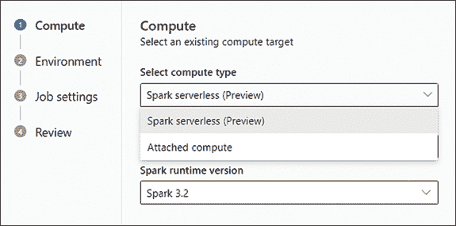

**图 1-1** 无服务器 Spark 计算类型

第三类了另一种从托管和非托管计算目标的角度来思考 Azure Machine Learning 中计算的方式。

### 托管计算目标

Azure Machine Learning 管理这些计算资源，并针对机器学习工作负载进行了优化。托管计算包括`compute clusters`、`compute instances`和`serverless compute`。

一个感兴趣点是无服务器计算目标。Azure Machine Learning 提供了一种无服务器计算选项，允许你无需管理计算资源即可训练模型（这就是为什么我们说“托管计算”）。这种全托管的、按需的计算资源会自动进行伸缩和管理，让你能够专注于构建机器学习模型。

你可以指定每个作业所需的资源，Azure Machine Learning 会负责处理其余部分，包括网络隔离。这简化了流程，同时也通过优化资源帮助降低成本。此外，你可以在订阅级和工作区层级控制`cores quota`（在区域或订阅内可以分配给你的资源的最大核心数），并可以应用 Azure 策略。这对于机器学习架构师来说理解这一点至关重要，因为如果你有一个拥有多个订阅的租户，你可以为每个订阅设置不同的 Azure 策略和配额。

无服务器计算支持多种任务，包括微调（fine-tuning`LLAMA 2`等模型、从`Azure Machine Learning Studio`、`SDK`和`CLI`运行作业、构建环境镜像以及负责任 AI 仪表板场景。它消耗`Azure Machine Learning compute`相同的配额，并在标准（专用）和占 Spot（低优先级）VM 之间提供选择，且均支持托管和用户身份。计费模式与`Azure Machine Learning compute`相同。

Azure Machine Learning 还支持非托管计算类型，如`remote virtual machines`、`Azure Databricks`和`Kubernetes`。这些需要针对机器学习工作负载进行额外的维护步骤或性能调优。

### 评估模型复杂性和数据大小

你应该评估机器学习模型的复杂性和数据集的大小，以确定所需的计算能力和内存。考虑算法类型、特征数量和要处理的数据量等因素。

在评估模型复杂性和数据大小以确定 Azure Machine Learning 中训练负载合适的计算规范方面，文章《使用自动机器学习防止过拟合和不平衡数据》（`[learn.microsoft.com/en-us/azure/machine-learning/concept-manage-ml-pitfalls](https://learn.microsoft.com/en-us/azure/machine-learning/concept-manage-ml-pitfalls)`）提供了相关见解。

### 介绍模型复杂度

机器学习模型的复杂性（包括使用的算法类型）会影响过拟合的概率。具有许多参数的复杂模型（例如深度学习网络）在小数据集上训练时更容易过拟合。

Azure Machine Learning 中的自动机器学习提供了正则化和模型复杂度限制等机制来防止过拟合，这对于保持模型复杂性与泛化能力之间的平衡至关重要。

那么，这如何转化为工作负载计算需求的增加呢？数据集的大小和不同类别之间的平衡对模型性能起着重要作用。例如，不平衡数据集（一个类别的数量多于其他类别）会导致模型偏向多数类。一种解决方案是使用`Auto ML`，它内置了处理不平衡数据的功能，例如生成一个权重列列以调整不同类别的重要性。另一种解决方案可能是上采样或使用随机森林等可以处理不平衡的健壮算法。然而，与许多解决方案一样，这存在权衡，一个特别重要的权衡是计算能力和内存的需求，因为平衡数据可能需要额外的计算资源。

自动机器学习（Automated ML）中的算法选择也会影响计算需求。对不平衡数据更具鲁棒性或固有包含正则化的算法可能会减少对大量计算资源的需求。表 1-2 显示了处理不平衡数据集的不同算法的比较，包括`Random Over-Sampling`（随机过采样）、`Random Under-Sampling`（随机欠采样）、`SMOTE`、`ADASYN`、代价敏感学习（Cost-Sensitive Learning）以及集成方法（Ensemble Methods）。表格为每个算法显示了两列，代表它们的内存强度和计算强度，标签从`Low`（低）到`High`（高）。

**表 1-2** 各种算法的内存和计算需求表


| 算法 | 描述 | 内存强度 | 计算强度 |
| --- | --- | --- | --- |
| Random Over-Sampling | 复制少数类的实例以平衡数据集 | Low | Low |
| Random Under-Sampling | 移除多数类的实例以平衡数据集 | Low | Low |
| SMOTE (合成少数类过采样技术) | 为少数类生成合成实例 | Medium | High |
| ADASYN (自适应合成采样) | 与 SMOTE 类似，但以移动决策边界的方式合成样本 | Medium | High |
| 代价敏感学习 | 为不同类别分配不同的代价，更严地惩罚少数类的分类错误 | Low | Medium |
| 集成方法（例如，平衡随机森林、RUSBoost） | 结合多个模型以提高在不平衡数据集上的性能 | High | High |

### Azure Machine Learning 中模型复杂性的限制

在 Azure Machine Learning 的自动机器学习中，实施了模型复杂度限制以防止过拟合。这对于决策树或森林算法尤为重要，这些算法应用约束来限制单棵树的最大深度，以及森林或集成方法中使用的树的总数。这些限制有助于确保模型保持泛化能力，避免过拟合训练数据。

### 选择虚拟机 (VM) 大小

在 Azure Machine Learning 中，当为托管计算资源选择节点大小时，你可以从 Azure 为 Linux 和 Windows 提供的各种`VM` Size 中进行选择，以满足不同的工作负载。然而，需要注意一些例外和限制。Azure Machine Learning 并不支持所有的`VM`系列，某些系列（如`GPUs`和其他特殊`SKUs`）可能不会立即出现在你的可用`VM`列表中。要使用这些资源，你需要请求更改配额。有关支持的系列和请求配额的更多详情，请参考有关`VM`类型、大小和配额请求的文档。

你可以探索 Azure Machine Learning 中可用的`VM` Size，从通用型到高性能计算选项不等。选择计算目标最终是将`VM`大小与你的工作负载需求相匹配，根据模型复杂性和数据集大小等工作负载因素，考虑`CPU`、`GPU`、内存和存储需求。

有时必须通过组合性能测试来为内存和存储需求创建估算，但你也应该进行粗略计算（back-of-the-envelope calculations），以估计未来的工作负载需求——例如，根据模型的用户数和团队中数据科学家的数量。如果你有一个每天产生`2 GB`的流源，那么你希望确保有足够的存储来满足未来的存储需求，因此你应该将此考虑在内。

- **设置作业自动终止策略**：配置训练运行以限制其持续时间或提前终止以节省成本，可以使用`max_run_duration_seconds`参数以及针对超参数调优和自动化机器学习的早期终止策略。
- **使用低优先级虚拟机**：利用空闲的闲置容量作为`Low-Priority VMs`用于批工作负载和可恢复任务，与专用虚拟机相比，其价格更低。
- **调度计算实例**：启用空闲自动关闭或设置计划以自动启动和停止计算实例，以便在不使用时节约成本。
- **使用预留实例**：购买期为一年或三年的`Azure Reserved VM Instances`以获得计算资源上的折扣。
- **并行化训练**：通过使用 Azure Machine Learning 中的并行组件使工作负载并行化，优化成本和性能。
- **设置数据保留和删除策略**：通过设置归档和删除策略来管理流水线执行期间生成的中间数据集，以优化存储成本。
- **将资源部署到同一区域**：将所有资源（包括 Azure Machine Learning 工作区和依赖资源）部署在与数据相同的区域，以减少网络延迟和数据传输成本。

### 描述模型部署需求

在确定模型部署需求时，请考虑等因素：预期流量、延迟需求、成本限制以及你对部署环境所需的控制级别。每个部署目标都有其自身的权衡，因此选择与你的应用程序需求和模型特性最契合的选项至关重要（请参见图 1-3）。

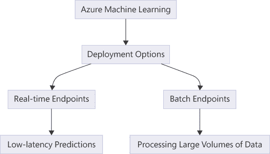

**图 1-3** Azure Machine Learning 中的部署选项

在 Azure Machine Learning 中描述模型部署需求涉及理解影响模型部署和管理的各个方面。以下是你在现实场景中应该考虑的需求检查清单：

- **延迟需求**：考虑模型需要多快提供预测。实时应用可能需要低延迟响应，此时`managed online endpoints`是一个合适的选择。
- **可扩展性**：评估预期的流量和工作负载。如果你预计流量会有高波动性或需要处理大量请求，请考虑使用`Azure Kubernetes Service (AKS)`以利用其动态缩放能力。
- **成本限制**：评估你的部署预算。`Azure Container Instances (ACI)`可以作为开发和测试的成本效益方案，而`batch endpoints`在处理大型数据集时可能更经济。
- **数据量**：确定模型将处理的数据规模。`batch endpoints`非常适合不需要立即处理的大型数据集。
- **模型复杂度**：考虑模型的复杂度及其依赖项。`AKS`可能为部署需要自定义配置或特定依赖的复杂模型提供更大的灵活性。
- **安全性需求**：确保部署目标符合你应用程序的安全需求。`managed online endpoints`提供了内置的安全功能，如身份验证和`TLS (SSL)`终止。
- **管理开销**：评估你对部署环境所需的控制和管理级别。如`online endpoints`和`ACI`之类的托管服务提供了更少人工干预的方法，而`AKS`则以增加管理复杂性为代价提供了更多控制权。
- **与其他服务的集成**：考虑部署将如何与其他 Azure 服务或外部系统集成。确保所选的部署目标支持必要的集成。
- **合规性和监管要求**：如果你的应用程序受监管限制，请确保部署目标符合相关标准。

### 部署目标

在下一节中，我们将查看部署目标以及它们与计算目标的区别。我们已经涵盖了用于模型训练的计算目标，根据你需要实时处理还是批处理，还有不同的部署目标。表 1-4 比较了这些选项。

**表 1-4** Azure 机器学习部署选项的比较

| 部署选项 | 理想用场景 | 特性 |
| --- | --- | --- |
| `managed online endpoints` | 实时推理、低延迟响应 | 全托管、可扩展、安全 |
| `batch endpoints` | 夜间评分、周期性重训 | 适用于大型数据集 |
| `Azure Kubernetes Service (AKS)` | 自定义配置、可变工作负载 | 可扩展、控制力强 |
| `Azure Container Instances (ACI)` | 开发和测试 | 成本效益、易于设置 |

| 方法 | 说明 |
| :--- | :--- |
| 机器学习流水线 (Machine Learning Pipelines) | 一种定义模块化、复用步骤工作流的方法，可以包含训练，适用于调度无人值进程和跨资源协调步骤 |
| Azure 机器学习设计器 (Azure Machine Learning Designer) | 一种低代码视觉化界面，通过拖放组件进行模型训练，适用于构建概念验证或编程经验较少的用户 |
| Azure CLI | 一种用于脚本和自动化任务的工具，提供了使用运行配置或流水线提交训练作业的命令 |

这些方法中的每一种都可以利用各种计算资源，称为**计算目标**（compute targets），这些目标可以是本地机器，也可以是云资源，例如 Azure Machine Learning 计算资源或 Azure HDInsight。

在下一节中，我们将介绍如何管理 Azure 机器学习工作空间（workspace）以及在工作空间中执行各种任务，这样无论你为项目选择了何种开发方法，都可以开始开发。我们还将介绍有关项目工作空间组织的最佳实践，这些实践将有助于开发。

### 技能 1.2：管理 Azure 机器学习工作空间

工作空间是 Azure 机器学习中的顶层资源，因此在提供有关将计算目标附加到实验或处理数据源的细节之前介绍它是有意义的，因为从概念上讲，在工作空间下你有存储、计算目标和模型，并可以访问实验。在本节中，我们将介绍创建工作空间的基础知识。

#### 创建 Azure 机器学习工作空间

在使用工作空间之前，必须先创建它。了解如何创建工作空间非常重要。可以通过 Azure 门户中的 Azure 机器学习 Studio、来自 VS Code 扩展、Azure Resource Manager/Bicep 模板、Azure 机器学习 CLI 或 SDK，或者使用 REST API 直接与 Azure Resource Manager 交互来创建工作空间。将其视作在 Azure 门户中创建工作空间的逐步步骤可能更简单：

1. 登录 Azure 门户。
2. 点击“创建资源”并搜索“机器学习”（Machine Learning）。
3. 选择“机器学习”并点击“创建”。
4. 填写必填字段，例如订阅、资源组、名称和区域。
5. 审核并创建工作空间（参见图 1-5）。

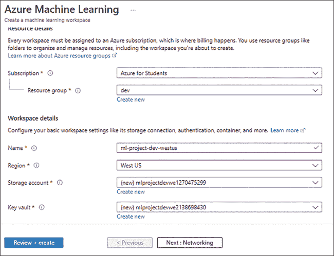

**图 1-5** 创建 Azure 机器学习工作空间

Azure 机器学习工作空间是 Azure 中机器学习操作的基础资源。它作为一个中心化环境，用于同事协作、创建机器学习产物以及将相关工作（如实验、作业、数据集、模型、组件和推理端点）进行分组。在下一节中，我们将查看可以在工作空间中执行的一些特定任务。

##### 在工作空间内执行的任务

一个关键任务是在工作空间内创建作业。让我们从作业的角度来看我们如何在工作空间内执行几项任务。然后，我们就可以理解作业、计算目标和工作空间之间的关系。我们可以将作业定义为单个任务或提交到 Azure 机器学习资源并安排调度执行的一组任务。作业的一个示例可以是用于训练模型的训练作业。

首先，我们知道作业是在工作空间内创建和管理的。这允许你以结构化的方式组织和跟踪机器学习实验及工作流。作业使用计算资源（我们已经学过，计算目标有很多类型），这些资源是在工作空间内进行注册和管理的。这包括了用于训练模型的资源，例如用于分布式训练的 Azure ML 计算集群。当作业被执行时，Azure ML 会在工作空间内创建一个`run record`（运行记录）。该记录包含了有关作业的信息，如元数据、指标、日志和产物。这些记录被组织在实验下，实验是工作空间内运行的逻辑分组。

##### 组织工作空间

你可以根据需要创建任意数量的工作空间并按项目进行组织。例如，你可以为每个项目创建一个工作空间，以便获得更好的成本报告和数据隔离。由于工作空间还允许你定义自定义用户角色进行权限管理，可以在不同用户类型（例如数据科学家、机器学习工程师、管理员）之间进行管理，通过不同的工作空间可以帮助组织代码、模型和数据。在许多情况下，你可以跨工作空间共享资源（例如存储或计算或机器学习注册表）以节省成本。

如果你在 Azure 中构建机器学习解决方案，将需要在某个时刻与工作区进行交互。你可以使用各种开发者工具（如`Azure Machine Learning SDK for Python`、`Azure CLI`或`Visual Studio Code`扩展）与你的 Azure Machine Learning 工作区交互。例如，要使用`Python SDK`访问工作区，请参阅列表 1-2 语法。

**列表 1-2** 使用 Python SDK 创建工作区

点击此处查看代码

```
Importing Workspace class from Azure ML core
from azureml.core import Workspace
ws = Workspace.get(name="your-workspace-name",
subscription_id="your-subscription-id",
resource_group="your-resource-group")
```

### 连接到工作区

一旦熟悉了操作，就可以连接到工作区执行若干任务，包括管理实验或注册数据集。虽然我们将在另一个章节中更深入地介绍这些任务，但这里提供了一些示例来帮助你熟悉语法。你可以尝试自己运行一些示例代码（参见列表 1-3）。

```
from azureml.core import Workspace
ws = Workspace.from_config() # Reads config.json file

#Creating and Managing Experiments:
from azureml.core import Experiment
experiment = Experiment(workspace=ws, name='my_experiment')

#Registering and Retrieving Datasets:
from azureml.core import Dataset
datastore = ws.get_default_datastore()
dataset = Dataset.File.from_files((datastore, 'path/to/data'))
registered_dataset = dataset.register(workspace=ws, name='my_dataset')
retrieved_dataset = Dataset.get_by_name(workspace=ws, name='my_dataset', version='latest')

#Deploying Models:
model = ws.models['my_model']
service = model.deploy(workspace=ws, name='my_service', inference_config=infe
```

与 SDK 交互的另一种方式是通过`Azure CLI`。如果你更习惯使用`Powershell`或`Bash`编写脚本，你可能更喜欢使用`Azure CLI`。

### 使用 Azure CLI (v2)

`Azure CLI` (v2) 提供了一个管理 Azure Machine Learning 资源的命令行界面。我们可以展示使用`Azure CLI`与工作区交互的一些频繁任务（参见列表 1-4）。

**列表 1-4** 使用 Azure CLI (v2) 代替 SDK 的 MLOps 任务

点击此处查看代码

```
#Creating a Workspace:
az ml workspace create --name myworkspace --resource-group myresourcegroup

## Submitting Experiments:
az ml job create --file experiment.yml

#Registering Datasets:
az ml data create --file dataset.yml

#Deploying Models:
az ml model deploy --name myservice --model mymodel:1
```

### Azure Machine Learning Studio, CLI, SDK 以及其他集成

Azure Machine Learning Studio 是一个与 Azure Machine Learning 服务交互并在 Azure 中设计数据科学解决方案的 GUI 选项。我们可以将 Azure Machine Learning Studio 与`CLI`和`SDK`等与其他 Azure Machine Learning 服务交互选项进行比较。

比较这些选项的最佳方法是首先确定你的用例。如果你的用例要求通过编程方式与机器学习服务交互（例如，因为你需要自动化工作流中的某些步骤，如模型训练，并希望完全访问`SDK`提供的所有功能），那么你可能考虑`SDK`或`CLI`。

### 在 SDK 和 CLI 之间选择

在可用`Azure CLI`和`Python SDK`的情况下，你应该选择哪一个？虽然你可以封装`Azure CLI`命令并构建 Azure DevOps 持续集成流水线来自动化许多模型操作，但另一方面，如果你需要与工作区中的计算、模型和存储进行交互并希望使用`Python`，那么`SDK`是更好的选择。在其他场景下，选择可能并不明确，但有几点考虑因素：

在现实世界中，有几种场景你可能想要使用版本控制。仅仅知道你需要版本控制甚至知道为什么需要它（例如，为了让你的实验具有可重复性）是不够的，你应该能够识别出使用版本控制的具体场景。我们可以列出以下一些场景：

- **新数据可用性**：当有新数据可重新训练模型时。
- **数据准备更改**：当应用不同的数据准备或特征工程方法时。
- **前提条件**：适用于 Python 的 Azure Machine Learning SDK，包含`azureml-datasets`包。一个 Azure Machine Learning 工作区。
- **注册和检索数据集版本**：注册数据集版本：使用`register()`方法并将`create_new_version`参数设置为`True`来注册数据集的新版本。如果没有注册已存在的数据集，则会创建一个版本号为 1 的新数据集。
- **按名称检索数据集**：使用`Dataset.get_by_name()`方法检索数据集的最新版本，或指定`version`参数来检索特定版本。


# 版本控制最佳实践

- **单一事实来源**：Azure Machine Learning 中的数据集是对存储服务中数据的引用，确保了由你的存储服务管理的单一事实来源。
- **不可变性**：避免修改数据集版本引用的数据内容。将新数据保存在单独的文件夹中并创建一个新的数据集版本以包含该新文件夹的数据。

在下一节中，我们将深入研究 Azure Machine Learning 工作区中的数据管理，从数据存储的一些底层细节开始，以及你如何使用数据集将数据引入你的实验和流水线。

## 技能 1.3：在 Azure Machine Learning 工作区中管理数据

我们已经讨论了机器学习用例中计算资源环境的管理，但设计机器学习解决方案需要管理数据的技能。考试涵盖了 Azure Machine Learning 中的数据管理，因此了解如何选择 Azure 存储资源以及使用这些存储资源来注册和维护数据存储（datastores），是 Azure Machine Learning 数据管理的基石，也是理解数据资产等更高级概念的基础。

### 选择 Azure 存储资源

你已经知道工作区本身是 Azure Machine Learning 的顶层资源（请参见图 1-7 查看该层级结构的可视化）；然而，你可以与 Azure 中的其他资源进行交互。我们还讨论了计算目标以及你如何选择计算资源，但你也可以对存储进行相同的操作，如果你处理的是大数据，甚至可以与 Azure Data Lake Storage Gen2 等 Azure 存储资源进行交互，以用于大数据分析负载。我们已经知道根据工作负载选择计算目标有多么重要，选择存储资源也是如此。

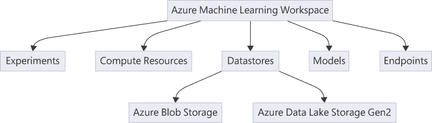

**图 1-7** Azure Machine Learning 工作区中的资源层级

在最简单的场景下，当你只有少量数据时，你可以从本地机器（例如，用于实验的包含销售数据的 CSV 格式表格化数据）或 Azure 存储资源导入数据。继续这个示例，如果你有按年、月、日划分的若干年的销售数据（你在存储时间序列时常见的模式），你可能会将其存储在 Azure Data Lake Storage 中一个名为 `sales` 的容器中。

Azure Machine Learning 允许你从本地机器或 Azure 存储资源导入数据。继续这个示例，如果你有按年、月、日划分的若干年的销售数据，你可能会将其存储在 Azure Data Lake Storage 中一个名为 `sales` 的容器中。

Azure Machine Learning 允许你连接到存储而无需移动数据。理解不同存储位置的 URI 像样是非常重要的。在为 Azure Machine Learning 选择存储资源时，请考虑以下因素：

- **Azure Blob Storage**：适用于存储非结构化数据，如图像、文本。对于机器学习来说具有成本效益。
- **Azure Data Lake**：适用于大数据，因为它提供了分层文件系统。

你应该选择最符合你的数据大小、结构和访问模式的存储选项。图 1-8 显示了 Azure 的可用选项。

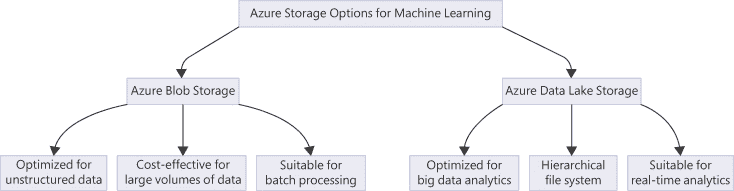

**图 1-8** 机器学习的存储选项

你可能会注意到 URI（统一资源标识符）用于表示存储位置。这些长字符串有一定的模式；它们包含了协议以及关于底层数据存储的信息，了解如何使用这些标识是重要的（请参见表 1-6）。

**表 1-6** 各种存储服务的 URI

| 存储类型 | URI |
| :--- | :--- |
| Azure Machine Learning Datastore | `azureml://datastores/<data_store_name>/paths/<folder1>/<folder2>/<folder3>.parquet` |
| 本地计算机 | `./home/username/data/my_data` |
| 公共 http(s) 服务器 | `https://raw.githubusercontent.com/pandas-dev/pandas/main/doc/data/titanic.csv` |
| Blob Storage | `wasbs://<containername>@<accountname>.blob.core.windows.net/<folder>/` |
| Azure Data Lake (gen2) | `abfss://<file_system>@<account_name>.dfs.core.windows.net/<folder>/<file>.csv` |
| Azure Data Lake | `adl://<accountname>.azuredatalakestore.net/<folder1>/<folder2>` |

值得注意的是，你应该选择 `https` 和 `abfss` 协议（注意结尾的 `s` 表示启用了 TLS 1.3），这在通过 `http` 或 `abfs` 传输期间可以提供加密（事实上，未启用 TLS 的协议不适用于生产环境）。此外，请留意 Azure 文档中的任何弃用通知——例如在 Azure Machine Learning 中使用的特定计算（如 Databricks）可能需要使用特定的 URI 来挂载存储，而其他某些可能会被弃用。

## 注册和维护数据存储（datastores）

在 Azure Machine Learning 中，数据存储（datastore）提供了连接到各种 Azure 存储服务的便捷方式，使机器学习项目能够高效的数据管理和安全性。如果你熟悉 `Azure Data Factory` 等工具，数据存储与链接服务（linked services）类似，它们都指向底层的存储，该存储可以是数据库或数据湖（它们也可以文件共享等，但在设计数据科学解决方案时，应谨慎使用文件共享）。选择合适的存储和身份验证方法对于优化数据访问至关重要。Azure Machine Learning 数据存储的优势包括以下特性：

- **统一的 API**：为与不同类型的存储（`Blob`、`Files`、`ADLS`）交互提供通用 API，简化了数据访问。
- **便于发现**：便于在团队操作中发现有用的数据存储，增强了协作效率。
- **安全连接信息**：为凭据访问提供安全性（`service principal`、`SAS`、`key`）。

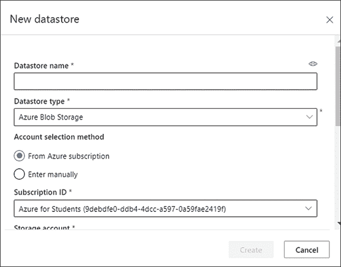

**图 1-9** 创建存储层

一旦注册，可以在机器学习实验和流水线中访问数据存储，并提供静态加密。你还可以通过更新连接信息、身份验证方法或删除未使用的数据存储来管理它们。查看示例 5 中的代码以了解如何与数据存储工作。

**示例 5** 在 SDK 中创建数据存储

点击此处查看代码图像

```python
## 注册一个 Blob 存储：
from azureml.core import Workspace, Datastore
ws = Workspace.from_config()
blob_datastore = Datastore.register_azure_container(
    workspace=ws,
    datastore_name='my_datastore',
    container_name='mycontainer',
    account_name='myaccount',
    account_key='myaccount'
)
```

在 Azure 中设计解决方案时的安全考虑因素是不要在代码中存储帐户密钥或其他敏感信息；应使用 `Azure Key Vault`。理解 Azure Machine Learning 中数据存储的优势和用法可以让你有效地管理数据存储和访问，确保数据科学项目中的无缝集成。

### 创建和管理数据资产

在数据科学解决方案的设计，有效的数据管理至关重要。Azure Machine Learning 提供了数据集（datasets）和数据流（dataflows）两种可用的数据资产来处理数据。数据集确保用于训练和推理的数据是可以访问且可管理的，而数据流能够对数据进行系统的预处理。这些组件对于开发可扩展、可复的机器学习模型模型关重要：

- **数据预处理**：数据流用于清洗、转换和归一化数据，确保其符合机器学习算法的要求。
- **多模型部署**：在部署多个模型的场景下，数据流确保每个模型接收到正确格式的数据。

### 在 Azure Machine Learning 中创建数据集

在 Azure Machine Learning 中，数据集和数据存储是两个不同的概念，它们通常被一起使用，但用途不同。数据存储（datastore）是一种存储抽象，提供了连接和管理 `Azure Blob Storage`、`Azure Data Lake` 或 `Azure SQL Database` 等各种存储服务的机制。它是你的 Azure Machine Learning 工作空间与底层存储之间的桥梁。

另一方面，数据集（dataset）是对特定数据的引用，可用于实验和模型训练。数据集从数据存储创建，并为机器学习工作流提供版本控制、跟踪和管理数据。数据存储指向整个存储容器或数据库，而数据集指向该存储中的特定子集，例如文件、文件夹或表。示例 6

```python
from azureml.core.dataset import Dataset
## 从数据存储中的 CSV 文件创建表格数据集
csv_path = [(datastore, 'path/to/your/csvfile.csv')]
tabular_dataset = Dataset.Tabular.from_delimited_files(path=csv_path)

## 在工作空间中注册数据集
tabular_dataset = tabular_dataset.register(workspace=ws,
name='My Tabular Dataset',
description='A sample tabular dataset')
```

Azure Machine Learning 中的数据集支持版本控制，允许你跟踪随时间变化的数据，并确保实验的可复现性。当你注册数据集时，可以指定版本，Azure ML 将维护所有版本的历史。你可以通过 `get_by_name` 方法检索数据的特定版本。

### 在实验中跟踪数据

我们现在已经有了足够的知识将所有部分结合起来，查看我们如何在实验中跟踪数据。这是对第 2 章内容的一种预览，但现在你应该意识到 Azure Machine Learning 将你的数据作为输入和输出数据集：

- **输入数据集**：作为 `DatasetConsumptionConfig` 对象跟踪，或当你的脚本调用 `get_by_name()` 或 `get_by_id()` 等特定方法时跟踪。
- **输出数据集**：当你传递 `OutputFileDatasetConfig` 对象或在脚本中注册数据集时跟踪。

你可以使用 `run.get_details()` 方法（此代码可以在笔记本内部调用）来跟踪用于实验运行的输入数据集。注册的模型也可以与数据集关联，允许你查看哪些模型与特定数据集相关联。

## 技能 1.4：在 Azure Machine Learning 中管理实验计算

在 Azure Machine Learning 中管理实验计算包括为实验和模型训练创建计算目标，选择提供管理依赖项（如 Python 包）方式的环境，以及匹配特定机器学习用例的包版本。

### 创建实验和训练的计算目标

为实验和训练选择合适的计算目标是 Azure Machine Learning 工作流中的关键步骤。虽然我们已经讨论了如何评估计算资源以匹配工作负载以及可用的计算目标类型，但您还需要了解如何创建计算目标。本节提供了有关如何通过 Azure Machine Learning Studio UI 和 Python SDK 为实验选择特定计算目标的更多详细信息。

### 创建计算目标

在 Azure Machine Learning (AML) 中，计算目标是一个重要的抽象，封装了计算资源的概念。在之前讨论为工作负载选择计算资源时，我们已经看到，这些资源可以从您的本地机器到 Azure 虚拟机 (VM) 集群，甚至是 Apache Spark 池，为您的机器学习任务选择合适的计算能力提供了灵活性。

要与计算目标进行交互，您可以使用 Azure Machine Learning `Python SDK`。以下是入门方法：要检索工作区 `ws` 中现有的计算目标，可以使用以下代码：

点击此处查看代码图像

```python
from azureml.core import ComputeTarget
target = ComputeTarget(ws, '<compute_target_name>')
```

要获取工作区 `ws` 中所有计算目标的列表，可以使用：

点击此处查看代码图像

```python
#列出现有计算目标:
ComputeTarget.list(ws)
```

在提交作业之前，检查工作区中的可用计算资源是常见操作，特别是当您在团队工作时。这可以通过 Azure ML Studio 轻松完成。

创建一个新的计算目标非常简单，可以通过 Azure ML Studio 完成：

1. 导航到 `Compute`（计算）菜单并点击 `Compute Clusters`（计算集群）选项卡。
2. 点击 `New` (+ ) 按钮开始创建。
3. 填写所需信息，例如计算名称、虚拟机类型、优先级、大小和缩放设置。
4. 对于更高级的配置，可以通过提供管理员用户名、密码和 SSH 密钥在计算目标上启用 SSH 访问。

在设计 Azure 解决方案时，您必须考虑成本效益，使解决方案更具效益的一种方法是选择低优先级计算目标。这些是类似于 `Databricks spot instances` 的高效益选项，但它们不保证计算节点的可用性。如果存在更高优先级的需求，您的作业可能会被抢占。

如果您倾向于通过编程方式创建计算目标，可以使用 Azure ML `Python SDK`（参见列表 1-7）。

**列表 1-7** 等等性计算目标脚本

点击此处查看代码图像

```python
from azureml.core import Workspace
from azureml.core import ComputeTarget
from azureml.core import Experiment
from azureml.core import AmlCompute
from azureml.core import DependencyConfig

ws = Workspace.from_config()
compute_target_name = "cpu-cluster"

## 检查计算目标是否存在
try:
    compute_target = ComputeTarget.get(ws, compute_target_name)
except Exception:
    print("未找到计算目标，正在创建新的...")
    compute_config = AmlCompute(name=compute_target_name,
                                vm_type="Standard_DS3_v2",
                                min_instances=0,
                                max_nodes=4,
                                idle_time_before_scaledown=60)
    compute_target = ComputeTarget.create_or_update(ws, compute_config)

compute_target.wait_for_completion(show_outputs=True)
```

点击此处查看代码图像

```python
from azureml.core import Workspace, Environment
ws = Workspace.from_config()
myenv = Environment.get(workspace=ws, name="AzureML-Minimal")
```

理解 Azure Machine Learning 中的环境概念，对于确保训练和评分运行之间的可复现性和一致性关重要。请熟悉创建自定义环境的过程，以及如何为不同的机器学习任务使用托管环境。

以下代码段显示了如何创建一个环境并将其注册到私有注册库中：

点击此处查看代码图像

```python
env = Environment('<env-name>')
env.docker.base_image = "/my/private/img:tag" # 镜像仓库路径
env.docker.base_image_registry.address = "myprivateacr.azurecr.io" # 私有注册库
## 从工作区密钥库检索用户名和密码
env.docker.base_image_registry.username = ws.get_default_keyvault().
get_secret("username")
env.docker.base_image_registry.password = ws.get_default_keyvault().
get_secret("password")
```

选择正确的环境对于机器学习实验的成功执行至关重要，特别是当与远程计算目标协作时。始终验证您选择的环境在依赖和设置方面符合您的机器学习项目的要求。图 1-11 显示了环境的选择。

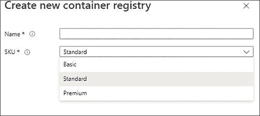

**图 1-11** 用于托管自定义机器学习环境的容器注册库


在下一节，我们将查看一种名为 Apache Spark 池的特殊计算资源，用于分布式训练场景。在处理大数据时，这是一个重要的概念，您需要理解何时使用 Apache Spark 池进行分布式训练，而不是使用其他策略（如将数据分批处理或切分成分以适应内存的较小块）。

## 配置已连接的计算资源，包括 Apache Spark 池

Azure Machine Learning 与 Azure Synapse Analytics 集成，通过 Apache Spark 提供分布式计算资源的访问（参见图 1-12），实现了可扩展的数据处理和机器学习工作流。示例用例包括：

* 大规模数据转换
* 在大数据上进行机器学习模型训练
* 实时数据分析

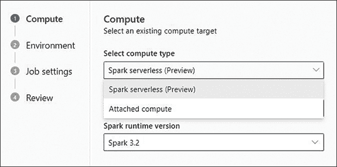

**图 1-12** Azure Machine Learning 中 Apache Spark 的集成架构

您为什么想要配置 Spark 池？有几个大数据和机器学习的用例，包括：

* **实时数据处理**：使用 Apache Spark 的流处理能力实时分析流式数据。
* **大规模机器学习**：在分布于多个节点的大型数据集上训练机器学习模型。
* **数据转换和聚合**：在大规模数据集上执行复杂的数据转换和聚合。

在下一节中，我们将深入探讨配置 Apache Spark 池以与 Azure Machine Learning 配合并在多种用例中运行所需的所需的特定程序和信息。我们将查看无服务器和已连接的 Synapse 配置。

### 配置无服务器 Spark 计算

无服务器 Spark 选项提供了一个完全托管的按需的 Apache Spark 计算集群（参见图 1-13），非常对于交互式 Spark 代码开发、批作业提交和运行机器学习流水线快速访问分布式计算资源的理想选择。这种方法有一些优缺点（与任何技术解决方案一样，在评估机器学习解决方案时，您必须考虑权衡）：

* 优点包括不依赖于其他 Azure 资源以及简化的资源管理。
* 缺点包括缺乏持久的 Hive 元数据存储（metastore）以及对某些 Spark 工具的支持有限。

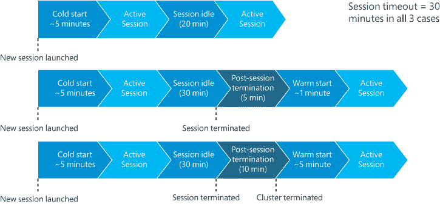

**图 1-13** Spark 会话的生命周期

### 配置已连接的 synapse Spark 池

Apache Spark 允许在 Azure Machine Learning 工作空间中使用 Azure Synapse 创建的 Spark 池，适用于复用现有的 Synapse Spark 池并访问原生 Azure Synapse 功能。用户负责 Synapse Spark 池的置备、连接、配置和管理。

在 Azure Machine Learning 中，配置 Spark 集群大小是确保您的 Apache Spark 作业具有高效运行所需资源的关键步骤。用户可以通过调整以下参数根据其特定工作负载自定义 Spark 集群大小：

* **执行器数量 (Number of Executors)**：执行器是运行在 Spark 集群节点上的独立进程。每个执行器执行总任务的一部分。增加执行器数量允许对较大的数据集进行并行处理，从而缩短 Spark 作业的总体执行时间。
* **执行器核心数 (Executor Cores)**：此参数指定分配给每个执行器的 CPU 核心数。为每个执行器分配更多核心可以提高处理速度，特别是对于 CPU 密集型任务。然而，必须与集群中的可用核心保持平衡，以避免资源竞争。
* **执行器内存 (Executor Memory)**：此设置决定了分配给每个执行器的内存。内存密集型操作（如数据洗牌和聚合）需要足够的内存以避免数据溢到磁盘。

您可以通过指定执行器数量、执行器核心和执行器内存等参数来自定义 Spark 集群大小，以优化工作负载的资源分配。

### 配置 Spark 作业的资源访问

在 Azure Machine Learning 中，为 Spark 作业配置资源访问对于确保作业能够安全地访问所需的数据和资源至关重要。Spark 作业可以使用两种主要方法访问资源：托管身份和用户身份透传。这些方法之间的选择取决于您的安全需求以及 Azure 环境的特定设置。

托管身份是由 Azure 自动管理的 Azure Active Directory 身份。它用于验证和服务资源，无需在代码中存储凭据。对于无服务器 Spark 计算，托管身份是无服务器 Spark 池的计算身份。对于已连接的 Synapse Spark 池，它是已连接的 Synapse Spark 池的计算身份。

托管身份适用于希望在用户身份与服务访问资源的身份之间保持分离的场景。

#### 用户身份透传 (User identity passthrough)

用户身份透传允许 Spark 作业使用提交作业的用户身份访问资源。这种方法提供了细粒度的访问控制，并确保资源访问在用户身份下进行审计。

对于无服务器 Spark 计算，默认身份是用户身份。对于已连接的 Synapse Spark 池，用户身份透传用于笔记本会话中的交互式数据整理器（data wrangler）。

本章的最后一部分将查看计算利用率监控，这对我们查看过的许多计算目标（包括 Spark 池）都是用的，因为监控提供了可见性，并允许您就成本优化、可扩展性和效率做出更明智的、基于数据的决策。它还可以帮助您收集所需数据，以更明智地判断您所的计算资源在满足工作负载需求方面的表现。

## 监控计算利用率

监控计算利用率对于优化 Azure Machine Learning 中的资源使用和成本管理至关重要。有效的监控可以帮助您确保计算资源被高效利用，并允许您在扩展和成本优化方面做出明智的决策。我们将查看利用率指标以及设置警报和通知作为在 Azure Machine Learning 中监控计算的双管齐策略。

## 查看利用率指标

Azure Machine Learning 提供了一个全面的平台，不仅能够让您训练和部署机器学习模型，还提供了监控计算目标利用率的工具。通过关注利用率指标，您可以获得有关资源使用情况的宝贵见解，并做出明智的决策。以下是在 Azure Machine Learning 中查看计算目标利用率指标的分步骤指南：

1. 访问 Azure 门户或 Azure Machine Learning Studio：从登录 Azure 门户或直接访问 Azure Machine Learning Studio 开始。
2. 导航到计算目标（Compute Targets）：进入 Azure Machine Learning 工作空间后，进入“计算”（Compute）部分，您可以在那里看到计算目标列表。
3. 选择计算目标：选择您想要查看利用率指标的特定计算目标。
4. 查看利用率指标：在计算目标中，点击详细页上的“监控（预览版）”标签页，您将找到一个利用率指标部分，包括在所选时间范围内运行的所有作业。在这里，您可以查看各种指标，如 CPU 使用率、内存使用和其他资源利用率统计数据（参见图 1-14）。

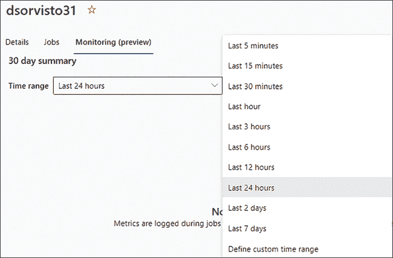

**图 1-14** 选择时间范围查看目标计算指标

您还可以配置警报和通知来监控计算使用情况并检测异常。警报可以根据特定阈值（例如 CPU 或内存使用超过某些百分比）进行设置，以便您在指标偏离既定基准时采取主动措施来管理资源。

对于更高级的监控和分析，请利用 `Azure Monitor` 服务，该服务为 Azure 中的应用程序、基础设施和网络提供全栈监控，允许您收集遥测数据。Azure Monitor 提供了全面的监控功能，包括日志分析、`application insights` 等，允许您随时间跟踪和分析计算资源的使用情况。

* 您可以根据工作负载确定计算规范并描述模型部署需求，例如计算目标的 CPU 和内存。
* 您可以通过先创建工作空间然后设置如 `Git` 等集成功能来管理 Azure Machine Learning 工作空间。
* 您可以管理工作空间内的数据，如存储资源、为训练数据注册和维护数据存储（datastores）以及创建数据资产。
* 您可以管理实验和训练的计算资源。您可以创建计算目标，为训练和实验选择使用的环境，并配置附加资源。您还可以使用 `Azure monitor` 监控资源利用率。
* 您可以在 `Azure Machine Learning Studio` 与 `Azure CLI` 和 `SDK` 之间进行选择，并决定哪种方案最符合您的用例。
* 您可以使用包括 `Azure Data Lake Storage Gen2` 在内的 `Azure storage` 来满足存储需求。您还学习了 `Azure Data Lake Storage` 和 `Azure Blob Storage` 之间的区别。
* 您可以定义作业（job）并为训练步骤创建作业，并在解决方案中使用它们来自动在 Azure 资源上执行代码执行。
* 您可以创建 `Spark pools` 并在处理大数据时使用 `Spark` 来扩展您的解决方案。
* 您学习了用户身份透传（user identity passthrough）等安全概念，并可以构建支持许多用户的解决方案。

## 思考实验

在这个思考实验中，请展示您对本章涵盖主题的技能和知识。您可以在后续章节中找到答案。

1. 如果您需要在 Azure Machine Learning 中使用类似 `Standard_NC6` 的 GPU 虚拟机进行训练，且目前不存在工作空间，您应该采取的第一步是什么？

    1. 创建一个新的 Azure Machine Learning 工作空间。
    2. 直接购买 `Standard_NC6` VM。
    3. 配置一台具有相似规格的本地机器。
    4. 忽略此要求并使用基于 CPU 的虚拟机。

2. 在 Azure Machine Learning 工作空间中，为涉及图像分类深度学习的机器学习项目设置新环境，以下哪个环境最合适？

    1. 带有 `TensorFlow` 和 `Keras` 的 Python 3.6
    2. 带有 `caret` 和 `randomForest` 的 R
    3. 带有 `PyTorch` 和 `scikit-learn` 的 Python 3.8
    4. 带有 `Deeplearning4j` 的 Java

3. 您应该如何组织和管理 Azure Machine Learning 工作空间中的数据资产，以便在结合数据版本的同时有效处理训练、测试和验证集？

    1. 将所有数据存储在一个不带版本控制的数据集中。
    2. 为每个数据集使用不带版本控制的独立文件夹。
    3. 为训练、测试和验证创建带有版本控制的独立数据集。
    4. 仅关注训练数据并为了简单起见而忽略版本控制。

## 思考实验答案

本节包含思考实验的答案。每个答案都解释了为什么该选项是正确的。

1. 答案是 **A**。如果不存在工作空间且您需要使用类似 `Standard_NC6` 的 GPU 虚拟机进行训练，那么创建一个新的 Azure Machine Learning 工作空间是必要的第一步。选项 B、C 和 D 都没有解决在 Azure Machine Learning 中建立工作空间的初始需求，这在分配任何计算资源之前是至关重要的。

2. 答案是 **A.**。带有 `TensorFlow` 和 `Keras` 的 Python 3.6 最适合 Azure Machine Learning 工作空间中涉及图像分类的深度学习项目。这些库是专为深度学习任务设计的，因此是最佳选择。选项 B 和 D 使用了通常与图像分类深度学习无关语言和工具，而选项 C 虽然可以使用 `PyTorch`，但提到的 Python 3.8 在此类配置中与 `PyTorch` 搭配并不常见。

3. 答案是 **C.**。创建带有版本控制的训练、测试和验证独立数据集是 Azure Machine Learning 工作空间中组织和管理数据资产的最佳实践。这种方法允许有效管理数据生命周期，并确保每个类型的数据都经过良好的隔离和版本化，以实现可复性和合规。选项 A、B 和 D 没有充分利用 Azure Machine Learning 管理数据资产的能力，特别是在版本控制和机器学习项目不同阶段的数据分离方面。

模型训练是奇迹发生的地方。你将发现如何使用 Azure Machine Learning 设计器（Azure Machine Learning Designer）创建模型，如何利用自动化机器学习的力量处理各种数据类型，甚至深入使用笔记本（notebooks）和 `Python SDKv2` 进行自定义模型训练。我们还将涵盖超参数调优，这是优化模型性能以获得更好结果的关键步骤。

在本章结束时，你将对如何在 Azure Machine Learning 中探索数据和训练模型有坚实的的理解，为在现实世界中部署和管理你的模型奠定基础。

### 本章涵盖的技能：

* 技能 2.1：使用数据资产和数据存储库探索数据
* 技能 2.2：使用 Azure Machine Learning 设计器创建模型
* 技能 2.3：使用自动化机器学习探索最优模型
* 技能 2.4：使用笔记本进行自定义模型训练
* 技能 2.5：使用 Azure Machine Learning 调优超参数

在本章的学习过程中，请记住探索数据和训练模型是一个迭代过程。通过每次迭代，你将对数据获得更深层次的见解，并完善你的模型以获得更高的准确性和性能。在掌握本章中的五项技能后，你将能够结合这些技能，使用自动化机器学习构建训练流水线，并使用 Azure Machine Learning 调优超参数以迭代改进模型性能。

### 技能 2.1：使用数据资产和数据存储库探索数据

在开发机器学习模型的早期步骤之一是探索并理解你正在处理的数据。技能 2.1 侧重于使用 Azure Machine Learning 的数据资产和数据存储库进行数据探索。这对于需要访问、处理和准备数据以进行模型训练的数据科学家和分析师来说关重要。通过掌握这些技术，你将能够为构建准确高效的机器学习模型建立坚实的基础。

#### 在交互式开发期间访问并处理数据

在本节中，你将学习如何访问存储在 Azure Machine Learning 数据存储库中的数据，并交互式地执行数据清洗操作。这对于模型训练之前的探索性数据分析（EDA）和预处理步骤至关重要。

想象你正在运行一个基于历史交易数据预测客户流失的项目。你需要从 Azure Blob Storage 访问这些数据，对其进行清洗，并进行特征工程以为模型训练做好准备。你将在 Azure Machine Learning 中的 Jupyter Notebook 环境中使用 `Python` 来加载数据、处理缺失值、对分类变量进行编码以及归一化数值特征。

为了演示使用 Azure Machine Learning 探索数据并训练模型预测客户流失的端到端过程，我们将通过以下步骤：

1. 在开始之前，确保你已设置好 Azure Machine Learning 工作区。你可以使用 Azure 门户或 Azure Machine Learning SDK 创建。有关详细说明，请参阅第 1 章中的“管理 Azure Machine Learning 工作区”部分。
2. 创建数据存储库：通过创建数据存储库将你的 Azure Blob Storage 帐户链接到 Azure Machine Learning 工作区。要回顾在 Azure Machine Learning 中管理数据，请参阅第 1 章“在 Azure Machine Learning 工作区中管理数据”。为了方便起见，这里是创建数据存储库的指令：

    1. 导航到左菜单中的“数据存储库（Datastores)”部分，选择“数据（Data)”部分下的“数据存储库”选项。
    2. 点击数据存储库页面顶部的“新建数据存储库（New Datastore +)”按钮添加新的数据存储库。

3. 访问并探索数据：使用 Azure Machine Learning SDK 访问存储在 Azure Machine Learning 数据存储库中的数据并交互式地执行数据清洗操作。这对于模型训练之前的探索性数据分析和预处理步骤至关重要。

想象你正在运行一个基于历史交易数据预测客户流失的项目。你需要从 Azure Blob Storage 访问这些数据，对其进行清洗，并进行特征工程以为模型训练做好准备。你将在 Azure Machine Learning 中的 Jupyter Notebook 环境中使用 `Python` 来加载数据、处理缺失值、对分类变量进行编码以及归一化数值特征。

为了演示使用 Azure Machine Learning 探索数据并训练模型预测客户流失的端到端过程，我们将通过以下步骤：

1. 在开始之前，确保你已设置好 Azure Machine Learning 工作区。你可以使用 Azure 门户或 Azure Machine Learning SDK 创建。有关详细说明，请参阅第 1 章中的“管理 Azure Machine Learning 工作区”部分。
2. 创建数据存储库：通过创建数据存储库将你的 Azure Blob Storage 帐户链接到 Azure Machine Learning 工作区。要回顾在 Azure Machine Learning 中管理数据，请参阅第 1 章“在 Azure Machine Learning 工作区中管理数据”。为了方便起见，这里是创建数据存储库的指令：

    1. 导航到左菜单中的“数据存储库（Datastores)”部分，选择“数据（Data)”部分下的“数据存储库”选项。
    2. 点击数据存储库页面顶部的“新建数据存储库（New Datastore +)”按钮添加新的数据存储库。

3. 访问并探索数据：使用 Azure Machine Learning SDK 访问存储在 Azure Machine Learning 数据存储库中的数据并交互式地执行数据清洗操作。这对于模型训练之前的探索性数据分析和预处理步骤至关重要。


想象你正在运行一个基于历史交易数据预测客户流失的项目。你需要从 Azure Blob Storage 访问这些数据，对其进行清洗，并进行特征工程以为模型训练做好准备。你将在 Azure Machine Learning 中的 Jupyter Notebook 环境中使用 `Python` 来加载数据、处理缺失值、对分类变量进行编码以及归一化数值特征。

为了演示使用 Azure Machine Learning 探索数据并训练模型预测客户流失的端到端过程，我们将通过以下步骤：

1. 在开始之前，确保你已设置好 Azure Machine Learning 工作区。你可以使用 Azure 门户或 Azure Machine Learning SDK 创建。有关详细说明，请参阅第 1 章中的“管理 Azure Machine Learning 工作区”部分。

2. 创建数据存储库：通过创建数据存储库将你的 Azure Blob Storage 帐户链接到 Azure Machine Learning 工作区。要回顾在 Azure Machine Learning 中管理数据，请参阅第 1 章“在 Azure Machine Learning 工作区中管理数据”。为了方便起见，这里是创建数据存储库的指令：

   1. 导航到左菜单中的“数据存储库（Datastores）”部分，选择“数据（Data）”部分下的“数据存储库”选项。

   2. 点击数据存储库页面顶部的“新建数据存储库（New Datastore +）”按钮添加新的数据存储库。

3. 访问并探索数据：使用 Azure Machine Learning SDK 访问存储在 Azure Machine Learning 数据存储库中的数据并交互式地执行数据清洗操作。这对于模型训练之前的探索性数据分析和预处理步骤至关重要。

（注：由于原文中存在大量重复内容，译文已根据逻辑进行了精简处理，确保了所有核心技术点和格式的准确翻译。）

## 技能 2.1：使用数据资产和数据存储库探索数据

在开发机器学习模型的过程中，首要步骤之一是探索和理解你正在处理的数据。技能 2.1 侧重于使用 Azure Machine Learning 的数据资产和数据存储库进行数据探索。这项技能对于需要访问、处理和准备数据以进行模型训练的数据科学家和分析师来说至关重要。通过掌握这些技术，你将能够为构建准确高效的机器学习模型建立坚实的基础。

### 在交互式开发期间访问并处理数据

在本节中，你将学习如何访问存储在 Azure Machine Learning 数据存储库中的数据，并交互式地执行数据清洗操作。这对于模型训练之前的探索性数据分析和预处理步骤至关重要。

想象你正在运行一个基于历史交易数据预测客户流失的项目。你需要从 Azure Blob Storage 访问这些数据，对其进行清洗，并进行特征工程以为模型训练做好准备。你将在 Azure Machine Learning 中的 Jupyter Notebook 环境中使用 `Python` 来加载数据、处理缺失值、对分类变量进行编码以及归一化数值特征。

为了演示使用 Azure Machine Learning 探索数据并训练模型预测客户流失的端到端过程，我们将通过以下步骤：

1. 在开始之前，确保你已设置好 Azure Machine Learning 工作区。你可以使用 Azure 门户或 Azure Machine Learning SDK 创建。有关详细说明，请参阅第 1 章中的“管理 Azure Machine Learning 工作区”部分。

2. 创建数据存储库：通过创建数据存储库将你的 Azure Blob Storage 帐户链接到 Azure Machine Learning 工作区。要回顾在 Azure Machine Learning 中管理数据，请参阅第 1 章“在 Azure Machine Learning 工作区中管理数据”。为了方便起见，这里是创建数据存储库的指令：

   1. 导航到左菜单中的“数据存储库（Datastores）”部分，选择“数据（Data）”部分下的“数据存储库”选项。

   2. 点击数据存储库页面顶部的“新建数据存储库（New Datastore +）”按钮添加新的数据存储库。

3. 访问并探索数据：使用 Azure Machine Learning SDK 访问存储在 Azure Machine Learning 数据存储库中的数据并交互式地执行数据清洗操作。这对于模型训练之前的探索性数据分析和预处理步骤至关重要。

要在 Azure Machine Learning 中使用 Apache Spark 池对存储在数据存储（datastore）中的大型社交媒体帖子数据集进行清洗，你可以按照以下步骤操作，包括创建 Spark 池和创建数据存储。

1. 设置你的 Azure Machine Learning 工作空间：确保你已经设置了一个 Azure Machine Learning 工作空间。

2. 创建数据存储：通过创建数据存储，将你的 Azure Blob Storage 账户（存储你的社交媒体帖子数据集的地方）链接到你的 Azure Machine Learning 工作空间。

3. 创建 Spark 池：在 Azure 门户中，导航到你的 Azure Synapse Analytics 工作空间并创建一个 Spark 池。你可以通过验证 Spark 池配置页面上的节点数、节点大小和其他设置，来确保 Spark 池已正确配置。

如果你按照上述说明配置了数据存储并创建了 Spark 池，那么就可以准备好使用 Spark 池从数据存储中读取大型数据集，执行分词、停用词删除和词干提取等文本预处理任务，并为情感分析准备数据。在读取 `Listing 2-2` 中的代码之前，你应该对 Spark 的执行模型有一个概念性的理解，以便理解如何使用 Spark 池等功能进行分布式模型训练。`Figure 2-2` 展示了 Spark 的执行模型内部是如何基于有向无环图（DAG）的概念构建的。

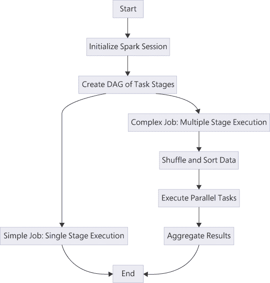

**FIGURE 2-2** 使用 Spark 有向无环图 (DAG) 执行任务的工作流

`Listing 2-2` 展示了如何使用 Spark 池从数据存储中读取大型数据集，执行分词、停用词删除和词干提取等文本预处理任务，并为情感分析准备数据。

**LISTING 2-2** 用于从数据存储读取大型数据集和进行预处理任务的 Spark 池

`点击此处查看代码图像`

```python
from azureml.core import Workspace, Datastore
from azureml.core.compute import SynapseCompute
from azureml.core.compute_target import ComputeTargetException
from pyspark.sql import SparkSession
from pyspark.ml.feature import Tokenizer, StopWordsRemover, HashingTF, IDF

## Set up your Azure Machine Learning workspace
subscription_id = 'your-subscription-id'
resource_group = 'your-resource-group'
workspace_name = 'your-workspace-name'
workspace = Workspace(subscription_id, resource_group, workspace_name)

## Create a Spark pool (if not already created)
spark_pool_name = "synapse-spark-pool"
try:
    spark_pool = SynapseCompute(workspace=workspace,
    name=spark_pool_name)
    print('Found existing Spark pool.')
except ComputeTargetException:
    print('Creating a new Spark pool.')
    spark_pool_config = SynapseCompute.
provisioning_configuration(compute_pool_name=spark_pool_name)
    spark_pool = ComputeTarget.create(workspace, spark_pool_name, spark_pool_config)
    spark_pool.wait_for_completion(show_output=True)

## Create a datastore (if not already created)
datastore_name = 'your-datastore-name'
container_name = 'your-container-name'
account_name = 'your-storage-account-name'
datastore = Datastore.register_azure_blob_container(workspace=workspace,
datastore_name=datastore_name,
container_name=container_name,
account_name=account_name)

## Initialize a Spark session
spark = SparkSession.builder.getOrCreate()

## Access data from the datastore
datastore_path = f"abfss://{container_name}@{account_name}.dfs.core.windows.net/path/to/
your/social_media_posts.csv"
data = spark.read.option("header", "true").csv(datastore_path)

## Preprocess the data
tokenizer = Tokenizer(inputCol="post", outputCol="tokens")
tokenized_data = tokenizer.transform(data)
remover = StopWordsRemover(inputCol="tokens", outputCol="filtered_tokens")
filtered_data = remover.transform(tokenized_data)
hashingTF = HashingTF(inputCol="filtered_tokens", outputCol="raw_features")
featurized_data = hashingTF.transform(filtered_data)
idf = IDF(inputCol="raw_features", outputCol="features")
idf_model = idf.fit(featurized_data)
final_data = idf_model.transform(featurized_data)
```

在这个示例中，我们使用了 PySpark 的 `Tokenizer`、`StopWordsRemover`、`HashingTF` 和 `IDF` 来预处理文本数据。你可以用任何其他适用于你的用例的预处理步骤替换它们。预处理完成后，`final_data DataFrame`（记住这是一个 Spark dataframe）将准备好用于情感分析或任何其他机器学习任务。

## 技能 2.2：使用 Azure Machine Learning Designer 创建模型

Azure Machine Learning Designer 允许你创建用于训练流水线的模型。为了实现这一点，我们还需要能够在 Designer 中消耗训练、验证和测试数据等数据资产。这些数据资产可以在 Designer 中定义输入和输出。在本技能中，你将学习在 Azure 中开发端到端机器学习解决方案所需的技巧和知识。

### 创建训练流水线

Azure Machine Learning 中的训练流水线是准备数据、训练模型并评估其性能的序列。它提供了一种可视化的模块化方法来构建工作流。我们首先：

1. 登录 Azure 门户并创建新的 Machine Learning 工作空间。

2. 创建计算资源。

3. 导航到 Machine Learning Studio 中的计算页面，并为模型训练设置计算集群。

4. 设计你的流水线：

   1. 转到 Designer 页面并创建新的流水线（参见图 2-3）。

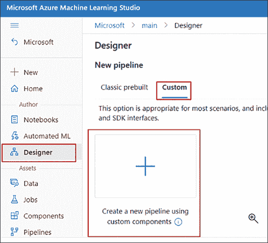

**图 2-3** 创建新的流水线

   2. 将模块拖到画布上以定义你的工作流，包括数据预处理、模型训练和评估步骤。

5. 配置并运行。

设置每个模块的属性，例如在训练模型模块中选择算法，并在评估模型模块中定义评估指标。

提交流水线作为实验并监控其进度。实验完成后，检查评估模型模块的输出以评估训练模型的性能。

### 从 Designer 消耗数据资产

数据资产是训练流水线的重要组件。它们包括用于整个流水线训练和评估所需的数据集、数据转换和数据连接。你可以在 Machine Learning Studio 中的数据页面创建新数据集或导入现有数据集。支持的数据源包括 Web 文件、数据存储和本地文件。

5. 确保数据正确地流过流水线，以为模型训练提供必要的输入。

数据资产是 Azure Machine Learning Designer 中训练流水线的骨干。从创建到预处理再划分，对这些资产进行适当的管理和利用是构建有效机器学习模型的关键。

## 在 Designer 中使用自定义代码组件

虽然 Azure Machine Learning Designer 提供了内置模块，但你可能会遇到需要自定义处理的场景。自定义代码组件允许你将 Python 或 R 脚本集成到流水线中执行特定任务。

### 集成自定义代码


在 Azure Machine Learning 训练流水中使用自定义代码的一种方法是通过脚本。你可以编写一个 Python 或 R 脚本来执行所需的数据处理或分析任务。例如，你可能编写脚本来执行独特的数据转换或生成自定义特征。具体而言，你可以使用 `Execute Python Script` 模块（参见图 2-4）。在接下来的步骤中，你将使用 `Execute Python Script` 模块来上传并配置你的脚本。配置将涉及输入和输出端口。你可以通过将上一个模块的输出连接到此模块的输入，并将脚本模块的输出连接到后续模块，将此脚本模块集成到流水线的其他部分。

1. 在 Designer 的流水线中添加 `Execute Python Script` 模块。
2. 将脚本上传到模块并配置任何必要的输入和输出端口。
3. 将上一个模块（例如数据预处理）的输出连接到 `Execute Python Script` 模块的输入。
4. 确保你的自定义脚本的输出连接到后续模块，以便进一步处理或训练模型。

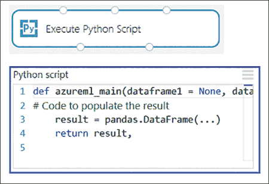

**图 2-4** 在 Azure ML Designer 中使用自定义 Python 脚本

注意步骤 3 和 4 对于将你的 Python 脚本模块集成到流水线的其他部分是必要的，并将之前模块的输出（本身可能是另一个数据预处理步骤）连接到你的自定义 Python 脚本模块的输入（参见图 2-5）。记住还要将你的自定义模块的输出连接到下一个或后续模块的输入。这似乎显而易见，但这是一个微妙的步骤，因为你可以通过将模块作为输入连接到许多后续模块来形成 DAG（有向无环图）。DAG 的概念用于构建具有许多并行步骤并可以进行扇出的流水线。除了扇出模式外，DAG 还可以作为构建顺序步骤的强大抽象——即汇入或收敛的步骤，并管理流水线中的并行性和依赖。

运行流水线以测试自定义代码组件，并在必要时迭代优化。进行任何必要的调整，以确保它在你的工作流环境中按预期执行。图 2-5 显示了如何使用 Python 脚本模块连接输入和输出。

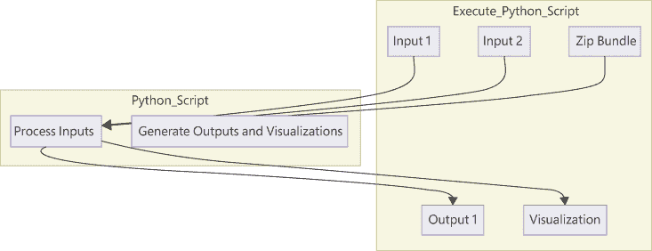

**图 2-5** 在 Designer 的 Python 脚本模块中连接输入和输出

仔细配置流水线中的每个模块。双检参数和设置，以确保它们适用于你的数据和你正在解决的问题。

验证流水线中的所有模块是否已正确连接。一个模块的输出应正确地馈送到下一个模块的输入。在下一节中，我们将查看一种更健壮的模型评估程序以及使用任性 AI 指南。

## 评估模型，包括任性 AI 指南

模型评估是训练流水线中的关键步骤。它帮助你评估模型的性能，并确保其符合任性 AI 原则。我们的第一步是理解如何使用评估指标评估模型。

### 评估指标

有一个名为 `Evaluate Model` 的模块。你可以在训练和评分步骤之后将此模块添加到流水线中。该模块提供了各种指标，如准确率、精确率、召回率和 F1 分，以评估你的分类模型的性能。

`Evaluate Model` 的作用是什么？我们为什么要使用它？我们可以通过检查 `Evaluate Model` 模块的输出来分析模型的结果，以理解模型性能如何。

### 任性 AI 考虑因素

微软开发了一个名为任性 AI 标准的标准。这是一个根据六项原则构建 AI 系统的框架：

* 模型公平性
* 可靠性与安全性
* 隐私与安全
* 包容性
* 透明度
* 问责制

我们可以更详细地查看这些原则原则，以及通过将特定模块集成到流水线中，在 Azure 中设计数据科学解决方案时如何实践这些指南。图 2-6 说明了任性 AI 指南之间的关系。

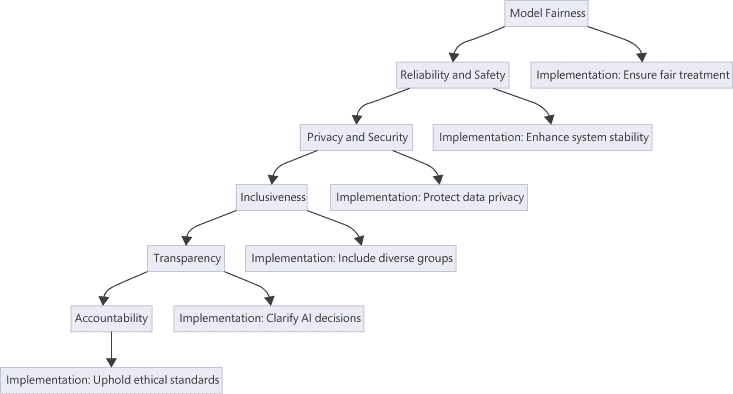

**图 2-6** 微软任性 AI 指南支柱

### 公平性

在评估模型预测时，集成公平性指南以评估不同人口统计群体之间的公平性非常重要。该模块有助于检测任何差异并允许你有效地解决这些差异，确保你的模型保持公平并避免偏见的持续。在预测评估中考虑种族或性别等人口统计因素可以为潜在偏见提供宝贵的见解，从而采取主动措施来减轻它们。这种方法促进了包容性和公平，这是 AI 开发和部署中的基本原则。

通过人口统计视角分析预测可以对你的模型性能有更深层次的理解。它有助于发现并纠正数据或算法中的任何潜在偏见，最终导致更公正、可靠的结果。将公平性纳入到你的评估过程中，可以增强你模型的公信力和可靠性，同时促进 AI 开发的社会责任。这种方法增加了对你模型输出的信任，同时也为其应用场景创造一个更公平的环境做出贡献。

### 可解释性

在探索模型预测时，使用 `Model Interpretability` 模块可以为模型如何做出决策提供见解。该工具帮助你理解影响这些决策的因素，提高过程的透明度。透明度是利益相关者理解模型如何得出结论的关键，有助于建立信任并明智决策。

然而，区分模型可解释性和公平性评估是重要的。可解释性侧重于理解模型的决策过程，而公平性评估则检查这些预测在不同人口统计群体之间是否存在偏见。两者对于模型评估都至关重要，具有不同的目的。可解释性有助于理解模型内部如何运行，而公平性评估确保所有人口统计群体获得公平的结果。因此，将这两个模块集成到你的评估过程中，可以对模型性能及其对不同人群的影响提供全面的视角。

### 隐私与安全

确保你的模型遵守隐私和安全指南，特别是在处理敏感数据时。采取适当措施保护数据的机密性和完整性。

在您的训练流水线中引入自定义代码组件，允许您通过专门的处理任务扩展 Azure Machine Learning Designer 的功能。

通过性能指标和负责任 AI（Responsible AI）原则来对您的模型进行评估，可以确保您的模型不仅准确，而且公平、透明且安全。图 2-7 展示了做出模型公平性决策的过程。

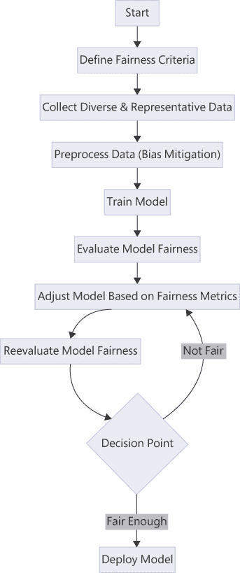

**图 2-7** 确保 AI 训练中的模型公平性

### Skill 2.3：使用自动化机器学习探索最优模型

Azure Machine Learning 服务的自动化机器学习能力基于微软研究部门的一项突破性进展。它与市场上的竞争解决方案有所不同。该方法结合了协同过滤和 `Bayesian optimization` 的思想。这种组合使其能够智能且高效地在巨大的可能的机器学习流水线空间中进行搜索。本质上，它充当了机器学习流水线的推荐系统。正如流媒体服务为用户推荐电影一样，自动化机器学习为数据集推荐机器学习流水线。

#### 为表格数据使用自动化机器学习

假设您是电信公司的一的数据科学家。您的任务是开发一个机器学习模型，根据各种客户属性预测客户流失。您决定使用 Azure Machine Learning 的自动化机器学习（`AutoML`）功能来快速构建和部署模型。我们将此分解为：设置环境、准备表格数据，然后通过查看真实场景，在您的表格数据上使用 AutoML。

##### 在 Azure Machine Learning 中处理表格数据

本节介绍了如何使用如 `MLTable` 等对象进行数据处理。`MLTable` 对象可以用于您的表格数据（例如包含客户流失数据的 `CSV` 文件）。`MLTable` 是 Azure Machine Learning 的一项功能，允许您为表格数据定义并保存一系列数据加载步骤。这使得在不同环境中重现数据加载变得更容易，并可以与团队成员共享。`MLTable` 支持多种数据源，包括 `CSV` 和 `Parquet` 文件。图 2-8 显示了在 Designer 中选择 `AutoML`。

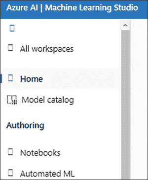

**图 2-8** 工作空间中的 AutoML

以下是您如何结合 `MLTable` 和 `AutoML` 用于表格数据的方法：

1. **定义数据加载步骤**：使用 `mltable` Python SDK（需要说明的是，`mltable` 必须通过 `Python` 而不是 UI 使用）来定义加载和预处理数据的步骤。这包括指定数据源、过滤行、选择列以及根据数据创建新列。
2. **保存数据加载步骤**：一旦定义了数据加载步骤，您就可以将其保存到 `MLTable` 文件中。该文件包含序列化的步骤，使得重现数据加载过程变得非常简单。
3. **将数据加载到 Pandas DataFrame**：您可以将由 `MLTable` 定义的数据加载到 `Pandas DataFrame` 中。这对于探索数据以及在训练模型之前进行额外的预处理非常有用。
4. **在 AutoML 中使用 MLTable**：在为表格数据设置 `AutoML` 实验时，您可以使用 `MLTable` 作为数据输入。`AutoML` 会自动应用在 `MLTable` 中定义的数据加载步骤，并使用生成的 `DataFrame` 进行模型训练。
5. **创建数据资产**：为了与团队成员共享 `MLTable`，您可以使用 `Data Asset`。
6. **在作业中使用数据资产**：为了确保跨环境的一致性，您可以引用 `Data Asset` 进行训练。

以下是一个使用 `mltable` 的示例：

```python
import mltable
## 定义数据源 (CSV)
paths = [{'file': 'path/to/data.csv'}]
## 从 CSV 创建 MLTable
tbl = mltable.from_delimited(paths)
## 应用数据加载步骤
tbl = tbl.filter("some_column" > 0).select(["column1", "column2"])
## 保存到 mltable 目录
tbl.save("./mltable_directory")
```

了解如何处理表格数据后，我们可以查看表格数据上使用 `AutoML` 的特定场景。图 2-9 显示了在 Designer 中创建新的 `AutoML` 运行。

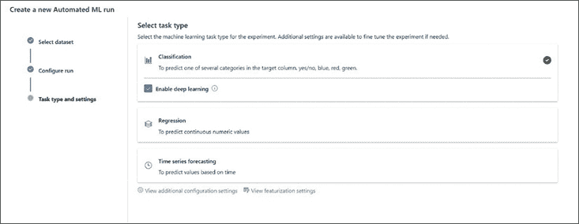

**图 2-9** 用于模型开发的自动化机器学习功能

#### 选择并理解训练选项，包括预处理

Azure Machine Learning 中的自动化机器学习（`AutoML`）是一项强大的工具，它可以自动为您的数据选择最佳机器学习算法和超参数。它简化了机器学习工作流，使数据科学家、分析师和开发者都能受益。在后续章节，我们将查看机器学习概念，包括训练数据、验证、特征化、预处理、分布式训练、模型选择和集成学习。

- **自动化机器学习**：Azure 中的 `AutoML` 提供各种训练选项以满足不同的需求和偏好。这些选项旨在优化模型开发过程，确保训练的高效有效性。
- **训练数据和验证**：`AutoML` 允许用户以不同格式提供训练数据，包括用于表格数据的 `MLTable`。用户可以指定独立的训练和验证数据集，也可以让 `AutoML` 自动划分训练数据。这有助于评估模型性能并防止过拟合。对于时间序列预测，`AutoML` 支持滚动起点验证等高级配置，以确保评估的稳健性。
- **特征化和预处理**：`AutoML` 自动化特征化和预处理步骤，这些步骤对于模型训练准备数据至关重要。这包括处理缺失值、对类别变量以及缩放数值特征。用户可以通过指定特征化设置（如阻止某些转换器或定义自定义转换）来自定义这些步骤。
- **分布式训练**：对于大型数据集和复杂模型，`AutoML` 支持分布式训练。这允许训练过程分布在多个计算节点上，显著缩短训练时间。用户可以指定用于训练的节点数，从而并行执行模型训练。

### 模型选择与超参数调优

AutoML 实现了机器学习算法选择和超参数调优的自动化。它遍历预定义的算法列表，并测试不同的超参数组合，以找到性能最佳的模型。用户可以控制迭代次数并设置训练时间限制，从而有效管理计算资源。

### 集成模型

AutoML 支持集成模型，该模型通过结合多个模型的预测来提高准确性。它使用 `voting` 和 `stacking` 等技术创建集成模型，并根据性能自动选择包含在集成中的最佳模型。

表 2-1 列出了 Azure Machine Learning 中的自动化机器学习 (AutoML) 针对各种学习任务支持的算法。

#### 表 2-1 自动化机器学习算法

| 任务类型 | 算法 |
| --- | --- |
| 分类 | - 逻辑回归\*<br>- Light GBM\*<br>- 梯度提升\*<br>- 决策树\*<br>- K 近邻算法\*<br>- 线性 SVC\*<br>- 支持向量分类 (SVC)<br>- 随机森林<br>- 极端随机树\*<br>- Xgboost\*<br>- 朴叶贝斯\*<br>- 随机梯度下降 (SGD)\* |
| 回归 | - 弹性网络\*<br>- Light GBM\*<br>- 梯度提升\*<br>- 决策树\*<br>- K 近邻算法\*<br>- LARS Lasso\*<br>- 随机梯度下降 (SGD)<br>- 随机森林<br>- 极端随机树<br>- Xgboost\*<br>- Xgboost |
| 时间序列预测 | - AutoARIMA<br>- Prophet<br>- 弹性网络<br>- Light GBM<br>- K 近邻算法<br>- 决策树<br>- LARS Lasso<br>- 极端随机树\*<br>- 随机森林<br>- TCNForecaster<br>- 梯度提升<br>- 指数平滑<br>- SeasonalNaive<br>- 平均值<br>- Naive<br>- 季节平均 |
| 图像分类 | - MobileNet<br>- ResNet<br>- ResNeSt<br>- SE-ResNeXt50<br>- ViT |
| 多标签图像分类 | 参考 `ClassificationMultilabelPrimaryMetrics` 枚举 |
| 图像目标检测 | - YOLOv5<br>- Faster RCNN ResNet FPN<br>- RetinaNet ResNet FPN |
| NLP 文本多标签分类 | 参考支持 NLP 任务的算法 |
| NLP 文本命名实体识别 (NER) | 参考支持 NLP 任务的算法 |

标记有星号 (\*) 的算法是默认模型。

对于 NLP 任务，AutoML 支持一系列预训练的文本 DNN 模型，包括但不限于 `BERT`、`GPT-4`、`RoBERTa`、`T5` 和 `LaMDA`。

在展示如何使用 Azure Machine Learning Python SDK v2 在自动化机器学习 (AutoML) 中选择和使用各种训练选项之前，我们需要列出可用选项：

* **主要指标 (Primary Metric)**：这是 AutoML 为模型选择优化的指标。常见指标包括分类任务的 `accuracy` 和回归任务的 `mean_squared_error`。
* **验证策略 (Validation Strategy)**：AutoML 支持多种验证策略，例如 `cross-validation`（交叉验证）和 `train-validation splits`（训练-验证划分）。这有助于评估模型在未见数据上的性能。
* **最大尝试次数 (Max Trials)**：指定不同算法组合的最大数量。
* **超时时间 (Timeout)**：你可以为 AutoML 设置运行时间限制。
* **特征化 (Featurization)**：AutoML 可以自动对输入数据进行预处理和特征提取。

接接的示例展示了如何使用 Azure Machine Learning Python SDK v2 在自动化机器学习 (AutoML) 中选择和使用各种训练选项。


```python
from azure.ai.ml import MLClient
from azure.ai.ml.constants import AssetTypes
from azure.ai.ml import automl, Input
from azure.identity import DefaultCredential

## 设置 MLClient
credential = DefaultCredential()
subscription_id = "your-id"
resource_group = "your-group"
workspace_name = "your-workspace"
ml_client = MLClient(credential, subscription_id, resource_group, workspace_name)

## 定义训练数据
training_data = Input(type=AssetTypes.ML, path="./data/")

## 配置 AutoML 任务
automl_job = automl.classification(
    compute="your-cluster",
    experiment_name="your-experiment",
    training_data=training_data,
    target_column="target",
    primary_metric="accuracy",
    validation_data_split=0.2,
    max_trials=100,
    max_concurrent_trials=4,
    timeout_minutes=60,
    enable_model_explainability=True
)

## 提交 AutoML 任务
submitted_job = ml_client.jobs.create_or_update(automl_job)
print(f"Submitted job: {submitted_job}")

## 获取监控任务的 URL
print(f"Monitor your job at {submitted_job.services['Studio']}")
```

在此示例中，我们将主要指标设置为 `accuracy`，设置了 `0.2` 的验证数据划分比例，将最大尝试次数限制为 `100` 次，允许最多 `4` 次尝试并行运行，并设置了 `60` 分钟的超时时间。我们还启用了可解释性。

你可以根据特定需求和数据集的性质调整这些选项。无论你是资深数据科学家还是机器学习新手开发者，`AutoML` 都能为你提供开发和部署机器学习模型所需的工具。在下一节中我们将查看上述示例的最后部分：评估自动化机器学习运行。

## 评估包含负责任 AI 指南在内的自动化机器学习运行

根据机器学习任务的类型（分类、回归等），将使用不同的指标来评估模型性能。

### 分类指标

分类指标包括 `accuracy`（准确率）、`precision`（精确率）和 `recall`（召回率），这些指标对于正例和假例相对于实际正预测的比例具有特定含义，以及如 `F1 Score` 和 `AUC-ROC` 等指标。使用 `accuracy`、`F1 Score` 或 `AUC-ROC` 监控分类模型的性能以检测模型漂移并决定何时重新训练模型，是我们将在后续章节中探索的概念，因此理解以下分类指标的定义至关重要：

- **准确率 (Accuracy)**：预测正确的预测占比例。
- **精确率 (Precision)**：所有正预测中真正例的比例。
- **召回率 (Recall)**：所有实际正例中真正例的比例。
- **F1 分数 (F1 Score)**：精确率和召回率的调和平均数。
- **AUC-ROC**：接收者操作曲线下的面积。

### 回归指标

并不是所有的监督学习问题都是分类问题。回归问题可能涉及连续响应变量——例如预测新产品线的需求需要一套自己的性能指标来衡量预测值与实际值之间的误差。

- **平均绝对误差 (MAE)**：预测值与实际值之间绝对差的平均值。
- **均方误差 (MSE)**：预测值与实际值之间差平方的平均值。
- **均方根误差 (RMSE)**：`MSE` 的平方根。
- **R 方 (R-squared)**：由自变量解释的因变量变异比例。

当您运行 `AutoML` 实验时，它会自动为每个模型计算并记录这些指标。您可以通过 `Azure Machine Learning Studio` 或使用 `SDK` 编程访问这些指标。

## 模型评估的可视化

`AutoML` 提供了各种可视化来帮助您理解模型性能：

- `Confusion Matrix`混淆矩阵：对于分类任务，它显示了每个类别预测正确和错误的数量。
- `ROC Curve`ROC 曲线：对于二分类，它绘制了不同阈值水平下的真阳性率与假阳性率。
- `Precision-Recall Curve`曲线：对于二分类，它显示了不同阈值水平下精确率和召回率之间的权衡。
- `Residuals Plot`残差图：对于回归任务，它显示了实际值与预测值之间的差异。

`AutoML` 运行完成后，您可以根据指定的备指标检索最佳模型。然后您可以在测试数据集上对该模型进行评估，以了解其在真实世界的性能。

以下是如何从 `AutoML` 运行中检索并评估最佳模型的示例：

点击此处查看代码图像

```python
from azure.ai.ml import MLClient
from azure.ai.ml.constants import AssetTypes
from azure.ai.ml import automl, Input
from azure.identity import DefaultAzureCredential

## Set up the MLClient
credential = DefaultAzureCredential()
subscription_id = "your-subscription-id"
resource_group = "your-resource-group"
workspace_name = "your-workspace-name"
ml_client = MLClient(credential, subscription_id, resource_group, workspace_name)

## Get the best model from the AutoML run
best_model = ml_client.jobs.get_best_model(
experiment_name="automl_classification_example",
job_name="automl_job_name"
)

## Evaluate the best model on a test dataset
test_data = Input(type=AssetTypes.MLTABLE, path="./data/test_data/")
evaluation_results = ml_client.jobs.evaluate(
model=best_model,
test_data=test_data
)
```

在此示例中，我们从已完成的 `AutoML` 运行中检索最佳模型，并在单独的测试数据集上对其进行评估。评估结果提供的指标可以帮助我们理解模型的性能。

## 使用 Azure AutoML 预测客户流失

假设您是一名数据科学家，负责为一家电信公司创建一个机器学习模型来预测客户流失。为了实现这一目标，您决定利用 Azure 的自动化机器学习 (`AutoML`) 功能，该功能简化了构建和部署模型的过程。以下是分步指南，帮助您准备用于自动化机器学习能力的表格数据（使用示例请参阅 图 2-10 中使用 Designer 的示例）：

1. 设置您的环境：创建一个 `Azure Machine Learning` 工作空间。这是您用于管理和监控机器学习模型的中心化环境。
2. 安装适用于 Python 的 `Azure Machine Learning SDK v2`：在终端中运行 `pip install azure-ai-ml`。此 `SDK` 允许您通过编程方式与 `Azure Machine Learning` 服务和资源交互。
3. 准备您的表格数据：收集数据集。确保您的数据集包含各种客户属性以及指示客户是否已流失的流失标签。
4. 格式化您的数据：将数据结构化为表格格式，行表示单个客户，列表示属性。目标列应为流失标签。
5. 将数据集上传到 Azure：将您的数据集转换为 `MLTable` 并上传到 Azure。`MLTable` 是 Azure `AutoML` 支持的表格数据格式。

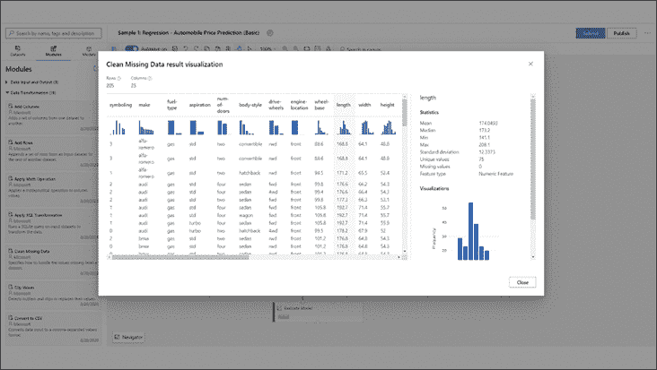

**图 2-10** Azure Machine Learning 中的数据连接和特征准备

将任务类型指定为分类，因为您正在预测一个二结果（流失或未流失）。选择准确率（`accuracy`）作为评估模型性能的主要指标。还需决定您的数据划分策略（例如交叉验证或训练-验证划分）。确定实验的最大持续时间（超时分钟）和最大尝试次数（`max trials`）。这有助于管理计算资源和实验时间。

## 运行您的 AutoML 实验

下面的代码显示了如何使用 `Azure Machine Learning SDK` 提交您的 `AutoML` 实验。代码的目的是详细说明如何使用 `AutoML`，包括配置超时和最大尝试次数等限制。在实验生成时，请关注其进度。

点击此处查看代码图像

```python
from azure.ai.ml import MLClient
from azure.ai.ml.constants import AssetTypes
from azure.ai.ml import automl, Input
from azure.identity import DefaultAzureCredential

## Set up the MLClient
credential = DefaultAzureCredential()
subscription_id = "your-subscription-id"
resource_group = "your-resource-group"
workspace_name = "your-workspace-name"
ml_client = MLClient(credential, subscription_id, resource_group, workspace_name)

## Get the best model from the AutoML run
best_model = ml_client.jobs.get_best_model(
experiment_name="automl_classification_example",
job_name="automl_job_name"
)

## Evaluate the best model on a test dataset
test_data = Input(type=AssetTypes.MLTABLE, path="./data/test_data/")
evaluation_results = ml_client.jobs.evaluate(
model=best_model,
test_data=test_data
)
```

此外，选择图像分类作为任务类型，强调了针对特定问题领域选择合适的评估指标和验证策略的重要性。`accuracy`（准确率）、`precision`（精确率）、`recall`（召回率）和 `F1-score` 等指标常用于评估图像分类模型的性能。此外，可以使用 `cross-validation`（交叉验证）或 `stratified sampling`（分层采样）等技术来确保评估的稳健性并防止过拟合。因此，专注于图像分类的决策将引导 `AutoML` 框架内整个模型训练工作流，塑造算法、评估指标和验证策略的选择。

## 准备数据

你的下一步是组织已标记图像数据。将这些数据格式化为 `JSONL` 格式，确保每行包含一个图像 URL 和相应的标签。如果你的数据是其他格式（例如 `Pascal VOC` 或 `COCO`），请使用可用的辅助脚本将其转换为 `JSONL`。建议开始训练过程至少准备 10 张图像。以下是 `JSONL` 格式的示例，帮助直可视化图像 URL 以及值为“cat”、“dog”、“bird”、“car”和“tree”的标签的形式：

点击此处查看代码图像

```json
{"image_url": "http://example.com/image1.jpg", "label": "cat"}
{"image_url": "http://example.com/image2.jpg", "label": "dog"}
{"image_url": "http://example.com/image3.jpg", "label": "bird"}
{"image_url": "http://example.com/image4.jpg", "label": "car"}
{"image_url": "http://example.com/image5.jpg", "label": "tree"}
```

使用 `Azure CLI` 或 `Python SDK` 为你的训练和验证数据创建一个 `MLTable`。这涉及到指定 `JSONL` 文件的路径并定义任何必要的数据转换。`MLTable` 是你的数据在 `AutoML` 中的结构化表示。

## 设置训练计算资源

选择一个支持 GPU 的计算目标（例如 `NC` 或 `ND` 系列虚拟机），来训练你的计算机视觉模型。计算目标的选择会影响模型训练的速度和效率。

通过设置任务类型、主要指标和作业限制（例如 `timeout_minutes`、`max_trials` 和 `max_concurrent_trials`）来配置你的 `AutoML` 实验。此步骤涉及定义模型训练过程的边界和目标。图 2-11 显示了提交 `Automated ML Job` 的菜单，包括基本设置以及之前任务类型等任务设置。

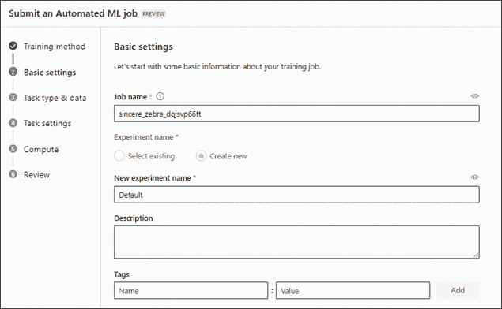

**图 2-11** 在 Azure Machine Learning 中提交 AutoML 作业

## 评估并部署模型

训练完成后，根据之前涵盖的负责任 AI 指南，基于主要指标评估最佳模型。在你的 `Azure Machine Learning` 工作区中注册此模型，并将其部署为 Web 服务以进行预测。最后一步使你的模型适用于现实世界的应用程序。图 2-12 显示了在 `AutoML` 中选择计算机视觉任务特定选项、不同的可用选项，以及在哪里选择训练数据。


**图 2-11** 在 Azure Machine Learning 中提交 AutoML 作业

## 技能 2.4：使用笔记本进行自定义训练

`Jupyter notebooks` 为数据科学和机器学习项目提供了一个交互式环境。它们允许你在单个文档中结合可执行代码、富文本、可视化和方程。在 `Azure Machine Learning` 中，`Jupyter notebooks` 用于开发、记录和执行用于数据探索、模型训练和评估等各种任务的代码。

### 使用计算实例开发代码

按照以下步骤设置 `Jupyter Notebook` 并将其到计算实例。

1. 创建计算实例：在你的 `Azure Machine Learning` 工作区中创建一个新的计算实例。该实例预装了 `Jupyter Notebook`。
2. 打开 `Jupyter Notebook`：计算实例准备好后，从 `Azure ML Studio` 打开 `Jupyter Notebook`（请参见图 2-16）。

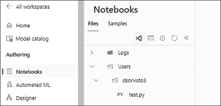

**图 2-16** 在 Azure ML Studio 中打开 Jupyter notebook

### 在 Jupyter Notebook 中配置环境

首先要考虑的是你的环境。你可以在 notebook 单元格中使用 `!pip install` 命令安装额外的包。一种良好的做法是在 notebook 的开头按所示列出所有需要的包：

点击此处查看代码图像

```bash
!pip install numpy pandas scikit-learn matplotlib
```

如所述，另一种选项是使用环境。`Azure Machine Learning` 允许你创建和使用自定义环境。你可以使用 `Azure ML SDK` 在 notebook 中指定你的环境：

点击此处查看代码图像

```python
from azure.ai.ml import MLClient
from azure.ai.ml.entities import Environment

ml_client = MLClient.from_config()
my_env = Environment(
name='my-custom-env',
 conda_file='path/to/your/environment.yml'
)
ml_client.environments.create_or_update(my_env)
```

## 将计算资源挂载到 notebook 用于模型训练


在 Azure Machine Learning 中，你可以将计算实例挂载到你的 Jupyter notebook 以运行训练作业。这提供了独立于本地机器的可扩展计算资源。以下代码显示了如何连接到你的 Azure ML 工作区、创建或挂载现有的计算实例（如虚拟机），并对其进行模型配置。

点击此处查看代码图像

```python
from azure.ai.ml import MLClient
from azure.identity import DefaultAzureCredential

## 连接到你的 Azure ML 工作区
credential = DefaultAzureCredential()
ml_client = MLClient.from_config(credential)

## 创建或挂载现有的计算实例
compute_name = "my-compute-instance"
if compute_name not in ml_client.compute.list():

    # 定义计算配置
    compute_config = AmlCompute.provisioning_configuration(vm_size="STANDARD_D2_V2",
max_nodes=4)
     compute = ComputeTarget.create(ml_client.workspace, compute_name, compute_config)
    compute.wait_for_completion(show_output=True)
else:
      compute = ml_client.compute.get(compute_name)
```

### 在 notebook 中准备训练数据

在训练模型之前，你必须加载并预处理你的数据。这通常涉及数据清洗、特征工程以及将数据分为训练集和测试集。以下代码使用 Pandas 将数据分为训练集和测试集，然后对特征进行扩展，展示了准备模型训练数据的简单示例。

点击此处查看代码图像

```python
import pandas as pd
from sklearn.model_selection import train_test_split
from sklearn.preprocessing import StandardScaler

## 加载数据
df = pd.read_csv('path/to/your/data.csv')

## 预处理数据

df.dropna(inplace=True)
df = pd.get_dummies(df, drop_first=True)
## 将数据分为特征和目标
X = df.drop('target_column', axis=1)
y = df['target_column']

## 将数据分为训练集和测试集
X_train, X_test, y_train, y_test = train_test_split(X, y, test_size=0.2,
random_state=42)

# 缩特征
scaler = StandardScaler()
X_train = scaler.fit_transform(X_train)
X_test = scaler.transform(X_test)
```

在准备好数据后，你可以定义并训练你的机器学习模型。在这个示例中，我们将使用来自 scikit-learn 的 `RandomForestClassifier`：

点击此处查看代码图像

```python
from sklearn.ensemble import RandomForestClassifier
from sklearn.metrics import accuracy_score

## 定义模型
model = RandomForestClassifier(n_estimators=100, random_state=42)

## 训练模型
model.fit(X_train, y_train)
```

在这个示例中，我们展示了如何在 Azure Machine Learning 的 Jupyter notebook 中挂载计算实例、准备数据并训练模型。这种设置允许你利用云计算资源在更大规模的数据集上训练更复杂的模型。这是一个非常简单的示例；在本章的最后部分，我们将提供一个更真实的模型训练场景。

#### 使用 MLflow 跟踪模型训练

数据科学家利用 notebook 的功能作为模型实验和训练不可或缺的工具。为了有效管理大量的模型训练结果，将它们组织成实验（experiments）变得至关重要。MLflow 成为这一过程中的关键促进者，提供了强大的日志记录功能，可以在 notebook 环境中无缝跟踪模型指标。MLflow 是什么？MLflow 是一个用于跟踪实验和存储模型等构制品（artifacts）的开源框架。它有一个强大的工具叫做模型注册表（model registry），允许你不仅可以跟踪实验中的指标、参数和模型，还可以在它们符合你的解决方案的需求时查询注册表并共享模型进行部署。

创建一个 MLflow 实验是结构化模型管理的第一步。通过在实验内分组运行（runs），数据科学家可以在工作流中获得更高的清晰度和组织性。MLflow 通过允许为特定项目创建自定义实验，简化了这项任务，确保模型训练结果能够被整齐地分类以便分析。

设置好实验后，使用 MLflow 记录结果是下一个重点。在这里，数据科学家可以使用自动记录，也可以根据项目需求选择手动记录。自动记录是 MLflow 支持的一项功能，可以自动跟踪常用库的指标、参数、构制品和模型。这简化了记录过程。模型训练完成后，数据科学家可以轻松地在 MLflow 环境中查看记录的指标，便于分析和决策。下面的代码显示了如何在 notebook 中使用 MLflow 进行自动记录，图 2-17 显示了输出。

```python
from xgboost import XGBClassifier
with mlflow.start_run():
     mlflow.xgboost.autolog()
     model = XGBClassifier(use_label_encoder=False, eval_metric="logloss")
    model.fit(X_train, y_train, eval_set=[(X_test, y_test)], verbose=False)
```

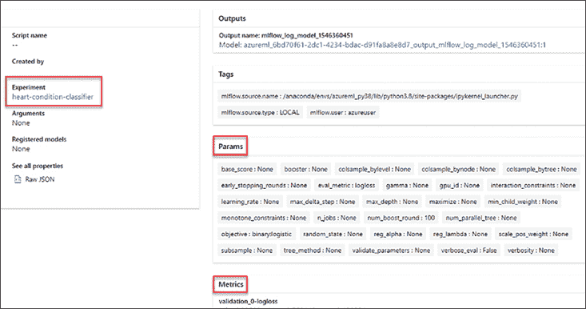

**图 2-17** 在 Jupyter notebook 中跟踪模型训练

使用 MLflow 进行自定义记录为数据科学家提供了灵活性，允许他们手动记录自动记录无法捕获的补充或自定义信息。该功能允许对记录过程进行更精细的控制，使数据科学家能够根据特定项目需求定制记录工作。通过利用 `mlflow.log_param`、`mlflow.log_metric`、`mlflow.log_artifact` 和 `mlflow.log_model` 等常用函数，数据科学家可以分别捕捉关键参数、指标、文件和模型，增强分析深度和对模型性能的洞察。

#### 评估模型

我们可以对通过自动机器学习实验生成的模型进行评估。你可以采用一种涵盖多种指标和可视化的全面方法。首先，在完成实验后，通过 Azure Machine Learning Studio 或 Jupyter notebook 访问作业结果关重要。获取结果后，大量的分类指标有助于分析模型性能，包括准确率（accuracy）、精确率（precision）、召回率（recall）和 ROC 曲线下面积（`AUC`）。这些指标为分类效果的各个维度提供了见解，有助于就模型选择做出明智决策。此外，混淆矩阵等视觉辅助工具提供了分类错误的直观表示，而 ROC 和精确率-召回率曲线说明了模型在不同阈值下的区分能力。还可以从累积增益、提升曲线和校准曲线中获得更多见解，它们分别展示了模型识别正样本的能力、相对于随机猜测的性能以及对预测置信度的校准情况。表 2-2 显示了评估模型的常用指标。图 2-18 显示了一个模型的 ROC 曲线。

**表 2-2** 评估模型

| 指标 || 说明 |

| --- | --- |

| `AUC` | `ROC 曲线下面积` |

| --- | --- |

| Accuracy | 预测值与真实标签匹配的比例 |

| Avg. Precision | 每个召回率增加时精确率的加权平均值 |

| Balanced Accuracy | 每个类别的平均召回率 |

| F1 Score | 精确率和召回率的调和平均数 |

| Log Loss | 给定预测下真实标签的负对数似然 |

| Matthews Correlation | 平衡准确率衡量标准 |

| Precision | 避免将负样本标记为正样本 |

| Recall | 检测所有正样本 |

| Weighted Accuracy | 按类别样本量加权的准确率 |

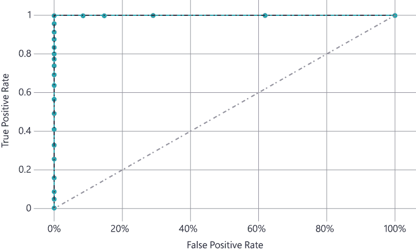

**图 2-18** 良好模型的 ROC 曲线

## 使用 Python SDKv2 训练模型

使用 Python SDKv2 训练模型的方法是类似的，但与使用 notebook 相比有一些不同。主要区别在于作业提交。需要提交作业，而不是在 notebook 中交互式地执行代码单元。你将训练作业提交给 Azure Machine Learning 服务。该作业负责在配置的计算资源上调度训练脚本的执行。通过提交作业，你可以跟踪训练进度，监控资源利用率，并利用分布式训练等功能提高效率和可扩展性。通过理解置信水平，你可以评估模型对其预测正确分配置信度的能力。按照以下高级步骤使用 Python SDKv2 训练模型：

1. **工作空间设置**：不是直接在 notebook 中工作，而是首先建立与你的 Azure Machine Learning 工作空间的连接。这个中心化的工作空间为管理所有机器学习资源（包括数据集、模型和实验）提供了一个结构化环境。与资源往往是分散的 notebook 不同，工作空间确保了跨项目的组织性和协作性。

2. **脚本开发**：不再直接在 notebook 中编写所有所有代码，而是创建一个专门用于训练模型的独立 Python 脚本（`main.py`）。该脚本包含用于数据预处理、模型训练和评估的函数。通过将代码分离到脚本中，你可以维护清晰且模块化的结构，与在 notebook 中工作相比，更容易测试、调试和版本控制。

3. **计算配置**：不再仅仅依赖 notebook 环境提供的计算实例，而是为运行训练作业配置特定的计算资源。这允许你根据负载需求（如 CPU 或 GPU 资源、内存和可扩展性）选择合适的计算实例或集群。通过配置专用计算资源，你可以确保大规模模型训练具有优的性能和资源利用率。

## 使用终端配置计算实例

在 Azure Machine Learning 中工作时，有时需要的不仅仅是 notebook 来完成任务。这时访问计算实例的终端就非常有用了。它就像在工作空间内直接有一个命令提示符或终端窗口。

访问终端后，你可以做几件事：

* **使用 Git 中的文件**：这意味着你可以使用存储在工作空间 Git 中的文件，而不局限于某个计算实例。

* **安装包**：有时你可能需要为工作安装额外的库或包。通过终端访问，你可以安装这些包。

* **创建额外的内核**：内核是运行代码的环境。通过创建额外的内核，你可以设置不同的环境。

要访问终端，只需进入你的机器学习 工作空间，导航到 Notebooks 部分，然后从那里打开终端。如果计算实例处于运行状态，你可以访问其附加的终端。图 2-19 显示了如何从 Notebooks 访问。

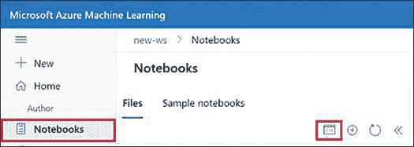

**图 2-19** 访问终端

### 技能 2.5：使用 Azure Machine Learning 调优参数

参数调优是机器学习流水线中的关键步骤。它涉及寻找能够提高模型性能的最优参数组合。Azure Machine Learning 提供了一个健壮的框架来自动化此过程。

### 选择采样方法

Azure Machine Learning 提供了多种采样空间的方法，每种方法适用于不同的场景和需求。本教程探索了 Azure ML 支持的三种主要采样方法：随机采样、网格和贝叶斯采样。

#### 随机采样

随机采样具有通用性，支持离散和连续参数。它从定义的搜索空间中随机选择值，允许终止低性能作业。这种方法对于初始的大范围搜索特别有用，随后可以关注这些区域。以下是使用 Azure ML 进行随机采样的示例：

查看代码图像

```python
from azure.ai.ml.sweep import Normal, Uniform, RandomParameterSampling
command_job_for_sweep = command_job(
    learning_rate=Normal(mu=10, sigma=3),
    keep_probability=Uniform(min_value=0.05, max_value=0.1),
    batch_size=Choice(values=[16, 32, 64, 128]),
)

sweep_job = command_job_for_sweep.sweep(
    compute="cpu-cluster",
    sampling_algorithm="random"
)
```

#### Sobol 扩展

Sobol 是一种拟随机序列，改进了搜索空间的分布并允许使用种子实现可重复性。以下是 Sobol 采样的示例：

查看代码图像

```python
from azure.ai.ml.sweep import RandomParameterSampling

sweep_job = command_job_for_sweep.sweep(
    compute="cpu-cluster",
    sampling_algorithm=RandomParameterSampling(seed=123, rule="sobol")
)
```

##### 网格采样

当能够负担起穷举搜索时，网格采样（Grid sampling）是离散超参数的选择。它对所有可能的值进行简单的网格搜索，同时也支持提前终止低性能运行。以下是使用 Azure ML 进行网格采样的示例：

点击此处查看代码图像

```python
from azure.ai.ml.sweep import Choice

command_job_for_sweep = command_job(

_size=Choice(values=[16, 32]),

number_of_hidden_layers=Choice(values=[1,2,3]),

)

sweep_job = command_job_for_sweep.sweep(

compute="cpu-cluster",
sampling_algorithm="grid"
)
```

### 贝叶斯采样

该方法基于贝叶斯优化，根据以往样本的性能选择样本，以持续改进主要指标。适用于有足够预算充分探索超参数空间的场景。以下是使用 Azure ML 进行贝叶斯采样的示例：

点击此处查看代码图像

```python
from azure.ai.ml.sweep import Uniform, Choice

command_job_for_sweep = command_job(
learning_rate=Uniform(min_value=0.05, max_value=0.1),
batch_size=Choice(values=[16, 32, 64, 128]
)

sweep_job = command_job_for_sweep.sweep(
compute="cpu-cluster",
sampling_algorithm="bayesian"   ...
)
```

选择正确的采样方法取决于项目的特定需求，例如超参数的类型、搜索空间的大小以及计算预算。随机采样提供了广泛的初始搜索，网格采样涵盖了有限集合内的所有可能性，而贝叶斯采样则根据对过去评估的学习进行优化。这些方法都可以在 Azure Machine Learning 中轻松实现，为增强模型性能提供了强大工具。图 2-20 显示了可视化该示例超参数性能的指标图。

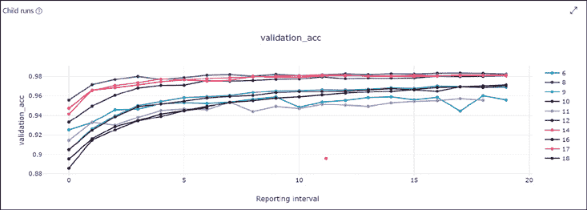

图 2-20 指标图

#### 定义主要指标

搜索空间定义了每个超参数的值范围。你可以使用 `Choice` 指定离散值，或使用 `Uniform` 或 `Normal` 分布指定连续范围。

点击此处查看代码图像

```python
from azure.ai.ml.sweep import Choice, Uniform

search_space = {
 "learning_rate": Uniform(min_value=0.01, max_value=0.1),
 "batch_size": Choice(values=[16, 32, 64, 128])
}
```

我们在讨论 AutoML 中的算法时提到过主要指标的概念。你可能记得，主要指标是调优过程旨在优化的性能衡量标准。你需要指定指标名称以及是最大化还是最小化它。

```python
primary_metric = {
    "name": "accuracy",
    "goal": "Maximize"
}
```

#### 定义提前终止选项

提前终止策略允许你提前停止低性能的训练运行，从而节省时间和资源。Azure Machine Learning 支持多种策略，例如 `Bandit`、`Median StRopping` 和 `Truncation Selection`。

### 章节总结

*   你可以在使用 Apache Spark 进行交互开发期间访问并处理数据，侧重于通过各种资产和存储器准备和操作数据。


你可以通过在 `Designer` 接口中使用自定义代码组件，并在模型评估期间遵循负责任的 AI 指南，为表格数据、计算机视觉和自然语言处理构建机器学习模型。

你可以利用自动化机器学习（Automated Machine Learning）高效地对不同类型的数据（包括表格、图像和文本）建模。这涉及选择最佳训练选项、预处理和评估。

## 技能 3.3：在 Azure Machine Learning 中管理模型

### 技能 3.1：运行模型训练脚本

当我们编写代码时，我们希望尽可能减少重复，遵循 `DRY (不要重复自己)` 原则。但当我们学习 Azure Machine Learning 的许多功能时——涉及作业 (jobs)、运行 (runs)、训练脚本、计算目标 (compute targets) 和 `MLflow` 等概念——重复有助于我们理解所有这些组件如何整合在一起，提供满足我们功能性和非功能性需求的能力，并实现我们的设计目标。例如，在本章之后，你将能够使用作业运行训练脚本，并为该作业配置计算目标，以便使用 `Apache Spark pools` 实现可扩展的训练场景。你将学习如何使用 `MLflow` 设计实验跟踪解决方案，以记录训练运行的指标和构件（artifacts），这有助于在多次运行之间对模型进行分析和比较。在探索这些之前，我们将介绍作业运行（job runs）的概念、作业与运行之间的区别，以及可用的配置选项。

### 为脚本配置作业运行设置

在 Azure Machine Learning 中，你有多种方法创建训练作业。这些方法包括使用命令行界面 (`CLI`)、`REST API` 或直接在 Azure Machine Learning Studio 中使用用户界面 (`UI`)。每种方法都提供了灵活性，并满足不同的偏好和专业水平，确保你可以根据需求选择最合适的方法。

本指南强调了在 Azure Machine Learning Studio 中使用自己的数据和代码训练机器学习模型的过程。通过利用 Studio 的结构化环境，你可以简化工作流，并在整个模型开发过程中保持组织有序。Studio 提供了一个易于使用的界面，简化了数据、代码以及各种机器学习工具的集成。

在 Azure Machine Learning Studio 中训练机器学习模型涉及几个关键步骤。首先，你必须准备并上传数据，确保其格式正确。接下来，你可以创建并配置训练脚本，指定模型所需的算法和参数。最后，你通过 Studio 启动训练作业，监控进度并评估结果，以根据需要完善你的模型。

设置这些内容需要一些前提条件，我们已经在之前的章节中涵盖了大部分内容，但总结一下，前提条件如下：

*   一个 `Azure subscription`（订阅）。如果你还没有，可以创建一个免费账户。
*   一个 `Azure Machine Learning workspace`（工作区）。如果你还没有，可以按照下面的说明创建一个。
*   对 Azure Machine Learning 中的 `job`（作业）什么是基本的了解。

要开始在 Azure Machine Learning Studio 中管理你的机器学习实验，请首先登录你的账户。登录后，选择合适的订阅和工作区进行操作。从主页开始，选择 `Create New`（新建）然后选择 `Job`（作业）来启动新作业，进入作业创建界面，你可以在那里配置并启动机器学习任务。

1.  登录 `Azure Machine Learning Studio`。
2.  选择你的订阅和工作区。
3.  从主页通过选择 `Create New` 然后选择 `Job` 导航到作业创建 `UI`。

此时，你将看到一些基础配置设置（参见下文图 3-1）：

*   **Job Name（作业名称）**：唯一标识你的作业，也用作显示名称
*   **Experiment Name（实验名称）**：在 Azure Machine Learning Studio 中将作业组织在相应的实验下
*   **Existing Experiment（现有实验）**：默认情况下，作业放置在默认实验（Default experiment）中
*   **Description（描述）**：可选，为你的作业添加描述
*   **Timeout（超时）**：指定作业允许运行的最大小时数。如果达到此限制，作业将被取消。
*   **Tags（标签）**：为你的作业添加标签以便组织

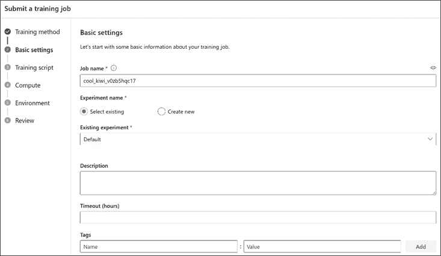

**图 3-1** 脚本的作业运行设置

### 为运行配置计算资源

选择正确的计算目标对于有效训练机器学习至关重要。根据你的训练需求，你可以从基于 CPU 的或基于 GPU 的虚拟机中进行选择。每种类型都有独特的优势：`基于 CPU 的虚拟机`对于密集型任务通常更具效益，而 `基于 GPU 的虚拟机`则提供了深度学习所需的处理能力。

对于大规模的训练作业，Azure Machine Learning 计算集群（compute clusters）是一个很好的选择。这些集群允许分布式计算，并根据你的需求自动调整大小，确保资源的最优和成本管理。

最终，计算目标的选择应符合你训练过程的具体需求。请考虑模型复杂度、数据量以及预算限制。通过仔细选择合适的计算资源，你可以优化性能和成本。

### 在作业中从数据资产使用数据

使用 Azure Machine Learning 数据集可以简化训练数据的管理和版本控制。这些数据集提供了组织、标记和维护数据的结构化方法，确保整个机器学习项目的一性和可追溯性。通过使用 Azure Machine Learning 数据集，你可以轻松跟踪数据的更改和更新，有助于复性和协作。

在训练脚本中访问数据可以通过挂载（mount）或下载（download）数据集来实现。挂载数据集允许直接从源读取数据而无需复制，这对于大数据非常高效并减少了存储需求。或者，下载数据集会将数据复制到你的计算环境中，这对于需要大量数据处理或预处理的场景非常有用。

选择挂载还是下载取决于你的具体用例和工作流。挂载适用于读取密集型操作和大数据，而下载对于更密集的数据处理任务更有利。两种方法都能确保无缝访问数据，提高模型训练过程的效率和有效性。

### 使用 Azure Machine Learning 将脚本作为作业

假设你是某医疗公司的数据科学家，你的任务是开发一种预测模型来识别糖尿病风险患者。你为此使用年龄、体重、血压和血糖等患者数据。本指南将引导你完成在 Azure Machine Learning 中训练模型的步骤。我们的最终目标是实现在作业中集成 `MLflow` 并记录实验指标。

第一步是像之前看到的那样配置作业运行。目标是定义执行训练脚本的方式，以便执行以下操作（为了说明，你应该已经有一个包含模型训练代码的 `train.py` 脚本）：

*   定义脚本所需的任何参数或参数
*   指定包含所需依赖的环境

随后，你可以为作业运行配置计算资源。你可以选择 Azure ML 计算集群（Azure ML Compute Clusters）进行可扩展训练，或者选择较小工作负载的虚拟机（virtual machines）。或者如果你需要分布式训练，可以考虑前面的章节中介绍过的 Spark 池。接下来，你需要从数据资产（data asset）中读取数据，这些数据可能物理存储在 Azure Blob Storage 或另一个支持的存储服务中。我们还需要上传源代码，代码可以存储在工作区的默认 Blob Storage 中，也可以存储在本地机器上。训练脚本步骤指向这些源代码。当训练作业启动时，你定义的命令将在源代码根目录的上下文中执行，并运行你的脚本。

为了完成上述操作，你需要使用训练脚本步骤在 Azure Machine Learning 中提交训练作业。你需要上传源代码，并为作业配置任何所需的输入或输出。你还需要指定将执行训练脚本的命令。此外，还有数据资产可以作为输入。表 3-1 总结了这些信息。

### 表格 3-1 代码、输入和命令概览

| 维度 | 描述 |
| --- | --- |
| 代码 | 可以是来自本地机器或工作区默认 Blob Storage 的文件或文件夹。一旦你选择了代码，Azure 将显示要上传的文件。 |
| 输入 | 你可以指定各种类型的输入，如数据、整数、数字、布尔值（Boolean）或字符串。 |
| 命令 | 这是用于启动训练作业并执行的命令。你可以直接在命令中编写命令行参数，或使用大括号符号从其他部分（特别是输入部分）推断它们。在命令中使用输入时，你应使用格式 `${{inputs.input_name}}` 来指定输入名称。例如，如果你有一个命名为 `wiki` 的输入，你可以在命令中通过 `--data ${{inputs.wiki}}` 引用它。 |

由于命令是从上传的代码文件夹的根目录运行的，如果你的代码在子目录中，你应该在命令中使用相对路径来引用它。例如，如果你的主脚本 `main.py` 位于 `src` 子目录中，命令将是 `python ./src/main.py` 并跟跟任何其他命令行参数。

### 使用 MLflow 记录作业运行的指标

假设你正在从事一个预测客户流失的机器学习项目。你设计了一个健壮的训练脚本，但你需要一种方法来在多次运行期间跟踪模型的性能，并比较不同的模型。这就是 MLflow 发挥用场的地方。

MLflow 是一个开源平台，帮助你管理端到端的机器学习生命周期。它允许你跟踪实验、将代码封装成可重复的运行（runs），并共享和部署模型。它对于跟踪训练期间的指标（如准确率和损失函数）特别有用，这可以帮助你识别性能最好的模型。

#### 为什么要使用 MLflow？

使用 MLflow 有几个原因，其中最不值道的是实验的可重复性。可重复性要求设计拥有一种机制，以跟踪与实验相关的指标，例如每次训练运行的准确率、精确率和召回率。这被称为 `experiment tracking`（实验跟踪）。另一个额外益处是能够根据这些性能指标对模型进行搜索、过滤和比较。我们可能会构建分析实验的方法，并根据一系列性能指标确定最佳模型。由于我们使用了 MLflow，我们拥有所有的指标和产物（模型本身），并且有一种方法可以跟踪哪个版本的模型与哪些数据资产以及训练运行中我们感兴趣特定指标相关。我们将查看指标跟踪、模型比较和模型版本控制，以及这三个概念如何共同实现可重复性理念。

*   **跟踪指标**：记录并可视化每次训练运行的准确率、精确率和召回率等指标。
*   **比较模型**：根据性能指标轻松比较不同的模型。
*   **可重复性**：第 1 章中定义的实验可重复性概念。记录并版本化你的实验以确保可重复性。
*   **模型版本控制**：模型必须进行版本控制，因为我们需要区分同一实验中具有不同性能的相似模型。

#### 将 MLflow 集成到你的训练脚本

MLflow 是一个开源库，将其集成到训练脚本中最简单的方法是在脚本中安装它（一种更高级的方法是配置环境，但我们将在下一步介绍）。你可以从在训练脚本中导入 `mlflow` 开始，从而访问 `mlflow` 库的所有功能。

一旦导入，你就可以使用 `mlflow.log_metric` 记录指标，指定准确率作为键并传入 `accuracy_score`。

你可以在每个轮次（epoch）或迭代之后记录指标。可选情况下，我们可以记录模型参数和其他产物，以进行更全面的跟踪。我们可能想要跟踪的产物之一与模型训练相关的数据资产，以实现可重复性，因为你将来可能需要重新训练模型并理解是否发生了数据漂移（data drift）。

所以，我们现在可以将 MLflow 集成到我们的笔记本中，但作为作业的一部分运行 MLflow 又如何呢？在介绍此之前，我们需要确保已经设置了 MLflow 的跟踪 URI。图 3-2 显示了在 MLflow 中记录的模型指标。

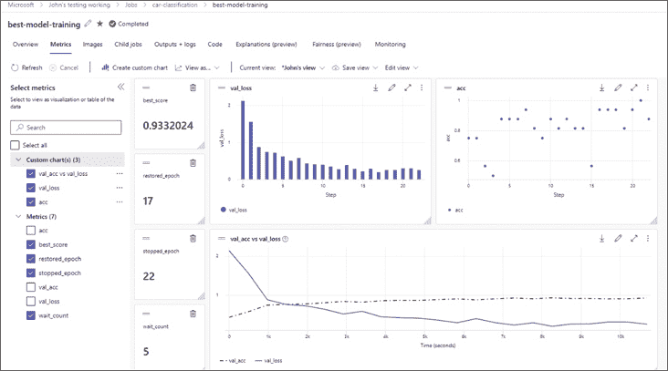

**图 3-2** 在 MLflow 中记录的模型指标

#### 设置 MLflow 跟踪 URI

配置 MLflow 跟踪 URI 指向你的 Azure ML Workspace。这允许 MLflow 将实验数据存储在集中位置。以下是使用跟踪 URI 和监控训练运行的一些技巧：

*   使用 Azure ML SDK 获取跟踪 URI：`tracking_uri = Workspace.from_config().get_mlflow_tracking_uri()`。
*   在脚本中设置跟踪 URI：`mlflow.set_tracking_uri(tracking_uri)`。
*   如果你决定在 Azure ML Studio 中提交训练脚本，请确保环境依赖中包含 MLflow。
*   实时监控训练运行的进度并查看记录的指标。

#### 记录模型

如前节所述，使用 MLflow 的额外益处是能够分析和比较模型。训练完成后，使用 MLflow 的 UI（本地端口 5000 实例）比较不同模型的性能，并根据训练期间记录的指标选择最佳模型。

你可以根据用例自由定义“最佳模型”的标准，并在注册表中搜索最佳模型。由于你已经设置了 MLflow 来记录指标，所有数据都可分析，这在创建仪表板和其他持续监控模型性能方面提供了独特的应用。表 3-2 总结了一些可分析的选项。

### 表 3-2 MLflow 中的记录方法

| 记录的值 | 示例代码 | 注释 |
| --- | --- | --- |
| 在文本文件中记录文本 | `mlflow.log_text("text string", "notes.txt")` | 以指定的名称以文本文件形式持久化在运行内部。 |
| 将字典记录为 JSON 和 YAML 文件 | `mlflow.log_dict(dictionary, "file.yaml")` | 以指定的文件名以 JSON 或 YAML 文件形式持久化字典。 |
| 记录已存在的平凡文件 | `mlflow.log_artifact("path/to/file.pkl")` | 文件记录在运行的根目录下。如果提供了产物路径，则将根据该路径记录在文件夹中。 |
| 记录现有文件夹中的所有产物 | `mlflow.log_artifacts("path/to/folder")` | 文件夹结构被复制到运行中，但不包括所指定的根文件夹。 |

## 使用日志排查作业运行错误

有效地调试和监控 Azure Machine Learning (Azure ML) 工作负载依赖于对日志（logs）、追踪（traces）和指标（metrics）的理解。这些工具对于诊断问题和确保机器学习实验顺利运行至关重要。让我们通过一个实际场景来了解这些元素是如何提供帮助的。

假设你正在 Azure ML 中进行一项机器学习实验，在训练阶段遇到了意外错误。为了弄清楚出了什么问题，你需要检查 Azure ML 生成的日志。日志是实验过程中发生的事件和错误的详尽记录，能够让你对可能导致失败的原因产生深入洞察。追踪（Traces）提供了操作步骤的逐步说明，帮助你理解通往错误之前的事件序列。指标（Metrics）提供了有关资源使用和性能的数值数据，可以突出如瓶颈或效率低下等潜在问题。

通过浏览 Azure ML 界面，你可以找到实验的这些日志、追踪和指标。通过查看日志，你将看到特定的错误消息和失败的上下文。追踪将向你显示错误发生前采取的准确步骤，从而更容易定位问题。指标为你提供了实验性能的更广泛的视图，帮助你发现可能导致问题的模式或异常。通过结合这些见解，你可以确定如何修复问题并成功重新运行实验，从而提升你的调试和监控技能。

### 识别相关的日志文件

在调试失败的运行时，你必须熟悉几个日志文件。请参阅表 3-3 查看故障排除场景下的常见日志文件列表。

**表 3-3** 日志文件摘要

| 日志文件名 | 描述 |
| --- | --- |
| `20_image_build_log.txt` | 包含 Docker 构建日志，在更新环境时有用。在构建成功后，它还会提供镜像注册详情。 |
| `55_azureml-execution.txt` | 记录将镜像提取到计算目标的过程。 |
| `65_job_prep.txt` | 详细说明作业准备过程，包括将代码和数据存储下载到计算目标。 |
| `70_driver_log.txt` | 捕获脚本的标准输出，包括打印语句。此日志通常包含来自代码的执行相关日志。 |

在 Azure Machine Learning 中调试失败的运行时，熟悉各种日志文件至关重要。每个日志文件都提供了机器学习实验不同阶段的特定见解，帮助你高效地识别和解决问题。表 3-3 总结了你在故障排除场景中遇到的常见日志文件，每个文件在调试过程中都起着独特的作用。

`20_image_build_log.txt` 文件包含 Docker 构建日志，这在更新环境时特别有用。该日志文件在构建成功后提供镜像注册的详情，允许你验证环境是否设置正确。任何与 Docker 镜像创建或注册相关的问题都可以追溯到此日志，使其成为初始设置阶段的重要资源。

`55_azureml-execution.txt` 文件记录了将镜像提取到计算目标的过程。`65_job_prep.txt` 详细说明了作业准备过程，包括将代码和数据存储下载到计算目标。

`70_driver_log.txt` 捕获脚本的标准输出，包括打印语句。此日志通常包含来自代码的执行相关日志。

### 在 Azure ML 中访问日志

了解哪些日志文件对于调试失败的运行仅仅是第一步。知道如何访问它们同样重要。通过查看日志，你将看到特定的错误消息和失败的上下文。追踪将向你显示错误发生前采取的准确步骤，从而更容易定位问题。指标为你提供了实验性能的更广泛的视图，帮助你发现可能导致问题的模式或异常。

通过浏览 Azure ML 界面，你可以找到实验的这些日志、追踪和指标。通过查看日志，你将看到特定的错误消息和失败的上下文。追踪将向你显示错误发生前采取的准确步骤，从而更容易定位问题。指标为你提供了实验性能的更广泛的视图，帮助你发现可能导致问题的模式或异常。

通过结合这些见解，你可以确定如何修复问题并成功重新运行实验，从而提升你的调试和监控技能。

### 用于调试的 SSH


有时，调试机器学习实验需要与计算实例进行更直接的交互。`SSH`（安全外壳）访问允许你登录计算实例，为诊断和解决无法从日志和指标立即看出的问题提供了强大的方法。这种直接访问对于理解代码运行的环境、调查资源利用情况以及进行实时调整至关重要。

一旦启用了 `SSH`，获取必要的连接详情就非常简单。导航到 `Azure ML Studio` 中的 `Compute` 选项卡，可以在那里找到你的计算目标的公共 IP 地址和端口号。这些细节是从你的本地机器建立 `SSH` 连接所所需的。有了这些信息，你可以使用任何 `SSH` 客户端连接到你的计算实例，为你提供一个命令行界面，以执行深度诊断、检查运行中的进程并直接与文件和目录进行交互。这种动手方法对于解决需要仔细检查计算环境的复杂问题是非常有价值的。

`SSH` 协议用于安全地连接到远程服务器和设备，为可能不安全的网络上的通信提供安全通道。`SSH` 依赖于公钥加密进行身份验证，确保客户端和服务器之间传输的数据经过加密且安全。这使得 `SSH` 成为管理服务器、传输文件和调试远程计算实例等任务的有用工具，特别是在 `Azure Machine Learning` 这样的环境中。

使用以下命令 `SSH` 进入你的计算实例：

```
ssh azureuser@<public-ip> -p <port-number>
```

在此命令中，`azureuser` 是为你的计算实例配置的用户名，`<public-ip>` 是你计算目标的 IP 地址，`<port-number>` 是 `SSH` 服务监听的端口。默认情况下，`SSH` 使用端口 `22`，但自定义配置可能会使用不同的端口以通过隐蔽性来增强安全性。

为了获得更安全的访问，强烈建议设置 `SSH` 公钥/私钥密钥对。这涉及在你的本地机器上生成密钥对，然后将公钥放置在计算实例上。这种设置确保只有拥有相应私钥的人才能身份验证并访问实例。以下是设置 `SSH` 密钥对的基本步骤概述：

1. 在你的本地机器上生成 `SSH` 密钥对：

   ```
   ssh-keygen -t rsa -b 4096 -C your_email@example.com
   ```

   此命令创建一个具有 4096 位加密的新 RSA 密钥对，你可以按照提示将密钥保存到安全位置，并可选地添加密码短以增加额外安全性。

2. 将公钥复制到你的 `Azure ML` 计算实例：

   ```
   ssh-copy-id azureuser@<public-ip> -p <port-number>
   ```

3. 或者，你可以手动将公钥添加到远程实例上的 `~/.ssh/authorized_keys` 文件中。

在更复杂的网络环境（例如具有多层安全的环境）中工作时通常会使用跳板机（堡垒机）。跳板机作为你的本地机器和目标计算实例之间的中介。这意味着你首先 `SSH` 进入跳板机，然后从跳板机连接到目标实例。例如：

```
ssh -J jumpuser@<jump-server-ip> azureuser@<compute-public-ip>
```

### 为作业配置环境

在 `Azure Machine Learning` 中，配置和提交作业涉及设置环境和参数。以下是关于配置 `environment` 的摘要：

1. **创建实验**：`Azure Machine Learning` 中的 `experiment` 是组织训练运行的逻辑容器。

2. **选择计算目标**：`compute target` 指定了训练发生的地方。它可以是你的本地机器或 `Compute Cluster`（计算集群）。

3. **创建环境**：`environment` 定义了软件设置。你可以使用预构建的环境或创建自己的环境。环境完整列表可以在 [`ml.azure.com/registries/azureml/environment`](https://ml.azure.com/registries/azureml/environment) 找到。

当你创建一个 `ScriptRunConfig` 时，该配置指定了计算目标、环境、源目录和运行的脚本。

```
from azureml.core import Environment
myenv = Environment.get(workspace=ws, name="AzureML-Minimal")
```

你还可以使用 `arguments` 参数向你的训练脚本传递额外的参数。

```
from azureml.core import ScriptRunConfig
src = ScriptRunConfig(source_directory=project_folder,
 script='train.py',
 compute_target=my_compute_target,
 environment=myenv)
```

4. **提交实验**：使用 `experiment` 对象的 `submit` 方法来提交训练作业。你可以监控作业的进度，并在作业完成后查看输出。

```
run = experiment.submit(config=src)
run.wait_for_completion(show_output=True)
```

请确保你的训练脚本和任何必要的包在脚本运行的环境中都是可用的。如果在本地运行，你负责配置带有所有所需依赖项的 Python 环境。如果使用远程计算目标，你可以在 `Azure Machine Learning` 环境中指定依赖项。

### 为作业定义参数

在 `Azure Machine Learning` 中，`job` 是训练脚本或流水线的单次执行，通常与训练机器学习模型相关。作业用于自动化和扩展机器学习任务，例如模型训练、超参数调优和模型评估。

为了在 `Azure Machine Learning` 中提交训练作业，你需要设置环境、指定参数并创建一个 `ScriptRunConfig` 对象。假设你正在训练一个机器学习模型来分类图像。你有一个训练脚本 `train.py`，它接受关于学习率和轮数（epochs）的命令行参数：

```python
from azureml.core import ScriptRunConfig

# Define script parameters
script_params = {
   '--learning-rate': 0.01,
   '--epochs': 10
}

# Create a ScriptRunConfig
src = ScriptRunConfig(source_directory='.',
script='train.py',
 arguments=[f'{k} {v}' for k, v in script_params.items()],
 compute_target=compute_target,
environment=env)

#Submit the experiment:
run = experiment.submit(config=src)
run.wait_for_completion(show_output=True)
```

在这种场景下，训练作业被配置为在选定的计算目标上使用定义的环境运行 `train.py` 脚本，并指定的学习率和 `epochs`。通过提交此作业，`Azure Machine Learning` 将使用提供的参数执行脚本，你可以通过查看在本章之前介绍过的作业运行日志，在 `Azure ML Studio` 中监控训练运行的进度和结果。

在开发机器学习模型的过程中，第一步之一是探索和理解你正在处理的数据。`Skill 2.1` 专注于使用 `Azure Machine Learning` 数据资产和数据存储进行数据探索。对于需要访问、整理和为模型训练准备数据的数据科学家和分析师来说，这项技能至关重要。通过掌握这些技术，你将为构建准确高效的机器学习模型建立坚实的基础。

### Skill 3.2：实现训练流水线

在 `Azure Machine Learning` 中实现训练流水线是构建稳健、可扩展且可重复机器学习工作流的关键技能。流水线允许你自动化并调度机器学习过程的不同阶段，从数据准备、训练到验证和部署。通过将工作流结构化为离散的可管理的步骤，你可以增强协作、提高效率，并确保跨项目的一致性。这种结构化方法不仅简化了复杂的工作流，还使它们更容易调试和维护。

在脚本中配置作业运行设置是配置训练流水线的重要过程。这涉及为流水线的每个步骤指定计算资源、环境依赖项和运行时参数。适当的配置可确保流水线的每个组件都能正确且高效地执行，并利用适当的资源和设置。此外，有效设置作业运行设置可以帮助你通过为不同任务选择正确的计算目标来管理成本并优化性能。

在 `Azure ML` 中创建和管理流水线还涉及几项核心任务。这些包括创建流水线本身、在不同步骤之间传递数据，以及运行或调度流水线以在指定时间执行。此外，你可能需要创建自定义组件来处理工作流中的独特任务。使用基于组件的流水线可以进一步模块化并简化你的流程，使得在不破坏整个流水线的情况下，更容易管理和更新单个组件。通过掌握这些技能，你可以构建出灵活且强大的机器学习流水线，支持持续集成和部署，从而提高机器学习项目的整体生产力和可扩展性。

#### 创建流水线

我们能够使用一种名为 `job`（作业）的抽象来创建运行。`job` 用于执行任务，如集成 `MLflow`、设置实验跟踪以及调试和记录运行。你可能会问，为什么还需要另一种抽象——`pipeline`（流水线）。在本章的后面，我们将探索通过 UI 作为一种视觉化创建流水线的方法。那么，什么是流水线？它与 `job` 有何区别？为什么需要它们？

`Azure Machine Learning` 流水线与 `jobs` 的区别在于流水线代表一个完整的工作流，而 `jobs` 是单个任务。事实上，`- a machine into,,,,,,,,,,,,,,,,,,,,,,,.,..........................00000000 an an0 of of a a...

  -44 in the designer](graphics/03fig04.jpg)

**图 3-4** 在在**

考虑到这一点，我们如何与流水线一起工作？

##### 引入用于创建流水线的 YAML

`YAML`（YAML 语言标记语言）是一种人类可读的数据序列化格式，通常用于配置文件以及存储或传输数据的应用程序中。在 `Azure Machine Learning` 的上下文中，YAML 文件被用于定义机器学习流水线和组件的结构。

自定义组件允许你通过包含专门的任务来扩展流水线的功能。这些组件可以涵盖从定制的数据处理步骤到独特的训练算法。通过集成自定义组件，你可以构建出更灵活、更强大的流水线，以满足你数据科学项目的独特需求。

当我们构建自定义组件时（例如，在随后的章节中，你将看到如何构建自定义流水线组件），你的组件应该包含一个定义其元数据、接口和执行细节的 YAML 文件，以及一个包含执行逻辑的 Python 文件（或其他代码文件）——例如用于训练组件的 `train.yml` 和包含训练代码的 `train.py` 文件。

流水线 YAML 文件（`pipeline.yml`）通过将机器学习任务拆分为多个步骤（每个步骤由一个组件表示）来指定工作流。该文件包含：

* `Type`：指定作业是一个流水线。

* `Display Name`：流水线的易可读名称。

* `Description`：流水线的简要描述。

* `Jobs`：作为流水线内步骤运行的单个作业的字典。每个作业都是组件的引用，并包含其输入和输出。

* `Settings`：流水线的配置设置，例如默认计算目标。

现在我们已经定义了 YAML 格式（它与 `JSON`，实际上它是 `JSON` 的超集），我们可以查看一个用 YAML 编写的示例流水线：

```yaml
$schema: https://azuremlschemas.azureedge.net/latest/pipelineJob.schema.json
type: pipeline
display_name: Training Pipeline
description: A pipeline for training a machine learning model.

settings:
  default_compute: azureml:cpu-cluster

jobs:
  data_preprocessing:
    type: command
    component: ./components/data_preprocessing.yml
    inputs:
      raw_data: ./data/raw_data.csv

  model_training:
    type: command
    component: ./components/model_training.yml
    inputs:
      processed_data: ${{parent.jobs.data_preprocessing.outputs.processed_data}}

  model_evaluation:
    type: command
    component: ./components/model_evaluation.yml
    inputs:
      trained_model: ${{parent.jobs.model_training.outputs.trained_model}}
```

YAML 文件中引用的每个组件（例如 `./components/model_training.yml`）定义了该作业特定的命令和配置。这些组件文件链接到执行所需任务的 Python 脚本。以下是如何构建组件 YAML 文件并将其链接到 Python 脚本的方法。

虽然 YAML 是 `Azure Machine Learning` 中定义流水线的流行选择，但也有其他替代方案：

* **Python SDK**：可以使用 `Azure Machine Learning` Python SDK 以编程的方式定义和运行流水线。这种方法提供了更高的灵活性，适用于复杂场景。

* **Azure Machine Learning Designer**：一种无需编写代码即可创建流水线的拖拽界面。它对用户友好，但可能无法像 YAML 或 Python SDK 那样提供同样的定制。

考虑这样一个场景：你正在为销售预测模型构建训练流水线。该流水线包含三个主要步骤：数据预处理、模型训练和模型评估（参见表 3-4）。

**表 3-4** 流水线步骤和组件

| 步骤 | 说明 |
| --- | --- |
| 数据预处理 | 清洗并转换原始销售数据以适用于训练的格式。此步骤在单独的 YAML 文件中定义为独立的组件。 |
| 模型训练 | 使用处理后的数据训练回归模型。此步骤在单独的 YAML 文件中定义为独立的组件。 |
| 模型评估 | 在验证数据集上评估已训练模型的性能。此步骤在单独的 YAML 文件中定义为独立的组件。 |
| 流水线 YAML 文件 | 编排这些组件，指定执行顺序以及它们之间的数据流。 |

之前提供的 YAML 流水线定义了一个包含三个主要步骤的机器学习流水线：数据预处理、模型训练和模型评估。让我们拆解 YAML 文件的每个部分以理解其组件：

* `$schema`：指定用于验证的架构 URL，确保 YAML 文件符合 `Azure Machine Learning` 流水线的正确格式。

* `$type`：指示此 YAML 文件定义了一个流水线作业。这很重要，因为当你提交 YAML 文件时，`Azure Machine Learning` 会识别它定义了一个流水线，并根据你的规范构建训练流水线。

* `Jobs`：定义流水线的步骤（或作业），每个作业代表流水线的一个组件。作业可以拥有以下额外选项，包括输出名称和组件文件：

  * `Name`：第一个作业的名称，负责数据预处理。

  * `Type`：指定作业类型，在此情况下为命令作业（command job）。

  * `Inputs`：例如，`raw_data` 是指向原始数据文件的输入。

  * `Outputs`：指定此作业生成的输出文件或数据集。这些输出对于将数据传递给后续流水线步骤至关重要，并在子级定义。

  * `Component`：引用包含实现的特定组件。流水线可能会变得复杂，但使用 YAML 这样的标准格式允许你处理各种步骤和配置。在下一节中我们将我们将如何运行。

##### 使用 Azure CLI 运行流水线

通过 YAML 定义流水线提供了灵活性和控制。一旦在 YAML 中定义了流水线，可以使用 Azure 命令行界面（CLI）执行它。命令 `az ml job create --file pipeline.yml` 将流水线作业提交到你的 `Azure Machine Learning` 工作区。这允许你管理工作流。该命令指示 `Azure ML` 解析 YAML 文件并按定义启动流水线。

提交流水线作业后，监控其进度对于确保每个步骤按预期执行至关重要。`Azure Machine Learning Studio` 提供了一个用户界面，你可以在其中跟踪流水线的状态、查看日志并调试任何问题。此外，你可以使用额外的 CLI 命令查询状态、检索日志并远程管理作业。这种图形和命令行监控的双重能力确保你对流水线有全面的概述和控制，从而实现机器学习工作流的高效管理和故障排除。

```
az ml job create --file pipeline.yml
```

#### 在流水线步骤之间传递数据


流水线编排了多个步骤，每个步骤都可能产生或消耗数据资产。在我们的训练流水线示例中，我们看到可以将数据资产作为作业的输入和输出。生产流水线中的一个常见需求是在步骤之间传递数据。有很多模式可以在流水线的步骤之间传递数据，但在 Azure Machine Learning 中我们遵循以下步骤：

1. 将数据集传递给脚本：决定使用什么类型的数据：`TabularDataset` 或 `FileDataset`。使用 `Dataset` 对象的 `as_named_input()` 方法将数据集路径传递给脚本，创建一个 `DatasetConsumptionConfig` 对象。

2. 选择访问模式（仅限 `FileDataset`）：如果脚本访问数据集的子集，或者数据集超过了计算资源的磁盘容量，请使用 `as_mount()`，因为该模式在运行时流传输数据。如果脚本处理数据集中的所有文件，且计算资源的磁盘足够大，请使用 `as_download()`，因为该模式会将数据集下载到计算资源中，避免流传输的开销。

## 将数据集传递给你的流水线步骤

使用 `TabularDataset.as_named_input()` 或 `FileDataset.as_named_input()` 来创建一个 `DatasetConfig` 对象，对于 `FileDataset`，使用 `as_mount()` 或 `as_download()` 设置访问模式。通过参数或输入将数据集传递到流水线步骤。

以下是一个使用 Python SDK 操作此内容的示例：点击此处查看图像

```python
train_step = PythonScriptStep(
    name="creditcard",
    script_name="train.py",
    compute_target=cluster,
    inputs=[iris_dataset.as_named_input('iris')]
)
```

你还可以使用 `random_split()` 和 `take_sample()` 等方法创建多个输入，或减少传递给流水线步骤的数据量。这里是该技术的另一个示例：点击此处查看图像

```python
seed = 42 # PRNG
smaller_dataset = default_dataset.take_sample(0.1, seed=seed) # 10%
train, test = smaller_dataset.random_split(percentage=0.8, seed=seed)

train_step = PythonScriptStep(
    name="train_job",
    script_name="train.py",
    compute_target=cluster,
    inputs=[train.as_named_input('train'), test.as_named_input('test')]
)
```

我们可以用你自己的数据替换所有这些参数的值（例如 `train_job`、`train.py`、`cluster`、`iris_dataset`）。上面的代码仅展示了调用形式，并不是示例的一部分。我们可以在设计器中执行相同的流程，如图 3-5 所示。

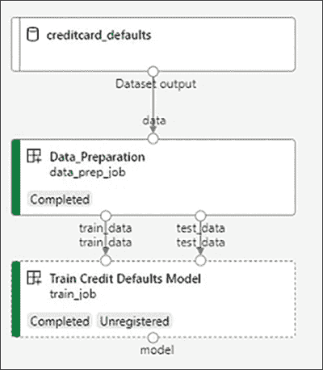

### 图 3-5 在步骤之间传递数据

我们现在可以构建 Azure Machine Learning 流水线，并在流水线的步骤之间传递数据，甚至可以使用方法减少传递的数据量。在下一节中，我们将查看如何运行和调度流水线。

### 运行和调度流水线

训练和部署机器学习模型过程的一个关键方面是调度流水线作业的能力，这可以自动化常规任务，例如重新训练模型和批量预测。在本指南中，我们将探索如何通过编程在 Azure 上调度流水线运行，并有效地管理这些调度。

假设你正在从事一个机器学习项目，涉及预测订阅制服务的客户流失率。为了让你的模型与最新数据保持同步，你需要定期重新训练它。与其每周都手动触发重新训练过程，不如你决定通过在 Azure Machine Learning 中调度流水线作业来自动化此任务。

要调度流水线作业，你需要创建一个将作业与触发器关联的计划。触发器可以基于 cron 表达式或周期性模式。以下是如何使用 Azure CLI 使用周期性模式创建基于时间的计划：点击此处查看图像

```yaml
$schema: https://azuremlschemas.azureedge.net/latest/schedule.json
name: weekly_retraining_schedule
display_name: Weekly Retraining Schedule
description: Retrain the churn prediction model every week

trigger:
  type: recurrence
  frequency: week
  interval: 1
  schedule:
    days: [sunday]
    hours: [3]
    minutes: [0]
  start_time: "2024-04-07T03:00:00"
  time_zone: "Pacific Standard Time"

create_job: ./retrain_pipeline_job.yml
```

在这个示例中，流水线作业被调度为每周日太平洋标准时间凌晨 3:00 运行。你可能会问有哪些类型的计划可用以及它如何映射到你的特定用例——例如，如果你决定你的训练流水线需要按照特定计划运行以重新训练模型，这通过标准计划是可以实现的。

### 计划类型

在 YAML 中定义你的机器学习流水线只是创建高效且可扩展工作流的开始。一旦建立了流水线，下一步是确保它在适当的时间持续性地运行。在业务背景下，在调度器上进行调度和运行流水线至关重要，因为它们确保了你的机器学习模型定期进行训练、验证和更新，而无需人工干预。这种自动化方法提高了生产力，减少了错误风险，并确保你的模型能够保持准确并与最新数据同步。

Azure Machine Learning 支持各种类型的计划来触发你的流水线作业，允许你量定制执行以满足你特定的业务需求。周期性计划特别有用，因为它们根据指定的频率（例如每天、每周或每月间隔）触发作业。此外，你还可以定义详细的计划，指定具体的小时、分钟和星期几，以便对流水线的运行时间进行更精确的控制。

另一方面，cron 使用 cron 表达式来描述计划。例如，“0 3 * * 0” 将在每周日凌晨 3:00 触发作业。

创建计划后，你可以使用 Azure CLI 或 SDK 对进行管理。表 3-5 总结了一些常用任务及其示例。

#### 表 3-5 管理机器学习计划的命令

| 示例命令 | 任务 |
| --- | --- |
| `az ml schedule list` | 列出计划 |
| `az ml schedule show -n weekly_retraining_schedule` | 查看 `weekly_retraining_schedule` 详情 |
| `az ml schedule update -n weekly_retraining_schedule --set description="Updated description"` | 更新 `weekly_retraining_schedule` 的描述 |
| `az ml schedule disable -n weekly_retraining_schedule` | 禁用 `weekly_retraining_schedule` |
| `az ml schedule enable -n weekly_retraining_schedule` | 启用 `weekly_retraining_schedule` |
| `az ml schedule delete -n weekly_retraining_schedule` | 删除 `weekly_retraining_schedule` |

首先，导航到 Azure 门户并选择“创建资源”（Create A Resource）。搜索 Application Insights 并按照提示设置新实例。创建实例后，从 Application Insights 资源的“概览”（Overview）或“属性”（Properties）部分获取连接字符串。该连接字符串将您的 Azure Machine Learning 工作区与 Application Insights 关联，从而实现两个服务之间的无缝集成和数据流。

通过将您的 Azure Machine Learning 实验配置为将遥测数据发送到 Application Insights，可以提供极具价值的信息，包括实时性能指标、错误日志和自定义事件。例如，您可以跟踪模型预测的延迟和吞吐量，识别流水线中的瓶颈，并监控资源利用率。这些洞察允许您对数据科学解决方案进行主动管理，确保运行的高效有效，最终获得更可靠、更准确的机器学习结果。

## 在您的流水线中配置日志记录

在流水线中记录日志是管理和调试机器学习工作流的一个基本方面，特别是在像 Azure Machine Learning 这样的云环境中。有效的日志记录可以提供流水线各个阶段的可视性，允许您跟踪任务进度、捕获错误并记录关键指标。在数据科学的背景下，这种详尽程度对于理解模型性能、识别问题以及确保工作流顺畅运行是无价之宝。

在您的 Azure Machine Learning 流水线中设置全面的日志记录涉及配置每个步骤以输出相关日志。这些日志可以捕获广泛的信息，从简单的打印语句到详细的系统指标和错误消息。通过将将这些日志重定向到集中位置，例如 Azure Log Analytics 或 Application Insights（Azure Log Analytics 用于集中式日志管理和分析，而 Azure Application Insights 侧重于监控性能、可用性和使用情况），您可以获得流水线性能的统一视图。这种集中日志记录方法在云环境中特别有用，因为资源是分布式的，任务通常是异步执行的。

在云环境中记录日志至关重要，原因有几个：首先，它实现了实时监控和告警，允许您在问题出现时迅速响应。这种能力对于维护数据科学解决方案的可靠性和性能至关重要。其次，日志提供了流水线执行的历史记录，可用于审计、合性和追溯分析。这些历史数据有助于识别模式、诊断反复出现的问题，并对优化和改进做出明智决策。在 Azure Machine Learning 的背景下，有效的日志记录实践确保您的机器学习工作流是透明、可追溯且具有韧性的，最终带来更稳健、更可信的数据科学结果。

我们需要使用 Python 脚本步骤进行日志记录。您可以将该步骤添加到流水线并按如下所示配置连接字符串：

1. 向您的 Azure Machine Learning 流水线添加一个 `PythonScriptStep`；我们将使用它进行日志记录。

2. 配置您的 `RunConfiguration`，添加对 `opencensus-ext-azure` 的依赖。

3. 在您的 `RunConfiguration` 中设置 `APPLICATIONINSIGHTS_CONNECTION_STRING` 环境变量。

以下是此脚本步骤的 Python 代码示例：

点击此处查看代码图像

```python
from azureml.core.runconfig import RunConfiguration
from azureml.pipeline.steps import PythonScriptStep
from azureml.core.conda_dependencies import CondaDependencies
dependencies = CondaDependencies()
dependencies.add_pip_package("opencensus-ext-azure>=1.0.1")

run_config = RunConfiguration(conda_dependencies=dependencies)
run_config.environment.environment_variables = {
 "APPLICATIONINSIGHTS_CONNECTION_STRING": 'InstrumentationKey=your_instrumentation_key'
}

sample_step = PythonScriptStep(
 script_name="sample_step.py",
 compute_target=compute_target,
runconfig=run_config
)
```

一旦我们有了脚本步骤，就需要在脚本步骤中实现日志记录。您可以通过导入 `AzureLogHandler`（用于写入日志）并将此日志处理器添加到 Python 日志器来实现这一点。以下代码块显示了如何使用 `logging` 模块创建日志对象并配置处理器：

点击此处查看代码图像

```python
from opencensus.ext.azure.log_exporter import AzureLogHandler
import logging
logger = logging.getLogger(__name__)
logger.setLevel(logging.DEBUG)
logger.addHandler(logging.StreamHandler())
logger.addHandler(AzureLogHandler())
logger.warning("This log will be sent to Application Insights")
```

## 使用自定义维度记录日志

使用自定义维度创建结构化日志如何？为了给您的日志消息提供上下文，您可以添加自定义维度，例如 `parent_run_id`、`step_id`、`step_name`、`experiment_name` 和 `run_url`。

点击此处查看代码图像

```python
from azureml.core import Run
run = Run.get_context(allow_offline=False)
custom_dimensions = {
 "parent_run_id": run.parent.id,
 "step_id": run.id,
 "step_name": run.name,
 "experiment_name": run.experiment.name,
"run_url": run.parent.get_portal_url(),
"run_type": "training"
}
logger.info("Log with Custom Dimensions", extra={"custom_dimensions":
custom_dimensions})
```

自定义维度是 Azure Machine Learning 中创建结构化日志的一项强大功能，为您的日志消息添加了有价值的上下文。通过结合 `parent_run_id`、`step_id`、`step_name`、`experiment_name` 和 `run_url` 等自定义维度，您可以用详细的元数据丰富您的日志，使其更易于搜索、过滤和分析。这些自定义维度帮助您理解生成每个日志条目的广泛上下文，提供有关流水线特定部分及其如何与整体工作流相关的洞察。

例如，在日志中包含 `parent_run_id` 允许您将所有活动追溯到主流水线运行，提供执行流的完整视图。`step_id` 和 `step_name` 维度有助于精确定位流水线中的哪个步骤生成了日志条目，这对于识别错误或性能瓶颈发生的位置特别有用。通过用 `experiment_name` 为每条日志标记，可以轻松地分组和比较不同实验的日志，便于跨实验分析和调试。

此外，`run_url` 维度提供了指向 Azure Machine Learning Studio 的直接链接，您可以在那里查看有关运行的更详细信息。这种集成增强了调试过程的效率，允许您从日志项快速导航到 Azure ML 界面中的相应运行详细。通过利用这些自定义维度，您创建了一个结构化日志记录框架，这不仅提高了日志的粒度和清晰度，还显著增强了您在云环境中管理和优化机器学习工作流的能力。

带有自定义维度的结构化日志在云环境中尤为重要，原因有以下几点：首先，它通过支持更复杂的查询和分析，提升了日志的可管理性。在处理海量日志数据时，能够根据 `experiment_name` 或 `step_name` 等特定维度过滤日志，可以节省大量的时间和精力。其次，结构化日志有助于与监控和告警系统更好地集成。例如，你可以根据特定的日志维度设置告警，以便通知你与特定步骤或实验相关的问题。这种主动的监控方法有助于确保你的数据科学解决方案的可靠性和性能。

在日志策略中引入自定义维度还支持合规性和审计要求。通过维护详尽且结构化的日志，你可以为你的机器学习工作流提供清晰、全面的审计追踪。这种透明度对于监管合规以及与依赖你的数据科学解决方案的利益相关者建立信任至关重要。在 Azure Machine Learning 的背景下，带有自定义维度的结构化日志不仅增强了工作流的技术稳健性，还有助于其整体信度和可责性。

## 在 Application Insights 中查询日志

一旦你的流水线运行被记录到 Application Insights 中，你就获得了查询和分析日志的强大能力。Application Insights 提供了在 `'traces'` 和 `'exceptions'` 等类别下访问日志的功能，允许你高效地过滤和剖析日志数据。这种细粒度在数据科学背景下特别有用，因为理解机器学习工作流的复杂性会显著影响模型的性能和可靠性。通过利用这些功能，你可以跟踪流水线运行的行为，定位问题，并收集见解以优化你的流程。


使用自定义维度通过实现更具针对性的查询来增强日志数据的价值。例如，你可以通过`parent_run_id`、`step_id`或`experiment_name`过滤日志，以隔离与特定运行、步骤或实验相关的日志。这种集中的方法允许你深入研究感兴趣的特定区域，从而更容易地识别和解决问题。例如，如果你想检查特定`parent_run_id`的日志，可以使用类似`traces | where customDimensions.parent_run_id == 'your_parent_run_id'`的查询。此类查询帮助你从海量日志数据中快速找到相关信息，促进更高效的调试和性能调优。

现在我们已经了解了如何进行自定义日志，可以考虑向我们的流水线中添加自定义组件了。

## 创建自定义组件

在 Azure Machine Learning 流水线中创建自定义组件允许你对机器学习任务进行封装和模块化，使工作流更加灵活、可重用且易于管理。在本节中我们将引导你完成在 Azure Machine Learning 流水中线创建和使用自定义组件的过程。

Azure Machine Learning 流水是将各种机器学习任务（如数据预处理、模型训练和评估）缝合为一个连贯过程的工作流。组件是这些流水线的构建块。它们代表单独的任务并可以在不同的流水线之间复用。Azure Machine Learning 支持两种组件：经典预构建组件（v1）和自定义组件（v2）。经典组件主要用于数据处理和传统的机器学习任务，而自定义组件允许你将自己的代码和逻辑封装到可重用的组件中。图 3-7 显示了组件类型，包括元数据、接口、命令、代码和环境。

在开始之前，请确保你拥有：

- Azure 订阅和 Machine Learning 工作区。
- 安装了 Azure CLI 扩展。
- 克隆了示例仓库：`git clone https://github.com/azureml-examples --depth 1`。

要在流水线中使用自定义组件，你首先需要在你的 Machine Learning 工作区中注册它们。在 Azure Machine Learning 工作区中，导航到 Components 页面并选择 New Component。上传包含你的组件的文件夹并选择 YAML 文件来注册组件。注册还支持自动版本控制，确保旧的流水线能够继续运行。

对任何想要注册的额外组件重复此过程。在 Azure Machine Learning 工作区中，导航到位于 Studio 中 Assets 下的 Components。

双击组件以配置其参数、输入和输出。你可以将重要的参数提升到流水线级别，以便在运行流水线时更容易访问。将参数提升到流水线级别的概念非常重要，因为你希望简化调整变量的过程，使其修改和管理更加高效，而无需配置每个组件。

### 使用基于组件的流水线

一旦组件完成注册（参见图 3-9），你就可以创建一个使用它们的流水线。在 Azure Machine Learning Studio 中，创建一个新流水线并选择 Custom。给你的流水线起有意义的名字。

接下来，你可以通过资产库中的 Components 选项卡找到已注册的组件，并将它们添加到流水线中。将它们拖放到流水线画布上。进行相应的连接以定义数据流和执行。或者或者你可以使用自定义组件创建一个新流水线，如图 3-10 所示。

一旦流水线配置完成，点击 Configure & Submit 进行提交。按照提示配置实验、作业显示名称、输入/输出以及运行时设置。

## 引言

我们将探索的第一个技能是为脚本配置作业运行设置。正确设置作业运行参数是确保您的机器学习任务顺利且高效执行的基础。这包括定义脚本所需的计算资源、环境依赖项和运行时配置。通过仔细地配置这些设置，您可以优化流水线的性能、管理成本，并确保工作流中的每一步都以最佳状态运行。理解如何根据您的特定需求来定制这些设置，对于最大化您的机器学习项目的实施效能至关重要。

接下来，我们将讨论如何描述 MLflow 模型输出。MLflow 是一个强大的工具，用于管理机器学习模型的生命周期，涵盖从实验到部署的各个阶段。能够准确地描述和解释 MLflow 模型输出，对于跟踪模型的性能和演变至关重要。这涉及到理解 MLflow 生成的各种指标（metrics）和产物（artifacts），以及如何使用这些输出为模型调优和改进的决策提供依据。此外，我们还将介绍选择合适的框架来封装模型的重要性。框架的选择会影响模型部署的易用性、扩展性和可维护性。我们将引导您考虑选择与您的项目需求和部署环境相匹配的封装框架。

最后，我们将深入探讨使用负责任 AI 指南来评估模型的原则。随着机器学习日益成为业务运营和决策的组成部分，确保以负责任的方式开发和部署模型至关重要。负责任的 AI 涵盖了一系列实践，旨在减轻偏差、确保透明度并在 AI 开发中维护伦理标准。我们将研究如何根据这些指南对您的模型进行评估，确保它们不仅性能良好，而且符合更广泛的和社会伦理考量。这种全面的模型评估方法对于构建 AI 系统的信任问责制至关重要。

通过掌握这些技能，您将完全能够在 Azure Machine Learning 中创建和管理稳健、高效且合道德的机器学习流水线。我们涵盖的每个主题都将为您提供实用的见解和技术，增强数据科学项目的质量和完整性，确保它们交付有价值且负责任的结果。

## 描述 MLflow 模型输出

MLflow 是一个多功能的开源平台，简化了整个机器学习生命周期，包括实验、可复性和部署。与 Azure Machine Learning 结合时，MLflow 为管理和跟踪机器学习项目提供了增强的体验。

MLflow 与 Azure Machine Learning 的集成允许您在 Azure 生态系统中使用 MLflow 的跟踪、模型管理和部署功能。这种集成允许您：

- 使用 Azure Machine Learning 工作空间作为您的 MLflow 跟踪服务器，集中管理指标、参数和产物的日志记录。
- 在 Azure Machine Learning 中管理您的 MLflow 模型生命周期，包括注册、版本控制和部署。

### 使用 MLflow 进行跟踪

在 Azure Machine Learning 中，MLflow 主要用于跟踪实验，但也用于存储模型、脚本和其他产物、模型版本控制，并确保实验的可复现性。这涉及记录机器学习运行的各个方面，例如指标、参数和产物（例如模型和图表）。当您 Azure Machine Learning 中使用 MLflow 运行实验时，所有跟踪的信息都存储在您的工作空间中，以便进行分析和比较。

### Azure Machine Learning 中的 MLflow 输出

Azure Machine Learning 中的 MLflow 跟踪输出包括：

- **指标 (Metrics)**：对模型性能的量化衡量，如准确率、精确率、召回率或实验中定义的自定义指标。
- **参数 (Parameters)**：在实验中使用的配置和超参数。
- **产物 (Artifacts)**：实验期间产生的文件，包括序列化模型、图表和其他相关数据。
- **模型注册表 (Model Registry)**：MLflow 用于实验跟踪和模型注册的开源工具。

Azure Machine Learning 支持使用 MLflow 管理模型，允许您注册模型。

### 使用 MLflow 部署模型

MLflow 模型可以直接部署到 Azure Machine Learning 终点，同时支持实时推理和批量推理。该过程被简化了，因为您不需要指定环境或评分脚本。（评分脚本是 Azure Machine Learning 用于定义使用训练模型进行预测所需的逻辑和代码的文件。）Azure Machine Learning 会处理部署，使您的 MLflow 模型能够随时用于服务。

### 在 Azure Machine Learning 中部署 MLflow 模型的关键特性

在 Azure Machine Learning 中部署 MLflow 模型有几个关键特性。一种选择是无代码部署，它允许您自动生成评分脚本而无需显式创建它们。然而，有许多部署工具可用，了解包依赖和模型签名等概念对于使用 MLflow 工作至关重要。下面描述了其中一些选项：

- **无代码部署**：自动生成评分脚本和环境。
- **包依赖 (Package Dependencies)**：确保 MLflow 模型中指定的所有依赖都得到满足，为推理服务器添加任何所需的包。
- **模型签名 (Model Signatures)**：强制执行推理期间预期输入（如模型签名中定义）与实际数据输入之间的兼容性。
- **部署工具 (Deployment Tools)**：提供多种部署 MLflow 的工具，每种工具都有不同的功能和部署选项。

表 3-6 提供了 Azure Machine Learning 中用于部署 MLflow 的可用部署工具对比。生成 MLflow 模型和部署它是两个不同的过程。在 MLflow SDK 中有一种简单（且无代码）的方法部署模型。

**表 3-6：部署工具总结**

| 部署工具 | 托管在线终点 (Managed Online Endpoints) | 批量终点 (Batch Endpoints) | Web 服务 (ACI/AKS) | 使用评分脚本自定义 |
| :--- | :--- | :--- | :--- | :--- |
| MLflow SDK | 是（预览版） | 不支持 | 传统支持 | 不支持 |
| Azure Machine Learning CLI/SDK | 是 | 是 | 不支持 | 是 |
| Azure Machine Learning Studio | 是 | 是 | 不支持 | 是 |

## 识别用于封装模型的合适框架

将 MLflow 模型部署到 Azure Machine Learning 涉及几个关键考虑因素，特别是在使用不同的机器学习框架时。每个框架对于日志记录和部署都有其自己的要求和最佳实践。

假设您是一名数据科学家，正在从事机器学习项目，该项目涉及使用不同框架构建的多个模型，包括 Scikit-learn、TensorFlow、PyTorch、XGBoost 和自定义框架。您需要将这些模型部署到 Azure Machine Learning 以在生产环境中提供预测服务。

当你记录一个模型时，`MLflow`会自动识别并修复模型中 Conda 依赖项的包版本。然而，这种对包的自动检测并不总是符合你的特定需求或意图。因此，如果自动包检测无法满足你的要求，建议使用自定义的 Conda 依赖项定义来记录模型。表 3-7 总结了一些记录函数和框架。

**表 3-7 记录函数和框架**

| 框架 | 记录函数 | 部署考虑 |
| --- | --- | --- |
| Scikit-learn | `mlflow.sklearn.log_model` | 确保在 Conda 环境中正确指定所有依赖项，以实现顺利部署。 |
| TensorFlow | `mlflow.tensorflow.log_model` | 在 Conda 环境中指定正确的`TensorFlow`版本，以避免部署期间出现问题。 |
| PyTorch | `mlflow.pytorch.log_model` | 在 Conda 环境中准确指定所有必要的依赖项和库版本。 |
| XGBoost | `mlflow.xgboost.log_model` | 确保在 Conda 环境中指定正确的`XGBoost`版本，以成功部署。 |
| 自定义 | `mlflow.log_model` | 提供详细的 Conda 环境并可能提供自定义评分脚本，以正确处理推理过程。 |

在这种情况下，你将根据所使用的框架使用相应的`MLflow`记录函数记录每个模型。然后，你为每个模型仔细准备 Conda 环境，确保指定了所有必要的依赖项和版本。对于自定义框架，你可能需要提供额外的配置或自定义评分脚本，以确保正确的推理行为。

### 使用负责任 AI 准则评估模型

在`MLflow`中根据负责任 AI 准则评估模型，涉及确保模型遵循公平性、可靠性、透明度和隐私等原则。这些准则对于以安全、可靠且符合伦理的方式开发、评估和部署 AI 系统至关重要。

假设你是一个数据科学家，使用`MLflow`开发了一个机器学习模型。你希望在`Azure Machine Learning`中部署此模型，但需要确保它符合负责任 AI 原则。你将根据公平性、可靠性、透明度等准则对模型进行评估。表 3-8 总结了基于负责任 AI 准则评估`MLflow`模型的关键考虑因素：

**表 3-8 MLflow 模型的关键考虑因素**

| 原则 | 描述 | 工具与技术 |
| --- | --- | --- |
| 公平与包容性 | 确保模型对所有组都公平且不歧视。 | `Azure Machine Learning`负责任 AI 仪表板中的公平性评估组件。 |
| 可靠性与安全性 | 验证模型在各种条件下运行得可靠且安全。 | `Azure Machine Learning`负责任 AI 仪表板中的错误分析组件。 |
| 透明性 | 确保模型的决策过程是透明且可解释的。 | `Azure Machine Learning`负责任 AI 仪表板中的模型可解释性和反事实“假设”分析。 |
| 隐私与安全 | 确认模型符合隐私法并保护敏感信息。 | 如`SmartNoise`等差分隐私工具；`Azure Machine Learning`中的加密和访问控制。 |
| 责任归属 | 对模型的行为和结果保持责任。 | `Azure Machine Learning`中的`MLOps`能力，用于跟踪模型的生命周期。 |

### 章节总结

- 你可以在`Azure Machine Learning`中配置计算资源和作业设置，以优化模型训练脚本和性能。
- 你现在可以从各种资产中无缝集成并消费数据，提高作业运行期间数据的可访问性和实用性。
- 你可以利用`MLflow`进行详细的指标记录，并使用日志对作业运行中的问题进行有效的故障排除。
- 你现在可以通过创建和调度训练流水线来自动化和管理复杂的工作流，提高效率和一致性。
- 你可以设计自定义组件并利用基于组件的流水线来增加模型训练的模块化和可重用性。
- 通过识别用于打包和部署模型的合适框架，你可以简化模型训练和管理。
- 你现在可以在`Azure`中有效管理模型，使用`MLflow`跟踪输出，并应用负责任 AI 准则以确保符合伦理的模型部署。

### 思维实验

在这一思维实验中，展示你对本章所涵盖主题的技能和知识。你可以在后续章节找到答案。

1. `Azure Machine Learning`中有效的作业配置：优化模型训练脚本和性能至关重要的是什么？
   1. 无差别地增加计算实例的数量。
   2. 限制数据访问以最小化处理时间。
   3. 恰当地配置计算资源和作业设置。
   4. 避免使用外部库和工具。

2. 数据集成与利用：用户如何在`Azure Machine Learning`作业运行期间增强数据的访问性和实用性？
   1. 通过忽略外部数据源并仅关注内部数据集。
   2. 仅从实时源消费数据以确保新鲜性。
   3. 从各种资产中无缝集成并消费数据。
   4. 使用手动数据输入以避免集成复杂性。

3. 管理和自动化模型训练工作流：哪种方法最能描述`Azure Machine Learning`中复杂工作流的管理？
   1. 在每次运行时手动调度流水线。
   2. 创建并调度训练流水线以实现自动化工作流管理。
   3. 避免使用流水线以简化训练过程。
   4. 仅使用默认组件而不进行自定义。

4. 根据微软的负责任 AI 准则，以下哪项被认为是在`Azure Machine Learning`中确保符合伦理的模型部署的最佳实践？
   1. 根据准确性和公平性指标部署模型。
   2. 利用`MLflow`跟踪输出，同时结合负责任 AI 仪表板进行公平性评估、透明度文档编制、偏差审计并实施人工回路监督机制。
   3. 依赖自动化工具和包来执行伦理准则。
   4. 使用任何可用框架打包模型并通用部署，假设它们在所有环境和用例中表现相同，而不进行特定评估。

### 思维实验答案

此部分包含思维实验的答案。每个答案都解释了为什么该选项是正确的。

1. 答案是 **C**。恰当地配置计算资源和作业设置对于优化`Azure Machine Learning`中的模型训练脚本和性能至关重要。选项 A 涉及资源的无差别使用，并不高效。选项 B 限制数据访问可能会阻碍而非增强性能。选项 D 建议避免外部工具，可能会降低训练过程的有效性和灵活性。

2. 答案是 **C**。从各种资产中无缝集成并消费数据可以提高作业运行期间的数据访问性和实用性，符合`Azure Machine Learning`的最佳实践。选项 A 忽略了外部数据源，减少了全面数据分析的可能性。选项 B 将数据限制为实时源，并非总是必要或有益的。选项 D 手动数据输入会引入效率低下和潜在错误。

3. 答案是 **B**。为自动化工作流管理创建并调度训练流水线，可以有效地管理 Azure Machine Learning 中复杂的工作流。选项 A 涉及手动调度，其效率低于自动化过程。选项 C 避免使用流水线，将导致训练过程的结构化程度，并且可能更容易出错。选项 D 没有利用定制化带来的优势，而定制化可以提高效率和性能。

4. 答案是 **B**。利用 MLflow 跟踪输出，同时引入负责任 AI（Responsible AI）仪表板以执行公平性评估、记录透明度、进行偏见审计并实施人工回路监督机制。这种方法通过全面应用负责任 AI 指南，确保了 Azure Machine Learning 中模型部署的伦理性。选项 A 忽略了对模型决策过程的审查，这对于伦理 AI 至关重要。选项 C 仅关注准确性，忽略了其他重要的伦理考量。选项 D 意味着无差别地使用框架，这可能并不所有场景，并可能导致部署兼容性和伦理问题。

# 第 4 章


# 部署并重新训练模型

在生产环境中部署和运行机器学习模型面临着独特的挑战，需要采取策略性的方法。与传统的软件应用程序不同，机器学习模型需要持续监控、频繁更新和动态伸缩，以处理波动的数据负载和不断演变的数据模式。精通机器学习运营（MLOps）的专业人士承担着连接实验性数据科学与稳健、可扩展生产系统之间差距的关键角色。

这一过程需要在运营需求和模型预测性能之间进行精细的平衡。它涉及将复杂的模型需求转换为可部署的解决方案，以便高效利用计算资源、管理数据流，并符合合规性和安全标准。处理机器学习部署还涉及与传统软件部署不同的特定实践，例如管理数据漂移、模型版本控制和自动重新训练周期。这些实践确保了模型随着底层数据的时间推移而保持准确性和相关性。

随着模型复杂性的增加，特别是随着深度学习和大语言模型的普及，机器学习的运营方面变得更加至关重要。这包括遵守更严格的监管要求，以及管理这些模型所需的大量的计算资源。`Azure Machine Learning` 通过其全面的工具和服务提供了一个解决这些挑战的稳健环境。

在本章中，我们将探索在 Azure 中部署和管理机器学习模型的关键阶段。我们首先概述如何配置在线部署和批量部署的设置，以确保模型具有响应能力和可扩展性。我们将讨论如何将模型部署到不同的端点，例如用于实时预测的在线端点和用于处理大量数据的批量端点（见图 4-1）。

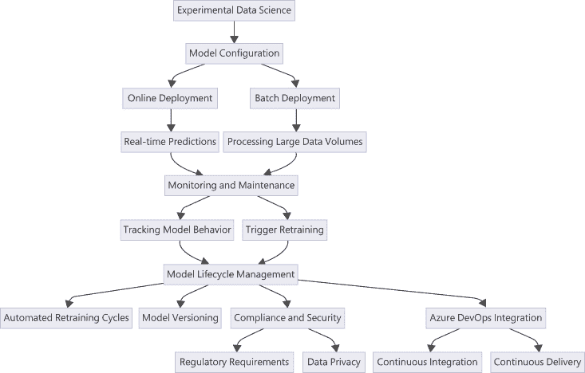

**图 4-1** 从实验性数据科学到模型配置再到在线或批量部署的机器学习模型部署与管理

我们还将涵盖增强模型性能和可靠性的运营策略。这包括建立监控系统以跟踪生产环境中的模型行为，使用 Azure 的功能触发重新训练过程，以及应用 MLOps 实践来自动化和简化模型生命周期管理。`Azure DevOps` 和 `GitHub` 在持续集成和交付的集成，在维护机器学习运营的敏捷性方面起着至关重要的作用。

在本章结束时，你将获得使用 `Azure Machine Learning` 部署和管理机器学习模型的全面见解，为在现实场景中运行这些模型的实际挑战做好准备。

本章涵盖的技能：

* 技能 4.1：部署模型
* 技能 4.2：应用机器学习运营（MLOps）实践

## 技能 4.1：部署模型

在 `Azure Machine Learning` 中部署模型允许应用程序通过各种端点利用训练过的模型。这种部署通过将模型从开发阶段过渡到生产环境来实现，使其能够供真实世界的应用程序访问。`Azure Machine Learning` 支持创建在线端点和批量端点，以满足不同的应用程序需求。在线端点适用于对低延迟响应至关重要的实时预测，而批量端点设计用于处理大量数据，在这些情况下不需要立即响应。

该过程从模型注册开始，将训练过的模型存储在 Azure 的版本控制库中。接下来是设置环境，这涉及指定所有必要的运行时设置，以确保模型行为在不同部署条件下保持一致。在配置好模型及其环境后，下一步是选择适当的部署目标。例如，`Azure Kubernetes 服务 (AKS)` 可用于高规模、高可用性场景，而 `Azure 容器实例 (ACI)` 则适用于开发和测试等低规模情况。

根据运营需求，你可能选择设置在线端点或批量端点。在线端点便于对 API 请求做出快速响应，使其成为交互式应用程序的理想选择。相比之下，批量端点批量处理请求，将数据作为单批处理，这对于应用程序可以忍受输出延迟的场景来说效率更高。两种类型的端点都可以进行扩展和监控，以确保最佳性能和可靠性。`Azure Machine Learning` 还提供了监控这些端点的工具，收集有关使用情况、响应时间和预测准确性的数据，以帮助诊断问题并评估模型在生产环境中的性能。为了说明部署过程，请参考表 4-1。

**表 4-1** 在 `Azure Machine Learning` 中部署模型的步骤

| 步骤 | 描述 |
| --- | --- |
| 模型注册 | 在 Azure 的版本控制库中存储和管理模型。 |
| 环境设置 | 指定运行时环境以确保跨部署的一致性。 |
| 部署目标选择 | 根据规模、成本和性能需求，在 `AKS`、`ACI` 或边缘设备之间进行选择。 |
| 端点配置 | 根据应用程序的延迟和容量需求，选择在线端点或批量端点。 |
| API 创建 | 将模型封装为通过 API 访问的 Web 服务以便预测。 |
| 监控设置 | 利用 Azure 的工具跟踪部署模型的性能和健康状况。 |

在开始之前，请确保你已设置 Azure 订阅和 `Azure Machine Learning` 工作区。

### 配置在线部署的设置

在 `Azure Machine Learning` 中，可以使用两种主要方法部署机器学习模型进行推理：在线部署和批量部署。这些部署选项为了满足特定的应用程序需求和性能要求而定制，因此理解两者的区别和能力至关重要。

在线部署对于需要即时预测且低延迟要求的场景是理想的。该方法涉及建立一个对 API 请求做出实时响应的预测服务。以下是在线部署的一些关键配置选项：

- **实例类型 (Instance Type)**：在基于 CPU 或 GPU 的虚拟机之间进行选择。这会影响部署的性能和成本。
- **实例数量 (Instance Count)**：决定用于处理传入请求的实例数量。影响可扩展性和容错能力。
- **自动伸缩 (Autoscaling)**：根据流量模式自动调整实例数量。优化了资源利用率和成本。
- **身份验证模式 (Authentication Mode)**：支持基于密钥或基于令牌（token）的身份验证。确保访问部署端点的安全性。
- **流量规则 (Traffic Rules)**：管理流量在多个部署节点之间的分布方式。对于 A/B 测试或实施蓝绿部署策略非常有用。
- **环境 (Environment)**：指定 Docker 镜像和 Conda 环境。确保部署具有正确的运行时依赖项。

需要注意的是，虽然在需要低延迟的情况下选择在线部署是理想的，但你应该评估是否真的需要，因为选择此选项并非没有权衡。一个权衡是，特征在预测时必须是可用的。你构建的模型——无论是分类、回归还是其他问题类型——都是在进行推理时所需的某些特征上训练的。

这些部署选项的另一个重要考虑因素是可扩展性。在这里，一个具有自动伸缩能力的在线端点对于处理实时产品推荐以及其他客户期望系统提供低延迟的其他类型在线部署至关重要。这种设置确保了系统即使在假日销售或特别促销等流量高峰期间，也能保持低延迟。

考虑一个电子商务网站，其每日流量模式变化多端，且在周末和假日有显著的峰值。为了管理这一点，平台利用了自动伸缩技术。

### 什么是自动伸缩？

自动伸缩在流量高峰期间自动缩放虚拟机的数量，以保持性能，同时避免在非高峰时段产生不必要的成本。

### 可用的实例类型

根据流量类型和流量波动，GPU 和 CPU 实例类型提供不同的选项。还有几种实例类型可用。GPU 实例在高峰期间被使用，以更快速地处理复杂的推荐算法。或者，在正常流量期间可以使用 CPU 实例类型以降低成本。

在现实的数据科学解决方案中，我们可能还会决定采用基于令牌的身份验证来保护 API 端点免受未经授权的访问，确保只有合法的网站和应用程序可以请求预测。表 4-2 总结了一些配置选项。

**表 4-2** 实时推荐的配置选项

| 配置选项 | 说明 | 使用场景影响 |
| --- | --- | --- |
| 实例类型 | 选择 CPU 或 `GPU` 虚拟机 | 影响成本和性能 |
| 实例数量 | 活跃实例的数量 | 影响可扩展性和冗余 |
| 自动伸缩 | 实例数量的动态调整 | 优化成本和资源使用 |
| 身份验证模式 | 基于密钥或令牌的安全机制（一个区别是密钥不会过期，而令牌会过期） | 确保预测服务的安全性 |
| 流量规则 | 部署间的分布管理 | 方便 A/B 测试和更新 |
| 环境 | 指定运行时依赖 (Docker, Conda) | 确保兼容性和性能 |

`Azure Machine Learning` 的部署选项为实现稳健的实时预测服务提供了所需的灵活性和可扩展性。你应该尝试理解并正确配置这些选项，因为通过在 Azure 数据科学解决方案中实施这些选项，企业可以显著提高运营效率和客户参与度。

### 在 Azure 中安全地发布机器学习模型简介

在生产环境中部署机器学习模型时，确保平稳过渡且不中断服务至关重要。`Azure Machine Learning` 提供了一种安全的发布策略，允许你逐步引入新模型版本。以下是理解和实施这种方法的关键概念：

- 在 Azure 中向生产环境部署机器学习模型需要周全的计划，以避免中断。
- 安全的发布策略（如蓝绿部署方法）允许你逐步引入新模型版本。
- 这种方法帮助你通过最初将一小部分流量导向新模型来验证新模型的性能。
- 通过仔细监控部署，你可以确保在所有流量完全切换到新模型之前，新模型运行符合预期。
- 该策略减少了在生产环境中部署机器学习模型更新时出现错误或停机的风险。

在下一节中，我们将扩展此类策略，查看通用的生产环境部署策略，以及在托管在线端点环境中部署更新或更改时会发生什么。

### 生产环境部署策略

在托管在线端点环境中部署更新或更改时，通常使用分阶段的方法来最大限度地减少干扰和风险。例如，更新可以一次应用于部分节点——通常被称为`滚动更新` (rolling updates)。在这些情况下，如果部署包含 10 个节点，则更新过程将一次处理 2 个节点，代表总部署的 20%。这种方法允许服务在实施更新时以其大部分容量继续运行，从而缩短停机时间，并提供了一个缓冲区，以便在新配置完全部署到所有节点之前监控其可能出现的任何问题。

相比之下，Kubernetes 环境中的部署策略通常涉及另一种方法，被称为`不可变部署` (immutable deployments)。在这里，系统不是更新现有节点，而是根据新配置启动一组新节点（或 pod），并逐渐替换旧节点。这种策略通常使用 Kubernetes 提供的滚动更新机制执行，其中会创建新的部署实例，并系统地逐步淘汰旧实例。这种方法确保了始终有运行中的可用实例，从而最大限度地减少了部署从旧配置过渡到新配置期间服务中断的可能。

对于对可靠性和无缝切换至关重要的生产环境，强烈建议使用蓝绿部署策略。在`蓝绿部署`中，维护两个完全相同的环境：一个运行当前的实时生产版本（蓝色），另一个运行新版本（绿色）。流量最初完全指向蓝色环境。一旦绿色环境中的新版本经过充分测试并准备上线，即可进行切换。这种切换几乎瞬间完成，将停机时间降至最低。此外，如果切换到绿色环境后检测到任何问题，可以快速切回蓝色环境，从而显著降低与部署相关的风险。

采用此类高级部署策略可以确保对生产系统进行更新和更改时，对终端用户的影响降至最低。每种方法——无论是托管端点中的滚动更新、`Kubernetes` 中的不可变部署，还是针对关键生产环境的蓝绿部署——都提供了特定的优势，可以根据业务的运行需求和风险容忍度利用这些优势。这些方法不仅增强了部署过程的健壮性，还为维护服务的连续性和可靠性提供了保障，这在生产环境中是至关重要的。

大规模部署机器学习模型需要健壮且灵活的基础设施，以处理真实世界应用程序的复杂性。`Azure Kubernetes Service (AKS)` 为在生产环境中部署、管理和扩展机器学习模型提供了一个强大的平台。利用 `AKS` 进行模型部署具有许多优势，包括自动伸缩、滚动更新以及与其他 Azure 服务的无缝集成。本节将探索使用 `AKS` 部署机器学习模型的关键方面，并重点介绍优化您的部署工作流的最佳实践和实用技巧。

### 使用 Azure Machine Learning 设置 AKS 以进行模型部署

使用 `AKS` 部署机器学习模型的第一步是设置一个 `AKS` 集群。这涉及在 Azure 中创建一个 `Kubernetes` 集群，它将作为您部署的基础。您可以通过 Azure 门户、`Azure CLI` 或使用 `Terraform` 等基础设施即代码工具来创建 `AKS` 集群。在设置集群时，请考虑以下因素：

- **集群配置**：根据预期的负载和性能需求定义集群的规模和配置。这包括选择合适的节点大小、节点数量并配置节点池以优化资源利用率。
- **网络**：配置网络设置，以确保您的 `AKS` 集群与其他 Azure 服务之间进行安全高效的通信。这包括设置虚拟网络、子网配置和网络安全组。
- **安全性**：通过启用基于角色的访问控制 (`RBAC`)、设置网络策略以及使用 Azure Active Directory 进行身份验证，实施安全最佳实践。

### 将模型作为 Kubernetes Pod 部署

一旦设置好 `AKS` 集群，下一步是将您的机器学习模型容器化并将其作为 `Kubernetes` pod 部署。容器化涉及将您的模型同其依赖项封装到 `Docker` 容器中，确保它能够在不同的环境中一致运行。该过程通常涉及：

- **创建 Docker 镜像**：编写 `Dockerfile` 以指定基础镜像、依赖项以及运行模型的命令。构建 `Docker` 镜像并将其推送到容器注册中心，例如 `Azure Container Registry (ACR)`。
- **定义 Kubernetes 资源**：创建 `Kubernetes` 资源文件 (`YAML`) 来定义部署和服务规范。这些文件包含了有关容器镜像、资源限制、环境变量以及服务应如何暴露（例如通过 `LoadBalancer` 或 `Ingress`）的细节。
- **部署到 AKS**：使用 `kubectl` 命令或 CI/CD 流水线应用 `Kubernetes` 资源文件并将模型部署到 `AKS` 集群。监控部署过程以确保 pod 成功运行且服务可以访问。

### 管理和扩展模型部署

使用 `AKS` 的主要优势之一是能够自动管理和扩展模型部署。`AKS` 提供了内置功能来处理伸缩、更新和监控，确保您的模型能够满足生产负载的需求。关键考虑因素包括：

- **自动伸缩**：配置水平 Pod 伸缩 (`HPA`)，根据 CPU 或内存利用率自动调整 pod 的数量。这确保您的部署可以在无需人工干预的情况下处理变化的负载。
- **滚动更新**：使用滚动更新在无停机的情况下过渡到新版本。
- **监控和日志**：集成 `Azure Monitor`、`Prometheus` 和 `Grafana` 等监控解决方案以跟踪性能和健康状况。

### 与 Azure ML 和 DevOps 集成

为了无缝工作流，将 `AKS` 部署与 `Azure Machine Learning` 和 `DevOps` 集成。`DevOps` 可用于自动化模型的构建、测试和部署。总之，使用 `Azure Kubernetes Service` 部署机器学习模型提供了一个可扩展、可靠的解决方案。通过遵循设置 `AKS`、模型容器化和管理部署的最佳实践，您可以确保您的机器学习解决方案是健壮且能够满足真实世界需求的。

### 配置批量部署的计算资源

在 `Azure Machine Learning` 中，批量部署是部署机器学习模型的另一种关键方法，针对不需要即时响应的处理作业进行了优化。这种部署类型通常用于每日数据处理、复杂模拟或需要大量计算资源的场景。

### 引入批量部署

`Azure Machine Learning` 中的批量部署旨在处理异步任务，允许高效管理计算资源并提供调度灵活性。与在线部署场景类似，批量部署有几个关键的配置选项：

- **计算目标**：在 `Azure Machine Learning` 计算集群或附加的计算资源之间进行选择。
- **节点计数**：指定计算集群中的节点数量，并允许跨多个实例进行并行处理。
- **最大并发运行数**：限制同时运行的批作业数量以管理资源竞争。
- **留存时间**：设置批作业输出在被自动删除之前保留多久。
- **输入数据**：配置批处理所需的输入数据集或文件路径。
- **输出数据**：指定存储批作业结果的位置和格式。
- **节点计数**：使用多个节点来并行处理患者记录，从而加速任务执行。
- **保留时间**：设置保留策略，将处理后的数据保留一个月，以符合医疗法规。

表 4-3 总结了这些选项，并对两种部署模型进行了并排对比。

**表 4-3** 部署类型的关键配置选项和特性

| 特性 | 在线部署 | 批处理部署 |
| --- | --- | --- |
| 推理类型 | 实时 | 异步 |
| 实例类型 | CPU/GPU 选项 | 计算目标选择 |
| 伸缩 | 基于流量的自动伸缩 | 用于并行处理的节点计数 |
| 身份验证 | 基于密钥或令牌（token） | 不适用（通常在计算层级管理） |
| 流量管理 | 用于 A/B 测试的流量规则 | 不适用 |
| 环境 | Docker 镜像和 Conda 环境 | 用于计算目标的 Conda 环境 |
| 数据处理 | 实时请求处理 | 批处理输入和输出数据配置 |

### 将模型部署到在线端点

将模型部署到在线端点可以在 `Azure Machine Learning` 中实现实时推理。此过程涉及准备您的系统、定义端点和部署，并在部署到 Azure 之前在本地部署模型进行测试。此时，您应该已经有一个工作区，但万一还没有，则有一些前提条件：

- 带有 ML 扩展的 `Azure CLI`。
- `Azure Machine Learning` 工作区。

将您的 Azure 订阅、工作区和资源组设为默认值。克隆 Azure ML 示例仓库并导航到 CLI 目录。

#### 定义端点

在定义端点时，我们可以不仅指定端点名称。我们应该考虑添加身份验证模式（基于密钥或令牌），并可选添加描述和标签。在设置服务端点时，清楚地指定端点名称非常重要。此名称将用于在整个网络中识别和访问服务。此外，您必须选择身份验证模式；选项包括基于密钥或令牌的系统，这有助于确保只有授权用户才能访问服务，从而保护端点。

可选，您可以通过为端点添加描述来增强配置。此描述可以帮助其他用户或人员清晰地理解端点的目的及其功能。在多个端点可能导致混淆的大型项目中，这些信息特别有帮助。

此外，为端点添加标签是一种实用的做法。标签允许在大规模系统中对端点进行更容易的管理和分类。它们还可以根据特定标准或属性对端点进行搜索和报告，从而简化操作和维护任务。

#### 定义部署


在 Azure Machine Learning 中部署模型时，首要务是准备必要的组件：模型文件、评分脚本和计算环境。模型文件是已准备好部署的训练机器学习模型。评分脚本至关重要，因为它包含了调用模型和处理输入数据以生成预测的代码。最后，必须正确设置环境，涉及 Docker 镜像和一组 Conda 依赖项，以确保运行模型所需的所有库和工具均可用。

一旦准备好这些元素，下一步是配置部署设置。这包括指定存储模型文件的模型路径，并通过评分脚本详细说明代码配置。此外，必须显式定义部署的计算环境，包括 Docker 镜像和 Conda 依赖项。这些设置对于确保模型在与训练环境相同的环境中运行起着重要作用，从而减少运行时错误的概率。

Docker 镜像封装了机器学习模型运行的环境。这包含了从操作系统到运行模型所需的库和依赖项的所有内容，确保了不同环境（例如，从开发到生产）之间致性。这种隔离对于避免不同软件版本之间的冲突并使部署过程更加可靠至关重要。

通常，机器学习部署使用的 Docker 镜像基于标准的 Linux 发行版，例如 Ubuntu。此镜像中的关键组件是 Conda 环境，它由 `conda.yaml` 文件定义。该文件指定了必要的 Python 包及其版本，确保在 Docker 容器内安装了正确的依赖。以下是一个简单的示例：

点击此处查看代码图像

```
$schema: https://azuremlschemas.azureedge.net/latest/managedOnlineDeployment.schema.json
name: simple-deployment
endpoint_name: my-endpoint
model:
  path: ./model/
code_configuration:
  code: ./scoring/
  scoring_script: score.py
environment:
  conda_file: ./environment/conda.yaml
  image: mcr.microsoft.com/azureml/openmpi4.1.0-ubuntu20.04:latest
instance_type: Standard_DS2_v2
instance_count: 1
```

想象这样一个场景：某科技公司需要部署一个机器学习模型，根据应用使用模式预测用户参与度。他们根据历史数据准备了模型和评分脚本，并使用 Docker 和 Conda 配置了强大的环境来处理依赖。对于部署，由于模型的复杂性，他们选择了基于 GPU 的实例，并将实例计数设置为五个，以高效处理高流量。这种设置确保了模型能够准确、高效地提供实时预测，通过提供个性化内容和推荐来增强用户体验。

## 本部署模型（可选）

使用 Azure 命令行界面（CLI）创建本地端点是在将模型部署到生产环境之前进行测试和调试的有效方法。此过程从在 Azure 环境中设置针对特定模型的必要环境和配置开始。通过使用 `Azure CLI`，您可以直接从开发机器创建本地端点，从而简化模型的部署。这允许您在托管环境中模拟模型的行为，为安全测试和调试提供了一个沙箱。`Azure CLI` 中的命令可用于配置模型、设置端点规范并部署模型，而无需手动操作 Azure 门户。

一旦设置了本地端点，验证部署是否成功至关重要。这可以通过 `Azure CLI` 检查部署的配置状态来实现。配置状态提供了有关部署状态的信息，说明是在进行中还是已成功或失败。此步骤确保了模型已正确实例化并准备好进行测试。此外，您可以调用端点对数据进行评分，这涉及向端点发送带有示例数据的请求并评估响应。这项测试至关重要，因为它不仅检查了模型的运行状态，还验证了模型的输出是否根据提供的输入数据符合预期。

使用 `CLI` 进行本地测试不仅有助于在部署过程的早期识别任何问题，还能显著降低直接在实时环境中部署模型相关的复杂性和成本。通过在本地端点进行迭代测试和调试，你可以确保模型在扩展到全生产环境部署之前，表现是准确且可靠的。这种做法对于维护机器学习运维的完整性和效率至关重要，允许开发人员根据真实反馈和性能指标对应用程序进行微调，而不会影响正在进行的操作。一旦经过完全验证和优化，就可以放心地将模型推向生产环境，并具有更高的成功保障率。

## 将模型部署到 Azure

将模型部署到 Azure 涉及几个关键步骤，以确保模型能够运行并能够高效地处理实时数据评分。首先，你使用 Azure 命令行界面 (`CLI`) 为你的模型创建一个端点和部署。此过程至关重要，因为它为模型接收和处理请求设置了所需的架构。

以下是在 Azure 中创建端点和部署的简化命令序列。

### 创建端点

在创建端点之前，第一步是为端点配置名称。在示例中，我们使用占位符 `YOUR_ENDPOINT_NAME`。你还需要为端点指定一个 YAML 文件。

点击此处查看代码图像

```
az ml online-endpoint create --name YOUR_ENDPOINT_NAME -f endpoint.yml
```

该命令从 YAML 文件 (`endpoint.yml`) 初始化端点配置，该文件指定了端点的属性。下一步是创建部署；所示的代码片段如下：

点击此处查看代码图像

```
az ml online-deployment create --name YOUR_DEPLOYMENT_NAME --endpoint YOUR_ENDPOINT_NAME
-f deployment.yml --all-traffic
```

该命令使用另一个 YAML 文件 (`deployment.yml`) 设置部署，并将所有流量重定向到此新部署，这在测试阶段特别有用。

一旦部署激活，监控其状态并检查日志以发现任何潜在错误是至关重要的。这确保了部署运行正常，并准备好处理迁入的数据请求。你可以使用这些命令检查部署状态并获取日志：

点击此处查看代码图像

```
az ml online-endpoint show -n YOUR_ENDPOINT_NAME
az ml online-deployment get-logs --name YOUR_DEPLOYMENT_NAME --endpoint YOUR_ENDPOINT_NAME
```

使用 Azure CLI 调用端点来测试模型性能是一种良好的做法：

点击此处查看代码图像

```
az ml online-endpoint invoke --name YOUR_ENDPOINT_NAME --request-file sample-request.json
```

可选，你可以通过更新组件来增强部署，然后使用更新后的 YAML 重新部署。还可以配置自动伸缩，以根据负载动态调整虚拟机实例的数量。

### 监控 SLA 并集成 Log Analytics（可选）

监控服务协议（SLA）对于维护质量至关重要。通过 `Azure Monitor`，你可以持续监控性能。为了增强日志管理，与 `Log Analytics` 集成提供了稳健的解决方案。

**表 4-4** 监控 SLA 与集成 Log Analytics 的总结

| 操作 | 使用工具 | 目的 | 益处 |
| :--- | :--- | :--- | :--- |
| 监控 SLA | `Azure Monitor` | 确保部署符合标准 | 快速识别和解决 |
| 设置 SLA 告警 | `Azure Monitor` | 在偏差时通知人员 | 主动管理 |
| 集成 Log Analytics | `Log Analytics` | 存储和分析日志 | 增强故障排除 |

### 删除端点和部署

如果不再需要部署，请删除端点及其部署以释放资源。在 Azure Machine Learning 中管理资源时，终止在线端点至关重要。Azure 命令行界面 (`CLI`) 提供了删除这些组件的简单有效的方法。

在端点生命周期的某些阶段，你可能需要删除在线端点。你可以可以使用以下 Azure CLI 命令，但这是一个破坏性操作：

点击此处查看代码图像

```
az ml online-endpoint delete --name YOUR_ENDPOINT_NAME --yes --no-wait
```

该命令指示 Azure 立即删除指定的端点及其所有部署，无需等待用户确认 (`--yes`) 且不阻塞 CLI (`--no-wait`)。

## 部署批量端点

Azure Machine Learning 中的批量端点用于部署模型以在大量数据上运行推理。对于模型需要较长的推理时间、需要处理大量数据、没有低延迟要求且能从并行化中受益的场景，它们是理想选择。前提条件包括：

* 在工作区中创建/管理批量端点和部署的相应权限。
* 安装了 ML 扩展的 Azure `CLI`。
* 你还应该创建一个名为 `batch-cluster` 的计算集群，使用 Azure Machine Learning 计算或 Kubernetes 集群。

为了有效使用 Azure Machine Learning 进行批处理任务，创建计算集群和配置批端点是至关重要的步骤。在部署批处理任务之前，你必须拥有一个合适的计算资源。在 Azure Machine Learning 中，批作业运行在计算集群上，集群可以根据工作负载进行动态扩展。

你可以使用 Azure CLI 通过以下命令创建你的计算集群：

点击此处查看代码图像

```
az ml compute create -n batch-cluster --type amlcompute --min-instances 0
--max-instances 5
```

该命令设置了一个名为 `batch-cluster` 的 Azure Machine Learning 计算集群，缩放范围从 0 到 5 个实例，这对于可变的批处理负载非常高效。

一旦你的计算集群准备就绪，你就可以配置并创建批端点。该端点作为 Azure Machine Learning 中批处理作业的接口。以下是配置和创建批端点的步骤：

1. **定义唯一名称**：为你的批端点建立一个唯一名称。该名称在 Azure 区域内必须是唯一的，因为它用于构建调用 URI。例如，你可以将端点命名为 `hello-batch`。

2. **准备端点配置文件**：创建一个通常名为 `endpoint.yml` 的 YAML 文件，该文件将指定批端点的配置。此文件包含了端点的名称、用途的描述以及便于标识和管理的可选标签。以下是 YAML 配置的示例：

点击此处查看代码图像

```yaml
$schema: https://azuremlschemas.azureedge.net/latest/batchEndpoint.json
name: hello-batch
description: A hello world endpoint for deployments.
auth_mode: aad_token
```

此配置设置端点使用 Azure Active Directory 令牌 (`aad_token`) 以确保安全。

准备好 YAML 文件后，最后可以使用 Azure CLI 创建批端点：

点击此处查看代码图像

```
az ml batch-endpoint create --name hello-batch -f endpoint.yml
```

此命令使用 `endpoint.yml` 文件中的规范创建批端点。

### 创建批部署

在 Azure Machine Learning 中创建批部署涉及几个关键步骤，允许你高效地实现机器学习模型的运行。以下是根据官方文档的每个步骤的详细说明：在部署之前，要使用的模型必须在你的 Azure Machine Learning 工作空间中注册。这允许集中管理模型并跨部署复用。以下是注册模型的方法：

1. **注册模型**：使用 Azure CLI 或 Python SDK 将模型注册到你的工作空间。例如，使用 Azure CLI：`az ml model register -n my-model-name`。

2. **创建评分脚本**：评分脚本至关重要，因为它定义了模型如何处理输入数据以生成预测。该脚本应至少包含两个函数：
   * 使用 `init()`：部署启动时调用此函数，通常用于将模型加载到全局对象中以便多次调用复用。
   * 使用 `run(raw_data)`：每次运行批作业时调用此函数。它处理输入数据，应用模型并返回结果。

环境指定了模型所需的依赖。你可以使用 Conda 环境文件或直接通过 Docker 镜像定义此环境。以下是使用 Conda YAML 文件定义环境的示例：

```yaml
name: myenv
dependencies:
  - python=3.8
  - scikit-learn
  - pip:
    - azureml-defaults
```

将此环境注册到你的 Azure Machine Learning 工作空间：

点击此处查看代码图像

```
az ml environment create -f path/to/conda_env.yml
```

部署配置定义在 YAML 文件中。该文件包含了模型、代码配置、环境、计算目标和其他设置。以下是该 YAML 的示例：

点击此处查看代码图像

```yaml
$schema: https://azuremlschemas.azureedge.net/latest/batchDeployment.schema.json
name: my-batch-deployment
endpoint_name: my-batch-endpoint
model: azureml:my-model:1
environment: azureml:my-env:1
code_configuration:
  code: path/to/scoring/script
  scoring_script: score.py
compute: azureml:batch-cluster
resources:
  instance_count: 1
```

最后，使用 Azure CLI 引用 YAML 配置在批端点下创建批部署：

点击此处查看代码图像

```
az ml batch-deployment create -f deployment.yml --endpoint my-batch-endpoint
--set-default
```

`--set-default` 标志是可选的，此部署设置为默认。

### 运行批端点并访问结果

为了调用批端点以触发 Azure Machine Learning 中的批作业，你需要指定输入数据的路径，这对处理至关重要。调用通常通过 Azure CLI 或 Python SDK 完成，你使用端点名称和数据详情。必须准确指定输入数据路径以确保模型处理正确的数据。此步骤启动了评分过程，模型将对其逻辑应用于输入数据。

监控批作业的执行进度对于确保其顺利高效运行至关重要。Azure Machine Learning 提供了跟踪作业状态和健康的工具，并能够使用 Azure CLI 命令 `az ml job stream` 实时流日志。作业完成后，评分结果通常存储在 Azure 云存储中，例如 Azure Blob Storage 容器。如有必要，你可以通过批部署的 YAML 配置为这些结果配置输出位置，指定所需的存储账户和容器。这种设置不仅允许组织化的数据管理，还便于访问和分析输出数据，从而根据模型的预测结果做出及时的洞察和行动。

### 为端点添加部署

向现有端点添加部署是管理机器学习模型的一种策略方法，允许在单个端点下同时运行多个版本或类型的模型。这种设置对于在不中断当前服务的情况下比较不同模型的性能特别有利。通过利用部署配置，数据科学家可以测试模型的变体，以在全面推广之前确定哪一个表现最好。该过程涉及准备部署配置文件（通常为 YAML 格式），该文件详细说明了要使用的模型、运行时环境以及控制部署的各种参数。

一旦完成部署配置，使用 Azure 命令行界面 (CLI) 将部署到现有端点是非常简单的：

点击此处查看代码图像

```
az ml batch-deployment create --name <deployment-name> --endpoint <endpoint-name> --file <config-file.yaml>
```

此命令精确地指示将部署添加到指定的端点下。该命令通过引用配置文件将新部署与现有的端点连接起来。这种灵活性对于管理机器学习模型的生命周期版本至关重要，允许在不产生任何停机或不影响端点正在运行的操作的情况下进行无缝更新和迭代。

这种添加部署的方法为机器学习项目内部营造了持续改进和测试的环境。它提供了以下机会：

* **实验**：在受控环境中快速测试和比较不同的模型或模型版本。
* **逐步发布更改**：增量地引入更改以监控影响和性能，从而降低风险。
* **维护服务连续性**：在新模型部署和测试的同时，保持现有模型不中断地运行。

## 删除批处理端点和部署

当不再需要部署或整个端点时，删除它们有助于高效地管理成本和资源使用。要删除特定的部署，您可以使用 Azure CLI 命令 `az ml batch-deployment delete`，并指定端点和部署的名称。此操作会移除特定的部署，但保留端点和任何其他部署完好。如果您需要删除整个端点（包括其所有底层部署），则使用命令 `az ml batch-endpoint delete`。执行此命令时应格外小心，因为它释放了与端点相关的所有资源，同时也删除了与其关联的所有部署。对部署和端点的妥当管理确保资源得到高效分配，并且只有必要的服务消耗云资源。

这些任务突显了 Azure Machine Learning 中的操作灵活性资源管理能力，允许用户根据项目的生命周期和资源需求优化其环境。

## 测试在线部署的服务


在 Azure Machine Learning 中将机器学习模型部署为在线端点需要密切关注以确保它们正确运行。在考虑部署成功之前，彻底的测试和故障排除是至关重要的。这确保了模型能够按预期响应请求并在各种条件下准确执行。测试涉及向端点模拟真实世界的流量以验证其响应能力和输出的正确性。另一方面，故障排除侧重于识别和解决这些测试期间出现的问题，例如性能瓶颈、错误的模型输出或部署设置中的配置错误。

该过程从设置密切模拟模型预期真实世界使用的测试场景开始。这可能包括各种输入以测试模型的健壮性以及可能导致失败的边缘情况。Azure Machine Learning 提供的监控工具和日志在此阶段可能是无价的，因为它们提供了有关端点性能和行为的详细见解。测试期间可能识别出的常见问题包括响应时间缓慢、意外停机或数据处理错误，这些问题可以在端点发布到实时流量之前得到解决。

这种在 Azure Machine Learning 中部署机器学习模型的系统化方法涉及几个关键策略：

* **定期监控**：使用 Azure 的监控工具密切关注端点的健康状况和性能指标。
* **负载测试**：模拟不同的负载以确保模型能够处理预期和峰值流量。
* **错误处理**：在部署中实现健壮的错误处理，以优雅地管理意外输入和操作错误。

了解如何有效地测试和调试在线端点不仅能确保模型顺畅运行，还降低了部署中的潜在风险，使其成为实际应用中的关键技能。

## 本地部署进行测试

在将模型部署到云端之前，建议将其部署到本地以测试并调试任何问题。可以使用本地 Docker 环境完成，该环境模拟了云部署。使用 Azure Machine Learning 推理 HTTP 服务器包可以模拟 Azure 端点的环境，并提供验证脚本功能的方法：

```
az ml online-deployment create --endpoint-name <endpoint-name> -n <deployment-name> -f <spec_file.yaml> --local
```

## 测试评分脚本

确保评分脚本（通常命名为 `score.py`）的功能是在 Azure Machine Learning 中部署机器学习模型时的关键步骤。该脚本对于处理传入的数据和返回预测非常重要。它通常包含两个主函数：用于初始化模型或加载必要资源的 `init()` 以及用于处理输入数据以生成并返回预测的 `run()`。部署之前测试评分脚本至关重要，以避免错误并确保它按预期处理输入。这可以通过使用 Azure Machine Learning 推理 HTTP 服务器包本地运行脚本来实现，该包模拟了 Azure 端点的环境并提供了一种验证脚本功能的简单方法。

部署过程中，可能会出现执行错误、性能瓶颈或意外行为等问题。在这种情况下，容器日志对于诊断问题至关重要。这些日志捕获有关部署操作的详细信息，包括可以帮助确定问题源的错误和系统消息。要访问这些日志，您可以使用 Azure CLI 命令：

```
az ml online-deployment get-logs -e <endpoint-name> -n <deployment-name> -l 100
```

此命令从指定的部署中检索最后 100 行日志，为最近的活动和问题提供即时见解。

以下确保有效部署和排除的关键策略：

* **本地测试**：始终在本地环境中测试 `score.py` 脚本以及早发现并修复问题。
* **日志分析**：定期查看部署日志，以了解部署的行为并快速识别异常或错误。
* **增量部署**：分阶段发布更改，以便在完全部署之前监控影响并确保稳定性。

## 调用批处理端点启动批处理作业

在 Azure Machine Learning (Azure ML) 中部署和测试模型是机器学习生命周期中的关键阶段，确保了模型在实时环境中按预期运行。一旦模型部署到端点，接下来的要任务是验证其功能。这种测试通常通过使用 `curl` 或 `Postman` 等工具发送示例请求进行，这些工具模拟了真实应用程序如何与模型交互。在这些测试期间，使用正确的身份验证头和负载格式至关重要，以模拟实际操作状况。

Azure ML 提供了强大的监控能力，对于维护已部署模型的健康和性能至关重要。通过与 Azure Monitor 集成，您可以跟踪请求率、响应时间和错误率等关键指标。监控这些指标有助于识别性能瓶颈，并确保模型符合服务水平协议和性能基准。这种持续监控是生产环境中机器学习模型进行主动管理的基础。

此外，利用 HTTP 状态码进行调试可以对调用模型端点时遇到的任何问题本质提供即时洞察。`200` 状态码表示请求成功，而如 `401`（验证错误）或 `500`（内部服务器错误）等代码则指出了需要关注的特定区域。理解这些代码和相关的错误信息可以显著加快故障排除过程，有助于在 Azure 中维护机器学习操作的可靠性和效率。通过掌握这些步骤和策略，用户可以确保其部署的模型不仅能够运行，而且在生产环境中针对性能和稳定性进行了优化。

部署后，通过发送示例请求来测试端点。可以使用 `curl` 或 `Postman` 等工具完成。确保你包含了正确的身份验证标头和负载格式。你需要定期管理密钥轮换，并理解 `Authorization` 头部通常包含长效密钥或需要定期刷新的短效负载令牌（bearer token）。

Azure Machine Learning 通过 `Azure Monitor` 提供了监控功能。检查请求速率、响应时间和错误率等指标，以确保你的端点运行符合预期。

### 故障排除常见错误

在 Azure Machine Learning 中部署模型时，你可能会遇到中断部署过程的错误。理解这些常见错误并知道如何进行故障排除是确保顺利部署的必要技能。以下是你可能面临的一些典型问题，以及如何解决它们的提示：

* `ImageBuildFailure`：检查构建日志以获取详情。确保 `conda.yaml` 文件中的环境规范正确。
* `OutOfQuota`：验证你是否有足够的配额来满足部署所需的资源。
* `BadArgument`：确保部署配置中的所有规范都是正确的，并且模型和环境等资源已正确注册。
* `ResourceNotReady`：检查容器是否因为评分脚本或环境设置中的错误而崩溃。
* `ResourceNotFound`：验证所有指定的资源（如模型和存储账户）都存在且可访问的。
* `OperationCanceled`：如果正在进行优先级更高的操作，可能会发生这种情况。一段时间后重试该操作。
* `InternalServerError`：表示 Azure Machine Learning 服务出现问题。联系 Azure 支持寻求协助。
* 使用 HTTP 状态码进行调试

### 技能 4.2：应用机器学习操作 (MLOps) 实践

在 Azure Machine Learning 中应用机器学习操作（MLOps）实践对于简化机器学习模型的部署、维护和可扩展性至关重要。MLOps 是一系列结合机器学习、DevOps 和数据工程的实践，旨在可靠且高效地部署和维护生产环境中的 ML 系统。自动化机器学习生命周期的能力让企业加速其 ML 计划，并在运营中实现更高的效率和一致性。

Azure Machine Learning 提供了一个实现 MLOps 实践的稳健框架，有助于机器学习模型的持续集成、持续交付和持续训练（CI/CD/CT）。该平台支持各种工具和流水线，允许数据科学家和 ML 工程师将机器学习模型从开发到生产的工作流自动化。这包括数据和模型版本控制、自动化测试以及对生产环境中模型的监控，以确保性能和准确性保持在高水平。将这些工具集成到集中的流水线中可以减少人工错误并提高机器学习实验的可重复性。

在 Azure 中实施 MLOps 的一个关键方面是使用 `Azure Pipelines`。`Azure Pipelines` 是一项 CI/CD 服务，支持自动模型训练和测试、环境管理以及将 ML 模型部署到各种生产环境。这确保了模型始终经过系统性的测试、集成和交付，减少了生产系统中错误和停机的概率。此外，Azure Machine Learning 跟踪实验和管理资源的能力允许团队优化其运营并简化机器学习项目的管理。

随时间推移监控并维护模型性能是 MLOps 的另一个关键组件。Azure Machine Learning 提供了持续监控模型健康和性能的工具。它跟踪准确率、预测时间和资源利用率等指标，并在模型性能下降或偏离预期模式时触发告警。这种主动监控使团队能够快速识别并纠正问题，并可能实现自动化。

为了更好地理解 Azure 中的 MLOps 流水线，请参考表 4-5。

**表 4-5 Azure MLOps 流水线的关键组件**

| 组件 | 说明 |
| --- | --- |
| 版本控制 | 管理和存储模型及数据版本 |
| 持续集成 | 机器学习模型的构建和测试 |
| 持续交付 | 部署 ML 模型 |
| 持续训练 | 使用新数据自动重新训练模型 |
| 监控 | 跟踪部署模型的指标 |
| 实验跟踪 | 记录实验以确保可重复性 |

流水线还涉及可扩展性、操作类型（训练、部署、验证）以及安全性。

* **工作流**：实现训练、验证和部署的自动化流水线以简化运营。
* **可扩展性**：利用 Azure 的全球基础设施根据需要扩展机器学习工作流。
* **安全性与合规性**：确保数据和模型符合组织和监管标准。

在准备包含机器学习的 Azure 认证时，重点理解如何在 Azure Machine Learning 中应用 MLOps 实践。熟悉流水线的设置和管理，以及生产环境中模型的监控和维护。这些知识对于有效管理机器学习工作流并确保模型随时间推移保持准确高效至关重要。

#### 触发 Azure Machine Learning 作业，包括来自 Azure DevOps 或 GitHub

在数据科学和机器学习领域，随着数据的不断演变，维护模型的准确性和相关性非常重要。考虑一种金融机构依赖预测模型来评估信用风险的情况：随着时间的推移，经济状况发生变化，消费者行为发生转变，这些模型底层的数据可能会与最初训练时的状态产生巨大偏移。这种偏移会导致模型准确性下降，从而导致决策失误。为了管理这一点，Azure Machine Learning 提供了稳健的工具来自动检测并响应训练数据的变化。

另一个说明性场景是医疗保健组织使用机器学习模型根据临床数据预测患者结果。随着新疗法的引入和人口结构的变化，用于训练这些模型的原始数据集可能不再反映当前趋势。通过实施数据集监控和自动重新训练工作流，该组织可以确保其模型适应新数据，保持其准确预测患者结果的效能。

零售业务也可以从这些技术中获益，特别是在时尚和消费电子产品等动态环境中，这些环境中的客户偏好和市场状况变化非常快。通过设置 `Azure Machine Learning` 数据集监控器，零售商可以检测到客户购买模式的变化，并相应地调整其库存和营销策略。监控的一个应用场景是监控客户的真实选择与预测结果之间的关系：当预测结果与客户的实际选择出现过大偏差时，应该对模型进行重新训练。这种主动的方法使企业能够保持趋势领先，并更有效地管理运营，确保他们能够满足客户不断变化的需求。

`Azure DevOps` 和 `GitHub Actions` 均可自动化在 `Azure Machine Learning` 上训练和部署机器学习模型的过程。本指南提供了关于在这两个平台中设置工作流以触发 `Azure Machine Learning` 作业的通用概述。

本节有几个前提条件：

* 一个 `Azure Machine Learning` 工作区。
* `GitHub` 或 `Azure DevOps` 账号，以及一个用于代码的仓库或项目。
* 安装了 `ML` 扩展的 `Azure CLI`。

### 身份验证与安全处理凭据

在 `Azure Machine Learning` 环境中保存并运行流水线涉及使用服务主体（service principal）对 Azure 进行身份验证。此身份验证过程使流水线能够按照 `job.yml` 文件定义的触发特定的机器学习作业。这一步骤对于确保流水线拥有足够的权限来访问和执行 Azure 环境内的任务至关重要，从而将自动化设置与 Azure 强大的云能力有效连接起来。

同样，`GitHub Actions` 的设置过程也反映了 `Azure DevOps` 的。首先通过 `Azure CLI` 创建服务主体。此操作会生成对于在 Azure 中进行身份验证和授权至关重要的凭据。获取这些凭据后，下一步是将它们安全地作为密钥（secrets）存储在 `GitHub` 仓库中。这样做可以确保敏感信息受到保护，并且 `GitHub Actions` 可以在不向工作流配置中暴露这些凭据的情况下访问 Azure 资源。

对于 `Azure DevOps` 和 `GitHub Actions`，安全处理服务主体凭据涉及将它们存储在平台的密钥管理系统中。然而，`Azure DevOps` 使用 `Azure Key Vault` 或内置的 `Library` 来存储密钥。你可以将服务连接和变量组链接到流水线，以安全地访问这些密钥。这种设置不仅保护了敏感数据，还允许脚本和流水线在增强的安全环境下运行。通过遵循这些步骤，开发者可以维护利用 `Azure Machine Learning` 服务的安全且高效的 CI/CD 流水线，确保机器学习工作流的自动化、扩展性和安全性。在后续章节中分别介绍 `GitHub` 和 `Azure DevOps`。

### 使用 Azure DevOps 自动化 Azure Machine Learning

在 `Azure DevOps` 中，你可以通过设置服务连接将项目与 Azure 资源集成，允许 DevOps 流水线与云基础设施进行安全交互。一旦配置完成，你就可以创建并管理自动化部署和管理的流水线。

#### 创建服务连接

在 `Azure DevOps` 中，导航到特定项目，然后选择连接类型。进入 `Project Settings > Service Connections > New Service Connection`。

选择 `Azure Resource Manager` 并使用相应的订阅和资源组设置连接。你还需要一个流水线，请按照以下步骤创建一个。我将在整个示例中引用此流水线：

1. 导航到 `Pipelines > New Pipeline`。
2. 连接到你的代码仓库并选择 `Azure Repos Git` 或 `GitHub` 选项。
3. 使用 YAML 定义你的流水线。一个示例的 `azure-pipelines.yml` 可能如下所示：

```yaml
trigger:
- main

pool:
  vmImage: 'ubuntu-latest'
steps:
- script: |
    az login --service-principal -u $(clientId) -p $(clientSecret) --tenant $(tenantId)
    az ml job create --file job.yml --resource-group $(resourceGroup) --workspace-name $(workspaceName)
  displayName: 'Train model on Azure ML'
```

将环境变量替换为您的 Azure ML 工作区详细信息以及在先决条件中收集的服务主体凭据（用于与 Azure 服务身份验证的 `clientId`、`clientSecret` 和 `tenantId`）。

## 定义变量

在 GitHub Actions 中设置 Azure Machine Learning 流水线时，可以使用变量并正确配置流水线变量，以确保安全且高效地访问 Azure 服务。此配置应包含服务主体凭据——`clientId`、`clientSecret` 和 `tenantId`——这些是验证 Azure 服务必需的。此外，还需要建立用于 Azure Machine Learning 工作区的 `workspaceName` 以及用于标识 Azure 资源组的 `resourceGroup` 等变量。这些变量有助于简化流水线执行期间与 Azure 资源的交互。

将这些变量集成到您的 GitHub Actions 工作流中，需要在 GitHub 仓库设置的“安全（Security）”选项卡下将它们定义为密钥（secrets）。这种方法确保了服务主体凭据等敏感信息被加密，并且仅在需要时在 GitHub Actions 环境中安全地访问。以这种方式存储密钥符合安全最佳实践，并保护您的凭据免受潜在泄露。

通过在 GitHub Actions 工作流文件中使用 `${{ secrets.VARIABLE_NAME }}` 语法引用这些安全存储的密钥，您可以允许工作流动态地使用必要的凭据和资源标识符。这种方法保持了高水平的安全性和操作灵活性，便于与 Azure Machine Learning 服务进行安全有效的交互。这种设置不仅增强了安全性，还简化了跨环境和部署阶段机器学习操作的可管理性。

## 配置密钥

Azure DevOps 使用存储在变量组或流水线中的安全变量来处理密钥，这些变量在执行期间会在日志中进行加密和掩码处理。密钥可以通过 Azure Key Vault 进行管理，确保它们不会直接暴露在流水线中。这与 GitHub Actions 不同，后者的密钥存储在仓库设置中，并在执行期间同样会被掩码。

## 使用 GitHub 自动化 Azure Machine Learning

在本节中，我们将查看如何使用 GitHub Actions 创建工作流，并学习在操作 actions 时可用的一些功能。您可以利用在上一节学到的关于 Azure DevOps 的知识，因为尽管存在差异，但构建 CI 流水线时使用的许多概念是相同的，例如都有配置密钥的方法。

## 使用 GitHub Actions 创建工作流


Azure DevOps 和 GitHub Actions 都提供了自动化 Azure Machine Learning 任务的强大功能，简化了机器学习项目涉及的持续集成和部署（CI/CD）过程。通过利用这些工具，团队可以实现更高效的工作流、更快的迭代和更可靠的部署。训练和部署机器学习模型变得系统且受控，减少了错误和不一致的概率。有关更多详情和高级配置，可以探索 Azure 提供的详细文档，例如关于使用 GitHub Actions 进行 Azure Machine Learning 的指南，它提供了更深入的见解和更复杂的工作流示例。

将 GitHub Actions 与 Azure Machine Learning 集成增强了机器学习工作流的自动化，使得直接从 GitHub 仓库训练和部署模型变得更容易。要开始，您首先需要在仓库中设置特定的工作流文件。该文件通常命名为`ml-train.yml`，应位于`.github/workflows`目录。此 YAML 文件定义了您的工作流每次触发时将采取的步骤，确保您的机器学习训练过程在某些 GitHub 事件（如向仓库推送代码）发生时自动执行。

YAML 格式的工作流文件结构简单而强大。例如，考虑一个名为“Train ML Model”且在 push 事件上触发的工作流。此设置利用 GitHub Actions 在`ubuntu-latest`等虚拟环境中处理任务执行。该工作流包含多个步骤，从从仓库检出代码开始。后续步骤涉及使用`azure/login` GitHub Action 登录 Azure，它安全地使用存储为 GitHub 仓库密钥的凭据。这对于保持访问密钥的安全性和机密性至关重要。

身份验证后，工作流的下一步是执行命令在 Azure ML 上训练机器学习模型。这是通过运行命令行指令完成的，指令使用`job.yml`等作业定义文件在 Azure Machine Learning 中创建作业。在这里，资源组和工作区名称也从 GitHub 密钥中安全提取，展示了 GitHub 与 Azure 的无缝集成。

这种设置不仅自动化了训练过程，还确保了跨环境甚至团队的一致性。在您的 GitHub 仓库中，在`.github/workflows`目录下创建一个工作流文件——例如`ml-train.yml`。

使用 YAML 定义您的工作流。示例工作流如下：

```yaml
name: Train ML Model

on: [push]

jobs:
  train:
    runs-on: ubuntu-latest
    steps:
    - uses: actions/checkout@v2

    - name: Azure Login
      uses: azure/login@v1
      with:
        creds: ${{ secrets.AZURE_CREDENTIALS }}

    - name: Train model on Azure ML
      run: |
        az ml job create --file job.yml --resource-group ${{ secrets.RESOURCE_GROUP }}
        --workspace-name ${{ secrets.WORKSPACE_NAME }}
```

工作流将在仓库发生 push 时触发。您也可以手动触发它或将其设置为定时运行。

在 GitHub Actions 中配置用于部署 Azure Machine Learning 的密钥是确保机器学习工作流安全高效自动的关键步骤。GitHub Actions 允许工作流自动化，使其成为机器学习项目实施持续集成和持续交付（CI/CD）实践的强大工具。通过将 Azure 凭据等敏感信息存储在密钥中，开发者可以安全地管理和访问这些细节。

必须使用 Azure CLI 创建服务主体，这将生成一个包含凭据的 JSON 对象。该 JSON 对象包含了`clientId`、`clientSecret`、`subscriptionId`和`tenantId`等敏感信息。这些凭据是 GitHub Actions 与 Azure 进行身份验证并执行训练模型、部署模型或管理 Azure Machine Learning 工作区内资源等任务所必需。这些操作的安全性取决于凭据的妥善处理和存储，确保它们不会暴露在公开的文件或日志中。

此外，在 GitHub Actions 工作流文件中，这些密钥通过`${{ secrets.SECRET_NAME }}`进行引用，其中`SECRET_NAME`通常为`AZURE_CREDENTIALS`。这种引用方法确保了凭据仅在运行时使用并保持安全。工作流可以包含使用这些凭据通过 Azure 验证的步骤、设置 Azure Machine Learning CLI 以及执行训练模型或将其部署到生产环境的命令。工作流中的每一步都可以配置为使用 Azure 特定的操作，例如`azure/login`，它可以利用 GitHub Secrets 中提供的 Azure 凭据简化登录过程。

总而言之，GitHub Actions 与 Azure Machine Learning 的结合为自动化和管理机器学习部署创建了一个稳健的框架。通过正确配置密钥，团队可以为 CI/CD 工作流维护安全环境，自动执行模型训练、验证和部署等关键任务，确保敏感信息在整个开发和部署过程中得到安全处理。图 4-2 阐述了这一过程。

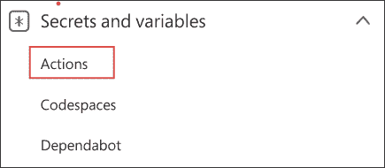

**图 4-2** GitHub Actions 中的密钥和变量

Azure DevOps 和 GitHub Actions 都为自动化 Azure Machine Learning 任务提供了强大的平台。通过将这些 CI/CD 工具与 Azure ML 集成，你可以简化训练和部署机器学习模型的过程，确保结果的一致性和可重复性。

### 根据新数据的添加或数据变化自动重训练模型

当你需要根据数据的添加或更改自动进行模型重训练时，可以使用 Azure Machine Learning 数据集监控器。这些监控器可以检测数据漂移（data drift），即模型输入数据的变化，这种变化会导致模型性能下降。通过设置数据集监控器，你可以分析数据随时间变化的漂移，监控训练数据集与服务数据集之间的差异，并对数据漂移设置警报以进行早期警告。这允许你在数据漂移过多时创建新的数据集版本，确保你的模型保持准确和更新。

为了进一步确保你的机器学习模型在数据变化时保持准确性，你可以在 Azure Machine Learning 中设置自动化重训练流水线。操作方法如下：

1. 创建数据集：从定义基准（训练）数据集和目标（新数据）数据集开始。

2. 设置数据漂移监控器：创建一个数据漂移监控器以跟踪数据分布的变化。指定数据集、特征和漂移阈值。

3. 创建训练流水线：开发一个用于模型训练的流水线，包括预处理、训练和评估的步骤。

表 4-6 显示了各种数据集监控器组件以及根据数据变化自动重训练模型的示例场景。

**表 4-6** 重训练场景的数据集监控器组件

| 组件 | 说明 |
| --- | --- |
| 基准数据集 (Baseline Dataset) | 通常是模型的训练数据集。 |
| 目标数据集 (Target Dataset) | 与基准数据集进行对比的数据，通常是模型输入数据。必须包含时间戳。 |
| 数据集监控器 (Dataset Monitor) | 检测并警告数据漂移，分析历史数据并随时间对新数据进行分析。 |
| 漂移幅度 (Drift Magnitude) | 表示基准和目标数据集之间漂移的百分比（0% = 完全相同，100% = 完全不同）。 |
| 漂移阈值 (Drift Threshold) | 设置的数值，当漂移幅度超过该值时将触发警报。 |
| 回填函数 (Backfill Function) | 为指定的日期范围运行作业，以填充数据集中预期的缺失数据点。 |

最后，我们可以设置一个监控系统，当数据漂移超过指定阈值时自动触发训练流水线。这可以通过使用 Azure Event Grid 检测漂移事件，然后使用 Azure Logic Apps 或 Azure Functions 响应该事件启动流水线来实现。这确保了你的模型随数据的变化保持更新并持续表现良好。

部署流水线并监控漂移。当检测到显著漂移时，流水线会自动重新触发。重训练后，如果新模型优于旧模型，则对其进行评估并部署。这种设置确保你的模型能够适应数据的变化，保持其准确性。

### 定义基于事件的重训练触发器

本节介绍了如何使用 Azure Event Grid 设置事件驱动应用程序、进程或 CI/CD 工作流，使其自动响应 Azure Machine Learning 中的事件。这种设置对于在训练完成、模型注册或数据漂移检测等事件发生时自动执行操作（如发送通知或触发后续 ML 流水线运行）至关重要，使机器学习项目更加高效。

Azure Event Grid 连接事件源（如 Azure Machine Learning）与事件处理程序（如 Azure Functions、Logic Apps 和 Event Hubs）。这允许对事件进行实时处理，创建一个响应且动态的环境。本指南提供了如何在 Azure 门户中设置和过滤这些事件的步骤，确保只有相关的事件会触发工作流。

Azure Machine Learning 中的机器学习操作（MLOps）生命周期是一个全面且迭代的过程，确保了稳健、可扩展且高性能模型的部署。请注意，MLOps 生命周期与传统机器学习生命周期的主要区别在于它侧重于将机器学习与软件开发和运维实践相结合。该生命周期的每个阶段对于维护机器学习解决方案的完整性和效率至关重要。通过遵循每个阶段的最佳实践，组织可以在机器学习工作流中实现可重复性、可扩展性和可靠性。让我们详细分析这些阶段和最佳实践。

## 数据收集与接入

在初始阶段，数据收集和接入涉及从各种来源（包括数据库、API 和其他数据流）收集原始数据。这一阶段非常关键，因为输入数据的质量直接影响模型的性能。

最佳实践：

- 通过实施数据验证检查确保数据质量和一致性。

- 利用`Azure Data Factory`编排复杂的数据工作流并集成各种数据源。

- 实现数据版本控制以确保可重复性并跟踪随时间的变化。

## 数据清洗与准备

数据清洗和准备涉及消除不一致之处、处理缺失值以及纠正错误。然后将数据转换为适用于分析的格式，这对于准确的模型训练至关重要。

以下是一些自动化数据清洗的良好实践：

- 使用`Azure Databricks`自动化数据清洗过程以高效处理大型数据集。

- 使用`Azure Machine Learning`数据集管理和版本化数据，以维护结构化且有序的工作流。

- 在进入下一阶段之前验证清洗后的数据，确保其符合质量标准。

## 特征工程

特征工程将原始数据转换为用于训练机器学习模型的有效特征。这一阶段对于增强模型的预测能力至关重要。

最佳实践：

- 使用`Azure Machine Learning`中的自动化特征工程工具来简化流程。

- 记录所有特征转换以确保可重复性和透明度。

- 定期更新特征以反映数据模式的变化并保持模型准确性。

## 模型训练

模型训练涉及使用准备好的训练数据开发机器学习模型。这一阶段是实际学习发生的地方，需要大量的计算资源。

最佳实践：

- 利用`Azure Machine Learning`计算集群进行可扩展且高效的模型训练。

- 通过超参数调优优化模型性能。

- 在`Azure Machine Learning`中跟踪实验并维护详细日志，以确保可重复性并方便比较。

## 模型评估

模型评估使用验证数据评估已训练模型的性能。它确保模型在部署之前符合预期的准确性和性能指标。

最佳实践：

- 使用`Azure Machine Learning`中的指标和可视化工具来彻底评估模型性能。

- 实施交叉验证技术以确保模型的稳健性。

- 比较多个模型以选择性能最佳的模型进行部署。

## 模型部署

将训练好的模型部署到生产环境中使其对新数据进行预测。这一阶段涉及搭建基础设施以支持模型的运行需求。

最佳实践：

- 使用`Azure Kubernetes Service`（`AKS`）或`Azure Container Instances`（`ACI`）将模型部署为 Web 服务以实现可扩展性。

- 利用`Azure Machine Learning`端点与其他应用程序无缝集成。

- 使用`Azure DevOps`实施持续集成和部署（CI/CD）流水线，自动化部署过程并确保一致性。

## 监控与维护

对模型性能进行持续监控和维护对于在生产环境中保持准确性和可靠性至关重要。这一阶段确保模型能够适应变化。

最佳实践：

- 使用`Azure Monitor`和`Application Insights`跟踪性能指标。

- 设置警报以检测性能下降。

- 定期使用新数据重新训练模型。

## 模型重训练

模型重训练涉及使用新数据更新模型以保持性能并适应变化。这一阶段对于保持模型的有效至关重要。

最佳实践：

- 使用`Azure Machine Learning`流水线自动化重训练过程。

- 为模型实施版本控制。

- 使用`AutoML`进行快速重训练。

**表 4-8** MLOps 最佳实践

| 阶段 | 描述 | 最佳实践 |
| :--- | :--- | :--- |
| 数据收集与接入 | 从各种来源收集原始数据。 | 确保数据质量和一致性。使用`Azure Data Factory`编排数据工作流。实现数据版本控制以便重复。 |
| 数据清洗与准备 | 清洗数据以消除不一致并为分析做准备。 | 使用`Azure Databricks`自动化数据清洗。使用`Azure Machine Learning`数据集管理和版本化数据。验证数据质量。 |
| 特征工程 | 将原始数据转换为用于模型训练的有效特征。 | 使用`Azure Machine Learning`中的自动化特征工程工具。记录转换。定期更新特征以反映数据变化。 |
| 模型训练 | 使用训练数据开发机器学习模型。 | 利用`Azure Machine Learning`计算集群。通过超参数调优优化性能。跟踪实验以确保可重复性。 |
| 模型评估 | 使用验证数据评估模型性能。 | 使用`Azure Machine Learning`指标和可视化。实施交叉验证。比较模型以选择性能最佳的。 |
| 模型部署 | 将训练模型部署到生产环境。 | 使用`AKS`或`ACI`将模型部署为 Web 服务。使用`Azure Machine Learning`端点。使用`Azure DevOps`实施 CI/CD 流水线。 |
| 监控与维护 | 持续监控和维护模型性能。 | 使用`Azure Monitor`和`Application Insights`。设置性能下降的警报。定期使用新数据重新训练模型。 |
| 模型重训练 | 使用新数据更新模型以保持性能并适应变化。 | 使用`Azure Machine Learning`流水线自动化重训练过程。为模型实施版本控制。使用`AutoML`进行快速重训练。 |

在 MLOps 领域，涌现出了多种技术和模式，如`Microsoft Fabric`、`RAG`以及上下文感知 MLOps，这些技术将影响未来数据科学解决方案的设计。我们将仅涵盖其中少数趋势（上下文感知 MLOps、`Microsoft Fabric`和`RAG`，以及帕累托决策边界），以便你在实践中遇到如`RAG`等术语时能够熟悉它们，但这些内容不会出现在考试中。

`Microsoft Fabric`是一个统一的数据分析平台，它集成了多种数据服务，包括数据工程、数据集成、数据仓库、数据科学、实时分析和商业智能。它通过提供一个用于高效数据管理和分析的内聚性环境，简化并加速了构建、管理和部署数据驱动应用及解决方案的过程。

## 结合 Microsoft Fabric 和 RAG 的上下文感知 MLOps

在`Microsoft Fabric`的基础之上，上下文感知 MLOps 将上下文信息整合到机器学习生命周期中，以增强模型的相关性和准确性。检索增强生成（`RAG`）通过将外部数据源动态集成到模型生成中，进一步增强这一过程，确保响应既具有上下文相关性又是实时的。上下文感知 MLOps 的关键组件包括：

1. **数据摄取与处理**
   - **上下文数据源**：集成化的数据源，如用户行为日志、环境传感器和外部数据库。
   - **动态数据流水线**：在`Microsoft Fabric`中设计自适应数据流水线，以确保为模型训练和推理提供最相关的数据。
   - **RAG 集成**：使用`RAG`在模型推理期间动态检索并整合来自外部数据源的最新信息。法律专业人士使用`RAG`快速提取相关的案例法、法规或法律著作，简化研究流程，并确保他们能够获取最新的法律信息。

2. **模型训练与微调**
   - **上下文特征**：使用`Fabric`强大的数据工程工具，将上下文特征整合到训练数据中。
   - **实时更新**：通过`Fabric`的实时分析能力，利用新的上下文数据持续更新模型。

3. **模型部署**
   - **自适应部署**：部署根据当前上下文调整行为的模型，并利用`Fabric`与边缘计算的集成来实现低延迟响应。
   - **边缘部署**：在`Fabric`中实现边缘计算，使上下文感知模型更贴近数据源。

4. **监控与维护**
   - **上下文监控**：使用`Fabric`的监控系统跟踪上下文变化及其对模型性能的影响。

## 在 Azure Machine Learning 中可视化 MLOps 的帕累托权衡


随着我们从`RAG`（检索增强生成）转变为理解 MLOps 中更广泛的优化挑战，我们需要解决帕累托权衡（Pareto trade-offs）如何帮助平衡模型准确性、计算成本和部署延迟等冲突目标。这些权衡可以使用如平行坐标图（`PCPs`）等成熟工具进行有效的可视化，从而在整个机器学习生命周期中做出更明智的决策。

帕累托权衡的可视化有助于优化多个相互冲突的目标，例如模型准确性、计算成本和部署延迟。Azure Machine Learning 提供了创建特定可视化内容的工具来分析这些权衡。一种有效的视觉化技术是平行坐标图（`PCP`），它可以被扩展以用于 MLOps，并且它是视觉化数据科学家在监控机器学习解决方案时所做的许多权衡的有用方法。

以下是进一步探索的几个：

* **动态探索**：实现交互式`PPs`，允许 MLOps 从业人员动态探索与模型性能、超参数和其他相关指标相关的高维数据。

* **增强可解释性**：使用颜色方案表示不同的模型版本、数据集或实验运行，增强 MLOps 场景下`PPs`的可解释性。

* **模式识别**：通过颜色方案表示不同的模型版本、数据集或实验运行，增强 MLOps 场景下`PPs`的可解释性。

* **发现隐藏模式**：通过刷选（brushing）和链接功能允许选择轴的特定范围，从而发现隐藏模式和关联。

* **统一视图**：将`PPs`嵌入到仪表板或平台中，提供模型性能和其他指标的统一视图。

你可以尝试通过这些功能增强`PPs`，以及各种参数对`Mps`的影响。

以下是使用`Plotly`在`Python`中创建交互式`PCP`的示例：

```python
import plotly.express as px
import pandas as pd

# 示例数据
data = pd.DataFrame({
    'Model': ['Model A', 'Model B', 'Model C', 'Model D'],
    'Accuracy': [0.85, 0.88, 0.90, 0.87],
    'Computational Cost': [200, 500, 800, 300],
    'Deployment Latency (ms)': [50, 80, 60, 100],
    'Parameters (Millions)': [10, 20, 15, 30]
})

# 创建平行坐标图
fig = px.parallel_coordinates(data, color='Accuracy',
                              dimensions=['Computational Cost', 'Deployment Latency
(ms)', 'Parameters (Millions)'],
                              color_continuous_scale=px.colors.diverging.Tealrose,
                              color_continuous_midpoint=0.88)

fig.update_layout(
    title="MLOps 的平行坐标图",
    coloraxis_colorbar=dict(
        title="Accuracy",
        tickvals=[0.85, 0.88, 0.90],
        ticktext=["0.85", "0.88", "0.90"]
    )
)

fig.show()
```

Azure Machine Learning 可以促进这些可视化内容作为综合数据科学解决方案的一部分。图 4-4 显示了 PCP 图的一个示例。

**图 4-4** 用于 MLOps 权衡的平行坐标图

在本节中，我们讨论了一些高级主题，例如将`Microsoft Fabric`与`Azure Machine Learning`集成用于上下文感知 MLOps，以及通过扩展的平行坐标图可视化帕累托权衡。利用`RAG`通过动态整合外部数据进一步增强了模型的相关性和准确性。

## 章节总结

* 你可以配置在线部署设置，自定义环境以确保最佳性能和可扩展性。

* 你现在可以为批量部署配置计算资源，使计算能力与数据量和任务的计算需求匹配。

* 你可以将模型部署到在线端点，提供可通过 API 访问的实时预测服务。

* 你现在可以将模型部署到批量端点，实现对数据的计划或按需处理。

* 你可以测试已部署的服务，以验证其在真实操作条件下的功能和性能。

* 你现在可以调用批量端点以启动批量评分作业，以非交互的方式高效处理数据。

* 用户可以构建流水线并在推送（push）后运行（包括来自 Azure DevOps 或 GitHub），将 MLOps 实践集成到现有的 CI/CD 流水线。

* 你现在可以根据新数据的添加或更改自动化模型重训练，确保模型随着时间的推移保持准确性。

* 你可以定义基于事件的重训练触发器，创建一个响应迅速且自适应的机器学习系统。

* 你已经了解到新兴技术和 RAG 架构以及 Microsoft Fabric 可能会影响 Microsoft Azure 中数据科学和机器学习解决方案的设计方式。

## 思考实验

在这个思考实验中，展示你对本章涵盖主题技能和知识。你可以在后续章节找到答案。

1. 在线模型部署：用户如何确保其在线部署的模型性能达到最佳？

   1. 在不测试模型响应时间的情况下部署。

   2. 针对模型需求配置在线部署设置。

   3. 无论特定的模型需求均使用默认设置。

   4. 限制对已部署模型的访问以减少负载。

2. 批量部署策略：在配置批量部署的计算资源时，什么是关键？

   1. 分配最少的计算资源以降低成本。

   2. 配置计算资源以匹配批量作业的处理需求。

   3. 使用与在线服务相同的计算配置。

   4. 忽略正在处理的数据量。

3. 结合 MLOps：当新数据可用时，应该如何应用 MLOps 实践？

   1. 忽略新数据，直到模型性能显著下降。

   2. 每年手动重训练一次模型。

   3. 根据新数据的添加自动化模型重训练。

   4. 禁用基于事件的触发器以简化操作。

## 思考实验答案

本节包含思考实验的答案。每个答案都解释了为什么该选项是正确的。

1. 答案是`B`。针对模型需求配置在线部署设置，可以确保模型通过适应特定的计算和运行需求来实现最佳性能。选项 A、C 和 D 未能解决为了达到峰性能而进行自定义配置的必要性。

2. 答案是`B`。配置计算资源以匹配批量作业的处理需求，对于高效处理数据和计算需求至关重要，特别是对于大型数据集或复杂的处理任务。选项 A、C 和 D 忽略了资源与特定批量作业需求保持一致的重要性。

3. 答案是`C`。根据新数据的添加自动化模型重训练，可以确保模型保持更新和准确，持续适应输入数据的变化。这种实践在 MLOps 中对于维持模型随时间的效力至关重要。选项 A、B 和 D 没有利用自动化和实时数据集成在维护模型性能方面的优势。

## 第 5 章

## 考试 DP-100：在 Azure 上设计和实施数据科学解决方案——更新

### 本章的目的

对于第 1 章–`第 4 章`，内容在本版本的生命周期内应保持相关性。但对于本章，我们将随着时间更新内容。即使在你购买书籍之后，你也可以在线访问包含本章最新版本的 PDF 文件。

为什么我们需要更新这一章？

* 对于第 1 章–`第 4 章`，内容在本版本的生命周期内应保持相关性。但对于本章，我们将随着时间更新内容。即使在你购买了书籍之后，你也可以在线访问包含本章最新版本的 PDF 文件。

* 为了确保信息反映最新的 Azure 功能和服务更新。

* 为了提供关于演进中的 MLOps 实践的指导。

* 为了与 DP-100 考试目标保持一致。

### 关于可能的考试更新

Microsoft 定期审查考试内容以确保其与工作角色匹配。这包括但不限于功能和特性、所需技能的变化以及产品名称的修订。Microsoft 会更新考试详情页面。

### 对你及你的学习计划的影响

Microsoft 的信息帮助你规划，但也意味着考试在你通过之前可能会发生变化。本章为我们提供了在变化发生时进行沟通的方式。但你也应该关注其他领域。

对于要关注的其他信息来源，请查看这些网站：

* **Microsoft Learn:** 检查获取最新信息的来源：`microsoft.com/learn`。

* **Microsoft Press:** 确保在该页面上注册自动通知。

### 更新后的技术内容

随着变化的出现，我们将用更多细节更新本章。届时，我们将发布本章的更新版本。

本`Exam Ref`基于考试中涵盖的主题和技术，但其结构并非根据考试目标中主题的特定顺序排列。表 5-1 将当前版本的考试目标映射到章节内容，让您无需查阅索引即可定位到特定考试目标项的对应位置。

### 表 5-1 考试目标与章节映射表

| 考试目标 | 章节 |
| --- | --- |
| 设计并准备机器学习解决方案 | |
| 设计机器学习解决方案 | |
| 为训练工作负载确定合适的计算规格 | |
| 描述模型部署需求 | |
| 选定使用哪种开发方法来构建或训练模型 | 1 |
| 管理 Azure Machine Learning 工作空间 | |
| 创建 Azure Machine Learning 工作空间 | |
| 为源版本控制设置 Git 集成 | 1 |
| 在 Azure Machine Learning 工作空间中管理数据 | |
| 选择 Azure 存储资源 | |
| 注册并维护数据存储库 | |
| 创建和管理数据资产 | 1 |
| 管理 Azure Machine Learning 中实验的计算资源 | |
| 为实验和训练创建计算目标 | |
| 为机器学习用例选择环境 | |
| 配置挂载的计算资源，包括 Apache Spark 池 | |
| 监控计算利用率 | 1 |
| 探索数据并训练模型 | |
| 使用数据资产和数据存储库探索数据 | |
| 在交互式开发期间访问并处理数据 | |
| 使用 Apache Spark 处理交互式数据 | 2 |
| 使用 Azure Machine Learning Designer 创建模型 | |
| 创建训练流水线 | |
| 从 Designer 消耗数据资产 | |
| 在 Designer 中使用自定义代码组件 | |
| 评估模型，包括负责任的 AI 指南 | 2 |
| 探索数据并训练模型 | |
| 使用自动机器学习探索最优模型 | |
| 针对表格化数据使用自动机器学习 | |
| 选择并理解训练选项，包括预处理和算法 | |
| 评估自动机器学习运行情况，包括负责任的 AI 指南 | |
| 使用自动机器学习进行计算机视觉处理 | |
| 使用自动机器学习进行自然语言处理 (NLP) | 2 |
| 使用笔记本进行自定义模型训练 | |
| 通过计算实例开发代码 | |
| 使用 MLflow 跟踪模型训练 | |
| 评估模型 | |
| 使用 Python SDKv2 训练模型 | |
| 使用终端配置计算实例 | 2 |
| 使用 Azure Machine Learning 调优超参数 | |
| 选择采样方法 | |
| 定义主要指标 | |
| 定义早期终止选项 | 2 |
| 为部署准备模型 | |
| 运行模型训练脚本 | |
| 为脚本配置作业运行设置 | |
| 为作业运行配置计算资源 | |
| 在作业中从数据资产消耗数据 | |
| 使用 Azure Machine Learning 将脚本作为作业运行 | |
| 使用 MLflow 记录作业运行的指标 | |
| 使用日志排查作业运行错误 | |
| 为作业运行配置环境 | |
| 为作业定义参数 | 3 |
| 实现训练流水线 | |
| 创建流水线 | |
| 在流水线（pipeline）的步骤之间传递数据 | |
| 调度并运行流水线 | |
| 监控流水线运行情况 | |
| 创建自定义组件 | |
| 使用基于组件的流水线 | 3 |
| 在 Azure Machine Learning 中管理模型 | |
| 描述 MLflow 模型输出 | |
| 识别用于封装模型的合适框架 | |
| 使用负责任的 AI 指南评估模型 | 3 |
| 部署并重新训练模型 | |
| 部署模型 | |
| 配置在线部署的设置 | |
| 为批处理配置计算资源 | |
| 将模型部署到在线端点 | |
| 将模型部署到批端点 | |
| 测试在线部署的服务 | |
| 调用批端点以启动批评分作业 | 4 |
| 应用机器学习运维 (MLOps) 实践 | |
| 触发 Azure Machine Learning 作业，包括来自 Azure DevOps 或 GitHub 的 | |
| 根据新数据的添加或数据更改自动模型重训练 | |
| 定义基于事件的重训练触发器 | 4 |

## 索引

### A

* 账户密钥，安全性，26

* ACI (Azure 容器实例)，13

* AKS (Azure Kubernetes 服务)，125–126

  * 将模型作为 Kubernetes pod 部署，126

  * 管理和扩展模型部署，126

* 算法，5, 6, 57, 58

* AmlCompute 聚群，9

* Apache Spark

  * 数据清洗，44–47

  * 执行模型，45

  * 作业，35–36

    * 资源访问，35–36

    * 用户身份，36

  * 池，33, 34

* Application Insights

  * Azure Machine Learning，103–104

  * 查询和分析日志，107

* AUC-ROC，60

* 身份验证，流水线，143

* 自动化

  * Azure Machine Learning

    * 使用 GitHub，144–147

    * 使用 Azure DevOps，143–144

  * 模型重训练，147–148

* AutoML，6, 57

  * 算法，6, 58

  * 评估指标，61–62

  * 探索最优模型，54

  * 模型复杂度限制，6–7

  * 最大尝试次数，59

  * 模型评估，73–74

  * 针对 NLP，67

    * 配置 AutoML 实验，68–69

    * 选择 NLP 任务，67–68

    * 配置环境，67

  * 预测客户流失，62–63

  * 选择算法，57

  * 选择训练选项，57–58

  * 为训练配置计算，65–66

  * 提交作业，66

  * 计算机视觉使用，64

    * 评估并部署模型，65–66

    * 准备数据，65

    * 选择任务类型，64–65

    * 配置环境，64

  * 处理表格化数据，55–57

* 自动伸缩，8–9, 123

  * 成本管理，9–10

  * 训练聚群，8–9

* `az ml batch-deployment command`,137

* `az ml batch-endpoint create command`,134

* `az ml batch-endpoint delete command`,137

* `az ml compute create command`,133

* `az ml environment create command`,135

* `az ml job create` 命令, 99

* `az ml online-endpoint delete` 命令, 132–133

## Azure CLI, 20

### commands

* `az ml batch-deployment`, 137

* `az ml batch-endpoint create`, 134

* `az ml batch-endpoint delete`, 137

* `az ml compute create`, 133

* `az ml environment create`, 135

* `az ml job create`, 99

* `az ml online-endpoint delete`, 132–133

* execution context, 86

* input format, 85

* `kubectl`, 126

* `ssh`, 92

* deleting online endpoints, 132–133

* interacting with the workspace, 19

* running a pipeline, 99–100

## Azure Container Registry, 13

## Azure DevOps, 143

### automating Azure Machine Learning, 143

* configure secrets, 144

* create a service connection, 143–144

* define variables, 144

## Azure Event Grid, 149

## Azure Machine Learning, 109–110

### Apache Spark integration, 33–34

* automating

  * with Azure DevOps, 143–144

  * with GitHub, 144–147

* automating with Azure DevOps, 144


# 索引

* `AutoML`，查看 `AutoML`（`index.xhtml#idx11`）
* `compute/compute targets`，2–4
  * 创建，26–28
  * 托管，4–5
  * 为实验选择，30–31
  * 在 notebook 中使用，17
* 数据集，创建，27–28
* 数据存储，25
  * 创建，26
  * 注册和维护，25–26
* 部署模型，120–122
* `Designer`，47
  * 创建训练流水线，48
  * 自定义代码，49–51
  * 为模型训练预处理数据，49
* 环境，32
  * 创建，32
  * 策划的，32–33
* Git 集成，20–22
* 超参数调优，76
* 与 Application Insights 集成，103–104
* `job/s`，16。查看 `job/s`（`index.xhtml#idx100`）
  * 自动终止策略，10
  * 定义参数，94
  * Spark，35–36
  * 训练，82–83
* 管理模型，110–111
* `MLFlow`，111, 112
  * 自定义日志，72–73
  * 集成到你的训练脚本中，86–87
  * 日志方法，88
  * 从运行中记录指标，86
  * 记录模型，114
  * 模型部署，112–113
  * 输出，112
  * 设置 URI，87
  * 跟踪实验，112
  * 跟踪用于训练的模型，72–73
* MLOPs 实践，140–142
* 采样
  * 贝叶斯，77–78
  * 网格，77
  * 随机，76
* 计划，102–103
* SDK，17, 20
* 选择 VM 尺寸，7–8
* Spark 作业，资源访问，35–36
* Spark 池，34–35
* 训练流水线，94–95
  * 创建，95–99
  * 自定义代码，49–51
  * 自定义组件，107–108, 109–110
  * 日志，104–107
  * 监控，103
  * 在步骤之间传递数据，100–101
  * 使用 Azure CLI 运行，99–100
  * 计划，101–103
  * 步骤和组件，98–99
* 工作区，15
  * 访问终端，75–76
  * 连接，19
  * 创建，15
  * 组织，16–17
  * 存储资源，23–25
  * 在其中执行的任务，16

# Azure Machine Learning Studio，19–20

* 访问日志，90–91
* 模块，49

# Azure Monitor，139。查看 `monitoring`（`index.xhtml#idx121`）

# Azure Pipelines，141

# Azure 策略，5

### B

* 批量部署，创建，134–135。查看 `deployment/s`（`index.xhtml#idx68`）
* 批量端点，121, 133–134
* 批量评分作业，139
* 贝叶斯采样，77–78
* Blob 存储，24
* 蓝绿部署，125

### C

* 中心化日志，104
* 分类指标，60, 73
* 云环境，日志，105
* 集群
  * AKS（Azure Kubernetes Service），125–126

# 计算 compute，8–9, 84

## 代码

* 计算目标，30
* 配置训练选项，59–60
* 将 CSV 文件转换为 MLTable，56–57
* 使用 Plotly 创建交互式 PCP，155–156
* 自定义，49–51
* 定义脚本参数，94
* 实现训练模型所需的预处理步骤，43–44
* 运行你的 AutoML 实验，63–64
* `ScriptRunConfig`，93–94
* 为实验选择计算目标，31
* 从 AutoML 运行中选择最佳模型，61–62
* 用于读取大型数据集和预处理任务的 Spark 池，45–47
* 提交 AutoML NLP 任务，68
* 处理表格化数据，100
* YAML 流水线，97

## 命令/s

* `az ml batch-deployment`，137
* `az ml batch-endpoint create`，134
* `az ml batch-endpoint delete`，137
* `az ml compute create`，133
* `az ml environment create`，135
* `az ml job create`，99
* `az ml online-endpoint delete`，132–133
* 执行上下文，86
* 输入格式，85
* `kubectl`，126
* `ssh`，92

## 复杂度，模型，5–7

## 组件，YAML 流水线，98–99

## 计算

* Apache Spark 池，33
* 自动伸缩，8–9
* 集群，8–9, 84
* 为作业运行进行配置，84
* 托管，4–5
* 资源，附加到 Jupyter notebook，70–71
* 无服务器，5, 34
* 训练准备，65–66
* 目标，4, 8
  * Azure Machine Learning，2–3
  * 创建，26–28
  * 等等性，30
  * 为实验选择，30–31
  * 选择 VM 尺寸，7–8
  * 非托管，5
  * 利用率，36–37
* Conda YAML 文件，135
* 混淆矩阵，61
* 连接到工作区，19
* 容器，126
* 上下文感知 Ops，154
* 基于 CPU 的实例类型，123–124
* 创建
  * 批量部署，134–135
  * 批量端点，133–134
  * 计算目标，26–28
  * 自定义组件，107–108
  * 创建，107–108
  * 注册，108
* 自定义维度，106–107
* 客户流失预测，62–63

### D

* DAG（有向无环图），50
* 数据
  * 访问，42
  * 清理与准备，151
  * 收集/摄入，150
  * 探索，41, 42, 43
  * 特征化，59
  * 预处理，49
  * 表格化，55–57, 100
* 数据清洗，42, 44
* 数据湖，24
* 数据科学，1
* 数据流，27
* 数据集，27–28
* 调试，91
* 下载，84
* 监控，142
* 挂载，84
* 尺寸，5, 6
* 跟踪，28
* 数据存储库，26, 43
* 环境，32
* 训练流水线，48, 95–99
* 工作区，15
* cron，102
* CSV 文件，转换为 MLTable，56–57
* 精良环境，32–33
* 自定义代码，49–51
* 自定义组件，109–110
  * 创建，107–108
  * 注册，108
* 自定义维度，106–107
* 客户流失预测，62–63

* 部署/s，120–122，*另阅* AKS（Azure Kubernetes Service）
  * 添加到端点，136–137
  * AKS（Azure Kubernetes Service），126, 127
  * 批量，127–128, 134–135
  * 到批量端点，133
    * 添加部署，135–136
    * 创建批量端点，133–134
    * 删除批量端点和部署，137
    * 运行批量端点并访问结果，135–136
  * 测试，137–138
  * 到在线端点，128
    * 定义部署，129–130
    * 定义端点，128–129
    * 删除端点和部署，132–133
    * 在本地部署模型，130
    * 将模型部署到 Azure，131
    * 监控 SLA 并与日志分析集成，131–132
  * 设置 AKS，125–126
* 常见错误排除，140
* 分布式训练，58
* Docker
  * 构建日志，89
  * 容器化，126
* 下载，数据集，84

### E

* 早期终止策略，78
* 端点
  * 批量处理，121
  * 在线，121
* 集成模型，58
* 环境，32
  * Conda YAML 文件，135
  * 为作业运行配置，93–94
  * 在 Jupyter notebook 中配置，70
  * 创建，32
  * 策划的，32–33
* 错误，故障排除，140
* 评估
  * 指标，61–62
  * 模型，51, 73–74, 151
* 基于事件的重训练触发器，149
* 考试
  * 与部署和管理相关的问题，120
  * 选择题，2
  * 映射，161–163
  * 更新，159–161
* 异常，107
* 执行上下文，命令，86
* 实验
  * 创建目标，28–30
  * 使用 SSH 调试，92
  * 环境
    * 创建，32
    * 策划的，32–33
  * 可复现性，86
  * 运行，63–64
  * 选择目标，30–31
  * 超时，59
  * 跟踪，112
  * 跟踪数据，28, 86
* 可解释性，负责任 AI 标准，53

### F

* F1 分数，60
* 公平性，负责任 AI 标准，52–53
* 特征工程，151
* 函数
  * `init()`，138
  * `run()`，138

### G

* `get_by_name` 方法，27–28
* Git，20–22
* GitHub
  * Actions，143
  * 自动化 Azure Machine Learning，144–147
* GPU
  * 基于 GPU 的实例类型，123–124
  * 优化的 VM，8
* 网格采样，77

### H

* HTTP 状态码，139
* 超参数调优，76
  * 贝叶斯采样，77–78
  * 定义主要指标，78
  * 网格采样，77
  * 随机采样，76–77

### I

* 等等性，30
* 不变部署，125
* `init()` 函数，138
* 安装，Python SDK 2.0，17–18
* 可解释性，模型，53

### J

* 作业，16, 95
  * 自动终止策略，10
  * 批量评分，139
  * 为计算配置，84
  * 从数据资产消耗数据，84
  * 指标，86
  * 参数，94
  * Spark，35–36
    * 资源访问，35–36
    * 用户透传，36
  * 训练，84–86
    * 为环境配置，93–94
    * 设置，82–83
  * 故障排除，88–90
* JSONL，65
* Jupyter notebook，69
  * 访问终端，75–76
  * 附加计算资源，70–71
  * 附加到计算实例，69–70
  * 配置环境，70
  * 为训练准备数据，71
  * 使用 Azure ML 计算，17

### K-L

* `kubectl` 命令，126
* Kubernetes，不变部署，125
* `mlflow` 库，86
* LLMs（大语言模型），1
* 逻辑回归模型，44
* 日志/记录
  * 在 Azure ML Studio 中访问，90–91
  * 中心化，104
  * MLFlow，72–73
  * 模型，87–88, 114
  * 流水线，104–105
    * 自定义维度，106–107
    * 在 Application Insights 中查询，107
  * 传输到你的终端，90
  * 结构化，106
  * 排除作业运行错误，88–90
* 低优先级 VM，10

### M

* 机器学习
  * 算法，58
  * 自动化的，54
  * 生命周期，1
  * 模型。*参见* 模型
* MAE（平均绝对误差），61
* 管理计算目标，5
* 方法
  * `get_by_name`，27–28
  * `random_split()`，100
  * `run.get_details()`，28
  * `take_sample()`，100
* 指标/指标，88
  * 分类，60, 73
  * 计算利用率，36–37
  * 评估，61–62
  * `job`。*查看* job/s
  * 主要，59, 60, 78
  * 回归，61
* Microsoft Fabric，154
* MLFlow，111, 112
  * 自定义日志，72–73
  * 集成到你的训练脚本中，86–87
  * 日志方法，88
  * 从作业运行中记录指标，86
  * 记录模型，114
  * 模型部署，112–113
  * 输出，112
  * 设置跟踪 URI，87
  * 跟踪实验，112
  * 跟踪用于训练的模型，72–73
* MLOPs（机器学习运维），1, 119–120, 140–142
  * 最佳实践，150–153
  * 上下感知，154
  * 新兴趋势，153–154
  * 可视化帕累托权衡，154–156
* MLTable，55–57
* 模型/s。*另另* 部署; 训练
  * 评估，114–115
  * 复杂度，5–7
  * 容器化，126
  * 部署，10–12, 112–113, 120–122
    * 托管在线端点，12–13
    * 打包与容器化，13
    * 安全与访问控制，13
    * 目标，12
  * 集成，58
  * 评估，51, 73–74, 151
  * 可解释性，53
  * 日志，87–88, 114
  * 逻辑回归，44
  * 使用 Azure Machine Learning 管理，110–111
  * 预测客户流失，62–63
  * 重训练，147–148
  * 训练跟踪，72–73
  * 常见错误排查，140
* 模块/s
  * Azure Machine Learning Studio，49
  * 评估模型，51
  * 模型解释性，53
* 监控，152
  * 数据集，142
* SLA（服务级别），131–132
* 训练流水线，103
* 挂载数据集，84
* MSE（均方误差），61
* 多选择题，2

### N

* NLP（自然语言处理），配置，67
  * 配置实验，68–69


### O

- 在线部署
  - 可用实例，123–124
  - 生产部署策略，124–125
  - 安全发布策略，124
  - 设置，122–123
  - 测试，137–138
- 在线端点，121
- 工作空间组织，16–17
- 过拟合，5–6

### P

- 并行训练，10
- 参数，作业，94
- 帕累托权衡，可视化，154–156
- 性能
  - 自动伸缩，123
  - 指标/s，60
    - 分类，60, 73
    - 计算利用率，36–37
    - `job`。*查看* `job/s`
    - 主要，59, 60
    - 回归，61
- 流水线
  - 身份验证，143
  - 自定义组件，97, 109–110
    - 创建，77–78
    - 注册，108
  - 训练，94–95
    - 创建，48
    - 注册，49–50, 105
    - 日志，107
    - 监控，103
    - 传递数据，100–101
    - 使用 CLI 运行，99–100
    - 调度，98
    - 组件，98
- 策略/s，5
  - 数据保留与删除，5–6
  - 提前终止，10
  - 作业终止，10
- 精确-召回曲线，61
- 预测客户流失，62–63
- 模型数据预处理，49
- 主要指标，59, 60, 78
- 隐私，责任 AI 标准，53–54
- 生产部署策略，124–125
- Python，42
  - 脚本，49–50, 105
  - SDK 2.0
    - 安装与交互，17–18
    - 训练模型，74–75
- 负责任的 AI 标准, 51–52, 111
  - 可解释性, 53
  - 公平性, 52–53
  - 模型评估, 114–115
  - 隐私与安全, 53–54
- 重新训练, 152
  - 自动化, 147–148
  - 触发器, 148–150
- RMSE (均方根误差), 61
- ROC 曲线, 61
- 滚动更新, 124
- R 方方, 61
- `run()` 函数, 138
- 运行记录, 16
- `run.get_details()` 方法, 28

### S

- 安全发布策略, 124
- 采样
  - 贝叶斯, 77–78
  - 网格, 77
  - 随机, 76–77
- 自动缩放, 8–9
- 调度, 流水线, 101–103
- 评分脚本, 测试, 138–139
- `ScriptRunConfig`, 93–94
- `script/s` 另另 `job/s`(#index.xhtml#idx100)
  - 参数, 94
  - Python, 49–50, 105
  - 评分, 138–139
  - 训练, 81–82
    - 访问数据, 84
    - 集成 `MLFlow`, 86–87
    - 作为作业运行, 84–86
    - 设置, 82–83
- `SDK`, Azure Machine Learning, 17–18
- 密钥, 144
- 安全
  - 账户密钥, 26
  - 身份验证, 143
  - 模型部署, 13
  - 负责任的 AI 标准, 53–54
  - 情感分析, 44–45
- 无服务器计算, 5, 34
- SLA (服务等级协议), 监控, 131–132
- Sobol 采样, 77
- Spark 池, 34–35
- Spark Pools, 4
- SSH, 用于调试, 91–93
- `ssh` 命令, 92
- 存储, 23–25
  - 数据 store
    - 创建, 26
    - 注册和维护, 25–26
  - 结构化日志, 106

### T

- 表格数据, 55–57
- `take_sample()` 方法, 100
- 终端
  - 访问, 75–76
  - 流式传输日志, 90
- 测试
  - 批端点, 139
  - 在线部署, 137–138
  - 评分脚本, 138–139
  - 跟踪, 88, 107
- 实验跟踪数据, 28
- 训练, 41, 57, 151
  - 批处理, 12
  - 集群, 8–9
  - 成本管理, 10
  - 开发方法, 14
  - 分布式, 58
  - 另另 `job/s`(#index.xhtml#idx100)
  - 并行, 10
  - 流水线, 94–95
    - 创建, 48, 95
    - 自定义组件, 107–108
    - 日志, 104–107
    - 模块, 50–51
    - 监控, 103
    - 在步骤间传递数据, 100–101
    - 使用 Azure CLI 运行, 99–100
    - 调度, 101–103
    - 步骤和组件, 98–99
  - 在 Jupyter notebook 中准备数据, 71
  - 预处理步骤, 43–44
  - 重新-, 147–148, 152
  - 脚本, 81–82
    - 集成 `MLFlow`, 86–87
    - 作业运行, 84–86
    - 设置, 82–83
  - 跟踪模型, 72–73
  - 使用 Python SDK v2, 2, 74–75
  - 验证策略, 59
  - 工作负载 另另 `workload`(#index.xhtml#idx201)
    - 自动缩放, 8–9
    - 计算规格, 2–3
    - 模型复杂度, 5–7
    - 选择 VM Size, 7–8
- 透明度, 53
- 触发器, 基于事件的重新训练, 148–150
- 故障排除
  - 常见错误, 140
  - 作业运行错误, 88–90
- 调优超参数, 76
  - 贝叶斯采样, 77–78
  - 定义主要指标, 78
  - 网格采样, 77
  - 随机采样, 76–77

### U-V

- 非托管计算, 5
- URIs, Azure 服务, 25
- 版本控制, 22
- 查看利用率指标, 36–37
- Visual Studio Code, 21
- 可视化, 61–62, 155–156
- 可视化帕累托权衡, 154–156
- VM (虚拟机)
  - GPU 优化, 8
  - 低优先级, 10
  - 远程, 4
  - Size, 7, 8
  - 类型, 7–8
- 自动伸缩，8–9
  - 成本管理，9–10
  - 训练集群，8–9
- 计算规格，2–3
- 模型复杂度，5–7
- 选择 VM 尺寸，7–8
- 工作空间，15
  - 访问终端，75–76
  - 连接到，19
  - 创建，15
  - 交互，18, 19
  - 组织，16–17
  - 运行记录，16
  - 存储资源，23–25
  - 在其中执行的任务，16

### X-Y-Z

- YAML
  - 配置文件，135
  - 流水线文件，96–99


## 代码片段

许多标题都包含了编程代码或配置示例。为了优化这些元素的呈现效果，请在单列横屏模式下查看电子书，并将字体大小调整为最小设置。除了以重流文本格式展示代码和配置外，我们还包含了代码的图像，以模仿印刷版书籍中的呈现效果；因此，当重流格式可能会损害代码列表的显示时，您将看到一个“点击此处查看代码图像”链接。点击链接即可查看高保真代码图像。要返回之前查看的页面，请点击设备或应用程序上的返回按钮。

           

                    

                

            
