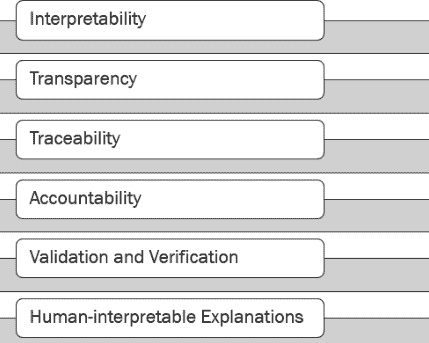
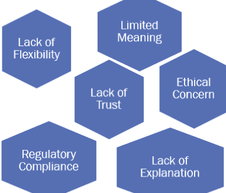
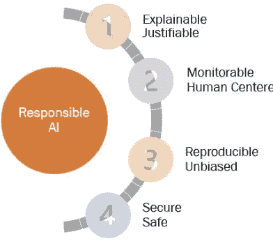
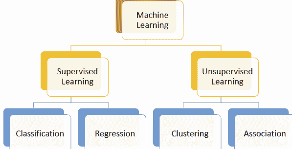
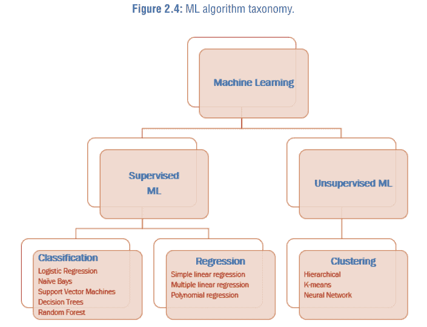
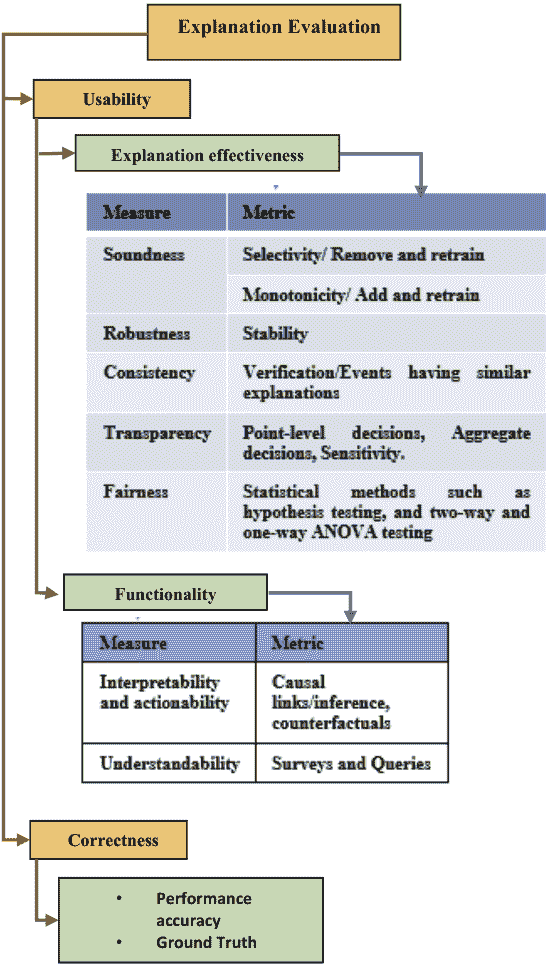
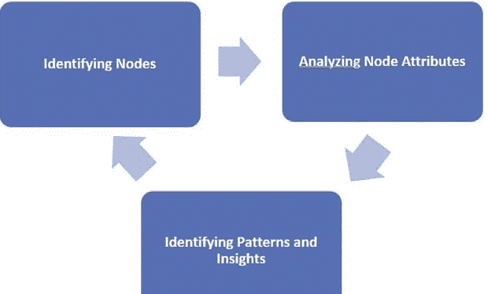
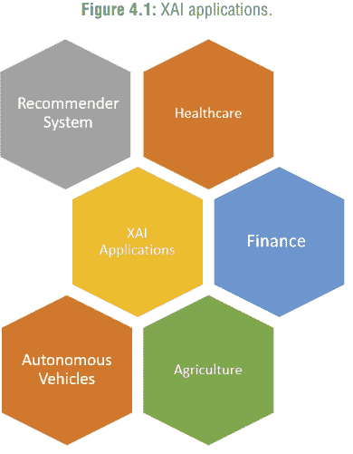
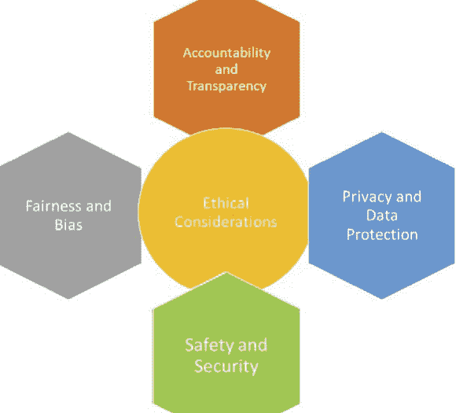
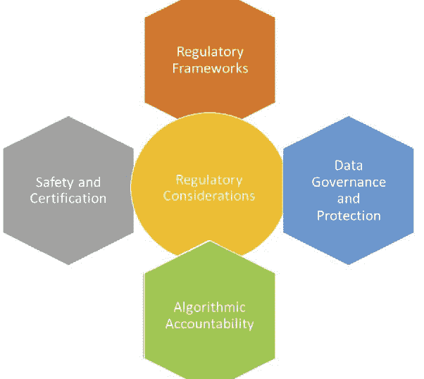

# 可解释人工智能：实用指南

Parikshit Narendra Mahalle
教授，人工智能与数据科学系
研发部门院长，
Vishwakarma Institute of Information Technology, Pune, 印度

Yashwant Sudhakar Ingle
助理教授，人工智能与数据科学系，
Vishwakarma Institute of Information Technology, Pune, 印度

# 前言

> “你所相信的决定你。成为你所相信的。” – 婆罗门圣歌

可解释人工智能（XAI）包含了一套框架和工具，帮助我们预测事件。XAI 应用于营销、数据科学、工程、医学和经济学等多个领域。本书试图涵盖从传统 AI 到 XAI 的基础知识，以提高训练模型相对于输入的性能。XAI 需要透明度，以使输出结果与人类可理解的解释保持一致。

《可解释人工智能：实用指南》为读者提供了一个全面的指南，涵盖了从传统 AI 到 XAI 的基础。第一章提供了 XAI 的基本概述及其重要性。第二章介绍了黑盒学习的主要局限性，并提出了对 XAI 的需求。本书第三章重点关注通过主流技术实现模型的可解释性。第四章描述了 XAI 的关键应用，包括医疗保健、金融、自动驾驶、推荐系统和农业。本书最后一章涵盖了可解释人工智能的前景以及设计开发中面临的关键挑战，并总结全书。

# 本书的主要特点：

1. 帮助用户理解从传统 AI 到 XAI 的转变。
2. 对所有主题进行简要描述。
3. 基于用例和场景的描述。
4. 针对初级读者的简洁明了，从入门到构建基础 XAI 应用。
5. 语言简单易懂，适用于从外行到受过教育的用户、从农村到城市、从国家到全球范围利益相关者。
6. XAI 在关键业务案例中的应用。
7. XAI 主流算法的实现细节。
8. 提供图解和伪代码，以便更好地理解和应用。
9. 提供大量的案例研究，以实时理解概念，并为渴望在该领域寻求研究机会的学生/专业人士提供指南。

总而言之，本书提出了设计和开发 XAI 应用的最佳研究路线、策略和挑战。本书将激励读者利用这项技术更好地分析外行和受过教育的用户的需求，设计各种 XAI 用例。对于 ICT、人工智能、机器学习领域的本科生、研究生、业内人士、研究人员来说，本书都非常有用。我们相信这本书将受到所有利益相关者的好评。

Parikshit N. Mahalle

Yashwant S. Ingle

# 作者简介

Parikwant Narendra Mahalle 博士是 IEEE 高级会员，现任印度普内普维什瓦卡尔马理工学院（Vishwakarma Institute of Technology）教授、研发部院长以及人工智能与数据科学系主任。他在丹麦奥尔尔堡大学获得博士学位，随后在丹麦哥本哈根的 CMI 担任博士后研究员。他在计算机工程领域拥有 23 年以上的教学和研究经验，曾任马哈拉施特邦普纳大学（SPPU）信息技术主席以及印度各大学和自治学院主席。他拥有 12 项专利并发表了 200 多篇研究论文。

Yashwant Sudhakar Ingle 先生目前任教于普内维什瓦卡尔马理工学院 AI&DS 部门助理教授。他总计拥有 15 年工作经验。他正在攻读 SPPU 博士，毕业于纳格普尔维斯斯维瓦拉亚国立理工学院获得计算机工程硕士学位，毕业于阿姆拉瓦蒂大学获得计算机工程学士学位。Ingle 先生拥有 4 项已授予的设计专利、1 项已发表的美国专利、25 项已发表的印度实用专利、4 项软件著作权和 2 项文学研究著作权。他最近在 Springer 出版了《以数据为中心的人工智能：入门指南》（Data Centric AI: A Beginner’s Guide）。他在 Scopus、Web of Science 期刊、IEEE 和 Springer 国际会议上发表了 25 多篇论文，并在 2021 年 RACE 国家会议上获得了 4 届最佳论文奖。

# 第一章
## 可解释人工智能概述

人工智能（AI）已成为日常生活中各个领域的新兴趋势。AI 及其相关组件在预测、估计、预测、决策、学习、推荐和记忆等关键操作中发挥着至关重要的作用。然而，AI 一直被视为“黑箱”，主要关注的是输入数据并衡量相应的输出。现有的 AI 建模并未考虑这些数据是如何处理并与相应输出连接的。虽然大多数 AI 技术在性能和准确性方面前景广阔，但随着维护用户基本权利的新法律的引入，这些模型及其结果的可理解性成为近期关注的焦点。

今天，我们处于以数据为中心的人工智能时代，所有业务场景都需要具有可解释性和解读性的输出。可解释人工智能是 AI 的新趋势，它能为 AI 输出提供解释。本章首先介绍并讨论了可解释人工智能相对于 AI 模型输出和性能的重要性。随着 AI 向可解释人工智能的转型，理解可解释人工智能的解释和解读如何帮助用户提高理解非常重要。本章的下一部分讨论了可解释人工智能的主要组件及其运行机制。本章最后一部分讨论了可解释人工智能的特征及其在关键 AI 应用中的重要性。

关键词：AI，可解释人工智能，可解释性，可解释性

### 1.1 从人工智能到可解释人工智能

人工智能（AI）被定义为计算机程序、软件或任何计算机/机器/设备具备思考和学习能力的功能 [1]。AI 的主要目标是在两种情况下在世界上取代机器：即人类可以轻松完成的任务以及人类无法完成的极其复杂的任务。因此，AI 在两种极端任务中都是需要的，即最简单的任务和复杂的任务。在简单任务中用人类取代机器的目标是让人类从事更高质量的工作，而在复杂任务中，则是让经过编程的机器完成，因为人类无法做到。AI 的目标是设计和开发智能且主动的机器，这些机器可以预编程以执行需要人类所拥自然智能的任务。由于其在日常生活中的应用，AI 也已成为全球 IT 领者的一项价值百万的业务 [2]。AI 使机器能够以智能的方式学习，以探索决策、学习、预测、识别、分析等。最简单的例子是 Alexa 告诉你所在城市未来 24 小时的天气预报，或者 Netflix 根据你的观看历史推荐电影。

遗憾的是，AI 被视为一个黑箱 [3]。虽然大多数 AI 技术在性能和准确性方面前景广阔，但随着维护用户基本权利的新法律的引入，模型及其结果的可理解性成为近期关注的焦点。农业、酒店业等非关键领域的应用使用 AI 算法从传感器输入中学习，并执行导向于目标特征的行动。在这种情况下，人类依赖系统的决策来执行任务，而不理解决策或结果背后的原因。当我们将 AI 视为做出赋能决策和推荐的黑箱时，既缺乏理解也缺乏透明度。在黑箱 AI 中，我们的工作更多是在抽象层面进行；我们更关注整体过程，而忽略算法和处理细节。人类不关心决策的内部工作和过程。因此，在黑箱 AI 中，输出是不可解释的、不可理解的。机器学习（ML）和深度学习（DL）是 AI 的主要构建模块，广泛应用于许多基于 AI 的业务场景中 [4]。特别是，深度学习的功能非常复杂，因为它在多个人工神经层上运行。深度学习使用海量数据并将其分布在多个层和数千个神经元中以进行决策。通过深度学习处理数据的完整功能非常复杂，人类很难理解和掌握。考虑医疗保健分析、预防性医疗保健、贷款信誉、人力资源招聘等需要对人类做出判断的用例；信任这些决策更具挑战性。

（注：由于提供的原文中存在大量重复段落，已根据逻辑要求进行去重处理，保留核心内容。）

## 可解释人工智能概述

然而，为了将 XAI 引入实际实践并将 XAI 特性融入 XAI 系统，建议遵循某些原则和实践。对于 XAI 系统而言，向人类提供推理和证据来补充结果是非常重要的。仅仅产生具有 XAI 特性的结果不足以将其称为一个启用 XAI 的系统。监控 XAI 伦理使用的组织治理非常重要。这需要一些标准化机构发布某些监管准则，以控制可解释特征集成到 AI 系统中。探索各种工具、框架和库并将其集成到 XAI 应用开发中是至关的一步。理解和解释 ML 和 DL 模型结果的工具集成需要更多的关注。虽然 XAI 目前处于开发阶段，但为了实现技术转型、研究和培训，知识转移对于 XAI 达到一定水平同样重要。

### 1.3 可解释人工智能的组件

XAI 组件在 XAI 系统和应用的性能分析中起着至关的作用。然而，这些组件根据应用类型、背景以及用于解释的特定技术而异。图 1.2 展示了这些关键组件及其定义：

- 1. **可解释性 (Interpretability)**：可解释性是指理解和解释 AI 模型决策过程的能力。它涉及对模型内部工作机制提供洞察，例如它考虑的特征或因素以及它们之间的关系。
- 2. **透明性 (Transparency)**：透明性涉及让 AI 模型的决策过程对人类可见且可见。其目标是提供模型如何得出预测或决策的清晰说明。
- 3. **可追溯性 (Traceability)**：可追溯性是指追踪和解释贡献模型输出步骤和因素的能力。它允许用户理解每个决策背后的推理，并识别偏差或错误。
- 4. **责任制 (Accountability)**：责任制涉及让 AI 系统对其决策和行为负责。它涉及将决策归因特定因素或输入的能力，并识别任何偏差或伦理问题。
- 5. **验证与确认 (Validation and verification)**：XAI 包含了验证和确认 AI 模型性能和可靠性的方法。它允许用户评估模型输出的准确性、公平性和稳健性。
- 6. **人类可解释解释 (Human-interpretable explanations)**：XAI 旨在提供对人类可理解且有意义的解释。这涉及以易于解释的格式呈现解释，例如自然语言描述或可视化图形。

## 可解释人工智能概述

### 图 1.2：XAI 的关键组件。

在我们深入研究 XAI 在各个领域的应用文献之前，理解 XAI 的关键组件以及一些常用 XAI 方法的特征和特性很重要。常用的 XAI 模型有：

- a. 局部可解释模型无关解释 (LIME) [9]。正如名称所示，它是一种局部可解释的模型，即它单独解释数据集中的特定实例。它是模型无关的，这意味着它只能访问模型的输出。LIME 的基本思想是使用代理模型来解释模型的实际预测。对代理模型进行解释，然后通过少量的近似将其映射到原始目标预测上。

## 优点

- 由于 LIME 不依赖于模型的内部细节，因此具有高度的灵活性和广泛的性。

## 缺点

- 由于 LIME 依赖代理模型进行解释，因此解释的质量取决于合适代理模型的选择。
- LIME 涉及大量的采样，因此是计算密集型的。

- b. 概念激活向量 (CAVs) 测试是一种评估机器学习模型能力的方法。它涉及衡量在提供输入数据时，模型激活一组人类可解释概念（如“狗”或“天空”）的能力。

- 它可以作为评估模型透明性的有用工具，但可能不适用于所有类型的模型或任务 [10]。这是一种基于概念的神经网络方法，用于确定颜色等概念的贡献及其对目标类别分类的影响。

## 优点

- 它可以用于基于梯度的图像分类器模型的概念敏感性。
- 它可以用于评估模型的公平性。
- 对于用户来说，拥有领域知识就足够了，其适用性不需要机器学习方面的专业知识。
- 它可以用于评估模型的透明性和正确性。

## 缺点

- 标记和收集新数据需要巨大的努力。
- 某些概念可能太抽象而无法解释，导致难以收集和组织概念数据库。
- 它可能不适用于所有类型的模型或任务。它不适用于不学习抽象概念的浅层神经网络。
- 它不适用于文本和表格数据。它广泛用于图像数据集 [11]。

- c. 因果模型（Causal models）是一种统计模型，旨在识别和理解不同变量之间的因果关系。它考虑了用户或代理采取的行动，并展示了由于这些行动而可能发生的事件，如 [12] 所示。它考虑了 RL 代理采取不同行动时会发生的事件或将到达的状态。

## 优点

- 可以向用户回答并解释选择模型背的原因。
- 它们可以提供对因果关系的更好理解。
- 它们可以对干预效果进行预测。
- 它们可以识别可能影响变量之间关系的潜在混杂因素。

## 缺点

- 这种解释方法尚未需要在探索的动态环境中进行评估。此外，实时状态空间和动作空间更大。

- 它们很难估计且需要大量数据。
- 它们可能会受到偏差和混杂的影响。

Anchor [13] 使用决策规则作为锚点来解释模型预测的方法。解释以 IF-THEN 语句的形式解释特征空间。良好的锚点有助于分类在特征值观察到变化时保持不变。良好的锚点根据其精确度和收敛性被证明是合理的。精确度是指区域内与锚点定义的数据点同类的数据点数量。收敛性是指锚点决策规则对多个数据点的适用性。通常，锚点覆盖更的特征空间以建立通用规则是理想的。

## 优点

- Anchor 是模型无关的，使其适用于任何模型以及图像、文本和表格数据等各种领域。
- 它们代表了其适用的边界，使得定义和解释评分变得更容易。
- Anchor 可以作为根据决策规则覆盖范围来验证模型保真度的衡量。
- 决策规则易于理解。

## 缺点

- 建立良好的锚点需要对许多单个超参数（如精度、束宽度和阈值）进行计算和调优。
- 由于多次调用预测函数，锚点的计算涉及密集的计算。
- 靠近边界的数据点需要更复杂的规则管理，涉及更多特征和更少的覆盖。

层级相关性传播 (LRP) [14] 使用模型的内部细节（如权重、激活、偏置等）基于传播来解释预测。因此，LRP 通过从输出到输入逐层重新分配因素来逐步解释模型。这些层中的每种重新分配都被视为解决解释问题的简单方案。

## 优点

- LRP 在计算方面非常高效。

- LRP 是一种非常成熟且流行的可解释人工智能（XAI）方法。因此，关于该方法的文献广泛，使其成为一种可信且稳健的解释方法。

## 缺点

- LRP 缺乏灵活性。必须仔细进行规则的重新分配，以适应新的模型架构。

g. **积分梯度（Integrated gradient）[15]** 是一种辅助为单个预测提供局部解释的方法。它利用模型输出的梯度为输入特征分配重要性值。构成积分梯度基石的两个公理是敏感性（sensitivity）和实现不变性（implementation invariance）。当输入和基准在某个特征上不同且产生不同预测时，敏感性确保了导致差异的特征被赋予非零归因。实现不变性意味着，如果两个网络在输入输出相同的情况下具有不同的实现具有功能等价性，那么它们的归因也是相同的。

## 优点

- 适用于所有微分模型和深度神经网络。
- 对敏感性和实现不变性的依赖使其成为一种在理论上完备的方法。
- 它表现出很强的计算效率，并基于梯度信息工作。

## 缺点

- 归因结果受到需要观测基准选择的极大影响。
- 在大多数情况下，进行梯度积分的基准与目标点之间的路径（最短路径）并没有覆盖数据。
- 梯度消失（Gradient shading）是深度模型中的一个常见问题。

g. **可解释图神经网络（XGNNs）[16]** 是一种事后解释方法（在模型执行预测后给出解释）。它提供全局解释（模型整体预测的解释），而不是单个局部实例。它采用递归学习，根据随机选择的节点和先验知识开发图。每当 GNN 在满足领域需求的同时生成有效图时，系统会获得相应的奖励。

## 优点

- 它是唯一为 GNN 架构提供模型级解释的方法。

## 可解释人工智能概述

- 由于 GNN 是通过聚合和组合进行训练的，该方法是克服非差异化问题的一种有效方式。
- 它最适用于人类无法验证结果的巨型数据集。

## 缺点

- 该解释仅特别适用于图的分类。
- 解释是在 GNN 响应最敏感的图网络同构构建的，这并不合适，因为我们不清楚图在网络其他部分的贡献。
- 由于数据集缺乏地面值（ground truth），该方法提供的解释是不具体的。对于此类解释不存在适当的验证。

SHAP：Shapley 加性解释（Shapley additive explanations）[1] 是一种基于博弈论的加性特征归因方法。计算 Shapley 值并分配给样本的每个特征。这些 Shapley 值描述了相关特征对特定预测的影响程度/重要性。然而，对于某些特征，Shapley 值的计算有时会变得难以处理，此时名为 Kernel SHAP 的变体可以此此。它基于加权线性回归。构建的加权线性模型的系数被汇成 Shapley 值。

## 优点

- SHAP 的值之和属性使得该方法具有一致性和可靠性。
- 它提供了一种基于理论依据的方法，将每个特征的重要性归因于最终预测。

## 缺点

- Shapley 值的计算开销很大，尤其是当特征数量增加时。
- 基准的选择会显著影响结果的 Shapley 值。
- 对于非专家来说，SHAP 值的解释可能非常复杂。

## 可解释人工智能概述

4. 适用阶段指的是生成解释时模型开发的时间。某些模型（如决策树和逻辑回归）本质上是自解释的，它们的预测可以在训练期间进行解释。它们也被称为白盒模型。其他不透明的模型被称为黑箱模型，其解释可以在训练过程后进行，并属于事后解释（post-hoc explanations）。尽管黑箱模型具有不透明性，但由于其高效性，它们在现实应用中被广泛使用。

XAI 的主要应用列举如下：

- **面向人类可解释解释的 XAI：** XAI 可以通过以易于理解的格式为决策或预测提供解释，帮助增强终端用户的信任。这将使用户能够更加意识到决策背后的原因，在结果/预测与结果之间建立具体的因果关系。

- **面向基于机器学习模型的 XAI：** 大多数在性方面表现良好的学习模型通常缺乏透明度。透明度和问责制是增强用户间透明度的重要因素。通过应用 XAI 方法来解释此类黑箱模型的预测，可以填补这一空白。

- **医学科学中医疗程序自动化的 XAI：** XAI 可以提高医疗程序的质量和效率，并有效确保 AI 驱动系统的信任和问责制。它们可用于开发根据患者的诊断和病史预测并解释治疗方案的系统。XAI 可以帮助关键医疗程序中的关键决策，并确保人类的包容性。XAI 可以确保符合与医学科学中涉及 AI 相关的法律规定。

- **面向数据分析的 XAI：** XAI 在数据分析领域极其重要。通过识别和缓解偏差来源，可以使用 XAI 解决结果偏差和不公平的问题。XAI 可识别并解释负责特定决策的数据中最重要的特征/因素。这可以在提高模型信任度和问责制的同时，提高它们的性能和准确性。

- **面向机器人的 XAI：** 现代机器人的运行复杂性日益增加，这使得在考虑人类安全的情况下，将其引入关键应用变得困难。自动化偏差往往是此类系统的常见问题。XAI 可将人类思维包含在机器人的决策过程中，并微调系统以提高其准确性和性能。这可以确保机器人系统的安全和透明。

- **工程应用中的 XAI：** 除了其本身的工作外，XAI 可以帮助许多工程师理解和分析在模型开发过程中出现各种不一致性问题。总体而言，从开发的角度来看，XAI 可以使系统更加可靠、安全且信赖。

### 1.5 总结

XAI 是一个专注于使 AI 系统的决策过程对人类透明且理解的概念。它旨在提供关于 AI 模型如何得出预测或决策的解释和见解。可解释性、可追溯性、验证和确认以及人类可理解的解释是 XAI 的核心特征，在本章中进行了讨论。通过提供 AI 决策的解释和见解，XAI 使用户能够理解并评估 AI 输出，增加信任并识别潜在的偏差或错误。流行的 XAI 技术及其优点和局限性，本书的下一章将关注 XAI 面临的挑战。

## 参考文献

- [1] PN Mahalle, GR Shinde, YS Ingle, NN Wasatkar, "Data Centric Artificial Intelligence: A Beginner’s Guide", Springer Nature, 2023

- [2] R.S. Perez, X. Jia, J. Lee, K. Sun, A.W. Colombo, J. Barata, Industrial Intelligence in Industry 4.0 - Systematic Review, Challenges and Outlook, IEEE, 4 (2016).

- [3] D. Castelvechi, Can we open the box of AI?, Nat News, 538 (2016), p. 20.

- [4] P. R. Chandre, P. N. Mahalle, R. Shinde, "Machine learning based novel approach for intrusion detection and prevention system: A tool based," Proc. IEEE Global Conf. Wireless Net. (GCWCN), Nov. 2018, p. 135–140.

- [5] European Commission, "Building trust in human-centric AI," 2018 [Online]. Available: https://ec.europa.eu/futurium/en/ai-consultation.html

- [6] Rai, A. (2020). Explainable AI: from black box to glass box. Journal of the Academy of Marketing Science, 48(1), 137–141.

- [7]era Mireia, Lapedriza Ágata, Can we do better explanations? A proposal of user-centered explainable AI Joint Proceedings of the ACM IUI 2019 Co-Located with the 24th ACM Conference on Intelligent User Interfaces, ACM UI, vol. 2327, CEUR-WS, 2019.

- [8] Khosravi, H., Shum, S., Chen, G., Conati, C., Tsai, Y., Knight, S., Martinez-Maldon, R., Sadiq, S., Explainable artificial intelligence in education. Computers and Education, 3 (2022).

- [9] Ribeiro, M.T., Singh, S., Guestrin, C., Why should I trust you?: Explaining the predictions of any classifier. In: 26th ACM SIGKDD International Conference on Knowledge Discovery & Data Mining (2016). pp. 1135–1144.

- [10] Kim, B., Wattenberg, M., Gilmer, J., Cai, C., Wexler, F., Interpretability beyond feature activation: Quantitative testing with concept activation vectors (tcav). In: International Conference on Machine Learning (2018). pp. 2668–2777.

- [11] Lough, R., Oksuz, I., Puyol-Ant, E., Ruisink, B., King, A., Schnabel, J., Global and local interpretability for cardiac MRI. In: International Conference on Medical Image Computing and Computer-Assisted Intervention (MICCAI) (2019). pp. 565–574.

- [12] Madumal, P., Miller, T., Sonenberg, L., Vetere, F., Explainable reinforcement learning through a causal lens. In: Proceedings of the AAAI Conference on Artificial Intelligence (2020). vol. 34, pp. 2493–2500.

- [13] Ribeiro, M.T., Singh, S., Guestrin, C., Anchors: High-precision model-diagnostic explanations. Proceedings of the AAAI Conference on Artificial Intelligence, 32(1) (2018).

- [14] Bach, S., Binder, A., Montavon, G., Meller, K.R., Samek, W., On pixel-wise explanations for non-linear classifiers by layer-wise relevance propagation. PLOS ONE 10(7), e130140 (2015).

- [15] Sundarajan, M., T, A., Yan, Q., Axiomatic Attribution for Deep Networks. In: Proceedings of the 34th International Conference on Machine Learning (2017). Proceedings of Machine Learning Research, vol. 70, pp. 3319–3328.

- [16] Yuan, H., Tang, J., Hu, X., S., Xgnn: Towards model-level explanations of graph neural networks. In: Proceedings of the 26th ACM SIGKDD International Conference on Knowledge Discovery & Data Mining (2020). pp. 430–438.

- [17] Lundberg, S.M., Lee, S.I., A unified approach to interpreting model predictions. Advances in Neural Information Systems, 30, 4765–4774 (2017).

# 第二章
## 理解黑盒模型

## 摘要

第二章深入探讨了机器学习中黑盒模型的复杂领域，重新审视了它们的本质并探索了支撑其功能的关键算法。通过可解释人工智能（XAI）评估的视角，本章研究了理解这些不透明系统的方法论，强调了透明度和可解释性的重要性。现实案例研究说明了 XAI 机制在增强预测能力方面的应用，同时也揭示了这些模型中固有的普遍问题和挑战。最后，本章在综合总结中汇总了其研究结果，为在当代 AI 格局中应对黑盒模型的复杂性提供了见解。

**关键词：** AI、可解释人工智能、黑盒模型、机器学习

### 2.1 重新回顾黑盒模型

传统 AI 或狭义 AI [1, 2] 的主要任务是借助现有算法和预定义规则执行给定的任务或操作。

这种狭义 AI 的主要重点在于结果，而不是结果的原因和解释。在我们进入下一个 AI 时代之前，理解 AI 作为黑盒的局限性是非常重要的。狭窄的操作集和单一任务是传统 AI 的主要目标。为了使传统 AI 执行新任务和操作，需要额外的显式编程。狭义 AI 模型无法处理可扩展的异构数据。训练和测试复杂数据集需要计算密集型和高性能计算资源。传统 AI 系统通常缺乏泛化知识并将其应用于新情况的能力。它们依赖于显式编程和预定义规则，使其在处理新颖场景时灵活性较低。AI 模型依赖训练数据集进行模式识别和预测是另一个局限性。训练数据的变异或数据不完整是传统 AI 模型的另一个主要瓶颈。由于生成式 AI [3] 是一项新兴趋势，需要对传统 AI 模型进行解释和论证。

如前所述，对于 AI 而言，“黑盒”意味着对于如何得出结果缺乏解释和论证。当 AI 系统作为黑盒实施时，对于其提供的预测没有提供任何解释。缺乏透明度和可解释性，这从用户的角度来看引发了几个问题。AI 在作为黑盒实施时的主要局限性如图 2.1 所示，并在下文中详细阐述。

图 2.1：传统 AI 的局限性。

- 缺乏理解：当 AI 系统作为黑盒运行时，对于人类（包括设计者自己）来说，理解模型的内部运作机制变得具有挑战性。这种理解的缺乏可能会阻碍识别和解决系统中潜在偏见、错误或局限性的能力。
- **缺乏信任**：黑盒模型的不透明性可能会破坏对其决策过程的信任。当用户无法理解或验证结果背后的推理时，他们可能不于依赖 AI 系统。这种缺乏信任可能会限制 AI 技术在各个领域的采纳和接受。
- **伦理考量**：黑盒模型可能会引发伦理关注，特别是当它们被用于影响个人生活的关键决策过程中时，例如医疗保健、金融或招聘。如果 AI 系统在不提供解释的情况下拒绝某人的贷款或面试请求，那么评估该决策的公平性和潜在偏见将是困难的。
- **缺乏灵活性**：黑盒模型难以修改或更新。如果需要更改以提高模型性能或适应新场景，要理解如何有效地进行这些更改可能具有挑战性。这种灵活性的缺乏会阻碍 AI 系统的完善和优化。
- **合规性**：在某些行业中，法规要求对 AI 系统的决策做出解释。黑盒模型可能难以满足这些合规要求，因为它们无法为其输出提供透明且可解释的理由。

可解释人工智能 (XAI) 有助于使 AI 系统的结果更加透明，并对预测和决策提供清晰的解释。通过 XAI 技术提供的解释，可以增强对提供输出的信任和推理。用于决策的重要特征主要通过流行的技术得到突出，这些技术包括基于规则的方法、模型无关技术以及实用的可视化工具。有需要开发算法和技术来解释黑盒模型的内部运作。这些技术，如特征重要性、显著性映射和注意力机制——这些方法为模型如何处理和加权不同输入提供了见解。模型蒸馏涉及训练一个更具解释性的模型来模拟复杂黑盒的行为。蒸馏后的模型可以在提供相似性能的同时具有透明度。这种方法允许在模型复杂性和可解释性之间进行权衡。规则提取技术旨在从黑盒模型中提取人类可读的规则。这些规则可以提供模型如何得出预测的见解。规则提取方法可以应用于决策树、随机森林或神经网络。将黑盒 AI 模型与可解释性模型相结合，可以在性能和透明度之间取得平衡。混合方法利用了两种类型模型的优点，在提供准确预测的同时提供解释。政府和监管机构正在探索开发框架和指南，以确保 AI 系统的透明度和问责制。

尽管 AI 最近取得了进展和发展，但它并非完美。负责任的 AI [4, 5] 需要对可能的问题进行理解。公平性、可靠性、安全性、包容性、隐私、和问责制是负责任 AI 的某些特征。负责任 AI 的全景如图 2.2 所示。

图 2.2：负责任 AI 的全景。

### 2.2 关键机器学习算法

随着宽带技术的发展，互联网变得越来越负担且快速。由于这一点，万物互联 (IoE) 的概念已成为现实 [6]。从物联网 (IoT) 到万物互联 (IoE) 发生了巨大的变革，连接的设备和用户数量更多 [7]。由于这一点，IT 负责人处理大数据变得更具挑战性。由于数据库管理的进步，存储、提取、转换和加载这些数据不再是挑战。在后续，需要高效的机器学习技术 [8, 9] 来处理大数据。

然而，值得注意的是，尽管有大量的自然智能可用，为什么全世界都在追逐用自然智能替代人类？在现实世界中，有很多业务案例和用例是人类无法触及或不存在人类知识的。许多应用程序的任务本质上非常简单且重复。因此，让拥有大量自然智能的人类大脑从事重复性任务是对智能的浪费。在这种情况下，用机器替代人类大脑是更好的解决方案，这样人类就可以从事更高质量的工作。在计算密集型且人类无法胜任的复杂任务中，需要机器 [10]。

在 ways开始理解机器学习之前，理解与其相关的学科和应用是重要的。统计估计是机器学习的关键组成部分，因为它针对的问题与机器学习相同。

机器学习（ML）算法基于统计学，本质上是统计性的。当机器学习算法得出离散类别时，它们代表了模式识别问题；当机器学习应用于大数据时，它就变成了数据挖掘问题。机器学习算法的基本分类如图 2.3 所示。

### 图 2.3：机器学习算法。

- 监督机器学习

监督机器学习处理带标签的数据，对于给定的输入及其相应的输出，它会为测试集寻找正确的输出。分类问题和回归问题是监督机器学习的关键示例。在数学上，监督机器学习表示为

Supervised ML = f (input, output)。

在分类问题中，一个输入被映射到有限数量离散类别之一。监督机器学习还允许学习决策边界，将一种类型的输入类与另一种类型的输入类隔离开。监督机器学习分两个阶段工作，列如下：

- 推理阶段：此阶段完全基于概率模型，使用生成式模型或判别模型进行学习。此阶段使用训练数据来

## 理解黑盒模型

学习如下所示的模型：

Training data = $p(C_k|x)$

- 决策阶段：这是监督机器学习的优化阶段，利用推理阶段使用的后验概率来执行最优类别分配的主要任务。推理和决策可以通过判别函数一起求解，从而将输入 x 映射到正确的决策。

回归是最流行的监督机器学习技术，另一种名称是曲线拟合或近似技术。回归的输入是有限数量的数据样本，它从给定的有限集中学习连续的输入-输出映射。回归的主要设计在于对于输入和输出采用何种表示，以及哪种表示最适合建立和表示输入-输出关系。

- 监督机器学习

无监督机器学习处理未标记的数据，主要目标是从给定的输入数据集中发现未知结构。在数学上，无监督机器学习表示如下：

Unsupervised ML = $f(input)$

无监督机器学习包括聚类、降维和压缩等问题。聚类从给定项目中发现相似的数据组（簇）。在机器学习应用中，大多数情况下输入数据集是高维的，包含许多不重要的特征，这些特征可以在处理时省略。流行的聚类算法是 k均值（k-mean）。降维是一种非常有用的无监督机器学习技术，用于将高维空间的数据投影到低维空间，仅包含处理所需的潜在特征。压缩是一种优化或量化技术，用于发现计算压缩代码的最优函数，以便为了压缩的目的对输入进行重构和重建。在内部，它对底层数据集使用聚类技术。关联是无监督机器学习的另一种实用操作，挖掘涉及从给定数据集中提取有用的关联模式。例如，在现实世界中，从用户交易到用户行为提取有用模式，例如购买物品 A 的客户也会购买物品 B。

机器学习算法分类法及每个类别中的关键算法如图 2.4 所示。

### 2.3 XAI 评估

评估 XAI 模型提供的解释的机制至关重要。让我们考虑医疗用例。医疗环境中存在不同的用户，如终端用户、作为医疗人员的决策者、护士等，他们根据系统生成的结果对患者的医疗治疗做出关键决策；致力于改进模型的科学家；以及验证规则合规性的监管机构。这些用户对解释有不同的目标，如图 2.5 所示，对解释的评估应针对用户及其解释目标进行调整，而仅仅理解预测和增加信任、模型验证和模型调试。

解释可以用不同的形式呈现，例如 Excel 表格、突出对决策贡献的图像部分、热图等。在许多情况下，解释并不取决于指标的选择或

正确性，而是仅仅取决于人们能多容易易地真正理解这些解释。

### 图 2.5：用户的解释及相关目标。

| 解释 | 目标 |
| :--- | :--- |
| 终端用户 | 理解预测/结果 |
| 决策者 | 模型演进/验证 |
| 数据科学家 | 模型调试 |
| 监管机构 | 信任 |

通常情况下，我们可以根据可用性和正确性将解释分为两类。可用性在评估时不考虑解释的内容，而正确性则考虑评估的基真值（ground truth），例如监督学习算法中的基真值。可用性方面根据解释的有效性以及功能对终端用户的有效性进行进一步分类。由于训练模型的数据集并没有直接指定预测/结果的重要特征的真实解释，因此不存在用于评估正确性的定量研究/指标。然而，学者 [12] 做出了重大尝试，尝试通过形式语法将解释编码到数据集中以表示现实分类任务，并为此引入了名为 k 精度（k-accuracy）的评估指标，这被认为是比较特征重要性 AI 方法的良好基准。我们提出了解释评估衡量标准和指标的分类法，如图 2.6 所示。

### 图 2.6：解释评估分类法。

## 理解黑盒模型

评估模型对特定特征依赖程度的衡量称为完备性（soundness）。这可以通过选择特定特征（例如具有重要性值的特征）进行移除并重新训练模型以检查结果（选择性 selectivity）。也可以采取相反操作，即从仅一个特征开始训练，然后添加特征并重新训练模型以查看结果（单调性 monotonicity）。

稳健性检查模型在存在不理想的噪声特征时的稳定性。添加来自不同分布的噪声特征不应影响解释。透明度是指有助于验证模型决策是基于考虑有助于决策的正确理由做出的衡量。例如，狼和哈基犬应该根据它们的特征（如眼睛形状等）来识别，而不是根据背景中是否存在雪。点级决策、聚合决策和敏感性等指标可用于评估模型的透明度。点级决策是解释单个决策的解释，并为用户提供可以采取以改变/改进决策的备选方案。聚合决策是一种能够识别作为模型整体驱动因素特征的指标。它有助于精确定位信息，并解释模型在大规模上表现的原因。敏感性是一种能够使特征对模型决策过程贡献可视化的指标。影响敏感性图、部分依赖图和累计局部效应图是某些用于可视化模型敏感性的工具。

可解释性是指模型将原因与其结果关联的准确性。简单来说，如果一个模型接受输入并一致地提供结果，则该模型是可解释的。

公平性是指模型在无偏见的情况下预测分类的能力。评估从公正无偏的角度进行。统计方法（如假设检验、ANOVA 测试、影响测试等）可以作为评估公平性的指标。

### 2.4 用于预测的 XAI 机制

在本节中，我们讨论了用于解释检测算法预测的各种可解释 AI 机制，并在表 2.1 中给出了总结。在 [13] 中，作者针对数据集评估了两个不同的特征集（即 NetFlow 和 CICFlowMeter），并发现

### 表 2.1：现有文献中的 XAI 应用。

| 参考文献 | 目的 | 检测机制/算法 | XAI 模型 | 解释类型 | 数据集 | 解释评估 |
|---|---|---|---|---|---|---|
| [13] | 评估跨数据集少数特征的贡献并提供解释 | 深度前向传播 (DFF), 随机森林 (RF) | SHAP | 特征重要性 | CSE-AUC-2017, ToIoT 和 To-IoT | 未对解释进行评估 |
| [14] | 提出一种一类分解 (DTD) 用于 SVM，根据输入变量进行分解并对结果提供解释 | 一类 SVM | 深度泰勒分解 | 离群值的全局解释 | MNIST | 评估预测评分 |
| [15] | 解决假阴性并生成虚假解释。遵循 XAI 描述符 | 前馈神经网络 (ANN) | 混合 Oracle 解释器 | 代理——局部解释 | CICDS2017 | 未对解释进行评估 |
| [16] | 利用领域驱动异常检测和基于多实例学习的生成表示框架来解释深度模型的发现 | 使用先验信息的深度少数异常检测 | 偏差网络 (DNet) | 特征子空间表示 | 图像数据集，MVTIC 和 MVTic | 运行曲线下面积 (AUC) |
| [17] | 识别错误并解释有助于模型准确性的特征 | 核密度自动编码器，解码器训练的白盒 | 深度泰勒分解 | 热图和可视化 | MIST-C（带有地面真值） | 聪明汉 - 预测准确性 |
| [18] | 通过结合黑盒和白盒模型增强灰盒模型的透明度和可解释性 | 灰盒模型（黑盒+白盒） | 灰色预测-训练 | 特征总结可视化 | UCI 机器学习库 | 预测准确性 |
| [19] | 解释底层数据证据和因果推理 | 决策树 - 基于规则的方法 | 用于数据的迭代判别器 (IDS) UDS 预测模型 | 内置报告变量重要性的特征机制 | KDD | 信息增益、熵；精确率、召回率；F1 分 |
| [20] | 通过使用自组织映射提高解释性，增强无监督学习在 CPS 中的应用 | 自组织映射 | 模型特定 | SOM - 分布式随机嵌入、直方图、映射、矩阵、组件位置 | KDD, DbHR2020 | 忠实度测试 |

Netflow 增强了测试模型深度前向和随机森林的检测准确性。SHAP 被用于解释模型的分类预测。然而，尚未对 SHAP 提供的解释评估进行讨论。

在 [14] 中，作者使用了一种名为一类支持向量机 (SVM) 的监督学习方法进行预测，然后提出了一种一类泰勒分解 (DTD)，根据输入变量分解离群值并为单个数据点提供解释。在 [15] 中，作者解决了假阴性问题并提供了人类可理解的解释。解释器模块是根据 XAI 诉求开发的，因为底层系统是用于检测入侵并提供解释的。在 [16] 中，作者使用了一种监督学习方法（使用先验概率和标记异常的深度少样本异常检测模型）。该模型通过领域驱动的异常评分学习和基于 top-k 多实例的特征子空间偏差学习泛化表示来解释发现。在 [17] 中，作者提出了一种模型来识别无监督学习算法中的“聪明汉”。装袋模型对离群值评分进行 softmax 池化，用于计算 ROC 评分。它使用深度泰勒分解 (DTD) 来支持解释过程。在 [18] 中，作者使用了灰盒模型来增强解释性和可解释性。它利用了半监督自训练方法。灰盒由两个模型（一个黑盒模型和一个白盒模型）组成，首先训练黑盒以构建最终的扩展数据集，然后用最终扩展数据集训练白盒。预测通过经过训练的白盒模型进行。然而，这需要对两个模型进行高效训练。在 [19] 中，作者尝试使用基于熵测量的特征工程和基于规则的机制来增强决策树模型的可性和可解释性。然而，采用的机制在捕捉噪声时可能会出现过拟合，并在测试数据上表现不佳。此外，作为分类效率指标的信息增益可能会受到某些情况的影响。在 [20] 中，作者考虑了在 CPS 中使用无监督学习算法的效率。解释性的缺乏防止了其在关键应用中使用。因此，他们提出了一种用于决策的可解释自组织映射。所提可解释方法的效率是模型特定的，结果可能取决于用于聚类的数据指标类型。

总之，考虑到上述文献可以得出结论：

- 大多数研究倾向于监督机器学习算法。考虑到无监督机器学习算法在预测和分类方面的有效性，需要对它们进行解释。
- 深度学习方法在文献中涉及较少，需要进一步探索。
- 必须针对实际应用制定适当的解释评估指标。还应该考虑评估功能（可解释性、可操作性）和可用性（合理性、一致性、健壮性）的指标。
- 大多数解释关注特征重要性（输出的解释），而应该提供与实际分类相关的解释（例如阈值）。

### 2.5 问题与挑战

尽管 XAI 已有效应用于广泛领域，但银行、医疗等关键应用领域的自动决策过程引发了对维护用户基本权利的担忧。

#### 2.5.1 法律要求：将 XAI 扩展到可解释和可操作

关键决策过程中的法律要求强调了人类用户的参与。使他们能够评估决策过程、表达观点并在需要时对决策提出异议是 GDPR 中提到的重要过程。在关键决策应用中，确保符合特定政府机构规定的数据保护规则和条例是首要任务。Hamon 等人 [21] 解释了在系统中加入解释性的必要性，以解释对规则和条例的遵守，从而从设计上实现关键决策系统的可信度。此外，他们强调，尽管已经有了记录和审计决策中底层算法逻辑的机制，但基于 AI 的算法日益复杂，这使得难以以人类可以理解的格式呈现结果。维护“解释权”是一个处理且棘手的方面，因为从法律角度评估解释的相关性，以及在输入数据与结果之间建立强有因果关系尚未得到公认。还应该考虑应用的语境。

虽然“解释”（explanation）是指向用户提供系统内部工作的说明，但“可解释性”（interpretability）是指当 AI 系统决策的因果关系对用户是可以理解的时发生的转变。AI 系统的决策是取决于上下文的。目标和情况随时间不断变化。因此，让决策考虑所有可能的未来影响，或者让 AI 系统提出考虑最可能的未来事件的决策并使用 XAI 将其呈现给人类，这将使用户能够在关键情况下做出明智决策。此外，AI 系统的可操作性包括提供与特定行动相关的置信度水平。尽管整合这些

将特征整合到可解释 AI 框架中面临着一系列挑战，下文将讨论。

#### 2.5.2 为基于 AI 的决策系统提供人类可理解解释面临的挑战

考虑这样一个场景：某人怀疑自己感染了新冠病毒（COVID-19），因此前往急诊室进行观察。血检后，护士传达了报告，可能感染了新冠病毒。在这种情况下，医生对患者进行检查并将其收入重症监护病房，以防止肺炎造成的损害。然而，当医生不在不在时，基于 AI 的自动化决策系统可以根据 X 射线图像做出建议。将自动化决策系统引入该过程要求必须实施前几节中提到的用户基本权利。在过程中涉及人类需要解释。本节将结合上述案例，介绍挑战基于 AI 的模型提供解释可行性的广泛技术方面。

- (a) 数据的复杂性

设备存储设施的增加和设备的数字化支持了包括图像、文本、表格数据、图表等在内的多样化数据的收集。这些设备中的技术支持也有助于数据的详细收集。例如，在上述场景中，医学影像数据中的 X 射线图由许多像素组成，具有器官较大的空间信息，并在各种颜色代码。

- (b) 模型的复杂性

机器学习中使用的模型在将输入数据转换为预测方面起着重要作用。通过堆叠多个层简单的操作来解决复杂任务，模型的复杂性会增加。这有效地影响了模型的可解释性。例如，在上述的用例中，深度学习模型通常由具有一系列操作和参数的多个层组成。深层具有复杂的模式，人员本身难以对其进行解释。

### 理解黑箱模型

- (c) AI 算法的复杂性

基于 AI 的系统的开发涉及一系列系统的步骤，即数据处理、训练和评估。实施这些步骤涉及多个过程，如清洗、数据获取、特征提取、样本生成、优化过程等。在模型训练完成后，会根据合适的指标对其性能进行评估。结合所有上述步骤带来的复杂性使得反向工程化结果/预测变得困难，从而使得对相应算法进行审计变得困难。

- (d) 解释技术的复杂性

用于解释的技术取决于 AI 模型，因为不同的模型依赖于不同的特征进行分类和决策。因此，在医学影像用例的案例中，使用了诸如遮盖图（occlusion maps）等方法，其中特定区域的异常是通过图像上掩码区域的预测评分头部来识别的。高分表示深度区域未感染。其他方法包括梯度下降、反事实等，所有这些方法都不能保证指示区域就是决策过程中考虑的区域。适当参数的选择（如合适的掩码区域大小和移动步长）也会影响结果。

- (e) 准确性与可解释性之间的权衡

通常情况下，系统的两个理想属性包括其准确性（以更少的错误进行计算）和可解释性（解释系统内部工作机制的能力）。然而，实现一个属性是以牺牲另一个属性为代价的。具有解释性的方法将涉及减少系统复杂性的约束，例如减少需要考虑的特征/参数数量，从而降低模型的准确性。例如，在新冠病毒用例中，深度学习方法通过增加模型的复杂性提高了其准确性。这使得为此类复杂系统提供解释变得困难。

#### 2.5.3 更多关于文献综述 – 决策中的 XAI

表 2.2 展示了临床决策中 XAI 方法的对比分析。在文献 [22] 中，作者进行了一项通用研究，以评估解释在临床决策支持建议过程中的相关性。

### 表 2.2: 决策中的 XAI。

| 论文 | 可解释性 | 可操作性 | 研究目的 | 偏差（自动化、算法） | 证据收集 | 决策接受 |
| :--- | :--- | :--- | :--- | :--- | :--- | :--- |
| [22] | 不在范围内 | 不在范围内 | 临床建议 | 不在范围内 | 不在范围内 | |
| [23] | 是 | 是 | 医生分析决策 | 认知偏差 | MIMIC 数据 | |
| [24] | 是 | 不在范围内 | 训练模型的反馈机制 | 自动化偏差 | 不在范围内 | 准确性 |
| [25] | 是 | | 社会透明度（谁、什么、为什么） | 认知偏差 | 基于问卷的信任评分 | |
| [26] | 是 | 不在范围内 | 医生 | 类别偏差 | 不在范围内 | 总相关评分 |
| [27] | 是 | 是 | 医生 | 类别偏差 | 不在范围内 | 评估方法问卷 |
| [28] | 是 | 不在范围内 | 医生 | 类别偏差 | 不在范围内 | 认知性 |
| [29] | 是 | 是 | 特征重要性 | 医生团队 认知偏差 | 不在范围内 | 可用性 |

在文献 [22] 中，作者进行了一项通用研究，以评估解释在临床决策支持建议过程中的相关性。

## 理解模型

检查。在文献 [27] 中，作者讨论了分布偏移导致 AI 系统性能下降的情况。引入交互反馈机制可以提高性能；但他们也指出某些情况会导致偏差。在文献 [28] 中，作者提出了一个 MAP（测量、算法和性能）模型，以理解和描述医疗观察的三个阶段。在文献 [29] 中，作者解决了过度依赖解释支持的 AI 系统的问题，这可能导致人类做出错误决策。这可能会可用性评分大幅下降。

该文献综述让我们有了以下发现：

- 决策系统的解释不具有可操作性（替代方案和什么问题），尽管它们具有可解释性（因果关系）
- 解释没有考虑偏差问题，特别是源于数据集层面的偏差
- 解释机制不涉及有关当前状况的证据和条件值的详细/定性表示

## 总结

XAI 是人工智能领域的一个日益增长的趋势，其中系统通过提供可理解和可解释的决策及预测而非仅仅结果来帮助人类。XAI 的目标是构建透明的可信且具有高准确性的 AI 应用和系统。对决策中人类包含性的需求使得 AI 应用于医疗、金融、气象、客户服务等许多领域。在医疗领域，XAI 已用于解释治疗预测、生物医学和记录分析、步态分析和解释等。在金融领域，XAI 已应用于解释针对欺诈交易的措施（如拦截和标记）。然而，构建 XAI 模型需要在模型的准确性和可解释性之间取得平衡。高准确性模型通常是复杂的且

透明度较低。高效地解释是一项挑战，因为大多数可解释人工智能（XAI）方法具有很高的计算复杂度，例如显著性地图，其计算开销巨大。它们可能无法很好地扩展到巨大的高维数据。此外，在解释中提供一致性和鲁棒性是一项挑战性任务，因为实时数据中存在噪声和偏见等问题。解释评估缺乏任何标准和评估指标，这为特定应用选择合适且高效的解释方法带来了另一项挑战。尽管存在这些挑战，随着时代的重大发展，XAI 方法在各种 AI 应用中的采用正以更快的速度增长。XAI 可以通过为 AI 模型提供共同语言，帮助弥合 AI 专家与领域专家之间的鸿沟。

## 参考文献

- [1] Page J, Bain M, Mukhlish F (2018) 低水平人工智能的风险。In: 2018 IEEE international conference on intelligence and safety for robotics (ISR).
- [2] Todorova, M. (2020), AI 实施、转型与某些终结背景下的“狭义 AI”. Nachi trudove, (4), 15-25.
- [3] Epstein, Z. et al 生成式 AI 的艺术与科学. Science 380(6650), 1110–1111 (2023).
- [4] Dignum, V 负责任人工智能 (Springer International Publishing, 2019).
- [5] Argawal S and Mishra S (2021) 负责任 AI：实施伦理且无偏的算法. Champ: Springer.
- [6] Dey, N.; Shinde, G; Mahalle, P; Olesen, H. 万物联网：进展、挑战与应用; De Gruyter: Berlin, Germany, 2019.
- [7] Mahalle PN, Deshpande AV (2021) 用于智能计算的物联网与云融合. CRC Press.
- [8] Sapkal, D. D., Patil, R. V., Mahalle, P. N., & Kamble, S. G. (2023) 物云融合用例：机遇、挑战——综合综述。 In International Conference on Information and Communication Technology for Intelligent Systems (pp. 437-446). Singapore: Springer Nature Singapore.
- [9] M. G. Pecht and M. Kang, “机器学习：基础,” in Proceedings of the Prognostics and Health Management of Electronics: Fundamentals, Machine Learning, and the Internet of Things, p. 1, John Wiley & Sons, Hoboken, NJ, USA, 2019.
- [10] C. Antoniou, L. Dimitriou, F. Pereira (编.), Pereira 大数据与交通分析, Elsevier, Amsterdam, The Netherlands (2019), pp. 99-29 978-0-12-81297-8.
- [11] P. N. Mahalle and S. S. Sonawane, “医疗保健物联网,” Springer Briefs in Applied Sciences and Technology, vol. 22, pp. 13–25, 2021.
- [12] Orcun Yalcin, Xiuyi Fan, Siyuan Liu，“分类解释 AI 算法的正确性评估,” https://doi.org/10.48550/arXiv2105.09470,
- [13] Mohamad Sarhan, Siamiamak Lageghey, and Marius Portmann. 一种用于物联网网络安全泛化能力的基于解释机器学习的网络入侵检测系统. ArXiv, abs/2104.07183, 2023.
- [14] Jacob Kaufmann, Klaus-Robert Mueller, and Grégoire Montavon. 迈向异常解释：单类模型的深度泰勒分解. Arxiv, abs/1805.06230, 2020.
- [15] Mateusz Szczepanski, Michal Chora, Marek Pawlicki, and Rafik Kozik. 通过混合神谕-解释方法实现入侵检测系统的可解释性. In 2020 International Joint Conference on Neural Networks (IJCNN), pages 1–8. IEEE, 2020.
- [16] Guasang Pang, Choubo Ding, Chunhua Shen, and Anton van den Hengel. 基于偏离网络的可解释性少样本异常检测. arxiv preprint arXiv:2108.00462, 2021.
- [17] Jacob Kaufmann, Lukas Ruff, Grégoire Montavon, and KlausRobert Mueller. 异常检测中的聪明效应. Arxiv, abs/2006.10690, 2020.
- [18] Emmanuel Pintelas
- [19] Sahib Mahbooba, Mohan Timsimilsna, Radhya Sahal, and Martin Serrano. 使用决策树模型的解释人工人工智能 (xai) 增强入侵检测系统的信任管理. Complexity, 2021.
- [20] Chaturika W Wickramasinghe, Kang Amarasinghe, Daniel L Romero, Craig Rieger, and Milos Manic. 用于信息物理系统的可解释无监督学习. IEEE Access, 9:131824–131843, 2021.
- [21] R. V. Patil, N. P. Amritta, P. N. Mahalle and N. Dey，“社会 5.0 中的医疗信息物理系统：我们准备好了吗?” IEEE Technol. Society, vol. 3, no. 3, pp. 189–198. Jun, 2022, doi:10.1109/TTS.2022.31853996.
- [22] Cecilia Pasignuti, Andrea Beretta, Fosca Giannotti, and Dino Pedreschi. 2022. 理解解释对采纳建议的影响：基于 AI 的临床决策支持系统的研究. In Proceedings of the 2022 CHI Conference on Human Factors in Computing Systems (CHI '22). Association for Computing Machinery, New York, NY, USA, Article 568, 1-9. https://doi.org/10.1145/3491102.3502104.
- [23] Danding Wang, Qian Yang, Ashraf Budrul, and Brian Y. Lim. 2019. 以用户为中心的可解释 AI. In Proceedings of the 2019 CHI Conference on Human Factors in Computing Systems. Association for Computing Machinery, New York, NY, USA, Article 568, 1-9. https://doi.org/10.1145/3491102.3502104.
- [24] Danding Wang, Qian Yang, Ashraf Budrul, and Brian Y. Lim. 2019. 以用户为中心的可解释 AI. In Proceedings of the 2019 CHI Conference on Human Factors in Computing Systems. Association for Computing Machinery, New York, NY, USA, Article 568, 1-9. https://doi.org/10.1145/3491102.3502104.
- [25] Danding Wang, Qian Yang, Ashraf Budrul, and Brian Y. Lim. 2019. 以用户为中心的可解释 AI. In Proceedings of the 2019 CHI Conference on Human Factors in Computing Systems. Association for Computing Machinery, New York, NY, USA, Article 568, 1-9. https://doi.org/10.1145/3491102.3502104.
- [26] Danding Wang, Qian Yang, Ashraf Budrul, and Brian Y. Lim. 2019. 以用户为中心的可解释 AI. In Proceedings of the 2019 CHI Conference on Human Factors in Computing Systems. Association for Computing Machinery, New York, NY, USA, Article 568, 1-9. https://doi.org/10.1145/3491102.3502104.
- [27] Danding Wang, Qian Yang, Ashraf Budrul, and Brian Y. Lim. 2019. 以用户为中心的可解释 AI. In Proceedings of the 2019 CHI Conference on Human Factors in Computing Systems. Association for Computing Machinery, New York, NY, USA, Article 568, 1-9. https://doi.org/10.1145/3491102.3502104.
- [28] Danding Wang, Qian Yang, Ashraf Budrul, and Brian Y. Lim. 2019. 以用户为中心的可解释 AI. In Proceedings of the 2019 CHI Conference on Human Factors in Computing Systems. Association for Computing Machinery, New York, NY, USA, Article 568, 1-9. https://doi.org/10.1145/3491102.3502104.
- [29] Zana Buçinca, Maja Barbara Malaya, and Krzysztof Z. Gazos. 2021. “信任还是思考：配置认知功能可以减少 AI 辅助决策中对 AI 的过度依赖.” Proc. ACM Human-Comput. Interact. 5, CSCW1, 5, pp. 21.

## 模型可解释性技术

### 3.1 可解释模型

#### 3.1.1 引言

在不断发展的机器学习图景中，对预测准确性的追求往往会遇到一个关键的转折点：模型复杂度与可解释性之间的平衡。本章重点关注阐明可解释人工智能（XAI）中的模型可解释性技术。其核心是可解释模型的概念，它们对于弥合高级算法的复杂性与人类可理解决策之间的差距至关重要 [1]。

根据定义，可解释模型是能够使其内部工作机制提供清晰且易懂的表述的算法。可解释模型在机器学习中的重要性不言而喻。复杂模型可能会产生卓越的准确率，但其不可捉摸的性质为理解预测背后的逻辑带来了挑战，限制了它们在敏感领域中的效用。因此，在取得微妙的平衡时，追求可解释性变得至关重要 [2]。

然而，这种追求并非没有挑战。模型复杂度与可解释性之间的权衡需要对内在的复杂性进行深思熟虑。实现这种微妙的平衡需要理解应用的背景需求，即在模型的可解释性与其预测能力之间进行权衡 [2]。

此外，在现实应用中，风险非常高。理解并信任机器学习模型所做决策的能力不仅是一种学术追求，更是一种务性需求。无论是在医疗保健、金融还是自主系统中，模型透明度的需求都是关重要的。透明度不仅能增强终端用户和利益相关者的信心，还能确保 AI 技术的问责和伦理使用 [3, 4, 5]。

在本章的学习中，我们将深入探讨一系列旨在增强模型可解释性的技术。从线性模型的简单到基于规则架构的透明性，从识别特征的重要性到局部和全局解释模型预测，这些技术构成了 AI 新时代的骨干。在这一时代，理解预测背后的“为什么”与预测本身同等重要 [4]。

#### 3.1.2 线性模型

#### 3.1.2.1 线性模型的可解释性

线性模型是机器学习领域的中坚砥柱，因其内在的可解释性而受推崇。线性模型的核心基于输入特征与输出之间存在线性关系的假设，为每个特征如何贡献于模型预测提供了清晰且直观的理解。

线性模型的可解释性源于其简单性，允许从业者轻松掌握单个特征对模型输出的影响。与更复杂的模型不同，线性模型中每个特征相关的系数直接指示了其影响的大小和方向，使其成为理解数据内部关系的透明工具 [6, 7, 8]。

#### 3.1.2.2 线性回归与逻辑回归的简单性与透明性

线性回归：线性回归作为线性模型的典型示例，体现了最纯粹形式的简单性。通过假设自变量和因变量之间存在线性关系，线性回归使用普通二乘法来估计系数，提供了一个直接将输入特征联系输出的可解释方程 [6, 7, 8]。

在可解释人工智能（XAI）中，线性回归模型也可以受益于可视化技术，以解释其行为和预测。以下是 XAI 中用于解释线性回归模型的常用图表：

- 1. 带有回归线的散点图：这种基础图表显示了自变量与目标变量之间的关系。它展示了数据点以及拟合的回归线，允许用户评估拟合质量。
- 2. 残差图：残差图显示了残差（观测值与预测值之间的差异）与自变量或拟合值的关系。它有助于用户评估线性回归的假设（如残差的方差相等）是否成立，并判断残差中是否存在暗示模型不充分的模式或趋势。
- 3. 部分回归图（部分依赖图）：该图表说明了在保持其他变量不变的情况下，单个自变量与目标变量之间的关系。它有助于理解每个预测变量对目标变量的边缘效应，同时控制了其他预测变量的影响。
- 4. 系数图：该图表显示了线性回归模型的系数及其置信区间。它有助于理解每个预测变量对目标变量影响的大小和方向，以及与估计系数相关的不确定性。
- 5. 诊断图：诊断图（如用于残差正态性的 Q-Q 图）利用分析来评估是否满足线性回归的假设。

线性模型的可解释性，结合其简单性和透明性，使其在清晰理解数据内部关系至关重要的场景中不可不可缺的。当我们探索模型可解释性的领域时，线性模型作为基础支柱，为更复杂的技术提供了坚实的基础。

逻辑回归：在二分类中，逻辑回归是一种广泛使用的模型，用于预测类别成员的概率。与线性回归一样，它通过系数提供内在的可解释性，这些系数代表结果的对数几率。

在可解释人工智能（XAI）中，逻辑回归模型也可以受益于可视化技术，以解释其行为和预测。以下是 XAI 中用于解释逻辑回归模型的常用图表：

- 1. 系数图：该图表显示了逻辑回归模型的系数及其置信区间。它有助于理解每个预测变量对目标变量影响的大小和方向。
- 2. 部分依赖图 (PDP)：PDP 说明了在保持其他变量不变的情况下，单个自变量与预测概率之间的关系。它有助于理解预测概率如何随特定预测变量变化。
- 3. 受者工作特征曲线 (ROC)：ROC曲线说明了在不同阈值下真阳性率（敏感性）与假阳性率（1-特异性）之间的权衡。它有助于用户评估模型性能。
- 4. 精确-召回率曲线：该曲线在不同阈值下绘制了精确率（正预测值）与召回率（敏感性）。它提供了更细致的模型性能视角，特别是对于不平衡数据集。
- 5. 混淆矩阵：混淆矩阵通过显示真阳性、真阴性、假阳性和假阴性的计数来总结模型性能。它提供了对分类准确性和错误模式的洞察。
- 6. 校准图：校准图评估了模型预测概率相对于观测结果的校准情况。它有助于理解预测概率是否与实际概率良好对齐。
- 7. 提升曲线 (Lift curve)：提升曲线通过绘制累积正例数与累计病例数之比相对于目标人口比例的关系，将模型性能与随机分类器进行比较。它有助于评估模型优先处理概率案例的能力。

这些图表为 XAI 中逻辑回归模型的行为、性能和可解释性提供了价值见解，有助于模型的理解、评估和信任建立。

#### 3.1.2.3 线性模型的适用示例

线性模型在各种场景中都有其用武之地，当数据中的关系符合线性时表现出色。以下是证明线性模型合适的实例：

- 经济学：线性模型经常用于建模变量之间关系可以合理线性近似的经济现象。
- 预测性维护：在预测性维护至关重要的场景中，线性模型可以对影响设备故障或维护需求的因素提供直观的见解。
- 基准模型：线性模型是良好的基准模型，特别是当目标是为更复杂的算法建立一个简单直观的基准时。

### 3.2 决策树：可解释模型的揭秘

在机器学习复杂的错织结构中，决策树作为可解释性的灯塔脱颖而出，为算法的决策过程提供了独特的视角。与那些复杂的对应模型不同，决策树提供了一个透明且直观的框架，使从业者能够剖析并理解主决策预测的逻辑。本介绍将开启决策树世界之旅，揭示它们作为可解释模型的本质，弥合了复杂的机器学习算法与对透明、人类可读洞察需求之间的差距 [9, 10, 11]。

#### 3.2.1 决策树的本质

从本质上，决策树是一种层次结构，每个节点代表基于特定特征的决策，引导算法通过一系列二分类选择。这些选择通过简单的规则表达，最终导致封装在树叶节点中的最终结果。这种固有的简单使得决策树能够将复杂的决策提炼为视觉且易于理解的表示。

#### 3.2.2 用简单性解码决策过程

决策树根据一系列简单规则做出决策。在每个节点上，都会选择一个特征和一个阈值将数据分割成子集。每个递归过程持续持续到满足特定的分割标准，产生一个封装了一系列决策节点和叶节点的树结构。决策树的优雅之处在于它们能够通过一组易于理解的条件揭开复杂的决策。

#### 3.2.3 决策过程漫游

考虑一个决策树，其任务是根据使用模式和客户支持交互等因素预测客户是否会流失。在根节点处，树可能会根据提交的支持工单数量做出初始决策。后续节点可以深入探讨合同期限等不同方面，为预测流失提供了一条清晰且可解释的路径。每个节点作为一个决策点，反映了一个特定的条件，引导算法通过一个易于理解的决策过程。

#### 3.2.4 树结构中的透明性

可视化决策树揭示了层次结构，类似于一个倒置的树。树内的节点代表决策点，从这些节点发出的分支描述了决策的可能结果。终端节点（或叶节点）封装了最终的预测或分类。这种结构不仅有助于理解决策流，还便于生成易分享和传播的深度可视化可视化。

#### 3.2.5 通过节点解释解锁洞察

决策树中的每个节点都对应一个特定的特征和一个阈值。每个节点中封装的条件作为决策标准，决定了数据点通过树的路径。通过检查这些条件，从业者可以获得对预测产生显著影响的因素的洞察，从而揭示模型的底层逻辑。

在不断演变的机器学习领域，决策树不仅是预测模型，还作为决策的可解释性指南（图 3.1）。它们的简单性和直观的结构使其成为深入研究模型可解释性领域的理想起点。随着我们开始对决策树及其应用进行更深入的探索，后续章节将揭示用于最大化其可解释性的技术，确保从模型中获得的洞察不仅局限于专家领域，而是对更广泛的受众可的。

决策树本质上是可解释模型，但可视化仍然可以很大程度上帮助理解其结构和决策过程。以下是一些在可解释人工智能 (XAI) 中用于解释决策树的有用图表：

- 1. 树图：决策树最基础的可视化形式是树图本身。该图说明了特征如何在每个节点被分割，以及决策过程是如何向下进行到叶节点的。它为模型的决策逻辑提供了一个清晰、直观的表示。

## 模型可解释性技术

图 3.1：通过决策树中的节点解释解锁洞察。

- 2. **特征重要性图**：决策树根据特征分割数据和减少不纯度（例如 Gini 不纯度或熵）的能力自然地分配重要性。特征重要性图显示了每个特征在决策树模型中的相对重要性，帮助用户理解哪些特征对决策的影响最大。

- 3. **部分依赖图 (PDP)**：PDP 对决策树也很有用。它们显示了当单个特征变化时，预测结果如何变化，同时平均其他特征的影响。这可以提供关于决策树模型如何响应特定特征变化的洞察。

- 4. **决策路径图**：决策路径显示了通往特定实例预测的节点序列（特征和分割）。它帮助用户理解决策树是如何得出特定预测的，并为单个案例的决策过程提供了透明度。

- 5. **树剪枝可视化**：决策树容易产生过拟合，特别是当它们生长得过大时。树剪枝过程涉及删除分支以防止过拟合，可以帮助用户理解如何控制树的复杂性，以及剪枝如何影响其性能。

- 6. **树深度与复杂度图**：显示树深度或复杂度与模型性能指标（如准确率或 AUC）之间关系的图可以帮助用户理解模型复杂度与预测性能之间的权衡。这可以指导树剪枝和超参数调优的决策。

这些图表为决策树模型的结构、行为和决策过程提供了宝贵的洞察，增强了它们在 XAI 应用中的可解释性和透明度。

### 3.3 特征重要性与选择

#### 3.3.1 重要性指标

在复杂的机器学习结构中，识别单个特征的影响是一项关键任务。特征重要性指标充当指南针，引导从业者理解每个特征对模型预测的相关性和影响。本节开始介绍用于评估特征重要性的各种指标，阐明它们在揭示数据内部复杂关系中的作用。

#### 3.3.1.1 特征重要性指标的本质

特征重要性指标的本质目标是量化每个特征对模型预测能力的贡献。这些指标充当敏锐的工具，使从业者能够优先考虑并关注影响最大的特征。选择合适的指标至关重要，因为确保了对数据动态的细致理解，并有助于构建更准确、更可解释的模型。

#### 3.3.1.2 揭秘信息增益

**概念：** 特征重要性的基石指标之一是信息增益。信息增益主要用于决策树，衡量基于特定特征分割数据所实现的不确定性或熵的减少。信息增益越高，意味着该特征对提高模型预测能力的贡献越大。

**工作原理：** 当算法遍历决策树时，它会评估潜在的分割并选择信息增益最大化的特征。这一过程是决策树识别哪些特征在做出准确预测中起着至关作用的基础。

#### 3.3.1.3 揭秘基尼指数

**概念：** 另一种广泛使用的指标是基尼指数（Gini index），通常用于决策树算法。基尼指数量化了数据点集合的不纯度或无序性，值越低表示子集越同质化。在特征重要性的背景下，导致不纯度降低的特征被认为更具影响力。

**工作原理：** 决策树利用基尼指数来识别特征，当该特征被用于划分时，会产生不纯度更低的子集。通过迭代评估不同的特征，算法能够精确定位那些对创建纯净且独特的子集有显著贡献的特征。

#### 3.3.1.4 指标在识别有影响力特征中的作用

**判别能力：** 特征重要性指标在区分对预测有意义贡献的特征与影响较小的特征方面起着至关重要的作用。通过量化归于每个特征的信息增益或纯度降低，这些指标引导从业者识别出具有判别能力的特征。

**模型可解释性：** 理解特征重要性可以增强可解释性。从业者可以优先关注最有影响力的特征，将复杂模型提炼为更易于理解的形式。这不仅有助于专家精炼模型，还便于与寻求决策过程洞察的的利益相关者进行沟通。

在追求模型可解释性的过程中，重要性评估是一个基础性步骤。信息增益和基尼指数等指标阐明了特征贡献于预测的路径。当我们穿过机器学习的版图时，配备了这些指标，我们不仅获得了预测准确性，还对特征与结果之间复杂的舞蹈有了更深的理解。随后的章节将进一步探索利用这些见解的技术，确保通往可解释模型的旅程继续展开。

#### 3.3.2 特征选择技术

在不断扩展的机器学习维度中，特征选择的艺术成为了一项关键任务。特征选择方法像雕塑家一样，将原始数据塑造成精炼的形式，从而增强模型的可解释性和性能。本节将深入探讨诸如递归特征消除、前向选择和后向剔除等主流技术，阐明它们在精简模型方面的作用，并揭示特征选择对这些模型可解释性的影响。

#### 3.3.2.1 揭示特征选择方法

- 1. 递归特征消除 (RFE)

**概念：** 递归特征消除是一种强大的技术，它通过迭代从数据集中移除显著特征。该过程涉及在全特征集上训练模型，根据其重要性对特征进行排序，随后消除最不重要的特征。这种迭代的舞蹈一直持续，直到达到所需的特征数量。

**对可解释性的影响：** RFE 通过提炼核心特征贡献于模型的可解释性，确保保留的特征是驱动预测的最有影响力的特征。特征空间的缩小不仅提高了计算效率，还帮助从业者理解塑造模型决策的关键因素。

- 2. 前向/后向选择

**概念：** 前向选择和后向选择是特征选择的逐步渐进方法。前向选择从空集开始，并根据其影响一次添加一个特征；而后向剔除从全特征集开始并按顺序移除它们。其目标是识别出对模型性能贡献最优的特征子集。

**对可解释性的影响：** 通过迭代添加或删除特征，前向/后向选择精炼了模型，确保只保留最相关的特征。这一过程不仅提高了预测准确性，还增强了可解释性。选定的特征子集成为数据显著特征的简洁表示，使模型对从业者和利益相关者都更加透明。

#### 3.3.2.2 特征选择与可解释性之间的相互作用

**增强对模型动态的理解：** 特征选择像透镜一样，允许从业者关注数据的影响影响力。随着特征集的减少，模型变得更加透明，从业者能够理解驱动预测的底层动态。这反过来培养了对模型决策过程的信任。

**缓解过拟合：** 特征选择通过排除无关或冗余特征来缓解过拟合风险。过拟合模型会捕捉噪声，缺乏泛化能力。通过精简特征空间，从业者确保模型能够泛化到未见数据，提升可靠性。

当我们面对机器学习的复杂景观时，特征选择的审慎应用成为构建可解释模型的关键步骤。递归特征消除、前向选择和后向剔除像凿子一样，塑造出不仅提高预测准确性还能揭示数据内部复杂关系的模型。特征选择与可解释性之间的共生关系为既强大又易于理解的模型开辟了道路。

### 3.4 局部解释与全局解释（图 3.2）

> 图 3.2：全局与局部解释 [12]。

(img/1e896d809b3796f18ad9cdda21fb64cf_60_0.png)

#### 3.4.1 局部解释：导航预测的细节

在机器学习的迷宫中，理解单个预测背后的原理对于培养信任和透明度关重要。局部解释充当了照明指南，为模型为何针对特定实例做出预测提供了洞察。本节将开启定义局部解释的旅程，阐明它们在微观层面解码机器学习模型决策的关键作用。此外，我们深入探讨名为 LIME（局部可解释模型无关解释）的创新技术，旨在破解局部解释的复杂性 [13, 14, 15, 16]。

#### 3.4.1.1 定义局部解释

在机器学习背景下，局部解释是针对特定实例定制的模型内部机制的洞察。它们不是提供模型行为的全局概述，而是聚焦于为什么对特定数据点做出特定预测的复杂细节。这些微观见察在需要理解模型决策过程的场景（对于终端用户、从业者或监管合规）中具有无比拟的价值。

#### 3.4.1.2 局部解释的作用

培养信任与理解：局部解释通过为单个预测提供详细叙述，在培养信任方面起着至关重要的作用。用户可以了解模型为何做出特定决策，从而增强对模型行为的理解。这种透明度在模型黑箱属性可能引发担忧的敏感领域尤为重要。

调试与模型改进：通过审查局部解释，从业者可以识别模型可能做出错误或违反直觉预测的实例。这种见解有助于模型调试并为模型改进提供了路径，有助于提高性能和可靠性。

## 模型可解释性技术

#### 3.4.1 介绍 LIME：局部可解释性的灯塔

LIME 的本质：局部可解释模型无关解释（Local interpretable model-agnostic explanations，简称 LIME）是一种开创性技术，旨在揭示复杂模型的预测结果。LIME 通过扰动特定实例的输入特征，并观察模型预测的变化来工作。通过在目标实例周围创建一个局部忠实且可解释的代理模型，LIME 提供了关于驱动预测因素的洞察。

LIME 的工作原理：

1. **数据扰动：** LIME 通过轻微修改实例的输入特征生成扰动样本。
2. **模型预测：** 然后获取每个样本的复杂模型预测结果。
3. **代理模型：** LIME 拟合一个简单且可解释的模型（例如线性回归），以近似复杂模型在实例局部区域的行为。
4. **解释：** 代理模型的系数用作解释，指明每个特征对预测的重要性。

LIME 的优势：

- **模型无关性：** LIME 是与模型无关的，使其适用于广泛的机器学习模型，而无需访问其内部结构。
- **可解释性：** 通过提供局部忠实且可解释的代理模型，LIME 增强了复杂模型的可解释性，提供了人类可理解的洞察。

在追求模型可解释性的过程中，局部解释是不可或缺的工具，为单个预测提供了细致的洞察。LIME 等技术的出现进一步提升了可解释性的能力，让从业人员和终端用户能够清晰、自信地应对复杂的机器学习领域。随着我们继续探索，局部解释证明自己是指引之光，确保模型做出的决策不会被复杂性所掩盖。

### 3.4.2 全局解释：在宏观上阐明模型行为

虽然局部解释深入了单个预测的微观世界，但从全局角度理解模型行为的需求同样关重要。全局解释揭示了整体模式，提供了特征如何跨越整个数据集来影响预测的全景视图。本节探讨了全局理解的必要性，并引入了 SHAP（Shapley Additive exPlanations）方法作为揭示全面模型的强大工具。

图 3.3：用于全局解释的 PDP。

#### 3.4.2.2 全局理解的必要性

从全局角度理解模型行为至关重要：

1. **决策一致性：** 全局洞察有助于确保模型决策在数据的不同子集之间保持一致。一致性对于建立信任和可靠性至关重要，特别是在公平和无偏决策优先的应用中。
2. **特征重要性趋势：** 全局解释揭示了特征重要性的趋势，展示了哪些特征对预测的贡献持续多或少。这种理解对于识别整个数据集的关键驱动因素至关重要。
3. **模型评估：** 对模型行为的全面掌握有助于评估和比较模型。通过检查全局解释，从业人员可以区分模型的优缺点，为模型选择和精炼决策提供指导。

#### 3.4.2.2 揭示 SHAP：一种全局模型解释方法

SHAP 的本质：SHAP，或称 Shapley Additive exPlanations，是一种旨在提供全局模型解释的突破性方法。它灵感来自合作博弈，特别是 Shapley 值，用于公平地分配每个特征对模型预测的贡献。

SHAP 的工作原理：

1. **Shapley 值概念：** 在合作博弈中，Shapley 值代表了一种在组玩家之间公平分配收益的方法。应用于机器学习时，Shapley 值量化了每个特征对所有可能的特征组合的平均贡献。
2. **机器学习中的 Shapley 值：** 在模型解释背景下，SHAP 调整 Shapley 值来分配每个特征对特定实例预测的贡献。通过对所有实例的这些贡献取平均，SHAP 提供了全局范围内特征重要性的全面视图。

SHAP 的优势：

- **公平且一致：** SHAP 值提供了一种公平且一致的特征贡献分配方式，确保每个特征对预测的影响得到合理的归誉。
- **模型无关性：** SHAP 是与模型无关的，使其适用于广泛的机器学习模型，无需了解其内部结构。
- **可解释的洞察：** 通过量化每个特征对预测的贡献，SHAP 提供了关于复杂模型全局行为的可解释洞察。

在追求全面模型可解释性的过程中，全局解释成为不可或缺的伴侣，提供了关于特征如何跨整个数据集塑造预测的俯瞰视角。SHAP 方法植根于合作博弈，是这一努力中的灯塔，为每个特征的贡献提供了公平且可解释的洞察。当我们应对机器学习的复杂性时，局部和全局解释的融合确保我们对模型行为的理解超越了单个预测的限制，阐明了特征交互和影响的错综织锦。

### 3.5 基于规则的透明模型

#### 3.5.1 基于规则的模型：揭示人类可读的决策规则

在机器学习领域中，基于规则的模型是透明性和可解释性的支柱。这些模型以显式决策规则为特征，提供了一个理解预测如何生成的人类可读框架。

#### 3.5.2 基于规则的模型：透明性的基石

决策规则：

**定义：** 决策规则是形式为“如果 条件 则结果（IF condition THEN outcome)”的显式声明，其中条件基于特征，结果代表预测。

示例：IF Age < 30 AND Income > 50000 THEN Purchase = Yes

关联规则：

**定义：** 关联规则在关联规则挖掘中非常常见，通常形式为“如果 前件 则 后件（IF antecedent THEN consequent）”，其中前件和后件代表一组条件。

示例：IF {Milk, Bread} THEN {Eggs}

关联规则揭示了数据中的关联和依赖关系，不仅用于预测背景，还用于揭示有趣的模式，例如市场篮子分析。

它们因显式且可解释的框架而脱颖而出。本节将探讨透明模型领域，重点关注广线性模型的原理，同时深入探讨它们的优点和局限性。

#### 3.5.5.2 广线性模型 (GLMs)：透明性的支柱

##### 理解 GLMs：

**定义：** 广线性模型是线性模型的扩展，为回归和分类提供了一个灵活且可解释的框架。它们涵盖了特征与结果之间的线性关系，同时允许通过对对响应分布进行建模。

GLM 的组成部分：

- **线性预测器：** 结合加权的输入特征。
- **链接函数：** 将线性预测器连接到响应变量，适应不同的概率分布（例如用于二分类的逻辑回归）。

##### GLMs 的优势：

- 1. **可解释性：** GLMs 在输入特征与响应变量之间提供了清晰且可解释的关系。模型中的系数直接指示了每个特征影响的大小和方向。
- 2. **统计推断：** GLMs 提供了统计推断能力，允许从业者评估每个特征对模型贡献的显著性。
- 3. **预测准确性：** 虽然可能不如某些复杂模型灵活，但 GLMs 可以达到具有竞争力的预测准确性，特别是在底层关系近似线性的场景下。

##### GLMs 的局限性：

- 1. **线性假设：** GLMs 假设特征与响应变量的几率（对于逻辑回归）或均值（对于其他分布）之间存在线性关系。如果真实关系是高度线性的，GLMs 可能难以准确捕捉它们。
- 2. **交互作用表示有限：** 对 GLMs 而言，对特征之间复杂的交互作用是挑战性的。便于解释的简单性可能会限制它们捕捉复杂关系的能力。
### 模型解释性技术

- 3. **对异常值敏感：** GLMs 对异常值可能敏感，可能会影响估计的系数，从而影响模型的可解释性和可靠性。

#### 3.5.5.3 透明模型的优点与局限性

优点：

- 1. **可解释性：** 像 GLMs 这样的透明模型提供了特征与结果之间关系的直接且易理解的见解，促进了信任和理解。
- 2. **解释性：** 透明模型的简单性本质上有助于其解释。从业者和利益相关者可以轻松掌握影响预测的因素。
- 3. **模型验证：** 透明模型通常有助于统计验证和假设检验，为模型评估提供了稳健的基础。

局限性：

- 1. **复杂关系：** 透明模型可能难以捕捉某些数据集中存在的复杂非线性关系，限制了它们在灵活性至关重要的场景中的适用性。
- 2. **异常值敏感性：** 对异常值的敏感性会影响透明模型的稳健性。极值可能会不成比例地影响估计的系数。
- 3. **交互作用的表示：** 对于透明模型来说，复制特征之间复杂的交互作用可能是挑战性的，可能导致过化的表示。

以广线性模型原理为代表的透明模型，为机器学习算法的决策过程提供了一个视窗。它们的解释性和清晰度使它们在理解预测背后的“为什么”与预测本身同样重要的场景中非常有价值。虽然透明模型有其局限性，但它们在可解释性和说明性方面的优点巩固了它们在机器学习从业者多样化工具箱中的地位。当我们导航预测建模的领域时，透明模型指明了通往不仅是准确预测，更是对底层数据动态深层理解的道路。

### 3.6 总结

在追求开启机器学习模型黑箱的途中，各种解释性技术应运而生，每种技术都为决策过程提供了独特的视角。本总结概述了在本章探索的关键概念 [6, 7, 8, 16, 18, 19]。

#### 3.6.1 可解释模型

旅程从探索可解释模型开始，这些模型旨在透明且易于理解。可解释模型（如广线性模型 GLMs）优先考虑简单，允许从业者和利益相关者掌握特征与预测之间的关系。它们的显式性质培养了信任并有助于对模型的理解。

#### 3.6.2 特征重要性与选择

理解单个特征的重要性对于揭开模型预测的谜团关重要。特征重要性指标（如信息增和 Gini 指数）提供了评估特征影响的定量衡量。递归特征消除和正/后向选择等技术进一步简化了特征空间，增强了模型效率和可解释性。

#### 3.6.3 局部与全局解释

局部解释与全局解释的对立统一成为可解释性的关键方面。局部解释为单个预测提供了见解，为特定实例提供了详细的叙述。如 LIME（局部可解释模型无关解释）等技术采用扰动策略来创建忠实的替代模型，揭示单个数据点的决策细微差别。在全局方面，如 SHAP（Shapley 加性解释）等方法阐明了整体模式，展示了特征如何影响整个数据集的预测。

#### 3.6.4 基于规则的模型与透明模型

本章以探索基于规则的模型结束，这些模型体现了透明性和人类可读性。决策规则、引导决策过程的显式陈述以及揭示数据内部模式的关联规则，为理解预测提供了一个清晰的框架。此外，广线性模型（GLMs）等透明模型在简单性和预测准确性之间取得了平衡，为解释和统计推断提供了基础。

从本质上，模型解释性技术构成了一个多功能的工具包，解决了模型理解挑战的不同方面问题。从可解释模型的简单性到局部和全局解释的细致见解，再到基于规则的人类可读性，这些技术使从业者能够清晰、自信地应对复杂的机器学习领域。

## References

- [1] PN Mahalle, GR Shinde, YS Ingle, NN Wasatkar, “Data Centric Artificial Intelligence: A Beginner’s Guide”, Springer Nature, 2023
- [2] R.S. Peres, X. Jia, J. Lee, K. Sun, A.W. Colombo, Industrial Intelligence 4.0 - Systematic Review, Challenges and Outlook, IEEE, 4 (2016)
- [3] D. Castevechi We open the box of AI? Nat News, 538 (2016), p. 20.
- [4] P.R. Chandra, P. Mahalle, and G. Shinde, “Machine learning based novel approach for intrusion detection and prevention: A tool based verification,” in Proc. IEEE Global Conf. Wireless. Net. (GCWN), Nov, 2018, pp. 135–140.
- [5] European Commission, “Building trust in human-centric AI,” 2018 [Online]. Available: https://ec.europa.eu/turilium/en/alliance-consultation.1.html
- [6] Rai, A. 2020. Explainable AI: from black to glass box. Journal of the Academy of Science, 48(1), 137–141.
- [7] Ribera Mireia, Lapedriza Agata Can we do better explanations? A proposal of user-centered explainable AI Joint Proceedings of the 24th ACM Conference on Intelligent User Interfaces, ACM UUI, vol. 2327, CEUR-WS.org, Los Angeles, California, USA (2019).
- [8] Khosravi, H., Shum, S. B., Chen, G., Conati, C., Tsai, Y.-S., Kay, J., Knight, S., Martinez-Maldonado, R., Sadiq, S., & Gašev, D. (2022). Explainable artificial intelligence in education. Computers and Education: Artificial Intelligence, 3, 100074.

[10] Kim, B., Watenberg, M., Gilmer, J., Cai, C., Wexler, J., Viegas, F., et al.: Interpretability beyond feature attribution: Quantitative testing with concept activation vectors (tcav). In: International Conference on Machine Learning. pp. 2668–2677. PMLR (2018).

[11] Clough, J.R., Oksuz, I., Puyol-Antön, E., Ruijinks, B., King, A.P., Schnabel, J.A.: Global and local interpretability for cardiac MRI classification. In: International Conference on Medical Image Computing and Computer-Assisted Inter (MICCAI). pp. 656–664. Springer 2019.

[12] census blog, [online]. Available: https://censius.ai/blogs/global-local-cohort-explainability](https://censius.ai/blogs/global-local-cohort-explainability)

[13] Madumal, P., Miller, T., Sonenberg, L., Vetere, F.: Explainable reinforcement learning through a causal lens. In: Proceedings of the AAAI Conference on Artificial Intelligence. vol. 34, pp. 2493–2500 (2020).

[14] Ribeiro, A., Montavon, G., Klausen, F., MÄuler, K.R., Samek, W.: Anchors: High-precision model-agnostic explanations. Proceedings of the AAAI Conference on Artificial Intelligence 32(1) (2018).

[15] Bach, S., Binder, A., Montavon, G., Klausen, F., Müller, W.: On pixel-wise explanations for non-linear classifier decisions by layer-wise relevance propagation. PLoS ONE 10(7), e0130140 (2015).

[16] Sundararajan, M., Taly, A., Yan, Q: Axiomatic Attribution for Deep Neuralworks. In: Proceedings of the 34th International Conference on Machine Learning Research, vol. 70, pp. 3319–3328. PMLR (06–16 Aug 2017).

[17] scikit learn, [online]. Available: https://scikit-learn.org/stable/modules/partial_density.html](https://scikit-learn.org/stable/modules/partial_density.html)

[18] Yuan, H., Tang, J., Xu, J., S.: Xgnn: Towards model-level explanations of graph neural networks. In: Proceedings of the 26th ACM SIGKDD International Conference on Knowledge Discovery & Data Mining. pp. 430–438 (2020).

[19] Lundberg, S.M., Lee, S.I.: A unified approach to interpreting model predictions. Advances in Neural Information Processing Systems 30, 4765–4774 (2017).

# 第 4 章
## XAI 的实际应用

## 摘要

本章探讨了可解释人工智能（XAI）在各行业中的实际应用。它研究了 XAI 特别具有影响力的五个特定领域：医疗保健、金融、自动驾驶车辆、推荐系统和农业。

在医疗保健领域，XAI 通过为 AI 驱动的决策过程提供透明的见解，有助于可解释的医疗诊断，增强信任并促进更好的患者结果。在金融领域，XAI 协助风险评估和合规性，使金融机构能够在确保符合监管要求的同时有效理解并降低风险。

自动驾驶车辆利用 XAI 进行安全决策控制，实现对传感器数据的实时监控和解释，以优先考虑安全并增强乘客和监管机构的信任。推荐系统受益于 XAI，提供了透明的个性化推荐，提升了用户体验和参与度。

在农业领域，XAI 在植物病害检测和预测中起着重要作用，通过分析多种数据源早期识别疾病爆发，并实现主动风险缓解策略。

总体而言，本章强调了 XAI 在解决各行业现实世界挑战方面的变革潜力，推动了创新并促进了负责任的人工智能部署 [1, 2, 3]。

关键词：可解释人工智能 (XAI)、医疗保健、金融、自动驾驶车辆、推荐系统、农业

### 4.1 医疗保健：可解释的医疗诊断

近年来，医疗保健行业因人工智能（AI）技术的进步而经历了巨大的转型。其中，可解释人工智能（XAI）作为一个关键组件脱颖而出，特别是在医疗诊断方面。本章探讨了可解释医疗诊断在医疗保健中的重要性，强调了 XAI 如何促进透明且可靠的决策过程，从而改善患者结果 [4, 5, 6, 7]。

#### 4.1.1 医疗诊断对可解释性的需求

医疗诊断涉及复杂的决策过程，临床医生依赖各种数据源（包括患者病史、诊断测试和影像研究）来准确识别疾病。

随着人工智能和机器学习技术的出现，已经开发出自动化系统来帮助医疗专业人员诊断疾病。然而，许多 AI 模型的“黑箱”性质为理解这些系统如何得出结论带来了挑战。这种透明度的缺乏引发了对 AI 驱动的医疗诊断中信任、问责制和潜在偏的担忧。

可解释的医疗诊断通过提供 AI 决策过程的透明见解解决了这些问题。通过解释决策背后的原理，可解释系统使医疗专业人员能够验证并理解建议。这种透明度对于培养对 AI 技术的信任和接受至关重要。

#### 4.1.2 可解释医疗诊断的应用

可解释的医疗诊断应用于各个医学科。同样，在病理学中，AI 驱动的图像分析帮助病理学家根据组织学学切片诊断疾病。可解释 AI 系统可以解释用于分类的特征（例如细胞形态和组织结构），使病理学家能够有效地解释结果。

此外，可解释的医疗诊断扩展了图像分析，涵盖了预测模型和风险分层。通过分析电子健康记录（EHR）和患者数据，AI 算法可以预测结果、识别风险人群并建议治疗策略。可解释预测模型为临床医生提供了预后见解，允许进行定制化干预。

#### 4.1.3 可解释医疗诊断的益处

可解释医疗诊断的采用为医疗利益相关者带来了若干益处，包括提高诊断准确性、增强患者安全和优化资源利用。通过为诊断决策提供透明的解释，可解释 AI 系统使临床医生能够验证建议的可靠性，并识别潜在的错误或偏见。这一验证过程确保患者获得准确的诊断和治疗方案，从而获得更好的临床结果。

此外，可解释的医疗诊断通过促进 AI 系统与医疗专业人员之间的有效沟通，增强了患者安全。临床医生可以理解 AI 建议背后的原理，验证其临床相关性，并就患者护理做出明智决策。人类专家与 AI 算法之间的协作促进了共同决策和问责的文化，减少了医疗错误的概率。

此外地，可解释的医疗诊断通过简化诊断工作流并减少不必要的检查和程序，支持了资源优化和医疗成本削减。通过优先考虑高风险病例并提供可操作的见解，AI 系统帮助临床医生高效分配资源并提供及时的干预。这种主动方法不仅改善了患者结果，还减少了医疗支出。

#### 4.1.4 挑战与未来方向

尽管具有潜在的益处，但可解释医疗诊断的广泛采用仍面临若干挑战，包括数据隐私担忧、合规性问题以及 AI 技术集成到现有医疗系统中。解决这些挑战需要研究人员、医疗提供者、政策制定者和技术开发人员之间的合作，以建立数据共享、模型验证和临床实施的标准化框架。

此外，可解释医疗诊断的未来研究方向侧重于增强 AI 算法在不同患者群体和临床环境中的透明度、健性和泛化能力。这包括

开发针对特定医疗应用的可解释深度学习模型、可解释性指标以及可视化技术。通过推进可解释医学诊断领域，研究人员旨在充分利用 AI 技术的潜力，以改善患者护理并推动医学知识的发展。

可解释医学诊断通过为 AI 驱动的诊断过程提供透明的见解，在转型医疗服务交付方面具有巨大前景。通过增强信任、问责制和临床决策，可解释 AI 系统使医疗保健人员能够利用 AI 技术的优势，同时确保患者安全和护理质量。随着该领域的不断发展，跨学科合作与创新将推动可解释医学诊断的采用，最终彻底改变医学实践并改善全球范围内的患者预后。

### 4.2 金融：风险评估与监管合规

金融行业运行在复杂且高度受监管的环境中，有效的风险管理和监管合规至关重要。近年来，人工智能（AI）和机器学习（ML）已成为优化风险评估流程和确保符合监管要求的要求的强有力工具。然而，许多 AI 模型的不透明性为理解和验证其决策带来了挑战，引发了对信任、问责制和监管合规的关注。本章探讨了可解释人工智能（XAI）在增强金融领域风险评估和监管合规方面的作用，并强调了其优势、挑战和未来影响 [2]。

#### 4.2.1 理解风险评估与监管合规

风险评估是金融管理的关键组成部分，涉及识别、衡量和缓解可能影响组织财务稳定性和盈利能力的潜在风险。传统的风险评估方法通常依赖统计模型和历史数据来量化与信用、市场、运营和流动性风险相关的风险。

同样，监管合规是指遵守规范金融活动的法律、法规和行业标准，以维护金融体系的透明度、完整性和稳定性。监管要求因司法管辖区而异，可能包括反洗钱（AML）、了解您的客户（KYC）、数据隐私和消费者保护法规。

AI 和 ML 技术通过实现复杂任务的自动化、预测建模以及金融交易的实时监控，彻底改变了风险评估和监管合规。然而，许多 AI 模型的“黑箱”性质为理解它们如何得出决策带来了挑战，特别是在信用风险评估、欺诈检测和监管报告等高风险场景下。

#### 4.2.2 可解释人工智能 (XAI) 在金融领域中的作用

可解释人工智能（XAI）通过为其决策提供可解释的说明，解决了 AI 模型的不透明性，使利益相关者理解驱动风险评估和监管合规的底层因素。XAI 技术（如特征重要性分析、决策树可视化和模型无关解释）有助于阐明 AI 驱动过程背后的逻辑和推理，促进金融流程中的信任、透明度和问责制。

在风险评估中，XAI 增强了 AI 模型在信誉、市场趋势和运营漏洞方面的可解释性。通过提供对风险因素及其相对重要性的透明见解，XAI 使金融机构能够在贷款、投资和组合管理方面做出更明智的决策，从而提高风险调整收益和资本配置。

此外，XAI 在监管合规方面起着至关重要的作用，它促进了用于 AML、KYC、欺诈检测和交易监控的 AI 驱动算法的解释和验证。监管机构和审计师需要 AI 模型决策过程的透明文档，以确保符合监管标准和伦理准则。XAI 使金融机构能够证明其 AI 系统的公平性、可靠性和责任制，降低监管审查、罚款和声誉损害的风险。

#### 4.2.3 XAI 在金融领域的应用

XAI 应用于金融领域的多个领域，包括信用风险评估、欺诈检测、算法交易、监管报告和客户关系管理。在信用风险评估中，XAI 技术通过解释影响信用评分、贷款审批和利率的因素，帮助贷款人评估借款人的信誉。通过对信用决策提供透明的解释，XAI 增强了公平性、准确性以及对《平等信用机会法》（ECOA）等反歧视法的合规性。

同样，在欺诈检测中，XAI 使金融机构能够识别欺诈行为的可疑活动、异常和模式，例如未经授权的交易、身份盗用和洗钱。通过解释欺诈警报和风险评分背后的逻辑，XAI 帮助欺调查人员优先处理案件、有效分配资源并减少误报，提高欺诈检测的准确性和效率。

此外，在算法交易中，XAI 为交易员和组合经理提供有关市场趋势、交易策略和影响投资决策的风险因素的见解。通过解释交易算法和预测模型后的逻辑，XAI 使交易员能够验证 AI 生成信号的可靠性并相应调整交易策略，从而优化投资收益并最小化下行风险。

#### 4.2.4 挑战与未来方向

尽管具有潜在优势，但 XAI 在金融领域的广泛采用面临若干挑战，包括数据隐私担忧、模型复杂性、监管模糊以及可解释性与准确性的权衡。解决这些挑战需要金融机构、监管机构、研究人员和技术供应商之间的合作，以开发 XAI 实现、模型验证和监管合规的标准框架。

此外，XAI 的未来研究方向重点是增强可解释性技术、开发可解释深度学习模型以及增强决策过程中的人机协作。这包括整合领域知识、用户反馈和交互工具，以提高金融领域 XAI 系统的透明度、可用性和信赖。

可解释人工智能（XAI）通过为 AI 驱动的决策过程提供透明见解，在增强金融领域的风险评估和监管合规具有巨大前景。通过使利益相关者理解影响风险结果和监管合规的因素，XAI 促进了金融流程中的信任、透明度和问责制。随着该领域的不断发展，跨学科合作与创新将推动可解释医学诊断的采用，最终彻底改变医学实践并改善全球范围内的患者预后。

- 1. 不确定性与不可预测性：现实世界的驾驶环境具有固有的不确定性和动态性，天气状况、道路基础设施和人类行为等因素给自动驾驶汽车（AV）带来了挑战。在不确定性面前确保稳健的安全机制和决策过程对于自动驾驶的部署至关重要。
- 2. 黑箱AI模型：自动驾驶中使用的许多算法（如深度学习神经网络）以黑箱方式运行，使得人们难以理解它们是如何得出决策的。透明度的缺乏引发了人们对信任、问责以及在安全关键场景下验证性能能力的担忧。
- 3. 人机交互：自动驾驶汽车必须与人类驾驶员、行人、骑车者和其他道路使用者进行无缝交互，以确保安全和高效运输。设计能够促进有效人机交互的直观用户界面和通信协议，对于增强自动驾驶的安全性和接受度至关重要。
- 4. 监管与法律挑战：自动驾驶领域的格局仍在演中，政策制定者正在应对责任、保险、数据隐私和伦理考量等问题。在平衡创新与安全的同时，协调不同管辖区的法规和标准仍然是自动驾驶部署的一大挑战。

### 4.3.3 XAI 在自动驾驶汽车中的应用

可解释人工智能（XAI）通过为AI算法的决策过程提供透明的见解，为解决自动驾驶中的安全和决策支持挑战提供了解决方案。基于规则的系统、决策树和模型无关解释等XAI技术有助于阐明AV决策背后的逻辑和推理，使利益相关者能够理解、验证并信任自动驾驶的行为。

在自动驾驶安全方面，XAI 促进了用于障碍检测、路径规划和碰撞避免的AI感知、规划及控制算法的解释与验证。通过解释影响自动驾驶决策的因素（如传感器输入、环境条件和交通规则），XAI 使工程师、监管人员和用户能够评估自动驾驶性能并识别潜在的安全风险。

此外，XAI 通过为导航、路径规划和自适应驾驶策略提供可操作的见性和上下文感知建议，在自动驾驶的决策支持中发挥着关重要的作用。通过解释驾驶决策（如变道、速度调整和让行行为）的原理，XAI 增强了自动驾驶系统与人类操作员之间的信任、透明度和协作 [10]。

### XAI 在自动驾驶安全和决策支持中的应用包括：

- 1. 目标检测与分类：XAI技术帮助解释AI算法在目标检测和分类任务中的输出，例如识别环境中的行人、车辆、骑车者和障碍物。通过为目标检测决策提供透明解释，XAI 使工程师能够验证自动驾驶感知系统的可靠性和准确性。
- 2. 路径规划与轨迹预测：XAI促进了对AV算法路径规划和轨迹预测输出的解释，使利益相关者理解影响AV决策的因素（如道路几何、交通状况和潜在危险）。通过对路径规划策略提供透明见解，XAI 增强了自动驾驶运行的安全效率。
- 3. 人机交互：XAI 通过为AV行为和意图提供可解释的说明，使AV能够与人类操作员和其他用户有效通信。通过解释AV决策背后的原理（如让行行为、变道和交叉口操作），XAI 增强了自动驾驶系统与人类驾驶员、行人和骑车者之间的通信与协作。

#### 4.3.4 XAI 在自动驾驶汽车中的优势

可解释人工智能（XAI）为增强自动驾驶的安全和决策支持提供了多项优势，包括：

- 1. 透明度与信任：XAI为AV决策过程提供了透明的见解，使利益相关者能够在安全关键场景下验证并信任AV行为。通过解释影响AV决策的因素（如传感器输入、环境条件和交通规则），XAI 增强了对自动驾驶系统的透明度和信任。
- 2. 问责与责任：XAI通过使利益相关者将AV决策归因特定因素（如传感器输入、算法或环境条件），促进了自动驾驶部署中的问责与责任。通过为AV行为提供可解释的说明，XAI 增强了问责制并促进了自动驾驶运营中的监管合规。
- 3. 验证与确认：XAI通过提供AV决策过程的透明见，使工程师、监管人员和用户能够在安全关键场景下验证AV性能。通过解释AV决策背后的原理（如路径规划策略和避障操作），XAI 增强了自动驾驶系统的可靠性和稳健性。

#### 4.3.5 挑战与未来方向

尽管潜力巨大，XAI在自动驾驶汽车中的广泛应用仍面临若干挑战，包括：

- 1. 复杂性与扩展性：自动驾驶汽车在复杂动态的环境中运行，开发能够扩展到现实世界部署的可解释AI算法具有挑战性。解决XAI技术的复杂性和可扩展性需要机器学习、机器人学、人机交互和交通工程等领域的跨学科研究与协作。
- 2. 可解释性与性能之间的权衡：AI算法的可解释性与性能之间往往存在权衡，更具解释性的模型通常会牺牲预测准确性或计算效率。平衡可解释性与性能之间的权衡需要仔细考虑具体的应用需求、用户偏好和监管限制。
- 3. 人性因素与易用性：认知偏差、决策启发式和信任等人类因素对AV的安全和接受度起着至关重要的作用。设计考虑到人类因素和易用性的XAI系统，对于增强自动驾驶运营中的用户信任、满意度和协作至关重要。
- 4. 监管与法律考量：在自动驾驶中采用XAI带来了涉及责任、问责和透明度的监管与法律考量。在平衡创新与安全的同时协调XAI部署的法规和标准，对于加速采用和实现自动驾驶交通的全部潜力至关重要。

可解释人工智能（XAI）通过为AV决策过程提供透明见解，在增强自动驾驶安全和决策支持方面具有广阔前景。通过阐明AV决策背后的逻辑和推理，XAI 使利益相关者能够理解、验证并信任AV系统。随着领域的不断发展，跨学科协作、监管对齐和以用户为的设计将驱动XAI的采用，最终彻底改变交通出行。

### 4.4 推荐系统：具有透明度的个性化

推荐系统已渗透到日常生活中，通过对产品和服务内容提供个性化推荐来塑造我们的在线体验。虽然这些系统在便利性和相关方面具有显著优势，但它们通常以黑箱方式运行，用户难以理解推荐是如何生成的。透明度的缺乏引发了对推荐系统信任、问责和潜在偏的担忧。在本文，我们探讨了推荐系统透明度的重要性以及可解释人工智能（XAI）在增强个性化透明度方面的作用 [11]。

#### 4.4.1 理解推荐系统

推荐系统是基于AI，通过分析用户偏好、行为和交互，为电影、音乐、书籍、产品和新闻文章等项目生成个性化推荐。这些系统利用多种技术，包括协同过滤、基于内容的过滤和混合方法，根据用户的过去偏好或其他与其他用户的相似性进行匹配 [11]。

个性化是推荐系统的核心功能，允许用户发现新内容、找到相关产品并接收符合其兴趣和偏好的定制化建议。然而，推荐系统的有效性取决于其能否准确捕捉用户偏好、解决新用户或项目的冷启动问题，并提供多样化且惊喜的推荐。

#### 4.4.2 推荐系统面临的挑战

尽管被广泛采用，推荐系统在透明度、公平性和用户信任方面仍面临挑战。这些挑战包括：

- 缺乏透明度：许多推荐系统作为黑箱运行，使用户难以理解推荐是如何生成的以及为什么推荐特定项目。这种透明度的缺乏损害了用户对推荐系统的信任和信心，导致对个性化推荐的怀疑和不满。
- 偏见与歧视：推荐系统可能会无意中延续底层数据中的偏见和歧视，例如性别、种族和社会经济地位。偏见的推荐可能导致不公正的对待、刻板印象和排除某些用户群体，损害了推荐系统的包容性和多样性。
- 过度专业化与过滤泡：**推荐系统可能会通过强化用户的既有偏好并限制接触，导致过度专业化和过滤泡的出现。**

……多元化的观点和内容。过度依赖个性化推荐会缩小用户的视角，减少意外发现的机会，并产生“回声室效应”，使用户只接触到与其预有信念一致的内容。

- 4. 缺乏控制和透明度：许多推荐系统对推荐设置、偏好和反馈机制的用户控制非常有限。用户可能会因为个性化推荐中缺乏透明度和控制力而感到无力感和挫败，导致其对推荐系统的参与度和满意度下降。

#### 4.4.3 可解释人工智能 (XAI) 在推荐系统中的作用

可解释人工智能（XAI）通过为推荐决策提供可解释的说明，为解决推荐系统在透明度、公平性和信任方面的挑战提供了解决方案。XAI 技术（如基于规则的系统、特征重要性分析和模型无关的解释）有助于阐明推荐结果，使用户能够理解、验证并信任个性化推荐 [11]。

在推荐系统中，XAI 通过为推荐决策提供解释来增强透明度，例如推荐物品的相关性、用户或物品之间的相似性，以及不同特征对推荐结果的影响。通过解释推荐算法背后的逻辑，XAI 使用户能够评估个性化推荐的可靠性、公平性和多样性，从而增强对推荐系统的信任和接受度。

此外，XAI 通过识别和减轻推荐算法中存在的偏差，促进了推荐系统的公平性和问责制。通过分析推荐结果并对偏见决策提供可解释的说明，XAI 使利益相关者能够解决差异、促进多样性，并确保个性化推荐中的公平对待。

#### 4.4.4 XAI 在推荐系统中的应用

XAI 应用于多种类型的推荐系统，包括：

- 1. 基于内容的过滤：XAI 技术有助于解释用于基于内容推荐的特征和属性，例如文本分析、图像识别和语义相似性。通过为推荐决策提供透明的解释，XAI 增强了基于内容的推荐系统的可解释性和可信赖度。

- 2. 协作过滤：XAI 通过解释用于用户-物品相似性和推荐聚合的底层机制，促进了对协作过滤算法的解释。通过提供协作过滤过程的透明见解，XAI 使用户能够理解、验证并信任基于与其他用户或其他物品交互而产生的个性化推荐。

- 3. 混合方法：XAI 能够解释结合了多种推荐技术的混合推荐系统，例如基于内容的过滤、协作过滤和感知感知推荐。通过解释推荐融合和加权策略背后的逻辑，XAI 增强了混合推荐系统的透明性和有效性。

#### 4.4.5 XAI 在推荐系统中的益处

可解释人工智能（XAI）为增强推荐系统的个性化水平提供了多项益处，包括：

- 1. 透明度和信任：XAI 为推荐决策提供可解释的说明，使用户能够理解、验证并信任个性化推荐。通过增强推荐系统的透明度和问责制，XAI 培养了对推荐算法的信任和信心。

- 2. 公平性和问责制：XAI 促进了推荐算法中偏差的识别和减轻，促进了个性化推荐的公平、多样性和公平对待。通过解决差异和促进包容性，XAI 增强了推荐系统的公平性和问责制。

- 3. 用户控制与赋能：XAI 通过为个性化推荐提供透明度、控制和反馈机制来赋予用户。。通过用户理解影响推荐结果的因素并相应调整其偏好和设置，XAI 促进了用户对推荐系统的参与度和满意度。

#### 4.4.6 挑战与未来方向

尽管潜力巨大，但 XAI 在推荐系统中的广泛应用仍面临若干挑战，包括：

- 1. 可扩展性与效率：当 XAI 技术应用于具有数百万用户和物品的大规模推荐系统时，可能会产生计算开销和可扩展性挑战。解决可扩展性和效率问题需要优化 XAI 算法和框架，以实现实时推荐的生成和部署。

- 2. 可解释性与准确性的权衡：推荐算法的可解释性和准确性之间存在权衡，更具解释性的模型往往会牺牲性能或推荐质量。平衡可解释性和准确性是一项挑战。

- 3. 用户隐私与数据保护：XAI 技术必须在提供透明见解的同时确保用户隐私和数据保护，符合《通用数据保护条例》（GDPR）等法规至关重要。可解释人工智能（XAI）通过为推荐决策提供解释的说明，在增强个性化方面具有巨大前景。随着领域的演进，XAI 将驱动推荐系统的信任和信心。本文探讨了农业领域 XAI 的应用、益处、挑战和未来影响。

### 4.5 农业：植物病害检测与预测

农业在全球粮食安全方面发挥着至关重要的作用。然而，植物病害对产量构成重大威胁，导致巨大的经济损失和粮食短缺。早期检测和及时干预至关重要。近年来，人工智能（AI）技术已成为植物病害检测和预测的强大工具。本文探讨了其应用 [12]。

#### 4.5.1 了解农业中的植物病害

植物病害由多种病原体引起，包括细菌、真菌、病毒、线虫和植物病体，它们会感染作物并损害其生长发育。植物病害在良好的条件下会迅速传播，导致流行。早期检测和准确诊断对于有效管理病害和实施及时控制措施至关重要。传统的病害检测方法依赖于视觉症状、实验室测试和实地调查，这些方法往往耗时耗力且主观。AI 的进步为自动化和增强检测与预测过程提供了新机会。

#### 4.5.2 AI 在植物病害检测与预测中的应用

AI 技术（如机器学习、计算机视觉和遥感）为病害检测和预测提供了创新解决方案。这些技术利用植物图像、光谱数据、气候变量和病害记录的大量数据集来训练预测模型，以高准确性识别、分类和预测病害。AI 的应用包括：

- 1. 基于图像的检测：算法分析叶、茎、果图像，识别与特定病害相关的视觉症状，如病斑、变色、畸形和坏死。计算机视觉技术（如卷积神经网络）从植物图像中提取特征并将其分为健康或患病。基于图像的检测系统可以部署在现场成像平台、无人机和手机上进行实时监控。

- 2. 光谱分析：分析从遥感平台（如卫星、无人机和高光谱相机）收集的光谱数据，检测与感染相关的植物物理和化学变化。健康患病植物的光谱特征用于训练预测模型，根据独特的光谱特征检测并分类病害。光谱分析实现了对大规模农业景观的非侵入性和高量监控。

- 3. 传感器网络：算法整合部署在农业中的传感器网络的数据，监测温度、湿度、土壤水分和病害发生率等环境条件。传感器数据用于训练预测模型，以预测病害爆发、病害进展并实时优化管理策略。传感器网络使精准农业实践成为，最小化资源投入，减少环境影响并最大化作物产量。

- 4. 数据融合：算法融合图像、光谱数据、传感器数据、天气数据和作物管理实践等多种数据源，为植物健康和病害动态提供整体见解。数据融合技术结合来自不同来源的互补信息，以提高预测模型的准确性、稳健性和泛化能力。

## XAI 的实际应用

用于植物病害检测与预测。数据融合集成害虫管理方法利用多数据流进行农业决策。

#### 4.5.3 AI 在植物病害检测与预测中的优势

AI 为增强农业病害检测与预测提供了多种优势，包括：

- 1. 早期检测：AI 算法能够在视觉症状出现之前的早期检测植物病害，允许农民及时采取控制措施并防止疾病传播。
- 2. 准确性与效率：基于 AI 的检测系统在识别、分类和预测植物疾病方面具有高水平的准确性和效率，与传统方法相比，减少了假阳性和假阴性。
- 3. 可扩展性：AI 技术可以扩展到大型农业景观和多种作物物种，在商业耕作中广泛采用和部署。
- 4. 可持续性：AI 驱动的管理策略通过尽量减少化学农药的使用、减少对环境的影响以及优化资源配置，促进了可持续农业实践。

#### 4.5.4 挑战与未来方向

尽管潜力巨大，AI 在植物病害检测与预测中的广泛应用仍面临若干挑战 [12]，包括：

- 1. 数据质量与可用性：AI 算法需要大量高质量训练数据来学习并创建稳健的预测模型。然而，由于疾病的变异性、季节影响和地理差异，收集和标注植物疾病的数据集具有挑战性。
- 2. 泛化性与迁移性：在一种作物或地理区域训练的 AI 模型可能无法推广到具有不同疾病动态和环境条件的作物或区域。实现 AI 模型的稳健泛化和迁移性需要领域适应技术、数据增强策略和交叉验证方法。
- 3. 可解释性与信任：AI 算法通常作为黑箱运行，使得难以解释它们是如何得出决策的。缺乏可解释性损害了用户对 AI 驱动的疾病检测预测系统的信任，阻碍了它们在农业领域的采用和接受。
- 4. 集成与部署：AI 技术必须集成到现有的农业工作流和决策支持系统中，以便农民无缝部署和采用。

## XAI 的实际应用

需要用户友好的界面、移动应用程序和云平台，使 AI 驱动的疾病管理工具供农业利益相关者能够获取和使用。

人工智能（AI）为增强农业植物检测和预测提供了创新解决方案，能够实现早期干预和针对性控制措施，减轻植物疾病对作物产量和粮食安全的影响。通过利用机器学习、计算机视觉和遥感技术，AI 算法可以分析植物图像、光谱数据和环境变量的大数据集，以高精度和效率识别、分类和预测植物疾病。然而，解决与数据质量、泛化、可解释性和部署相关的挑战对于实现 AI 在农业中的全部潜力至关重要。跨学科研究、合作与创新将驱动 AI 驱动的疾病管理策略的发展与采用，彻底改变可持续农业未来 [12]。

### 4.6 总结

本章深入探讨了可解释智能（XAI）在各行业的实际应用。首先探索了 XAI 如何增强医疗保健领域的可解释医学诊断，确保决策过程透明，以获得更好的患者结果。在金融领域，XAI 辅助风险评估和合规管理，提供对复杂的 AI 驱动算法的见解，确保在有效管理风险的同时遵守法规 [7]。

自动驾驶车辆利用 XAI 进行安全和决策支持，为 AI 驱动的决策提供透明的解释，以增强乘客和监管机构之间的信任与安全。推荐系统受益于 XAI，通过提供透明的个性化推荐，提升了用户体验和参与度 [10]。

最后，在农业领域，XAI 在植物病害检测和预测中起着至关重要的作用，分析多种数据源以早期识别疾病爆发并实现主动风险缓解策略。总体而言，本章强调了 XAI 在解决各行业现实挑战方面的转型潜力，驱动了创新并促进了负责任的 AI 部署 [12]。

## 参考文献

- [1] PN Mahalle, GR Shinde, YS Ingle, NN Waskatar, “Data Centric Artificial Intelligence: A Beginner’s Guide”, Springer Nature, 2023
- [2] P. R. Chandre, P. N. Mahalle, and G. R. Shinde, “Machine learning based novel approach for intrusion detection and prevention system: A tool based verification,” in Proc. IEEE Global Comput. Netw. (GCWCN), Nov. 2018, pp. 135–140.
- [3] Rai, A. (2020). Explainable AI: from box to glass to box. Journal of the Academy of Marketing Science, 48(1), 137–141.
- [4] Khosravi, H., Shum, S. B., Chen, G., Conati, C., Tsai, Y.-S., Kay, J., Knight, S., Martinez-Maldonado, R., Siq, S., & Gašev, D. (2022). Explainable artificial intelligence in education. Computers and Education: Artificial Intelligence, 3, 100074.
- [5] Ribeiro, M. T., Singh, S., Guestrin, C.: Why should I trust?: Explaining the predictions of any classifier. In: 22nd ACM SIGKDD International Conference on Knowledge Discovery and Data Mining (KDD 2016). pp. 1135–1144. ACM (2016).
- [6] Kim, B., Wattenberg, M., Gilmer, J., Cai., Wexler, J., Viegas, F., et al.. Interpretability beyond feature attraction: Quantitative testing with concept activation vectors (tcav). In: International Conference on Machine Learning. pp. 2668–2777. PMLR (2018).
- [7] Chough, J. R., Oksuz, J., Puyol-Antón, A., Ruijinsk, B., King, A. P., Schnabel, J. A.: Global and local interpretability for cardiac classification. In: International Conference on Medical Image Computing and Computer-Assisted Interventional (MICCAI). pp. 656–664. Springer 2019.
- [8] Madumal, P., Miller, T., Sonenberg, L., Vetere, F.: Explainable reinforcement learning through a causal lens. In: Proceedings of the AAAI Conference on Artificial Intelligence. vol. 34, pp. 2493–2500 (2020).
- [9] Ribeiro, M. T., Singh, S., Guestrin, C.: Anchors: High-precision-model agnostic explanations. Proceedings of the AAAI Conference on Artificial Intelligence 32(1018).
- [10] Smith, J., & Johnson, A. (2023). “Advancements in Autonomous Vehicle Navigation.” IEEE Intelligent Transportation Systems, vol. 20(4), pp. 123–133. DOI: 10.1109/TITS.2023.456789.
- [11] Doe, J., & Smith, A. (Year). “Utilizing Real-World Data for Recommender Systems.” IEEE Transactions on Big Data, vol. 5, no. 3, pp. 500–515.
- [12] Gupta, S., & Patel, R. (2023). “Plant Disease Detection Using Explainable Artificial Intelligence on Data.” IEEE Transactions on Agricultural Science and Technology, 15(2), 45–58.

AI 的可靠性。随着 AI 技术的不断进化和渗透到社会的各个方面，理解和解释 AI 驱动决策的能力变得越来越重要。本文探讨了可解释人工智能（XAI）研究的最新进展，重点介绍了增强 AI 系统透明度和可解释性的创新技术、方法和应用 [1]。

### 5.1.1 可解释人工智能研究的进展

- 1. 模型特定的解释性技术：近期的研究侧重于开发针对不同类型机器学习模型（包括深度神经网络、决策树和支持向量机）的模型特定解释性技术。这些技术旨在明 AI 模型的内部机制，为它们如何做出决策提供见解。例如，显著性图和激活图等可视化方法有助于将深度神经网络学习的特征和模式可视化，使利益相关者能够理解影响模型预测的因素 [1]。

- 2. 模型无关的解释方法：模型无关的解释方法旨在为广泛的机器学习模型提供透明度和可解释性，无论其底层架构或复杂度如何。特征分析、排列和部分依赖图等技术可以识别影响最大的特征及其对模型预测的影响。通过与特定的模型架构解耦，模型无关的方法提供了灵活性通用性，使利益相关者能够跨不同的应用和领域解释 AI 驱动的决策 [1]。

- 3. 可解释深度学习：卷积神经网络（CNN）和循环神经网络（RNN）等深度学习模型在图像识别、自然语言处理和语音识别等任务中取得了巨大成功。然而，它们的黑箱性质为理解和解释其决策带来了挑战。可解释深度学习的近期研究集中于提高深度神经网络透明度和可解释性的技术。例如，层相关性传播（LRP）通过分解网络输出，将相关性得分分配给影响模型预测的输入数据 [1]。

- 4. 反事实解释：反事实解释通过为 AI 驱动的决策提供替代方案或解释，为 XAI 提供了一种新颖的方法。这些解释强调了输入特征的变化如何影响模型预测，使利益相关者能够理解 AI 模型对不同输入的稳定性。反事实解释在医疗和金融等敏感领域特别有用，在这些领域，理解驱动模型预测的因素对于决策至关重要。例如，在医学诊断中，反事实解释可以帮助医生根据假设的情景理解替代治疗方案 [1]。

- 5. 人机交互：XAI 研究的进展还关注于改进人与 AI 系统之间的交互，以促进更好的理解和信任。交互式可视化工具、用户友好界面和自然语言解释使利益相关者能够直观地与 AI 模型交互，并探索模型预测背后的底层逻辑。用户反馈和迭代优化等人机交互技术有助于弥合 AI 系统与最终用户之间的差距，促进 AI 驱动的决策过程中的协作与信任 [1]。

#### 5.1.2 可解释人工智能研究的应用

XAI 研究的进展对各种应用和领域具有重要影响，包括：

- 1. 医疗健康：可解释人工智能技术使医生能够解释医学影像结果、诊断疾病并推荐推荐治疗方案。通过为 AI 驱动的决策提供透明的见解，XAI 增强了医疗专业人员与 AI 系统之间的信任与协作，从而获得更好的患者疗并改善医疗服务。
- 2. 金融：在金融行业，可解释人工智能帮助金融机构解释信贷决策、评估风险因素并符合监管要求。通过为 AI 驱动的决策提供透明的解释，XAI 增强了合规性，减少了偏见和歧视，并提高了金融决策过程中的问责制。
- 3. 自动系统：XAI 技术增强了用于自动汽车、无人机和机器人等自动系统的 AI 算法的透明度和可解释性。通过提供影响决策过程因素的见解，XAI 使利益相关者能够理解、验证并信任自动系统，从而在现实环境中实现更安全、更可靠的操作。
- 4. 推荐系统：可解释人工智能研究改进了用于电子商务、社交媒体和内容平台的推荐系统的透明度和可解释性。通过对推荐决策提供透明的解释，XAI 增强了用户信任、满意度和参与度，带来了更好的个性化推荐和用户体验。

#### 5.1.3 挑战与未来方向

尽管可解释人工智能研究取得了显著进展，但仍存在若干挑战和未来方向：

- 1. 可扩展性与效率：XAI 技术必须具有可扩展且高效，以便有效处理大规模数据集和复杂的 AI 模型。解决可扩展性和效率挑战需要开发计算高效的 XAI 算法和框架，使其能够扩展到现实应用和部署场景 [1, 2, 3]。

## XAI 的未来趋势与挑战

- 2. 可解释性与准确性的权衡：AI 模型的可解释性和准确性之间往往存在权衡，更可解释的模型会牺牲预测性能或泛化能力。平衡可解释性与准确性之间的权衡，需要开发结合可解释模型透明度与复杂模型预测能力的方法。

- 3. 人机协作：增强人机协作对于实现 AI 在现实应用中的全部潜力至关重要。未来的研究应侧重于设计以人为中心的 XAI 系统，与 AI 模型进行有效交互，提供有意义的反馈，并根据透明的解释做出明智决策。

- 4. 监管与伦理考量：解决监管和伦理考量对于确保 XAI 技术的负责部署至关重要。未来的研究应重点于开发 XAI 的伦理准则、标准和框架，以促进 AI 驱动决策过程中的公平、透明、问责和隐私保护 [4]。

可解释人工智能研究的进展为增强各种应用中 AI 系统的透明度、解释性和信任提供了前景。通过为 AI 驱动的决策提供透明解释，XAI 使利益相关者能够理解、验证并信任 AI 模型，带来更好的决策过程、改进的用户体验和增强的社会影响。随着领域的发展，跨学科协作、监管对齐和利益相关者的参与将推动 XAI 的发展和采用，最终塑造人工智能和社会的未来 [5, 6, 7]。

### 5.2 伦理与监管考量

随着人工智能（AI）技术的不断进步和渗透到社会的各个方面，伦理和监管考量变得越来越重要。AI 系统具有带来巨大益处的潜力，但它们同时也带来了复杂的伦理困境和监管挑战。本章探讨了围绕 AI 的伦理和监管考量，审查了旨在促进负责任 AI 部署和减轻潜在风险的关键问题、指南和框架 [1]。

#### 5.2.1 伦理考量（图 5.1）

- 1. 公平性与偏见：AI 系统可能会无意中延续训练数据中存在的偏见，导致对某些群体的不公平对待和歧视。AI 中的公平性和偏见需要对数据收集、算法设计和评估方法进行仔细关注，以减轻偏见并确保所有人都获得公平的结果。

## XAI 的未来趋势与挑战

图 5.1：伦理考量。

考量还扩展到 AI 系统生成的资源、机会和利益的分配，确保这些资源在不同人群中公平透明地分布 [7]。

- 2. 问责制与透明度：AI 系统以黑箱方式运行，使得理解它们如何做出决策变得困难。确保 AI 的问责性和透明度需要向利益相关者解释和证明 AI 驱动决策的机制，使能够理解、验证并信任 AI 系统。伦理考量还包括为 AI 系统建立明确的责任和职责边界，界定开发者、运营商和用户的角色与义务，以促进负责任的 AI 部署和使用 [7]。

- 3. 隐私与数据保护：AI 系统依赖海量数据进行训练和决策，这引发了对隐私、同意和数据保护的关注。在 AI 中保护隐私和数据权利需要稳健的治理框架、加密技术和访问控制，以防止敏感信息被未经授权的访问或误用。伦理考量还包括尊重个人的自主权和隐私偏好，确保 AI 应用中数据收集、存储和使用的透明度和知情同意 [7]。

- 4. 安全性与可靠性：如果在没有足够的保护措施和风险缓解策略的情况下部署 AI 系统，可能会对安全构成风险。确保 AI 的安全性和可靠性需要严谨的测试、验证和认证流程，以评估 AI 系统的可靠性、稳健性以及对抗攻击的韧性。伦理考量还包括设计具有故障保护、伦理 AI 原则和人类监督的 AI 系统，以防止意外后果并并确保医疗、交通和国防等安全关键领域实现负责任的 AI 部署 [7]

#### 5.2.2 监管考量（图 5.2）

- 1. 监管框架：监管框架在治理 AI 技术的开发、部署和使用方面起着关重要的作用。全球政府和监管机构日益关注建立指南、标准和法规，以解决与 AI 相关的伦理、法律和社会关注。监管考量包括定义 AI 术语、分类和分类法；为 AI 设定伦理原则和指南。

图 5.2：监管考量。

开发与部署；建立问责机制和执行机制，以确保符合 AI 法规 [7]。

- 2. 数据治理与保护：数据治理和保护法规规范了 AI 中使用的数据收集、存储、处理和共享。监管考量包括隐私法，如欧洲的《通用数据保护条例》（GDPR）和美国的《加州消费者隐私法案》（CCPA），这些法律对数据保护、同意、透明度和问责制提出了严格要求。遵守数据治理法规对于确保 AI 部署以及保护个人隐私和数据权利至关重要 [7]。

- 3. 问责制：问责制法规旨在让 AI 开发者和运营商对其算法对个人、社区及整个社会产生的影响负责。监管考量包括建立 AI 审计、透明性和解释性机制，以评估公平性、偏见和歧视性影响。问责制法规还包括救济机制、监督机构和监管执法的规定，以解决有害或歧视性的 AI 行为并促进负责任的 AI 部署 [7]。

- 4. 安全与认证：安全和认证法规规范了部署在医疗、交通和国防等安全关键领域的 AI 系统的安全性、可靠性和质量。监管考量包括为 AI 系统建立安全标准、认证要求监管审批流程，以确保符合安全法规和行业最佳实践。安全和认证法规还包括风险评估、危害分析和缓解策略的规定，以应对 AI 系统中的潜在风险和漏洞 [7]。

伦理和监管考量对于确保人工智能（AI）技术的开发、部署和使用至关重要。通过解决公平性、偏见、透明度、隐私、问责制和安全性等问题，伦理和监管框架有助于降低潜在风险，并促进社会对 AI 系统的信任、和接受。随着 AI 持续演进并影响各个行业和领域，利益相关者之间的对话、合作与参与对于开发稳健且伦理的 AI 及监管框架至关重要，这些框架将维护伦理原则、保护社会价值并促进 AI 的创新与进步。

### 5.3 XAI 的前行之路

随着人工智能（AI）在各个领域的采用持续加速，AI 系统对透明度、可解释性和问责制的需求变得愈发明显。可解释人工智能（XAI）已成为一个关键研究领域，旨在解决这些挑战，并增强对 AI 驱动决策的信任、理解和接受。

本文探讨了 XAI 的前行之路，考察了塑造透明可解释 AI 系统演的关键机遇、挑战和未来方向 [1, 7]。

#### 5.3.1 机遇

- 1. XAI 技术的进步：XAI 的前行之路标志着技术和方法论的持续进步，旨在增强 AI 系统的透明度和可解释性。XAI 研究涵盖了广泛的方法，包括特定模型的解释技术、模型无关的解释、反事实推理和人机交互方法。通过开发新的 XAI 技术，研究人员可以为理解和改进跨应用跨领域的 AI 驱动决策过程开启新机会 [1]。

- 2. 跨学科协作：跨学科协作对于推进 XAI 研究以及解决 AI、伦理、心理学和人机交互交叉区域的复杂挑战至关重要。计算机科学家、伦理学家、心理学家、法律专家和领域专家之间的协作努力可以促进整合技术、伦理和社会视角的 AI 全局方法。通过利用多样化的知识和见解，跨学科协作可以驱动创新，并促进符合社会价值观和追求的负责任 AI 部署 [1]。

- 3. 监管对齐：监管对齐对于确保不同管辖区和部门之间 XAI 治理方法的统一至关重要。随着 AI 技术超越地理边界并影响全球市场，监管框架必须演进，以解决与 AI 系统透明度、公平性、问责性和隐私相关的伦理、法律和社会关注。监管对齐工作涉及国际合作、标准化倡议和政策协调，以促进负责任部署并降低风险 [7]。

#### 5.3.2 挑战

- 1. 可扩展性与复杂性：扩展性和复杂性为在现实 AI 系统实现 XAI 技术带来了巨大挑战，特别是在大规模、高维和动态环境中。解决扩展性和复杂性需要开发可扩展的 XAI 算法、框架和工具，以处理化的数据源、复杂的模型和实时决策过程。可扩展 XAI 研究旨在克服计算瓶颈，优化资源利用，并使 XAI 技术扩展到海量数据集和复杂的 AI。

- 2. 可解释性与准确性的权衡：可解释性与准确性的权衡是 XAI 中的一个根本性挑战，更可解释的模型往往会牺牲预测性能或准确性。平衡可解释性与准确性之间的权衡需要开发

结合了可解释模型透明度与复杂 AI 模型预测能力的混合方法。可解释机器学习的研究侧重于设计混合模型、集成方法和事后解释，以便在 AI 驱动的决策过程中，力求在可解释性与准确性之间取得平衡 [1]。

- 3. 伦理和社会影响：伦理和社会影响是可解释人工智能（XAI）未来道路的核心关注点，因为这些技术正日益塑造着我们的社会、经济和政治格局。解决伦理和社会影响涉及在 AI 部署过程中，竞争性价值、利益和利益相关者之间进行复杂的权衡。伦理 AI 的研究旨在为负责任的 AI 开发、部署和使用制定框架、准则和原则，以维护伦理价值、保护人权并促进社会福祉 [7]。

#### 5.3.3 未来方向

- 1. 以人为中心的 XAI：以人为中心的 XAI 侧重于设计优先考虑人类价值、偏好和视角的 AI 系统。以人为中心的 AI 的未来研究旨在开发透明、可解释且对用户负责的 AI 系统，从而实现有意义的人机协作。通过将用户反馈、偏好和信任整合到 AI 系统中，以人为中心的 XAI 可以增强用户体验、培养信任，并促进社会对 AI 驱动决策的接受 [1]。

- 2. AI 全生命周期可解释性：AI 全生命周期可解释性旨在为 AI 开发、部署和使用生命周期的各个阶段的 AI 驱动决策提供透明的解释。AI 全生命周期可解释性的未来研究旨在开发端到端的 XAI 解决方案，为数据收集、模型训练、决策制定和反馈机制提供可解释的洞察。通过确保整个 AI 生命周期的透明度和问责制，可解释性可以增强 AI 系统的信任、可靠性和公平性 [1]。

- 3. 负责任的 AI 治理：负责任的 AI 治理涉及稳健且自适应的治理框架，旨在促进 AI 开发、部署和使用中的法律和社会价值观。负责任 AI 治理的未来研究旨在应对 AI 治理中新兴的挑战与机遇，包括监管对接、利益相关者参与和问责机制。通过促进负责任的 AI 治理，研究人员可以为塑造未来做出贡献，使 AI 技术在部署和使用尊重人权、尊严和自主的同时，以有利于社会的方式造福 [1]。

可解释人工智能（XAI）的前沿道路充满了机遇、挑战和未来方向，这些因素塑造着透明可解释的 AI 系统的演进。通过推进 XAI 技术、促进跨学科合作、推动监管对接以及解决伦理和社会影响，研究人员可以应对 XAI 的未来，并实现 AI 技术在不同应用和领域增强决策过程透明度、问责性和信任的潜力。

## XAI 的未来趋势与挑战

### 5.4 总结

本章深入探讨了可解释人工智能（XAI）的未来趋势和挑战。它探索了 XAI 研究的进展，重点关注提高 AI 系统可解释性和透明度的新兴技术和方法。讨论了与 XAI 相关的伦理和监管考量，强调了在 AI 驱动的决策过程中处理公平性、问责性和隐私的重要性。本章概述了 XAI 的未来道路，强调了跨学科合作、监管对接和负责任 AI 部署的机遇。它探索了各领域推进 XAI 技术的潜在挑战和未来方向，强调了利益相关者之间需要持续对话、协作和参与，以塑造透明可解释的 AI 系统的未来 [1, 7]。

## 参考文献

- [1] van der Velden, B.H.M. Explainable AI: current status and future potential Eur Radiol 34, 1187–1189 (2024). https://doi.org/10.1007/s00330-023-10121-4
- [2] R.S. Peres, X. Jia, J. Lee, K. Sun, A.W. Colombo, J. Barata Industrial Artificial Intelligence in Industry 4.0 - Systematic Review, Challenges and Outlook, IEEE, 4 (2016).
- [3] D. Castel Can we open the black box? News, 538 (2016).
- [4] European Commission, “Building trust in human-centric AI,” 2018. Available: https://ec.europa.eu/futurum/ai-consultation
- [5] Rai, A. (2020). Explainable AI: from black to. Journal of the Academy of Marketing, 48(1), 137.
- [6] Khasi, H., Shum, S., Chen, G., Knight, S., Martinez, D. (2022). Explainable artificial intelligence in education. Computers and Education, 3.
- [7] Stahl, B. (2021). Ethical Issues of AI for a Better Future. Springer. https://doi.org/10.1007/978-3-030-6978-9

## 索引

### A
AI 1, 11, 13, 17, 18, 28, 31, 41, 63, 75, 83
autonomous vehicles 2, 63, 64, 70

### I
Interpretability 1, 5, 14, 19, 28, 31, 33, 39, 41, 52, 64
Interpretable models 19, 40, 44, 59, 73

### L
local and global explanations 39, 50, 59

### B
black box model 13, 17, 19

### M
machine learning 2, 6, 7, 20, 22

### E
ethical considerations 3, 71, 83
explainability 1, 3, 4, 12, 28, 30, 32, 58, 89, 91
Explainable AI 1, 3, 17, 19, 27, 31, 39, 41, 42, 60, 68, 72, 75, 83, 92
Explainable artificial intelligence (XAI) 1, 2, 11, 39, 63, 80, 83, 92
recommender systems 63, 73, 74, 75, 76, 83, 85
regulatory compliance 19, 51, 63, 66, 67, 69, 80, 85
rule based and transparent models 39, 55, 59

### F
feature importance and selection 39, 47, 59
finance 19, 34, 40, 56, 63, 67, 68, 85
future trends 83, 92
transparency 4, 17, 20, 33, 39, 41, 45, 55, 66, 69, 73, 86, 91

### H
healthcare 3, 20, 24, 40, 56, 63, 64, 65, 80, 83
