# 可解释、可理解与透明的 AI 系统

## 20.1. 从语音保护到联邦助手

## 20.2. 使用合成数据的联邦语音识别

## 20.3. 结论

## 参考文献

## 21.6. 结论

## 索引

该领域的知识和最佳实践不断变化中。随着新研究和经验扩展了我们的理解，研究方法、专业实践或医疗治疗的改变可能会变得必要。

执业人员和研究人员在评估和使用本文中描述的任何信息、方法、化合物或实验时，必须始终依靠自己的经验和知识。在使用此类信息或方法时，他们应该注意自己及他人的安全，包括他们负有专业责任的方。

**出版商：** Mara Conner

**征稿编辑：** Tim Pitts

**编辑项目经理：** Fahmida Sultana

**制作经理：** Miles Hitchen

# 贡献者

Lucas Agussja, 新加坡国立大学，新加坡

Omid Aramoon, 马里兰大学大学帕克分校, College Park, MD, 美国

Sanjeev Arora, 普林斯顿大学, 普林斯顿, NJ, 美国

Nathalie Baracaldo, IBM 研究, Yorktown Heights, NY, 美国

Arjun Bhagoji, 芝加哥大学计算机科学系, 芝加哥, IL

Supriyo Chakraborty, 分布式 AI, Yorktown Heights, NY, 美国

Pin-Yu Chen, IBM 研究, Yorktown Heights, NY, 美国

Samuel Yen-Chi Chen, 布鲁克哈文国家实验室, Upton, NY, 美国

Tianyi Chen, 伦斯理工学院, Troy, NY, 美国

Xiang Chen, 乔治梅森大学, ECE, VA, 美国

Xiangyi Chen, 明尼苏达大学, 明尼阿波利斯, MN, 美国

Warren Chik, 管理大学, 新加坡, 新加坡

Zhongxiang Dai, 新加坡国立大学, 新加坡

Canh T. Dinh, 悉尼大学, Darlington, NSW, 澳大利亚

Flint Xiaofeng Fan, 新加坡国立大学, 新加坡, 新加坡

Chuan-Sheng Foo, 新加坡国立大学, 新加坡, 新加坡科技研究局

Florian Gamper, 管理大学, 新加坡, 新加坡

Samyak Gupta, 普林斯顿大学, 普林斯顿, NJ, 美国

Trong Nghia Hoang, 华盛顿州大学, Pullman, WA, 美国

Mingyi Hong, 明尼苏达大学, 明尼阿波利斯, MN, 美国

Wait, Min-Hsiu Ssieh, 海诚（富士康）量子研究中心, 台北, 台湾

Min-Hsiu Ssieh, 海诚（富士康）量子研究中心, 台北, 台湾

Yangsibo Huang, 普林斯顿大学电气与计算机工程系, NJ, 美国

Patrick Jaillet, 麻省理工学院, 剑桥市, MA, 美国

Xiao Jin, 伦斯理工学院, Troy, NY, 美国

Prashant Khanduri, 明尼苏达大学, 明尼阿波利斯, MN, 美国

Kai Li, 普林斯顿大学, 普林斯顿, NJ, 美国

Xiaoqiang Lin, 新加坡国立大学, 新加坡

Bryan Kian Hsiang Low, 新加坡国立大学, 新加坡, 新加坡

Songtao Lu, IBM J. Watson 研究中心, Yorktown Heights, NY, 美国

Heiko Ludwig, IBM 研究, Yorktown Heights, NY, 美国

See-Kiong Ng, 新加坡国立大学, 新加坡, 新加坡

Phuong Ha Nguyen, eBay 公司, San Jose, CA, 美国

Jun Qi, 复旦大学, 上海, 中国

Gang Qu, 马里兰大学大学帕克分校, College Park, MD, 美国

Parikshit Ram, IBM 研究, Yorktown Heights, NY, 美国

Theodoros Salonidis, IBM 研究, Yorktown Heights, NY, 美国

Horst Samulowitz, IBM 研究, Yorktown Heights, NY, 美国

Yao Shu, 新加坡国立大学, 新加坡

Rachael Hwee Ling Sim, 新加坡国立大学, 新加坡, 新加坡

Sabato Marco Siniscalchi, 恩纳大学, Enna, 意大利

挪威科学与技术大学, 特隆赫姆, 挪威

Bingqing Song, 明尼苏达大学, 明尼阿波利斯, MN, 美国

Zhao Song, Adobe 研究, San Jose, CA, 美国

Yuejiao Sun, 加州大学洛杉矶分校 (UCLA), CA, 美国

Cheston Tan, A* 信息通信研究所, 新加坡, 新加坡

Sebastian Shenghong Tay, 新加坡国立大学, 新加坡, 新加坡

Yuan Tian, 弗吉尼亚大学, Charlottesville, VA, 美国

Nguyen H. Tran, 悉尼大学, Darlington, NSW, 澳大利亚

Quoc Tran-Dinh, 北卡罗来纳大学教堂希尔分校 统计与运筹学系, Chapel Hill, NC, 美国

Marten van Dijk, CWI, 阿姆斯特丹, 荷兰

阿姆斯特丹自由大学, 阿姆斯特丹, 荷兰

Tung T. Vu, 贝尔法斯特女王大学, 贝尔法斯特, 英国

Xiaoyang Wang, 伊利诺伊大学厄巴纳-香槟分校, Urbana, IL, 美国

Zhaoxuan Wu, 新加坡国立大学, 新加坡

Culin Xie, 伊利诺伊大学厄巴纳-香槟分校, Urbana, IL, 美国

Pengwei Xing, 南洋理工大学, 新加坡

Xinyi Xu, 新加坡国立大学, 新加坡

Zurui Xu, CVS 健康, Richmond, VA, 美国

Feng Yan, 休斯顿大学, Houston, TX, 美国

Chao-Han Huck Yang, Nvidia 研究, 台北, 台湾

Wotao Yin, 阿里巴巴集团, Bellevue, WA, 美国

Shinjae Yoo, 布鲁克哈文国家实验室, Upton, NY, 美国

Fuxun Yu, 微软, 西雅图, WA, 美国

Han Yu, 南洋理工大学, 新加坡

Syed Zawad, 内华达州大学, Reno, NV, 美国

Xinwei Zhang, 明尼苏达大学, 明尼阿波利斯, MN, 美国

张永洪 — 鹏城实验室，中国深圳

周毅 — IBM 亚洲中心，美国纽约州约克敦海茨斯（Yorktown Heights, NY）

# 前言

在我们这个大数据和人工智能飞速发展的时代，创新与进步往往由对海量数据的利用驱动。然而，隐私考量和数据保护法规对传统的集中式机器学习方法施加了限制：尽管数据丰富，但它们通常存在于小型且孤立的“数据孤岛”中。因此，对协作和保护隐私的机器学习方法的需求比以往任何时候都更加关键。

在此背景下，联邦学习（Federated Learning, FL）已成为分布式机器学习（ML）的事实框架，它能够保护数据隐私，特别是在移动和边缘设备日益普及且存储与计算能力不断增强的情况下。为了充分利用存储在这些设备上的地理位置分布、多样化且私有的海量数据，联邦学习提供了一个平台，使得本地设备可以构建自己的本地模型，其训练过程可以通过共享差异化参数更新来同步。这种做法在不暴露私有训练数据的情况下进行，考虑到如《通用数据保护条例》（GDPR）等近期政策，这有助于缓解隐私泄露的风险。此后，联邦学习的潜在应用引发了机器学习社区的爆发式关注，产生了大量且不断增长的理论和实证文献，推动联邦学习成为作为一种民主化数据分析服务的机器学习新标准。

有趣的是，随着联邦学习越来越接近现实场景的部署，它也对可信度、公平性、可扩展性、稳健性、安全性、隐私保护、去中心化和个性化方面引发了越来越多的挑战，这些挑战在我们数字化社会的许多相互关联的方面正变得日益重要。此类挑战在没有大型科技巨头存在的经济格局中尤为重要，因为那里主要由拥有价值数据的政府机构和部门，或由数据和资金有限的中小型企业及创业公司驱动。

为了开发一个能够应对上述挑战的实用联邦学习系统，需要多个多样化的学科，从传统的分布式、去中心化优化、密码学和安全研究，到更现代的机器学习中的隐私保护、公平性、稳健性和个性化等课题，其中许多内容相对较新，且广泛分布在大量不断增长的研究论文中。对于需要熟悉所有相关文献并对该领域的发展有全局观的学生或新研究人员来说，这可能构成一种挑战。为了减轻这种困扰，我们一直在寻求该领域专家同事的帮助，编写一份全面的介绍材料，在提供基础知识和细节的同时，介绍一系列代表性的前沿尖端研究以及广泛的实际应用。

这本书的灵感源于我们最近在 NeurIPS-21 会上举办的“联邦学习新前沿”（New Frontiers of Federated Learning）研讨会，这帮助我们与该领域的其他同事建立了联系。他们许多人对本书的发展提供了宝贵的贡献和反馈。它包含了一系列针对各水平研究生以及对联邦学习领域感兴趣的研究人员的技术论述。主要内容分为三个部分：第一部分详细阐述了优化基础（特别是参见第 1 章）以及安全联邦学习中的核心挑战，涵盖了许多安全问题及其算法解决方案。在第二部分，书中讨论了联邦学习作为未来公共机器学习服务，由许多社会驱动关注引发的新挑战。最后，为了弥补学术与工业研究在该课题上的差距，第三部分探索了联邦学习的广泛工业应用以及伦理考量，展示了其在驱动创新的同时保护敏感数据的巨大潜力。

我们希望这本书能为那些寻求捷径以获取联邦学习基础的人提供宝贵的资源。它旨在对该领域最前沿的代表性严谨结果提供深刻的阐述，而不是对整个领域进行极其严苛和详尽的索引。我们的意图是让这本书成为探索该领域基础的学习者的良好读物。

# 第一部分：联邦学习优化基础

## 大纲

- 第 1 章 梯度下降类型方法
- 第 2 章 差分隐私训练的考量
- 第 3 章 隐私保护联邦学习：算法与保障
- 第 4 章 评估联邦学习的脆弱性
- 第 5 章 联邦学习中的对抗稳健性
- 第 6 章 评估梯度推理攻击与防御

# 第 1 章 梯度下降类型方法

## 背景与简单分析

张永洪 (a)；Marten Dijk (b,c)

- [a] 北卡罗来纳大学切勒希尔分校，统计与运筹科学系
- [b] CWI，阿姆斯特丹
- [c] 阿姆斯特丹自由大学，阿姆斯特丹

## 摘要

在本章中，我们简要描述构成梯度下降法及其加速和随机变体的主要组件。我们的目标是从数学角度解释这些组件，包括理论和实践方面，但处于基础水平。我们将关注梯度下降的基本变体，然后将其扩展到最近的变体，特别是方差化的随机梯度方案（`SGD`）。我们的方法依赖于揭示问题内部结构以及对目标函数的假设。我们的收敛分析统一了几个已知结果，并依赖于一个通用但简单的递归表达式。我们已经在几种方案上说明了这种分析。

### 关键词

梯度下降法；随机梯度法；凸与非凸优化；收敛保证；复杂度估计

## 致谢

张永洪的工作部分由美国海军研究办公室（ONR-N00014-20-1-2088 (2020–2023) 和 ONR-N00014-23-1-2588 (2023-2026)）以及美国科学基金会（NSF-DMS-2134107 (2022-2027)）资助。

## 1.1 引言

在许多优化应用（如信号与图像处理、工程、运筹学、统计学和机器学习）中，核心问题是以下优化问题：

$$\min_{w \in \mathbb{R}^{p}}F(w),$$

其中 $F : \mathbb{R}^{(p)} \to \mathbb{R} \cup \{+\infty\}$ 是给定的目标函数或损失函数，$w$ 是决策变量向量（也称为模型参数）。根据 $F$ 的形式或结构，我们可以得到不同类别的优化问题。例如，以下结构在实践中非常常见：

*   **非光滑凸优化。** 如果 $F$ 是 $M$-Lipschitz 连续的（即存在 $M > 0$，使得对于所有 $w, w' \in \mathbb{R}^{(p)}$，都有 $|F(w) - F(w')| \le M\|w - w'\|$）且是凸的，但通常是非光滑的，那么 (1.1) 被称为非光滑凸最小化。请注意，$M$-Lipschitz 连续性通常施加于非光滑函数，例如 $F(w) := \|w\|$（对于任何范数），或者对于特殊的光滑函数，例如逻辑回归的目标函数 $F(w) := \sum_{i = 1}^{n}\log(1 + \exp(y_{i}X_{i}^{\top}w))$，其中 $(X[i], y[i])$ 对于 $i = 1, \dots, n$ 是给定的。显然，如果我们认为 $F$ 在给定的紧集 $\mathcal{W}$ 上是连续，那么 Lipschitz 连续性也成立。

*   **光滑凸优化。** 如果 $F$ 是 $L$-光滑的（即存在 $L \ge 0$，使得对于所有 $w, w' \in \mathbb{R}^{(p)}$，都有 $\|\nabla F(w) - \nabla F(w')\| \le L\|w - w'\|$）且是凸的，那么 (1.1) 被称为光滑凸最小化。$L$-光滑且凸函数的例子数不胜数。例如，对于给定的矩阵 $X$ 和输出向量 $y$，最小二乘函数 $F(w) = \frac{1}{2}\|X^{\top}w - y\|²$ 是 $L$-光滑的，其中 $L = \|X^{\top}\|$。上述逻辑回归函数也是凸的且 $L$-光滑的，其中 $L = \frac{1}{4}\|X^{\top}\|$。然而，指数函数如 $F(w) = \sum_{i = 1}^{n}\exp(X_{i}^{\top}w)$ 或对数函数如 $F(w) = -\sum_{i = 1}^{n}\log(X_{i}^{\top}w)$ 是凸的，但在其定义域上不是 $L$-光滑，除非我们将定义域限制在一个给定的集合。

*   **光滑非凸优化。** 如果 $F$ 是 $L$-光滑且非凸的，那么 (1.1) 被称为光滑非凸最小化。$L$-光滑性是大多数基于梯度的非凸优化方法的关键条件。同样，如果我们假设 $F$ 是连续可微的并将 $F$ 的定义域限制在紧集上，该假设显然成立。但在整个空间 $\mathbb{R}^{(p)}$ 上也存在 $L$-光滑的函数。例如，对于给定的对称矩阵 $Q$ 和 $q \in \mathbb{R}^{(p)}$，$F(w) = \frac{1}{2}w^{\top}Qw + q^{\top}w$ 是 $L$-光滑的，其中 $L = \|Q\|$，但不一定是凸的。

*   **复合优化。** 如果 $F(w) := f(w) + g(w)$，其中 $f$ 通常是 $L$-光滑的凸/非凸的，而 $g$ 是凸的可能是非光滑的，那么 (1.1) 被称为加性复合最小化。这种模型在机器学习和统计学习中无处不在，其中 $f$ 表示损失函数或数据拟真项，而 $g$ 是用于促进解结构或处理约束的正则化项。可以找到许多例子，例如，如果 $g(w)$ 是凸集 $\mathcal{W}$ 的指示函数（即当 $w \in \mathcal{W}$ 时 $g(w)=0$，否则 $g(w)=+\infty$），那么 (1.1) 涵盖了约束问题 $[w \in \mathcal{W}]f(w)$。

*   **有限和优化。** 如果对于某些 $n \ge 1$，$F(w) = \frac{1}{n}\sum_{i = 1}^{n}F_{i}(w)$，那么 (1.1) 根据上下文被称为有限和最小化、经验风险最小化或分布式优化。这种结构常见于绝大多数监督学习任务、网络优化和联邦学习中。最常见的情况是 $n \gg 1$。

*   **随机优化。** 如果 $F(w) := \mathbb{E}[F(w, \xi)]$，即随机函数 $F : \mathbb{R}^{(p)} \times \Omega \to \mathbb{R}$ 的期望，其中 $(\Omega, \Sigma, \mathbb{P})$ 是给定的概率空间，那么 (1.1) 被称为随机规划。该设置通过设定 $\Omega = \{1, \dots, n\}$ 和 $\mathbb{P}(\xi = i) = \frac{1}{n}$ 也涵盖了有限和情况。

除了这些单独的设置，它们之间的许多其他组合也是可能的；我们在此不列出所有组合。例如，复合结构与有限和的结合非常常见。

### 解的存在

我们首先假设 $F^{\star} := \inf[w]F(w)$ 是下有界的，即 $F^{\star} > -\infty$，以保证 (1.1) 的定义有效。许多机器学习应用自动满足这一条件，因为底层的损失函数通常是非负的。一个明显的例子是最小二乘问题。

我们的下一个问题是：(1.1) 是否有最优解？为了讨论这一方面，我们使用了非线性分析中的强制性概念 18。如果 `F` 是强制性的，则称 `lim[\|w\| → \infty]F(w)   + ∞`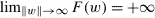。一种常见的强制函数是 $F(w): := \mathcal{L}(w) + \frac{\lambda}{2}{\\| w\|}^{2}$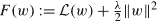，其中 $\mathcal{L}$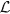 是 `M`-Lipschitz 连续的（但不一定是凸的），且 `λ` > `0`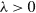。如果 `F` 是连续且强制的，那么根据著名的魏尔拉斯定理（Weierstrass theorem），(1.1) 有全局最优解 `w^⋆`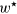。在这种情况下，我们用 `F^⋆ :  = F(w^⋆)`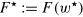 表示其最优值。如果 `F` 是非凸且可微的，那么我们用 `w^⋆` 来表示其驻点，即 `∇F(w^⋆) = 0`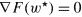。如果 `F` 不可微的，则需要驻点的泛化定义 40。为了简单起见，我们在整个章节中假设 `F` 是连续可微的。


如果`F`是强凸的，那么它是连续且强制的，并且 (1.1) 有唯一的全局最优解。对于凸问题，我们的目标是在某种意义上找到`w^⋆`的近似全局最优解`ŵ^⋆`（参见第 1.2.7 节）。对于非凸问题，我们只期望计算近似驻点`ŵ^⋆`，它可以是局部最小值的候选，但在本章中我们并不检查它是否为近似局部最小值。

### 贡献

我们的贡献总结如下：我们对梯度下降方法及其变体（包括随机方案）的主要组件进行了全面讨论。我们还提出了一种统一简单的方法来分析这些算法的收敛率，该方法可以扩展到本章未涵盖的其他算法。我们还讨论了基础算法的一些实现方面。

### 概述

本章的其余部分安排如下：第 1.2 节回顾了梯度方法的基础组件；第 1.3 节重点关注随机梯度方法，而第 1.4 节做了总结陈述并提出了若干研究方向。

## 1.2 GD 方法的基础组件

梯度下降（GD）方法是一种用于寻找 (1.1) 近似解的迭代方法。它追溯到 19 世纪柯西的工作，并在过去的几十年里包括优化在内的领域得到了深入研究。在过去的十年里，由于在信号处理、统计和机器学习中的应用，一阶方法（特别是梯度算法）大量出现。在本章中，我们不回顾 GD 方法的文献，而专注于总结它们的基础组件。形式上，梯度下降算法从给定的初始点`w⁰ ∈ ℝᵖ`开始，并在每次迭代`t ≥ 0`中进行更新：

```
w^(t + 1) := ϕ(w^(t) + η[t]d^(t)))
```

(1.2)

其中`w^(t)`是当前迭代值，`η[t] > 0`被称为步长或学习率，`d^(t)`被称为搜索方向，`ϕ`是处理约束或正则化的算子；如果不需要，可以设置`ϕ = 𝕀`，恒等算子。该方法仅使用`F`的一阶信息（例如函数值、近端算子或子梯度）生成一系列迭代向量序列`{w^(t)}`。在这里，我们添加了一个算子`ϕ`，它也可以用于处理约束、正则化、惩罚或 Bregman 距离（例如原始空间与对偶空间之间的映射）。让我们讨论方案 (1.2)的每一个组件。

### 1.2.1 搜索方向

(1.2)中最重要的组件是搜索方向`d^(t)`，它决定了算法类型，如一阶、二阶或随机方法。让我们考虑以下可能性：

*   **下降方向。** 假设`F`是连续可微的，搜索方向`d^(t)`在迭代值`w^(t)`处被称为下降方向，如果`⟨∇F(w^(t)),d^(t)⟩ < 0`。我们可以施加更强的条件，即严格下降，`⟨∇F(w^(t)),d^(t)⟩ ≤ −c‖∇F(w^(t))‖²`，其中`c > 0`。“下降”这一名称源于事实：如果我们从`w^(t)`沿着方向`d^(t)`移动适当的步长`η[t]`，那么我们得到了下降，即`F(w^(t + 1)) < F(w^(t))`。如果`ϕ = 𝕀`，恒等算子，则 (1.2) 简化为`w^(t + 1) := w^(t) + η[t]d^(t)`。通过`F`的泰勒展开，我们有`F(w^(t + 1)) = F(w^(t)) + η[t]⟨∇F(w^(t)),d^(t)⟩ + o(η[t]²d²)`，对于足够小的`η[t] > 0`，由于`⟨∇F(w^(t)),d^(t)⟩ < 0`。

*   **最速下降方向。** 如果我们取`d^(t) := −∇F(w^(t))`，则 (1.2) 变为：

```
w^(t + 1) := w^(t) − η[t]∇F(w^(t))
```

(1.3)

并且有`⟨∇F(w^(t)), d^(t)⟩ = −‖∇F(w^(t))‖² < 0`，只要`w^(t)`不是`F`的驻点即可。通过选择这样的`d^(t)`，我们得到了梯度下降法或所谓的最速下降法。它实际上实现了`F`在`w^(t)`处最大的下降，因为对于满足`‖d^(t)‖ = 1`的任何`d^(t)`，都有`⟨∇F(w^(t)), d^(t)⟩ ≥ −‖∇F(w^(t))‖`。

*   **随机梯度方向。** 如果我们选择`d^(t)`为`∇F(w^(t))`的随机估计量，那么我们就得到了随机近似法（也称为随机梯度下降法）。随机梯度方向通常不是下降方向，即`⟨∇F(w^(t)), d^(t)⟩ ≺ 0`。随机估计量的示例包括标准无偏估计量`v^(t) := ∇F(w^(t), ξ[t])`以及其小批次版本`v^(t) := (1/|S_t|)∑_{ξ ∈ S_t}∇F(w^(t),ξ)`对于小批次`S^(t)`，以及各种方差削减估计量，参见例如 [13,29,48,58,66]。

*   **牛顿方向和拟牛顿方向。** 我们可以通过引入二阶信息（或`F`的曲率）来超越基于梯度的方法，即`d^(t) = −B^(t)^{-1}∇F(w^(t))`，其中`B^(t)`是一个给定的对称可逆矩阵。例如，如果`B^(t) = ∇²F(w^(t))`，那么我们得到了牛顿法；而如果`B^(t)`是`∇²F(w^(t))`的近似，那么我们得到了拟牛顿法。

*   **不精确下降方向。** 如果我们不精确计算梯度`∇F(w^(t))`，而是允许对于某些噪声`δ^(t)`满足`d^(t) = −(∇F(w^(t)) + δ^(t))`，那么我们得到了不精确梯度或带噪梯度 [24]。另一个例子是符号梯度法，它使用`d^(t) = −s∇F(w^(t))`，参见 41。不精确类型方法通过近似求解`B^(t)d^(t) = −∇F(w^(t))`使得`‖B^(t)d^(t) + ∇F(w^(t))‖ ≤ c‖d^(t)‖`，对于`c > 0`。除了上述示例，其他方法如分块坐标、增量梯度、Frank-Wolfe 或条件梯度、近端点、近线性、高斯-牛顿、外梯度、乐观梯度和算子分裂技术，也可以通过构造合适的搜索方向`d^(t)`写成形式 (1.2)。例如，近端点法可以被视为对其 Moreau 包的梯度法，参见 56。

### 1.2.2 步长

(1.2)的第二个重要组成部分是步长`η^(t)`。在机器学习社区中，这个量被称为学习率。选择合适的`η^(t)`是影响算法的关键步骤。经典的优化技术提出了几种被称为全局化策略的策略，包括 (i) 线搜索及其变体、(ii) 置信区域和 (iii) 滤波 [11,23,49]。线搜索和置信区域策略在数值优化中被广泛使用，参见 [11,49]。在最近的优化算法和机器学习训练任务中，我们经常观察到以下技术：

*   **恒定学习率。** 恒定学习率由于其简单性通常用于推导收敛率或复杂度界。如果问题是“容易”的（例如强凸且`L`-平滑），算法在恒定学习率下通常表现良好，但如果`F`的景观复杂（如深度神经网络），其性能就会变差。通常，标准梯度方法通过理论分析给我们一个如`(0, 2/L)`的范围来选择恒定学习率。然而，这个范围很容易使用全局参数被低估，且无法捕捉到目标区域。在实践中，我们需要使用不同的策略（如网格搜索或二分法）来调节该学习率。

*   **递减学习率。** 递减学习率通常用于次梯度或随机梯度法。一种常见的递减学习率是`η_t = C/(t+β)^ν`，其中对于正常数`C`、偏移因子`β`和阶`ν > 0`。根据`F`的结构假设，我们可以选择合适的阶`ν`，例如`ν = 1/2`或`ν = 1/3`。另一种可能性是选择`η_t = C/(⌈t/s⌉ + β)^ν`，引入一个额外的整数`s`，以便每`s`次迭代中保持固定学习率。在随机梯度法中，如果`d^(t)`的方差是非递减的（即它不是来自`∇F`的方差削减估计量），通常需要递减学习率。

*   **调度策略。** 在实践中，我们经常使用调度来调节合适的学习率，以获得最佳性能。许多不同的想法，例如使用指数衰减率、余弦退火，甚至使用变化的小批次大小，参见例如 [37,62]。

### 自适应学习率

上述学习率选择策略没有考虑到目标函数的局部几何结构。它们在处理“困难”问题时可能表现不佳。这促使了自适应学习率的使用，该方法利用了目标函数的局部区域或曲率。第一种常见的策略是线搜索（line-search），它近似求解`min[η > 0]F(w^(t) + η*d^(t))`来找到`η[t]`。如果`F`是二次函数，那么我们可以通过求解这个单变量最小化问题来精确计算`η[t]`。然而，大多数算法都使用不精确的线搜索，例如二分法或黄金分割法搜索。另一种策略是使用 Barzilai–Borwein 步长，例如`η[t] := ||w^(t) - w^(t-1)||/||∇F(w^(t)) - ∇F(w^(t-1))||`，它给出了`1/L`的估计值。（在此处，`L`是`∇F`的利普希茨常数。）

最近，人们提出了几种自适应方法，参见例如 [12,17,[32]](#Chp001_3-28_B9780443190377000089.xhtml#br0160)。基础学习率通常由`η_t := C/√(∑_{j = 0}^{t}‖g_j‖² + ε)`给出，其中`g[j]`是迭代`j`处的某种梯度估计器，`C > 0`，且`ε ≥ 0`是一个为了避免除零并提供数值稳定性的小常数。

在上述选择学习率的策略和技巧中，当使用“试错”法或上述方法的组合求解特定问题时，也可以以不同的方式计算它们。主要目标是为此类问题调优一个良好的学习率，同时保证基础算法的收敛性。

### 1.2.3 近端算子 (Proximal operator)

(1.1)涵盖的许多问题具有约束或非平滑项。例如，我们可能有`F(w) = f(w) + g(w)`，其中`g`是非平滑的。在这种情况下，我们无法使用`F`的全梯度。处理非平滑项`g`的方法之一是使用近端算子，特别是在具有简单约束时使用投影。在数学上，恰当、下半连续且凸（或广义地说，近端正则的）函数`g`的近端算子定义为：

```
prox_{γg}(w) := argmin_{z ∈ R^p} { γg(z) + (1/2)‖z - w‖² }, γ > 0.
```

(1.4)

注意，在适当选择`γ`的情况下，(1.4)中的最小化问题是强凸的，因此有唯一解，这使得`prox[γg]`具有良定义。如果`g = δ[W]`是闭凸集`W`的指示函数，若`w ∈ W`则`δW = 0`，否则`δW = ∞`，此时`prox[γg]`简化为到`W`的投影，即`proj_W(w) := argmin_{z ∈ W}(1/2)‖z - w‖²`。在计算方面，评估`prox[γg]`通常与求解强凸问题一样困难。评估`proxγg`有至少三种方法：

*   **分离函数 (Separable functions)。** 最明显的情况是`g`是分量分离的，如`g(w) := ∑_{j = 1}^{p}g_j(w_j)`（例如`g(w) = ‖w‖_1`），此时评估`prox[γg]`需要求解单变量强凸问题，这可以通过闭式解完成。该想法可以扩展到块分离函数，如`g(w) := ∑_{i = 1}^{n}‖w_[i]‖_2`，其中`{w[i]}`是子向量。

*   **对偶方法 (Dual approach)。** Moreau 恒等式`proxγg = w − γ*prox_{g*/γ}(w/γ)`表明可以通过其 Fenchel 共轭`g*`计算`prox[γg]`。由于许多凸函数具有简单的共轭函数，例如范数（例如`g(w) = ‖w‖_2`）或 Lipschitz 连续函数，这种方法更可行。

*   **最优性方法 (Optimality approach)。** 如果`g`是可微的，我们可以直接使用其最优条件`∇g(z) + γ^(−1)(z − w) = 0`并将其作为`z`的非线性方程求解。示例包括`−logdet(X)`和`∑_{i = 1}^{n}log(1 + exp(y_i X_i^T w))`。

注意，第二和第三种技术仅用于凸函数，而第一种可以用于非凸函数。可以高效计算的`proxγg`的凸函数`g`数量是海量的，参见例如 1,[51]](#Chp001_3-28_B9780443190377000089.xhtml#br0255) 获取更多示例和计算技术。

### 1.2.4 动量 (Momentum)


解释动量作用的一种方法是使用形式为 $\ddot{w}(\tau) + \psi(\tau)\dot{w}(\tau) + \nabla F(w(\tau)) = 0$ 的动力系统，源自牛顿第二定律，其中 $\psi(\tau)\dot{w}(\tau)$ 代表摩擦力或阻尼因子。如果我们使用 $\ddot{w}(\tau) \approx (w^{t + 1} - 2w^{t} + w^{t - 1})/h_{t}^{2}$ 和 $\dot{w}(\tau) \approx (w^{t} - w^{t - 1})/h_{t}$ 来离散化该微分方程，得到 $(w^{t + 1} - 2w^{t} + w^{t - 1})/h_{t}^{2} + \psi(t)(w^{t} - w^{t - 1})/h_{t} + \nabla F(w^{t}) = 0$，导致 $w^{t + 1} = w^{t} - h_{t}^{2}\nabla F(w^{t}) - h_{t}\psi(t)(w^{t} - w^{t - 1})$，参见例如 61。因此，我们可以规定 (1.2 在 $\mathcal{P} = \mathbb{I}$（恒等算子）时的动量变体如下：

$w^{t + 1} = w^{t} + \eta_{t}d^{t} + \beta_{t}(w^{t} - w^{t - 1})$，

(1.5)

其中 `β[t]` > 0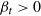 是动量步长。搜索方向 `d^(t)`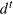 可以在 `w^(t)`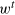 处求值，从而所谓的重球法（heavy ball method）[[54]](#Chp001_3-28_B9780443190377000089.xhtml#br0270)。或者，如果 `d^(t)` 在中间点求值，例如 `z^(t)` = `w^(t) + βt - w^(t) - 1))`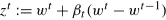，那么我们在凸情况下下就得到了 Nesterov 加速方案 [[44]](#Chp001_3-28_B9780443190377000089.xhtml#br0220)。该方案可以写为以下两个步骤：

```
z^(t) = w^(t) + βt - w^(t) - 1))
and w^(k+1) = z^(t) + η[t]d(z^(t)),
```

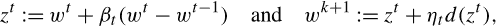(1.6)

其中 `d(z^(t))`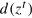 表示在 `z^(t)`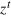 处求值的方向 `d^(t)`，而不是在 `w^(t)` 处求值。注意，动量项不会在 (1.2) 的基础上显著增加计算成本。然而，它们在凸情况下可以加速算法 [[44]](#Chp001_3-28_B9780443190377000089.xhtml#br0220),[46]](#Chp001_3-28_B9780443190377000089.xhtml#br0230)（参见章节 1.2.8），并且可能在某些非凸设置下也是，参见例如 [[35]](#Chp001_3-28_B9780443190377000089.xhtml#br0175),[63]](#Chp001_3-28_B9780443190377000089.xhtml#br0315)。

### 1.2.5 对偶平均变体

该方案 (1.2) 可以被看作是某种前向更新，但在凸优化中，对偶平均方案与 (1.2) 密切相关。与 (1.2)不同，对偶平均方案的工作方式如下：从 `w⁰` ∈ `R^p`开始，对于 `t` ≥ 0，我们更新：

```
w^{t+1} = argmin_w { sum_{j=0}^{t} gamma[j]<g^j,w> + 1/(2*eta_t)||w - w⁰||² }
```

(1.7)

其中 `g^j` 是给定的对偶方向（例如 `g^j` = `∇F(w^j)`），`gamma[j]` 是 `g^j` 的权重，而 `eta[t]` 是给定的对偶步长。在一般设置中，我们可以将 `1/(2)||w - w⁰||²` 替换为一般的 Bregman 距离 `D(w, w⁰)`。如果范数是欧几里得范数，则有：

```
w^{t+1} = w⁰ - eta_t * sum_{j=0}^{t} gamma[j]g^j
```

 如果 `eta[t]` = `eta` > 0 是固定且我们选择 `g^j` = `∇F(w^j)`，则有：

```
w^{t+1} = w⁰ - eta * sum_{j=0}^{t} gamma[j]g^j = w⁰ - eta * sum_{j=0}^{t-1} gamma[j]g^j - eta * gamma[t]g^t = w^t - eta * gamma[t]g^t
```

 这被 (1.2) 恰覆盖。因此，对于欧几里得范数 `1/(2)||w - w⁰||²`，对偶平均方案 (1.7) 与梯度下降方案相同：

```
w^(t+1) = w^(t) - eta * gamma[t]g^(t)
```

。然而，在非欧几里得范数或 Bregman 距离下，这些方法是不同的。

### 1.2.6 结构假设

设计梯度算法的一个主要理论任务是建立其收敛性。从计算的角度来看，估计收敛速度以及复杂度也至关重要。然而，为了建立这些，我们需要 `F` 满足一组假设。以下结构在优化建模和算法中常用：

*   **Lipschitz 连续性。** 函数 `F` 在 (1.1) 中如果对于所有 `w`, `w'` ∈ `R^p` 满足 `|F(w) - F(w')| ≤ M||w - w'||`，则被称为 `M`-Lipschitz 连续。(1.8)

    *   Lipschitz 连续函数的示例包括范数、平滑范数（例如对于小的 `epsilon`，`F(w) = sum_{i=1}^{p}(w_i² + epsilon²)^{1/2}`）。注意当 `F` 为凸时，`M`-Lipschitz 连续等价于 `M`-有界子梯度，即对于所有 `w` ∈ `R^p`，`||∇F(w)|| ≤ M`。该假设通常用于子梯度类型或随机梯度类型方法。

*   **L-平滑。** 如果函数 `F` 的梯度 `∇F` 满足对于所有 `w`, `w'` ∈ `R^p`，`||∇F(w) - ∇F(w'|| ≤ L||w - w'||`，则称 `F` 为 `L`-平滑。(1.9)

    *   如果 `w`, `w'` ∈ 紧域 `Ω` 且可微，则 `F` 在 `Ω` 上是 `L`-平滑。这一概念可以扩展到有限和的 `L`-平均平滑。例如，如果 `F(w) = 1/n*sum_{i=1}^{n}F_i(w)`，那么我们可以修改 (1.9) 为 `1/n*sum_{i=1}^{n}||∇F_i(w) - ∇F_i(w')|² ≤ L²||w - w'||²` 对于所有 `w`, `w'` ∈ `R^p`。或者，如果 `F(w) = E[F(w, xi)]`，那么我们可以使用 `E[||∇F(w) - ∇F(w')||²|w'] ≤ L²||w - w'||²` 对于所有 `w`, `w'` ∈ `R^p`。这些假设通常用于方差消除 SGD 方法，参见 [[52]](#Chp001_3-28_B9780443190377000089.xhtml#br0260),[66]](#Chp001_3-28_B9780443190377000089.xhtml#br0330)。注意可能存在其他扩展，参见例如 [[34]](#Chp001_3-28_B9780443190377000089.xhtml#br0170)。

*   (1.9) 的一个关键性质是以下界限：

    ```
    |F(w') - F(w) - <∇F(w),w' - w> ≤ L/2||w' - w||²
    ```

    (1.10)

*   这表明 `F` 可以被一个凸二次函数全局性地上界，并被一个凹二次函数全局性地下界。此外，如果 `F` 是凸的，则可以获得更强的界以及 `∇F` 的共正则性（co-coerciveness），例如参见 45。人们还可以将 `F` 的 `L`-平滑性扩展为 Hölder 连续平滑性，即 `∥∇F(*w*) − ∇F(*w^′*)∥ ≤ L*∥*w*  − *w^′∥^(*ν*)`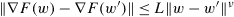 ，对于某些 0 ≤ `ν`  ≤ 1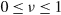。这个概念统一了 `L`-平滑性（`ν`  = 1）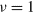) 和梯度有界（`ν`  = 0）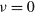) 条件。它已被用于确定性方法和随机方法的通用一阶方法，例如 47。

*   • **凸性（Convexity）。** 如果满足下式，则称函数 `F` 是 `μ`强]凸的：

```math
F(\widehat{w}) \geqslant F(w) + \langle\nabla F(w),\widehat{w} - w\rangle + \frac{\mu}{2}{\\|widehat{w} - w\|}^{2},\quad\forall w,\widehat{w} \in \mathbb{R}^{p}.
```

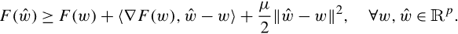(1.11)

*   在这里，`∇F(*w*)`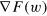 可以是 `F` 在 `w` 处的梯度或次梯度。这个不等式表明 `F` 可以被线性近似（`μ`  = 0）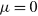) 或二次近似（`μ`  ≠ 0）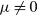) 下界。如果 `μ`  = 0，那么 `F` 仅仅是凸的或普通的凸。如果 `μ`  > 0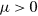，那么 `F` 是强凸的，`μ` 被称为强凸性参数。如果 `μ`  < 0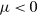，则 `F` 被称为弱凸（weakly convex）。凸性和强凸是凸分析、优化及相关领域的关键概念，例如参见 7,57，我们在此不再进一步讨论它们。

这些是分析 (1.2 及其变体收敛性的三个关键且基本的假设。然而，也可以利用其他假设。例如，以下条件在不同方法中使用：

*   • **梯度主导性和 PL 条件（Gradient dominance and PL condition）。** 如果对于所有 `w`  ∈ `ℝ^(*p*)`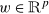 且 `w^⋆` 是 `F` 的极值点，满足 `F(*w*) − F(*w^⋆*) ≤ σ*∥∇F(*w*)∥²`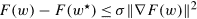，则称函数 `F` 为 `σ`-梯度主导的。显然，如果 `F` 是强凸的，它是梯度主导的。然而，存在梯度主导的非凸函数。注意，可以通过限制 `w` 在 `w^⋆` 的邻域内考虑局部梯度主导。我们还可以将此概念扩展到不同的变体。梯度主导条件允许我们在非凸设置下获得目标函数 `F(*ŵ*)−F(*w^⋆*)` (此处原文应为 si157.png) 的收敛保证。注意该条件被称为 Polyak–Łojasiewicz (PL) 条件。这些条件可以建立线性收敛率或类线性收敛率（即收敛到最优解的邻域）30,52。

*   • **均匀凸性与星凸性（Uniform convexity and star-convexity）。** 如果对于所有 `w`,`w′`  ∈ `ℝ^(*p*)`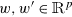，满足 `F(w') \geqslant F(w) + \langle\nabla F(w),w' - w\rangle + \frac{\mu}{\nu}{\\| w' - w\|}^{\nu}`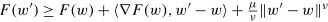，则称函数 `F` 是 `μ`-Hölder 阶 `ν`  ≥ 1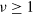 均匀凸的，例如参见 68。显然，如果 `ν`  = 2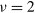，我们得到强凸性。如果 `ν`  = 2 且 `w`  = `w^⋆` 是 `F` 的极值点，则 `F` 被称为 `μ`-星强凸的。这些条件常用于梯度类方法以建立线性收敛率 42。

*   • **锐度、二次增长与误差界条件（Sharpness, quadratic growth, and error bound conditions）。** 假设存在 `γ`  > 0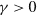 和 `ν`  ≥ 1，使得对于所有 `w`  ∈ `ℝ^(*p*)` 和 `F` 的极值点 `w^⋆`，满足 `F(w) - F(w^star) \geqslant \frac{\gamma}{\nu}{\\| w - w^star\|}^{\nu}`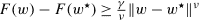。如果 `ν`  = 1，我们称 `F` 在 `w^⋆` 处是锐的（sharped）。如果 `ν`  = 2，我们称 `F` 具有二次增长。显然，如果 `F` 是强凸的，它就具有二次增长。然而，非凸函数可能仍然具有二次增长。该性质可以扩展为 `ω`-凸性，见 14。另一个相关概念是误差界（error bound）39，其定义为对于某些 `γ`  > 0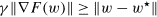 对于所有 `w`  ∈ `ℝ^(*p*)`，满足 `γ*∥∇F(*w*)∥ ≥ ∥w−w^⋆∥`。二次增长条件和误差界条件都可以用于建立梯度类方法的局部线性收敛。

### 1.2.7 优性认证（Optimality certification）

找到 (1.1 的精确解是不切实际的。我们的目标是在某种意义上近似该问题的解。让我们讨论一下在凸和非凸问题中我们可以对 (1.1) 什么。

假设 `w^⋆` 是 (1.1) 的全局最优解，其最优值为 `F^⋆ = F(w^⋆)`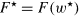，而 `ŵ` 是算法产生的近似解。验证最优性的一种明显条件是计算目标残差 `F(ŵ) − F(w^⋆)`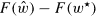。我们通常期望找到 `ŵ`，使得对于给定的容差 `ϵ > 0`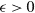，`F(ŵ) − F(w^⋆) ≤ ϵ`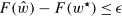。该条件通常用于凸优化或特殊类别的非凸问题，例如在梯度主导条件下的。`ŵ` 的构造通常依赖于两种方法。

第一种是直接将最后一次迭代 `w[T]`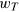 作为 `ŵ`：` w^(T)`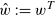，其中 `w^(T)`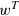 是算法的最终迭代。第二种选择是形成一个平均向量或加权平均向量：

```
\widehat{w}: := \frac{1}{T + 1}\sum\limits\_{t = 0}^{T}w^{t},\quad\text{or}\quad\widehat{w}: = \frac{1}{S\_{T}}\sum\limits\_{t = 0}^{T}\gamma\_{t}w^{t},
```

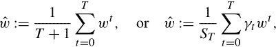(1.12)


其中 `γ[t] > 0` 是给定的权重（通常与步长 `η[t]` 相关，但可能不同），且 `S_{T}: := \sum_{t = 0}^{T}\gamma_{t}`。通常情况下，平均向量具有更好的理论收敛率保证，但与最后迭代 `w^(T)` 相比，它们可能会破坏解的期望属性（如稀疏性或低秩）。在凸优化中，我们经常使用 Jensen 不等式来获得收敛率边界 `F(\widehat{w}) - F(w^{\star}) \leqslant \frac{1}{S_{T}}\sum\limits_{t = 0}^{T}\gamma_{t}[ F(w^{t}) - F(w^{\star})]`，因为我们已经得到了右侧的收敛率边界。

第二个标准是使用 `F` 梯度的范数，例如 `\|∇F(ŵ)\|` 或其平方范数。注意，`∇F(w^⋆) = 0` 仅为我们提供了驻点，这些点在非凸设置中是最小化器的候选者。因此，对于给定的容差 `ϵ > 0`，任何满足 `\|∇F(ŵ)\| ≤ ϵ` 的向量 `ŵ` 仅为我们提供了 (1.1) 的驻点 `ŵ`。为了保证近似解，我们可以添加二阶条件 `λmin ≥ ϵ̂`，其中 `ϵ̂ > 0`，`λmin` 是 `∇²(ŵ)` 的最小特征值。在非凸情况下，`ŵ` 的构造通常依赖于 `{w⁰ ..., w^(T)}` 中的最优迭代，即 `\|∇F(ŵ)\| = min[0 ≤ T]\|∇F(w^(t))\|`。对于非光滑优化 `F := f + g`，可以使用梯度映射 `G[ŵ] := β^(-1)(ŵ - βg(ŵ))` 的范数 `\|G(ŵ)\|`，对于某些 `β > 0`。对于随机优化，需要使用期望刻画最优性条件 `E[\|∇F(ŵ)\|]`, `E[F(ŵ) - F^⋆]`，或者高概率 `ℙ\|∇F(ŵ)\| ≤ 1 - δ` 或 `ℙF(ŵ) - F^⋆ ≤ 1 - δ`，其中较小的 `δ ∈ (0, 1)`。

### 1.2.8 统一收敛分析

#### (a) 一般方法。

一阶方法 (1.2) 的大多数收敛分析依赖于由两个或三个迭代生成的递归不等式：

```
D[t+1] + Δ[t] ≤ ω[t] ⋅ D[t] + E[t]
```

其中 `D[t]`, `Δ[t]` 和 `E[t]` 是非负量，且 `ω[t] ∈ (0, 1]` 是收缩因子。这些量通常取决于两个连续的迭代 `w^(t)` 和 `w^(t+1)`。误差项 `E[t]` 通常至少满足 $\sum_{t = 0}^{\infty}E_{t} < \infty$。此外，我们经常有 `ω[t] = 1` 或 `ω[t] → 1` 用于亚线性收敛，而固定的 `ω[t] ∈ (0, 1)` 用于线性收敛。量 `D[t]` 可以称为李雅诺夫函数。没有通用的方法来构造 `D[t]`，但对于梯度类型方法，它通常是 `\|w^(t) - w^⋆\|²`, `\|w^(t+1) - w^⋆\|²`, `F(w^(t)) - F^⋆`, `\|∇F(w^(t))\|²`（在欧几里得范数下），或这些项的组合。显然，如果 `E[t] = 0`，则 `{D[t]}` 是单递减的，显示了 `D[t]` 的下降性。然而，如果 `E[t] > 0`，我们不再具有 `D[t]` 的下降性，这在随机梯度或亚梯度方法中很常见。有两种情况：

*   **情况 1。** 如果 `D[t]` 包含一个最优性量，例如 `S[t][F(w^(t)) - F^⋆]`，那么我们可以对于最后一次迭代 `w^(t)` 证明 $F(w^{t}) - F^{\star} \leqslant \frac{C}{S_{t}}$，其中 `C` 是一个取决于 `w⁰` 并可能取决于 `w^⋆` 或 `F^⋆` 的常数。

*   **情况 2。** 如果 `Δ[t]` 包含一个最优性度量，例如 `γ[t]∥∇F(w^(t))∥²`，那么我们可以证明 $\frac{1}{S_{T}}\sum_{t = 0}^{T}\gamma_{t}{\|\nabla F(w^{t})\|}^{2} \leqslant \frac{C}{S_{T}}$ 对于某些常数 `C` 和 $S_{T}: := \sum_{t = 0}^{T}\gamma_{t}$。

递归估计 (1.13) 可用于证明不同梯度类型方法的收敛性，包括标准算法和加速算法。让我们来说如何为某些常用方案获取 (1.13)。

### (b) 次梯度法。

让我们考虑使用经典的[次]梯度法来最小化 `F(w)`，其中 `w^(t+1) = w^(t) − η[t]∇F(w^(t))`，这是 (1.2) 的特殊情况，其中 `∇F(w^(t))` 是 `F` 在 `w^(t)` 处的[次]梯度。那么，对于任何 `w ∈ ℝ^(p)`，我们有

$\eta_{t}\langle\nabla F(w^{t}),w^{t} - w\rangle = \frac{1}{2}{\| w^{t} - w\|}^{2} - \frac{1}{2}{\| w^{t + 1} - w\|}^{2} + \frac{\eta_{t}^{2}}{2}{\|\nabla F(w^{t})\||}^{2}.$

(1.14)

如果 `F` 是凸的，那么 `⟨∇F(w^(t)), w^(t) − w⟩ ≥ F(w^(t)) − F(w*)`。结合这个不等式和 (1.14)，我们得到

$\underset{D_{t + 1}}{\underset{︸}{\frac{1}{2}{\| w^{t + 1} - w\|}^{2}}} + \underset{\Delta_{t}}{\underset{︸}{\eta_{t}\lbrack F(w^{t}) - F(w)\rbrack}} \leqslant \underset{D_{t}}{\underset{︸}{\frac{1}{2}{\| w^{t} - w\|}^{2}}} + \underset{E_{t}}{\underset{︸}{\frac{\eta_{t}^{2}}{2}{\|\nabla F(w^{t})\||}^{2}}}.$

(1.15)

这个不等式的形式正是 (1.13)，其中 `ω[t] = 1`。为了保证收敛，我们需要取 `w = w^⋆` 为 (1.1) 的解，并假设 `∥F(w^(t))∥ ≤ M`。那么，(1.15) 意味着 `Δ[t] ≤ D[t] − D[t+1] + E[t]`。通过归纳法，我们有 $\sum_{t = 0}^{T}\Delta_{t} \leqslant D_{0} - D_{T + 1} + \sum_{t = 0}^{T}E_{t}$。因此，我们得到

$F(\widehat{w}) - F(w^{\star}) \leqslant \frac{1}{S_{T}}\sum_{t = 0}^{T}\eta_{t}\lbrack F(w^{t}) - F(w^{\star})\rbrack \leqslant \frac{1}{2S_{T}}\|w^{0} - w^{\star}\|^{2} + \frac{M^{2}}{2S_{T}}\sum_{t = 0}^{T}\eta_{t}^{2},$

其中 $S_{T} := \sum_{t = 0}^{T}\eta_{t}$ 和 $\widehat{w} := \frac{1}{S_{T}}\sum_{t = 0}^{T}\eta_{t}w^{t}$ 是通过 (1.12) 计算的。为了获得收敛速率，我们需要 $\sum_{t = 0}^{\infty}\eta_{t}^{2} < \infty$ 和 $S_{T}\rightarrow S_{\infty} = \sum_{t = 0}^{\infty}\eta_{t} = \infty$。这些是保证次梯度法收敛的条件，参见 8。

### (c) 非凸问题的梯度下降。

如果我们假设 `F` 仅是 `L`-光滑的但不一定是凸的，那么使用 (1.10)，其中 `w = w^(t)` 和 `w′ = w^(t+1) = w^(t) − η[t]∇F(w^(t))`，我们有

$F(w^{t + 1}) \leqslant F(w^{t}) + \langle\nabla F(w^{t}),w^{t + 1}\rangle + \frac{L}{2}{\| w^{t + 1} - w\|}^{2} = F(w^{t}) - \eta_{t}\left( 1 - \frac{L\eta_{t}}{2} \right){\|\nabla F(w^{t})\|}^{2}.$

(1.16)

通过在两边加上 $F^{\star}$，其中 $F^{\star} = \text{inf}F(w) > -\infty$（我们的假设），并重排结果，(1.16) 导致：

$\begin{array}{lcl} {\underset{D_{t + 1}}{\underset{︸}{F(w^{t + 1}) - F^{\star}}}} + \underset{\Delta_{t}}{\underset{︸}{\eta_{t}\left( 1 - \frac{L\eta_{t}}{2} \right){\|\nabla F(w^{t})\||}^{2}} & {\\leqslant } & {\underset{D_{t}}{\underset{︸}{F(w^{t}) - F^{\star}}}.}\\ \end{array}$

这的形式正是 (1.13)，其中 `ω[t] = 1` 且 `E[t] = 0`。在没有任何进一步假设的情况下，我们有 `Δ[t] ≤ D[t] − D[t+1]`，通过归纳法，得到 $\sum_{t = 0}^{T}\Delta_{t} \leqslant D_{0} - D_{T + 1} \leqslant D_{0}$，导致：

$\min\limits_{0 \leqslant t \leqslant T}{\|\nabla F(w^{t})\|}^{2} \leqslant \frac{1}{S_{T}}\sum_{t = 0}^{T}\gamma_{t}{\|\nabla F(w^{t})\|}^{2} \leqslant \frac{F(w^{0}) - F^{\star}}{S_{T}},$

其中 $\gamma_{t} = \eta_{t}(1 - \frac{L\eta_{t}}{2})$ 和 $S_{T} = \sum_{t = 0}^{T}\eta_{t}$，只要 $0 < \eta_{t} < \frac{2}{L}$。这个结果允许我们证明算法到驻点的最优迭代收敛速率。

### (d) 平滑且凸问题的梯度下降法。

假设 `F` 是凸的且 `L`-光滑的。让我们选择 $\eta_{t} := \frac{1}{L}$ 在 (1.2) 中得到 $w^{t+1} := w^{t} - \frac{1}{L}\nabla F(w^{t})$。那么，根据 (1.14) 和 (1.16)，以及 `F` 的凸性，我们有

$\left\{{ \begin{array}{l} {\underset{D_{t + 1}}{\underset{︸}{F(w^{t + 1}) - F^{\star}}}} + \underset{\Delta_{t}}{\underset{︸}{\eta_{t}\left( 1 - \frac{L\eta_{t}}{2} \right){\|\nabla F(w^{t})\||}^{2}} & {\\leqslant } & {\underset{D_{t}}{\underset{︸}{F(w^{t}) - F^{\star}}}.}\\\\ \end{array} \right.$

通过累加这三个不等式并抵消项，我们得到

$\frac{L}{2}{\| w^{t + 1} - w^{\star}\|}^{2} + (t + 1)\lbrack F(w^{t + 1}) - F(w^{\star})\rbrack + \frac{t}{2L}{\|\nabla F(w^{t})\|}^{2}\quad \leqslant \frac{L}{2}{\| w^{t} - w^{\star}\|}^{2} + \ t\lbrack F(w^{t}) - F(w^{\star})\rbrack.$

这对应的正是 (1.13)，其中 $D_{t}: := \frac{L}{2}{\| w^{t} - w^{\star}\|}^{2} + t\lbrack F(w^{t}) - F(w^{\star})\rbrack$, $\Delta_{t}: := \frac{t}{2L}{\|\nabla F(w^{t})\|}^{2}$, `E[t] = 0`,  `ω[t] = 1`。这个递归估计意味着 `D[t+1] ≤ D[0]`，因此，根据 `D[t+1]` 的定义并去掉 $\frac{L}{2}{\| w^{t + 1} - w^{\star}\|}^{2}$，我们得到：


$F(w^{t + 1}) - F(w^{\star}) \leqslant \frac{D_{0}}{t + 1} = \frac{L{\\| w^{0} - w^{\star}\\|}^{2}}{2(t + 1)},$

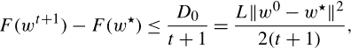

这显示出 $w$($t$)$ 上具有 $\mathcal{O}(1/t)$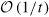-的最后迭代收敛率。它还意味着 $\sum_{t = 0}^{T}t{\\|\nabla F(w^{t})\|}^{2} \leqslant L^{2}{\\| w^{0} - w^{\star}\\|}^{2}$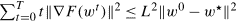（通过使用 $\sum_{t = 0}^{T}\Delta_{t} \leqslant D_{0}$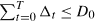）以及 \|$w$($t$)$\ − $w$^\star\|$ ≤ \|$w⁰$ − $w$^\star\|$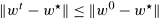（通过使用 $D$[$t$] ≤ $D$[0]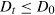），对于所有 $t$ ≥ 0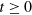成立。

#### (e) 针对凸凸问题的加速梯度法

我们的最后一个插图遵循了 Nesterov 的加速梯度方案：

$z^{t}: := w^{t} + \beta_{t}(w^{t} - w^{t - 1})\quad\text{and}\quad w^{t + 1}: = z^{t} - \frac{1}{L}\nabla F(z^{t}),$

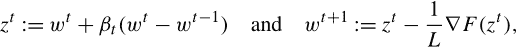(1.17) 其中 $\beta_{t} = \frac{\theta_{t} - 1}{\theta_{t}}$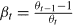 对于 $\theta_{t} \geq 1$ 使得 $\theta_{t}(\theta_{t}-1) \leq \theta_{t}²$ 且 $\theta_{0}=1$。这是带有动量 $\beta$$t$ − $w$($t$) − )) 的 (1.2 的加速变体。众周知，经过几次变换，(1.17 可以写为：

$z^{t} = (1 - \frac{1}{\theta_{t}})w^{t} + \frac{1}{\theta_{t}}u^{t},$

$w^{t + 1} = z^{t} - \frac{1}{L}\nabla F(z^{t}),\text{and}\ u^{t + 1} = u^{t} - \frac{\theta_{t}}{L}\nabla F(z^{t}).

令 $v^{t} = (1 - \frac{1}{\theta_{t}})w^{t} + \frac{1}{\theta_{t}}w^\star$。那么 $z^{t} - v^{t} = \frac{1}{\theta_{t}}(u^{t} - w^\star)$。此外，根据 $F$ 的凸性，我们有 $F(z^{t}) \leqslant F(v^{t}) + \langle\nabla F(z^{t}), z^{t} - v^{t}\rangle = (1 - \frac{1}{\theta_{t}})F(w^{t}) + \frac{1}{\theta_{t}}F(w^\star) + \frac{1}{\theta_{t}}\langle\nabla F(z^{t}), u^{t} - w^\star\rangle$。因此，将两边乘以 $\theta_{t}²$，得到：

$\begin{array}{lcl} \theta_{t}^{2}[F(z^{t}) - F(w^\star)] & \leqslant & \theta_{t}(\theta_{t} - 1)[F(w^{t}) - F(w^\star)] + \theta_{t}\langle\nabla F(z^{t}), u^{t} - w^\star\rangle. \\ \end{array}$

与 (1.14 和 (1.16 的证明类似，我们分别有：

$\left\{ \begin{array}{l} \frac{L}{2}{\\| u^{t + 1} - w^\star\|}^{2} + \theta_{t}\langle\nabla F(z^{t}), u^{t} - w^\star\rangle = \frac{L}{2}{\\| u^{t} - w^\star\|}^{2} + \frac{\theta_{t}^{2}}{2L}{\\|\nabla F(z^{t})\|}^{2}, \\ \theta_{t}^{2}[F(w^{t + 1}) - F^\star] + \frac{\theta_{t}^{2}}{2L}{\\|\nabla F(z^{t})\|}^{2} \leqslant \theta_{t}^{2}[F(z^{t}) - F^\star].\\ \end{array} \right.$

将最后三个不等式相加得到：

$\frac{D_{t + 1}}{\theta_{t}^{2}[F(w^{t + 1}) - F^\star] + \frac{L}{2}{\\| u^{t + 1} - w^\star\|}^{2}} + \frac{\Delta_{t}}{(\theta_{t - 1}^{2} - \theta_{t}(\theta_{t} - 1))[F(w^{t}) - F^\star]} \leqslant \frac{D_{t}}{\theta_{t - 1}^{2}[F(w^{t}) - F^\star] + \frac{L}{2}{\\| u^{t} - w^\star\|}^{2}},$(1.18)

这对应的 (1.13，其中 $E$$t$0![Image 和 $\omega$$t$1![Image，只要 $\theta$[$t$ − 1]$²−$\theta$[$t$($theta$[$t$] − 1)$\geq 0$（注意 $\theta[0]=1$ 和 $\theta_{-1} = 1/2$ 满足该条件)。递归估计 (1.18 意味着 $D$[$t$ + 1]≤$D$[0]，因此，根据 $D$[$t$ + 1] 的定义并去掉 $\frac{L}{2}{\\| w^{t + 1} - w^{\star}\\|}^{2}$，我们得到：

$F(w^{t + 1}) - F(w^{\star}) \leqslant \frac{D_{0}}{t + 1} = \frac{L{\\| w^{0} - w^{\star}\\|}^{2}}{2(t + 1)},$


这显示出 $w$($t$)$ 上具有 $\mathcal{O}(1/t)$-的最后迭代收敛率。它还意味着 $\sum_{t = 0}^{T}t{\\|\nabla F(w^{t})\|}^{2} \leqslant L^{2}{\\| w^{0} - w^{\star}\\|}^{2}$（通过使用 $\sum_{t = 0}^{T}\Delta_{t} \leqslant D_{0}$）以及 \|$w$($t$)$\ − $w$^\star\|$ ≤ \|$w⁰$ − $w$^\star\|$（通过使用 $D$[$t$] ≤ $D$[0]），对于所有 $t$ ≥ 0成立。

经典的优化文献通常描述底层算法的渐近收敛性或线性收敛率，而亚线性收敛率或算谕复杂度（oracle complexity）则较少涉及，参见例如 3, 21, 22, 31, 38, 53。亚线性收敛率在凸优化方法中得到了广泛研究，例如 45，而算谕复杂度分析在 43 中被正式研究。最近，由于这些主题被应用于现代信号与图像处理、机器学习和统计学习的大规模问题，它们变得越来越受到关注 9, 28, 67。让我们在这里详细讨论这些概念。

### (a) 收敛率

收敛率刻画了最优性度量（例如，目标残差 `F`(`ŵ`^(`t`))−`F`^⋆, 到解的平方距离 ∥`ŵ`^(`t``)−`w`^⋆∥², 或梯度的范数 ∥∇`F`(`ŵ`^(`t`))∥²) 随迭代 `t` 的进展，其中 `wwidehat`^(`t`) 是近似解。例如，对于平滑凸问题的梯度法，我们有 $F(w^{t + 1}) - F^{\star} \leqslant \frac{L{\\| w^{0} - w^{\star}\\|}^{2}}{2(t + 1)}$, 这表明目标残差 `F`(`w`^(`t`))−`F`^⋆ 以至少 $\frac{1}{t}$ 的速度减少，写作 `F`(`w`^(`t`))−`F`^⋆ = 𝒪(1/*t*)`。我们也可以写成 $F(w^{t + 1}) - F^{\star} = \mathcal{O}\left( \frac{R_{0}^{2}L}{t + 1} \right)$，其中 `R`[0] :  ∥`w`⁰ − `w`^⋆∥，以显示收敛率对 `L` 和 `R`[0] 的依赖性。注意，我们通常尝试建立上界，也可以表明在给定一组假设 (1.1 下，该上界与下界匹配（常数因子除外），参见 45。对于梯度类方法，仅在凸性和 `L`-平滑性下的最优收敛率是 𝒪(1/*t*)，这是由 Nesterov 方法保证的。对于非凸问题，梯度类方法在 `L`-平滑性下仅对 ∥∇`F`(`wwidehat`^(`t`))∥ 达到 𝒪(1/*t*)率。通过强凸性、误差界或 PL 条件等额外假设可以实现线性收敛率。然而，我们在书中不再进一步讨论这些变体。

### (b) 复杂度

复杂度概念源于理论计算机，但在数学（特别是优化领域）中被广泛使用。复杂度的正式定义可见 43, 45。我们区分梯度类方法的两种类型复杂度：迭代复杂度（或分析复杂度）和计算复杂度（有时称为运算复杂度或工作复杂度 45）。在梯度类方法中，整体计算复杂度通常由算谕复杂度决定，后者刻画了寻找近似解所需的函数和梯度计算总数。我们注意到我们加载了正式定义的 `oracle` 概念，其定义可见 45。在数学上，算法 `T` 次迭代的算谕复杂度定义如下：

```
\text{Oracle complexity}: = \sum_{t = 0}^{T}\text{Per-iteration complexity at iteration} t.
```

(1.19)

**单迭代复杂度** 每次迭代的工作量（例如梯度计算次数）。在每次迭代中，我们通常计算主导计算步骤，如梯度计算、函数计算、近端算、投影、矩阵-向量乘法或海森矩阵-向量乘法。如果单迭代复杂度是固定的，那么：

```
Oracle complexity = Number of iterations × Per-iteration complexity.
```


例如，对于平滑凸问题的标准梯度下降法，单迭代复杂度是 𝒪(1)，即需要一次梯度计算，导致算谕复杂度为 $\mathcal{O}\left( \frac{1}{\epsilon} \right)$，以便获得 `w`^(`t`) 使得 `F`(`w`^(`t`))−`F`^⋆ ≤ `ϵ`。事实上，从收敛界 $F(w^{t}) - F^{\star} \leqslant \frac{L{\\| w^{0} - w^{\star}\\|}^{2}}{2t}$，我们推导出 `F`(`w`^(`t`))−`F`^⋆ ≤ `ϵ` 是 $\frac{L{\\| w^{0} - w^{\star}\\|}^{2}}{2t}$ 隐含的，导致 $t \geqslant \left\lceil \frac{L{\\| w^{0} - w^{\star}\\|}^{2}}{2\epsilon} \right\rceil$。因此我们最多需要 $t_{\max} = \dots$ 次迭代，因此需要 𝒪(1/*ϵ*) 次梯度计算。


### 1.2.10 起点、热启动与重启

对于凸算法，它们从任何初始点 `w`⁰ 收敛到全局极小值 `w`^⋆，`w`⁰ 的选择会影响迭代次数，因为对于任何解 `w`^⋆，项 ∥`w`⁰−`w`^⋆∥² 出现在收敛保证界中，例如 $F(w^{T}) - F^{\star} \leqslant \mathcal{O}\left( \frac{L{\\| w^{0} - w^{\star}\\|}^{2}}{T^{\nu}} \right)$，其中 `ν` = 1 或 `ν` = 2。显然，如果 `w`⁰ 接近 `w`^⋆，那么迭代次数 `T` 较小。

对于非凸算法，初始化起着至关重要的作用，因为不同的初始点 $w⁰$可能会使算法收敛到不同的近似驻点 $w^\star$，且它们的质量各不相同。驻点是局部最小值的候选者，但某些可能是极大值或鞍点。即使我们确实获得了一个局部最小值，它仍然可能是一个糟糕的，距离任何全局最小值都很很远，或者在机器学习中为我们带来糟糕的预测误差。

热启动策略（Warm-start strategy）使用上一次运行或上一次迭代的输出来初始化当前阶段或迭代的算法。它的基于是：上一次运行已经为我们提供了所需解的良好近似。从该点初始化为快速收敛到目标最优解提供了希望。热启动被广泛应用于序列迭代（例如序列二次规划）或在线学习方法中。

当算法取得了了非预期进展并需要重新启动时，通常会使用重启策略（Restarting strategy）。这种思想已用于加速梯度方法，其中目标函数在大幅下降后增加，导致震荡行为 [26,50]。重启通常与热启动以及适当的条件结合以获得良好的性能。关于重启策略的一些理论分析可以在此处找到，例如在 [20,26,50,61]中。

## 1.3 随机梯度下降方法

让我们将讨论从确定性方法进一步扩展到求解随机方法 (1.1 当 $F$ 是有限求和或期望函数时。随机近似（SA）方法最初由 Robbins 和 Monro 在 20 世纪 50 年代提出 [55]。它在过去的几十年里变得变得极其流行，因为它被广泛应用于机器学习和数据科学中，参见例如 5,6,60。

### 1.3.1 算法模板

在本节中，我们只关注标准的随机优化并讨论两类方法：经典 SGD 和方差削减 SGD。更具体地说，我们关注 (1.1](#Chp001_3-28_B9780443190377000089.xhtml#deq1) 中的 $F(w) = \mathbb{E}[F(w, \xi)]$，它可以写写为

$$\min_{w \in \mathbb{R}^{p}} \{ F(w) = \mathbb{E}[\mathbf{F}(w,\xi)] \}, (1.20)$$

其中 $\xi$ 是定义在给定概率空间 $(\Omega, \Sigma, \mathbb{P})$ 上的随机向量。


许多求解 (1.20) 的基于梯度的随机方法可以像算法 1 所示描述。这里，算法 1 仅呈现带有可能的方差削减步骤的纯梯度方案，但没有动量或加速步骤。算子`Π`在需要时提供一个投影以处理约束，或添加压缩。然而，如果没有指定，则我们假设`Π(z) = z`，恒等算子。注意算法 1 是一个双循环算法，内层执行 SGD 更新，而外层执行阶段更新，这可以以逐轮（epoch-wise）的方式或作为重启机制表示。

**算法 1 随机梯度下降（SGD）方法。** 如果`S = 0`，则算法 1 简化为单循环方法。如果`S > 1`，我们也可以将算法 1 转换为带有“IF”语句的单循环，并使用迭代计数器`k := Σ(i = 0 to s - 1) T(i)`。如果`T[s] = T`，则`k := (s-1)T + t`。这种转换允许我们为“IF”语句注入伯努利规则。这种修改已经在 Loopless-SVRG 和 Loopless-SARAH 中实现，参见 3, 6。

### 1.3.2 SGD 估计器

算法 1 的主要部分是`∇F(w^t)`的估计器`v^t`。我们让我们回顾一下优化和相关领域广泛使用的一些估计器。

**(a) 经典 SGD 和小批量（mini-batch）估计器。** 显然，如果`S=0`，我们可以简单地去掉算法 1 中的上标`s`，并将主更新写为`w^(t+1) := w^t - η[t]v^t` (1.21)，它具有形式 (1.20)，其中`d^t = -v^t`是`∇F(w^t)`的随机估计器。

在经典 SGD 中，我们通常将`v^t`产生为`∇F(w^t)`的一个无偏估计器，且具有有界方差，即：

```
E[v^t|F^t] = ∇F(w^t) 且 E[||v^t||²|F^t] ≤ M², (1.22)
```

对于给定的`M ≥ 0`，其中`F^t`是由`{S[0], ..., S[t]}`生成的最小 σ-代数，且`E[·|F^t]`是条件期望。

**(b) 方差削减 SGD 估计器。** 存在基于不同的`∇F(w)`的方差削减方法。我们只关注其中一些。为了简单起见，省略阶段下标“s”。

第一个是 SVRG [29]，它产生`v^t`为：

```
v^t := v̂^s + [∇F(w^t, S[t]) - ∇F(ŵ^s, S[t])], (1.23)
```

其中`v̂^s`是`ŵ^s`处的全梯度或大批量的无偏估计器，`∇F(w^t, S_t) := (1/b_t) Σ(ξ_t ∈ S_t) ∇F(w^t, ξ_t)`且`b_t = |S[t]|`。那么，可以证明

```
E[S[t]][v^(t)] = ∇F(w^(t)) 且 E[S[t]][||v^(t) - ∇F(w^(t))||²] ≤ σ[t]²,
```

其中`σ[t]² = L²||w^(t) - w*||²`如果`F`是`L`-平均平滑的，`σ[t]² = 4L[F(w^(t)) - F(w*) + F(ŵ^(s)) - F(w*)]`如果`F`是凸的且是`L`-平均平滑的。

第二种估计器是 SARAH [48]，其表达式如下：

```
v^(t) = v^(t-1) + [∇F(w^(t), S[t]) - ∇F(w^(t-1), S[t])]. (1.24)
```

它被称为随机递归梯度估计器。遗憾的是，这个估计是有偏的，即`E[S[t]][v^(t)] ≠ ∇F(w^(t))`。然而，可以证明：

```
E[S[t]][v^(t)] = ∇F(w^(t)) + e[t] 且 E[S[t]][||v^(t) - ∇F(w^(t))||²] ≤ σ[t]²,
```

其中`e[t] = v^(t-1) - ∇F(w^(t-1))`是误差，且`σ_t² ≤ σ_(t-1)² + (L²/b_t)||w^t - w^(t-1)||²`如果`F`是`L`-平均平滑的，参见 52。

另一个有趣的估计器是 66 中提出的混合方差削减估计器，它可以写为：

```
v^(t) = (1-β[t])[v^(t-1) + [∇F(w^(t), S[t]) - ∇F(w^(t-1), S[t])]] + β[t]u^(t), (1.25)
```

其中`β[t] ∈ [0, 1]`且`u^(t)`是`∇F(w^(t))`的无偏估计器，方差为`σ̂[t]²`，即`E[||u^(t) - ∇F(w^(t))||²|F[t]] ≤ σ̂[t]²`。同样，如在 [66] 中证明的，此此是`∇F(w^(t))`的有偏估计器，且如果`F`是`L`-平均平滑的，那么`v^(t)`满足`E[||v^(t) - ∇F(w^(t))||²] ≤ σ[t]²`，其中

```
σ_t² ≤ (1-β_t)²σ_(t-1)² + (2(1-β_t)²L²/b_t)||w^t - w^(t-1)||² + 2β_t²σ̂_t².
```

一种简单的`u^(t)`选择是`u^(t) = ∇F(w^(t), S[t])`。在这种情况下，我们有`σ̂_t² = σ²/b_t`。

### 1.3.3 统一分析

#### (a) 通用方法。让我们识别算法 1 收敛性分析中的关键步骤。最重要的步骤之一是建立关于内部迭代`t`的形式为 (1.13) 的递归估计，但是在条件期望下：

```
E[D[t+1]|F[t]] + Δ[t] ≤ ω[t]E[D[t]] + E[t], (1.26)
```

其中相关量的定义与 (1.13) 类似。如果我们对 (1.26) 的两边取全期望，并假设对于`ξ[t] > 0`，`ω_t = ξ_t/ξ_(t+1)`且对于某些`M ≥ 0`，`E[D[t]] ≤ θ[t]²M²`和`θ[t] > 0`，则有：

```
ξ[t+1]E[D[t+1]] + ξ[t+1]E[Δ[t]] ≤ ξ[t]E[D[t]] + ξ[t+1]θ[t]²M².
```

通过归纳法，我们有：

```
ξ_(T+1)E[D_(T+1)] + Σ(t=0 to T) ξ_(t+1)E[Δ_t] ≤ ξ_0E[D_0] + M²Σ(t=0 to T) ξ_(t+1)θ_t².
```

令`S_T := Σ(t=0 to T) γ_t`，其中给定权重`γ[t] > 0`（取决于`ξ[t]`或`θ[t]`）。将 (1.27) 的两边除以`S[T]`，我们得到：

```
(1/S_T)Σ(t=0 to T) ξ_(t+1)E[Δ_t] ≤ (ξ_0E[D_0]/S_T) + (M²/S_T)Σ(t=0 to T) ξ_(t+1)θ_t². (1.28)
```

这两个估计值 (1.27) 和 (1.28) 将允许我们估计底层算法的收敛速度。让我们应用这种方法来证明算法 1 变体的收敛性。

#### (b) 非光滑凸问题的 SGD。让我们分析 SGD 方案 (1.21)。使用更新公式 (1.21)，我们有：

```
||w^(t+1) - w*||² = ||w^(t) - w*||² - 2η[t]<v^(t), w^(t) - w*> + η[t]²||v^(t)||².
```

对该估计值取条件期望`E[·|F[t]]`并注意到`E[v^(t)|F[t]] = ∇F(w^(t))`，我们有：

```
η_t<∇F(w^t), w^t - w*> = (1/2)||w^t - w*||² - (1/2)E[||w^(t+1) - w*||²|F_t] + (η_t²/2)E[||v^t||²|F_t].
```

如果`F`是凸的，那么我们有`F(w^(t)) - F(w*) ≤ <∇F(w^(t)), w^(t) - w*>`。此外，我们还有`E[||v^(t)||²|F[t]] ≤ M²`。结合这两个表达式和最后一个不等式，我们得到：

```
E[D_(t+1)|F_t] + Δ_t ≤ D_t + E_t,
```

其中`D_t := (1/2)||w^t - w*||²`，`Δ_t := η_t[F(w^t) - F(w*)]`，`E_t := (η_t²/2)M²`。

```
E[F(ŵ) - F(w*)] ≤ (1/S_T)Σ(t=0 to T) η_t E[F(w^t) - F(w*)] ≤ (1/(2S_T))||w^0 - w*||² + (M²/(2S_T))Σ(t=0 to T) η_t², (1.29)
```


其中 $S_{T}: := \sum\limits\_{t = 0}^{T}\eta_{t}$ 和 $\widehat{w}: := \frac{1}{S_{T}}\sum\limits\_{t = 0}^{T}\eta_{t}w^{t}$。如果对于某些 $C > 0$我们选择 $\eta_{t}: := \frac{C}{\sqrt{T + 1}}$，则 $S_{T} = C\sqrt{T + 1}$ 且 $\sum\limits\_{t = 0}^{T}\eta_{t}^{2} = C^{2}$。在这种情况下，(1.29)Chp001_3-28_B9780443190377000089.xhtml#deq47) 变为

$\mathbb{E}\lbrack F(\widehat{w}) - F(w^{\star})\rbrack \leqslant \frac{{\\| w^{0} - w^{\star}\\|}^{2}}{2C\sqrt{T + 1}} + \frac{M^{2}C}{2\sqrt{T + 1}}.$

，则 $S_{T}: := C\sum\limits\_{t = 0}^{T}\frac{1}{\sqrt{t + 1}} \geqslant 2C\int\_{1}^{T + 1}\frac{1}{2\sqrt{t}}dt = 2C(\sqrt{T + 1} - 1)$ 且 $\sum\limits\_{t = 0}^{T}\eta_{t}^{2} = C^{2}\sum\limits\_{t = 0}^{T}\frac{1}{t + 1} \leqslant C^{2}(1 + \ln(T + 1))$。在这种情况下，(1.29)Chp001_3-28_B9780443190377000089.xhtml#deq47) 变为

$\mathbb{E}\lbrack F(\widehat{w}) - F(w^{\star})\rbrack \leqslant \frac{{\\| w^{0} - w^{\star}\\|}^{2}}{4C(\sqrt{T + 1} - 1)} + \frac{M^{2}C(1 + \ln(T + 1))}{4(\sqrt{T + 1} - 1)}$.$![Image

### (c) 针对光滑和非凸问题的 SGD

我们考虑 $F$ 是 $L$-平滑的情况。此外，我们假设我们的随机估计器 $v^{t}$ 是无偏的，即 $\mathbb{E}\lbrackv^{t}|\mathcal{F}_{t}] = \nabla F(w^{t})$ 并具有有界的方差，如 $\mathbb{E}\lbrack\|v^{t} - \nabla F(w^{t})\|²|\mathcal{F}_{t}] \leqslant \sigma^{2}$。在这种情况下，我们有 $\mathbb{E}\lbrack\|v^{t}\|²|\mathcal{F}_{t}] \leqslant \|\nabla F(w^{t})\|² + \sigma^{2}$。利用这个不等式、$\mathbb{E}\lbrackv^{t}|\mathcal{F}_{t}] = \nabla F(w^{t})$ 以及 $F$ 的 $L$-平滑性，我们可以推导出：

$\mathbb{E}\lbrack F(w^{t + 1})|\mathcal{F}_{t}] \leqslant F(w^{t}) - \eta_{t}\mathbb{E}\lbrack\langle F(w^{t}),v^{t}\rangle|\mathcal{F}_{t}]\rbrack + \frac{L\eta_{t}^{2}}{2}\mathbb{E}\lbrack\|v^{t}\|^{2}|\mathcal{F}_{t}]\rbrack \leqslant F(w^{t}) - \eta_{t}\|\nabla F(w^{t})\|^{2} + \frac{L\eta_{t}^{2}}{2}\|\nabla F(w^{t})\|^{2} + \frac{L\eta_{t}^{2}\sigma^{2} = F(w^{t}) - \eta_{t}(1 - \frac{L\eta_{t}}{2})\|\nabla F(w^{t})\|^{2} + \frac{L\eta_{t}^{2}\sigma^{2}$

该不等式导致：

$\begin{array}{l} {\mathbb{E}\lbrack F(w^{t + 1}) - F^{\star}|\mathcal{F}_{t}]\rbrack + \eta_{t}(1 - \frac{L\eta_{t}}{2})\|\nabla F(w^{t})\|^{2} \leqslant F(w^{t}) - F^{\star} + \frac{L\eta_{t}^{2}\sigma^{2}}{2}}\end{array}$

这正好是 [(1.26)Chp001_3-28_B9780443190377000089.xhtml#deq41]，当 $\omega^{t}=1$ 且 $0 < \eta_{t} < \frac{2}{L}$。通过使用该估计，我们可以推导出 $\frac{1}{S_{T}}\sum\limits\_{t = 0}^{T}\gamma_{t}\mathbb{E}\lbrack\|\nabla F(w^{t})\|^{2}\rbrack$ 的收敛率，其中 $\gamma_{t} = \eta_{t}(1 - \frac{L\eta_{t}}{2})$ 且 $S_{T} = \sum\limits\_{t = 0}^{T}\gamma_{t}$，如 [25Chp001_3-28_B9780443190377000089.xhtml#br025]所示。我们在此省略细节。

### (d) 针对光滑和非凸问题的混合方差减 SGD

我们分析 [Algorithm 1Chp001_3-28_B9780443190377000089.xhtml#f0010] 的方差减变体，其中内部循环更新为 $w^{t+1}:=w^{t} - \eta_{t}v^{t}$，其中 $v^{t}$ 由 [(1.25)Chp001_3-28_B9780443190377000089.xhtml#deq39] 给出，当 $b^{t}=1$，参见 [66Chp001_3-28_B9780443190377000089.xhtml#br030]。此外，我们不需要外部循环，这导致了一个**单循环**算法。

让我们分析它的收敛率。首先，根据 $F$ 的 $L$-平滑性和关系 $-2\langle a,b\rangle = \|a-b\|² - \|a\|² - \|b\|²$，我们可以推导出：

$\mathbb{E}\lbrack F(w^{t + 1})|\mathcal{F}_{t}] \leqslant F(w^{t}) - \eta_{t}\mathbb{E}\lbrack\langle\nabla F(w^{t}),v^{t}\rangle|\mathcal{F}_{t}]\rbrack + \frac{L\eta_{t}^{2}}{2}\mathbb{E}\lbrack\|v^{t}\|^{2}|\mathcal{F}_{t}]\rbrack = F(w^{t}) - \frac{\eta_{t}}{2}\|\|\nabla F(w^{t})\|^{2} + \frac{\eta_{t}}{2}\mathbb{E}\lbrack\|v^{t} - \nabla F(w^{t})\|^{2}|\mathcal{F}_{t}]\rbrack - \frac{\eta_{t}}{2}(1 - L\eta_{t})\mathbb{E}\lbrack\|v^{t}\|^{2}|\mathcal{F}_{t}]\rbrack.$

由于 $\mathbb{E}\lbrack\|v^{t} - \nabla F(w^{t})\|²|\mathcal{F}_{t}] \leqslant \sigma^{2}$ 且 $0 < \eta_{t} < \frac{2}{L}$，这个不等式简化为：

$\mathbb{E}\lbrack F(w^{t + 1}) - F^{\star} + \frac{\eta_{t}(1 - L\eta_{t})}{2}\|v^{t}\|^{2}|\mathcal{F}_{t}]\rbrack \leqslant F(w^{t}) - F^{\star} + \frac{\eta_{t}}{2}\|\|\nabla F(w^{t})\|^{2}$

由于 $\mathbb{E}\lbrack\|v^{t} - \nabla F(w^{t})\|²|\mathcal{F}_{t}] \leqslant \sigma^{2}$ 且 $w^{t+1}:=w^{t} - \eta_{t}v^{t}$，我们有：

$\sigma_{t}² \leqslant (1 - \beta_{t})²\sigma_{t}² + L²(1 - \beta_{t})²\|v^{t}\|² + 2\beta_{t}(1 - \beta_{t})\sigma_{t}²$

将此不等式乘以 $\frac{c_{t}}{2} > 0$ 并加到上一个估计，我们得到：

$\mathbb{E}\lbrack F(w^{t + 1}) - F^{\star} + \frac{\eta_{t}(1 - L\eta_{t})}{2}\|v^{t}\|^{2}|\mathcal{F}_{t}]\rbrack + \frac{(c_{t} - \eta_{t})}{2}\sigma_{t}^{2} + \frac{\eta_{t}}{2}\|\|\nabla F(w^{t})\|^{2} \leqslant F(w^{t}) - F^{\star} + L^{2}c_{t}(1 - \beta_{t})^{2}\eta_{t - 1}^{2}\|v^{t - 1}\|^{2} + \frac{c_{t}(1 - \beta_{t})^{2}}{2}\sigma_{t - 1}^{2} + c_{t}\beta_{t}^{2}\hat{\sigma}^{2}.$

为了简单起见，我们选择所有参数为常数。让我们定义 $D_{t}: := F(w^{t}) - F^{\star} + \frac{\eta(1 - L\eta)}{2}{\\| v^{t - 1}\\|}^{2} + \frac{(c - \eta)}{2}\sigma_{t - 1}^{2}$，并设定以下条件：

$2L²\eta²c(1\− \beta)²\≤\℄\eta(1\− L\eta)\and\$c(1\− \beta)²\≤\℄c\ − \eta$。

(1.30)

那么，最后的估计导致：

$\mathbb{E}\lbrack D_{t + 1}|\mathcal{F}_{t}\rbrack + \underset{\Delta\_{t}}{\underset{︸}{\frac{\eta}{2}{\\|\nabla F(w^{t})\|}^{2}}} \leqslant D_{t} + \underset{E\_{t}}{\underset{︸}{c\beta^{2}{\widehat{\sigma}}^{2}}},$


这正等于 (1.26)，当 `omega`[`t`] = 1。

假设我们选择 $\eta \in (0,\frac{1}{L})$ 且 `c` > 0，使得 $2L²\eta²(c\ − \eta)\℄= \eta(1\− L\eta)$，从而得到 $c := \frac{1 - L\eta}{2L^{2}\eta} + \eta = \frac{1 - L\eta + 2L^{2}\eta^{2}}{2L^{2}\eta}$。此外，{(1 - \beta)^{2} \leqslant 1 - \frac{2L^{2}\eta^{2}}{1 - L\eta + 2L^{2}\eta^{2}}$。此时，(1.30) 的两个条件均等式成立。在这种情况下，我们得到 $\mathbb{E}\lbrack D_{t + 1}|\mathcal{F}_{t}\rbrack + \frac{\eta}{2}{\\|\nabla F(w^{t})\|}^{2} \leqslant D_{t} + \frac{(1 - L\eta + 2L^{2}\eta^{2})\beta^{2}}{2L^{2}\eta}{\widehat{\sigma}}^{2}$。该不等式意味着：

$\frac{1}{T + 1}\sum\limits\_{t = 0}^{T}\mathbb{E}\lbrack{\\|\nabla F(w^{t})\|}^{2}\rbrack \leqslant \frac{2}{\eta(T + 1)}D_{0} + \frac{(1 - L\eta + 2L^{2}\eta^{2})\beta^{2}}{L^{2}\eta^{2}}{\widehat{\sigma}}^{2} \leqslant \frac{2\lbrack F(w^{0}) - F^{\star}\rbrack}{\eta(T + 1)} + \frac{{\\| v^{0}\\|}^{2}}{(T + 1)} + \frac{\sigma_{- 1}^{2}}{2L^{2}\eta^{2}(T + 1)} + \frac{\beta^{2}{\widehat{\sigma}}^{2}}{L^{2}\eta^{2}}。


最后，我们选择 $\eta := \frac{1}{L{(T + 1)}^{1/3}} \leqslant \frac{1}{L}$，$\sigma_{-1} := \frac{1}{{(T + 1)}^{1/3}}$，并且 $\beta := \mathcal{O}\left( \frac{1}{{(T + 1)}^{2/3}} \right)$，使得 ${(1 - \beta)^{2} \leqslant 1 - \frac{2L^{2}\eta^{2}}{1 - L\eta + 2L^{2}\eta^{2}}$。此外，最后的估计显示 $\frac{1}{T + 1}\sum\limits\_{t = 0}^{T}\mathbb{E}\lbrack{\\|\nabla F(w^{t})\|}^{2}\rbrack = \mathcal{O}\left( \frac{1}{{(T + 1)}^{2/3}} \right)$（对于 (1.26) 始终成立）。

## 1.4 结

我们回顾了随机梯度下降的主要组成部分，以及从凸到非凸问题的变体。我们的方法通过简单的方差估计分析了许多随机算法。在本章中，以下主题是有趣的：

-   是否可以将我们的方法应用到非凸系统？
-   我们如何将我们的方法扩展到分布式学习？
-   是否可能调整我们的方法以适应延迟更新，只要延迟是有界的？
-   假设我们选择 $\eta \in (0,\frac{1}{L})$ 且 `c` > 0 使得 $2L²\eta²(c\ − \eta)\℄= \eta(1\− L\eta)$，导致 $c := \frac{1 - L\eta}{2L^{2}\eta} + \eta = \frac{1 - L\eta + 2L^{2}\eta^{2}}{2L^{2}\eta}$。


* [14] M. Van Dijk, L.M. Nguyen, P.H. Nguyen, D.T. Phan, Characterization of convex objective functions and optimal expected convergence rates for SGD, 2019, pp. 6392–6400.

* [15] D. Driggs, M.J. Ehrhardt, C.-B. Schönlieb, Accelerating variance-reduced stochastic gradient methods, *Math. Program.* 2022:1–45.

* [16] D. Drusvyatskiy, A. Lewis, Error bounds, quadratic growth, and linear convergence of proximal methods, *Math. Oper. Res.* 2018;43(3):919–948.

* [17] J. Duchi, E. Hazan, Y. Singer, Adaptive subgradient methods for online learning and stochastic optimization, *J. Mach. Learn. Res.* 2011;12:2121–2159.

* [18] I. Ekeland, T. Turnbull, *Infinite-Dimensional Optimization and Convexity*. The University of Chicago Press; 1983.

* [19] F. Facchinei, J.-S. Pang, *Finite-Dimensional Variational Inequalities and Complementarity Problems, vols. 1–2*. Springer; 2003.

* [20] O. Fercoq, Z. Qu, Restarting accelerated gradient methods with a rough strong convexity estimate, Preprint [arXiv:1609.07358](http://www.arxiv.org/abs/1609.07358); 2016 pp. 1–23.

* [21] A.V. Fiacco, G.P. McCormick, *Nonlinear Programming: Sequential Unconstrained Minimization Techniques*. Society for Industrial Mathematics; 1987.

* [22] R. Fletcher, *Practical Methods of Optimization*. 2nd edition Chichester: Wiley; 1987.

* [23] R. Fletcher, S. Leyffer, Nonlinear programming without a penalty function, *Math. Program.* 2002;91:239–269.

* [24] R. Ge, F. Huang, C. Jin, Y. Yuan, Escaping from saddle points – online stochastic gradient for tensor decomposition, *Conference on Learning Theory*. 2015:797–842.

* [25] S. Ghadimi, G. Lan, Stochastic first- and zeroth-order methods for nonconvex stochastic programming, *SIAM J. Optim.* 2013;23(4):2341–2368.

* 26 P. Giselsson, S. Boyd, Monotonicity and restart in fast gradient methods, *IEEE Conference on Decision and Control*. *Los Angeles, USA*. December 2014:5058–5063.

* [27] I. Goodfellow, Y. Bengio, A. Courville, *Deep Learning, vol. 1*. Cambridge: MIT Press; 2016.

* 28 Trevor Hastie, Robert Tibshirani, Jerome Friedman, *Elements of Statistical Learning: Data Mining, Inference, and Prediction*. 2nd edition Springer in Statistics. 2009.

* 29 R. Johnson, T. Zhang, Accelerating gradient descent using predictive reduction, *Advances in Neural Information Processing (NIPS)*. 2013:315–323.

* 30 H. Karimi, J. Nutini, M. Schmidt, Linear convergence of gradient and proximal-gradient methods under the Polyak–Łojasiewicz condition, P. Frasconi, N. Landwehr, G. Manco, J. Vreeken eds. *Machine Learning and Knowledge Discovery in Databases*. Cham: Springer; 2016:795–811.

* [31] C.T. Kelley, *Iterative Methods for Optimization, vol. 18*. Philadelphia, USA: SIAM; 1999.

* [32] D.P. Kingma, J. Ba, A method for stochastic optimization, *Proceedings of 3rd International Conference on Learning Representations (ICLR)*. 2014 abs/1412.6980.

* [33] D. Kovalev, S. Horvath, P. Richtarik, Don't jump through hoops and remove those loops: `SVRG` and `Katyusha` are better without the outer loop, *Algorithmic Learning*. PMLR; 2020:451–467.

* 34 G. Lan, *First-Order and Stochastic Optimization Methods for Learning*. Springer; 2020.

* [35] S. Lee, D. Kim, Fast gradient methods for smooth–concave problems, *Thirty-Fifth Conference on Neural Information Systems (NeurIPs)*. 2021.

* [36] B. Li, M. Ma, G. Giannakis, On the convergence of `SARAH` and beyond, Tech. Report., ArXiv [arXiv:1906.02351](http://www.arxiv.org/abs/1906.02351); 2019.

* [37] I. Loshilov, F. Hutter, `SGDR`: Stochastic gradient descent with warm restarts, *International Conference on Learning*. 2016.

* [38] D.G. Luenberger, Y. Ye, *Linear and Nonlinear Programming*. Springer; 2007.

* [39] Z.-Q. Luo, P. Tseng, Error bounds and convergence analysis of feasible descent methods: a general approach, *Ann. Oper. Res.* 1993;46(1):157–178.

* [40] B.S. Mordukhovich, *Variational Analysis and Generalized Differentiation: Volumes I and II*. vol. 330 Springer; 2006.

* [41] E. Moulay, V. Léchappé, F. Plestan, Properties of the sign gradient descent algorithms, *Inf. Sci.* 2019;492:29–39.

* 42 I. Necoara, Y. Nesterov, F. Glineur, Linear convergence of first order methods for non-strongly convex optimization, *Math. Program.* 2016:1–39.

* 43 A. Nemirovskii, D. Yudin, *Problem Complexity and Method Efficiency in Optimization*. Wiley; 1983.

* 44 Y. Nesterov, A method for unconstrained convex minimization problem with the rate of convergence $\mathcal{O}(1/k²)$, *Dokl. Akad. Nauk* 1983;269:543 as Soviet Math.

* 45 Y. Nesterov, *Introductory Lectures on Convex Optimization: A Basic Course*. Applied Optimization. Kluwer Publishers; 2004;vol. 87.

* [46] Y. Nesterov, Smooth minimization of non-smooth functions, *Math. Program.* 2005;103(1):127–152.

* [47] Y. Nesterov, Universal gradient methods for convex optimization, *Math. Program.* 2015;152(1-2):381–404.

* 48 L.M. Nguyen, J. Liu, K. Scheinberg, M. Takáč, `SARAH`: a novel method for machine learning using stochastic gradient, *Proceedings of 34th International Conference on Learning*. 2017:2613–2621.

* 49 J. Nocedal, S.J. Wright, *Numerical Optimization*. 2nd edition Springer in Operations Research and Financial Engineering. 2006.

* 50 B. O'Donoghue, E. Candes, Adaptive restart for accelerated gradient schemes, *Found. Comput. Math.* 2015;15:715–732.

* [51] N. Parikh, S. Boyd, Proximal algorithms, *Found. Trends Opt.* 2013;1(3):123–231.

* 52 H.N. Pham, M.L. Nguyen, T.D. Phan, Q. Tran-Dinh, `ProxSARAH`: an efficient algorithmic framework for stochastic nonconvex optimization, *J. Mach. Learn. Res.* 2020;21–48.

* [53] E. Polak, *Computational Methods in Optimization: A Unified Approach*. New York: Academic Press; 1971.

* [54] Boris T. Polyak, Some methods of speeding up the convergence of iteration methods, *USSR Comput. Math. Math. Phys.* 1964;4(5):1–17.

* [55] H. Robbins, S. Monro, A stochastic approximation method, *Ann. Math. Stat.* 1951;22(3):400–407.

* [56] R. Rockafellar, R. Wets, *Variational Analysis, vol. 317*. Springer; 2004.

* [57] R.T. Rockafellar, *Convex Analysis*. Princeton Mathematics Series. Princeton University Press; 1970;vol. 28.


* [[58]](#Chp001_3-28_B9780443190377000089.xhtml#cs0025_4) M. Schmidt, N. Le Roux, F. Bach, Minimizing finite sums with the stochastic average gradient, *Math. Program.* 2017;162(1–2):83–112.
* [[59]](#Chp001_3-28_B978044319037700089.xhtml#cs0020_3) A. Shapiro, D. Dentcheva, A. Ruszczynski, *Lectures on Stochastic Programming: Modelling and Theory*. SIAM; 2009.
* [60] Suvrit Sra, Optimization for Machine Learning (MIT Course 6.881).
* [61] W. Su, S. Boyd, E. Candes, A differential equation for modeling Nesterov's accelerated gradient method: theory and insights, *Advances in Neural Information Processing Systems (NIPS)*. 2014:2510–2518.
* [[62]](#Chp001_3-28_B9780443190377000089.xhtml#cs0040_2) T.H. Tran, L.M. Nguyen, Q. Tran-Dinh, SMG: A shuffling gradient-based method with momentum, *International Conference on Machine Learning*. PMLR; 2021:10379–10389.
* [[63]](#Chp001_3-28_B9780443190377000089.xhtml#cs0060_2) Q. Tran-Dinh, From Halpern's fixed-point iterations to Nesterov's accelerated interpretations for root-finding problems, *Comput. Optim. Appl.* 2023:1–38 [10.1007/s10589-023-00518-8](http://dx.doi.org/10.1007/s10589-023-00518-8).
* [[64]](#Chp001_3-28_B9780443190377000089.xhtml#cf0035) Q. Tran-Dinh, A. Kyrillidis, V. Cevher, Composite self-concordant minimization, *J. Mach. Learn. Res.* 2015;15:374–416.
* [[65]](#Chp001_3-28_B9780443190377000089.xhtml#cs0120_2) Q. Tran-Dinh, D. Liu, L.M. Nguyen, Hybrid variance-reduced SGD algorithms for nonconvex–concave minimax problems, *The 34th Conference on Neural Information Processing Systems (NeurIPs 2020)*. 2020.
* [66] Q. Tran-Dinh, N.H. Pham, D.T. Phan, L.M. Nguyen, A hybrid stochastic optimization framework for stochastic composite nonconvex optimization, *Math. Program.* 2022;191:1005–1071.
* [[67]](#Chp001_3-28_B9780443190377000089.xhtml#cs0090_3) S.J. Wright, R.D. Nowak, M.A.T. Figueiredo, Sparse reconstruction by separable approximation, *IEEE Trans. Signal Process.* 2009;57(7):2479–2493.
* [[68]](#Chp001_3-28_B9780443190377000089.xhtml#cf0265) C. Zálinescu, On uniformly convex functions, *J. Math. Anal. Appl.* 1983;95(2):344–374.

# 第 2 章：具有差分隐私的训练模型

Marten van Dijk(a,b); Phuong Ha Nguyen(c)

^a 荷兰阿姆斯特丹

^b 荷兰阿姆斯特丹

^c 美国加州圣何塞

## 摘要

在联邦学习中，协作学习由一组客户端进行，每个客户端都希望控制其本地数据的使用，特别是保持每个客户端本地训练数据的隐私性。差分隐私是限制隐私泄露的一种方法。我们提供了该框架的概述及其可证明的属性，采用了更最近的假设 Gaussian DP，并讨论了差分隐私梯度下降 (DP-SGD)。

### 关键词

随机梯度下降 (SGD); DP-SGD; 差分隐私 (DP); 高斯隐私 (Gaussian DP)

## 2.1 引言

在大数据时代，隐私泄露是一个巨大的问题。基于大数据的学习任务本质上是通过协作努力来一个具有足够准确性的全局模型。联邦学习是一种框架，其中学习任务由中央服务器协调的参与设备/客户端完成[3,7,8,10,27,28,31,33,35,37,38,40,55,57]。使用自己的本地数据参与全局模型训练学习任务的客户端希望为其专有数据提供隐私保障。因此，引入了 DP-SGD1，因为它自适应了带有差分隐私 (DP) 54] 的随机梯度下降 (SGD) [13,17]。

使用包含 `m` 个样本的训练集 {`ξ[i]`[i=1]^m}训练许多机器学习 (ML) 优化问题可以表述为以下有限和最小化问题：

```
\min_{w \in \mathbb{R}^{d}}\left\{ F(w) = \frac{1}{m}\sum_{i = 1}^{m}f(w;\xi_{i}) \right\}.
```

目标是关于模型参数 `w` 最小化损失函数。这个问题被称为经验风险最小化，它涵盖了机器学习领域中广泛的凸和非凸问题，包括但不限于逻辑回归、多内核学习、条件随机场和神经网络。

我们希望在分布式环境中求解 (2.1](#Chp002_29-55_B9780443190377000089.xhtml#deq1)，在这些设置中，许多客户端有自己的本地数据集，且有限和最小化问题是在所有本地数据集的集合上进行的。一种被广泛接受的方法是反复使用 SGD [44,45,48] 递归：

```
w[t+1] = w[t] - η[t]∇f(w[t]; ξ),
```

其中 `w[t]` 表示第 `t` 次迭代后的模型；`w[t]` 用于计算 `f(w[t]; ξ)` 的梯度，其中 `ξ` 是从数据集 `{ξ[i]]i=1}^m` 中随机选择的一个样本，该数据集是所有本地数据集的并。

这种方法允许每个客户端对其本地训练数据数据样本 `ξ` 执行本地 SGD 递归。SGD 递归产生的更新 [(2.2 被发送到中央服务器，服务器聚合所有收到的更新并维护全局模型。服务器定期广播其最新的全局模型，以便客户端在本地 SGD 计算中使用它。这允许每个客户端利用从其他客户端本地数据中学到的知识。这使得最终的全局模型具有良好的准确性。

每个客户端对一组本地数据执行 SGD 递归。这些递归共同构成一个本地轮次，在本地轮次结束时，本地模型更新（形式为该轮次内计算的梯度的聚合）会被传输到服务器。随后，服务器将接收到的本地更新加到其全局模型中——一旦服务器从所有（大部分）客户端接收到新更新，全局模型就会广播给每个客户端。在考虑隐私时，我们关注的是这些本地更新揭露了关于所用本地数据集的多少信息。每个客户端都希望其本地数据集对于观察轮次通信的外部世界（外部世界包括所有其他客户端）尽可能保持隐私。

与其通过减少轮次通信量以防止更敏感信息的泄露，差分隐私 [13–15,17\]提供了一种解决方案，其中客户端到服务器的每次通信都通过噪声进行模糊。如果添加的噪声幅度不是太大，那么仍然可以获得良好的全局模型准确率，尽管代价是更多的整体 SGD 迭代来达到收敛。另一方面，只有当添加的噪声幅度足够大时，才能提供良好的差分隐私保证。这导致了理想的差分隐私与理想的效用/准确率之间的折衡。

第 2.2 节开始讨论 DP-SGD [\[1\]](#Chp002_29-55_B9780443190377000090.xhtml#br0005)，它实现了差分隐私小批次 SGD。第 2.3 节通过各种（基于散度的）度量和属性解释了差分隐私。第 2.4 节继续详细介绍最先进的基于假设检验的差分隐私，称为 `f`-DP [\[11\]](#Chp002_29-55_B9780443190377000090.xhtml#br0055)，并应用于 DP-SGD。我们将在第 2.5 节中以开放性结束结束。

## 2.2 差分隐私 SGD (DP-SGD)

我们分析了在具有许多客户端和中央聚合服务器的分布式设置中，基于高斯的差分隐私方法 `DP-SGD` [\[1\]](#Chp002_29-55_B9780443190377000090.xhtml#br0005) 。`DP-SGD` 的稍微通用的描述如图算法 Algorithm 1 所示。`DP-SGD` 的主要目标是隐藏传输的轮次更新集合 $\overline{U}$ 是对应于数据集 `d` 还是相邻数据集 `d'`；如果 `d` 和 `d'` 仅在一个元素上，它们被称为相邻。为了实现这一点，`DP-SGD` 引入了噪声，正如我们将看到的，这种噪声有两种类型：*裁剪噪声*（clipping noise）和*高斯噪声*（Gaussian noise）。

```Algorithm 1 Differential private SGD.
```

### 2.2.1 裁剪

`DP-SGD` 不使用梯度 `a[h] = \nabla f(w, \xi)`，而是使用其裁剪版本 `\nabla f(w, \xi)[C]`，其中 `x[C] = x / max{1, ||x||/C}`。我们称之为*个体裁剪*（individual clipping）方法，因为每个计算出的梯度都是被单独裁剪的。之所以需要裁剪，是因为通常我们无法假设梯度有一个界限 `C`（例如，有界梯度假设与强 [44)冲突），但更新 `U` 中的添加梯度需要被某个常数 `C` 限制，以便 1 的差分隐私分析能够进行。原因是，当 `d` 和 `d'` 之间的差异样本用于计算时，裁剪限制了 $U = \sum_{h=1}^{m}[a_h]_C$ 受影响的程度。裁剪强制了不使用差异样本的更新 `U` 与仅在一个梯度计算未使用差异样本而其余相同的更新 `U'` 之间的小距离。这意味着如果分别向 `U` 和 `U'` 添加了高斯噪声，那么 `U` 和 `U'` 之间的距离越小，就越难确定观测到的加噪更新源自 `d` 还是 `d'`。这导致了差分隐私保证。

假设 `a[h]` 影响另一个梯度计算，例如 `a[h+1]`。那么，如果差异样本被用于 `a[h]` 的计算，它不仅会影响 `a[h]`，还会影响 `a[h+1]`。尽管 `a[h]` 和 `a[h+1]` 都将进行裁剪，但这增加了 `U` 和 `U'` 之间的距离，因此削弱了差分隐私。出于这一原因，`U` 中不同的梯度计算 `a[h]` 之间应该是相互独立的。特别，我们不想实现经典的 SGD，其中 `a[h]` 的计算会更新本地模型 `w`，而该 `w` 又会在下一个梯度计算 `a[h+1]` 中使用。这就是实现小批次 SGD 的原因，其中每个梯度 `a[h]` 都是针对相同的 `w` 计算的。

裁剪（Clipping）引入了裁剪噪声，其定义为裁剪后的梯度 `a[h][C]` 与原始梯度 `a[h]` 之间的差异。这会影响收敛速度并导致裁剪偏差。如果收敛目标是某个（局部）最小值 `w^(*)` (2.1，那么 DP-SGD 将不会越来越接近 `w^(*)`，而是会收敛到 `w^(*)` 周围半径内的某个模型，该半径由裁剪偏差和为了实现所需的 DP 保证而添加高斯噪声所产生的偏差组成，且该半径至少与最后使用的步长成比例。我们注意到，裁剪噪声可能不会在轮与轮之间减少：即使 `E[ξ]\[∇[w]f(w^(*); ξ*)\]` 趋于零（因为我们收敛到了局部最小值），但梯度的期望范数 `c(w^(*))` = `E[ξ]\[∥∇[w]f(w^(*); ξ*)∥\]` 通常不会收敛于零。因此，裁剪常数 `C` 必须适当设置（且不能太小）。例如，可以使用之前另一个相关学习任务的 `C`，或者在执行 DP-SGD 时使用公共数据集来估计 `c(w^(*))`。

### 2.2.2 Mini-batch SGD

DP-SGD 被限于一种小批量（mini-batch）SGD 方法，在轮次 `e` 的第 `b` 次本地轮开始之前，会从大小为 `|d|` = `N` 的本地数据集 `d` 中选取一个大小为 `|S[b]|` = `m` 的随机小批量 `S[b]`。在 Algorithm 1 的描述中，采样是在所有轮次在轮次 `e` 开始之前通过采样程序 `Sample[m]` 完成的。DP-SGD 实现了*子采样*（subsampling），它选择一个大小为 `m` 的均匀随机子集 `S[b]` ⊆ `d`。

内部循环计算 `m` 个梯度 `a[h]` = `∇[w]f(w; ξ[h])`。由于一个轮次内有 `N/m` 轮，每个轮次（确实）的总梯度复杂度为 `N` = `|d|`。我们注意到，每个梯度都是基于 `w` 计算的，而 `w` 是通过中断服务程序从服务器收到的最新全局模型。在原始的 DP-SGD 中，客户端在轮次开始时等待，直到接收到包含所有客户端之前所有轮次聚合更新的全局模型。Algorithm 1 中的公式允许了异步行为，包括服务器消息的丢失（或重排序），这可能导致客户端错过接收全局模型。更重要的是，服务器可能决定以低于客户端计算和通信其加噪更新的速率来广播全局模型。这允许具有不同计算速度/资源的客户端运行。此外，轮次更新的计算速率不受服务器广播消息吞吐量的限制（当然，它仍然受限于从客户端到服务器的网络吞吐量）。这意味着参数 `m` 潜在地可以从整个范围 `{1,...,N}` 中选择，包括非常小的 `m`（导致每轮次有很多轮）或较大的 `m`（导致每轮次只有几次更新）。我们注意到，过多的异步行为会损害小批量方法的收敛性，并可能导致更差的精度。因此，在开始一轮之前，客户端可以检查最近收到的全局模型与本地保留模型的偏离程度。如果两者差异过大，或者最后收到的全局模型是很多轮次之前的，那么客户端将希望等待直到收到新的全局模型并触发中断服务程序。这实现了收敛和精度所需的同步行为。

### 2.2.3 高斯噪声

裁剪后的梯度 `a[h]` 在轮次 `U` 中相加。在每个轮次结束时，通过添加高斯噪声 $\mathcal{N}(0,\sigma)²$ 对 `U` 进行混淆。得到的加噪轮次更新 $\overline{U}$ 除以小批量大小 `m` 后传输到服务器。对于相邻数据集 `d` 和 `d′`，我们定义的*敏感度*（sensitivity）为基于 `d` 和 `d′` 的 `U` 之间的欧氏距离 2.2) 试图区分观察到的更新是来自 `d` 还是 `d′` 上的 `U + \mathcal{N}(0,\sigma)²` 还是 `U′ + \mathcal{N}(0,\sigma)²`。由于 $\|U - U′\| \le 2C$，这在最好情况下等同于 $\mathcal{N}(0,\sigma)²$ 对 $\mathcal{N}(2C,\sigma)²$ 的假设检验。除以 `2C` 后，这等同于 $\mathcal{N}(0,\sigma²)$ 对 $\mathcal{N}(1,\sigma²)$(2.3)


我们看到轮次更新的任何差分隐私保证由 $\sigma$ 特征。上述论证不依赖于函数 `f` 的属性。事实上，我们如何计算 `a[h]`（Algorithm 1 的第 14 行中），只要我们在每次计算 `a[h]` 时都从 `w` 开始，它们就可以依赖多个样本。例如，`a[h]` 可以来自本地 SGD 方法（如联邦学习所示），也可以根据小批量 SGD 方法计算，或其他基于动量的方法。留心的读者可能会注意到，原始 DP-SGD 添加的是 $\mathcal{N}(0,(C\sigma)²I)$，少了 2 倍。这是因为它的 DP 分析和证明假设了一种略不同的采样方法。在原始 DP-SGD 中，我们每轮选取*恰好 m* 个样本的随机小批量；这导致了 2 倍因子，因为 `U` 和 `U′` 会在一个梯度上产生差异，因此，`U - U′` 会消掉除 `U` 中的一个和 `U′` 中的一个梯度之外的所有梯度，这两个梯度对范数 $\|U - U′\|$ 的贡献最多为 `C`，因此产生了 2 倍因子。

然而，软件库 `Opacus` 对 DP-SGD 的采样实现有所不同：小批次（Mini-batches）没有固定大小，而是具有概率大小。对于每个样本 `ξ` ∈ `d`，我们掷一次硬币，并以概率 `m/N` 将 `ξ` 添加到小批次中。这意味着*期望*的小批次大小等于 `m`。结果是，DP 分析依然成立，且因子 `2` 可以被消除。原因是现在（在 DP 分析中）`U^′` 包含了 `U` 的所有梯度，以及一个额外的、基于 `d` 和 `d^′` 之间差异样本的梯度。这意味着 `U − U^′` 中的所有梯度除了基于差异样本的梯度外都抵消了，因此，`∥U − U^′∥` ≤ `C`。

在上述论证中，我们*假设*对手没有学习实际使用的小批次大小，否则我们将再次需要因子 `2`（另见第 2.4.5 节）。观测到的缩放噪声更新 `\overline{U}/m` 在期望上随单个计算梯度的期望范数乘以使用的小批次大小再除以期望的小批次大小 `m` 缩放。这展示了 `\overline{U}/m` 如何依赖于实际的小批次大小，对于较大的 `m` 和 `N`，假设对手无法从 `\overline{U}/m` 获取关于实际的小批次大小的显著知识是合理的。我们得出结论，概率小批次大小是一种提供因子 `2` 的 DP 技术。本章总结了针对固定小批次大小采样的 `f`-DP 框架，该框架导致了额外的因子 `2`（概率方法可以作为补充添加）。

### 2.2.4 节点端的聚合

服务器维护一个全局模型，我们将其标记为 `what`。服务器在乘以轮次步长 `\eta_{(e - 1)}\frac{N}{m} + b` 后（与客户端对 `w` 的本地模型更新相同），向 `what` 中添加接收到的缩放噪声轮次更新 `\overline{U}/m`。

每个客户端将根据选定的参数 `m`、`C`、`σ` 以及自己的数据集 `d` 及其大小 `N` 选择自己的 DP 策略。让服务器在连续的时间窗口内收集来自各个客户端的噪声轮次更新并在每个窗口结束时广播更新后的全局模型是合理的。服务器并不是将时间窗口内所有收到的 `\overline{U}` 都加到全局模型 `what` 中，而是添加各种本地更新的混合体。这种混合根据某些权重向量，对服务器判断为该学习任务具有“更好”训练集的客户端赋予更大的权重。在联邦学习中，服务器会在每个时间窗口请求一个随机子客户端参与训练。在上述语境下，让步长递减是有意义的。

### 2.2.5 中断服务

中断服务程序用接收到的全局模型 `what` 替换本地保留的模型 `w`，这可能发生在轮次中途。我们注意到 `what` 依赖于客户端和其他客户端传输的噪声轮次更新。我们将讨论这些噪声轮次更新每一个如何具有 DP 保证。通过所谓的后处理引理，这些传输的噪声轮次更新可以参与 `U` 的计算，通过 `what` 在不削弱 `\overline{U}/m` DP 保证的情况下（这包含了在 `U` 之上叠加的高斯噪声）。

同样，客户端在轮次结束时用 `\overline{U}/m` 本地更新 `w`，这意味着 `w` 仍然依赖于客户端和其他客户端传输的噪声轮次更新，再次通过后处理引理，未来的 DP 保证不会退化。一旦中断服务程序接收到新的全局模型 `what`，它将覆盖 `w`，即丢弃当前的本地模型。这是合理的，因为新接收到的全局模型包含了客户端自身的噪声更新 `\overline{U}/m`（如果相应的消息没有丢弃且没有产生太大延迟），因此其自身的本地更新信息被整合到了 `what` 中。

### 2.2.6 DP 原理与用性

所得 DP 保证的强度取决于我们愿意牺牲多少用性。差异隐私保证将在第 2.4 节中讨论。使用高斯噪声为每轮次*引导* DP 的原理见（2.3）；以大小 `m` 的随机小批次形式进行采样*放大* DP 的原理（因为只有以概率 `m/N` 轮次才会使用样本并可能泄露隐私）；以及多个轮次 DP 保证的*组合*产生了整体 DP 保证。

用性通过最终全局模型的测试准确率来衡量，次要指标是收敛率、轮次复杂度 `(N/m) ⋅ E`（计算为每个客户端的总轮次数，通信成本很高）、总梯度复杂度 `E ⋅ N`（计算为每个客户端计算的梯度总数）、通过本地数据集学习知识的延迟或延迟表征的信息分散（计算为向服务器连续通信之间的梯度计算次数 `m`），以及客户端的内存占用。

最终准确率取决于裁剪噪声和高斯噪声量：一旦开始收敛，如果裁剪常数选择得当，裁剪噪声将很小并接近于零（至少是 `c`(`w`^(\*)) 倍），参见第 2.2.1 节。然而，每轮更新 `U` 加上采样自 𝒩(0, (2`C`**`σ*)²**I**) 的噪声。如果该噪声相对于 `U` 的范数较小，那么如果神经网络模型对噪声具有足够的鲁棒性，我们预计准确率不会受到太大影响（事实证明深层神经网络对噪声相当敏感）。随着收敛的进行且裁剪常数足够大，`U`/`m` 的行为类似于未裁剪梯度的平均值，该平均值是 `E`[`ξ`]\[∇[`w`]*f`(`w`^(\*); `ξ*`)\] 并趋于零。这意味着相对于 `U` 范数的高斯噪声变得越来越大，这限制了可以实现的准确率/效用。

由于差分隐私（DP）保证依赖于 `σ` 而不取决于 `C`，而添加的高斯噪声随 `C` ⋅ `σ` 缩放，我们希望实现一种（差分隐私）自适应裁剪（我们注意到 DP-SGD 的 DP 分析适用于每轮变化的裁剪常数 `C`）。需要通过实验来微调参数 `m`、（自适应的）`C` 和 `σ`。尽管了微调，我们注意到差分隐私所添加的裁剪和高斯噪声会导致收敛到的最终全局模型的（测试）准确率较低（低于不使用 DP 时可以达到的水平）。

以下思想实验展示了批量大小 `m` 如何影响效用和差分隐私。假设我们将 `m` 增加到 `am`，即增大 `a` 倍。那么更新 `U` 的范数也将变为 `a` 倍。结果是，对于收敛到最终全局模型而言，我们应该能够处理大出 `a` 倍的高斯噪声。也就是说，通过保持噪声相对于 `U` 范数的相对量不变，对应于批量大小 `am` 的新更新可以添加如下噪声：

`a` ⋅ 𝒩(0, (2`C`**`σ*)²**I**) = 𝒩(0, (2`C`**`σ` ⋅ `a*)²**I**)。

事实上，通信的平均加噪更新 $\overline{U}$(`am`) 具有噪声 `a` ⋅ 𝒩(0, (2`C`**`σ*)²**I**)/(`a`**`m*)= 𝒩(0, (2`C`**`σ*/`m*)²**I)，与原始通信加噪更新（思想实验之前）相同。这表明我们可以利用因子 `a` 来增加 (1) 裁剪常数 `C`（这减少了裁剪噪声，裁剪噪声在 DP-SGD 初始最为常见，使得收敛更容易启动）以及增加 (2) 标准差 `σ`（这提高了 DP 保证）；产生的新裁剪常数 `C`′ 和标准差 `σ`′ 满足 2`C`′`σ`′= 2`C`**`σ`′ ⋅ `a`。

然而，将批量大小增加 `a` 倍的缺点是梯度计算量增加了 `a` 倍，因为整体而言，收敛仍然需要相同的轮数，或者等同于迈向局部最小值 `w`^(\*) 需相同的 SGD 步骤。这意味着 epoch 数量增加了 `a` 倍（每个 epoch 包含 `N` 次梯度计算，因此如果 `m` 增加到 `ma`，则每 epoch 减少了 `a` 倍）。这对 DP 保证有直接影响。正如我们在第 2.4.5 节中所看到的，在思想实验之前，我们拥有 `G`μ`-DP 保证，其中 `μ` 正比于 $\sqrt{Em/(N\sigma^{2})}$，对于‘大的 N 和 E’。思想实验将 `m` 增加了 `a` 倍，并将 `E` 增加了 `a` 倍。因此，对于相同的 `σ`，我们将获得显著更差的 `≈ G`μ`  `a`-DP 保证。如果因子 `a` 完全用于将 `σ` 增加 `a` 倍，那么对于‘大的 N 和 E’，高斯 DP 参数 `μ  `a` 会回到 `μ`，整体 DP 保证保持不变。注意梯度总数从 `E` 增加到 `aE`，而效用与差分隐私之间的平衡似乎保持不变(⁴

超参数搜索取决于所使用的数据集。要么采用另一个相似任务的参数设置，要么基于客户端数据集进行搜索。在实践中，为了找到良好的参数 `m`、`C` 和 `σ`，我们基本上通过以下方式进行网格搜索：(1) 固定样本大小 `m` 的标准设置（例如 16, 32, 64, 128 和 256），(2) 固定裁剪常数 `C` 的标准设置（例如 0.001, 0.01, 0.1 等），然后 (3) 尝试合理的 `σ` 设置（基于客户端数据集）。如果网格搜索确实使用了客户端数据集，那么我们需要确保搜索带来的额外隐私泄露很小。这在 [1 附录 D 中讨论，另见 25。

### 2.2.7 归一化

在实践中，我们还希望将数据归一化 51 作为预处理步骤。这需要计算 `d` 中所有样本的均值和方差。这使得归一化后的数据样本依赖于 `d` 中的所有样本。出于此原因，我们需要差分隐私数据归一化。也就是说，预先泄露差分隐私的噪均值和噪方差。优点是我们现在可以将 𝒜 重写为一个算法，其输入为 `w`、原始数据样本 {`ξ`[`h`}[ ∈ `S`[`b`]] 以及泄露的噪均值和噪方差。这个 𝒜 首先归一化每个数据样本，之后开始计算梯度等。在 *f*-DP 框架下，隐私泄露现在被表征为差分隐私数据预处理与 DP 分析对应的权衡函数（后者未考虑数据归一化）的组合。

我们注意到批量归一化（batch normalization）与对每个梯度进行单独裁剪的 DP-SGD DP 分析不兼容（因为这引入了 `U` 中裁剪梯度之间的依赖关系，且敏感性的 2`C` 上界不成立）。另一方面，层归一化（layer normalization）以及组归一化（group normalization）和实例归一化（instance normalization）是兼容的（因为这些只涉及单个梯度计算）。我们注意到，如果 `a[`h`]` 自身是通过局部小批量 SGD 方法计算的，那么用批量的批量归一化就可以集成到其计算中。

作为最后的说明，我们的讨论假设我们已经知道如何通过提取特征来表示数据样本。我们可以使用主成分分析（`PCA`）进行降维，即学习一组我们想要用于表示数据样本的特征。`PCA` 可以被赋予差分隐私 6，因为生成的特征提取方法（特征变换）对于用于计算变换的数据样本具有 DP（差分隐私）保证。`DP-SGD` 可以看作是 `PCA` 之后的后处理，用于表示本地训练数据样本，且 `DP-SGD` 对这些样本实现了 DP 保证。在实践中，我们通常已经知道如何为我们的学习任务表示数据，并且已经知道该使用哪种函数 `f(w; ξ)`，即使用哪种神经网络拓扑结构和损失函数（由于迁移学习的成功，我们可以采用其他学习任务的数据表示和 `f`）。

## 2.3 差分隐私

为了防止机器学习中的推理攻击 36，例如来自梯度的深度泄露攻击 21,59,60 或成员推理攻击 43,49,50，人们提出了一系列隐私保护方法。联邦学习的隐私保护解决方案包括本地差分隐私（`LDP`）解决方案 1,2,12,26](#Chp002_29-55_B9780443190377000090.xhtml#br0130),42](#Chp002_29-55_B9780443190377000090.xhtml#br0210),5](#Chp002_29-55_B9780443190377000090.xhtml#br0010)以及中央差分隐私（`CDP`）解决方案 23,39](#Chp002_29-55_B9780443190377000090.xhtml#br0195),42](#Chp002_29-55_B9780443190377000090.xhtml#br0210),47](#Chp002_29-55_B9780443190377000090.xhtml#br0235),58](#Chp002_29-55_B9780443190377000090.xhtml#br0290)。

在 `LDP` 中，实现差分隐私的噪声在每个客户端本地计算，并在发送到服务器之前添加到更新中——在本章中，我们只考虑 `LDP`。在 `CDP` 中，受信任的服务器（也称为受信第三方）将收到的客户端更新聚合为全局模型；为了实现差分隐私，服务器在将全局模型通信给客户端之前会对其添加噪声。

差分隐私 13-15](#Chp002_29-55_B9780443190377000090.xhtml#br0075),17](#Chp002_29-55_B9780443190377000090.xhtml#br0085),16](#Chp002_29-55_B9780443190377000090.xhtml#br0080)（参见优秀的教材）定义了数据库算法的隐私保证。在我们的案例中，它量化了客户端训练集上的系列批处理计算的输出（通信给服务器的更新集合）能在多大程度上区分两个相邻训练数据集 `d` 和 `d'`（即其中一个集合比另一个多出一个元素）。

### 2.3.1 差分隐私测量的特征

在 `DP-SGD` 中，客户端希望尽可能保持其训练集的隐私性。每个加噪轮更新 $\overline{U}$ 都会泄露隐私。让我们定义机制 `M(b)` 为第 `b` 轮输出 $\overline{U}$ 的计算。`M(b)` 的输入是数据集 `d` 以及一个更新后的本地模型 `w`。我们有以下递归关系：

```
\overline{U}_{b} \leftarrow \mathcal{M}_{b}(w_{b};d)
```

其中 `w[b]` 是接收到的、其他客户端轮更新 $\overline{U}_{1}, \ldots, \overline{U}_{b-1}$ 的函数。为了表达这种依赖关系，我们使用符号：

```
w_{b} \leftarrow \mathsf{W}(\overline{U}_{1}, \ldots, \overline{U}_{b-1})
```

其中 `W` 接收服务器的全局模型（本质上反映了中断服务程序）。我们将整体机制 `M` 定义为所有轮机制 `M[b]` 的组合：

```
\overline{U}_{b} \leftarrow \mathcal{M}_{b}(w_{b};d)
```


在定义 DP 测量量时，我们希望能够*组合*轮机制 `M[b]` 的 DP 保证：如果我们能证明 `M[b]` 具有由 `P` 表示的某种 DP 保证，那么 `M[b]` 的组合应该具有对于 DP 测量量的某种组合 ⊗ 的组合保证 `D^{P^{\prime}}`。

一旦证明了机制 `M[b]` 的 DP 保证，我们不希望它由于*后处理* `M[b]` 的输出而削弱。特别地，中央服务器使用 `M[b]` 的输出来跟踪并计算学习任务的最终模型。这个最终模型应该具有相同的（或更强的）差分隐私状态。让我们用过程 `P` 来表示后处理。如果 `M[b]` 具有 DP 保证，那么 `P \circ M[b]` 也具有 DP 保证（这被称为后处理引理）：

```
D for M ⇒ D for P \circ M
```

我们希望我们的 DP 测量量与*子采样*兼容：我们希望能够证明，如果一个轮机制 `M[b]` 在不进行子采样的情况下具有保证，那么 `M[b] \circ Sample[m]` 具有一个“容易”刻画的放大保证 `D^{P^{\prime}}`，“`D^{P^{\prime}} \ge D^P`”。

最后，我们希望有一种符合直觉的差分隐私度量，特别是隐私应该如何表征，以及攻击者在什么情况下可以从观测到的机制输出中学习隐私信息。差分隐私度量衡量的是区分观测输出 `o` 是来自分布 `\mathcal{M}(d)` 还是来自分布 `\mathcal{M}(d')` 的难度，其中 `d` 和 `d'` 是相邻数据集，即除了一个样本外，其余所有样本都是相同的。DP 保证衡量了在何种程度上，

`Pr[o ~ \mathcal{M}(d)]` 和 `Pr[o ~ \mathcal{M}(d')]` 对于*所有*相邻的 `d` 和 `d'` 都是相似的。在这里，我们想要反映这样直觉：对于概率较高的观测值 `o`，这两个概率应该接近；而对于不太可能的观测值 `o`，我们并不关心这两个概率是否接近。这反映了我们对敌角的思考方式。只有在罕见的、不可能的情况下，可能会发生大量或所有的隐私泄露，而在通常情况下，隐私泄露非常少。在密码学中，我们希望将“罕见”解释为某个安全参数下的极忽略概率，而在通常情况下，我们希望这两个概率/分布是“统计接近的”，其距离在某个安全参数下是可忽略的。这种强力保证无法从 DP 分析中提取，因为我们是以牺牲效用/准确性来控制隐私泄露的；我们无法让隐私泄露变得可忽略。

DP 度量是通过概率和统计来表征的。这被称为静态安全或信息理论安全，它允许具有无限计算资源的敌对来区分假设 `o ~ \mathcal{M}(d)` 和 `o ~ \mathcal{M}(d')`。为了完整起见，在密码学中我们还存在计算安全的概念，意味着区分这两个假设的难度可以归还原为求解计算困难问题（并且由于最顶尖的数学家和计算机科学家尚未找到能够用实际计算资源高效解决该问题的算法，我们相信攻击者无法在可行的时间内解决此问题）。计算安全允许人们获得安全保证，其中攻击者的优势或成功率在某个安全参数下是极忽略的。

上述表示的是个人隐私。通过考虑差异最多为 `g` 个样本的数据集 `d` 和 `d'`，我们可以向群体隐私泛化。在这种情况下，我们说一个机制对于一组 `g` 个样本具有 DP 保证。

### 2.3.2 `(\epsilon, \delta)`-差分隐私

如果对于 `D` 中任意相邻的 `d` 和 `d'` 以及对于输出的任意子集 `S \subseteq R`，随机机制 `\mathcal{M}: D \to R` 为 `(\epsilon, \delta)`-DP（差分隐私），

`Pr[\mathcal{M}(d) \in S] \le e^{\epsilon} \cdot Pr[\mathcal{M}(d') \in S] + \delta`，其中概率基于机制 `\mathcal{M}` 的硬币抛掷。

从历史上看，差分隐私被引入并首次定义为 `\epsilon`-DP，它是 `\delta=0` 时的 `(\epsilon, \delta)`-DP。为了实现 `\epsilon`-DP，一个不太可能的输出集 `S` 需要在 `\delta=0` 时满足公式 (2.4)。这意味着 `Pr[\mathcal{M}(d) \in S]` 和 `Pr[\mathcal{M}(d') \in S]` 的尾部分布之间的差异不能超过 `e^{\epsilon}` 倍。这是一个过严的 DP 要求，因为观测到对应尾部事件的输出概率本身就已经非常小了。因此，引入了 `\delta`，使得概率 `\le \delta` 的尾部分布不需要在 `e^{\epsilon}` 倍范围内接近。这允许人们在无法证明 `\epsilon`-DP 保证的情况下，获得更松弛的 `(\epsilon, \delta)`-DP 保证。

观测输出 `o` 产生的隐私损失由给出：

`L_{\mathcal{M}(d)\|\mathcal{M}(d')}^{o} = \ln\left( \frac{Pr[\mathcal{M}(d) = o]}{Pr[\mathcal{M}(d') = o]} \right)`。

`(\epsilon, \delta)`-DP 确保对于所有相邻的 `d` 和 `d'`，隐私损失的绝对值以至少 `1-\delta` 的概率限制 `\epsilon`（以最多 `\delta` 的概率，观测值 `o` 属于尾部）；`(\epsilon, \delta)`-DP 允许 `\delta` 概率的“灾难性隐私失败”，从密码学的角度来看，我们希望这种概率是极小的。然而，在机器学习中使用差分隐私时，我们通常使用与数据集大小 `N` 成反比的 `\delta = 1/N`（或 `1/(10N)`）（这似乎非常符合直觉，即由于计算局部更新的特定局部数据样本的性质，局部更新可能会导致不太可能的/尾部观测）。关于参数 `\epsilon`，`\epsilon` 越大，敌对手对于 `d` 还是 `d'` 导致了观测值 `o` 就越确定。

与 `(\epsilon, 0)`-DP 相比，通过 `\delta` 的松弛允许对多个差分隐私机制组合产生的隐私损失进行更改进且渐近紧密的分析；它阐述了一个高级组合定理：对于所有 `\epsilon, \delta, \delta' \ge 0`，`(\epsilon, \delta')`-DP 机制类在 `k` 次自适应组合下满足

`(\sqrt{2k\ln(1/\delta)} \cdot \epsilon + k\epsilon(e^{\epsilon} - 1)/2, k\delta' + \delta)\text{-DP}`。这意味着只有当 `k \le (1-\delta)/\delta'` 时，隐私失败概率才保持在小于 1 的范围内。

对于群体隐私，文献显示对于大小为 `g` 的群体，存在 (`g*ϵ`, `g*e^(g−1)*δ*`)-DP。在这里，由于隐私失败概率中存在 `g*e^(g−1)` 项，我们看到了其对 `g` 的指数级依赖关系。这意味着只有当 `δ` 非常小时，失败概率才能保持在小于 1 的界限。

我们得出结论：`k`-折复合和针对群体大小为 `g` 的群体隐私仅在较小的 `k` 和 `g` 时才能产生有效的界。如果我们将限制在机制的一个子类中，那么我们可能为规模更大且更实际的 `k` 和 `g` 的复合和群体隐私证明实用的 DP 边界。我们将通过对隐私损失施加属性来定义此类子类。

### 2.3.3 基于散度的 DP 衡量标准

为了在复合和群体隐私之间获得更好的权衡，我们希望以这种方式权衡低概率观测值的尾部，允许更低概率观测值泄露更多隐私。因此，与其将所有低可能的观测值视为等等概率（这会导致隐私失败概率 `δ`），我们希望更加谨慎。这将允许改进复合和群体隐私的 DP 边界。

第一个想法是将损失函数 (2.5)视为一个随机变量 `Z`，并注意到在 `k`-折复合中，我们观察到 `k` 次随机变量 `Z` 的抽取。根据大数定律，这些抽样的平均值将集中在损失函数的均值周围。这产生了集中差分隐私（CDP）的概念，该概念最早在[\[18\]](Chp002_29-55_B9780443190377000090.xhtml#br0090)中提出，通过在减去均值后将损失函数建模为亚高斯随机变量来实现。这在[\[5\]](Chp002_29-55_B9780443190377000090.xhtml#br0025)中通过 Renyi 熵被重新解释和放松，其作者随后在[\[5\]](Chp002_29-55_B9780443190377000090.xhtml#br0025)中提出了零 CDP（zCDP）概念：机制 `ℳ` 是 `ρ`-zCDP，如果对于所有 `α > 1`，Renyi 散度

```
$\mathtt{D}_{\_{\alpha}(\mathcal{M}(d)\\|\mathcal{M}(d^{\prime})) = \frac{\ln(\mathbb{E}\}_{o \sim \mathcal{M}(d)}\lbrack e^{(1 - \alpha)Z}\rbrack)}{1 - \alpha}\text{~with~}Z = L_{\_{\mathcal{M}(d)\\|\\mathcal{M}(d^{\prime})}^{o}$ 
```

满足

`D``α*∥ℳ(*d*^′)) ℄≤℄`ρ**α*`。

(2.6) 

这种 DP 保证要求 `Z` 的尾部是亚高斯的，即对于所有 `Pr`[`Z* ℄>℄*t* Ⅵ+℄*ρ*\] ℄<℄`e`^(ⅅ−ⅅ*t*²/(4*ρ*))对于所有 `t ≥ 0`（尾部行为类似于 `Z` ∼ `𝒩(ρ, 2ρ)`）。如果损失函数对于 `k` 个机制集合满足该属性（每个机制都是 `ρ`-zCDP），那么它们的 `k`-折自适应复合就是 `kρ`-zCDP。如果一个机制对于个体隐私是 `ρ`-zCDP，那么它对于大小为 `g` 的群体是 `g`²`ρ`-zCDP。这表明如果我们可以证明 DP 原理导致损失函数 `Z` 的亚高斯尾部，我们就可以获得大 `k` 和 `g` 的解释性 DP。

在引入 `ρ`-zCDP 后，Renyi DP (RDP) 被引入\[4\]](Chp002_29-55_B9780443190377000090.xhtml#br020); (`ω*, τ*)-RDP 要求 `D``α*∥ℳ(*d*^′)) ℄≤℄`τ*`对于所有 `α` ℄(1, ↆω*)。在这里，`α = 1` 限制了 `e`(*Z*) 的几何平均，`α = 2` 限制了 `e`(*Z*) 的算术平均值，`α = 3` 限制了 `e`(*Z*) 的均方根平均，而 `α = ∞` 限制了 `e`(*Z*) 的最大值，这等同于 (`τ`, 0)-DP。RDP 也导致了简单计算的复合和群体隐私。zCDP 相对于 RDP 的优势在于它一次覆盖了所有的 `α`：较大的 `α` 对 `Z` 的尾部赋予更大的权重，均值越大。这意味着 RDP 定义中的 `τ` 应该随着 `α` 增加，这在 zCDP 中通过设置 `τ = ρα` 对于所有 `α` ℄(1, ↆ∞)。

上述讨论自然引出了 (`ρ`, *ω*)-tCDP 定义](Chp002_29-55_B9780443190377000090.xhtml#br0020)：一个机制是 `ω`-截断的 `ρ`-CDP，如果它仅满足 (2.6)对于 `α` ℄(1, ↆω*)。tCDP 要求 `Z` 在原点附近是亚高斯的（类似于 zCDP），即 `Pr`[`Z* ℄>℄*t* Ⅵ+℄*ρ*\] ℄<℄`e`^(ⅅ−ⅅ*t*²/(4*ρ*))对于所有 `0 ≤ t ≤ 2ρ(ω − 1)`，但仅在 `Z` 的尾部是亚指数，我们得到较弱的亚指数界。

每个基于散度的衡量标准的主要关注点是缺乏攻击者如何最佳区分假设 `o` ∼ `ℳ(d)` 和 `o` ∼ `ℳ(d')`。下一节引入了 `f`-DP 框架，它提供了一种基于假设检验的方法。它引入了捕捉完全表征隐私所需的所有信息的权衡函数（trade-off functions）；权衡函数可推导出任何基于散度的保证（但不是相反），参见\[11\]]中的附录 B。

## 2.4 高斯差分隐私

Dong 等人[\[11\]](Chp002_29-55_B9780443190377000090.xhtml#br0055)引入了基于假设检验的最先进 DP 公式化。从攻击者的角度来看，基于 DP 机制 `ℳ` 的输出将区分相邻数据集 `d` 和 `d'` 的问题表述为一个假设检验问题是自然的：

`H[0]`: 底层数据集是 `d`   vs. `H[1]`: 底层数据集是 `d'`。

在这里，“邻居”意味着 `|d ∖ d'| = 1` 或 `|d' ∖ d| = 1`。更精确地说，在机制 `ℳ` 的语境下，`ℳ(d)` 和 `ℳ(d')` 以数据集 `d` 和 `d'` 的“邻居”作为表示 `r` 和 `r'` 作为输入。这些表示是从一个索引集到数据样本的映射，其属性为：如果 `r(i) ∈ d ∩ d'` 或 `r'(i) ∈ d ∩ d'`，则 `r(i) = r'(i)`。这意味着从 `d ∩ d'` 中的索引到数据样本的映射对于 `d` 的表示和 `d'` 的表示是相同的。换句话说，对于 `d` 和 `d'` 从索引到数据样本的映射仅在对应于 (`d ∖ d'`) ∪ (`d' ∖ d`) 中差异数据样本的索引处不同。从这个意义上说，这两个映射（数据集表示）是邻居。

我们通过以下公式定义第一类和第二类错误：

`α[ϕ] = 𝔼[o ∼ ℳ(d)][ϕ(o)]` 和 `β[ϕ] = 1 − 𝔼[o ∼ ℳ(d')][ϕ(o)]`,

其中 `ϕ` 在 `[0, 1]` 中表示以 DP 机制的输出作为输入的拒绝规则。我们掷硬币并以概率 `ϕ` 拒绝零假设。第一类和第二类错误之间的最优权衡由权衡函数给出：

`T(\mathcal{M}(d), \mathcal{M}(d'))(\alpha) = \inf_{\phi}\{\beta_{\phi} : \alpha_{\phi} \leqslant \alpha\}`,

对于 `α ∈ [0, 1]`，下取所有可测拒绝规则 `ϕ`。如果两个假设完全不可区分，这将导致权衡函数 `1 − α`。我们说函数 `f ∈ [0, 1] → [0, 1]` 是权衡函数，当且仅当它是凸的、非递增的，且对于 `x ∈ [0, 1]` 满足 `0 ≤ f(x) ≤ 1 − x`。


我们定义机制 ℳ 为 `f`-DP，如果 `f` 是权衡函数且对于所有邻居 `d` 和 `d^′`，`T(ℳ(d),ℳ(d^′)) ≥ f`。[11] 中的命题 2.5 是 [56] 中结果的适应，它指出一个机制是 `(ϵ,δ)`-DP，当且仅当该机制是 `f[ϵ,δ]`-DP，其中 `fϵ,δ = max{0,1 − δ − e^(ϵ)α,(1 − δ − α*)*e^(ϵ)}`。

我们看到 `f`-DP 具有 `(ϵ,δ)`-DP 特例。结果的 DP-SGD 算法可以使用 `f`-DP 进行紧致分析。

### 2.4.1 Gaussian DP

为了继续进行，[11] 首先将 Gaussian DP 定义为 `f`-DP 的另一个特例：我们定义权衡函数

`Gμ = T(℩(0,1),℩(μ,1))(α) = Φ(Φ^(¹)(1 − α*) − μ)`，

其中 `Φ` 是 `℩(0,1)` 的标准正态累积分布。我们定义一个机制为 `μ`-Gaussian DP，如果它是 `G[μ]`-DP。[11] 中的推论 2.13 表明一个机制是 `μ`-Gaussian DP，当且仅当对于所有 `ϵ ≥ 0`，它是 `(ϵ,δ(ϵ))`-DP，其中 `δ(ϵ) = Φ(ϵ/μ + μ/2) - e^{ϵ}Φ(ϵ/μ - μ/2)`。

(2.7)

假设机制 ℳ(`d`) 计算某些函数 `u(d)∈ ℝ^n` 并添加高斯噪声 `℩(0,c²I)`，即机制输出 `o∼u(d)+ ℩(0,c²I)`。假设 `c` 表示 `u(d)` 的敏感性，即对于邻居 `d` 和 `d^′`，`|u(d)-u(d^′)| ≤ c`；[Algorithm 1] 中一轮对应的机制具有敏感性 `c=2C`。将 `o` 投影到连接 `u(d)` 和 `u(d^′)` 的直线上并通过 `c` 归一化，我们得到 `o` 对应 `d` 或 `d^′` 是对抗者的最佳情况，即来自 `℩(0,c²)` 或 `℩(1,c²)`；等价于来自 `℩(0,1)` 或 `℩(1/σ)`。这就是高斯权衡函数 `G[σ¹]` 出现的地方。

### 2.4.2 Subsampling

除了实现高斯噪声，DP-SGD 还使用了采样：对于包含 `N` 个样本的数据集 `d`，`Sample(m)(d)` 从 `d` 中随机选择大小为 `m` 的子集。我们定义凸组合

`fp = p*f(α) (1 − p*)(1 − α*)`

带有相应的 `p` 采样算子

`Cp = min{f[p], f[p]^(¹*)}`^(\**),

其中函数 `h` 的共轭 `h^(\*)` 定义为：

`h^{\ast}(y) = \sup\limits_{x}\{ yx - h(x)\}`

且权衡函数 `h` 的逆 `h^(¹)` 定义为：

`h^(¹)(α) = inf {t ∈ [0, 1] | h(t) ≤ α*}`

(2.8)

并且其本身是一个权衡函数（例如，我们注意到 `G[μ] = G[μ]^(−1)` 我们说 `G[μ]` 是对称的）。[11] 中的定理 4.2 显示，如果在大小为 `N` 的数据集上的机制 ℳ 是 `f`-DP 的，那么下采样机制 ℳ∘ `Sample[m]` 就是 `Cm/N`-DP)。

算子 `C[p]` 背后的直觉如下：首先，`Sample(m)` 以概率 `p` 采样 `d` 和 `d^′` 之间的差异性元素。在这种情况下，计算 ℳ∘ `Sample(m)` 和 ℳ∘ `Sample(m)` 是不同的，并且可以使用权衡函数 `f(α))` 进行假设检验。以概率 1 − `p`，无法进行假设检验，我们有有权衡函数 1 − `α`。这导致了凸组合 `fp`。其次，我们注意到如果 `h = T(ℳ(d), ℳ(d^′))`，那么 `h^(−1) = T(ℳ(d^′), ℳ(d))`。因此，如果 ℳ 是 `f`-DP 的（这对于所有相邻数据集对都，特别是对于对 (`d`, `d^′))` 和 (`d^′, `d))`），那么 `h ≥ f` 和 `h^(−1) ≥ f` 均具有对称的上界 min(`h`, `h^(−1) ≥ f`)。由于 `f` 是权衡函数，因此 `f` 是凸的，且我们可以计算出一个更紧致的上界：`f` 最多为最大的凸 `min(h, h^(−1))`，它等于双共轭 min(`h`, `h^(−1))`。从这里我们得到算子 `C[p]`。

### 2.4.3 组合

对于权衡函数 `f ⊗ h`，`f==T(P, Q))` 和 `h==T(P^′ Q^′))`，其张量积 `f ⊗ h==T(P× P^′ Q× Q^′))` 是良定义的。

令 `y[i] ← ℳ(aux, d))`，其中 `aux=(y[1, …, y[i − 1])`。[11] 中的定理 3.2 显示，如果 ℳ(`aux`, ⋅ `d`)) 对于所有 `aux` 都是 `f[i]`-DP 的，那么组合后的机制 ℳ（它按顺序从 `i= 1` 到 `i= T` 应用 ℳ[i]）是 (`f[1] ⊗ … ⊗ f[T])`-DP。张量积是交换的。

作为特殊情况，[11] 中的推论 3.3 规定，多个高斯算子 `G[μ[i]]` 的组合导致 `G[μ]`，其中

`μ = \sqrt{\sum\limits_{i}\mu_{i}^{2}}.`

### 2.4.4 DP 的紧致分析

我们现在能够制定原始-SGD 的差分隐私保证了，因为它是下采样高斯机制的组合。[11] 中的定理 5.1 规定，[11] 的 DP-SGD 是 `Cm/N)^(⊗ T))`，其中 `T= (N/m × E))`。由于上述来自 [11] 的每个定理和结果都是精确的，这导致我们在 [61] 中得到一个（紧的）隐私会计师。

### 2.4.5 强攻击模型

我们假设一个攻击者知道 `d − d^′` 和 `d^′ − d`，但其先验（在执行机制 ℳ 之前）可能仅知道（此外，说是 `d − d^′`）`d − d^′` 交集中样本数量的估计，即攻击者知道 `d − d^′| + noise`，其中噪声足够大，对于对于所使用的数据集 (`d` 或 `d^′`) 产生“足够强”的 DP 保证。由于 ℳ 不直接暴露所用数据集的大小，我们假设（如之前的文献所示）`N = d| ≠ N^′ = d^′` 的影响最多贡献了极小的隐私泄露，小到可以在我们的 DP 分析中被丢弃，也就是说我们在 DP 分析中完全可以假设 `N = N^′`。

这意味着，即使我们使用相邻数据集的定义，即 `d − d^′| = 1` 或 `d^′ − d| = 1`，DP-SGD 的紧致 `f`-DP 分析依然成立；原始的 `f`-DP 分析考虑了 `d − d^′| = d^′ − d| = 1` 的情况，这需要 Algorithm 1] 中的因子 2`C`**`σ`。如果我们假设对精确数据集的大小一无所知（如上所述），并且我们假设了概率采样（参见章节 2.4.5），那么我们只需要使用 `Cσ`，节省了一个因子 2（这有助于收敛到更高的精度）。

在 `N = N'` 的设定下，之前工作中的 DP 分析考虑了一个对手 `\mathcal{A}`，该对手可以模拟机制 `\mathcal{M} \circ \text{Sample}[m]`，即它可以在很大程度上重放 `Sample[m]` 对所用数据集（`d` 或 `d'`）的采样过程：我们称轮具有 `k` 个差异数据样本，如果 `Sample[m]` 采样的索引子集恰好包含来自 `(d \setminus d') \cup (d' \setminus d)` 的 `k` 个差异数据样本索引。对手知道 `Sample[m]` 是如何运行的，并可以推导出在计算更新的一系列轮次中，每轮差异数据样本数量的联合概率分布 `\mathbb{P}`。

对手 `\mathcal{A}` 并不知道从 `\mathbb{P}` 中抽取的具体实例，但在 DP 证明中，它被赋予了实现每一轮权衡函数 `fk` 的能力，如果 `Sample[m]` 在该轮中选择了 `k` 个差异样本，该函数对应于 `\mathcal{M} \circ \text{Sample}m` 与 `\mathcal{M} \circ \text{Sample}m` 之间的假设检验。在刻画 `fk` 的 DP 分析中，对手 `\mathcal{A}` 拥有关于 `d` 或 `d'` 中索引到值映射的知识。在这里（如之前讨论过的），`d \cap d'` 中索引到值的映射与 `d` 中索引到值的映射以及 `d'` 中索引到值的映射是相同的。此外，对手可以重放 `Sample[m]` 如何对包含 `m` 个索引的子集进行采样。

在 DP 分析中，当分析单轮时，对手 `\mathcal{A}` 被赋予关于差异样本数量 `k` 的知识。也就是说，它被给定了一个投影到单轮上的 `\mathbb{P}` 实例。我们注意到，在期望下，对手 `\mathcal{A}` 观察到的相邻数据集的单轮灵敏度等于 `(1-p) + p \cdot 2C[m/N]`，这产生了一个“期望”权衡函数 `G[1/(\sigma N/m)]`。在 `c²(N/m)` 轮上的复合得到 `G[c/\sigma]`。这使我们认为 `Cm/N])^{\otimes T}` 对于 `T = c²(N/m)`（或等价于当 `T \to \infty` 且 `N \to \infty` 时 `\sqrt{T} \cdot m/N = c`）收敛于 `G[c \cdot h(\sigma)]`，其中 `h(\sigma)` 是仅依赖于 `\sigma` 的函数。这一直觉被推论 5.4 证实，并通过 [53] 接证实——对于广泛的参数设置 `N, m, T`（其中 `T` 最多为 `\approx \epsilon(N/m)²`），DP-SGD 对于 `\sigma = \sqrt{2(\epsilon + \ln(1/\delta))}/\epsilon` 是 `(\epsilon, \delta)`-DP，这与推论 5.4 匹配，即 `T` 的上限最多可以大出一个约 4 倍的常数因子（而不违反该推论）。

通过使用 `T = (N/m) \cdot E`，对于 `c = \sqrt{mE/N}`，当 `E \to \infty` 且 `N \to \infty` 时，我们收敛于 `G[c \cdot h(\sigma)]`。通过泰勒展开，我们有 `h(\sigma) = \sqrt{2(e^{\sigma^{-2}}\Phi(\frac{\sigma^{-1}}{2}) + \Phi(-\frac{\sigma^{-1}}{2}))} = \sigma^{-1}\sqrt{1 + \frac{15}{8}\frac{\sigma^{-1}}{\sqrt{\pi}} + O(\sigma^{-2})}`。这说明对于“大 `N` 和 `E`”，DP-SGD 约为 `G[\mu]`-DP，其中 `\mu = \sqrt{mE/(N\sigma²)}`。注意 `\sigma` 不能太小，否则 `h(\sigma)` 的行为将像 `1/\sigma`，这导致非常弱的 DP 保证。显然，一个比 `\mathcal{A}` 更弱的、能力更少（对 `Sample[m]` 和 `\mathcal{M}` 使用的随机性知识较少）的对手可以获得更接近理想值 `1-\alpha` 的权衡函数 `\ge Cm/N])^{\otimes T}`。刻画导致更大（权衡函数的下界）的真实世界对手仍然是一个未解决的问题。

### 2.4.6 组隐私

[11] 中的定理 2.14 分析了当 `d` 和 `d'` 不仅在一个样本上不同，而在 `g` 个样本上不同时隐私是如何下降的。如果一个机制是 `f`-DP，那么它对于大小为 `g` 的组是 `(1-(1-f)^{\circ g})`-DP（其中 `\circ g` 表示函数 `1-f` 的 `g` 次迭代复合，这里的 1 表示常量整数值 1，非恒等函数，即 `(1-f)(\alpha) = 1-f(\alpha)`）。这是一个紧致的陈述，因为存在 `f` 使得大小为 `g` 的组的权衡函数无法得到更好的界。特别对于 `f = G[\mu]`，我们对于大小为 `g` 的组具有 `G[g\mu]`-DP。

`1 − (1 − f)^(∘ g*)`-DP 结果背后的直觉是，攻击者可以创建一个一系列数据集 `d[0] = d`，`d[1]`，…, `d[g − 1]`, `d[g] = d^′` 使得每两个连续的数据集 `d[i]` 和 `d[i + 1]` 是相邻的。我们知道 `T(ℳ(d[i]), ℳ(d[i + 1])) ≥ f`。对于每条拒绝规则，我们可以绘制一个点（在 `x` 和 `y` 坐标中）(`𝔼[o ∼ ℳ(d[i])][ϕ(o*)]`, `𝔼[o ∼ ℳ(d[i + 1])][ϕ(o*)]`)。

由于 `f(α)` 是第一类错误与第二类错误曲线的下界，因此所得的点集由曲线 1−`f(α)` 上界限制。我们有 `α = 𝔼[o ∼ ℳ(d[i])][ϕ(o*)]` 被映射到 `𝔼[o ∼ ℳ(d[i + 1])][ϕ(o*)] ≤ 1−f(α) = (1−f*)((α*)`。

通过传递性，我们得到 `α = 𝔼[o ∼ ℳ(d = d[0])][ϕ(o*)]` 被映射到 `𝔼[o ∼ ℳ(d^′ = d[g])][ϕ(o*)] ≤ (1−f)^(∘ g*)(α)`。

这在第一类错误对第二类错误曲线上产生了下界 `T(ℳ(d), ℳ(d^)) ≥ 1−f)^(∘ g*)`。


让 `ϕ[α]` 表示一个从 `α = 𝔼[o ∼ ℳ(d[i])][ϕ(o)]` 到 `(1−f)(α) = 𝔼[o ∼ ℳ(d[i + 1])][ϕ(o)]` 的映射。

那么从 `(1−f)^(∘g)(α) = 𝔼[o ∼ ℳ(d[i])][ϕ(o)]` 到 `(1−f)^(∘(i+1))(α) == 𝔼[o ∼ ℳ(d[i + 1])][ϕ(o)]` 由 `ϕ = ϕ[(1−f)^(∘i)(α)]` 实现。这表明，如果我们可以让所有的 `ϕ[(1−f)^(∘i)(α)]` 相等，则下界 `(1−f)^(∘g)` 是紧的。一般而言，这对于 DP-SGD 可能并不如此，未来的工作可能会为 DP-SGD 产生改进分析。

### 2.4.7 DP-SGD 的权衡函数

我们提醒读者，我们可以从 (2.7) 直接推导出 `(ϵ, δ)`-DP 保证；函数 `δ(ϵ)` 证明仅取决于 `μ ≈ sqrt(mE/(N^2))`，见第 2.4.5 节。这导致了对数据集大小 `N` 的依赖（见第 2.3.2 节），通过设置 `δ(ϵ) = 1/N` 有利于较小的数据集。

[11] 中的附录 B 展示了如何推导基于散度的 DP 保证。特别是，`G[μ]`-DP 意味着 `(1/(2μ^2) · ω)`-RDP (Renyi 差分隐私)，对于任何 `ω > 1`，因此，我们有 `1/(2μ^2)`-zCDP。

对于 `g ≥ 1` 的组隐私，我们有 `G[μ · g]`-DP 以及 RDP 和 zCDP 随另一个因子 `g²`。

## 2.5 未来工作

我们仍处于将 DP-SGD 付诸实践的过程中，我们希望获得良好的收敛性和最终模型的精度，并且具有强大的隐私保证（`1−α` 代表两个假设之间的随机猜测）。为了在效度和隐私之间找到良好的平衡，我们将在后续章节中讨论几个方向。

### 2.5.1 使用合成数据

一个主要问题是本地数据被用于训练各种模型。每次应用 DP-SGD 都会泄露隐私。控制和管理泄露量的一种方法是让本地数据根据某些过期日期过期。这是很有问题的，因为在当前的数据经济中，数据是宝贵的资产，我们不希望它有有限的寿命。

为了应对这个问题，客户端可能决定不在这些 DP-SGD 实例化中使用它们自己的本地数据集。相反地，可以使用差分隐私 GAN 建模来学习基于本地集合的分布模型。由于后处理定理，我们可以在任何优化算法和 FL 方法中自由使用合成数据。这避免了 DP-SGD 的多次使用，但需要设计产生“高质量”合成数据的差分隐私 GAN。这是一个开放问题：GAN 建模本身是一个学习任务，可以使用 DP-SGD 方法（判别器对噪声非常敏感）。在这里，我们只使用一次 DP-SGD，一旦建立了 GAN 模型，就可以发布并传输到中央服务器，服务器使用所有客户端的 GAN 模型生成合成样本，并在其选择的任务上训练全局模型。

### 2.5.2 自适应策略

我们需要调整参数，这可以在 DP-SGD 的执行期间进行：连续的多个阶段可以使用自己的 `m`、`σ` 和 `C`。自适应方法在多大程度上有效，通过当前全局模型的收敛速率和测试精度（最好基于服务器上的公共数据，以防泄露额外隐私）来确定下一阶段的 `(m, σ, C)`？

在第 2.2.6 节中，我们讨论了自适应减少裁剪常数 `C` 的益处（基于之前的轮次或基于在轮内使用 DP 方法收集信息，这些信息会影响该轮中使用的 `C` 的选择）。同样，由于较小的 `σ` 直接减少了添加到全局模型中的噪声量，从而提高了最终准确率，因此在收敛后降低 `σ` 是合理的。在降低 `σ` 后，可能会开始向更优的全局模型的新收敛。问题在于，较低的 `σ` 会导致更多的隐私泄露。因此，我们希望将 `σ` 降低到较小的 `σ̂`，仅针对例如最后一个轮次（epoch）。

我们还可以修改噪声分布：DP-SGD 从高斯分布中选择噪声 `N`。在将 `N` 添加到轮次更新之前，我们可以将 `N` 替换为 `a · arsinh(a^(−1) · N)`，其中 `arsinh(x) = ln(x + sqrt(x^2 + 1))`，如针对 tCDP 所建议 [4]。结果与相同的高斯分布相似，但尾部衰减呈指数级加速，这有助于提高最终全局模型的收敛性和准确率。在这里，我们注意到，由于尾部衰减更快的原因，DP-SGD 选择使用高斯噪声而非拉普拉斯噪声。

最后，DP-SGD 可以被置于具有 DP 保证的更大算法框架中，以实现更通用的裁剪策略（包括对批次梯度进行裁剪），这允许更通用的优化算法（超越 mini-batch SGD）以及更通用的采样策略（特别是基于“洗牌”的采样策略）。

在更通用的算法框架中揭示能够优化平衡效用与差分隐私的自适应策略仍然是一个开放性问题。在这里，我们更倾向于发现能够根据更改的参数设置主动提供 DP 保证的自适应策略，即我们不希望仅根据效用更改参数，并在之后（通过使用差分隐私会计）发现这违反或即将违反我们的隐私预算。

### 2.5.3 DP 证明：一种较弱的对抗模型

第 2.4.5 节解释了 DP 分析中使用的强对抗模型，在该模型下推导出的 DP 保证是紧的。在实践中，这种模型太强了。通常，我们可以假设一个能力较弱的对抗者，其对于 `Sample[m]` 和 `ℳ` 所用随机性的知识较少。通过显式说明较弱对抗者的知识并结合对数据集本身的假设，我们可能推导出一个 `f`-DP 保证，其中 `f(α)` 接近 `1 − α`。这种思路仍然是一个开放问题。

### 2.5.4 对抗能力较低的计算环境

为了对对抗能力施加限制，我们可以使用机密计算技术，例如安全处理器技术 [9]、带秘密共享的同态计算或安全多方计算 (MPC) [30]，甚至是硬件加速的全同态加密 [20]；综述参见 [22]。这些技术隐藏了加密形式的轮次更新。因此，只有全局模型（如果已发布）或对全局模型的查询（如果被保留）会泄露本地数据如何塑造模型的信息。这意味着 CDP（见第 2.3 节）仍然是适用的。正如本章讨论的，CDP 在隐私和效用之间比 LDP 有更好的平衡。然而，机密计算并不是免费的：我们要么需要在客户端、中间聚合器处通过硬件模块或处理器假设更大的计算基 (`TCB`)，要么需要一个信任第三方 (`TTP`)。例如，在安全 MPC [30] 中，Beaver 三元的生成被外包给 `TTP`，否则客户端和服务器之间需要通信（用于 MPC 中的盲传输）。我们仍在研究包括使用差分隐私在内的平衡且实用的机密计算组合。

## 参考文献

- [1] Martin Abadi, Andy Chu, Ian Goodfellow, H. Brendan McMahan, Ilya Mironov, Kunal Talwar, Li Zhang, Deep learning with differential privacy, *Proceedings of the 2016 ACM SIGSAC Conference on Computer and Communications Security*. 2016:308–318.

- [2] Abhishek Bhowmick, John Duchi, Julien Freudiger, Gaurav Kapoor, Ryan Rogers, Protection against reconstruction and its applications in federated learning, 2019.

- [3] Keith Bonawitz, Hubert Eichner, Wolfgang Grieskamp, Dmitry Huba, Alex Ingerman, Chloe Kiddon, Jakub Konecny, Stefano Mazzocchi, H. Brendan McMahan, et al., Towards federated learning at scale: system design, [arXiv:1902.0146](http://www.arxiv.org/abs/1902.0146); 2019.

- [4] Mark Bun, Cynthia Dwork, Guy N. Rothblum, Thomas Steinke, Composable and versatile privacy via truncated CDP, Ilias Diakonikolas, David Kempe, Monika Henzinger, eds. *STOC*. ACM; 2018.

- [5] Mark Bun, Thomas Steinke, Concentrated differential privacy: simplifications, extensions, and lower bounds, Martin Hirt, Adam D. Smith, eds. *TCC*. 2016;vol. 9985:635–658.

- [6] Kamalika Chaudhuri, Anand D. Sarwate, Kaushik Sinha, A near-optimal algorithm for differentially-private principal components, *Journal of Machine Learning Research* 2013;14.

- [7] Jianmin Chen, Rajat Monga, Samy Bengio, and Rafal Jozefowicz. Revisiting distributed synchronous sgd, ICLR Workshop Track, 2016.

- [8] Yang Chen, Xiaoyan Sun, Yaochu Jin, Communication-efficient federated deep learning with asynchronous model update and temporally weighted aggregation, [arXiv:1903.07224](http://www.arxiv.org/abs/1903.07224); 2019.

- [9] Victor Costan, Srinivas Devadas, Intel SGX explained. IACR Cryptol, ePrint Arch., 2016, p. 86.

- [10] Christopher M. De Sa, Ce Zhang, Kunle Olukotun, Christopher Ré, Taming the wild: a unified analysis of HOGWILD!-style algorithms, *NIPS*. 2015:2674–2682.

- [11] Jinshuo Dong, Aaron Roth, Weijie Su, Gaussian differential privacy, *Journal of the Royal Statistical Society* 2021.

- [12] John C. Duchi, Michael I. Jordan, Martin J. Wainwright, Local privacy, data processing inequalities, and statistical minimax rates, 2014.

- [13] Cynthia Dwork, A firm foundation for private data analysis, *Communications of the ACM* 2011;54(1):86–95.

- [14] Cynthia Dwork, Krishnaram Kenthapadi, Frank McSherry, Ilya Mironov, Moni Naor, 我们的数据，我们自己：通过分布式噪声生成实现隐私, *加密技术理论与应用国际会议 (EuroCRYPT)*. Springer; 2006:486–503.

- [15] Cynthia Dwork, Frank McSherry, Kobbi Nissim, Adam Smith, 隐私数据分析中针对敏感性的噪声校准, *密码学理论会议 (Crypto)*. Springer; 2006:265–284.

- [16] Cynthia Dwork, Aaron Roth, 差分隐私的算法基础, *理论计算机科学基础 (Foundations and Trends in Theoretical Computer Science)* 2014;9(3–4):211–407.

- [17] Cynthia Dwork, Aaron Roth, 等, 差分隐私的算法基础, *理论计算机科学基础 (Foundations and Trends in Theoretical Computer Science)* 2014;9(3–4):211–407.

- [18] Cynthia Dwork, Guy N. Rothblum, 集中差分隐私, [arXiv:1603.01887](http://www.arxiv.org/abs/1603.01887); 2016.

- [19] Cynthia Dwork, Guy N. Rothblum, Salil P. Vadhan, 提升与差分隐私, *第 51 届 IEEE 计算机科学基础年度学术会议 (FOCS)*. *FOCS 2010, 2010 年 10 月 23–26 日, 美国内华达州拉斯维加斯*. IEEE 计算机学会; 2010:51–60.

- [20] Axel Feldmann, Nikola Samardzic, Aleksandar Krastev, Srini Devadas, Ron Dreslinski, Karim Eldefrawy, Nicholas Genise, Chris Peikert, Daniel Sanchez, F1: 一种用于全同态加密的快速可编程加速器（扩展版）, [arXiv:2109.05371](http://www.arxiv.org/abs/2109.05371); 2021.

- [21] Jonas Geiping, Hartmut Bauermeister, Hannah Dröge, Michael Moeller, 反转梯度——联邦学习破解隐私有多容易? *NIPS*. 2020.

- [22] Craig Gentry, 使用理想格加密的全同态加密, *STOC*. 2009.

- [23] Robin C. Geyer, Tassilo Klein, Moin Nabi, 差分隐私联邦学习：客户端视角, 2018.

- [24] Ian Goodfellow, Jean Pouget-Abadie, Mehdi Mirza, Bing Xu, David Warde-Farley, Sherjil Ozair, Aaron Courville, Yoshua Bengio, 生成对抗网络, *ACM 通讯 (Communications of the ACM)* 2020;63(11):139–144.

- [25] Anupam Gupta, Katrina Ligett, Frank McSherry, Aaron Roth, Kunal Talwar, 差分隐私算法, CoRR [arXiv:0903.4510](http://www.arxiv.org/abs/0903.4510); 2009.


## 第 3 章：保护隐私的联邦学习：算法与保证

Xinwei Zhang; Xiangyi Chen; Bingqing Song; Prashant Khanduri; Mingyi Hong

明尼苏波斯大学，明尼阿波利斯，美国

### 摘要

在联邦学习（FL）中，多个客户端协作利用本地持私有数据来学习全局模型。客户端的私有数据可能包含敏感用户信息，在 FL 训练过程中需要受到保护。差分隐私（DP）是一种有效的机制，能够在训练机器学习（ML）模型的同时提供可量化的隐私保证。在本章中，我们讨论了 FL 背景下常见的两种流行且实用的 DP 概念：样本级 DP 和客户端级 DP，前者为每个数据样本提供隐私保护，后者则保护每个客户端的身份。我们进一步讨论了差分隐私 FL 算法以及在不同设置下的相关性能保证。在开发用于 FL 的差分隐私算法时，常见的操作有两种：1) 添加扰动和 2) 在传输前裁剪梯度/模型。大部分研究集中在分析不同扰动分布对 DP 算法性能的影响。然而，裁剪对 FL 算法性能的影响尚未被充分。在本章的第二部分，我们从实验和理论上讨论了裁剪对 FL 算法性能的影响。具体而言，我们证明了裁剪偏置对 FL 算法实用/隐私权衡的影响。最后，我们介绍了一些开放问题以及未来研究的方向。

#### 关键词

联邦学习（FL）；差分隐私（DP）；样本级和客户端级差分隐私；实用性隐私权衡；模型裁剪

### 3.1 引言

联邦学习（FL）对于在具有多个数据源和或计算节点的分布式系统中构建机器学习（ML）模型已变得不可或缺。FL 是一种分布式学习范式，多个代理各访问一个（可能是私有的）数据集，在服务器的协调下协作解决一个联合问题。一个具有 *n* 个代理的标准 FL 问题给出如下：

```
\min_{\mathbf{w} \in \mathbb{R}^{d}} \{ g(\mathbf{w}) \triangleq \frac{1}{n}\sum_{m=1}^{n}g_{m}(\mathbf{w}) \triangleq \frac{1}{n}\sum_{m=1}^{n}\mathbb{E}_{\mathcal{D}_{m}}[\ell_{m}(\mathbf{w};\mathbf{x}_{m},c_{m})] \}
```

(3.1)

其中 `g: \mathbb{R}^d \to \mathbb{R}` 是损失函数；**w** 是待优化的模型；`g[m]: \mathbb{R}^d \to \mathbb{R}` 是第 *m* 个代理的本地损失，定义为 `gm \triangleq \mathbb{E}[\mathcal{D}[m]]\\ell[m\]`，其中 $\mathcal{D}[m]$ 是第 *m* 个代理处数据特征与标签对的分布 (**x**[m],*c*[m]) \sim \mathcal{D}[m]$。FL 系统的目标是为问题 (3.1)寻找高质量解决方案，确保代理的数据隐私，同时减少通信和计算开销。

自 2016 年开创性论文 15 出现以来，已经开发出许多算法来解决问题(3.1 及其许多变体。在这些算法中，联邦平均算法（`FedAvg`）21 无疑是最广为人知且最流行的。

`FedAvg`的理念非常简单：代理负责仅使用本地数据更新模型，而服务器将重复地收集代理的本地模型，并将模型的平均版本广播回给代理。`FedAvg`通过以下方式提高了联邦学习（FL）的通信效率：(i) `客户端采样`，即在每个通信轮次中只有一部分代理参与训练；(ii) `间歇性模型共享`，即每个代理在模型平均之前需要多次更新其各自的模型。

- `[[26]](#Chp002_29-55_B9780443190377000090.xhtml#cs0040_3) Meng Hao, Hongwei Li, Xizhao Luo, Sen Liu, 工业智能的隐私增强联邦学习, *IEEE 工业信息汇 (IEEE Transactions on Industrial Informatics)* 2020;16(10):6532–6542.`

- `[[27]](#Chp002_29-55_B978044319037700090.xhtml#cs0010_5) Kevin Hsieh, Aaron Harlap, Nandita Vijaykumar, Dimitris Konomis, Gregory R. Ganger, Onur Mutlu, Gaia: 局域网速度的机器学习, *第 14 届 USENIX 网络设计与实现会议 (NSDI 17)*. 2017.`

- `[[28]](#Chp002_29-55_B9780443190377000090.xhtml#cs0010_6) Fei Wang, Jie Xu, Wei Zhang, 差分隐私异步去中心化梯度下降, [arXiv:2008.0924](http://www.arxiv.org/abs/2008.0924); 2020.`

- `[[29]](#Chp002_29-55_B9780443190377000090.xhtml#cs0060_1) Peter Kairouz, H. Brendan McMahan, Brendan Avent, Aurélien Bellet, Mehdi Bennis, Arjun Nitin Bhagoji, Zachary Charles, Rachel Cummings, 等, 联邦学习的进展与开放问题, *机器学习基础 (Foundations and Trends in Machine Learning)* 2021;14(2):1–210.`

- `[30]` Brian Knott, Shobha Venkataraman, Awni Hannun, Shubho Sengupta, Mark Ibrahim, Laurens der Maaten,: 安全多方计算机器学习, *神经信息进展 (Advances in Neural Information Systems)* 2021;34:4961–4973.

- `[[31]](#Chp002_29-55_B9780443190377000090.xhtml#cs0010_7) Jakub Konečný, H. Brendan McMahan, Daniel Ramage, Peter Richtrik, 联邦优化：面向设备的分布式机器学习, [arXiv:1610.02527](http://www.arxiv.org/abs/1610.02527); 2016.`

- `[[32]](#Chp002_29-55_B9780443190377000090.xhtml#cs0060_2) Li Tian, Anit Kumar Sahu, Ameet Talwalkar, Virginia Smith, 联邦学习：挑战、方法与未来方向, *IEEE 信号处理杂志 (IEEE Signal Processing Magazine)* 2020;37(3):50–60.`

- `[[33]](#Chp002_29-55_B9780443190377000090.xhtml#cs0010_8) Li Tian, Anit Kumar Sahu, Manzil Zaheer, Maziar Sanjabi, Ameet Talwalkar, Virginia Smith, 异构网络的联邦优化, [arXiv:1812.0627](http://www.arxiv.org/abs/1812.0627); 2019.`

- `[34]` Xiangru Lian, Yijun Huang, Yuncheng Li, Ji Liu, 用于凸优化的异步并行随机梯度, *神经信息处理进展 (Advances in Neural Information Processing Systems)* 2015:2737–2745.

- `[[35]](#Chp002_29-55_B9780443190377000090.xhtml#cs0010_9) Xiangru Lian, Wei Zhang, Ce Zhang, Ji Liu, 异步去中心化并行随机梯度下降, [arXiv:1710.06952](http://www.arxiv.org/abs/1710.06952); 2017.`

- `[[36]](#Chp002_29-55_B9780443190377000090.xhtml#cf0200) Lingjuan Lyu, Han Yu, Qiang Yang, 联邦学习威胁综述.`

- `[[37]](#Chp002_29-55_B9780443190377000090.xhtml#cs0010_10) Horia Mania, Xinghao Pan, Dimitris Papailiopoulos, Benjamin Recht, Kannan Ramchandran, 扰动迭代分析, *SIAM 优化期刊 (SIAM Journal on Optimization)* 2015:2202–2229.`

- `[[38]](#Chp002_29-55_B9780443190377000090.xhtml#cs0010_11) Brendan McMahan, Daniel Ramage, 无集中式训练联邦学习, [`blog.research.google/2017/04/federated-learning-collaborative`](https://blog.research.google/2017/04/federated-learning-collaborative); 2017.`

- `[[39]](#Chp002_29-55_B9780443190377000090.xhtml#cs0045_2) Brendan McMahan, Daniel Ramage, Kunal Talwar, Li Zhang, 差分隐私递归模型, *国际学习会议 (ICLR)*. 2018.`

- `[[40]](#Chp002_29-55_B9780443190377000090.xhtml#cs0010_12) H. Brendan McMahan, Eider Moore, Daniel Ramage, Blaise Agüera y Arcas, 使用模型平均的深度学习, *ICLR*. 2016.`

- `[[41]](#Chp002_29-55_B9780443190377000090.xhtml#cf0265) Ilya Mironov, Rényi 差分隐私, *2017 年 IEEE 计算机安全基础会议 (CSF)*. IEEE; 2017:263–275.`

- `[42]` Mohammad Naseri, Jamie Hayes, Emiliano De Cristaro, 面向联邦学习的鲁棒性与隐私：本地与中央差分隐私实验, 2021.

- `[[43]](#Chp002_29-55_B9780443190377000090.xhtml#cs0035_1) M. Nasr, R. Shokri, A. Houmansadr, 深度学习全面隐私分析：针对集中和联邦学习的被动和白盒推理攻击, *2019 年 IEEE 安全与隐私会议 (SP)*. 2019:739–753.`

- `[44]` Lam Nguyen, Phuong Ha Nguyen, Marten Dijk, Peter Richtrik, Katya Scheinberg, Martin Takác, SGD 与 Hogwild！无边界梯度假设收敛, *国际机器学习会议 (ICML)*. PMLR; 2018:3750–3758.

- `[[45]](#Chp002_29-55_B9780443190377000090.xhtml#cs0020_2) Lam M. Nguyen, Phuong Ha Nguyen, Peter Richtárik, Katya Scheinberg, Martin Takáč, Marten van Dijk, 随机梯度算法的新收敛方面, *机器学习研究期刊 (Journal of Machine Learning Research)* 2019;20(176):1–49.`

- `[46]` `Opacus PyTorch library`。可通过 `opacus.ai` 获取。

- `[47]` Nicolas Papernot, Shuang Song, Ilya Mironov, Ananth Raghunathan, Kunal Talwar, Úlfar Erlingsson, Scalable private learning with pate, *International Conference on Learning Representations*. 2018.

- `[48]` Herbert Robbins, Sutton Monro, A stochastic approximation method, *The Annals of Mathematical Statistics* 1951;22(3):400–407.

- `[49]` Reza Shokri, Marco Stronati, Congzheng Song, Vitaly Shmatikov, Membership inference attacks against machine learning models, *2017 IEEE Symposium on Security and Privacy (SP)*. IEEE; 2017:3–18.

- `[50]` L. Song, R. Shokri, P. Mittal, Membership inference attacks against adversarially robust deep learning models, *2019 IEEE Security and Privacy Workshops (SPW)*. 2019:50–56.

- `[51]` Valery V. Starovoitov, Yu.I. Golub, Data normalization in machine learning, Informatics, 2021.

- `[52]` Stacey Truex, Nathalie Baracaldo, Ali Anwar, Thomas Steinke, Heiko Ludwig, Rui Zhang, Yi Zhou, A hybrid approach to privacy-preserving federated learning, *Proceedings of the 12th ACM Workshop on Artificial Intelligence and Security*. 2019:1–11.

- `[53]` Marten van Dijk, Nhuong V. Nguyen, Toan N. Nguyen, Lam M. Nguyen, Phuong Ha Nguyen, Proactive DP: a multiple target optimization framework for DP-SGD, CoRR [arXiv:2102.09030v9 [abs]] 2023.

- `[54]` Marten van Dijk, Nhuong V. Nguyen Toan N. Nguyen, Lam M. Nguyen, Quoc Tran-Dinh, Phuong Ha Nguyen, Hogwild! distributed local data sets with linearly increasing mini-batch sizes, [arXiv:2010.14763] 2020.

- `[55]` Luping Wang, Wei Wang, Bo Li, CMFL: mitigating communication overhead for federated learning, *IEEE International Conference on Distributed Systems*. 2019.

- `[56]` Larry Wasserman, Shuheng Zhou, A statistical framework for differential privacy, *Journal of the American Statistical Association* 2010;105(489):375–389.

- `[57]` Cong Xie, Sanmi Koyejo, Indranil Gupta, Asynchronous federated optimization, [arXiv:1903.03934] 2019.

- `[58]` Lei Yu, Ling Liu, Calton Pu, Mehmet Emre Gursoy, Stacey Truex, Differentially private model publishing for deep learning, *2019 IEEE Symposium on Security and Privacy (SP)*. May 2019.

- `[59]` Bo Zhao, Konda Reddy Mopuri, Hakan Bilen, iDLG: improved deep leakage from gradients, [arXiv:2001.02610] 2020.

- `[60]` Ligeng Zhu, Zhijian Liu, Song Han, Deep leakage from gradients, *Neurips* 2019.

- `[61]` Yuqing Zhu, Jinshuo Dong, Yu-Xiang Wang, Optimal accounting of differential privacy via characteristic function, [arXiv:2106.08567] 2021.


然而，目前尚不清楚`FedAvg`是否真的保护了代理的数据隐私。需要注意的是，尽管`FedAvg`中的代理之间并不共享数据（即它们只共享模型，有时共享梯度），但最近的一些工作表明，联邦学习算法可能仍遭受隐私泄露的影响，即攻击者可以推断出关于代理和/或训练数据的敏感信息 20,24,26,36,41,42。因此，有必要在实现理想学习性能的同时，针对问题(3.1)。`DP`最初为中心化算法开发，被称为`样本级` `DP`。它确保通过观察算法的输出，攻击者无法推断某个特定数据样本是否包含在训练中。然而，在大量代理参与训练的联邦学习设置（即所谓的`跨设备`设置）中，保护每个代理的身份至关重要。为了解决这个问题，最近开发了一种新的更严格的`DP`概念，被称为`客户端级` `DP` 8,22。在本章中，我们将详细讨论这些`DP`概念，并对这些工作进行综述。本章的重点将让读者理解联邦学习背景下的`DP`，讨论开发`DP`算法的主要挑战并提出各种开放问题。

## 3.2 背景

在本节中，我们提供关于联邦学习算法的基础知识，并讨论联邦学习训练中使用的不同`DP`概念。

### 3.2.1 FedAvg 算法

如前所述，联邦学习算法的目标是在解决(3.1)的同时，确保通信和计算效率以及数据隐私。最近几年，联邦学习研究呈指数级增长，许多算法在不同问题上实现了最先进的性能 13,14,19,40。然而，最流行的联邦学习算法仍然是算法 1 中所述的标准`FedAvg`(#Chp003_57-74_B9780443190377000119.xhtml#f0010)。

具体而言，在每个通信轮次`t`中，采样一个客户端集合`C[t]`。然后使用上一轮的聚合参数，采样代理通过`SGD`作为本地优化器更新其本地模型。在进行`τ[m]`次本地更新后，采样代理与服务器共享总差异`Δwm`。服务器随后聚合模型差异以更新全局模型。

注意，算法 1 中提出的`FedAvg`(#Chp003_57-74_B9780443190377000119.xhtml#f0010)采用了双侧学习率，本地代理和服务器分别使用经过校准的学习率分别更新本地和全局模型 37。这涵盖了原始版`FedAvg`作为特例的情况，其中服务器的学习率设置为`η[g]=1` 21。

![算法 1 联邦平均算法 [FedAvg]。](images/B978044319037700119/gr001.jpg)

算法 1 联邦平均算法 [FedAvg]。

### 3.2.2 差异隐私

`DP`是使用相邻数据集的概念定义的，这种概念可以根据特定应用进行表征。大多数机器学习从业者利用`DP`的`(ϵ, δ)`定义 5，它是[6]中给出的原始`DP`的轻微变体(#Chp003_57-74_B9780443190377000119.xhtml#br0030)。

随机算法`A`对于某些`ϵ > 0`和`δ > 0`满足`(ϵ, δ)`-DP (3.2)，定义如下：

```
P(A(D) ∈ S) ≤ e^ϵ P(A(D′) ∈ S) + δ 对于所有相邻的数据集 D 和 D′以及输出的任何子集 S。
```

上述定义说明，为了使算法实现`(ϵ, δ)`-`DP`，算法在两个相邻数据集上的输出应该具有相似的分布，从而确保两个数据集的隐私。如前所述，相邻数据集可以根据特定应用进行定义。这产生了样本级和客户端级的`DP`概念，我们将在接下来定义它们。

定义 3.2

样本级差异隐私（`DP`）

考虑数据集 $D = \bigcup_{m = 1}^{n}D_{m}$，其中`m`是问题(3.1)中定义的单个代理。如果对于(3.2)成立，且相邻的数据集`D`和`D′`之间的差异最多为代理`m \in {n}`上的单个样本`(x[m], c[m])`，则该算法实现了`(ϵ, δ)`样本级`DP`。

样本级差异隐私（Sample-level DP）适用于单个数据样本可能会暴露敏感信息的场景。例如，医疗诊断中的训练数据可能包含患者的隐私信息并需要受到保护。在联邦学习（FL）中，样本级 DP 通常用于`跨库`（cross-silo）设置，其中单个代理通常是机构（例如医疗诊断示例中的医院），且代理数量较少。

另一方面，某些情况下，单个代理的身份也需要受到保护。例如，在典型的`跨设备`（cross-device）FL 设置中，大量移动设备参与联合训练，客户端可能不想暴露自己的身份。Google 键盘应用就是一个例子，每个代理都是一个应用程序用户，为了保护用户的个人信息，保护用户的身份是必要的。对于此类情况，需要一种更强的差异隐私概念，称为`客户端级差异隐私`（client-level DP）。

### 定义 3.3：客户端级差异隐私（DP）

考虑数据集 $\mathcal{D} = \{\mathcal{D}[m]\}_{m=1}^n$，其中 $m \in [n]$ 是问题 (3.1) 中定义的单个代理。如果满足 (3.2)，则该算法实现了 $(\epsilon, \delta)$ 客户端级 DP，其中相邻数据集 $\mathcal{D}$ 和 $\mathcal{D}'$ 在代理 $m \in [n]$ 处的差异最多完整数据集 $\mathcal{D}[m]$。

注意，与样本级 DP 相比，客户端级 DP 是一个相对更强的概念，因为它掩盖了整个数据集的身份，而不仅仅是单个样本。DP 的一些对 FL 应用特别有吸引力的有用属性包括：

1. **后处理**（Post-processing），指出如果一个机制是 DP 的，则攻击者无法从数据库中提取更多信息。形式上，它表述：

   #### 定理 3.1：后处理

   *设 $\mathcal{A}: \mathcal{X} \to \mathbb{R}$ 为 $(\epsilon, \delta)$-DP，且 $f: \mathbb{R} \to \mathbb{R}$ 为任意函数，则 $f \circ \mathcal{A}: \mathcal{X} \to \mathbb{R}$ 也是 $(\epsilon, \delta)$-DP。*

   * 注意，定理 3.1 对 $f$ 的计算能力没有任何假设，即无论攻击者有多强大，都无法影响 DP 机制 $\mathcal{A}$ 的隐私保证。

2. **组隐私**（Group privacy），意味着 DP 的强度会随着组的大小平稳下降。

   #### 定理 3.2：组隐私

   *设 $\mathcal{A}: \mathcal{X} \to \mathbb{R}$ 为 $(\epsilon, \delta)$-DP，则对于大小为 $k$ 的组，$\mathcal{A}$ 也是 $(k\epsilon, k e^{(k-1)\epsilon}\delta)$-DP。*

3. **组合**（Composition），意味着可以组合多个 DP 机制来构建更高级的 DP。

   #### 定理 3.3：组合

   *设 $\mathcal{A}[i]$ 对于 $i \in [k]$ 为 $(\epsilon_i, \delta_i)$-DP 机制，则所有 $\mathcal{A}[i]$ 的组合 $\mathcal{A}$ 定义为 $\mathcal{A}(x) = \mathcal{A}1, \dots, \mathcal{A}k$ 是 $(\sum_{i=1}^{k}\epsilon_i, \sum_{i=1}^{k}\delta_i)$-DP。*

   * 定理 3.3 指出，如果我们有 $k$ 个机制，每个都是 $(\epsilon/k, \delta/k)$-DP，那么整体机制将保证 $(\epsilon, \delta)$-DP。我们注意到，这种组合的结果从 $O(\epsilon/k)$ 改进到 $\mathcal{O}(\epsilon/\sqrt{k})$，以实现对 $k$ 更好的依赖。

这些 DP 属性对于开发和分析更高级的机制（包括用于 FL 的算法）至关重要。在下一节中，我们将讨论样本级和客户端级 DP 的算法及其相关的性能保证。

## 3.3 DP 保证算法

在本节中，我们将讨论`FedAvg`以及其他用于某种形式 DP 的 FL 算法。首先，我们讨论在集中式设置下为原生`SGD`算法获取 DP 的标准程序。在章节的后面，将利用类似思想开发用于 FL 的 DP 算法。

为任何算法提供 DP 保证的常用机制是首先对算法的输出（如参数和梯度）采用裁剪操作，然后添加仔细校准的扰动。可以通过在梯度中添加裁剪和扰动来自定义集中式`SGD`以提供 DP 保证。此外，集中式设置中的相邻数据集定义为仅差异一个样本的两个数据集（见定义 3.2 中的样本级 DP），从而确保每个样本的隐私。提出了具有紧密 DP 保证的带梯度裁剪的差异隐私 SGD（称为`DP-SGD`）；详细步骤见算法 2。具体而言，在每次迭代 $t$ 时，算法采样大小为 $B$ 的随机样本 $\mathcal{B}^{(t)}$，并为每个 $i \in \mathcal{B}^{(t)}$ 计算随机梯度 $\tilde{g}^{(t,i)}$。然后使用梯度裁剪操作 (3.3) 对样本梯度进行裁剪。

```
Algorithm 2 差异隐私 SGD [DP-SGD].
**梯度裁剪**，其中（逐样本）梯度 $\tilde{g}[m]^{(t,i)}$ 在每一步中被裁剪（见算法 2 第 5 行）如下：

${clip}({\tilde{g}}^{t,i},C) = {\tilde{g}}^{t,i}/\max\left( 1,\frac{\left\| {\tilde{g}}^{t,i} \right\|_{2}}{C} \right),$
```

当`C` > 0 为常数。这种每个样本的裁剪确保了当 $||\tilde{g}^{(t, i)}|_{2} \le C$ 时，我们保持 $\tilde{g}^{(t, i)}$ 不变；否则我们缩放梯度使得 $||\tilde{g}^{(t, i)}|_{2} = C$。

裁剪操作是一个关键步骤，它确保了在改变训练样本时输出具有有界敏感度，并允许获得可证明的差分隐私（DP）保证，其中敏感度是指当单个数据点改变时输出大小的最大变化。在裁剪操作后，我们在第 6 行的单个随机梯度中添加了仔细校准的噪声，并对结果取平均以在第 7 行更新模型。下一个结果给出了 DP-SGD 的精确 DP 保证 Algorithm 2。

### 定理 3.4: DP-SGD [1](#Chp003_57-74_B9780443190377000119.xhtml#br0005)

存在常数`c[1]`和`c[2]`，使得在给定采样概率 $q = B/|\mathcal{D}|$ 和步数 $\tau$ 的情况下，对于任何 $\epsilon < c[1] \cdot q² \cdot \tau$，Algorithm 2 对于任何 $\delta > 0$ 是 $(\epsilon, \delta)$-差分隐私的，前提是我们选择 $\sigma \ge c_{2}\frac{C \cdot \sqrt{\tau \cdot \log(1/\delta)}}{\varepsilon}$，其中 $|\mathcal{D}|$ 是样本总数。

定理 3.4 的证明遵循标准方法，即通过有界范数随机梯度的顺序组合来近似算法的最终输出，并设计噪声方差以保证 DP。事实上，与简单应用组合（Theorem 3.3）相比，通过利用注入噪声分布的信息，1 提供了更紧的 DP 保证。具体而言，1 中的证明利用了矩会计（moments accountant）技术，在算法执行过程中跟踪隐私损失变量矩的界限。这些矩界限随后用于寻找差分隐私变量的尾边界，从而保证 DP。

接下来，我们讨论如何将 DP-SGD 扩展到 FL 模型。

### 3.3.1 样本级 DP

FL 中的样本级 DP 遵循与集中式 DP 相同的相同的 1，其目标是保护所有数据集并集 $\mathcal{D} = \bigcup_{m=1}^{n}\mathcal{D}_{m}$ 中的每个样本（见 Definition 3.2）。如前所述，这种 DP 概念对于交叉 FL 问题是有用的。类似于 DP-SGD，确保 FedAvg 具有样本级 DP 的自然方法是在 Algorithm 1 的第 7 步本地更新期间引入梯度裁剪和注入。下面讨论具有样本级 DP 保证的 FedAvg。

#### 3.3.1.1 算法与讨论

在 Algorithm 3 中我们给出了样本级 DP FedAvg。注意 Algorithm 3 通过对每次本地更新评估的随机梯度添加裁剪和噪声注入程序来确保样本级 DP。样本级 DP 已在 30 中提出，采用了更通用的形式，用于模型聚合的安全多方协议。尽管 30 未为该方法提供收敛或 DP 保证，但它在数值上证明了其有效性。在 12 中，当单个客户端使用单步梯度下降进行本地更新、梯度范数有界、未使用梯度裁剪且所有客户端都参与训练时，已建立了 Algorithm 3 的收敛保证。具体而言，12 展示了以下结果。

定理 3.5 样本级 DP FedAvg 12

对于 $\epsilon, \delta > 0$，如果损失 $\ell_m$[m] 是 G-Lipschitz 的，那么当我们选择 $\sigma \ge c_{2}\frac{C \cdot \sqrt{\tau \cdot \log(1/\delta)}}{\varepsilon}$ 时（其中`c`是某个常数且 $|\mathcal{D}|$ 是样本总数），Algorithm 3 是 $(\epsilon, \delta)$-差分隐私的。

注意上述保证类似于 Theorem 3.4 中的相似，但由于本地节点利用全梯度，与 Theorem 3.4 相比没有隐私放大。12 中的作者还针对当目标函数 $g(w)$（见 3.1)为强凸或满足 Polyak–Lojasiewicz 条件的情况提供了优化保证。随后 17 扩展了在 12 中开发的针对随机本地更新和部分客户端参与的样本级 DP-FedAvg。与 Algorithm 3 不同，17 的作者仅在所有本地更新结束后才注入噪声，而且由于假设每个样本梯度范数是有界的，因此没有使用裁剪操作。具体而言，17 显示，为了在每个通信轮获得 $(\epsilon, \delta)$ 隐私保证，我们需要

$$\sigma \ge \sup\limits\_{m \in \lbrack n\rbrack}\left\{ c\frac{G \cdot \tau\_{m}^{2} \cdot q\_{m} \cdot \sqrt{\log(1.25q/\\delta)}}{\epsilon} \right\}$$

(3.4)

对于某些常数`c` > 0，且其中`q[m]` = `B[m]`/|𝒟[m]|，其中`B[m]`为批大小，`|𝒟[m]|`为智能体`m`的数据集大小。上述公式 (3.4) 意味着，如果我们选择更大的批大小`B[m]`以及大量的本地更新`τ[m]`，我们需要更高的噪声水平来提供差分隐私（DP）保护。相比之下，观察到对于 FedAvg，较大的批大小和更多的本地更新有助于加速收敛 [27]。这意味着 DP 保证与算法的收敛速度之间存在权衡。17 中的作者进一步分析了样本级 DP FedAvg 的优化性能，以理解这种权衡。


算法 3 样本级差分隐私 FedAvg。

接下来，我们讨论其他在联邦学习（FL）背景下处理样本级 DP 的工作。在 11 中，提出了一种基于交替方向乘子法（ADMM）的 DP 算法 DP-ADMM。同样，18 为具有差分隐私的联邦学习开发了一种随机原始-对偶算法。3 中的作者提出了一种结合 DP 框架的坐标下降算法。在 4 中，为了在保持信息隐私的同时减少通信开销，传输了归一化和量化的梯度。23 中的工作研究了资源受限联邦学习中通信成本与训练方差之间的权衡。

在下一节中，我们将详细讨论联邦学习的客户端级 DP。

### 3.3.2 客户端级 DP

在本节中，我们讨论了客户端级 DP 的算法，其目标是保护客户端的身份而非单个样本（参见定义 3.3(#Chp003_57-74_B9780443190377000119.xhtml#en0020)），使得攻击者无法通过传输的信息识别出哪些客户端参与了训练。与样本级 DP 类似，裁剪（clipping）和噪声注入是确保客户端级 DP 的两种机制。然而，与样本级 DP（我们在每次本地更新之前裁剪随机梯度）不同，在客户端级 DP 中有多种实现裁剪操作的方法。下面我们讨论了保护联邦学习算法客户端级 DP 的主要裁剪策略。

#### 3.3.2.1 客户端级 DP 的裁剪策略


通常使用三种不同的裁剪策略来保证客户端级 DP：`gradient`（梯度）裁剪、`local model`（本地模型）裁剪和 `local update difference`（本地更新差异）裁剪。在梯度裁剪（参见节 3.3#Chp003_57-74_B9780443190377000119.xhtml#s0030）中，我们在每次本地更新前裁剪本地随机梯度 22，而在模型裁剪和模型差异裁剪中，我们在每个通信轮执行一次裁剪操作。由于算法访问的样本总数远多于通信轮数，因此梯度裁剪开销太大，很少在联邦学习中使用。下面我们描述 `local model` 裁剪和 `local update difference` 策略：

**模型裁剪 35**。客户端直接裁剪发送到服务器的模型。对于 FedAvg 算法，这意味着执行 `clip(w[m*](t), τ[m*], C)`。这种方法看起来很直接，但直接裁剪模型会导致阈值较大，因此需要更大的扰动。

**差异裁剪 8**。客户端裁剪初始模型与输出模型之间的本地更新差异 `Δw[m*](t)`。在这种方法中，客户端需要记录初始模型。更新的幅度通常比模型本身小，因此裁剪阈值和扰动可以比模型裁剪小。注意，当 `τ[m*] = 1`（即一次本地更新）且随机梯度评估的批大小为 1 时，差异裁剪等于 DP-SGD 中使用的梯度裁剪；但在 `τ[m*] > 1` 的一般情况下，两者的行为非常不同。

为了更好地比较模型裁剪和差异策略的性能，我们有以下结果 39, Claims 2.1, 2.2：

对于任意常数裁剪阈值 `C`，存在一个凸二次问题，使得模型裁剪 FedAvg 在任何固定的 `τ[m*] ≥ 1` 和 `η[ℓ] > 0` 的情况下不收敛到全局最优解。这可以通过构造一个问题，其最优 `w^⋆` 的幅度大于裁剪阈值 `C` 来证明。

对于任意固定裁剪阈值 `C` 的线性回归，存在 `η[ℓ]` 和本地更新 `τ[m*] ≥ 1`，使得差异裁剪的 FedAvg 收敛到全局最优解。此外，存在一个线性回归，在相同的 `C` 和 `τ[m*]` 下，差异裁剪的 FedAvg 比原始 FedAvg 收敛到更好的解。

这两个结果表明，差异裁剪在收敛保证方面优于模型裁剪。因此，在后续章节中，我们重点理解使用差异裁剪的特定联邦学习算法。

### 3.3.2.2 算法与讨论

首先，让我们引入启用裁剪 DP-FedAvg，它描述在算法 4#Chp003_57-74_B9780443190377000119.xhtml#f0025 中。算法 1#Chp003_57-74_B9780443190377000119.xhtml#br0010 中的 FedAvg 与算法 4#Chp003_57-74_B9780443190377000119.xhtml#f0025 中的 DP-FedAvg 区别在于第 11 行，客户端首先对本地更新差异 `Δw[m*](t)` 应用裁剪操作，然后添加服从高斯分布 `𝒩(0, σ²)` 的隐私噪声 `z[m*](t)`。在通信步骤，我们假设攻击者只能观察到聚合更新 `∑[m* ∈ 𝒞[t]]̃w[m*](t)`，这可以通过例如使用安全聚合 2 来保证。

# 算法 4 客户端级差异隐私 FedAvg [DP-FedAvg]

`DP-FedAvg` 保护客户端级差异隐私的核心直觉是，我们期望客户端的数据集足够大，以便在执行多次本地更新步骤后，生成的客户端模型具有较好的性能。这样做，可以大幅减少通信轮数 `τ`，相应的每次通信添加的隐私噪声也随之减少。值得注意的是，在以下问题设置下`DP-SGD` 是 `DP-FedAvg` 的特殊情况：1) 客户端数量 `n` 与数据集大小相同；2) 本地数据集大小变为 1；且 3) 本地更新次数设置为 `τ[m] = 1`。

## 相关工作

客户端级差异隐私方案最早提出于 8 和 22，它们考虑了一种两阶段方案：1) 选择客户端子集来更新本地模型；2) 通过裁剪操作扭曲所有本地更新之和，然后向全局模型更新中注入噪声。在保证客户端级差异隐私方面有许多后续工作。在 31 中，在模型参数有上下界的假设下，直接在本地模型上进行扰动；34,35 提出了一种裁剪本地模型参数的方法；29 将贝叶斯隐私计数方法适配联邦学习设置。另一些工作侧重于在保持所需隐私水平的同时降低通信成本，例如，33 提出了一种在联邦学习中利用离散高斯机制的方法。这些工作大部分仅为所提出的算法 8,29,31 提供差异隐私保证，这些方法或或不直接。然而，只有一小部分工作 33,35 收敛性分析，但这些分析是有限的，因为它们通常依赖于某些限制性假设（例如，在 34,35 中，假设问题是凸的且满足 Polyak–Lojasiewicz 条件）。由于空间限制，我们不再详细讨论这些工作。相反，在下一节中，我们将提供一个同时描述带差异裁剪的 `DP-SGD` 收敛性和隐私保证的近期结果。

## 3.4 启用裁剪的 DP-FedAvg 的性能

在上节中，我们讨论了用于确保客户端级差异隐私的各种策略，并观察了为什么模型差异裁剪应该是联邦学习的首选策略。我们引入了 `DP-FedAvg` (Algorithm 4)，它利用模型差异裁剪并在裁剪后添加扰动来确保差异隐私。在本节中，我们对 Algorithm 4 进行详尽的理论和实证研究，目标是理解与算法相关的隐私和收敛保证。

### 3.4.1 主要结果

带差异隐私的联邦学习主要理论结果包含两部分：一部分是说明训练模型性能如何的收敛保证；第二部分是说明算法在训练过程中保护隐私能力的隐私保证。在大多数情况下，隐私保护是以牺牲模型性能为代价的，因此我们需要在性能和隐私保证之间进行权衡。为了进行，让我们首先说明假设：

#### 假设 3.1 问题目标对于所有 `w` 满足 `g(w) ≥ g* > ∞`(3.5)

#### 假设 3.2 客户端函数的梯度对于所有 `w, w'` 满足 `||∇g(w) - ∇g(w')|| ≤ L||w - w'||`，其中 `L` 是梯度的 Lipschitz 常数。

#### 假设 3.3 客户端函数的随机梯度是无偏的，即 `E[g̃(m)] = ∇g(w)`，且其方差对于所有 `m, w` 满足 `||g̃(m) - ∇g(w)||² ≤ σ²`，对于某些常数 `σ²`。

除了这些标准假设，`DP-FedAvg` 的分析还需要以下额外假设：

#### 假设 3.4 有界梯度差异 (BGD)：局部问题与全局问题之间的梯度方差被常数 `σ²` 限制，即对于所有 `m` 满足 `||∇g(w) - ∇g(m)||² ≤ σ²`

#### 假设 3.5 每个客户端函数的梯度被常数 `G` 上界，即对于所有 `m, w` 满足 `||∇g(w)|| ≤ G`。

`BGD` 假设已用于许多联邦学习证明 (13,40) 来表征客户端分布的非独立同分布（non-i.d.）。有界梯度是一个更严格的假设，取代了 `BGD`，并已用于早期的联邦学习算法（参见 16,23,32）。有了上述假设，我们准备给出 `DP-FedAvg` (Algorithm 4) 的理论结果。

##### 3.4.1.1 收敛定理

#### 定理 3.6 DP-FedAvg 的收敛性，39, Theorem 3.1

*在*假设 3.1–3.5*下*，通过令 `\eta_g\eta_\ell \le \min\{n_t/(96\tau_m²), n_t/(6\tau_m \cdot L(n_t - 1))\}` *且* `\eta_\ell \le 1/(\sqrt{60}\tau_m \cdot L)`*，对于* Algorithm 4*，我们有*

```
\frac{1}{\tau}\sum\limits_{t = 0}^{\tau - 1}\mathbb{E}\lbrack{\bar{\alpha}}^{t}{\|\nabla g(\mathbf{w}^{t})\|}^{2}\rbrack\quad \leqslant \textit{FedAvg 项} + \underset{\text{由裁剪引起}}{\underset{︸}{G^{2}\frac{4}{\tau}\sum\limits_{t = 0}^{\tau - 1}\mathbb{E}\left\lbrack \frac{1}{n}\sum\limits_{m = 1}^{n}(|\alpha_{m}^{t} - {\widetilde{\alpha}}_{m}^{t}| + |{\widetilde{\alpha}}_{m}^{t} - {\bar{\alpha}}^{t}|) \right\rbrack}}\qquad + \underset{\text{由裁剪引起}}{\underset{︸}{\eta_{g} \cdot \eta_{\ell} \cdot L \cdot \tau_{m}G^{2}\frac{6}{\tau}\sum\limits_{t = 0}^{\tau - 1}\mathbb{E}\left\lbrack \frac{1}{n_{t}}\sum\limits_{m = 1}^{n}(|\alpha_{m}^{t} - {\widetilde{\alpha}}_{m}^{t}|^{2} + |{\widetilde{\alpha}}_{m}^{t} - {\bar{\alpha}}^{t}|^{2}) \right\rbrack}}\qquad + \underset{\text{由隐私噪声引起}}{\underset{︸}{\frac{2\eta_{g} \cdot L \cdot d \cdot \sigma^{2}}{\eta_{\ell} \cdot \tau_{m} \cdot n_{t}}}},
```


其中 `\alpha_{m}^{t} := \frac{C}{\max(C,\|\Delta\mathbf{w}_{m}^{t}\|)}`, `{\widetilde{\alpha}}_{m}^{t} := \frac{C}{\max(C,\|\mathbb{E}\lbrack\Delta\mathbf{w}_{m}^{t}\rbrack\|)}`, `{\bar{\alpha}}^{t} := \frac{1}{n}\sum\limits_{m = 1}^{m}{\widetilde{\alpha}}_{m}^{t}`; `d` 是 `w` 的维度，`\gamma_{1}(\tau) = \frac{1}{\tau}\sum\limits_{t = 0}^{\tau - 1}\mathbb{E}\lbrack{\bar{\alpha}}^{t}\rbrack \leqslant 1`, `\gamma_{2}(\tau) = \frac{1}{\tau}\sum\limits_{t = 0}^{\tau - 1}\mathbb{E}\lbrack{\bar{\alpha}}^{t}^{2}\rbrack \leqslant 1`,

```
FedAvg\ 项 := \frac{4(g(\mathbf{w}^{0}) - g^{\star})}{\eta_{g} \cdot \eta_{\ell} \cdot \tau \cdot \tau_{m}} + \frac{25}{\eta_{\ell}^{2} \cdot L \cdot \tau_{m}}(\sigma_{\ell}^{2} + 6\tau_{m} \cdot \sigma_{g}^{2})\gamma_{1}(\tau) + \frac{6\eta_{g} \cdot \eta_{\ell} \cdot L \cdot \sigma_{\ell}^{2}}{n_{t}}\gamma_{2}(\tau).
```


在定理 3.6 的界中，`FedAvg 项` 继承自具有双边学习率的标准 FedAvg，这可以产生 `O(\frac{1}{\sqrt{n_{t} \cdot \tau \cdot \tau_{m}}} + \frac{1}{\tau})` 的收敛率，当设置 `\eta_{g} = \sqrt{n_{t} \cdot \tau_{m}}` 且 `\eta_{\ell} = \frac{1}{\sqrt{\tau}}` 时，当裁剪操作和隐私噪声出现时，它恢复了常数级的 FedAvg 收敛界。除了 `FedAvg 项` 外，分别有两个由隐私噪声 `z_{m}^{t}` 和裁剪引起的项。隐私噪声引起的误差是隐私保护的代价，可以在 DP 算法中找到（参见 [1], [32]）。

让我们关注由裁剪引起的项，它取决于 `|\alpha_{m}^{t} - {\widetilde{\alpha}}^{t}|` 和 `|{\widetilde{\alpha}}_{m}^{t} - {\bar{\alpha}}^{t}|`。项 `\left| \alpha_{m}^{t} - {\widetilde{\alpha}}_{m}^{t} \right| = \left| \frac{C}{\max(C,\|\Delta\mathbf{w}_{m}^{t}\|)} - \frac{C}{\max(C,\|\mathbb{E}\lbrack\Delta\mathbf{w}_{m}^{t}\rbrack\|)} \right|` 表征了局部更新 `\|\Delta\mathbf{w}_{m}^{t}\|` 与期望之间的差异。当随机方差 `\sigma_{\ell}^{2} \to 0` 时，该项变为零。另一项 `|{\widetilde{\alpha}}_{m}^{t} - {\bar{\alpha}}^{t}|` 取决于更新的大小。具体而言，我们定义归一化方差为 `DoC`，即 `DoC := \frac{Var(\|\Delta\mathbf{w}_{m}^{t}\|)}{\|\Delta\mathbf{w}_{m}^{t}\|}`。当激活裁剪时，即 `\alpha_{m}^{t} = C/\|\Delta\mathbf{w}_{m}^{t}\|`，通过一阶展开，我们可以近似该项 `|{\widetilde{\alpha}}_{m}^{t} - {\bar{\alpha}}^{t}\| \approx C \cdot \sqrt{Var(\|\Delta\mathbf{w}_{m}^{t}\|)}`。该项受梯度异质性 `\sigma_{g}^{2}` 的影响，因为大的梯度异质性会导致分布差异。

### 3.4.1 DP 保证

DP-FedAvg 的隐私保证可以通过标准的隐私定理（定理 3.4）来表征。我们可以通过将定理 3.4 中的 `\sigma^{2}` 代入定理 3.6 来分析 DP-FedAvg 的隐私-效能权衡。为了进一步了解参数 `\tau`、`\eta_{g}`、`\eta_{\ell}` 如何影响 FedAvg，我们通过代入 `C = \eta_{\ell} \cdot \tau_{m} G` 将定理 3.6 简化为推论 3.1。

#### 推论 3.1

具有隐私保证的收敛性

*在假设 [3–5] 下*，对于任何裁剪阈值 `C = \eta_{\ell} \tau_{m} C'` 且 `C' \ge G`，并设置 `\sigma^{2}` 如定理 3.4 所示，对于满足定理 3.4 约束的任意 `(\epsilon, \delta)`，我们有：


$$\frac{1}{\tau}\sum_{t = 0}^{\tau - 1}\mathbb{E}\lbrack{\bar{\alpha}}^{t}{\|\nabla g(\mathbf{w}^{t})\|}^{2}\rbrack\quad \leqslant \textit{FedAvg 项} + \underset{\text{由裁剪引起}}{\underset{︸}{G^{2}\frac{4}{\tau}\sum_{t = 0}^{\tau - 1}\mathbb{E}\left\lbrack \frac{1}{n}\sum_{m = 1}^{n}(|\alpha_{m}^{t} - {\widetilde{\alpha}}_{m}^{t}| + |{\widetilde{\alpha}}_{m}^{t} - {\bar{\alpha}}^{t}|) \right\rbrack}}\qquad + \underset{\text{由裁剪引起}}{\underset{︸}{\eta_{g} \cdot \eta_{\ell} \cdot L \cdot \tau_{m}G^{2}\frac{6}{\tau}\sum_{t = 0}^{\tau - 1}\mathbb{E}\left\lbrack \frac{1}{n_{t}}\sum_{m = 1}^{n}(|\alpha_{m}^{t} - {\widetilde{\alpha}}_{m}^{t}|^{2} + |{\widetilde{\alpha}}_{m}^{t} - {\bar{\alpha}}^{t}|^{2}) \right\rbrack}}\qquad + \underset{\text{由隐私噪声引起}}{\underset{︸}{\frac{2\eta_{g} \cdot L \cdot d \cdot \sigma^{2}}{\eta_{\ell} \cdot \tau_{m} \cdot n_{t}}}},,$$

(3.6)

从上述界限可以获得的最优率为 $\widetilde{O}(\frac{\sqrt{d}}{n \cdot \epsilon})$，通过优化 `η_g`、`η_ℓ`、`τ` 以及 `τ_m`。

推论 3.1 的直接意义是，DP-FedAvg 的大-*O* 收敛率在 `d`、`ϵ` 和 `n`（DP-SGD 中的样本数）方面与 DP-SGD 相同。该速率是在 `C` ≥ `η_ℓ` ⋅ `τ_m` ⋅ `G` 时禁用裁剪的设置下得到的。如果如推论 3.1 中 `C`′ < `G`，则将继承来自定理 3.6 界限的额外偏差项。

到为止，我们已经为 DP-FedAvg 算法提供了理论分析，包括带有误差分解的收敛分析和隐私保证。接下来，我们将展示数值结果作为误差分解的验证，并观察不同超参数的选择如何影响算法性能。

### 3.4.2 实验评估

在实验中，我们在 EMNIST 和 Cifar-10 数据集上比较了 FedAvg（无裁剪，无 DP 噪声）、启用裁剪的 FedAvg（无 DP 噪声）以及 DP-FedAvg 的性能。设置客户端数量 `n` = 1920，每轮参与的客户端数量 `n_t` = 80，∀ `t`，本地迭代次数 `τ_m` = 32，且小批次大小为 64。启用裁剪的 FedAvg 和 DP-SGD 的裁剪阈值设置为 FedAvg 中记录的本地更新幅度（跨客户端和迭代的平均值）的 50%。对于 DP-FedAvg，隐私预算 `ϵ` = 1.5，`δ` = 10⁻⁵（若未指定则遵循定理 3.4 以获取需要添加的噪声）。这些超参数针对 DP-FedAvg 进行了优化。

**误差分解。** 为了理解裁剪和 DP 噪声如何影响算法，我们首先使用 EMNIST 数据集的数字部分，它包含 24 万训练样本和 4 万测试样本。每个客户端有 125 个样本，其中 109 个样本属于 2 个类别，其余 16 个样本属于剩余的 8 个类别。我们在具有一个隐藏层的 2 层 MLP、AlexNet、MobileNetV2 [25 和 ResNet-18 上进行了实验。结果列在表 3.1](#Chp003_57-74_B9780443190377000119.xhtml#t0010)中。表 3.1 是非 IID EMNIST 上 (a) FedAvg 与启用裁剪的 FedAvg 以及 (b) 启用裁剪的 FedAvg 与 DP-FedAvg 之间的精度差异。ResNet-18 的隐私预算为 `ϵ`=5。

| 模型 | `d` | 准确率 (%) | 裁剪差异 | DP 差异 |
| :--- | :--- | :--- | :--- | :--- |
| MLP | 159 K | 94.0 (−1.84) | 92.8 (−0.29) |
| AlexNet | 3.3M | 96.4 (−1.47) | 94.7 (+0.16) |
| MobileNetV2 | 2.3M | 97.8 (−0.35) | 95.8 (−1.62) |
| ResNet-18 | 11.1M | 95.2 (+0.15) | 91.5 (−3.76) |


我们使用的第二个数据集是 Cifar-10，包含 5 万训练样本和 1 万测试样本。每个客户端有 500 个样本，与其他客户端的样本重叠，且每个客户端的样本均匀分布在 10 个类别中。我们在具有一个隐藏层的 2 层 MLP、AlexNet 和 ResNet-18 上进行了实验。结果列在表 3.2](#Chp003_57-74_B9780443190377000119.xhtml#t0015)中。表 3.2 是 IID Cifar-10 数据集上 (a) FedAvg 与 CE-FedAvg 以及 (b) CE-FedAvg 与 DP-FedAvg 之间的精度差异。

| 模型 | `d` | 准确率 (%) | 裁剪差异 | DP 差异 |
| :--- | :--- | :--- | :--- | :--- |
| MLP | 616 K | 51.90 44.51 (−7.39) | 43.60 (−0.90) |
| AlexNet | 3.3M | 66.01 61.18 (−4.83) | 61.36 (+0.18) |
| ResNet-18 | 11.1M | 76.36 75.83 (−0.53) | 70.68 (−5.15) |


**集中程度与裁剪误差。** 在图 3.1 中，我们在 IID 和非 IID Cifar-10 数据集上比较了 2 层 MLP、AlexNet、ResNet-18 和 GoogLeNet [28，并绘制了裁剪引起的精度下降与所有迭代平均集中程度（DoC）的关系图。在非 IID 情况下，每个客户端有 50 个与其他客户端重叠的样本，且每个客户端的样本均匀分布在 10 个类别中。线条的浅色端表示 IID 数据的结果，深色端表示非 IID 数据。我们可以看到当 DoC 较小时（即更新幅度更集中），裁剪引起的精度下降也较小，反之亦然。从实验中，我们有以下观察：

1. 似乎当底层机器学习具有结构化（例如多层、卷积层、跳跃连接等）时，FedAvg 的更新差异更加集中，从而产生更好的裁剪性能（如定理 3.6 中相关的项所示）。

2. 当模型拥有过多参数时，它们对隐私噪声非常敏感。这是合理的，因为定理 3.6 中由隐私引起的误差项线性依赖于模型大小 `d` 和 Lipschitz 常数 `L` 的平方（注意，`η_ℓ` ∝ 1/`L`）。根据[10, 推论 3.3)，我们知道 `L` 随层数指数级增长。因此，更大更深的模型可能对隐私噪声更敏感。

3. 我们推测，为了确保 DP-FedAvg 的良好性能，我们需要选择一个结构化足够、且变量和层数不过过多的神经网络。


在本章中，我们首先讨论了样本级和客户端差分隐私（DP），然后回顾了 `DP-FedAvg`，并对裁剪和噪声的影响进行了分析。差分隐私的联邦学习（FL）仍然是一个活跃的研究领域，许多许多待解决的问题。对裁剪效应和噪声效应的描述开启了许多未来的研究机会。未来的一个方向是更严谨地刻画网络架构对更新分布的影响，为设计更对裁剪友好或更具抗噪的网络架构提供指导。另一个机会是提出新的损失函数/模型组件/裁剪方法/训练算法，以提高模型性能并应对裁剪、噪声和本地更新的影响。

## 参考文献

- [1] Martin Abadi, Andy Chu, Ian Goodfellow, H. Brendan McMahan, Ilya Mironov, Kunal Talwar, Li Zhang, Deep learning with differential privacy, *Proceedings of the 2016 ACM SIGSAC Conference on Computer and Communications Security*. 2016:308–318.

- [2] Keith Bonawitz, Vladimir Ivanov, Ben Kreuter, Antonio Marcedone, H. Brendan McMahan, Sarvar Patel, Daniel Ramage, Aaron Segal, Karn Seth, Practical secure aggregation for privacy-preserving machine learning, *Proceedings of the 2017 ACM SIGSAC Conference on Computer and Communications Security*. 2017:1175–1191.

- [3] Georgios Damaskinos, Celestine Mendler-Dünner, Rachid Guerraoui, Nikolaos Papandreou, Thomas Parnell, Differentially private stochastic coordinate descent, *Proceedings of the AAAI Conference on Artificial Intelligence*. 2021;vol. 35:7176–7184.

- [4] Rudrajit Das, Abolfazl Hashemi, Sujay Sanghavi, Inderjit S. Dhillon, `Dp-normfedavg`: normalizing client updates for privacy-preserving federated learning, [arXiv:2106.07094](http://www.arxiv.org/abs/2106.07094); 2021.

- [5] Cynthia Dwork, Krishnaram Kenthapadi, Frank McSherry, Ilya Mironov, Moni Naor, Our data, ourselves: privacy via distributed noise generation, *Annual International Conference on the Theory and Applications of Cryptographic Techniques*. Springer; 2006:486–503.

- [6] Cynthia Dwork, Aaron Roth, et al., The algorithmic foundations of differential privacy, *Foundations and Trends in Theoretical Science* 2014;9(3–4):211–407.

- [7] Cynthia Dwork, Guy N. Rothblum, Salil Vadhan, Boosting and differential privacy, *2010 51st Annual Symposium on Foundations of Computer Science*. IEEE; 2010:51–60.

- [8] Robin C. Geyer, Tassilo Klein, Moin Nabi, Differentially private federated learning: a client perspective, [arXiv:1712.0755](http://www.arxiv.org/abs/1712.0755); 2017.

- [9] Andrew Hard, Kanishka Rao, Rajiv Mathews, Swaroop Ramas, Françoise Beaufays, Hubert Eichner, Chloé Kiddon, Daniel Ramage, Federated learning for mobile keyboard, [arXiv:1811.03604](http://www.arxiv.org/abs/1811.03604); 2018.

- [10] Calypso Herrera, Florian Krach, Josef Teichmann, Estimating full Lipschitz constants of deep neural networks, [arXiv:2004.13135](http://www.arxiv.org/abs/2004.13135); 2020.

- [11] Zonghao Huang, Rui Hu, Yuanxiong Guo, Eric Chan-Tin, Yanmin Gong, DP-ADMM: ADMM-based distributed learning with differential privacy, *IEEE Transactions on Information Forensics and Security* 2019;15:1002–1012.

- [12] Yilin Kang, Yong Liu, Ben Niu, Weiping Wang, Weighted distributed differential privacy: convex and non-convex, *Computers & Security* 2021;106.

- [13] Sai Praneeth Karim, Satyen Kale, Mehryar Mohri, Sashank Reddi, Sebastian Stich, Ananda Suresh, SCAFFOLD: Stochastic controlled averaging for federated learning, *International Conference on Machine Learning*. PMLR; 2020:5132–5143.

- [14] Prashant Khanduri, Pranay Sharma, Haibo Yang, Jia Liu, Ketan Rajawat, Pramod Varshney, STEM: A stochastic two-sided momentum achieving near-optimal sample and communication complexities for federated learning, *Advances in Neural Information Systems* 2021;34:6050–6061.

- [15] Jakub Konečn, H. Brendan McMahan, Daniel Ramage, Peter Richtarik, Federated optimization: distributed machine learning for on-device, [arXiv:1610.02527](http://www.arxiv.org/abs/1610.02527); 2016.

- [16] Xiang Li, Kaixuan Huang, Wenhao Yang, Shusen Wang, Zhihua Zhang, On the convergence of fedavg on non-iid data, [arXiv:1907.02189](http://www.arxiv.org/abs/1907.02189); 2019.

- [17] Yiwei Li, Tsung-Hui Chang, Chong-Yung Chi, Secure federated averaging algorithm with differential privacy, *2020 IEEE 30th International Workshop on Machine Learning for Signal Processing (MLSP)*. IEEE; 2020:1–6.


- [18] Yiwei Li, Shuai Wang, Tsung-Hui Chang, Chong-Yung Chi, Federated stochastic primal–dual learning with differential privacy, [arXiv:2204.12284](http://www.arxiv.org/abs/2204.12284); 2022.

- [19] Xianfeng Liang, Shuheng Shen, Jingchang Liu, Yifei Chen, Variance reduced SGD, [arXiv:1912.0844](http://www.arxiv.org/abs/1912.0844); 2019.

- [20] Lingjuan Lyu, Han Yu, Qiang Yang, Threats to federated learning: a survey, [arXiv:2003.0133](http://www.arxiv.org/abs/2003.0133); 2020.

- [21] Brendan McMahan, Eider Moore, Daniel Ramage, Communication-efficient learning of deep networks, *Artificial Intelligence and Statistics*. 2017:1273–1282.

- [22] H. Brendan McMahan, Daniel Ramage, Kunal Talwar, Learning differentially private language models, [arXiv:1710.0693](http://www.arxiv.org/abs/1710.0693); 2017.

- [23] Nima Mohammadi, Jianan Bai, Qiang Fan, Yifei Song, Yang Yi, Differential privacy meets federated learning under communication constraints, *IEEE Internet of Things Journal* 2021.

- [24] Hanchi Ren, Jingjing Deng, Xianghua Xie, GRNN: Generative regression neural network—a data leakage attack for federated learning, *ACM Transactions on Intelligent Systems and Technology (TIST)* 2022;13(4):24.

- [25] Mark Sandler, Andrew Howard, Menglong Zhu, Andrey Zhmoginov, Liang-Chieh Chen, MobileNetV2: inverted residuals and linear bottlenecks, *Proceedings of the IEEE Conference on Computer Vision and Pattern Recognition*. 2018:4510–4520.

- [26] Reza Shokri, Marco Stronati, Congzheng Song, Vitaly Shmatikov, Membership inference attacks against machine learning models, *2017 IEEE Symposium on Security and Privacy (SP)*. IEEE; 2017:3–18.

- [27] Sebastian U. Stich, Jean-Baptiste Cordonnier, Martin Jaggi, Sparsified SGD with memory, *Advances in Neural Information Processing Systems* 2018;31.

- [28] Christian Szegedy, Wei Liu, Yangqing Jia, Pierre Sermanet, Scott Reed, Dragomir Anguelov, Dumitru Erhan, Vincent Vanhoucke, Andrew Rabinovich, Going deeper with convolutions, *Proceedings of the IEEE Conference on Computer Vision and Pattern Recognition*. 2015:1–9.

- [29] Aleksei Triastcyn, Boi Faltings, 基于贝叶斯差分隐私的联邦学习，*2019 IEEE International Conference on Big Data (Big Data)*。IEEE; 2019:2587–2596。

- [30] Stacey Truex, Nathalie Baracaldo, Ali Anwar, Thomas Steinke, Heiko Ludwig, Rui Zhang, Yi Zhou, 一种隐私保护联邦学习的混合方法，*Proceedings of the 12th ACM Workshop on Artificial Intelligence and Security*。2019:1–11。

- [31] Stacey Truex, Ling Liu, Ka-Ho Chow, Mehmet Emre Gursoy, Wenqi Wei, LDP-Fed: 基于本地差分隐私的联邦学习，*Proceedings of the Third ACM International Workshop on Edge Systems, Analytics and Networking*. 2020:61–66。

- [32] Di Wang, Changyou Chen, Jinhui Xu, 非凸损失函数的差分隐私经验风险最小化，*International Conference on Machine Learning*.PMLR; 2019:6526–6535。

- [33] Lun Wang, Ruoxi Jia, Dawn Song, D2P-Fed: 基于高效通信的差分隐私联邦学习，[arXiv:2006.13039](http://www.arxiv.org/abs/2006.13039); 2020。

- [34] Kang Wei, J.G. Li, Ming Ding, Chuan Ma, Hang Su, Bo Zhang, H. Vincent Poor, 隐私保护联邦学习中的性能分析与优化，[arXiv:2003.00229](http://www.arxiv.org/abs/2003.00229); 2020。

- [35] Kang Wei, Jun Li, Ming Ding, Chuan Ma, Howard H. Yang, Farhad Farokhi, Shi Jin, Tony Q.S. Quek, H. Vincent Poor, 基于差分隐私的联邦学习：算法与性能分析，*IEEE Transactions on Information Forensics and Security* 2020;15:3454–3469。

- [36] Wenqi Wei, Ling Liu, Margaret Loper, Ka-Ho Chow, Mehmet Emre Gursoy, Stacey Truex, Yanzhao Wu, 联邦学习中梯度泄漏攻击的评估框架，[arXiv:2004.10397](http://www.arxiv.org/abs/2004.10397); 2020。

- [37] Haibo Yang, Minghong Fang, Jia Liu, 在非独立同分布联邦学习中通过部分节点参与实现线性加速，*International Conference on Learning Representations*. 2020。

- [38] Haibo Yang, Minghong Fang, Jia Liu, 在非独立同分布联邦学习中通过部分节点参与实现线性加速，[arXiv:2101.11203](http://www.arxiv.org/abs/2101.11203); 2021。

- [39] Xinwei Zhang, Xiangyi Chen, Mingyi Hong, Steven Wu, Jinfeng Yi, 理解联邦学习中的裁剪：收敛性与客户端级差分隐私，*International Conference on Machine Learning*. PMLR; 2022:26048–26067。

- [40] Xinwei Zhang, Mingyi Hong, Sairaj Dhople, Wotao Yin, Yang Liu, FedPD: 一种自适应非独立同分布数据的联邦学习框架，*IEEE Transactions on Signal Processing* 2021;69:6055–6070。

- [41] Bo Zhao, Konda Reddy Mopuri, Hakan, iDLG: 改进的深度梯度泄漏，[arXiv:2003.02610](http://www.arxiv.org/abs/2003.02610); 2020。

- [42] Ligeng Zhu, Zhijian Liu, Song Han, 梯度泄漏，*Advances in Neural Information Systems* 2019;32。

# 第 4 章：评估与保护联邦学习

Supriyo Chakraborty([a IBM 研究院, 纽约镇]), Arjun ([b 芝加哥大学计算机科学系, 芝加哥])

## 摘要

联邦学习的广泛适用和采用源于其对隐私和高效分布式训练的承诺。为了实现分布式训练，联邦学习依赖于对参与客户端更新的聚合。客户端之间的这种交互引入了可以被利用的漏洞。这些攻击可以发生在训练阶段（如模型或数据投毒），也可以发生在测试阶段（使用对抗样本）。在本章中，我们首先详细阐述联邦学习中的漏洞及其攻击，随后概述了提出的防御方法及其局限性。

### 关键词

训练攻击；推理攻击；后门触发；拜庭节点聚合；梯度稀疏；后期防御

## 4.1 引言

联邦学习（FL）为跨用户（跨设备）和组织（跨孤岛）的分布式计算提供了强大的支持，即使在它们的数据分布不同的情况下也是如此。在本章中，我们关注联邦学习中隐私和分布式的设计目标如何导致了安全漏洞。我们概述了现有工作，证明这些漏洞存在于联邦模型的训练阶段（投毒攻击）以及部署阶段（推理攻击），这取决于攻击者的目标和能力。

鉴于联邦学习在企业以及医疗保健和银行等安全敏感领域的广泛应用，执行这些攻击的易易性令人担忧。鉴此，已经提出了多种防御措施来保护联邦学习系统。这些防御的可行性取决于它们所引入的性能和计算权衡，我们对此进行了简要讨论。最后，我们讨论了在生产规模系统上进行攻击可行性以及对未来联邦学习系统设计的影响。

## 4.2 背景与漏洞分析

在本节中，我们首先定义了联邦系统的抽象版本，然后列出了本章后续使用的符号。我们描述了执行联邦的不同模式，以及相应的更新聚合策略。基于对联邦学习运行机制的背景知识，我们随后强调了联邦学习的独特特性，这些特性导致了集中式学习系统中不存在的漏洞。特别是每个客户端直接更新模型参数的能力（通常是不透明的），以及它们在模型训练期间与模型参数反复交互，这使得它们能够发起强大的攻击。

### 4.2.1 定义与符号

在一个典型的联邦学习（FL）设置中，有数量的客户端 `n`，每个客户端持有训练数据集 $\mathcal{D}$[`k]` 的部分，其中 `k` 表示第 `k`^(th) 个客户端。我们使用 $\mathcal{D} = \bigcup\_{k = 1}^{n}\mathcal{D}\_{k}$ 表示整个数据集。在每一轮 `t`，部分或所有客户端（选定的子集 `S[`t]` 聚合来自 `S[`t]` 中每个客户端的模型更新。由于隐私考虑，客户端之间以及客户端与服务器之间不共享数据。此外，每个客户端的更新仅对服务器可见，对其他客户端不可见。恶意客户端用 `m` 表示。它可以访问训练数据子集 $\mathcal{D}$[`m]` 以及一个辅助数据集 $\mathcal{D}$[`a**u**x*, *m*] = {(*x*[`i*], *y*[`i*])}[*i* = 1]^(*r*)，该数据集与训练和测试数据源自相同的分布，且 $\mathcal{D}$[`m]` ∩ $\mathcal{D}$[`a**u**x*, *m*] = ⌀$。恶意客户端集用 \[*M*\] 表示。在后门攻击中（后文描述），攻击目标是确保辅助数据被有地误分类为期望的目标标签 {*τ*[`i*]}[*i* = 1]^(*r*)。测试数据集用 $\mathcal{D}$[`t**e**s**t*] 表示。

数据在客户端之间划分的方式有两种方法：记录级和特征级 \[19,[46\]](#Chp004_75-90_B9780443190377000120.xhtml#br0230)。在记录级划分（水平联邦学习）中，客户端控制数据点的不交集，所有点具有相同的特征。相比之下，对于特征级划分（垂直联邦学习^(⁷)）

#### 4.2.1.1 水平联邦学习

在记录划分的联邦学习中，时间 `t` 的全局模型 `w`(`t`)) 如下所示更新：

```
`w`(`t`)) = `w`(`t` − `1`)) + 𝒜({`w`[`k`]^(`t`)) − `w`(`t` − `1`)}[*k* ∈ *S*[`t`]]),
```

(4.1)

其中 `δ`[`k`]^(`t`)) = `w`[`k`]^(`t`)) − `w`(`t` − `1`)) 是来自客户端 `k` 的更新。(⁸)

```
\mathbf{w}^{(t)} = \mathbf{w}^{(t - 1)} + \sum\limits_{k \in S_{t}}\frac{|\mathcal{D}_{k}|}{|\mathcal{D}|},
```

(4.2)

其中 `|𝒟|` 是记录的总数。

#### 4.2.1.2 垂直联邦学习

在垂直或特征划分的联邦学习中，每个客户端 `k` 持有所有 `S` 个样本的不同特征部分 10,[24\]](#Chp004_75-90_B9780443190377000120.xhtml#br0120)。因此，对于 `i`∈[`S]`，客户端 `k` 持有 `x[`i`,`k]`，其中 `x[`i]` = ⋃[`k* ∈ `n`]]x[`i`,`k]`。每个客户端学习一个由 `w[`k]` 参数化的本地嵌入 `h[`k]`，其中 `h[`k]` = `g(`w[`k`],{x[`i`,`k]`}[*k* ∈ `n`]) 通常将高维输入映射到低维。每个样本的标签 `y[`i]` 通常由服务器或第三方持有（出于隐私考虑）。服务器求解的优化问题为

```
\min\limits_{\mathbf{w}_{0}}L(\mathbf{w}_{0},\mathbf{w}_{1},\ldots,\\mathbf{w}_{n}) = \frac{1}{S}\sum\limits_{i = 1}^{S}\ell({\widehat{y}}_{i},y_{i}) + \sum\limits_{k = 1}^{n}r(\mathbf{w}_{k}),
```

(4.3)

其中 `yhat[`i]` = `f(`w`0` 和 `r(⋅)` 是本地模型参数的正则化项。现有工作采用基于查询的迭代程序求解此优化问题。

### 4.2.2 漏洞分析

从上述联邦学习算法的概述可以看出，显然它们在隐私和计算考虑方面比集中式算法具有明显优势。客户端的数据保持私密，即使是模型更新也仅与服务器共享。此外，每个客户端在向服务器返回更新之前训练多个 epoch，从而降低了计算和通信复杂度。然而，这些相同的属性导致了严重的安全漏洞，在联邦学习的隐私和安全之间引入了有趣的权衡。在描述联邦学习的漏洞时，我们主要关注在训练期间可以进行的攻击，因为这是与集中训练产生差异的地方。一旦模型被训练并部署，它就会受到与集中训练模型相同的攻击。

#### 4.2.2.1 客户端更新

客户端的更新有两个关键属性，使得意图在模型中嵌入非预期行为甚至完全破坏训练的恶意客户端能够容易实现。这些属性是更新的*不透明性*和*高维度性*。


**更新的不透明性。** 在集中式学习中，当在训练期间进行投毒攻击时[5,31]，模型训练者可以直接访问投毒数据。这限制了用于投毒数据的后门模式和扰动的可见性。然而，在联邦学习中，任何客户端都可以对其数据进行投毒，导致被毒的更新。当传回给服务器时，被毒的更新可能导致全局模型中嵌入不希望的行为。然而，与集中式设置不同，服务器无法访问投毒数据，必须直接分析更新以判断其是根据投毒数据计算的。虽然[4]显示数据投毒在联邦学习中的效果可能没有集中式设置中那么有效，但更具危害的*模型投毒*威胁仅存在于联邦设置中。

在模型投毒中，恶意客户端可以直接修改它们与服务器通信的模型更新。这是一种仅在联邦学习中存在的漏洞，因为在集中式设置中，唯一可以修改模型参数的实体是模型训练者。这种漏洞可能会由于隐私措施进一步放大，例如安全聚合[7]，在该聚合中模型更新被加密以确保服务器无法看到单个客户端的明文更新。在这种情况下，隔离出导致不良行为的客户端是极具挑战性的。

### 更新的高维度性

即使不使用安全聚合（secure aggregation）等机制，模型更新也具有极高的维度，特别是在训练深度神经网络时。这与中心化设置形成鲜明对比，在中心化设置中，提供的数据相对于模型参数而言维度较低，如果怀疑任何恶意行为，可以通过人工参与（human-in-the-loop）进行分析。对于人工参与来说，直接分析维度可能达到数百万的模型更新以寻找恶意行为是具有挑战性的，甚至是不可能的。因此，需要开发自动化防御技术。然而，由于嵌入不良行为通常只需要修改极少量的模型参数，而且对恶意客户端的目标缺乏透明度，解决这一问题就像是大海捞针。

### 重复交互

在针对中心化学习的数据投毒攻击中，攻击者只有一次与模型训练过程交互的机会：即当他们向模型训练者提供数据时。这为模型训练者提供了充足的机会通过改变数据顺序、数据下采样等来破坏后门的嵌入。尽管存在这些可能性，防御数据投毒仍然具有挑战性[20]。

这种漏洞在联邦学习设置下被放大了，因为恶意客户端可以与全局模型反复交互。事实上，取决于系统中恶意客户端的比例，每个通信轮都可能存在恶意客户端，使他们能够以高有效性嵌入不良行为[2,4]。此外，恶意客户端可以在迭代过程中学习模型中哪些是修改不良行为的最佳参数，以最有效的方式插入该行为[48]。

## 针对联邦学习的攻击

通过联邦学习（FL）实现训练的民主化意味着，具有恶意目标的不可信客户端也可以被包含在训练过程中。在多轮训练期间，这些客户端共享高维模型更新，这些更新是在本地生成的，且生成过程对服务器是不可控或不可见的。此外，重复交互的可能性增加了影响训练过程的机会。这些漏洞已被利用，展示了针对联邦学习系统的一系列有效攻击。根据发起攻击的时间，这些攻击可以大致分为训练阶段攻击和推理阶段攻击。在本节的剩余部分中，我们对文献中提出的攻击给出了分类分类法和简要概述。

### 训练阶段攻击

这些攻击旨在操纵模型的训练阶段，导致其在测试时的一系列指标上出现性能下降，这种下降可能是针对特定样本的，也可能是随机无差别的。训练阶段可以分解为训练数据收集和学习。训练阶段攻击通常通过投毒（即对原始训练数据样本或其标签进行对抗操纵）来针对数据收集步骤，并被称为数据投毒攻击[15]。然而，在联邦学习设置中，数据从不共享，相反，恶意客户端可以直接对作为更新与服务器共享的模型参数进行投毒。这是由于联邦训练的独特约束而产生的新攻击向量，被称为模型投毒[4]。事实上，经验证据表明模型投毒攻击的强度严格强于数据投毒攻击[2,4]。根据训练阶段攻击的目标，我们可以将其进一步归分为拜占庭攻击和后门攻击。

#### 拜占庭攻击

这些攻击旨在通过防止训练过程（更具体地说，防止服务器端的聚合算法）收敛到优良最小值来使模型不可用。拜占庭客户端原则上可以发送与其本应发送的更新任意偏离的更新。然而，为了避免被服务器检测，对抗性更新会根据对系统的（完全或部分）知识进行适当修改——包括聚合规则、其他客户端更新的估计值等[5,6]。为了应对拜占庭攻击的威胁，已经提出了具有不同属性和适用性的许多防御方法（见第 4.4 节）。在一场新兴的军备竞赛中，已经提出了带有改进的拜占庭攻击[3,23,43]以绕过弹性聚合规则，至少在实际设置中是这样。一种攻击是本地模型投毒[15]。在这种攻击中，受损害的客户端在每次联邦学习迭代中发送精心设计的更新。这些更新经过优化，以使全局模型参数向如果没有攻击时会改变的方向移动。事实证明这种攻击对拜占庭弹性聚合机制上非常有效。

#### 后门攻击

这些攻击旨在通过注入触发器来操纵部分训练样本，使得在投毒数据集上训练的机器学习模型在具有相同触发器的测试样本上做出错误的预测[2,42]。与拜占庭攻击不同，后门攻击的设计并非降低模型的整体性能或在测试样本上产生随机错误。相反，后门攻击的目标是在模型中注入一个隐蔽或不可检测的后门，使其对任何嵌入了攻击者选择的触发器的输入数据预测目标标签`τ`。此外，后门攻击显式地优化其目标，以允许训练收敛并在大多数测试样本上保持高模型性能（基于所选指标如准确率），即同时拟合后门和主任务。

## 集中式基于样本的触发器

最早的基于模型投毒的集中式后门攻击之一在[4]中引入。他们分析了通过单个恶意客户端实现后门攻击的可行性，以及通过`M`个共享相同辅助数据集的合谋恶意客户端实现该攻击的可行性，即`D[aux, m] = D[aux]`对于`m = 1, ..., M`，在概率性选择下。在这种攻击中，辅助数据集中的每个数据样本都是一个目标标签为`τ[i]`的触发器。换句话说，对于给定的分类器`f`，对抗性目标是最大化`D[aux]`中每个样本的目标误分类（或等价于最小化损失），如下所示：

```
L_attack(D_m ∪ D_aux, w̃^(t)) = max_{w̃^(t)} Σ_{i = 1}^{r} 1[f(x_i; w̃^(t)) = τ_i],
```

(4.4)

其中`1`是恒等函数，当条件满足时输出为 1，否则输出为 0。注意，在公式(4.4)中，`w̃^(t) = w^(t - 1) + α_m δ_m^(t)`被用作第`t`步全局模型的估计。这是因为在实践中，预计恶意代理对其他（良性）客户端共享的更新可见性有限或没有。

作者还定义了第二个准确率目标，以确保恶意更新在测试集上的性能（用`D[test]`表示）接近全局模型（使用除恶意客户端外所有客户端更新后的模型）。形式化地，

```
Σ_{(x_j, y_j) ∈ D_test} 1[f(x_j; w_{S_t \ m}^(t)) = y_j] - 1[f(x_j; w̃^(t)) = y_j] < γ_t,
```

(4.5)

其中`γ[t]`是服务器用于拒绝更新的阈值。`γ[t]`的值意味着恶意更新应该与良性更新非常相似。

*交替策略*用于同时优化公式(4.4)和(4.5)。在一定的步数内，公式(4.4)中的恶意目标使用`D[aux]`中的样本进行优化以生成更新。该更新随后用于优化`D[aux]`上的准确率。这两个步骤交替进行直到生成隐蔽的恶意更新。

## 集中式语义触发器

这种攻击在[2]中被概念化，并针对`M`个共享相同辅助数据集`D[aux]`的恶意客户端进行了评估。触发器是基于数据的语义属性定义的。例如，一个分类模型会将所有图像误分类为鸟，这种包含目标标签的图像。恶意客户端执行*模型替换*以插入后门。其想法是用`w̃`替换全局模型，给定：

```
w̃ = w^(t - 1) + (η/n) Σ_{k ∈ S_t} δ_k^(t),
```

(4.6)

其中`n`是客户端数量，`η`是学习率，且`δ[k]^(t) = w^(t) - w^(t)`。这与公式(4.2)相同，当`η = 1`。为了模型替换有效，攻击应在模型接近收敛时进行。这是因为在训练的初始阶段，局部模型可能远离全局模型；但随着训练的进行和模型的收敛，局部模型的偏差开始抵消。换句话说`δ[k]^(t) ≈ 0`。

因此，在收敛附近，恶意客户端可以计算它应共享的替换更新：

```
w_m^(t) = (n/η)w̃ - ((n/η) - 1)w^(t - 1) - Σ_{k ∈ S_t \ m} δ_k^(t) + w^(t - 1).
```

(4.7)

攻击通过因子`n/η`放大更新以确保后门在平均过程中生存，从而使全局模型被`w̃`替换。

## 分布式触发器

上述攻击都是*脏标签*攻击，即仅将辅助数据样本的标签更改为目标标签。数据样本未被扰动，其整体构成了触发器。考虑到数据扰动的`t`轮对抗目标的一个更通用公式可以如[42]所示：

```
arg max_{w_m^(t)} ( Σ_{x_j ∈ D_aux,m} Pr[f(R(x_j, φ); w_m^(t)) = τ] + Σ_{x_j ∈ D_m} Pr[f(x_j; w_m^(t)) = y_j] ),
```

(4.8)

其中`Pr`表示事件的概率。函数`R`通过嵌入一组参数`φ`选择的触发器模式来转换辅助数据集中的干净数据。例如，对于图像数据`φ`可以分解为参数、触发器位置`TL`和触发器尺寸`TS`。

在分布式基于触发器的攻击中，全局触发器（作为整体被嵌入在集中式攻击和公式(4.8)中）被几何地分解为局部触发器，然后将这些局部触发器分发到多个恶意客户端上。恶意客户端相互合谋并将它们的局部触发器嵌入模型中。在测试阶段，带有整个全局触发器的样本将通过带有后门的模型被误分类。对于所有`m ∈ [M]`恶意客户端，公式(4.8)的分布式重表述为：

```
arg max_{w_m^(t)} ( Σ_{x_j ∈ D_aux,m} Pr[f(R(x_j, φ_m^*); w_m^(t)) = τ] + Σ_{x_j ∈ D_m} Pr[f(x_j; w_m^(t)) = y_j] ),
```

(4.9)

其中`φ[m]^*`是基于全局触发器`φ`的特定几何分解策略。这种攻击不仅利用了联邦训练的分布式框架，而且恶意客户端不需要将更新同步到服务器，即可将全局触发器嵌入模型中[42]。

### 攻击垂直联邦学习

之前描述的所有攻击都是为水平或记录划分的联邦学习（FL）设置设计的。Liu 等人[26]提出了一种针对垂直联邦学习的攻击，其关键区别在于攻击者在执行攻击时无法访问给定样本的所有特征，但他们可以访问所有样本。进一步的挑战是，每个样本的标签通常只由单个客户端或服务器持有。根据攻击者可获得的访问权限，[26]的作者提出了一系列攻击，其核心直觉是：为了实现成功攻击，攻击者只需要将其控制的特征集激活值之间的映射从真实标签更改目标标签即可。在攻击者无法推断数据样本标签的最挑战性情况下，他们假设可以访问至少一个与目标类相同标签的样本。在这种情况下，攻击使用相对于该样本的接收梯度作为任何投毒样本的投毒梯度（并按照[4]中的攻击进行缩放）。然而，当服务器使用后门梯度进行训练时，它使用的是真实标签，从而在后门和真实标签之间建立了依赖关系。这种依赖关系通过在训练期间使用随机向量并在测试时仅使用投毒梯度来打破。

上述介绍的各种攻击是各自类别中流行的代表性攻击。我们的意图从未是对已提出的众多拜占庭攻击和后门攻击变体提供详尽的综述，而是让读者能够根据上述分类法开始对现有攻击进行分类。我们相信，对现有攻击的系统化将有助于理解漏洞，并促进开发鲁棒联邦学习算法的研究。

### 推理时攻击

一旦模型使用联邦学习完成训练并部署用于推理，它就像在传统的集中式设置下训练的模型一样，容易受到对抗样本的攻击。对抗样本是机器学习模型在推理时的输入，这些输入经过难以察觉的操纵，导致高置信度的目标误分类。由于用于生成对抗样本的技术并非特定于联邦学习，我们在此不涵盖这些内容。我们鼓励读者参考[18,22,39]以了解对抗样本的入门。

## 防御措施

鉴于训练和部署过程中大量针对联邦学习的攻击，开发防御措施引起了极大关注。训练时防御大致分为两类：训练期间使用的防御以及在训练后检测的防御。测试时防御使用了与集中式训练中相同的思想，但考虑了联邦环境。

### 防止训练攻击

为了防止试图阻止收敛的拜占庭攻击，模型在训练期间必须采用防御。通常，这些防御修改聚合操作`𝒜`以防止过度的影响。此类防御我们称为*in situ*（现场）。此外，对于后门攻击，模型可以在训练后检测并移除恶意行为。我们将这种类型称为*post facto*（事后）。

#### 现场防御

我们根据旨在保护的攻击类型来划分*in situ*防御。攻击的不同性质导致防御方法往往无法相互迁移。

##### 防止拜占庭攻击

拜占庭攻击防御的目标是在确保收敛的同时，容忍比例`f`的任意修改[1,6,13,30,47]。这些防御措施通常对标准的平均机制提出修改以确保收敛。收敛保证各不相同，但它们至少对于凸问题有效。我们现在详细介绍一些使用不同聚合规则的重要防御，并简述其后的直觉[10]：

1. **Krum** [6]。Krum 的直觉是，拜占庭更新往往远离常规更新，因此找到与其他更新最近的更新可能恢复真实梯度。对于每个客户端`k`，服务器计算一个得分`s[k] = Σ[j ∈ C[k]] ||δ[k] - δ[j]||²`，其中`C[k]`是距离`δ[k]`最近的`n-f-2`个更新集合。这里`f`大致是真实更新中预期出现的拜占庭更新数量。服务器随后使用得分最低的更新，即`𝒜[Krum] = δ[m(*)]`，其中`k(*) = argmin[k] s[k]`。

2. **逐坐标中位数与修剪平均值**


这些聚合机制利用了以下事实：位数是一种抗离群值的统计量，而平均值可以通过丢弃部分离群值来提高鲁棒性。这两种聚合机制都在坐标层级运行，以避免计算瓶颈，特别是在高维空间中寻找位数时。逐坐标位数为 `A[coomed] = delta`，其中 `delta[i] = median{delta[k]}`。同样，对于修剪平均值，`A[trmean] = delta`，其中 `delta[i] = (1 / ((1 - 2*beta) * n)) * sum(delta for delta in U[i])`，这里 `U[i]` 是 `{delta[1], ..., delta[n]}` 的子集，移除了最小和最大的 `beta` 比例元素。

## 3. Sever（裁剪）

这种聚合机制通过迭代过程确定“诚实”客户端集合，然后返回该集合的平均更新。确定诚实客户端的过程如下：i) 创建一个中心化更新矩阵，ii) 找到该矩阵的最右侧奇异向量，iii) 更新诚实集合，使其仅包含那些在最右侧奇异向量上投影较小的更新。该过程的直觉是，离群更新不太可能与最右侧奇异向量具有良好的相关性。重复此过程，直到没有更多需要移除的更新。

然而，如第 4.3.1.1 节所述，已经有人提出了许多攻击，利用维度和对恶意参数的精细调优来绕过拜庭容错聚合机制。事实证明，在防御机制的假设失效的情况下，这种攻击是可能的。作为回应，人们还提出了其他聚合机制，例如使用递归客户端选择的 `Bulyan` 和使用信任引导的 `FLTrust`，这导致了攻击与防御的军备竞赛。

## 防御后门攻击

由于两类攻击所优化的目标不同，针对拜庭攻击的防御措施并不直接适用于后门攻击。特别是，后门攻击的目的不是停止模型收敛，而是简单地在特定条件下（如存在触发器，见第 4.3.1.2 节）注入恶意行为。这意味着即使存在拜庭容错聚合机制，仍然可以成功插入后门。此外，拜庭防御的典型假设要求数据是独立同分布（i.i.d.）的，这在联邦学习（FL）中是被违反的。针对拜庭防御在保护后门攻击方面的局限性，研究人员提出了几种针对后门攻击定制的防御方法：

### 1. 裁剪与加噪声

这些防御灵感来自差异隐私算法的属性，其中裁剪和加噪声减少了算法输出对单个点的依赖，这与数据投毒设置中的类似防御相似。`Sun` 等人建议按如下方式对每个客户端 `k` 的更新进行裁剪：

```
delta_k = delta_k / max(1, |delta_k|/C)
```

其中 `C` 是预定义的裁剪阈值，以防止某些客户端通过增强（boosting）产生过度影响。裁剪后，根据 `N(0, sigma^2 * I)` 添加噪声。`Xie` 等人证明，训练期间的裁剪和加噪声结合测试时的参数平滑，可以针对对参数扰动幅度限制的攻击者提供认证的鲁棒性。

### 2. 鲁棒学习率

该防御背后的直觉是，恶意客户端的更新可能使模型向与良好代理不同的方向移动。因此，防御按如下方式调整更新中每个坐标 `i` 的学习率：

```
eta_{theta,i} = eta if |sum_{k in S_t} sign(delta_k[i])| >= theta, else -eta
```

其中学习阈值 `theta` 是服务器端的超参数。这确保了在足够数量客户端一致的维度上，按通常方式进行更新。否则，相对于这些参数的损失将最大化，从而可能使模型远离对抗方向。

### 3. 更新稀疏化

同样，基于以下直觉：恶意客户端为了插入后门，其提供的更新方向与良好客户端不同，因此服务器在裁剪后仅更新聚合更新中幅度最大的前 `l` 个元素。他们证明了这为攻击者引入了一个极具挑战性的约束：增加关键坐标的幅度是进入前 `l` 的必要条件，但裁剪确保了单个客户端的坐标幅度无法压过其他客户端。

#### 4.4.1.2 事后防御

到目前为止，我们讨论的防御措施旨在防止在模型联邦训练期间插入恶意行为。在后门攻击的特定情况下，针对在训练好的模型中检测后门也有大量工作。然而，由于大部分此类工作并非针对联邦学习背景，我们建议感兴趣的读者参考几篇关于后门防御的优秀综述文章。

## 寻找后门的瓶颈

最近的研究 [17] 表明，在某些学习设置下，可以将“不可检测”的后门植入模型中。他们证明，没有高效的算法能够区分包含后门的模型和不包含后门的模型。事实上，通过从 3-SAT [41] 归约，检测模型中的后门已被证明是 NP-hard 问题。这一结果对于上述后门检测防御的影响，是未来工作的一个引人入胜的方向。

### 4.4.2 防御推理阶段攻击

如第 4.3.2 节所述，使用联邦学习（FL）训练的模型在推理阶段容易受到精心设计的对抗样本的攻击。针对对抗样本的防御已有大量工作，特别是针对中心化训练的模型 [12, 28, 34]，而开发联邦推理阶段防御的工作主要侧重于将这些技术应用于联邦学习。

在提出的各种防御中，对抗训练（AT）被公式化为鞍点问题的优化 [28]，它已成为鲁棒模型中心化训练的首选方法。然而，当简单地应用于联邦学习时，AT 结合代理节点的非独立同分布（non-iid）本地数据会导致严重的 `model drift`（模型漂移）。

`Zizzo` 等人 [49] 还研究了拜占庭抗性聚合策略与 AT 的兼容性。兼容性可以确保模型对训练阶段的拜占庭攻击和推理阶段的对抗攻击具有韧性。他们的实验表明，`Trimmed Mean` 和 `Krum` 的对抗准确率均显著下降，只有 `Bulyan` 提供了有意义的对抗性能。因此，开发能够共同优化训练阶段和推理阶段韧性的联邦训练技术是一个开放性问题。将针对对抗样本的认证防御 [12, 34] 引入联邦学习的早期工作可以在 [9] 中找到。

## 4.5 总结与未来工作

由于可能存在不可信的客户端参与模型训练，联邦学习在本质上容易受到攻击。后门攻击的不可避免性在 [41] 中也得到了严谨证明，该文献指出：“如果模型受到输入扰动形式的推理阶段攻击（即对抗样本），那么它将容易受到训练阶段的后门攻击。此外，如果存在对抗样本，模型扰动后门的范数受一个（取决于实例的）常数乘以对抗样本扰动范数的上限限制。”换句话之，可以证明对后门攻击的鲁棒性意味着对对抗样本的韧性，而这本身是一个开放性问题 [41]。

然而，上述关于后门攻击不可避免性的理论发现，以及第 4.4.1 节中提到的后门检测的其他瓶颈，需要在生产规模的联邦学习系统背景下进行批判性分析。换句话之，所提攻击中假设的威胁模型需要针对真实部署进行验证，以得出准确的威胁评估。为了直观地说明，`Google Keyboard` 拥有约 10 亿用户，它使用联邦学习进行下一个词预测。假设在这种情况下 10% 的客户端被攻破，意味着有 1000 万恶意客户端——这对用户数量的假设是不现实的。为此，一些初步结果显示，当现有的无目标投毒攻击（及其改进变）应用于生产系统时，在真实的威胁模型下（例如，恶意客户端比例从 0.1% 变化到最大 1%），会导致全局模型在基准数据集上的准确率下降 [37]。这些结果与对非生产系统进行攻击时的某些观察结果 [38] 存在冲突。然而，有一点是肯定的，即存在在严格约束下运行更强攻击的空间。同样，更强的攻击将进一步推动对鲁棒聚合的研究，使其能够在保持模型准确性的同时具有对攻击的韧性。

## 参考文献

* [1] D. Alistar, Z. Allen-Zhu, J. Li, Byzantine gradient descent, *Advances in Neural Processing Systems* 2018;31.

* [2] E. Bagdasaryan, A. Veit, Y. Hua, D. Estrin, How to federated learning, *International Conference on Artificial Intelligence and Statistics*. 2020:2938–2948.

* [3] G. Baruch, M. Baruch, Y. Goldberg, A little is enough: circumventing defenses for distributed learning, *Advances in Neural Processing Systems* 2019;32.

* [4] A.N. Bhagoji, S. Chakraborty, P. Mittal, S. Calo, Analyzing federated learning through an adversarial lens, *International Conference on Machine Learning*. 2019:634–643.

* [5] B. Biggio, B. Nelson, P. Laskov, Poisoning attacks against support vector machines, *Proceedings of the 29th International Conference on Machine Learning, ICML'12*. 2012:1467–1474.

* [6] P. Blanchard, E.M. El Mhamdi, R. Guerraoui, J. Stainer, Machine learning with adversaries: Byzantine tolerant gradient descent, *Proceedings of the 31st International Conference on Neural Processing Systems*. 2017:118–128.

* [7] K. Bonawitz, V. Ivanov, B. Kreuter, A. Marcedone, H.B. McMahan, S. Patel, D. Ramage, A. Segal, K. Seth, Practical secure aggregation for privacy-preserving machine learning, *Proceedings of the 2017 ACM SIGSAC Conference on Computer and Communications Security*. 2017:1175–1191.

* [8] X. Cao, M. Fang, J. Liu, N.Z. Gong, FLTrust: Byzantine-robust federated learning via trust bootstrapping, arXiv:2012.13995; 2020.

* [9] C. Chen, B. Kailkhura, R.A. Goldhahn, Y. Zhou, Certifiably-robust federated adversarial learning via randomized smoothing, arXiv:2103.16031; 2021.

* [10] T. Chen, X. Jin, Y. Sun, W. Yin, VAFL: A method of vertical asynchronous federated learning, FL-ICML. 2020.

* [11] A.E. Cinà, K. Grosse, A. Demontis, B. Biggio, F. Roli, M. Pelillo, Machine learning security against data poisoning: are we there yet? arXiv:2204.05986; 2022.

* [12] J. Cohen, E. Rosenfeld, Z. Kolter, Certified adversarial robustness via randomized smoothing, K. Chaudhuri, R. Salakhutdinov, eds. *Proceedings of the 36th International Conference on Machine Learning*. *Proceedings of Machine Learning Research*. 2019;vol.97:1310–1320.

* [13] I. Diakonikolas, G. Kamath, D. Kane, J. Li, J. Steinhardt, A. Stewart Sever, 一种用于随机优化的鲁棒元算法，*国际机器学习会议 (International Conference on Machine Learning)*。PMLR; 2019:1596–1606。

* [14] C. Dwork, F. McSherry, K. Nissim, A. Smith, 隐私数据分析中敏感性的噪声校准，*密码学理论会议 (Theory of Cryptography Conference)*。Springer; 2006:265–284.

* [15] M. Fang, X. Cao, J. Jia, N. Gong, 拜占庭鲁棒联邦学习中的本地模型投毒攻击，第 29 届 USENIX 安全研讨会 (29th USENIX Security Symposium (USENIX Security 20))。2020:1605–1622。

* [16] Y. Gao, C. Xu, D. Wang, S. Chen, D.C. Ranasinghe, S. Nepal, STRIP: 一种防御深度神经网络木马攻击的策略，*第 35 届年度计算机安全应用会议论文 (Proceedings of the 35th Annual Computer Security Applications Conference)*。2019:113–125。

* [17] S. Goldwasser, M.P. Kim, V. Vaikuntanathan, O. Zamir, 在机器学习模型中植入不可检测的后门，[arXiv:2204.06974](http://www.arxiv.org/abs/2204.06974); 2022。

* [18] I. Goodfellow, J. Shlens, C. Szegedy, 并利用对抗样本，*国际学习表示会议 (International Conference on Learning Representations)*。2015。

* [19] P. Kairouz, H.B. McMahan, B. Avent, A. Bellet, M. Bennis, A.N. Bhagoji, K. Bonawitz, Z. Charles, G. Cormode, R. Cummings, 等， 联邦学习的进展与开放问题，*机器学习基础与趋势 (Foundations and Trends in Machine Learning)* 2021;14(1–2):1–210。

* [20] P.W. Koh, J. Steinhardt, P. Liang, 更强的数据投毒攻击破坏了数据清洗防御，*机器学习 (Machine Learning)* 2022;111(1):1–47。

* [21] S. Kolouri, A. Saha, H. Pirsiavash, H. Hoffmann, 通用点金测试模式：揭示 CNN 中的后门攻击，*IEEE/CVF 视觉与模式识别会议 (Proceedings of the IEEE/CVF Conference on Computer Vision and Pattern Recognition)*。2020:301–310。

* [22] A. Kurakin, I. Goodfellow, S. Bengio, 物理世界中的对抗样本，收录于 ICLR 研讨会，2017。

* [23] B. Li, Y. Wang, A. Singh, Y. Vorobeychik, 基于分解的协同过滤的数据投毒攻击，*第 30 届国际神经信息处理系统会议 (Proceedings of the 30th International Conference on Neural Information Processing Systems)*。2016:1893–1901。

* [24] Y. Liu, Y. Kang, X. Zhang, L. Li, Y. Cheng, T. Chen, M. Hong, Q. Yang, 用于分布式特征的通信高效协作学习框架，*FL-NeurIPS*。2019。

* [25] Y. Liu, W.-C. Lee, G. Tao, S. Ma, Aafer, X. Zhang, 通过人工刺激扫描神经网络后门，*2019 年 ACM SIGSAC 计算机安全会议 (Proceedings of the 2019 ACM SIGSAC Conference on Computer and Security)*。2019:1265–1282。

* [26] Y. Liu, Z. Yi, T. Chen, 分区学习中的后门攻击与防御，*FL-ICML*。

* [27] Y. Ma, X. Zhu, J. Hsu, 针对差分隐私学习者的数据投毒，*第 28 届国际人工智能联合会议 (Proceedings of the 28th International Joint Conference on Artificial Intelligence)*。2019:4732–4738。

* [28] A. Madry, A. Makelov, D. Tsipras, A. Vladu, 御攻击的深度学习模型，*第 6 届学习表示会议 (6th International Conference on Learning Representations, ICLR)*。2018。

* [29] B. McMahan, E. Moore, D. Ramage, B. Aguera, 来自数据的通信高效学习，*第 20 届 AISTATS (Proceedings of the 20th AISTATS)*。2017;vol. 54:1273–1282。


- [30] E.M. Mhamdi, R. Guerra, S. Rouault, 等， 拜占庭分布式学习的隐藏脆弱性，*国际机器学习会议 (International Conference on Machine Learning)*。PMLR; 2018:3521–3530。

- 31 L. Muñoz-González, B. Biggio, A. Demontis, V. Wongrass, F. Roli, 带有梯度优化的深度学习投毒，*第 10 届 ACM 人与安全会议 (Proceedings of the 10th ACM Workshop on Artificial Intelligence and Security)*。2017:27–38。

- 32 M.S. Ozdayi, M. Kantarcioglu, Y.R. Gel, 使用鲁棒学习率防御联邦学习中的后门，*AAAI 人工智能会议 (Proceedings of the AAAI Conference on Artificial Intelligence)* 2021;35:9268–9276。

- 33 A. Panda, S. Mahloujifar, A.N. Bhagoji, S. Chakraborty, P. Mittal, 使用稀疏化缓解联邦学习中的模型投毒攻击，*人工智能与统计国际会议 (International Conference on Artificial Intelligence and Statistics)*。PMLR; 2022:7587–7624。

- [34] A. Raghunathan, J. Steinhardt, P. Liang, 对抗样本的认证防御，*第 6 届学习表示会议 (6th International Conference on Learning Representations, ICLR)*。2018。

- 35 A. Schwarz, M. Goldblum, A. Gupta, J.P. Dickerson, T. Goldstein, 数据投毒有多毒？后门与数据投毒攻击的统一基准，*国际机器学习会议 (International Conference on Machine Learning)*。PMLR; 2021:9389–9398。

- 36 D. Shah, P. Dube, S. Chakraborty, A. Verma, 通信受限联邦学习中的对抗训练，[arXiv:2103.01319](http://www.arxiv.org/abs/2103.01319); 2021。

- 37 V. Shejwalkar, A. Houmansadr, P. Kairouz, D. Ramage, 回到起点：对生产联邦学习投毒攻击的批判性评估，*2022 年 IEEE 安全与隐私会议 (2022 IEEE Symposium on Security and Privacy (SP))*。2022:1354–1371。

- [38] Z. Sun, P. Kairouz, A.T. Suresh, H.B. McMahan, 你真的能对联邦学习投毒吗？[arXiv:1911.0793](http://www.arxiv.org/abs/1911.0793); 2019。

- 39 C. Szegedy, W. Zaremba, I. Sutskever, 神经网络的属性，*国际学习表示会议 (International Conference on Learning Representations)*。2014。

- 40 B. Wang, Y. Yao, S. Shan, H. Li, B. Viswanath, B. Zheng, Neural 清洗：识别并缓解神经网络中的后门攻击，*2019 年 IEEE 安全与隐私会议 (2019 IEEE Symposium on Security and Privacy (SP))*。IEEE; 2019:707–723。

- [41] H. Wang, K. Sreenivasan, S. Rajput, H. Vishwakarma, S. Agarwal, J.-y. Sohn, D. Papailopoulos, 尾部攻击：是的，你可以投毒联邦学习，H. Larochelle, M. Ranzato, R. Balcan, H. Lin, 编。*神经信息处理进展 (Advances in Neural Information Processing Systems)*。Curran Associates, Inc.; 2020;vol. 33:16070–16084.

- [42] C. Xie, K. Huang, P.-Y. Chen, B. Li, 针对联邦学习的分布式后门攻击，*国际学习表示会议 (International Conference on Learning Representations)*。2020。

- 43 C. Xie, O. Koyejo, I. Gupta, 帝国之落：通过内积操作破坏抗拜占庭 SGD，*人工智能中的不确定性 (Uncertainty in Artificial Intelligence)*。PMLR; 2020:261–270。

- [44] C. Xie, M. Chen, P.-Y. Chen, B. Li, CRFL：针对后门攻击的认证鲁棒联邦学习，*国际机器学习会议 (International Conference on Machine Learning)*。PMLR; 2021:11372–11382。

- 45 X. Xu, Q. Wang, H. Li, N. Borisov, C.A. Gunter, B. Li, 使用元神经分析检测 AI 木马，*2021 年 IEEE 安全与隐私会议 (2021 IEEE Symposium on Security and Privacy (SP))*。IEEE; 2021:103–120。

- [46] Q. Yang, Y. Liu, T. Chen, Y. Tong, Federated machine learning: concept and applications, *ACM Transactions on Intelligent Systems and Technology (TIST)* 2019;10(2):1–19.

- [47] D. Yin, Y. Chen, R. Kannan, P. Bartlett, Byzantine-robust distributed learning: towards optimal statistical rates, *International Conference on Machine Learning*. PMLR; 2018:5650–5659.

- [48] Z. Zhang, A. Panda, L. Song, Y. Yang, M. Mahoney, P. Mittal, R. Kannan, J. Gonzalez, Neurotoxin: Durable backdoors in federated learning, *International Conference on Machine Learning*. PMLR; 2022:26429–26446.

- [49] G. Zizzo, A. Rawat, M. Sinn, B. Buesser, FAT: Federated adversarial training, [arXiv:2012.01791](http://www.arxiv.org/abs/2012.01791); 2020.

---

# 第 5 章：联邦学习中的对抗鲁棒性

Chulin Xie; Xiaoyang Wang 伊利诺伊大学厄巴纳-香槟分校，美国伊利诺伊州

## 摘要

虽然联邦学习（FL）能够利用来自不同客户端的分散私有数据训练共享的机器学习模型，但其分布式特性增加了脆弱性，因为客户端可能不可信的。本章总结并对联邦学习中常见的攻击和防御方法进行了分类。攻击部分包括了通过数据投毒和模型投毒破坏本地模型的方法。防御部分也进行了相应的总结，包括基于稳健统计的方法和基于平滑的方法，并讨论了这些方法针对多种攻击的有效性。此外，我们强调了数据异质性和隐私问题如何给保障联邦学习系统的安全性带来新挑战。

### 关键词

联邦学习；鲁棒性；攻击；防御

## 5.1 引言

针对日益部署的机器学习模型的对抗攻击引起了广泛关注。例如，在欺诈检测等大类异常检测任务中，攻击者可能希望降低机器学习模型的准确率，或对给定的数据样本产生误导性预测。在联邦学习系统中，服务器对客户端的训练过程不可见，这更容易受到对抗攻击，并为防御此类攻击带来了挑战。

联邦学习的分布式特性导致了潜在恶意代理引起的新威胁，其中*训练数据收集*和*学习过程*完全由代理节点自己控制。例如，研究表明，恶意代理可以通过在其训练数据集中插入投毒样本来实施*数据投毒*攻击，例如标签翻转攻击和后门攻击，这些都是旨在将某些测试样本误分类为目标类别的针对性攻击。此外，攻击者还可以通过直接操纵学习过程来创建恶意的模型更新或梯度，从而执行*模型投毒*攻击，这是一种旨在阻碍模型收敛并误分类任何测试样本的非针对性攻击。因此，我们将联邦学习中的对抗攻击总结为两类：针对性数据投毒攻击和非针对性模型投毒攻击，并讨论了现有工作的局限性。

另一类工作 [5],[11],[22] 在联邦学习出现之前，研究了针对各种投毒和后门攻击的防御方法。常见方法分为向量级防御、维度级防御、认证和差分隐私。虽然个性化和差分隐私方法尚未作为防御方法开发，但它们分别适用于防御投毒和后门攻击。由于大多数向量级和维度级防御方法直接采用自跨节点独立同分布（i.i.d.）数据的分布式学习方法 [5],[11]，我们讨论了向量级和维度级防御方法在联邦学习设置下如何应对新型攻击 [19]。文中还包含了一种名为“分桶（bucketing）”[19] 的对应修复方法。最后，我们讨论了现有防御面临的开放性问题。

## 5.2 联邦学习中的攻击

在分布式学习中，拜占庭攻击 [5],[9],[10],[36] 已被广泛研究，拜占庭代理可以通过发送任意梯度更新来防止分布式训练的模型收敛，导致模型性能次优或完全失效。

在联邦学习这一比传统分布式学习更复杂的场景中，对抗目标是多样化的，包括针对性攻击和非针对性攻击。在*针对性*攻击（例如数据投毒）中，恶意代理向本地训练集中插入投毒样本以获得恶意本地更新，使得聚合后的全局模型会误分类某些样本，同时对清洁测试数据仍保持有效。另一方面，在*非针对性*攻击（例如模型投毒）中，恶意代理创建恶意本地更新以阻碍全局模型收敛。

值得注意的是，上述*训练阶段攻击*是联邦学习的研究重点，此外还有标准机器学习中广泛研究的测试阶段攻击（例如对抗样本 [16]）。这是因为联邦学习中的恶意代理 `m` 可以完全控制*本地训练数据收集*和*本地学习过程*，例如投毒注入、更新本地训练超参数（包括本地迭代次数 `τ[m]` 和本地学习率 `η[m]`，这可能导致对某些测试样本产生针对性的误分类。

在联邦学习（FL）中，Bhagoji 等人 [4] 考虑了一个单一恶意代理 `m`，它在每一轮 `t` 注入标签翻转的训练样本以导出投毒本地模型 `wm′)`，并试图通过恶意模型更新来污染全局模型 `w^((t+1))`，即：

`Δ^′m)` ← `wm′)` − `w^((t))`。

具体而言，恶意代理 `m` 在每一轮通过最小化以下目标来更新其本地模型：

```
min_{w_m} ( Σ_{j ∈ D_m^{poi}} ℓ_m(w_m; x_m^j, c̄) + Σ_{j ∈ D_m^{cln}} ℓ_m(w_m; x_m^j, c_m^j) )
```

这里，投毒数据集 `D[m]^(poi)` 和清洁数据集 `D[m]^(cln)` 满足 `D[m]^(poi)` ∩ `D[m]^(cln)` = ⌀ 且 `D[m]^(poi)` ∪ `D[m]^(cln)` = `D[m]`。

然而，在服务器聚合过程中，其他代理的良性更新会削弱恶意更新，因此这种朴素的数据投毒攻击在实践中并不有效。为了克服联邦学习聚合的净化作用，恶意代理会增强恶意本地更新，例如通过因子 `λ` 倍，即：

`Δ^′m)` ← `λΔ^′m)`。

这种额外的增强程序被视为“模型投毒” [4]。

后续工作 [6], [14], [26] 研究了 `Sybils` 设置下的标签翻转，在该设置下，一组合谋代理共同发起攻击。例如，Cao 等人 [6] 实证研究了合谋代理数量/投毒训练样本数量与攻击效性（不含增强）之间的关系，并证明数量越多，攻击越有效。Tolpegin 等人 [26] 也研究了类似的设置，合谋代理比例高达 50%，并发现攻击对被翻转的类别子集有更大的负面影响，但对剩余类别几乎没有影响，这作为避免检测的针对性攻击来说是所期望的现象。他们还表明，在训练过程后期注入的毒素比早期注入的更有效。

### 5.2.1.2 后门

后门攻击 [17] 旨在操纵部分训练数据及其标签，使得在篡改的数据集上训练的机器学习模型能够对任何带有攻击者所选模式（例如，语义模式或人工触发器模式）的输入数据预测为目标标签 `c̄`。与保持数据实例不变不变的标签翻转攻击相比，后门攻击可以向数据中引入人工模式。

在联邦学习中，后门攻击近期已得到研究 [2], [3], [27], [31]，其目的是操纵本地模型并同时拟合主任务，使得投毒的本地模型最终的全局模型在未篡改的数据上表现正常（即攻击者的模型不会“脱颖而出”），而在后门数据上实现高攻击率。我们将联邦学习中的后门攻击分为两类：基于触发器的后门和语义后门。

### 5.2.1.2.1 基于触发器的后门

联邦学习中的后门攻击 [2], [3] 考虑了像素模式后门，这要求攻击者在训练和测试期间都以特殊方式修改数字图像的像素或文本单词，以便联邦学习模型误分类修改后的图像/文本。形式上，对抗代理 `m` 通过最小化以下目标来训练其本地模型：

```
min_{w_m} ( Σ_{j ∈ D_m^{poi}} ℓ_m(w_m; Trans(x_m^j); c̄) + Σ_{j ∈ D_m^{cln}} ℓ_m(w_m; x_m^j, c_m^j) )
```

函数 `Trans` 使用一组参数 `ϕ` 将任何类别的清洁数据转换为带有攻击者所选触发器的后门数据。例如，对于图像数据，`ϕ` 被分解为触发器位置 `TL`、触发器大小 `TS` 和触发器间隙 `TG`（`ϕ={TS, TG, TL}`）。例如，图 5.1 (a) 中的攻击者通过四种颜色将选定的模式嵌入训练数据，这些颜色共同构成了一个作为后门触发器的完整模式。攻击者可以设计自己的触发器模式并选择最优毒素数据比例 `r`，以获得更好的模型参数 `wm′)`，通过此 `w^((t+1))` 既可以为后门数据 `Trans(x[m]; ϕ)` 分配目标标签 `c̄` 的最高概率，也可以为良性数据 `x[j]` 分配真实标签 `cm`。与增强程序 [4] ，Bagdasaryan 等人 [2] 通过因子 `γ` 放大恶意更新，以确保后门在服务器聚合的平均化过程中生存，并使全局模型被投毒的本地模型替换。这种缩放方法也被称为“模型替换”。

图 5.1 联邦学习 (a) 后门攻击和 (b) 分布式后门攻击的概述。第 `t+1` 轮的聚合器结合上一轮 `t` 本地（良性和对抗性）的信息，并更新共享模型 `w(t+1)`。在实施后门攻击时，后门攻击者使用全局触发器，而分布式后门攻击者使用作为全局触发器部分的局部触发器。

然而，这种标准的后门攻击 2,3 并没有充分利用联邦学习（FL）的分布式学习方法，因为它们会在所有对抗代理中嵌入相同的全局触发器模式。利用联邦学习从本地参与方聚合分散信息以训练共享模型的能力，Xie 等人 31 提了针对联邦学习的分布式后门攻击（DBA）。在给定与标准后门攻击相同的触发器模式的情况下，DBA 将其分解为局部模式并分别将其嵌入到不同的对抗代理中。在 DBA 中，所有攻击者仅使用完整触发器（即全局触发器）的一部分来投毒其本地模型，而最终的对抗目标仍与标准攻击相同——使用完整触发器来攻击联邦学习全局模型。例如，在图 5.1(b) 中，带有橙色标记的攻击者仅使用位于橙色区域的触发器模式投毒其部分训练数据。类似的攻击方法也适用于绿色、黄色和蓝色标记。每个 DBA 攻击者的触发器被定义为局部触发器，而组合后的整体触发器定义为全局触发器。为了公平比较，标准后门攻击和 DBA 保持了相同的总修改像素量。

在标准后门攻击中，攻击者尝试在没有任何协调和分布式处理的情况下解决等式 (5.4 中的优化问题。相比之下，DBA 充分利用了联邦学习中的分布式学习和本地数据不透明性。假设 DBA 中有 `N'` 个攻击者带有 `N'` 个小型局部触发器。每个 DBA 攻击者 `m` 独立地对其本地模型执行后门攻击。这种机制将等式 (5.5 中的标准攻击公式分解为 `N'` 个分布式的子攻击问题，旨在最小化以下目标：


```
\min\limits_{w_{m}}\left( \sum\limits_{j \in D_{m}^{poi}}\ell_{m}(\mathbf{w}_{\mathbf{m}};\mathtt{Trans}(\mathbf{x}_{\mathbf{m}}^{\mathbf{j}};\mathbf{\phi}_{\mathbf{m}}^{\ast}),\overline{c}) + \sum\limits_{j \in D_{m}^{cln}}\ell_{m}(\mathbf{w}_{\mathbf{m}};\mathbf{x}_{\mathbf{m}}^{\mathbf{j}},c_{m}^{j}) \right),\quad\forall m \in \lbrack N^{\prime}\rbrack,
```
(5.5)

其中`\phi[m]^* = \{\phi, O(m)\}`是攻击者`m`局部触发器模式的几何分解策略，`O(m)`包含了基于触发器`\phi`对`m`的触发器分解规则。除了像 2 那样利用缩放因子`\gamma`在提交到聚合器之前操纵更新外，DBA 攻击者还可以利用投毒间隔`I`进行投毒，`I`是两次投毒步骤之间的联邦学习轮间隔。例如，`I = 0`意味着所有局部触发器都在一轮内嵌入（即所有 DBA 攻击者执行攻击），而`I = 1`意味着局部触发器嵌入在连续的轮次中。

Xie 等人 31 发现，尽管没有任何对抗代理被全局触发器投毒，但实证结果表明 DBA 确实优于标准后门。他们还证明了 DBA 更具隐蔽性，因为每个攻击者只拥有全局触发器的一个集 14,27。

### 5.2.1 语义后门

语义攻击与基于触发器的攻击目标相同，但样本应自然具有特定的属性，例如，2,27。例如，在图 5.2 中，“带有垂直条纹的汽车”可以作为图像分类的语义后门，而以攻击者单词结尾的句子可以作为单词预测的语义后门。


```
(images/B9780443190377000132/gr002.jpg)
语义后门示例：(a) 图像分类的语义后门（具有某些属性）；(b) 单词预测的语义后门（以攻击者单词结尾）。
```

Bagdasaryan 等人 2 使用恶意更新缩放执行语义后门，并证明了攻击在 CIFAR 和 Reddit 上可行。此外，为了规避先进的联邦学习防御方法，Wang 等人 27 引入了边缘（edge-case）后门样本，以强制模型对输入分布尾部的输入进行错误分类，这些输入可能属于训练或测试数据。边缘攻击本质上通过选择稀有图像作为后门模式来执行特殊的语义攻击。Wang 等人验证了边缘后门可以跨图像分类、OCR、文本预测和情感分析在内的多种任务。

### 5.2.2 无目标模型投毒攻击

模型投毒是一种独特的联邦学习投毒策略；与数据投毒不同，恶意代理直接操纵其学习过程来创建对抗性的本地模型更新或梯度，而不需要修改数据或标签 4,13,23。此外，无目标模型投毒攻击旨在阻碍全局模型的收敛并错误分类*任何*测试输入，即它们是无差性的。

现有工作主要使用基于优化的方法，根据服务器的聚合规则直接操纵受毒的本地模型参数，使得聚合获得的全局模型将向清洁全局模型参数变化方向的反方向移动。Fang 等人 [13] 研究了聚合规则对恶意代理已知的情况，并证明了鲁棒聚合规则（如`Krum` [5] 和`Trimmed Mean` [34]）可以被本地模型投毒攻击破解。他们还研究了聚合规则未知的情况，此时攻击者根据某些假设的聚合规则构建受毒本地模型，实证结果表明，攻击在不同聚合规则之间具有不同程度的可迁移性。同样，Shejwalkar 等人 [23] 通过构造如下攻击者的恶意梯度来研究本地模型投毒：1) 从良性代理中计算良性参考聚合值`Δ`^(*b*)（带有额外知识）；2) 计算扰动向量`Δ`^(*p*) 作为恶意移动方向，该方向可以是`Δ`^(*b*)的反方向；以及 3) 使用缩放因子`γ`来增强攻击。形式上，

```
Δ^′[m] ← Δ^(b) + γΔ^(p),
```
(5.6)

其中缩放因子`γ`根据攻击目标进行优化。他们还研究了针对特定聚合规则定制的情况和与聚合规则无关的情况的本地模型投毒攻击，并证明这些攻击在图像和表格数据集上可以成功破解具有拜占庭容错性的聚合规则。

## 5.3 联邦学习中的防御

大多数现有的防御方法考虑了两种类攻击者。第一类攻击者执行通用的、不加区分的攻击，旨在降低全局模型的准确率 [24]。在这里，无目标数据投毒攻击（例如标签翻转）和模型投毒攻击属于同一类，因为数据投毒等同于梯度投毒（命题 [28]）。另一类攻击者采用特定的、有区分的攻击，并在某组数据上误导全局模型（例如后门攻击）。对于通用且不加区分的攻击，联邦学习防御的目标是从对抗性客户端中移除恶意更新，或限制恶意更新的影响。在这里，恶意更新`∇g[i]′(w)` 由于故意损坏而区别于真实的`∇g[i]`。常见方法寻求在存在恶意更新的情况下最小化全局训练损失`g(w)`。对于特定的且有区分的攻击（例如后门攻击），除了最小化全局训练损失`g(w)` 外，我们还需要最小化在后门样本集上的准确率。为了接近优化目标或单步目标，之前的工作探索了几种原则：识别并过滤掉恶意更新、移除更新跨维度上的离群值等。接下来的章节将详细介绍每种方法。我们还讨论了每种防御针对通用和特定攻击的有效性。

### 5.3.1 向量级防御

向量级防御旨在识别潜在的恶意更新。服务器将整体丢弃恶意更新。具体而言，某些方法（例如`Krum` [5]）认为远离的更新是恶意的。除了像`Krum`那样过滤梯度外，`RFA` [21] 构建了一个对恶意更新不敏感的几何中间聚合器。`Zeno` [34] 和`FLTrust` [7] 使用自助法估计参考更新。然后，服务器通过将更新与参考值比较来计算每个客户端的得分。这些方法的详情列如下。

**Krum。** 为了排除可能是恶意的更新，`Krum`首先计算每个更新与其最近邻居之间的距离之和作为客户端评分。假设有`N'` 个客户端。每个客户端的最近邻居包括`N'-2` 个距离最小的更新。形式上，第`i`个客户端的得分`s_i`定义如下：

```
s_{i} = \sum\limits_{i\overset{\rightarrow}j}{\|\nabla\mathbf{g}_{i}(\mathbf{w}) - \nabla\mathbf{g}_{j}(\mathbf{w})\|}^{2},
```
(5.7)

其中`i\overset{\rightarrow}j` 表示`g[j]`属于`N'-2` 个最近`g[i]`的更新。然后，服务器可以移除给定得分的更新。

**RFA。** 除了识别和移除恶意更新外，构建服务器端的鲁棒聚合以估计“鲁棒中心”也可以作为防御。一种可行的选择是使用几何中位数（对离群值不敏感）来替代`FedAvg`算法。

定义 5.1

对于一组向量`v[1],…v[N]` 以及权重`α[1],…α[N]`，几何中位数**v**是以下式的最小化器：

```
\mathbf{v} := \arg\min\limits_{\mathbf{v}}\sum\limits_{i = 1}^{N}\alpha_{i} \cdot \|\mathbf{v} - \mathbf{v}_{i}\|.
```
(5.8)

为了操纵或破坏几何中位数到任意点，攻击者需要破坏至少一半的客户端（按总权重）[21]。RFA 论文进一步证明，使用几何中位数聚合规则的收敛速度接近线性的`\mathcal{O}(\frac{T}{2^{T}})`，其中*T*是总训练轮数。


#### 算法 1 平滑 Weiszfeld 算法

实证结果表明，迭代平滑 Weiszfeld 算法仅需一次迭代即可产生几何中位数的高质量估计。

**Zeno。** 如果攻击者可以破坏联邦学习系统中的大多数客户端，Krum 和 RFA 可能会失效。为了容忍任意数量的攻击者，Zeno [[35]](#Chp005_91-104_B9780443190377000132.xhtml#br0175) 利用服务器端的一个未训练的根数据集`𝒟`[`b*]。对于每个报告的更新，Zeno 使用其在根数据集上的精度提升和更新的范数来估计更新的质量。在这里，考虑更新的范数有助于防御某些范数缩放攻击。具体而言，Zeno 为每个更新分配一个分数`s`：

`s`[`i*] = `g``b* − `g``b*) − `ρ` ⋅ ∥∇`g``i*∥。

(5.9)

然后，服务器选择一组高分更新进行聚合。根数据集的样本复杂度在 [[33]](#Chp005_91-104_B9780443190377000132.xhtml#br0165) 中被进一步讨论。

**FLTrust** 引入了根数据集的估计更新与客户端更新之间的余弦相似度。此外，FLTrust 将每个更新的范数对齐到来自根数据集的估计更新。假设`∥∇g0∥` 是来自根数据集的估计更新，FLTrust 为每个更新分配权重并计算加权平均值：

```
\nabla g(\mathbf{w}) = \frac{1}{\sum_{i = 1}^{N}s_{i}} \cdot \sum\limits_{i = 1}^{N}s_{i} \cdot \frac{\|\nabla g_{0}(\mathbf{w})\|}{\|\nabla g_{i}(\mathbf{w})\|} \cdot \nabla g_{i}(\mathbf{w}),
```
(5.10)

其中`s_{i} = \max(0,\frac{\langle\nabla g_{0}(\mathbf{w}),\nabla g_{i}(\mathbf{w})\rangle}{\|\nabla g_{0}(\mathbf{w})\| \cdot \|\nabla g_{i}(\mathbf{w})\|})`。Zeno 和 FLT 之间的实证比较可能会很有趣。

### 5.3.2 维度防御

与向量级防御不同，维度防御移除每个维度的潜在恶意值。示例包括中位数 [[36]](#Chp005_91-104_B9780443190377000132.xhtml#br0180) 和修剪平均值 [[34]](#Chp005_91-104_B978044319037700132.xhtml#br0170)。

**中位数。** 与 RFA 中的几何中位数类似，维度中位数也可以对抗攻击。该算法非常直接：我们首先对每个维度的`N`个更新进行排序，并取中值为结果。

**修剪平均值。** 取中位数可能过于保守并移除来自客户端的有用值。修剪平均值通过指定需要移除的值来改进中位数。修剪平均值的排序步骤与中位数相同。然后，为了计算修剪平均值，我们从每个维度移除最大和最小的`α × N` 个值，并使用剩余值计算平均值。

### 5.3.3 认证

实证防御或鲁棒聚合方法可能会被规避防御的适应性攻击轻易破解 [[13]](#Chp005_91-104_B9780443190377000132.xhtml#br0065),[31]](#Chp005_91-104_B9780443190377000132.xhtml#br0155)，因此需要可认证鲁棒的算法来确保学习到的联邦模型不会受到攻击并具有理论保证。

**集成 FL** [[8]](#Chp005_91-104_B9780443190377000132.xhtml#br0040) 被提出用于恶意客户端的可证明安全联邦学习，专注于客户端级认证。具体而言，它训练了数百个联邦模型，每个模型都是使用随机选择的客户端学习的。在测试期间，通过模型间的多数投票进行预测。当大多数客户端是正常的时，使用正常客户端训练大多数全局模型，因此多数投票对有限数量的恶意客户端是鲁棒的。然而，训练这种集成成本很大。

**CRFL** [[30]](#Chp005_91-104_B9780443190377000132.xhtml#br0150) 引入了训练-测试框架，通过模型裁剪和平滑来实现联邦模型对抗后门攻击的认证鲁棒性。CRFL 联邦学习的可认证鲁棒性目标是：对于每个测试点，返回一个预测以及一个证明即使某些`clients`的本地训练`data`中的某些`features`被修改，预测也不会改变。因此，认证是在三个层进行的：特征、样本和客户端。CRFL 通过变化比例、攻击者数量和训练迭代等因素实证展示了认证结果。然而，鲁棒性认证需要凸性和 Lipschitz 梯度假设，因此实证结果限于 MNIST、EMN 和表格数据集。

### 5.3.4 个性化

个性化方法是为了解决非同分布问题（单一全局模型不适用于所有客户端）。最近的研究显示个性化方法也可以防御通用攻击。想法是正常客户端的本地数据样本和训练过程保持未受污染。因此，在未污染的客户端上进行额外训练可以提高被攻击者破坏的模型准确率。这一领域的开创性工作是 [[20]](#Chp005_91-104_B9780443190377000132.xhtml#br0100)。

Ditto [[20]](#Chp005_91-104_B9780443190377000132.xhtml#br0100) 不仅显示了鲁棒性的提高，还讨论并改进了联邦学习中的公平性（以跨客户端的模型精度均匀性衡量）。由于很难区分恶意客户端和数据分布异常的客户端，之前的向量和维度防御可能会错误地移除正常但异常的客户端。Ditto 使模型适应每个客户端，帮助解决鲁棒性和公平性之间的冲突。

Ditto 解耦了全局模型的训练和本地模型的训练。对于全局模型，训练过程向原始损失函数添加了一个正则项`∥**w**i* − **w**i*∥`，限制了客户端训练期间的参数偏差。对于具有模型参数**v**[`i*] 的第`i`个客户端，Ditto 使用以下训练程序：

```
**v**i* = **v**i* − *η* ⋅ ∇`g`[`i*) + *λ* ⋅ (**v**i* − **w**i*))
```


其中 `η` 是学习率，`λ` 是超参数。

### 5.3.5 差分隐私

与个性化方法类似，差分隐私 SGD [[15]](#Chp005_91-104_B9780443190377000132.xhtml#br0075) 被提出用于提供隐私保障，但也适用于防御后门攻击 [[25]](#Chp005_91-104_B9780443190377000132.xhtml#br0125)。差分隐私 [[12]](#Chp005_91-104_B9780443190377000132.xhtml#br0060) 方法（如差分隐私 SGD [[1]](#Chp005_91-104_B9780443190377000132.xhtml#br0005)）可以应用于联邦学习，以防止更新或全局模型携带任何客户端信息。如果某个客户端被攻击以执行后门攻击，该客户端将持有后门触发器和相应的标签。通过在服务器端使用差分隐私 SGD，服务器端只会暴露极少的特定客户端信息，包括后门触发器。

#### 差分隐私联邦平均

`Sun` 等 [[25]](#Chp005_91-104_B9780443190377000132.xhtml#br0125) 利用两个步骤来实现差分隐私联邦学习：1) 范数裁剪（norm-clipping），即根据预定义的范数阈值对更新进行裁剪；2) 服务器对每个报告的更新添加噪声（例如高斯噪声）。然而，他们并未为这种裁剪和噪声扰动机制提供形式的隐私保障（例如，针对（*ϵ*, *δ*)-差分隐私 [[12]](#Chp005_91-104_B9780443190377000132.xhtml#br0060)）。形式上，`Xie` 等 [[32]](#Chp005_91-104_B9780443190377000132.xhtml#br0160) 显示，满足用户级或实例级（*ϵ*, *δ*)。与标准高斯攻击和符号翻转攻击不同，模仿攻击并不通过报告无用的更新来破坏全局模型。相反，模仿攻击通过模仿特定的客户端，增加该客户端的份额，并使全局模型偏向该客户端。这种偏可能会损害全局模型对其他客户端的准确性，导致整体性能下降。为了缓解偏置问题，[[19]](#Chp005_91-104_B9780443190377000132.xhtml#br0095) 提出了分桶（bucketing），通过混合来自不同客户端的更新，减少任何客户端子集被持续忽略的概率。

#### 分桶（Bucketing）

给定 *N* 个更新，*s*-分桶将这些更新随机划分为 $\frac{n}{s}$ 个桶。然后，对每个桶内的更新进行平均处理，以构建一组分桶输入，随后交由聚合器处理。在这里，聚合器可以是任何处理一组更新的聚合器（例如 `FedAvg`、`Krum`、`Median`）。

### 5.3.7 开放问题与后续工作

首先，直接从分布式学习中将拜占庭容错聚合方法（例如向量和维度防御）引入联邦学习是无效的。这是因为这些方法是为代理间具有独立同分布（i.i.d.）取数据的场景设计的。然而，在联邦学习中，其数据的异构性表明不同客户端具有非 i.i.d.数据分布，因此良好的客户端可以提交多样化的本地更新。因此，攻击者的恶意更新可以隐藏在这些良性更新中，规避检测。在异构数据环境下设计鲁棒聚合方法仍然是一个开放问题。

其次，防御对抗攻击的另一个挑战是联邦学习中的恶意客户端数量是未知的。大多数现有方法需要通过分析来指定恶意客户端的最大数量。如果恶意客户端的数量超过该数量，防御将会损害客户端。因此，需要动态调整而非静态配置。

第三，尽管差分隐私已被证明可以缓解攻击 [[25]](#Chp005_91-104_B9780443190377000132.xhtml#br0125),[32]](#Chp005_91-104_B9780443190377000132.xhtml#br0160)，但它无差别地扰动所有客户端的更新，这会显著损害全局模型。鲁棒性与性能之间的关系是一个很有前景的研究方向。

### 5.4 结论

在本章中，我们回顾了联邦学习中的对抗攻击和防御。具体而言，我们将对抗攻击分为两大类：针对性攻击和非针对性攻击，并讨论了包括向量和维度在内的防御方法。最后，我们强调了联邦学习中的开放挑战 [[1]](#Chp005_91-104_B9780443190377000132.xhtml#br0005)。

## 5.5 参考文献

- [[1]](#Chp005_91-104_B9780443190377000132.xhtml#br0005) Martin Abadi, Andy Chu, Ian Goodfellow, Brendan McMahan, Ilya Mironov, Kunal Talwar, Li Zhang, Deep learning with differential privacy, *Proceedings of the 22nd ACM SIGSAC Conference on Computer and Security*, 2016:308–318.
- [[2]](#Chp005_91-104_B9780443190377000132.xhtml#cs0020) Eugene Bagdasaryan, Andreas Veit, Yiqing Hua, Vitaly Shmatikov, How federated learning, [arXiv:2012.13995](http://www.arxiv.org/abs/2012.13995); 2021.
- [[3]](#Chp005_91-104_B9780443190377000132.xhtml#br0065) Gilad Baruch, Moran Baruch, Yoav Goldberg, A little is enough: circumventing defenses for distributed learning, *Advances in Neural Processing Systems*, 2019;32.
- [[4]](#Chp005_91-104_B9780443190377000132.xhtml#br0060) Arjun Nitin, Supriyo Chakraborty, Prateek Mittal, Seraphin Calo, Analyzing federated learning through an adversarial lens, *International Conference on Machine Learning*. 2019:634–643.
- [[5]](#Chp005_91-104_B9780443190377000132.xhtml#cf0245) Peva Blanchard, El Mahdi Elhamdi, Rachid Guerra, Julien Stainer, Machine learning with adversaries: Byzantine tolerant gradient descent, *NIPS*, 2017.
- [[6]](#Chp005_91-104_B9780443190377000132.xhtml#br0060) Di Cao, Shan Chang, Zhijian Lin, Guohua Liu, Donghong Sun, Understanding poisoning attack in federated learning, *2019 IEEE 25th International Conference on Parallel and Distributed Systems (IPADS)*. IEEE; 2019:233–239.
- [[7]](#Chp005_91-104_B9780443190377000132.xhtml#cf0165) Xiaoyu Cao, Minghong Fang, Jia Liu, Neil Zhenqiang Gong, FLTrust: Byzantine-robust federated learning via trust bootstrapping, [arXiv:2012.13995](http://www.arxiv.org/abs/2012.13995); 2021.
- [[8]](#Chp005_91-104_B9780443190377000132.xhtml#cf0210) Xiaoyu Cao, Jinyuan Jia, Neil Zhenqiang Gong, Provably secure federated learning against malicious clients, *Proceedings of the AAAI Conference on Artificial Intelligence* 2021;35:6885–6893.
- [[9]](#Chp005_91-104_B9780443190377000132.xhtml#cs0020_2) Lingjiao Chen, Hongyi Wang, Zachary Charles, Dimitris Papailiopoulos, DRACO: Byzantine-resilient distributed training via redundant gradients, *International Conference on Machine Learning*. PMLR; 2018:903–912.
- [[10]](#Chp005_91-104_B9780443190377000132.xhtml#cs0020_3) Yudong Chen, Lili Su, Jiaming Xu, Distributed statistical machine learning in adversarial settings: Byzantine gradient descent, *Proceedings of the ACM on Measurement and Analysis of Systems* 2017;1(2)–25.
- [11] Georgios Damaskinos, El Mahdi Mhamdi, Rachid Guerraoui, Rhicheek Patra, Mahsa Taziki, Asynchronous machine learning (the case of SGD), *ICML*. 2018.
- [12] Cynthia Dwork, Aaron Roth, et al., The algorithmic foundations of differential privacy, *Foundations and Trends in Computer Science* 2014;9(3):211–407.
- [13] Minghong Fang, Xiaoyu Cao, Jinyuan Jia, Neil Gong, Local model poisoning attacks to Byzantine-robust federated learning, 29th USENIX Security (USENIX Security)* 2020:1605–1622.
- [14] Clement Fung, Chris J.Yoon, Ivan Beschastnik, The limitations of federated learning in sybil settings, 2020, pp. 301–316.
- [15] Robin Geyer, Tassilo Klein, Moin Nabi, Differentially private federated learning: a client level perspective, [arXiv:1712.0755](http://www.arxiv.org/abs/1712.0755); 2017.
- [16] Ian J. Goodfellow, Jonathon Shlens, Christian Szegedy, Explaining and harnessing adversarial examples, [arXiv:1412.6572](http://www.arxiv.org/abs/1412.6572); 2014.
- [17] Tianyu Gu, Kang Liu, Brendan Dolan-Gavitt, Siddharth Garg, BadNets: Evaluating backdooring on deep neural networks, *IEEE Access* 2019;7:47230–47244.
- [18] Rachid Guerraoui, Sébastien Rouault, et al., The hidden vulnerability of distributed learning in Byzantium, *International Conference on Machine Learning*. 2018:3518–3527.
- [19] Sai Praneeth Karimireddy, Lie He, Martin Jaggi, Byzantine-robust learning on heterogeneous datasets via bucketing, *International Conference on Learning Representations*. 2022.
- [20] Li Tian, Shengyuan Hu, Ahmad Beirami, Virginia Smith, Ditto: fair and robust federated learning through personalization, *ICML*. 2021.
- [21] Krishna Pillutla, Sham M.Kakade, Zaïd Harchaoui, Robust aggregation for federated learning, *IEEE Transactions on Signal Processing* 2022;70:1142–1154.
- [22] Ximing Qiao, Yukun Yang, Hai Helen Li, Defending neural backdoors via generative distribution modeling, *NeurIPS*. 2019.
- [23] Virat Shejwalkar, Amir Houmansadr, Manipulating the Byzantine: optimizing model poisoning attacks and defenses for federated learning, *NDSS*. 2021.
- [24] Virat Shejwalkar, Amir Houmansadr, Peter Kairouz, Daniel Ramage, Back to the drawing board: a critical evaluation of poisoning attacks on production federated learning, *IEEE Symposium on Security and Privacy*. 2022.
- [25] Ziteng Sun, Peter Kairouz, Ananda Theertha Suresh, H.B.Mcahan, Can you really backdoor federated learning? [arXiv:1911.07963](http://www.arxiv.org/abs/1911.07963); 2019.
- [26] Vale Tolpegin, Stacey Truex, Mehmet Emre Gursoy, Ling Liu, Data poisoning attacks against federated learning systems, *European Symposium on Research in Computer Security*. Springer; 2020:480–501.
- [27] Hongyi Wang, Kartik Sreenivasan, Shashank Rajput, Harit Vishwakarma, Saurabh Agarwal, Jy-yong Sohn, Kangwook Lee, Dimitris Papailiopoulos, Attack of the tails: yes, you really can backdoor federated learning, *Advances in Neural Information Processing Systems* 2020;33:16070–16084.
- [28] Yunjuan Wang, Robust for data poisoning, ICML. 2021.
- [29] E.Weiszfeld, Sur le point lequel la somme des distances est minimum, Tohoku Mathematical Journal, First Series* 1937;43:355–386.
- [30] Chulin Xie, Minghao Chen, CRFL: certifiably robust federated learning against backdoor attacks, International Machine Learning*.
- [31] Chulin Xie, Yunhui Long, DBA: distributed backdoor attacks, International Conference on Learning.
- [32] Chulin Xie, Yunhui Long, Krishnaramadi, Certified robustness for free in differentially private federated learning, NeurIPS 2021 New Frontiers in Learning Workshop.
- [33] Cong Xie, Toward communication-efficient and secure distributed learning*. \[PhD thesis\] University of Illinois at Urbana-Champaign; 2021.
- [34] Cong Xie, Oluwasmi Koyejo, SLSGD: secure and efficient on-device machine learning, ECML/PKDD. 2019.
- [35] Cong Xie, Oluwasmi Koyejo, Indranil Gupta, Zeno: distributed gradient descent with suspicion-based fault-tolerance, 2019.
- [36] Dong Yin, Yudong Chen, Ramchandran Kannan, Peter Bartlett, Byzantine-robust distributed learning: towards optimal rates, Jennifer Dy, Andreas Krause, eds. *Proceedings of the 35th International Conference on Machine Learning*. *Proceedings of Machine Learning*. PMLR; 2018.

# 第 6 章 梯度攻击与防御

Yangsibo Huang(a), Samyak Gupta(b), Zhao Song(c), Sanjeev Arora(b), Kai Li(b)

^a 普林斯顿大学电子与计算机工程系，普林斯顿，NJ
^b 普林斯顿大学，普林斯顿，NJ
^c Adobe 研究院，圣何塞，CA

## 摘要

梯度反演攻击（或从梯度恢复输入）是联邦学习安全和隐私保护面临的一种新兴威胁，恶意的侦听者或协议参与者可以部分恢复客户端的隐私数据。本章总结了联邦学习中的现有攻击，并研究了它们潜在的局限性。随后，本章对几种提出的梯度反演攻击防御机制进行了评估，以展示它们在隐私泄露和数据效用之间的平衡。本章最后提出了若干个待研究的开放问题。

### 关键词

联邦学习；隐私；重构攻击

## 6.1 引言

联邦学习是一种框架，允许分布式环境中的多个客户端在中央服务器上协作训练神经网络模型，同时保持训练数据保留在每个客户端的机器上。在每一个训练步骤中，每个客户端都使用全局模型的最新副本，在其本地数据上计算模型更新（即梯度），然后将梯度发送到中央服务器。服务器聚合这些更新（通常通过取平均值）来构建全局模型，然后将新的模型参数发送给所有客户端。通过允许客户端在不直接共享数据的情况下参与训练，此类协议更符合数据隐私法规，例如《美国健康保险可携带性与责任法案》（HIPAA）、《通用数据保护条例》（GDPR）和《加州消费者隐私法案》（CCPA）。

最初人们认为共享梯度只会泄露少量关于客户端隐私数据的信息，但最近的论文开发了“梯度反转攻击”（gradient inversion attack），攻击者通过访问传输的梯度和模型参数，可以重构出客户端的私有训练数据。在这种情景下，攻击者可以是联邦学习方案中的恶意参与者——包括想要重构客户端私有数据的“诚实好奇型”服务器，或者是想要重构其他客户端私有数据的“诚实好奇型”客户端。这种攻击的发现引发了人们对联邦学习所确保隐私水平的广泛关注。本章将概述评估梯度反转攻击风险并将其降至最低的方法。

目前已经提出了针对梯度反转攻击的多种防御措施。这些包括扰动梯度以及客户端可以实时应用于训练数据的变换。更传统的加密思想（包括用于梯度的安全聚合或同态加密）也可以使用，并推测可以阻止任何窃听攻击。由于其特殊的设置和开销，此处将不再对这些进行研究。

首先，我们关注了当前梯度反转攻击隐含的两个强假设。我们证明了，通过消除这些假设，攻击的性能会大幅下降，且仅对低分辨率图像有效。这些发现将在第 6.3 节中探讨，并已经暗示了联邦学习中一些更安全的配置。

其次，我们总结了各种防御措施，并系统地评估了它们在防御最先进梯度反转攻击方面的性能，展示了它们在数据效用和隐私之间的权衡。我们估计了在每种防御下对单个图像进行端到恢复的计算成本。我们还实验证明了组合防御的可行性和有效性。我们的发现总结为进一步提高联邦学习防御梯度反转攻击能力的策略。最后，我们讨论了梯度反转攻击的新兴课题和未来方向。

## 6.2 梯度反转攻击

先前的研究表明，对于图像分类任务，通过从梯度恢复输入（即梯度反转）是可行的，其方法将其建模为一个优化问题：给定一个参数为 `θ` 的神经网络，以及使用私有数据批次 `(x*, y*) ∈ ℝ(b×d) × ℝ(b)` 计算的梯度 `∇[θ]Lθ(x*, y*)`（`b`、`d` 分别为批大小和图像大小），攻击者尝试通过以下公式恢复 `x ∈ ℝ(b×d)`（`x*` 的近似值）：

```latex


\arg\min\limits_{x}\mathcal{L}_{grad}(x;\theta,\nabla_{\theta}\mathcal{L}_{\theta}(x^{\ast},y^{\ast})) + \alpha\mathcal{R}_{aux}(x).

```
\arg\min\limits_{x}\mathcal{L}_{grad}(x;\theta,\nabla_{\theta}\mathcal{L}_{\theta}(x^{\ast},y^{\ast})) + \alpha\mathcal{R}_{aux}(x).
```

优化目标由两部分组成：项`Lgrad(x; θ, ∇[θ]Lθ(x*, y*))`强制要求恢复的批次`x`的梯度与提供的梯度`Lθ(x*, y*)`匹配，而项`Raux(x*)`通过使用已知的图像先验正则化损失来进一步改进重构。值得注意的是，随着私有批次`x`维度的增加，攻击变得更加困难，即当`x`是大型训练批次，或当`x`由高维输入组成（例如高分辨率图像）时。此外，模型架构和大小也会进一步影响重构的质量。

Phong 等人 [\[37\]](#Chp006_105-122_B9780443190377000144.xhtml#br0185) 通过证明单层神经网络即可实现此类重建，为该任务提供了理论见解。Zhu 等人 [\[51\]](#Chp006_105-122_B9780443190377000144.xhtml#br0255) 首次证明了在最大批处理大小为 8 的情况下，精确的像素级重建是可行的，他们使用`ℓ[2]`-距离作为`Lgrad`，且不包含正则项`Raux`。该方法对于使用 sigmoid 激活函数的简单神经网络的低分辨率 CIFAR 数据集 [\[29\]](#Chp006_105-122_B9780443190377000144.xhtml#br0145) 是成功的，但无法扩展到高分辨率图像或使用 ReLU 激活函数的更大模型。后续工作 [\[49\]](#Chp006_105-122_B9780443190377000144.xhtml#br0245) 提出了一种简单的方法，可以从梯度中部分提取真值标签，通过放宽在梯度反转过程中对重建标签`y`^(\*)的限制，进一步加强了攻击（更多细节请见第 6.3.2 节）。更新的方法通过调整`Lgrad`的选择并添加正则项`Raux`来提高恢复效果。Geiping 等人 [\[18\]](#Chp006_105-122_B9780443190377000144.xhtml#br0090) 显著改进了攻击，通过选择余弦距离作为`Lgrad`，并选择总变分作为`Raux`，使得从最大批处理大小为 100 的梯度恢复低分辨率图像成为可能（在下一节中详细描述）。此外，该方法能够从 ImageNet [\[11\]](#Chp006_105-122_B9780443190377000144.xhtml#br0055) 重建单张高分辨率图像。Wei 等人 [\[43\]](#Chp006_105-122_B9780443190377000144.xhtml#br0215) 分析了训练中的不同配置如何影响 Geiping 等人的攻击。

一项较新的工作 [\[45\]](#Chp006_105-122_B9780443190377000144.xhtml#br0225) 通过添加一个基于批归一化 [\[25\]](#Chp006_105-122_B9780443190377000144.xhtml#br0125) 统计量的额外正则项，并引入一个强制多次攻击尝试之间一致性的正则项，进一步改进了对高分辨率图像的攻击。

另一路线的工作 [\[50\]](#Chp006_105-122_B978044319037700144.xhtml#br0250) 建议将梯度反转攻击公式化为递归过程，而不是优化问题。然而，当训练批处理大小为 1 时，该方法只能恢复低分辨率图像。

## 6.3 SOTA 攻击所做的强假设

### 6.3.1 最先进的攻击

之前提到的 Geiping 等人 [\[18\]](#Chp006_105-122_B9780443190377000144.xhtml#br0090) 和 Yin 等人 [\[45\]](#Chp006_105-122_B9780443190377000144.xhtml#br0225) 的两种方法代表了梯度反转攻击的水平。在本节中，我们分析了 Geiping 等人的方法，并考虑了攻击在实际场景中削弱其强度的某些不现实假设^12。Geiping 等人 [\[18\]](#Chp006_105-122_B9780443190377000144.xhtml#br0090) 优化以下目标函数：

```
\arg\min\limits_{x}1 - \frac{\left\langle \nabla_{\theta}\mathcal{L}(x,y),\nabla_{\theta}\mathcal{L}\left( x^{\ast},y^{\ast} \right) \right\rangle}{\left\| \nabla_{\theta}\mathcal{L}(x,y)\left| \| \nabla_{\theta}\mathcal{L}\left( x^{\ast},y^{\ast} \right) \right\| \right. \right.} + \alpha_{TV}\mathcal{R}(x)
```

(6.2)

其中`⟨⋅, ⋅⟩`是向量之间的内积，而`RTV`是图像的总变分。我们注意到 Geiping 等人做了两个强假设（见第 6.3.2 节）。改变设置使这些假设失效将显著削弱攻击（见第 6.3.3 节）。我们还总结了其他梯度反转攻击是否做了类似的假设，见表 6.1。

| 假设 | Zhu 等人 [\[51\]](#Chp006_105-122_B9780443190377000144.xhtml#br0255) | Zhao 等人 [\[49\]](#Chp006_105-122_B9780443190377000144.xhtml#br0245) | Geiping 等人 [\[18\]](#Chp006_105-122_B9780443190377000144.xhtml#br0090) | Yin 等人 [\[45\]](#Chp006_105-122_B9780443190377000144.xhtml#br0225) |
| :--- | :--- | :--- | :--- | :--- |
| 知晓 BN 统计量 | N/A^(fn13) | N/A^(fn14) | 是^(fn15) | --- |
| 知晓私有标签 | 否^(fn16) | 是^(fn17) | --- |

### 6.3.2 强假设

我们现在描述之前的攻击所做的两个可能在更多场景下削弱其不同的假设。注意攻击 [\[18\]](#Chp006_105-122_B9780443190377000144.xhtml#br0090) 均包含了这两个强假设。

#### 假设 1：对批归一化的认知

批归一化（`BatchNorm`）[\[25\]](#Chp006_105-122_B9780443190377000144.xhtml#br0125) 是一种用于训练神经网络的技术，对每个小批次的层输入进行归一化。值得注意的是，批归一化在训练和评估期间的行为不同。假设模型有`L`个批归一化层。给定`x`^(\*)，即一批输入图像，我们使用`x[l]`^(\*)表示第`l`个批归一化层的输入，其中`l`∈`L`。在训练期间，第`l`个批归一化层根据批的`mean(x[l]`^(\*)和`var(x[l]`^(\*)来归一化`x[l]`^(\*)，并保留所有训练数据的均值和方差的运行估计，分别用`μ[l]`和`σ²[l]`表示。在推理期间，使用`μ[l]`[`l=1`]`L`和`σ²[l]`[`l=1`]`L`来归一化测试图像。为了简起起见，我们使用`μ`, `σ²`来表示`μ[l]`[`l=1`]`L`, `σ²[l]`[`l=1`]`L`以及`mean(x`^(\*), `var(x`^(\*)表示后续章节中的`mean(x[l]`^(\*)[`l=1`]`L`, `var(x[l]`^(\*)[`l=1`]`L`。

我们注意到 Geiping 等人的实现^(¹⁸)

请注意，该假设在某些情况下可能仍然有效，例如：1) 神经网络较浅，因此不需要使用`BatchNorm`层；或者 2) 神经网络很深，但采用了使用固定均值和方差归一化批量输入的方法（作为`BatchNorm`的替代方案），例如 fixup 初始化 [\[47\]](#Chp006_105-122_B9780443190377000144.xhtml#br0235)。

### 假设 2：已知或能够推断私有标签

联邦学习的初意并不是共享私有标签，但知道这些标签可以提高攻击效果。Zhao 等人 [\[49\]](#Chp006_105-122_B9780443190377000144.xhtml#br0245) 发现，从梯度中可以推出*单个*私有图像的标签信息（详见章节 6.3.3）。基于此，[\[18\]](#Chp006_105-122_B9780443190377000144.xhtml#br0090) 的作者假设攻击者知道私有标签（参见其论文第 4 节末尾备注）。然而，正如我们在下一节将所示，当一个批量中的多个图像共享相同标签时，这一假设可能不再成立。

### 6.3.3 松弛假设下的重新评估

我们在上述两个假设被松弛的设置中重新评估了梯度反转攻击的性能。对于每种松弛，我们都根据攻击者已知的知识重新设计了攻击（如有需要）。

#### 松弛条件 1：未知 BatchNorm 统计量

我们将之前的威胁模型称为*BN[exact]*，其中攻击者知道私有批量的精确 BatchNorm 统计量。我们考虑一种这些统计量不暴露的真实威胁模型，并基于此重新设计攻击。

*威胁模型。* 在每个训练步骤中，客户端使用其私有批量`x`^(\*)的批量的均值`mean(x`^(\*))和方差`var(x`^(\*))进行归一化，*本地*保留均值和方差的运行估计，如 [\[33\]](#Chp006_105-122_B9780443190377000144.xhtml#br0165) 所示，并共享梯度。客户端在训练结束时释放所有训练数据点的最终聚合均值`μ`和聚合方差`σ²`。与之前相同，攻击者在训练期间可以访问模型和梯度。

*重新设计 A：* *BN[proxy]*，攻击者天真地使用`μ`和`σ²`*。一个简单的想法是攻击者使用 (`μ`, `σ²`) 作为 (`mean(x`^(\*)), `var(x`^(\*))) 的代理，并用它们来归一化他对私有批猜测`x`。梯度反转攻击的其他操作与之前相同。然而，图 6.1.d 和 6.1.h 显示这种重新设计导致重构质量较差。


图 6.1 对 CIFAR-10 (a)–(d) 的 16 个低分辨率图像和 ImageNet (e)–(h) 的单个高分辨率图像进行攻击，具有不同的 BatchNorm 统计量知识。当 BatchNorm 统计量不可用时 (c)–(d)，攻击被削弱。

*重新设计 B：* *BN[infer]* 攻击者基于* (`μ`, `σ²`) 推出 (`mean(x`^(\*)), `var(x`^(\*)))。更合理的攻击者会在更新其对私有批量猜测`x`时推断 (`mean(x`^(\*)), `var(x`^(\*))) 并使用其归一化批量。在这种情况下，(`μ`, `σ²`) 可以作为 BatchNorm 统计量的先验来正则化恢复过程，如 [\[45\]](#Chp006_105-122_B9780443190377000144.xhtml#br0225) 所示：

```
\arg\min\limits_{x}1 - \frac{\left\langle \nabla_{\theta}\mathcal{L}(x,y),\nabla_{\theta}\mathcal{L}\left( x^{\ast},y^{\ast} \right) \right\rangle}{\left| \nabla_{\theta}\mathcal{L}(x,y)\left| \nabla_{\theta}\mathcal{L}\left( x^{\ast},y^{\ast} \right) \right| \right. \right.} + \alpha_{TV}\mathcal{R}(x) + \alpha_{BN}\mathcal{BN}(x),
```


(6.3)

其中 `ℛ*B**N** = ∑[*l*]∥*m**e**a**n*(`x`[*l*]) − *μ*[*l*]∥[2] + ∑[*l*]∥*v**a**r*(`x`[*l*]) − *σ*[*l*]∥[2]`。

所示，对于一组低分辨率图像，`*B**N**[*i**n**f**e**r*]` 提供的重构结果比 `*B**N**[*p**r**o**x**y*]` 好得多，但与 `*B**N**[*e**x**a**c**t*]` 相比，仍然无法恢复私有批量的某些细节。单个高分辨率图像的结果更差：攻击者使用 `*B**N**[*i**n**f**e**r*]` 无法返回可识别的重构。这表明无法访问私有批量的 BatchNorm 统计量已经削弱了最先进的梯度反转攻击。

#### 松弛条件 2：未知私有标签

Zhao 等人 [\[49\]](#Chp006_105-122_B9780443190377000144.xhtml#br0245) 注意到，*单个*私有图像的标签信息可以从输出层之前一层的梯度通过解析法计算。Yin 等人 [\[45\]](#Chp006_105-122_B9780443190377000144.xhtml#br0225) 进一步扩展了这种方法以支持恢复批量图像的标签。然而，如果私有批量中的多个图像属于标签，这两种方法都无法告诉有多少图像属于该标签，更不用说哪些子集属于该标签了。图 6.2a 证明了对于 CIFAR-10，对于不同大小的批量，许多训练样本具有相同标签是可能的，且标签分布并不均匀——因此，推断标签变得更加困难，攻击也会被削弱。

图 6.2 当私有标签不可用时，攻击会被削弱：图 (a) 显示对于 CIFAR-10，当 batch size 较大时，batch 中的许多图像属于同一类，这在本质上削弱了标签恢复 \[45,[49\]](#Chp006_105-122_B9780443190377000144.xhtml#br0245)；图 (b) 可视化了已知和未知私有标签的 16 张图像重建批次。在不知道私有标签的情况下，重建质量会下降。

## 6.4 针对梯度反转攻击的防御

目前已经提出了几种防御思路来缓解梯度反转的风险。本章考虑了三类防御方法。

### 6.4.1 加密梯度

基于密码学的方法通过加密梯度来防止梯度反转。Bonawitz 等人 [\[7\]](#Chp006_105-122_B9780443190377000144.xhtml#br0035) 基于秘密共享 [\[41\]](#Chp006_105-122_B9780443190377000144.xhtml#br0205) 为联邦学习提出了一种安全聚合协议，通过计算梯度向量之和来实现。Phong 等人 [\[38\]](#Chp006_105-122_B9780443190377000144.xhtml#br0190) 建议在发送之前使用同态加密对梯度加密。这些方法需要特殊的设置，并且实现成本较高。

此外，即使有了安全聚合协议，“诚实但好奇”的服务器仍然可以对汇总后的梯度向量发起梯度反转攻击。同样，“诚实但好奇”的客户端也可以对服务器返回的模型发起梯度反转攻击，以重建其他客户端的私有数据，即使使用了同态加密。

作为替代方案，还提出了另外两种防御机制来缓解针对明文梯度攻击的风险。

### 6.4.2 扰动梯度

**梯度剪枝。** 在提出第一个实用的梯度反转攻击时，Zhu 等人 [\[51\]](#Chp006_105-122_B9780443190377000144.xhtml#br0255) 也建议通过将小幅度的梯度置零（即梯度剪枝）来进行防御。根据他们的攻击，他们证明剪掉超过 70% 的梯度会导致恢复的图像不再具有视觉识别性。然而，建议的剪枝比例是基于较弱的攻击确定的，可能无法针对先进的攻击保持安全。

**给梯度添加噪声。** 受于向梯度添加噪声以实现差分隐私的 DPSGD [\[1\]](#Chp006_105-122_B9780443190377000144.xhtml#br0005) \[15,[16\]](#Chp006_105-122_B9780443190377000144.xhtml#br0080) 的启发，近期的工作也建议通过向梯度添加高斯或拉普拉斯噪声来进行防御。他们表明 \[43,[51\]](#Chp006_105-122_B9780443190377000144.xhtml#br0255)， 成功的防御需要添加高水平的噪声，以至于在 CIFAR-10 任务上的准确率下降超过 30%。近期的实证研究 \[36,[42\]](#Chp006_105-122_B9780443190377000144.xhtml#br0210) 建议使用更好的预训练技术和更大的 batch size（例如 4096）来为 DPSGD 训练获得更好的准确率。

由于大多数用于自然图像分类任务的 DPSGD 实现使用了 \[1,36,[42\]](#Chp006_105-122_B9780443190377000144.xhtml#br0210) 预训练和微调流水线，很难与那些从零开始训练模型时直接应用的防御方法进行公平比较。因此，我们将与 DPSGD 的比较留到未来工作。

### 6.4.3 输入的弱加密（输入编码）

**MixUp。** MixUp 数据增强 [\[46\]](#Chp006_105-122_B9780443190377000144.xhtml#br0230) 在通过图像对线性组合的复合图像上训练神经网络。这已被证明可以提高神经网络的泛化能力并稳定训练。近期的工作还表明 MixUp 增加了模型对对抗样本的鲁棒性 \[30,[35\]](#Chp006_105-122_B9780443190377000144.xhtml#br0150)。

**InstaHide。** 受 MixUp 启发，Huang 等人 [\[23\]](#Chp006_105-122_B9780443190377000144.xhtml#br0115) 将 InstaHide 作为一种轻量级实例编码。

- **GradPrune** 梯度裁剪将小幅度的梯度设置为零。我们在 `{0.5, 0.7, 0.9, 0.95, 0.99, 0.999}` 中变化剪枝比例 `p`。
- **MixUp** 通过将私有图像与训练集中其他 `k-1` 张 图像进行线性组合来对私有图像进行编码。参考 [23]，我们从 `{4, 6}` 中变化 `k`，并将单个系数的上限设置为 0.65（系数之和为 1）。
- **Intra-InstaHide**。InstaHide [23] 提出了两个版本，即 Inter-InstaHide 和 Intra-InstaHide。唯一的区别在于在混合步骤中，Inter-Instaide 将图像与来自公共数据集的图像混合，而 Intra-InstaHide 仅与私有图像混合。两个版本对每张混合后的图像应用随机符号翻转模式。我们在实验中评估了 Intra-InstaHide，它是 InstaHide 的较弱版本。与 MixUp 的评估类似，我们从 `{4, 6}` 中变化 `k`，并将单个系数的上限设置为 0.65。注意，InstaHide 会翻转图像中像素的符号，这会破坏总变分先验。然而，相邻像素的绝对值仍然应该接近。因此，对于 InstaHide 防御，我们在 `|x|` 上应用总变分正则化项，即对重构中的每个像素取绝对值。

我们在 `CIFAR-10` 上使用不同的防御训练 `ResNet-18` 架构并发起攻击。

### 攻击

我们使用 50 张 `CIFAR-10` 图像子集来评估攻击性能。注意，攻击 `MixUp` 和 `InstaHide` 涉及另一个从编码图像中解码私有图像的步骤。我们在此应用 Carlini 等人的攻击 [8] 作为解码步骤，攻击者需要窃听 `T` 个 epoch 的训练，而不是单个训练步长。我们在评估中设置 `T=20`。我们还赋予攻击者解码步骤的最强能力，以评估隐私泄露的上限。给定编码了 `k` 个私有图像的 `MixUp` 或 `Intra-InstaHide` 图像，我们假设攻击者知道：

1. 私有数据 `k` 张图像的索引。在现实场景中，攻击者 [8] 需要训练神经网络来检测编码的相似性，并运行组合算法来解决此映射的近似值。
2. 每个 `k` 个私有图像的混合系数。在真实的联邦学习中，这些信息不可用。

### 攻击超参数

攻击最小化等式 (6.3) 给出的目标函数。针对所有防御在 `{0, 0.001, 0.005, 0.05, 0.1, 0.5}` 中搜索 `α[TV]`，并为每个防御应用最佳选择：`GradPrune` 为 0.05，`MixUp` 为 0.1，`Intra-InstaHide` 为 0.01。在从 `{0, 0.0005, 0.001, 0.01, 0.05}` 中搜索后，对所有防御应用 `α[BN]=0.001`。我们使用 `Adam` [28] 对攻击进行 10,000 次迭代，初始学习率为 0.1。我们在优化的 3/8, 5/8, 7/8 处将学习率降低 0.1 倍。

### 攻击批量大小

最近的工作 [18, 51] 显示，小的 batch size 对攻击成功至关重要。我们特意使用三种小 batch size 评估攻击以测试隐私泄露的上限，包括最小的（不现实的）size 1 以及两个真实的 batch sizes：16 和 32。

### 重构质量指标

我们可视化了在不同防御下的重构结果。参考 [45]，我们还使用学习到的感知相似度（LPIPS）分数来衡量重构与原始图像之间的差异：值越大表示差异越大（隐私泄露越少）。

### 防御性能

我们在表 6.2 中总结了每种防御的性能并在图 6.3 中可视化了重构图像。我们将重构质量作为平均情况和最坏情况隐私泄露的指标。我们在整个 `CIFAR-10` 数据集上训练 `ResNet-18` 模型，并报告平均率和运行时间。我们在 50 张 `CIFAR-10` 图像子集上评估攻击并报告 LPIPS 分数（越小越好）。我们用**粗体**标记泄露最少的防御。

| | GradPrune(`p`) | MixUp(`k`) | InstaHide(`k`) | GradPrune(`p=0.9`) | MixUp(`k=4`) | InstaHide(`k=4`) |
| :--- | :--- | :--- | :--- | :--- | :--- | :--- |
| **Parameter** | — | 0.5 | 0.7 | 0.9 | 0.95 | 0.99 |
| **Test Acc.** | 93.37 | 93.19 | 93.01 | 90.57 | 89.92 | 88.61 |
| **Time (train)** | — | 1× | 1.04× | 1.06× | 1.10× | — |
| **Attack batch size =1** | **Avg. LPIPS ↓** | 0.19 | 0.19 | 0.22 | 0.35 | 0.42 | 0.52 |
| | **Best LPIPS ↓** | 0.02 | 0.02 | 0.05 | 0.14 | 0.22 | 0.32 |
| (LPIPS std.) | 0.16 | 0.17 | 0.16 | 0.13 | 0.11 | 0.08 |
| | | 0.06 | 0.08 | 0.07 | 0.06 | 0.09 |
| **Attack batch size =16** | **Avg. LPIPS ↓** | 0.45 | 0.46 | 0.47 | 0.51 | 0.55 | 0.58 |
| | **Best LPIPS ↓** | 0.18 | 0.19 | 0.19 | 0.31 | 0.43 | 0.47 |
| | | 0.51 | 0.11 | 0.13 | 0.41 | 0.44 | 0.22 |
| (LPIPS std.) | 0.12 | 0.12 | 0.11 | 0.07 | 0.05 | 0.04 |
| | | 0.03 | 0.09 | 0.09 | 0.08 | 0.08 | 0.10 |
| **Attack batch size =32** | **Avg. LPIPS ↓** | 0.45 | 0.46 | 0.48 | 0.52 | 0.54 | 0.58 |
| | | 0.63 | 0.50 | 0.49 | 0.69 | 0.69 | 0.62 |
| | **Best LPIPS ↓** | 0.18 | 0.18 | 0.22 | 0.31 | 0.43 | 0.48 |
| | | 0.54 | 0.31 | 0.28 | 0.56 | 0.56 | 0.37 |
| (LPIPS std.) | 0.11 | 0.11 | 0.09 | 0.07 | 0.05 | 0.04 |
| | | 0.04 | 0.10 | 0.10 | 0.06 | 0.07 | 0.10 | 0.05 |

图 6.3 在不同防御下、batch size 为 1、16 和 32 时的重建结果。当 batch size 为 32 时，结合梯度剪枝和 Intra-InstaHide 使重建结果几乎无法识别（最后一列）。

### 无防御

在没有任何防御措施的情况下，当 batch size 为 1 时，攻击可以从梯度很好地恢复图像。增加 batch size 会使其难以恢复，但恢复的图像在视觉上与原图相似（参见图 6.3）。

### 梯度剪枝 (GradPrune)

图 6.3 显示，随着剪枝率 `p` 的增加，重建结果中的伪影增多。然而，即使在剪枝率 `p = 0.9` 时，重建结果仍然是识别的，因此之前[\[51\]](#Chp006_105-122_B9780443190377000144.xhtml#br0255)建议的使用 `p = 0.7` 在面对最先进的攻击时不再安全。我们的实验结果表明，对于 CIFAR-10，通过梯度剪枝防御最强的可能可能需要剪枝率 `p ≥ 0.999`。作为权衡，如此高的剪枝率会导致约 10% 的准确率损失（参见表 6.2）。

### MixUp

MixUp 为训练引入了少量的计算开销。事实上，`k = 4` 的 MixUp 对测试准确率的影响很小（~2%），但它不足以防御梯度反转攻击（参见图 6.3）。将 `k` 从 4 增加到 6 会略微减少泄露，但重建结果仍然具有高度识别性。这表明单靠 MixUp 可能不是防御最先进梯度反转攻击的实用防御手段。

### Intra-InstaHide

使用 `k = 4` 的 Intra-InstaHide 与 MixUp 相比增加了额外的 ~2% 准确率损失，但它实现了更好的防御性能：当 batch size 为 32 时，重建结果出现了明显的伪影和颜色偏移（参见图 6.3）。然而，在 batch size 为 32 时，仅靠 Intra-InstaHide 也无法防御最先进的梯度反转，因为隐私图像的结构在重建结果中仍然可以隐约识别。

### 6.5.3 组合防御的性能

我们注意到两种类型的防御（即扰动梯度和编码输入）是互补的，这促使我们评估将梯度剪枝与 MixUp 或 Intra-InstaHide 的效果。

如图 6.3 所示，当 batch size 为 32 时，将 Intra-InstaHide (`k = 4`) 与梯度剪枝 (`p = 0.9`) 结合，使得重建结果几乎无法识别。组合防御产生的 LPIPS 分数比使用 `p = 0.999` 的剪枝更高，但引入了更小的准确率损失（与无防御流水线相比约为 ~7%）。

### 6.5.4 单个图像端到端恢复的时间估计

表 6.3 显示了在联邦学习设置中通过 `GradPrune` 或 `InstaHide` 对单个图像进行端到端的时间估计。我们没有对 `MixUp` 进行估计，因为它已被证明是一种弱防御（参见节 6.5.2）。

表 6.3（NVIDIA GeForce RTX 2080 Ti）在不同防御下使用最先进梯度反转攻击 18 从客户端数据集恢复单个图像的时间估计。我们假设客户端数据的分辨率为 32×32。

| 客户端数据集大小 (*N*) | 无防御 | GradPrune | InstaHide |
| :--- | :--- | :--- | :--- |
| 5000 | 0.25 | 0.25 | 934.48 |
| 50000 | --- | 46579.01 (5.5 GPU 年) | --- |
| 500000 | --- | 4215524.32 (493.4 GPU 年) | --- |


我们的时间估计考虑了相当小的数据集。估计中的最大尺寸是 ImageNet 规模的一部分。我们考虑了一个拥有 `N` 张隐私图像并参与联邦学习的客户端，其训练了一个 batch size 为 `b = 128` 的 `ResNet-18`。假设客户端数据的分辨率为 32×32。如果攻击者使用单个 NVIDIA GeForce RTX 2080 Ti GPU 作为计算资源，并进行 10,000 次迭代的梯度反转，则攻击单个 batch 的运行时间约为 0.25 GPU 小时（batch size `b` 对运行时间的影响很小，但较大的 `b` 会降低攻击效率）。

#### 无防御和梯度剪枝

在无防御流水（或仅应用梯度剪枝的流水）中恢复单个图像只需要攻击者反转单个训练步骤的梯度，需要时间 `t`。

#### InstaHide

应用 InstaHide 时，当前的攻击 8 意味着恢复单个图像将先恢复整个数据集。如节 6.4 所示，Carlini 等人的攻击包含两个步骤：

1. 从 `T` 个轮次的梯度中恢复 InstaHide 图像——这将需要 `(N*T/b)*t` GPU 小时；
2. 在 InstaHide 图像上运行解码攻击 8 以恢复隐私数据集，涉及：

**2a** 训练一个神经网络来检测恢复的 InstaHide 图像中的相似性。假设训练网络至少需要 `n` 张恢复的 InstaHide 图像，那么通过运行梯度反转收集这些图像将需要 `(n/b)*t` GPU 小时。根据 8，训练需要 10 GPU 小时，因此训练相似网络总共需要 `(n/b)*t+10` GPU 小时。

**2b** 运行组合算法恢复原始图像。该步骤的运行时间已证明至少与 InstaHide 编码的数量 `m` 呈二次关系 9。当 `m = 5×10^³` 时，该步骤需要 1/6 GPU 小时。因此，对于 `m = N*T`，运行时间至少为 `$1/6 \times {\frac{NT}{5 \times 10^{3}}}^{2}$` GPU 小时。

在这一真实场景下，对 InstaHide 的攻击总计需要 `$(NT/b) \times t + (n/b) \times t + 10 + 1/6 \times {(\frac{NT}{5 \times 10^{3}})}^{2}` GPU 小。我们使用 `T` = 50使用），`n` = 10,000，并并在 表 6.3 中给出估计。如所示，当 InstaHide 应用于小型数据集（`N` = 5,000时，单张图像的端到端恢复所需比无防御管道或 GradPrune 管道多出 >3,000 倍时，端到端恢复的计算成本是巨大的。

## 6.6 结论

本章首先指出，最近的一些梯度反转攻击对已知 BatchNorm 统计数据和私有标签做出了强假设。放松这些假设可以显著削弱这些攻击。

我们随后报告了一系列提出的针对梯度反转攻击的防御方法的性能，并估计了在不同数据集大小下单张图像端到端恢复的计算成本。我们的评估表明，在不与公共数据混合的情况下，结合梯度剪枝的 InstaHide 可以防御最先进的攻击，并且在中等规模客户端数据集（例如 500,000 张图像）中恢复单张图像的估计时间是巨大的。

基于我们对[\[18\]](#Chp006_105-122_B9780443190377000144.xhtml#br0090)的攻击以及针对`plain-text`梯度的多种防御的评估，我们有几点观察结果。

首先，*在深度网络中使用 BatchNorm 层但在联邦学习期间不共享私有批次的 BatchNorm 统计数据会削弱攻击*。我们在第 6.3 节中已经证明，向攻击者暴露 BatchNorm 统计数据会显著提高梯度反转的质量。因此，更安全的联邦学习配置是使用 BatchNorm 层，但在训练中不共享 BatchNorm 统计数据，这已在 \[3,[33\]](#Chp006_105-122_B9780443190377000144.xhtml#br0165)中证明是可行的。

其次，*使用较大的 batch size 会削弱攻击；小于 32 的 batch size 是安全的*。我们已经证明，较大的 batch size 通过增加推测私有标签的难度（第 6.3 节）以及即使在具有正确私有标签的情况下恢复私有图像的难度（第 6.5 节）来阻碍攻击。我们的实验表明，即使应用了一些弱防御，小于 32 的 batch size 面对最强的梯度反转攻击是不安全的。

第三，*结合多种防御可能会获得更好的效用-隐私平衡*。在我们的实验中，对于为 32 的 batch size，将 InstaHide（`k` = 4）与梯度剪枝（`p` = 0.9）结合实现了最佳效用-隐私平衡，使重构几乎无法识别，而代价仅为 ~7%。InstaHide 同样让端到端恢复变得更加昂贵。

## 6.7 未来方向

我们想讨论几个新兴话题和未来方向。

### 6.7.1 文本梯度反转攻击

联邦学习已用于隐私敏感的应用\[32。最早研究文本泄露的\[13 也在联邦学习中展示了泄露。然而，这种模型下的攻击者对梯度的对抗操纵是否容易被检测\[17。

最近，Gupta 等人\[20 采用了一种独特的方法，使用 BERT\[39 来恢复 12 个句子。

Dimitrov 等人\[14 提出从梯度中重构私有数据。

Zhu 等人\[51 在联邦学习中展示了泄露。

Zhu 等人\[15 在联邦学习中展示了泄露。

Zhu 等人\[12 在联邦学习中展示了泄露。

Zhu 等人\[21 在联邦学习中展示了泄露。

Zhu 等人\[24 在联邦学习中展示了泄露。

Zhu 等人\[25 在联邦学习中展示了泄露。

Zhu 等人\[27 在联邦学习中展示了泄露。

Zhu 等人[\[28\]](#Chp006_105-122_B9780443190377000144.xhtml#br0030)在联邦学习中展示了泄露。

Zhu 等人[\[29\]](#Chp006_105-122_B9780443190377000144.xhtml#br0030)在联邦学习中展示了泄露。

Zhu 等人[\[31\]](#Chp006_105-122_B9780443190377000144.xhtml#br0030)在联邦学习中展示了泄露。

Zhu 等人[\[33\]](#Chp006_105-122_B9780443190377000144.xhtml#br0165)在联邦学习中展示了泄露。

Zhu 等人[\[34\]](#Chp006_105-122_B9780443190377000144.xhtml#br0030)展示了其中的泄露。

### 6.7.2 联邦学习变体中的梯度反转攻击

**垂直联邦学习中的反转攻击**。垂直联邦学习（VFL）旨在数据所有者共享相同身份但数据在特征空间上不同的应用场景。例如，在医疗保健行业，跨机构的同一患者数据可能会被聚合。尽管 VFL 广泛流行\[4,21,40,[44\]](#Chp006_105-122_B9780443190377000144.xhtml#br0220)，据我们所知，Jin 等人的论文\[26 是唯一将梯度反转攻击扩展并改进到 VFL 设置的工作，在 VFL 设置中，攻击者利用 VFL 中的数据索引和内部表示对齐来重构私有图像。

**恶意且活跃的服务器**。除了前面的章节中展示的诚实但好奇的攻击者外，最近的研究\[6,[17\]](#Chp006_105-122_B9780443190377000144.xhtml#br0085)显示，位于联邦学习中心服务器的恶意攻击者可以通过对抗性地操纵模型权重，显著放大梯度泄露中私有数据的泄露。这些攻击进一步表明，基于对中心服务器有限信任的联邦学习系统可能会使客户端面临更严重的隐私风险。

### 6.7.3 具有可证明保证的防御

如之前在第 6.4 节中所，联邦学习中针对梯度泄露攻击的防御可以简要归类为：(1)梯度加密、(2)梯度扰动和(3)输入加密。虽然端到端加密协议（第一类）如安全多方计算提供了可证明的保证，但它们通常需要特殊的设置，且在生产环境中实现成本高昂。然而，第 2 类和第 3 类的防御措施通常无法针对梯度的最坏情况泄露提供证明保证：梯度剪枝 [\[51\]](#Chp006_105-122_B9780443190377000144.xhtml#br0255) 被提出一种经验性防御，并已被证明与隐私保护之间的联系较弱 [\[24\]](#Chp006_105-122_B9780443190377000144.xhtml#br0120)；`DPSGD` [\[1\]](#Chp006_105-122_B9780443190377000144.xhtml#br0005) 确保每个梯度更新和训练模型都符合差分隐私，但目前尚不清楚如何解释差分隐私针对重构攻击者的保证 [\[5\]](#Chp006_105-122_B9780443190377000144.xhtml#br0025),[19\]](#Chp006_105-122_B9780443190377000144.xhtml#br0095)，特别是在联邦学习设置下；`InstaHide` [\[23\]](#Chp006_105-122_B9780443190377000144.xhtml#br0115) 为单加密提供了平均情况下的保证。针对该方法的自适应攻击 [\[8\]](#Chp006_105-122_B9780443190377000144.xhtml#br0040) 已针对本地设置被提出。在联邦学习设置中是否存在有效的攻击，特别是当它与其他防御方法（如本章描述的梯度剪枝方法）结合时，是一个待回答的问题。

我们提倡未来研究新型防御方法（或对之前提出的防御方法进行改进），并提供针对重构攻击者的可证明保证，以保护用户训练数据的隐私。

## 参考文献

- [\[1\]] Martin Abadi, Andy Chu, Ian Goodfellow, H. Brendan McMahan, Ilya Mironov, Kunal Talwar, Li Zhang, Deep learning with differential privacy, *Proceedings of the 2016 ACM SIGSAC Conference on Computer and Communications Security*. 2016:308–318.
- [\[2\]](#Chp006_105-122_B9780443190377000144.xhtml#cf0090) Accountability Act, Health insurance portability and accountability act of 1996, *Public Law* 1996;104:191.
- [\[3\]] Mathieu Andreux, Jean Ogier du Terrail, Constance Beguier, Eric W. Tramel, Siloed federated learning for multi-centric histopathology datasets, *Domain Adaptation and Representation Transfer, and Distributed and Collaborative Learning*. Springer; 2020:129–139.
- [\[4\]](#Chp006_105-122_B9780443190377000144.xhtml#cs0075_1) Nick Angelou, Ayoub Benaissa, Bogdan Cebere, William Clark, Adam James Hall, Michael A. Hoeh, Daniel Liu, Pavlos Papadopoulos, Robin Roehm, Robert Sandmann, et al., Asymmetric private set intersection with applications to contact tracing and private vertical federated machine learning, [arXiv:2011.09350](http://www.arxiv.org/abs/2011.09350); 2020.
- [\[5\]](#Chp006_105-122_B9780443190377000144.xhtml#cs0085_1) Borja Balle, Giovanni Cherubin, Jamie Hayes, Reconstructing training data with informed adversaries, [arXiv:2201.04845](http://www.arxiv.org/abs/2201.04845); 2022.
- [\[6\]](#Chp006_105-122_B9780443190377000144.xhtml#cs0080_1) Franziska Boenisch, Adam Dziedzic, Roei Schuster, Ali Shahin Shamsabadi, Ilia Shumailov, Nicolas Papernot, When the curious abandon honesty: federated learning is not private, [arXiv:2112.02918](http://www.arxiv.org/abs/2112.02918); 2021.
- [\[7\]] K.A. Bonawitz, Vladimir Ivanov, Ben Kreuter, Antonio Marcedone, H. Brendan McMahan, Sarvar Patel, Daniel Ramage, Aaron Segal, Practical secure aggregation for federated learning on user-held data, *NIPS Workshop on Private Multi-Party Learning*.
- [\[8\]] Nicholas Carlini, Samuel Deng, Sanjam Garg, Somesh Jha, Saeed Mahlouifar, Shuang Song, Abhradeep Thakur, Florian Tramer, An attack on InstaHide: is private learning possible with instance encoding? *IEEE Symposium on Security and Privacy*. 2020.
- [\[9\]](#Chp006_105-122_B9780443190377000144.xhtml#cf0535) Sitan Chen, Xiaoxiao Li, Zhao Song, Danyang Zhuo, On InstaHide, phase retrieval, and sparse matrix factorization, *ICLR*. 2021.
- [\[10\]](#Chp006_105-122_B9780443190377000144.xhtml#cf0095) European Commission, 2018 reform of EU data protection, [`gdpr-info.eu/`](https://gdpr-info.eu/); 2018.
- [\[11\]](#Chp006_105-122_B9780443190377000144.xhtml#cf0180) Jia Deng, Wei Dong, Richard Socher, Li-Jia Li, Fei-Fei Li, ImageNet: a large-scale image, *CVPR*. 2009.
- [\[12\]](#Chp006_105-122_B9780443190377000144.xhtml#cf0585) Jieren Deng, Yijue Wang, Ji Li, Chao Shang, Hang Liu, Rajasekaran, TAG: gradient attack on transformer-based language models, *Findings of the Association for Computational Linguistics: EMNLP* 2021:3600–3610.
- [\[13\]] Jacob Devlin, Ming-Wei Chang, Kenton Lee, Kristina Toutanova, BERT: pre-training of deep bidirectional transformers for language understanding, *North American Chapter of the Association for Computational Linguistics (NAACL)*. 2019.
- [\[14\]](#Chp006_105-122_B9780443190377000144.xhtml#cf0595) Dimitar I. Dimitrov, Mislav Balunović, Nikola Jovanović, Martin Vechev, Lamp: extracting text from language model priors, [arXiv:2202.08827](http://www.arxiv.org/abs/2202.08827); 2022.
- [\[15\]](#Chp006_105-122_B9780443190377700144.xhtml#cs0040_1) Cynthia Dwork, The differential privacy frontier, *Theory of Cryptography (TCC)*. 2009:496–502.
- [\[16\]](#Chp006_105-122_B9780443190377000144.xhtml#cs0040_2) Cynthia Dwork, Aaron Roth, The algorithmic foundations of differential privacy, *Foundations and Theoretical Computer Science* 2014;9(3–4):211–407.
- [\[17\]] Liam Fowl, Jonas Geiping, Steven Reich, Yuxin Wen, Wojtek Czaja, Micah Goldstein, Decepticons: corrupted transformers breach in federated learning for language models, [arXiv:2201.12675](http://www.arxiv.org/abs/2201.12675); 2022.
- [\[18\]] Jonas Geiping, Hartmut Bauermeister, Hannah Dröge, Michael Moeller, Inverting gradients–how easy is it to break privacy in federated learning? *NeurIPS*. 2020.
- [\[19\]](#Chp006_105-122_B9780443190377000144.xhtml#cs0085_2) Chuan Guo, Brian Karrer, Kamalika Chaudhuri, Laurens van der Maaten, Bounding training data reconstruction in private (deep) learning, [arXiv:2201.12383](http://www.arxiv.org/abs/2201.12383); 2022.
- [\[20\]](#Chp006_105-122_B9780443190377000144.xhtml#cf0605) Samyak Gupta, Yangsibo Huang, Zexuan Zhong, Tianyu Gao, Kai Li, Danqi Chen, Recovering private text in federated learning of language models, [arXiv:2205.08514](http://www.arxiv.org/abs/2205.08514); 2022.
- [\[21\]](#Chp006_105-122_B9780443190377000144.xhtml#cf0075_2) Stephen Hardy, Wilko Henecka, Hamish Ivey-Law, Richard Nock, Giorgio Patrini, Guillaume Smith, Brian Thorne, Private federated learning on vertically partitioned data via entity resolution and additively homomorphic encryption, [arXiv:1711.10677](http://www.arxiv.org/abs/1711.10677); 2017.
- [\[22\]](#Chp006_105-122_B9780443190377000144.xhtml#cf0415) Kaiming He, Xiangyu Zhang, Shaoqing Ren, Jian Sun, Deep residual learning for image recognition, *CVPR*. 2016.
- [\[23\]] Yangsibo Huang, Zhao Song, Kai Li, Sanjeev Arora, InstaHide: instance-hiding schemes for private distributed learning, *ICML*. 2020.
- [\[24\]](#Chp006_105-122_B9780443190377000144.xhtml#cf0635) Yangsibo Huang, Yushan Su, Sachin Ravi, Zhao Song, Sanjeev Arora, Kai Li, Privacy-preserving learning via deep net pruning, [arXiv:2003.01876](http://www.arxiv.org/abs/2003.01876); 2020.

- `[25]` Sergey Ioffe, Christian Szegedy, Batch normalization: accelerating deep network training by reducing internal covariate shift, *ICML*. 2015.
- [[26]](#Chp006_105-122_B9780443190377000144.xhtml#cf0615) Xiao Jin, Pin-Yu Chen, Chia-Yi Hsu, Chia-Mu Yu, Tianyi Chen, CAFE: catastrophic data leakage in vertical federated learning, *Advances in Neural Information Processing Systems* 2021;34:994–1006.
- [[27]](#Chp006_105-122_B9780443190377000144.xhtml#cs0015_1) Peter Kairouz, H. Brendan McMahan, Brendan Avent, Aurélien Bellet, Mehdi Bennis, Arjun Nitin Bhagoji, Keith Bonawitz, Zachary Charles, Graham Cormode, Rachel Cummings, et al., Advances and open problems in federated learning, *Foundations and Trends in Machine Learning* 2021;14(1–2):1–210.
- [[28]](#Chp006_105-122_B9780443190377000144.xhtml#cf0445) Diederik P. Kingma, Jimmy Ba, Adam: a method for stochastic optimization, *ICLR*. 2015.
- [29] Alex Krizhevsky, et al., Learning multiple layers of features from tiny images, 2009.
- [[30]](#Chp006_105-122_B9780443190377000144.xhtml#cs0060_1) Alex Lamb, Vikas Verma, Juho Kannala, Yoshua Bengio, Interpolated adversarial training: achieving robust neural networks without sacrificing too much accuracy, *Proceedings of the 12th ACM Workshop on Artificial Intelligence and Security*. 2019:95–103.
- [[31]](#Chp006_105-122_B9780443190377000144.xhtml#cf0100) California State Legislature, California consumer privacy act, [`oag.ca.gov/privacy/ccpa`](https://oag.ca.gov/privacy/ccpa); 2018.
- [[32]](#Chp006_105-122_B9780443190377000144.xhtml#cf0570) Li Tian, Anit Kumar Sahu, Ameet Talwalkar, Virginia Smith, Federated learning: challenges, methods, and future directions, *IEEE Signal Processing Magazine* 2020;37(3):50–60.
- [33] Xiaoxiao Li, Meirui Jiang, Xiaofei Zhang, Michael Kamp, Qi Dou, FedBN: Federated learning on non-iid features via batch normalization, *ICLR*. 2021.
- [[34]](#Chp006_105-122_B9780443190377000144.xhtml#cs0015_2) H. Brendan McMahan, Eider Moore, Daniel Ramage, Seth Hampson, et al., Communication-efficient learning of deep networks from decentralized data, *Artificial Intelligence and Statistics (AISTATS)*. 2016:1273–1282.
- [[35]](#Chp006_105-122_B9780443190377000144.xhtml#cs0060_1) Tianyu Pang, Kun Xu, Jun Zhu, Mixup inference: better exploiting mixup to defend attacks, *ICLR*. 2020.
- 36] Nicolas Papernot, Steve Chien, Shuang Song, Abhishek Thakur, Ulfar Erlingsson. Making the fit: architectures, initializations, and tuning for privacy, 2020 [[37]](#Chp006_105-122_B9780443190377000144.xhtml#cf0150) Le Trieu Phong, Yoshinori Aono, Takuya Hayashi, Lihua Wang, Shiho Moriai, Privacy-preserving deep learning: revisited and enhanced, *IATIS*. 2017:100–110.
- [38] Le Trieu Phong, Yoshinori Aono, Takuya Hayashi, Lihua Wang, Shiho Moriai, Privacy-preserving deep learning via additively homomorphic encryption, *IEEE Transactions on Information Forensics and Security* 2018 [[39]](#Chp006_105-122_B9780443190377000144.xhtml#cf0610) Alec Radford, Jeffrey Wu, Rewon Child, David Luan, Ilya Sutskever, et al., Language models are unsupervised learners, *OpenAI blog* 2019;1(8):9.
- [[40]](#Chp006_105-122_B9780443190377000144.xhtml#cs0075_3) Daniele Romanini, Adam James Hall, Pavlos Papadopoulos, Tom Titcombe, Abbas Cebere, Robert Roehm, Michael A. Hoe, Vertical: a federated learning framework for multi-headed split, [arXiv:2104.00489](http://www.arxiv.org/abs/2104.00489); 2021.
- [[41]](#Chp006_105-122_B9780443190377000144.xhtml#cf0330) Adi Shamir, How to share a secret, *Communications of the ACM* 1979;22(11):612–613.
- [42] Florian Tramèr, Dan Boneh, Differentially private learning needs features (or much data), *ICLR*. 2021.
- [43] Wenqi Wei, Ling Liu, Margaret Loper, Ka-Ho Chow, Mehmet Emre Gursoy, Stacey Truex, Yanzhao Wu, A framework for evaluating gradient leakage in federated learning, [arXiv:2004.10397](http://www.arxiv.org/abs/2004.10397); 2020.
- [[44]](#Chp006_105-122_B9780443190377000144.xhtml#cs0075_4) Qiang Yang, Yang Liu, Tianjian Chen, Yongxin Tong, Federated machine learning: concept and applications, *ACM Transactions on Intelligent Systems and Technology (TIST)* 2019;10(2):1–19.
- [45] Hongxu Yin, Arun Mallya, Arash Vahdat, Jose M. Alvarez, Jan Kautz, Pavlo Molchanov, See through gradients: image batch recovery via GradInversion, [arXiv:2104.07586](http://www.arxiv.org/abs/2104.07586); 2021.
- [46] Hongyi Zhang, Moustapha Cisse, Yann N. Dauphin, David Lopez-Paz, mixup: beyond empirical risk minimization, *ICLR*. 2018.
- [[47]](#Chp006_105-122_B9780443190377000144.xhtml#cf0270) Hongyi Zhang, Yann N. Dauphin, Tengyu Ma, Fixup initialization: residual learning without normalization, *ICLR*. 2019.
- [[48]](#Chp006_105-122_B9780443190377000144.xhtml#cf0455) Richard Zhang, Phillip Isola, Alexei A. Efros, Eli Shechtman, Oliver Wang, The unreasonable effectiveness of deep features as a perceptual metric, *CVPR*. 2018.
- [49] Bo Zhao, Konda Reddy Mopuri, Hakan Bilen, iDLG: improved deep leakage from gradients, [arXiv:2001.02610](http://www.arxiv.org/abs/2001.02610); 2020.
- [[50]](#Chp006_105-122_B9780443190377000144.xhtml#cf0200) Junyi Zhu, Matthew Blaschko, R-GAP: recursive gradient attack on privacy, *ICLR*. 2021.
- [51] Ligeng Zhu, Zhijian Liu, Song Han, Deep leakage from gradients, *Neur*.

- `[25]` Sergey Ioffe, Christian Szegedy, 批量归一化：通过减少内部协变量偏移加速深度网络训练，*ICML*. 2015.
- [[26]](#Chp006_105-122_B9780443190377000144.xhtml#cf0615) Xiao Jin, Pin-Yu Chen, Chia-Yi Hsu, Chia-Mu Yu, Tianyi Chen, CAFE：垂直联邦学习中的灾难性数据泄漏，*信息处理系统进展* 2021;34:994–1006.
- [[27]](#Chp006_105-122_B9780443190377000144.xhtml#cs0015_1) Peter Kairouz, H. Brendan McMahan, Brendan Avent, Aurélien Bellet, Mehdi Bennis, Arjun Nitin Bhagoji, Keith Bonawitz, Zachary Charles, Graham Cormode, Rachel Cummings, 等，联邦学习的进展与开放问题，*机器学习基础与趋势* 2021;14(1–2):1–210.
- [[28]](#Chp006_105-122_B9780443190377000144.xhtml#cf0445) Diederik P. Kingma, Jimmy Ba, Adam：一种随机优化方法，*ICLR*. 2015.
- [29] Alex Krizhevsky, 等，从微型图像中学习多层特征，2009.
- [[30]](#Chp006_105-122_B9780443190377000144.xhtml#cs0060_1) Alex Lamb, Vikas Verma, Juho Kannala, Yoshua Bengio,插值对抗训练：在不牺牲太多准确性的情况下实现鲁棒神经网络，*第 12 次 ACM 人工智能与安全会议论文*。2019:95–103.
- [[31]](#Chp006_105-122_B9780443190377000144.xhtml#cf0100) 加利福尼亚州立法会，加利福尼亚州消费者隐私法，[`oag.ca.gov/privacy/ccpa`](https://oag.ca.gov/privacy/ccpa); 2018.
- [[32]](#Chp006_105-122_B9780443190377000144.xhtml#cf0570) Li Tian, Anit Kumar Sahu, Ameet Talwalkar, Virginia Smith,联邦学习：挑战、方法和未来方向，*IEEE 信号处理杂志* 2020;37(3):50–60.
- [33] Xiaoxiao Li, Meirui Jiang, Xiaofei Zhang, Michael Kamp, Qi Dou, FedBN：通过批量归一化在非独立同特征上进行联邦学习，*ICLR*. 2021.
- [[34]](#Chp006_105-122_B9780443190377000144.xhtml#cs0015_2) H. Brendan McMahan, Eider Moore, Daniel Ramage, Seth Hampson, 等，从去中心化数据中高效通信的深度学习，*人工智能与统计 (AISTATS)*。2016:1273–1282.
- [[35]](#Chp006_105-122_B9780443190377000144.xhtml#cs0060_1) Tianyu Pang, Kun Xu, Jun Zhu, Mixup 推理：更有效地利用 mixup 防御攻击，*ICLR*. 2020.
- 36] Nicolas Papernot, Steve Chien, Shuang Song, Abhishek Thakur, Ulfar Erlingsson.拟合：为了隐私的架构、初始化和调优，2020 [[37]](#Chp006_105-122_B9780443190377000144.xhtml#cf0150) Le Trieu Phong, Yoshinori Aono, Takuya Hayashi, Lihua Wang, Shiho Moriai, 保护的深度学习：重审与增强，*IATIS*. 2017:100–110.
- [38] Le Trieu Phong, Yoshinori Aono, Takuya Hayashi, Lihua Wang, Shiho Moriai, 通过加法同态加密实现保护的深度学习，*IEEE 信息取证与安全事务* 2018 [[39]](#Chp006_105-122_B9780443190377000144.xhtml#cf0610) Alec Radford, Jeffrey Wu, Rewon Child, David Luan, Ilya Sutskever, 等，语言模型是无监督学习者，*OpenAI 博客* 2019;1(8):9.
- [[40]](#Chp006_105-122_B9780443190377000144.xhtml#cs0075_3) Daniele Romanini, Adam James Hall, Pavlos Papadopoulos, Tom Titcombe, Abbas Cebere, Robert Roehm, Michael A. Hoe,垂直：一种用于多头拆分的联邦学习框架，[arXiv:2104.00489](http://www.arxiv.org/abs/2104.00489); 2021.
- [[41]](#Chp006_105-122_B9780443190377000144.xhtml#cf0330) Adi Shamir, 如何共享秘密，*ACM 通报* 1979;22(11):612–613.
- [42] Florian Tramèr, Dan Boneh, 差分学习需要特征（或更多数据），*ICLR*. 2021.
- [43] Wenqi Wei, Ling Liu, Margaret Loper, Ka-Ho Chow, Mehmet Emre Gursoy, Stacey Truex, Yanzhao Wu, 一种评估联邦学习梯度泄漏的框架，[arXiv:2004.10397](http://www.arxiv.org/abs/2004.10397); 2020.
- [[44]](#Chp006_105-122_B9780443190377000144.xhtml#cs0075_4) Qiang Yang, Yang Liu, Tianjian Chen, Yongxin Tong, 联邦机器学习：概念与应用，*ACM 智能系统与技术 (TIST)* 2019;10(2):1–19.
- [45] Hongxu Yin, Arun Mallya, Arash Vahdat, Jose M. Alvarez, Jan Kautz, Pavlo Molchanov, 透视梯度：通过 GradInversion 恢复图像，[arXiv:2104.07586](http://www.arxiv.org/abs/2104.07586); 2021.
- [46] Hongyi Zhang, Moustapha Cisse, Yann N. Dauphin, David Lopez-Paz, mixup：超越经验风险最小化，*ICLR*. 2018.
- [[47]](#Chp006_105-122_B9780443190377000144.xhtml#cf0270) Hongyi Zhang, Yann N. Dauphin, Tengyu Ma, Fixup 初始化：无需归一化的残差学习，*ICLR*. 2019.
- [[48]](#Chp006_105-122_B9780443190377000144.xhtml#cf0455) Richard Zhang, Phillip Isola, Alexei A. Efros, Eli Shechtman, Oliver Wang,深度特征作为感知指标的惊人效果，*CVPR*. 2018.
- [49] Bo Zhao, Konda Reddy Mopuri, Hakan Bilen, iDLG：从梯度中改进的深度泄漏，[arXiv:2001.02610](http://www.arxiv.org/abs/2001.02610); 2020.
- [[50]](#Chp006_105-122_B9780443190377000144.xhtml#cf0200) Junyi Zhu, Matthew Blaschko, R-GAP：针对隐私的递归梯度攻击，*ICLR*. 2021.
- [51] Ligeng Zhu, Zhijian Liu, Song Han, 梯度泄漏，*Neur*.

# Part 2: 新兴话题

## Outline

# 第 7 章 个性化联邦学习：理论与开放问题

Canh T. Dinh(a), Tung T. Vu(b), Nguyen H. Tran(a)

^a 悉尼大学，达灵顿，新南威尔士，澳大利亚
^b 贝尔法斯特女王大学，贝尔法斯特，英国

## 摘要

FL 是一种分布式且保护隐私的机器学习技术，一组客户端与服务器协作学习全局模型，而不共享客户端的数据。FL 面临的一个挑战是客户端之间的统计差异性，这限制了全局模型在每个客户端任务上的良好表现。解决这一挑战的常用方法是找到一种针对每个客户端数据定制的“个性化模型”。本章介绍并回顾了当前解决这一挑战的若干个性化联邦学习 (pFL) 方法。为了提供更多见解，随后讨论了先进的 pFL 算法并进行了详细实验对比。

### 关键词

个性化联邦学习

## 7.1 引言

如今，海量手持设备产生的数据极极大地刺激了联邦学习（Federated Learning, FL）[28]的发展。联邦学习的设定是一个连接到服务器的客户端网络，其目标是以保护隐私和高效通信的方式，利用客户端数据构建全局模型。目前尝试实现这一目标的技术主要遵循三个核心步骤：(i)在每次通信迭代中，服务器将当前全局模型发送给客户端；(ii)客户端使用其本地数据更新本地模型；(iii)服务器从部分采样的客户端子集中收集最新的本地模型以更新新的全局模型，并重复此过程直到收敛[20, 28, 29, 31]。

尽管联邦学习在数据隐私和减少通信方面具有优势，但它面临着影响其性能和收敛速度的主要挑战：统计多样性，这意味着客户端之间的数据分布是不同的（即非独立同分布数据，non-i.i.d.）。在非独立同分布数据上进行学习时，`FedAvg` [28] 的准确率急剧下降。这种性能下降是由于平均全局模型远离全局最优解时产生的客户端漂移（client drift）现象[20]导致的。因此，全局模型很难在每个客户端的数据上实现良好的泛化。当统计多样性增加时，全局模型在客户端本地数据上的泛化误差也会显著增加[7, 24]。另一方面，没有联邦学习的个体学习（即没有客户端协作）由于数据不足也会产生较大的泛化误差。这引发了一个问题：我们如何利用联邦学习中的全局模型来找到一个针对每个客户端数据定制的“个性化模型”？鉴于个性化模型在医疗、金融和人工智能服务等多个业务应用中的关键作用[24]，在本章中，我们将研究在联邦学习设置下处理统计异质性的不同 pFL 学习方法。

目前已提出了多种实现联邦学习个性化的方法，包括模型混合、元学习、多任务学习、权重共享和客户端聚类。一种早期方法是通过混合全局模型和本地模型来寻找个性化模型。Hanzely 和 Richtárik [16]通过提出一种名为无圈本地梯度下降（L2GD）算法的通信高效 SGD 变体，将本地模型和全局模型的优化结合起来。Mansour 等人 [27]引入了三种个性化方法，包括客户端聚类、数据插值和模型插值。虽然数据插值需要所有客户端的元特征（由于隐私考虑，在联邦学习中是不可行的），但一种自适应个性化联邦学习（APFL）算法提出了一种将客户端本地模型与全局模型混合的方法。我们也可以将个性化概念与元学习起来。Per-FedAvg [13]受模型无关元学习（MAML）[14]的影响，构建了一个初始元模型，在再进行一次梯度下降后更新本地模型。然而，在元优化过程中，MAML 需要计算 Hesse 项，这在计算上是不可接受的。因此，几项工作[12, 14, 30]尝试近似 Hesse 矩阵。Khodak 等人 [21]基于在线凸优化和元学习建立了 ARUBA 框架，将其整合到联邦学习中以改进个性化。Jiang 等人 [19]发现 FedAvg 可以被解释为元学习，并提出将`FedAvg`与`Reptile` [30]用于 pFL。Dinh 等人 [9]提出了`pFedMe`，利用`L2![images/B9780443190377000107/si1.png]`正则化，在双层问题中将个性化模型优化与全局模型学习解耦。在多任务学习方面，[35]首次引入了联邦多任务学习（FMTL），并提出了一个感知系统的框架 MOCHA，用于处理联邦学习设置中的落后节点和容错问题。Dinh 等人 [9]使用拉普拉斯正则化构建 FMTL 问题，以显式利用客户端模型之间的关系进行多任务学习。Li 等人 [25]引入了一种 FMTL 算法来处理联邦学习中的准确性、公平性和鲁棒性问题。利用深度神经网络权重共享的个性化方法有[2,6]，其中网络分为基础层和个性化层。只有基础层被发送到服务器进行聚合，但两种类型的层都会由客户端训练以创建个性化模型。[27]中的客户端聚类方法已在[4, 10, 15, 34]中得到研究。虽然[34]基于客户端梯度更新的余弦相似度对客户端进行聚类，[4]则将全局模型作为每个客户端层次聚类算法的输入以生成多个簇。Ghosh 等人 [15]提出了迭代联邦聚类算法（IFCA）以构建*K*个全局模型，并将每个客户端分配到*K*个簇之一，以在客户端数据上实现最低损失值。FedGroup [10]使用基于分解余弦相似度（EDC）的欧式距离，利用 KMeans++算法[10]对本地客户端更新进行聚类。

## 7.2 pFL 的问题建模

在传统的联邦学习网络中，有*n*个客户端，它们位于不同的地点并与服务器通信以学习单个全局模型 **w**^*(\*)，该模型是以下问题的解：

```


(7.1)

其中函数 `g[m*]` : ℝ^(*d*) → ℝ，`m` = 1, …, `n`，表示第 `m` 个客户端在数据分布上的期望损失。每个客户端 `m` 拥有一个本地数据集 `D[m*]`，包含一组 |`D[m*]`| 样本 (`x[m*]^((*i*))`, `c[m*]^((*i*))`)[`i* = 1]`^(*D*[`m*])，其中 `x[m*]^((*i*))` ∈ ℝ^(*d*) 是输入样本，`c[m*]^((*i*))` ∈ ℝ 可以是目标响应（或标签）。然后客户端 `m` 的本地损失函数是其数据点损失的平均值，如下^(²⁰)

```
$g_{m}(\mathbf{w}) = \frac{1}{|D_{m}|}\sum_{i = 1}^{|D_{m}|}\ell_{m}(\mathbf{w};(\mathbf{x}_{m}^{(i)},c_{m}^{(i)})).$
```


函数 `ℓ[m*]` 的示例包括线性回归，其 $\ell_{m}(\mathbf{w};(\mathbf{x}_{m}^{(i)},c_{m}^{(i)})) = \frac{1}{2}{(\langle\mathbf{x}_{m}^{(i)},\mathbf{w}\rangle - c_{m}^{(i)})}^{2}$ 以及逻辑回归，其 `ℓ[m*]`(`w`; (`x[m*]^((*i*))`, `c[m*]^((*i*))`)) = log(1+exp(−c`[`m*]`^((*i*))⟨`x[m*]^((*i*)`, `w`))，`c[m*]^((*i*))` ∈ {0,1}，其中 ⟨`x`, `w`⟩。虽然传统方法旨在为 (7.1) 寻找单一最优解，但文献中大多数个性化联邦学习（pFL）模型是通过最小化结构化优化问题来训练的，这些问题与 (7.1) 不同，不仅为了寻找单一全局模型，还要为每个客户端寻找个性化模型。Hanzely 等人 17 为大多数当前的 pFL 方法提供了一个通用公式 (7.2)，其中 `w` 是共享全局参数，`θ` = (`θ[1]`, …, `θ[n*]` 是个性化模型，$g_{m}(\mathbf{w},\theta_{m}) = \frac{1}{|D_{m}|}\sum_{i = 1}^{|D_{m}|}\ell_{m}((\mathbf{w},\theta_{m});(\mathbf{x}_{m}^{(i)},c_{m}^{(i)}))$ 是第 `m` 个客户端的本地损失函数，且 0 ≤ `d[w*]`，`d[θ*]` ≤ `d`。公式 (7.2) 通过仔细构建本地损失 `g[m*]`(`w`, `θ[m*]`) 涵盖了大多数现有的凸和非凸 pFL 方法 17，传统的目标 (7.1) 在 `d[θ*]` ≤ 0 且 `d[w*]` ≤ `d`。因此，训练不同的 pFL 模型等同于求解特定问题 (7.2)，并允许获得一系列新颖 pFL 公式。在线性回归、逻辑回归或 SVM 的情况下，通用的 pFL 问题 (7.2) 是凸问题。更复杂的情况出现在深度神经网络（DNN）、卷积神经网络（CNN）或循环神经网络（RNN）的背景下，其中使用了非线性映射而非线性映射 `x^(*T*)w`。DNN、CNN 通过带有 tanh、Softmax 等非线性激活函数的特征向量 `x` 进行预测。因此，方程 (7.2) 是非凸的。

## 7.3 个性化 FL 方法回顾

在本节中，我们对现有的 pFL 方法进行回顾。

### 7.3.1 模型混合

混合的通用思想是为每个客户端学习一个个性化模型，它是本地和全局模型的最优混合。常用的混合技术有 APFL 7、L2GD 16 和模型插值 27。在 APFL 算法中，每个客户端的混合参数 `α[m*]` 在 pFL 过程中自适应学习，以控制全局和本地模型之间的混合权重。APFL 的公式给出：

```
(7.3)
```

其中 `w^(*)` = arg_min[`w` ∈ ℝ^(*d*)]`g(`w`) 是问题 (7.1) 的解，`α[1], …, α[m*]` ∈ (0,1) 是控制每个客户端个性化程度的自适应权重。在每个全局通信轮 `t`，每个客户端维护三个不同的模型：全局 `w[m*]^((*t*))`、自身的本地模型 `θ[m*]^((*t*))` 以及混合的个性化模型 $\overline{\mathbf{\theta}}_{m}^{(t)} = \alpha_{m}\mathbf{\theta}_{m}^{(t)} + (1 - \alpha_{m})\mathbf{w}_{m}^{(t)}$。权重因子 `α[m*]` 可以通过求解 `α[m*]^(*)` = arg_min[`α[m*]` ∈ [0,1]]`g[m*]`(`α[m*]`θ + (1 −`α[m*]`))`w`。如果本地和全局数据分布接近，预计 `α[m*]` 的值较小，反之亦然。一种涉及本地和全局模型混合的类似 APFL 方法也已 27 中提出。

在 L2GD 算法 16 中，另一种使用全局和本地模型混合来学习个性化模型以平衡泛化和个性化的公式是

```
(7.4)
```


其中 $\overline{\mathbf{w}} = \frac{1}{n}\sum_{m = 1}^{n}\mathbf{\theta}_{m}$。如果  是问题 (7.4) 在给定 `λ` 值下的唯一解，则客户端 `m` 学习一个独立的本地模型 `θ[m*](λ)`。惩罚参数 `λ ∈ (0,∞)` 用于防止本地模型与平均模型过于相似。

### 7.3.2 基于模型的方法：元学习

元学习被称为一种“学习如何学习”的方法，能够快速且有效地学习新的和异构的任务。`MAML` 和 `Reptile` 是两种著名的元学习算法，因其能够快速适应新的异构任务而受到广泛应用。一个常见的元学习过程包括元训练（meta-training）和元测试（meta-testing）步骤。`MAML` 中的元训练步骤可以映射到联邦学习（FL）全局模型训练过程，而元测试步骤可以映射到 FL 个性化过程。受到应用元学习来寻找元全局模型的启发（该全局模型可以快速适应客户端数据，以提高 FL 在非 i.i.d. 数据上的性能），[13] 和 [9] 的作者提出了用于 pFL 的 `Per-FedAvg` 和 `pFedMe` 算法。具体而言，[13] 中的 `Per-FedAvg` 旨在寻找一个全局模型 `w`，客户端 `m` 可以将其作为 `initialization`，根据其自身的损失函数执行一步梯度更新，以获得其个性化模型 `θm`。`Per-FedAvg` 的公式如下：

(7.5)

其中 `α` 是步长，`gm` 是与客户端 `m` 相关的元函数。为了解决 (7.5)，需要计算二阶梯度，这在计算上是昂贵的。作者提供了两种方法，包括 `FO-MAML` 和 `HF-MAML`，来近似 Hessian 矩阵，从而降低计算成本。

由于同样具有寻找一个全局模型作为个性化模型良好初始化点的构想，[9] 提出了新的问题公式：

(7.6)

其中

$g_{m}(\mathbf{w}) = \min\limits_{\mathbf{\theta}\_{m} \in \mathbb{R}^{d}}\left\{ \ell_{m}(\mathbf{\theta}\_{m}) + \frac{\lambda}{2}{\\|\mathbf{\theta}\_{m} - \mathbf{w}\\|}^{2} \right\}$

(7.7)

是著名的 Moreau 络，它包含一个 `L[2]`-范数正则化，以控制个性化与泛化性能之间的平衡。`θ[m]` 表示客户端 `m` 的个性化模型，`λ` 是一个正则化参数，用于控制全局模型 `w` 对个性化模型的强度。较大的 `λ` 可以惠于从大量聚合中受益的数据不可靠客户端，而较小的 `λ` 则有助于具有有用数据的客户端优先考虑个性化。注意 `λ∈(0,∞)` 以避免 `λ=0`（无 FL）或 `λ=∞`（无 pFL）的极端情况。总体而言，该思想是允许客户端朝着不同的方向追求自己的模型，但不要远离每个客户端都贡献的“参考点”`w`。虽然 `w` 是通过在外层利用多个客户端的数据聚合找到的，但 `θ[m]` 在内层针对客户端 `m` 的数据进行优化，并保持与 `w` 的有界距离。与问题 (7.5) 相比，问题 (7.6) 中 `w` 作为“元模型”具有相似意义，但 `pFedMe` 不是将 `w` 作为初始化，而是通过求解双层问题来并行追求个性化模型和全局模型，这具有几个优点。首先，`Per-FedAvg` 是针对其个性化模型的单步梯度更新优化的，而 `pFedMe` 与内部优化器是无关的，这意味着 (7.7) 可以使用任何带有多步更新的迭代方法求解。其次，通过将 `Per-FedAvg` 的个性化模型更新重写为

`\mathbf{\theta}\_{m}(\mathbf{w}) = \mathbf{w} - \alpha\nabla g_{m}(\mathbf{w}) = \underset{\mathbf{\theta}\_{m} \in \mathbb{R}^{d}}{arg, min}\left\{ \langle\nabla g_{m}(\mathbf{w}),\mathbf{\theta}\_{m} - \mathbf{w}\rangle + \frac{1}{2\alpha}{\\|\mathbf{\theta}\_{m} - \mathbf{w}\\|}^{2} \right\},`


我们可以看到，除了相似的正则化项外，`Per-FedAvg` 只优化 `g[m]` 的一阶近似，而 `pFedMe` 直接最小化 (7.7) 中的 `g[m]`。第三，`Per-FedAvg`（通常一般的基于 MAML 的方法）需要计算或估计 Hessian 矩阵，而 `pFedMe` 只需要使用一阶方法计算梯度。

### 7.3.3 多任务学习

多任务方法的主要目标是利用任务之间的共性和差异，允许多个相关任务同时学习。在 FL 设置中，`MOCHA` 和 `FedU` 将每个客户端视为单个任务，然后根据客户端数据捕捉客户端之间的关系，并学习多个性化模型而非单一全局模型来处理非 i.i.d. 数据。FMTL 的通用公式如下：

(7.8)

其中矩阵 `Θ = [θ[1], …, θ[n]]∈ℝ*(d × n)` 包含集合个性化模型向量，`R(Θ)` 包含正则化函数。我们注意到当 `θ[1] = θ[2] = … = θ[n]` 时，(7.8) 与传统的 FL 问题 (7.1) 相关。`MOCHA` 和 `FedU` 带有不同的 `R(Θ)` 定义，以鼓励相邻客户端的模型相互靠近。`MOCHA` 的公式写为：

(7.9)

其中 `Ω∈ℝ*(n × n)` 表示任务之间的模型关系，并独立数据独立获取或在同时学习任务模型时估计。`FedU` 的问题定义为：

(7.10)

其中 `𝒩[k] = 𝒩 ∖ {k}`, `a[mk] := [A][mk]`,且 `A ∈ ℝ^n`是一个对称加权邻接矩阵。客户端 `m` 和 `k` 之间的关系由 `a[mk]` 表示。在这里，`a[kℓ] = 0` 表示客户端 `m` 和 `k` 的模型之间没有关系。`a[mk] > 0` 显示客户端 `m` 是客户端 `k` 的邻居，并且决定了这两个客户端模型之间关系的强度。

### 7.3.4 权重共享

权重共享（Weight sharing）旨在通过将本地私有层与全局 FL 模型参数解耦来实现个性化联邦学习（pFL）。客户端在本地训练自己的私有层，不与 FL 服务器共享。这使得能够学习特定于任务的表示以增强个性化。深度神经网络的权重共享中通常有两种配置方法。第一种是使用全局表示并个性化最后层，由 FedPer [\[2\]](#Chp007_125-141_B9780443190377000107.xhtml#br0010) 和 FedRep [\[6\]](#Chp007_125-141_B9780443190377000107.xhtml#br0030) 提出。在这种设置下，客户端保留个性化层用于本地训练，并与其余共享全局表示。第二种设计 [\[26\]](#Chp007_125-141_B9780443190377000107.xhtml#br0130) 考虑了每个客户端的个性化特征表示，所有客户端共享共同的最后层。

在权重共享设置中，参数 `w`、`θ` 对应同一个神经网络的不同层，但分别用于全局参数和个性化参数。例如，在 [\[26\]](#Chp007_125-141_B9780443190377000107.xhtml#br0130) 中，`θ[1], …, θ[m]` 可以是神经网络前几层的权重，而 `w` 是剩余层的权重。或者，在 \[2,[6\]](#Chp007_125-141_B9780443190377000107.xhtml#br0030) 中，每个 `θ[1], …, θ[m]` 对应于最后几层的权重，而剩余权重包含在全局参数 `w` 中。总而言，权重共享的问题公式可以写为：

(7.11) 

其中 `d = d[w] + d[θ]` 是特征维度。将神经网络分解为全局层和个人层可以减少共享全局权重的维度，并在通信和计算方面带来收益。

### 7.3.5 客户端聚类

在 FL 中，当参与的客户端数量很多时，具有相似特征（例如位置、时间、年龄、性别）的客户端可能具有相似的行为。因此，为每个封闭关系的同质客户端组训练多个 FL 模型变得更加合适。一些工作 \[4,10,15\] 专注于将聚类技术应用于 pFL，假设存在具有相关分布的客户端组。每个客户端组或聚类训练一个单一的个性化模型。

[4] 中的工作使用名为层次聚类的无监督算法根据客户端模型将客户端聚类。首先，训练 `τ` 轮的全局模型。然后每个客户端使用其私有数据微调全局模型。为了生成多个客户端聚类，所有微调模型 `w[1], …, w[n]` `n` 个客户端作为层次聚类算法的输入，将 `n` 个客户端分离为 `C`。传统的 FL 训练然后在每个聚类上执行，为每个聚类产生一个个性化模型。然而，当客户端数量很大时，计算所有客户端之间的两对距离是计算密集型的。其他聚类方法 [10,15] 需要在 FL 开始时选择固定数量的聚类。Ghosh 等 [15] 提出了一种简单的单次聚类算法 IFCA，它不需要集中聚类，从而减少了服务器端的计算成本。WS 方法用于学习共享表示，单独的层为每个聚类进行个性化。然而，由于服务器需要在每个通信轮中广播 `K` 个聚类模型，IFCA 的通信开销比 FedAvg 高 `K` 倍。由 [10] 提出的 FL 聚类框架 FedGroup 实现了静态聚类和新客户端冷启动机制。FedGroup 使用 KMeans++ 算法 [3] 根据每个客户端的梯度更新方向对客户端模型更新进行聚类。

## 7.4 算法

在本节，我们将通过讨论两种先进的 pFL 算法提供更多见解，包括基于模型的 pFedMe 和用于 FMTL 方法的 FedU。

### 7.4.1 pFedMe

解决传统的 FL 问题 (7.1) 时，pFedMe 采取了不同的方法，为每个客户端使用带有 `L[2]` 范数的正则化损失函数，并解决该问题 (7.6)。pFedMe 算法在 Algorithm 1 中。在第 `t` 轮通信中，服务器向所有客户端广播最新的全局模型 `w^((t))`。在所有客户端执行 `τ[m]` 本地更新后，服务器将从均匀采样的客户端子集 `𝒮^((t))` 中接收最新的本地模型以执行模型平均。注意，pFedMe 使用额外参数 `β` 用于全局模型更新以加速收敛速度，这在 `β = 1` 时包含了 FedAvg 的模型平均，尽管服务器端也使用过类似的参数 \[20,[33\]](#Chp007_125-141_B9780443190377000107.xhtml#br0165)。具体而言，pFedMe 旨在解决双层问题，与 FedAvg 相比有两个主要区别。第一，在内部层，每个客户端 `m` 解决 (7.12) 以获得其个性化模型 ${\widehat{\mathbf{\theta}}}_{m}(\mathbf{w}_{m,r}^{(t)})$，其中 `w[m, r]^((t))` 表示客户端 `m` 在全局轮 `t` 和本地轮 `r` 的*本地模型*。

与 FedAvg 类似，本地模型的目的是在减少客户端与服务器之间通信轮数的同时，为构建全局模型做出贡献。其次，在外部层，客户端 `m` 使用梯度下降的本地更新是关于 `g[m]`（而不是 `l[m]`）如下：

```
wm, r+1) = wm, r) - η∇gm),
```


其中 `η` 是学习率，且 $\nabla g_{m}(\mathbf{w}_{m,r}^{(t)}) = \lambda(\mathbf{w}_{m,r}^{(t)} - {\widehat{\mathbf{\theta}}}\}_{m}(\mathbf{w}_{m,r}^{(t)}))$。


Algorithm 1 pFedMe.](#B9780443190377000107.xhtml#cf0350) pFedMe。对于实际算法，pFedMe 使用 $\delta$-近似的 ${\widehat{\mathbf{\theta}}}_{m}(\mathbf{w}_{m,r}^{(t)})$，表示为 ${\widetilde{\mathbf{\theta}}}_{m}(\mathbf{w}_{m,r}^{(t)})$，满足 $\mathbb{E}\left[\|{\widetilde{\mathbf{\theta}}}_{m}(\mathbf{w}_{m,r}^{(t)}) - {\widehat{\mathbf{\theta}}}_{m}(\mathbf{w}_{m,r}^{(t)})\|\right] \leqslant \delta$，相应地使用 $\lambda(\mathbf{w}_{m,r}^{(t)} - {\widetilde{\mathbf{\theta}}}_{m}(\mathbf{w}_{m,r}^{(t)})$ 来近似 `∇gm`。使用 $\delta$-近似值 ${\widetilde{\mathbf{\theta}}}_{m}(\mathbf{w}_{m,r}^{(t)})$ 的原因有两个：首先，根据 (7.7) 获取 ${\widehat{\mathbf{\theta}}}_{m}(\mathbf{w}_{m,r}^{(t)})$ 通常需要梯度 `∇lm`，然而我们需要随机样本 `ξ[m((i))] = (x[m((i))], cm((i))))`。在实践中，pFedMe 通过采样一个小批量数据 `B[m]` 来使用 `∇lm` 的无偏估计：

```
E∇l~m] = ∇lm
```

。其次，通常情况下以闭式形式获取 ${\widehat{\mathbf{\theta}}}_{m}(\mathbf{w}_{m,r}^{(t)})$ 是困难的。相反，pFedMe 使用迭代方法获取高精度的近似 ${\widetilde{\mathbf{\theta}}}_{m}(\mathbf{w}_{m,r}^{(t)})$(7.13)，假设选择 `λ` 使得 `h~m(θ[m]; w[m, r((t))], B[m])` 是强凸的，且条件数为 `κ`（这量化了优化 (7.13) 的难度），然后可以使用梯度下降（或 Nesterov 加速梯度下降）来获取 ${\widetilde{\mathbf{\theta}}}_{m}(\mathbf{w}_{m,r}^{(t)})$，使得：

```
|∇h~m(\tilde{\theta}_m; w_{m,r}^{(t)}, B_m)||² \leqslant ν,
```


(7.14)，其中 `∇h~[m]` 的计算次数为 5，其中 `d` 是搜索空间的直径，`ν` 是精度水平，且 $\mathcal{O}(\cdot)$ 隐藏了常数。`pFedMe` 中每个客户端的计算复杂度是 `FedAvg` 的 `K` 倍。详细证明可以在 8 中找到。

### 7.4.2 FedU

用于解决所述 FL 问题 (7.10] 的 `FedU` 算法以中心化的方式在 Algorithm 2 中给出。

首先，在每个通信轮 `t`，服务器均匀地采样客户端集 并将最新的本地模型 `∇lm` 发给每个客户端 `m \in S((t))`。随后，执行 `τ[m]` 步本地模型更新，服务器接收来自采样客户端的本地模型更新。

`FedU` 与 `FedAvg` 算法相比 [(B9780443190377000107.xhtml#cf038)] 的关键区别在于：`FedU` 不通过构建全局模型来直接在服务器处进行正则化更新。

- **HAR。** 数据收集自 30 个人手机的加速度计和陀螺仪，这些个人执行了六种不同的活动，包括躺卧、站立、步行、坐下、上楼和下楼 [\[1\]](#Chp007_125-141_B9780443190377000107.xhtml#br0005)。每个客户端对 6 种不同活动进行分类。
- **Vehicle Sensor。** 数据收集自 23 个分布式无线传感器，包括声学（麦克风）、地震学（检波器）和红外（极化红外传感器） [\[11\]](#Chp007_125-141_B9780443190377000107.xhtml#br0055)。我们认为每个传感器都是执行二分类任务的客户端，预测两种车辆类型：攻击性两栖陆战车 (AAV) 和龙甲车 (DW)。
- **MNIST。** 一个手写数字数据集 [\[23\]](#Chp007_125-141_B9780443190377000107.xhtml#br0115) 包含 10 个标签和 70,000 个实例。整个数据集分给 `n` = 100 个客户端。每个客户端具有不同的本地数据大小，并由 2 个以上的 10 个标签组成。
- **CIFAR-10。** 一个物体识别数据集 [\[22\]](#Chp007_125-141_B9780443190377000107.xhtml#br0110) 包含 60,000 张属于 10 个类别的彩色图像。我们将数据集划分给 `n` = 20 个客户端，每个客户端 3 个标签。

所有数据集的详细统计信息在表 7.1 中总结。在实际的 FL 网络中，某些客户端的数据量受到严重限制，需要与其他进行协作学习。对于每个数据集，我们考虑了两种不同的场景，包括属于总客户端一半的 80% 数据的**下采样**，以及表 7.1 中的**全样本**场景，以观察所有算法的行为。所有数据集均随机划分，分别占总量的 75% 用于训练，25% 用于测试。

#### 表 7.1
实验中使用的全样本场景下所有数据集的统计数据。

| 数据集 | `n` | 总样本数 | 每个客户端的标签数 | 每个客户端的样本数 |
| --- | --- | --- | --- | --- |
| 平均值 | 标准差 | | | |
| HAR | 30 | 10,299 | 6 | 343 | 35.1 |
| Vehicle Sensor | 23 | 48,303 | 2 | 2100 | 380.5 |
| MNIST | 100 | 61,866 | 2 | 619 | 343.8 |
| CIFAR-10 | 20 | 54,572 | 3 | 2729 | 851.4 |


我们使用带有交叉熵损失函数和 `L`[2]-正则化项的多项逻辑回归 (MLR) 作为 HAR、Vehicle Sensor 和 MNIST 的强凸模型。对于非凸设置，我们为 HAR 和 Vehicle Sensor 使用了具有一个隐藏层、一个 ReLU 激活函数以及网络末尾一个 Softmax 层的简单 DNN。HAR 的隐藏层大小为 100，Vehicle Sensor 为 20。在 MNIST 的情况下，我们使用具有 2 个隐藏层的 DNN，且两个层的大小均均为 100。对于 CIFAR-10，我们遵循了 [\[28\]](#Chp007_125-141_B9780443190377000107.xhtml#br0140) 的 CNN 结构。实验中，我们遵循了 [\[9\]](#Chp007_125-141_B9780443190377000107.xhtml#br0045) 的设置和实现。

### 7.5.2 比较

比较结果显示在表 7.2 中。我们固定了子集 `S` = 0.1*n*，并在两种数据采集场景下对所有数据集进行了比较。

#### 表 7.2
性能比较 (*m*] = 5, *S* = 0.1*n*, *B* = 20, *τ* = 20)。CIFAR-10 没有凸模型，因此我们只报告非凸情况。

| 数据集 | 算法 | 测试准确率 | 下采样 凸 | 下采样 非凸 | 全样本 凸 | 全样本 非凸 |
| --- | --- | --- | --- | --- | --- | --- |
| CIFAR-10 | `FedU` | **75.41**± 0.29 | **79.40**± 0.25 | | | |
| CIFAR-10 | `pFedMe` | 74.10± 0.89 | 78.70± 0.15 | | | |
| CIFAR-10 | `Per-FedAvg` | 64.70± 1.91 | 67.61± 0.03 | | | |
| CIFAR-10 | `FedAvg` | 34.48± 5.34 | 36.32± 5.57 | | | |
| CIFAR-10 | `APFL` | 73.72± 1.56 | 80.04± 1.28 | | | |
| CIFAR-10 | `FedRep` | 71.66± 0.63 | 78.55± 0.84 | | | |
| MNIST | `FedU` | **96.95**± 0.11 | 97.81± 0.01 | 97.82± 0.02 | 98.44± 0.02 | | |
| MNIST | `MOCHA` | 96.18± 0.09 | 97.80± 0.02 | | | | | |
| MNIST | `pFedMe` | 93.73± 0.40 | **98.64**± 0.17 | 95.38± 0.09 | 99.04± 0.02 | | | |
| MNIST | `Per-FedAvg` | 90.33± 0.84 | 96.38± 0.40 | 91.77± 0.23 | 97.59± 0.30 | | | |
| MNIST | `FedAvg` | 87.75± 1.31 | 91.48± 1.05 | 90.14± 0.61 | 90.74± 1.62 | | | |
| MNIST | `APFL` | 90.61± 1.26 | 95.89± 1.03 | 96.67± 0.15 | 98.95± 0.52 | | | |
| MNIST | `FedRep` | 94.01± 1.12 | 98.40± 0.31 | **98.08**± 0.45 | **99.33**± 0.16 | | | |
| VehicleSensor | `FedU` | **88.47**± 0.21 | **91.79**± 0.31 | **89.84**± 0.06 | **94.18**± 0.08 | | | | |
| VehicleSensor | `MOCHA` | 87.31± 0.23 | 89.73± 0.89 | | | | | |
| VehicleSensor | `pFedMe` | 81.38± 0.41 | 90.62± 0.41 | 85.87± 0.02 | 92.23± 0.17 | | | |
| VehicleSensor | `Per-FedAvg` | 81.07± 0.71 | 86.92± 1.30 | 82.21± 0.01 | 87.50± 1.21 | | | |
| VehicleSensor | `FedAvg` | 79.84± 0.91 | 84.04± 2.69 | 81.54± 0.03 | 85.61± 0.07 | | | |
| VehicleSensor | `APFL` | 82.62± 0.56 | 86.02± 0.47 | 89.27± 0.31 | 94.02± 0.31 | | | |
| VehicleSensor | `FedRep` | 82.62± 0.53 | 88.02± 0.23 | 88.66± 0.63 | 98.55± 0.84 | | | |


## 7.6 开放问题

在本节中，简要介绍了个性化联邦学习的两个前景研究方向，即迁移学习和知识蒸馏。

### 7.6.1 迁移学习

迁移学习 (TL) 的目标是从源域到目标域迁移知识 [\[32\]](#Chp007_125-141_B9780443190377000107.xhtml#br0160)。关键模型不需要从头开始，因为源域的知识是一个预训练模型。这个想法可以应用于 FL 中的模型个性化。预训练全局模型的参数（即提取的知识）被用每个客户端重学习过程的初始化 [\[38\]](#Chp007_125-141_B9780443190377000107.xhtml#br0190)。在这一重学习过程中，每个客户端只需要在其本地数据上对模型进行微调。对于深度神经网络，全局模型的低层应该被迁移并作为本地模型的低级基因特征，以减少开销。基于 TL 的 pFL 的挑战是减少预训练全局模型与本地模型之间的领域差异，以提高个性化。

### 7.6.2 知识蒸馏

知识蒸馏（KD）由 18 提出，通过让学生网络模仿教师网络，将大型教师网络的知识蒸馏到轻量级学生网络中。KD 最初旨在减少学习系统的通信和计算资源需求。然而，它可以通过多种方式对联邦学习（FL）中的模型个性化有用 37。本地模型的知识有助于形成更好的个性化模型，而全局模型的知识则有助于提高每个客户端的个性化性能。知识蒸馏可以在客户端和服务器端以双向方式进行。基于知识蒸馏的个性化联邦学习（pFL）的挑战在于克服由于本地数据较小而导致的每个客户端过拟合问题。Yu 等人 39 了一种克服这一挑战的解决方案，其中全局模型扮演教师的角色，而个性化模型扮演学生的角色。

## 7.7 结论

本章系统地回顾了现有的个性化联邦学习方法，以处理联邦学习中客户端之间的统计多样性问题。本章还通过真实数据实验讨论并比较了这些方法的最先进算法，以获得更深入的见解。最后，介绍了个性化联邦学习的未来研究方向。

## 参考文献

* 1 Davide Anguita, Alessandro Ghio, Luca Oneto, Xavier Parra, Jorge L. Reyes-Ortiz, 使用智能手机进行人体活动识别的公共领域数据集, *Computational Intelligence* 2013:6.
* [2] Manoj Ghuhan Arivazhagan, Vinay Aggarwal, Aaditya Kumar Singh, Sunav Choudhary, 带有个性化层的联邦学习, [arXiv:1912.00818](http://www.arxiv.org/abs/1912.00818); Dec. 2019.
* 3 David Arthur, Sergei Vassilvitskii, K-means++: 精心种子化的优势, *Proceedings of the 18th Annual ACM-SIAM Symposium on Discrete Algorithms*. 2007.
* [4] Christopher Briggs, Zhong Fan, Peter Andras, 通过本地更新的层次聚类进行联邦学习以改进对非 i.i.d 数据的训练, 2020.
* 5 Sébastien Bubeck, 凸优化: 算法与复杂度, [arXiv:1405.4980](http://www.arxiv.org/abs/1405.4980); Nov. 2015.
* [6] Liam Collins, Hamed Hassani, Aryan Mokhtari, Sanjay Shakkotta, 这里的共享表示用于个性化联邦学习, Marina Meila, Tong Zhang, eds. *Proceedings of the 38th International Conference on Machine Learning*. *PMLR*, 139:2089–2099. 2021.
* [7] Yuyang Deng, Mohammad Mahdi Kamani, M. Mahdavi, 自适应联邦学习, [arXiv:2003.13461](http://www.arxiv.org/abs/2003.13461); 2020.
* [8] Canh T. Dinh, Nguyen H. Tran, Tuan Dung, 带有包的个性化联邦学习, *Proceedings of the International Conference on Neural Processing Systems*. 2020.
* [9] Canh T. Dinh, Tung T. Vu, Nguyen. Tran, Minh N. Dao, Hongyu Zhang, 基于拉普拉斯正则化的联邦多任务学习的新视角与收敛率, [arXiv:2102.07148](http://www.arxiv.org/abs/2102.07148); 2021.
* [10] M. Duan, D. Liu, X. Ji, R. Liu, L. Liang, X. Chen, Y. Tan, 通过基于分解性的聚类实现高效联邦学习. Los Alamitos, CA: IEEE Society; Oct. 2021:228–237.
* 11 Marco F. Duarte, Yu Hen Hu, 分布式传感器网络中的车辆分类, *Journal of Parallel and Distributed Computing* July 2004;64(7):826–838.
* Alireza Fallah, Aryan Mokhtari, Asuman Ozdaglar, 基于梯度的模型无关元学习的收敛理论, [arXiv:1908.10400](http://www.arxiv.org/abs/1908.10400); March 2020.
* Alireza Fallah, Aryan Mokhtari, Asuman Ozdaglar, 带有理论保证的个性化联邦学习, *Advances in Neural Processing Systems*. 2020.
* Chelsea Finn, Pieter Abbeel, Sergey Levine, 用于深度快速适应的模型无关元学习, *Proceedings of the International Conference on Machine Learning*.
* Avishek Ghosh, Jichan Chung, Dong Yin, Kannan Ramchandran, 聚类联邦学习的高效框架, *Proceedings of 34th International Conference on Neural Processing Systems, NIPS'20*. Red Hook, NY: December 2020.
* Filip Hanzely, Peter Richtrik, 全局与本地模型的联邦学习, [arXiv:2002.05516](http://www.arxiv.org/abs/2002.05516); Feb. 2020.
* Filip Hanzely, Boxin Zhao, Mladen Kolar, 个性化联邦学习: 统一框架与通用技术, [arXiv:2102.09743](http://www.arxiv.org/abs/2102.09743); May 2023.
* 18 Geoffrey Hinton, Oriol Vinyals, Jeff Dean, 神经网络中的知识蒸馏, [arXiv:1503.02531](http://www.arxiv.org/abs/1503.02531); March 2015.
* 19 Yihan Jiang, Jakub Konečný, Keith Rush, Sreeram Kannan, 通过模型无关元学习改进联邦学习个性化, [arXiv:1909.12488](http://www.arxiv.org/abs/1909.12488); Sep. 2019.
* [20] Sai Praneeth Karimireddy, Satyen Kale, Mehryar Mohri, Sashank Reddi, Sebastian Stich, Ananda Theertha, SCAFFOLD: 联邦学习的随机平均.
* 21 Mikhail Khodak, Maria-Florina Balcan, Ameet Talwalkar, 自适应梯度的元学习, [arXiv:1906.02718](http://www.arxiv.org/abs/1906.02718); Dec. 2019.
* 22 Alex Krizhevsky, 从小图像中学习多层特征, [`www.cs.toronto.edu/~kriz/learning-features-2009.TR`](https://www.cs.toronto.edu/~kriz/learning-features-2009.TR); 2009.
* 23 Y. Lecun, L. Bottou, Y. Bengio, P. Haffner, 应用于文档识别的基于梯度的学习, *Proceedings of the IEEE* 1998;86(11):2278–2324.
* [24] Daliang Li, J. Wang, FedMD: 通过模型蒸馏的异构联邦学习, [arXiv:1910.03581](http://www.arxiv.org/abs/1910.03581); 2019.
* [25] Li Tian, Shengyuan Hu, Ahmad Beirami, Virginia Smith, Ditto: 通过个性化实现公平稳健的联邦学习. 2021.
* [26] Paul Pu Liang, Terrance Liu, Liu Ziyin, Nicholas B. Allen, Randy P. Auerbach, David Brent, Ruslan Salakhutdinov, Louis-Philippe Morency, 本地思考，全局行动：带有本地和全局表示的联邦学习, [arXiv:2001.01523](http://www.arxiv.org/abs/2001.01523); Jun. 2020.
* [27] Yishay Mansour, Mehryar Mohri, Jae Ro, Ananda Theertha Suresh, 三种应用于联邦学习的个性化方法, [arXiv:2002.10619](http://www.arxiv.org/abs/2002.10619); Feb. 2020.

## 参考文献

* [28] Brendan McMahan, Eider Moore, Daniel Ramage, Seth Hampson, Blaise Aguera y Arcas, Communication-efficient learning of deep networks from decentralized data, *Proceedings of the International Conference on Artificial Intelligence and Statistics*. April 2017.
* 29 Mehryar Mohri, Gary Sivek, Ananda Theertha Suresh, Agnostic federated learning, [arXiv:1902.00146](http://www.arxiv.org/abs/1902.00146); Jan. 2019.
* [30] Alex Nichol, Joshua Achiam, John Schulman, On first-order meta-learning algorithms, [arXiv:1803.02999](http://www.arxiv.org/abs/1803.02999); Oct. 2018.
* 31 Krishna Pillutla, Sham M. Kakade, Zaid Harchaoui, Robust aggregation for federated learning, [arXiv:1912.13445](http://www.arxiv.org/abs/1912.13445); Dec. 2019.
* 32 L.Y. Pratt, Discriminability-based transfer between neural networks, S. Hanson, J. Cowan, C. Giles, eds. *Advances in Neural Information Processing Systems*. 1992;vol. 5:204–211.
* 33 Sashank Reddi, Zachary Charles, Manzil Zaheer, Zachary Garrett, Keith Rush, Jakub Konečný, Sanjiv Kumar, H. Brendan McMahan, Adaptive federated optimization, [arXiv:2003.00295](http://www.arxiv.org/abs/2003.00295); Feb. 2020.
* [34] Felix Sattler, Klaus-Robert Müller, Wojciech Samek, Clustered federated learning: model-agnostic distributed multitask optimization under privacy constraints, *IEEE Transactions on Neural Networks and Learning Systems* 2021;32(8):3710–3722.
* [35] Virginia Smith, Chao-Kai Chiang, Maziar Sanjabi, Ameet Talwalkar, Federated multi-task learning, *Proceedings of the International Conference on Neural Information Processing Systems*. 2017.
* 36 Baochen Sun, Jiashi Feng, Kate Saenko, Return of frustratingly easy domain adaptation, *Proceedings of the Thirtieth AAAI Conference on Intelligence*. 2016:2058–2065.
* 37 Alysa Ziying Tan, Han Yu, Lizhen Cui, Qiang Yang, Towards federated learning, *IEEE Transactions on Neural Networks and Learning Systems* 2022:1–17.
* 38 Kangkang Wang, Rajiv Mathews, Chloé Kiddon, Hubert Eichner, Franccoise Beaufays, Daniel Ramage, Federated evaluation of on-device own, [arXiv:1910.10252](http://www.arxiv.org/abs/1910.10252); 2019.
* 39 Tao Yu, Eugene Bagdasaryan, Vitaly Shmatikov, Salvaging federated learning by local adaptation, [arXiv:2002.04758](http://www.arxiv.org/abs/2002.04758); 2020.

# 第 8 章：联邦学习中的公平性

Xiaoqiang Lin, Xinyi Xu, Zhaoxuan Wu, Rachael Hwee Ling Sim, See-Kiong Ng, Chuan-Sheng Foo, Patrick Jaillet, Trong Nghia Hoang, Bryan Kian Hsiang Low

^a 新加坡国立大学，新加坡，新加坡
^b 麻萨诸学院理工，美国马萨诸塞州剑桥
^c 华盛顿州大学，美国华盛顿州普尔曼

## 摘要

联邦学习（FL）允许多个客户端之间进行协作，在不将本地数据集集中化的情况下共同学习机器学习（ML）模型。与任何形式的协作一样，保证公平性至关重要，以确保客户端愿意参与。例如，如果一个客户端获得的益处远多于其他客户端，或者某些客户端获得的收益与其在协作中的贡献不成正比，就是不公平的。此外，如果机器学习模型对某些客户端群体产生偏偏预测，也是不公平的。本章通过强调真实世界用例的动机，讨论了三种特定的公平性概念，检查了每个概念的若干种具体定义，最后描述了为实现每个公平性概念而提出的相应算法。最后，本章还将总结当前研究工作中发现的差距，并将其转化为开放性问题。

### 关键词

公平性；联邦学习

## 致谢

本研究/项目由新加坡国家研究基金会和 DSO 国家实验室在 AI 新加坡计划下提供资助（AISG 奖励编号：AISG2-RP-2020-018）。

## 8.1 引言

联邦学习（FL）15,30](#Chp008_143-160_B978044319037700000107.xhtml#br0150)。然而，大多数现有的联邦学习系统 5,15](#Chp008_143-160_B978044319037700000107.xhtml#br0075),27](#Chp008_143-160_B978044319037700000107.xhtml#br0135),30](#Chp008_143-160_B978044319037700000107.xhtml#br0150)并没有明确考虑参与意愿，而是简单地假设所有客户端都想要协作。当客户端是自利的且没有义务参与时，这种假设可能会出现问题。例如，如果客户端被联邦学习系统不公平地对待（例如在贡献资源的情况下没有或奖励很少），可能就不会参与。因此，保证公平性对于鼓励这种协作至关重要。本章讨论了三种公平概念：*公平性*（equitable fairness）、*协作公平*（collaborative fairness）和*算法公平*（algorithmic fairness），其方法如下：（1）在第 8.1 节](#Chp008_143-160_B978044319037700000107.xhtml#s0010) 中阐述其动机；（2）在第 8.2 节](#Chp008_143-160_B978044319037700000107.xhtml#s0015) 中提供正式定义；（3）在第 8.3 节](#Chp008_143-160_B978044319037700000107.xhtml#s0035) 中描述实现这些概念的相应算法；（4）在第 8.4 节](#Chp008_143-160_B978044319037700000107.xhtml#s0055) 中阐明一些开放性问题。

然而，由于本地数据集的差异，单个全局模型的预测性能（或损失/目标函数）在不同客户端之间存在差异。从本质上，预测性能是通过全局模型这一介质分配的资源。由于客户端并不一定具有相同的目标（即具有**异质性** 13），因此确保联邦学习（FL）中的训练对于这些不同目标是`公平`的（即相对于其各自本地数据集的训练损失）至关重要。具体而言，将所有资源分配给单个客户端（即训练全局模型以专门优化该客户端本地数据集的性能）是不公平的，因为这可能导致在其他客户端的本地数据集上表现不佳。相反，全局模型资源应该公平地分配（在所有客户端目标之间），以便模型在所有本地数据集上的性能差异都较小，这被形式化为`公平性公平`（equitable fairness）。

在某些其他实践场景中，客户端之间存在竞争（例如提供相似服务/产品的公司）27,31。这些客户端是`自利的`，即它们关注的是最大化自身的效用（例如，训练出的模型在自身本地数据集上的性能）。与上述场景相反，这些自利客户端只有在在这样做能（严格地）提高其自身效用时，才愿意贡献以帮助他人。此外，如果客户端 `i` 贡献得比客户端 `j` 多，但其获得的奖励却比客户端 `j` 低，这可能看起来是剥削性的，并抑制协作。因此，这促使了一种不同的公平概念。形式上，客户端的`贡献`刻画了客户端与其他客户端共享（直接或间接地通过在 fact 本地数据集上训练）的内容 22,25，而客户端的`奖励`规定了客户端从协作中获得了多少收益 21,29。所谓的`协作公平`（collaborative fairness） 14 规定奖励应当与贡献相称，以便客户端在贡献更多时获得更多奖励，反之亦然。

最后，处理机器学习（`ML`）中的数据偏差是一个已知的挑战 16,33，这种挑战可能会被联邦学习的多客户端设置所加剧。注意，这种观点与之前的两个设置不同，因为它显式地考虑了训练出的全局模型在某些数据上的预测情况。从每个客户端的角度来看，消除偏差的目标是确保训练出的模型不会歧视某些保护群体（例如，具有性别、种族等敏感特征的数据）。在实践中，由于本地数据集的不同，客户端之间的目标并不一定对齐。因此，尝试消除一个客户端群体间的歧视可能会损害另一个客户端。因此，理想情况下，训练出的模型不应对对任何客户端的本地数据集产生偏见，这被称为`算法公平`（algorithmic fairness）。换句话说，假设一个数据点属于保护群体（例如，某个人的记录），那么无论它属于哪个本地数据集，该数据点都不应受到歧视。

## 8.2 公平的概念

表 8.1](#Chp008_143-160_B9780443190377000168.xhtml#0010) 提供了不同公平概念及其对应算法的摘要。实现不同公平概念的相关工作总结在表 8.2](#Chp008_143-160_B9780443190377000168.xhtml#0015) 中提供。我们将在本节中相应地讨论不同的公平概念。

### 表 8.1 本章分析的用于实现不同公平概念的算法

| 类别 | 公平概念 | 算法 |
| :--- | :--- | :--- |
| 公平公平 (Equitable fairness) | 定义 8.1 | 算法 1 |
| | 定义 8.2 | 算法 2 |
| 协作公平 (Collaborative fairness) | 定义 8.3 | `FAFL` |
| | 定义 8.4 | `FGFL`, `GoG` |
| | 定义 8.5 | `FGFL`, `GoG` |
| | 定义 8.6 | `FLI` |
| 算法公平 (Algorithmic fairness) | 定义 8.7 | `FAFL` |
| | 定义 8.8 | `FAFL` |

在联邦学习（FL）中，客户端通常具有异质的本地数据分布和本地目标。然而，`FedAvg` 算法的目标是最小化加权平均损失，$g(\mathbf{w}) = (1/\sum_{i = 1}^{n}|D_{i}|)\sum_{m = 1}^{n}|D_{m}|g_{m}(\mathbf{w})$，这无法保证生成的模型在所有客户端上获得公平的损失。注意 `gm` 是模型 `w` 在客户端 `m` 本地数据集上的损失。例如，数据点少于其他客户端的客户端 `m` 将具有较低的权重 $|D_{m}|/\sum_{i = 1}^{n}|D_{i}|$，这意味着在训练过程中分配给客户端 `m` 的“优化资源较少”。因此，该客户端对于训练出的模型 `w` 可能会遭受比其他客户端更大的损失。此外，如果客户端 `m` 的本地数据分布与其他客户端显著不同（即具有异质性），它在训练出的模型在其本地数据分布上的表现可能会很糟糕。直观上，由于异质性，来自其他客户端的数据对于提高模型在客户端 `m` 数据上的性能帮助并不大。因此，客户端 `m` 的损失可能比其他客户端高。

因此，如果没有系统提供额外的公平保证，数据点较少或数据分布异质性更高的客户端将因为训练模型在它们本地数据集上的性能不佳而不参与协作。在这种情况下，系统的包容性将降低。例如，可能存在一个垄断市场，其中一个客户端（即公司）拥有大部分数据，而其他客户端每个只有极少量数据。数据较少的客户端可能因为在本地数据集上性能低而受到不公平对待，并可能离开协作，导致导致不理想的单一参与者协作。此外，由于协作中的数据减少，协作的效用（即训练模型在共同约定的测试数据集上的性能）也将降低。基于这一直觉，引入了一种寻求最大化最差客户端性能的公平概念：

### 定义 8.1 善意均衡公平性

对于训练好的模型 `w` 和 $\widetilde{\mathbf{w}}$，如果则模型 `w` 比 $\widetilde{\mathbf{w}}$ 具有更好的善意均衡公平性：

$\max\limits_{m \in \{ 1,\ldots,n\}}g_{m}(\mathbf{w}) < \max\limits_{m \in \{ 1,\ldots,n\}}g_{m}(\widetilde{\mathbf{w}}).$


善意均衡公平性表明，如果所有客户端中的最大损失较低，则来自联邦学习训练的模型更公平。因此，一个公平的模型不会对特定的本地数据集产生欠拟合（即在某些客户端上损失极高，而在其他客户端上损失较低），并且能够更好地泛化到所有本地数据集。在这种情况下，数据较少或数据分布异质性更高的客户端可以获得更好的性能，从而降低所有客户端之间的性能差异。善意均衡公平性并没有强制所有客户端之间实现强有均衡性能，因为它只优化了最差客户端的性能，而不考虑其他客户端，因此可能仍然观察到较高的性能差异。相比之下，另一种均衡公平性概念通过对性能波动进行形式相等度量，直接考虑所有客户端之间的均衡性能。使用所有客户端本地数据集上模型性能的标准差来表征性能之间的差异程度。这引出了：

### 定义 8.2 性能均衡公平性

对于模型集合 `W` = {`w^′ : |`g*(`w^′) − min[`w`]*g*(`w`)| ≤ `ϵ*`，如果模型 `w[1]`  `W` 比模型 `w[2]`  `W` 具有更好的 `ϵ` 性能均衡公平性，当 `std*(`a*(`w[1])[`m` = 1))``<��`std*(`a*(`w[2])`m` = 1))`。性能均衡公平性要求模型在最多 `ϵ` 的范围内不牺牲太多整体性能。性能均衡公平性类似于平等主义者的观点，也追求平等（即性能相等）。

在某些情况下，定义 8.2 是不公平的。例如，客户端 `m` 的数据集可能比客户端 `m'` 具有更高的`不可约误差`。强制客户端 `m'` 的损失与客户端 `m` 相等对客户端 `m'` 不公平，因为可能存在某个模型在不增加客户端 `m` 损失的情况下降低客户端 `m'` 的损失。因此，具有更好的整体性能是优的。帕累托最优结果是指在不损害任何人利益的情况下，协作中没有人能获得更多。在善意均衡公平性的基础上，引入了额外考虑帕累托最优性的概念：

### 定义 8.3 帕累托最优均衡公平性

在模型集合 `W` = {`w^*)` : `w^*)` = `arg*min[`w]` max[*m` ∈ *N*]*g(`w`)} 中，模型 `w^(p)` ∈ `W` 具有帕累托最优均衡公平性，如果：

∄`w` ∈ `W` 使得 ∀`m` ∈ *N*  : `g*(`w`)`≤ `g*(`w^(p))` 且∃`m'` ∈ *N*  : `g*(`m'`(`w`))``< `g*(`m'`(`w^(p))`))`。


帕累托最优均衡公平性不仅考虑定义 8.1 中最差客户端的性能提升，还考虑其他客户端。具体而言，如果存在多个模型可以实现最小最大损失（即 |**W**| > 1），帕累托最优均衡公平性倾向于选择在不损害其他客户端性能的情况下能够在这些客户端上实现最大性能的模型。

实现帕累托最优公平性（Pareto-optimal equitable fairness）的模型也实现了良好意图公平性（good-intent equitable fairness），但反之则并不成立。然而，帕累托最优公平性有时会与性能公平性（performance equitable fairness）冲突。例如，假设存在一个模型，其在每个客户端本地数据集上的局部损失等同于对应客户端数据集的不可约误差。此外，假设不同客户端之间的不可约误差是不同的。因此，在所有在表现最差的客户端上实现最低损失（即 定义 8.3 中的 `W`）的模型中，存在一个模型，可以在不损害其他客户端性能的情况下，在某些客户端上获得更好的性能。在这种情况下，让这些高性能客户端保持比表现最差客户端更好的性能（即帕累托最优公平性）是公平的，而不是完全消除多余的性能（即性能公平性）。

总之，良好意图公平性和性能公平性的概念目的是在不同客户端之间实现相等的模型性能，这更适用于客户端数据分布相似的应用场景。相反，当客户端具有高度异质的本地数据分布时（例如来自不同地理区域人群的用户公司），改进表现最差的客户端或强迫其他客户端获得与表现最差客户端相似的性能，将大幅降低某些客户端在其本地数据分布上的模型性能。在这种情况下，帕累托最优公平性会更好，因为它允许在不损害其他客户端的情况下提高某些客户端的模型性能。

### 8.2.2 协作公平性（Collaborative fairness）

在自利客户端（例如相互竞争的公司）的情况下，对于数据数量/质量较高的客户端（即高贡献客户端）来说，与数据数量/质量较低的客户端（即低贡献客户端）获得相同的模型/奖励是不公平的。否则，高贡献客户端可能会失去竞争优势，从而失去协作意愿。因此，为了鼓励具有高质量数据的客户端加入协作，给予所有客户端的奖励应与其贡献相匹配。皮尔逊协作公平性（Pearson collaborative fairness）被引入为设计与客户端贡献相匹配的奖励的通用理念 [\[28\]](#Chp008_143-160_B9780443190377000168.xhtml#br0140)。谢普利公平性（Shapley fairness） \[21,[29\]](#Chp008_143-160_B9780443190377000168.xhtml#br0145) 结合了合作博弈论中的什普利值，提供了一些理想的属性。最后，定义了遗憾最小协作公平性（regret-minimized collaborative fairness） [\[32\]](#Chp008_143-160_B9780443190377000168.xhtml#br0160)，以额外考虑客户端资源的成本。

为了定义协作公平性，需要一种贡献估计方法和基于贡献估计的奖励机制。贡献估计是分配给每个客户端的值，代表它们在训练全局模型中的贡献。例如，一个客户端的直观贡献估计可以定义为全局模型的性能（例如在测试数据集上的测试准确率）在多程度上归于该客户端的参与。感兴趣的读者可以参考关于联邦学习中数据值的值的章节，以对数据质量定义的贡献估计进行更详细的讨论。其他工作考虑了更具体的贡献。Kang 等人 [\[8\]](#Chp008_143-160_B9780443190377000168.xhtml#br0040) 建议根据客户端的声誉以及他们在计算/通信从数据中获得的梯度上花费的资源来评估贡献。Toyoda 和 Zhang [\[24\]](#Chp008_143-160_B9780443190377000168.xhtml#br0120) 提议通过投票机制评估贡献并根据投票结果设计奖励。Yu 等人 [\[32\]](#Chp008_143-160_B9780443190377000168.xhtml#br0160) 考虑了长期利益共享设置，在设计奖励时考虑了奖励的等待时间。奖励可以分为货币的 [\[19\]](#Chp008_143-160_B9780443190377000168.xhtml#br0095) 和非货币的 \[18,28。

皮尔逊协作公平性提供了一种简单的方法，来验证 FL 系统是否实现了协作公平性的核心思想（即高贡献高奖励）。它没有规定客户端的贡献如何定义，或者应该给予客户端何种形式的奖励。皮尔逊协作公平性仅要求 `r` 与 `c` 正相关。

#### 定义 8.4 皮尔逊协作公平性

皮尔逊协作公平性 \[28\]](#Chp008_143-160_B9780443190377000168.xhtml#br0140)

如果 `r` 与 `c` 正相关，则该 FL 系统实现了皮尔逊协作公平性。

然而，在某些情况下这是不够的，需要对奖励进行更仔细、更详细的设计。例如，假设我们对一个涉及 4 个客户端的协作的贡献估计为 {0, 1, 1.1, 3}，相应的奖励值为 {1, 2, 2.1, 4}。这将导致皮尔逊相关系数为 1，但由于贡献为零的客户端也获得了非零奖励，它可能会吸引便车者。此外，考虑另一个例子，相应的奖励值设置为 {0, 1.1, 1, 3}，这相对于贡献 {0, 1, 1.1, 3} 同样得出了高皮尔逊相关系数（即 0.998）。在这种情况下，第二个客户端的贡献比第三个客户端少，但它获得了更好的奖励。尽管奖励与贡献总体上正相关，但这对于第三个客户端来说仍然是不公平的。因此，为了正确定义它，应该考虑更详细的贡献估计。

现有文献 [18, 22, 23, 29] 通常普遍采用 Shapley 值来定义联邦学习（FL）中客户端的贡献。为了确定客户端的贡献，Shapley 值通过计算客户端在所有可能的参与顺序顺序下对其前序联盟的平均边际贡献来得出结果。因此，Shapley 值独立于参与顺序，这在联邦学习中是有益的，因为在联邦学习训练的固定迭代中，客户端的选取是不强制执行特定顺序的 [5, 15, 27]。此外，Shapley 值唯一地满足了若干属性（例如：线性性、对称性、空玩家等）[20]，这些属性对于设计奖励机制是理想的。令 `N = {1, …, n}` 为所有客户端形成的总联盟，任何 `C ⊆ N` 为客户端的子集联盟（coalitions），并假设 `ν(C)` 是效用函数，它用于计算在数据集 `{D[m]}[m]`（其中 `m ∈ C`）上训练的模型效用（例如测试准确率或测试数据集上的负对数似然值）。客户端 `m ∈ N` 的 Shapley 值为：

$\phi_{m}(\nu) = \frac{1}{N}\sum\limits_{C \in N \setminus \{ m\}}\frac{1}{\\begin{pmatrix} {N - 1} \\ {|C|} \\ \\end{pmatrix}}\left\lbrack \nu(C \cup \{ m\\}) - \nu(C) \right\rbrack\.$

基于 Shapley 值的贡献估计定义，另一种协作公平性定义：

### 定义 8.5：Shapley 协作公平性 [21, 22]

给定效用函数 `ν`，如果 `r[m] = f(ϕm)`，`m ∈ N`，则该联邦学习系统实现了 Shapley 协作公平性，其中 `f(.)` 是一个严格递增函数且 `f(0) = 0`。所定义的奖励具有以下属性：

- **无用性（Uselessness）。** 如果客户端 `m` 对所有联盟的边际贡献为零，则 `r[m] = 0`。
- **对称性（Symmetry）。** 如果客户端 `m` 对所有联盟的边际贡献与另一个客户端 `m'` 相同，则 `r[m] = r[m']`。
- **严格期望性（Strict desirability）。** 如果客户端 `m` 对特定联盟的边际贡献严格优于 `m'`，且对任何其他联盟的边际贡献与 `m'` 相同，则 `r[m] > r[m']`。
- **严格单调性（Strict monotonicity）。** 在其他条件不变的情况下，如果客户端 `m` 对特定联盟的贡献严格更优，则它将获得更优的奖励。

与皮尔逊协作公平性相比，Shapley 协作公平性提供了关于如何决定奖励值的具体细节。此外，它继承了 Shapley 值的若干个理想属性（如无用性、对称性、严格期望性）。具体而言，Shapley 协作公平性显式地为边际贡献更高的客户端分配更多奖励。对于两个边际贡献完全相同的客户端，它为其分配相同的奖励。它还阻碍了“便车者”参与联邦学习系统，因为他们将获得零奖励（无用性），但必须承担自己的通信/计算成本。除了这些属性外，Shapley 协作公平性提供了严格单调性的额外属性。它确保了如果客户端贡献更多，在其他条件不变的情况下，该客户端将获得更好的奖励。因此，它激励了具有更高贡献潜力的客户端（例如具有收集更多数据的能力）这样做并获得更好的奖励。一些现有工作采用了这种 Shapley 协作公平性。例如，在 ρ-Shapley 公平性 [21] 中，`r[m] = kϕm`，其中 `k` 和 `ρ` 是调节参数；在 FGFL [29] 中，`r[m] ∝ ⌊tanh(βϕ[m])/max[i ∈ N]tanh(βϕ[i])⌋`，其中 `β` 是调节参数且函数 `tanh(.)` 可以在保留理论属性的情况下替换为单调函数。

上述协作公平性没有考虑每个客户端内部的资源成本（例如收集数据的成本或计算资源成本）。然而，成本也是客户端决定是否参与的重要衡量，特别是当客户端是根据净利润（即奖励减去成本）做出决策的组织时。如果客户端收到的奖励低于提供相应资源的成本，它将由于净利润为负而后悔参与协作，并在下一次不再参与。因此，最小化所有客户端的总遗憾是理想的。令客户端的资源成本为 `(s[m])[m ∈ N]`，客户端的遗憾为 `k[m] = max((s[m]-r[m]), 0)`，`m ∈ N`，导致了以下公平性概念，它是 [32] 的简化版本：

### 定义 8.6：遗憾最小化协作公平性

联邦学习（FL）系统实现了遗憾最小化协作公平性，如果 `(r[m]*)_{m ∈ N} = arg min {(r[m])_{m ∈ N}} \sum_{m = 1}^{n}(k[m])² - α\sum_{m = 1}^{n}r[m]c[m]`，使得 $\sum_{m = 1}^{n}r[m] ≤ b$，其中 `b` 是总奖励预算且 `α` 是调节参数。

在定义 8.6 中的优化问题目标中，项 $\sum_{m = 1}^{n}{(k_{m})}^{2}$ 是客户端遗憾值的平方和。因此，最小化该项将减少整体遗憾值。二次表达式 `k[m]`² 自然地避免了少数客户端遗憾值极高而其他客户端遗憾值为零的情况。项 $\sum_{m = 1}^{n}r_{m}c_{m}$ 如果高贡献客户端 `c[m]` 的奖励 `r[m]` 较高，该值将很大。因此，遗憾最小化的协作公平性尝试将总预算 `b` 作为奖励分配，以最小化整体遗憾，同时确保贡献较大的客户端获得更高的奖励。可调参数 `α` > 0 平衡了这两个目标的重要性。

### 8.2.3 算法公平性

从通俗来说，如果一个机器学习（ML）模型不对比某些群体（即具有特定值的敏感属性的数据）产生歧视，则认为该模型实现了算法公平性（特别是群体公平性）。换句话说，训练模型在不同群体之间应该具有相似的性能，即组间的性能差异较低 [\[16\]](#Chp008_143-160_B9780443190377000168.xhtml#br0080)。联邦学习（FL）中的算法公平性与机器学习中的公平性密切相关，因此引入了全局算法公平性概念作为机器学习公平性的扩展。此外引入了多客户端算法公平性的概念，专门用于 FL 环境。

在不失一般性的的情况下，考虑二分类情况，标签 `y` ∈ {0, 1}，并假设存在全局敏感属性（例如性别）`s` ∈ {0, 1}。将训练的联邦模型表示为由学习参数 `w` 参数化的预测函数 `f(w, ·)`，并将输入 `x` 的预测标签表示为 `yhat[w] = f(w, x)`。记 `Dm) = {(x, y, s) : (x, y, s) ∈ D[m], yhat[w] = i, s = j}` 和 `Dm) = {(x, y, s) : (x, y, s) ∈ D[m], yhat[w] ∈ {0, 1}, s = j}`。有许多定义使用不同的标准来量化所有群体之间模型性能的差异（例如，人口统计学均性 3、等化几率 6 和机会均等 6）。我们关注人口统计学均性，以描述以下定义，这些定义可以很容易扩展到其他差异标准。基于此标准的算法公平性定义为：

#### 定义 8.7 全局算法公平性 2, 4

在联邦学习（FL）系统中，模型 `f(w, ·)` 如果满足以下条件则实现 `ϵ` 全局算法公平性：

```


\Delta\text{DP}_{g}(\mathbf{w}) = \left| \frac{\sum_{m = 1}^{n}|D_{m}^{(11)}|}{\sum_{m = 1}^{n}|D_{m}^{(\cdot 1)}|} - \frac{\sum_{m = 1}^{n}|D_{m}^{(10)}|}{\sum_{m = 1}^{n}|D_{m}^{(\cdot 0)}|} \right| \leq \epsilon.

```
(8.1)
```

在这里，$\sum_{m = 1}^{n}|D_{m}^{(11)}/\sum_{m = 1}^{n}|D_{m}^{(\cdot 1)}|$ 是 `s = 1` 群体 预测为正类的概率，而 $\sum_{m = 1}^{n}|D_{m}^{(10)}|/\sum_{m = 1}^{n}|D_{m}^{(\cdot 0)}|$ 是 `s = 0` 群体 的概率。因此，`ΔDPg` 是在聚合数据集 `{D[m]m ∈ N}` 上两个两个群体使用模型 `w` 预测为正类的概率的绝对差。如果两个群体之间的预测正类概率小于 `ϵ`，则模型实现了全局算法公平。尽管全局算法公平性很直观，但强制执行它有时作用有限，特别是当客户端具有异构分布时。因此，联邦模型可能在特定客户端实现算法公平性，而在其他客户端中没有。例如，在收入水平 9 任务中，模型根据个人信息（如年龄、性别、职业等）训练以预测收入高（二分类）。我们将 30 到 50 岁定义为高收入，因为大多数高收入者处于这一区间。假设 `sex` 是需要保护的敏感属性。此外，假设在客户端 `m` 中，男性和女性的高收入年龄比例相似，而在客户端 `m′` 中，男性的高收入年龄比例高于女性。仅根据年龄属性预测的简单模型可能在客户端 `m` 中实现公平（即男性和女性群体之间预测 1 的概率相同）。然而，它很难在客户端 `m′` 中实现公平，因为由于高收入人口比例，它对男性群体预测 1 的概率更高。另一个问题是保护属性可能随客户端变化。例如，客户端 `m` 数据集的敏感属性是 `sex`，而在客户端 `m′` 中是 `race`。在这些情况下，尚不清楚强制某些敏感属性的全局公平对每个客户端是否有用。因此，需要针对每个客户端定义性能差异的精细算法公平性概念。为每个客户端 `m` 定义一个敏感属性：`c[m] ∈ {0, 1}`，它可以跨客户端保持相同。`Dm) = {(x, y, s) : (x, y, s) ∈ D[m], yhat[w] = i, c[m] = j}` 和 `Dm) = {(x, y, s) : (x, y, s) ∈ D[m], yhat[w] ∈ {0, 1}, c[m] = j}`。引导致：

#### 定义 8.8 多客户端算法公平性 1

在联邦学习（FL）系统中，如果模型 `f(w, ·)` 满足以下条件则实现 `{ϵ[m], m ∈ {1, ..., n}}` 多客户端算法公平性：

```
\Delta\text{DP}_{m}(\mathbf{w}) = \left| \frac{|D_{m}^{(11)}|}{|D_{m}^{(\cdot 1)}|} - \frac{|D_{m}^{(10)}|}{|D_{m}^{(\cdot 0)}|} \right| \leq \epsilon_{m}\quad\forall m \in \{ 1,\ldots,n\}\.
```

(8.2)

这里 `ΔDPm` 表示在客户端 `m` 的本地数据集上，两组样本使用模型 `w` 预测为正样本的概率之绝对差。

多客户端算法公平性要求对于每个客户端 `m` 的性能差异尽可能低，每个客户端可能具有独特的敏感属性 `c[m]`，并为每个客户端的性能差异设置一个个体预算 `ϵ[m]`。如收入水平预测示例所示，在不同客户端的本地数据集上实现公平性有时会相互冲突。因此，即使 $\sum_{m = 1}^{n}\epsilon_{m} = \epsilon$，实现多客户端算法公平性也比全局算法公平性更具挑战性。

## 8.3 在 FL 中实现公平性的算法

### 8.3.1 实现均衡公平性的算法

我们将重点讨论 AFL 和 q-FFL 算法的细节，以分别实现良好的意图均衡公平（good-intent equitable fairness）和性能均衡公平（performance equitable fairness），并引导读者参考实现帕累托最优（Pareto-optimal）均衡公平性的算法。

实现均衡公平性的常用方法是修改训练的全局目标，以在客户端的本地数据上实现相似的模型性能。AFL 提出了一个极极大（min–max）目标。将 `Δ^(n)` 定义为 `(n−1)` 维概率单纯形并考虑 `λ ∈ Δ^(n)`，目标函数定义为 $g(\mathbf{w},\lambda) = \sum_{m = 1}^{n}\lambda_{m}g_{m}(\mathbf{w})$，其中 `g_m(w)` 是由 `w \in \mathcal{W}` 参数化的模型在客户端 `m` 上的本地损失。AFL 的目标定义为 $\min_{\mathbf{w} \in \mathcal{W}}\max_{\lambda \in \Delta^{n}}g(\mathbf{w},\lambda)$。

公式 (8.3) 中的目标可以看作是一个双人博弈，玩家 `A` 想要找到 `λ` 使得加权损失最大化，而玩家 `B` 想要找到 `w` 使得加权损失最小化。由于 `g(w,λ)` 关于 `λ` 是线性的，最优的 `λ` 将是 `{λ:∃m∈N:λm=1, ∀m'∈N:λm'=0}`。因此，公式 (8.3) 的解 `w(*)` 也是 `min_{w∈mathcal{W}}max_{m{1,…n}}g_m(w)` 的解。因此，求解公式 (8.3) 将获得一个意图公平的模型。

为了解决公式 (8.3) 中的优化问题，可以使用 `∇λ(w,λ)` 和 `∇w(w,λ)` 的梯度估计。将估计量分别标记为 `δ_λ(w,λ)` 和 `δ_w(w,λ)`。用 `[n]` 表示均匀分布。在 AFL 中，`δ_λ(w,λ)` 的计算方法如下：采样 `m ~[n]`，然后采样 `i ~|D[m]|`。设置 `δ_λ(w,λ)_m = n*ℓ(w;x_m,y_m)`，对于所有 `k∈N\{m}` 则 `δ_λ(w,λ)_k = 0`，其中 `ℓ(w;x_m,y_m)` 是模型 `w` 在客户端 `m` 第 `i` 个数据点上的损失函数。

类似于，为了计算 `δ_w(w,λ)`，首先在 `m∈N` 上按均匀分布采样 `i ~|D[m]|`，然后 $\delta_{w}(w,\lambda) = \sum_{m = 1}^{n}\lambda_{m}\nabla_{w}\ell(w;x_{m,i},y_{m,i})$。用于求解 AFL 目标的算法 STOCHASTIC-AFL 的伪代码见算法 1。算法 1 中的 `PROJECT(\widetilde{w},\mathcal{W})` 是一个投影函数，用于寻找 `w_p = arg min_{w \in \mathcal{W}}\|w-\widetilde{w}\|²`，可以在线性时间内高效求解。其收敛性保证已建立。

```
Algorithm 1 STOCHASTIC-AFL
```


对于性能均衡公平，提出了`q-FFL`。直观上看，如果某个本地目标的权重较高，全局目标就会优先最小化该局部目标。因此，`q-FFL`提议对损失值较高的局部目标分配更高的权重，从而使损失在客户端之间均衡分布。重权过程在训练过程中动态完成，因为预先很难做到。`q-FFL`的目标是：

```
\min_{\mathbf{w}}f_{q}(\mathbf{w}) = \sum_{m = 1}^{n}\frac{p_{m}}{q + 1}g_{m}^{q + 1}(\mathbf{w}),
```

其中`p_{m} = |D_{m}|/\sum_{m = 1}^{n}|D_{m}|`且`q`是一个可调参数。借鉴`alpha`-公平性 [[10]](#Chp008_143-160_B9780443190377000168.xhtml#br0050) 的思想，`q-FFL`可以调整`q`以满足客户端性能不同水平的公平性。`q`越大，意味着目标函数越强调性能较差客户端的损失，从而在所有客户端之间强制执行更佳的性能公平性。相比之下，较小的`q`使得目标函数更接近`FedAvg`，后者不考虑公平性；特别是当`q`=0时，恢复了`FedAvg`目标。

用于求解`q-FFL`目标的算法`q-FedSGD`的伪代码如Algorithm 2所示。为了使算法收敛，梯度更新的步长根据`q`的不同值进行选择。`q-FedSGD`提议使用`h[k]^(t*)`来控制步长，以便对于不同的`q`无需对步长进行手动调优即可确保收敛。


算法 2 q-FedSGD

`STOCHASTIC-AFL`和`q-FedSGD`都对训练目标进行了修改，以实现各自相应的预期公平概念。此外，已证明两种算法在某些假设下均收敛 [12,[17]](#Chp008_143-160_B9780443190377000168.xhtml#br0085)。由于公式 (8.4) 中的可调参数`q`，`q-FedSGD`比`STOCHASTIC-AFL`在公平性与效用之间的权衡方面提供了更灵活的控制。惊讶的是，尽管`q-FedSGD`并没有显式地追求在最差客户端上获得更好的性能，但在几个数据集上，它比实现了良好意图均衡公平性 (good-intent equitable fairness) [12] 的`STOCHASTIC-AFL`同时实现了更好的性能公平性 (performance equitable fairness)。从Table 8.3来看，`STOCHASTIC-AFL`在通信成本和运行时间上都比`q-FedSGD`高。两者都比`FedAvg`需要额外的通信成本。

### 表格 8.3

不同算法公平性机制的通信成本和运行时间：`n[g]`是模型梯度的维度数量，`r`是每次迭代中选定的客户端比例，`M`是`GoG`中蒙特卡洛模拟的次数，`|D[v]|`是`GoG`验证集中数据点的数量。

| 算法 | 通信成本 | 运行时间 |
| --- | --- | --- |
| `FedAvg` | `2*n[g]*rτn*` | – |
| `STOCHASTIC-AFL`²¹](#fn21)) | `2*n[g]*rτn*+rτn²` | `O*(n[g]log(n[g])+n*log(n))*τ*)` |
| `q-FedSGD` | `2*n[g]*rτn*+rτn*` | `O*(n[g]*τ*)` |
| `FGFL` | `2*n[g]*τn*` | `O*(n[g]*n*)` |
| `GoG` | `2*n[g]*rτn*` | `O*(rM[g]|D[v]|τ*)` |
| `FAFL`²²](#fn22)) | `2*n[g]*rτn*` | – |

### 8.3.2 实现协作公平性的算法

对于不同的协作公平性概念，`FGFL` [29]](#Chp008_143-160_B9780443190377000168.xhtml#br0045) 和`GoG` [18] 分别实现了皮尔逊公平性 (Pearson fairness) 和夏普利公平性 (Shapley fairness)，而`FLI` [32] 实现了遗憾最小公平性 (regret-minimized fairness)。由于基于贡献的估计对于实现协作公平性至关重要，我们将详细阐述`FGFL`和`GoG`，并参考 [32] 以实现`FLI`。

为了计算贡献估计，`FGFL`使用每个客户端的梯度信息。直观地说，如果一个客户端的梯度与聚合梯度在方向上一致，意味着该梯度对减少全局损失非常有效，因此具有高贡献。通过这种余弦相似度，`FGFL`提供了不同比例的梯度。直观上，更大比例的掩码意味着给客户端的梯度越少。梯度计算方式如下：

```
r_{m}^{(t)} = \left\lfloor \mathbf{D}_{\mathbf{w}}\tanh(\beta c_{m}^{(t)})/\max_{i \in \mathcal{N}}\tanh(\beta c_{i}^{(t)}) \right\rfloor\quad\quad\mathbf{v}_{m}^{(t)} = mask(\mathbf{u}_{\mathcal{N}}^{(t)},r_{m}^{(t)})  (8.5)
```

其中`c[m](t*)`和`r[m](t*)`是客户端`m`直到迭代`t`的贡献和奖励；`u[N]^(t*)`是迭代`t`的聚合梯度，`D[w]`是模型`w`的参数维度，而函数`mask(u[N]^(t*),r[m](t*))`是在量级上保留最大的`max(r[m](t*),0)`数量的值，并将聚合梯度`u[N]^(t*)`中的所有其他值赋值为零。稀疏化梯度`v[m](t*)`作为奖励分配给客户端`m`。因此，高贡献客户端将获得较稀疏的梯度更新，从而获得更好的模型性能。`β`用于控制有利程度。当`β → ∞`时，框架回归到原始`FL`，即客户端接收相同的未掩码/未稀疏化梯度。

`GoG`使用一个额外的验证数据集`D[v]`通过沙普利值（Shapley value）计算每个客户端的贡献估计值。作为一种解释，客户端的模型更新对验证集上模型性能的提升越大，该客户端的贡献估计值就越高 [18,22]。对于奖励机制，`GoG`给予不同的客户端提供不同的被选概率，并让其本地模型与最新的全局模型进行同步，从而为每个客户端实现不同的模型性能。详细而言，在迭代`t`中，模型将仅选择`k < n`个客户端进行更新，且客户端被选中的概率与其截至迭代`t`的贡献估计值成比例，`c[m]`。因此，贡献较低的客户端被选中的概率较低，其本地模型停滞的时间更长，这将导致模型性能相对较低，反之亦然。

`FGFL`和`GoG`都采用沙普利值来计算贡献估计，并使用模型奖励（即非货币奖励）。因此，两种算法都实现了沙普利协作公平性也实现了皮尔逊协作公平性。`GoG`需要一个共同同意的验证集来计算贡献估计，而这在某些情况下是不可获取的。此外，在不同联盟上训练的模型在验证集上进行额外的性能评估，也增加了`GoG`的计算复杂度。相比之下，`FGFL`取消了对验证集的需求，并使用梯度相似性作为代理指标来计算联盟的效用，从而降低了计算复杂度。从表 8.3 来看，`GoG`的运行时间复杂度始终比`FGFL`高`O(r*M|D[v]|)`，但由于允许选择部分客户端，其通信成本比`FGFL`低。然而，`FGFL`和`GoG`都缺乏模型收敛性保证 [18,29]。

### 8.3.3 实现算法公平性的算法

对于算法公平性，我们将重点讨论`FAFL` [2] 算法。通过微小的修改，`FAFL`可以分别实现全局算法公平性和多客户端算法公平性。

直观地说，我们可以将寻找实现算法公平性模型的优化问题表述为：`min[w ∈ W]g(w)`，使得`h(w) ≤ ε`，其中`h(w) = ΔDPg`（定义 8.7）。同样，对于多客户端公平性，优化问题通过将约束改为`hk ≤ ε[k]`，∀`k ∈ {1, …, n}`，其中`hk = ΔDPk`（定义 8.8）。这两个优化问题都在差异量不超过其预算的约束下最小化平均损失。然而，差异量相对于模型参数`w`是不可微的。为了解决这个问题，`FAFL` [2] 提出了一个关于`w`可微的替代方案。直观地说，如果数据点到决策边界的距离相似，则这些组的模型是相似的。根据这一直觉，约束可以替换为`h'(w) = 1/n\sum_{m=1}^{n}(s_m^{(i)} - \overline{s})`，其中`s^{(i)}`是第`i`个客户端的属性。在这里，`d(w,x^{(i)})`是数据点`x^{(i)}`到决策边界的距离。这在线性模型的情况下是可行的；`overline{s}`是定义为`overline{s} = 1/n\sum_{m=1}^{n}s_m^{(i)}`的平均属性值。因此，`FAFL`使用了以下目标：

```
J(\mathbf{w}) = \frac{1}{n}\sum_{m=1}^{n}g_{m}(\mathbf{w}) + \lambda\left( \frac{1}{n}\sum_{m=1}^{n}\sum_{i=1}^{|D_{m}|}(s_{m}^{(i)} - \overline{s})d(x_{m}^{(i)}) \right)^{2},
```


 (8.6) 其中 `λ` 平衡了公平性约束与效用（即模型性能）的重要性。通过简单地将公式 (8.6) 中的目标函数替换为多客户端情况，`FAFL` 可以实现多客户端算法公平性。从表 8.3 来看，与 `FedAvg` 相比，`FAFL` 没有额外的通信成本和额外的运行时间。但由于需要计算数据点到决策边界的距离，它仅适用于线性模型。

其他实现全局算法公平性的算法。`FairFed` [4] 提出在训练期间动态地加权 FL 目标以实现全局算法公平性。`FairFL` [34] 提出应用多智能体强化学习来实现全局算法公平性。更多细节请读者参阅 [4,34]。

## 8.4 开放性问题与结论

除了这里讨论的概念和算法外，公平性 FL 仍有未解决的开放性问题。对于协作公平性，贡献估计仍然是一个挑战性问题（例如，在 FL 中进行贡献估计是非常耗时的，如表 8.3 所示）。此外，关于衡量贡献估计质量的工作相对较少（即 FL 中的贡献估计在多大程度上反映了客户端的真实贡献）。

对于奖励机制，在保证模型收敛的同时开发具有公平模型奖励的算法是值得探索的，因为目前大多数工作（例如 `GoG` 和 `FGFL`）并没有提供收敛性保证，而这对于使该机制应用于实际场景至关重要。对于算法公平性和公平性（equitable fairness），本文讨论的算法与 `FedAvg` 相比，在没有显著增加通信成本/运行时间的情况下提供了收敛性保证。因此，当这些概念被分开考虑时，它们已经得到了相对充分的研究。然而，要让系统同时满足多个公平性概念，仍然存在一些开放的挑战。例如，为了增加联邦学习（FL）系统的包容性，我们可能希望通过公平性保证来激励低贡献客户端（例如数据量较少的客户端）参与，同时通过协作公平性保证激励高贡献客户端参与。目前尚不清楚如何设计算法来同时实现公平性和协作公平性。

总而言之，创建一个公平的环境是一个新兴且重要的研究领域，特别是对于联邦学习在现实世界中的应用。在本章中，我们根据不同的应用场景，对联邦学习中现有的公平性概念进行了总结。我们还针对各种算法进行了对比分析，从假设、目标应用、通信成本和运行时间复杂度等方面探讨了它们实现各自公平性概念的能力。我们讨论了改进某些公平性算法中的一些开放问题，并指出了在需要同时满足多个公平性概念的应用场景中仍存在的研究空白。

## 参考文献

*   [1] Sen Cui, Weishen Pan, Jian Liang, Changshui Zhang, Fei Wang, Addressing algorithmic disparity and performance inconsistency in federated learning, *Proc. NeurIPS* 2021;34.
*   [2] Du Wei, Depeng Xu, Xintao Wu, Hanghang Tong, Fairness-aware agnostic federated learning, *Proc. SDM*. SIAM; 2021:181–189.
*   [3] Cynthia Dwork, Moritz Hardt, Toniann Pitassi, Omer Reingold, Richard Zemel, Fairness through awareness, *Proc. ITCS*. 2012:214–226.
*   [4] Yahya H. Ezzeldin, Shen Yan, Chaoyang He, Emilio Ferrara, Salman Avestimehr, Fairfed: enabling group fairness in federated learning, [arXiv:2110.00857](http://www.arxiv.org/abs/2110.00857); 2021.
*   [5] Andrew Hard, Kanishka Rao, Rajiv Mathews, Swaroop Ramaswamy, Françoise Beaufays, Sean Augenstein, Hubert Eichner, Chloé Kiddon, Daniel Ramage, Federated learning for mobile keyboard prediction, 2018.
*   [6] Moritz Hardt, Eric Price, Nati Srebro, Equality of opportunity in supervised learning, *Proc. NeurIPS* 2016;29.
*   [7] Gareth James, Trevor Hastie, *Generalizations of the Bias/Variance Decomposition for Prediction Error*. Tech. Rep. Stanford, CA: Dept. Statistics, Stanford Univ.; 1997.
*   [8] Jiawen Kang, Zehui Xiong, Dusit Niyato, Shengli Xie, Junshan Zhang, Incentive mechanism for reliable federated learning: a joint optimization approach to combining reputation and contract theory, *IEEE Internet of Things Journal* 2019;6(6):10700–10714.
*   [9] Ron Kohavi, et al., Scaling up the accuracy of naive-Bayes classifiers: a decision-tree hybrid, *Proc. KDD*. 1996;vol. 96:200–207.
*   [10] Tian Lan, David Kao, Mung Chiang, Ashutosh Sabharwal, An axiomatic theory of fairness in network resource allocation, *Proc. IEEE INFOCOM*. 2010:1–9.
*   [11] Li Tian, Shengyuan Hu, Ahmad Beirami, Virginia Smith, Ditto: fair and robust federated learning through personalization, *Proc. ICML*. PMLR; 2021:6357–6368.
*   [12] Li Tian, Maziar Sanjabi, Ahmad Beirami, Virginia Smith, Fair resource allocation in federated learning, *Proc. ICLR*. 2019.
*   [13] Xiang Li, Kaixuan Huang, Wenhao Yang, Shusen Wang, Zhihua Zhang, On the convergence of `fedavg` on non-iid data, *Proc. ICLR*. 2020.
*   [14] Lingjuan Lyu, Xinyi Xu, Qian Wang, Han Yu, Collaborative fairness in federated learning, *Federated Learning*. Springer; 2020:189–204.
*   [15] H. Brendan McMahan, Eider Moore, Daniel Ramage, Seth Hampson, Blaise Agüera y Arcas, Communication-efficient learning of deep networks from decentralized data, *Proc. AISTATS*. 2017.
*   [31] Wensi Yang, Yuhang Zhang, Kejiang Ye, Li Li, Cheng-Zhong Xu, FFD: 一基于联邦学习的信用卡欺诈检测方法，*国际大数据大会（Big Data）。* 2019:18–32.
*   [32] Han Yu, Zelei Liu, Yang Liu, Tianjian Chen, Mingshu Cong, Xi Weng, Dusit Niyato, Qiang Yang, 一种公平感知的联邦学习激励方案，*Proc. AIES。* 2020:393–399.
*   [33] Muhammad Bilal Zafar, Isabel Valera, Manuel Gomez Rodriguez, Krishna P. Gummadi, 超越差异对待与差异影响的公平性：学习无差异对待的分类，*Proc. WWW。* 2017:1171–1180.
*   [34] Daniel Yue Zhang, Ziyi Kou, Dong Wang, FairFL: 一种减少隐私敏感分类模型中人口统计偏置的公平联邦学习方法，*Proc. IEEE Big Data。* 2020:1051–1060.

# 第 9 章：元联邦学习（Meta-federated learning）

Omid Aramoon^(a); Pin-Yu Chen^(b); Gang Qu^(a); Yuan Tian^(c)

^a 马里兰大学大学帕克分校，大学帕克市，马里兰州，美国
^b IBM 研究中心，约克敦高地，纽约州，美国
^c 弗吉尼亚大学，查洛斯堡，弗吉尼亚州，美国

## 摘要

由于其分布式的方法论及其隐私保护特性，联邦学习（FL）容易受到训练期间的对抗攻击。在这项研究中，我们关注后门攻击，攻击者的目标是对于嵌入了对抗触发器的输入导致针对性的错误分类，同时在当前的主要学习任务上保持可接受的性能。目前针对联邦学习后门攻击的防御措施需要直接访问每个客户端的更新，而这在部署了`secure aggregation`（安全聚合）的现代联邦学习环境中是不可行的。在本研究中，我们试图回答以下问题：“在存在安全聚合的情况下，是否可以防御后门攻击？”这是一个先人研究尚未解决的问题。为此，我们提出了`元联邦学习`（`Meta-FL`），这是联邦学习的一种新型变体，它不仅与安全聚合协议兼容，而且有助于防御后门攻击。我们在两个分类数据集 SVHN [20] 和 GTSRB [25] 上对`Meta-FL` 进行了系统评估。结果显示，`Meta-FL` 不仅比经典的联邦学习实现了更好的效用，而且增强了现代防御措施在对抗攻击鲁棒性方面的性能。

### 关键词

后门攻击；联邦学习；对抗性机器学习

## 9.1 引言

联邦学习（FL）是一种分布式学习框架，允许数百万客户端（例如移动设备和边缘设备）在编排服务器的监督下共同训练深度学习模型 [16,24,31]。利用分布在大量客户端中的训练数据，使得联邦学习能够训练出高精度的共享全局模型。联邦学习引起了工业界的极大关注，包括包括 Google 和 Apple 在内的许多科技公司部署了这一框架来改进其服务，例如移动设备上消息的下一个词预测以及数字助理的语音识别 [11]。

在联邦学习的每一轮中，中央服务器会随机选择一组参与者，在他们的私有数据上本地训练联合全局模型，并向服务器提交更新，该更新将被聚合到新的全局模型中。联邦学习通过收集包含足够信息的更新，将训练与访问参与者数据解耦，从而在不泄露过多客户端信息的情况下改进全局模型 [11]。

虽然联邦学习通过收集更新而非中心化训练数据显著减少了隐私问题，但近期研究表明，模型更新仍可能泄露关于数据的敏感信息 [17,19]。为了系统性地解决这些问题，现代联邦学习部署了`secure aggregation`（安全聚合）[5]，这是一种允许服务器计算聚合结果同时保持每个更新不可见的人密协议。从服务器的角度来看，`secure aggregation` 是一把“双刃剑”。一方面，它可以缓解风险，使联邦学习更有吸引力；另一方面，它也会促进对抗攻击的发展。

训练期间的对抗攻击可能是针对性的 [6,10,13] 或非针对性的目标 [7]。在非针对性攻击中，攻击者的目标是破坏模型使其在学习任务上表现糟糕。然而，在针对性攻击中，攻击者的目标是强制模型在学习主任务之外学习某些对抗子任务。针对性攻击比非针对性攻击更容易检测，因为攻击的目标是未知的。针对攻击最常见的例子是后门攻击，这类攻击在中心化设置中已广泛研究 [10,12,29]。在后门攻击中，攻击者对学习模型的目标是对包含特定触发器的输入进行错误分类，而对不包含触发器的输入进行正确分类。

在中心化设置中缓解后门攻击的已知技术并不适用于联邦学习。成功的防御措施，如数据清洗 [7] 和网络剪枝 [14]，需要对客户端的训练数据进行仔细检查，或者访问与全局数据集分布相似的代理数据集。这些要求在联邦学习中并不成立。

此外，针对联邦学习后门攻击的防御防御需要检查参与者的模型更新，这与安全聚合不兼容。即使在没有安全聚合的情况下，由于隐私考虑和法规，检查客户端更新也是不可接受的。

本研究旨在回答以下问题：*“在采用安全聚合的情况下，是否可以防御后门攻击？”* 这是一个此前的研究尚未探讨过的问题。为此，我们提出了元联邦学习（Meta-FL），这是一种新的联邦学习框架，它不仅能保护参与者的隐私，还促进了对后门攻击的防御。

在我们的框架中，我们通过在每一轮中让多个一个训练小组参与模型训练，充分利用了大量的参与者。为了保护参与者的隐私，`Meta-FL` 启动了 `SecAgg` 协议来聚合来自每个训练小组的更新。在 `Meta-FL` 中，服务器获得的是一组小组聚合结果，而不是单个模型更新，这些聚合结果将通过进一步聚合来生成新的全局模型。图 9.1(a) 阐述了 `Meta-FL` 中模型训练的概述。


图 9.1 基准学习和元联邦学习中模型训练的概述。

`Meta-FL` 将防御执行点从更新层面移动到聚合层面，通过提供以下优势促进了后门攻击的缓解：(i) 服务器可以监控小组聚合结果而不而不违反参与者的隐私。因此，攻击者被迫对其提交的内容保持谨慎，并在聚合层面保持隐蔽性，因为在统计上与其它不同的聚合结果可能会被标记并丢弃；(ii) 与单个客户端更新相比，小组聚合结果的变异较小，这使得服务器更容易检测异常；(iii) 攻击者在控制小组聚合结果的值方面面临来自良客户端的竞争，这阻碍了他们执行复杂的防御规避技术。

我们的主要贡献可以总结如下：

* 我们提出了元联邦学习，这是一种新的联邦学习框架，在保护参与者隐私的同时促进了对后门攻击的防御。
* 我们证明了将防御执行点从单个更新层面移动到聚合层面，在不损害隐私的情况下可以有效缓解后门攻击。
* 我们对标准联邦学习和 `Meta-FL` 中现有的后门攻击防御措施进行了系统性评估。在两个分类数据集 SVHN [20] 和 GTSRB [25] 上的结果表明，`Meta-FL` 增强了当代防御在对抗攻击的鲁棒性和实用性方面的性能。

## 9.2 背景

### 9.2.1 联邦学习

联邦学习是一种机器学习设置，允许数百万客户端（移动设备或边缘设备）在不损害隐私的情况下，使用其私有数据共同训练深度学习模型。联邦学习中的训练过程由中央服务器协调，服务器负责提供共享全局模型并聚合它们提交的模型更新以生成新的全局模型。联邦学习的主要吸引力在于它不需要将用户数据集中，这使其成为隐私敏感任务的理想选择。

标准的 FL 设置包含 `P` 个客户端。每个客户端 `i` 持有一份训练数据分 `D[i]`(images/B978044319037700017X/si1)，该数据对客户端是私有的，且永远不会与服务器共享。在联邦学习的每一轮 `t` 中，中央服务器随机选择一组 `c` 个客户端 `ζt`(images/B978044319037700017X/si2)，并向他们广播当前全局模型 `G^t`(images/B978044319037700017X/si3)。选定的客户端集合 `ζt`(images/B978044319037700017X/si4) 被称为第 `t` 轮的*训练小组*。训练小组中的每个客户端 `i` 使用其本地训练数据 `D[i]`(images/B978044319037700017X/si1) 上通过随机梯度下降 (`SGD`) 算法运行 `E` 个轮次来独立训练模型 `G^t` 以获得一个新的本地模型 `L[i]^t`(images/B978044319037700017X/si5)，并将 `L[i]^t - G^t`(images/B978044319037700017X/si6) 作为模型更新提交给中央服务器。接下来，中央服务器对训练小组提交的模型取平均，并使用学习率 `η` 更新全局模型 `G^t+1`，如下：

```
G^{t + 1} = G^{t} + \frac{\eta}{n}\sum_{i = i}^{n}(L_{i}^{t} - G^{t})
```


## 9.2.1 模型继续训练

模型继续训练，直到全局模型收敛或完成特定的训练轮次。

## 9.2.2 安全聚合

安全聚合（`SecAgg`）[\[5\]](#Chp009_161-179_B978044319037700017X.xhtml#br0025) 是一种安全多方计算协议，可以在保持单个更新不可见的情况下向服务器（或聚合器）显示提交的更新和。安全聚合包含三个阶段：*准备*、*提交*和*完成* [\[4\]](#Chp009_161-179_B978044319037700017X.xhtml#br0020)。在准备阶段，在中央服务器和参与客户端之间建立共享密钥。准备阶段退出的客户端的模型更新将不会包含在聚合中。接下来，在提交阶段，每个设备向服务器上传一个加密的模型更新，服务器计算提交的掩码和。只有成功提交加密模型更新的客户端会对最终聚合做出贡献。最后，在完成阶段，提交的客户端将释放足够的密钥以允许服务器解密聚合的模型更新。

## 9.2.3 鲁棒聚合规则与防御

许多研究提出了鲁棒聚合规则 [\[3\]](#Chp009_161-179_B978044319037700017X.xhtml#br0015),[\[21\]](#Chp009_161-179_B978044319037700017X.xhtml#br0105),[\[30\]](#Chp009_161-179_B978044319037700017X.xhtml#br0150)，以确保在存在攻击者的情况下分布式学习算法收敛。该领域的大多数研究假设拜占庭威胁模型，攻击者可以导致本地学习过程提交任意更新以确保学习算法收敛到无效模型。除了鲁棒聚合规则外，一些工作还针对联邦学习中的后门攻击和中毒攻击提出了新的防御 [\[9\]](#Chp009_161-179_B978044319037700017X.xhtml#br0045),[\[26\]](#Chp009_161-179_B978044319037700017X.xhtml#br0130)。在下文中，我们将回顾在在第 9.5 节中实验过的某些技术。

### Krum

`Krum` 算法由 3 提出，是一种鲁棒的聚合规则，能够在任何训练轮中选出的 `n` 个参与者中容忍 `f` 个拜斯庭攻击者。如果满足条件 `n ≥ 2f + 3`，`Krum` 在收敛性具有理论保证。在任何训练轮中，对于每个模型更新 `δ[i]`，`Krum` 执行以下步骤：(a) 计算距离 `δ[i]` 最近最近的 `n - f - 2` 个更新之间的两对欧几里得距离，(b) 计算更新 `δ[i]` 与其最近的 `n - f - 2` 更新之间的距离平方和。然后，`Krum` 选择总和最低的模型更新来更新联合全局模型的参数。

### 坐标维度中位数

在坐标维度中位数（`CWM`）聚合规则 30 中，对于第 `j` 个模型参数，对接收到的模型更新的第 `j` 坐标进行排序，并使用它们的中位数来更新全局模型的相应参数。

### 修剪平均值

修剪平均值（`TM`）是一种坐标维度聚合规则 30。对于 `β ∈ 0, 1/2)`，修剪平均值按如下方式计算 `n` 个模型更新聚合的第 `j` 坐标：(a) 对 `n` 个更新的第 `j` 坐标进行排序，(b) 丢弃最大和最小 `β` 比例的更新，(c) 取剩余 `n(1 − β)` 更新的平均值作为第 `j` 坐标的聚合值。

### RFA

`RFA` 21 是一种需要安全平均的鲁棒隐私保护聚合器。`RFA` 通过使用平滑 `Weiszfeld` 算法的变体 27 计算其参数几何中值的近似值来聚合本地模型。`RFA` 似乎对数据中毒具有容忍性，但无法提供拜斯庭容忍性，因为它仍然要求客户端按照协议计算聚合。在没有适当手段证明客户端侧计算正确性的情况下，依赖客户端遵循防御性协议这对 `RFA` 的实用性产生了怀疑。据我们所知，`RFA` 是目前唯一与安全（secure）协议兼容的现有防御方法。

### 范数边界

范数边界（`NB`）是由 26 提出的聚合规则，似乎对伪标签后门攻击具有鲁棒性。在这一聚合规则中，为客户端提交的模型更新设置了范数约束 `M` 以归一化任何个体的贡献。范数边界按如下方式聚合模型更新：(a) 范数大于设定阈值 `M` 的模型更新投影到大小为 `M` 的 `l[2]` 球，然后 (b) 对所有模型更新取平均值以更新联合全局模型。

### 差分隐私

差分隐私（`DP`）最初旨在为聚合数据库上的算法建立强隐私保证，但它也可以提供针对中毒攻击的防御 8,15](#Chp009_161-179_B978044319037700017X.xhtml#br0040)。将差分隐私扩展到联邦学习可以确保任何参与者的贡献都是界的，`DP` 的应用方式如下 15：(a) 通过范数 `M` 裁剪客户端更新，(b) 聚合裁剪后的更新，(c) 对结果添加高斯噪声。差分隐私最近被证明可以成功防御伪标签后门攻击 26。

## 9.3 问题定义与威胁模型

在本节中，我们介绍了研究中常用的后门攻击者的目标、能力和方案。换句话说，我们提出的 `Meta-FL` 框架不包含任何额外的假设。

### 攻击者目标

类似于之前的研究如 1,28](#Chp009_161-179_B978044319037700017X.xhtml#br0040)，我们考虑一种目标是使嵌入触发器的输入导致分类为 `T` 的攻击者。相对于拜斯庭攻击 3，攻击者在后门攻击中的目标是确保全局模型在后门子任务和主任务上都获得高准确率。

### 攻击者能力

我们对攻击者的能力做出以下假设：(a) 我们假设攻击者控制了部分参与者，这些在文献中被称为 `sybils`。`sybils` 是注入到联邦学习系统的恶意客户端，或者是其训练软件被攻破的正常客户端；(b) 遵循 `Kerckhoff` 理论 23，我们假设攻击者完全控制其所有 `sybils` 的本地数据和训练过程。攻击者可以修改训练程序的超参数，并在提交前修改模型更新；(c) 攻击者无法破坏中央服务器或影响其他客户端，并且无法访问正常客户端的本地模型、训练数据和提交的更新。

### 攻击方案

在评估中，我们考虑了两种后门攻击方案，在文献中被称为“原生（`Naive`）”和“模型替换（`Model Replacement`）” 1。在两种方案中，攻击者使用清洁和后门数据的混合数据训练本地模型，模型更新计算为后门本地模型与共享全局模型之间的参数差异。在原生方法中，攻击者直接提交计算出的更新；而在模型替换攻击中，使用缩放因子对模型更新进行缩放，以消除其他正常客户端的贡献并增加对抗更新对联合全局模型的影响。精心选择的对抗更新缩放因子可以保证联合全局模型被攻击者的后门本地模型所替换。

## 9.4 元联邦学习

在本节中，我们首先讨论了在联邦学习中缓解后门攻击的挑战。然后，我们提出了元联邦学习（`Meta-FL`），并解释了如何在保护参与客户端隐私的同时提高对后门攻击的鲁棒性。

防御后门攻击的挑战具有两个方面：

### 挑战 1。无论是否使用安全聚合，检查模型更新都是禁止的

最近的研究表明，模型更新可用于部分重构客户端的训练数据 \[10,12,[29\]](#Chp009_161-179_B978044319037700017X.xhtml#br0145)；因此，任何需要检查提交更新的防御方法对参与者的隐私都是一种威胁，并且违反了联邦学习的隐私承诺。此外，在通过 `SecAgg` 增强的系统中，仅仅检查模型更新是不可行的。联邦学习的隐私承诺禁止服务器审计客户端的提交，这使得攻击者拥有了提交任何任意值而不会被标记为异常的权限。我们将这种权限称为 `无后果的提交`（`submission with no consequences`）。

### 挑战 2。即使没有上述限制，防御后门攻击也并非易事

客户端提交的模型更新显示出高变异性，使得中央服务器极难识别某次更新是否针对对抗目标。从模型更新中观察到的随机性源于原始数据集在参与者之间的非独立同分布（`non-i.i.d.`）特性，以及每次更新都是随机梯度下降产物——这是一种非性算法，其输出不仅仅是输入数据的函数。

为了解决上述挑战，我们提出了 `Meta-FL`，这是一种新型联邦设置，它不仅能保护参与者的隐私，还能帮助服务器防御后门攻击。算法 1 总结了我们框架中模型训练的不同步骤，我们在此处详细介绍。


算法 1 `Meta-FL` 框架。

在 `Meta-FL` 的每个每轮训练 `t` 中，中央服务器随机选择 `π` 个小组 {`ζ[1]^(t)`, `ζ[2]^(t)`, …, `ζ[π]^(t)`}，每个小组包含 `c` 个唯一的客户端（第 3 行）。训练小组可以按顺序采样也可以独立采样。在前一种情况下，每个小组是一个接一个被采样的，因此，没有客户端会成为多个小组的成员（`ζ[i]^(t) ∩ ζ[j]^(t) = ⌀`）。在后的情况下，小组选择之间没有依赖关系，因此小组可以有共同客户端；这种场景更适用于 (`P` ⩽ `πc`) 的情况。接下来，服务器将全局模型 `G^(t)` 广播给每个小组的客户端（第 5 行），每个客户端 `i` 在其本地训练数据上本地且独立地训练模型 `G^(t)`，获得新的本地模型 `L[i]^(t+1)`，并计算其模型更新 `δ[i]` 为 `L[i]^(t+1) − G^(t)`（第 7 行）。然后，服务器建立 `π` 个独立的 `SecAgg` 协议实例，以并发计算来自每个小组客户端提交的更新聚合（第 9 行）。最后，在 `Meta-FL` 训练的最后一个阶段，中央服务器使用聚合规则 `Γ` 聚合“小组更新”，并用其学习率 `η` 更新联合模型以获得下一个共享全局模型 `G^(t+1)`，如算法 1 中的第 11 行所示。

在我们框架中，原始模型更新永远不会离开客户端。所有参与者都要求遵循 `SecAgg` 协议并提交加密掩码后的更新。`SecAgg` 保证服务器能够聚合掩码提交以更新全局模型，但无法获取掩码的值。因此在 `Meta-FL` 中，参与者的隐私得到了保护。

在我们的框架中，原始模型更新永远不会离开客户端。所有参与者都要求遵循 `SecAgg` 协议并提交加密掩码后的更新。`SecAgg` 保证服务器能够聚合掩码提交以更新全局模型，但无法获取掩码的值。因此在 `Meta-FL` 中，参与者的隐私得到了保护。

在 `Meta-FL` 中，由于中央服务器只能看到小组的聚合，防御机制必须在聚合层而非更新层执行。这一特性为缓解后门攻击提供了若干优势，我们将在本节剩余部分讨论。然而，在继续之前，我们需要定义一些必要的概念。

在本章的剩余部分，如果一个训练小组中存在一个恶意客户端，我们称之为对抗性的；自然，小组被称为良性的。此外，我们将更新的聚合分别称为良性和对抗聚合。

将防御执行点从更新层移动到聚合层有助于缓解后门攻击，因为它提供了以下优势：

**优势 1**。服务器允许检查和监控聚合。这一特性强制攻击者在聚合层保持隐蔽，因为对抗聚合可能会被检测。这取消了 `无后果的提交`。

**优势 2**。与个体更新相比，小组聚合的波动性较低。为了便于分析，我们假设训练小组是独立采样的，这意味着没有依赖关系。在这种情况下，在任何轮次 `t`，由 `c` 个客户端小组提交的更新本质上是规模为 `c` 的不回抽采样。由于小组的组成是一个随机过程，因此小组聚合是分布由模型更新决定的随机变量，如下所示（证明参见 \22）：

```
Var(Δj) = (σj² / c) * ((P - c) / (P - 1)),    E[Δj] = E[μj].
```


(9.2)

这里，`σ[j]²` 和 `μ[j]` 分别表示模型更新 *j* 坐标方差和均值，`Δ[j]` 表示小组聚合的 *j* 坐标。假设每个小组包含多一个客户端（1 < *c*），则证明 $\frac{P - c}{c(P - 1)} < 1$ 是易见的。因此，我们可以证明小组聚合在任何坐标 *j* 上的方差被模型更新在该坐标上的方差所上界。

```
$Var(\Delta_{j}) = \sigma_{j}^{2}\left( \frac{P - c}{c(P - 1)} \right) < \sigma_{j}^{2}.$
```

(9.3)

仔细观察公式 (9.3) 可以发现，服务器可以通过增加训练队列（training cohorts）的大小来进一步降低群体聚合的方差，这将 $\frac{P - c}{c(P - 1)}$ 变得更小并接近于零。群体聚合变性的降低使得基于离群值检测的防御更容易推断出良观测值的模式，并有效检测恶意实例。

**优势 3。** 随着对抗更新与其他更新一起聚合，女巫节点（sybils）面临来自良性客户端的竞争，以控制群体聚合的值。这一特性使得攻击者难以精细地安排对抗聚合的值来规避已部署的防御。

我们在第 9.5 节中的实验评估将证明，上述优势实际上有助于当代防御在 Meta-FL 中对抗比基准联邦学习（baseline federated learning）更好的后门攻击。

## 9.5 实验评估与讨论

### 9.5.1 数据集与实验设置

我们在两个具有非独立同分布（non-i.i.d.）数据分布的分类数据集上研究 Meta-FL，即 SVHN [\[20\]](#Chp009_161-179_B978044319037700017X.xhtml#br0100) 和 GTSRB [\[25\]](#Chp009_161-179_B978044319037700017X.xhtml#br0125)。`GTSRB` 是一个包含 39,209 个训练样本和 12,630 个测试样本的交通标志数据集，每个样本被标记为 43 个可能类别之一；而 `SVHN` 是一个包含超过 10 万张从房屋和街道门牌图像中裁剪出的数字的数据集。表 9.1 报告了用于 GTSRB 和 SVHN 数据集的基准模型架构和超参数。

**表 9.1** SVHN 和 GTSRB 数据集的模型架构。

| GTSRB | SVHN |
| :--- | :--- |
| 层类型 | 过滤器/单元 | 层类型 | 过滤器/单元 |
| Conv + ReLU | 3×3×32 | Conv + ReLU | 3×3×32 |
| Conv + ReLU | 3×3×32 | Conv + ReLU | 3×3×32 |
| Conv + ReLU | 3×3×64 | Conv + ReLU | 3×3×64 |
| Conv + ReLU | 3×3×64 | Conv + ReLU | 3×3×64 |
| Conv + ReLU | 3×3×128 | Conv + ReLU | 3×3×128 |
| Conv + ReLU | 43 | FC + ReLU | 512 |
| Softmax | 43 | FC + ReLU | 10 |
| | | Softmax | 10 |

我们使用参数为 `α=0.9` 的 Dirichlet 分布将 GTSRB 和 SVHN 数据集划分为不相交的非 i.i.d. 分片，然后将它们分配到 150 和 300 个客户端中。遵循之前研究的类似设置，每个参与的客户端使用 `SGD` 训练 5 个 epoch，批次大小为 64，学习率为 0.1。Meta-FL 和基准 FL 都会恢复训练过程，直到完成规定数量的训练轮。在整个实验过程中，GTSRB 和 SVHN 模型分别训练了 75 轮和 50 轮。

对于所有实验，都执行了像素模式后门攻击，攻击者旨在影响模型，在攻击者模式（触发器）存在时，将来自基础标签的输入误分类为目标标签。我们将对抗触发器设置为图像左上角的白色正方形，大约覆盖了整个图像的 9%。GTSRB 和 SVHN 数据集中后门攻击的目标是在存在白色触发器时，误将“限速 80 英里每小时”的图像预测为“限速 50 英里每小时”，将“数字 6”的图像预测为“数字 1”。

在本章的其余部分，我们用两个参数 `MFL-i-j` 表示每个 Meta-FL 框架，其中 `i` 和 `j` 分别表示训练队列的数量和大小。我们还使用类似的符号 `FL-k` 来描述基准 FL，其中 `k` 表示训练队列的大小。

与 [\[26\]](#Chp009_161-179_B978044319037700017X.xhtml#br0130) 中的分析类似，我们考虑了固定频率攻击模型以探索广泛的攻击场景。在基准 FL 中，`Attack-f-k` 描述了一种场景，即每 `f` 轮训练中出现 `k` 个女巫节点来发动攻击。对于 Meta-FL 的设置情况，`Attack-f-k` 描述了在每 `f` 轮训练中，`k` 个训练队列包含一个对抗客户端的情况。

### 9.5.2 Meta-FL 的性能

在本节中，我们从模型准确率方面比较了 Meta-FL 与基准设置的性能。在此实验中，我们在各种 FL 配置和聚合规则下评估了基准和 Meta-FL 框架的性能。为了公平比较，我们确保两个框架参与每轮训练的客户端数量相同。图 9.2 报告了部署不同防御和聚合规则的 Meta-FL 模型的测试准确率。所示，与基准设置相比，使用 Meta-FL 进行联邦训练产生了更准确的模型。所有的防御和聚合规则在我们框架中提供了更好的性能。即使是已知会导致基准 FL 模型性能大幅下降的 `Krum` 聚合规则 [\[1\]](#Chp009_161-179_B978044319037700017X.xhtml#br0005),[2\]](#Chp009_161-179_B978044319037700017X.xhtml#br0010)，在 Meta-FL 中也能训练出相当的模型。


图 9.2 从模型准确率方面比较 Meta-FL 与基准 FL 的性能。

### 9.5.3 Meta-FL 的鲁棒性

在本节中，我们系统地比较了当代防御在基准和元联邦学习对抗后门攻击的能力。我们在本节中的实验评估表明，所有防御都受益于第 9.4 节中讨论的优势，并在 Meta-FL 中提供了更好的鲁棒性。

图 9.3 和 9.4 分别报告了当代防御方法针对 GTSRB 和 SVHN 基准测试中后门攻击的防御性能。我们将实验扩展到针对每个数据集的 Meta-FL (`MFL-15-5`) 和基准 FL (`FL-5`) 框架。在我们的评估中，我们考虑了如 `Krum`、分维度中位数 (`CWM`)、修剪平均值 (`TM`)、范数边界 (`NB`)、差分隐私 (`DP`) 和 `RFA` 等防御措施。这些技术的超参数和实现细节如下：

(1) 对于 `Krum`，为了满足收敛条件 `n` ≥ 2*f* + 3，我们设置 *f* = 6。

(2) 对于修剪平均值，参数 *β* 设置为 0.20。

(3) 对于 `RFA`，Weiszfeld 算法的最大迭代次数和平滑因子分别设置为 10 和 10^(−6)。

(4) 在范数边界防御中，由于原始工作 [[26\]](#Chp009_161-179_B978044319037700017X.xhtml#br0130) 未提供确定范数阈值 *M* 的方法，我们开发了自己的方法来确定 *M*。在我们的实验中，在每一轮中，我们将范数阈值 *M* 设置为最小聚合数的范数，以确保所有聚合数在聚合之前具有相同的 *l*[2] 范数。在联邦学习中，随着全局模型的收敛，模型更新（因此相应的群体聚合）开始淡化且范数变小，因此对所有训练轮次设置恒定的范数阈值是无效的，这就是为什么我们采用了动态方法来决定 *M*。

(5) 对于差分隐私，超参数 *M* 的设置与范数边界类似，然后在更新全局模型之前，将高斯噪声 𝒩(0.0, 0.001²) 添加到更新聚合（或群体聚合）中。


图 9.3 评估当代防御针对 GTSRB 模型中朴素和模型替换后门攻击的性能。


图 9.4 评估当代防御针对 SVHN 模型中朴素和模型替换后门攻击的性能。

我们对几种攻击场景进行实验，以系统地评估每种防御针对各种资源的性能。随着我们沿着图 9.3 和 9.4 图横轴所示的攻击场景移动，攻击者变得越来越强大，并且在每一轮中更多女节点（sybils）出现。

为了对跨 Meta-FL 和基准 FL 的当代防御进行公平评估，我们确保防御者在两个框架中面临相似的挑战。在本节的所有实验中，我们将 Meta-FL 中的训练群体数量设置为基准 FL 中选取客户端的数量，以确保服务器在两种情况下看到的相同数量的聚合数（基准 FL 中的客户端更新和 Meta-FL 中的群体聚合）。此外，我们攻击场景的定义方式确保了两个框架中具有对抗性的聚合数数量相同。

在 Meta-FL 和基准 FL 框架中，模型替换攻击的缩放因子被设置为训练群体的大小，以确保对抗客户端的提交能够通过平均过程并压过其相应群体的聚合。对于在同一轮中出现多个女节点的攻击场景，我们假设它们相互协调并在它们之间平分缩放因子。

图 9.3 和 9.4 显示，Meta-FL 在缓解后门攻击方面使所有防御都处于优势。当两个框架中都采用相同的防御时，Meta-FL 中朴素方法和模型替换方法的攻击成功率（实线）低于基准 FL（虚线）。因此，我们的经验评估表明，与基准 FL 相比，现有防御在 Meta-FL 中对后门攻击更具鲁棒性。

虽然 Meta-FL 增强了所有方法的鲁棒性，但我们观察到 `Krum` 从我们的框架中受益最多。我们认为群体聚合的较低方差有助于 `Krum` 有效地分离良性和恶意更新。我们注意到，正如第 9.4 节讨论，服务器可以通过增加训练群体的大小来进一步降低每个坐标上群体聚合的方差，并提高 `Krum` 的鲁棒性。

此外，如分维度中位数和修剪平均值等基于异常检测的防御方法也可以从群体聚合的低波动中受益。也许最重要的原则可能是定义观测值的分布，当观测值波动较小时，这一点更容易。图 9.5 显示了我们在 Meta-FL 框架下评估 `Krum`、`CWM` 和 `TM` 性能的结果。对于该实验，我们将群体数量设置为 15，并在 5、10 和 15 之间改变群体大小。如图 9.5 所示，增加训练群体的大小可以提高这些技术在所有场景下的鲁棒性，特别是在女节点出现更频繁的情况下。


图 9.5 训练群体大小对 `CWM`、`Krum` 和 `TM` 防后门攻击效率的影响。

尽管 `RFA`、差分隐私和范数边界等防御似乎对投毒攻击具有鲁棒性 [21,26]，但我们的经验评估表明，它们对后门攻击（特别是模型替换攻击）无效。在投毒攻击中，对抗子任务是对未修改数据样本的错误分类（例如将某些数字 1 的图像分类为数字 7），这与主要学习任务直接冲突。因此，投毒更新（或聚合）面临来自良性客户端提交的直接反对，这使得攻击者难以成功。然而，在后门攻击的情况下，攻击者的目标是让模型学习攻击者触发器与特定模型输出之间的因果关系，这不需要模型学习任何与主要学习任务冲突的知识。因此，与投毒攻击相比，后门攻击往往更加隐蔽，在投毒攻击中显示出韧性的防御在后门攻击面前可能会失效。

在这项研究中，我们证明了实际上在不违反参与客户端隐私的情况下防御后门攻击是可行的。我们提出了 `Meta-FL`，这是一个全新的联邦学习框架，它不仅通过安全聚合协议保护参与者的隐私，还便于防御后门攻击。我们的实证评估表明，与基准 `FL` 相比，最防御方法在 `Meta-FL` 中对后门攻击往往更加有效，同时提供了相同或更好的效用。我们的结果表明，`Meta-FL` 不仅保护了参与者的隐私，而且比基准设置更好地优化了鲁棒性与效用的平衡。

## References

- [1] Eugene Bagdasaryan, Andreas Veit, Yiqing Hua, Deborah Estrin, Vitaly Shmatikov, How to backdoor federated learning, *International Conference on Artificial Intelligence and Statistics*. PMLR; 2020:2938–2948.
- [2] Arjun Nitin Bhagoji, Supriyo Chakraborty, Prateek Mittal, Seraphin Calo, Analyzing federated learning through an adversarial lens, *International Conference on Machine Learning*. PMLR; 2019:634–643.
- [3] Peva Blanchard, Rachid Guerraoui, Julien Stainer, et al., Machine learning with adversaries: Byzantine tolerant gradient descent, *Advances in Neural Information Processing Systems*. 2017:119–129.
- [4] Keith Bonawitz, Hubert Eichner, Wolfgang Grieskamp, Dzmitry Huba, Alex Ingerman, Vladimir Ivanov, Chloe Kiddon, Jakub Konečnỳ, Stefano Mazzocchi, H. Brendan McMahan, et al., Towards federated learning at scale: system design, [arXiv:1902.01046](http://www.arxiv.org/abs/1902.01046); 2019.
- [5] Keith Bonawitz, Vladimir Ivanov, Ben Kreuter, Antonio Marcedone, H. Brendan McMahan, Sarvar Patel, Daniel Ramage, Aaron Segal, Karn Seth, Practical secure aggregation for privacy-preserving machine learning, *Proceedings of the 2017 ACM SIGSAC Conference on Computer and Communications Security*. 2017:1175–1191.
- [6] Xinyun Chen, Chang Liu, Bo Li, Kimberly Lu, Dawn Song, Targeted backdoor attacks on deep learning systems using data poisoning, [arXiv:1712.05526](http://www.arxiv.org/abs/1712.05526); 2017.
- [7] Gabriela F. Cretu, Angelos Stavrou, Michael E. Locasto, Salvatore J. Stolfo, Angelos D. Keromytis, Casting out demons: sanitizing training data for anomaly sensors, *2008 IEEE Symposium on Security and Privacy (sp 2008)*. IEEE; 2008:81–95.
- [8] Cynthia Dwork, Frank McSherry, Kobbi Nissim, Adam Smith, Calibrating noise to sensitivity in private data analysis, *Theory of Cryptography Conference*. Springer; 2006:265–284.
- [9] Clement Fung, Chris J.M. Yoon, Ivan Beschastnikh, Mitigating sybils in federated learning poisoning, [arXiv:1808.04866](http://www.arxiv.org/abs/1808.04866); 2018.
- [10] Tianyu Gu, Kang Liu, Brendan Dolan-Gavitt, Siddharth Garg, BadNets: evaluating backdooring attacks on deep neural networks, *IEEE Access* 2019;7:47230–47244.
- [11] Peter Kairouz, H. Brendan McMahan, Brendan Avent, Aurélien Bellet, Mehdi Bennis, Arjun Nitin Bhagoji, Keith Bonawitz, Zachary Charles, Rachel Cummings, et al., Advances and open, problems in federated learning [arXiv:1912.04977](http://www.arxiv.org/abs/1912.04977); 2019.
- [12] Shaofeng Li, Minhui Xue, Benjamin Zi Hao, Haojin Zhu, Invisible backdoor attacks on deep neural networks via steganography and regularization, [arXiv:1909.02742](http://www.arxiv.org/abs/1909.02742); 2019.
- [13] Cong Liao, Haoti Zhong, Anna Squicarini, Sencun Zhu, David Miller, Backdoor embedding in convolutional neural models via perturbation, [arXiv:1808.10307](http://www.arxiv.org/abs/1808.10307); 2018.
- [14] Kang Liu, Brendan Dolan-Gavitt, Siddharth Garg, Fine-pruning: Defending against backdoor attacks on deep neural networks, *International Symposium on Research in Attacks, Intrusions, and Defenses*. 2018:273–294.
- [15] Yuzhe Ma, Xiaojin Zhu, Justin Hsu, Data poisoning against differentially-private learners: attacks and defenses, [arXiv:1903.09860](http://www.arxiv.org/abs/1903.09860); 2019.
- [16] Brendan McMahan, Eider Moore, Daniel Ramage, Seth Hampson, Blaise Aguera y Arcas, Communication-efficient learning of deep networks from decentralized data, *Artificial Intelligence and Statistics*. PMLR; 2017:1273–1282.
- [17] Luca Melis, Congzheng Song, Emiliano Cristofaro, Vitaly Shmatikov, Exploiting unintended feature leakage in collaborative learning, *2019 IEEE Symposium on Security and Privacy (SP)*. IEEE; 2019:691–706.
- [18] El Mahdi El Mhamdi, Rachid Guerraoui, Sébastien Rouault, The hidden vulnerability of distributed learning in Byzantium, [arXiv:1802.07927](http://www.arxiv.org/abs/1802.07927); 2018.
- [19] Milad Nasr, Reza Shokri, Amir Houmansadr, Comprehensive privacy analysis of deep learning: stand-alone and federated learning under passive and active white-box attacks, [arXiv:1812.00910](http://www.arxiv.org/abs/1812.00910); 2018.
- [20] Yuval Netzer, Tao Wang, Adam Coates, Alessandro Bissacco, Bo Wu, Andrew Y. Ng, Reading digits in natural images with unsupervised feature learning, *NIPS Workshop on Deep Learning and Unsupervised Feature Learning*. 2011.
- [21] Krishna Pillutla, Sham M. Kakade, Zaid Harchaoui, Robust aggregation for federated learning, [arXiv:1912.13445](http://www.arxiv.org/abs/1912.13445); 2019.
- [22] John A. Rice, *Mathematical Statistics and Data Analysis*. third edition, Belmont, CA: Duxbury Press; 2006.
- [23] Claude E. Shannon, Communication theory of secrecy systems, *The Bell System Technical Journal* 1949;28(4):656–715.
- [24] Virginia Smith, Chao-Kai Chiang, Maziar Sanjabi, Ameet S. Talwalkar, Federated multi-task learning, *Advances in Neural Information Processing Systems*. 2017:442–444.
- [25] J. Stallkamp, M. Schlipsing, J. Salmen, Man vs. computer: benchmarking machine learning algorithms for traffic sign recognition, *Neural Networks* 2012;32:323–332.
- [26] Ziteng Sun, Peter Kairouz, Ananda Theertha Suresh, H. Brendan McMahan, Can you really backdoor federated learning? [arXiv:1911.07963](http://www.arxiv.org/abs/1911.07963); 2019.
- [27] Endre Weiszfeld, Sur le point pour lequel la somme des distances de n points donnés est minimum, *Tohoku Mathematical Journal, First Series* 1937;43:355–386.
- [28] Chulin Xie, Keli Huang, Pin-Yu Chen, Bo Li, Dba: Distributed backdoor attacks against federated learning, *International Conference on Learning Representations*. 2020.
- [29] Yuanshun Yao, Huiying Li, Haitao Zheng, Y. Ben Zhao, Latent backdoor attacks on deep neural networks, *Proceedings of the 2019 ACM SIGSAC Conference on Computer and Communications Security*. 2019:2041–2055.
- [30] Dong Yin, Yudong Chen, Kannan Ramchandran, Peter Bartlett, Byzantine-robust distributed learning: towards optimal statistical rates, [arXiv:1803.01498](http://www.arxiv.org/abs/1803.01498); 2018.
- [31] Yue Zhao, Meng Li, Liangzhen Lai, Naveen Suda, Damon Civin, Vikas Chandra, 非独立同数据的联邦学习, [arXiv:1806.00582](http://www.arxiv.org/abs/1806.00582); 2018.

# 第 10 章：图感知联邦学习

Songtao Lu, Pengwei Xing, Han Yu
^a 美国 IBM Thomas J. Watson 研究中心，纽约州约克敦高地
^b 新加坡南洋理工大学，新加坡

## 摘要

当数据所有者在本地对数据进行分布式采样时，联邦学习（FL）通常需要处理数据异构性。在本章中，我们研究了本地数据集分布非独立同分布（non-i.i.d.）的联邦学习场景。现有的图感知联邦学习（GFL）方法可分为：1) 基于去中心化优化的联邦学习；2) 多中心联邦学习；3) 图辅助联邦学习。本章介绍了这些 GFL 范式的数学问题描述，并提出了解决这些问题的相应算法，以及这些模型和算法的理论与数值依据。本章旨在研究这些模型及相应算法的独特特征，同时强调这些技术之间的联系。

### 关键词

图感知联邦学习 (GFL）；去中心化联邦学习 (DFL)；联邦随机期望最大化 (FeSEM）；双层优化增强的图辅助联邦学习 (BiG-FL)

## 10.1 引言

即使现有的联邦学习（FL）框架已证明成功地在通信复杂度和计算复杂度之间取得了平衡，但这种“服务器-从节点”型的学习结构为了进一步提高通信效率和/或泛化性能，仍然忽略了分布式采样数据的拓扑特征和信息。在本章中，我们研究了更先进的图感知联邦学习（GFL）模型和算法，并给出了理论依据和数值表现。本章主要包含关键的 FL 技术，重点关注构建 GFL 系统的不同目标。

去中心化联邦学习（DFL）是进一步提高经典 FL 系统计算和通信效率的最直接的方法之一。在该系统中，`n` 个设备连接在图上，并共同学习一个共同感兴趣的机器学习模型。与经典的 `FedAvg` 相比，DFL 对节点间消息传递的失败和数据包传输的延迟更具鲁棒性。此外，DFL 具有低通信开销并在数据传输阶段保持数据机密的特性，因为没有中央服务器向所有设备请求模型参数。例如，在医疗健康系统中，患者的数据和信息是私有的，因此它们无法在医院或医生之间共享。然而，请注意，机器学习模型仍然需要通过足够大的数据集提取关键的潜在空间结构以消除离群值。事实证明，DFL 是通过聚合多个数据资源的电子健康记录来提高通信效率和模型性能的最有前景的策略之一。

在实践中，全局模型可能不是唯一的，因为可能多个全局模型，由于数据分布的异构性，每个模型可能包含不同的数据特征。为每个全局模型选择正确的本地模型成员并非易事，这会导致一个组合问题。最直接的方法之一是尝试不同的全局模型来拟合本地数据，并在每次迭代中选择最好的，这被称为迭代联邦聚类算法，并在中提出。然而，这种方法非常耗时，因为它需要所有全局模型遍历所有本地数据集。由于数据分布具有聚类结构，`K`-means 类型的算法适用于根据节点之间的相似性对本地模型进行聚类。在，提出了联邦随机期望最大化（`FeSEM`），它基于两个模型参数之间的距离（一个是模型，另一个是加权平均值）。结果证明 `FeSEM` 可以学习成员关系并优化局部值，达到先进的结果。

受层次学习的启发，最近提出了一种基于双层优化的 FL，它将成员选择考虑两个层。在这种情况下，上层（`UL`）模型可以将知识整合到 FL 中，而底层（`LL`）模型可以使用这些信息。例如，关于节点之间相似性的图知识可以增强性能。尽管有一主要关注图神经网络（`GNNs`），但这些研究中的图信息仅出现在各自的模型中，而不是结合任何全局结构。据我们所知，将客户端组织成图嵌入的情况很少被研究。在这种设置下，我们将引入双层优化图辅助联邦学习，它应用图嵌入技术来捕捉 FL 中的内在信息。

在本章中，我们将解决 FL 系统的异构性问题，并引入 GFL 模型和相应算法，以及它们的理论和数值依据。

## 10.2 去中心化联邦学习

当客户端连接在图上时，通信只发生在两个相邻节点之间。在这种设置下，我们考虑一个通信图 `G={V, E}`，其中 `V` 表示图中的顶点集，`E` 表示边。我们使用 `n` 表示图中节点的总数，即 `|V|`，随后将 `i ∈ n` 作为每个节点的索引。分布式学习系统的优化问题可以用数学公式表述如下：


(P1) min_{theta_i ∈ R^d, for i} 1/n sum_{i=1}^n E_{xi_i ~ D_i} F_i(theta_i;xi_i) such that theta_i = theta_j, j ∈ N(i), for i,

其中 $\mathcal{N}[i]$ 表示节点 `i` 的邻居集合，`Fi` 表示第 `i` 个节点处的（可能的非凸）损失函数，`ξ[i]` 是在节点 `i` 采集并遵循特定分布 $\mathcal{D}[i]$ 的数据样本。等式 `(10.1)` 中模型的目标是学习一个全局模型 $\theta \in \mathbb{R}^d$，使得基于在图 $\mathcal{G}$ 上采样的数据集 $\{\mathcal{D}[i], \forall i\}$ 的总损失函数之和 $\{Fi, \forall i\}$ 最小。

目前有许多算法可以分布式的方式解决此问题，包括分布式随机梯度下降 [2]、原始对偶算法 [12, 13]、（方差削减）梯度跟踪 [16, 20] 等。其核心思想是通过聚合其邻居模型的参数来更新每个局部优化变量，然后进行一步随机梯度下降类型的更新。这里的问题在于，每轮模型聚合都会在网络中发送大量参数，这在模型更新中可能不可行或会产生严重的延迟。因此，提出了一种通信高效的传输方案，以减少每轮传递模型参数的负载 [11]。

为了介绍 DFL 算法，我们首先定义了混合矩阵 `W`，它表示节点间的连通性如下：

1. 如果 `(i, j) \in \mathcal{E}` 则 `w[ij] > 0`，否则为 0；
2. `W` 是双随机矩阵，即 $1^T W = 1^T$ 且 $W1 = 1$，其中 `w[ij]` 表示矩阵 `W` 的第 `(i, j)` 个元素，`1` 代表全向量。满足这两个属性的典型规则包括拉普拉斯、Metropolis–Hasting 和最大度权重 [23]。令点 $\theta$ 处损失函数的梯度估计定义为

```
\widehat{\nabla}f_{i}(\theta) \triangleq m^{-1}\sum_{k=1}^{m}\nabla F_{i}(\theta;\xi_{ik})
```

其中 `ξ[ik]` 表示节点 `i` 处的第 `k` 个数据样本，`m` 是小批次大小。那么，模型参数的局部更新为

```
\theta_{i}^{t+1} = \theta_{i}^{t} - \alpha^{t}\widehat{\nabla}f_{i}(\theta_{i}^{t})
```

其中 `t` 表示迭代索引，$\alpha^t$ 是步长。与经典的 FL 类似，每隔 $\tau$ 次迭代，我们还会根据局部更新额外执行一轮通信，即：

```
\theta_{i}^{t+1} = \sum_{j \in \mathcal{N}_{i}}W_{ij}\theta_{j}^{t} - \alpha^{t}\widehat{\nabla}f_{i}(\theta_{i}^{t}) \quad\text{if}\text{mod}(t,\tau) = 0
```

其中步骤 $\sum_{j \in \mathcal{N}_{i}}W_{ij}\theta_{j}^{t}$ 指模型聚合，$1/\tau$ 指通信频率。每隔 $\tau$ 步通过等式 `(10.3)` 随后通过等式 `(10.4)` 进行模型更新，是从经典分布式随机梯度下降 (DSGD) 到基于 SGD 的 DFL 的直接扩展。在这里，我们将此算法称为 DFL-SGD。显而易见，DFL-SGD 试图在迭代收敛性和通信效率之间取得平衡。直观上，局部更新在不共享数据样本的情况下优化单个模型，而模型聚合步骤强制了分布式模型参数之间的共识，使得学习模型可以利用网络数据来降低局部梯度估计的方差。

当网络是同质的时，DFL-SGD 算法表现良好。当数据分布 $\{\mathcal{D}[i], \forall i\}$ 的异质性增加时，众分布式 SGD (DSGD) 算法的性能会下降，因为数据分布的差异项将出现在 DSGD 收敛率的分母中 [21]。由于 DFL-SGD 继承自 DSGD，这个问题仍然存在。提出了一种更先进的技术——梯度跟踪，用于在局部近似全局梯度估计，并提高部署在异质网络中的 DSGD 的数值性能 [16]。考虑到通信效率时，模型的局部更新如下：

```
\theta_{i}^{(t+1)} = \theta_{i}^{(t)} - \alpha^{(t)}\vartheta_{i}^{(t)}
```

```
\vartheta_{i}^{(t+1)} = \vartheta_{i}^{(t)} + \widehat{\nabla}f_{i}(\theta_{i}^{(t+1)}) - \widehat{\nabla}f_{i}(\theta_{i}^{(t)})
```

其中 $\vartheta_i^{(t)}$ 被称为跟踪器并初始化为 `0`。可以看到，梯度跟踪局部更新等式 `(10.5)` 与等式 `(10.3)` 类似，区别在于梯度估计。在等式 `(10.3)` 中，局部梯度估计直接用于模型更新，而在等式 `(10.5)` 中采用了辅助变量。从理论角度来看，$\vartheta_i^{(t)}$ 可以通过更新规则 `(10.6)` 持续跟踪网络总梯度 $n^{-1}\sum_{i=1}^{n}\widehat{\nabla}f_{i}(\theta_{i}^{t})$。与 DFL-SGD 类似，基于梯度的 DFL (DFL-GT) 也在每隔 $\tau$ 步局部更新后进行模型聚合，如下所示：

```
\theta_{i}^{t+1} = \sum_{j \in \mathcal{N}_{i}}W_{ij}\theta_{j}^{t} - \alpha^{t}\vartheta_{i}^{t} \quad\text{if}\text{mod}(t,\tau) = 0
```

```
\vartheta_{i}^{t+1} = \sum_{j \in \mathcal{N}_{i}}W_{ij}\vartheta_{j}^{t} + \widehat{\nabla}f_{i}(\theta_{i}^{t+1}) - \widehat{\nabla}f_{i}(\theta_{i}^{t}) \quad\text{if}\text{mod}(t,\tau) = 0
```

这种 DFL 算法已在 [17 中电子健康记录的去中心化学习中研究。在损失函数梯度 Lipschitz 连续的温和假设下，已 [14 中证明 `DFL-GT` 算法可以以 $\mathcal{O}(1/\sqrt{nT})$ 的收敛速度找到一阶平稳点（FOSPs），即共识空间内损失函数梯度大小的一阶平稳性，即 $\mathbb{E}{\\| n^{- 1}\sum_{i = 1}^{n}\nabla f_{_{}}(\overline{\mathbf{\theta}}^{t})\|}^{2}$，以及共识违背，即 $\mathbb{E}\lbrack n^{- 1}\sum_{i = 1}^{n}{\\|\mathbf{\theta}_{i}^{t} - {\overline{\mathbf{\theta}}}^{t}}\\|}^{2}\rbrack$，均以 $\mathcal{O}(1/\sqrt{nT})$ 的速度缩小，其中 `f`*i* ≜ 𝔼[`ξ`[*i*] ∼ 𝒟`[*i*]]`F`*i*，$\overline{\mathbf{\theta}} = n^{- 1}\sum_{i = 1}^{n}\mathbf{\theta}_{i}$，且期望是针对数据样本的随机性和迭代索引的。此外，在 [14 中也证明了 `τ` 可以选择大至 𝒪($T$^(1/4))（即 `DFL-GT` 的通信效率为 𝒪($T$^(3/4))，而不是经典 DSGD 所需的 𝒪($T$)，并且这类算法也可以扩展到解决时变有向图中的问题。

带有 `DFL-SGD` 和 `DFL-GT` 算法的通用 DFL 框架总结在 Algorithm 1 中。


Algorithm 1 去中心化联邦学习框架 (DFL)。

我们设置了一个包含五个节点的简单拓扑结构，使用相同的真值权重（groundtruth weights），然后将其乘以属于均匀分布不同区间的输入（包括 [ − 30, ↆ30], [40, ↆ100], [ − 50,   − 55], [ − 1, ↆ1], [ − 0.1, ↆ0.1]) 使用不同的非线性函数（tanh, sigmoid, cosine）来生成异构数据。`FedAvg`、`DFL-SGD` 和 `DFL-GT` 的数值结果所示 Fig. 10.1，其中我们使用三层感知器对这些数据进行回归，并对 `DFL-SGD` 和 `DFL-GT` 使用相同的步长调度（即 $1/\sqrt{t}$）。可以看出 `FedAvg` 收敛最快，因为它每一轮都完全聚合模型；`DFL-GT` 比 `DFL-SGD` 收敛更快，因为图上的跟踪器随着迭代可以近似全梯度。


图 10.1 合成数据集上的损失值随通信轮数的变化（测试损失）。

## 10.3 多中心联邦学习

除了为异构 FL 设计的高级算法外，聚类结构模型也被用于分布式网络上的非 i.i.d. 数据分布问题。底层假设存在 $K$ 个全局模型，且分散本地模型属于这些全局模型之一。在 `FeSEM` [24] 中，多中心模型聚合用于 FL，所有本地模型被划分为 $K$ 个簇，标记为 $\{\mathcal{C}_k\}_{k \in K}$。除了最小化共识误差和回归损失外，每个模型到最近簇的分配也包含在学习过程中。具体而言，整体问题公式如下：

```
(\mathbb{P}2)\min_{\mathbf{\theta}_{i},\overline{\mathbf{\theta}}_{k},r_{ik}},\forall i,k}\frac{1}{n}\sum_{i = 1}^{n}\mathbb{E}_{\xi \sim \mathcal{D}_{i}}F_{i}(\mathbf{\theta}_{i};\xi) + \frac{\lambda}{n}\sum_{k = 1}^{K}\sum_{i = 1}^{n}r_{ik}dist(\mathbf{\theta}_{i},\overline{\mathbf{\theta}}_{k}),
```

(10.7)

其中 $\lambda$ 控制监督损失与多中心模型差异之间的平衡，`dist(⋅, ⋅)` 表示两个模型空间之间的距离，$\overline{\mathbf{\theta}}_{k}$ 代表簇 $\mathcal{C}_k$ 的第 $k$ 个中心，而 `r_{ik}` 是指示第 $i$ 个模型是否被分类到第 $k$ 个簇的二分类变量。正则项测量了每个本地模型与其最近全局模型的距离。

对于多中心 FL 模型，期望最大化（EM）方法是解决聚类相关问题的标准技术之一。结合本地监督学习更新，为 FL 设置提出了一种随机块坐标下降类型的算法，称为联邦随机 EM (`FeSEM`)，[24]。`FeSEM` 的核心思想是在固定局部参数 $\{\theta_i\}$ 的同时，通过 EM 算法搜索多个中心 $\overline{\mathbf{\theta}}_{k}$，然后执行 $\tau$ 步的 $\theta_i$ 本地更新 以最小化本地损失函数，同时保留上一步学习到的每个模型的分配。`FeSEM` 更详细的步骤所示 Algorithm 2 并解释如下：

```
![Algorithm 2 FeSEM – 联邦随机 [24].](images/B9780443190377000181/gr003.jpg)
```

Algorithm 2 FeSEM – 联邦随机 [24]。

**E-Step**。每个模型的步是根据本地模型参数 $\theta_i^{(t)}$ 与现有中心 $\{\overline{\mathbf{\theta}}_{j}^{(t)}\},j \in [K]$ 之间的距离寻找最近簇，并获取分配变量：

```
r_{ik}^{t} = \left\{ \begin{array}{l} {1,\quad\text{if}\ k = \arg\min_{j}{dist(\theta_{i}^{t},\overline{\mathbf{\theta}}_{j}^{t}))} \\ \\ {0,\quad\text{otherwise}.} \\ \end{array} \right.
```

**M-Step**。然后，通过以下公式计算每个簇的中心：

```
\overline{\mathbf{\theta}}_{k}}^{(t)} = \frac{1}{\sum_{i = 1}^{n}r_{ik}}\sum_{i = 1}^{n}r_{ik}^{t}\theta_{i}^{t}
```


(10.9) 

在修复模型参数和当前中心分配的同时。

**本地模型**。给定多中心的情况下，每个本地设备将通过最小化回归损失函数以及局部模型与分配的全局模型参数之间的差异，针对单个数据分布对模型进行微调，这意味着每个`θ`[*i*]都需要解决以下问题：

```
\min\limits_{\theta_{i}}\mathbb{E}_{\xi \sim \mathcal{D}_{i}}F_{i}(\mathbf{\theta}_{i};\xi) + \lambda\sum\limits_{k = 1}^{K}r_{ik}{dist}(\mathbf{\theta}_{i},{\overline{\mathbf{\theta}}}_{k}).
```

(10.10) 

这里，公式 (10.10) 是一个无约束优化问题。模型参数可以通过多次 SGD 步骤高效更新，这对应于标准联邦学习（FL）场景中的本地 SGD 更新。最后，迭代上述三个步骤即可得到解决多中心 FL 问题的 FeSEM 算法。


算法 3 `Local_Update`。

## 10.4 基于图的联邦学习

尽管多中心 FL 考虑了聚类结构，但 FeSEM 假设全局模型之间没有重叠，这在实际的异构网络中可能不成立或受到限制。实际上，FeSEM 可以被视为双层优化问题的一个特例，其中一个层是通过最小化公式 (10.7) 中的正则项来搜索聚类结构，另一个层是为数据特征提取最小化监督损失。从数学上讲，多任务学习问题类可以表述如下的双层优化 [\[12\]](#Chp010_181-197_B9780443190377000181.xhtml#br0060)：

```
\min\limits_{\mathbf{\varphi}}\ \ell(\mathbf{\varphi}) \triangleq f\left( \mathbf{\varphi},\{\mathbf{\theta}_{i}^{\ast}(\mathbf{\varphi})\} \right)
```

(10.11a) 

```
\text{such that}\ \mathbf{\theta}_{i}^{\ast}(\mathbf{\varphi}) \in \arg\min\limits_{\mathbf{\theta}_{i}}\mathbb{E}_{\xi \in \mathcal{D}_{i}}G_{i}(\mathbf{\varphi},\mathbf{\theta}_{i};\xi),\ \forall i \in \lbrack n\rbrack,
```

(10.11b) 

其中`φ`是上层（UL）决策变量，{`θ`[*i*], `∀*i*`}表示下层（LL）模型参数，`f`*(⋅, ⋅)和`G`*i*分别代表 UL 和 LL 损失函数，而{`θ`[*i*]^(\*)(`φ`), `∀*i*` ∈ \[*n*\]}代表 LL 优化变量的最优解。该模型可以涵盖广泛的层次 FL 学习问题，例如：联邦语音识别 [\[3\]](#Chp010_181-197_B9780443190377000181.xhtml#br0015)、个性化元学习 [\[4\]](#Chp010_181-197_B9780443190377000181.xhtml#br0020)，强化学习中的多智能体 actor–critic 方案 [\[15\]](#Chp010_181-197_B978044319037700181.xhtml#br075)。注意，结构化图知识与所有本地模型相关，因此 LL 优化变量是耦合的。一个例子是公式 (10.10) 所示的多中心 FL，其中 LL 问题中的第 *k* 个中心是基于所有的`θ`[*i*]计算的。因此，更通用的图 FL（简称 BiG-FL）在 [\[25\]](#Chp010_181-197_B9780443190377000181.xhtml) 中提出，其方法是将 LL 优化问题表述为如下的博弈：

```
(\mathbb{P}3)\quad\min\limits_{\mathbf{\varphi}}\ \ell(\mathbf{\varphi}) = f\left( \mathbf{\varphi},\{\mathbf{\theta}_{i}^{\ast}(\mathbf{\varphi})\} \right)
```

(10.12a) 

```
\text{such that}\ \mathbf{\theta}_{i}^{\ast}(\mathbf{\varphi}) = \arg\min\limits_{\mathbf{\theta}_{i}}\mathbb{E}_{\xi \in \mathcal{D}_{i}}G_{i}\left( \mathbf{\varphi},\mathbf{\theta}_{i},\mathbf{\theta}_{- i}^{\ast},\xi \right),\ \forall i \in \lbrack n\rbrack,
```

(10.12b) 

其中`θ`−i*]*(`φ`)表示{`θ`−i*(`φ`)|`θ`[*j*]*(`φ`), *j* ≠ *i*, ∀*j* ∈ 𝒩[*i*]}。从这个模型中可以看出，UL 优化问题的目标是最小化全局共享参数`φ`，而 LL 问题用于整合 UL 知识并适应本地分布。接下来我们提供了一种将 BiG-FL 应用于 GNN 系统的方法。

### 10.4.1 BiG-FL 的应用

受图嵌入链路预测 [\[7\]](#Chp010_181-197_B9780443190377000181.xhtml#br0035) 启发，BiG-FL 将 FL 客户端/设备的连接性（即全局图结构中的边信息）作为 UL 优化过程的引导，并将这种拓扑信息用于加权相邻客户端模型的相似性。

令`θ`*(`φ`) ∈ ℝ(*n* × *d*)表示所有 LL 优解的级联。通过 GNN 中的线性消息传递构建嵌入矩阵`H`得：

```
H = Lθ*(φ),
```

(10.13) 

其中`L` ∈ ℝ(*n* × *n*)是拉普拉斯矩阵（例如，`L` ≜ `\widetilde{\mathbf{D}}}^{- \frac{1}{2}}\widetilde{\mathbf{A}}{\widetilde{\mathbf{D}}}^{- \frac{1}{2}}`)，其中`\widetilde{\mathbf{A}} = \mathbf{A} + \mathbf{I}`和`{\widetilde{\mathbf{D}}}_{ii} = \sum_{j}{\widetilde{\mathbf{A}}_{ij}`，它们通常用于图卷积网络（GCNs）[\[8\]](#Chp010_181-197_B9780443190377000181.xhtml#br0040)，`θ`*(`φ`)从本地模型中学习，且`φ` ∈ ℝ(*n* × *d*)表示在形状为 *d* × *d* 的 GNN 中作为权重的 UL 参数。

**UL 损失函数**。通过这种基于图的表示，我们可以使用余弦损失来制定 UL 目标函数：

```
f(\varphi,\mathbf{\theta}^{\ast}(\varphi)) \triangleq \frac{1}{n}\sum\limits_{i = 1}^{n}\sum\limits_{j \in \mathcal{N}_{i}}\left( 1 - \cos(\mathbf{H}_{i},\mathbf{H}_{j}) \right) + \frac{1}{n}\sum\limits_{i = 1}^{n}\mathbb{E}_{j \sim P_{i}}\max\left( 0,\cos(\mathbf{H}_{i},\mathbf{H}_{j}) \right) + \frac{\lambda}{2}\left| \varphi - \mathbf{I} \right|^{2},
```

(10.14) 

其中 *i* 和 *j* 是节点索引（即 FL 客户端/设备），

```
\cos(\mathbf{H}_{i},\mathbf{H}_{j}) \triangleq \frac{\mathbf{H}_{i}^{T}\mathbf{H}_{j}}{\|\mathbf{H}_{i}\|\|\mathbf{H}_{j}\|},
```

(10.15) 

且 𝒫[*i*]表示客户端 *i* 处的负采样分布。

BiG-Fed 在式 (10.14) 中的上层学习（UL）目标函数利用余弦嵌入损失来计算所有链接客户端的客户端对嵌入相似性，以及负样本的客户端对嵌入不相似性。由于嵌入源自本地模型权重，等式 (10.14) 将本地学习任务与服务器端的图结构链路预测任务耦合在一起。

值得注意的是，链路预测模型学习了本地模型之间的相对关系。此外，我们期望优化后的 UL 模型能够保持整体权重分布的质心，因此我们通过单位矩阵`I`来初始化`φ`，并在 UL 损失函数中对`φ`加上一个基于单位矩阵`I`的正则项。

### LL 损失函数
每个设备上 BiG-FL 的本地下层（LL）学习任务是寻找以下问题的纳什均衡：

```
\mathbf{\theta}_{i}^{\ast}(\mathbf{\varphi}) = \arg\min\limits_{\mathbf{\theta}_{i}}g_{i}\left( \mathbf{\varphi},\mathbf{\theta}_{i},\mathbf{\theta}_{- i}^{\ast}(\mathbf{\varphi}) \right),\forall i \in \lbrack n\rbrack,
```

(10.16) 

其中`g`*i*(`φ`) ≜ `𝔼`[*ξ* ∼ `𝒟`[*i*]]`G`*i*(`φ`; *ξ*)。在这种情况下，UL 权重`φ`被引入 LL 学习任务，用于惩罚邻居权重聚合与本地权重之间的距离，因为我们假设相邻客户端共享相似的潜空间。因此，对于每个客户端，损失函数`g`*i*包含了监督学习误差以及本地模型参数与从 UL 图知识中学到的质心之间的距离：

```
g_{i}\left( \mathbf{\varphi},\mathbf{\theta}_{i},\mathbf{\theta}_{- i}^{\ast}(\mathbf{\varphi}) \right) \triangleq \frac{1}{2}\mathbb{E}_{(X_{i},Y_{i}) \sim \mathcal{D}_{i}}{\| Y_{i} - h_{\theta_{i}}(X_{i})\|}^{2} + \frac{\lambda}{2}R_{i}\left( \mathbf{\varphi},\mathbf{\theta}_{i},\mathbf{\theta}_{- i}^{\ast}(\mathbf{\varphi}) \right) + \frac{\kappa}{2}\|\mathbf{\theta}_{i}\|^{2},\forall i \in \lbrack n\rbrack
```

(10.17) 

其中`h``θ`[*i*]、`X`[*i*]和`Y`[*i*]分别代表第 *i* 个客户端拥有的数据和标签，`𝒟`[*i*]表示`X`[*i*]和`Y`[*i*]的联合分布，正则项`κ`\|`θ`[*i*]²用于在`κ`>0 的情况下稳定 LL 学习过程，而`R`*i*(`φ`)表示基于距离的正则项：

```
R_i(φ) = \|(L[i:] - θ[i])\|².
```

（此处`(L[i:] - θ[i])\|²`是正则化项）

(10.18) 此外，`L[*i*]`表示矩阵的第 *i* 行，其中`(L[i:] - θ[i])\|²`是 UL 嵌入，`R*i*(φ)`表示距离正则化项，不涉及当前节点的权重`θ[*i*]`并可以由 FL 预先近似。

LL 任务中对当前权重与嵌入之间差异的惩罚，结合 UL 变量通过`φ`同时学习节点间的关系，使我们能够利用图信息来提高模型的泛化能力。接下来，我们将引入一个求解式 (10.12) 的算法。

### 10.4 BiG-FL 算法设计
精确求解式 (10.17) 获取最优解是不可行的。相反，遵循 FL 算法，我们应用多次 SGD 来获取近似解。具体而言，LL 变量的更新如下：

```
\theta_{i}^{k + 1} = \theta_{i}^{k} - \frac{\beta^{t}}{m}\sum_{j = 1}^{m}\nabla_{\theta_{i}}G_{i}(\phi^{t},\theta_{i}^{k},\theta_{- i}^{k})
```

其中`k`表示内部循环的索引，初始化为`θ[*i*]`⁰=`θ[*i*]`(*t*)（注：原文为`θ[*i*]`⁰=`θ[*i*]`(*t*)），`β`^(*t*)是 LL 步长，而`G*i*(φ, θ[*i*], θ**[−*i*]^(\*)(φ); ξ)`。

同样，LL 变量通过计算超梯度 [5] 使用 SGD 更新：

```
\varphi^{t + 1} = \varphi^{t} - \frac{\alpha^{t}}{m}\sum_{j = 1}^{m}\left( \nabla_{\varphi}F_{j}^{t} - \nabla_{\varphi\theta}^{2}G_{j}^{t}\left( \nabla_{\theta\theta}^{2}G_{j}^{t} \right)^{- 1}\nabla_{\theta}F_{j}^{t} \right)
```


(10.20)

其中 `α^(*t*)` 表示 UL 步长，`∇[φ]F[j]^(*t*)`（`∇[φ]F(φ^(*t*),{θ[i]^(*t*)};ξ[j])`）是在点（`φ^(*t*)`, `{θ[i]^(*t*)}`）处评估的 UL 经验损失函数的梯度，该点对应于头节点 `i` 的负样本的第 `j` 个尾节点（即 `j ∼ 𝒫[i]`），`∇[φθ]²G[j]^(*t*)` 和 `(∇[θθ]²G[j]^(*t*))^(−1)` 分别代表 LL 损失函数关于 `φ` 和 `{θ[i]}` 的雅可比矩阵的随机近似以及 LL 损失函数的 Hessian 矩阵逆。在这里，我们假设 LL 损失函数是强凸的（例如，如果 `κ` 足够大），这意味着 `∇[θθ]²G[j]^(*t*)` 是可逆的。BiG-FL 的完整实现如算法 4 所示，其中 `θ` 是 `{θ[i],∀i}` 的拼接。


#### 算法 4 双层优化增强 GFL (BiG-FL)

双层优化算法的收敛性在最近的工作中得到了研究 \[5,[12]\]。对于 BiG-FL 问题，在\[[25]\]中表明，当 UL 和 LL 步长 `α^(*t*)` 和 `β^(*t*)` 以 `1/√T` 的数量级选择时，在 UL 损失函数及其雅可比矩阵和 Hessian 矩阵的 Lipschitz 连续性以及 LL 损失函数的强凸性下，算法 4 需要 `𝒪(1/ϵ⁴)` 次迭代达到方程 (10.12) 的 FOSPs，即 UL 优化变量 `φ` 的一阶平稳性 `𝔼∇(φ^(*t*))²`，以及 `θ[i]^(*t*)` 与其最优对应值之间的距离，即 `𝔼θ[i]^(*t*) − θ[i](φ^(*t*))²`，对于 ∀`i` `𝒪(ϵ)`，其中期望是针对数据的随机性和迭代索引的。

## 10.5 GFL 模型的数值评估

在本节中，我们提供了在合成数据和真实数据上这些 GFL 模型性能的数值实验，并与基准 `FedAvg` 18 进行比较，这些内容部分在 25 中。

### 10.5.1 合成数据上的结果

为了生成关于局部模型的异构网络，基于预定义图生成拓扑真实权重（嵌入），其中输入 `X[i]` 是随机生成的，输出 `Y[i]` 通过遵循我们的方程 (10.13) 获取，该方程在图 10.2 中进一步说明。为了评估模型的泛化性能，我们需要生成两个相似图，使得训练和测试图共享相同的分布。具体而言，我们生成两个遵循相似分布的图。每个图有 50 个节点，并由三个标准正态分布的混合组成。这些分布中心的范围为 `[-0.5, 0.5]`，所有分布的标准差均为 0.5。我们使用四个最近的节点构建图。生成的样本维度为 64，用作每个客户端真实权重（重塑为 `8×8`）。对于数据合成，针对 50 个 LL 学习任务独立生成训练集和测试集，输入为范围 `[-60, 60]` 的均匀分布样本 (`100×8`)。输出通过输入与真实权重的矩阵乘得到。合成数据实验中使用的参数如表 10.1 所示。


图 10.2 相似图生成与数据合成。

[表 10.1] 合成实验设置。

| 混合分布类型 | 高斯 |
| --- | --- |
| 中心数量 | 3 |
| 中心范围 | [-0.5, 0.5] |
| 标准差 | 0.5 |
| 维度 | 64 |
| 训练节点 | 50 |
| 测试节点 | 50 |
| 权重形状 | 8×8 |
| 输入形状 | 100×8 |
| 输入范围 | [-60, 60] |

接 sigmoid 激活函数的多层感知器用于 LL 模型，且 `θ[i]` 的总层数为 3，形状分别为 `8×16`、`16×16` 和 `16×8`。UL 任务是基于负采样的链路预测。对于每个头节点，我们从所有负边中随机采样 10 个尾节点，并使用 `DGL` 包配合 GCN 层 22 生成图嵌入以学习边相似性。GCN 层用于 UL 任务，其中维度为 `512×512` 的 `φ` 作为 GCN 层的图卷积核。每个的 LL 权重 `θ[i]` 作为节点输入表示，被展平为 `1×512` 并在消息传递后拟合余弦嵌入损失函数。由于 FeSEM 需要聚类中心数量的先知识，我们设置 `K = 3` 以反映三个混合高斯分布的设置。

数值结果如图 10.3 所示。可以观察到与基于聚类或图嵌入的模型相比，基于共识的模型性能最差，因为图中存在三个混合高斯数据样本。`FeSEM` 改进了经典 `FedAvg` 和 `DFL` 的性能，因为 `EM` 算法能够找到三个中心并定制模型以适应不同类型的数据分布。在这种情况下，`BiG-FL` 在所有模型中表现出最好，这证明了 `UL` 学习任务通过图信息提取嵌入并将这种相似性转移到测试阶段的强大能力。


图 10.3 性能比较（本地测试损失）。

### 10.5.2 NLP 真实数据上的结果

与语料库词数相关的大查询权重表在自然语言处理（NLP）任务中起着核心作用。表格中的每一行对应于当前任务的单词（即词嵌入）。这些词嵌入是可训练的权重，由于文本单词数据源自不同的领域，它们是非独立同分布的（non-i.i.d.），并且由于语料库单词的差异，它们具有不同的维度和交织的权重空间。

我们采用了来自[[9]]的数据集，由 16 个不同领域的评论数据组成。如表 10.2 所示，这些数据集在评论类别、评论句的平均长度和唯一单词数量方面存在差异。该任务的目标是训练多领域下一个词预测模型。在这里，我们使用 `GloVe` 嵌入向量[[19]]，它们通常用于嵌入初始化以作为全局表示。我们将来自多个领域的非 i.i.d. 嵌入进行分组并将它们投影到这个全局向量空间中。对于 `LL` 模型，我们使用经典的神经概率语言模型[[1]]进行词嵌入，其中嵌入层（即一个大查询表）的维度为 `63144 × 100`，全连接层的维度为 `100 × 200`，随后是 `tanh` 函数，解码器层的大小为 `200 × 63144`。下一个词预测的滑动窗口长度为 `35`，批量大小为 `100`。`UL` 模型与合成情况相同。为了对齐，我们还将每个客户端的嵌入层维度设置为词标记总数的大小。如果当前客户端包含某个单词，我们将嵌入层查询表中对应的行设置为可训练，而将没有对应单词的行设置为 `0`。每个客户端的可训练行总数如表 10.2 的最后一列所示。

表 10.2 多领域数据集统计数据。

| 数据集 | 句子 | 平均长度 | 唯一/总 |
| :--- | :--- | :--- | :--- |
| Books | 2000 | 159 | 19013/63144 |
| Electronics | 1998 | 101 | 8799/63144 |
| DVD | 2000 | 173 | 20308/63144 |
| Kitchen | 2000 | 89 | 9188/63144 |
| Apparel | 2000 | 57 | 6655/63144 |
| Camera | 1997 | 130 | 7657/63144 |
| Health | 2000 | 81 | 8721/63144 |
| Music | 2000 | 136 | 16459/63144 |
| Toys | 2000 | 90 | 8341/63144 |
| Video | 2000 | 156 | 18437/63144 |
| Baby | 1900 | 104 | 8424/63144 |
| Magazine | 1970 | 117 | 11552/63144 |
| Software | 1915 | 129 | 5788/63144 |
| Sports | 2000 | 94 | 9816/63144 |
| IMDN | 2000 | 269 | 25195/63144 |
| MR | 2000 | 21 | 7315/63144 |


结果如图 10.4 所示。可以观察到测试损失与合成数据集一致。尽管 `BiG-FL` 的测试曲线在收敛早期有一些波动，但它最终实现了最低损失。原因可能是由于 `LL` 模型之间的竞争影响了 `UL` 问题中的嵌入搜索，一旦学习了图结构，`BiG-FL` 将表现出稳定的收敛。该示例验证了在多任务 `FL` 问题中利用词嵌入相似性的重要性以及 `BiG-FL` 解决此类问题的优越性。


图 10.4 真实数据实验结果（测试损失）。

## 10.6 总结

在本章中，我们引入了三类主要的 `GFL` 框架，包括去中心化 `FL`、多中心 `FL` 和双层优化增强 `FL`。每种 `FL` 模型主要适用于不同的实际 `FL` 场景，其中 `DFL` 设计用于在图中收集的数据样本，多中心 `FL` 用于聚类数据结构，而 `BiG-FL` 用于整合通用拓扑信息以适应本地任务。考虑到这些 `GFL` 模型的独特特征，我们进一步研究了解决相应问题的高效梯度算法。结论是，面向图结构的 `FL` 系统在学习效率和泛化方面都可以改进经典的 `FedAvg`。

## 参考文献

* [[1]] Yoshua Bengio, Réjean Ducharme, Pascal Vincent, A neural probabilistic language, *Advances in Neural Information* 2000.
* [[2]] Tsung-Hui Chang, Mingyi Hong, Hoi-To Wai, Xinwei Zhang, Songtao Lu, Distributed learning in the nonconvex world: from batch data to streaming, *IEEE Signal Magazine* 2020;37(3).
* [[3]] Xiaodong Cui, Songtao Lu, Brian Kingsbury, Federated acoustic modeling for automatic speech recognition, *Proceedings of IEEE International Conference on Acoustics, Speech and Signal Processing (ICASSP)*. 2021:6748–6752.
* [[4]] Alireza Fallah, Aryan Mokhtari, Asuman Ozdaglar, Personalized federated learning with theoretical guarantees: a model-agnostic meta-learning approach, *Proceedings of Advances in Neural Information Systems (NeurIPS)*. 2020.
* \[5\] Saeed Ghadimi, Mengdi Wang, Approximation methods for bilevel programming, [arXiv:1802.0224](http://www.arxiv.org/abs/1802.0224); 2018.
* [[6]] Avishek Ghosh, Jichan Chung, Dong Yin, Kannan Ramchandran, An efficient framework for clustered federated learning, *Proceedings of Advances in Neural Information Systems (NeurIPS)*. 2020:19586–19597.
* \[7\] Will Hamilton, Zhitao Ying, Jure Leskovec, Inductive representation learning on large graphs, *Proceedings of Advances in Neural Information Systems (NeurIPS)*. 2017.
* [[8]] Thomas N. Kipf, Max Welling, Semi-supervised classification with graph convolutional networks, [arXiv:1609.0297](http://www.arxiv.org/abs/1609.0297); 2016.
* [9] Pengfei Liu, Xipeng Qiu, Xuanjing Huang, 用于文本分类的对抗多任务学习，[arXiv:1704.05742](http://www.arxiv.org/abs/1704.05742); 2017.
* [10] Rui Liu, Han Yu, 联邦图神经网络：概述、技术与挑战，[arXiv:2202.07256](http://www.arxiv.org/abs/2202.07256); 2022.
* [11] Wei Liu, Li Chen, Wenyi Zhang, 去中心化联邦学习：平衡通信与计算成本，*IEEE Transactions on Signal and Information Processing over Networks* 2022;8:131–143.
* [12] Songtao Lu, Xiaodong Cui, Mark S. Squillante, Brian Kingsbury, Lior Horesh, 用于个性化客户端学习的去中心化双层优化，*Proceedings of IEEE International Conference on Acoustics, Speech and Signal Processing (ICASSP)*. 2022:5543–5547.
* [13] Songtao Lu, Jason D. Lee, Meisam Razaviyayn, Mingyi Hong, 线性化 ADMM 收敛至非凸问题的二阶驻点，*IEEE Transactions on Signal Processing* 2021;69:4859–4874.
* [14] Songtao Lu, Chai Wah Wu, 弱连接时变有向图上的去中心化随机非凸优化，*Proceedings of IEEE International Conference on Acoustics, Speech and Signal Processing (ICASSP)*. 2020:5770–5774.
* [15] Songtao Lu, Siliang Zeng, Xiaodong Cui, Mark S. Squillante, Lior Horesh, Brian Kingsbury, Jia Liu, Mingyi Hong, 用于去中心化双层优化的随机线性化增强格朗日法，*Proceedings of Advances in Neural Information Processing Systems (NeurIPS)*. 2022.
* [16] Songtao Lu, Xinwei Zhang, Haoran Sun, Mingyi Hong, GNSD: 一种基于梯度跟踪的去中心化优化非凸随机算法，*Proceedings of IEEE Data Science Workshop (DSW)*. 2019:315–321.
* [17] Songtao Lu, Yawen Zhang, Yunlong Wang, 用于电子健康记录的去中心化联邦学习，*Proceedings of the 54th Annual Conference on Information Sciences and Systems (CISS)*. 2020.
* [18] Brendan McMahan, Eider Moore, Daniel Ramage, Seth Hampson, Blaise Aguera y Arcas, 基于去中心化数据的深度网络高效学习，*Proceedings of International Conference on Artificial Intelligence and Statistics (AISTATS)*. 2017:1273–1282.
* [19] Jeffrey Pennington, Richard Socher, Christopher D. Manning, GloVe: 词表示全局向量，*Proceedings of Empirical Methods in Natural Language Processing (EMNLP)*. 2014:1532–1543.
* [20] Haoran Sun, Songtao Lu, Mingyi Hong, 改进去中心化非凸优化的样本和通信复杂度：联合梯度估计与跟踪，*Proceedings of International Conference on Machine Learning*. 2020:9217–9228.
* [21] Hanlin Tang, Xiangru Lian, Ming Yan, Ce Zhang, Ji Liu, D²：基于去中心化数据进行去中心化训练，*Proceedings of International Conference on Machine Learning (ICML)*. 2018:4848–4856.
* [22] Haoran Sun, Songtao Lu, Mingyi Hong, 改进去中心化非凸优化的样本和通信复杂度：联合梯度估计与跟踪，*Proceedings of International Conference on Machine Learning*. 2020:9217–9228.
* [23] Hanlin Tang, Xiangru Lian, Ming Yan, Ce Zhang, Ji Liu, D²：基于去中心化数据数据的去中心化训练，*Proceedings of International Conference on Machine Learning (ICML)*. 2018:4848–4856.
* [24] Lin Xiao, Stephen Boyd, 去中心化学习，*Proceedings of the Fourth International Symposium on Information*. 2005:63.
* [25] Pengwei Xing, Songtao Lu, Han Yu, 联邦学习，*IEEE Transactions on Big Data* 2022.

## 摘要

联邦学习（FL）允许利用多客户端数据进行模型训练，而隐私问题阻止了我们使用传统的机器学习。特别地，水平联邦学习处理共享共同特征的多客户端数据，而垂直联邦学习处理的是同一组主体但不同客户端的数据。本章将垂直联邦学习表述为一个优化问题，并开发了一种简单且实用的方法。在理论上，我们给出了该方法对于强凸甚至非光滑目标函数的收敛率。在实验上，我们将该方法应用于联邦逻辑回归和深度学习中。

### 关键词

垂直联邦学习；异步分布式优化；差分隐私

## 致谢

本工作得到了国家科学基金会 CAREER 奖（204717）以及伦斯勒学院-IBM AI 研究中心（http://airc.rpi.edu）的支持，该中心是 IBM AI 地平线（http://ibm.biz）的组成。

## 11.1 引言

大多数现有联邦学习（FL）方法考虑的是这样一种场景：每个客户端拥有不同一组主体的数据，但这些数据共享共同的特征。因此，它们可以协作学习从特征空间到标签空间的联合映射。这种设置也被称为数据划分或水平联邦学习 [20]。

与数据划分的设置不同，在许多学习场景中，多个客户端处理关于同一组主体的数据，但每个客户端拥有一组独特的特征。这种情况出现在电子商务、金融和医疗保健应用中 [15]。例如，一家电子商务公司可能想根据客户在多家金融机构的历史交易来预测其信用状况；而医疗保健公司可能想根据来自不同医院的临床数据来评估特定患者的健康状况 [35]。在这些示例中，数据所有者（例如金融机构和医院）对于其共同用户库中的这些用户拥有不同的记录。通过结合他们的特征，他们可以建立一个更准确的模型。我们将这种设置称为特征划分或垂直联邦学习 [43]。

与相对得到充分研究的水平联邦学习（FL）设置相比，垂直联邦学习（vertical FL）具有其独特的特征和挑战。在水平 FL 中，服务器上的全局模型更新是每个客户端使用其数据更新的本地模型的加性聚合。与此不同，垂直 FL 中的全局模型是本地模型的拼接，这些本地模型通过损失函数耦合在一起，因此更新某个客户端的本地模型需要其他客户端模型的信息。垂直设置中更强的模型依赖性为隐私保护和通信效率带来了挑战。

### 11.1.1 本节

本章提出了一种针对垂直 FL 的优化方法，包含三个主要组成部分：

1. 一种针对垂直 FL 的`通用优化公式`，它由一个全局模型和每个客户端的一个本地嵌入模型组成。本地嵌入模型可以是线性的、非线性的，甚至是非平滑的。它将原始数据映射到紧凑特征，从而减少了与全局模型之间通信的参数数量。

2. 灵活的`联邦学习算法`，允许间歇性或甚至是策略性的客户端参与、不协调的训练数据选择，以及基于差分隐私的方法的数据保护（对于特定的损失函数，可以改用多方安全计算协议）。

3. `严谨的收敛性分析`，建立了性能下界和隐私水平。

从优化的角度来看，据我们所知，我们的方法是第一个允许多个客户端使用不协调的`SGD`样本上传其本地模型的方法。该方法还以异步、块坐标梯度的方式聚合了本地模型更新。我们还在联邦逻辑回归和深度学习上通过数值方法验证了我们的垂直 FL 算法及其分析。在图像和医学数据集上的测试表明，我们的算法相对于中心化算法和同步 FL 算法具有竞争力的性能。

### 11.1.2 相关工作

自开创性工作 \[19,[25]\]以来，已有大量关于不同设置的 FL 研究；另请参见最近的一份综述 [\[21\]]。最常见的 FL 设置是水平设置，其中大量数据被划分在共享相同特征空间的客户端之间 [\[20\]]。为了考虑到个性化，多任务 FL 已在 [\[32\]] 中被研究，该研究在保留每个客户端特性的同时，也利用了客户端之间的相似性。带有本地表示学习的水平 FL 已在 [\[24\]] 中经过实证研究。通信效率一直是 FL 中的一个重要问题。流行的方法旨在：`c1` 减少每轮通信的比特数，\[1,3,31,33,34\]（列举几个）；以及 `c2` 减少通信轮数 \[8,22,38,46\]。

最近，特征划分的垂直 FL 在金融和医疗保健应用中变得流行 \[15,18,27,43\]。与水平情况下的聚合梯度不同，垂直 FL 中的本地梯度可能涉及其他客户端拥有的特征的原始数据，这引发了对隐私的额外关注。数据隐私从几十年前一直是一项重要课题 \[37,44\]。但早期方法在应用于 FL 时通常需要昂贵的通信。最近，差分隐私的概念变得流行，因为 (i) 它是隐私的一种可量化标准 \[5,11,13\]，并且 (ii) 许多现有算法可以通过简单的修改来实现差分隐私。在从多个客户端学习的背景下，这已经在...研究过 14。

由于 FL 是分布式的，通信是昂贵的且会导致延迟，因此通常采用异步和并行优化方法。对于本章中的特征划分垂直 FL，它特别与块坐标下降（`BCD`）方法相关 29,41,45。异步 `BCD` 及其随机变体已在延迟有界的条件下开发出来 7,23,28。该方向的最新进展旨在更弱的延迟假设下建立收敛性 36,39。VAFL 使用了一些证明技术，但在以下方面与它们有显著不同：

1. (C1) VAFL 使用分布式数据集和随机梯度。然而，它们使用共享内存和确定性梯度。
2. (C2) VAFL 改进了数据隐私，因为它允许工作节点保留数据，但具有可证明的差分隐私保证。然而，它们使用中心化数据集且没有讨论数据隐私。
3. (C3) 虽然它们直接要求平滑目标，但我们使用手段来保证这一点，并为神经网络提供了平滑性估计。

## 11.2 垂直联邦学习

在本节中，我们介绍了垂直 FL 的公式化描述，并提出了我们的隐私和异步算法。

### 11.2.1 问题描述

考虑一个包含 `M` 个客户端的集合 `ℳ := {1, …, M}`。一个包含 `N` 个样本的数据集 `{x[n], y[n]}[n=1]^N` 由 `M` 个本地客户端维护，其中每个客户端 `m` 维护 `x[n,m] ∈ ℝ^(p[m])` 对于 `n = 1, …, N`。向量 `x[n,m]` 也是客户端 `m` 处样本向量 `x[n] := [x[n,1]^⊤, …, x[n,M]^⊤]^⊤`。假设第 `n` 个标签 `y[n]` 存储在服务器上。

为了保护数据隐私，客户端数据 `x[n,m] ∈ ℝ^(p[m])` 不会与其他客户端以及服务器共享。相反，每个客户端 `m` 学习一个由 `θ[m]` 参数化的本地（线性或非线性，可能是非平滑）嵌入 `h[m]`，该嵌入将高维向量 `x[n,m] ∈ ℝ^(p[m])` 映射到低维向量 `h[n,m] := h[m](θ[m]; x[n,m]) ∈ ℝ^(p̲[m])`，其中 `p̲[m] ≪ p[m]`。理想情况下，客户端和服务器想要协作解决以下问题：

`F(θ[0], θ) := (1/N) Σ[n=1]^N ℓ(θ[0], h[n,1], …, h[n,M]; y[n]) + Σ[m=1]^M r(θ[m])`，其中 `h[n,m] := h[m](θ[m]; x[n,m])`, `m = 1, …, M`。(11.1)

其中 `θ[0]` 是由服务器保留并学习的全局模型参数，而 `θ := [θ[1]^⊤, …, θ[M]^⊤]^⊤` 连接本地客户端保留并学习的本地模型，`ℓ` 是捕捉全局模型参数 `θ[0]`, `θ[1], …, θ[M]` 准确性的损失函数，`r` 是每个客户端的正则化项，用于限制复杂度或编码关于本地模型参数的先验知识。对于问题 (11.1)，客户端 `m` 的本地信息完全包含在嵌入向量 `h[n,m]` 中，对于 `n = 1, …, N`。因此，服务器和客户端之间交换的量是 `{h[n,m]}` 以及 `ℓ(θ[0], h[n], …, h[n,M]; y[n])` 相对于 `h[n,m]` 的梯度（参见图 11.1 的实现）。解决问题 (11.1) 的同步块梯度方法。

为了响应查询 (i)，服务器使用其当前的 `{h[n,m]}` 计算客户端 `m` 的梯度并将其发送给客户端；在收到 (ii) 后，服务器利用其目前从其他客户端获得的嵌入向量计算关于 `θ[0]` 的新梯度 w.r.t. 并更新其模型 `θ[0]`。对于与服务器的每次交互，每个 `active` 客户端 `m` 都会随机选择一个数据 `x[n,m]`，从服务器查询对应的关于 `h[n,m]` 的梯度，然后安全地上传更新后的嵌入向量 `h[n,m]`，最后更新本地模型 `θ[m]`。确保安全上传的机制将在第 11.4 节中描述。在不引入复杂的迭代、客户端和样本索引的情况下，我们将异步客户端更新总结在算法 1 中。


算法 1 垂直异步联邦学习。

具体而言，由于客户端在没有外部协调的情况下更新模型，我们随后使用 `k` 来表示全局计数器（或迭代），每当以下情况发生时计数器加 1：i) 服务器接收到新的嵌入向量 `h[n,m]`，计算梯度并更新服务器模型 `θ[0]`；ii) 相应的客户端 `m` 获取关于 `h[n,m]` 的梯度并更新本地模型 `θ[m]`。因此，我们令 `m[k]` 表示在迭代 `k` 处上传的客户端索引，`n[k]` 表示在迭代 `k` 使用的样本索引。

为了符号简便，我们在随后的算法中对每个非协调的更新使用单个数据 `n[k]`，但算法及其分析可以很容易推广到数据批次 `𝒩[k]`。令 `ĝ[0]^(k)` 表示第 `n[k]` 个样本关于服务器模型 `θ[0]` 的损失随机梯度，如下：


`ĝ[0]^(k) = ∇[θ[0]]ℓ(θ[0]^(k), h[n[k], 1]^(k − τ[n[k], 1]^(k), ..., h[n[k], M]^(k − τ[n[k], M]^(k))))`

(11.4a)

以及关于本地模型 `θ[m]` 的梯度为：

`ĝ[m]^(k) = ∇[θ[m]]ℓ(θ[0]^(k), h[n[k], 1]^(k − τ[n[k], 1]^(k), ..., h[n[k], M]^(k − τ[n[k], M]^(k))))`

`ĝ[m]^(k) = ∇[θ[m]]h[n[k], m]^(k)]∇[h[n[k], m]^(k)]ℓ(θ[0]^(k), h[n[k], 1]^(k − τ[n[k], 1]^(k), ..., h[n[k], M]^(k − τ[n[k], M]^(k))))`

(11.4b)

客户端 `m` 和样本 `n` 的延迟通过以下方式增加：

```
τ_{n,m}^{k + 1} = 1, if m = n_{k}; otherwise τ_{n,m}^{k} + 1
```

(11.5)

使用上述简写，在迭代 `k` 时，**服务器端**更新为：

```
θ[0]^(k + 1) = θ[0]^(k) - η[0]^(k)ĝ[0]^(k)
```

(11.6)

对于**活跃**客户端 `θ[m]` 在迭代 `k`，其更新为：

```
θ[m]^(k + 1) = θ[m]^(k) - η[m]^(k)ĝ[m]^(k)
```

(11.7a)

对于**其他**客户端 `θ[m]` 其更新为：

```
θ[m]^(k + 1) = θ[m]^(k)
```

(11.7b)

其中 `η[m]` 是步长，`m` 是第 `k` 个客户端。

### 11.2.3 更新类型

如 11.4 所示，随机梯度使用延迟的本地嵌入信息 `h[m]^(k + 1)` 从每个客户端 `m` 评估，其中 `n[k]` 是异步引起的。为了确保收敛，我们考虑了几种更新类型：

1. **均匀边界**。在训练过程中，每当延迟 `n[k]` 超过 `D` 时，服务器必须从客户端 `m` 查询新的 `h[n, m]`。
2. **随机无界**。在这种情况下，客户端的激活遵循独立的泊松分布。
3. **t-同步更新**。虽然全异步更灵活，但也采用了 t-同步更新。在这种情况下，服务器等待来自 `t` 个不同客户端的 `h[n, m]` 后才计算梯度，然后更新服务器。t-同步更新在实验上更稳定，列在算法 2 中。


算法 2 t-同步联邦学习。

1. 在本章中，我们不考虑不实和恶意的客户端及服务器，但可以根据最近的 4,10 在我们的垂直联邦算法中引入鲁棒学习技术。

## 11.3 收敛分析

我们给出了垂直联邦学习（VAFL）方法在非凸和强凸情况以及不同更新规则下的收敛结果。由于空间限制，本节主要介绍全异步版本（算法 1）的收敛率。t-同步版本（算法 2）的证明和收敛结果也可以在在线版本 9 中找到。

分析性能，我们对采样和光滑性做出以下假设。

**假设 11.1**

*样本索引* {`n`[`k`]} 独立同分布于 {1, …, `N`} 且满足 ℙ(`n`[`k`] = `n`) = 1/*N*。且梯度的方差遵循：

```
𝔼[∥g[m]^(k) − ∇[θ[m]]F(θ[0]^(k), θ^(k))∥² ≤ σ[m]², m = 0, …, M,
```

(11.8)

其中 `g[m]^(k)` 是无延迟的随机梯度 `ĝ[m]^(k)`，例如：

```
g[m]^(k) = ∇[θ[m]]ℓ(θ[0]^(k), h[n[k], 1]^(k), …, h[n[k], M]^(k); y[n[k]]).
```


#### 假设 11.2

*最优损失有一个下界，* `F^(*) > −∞`。梯度 `∇F` 是 L-Lipschitz 连续的，且 `∇[θ[m]]F` 是 `L[m]`-Lipschitz 连续的。

假设 11.1 在分析 SGD 时[\[6\]](#Chp011_199-217_B978044319037700020X.xhtml#br0030) 是常见的。通常情况下，假设 11.2 在我们通用的垂直联邦学习（FL）表述下，对于如神经网络等*非光滑*局部嵌入函数是无法满足的。然而，将在第 11.4 节中引入强制实现平滑性的技术。为了处理异步性，我们需要异步 BCD 分析中的以下假设。

#### 假设 11.3

*上传客户端索引* `m[k]` 是随机的，且独立于 `m[0], …, m[k]`，并满足 ℙ(`m[k]` = `q[k]` > 0。满足该假设的简单场景是所有客户端的激活遵循泊松过程。即，如果客户端 `m` 连续激活之间的时间差服从参数为 `λ` 的指数分布，则客户端 `m` 的激活为 `q_{m} = λ_{m}^{-1}/∑_{j = 1}^{M}λ_{j}^{-1}`。我们首先边界边界 `τ[k], m[k]` 的收敛性。

### 11.3.1 边界延迟下的收敛

我们仅为此小节做出以下假设。

#### 假设 11.4 均匀边界延迟

*对于每个客户端 m 和样本 n，迭代 k 处的延迟* `τ[n[k]]` 被常数 D 限制，即 `τ[n[k]] ≤ D`。

为了处理延迟信息，我们利用以下 VAFL 的李雅诺夫函数：

```
V^{k} = F(θ_{0}^{k}, θ^{k}) + ∑_{d = 1}^{D}γ_{d}|θ^{k - d + 1} - θ^{k - d}|^{2},
```


其中 {`γ[d]`}是一组待定的常量。

#### 引理 11.1

*在假设 11.1–11.4 下，对于 `η_{0}^{k} ≤ 1/(4L)`, `η_{m}^{k} ≤ 1/(4(L + 2γ_{1}))`，可知（当 `γ[D + 1] = 0`）*

```
𝔼V^{k + 1} - 𝔼V^{k} ≤ - (η_{0}^{k}/2 - L(η_{0}^{k})^{2})𝔼[|∇_{θ_{0}}F(θ_{0}^{k}, θ^{k})|^{2}] - ∑_{m = 1}^{M}q_{m}(η_{m}^{k}/2 - L(η_{m}^{k})^{2} - 2γ_{1}(η_{m}^{k})^{2})𝔼[|∇_{θ_{m}}F(θ_{0}^{k}, θ^{k})|^{2}] + ∑_{d = 1}^{D}(Dc^{k} + Dγ_{1}max_{m}2(η_{m}^{k})^{2}L_{m}^{2} + γ_{d + 1} - γ_{d})𝔼[|θ^{k + 1 - d} - θ^{k - d}|^{2}] + L(η_{0}^{k})^{2}σ_{0}^{2} + ∑_{m = 1}^{M}q_{m}(L + 2γ_{1})(η_{m}^{k})^{2}σ_{m}^{2}.
```

(11.11)

如果 {`γ[d]`} 按照材料中的规定正确选择，则 (11.11](#Chp011_199-217_B978044319037700020X.xhtml#enun15) 右侧的前三项为负。通过仔细选择 `η[n[k]]`，可以确保非凸情况](#Chp011_199-217_B978044319037700020X.xhtml#f)的收敛。

#### 定理 11

*在假设 11.1 下，如果 `η_{0}^{k} ≤ 1/(4L)`, `η_{m}^{k} ≤ 1/(4(L + 2γ_{1}))`，则（当 `γ[D + 1] = 0`）*

```
𝔼V^{k + 1} - 𝔼V^{k} ≤ - (η_{0}^{k}/2 - L(η_{0}^{k})^{2})𝔼[|∇_{θ_{0}}F(θ_{0}^{k}, θ^{k})|^{2}] - ∑_{m = 1}^{M}q_{m}(η_{m}^{k}/2 - L(η_{m}^{k})^{2} - 2γ_{1}(η_{m}^{k})^{2})𝔼[|∇_{θ_{m}}F(θ_{0}^{k}, θ^{k})|^{2}] + ∑_{d = 1}^{D}(Dc^{k} + Dγ_{1}max_{m}2(η_{m}^{k})^{2}L_{m}^{2} + γ_{d + 1} - γ_{d})𝔼[|θ^{k + 1 - d} - θ^{k - d}|^{2}] + L(η_{0}^{k})^{2}σ_{0}^{2} + ∑_{m = 1}^{M}q_{m}(L + 2γ_{1})(η_{m}^{k})^{2}σ_{m}^{2}.
```

(11.11)

我们接下来给出当 `τ[n[k], m]^k` 为无界但随机情况下的收敛结果。我们仅在该小节中做出以下假设。

### 假设 11.5
**随机无界延迟**

对于每个客户端 `m`，延迟 `τ[n[k], m]^k` 是具有无界支撑的随机变量。存在 `p̄_{m}, ρ > 0` 使得

```
ℙ(τ_{n_{k},m}^{k} = d) ≤ p̄_{m}ρ^{d}.
```

(11.14)

在假设 11.5 下，我们获得了与有界延迟同阶的收敛速度。

### 定理 11.3
在假设 11.1–11.3 和 11.5 下，如果 `η_{0}^{k} = η_{m}^{k} = min{1/(4(1 + min_{m}√c_{m})L), c_{η}/√K}`，我们有

```
(1/K)∑_{k = 0}^{K - 1}𝔼[‖∇F(θ_{0}^{k}, θ^{k})‖²] = 𝒪(1/√K).
```

(11.15)

此外，在假设强凸的情况下，收敛速度得到了提高。

### 定理 11.4
假设 `F` 在 (`θ[0]`, **θ**)上是 `μ`-强凸的。那么在假设 11.1–11.3 和 11.5 下，如果 `η_{0}^{k} = η_{m}^{k} = 2/(ν(k + K_{0}))` 其中 `K_{0} = 4(1 + max_{m}√c_{m})L/ν` 且 `ν` 是取决于 `μ, L, p̄_{m}`, `ρ` 的正数，则得：

```
F(θ[0]^{(K)}, θ^{(K)}) - F^{(∗)} = 𝒪(1/K).
```

(11.16)

## 11.4 用于平滑的扰动局部嵌入
在本节中，我们引入了一种局部扰动技术，每个客户端通过该技术来平滑原本非光滑的局部嵌入映射，收敛分析见第 11.3 节。

### 11.4.1 局部扰动
回 `h[m]` 表示客户端 `m` 的嵌入函数，参数为 `θ[m]`，它将本地数据 `x[n,m]` 的信息嵌入到其输出 `h[n,m] = hm` 中。当 `h[m]` 为线性嵌入时，它的形式简单为 `hm = x[n,m]ᵀθ[m]`。

为了进一步考虑到神经网络等非线性嵌入，我们将 `h[n,m]` 表示为以下形式：

```
u[0] = x[n,m],
```

(11.17a)

```
u[l] = σl, l = 1, ..., L,
```

(11.17b)

```
h[n,m] = u[L],
```

(11.17c)

其中 `σ[l]` 是线性或非线性函数，且 `w[l]`, `b[l]` 对应于 `h[m]` 的参数 `θ[m]`，例如 `θ[m] = [w[1], ..., w[L], b[1], ..., b[L]]ᵀ`。

这里我们假设 `σ[l]` 是 `L_{σ[l]}⁰`-Lipschitz 连续的。特别，当 `h[m]` 为线性嵌入时，复合嵌入 (11.17) 对应于 `L=1`, `σ1 = z`。

我们通过在每一层 `l` 添加一个输出为 `Z[l]` 的随机神经元来扰动局部嵌入函数 `h[m]`（参见 11.17b):

```
u[l] = σl, l = 1, ..., L,
```


(11.18)

其中`Z[1], ..., Z[L]`是独立随机变量。通过恰当选择`Z[l]`（`l = 1, ..., L`）的分布，我们在下方展示`h[m]`是平滑的。虽然这不排除其他选项，但我们的扰动选择是：

```
Z \sim N(0, c²),
```

(11.19a)

```
Z_l \sim U(-\sqrt{3}, \sqrt{3}),
```

(11.19b)

其中`\mathcal{N}(0, c²)`表示均值为 0 且方差为`c²`的高斯分布，而`\mathcal{U}(-\sqrt{3}, \sqrt{3})`表示在`[-\sqrt{3}, \sqrt{3}]`上的均匀分布。

### 11.4.2 强制平滑

现在我们将扰动局部嵌入技术与第 11.3 节中的收敛理论联系起来。

第 11.3 节中的收敛结果在假设 11.2 下成立，该假设要求损失函数是光滑的。受到随机平滑技术 [12,[26]]](#Chp011_199-217_B978044319037700020X.xhtml#br0130) 的启发，我们能够通过对随机神经元求期望来平滑目标。直观上，这遵循函数的光滑性可以通过与适当分布卷积来增加的事实。通过添加随机神经元`Z[l]`，我们可以在期望下平滑`σ[l]`的取值。并且通过归纳法，我们可以证明局部嵌入向量`h[m]`的光滑性。那么，只要损失函数`ℓ`相对于局部嵌入向量`h[m]`是光滑的，全局目标函数`F`通过对所有随机神经元求期望就是光滑的。

我们将在下面的定理中正式建立这一结果。

### 定理 11.5

对于每个嵌入函数`h[m]`，如果激活函数遵循`σ[l] = σ`，∀`l`，且随机神经元的方差遵循 (11.19)，并且假设∥`w[l]`∥是界的，那么对于`Z = [Z[1]^⊤, …, Z[L]^⊤]^⊤`，则扰动损失满足假设 11.2，公式如下：

```
F_c = 𝔼[Z][F(θ[0], θ; Z)].
```

(11.20)

从`L[b[L]]^(h) = L[σ]⁰d/c`开始，局部模型`θ[m]`的光滑性常数记作`L[θ[m]]^(F[c])`，满足以下递归式（`l = 1, …, L − 1`）：

```
\left. L\_{b\_{l}}^{h} = L\_{b\_{l + 1}}^{h} \right\| \left. w\_{l + 1} \right\| \left. \left( L_{\sigma}^{0} \right)^{2} + L_{\sigma}^{0} \right| \left. w\_{L} \right\| \left. \cdots L_{\sigma}^{0} \right| \left. w\_{l + 1} \right| L_{\overline{\sigma}}(c\_{l}),L\_{w\_{l}}^{h} = \mathbb{E}{{\lbrack\|}\left. u\_{l - 1} \right|\rbrack}L\_{b\_{l}}^{h},L\_{\theta\_{m}}^{F\_{c}} = L\_{h\_{m}}^{\ell}\left( L\_{h\_{m}}^{0} \right)^{2} + L_{\ell}^{0}\sum\limits\_{l = 1}^{L}\left( L\_{w\_{l}}^{h} + L\_{b\_{l}}^{h} \right) + L_{\theta\_{m}}^{r},
```


(11.21) 其中 `L[θ[m]]^(r)`是正则化项相对于 `θ[m]`的光滑常数；`Lb[l]`和`Lw[l]`是扰动嵌入 `h` 相对于偏置 `b[l]`和权重 `w[l]`的光滑常数；且`L_σ̄(c_l) = 2√d·L_σ⁰/c_l`是均匀扰动下第`l`层神经元的光滑常数。定理 11.5 意味着扰动损失相对于局部模型 `θ[m]`是平滑的，且较大的扰动（较大的`c`）会导致更小的光滑常数。

## 11.5 数值测试

为了评估我们提出的 `VAFL` 方法的性能，在多个数据集的联邦回归和神经网络模型上进行了数值测试。我们对比了算法 1 中的全异步 `VAFL` (`async`)](#Chp011_199-217_B978044319037700020X.xhtml#f0010)和算法 2 中的 t-同步 `VAFL` (`t-sync`)](#Chp011_199-217_B978044319037700020X.xhtml#f0015)同步块 `SGD` (`sync`)，后者在每次迭代中客户端间需要同步。为了模拟客户端异步，我们使用多个线程作为本地客户端并为每个客户端添加随机延迟。

### 11.5.1 联邦回归 VAFL

**数据分配。** 选择的数据集为 `CIFAR-10`、帕金森病和 `MNIST`。批大小选择为整个训练数据集的约 0.01。数据在`M`=8（`CIFAR-10`）、`M`=3（帕金森病）以及`M`=7（`MNIST` 和 `Fashion MNIST`）之间均匀分布。

步长帕金森病为`η=1×10⁻²`，`CIFAR-10` 为`η=2×10⁻⁴`，`MNIST` 和 `Fashion MNIST` 均为`η=1×10⁻⁴`。

**参数。** 随机延迟遵循特定客户端的泊松分布以反映异质性。每个工作节点`m`的延迟遵循参数为`2m`的泊松分布并缩放 1/2M，其中`M`是工作节点数量，`m`是节点索引。最大节点延迟的期望值为秒。

添加到每个本地客户端输出的噪声遵循每个任务的高斯分布：`CIFAR-10`、`MNIST` 和 `Fashion MNIST` 为`𝒩(0,0.01)`，帕金森病为`𝒩(0,1)`。对于每个任务，我们运行足够多的 epoch 并记录训练损失。测试准确度和时钟在 epoch 结束时记录。

我们首先在 `MNIST`、`Fashion-MNIST`、`CIFAR10` 和帕金森病数据集[30]上进行逻辑回归。正则化系数设置为 0.001。我们为 `CIFAR-10` 选择`M`=8，帕金森病选择`M`=3，`MNIST` 和 `Fashion MNIST` 选择`M`=7。

## 参数

随机延迟遵循具有特定客户端参数的指数分布，以反映异质性。对于每个工作节点 `m`，延迟遵循参数 `m` 的指数分布。我们使用 `ReLU` 作为本地嵌入激活函数。我们在每个本地嵌入卷积层的输出上添加了随机噪声。

噪声遵循以下分布：`𝒰(−0.1, 0.1)`（前两层），`𝒰(−0.01, 0.01)`（除最后一层外的其他卷积层），以及 `𝒩(0, 1)` 为 `10⁻³`，服务器步长`η₀ = ηₘ/M`，其中 `M` 是工作节点的数量。

我们首先训练了一个基于 `MVCNN` 修改的具有 12 视图数据的神经网络 [40]。我们使用了 `M=4` 个客户端，每个客户端每个对象有 3 个视图，并使用 7 层 `CNN` 作为本地嵌入函数，服务器使用全连接网络来聚合本地嵌入向量。结果绘制在图 11.4 和 11.5 中。在这种多视图学习案例中，集中模型与 `sync` 一致，因此被省略。同样，`async` 和 `t-sync` 对于 `sync` 有显著的加速，而私有的 `async`（带有 `c=1`

- 图 11.4 在 `ModelNet40` 数据集上带有非线性本地嵌入的 `VAFL` 训练损失。


- 图 11.5 在 `ModelNet40` 数据集上带有本地嵌入的 `VAFL` 测试准确率。

### 11.5.2.2 在 MIMIC-III 数据集上训练

我们进一步在 `MIMIC-III` 上测试了我们的 `VAFL` 算法——这是一个包含去标识化健康数据的公开数据集 [17]。数据被分配给 4 个具有不同特征维度的工作节点。本地嵌入部分是一个双层 `LSTM` 模型，服务器部分是一个全连接层。第一层是双向 `LSTM`，单元数为 16。第二层是普通的 `LSTM` 层，单元数也是 16。

随机延迟遵循具有特定客户端参数的指数分布以反映异质性。在每个本地嵌入层的输出上还添加了遵循高斯分布的随机噪声 `𝒩(0, 10⁻⁴)`。我们在 `M=4` 个客户端之间执行院内死亡预测 [16]。每个客户端使用 `LSTM` 作为嵌入函数。在图 11.6 和 11.7 中，我们仍然观察到 `async` 和 `t-sync` `VAFL` 学习到的准确率与集中模型相当，且所需时间比同步 `FL` 短。

我们进行了消融实验，展示客户端数量如何影响收敛率。在垂直 `FL` 场景下，客户端是金融机构和医疗公司，数量通常不大。在图 11.8 和 11.9 中，我们报告了客户端数量 `M=6,8,10` 的 `VAFL` 训练损失和测试 `AUC`。从这两个图中我们可以观察到，当客户端数量增加时，达到给定训练损失和测试 `AUC` 的实际运行时间并没有减少。这是因为在垂直 `FL` 中增加更多客户端并没有增加批量大小或减少方差，相反引入了额外的异步性，可能会阻碍学习过程。这与水平 `FL` 设置中的线性加速不同。


- 图 11.6 在 `MIMIC-III` 数据集上带有本地 `LSTM` 嵌入的 `VAFL` 训练损失。


- 图 11.7 在 `MIMIC-III` 数据集上带有本地 `LSTM` 嵌入的 `VAFL` `AUC` 曲线。


- 图 11.8 在 `MIMIC-III` 监护数据集上带有本地 `LSTM` 嵌入的 `VAFL` 训练损失。


- 图 11.9 在 `MIMIC-III` 临床护理数据集上带有本地 `LSTM` 嵌入的 `VAFL` `AUC` 曲线。

## 参考文献

- 1 Martin Abadi, Andy Chu, Ian Goodfellow, H. Brendan McMahan, Ilya Mironov, Kunal Talwar, Li Zhang, Deep learning with differential privacy, *Proc. ACM SIGSAC Conf. Computer and Communications Security*. *Vienna, Austria*.
- 2 Alham Fikri Aji, Kenneth Heafield, Sparse communication for distributed gradient, *Proc. Conf. Empirical Methods Natural Language.*. *Copenhagen, Denmark*. Sep. 2017.
- 3 Dan Alistarh, Demjan Grubic, Jerry Li, Ryota Tomi, Milan Vojnovic, QSGD: communication-efficient SGD via gradient quantization and encoding, *Proc. Advances in Neural Info. Process.*. *Long Beach, CA*. Dec. 2017.
- 4 Arjun Nitin Bhagoji, Supriyo Chakraborty, Prateek Mittal, Seraphin Calo, Analyzing federated learning through an adversarial lens, *Proc. Intl. Conf. Machine Learn.*. *Long Beach, CA*. Jun. 2019.
- 5 Keith Bonawitz, Vladimir Ivanov, Ben Kreuter, Antonio Marcedone, H. Brendan McMahan, Sarvar Patel, Daniel Ramage, Aaron Segal, Karn Seth, Practical secure aggregation for privacy-preserving machine learning, *Proc. ACM Conf. on. and and. Security*. *Dallas, TX*. Oct. 2017:1175–1191.

- [[7]](#Chp011_199-217_B978044319037700020X.xhtml#cs0055_1) Loris Cannelli, Francisco Facchinei, Vyacheslav Kungurtsev, Gesualdo Scutari, 用于非凸大数据优化的异步并行算法：模型与收敛，[arXiv:1607.04818](http://www.arxiv.org/abs/1607.04818)； 2016 年 7 月。
- [[8]](#Chp011_199-217_B978044319037700020X.xhtml#cs0025_1) Tianyi Chen, Georgios Giannakis, Tao Sun, Wotao Yin, LAG：用于通信高效分布式学习的懒惰聚合梯度，*Proc. Advances in Neural Info. Process. Syst.*. *加拿大蒙特利尔*. 2018 年 12 月:5050–5060。
- [[9]](#Chp011_199-217_B978044319037700020X.xhtml#cf0125) Tianyi Chen, Xiao Jin, Yuejiao Sun, Wotao Yin, VAFL：一种垂直异步联邦学习方法，[arXiv:2007.06081](http://www.arxiv.org/abs/2007.06081)； 2020 年 6 月。
- [[10]](#Chp011_199-217_B978044319037700020X.xhtml#cs0090_2) Yudong Chen, Lili Su, Jiaming Xu, 对抗设置下的分布式统计机器学习：拜占庭梯度下降，*Proc. of the ACM on Measurement and Analysis of Computing Systems*. *美国纽约州*. 2017:1–25。
- [[11]](#Chp011_199-217_B97804431903770020X.xhtml#cs0040_2) Jinshuo Dong, Aaron Roth, Weijie J. Su, 高斯差分隐私，[arXiv:1905.02383](http://www.arxiv.org/abs/1905.02383)； 2019 年 5 月。
- [[12]](#Chp011_199-217_B978044319037700020X.xhtml#cs0115_1) John C. Duchi, Peter L. Bartlett, Martin J. Wainwright, 随机优化的随机平滑，*SIAM Journal on Optimization* 2012;22(2):674–701。
- [[13]](#Chp011_199-217_B978044319037700020X.xhtml#cs0040_3) Cynthia Dwork, Aaron Roth, 等人，差分隐私的算法基础，*Foundations and Trends in Theoretical Computer Science* 2014;9(3–4):211–407。
- [[14]](#Chp011_199-217_B978044319037700020X.xhtml#cs0045_2) Jihun Hamm, Yingjun Cao, Mikhail Belkin, 从多方数据中进行隐私学习，*Proc. Intl. Conf. Machine Learn.*. *美国纽约州*. 2016 年 6 月:555–563。
- [15] Stephen Hardy, Wilko Henecka, Hamish Ivey-Law, Richard Nock, Giorgio Patrini, Guillaume Smith, Brian Thorne, 通过实体解析和加法同态加密在垂直分区数据上进行隐私联邦学习，[arXiv:1711.10677](http://www.arxiv.org/abs/1711.10677)； 2017 年 11 月。
- [[16]](#Chp011_199-217_B978044319037700020X.xhtml#cf0265) Hrayr Harutyunyan, Hrant Khachatrian, David C. Kale, Greg Ver Steeg, Aram Galstyan, 临床时间序列数据的多任务学习与基准测试，*Scientific Data* 2019;6(1):96。
- [[17]](#Chp011_199-217_B978044319037700020X.xhtml#cf0260) Alistair E.W. Johnson, Tom J. Pollard, Lu Shen, H. Lehman Li-wei, Mengling Feng, Mohammad Ghassemi, Benjamin Moody, Peter Szolovits, Leo Anthony Celi, Roger G. Mark, MIMIC-III，一个免费开放的重症监护数据库，*Scientific Data* 2016;3(160035)。
- [[18]](#Chp011_199-217_B978044319037700020X.xhtml#cs0030_2) Peter Kairouz, H. Brendan McMahan, Brendan Avent, Aurélien Bellet, Mehdi Bennis, Arjun Nitin Bhagoji, Keith Bonawitz, Zachary Charles, 等，联邦学习的进展与问题，[arXiv:1912.04977](http://www.arxiv.org/abs/1912.04977)； 2019 年 12 月。
- [[19]](#Chp011_199-217_B978044319037700020X.xhtml#cs0015_1) Jakub Konečný, H. Brendan McMahan, Daniel Ramage, Peter Richtarik, 联邦优化：面向设备的分布式机器学习，[arXiv:1610.02527](http://www.arxiv.org/abs/1610.02527)； 2016 年 10 月。
- [20] Jakub Konečný, H. Brendan McMahan, Felix X. Yu, Anandatha Suresh, Dave Bacon, 联邦学习：改进通信的策略，[arXiv:1610.05492](http://www.arxiv.org/abs/1610.05492)； 2016 年 10 月。
- [[21]](#Chp011_199-217_B978044319037700020X.xhtml#cs0045) Li Tian, Anit Kumar Sahu, Ameet Talwalkar, Virginia Smith, 联邦学习：挑战、方法与未来方向，*IEEE Signal Processing Magazine* 2020 年 5 月;37(3):50–60。
- [[22]](#Chp011_199-217_B978044319037700020X.xhtml#cs0025_2) Weiyu Li, Yaohua Liu, Zhi Tian, Qing Ling, 用于去中心化优化的 ADMM，*IEEE Transactions on Signal and Information Processing over Networks* 2019 年 12 月;6:18–34。
- [[23]](#Chp011_199-217_B978044319037700020X.xhtml#cs0055_2) Xiangru Lian, Ce Zhang, Huan Zhang, Cho-Jui Hsieh, Wei Zhang, Ji Liu, 去中心化算法优于中心化算法吗？去中心化并行梯度下降案例研究，*Proc. Advances in Neural Info. Process. Syst.*. *美国加州长海滩*. 2017 年 12 月:5330–5340。
- [[24]](#Chp011_199-217_B978044319037700020X.xhtml#cf0060) Paul Pu Liang, Terrance Liu, Liu Ziyin, Ruslan Salakhdinov, Louis-Philippe Morecy, 局部思考，全局行动：具有局部和全局表示的联邦学习，[arXiv:2001.01523](http://www.arxiv.org/abs/2001.01523)； 2020 年 1 月。
- [25] Brendan McMahan, Eider Moore, Daniel Ramage, Seth Hampson, Blaise Aguera y Arcas, 从去中心化数据中通信高效的深度学习，*Proc. Intl. Conf. Artificial Intell. and Stat.*. *美国佛罗里达州劳代代堡*. 2017 年 4 月:1273–1282。
- [[26]](#Chp011_199-217_B978044319037700020X.xhtml#cs0115_2) Yurii Nesterov, Vladimir Spokoiny, 凸函数的随机无梯度最小化，*Foundations of Computational Mathematics* 2017;17(2):527–566。
- [[27]](#Chp011_199-217_B978044319037700020X.xhtml#cs0030_3) Chaoyue Niu, Fan Wu, Shaojie Tang, Lifeng Hua, Rongfei Jia, Chengfei Lv, Zhihua Wu, Guihai Chen, 安全联邦子模型学习，[arXiv:1911.02254](http://www.arxiv.org/abs/1911.02254)； 2019 年 11 月。
- [[28]](#Chp011_199-217_B978044319037700020X.xhtml#cs0055_3) Zhimin Peng, Yangyang Xu, Ming Yan, Wotao Yin, ARock：一种异步并行坐标更新的算法框架，*SIAM Journal on Scientific Computing* 2016 年 9 月;38(5):2851。
- [[29]](#Chp011_199-217_B978044319037700020X.xhtml#cs0050_1) Meisam Razavayn, Mingyi Hong, Zhi-Quan Luo, 非光滑优化块连续方法的统一收敛性，*SIAM Journal on Optimization* 2013;23(2):1126–1153。
- [[30]](#Chp011_199-217_B978044319037700020X.xhtml#cf0250) C. Okan Sakar, Gorkem Serbes, Aysegul Gunduz, Hunkar Tunc, Betul Erdogdu Sakar, Melih Tutuncu, Tarkan Aydin, Hulya Apaydin, 用于帕金森病分类的语音处理算法分析及可调 Q 因子变换的应用，*Applied Soft Computing* 2019;74:255–263。
- [[31]](#Chp011_199-217_B978044319037700020X.xhtml#cs0020_3) Frank Seide, Hao Fu, Jasha Droppo, Gang Li, Dong Yu, 1 位随机梯度下降及其数据并行分布式语音训练中的应用，*Proc. Conf. Intl. Speech Comm. Assoc.*. *新加坡*. 2014 年 9 月。
- [[32]](#Chp011_199-217_B978044319037700020X.xhtml#cs0055) Virginia Smith, Chao-Kai Chiang, Maziar Sanjabi, Ameet S. Talwalkar, 联邦多任务学习，*Proc. Advances in Neural Info. Process. Syst.*. *美国加州长海滩*. 2017 年 12 月:4427–4437。
- [[33]](#Chp011_199-217_B978044319037700020X.xhtml#cs0020_4) Sebastian U. Stich, Jean-Baptiste Cordonnier, Martin Jaggi, 带有内存的稀疏 SGD，*Proc. Advances in Neural Info. Process. Syst.*. *加拿大蒙特利尔*. 2018 年 12 月:4447–4458。
- [[34]](#Chp011_199-217_B978044319037700020X.xhtml#cs0020_5) Nikko Strom, 使用商品化 GPU 云计算进行可扩展分布式 DNN 训练，*Proc. Conf. Intl. Speech Comm. Assoc.*. *德国德累斯顿*. 2015 年 9 月。

- [35] Chang Sun, Lianne Ippel, Johan van Soest, Birgit Wouters, Alexander Malic, Onaopepo Adekunle, Bob van den Berg, Ole Mussmann, Annemarie Koster, Carla van der Kallen, 等，用于垂直分区场景下分析个人健康数据的隐私保护基础设施，Studies in Health Technology and Informatics* 2019;264:373–377.
- [36] Tao Sun, Robert Hannah, Wotao Yin，更真实假设下的异步坐标下降，Proc. Advances in Neural Info. Process. Syst.* *Long Beach, CA*. Dec. 2017:6183–6191.
- [37] Latanya Sweeney, *k*-anonymity: 一种保护隐私的模型，*International Journal of Uncertainty, Fuzziness and Knowledge-Based Systems* 2002;10(05):557–570.
- [38] Jianyu Wang, Gauri Joshi, Cooperative SGD: 一种设计和分析通信高效 SGD 算法的统一框架，[arXiv:1808.07576](http://www.arxiv.org/abs/1808.07576); Aug. 2018.
- [39] Tianyu Wu, Kun Yuan, Qing Ling, Wotao Yin, Ali H. Sayed，带有异步和延迟的分布式共识优化，*IEEE Transactions on Signal and Information Processing over Networks* Apr. 2017;4(2):293–307.
- [40] Zhirong Wu, Shuran Song, Aditya Khosla, Fisher Yu, Linguang Zhang, Xiaoou Tang, Jianxiong Xiao, 3D ShapeNets: 用于体积形状的深度表示，Proceedings of the IEEE Conference on Computer Vision and Pattern Recognition*. 2015:1912–1920.
- [41] Yangyang Xu, Wotao Yin，用于正则化多凸优化的块坐标下降法及其在非负张量分解与补全中的应用，SIAM Journal on Imaging Sciences* 2013;6(3):1758–1789.
- [42] Yangyang Xu, Wotao Yin，用于凸和非凸优化的块随机梯度迭代，SIAM Journal on Optimization* 2015;25(3):1686–1716.
- [43] Qiang Yang, Yang Liu, Tianjian Chen, Yongxin Tong，联邦机器学习：概念与应用，*ACM Transactions on Intelligent Systems and Technology* Jan. 2019;10(2).
- [44] Andrew C. Yao，安全计算协议，Annual Symposium on Foundations of Computer Science*. *Chicago, Illinois*. 1982:160–164.
- [45] Bicheng Ying, Kun Yuan, Ali H. Sayed，分布式特征下的监督学习，IEEE Transactions on Signal Processing* Nov. 2018;67(4):977–992.
- [46] Hao Yu, Sen Yang, Shenghuo Zhu，具有更快收敛速度和更少通信的并行重启 SGD：揭示模型平均为何在深度学习中有效，Proc. AAAI Conf. Artificial Intell.*. 2019;vol. 33:5693–5700.

# 第 12 章：联邦学习的超参数调优——系统与实践

Syed Zawad ([a]); Feng Yan ([b])

## 摘要

超参数调优是一项耗时的任务。与传统训练相比，联邦学习面临许多独特的挑战。首先，在联邦学习（尤其是跨设备）中，训练往往受到资源限制。此外，联邦学习引入了额外的超参数，例如本地 epoch 的数量。在本章，我们讨论了上述挑战，并介绍了解决这些问题的最新努力。我们首先列出了涉及的相关资源。然后讨论了客户端的独立超参数，并简要说明它们如何影响整体训练。随后，我们对跨设备属性进行了广泛讨论。接下来，我们讨论了最先进的超参数调优如何克服这些问题、它们对系统的影响，并通过讨论开放性问题结束本章。

### 关键词
联邦学习；超参数调优；跨设备

## 12.1 引言

机器学习模型了两类直接影响模型性能的参数。第一类参数直接集成在模型内部（例如神经元的权重和偏置），并通过学习过程进行初始化和更新。另一类参数被称为超参数，不能直接更新。这些超参数主要用于配置训练模型。在深度学习设置中，讨论最多的是 `batch size` 和 `learning rate`，但也存在其他如 `momentum` 和 `dropout ratios` 这样的参数。构建有效机器学习模型的主要挑战之一是调优超参数以获得尽可能好的模型。超参数的值在不同模型和数据集之间差异巨大，且它们之间很少有可迁移的直觉，这使得超参数调优（HPO）成为耗时的过程。

对于传统的集中式模型训练，超参数的调优指向单一目标——最高的模型性能。虽然资源消耗和收敛时间仍然是关注的问题，但由于硬件能力往往会提高且机器学习工程师对其有完全控制权，这些是次要目标。因此，文献中有许多工作关注于提供调优指南，而另一个大大的研究领域是调优过程的自动化。这两个领域都在超参数调优范围方面取得了显著进展。

跨设备联邦学习（FL）范式的引入，旨在以一种保护隐私且通信高效的方式在大量用户数据上进行训练。它通过一种分布式学习范式来实现目标，在解决隐私顾虑的同时，支持不同数据所有者（也称为客户端）之间的协作学习 16,32。在联邦学习中，一个共享的全局模型由中央服务器管理，不同的客户端设备利用设备端数据进行本地学习。然后，客户端将本地学习模型参数发送到中央服务器进行聚合（也称为聚合器）。最后，全局模型参数被传回客户端设备。在此过程中，由于用户数据永远不需要从移动设备迁移到客户端设备，因此数据隐私得到了保护。尽管联邦学习提供了隐私和安全方面的支持，但它是以引入若干个新的实际挑战为代价的 19。对于我们的范围，我们重点关注三个特定的属性。首先，由于训练过程被卸载到实际客户端硬件上，我们失去了对训练资源的很大控制。客户端设备的训练能力可能存在显著差异（这一问题被称为`资源异构性`），导致消耗量和训练时间各不相同。其次，预计设备还可能具有极其有限的硬件能力。例如，传感器阵列等物联网设备 14 可能无法在本地本地内存中容纳批处理大小大于 1 的数据；此外，手机等漫游客户端的能量有限且可用性有限也构成了限制。因此，传统的超参数设置对于这种高度受限的训练环境可能并不高效。最后，跨设备联邦学习系统 24 引入了额外的超参数，如本地轮数、每轮选择的客户端数量、设备超时等，这些需要进一步调优，并直接影响收敛速度、时间和资源消耗。

联邦学习系统的这些额外属性在设计高效训练系统时需要特别考量。事实上，可以认为，由于在更受限的环境下我们提供的控制要少得多，对于联邦学习系统而言，训练效率比传统系统更为重要。例如，在移动设备上训练深度神经网络必须以这种方式进行：既不干扰用户的体验，同时尝试利用有限的能量和计算能力尽可能地进行训练。除了模型大小外，资源消耗的最大的决定因素是超参数本身，因此在为跨设备联邦学习框架设计超参数时必须特别小心。

在本章中，我们关注资源消耗的细微差别。具体而言，我们首先列出必须考虑的各种类型。我们简要概述每种资源的含义以及它们为什么重要。然后，我们通过将联邦学习中存在的不同类型分为两类来进深入讨论：服务器端 16,24 和客户端端。我们将讨论每一组如何影响训练过程，以及如何高效地使用它们来设计跨设备系统。

## 12.2 系统资源

对于本节，我们提供了在设计高效联邦学习时需要考虑的资源列表 16,24。我们解释了这些每个资源的含义以及它们为什么重要。在本章的剩余部分，我们将使用以下指标，并讨论超参数选择对这些指标的影响：

### 计算
这是由执行所需基础算术运算的处理单元提供的基础资源类型。计算资源有很多变体，如 `CPUs`、`GPUs`、`TPUs` 等，且每种内部的变体多到无法列举。由于在跨设备系统中可能存在大量变体，这些变体导致相同计算消耗的时间和能量各异。计算消耗的最简单衡量标准是使用的浮点操作数（`FLOPS`）。

### 内存
内存衡量在任何时刻可以保留多少次操作以供计算使用。这是一个直接限制，因为超过特定大小的机器学习模型如果无法放入内存，将无法进行训练。此外还有许多内存类型，如 `L1` 和 `L2` 缓存、`RAM`、`ROM` 等。我们必须尝试限制消耗的内存，因为在跨设备联邦学习系统中，内存由每个设备内的许多不同应用程序共享；因此，训练消耗的内存量决定了我们是否可以在不干扰设备正常功能的情况下进行训练。内存以字节为单位。

### 能量
它是所有计算系统的基础资源：能量消耗越少，系统越高效。在跨设备联邦学习方面，设备可能由电池供电，因此运行时间有限。因此，设计减少能量消耗的系统可以实现更长的运行时间，并降低成本。能量以瓦特和焦为单位。

### 带宽
在时间限制内可以传输的内存量定义为设备的带宽。在边缘设备中，由于缺乏高功率硬件以及可用性的间歇性，带宽受到严重限制。它直接影响训练期间消耗的时间能量，因此也必须高效使用。带宽以每秒比特（`b/s`）或传输的总比特数为单位。

接下来，我们提供了所有基线跨设备联邦学习（FL）框架默认提供的超参数列表，该列表基于\[16,[24\]](#Chp012_219-235_B9780443190377000211.xhtml#br0120)中提出的系统。我们将超参数分为两个部分：1) `Client-side`（客户端侧）——用于本地设备训练；2) `Server-side`（服务端侧）——用于控制整个训练系统。完整的系统图及其相应的超参数见图 12.1


图 12.1 `跨设备联邦学习系统图`，展示了跨设备联邦学习系统中的训练步骤以及在服务端和客户端需要调优的超参数。

### 12.3.1 客户端超参数

客户端（设备）超参数直接影响本地训练过程。本地训练过程决定了计算、内存和能量的消耗，因此必须进行仔细调优。

#### 12.3.1.1 批量大小 (Batch size)

这是单次训练迭代（pass）所使用的数据点总数，它决定了训练时间的很大一部分。批量大小越大，使用的内存就越多，因此存在上限。同时，某些计算设备可以通过较大的批量大小来缩短每个数据点的训练时间，从而缩短整体训练时间，有时还能节省能量。然而，这并不适用于所有计算设备，对于那些能从批量化中受益的设备，收益也是递减的。此外，已有研究表明较大的批量大小可能有利于训练[\[30\]](#Chp012_219-235_B9780443190377000211.xhtml#br0150)，因此使用大批量大小符合我们的最佳利益。但对于构成跨设备 FL 系统绝大多数用例的低功耗边缘设备，这可能是不可行的，或者可能会超过某个点，导致优势的代价过高。对于`FedSGD` \[\[24\]](#Chp012_219-235_B9780443190377000211.xhtml#br0120)等 FL 系统，它还决定了带宽的消耗。因此，必须非常仔细地选择本地训练批量大小。

### 12.3.1.2 学习率 (Learning rate)

学习率模型在寻找最优解时向某个方向迈出的步长幅度。虽然它不直接影响资源，但它是决定模型收敛到最优解速度的最重要因素之一，这决定了训练的长短，从而决定了总资源的消耗。过激的调优会导致模型性能欠佳但收敛时间较短，反之亦然。除了优化器外，学习率调度机制对模型的高效训练也有极大影响，因此必须仔细调优。

### 12.3.1.3 本地轮数 (Local epochs)

这是本地模型在完整本地数据集上训练的次数次数。它决定了一次 FL 训练轮所需的总时间和资源，以及与服务器通信的频率，因为较高的本地轮数意味着每轮在本地设备上进行的训练更多，在向服务器发送模型之间花费的时间也更长。更多的本地轮数会导致更好的本地训练效果和更快的收敛，但过多可能意味着对本地数据的过拟合，导致整体模型性能变差并消耗更多本地资源。因此，在调优此超参数时需要考虑权衡。

### 12.3.2 服务端超参数

服务端超参数提供了对整体训练过程控制，例如训练多少个客户端以及持续多长时间，这些也是整体训练资源消耗的强有力决定因素。

#### 12.3.2.1 每轮客户端数 (Clients per round)

跨设备 FL 系统通常有大量作为数据孤的客户端/设备。此超参数决定了在每轮训练中选择多少个客户端。取决于底层数据分布，选择更多客户端可能会带来更好的收敛速度和更好的模型性能。然而，每轮更多的客户端也意味着训练时消耗了更多整体本地资源。此外，在某些情况下，每轮客户端数量的增加不会带来性能的显著提升，因此并非越多越好。选择更多客户端也意味着选到在训练过程中途退出的设备概率更高，这会导致资源和时间的浪费。

#### 12.3.2.2 客户端超时时间 / 客户端参与率 (Client timeout / client participation ratio)

在跨设备 FL 中，预计客户端具有间歇性可用性，并可能不参与训练[\[2\]](#Chp012_219-235_B9780443190377000211.xhtml#br0010)。客户端超时决定了在判断其退出训练过程之前等待其响应的时间，而客户端参与率则意味着等待一定比例的客户端响应后进入下一轮（两者都起到对参与度设置限制的作用）。较长的超时/比例意味着由于等待时间变长导致训练时间增加，而短超时则可能导致慢客户端的模型被浪费。

### 12.3.2.3 轮数 (Number of rounds)

这是整个 FL 训练过程中花费的总轮数。更多的轮数可以带来性能更好的最终模型，但会导致更多的资源消耗和更长的训练时间。

### 12.3.2.4 过期性 (Staleness)

对于异步 FL 系统，服务器在聚合新模型并进入下一轮之前不需要设备返回本地模型。因此，来自太久之前的客户端更新可能会损害整体模型性能或导致收敛速度变慢[\[7\]](#Chp012_219-235_B9780443190377000211.xhtml#br0035)。过期性超参数决定了在使用多旧的本地模型更新新模型。过期过高会导致模型变差，而值过小则会导致本地资源的浪费。

虽然存在其他超参数，但它们不直接影响 FL 资源，因此不是本章讨论的范围。此外，最近的工作提出了更复杂的聚合方法，引入了额外的超参数并需要进一步讨论，我们在章末进行了简要说明。

## 12.4 FL HPO 中的系统挑战

在本节中，我们讨论了跨设备 FL 设置下调优超参数的系统挑战，并指出了一些执行超参数调优的重要工作。虽然此类工作更多，但我们局限于已作为行业标准的论文、作为开创性工作并启发了该领域进一步研究的论文，以及对超参数选择的影响提供了独特见解的论文。我们从超参数调优对系统资源视角进行讨论。

### 12.4.1 数据隐私

联邦学习（FL）受欢迎的主要原因之一是其数据隐私属性。理想情况下，用于训练全局模型的用户数据不应该是可观测的。虽然这对于隐私和安全是一个好消息，但它使得超参数调优变得更具挑战性，因为机器学习工程师没有方法控制甚至无法观察他们用于训练模型的数据。因此，调优方法必须盲目进行，这可能导致模型性能不尽人意。

这个问题可以通过在每个设备上进行自定义调优和/或创建一组单一的超参数来解决，但由于数据无法移动到聚合器，这样做需要在设备端进行调优。这对资源消耗产生了严重影响，因为我们无法在高性能配置的服务器系统上进行调优，而必须依赖于我们对其系统控制微乎其微的边缘设备。这可能导致资源消耗出现剧烈波动且不可预测的。

### 12.4.2 数据异质性

数据异质性是跨设备联邦学习的一个属性，每个设备之间的数据分布可能存在巨大差异。这也是一个具有挑战性的问题，因为必须维护隐私意味着我们无法直接确定数据分布的变化。因此，适用于一个客户端的一组训练超参数可能对另一个客户端并不适用。一个常见的例子是在偏置数据上发生过拟合 [2,10,20,33,39]。在这里，超参数调优是在包含特定类型数据的单一设备上进行的，这就是为什么客户端的超参数可以调优，以便在该客户端本地数据的测试集上获得良好的性能。然而，由于我们不了解其他本地数据集，我们无意中得到了一组单一的超参数，这组参数在不同的本地数据集上的有效程度各异。[10,26] 等论文表明，这种单一的调优方法会导致模型偏差。

数据的这种多样性意味着需要一组多样化的超参数。然而，由于我们无法直接观察到这种多样性，我们不得不对每个单独的设备分别进行调优，以便为特定的数据分布找到最佳超参数。在没有显著异质性的理想情况下，我们可以为所有设备使用一组单一超参数。在每个设备数据分布完全不同的最坏情况下，我们需要对它们进行单独调优。然而，在某些隐私限制 [37] 下，即使是了解底层数据分布也可能是违规的，在这种情况下我们可能不得不假设最坏的情况并简单地在每个设备上进行调优。这导致了一个显而易的问题：使用的资源比在单一设备上调优要多得多，因此减少边缘设备的使用变得具有挑战性。

### 12.4.3 资源限制

跨设备联邦学习的大多数用例涉及在边缘设备上进行训练 [2]，这些设备通常资源有限。在第 12.2 节指出的资源类型中，计算和带宽会导致更长的训练时间，而能量和内存对训练能力施加了硬限制。某些边缘设备的限制如此，以至于在相对较小的神经网络上进行一次迭代可能需要几秒钟 [21]。对于像现代手机等拥有更好资源的设备，仍然必须实施资源限制，因为硬件被其他应用程序共享，这些应用程序不能被干扰，以免抑制用户体验。

即使是针对深度学习系统的最先进自动超参数调优技术 [1,12,13]，也需要一个初始的试错过程（有时称为 `exploration` 阶段），通过该阶段可以获得有关可能超参数范围的先验知识。这个试错过程涉及带有不同集合的多次训练运行。如上所述，对于边缘设备来说，执行单次训练的成本可能非常高，因此在某些情况下进行多次迭代是不可行的。因此，我们需要进行高效的资源利用，或者尽可能将大量计算卸载到服务器，而无需在设备端进行调优。然而，如上所述，由于隐私考虑，数据无法传输到服务器，因此开发一种可以在不违反隐私的情况下将调优的资源消耗从设备转移到服务器的系统是一项重大的技术挑战。

### 12.4.4 可扩展性

在每个单独设备上进行调优的需求也引发了必须在什么规模上调优超参数的问题。在传统的集中训练系统中，数据是同质且可控的并位于服务器上。这允许使用单一超参数集用于单一模型。此外，由于服务器硬件预计比边缘设备更强大，机器学习工程师对资源有更多的控制权，这使得可预测和高效的使用成为可能。虽然超参数调优的重点集中在缩小搜索空间上 [13,18,35]，但为了减少探索的时间和成本，他们拥有的一个重要优势是他们通常只需要为单个模型找到一组超参数，可扩展性定义为需要调优的超参数的数量。

对于联邦学习系统，存在拥有多组超参数的可能性，因为每个单独客户端都可以有自己的自定义本地超参数集。这意味着调优后的超参数必须随着设备数量的增加而扩展，加上超参数值的范围。因此，在最坏的情况下，需要生成的超参数集数量与参与联邦学习过程的客户端数量成正比。考虑到这个数量可能达到数千个，超参数调优的资源消耗可能会变成一个非常昂贵的过程。开发可以良好扩展的技术（例如可迁移超参数集的方法、减少探索阶段、将计算卸载到服务器等）是一项挑战，因为这需要对资源和数据信息有某种程度的控制，而这些在联邦学习系统中是有限的。

### 12.4.5 资源异质性

资源异质性是指不同设备具有用于本地训练的不同硬件 set 的现象。这导致相同模型产生不同的训练时间和资源消耗，从而导致系统的不可预测性，使得难以设计一个资源高效的框架。服务器端超参数受此属性的影响尤为显著。

在联邦学习（FL）系统中，客户端设备训练的延迟可能存在多个数量级的差异 \[2,3,[5\]](#Chp012_219-235_B9780443190377000211.xhtml#br0025)，单轮训练耗时可能会根据每轮选的客户端数量和超时超参数而产生显著差异。每轮选的客户端数量越多，在某轮中选中慢速客户端的概率就越大。由于每轮的时间受该轮选中最慢客户端的限制，平均每轮时间将会增加，导致在相同轮数的情况下总训练周期变长。这引发了几个实际问题。

首先，这会导致客户端和服务器资源在等待较慢客户端响应时处于空闲状态。其次，在时间窗口内等待可能会错过客户端的可用性。详细而言，联邦学习系统中的客户端并不总是可以进行训练，因为它们必须满足某些参与训练的筛选标准，例如剩余电量足够、处于睡眠模式等 [\[2\]](#Chp012_219-235_B9780443190377000211.xhtml#br0010)。因此，通常会机会性地选择间歇性可训练的客户端，以最大化利用每个客户端的数据。由于等待时间可能过长，这种方法可能会受到限制，因为服务器最终可能会错过某段时间内的所有可用客户端。第三，训练时间的延长也意味着随着时间的推移消耗更多资源。

在这种情况下，一种简单的解决方案是将每轮的客户端数量保持在最低。然而，这也会带来几个问题。最显著的问题是客户端少会导致收敛速度变慢，即需要更多的训练轮才能获得良好的模型性能。这意味着需要更长的训练时间和消耗更多的资源。此外，每轮客户端较少也意味着由于选中概率太低，间歇性可用客户端在整个训练过程中可能无法被选中。每轮客户端少也意味着选中的参与客户端可能不足以覆盖所有可用本地数据，导致训练效果不佳。因此，调整这一超参数很快就变成了资源与模型性能权衡之间的平衡术，并且对特定系统的底层可用资源非常敏感。在考虑所有这些权衡并据此调整该超参数是极具挑战性的。

这里另一个重要的服务端超参数是客户端超时时间或参与率。该值充当了轮次上限限制的硬截断，因为它假设超过截断时间或比例的客户端将不再参与，系统将进入下一轮。在高度异构的系统中，该值可以显著缩短整体训练时间，从而减少总资源消耗。此值过高意味着服务器在每轮之间的等待时间更长，并面临与高客户端数量相同的问题。参与率过低也意味着由于选中概率太低，间歇性可用客户端在整个训练过程中可能无法被选中。每轮客户端少也意味着选中的参与客户端可能不足以覆盖所有可用本地数据，导致训练效果不佳。因此，调整这一超参数很快就变成了资源与模型性能权衡之间的平衡术，并且对特定系统的底层可用资源非常敏感。在考虑所有这些权衡并据此调整该超参数是极具挑战性的。

### 12.4.1 客户端超时与参与率

这里另一个重要的服务端超参数是客户端超时时间或参与率。该值充当了轮次上限限制的硬截断，因为它假设超过截断时间或比例的客户端将不再参与，系统将进入下一轮。在高度异构的系统中，该值可以显著缩短整体训练时间，从而减少总资源消耗。此值过高意味着服务器在每轮之间的等待时间更长，并面临与高客户端数量相同的问题。参与率过低也意味着由于选中概率太低，间歇性可用客户端在整个训练过程中可能无法被选中。每轮客户端少也意味着选中的参与客户端可能不足以覆盖所有可用本地数据，导致训练效果不佳。因此，调整这一超参数很快就变成了资源与模型性能权衡之间的平衡术，并且对特定系统的底层可用资源非常敏感。在考虑所有这些权衡并据此调整该超参数是极具挑战性的。

避免这种的一种的方法是设计异步联邦学习，如 \4,[7\]](#Chp012_219-235_B9780443190377000211.xhtml#br035)。然而，陈旧值（staleness value）可能会引入问题。高陈旧值意味着收敛速度较慢。低陈旧值意味着某些客户端未被选中，导致训练效果不佳。考虑到多样性，调整这些超参数是非常有挑战性的。

### 12.4.6 动态数据

联邦学习的另一个独特特性是底层数据会发生。跨设备联邦学习依赖于用户生成的数据，因此训练过程具有动态性。因此，需要调整客户端侧超参数。在集中式系统中，数据是静态的，一组数据就足够。但由于联邦学习并非如此，可能需要频繁进行调整。如前所述，联邦学习中的超参数调整已经具有挑战性。必须多次进行会加剧这一问题。此外，服务端超参数“总轮数”与快速变化的本地数据集直接相关。

### 12.4.7 参与公平性与客户端掉线

最后，设计联邦学习框架的另一个主要障碍是客户端参与的不可预测性。如前提到的，客户端可以在训练轮期间掉线，或在服务器启动新轮次时不可用。这导致了客户端参与倾斜，即某些客户端的数据点完全未被选中训练，这可能导致全局模型产生偏差和公平性问题 \26。此外，它可能导致资源使用的不公平。由于训练在客户端硬件上进行，受超时时间、参与率和每轮客户端数量等超参数的影响，服务器最终对某些客户端硬件的使用高于其他客户端。这样，某些设备将消耗更多资源，而另一些设备消耗较少（有时完全没有），但仍能享受良好训练模型带来的益处。

## 12.5 现状

现在在我们讨论了跨设备联邦学习中超参数调整的总体系统性挑战之后，接下来我们将概述该领域的现有文献。我们指出关注联邦学习领域内超参数调整的最新相关工作，并讨论它们对实际联邦学习场景的影响。这使我们能够突显当前框架的许多缺点，为未来的研究机会留下了空间。

# HANF

`HANF` 联邦学习中的超参数与神经架构搜索 (`HANF`) 是旨在解决跨设备 FL 空间中神经架构搜索和超参数调优的最新工作。它通过两个步骤来实现目标：搜索和评估。

在搜索阶段，它交替进行超参数优化和神经架构搜索。这是通过利用多臂老虎机游戏实现的，其中初始神经架构及其初始化的模型权重反映了用于推导奖励的环境，而超参数被定义为智能体可以选择的一组离散动作。在选择一组超参数后，训练初始模型，并使用网络在训练步骤前后的验证损失增加值来计算损失。在评估阶段，通过执行标准的可微的、基于单元的神经架构搜索（如最初在 `DARTs` 中提出的），并保留上一个搜索阶段发现的最优超参数集。所有这些探索都在客户端硬件上进行，且作者限制自己仅探索客户端侧的超参数。在客户端完成搜索和探索阶段后，每个客户端将其各自训练好的可微架构发送到服务器进行聚合，以生成新的全局可微架构。

本文的重点实现在跨设备 FL 系统中同时实现超参数调优和 NAS。这有助于为每个独立设备生成适用于模型和超参数，确保聚合后整体全局模型性能更好。他们的结果显示明显优于其他方法。然而，显然，他们的方法对于边缘设备来说成本很高。虽然可微架构搜索可以是一次性的从而将评估阶段的成本降低到与单轮训练相当，但搜索阶段增加了大量的额外计算开销，因为它必须选择一组超参数、训练几步、生成奖励，并返回探索其他超参数。这需要大量的额外计算，以及每轮中长得多的训练时间，从而导致了更高的能量消耗。可微架构的尺寸也比单模型大，这意味着它们在每轮中占用更多的设备内存和带宽。由于每轮训练时间更长，具有高间歇性可用性的边缘设备可能会在训练过程中掉线，从而浪费资源。此外，扩展性也是一个问题，因为该搜索阶段必须在大部分可用客户端上进行。该框架在执行 NAS 和超参数调优方面是有效的，但仅适用于资源和时间充足的跨设备系统。作者几乎没有讨论资源效率部分，我们在此指出，这方面仍有很大的探索空间。

# FLoRA

`FLoRA` 执行单次、客户端侧且设备上的超参数调优，以为 FL 训练过程生成一组超参数。一旦找到，FL 训练将正常进行。

作者从一个假设开始：如果同一组超参数在很大一部分客户端本地数据集的单项任务上表现良好，那么它就是整体 FL 训练的有力候选者。对于他们的方法，他们首先让每个客户端使用任何自适应方案在本地进行超参数调优。客户端异步进行操作，每个客户端生成探索的超参数组合及其对应的损失值，发送到服务器聚合器。这些集合随后被用于生成一个聚合损失面，在其上训练诸如 `高斯过程回归器` 之类的回归方法，以对最适合任务的单组超参数进行一次性预测。

从系统的角度来看，这种方法具有一些优势。首先，它为每个客户端异步执行超参数探索，这意味着由于慢客户端导致的瓶颈很少或没有。其次，它只向服务器发送超参数集及其对应的损失值，与传输完整模型相比，消耗的带宽可以忽略不计。最后，这种方法可以使用客户端的子集而不是每个客户端，因为最终输出是一组超参数。这可能会导致调优结果欠佳，但对于对于极端受限的系统来说仍然是一种可行的方法。

虽然该框架的某些方面在程度上节省了资源，但客户端侧仍然需要大量的计算开销。该工作建议使用自适应优化方法，例如 `贝叶斯优化`，这些是昂贵的基于探索/利用的搜索算法。虽然比 `网格搜索` 等简单方法成本低，但它们仍然非常昂贵且耗时，因为初始步骤是随机的试错过程。事实上，取决于所探索的超参数范围，调优期间的成本可能高于实际训练本身的时间。这种方法需要的带宽很少，但代价是显著的计算开销、时间和能量开支。

# FedTune

`FedTune`（“从系统角度自动调优联邦学习超参数”）是目前文献中唯一关注开发资源高效超参数调优的工作。它侧重于调节两个超参数：`每轮客户端数`和`本地轮数`。

论文首先将资源使用分为 4 种指标：1) `计算负载`，2) `计算时间`，3) `通信负载` 和 4) `通信时间`。作者首先进行了实证研究，证明这两个超参数的选择会显著影响整体资源消耗，因此给出了必须对它们进行调优以尽可能减少开销的理由。他们首先假设已知多组良好的客户端超参数。他们首先尝试其中一组超参数，并根据上述 4 种指标衡量成本，同时尝试预测使用当前客户端超参数收敛需要多久。他们开发了一个等式，其中 4 种资源指标中的每一个都提供了一个静态系数，该系数决定了其与其他 3 种指标相比的重要性。通过这种方式，用户可以选择优先最小化哪种指标。他们求解该方程，以获得在给定每轮客户端数和本地轮数值下的预测资源使用量，并选择使这 4 种资源最小化的值。这是在实际训练过程中在线完成的。

该框架在作者运行设置的受控环境中很好地减少了上述资源。他们通过不要求在客户端进行超参数探索，且不需要额外的超参数调优阶段，很好地解决了可扩展性挑战，这显著降低了资源成本。然而，他们做了一些在实际设置中并不成立的假设。例如，为了获得可预测的结果，他们要求资源同质化，这对于真实世界的用例来说是一个很大的局限。他们完全忽略了超时和参与率，并假设没有客户端在训练阶段中间掉线。他们还假设数据分布在整个训练过程中保持不变，且所有客户端在任何时候都可用。这项工作证明了为跨设备联邦学习（FL）创建资源感知的超参数调优是可能的，这是在该方向迈出的巨大第一步。然而，他们要求的标准在现实场景中很难满足，因此有空间探索可以在约束较少的情况下工作的框架。

### FedEx [[15]](#Chp012_219-235_B9780443190377000211.xhtml#br0075)。 这篇文章是联邦学习中最早解决联邦学习超参数调优挑战的工作之一。他们的重点是通过并行化搜索阶段来减少在探索客户端超参数上花费的时间。他们从一组想要探索的超参数集开始，将不同的集合发送到为一轮训练而选定的不同客户端。客户端像正常一样进行本地训练，并将权重和损失返回给服务器。在服务器端，通过本地模型权重与基准模型之间的差异计算梯度，并使用这些梯度配合服务器端的学习率更新全局模型权重。通过这种方式，可以在训练过程中尝试多个超参数。其目的不是寻找良好的超参数，而是通过不同客户端的多个超参数进行良好的训练。

虽然这篇文章没有直接进行超参数调优，并且没有考虑资源使用，但它对于我们的案例仍然是一项相关工作，因为它证明了为每个客户端使用不同的超参数可以获得良好的结果。它在训练过程中对超参数搜索空间进行优化，不需要额外的资源。然而，这个过程是资源无感知的。例如，分配高批大小（batch size）值和本地步数对较慢的客户端可能是一种负担，而且没有考虑对整体资源消耗极大影响的服务器端超参数。此外，目前还不清楚在训练期间进行优化是否会增加收敛所需的总轮数。

### 其他工作。虽然这些工作是跨设备联邦学习设置下超参数调优最新且最相关的工作，但存在其他间接相关的工作，我们简要介绍一下它们。其中一项工作是论文《用于联邦学习的大规模训练》（On Large-Cohort Training for Federated Learning）[[6]](#Chp012_219-235_B9780443190377000211.xhtml#br0030)，其中作者探索了每轮采样的客户端数量如何影响联邦学习训练，但完全忽略了资源效率部分。《基于超参数聚类的电负荷预测联邦学习》（Federated Learning with Hyperparameter-based Clustering for Electrical Load Forecasting）[[11]](#Chp012_219-235_B9780443190377000211.xhtml#br0055)是另一篇尝试预测电力负载的论文，但没有讨论资源异构性的挑战。“《通过表示匹配和自适应超参数的鲁棒联邦学习》（Robust Federated Learning through Representation Matching and Adaptive Hyperparameters）[[27]](#Chp012_219-235_B9780443190377000211.xhtml#br0135)使用`REINFORCE`算法[[34]](#Chp012_219-235_B9780443190377000211.xhtml#br0170)进行在线超参数调优，这具有非常昂贵的探索/利用阶段，而工作《通过汤普斯采样的联邦贝叶斯优化》（Federated Bayesian Optimization via Thompson Sampling）[[8]](#Chp012_219-235_B9780443190377000211.xhtml#cf0150)在设备上使用贝叶斯优化，这也是昂贵的。总之，虽然在联邦学习超参数优化方面已经有一些工作，但很少作者深入讨论过资源成本对联邦学习的影响。

## 12.6 结论

在本章中，我们从系统的角度讨论了跨设备联邦学习中的超参数优化问题。我们首先列出并解释了相关资源。然后列举了客户端和服务器端的超参数，并解释了它们对训练和资源消耗的影响。我们讨论了联邦学习中的挑战及其在资源成本方面的影响，并指出了文献中最相关的工作。对这些工作的讨论表明，在为跨设备联邦学习设计资源高效的超参数优化技术方面，还有许多工作要做。

## 参考文献

- [[1]](#Chp012_219-235_B9780443190377000211.xhtml#cs0050_1) Takuya Akiba, Shotaro Sano, Toshihiko Yanase, Takeru Ohta, Masanori Koyama, Optuna: a next-generation hyperparameter framework, *25th ACM SIGDD International Conference on Knowledge Discovery & Data Mining*. 2019:2623–2631.
- [2] Keith Bonawitz, Hubert Eichner, Wolfgang Grieskamp, Dmitryry Huba, Alex Ingerman, Jakub Koneč, Stefano Mazzocchi, Brendan McMahan, Towards federated learning at scale, *Proceedings of Machine Learning and Systems*. 2019:vol.1:374–388.
- [[3]](#Chp012_219-235_B9780443190377000211.xhtml#cs0060_2) Zheng Chai, Ahsan Fayyaz, Zeshan Fayyaz, Ali Anwar, Yi Zhou, Heiko Ludwig, Feng Yan, FedAT: a tier-based federated learning, *29th International Symposium on High-Performance Parallel Computing*. 2020:125.
- [[4]](#Chp012_219-235_B9780443190377000211.xhtml#cs065_1) Zheng Chai, Yujing Chen, Ali Anwar, Liang Zhao, Yue Cheng, Huzefa Rangwala, FedAT: a high-performance and communication-efficient federated learning system, *International Conference for High Performance Computing, Networking, Storage and Analysis*. 2021:1–16.
- [[5]](#Chp012_219-235_B9780443190377000211.xhtml#cs0060_3) Zheng Chai, Hannan Fayyaz, Syed Zawad, Ali Anwar, Yi Zhou, Nathalie Baracaldo, Heiko Ludwig, Yue Cheng, Towards taming the resource and data heterogeneity in federated learning, *19th USENIX Conference on Operational Learning (OpML)*. 2019:19–21.
- [[6]](#Chp012_219-235_B9780443190377000211.xhtml#cf0130) Zachary Charles, Zachary Garrett, Zhouyuan Huo, Sergei Shmulyian, Virginia Smith, On large-cohort training for federated learning, *Advances in Neural Information Processing Systems* 2021;34:20461–20475.
- [7] Yujing Chen, Yue Ning, Martin Slawski, Huzefa Rangwala, Asynchronous online federated learning for edge devices with non-iid data, *2020 IEEE International Conference on Big Data (Big Data)*. IEEE; 2020:15–24.
- [[8]](#Chp012_219-235_B9780443190377000211.xhtml#cf0150) Zhongxiang Dai, Bryan Kian Hsiang Low, Patrick Jaillet, Federated Bayesian optimization via Thompson sampling, *Advances in Neural Information Processing Systems* 2020;33.
- [[9]](#Chp012_219-235_B9780443190377000211.xhtml#cf0100) Thomas Elsken, Jan Hendrik Metzen, Frank Hutter, Neural architecture search: a survey, *Journal of Machine Learning Research* 2019;20(1):1997–2017.
- [10] Alireza Fallah, Aryan Mokhtari, Asuman Ozdaglar, Personalized federated learning: a meta-learning approach, [arXiv:2002.07948](http://www.arxiv.org/abs/2002.07948); 2020.

- [[11]](#Chp012_219-235_B9780443190377000211.xhtml#cf0135) Nastaran Gholizadeh, Petr Musilek, 基于超参数聚类的联邦学习用于电电负载预测, *Internet of Things* 2022;17, 100470.
- [12]](#Chp012_219-235_B9780443190377000211.xhtml#cs0050_2) Lars Hertel, Julian Collado, Peter Sadowski, Jordan Ott, Pierre Baldi Sherpa, 机器学习的鲁棒超参数优化, *SoftwareX* 2020;12, 100591.
- [13] Ali HeydariGorji, Siavash Rezaei, Mahdi Torabzadehkashi, Hossein Bobarshad, Vladimir Alves, Pai H. Chou, HyperTune: 用于异构系统上 DNN 训练高效分布的动态超参数调优, *2020 IEEE/ACM International Conference on Computer Aided Design (ICCAD)*. IEEE; 2020:1–8.
- [[14]](#Chp012_219-235_B9780443190377000211.xhtml#cf0030) Ji Chu Jiang, Burak Kantarci, Sema Oktug, Tolga Soyata, 智能城市感知中的联邦学习:挑战与机会, *Sensors* 2020;20(21):6230.
- [[15]](#Chp012_219-235_B9780443190377000211.xhtml#cf0125) Mikhail Khodak, Tian Li, Liam Li, M. Balcan, Virginia Smith, Ameet Talwalkar, 联邦学习中超参数优化的权重共享, *Int. Workshop on Federated Learning for User Privacy and Data Confidentiality in Conjunction with ICML 2020*. 2020.
- [16] Jakub Konečnỳ, H. Brendan McMahan, Felix X. Yu, Peter Richtárik, Ananda Theertha Suresh, Dave Bacon, 联邦学习: 通信效率的策略, [arXiv:1610.05492](http://www.arxiv.org/abs/1610.05492); 2016.
- [[17]](#Chp012_219-235_B9780443190377000211.xhtml#cs0015_1) Aitor Lewkowycz, Yasaman Bahri, Ethan Dyer, Jascha Sohl-Dickstein, Guy Gur-Ari, 深度学习的大学习率阶段:弹弓机制, [arXiv:2003.02218](http://www.arxiv.org/abs/2003.02218); 2020.
- [[18]](#Chp012_219-235_B9780443190377000211.xhtml#cs0055_2) Lisha Li, Kevin Jamieson, Giulia DeSalvo, Afshin Rostamizadeh, Ameet Talwalkar, Hyperband: 一种基于多老虎机的超参数优化新方法, *Journal of Machine Learning Research* 2017;18(1):6765–6816.
- [[19]](#Chp012_219-235_B9780443190377000211.xhtml#cf0025) Li Tian, Anit Kumar Sahu, Ameet Talwalkar, Virginia Smith, 联邦学习: 挑战与未来方向, *IEEE Signal Processing Magazine* 2020;37(3):50–60.
- [[20]](#Chp012_219-235_B9780443190377000211.xhtml#cs0040_3) Li Tian, Anit Kumar Sahu, Manzil Zaheer, Maziar Sanjabi, Ameet Talwalkar, Virginia Smith, 异构网络中的联邦优化, [arXiv:1812.06127](http://www.arxiv.org/abs/1812.06127); 2018.
- [[21]](#Chp012_219-235_B9780443190377000211.xhtml#cf0080) Wei Yang Bryan Lim, Nguyen Cong Luong, Dinh Thai Hoang, Yutao Jiao, Ying-Chang Liang, Qiang Yang, Dusit Niyato, Chunyan Miao, 移动边缘网络中的联邦学习: 综合综述, *IEEE Communications Surveys and Tutorials* 2020;22(3):2031–2063.
- [[22]](#Chp012_219-235_B9780443190377000211.xhtml#cf0105) Hanxiao Liu, Karen Simonyan, Yiming Yang, DARTS: 可微架构搜索, *International Conference on Learning Representations*. 2018.
- [[23]](#Chp012_219-235_B9780443190377000211.xhtml#cs0015_2) Liyuan Liu, Haoming Jiang, Pengcheng He, Weizhu Chen, Xiaodong Liu, Jianfeng Han, 自适应学习率及其, *International Conference on Learning Representations*. 2019.
- [24] Brendan McMahan, Eider Moore, Daniel Ramage, Seth Hampson, Blaise Aguera Arcas, 去中心化数据的通信高效学习, *Artificial Intelligence and Statistics*. PMLR; 2017:1273–1282.
- [[25]](#Chp012_219-235_B9780443190377000211.xhtml#cs0010_1) Rasmiranjan Mohakud, Rajashree Dash, 受启发的深度卷积网络超参数优化, *Intelligent and Cloud Computing*. Springer; 2021:737–744.
- [26] Mehryar Mohri, Gary Sivek, Ananda Theertha Suresh, 无知联邦学习, *International Conference on Machine Learning*. PMLR; 2019:4615–4625.
- [[27]](#Chp012_219-235_B9780443190377000211.xhtml#cf0140) Hesham Mostafa, 通过表示匹配和自适应超参数实现的鲁棒联邦学习, [arXiv:1912.13075](http://www.arxiv.org/abs/1912.13075); 2019.
- [[28]](#Chp012_219-235_B9780443190377000211.xhtml#cf0115) Eric Schulz, Maarten Speekenbrink, Andreas Krause, 高斯过程回归教程:建模、探索与利用, *Journal of Mathematical Psychology* 2018;85:1–16.
- [[29]](#Chp012_219-235_B9780443190377000211.xhtml#cf0095) Jonas Seng, Pooja Prasad, Devendra Singh Dhami, Kristian Kersting, HANF: 联邦学习中的超参数和神经架构搜索, [arXiv:2206.12342](http://www.arxiv.org/abs/2206.12342); 2022.
- [[30]](#Chp012_219-235_B9780443190377000211.xhtml#cf0045) Samuel L. Smith, Pieter-Jan Kindermans, Chris Ying, Quoc V. Le, 不要衰减学习率，增大批量大小, [arXiv:1711.00489](http://www.arxiv.org/abs/1711.00489); 2017.
- [[31]](#Chp012_219-235_B9780443190377000211.xhtml#cs0015_3) Samuel L. Smith, Pieter-Jan Kindermans, Chris Ying, Quoc V. Le, 不要衰减学习率，增大批量大小, *ICLR (Poster)*. 2018.
- [[32]](#Chp012_219-235_B9780443190377000211.xhtml#cs0020_2) Virginia Smith, Chao-Kai Chiang, Maziar Sanjabi, Ameet Talwalkar, 联邦多任务学习, [arXiv:1705.10467](http://www.arxiv.org/abs/1705.10467); 2017.
- [[33]](#Chp012_219-235_B9780443190377000211.xhtml#cs0040_4) Hao Wang, Zakhary Kaplan, Di Niu, Baochun Li, 使用强化学习在非独立同数据上优化联邦学习, *IEEE INFOCOM 2020-IEEE Conference on Communications*. IEEE; 2020:1698–1707.
- [[34]](#Chp012_219-235_B9780443190377000211.xhtml#cf0145) Ronald J. Williams, 用于连接主义学习的简单梯度跟随算法, *Machine Learning* 1992;8(3):229–256.
- [35] Li Yang, Abdallah Shami, 机器学习超参数优化:理论与实践, *Neurocomputing* 2020;415:295–316.
- [[36]](#Chp012_219-235_B9780443190377000211.xhtml#cs0015_4) Kaichao You, Mingsheng Long, Jianmin Wang, 学习衰减如何帮助神经网络?, [arXiv:1908.0178](http://www.arxiv.org/abs/1908.0178); 2019.
- [[37]](#Chp012_219-235_B9780443190377000211.xhtml#cf0065) Syed Zawad, Ahsan Ali, Pin-Yu Chen, Ali Anwar, Yi Zhou, Nathalie Baracaldo, Yuan Tian, 诅咒还是救赎? 数据异构性如何影响联邦学习的鲁棒性, [arXiv:2102.00655](http://www.arxiv.org/abs/2102.00655); 2021.
- [[38]](#Chp012_219-235_B9780443190377000211.xhtml#cf0120) Huanle Zhang, Mi Zhang, Xin Liu, Prasant Mohapatra, Michael DeLucia FedTune, 从系统视角自动调优联邦学习超参数, [arXiv:2110.0361](http://www.arxiv.org/abs/2110.0361); 2021.
- [[39]](#Chp012_219-235_B9780443190377000211.xhtml#cs0040_5) Yue Zhao, Meng Li, Liangzhen Lai, Naveen Suda, Damon Civin, Vikas Chandra, 非独立同分布数据的联邦学习, [arXiv:1806.0582](http://www.arxiv.org/abs/1806.0582); 2018.
- [[40]](#Chp012_219-235_B9780443190377000211.xhtml#cf0110) Yi Zhou, Parikshit Ram, Theodoros Salonidis, Nathalie Baracaldo, Horst Samulowitz, Heiko Ludwig, FLoRA: 用于联邦学习的单次超参数优化, [arXiv:2112.08524](http://www.arxiv.org/abs/2112.08524); 2021.

# 第 13 章 联邦学习中的超参数优化

Yi Zhou; Parikshit Ram; Theodoros Salonidis; Nathalie Baracaldo; Horst Samulowitz; Heiko Ludwig IBM Research, 纽约高地, NY, 美国

## 摘要

在本章中，我们研究了一个相对未被充分探索的问题：联邦学习超参数优化（FL-HPO）。我们清晰地表述了 FL-HPO 问题，将其与传统的集中化 HPO 进行了对比，并强调了联邦设置下的各种潜在的新型挑战。通过详尽地回顾联邦学习的 HPO 相关文献，我们讨论了现有的 FL-HPO 方法在应对 FL-HPO 挑战时的表现。特别是，我们引入了**F**ederated **Lo**ss Su**R**face **A**ggregation（FLoRA），这是一种通用的 FL-HPO 解决方案框架，它可以处理表格数据和任何机器学习（ML）模型的用例，包括梯度提升训练算法、SVM、神经网络等等，从而进一步扩展了 FL-HPO 的范围。FLoRA 实现了单次迭代（single-shot）FL-HPO：即识别一组良好的超参数，这些参数随后被用于单次 FL 训练。因此，相较于不带 HPO 的 FL 训练相比，它能够以极小的额外通信开销实现 FL-HPO 解决方案。此外，我们简要涵盖了 FLoRA 以及其他先进 FL-HPO 解决方案的优越性保证。针对多种机器学习算法的 FLoRA 实性评估表明，与所考虑的基准相比，模型准确性显著提高，并且对参与 FL-HPO 训练的客户端数量增加具有鲁棒性。

### 关键词
超参数优化；损失面；单次 HPO

## 13.1 引言

尽管联邦学习（FL）带来了独特的优势，但 FL 领域仍存在许多待解决的问题 [18,20]，其中之一 FL 的超参数优化。现有的 FL 系统要求用户（或所有参与客户端）预设（约定）多个超参数（HPs）：(i) 针对正在训练的模型（例如神经网络的层数和批量大小，或树集成中的树深度和树的数量），以及 (ii) 针对聚合器（如果存在此类超参数）。FL 的超参数优化（HPO）非常重要，因为超参数的选择对性能有巨大影响 [26]。虽然 HPO 在集中化机器学习设置下已得到广泛研究，但在 FL 设置下它也面临着独特的挑战。在本章中，我们将深入研究 FL-HPO 问题，即在联邦设置下执行 HPO 的问题。在描述 FL-HPO 产生的不同挑战之前，我们首先将详细描述 FL-HPO 问题。

#### 13.1.1 FL-HPO 问题定义

在集中化机器学习设置下，我们考虑一个模型类 ℳ 及其对应的学习算法 𝒜，它们共同由超参数（HP）配置 `θ ∈ Θ` 参数化。给定一个训练集 `D`，我们可以学习到单个模型 `𝒜(ℳ, θ, D) → w ∈ ℳ`。HP 配置可以包括 (i) 模型特定的超参数，例如神经网络的层数和每层的神经元数量，以及 (ii) 学习算法特定的超参数，例如学习率或权重衰减。在这里，我们将共同考虑这两类超参数。

给定任何已学习模型 `w ∈ ℳ` 在某些留出数据集 `D′` 上的预测损失 `ℒ(w, D′)`，集中化超参数优化或 HPO 问题可以表述为 
`min_{θ∈Θ} ℒ(𝒜(θ, D′))`(13.1)

在最通用的联邦学习 FL 设置中，我们有 `n` 个客户端 `P[1],...,P[n]`，每个客户端都有其私有的本地训练数据集 `D[m]`，`m ∈ n`，其中 `n` 表示索引集 {1,2,...,n}。令`D = Σ_{m=1}^{n} D_m` 表示聚合训练数据集，`{D[m] | m ∈ [n]}` 表示客户端数据集。每个模型类（以及相应的学习算法）由全局超参数 `θ[G] ∈ Θ[G]`（所有客户端共享）以及客户端本地超参数 `θ[L]((m)), m ∈ [n]` 参数化，其中`Θ = Θ[G] × Θ[L]`。FL 系统通常包含一个带有其自身超参数 `ϕ ∈ Φ` 的聚合器。我们这种超参数类型的分离是为了突出 FL-HPO 问题的新颖之处。我们使用 `θ ∈ Θ` 表示在集中化和 FL 设置中都存在的学习超参数，而使用 `ϕ ∈ Φ` 表示仅在 FL 设置中出现的超参数。

#### 示例 13.1
对于神经网络模型，诸如神经网络的层数、激活函数或学习率等超参数被我们视为 `θ` 的部分，而诸如客户端数量或梯度压缩率等超则是仅在 FL 设置中出现的超参数，我们用 `ϕ` 表示这些。通过 `θ ∈ Θ`，我们进一步区分了跨客户端共享的全局超参数 `θ[G]`), m ∈ [n]`，这些客户端之间可以不同，例如学习率或批量大小。

#### 示例 13.2
这种区别也存在于如 `XGBoost` 等梯度提升树集成等其他机器学习模型 5。诸如集成大小、树深度和离散化水平等超参数在集中化设置中存在，因此我们将它们标记为 `θ ∈ Θ`。诸如直方图合并策略 29 等超参数是 FL 设置下 `XGBoost` 特有的，并将对应于 `ϕ`。树的数量和树深度等集成超参数构成 `θ[G]`，而离散化水平可以构成客户端超参数 `θ[L]((m)), m ∈ [n]`，允许模型考虑每个客户端数据分布的潜在异质性。

最后，我们有一个 FL 算法 ℱ，它将模型类、学习算法、超参数和客户端数据集作为输入，并输出一个模型 `w`：


ℱ(ℳ,ϕ,θ[G],{θL)}[i∈[n]],𝒜,*D*) → w

```
(13.2)
```

在这种情况下，FL-HPO 问题可以根据目标以以下两种方式表述：

(i) 对于一个全局留出数据集`D`^′（也称为验证集，可能与聚合数据集`*D*`具有相同的分布），目标问题是：

```
$\min\limits_{\substack{\mathbf{\phi} \in \mathbf{\Phi},\\mathbf{\theta}\_{G} \in \mathbf{\Theta}\_{G}, \\\\ \mathbf{\theta}\_{L}^{(m)} \in \mathbf{\Theta}\_{L},m \in \lbrack n\rbrack}}\mathcal{L}\left( \mathcal{F}\left( \mathcal{M},\\mathbf{\phi},\\mathbf{\theta}\_{G},\\left\{ \mathbf{\theta}\_{L}^{(m)} \right\}_{m \in \lbrack n\rbrack},\mathcal{A},\bar{D} \right);D^{\prime} \right).$ 
```

(13.3)

(ii) 另一种 FL-HPO 问题涉及每个客户端的留出数据集`D[m]^\prime, m \in [n]`如下：

```
$\min\limits_{\substack{\mathbf{\phi} \in \mathbf{\Phi},\\mathbf{\theta}\_{G} \in \mathbf{\Theta}\_{G}, \\\\ \mathbf{\theta}\_{L}^{(m)} \in \mathbf{\Theta}\_{L},m \in \lbrack n\rbrack}}\mathsf{Agg}\left\{ \mathcal{L}\left( \mathcal{F}\left( \mathcal{M},\\mathbf{\phi},\\mathbf{\theta}\_{G},\\left\{ \mathbf{\theta}\_{L}^{(m)} \right\}_{m \in \lbrack n\rbrack},\mathcal{A},\bar{D} \right);D_{m}^{\prime} \right) \right\}_{m \in \lbrack n\rbrack},$
```

(13.4)

其中`Agg : \mathbb{R}^{(n)} \to \mathbb{R}`是某种聚合函数（例如加权平均或最大值），它将`n`个客户端的预测损失标量化。通过对比问题 13.1 与问题 13.3 以及 13.4，我们可以发现 FL-HPO 比集中式 HPO 问题复杂得多。在随后的介绍中，我们关注的是问题 13.3，尽管其大部分内容也适用于问题 13.4。问题 13.3 和 13.4 的区别在于它们优化的目标不同：一个是针对全局数据分布优化性能，而另一个是针对每个客户端分布的聚合性能进行优化。

### 13.1 挑战

集中式设置下的 HPO 已得到广泛研究 32，在 FL 设置下探索其直接应用似乎是直观的。然而，存在一些基础技术问题使其不可行：

*   现有的 HPO 技术在解决问题 13.1 时通常使用整个数据集（不仅是集中式训练数据集，还有集中式验证数据集），这在 FL 中是不可用的。
*   集中式 HPO 方案为大量的 HP 配置训练模型，在 FL 设置中通信和训练成本极其昂贵。
*   模型个性化在 FL 中引起了广泛关注 8,18,22。然而，模型个性化以及 HP 的个性化为整个 FL-HPO 问题 13.3 增加了另一层复杂度；是否个性化可以是每个客户端的超参数。
*   目前尚不清楚现有的集中式 HPO 方案如何处理 FL-HPO 问题 13.3 中在集中式 HPO 问题 13.1 中不存在的不同 HP。

另一个在 FL 文献中未充分探讨的重要挑战是对表格数据的支持，这类数据在企业环境中被广泛使用 23,24。该设置下的最佳模型之一是基于梯度提升算法 11，这些算法与用于神经网络的随机梯度下降算法不同。最近，针对 FL-HPO 提出了一些方法，但它们侧重于使用个性化技术 20 和神经网络 19 来处理 HPO，我们将在第 13.2 节对这些方法进行详细回顾。据我们所知，目前还没有用于 FL 系统训练非神经网络模型（如`XGBoost`）的 HPO 方法 5。

近期优化方法调整了超参数，例如每个客户端的本地学习率 [21, 27, 31]，以及本地 SGD 迭代次数（影响服务器更新的频率）[36]。在 [6, 7] 中，Dai 等提出了联邦贝叶斯优化。尽管考虑了具有多个超参数的 HPO，但该问题设置与联邦学习不同：他们关注单个客户端利用来自其他客户端的信息来加速自身的贝叶斯优化，而不是为所有客户端构建模型。联邦网络架构搜索（FNAS）方法通过在本地运行 NAS 算法，然后使用`FedAvg`聚合 NAS 架构权重和模型权重来搜索深度学习 CNN 模型的架构参数 [12, 15, 39]。这些方法显示了经验性的收益，但缺乏理论保证。受 NAS 权重共享技术的启发，[19, 20] 提出了 FedEx，这是一种 FL-HPO 框架，用于加速通用的 HPO 过程（即连续减半算法`SHA` [17]），适用于许多基于 SGD 的联邦学习。FedEx 重点在于通过调整客户端的超参数为客户端构建个性化模型。结合`SHA`，FedEx 还调整全局超参数，如全局学习率和客户端选择。他们为凸学习设置下调整单个超参数（本地学习率）的特殊情况提供了理论保证。为了优化全局超参数，FedEx 需要多轮通信，因此不是单阶段的 FL-HPO [19, 20]。请注意，上述技术都是多阶段的，利用了权重共享和多保真度 HPO 的思想来提高 FL-HPO 的通信效率。`FedHPO-B` [40] 主要关注神经网络和多保真度 FL-HPO，对于在各种场景下评估上述方案非常有用。

由于大多数现有的 FL-HPO 方法集中于基于 SGD 的算法和神经网络，它们共同的一个主要局限性是不支持基于树的模型，例如梯度提升树 [11]（这在企业级设置中是一种流行的模型）。这些模型为预测提供了可解释性，这是金融和医疗保健用例所要求的。正如 OECD 的一份政策文件概述的那样，成员国的许多法规规定了分析工具和数据的使用 [28]：例如，GDPR 要求金融服务和保险的决策模型必须具有可解释性，这主要通过使用决策树变体等传统模型来实现 [14]。在消费金融之外，治理规则还要求出于审计目的投资组合和风险管理具有可解释性 [13]。再次，从目前的监管角度来看，深度神经网络是不满意的，因此金融服务和保险行业在联邦模式下也依赖于更具解释性的模型（例如基于树的模型）。

最近，在 [41, 42] 中提出的联邦损失聚合（FLoRA）是一种单阶段的 FL-HPO 方法，它允许聚合器通过根据收集的每个客户端本地 HPO 结果构建统一的损失面来优化超参数。此外，它对模型类型和数据模态都是不可知的。在接下来的几个章节中，我们将介绍 FLoRA 的概述。

## 13.3: 一种单阶段 FL-HPO 方法

在本节中，我们将正式介绍在 [41, 42] 中开发的 FLoRA。在带您了解该方法的细节之前，我们将首先概述 FLoRA 所解决的特定 FL-HPO 问题。

我们通过以下方式简化了 FL-HPO 问题：(i) 我们假设没有个性化，因此没有每个客户端的本地超参数`θ_L(m)`, `m \in n`；(ii) 我们只关注模型类超参数`θ_G`，将聚合器超参数`ϕ`的 HPO 留到未来工作；(iii) 我们假设有一个全局留存/验证集`D′`，它仅用于评估最终全局模型的性能，但在 HPO 过程中*无法被访问*。因此，我们将研究的问题针对固定聚合器超参数`ϕ`表述如下：

```
\min\limits_{\mathbf{\theta}_{G}\in\Theta_{G}}\mathcal{L}\left(\mathcal{F}\left(\phi,\mathbf{\theta}_{G},D\right)\right);D
```


这个问题似乎与集中化 HPO [13] 相似。然而，请注意 [13] 中的主要挑战是 (i) 需要对每组超参数 `θ_G` 进行联邦训练，(ii) 需要对每个 `θ_G` 在全局验证集 `D′` 上评估训练后的模型（这在通常的 FL-HPO 中不可用）。因此，从通信开销和功能角度来看，将现有的现成 HPO 方案应用于此是不行的。在随后的讨论中，为了简单起见，我们将使用 `θ` 表示全局超参数，并省略下标“G”。

## 13.3.1 主算法：利用本地 HPO

虽然应用现成的 HPO 求解器（如贝叶斯优化 (BO) [32]、Hyperopt [3]、SMAC [16] 等）是不实际的，但 FLoRA 利用了每个客户端中的本地和异步 HPO。FLoRA 的设计遵循了各种 HPO 元学习方案底层的一个简单但直观的假设：*如果一个超参数配置* *θ* *对所有客户端独立地具有良好的性能，那么* *θ* *就是联邦训练的强有力候选者*。

基于这一假设，我们在算法 1 中提出了 `FLoRA`。FLoRA 允许每个客户端 `P[m*]` 使用其本地训练和验证集 `D[m*]` 和 `D[m*]^′` 分通过如 `BO` 等自适应 HPO 方案本地且异步地执行 HPO（第 3 行）。然后，在每个客户端 `m ∈ [n]` 上，我们收集所有尝试过的 `T` 个 HP `θ[t*]^((m*)), t ∈ [T] = {1, 2, …, T}` 以及它们对应的预测损失 `ℒ[t*]^((m*))` 并存入集合 `E^(m*)`（第 3 行，公式 13.6）。随后，聚合器收集这些每个客户端的 (HP, 损失) 对集合 `E^(m*)`（第 5 行）。此操作的通信开销最多为 `O(n*T)`（注意 HP 的数量通常远小于每个客户端数据集的列数或行数）。这些包含客户端 (HP, 损失) 对的集合被用于生成一个聚合损失面 $\widehat{\ell}:\mathbf{\Theta}\rightarrow\mathbb{R}$（第 6 行），该面随后用于为联邦训练做出最终的单次 HP 推荐 ${\widehat{\mathbf{\theta}}}^{\star} \in \mathbf{\Theta}$（第 7 行），以创建最终模型 `m ∈ ℳ`（第 8 行）。


算法 1 联邦损失面聚合的单次 FL-HPO (FLoRA)。

我们将在第 13.3.2 节详细讨论聚合损失面的生成。在此之前，我们想简要讨论一下 FLoRA 中某些选择背后的动机。

### 13.3.1.1 为什么使用自适应 HPO？

HPO（集中式）方案可以分为两类：(i) 自适应方案，例如贝叶斯优化 [32]，其中在 HPO 过程中之前评估过的 HP 的预测性能驱动未来 HP 的选择；以及 (ii) 非自适应方案，例如随机搜索 [2]，其中之前评估 HP 的性能对未来 HP 的选择没有影响。FLora 使用自适应 HPO 方案而非随机搜索或网格搜索等非自适应方案，是因为自适应 HPO 方案允许 FLoRA 在本地性能良好的 HP 空间区域更高效（更准确）地近似损失面，而不是试图近似整个 HP 空间。这在计算效率和损失面近似方面具有优势。

### 13.3.1.2 为什么使用异步 HPO？

在 FLoRA 中，每个客户端在不与其他客户端或聚合器协调的情况下异步执行 HPO。这符合 FLoRA 最小化通信开销的目标，并依赖于客户端之间超参数配置性能没有巨大差异的假设。尽管某些策略可能涉及多次通信，但我们稍后在第 13.4 中可以看到结果表明异步 HPO 是有效的。构建聚合损失面的另一种方法是通过涉及所有客户端的同步 HPO——聚合器执行 `T` 轮 HPO：(i) 为所有客户端推荐 HP `θ[t*]`；(ii) 接收该 HP 的每个客户端损失 `ℒ[t*]((m*))[m ∈ [n]`，每个客户端分别使用其本地训练集 `D[m*]` 和验证集 `D[m*]^′` 进行评分；(iii) 聚合每个客户端的损失以允许 HPO 方案提出下一个 HP `θ[t*]+1` 并返回步骤 (i)。虽然总通信开销仍为 `O(n*T)`，但它涉及 `T` 轮通信而非 FLoRA 中的单轮通信。这种增加的次数可能会加剧拖尾效应（stragglers），并隐含地依赖于所有参与客户端能够在相同的时间内训练并评分模型。然而，同步 HPO 可能产生更接近真实函数的损失面。

### 13.3.2 损失面聚合

给定聚合器处的 (HP, 损失) 对集合 `E^(m*) = (θ[t*]^((m*)), ℒ[t*]((m*)))`, `m ∈ [n]`, `t ∈ [T]`，FLoRA 构建一个损失面 $\widehat{\ell}:\mathbf{\Theta}\rightarrow\mathbb{R}$，它能最好地模拟在 `D̄` 上训练模型时观察到的（相对）性能损失 $\widehat{\ell}(\mathbf{\theta})$。基于上述假设，如果 `θ` 同时对所有客户端具有低损失，则损失面将具有较低的 $\widehat{\ell}(\mathbf{\theta})$。然而，由于本地 HPO 的异步性和自适应性，对于任何 HP `θ ∈ Θ`，算法无法获得所有客户端的相应损失。因此，FLoRA 使用回归器对损失面建模，试图将任何 HP 映射到其相应的损失。以下我们介绍了四种构建此类损失面的方法 [41]：

**单全局模型 (SGM)。** 在 SGM 中，合并所有集合 `E = ⋃[m ∈ [n]]E^(m*)` 并将其作为回归器 `f : Θ → ℝ` 的训练集，该回归器将 HP `θ ∈ Θ` 视为协变量并将相应的损失视为因变量。例如，可以在此训练集 `E` 上训练随机森林回归器 [4]，然后定义损失面 $\widehat{\ell}(\mathbf{\theta}) := f(\mathbf{\theta})$。虽然这种损失面很容易获得，但可能无法很好处理非 IID 客户端数据分布：它实际上过度乐观了——假设每个客户端在本地 HPO 期间产生独特的 HP，这个单全局损失面会对任何在任一客户端中具有低损失的 `θ` 分配低损失。这意味着该损失面最终推荐的 HP 可能在某一个客户端中具有低损失，但不在所有客户端中都如此。

## 带不确定性的单一全局模型 (SGM+U)

给定合并后的集合 `E = ⋃[m ∈ [n]]E^(m)`，可以训练一个对其预测结果提供不确定性量化的回归器（例如高斯过程回归器 [37]），作为 `f : Θ → ℝ`, `u : Θ → ℝ[+]`，其中 `f(θ)` 是模型在 `θ ∈ Θ` 处的平均预测，而 `u(θ)` 量化了该预测 `f(θ)` 周围的不确定性。

SGM+U 将损失面定义为 $\widehat{\ell}(\mathbf{\theta}) := f(\mathbf{\theta}) + \alpha \cdot u(\mathbf{\theta})$，对于某些 `α > 0`。该损失面倾向于选择即使在仅一个客户端中具有低损失的超参数 (HP)，但如果模型估计该 HP 周围的不确定性很高，则会对该 HP 进行惩罚。通常情况下，HP 周围的高不确定性可能是因为训练集 `E` 在该 HP 没有样本（这意味着许多客户端没有将包含该 HP 的区域视为低损失区域），或者是因为该 HP 周围区域有多个样本，但客户端并未一致认为该区域是 HP 有前景的区域。因此，这使得 SGM+U 比 SGM 更具吸引力，为我们提供了一个损失面，能够对同时被多个客户端认为有前景的 HP 估计低损失。

## 客户端本地模型的最大值 (MPLM)

与其在合并的集合 `E` 上使用单一全局模型，不如使用每个客户端集合 `E^(m)`, `m ∈ [n]` 训练一个回归器 `f^(m) : Θ → ℝ`。基于此，可以构建一个损失面 $\widehat{\ell}(\theta) := \max_{m \in [n]}f^{(m)}(\theta)$。这可以被视为一个更加悲观且稳健的损失面，只有当 HP 在所有客户端处的估计都很低时才会对其赋予低损失，这使其对非 IID 数据不敏感。

## 客户端本地模型的平均值 (APLM)

MPLM 的一个不那么悲观的版本是将损失面构建为每个客户端回归器 `f^(m)`，`m ∈ [n]` 的平均值而非最大值，定义为 $\widehat{\ell}(\theta) := \frac{1}{n}\sum_{m = 1}^{n}f^{(m)}(\theta)$。这比 SGM 更不乐观，因为它只有当 HP 在所有客户端回归器中的平均值很低时才会对其分配低损失，这意味着所有客户端在该 HP 周围都观察到了相对较低的损失。直觉上，我们认为像 SGM+U 或 APLM 这样的损失面是有前景的，而极端乐观和悲观的 SGM 和 MPLM 相对较小，其中 MPLM 优于 SGM，是因为它对非 IID 客户端分布具有稳健性。在下一节中，我们展示了在 42 中建立的次优性差距，该差距在理论上量化了 SGM、MPLM 和 APLM 的性能。

### 13.3.3 FLoRA 的最优性保证

考虑 (13.5) 中的目标，使用聚合训练集 `D̄`，以及从分布 `D(x,c)` 采样的全局验证集 `D'` 作为模型真实损失的估计（通过带有聚合训练集 `D̄` 的 HP `θ` 联邦训练获得）的 $\widetilde{\ell}(\mathbf{\theta},\mathcal{D})$，其中真实损失定义如下：

```
\ell(\theta,\mathcal{D}) := \mathbb{E}[D' \sim \mathcal{D}]\mathcal{L}(\mathcal{F}(\mathcal{M},\phi,\theta[G],\mathcal{A},\bar{D});D')
```
(13.6)

让我们为该估计损失定义最优 HP `θ^⋆` 为：

```
\mathbf{\theta}^{\star} \in \arg\min_{\mathbf{\theta} \in \mathbf{\Theta}}\widetilde{\ell}(\mathbf{\theta},\mathcal{D}).
```
(13.7)

我们对为以下*最优性差距* 提供一个界：

```
\widetilde{\ell}({\widehat{\mathbf{\theta}}}^{\star},\mathcal{D}) - \widetilde{\ell}(\mathbf{\theta}^{\star},\mathcal{D}),
```
(13.8)

其中 `θ̂^⋆` 表示由 FLoRA 选择的 HP 集（见 13.7）。

**定理 13.1** 通俗地说，定理 13.1 展示了通过选取极大非 IID 分布 1-Wasserstein 距离的“最坏情况” HP 来限制最优性差距。

**定理 13.1**

考虑 (13.5) 中的最优性差距，使用聚合训练集 `D̄`，以及从分布 `D(x,c)` 采样的全局验证集 `D'` 作为模型真实损失的估计 $\widetilde{\ell}(\mathbf{\theta},\mathcal{D})$（通过带有聚合训练集 `D̄` 的 HP `θ` 联邦训练获得），其中真实损失定义如下：

```
\ell(\theta,\mathcal{D}) := \mathbb{E}[D' \sim \mathcal{D}]\mathcal{L}(\mathcal{F}(\mathcal{M},\phi,\theta[G],\mathcal{A},\bar{D});D')
```
(13.6)

让我们为该估计损失定义最优 HP `θ^⋆` 为：

```
\mathbf{\theta}^{\star} \in \arg\min_{\mathbf{\theta} \in \mathbf{\Theta}}\widetilde{\ell}(\mathbf{\theta},\mathcal{D}).
```
(13.7)

我们对为以下*最优性差距* 提供一个界：

```
\widetilde{\ell}({\widehat{\mathbf{\theta}}}^{\star},\mathcal{D}) - \widetilde{\ell}(\mathbf{\theta}^{\star},\mathcal{D}),
```


(13.8)
其中 $\widehat{\mathbf{\theta}}^{\star}$ 表示由 FLoRA 选择的 HP 集（见 13.7）。

其中 `(i)` $\mathcal{W}1$ 是第 $j$ 个客户端分布 $\mathcal{D}j$ 与第 $m$ 个客户端分布 $\mathcal{D}m$ 之间的 1-Wasserstein 距离，`(ii)` $\Deltam = \min_{t \in [T]} d(\theta, \theta[t]^{(m)})$ 是 $\theta$ 到客户端 $m$ 上尝试过的最近超参数（HP）的距离，对于距离度量 $d : \Theta \times \Theta \to \mathbb{R}^+$，`(iii)` $\delta[m]$ 是局部损失曲面 $f^{(m)}$ 的最大单样本训练误差，即 $\delta[m] = \max_{t \in [T]} |\mathcal{L}[t]^{(m)} - f^{(m)}(\theta[t]^{(m)})|$，`(iv)` $\tilde{\beta}$ 和 $\tilde{L}[m]$ 分别是 $\widetilde{\ell}$ 关于 $\theta$ 和关于 $\mathcal{D}$ 的 Lipschitz 常数，`(v)` $\hat{L}[m]$ 是局部损失曲面 $f^{(m)}$ 关于 $\theta$ 的 Lipschitz 常数，而 `(vi)` $\alpham$ 是聚合损失曲面中的客户端权重。

特别，当所有客户端具有 IID 局部数据分布时，公式 (13.11) 简化为

$\widetilde{\ell}({\widehat{\mathbf{\theta}}}^{\star},\mathcal{D}) - \widetilde{\ell}(\mathbf{\theta}^{\star},\mathcal{D}) \leq 2\max\limits_{\mathbf{\theta} \in \mathbf{\Theta}}\sum\limits_{m = 1}^{n}\alpha_{m}(\mathbf{\theta})\left\{ \left( {\widetilde{L}}\_{m} + {\widehat{L}}\_{m} \right)\Delta_{m}(\mathbf{\theta}) + \delta_{m} \right\\}.$

注意，上述次优性在损失估计的较弱 Lipschitz 平滑性假设下成立，即无论损失函数的凸性以及客户端（可能的异构）局部数据分布如何，损失估计 $\widetilde{\ell}$ 和统一损失曲面 $\widehat{\ell}$ 都是 Lipschitz 连续的（参见 [42]）。此外，如果我们将全局损失曲面 $\widehat{\ell}:\mathbf{\Theta}\rightarrow\mathbb{R}$ 定义为

$\widehat{\ell}(\mathbf{\theta}) = \sum\limits_{m = 1}^{n}\alpha_{m}(\mathbf{\theta}) \cdot f^{(m)}(\mathbf{\theta}),quad\alpha_{m}(\mathbf{\theta}) \in [0,1],\quad\sum\limits_{m = 1}^{n}\alpha_{m}(\mathbf{\theta}) = 1,$

那么：

1. 如果对于所有 $m \in [n], \theta \in \Theta$，$\alpha_{m}(\theta) = \frac{1}{n}$，则 $\widehat{\ell}$ 简化为 APL 损失曲面。
2. 如果 $\alpham = \mathbb{I}(f^{(m)}(\theta)=\max_{m' \in [n]}f^{(m')}(\theta))$，则 $\widehat{\ell}$ 简化为 MPLM 损失曲面（假设所有 $f^{(m)}(\theta)$ 值都是唯一的）。
3. 如果 $\alpham = \mathbb{I}(f^{(m)}(\theta)=\min_{m' \in [n]}f^{(m')}(\theta))$，则 $\widehat{\ell}$ 简化为 SGM 损失曲面（假设所有 $f^{(m)}(\theta)$ 值都是唯一的，且对于 $m \in [n], t \in [T]$，所有的 $\theta[t]^{(m)}$ 都是唯一的）。

现在对定理 13.1 进行一些详细观察。首先，我们界中的第一项表征了由于客户端局部数据分布之间的差异引起的误差，即 FL 系统中非 IID 程度。特别地，我们可以看到它在 IID 设置下消失为零。其次，最后两项衡量了局部损失曲面 $f^{(m)}$ 的质量，如果选择了良好的损失曲面，该值可以降低。第三，$\Deltam = \min_{t \in [T]}d(\theta,\theta[t]^{(m)})$ 表示最优差距仅取决于距离最优超参数设置最近的那个尝试 $\theta[t]^{(m)}$。最后，如果我们假设每个客户端的训练数据集 $D[m]$ 大小为 $|D[m]|$ 采样方式为 $D[m] \sim \mathcal{D}m$，我们可以认为 $w_{m} = \frac{|D_{m}|}{\sum_{m' \in [n]}|D_{m}'|}$，即以概率 $w[m]$ 从 $\mathcal{D}m$ 采样得到所需的数据分布 $\mathcal{D}$。

事实上，FLoRA 在几个方面改进了某些现有方法。1) 它更通用，因为它可以调整多个超参数，并适用于非 SGD 训练设置（如梯度提升树）。这是通过将 FL-HPO 视为黑盒 HPO 问题实现的，这在集中式 HPO 文献已通过网格搜索、随机搜索 [2] 和贝叶斯优化方法 [32] 解决。2) 它产生了的 HPO 通信开销。这是通过在客户端通过局部异步 HPO 构建损失曲面来实现，产生一个单一的最优超参数配置，用于单一 FL 训练的全局模型。3) 它是首次在理论上刻画了 FL-HPO 设置下最优差距的方法，针对本节所关注的情况（即通过调整多个全局超参数来创建全局模型）。

在本节中，我们在多种机器学习（ML）模型上评估了针对不同损失面的 FL-HPO 的 FLoRA 方法，这些模型包括基于直方图的梯度提升（HGB）决策树、带有 RBF 核的支持向量机（SVM）以及多层感知器（MLP)（均使用其各自的 `scikit-learn` 实现）。

首先，我们将客户端数量固定为 `n` = `3`，并在 7 个数据集上将 FLoRA 与基准（baseline）进行比较。然后，我们研究了将客户端数量从 `n` = `3`增加到 `n` = `100` 对我们提出的方案在 3 个数据集上性能的影响。数据随机划分到各个客户端中。我们还评估了不同参数选择下的 FLoRA，特别是本地 HPO 轮数 `T` 的数量以及聚合每个客户端（HP, 损失）对过程中的通信开销。最后，我们在真实的 FL 测试平台 IBM FL 上评估了 FLoRA，并使用默认 HP 设置作为基准。更多实验细节和结果可以参阅 [42]。

### 单次基准 (Single-shot baseline)

为了合理评估这种单次 FL-HPO 方案，我们需要选择一个有意义的单次基准。为此此，我们选择 `scikit-learn` 的默认 HP 配置作为单次基准，主要原因有两个：(i) `scikit-learn` 的默认 HP 配置是根据专家先验知识和大量的经验评估手动设置的；(ii) 这些配置也被用于 `Auto-Sklearn` 包的默认设置，它是领先的开源 AutoML 包之一，并维护了一组经过精心挑选的默认配置组合。

### 数据集选择

对于我们对单次 HPO 的评估，我们考虑了来自 OpenML 的 7 个不同大小和特征的二分类数据集，使得其单次性能相比至少有显著的提升空间。我们考虑了 HGB 的平衡准确率（balanced accuracy）至少有 3% 提升潜力的数据集。请注意，这仅确保了 HGB 有提升空间，正如我们的结果所示，这同时也突出了 SVM 和 MLP 在没有提升空间的情况。

### 实现

我们在实证评估中考虑了两种实现。在前三组实验中，我们使用汇总后的数据模拟最终的 FL。我们选择这种实现是因为我们希望以统计学上稳健的方式（通过多次训练/验证划分，例如通过 10 折交叉验证）来评估任何 HP 的最终性能，而不是在单一训练/验证集上评估性能。这种形式的评估在真实的 FL 中执行极其昂贵且通常不可行，但它允许我们评估 FLoRA 的单次 HP 性能与通过全规模集中式 HPO 找到的最优 HP 相比如何。

### 评估指标

在所有数据集中，我们将平衡准确率视为我们想要最大化的指标。对于本地每个客户端 HPO（以及我们为了计算遗憾而执行的集中式 HPO），我们最大化 10 折交叉验证准确率。在表 13.1 和 13.2 中，我们报告了`相对遗憾`（relative regret），其计算公式为 $\frac{(a^{\star} - a)}{(a^{\star} - b)}$，其中 `a⋆` 是通过集中式 HPO 获取的最佳指标，`b` 是基准的结果，`a` 是 FLoRA 推荐的 HP 结果。基准的相对遗憾为 1，值越小表示性能越优。大于 1 的值意味着推荐的 HP 性能低于基准。

#### 表 13.1 对于单次 3 客户端 FL-HPO，FLoRA 较于基准在不同损失面下的`相对遗憾`比较（越低越好，右四列）。

| ML 方法 | SGM | SGM+U | MPLM | APLM |
| :--- | :--- | :--- | :--- | :--- |
| HGB | [0.30, 0.47, 0.68] | [0.27, 0.54, 0.64] | [0.25, 0.43, 0.67] | [0.25, 0.50, 0.65] |
| SVM | [0.04, 0.38, 1.11] | [0.04, 0.48, 1.07] | [0.38, 0.91, 2.41] | [0.23, 0.54, 0.76] |
| MLP | [0.36, 0.80, 0.97] | [0.48, 0.99, 1.01] | [0.47, 0.89, 1.00] | [0.46, 0.79, 0.95] |
| 总体 | [**0.22**, **0.53**, 0.97] | [0.32, 0.55, 1.01] | [0.36, 0.61, 0.99] | [0.36, 0.57, **0.79**] |

(**a**) 遗憾的四分位间距。


| ML 方法 | SGM | SGM+U | MPLM | APLM |
| :--- | :--- | :--- | :--- | :--- |
| HGB | 0.01 | 0.01 | 0.01 | 0.01 |
| SVM | 0.02 | 0.02 | 0.02 | 0.02 |
| MLP | 0.01 | 0.01 | 0.01 | 0.01 |
| 总体 | 0.01 | 0.01 | 0.01 | **0.0** |

(**b**) FLoRA 胜出。

#### 表 13.2 增加客户端数量对 HGB 不同损失面下 FLoRA 的影响。（c**) Wilcoxon 符号秩检验单侧（统计量，p 值）。

![images/B9780443190377000223/t0015.png)

### 与单次基准（single-shot baseline）的比较。

在针对 3 客户端 FL-HPO (*n* = 3) 的第一组实验中，我们在不同的数据集、机器学习模型和 FLoRA 损失曲面上将我们提的方案与基准进行了比较。汇总结果列在表 13.1 中。对于这三种方法中的每一种，我们报告了在所有考虑数据集上的聚合性能，涉及：(i) 四分位距，(ii) FLoRA 相对于单次基准的胜利/平局/失败（Wins/Ties/Losses），以及 (iii) 单侧 Wilcoxon 符号秩检验的统计显著性，其原假设为：单次基准与 FLoRA 之间差异的中位数为正，备择假设为差异为负（意味着 FLoRA 优于基准）。最后，我们还报告了“总体”性能，该性能在所有机器学习模型上进行了进一步聚合。

所有 FLoRA 损失曲面相对于单次基准均显示出强劲性能，胜利次数显著多于失败次数，且第三四分数的相对遗憾值小于 1（表明优于基准）。所有 FLoRA 损失曲面的 `p`-值均小于 0.05，这表明我们可以拒绝原假设。总而言之，APLM 在所有损失曲面上均表现出最佳性能，无论是从相对于基准的胜利/平局/失败方面，还是从 Wilcoxon 符号秩检验方面，它具有最高的统计量，且接近 10^( − 3)。APLM 的第三四分位数也显著低于所有其他损失曲面。MPLM 的表现似乎最差，但这很大程度上归因于 SVM 的几个非常困难的案例（详细讨论请参见 [\[42\]](#Chp013_237-255_B9780443190377000223.xhtml#br0210)\[附录 B\]）。除此之外，MPLM 在使用 HGB 和 MLP 的 FL-HPO 中表现第二。

### 增加客户端数量的影响。

在第二组实验中，我们研究了在 FL-HPO 问题中增加客户端数量对 3 个数据集和 HGB 的影响。对于每个数据集，我们增加客户端数量 `n` 直到每个客户端至少拥有 100 个训练样本。我们将相对遗憾现在表 13.2 中。表中还显示了 $\\gamma\_{n}: := \\frac{\\left( 1 - \\min\_{m \\in \\lbrack n\\rbrack}\\mathcal{L}\_{\star}^{(m)} \\right)}{\\left( 1 - \\max\_{m \\in \\lbrack n\\rbrack}\\mathcal{L}\_{\star}^{(m)} \\right)}$，其中 ℒ[⋆((m)) = t ∈ T ]ℒ[t((m))] 是客户端 `i` 在本地异步 HPO 期间的最小损失。该比率 `γ[n]` 始终大于 1，凸显了观测性能之间的差异。接近 1 的比率表明所有客户端在训练数据上的性能相对相似，而远高于 1 的比率则表明每个客户端分布之间存在显著差异。

我们注意到，对于 Electricity 数据集，增加客户端数量对 `γ[n]` 的影响并不显著，直到 `n` = 100，但对于 Pollen 数据集会显著增加（增加了问题难度）。对于 EEG 眼眼状态，随着 `n` 的增加，`γ[n]` 的增长是适中的，直到 `n` = 50。结果表明，在 `γ[n]` 呈低度或中等增加 的情况下（EEG 眼状态，中等 `n` 下的 Electricity），方案能够实现低遗憾——客户端数量的增加并不直接意味着性能下降。然而，当 `γ[n]` 显著增加 时（Pollen，`n` = 50, 100 的 Electricity，以及 `n` = 50 的 EEG Eye State，我们看到相对遗憾显著增加（最终在少数情况下超过了 1）。在这种具有挑战性的情况下，与其他损失曲面相比，MPLM（最悲观的损失函数）的相对遗憾退化最为优雅。

### FLoRA 不同选择的影响。

在这组实验中，我们考虑了具有 APLM 损失曲面的 FLoRA，并消融了 FLoRA 中不同选择对两个数据集的影响，分别针对 SVM 和 MLP。首先，我们研究了每个客户端本地 HPO 彻底程度的影响，这通过图 13.1a 中的 HPO 轮数 `T` 来量化。结果表明，对于非常小的 `T` (<20)，FLoRA 的相对遗憾可能非常高。然而，在这一点点之后，相对遗憾会收敛到其最佳可能值。


图 13.1 不同方法和数据集下具有 APLM 损失曲面的 FLoRA 的不同选择的影响。

我们还研究了在固定本地 HPO 彻底程度下，FLoRA 通信开销的影响。我们假设每个客户端执行 `T` = 100 轮 次本地异步 HPO。然而，我们不是发送所有的 `T` (HP, 损失) 对，而是考虑发送 `T′` < `T` 个“最佳” (HP, 损失) 对——即具有 `T′` 最低损失的 (HP, 损失) 对。改变 `T′` 的值是为了权衡 FLoRA 步骤的通信开销，其中聚合器收集每个客户端的损失对（算法 1，第 5 行）。该研究的结果在图 13.1b 中，并表明，对于非常小的 `T′`，相对遗憾可能会非常高。然而，对于中较大的 `T′` < `T`，FLoRA 会收敛到其最佳性能。

## 联邦学习测试平台评估

我们现在在联邦学习（FL）测试平台中对直方提升树模型进行实验，利用 IBM FL 库 \[24,[29\]](#Chp013_237-255_B9780443190377000223.xhtml#br0145)。更具体而言，我们预留了 40% 的溢油泄漏和电力数据以及 20% 的 EEG 眼动状态数据作为全局留出集，仅用于评估最终 FL 模型的性能。每个客户端从原始数据集的剩余部分随机采样以获取其自身的训练数据集。我们报告了单次训练/测试划分上任何超参数（HP，基准或 FLoRA 推荐）的平衡准确率。以平衡准确率作为评估指标，我们利用 `(1 – balanced accuracy)` 作为损失函数 `ℒ[*t*]^((*m*))` 见 算法 1。每个客户端将运行 HPO 以生成 `T` = 500（HP, 损失）对，并使用这些配对根据第 13.3.2 节描述的各种聚合程序协作或单独生成损失曲面。一旦生成损失曲面，聚合器将使用 Hyperopt [\[3\]](#Chp013_237-255_B978044319037700223.xhtml#br0015) 选择最佳 HP 候选者，并通过 IBM FL 库使用所选的 HP 训练联邦 XGBoost 模型。表 13.3 总结了 3 个数据集的实验结果，表明 FLoRA 在 IBM FL 测试平台中显著优于基准方法。

### 表 13.3

Table 13.3

FLoRA 在 IBM-FL 系统中关于留出测试集上的平衡准确率性能（越高越好）。基准仍为 `scikit-learn` 中 `HistGradientBoostingClassifier` 的默认 HP 配置。

| 数据 || *n* || |*D*[*m*]|∀*m* ∈ *n*\] || 基准 || SGM || SGM+U || MPLM || APLM |
| --- | --- | --- | --- | --- | --- | --- | --- |
| 溢油泄漏 | 3 | 200 | 0.59 | 0.74 | 0.59 | 0.71 | 0.73 |
| --- | --- | --- | --- | --- | --- | --- | --- |
| EEG 眼动状态 | 3 | 3,000 | 0.89 | 0.92 | 0.92 | 0.93 | 0.92 |
| 电力 | 6 | 4,000 | 0.85 | 0.86 | 0.86 | 

## 结论

在 FL 设置下有效选择超参数是一项挑战性问题。在本章中，我们介绍了 FL-HPO 问题的通用定义并讨论了少样本 FL-HPO 方法。此外，我们提出了 FLoRA，一种可以应用于多种 ML 模型的单样本 FL-HPO 算法，并对 FLoRA 超参数选择导致的优性差距提供了理论分析。初步实验表明，FLoRA 仅需单样本即可产生优于基准的超参数配置。FL-HPO 解决方案都有自身的局限性，其中一些限于基于 SGD 的 FL 算法（如 `FedAvg`），另一些只能调整神经网络架构。FLoRA 的一个局限性是无法处理在 HPO 期间激活的 HP，这些包括特定于聚合器的特定于训练 HP。因此，当前 FL-HPO 的挑战之一是如何扩展单样本方法以处理“少样本” FL-HPO 中的此类 HP，并结合某种多保真评估。除了 FL-HPO，还需要有效解决 FL 算法及其 HP 的联合超参数优化（CASH）问题。由于搜索空间增加以及每个训练算法具有不同的 HP 集合，FL-CASH 带来了额外的挑战。我们最近针对 FL-CASH 问题采取了 1 初步。

## 参考文献

* 1 Md Alam, Koushik Kar, Theodoros Salonidis, Horst Samulowitz, DASH: decentralized CASH for federated learning, *International Workshop on Federated Learning: Recent Advances and New Challenges (FL-NeurIPS'22) in Conjunction with NeurIPS*. 2022.
* [2] James Bergstra, Yoshua Bengio, Random search for hyper-parameter optimization, *Journal of Machine Learning Research* Feb 2012;13:281–305.
* [3] James S. Bergstra, Rémi Bardenet, Yoshua Bengio, Balázs Kégl, Algorithms for hyper-parameter optimization, *Advances in Neural Information Systems*. 2011:2546–2554.
* 4 Leo Breiman, Random forests, *Machine Learning* 2001;45(1):5–32.
* [5] Tianqi Chen, Carlos Guestrin, XGBoost: A scalable tree boosting system, *Proceedings of the 22nd ACM SIGKDD International Conference on Knowledge Discovery and Data Mining, KDD'16*. New York, NY, USA: ACM; 2016:785–794.
* 6 Z. Dai, B.K.H. Low, P. Jaillet, Federated Bayesian optimization via Thompson sampling, *Advances in Neural Information Systems* 2020;33.
* 7 Z. Dai, B.K.H. Low, P. Jaillet, Differentially private federated Bayesian optimization with distributed exploration, *Advances in Neural Information Systems* 2021;34.
* 8 Alireza Fallah, Aryan Mukhtari, Asuman Ozdag, Personalized federated learning: a model-agnostic approach, *Advances in Neural Information Systems* 2020;33:3557–3568.
* 9 Matthias Feurer, Katharina Eggner, Stefan Falkner, Marius Lindauer, Auto-sklearn 2.0: the next generation, [arXiv:2007.0474](http://arxiv.org/abs/22007.0474); 2020.
* 10 Matthias Feurer, Aaron Klein, Stefan Springenberg, Manuel Blum, Frank Hutter, Efficient and robust automated machine learning, *Advances in Neural Processing* 2015:2962–2970.
* [11] Jerome H. Friedman, Greedy function approximation: a gradient boosting machine, *The Annals of Statistics* 2001;1189–1232.
* 12 Anubhav Garg, Amit Kumar Saha, Debo Dutta, Direct federated neural architecture search, [arXiv:2010.0623](http://arxiv.org/abs/2010.0623); 2020.
* [13] Gary Gensler, Lily Bailey, Deep learning, Deep learning and financial stability, 2020, Available at SSRN 3723132.
* [14] Bryce Goodman, Seth Flaxman, European Union regulations on algorithmic decision-making and a “right to explanation”, *AI Magazine* 2017;38(3):50–57.
* 15 Chaoyang He, Murali Annavaram, Asuman Ozdag, Towards non-i.i.d. and invisible data with FedNAS: federated deep learning via neural architecture search, [arXiv:2004.0854](http://arxiv.org/abs/2004.0854); 2020.
* [17] Kevin Jamieson, Ameet Talwalkar, 非随机最优臂识别与超参数优化，*Artificial Intelligence and Statistics*。2016:240–248。
* [18] Peter Kairouz, H. Brendan McMahan, Brendan Avent, Aurélien Bellet, Mehdi Bennis, Arjun Nitin Bhagoji, Kallista Bonawitz, Zachary Charles, Graham Cormode, Rachel Cummings, 等， 联邦学习的进展与待解决问题，[`arXiv:1912.04977`](http://www.arxiv.org/abs/1912.04977)；2019。
* [19] Mikhail Khodak, Tian Li, Liam Li, M. Balcan, Virginia Smith, Ameet Talwalkar, 联邦学习中超参数优化的权重共享，*与 ICML 2020 联合举办的隐私隐私与数据机密联邦学习国际工作会议*。2020。
* [20] Mikhail Khodak, Renbo Tu, Tian Li, Liam Li, Maria-Florina Balcan, Virginia Smith, Ameet Talwalkar, 联邦超参数调优：挑战、基准与权重共享的联系，[`arXiv:2106.04502`](http://www.arxiv.org/abs/2106.04502)；2021。
* [21] A. Koskela, A. Honkela, 联邦与差异隐私学习的学习率适应，[`arXiv:1809.03832`](http://www.arxiv.org/abs/1809.03832)；2019。
* [22] Li Tian, Shengyuan Hu, Ahmad Beirami, Virginia Smith, Ditto: 通过个性化实现公平且稳健的联邦学习，*国际机器学习大会*。PMLR; 2021:6357–6368。
* [23] Yang Liu, Tao Fan, Tianjian Chen, Qian Xu, Qiang Yang, FATE: 一个用于数据保护协作学习的工业级平台，*机器学习研究期刊* 2021;22(226):1–6。
* [24] Heiko Ludwig, Nathalie Baracaldo, Gegi Thomas, Yi Zhou, Ali Anwar, Shashank Rajamoni, Yuya Ong, Jayaram Radhakrishnan, Ashish Verma, Mathieu Sinn, 等，IBM 联邦学习：企业框架白皮书 v0. 1，[`arXiv:2007.10987`](http://www.arxiv.org/abs/2007.10987)；2020。
* [25] B. McMahan, E. Moore, D. Ramage, S. Hampson, B.A. Arcas, 从去中心化数据中通信高效深度学习，*人工智能与统计国际会议*。*佛罗里达州劳德代尔堡*。2017 年 4 月 20–22 日:1273–1282。
* [26] Brendan McMahan, Eider Moore, Daniel Ramage, Seth Hampson, Blaise Aguera y Arcas, 从去中心化数据中通信高效深度学习，*人工智能与统计*。PMLR; 2017:1273–1282。
* [27] H. Mostafa, 通过表示匹配和自适应超参数实现稳健联邦学习，[`arXiv:1912.13075`](http://www.arxiv.org/abs/1912.13075)；2019。
* [28] OECD, 金融中的人工智能、机器学习与大数据：机会、挑战及对决策者的影响，2021。
* [29] Yuya Jeremy Ong, Yi Zhou, Nathalie Baracaldo, Heiko Ludwig, 用于联邦学习的自适应直方图梯度提升树，[`arXiv:2012.06670`](http://www.arxiv.org/abs/2012.06670)；2020。
* [30] F. Pedregosa, G. Varoquaux, A. Gramfort, V. Michel, B. Thirion, O. Grisel, M. Blondel, P. Prettenhofer, R. Weiss, V. Dubourg, A. Vanderplas, D. Cournapeau, M. Brucher, E. Duchesnay, `Scikit-learn`: Python 机器学习机器学习，*机器学习期刊* 2011;12:2825–2830。
* [31] S.J. Reddi, Z. Charles, M. Zaheer, K. Rush, J. Konecny, S. Kumar, H.B. McMahan, 自适应联邦优化，*学习表示国际大会*。2020。
* [32] Bobak Shahriari, Kevin Swersky, Ziyu Wang, Nando Freitas, 消除人工干预：贝叶斯优化的综述，*IEEE 发表* 2015;104(1):148–175。
* [33] Joaquin Vanschoren, 元学习：综述，[`arXiv:1810.03548`](http://www.arxiv.org/abs/1810.03548)；2018。
* [34] Joaquin Vanschoren, Jan N. Rijn, Bernd Bischl, Luis Torgo, OpenML: 机器学习中的网络科学，*SIGKDD Explorations* 2013;15(2):49–60。
* [35] Cedric Villani, 优传输主题，（书籍）*OR/MS Today* 2003;30(3):66–67。
* [36] Shiqiang Wang, Tiffany Tuor, Theodoros Salonidis, Kin Leung, Christian Makaya, Ting He, Kevin Chan, 资源受限边缘系统中的自适应联邦学习，*IEEE 选择领域期刊* 2019。
* [37] Christopher K. Williams, Carl Rasmussen, *机器学习高斯过程，第 2 卷*。马诸塞州剑桥：MIT 出版社；2006。
* [38] Martin Wistuba, Nicolas Schilling, Lars Schmidt-Thieme 用于超参数优化的可扩展高斯过程代理模型，*机器学习* 2018;107(1):43–78。
* [39] Mengwei Xu, Yuxin Zhao, Kaigui Bian, Gang Huang, Qiaozhu Mei, Xuanzhe Liu, 联邦架构搜索，[`arXiv:2002.06352`](http://www.arxiv.org/abs/2002.06352)；2020。
* [40] Wang Zhen, Weirui Kuang, Ce Zhang, Bolin Ding, Yaliang Li, `FedHPO-B`: 联邦超参数优化的基准测试，2022。
* [41] Yi Zhou, Parikshit Ram, Theodoros Salonidis, Nathalie Baracaldo, Horst Samulowitz, Heiko Ludwig, `FLoRA`: 联邦学习的单次超参数优化，*NeurIPS21 联邦学习新前沿：隐私、公平、稳健、个性化与数据所有权*。2021。
* [42] Yi Zhou, Parikshit Ram, Theodoros Salonidis, Nathalie Baracaldo, Horst Samulowitz, Heiko Ludwig, 联邦学习的单次通用超参数优化，*学习表示国际大会*。2023。

# 第 14 章 联邦序列决策：贝叶斯优化、强化学习及其他

Zhongxiang `Dai` (a)
Flint Xiaofeng `Fan` (a)
Cheston `Tan` (c)
Trong Nghia `Hoang` (d)
Bryan Kian Hsiang `Low` (a)
Patrick `Jaillet` (b)

^a 新加坡大学，新加坡，新加坡
^b 麻省理工学院，马诸塞州剑桥，美国
^c A*STAR，新加坡，新加坡
^d 华盛顿州立大学，帕尔曼，美国

## 摘要

# 引言

经典形式的联邦学习（FL）涉及多个代理/客户端之间对监督学习模型（例如神经网络）的协作训练。然而，除了监督学习之外，许多本质上是`序列化决策`问题的其他机器学习任务，例如`贝叶斯优化`（BO）和`强化学习`（RL），在联邦设置下也有重要的应用。例如，联邦设置下神经网络的超参数调优这一关键问题需要`联邦式贝叶斯优化`算法；而多个医院之间的协作临床治疗建议则是`联邦式强化学习`的一个自然应用的应用场景。

然而，将这些经典的序列化决策算法扩展到联邦设置面临着巨大的挑战。首先，这些算法（例如 `BO` 和 `RL`）必须经过调整以满足联邦学习的核心原则。例如，根据联邦学习的要求，每个代理的原始数据（例如 `BO` 中的观测历史和 `RL` 中的轨迹）永远不能与其他代理共享。其次，要在保留这些经典序列化决策算法的严谨理论保证（例如经典 `BO` 算法的次线性遗憾上界和经典 `RL` 策略梯度算法的样本复杂度）的同时，通过利用多个代理的联邦协作一致地提高它们的经验性能，是具有挑战性的。在这方面，最近的一些工作已经应对了这些挑战并引入了经典序列化决策算法的联邦版本（例如 `federated BO` 和 `federated RL` 算法），这些算法满足联邦学习的核心原则，并且在理论上是有据的，在实践中也是有效的。鉴于这些近期进展，本章将讨论联邦序列化决策问题，重点关注 `federated BO` 和 `federated RL` 的近期代表性工作，并描述了这些领域的开放问题和潜在的未来方向。

### 关键词

联邦序列化决策；联邦贝叶斯优化；联邦强化学习；联邦多臂老虎；联邦超参数调优

## 致谢

本研究是 DesCartes 项目的一部分，并在新加坡总理办公室国家研究基金会（National Research Foundation, Prime Minister's Office, Singapore）卓越卓越与技术企业计划（CREATE）的支持。

## 14.1 引言

经典联邦学习（FL）是为监督学习设计的，即多个代理/客户端协作训练监督学习模型，如神经网络（NN）[54 或基于决策树的模型 [44,45。然而，除了监督学习之外，许多本质上是`序列化决策`问题的其他机器学习方法，例如著名的`贝叶斯优化`（BO）[28 和`强化学习`（RL）[71]，在联邦设置下也有重要的应用。例如，`BO` 是机器学习模型超参数调优最流行的方法，因此联邦设置下机器学习模型的超参数调优自然地需要`联邦式贝叶斯优化`算法；`RL` 已广泛应用于临床决策支持，因此多个医院之间的治疗建议是`联邦式强化学习`的一个自然且重要的应用。因此，将这些经典决策算法（如 `BO` 和 `RL`）扩展到联邦设置为联邦学习的广泛应用带来了巨大的前景。

然而，将这些经典算法扩展到联邦设置并非易事，并面临着巨大的挑战。首先，这些经典的序列化决策算法需要修改以满足联邦学习的核心原则。作为一个主要的例子，联邦学习中的一个重要原则是代理的原始数据永远不能传输 [35。同样，在联邦序列化决策期间，代理的原始数据（例如 `BO` 中的观测历史和 `RL` 中的原始轨迹）也必须由代理保留，因此永远不与其他共享。这一要求以及来自联邦学习核心原则的其他要求，可能需要复杂的依赖于问题的算法设计。此外，在为联邦设置修改这些序列化决策算法时，要在保留其严谨理论保证（例如经典 `BO` 算法的次线性遗憾上界和经典 `RL` 策略梯度算法的样本复杂度）的同时，通过利用多个代理的联邦协作一致地提高它们的经验性能，是具有挑战性的。近年来，许多工作应对了这些挑战并引入了经典序列化决策算法的联邦版本，例如 `federated BO` [14,15 和 `federated RL` [26] 算法。

文献 15 和 14 的工作提出了 FBO 算法。文献 15 的工作引入了第一种 FBO 算法，命名为`联邦汤普斯采样`(`federated Thompson sampling`（`FTS`）），它解决了 FBO 中的几个重要挑战。

具体而言，`FTS` 算法摆脱了传输 `BO` 观测值的需求，只需要交换少量的参数，并且在理论上保证了尽管代理体存在异性也是无后悔的 15。最近的文献 14 扩展了 15 的 `FTS` 算法，纳入了严谨的隐私保证，并通过分布式探索方法进一步提升了其实际性能。

关于 `FRL`，最近的文献 26 引入了第一个具有理论收敛保证的 `FRL` 框架。具体而言，在经典的策略梯度算法的基础上，26 仅需代理体交换策略梯度而非原始轨迹，并通过利用方差还原优化技术实现了低样本复杂度。此外，26 还实现了理论上保证的、针对拜占庭代理（即由随机故障或对抗性攻击引起）的鲁棒性，这是 `FL` 中的另一个重要考虑因素。

这些最近关于 `FBO` 14,15 和 `FRL` 26 的已被证明既有理论依据又在实践中有效，我们分别将在第 14.2](#Chp014_257-279_B9780443190377000235.xhtml#s0015)节和第 14.3](#Chp014_257-279_B9780443190377000235.xhtml#s0045)节中详细讨论它们。除了 `FBO` 和 `FRL`，另一类最近的工作将`多臂老虎机`（multi-armed bandits）40（另一个经典的决策问题）扩展到了联邦设置，从而引入了`联邦老虎机`（federated bandits）16,22,66。这些最近关于`联邦老虎机`的工作主要关注于理论视角，我们将在第 14.4.3](#Chp014_257-279_B9780443190377000235.xhtml#s0090)节中讨论它们。

在本章的剩余部分，我们将分别讨论 `FBO`（第 14.2](#Chp014_257-279_B9780443190377000235.xhtml#s0015)节）和 `FRL`（第 14.3](#Chp014_257-279_B9780443190377000235.xhtml#s0045)节），包括它们的背景、代表性工作、算法以及理论和实验结果。随后，在第 14.4](#Chp014_257-279_B9780443190377000235.xhtml#s0075)节，我们将简要回顾其他 `FBO`（第 14.4.1](#Chp014_257-279_B9780443190377000235.xhtml#s0080)节）、`FRL`（第 14.4.2](#Chp014_257-279_B9780443190377000235.xhtml#s0085)节）和`联邦老虎机`（第 14.4.3](#Chp014_257-279_B9780443190377000235.xhtml#s0090)节）的最近工作。最后，我们将讨论联邦决策领域（第 14.5](#Chp014_257-279_B9780443190377000235.xhtml#s0095)节）的开放问题和未来方向。

## 14.2 联邦贝叶斯优化

在本节中，我们首先介绍 `BO`（第 14.2.1](#Chp014_257-279_B9780443190377000235.xhtml#s0020)节）和 `FBO`（第 14.2.2](#Chp014_257-279_B9780443190377000235.xhtml#s0025)节）的一些技术背景。接下来，我们将给出 `FBO` 代表性现有工作 14,15（第 14.2.3](#Chp014_257-279_B9780443190377000235.xhtml#s0030)节）的概述，然后讨论它们的算法（第 14.2.4](#Chp014_257-279_B9780443190377000235.xhtml#s0035)节）以及它们的理论实验结果（第 14.2.5](#Chp014_257-279_B9780443190377000235.xhtml#s0040)节）。

### 14.2.1 贝叶斯优化的背景

`贝叶斯优化`（BO）旨在通过序列查询来最大化目标函数 `f: \mathcal{X} \to \mathbb{R}`，即找到 `x^* \in arg\max_{x \in \mathcal{X}} f(x)`，其中 `\mathcal{X}` 是 d 维域的一个离散子集。

`GP(\mu, k)` 由其均值 `\mu` 和核函数 `k` 特征。在不失一般性的情况下假设 `\mu(x) = 0` 且对于 `\forall x \in \mathcal{X}` 有 `k(x, x') \le 1`，我们主要关注广泛使用的平方指数（SE）核 14,15。在 `BO` 的第 `t` 次迭代中，给定前 `t` 个观测到的输入-输出对，GP 后验概率由 `GP(\mu_t, \sigma_t²(\cdot))` 给出：

```


\mu_t(x) = k_t(x)^\top (K_t + \lambda I)^{-1} y_t

\sigma_t²(x, x') = k(x, x') - k_t(x)^\top (K_t + \lambda I)^{-1} k_t(x')

其中 `k_t(x) = (k(x, x_\tau))_{\tau=1, \dots, t}^\top` 是一个 `t` 维列向量，`y_t = (y_\tau)_{\tau=1, \dots, t}^\top` 也是一个 `t` 维列向量，`K_t = (k(x_\tau, x_{\tau'}))_{\tau, \tau'=1}^t` 是一个 `t \times t` 矩阵，`lambda > 0` 是正则参数。在第 `t+1` 次迭代中，使用 GP 后验 `(\mu_t, \sigma_t²(\cdot))` 计算*采集函数*，然后对其进行最大化以选择下一个查询。例如，经典的`汤普斯采样`（TS）10 算法首先使用 GP 后验采样函数 `f`，然后将其作为采集函数来选择 `x_{t+1} = arg\max_{x \in \mathcal{X}} f(x)`。

贝叶斯优化通常通过*后悔*（regrets）70 进行分析。良好的 BO 算法的一个标志是渐近无后悔的，这要求*累积后悔* `R_T = \sum_{t=1}^T(f(x^*) - f(x_t))` 以亚线性增长，使得简单后悔 `S_T = \min_{t=1, \dots, T}(f(x^*) - f(x_t)) \le R_T/T` 渐近于 0。

为了降低高斯过程（GP）后验推理的计算成本(14.1)，通常采用`随机傅里叶特征`（RFFs）[\[59\]](#Chp014_257-279_B9780443190377000235.xhtml#br0295) 来使用 `M` 维随机特征 `ϕ` 来近似核函数 `k`：`k(x, x′) ≈ ϕ(x)⊤ϕ(x′)`。RFFs 针对近似质量提供了高概率保证，即我们有`sup[x, x′ ∈ 𝒳]|k(x, x′) − ϕ(x)⊤ϕ(x′)| ≤ ε`，其中`ε = 𝒪(M^(−1/2))` [\[59\]](#Chp014_257-279_B9780443190377000235.xhtml#br0295)。值得注意的是，RFFs 使从 GP 后验中近似采样函数变得特别方便(14.1)。具体而言，定义 `Φ[t] := (ϕ(x[τ]))[τ ∈ [t]]^⊤`（即一个 `t × M`-维矩阵），`Σ[t] := Φ[t]⊤Φ[t] + λI`，以及 `ν[t] := Σ[t]^(−1)Φ[t]⊤y[t]`。要使用近似核 `k̃(x, x′) ≈ ϕ(x)⊤ϕ(x′)` 从 GP 后验中采样函数 `f̃`，我们只需要采样一个 `M` 维向量

```
ω ∼ 𝒩(ν[t], λΣ[t]^(−1))
```

(14.2)

然后设置 `f̃(x) = ϕ(x)⊤ω`，对于 ∀`x ∈ 𝒳`。关于 GP 的 RFF 近似的更多细节，请参阅 [\[15\]](#Chp014_257-279_B9780443190377000235.xhtml#br0075)。

### 14.2.2 联邦贝叶斯优化的背景

在这里我们介绍`联邦贝叶斯优化`（FBO）的问题设置，它遵循了 [\[14\]](#Chp014_257-279_B9780443190377000235.xhtml#br0070) 和 [\[15\]](#Chp014_257-279_B9780443190377000235.xhtml#br0075) 的工作。FBO 涉及一个中央服务器和 `N` 个代理/客户端 `𝒜[1]…𝒜[N]`。每个代理 `𝒜[n]` 尝试最大化其目标函数 `f^n: 𝒳 → ℘`，即通过查询 `x` 并观测 `y[t]` 来对于 ∀`t = 1` 找到 `x ∈ 𝒳` 使得 `f^n(x)` 最大。作为一个性例子，`N` 个使用 DNN 进行预测的手机用户希望协作调整他们的 DNN 超参数。在此应用中，手机代理 `𝒜[n]` 顺序地查询 `x ∈ 𝒳`，对于 ∀`t = 1...`，以最大化其 `f^n` 精度。作为另一个例子，医院可以使用 BO 来评估患者的可能性 [\[8\]](#Chp014_257-279_B9780443190377000235.xhtml#br040)，多家医院希望协作实现更好的策略。在这种情况下，医院 `𝒜[n]` 在迭代 `t` 中选择的输入 `x ∈ 𝒳` 对应于所选患者的 `f^n(t)` 函数值，代表了患者 `x` 的得分。作为不同代理之间的一种共同基础，我们假设所有参与代理共享相同的随机特征 `ϕ(x)`，对于 ∀`x ∈ 𝒳`。与上述讨论的 BO 类似，在 FBO 中，每个代理 `𝒜[n]` 的目标是最小化其累积遗憾 `R_{T}^{n} \triangleq \sum_{t = 1}^{T}(f^{n}(\mathbf{x}_{\ast}^{n}) - f^{n}(\mathbf{x}_{t}^{n}))`。在一般情况下，在第 [14.2.5 节](#Chp014_257-279_B9780443190377000235.xhtml#section) 中给出理论结果时，我们关注代理 `𝒜[n]` 的视角。即，我们推导出 `𝒜[n]` 累积遗憾的上界。我们刻画 `d` 与 `𝒜[n]` 之间的相似性，即较大程度的（等同于较小程度的）异质性使得 `f^n: 𝒳 → ℘` 满足 `dT ∈ ℘` `f^n(x) = max[x∈𝒳]f^n(x)`。

[15] 的工作引入了 `federated Thompson sampling`（联邦汤普森采样，FTS）算法，这是第一个用于 FBO 的算法。FTS 算法 [15] 主要解决了 FBO 面临的三大主要挑战（第 [14.2.2] 节）。

第一个挑战源于保留（因此不传输）原始数据的要求，这是 FBO 面临的独特挑战，而 FL 则不是。具体而言，BO 任务的信息包含在其 GP 代理模型中（第 [14.2.1] 节）。然而与标准 FL 中用于监督学习的 DNN 不同，`GP` 是`nonparametric` 的 [60]。因此，BO 任务没有参数（除 BO 的原始数据外）可以表示 `GP` 代理模型，从而无法在代理之间进行交换，而 BO 的原始数据永远不应该传输 [39]。

为了克服这一挑战，[15] 的工作利用 `RFFs`（第 [14.2.1] 节）来近似 `GP`，这自然产生了包含近似 `GP` 代理模型信息的参数，因此可以在不交换原始数据的情况下在代理之间进行通信。第二个挑战涉及通信效率，为此 [15] 采用了 `TS` 作为采集函数（第 [14.2.1] 节），这在保持竞争性能的同时减少了交换参数的数量。第三个挑战是由不同代理之间潜在的异质性引起的，这是 FL 中一个重要的实际考量，因为不同的代理可能具有非常不同的属性 [48]。在 FBO 中，异质性的产生是因为不同代理可能具有不同的目标函数。为了解决这一挑战，[15] 推导出了理论收敛保证，以确保即使所有代理的目标函数差异巨大，它们的 FTS 算法也能达到渐近无遗憾（asymptotically no-regret）。

最近，[14] 的工作扩展了 FTS 算法 [15]，通过经典的 `differential privacy`（差分隐私，DP）[24] 方法解决了严格隐私保证的挑战（第 [14.2.2] 节）。具体而言，[14] 将 `DP-SGD` [1] 和 `DP-FedAvg` [55] 算法采用的通用 `DP` 框架纳入（FTS 算法 [15] 的修改版本）中，以保护 FBO 中代理的 `user-level privacy`。

通过实现 `user-level privacy` 保证，[14] 确保即使攻击者拥有任意侧信信息，也无法推断代理是否参与了 FBO，从而确保每个代理的参与不会暴露其敏感信息。此外，为了补偿隐私带来的性能损失，[14] 提出了 `distributed exploration`（分布式探索，DE）技术来进一步提高实际性能（即效用）。直观上看，`DE` 技术基于 `GP` [25] 中的局部建模思想，并得益于该框架建模多个参数向量的灵活性 [53]，无缝地整合到通用 `DP` 框架中。由于 [14] 引入的名为 `DP-FTS-DE` 方法是 FBO 目前先进的算法，我们将在下一节（第 [14.2.4] 节）介绍 `DP-FTS-DE` 算法的细节，然后在第 [14.2.5] 节中讨论其理论保证和实验性能。

### 14.2.4 FBO 算法

为了方便理解，在本节中，我们首先介绍不带 `DE` 技术的 `DP-FTS` 算法，然后描述如何修改 `DP-FTS` 以引入 `DE` 并推导出 `DP-FTS-DE` 算法。

**DP-FTS 算法。** [图 14.1] (a) 展示了 `DP-FTS` 算法。`DP-FTS` 的每次迭代 `t` 由以下步骤组成：

```
图 14.1 (a) 不带分布式探索的 DP-FTS 算法；(b)–(c) 将 (a) 中的步骤 (3) 和 (5) 替换为 (b) 和 (c) 中的步骤以推导出 DP-FTS-DE 算法 (P=2 子区域)。
```

(images/B9780443190377000235/gr001.jpg)

图 14.1 (a) 不带分布式探索的 `DP-FTS` 算法；(b)–(c) 将 (a) 中的步骤 (3) 和 (5) 替换为 (b) 和 (c) 中的步骤以推导出 `DP-FTS-DE` 算法 (`P=2` 子区域)。

**代理的步骤。** 每个代理 `\mathcal{A}_n` 使用其当前的 `t` 个输入-输出对按照方程 [(14.2)] 采样向量 `\omega_{n,t}`（步骤），然后将 `\omega_{n,t}` 发送到中央服务器。

**中央服务器的步骤。** 接下来，中央服务器使用子采样高斯机制处理收到的 `N` 个向量 `\{\omega_{n,t}\}_{n=1, \dots, N}` —— 它包含四个步骤：

1. **A.** 以概率 `q` 选择代理的随机子集 `\mathcal{S}_t \subset \{1, \dots, N\}`；
2. **B.** 对每个被选代理的向量 `\omega_{n,t}` 进行裁剪，使其 `L_2` 范数的上限为 `S`；
3. **C.** 计算裁剪后向量与 `\{\varphi_n\}_{n=1, \dots, N}` 的加权平均值，`\mathbf{\omega}_t = (q)^{-1}\sum_{n \in \mathcal{S}_t} \varphi_n \hat{\mathbf{\omega}}_{n,t}`；
4. **D.** 向 `\mathbf{\omega}_t` 添加噪声 `\epsilon \sim \mathcal{N}(0, (zS\varphi_{max}/q)²`，其中 `\varphi_{max} = \max_{n=1, \dots, N} \varphi_n` 且 `z` 是控制隐私-效用权衡的参数。随后将最终向量 `\mathbf{\omega}_t` 广播给所有代理。

# 代理的步骤

当代理 `\mathcal{A}^{[n]}` 接收来自中央服务器的向量 `\omega^{[t]}` 后，它可以选择下一次查询 `x^{[t+1]^{(n)}}`（步骤 12）。选择 `\delta \in (0, 1)` 并定义 `\beta_{t} := B + \sigma\sqrt{2(\gamma_{t-1} + 1 + \log(4/\delta))}`，其中 `B` 是目标函数 `f^{(n)}` 的 RKHS 范数的上界（节 [14.2.2]），`\sigma` 是噪声标准差（节 [14.2.1]），且 `\gamma^{[t-1]}` 是从任何一组 `t-1` 次查询中关于 `f^{(n)}` 的最大信息增益 [70]。

然后，以 `p^{[t+1]} \in (0,1]` 的概率，`\mathcal{A}^{[n]}` 使用标准 TS，采样过程为从其后验分布 `\mathcal{GP}(\mu^{[t]^{(n)}(\cdot), \beta^{[t+1]}²\sigma^{[t]^{(n)}(\cdot, \cdot)²})` 中采样一个函数 `f^{[t+1]^{(n)}}`，然后选择 `x^{[t+1]^{(n)} = \text{argmax}_{x \in \mathcal{X}} f^{[t+1]^{(n)}(x)}`。否则，以 `1-p^{[t+1]}` 的概率，`\mathcal{A}^{[n]}` 使用从服务器接收的 `\omega^{[t]}` 选择 `x^{[t+1]^{(n)}`，即 `x^{[t+1]^{(n)} = \text{argmax}_{x \in \mathcal{X}} \phi(x)^\top\omega^{[t]}`。序列 `p^{[t]} \in (0,1]` 被选择为一个单调递增序列，使得当 `t \to \infty` 时，`p^{[t]} \to 1`。这确保了当 `1-p^{[t]}` 较大时，代理可以利用其他代理的信息（通过 `\omega^{[t]}`）通过加速探索来提高其收敛性。

在选择 `x^{[t+1]^{(n)}` 并观测到 `y^{[t+1]^{(n)}` 后，代理 `\mathcal{A}^{[n]}` 将 `(x^{[t+1]^{(n)}}, y^{[t+1]^{(n)}})` 添加到其观测历史中，然后采样一个新的向量 `\omega^{[n, t+1]}` —— 步骤 14。接下来，`\mathcal{A}^{[n]}` 将 `\omega^{[n, t+1]}` 发送到中央服务器 —— 步骤 15 —— 并重复该算法。

## DP-FTS-DE 算法

DP-FTS-DE 算法通过将 DE 技术整合到上述 DP-FTS 中获得。具体来说，DE 将整个区域 `\mathcal{X}` 分为 `P \ge 1` 个不相交的子区域 `\mathcal{X}[1], \dots, \mathcal{X}[P]`，且整合 DE 需要对 DP-FTS 进行三个主要修改。

1. 首先，在初始化阶段，每个代理只探索局部子区域 `\mathcal{X}[i]` 而不是整个区域 `\mathcal{X}`。
2. 接下来，中央服务器不再产生单个向量 `\omega^{[t]}`，而是产生并广播 `P` 个向量 `\{\omega^{[t]^{(i)}}\}_{i=1,P}`，每个向量对应一个不同的子区域 `\mathcal{X}[i]` 并使用一组不同的权重 `\{\phi^{[n]^{(i)}}\}_{i=1,N}`。有趣的是，中央服务器为产生 `P` 个向量而执行的不同隐私保护变换可以被解释为单个子采样高斯机制产生了一个单个联合向量 `\omega^{[t]^{(joint)} \triangleq \{\omega^{[t]^{(i)}}\}_{i \in [P]}`。
3. 那么，如果代理 `\mathcal{A}^{[n]}` 使用从中央服务器接收的向量 `\omega^{[t]^{(joint)} = \{\omega^{[t]^{(i)}}\}_{i \in [P]}` 来选择下一次查询 `x^{[t+1]^{(n)}}`（概率为 `1-p^{[t+1]}`），它通过最大化所有区域的重建函数来选择 `x^{[t+1]^{(n)}}`，如图 14 所示。关于 DP-FTS-DE 算法的更完整描述，请参考文献 [14]。

### 14.2.5 FBO 的理论与实验结果

[14] 的工作为 DP-FTS-DE 的隐私和效用提供了理论保证。隐私保证由下述假设给出：

**命题 14.1**：存在常量 `c^{[1]}` 和 `c^{[2]}` 使得对于固定的 `q` 和 `T`，以及任意 `\epsilon < c^{[1]}q²T, \delta > 0`，当 `z \ge c_{2}q\sqrt{T\log(1/\delta)}/\epsilon` 时，DP-FTS-DE 是 `(\epsilon, \delta)`-DP。

以下定理根据 `R^{[T]}1` 的上界（节 [14.2.2]）提供了 DP-FTS-DE 的效用/性能保证，其中所有符号已在节 [14.2.1]、[14.2.2] 和 [14.2.4] 中定义：

**定理 14.1（非形式化）**：*在高概率下，*

```
R^{[T]}1 = \widetilde{\mathcal{O}}\left( \left( B + 1/p_{[1]} \right)\gamma_{T}\sqrt{T} + \sum_{t = 1}^{T}\psi_{t} + B\sum_{t = 1}^{T}\vartheta_{t} \right)
```


其中 $\psi_{t} := \widetilde{\mathcal{O}}((1 - p_{t})P\varphi_{\max}q^{- 1}(\Delta_{t} + zS\sqrt{M}))$，且 $\Delta_{t} := \sum_{n = 1}^{N}\widetilde{\mathcal{O}}(\varepsilon Bt^{2} + B + \sqrt{M} + d_{n} + \sqrt{\gamma_{t}})$。$\vartheta_{t} := (1 - p_{t})\sum_{i = 1}^{P}\sum_{n \in \mathcal{C}_{t}}\varphi_{n}^{(i)}$，$\left. \mathcal{C}_{t}: := \{ n \in \lbrack N\rbrack \middle| ||\mathbf{\omega}_{n,t}|_{2} > S/\sqrt{P}\\} \right.$。

定理 14.1 的第一个有趣的见解是，即使所有其他智能体 $\mathcal{A}[1]$ 都是异构的（即所有其他智能体的目标函数与 $\mathcal{A}[1]$ 有显著不同），它也是渐近无悔的。这确保了 DP-FTS-DE 对智能体的异构性具有鲁棒性，这是 FBO（第 14.2.2 节）中的一个重大挑战。

此外，定理 14.1 与引理 14.1 结合，还揭示了关于隐私-效用权衡的一些有趣的理论见解。首先，较大的 `z`（即添加的高斯噪声方差越大，第 14.2.4 节）会提高隐私保证（引理 14.1），但会导致效用变差，因为它导致了更差的悔上界（通过 $\psi_{t}$）。其次，较大的 `q`（即每次迭代中选中的智能体越多，第 14.2.4 节）会提高效用，因为它收紧了悔上界（通过减小 $\psi_{t}$ 的值），但是以牺牲隐私保证为代价的（引理 14.1）。裁剪阈值 `S` 的值通过两个相互冲突的影响影响悔上界（因此影响效用）：较小的 `S` (1) 减少了 $\psi_{t}$ 的值（因此减小了悔界），但可能扩大集合 $\mathcal{C}_{t}$ 的基数，从而增加了 $\vartheta_{t}$ 的值，从而影响了悔界（定理 14.1）。关于 DP-FTS-DE 理论保证的更详细讨论，请参见第 4 节。

### 实验结果

该工作通过对地雷检测、活动识别和 EMNIST 分类的三个真实实验证明了 DP-FTS-DE 的实际效性。图 14.2 显示的一些实验结果表明，FTS（来自 Chp014_257-279_B9780443190377000235.xhtml#br0075)）始终优于非联邦的 TS，而 FTS-DE（带有 DE）进一步提高了 FTS 的性能。此外，图 14.2 显示在小隐私损失（在单个范围内），DP-FTS-DE 具有竞争性的性能并显著优于标准 TS。该图还揭示了明显的隐私-效用权衡，即较小的隐私损失（越靠左）通常会导致更差的效用（值越大）。关于实验设置以及更多结果的讨论，请参见第 5 节。


图 14.2 六十次迭代后 (a) 地雷检测、(b) 活动识别和 (c) EMNIST 实验的隐私损失与性能之间的权衡散点图。在上述图中，越向 `left`（`bottom`）的点越倾向于隐私（效用）。

## 14.3 联邦强化学习

在本节，我们将首先介绍 RL 的技术背景（第 14.3 节）和 FRL 的背景（第 14.2 节）。接下来，我们将简要概述 FRL 的代表性现有工作（第 14.3 节）并讨论其框架（第 14.4 节），以及相应的理论和实证结果（第 14.5 节）。

### 14.3.1 强化学习背景

强化学习（RL）考虑离散时间马尔可夫决策过程（MDP）[71，`M` ≜ {𝒮, 𝒰, 𝒫, ℛ, γ, ρ}，其中 𝒮 和 𝒰 分别代表状态空间和动作空间，𝒫(s′|s, a) 定义了从状态 `s` 到 `s′` 在采取动作 `a` 后的转移概率，ℛ(s, a) ∶ 𝒮 × 𝒰 → ℝ 是每个状态-动作对 (*s*, *a*) 的奖励函数，`γ` ∈ (0, 1) 是折扣因子，*ρ* 是初始状态分布。智能体的行为由策略 `π` 控制，其中 `π`(a|s) 定义了智能体在状态 `s` 选择动作 `a` 的概率。我们考虑轨迹长度为 `H` 的回合制 MDP。轨迹 `τ` ≜ {s[0], a[0], s[1], a[1], …, s[H−1], a[H−1]} 是智能体遵循任何平稳策略遍历的状态-动作对序列，其中 *s[0]* ~ *ρ*；$\mathcal{R}(\tau) \triangleq \sum_{t = 0}^{H -1}\gamma^{t}\mathcal{R}(s_{t},a_{t})$ 给 *τ* 上的折现累计奖励。

策略梯度（PG）方法在无模型强化学习（RL）中取得了显著的成功 [[63, 64]]。与基于确定性值函数的方法（如 Q-learning [56]）相比，PG 方法在高维问题中通常更有效，并且具有随机性带来的灵活性。在 PG 中，我们使用 `π[θ]` 来表示由 `θ` $\in \mathbb{R}^d$（例如，神经网络）参数化的策略，并用 `p(τ|π[θ])` 表示由策略 `π[θ]` 诱导的轨迹分布。为了简单起见，我们使用 `θ` 来表示相应的策略 `π[θ]`。策略 `θ` 的性能可以通过 `J(θ)` ≜ $\mathbb{E}[τ \sim p(⋅|θ)][\mathcal{R}(\tau)|_M]$ 来衡量。对 `J(θ)` 关于 `θ` 求梯度得：

```
∇θJ(θ) = ∫τ�mathcal{R}(τ)∇θp(τ|θ)dτ = \mathbb{E}[τ \sim p(⋅|θ)][∇θlog p(τ|θ)\mathcal{R}(τ)|_M]
```

然后，可以使用梯度上升法优化策略 `θ`。由于计算 (14.3) 通常是不可行的，因此通常使用随机梯度上升法。在每次迭代中，我们使用当前策略 `θ` 采样一批轨迹 `{τ[i]}_{i=1}^B`，并通过 $\theta \leftarrow \theta + \eta\widehat{\nabla}_{B}J(\theta)$ 更新策略，其中 `η` 是步长，$\widehat{\nabla}_{B}J(\theta)$ 是使用采样轨迹 `{τ[i]}_{i=1}^B` 对 (14.3) 的估计，$\widehat{\nabla}_{B}J(\theta) = \frac{1}{B}\sum_{i=1}^{B}\nabla_{\theta}\log p(\tau_{i}|\theta)\mathcal{R}(\tau_{i})$。常用的策略梯度估计器（即 GPOM）可以表示为：

```
\widehat{\nabla}_{B}J(\theta) = \frac{1}{B}\sum_{i=1}^{B}g(\tau_{i}|\theta),

g(\tau_{i}|\theta) = \sum_{h=0}^{H-1}\sum_{t=0}^{h}\nabla_{\theta}\log\pi_{\theta}(a_{t}|s_{t}) - C_{h})
```


其中 `τ[i]` = `{s[0],a[0], s[1],a[1], ..., s[H],a[H]}` 且 `g(τ[i]|θ)` 是 `∇θlog p(τ|θ)` 的无偏估计。

为了提高 (14.4) 估计的样本效率，最近采用了随机方差减梯度（SVRG）[4, 34, 61, 75] 来减少策略梯度估计器的方差。[58] 的工作将 SVRG 的理论分析引入 PG，从而引入了随机方差减策略梯度（SVRPG）算法。最近，[77] 完善了 SVRPG [58] 的分析，并证明了 SVRPG 具有 `O(1/ε^{5/3})` 的样本复杂度。

### 14.3.2 联邦强化学习背景

众所周知，RL 系统在实际应用中样本效率很低 [23, 42]，这促进了联邦强化学习（FRL）[86]的发展。在这里，我们遵循 [26] 的工作提出了 FRL 的问题描述。在 FRL 中，`K` 个分布式代理/计算节点 `A^{(1)},...,A^{(K)}` 在相同底层 MDP 的独立副本中运行，具有随机初始状态分布 `ρ^{(k)}`。每个代理通过与环境交互来独立运行 RL 算法。与 FBO 类似，FRL 涉及一个被假设为可信并管理联邦过程的中央服务器。代理参与联邦的目标/激励是与自己独立学习相比，通过更少的智能体-环境交互来获得性能良好的策略 `θ(*)`。一个代表性的动机示例是，`K` 家医院（每家医院仅拥有有限的入院记录）应用 RL 算法提供临床决策支持，它们可能希望合作发现相同疾病的更好治疗方案。为了提高该应用的样本效率，在每次迭代中，每个代理（医院）`A^{(k)}` 遵循参数化策略（临床试验方案）`θ^{(k)}` 与环境交互，然后与可信服务器（例如政府）共享某些信息，服务器聚合所有接收到的信息然后将其广播回所有代理，以改进他们的后续决策。

FRL 假设所有参与的 RL 智能体共享相同的状态集 `S` 和动作集 `U` 作为协作的共同基础。此外，FRL 系统仅关注单一任务（例如某种特定疾病的治疗），因此底层的 MDP `M`（即转移概率 `P` 和奖励函数 `R`）假设对于所有智能体都是相同的。与上述讨论的 RL 类似，FRL 中的每个智能体 `A^{(k)}` 旨在最大化目标函数 `J^{(k)} ≜ E[τ ∼ p( · | θ^{(k)})][R(τ)|M]`，且与独立学习相比，与环境的交互*更少*。也就是说，为了达到特定的性能阈值，智能体 `A^{(k)}` 的智能体-环境交互所需的轨迹总数 `|τ^{(k)}|` 应小于其独立学习所需的数量。换句话说，智能体旨在通过加入联邦来提高其样本效率。为了确保 FRL 随着智能体数量的增加能带来样本效率的加速，[26] 为其提出的联邦策略梯度框架提供了收敛性保证，并推导了每个智能体使策略达到 `ε`-平稳性能点所需的平均轨迹数的上界（第 14.3.5 节）。在它们的理论分析中，目标函数 `J(θ)` 被假设为 `L`-平滑的，这是非凸优化 [4, 61] 以及近期策略梯度收敛结果 [58, 77] 中常用的假设。此外，智能体的初始状态被假设为从均匀分布的，即 `ρ^{(k)}` 是均匀分布。

**FRL 的核心原理与挑战。** 除了保留原始数据这一根本挑战（即智能体-环境交互的轨迹 `τ^{(k)}` 绝不应共享）外，FRL 还面临着其他几个关键挑战。首先，当 `N` 个智能体独立地与其各自的环境副本进行交互时，FRL 在理论上是否能够得益于联邦而保证收敛并按比例提高采样效率？与可以离线收集训练数据的 FL 不同，FRL 要求每个智能体通过与环境交互来在线采样轨迹，这可能是缓慢且昂贵的。因此，关于收敛性和样本效率加速的理论保证为实际应用提供了保障和激励。其次，FRL 系统需要考虑容错性，这是实际决策应用中的一个关键挑战，因为分布式系统可能会周期性发生故障。容错性允许 FRL 系统在一个或多个智能体故障时能够继续正常运行而不受中断。此外，不同智能体之间的异构性（例如它们初始状态分布的差异等）是 FRL 的另一个至关重要的挑战。例如，由于不同的医院可能诊来自不同位置的患者，它们的初始状态分布可能有所不同。同样，医院可能拥有不同的计算预算，因此可以采用不同的策略参数化方案和优化方法。此外，FRL 还面临着困扰通用 FL 的挑战，例如严格的隐私保证、去中心化通信、公平性等。[26] 的代表性工作（我们将在 14.3.3 节中讨论）已经解决了其中的许多挑战（例如保留原始数据、保证收敛和按比例加速效率，以及容错性），而其他挑战仍然是 FRL 重要的未解决问题。

### 14.3.3 FRL 代表性工作概述

FRL 由 [86] 首次引入，已应用于许多实际应用中 [50, 51, 57] 等。FRL 的第一个通用框架是由 [26] 引入的`具有拜占庭韧性的联邦策略梯度（FedPG-BR）` 框架。`FedPG-BR` 框架 [26] 主要解决了 FRL 面临的上述挑战中的三个（第 14.3.2 节）。为了叙述简洁起见，我们将 `FedPG-BR` 算法的细节推迟到 14.3.4 节，随后在 14.3.5 节讨论其理论保证和实验性能。

[26] 解决的第一个挑战是关于收敛性和样本效率提升的理论保证。为此，[26] 在联邦策略梯度框架采用了`随机控制随机梯度（SCSG）` 算法 [41]，它是 `SVRG`（第 14.3.1 节）的一种变体，对梯度估计的方差提供了更精细的控制。它们的理论分析表明，所提出的框架保证收敛，并随着智能体数量成比例地加速样本效率。第二个挑战源于分布式系统容易受到来自分布式智能体的随机故障或对抗攻击，这可能会减慢或完全破坏 FRL 系统的收敛。这些随机故障和对抗攻击被建模为`拜占庭故障`，这是分布式计算中最严格的故障形式化 [7, 52]。拜占庭故障考虑分布式计算系统中最多一半的节点可能是随机故障或对抗攻击者。当智能体的原始数据对服务器不可见时，这些故障很难检测，使得它们成为 FL 中重大的实际挑战 [79]。为了解决这一挑战，[26] 在其提出的联邦策略梯度框架之上设计了一个基于的拜占庭过滤器，以移除那些可能由拜占庭智能体发送的梯度。这使得 [26] 的算法在拜占庭智能体少于一半时能够容忍拜占庭故障。

### 14.3.4 FRL 的框架与算法

在本节中，我们将描述 FedPG-BR 框架 [26] 的细节，该框架由 `federated policy gradient` (FedPG) 算法和 `Byzantine resilience` (BR) 过滤器组成。

### FedPG 算法

Fig. 14.3(a) 展示了 FedPG 算法。FedPG 的每次迭代 `t` 包含以下步骤：


图 14.3 (a) 联邦策略梯度算法（无容错）和 (b) 带有拜占庭容错过滤器的联邦策略梯度算法（即 FedPG-BR 框架）的工作流；以及 (c) 由 BR 过滤器构建的浓度界的可视化图。

**中央服务器步骤。** FedPG 从服务器上随机初始化的参数 `θ̃₀` 开始。在第 `t` 次迭代开始时，服务器保留上一次迭代的参数快照（即 `θ₀ᵗ ← θ̃ₜ₋₁`），并将该参数广播给所有智能体。

**步骤和** 每个智能体 `A⁽ᵏ⁾` 采样 `Bₜ` 轨迹 `{τ[t,i]⁽ᵏ⁾}ᵢ₌₁^Bₜ` 使用策略 `θ₀ᵗ`，计算梯度估计值 `μₜ⁽ᵏ⁾ ≜ 1/Bₜ Σᵢ₌₁^Bₜ g(τₜᵢ⁽ᵏ⁾|θ₀ᵗ)`，遵循方程 (14.4) —— 步骤 –并将 `μₜ⁽ᵏ⁾` 发回给服务器 —— 步骤。

**步骤和** 服务器通过平均接收到的梯度估计值计算批量梯度 `μₜ` —— 步骤 –并通过以下半随机梯度更新策略参数 `θ₀ᵗ`，根据 SCSG 优化 [41]，`vₙᵗ ≜ 1/bₜ Σⱼ₌₁^bₜ [g(τₙⱼᵗ|θₙᵗ) - g(τₙⱼᵗ|θ₀ᵗ)] + μₜ`，其中 `bₜ` 是由服务器独立采样的 `Nₜ` 个 `the` 是服务器..the.....00000000000000000000000000000000000000000000000000000000000000 filter 服务器随后存储参数的新快照，并重复该算法。

**BR 过滤器。** Fig. 14.3(b) 展示了完整的 FedPG-BR 框架，该框架通过将 `Byzantine resilience` 过滤器 Fig. 14.3(c) 引入 FedPG 算法得到。在接收所有梯度后，服务器应用 BR 过滤器，其设计基于：首先，在任何迭代 `t` 中，拜占庭智能体少于 `K` 个；其次，良好智能体发送的梯度估计在包含真实梯度的区域内 (14.4)。特别是，[26]的工作假设存在常数 `σ`，对于任何 `τ ~ θ`，都有 `∥g(τ) - ∇J(θ) ≤ σ`，这意味着任何两个梯度估计之间的差异最大为 `2σ`。因此，BR 过滤器计算所有梯度的两对欧里得距离。

### 14.3.5 FRL 的理论和实验结果

[26]的工作为 FedPG-BR 提供了理论保证：

**定理 14.2 (非正式)** FedPG-BR 的输出 `θ̃ₐ` 满足：

```
E[||∇J(θ̃ₐ)||²] ≤ 2Ψ[J(θ̃*) - J(θ̃₀)] / (TB^{1/3}) + 8σ² / ((1-α)²KB) + 96α²σ²V / ((1-α)²B)
```


其中 `alpha` 表示拜占庭智能体的比例，使得 `0 <= alpha < 0.5` 且 `\tilde{\theta}^{*}` 是 `J` 的全局极大值点；`Psi` 是光滑性常数，`V` 是另一个用于精炼 BR 过滤器浓度界的常数。为了简便起见，读者可以参考 [\[26\]](#Chp014_257-279_B9780443190377000235.xhtml#br0130) 获取 `Psi` 和 `V` 的详细定义。

该定理引出了许多有趣的见解，例如 `FedPG-BR` 中每个智能体达到 `epsilon`-平稳点的样本复杂度，这些结果在表 14.1 中进行了总结。该表显示，在单智能体设置下，`FedPG-BR` 的样本复杂度与 [\[77\]](#Chp014_257-279_B9780443190377000235.xhtml#br0385) 推导出的 `SVRPG` 一致。此外，当 `K > 1` 时，`alpha = 0`，表 14.1 显示，每个智能体所需的轨迹总数上界为 `O(1/(epsilon^(5/3)*K^(2/3)))`。这一结果为我们鼓励更多智能体参与联邦学习提供了理论依据，因为每个智能体需要采样的轨迹数量以 `O(1/K^(2/3))` 的速率衰减。此外，对于更具现实性的系统，当 `alpha` 比例（`alpha > 0`）的智能体是拜占庭智能体时，表 14.1 中的结果确保了，每个智能体所需的轨迹总数仅会增加 `O(alpha^(4/3)/epsilon^(5/3))` 的加性项，该影响在 `alpha -> 0` 时消失。

### 表 14.1
达到 `E||∇J(θ)||^2 <= epsilon` 的相关工作样本复杂度。

| 设置 | 方法 | 复杂度 |
| --- | --- | --- |
| `K = 1` | REINFORCE [\[74\]](#Chp014_257-279_B9780443190377000235.xhtml#br0370) | `O(1/epsilon^2)` |
|  | GPOMDP [\[6\]](#Chp014_257-279_B9780443190377000235.xhtml#br0030) | `O(1/epsilon^2)` |
|  | SVRPG [\[58\]](#Chp014_257-279_B9780443190377000235.xhtml#br0290) | `O(1/epsilon^2)` |
|  | SVRPG [\[77\]](#Chp014_257-279_B9780443190377000235.xhtml#br0385) | `O(1/epsilon^(5/3))` |
|  | **FedPG-BR** | `O(1/epsilon^(5/3))` |
| `K > 1, alpha = 0` | **FedPG-BR** | `O(1/(epsilon^(5/3)K^(2/3)))` |
| `K > 1, alpha > 0` | **FedPG-BR** | `O(1/(epsilon^(5/3)K^(2/3)) + alpha^(4/3)/epsilon^(5/3))` |

**实证结果。** [\[26\]](#Chp014_257-279_B9780443190377000235.xhtml#br0130) 的工作证明了 `FedPG-BR` 在包括 [\[5\]](#Chp014_257-279_B9780443190377000235.xhtml#br0030) CartPole、[\[21\]](#Chp014_257-279_B9780443190377000235.xhtml#br0015) LunarLander 以及 Halfetah 任务上的有效性。在图 14.4 中实验结果表明，`FedPG-BR` 的性能在单智能体设置下与 `SVRPG` 相当，且在 `K=10` 且 `B=3` 的联邦设置中显著提升。这证实了 [\[7\]](#Chp014_257-279_B9780443190377000235.xhtml#br0010) 我们的观点：`FedPG-BR` 的样本效率随智能体数量的增加而提高。此外，在图 14.5 中显示，当 `alpha > 0` 时，`FedPG-BR` 在 `K=10` 且 `B=3` 的情况下在 Halfetah 任务上表现良好。

[68] 的工作也考虑了涉及多个代理的协作贝叶斯优化（BO）。然而，由于他们的方法并非为联邦贝叶斯优化（FBO）场景设计，并没有解决 FBO 面临的重大挑战（例如，他们假设所有代理共享相同的目标函数，因此没有考虑异质性问题），而是关注了代理之间的公平性问题 [68]。此外，如 [13], [65] 等许多工作从`博弈论`（game theory）的角度研究了多代理设置下的 BO。FBO 与`批量/并行 BO`（batch/parallel BO）也有相似之处，近年来已有大量工作 [12], [18], [20], [27], [30], [37], [72]。然而，批量 BO 与 FBO 之间存在许多重要区别。例如，批量 BO 旨在最大化单目标目标函数，而 FBO 允许不同的代理具有不同的目标函数，且批量 BO 中并不禁止共享原始观测值。另一类与 FBO 相关的热门 BO 工作方向是`多保真 BO`（multi-fidelity BO）[17], [36], [83], [84]。这是因为从 FBO 中代理的视角来看，来自其他代理（通过中央服务器接收）的信息可以被视为低保真信息。

### 14.4.2 联邦强化学习

FRL 最初由 [86] 引入，该研究探讨了当两个代理中一个无法接收 MDP（马尔可夫决策过程）奖励时，如何协作学习两个 Q 网络。之后，FRL 已应用于许多实际领域，例如自动驾驶 [50], [62]、快速个性化 [57]、机器人导航 [51]、交通标志控制 [80] 以及网络资源管理 [82]。尽管应用前景良好，但这些工作缺乏理论保证，因此未能对我们在 14.3.2 节中讨论的 FRL 面临的重大挑战提供理论理解。

[26] 的工作提出了 FRL 设置下的第一个联邦策略梯度框架，该框架保证了样本效率随代理数量成正比例提高，并实现了对`拜占庭`（Byzantine）代理的鲁棒性，从而解决了理论保证和容错问题（14.3.2）。关于不同代理之间的异质性挑战，[76] 的工作将 FRL 中的异质性定义为由初始分布和环境动态产生的异质性。因此，[76] 提出了一种 FRL 框架，通过惩罚 Kullback–Leibler (`KL`) 散度来解决这种异质性（即鼓励本地策略与全局策略之间的相似性）。FRL 与另一类关于分布式 [8], [31] 的工作也具有密切的相似性，因为 FRL 面临的一些挑战（14.3.2），例如理论保证，是这些工作的重要考虑因素。然而，这些设置之间也存在实质性差异，因为 FRL 还带来了一些挑战，例如在在线和离线模式下都需要保留原始数据 [9]。

### 14.4.3 联邦多臂老虎机

`多臂老虎机`（Multi-armed bandits）是另一种流行的序列决策问题 [40]，在推荐系统等领域有重要应用。近期越来越多的工作引入了经典算法的联邦版本。一些工作关注联邦 `K` 臂老虎机，其中臂的数量 `K` 是有限的，且臂与特征向量相关。[46] 和 [47] 的工作关注具有严格隐私保护的联邦 `K` 臂老虎机，并考虑了集中和去中心化的通信。[66] 的工作提出了一种联邦 `K` 臂老虎机设置，其目标是最小化全局老虎机的遗憾，该全局老虎机与代理具有相同的臂集。全局老虎机每个臂的奖励是所有代理奖励的平均值。较近的工作 [67] 扩展了 [66] 以引入个性化，使得每个代理都尝试最大化全局奖励与其本地奖励之间的加权组合。之后，后续的工作关注了联邦 `K` 臂老虎机的其他方面，例如通过泛洪算法 [85] 进行的去中心化通信、通过加密技术保障联邦 `K` 臂老虎机的安全性、无协调探索 [78] 以及对拜占庭攻击的鲁棒性 [19]。

此外，已有许多工作考虑了联邦线性上下文老虎机（federated linear contextual bandits）问题。[\[73\]](#Chp014_257-279_B9780443190377000235.xhtml#br0365) 的工作提出了一种分布式线性上下文老虎机算法，允许每个代理使用来自其他代理的观测结果，而无需它们共享原始数据。随后，[\[22\]](#Chp014_257-279_B9780443190377000235.xhtml#br0110) 的工作将 [\[73\]](#Chp014_257-279_B9780443190377000235.xhtml#br0365) 的方法进行了扩展，引入了差分隐私和去中心化通信。[\[32\]](#Chp014_257-279_B978044319037700235.xhtml#br0160) 的工作考虑了一种联邦线性上下文老虎机的设置，其中每个代理都关联一个唯一的上下文向量。\[29,[43\]](#Chp014_257-279_B9780443190377000235.xhtml#br0215) 的工作都侧重于扩展 [\[73\]](#Chp014_257-279_B9780443190377000235.xhtml#br0365) 的方法以允许异步通信。[\[33\]](#Chp014_257-279_B9780443190377000235.xhtml#br0165) 的工作关注于联邦线性上下文老虎机应对拜占庭攻击（Byzantine attacks）的鲁棒性。最近的一些工作放宽了线性上下文老虎机采用的线性奖励函数假设，以考虑非线性奖励函数。[\[16\]](#Chp014_257-279_B9780443190377000235.xhtml#br0080) 的工作引入了第一个`federated neural bandit`（联邦神经老虎机）算法，它能够利用神经网络来学习奖励函数。此外，[\[49\]](#Chp014_257-279_B9780443190377000235.xhtml#br0245) 和 [\[69\]](#Chp014_257-279_B9780443190377000235.xhtml#br0345) 的工作分别将`chi`-臂老虎机和组合老虎机扩展到了联邦设置。

## 14.5 开放问题与未来方向

正如我们在本章中讨论的，将经典的决策算法（例如 `BO` 和 `RL`）扩展到联邦设置具有巨大的潜力，但同时也面临着巨大的挑战。这些挑战中的一些已通过最近的工作解决，例如针对 \[14,[15\]](#Chp014_257-279_B9780443190377000235.xhtml#br0075) 的 `BO`（节 `14.2.3`）以及针对 [\[26\]](#Chp014_257-279_B9780443190377000235.xhtml#br0130) 的 `RL`（节 `14.3.3`）。然而，其他一些挑战有待解决，因此仍然是开放问题。

对于 `BO`，请注意 \[14,[15\]](#Chp014_257-279_B9780443190377000235.xhtml#br0075) 工作的理论分析侧重于对代理异质性（agent heterogeneity）的鲁棒性。因此，当代理实际上是同质的（或异质性程度较低）时，从理论上证明联邦的益处仍然是一个开放问题，即证明更多的代理会导致更好的遗憾界（regret bounds）。此外，扩展 `BO` 算法以适应联邦设置的其他考虑因素也是重要的未来方向。例如，在 `BO` 中允许去中心化和异步通信是一个重要的挑战且有意义的扩展，因为它允许 `BO` 在更灵活的协议下工作。确保不同 `BO` 代理之间的公平性是另一个重大开放问题，因为公平性社会问题受到了关注，这对 `BO` 的实际部署至关重要。为此，[\[68\]](#Chp014_257-279_B978044319037700235.xhtml#br0340) 关于多个代理之间协作 `BO` 公平性的研究可能会提供有趣的启发。

对于 `RL`，虽然 [\[26\]](#Chp014_257-279_B9780443190377000235.xhtml#br0130) 的工作避免了代理原始数据（即 `RL` 轨迹）的传输，但它们没有提供严格的隐私保护。因此，为 `RL` 系统配备严格的隐私（例如通过 `differential privacy`）以原则性的保护参与代理的隐私是一个引人关注的未来方向。此外，[\[26\]](#Chp014_257-279_B9780443190377000235.xhtml#br0130) 的理论分析关注于提高同质代理的样本效率。因此，一个自然的扩展是在当代理实际上是异质的时，研究在异质性存在的情况下保证联邦收益。此外，设计去中心化的 `RL` 系统和实现不同 `RL` 代理之间的公平性也是 `RL` 有前景的未来方向。

## 参考文献

* [1] Martin Abadi, Andy Chu, Ian Goodfellow, H. Brendan McMahan, Ilya Mironov, Kunal Talwar, Li Zhang, Deep learning with differential privacy, *Proceedings of the 2016 ACM SIGSAC Conference on Computer and Communications Security*.2016:308–318.
* 2 Mridul Agarwal, Bhargav Ganguly, Vaneet Aggarwal, Communication efficient reinforcement learning, *Uncertainty in Artificial Intelligence*.PMLR;2021:247–256.
* 3 Samuel Albanie, *Euclidean distance trick*. [Technical report]2019.
* [4] Zeyuan Allen-Zhu, Elad Hazan, Variance reduction for faster non-convex optimization, *International Conference on Machine Learning*.2016:699–707.
* 5 Andrew G. Barto, Richard S. Sutton, Charles W. Anderson, Neuronlike adaptive elements that solve difficult control, *IEEE Transactions on Systems, Man and Cybernetics*1983;5:834–846.
* [6] Jonathan Baxter, Peter. Bartlett, Infinite-horizon policy-gradient estimation, *Journal of Artificial Intelligence*2001;15:319–350.
* 7 Miguel Castro, Barbara Liskov, Practical Byzantine fault tolerance, *OSDI*.1999;vol. 9:173–186.
* 8 Tianyi Chen, Xueqing Zhang, Georgios B. Giannakis, Tamer Başar, Communication-efficient policy gradient methods for distributed learning, *IEEE Transactions on Control of Network Systems*2021;9(2):917–929.
* 9 Yiding Chen, Xuezhou Zhang, Mengdi Wang, Xiaojin Zhu, Byzantine-robust online and offline distributed reinforcement learning, [arXiv:2206.0165](http://www.arxiv.org/abs/2206.0165);2022.
* [10] Sayak Ray Chowdhury, Aditya Gopalan, On kernelized multi-armed bandits, *Proc. ICML*.2017:844–853.
* 11 Radu Ciucanu, Pascal Lafourcade, Gael Marcadet, Marta Soare, SAMBA: a generic framework for secure federated multi-armed bandits, *Journal of Artificial Intelligence*2022.
* 12 Emile Contal, David Buffoni, Alexandre Robicquet, Nicolas Vayatis, Parallel Gaussian process optimization with upper confidence bound and pure exploration, *Proc. ECML/PKDD*.2013:225–240.
* [13] Zhongxiang Dai, Yizhou Chen, Bryan Kian Hsiang Low, Patrick Jaillet, Teck-Hua Ho, R2–B2: recursive reasoning-based Bayesian optimization for no-regret learning in games, *Proc. ICML*.2020.
* [15] Zhongxiang Dai, Kian Hsiang Low, Patrick Jaillet, 基于 Thompson 采样的联邦贝叶斯优化，*Proc. NeurIPS*. 2020.
* [16] Zhongxiang Dai, Yao Shu, Arun Verma, Flint Xiaofeng Fan, Bryan Kian Hsiang Low, Patrick Jaillet, 联邦神经老虎机，*Proc. ICLR*. 2023.
* [17] Zhongxiang Dai, Haibin Yu, Bryan Kian Hsiang Low, Patrick Jaillet, 贝叶斯优化遇到贝叶斯最优停止，*Proc. ICML*. 2019:1496–1506.
* [18] Erik A. Daxberger, Bryan Kian Hsiang Low, 分布式批量高斯过程优化，*Proc. ICML*. 2017:951–960.
* [19] Ilker Demirel, Yigit Yildirim, Cem Tekin, 拜占庭攻击下的联邦多臂老虎机，[arXiv:2205.04134](http://www.arxiv.org/abs/2205.04134); 2022.
* [20] Thomas Desautels, Andreas Krause, Joel W. Burdick, 高斯过程老虎机优化中探索与利用权衡的并行化，*Journal of Machine Learning Research* 2014;15:3873–3923.
* [21] Yan Duan, Xi Chen, Rein Houthooft, John Schulman, Pieter Abbeel, 用于连续控制的深度强化学习基准测试，*International Conference on Machine Learning*. 2016:1329–1338.
* [22] Abhimanyu Dubey, AlexSandy Pentland, 差分隐私联邦线性老虎机，*Proc. NeurIPS*. 2020;vol. 33:6003–6014.
* [23] Gabriel Dulac-Arnold, Daniel Mankowitz, Todd Hester, 现实世界强化学习的挑战，[arXiv:1904.12901](http://www.arxiv.org/abs/1904.12901); 2019.
* [24] Cynthia Dwork, Aaron Roth, et al., 差分隐私的算法基础，*Foundations and Trends in Theoretical Computer Science* 2014;9(3–4):211–407.
* [25] David Eriksson, Michael Pearce, Jacob Gardner, Ryan D. Turner, Matthias Poloczek, 通过局部贝叶斯优化实现可扩展全局优化，*Proc. NeurIPS*. 2019.
* [26] Flint Xiaofeng Fan, Yining Ma, Zhongxiang Dai Wei Jing, Cheston Tan, Bryan Kian Hsiang Low, 具有理论保证的错联邦强化学习，*Proc. NeurIPS*. 2021.
* [27] Javier Garcia-Barcos, Ruben Martinez-Cantin, 带有随机策略的全分布式贝叶斯优化，*Proc. IJCAI*. 2019.
* [28] Roman Garnett, *贝叶斯优化*。剑桥大学出版社; 2022.
* [29] Jiafan He, Tianhao Wang, Yifei Min, Quanquan Gu, 一种异步联邦上下文老虎机的简单且证明高效的算法，[arXiv:207.03106](http://www.arxiv.org/abs/2207.03106); 2022.
* [30] José Miguel Hernández-Lobato, James Requeima, Edward. Pyzer-Knapp, Alán Aspuru-Guzik, 用于化学空间大规模探索的并行与分布式 Thompson 采样，*Proc. ICML*. 2017.
* [31] Dan Horgan, John Quan, David Budden, Gabriel Barth-Maron, Hado Van Hasselt, David Silver, 分布式经验回放，[arXiv:1803.00933](http://www.arxiv.org/abs/1803.00933); 2018.
* [32] Ruiquan Huang, Weiqiang Wu, Jing Yang, Cong Shen, 联邦线性上下文老虎机，*Proc. NeurIPS*. 2021;vol. 34.
* [33] Ali Jadbabaie, Haochuan Li, Yi Tian, 拜占庭健壮联邦线性老虎机，[arXiv:2204.01155](http://www.arxiv.org/abs/2204.01155); 2022.
* [34] Rie Johnson, Tong Zhang, 使用预测方差加速随机梯度下降，*Advances in Neural Information Processing Systems*. 2013:315–323.
* [35] Peter Kairouz, H. Brendan McMahan, Brendan Avent, Aurélien Bellet Mehdi Bennis, Arjun Nitin Bhagoji, Keith Bonawitz, Zachary Charles, Rachel Cummings, et al., 联邦学习中的进展与开放问题，[arXiv:1912.04977](http://www.arxiv.org/abs/1912.04977); 2019.
* [36] Kirthevasan Kandasamy, Gautam Dasarathy, Junier B. Oliva, Jeff Schneider, Barnabás Póczos, 多保真评估下的高斯过程老虎机优化，*Proc. NeurIPS*. 2016:992–1000.
* [37] Kirthevasan Kandasamy, Akshay Krishnamthy, Jeff Schneider, Barnabás Póczos, 并行 Thompson 采样，*Proc. AIST*. 2018:133–142.
* [38] R. Matthew Kretch, George Tucker, 并行学习，Cites; 2002.
* [39] Matt Kusner, Jacob Gardner, Roman Garnett, Kilian Weinberger, 差分隐私贝叶斯优化，*Proc. ICML*. 2015:918–927.
* [40] Tor Lattimore, Csaba Szepes, *老虎机算法*。剑桥大学出版社; 2020.
* [41] Lihua Lei, Cheng Ju, Jianbo Chen, Michael I. Jordan, 通过 SCSG 方法进行非凸有限和优化，*Advances in Neural Information Processing Systems*. 2017:2348–2358.
* [42] Sergey Levine, Aviral Kumar, George Tucker, Justin Fu, 离线强化学习：综述与开放问题，[arXiv:2005.0143](http://www.arxiv.org/abs/2005.0143); 2020.
* [43] Chuanhao Li, Hong Wang, 联邦老虎机的异步上界算法，*AIST*. 2022.
* [44] Qinbin Li, Zeyi Wen, 实用的联邦梯度提升，*Proc. AAAI*. 2020:4642.
* [45] Qinbin Li, Zhaomin Wu, Zeyi Wen, Bingsheng, 梯度提升，*Proc. AAAI*. 2020:784–791.
* [46] Tan Li, Linqi Song, 隐私保护通信高效联邦多臂老虎机，*IEEE Journal on Selected Areas in Communications* 2022.
* [47] Tan Li, Linqi Song, Christina Fragouli, 基于差分隐私的联邦推荐系统，*2020 IEEE 信息理论国际会议 (ISIT)*。IEEE; 2020:2592–2597.
* [48] Li Tian, Anit Kumar Sahu, Ameet Talwalkar, Virginia Smith, 联邦学习：挑战、方法与未来方向，[arXiv:1908.07873](http://www.arxiv.org/abs/1908.07873); 2019.
* [49] Wenjie Li, Qifan Song, Jean Honorio, Guang Lin, 联邦 𝒳-臂老虎机，[arXiv:2205.15268](http://www.arxiv.org/abs/2205.15268); 2022.
* [50] Xinle Liang, Yang Liu, Tianjian Chen, Ming Liu, Qiang Yang, 用于自动驾驶的联邦迁移强化学习，[arXiv:1910.06001](http://www.arxiv.org/abs/1910.06001); 2019.
* [51] Boyi Liu, Lujia Wang, Ming Liu, 终身联邦强化学习：一种用于云机器人系统导航的学习架构，*IEEE 机器人与自动化快报* 2019;4(4):4555–4562.
* [52] Nancy A. Lynch, *分布式算法*. 美国加利福尼亚州旧金山：Morgan Kaufmann 出版公司；1996.
* [53] H. Brendan McMahan, Galen Andrew, Ulfar Erlingsson, Steve Chien, Ilya Mironov, Nicolas Papernot, Peter Kairouz, 一种迭代训练过程中添加差分隐私的通用方法，*NeurIPS 隐私保护机器学习研讨会论文*。2018.
* [54] H. Brendan McMahan, Eider Moore, Daniel Ramage, Seth Hampson, 等, 从去中心化数据中高效通信的深度学习，*AISTATS 论文*。2017.
* [55] H. Brendan McMahan, Daniel Ramage, Kunal Talwar, Li Zhang, 学习差分隐私递归语言模型，*ICLR 论文*。2018.
* [56] Volodymyr Mnih, Koray Kavukcuoglu, David Silver, Alex Graves, Ioannis Antonoglou, Daan Wierstra, Martin Riedmiller, 用深度强化学习玩 Atari，[arXiv:1312.5602](http://www.arxiv.org/abs/1312.5602); 2013.
* [57] Chetan Nadiger, Anil Kumar, Sherine Abdelhak, 用于快速个性化的联邦强化学习，*2019 年 IEEE 第二届人工智能与知识工程国际会议 (AIKE)*。IEEE; 2019:123–127.
* [58] Matteo Papini, Damiano Binaghi, Giuseppe Canonaco, Matteo Pirotta, Marcello Restelli, 随机方差还原策略梯度，*ICML 会议*。*PMLR, 2018 年 7 月 10–15 日*。*机器学习研究进展*。2008;vol. 80:4026–4035.
* [59] Ali Rahimi, Benjamin Recht, 大规模核机器的随机特征，*NeurIPS 论文*。2008:1177–1184.
* [60] C.E. Rasmussen, C.K.I. Williams, *机器学习高斯过程*. MIT 出版社; 2006.
* [61] Sashank J. Reddi, Ahmed Hefny, Suvrit Sra, Barnabas Poczos, Alex Smola, 非凸优化的随机方差还原，*国际机器学习会议*。2016:314–323.
* [62] Thomas Rudolf, Tobias Schürmann, Matteo Skull, Stefan Schwab, Sören Hohmann, 数据驱动的汽车开发：用于校准和控制的联邦强化学习，第 22 届国际斯图加特研讨会。Springer; 2022:369–384.
* [63] John Schulman, Sergey Levine, Pieter Abbeel, Michael Jordan, 信任区域策略优化，*国际机器学习会议*。2015:1889–1897.
* [64] John Schulman, Filip Wolski, Prafulla Dhariwal, Alec Klimov, 近邻策略优化，[arXiv:1707.0634](http://www.arxiv.org/abs/1707.0634); 2017.
* [65] Pier Giuseppe Sessa, Ilija Bogunovic, Maryam Kamgarpour, Andreas Krause, 具有相关收益的未知游戏中的无遗憾学习，*NeurIPS 论文*。2019.
* [66] Chengshuai Shi, Cong Shen, 联邦多臂老虎机，*AAAI 论文*。2021.
* [67] Chengshuai Shi, Cong Shen, Jing Yang, 具有个性化化的联邦多臂老虎机，*AISTATS 论文*。2021:2917–2925.
* [68] Rachael Hwee Ling, Yehong Zhang, Bryan Kian Hsiang, Patrick Jaillet, 公平遗憾的协作优化，*ICML 论文*。2021:9691–9701.
* [69] Sambhav Solanki, Samhita Kanaparthy, Sankarshan Damle, Sujit Gujar, 带约束的差分隐私联邦组合老虎机，[arXiv:2206.13192](http://www.arxiv.org/abs/2206.13192); 2022.
* [70] Niranjan Srinivas, Andreas Krause, Sham M. Kakade, Matthias Seeger, 老虎机设置下的高斯过程优化：无遗憾与实验设计，*ICML 论文*。2010:1015–1025.
* [71] Richard S. Sutton, Andrew G. Barto, *强化学习：导论*. MIT 出版社;
* [72] Arun Verma, Zhongxiang Dai, Bryan Kian Hsiang, 随机反馈的贝叶斯优化，*ICML 会议*。2022:2214–2217.
* [73] Yuanhao Wang, Jiachen Hu, Xiaoyu Chen, 分布式老虎机，*ICLR 论文*。
* [74] Ronald J. Williams, 强化学习的简单统计梯度算法，*机器学习*1992;8(4):229–256.
* [75] Lin Xiao, Tong Zhang, 带有渐进方差的随机梯度方法，*SIAM 优化期刊*2014;24:2057–2075.
* [76] Zhijie Xie, S.H. Song, 通过惩罚 KL 散度解决联邦强化学习中的数据异构性,[arXiv:2204.08125](http://www.arxiv.org/abs/2204.08125); 2022.
* [77] Pan Xu, Felicia Gao, 随机方差策略梯度的改进分析，*人工智能中的不确定性*。PMLR;2020:541–551.
* [78] Zirui Yan, Quan Xiao, Tianyi Chen, Ali Tajer, 2022 年 IEEE 声学、信号处理国际会议 (ICASSP) 联邦多臂老虎机：通过协调探索，IEEE; 2022:5248–5252.
* [79] Qiang Yang, Yang Liu, Yong Cheng, Yan Kang, Tianjian Chen, Han Yu, 联邦学习，*人工智能与机器学习综述*2019;13(3):1–207.
* [80] Yutong Ye, Wupan Zhao, Tongquan Wei, Shiyan Hu, Mingsong Chen, FedLight：用于多交叉口交通信号控制的联邦强化学习，2021 年第 58  ACM/IEEE 设计自动化大会 (DAC)。IEEE; 2021:847–852.
* [86] Hankz Hankui Zhuo, Wenfeng Feng, Qian Xu, Qiang Yang, Yufeng Lin, 联邦强化学习, [arXiv:1901.08277](http://www.arxiv.org/abs/1901.08277); 2019.

# 第 15 章：联邦学习中的数据价值

Zhaoxuan Wu, Xinyi Xu, Rachael Hwee Ling Sim, Yao Shu, Xiaoqiang Lin, Lucas Agussurja, Zhongxiang Dai, See-Kiong Ng, Chuan-Sheng Foo, Patrick Jaillet, Trong Nghia Hoang, Bryan Kian Hsiang Low

a 新加坡大学，新加坡
b 新加坡科学技术研究局，新加坡
c 麻省塞理工学院，马士桥
d 华盛顿州立大学，帕尔曼

## 摘要
联邦学习（`FL`）已成为一种日益流行的解决方案范式，它实现了协作机器学习（`CML`），在模式下，多个客户端可以在不与其他共享隐私训练数据的情况下，协作训练一个公共模型。然而，由于客户端通常不愿参与此类联邦工作，除非它们的贡献得到准确认可和公平报酬，`FL` 在实践中的广泛应用仍然有限。因此，需要数据价值评估来衡量客户端之间的相对贡献。在本章中，我们回顾了传统监督 `CML` 设置下的数据价值评估方法，并讨论了其扩展到 `FL` 范式。为了更好地解决本地客户端隐私数据无法提供给服务器的挑战，我们进一步讨论了针对水平和垂直 `FL` 开发的许多专门的数据价值评估方法。总体而言，本章旨在提供一套全面的数据价值评估工具，以赋能各种场景下的 `FL` 从业者。

### 关键词
数据价值评估；激励；隐私；贡献分析；特征归因；梯度归因

## 致谢
本研究/项目由新加坡国家基金会（National Foundation Singapore）和 DSO 国家实验室在 AI Singapore 计划（AISG）下支持（AISG 奖励编号：AISG2-RP-2020-018）。

## 15.1 引言
近年来，许多真实世界机器学习应用对评估数据价值的兴趣日益增加。广而言之，在协作机器学习（`CML`）中，数据价值评估（`DV`）提供了一种可靠的方法，用于在参与的客户端之间分配奖励，并识别学习过程中潜在的恶意客户端。联邦学习（`FL`）是最广泛实践的 `CML` 框架之一，但其与标准机器学习框架相比在数据通信、融合和学习方面的独特特性，需要定制的设计来有效评估由各种参与客户端贡献的数据。例如，服务器无法访问原始数据，且学习是以迭代方式进行的。这些特性为开发有效且高效的方法带来了挑战。

更有趣，基于数据类型的不同 `FL` 变体遵循完全不同的学习流水线，因此需要不同的评估方法。`FL` 通常可以分为水平变体和垂直变体。在水平联邦学习（`HFL`）中，多个客户端贡献共享特征空间的数据样本。例如，它可能涉及复杂网络下的大量分布式设备。另一方面，在垂直联邦学习（`VFL`）中，客户端贡献相同数据样本的不同特征。`VFL` 通常用于金融机构和电子商务平台，为共同的客户群体学习模型。

本章提供了 `FL` 数据价值评估方法的概述，首先在 15.3 节和 15.4 节介绍了非联邦协作机器学习中的几种代表性数据价值评估方法。然后，我们在 15.5 节讨论了将这些既有方法扩展到联邦场景的可能性。15.6 节和 15.7 节分别详细讨论了专为 `VFL` 和 `HFL` 设计的具体数据价值评估方法。最后，我们在 15.8 节简要介绍了一种与其他方法截然不同的方法——基于学习的评估方法，并在 15.9 节通过潜在的未来方向总结了本章。

## 15.2 数据价值评估：动机与激励
`FL` 的本质涉及聚合来自多个分布式客户端的数据资源，以协作训练性能更好的的机器学习模型。例如，信用评级公司可能与电子商务平台和移动服务提供商合作，获取相关数据（例如购物习惯和电话账单），以改进其信用评级模型。然而，客户端可能是自私自利的，且不愿参与联邦工作，除非它们的贡献得到准确认可和公平报酬。在这些情况下，数据价值评估在执行贡献评估甚至引导客户端选择方面非常有用，这与 `FL` 中的激励有关，激励将在本书的后部分进行讨论。因此，数据价值评估方法对于促进客户端之间的协作至关重要，能够以基于原则、高效且公平的方式共同利用大量参与客户端的数据。

数据价值评估为机器学习模型和决策提供了可解释性。它将模型预测归因于最有责任的训练样本或特征。它还量化了数据集（即 `FL` 中的客户端）在实现最终全局模型中的重要性。在实践中，价值评估可以为每个客户端的参与定价，从而决定引入特定客户端是否值得。

数据价值评估的其他应用包括数据摘要、噪声检测、领域自适应等。当资源限制在实践中构成主要挑战时，我们可以利用数据价值评估在有限预算内选择最有价值的数据样本，以实现最佳模型性能。同样，数据价值评估可以通过先在目标验证数据背景下对训练数据进行估值来实现领域自适应，而这些数据的分布可能与训练数据显著不同。

## 15.3 简单评估方法

“数据集有多大价值？”

虽然本章旨在从联邦学习（FL）的背景下解决这一难题，但我们也可以从一个更直观的角度开始研究这个问题：

“我们能识别出表征价值数据集的属性吗？”

为了回答这个问题，我们首先提出了几个不依赖于模型或验证数据集的直观估值概念。

#### 数据量

数量可以是衡量数据价值最直观的指标之一。简单来说，我们预期较大的数据集比较小的数据具有更高的价值。以 LibriSpeech [[13]](#Chp015_281-296_B9780443190377000247.xhtml#br0065) 语料数据为例，包含 360 小时语音的数据集可能比仅包含 100 小时语音的子集价值更高。正式地说，我们定义了以下效用来根据大小量化数据集的价值：

`nu(D[m]) = |D[m]|` (15.1)

其中 `|D[m]|` 是客户端 `m` 数据的大小。然而，这种效用往往不足以量化数据的贡献价值，因为它忽略了协作中其他客户端数据的存在。例如，将来自客户端 `m` 的数据集添加到数据有限的现有协作中会产生显著影响，但将其添加到一个已经获取了大量数据的协作中，可能只产生微乎其微的影响。因此，为了创建一个更具信息量的量化指标，我们可以将 `utility` 函数与简单的 `valuation function` 配对，以考虑这种相对效应（RE），

`phi_m^RE = nu(D_m) / sum_{i=1}^{n} nu(D_i)` (15.2)

其中 `n` 是客户端的总数。可以想象，在所有 `n` 个客户端的数据样本独立同分布（i.i.d.）的情况下，这种估值指标是可靠的。我们可以认为该指标是隐式的**性能驱动**的，因为现代学习中公认的是，较大的数据集通常会导致性能更好的模型。

#### 数据多样性

数量有时可能无法揭示全貌。一个极端例子是，可以对单个数据样本复制无限次以创建一个无限大的数据集，但所生成数据集的价值不应随之无限增长。更广泛地说，缺乏数据多样性的大型往往包含许多冗余信息，其价值可能低于规模较小但多样性更高的其他数据集。因此，数据估值还需要考虑数据的多样性（即差异性），这通常表现为对总体输入和目标的覆盖范围。例如，输入特征的取值范围（例如仅包含 0–10 岁的年龄，而不是整个人口统计）和目标类别的数量（例如仅包含数字 0 的示例图像，而不是 MNIST 数据集中的所有数字）都反映了数据的多样性。更具体地说，令 `variety(m)` 为客户端 `m` 所拥有的数据集的多样性，那么 `D[m]` 的相对价值表示为

`nu(D_m) = variety(m) / sum_{i=1}^{n} variety(i)` 且 `phi_m^RE = nu(D_m) / sum_{i=1}^{n} nu(D_i)` (15.3)

其中数据多样性的精确衡量需要更深入的研究。例如，相对数据多样性通常与分布的相似性测量有关。假设目标参考分布具有充分多样性（即可能覆盖整个总体），那么在分布上接近参考分布的数据集更具化，因此更有价值。更多细节将在本章的其余部分研究。

#### 通信成本

这一属性与数据量有关，是联邦学习特有的。客户端 `m` 参与的轮数 `tau[m]` 可以作为一个贡献指标。更多的参与可能意味着更多的数据量，以及在联邦学习不同阶段的更多贡献。因此，`D[m]` 的相对价值也可以表示为

`nu(D_m) = tau_m / sum_{i=1}^{n} tau_i` 且 `phi_m^RE = nu(D_m) / sum_{i=1}^{n} nu(D_i)`

## 15.4 相关工作

数据估值反映了每个客户端对最终模型的贡献。我们首先在监督学习设置下介绍数据估值。在该设置中，多个客户端贡献它们的 `D[m]` 以学习预测模型 `f`。我们定义联盟 `C` 为 `A` 的子集。我们将所有 `n` 个客户端的聚合数据集标记为 `D[A]`，其中 `D[m]` 是客户端 `m` 的本地数据集。令 `C ⊆ A` 为 `n` 个客户端的联盟。

在这种约定下，数据估值需要一个效用函数 `nu: P(A) -> R` 和一个估值函数 `phi(D[m], A, nu)`，其中 `P(A)` 表示 `A` 的幂集。

### 验证性能 (VP)

`VP` 是模型用性最直观的代理指标，被采用 Data Shapley [[7]](#Chp015_281-296_B9780443190377000247.xhtml#br0035) 中。通常在预定义的感兴趣的验证集 `D[val]`（或由服务器和客户端共同同意）上进行测量，我们定义为


ν(D[m]) = −ℓ(w[m]; D[val])

```
(15.5) 
```

其中`w[m]`是在`D[m]`上训练的模型，而`ℓ`表示损失函数。有时，验证率被用作公式 (15.5) 中负验证损失的替代方案。该效用函数与第 15.3 节引入的性能驱动型*数据数量*有关。如前所述，更大的数据集通常会导致性能更好的模型，这意味着更低的验证损失和更高的值。然而，对每个联盟进行`VP`的每项评估都需要计算代价高昂的模型训练，这对于深度神经网络模型来说速度可能得难以接受。这受实际限制限制了可以考虑的模型的复杂性。

### 初始化时的数据估值 (DAVINZ)

为了在完全避免模型训练的情况下对复杂的深度神经网络 (DNN) 应用中的数据进行估值，Wu 等人 [[21]](#Chp015_281-296_B9780443190377000247.xhtml#br0105) 从理论上推导出一个领域感知的泛化边界，以便在不训练模型的情况下估计 DNN 的泛化性能。具体而言，该效用函数同时考虑了由神经网络初始化时的神经切线核 (NTK) 矩阵`Θ[0]`表征的域内 DNN 泛化误差，以及由训练-验证域差异`dℋ`引起的泛化误差。我们有

```
ν(D_{m}) = -κ\sqrt{\hat{y}\Theta_{0}^{-1}\hat{y}/|D_{m}|} - d_{\mathcal{H}}(D_{m},D_{val})
```

(15.6)

其中`\hat{y}`中的每个元素被定义为初始化网络上的残差`\hat{y}=y−f(x,w⁰)`，`ℋ`是用于评估域差异的适当函数，`κ`被视为平衡超参数。直观地说，第一个域内项可以解释为`D[m]`的复杂性度量，而第二项则考虑了域偏移。作者在实践中采用最大均值差异 (MMD) 来处理域差异。总体而言，DAVINZ 通过准确的估计解决了效用的计算效率问题。实际限制在于平衡域内和域外误差的超参数`κ`的确定。

#### 15.4.1.2 多样性驱动

多样性驱动的效用函数通过联盟中数据的种类或多样性作为效用的代理。

**鲁棒体积 (RV)。** Xu 等人 [[23]](#Chp015_281-296_B9780443190377000247.xhtml#br0115) 提出了一种新视角，无论任务或模型如何，将价值归于数据集的内在特性。为了量化机器学习任务中数据集的效用，作者建议使用体积来衡量其中数据样本的多样性，并建立了高多样性数据集与良好学习性能之间的理论联系。这种表述遵循了*数据多样性*原则，并在理论上与*性能驱动*方法中考虑的模型性能相联系。令`p[m]`为`D[m]`中的数据样本数量，`d`为特征维度。数据矩阵`D[m]∈ℝ^{p[m]×d}`的体积定义为

```
ν(D_{m}) = \sqrt{\det(D_{m}^{\top}D_{m})}
```

(15.7) 

其中`det(⋅)`表示矩阵的行列式。RV 是公式 (15.7) 中体积的鲁棒变体，在 [[23]](#Chp015_281-296_B9780443190377000247.xhtml#br0115) 中提出以解决估值中的数据复制问题。总体而言，RV 为 VP 驱动的技术提供了一种可行的替代方案，将估值与验证解耦。该方法计算效率很高，因为它不需要训练（即无需训练）。然而，缺点是理论保证仅适用于回归任务。

#### 15.4.1.3 相似性驱动

与性能驱动的方法不同，相似性驱动的方法通过与代表性参考进行对比来确定价值。简单来说，与聚合数据或参考分布相似的数据集被赋予高值。

**MMD。** Tay 等人 [[17]](#Chp015_281-296_B9780443190377000247.xhtml#br0085) 提出使用`D[𝒜]∪G[𝒜]`作为参考集，其中`G[𝒜]`代表从生成模型（例如变分自编码器、生成对抗网络等）生成的合成数据集，该模型使用`D[𝒜]`进行训练。利用 MMD 高效衡量两个采样数据集之间的分布相似性。具体而言，我们表示为

```
ν(D[m]) = −MMD[u]²(D[m], D[𝒜] ∪ G[𝒜])
```

(15.8) 

其中`MMD[u]`是无偏 MMD 估计。该工作还讨论了 MMD 的核选择，以及通过合成数据奖励激励 CML 的扩展，这将在关于联邦学习激励的后续章节进一步讨论。

**DAVINZ。** 与此相关，我们之前在公式 (15.6) 中引入的 DAVINZ 框架在域外项包含了相似性度量的元素。考虑域偏移在 CML 和 FL 中尤为重要，因为客户端通常具有异构的数据分布，这些分布在测试时可能与目标分布不一致。

#### 15.4.1.4 信息驱动

信息论提供了一种通过与模型相关的不确定性来量化模型“用性”的替代方案。这种测量独立于验证集，从而避免了数据估值时选择合适验证集及其相关偏差。

### 信息增益

Sim 等人 15 提出通过在数据集`D[m]`上训练后，训练模型参数`w[m]`中不确定性的减少量来衡量数据集`D[m]`的质量。根据信息论的概念，随机变量的熵反映了与变量结果相关的“信息”或“不确定性”数量。因此，使用先验熵`H(w)[m]`和后验熵`H(w|D)[m]`来表示训练前后`w[m]`相关的不确定性，基于信息增益（IG）的数据价值可以表示为：

```
ν(D[m]) = H(w[m]) − H(w[m]|D[m])
```

(15.9)

从解释来说，更有价值的数据集在模型训练过程中会产生更大的不确定性减少。有趣的是，IG 与性能驱动的方法有关，因为它可以被视为一种未知验证的预测性能代理 9,10。然而，该估值方法需要对`w[m]`(以及`D[m]`)进行贝叶斯处理，且对于某些模型（如多层贝叶斯神经网络），IG 的计算可能代价很高。

## 15.4.2 估值函数

估值函数作用于基于多个联盟`𝒞`上的效用函数计算出的效用，数据集为`D[𝒞] ⊆ D[𝒜]`。虽然我们通常考虑`𝒞`中的客户端联盟，但请注意，在相同的公式下，每个单独数据样本的价值也是良好定义的。在本节中，我们将讨论具有任意效用函数`ν`的估值函数。

### 15.4.2.1 留一法 (LOO)

LOO 贡献测试源于稳健统计学，Cook 3 使用它来研究线性回归中单个数据点的影响。直观地说，它计算了在完整数据上拟合的模型与删除第`m`个点或客户端后在数据上拟合的模型之间的距离。在数据估值的语境下，我们采用：

```
ϕ[m]^(LOO) = ν(D[𝒜]) − ν(D[𝒜 ∖ {m}])
```

(15.10)

其中`ν`是任意效用函数（在章节 15.4.1 中给出了一些示例）。LOO 只考虑数据对大联盟（排除其自身）的边际效用改进。

### 15.4.2.2 Shap 普利值 (SV)

几种博弈论解决方案已在数据估值中证明了它们的有用性，包括 Shap 普利值 (SV) 7、Banzhaf 值 19 以及最小核心 24。我们在这里关注 SV，因为它是一个满足*效率性、对称性、线性*和*无效玩家*属性的唯一解 5。

客户端`m`的 SV 定义为`m`对所有联盟`𝒞 ⊆ 𝒜`的平均边际贡献：

```
\phi_{m} = \frac{1}{|\mathcal{A}|}\sum_{\mathcal{C} \subseteq \mathcal{A} \setminus \{m\}} \frac{|\mathcal{C}|!(|\mathcal{A}|-|\mathcal{C}|-1)!}{|\mathcal{A}|}(\nu(\mathcal{C} \cup \{m\}))
```

(15.11) SV 比 LOO 更全面，因为它考虑了所有联盟。

## 15.5 扩展到联邦设置：可行吗？

数据估值需要 (1) 对原始数据的访问 (2) 中央服务器。这在执行时构成了潜在挑战。

### HFL

我们首先回顾 HFL 的流程：(1) 服务器将最新的模型`w[m]`广播给所有客户端；(2) 客户端使用其本地数据集进行更新；(3) 服务器聚合它们的梯度以更新全局模型。遗憾的是，将传统方法扩展到 HFL 是不可行的，因为原始数据从未共享。因此，我们需要开发专门的方法。

### VFL

我们回顾 VFL 的通用流程。总体而言，模型被分为多个客户端所有的底层模型和一个服务器所有的顶模型，如图 1.1 所示。底层模型产生的中间表示随后作为输入传递给顶模型进行预测或推理。我们介绍以下关键步骤：(1) 在学习之前，跨客户端对齐共同标识符的数据集；(2) 每个客户端使用底层模型传输中间表示；(3) 通过前向和反向传播更新顶模型。VFL 的一个特性是每个客户端单独拥有模型的一部分。此外，基于本地模型的中间数据与服务器共享，服务器通常是 VFL 中的标签所有者。因此，VFL 中的 DV 可以被视为对中间表示形式的数据进行估值。具体来说，我们展示了一个包含 3 个客户端的示例 1.1。数据集`D[𝒞]`其中`𝒞 = {1, 2}`是所有 3 个本地模型中间特征的拼接，其中客户端 1 和 2 输出原始本地输入数据的中间特征，而客户端 3 输出带有填充中位数输入数据的特征。从解释来说，`D[𝒞]`只包含联盟`𝒞`中客户端的有效数据。


Figure 15.1 Intermediate representation valuation in VFL with 3 clients.

总而言，取决于服务器接收到的信息，联邦学习（FL）中的数据价值涉及特征价值和梯度价值。传统的价值方法在对数据表示进行微调后，仍然适用于垂直联邦学习（VFL）。然而，水平联邦学习（HFL）中的梯度评估需要一种新方法。在下一节中，我们将分别描述专门为 VFL 和 HFL 数据价值开发的方法。

## 15.6 垂直型数据价值：特征价值

如第 15.5 节所述，VFL 中的数据价值可以被视为分组特征归因，因为每个客户端都持有联邦模型的一部分，这些部分贡献了部分中间特征表示。我们将 VFL 中的数据价值命名为`垂直数据价值`，并接下来在 VFL 的背景下讨论特征评估方法。

### 15.6.1 特征重要性和归因

Shapley 加性解释（SHAP）是一种流行的可解释人工智能（XAI）工具，它将实例`x`的模型预测归因于`x`的每个特征 [\[12\]](#Chp015_281-296_B9780443190377000247.xhtml#br0060)。有趣的是，我们可以通过将输入实例的最终模型输出作为效用函数并将`SV`作为价值函数，将 SHAP 应用到我们的数据价值公式中。注意，SHAP 在其原始形式考虑的是单实例多特征解释。因此，第 15.5 节和 图 15.1 为输入数据集的垂直数据价值提供了一种更合适、更灵活的方法。Wang 等人 [\[18\]](#Chp015_281-296_B9780443190377000247.xhtml#br0090) 提出了一种类似的垂直数据价值方法。

### 15.6.2 信息驱动的价值

Han 等人 [\[8\]](#Chp015_281-296_B9780443190377000247.xhtml#br0040) 提出使用条件互信息（CMI，一种常用的特征选择指标 [\[1\]](#Chp015_281-296_B9780443190377000247.xhtml#br0005)）作为数据价值指标。CMI 与第 15.4.1.4 节引入的信息增（IG）指标非常相似，区别在于 CMI 是条件于 VFL 中标签所有者提供的额外任务数据集`D[task]`。任务数据集是 FL 设置特有的，标签所有者持有相应的任务标签`Y`。因此，[\[8\]](#Chp015_281-296_B9780443190377000247.xhtml#br0040) 提出了基于输入集`D[m]`与标签`Y`之间的互信息的价值指标（DV），并条件于任务数据集`D[task]`。具体而言，

```
ν(D[m]) = I(D[m]; Y|D[task])
```

(15.12) 

上述 CMI 的计算需要进一步的*联邦计算*，因为`D[m]`和`D[task]`通常是分开且隐私存储的，这超出了本文 DV 的讨论范围。值得的是，这种信息驱动的方法依赖于 SHAP，可以在没有预定义模型的情况下评估联邦数据。

## 15.7 水平型数据价值：梯度价值

在 HFL 中，共享的是梯度而非原始数据。然而，传统的数据价值技术需要访问原始数据。直观地说，如果可以评估每个梯度对全局模型的贡献，它将间接反映客户端的贡献。

### 15.7.1 梯度贡献

一种简单的 HFL 数据价值方法利用 FL 训练过程中易于获取的梯度。Wei 等人 [\[16\]](#Chp015_281-296_B9780443190377000247.xhtml#br0080) 提出在整个训练过程中聚合梯度来通过“单轮贡献”（ORC）重构模型。该方法有效地跟踪了`O(2^(n))`个模型（或等价地，每个联盟`𝒞⊆𝒜`的梯度），随后用于评估使用来自`𝒞`数据训练的全局模型。具体而言，对于每个联盟`𝒞`，我们使用来自该联盟的客户端聚合梯度来更新相应模型。注意，尽管我们对子模型感兴趣，但每轮仍使用全局模型计算梯度，并作为数据价值的效用函数`v`。

然而，即使我们关注的是使用联盟`𝒞`数据训练的子模型，每轮仍使用全局模型的梯度。因此，子模型可能与真实的不同并影响价值。为了解决这个问题，我们可以依靠 Shapley 值的线性性质，并将每个训练轮视为合作游戏。总 SV 是所有训练轮 SV 的和。因此，*联邦 SV*（FedSV）[\[20\]](#Chp015_281-296_B9780443190377000247.xhtml#br010) 被提出用于 FL 中的去中心化数据定价。具体而言，`ν(C;w*)`被定义为使用现有全局模型`w`的`𝒞`聚合梯度更新后的模型价值。遵循 Shapley 公式，第`t`轮的联邦 SV 定义为

```
φ_m^(t) = {cases} 1/|I_t| sum_{C ⊆ I_t \ {m}} 1/(|I_t|-1 choose |C|) [ν(C ∪ {m}; w^(t)) - ν(C; w^(t))] if m ∈ I_t, 0 otherwise}
```

(15.13) 

其中`I[t]`是第`t`轮选定的客户端集合。那么，总联邦 SV 是所有训练轮的和：

```
φ_m = sum_{t=1 to τ} φ_m^(t)
```


(15.14) 

这需要 `τ*` 轮 SV 计算来计算最终的 FedSV。上述公式可以通过两种方式推广。

首先，所有联盟的权重并不相等。我们可以将公式 (15.13) 中的系数 `1/|I_t|` 替换为依赖于 `C` 具体公式的通用因子 `α[C]`。例如，*Beta Shapley* [\[11\]](#Chp015_281-296_B9780443190377000247.xhtml#br0055) 使用贝塔分布根据基数对联盟进行加权，以减少效用评估中的噪声影响。注意，Beta Shapley 将 SV 简化为不满足*效率*公理的半值。

其次，我们可以改变不同学习轮的重要性。ORC 和 FedSV 的一个显著缺点是它们等等对待所有训练轮的梯度。将不同训练轮的梯度混合在一起进行梯度估值可能会掩盖学习过程中的关键梯度。因此，公式 (15.14) 可以扩展并归一化为：

```math
\phi_{m} = \sum\limits_{t = 1}^{\tau}\beta^{(t)}\left\lbrack \frac{\phi_{m}^{(t)}}{\sum_{i = 1}^{n}\phi_{i}^{(t)}} \right\rbrack.
```

(15.15) 

在这里，我们可以引入一个衰减因子 `λ` ∈ (0,ↄ1) 来考虑梯度的递减效应，使得 `β`^(*t*)) = `λ`^(*t*)。我们降低后期训练迭代的重要性，因为它们通常采取的梯度步长较小，对预测的影响也较小 [\[16\]](#Chp015_281-296_B9780443190377000247.xhtml#br0080)。此外，我们可能会增加导致更高性能（即准确率）的轮次的权重。这源于一种观察：高准确率模型的改进比随机初始化模型要困难得多。为此，我们可以设置 `β`^(*t*)) = `λ`^(*t*) ⋅ Perf(**w**^((*t*)))，其中 Perf(**w**^((*t*))) 表示全局模型在第 `t` 轮的验证性能。

### 15.7.1.1 改进 FedSV

公式 (15.13) 的固有问题是特定训练轮中未选中的客户端获得 `zero` 效用，无论其数据集如何。这引发了潜在的不公平，因为例如，两个具有相同数据的客户端可能会因为采样过程获得不同的 FedSV。Fan 等人 [\[6\]](#Chp015_281-296_B9780443190377000247.xhtml#br0030) 从经验上证明，在 10 个客户端中随机选择 3 个进行 10 轮实验，在 65% 的情况下会导致相对 FedSV 差异超过 50%。

Fan 等人 [\[6\]](#Chp015_281-296_B9780443190377000247.xhtml#br0030) 提出了*完成联邦 Shapley 值* (ComFedSV)，通过插补中间 FedSV 的缺失条目来提高公平性。ComFedSV 将所有可能联盟的轮 Shapley 值收集到一个具有 `τ` 行的效用矩阵 `U` 中。然后，它通过低秩完成 [\[2\]](#Chp015_281-296_B9780443190377000247.xhtml#br010) 插补缺失值。直上看，这种方法是有效的，因为 `U` 应该是低秩的。一方面，跨客户端的相似数据会导致 `U` 相似列；另一方面，同一联盟在连续轮之间的效用应该是相似的。此外，ComFedSV 为公平数据估值提供了理论保证并展示了令人信服的性能。

### 15.7.2 相似性驱动的梯度估值

当关注主体从 FL 中的数据变为梯度时，相似性驱动的效用函数仍然足够通用。由于客户端通常将梯度发送到服务器并进行聚合，因此提出了许多专为梯度比较设计的相似性指标。Xu 等人 [\[22\]](#Chp015_281-296_B9780443190377000247.xhtml#br011) 建议使用梯度对齐来捕捉客户端的梯度贡献。直上看，梯度与聚合梯度越接近，其贡献越大。从这个角度来看，（方向）相似的梯度在减少损失方面更有效。具体而言，令第 `t` 轮客户端 `m` 的参数更新为 `Δw` = `η``g`，其中 `η` 是 `t` 的学习率，`g` 是第 `m` 个客户端相对于 `w`^((*t*)) 的本地损失。服务器归一化并聚合梯度为 `u` = `Γ`*`Δw``t`，其中 `Γ` 是防止梯度爆炸的归一化系数，`r` 是重要性权重因子。`u` = `sum`*`m`∈ `C``r`*`t`。在此公式下，梯度对齐可以通过*余弦相似性*测量，效用函数定义如下：

```math
\nu(D_{m}) = \cos(\mathbf{u}_{m,t},\mathbf{u}_{\mathcal{A},t}) = \frac{\langle\mathbf{u}_{m,t},\mathbf{u}_{\mathcal{A},t}\rangle}{||\mathbf{u}_{m,t}|| \cdot ||\mathbf{u}_{\mathcal{A},t}||}.
```

注意，上述效用函数可以应用于来自联盟 `C` 的数据 `D`。我们使用公式 (15.16) 结合 (15.13) 和 (15.14) 来获取数据的相应 Shapley 值。这种方法命名为余弦梯度 Shapley 值 (CGSV)。它允许我们在没有任何辅助数据集的情况下对贡献的梯度进行数据估值。值得注意的是，Shi 等人 [\[14\]](#Chp015_281-296_B9780443190377000247.xhtml#br0070) 持有相同的观点，并提出了一种用于梯度贡献评估的相似公式，称为 FedFAIM。在 (15.16) 余弦相似性的基础上，他们还考虑了低质量本地梯度的质量检测和过滤。

## 15.8 基于学习的估值

在本节中，我们偏离了博弈论解决方案概念，尽管存在近似尝试，这些概念在客户端数量很大时效率可能很低。我们是否可以利用深度学习和强化学习的进展直接对数据价值或评分函数进行建模？

Yoon 等人 25 首次提出了使用强化学习进行数据估值（DVRL）的 idea。它将数据估值与目标预测模型的训练过程相结合，并利用强化信号来训练一个用于数据估值的网络。具体而言，一个评估器 `g[ψ]` : `(x, c)` → `ω` 将训练样本映射到选择概率 `ω`，该概率代表了在训练迭代中使用样本的概率。目标预测模型表示为 `f[θ]`。在一次训练迭代中，评估器首先对大小为 `B[s]` 的批量训练样本 `{(x((i)), c((i))}[i=1]^(B[s])` 估计选择概率 `ω`。然后根据 `ω` 进行随机样本选择，我们获得一个选择向量 `S = [s[1], …, s[B[s]]]`，其中 `s[i] ∈ {0, 1}`。这里，0 和 1 分别代表丢弃或包含样本。被选样本继续训练预测器 `f[θ]`，其验证损失与与往损失的移动平均值 `δ` 相比的结果被用奖励信号，通过强化学习来训练评估器。在评估器网络收敛后，选择概率作为该学习努力中相对贡献（即数据价值）的代理。

上述 idea 被 Zhao 等人 26 应用于联邦学习（FL）。我们不再考虑数据样本，而是从客户端粒度上考虑贡献或价值。联邦 REINFORCE 客户端贡献评估（F-RCCE）修改了评估器，使其梯度（或等同于通信轮结束时的本地模型）作为输入，即 `g[ϕ]` : `wm)` → `ω`。与 DVRL 类似，`S((t)) ∈ {0, 1}^(n)` 且奖励函数定义为：

```math
r(\mathbf{S}^{(t)}) = \frac{1}{n_{\text{val}}}\sum\limits_{k = 1}^{n_{\text{val}}}\ell\left( \mathbf{w}^{(t)};\mathbf{x}_{\text{val},k},c_{\text{val},k} \right) - \delta,
```

(15.17) 

其中 `ℓ` 是全局模型在验证集 `{(x[val, k], c[val, k])}[k=1]^(n[val])` 上的损失，`δ` 是之前损失的移动平均值。评估器的模型参数 `ψ` 使用学习率 `α` 更新：

```math
\psi^{(t + 1)} \leftarrow \psi^{(t)} - \alpha*r*(S((t)))\nabla_{\psi}\log p*(S((t))|\psi)|_{\psi^{(t)}}
```


(15.18)

注意，在这一框架中，评估器和全局模型首先被完全训练，然后固定评估器以在另一轮目标重训中衡量贡献。在这种 FL 情况下，迭代 `t` 处的选择概率被解释为客户端在通信轮 `t` 中的相对贡献。总的来说，与 15.14 类似，客户端 `m` 的价值是其在所有轮次选择概率之和。`DVRL` 和 `F-RCCE` 是相对高效的，因为它们只需要对估值网络（即评估器）进行一次完整的训练。然而，该方法衡量的是数据或客户端在训练预测模型时使用的概率，这无法与学习中的相对贡献建立直接类比。因此，通过 `Shapley` 值对公平且公正的数据估值所具有的理想属性和公理并没有 `DVRL` 或 `F-RCCE` 保证。

## 15.9 结论与未来工作

受机器学习应用中评估数据价值兴趣日益增长的驱动，本章概述了协作机器学习中的数据估值方法，并重点关注联邦学习。数据估值为协作学习场景下的数据集提供了一种可解释的贡献归因方法。然而，注意到现有方法的局限性以及未来研究的开放问题是非常重要的。

首先，目前的垂直估值方法并未针对 FL 的迭代学习过程进行定制。我们是否应该在最终模型上进行特征估值，还是考虑像水平数据估值那样的按轮估值，是有待争议的。其次，基于学习的估值仅应用于 HFL。调查基于学习的估值在 VFL 上的适用性将非常有趣。第三，通信带宽、计算能力、客户端的诚实性和可用性是客户端对 FL 贡献的额外方面，这些可能构成一个更完整的估值框架。开放问题列表并不详尽，我们邀请读者对这一具有实际意义的领域进行研究。

最后，我们讨论了传统估值方法在联邦环境下的扩展，本章为 FL 提供了多样化的工具指南。

## 参考文献

* 1 Gavin Brown, Adam Pocock, Ming-Jie Zhao, Mikel Luján, Conditional likelihood maximisation: a unifying framework, 2012.
* 2 Wei-Sheng Chin, Bo-Wen Yuan, Meng-Yuan Yang, Yong Zhuang, Chih-Jen Lin, LIBMF: parallel factorization.
* 3 R. Dennis Cook, Detection of influential observation in linear regression.
* 4 Soumi Das, Manasvi Sagarkar, Suparna Bhattacharya, Sourangshu Bhattacharya, CheckSel: Efficient and accurate data-valuation.
* 5 P. Dubey, On the uniqueness of the Shapley value.
* [6] Zhenan Fan, Huang Fang, Zirui Zhou, Jian Pei, Michael P. Friedlander, Changxin Liu, Yong Zhang, Improving fairness for data valuation in horizontal federated learning.
* [7] Amirata Ghorbani, James Zou, Data Shapley: equitable valuation of data for machine learning.
* [8] Xiao Han, Leye Wang, Junjie Wu, Data valuation for vertical federated learning: an information-theoretic approach.
* 9 Andreas Krause, Carlos Guestrin, Nonmyopic active learning of Gaussian processes: an exploration-exploitation approach.
* [10] John K. Kruschke, 关联学习的贝叶斯方法：从被动到主动，*Learning & Behavior* 2008;36(3):210–226.
* [11] Yongchan Kwon, James Zou, Beta Shapley：一种用于机器学习的统一且降噪的数据估值框架，*Proc. AISTATS*. 2022.
* [12] Scott M. Lundberg, Su-In Lee, 解释模型预测的统一方法，*Proc. NeurIPS*. 2017:4768–4777.
* [13] Vassil Panayotov, Guoguo Chen, Daniel Povey, Sanjeev Khudanpur, LibriSpeech: 基于公共领域音频书的 ASR 语料库，*Proc. ICASSP*. 2015:5206–5210.
* [14] Zhuan Shi, Lan Zhang, Zhenyu Yao, Lingjuan Lyu, Cen Chen, Li Wang, Junhao Wang, Xiang-Yang Li, FedFAIM: 基于模型性能的联邦学习公平激励机制，*IEEE Transactions on Big Data* 2022:1–13.
* [15] Rachael Hwee Ling Sim, Yehong Zhang, Mun Choon Chan, Bryan Kian Hsiang Low, 带有激励感知模型奖励的协作机器学习，*Proc. ICML*. 2020:8927–8936.
* [16] Tianshu Song, Yongxin Tong, Shuyue Wei, 联邦学习的利润分配，*Proc. IEEE Big Data*. 2019:2577–2586.
* [17] Sebastian Shenghong Tay, Xinyi Xu, Chuan Sheng Foo, Bryan Kian Hsiang Low, 通过合成数据奖励激励机器学习中的协作，*Proc. AAAI*. 2022.
* [18] Guan Wang, Charlie Xiaoqian Dang, Ziye Zhou, 衡量联邦学习中参与者的贡献，*Proc. IEEE Big Data*. 2019:2597–2604.
* [19] Jiacheng Wang, Ruoxi Jia, Data Banzhaf: 一种对学习随机性具有最大鲁棒性的数据估值框架，*Proc. AISTATS*. 2023.
* [20] Tianhao Wang, Johannes Rausch, Ce Zhang, Ruoxi Jia, Dawn Song, 联邦学习数据值的原则方法，*Federated Learning*. Springer; 2020:153–167.
* [21] Zhaoxuan Wu, Yao Shu, Bryan Kian Hsiang Low, DAVINZ: 使用初始化时深度神经网络的数据估值，*Proc. ICML*. 2022.
* [22] Xinyi Xu, Lingjuan Lyu, Xingjun Ma, Chenglin Miao, Chuan Sheng Foo, Bryan Kian Hsiang Low, 梯度驱动奖励保障协作机器学习的公平性，*Proc. NeurIPS*. 2021:16104–16117.
* [23] Xinyi Xu, Zhaoxuan Wu, Chuan Sheng Foo, Bryan Kian Hsiang Low, 无需验证且具有复制鲁棒性的基于体积的数据估值，*Proc. NeurIPS*. 2021:10837–10848.
* [24] Tom Yan, Ariel D. 如果你喜欢 Shapley，那么你也会喜欢核心值，*Proc. AAAI*. 2021:5751–5759.
* [25] Jinsung Yoon, Sercan O. Pfister, 使用强化学习的数据估值，*Proc. ICML*. 2020:10842–10851.
* [26] Jie Zhao, Xinghua Zhu, Jianzong Wang, Xiao, 水平联邦学习的高效客户端评估，*Proc. ICASSP*. 2021:3060–3064.

## 第 3 部分：应用与考虑

### 第 16 章 联邦学习中的激励
# 第 17 章 量子联邦学习简介
### 第 18 章 用于联邦学习的联邦自然梯度下降
### 第 19 章 用于联邦学习的移动计算框架
### 第 20 章 用于隐私保护语音识别的联邦学习
### 第 21 章 与联邦学习相关的伦理考虑与法律问题

# 第 16 章：联邦学习中的激励

Rachael Hwee Ling Sim (a), Sebastian Shenghong Tay (a), Xinyi Xu (a), Yehong Zhang (b), Zhaoxuan Wu (a), Xiaoqiang Lin (a), See-Kiong Ng (a), Chuan-Sheng Foo (c), Patrick Jaillet (d), Trong Nghia Hoang (e), Bryan Kian Hsiang Low (a)

^a 新加坡国立大学，新加坡，新加坡
^b 深圳鹏城实验室，中国
^c 新加坡科技研究院，新加坡，新加坡
^d 麻省理工学院，剑桥，美国
^e 华盛顿州立大学，帕塞尔，美国

## 摘要

本章探讨了鼓励客户端参与联邦学习（FL）并贡献更有价值数据的*激励*方案。这些方案对于在竞争环境中实现协作至关重要，在这些情况下，客户端需要合理的激励来参与，并通过付出高成本获取的信息来惠及。激励机制通过三个关键部分解决这些问题：(1) 对每个客户端进行*公平贡献评估*，(2) *客户端选择*以最大化全局模型的效用，以及(3) 对客户端的*奖励分配*。从直观上，客户端希望获得至少能超过其成本的更高价值奖励。这些和其他要求将被正式描述为激励。

### 关键词

激励；公平性；理性；奖励；福利

## 致谢

本研究/项目由新加坡国家研究基金（National Research Foundation Singapore）和 AI Singapore 计划下的 DSO 国家实验室支持（AISG 奖励编号：AISG2-RP-2020-018）。

## 16.1 概述与动机

联邦学习要求客户端贡献数据和资源，并寻求协作训练具有更高效用（例如验证准确率）的全局模型。在本章中，我们将讨论鼓励更多客户端参与、增加其贡献并解决全局服务器（或模型所有者）顾虑所需的*激励*。

首先，在实践中采用联邦学习的一个核心关注点是，客户端可能对参与产生顾虑，考虑到它们在收集数据、计算模型更新方面投入了大量的资源和成本，以及与他人共享信息时可能丢失数据隐私的风险。例如，银行可能对与其他组织合作持审慎态度，因为这可能会泄露其客户和业务的敏感信息。此外，在大多数情况下，银行需要获得保障利润才能对贡献做出实质贡献：收益必须大于所付出的成本和资源。另一方面，全局服务器（或模型所有者）寻求全局模型效用的最大化，但可能受限于有限的预算来补偿客户端。这些关注和需求将在第 16.3 节中正式描述为激励机制。

激励机制通过三个主要部分来解决这些关注问题：(1) `贡献评估`，评估每个客户端的（潜在）贡献；(2) `客户端选择`，选择潜在客户端的子集；以及(3) 对客户端进行 `奖励分配`，决定奖励的目标值，并通过发放不同的货币支付、协作训练的模型或输出（如预测和生成的数据集）来实现目标值。重要的是，上述描述的非货币奖励是 `自由复制的`：像数字商品一样，它们可以以零边际成本为更多客户端复制。

这些主要部分将在第 16.4–16.6 节中讨论。随后，我们将讨论如何在货币奖励设置（第 16.8 节）和自由复制的非货币奖励设置（第 16.9 节）中实现激励。

## 16.2 问题设定

在本章中，我们考虑一个全局服务器（模型所有者）`S` 和 `n` 个客户端。如上一章关于数据估值的所述，任何联盟（或其协作训练的模型）的效用都用相同的效用函数 `ν` 来衡量。每个客户端 `m` 可能会贡献资源 `C[m]`。资源 `C[m]` 在非联邦学习设置下可以是客户端 `m` 的数据集 `𝒟[m]`；在联邦学习设置下是对应的权重/梯度更新或计算资源；在联邦预测设置下是对查询数据集的预测。同时，每个客户端 `m` 期望接收到至少一个最小奖励或成本 `χ[m⋅B]`。客户端 `m` 的最小奖励可以是使用 `C[m]` 训练出的模型效用，即 `ν(w^m)`，而成本 `χ[C[m],γ[m]]` 可能是客户端 `m` 收集数据或计算更新的总成本。每个客户端可能有不同的成本函数 `χ[m]` 和成本类型 `γ[m]`（可以定义为每单位 `C[m]` 的成本）。激励的主要目标是让每个客户端 `m` 贡献 `C[m]` 并增加其贡献，例如通过基于更大的数据集计算梯度、去除噪声并参与更多迭代。

为了实现第 16.3 节概述的激励，我们需要 3 个主要部分。在 `贡献评估` 期间，我们将为每个客户端 `m` 的贡献 `C[m]` 分配一个值 `ϕ(C[m])`，该值可能取决于效用函数 `ν`。在 `奖励分配` 阶段，每个被选客户端的值 `ϕ(C[m])` 用于确定其奖励值 `r[m]`。有时，我们需要一个 `客户端选择` 的中间步骤，来选择 `n` 个客户端的子集 `S`，以最大化全局模型 `w^S` 的效用 `ν(w^S)`，确保全局预算 `B(⋅)` 可以覆盖 `m∈S` 客户端的总奖励 `r[m]`。预算 `B(⋅)` 可能是固定的，也取决于每个客户端 `m` 的贡献 `C[m]`。

## 16.3 激励

在本节中，我们将形式化地描述全局服务器（模型所有者）和客户端直观期望的激励。全局服务器（模型所有者）和客户端期望以下描述的激励性质。特别是，全局服务器需要：

**可行性 (F)。** 分配给每个客户端 `m` 的奖励 `r[m]` 受限于可用预算 `B(⋅)`。

**诚实性 (T)。** 每个客户端 `m` 应该如实报告其成本 `χ[C[m],γ[m]]` 和贡献 `C[m]`。例如，如果任何客户端 `m` 过报数据数量或提交虚假数据以增加自己的奖励 `r[m]` 并减少他人奖励将是不希望的。

每个客户端 `m` 需要：

**隐私性 (P)。** 每个客户端 `m` 可能担心全局服务器或其他客户端通过其贡献 `C[m]` 推断出数据。此外，如果全局服务器不可信或可能由于预算有限而排除客户端，每个客户端 `m` 面临着在没有获得奖励的情况下惠及他人的风险，例如为了收集数据和计算更新。

**协作公平性 (CF)。** 如果客户端 `m` 的贡献 `C[m]` 比客户端 `j` 的 `C[j]` 更有价值，则客户端 `m` 应该公平地获得更高的 `ϕ(C[m])`。特别是，零价值的搭便车者不应获得奖励。

**个体理性 (IR)。** 每个客户端 `m` 必须有非负利润：客户端的收益至少平衡其成本，即 `r[m] ≥ χ[C[m],γ[m]]`。

此外，为了最大地激励客户端和服务器，我们应该考虑：

**群体福利 (GW)。** 奖励方案应该最大化服务器和所有客户端的总福利，即利润。例如，如果一个客户端被选中并提交了他的贡献 `C[m]`，他的利润将是所收的奖励减去其成本 `r[m] − χm`。另一个例子是服务器从协作中获得的收益和利润随着协作训练的全局模型效用 `ν(w^𝒮)` 的增加而增加。

总而言之，`隐私`和`真实性`在`贡献评估`期间处理。`公平性`在`贡献评估`期间处理，并在`奖励分配`期间需要特别注意以维护它。为了同时确保`可行性`、`个体理性`并最大化`群体福利`，我们控制每个客户端 `m` 的奖励值 `r[m]` 并考虑选择客户端子集 `𝒮`。激励机制将作为每个组件的一部分被进一步阐述。此外，额外的但不常见的激励机制将在第 16.7 节中讨论。

## 16.4 贡献评估

在本节中，我们将讨论如何为每个客户端 `m` 的贡献 `C[m]` 分配一个值 `ϕ(C[m])`，以解决隐私、公平性和真实性激励。

对于**协作公平性 (CF)**，如果客户端 `m` 的贡献 `C[m]` 比客户端 `j` 的 `C[j]` 更有价值，则客户端 `m` 应该`公平地`获得比客户端 `j` 更高的值 `ϕ(C[m])`。同样，当客户端 `m` 的新贡献 `C[m^′]` 比 `C[m]` 更有价值时，其新值 `ϕ(C[m^′])` 应该增加（`严格单调性`）。请参见关于联邦学习数据估值的上一章节，详细讨论现有工作如何通过效用函数 `ν` 正式地定义和评估更“有价值”的内容。定义可以简单为数据数量，也可以取决于 FL 模型（例如，监督式与生成式）以及验证集。

对于**隐私 (P)**，每个客户端 `m` 可以通过使用`差分隐私`来保护其贡献，限制全局服务器和其他客户端对其数据集 `𝒟[m]` 的推断程度。[\[5\]](#Chp016_299-309_B9780443190377000260.xhtml#br0025) 考虑以下设定：每个客户端 `m` 决定自己的隐私预算，并在向服务器发送 `C[m]` 之前通过添加随机噪声来扰动并保护其贡献 `C[m]`。

此外，为了解决客户端可能在收到奖励之前不愿分享贡献的问题，服务器可以要求每个客户端声明 `ϕ(C[m])` 的值，例如在拍卖期间 2，或者在 `t` 轮基于之前的贡献 3 估计 `ϕ(C[m])`。然而，无法访问客户端 `m` 的贡献 `C[m]` 会限制 `ϕ(C[m])` 的选择。例如，如果无法计算多个客户端联盟的模型效用 `ν`（例如验证准确率），则无法使用 `Shapley value` 来定义 `ϕ(C[m])`。

**真实性 (T)** 激励与**激励兼容性 (IC)** 相关。一种用于决定奖励值的机制（如拍卖），当所有客户端诚实地声明其成本 `χ[C[m], γ[m])`（或成本类型 `γ[m]`）以及贡献值 `ϕ(C[m])` 时，它是激励兼容的（个体利润最大化）。此外，为了激励客户端提交真实高质量而非虚假的信息，服务器可以分配每个客户端之前的声誉和价值 10，或使用客户端预测之间的相关性 9 或模型更新来定义 `ϕ(C[m])`。

## 16.5 客户端选择

在本节中，我们将讨论如何从所有 `n` 个客户端中选择一个子集 `𝒮` 来解决理性、群体福利和真实性激励。当服务器具有有限预算 `B( )` 且由于**可行性 (F)** 约束而无法支付所有客户端的总成本 `∑[m]χm` 时，客户端选择尤为重要。

对于**个体理性 (IR)**，任何利润为负的（即 `r[o] < χo`）客户端都应该被排除参与协作。对于任何未选中的客户端 `o`，其成本和奖励（因此利润）为零，即 `r[o] = χo = 0`。

为了最大化**群体福利 (GW)**，全局服务器应该选择那些以较低总成本增加全局模型效用 `ν(w^𝒮)` 的客户端，即 `∑[m∈𝒮]χm`。如果忽略成本，全局服务器可以根据上一章定义的效用函数，基于它们的贡献值 `ϕ(C[m])` 对每个客户端 `m` 进行排名。

## 16.6 奖励分配

本节进一步讨论了如何使用贡献值 `(ϕ(C[m]))`[m∈𝒮]` 设置奖励值 `(r[m])`[m∈𝒮]` 以维护公平性并最大化群体福利。

对于货币奖励，每个被选中的客户端 `m` 都会收到来自全局服务器预算 `B(⋅⋅)` 的货币支付 `r[m]`，并可以选择地获得相同的全局模型 `w^𝒮`。负值的 `r[m]` 意味着客户端 `m` 应该向全局服务器支付。使用货币奖励作为激励易于实现：在确定对每个客户端的支付后，很容易实现并向每个客户端支付精确的金额。然而，全局服务器和客户端必须对贡献值 `ϕ(C[m])` 或效用函数 `ν` 的单位变化价值达成一致。全局服务器的利润是模型的货币价值减去总货币支付，`ν(w^𝒮) − ∑[m∈ 𝒮]r[m]`。对于每个被选中的客户端 `m`，利润为收到的支付减去成本 `r[m] − χm`。货币奖励必须同时满足的激励条件为：

**可行性 (F)。** 奖励方案必须确保**预算平衡**：总货币奖励不应超过预算，即 `∑[m∈ 𝒮]r[m] ≤ B(⋅⋅)`。

**个体理性 (IR)。** 为每个客户端 `m` 支付的奖励 `r[m]` 至少等于其成本 `χm`，即 `r[m] ≥ χm`。

**群体福利 (GW)。** 服务器和客户端需要最大化的总福利/利润为 `ν(w^𝒮) − ∑[m∈ 𝒮]χm`。

此外，为了仅最大化客户端的福利并激励他们的参与，服务器应该充分利用预算，即 `B(⋅⋅) = ∑[m∈ 𝒮]r[m]` (**效率**)。

对于非货币奖励，每个被选中的客户端 `m` 将不会收到任何货币支付，但可能会收到不同的模型 `w^(m, r)` 或额外数据 `𝒟[m]^(r)`。当没有可用预算来补偿客户端时（例如由于法律限制或财务限制），非货币奖励可能更优。此外，我们关注的是*可自由复制*的非货币奖励：像数字产品一样，我们可以零边际成本为更多客户端复制模型、输出或数据。这增加了所有客户端的利润，因此优于货币奖励设置，因为在预算被充分利用的情况下，增加客户端 `m` 的奖励 `r[m]`（以及利润）需要减少另一个客户端 `j` 的奖励 `r[j]`。然而，非货币奖励的实施可能不那么方便：对于每个客户端 `m`，我们是否高效地生成了一个具有任意值 `r[m]` 的奖励模型或数据，并确保更高的奖励值 `r[m]` 对应于由 `ν` 衡量的更高的效用？全局服务器的利润仅仅是全局模型的价值 `ν(w^𝒮)`。对于每个客户端，利润是收到的支付减去成本 `r[m] − χm`。如果奖励值 `r[m]` 是由全局模型价值 `ν(w^𝒮)` 定义的，那么模型 `w^(m, r)` 可能会更合适。非货币奖励的激励条件必须同时满足：

**可行性 (F)。** 奖励方案必须确保**预算平衡**：总货币奖励不应超过预算，即 `∑[m∈ 𝒮]r[m] ≤ B(⋅⋅)`。

**个体理性 (IR)。** 为每个客户端 `m` 支付的奖励 `r[m]` 至少等于其成本 `χm`，即 `r[m] ≥ χm`。

**群体福利 (GW)。** 服务器和客户端需要最大化的总福利/利润为 `ν(w^𝒮) − ∑[m∈ 𝒮]χm`。

此外，为了仅最大化客户端的福利并激励他们的参与，服务器应该充分利用预算，即 `B(⋅⋅) = ∑[m∈ 𝒮]r[m]` (**效率**)。

对于非货币奖励，每个被选中的客户端 `m` 将不会收到任何货币支付，但可能会收到不同的模型 `w^(m, r)` 或额外数据 `𝒟[m]^(r)`。当没有可用预算来补偿客户端时（例如由于法律限制或财务限制），非货币奖励可能更优。此外，我们关注的是*可自由复制*的非货币奖励：像数字产品一样，我们可以零边际成本为更多客户端复制模型、输出或数据。这增加了所有客户端的利润，因此优于货币奖励设置，因为在预算被充分利用的情况下，增加客户端 `m` 的奖励 `r[m]`（以及利润）需要减少另一个客户端 `j` 的奖励 `r[j]`。然而，非货币奖励的实施可能不那么方便：对于每个客户端 `m`，我们是否高效地生成了一个具有任意值 `r[m]` 的奖励模型或数据，并确保更高的奖励值 `r[m]` 对应于由 `ν` 衡量的更高的效用？全局服务器的利润仅仅是全局模型的价值 `ν(w^𝒮)`。对于每个客户端，利润是收到的支付减去成本 `r[m] − χm`。如果奖励值 `r[m]` 是由全局模型价值 `ν(w^𝒮)` 定义的，那么模型 `w^(m, r)` 可能会更合适。

### 纳什均衡

11. 任何客户端 `m` 和服务器 `S` 都无法`单方面` (unilaterally) 增加其利润 `r[m] − χm` 和 `ν(w^𝒮) − ∑[m ∈ 𝒮]r[m]`，在他人决策固定的情况下，通过改变决策对 `C[m]` 和 `B( ⋅ )` 来实现。纳什均衡提供了结果的稳定性和可预测性，因为任何客户端或服务器都没有改变其决策的意图。

### 计算效率

对于资源受限的场景（例如移动设备上的联邦学习 FL），可能不适合使用计算昂贵的方法来进行贡献评估（例如不带近似的 `Shapley` 值）、客户端选择以及奖励的决策与实现。

### 对对抗性贡献者的鲁棒性

模型所有者应当过滤或降低对抗更新权重。

### 对复制的鲁棒性

客户端 `m` 无法通过复制自己并作为更多客户端参与（如 `m′`）来增加总利润或奖励。Han 等人 4 分析了现有的合作博弈论解概念，并提出了一种复制鲁棒的奖励分配方案。

### `𝒮` 的稳定性

如果客户端可以自由形成备选联盟，且可用奖励取决于 `m ∈ 𝒮` 的聚合贡献 `C[m]`，那么额外的激励是该联盟 `𝒮` 是稳定的。必须存在某个客户端 `m ∈ 𝒮` 他没有形成另一个联盟的意图，即所有联盟都不会增加客户端 `m` 的利润。Sim 等人 12 讨论了自由可复制模型奖励下大联盟的稳定性。

## 16.8 货币奖励

在基础设置下，任何客户端 `m` 不产生成本或不期望最低奖励即可参与（即 `χm = 0`，我们可以奖励每个选定的客户端一份来自全局服务器预算 `B( ⋅ )` 的份额，其比例与其贡献值 `ϕ(C[m])`。为了**效率** (efficiency) 和**协作公平性** (collaborative fairness)，每个客户端 `m` 的奖励应该是 $\frac{\phi(C_{m})}{\sum_{j \in \mathcal{S}}\phi(C_{j})} \times B( \cdot )$。在更复杂的设置下，如果每个客户端都期望某些最低奖励才能参与，则适合使用经济理论解来决定每个潜在客户端 `m` 的货币奖励 `r[m]` 并实现激励。

当服务器和客户端拥有完美信息但无法达成约束性协议时（例如客户端 `m` 总是可以更改 `C[m]`），使用非合作博弈论是恰当的。每个参与者在预测他人行动的同时自己的利润。在非合作设置下（如囚徒困境博弈），得到的解将是纳什均衡，但其群体福利可能低于合作结果。我们可以考虑同时博弈或斯塔克尔伯格博弈，其中领导者（例如模型所有者）首先移动，并在使用逆向归法后宣布其决策 5,18。

当可以达成约束性协议时（例如法律合同规定执行某种奖励函数），每个客户端 `m` 可能愿意在获得奖励之前提交其贡献 `C[m]`。我们可以应用合作博弈论 (CGT) 1 来获得更高的群体福利。最基础且被研究的合作博弈形式是特征函数博弈 (CFG)，它由客户端集合和将联盟（或其贡献）映射到值的特征函数 `ν` 定义。注意，CFG 设置了最小期望奖励 `χm = ν({m})`，且不支持任意定义成本 `χm`。CFG 的解是将客户端划分为联盟结构和奖励向量，将每个联盟的值分配给其成员。由于 CFG 隐含地假设了所有客户端的参与，且可用总奖励 `B( ⋅ )` 与 `ν( ⋅ )` 成比例，因此当预算为有限常数时，需要额外的**客户端选择**步骤来确保预算平衡。

`拍卖理论`和`合约理论`是有效的工具，可以激励客户诚实地向全局服务器（模型所有者）共享其数据质量和成本类型的私有信息。它们显式地将`激励兼容性`、`个体理性`作为约束条件考虑在内，并支持任意定义的成本和`客户选择`。然而，这两种工具可能无法强制执行`公平性`——贡献相同但声明成本不同的客户可能会获得不同的奖励。在反向拍卖中，多个竞标者（客户）想要向具有预算 `B`出售他们的贡献 `C[m*]`并声明其价值 `ϕ(C[m*])`和成本类型 `γ[m*]`给买家（服务器）。拍卖设计涉及显式地设置选择获胜竞标者（客户）`𝒮`的规则，并决定货币支付（`r[m*]`[`m* ∈ 𝒮]`，在满足 IC/IR 和`预算平衡`约束的同时优化`群体福利`。例如，`维克里拍卖/机制`通过仅根据`他人`的估值/总利润且独立于客户 `m`的声明值来设置`m`的奖励 `r[m*]`，激励每个客户 `m`诚实地与服务器共享其私有且真实的成本/数据质量。\[2,3,[6\]](#Chp016_299-309_B9780443190377000260.xhtml#br0030)的作者使用拍卖来激励客户。或者，服务器可以为不同成本类型的客户设计特定的合约（规定了贡献的支付，即从`ϕ(C[m*]) ↦ r[m*]`的映射），以最大化服务器的利润。每个客户 `m`将选择并签署提供的合约中的零或一个，以确保其利润非负。如果客户没有贡献 `C[m*]`，服务器可以扣留支付。参见\[7\] 关于 FL 示例中的合约理论。

## 16.9 非货币奖励

对于可自由复制的非货币奖励（例如模型和数据衍生物），现有的 CGT 文献在很大程度上不再适用，因为 CGT 假设了奖励有限的约束。如果没有这个约束，人们可以朴素地决定为所有客户分配最大的可能奖励以最大化`群体福利`。然而，这违反了`协作公平性`，该性要求具有较高贡献值 `ϕ(C[m*])`的客户 `m`获得严格更高价值的奖励。这提出了以下两个问题：

- 首先，我们应该如何决定奖励值以在进一步增加`群体福利 (GW)`的同时保持其他期望的激励（如`协作公平性 (CF)`）？是否存在一个可以控制`利他主义`以及`GW`与`CF`之间权衡，同时确保`弱有效`？
- 第二，如何灵活且高效地控制奖励值？在考虑 FL 设置之前，我们将首先研究一些非 FL 设置以涵盖某些策略。

### 16.9.1 非 FL 设置

现有工作已经考虑过对具有不同数据或模型信息的客户进行奖励以实现公平。因此，将客户 `m`的奖励值设置为正好等于使用`ν`的非货币奖励的效用，即 `r[m*] = ν( ⋅ )`。然而，不是给客户 `m`奖励 `r[m*] = ϕ(C[m*])`，而是为不同成本类型的客户设计特定的合约（规定了贡献的支付，即从`ϕ(C[m*]) ↦ r[m*]`的映射），以最大化服务器的利润。每个客户 `m`将选择并签署提供的合约中的零或一个，以确保其利润非负。如果客户没有贡献 `C[m*]`，服务器可以扣留支付。参见\[7\] 关于 FL 示例中的合约理论。

在传统的联邦学习（FL）中，全局服务器会将当前模型权重与每个选定的客户端共享，并要求客户端计算权重更新。因此，如果我们将训练后的模型视为实现激励的奖励，传统的联邦学习就不公平地给予每个选定的客户端相同的奖励，即在每次迭代中获得最新的 `ν(w^𝒮)`，以维持联邦学习。因此，[\[16\]](#Chp016_299-309_B9780443190377000260.xhtml#br0080) 的作者通过不同的训练时间梯度/权重更新来奖励客户端。贡献较弱的客户端将获得一个更稀疏的梯度向量，其中更多的组件会被零。然而，这会导致客户端随后向服务器报告来自权重空间不同位置的权重更新以进行聚合。

此外，如果奖励值 `r[m*]` 正好是使用 `ν` 衡量的非货币奖励的效用，那么求解权重更新以达到所需的 `ν`（例如每次迭代的验证准确率）可能具有挑战性或效率低下。一种简单的方法让 `r[m*]` 代表与更高效用相关的数量，例如未稀疏化的梯度组件数量。从形式上说，聚合梯度贡献价值为 `ϕ(C[m*])` 的客户端 `m` 将获得一个梯度组件，该组件保留了幅度最大的 `r[m*] = tanh(βϕ(C[m*]))/max[j*]tanh(βϕ(C[j*]))` 比例的组件。较大的 `β` 会使更少的组件稀疏，导致公平性降低但群体福利提高；`β` 对应于利他因子。这导致客户端收敛的模型参数和预测性能与全局服务器的参数产生更大的分歧。

## 16.10 结论与未来工作

本章概述了联邦学习中的激励机制、其主要组成部分（贡献评估、客户端选择和奖励分配）以及一些努力通过货币和非货币奖励来实现这些激励的现有工作。接下来，我们简要描述了未来工作中需要解决的开放问题。

首先，我们如何能在贡献评估期间更好地实现**诚实性 (truthfulness)** 激励，并识别客户端是否正在提供真实的、高质量的数据或贡献 `C[m*]`？其次，在客户端选择期间，与其维护一个单一的选定客户端集合 `𝒮`，是否可以将客户端划分为多个联盟以提高群体福利？最后，在奖励分配期间，我们还有哪些其他方法可以控制联邦学习中的非货币（例如模型）奖励值？可能的考虑因素包括非迭代和非梯度的奖励，例如参与的轮数或收到的更新次数。

## 参考文献

* [1] G. Chalkiadakis, E. Elkind, M. Wooldridge, Computational aspects of cooperative game theory, *Synthesis Lectures on Artificial Intelligence and Machine Learning*. 2011.
* [2] Mingshu Cong, Han Yu, Xi Weng, Jiabao Qu, Yang Liu, Siu Ming Yiu, A VCG-based fair incentive mechanism for federated learning, [arXiv:2008.06680](http://www.arxiv.org/abs/2008.06680); 2020.
* [3] Yongheng Deng, Feng Lyu, Ju Ren, Yi-Chao Chen, Peng Yang, Yuezhi Zhou, Yaoxue Zhang, FAIR: quality-aware federated learning with precise user incentive and model aggregation, *Proc. IEEE INFOCOM*. IEEE; 2021:1–10.
* [4] Dongge Han, Michael Wooldridge, Alex Rogers, Olga Ohrimenko, Sebastian Tschiatschek, Replication robust payoff allocation in submodular cooperative games, *IEEE Transactions on Artificial Intelligence* 2022.
* [5] Rui Hu, Yanmin Gong, Trading data for learning: incentive mechanism for on-device federated learning, *Proc. IEEE GLOBECOM*. IEEE; 2020:1–6.
* [6] Yutao Jiao, Ping Wang, Dusit Niyato, Bin Lin, Toward an automated framework for federated learning, *IEEE Transactions on Mobile* 2020;7(10).
* [7] Jiawen Kang, Zehui Nato, Han Yu, Incentive design for efficient federated learning in mobile networks, *Proc. APCS*.
* [8] Yang Liu, Zeheng Zhang, Incentives for federated learning, [arXiv:2007.10596](http://www.arxiv.org/abs/2007.10596); 2020.
* [9] Yufeng Zhan, Peng Li, Shaojie Tang, Bo Li, Data-free evaluation of user contributions, *Proc. IEEE*. IEEE; 2021:1–8.
* [10] Lingjuan U, *IEEE Transactions on Dependable and Secure Computing* 2020.
* [11] John Nash, Non-cooperative games, *Annals of Mathematics* 1951;54(2):286–295.
* [12] Rachael Hwee Ling, Yehong Zhang, Collaborative machine learning with incentive-aware rewards, *Proc. ICML*. 2020:8927–8936.
* [13] Sebastian Shenong Tay, Incentivizing collaboration in machine learning via synthetic data, *Proc. AAAI*. 2022.
* [14] Xuezhen Tu, Kun Zhu, Nguyen Cong Luong, Yang Zhang, Incentive mechanisms for federated learning: from game theoretic perspective, *IEEE Transactions on Cognitive Communications and Networking* 2022.
* [15] Hao Wang, Zakhary Kaplan, Di Niu, Baochun Li, Optimizing federated learning on non-iid data with reinforcement learning, *Proc. IEEE INFOCOM*. IEEE; 2020:1698–1707.
* [16] Xinyi Xu, Lingjuan Lyu, Xingjun Ma, Chenglin Miao, Chuan Sheng Foo, Gradient driven rewards to guarantee fairness in collaborative machine learning, *Proc. NeurIPS*. 2021;vol. 34.
* [17] Rongfei Zeng, Chao Zeng, Xingwei Wang, Bo Li, Xiaowen Chu, A comprehensive survey of incentive mechanism for federated learning, [arXiv:2106.15406](http://www.arxiv.org/abs/2106.15406); 2021.
* [18] Yufeng Zhan, Peng Li, Zhihao Qu, Deze Zeng, Song Guo, A learning-based incentive mechanism for federated learning, *IEEE Internet of Things Journal* 2020;7(7):6360–6368.

# 第 17 章 量子联邦机器学习简介

Samuel Yen-Chi Chen; Shinjae Yoo; Brookhaven National Laboratory, Upton, NY, United States

`quantum computing`和`machine learning`的最新进展使人们高度关注于结合这两项迷人技术的尝试。量子机器学习（QML）领域涵盖了开发在量子计算机上运行的机器学习算法。经典机器学习中备受关注的问题，例如隐私保护功能和分布式训练，在量子世界中同样重要。例如，如何在确保数据安全并保持模型性能（如分类准确率）与非分布式训练相媲美的同时，将训练任务分布在多个量子计算机上呢？本章将介绍现代 QML 架构，即变分量子算法及其变体，并回顾近期关于联邦式或分布式 QML 的提议。最后，将讨论 QML 的优缺点，并提供未来展望。

### 关键词

联邦学习；量子机器学习；量子神经网络；隐私保护机器学习

## 17.1 引言

量子计算（QC）具有解决某些困难计算任务的潜力，例如非结构化数据库搜索 [36] 或大因数分解 [74]，相比经典计算机具有二次方或指数级的加速 [37,61]。此外，某些量子算法已经表明它们在组合优化等问题上可以提供优于经典算法的优势 [31]。近期，大型科技公司和初创公司（包括 Google [4]、IBM [23] 和 IonQ [26]）的量子硬件的发展，为这些先进算法的部署以及对更多潜在应用的追求提供了契机。

与此同时，经典机器学习的发展在几乎每一个方面都证明了巨大的成功，包括计算机视觉 [39,45,48,76,83]、自然语言处理 [21,82]、语音识别 [34,35,66,67]、医学诊断 [25]、推荐系统 [91] 以及复杂决策（例如玩视频游戏 [58] 或像围棋 `Go` 这样的棋盘游戏 [75]）。

随着经典机器学习取得的有用进展以及量子计算的近期发展，将两者结合为`机器学习`（QML）是一个自然的想法。自变分量子算法（VQA）诞生以来 [9,11] 和量子电路学习 [57] 之后，QML 领域已经显著增长。这些框架为构建参数化量子电路 [7] 架构提供了可能，使其可以进行训练或优化并使 QML 成为可能。

现代机器学习方法（无论是量子还是经典）都依赖于大规模训练数据集。尽管有一些公开的数据集用于基准研究，但具有商业价值的有效机器学习模型仍然依赖从用户那里收集的个人或敏感数据。这尤其令人担忧，因为在传输这些数据的过程中可能存在漏洞。

考虑到这些挑战，现在是时候考虑 QML 时代避免数据泄露的方法。结合联邦学习（FL）和 QML 是一个值得探索的可能。本章介绍了现代 QML 的基础以及涉及联邦式或分布式 QML 的当前进展。

### 17.2 量子联邦学习

联邦学习 [56] 是随着人们对使用大规模数据集和基于云的深度学习日益关注而出现的一个新兴研究领域 [72]。联邦学习的高层级思想由一个`中心节点`和多个`客户端节点`组成，如图 17.1 所示。`中心节点`的任务是从客户端节点处收集训练好的本地模型（这些节点可以是手机或物联网（IoT）设备，仅举例），然后执行`聚合`过程以生成`全局模型`。生成的全局模型随后与所有客户端节点共享。客户端节点将使用它们自己的`本地`数据进一步训练收到的模型。通常，每个客户端节点拥有的数据仅是整个数据集的一小部分。


量子联邦学习。在量子联邦学习中，有一个中心节点和多个客户端节点。中心节点的任务是从客户端节点收集训练好的模型参数，并执行特定的聚合过程以生成新的全局模型，该模型与所有客户端节点共享。客户端节点通常随机初始化自己的模型参数，并使用自己的私有数据训练模型。在客户端节点从中心节点接收聚合全局模型后，它们将使用自己的数据集进一步训练模型并将模型上传到中心节点。该图是根据 19 的工作准备的。

通过了解什么是经典的联邦学习（FL），将这种想法推广到量子领域是值得考虑的。想象一个位于不同客户端场点的一组量子计算机阵列。这些设备可能具有不同的计算能力。然而，对于所提议的这种情况，假设它们共享相同的规格，例如量子比特的数量。它们有一个商定的共同任务要完成，例如医学图像分类或金融数据建模。这些任务可能高度依赖于隐私数据。每个客户端都拥有特定的敏感或隐私数据，这些数据不共享，但由于数据量相对较小，任何一个客户端都无法成功训练此类模型。在不共享数据的情况下协作训练量子机器学习（QML）模型，正是联邦量子机器学习可以帮助的地方。在这里，要求是共享训练好的量子模型。由于量子模型实际上是带有某些参数的参数化量子电路，我们需要共享这些电路参数，而它们只是可以通过现有通信基础设施轻松传输的“经典”数字。

在短期内，可用量子计算机可能只有有限的量子比特，这意味着高维输入数据可能无法直接编码到量子态中。因此，需要一种方法来压缩我们要处理的数据。一种可能的方法是使用经典神经网络进行降维。例如，在图像分类任务中，我们可以利用强大的预训练卷积神经网络（`CNN`）[76] 从感兴趣的数据中提取有价值的特征[64]。这种方法可以看作是从经典到量子的`迁移学习`，它首次引入该领域是在[53]。[图 17.2 显示了这种混合量子-经典迁移学习的通用架构。

![图 17.2 混合量子-经典迁移学习。此图展示了首次在 [53] 中引入的混合量子-经典迁移学习的通用结构。这种设置的特点是一个包含高维经典数据条目的数据集，这些数据无法由短期量子计算机直接处理。此类条目在加载到量子电路之前需要先压缩或降维。有多种方法可以实现这一目标。例如，使用经典神经网络压缩数据，或更传统的方法如下采样或主成分分析（PCA）。更有效的方法是使用大型预训练模型（如预训练的 CNN）提取重要特征。例如，在 [19] 中，作者使用预训练的 VGG16 [76] 将高维图像压缩为 4 维向量，这些向量适用于量子模拟。](images/B9780443190377000272/gr002.jpg)

图 17.2 混合量子-经典迁移学习。此图展示了首次在 53 中引入的混合量子-经典迁移学习的通用结构。这种设置的特点是一个包含高维经典数据条目的数据集，这些数据无法由短期量子计算机处理。此类条目在加载到量子电路之前需要先压缩或降维。有多种方法可以实现这一目标。例如，使用经典神经网络压缩数据，或更传统的方法如下采样或主成分分析（PCA）。更有效的方法是使用大型预训练模型（如预训练的 CNN）提取重要特征。例如，在 19 中，作者使用预训练的 VGG16 76 将高维图像压缩为 4 维向量，这些向量适用于量子模拟。最近，全球许多小组正致力于联邦量子机器学习以提高隐私保护能力[12,19,27,40,46,47,49,88,90]，大多数共享一些特征，例如底层电路。下一节介绍变分量子电路，即 VQC，量子机器学习的构建模块。

## 17.3 变分量子电路

量子联邦学习应该基于现有的量子机器学习方法。在短期内，量子计算机的量子比特数量有限，且只能执行浅电路。这意味着在现有设备上执行复杂的机器学习是不现实的。相反，设计了一种混合量子-经典计算范式来利用如今的噪声中尺度量子（NISQ）设备（图 17.3）。这种范式的核心概念是将计算任务分为两部分。受益于量子计算机的部分将在设备上部署，而另一个适合经典求解的部分将在经典计算机上运行。作为一个起点，图 17.4 描述了最简单的量子电路。这个初始化为态 $|0\rangle$ 的单比特系统通过由参数 `θ` 参数化的编码门。参数 `θ` 取决于用户想要的内容（例如图像的像素值）。然后，量子态将通过由参数 `ϕ` 参数化的参数化门（也称为变分门）。`ϕ` 参数是待训练或学习的元素。在通过 `Ry(θ)`(images/B9780443190377000272/si1.png) 和 `Rz(ϕ)`(images/B9780443190377000272/si2.png) 门后，量子态现在应如下形式：

$$
\begin{aligned} & \begin{bmatrix} e^{- i\phi/2} & 0 \\ 0 & e^{i\phi/2} \end{bmatrix}\left[\begin{array}{lc} \cos(\phi/2) & -\sin(\phi/2) \\ \sin(\phi/2) & \cos(\phi/2) \end{array} \right]\begin{bmatrix} 1 \\ 0 \end{bmatrix} \\ & = \begin{bmatrix} e^{- i\phi/2}\cos(\theta/2) \\ e^{i\phi/2}\sin(\theta/2) \end{bmatrix} = e^{- i\phi/2}\cos(\theta/2)|0\rangle + e^{i\phi/2}\sin(\theta/2)|1\rangle,} \\ \end{aligned}
$$

(17.1)

其中 $R_{y}(\phi) = e^{- i\phi\sigma_{y}/2} = \begin{bmatrix} \cos(\phi/2) & -\sin(\phi/2) \\ \sin(\phi/2) & \cos(\phi/2) \end{bmatrix}$ 和 $R_{z}(\phi) = e^{- i\phi\sigma_{z}/2} = \begin{bmatrix} e^{- i\phi/2} & 0 \\ 0 & e^{i\phi/2} \end{bmatrix}$.

# 混合量子经典计算

此图介绍了混合量子经典计算范式，该范式适用于目前的 NISQ 设备 [63]。其核心思想是计算的某些部分在量子计算机上执行，而优化过程在经典计算机上进行。通过这种方法，人们可以轻松地应用经典机器学习社区开发的优化方法。


## 最简单的参数化量子电路示例

这个参数化（变分）量子电路模型的简单示例包含了重要的基础组件，如 `encoding gate`（编码门）、`parameterized (variational) gate`（参数化/变分门）和 `measurement`（测量）。量子系统初始化为 |0⟩ 态，该状态将通过由参数 `θ` 和 `ϕ` 分别控制的编码门和变分门。参数 `θ` 基于输入数据且不参与训练，而 `ϕ` 是需要优化的参数。最后的测量操作将从量子电路中检索信息，并以经典值的形式呈现，以便进一步处理。


如果通过计算基进行测量，得到状态 |0⟩ 的概率为 `P`(state = |0⟩) = ∥`e`^(−`iϕ`/2)cos(`θ`/2)∥²，得到状态 |1⟩ 的概率为 `P`(state = |1⟩) = ∥`e`^(−`iϕ`/2)cos(`θ`/2)∥²。

在 QML 领域，`VQCs` 在标准机器学习任务中的应用取得了不同程度的成功。显著示例包括函数近似 [20, 57]、分类 [2, 7, 15–17, 29, 32, 38, 41, 50, 53, 55, 57, 68, 70, 79, 81, 86]、生成模型 [24, 59, 77, 80]、深度强化学习 [13, 14, 18, 42, 43, 52, 78, 87]、序列建模 [6, 20, 84]、语音识别 [88]、度量嵌入学习 [51, 60]、迁移学习 [53] 以及 FL [12, 19, 88]。以下详细介绍了 `VQC` 中的常用操作。

### 17.3.1 量子编码器

量子门仅作用于量子态。为了让量子电路作用于经典数据集，关键的第一步是定义 `encoding` 方法，即将经典向量或数值数组转换为量子态。编码方案非常重要，因为它关系到硬件实现的效率以及潜在的量子优势。在 `NISQ` 时代，量子比特的数量和电路深度都是有限的。因此，必须使用少量的量子比特来编码经典值，且不能有过多的量子操作或明显的电路深度。有关 QML 中使用的各种编码方法的更深入介绍，请参阅 [71]。一个通用的 `N`-量子比特量子态可以表示为：

$|\psi\rangle = \sum_{(q_{1},\ldots,q_{N}) \in \{0,1\}^{N}}c_{q_{1},\ldots,q_{N}}|q_{1}\rangle \otimes |q_{2}\rangle \otimes |q_{3}\rangle \otimes \ldots \otimes |q_{N}\rangle,$


其中 `c[q[1],…q[N]]` $\in \mathbb{C}$ 是每个量子态的 `amplitude`（振幅），`q[i]` $\in \{0,1\}$。振幅 `c[q[1],…q[N]]` 的平方是测量后状态处于 $|q[1]\rangle \otimes |q[2]\rangle \otimes |q[3]\rangle \otimes \ldots \otimes |q[N]\rangle$ 的测量 `probability`（概率），总概率之和应为 1，即：

$\sum_{(q_{1},\ldots,q_{N}) \in \{0,1\}^{N}}\|c_{q_{1},\ldots,q_{N}}\|^{2} = 1.$


例如，在 [19] 中，作者使用 `variational encoding`（变分编码）方案将经典值（例如像素值或压缩表示）编码为量子态。该编码方案的基本思想是将输入值或其变换作为量子旋转门的旋转角。如图 17.7 所示，编码部分由单比特旋转门 `R[y]` 和 `R[z]` 组成，并使用 `arctan(x[i])` 和 `arctan(x[i]²)` 作为相应的变换。

![图 17.7 变分量子电路。VQC 包含三个部分：编码器、变分层和量子测量。此处所示的 VQC 用于 [19] 中的工作。编码器由若干单比特门 $R_{y}(\arctan(x_{i}))$ 和 $R_{z}(\arctan(x_{i}^{2}))$ 组成，分别通过给定的角度 $\arctan(x_{i})$ 和 $\arctan(x_{i}^{2})$ 沿 y 轴和 z 轴旋转。这些旋转角来源于输入值 $x_i$，不受迭代优化。变分或参数层由相邻量子比特之间的 `CNOT` 门组成，用于纠缠每个量子比特的量子态，以及带有三个参数 $\alpha, \beta, \gamma$ 的通用单比特酉门 $R(\alpha,\beta,\gamma)$。标记为 $\alpha_i, \beta_i$ 和 $\gamma_i$ 的参数表示迭代优化。量子测量组件将输出指定量子比特的 Pauli-Z 期望。这里展示的变分层不是唯一的可能的配置。例如，R 门可以更改为任何其他旋转门，如 `Rx`、`Ry`、`Rz` 或它们的组合。`CNOT` 配置（例如纠缠更远的量子比特）也可以更改。量子比特的数量和测量的数量可以调整以适应感兴趣的问题。在 [19] 中，作者将 VQC 作为最后的分类层。因此，量子比特的数量等于隐向量的大小（为 4），且仅考虑前两个量子比特的测量用于二分类。VQC 中的分组框可以重复多次以增加参数数量（受限于实验所用量子计算机或模拟软件的能力和限制）。在 [19] 中，分组框重复了 2 次。](images/B9780443190377000272/gr007.jpg)

# 图 17.7 变分量子电路

`VQC` 包含三个部分：`encoder`（编码器）、`variational layer`（变分层）和 `quantum measurement`（量子测量）。此处所示 `VQC` 用于 19 工作。编码器由几个单比特门`Ry`和`Rz`组成，它们分别代表沿`y`-轴和`z`-轴旋转给定的角度 `arctan(x[i])`和`arctan(x[i]²)`。这些旋转角度源自输入值 `x[i]`，且不受迭代优化的影响。

变分或参数化层由每对相邻比特之间的`CNOT` 门组成，用于纠缠每个比特的量子态，以及带有三个参数 `α`、`β`、`γ`的通用单比特酉变换`R(α,β,γ)`。标记为 `α[i]`、`β[i]`和`γ[i]`的参数表示迭代优化。量子测量部分将输出指定比特的 Pauli-Z 期望值。

此处展示的变分层并非唯一可能的配置。例如，`R` 门可以更改为任何其他旋转门，如 `R[x]`、`R[y]`、`R[z]`或它们的任何组合。`CNOT` 配置（例如纠缠更远的比特）也可以更改。比特的数量和测量的数量可以根据感兴趣的问题进行调整。在 19 中，作者将 `VQC` 作为最终分类器层。因此，比特的数量等于隐层向量的大小（即为 4），且仅考虑前两个比特的测量以进行二分类。`VQC` 中的分组框可能会重复多次以增加参数数量（受限于可用的量子计算机或用于实验的仿真软件的能力和水平）。在 19 中，分组框重复了 2 次。

## 17.3.2 量子梯度

混合量子经典模型可以以端到端的方式进行训练，遵循深度神经网络中常用的反向传播方法。采用`Parameter-shift` 方法来计算量子函数的梯度。[8,69] 中描述的方法可用于推导量子电路的解析梯度。

参数移位规则（parameter-shift rule）背后的思想是在已知计算某些观测量子函数期望值的情况下，可以使用有限差分法计算量子梯度。例如，已知如何计算量子函数上观测器 `P`的期望值：


`f(x;θ) = <0|U[0]†(x)U[i]†(θ)P̂UiU0|0 = <x|U[i]†(θ)P̂Ui|x`

```
 (17.4)
```

其中 `x` 是输入值（例如，像素值或加载到量子电路中的其他经典输入）；`U0`是将 `x` 转换或编码为量子态的状态准备例程；`i` 是要评估梯度的电路参数索引；`Ui`代表由 Pauli 算符 `X`、`Y` 和 `Z` 生成的单比特旋转。可以证明 57 该量子函数 `f` 相对于参数 `θ`的梯度为

```
\nabla_{\theta_i}f(x) = \frac{1}{2}[f(x;\theta_i + \frac{\pi}{2}) - f(x;\theta_i - \frac{\pi}{2})]
```

 (17.5) 获取量子函数的梯度后，下一步是更新实际参数。简单的方法是执行经典的梯度下降，可以写为：

```
θ ← θ - η∇_θL(x)
```


 (17.6) 其中 `θ` 是模型参数，`L` 是损失函数，`η` 是学习率。这种简单的梯度下降并不有效。例如，模型可能会“陷入”局部最优 65。各种基于梯度的优化方法已被提出并证明是相当有效的 44,85。尽管最近基于梯度的方法更流行，但必须强调，无梯度方法（如进化优化）也可用于优化量子电路，如 14 所示。

## 17.4 演示

考虑到预训练的 CNN 可以提取图像的重要特征并放入量子电路进行分类，所有组件都可以整合。此处描述的实验来自 19 工作，设置如下：

- 中心节点 `C` 接收来自每个本地节点 `N[i]`的上传的电路参数 `θ[i]`，将其聚合为全局参数 `Θ` 并分发到所有本地节点。
- 训练点均匀分布在各个本地节点，测试点位于中心节点以评估聚合的全局模型。
- 各个本地节点 `N[i]` 各自拥有不同的训练数据，并在本地执行 `E` 轮（epoch）批量大小为 `B` 的训练。

1 的作者在经典的猫狗分类数据集 30 上进行了二分类任务。该数据集中的每张图像尺寸略有不同。通过一个预处理程序，所有的训练和测试样本都被统一调整为 224×224。数据集中的一些示例如图 17.8 所示。总共包含 23,000训练数据样本和 2000 个测试样本。测试数据位于中心节点，用于在每轮训练后评估聚合后的模型（全局模型）。训练数据平均分布在 100 台本地机器 `N[i]` 上，其中 `i ∈ {1, …, 100}`。因此，每台本地机器上有 230 个训练点。在每轮训练中，将随机选择 5 台本地机器，每台机器将使用其自身的训练点进行 1、2 或 4 个 epoch（周期）的训练。批量大小为 `S = 32`。训练后的模型将发送到中心节点进行聚合。本实验中使用的聚合方法是采集的模型平均法。然后，聚合后的模型（全局模型）将共享给所有本地机器。本实验中使用的混合模型由一个预训练的 VGG16 模型和一个 4 比特量子变分电路（VQC）组成，如图 17.7 所示。VGG16 模型中的原始分类器层被替换为表 17.1 所示的层，以适应 VQC 的输入维度。量子电路中的虚线框重复两次，由 4×3×24量子电路参数组成。VQC 从预训练的 VGG 模型接收四维压缩向量以执行分类任务。非联邦训练使用了与联邦训练相同的混合 VGG-VQC 架构。作者进行了 100 轮训练，结果如图 17.9 所示。

作者还使用相同的混合量子-经典架构和数据集比较了联邦学习（FL）与非联邦学习的性能。17.9 的左侧三图展示了通过联邦设置不同本地 epoch 训练混合模型的结果。由于训练数据分布在不同的客户端，因此仅考虑聚合模型的测试准确率。在猫狗数据集上，可以观察测试准确率与非联邦训练达到了相当的水平。同样注意的是，训练损失与非联邦训练相比存在波动（见 17.2）。底层原因可能是由于每轮训练都选择了不同的客户端。然而，训练损失在 100 轮训练后仍然收敛。此外，无论本地 epoch 数量，测试损失和准确率都与非联邦训练相当。值得注意的是，本地训练一个 epoch 就足以训练出一个良好的模型。在每轮联邦训练中，模型更新基于 5 个客户端的 1 个本地 epoch 采样。总计计算资源为 230×5×1150。而在非联邦设置中，一个完整 epoch 训练所需的计算资源为 23,000。这些结果意味着在分布式方案下量子机器学习（QML）模型具有更高的训练效率。这特别有利于在使用高性能仿真平台或小型 NISQ 设备阵列（且通信开销适中）时进行量子模型的训练。

![图 17.8 猫狗数据集。来自[30]的数据用于[19]](images/B9780443190377000272/gr008.jpg)

图 17.8 猫狗数据集。来自 30 的数据用于 19。

表 17.1 19 中修改的 VGG 模型中的可训练层。

| | Linear | ReLU | Dropout(`p` = 0.5) | Linear | ReLU | Dropout(`p` = 0.5) | Linear |
| :--- | :--- | :--- | :--- | :--- | :--- | :--- | :--- |
| Input | 25088 | | 4096 | | 4096 | | |
| --- | --- | --- | --- | --- | --- | --- | --- |
| Output | 4096 | 4096 | 4 | | | |


![图 17.9 猫狗数据集。来自[19]的联邦训练与非联邦训练结果。](images/B9780443190377000272/gr009.jpg)

图 17.9 猫狗数据集。来自 19 的联邦训练与非联邦训练结果。

表 17.2 在猫狗数据集上不同训练方案的性能对比。

| | Training Loss | Testing Loss | Testing Accuracy |
| :--- | :--- | :--- | :--- |
| 联邦训练 (1 个本地 epoch) | 0.3506 | 0.3519 | 98.7% |
| 联邦训练 (2 个本地 epoch) | 0.3405 | 0.3408 | 98.6% |
| 联邦训练 (4 个本地 epoch) | 0.3304 | 0.3413 | 98.6% |
| 非联邦训练 | 0.3360 | 0.3369 | 98.75% |

## 17.5 高级设置

在本章描述的实验中，数据是经典的。一个有趣的问题是是否可以将真实的量子数据输入此类联邦学习。在这种背景下，存在多个问题。首先，可以使用什么样的量子数据？与硬盘相比，目前在量子硬件上长时间存储量子信息几乎是不可能的。另一个问题是不同客户端之间如何通信。12 作者提出了一种量子联邦学习框架来解决第一个问题——量子数据。虽然直接存储和传输量子数据或状态是不切实际的，但存储生成量子态的量子电路参数或量子电路本身的描述是可能的。

22 作者展示了量子卷积神经网络 `QCNN` 模型在量子联邦学习中的有效性。此外，作者还通过数值仿真表明他们提出的框架可以处理独立同分布（IID）数据和非 IID 数据。然而，在本文中，通信通道仍然是传统的，例如传统的无线信道。

联邦或分布式量子机器学习（QML）也可以在另一种设定下考虑。例如，在工作 49 中，作者考虑了一种 `blind quantum computing` 协议来执行 QML。`blind quantum computing` 10 是一种量子计算（QC）协议，允许客户端“爱丽丝”将其计算任务委托给（不可信的）量子服务器“鲍勃”，而不向鲍勃泄露其任务细节，例如输入、输出和计算过程。在 10 中，作者提出了一个框架，该框架由多个持有私有和敏感数据的客户端以及一个用于执行任务的中心量子服务器组成。在该框架内，`N` 个客户端协作在量子服务器上训练一个共享的变分量子电路（VQC）。该框架的优势在于客户端不需要托管复杂的量子设备。这对于许多收集和维护敏感数据的机构（如医院和银行）来说，这是一个理想的特性。

在现实世界中，联邦学习（FL）中参与者之间的通信可能由于环境动态变化而不理想，例如随时间变化的信道条件和能量限制 54。为了克服这些挑战，90 的作者提出了一种 `slimmable quantum FL` 框架，该框架的灵感来源于 5 中描述的经典可伸缩神经网络（SNN）架构。可伸缩神经网络的核心思想不仅可以训练整个模型参数，而且其中部分参数也可以被单独训练和使用 90。在量子联邦学习中，领先的模型基于量子神经网络（QNN），其在概念上与经典神经网络相似。因此，这些量子电路参数可以被拆分成不同的块。在 90 中，作者提出了以下量子参数的划分方法：VQC（PQC）[参数化量子电路]的角参数和测量基的极角参数。在该框架下，本地训练包括以下两个部分：分别用于训练极角和角参数的 `pole training` 和 `angle training`。通信信道条件决定了是传输全部参数还是部分参数。作者通过数值仿真表明，他们提出的框架可以比传统的量子联邦学习设置高出 11.7% 的精度。

各种量子联邦学习方案的额外比较，请参考 46,47。这些分布式或联邦机器学习收敛率的理论研究，请参考 27。

## 17.6 讨论

### 17.6.1 与其他隐私机制集成

本章仅考虑联邦学习（FL），这意味着模型在参与者之间共享。然而，各方之间的通信信道可能会被破解，攻击者可能获取模型。无法排除恶意用户加入网络的可能性 28。此外，研究已表明量子模型可用于推导出训练数据 90，作者提出了以下量子参数的划分方法：VQC（PQC）[参数化量子电路]的角参数和测量基的极角参数。

一种潜在的解决方案是差分隐私（DP）1。通过差分隐私，可以保护模型数据 49，作者考虑了一种 `blind quantum computing` 协议来执行 QML。`blind quantum computing` 10 是一种量子计算（QC）协议，允许客户端“爱丽丝”将其计算任务委托给（不可信的）量子服务器“鲍勃”，而不向鲍勃泄露其任务细节，例如输入、输出和计算过程 93。此外，攻击者有可能发现训练数据 92。另一种保护模型数据的方法是量子安全聚合（QSA）73。这将保护模型数据不泄露。

### 17.6.2 各种聚合方法

虽然量子联邦学习可以提供良好的结果，但必须考虑更符合现实的情况，例如客户端上传损坏的模型或通信信道受到干扰 3,62。最近的几项工作解决了这个问题。5，可伸缩神经网络的核心思想不仅可以训练整个模型参数……

## 17.7 结论

本章介绍了量子联邦学习的基本概念。首先，它解释了现代量子机器学习如何基于变分量子电路（VQC），这是一种配备优化算法的特殊量子电路。它还描述了在中等规模量子（NISQ）时代，如果数据维度超过了可用量子能力，可以使用经典预训练的 CNN 来提取重要特征。这种混合量子经典机器学习模型可以以联邦的方式进行训练，并达到与非联邦模式相当的精度。最后，描述了量子联邦学习最新的进展，例如直接从量子数据学习或共享参数。量子联邦学习的发展仍处于起步阶段，许多问题有待解答，包括与隐私机制的高效结合、参与者之间的安全通信、量子信道背景下的联邦学习，以及多个待探索的领域。

## References

- Martin Abadi, Andy Chu, Ian Goodfellow, H. Brendan McMahan, Ilya Mironov, Kunal Talwar, Li Zhang, Deep learning with differential privacy, *Proceedings of the 2016 ACM SIGSAC Conference on Computer and Communications Security*. 2016:308–318.
- Zainab Abohashima, Mohamed Elhosen, Essam H. Houssein, Waleed M. Mohamed, Classification with quantum machine learning: a survey, [arXiv:2006.12270](http://www.arxiv.org/abs/2006.12270); 2020.
- Fan Ang, Li Chen, Nan Zhao, Yunfei Chen, Weidong Wang, F. Richard Yu, Robust federated learning with noisy communication, *IEEE Transactions on Communications* 2020;68(6):3452–3464.
- [4] Frank Arute, Kunal Arya, Ryan Babbush, Dave Bacon, Joseph C. Bardin, Rami Barends, Rupak Biswas, Sergio Boixo, Fernando G.S.L. Brandao, David A. Buell, 等，基于可编程超导处理器的量子优越性，《Nature》 2019;574(7779):505–510。
- [5] Hankyul Baek, Won Joon Yun, Yunseok Kwak, Soyi Jung, Mingyue Ji Mehdi Bennis, Jihong Park, Joongheon Kim, 用于多宽度神经网络联邦学习的联合叠加编码与训练，《IEEE INFOCOM 2022-IEEE Conference on Computer Communications》。IEEE; 2022:1729–1738。
- [6] Johannes Bausch, 递归量子神经网络，*Advances in Neural Information Processing Systems* 2020;33:1368–1379。
- [7] Marcello Benedetti, Erika Lloyd, Stefan Sack, Mattia Fiorentini, 参数化量子电路作为机器学习模型，《Quantum Science and Technology》 2019;4(4), 043001。
- [8] Ville Bergholm, Josh Izaac, Maria Schuld, Christian Gogolin Carsten Blank, Keri McKiernan, Nathan Killoran, `PennyLane`:混合量子-经典计算的自动微分，[arXiv:1811.04968](http://www.arxiv.org/abs/1811.04968); 2018。
- [9] Kishor Bharti, Alba Cervera-Lierta, Thi Ha Kyaw, Tobias Haug, Sumner Alperin-Lea, Abhinav Anand, Matthias Degroote, Hermanni Heimonen, Jakob S. Kottmann, Tim Menke, 等，噪声中尺度量子算法，《Reviews of Modern Physics》 2022;94(1), 015004。
- [10] Anne Broadbent, Joseph Fitzsimons, Elham Kashefi, 通用盲量子计算，《2009 50th Annual IEEE Symposium on Foundations of Computer Science》。IEEE; 2009:517–526。
- [11] Marco Cerezo, Andrew Arrasmith, Ryan Babbush, Simon C. Benjamin, Suguru Endo, Keisuke Fujii, Jarrod R. McClean, Kosuke Mitarai, Xiao Yuan, Lukasz Cincio, 等，变分量子算法，《Nature Reviews Physics》 2021;3(9):625–644。
- [12] Chehimi Mahdi, Walid Saad, 基于量子数据的量子联邦学习，《ICASSP 2022-2022 IEEE International Conference on Acoustics, Speech and Signal Processing (ICASSP)》。IEEE; 2022:8617–8621。
- [13] Chih-Chieh Chen, Koudai Shiba, Masaru Sogabe, Katsuyoshi Sakamoto, Tomah Sogabe, 基于混合量子-经典 Ulam–von Neumann 线性求解器的量子动态规划算法，《Proceedings of the Annual Conference of JSAI》。2020;vol. JSAI2020:2K6ES203。
- [14] Samuel Yen-Chi Chen, Chih-Min Huang, Chia-Wei Hsing, Hsi-Sheng Goan, Ying-Jer Kao, 通过演化优化的变分量子强化学习，《Machine Learning: Science and Technology》 2022;3(1), 015025。
- [15] Samuel Yen-Chi Chen, Chih-Min Huang, Chia-Wei Hsing, Ying-Jer Kao, 基于张量网络和变分量子电路的混合量子-经典分类器，[arXiv:2011.0431](http://www.arxiv.org/abs/2011.0431); 2020。
- [16] Samuel Yen-Chi Chen, Tzu-Chieh Wei, Chao Zhang, Haiwang Yu, 混合量子图，[arXiv:2101.0496](http://www.arxiv.org/abs/2101.0496); 2021。
- [17] Samuel Yen-Chi Chen, Tzu-Chieh Wei, Chao Zhang, Haiwang Yu, 用于高能物理的量子卷积网络，《Physical Review Research》 2022;4(1), 0132。
- [18] Samuel Yen-Chi Chen, Tzu-Chieh Wei, Chao Zhang, Haiwang Yu, 变分量子电路用于深度学习，《IEEE Access》 2020。
- [19] Samuel Yen-Chi Chen, Tzu-Chieh Wei, Chao Zhang, Haiwang Yu, 联邦学习，《Entropy》 2021。
- [20] Samuel Yen-Chi Chen, Tzu-Chieh Wei, Chao Zhang, Haiwang Yu, 短时记忆，《ICASSP 2022-2022 International Conference on Acoustics, Speech and Signal Processing (ICASSP)》。IEEE; 2022。
- [21] Kyunghyun Cho, Yang Qian, Xingyao Wu, Dacheng Tao, 使用 RNN 编码器解码器的统计机器翻译，[arXiv:1406.1078](http://www.arxiv.org/abs/1406.1078); 2014。
- [22] Shantanu Debnath, Norbert M. Linke, Caroline Figgatt, Kevin A., 量子卷积神经网络，《Nature Physics》 2019;15(12):1273。
- [23] Andrew Cross, IBM Q, 开源量子软件，《APS Abstracts》。2018;L58.
- [24] Pierre-Luc Dallaire-Demers, Nathan Killoran, 量子生成对抗网络，《Physical Review A》 2018;98(1), 0123。
- [25] Jeffrey Goldstone, Sam Askham, Kevin Wright, Daniel Visentin, 用于视网膜疾病诊断和转诊的临床应用深度学习，《Nature Medicine》 2018;24(9):1342–1350.
- [26] Shantanu Debnath, Christopher Monroe, 原子比特, 演示基于原子比特的微型可编程量子计算机，《Nature》 2016;536(7614):63–66。
- [27] Yuxuan Du, Yang Qian, Xingyao Wu, Dacheng Tao, 一种用于变分算法的分布式学习方案，《IEEE Transactions on Quantum Engineering》 2022;3:1–16。
- [28] Cynthia Dwork, Aaron Roth, 等，差异隐私的算法基础，《Foundations and Trends in Theoretical Science》 2014;9(3):211–407。
- [29] Philip Easom-McCaldin, Ahmed Bouridane, Ammar Belatreche, 利用机器学习构建人脸识别系统，[arXiv:2008.1261](http://www.arxiv.org/abs/2008.1261); 2020。
- [30] Jeremy Elson, John Douceur, Jon Howell, Jared Saul Asra, 利用兴趣对齐图像分类的 CAPTCHA，《Proceedings of 14th ACM Conference on Computer and Communications》。Association for Computing Machinery, Inc.; 2007.
- [31] Edward Farhi, Jeffrey Goldstone, Sam Gutmann, 量子优化算法，[arXiv:1411.4028](http://www.arxiv.org/abs/1411.4028); 2014。
- [32] Edward Farhi, Hartmut Neven, 在近期量子处理器上使用量子神经网络进行分类，[arXiv:1802.0600](http://www.arxiv.org/abs/1802.0600); 2018。
- [33] Matt Fredrikson, Somesh Jha, Thomas Ristenpart, 利用置信信息的模型反转攻击及基础防御措施，《Proceedings of the 22nd ACM SIGSAC Conference on Computer and Communications Security》。2015:1322–1333.
- [34] Alex Graves, Navdeep Jaitly, 基于循环神经网络的端到端语音识别，《International Conference on Machine Learning》。PMLR; 2014:1764–1772.
- [35] Alex Graves, Abdel-rahman Mohamed, Geoffrey Hinton, 基于深度循环神经网络的语音识别，*2013 IEEE International Conference on Acoustics, Speech and Signal Processing*. IEEE; 2013:6645–6649.
- [36] Lov K. Grover, 一种用于数据库搜索的快速量子力学算法，*Proceedings of the Twenty-Eighth Annual ACM Symposium on Theory of Computing*. 1996:212–219.
- [37] Aram W. Harrow, Ashley Montanaro, 量子计算优势，*Nature* 2017;549(7671):203–209.
- [38] Vojtěch Havlíček, Antonio D. Córcoles, Kristan Temme, Aram W. Harrow, Abhinav Kandala, Jerry M. Chow, Jay M. Gambetta, 带有量子增强特征空间的监督学习，*Nature* 2019;567(7747):209–212.
- [39] Kaiming He, Xiangyu Zhang, Shaoqing Ren, Jian Sun, 用于图像识别的深度残差学习，*Proceedings of the IEEE Conference on Computer Vision and Pattern Recognition*. 2016:770–778.
- [40] Rui Huang, Xiaoqing Tan, Qingshan Xu, 基于去中心化数据的量子联邦学习，*IEEE Journal of Selected Topics in Quantum Electronics* 2022;28(4):1–10.
- [41] Ben Jaderberg, Lewis W. Anderson, Weidi Xie, Samuel Albanie, Martin Kiffner, Dieter Jaksch, 量子自监督学习，[arXiv:2103.14653](http://www.arxiv.org/abs/2103.14653); 2021.
- [42] Sofiene Jerbi, Casper Gyurik, Simon Marshall, Hans J. Briegel, Vedran Dunjko, 用于强化学习的变分量子策略，[arXiv:2103.05577](http://www.arxiv.org/abs/2103.05577); 2021.
- [43] Sofiene Jerbi, Lea M. Trenkwalder, Hendrik Poulsen Nautrup, Hans J. Briegel, Vedran Dunjko, 大空间下深度强化学习的量子增强，*PRX Quantum* 2021;2(1), 010328.
- [44] Diederik P. Kingma, Jimmy Ba, Adam:一种随机优化的方法，[arXiv:1412.6980](http://www.arxiv.org/abs/1412.6980); 2014.
- [45] Alex Krizhevsky, Ilya Sutskever, Geoffrey E. Hinton, 基于深度卷积神经网络 ImageNet 分类，*Advances in Neural Information Processing Systems*. 2012:1097–1105.
- [46] Yunseok Kwak, Won Joon Yun, Jae Pyoung Kim, Hyunhee Cho, Minseok Choi, Soyi Jung, Joongheon Kim, 量子异构分布式深度学习架构：模型、讨论与应用，[arXiv:2202.11200](http://www.arxiv.org/abs/2202.11200); 2022.
- [47] Harashta Tatim Larasati, Muhammad Firdaus Kim, 量子联邦学习：备注与挑战，*2022 IEEE 9th International Conference on Cyber Security/2022 IEEE 8th International Conference on Edge Computing and Scalable*. IEEE; 2022:1–5.
- [48] Yann LeCun, Léon Bottou, Yoshua Bengio, 基于梯度的文档识别，*Proceedings of the IEEE* 1998;86(11):2278–2324.
- [49] Weikang Li, Sirui Lu, Dong-Ling Deng, 通过盲量子计算实现的联邦学习，*Science China, Mechanics & Astronomy* 2021;64(10):1–8.
- [50] Weikang Li, Zhide Lu, Dong-Ling Deng, 量子神经网络分类器：教程，[arXiv:2206.2806](http://www.arxiv.org/abs/2206.2806); 2022.
- [51] Seth Lloyd, Maria Schuld, Aroosa Ijaz, Nathan Killoran, 用于机器学习的量子嵌入，[arXiv:2001.03622](http://www.arxiv.org/abs/2001.03622); 2020.
- [52] Owen Lockwood, Mei Si, 基于变分电路的强化学习，*Proceedings of the AAAI Conference on Artificial Intelligence and Interactive Digital Entertainment*. 2020;vol. 16:245–251.
- [53] Andrea Mari, Thomas R. Bromley, Josh Izaac, Maria Schuld, Nathan Killoran, 经典-量子神经网络中的迁移学习，*Quantum* 2020;4:340.
- [54] Yoshitomo Matsubara, Davide Callegaro, Sameer Singh, Marco Levorato, Francesco Restuccia, Bottlefit: 用于高效计算的深度神经网络压缩表示学习，[arXiv:2201.02693](http://www.arxiv.org/abs/2201.02693); 2022.
- [55] Denny Mattern, Darya Martyniuk, Henri Willems, Fabian Bergmann, Adrian Paschke, 增强图像编码的变分卷积神经网络，[arXiv:2106.07327](http://www.arxiv.org/abs/2106.07327); 2021.
- [56] Brendan McMahan, Eider Moore, Daniel Ramage, Seth Hampson, Blaise Aguera y Arcas, 去中心化数据的通信高效深度网络学习，*Artificial Intelligence and Statistics*. PMLR; 2017:1273–1282.
- [57] Kosuke Mitarai, Makoto Negoro, Masahiro Kitagawa, Keisuke Fujii, 量子电路学习，*Physical Review A* 2018;98(3), 032309.
- [58] Volodymyr Mnih, Koray Kavukcuoglu, David Silver, Andrei A. Rusu, Joel Veness, Marc G. Bellemare, Alex Graves, Martin Riedmiller, Andreas K. Fidjeland, Georg Ostrovski, Stig Petersen, Charles Beattie, Amir Sadik, Ioannis Antonoglou, Helen King, Dharshan Kumaran, Daan Wierstra, Shane Legg, Demis Hassabis, 通过深度强化学习实现的人级控制，*Nature* 2015;518(7540):529.
- [59] Kouhei Nakaji, Naoki Yamamoto, 量子半监督对抗网络，[arXiv:2010.0727](http://www.arxiv.org/abs/2010.0727); 2020.
- [60] Nhat A. Nghiem, Samuel Yen, Tzu-Chieh Wei, 量子统一框架，*Physical Research* 2021;3(3), 056.
- [61] Michael A. Nielsen, Isaac Chuang, 量子计算与量子信息，2002.
- [62] Krishna Pillutla, Sham M. Kakade, Zaid Harcha, 联邦学习的鲁棒聚合，[arXiv:1912.0344](http://www.arxiv.org/abs/1912.0344); 2019.
- [63] John Preskill, NISQ 时代的量子计算与未来，*Quantum* 2018;2:79.
- [64] Ricardo Ribani, Mauricio Marengoni, 卷积神经网络迁移学习综述，*2019 32nd SIBGRAPI Conference on Graphics, Patterns and Images Tutorials (SIBGRAPI-T)*. IEEE; 2019:47–57.
- [65] Sebastian Ruder, 梯度下降算法综览，[arXiv:1609.0474](http://www.arxiv.org/abs/1609.0474); 2016.
- [66] Haşim Sak, Andrew Senior, Françoise Beaufays, 用于大词汇语音识别的长短期记忆循环神经网络架构，[arXiv:1402.1128](http://www.arxiv.org/abs/1402.1128); 2014.
- [67] Haşim Sak, Andrew Senior, Kanishka Rao, Françoise Beaufays, 用于语音识别的快速且准确的循环神经网络声学模型，[arXiv:1507.06947](http://www.arxiv.org/abs/1507.06947); 2015.
- [68] Abhijat Sarma, Rupak Chatterjee, Kaitlin Gili, Ting Yu, 超导处理器上的量子无监督学习和监督学习，[arXiv:1909.04226](http://www.arxiv.org/abs/1909.04226); 2019.
- [69] Maria Schuld, Ville Bergholm, Christian Gogolin, Josh Izaac, Nathan Killoran, 在量子硬件上评估解析梯度，*Physical Review A* 2019;99(3), 032331.
- [70] Maria Schuld, Alex Bocharov, Krysta Svore, Nathan Wiebe, 以电路为中心的量子分类器，[arXiv:1804.00633](http://www.arxiv.org/abs/1804.00633); 2018.
- [71] Maria Schuld, Francesco Petruccione, 信息编码，*量子计算机的监督学习*。Cham: Springer International Publishing; 2018:139–171.
- [72] Reza Shokri, Vitaly Shmatikov, 隐私保护深度学习，*第 22 届 ACM SIGSAC 与通信安全会议*。2015:1310–1321.
- [73] Reza Shokri, Marco Stronati, Congzheng Song, Vitaly Shmatikov, 针对机器学习模型的成员推断攻击，*2017 IEEE 安全与隐私专题会议 (SP)*。IEEE; 2017:3–18.
- [74] Peter W. Shor, 量子计算算法：离散对数与因子分解，*第 35 届计算机科学基础年度会议*。IEEE; 1994:124–134.
- [75] David Silver, Aja Huang, Chris J. Maddison, Arthur Guez, Laurent Sifre, George Van Den Driessche, Julian Schrittwieser, Ioannis Antonoglou, Veda Panneershelvam, Marc Lanctot, 等，通过深度神经网络和树搜索成为围棋大师，*Nature* 2016;529(7587):484–489.
- [76] Karen Simonyan, Andrew Zisserman, 用于大规模图像识别的深层卷积网络，[arXiv:1409.1556](http://www.arxiv.org/abs/1409.1556); 2014.
- [77] Haozhen Situ, Zhimin He, Lvzhou Li, Shenggen Zheng, 生成离散数据的量子生成对抗网络，[arXiv:1807.01235](http://www.arxiv.org/abs/1807.01235); 2018.
- [78] Andrea Skolik, Sofiene Jerbi, Vedran Dunjko, Gym 中的量子智能体：一种用于深度 Q 学习的变分量子算法，*Quantum* 2022;6:720.
- [79] Samuel A. Stein, Betis Baheri, Ray Marie Tischio, Yiwen Chen, Ying Mao, Qiang Guan, Ang Li, Bo Fang, 一种在量子态中学习经典数据的混合系统，[arXiv:2012.00256](http://www.arxiv.org/abs/2012.00256); 2020.
- [80] Samuel A. Stein, Betis Baheri, Ray Marie Tischio, Yiwen Chen, Ying Mao, Qiang Guan, Ang Li, Bo Fang, 一种在量子态中学习经典数据的混合系统，[arXiv:2012.00256](http://www.arxiv.org/abs/2012.00256); 2020.
- [81] Samuel A. Stein, Betis Baheri, Ray Marie Tischio, Yiwen Chen, Ying Mao, Qiang Guan, Ang Li, Bo Fang, 一种在量子态中学习经典数据的混合系统，[arXiv:2012.00256](http://www.arxiv.org/abs/2012.00256); 2020.
- [82] Samuel A. Stein, Betis Baheri, Ray Marie Tischio, Yiwen Chen, Ying Mao, Qiang Guan, Ang Li, Bo Fang, 一种在量子态中学习经典数据的混合系统，[arXiv:2012.00256](http://www.arxiv.org/abs/2012.00256); 2020.
- [83] Samuel A. Stein, Betis Baheri, Ray Marie Tischio, Yiwen Chen, Ying Mao, Qiang Guan, Ang Li, Bo Fang, 一种在量子态中学习经典数据的混合系统，[arXiv:2012.00256](http://www.arxiv.org/abs/2012.00256); 2020.


`θ[t + 1] = θ[t] - η∇ℒ(θ[t])`

(18.2) 其中 `η` 是学习率。

标准梯度下降算法在参数空间的欧几里得几何中执行每个优化步骤。然而，由于参数化的形式是不唯一的，不同的参数化组合可能会扭曲优化景观陆图内部的距离。一种更好的替代方法是在分布空间中进行梯度下降，即自然梯度下降 1，它是无维的且对于不同参数化形式具有不变性。自然梯度的每个优化步骤都为 `θ[t]` 的更新选择最优步长，无论如何选择参数化。从数学上说，标准梯度下降修改为：

```
θ[t + 1] = θ[t] - ηF⁻¹∇ℒ(θ[t])
```

(18.3) 其中 `F` 表示费信息矩阵，它作为一个张量将欧几里得空间中的最陡下降转换为分布空间的最陡下降。

由于标准欧几里得几何在优化变分时是非最优的，量子类比具有以下形式：

```
θ[t + 1] = θ[t] - ηg⁺(θ[t])∇ℒ(θ[t])
```

(18.4) 其中 `g⁺(θ[t])` 指伪逆并与量子电路相关。系数 `g⁺(θ[t])` 可通过 Fubini-Study 度量计算，其在经典极限下还原费信息矩阵 21。

Fubini-Study 度量是量子力学几何化的自然度量，量子纠缠的许多奇异行为归因于 Fubini-Study 度量的特殊性。

在本章中，Fubini-Study 度量通常定义在量子力学的混合态中。为了将此符号等同于齐次坐标，令：

```
|\psi\rangle = \sum_{k = 0}^{K}Z_{k}|e_{k}\rangle = [Z_{0}:Z_{1}::Z_{K}]
```

(18.5) 其中 `{|e[k]}` 是希尔伯特空间的正交基向量，`Z[k]` 是复数；`Z[α] = [Z[0]:Z[1]:…:Z[K]]` 是投影空间中齐次坐标的标准符号。那么，给定两个点 `|ψ\rangle = Z[α]` 和 `|ϕ\rangle = W[α]` 在空间中，`|ψ\rangle` 与 `|ϕ\rangle` 之间的距离为：

```
\gamma = \arccos\sqrt{\frac{\langle\psi|\phi\rangle\langle\phi|\psi\rangle}{\langle\psi|\psi\rangle\langle\phi|\phi\rangle}}
```

(18.6)

## 针对 VQC 的量子自然梯度下降

在对量子联邦系统使用 QNGD 之前，我们专注于单个 VQC 的使用。为了简单起见，我们利用 Fubini-Study 量的块对角近似将 QNGD 构建到 NISQ 硬件上的 VQC 训练中。我们设置初始量子态 `|ψ[0]⟩` 和具有 `L` 层的 PQC。对于 `l ∈ L`，我们分别将 `W[l]` 和 `Vl` 分别表示与非参数门和参数门相关的酉矩阵（参见图 18.3](#Chp018_329-341_B9780443190377000284.xhtml#f0020)）。


图 18.3 带有非参数门和参数门的酉矩阵图。对于所有 `l ∈ L`，矩阵 `W[l]` 对应于非参数门，矩阵 `Vl` 与参数门相关，`|ψ[0]⟩` 指从 TPE 操作派生的初始量子态。

让我们考虑由下给出的变分电路：

```
U(θ)|ψ[0]⟩ = VLW[L] · VlW[l] · V1W[1]|ψ[0]⟩
```

(18.7)

此外，任何酉量子参数门都可以重写为：

```
Vl = exp(i*θ[l]*H[l])
```

 其中 `H[l]` 是门 `V[l]` 的海米生成器。Fubini-Study 张张量的近似允许对于变分量子电路中的每个参数层 `l`，Fubini-Study 张张量的 `n[l] × n[l]` 块对角子矩阵 `g[l, i, j]⁺` 通过以下方式计算：

```
g[l, i, j]⁺ = ⟨ψ[l]|HlHl|ψ[l]⟩ - ⟨ψ[l]|Hl|ψ[l]⟩⟨ψ[l]|Hl|ψ[l]⟩
```


(18.8)

其中

$|ψ[l]⟩ = VlW[l] ⋅ ⋅ V1W[1]|ψ[0]⟩.$

(18.9)

注意 `|ψ[l]⟩` 在公式 (18.9) 中表示参数化层 `l` 应用之前的量子态。图 18.4 展示了 VQC 的简化版本，其中 `W[1]` 和 `W[2]` 与非参数门相关，而 `V1` 和 `V2` 分别对应于可调参数的参数门。由于存在两层，每层拥有两个自由参数，块对角近似由两个 2×2 矩阵 `g[1]+` 和 `g[2]+` 组成，它们可以分别表示为

$g_{1}^{+} = \begin{bmatrix} {\\langle z_{0}^{2}\\rangle - {\\langle z_{0}\\rangle}^{2}} & & {\\langle z_{0}z_{1}\\rangle - \\langle z_{0}\\rangle\\langle z_{1}\\rangle} \\ {\\langle z_{0}z_{1}\\rangle - \\langle z_{0}\\rangle\\langle z_{1}\\rangle} & & {\\langle z_{1}^{2}\\rangle - {\\langle z_{1}\\rangle}^{2}} \\ \\end{bmatrix}$

(18.10)

以及

$g_{2}^{+} = \begin{bmatrix} {\\langle y_{1}^{2}\\rangle - {\\langle y_{1}\\rangle}^{2}} & & {\\langle y_{1}x_{2}\\rangle - \\langle y_{1}\\rangle\\langle x_{2}\\rangle} \\ {\\langle y_{1}x_{2}\\rangle - \\langle y_{1}\\rangle\\langle x_{2}\\rangle} & & {\\langle x_{2}^{2}\\rangle - {\\langle x_{2}\\rangle}^{2}} \\ \\end{bmatrix}}.$

(18.11)


图 18.4 基于 Fubini–Study 度量张量的 VQC 近似方法演示：(a) 基于 Fubini–Study 度量张量的 VQC 块对角近似；(b) `|ψ0⟩` 的 `z0`, `z1` 测量；(c) `|ψ1⟩` 的 `y1`, `x2` 测量。

`g[1]+` 和 `g[2]+` 的元素构成了 `g^+(θ)` 为

$g^{+}(\theta) = \begin{bmatrix} g_{1}^{+} & 0 \\ 0 & g_{2}^{+} \\ \\end{bmatrix}$(18.12)

然后，我们使用公式 (18.4) 更新 VQC 参数 `θ`。

## 18.5 联邦量子梯度下降


算法 1 迭代近似。

QFL 系统可以通过给定由子集 `S[1]`、`S[2]`、… `S[K]` 组成的数据集 `S` 以联邦学习（FL）的方式设置 VQC 模型来构建，QFL 的目标可以公式化为

$\min_{\theta}\sum_{k = 1}^{K}w_{k}g_{k}^{+}(\theta)\mathcal{L}(\theta;S_{k}),$(18.13)

其中 `w[k]` 指分配给第 k 个梯度参与者的系数，每个 `w[k]` 可以估计为

$w_{k} = \frac{|S_{k}|}{|S|} = \frac{|S_{k}|}{\sum_{k = 1}^{K}|S_{k}|}$(18.14)

QNGD 适用于每个 VQC，并聚合所有 VQC 的上传梯度来更新全局 VQC 的模型参数。FQNGD 可以用数学总结为

$\{\bar{\theta}_{t + 1} = \bar{\theta}_{t} - \eta\sum_{k = 1}^{K}\frac{|S_{k}|}{|S|}g_{k}^{+}(\theta_{t}^{(k)})\nabla\mathcal{L}(\theta_{t}^{(k)};S_{k}),$(18.15)

其中 `\bar{\theta}_{t}` 和 `\theta_{t}` 分别对应于全局 VQC 和第 t 个 epoch 的第 k 个 VQC 模型参数，`N[k]` 代表存储在参与者 k 中的训练数据量，K 个参与者的数据之等于 `N`。

与用于 QFL 的 SGD 对应算法相比，FQNGD 允许梯度具有自适应学习率，使得收敛速度可以根据 VQC 模型的状态加速。

## 18.6 实验结果

为了演示用于 QFL 的 FQNGD 算法，我们在标准 MNIST 数据集 9 上执行二分类和三分类任务，二分类任务使用数字 {2, 5}，三分类任务使用 {1, 3, 7}。二分类有 917 个训练数据和 924 个测试数据，三分类分配了 913 个训练数据和 973 个测试数据。对于 QFL 的设置，QFL 系统由 6 个本地 VQC 组成，每个拥有相同的数据量。我们将提出的 FQNGD 算法与其他三个优化器进行比较：简单的 SGD 优化器、AdaGrad 优化器 2 以及 Adam 优化器 3。AdaGrad 优化器是一种在每个维度上具有依赖于过去梯度的下降优化器。Adam 优化器指的是具有自适应学习率以及自适应一阶和二阶矩的下降方法（见表 18.1 和 18.2）。

表 18.1 二分类的准确率仿真结果。

| 方法 | SGD | AdaGrad | Adam | FQNGD |
| --- | --- | --- | --- | --- |
| 准确率 | 98.48 | 98.81 | 98.87 | 99.32 |

表 18.2 三分类的准确率仿真结果。

| 方法 | SGD | AdaGrad | Adam | FQNGD |
| --- | --- | --- | --- | --- |
| 准确率 | 97.86 | 98.63 | 98.71 | 99.12 |

# 仿真结果

如图 18.5 所示，我们的仿真结果表明，与其他优化方法相比，我们提出的 `FQNGD` 方法可以实现最快的收敛速度。这意味着 `FQNGD` 算法可以降低通信成本，同时在 `MNIST` 数据集上保持二分类和三分类的基准性能。此外，我们从分类准确率的角度评估了 `QFL` 的性能。`FQNGD` 方法以最高的准确值优于其他对手。特别是，`FQNGD` 是为 `VQC` 模型设计的，能够获得比具有跨 epoch 自适应学习率的 `Adam` 和 `AdaGrad` 方法更好的经验性能。


图 18.5 MNIST 数据库训练集上二分类和三分类的仿真结果：(a) 各种优化方法用于二分类的学习曲线；(b) 各种优化方法用于三分类的学习曲线。

## 18.7 结论与讨论

本工作聚焦于为应用于多个本地 `VQC` 模型的 `QFL` 系统设计 `FQNGD` 算法。`FQNGD` 是基于 `QNGD` 训练单个 `VQC` 推导而来的，后者依赖于对 `VQC` 架构 Fubini–Study 度张量的块对角近似。我们提出了 `FQNGD` 方法来训练 `QFL` 系统。与其他 `SGD` 方法（如 `AdaGrad` 和 `Adam` 优化器）相比，我们在 `MNIST` 数据集上的分类任务实验表明，`FQNGD` 方法获得了比其他 `SGD` 方法更好的经验结果，同时 `FQNGD` 表现出比其他更快的收敛速度，这意味着我们的 `FQNGD` 方法能够降低通信成本并维持基准经验结果。

尽管本章专注于 `QFL` 系统的优化方法，但为了适应大规模数据集的高性能 `QFL` 系统的去中心化部署仍留待我们未来的研究。特别是，考虑如何防御来自者的恶意攻击，并增强本地参与者之间共享信息的健性和完整性至关重要。此外，部署其他量子神经网络（如量子卷积神经网络 `QCNN`）[\[8\]](#Chp018_329-341_B9780443190377000284.xhtml#br0040) 值得进一步尝试以构建 `QFL` 系统并缓解贫瘠梯度（Barren Plateaus）问题。

## 参考文献

*   [\[1\]](#Chp018_329-341_B9780443190377000284.xhtml#cf0145) Shun-Ichi Amari, Natural gradient works efficiently in learning, *Neural Computation* 1998;10(2):251–276.
*   [\[2\]](#Chp018_329-341_B9780443190377000284.xhtml#cs0030) Philip Ball, Real-time error correction for quantum computing, *Physics* 2021;14:184.
*   [\[3\]](#Chp018_329-341_B9780443190377000284.xhtml#cf0035) Tom Brown, et al., Language models are few-shot learners, *Proc. Advances in Neural Processing Systems* 2020;vol. 33:1877–1901.
*   [\[4\]](#Chp018_329-341_B9780443190377000284.xhtml#cs0020) Marco Cerezo, et al., Variational quantum algorithms, *Nature Reviews Physics* 2021;3(9):625–644.
*   [\[5\]](#Chp018_329-341_B9780443190377000284.xhtml#cs0025) Samuel Yen-Chi Chen, Chih-Min Huang, Chia-Wei Hsing, Ying-Jer Kao, An end-to-end trainable-quantum classifier, *Machine Learning: Science and Technology* 2021;2(4),04521.
*   [\[6\]](#Chp018_329-341_B9780443190377000284.xhtml#cf0065) Samuel Yen-Chi Chen, Chao-Han Yang, Jun Qi, Xiaoli Ma, H-Sheng Go, Variational quantum circuits for deep reinforcement learning, *IEEE Access* 2020;8:14107–14124.
*   7 Samuel Yen-Chi Chen, Shinjae Yoo, Federated machine learning, *Entropy* 2021;23(4):460.
*   [\[8\]](#Chp018_329-341_B9780443190377000284.xhtml#cf0195) Iris Cong, Soonwon Choi, Mikhail D. Lukin, Quantum convolutional neural networks, *Nature Physics* 2019;15(12):1273–1278.
*   [\[9\]](#Chp018_329-341_B9780443190377000284.xhtml#cf0175) Li Deng, The `MNIST` database of handwritten digit for machine learning, *IEEE Signal Processing Magazine* 2012;29(6):141–142.
*   [\[10\]](#Chp018_329-341_B9780443190377000284.xhtml#cf0040) Jacob Devlin, Ming-Wei Chang, Kenton Lee, Kristina Toutanova, `BERT`: pre-training of deep bidirectional transformers for language understanding, [arXiv:1810.0485](http://www.arxiv.org/abs/1810.0485); 2018.
*   [\[11\]](#Chp018_329-341-B9780443190377000284.xhtml#cs0020_2) Yuxuan Du, Min-Hsiu Hsieh, Tongliang Liu, Shan You, Dacheng Tao, Learnability of quantum neural networks, *PRX Quantum* 2021;2(4),040337.
*   12 Laird Egan, et al., Fault-tolerant control of an error-corrected qubit, *Nature* 2021;598(7880):281–286.
*   13 Qihao Guo, Yuan-Yuan Zhao, Markus Grassl, Xinfang Nie, Guo-Yong Xiang, Tao Xin, Zhang-Qi Yin, Bei Zeng, Testing a quantum error-correcting code on various platforms, *Science Bulletin* 2021;66(1):29–35.
*   [\[14\]](#Chp018_329-341-B9780443190377000284.xhtml#cf0025) Julia Hirschberg, Christopher D. Manning, Advances in natural language processing, *Science* 2015;349(6245):261–266.
*   [\[15\]](#Chp018_329-341-B9780443190377000284.xhtml#cs0020_3) Samuel Yen-Chi Chen, Masoud Mohseniany, Ryan Babbush, Hartmut Neven, Power of data in machine learning, *Nature Communications* 2021;9(1).
*   16 Hsin-Yuan Huang, et al., Quantum advantage in experiments, *Science* 2022;376:1182.
*   [\[17\]](#Chp018_329-341-B9780443190377000284.xhtml#cf0180) Xuedong Huang, James Baker, Raj Reddy, A historical perspective of speech, *Communications of the ACM* 2014;57(1):94.
*   [\[18\]](#Chp018_329-341-B9780443190377000284.xhtml#cf0185) Diederik P. Kingma, Jimmy Ba, `Adam`: a method for stochastic optimization, *Proc. International Conference on Representation Learning* 2015.
*   [\[19\]](#Chp018_329-341-B9780443190377700284.xhtml#cf0070) Jakub Konečný, Brendan McMahan, Eider Moore, Daniel Ramage, Seth Hampson, Blaise Aguera y Arcas, Federated learning: strategies for improving efficiency, [arXiv:1610.0492](http://www.arxiv.org/abs/1610.0492); 2016.
*   [\[20\]](#Chp018_329-341-B9780443190377000284.xhtml#cs0180) Agnes Lydia, Sagayaraj Francis, `AdaGrad` – an optimizer for stochastic gradient descent, *International Journal of Information and Computing Science* 2019;6(5):566–568.
*   [\[21\]](#Chp018_329-341-B9780443190377000284.xhtml#cf0150) Sam McArdle, Tyson Jones, Suguru Endo, Ying Li, Simon C. Benjamin, Xiao Yuan, Variational ansatz-based quantum simulation of imaginary time evolution, *NPJ Quantum Information* 2019;5(1):1–6.
*   [\[22\]](#Chp018_329-341-B9780443190377000284.xhtml#cf0055) Jarrod R. McClean, Sergio Boixo, Vadin N. Smelyanskiy, Ryan Babbush, Hartmut Neven, Barren plateaus in quantum training landscapes, *Nature Communications* 2018;9(1):4812.
*   [\[23\]](#Chp018_329-341-B9780443190377000284.xhtml#cf0075) Brendan McMahan, Eider Moore, Daniel Ramage, Seth Hampson, Blaise Aguera y Arcas, Communication-efficient learning of deep networks from decentralized data, *Proc. Artificial Intelligence and Statistics* 2017:1273–1282.
*   [\[24\]](#Chp018_329-341-B9780443190377000284.xhtml#cs0015_3) John Preskill, Quantum computing in the NISQ era and beyond, *Quantum* Aug. 2018;2:79.

*   [\[25\]](#Chp018_329-341_B9780443190377000284.xhtml#cs0010_1) Jun Qi, Jun Du, Sabato Marco Siniscalchi, Chin-Hui Lee, A theory on deep neural network based vector-to-vector regression with an illustration of its expressive power in speech enhancement, *IEEE/ACM Transactions on Audio, Speech and Language Processing* 2019;27(12):1932–1943.
*   [\[26\]](#Chp018_329-341_B9780443190377000284.xhtml#cs0010_2) Jun Qi, Jun Du, Sabato Marco Siniscalchi, Xiaoli Ma, Chin-Hui Lee, Analyzing upper bounds on mean absolute errors for deep neural network-based vector-to-vector regression, *IEEE Transactions on Signal Processing* 2020;68:3411–3422.
*   [\[27\]](#Chp018_329-341_B9780443190377000284.xhtml#cs0035_1) Jun Qi, Javier Tejedor, Classical-to-quantum transfer learning for spoken command recognition based on quantum neural networks, *Proc. IEEE International Conference on Acoustics, Speech and Signal Processing*. 2021.
*   [\[28\]](#Chp018_329-341_B9780443190377000284.xhtml#cs0025_2) Jun Qi, Chao-Han Huck Yang, Pin-Yu Chen, QTN-VQC: an end-to-end learning framework for quantum neural networks, *Physica Scripta* 2024;99(1), 015111.
*   [\[29\]](#Chp018_329-341_B9780443190377000284.xhtml#cf0050) Jun Qi, Chao-Han Huck Yang, Pin-Yu Chen, Min-Hsiu Hsieh, Theoretical error performance analysis for variational quantum circuit based functional regression, *NPJ Quantum Information* 2023;9(1):4.
*   [\[30\]](#Chp018_329-341_B9780443190377000284.xhtml#cf0130) Sebastian Ruder, An overview of gradient descent optimization algorithms, [arXiv:1609.04747](http://www.arxiv.org/abs/1609.04747); 2016.
*   [\[31\]](#Chp018_329-341_B9780443190377000284.xhtml#cf0080) Reza Shokri, Vitaly Shmatikov, Privacy-preserving deep learning, *Proc. ACM SIGSAC Conference on Computer and Communications Security*. 2015:1310–1321.
*   \[32\] James Stokes, Josh Izaac, Nathan Killoran, Giuseppe Carleo, Quantum natural gradient, *Quantum* 2020;4:269.
*   [\[33\]](#Chp018_329-341_B9780443190377000284.xhtml#cf0125) Edwin Stoudenmire, David J. Schwab, Supervised learning with tensor networks, *Proc. Advances in Neural Information Processing Systems*. 2016;vol. 29.
*   [\[34\]](#Chp018_329-341_B9780443190377000284.xhtml#cf0030) Athanasios Voulodimos, Nikolaos Doulamis, Anastasios Doulamis, Eftychios Protopapadakis, Deep learning for computer vision: a brief review, *Computational Intelligence and Neuroscience* 2018:2018.
*   [\[35\]](#Chp018_329-341_B9780443190377000284.xhtml#cf0135) Paul J. Werbos, Backpropagation through time: what it does and how to do it? *Proceedings of the IEEE* 1990;78(10):1550–1560.
*   [\[36\]](#Chp018_329-341_B9780443190377000284.xhtml#cs0035_2) Chao-Han Huck Yang, Jun Qi, Samuel Yen-Chi Chen, Pin-Yu Chen, Sabato Marco Siniscalchi, Xiaoli Ma, Chin-Hui Lee, Decentralizing feature extraction with quantum convolutional neural network for automatic speech recognition, *Proc. IEEE International Conference on Acoustics, Speech and Signal Processing*. 2021:6523–6527.
*   [\[37\]](#Chp018_329-341_B9780443190377000284.xhtml#cf0060) Chao-Han Huck Yang, Jun Qi, Samuel Yen-Chi Chen, Pin-Yu Chen, Sabato Marco Siniscalchi, Xiaoli Ma, Chin-Hui Lee, Decentralizing feature extraction with quantum convolutional neural network for automatic speech recognition, *Proc. IEEE International Conference on Acoustics, Speech and Signal Processing*. 2022:806.

# 第 19 章：用于联邦学习的移动计算

## 摘要

在对话 AI、场景理解和指纹识别等巨大 AI 应用的驱动下，移动 AI 在过去几十年中迅速发展。传统的移动 AI 任务依赖于云端的中心化训练。然而，随着终端用户产生的数据爆炸式增长，中心化训练变得日益困难。因此，“边缘训练”变得越来越具有吸引力。其中，联邦学习（FL）面临资源限制和部署等挑战。在本章中，我们将回顾现有的联邦学习移动计算和硬件支持，并展望未来。

### 关键词

分布式训练；移动端联邦学习；资源异构性

## 19.1 移动平台上的联邦学习

随着智能移动设备（如手机、可穿戴设备和汽车）的数量从 2019 年的 6.1 亿增长到 2024 年的 15 亿，市场价值达到 198 亿美元，移动软件市场规模也将从 2020 年的 5.9 亿美元增长到 2026 年的 18 亿美元。普及 AI 系统的愿景已得到广泛推动——未来的 AI 应用将根据用户或场景特征提供无处不在的服务。在这种愿景下，深度学习框架成为关键。

传统的基于移动的深度学习框架通常通过预收集所有数据并汇聚到中央服务器来进行。然而，随着用户产生的数据越来越多（例如手机中的照片，即“数据岛”），由于许多问题，日常应用的中心化训练变得极其困难。因此，人们开始关注数据的边缘。

作为最认可的边缘训练技术之一，联邦学习期望多个资源受限的移动设备在不上传数据的情况下，利用本地数据集协作训练相同的神经网络。通过聚合每个设备的参数更新，可以高效安全地协作训练全局模型。

## 19.2 移动端联邦学习的挑战

尽管越来越多的移动平台开始支持联邦学习，但在实际学习过程中出现了显著的异构性问题，需要专门的协调。以数据异构为例：不同用户的本地数据在语义和数量上可能不同。因此，本地训练的模型在训练收敛性和训练速度上都可能产生差异。另一个例子是设备异构。每个移动设备训练相同的模型结构和相同的负载，但它们可能具有不同的计算资源，例如`内存容量/带宽`、`CPU/GPU 运算强度`等。

就像“桶里最短的板”一样，计算能力极弱的设备进行本地训练时需要更长的时间。这些设备在联邦学习（FL）中被称为“掉后节点”（stragglers），并为联邦学习中的设备协调带来了挑战。图 19.1 展示了一个例子：在同步 FL 聚合设置下，性能更强的协作节点（`Jetson Nano` 和 `Rasberry Pi`）在每个周期中都必须保持空闲状态以等待掉后节点（`DeepLens`），并将训练周期从 2.3 小时延长到 7.7 小时。这个例子说明了当前 FL 框架中协调的困难性。


图 19.1 原始 FL 中的掉后节点问题。

最近有很多基于移动端的联邦学习框架旨在提高深度学习训练的有效性和效率。根据协调特性，这些方法可以分为两大大类：

*   **同步方法（Synchronous Methods）。** 这些工作利用本地训练优化方法来加速掉后节点的训练周期，从而实现同步聚合 \[6,[7\]](#Chp019_343-352_B9780443190377000296.xhtml#br0035)。Jiang 等人使用模型剪枝技术将原始模型压缩为更小的模型，以满足给定的约束 [\[7\]](#Chp019_343-352_B9780443190377000296.xhtml#br0035)。Jeong 等人根据知识蒸馏减小了边缘节点的模型大小 \[6。然而，由于模型结构的永久性损失，掉后节点的信息容量将会降低，并可能面临收敛退化。如 [\[15\]](#Chp019_343-352_B9780443190377000296.xhtml#br0075) 所示，当引入结构不同的模型时，全局模型的准确率可能会高达 10%。

*   **异步方法（Asynchronous Methods）。** 这些工作仅在掉后节点可用的某些周期内聚合其参数，而不是强制同步 \[2,3,10,[12\]](#Chp019_343-352_B9780443190377000296.xhtml#br0060)。Nishio 等人提出了一种优化的 FL 协议（即 `FedeCS`），将掉后节点从学习协作中剔除 [\[10\]](#Chp019_343-352_B9780443190377000296.xhtml#br0050)。Wang 等人引入了一种专用协作方法，以减少异步掉后节点引入的训练损失 [\[12\]](#Chp019_343-352_B9780443190377000296.xhtml#br0060)。

直观地说，将同步 FL 聚合改为异步方式可以直接从大多数聚合周期中剔除掉后节点并加速训练周期 \[3,4,9,13,1[4\]](#Chp019_343-352_B9780443190377000296.xhtml#br0020) 。然而，在大多数本地数据集为非独立同分布（non-IID）的 FL 设置下，掉后节点可能会学习到独特且关键的信息。剧度的异步协作可能会损害本地和全局的收敛性能 \[5 。

对于前者，我们可以预先定义多个模型体积级，并根据训练时间代价指数 *T* 为每个落后设备（straggler）分配一个模型体积级。在联邦学习（FL）过程的前几个训练周期中，模型体积将动态调整到优值点。

### 19.3.4 针对落后移动设备的软训练

通过从初始化开始识别的潜在落后设备及相应的模型体积，我们提出了一种“软训练”方案，以使优化后的模型适应特定的资源限制，同时保证收敛有效性。图 19.3 显示了整个“软训练”流程，我们将神经元作为最小的模型参数结构单元。该算法可以分为三个步骤：


图 19.3 软训练方案流程图。

#### 步骤 1. 落后设备模型压缩

为了实现加速，我们只从落后设备的模型中选择一组神经元加入训练周期，从而满足优化目标（预期的模型体积）。如前，节 19.3 中的方法仅能近似识别落后设备及其预期的模型体积。因此，*Helios* 需要前几个训练周期，通过动态调整模型体积以适应考虑到训练时间代价的正常设备，来最终确定落后设备和模型体积。

在部分训练期间，选择了两种类型的神经元以获得优化的收敛性能：对协作收敛贡献较高的神经元（主要收敛保证）以及其他一些随机神经元（进一步的收敛优化）。然后，我们利用[\[1\]](#Chp019_343-352_B9780443190377000296.xhtml#br0005)中的假设——即权重参数变化值较大的神经元将对全局模型产生更大的影响——来定义贡献度量。我们假设训练 epoch *S*[**k*]后第 *i* 层第 *j* 个神经元的权重参数*S*[**k*]为 *θ*[**s*, *r*, *n*]^(*i**j*)(*S*[*k*])，该神经元的协作贡献 *U*^(*i**j*)(*S*[*k*])将通过累加当前训练周期中的变化计算计算如下：

```


`U^(i*j*)(S[*k*]) = θ[*s*, *r*, *n*]^(i*j*)(S[*k*]) − θ[*s*, *r*, *n*]^(i*j*)(S[*k* − 1])`

```
(19.1)
```

其中，较大的`U^(i*j*)`代表目标神经元，表明具有更高的协作贡献。我们将在步骤 2 和 3 中详细展示如何在每个训练周期中选择这两种类型的神经元。

#### 步骤 2. 维护模型完整性的神经元旋转

通过步骤 1 中的部分训练，落后设备的模型训练消耗可以适应特定的设备资源限制。以前的一些方法利用固定的模型剪枝来实现部分训练 \[6,[7\]](#Chp019_343-352_B9780443190377000296.xhtml#br0035)。然而，如果没有优化的训练算法来保持相当完整的模型结构，被剪枝的模型参数将永久失去它们对协作的贡献，从而不可避免地损害收敛准确性和速度。

因此，在我们的“软训练”中，我们通过让模型参数的不同部分（即神经元）交替加入训练周期，解决了优化目标与模型完整性之间的冲突。如图 19.3 所示，在第`i`个训练周期中，我们首先选择比例`P[s]`的神经元^([25])，这可以满足优化目标（预期的模型体积）。

```
U^(i*j*)(S[*k*]) = θ[*s*, *r*, *n*]^(i*j*)(S[*k*]) − θ[*s*, *r*, *n*]^(i*j*)(S[*k* − 1])
```

(19.1)

其中一个较大的`U^(i*j*)`代表目标神经元。

```
U(S[*k*]) = θ[*s*, *r*, *n*) − θ[*s*, *r*, *n*]
```

（注：此处原文公式格式较为混乱，已根据逻辑对齐）

如图 19.3 所示，在第`i`个训练周期中，我们首先选择比例为`P[s]`的神经元^([25])。

步骤 2. 维护模型完整性的神经元旋转

通过步骤 1 中的部分训练，落后设备的模型训练消耗可以适应特定的设备资源限制。以前的一些方法利用固定的模型剪枝来实现部分训练 \[6,[7\]](#Chp019_343-352_B9780443190377000296.xhtml#br0035)。然而，如果没有优化的训练算法来保持相当完整的模型结构，被剪枝的模型参数将永久失去它们对协作的贡献，从而不可避免地损害收敛准确性和速度。

因此，在我们的“软训练”中，我们通过让模型参数的不同部分（即神经元）交替加入训练周期，解决了优化目标与模型完整性之间的冲突。如图 19.3 所示，在第`i`个训练周期中，我们首先选择比例为`P[s]`的神经元^([25])。

```
U^(i*j*)(S[*k*]) = θ[*s*, *r*, *n*]^(i*j*)(S[*k*]) − θ[*s*, *r*, *n*]^(i*j*)(S[*k* − 1])
```

(19.1)

其中，一个较大的`U^(i*j*)`代表目标神经元，表明具有更高的协作贡献。我们将在步骤 2 和 3 中详细展示如何在每个训练周期中选择这两种类型的神经元。

#### 步骤 2. 维护模型完整性的神经元旋转

通过步骤 1 中的部分训练，落后设备的模型训练消耗可以适应特定的设备资源限制。以前的一些方法利用固定的模型剪枝来实现部分训练 \[6,[7\]](#Chp019_343-352_B9780443190377000296.xhtml#br0035)。然而，如果没有优化的训练算法来保持相当完整的模型结构，被剪枝的模型参数将永久失去它们对协作的贡献，从而不可避免地损害收敛准确性和速度。

因此，在我们的“软训练”中，我们通过让模型参数的不同部分（即神经元）交替加入训练周期，解决了优化目标与模型完整性之间的冲突。如图 19.3 所示，在第`i`个训练周期中，我们首先选择比例为`P[s]`的神经元^([25])。

```
U^(i*j*)(S[*k*]) = θ[*s*, *r*, *n*]^(i*j*)(S[*k*]) − θ[*s*, *r*, *n*]^(i*j*)(S[*k* − 1])
```


(19.1) 

其中，一个较大的 *U*^(*i**j*)代表目标神经元，表明具有更高的协作贡献。我们将在步骤 2 和 3 中详细展示如何在每个训练周期中选择这两种类型的神经元。

### 步骤 3. 聚合与模型更新

通过步骤 1 中的部分训练，落后设备的模型训练消耗可以适应特定的设备资源限制。以前的一些方法利用固定的模型剪枝来实现部分训练 \[6,[7\]](#Chp019_343-352_B9780443190377000296.xhtml#br0035)。然而，如果没有优化的训练算法来保持相当完整的模型结构，被剪枝的模型参数将永久失去它们对协作的贡献，从而不可避免地损害收敛准确性和速度。

（注：由于提供的文本存在大量重复和格式混乱，以上翻译已根据逻辑进行了去重和整理）

| 时间成本（分钟） || 20.6 || 23.8 || 27.2 || 34 |


为了展示 `Helios` 的优越性，我们重新实现了另外五种联邦学习（FL）方案进行比较：(1) `同步联邦学习 (Syn. FL)`：所有设备（包括落后节点）都同步更新其参数；(2) `异步联邦学习 (Asyn. FL)`：正常的移动设备在本地训练后立即更新参数，而无需等待落后节点；(3) `随机 (Random)`：在每次训练中，落后节点根据预期的模型结构随机选择部分模型；(4) `AFO`：一种优化的异步方法，旨在减少落后节点的陈旧性问题。

### 19.4.1 Helios 通用性能评估

如表 19.1 所示，涉及两种落后节点设置：(1) 四个设备加入联邦学习，包含两个能力设备和两个落后设备分别标记为 `Strag. 1` 和 `Strag. 2`；(2) 六个设备加入联邦学习，包含三个能力设备和三个落后设备分别标记为 `Strag. 1`、`Strag. 2` 和 `Strag. 3`。

**准确率评估。** 图 19.4 展示了收敛准确率的实验结果。`x`轴代表能力移动设备的聚合周期。我们可以发现，由于信息下降，`Asyn. FL` 始终获得最低的准确率。对于 `Syn. FL`，由于其训练周期由落后节点决定，其聚合速度远低于其他方法，导致准确率较低。与所有基准方法相比，`Helios` 始终显示出最好的准确率。具体而言，对于 `MNIST` 上的 `LeNet`，`Helios` 在两种落后节点设置下实现了最高 0.24% 的准确率提升。对于 `CIFAR-10` 上的 `AlexNet`，`Helios` 的准确率提升最高 4.64%。对于 `CIFAR-100` 上的 `ResNet18`，`Helios` 将准确率提升了最多 2.11%。


图 19.4 软训练效果评估。

**收敛速度评估。** 显然，`Asyn. FL` 的收敛速度最慢，甚至由于陈旧参数和信息丢失无法收敛。尽管 `AFO` 优化了异步更新，但其收敛仍受落后节点陈旧参数的影响。相反，`Helios` 显示出最快的收敛速度，特别是对于落后节点更多的联邦学习。对于 `MNIST`、`CIFAR-10` 和 `CIFAR-100` 上的 6 节点实验，`Helios` 分别在 4、12 和 40 个聚合周期后收敛，而其他方法至少需要 10、18 和 50 个聚合周期。

### 19.4.2 模型聚合优化评估

在此部分，在相同设置下（落后节点从 1 增加到 4）也对模型聚合优化方案的有效性进行了评估。我们使用没有聚合优化的软训练作为基准，表示为 `S.T. Only`。图 19.5 展示了 `Helios` 与 `S.T. Only` 的对比结果。我们可以看到，`Helios` 实现了最高 17.37% 的准确率提升，并减少了部分模型聚合导致的精度差，而 `S.T. Only` 的准确率曲线仍有明显的波动。


图 19.5 模型聚合优化评估。

## 19.5 结论与未来方向

在本章中，我们由于不同设备间的资源异构性，训练协调将是移动联邦学习的主要挑战。进一步引入了资源感知联邦学习框架以提供潜在的解决方案。考虑到泛在移动 AI 规模和多样性的不断增加，协调问题对于未来的移动联邦学习将变得更加关键。因此，应用高效的训练方法（例如蒸馏）并开发新的联邦学习聚合拓扑（例如分层）将具有吸引力。

## 参考文献

* [1] Dan Alistar, Torsten Hoefler, Mikael Johansson, Sarit Khirat, Cédric Reng, The convergence of sparsified gradient, *Advances in Neural Processing Systems*. 2018:5973–5983.
* [2] Sebastian Caldas, et al., Expanding the reach of federated learning by reducing client requirements, `arXiv:1812.0721`; 2018.
* [3] Y. Chen, et al., Asynchronous online federated learning for edge devices, `arXiv:1911.02134`.
* [4] Yang Chen, Xiaoyan Sun, Yaochu Jin, Communication-efficient federated deep learning with asynchronous model update and temporally weighted aggregation, `arXiv:1903.0724`; 2019.
* [5] I Hakimi, Saar Barkai, Moshe Gabel, Assaf Schuster, Taming momentum in a distributed asynchronous environment, `arXiv:1907.1162`.
* [6] Eunjeong Jeong, Seungeun Oh, Jihong Park, Mehdi Bennis, Seong-Lyun Kim, Communication-efficient on-device machine learning: federated distillation and augmentation under non-iid data, `arXiv:1811.0579`; 2018.
* [7] Yuang Jiang, Shiqiang Wang, Bong Jun Ko, Wei-Han Lee, Leandros Tassiulas, Model pruning enables efficient federated learning on edge devices, `arXiv:1909.12326`; 2019.
* [8] Mu Li, Li Zhou, Zichao Yang, Aaron Li, Fei Xia, David G. Andersen, Alexander Smola, Parameter server for distributed machine learning, *Big Learning NIPS*. 2013;vol. 6.
* [9] Umair Mohammad, Sameh Sorour, Adaptive task allocation for asynchronous federated mobile learning, `arXiv:1905.0166`; 2019.
* [10] T. Nishio, et al., Client selection for federated learning with heterogeneous resources in mobile edge, *ICC'19*. 2019.
* [11] V. Smith, et al., Federated multi-task learning, *NIPS'17*. 2017.
* [12] S. Wang, et al., Adaptive Federated Learning in Resource Constrained Edge Computing, *IEEE Journal on Selected Areas in Communications* 2019.
* [13] W. Wu, et al., SAFA: a semi-asynchronous protocol for fast federated learning with low overhead, `arXiv:1910.0135`.
* [14] Cong Xie, Sanmi Koyejo, Indranil Gupta, Asynchronous federated optimization, `arXiv:1903.0393`; 2019.
* [15] Binhang Yuan, et al., Distributed learning of deep neural networks using independent subnet training, `arXiv:1910.0212`; 2019.
* [16] Wei Zhang, Suyog Gupta, Xiangru Lian, Ji Liu, Staleness-aware Async-SGD for distributed deep learning, `arXiv:1511.0595`; 2015.

* [17] Y. Zhao, 等人，非独立同分布数据的联邦学习，[arXiv:1806.00582](http://www.arxiv.org/abs/1806.00582)。

# 第 20 章：用于隐私保护语音识别的联邦学习

Chao-Han Huck Yang, Sabato Marco Siniscalchi
^a 英达研究中心，台湾台北
^b 意大利恩纳大学，意大利恩纳
^c 挪威科学与技术大学，挪威特朗海姆

## 摘要

语音信号包含了涵盖性别、口音、发音环境及其他说话者特征的丰富信息。同时，部署高性能语音应用通常需要大量的训练语音数据，而这些数据通常是从终端用户处收集的。因此，当语音数据被用于部署商业语音应用时，保护数据隐私成为一个日益关注的问题。这促使人们对为语音助手和移动应用设计“联邦学习”产生了浓兴趣。本章将介绍联邦学习基础算法在语音识别和通用声学处理方面的最新进展与应用。此外，本章还将介绍基于联邦学习的语音处理技术（例如，平均梯度和教师学生学习）如何与某些关键的数据保护准则和公共法规相结合，例如欧盟的《通用数据保护条例》（GDPR）和《加州消费者隐私法案》（CCPA）。

### 关键词

语音与音频处理；联邦助手；差分隐私

## 20.1 从语音保护到联邦助手

人类语音数据包含代表性别、口音和发音环境的丰富信息，并进一步使虚拟助手（如 Alexa、Siri 和 Google Assistant）的无处不在的计算深入人类生活。随着对声学数据隐私问题的日益关注，理解虚拟助手架构如何满足新隐私保护法规（如 GDPR）的要求至关重要。联邦学习（FL）是一种潜在的数据保护策略，它通过将去中心化的端到端深度学习框架，并将特征提取与虚拟助手推理引擎分离来实现保护。同时，部署高性能语音应用通常需要大量的训练语音数据，这些数据通常是从终端用户处收集的。当通过部署联邦架构利用语音数据部署商业语音应用时，保护数据隐私确实是一个日益增长的关注。我们将简要回顾一些与基于联邦学习的语音处理设计高度相关的近期法规。

### 20.1.1 自动语音识别简介

自动语音识别（ASR）正成为人类社会口语处理应用中广泛使用的技术，包括智能设备控制、语音转录、智能人机对话和口语理解。构建 ASR 系统通常需要大量的用户语音数据来训练高性能声学模型。保护信息隐私（例如，特定用户的数据被用于模型训练）正成为服务提供商面临的关键问题。近期联邦学习增强 ASR 系统的研究可分为两类：(i) 系统性，如分布式训练、数据隔离；(ii) 算法性，主要是差分隐私联邦学习。语音处理社区已经研究了联邦架构以增强隐私保护。例如，平均梯度法被用于更新去中心化训练的型模型。接下来，我们将回顾与联邦语音相关的数据保护法规。

### 20.1.2 新型数据法规与联邦语音处理

近年来，一些公共法规，如欧盟的《通用数据保护条例》（GDPR）和《加州消费者隐私法案》（CCPA）被提出，旨在建立终端用户应用中关于数据隐私衡量和身份保护的新准则。

与语音处理中现有的语音编码和加密工作不同，这些数据法规为从用户数据部署大规模预测模型或系统时，在隐私衡量和数据保护方面提供了更具体的细化建议。我们在下方说明了相关的数据监管要求：

**隐私衡量**：“个人数据的控制者和处理者必须采取适当的技术和组织措施，以实施数据保护原则。”

**使用数据的访问限制**：“数据主体有权向控制者确认其个人数据是否正在被处理，如果是，则有权访问其个人数据以及以下信息……”

已有报道记录了隐私保护失败的案例，并导致了巨额财务罚款，包括 Google 在 2019 年被处以 5000 万欧元罚款 [\[22\]](#Chp020_353-368_B9780443190377000302.xhtml#br0110) 以及 Amazon 在 2021 年被处的 7.46 亿欧元罚款 [\[41\]](#Chp020_353-368_B9780443190377000302.xhtml#br0205)，这些原因是由于其部署的广告模型和`federated speech recognition`系统在违反 GDPR 的方面数据保护不足且隐私测量不足。此外，近期关于模型反向攻击的研究 [\[7\]](#Chp020_353-368_B9780443190377000302.xhtml#br0035),[23\]](#Chp020_353-368_B9780443190377000302.xhtml#br0115) 强调了当使用无查询优化技术从机器学习模型中恢复原始数据特征（例如人脸图像）时，数据隐私的重要性。同时，在商业服务中研究先进的隐私保护机制也存在成功案例，利用高性能机器学习算法保护用户信息，例如 Apple 用于语言建模的差分隐私预算以及`Google's federated keyboard modeling system` [\[71\]](#Chp020_353-368_B9780443190377000302.xhtml#br0355)。

基于上述对语音应用中用户隐私和模型参数保护的关注，设计`federated machine learning models`正成为一个新兴研究课题，旨在防止模型参数的隐私干扰并满足某些隐私测量约束。本章重点关注研究一种用于测量和保护数据隐私的通用算法方法，并提供了一些可以与大规模工业系统的联邦架构相结合的系统方法。

### 20.1.3 分布式训练与联邦方法

语音处理领域已经研究了用于增强隐私保护的联邦架构 [\[17\]](#Chp020_353-368_B9780443190377000302.xhtml#br0085),[38\]](#Chp020_353-368_B9780443190377000302.xhtml#br0190),[68\]](#Chp020_353-368_B9780443190377000302.xhtml#br0340)。例如，平均梯度法 [\[17\]](#Chp020_353-368_B9780443190377000302.xhtml#br0085) 被用于用于去中心化训练的更新模型更新 [\[50\]](#Chp020_353-368_B978044319037700302.xhtml#br0250)。异构计算架构 [\[12\]](#Chp020_353-368_B9780443190377000302.xhtml#br0060),[68\]](#Chp020_353-368_B9780443190377000302.xhtml#br0340) 在垂直联邦学习的声学特征提取方面显示出优势。此外，还有一些算法尝试通过使用密码加密研究隐私保护的语音处理 [\[5\]](#Chp020_353-368_B9780443190377000302.xhtml#br0025),[24\]](#Chp020_353-368_B9780443190377000302.xhtml#br0120) 以及计算协议 [\[48\]](#Chp020_353-368_B9780443190377000302.xhtml#br0240)。同时，这些加密算法和协议几乎没有涵盖训练样本级的隐私保护，而这种保护在部署大规模机器学习模型中起着主要作用。近期关于联邦关键词检测 [\[38\]](#Chp020_353-368_B9780443190377000302.xhtml#br0190) 和联邦 n-gram 语言模型 [\[11\]](#Chp020_353-368_B9780443190377000302.xhtml#br0055) 的研究标志了在声学和语言数据保护要求下隐私保护学习的重要性。

#### 20.1.3.1 用于语音的垂直联邦与水平联邦学习

我们首先讨论联邦语音处理的两种基础设置：垂直联邦学习（`VFL`）和水平联邦学习（`HFL`）。如图 20.1 所示](#Chp020_353-368_B9780443190377000302.xhtml#br0010)，一种主要的垂直联邦声学建模（`AM`）方案基于去中心化特征提取和量子编码卷积网络（`QCNN`） [\[29\]](#Chp020_353-368_B9780443190377000302.xhtml#br0145)，通过结合变分量子电路（`VQC`）学习 [\[43\]](#Chp020_353-368_B9780443190377000302.xhtml#br0215) 和深度神经网络（`DNN`） [\[31\]](#Chp020_353-368_B9780443190377000302.xhtml#br0155)。`VQC` 指一种具有灵活设计且抗噪声的量子算法 [\[28\]](#Chp020_353-368_B9780443190377000302.xhtml#br0140),[43\]](#Chp020_353-368_B9780443190377000302.xhtml#br0215)，并适应于对量子纠正要求的 `NISQ` 硬件。基于 `VFL` 中 `VQC` 的优势，可以用更少的纠缠比特实现量子增强的数据处理 [\[3\]](#Chp020_353-368_B9780443190377000302.xhtml#br0015),[4\]](#Chp020_353-368_B9780443190377000302.xhtml#br0020)以确保模型参数并降低计算复杂度。如表 20.1 所示](#Chp020_353-368_B9780443190377000302.xhtml#br0010)，`VFL` 在首项工作中通过结合量子电路和 `DNNs` 为 `ASR` 构建了新的 `QCNN` [\[29\]](#Chp020_353-368_B9780443190377000302.xhtml#br0145)。为了提供安全的数据流水线和可靠的量子计算，我们引入了用于去中心化 `ASR` 任务的 `VFL` 架构 [\[67\]](#Chp020_353-368_B9780443190377000302.xhtml#br0335)，其中远程 `NISQ` 云服务器用于生成基于量子特征，并通过本地模型执行 `ASR` 解码。实验上，在带有量子计算机噪声的 Google Speech Commands 数据集上评估，基于联邦的量子 `ASR` 框架 [\[68\]](#Chp020_353-368_B9780443190377000302.xhtml#br0340) 在孤立词识别上达到了 95.12% 的竞争性率。对于水平联邦学习，Google [\[11\]](#Chp020_353-368_B9780443190377000302.xhtml#br0055) 和 IBM [\[14\]](#Chp020_353-368_B9780443190377000302.xhtml#br0070) 探索了联邦训练并行随机梯度的不同解决方案。一个主要优势是直接连接到设备语音助手服务器，可以通过大规模去中心化加速学习进度，如图 20.2 所示](#Chp020_353-368_B9780443190377000302.xhtml#br0015)。

![图 20.1 一种基于垂直联邦学习的声学建模（AM）架构 [68]，具有竞争性的性能，包括 (a) 噪声中等规模量子（NISQ）服务器或云 API 上的量子卷积层；以及 (b) 用于语音识别任务的本地模型（例如二次通过模型 [11,67]）。](images/B9780443190377000302/gr001.jpg)

图 20.1 一种基于垂直联邦学习的声学建模（AM）架构 [\[68\]](#Chp020_353-368_B9780443190377000302.xhtml#br0340)，具有竞争性的性能，包括 (a) 噪声中等规模量子（NISQ）服务器或云 API 上的量子卷积层；以及 (b) 用于语音识别任务的本地模型（例如二次通过模型 [11,67]）。

表 20.1

垂直联邦学习 [\[70\]](#Chp020_353-368_B9780443190377000302.xhtml#br0350) (`VFL`）机器学习可以赋能基于量子机器学习的语音处理。`CQ` 指本文使用的混合经典-量子（`CQ`） [\[4\]](#Chp020_353-368_B9780443190377000302.xhtml#br0020) 模型。`QA` 代表量子优势 [\[28\]](#Chp020_353-368_B9780443190377000302.xhtml#br0140)，它们与计算内存和参数保护有关。`VQC` 指变分量子电路。`DNN` 代表深度神经网络。

| 方法 | 输入 | 学习模型 | 输出 | 特性 |
| --- | --- | --- | --- | --- |
| 经典 | 位 | DNN 及更多 | 位 | 易于实现 |
| 量子 | 量比特 | VQC 及更多 | 量比特 | 有 QA 但资源限制 |
| 混合 CQ | 位 | VQC + DNN | 位 | 在 VFL 上可获取 QA |


图 20.2 一种基于联邦学习的声学建模（AM）架构，它已用于 Google 助手的联邦键盘 [\[11\]](#Chp020_353-368_B9780443190377000302.xhtml#br0055)。其核心思想是使用平均梯度来更新模型信息，并避免直接访问数据。

### 20.1.4 差分隐私与联邦语音助手

在理解了联邦语音模型的设计基础之后，我们将连接到保护隐私的联邦语音建模，这种建模可以结合新的数据监管要求，通过可靠的联邦系统提供可衡量的隐私损失。具体而言，我们关注差分隐私 \[1,[18\])](#Chp020_353-368_B9780443190377000302.xhtml#br0090) 保护联邦学习框架，其中带有 DP 的联邦学习旨在提供定量的隐私度。由于 DP 在保护数据隐私（例如用户身份）和模型参数（例如权重和梯度信息）方面的优势，它了 GDPR 指南中指定的某些要求。DP 算法 \[1,[20\]](#Chp020_353-368_B9780443190377000302.xhtml#br0100) 旨在提供定量保证并进一步防止身份（例如口音）推断。在随后的讨论中，我们定义了差分隐私的数学形式，并研究了其对语音处理的潜在影响，其中差分隐私机制 [\[18\]](#Chp020_353-368_B9780443190377000302.xhtml#br0090) 被认为是部署具有目标隐私保证算法的既定标准。

我们将介绍关于从本地差分隐私定义扩展和开发 Renyi 散度测量 \\[42,[62\]](#Chp020_353-368_B9780443190377000302.xhtml#br0310) 到语音处理背景的最新进展，并为结合集成学习框架用于 DP 保护语音处理的某些优势提供理论依据。我们首先详细阐述了用于监督语音识别的 `ε`-DP，其中 `ε` 表示隐私预算，形成一个部署在训练语音数据集上的随机噪声。较小的 `ε` 表示在 `ℓ`p`-范数界限（`p`≥`1`](images/B9780443190377000302/si2)）距离 \[64\]](#Chp020_353-368_B9780443190377000302.xhtml#br0320) 中存在较大的噪声失真。我们定义了差分隐私的数学形式，并在随后的讨论中研究了其对语音处理的潜在影响，其中差分隐私机制 \[18\]](#Chp020_353-368_B9780443190377000302.xhtml#br0090) 被认为是部署具有目标隐私保证算法的既定标准。

#### 定义 20.1
一个域为 `D`](images/B9780443190377000302/si4) 值域为 `R`](images/B9780443190377000302/si5) 的随机算法 `M`](images/B9780443190377000302/si3) 如果是 (`ε`,`δ`](images/B9780443190377000302/si6)-差分隐私的，当对于任意两个相邻输入（例如，语音数据）`d`, `d′`∈`D`](images/B9780443190377000302/si7)且对于任意输出子集 `S`](images/B9780443190377000302/si8)，以下等式成立：

```


`Pr(M(d)) ≤ e^ε Pr(M(d')) + δ`

```
(20.1)
```

上述定义产生了一种隐私概念，可以解释为特定结果的一个乘法因子`e^ε`以及一个加性量`δ`。带有后处理的 DP 是在 Renyi 散度下的`α`阶测量，对于所有相邻数据集`d`, `d′`：

```
RDP_{\alpha}(M(d)\|M(d')) = \frac{1}{\alpha}\log_{\theta \sim M(d')}\left( \frac{p_{M(d)}(\theta)}{p_{M(d')}}(\theta)} \right)^{\alpha} \leqslant \varepsilon
```

其中`images/si12.png`处`(20.2)`。

当`α`→`∞`时，`RDP`α`收敛于(`ε`,`δ`)。`ε`和`δ`都应该是正数。考虑到`δ`→0，较小的`ε`值表示更强的隐私。换句话说，来自相邻输入`d`, `d′`的几相等使得身份难以推断。此外，从后处理学习仍然是一个未解决的问题。我们旨在研究加性噪声与模型鲁棒性之间的权衡。作为流行的 DP 保护基准，我们回顾了差分隐私随机梯度下降（`DPSGD`）。`DPSGD`基于随机梯度下降（`SGD`），这是一种求解凸优化问题的迭代方法。`SGD`从起始点`w0`开始，并在第`t`步迭代为：

```
w[t+1] = w[t] - ηt) + Z[t]
```

其中`ηt`表示学习率，且（子）梯度`∇(w[t], x[t], y[t])`是基于单个输入`xt`和标签`yt`计算的。

```
(20.4)
```

其中每个`Z[t]`是`R^(d)`中的随机噪声向量，从从密度函数`ρ(z)` ∝ `e^(− (α/2)∥z∥)`中独立抽取。`DPSGD`最近被引入到大规模优化机器学习骨干中，用于替代`SGD`在 DP 测量下训练模型。然而，直接的数据库级 DP 扰动和`DPSGD`都会在很大程度上降低模型性能。当 ASR 和语音助手生产仍然是性能驱动的任务时，我们将引入一些最近的联邦训练方法来增强 ASR 性能。

### 20.1.5 用于联邦 ASR 的教师-学生学习

如何减少隐私预算并部署性能驱动的 ASR 系统是一个极具挑战性的课题。为了降低比标准数据独立界限更高的隐私成本，Papernot 等人 [46] 通过深度神经网络的**集成学习**对通用的数据依赖上界提供了理论分析，这需要以较小的预测损失代价来达到目标 DP 隐私预算 (`ε`)。我们可以扩展`ε`-DP 下的随机隐私保护算法`ℳ`（在 (20.1) 中引入），其中`ε`等于`2*γ^(²⁶ \leqslant \log\left( (1 - \tau)\left( \frac{1 - \tau}{1 - e^{2\gamma}\tau} \right)^{l} + \tau e^{(2\gamma l)} \right).$`

(20.5) 界限 (20.5) 构建在基于`ε`-DP 聚合方法的组合定理 [19] 之上。更多细节请参阅 [46] 中的定理 1 和定理 3。

我们现在描述基于声学建模的教师集成聚合 (`PATE`) [46, 47]，以增强联邦设置下的`ε`-DP 能力。首先，通过将训练数据集划分为`I`个不相交的子集`𝒟[1], …, 𝒟[I]`来构建教师模型集成。接下来，使用这些子集独立地训练`I`个教师模型`𝒯[1], …, 𝒯[I]`。它们用于生成声学模型评分 [8]，并组合作为教师-学生学习的有效方法，通过对 ASR 模型中依赖上下文的状态后验进行加权平均，聚合教师的帧级预测。对于每一帧音频`x`，最终聚合的教师模型产生一个关于上下文状态`s`的后验向量`𝒯ens`，计算方式如下：

```
\mathcal{T}_{ens}(s|x) = \sum_{i = 1}^{I}w_{i}\mathcal{T}_{i}(s|x],
```

其中`𝒯i`是第`i`个模型的后验，`wi`是其权重系数。来自单个教师模型的对应状态在输出对齐之前具有相同的维度`J`（例如，考虑之前的静音字符）。为了确保`PATE`方法下的`ε`-DP，在单个教师的预测（`𝒯[i]`）中引入引入了随机扰动。我们修订了 (20.6) 以从带噪声的教师中获得最终集成：

```
\mathcal{T}_{PATE}(x,\lambda) = \sum_{i = 1}^{I}w_{i}\left( \mathcal{T}_{i}(x) + Y_{j}(\lambda) \right),
```

其中`Y[1], …, Y[m]`是均值为 0、尺度为`λ^(−1)`的独立同分布拉普拉斯或高斯随机变量，其中`λ`指影响 (`ε, δ`)-DP 保证的隐私参数，并且在适用于模型聚合的组合定理下证明了其界限 [46, 47]。

如图 20.3 所示，下一步的`PATE`步骤是知识传递过程，其中带噪声的集成输出被用于对非敏感数据集重新标记，该数据集的总样本数等于`K`，反而被用于训练学生模型`𝒮`。预测输出和训练后的学生模型内部参数均不受查询请求的影响，使得唯一的隐私成本与获取学生模型的训练数据相关。研究人员评估了以往研究 [46, 47] 中提出的两种噪声聚合过程：高斯噪声极大值 (`GNMax`) 和拉普拉斯极大值 (`LNMax`)。在该设置下，使用 [46, 47] 分析中的`λ`保证了学生模型符合 (`ε`, `10⁻³`)-DP。根据 (20.7)，较大的`λ`意味着**更小的**`ε`**提供了更强的隐私保证**，但会降低来自`PATE`函数噪声极大值预测输出的标签的准确性。

上述`PATE`隐私保护联邦训练方法及其改进版本 [47] 已证明在噪声集成过程中通过投票机制有效降低模型准确率下降。尽管如此，教师-学生学习过程高度依赖于一个假设 [32,46,47]，即存在足够的公共（非敏感）数据来训练模型。`PATE-GAN` [32] 尝试通过引入与`PATE`块联合训练的生成块来解决这一问题；其目标是提供足够的合成数据以有效训练深度模型。正如近期研究所示，`PATE-GAN`在高维数据合成（例如图像）方面的表现并不理想 [9,27]。此外，正如近期关于神经声码器的研究所示，生成语音样本是一项具有挑战性的任务 [44,54]。我们将基于对抗自编码器 [39] (`AAE`) 的模型引入`PATE`中，以改进用于隐私保护的语音分类的生成过程。`PATE-AAE`首先适配自编码器，在敏感数据上进行训练以最小化重构损失。如 图 20.4(a) 所示，生成模型产生合成数据作为非敏感样本。同时，训练数据被划分为`I`个孤立子集，以训练各个教师分类器。例如，在 图 20.4(b) 中`I`等于 3。然后，教师分类器通过输出聚合过程生成噪声标签，这确保了`ε`-差分隐私保护。最后，学生分类器使用标记的合成样本（非敏感数据）来训练其模型。提出的`PATE-AAE`框架在 Google Speech Commands 数据集 II [63] 上进行了评估。考虑到已有的隐私保护学习 (`PPL`) 方法 [32,66]，我们的实验证据表明在合成样本质量和分类准确率方面具有竞争力的结果，并具有强大的`ε`-DP 保证（`ε`<1）。作者所知，这是**首次**将带有生成模型的`PATE`架构引入语音分类任务。此外，所提出的解决方案受益于对抗自编码块，相比现有的 GAN 解决方案具有以下优势 [23,32]，具有更好的测试似然估计。所提出的方法由带有特征编码器的`AAE`和`PATE`模型组成 [13]。我们关注`PATE`在语音处理中的应用，语音处理通常缺乏非敏感的人声数据，且情况比原始`PATE`更严重 [46]。应该指出，`PATE-GAN`已成功合成了低维数据（例如 EEG 短序列），但在处理高维数据（例如图像）时失败了。这可能是由于其难以使用随机噪声生成器来匹配标准 GAN 中`sample`判别器的`input data`分布 [25]。

### 20.2.1 对抗自编码器 (`AAE`) 训练

Makhzani 等人 [39] 在 (20.10) 的第二项中引入了判别性更新，使得`q`(`z*)`匹配`p`(`z*)`的分布，以训练`AAE`。潜向量`z′`（标记为伪样本 0）与采样噪声`η`之间的判别训练目标通过 BCE 损失计算，并通过反向传播梯度到输入数据（`x`）以更新编码器的参数（Fig. 20.5 (a)）。

接下来，为了训练教师模型，我们将敏感数据集划分为`n`个子集`𝒟[1]`，……`𝒟[I*]`，对于 ∀`q`有 $\left| \mathcal{D}\}_{i} \right| = \frac{|\\mathcal{D}|}{I}$。每个教师模型（`T[i*]`）使用判别器损失进行训练：

```
\mathcal{L}\_{T\_{i}} = - \left( \sum\limits\_{q \in \mathcal{D}}\log T\_{i}\left( q(z) \right) + \sum\limits\_{j = 1}^{I}\log\left( 1 - T\_{i}\left( q\left( {z^{\prime}}\}_{j} \right) \right) \right) \right).
```

```
(20.11)
```

为了为学生模型生成合成样本，我们取`I`个高斯分布样本`η[1]`，……`η[I*]`，使用训练好的`AAE`解码器网络（`G`）为每个类合成样本 ${\widehat{\mathbf{u}}}\}_{j} = G\left( \eta\_{j} \right)$。遵循知识迁移的`PATE`机制，来自 (20.11) 中教师模型的聚合噪声输出对合成数据进行标记，用以训练差分隐私学生模型，其中噪声标签指的是 $r_{j} = {PATE}\ \left( {\widehat{\mathbf{u}}}\}_{j},\lambda \right)$ 来自 (20.7)。最后，我们训练学生模型以在这些由教师标记的数据上使标准交叉熵损失最大化：

```
\mathcal{L}\_{S} = \sum\limits\_{j = 1}^{I}r\_{j}\log S\left( {\\widehat{\mathbf{u}}}\}_{j} \right) + \left( 1 - r_{j} \right)\log\left( 1 - S\left( {\\widehat{\mathbf{u}}}\}_{j} \right) \right).
```


(20.12)

我们迭代训练 `G`、`T[1]`，……`T[I*]` 和 `S`，`G` 的每次迭代包括首先对所有教师进行梯度更新，然后对学生模型进行梯度更新。所提出的 PATE-AAE 与 PATE-GAN [32] 之间的主要区别在于生成过程。所提出的 AAE 方法使用回归自编码器架构来重构输入样本，并使用精炼隐空间的随机变量作为解码器（生成器）输入来生成新的合成样本。相反，PATE-GAN 直接在样本生成器上调整判别器以优化从随机噪声到合成数据的学习过程，这在之前的研究中在高维数据上产生了较差的似然性 [9,10] 与收敛属性有关 [35]。为了进行隐私保护框架，我们选择 PATE-GAN [32] 和 DP-GAN [66] 作为我们研究中的基准。所提出的 PATE-AAE 旨在处理敏感信息。

- [3] Ville Bergholm, Josh Izaac, Maria Schuld, Christian Gogolin, Carsten Blank, Keri McKiernan, Nathan Killoran, PennyLane: 混合量子经典计算的自动微分, [arXiv:1811.04968](http://www.arxiv.org/abs/1811.04968); 2018.
- [4] Jacob Biamonte, Peter Wittek, Nicola Pancotti, Patrick Rebentrost, Nathan Wiebe, Seth Lloyd, 量子机器学习，*Nature* 2017;549(7671):195–202.
- [5] Ferdinand Brasser, Tommaso Frassetto, Korbinian Riedhammer, Ahmad-Reza Sadeghi, Thomas Schneider, Christian Weinert, VoiceGuard: 安全且隐私的语音处理,*Interspeech*. 2018;vol. 18:1303–1307.
- [6] John S. Bridle, Michael D. Brown, 一种实验自动单词识别系统，*JSRU Report* 1974;1003(5):33.
- [7] Nicholas Carlini, Florian Tramer, Eric Wallace, Matthew Jagielski, Ariel Herbert-Voss, Katherine Lee, Adam Roberts, Tom Brown, Dawn Song, Ulfar Erlingsson, Alina Oprea, Colin Raffel, 从大语言模型中提取训练数据，*USENIX Security Symposium*. 2021.
- [8] Yevgen Chebotar, Austin Waters, 从神经网络集成中蒸馏用于语音识别的知识，*Interspeech*. 2016:3439–3443.
- [9] Dingfan Chen, Tribhuvanesh Orekondy, Mario Fritz, GS-WGAN: 用于学习差分隐私生成器的梯度净化方法，*神经信息处理系统 (NeurIPS)* 2020.
- [10] Dingfan Chen, Ning Yu, Yang Zhang, Mario Fritz, GAN-Leaks: 针对生成模型的成员推理攻击分类法，*2020 年 ACM SIGSAC 与通信安全会议论文集*. 2020:343–362.
- [11] Mingqing Chen, Ananda Theertha Suresh, Rajiv Mathews, Adeline Wong, Cyril Allauzen, Françoise Beaufays, Michael Riley, n-gram 语言模型的联邦学习，[arXiv:1910.03432](http://www.arxiv.org/abs/1910.03432); 2019.
- [12] Samuel Yen-Chi Chen, Shinjae Yoo, 联邦量子机器学习，*Entropy* 2021;23(4):460.
- [13] Jan Chorowski, Ron J. Weiss, Samy Bengio, Aäron van den Oord, 使用 wavenet 自动编码器的无监督语音表征学习，*IEEE/ACM 音频、语音和语言处理期刊* 2019;27(12):2041–2053.
- [14] Xiaodong Cui, Songtao Lu, Brian Kingsbury, 用于自动语音识别的联邦声学建模，[arXiv:2102.04429](http://www.arxiv.org/abs/2102.04429); 2021.
- [15] Testuggine Davide, Mironov Ilya, Opacus, 2020 年 9 月.
- [16] Steven Davis, Paul Mermelstein, 连续语音中单节单词识别的参数化表示比较，*IEEE 声学、语音和处理期刊* 1980;28(4):357–366.
- [17] Dimitrios Dimitriadis, Kenichi, 联邦学习模型，*Interspeech*. 2020.
- [18] Cynthia Dwork, 2008:3439–4, 差分隐私的综述。
- [19] Cynthia Dwork, Aaron Roth, 差分隐私，*计算机科学理论与趋势* 2014;9:3–.
- [20] Cynthia Dwork, 51st IEEE International Conference on, 2010:50.
- [21] D. Esteban, 语音编码中正交滤波的应用，*IEEE Acoustics, Speech, and Processing (ICASSP)* 1977.
- [22] Chris Fox, 2019
- [23] Matt Fredrikson, 22nd ACM SIGSAC Conference on, 2015:343–362.
- [24] Ian J. Goodfellow, 生成对抗网络，*NIPS*. 2014.
- [25] Naveen Kodali, GAN 的收敛与稳定性, 2017
- [26] Nils Grushka, 2018 IEEE International Conference on Big Data (Big Data).
- [27] Kazi Nazmul Haque, 使用引导对抗自动编码器进行高保真音频生成，*IEEE Access* 2020;8:22309–22358.
- [28] Vojtěch Havlíček, 增强特征空间的监督学习，*Nature* 2019;567(7747):209–212.
- [29] Maxwell Henderson, 量子卷积：利用量子电路进行图像识别，*Quantum Machine Intelligence* 2020;2(1):9.
- [30] Geoffrey Hinton, 用于语音识别的深度神经网络学建模：四个研究小组的观点，*IEEE 信号处理杂志* 2012;29(6):82–97.
- [31] Sepp Hochreiter, Jürgen Schmidhuber, 短记忆，*神经计算* 1997;9(8):1735–1780.
- [32] James Jordon, PATE-GAN: 使用差分隐私生成合成数据，*国际学习会议*. 2019.
- [33] Biing-Hwang Juang, LPC 语音编码矢量量化的失真性能，*IEEE 声学、语音和信号处理期刊* 1982;30(2):294–304.
- [34] Max Welling Kingma, 自动编码变分贝叶斯，*学习表示会议 (ICLR)*. 2014.
- [37] Chin-Hui Lee, Qiang Huo, 自动语音识别的自适应决策规则和决策参数适应，*Proceedings of the IEEE* 2000;88(8):1241–1269.
- [38] David Leroy, Alice Coucke, Thibaut Lavril, Thibault Gisselbrecht, Joseph Dureau, 用于关键词检测的联邦学习，*ICASSP 2019-2019 IEEE International Conference on Acoustics, Speech and Signal Processing (ICASSP)*. IEEE; 2019:6341–6345.
- [39] Alireza Makhzani, Jonathon Shlens, Navdeep Jaitly, Ian Goodfellow, Brendan Frey, 对抗自动编码器,[arXiv:1511.05644](http://www.arxiv.org/abs/1511.05644); 2015.
- [40] Ian McGraw, Rohit Prabhavalkar, Raziel Alvarez, Montse Gonzalez Arenas, Kanishka Rao, David Rybach, Ouais Alsharif, Haşim Sak, Alexander Gruenstein, Françoise Beaufays, 等， 移动设备上的个性化语音识别，*2016 IEEE International Conference on Acoustics, Speech and Signal Processing (ICASSP)*. IEEE; 2016:5955–5959.
- [41] Chavi Mehta, 欧盟因数据滥用对亚马逊处以 8.87 亿美元破 罚款，*Reuters* 2021.
- [42] Ilya Mironov, Rényi 差分隐私，*2017 IEEE 30th Computer Security Foundations Symposium (CSF)*. IEEE; 2017:263–275.
- [43] Kosuke Mitarai, Makoto Negoro, Masahiro Kitagawa, Keisuke Fujii, 量子电路学习，*Physical Review A* 2018;98(3), 032309.
- [44] Aaron van den Oord, Sander Dieleman, Heiga Zen, Karen Simonyan, Oriol Vinyals, Alex Graves, Nal Kalchbrenner, Andrew Senior, Koray Kavukcuoglu, WaveNet: 用于原始音频的生成模型,[arXiv:1609.03499](http://www.arxiv.org/abs/1609.03499); 2016.
- [45] Vassil Panayotov, Guoguo Chen, Daniel Povey, Sanjeev Khudanpur, LibriSpeech: 基于公共领域有声书的 ASR 库，*Proc. IEEE ICASSP*. IEEE; 2015:5206–5210.
- [46] Nicolas Papernot, Martín Abadi, Ulfar Erlingsson, Ian Goodfellow, Kunal Talwar, 基于私有训练数据的深度学习半监督知识迁移，*ICLR*. 2017.
- [47] Nicolas Papernot, Shuang Song, Ilya Mironov, Ananth Raghunathan, Kunal Talwar, Ulfar Erlingsson, 基于 pate 的可扩展隐私学习，*International Conference on Learning Representations*. 2018.
- [48] Manas A. Pathak, Bhiksha Raj, 使用高斯混合模型的隐私保护型说话人验证与识别，*IEEE Transactions on Audio, Speech, and Language Processing* 2012;21(2):397–406.
- [49] Manas A. Pathak, Bhiksha Raj, Shantanu D. Rane, Paris Smaragdis, 隐私保护型语音处理：加密和字符串匹配框架显示出前景，*IEEE Signal Processing Magazine* 2013;30(2):62–74.
- [50] Jun Qi, Chao-Han Huck Yang, Javier Tejedor, 用于分布式自动语音识别的基于评分排列的子模 秩聚合，*ICASSP 2020-2020 IEEE International Conference on Acoustics, Speech and Signal Processing (ICASSP)*. IEEE; 2020:3517–3521.
- [51] Lawrence R. Rabiner, Ronald W. Schafer, *数字语音处理导论，第 1 卷*. Now Publishers Inc.; 2007.
- [52] L.R. Rabiner, B-H. Juang, C-H. Lee, 自动语音识别综述，*Automatic Speech and Recognition* 1996:1–30.
- [53] CCITT 建议，语音的脉冲编码编码 (`PCM`)，*ITU*. 1988.
- [54] Dario Rethage, Jordi Pons, Xavier Serra, 用于语音降噪的 wavenet，*2018 IEEE International Conference on Acoustics, Speech and Signal Processing (ICASSP)*. IEEE; 2018:5069–5073.
- [55] Olaf Ronneberger, Philipp Fischer, Thomas Brox, U-Net: 用于医学图像分割的卷积网络，*International Conference on Medical Image Computing and Computer-Assisted Intervention*. Springer; 2015:234–241.
- [56] Frank Seide, Gang Li, Dong Yu, 使用上下文相关神经网络的对话式语音转录，*Twelfth Annual Conference of the International Speech Association*. 2011.
- [57] Sanford Shatz, Susan E. Chylik, 2018 年加州隐私法案：加州消费者保护的巨大变化，*The Business Lawyer* 2020;75.
- [58] S. Sridharan, E. Dawson, B. Goldburg, 基于快速傅里叶变换的语音加密，*IEE Proceedings-Communications and Vision*. 1991;vol. 138(3):215–223.
- [59] Andreas Stolcke, Klaus Ries, Noah Coccaro, Elizabeth Shriberg, Rebecca Bates, Daniel Jurafsky, Paul Taylor, Carol Van Ess-Dykema, Marie Meteer, 用于对话语音自动标记和识别的对话行为建模，*Computational Linguistics* 2000;26(3):339–373.
- [60] Ashish Vaswani, Noam Shazeer, Niki Parmar, Jakob Uszkoreit, Llion Jones, Aidan N. Gomez, Lukasz Kaiser, Illia Polosukhin, 注意力即一切，*NIPS*. 2017.
- [61] Paul Voigt, Axel Von dem Bussche, *欧盟通用数据保护条例 (GDPR) 实用指南，第 10 卷*. 1st ed Cham: Springer.
- [62] Yu-Xiang Wang, Borja Balle, Shiva Prasad Kasiviswan, 采样 Rényi 差分隐私，*The 22nd International Conference on Artificial Intelligence and Statistics*. PMLR; 2019:1226–1235.
- [63] Pete Warden, 词汇语音识别数据集,[arXiv:1804.03209](http://www.arxiv.org/abs/1804.03209); 2018.
- [64] G.R. Wood, B.P. Zhang, 函数 Lipschitz 常数的估计，*Journal of Global Optimization* 1996;8(1):91–103.
- [65] Xi Wu, Arun Kumar, Kamalika Chaudhuri, Somesh Jha, Jeffrey F. Naughton, 用于 RDBMS 分析的差分随机梯度下降，CoRR [arXiv:1606.04722 [abs]](http://www.arxiv.org/abs/1606.04722); 2016.
- [66] Liyang Xie, Kaixiang Lin, Shu Wang, Fei Wang, Jiayu Zhou, 差分生成对抗网络,[arXiv:1802.06739](http://www.arxiv.org/abs/1802.06739); 2018.
- [67] Chao-Han Huck Yang, Linda Liu, Ankur Gandhe, Yile Gu, Anirudh Raju, Denis Filimonov, Ivan Bulyko, 用于改进稀有词识别的多任务语言模型,[arXiv:2011.11715](http://www.arxiv.org/abs/2011.11715); 2020.
- [68] Chao-Han Huck Yang, Jun Qi, Samuel Yen-Chi Chen, Pin-Yu Chen, Sabato Marco Siniscalchi, Xiaoli Ma, Chin-Hui Lee, 用量子卷积神经网络去中心化特征提取用于自动语音识别，*ICASSP 2021–2021 IEEE International Conference on Acoustics, Speech and Signal Processing (ICASSP)*. IEEE; 2021:6523–6527.
- [69] Chao-Han Huck Yang, Sabato Marco Siniscalchi, Chin-Hui Lee, PATE-AAE：将对抗自动编码器集成到教师集成聚合中用于语音命令分类，*Proc. Interspeech 2021*. 2021:881–885.
- [70] Qiang Yang, Yang Liu, Tianjian Chen, Yongxin Tong, 联邦学习：概念与应用，*ACM Transactions on Intelligent Systems and Technology (TIST)* 2019;10(2):1–19。
- 71 Timothy Yang, Galen Andrew, Hubert Eichner, Haicheng Sun, Wei Li, Nicholas Kong, Daniel Ramage, Françoise Beaufays, 应用于联邦学习：改进 Google 键盘查询建议，[arXiv:1812.02903](http://www.arxiv.org/abs/1812.02903); 2018。
- 72 Victor W. Zue, 自动语音识别中语音知识的使用，*Proceedings of the IEEE* 1985;73(11):1602–1610。

# 第 21 章：联邦学习相关的伦理考虑与法律问题

Warren Chik; Florian Gamper | 新加坡管理大学，新加坡，新加坡

## 摘要

在本章中，我们将探讨与联邦学习系统伦理相关的全球趋势和通用原则。我们还将审查与联邦学习相关的主要法律问题，特别是涉及 AI 系统的透明度与公平性、隐私和个人数据保护、知识产权、系统及输出的法律所有权与权利，以及治理问题。

### 关键词

联邦学习；人工智能；法律与伦理；数据保护；知识产权

## 致谢

本研究由新加坡国家研究基金会（National Research Foundation Singapore）和 AI Singapore 计划下的 DSO 国家实验室支持（AISG 奖励编号：AISG2-RP-2020-018）。

## 21.1 引言

组织开发 AI 以提高生产力、获取新洞察并创建新产品或服务，从而为充满活力的数字经济驱动新的业务模式或收入流，这基于对数据资产的信任使用。企业和组织已经意识到，汇总数据或访问外部数据源可以产生更大的价值。然而，在数据资产提供者之间建立信任可能是复杂的，涉及到业务、法律和技术等多种相互关联的考量。联邦学习（`FL`）已成为一种极具前景的新方法，旨在促进不同企业和组织之间的数据共享。

本章分析了 `FL` 的合法性、其实现时必须解决的法律问题，以及参与数据共享协作的业务之间建立信任和理解的重要性。`FL` 是一种训练机器学习（`ML`）模型的方法，因此与 `ML` 和人工智能（`AI`）相关的法律和伦理问题也适用于 `FL`。本章侧重于针对 `FL` 的特定问题。关于 `ML` 和 `AI` 的合法性和伦理的文献相对丰富，读者可能希望结合本章参考这些文献。在本文中将将与 `ML` 和 `AI` 相关的更通用的问题。

另一个问题是企业不知道如何以合规的方式共享数据，或者如何建立数据共享机制。事实上，在这一领域，许多政府倡议都专门针对提供数据共享方面的教育。例如，在新加坡，`信息通信媒体发展局`（`IMDA`）发布了《信誉数据共享框架》，专门用于提供此类指导。^(³¹)

数据的这两个特殊属性（即外部性和非竞争性）引发了两种背道而驰的监管权衡趋势。一方面，存在数据保护立法，限制了数据的使用。例如，欧盟的《通用数据保护条例》（`GDPR`）和新加坡的《个人数据保护法》（`PDPA`）对个人数据的使用设定了限制；美国的《健康保险流通与责任法案》（`HIPAA`）对医疗记录的使用设定了限制。另一方面，由于数据共享可以带来巨大的经济利益，许多政府正在制定指南和监管框架，以促进组织之间的数据共享.^(³²)

## 21.2.2 伦理 AI/ML 原则

许多地区团体和国家已经制定了 AI 监管规定。这很大程度上基于通用指南和通用监督，而非法律机制和要求；尽管某些地区（如欧盟）已开始制定并提议更具体的立法来监管 AI，即拟议的《人工智能法案》（`AIA`）。^(³³)

尽管世界范围内不同的指南侧重于 AI 伦理的不同方面，但可以识别出一些共同主题。这些共同主题是：AI 应该是以人为本的、公平且透明的.^(³⁴)

在个人数据处理方面，`GDPR` 要求处理必须以`合法、公平且透明的方式`进行，^(³⁵)

对公平和透明性的要求为联邦学习（FL）带来了特殊问题，因为在 FL 系统中，对底层数据集的访问受到严格限制，或者根本无法访问.^(³⁶)

此外，防止服务提供者访问原始训练数据集的性质，以及无法检查个人本地训练的 ML 模型 \[…\] 等限制，加剧了 FL 系统中透明性和公平性的缺乏。因此，FL 系统发现难以透明地执行训练操作，也难以确保系统的任何自动化决策都能公正地执行。这导致了任何 FL 系统的缺乏实用性，并且未能完全符合 `GDPR` 关于公平和透明性的要求。

这一问题由于 FL 可能受到`投毒攻击`而变得严重，其目的是`通过向协调服务器投毒的本地模型更新来操纵训练过程`。^(³⁷)

可以说这个问题并不那么严重，因为为了建立`最终模型`的准确性，不需要检查`本地数据集`，只需要检查`最终模型`本身的准确性即可。然而，尽管`最终模型`的准确性确实至关重要，但这并不意味着底层数据的并不并不。可以使用验证集对`最终模型`进行测试；但最终重要的是模型在现实世界中的表现.^(³⁸)

如何确保 FL 中的数据质量以及如何防止投毒攻击目前是计算机科学领域一个非常活跃的研究领域.^(³⁹)

总之，意识到 FL 具有巨大潜力是重要的。尽管不同数据保护法对个人数据的保护程度有所不同，但它们都对法律义务存在某种形式的例外，承认了利益冲突和其他公共政策考量，这些考量要求对这些规则的严格遵守进行某些豁免。

不到一年后，2021 年 4 月 21 日，欧盟发布了 `AIA` 提案。2022 年 2 月 23 日，欧洲委员会也对具有 AI 能力的机器提出了新规则。其他地区团体可能会效仿，以预先解决数据共享问题，避免不合规的后果和责任。

## 21.3 隐私和个人数据权利

FL 旨在提供的关键益处是在遵守隐私和数据保护法规的情况下共享数据.^(⁴⁰)

### 21.3.1 联邦学习涉及数据处理吗？

`GDPR` 的核心条款之一是，只有在满足`第 6(1)` 条列出的一个（或多个）条件时，才允许处理个人数据（例如，数据主体同意^(⁴¹)

当然，如果有一种可以在过程的任何阶段都不涉及个人数据的方法进行研究（例如`差分隐私`），那么就完全消这个问题。关于某物是否构成个人数据可能比人们想象的要复杂。例如，取决于何时进行匿名化、是否存在去匿名化或重新识别的工具，以及是否有可以与匿名数据结合以重新识别个人的其他数据，使用匿名数据可能无法免除数据控制者的法律责任。一旦使用个人数据，回到 `GDPR`，即使 FL 被视为处理，`GDPR` 也规定`为了统计目的而处理 \[…\] 不被认为与初始目的不兼容`^(⁴²)

控制者的合法利益（包括可能披露个人数据的控制者或第三方的利益）可以作为处理的法律依据，前提是在考虑到数据主体根据其与控制者的关系所产生的合理预期的情况下，数据主体的利益或基本权利和自由不优于这些利益。

这要求在数据控制者的合法利益（以及相关处理的重要性）与数据主体的基本权利和自由（包括可能产生的有害影响）之间进行平衡。在研究作为依据方面，对控制者（特别是对整个社会）有价值的研究在此类评估中具有更高的权重。

在 `GDPR` 的情况下，"合理预期"或个人数据处理的公平性和可预见性是该豁免的关键。与基于其他理由或考量的合法利益相比（例如合法利益是否简单地超过了对个人的任何负面影响），这一豁免的范围要窄得多。^(⁴³)

某些国家的数据保护立法对于出于研究目的的个人数据处理，在同意义务方面有更具体的豁免。值得注意的是，`Singapore PDPA` 提供了这样的豁免，但仅限于使用和披露（而不包括收集）。^(⁴⁴)

### 21.3.2 与 GDPR 关的其他问题

认为 `FL` 在跨国设置下特别有用，因为它有助于在位于不同司法管辖区的数据集上进行模型训练。这是一个重要问题，因为 `GDPR` 的第 5 章对向欧盟/EEA 境外传输个人数据施加了特殊要求。`PDPA` 也建立了类似的制度，对将数据传输到新加坡之外施加了特殊限制。^(⁴⁵)

另一个重要问题是模型或算法在 `GDPR` 目的下是否可以是个人数据。如果模型本身可以是个人数据，那么 `GDPR` 不仅适用于 `Local Data Sets`，还适用于通过 `FL` 过程创建的模型。例如，这意味着 `Aggregator` 在进一步使用模型方面需要遵守 `GDPR`。根据 `GDPR`，如果数据涉及 `可识别的自然人`，则该数据为个人数据。^(⁴⁶)

上述分析可能给人一种印象，即 `FL` 在 `GDPR` 方面的收益有限。然而，在 `GDPR` 方面，`FL` 相比标准的 `ML` 有许多重要优势。`GDPR` 第 25 条要求"设计保护数据"，规定数据控制者应"实施适当的技术和组织措施（如去匿名化），这些措施旨在有效实施实施数据保护原则（如数据最小化），并整合必要的保护措施"。^(⁴⁷)

## 21.4 与联邦学习系统相关的知识产权

与 `FL` 相关的许多知识产权问题与标准 `ML` 相关的知识产权问题相似。然而，`FL` 适用于一些特殊考虑，将在下文中重点介绍。

### 21.4.1 如何保护联邦学习创建的模型

一个重要问题是 `Final Model` 中是否存在任何知识产权，以及谁可以主张这些权利。与 `ML` 模型相关的最常见知识产权是专利、版权和商业秘密。如果使用欧洲术语，算法涉及`使用技术手段 \[…\] 或 \[…\] 其主题具有技术特征`，则可能为算法获得专利。^(⁴⁸)

专利的替代方案是版权。版权保护思想的表达，涵盖了文学、音乐或绘画作品等内容。^(^(49)

无监督学习算法和模型不太被视为作者自己的智力创造，因为开发者在算法运行中起的作用很小。\[…\] 监督学习算法同样难以满足`[对版权的要求]`，因为它们通常是开源的，因此不具原创性，且以技术表达为主。^(⁵⁰)

并非所有的评论员都同意这一结论。^(⁵¹)

其中一个问题是，`承担创作作品必要安排的人`是谁？^(⁵²)

`FL` 的另一个问题是，可能存在许多有权拥有版权（以及其他知识产权）的方。版权与专利不同是自动授予的。^(⁵³)

保护算法的另一种方法是通过商业秘密。例如，Google、Facebook 和 Yahoo 使用商业秘密来保护它们的算法。^(⁵⁴)

### 21.4.2 避免知识产权侵权

`FL` 项目需要确保其不侵犯任何知识产权。如果在本地数据上进行 `FL` 项目侵犯了本地数据中的知识产权，就可能发生这种情况。知识产权侵权也是标准 `ML` 的一个问题，但这个问题对 `FL` 来说更为棘手，因为 `Aggregator` 对数据没有直接控制权，必须依赖 `Controllers` 提供的数据集。处理这一问题的方法之一是通过合同。所有 `Participants` 都可以签署一份协议，其中每个 `Controller` 声明进行 `FL` 项目未侵犯其本地数据集的任何知识产权。可以通过每个 `Controller` 提供补偿条款来进一步加强这一点，以防止在参与者数据集上运行 `FL` 操作被发现侵犯版权时，使其他方免受可能遭受的损失。

此外，`Participants` 可能可以利用`合理使用`原则。在缺乏对版权材料进行计算用途的法律豁免的情况下，通过 `FL Process` 创建模型可能具有足够的`转换性`，以至于在提供此类用途免责保护的司法管辖区内构成合理使用。在产生开放式合理使用原则的美国，有一系列强有判例认定文本和数据挖掘实践以及此类材料的数据库创建构成了合理使用，特别是基于`转换性使用`原则。

另一种方式是某些版权立法对文本和数据挖掘（`TDM`）的特定豁免。版权法中的 TDM 豁免正在英国、美国、欧盟和澳大利亚等许多司法管辖区普及。^(⁵⁵)

尽管 TDM 豁免确实对协作研究或学习（特别是出于共享目的）以及数据分析很有帮助，但不应夸大其实用性。该豁免仅适用于对已复制的作品进行分析的情况，且它只是针对版权侵权的豁免，而不是所有其他保护数据的法律。因此，如果涉及个人数据，数据保护法仍然适用（但请注意那里可能适用的法律豁免）。此外，用户必须首先合法访问作品（例如，通过付费订阅的数据库），且版权持有者未在公有领域免费提供该作品。

## 21.5 治理结构

前几个章节强调了联邦学习（FL）开发者需要解决的一些法律、文化和类问题。相比之下，本节重点介绍了一些可以用于解决这些中问题的法律工具。本节将概述一个成功的治理结构如何帮助应对联邦学习面临的一些关键挑战。需要注意的是，构建一个成功的治理结构并非首要的法律问题，而是需要业务和技术方面的考量。分析联邦学习治理的一个问题是，联邦学习结构具有高度的多样性。在一个聚合器（Aggregator）具有实质性议价能力、而许多控制器（Controllers）几乎没有议价能力的联邦学习项目中，其所需的治理结构与一个只有少数具有实质性议价能力的参与者（Participants）的结构不同。此外，如果联邦学习项目是跨多个公司开展的，其治理结构也将与在单一公司内部开展的项目有所不同。由于规模限制，本节将仅分析数据集由不同公司持有、所有参与者都具有一定议价能力、且参与者数量足够小以便进行实质性议价的情况。

如引言所述，数据共享的关键方面之一是信任。对于联邦学习，这意味着需要一种治理结构来在参与者之间建立信任，最重要的是，控制器必须信任聚合器，而聚合器必须信任控制器。虽然参与者之间存在信任也是理想的，但由于参与者之间并不直接互动，这一点没那么重要。聚合器的角色需要信任的原因有几点：在某些联邦学习项目中，控制器可能会根据其贡献的数据质量按比例获得收益，而聚合器需要确定数据的质量。聚合器的另一个重要作用是将初始模型以及模型更新分给控制器。控制器需要信任这些模型不会造成任何伤害，并且仅按照约定`extract`特定的信息。聚合器则需要信任控制本地数据集（Local Data Sets）符合某些参数，并且模型更新没有被`poisoned`（投毒）。

在相关的计算机科学文献中，有时假设聚合器是可以信任的.^(⁵⁶)

### 21.5.1 常见的合同化联邦学习项目

`FL Agreement` 需要规定每个参与者的权利和义务。这将包括一个条款，规定聚合器将把初始模型和模型更新发送给控制器，而控制器将允许在其本地数据集上进行模型训练。在起草该条款时必须小心。如果条款写得过于宽泛，赋予聚合器对本地数据集的广泛访问权，那么就有可能被视为根据 `GDPR` 第五条允许聚合器访问本地数据集，并被视为属于 `GDPR` 第 4(1)条意义上的数据处理。如果条款写得非常狭窄（例如，详细指定聚合器可以传输什么模型），那么模型即使发生细微变化也意味着聚合器违反了 `FL Agreement`。`FL Agreement` 还必须规定模型在本地数据集上允许训练多久，以及控制器是否有权退出联邦学习项目。其他条款将包括聚合器有聚合从控制器处收到的本地模型，并向控制器提供约定奖励的义务。如果奖励是`Final Model`（最终模型），则取决于`Local Data Set`，这就是为什么 `FL Agreement` 必须清晰的原因。

然而，合同只有在可以执行时才有意义，而执行取决于法院。因此，让 `FL Agreement` 创建能够进行监控的规定至关重要。每个参与者都应该义务保留有关`Local Data Set`的准确记录，以便进行有效的监控。例如，这些记录应说明数据是如何收集的、采取了哪些步骤以及数据是如何更新的。重要的是，`FL Agreement` 应该说明聚合器的决定是否是最终的，或者是否可以上诉，如果是的话，如何上诉。审计可以在特定间隔进行（例如，每年一次），也可以在怀疑数据存在问题时根据要求进行。数据审计的缺点是成本高昂且耗时。因此，它们不适用于所有类型的联邦学习项目。需要指出的是，记录和审计并不是数据准确的保证，因为显然，记录可以被伪造，即使是诚实的记录也无法保证数据的准确性。然而，记录和审计提供了`extra layer`（额外层次）保障。同样重要的是，在许多情况下，控制器会有天然的动力在规定的参数内贡献数据。这在控制器收到`Final Model`时尤为如此，因为改进模型可能符合控制器的利益。

然而，记录记录和检查这些记录的可能性也适用于聚合器，但聚合器还存在额外的复杂性。聚合器的义务是持续的，这使得监控更加困难。此外，当控制器违反其义务时，现实情况下只有`Final Model`会受到影响。然而，当聚合器违反其义务时，`Local Data Sets`的完整性可能会受到威胁。解决这个问题的方法之一是聘独立第三方担任聚合器。目前市场上有很多提供聚合器服务的商业企业.^(⁵⁷)

另一个重要方面是参与者应在 `FL Agreement`中制定投诉和争议处理程序。否则，参与者可能不得不依靠法院来解决争议。当然，即使 `FL Agreement` 中包含了投诉程序，执行最终仍取决于法院。然而，合同中的投诉程序在寻求法院协助之前提供了一种解决冲突的方法。依赖法院（或仲裁庭）的问题是，它可能是昂贵的、缓慢且具有对抗性的。通常，一方起诉另一方将结束双方之间的关系。此外，包含投诉处理程序允许双方制定自己的救济措施。投诉程序将规定当一方未履行其 `FL Agreement` 下的义务时该怎么办。例如，该程序可以规定当控制器无法提供`Local Data Set`或聚合器无法发送模型时该怎么办。该程序还应该为参与者退出联邦学习项目提供机制，并可能在某些情况下为将参与者从联邦学习项目中排除提供机制。

最后，参与者应该考虑是否包含一项条款，允许在特定情况下另一参与者检查本地数据集（Local Data Sets）。如上所述，为了反驳有关模型具有歧性的指控，可能需要检查本地数据集。因此，参与者可能希望考虑插入一项条款：如果参与者在真实的诉讼中因模型被起诉，并且为了辩护需要访问其他参与者的本地数据集，则应授予访问权限。拥有这种机制可能使联邦学习（FL）项目更加透明并可能更安全。然而，此类条款的缺点是削弱了本地数据集的机密性。解决这些问题的方法之一是确保在满足某些要求时才授予本地数据集访问权限，旨在尽可能保护隐私。

## 21.6 结论

FL 是一项令人兴奋的新进展，具有解决与数据共享相关的许多法律、文化和社会问题的潜力。FL 确实存在一些缺点。由于篇幅限制，本章只能突出某些问题。要给出全面的答案，还需要进一步的分析。关于本文讨论的缺点，首先，由于本地数据集无法访问，通过 FL 项目创建的最终模型（Final Models）透明度较低。这种透明度的缺乏可能与创建人工智能的目标产生冲突，即以人为本、公平且透明。其次，在 FL 的实际实施方面存在不确定性领域。目前尚不清楚 `GDPR` 和 `PDPA` 在多大程度上适用于 FL，以及通过 FL 创建的本地模型和最终模型在多大程度上受版权保护。另一个挑战是如何建立对聚合器（Aggregator）的信任。制定 FL 协议（FL Agreement）可以在方面有所帮助，但可能完全解决这个问题。其他选择包括任命独立的第三方或政府机构。为了制定 FL 协议，本章强调了人们预计在此类合同中发现的一些关键条款及其理由。尽管与 FL 相关的不确定性和缺点，但重要的是强调，FL 具有巨大的潜力，并回答了机器学习（ML）提出的许多问题。

## 参考文献

- 1 澳大利亚，隐私保护数据共享框架——人员、项目、数据和输出，可用于 [`www.acs.org.au/insightsandpublications/reports-publications/privacy-preserving-data-sharing-frameworks.html`](https://www.acs.org.au/insightsandpublications/reports-publications/privacy-preserving-data-sharing-frameworks.html)。
- 2 新加坡，信赖数据共享框架，可用于 [`www.imda.gov.sg/-/media/Imda/Files/Programme/AI-Data-Innovation/Trusted-Data-Sharing-Framework.pdf`](https://www.imda.gov.sg/-/media/Imda/Files/Programme/AI-Data-Innovation/Trusted-Data-Sharing-Framework.pdf)。
- 3 Apheris, Apheris 平台，[`www.apheris.com/platform`](https://www.apheris.com/platform)。
- 4 新加坡信息媒体发展局和个人数据保护委员会，人工智能治理框架模型，第二版，可用于 [`www.pdpc.gov.sg/-/media/Files/PDPC/PDF-Files/Resource-for-Organization/AIModelIGovFramework2.pdf`](https://www.pdpc.gov.sg/-/media/Files/PDPC/PDF-Files/Resource-for-Organization/AIModelIGovFramework2.pdf)。
- 5 欧洲数据保护委员会。05/2021 关于 GDPR 第三条的应用与 V 章规定的国际传输之间相互作用的指南，2021 年 11 月 18 日通过，可用于 [`edpb.europa.eu/system/files/2021-11/edpb_guidelinesinterplayv_article3_adopted_en.pdf`](https://edpb.europa.eu/system/files/2021-11/edpb_guidelinesinterplayv_article3_adopted_en.pdf)。
- 6 Simon Chesterman，《机器人？监管人工智能与法律的边界，第 110 卷(9)，剑桥大学出版社；2021。
- 7 欧盟委员会，人工智能白皮书：卓越与信任的欧洲方法，可用于 [`ec.europa.eu/info/publications/white-paper-artificial-intelligence-european-approach-and-trust`](https://ec.europa.eu/info/publications/white-paper-artificial-intelligence-european-approach-and-trust)，2021 年 2 月 19 日。
- 8 欧盟理事，GDPR (EU)：条例 (EU) 2016/679（通用数据保护），可用于 [`gdpr-info.eu/`](https://gdpr-info.eu/)；2016。
- 9 Katarina Foss-Solbrekk，知识产权法保护 AI 系统及其算法的三条路径：好、坏与丑，《知识产权法与实践杂志》，2021;16(3):247–258。
- 10 Christophe Geiger, Giancarlo Frosio, Oleksandr Bulayenko，拟议版权改革中的文本数据挖掘：让欧盟准备好大数据时代？《国际知识产权与竞争评论》，2018;814–820。
- 11 Andres Guadamuz，人工智能与版权，《WIPO 杂志》，可用于 [`www.wipo.int/wipo_magazine/en/2017/05/article_003.html`](https://www.wipo.int/wipo_magazine/en/2017/05/article_003.html);2017 年 10 月。
- 12 Philipp Hacker，AI 训练数据的法律框架——人工智能法的基础原则，《创新与技术》，2021:12–15。可用于 SSRN [`papers.ssrn.com/sol3/papers.cfm?abstract_id=3556998`](https://papers.ssrn.com/sol3/papers.cfm?abstract_id=3556998)。
- 13 Intellegens, Ichnite：一个联邦学习平台，帮助聚合在完全分离的私有数据源上训练的模型，[`intellegens.com/products-services/ichnite/`](https://intellegens.com/products-services/ichnite/)。
- 14 Charles I. Jones, Christopher Tonetti，非竞争性与数据的经济学，《美国经济评论》，2020;110(9):2819–2858。
- 15 Felt Labs, Felt Token，[`www.apheris.com/platform`](https://www.apheris.com/platform)。
- 16 新加坡立法会，PDPA (SG)：2012 年个人数据保护法，[`sso.agc.gov.sg/Act/PDPA2012`](https://sso.agc.gov.sg/Act/PDPA2012)；2012。
- 17 Leiser, F. Dechesne，治理机器学习模型：挑战个人数据假设，《国际数据隐私法》，2020;10:187–200。
- 18 OECD，增强数据访问与共享——平衡跨社会数据重用的风险与收益，第 3 章数据访问与共享的经济和社会效益，[`www.oecd-ilibrary.org/sites/90ebc73den/index.html?itemId=/content/component/90ebc73d-en`](https://www.oecd-ilibrary.org/sites/90ebc73den/index.html?itemId=/content/component/90ebc73d-en);2019。
- [19] 欧盟委员会，AIA (EU)：欧洲议会和理事会关于制定人工智能规则（人工智能法）的条例建议，修订 96/9/EC 和 2001/29/EC 指令，`COM/2021/206`，https://eur-lex.europa.eu/legal-content/EN/TXT/?uri=CELEX%3A52021。
- [20] 欧盟法院 (CJEU)，Patrick Breyer v Bundesrepublik Deutschland。2016 年 10 月 19 日 C-582/14。
- [21] 新加坡知识产权局，人工智能说明（已删除），访问自 https://www.ipos.gov.sg/docs/default-source/default-library/ip-and-ai-note.pdf。
- [22] 新加坡立法机构，2021 年版权法，https://sso.agc.gov.sg/Acts-Supp/2021/Published/
- [23] 欧洲专利局，审查指南，第二章，3.3 节数学方法。访问自 https://www.epo.org/law-practice/legal-texts/html/g_ii_3.htm。
- [24] 欧洲专利局，审查指南，第二章，3.3.1 节人工智能与机器学习。访问自 https://www.epo.org/law-practice/legal-texts/html/g_ii_3.htm。
- [25] 欧盟委员会人工智能高级专家小组，可信的人工智能，https://digital-strategy.ec.europa.eu/library/ethics-guidelines；2019 年 4 月 8 日。
- [26] 世界知识产权组织，人工智能说明，访问自 https://www.wipo.int/copyright/en/。
- [27] Begona Otero，版权法下的机器学习模型：版权适用吗？国际 2021；70(11):1043–1055。
- [28] Owkin，生物技术公司，https://owkin.com/collaborate。
- [29] 欧洲议会，2019/790 指令，关于数字市场中的版权及相关权利并修订 96/9/EC 和 2001/29/EC 指令，2019 PE–CONS 51/19，https://eur-lex.europa.eu/eli/dir/2019/790/oj。
- [30] 英国议会，英国版权设计与专利法 (`CDPA`)，https://www.legislation.gov.uk/ukpga/1988/48/contents；1988。
- [31] 新加坡个人数据保护委员会，个人数据保护法关键指南，2013 年 9 月 23 日发布，2021 年 10 月 1 日修订，2013/2021，https://www.pdpc.gov.sg/-/media/Files/PDPC/PDF-Files/Advisory-Guidelines/AG-on-Key-Concepts/Advisory-Guidelines-on-Key-Concepts-in-the-PDPA-1-Oct-2021.pdf?la=en。
- [32] Paul Quinn，`GDPR` 下的研究：公共和私营部门的公平竞争环境？*生命科学、社会与政策*2021；17(4) [10.1186/s40504-021-00111-z]。
- [33] Rossello, Morales, Muñoz-González，人工智能中的设计保护？联邦学习案例*计算机法*2021；116。
- [34] Matthew Sag，文本挖掘与机器学习的新法律格局*66 J. Copyright Soc'y USA*2019；291。
- [35] Matthew Sag，版权法对美国和欧盟机器学习的影响，*14 FIU L. Rev.*2020；293。
- [36] AI Singapore，人工智能进入联邦学习的世界，访问自 https://epoch.aisingapore.org/2020/10/ai-singapores-journey-into-the-world-of-federated-learning/。
- [37] David Tan, Thomas Lee，版权法中的复制权：合理使用、计算数据分析与个人数据保护法*SAJ*2021；33:1032。
- [38] Sebastian Shenghong Tay, Xinyi Xu, Chuan Sheng Foo, Bryan Kian Hsiang Low，通过合成数据激励机器学习中的协作，*AAAI 人工智能会议论文*2022；36(9):9448–9456 [10.1609/aaai.v36i9.2177]。
- [39] Nguyen Truong, Kai Sun, Siyao Wang, Florian Guitton，联邦学习中的隐私保护：基于 `GDPR` 视角的深度调查，*Computers & Security*2021；110。
- [40] 美国国会，`HIPAA` (美国)：`H.R.3103`——1996 年医疗保险可携带性与责任法案，https://www.congress.gov/bill/104th-congress/house-bill/3103/text；1996。
- [41] M. Veale, R. Binns, L. Edwards，会记忆的算法：模型反向攻击与数据保护法，*英国学会学报 A *2018；376:1–15。

- `分类`, 112, 361, 363
- `收敛`, 348
- `曲线`, 351
- `下降`, 70, 71, 360
- `评估`, 350
- `改进`, 99, 350, 351
- `级别`, 134
- `损失`, 112, 114, 116, 118
- `模型`, 87
- `方差`, 351

### 声学

- 数据隐私问题， 353
- 模型, 353

### 声学建模（AM）方案， 355, 364

### 采集函数， 259

#### 主动学习

- 客户端， 204
- 服务器， 119

#### 自适应学习

- 攻击， 100, 119
- 裁剪， 36
- 学习率， 8, 337
- 策略， 50, 51

#### 自适应个性化联邦学习（APFL）

- 算法， 128, 135

#### 可调模型参数， 329

#### 成人数据集， 152

#### 高级聚合方案， 322, 321

#### 对抗性

- 准确率， 86, 165
- 参与者， 94, 95
- 代理， 168, 169
- 攻击， 91, 92, 99, 102, 162, 163, 258, 268, 271
- 能力， 51
- 客户端， 97, 170, 175
- 群体， 168
- 贡献者， 305
- 方向， 85
- 示例， 83, 86, 87, 92, 111
- 目标， 76, 92, 167
- 本地更新， 96
- 模型， 51
- 目标， 80, 81
- 触发器， 170
- 更新， 79, 83, 166, 169
- 用户， 101

#### 对抗性自动编码器（AAE）， 362

- 方法， 363
- 训练， 362

#### 对抗训练（AT）， 86, 362

#### 聚合

- 数据， 286
- 数据集， 151, 238, 284
- 梯度， 155, 156, 200, 288, 291, 292, 308
- 损失， 243, 246
- 模型更新， 164
- 更新， 30
- 方差， 109

#### 聚合中

- 本地梯度， 291
- 服务器， 30

### 聚合

- 算法， 102
- 周期， 345, 348, 350, 351
- 联邦学习学习， 93, 352
- 函数， 239

- `method`, 319, 322
- `model`, 183, 351
- `nodes`, 33
- `private`, 359
- `process`, 312
- `results`, 100
- `rules`, 76, 79, 84, 92, 96–98, 165, 171
- `secure`, 62, 65, 78, 161, 162, 164, 165, 167
- `server`, 94, 308
- `speed`, 350
- `Aggregator`, 370
- `HPs`, 241
- `server`, 230
- `Algorithm design`, 190
- `Algorithmic`
    - `fairness`, 143, 144, 151, 152, 157
    - `fairness notion`, 152
    - `template`, 19
- `Alternating minimization strategy`, 81
- `Angle training`, 321
- `Anonymized data`, 377
- `Applications of BiG-FL`, 188
- `Artificial Intelligence (AIA)`, 372
- `Artificial intelligence (AI)`, 369
- `Assault Amphibian Vehicle (AAV)`, 136
- `Asynchronous`
    - `behavior`, 32, 33
    - `client updates`, 203, 204
    - `communication`, 205
- `stragglers`, 345
- `Attack`, 78
- `effective`, 78
- `effectiveness`, 93
- `goal`, 92
- `in federated learning`, 92
- `objective`, 97
- `performance`, 113
- `scenarios`, 170, 171, 175
- `scheme`, 166
- `success rate`, 93, 175
- `trials`, 107
- `types`, 83
- `Attacker`
    - `advantage`, 40
    - `capability`, 166
    - `malicious`, 119
    - `objective`, 166
    - `Attributing rewards`, 281
    - `Attribution`, 290
- `Auction theory`, 306
- `Augmented dataset`, 307
- `Automated defense techniques`, 78
- `Automatic speech recognition (ASR)`, 329, 353, 356, 358
- `Average of per-client models (APLM)`, 245
    - `loss surface`, 246, 250

## B

- `Backdoor`, 93
    - `attackers`, 166
    - `attacks`, 76, 79, 80, 82, 84–87, 91, 93, 97, 101, 162, 166, 167, 170
    - `defenses`, 86
    - `Backdoored`
        - `data`, 94, 166
        - `data samples`, 93
        - `gradients`, 82
        - `local`, 166
- `Background knowledge`, 75

- `归一化` (normalization), 38, 107, 108
- `私有` (private), 106, 108, 109, 112
- `大小` (size), 36, 37, 63, 106, 107, 113, 114, 170, 194, 210, 214, 219, 220, 222, 223, 238, 319
- `批处理/并行 BO` (Batch/parallel BO), 272
- `贝叶斯优化 (BO)` (Bayesian optimization (BO)), 242, 257, 259
    - `算法` (algorithms), 258, 259
- `BCE 损失` (BCE loss), 362
- `基准` (Benchmark)
    - `图像数据集` (image datasets), 87
    - `模型超参数` (models hyperparameters), 170
- `良性的` (Benign)
    - `客户端` (clients), 100, 102, 166, 169, 175
    - `数据` (data), 94
    - `更新` (updates), 80, 93
- `Beta Shapley` (Beta Shapley), 291
- `有偏的` (Biased)
    - `数据` (data), 225
    - `模型` (models), 225
- `盲量子计算` (Blind quantum computing), 321
- `块坐标下降 (BCD)` (Block coordinate descent (BCD)), 201, 206
- `自助自助集` (Bootstrap dataset), 98
- `瓶颈` (Bottlenecks), 86
- `边界延迟` (Bounded delay), 206
- `Bregman 距离` (Breg distance), 6, 10
- `分化` (Bucketing), 102
- `预算平衡` (Budget balance), 303, 306
- `拜占庭` (Byzantine)
    - `代理` (agents), 92, 258, 268, 270
    - `攻击者` (attackers), 83, 165
    - `攻击` (attacks), 79, 83, 166, 274
    - `客户端` (client), 79
    - `防御` (defenses), 85
    - `故障` (faults), 268
    - `更新` (updates), 84
- `拜占庭韧性 (BR) 过滤器` (Byzantine resilience (BR) filter), 269, 270

## C

- `加利州消费者隐私法案 (CCPA)` (California Consumer Privacy Act (CCPA)), 105, 354, 364
- `灾难性隐私失败` (Catastrophic privacy failure), 41
- `分类的对抗攻击` (Categorized adversarial attacks), 102
    - `中心节点` (Central node), 312
    - `服务器` (server), 29, 39, 50, 92, 105, 119, 161, 164, 166, 167, 219, 260, 262, 263, 288, 290, 343, 370, 380
- `中心差分隐私 (CDP)` (Central Differential Privacy (CDP)), 38
- `集中化的` (Centralized)
    - `攻击` (attacks), 82
    - `数据集` (dataset), 201
    - `模型` (model), 80
    - `量子服务器` (quantum server), 321
    - `基于样本的触发` (sample-based trigger), 80
    - `基于语义的触发` (semantic-based trigger), 81
    - `服务器` (server), 30, 220
    - `设置` (setting), 61, 77, 78, 80, 162, 238, 239

- 训练：77, 83, 86, 239, 248, 343
- 认证：100
- 特征函数游戏 (CFG)：305
- CIFAR-10：136
- 分类：
    - 准确率：112, 361, 363
    - 数据集：163, 169
    - 性能：337
- 清洁：
    - 数据集：93
    - 测试数据：92
- 客户端：
    - 对抗性：97, 170, 175
    - 聚合梯度：291
    - 异步性：210
    - 可用性：227
    - 良性：100, 102, 166, 169, 175
    - 聚类：125, 126, 131
    - 聚类策略：132
    - 协作：125
    - 数据：201, 228
        - 分布：67
        - 点：153, 157
        - 集合：37, 152
    - 设备：219, 220, 227
    - 丢弃：228
    - 联邦：284
    - FL：182, 188, 189
    - 组：132
    - 硬件：228
    - 索引：204
    - 本地：201, 210, 211
        - 数据集：145, 146, 152
        - 信息：202
        - 损失函数：127
- 恶意性：76–82, 98, 100, 102, 166, 168, 205
- 模型：65, 126, 131, 148, 322
- 节点：312, 321
- 参与：63, 200, 224
- 参与率：224
- 个性化模型：129
- 隐私：161
- 私有数据：105
- 奖励值：307
- 采样：57
- 选择：169, 241, 299, 300, 302, 305, 306, 308
- 超时：224, 227
- 更新：38
- 估值：295
- 客户端级差隐私 (DP)：64
- 客户端侧参数：222
- 客户端数据：199
- 裁剪参数：32, 33, 38
- 客户端更新：166
- 客户端自适应裁剪：31
- 客户端自适应裁剪：36
- 客户端偏置：32
- 恒定裁剪：32, 33, 37, 50
- 差异：64–66
- 影响：71
- 误差：70
- 梯度：61, 62, 64
- 本地模型：64

- `methods`, 72
- `model`, 64, 65, 100
- `noise`, 30, 32, 36, 37
- `operation`, 61, 63–65, 68
- `strategies`, 51, 64, 66
- `threshold`, 64, 65, 69, 70, 264
- `Clustered data structures`, 196
- `Cohort aggregates`, 162, 168, 169, 171, 172, 175
- `variance`, 169, 175
- `Cohort updates`, 167
- `Collaboration`
    - `clients`, 125
    - `contribution`, 347
    - `convergence`, 347
    - `federated`, 345
    - `heterogeneous`, 346
    - `scalability`, 346
    - `Collaborative fairness (CF)`, 143, 144, 148–150, 155, 157, 158, 301, 304–307
    - `guarantee`, 158
    - `Shapley`, 149, 150, 155, 156
    - `Collaborative learning`, 136
    - `Collaborative machine learning (CML)`, 281, 287
    - `Collective personalized model vectors`, 130
    - `Colluding malicious clients`, 80, 81
    - `Common contractual federated learning projects`, 386
    - `Communication`
    - `asynchronous`, 205
    - `channel`, 321–323
    - `costs`, 64, 65, 155–158
    - `data`, 281
    - `efficiency`, 57, 181, 183, 184, 199, 200, 241, 261, 330
    - `effort`, 284
    - `frequency`, 183
    - `graph`, 182
    - `infrastructures`, 313
    - `intensive`, 247
    - `iteration`, 125
    - `load`, 231
    - `overhead`, 64, 132, 181, 240, 242, 243, 247, 251, 320, 331
    - `performance`, 240
    - `reduction`, 125
    - `round`, 57, 58, 63–65, 76, 78, 125, 132, 205, 207

- `complexity`, 17
- `cost`, 9, 129, 132
- `hard problem`, 40
- `mathematics`, 17
- `perspective`, 10
- `resources`, 40
- `security`, 40
- `techniques`, 9
- 集中差分隐私 (CDP), 42
- 条件梯度, 7
- 条件互互信息 (CMI), 290
- 机密计算, 51
- 常数学习率, 7
- 现代防御, 162, 163, 171, 172
- 合约理论, 306
- 贡献梯度, 293
- 贡献评估, 299
- 控制器, 370
- 传统数据估值, 284, 289, 290, 295
- 收敛模型参数, 308
- 收敛,
    - 准确率, 348
    - 分析, 13, 21, 25, 66, 69, 205, 208
    - 行为, 194
    - 边界, 68
    - 协作, 347
    - 条件, 171
    - 退化, 344
    - 保证, 11, 18, 62, 65, 66, 83, 153, 156, 158, 191, 261, 267
    - 性能, 347, 349
    - 率, 5, 7, 10, 12, 14, 16, 17, 21, 23, 36, 50, 68, 69, 125, 132, 184, 205, 207, 208, 213, 220, 223, 224, 331, 337
    - 结果, 205, 206, 208, 209, 267
    - 定理, 67
    - 理论, 209
- 凸,
    - 算法, 18
    - 分析, 11
    - 案例, 9
    - 组合, 45
    - 函数, 3, 9, 45
    - 最小化, 3, 9
    - 在线学习, 241
    - 优化, 9, 12, 126
    - 方法, 17
    - 非光滑, 3
    - 平滑, 3
    - 问题, 5, 8, 15, 17, 18, 127
    - 二次函数, 11
    - 集合, 4, 8
- 凸性, 11, 15, 16
- 卷积神经网络 (CNN), 127, 136, 313, 323
- 合作博弈论 (CGT), 305

- 逐维度中位数 (CWM), 84, 165, 171
- 版权保护, 381, 382
- 余弦梯度 Shap 普利值 (CGSV), 293
- 跨设备, 75
    - FL 超参数, 222
    - FL 系统, 223
- 跨孤岛, 75
- 繁琐的迭代, 204
- 累计遗憾, 259
- 客户数据, 371

## D

- 数据
    - 聚合的, 286
    - 聚合, 129
    - 分配, 210
    - 分析, 384
    - 资产提供者, 369
    - 审计, 386
    - 后后门的, 94, 166
    - 客户端, 201, 228
    - 收集, 79, 377
    - 通信, 281
    - 完整的, 288
    - 机密的, 181
    - 控制器, 377, 378, 380
    - 衍生的, 384
    - 分布, 101, 102, 128, 129, 147, 169, 181, 184, 193, 225, 228, 231, 245, 307, 362
    - 虚假的, 300
    - 联邦的, 290
    - 保真性条款, 4
    - 收集, 370
    - 治理, 374
    - 异质性, 225
    - 异质的, 185
    - 插值, 126
    - 泄漏, 311
    - 学习过程, 219
    - 本地的, 49, 105, 125, 138, 153, 166, 181, 208, 223, 225, 228, 231, 245, 307, 362
    - 矩阵, 4
    - 数据挖掘实践, 384
    - 归一化, 37, 38,
    - 所有者, 199, 219
    - 分区, 281
    - 流水线, 356
    - 点, 127, 144, 157, 288
    - 被中毒的, 77
    - 投毒, 77, 78, 85, 92, 96
    - 投毒攻击, 78, 79, 91, 92, 165
    - 隐私, 57, 58, 125, 200, 201, 220, 225, 354, 357
    - 隐私属性, 225
    - 私有, 38, 50, 105, 132, 164, 165, 312, 330
    - 处理, 376, 386
    - 保护, 200, 353, 354, 369, 380

- `laws` (法律), 377, 384
- `legislation` (立法), 372
- `regime` (制度/政体), 378
- `regulation` (监管/法规), 354, 372, 376, 380
- `requirements` (要求), 364
- `quality` (质量), 148, 306, 374, 375
- `quantity` (数量), 283, 300, 302
- `raw` (原始), 200, 211, 257, 261, 267, 268, 273–275, 281, 288, 290
- `replication issue` (复制问题), 286
- `representation` (代表/表性), 289
- `samples` (样本), 30, 32, 35, 37, 39–41, 43–49, 51, 60, 249, 357, 360, 370, 373, 374, 379, 382, 383, 281–283, 286, 287, 289, 307
- `sanitization` (清理/消毒), 162
- `set` (集合/设置), 30, 32, 35, 37, 39–41, 43–49, 51, 60, 249, 357, 360, 370, 373, 374, 379, 382, 383
- `sharing` (共享), 369, 371, 372, 375, 376, 380, 385, 388
- `siloes` (孤岛), 223
- `subset` (子集), 283
- `synthetic` (合成), 49, 50, 192, 194, 307, 360, 361, 363
- `transmission` (传输), 181
- `utility` (效用/工具), 106, 112, 284
- `validation` (验证), 282
- `variety` (多样性), 283, 286
- `vertical` (垂直), 290, 295
- `volume` (体积/量), 313
- `data` (数据), 315, 281, 282, 288, 290, 292, 294, 295, 300, 307, 313, 315, 316, `methods` (方法), 319, 320, 322, 323, 324, 326, 327, 328, 329, 330, 331, 332, 333, 334, 335, 336, 337, 338, 339, 340, 341, 342, 343, 344, 345, 346, 347, 348, 349, 350, 351, 352, 353, 354, 355, 356, 357, 358, 359, 360, 361, 362, 363, 364, 365, 366, 367, 368, 369, 370, 371, 372, 373, 374, 375, 376, 377, 378, 379, 380, 381, 382, 383, 384, 385
- `methods` (方法), 319

# 索引术语

- `毒化`，[79], [93]
- `隐私`，[111–113], [116]
- `选择`，[248]
- `尺寸`，[63], [65], [116], [117]
- `合成`，[194], [286], [307]
- `验证`，[156], [239], [247], [283], [287]

## 去中心化学习

- `去中心化`，`学习`，[184]
- `去中心化`，`设置`，[80]
- `去中心化联邦学习 (DFL)`，[181], [182]
- `算法`，[183], [184]
- `框架`，[185]

## 深度学习 (DL)

- `深度学习 (DL)`，[200], [293], [312], [344]
- `CNN 模型`，[240]
- `框架`，[353]
- `模型`，[161], [164]
- `设置`，[219]
- `系统`，[226]
- `技术`，[329]

## 深度神经网络 (DNN)

- `深度神经网络 (DNN)`，[7], [78], [127], [131], [138], [226], [241], [259], [285], [318], [355], [358]

## 防御

- `防御`，[83]
- `针对`
- `对抗样本`，[86]
- `对抗者`，[171]
- `后门攻击`，[162], [163], [177]
- `拜庭攻击`，[83], [84]
- `梯度反转攻击`，[105], [117]
- `梯度泄漏攻击`，[119]
- `毒化攻击`，[166]

## 后门、拜庭与配置

- `后门`，[86]
- `拜庭`，[85]
- `配置`，[102]
- `执行`，[162], [163], [168]
- `机制`，[96], [168]
- `方法`，[91], [97], [98], [102], [110], [111], [119]
- `性能`，[114]
- `策略`，[83]
- `性能下降`，[79]
- `延迟更新`，[25]
- `派生数据`，[384]
- `下降方向`，[6]
- `差异`
- `裁剪`，[64–66]
- `裁剪策略`，[65]
- `分布`，[69]

## 差分隐私 (DP)

- `差分隐私 (DP)`，[29], [30], [32], [36–40], [47], [49], [51], [58–60], [64], [91], [101], [102], [111], [119], [165], [171], [175], [200], [209], [261], [274], [275], [302], [322], [357], [364], [377]

- `会计师`，[46], [51]
- `分析`，[34], [40], [46], [47], [51]
- `预算`，[354]

- `guarantee`, [30, 32, 33, 35–40, 42, 43, 46, 48, 49, 51, 61–63, 65, 69, 201]
- `guaranteed algorithms`, [61]
- `local`, [38, 357]
- `measure characteristics`, [39]
- `mechanism`, [43]
- `methods`, [91]
- `principles`, [35, 42]
- `proof`, [47, 51]
- `protection`, [63]
- `random variable`, [62]
- `results`, [36]
- `Differential private`, [36]
- `data normalization`, [37]
- `federated averaging`, [101]
- `federated learning`, [353]
- `Differential SGD (DP)`, [30]
- `Differentially private`, [101]
- `federated learning algorithms`, [101]
- `GAN models`, [50]
- `mechanisms`, [41]
- `mini-batch SGD`, [30]
- `Differentially private stochastic gradient (DPSGD)`, [61, 358]
- `Differentiating`
- `data samples`, [43]
- `sample`, [31, 32, 34, 36, 47]
- `Dimension-wise defense`, [99]
- `Dimensional reduction`, [313]
- `Diminishing learning rate`, [7]
- `Dirty label attack`, [81]
- `Disclosing data`, [371]
- `Discount adversarial updates`, [305]
- `Discounted cumulative reward`, [266]
- `Discriminated attack`, [97]
- `Discriminative training`, [362]
- `Discriminator loss`, [362]
- `Disjoint subsets`, [76]
- `Dismitinative attack`, [97]
- `Distributed`
    - `model training`, [75]
    - `training`, [101, 355]
    - `trigger`, [81]
     `Distributed backdoor attack (DBA)`, [95]
    - `attackers`, [95]
- `Distributed exploration (DE)`, [262]
- `Distributed stochastic gradient descent (DSGD)`, [183]
- `Divergence-based DP measures`, [42, 43, 47]
- `Domain knowledge`, [182]
- `Down-sample`, [136]
- `DP-FTS algorithm`, [262]
- `DP-FTS-DE algorithm`, [263]
- `DP-SGD trade-off function`, [49]
- `Dragon Wagon (DW)`, [136]
- `Dual`
    - `approach`, [9]
    - `averaging variant`, [9]
- `Dynamic data`, [228]
- `E-Step`, [186]
- `Efficiency`, [305]
- `Efficiency/weak efficiency`, [304]
- `Electricity dataset`, [250]
- `EMNIST`, [69, 100]
- `dataset`, [70]
- `Empirial results`, [271]
- `Empirical`
    - `evaluation`, [247]
    - `results`, [264]
- `Ensemble FL`, [100]
- `Encoder`, [317]
- `Encoding`
    - `circuit`, [316]
    - `gate`, [314, 315]
    - `inputs`, [111]
    - `method`, [316]
- `Encrypt gradients`, [110]
- `End-to-end recovery`, [116]
- `Energy constraints`, [321]
- `Enhanced personalization`, [131]
- `Ensemble learning`, [358]
    - `framework`, [357]
    - `model`, [358]
- `Ensuring`
    - `fairness`, [274]
    - `privacy`, [59, 61]

- 公平性公正，143, 144, 146, 147, 153, 158
    - 保证，158
    - 性能，145–147, 153
- 公平的性能，146
- 错误，
    - 边界，12, 17
    - 边界条件，12
    - 分解，70
- 伦理数据共享，370
- 分解余弦相似度的欧几里得距离 (`EDC`)，126
- 欧洲数据保护 (`PB`)，379
- 评估，112
    - 评估指标，248
- 超额性能，147
- 期望值，315
- 实验设置，169
    - 实验性的，69, 169
    - 结果，337
    - 设置，135
    - 设置，112
- 专家先验知识，248
- 额外梯度，7
- 促进协作，282
- 公平使用原则，383
- 公平性，
    - 约束，157
    - 联邦学习 (FL)，100, 157
    - 机制，157
    - 概念，143, 146, 154, 158
    -   Shapley，148
- 保护公平性的，307
- 虚假数据，300
- Fashion MNIST，210
- 可行性约束 (`F`),302
- 特征，
    - 重要性，290
    - 估值，290
- 联邦平均 (FedAvg)，
    - 算法，58, 64, 98
    - 目标，147, 154
    - 性能，69
    - 标准，58, 68
    - 术语，68
- 联邦，
    - 方法，355
    - 助手，353
    - 多臂机 (bandits)，273
    - 客户端，284
    - 协作，345
    - 数据，290
    - 深度学习，211
    - 逻辑回归，210
    - 机器学习，323
    - 机器学习模型，354
    - 模型，75
    - 神经多臂机算法，274
    - 预测设置，300
    - 设置，65, 77, 78, 257, 258, 261, 274, 288, 295
    - 语音助手，357
    - 处理，354
    - 识别，360
    - 识别系统，354
    - 训练，79, 81, 82, 171, 242, 243, 245, 319, 320, 356, 358
- 联邦贝叶斯优化 (`FBO`)，257, 259, 260, 272

- **联邦学习 (FL)**，[4, 25, 29, 33, 57, 75, 76, 78, 91, 105, 106, 108, 125, 143, 148, 161, 188, 220, 237, 240, 257, 281, 287, 299, 301, 302, 311, 343, 353, 369, 376]
- **聚合**，[93, 352]
- **一致**，[385–388]
- **算法**，[58, 61, 64, 67, 77, 82, 190, 200]
- **客户端**，[182, 188, 189]
- **防御**，[96]
- **公平性**，[157]
- **框架**，[162, 163, 177, 181, 228, 344, 357]
- **梯度**，[307]
- **超参数调优**，[220]
- **方法**，[199]
- **模型**，[100, 182]
- **模型性能**，[251]
- **范式**，[219]
- **参与者**，[118]
- **个性化**，[129]
- **个性性化的**，[132, 137, 138]
- **个性化方法**，[128]
- **隐私承诺**，[167]
- **过程**，[224, 226, 345, 370, 378, 379, 383]
- **处理**，[377]
- **项目**，[370, 376, 383, 385, 386, 388]
- **方案**，[105]
- **服务器**，[131]
- **设置**，[58, 91, 112, 116, 119, 125, 126, 130, 151, 161, 164, 186, 200, 220, 237, 238, 290, 300, 307, 308, 321, 322, 345, 382]
- **系统**，[57, 75, 78, 99, 119, 143, 148, 149, 166, 182, 196, 220, 223, 226, 238–240, 247, 330, 331, 374, 377, 381]

- 测试床评估, 251
- 训练, 58, 132, 146, 149, 166, 220, 230, 232, 247
    - 步骤, 291
    - 过程, 220, 228, 230
    - 轮轮, 223
- 垂直, 76, 199–201, 205, 213, 281, 323
- 联邦损失聚合 (FLSA), 241–243, 245, 247, 248, 250
    - 算法, 240
    - 通信开销, 250
    - 损失, 248, 249
    - 模型, 244
    - 性能, 248
    - 步骤, 251
- 联邦多任务学习 (FMTL), 126, 130
    - 算法, 126
    - 问题, 126
- 联邦网络架构搜索 (FNAS), 240
- 联邦策略梯度 (FedPG),
    - 算法, 269
    - 框架, 267, 268, 273
    - 性能, 271
- 具有拜庭韧性的联邦策略梯度 (FedPG-BR), 268
- 联邦量子梯度下降 (FQNGD), 331, 335
- 联邦强化学习 (FRL), 257, 265, 266, 273
- 联邦 SV (FedSV), 291
- 联邦汤普采样 (FTS), 258
    - 算法, 261
- 联邦分组 (FedGroup), 132
- 联邦 U (FedU), 131, 134, 135
    - 算法, 134
- 过滤防御, 101
- 有限和优化, 4
- 灵活更新规则, 205
- FLTrust, 99
- 框架,
    - FL, 228, 344
    - 概述, 345
- 自由可复制奖励, 304
- 全样本, 136
-  博弈论, 272
- 斯斯,
    - 差分隐私, 37, 43, 44
    - 噪声, 6, 30, 35, 36, 44, 47
    - 斯斯过程 (GP), 259
- 通用,
    - 方法, 21
    - 赫利斯性能, 350
    - 优化公式, 200
- 通用数据保护 (GDPR), 241, 354, 357, 364, 372, 376–380, 386
- 泛化,
    - 误差, 125
    - 性能, 129, 181, 192, 196, 285
- 泛式模型, 361
- 通用攻击, 99
- 全局,
    - 算法公平性, 151
    - 模型, 143, 312
    - 服务器, 300–302
        - 预算, 303
        - 利润, 304
    - 触发器, 95

- 提升提升树，241
- 提升树集成模型，238
- 提升法（boosting），239
- 提升树，247
- 计算，130
- 裁剪（clipping），61, 62, 64
- 裁剪操作，61
- 比较，292
- 计算，31, 32, 36–38
- 贡献，291, 293
- 差异性，69
- 支配性，11
- 支配性条件，11, 12
- 估计值，183, 184, 269, 270
- 估计，268
- 估计器，8, 20, 153
- 评估，18, 289
- 信息，288, 291, 357
- 逆转，106, 110, 114, 116, 117
- 逆转攻击，105–107, 109, 114, 117, 118
- 方法，5, 7, 12, 14, 17
- 范数，62
- 参与者，336
- 扰动，119
- 步骤，292
- 更新，92, 119, 126, 129, 132, 154, 156
- 估值，290
- 值，291
- 方差，206
- 向量，98, 110, 111, 155, 292
- 梯度下降 (`GD`)，6, 62, 133, 134, 333
- 算法，5
- 方法，5, 14, 15, 18, 25, 337
- 优化器，337
- 方案，10
- 步，126, 梯度剪枝 (`Gradune`)，111, 113, 114, 116–119
- 图卷积网络 (`GCN`)，189
- 图神经网络 (`GNN`)，182
- 图感知 FL (`G`)，182, 192, 196
- 图处理单元 (`GPU`)，329
- 网格搜索，7, 37
- 组，
    - 公平性，151
    - 隐私性，40, 48, 49, 60
    - 组福利 (`GW`)，301–304, 306, 307

## H

- 异质，
    - 协作，346
    - 数据，185
    - 数据分布，146
    - 本地数据分布，145, 287
    - 任务，129
- 层次化，
    - FL 学习问题，188
    - 学习策略，182
- 高维度，77, 78
- 基于直方图梯度提升（HGB）决策树，247
- 水平数据估值，290

- 水平联邦学习 (HFL), 76, 288, 355
- 人类,
    - 以人为中心, 373
    - 语音数据, 353
- 人类活动识别 (HAR), 135
- 混合,
    - 量子-经典计算范式, 314
    - 方差削减 SGD, 23
- 超参数 (HP), 37, 113, 166, 219, 220, 222, 224–226, 228–231, 237, 257, 260
    - 设置, 37
    - 调优, 219, 220, 224–226, 228–231, 257, 259
- 超参数优化 (HPO), 237
- 假设检验, 30, 33, 43, 45, 47

## I

- 可识别的自然人, 379
- 巨大挑战, 274
- 实现, 248
- 激励兼容性 (IC), 302, 306
- 激励, 300
- 增量梯度, 7
- 独立同分布 (IID) 数据分布, 240
- 无差别攻击, 97
- 个体裁剪, 31
- 个体理性理性 (IR), 301–304, 306
- 不精确下降, 6
- 推理攻击, 75
- 实时推理攻击, 78, 83, 86
- 交互媒体权威 (IMDA), 371
- 信息,
    - 损失, 351
    - 私有, 64, 322
    - 理论, 287
- 信息增益 (IG), 287, 290
- 信息驱动, 287
    - 价值, 290
- 初始点, 18
- 初始化的慢节点识别, 345
- 内圈更新, 23
- 输入数据分布, 362
- InstaHide 防御, 113, 116
- 知识产权 (IP), 370
    - 权利, 381
- 间歇性模型共享, 57
- 间歇地,
    - 可用的客户端, 227
    - 可训练的客户端, 227
- 国际化数据保护, 376
- 物联网 (IoT), 312
- 中断, 32, 33, 35, 39
- 逆转攻击, 106, 109, 112, 114, 118
    - 梯度, 105–107, 109–111, 114, 117, 118
- 迭代,
    - 通信, 125
    - 计数器, 19
- 迭代联邦聚类算法 (IFCA), 126, 132

## 知识蒸馏 (KD), 137, 138

- Krum, 98
- Krum, 98
    - 聚合规则, 171, 175
    - 算法, 165
    - 防御方法, 98
    - 性能, 175

## L

- L-平滑, 10
- 标签翻转, 92
    - 攻击, 91–93
- 语言数据保护, 355
- 保护数据法律, 384
- 层卷积神经网络, 211
- 学习感知图像块相似性 (LPIPS), 114

- `algorithm` (算法), 200, 237, 238
- `characteristics` (特征), 281
- `decentralized` (去中心化的), 184
- `efficiency` (效率), 196
- `effort` (努力), 281, 293
- `federated` (联邦的), 4, 25, 29, 33, 57, 75, 76, 78, 91, 105, 106, 108, 125, 143, 148, 161, 188, 220, 237, 240, 257, 281, 287, 299, 301, 302, 311, 343, 353, 369, 376
- `models` (模型), 128, 192, 194, 282, 354, 355
- `paradigm` (范式), 219, 355
- `performance` (性能), 58
- `pipelines` (流水线), 281
- `process` (过程), 91, 96, 186, 190, 203, 214, 220, 292, 343, 363
- `progress` (进度), 356, 364
- `rate` (速率), 1, 1, 3, 8, 81, 5, 1, 11, 13, 17, 19, 21, 23, 27, 28, 21, 29, 24, 318, 333, 358
- `rounds` (轮轮), 291
- `structure` (结构), 181
- `system` (系统), 138
- `task` (任务), 29, 32, 35, 37, 38, 162, 166, 175, 189, 192, 193, 219, 231, 237, 238, 319
- `task` (任务), 138
- `techniques` (技术), 205
- `threshold` (阈值), 85
- `valuation` (价值评估), 293
- `Leave-one-out` (留一法), 287

- `data`, 49, 105, 125, 138, 153, 166, 181, 208, 223, 225, 228, 312, 344, 383
- `adaptation`, 182
- `distributions`, 75, 145–148, 152, 188, 246
- `opacity`, 95
- `samples`, 41
- `dataset`, 57, 65, 127, 143, 144, 146, 225, 228, 230, 288, 300, 343, 345
- `embedding`, 77, 208, 213
- `activation function`, 212
- `convolutional layer`, 212
- `function`, 208, 209, 212
- `information`, 205
- `layer`, 213
- `model`, 200, 211
- `vector`, 203, 209, 212
- `epochs`, 223, 230, 231
- `geometry`, 8
- `gradient`, 200, 203
- `gradient dominance`, 11
- `HPO`, 244
- `HPO approximation`, 245
- `hyperparameter set`, 226
- `iterations`, 70, 92
- `landscape`, 8
- `learning parameters`, 220
- `process`, 92
- `rate`, 240, 241
- `tasks`, 196
- `loss`, 57, 127, 147, 182, 247
- `function`, 127, 186
- `surface`, 243, 246
- `machines`, 318, 319
- `memory`, 220
- `minimizer`, 5, 13, 18
- `minimum`, 32, 37
- `model`, 132
    - `clipping`, 64
    - `parameters`, 77, 186, 192, 202
    - `poisoning`, 79, 97
    - `poisoning attacks`, 97
    - `updates`, 30, 34, 200, 207
    - `updating`, 348, 349
- `objective`, 153
- `optimization`, 183
- `optimizer`, 58
- `optimum`, 318
- `output`, 211
- `participants`, 339
- `patterns`, 80, 95
- `performance`, 243
- `perturbation`, 208
- `poisoned`, 92, 94
- `private`, 131, 238
- `representation learning`, 200
- `rewards`, 273
- `round`, 33

- SGD 方法，[33]
- SGD 计算，[30]
- 随机梯度，[64]
- 随机梯度估计，[184]
- 有监督学习，[186]
- 训练，[153], [226], [227], [242], [293], [320], [344], [349]
- 触发，[82], [95]
- 更新，[30], [35], [41], [58], [62–64], [92], [102], [135], [183], [184], [212]
- 更新差裁剪，[64]
- 更新差裁剪策略，[64]
- 更新步，[64], [65], [135], [184]
- 版本，[128]
- 本地差分隐私 (LDP)，[38], [357]
- 逻辑回归，[3], [29], [127]
- 无圈梯度下降 (LGD) 算法，[126]
- 损失
- 准确率，[112], [114], [116], [118]
- 聚合，[243], [246]
- 估计，[246]
- FLoRA，[248], [249]
- 函数，[3], [4], [29], [38], [42], [57], [72], [101], [129], [153], [183], [184], [186–188], [191], [199], [200], [204], [209], [244], [246], [250], [285], [318]
- 本地函数，[127]
- 本地，[57], [127], [147], [182], [247]
- 性能，[262]
- 隐私，[41], [62], [265], [357]
- 表面，[241], [243–247]
- 表面聚合，[244]
- 验证，[285], [293]
- 值，[230], [292]
- 低层 (LL)
- 损失函数，[189]
- 模型，[182]

## M

- M 步，[186]
- 机器学习 (ML),[3], [11], [17], [57], [144], [281], [283], [294], [315], [358], [369]
- 算法，[314], [354]
- 应用，[4], [281], [294]
- 经典，[311]
- 社区，[7]
- 开发，[311]
- 联邦，[323]
- 框架，[281]
- 方法，[257], [311]

- **模型**, 29, 71, 79, 83, 91, 93, 181, 219, 221, 238, 240, 248, 282, 311, 322, 323, 354, 355, 381
- **设置**, 237
- **任务**, 286, 316, 329
- **技术**, 364
- **训练任务**, 7
- **恶意**
    - **攻击者**, 119
    - **客户端**, 76–82, 98, 100, 102, 166, 168, 205
    - **本地更新**, 93
    - **模型更新**, 91
    - **更新**, 80, 81, 93, 94, 96–98, 175
- **马尔可夫决策过程 (MDP)**, 265
- **掩码模型更新**, 164
- **最大均值 (MMD)**, 286, 307
- **每个客户端的最大模型 (MPLM)**, 245, 246
- **中**, 99
- **元联邦学习**, 167, 171
- **元学习**, 126, 129
- **小批次**
    - **估计器**, 20
    - **SGD**, 32
- **最小奖励**, 300, 305
- **缓解**
    - **后门攻击**, 162, 163, 168
    - **中毒攻击**, 102
- **混合模型**, 128
- **MixUp 数据增强**, 111
- **MNIST**, 100, 135, 136, 210, 211, 349–351
    - **数据集**, 283, 337, 339
- **移动平台**, 343
- **基于移动的联邦学习**, 343
- **MOCHA**, 130, 135
- **模型**
    - **准确率**, 87
    - **聚合**, 183, 351
    - **聚合优化**, 351
    - **裁剪**, 64, 65, 100
    - **深度学习**, 164
    - **漂移**, 86
    - **联邦训练**, 85
    - **学习**, 128, 282
    - **参数**, 3, 62, 65, 75, 78, 103, 105, 131, 162, 166, 168, 181, 183, 197, 205, 219, 221, 238, 240, 248, 245, 246, 255, 282, 283, 285, 286, 296, 311, 322, 323, 354, 355, 381
- **参数保护**, 356
- **性能**, 67, 147, 153, 156, 157, 219, 285, 286, 358
- **个性化**, 239

- 个性化的, 125–130, 132, 135, 138
- 投毒, 77, 79
- 投毒攻击, 91
- 私有的, 322
- 替换, 81
- 奖励, 148, 305, 307
- 服务器, 204, 211
- 训练过的, 66, 85, 119, 144–146, 151, 242, 291, 319, 322, 344
- 训练器, 77, 78, 83
- 训练, 86, 167, 171, 219, 285, 287, 348, 353
- 更新, 76, 78, 92, 105, 132, 161, 162, 164–167, 169, 171, 183, 184, 203, 240, 302, 385, 386
- 模型无关元学习 (MAML), 126, 129
- 动量, 9
- 金钱奖励, 148, 300, 303, 305
- Moreau 的身份, 9
- 多臂老虎机, 258, 273
- 多中心联邦学习, 186
- 多保真度, 272
- 多层感知器, 247
- 多方计算 (MPC), 51
- 多任务学习, 126, 130
- 多项逻辑回归 (MLR), 136
- 朴素投毒攻击, 93
- 纳什均衡, 305
- 自然语言处理 (NLP), 193, 329
- 负梯度, 271
- 邻居,
    - 客户端, 130
    - 数据集, 30, 33, 40, 45
- 网络数据, 184
- 神经网络 (NN), 257
    - 架构, 252
    - 初始化, 285
- 模型, 36, 105, 210, 238, 343
- 模型训练量, 345
- 拓扑结构, 38
- 权重, 315
- 神经切切核 (NTK) 矩阵, 285
- 新数据监管, 354
- 惩罚, 259, 264
- 噪声,
    - 叠加, 85, 111
    - 方差, 62, 70
- 噪声化更新, 32, 35, 40, 45
- 噪声中间尺度设备 (NISQ) 设备, 314
- 噪声方差, 37, 38
- 非拜斯庭代理, 270
- 非合作博弈论, 305
- 非保密协议 (NDA), 383
- 非 FL 设置, 307
- 非金钱奖励, 306
- 非凸,
    - 算法, 18
    - 函数, 9, 11, 12, 127

- 最小化, [4]
- 优化, [4]
  - 平滑, [4]
- pFL 方法, [127]
- 问题, [5], [12], [14], [17], [22], [23], [25]
- 设置, [9], [11], [135], [136]
- 非光滑凸，
  - 最小化, [3]
  - 优化, [3]
  - 问题, [21]
- 非光滑局部嵌入函数, [206]
- 范数边界 (NB), [165], [171]
- 归一化, [37]
- 数值,
  - 评估, [192]
  - 性能, [181]
  - 测试, [210]
- 单轮贡献 (ORC), [291]
- 透明度, [77]
- 优的，
  - 超参数, [261]
  -  solution, [4], [5], [7], [11], [12], [18], [125], [127]
- 最优性，
  - 方法, [9]
  - 认证, [12]
  - 间隙, [245]
  - 保证, [245]
  - 测量, [13], [17]
- 优化目标确定, [347]
- Oracle 复杂度, [17]
- 编排服务器, [161], [164]
- 离群更新, [84]

## P

- 参数移位方法, [318]
- 参数化门, [315]
- 参数化量子电路 (PQC), [321]
- 参数化（变分）门, [314]
- 参数化量子电路 (PQC), [331]
- 帕累托高效数据共享, [371]
- 部分模型聚合, [351]
- 参与者, [370]
  - 联邦学习, [118]
  - 局部, [339]
  - 隐私, [162], [163], [167], [168], [177]
  - 参与客户端, [131], [164], [281], [282], [284], [289]
  - 隐私, [167], [177]
- 参与公平性, [228]
- 过去验证集性能, [303]
- 皮尔逊协作公平性, [148–150], [155], [156]
- 每次迭代复杂度, [18]
- 性能，
  - 攻击, [113]
  - 分类, [337]
  - 启用裁剪的 DP-FedAvg, [66]
  - 组合防御, [116]
  - 通信, [240]
  - 收敛, [347], [349]
  - 防御, [114]
  - 差异, [144], [152]
  - 公平性, [145–147], [153]
  - 评估, [156], [349], [350]
  - FedAvg, [69]
  - FLoRA, [248]
  - 保证, [60], [245]
  - Krum, [175]
  - 学习, [58]
  - 局部, [243]
  - 损失, [244], [262]
  - 模型, [67], [147], [153], [156], [157], [219], [285], [286], [358]
- 个性化的, [138]

- QFL, 339
- 权衡, 227
- 验证, 285, 292
- 性能驱动的实用函数, 285
- 个人数据, 372, 373, 376–379
    - 处理, 378
    - 集合, 380
- 个人数据保护法 (PDPA), 372
- 个性化, 100
    - 联邦学习 (FL), 129
    - 方法, 100, 101, 126
    - 模型, 239
    - 技术, 239
- 个性化的,
    - 联邦学习, 137, 138
    - 联邦学习算法, 132
    - 联邦学习方法, 128, 138
    - 模型, 125–130, 132, 135, 138
    - 模型优化, 126
    - 性能, 138
- 个性化联邦学习 (pFL), 125, 126
    - 模型, 127
    - 问题表述, 126
    - 训练过程, 128
    - 扰动的本地嵌入, 208–210 (注：此处原文链接 ID 与文本似乎略有出入，已按要求翻译内容并保留原链接)
    - 损失, 209
    - 扰动梯度, 111, 116
    - PF 毒化的, 130, 132, 133, 135
    - 算法, 129, 132
    - 明文梯度, 111, 117
- 毒化,
    - 攻击, 374
    - 数据比例, 94
    - 梯度, 82
- 毒化的,
    - 数据, 77
    - 数据集, 79, 93
    - 梯度, 82
    - 本地, 92, 94
    - 本地模型参数, 96
    - 本地模型, 93
    - 训练数据, 77
    - 训练样本, 93
- 投毒,
    - 攻击, 75, 77, 79, 91, 96, 97, 102, 165, 175, 177
    - 数据, 77, 78, 85, 92, 96
    - 数据注入, 92
    - 本地模型, 79, 97
    - 更新, 175
- 极点训练, 321
- 策略梯度 (PG), 266
- 花粉数据数据集, 250
- Polyak–Łojasiewicz (PL) 条件, 11, 17
- 聚类数据, 248
- 后处理, 39, 60
- 潜在,
    - 客户端, 299, 305
    - 慢速节点, 346, 347
- 投毒, 358
- 毒性的,
    - 损失, 358

- 约束定义，225
- 成本，358–360
- 数据，57, 58, 125, 200, 201, 220, 225, 354, 357
- 保证，29, 38, 60, 66, 67, 69, 101, 161, 165, 258, 264, 273, 275, 357, 360
- 泄露，29, 37, 38, 40, 43, 46, 49, 58, 113, 114, 118, 203
- 立立法，369
- 水平，200
- 损失，41, 62, 265, 357
- 测量，354
- 措施，78
- 噪声，65, 68, 71
- 参数，360
- 保留，262
- 保护，66, 68, 199, 354, 355
- 理由，77
- 隐私效用权衡，264
- 隐私保护学习 (PL),361
- 隐私保护机制，322
- 隐私聚合，359
- 批，106, 108, 109, 112
- 数据，38, 50, 105, 132, 161, 164, 313, 330
- 数据批，106
- 数据集，111–113, 116
- 分布式学习，111
- GAN，50
- 图像，112, 113, 116, 117, 119
- 信息，40, 59
- 标签，108, 117
- 本地，131, 238
- 模型，322
- 模型参数，322
- 噪声，37
- 隐私聚合教师 (PATE)，364
- 问题
- 定义，166
- 设置，300
- 声明，201
- 专利数据，313
- 受保护群体，144
- 保护
- 数据，200, 353, 354, 369, 380
- 差分隐私，63
- 立法，378
- 隐私，66, 68, 199, 354, 355
- 可证明的
- 差分隐私保证，61
- 隐私保证，58
- 针对恶意客户端的性联邦学习，100
- 近端算子，6, 8
- 代理数据集，162
- 公共数据集，111–113
- 分布式学习，111
- GAN，50
- 图像，112, 113, 116, 117, 119
- 信息，40, 59
- 标签，108, 117
- 本地，131, 238
- 模型，322
- 模型参数，322
- 噪声，37

## Q

- 平方增长，12

- 可量化的隐私保证，58
- 量化隐私测量，357, 364
- 量子，
    - 电路，311, 313–316, 318, 319, 321, 323, 329, 331, 333, 335, 356
    - 电路模型参数，322
    - 电路参数，321
    - 通信通道，323
    - 编码器，316
    - 梯度，317
    - 测量，317
    - 模型，313, 320
    - 量子计算，311
    - 量子卷积神经网络，321, 339
    - 量子编码卷积神经网络，355
    - 量子联邦学习，312, 330
        - 性能，339
        - 系统，330, 335, 337, 339
    - 量子内核学习，329
    - 量子机器学习，311, 329
        - 模型，320
    - 量子自然梯度下降，331, 333, 334
    - 量子神经网络，329
    - 量子安全聚合，322
    - 拟牛顿方向，6
    - 查询数据集，300
    - 随机动作，271
    - 随机傅里叶特征，260
    - 随机噪声，271
    - 原始，
        - 数据，200, 211, 257, 261, 267, 268, 273–275, 281, 288, 290
        - 输入数据，289
        - 训练数据样本，79
- 重新评估，109
- 真实世界数据，193
- 重建，
    - 损失，362
    - 质量，114
    - 循环神经网络（RNN），127
    - 遗憾，259
    - 正则化损失，132
    - 监管框架，372
    - 强化学习（RL），188, 257, 265, 293, 316
    - 拒绝规则，43, 48, 49
    - 相对数据，
        - 值，294
        - 多样性，284
    - 相对效应（RE），283
    - 相对遗憾，248, 249
- 松弛假设，109
- 重复交互，78
- 替换攻击，166, 175
- 再生核希尔伯特空间（RKHS），260
- 信誉分，302
- 资源，
    - 异质性，222
    - 限制，225
    - 重启，6
- 奖励，
    - 分配，299, 301, 303, 304
    - 分配阶段，300
    - 决策，305
    - 函数，265, 267, 274, 305
    - 机制，148, 156, 158
    - 机制设计，149
    - 方案，301, 303

- `value`, [149], [150], [301–304], [307]
- `vector`, [306]
- 严谨的收敛性分析, [200]
- 鲁棒 (Robust),
    - 聚合规则, [165]
    - 学习率, [85]
- 鲁棒体积 (RV), [286]
- 元 FL 的鲁棒性, [171]

## S

- 样本 (Sample),
    - 判别器, [362]
    - 均值, [169]
- 样本级 DP（差分隐私), [62]
- 可扩展性, [226]
- 调度学习率, [7]
- 搜索方向, [6]
- 安全 (Secure),
    - 通信, [323]
    - 数据库, [375]
    - FL 系统, [75]
- 安全聚合 (SecAgg), [62], [65], [78], [161], [162], [164], [165], [167], [177]
- 安全参数, [40]
- 敏感性, [33]
- 可分离函数, [8]
- 序列化决策, [257]
- 服务器 (Server), [34]
    - 聚合, [94], [308]
    - 聚合过程, [93]
    - 聚合器, [230]
    - 广播, [132], [167], [288]
    - 预算, [305]
    - 中心化, [30]
    - FL, [131]
    - 硬件, [226]
    - 模型, [204], [211]
    - 部分, [211], [213]
    - 资源, [227]
    - 侧, [99], [101], [132], [189], [203], [220], [231]
    - 侧超参数, [228]
    - 步长, [212]
    - 更新, [240]
    - 更新过程, [205]
- 服务端超参数, [223]
- 谢普利 (Shapley),
    - 协作公平性, [149], [150], [155], [156]
    - 公平性, [148]
- 谢普利值 (SV), [148–150], [156], [288], [291], [294], [302], [305–307]
- 锐度 (Sharpness), [12]
- 符号翻转 (SF), [271]
- 相似性驱动 (Similarity-driven),
    - 梯度评估, [292]
    - 方法, [286]
- 简单 (Simple),
    - 随机采样, [168]
    - 估值方法, [282]
- 单全局模型 (SGM), [244]
    - 损失曲面, [246]
- 带有不确定性的单全局模型 (SGM+U), [244]
- 单隐私图像, [108], [109]
- 单圈算法, [23]
- 单次基线 (Single-shot baseline), [248]
- 单次 FL-HPO 方法, [241]
- 偏斜客户端参与, [228]
- 可剪枝神经网络 (SNN) 架构, [321]
- 可剪枝量子 FL 框架, [321]
- 软训练 (Soft-training), [347]
- Softmax 层, [136], [138]
- SOTA 攻击, [107]
- 稀疏梯度, [156]
- 语音数据, [353], [357], [358], [364]
- 平方指数 (SE) 核, [259]
- 稳定性, [306]
- 滞性 (Staleness), [224]
- 标准 (Standard),
    - 攻击公式化, [95]
    - FedAvg, [58], [68]
    - 梯度下降算法, [333]

- 梯度方法, [7]
- 设置, [37]
- 星凸性, [12]
- 顶尖, [229]
    - 攻击, [107]
    - FL-HPO 的方法, [240]
- 驻点, [5], [13], [18]
- 最陡的，
    - 下降方向, [6]
    - 梯度下降, [333]
- 步长, [7], [32], [34], [35], [129], [154], [183], [190], [191], [203], [205], [207], [266], [333]
    - 调度规则, [185]
    - 服务器, [212]
- 随机,
    - 梯度, [61], [62], [64], [67], [68], [184], [201], [204], [205], [356]
        - 上升, [266]
        - 方向, [6]
        - 评估, [64]
        - 方法, [5], [7], [203]
        - 方案, [19]
        - 跟踪, [184]
    - 局部更新, [63], [68]
    - 优化, [4], [13], [19]
    - 无界延迟, [205], [208]
- 随机近似 (SA), [19]
- 随机梯度下降 (SGD), [29], [164], [167], [183], [239], [240], [333], [358]
    - 估计器, [20]
    - 局部迭代, [240]
    - 方法, [6], [19], [183]
    - 递归, [30]
    - 更新, [19]
- 随机方差减梯度 (SVRG), [266]
- 随机控制随机梯度 (SCSG), [268]
- 拖后节点,
    - 异步, [345]
    - 识别, [346]
- 拖后问题,
    - 移动设备, [347]
- 严格单调性, [301]
- 强对抗模型, [46]
- 结构假设, [10]
- 子梯度, [7], [11]
    - 方法, [13], [14]
- 亚线性收敛速度, [17]
    - 速率, [13], [17]
- 子采样, [32], [43], [44]
    - 方法, [34]
- 连续减半法算法 (SHA), [241]
- 监督学习, [257], [261]
    - 误差, [190]
    - 局部, [186]
    - 模型, [257]
    - 设置, [284], [288]
- 监督损失, [186], [188]
- 支持向量机 (SVM), [247], [381]
- 拖后节点数据集, [170]
- 同步, [344]
- FL 聚合, [344]
- 合成,
    - 数据, [49], [50], [192], [194], [307], [360], [361], [363]
    - 数据点, [307]
    - 数据奖励, [287], [307]

- `dataset`, [194], [286], [307]
- `reward dataset`, [307]

## System

- `challenges`, [224]
- `resources`, [221]

## T

- `t`-同步更新, [205]
- 表格数据
    - `data`, [239]
    - `datasets`, [97], [100]
- `Tail distributions`, [41]
- `Tampered dataset`, [93]
- `Target data distribution`, [246]
- 针对性
    - `attacks`, [91–93], [162], [375]
    - `data poisoning attacks`, [91], [92], [102]
- `Teacher-student learning`, [358]
- `Tensor product encoding (TPE)`, [331]
- `Text and data mining (TDM)`, [384]
- `Thompson sampling (TS)`, [259]
- `Threat model`, [166]
- `Timeout hyperparameters`, [227]
- `Total welfare`, [303]
- 可训练
    - `rows`, [194]
    - `weights`, [194]
- `Trained`
    - `AAE decoder`, [362]
    - `differentiable architectures`, [229]
    - `model`, [66], [85], [119], [144–146], [151], [242], [291], [319], [322], [344]
    - `model parameters`, [287]
    - `student model`, [360]
    - `VQC parameters`, [331]
- Training
    - `angle`, [321]
    - `cohort`, [164]
    - `data collection`, [79]
    - `distributed`, [101]
    - `pole`, [321]
    - `variance`, [64]
    - `Training-time attacks`, [78], [79], [83]
    - `Transfer learning (TL)`, [137], [313]
    - `Transformative use doctrine`, [384]
    - `Triggers`, [79]
    - `Trimmed mean (TM)`, [84], [86], [97], [99], [100], [165], [171], [175]
- `True loss`, [245]
- `Trusted Computing Base (TCB)`, [51]
- `Trusted server`, [38]
- `Trusted Third Party (TTP)`, [51]
- `Trustworthy server`, [267]
- `Truthfulness (T)`, [302], [306], [308]
- `Tuned hyperparameters`, [226]

## U

- `Ultimate adversarial goal`, [95]
- `Unclipped gradients`, [36]
- `Unconstrained optimization problem`, [187]
- `Unified convergence analysis`, [13], [21]
- `Uniform convexity`, [2]
- `Uniformly bounded delay`, [205]
- `Unmodified data samples`, [175]
- `Unreliable data`, [129]
- `Untampered data samples`, [93]
- 非针对性的
    - `adversarial objectives`, [162]
    - `attacks`, [91], [92], [162]
    - `data poisoning attack`, [97]
    - `model poisoning attack`, [96]
    - `model poisoning attacks`, [92]
    - `poisoning attacks`, [87]
- Update
    - `adversarial`, [79], [83], [166], [169]
    - `aggregated`, [32]
    - `benign`, [80], [93]
    - `Byzantine`, [84]
    - `clipped`, [166]

- `local`: [30, 35, 41, 58, 62–64, 92, 102, 135, 183, 184, 212]
- `local model`: [30, 34, 200, 207]
- `malicious`: [80, 81, 93, 94, 96–98, 175]
- `model`: [76, 78, 92, 105, 132, 161, 162, 164–167, 169, 171, 183, 184, 203, 240, 302, 385, 386]
- `poisoning`: [175]
- `server`: [240]
- `sparsification`: [85]
- `Uploaded gradients`: [331, 336]
- `Uploading client index`: [206]
- `Upper level (UL)`
    - `graph knowledge`: [190]
    - `knowledge`: [188]
    - `loss function`: [189, 191]
    - `model`: [182]
- `User`:
    - `data`: [219, 220, 225]
    - `privacy`: [354]
    - `User-level privacy`: [262]
- `Utility`:
    - `functions`: [284]
    - `meta-FL`: [171]

## V

- `Validation`:
    - `data`: [282]
    - `dataset`: [156, 239, 247, 283, 287]
    - `loss`: [285, 293]
- `Validation performance (VP)`: [285, 292]
- `Valuation functions`: [287]
- `Variance`:
    - `accuracy`: [351]
    - `gradient`: [206]
    - `Variance-reduced SGD estimators`: [20]
- `Variational`:
    - `circuit`: [316]
    - `encoding scheme`: [317]
    - `gate`: [315]
    - `layer`: [317]
- `Variational quantum algorithm (VQA)`: [311]
- `Variational quantum circuit (VQC)`: [314, 329, 331, 355]
    - `model`: [331, 335]
    - `model parameters`: [333]
    - `training`: [334]
- `Variety-driven utility functions`: [286]
- `Vector-wise defense`: [98]
- `Vehicle Sensor`: [135, 136]
- `Vertical`:
    - `data`: [290, 295]
    - `data valuation`: [290]
    - `training`: [362]
- `Vertical asynchronous federated learning (VA)`: [201, 203, 205, 210, 211, 213]
    - `algorithm`: [211, 213]
    - `implementation`: [202]
- `Vertical federated learning (VFL)`: [76, 77, 118, 199–201, 205, 213, 281, 288, 323, 355]
    - `algorithms`: [200]
    - `formulation`: [206]
    - `models`: [201]
    - `setting`: [199]

## V

- 维克里拍卖/机制，306
- 语音保护，353
- 漏洞分析，75, 77

## W

- 热启动，18
- 局部资源浪费，224
- 弱效率，304, 307
- 弱加密，111
- 弱凸性，12
- 弱有效，307
- 权重共享 (`WS`)，125, 126, 131
- 无线信信道，321

## Z

- 芝诺，99
- 零效用，292
- 零-CDP (`zCDP`)，42, 49

1. ^()↩
2. ^()↩
3. ^()↩
4. ^()↩
5. ^()↩
6. ^()↩
7. ^()↩
8. ^()↩
9. ^()↩
10. ^()↩
11. ^()↩
12. ^()↩
13. ↩
14. ↩
15. ↩
16. ↩
17. ↩
18. ^()↩
19. ^()↩
20. ^()↩
21. ↩
22. ↩
23. ^()↩
24. ^()↩
25. ^()↩
26. ^()↩
27. ^()↩
28. ^()↩
29. ^()↩
30. ^()↩
31. ^()↩
32. ^()↩
33. ^()↩
34. ^()↩
35. ^()↩
36. ^()↩
37. ^()↩
38. ^()↩
39. ^()↩
40. ^()↩
41. ^()↩
42. ^()↩
43. ^()↩
44. ^()↩
45. ^()↩
46. ^()↩
47. ^()↩
48. ^()↩
49. ^()↩
50. ^()↩
51. ^()↩
52. ^()↩
53. ^()↩
54. ^()↩
55. ^()↩
56. ^()↩
57. ^()↩
