# 可解释机器学习模型与架构


## 前言

机器学习和深度学习模块如今已成为许多智能和自动化系统的组成部分，信号处理在不同级别进行。以文本、图像或视频形式进行的信号处理需要在所需的数据速率和精度下进行大规模数据计算操作。大数据需要更多使用带有嵌入式块存储器的集成电路 (IC) 面积，这进一步导致更多 IC 面积。功耗、延迟和 IC 面积之间的权衡始终是设计人员和研究人员关注的问题。需要新的硬件架构和加速器来探索高效的机器学习模型。许多实时应用，如医疗保健中的生物医学数据处理、智能交通、卫星图像分析和 IoT 启用的系统，在精度、速度、计算能力和整体功耗方面仍有很大的改进空间。当前提案涉及支持具有可重构架构的高速处理器的高效机器学习和深度学习模型，例如图形处理单元 (GPU) 和现场可编程门阵列 (FPGA) 或任何混合系统。

本书将介绍机器学习算法的硬件架构实现。基于 FPGA 的机器学习应用软件实现方法和高效硬件将是本书的特色。生物医学信号处理中的安全性也将是重点关注。

## 致谢

作者谨感谢印度法格瓦拉勒普拉专业大学电子与电气工程学院、英国诺丁汉特伦特大学计算机科学与信息技术系为完成本书提供所需设施。作者还感谢来自 IIT、NIT、政府和私立大学及学院等不同机构的研究人员，他们正在为本书贡献章节。

# 各种机器学习技术的全面综述
*Pooja Pathak* 和 *Parul Choudhary*
GLA 大学计算机工程与应用系，印度马图拉

## 摘要

创建像人类一样工作的智能系统归功于人工智能 (AI)。它大致可分为四种技术：机器学习、机器视觉、自动化和机器人技术以及自然语言处理。这些领域可以从提供的数据中学习，识别隐藏模式，并在人工干预下做出决策。机器学习有三种类型：监督学习、无监督学习和强化学习。因此，为了在决策中降低风险因素，机器学习技术更有益。机器学习的好处在于，一旦它学会了该做什么，就可以自动完成工作。因此，在本作品中，我们讨论了机器学习技术背后的理论以及它们执行的任务，例如分类、回归、聚类等。我们还详细回顾了几种机器学习算法（如朴素贝叶斯、随机森林、K-Means、SVM 等）的最新进展。

**关键词：** 机器学习、分类、回归、识别、聚类等。

## 1.1 引言

机器学习涵盖信息技术、统计学、概率论、人工智能、心理学、神经生物学及其他领域。机器学习通过创建准确表示数据集的模型来解决问题。教会计算机模仿


the human brain has advanced machine learning and expanded the field of statistics to include statistical computational theories of learning processes.

Machine learning is the subdomain of artificial intelligence. There are two subsets of AI – machine learning and deep learning. Machine learning can effectively work on small datasets and it takes less time for training, while deep learning can work on large datasets and it takes more time for training. Machine learning has three types—supervised, unsupervised and reinforcement learning. Supervised learning algorithms such as neural networks are worked with labelled datasets. Unsupervised learning algorithms such as clustering, etc., are worked with unlabeled datasets. Machine learning algorithms are grouped by desired outcome.

Supervised learning: Algorithms map inputs to outputs. The classification problem is a standard supervised learning task. The learner must learn a function that maps a vector into one of several classes by looking at input-output examples. Unsupervised learning models unlabeled inputs. Semi-supervised learning combines labelled and unlabelled examples to create a classifier. Reinforcement learning teaches an algorithm how to act based on data. Every action affects the environment, which guides the learning algorithm. Transduction is similar to supervised learning but does not explicitly construct a function. Instead, it predicts new outputs based on training inputs, training outputs, and new inputs. The algorithm learns its own inductive bias from past experience.

Machine learning algorithms are divided into supervised and unsupervised groups. Classes are predetermined in supervised algorithms. These classes are created as a fine set by humans, which labels a segment of data. Machine learning algorithms find patterns and build math models. These models are evaluated based on their predictive ability and data variance [1].

In this chapter, we review some techniques of machine learning algorithms and elaborate on them.

### 1.1.1 Random Forest

To realise AI, machine learning is the most powerful technique. There are several algorithms in machine learning, out of which random forest is considered as a group classification technique algorithm known for its effectiveness and simplicity. The Proximities, Out-of-bag error, Variable Importance Measure, etc., are the important features of it. An algorithm based on ensemble learning and belonging to supervised learning can be used for regression and classification. The classifier can be called a “Decision Tree Classifier” from which it chooses the best tree as the final classification tree via voting. Note that as the number of trees increases in a forest, it gives high accuracy and prevents overfitting problems. Random forest algorithm is chosen because it takes less training time, it runs efficiently for a large dataset to predict output with highest accuracy and it maintain accuracy even if a big proportion of data is missing. Figure 1.1 shows a diagram of this algorithm.

Working: It is divided into two phases: first, it combines N-decision trees to create a random forest. And second, it predicts each tree that was created in the first step.

- Step 1: First, choose k data points at random from the training dataset.
- Step 2: Decision trees are to be built with selected subsets.
- Step 3: Then choose any number of trees which we need to build and repeat steps 1 and 2.

The random forest algorithm is used in four major sectors: medicine, banking, marketing, and land use. Although it is sometimes mentioned that this algorithm is for regression and classification, that is not true; random forest is good for regression only [2].

### 1.1.2 Decision Tree

Decision tree [3] represents a classifier expressed as a recursive partition of the instance space. The decision tree is a distributed tree with a root node and no incoming edges. All of the other nodes have exactly one incoming edge. Internal or test nodes have outgoing edges. The rest are leaves. Each test node in a decision tree divides the instance space into two or more sub-spaces based on input

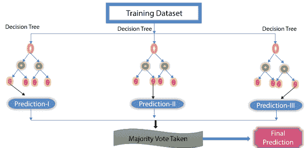

Figure 1.1 Architecture of random forest.

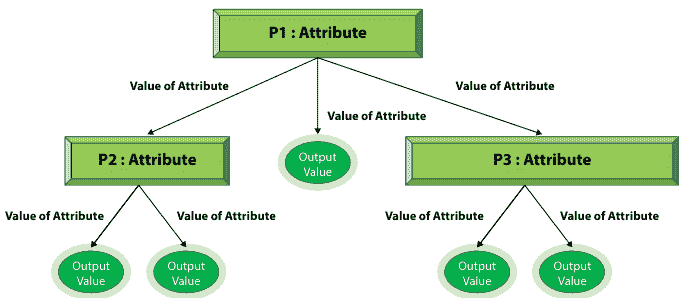

Figure 1.2 Decision tree.

values. In the simplest case, each test considers a single attribute, such that the instance space is portioned according to the attribute’s value. In case of numeric attributes, the condition refers to a range. Each leaf is assigned the best target class. The leaf may hold a probability vector that indicates the probability of the target attribute having a certain value. Navigating from the tree’s root to the leaf classifies instances based on tests along the way. Figure 1.2 shows a basic decision tree. Each node’s branch is labelled with the attribute it tests. Given this classifier, an analyst can predict the customer and understand their behaviour [4].

### 1.1.3 Support Vector Machine

SVM kernel is the name of a function that transforms low-dimensional space to high-dimensional space. Non-linear separation problems can be solved using this kernel.

The main advantage of SVM is that it is very effective in a high dimension case.

SVM is used for regression as well as classification but primarily it is best for classification purpose; the main purpose is to find distinct input features by hyperplane. If there are two input features then there is only one line and if there are three input features then hyperplane is 2-D plane. The draw is, when the number of features exceeds by three then it becomes difficult to imagine [5].

An extreme vector is chosen by SVM which helps to create hyperplane. Vectors which are nearer to hyperplane are called support vectors; thus, the algorithm is known as support vector machine, illustrated in Figure 1.3.

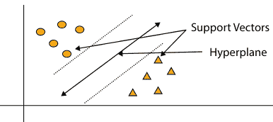

Figure 1.3 Support vector model.

Example: SVM can be understood with an example. A classification of dog and cat images can be easily done by SVM. In this case, first we train the model and then we apply testing with a creature. Cat and dog are two data points which are distinguished by one hyperplane. If there are extreme cases of cat, then it will classify cat; otherwise dog is to be classified.

There are two types of SVM kernel—linear and non-linear.

In linear SVM, dataset is classified into two classes using one hyperplane; such data is called linearly separable data. While in non-linear, dataset is not classified in one hyperplane; this data is called non-linear data.

### 1.1.4 Naive Bayes

Naive Bayes is based on Bayes theorem in classification technique. It is one of the methods in supervised learning algorithms and statistical method. But it is used for both clustering and classification depending on conditional probabilities that happen [6].

Let us assume one probabilistic model which allows to capture uncertainty by determining the probabilities of an outcome. The main reason for using Naive Bayes is that it can solve predictive problems; also, it evaluates learning algorithms. It obtains practical algorithms and can merge all observed data [7].

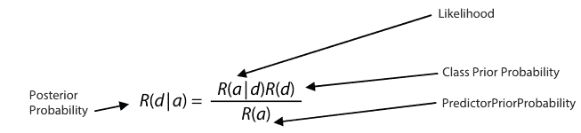

Figure 1.4 Naive Bayes.

Let's consider a general probability distribution of two values R(a1, a2). Using Bayes rule, without loss of generality we get this equation in Figure 1.4.

Considering a general probability distribution of two values R(a1,a2). We obtain without any loss of generality an equation [8].

### 1.1.5 K-Means Clustering

It is one of the clustering techniques in unsupervised learning algorithm. It classifies number of clusters from given dataset; and for each cluster, k centers are defined [9] as shown in Figure 1.5. This k centers are placed in a calculated way due to various locations which cause different results. Hence the better way is to place each cluster away from the others.

### 1.1.6 Principal Component Analysis

It is used to convert a set of observation of correlated variables to linearly uncorrelated variable. PCA shown in Figure 1.6 is a statistical process which uses orthogonal transformation. The data dimension is reduced for making the computations faster as well as easier, which is why the process is called “dimensionality-reduction technique”. Through the linear combinations, it explains the structure of variance-covariance set of variables [10].

### 1.1.7 Linear Regression

The linear regression algorithm finds relationships and dependencies between variables. It models the relationship between a continuous scalar dependent variable z (also label or target) and one or more (a D-dimensional vector) explanatory variables denoted X using a linear

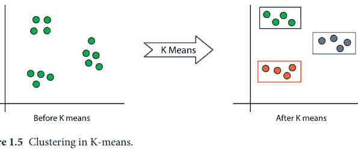


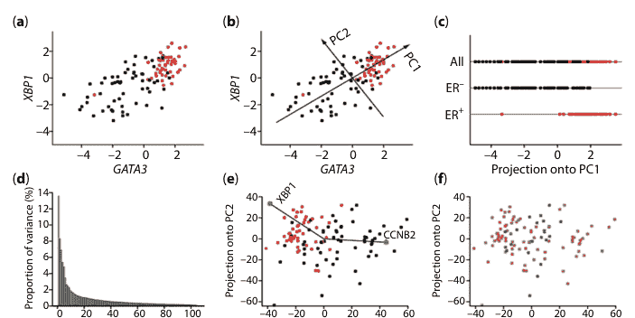

图 1.6 主成分分析 [11]。

函数。

回归分析预测连续目标变量，而分类则从有限集合中预测标签。线性输入变量的多元回归模型为：

z = B_0 + B_1x_1 + B_2x_2 + ..... + e (1.1)

监督学习算法包括线性回归 [11]。我们在标记数据（训练数据）上训练模型，并用其在未标记数据（测试数据）上预测标签。

图 1.7 展示了模型（红色线条）如何通过最小化损失函数，尽可能准确地拟合带有已知标签（z 轴）的训练数据（蓝色点）。我们可以使用该模型来预测未知标签（x 值，z 值）。

### 1.1.8 逻辑回归

与朴素贝叶斯一样，逻辑回归 [12] 从输入中提取一组加权特征，对其取对数，并线性相加。它是一种判别式分类器，而朴素贝叶斯是生成式的。

贝叶斯是生成式的。图 1.7 中的逻辑回归图通过将数据拟合到逻辑函数来预测事件概率。它使用多个数值或类别预测变量。

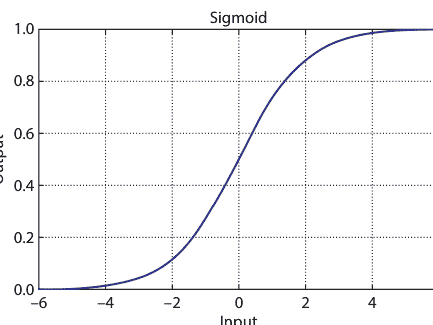

图 1.7 逻辑函数的可视化表示 [14]。

其假设定义为，

$A_b(y)=d(b^T y)$

其中 d 是定义为 Sigmoid 函数，

$d(z)=\frac{1}{1+e^{-z}}$

在机器学习中，我们使用一个名为 fmin bfgs2 的内置函数，在给定固定数据集的情况下找到该成本函数的最小值。参数是待优化参数的初始值，以及一个函数，该函数基于训练集和某个特定值，计算针对 x 和 y 数据集的逻辑回归成本和梯度。最终值用于绘制训练数据的决策边界。

### 1.1.9 半监督学习

半监督学习结合了监督方法和非监督方法。在存在未标记数据且对其标记过程繁琐的机器学习和数据挖掘场景中，它非常有用。在监督机器学习中，你在带有结果信息的“标记”数据集上训练算法 [13]。

### 1.1.10 传导 SVM

TSVM 广泛用于部分标记数据的半监督学习。其推广方法一直令人费解。它对未标记数据进行标记，以使它们之间的边界最大。TSVM 是 NP-hard 的 [14]。

### 1.1.11 生成模型

数据生成模型是生成式的。它建模特征和类别（完整数据）。所有建模 P(x, y) 的算法都是生成式的，因为我可以使用其概率分布来生成数据点。每个组件一个标记样本可确认混合分布。

### 1.1.12 自训练

分类器使用标记数据进行自训练。未标记数据输入分类器。训练集结合了未标记数据和预测标签。此过程重复进行。分类器进行自训练，因此得名 [15]。

### 1.1.13 元学习

强化学习关注软件代理人应如何行动以最大化累积奖励。强化学习是三种基本机器学习范式之一 [16, 17]。

## 1.2 结论

在本章中，我们调研了一些机器学习算法。当标记数据量较少时，机器学习将是最佳选择。未来我们将回顾强化学习。今天，每个人都在使用机器学习算法，无论是否知晓。

本章总结了监督学习算法并解释了机器学习。它还描述了机器学习算法结构。过去十年，该领域取得了长足发展。这些学习方法取得了过去无法实现的出色结果。由于进步迅速，开发人员可以改进监督学习方法和算法。

## 参考文献

- 1. Carbonell, Jaime G., Ryszard S. Michalski, and Tom M. Mitchell. 机器学习概述。*机器学习* (1983): 3-23.
- 2. Mahesh, Batta. 机器学习算法综述。*科学与研究国际期刊 (IJSR)*。[Internet] 9 (2020): 381-386.
- 3. Ayodele, Taiwo Oladipupo. 机器学习算法类型。*机器学习新进展* 3 (2010): 19-48.
- 4. Ray, Susmita. 机器学习算法快速综述。*2019 年机器学习、大数据、云和并行计算国际会议 (COMITCon)*。IEEE, 2019.
- 5. Vabalas, Andrius, et al. 有限样本量下的机器学习算法验证。*PloS one* 14.11 (2019): e0224365.
- 6. Tom Mitchell, McGraw Hill (2015) *机器学习*。
- 7. S. B. Kotsiantis. (2007) 监督机器学习：分类技术综述。载于 *2007 年计算机工程新兴人工智能应用会议论文集：面向 eHealth、HCI、信息检索和普适技术的现实世界人工智能系统，荷兰*。
- 8. Amanpreet Singh, Narina Thakur, Aakanksha Sharma (2016)。监督机器学习算法综述。载于 *面向可持续全球发展的计算 (INDIACom)，2016 年第 3 届国际会议*。
- 9. http://www.slideshare.net/GirishKhanzode/supervised-learning-52218215
- 10. https://www.researchgate.net/publication/221907660_Types_of_Machine_Learning_Algorithms
- 11. http://radimrehurek.com/data_science_python/
- 12. http://www.slideshare.net/cnu/machine-learning-lecture-3 监督机器学习方法概述
- 13. http://gerardnico.com/wiki/data_mining/simple_regression
- 14. http://aimotion.blogspot.mk/2011/11/machine-learning-with-python-logistic.html
- 15. Dasari L. Prasanna; Suman Lata Tripathi，“文本和语音处理的机器与深度学习技术”，载于 *信号和图像处理机器学习算法*，IEEE, 2023, pp. 115-128, doi: 10.1002/9781119861850.ch7
- 16. Kanak Kumar; Kaustav Chaudhury; Suman Lata Tripathi，“医疗监测系统中机器学习 (ML) 和深度学习 (DL) 的未来”，载于 *信号和图像处理机器学习算法*，IEEE, 2023, pp. 293-313, doi:10.1002/9781119861850.ch17.
- 17. Deepika Ghai, Suman Lata Tripathi, Sobhit Saxena, Manash Chanda, Mamoun Alazab, *信号和图像处理机器学习算法*，Wiley IEEE Press-2022, ISBN: 978-1-119-86182-9

# 人工智能与图像识别算法

Siddharth¹*, Anuranjana¹ 和 Sanmukh Kaur²

¹信息技术系，阿米蒂工程与技术学院，阿米蒂北方邦大学，诺伊达，印度 ²电子与通信工程系，阿米蒂工程与技术学院，阿米蒂北方邦大学，诺伊达，印度

## 摘要

使用特征检测器和描述子，已成功实现包括视频对象跟踪和图像检测/分类在内的各种计算机视觉任务。在检测-描述流水线的各个阶段，许多技术使用图像梯度来表征局部图像结构。近年来，卷积神经网络 (CNN) 取代了部分或全部依赖检测器和描述子的这些算法。早些被誉为尖端图像识别算法的算法，如 Harris 角点检测器、SIFT、ASIFT 和 SURF，如今已被更强大的算法所取代。本文档突出了图像识别算法的代际改进，并对比了当前基于 CNN 的图像识别技术与不依赖 CNN 的早期最先进算法。本研究旨在强调使用基于 CNN 的算法而非不够动态的传统算法的必要性。

## 关键词

卷积神经网络 (CNN)、尺度不变特征变换 (SIFT)、人工智能 (AI)、加速稳健特征 (SURF)

## 2.1 引言

人工智能在高级思维和感官处理等领域日益提升的能力，使其比人类智能更受推崇。其交互特性在监督环境的每个重要方面都表现卓越。自第五代计算时代到来以来，评论家的唯一关注点就是假装脑机接口是可行且动态的 [1]。计算机解码和识别每年在互联网上发布的数十亿张照片和数百万小时视频内容的能力，是一项极其重要的挑战。然而，已有大量关于从原始像素数据中推导高级信息的研究。

许多传统技术依赖于发现和提取显著的关键点。已提出许多技术来查找和描述 [2, 3] 中提到的特征。基于 Harris 角点检测器 [5] 并在此基础上改进的 SIFT 和 ASIFT [4]，是与 SURF [6] 一起最常用的两种技术。图像匹配算法通常包含两部分：检测器和描述子。它们首先在待比较图像中检测兴趣点，并在每个兴趣点周围选择一个区域，然后为每个区域关联一个不变描述子或特征。这样，通过匹配描述子即可建立相似性。检测器和描述子应尽可能不变 [3]。

近年来，研究人员提出了基于卷积神经网络的算法来识别和分类特征 [7]。CNN 已被有效用于解决语音识别和图像分类等挑战性问题。它们最早由 Fukushima 于 1998 年引入。CNN 由神经元组成，每个神经元决定学习的权重和倾向。它还包括输入层、输出层和各种隐藏层，其中隐藏层包括卷积层、池化层和全连接层等标准化层 [10]。卷积层使用卷积操作连接两组数据。它充当特定神经元的输入，用于视觉增强。池化层通过将单层中单个神经元的神经元簇输出进行池化来降低维度 [8]。

本文突出了基于 CNN 与传统图像检测算法之间的过渡。我们还对比了两种方法，并解释了为何 CNN 被优先于传统图像识别/分类方法。


## 2.2 传统图像识别算法

传统图像识别算法由探测器和描述符向量组成。在为每个区域分配不变描述符或特征之前，它们首先识别比较图片中的感兴趣位置，并选择围绕每个位置的区域。因此，通过匹配描述符，可以找到对应关系。最好是探测器和描述符尽可能不变 [3]。

### 2.2.1 Harris 角点探测器（1988）

它是一种从图像中提取角点并推导图像特征的数学方法。该方法首次提出于 1988 年，此后一直被用于许多算法中。确定角点是通过计算图像强度的变化来完成的。它使用下面的等式计算，该等式是使用 2D 方程的 Taylor 函数推导而来的。

```
E(u,v) = \sum_{x,y} w(x,y) \left[ I(x+u, y+v) - I(x,y) \right]^2 \qquad (2.1)
```

其中术语 I(x+u, y+v) 表示平移后/新的强度，平移量为 u 和 v，I(x,y) 表示原始强度。上述等式可以改写为矩阵形式，如下，

```
E(u,v) \approx \begin{bmatrix} u & v \end{bmatrix} M \begin{bmatrix} u \\ v \end{bmatrix} \qquad (2.2)
```

上述等式中的 M 为

```
M = \sum_{x,y} w(x,y) \begin{bmatrix} I_x I_x & I_x I_y \\ I_x I_y & I_y I_y \end{bmatrix} \qquad (2.3)
```

接下来，我们计算矩阵 M 的迹和行列式以求得 R，其中 R 为：
$R = det(M) - k(trace(M))^2$ （2.4）

其中，

- det(M)=λ1λ2
- trace(M)=λ1+λ2
- λ1 和 λ2 是 M 的特征值

因此，这些特征值的大小决定了区域是角点、边缘还是平坦区域。

- 当 |R| 较小时（即 λ1 和 λ2 均较小），该区域为平坦区域。
- 当 R<0 时（即 λ1>>λ2 或反之），该区域为边缘。
- 当 R 较大时（即 λ1 和 λ2 均较大且 λ1~λ2），该区域为角点。

Harris 角点探测器是一种简单的数学方法，用于识别在任意方向移动时显示出显著差异的窗口。每个窗口都有一个关联的得分 R。我们根据此得分来确定哪些是角点，哪些不是 [5]。Harris 角点探测器已被发现对平移、旋转和光照变化不变 [11]，但不具有尺度不变性，正如我们在某些算法中所见的那样

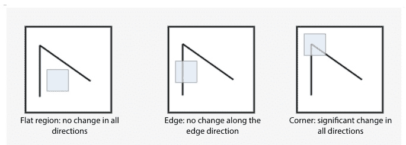

图 2.1 角点检测可视化。

这些算法采用并改进了 Harris 角点探测器（最著名的是 SIFT）[12]。上面的图 2.1 显示了从平坦区域到边缘再到角点区域的区域差异。

### 2.2.2 SIFT（2004）

在 SIFT 算法（尺度不变特征变换）的图像处理和识别中，我们试图将图像减少为一组局部独特点及其相关信息。然后我们在其他图像中查找这些点，如果数据匹配，我们可以说图像相似，即使它们来自不同的视角 [4]。SIFT 方法的初始目标是比较两幅图像（或两个图像部分），这些图像可以通过旋转、平移和尺度变化相互推导（或从共同图像推导）。该方法还被发现对相当大的视角变化具有鲁棒性，这解释了它的成功 [13]。

我们考虑关键点周围的补丁，并使用强度值或强度值的变化，即该区域的图像梯度用于描述它并将其转换为描述符向量。

如果我们有多幅图像并检测到相同的关键点，我们可以得出结论：这些是相同的图像；这里的“相同”不一定意味着完全相同，因为它们可以来自不同的角度和不同的光照条件。

两幅图像不必相同，但它们是从不同角度拍摄的同一位置，通过匹配图像中的关键点，我们可以得出结论：它们是同一地点 [4, 14]。

### SIFT 关键点的计算

局部独特点或关键点是使用高斯差分法找到的，这意味着获取的图像在不同幅度下使用高斯模糊。然后所有图像相互相减，并将差分图像堆叠在一起。然后我们寻找极值点，即在 X-Y 图像空间以及不同平滑级别的空间中具有邻居、局部独特且突出的点；它们是关键点。这不仅针对一种图像分辨率进行，还在图像金字塔上执行，即不同缩放尺寸的图像，以找到对尺度变化也具有区分度的关键点，也就是说，如果你离物体更近，当你离得更远时也会找到相同的关键点 [3]。

### SIFT 描述符向量的计算

这是通过查看我们找到的关键点的局部邻域来计算的。然后我们将邻域分解为小区域，并在这些小区域中找到梯度。我们使用梯度，因为它们对消除变化和某些视角变化相当强健。下一步是将局部区域中的梯度收集到直方图中，例如某些梯度出现的频率、它们的幅度等。然后在关键点周围，例如在 4x4 区域中我们有 16 个局部区域，因此我们制作 16 个直方图 [13]。

### 仿射变换

取决于相机及其设置、照明以及物体本身的变化，即使是相同物体的图像也可能显著不同。为了监控、搜索和理解照片，处理上述某些变化的一种选择是利用对上述某些修改无感知的对象描述。为此通常使用仿射不变量 [15]。

### 仿射不变性

这意味着在仿射变换下表面被视为相同的，即线性变换 x → Ax + b，包括挤压和剪切 [15]。

### 2.2.3 ASIFT

ASIFT 或仿射尺度不变特征变换基于 SIFT，但与 SIFT 不同，ASIFT 可以容纳所有六个属性，并且能够以足够的精度模拟甚至由相机光轴方向引起的畸变。ASIFT 方法复制了通过改变两个相机轴向参数（即纬度和经度角）所能获得的所有图像视图。然后使用 SIFT 方法来覆盖剩余的四个参数 [13]。

### ASIFT 相对于 SIFT 的优势

- 当 SIFT 算法产生的匹配数量显著时，ASIFT 的精度优于 SIFT [4, 13]。
- 对于正在测试的各种图像类型，ASIFT 表现更好。从视觉检查来看，性能在匹配数量和精度方面都显而易见 [4, 16]。
- 尽管考虑到当今的处理能力，ASIFT 的计算复杂度高于 SIFT，但 ASIFT 在图像匹配和图像注册应用方面表现更出色 [4]。
- ASIFT 覆盖所有六个仿射不变量，而 SIFT 则不覆盖 [4, 13]。

### 2.2.4 SURF（2006）

SURF 方法（加速稳健特征）是一种用于本地相似不变图像表示和比较的快速可靠方法。SURF 方法的关键吸引力在于其能够使用盒式滤波器快速计算算子，从而实现跟踪和对象检测等实时应用 [17]。

### SURF 的动机：

- 更快地检测关键点
- 更不复杂
- 尺度和旋转不变且对光度变化不变
- 降低描述符维度，因为特征大小直接影响计算成本，因此我们尽量保持较小的描述符尺寸。

### SURF 关键点

SURF 关键点的提取基于三种主要方法，这些方法降低了图像的复杂性，使得 SURF 算法比 SIFT 更快 [17]。

- 积分图像
- Hesse 矩阵
- 高斯差分


### Integral Images

In 1984, the Integral Image or Summed-Area Table was first shown. A rectangular subset of a grid or the sum of values (pixel values) in each image can be quickly and accurately calculated using the Integral Image (the given image). It can be used to determine the average intensity inside a certain image, or this is its primary usage. They allow for fast computation of box-type convolution filters. The entry of an integral image IΣ (x) at a location x = (x,y)^T represents the sum of all pixels in the input image I within a rectangular region formed by the origin and x.

```
I \sum (x) = \sum_{i=0}^{i \le x} \sum_{j=0}^{j \le y} I(i, j) (2.5)
```

With IΣ calculated, it only takes four additions to calculate the sum of the intensities over any upright, rectangular area, independent of its size. The integral images make the Haar features more efficient [19].

For example: Figure 2.2 shows how integral images are calculated for a given set of pixels.

| 98 | 110 | 121 | 125 | 122 | 129 | | 98 | 208 | 329 | 454 | 576 | 705 |
| --- | --- | --- | --- | --- | --- | --- | --- | --- | --- | --- | --- | --- |
| 99 | 110 | 120 | 116 | 116 | 129 | | 197 | 417 | 658 | 896 | 1137 | 1395 |
| 97 | 109 | 124 | 111 | 123 | 134 | | 294 | 623 | 988 | 1340 | 1701 | 2093 |
| 98 | 112 | 132 | 108 | 123 | 133 | | 392 | 833 | 1330 | 1790 | 2274 | 2799 |
| 97 | 113 | 147 | 108 | 125 | 142 | | 489 | 1043 | 1687 | 2255 | 2864 | 3531 |
| 95 | 111 | 168 | 122 | 130 | 137 | | 584 | 1249 | 2061 | 2751 | 3490 | 4294 |
| 96 | 104 | 172 | 130 | 126 | 130 | | 680 | 1449 | 2433 | 3253 | 4118 | 5052 |

Figure 2.2 Above figures show how integral images are calculated to determine high-intensity key points.

### Hessian Matrix

A square matrix of second-order partial derivatives of a scalar-valued function, or scalar field, is known as the Hessian matrix or Hessian. It describes a function with many variables' local curvature. It’s a refined way to package all the information of the second derivatives of a function.

**Hessian matrix-based interest points**: Surf utilizes the Hessian matrix due to its efficiency and precision in computing. Surf depends on the determinant of the Hessian matrix to choose the scale and position rather than employing a separate measure (Hessian-Laplace detector). The Hessian of a given pixel looks something like this:

```
H = \begin{bmatrix} \frac{\partial^2 f}{\partial x^2} & \frac{\partial^2 f}{\partial x \partial y} \\ \frac{\partial^2 f}{\partial y \partial x} & \frac{\partial^2 f}{\partial y^2} \end{bmatrix} (2.6)
```

For adapting to any scale, we filtered the image by a Gaussian kernel, so given a point X = (x, y), the Hessian matrix H(x, σ) in x at scale σ is defined as:

```
H(x, σ) = \begin{bmatrix} L_{xx}(x, σ) & L_{xy}(x, σ) \\ L_{xy}(x, σ) & L_{yy}(x, σ) \end{bmatrix} (2.7)
```

where Lxx(x) is the convolution of the Gaussian second order derivative with the image I at position x, and Lxy(x) and Lyy(x) follow suit. Although Gaussians are the best choice for scale-space analysis, they must be discretized and cropped.

First, convolution with a Gaussian kernel must be used to determine the Hessian matrix's determinant, and then the second-order derivative. Following Lowe’s success with DoG approximations (SIFT), SURF uses box filters to enhance the approximation (both convolution and second-order derivative). Due in part to the fact that these approximative second-order Gaussian derivatives can be calculated using integral pictures regardless of size at a very cheap computational cost, SURF is fast.

### Table 2.1 Comparative analysis of different algorithms.

| 算法 | 优势 | 不足 | 参考文献 |
|---|---|---|---|
| Harris 角点探测器 | Harris 角点探测器对平移、旋转和光照变化不变。 | 不具有尺度不变性，我们将看到一些采用并改进了 Harris 角点探测器的算法（最著名的是 SIFT）。 | [11, 12] |
| SIFT | SIFT 算法非常强大，因为它既对图像尺度又对图像方向不变。此外，研究发现，在存在 3D 透视、不同光照条件和噪声时，SIFT 表现更好。 | SIFT 只能容纳与仿射不变性相关的六个参数中的四个。SIFT 描述子非常大，为 128 维。SIFT 比基于 SIFT 但更稳健并涵盖所有六个仿射不变量的 ASIFT 慢得多且精度更低。 | [4, 13] |
| ASIFT | ASIFT 的精度优于 SIFT；它为图像匹配和图像注册应用提供了更好的表现，并且涵盖所有六个仿射不变量，而 SIFT 则不涵盖。 | 尽管 ASIFT 涵盖所有六个仿射不变量，但它比 SURF 慢得多。 | [4, 13, 16] |
| SURF | SURF 的主要优势在于其速度。SURF 使用黑森矩阵、积分图像和 DoG 来处理图像并加速计算。与 SIFT 的 128 维向量相比，它拥有较小的描述子向量 64 维，使其更易于处理。 | SURF 算法对旋转变化不稳定，且无法正确处理光照。 | [17, 19] |

The 9x9 box filters approximate Gaussian second-order derivatives with σ = 1.2. These approximations are represented by Dxx, Dyy, and Dxy. Now, we can approximate the determinant of the Hessian by the following:

```
det(H_approx) = D_xx D_yy - (w D_xy)^2    (2.8)
```

By using the above equation, a SURF key point is determined [17, 18].

## 2.3 Neural Network–Based Algorithms

Deep learning is a powerful artificial intelligence technique that uses multiple informational layers to produce the best results across a variety of classes. Deep learning has demonstrated excellent performance in several fields, particularly in the clustering, dividing, and recognition of images [7]. A very powerful form of a neural network is a convolutional neural network that is used for image recognition, classification and much more. We shall discuss the basic structure of a convolutional neural network, different architectures, generational improvements and why they are superior to traditional methods.

## 2.4 Convolutional Neural Network Architecture

It is a Deep Learning system that can take in an input image, give various characteristics and objects in the image importance (learnable weights and biases), and be able to tell one from the other. Comparatively speaking, a CNN requires substantially less pre-processing than other classification methods. While filters in older methods are hand-engineered, CNNs can learn these filters/characteristics with adequate training. CNN is crucial in information bases, where there is a need to prepare many hubs and boundaries (e.g., picture handling) [20]. Shown below in Figure 2.3 is the architecture of a CNN.

The architecture of CNN’s is divided into different layers and is defined below:

- **Convolutional layer** - The convolutional layer, which determines the output of linked input in an open area, is the fundamental component of the convolutional neural network. A two-dimensional activation guide of the track is created by parts convolved above the data information’s height and width, registering the speck item between the input and channel esteems, and performing these operations.
- **Non-linear layer** - The vast potential of non-linear systems must be greater than that of the individual. The info sign will be converted to the yield sign in this layer, and that signal will then be utilized to contribute to the layer below.
- **Pooling layer** - Its main function is to decrease the number of boundaries and counts in the model proportionate to the spatial size of the portrayal. It expedites estimations and avoids the overfitting problem. Maximum pooling is the most well-known variety of pooling layers.

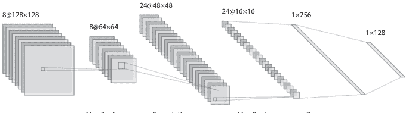

Figure 2.3 General architecture of a CNN.


- 全连接层 - 神经网络中完全连接的层，其所有输入都连接到上一层中的每个激活单元。大多数主流机器学习模型的最后几层都是全连接层，用于整合前馈层收集的数据以生成输出。卷积层耗时最长，其次是这一层。

## 2.5 各种 CNN 架构

### 2.5.1 LeNet-5 (1998)

也许最方便的设计是 LeNet-5。它有三个全关联层和两个卷积层 [21]。如图 2.4 所示，每个卷积层后面都跟着一个平均池化层。如我们无疑早已知道，传统的池化层包含可训练权重，当时被称为子采样层。该设计中约有 60,000 个参数。1998 年，LeCun 提出了 LeNet [22]。在 2000 年代初，通常不使用图形处理单元甚至 CPU 来加速训练。经典多层全连接神经网络的主要局限在于，它将每个像素视为独立输入并对其进行调整，在 1998 年当时，这是一个巨大的计算负载。LeNet 通过忽略这种关系，违反了图像的基本原理——即相邻像素是相连的，且这些特征概念分布在整幅图像中。LeNet 是第一个压缩不同参数的卷积网络架构，并且还可以无意中从原始像素理解特征。

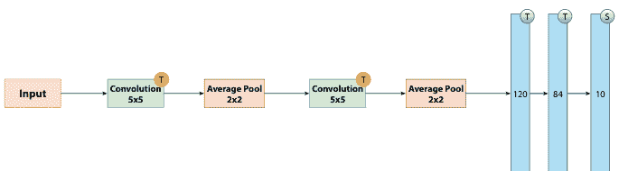

图 2.4 LeNet 架构，用于数字识别的卷积神经网络。每个平面是一个特征图，即一组权重被约束为相同的单元。

### 2.5.2 AlexNet (2012)

AlexNet 通过将深度从五层（LeNet）扩展到八层 [23]，创建了适用于各种图像类别的卷积神经网络。图 2.5 突出了 AlexNet 的结构及其连续卷积。内外扩展的主要缺点是过拟合，尽管深度通常会一次性增加对多张图片的泛化能力。由于其有效的学习方法，AlexNet 在最新一代卷积神经网络中具有重要意义，并引发了对众多 CNN 改进的新一波研究 [24]。

### 2.5.3 VGGNet (2014)

为了扩展神经架构的能力，视觉几何组（VGG）除了在 ILSVRC 数据集上实现最前沿的准确率外，还应用于不同的图像识别数据库 [26]。VGG-16 由十三个卷积层组成，其中包含三个全连接层。图 2.6 显示了 VGGNet 的结构，其末端包含 3 个全连接层；然而，VGG-19 中包含三个额外的卷积层。它们采用 3×3 响应区域通道，每个隐藏层都配备了修正非线性操作。Ren 利用识别组织 [27] 和整幅图像的卷积特征开发了区域提议网络。基于卷积神经网络和区域提议网络的更快区域，在 ImageNet 大规模视觉识别挑战赛和 COCO 2015 中，时隔多年首次排名第一。

### 2.5.4 GoogleNet (2015)

在 ImageNet 识别与描述挑战中，GoogleNet 提供了最具创新性的实现。模型中对 PC

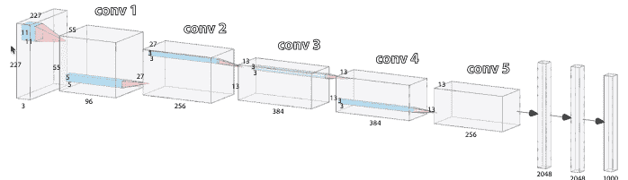

图 2.5 AlexNet 架构，卷积神经网络。

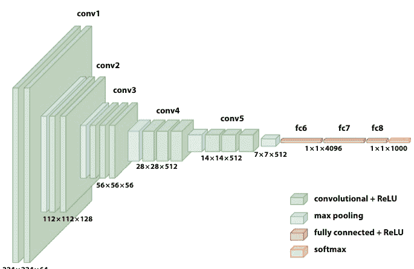

图 2.6 VGGNet 架构。

资源的改进使用是该模型的主要指标 [25]。GoogleNet 还建议使用辅助分类器来加速收敛。该架构的主要缺点是其多样的网络拓扑，需要从一段到另一段进行修改。GoogleNet 的另一项局限是信息瓶颈，它大大减少了后续层中的全局特征信息量，并偶尔可能导致有用数据丢失。

表 2.2 CNN 模型比较分析。

| CNN 模型 | 优势 | 不足 | 参考文献 |
|---|---|---|---|
| LeNet-5 | 它利用空间关系减少计算数量和边界，使用编程学习渐进组件系统；低级组件提取。 | 各种图像类别的扩展性脆弱；大尺寸通道。 | [22] |

表 2.2 CNN 模型比较分析。（续）

| CNN 模型 | 优势 | 不足 | 参考文献 |
| :--- | :--- | :--- | :--- |
| AlexNet | 在第一层（5x5 和 11x11）和最后一层（3x3）使用大小和小型通道；低、中、高级别元素提取；考虑 CNN 的广泛且深入的工程；在 CNN 上显示了修正；开始将 GPU 同样用作加速器来管理复杂结构。 | 第一层和第二层中的隐藏神经元；由于通道大小巨大，导致学习特征图的关联错误。 | [28] |
| VGGNet | 它提出了高效感受野的概念；提供了简单、统一地理的概念。 | 使用计算成本高的高度连接层。 | [29] |
| GoogleNet | 在层内使用多尺度通道；提出了分离、变换与统一的革命性理念；使用瓶颈层、标准全局池化最终层和弱关联，减少边界数量。使用助手分类器来提高收敛率。 | 地理多样性导致繁琐的边界定制；真正的瓶颈可能导致重要数据丢失。 | [30] |

## 结论

本文强调了图像识别/分类领域所用算法的代际改进，针对每个列出的算法的不足及其后续改进进行了探讨。通过对多篇研究论文的文献综述，我们发现，曾被誉为最先进算法的算法（如 SIFT [3]）已得到改进。例如，SIFT 的派生算法 ASIFT [13] 改进了 SIFT [4] 的许多缺陷，最终 SURF [17] 是其中最快的。这些算法的主要缺陷在于它们是手工设计的，因此不会自行学习表示；它是硬编码的，这就是为什么 CNN 相比这些算法具有优势。

CNN 在图像处理和基于视觉的任务上取得了巨大进步，重新激发了分析师对 ANNs 的兴趣。在这种情况下，已经进行了一些研究项目来确定卷积神经网络在这些任务上的表现 [31]。卷积神经网络的进步可以以多种不同的方式排列，例如初始化、随机工作、增强、正则化、学习计算和设计改进。本文还讨论了卷积神经网络的历史背景、表现、挑战以及关于不同课程中 CNN 序列的未来方向 [9]。CNN 的基于块的工程支持循序渐进的学习，从而使设计更不复杂、更合理 [32]。

因此，我们已经考察了许多常规方法和 CNN 架构的不足。接下来，我们将探讨 CNN 在图像处理中的应用以及新的创新 CNN 架构，这将是本文未来的研究范畴。

## 参考文献

- 1. M. Hussain, M.A. Haque, 等, Swishnet: 一种用于语音、音乐和噪声分类与分割的快速卷积神经网络, 2018, arXiv 预印本.

- 2. Y. Li, S. Wang, Q. Tian, 和 X. Ding, “最近视觉特征检测的进展综述,” Neurocomputing, vol. 149, pp. 736–751, 2015.

- 3. D. G. Lowe, “来自尺度不变关键点的独特图像特征,” International Journal of Computer Vision, vol. 60, no. 2, pp. 91–110.

- 4. SIFT 和 ASIFT 图像匹配算法的实现与性能分析。载于: Dash, S., Naidu, P., Bayindir, R., Das, S. (eds.),


- 工程系统中的人工智能与进化计算. Advances in Intelligent Systems and Computing, vol 668. Springer, Singapore. 2018
- 5. Harris, Christopher G. 和 M. J. Stephens. “角点与边缘联合检测器.” Alvey Vision Conference (1988).
- 6. Duan, Hongyan, Zhang, Xiaoyu, 和 He, Wensi. (2019). 零件图像匹配SURF算法优化：数据与安全工程专刊. 10.1007/978-981-13-3651-5_11.
- 7. Shivani Gaba, Ishan Budhiraja, Vimal Kumar, Sahil Garg, Georges Kaddoum, Mohammad Mehedi Hassan, “卷积神经网络的联邦校准方案：模型、应用与挑战”, Computer Communications, Vol. 192, 2022, 144-162.
- 8. Xu, Haoyu et al. “基于卷积神经网络的外来物碎片材料识别.” EURASIP Journal on Image and Video Processing 2018 (2018): 1-10.
- 9. Hegadi, Ravindra. (2010). “图像处理：研究机遇与挑战”.
- 10. Li, H. (2015/04). 基于神经网络的智能图像识别技术研究. 2015年智能系统研究与机电工程国际会议论文集, 1733–1736.
- 11. Tinne Tuytelaars and Krystian Mikolajczyk, “局部不变特征检测器：综述,” Foundations and Trends in Computer Graphics and Vision, May (2008).
- 12. Cordelia Schmid, Roger Mohr 和 Christian Bauckhage, “兴趣点检测器评估,” International Journal of Computer Vision, June (2000).
- 13. Jean-Michel Morel 和 Guoshen Yu. 2009. ASIFT: 完全仿射不变图像比较新框架. SIAM J. Img. Sci. 2, 2 (April 2009), 438–469. https://doi.org/10.1137/080732730
- 14. “SIFT - 与Cyrill共度5分钟” - Youtube
- 15. Werman, M. (2014) 仿射不变量. In: Ikeuchi K. (eds.) 计算机视觉. Springer, Boston, MA. https://doi.org/10.1007/978-0-387-31439-6_747
- 16. Wu, Jian; Cui, Zhiming; Sheng, Victor; Zhao, Pengpeng; Su, Dongliang; 和 Gong, Shengrong. (2013). SIFT及其变体比较研究. Measurement Science Review. 13. 10.2478/msr-2013-0021.
- 17. Bay, H., Tuytelaars, T., Van Gool, L. (2006). SURF: 加速稳健特征. In: Leonard, A., Bischof, H., Pinz, A. (eds.) 计算机视觉 – ECCV 2006. ECCV 2006. 计算机科学讲义, vol 3951. Springer, Berlin, Heidelberg. https://doi.org/10.1007/11744023_32
- 18. Oyallon, E., 和 Rabin, J. (2015). SURF方法分析. Image Processing On Line, 5, 176–218.
- 19. Viola, P., Jones, M.: 基于简单特征增强级联的快速目标检测. In: CVPR (1). (2001) 511–518.
- 20. Q. Zhang, L.T. Yang, Z. Chen, P. Li, 基于大数据的深度学习综述, Inf. Fusion 42 (2018) 146–157.
- 21. S. Milyaev, I. Laptev, 噪声图像中可靠目标检测研究, Pattern Recognit. Image Anal. 27 (4) (2017) 713–722.
- 22. Y. LeCun, L. Bottou, Y. Bengio, P. Haffner, 基于梯度的学习在文档识别中的应用, Proc. IEEE 86 (11) (1998) 2278–2324.
- 23. D. Hutchison, LNCS 85588—智能计算理论. 2014.
- 24. Sharma, S. Gaba, S. Singla, S. Kumar, C. Saxena, R. Srivastava, 用于优化网络通信的改进遗传量子密码学模型, 收录于：通信与智能系统近期趋势, Springer, 2020, pp. 47–54.
- 25. C.-H. Wu, Q. Huang, S. Li, C.-C.J. Kuo, 用于关键监督目标检测的教导-观察-询问(TOA)方法, 2017, arXiv预印本 arXiv:1711.01043.
- 26. X. Xia, C. Xu, B. Nan, 用于花卉分类的Inception-v3, 收录于：2017年第2届图像、视觉与计算国际会议, ICIVC, IEEE, 2017, pp. 783–787.
- 27. Dhillon, A., Verma, G.K. 卷积神经网络：模型、方法论及在目标检测中的应用综述. Prog Artif Intell 9, 85–112 (2020).
- 28. Krizhevsky, A., Sutskever, I., 和 Hinton, G. (2012). 基于深度卷积神经网络的ImageNet分类. In 神经信息处理系统进展. Curran Associates, Inc.
- 29. Simonyan, K., 和 Zisserman, A. (2014). 用于大规模图像识别的非常深层卷积网络.
- 30. Szegedy, C., Liu, W., Jia, Y., Sermanet, P., Reed, S., Anguelov, D., Erhan, D., Vanhoucke, V., 和 Rabinovich, A. (2015). 卷积网络更深入. 收录于：IEEE计算机视觉与模式识别会议论文集 (CVPR).
- 31. Y. Lee, H. Kim, E. Park, X. Cui, H. Kim, 用于实时目标检测的宽残差Inception网络, 收录于：2017年IEEE智能车辆研讨会, IV, IEEE, 2017, pp. 758–764.
- 32. Liu, C., Cao, Y., Luo, Y., Chen, G., Vokkarane, V., Ma, Y. (2016). DeepFood: 基于深度学习的食物图像识别，用于计算机辅助膳食评估. In: Chang, C., Chiari, L., Cao, Y., Jin, H., Mokhtari, M., Aloulou, H. (eds.) 包容性智慧城市与数字健康. ICOST 2016. 计算机科学讲义, vol 9677. Springer, Cham. https://doi.org/10.1007/978-3-319-39601-9_4

# 基于FPGA的实时系统的高效架构与权衡

L.M.I. Leo Joseph*, J. Ajayan, Sandip Bhattacharya 和 Sreedhar Kollem

电子与通信工程系，工程学院，SR大学，瓦朗加尔，特伦甘纳邦，印度

## 摘要

实时监控能够提供准确及时的信息，这对于任何生产改进和决策制定都至关重要。现场可编程门阵列（FPGA）的最新技术已经模糊了硬件与软件之间的差距。通过结合多个传感器系统的测量数据，可以规避使用独立系统时存在的问题。本章从多个角度强调了设计策略和算法开发的重要性，以及它们在各种实时系统中的实现，采用可重构和混合方法。在FPGA上使用可配置软核处理器将提供与多种传感器接口所需的适应性。

关键词：FPGA, 实时系统, 混合架构, 硬件加速, SVM, CNN, Zynq, Pynq

## 3.1 基于FPGA的实时系统概述

响应在规定时间或实时内准确的系统称为实时系统 [1]。飞行控制机制和实时监视器是实时系统的两个示例。实时系统以不同形式应用于不同的应用场景。实时系统根据时序约束分为两类：i) 硬实时系统 ii) 软实时系统。

### 硬实时系统

硬实时系统按预期执行任务，不会错过任何截止时间 [2]。如果系统性能偏离并违反截止时间，则整个过程将遭受延迟。延迟是指系统偏离其预期截止时间的程度。延迟会突然降低系统的整体效率。飞行控制器可以归类为硬实时系统。

### 软实时系统

软实时系统执行任务，但可能会错过某些任务的截止时间 [2]。如果系统性能偏离并违反截止时间，则除罕见情况外，不会产生严重后果。系统有效性与延迟成反比。延迟会突然降低系统的整体效率。交叉网络和多路复用开关是软实时系统的示例。

### 3.1.1 实时系统的关键要素

实时系统运行需要三个关键要素：

i) 工作模型，ii) 资源模型，iii) 算法。

各要素的必要性如下：

- a) 工作模型探索系统及其应用。
- b) 资源模型突出了为应用开发任何系统可用的资源。
- c) 算法揭示了应用的资源使用情况。

### 3.1.2 实时系统及其计算

实时系统包含用于维护和跟踪当前时间的实时时钟，以确保任务在截止时间内完成。参考模型架构结合实时编程语言规定了必须在特定时间内完成的任务。IC技术的革命，加上FPGA、微控制器和处理器等附加组件，使得实时数字仿真成为可能 [3]。基于CPU的计算基础受限于顺序设计，这限制了这些平台在实时环境中的扩展。在这方面，一个灵活的计算平台至关重要，它能将基于CPU的平台与实时系统进行对接。上述观点可以通过灵活的可重构数字计算平台来实现。


称为现场可编程逻辑门阵列（FPGA）。FPGA 可用作低功耗 CMOS 芯片设计与计算的基础。这些芯片具有灵活的可编程逻辑，使其可用于台式系统。

### 3.1.3 FPGA 功能与应用

现场可编程逻辑门阵列（FPGA）由可编程互连网格组成，用于在可重构逻辑块（CLB）之间建立连接。FPGA 可根据用户要求和应用需求从用户端进行定制。专用集成电路（ASIC）是专门为特定设计目的制造的专用 FPGA，本质上不可定制 [3]。（OTP）FPGA（一次编程）具有设计特定性，但与通用 FPGA 相比，由于其局限性和不可定制性，其应用范围有限。

FPGA 为任何类型的设计提供了一种有效的替代方案。从同等角度来看，ASIC 在竞争技术方面也发挥着至关重要的作用。ASIC 与 FPGA 这两种技术通过信息进行对比。在为设计目的选择其中任何一种技术之前，都应考虑两者之间的权衡。在早期，FPGA 用于需要高工作速度、高设计复杂度和大批量设计的场景。IC 技术的进步使 FPGA 能够提供 MHz 范围内的更佳频率。

### 3.1.4 FPGA 应用

前一节表明，FPGA 似乎更适合用于实时应用的开发。FPGA 的编程方法为 Xilinx 和 Altera 等许多供应商提供了一个具有挑战性的平台，以向许多设计提供全面解决方案，这些设计需要可重构硬件、软件和预定义 IP 核，以利用第三方应用。FPGA 在不同领域的应用如下汇总：

- **汽车** – 基于 FPGA 的汽车内饰设计可确保驾驶员安全与舒适，娱乐系统的加入使设计在商业上可行。

- **消费电子** – 现代常见家用电子产品配备嵌入式芯片，可应用于数字电视显示屏、可穿戴设备显示屏、机顶盒等 [3]。

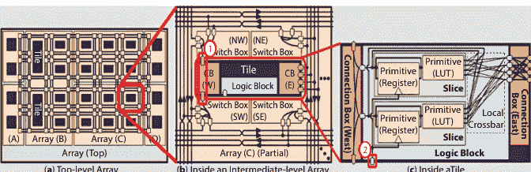

图 3.1 FPGA 架构 [4]（开放获取）。

- **数据中心** – 提高高带宽云计算电路的潜力，包括高存储低延迟服务器。它还支持存储区域网络（SAN）的高端操作 [3]。

FPGA 适用于多种应用，如图像处理、医学成像以及工业监测与自动化。FPGA 灵活、设计更快且原型制作更迅速，可降低非经常性工程成本（NRE） [3]。

- **医疗** – FPGA 系列可用于多种医疗设备的显示，用于监测和诊断应用。它还充当感知与监测应用之间的接口 [3]。

- **安全** – FPGA 在民用和工业监控系统的开发中提供支持；FPGA 凭借其可重构架构，为频繁涌现的新兴应用提供解决方案。FPGA 的可适应性使用户能够维护硬件和软件设计协议 [3]。

### 3.1.5 FPGA 架构

图 3.1 所示的核心 FPGA 架构由若干可定制逻辑块（CLB）组成，这些逻辑块通过一种互连结构（即可编程互连网络，如第 3.1.3 节所述）相互连接。“输入/输出（I/O）块”将核心 FPGA 与外部设备连接起来。

委托给模块的逻辑操作由 CLB 执行。I/O 块和 CLB 通过可编程多路选择器、水平和垂直布线通道相互连接。FPGA 的复杂度与其 CLB 数量成正比。硬件描述语言用于设计 CLB 和可编程结构化多路选择器（PSM）[5] 的功能。先进 FPGA 拥有约 1,100 个输入/输出块和 330,000 个逻辑块。

所述 CLB 由以下部分组成：i) 逻辑块，ii) 互连，iii) 输入-输出块。

- **逻辑块：** 可编程逻辑块负责为数字系统提供计算和存储所需的基本元素。基本逻辑元素包括可编程逻辑、触发器和快速进位逻辑 [5]，以减少处理信息所需的空间和时间。

现代 FPGA 由多种不同的块组成，例如存储块和多路选择器。用于配置的存储器在所有逻辑块中使用，以调节每个单独元素的功能。

- **互连：** 为了完成用户自定义的设计单元，可编程布线在“逻辑块和输入/输出块”之间建立连接 [5]，以便它们可以相互通信。

- **输入-输出块：** 输入-输出块充当布线架构与逻辑块之间的可编程接口，允许这两层与系统外部的组件进行通信。

混合器件的最新进展促进了可重构器件技术中可扩展处理功能的发展，其中 FPGA 通过 AXI 总线接口与嵌入式内核集成在一起。这种混合平台设计通过将 FPGA 和 CPU 放在同一芯片上，实现了 FPGA 中用户逻辑与 CPU 上低功耗集中工作负载之间的低延迟通信。通过结合许多传感器系统的测量数据，可以避免使用独立系统时存在的问题。下一节将讨论将 FPGA 与 CPU 及其功能一起实现的构想。

### 3.1.6 可重构架构

杰拉尔德·埃斯特林提出了使用传统 CPU 构建计算机的构想。可重构硬件触发了发展可重构计算的理念。主处理器相当于可重构硬件。一旦前一项任务完成，硬件即可执行另一项任务。这种方法为开发一种结合硬件速度与软件灵活性的混合计算机架构奠定了基础 [6]。现场可编程逻辑门阵列（FPGA）是具有多个计算单元的可重构器件，其功能由一组可编程配置位控制。器件的空间配置随时间和应用而变化，以采用最佳计算策略，加速特定或专用应用。器件结构将再次重新定向，以按顺序容纳新应用。可重构器件的结构可以在编译时通过更改整个硬件或其一部分来修改。在修改后的器件结构中下载逻辑可提供灵活性，这与冯·诺依曼计算机形成对比，后者由一组在运行时按顺序执行的指令组成。程序应能适应硬件，以便与可重构系统的灵活性协同工作。这使得系统在任何适应可重构环境的应用中表现更好。简而言之，通用计算机以其性能著称，而专用集成电路（ASIC）以其灵活性著称；性能和灵活性是任何可重构结构的两个重要方面。可重构计算通过提供比硬件更出色的灵活性，同时可能获得比软件更高的效率，弥合了硬件与软件之间的性能差距 [4]。通过重构方法，设计兼具通用计算机灵活性和 ASIC 性能的单一器件是可取且可行的。与 FPGA 实现相比，ASIC 实现策略通常能产生更快速、更紧凑、低功耗的设计。然而，由于市场对设计灵活性的需求不断上升，混合（ASIC-FPGA）器件的需求正在推动。为了使用单一掩膜组容纳众多设计替代方案，设计师必须将高密度 ASIC 电路与 FPGA 电路的固有灵活性相结合 [4]。为了缩短设计时间并促进标准化，可以构建一种“基础设计”，后续器件可在显著修改的基础上重复使用该设计。由于大多数消费品和办公用品都有从低端到高端的多种配置，可以使用这种基础设计方法，通过向每个型号添加新功能来实现。这一想法可应用于多种设备，如计算机、打印机、传真机和扫描设备。FPGA 的乘累加和处理能力使其能够与 DSP 应用协同工作。在设计 DSP 系统时，可以使用并行结构和算术算法来最大化效率，并优于单用途或多用途 DSP 器件。通过在单一设计中结合 ASIC 和 FPGA 的功能，可以以仅靠其中一种电路技术无法实现的方式提升系统性能。


支持摄像头、LED、收发器等多种标准的单片设计往往将自身局限于混合 ASIC/FPGA 结构 [4]。缺乏可编程基础的混合设计人员被迫在芯片级别选择 FCI（强制进位输入）逻辑，该逻辑会不时发生变化。程序员通常会绕过设计要求和最终确定策略，这可能会延迟成品设备的发布。ASIC 和可编程逻辑可以在单个设备上协同工作以满足各种情况。除了具有可比性质的其他挑战之外，各种区域标准也可能实现在 FPGA 核心中。这是一项需要克服的挑战。设计团队不太可能在该新功能在商业上可行之前使用它。对于希望享受 ASIC 在性能和密度方面优势的设计团队而言，他们将不得不考虑 NRE 和 TA%（这些数值听起来比 FPGA 高得多）。由于“独特掩模”这一术语，ASIC 设计的可行性似乎不确定。

与定制 FPGA 不同，每项涉及 ASIC 的设计在芯片生产期间都需要一套独特的掩模。通过根据每个单独应用的要求定制电路和连接器，可以实现高水平的性能和密度。尽管如此，掩模组的成本在不断上升，呈递增趋势。作为这一直接结果，在许多情况下，每个晶圆的成本越来越多地由掩模成本构成。除了分区问题之外，使用嵌入式 FPGA 的设计师还将面临其他几项挑战。应集成多少个 FPGA 门电路是一个根本重要的问题。除了为初始应用提供足够的空间外，FPGA 还必须拥有足够的未使用 FPGA 资源，以便为任何未来的逻辑设计腾出空间。这是设计过程规划阶段的一项关键考量，因为一旦混合设备由硅制成，如果 FPGA 容量不足以管理预期配置，可能需要第二套更昂贵的掩模。设计团队有责任考虑将编程到 FPGA 中的逻辑量的任何潜在增加，并准确预测可实现的嵌入式 FPGA 使用情况，以避免这种不利情况。在 ASIC 设计过程的初始阶段，需要仔细考虑互连要求。专用 FPGA 与 ASIC 之间的接口在掩模组中固定。为了协助可重构片上系统（SoC）的设计，将有必要使用改进的 CAD 工具来解决这些具有挑战性的架构和设计规划问题。优化工具需要准确预测 ASIC 和 FPGA 相关架构的功耗、面积和性能参数，以对混合设计进行分类。为了协助设计师为混合设计的每个组件选择最合适的逻辑级分区和特定电路选项，将需要能够高效、快速评估这些权衡的工具，以分析架构在这些方面的差异 [4, 6]。

借助数字信号处理器（DSP）、微控制器或微处理器，SVM 控制模式现在可以数字化实现。可以通过考虑带有直接矩阵变换器（DMC）的三相系统进行数字化实现来证明前述陈述。DMC 是一种电力变换器，通过改变电压或频率，将一种形式的电能转换为另一种形式。DMC 在其设计中使用晶体管作为开关。晶体管开关损耗在很大程度上影响 DMC 的性能，这需要高度复杂的补偿技术。已提出几种混合算法和配置来补偿晶体管开关损耗。该示例说明在开发有效系统设计时利用混合配置和算法有多么重要。以下部分将讨论各种 FPGA 配置和算法的具体细节，以及相关的权衡。

## 3.2 混合 FPGA 配置及其算法

### 3.2.1 混合 FPGA

一种已针对特定应用或生产后执行某些任务而预先编程的普通集成电路（IC），被称为混合现场可编程门阵列（FPGA）[7]。FPGA 由多种重要特征区分开来，包括速度提高、可编程功能、设计容量增加和复杂度降低。随着技术的不断发展，FPGA 已成为所有设计和市场的实用选择。混合 FPGA 在广泛行业中的日益应用，使得能够以具成本效益的价格创造具有独特品质的产品，这是推动该市场增长的主要因素。电子元件制造需求在各个方面的增加，是推动现场可编程门阵列市场增长的主要因素 [7]。ASIC、DSP 及其他多处理器等现有设备可能会阻碍混合市场的扩张。预计未来几年混合 FPGA 市场将迅速扩张。本节提供有关混合 FPGA 市场领先参与者市场地位的重要信息，并突出当前行业中存在的主要趋势和机遇。全球混合 FPGA 市场被细分为众多子市场，这些子市场根据配置、技术、节点尺寸和垂直应用进行分类。许多企业正在努力推动有机增长举措，其中包括新产品发布、改进产品审批、为其创新和构思申请专利。收购以及伙伴关系和协作是无机增长策略的示例。由于这些行动，参与者和协作机构可以扩大其客户群和业务运营。由于混合 FPGA 市场需求的增加，市场参与者可以预期未来将出现既有利可图又有益的增长机会。

### 3.2.2 混合 FPGA 架构

图 3.2 所示的混合 FPGA 架构在其依赖级别方面由不同技术组成。在该图中，不同的存储单元组合在一起以支持并行处理。此分析作为开发新架构（称为混合 FPGA）所用方法论的基础。该分析在大量存储电路集合上执行，以确定哪种逻辑资源类型在芯片空间方面最能匹配电路的要求。

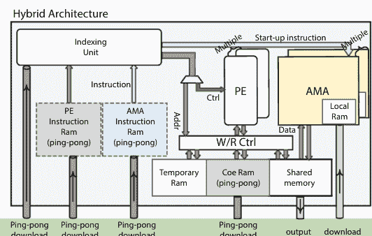

图 3.2 混合 FPGA 架构 [8]（开放获取）。

### 3.2.3 混合 FPGA 配置

嵌入式和实时系统设计师始终面临着在维持日益严格的系统要求的同时，纳入更多计算能力的问题。商业现成元件（也称为 COTS）被推荐为降低设计成本并利用时间窗口缩短上市时间限制的最佳实践。在对立的两种设计力量（通用化与专用化）之间建立平衡，仍然是开发可用于多种采用实时嵌入式应用的应用的 COTS 元件的一项挑战性任务。因此，牢记这一点仍然很重要。当系统设计师试图在成本与性能这两种相互竞争的力量之间取得平衡时，他们非常熟悉这种竞争所造成的紧张关系。在设计系统时，每个人的最佳利益都是尽可能使用 COTS 元件。这有助于降低成本并缩短产品上市所需的时间（参考引用部分 3.1.2），但这些元件可能不足以满足严格的性能要求。与 COTS 元件相比，定制元件可以实现更高的性能，但伴随更高的开发成本和更长的上市时间。最近结合中央处理器（CPU）和现场可编程门阵列（FPGA）元件的混合芯片的发展，是前沿技术进步的一个引人入胜的示例。这些混合芯片除了带来 COTS 所具备的规模经济外，还提供了重大硬件定制的潜力。例如，Xilinx 的 Virtex II Pro 可以通过继承，将其 IP 核心与 Altera 系列中的等量空闲门相结合。例如，优先级中断控制器、DRAM 控制器、串行 I/O 接口、并行 I/O 接口、总线仲裁器和 I/O 接口均为 FPGA 知识产权（IP）系统库的组成部分，设计师可使用这些组件来编程 FPGA 可编程门。FPGA IP 系统库中标准组件的数量不断增加。有能力选择 FPGA IP 集合来构建定制的片上系统（SoC）解决方案。能够根据特定应用的要求定制设计，使设计师能够实现与 COTS 相当的规模经济。空闲 FPGA 门允许专用应用特定组件执行关键功能的能力，是专用化最引人入胜的方面之一。这就是专用化越来越流行的原因之一。


基于FPGA的实现性能仍低于可比的专用集成电路，但通常是可接受的，并且具有远优越的价格/性能比。对于系统开发人员，充分发挥这些混合系统的潜力是一项引人入胜的挑战。用单芯片替换现有COTS设计，并用一组通用的FPGA IP对其进行编程既耗时又特定于设备，这违背了模块化、可移植性和重用的预期目标。如果没有硬件设计技术和工具的知识，大多数系统程序员将无法充分利用这些混合系统的全部潜力。

新功能使得可以从更易于理解的高级语言语法综合硬件设计，这让程序员迈出了创建存储在FPGA内的组件的重要一步。需要一个全面的编程模型来完全抽象掉特定于硬件的细节，消除设计人员区分CPU硬件和FPGA硬件组件使用的需求。

可以为系统实现开发一个透明平台。编程语言通常为此目的提供高级语法。这将使程序员能够访问混合系统的全部潜力，并使用真正的组件化和重用最佳实践来降低成本并加快上市时间。混合计算模型和运行时服务必须由硬件和软件共同定义和设计，以实现这一潜力。

为了解决嵌入式系统的系统级设计问题，研究人员正在研究灵活的设计语言、硬件软件规范和系统设计工具 [9]。System-C、Ptolemy和Rosetta等项目正在寻求系统级规范能力，这些能力可用于驱动软件综合和硬件综合 [9]。软件综合可以由这些能力驱动。

提高FPGA编程中使用的抽象级别是实现这一目标的方法。这将使FPGA设计人员在工作中拥有更大的灵活性。正在开发不断演进的VHDL标准和System Verilog，它们消除了硬件-软件接口与系统级视角之间的区别。这些方法的目标各不相同，但它们都旨在提高设计和集成硬件与软件组件所需的抽象级别。

研究FPGA的高级编程语言能力至关重要，以确定这些能力是否能使软件工程师的技能跨越混合边界发挥其能力。当前的混合计算模型通常将FPGA视为计算加速器，在数据流计算过程中被动地充当子程序 [9]。任何抽象总线架构、内存和低级外设协议的高级编程模型都会将混合组件转变为透明计算平台。这些计算平台对于针对FPGA-CPU屏障进行编程是必要的。软件组件及其交互由编程模型定义。消息传递和共享内存协议是组件接口机制，在现代技术中被一致使用。两种机制都允许组件相互通信。两种机制都在嵌入式系统中高效实现，这促使有志之士探索他们所偏爱技术的优点 [9]。

## 3.3 混合FPGA算法

异构多核处理器的目标是提高与计算相关应用的整体计算性能。为了实现高性能计算，它使用具有不同功能的内核。为了有效地将混合处理器用作对高速和性能指标有要求的软件平台，下面列出并突出显示了混合平台中使用的一些算法：

- 1. 混合ANN – PSO算法
- 2. 混合混沌-AES加密算法
- 3. 混合人工蜂群算法
- 4. 带宽受限优化路由算法
- 5. 技术映射算法。

设计解决方案经常采用快速原型制作，诊断系统包括预构建的控制功能以及专用的实时硬件模拟器。这类系统构建在开发环境之上。FPGA仅用于执行与换向问题相关的操作并补充DSP的职责。混合算法通常集成在DSP中。DSP每个采样周期只能执行一定数量的指令。可控制的PWM数量以及算法计算所需的时间会影响计算时间。必须执行所需的调制和换向算法才能正常工作。基于SVM的方法比基于载波PWM的方法实现起来需要更多的努力 [10]。参考第3.1.4节，由于新型功率半导体器件的发展，现在可以实现kHz范围内的高频晶体管开关。晶体管在矩阵变换器中的应用也为降低通信损耗和提高功率密度提供了良好前景（引用自第3.1.4节）。在传统DSP系统中，由于高频开关导致晶体管持续时间非常短，要应用复杂的策略可能具有挑战性。

可编程逻辑器件及其硬件实现的特殊特性近来越来越受欢迎。现场可编程门阵列（FPGA）很有吸引力。由于其处理速度、并行操作、可配置性和灵活性，它们被广泛应用于各种科学和工业领域。

硬件SVM方法通常可分为两类。第一组采用混合DSP-FPGA策略，而第二组仅使用FPGA。由于所提方案的并行性，还有另一个显著优势。尽管这些因素受到严格限制，但考虑并发性会显著提高实用性。另一方面，带有算法实现的FPGA并不用于算法的完整实现。SVM硬件实现依赖于“纯”FPGA，没有DSP集成。这表明可编程逻辑器件用于运行整个方法。由于综合工具的严格限制，该策略的应用要困难得多。高级数学过程和函数（如指数函数）尤其难以描述。

然而，由于FPGA的处理速度以及对有限数量任务进行并行计算的能力，其使用相较于传统微处理器具有优势。与传统DSP相比，使用片上系统（SoC）在硬件上构建SVM算法的优势。由于FPGA的主要优势——极快的处理速度和并发任务执行能力——其在SVM算法中的应用越来越普遍。

然而，当前技术通常使用外部工具，需要使用硬件描述语言 [10, 11]。此外，大多数解决方案构建在混合结构上，仍然使用传统DSP来执行（通常是）数学运算。算法及其成功实现通过使用适当的硬件来实现。硬件上可实现的软件坚持设计导向和硬件性能。在保持设计一致性方面，设计人员会发现硬件加速架构是一个必不可少的解决方案。下一节将重点介绍与FPGA综合相关的硬件加速架构主题。


### 3.3.1 硬件加速架构与 FPGA 软件实现的相关性

在许多当代人工智能应用中，机器学习被广泛应用。此类应用由多种硬件平台支持。图形处理单元（又称 GPU）是使用最频繁的一种，因为它能够快速执行计算，并可适应各种不同的方法。与图形处理单元相比，FPGA 的效率更高，尽管其处理速度显著慢于 GPU。它适用于各种基于机器学习的算法。已提出专用集成电路架构，旨在实现最高可能的能源效率，代价是降低系统的可重构性。模拟计算不能用于高分辨率计算，因为它需要模拟-数字转换器（ADC）。因此，模拟计算不适用于大多数涉及人工智能（AI）的应用。然而，由于其设计成本低和计算速度快，模拟计算是计算复杂机器学习算法的一种有前途的方法。

机器学习目前正在大量现代人工智能应用中使用。实时人机交互系统，如高级驾驶辅助系统、视频监控中的人脸检测以及使用图像识别进行早期癌症检测，只是由于该系统所具有的计算能力突破而成为可能的交互类型的几个示例。就所有这些应用而言，要获得高检测精度，需要进行大量的机器学习计算，这些计算需要更高级别的计算。作为直接结果，硬件加速平台必须遵守严格的要求。当今大多数应用使用通用计算引擎，特别是图形处理单元（GPU）。但学术界和工业界的最新研究揭示了为机器学习（特别是深度神经网络（DNN））开发专用集成电路（ASIC）的情况。本节重点介绍了多种机器学习加速类型、硬件加速器架构以及提高机器学习计算硬件计算效率的方法。

数据中心中使用 GPU/FPGA 加速器的方案作为分析对象。GPU 提供广泛的硬件选项和更强大的计算能力，并拥有可靠的生态系统。通常使用多个微型图形处理器来实现 GPU 架构。每个图形处理器包含的本地缓存和独立计算单元使其适合矩阵乘法。许多微处理器共享一条高速总线，从而实现微处理器之间的快速数据传输。例如，NVIDIA 的 DGX-1 超级计算机拥有八个使用 Pascal 图形处理架构的 Tesla GPU。每个图形处理单元（GPU）都有多个处理器，每个处理器都有多个 CUDA 核心。图形处理单元（GPU）和随机存取存储器（RAM）的时钟频率分别为 700 MHz 和 1.3 GHz。GPU 包含 16 GB 全局内存、4096 位内存总线和 4 MB L2 缓存 [12]。图 3.3 描绘了 DGX-1 系统的结构。借助 NV Link 互连网络的支持，任意两个 GPU 之间的物理距离可以少于一个 GPU。GPU 集群通过 PCI 电缆连接到双工交换机。

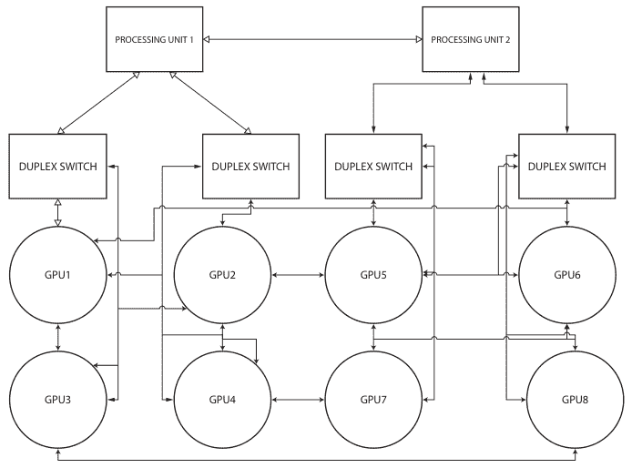

图 3.3 硬件加速架构。

## 3.4 CNN 硬件加速器架构概览

CNN 硬件加速器架构大致可分为两类。两种计算架构分别是集中式和稀疏式。图 3.4 展示了一个集中式计算架构示例。节点阵列是主计算机架构的一部分。节点阵列包含许多网关以支持并行处理。每个滤波器的输出将在数据库中收集，并反馈到内存中用于后续序列的计算。在计算大核尺寸的 CNN 时，集中式处理架构的大规模节点阵列具有优势。另一方面，稀疏计算架构由小型卷积单元组成，适用于小尺寸核。计算阵列由具有 3×3 核尺寸的十六个卷积单元组成。

计算卷积操作的优势在于简化数据流。然而，计算单元仅支持 3×3 卷积。

为了支持特定类型的机器学习算法以提升硬件性能，提出了基于 ASIC 的架构。为了支持诸如采用模型压缩方法的深度卷积网络等基于机器学习的算法类型，ASIC 架构在硬件效率方面提供了改进。与 GPU 和 FPGA 相比，ASIC 表现出最佳的能源效率和计算性能 [14–16]，但代价是牺牲对不同基于机器学习算法的可重构性。设计人员应根据具体应用选择最合适的计算硬件平台。

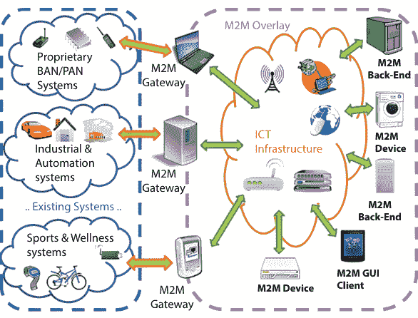

图 3.4 集中式计算架构 [13] [开放获取]。

## 3.5 摘要

本章快速概述了最新的设计技术，这些技术正朝着现场可编程门阵列（FPGA）发展，有助于模糊硬件与软件之间的界限。实时基准被用于突出设计方法和算法在开发实时系统过程中的重要性，并且各种混合配置和架构被详细剖析和考察。本章旨在将各种架构、配置和设计技术展示在单一流程中。这将使读者能够掌握和实现实时系统，从而有助于在系统设计相关领域构建探测性基准。

## References

- 1. Stankovic, J.A., Son, S.H., Hansson, J., “关于实时数据库的误解,” Springer, vol. 593, doi: https://doi.org/10.1007/0-306-46988-X_2.
- 2. G. Bernat, A. Burns 和 A. Llamosi, “弱硬实时系统,” IEEE Trans. Comput., vol. 50, no. 4, pp. 308–321, 2001 年 4 月, doi: 10.1109/12.919277.
- 3. J. Luo, G. Coapes, T. Mak, T. Yamazaki, C. Tin 和 P. Degenaar, “使用可扩展 FPGA 系统在小脑中模拟时间通行编码的实时仿真，2016，” IEEE Trans Biomed Circuits Syst, vol. 10, no. 3, pp. 742–753, 2016, doi: 10.1109/TBCAS.2015.2460232.
- 4. Omar Diouri, Ahmed Gaga, Hamid Ouanan, Saloua Senhaji, Sanaa Faquir, Mohammed Ouazzani Jamil, “FPGA 和 DSP 处理器在实现数字信号处理算法方面的硬件架构性能比较研究,” Appl. FIR Digit. FilterResults Eng., vol. 16, 2022.
- 5. “现场可编程门阵列基本架构及其应用。” [在线]。可用: https://www.watelectronics.com/components/
- 6. Bhandarkar, S. M., Arabnia, H. R., & Smith, J. W., “用于图像处理和计算机视觉的可重构架构，” VLSI Parallel Comput. Pattern Recognit. Artif. Intell., pp. 29–57, 1995.
- 7. Kaviani, A., & Brown, S., “混合 FPGA 架构，” 第四届 ACM 现场可编程门阵列国际研讨会, 1996, doi:10.1109/fpga.1996.242249.
- 8. Cheng R, Yao L, Yan X, Zhang B, Jin Z., “基于现场可编程门阵列（FPGA）的高灵活性混合架构实时仿真平台，” Energies, vol. 14, no. 19, p. 6041, 2021, doi: https://doi.org/10.3390/en14196041.
- 9. Waza, Abida & Mir, Roohie & Hakim, Najeeb-Ud-Din., “可重构架构，” J. Adv. Comput. Sci. Technol., 2012, doi: 10.14419/jacst.v1i4.518.
- 10. Wiśniewski, R., Bazydło, G., & Szczęśniak, P, “面向在低成本 Xilinx FPGA 中实现的 SVM 算法，” Integration., 2018, doi: 10.1016/j.vlsi.2018.10.002.
- 11. P. S. Zachowski, C. B. Reynolds, R. J. Grupp, S. G. Davis, B. Cremen 和 B. Troxel, “混合 ASIC 和 FPGA 架构，” pp. 187–194，” IEEEACM Int. Conf. Comput. Aided Des. 2002 ICCAD 2002, pp. 187–194, doi: 10.1109/ICCAD.2002.1167533.
- 12. Du, Li, 和 Yuan Du., “机器学习硬件加速器设计，” Mach. Learn.-Adv. Tech. Emerg. Appl., pp. 1–14, 2017.
- 13. J. Latvakoski 等人, “面向自主 M2M 服务网络的水平架构迈进，” Future Internet, vol. 6, no. 2, pp. 261–301, 2014, doi: 10.3390/fi6020261.
- 14. S. L. Tripathi, S. Saxena, S. K. Sinha 和 G. S. Patel (2021) 带有 Verilog 的数字 VLSI 设计问题及解决方案, John Wiley & Sons, Ltd. DOI:10.1002/9781119778097
- 15. Dasari L. Prasanna; Suman Lata Tripathi, “文本和语音处理的机器和深度学习技术，” in 信号和图像处理的机器学习算法, IEEE, 2023, pp. 115–128, doi: 10.1002/9781119861850.ch7
- 16. Badiganti P.K., Peddirsi S., Rupesh A.T.J., Tripathi S.L. (2022) 使用 FPGA 设计和实施智能医疗监测系统. In: Rawat S., Kumar A., Kumar P., Anguera J. (eds.) 第一届计算电子无线通信国际会议论文集. Lecture Notes in Networks and Systems, vol 329. Springer, Singapore. https://doi.org/10.1007/978-981-16-6246-1_18


# 基于 FPGA 的低功耗机器学习模块音频处理及其应用

Suman Lata Tripathi$^{1,2*}$, Dasari Lakshmi Prasanna$^1$ and Mufti Mahmud$^2$

$^1$VLSI 设计实验室, 可爱专业大学, 旁遮普, 印度
$^2$计算机科学系, 诺丁汉特伦特大学, 诺丁汉, 英国

*通讯作者: tri.suman78@gmail.com

## 摘要

智能设备需求不断增加，导致广泛使用专注于文本、音频或图像信号形式的大数据处理的机器学习技术。此类机器学习模块的有效性基于其在实时系统中的性能优化和准确性。同样，低功耗是任何智能便携设备在更长时间内维持电池负载和电池续航的另一大主要挑战。因此，在最终确定任何此类信号处理模块的特定芯片或电路板之前，必须进行分析，此类模块可以使用现场可编程门阵列（FPGA）板等可重构架构实现。FPGA 有助于开发与不同类型信号或数据的 MLC 模块原型相对应的实时系统。本章详细介绍了音频信号处理中经常使用的机器学习分类器（MLC），以及使用 FPGA 为这些模块开发实时系统。

**关键词:** MLC, 音频信号处理, FPGA, Xilinx Vivado, 生物医学数据

## 4.1 介绍

机器学习分类器（MLC）被广泛应用于多个领域；MLC 的应用包括生物识别、文档分类、电子邮件垃圾邮件分类、手写体识别、图像分类、语音识别、文本分类等。对于 TDS 辅助技术，MLC 用于分类用户语音信号中的命令。音频信号处理模块包括语音检测、乐器检索、毛刺检测等。MLC 用于从混合声音信号中区分音频数据，随后对音频片段进行基于类别的分段 [1]。

动物、人类、环境、噪声、音乐、语音和各种非人声音频信号等音频数据，经常以数字音频数据的形式出现在许多基于计算机的应用程序中。使用不同的音频分类器来构建有效的音频系统，该系统能自动识别特定声音，并为特定应用程序进行处理 [2]。

## 4.2 现有机器学习模块和音频分类器

有多种方法可用于从输入音频数据中提取特定音频数据。二进制分类由两个类组成，而多标签分类由多个类标签组成，其中每个样本映射到一组目标标签 [3]。根据分类方法，有不同的方法来识别或分类数据，包括逻辑回归、K 最近邻（KNN）、朴素贝叶斯（NB）算法、随机梯度下降（SGD）、支持向量机（SVM）、决策树（DT）和随机森林（RF）。

与图像处理不同，从大文件中检索音频数据处理非常困难。作者 [4] 提出了一种使用通用声音和音频场景作为数据集的新型音频分类方法。该音频模块包含用于特征提取的音频帧、片段、镜头和高级语义单元。音频数据被分段为 20-30 毫秒的镜头、片段和帧。使用 SVM 学习模块来分类通用声音并计算学习模块的准确性。

音频分类方面有很多研究，主要集中在语音和音乐数据检索上。作者 [5] 开发并评估了语音和音乐组合的分类器。他们专注于开发两个特征 SMR（语音与信号比）和 SIMPL（立体声输入混合到外围电平），以获得更高的准确性。尽管 SMR 是音频混合物的隐藏特征，但它与可测量的信号特征高度相关。与大多数乐器不同，人声在广播混音技术中通常位于立体声中心。SIMPL 是信号质量的客观度量。

作者 [6] 提出了一种音频分类的零样本方法，使用文本信息作为类标签，而不是来自目标类的音频样本。使用 Word2Vec（词的向量表示）从音频类的文本标签生成语义类标签嵌入，在使用 VGG（视觉几何组）从音频录音中提取音频特征嵌入之后。使用双线性模型对音频进行分类。分类输出是与给定音频特征嵌入最兼容的类。输入包括音频特征嵌入和语义类标签嵌入，输出是包含最兼容音频特征嵌入的二进制类。

音频识别使用回归、分类和其他方法等不同方法进行，[7] 中讨论了识别的分析。在此过程中，作者从 Web 资源中提取数据集文档并存储在本地磁盘。使用 MATLAB 库进行初始化和数据处理。特征提取使用神经网络完成。系统在 MATLAB 2018 中执行，并计算了系统的效率。

音频分类不仅用于多媒体分类以识别或分类数据文件，在辅助技术（ATs）中也很有用。使用语音作为基础来控制多种设备以辅助健全人士和残障人士是生物医学应用的主要关注领域。舌头是全身最不有效的器官；语音作为设备输入以进行控制很容易访问。在论文 [8] 中，作者设计了一种 TDS 来访问计算机和 PWC（电动轮椅）。除了 50 米障碍赛道的导航外，还利用三种控制策略来驱动 PWC。此外，使用了两个 Likert 量表问卷来评估其使用的定性方面——一个简短（八个问题）和一个较长（46 个问题）——用于评估使用 TDS 的一些定性方面。

作者 [9] 讨论了定制 TDS 电路。计算机可以通过移动舌头并向其发送指令来独立控制。使用放置在舌头上的钕磁体等示踪剂来跟踪舌头运动。随着舌头运动，口腔内及周围的磁场发生变化。头戴式设备上双侧安装的电感磁电感传感器用于检测这些变化。便携式屏幕通过无线方式连接到树莓派以传输信息。设计了一种无线 TDS [10] 来控制智能手机。通过穿刺在舌头上的永久磁体痕迹来检测命令。该 TDS 通过无线定制模块连接到 iPhone，用于访问轮椅、灯光、计算机、电视和电话。

在论文 [11] 中，作者设计了一种口腔内 TDS（iTDS）来控制智能手机、PWS 和计算机。双频天线在 915 MHz 和 433 MHz 频段之间共享，线圈与较低频段 27 MHz 共享，以最大限度地减少外部 RF 干扰的影响。发射器（Tx）还共享电池充电，以降低其整体尺寸和重量。为了在口腔环境中动态保持无线链路的鲁棒性，Tx 分别在 433 MHz 和 915 MHz 处集成了两个自适应匹配网络。

有不同的模块参与实现音频分类模块 [12–14]，如图 4.1 所示。为了处理音频，我们需要考虑幅度、持续时间、频率、采样率等。用于使用学习技术开发音频分类器的模块包括用于收集原始音频数据的麦克风或音频传感器、用于去除噪声的滤波器、用于根据训练数据集分类数据的 MLC，以及用于将分类数据处理到设备的蓝牙模块。

在 [15] 中，开发了一种音频-视觉融合技术，以通过音频和视觉路径识别用户的情绪。VAD（语音活动检测器）用作预处理阶段，以消除背景噪声并分割出与语音无关的噪声。它使用短时能量和过零率（STE 和 STZCR）作为特征。开发了音频分析器和特征级融合用于语音分类。由于语音信号被分割成特定长度的多个子部分，因此从音频路径产生多个输出。

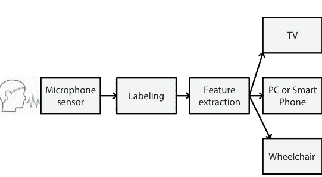

图 4.1 音频处理单元框图。


一种对人耳不可感知且会导致机器学习模型失效的音频源微小故意篡改，被称为对抗性音频攻击。由于对抗性攻击有可能导致此类模型做出不准确的预测，这引发了关于机器学习算法的安全性担忧。在 [16] 中，作者介绍了一些对抗性攻击，这些攻击对音频信号有较大影响，并评估了学习模块的抗扰性。他们提出了一种方法，通过将音频信号表示为 DWT（离散小波变换）形式和 SVM 来保护音频信号免受对抗性攻击。包含各种预处理单元，用于增强频谱图、生成、降维和平滑。使用 SURF（加速稳健特征）算法从频谱图的补丁中提取特征。K-means 用于进一步聚类。SVM 用于训练数据集。

在 [17] 中，特征在时域和频域两个领域中提取。在时域中计算短时能量和 ZCR，在频域提取中计算音频频谱质心、子频带能量比和梅尔频率倒谱系数。使用 SVM 技术对音频信号进行分类。该设计能有效对音频信号进行分类，准确率为 90%。

音频分类包含多个阶段，例如使用音频库中的训练集进行标记、提取和分类。图 4.2 显示了音频分类的框图。音频将使用音频/磁传感器或麦克风采集。音频将经过过滤以去除原始音频信号中的噪声。过滤后的信号随后分为帧或标签以供进一步处理。将提取特征用于分类。使用学习模块和训练数据集，音频将被分类并通过蓝牙发送到设备。

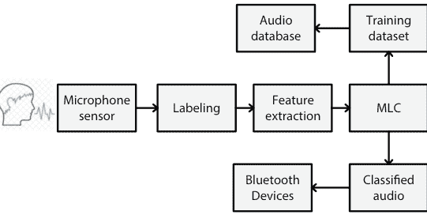

图 4.2 使用 ML 的音频分类框图。

图 4.3 所示的流程图根据训练数据对数据进行分类。噪声去除后，EMI 内核将数据发送到 ML 分类器。步骤如下：

- 1. 开始。
- 2. 数据由 EMI 衰减器发送，该衰减器来自用户的任务。
- 3. 如果 task==1，则表示用户给出的指令是轮椅移动，否则将移动到访问计算机或智能手机。
- 4. 是：移动到下一个块并使用训练数据比较数据。否：移动到下一个决策步骤。
- 5. 如果数据与训练数据匹配，则给出命令且流程结束。否则，移动到第 2 块并再次采集数据。
- 6. 步骤 4 和 5 将为访问计算机和智能手机重复。
- 7. 结束。

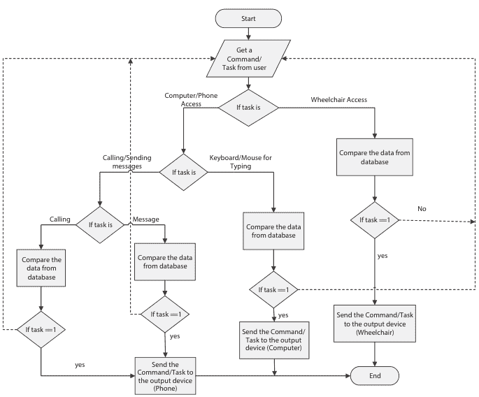

图 4.3 机器学习分类器流程图。

现在，分类后的最终命令通过蓝牙发送给电子设备，任务将相应执行。该电路将在 FPGA 上实现。

如图 4.4 所示，实现 MATLAB 代码的步骤：

- 1. 使用 MATLAB 算法或 Simulink 设计电路。
- 2. 下一步是模拟和调试 MATLAB 代码。
- 3. 使用 HDL 应用生成 HDL 代码。
- 4. 验证设计后，进行综合和分析。在此我们需要创建项目并进行综合和实现。

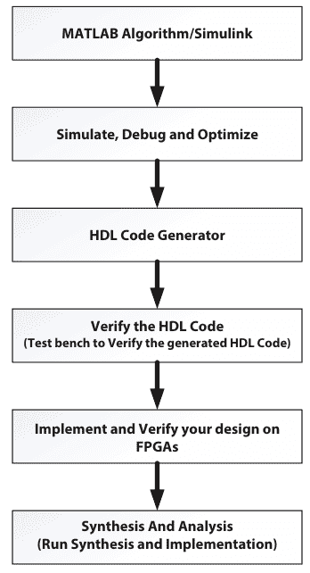

图 4.4 基于 FPGA 的实现。

## 4.3 使用机器学习的音频处理模块

可重构 FPGA 板在实现和原型设计各种信号处理的设计模块方面很有用。在此，所有算法都通过使用 Xilinx Vivado 在 Verilog HDL 或 VHDL 中编程来实现。通过 HDL，我们可以生成 RTL 级设计块、进行综合并生成用于 FPGA 实现的比特流。

音频信号处理的基本模型通过图 4.1 中的框图所示。所提模型由三个主要部分/块组成，这些部分帮助设备传输数据/指令并决定系统的性能。它们是串行外设接口、外部磁干扰衰减和分类器。本地处理器的框图如图 4.3 所示。

流程图（图 4.5）显示了使用音频处理模块传输原始数据以执行用户给定的操作/命令。

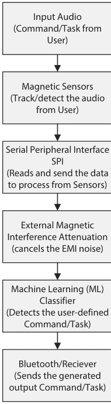

图 4.5 音频处理模块流程图。

设计步骤如下：

- i) 用户以音频/语音指令的形式给出命令。
- ii) 原始数据将由磁传感器跟踪。
- iii) 这些磁传感器将数据发送到处理器；SPI 将收集数据并将其处理到 EMI 内核。
- iv) 在 EMI 内核中，数据噪声将被衰减，无噪声数据将发送到 ML 分类器。
- v) ML 分类器将数据与已作为训练数据给予设备的数据集进行比较。最终指令/命令通过分类算法检测。
- vi) ML 分类器将输出作为命令发送到设备。

磁传感器附着在用户舌头上，它从用户处采集原始数据，并通过传感器生成的磁场将数据发送到处理器。处理器应位于周围环境中，因为磁场无法覆盖最大区域。有很多传感器可供选择，传感器根据其准确性能进行选择。霍尔效应传感器可以获得 1% 的输出误差，这非常低。霍尔效应传感器特别适用于高电流或低电压应用。

## 4.4 提议的基于 FPGA 的机器学习模型的应用

机器学习模型在生物医学领域的一个应用是辅助技术（AT）。市场上有许多可用的 AT 帮助个人通过身体动作和感官独立地与环境通信。它们能够通过各种传感器模式发送命令，例如眼动、面部表情、头部运动、语音识别系统、肌电图开关、脑电图（EEG）和电子眼图（EOG）。

一种 AT 是 TDS，其中包含所有由舌头/语音操作的设备。患有瘫痪和脊髓损伤的人可以使用这些设备而不感到压力，因为舌神经是全身中效果最差的神经。使用 TDS 对 SCI（脊髓损伤）和瘫痪患者来说很容易。[18] 的作者设计了一种舌操作系统。力敏电阻用于将数据发送到控制器，该控制器以四种不同模式控制用户的周围环境：与看护人沟通、紧急联系、家庭自动化和控制轮椅。这种方法不需要任何磁传感器或 IC 的安装或穿刺。

在论文 [19] 中，分析了一种完全在尖峰域中设计的神经形态双耳听觉传感器的架构、设计流程和 FPGA 实现。该论文提出了一种数字耳蜗模型，该模型使用脉冲频率调制而不是经典数字信号处理技术来分解音频信号。通过使用地址-事件表示接口，它提供了一组基于尖峰信息（直接编码为尖峰）的频率分解音频信息。该实验在 Virtex-5 FPGA 板上实现了一个 64 通道听觉系统。使用各种音频信号来刺激系统以表征其响应。

在 [20] 中，作者开发并实现了一种用于压力检测的处理器，使用两种学习算法 SVM 和 KNN，考虑了用于收集特征以监控压力检测的不同生理传感器。心率、心率变异性、皮肤电反应和加速度计是用于收集压力检测输入数据的生理传感器。通过执行射击任务以及操纵性能反馈来收集数据。刺激了三个压力水平：无反馈（低压力）、中等和高压力。该实验考虑了 16 个特征，并产生一个 35 秒窗口来阐述压力。该设计在 Artix-7 FPGA 板和 65 nm CMOS 技术的 ASIC 后版图上实现。

在 [21] 中，作者设计并实现了图像质量评估（IQA）。这有助于在无需他人评判的情况下自动识别视觉质量。根据参考图像的可用性，IQA 分为三类。参考：全参考（FR）、缩减参考（RR）和无参考（NR）；这意味着完整参考、部分可用性和不需要参考。使用 ML 算法——SVM、RT（回归树）、非线性回归（NLR）、人工神经网络（ANN）和模糊逻辑（FL）来估计 IQA。使用 C 代码在 VIVADO HLS 上实现，该设计在 Virtex-7 FPGA 板上进行了测试。TDS 在 IGLOO nano FPGA 板 [22] 上实现，这是超低功耗


板载口腔内 TDS。开发 iTDS 所包含的模块包括 SPI、EMF（电磁场）衰减和分类器。

## 4.5 FPGA 上的麦克风实现

为发送实时原始音频信号，使用板载麦克风。使用以太网访问麦克风，并使用 CIC（级联积分梳）编译器 IP，它减少了滤波器实现时间，同时提供在不同 CIC 滤波器规格硬件实现之间进行权衡的能力。使用时钟向导和 FIFO（先进先出）生成器（13.2）IP。为数据存储和检索选择本机接口类型 FIFO。时钟向导（6.0）IP

表 4.1 资源利用汇总。

| 模块 | LUTs | 寄存器 | Block RAM | 切片 | DSP | 触发器 | I/O |
|---|---|---|---|---|---|---|---|
| 麦克风 | 414 | 716 | 0.5 | 201 | 2 | 716 | 14 |
| EMI 滤波器 | 98 | 716 | 112 | 41 | 4 | 12 | 32 |

表 4.2 设计时序汇总。

| 建立时间 | 时间 (ns) | 保持时间 | 时间 (ns) | 脉冲宽度 | 时间 (ns) |
|---|---|---|---|---|---|
| 最差负松弛 (WNS) | 0.796 | 最差保持松弛 (WHS) | 0.087 | 最差脉冲宽度松弛 (WPWS) | 3.000 |
| 负松弛总数 | 0.000 | 保持松弛总数 | 0.000 | 负松弛总数 | 0.000 |
| 失败端点数 | 0 | 失败端点数 | 0 | 失败端点数 | 0 |
| 端点总数 | 2043 | 端点总数 | 2043 | 端点总数 | 877 |

### 摘要

从实现网表进行功耗分析。活动性源自约束文件、仿真文件或无矢量分析。

- 片上总功耗：0.224 W
- 设计功耗预算：未指定
- 功耗预算余量：N/A
- 结温：26.0°C
- 热余量：59.0°C (12.8 W)
- 有效 θJA：4.6°C/W
- 供给片外器件的功率：0 W
- 置信度：中等
- 启动功耗约束顾问以查找并修复无效的开关活动

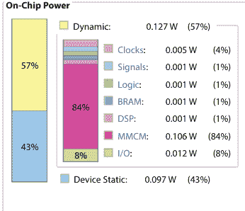

图 4.6 FPGA 上音频模块的功耗分析。

简化了 FPGA 中时钟配置过程。根据用户需求，时钟向导生成用于配置时钟电路的 HDL 代码。表 4.1 和表 4.2 分别显示了 FPGA 上观察到的器件利用率和时序汇总。FPGA 上获得的片上总功耗为 0.224 W，其中 57% 为动态功耗，43% 为静态功耗，如图 4.6 所示。

## 4.6 结论

像 FPGA 这样的可重构架构可用于实现机器学习模型，以观察实时响应，并提高准确性、速度和功耗。该实现过程随后包括针对任何特定任务识别合适的机器学习算法，并通过使用 Xilinx Vivado 等仿真软件通过 HDL 代码、综合和比特流生成来实现它。生成的比特流用于在 FPGA 板或原型上实现相同内容，然后再进行 ASIC 的布局和制造。

## 4.7 未来展望

生物医学数据处理是开发高效准确的生物医学设备和传感器的另一关键研究领域 [23–25]。像 COVID-19 [26, 27] 这样的情况也吸引设计师关注通过添加先进技术来提升生物医学设备的性能 [28]。机器学习有助于 [29, 30] 优化需要通过硬件评估且必须可解释的数据。此外，大量生物医学数据的传感器接口是设计师的主要关注点，这可以通过 FPGA 板实现。

## 参考文献

- 1. Lata Tripathi, S., Dhir, K., Ghai, D., & Patil, S. (Eds.). (2021). *面向冠状病毒（COVID-19）的健康信息学与技术解决方案* (第 1 版). CRC Press. https://doi.org/10.1201/9781003161066
- 2. D. L. Prasanna 和 S. L. Tripathi，“语音检测机器学习分类器”，《2022 年 IEEE VLSI 器件、电路与系统（VLSI DCS）》，2022 年，第 143-147 页，doi: 10.1109/VLSIDCS53788.2022.9811452。
- 3. Prasanna, Dasari L., Tripathi, Suman Lata (2022) 文本和语音处理的机器与深度学习技术，第 115-128 页 https://doi.org/10.1002/9781119861850.ch7
- 4. F. Rong，“基于机器学习的音频分类方法”，《2016 年智能交通、大数据与智慧城市国际会议（ICITBS）》，2016 年，第 81-84 页，doi: 10.1109/ICITBS.2016.98。
- 5. A. Chen 和 M. A. Hasegawa-Johnson，“使用立体声输入混合到声像特征的混合立体声音频分类方法”，载于《IEEE/ACM 音频、语音和语言处理汇刊》，第 22 卷，第 12 期，第 2025-2033 页，2014 年 12 月，doi: 10.1109/TASLP.2014.2359628。
- 6. H. Xie 和 T. Virtanen，“基于类标签嵌入的零样本音频分类”，《2019 年 IEEE 信号处理在音频和声学中的应用研讨会（WASPAA）》，2019 年，第 264-267 页，doi: 10.1109/WASPAA.2019.8937283。
- 7. K. Kumar 和 K. Chaturvedi，“一种使用特征提取神经网络分类方法的音频分类方法”，《第 2 届数据、工程与应用国际会议（IDEA）》，2020 年，第 1-6 页，doi: 10.1109/IDEA49133.2020.9170702。
- 8. B. Yousefi, X. Huo, J. Kim, E. Vedelar 和 M. Ghovanloo，“舌控计算机输入设备中的学习定量与比较评估—第二部分：导航任务”，载于《IEEE 生物医学信息技术汇刊》，第 16 卷，第 4 期，第 633-643 页，2012 年 7 月，doi: 10.1109/TITB.2012.2191793。
- 9. C. B. Pratap, Godviya 和 G. S. Let，“使用舌驱动系统为残疾患者提供智能阅读辅助”，《2018 年控制、电源、通信和计算技术国际会议（ICCPCT）》，2018 年，第 563-566 页，doi: 10.1109/ICCPCT.2018.8574313。
- 10. J. Kim, X. Huo 和 M. Govanloo，“使用舌驱动辅助技术通过舌头运动无线控制智能手机”，2010 年 IEEE 医学与生物工程年度国际会议，2010 年，第 5250-5253 页，doi: 10.1109/IEMBS.2010.5626294。
- 11. F. Kong, M. Zada, H. Yoo 和 M. Govanloo，“面向口腔内舌驱动系统的带有共享双频天线和自适应匹配的三频段发射机”，2018 年 IEEE 电路与系统国际研讨会（ISCAS），2018 年，第 1-5 页，doi: 10.1109/ISCAS.2018.8351709。
- 12. Rong, Feng. (2016). 基于机器学习的音频分类方法. 81-84. 10.1109/ICITBS.2016.98.
- 13. H. Phan, L. Hertel, M. Maass, R. Mazur 和 A. Mertins，“通过与语音模式的相似性学习非语音音频事件的表示”，载于 IEEE/ACM 音频、语音和语言处理汇刊，第 24 卷，第 4 期，第 807-822 页，2016 年 4 月，doi: 10.1109/TASLP.2016.2530401。
- 14. D. Barchiesi, D. Giannoulis, D. Stowell 和 M. Plumbley，“声场分类：根据其产生的声音对环境进行分类”，IEEE 信号处理杂志，第 32 卷，第 3 期，第 16-34 页，2015 年 5 月。
- 15. K. P. Seng, L.-M. Ang 和 C. S. Ooi，“一种结合规则与机器学习的音视频情感识别方法”，载于 IEEE 情感计算汇刊，第 9 卷，第 1 期，第 3-13 页，2018 年 1 月-3 月，doi: 10.1109/TAFFC.2016.2588488。
- 16. M. Esmaeilpour, P. Cardinal 和 A. Lameiras Koerich，“一种防御对抗攻击的音频分类稳健方法”，载于 IEEE 信息取证与安全汇刊，第 15 卷，第 2147-2159 页，2020 年，doi: 10.1109/TIFS.2019.2956591。
- 17. Shuiping, Wang 和 Zhenming, Tang 和 Shiqang, Li，“基于 SVM 的音频分类系统的设计与实现”，工程论丛，2011 年，第 15 卷，第 4031-4035 页，doi: 10.1016/j.proeng.2011.08.756。
- 18. J. Johri, J. Pillai 和 M. Shakhya，“舌控集成系统”，2017 年第 14 届 IEEE 印度理事会国际会议（INDICON），2017 年，第 1-6 页，doi: 10.1109/INDICON.2017.8488082。
- 19. A. Jiménez-Fernández 等人，“面向 FPGA 的双耳神经形态听觉传感器：一种脉冲信号处理方法”，载于 IEEE 神经网络与学习系统汇刊，第 28 卷，第 4 期，第 804-818 页，2017 年 4 月，doi: 10.1109/TNNLS.2016.2583223。
- 20. N. Attaran, A. Puranik, J. Brooks 和 T. Mohsenin，“面向个性化压力检测的嵌入式低功耗处理器”，载于 IEEE 电路与系统 II：快报汇刊，第 65 卷，第 12 期，第 2032-2036 页，2018 年 12 月，doi: 10.1109/TCSII.2018.2799821。
- 21. G. T. Tchendjou, E. Simeu 和 F. Lebowsky，“基于机器学习的图像质量评估的 FPGA 实现”，2017 年第 29 届微电子国际会议（ICM），2017 年，第 1-4 页，doi: 10.1109/ICM.2017.8268848。


- 22. S. Viseh, M. Ghovenloo 和 T. Mohsenin, “面向舌驱动系统的超低功耗车载处理器,” 在 IEEE Transactions on Circuits and Systems II: Express Briefs 中, vol. 62, no. 2, pp. 174-178, 2015 年 2 月, doi: 10.1109/TCSII.2014.2387683.

- 23. Badiganti P.K., Peddirsi S., Rupesh A.T.J., Tripathi S.L. (2022) 基于 FPGA 的智能医疗监测系统的设计与实现. 收录于: Rawat S., Kumar A., Kumar P., Anguera J. (编) 第一届无线通信计算电子国际会议论文集. 网络与系统讲义, vol. 329. Springer, 新加坡. https://doi.org/10.1007/978-981-16-6246-1_18

- 24. Kanak Kumar, Soumyadeepa Bhaumik, Suman Lata Tripathi, “健康监测系统,” 在《实现生物医学应用的电子器件与电路设计挑战》中, Elsevier, 2021. doi: https://doi.org/10.1016/B978-0-323-85172-5.00021-6

- 25. Kanak Kumar, Anchal Sharma, Suman Lata Tripathi, “传感器及其应用,” 在《实现生物医学应用的电子器件与电路设计挑战》中, Elsevier, 2021. https://doi.org/10.1016/B978-0-323-85172-5.00021-6

- 26. V Dhinakaran, M Varsha Shree, Suman Lata Tripathi, P M Bupathi Ram, “走出冠状病毒的演变、传播、检测和诊断概述,” 在《冠状病毒 (COVID-19) 的健康信息学与技术解决方案》中, CRC Taylor & Francis, 2021. https://doi.org/10.1201/9781003161066

- 27. Suman Lata Tripathi, Kolla Prakash, Valentina Balas, Sushanta Mohapatra, Janmenjoy Nayak, 生物医学应用的电子器件与电路设计挑战, Elsevier, 2021. https://doi.org/10.1016/C2020-0-02289-9

- 28. Kanak Kumar; Kaustav Chaudhury; Suman Lata Tripathi, “医疗监测系统中机器学习 (ML) 和深度学习 (DL) 的未来,” 在《信号和图像处理机器学习算法》中, IEEE, 2023, 第 293-313 页, doi: 10.1002/9781119861850.ch17.

- 29. Deepika Ghai, Suman Lata Tripathi, Sobhit Saxena, Manash Chanda, Mamoun Alazab, 信号和图像处理机器学习算法, Wiley IEEE Press, 2022.

- 30. Sandhya Awasthi, Ritu Chauhan, Suman Lata Tripathi, Tanushree Datta, “COVID-19 研究: 开放数据资源与挑战,” 在《新冠疫情及之后残疾人和老年人的生物医学工程应用》中, Elsevier, 2021. https://doi.org/10.1016/B978-0-323-85174-9.00008-X

# 基于 FPGA 的 DIT-FFT 模块用于高效 VLSI 信号处理应用的综合与时序分析

Siba Kumar Panda1*, Konasagar Achyut2 and Dhruba Charan Panda3

1Xeedo Technologies Pvt Ltd, Bangalore, India

2J.B. Institute of Engineering & Technology, Hyderabad, India

3Department of Electronics Science, Berhampur University, Odisha, India

## 摘要

如今是具有可重构架构的高速处理器的时代。专用架构在信号处理、图像处理以及音频/视频处理等领域具有广泛的应用。在 FPGA/ASIC 层面进一步实现这些专用架构起着重要作用。本章介绍了基于 FPGA 的时域抽取快速傅里叶变换 (DIT-FFT) 架构用于 VLSI 信号处理应用的综合与静态时序分析。这项工作展示了包括 RTL 设计、仿真、综合、实现以及所设计模块的时序调查在内的连续流程。该架构针对不同 N 值进行了设计和验证，并使用综合转换为相应的门级网表。综合后，记录了资源利用率和功耗报告。实现后和时序确认，N=8 的设计消耗 780 个 LUT（逻辑）、257 个寄存器 (BRAMs)、0.163 W 片上功耗，建立时间余量 3.258ns，保持时间余量 0.430ns，时序在 24ns 时协同满足。时序分析后，还得到了带有适当布线的所设计电路的物理布局。实现使用 vivado IDE 工具，配合 Artix7 FPGA 开发板，在 28nm 技术下进行。

关键词: 关键路径延迟, DIT-FFT, 数据路径延迟 (DPD), FPGA, LUT, 静态时序分析 (STA), 余量

*通信作者: panda.sibakumar08vssut@gmail.com

## 5.1 引言

在无线网络系统中，IC 必须处理信号以提取原始信息。该处理在数据经过多个模拟器件（如 ADC、运算放大器等）之后进行。为了使它们相应地工作，从 RTL 到 GDSII 引入了一套严谨的工艺流程 [1]。同样，在包含数亿个晶体管的某些数字信号处理核心中，使用专用区域来处理复杂信号 [2–21]。已实现许多算法来处理与复杂信号相关的复合数据。FFT 是 DSP 的组成部分。该算法允许处理器将信号从一个域转换到另一个域。为了降低该算法的复杂度，已经进行了许多工作，例如 Prime Factor FFT 算法、Bruun's FFT 算法、Rader's FFT 算法、Bluestein's FFT 算法、Cooley-Tukey FFT 算法和六边形 FFT 算法。在本文中，我们考虑了 Cooley-Tukey 算法，也称为时域抽取–快速傅里叶变换 (DIT-FFT)。为了提高其在 VLSI 实现中的性能，Rauf 等人在 [4] 中提出了一种基于分割基且具有用户定义输入分辨率的设计。此外，Prabhu 等人在 [7] 中采用浮点计算，提出了基于基-4 蝶形结构的 DIT FFT 算法。在 [8] 中，Nuenfeld 等人提出了改进的基-2 和基-4 蝶形架构，专注于低功耗。Paul 等人在 [11] 中提出了一种考虑节能蝶形单元的浮点 FFT 算法。Ma 等人在 [12] 中在 FPGA 上实现了基-2 FFT 算法的流水线架构。使用联合蝶形引擎使该设计能够在 200MHz 频率下在 11µs 内完成计算。基-2 DIT FFT 蝶形结构中的异或门拓扑与加法器压缩器，在优化的单流水线结构中显示出 5.69mW 的功耗。Saponara 等人在 [14] 中将 Cooley-Tukey 给出的 FFT 架构设计用于基于 SOC 的电信应用。他们在 12.375MHz 下将该架构用于 OFDM 和 MIMO 方案。在 [15] 中，Huang 等人使用了偏置二进制编码 (OBC) 机制与滑块分布式算术 (SDBA) 的概念。这大大减少了 FPGA 中可用 LUT 切片、RAM 等的使用。表 5.1 总结了 DIT-FFT 模块 VLSI 实现的最新技术。然而，公开文献中很少报道 DIT-FFT 模块的综合和时序分析 [16]。这项工作尝试提供一种逐步实现此目的的过程。这对于数字信号处理器和密码学应用是必要的。

## 表 5.1 各种最先进设计的性能比较。

| 参考文献 | 技术 | 面积 | 延迟 | 功耗 (片上总功耗) | PDP | LUT | 触发器 | ADP |
|---|---|---|---|---|---|---|---|---|
| [1] | ------ | ------ | 7 ns | ------ | ------ | 954 | 336 | ------ |
| [3] | 45 nm | 0.61mm² | ------ | 404.39mW | ------ | 21,603 | 4,142 | ------ |
| [6] | ------ | ------ | ------ | 5.377 W | ------ | 437 | ------ | ------ |
| [7] | ------ | 3345 µm² | 2381 ps | 583.4mW | ------ | ------ | ------ | 7964.4 |
| [9] | ------ | ------ | ------ | ------ | 1651.6 | ------ | 1406 | ------ |
| [10] | 45 nm | 0.973mm² | 7 µs | 68 mW | ------ | ------ | ------ | 6.811 |
| [13] | ------ | ------ | ------ | ------ | ------ | 8614 | ------ | ------ |

上述讨论激励我们开发一种用于高效 VLSI 信号处理应用的经过综合和时序分析的 DIT-FFT 架构。考虑到数字信号处理器和密码学应用，在每个阶段都需要各种乘法算法。这些计算需要在系统级和特别是芯片级设计高效架构。这就是为什么对仿真-综合-时序分析的专注是这项工作的核心重点，这里清晰地呈现出来。所提供的工作也使用 FPGA 进行设计。我们以表格形式总结了获得的结果，以便清晰理解。最后，人们相信所提出的架构可能为即将到来的研究开辟新路径。

## 5.2 DIT-FFT 算法的实现

### 5.2.1 DIT-FFT 快速概述

DSP 块的基本元素是信号。信号在两个端点之间传输信息。所有连续时变信号，在转换为量化离散信号（数字）后，都被发送到 DSP 核心。DFT 是一种将时域信号转换为频域的方法，频域包含幅度、频率和相位值。这些值后来用于高速计算过程。DFT 的基本方程为，

```
X(K) = \sum_{n=0}^{N-1} x(n)w_N^{kn} (5.1)
```

where K = 0,1,2,3.....N-1, x(n) 是时刻 n 的输入信号幅度，且 \(w_N^{kn} = e^{-j2\pi n/N}\) 称为旋转因子，代表复杂信息。


在此，N 点 DFT 被递归地划分为蝴蝶结构中的 N/2 个 DFT。这种划分 DFT 块的形式是 FFT 算法中最简单的一种，称为基数 DFT。N 长度序列的 DFT 可以通过重复使用 N/2 个 DFT 块来计算，直到所有输入样本只剩下一个 DFT 块，从而提供最终输出值。图 5.1 展示了 DIT-FFT 算法。

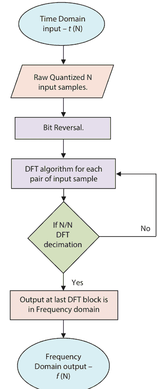

图 5.1 DIT-FFT 算法流程表示。

### 5.2.2 带示例的算法表示

下面所示的示例仅考虑两个样本，以便理解。旋转因子会根据输入样本的数量引起变化。图 5.2 以示例形式展示了该算法的强调过程视图，而图 5.3 展示了 DIT-FFT 算法简化的工作原理。

### 5.2.3 模拟输出波形

已使用单个时钟和复位端口，与所有 DFT 块同步以提取输出。处理的值为偏移表示；此外，接收到的输出为偏移二进制格式（Excess 16）。相对于获取的输出，我们可以将输入值加到偏移值上或从中减去。为了更清晰，我们可以看到在

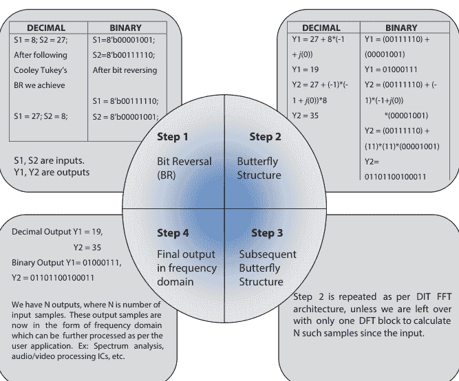

图 5.2 带十进制和二进制输入的简单 DIT-FFT 执行。

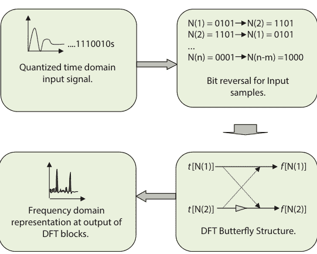

图 5.3 DIT-FFT 算法简要方法示意图。

手动为 N = 2、4 和 8 个样本提供输入以验证设计时获得的输出波形。N = 4 和 N = 8 的波形分别可见于图 5.4 和图 5.5。在此，小写 s1、s2、s3....s8 为输入，大写 S1、S2....S8 为波形表示中的输出。对于 N = 2，由于输入长度只有两个输入，设计仅描绘单块 DFT 结构。

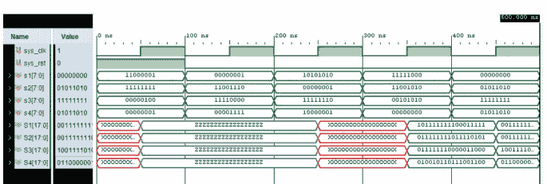

图 5.4 样本 N = 4 的输出波形。

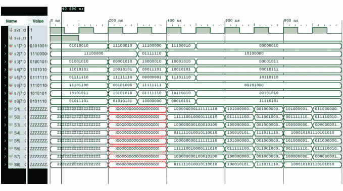

图 5.5 样本 N = 8 的输出波形。

## 5.3 设计电路的综合

在本工作中，使用 Vivado Design Suite 在 Verilog HDL 环境中对 DIT-FFT 架构进行综合，考虑基数 2 蝴蝶结构。Xilinx 综合技术（XST）允许用户综合任何用 Verilog/VHDL 编写的设计。所用器件为 xc7a200tffV1156，速度等级为 -1。N = 4 长度输入样本的综合表示或 RTL 原理图或门级原理图可见于图 5.6。该设计是根据 Cooley 和 Tukey 提出的基数 2 蝴蝶 DIT-FFT 结构架构编写的。单个时钟和复位引脚与从 RTL 抽象的顶层模块开始的整个设计同步。同样，图 5.7 显示了 N = 8 长度输入样本的 RTL 原理图，其中逻辑元素的使用随输入大小而变化。设计在门级综合后，我们可以观察 N = 2、4 和 8 样本的 FPGA 性能。数值包括结构功耗以及单元、切片、触发器等的利用率，简称为面积。这些单独相关的数值在表 5.2 中描述，帮助我们了解 FPGA 上综合设计的利用情况。

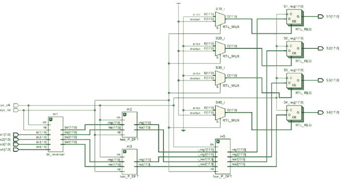

图 5.6 N = 4 DIT-FFT 的 RTL 原理图。

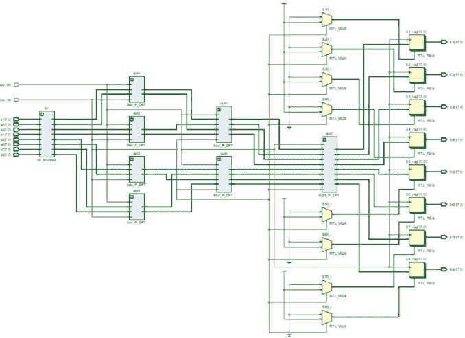

图 5.7 N = 8 DIT-FFT 的 RTL 原理图。

表 5.2 综合后的性能参数。

| N 的值 | 使用的 FPGA 板 | 报告利用率（面积） | 报告功耗（芯片功耗） |
| :--- | :--- | :--- | :--- |
| N=8 | Artix7 | Slice LUT = 826<br>Slice register = 185<br>DSP = 22 | Total on Chip Power (W) = 71.3<br>Static power (W) = 1.684<br>Dynamic power (W) = 69.71 |
| N=4 | Artix7 | Slice LUT = 164<br>Slice register = 93<br>DSP = 11 | Total on Chip Power (W) = 31.6<br>Static power (W) = 0.336<br>Dynamic power (W) = 31.30 |
| N=2 | Artix7 | Slice LUT = 40<br>Slice register = 37<br>DSP = 3 | Total on Chip Power (W) = 12.7<br>Static power (W) = 0.135<br>Dynamic power (W) = 12.59 |

## 5.4 设计电路的静态时序分析

我们对设计执行了 STA，帮助我们对整个设计在四条可能路径上进行建立时间和保持时间检查等时序检查：所有寄存器引脚到所有寄存器、所有输入引脚到所有寄存器、所有寄存器到所有输出引脚以及所有输入引脚到所有输出引脚。图 5.8 展示了 STA 的拟议方法。这帮助设计满足特定的可工作时钟频率，以确保原始数据不会在设计的任何微架构块中丢失。建立时间检查允许数据在时钟信号到达之前到达触发器/寄存器，而保持时间检查确保数据在时钟信号变低之前保持稳定。在获得时序摘要后，上述四条路径中设计满足建立余量和保持余量的频率包含在表 5.3 中。根据指定的时钟周期/时钟频率，功耗和面积利用率也被纳入考虑。由于我们在 RTL 生成的网表后执行 STA，因此没有串扰或时钟树路径用于

综合的 DIT-FFT 设计
门级网表
进行时序分析
将设计分为四条路径
寄存器到寄存器
输入到寄存器
寄存器到输出
输入到输出
查找 DPD
查找 DPD
查找 DPD
查找 DPD
获取关键路径延迟

使用适当时间段创建时钟约束
生成时序摘要报告
获取建立和保持余量值
值 > 0
继续进行输入到寄存器路径

创建所有输入到所有寄存器约束
生成时序摘要报告
获取建立和保持余量值
值 > 0
继续进行寄存器到输出路径

创建所有寄存器到所有输出约束
生成时序摘要报告
获取建立和保持余量值
值 > 0

将约束保存为 .xdc 文件
运行综合
时序满足
运行实现

时序满足
DIT-FFT 模块的时序分析结束

图 5.8 表示 DIT-FFT 设计静态时序分析的流程图。

表 5.3 时序分析后的性能参数。

| N 的值 | 实现后及时序的利用率报告 | 实现后及时序的功耗报告 | 时序摘要报告 | 时序满足于 |
| :--- | :--- | :--- | :--- | :--- |
| N = 8 | Slice LUT = 780<br>Slice Registers = 257<br>LUT as logic = 780<br>BRAM Tile = 257 | Total on chip Power (W) = 0.163 | Setup Slack = 3.258ns<br>Hold Slack = 0.430ns | 24ns |
| N = 4 | Slice LUT = 158<br>Slice Registers = 93<br>LUT as logic = 158<br>BRAM Tile = 93 | Total on chip Power (W) = 0.148 | Setup Slack = 1.574ns<br>Hold Slack = 0.321ns | 20ns |
| N = 2 | Slice LUT = 38<br>Slice Registers = 37<br>LUT as logic = 38<br>BRAM Tile = 37 | Total on chip Power (W) = 0.118 | Setup Slack = 1.506ns<br>Hold Slack = 0.062ns | 15ns |

时序分析，从而使其成为修复任何设计时序问题的更基础方法。按照流程图步骤，我们针对三个不同的样本遇到了若干时序问题。这些问题通过考虑最接近最高数据路径延迟的时间段来修复。

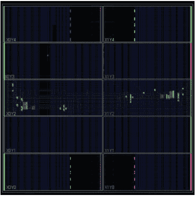

图 5.9 N = 4 DIT-FFT 时序分析后的布局。

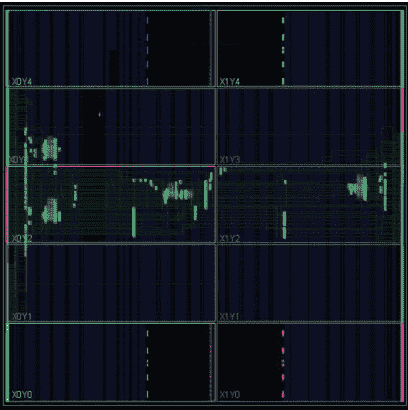

图 5.10 N = 8 DIT-FFT 时序分析后的布局。

表 5.4 综合后-时序后的性能参数。

| N 的值 | 使用的 FPGA 板 | 报告利用率（面积） | 报告功耗（芯片功耗） |
|------------|------------------|---------------------------|------------------------------|
| N=8 | Artix7 | Slice LUT = 775<br>Slice register = 257<br>DSP = 22 | Total on Chip Power (W) = 73.89<br>Static Power (W) = 1.674<br>Dynamic Power (W) = 72.2 |
| N=4 | Artix7 | Slice LUT = 157<br>Slice register = 93<br>DSP = 11 | Total on Chip Power (W) = 32.69<br>Static Power (W) = 0.352<br>Dynamic Power (W) = 32.34 |
| N=2 | Artix7 | Slice LUT = 38<br>Slice register = 37<br>DSP = 3 | Total on Chip Power (W) = 12.72<br>Static Power (W) = 0.135<br>Dynamic Power (W) = 12.58 |


(DPD)。DPD 是通过三条路径获得的：所有寄存器到所有寄存器、所有输入到所有寄存器以及所有寄存器到所有输出。

如果设定的时间段满足建立时间裕度和保持时间裕度要求，则该时间段/约束将被保存，以用于设计后续的布局后时序分析实现。图 5.9 显示了针对 N=4 在所选 FPGA 上布线的 DIT-FFT 设计布局。由此可知，当将 N=4 的布局后时序布局与 N=8 进行对比时，时序固定对布线起着更大的作用。此处单元或网络是根据延迟约束进行放置的。时序固定还提供关于精确路径连接、缓冲器/逆变器连接等方面的信息。这样我们也可以说，N=8 的 DIT-FFT 布线与 N=2 和 N=4 不同，如图 5.10 所示。一旦设计布线完成，我们就可以从结构中获取不同单元、切片、BRAMs、触发器等的利用情况，如表 5.4 所示。这有助于用户可视化所编写的 RTL 设计是否与所选结构/FPGA 中可用的 BRAMs、触发器等相匹配。

## 5.5 结果与讨论

与时序相关的数值是设计针对多种输入采样尺寸（N = 2、4 和 8）获得的参数。设计综合后，FPGA 的利用率参数如表 4.3 所示。从可用的 134600 个 LUT、365 个 BRAM 瓦和 740 个 DSP 块中，N=8 示例输入分别利用了 0.7% 的 LUT、75% 的 BRAM 瓦和 2.97% 的 DSP。同样，对于 N=4，利用了 0.18% 的 LUT、25% 的 BRAM 瓦和 1.49% 的 DSP 块；对于 N=2，利用了 0.05% 的 LUT、10% 的 BRAM 瓦和 0.41% 的 DSP 块。表 4.4 中的布局后时序固定值确认，所提的用于复杂旋转因子偏移二进制表示的 DIT-FFT 架构证明了综合以及随后分为四条不同路径以满足整体设计所需的时间段。借此，我们可以确保设计在引脚到引脚时间规定方面无误。

## 5.6 结论

时序分析是芯片流片签 off 的重要途径，因为工程师必须了解芯片/任务运行速度有多快，数据从设计的输入端口到达输出端口的速度有多快。这项工作展示了针对 VLSI 信号处理模块的 DIT-FFT 架构综合与时序分析的实践。通过严格遵循仿真-综合指南并遵守静态时序分析流程规则，所设计模块分别在 N=8、4 和 2 时满足 24ns、20ns 和 15ns 的时序要求。同时发现，所提设计在时序后能够高效工作，利用资源为逻辑的 780 个 LUT 和 257 个 BRAM 瓦片。功耗报告确认，实现和时序收敛后设计消耗 0.163W 的芯片上功耗，这是一个显著高效的功耗数值。所提架构的高速和低功耗性能使其适用于广泛的片上信号处理应用。

## 参考文献

- 1. Siba Kumar Panda; Konasagar Achyut 和 Swati K. Kulkarni。“Industry 4.0：定制寄存器传输级设计路线图”。收录于 *Industry 4.0：概念与应用进展*，由 M. Niranjanamurthy、Sheng-Lung Peng、E. Naresh、S. R. Jayasimha 和 Valentina Emilia Balas 编辑，Berlin, Boston: De Gruyter, 2022, 第 21-50 页。
- 2. Changeia Ankur; Zaveri Mazad 和 Verma Deepak，基于高性能资源高效 Radix-16 CORDIC 旋转器的 FFT 算法 FPGA 实现，*Integration，VLSI 期刊*；2020；1-12。
- 3. Ganjikunta Ganesh Kumar 和 Sahoo Subhendu Kumar，面向 OFDM 应用的面积高效低功耗 64 点流水线快速傅里叶变换，*Integration，VLSI 期刊*，57，2017；125-131。
- 4. Rauf Adnan; Pasha Mohammed Adeel 和 Masud Shahid，面向高吞吐量应用的可扩展分割基数 FFT 处理器设计与自动化。*微处理器与微系统*，Elsevier。65, 2017; 148-157。
- 5. Kar Subhajit; Ganguly Madhabi 和 Das Saptarshi，使用 DIT FFT 算法识别真核基因中的蛋白质编码区。*生物医学工程：应用、基础与通讯*，31(1), 2018; 1-10。
- 6. Panda S.K. 和 Panda D.C，开发基于 AVM 的高性能 VLSI 计算系统：一项研究。收录于：Pattnaik P.、Rautary S.、Das H.、Nayak J. (编) *计算、分析与网络进展。智能系统与计算前沿*，2017;710。
- 7. Prabhu E.; Mangalam H. 和 Karthick S.，使用浮点融合算术设计面积和功耗高效的 Radix-4 DIT FFT 蝶形单元。*中南大学学报*，Springer, 23, 2016;1669-1681。
- 8. Neuenfeld Renato; Fonseca Mateus 和 Costa Eduardo，基于时域抽取 FFT 的优化 Radix-2 和 Radix-4 蝶形设计。收录于：*第 VII 届拉丁美洲电路与系统研讨会 (LASCAS)*，2016; 171-174。
- 9. Blake Anthony 和 Hunter Matt，动态生成 FFT 代码。信号处理系统期刊，Springer. 76, 2014; 275–281。
- 10. Qadeer Shaikh; Khan Mohammed Zafar Ali; Sattar Syed Abdul 和 Ahmed, A，低算术复杂度 Radix-2 DIT FFT。收录于：计算、通信与信息学国际会议 (ICACCI) 进展，2014; 1892–1896。
- 11. Paul Augusta Sophy Beullet; Raju Srinivasan 和 Janaki Raman Raja，带有折叠 DA 蝶形阵列的低功耗可重构 FP-FFT 核心。EURASIP 信号处理进展期刊，2014; 144: 1–17。
- 12. Ma Zhen-guo, Yu Feng; Ge Rui-feng 和 Wang Ze-ke，现场可编程门阵列上带联动蝶形引擎的高效 Radix-2 快速傅里叶变换处理器。浙江大学学报 C 卷，12(4); 2011; 323–329。
- 13. Fonseca Mateus Beck; A Eduardo; Costa Da Cesar 和 Martins Joao B. S，使用带有新型 XOR 门拓扑的加法器压缩器设计源自 Radix-2 DIT FFT 的功耗高效蝶形。模拟集成电路与信号处理，Springer Science Business Media, LLC. 73(3);2012;945–954。
- 14. Saponara Sergio; Rovini Massimo; Fanucci Luca; Karachalios Athanasios; Lentaris George 和 Reisis Dionysios，面向具有不同灵活性、速度和复杂性权衡的 SoC 电信应用的 FFT VLSI 架构设计与比较。电路、系统与信号处理，Springer, 31;2011;627–649。
- 15. Huang Walter; V David 和 Anderson，面向自适应滤波器的偏移二进制编码修正滑动分块分布式算术。信号处理系统期刊，Springer Science Business Media, LLC. 63;2010; 153–163。
- 16. Parhami B.，计算机算术：算法与硬件设计。第 2 版，Oxford University Press, New York, 2010. ISBN 编号：978-0-19-532848-6。
- 17. Chadha Rakesh 和 Bhasker J.，纳米级设计静态时序分析：实用方法。Springer-Verlag US, 2009; ISBN 编号：978-0-387-93819-6。
- 18. Mano M. Morris 和 Ciletti Michael D.，数字设计。第四版。Pearson Education, Inc. 2008; ISBN 编号：978-8131714508。
- 19. Parhi Keshab K.，VLSI 数字信号处理系统设计与实现。Wiley-Interscience 出版物, 1999; ISBN 编号：978-0471241867。
- 20. Deepika Ghai, Suman Lata Tripathi, Sobhit Saxena, Manash Chanda, Mamoun Alazab，信号与图像处理机器学习算法，Wiley IEEE Press, 2022, ISBN: 978-1-119-86182-9
- 21. Dasari L. Prasanna; Suman Lata Tripathi，“文本和语音处理的机器与深度学习技术”，收录于《信号与图像处理机器学习算法》，IEEE, 2023, 第 115-128 页, doi: 10.1002/9781119861850.ch7

# 基于人工智能的主动虚拟语音助手

Swathi Gowroju*，G. Mounika, D. Bhavana, Shaik Abdul Latheef 和 A. Abhilash

1CCSE，斯雷亚斯工程技术学院，海得拉巴，特伦甘纳邦，印度

## 摘要

众所周知，存在许多能够确定用户意图的语音助手，用户意图可以通过用户以口头或文本形式输入来识别。与其他语音助手不同，此处我们可以并发打开多个标签页或应用程序。虽然会获取输入，但语音助手将保持激活状态，直到用户说退出应用程序。它是一个非常有用的工具，可根据用户需求用于提醒、搜索、打开和保存应用程序。所提的基于虚拟的语音助手帮助人们与计算机通信，这确实节省了时间。将要实现的流程将在语音识别、pyttsx3 和操作系统等 AI 模块下运行。此新版本新增了三项功能：电影推荐器、图书推荐器和一些 Covid 防护功能。电影推荐器和图书推荐器基于用户兴趣工作。例如，电影推荐器帮助用户根据其在不同类型中的兴趣找到最佳电影，并根据 IMDB 评分和观看用户数量显示结果。这也包括系列推荐器，例如网络系列。相同的流程应用于图书推荐器。书籍根据作者和类型（言情喜剧、惊悚片等）按用户兴趣显示。由于 Covid-19 迅速传播，必须强制采取预防措施。我们的数据库中存储了所有 Covid 症状，用户可以根据其症状接收信息和建议。所有这些流程都在语音识别、pyttsx3 和操作系统等 AI 模块下运行。

关键词：语音识别，pyttsx3，操作系统

*通信作者：swathigowroju@sreyas.ac.in


## 6.1 简介

这个语音助手的工作方式与其他语音助手（如 Siri 和 Google Assistant）类似。在本项目中，使用了人工智能模块。它会检测语音并将其保存在数据库中，然后从数据库中检索并执行用户给出的命令，再从数据库中删除它。为此过程使用了人工智能模块，例如，用于识别语音，使用语音识别模块；用于检测用户的语音并做出正确响应，使用 pyttsx3 模块；此外，还用于在文件夹中搜索文件，实现了 OS（操作系统）模块。用于打开其他应用程序和网站，如 Google、Firefox、YouTube、Wikipedia，并使用 Web 浏览器模块。由于用户与窗口助手技能之间的交互是自由形式的，助手将自然理解语言，不会有任何中断，并且会考虑上下文。它包含一个特殊功能，即，我们可以同时打开多个标签页或应用程序。虽然正在接收输入，但语音助手将保持活动模式，直到用户说退出应用程序。否则，助手将继续接收用户给出的命令。

除了该领域缺乏研究之外，许多此类努力在使用语音识别系统检索 BIM 数据时面临困难。基于关键词的搜索引擎是最常见的陷阱之一。例如，Autodesk 的 Voice 360 插件用于执行 Forge Viewer 指令。用户可以使用语音识别来发出指令，而不是使用鼠标和键盘输入。此外，Voice 360 插件使用规则关键短语，且局限于合格项目列表 [1]。词汇搜索引擎中仅有的少数关键词是一项重大限制。

此外，当搜索过程中使用的召回率和精确率指标受限时，很难找到准确结果 [2]。具有不同含义或起到相同作用的短语会产生不相关的搜索结果 [2]。Motawa [9] 创建了另一种搜索 BIM 数据的方法，这次使用 IFC 数据库创建基于 NLP 的仓库来扫描 BIM 数据。该技术确实受到限制，因为 IFC 模式专注于对象关系。这意味着元素的所有详细数据都没有转移到 IFC 模板中 [3]。

有鉴于此，有必要开发一个可管理的信息源，能够让不同经验水平的多个用户在语音助手软件应用中高效获取 BIM 模型中的分形数据，从而强化本文的宗旨。

然而，在这方面的建筑项目中存在显著的知识缺口。研究这个主题令人望而生畏。很少有尝试使用 AI 语音命令与 BIM 模型交互。Shin 等人 [7] 为 BIMASR（建筑信息模型自动语音识别）创建了一个框架，以允许 BIM 人员使用基于自然语言（NL）的问题与 BIM 模型进行交互。然而，开发的解决方案范围广泛，包含多项任务。该解决方案围绕用于语音识别的 Google Cloud API 和 Oracle 数据库构建，并使用 Eclipse 平台与 Dynamo 进行交互。

此外，建筑施工学科中一项研究的独创性涉及理解的发展及其对实践的影响 [3–5]。有鉴于此，本研究通过“权变方法”，为使用谈话作为与 BIM 平台沟通的新方法的动态提供了新的见解。权变方法揭示了“在什么情况下适用哪些流程和实践，哪些连接在谁的情况下保留但不保留，或者哪些方法协作而哪些不协作，等等。”

## 6.2 文献调查

这是一个从以往研究中学习，并在我们的思考过程和所开展的研究中阐述以往研究扩展的过程。每项研究的目标都是获得新的解决方案和发明。通常，我们在文献调查中使用五个主要步骤，如表 6.1 所示。

众所周知，有许多语音助手可以确定用户意图，该意图可以通过用户以口头或文本形式输入来识别。与其他语音助手不同，这里我们可以同时打开多个标签页或应用程序。虽然正在接收输入，但语音助手将保持激活状态，直到用户说退出应用程序。作为用户所需的提醒、搜索、打开和保存应用程序的工具，它非常有用。这种基于虚拟的语音助手帮助人们与计算机通信，这确实节省了时间。

电影推荐器和图书推荐器基于用户的兴趣工作。例如，电影推荐器帮助用户根据其对不同类型的兴趣找到最佳电影，并根据几位用户观看过的 IMDB 评分显示。

### Table 6.1 过去十年虚拟语音助手的文献综述。

| S. no. | Author | Year | Methodology | Data set used | Algorithm | Eval-Param |
|---|---|---|---|---|---|---|
| 1. | David et al. [2] | 2018 | 到 2018 年，语音助手已成为技术领导者之间竞争中发现的里程碑。 | Cleveland 心脏病数据集 | 逻辑回归（LR）、人工神经网络（ANN）、K 近邻（KNN）、朴素贝叶斯（NB）和决策树（DT）。 | LR-84% ANN-60% KNN-69% NB-75% DT-70% |
| 2. | Amrita et al. [3] | 2020 | 虚拟助手是 21 世纪人们的礼物。尽管语音助手（如语音识别、人机交互等）面临许多尚未解决的问题，但为了解决语音助手面临的这些挑战，开展了当前的语音助手项目。 | 电子健康记录（EHRs） | 共聚类和监督学习方法，数据驱动 | |
| 3. | George et al. [4] | 2019 | 随着其潜力的增长。这项语音助手技术通过云计算使用人工智能，从而能够以自然语言与用户通信。 | 目录和 Cleveland | 逻辑回归、多层感知机、支持向量机、决策树、随机森林、朴素贝叶斯 | S-95% C-98% |
| 4. | Peter et al. [5] | 2013 | 虚拟个人助理专注于基于用户的数据。它通过自然语言处理确定各种可用程序，并将最佳软件审查为 VPA。它有助于在用户上下文中存储和分析数据。 | Cleveland、长滩、瑞士、匈牙利 statlog | 随机森林袋装方法、AdaBoost 提升方法、梯度提升方法、决策树袋装方法、K 近邻袋装方法。 | 99.05% |
| 5. | Deepak et al. [6] | 2019 | 这一概念的一项发明是发现一种人机协作方式，使机器能够理解语言并进行调整以提供准确结果。 | Kaggle | 修正的海螂群优化（MSSO）和自适应神经模糊推理系统（ANFIS）、Lévy 飞行算法 | 99.45% |
| 6. | Kshama et al. [7] | 2017 | 语音识别有着几项重大发明的历史。语音助手已成为移动设备和可穿戴设备的主要功能。 | 量化深度神经网络（DNNs） | 量化深度神经网络（DNNs） | 96.6% |
| 7. | Gowroju et al. [8] | 2018 | 这些设备充当每家公司进入连接家居市场的切入点。所有三家公司在市场上都有自己的风格和专长。 | Cleveland 数据集 | 带线性模式的随机森林 | 88.7% |


## 6.3 系统函数

所有与计算机相关的应用程序都在用户语音命令的帮助下工作，即用户将发出语音命令，助手将使用语音识别模块接收语音命令，该模块在内部将语音形式转换为文本形式，并根据用户的感兴趣命令做出相应响应。因此，主要优势是它为用户节省了时间和精力。

例如，如果用户想要编写任何文档或进行任何活动，他可以通过发出语音命令来使用语音助手。它将用户的语音转换为文本形式 [8–11]。在整个过程中，语音助手将处于激活模式，除非用户

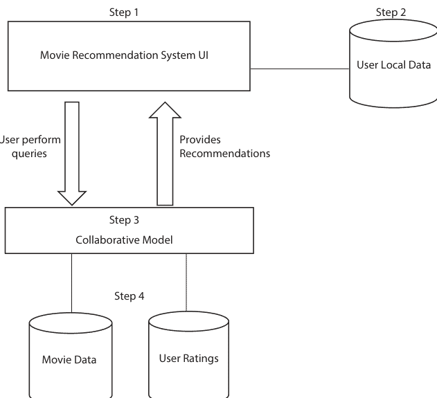

图 6.1 基于人工智能的虚拟语音助手架构图。

说退出。用户的工作将在没有任何其他中断的情况下完成。它在数据安全性方面也很高。也就是说，当用户想要使用他的声音登录他的系统时，语音助手将通过计算用户的频率来检测用户的声音，如图 6.1 所示。这意味着只有所有者可以登录他的系统。

```
$v_\omega = f\lambda$

\(v_\omega\) is the speed of sound

\(f\) is its frequency

\(\lambda\) is its wavelength
```

用户发现定位他的文件很容易，不需要逐一检查所有文件夹；给出打开文件名的命令，文件将被打开。我们为特定功能所需的任何内容都可以通过语音命令完成，通过此方式，语音助手收集所有信息，对其进行分类，并显示与人类命令相适应的信息。尽管邮件功能是通过语音助手执行的，我们可以通过语音命令登录我们的邮件账户并发送邮件。我们可以通过语音助手执行保存文件和启动各种类型的应用程序等功能。

## 6.4 模型训练

拟议系统使用拟议模型分析所有预测分类。图形表示如图 6.2 所示。图 6.2.a 描绘了用于推荐书籍的用户年龄分布图。图 6.2.b 描绘了用于向用户推荐书籍的图书出版年份图。图 6.2.c 描绘了关于书籍评级的图。图 6.2.d 描绘了统计书籍评级的图。图 6.2.e 描绘了书籍平均评级图。图 6.2.f 描绘了用于书籍推荐的用户-ID、电影-ID、评级和时间戳的相关矩阵。表 6.2 表示数据集中的书籍评级，表 6.3 表示从数据集计算的平均评级以及总评级数的预测值。

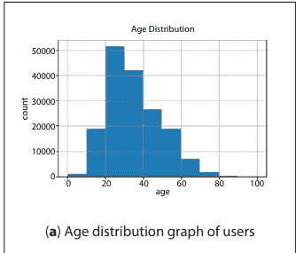

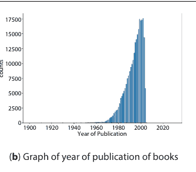

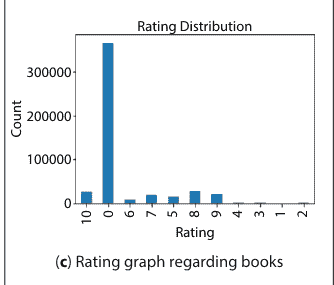

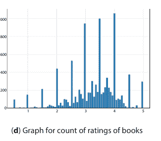

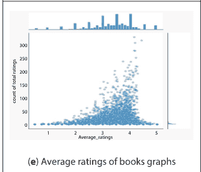

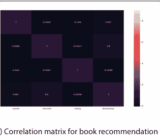

图 6.2 分类分析。

表 6.2 书籍评级。

| | 用户-ID | ISBN | 书籍评级 |
|---|---|---|---|
| 0 | 276725 | 03454104X | 0 |
| 1 | 276726 | 1.6E+08 | 5 |
| 2 | 276727 | 4.5E+08 | 0 |

表 6.3 带有总评级计数的书籍平均评级。

| 标题 | 平均评级 | 总评级计数 |
|---|---|---|
| '71' 1014 | 4 | 1 |
| 'burbi the 1986 | 4 | 17 |
| 'helloboy' 2007 | 3.17647 | 1 |
| 'might mummy' 1985 | 3.5 | 1 |
| 'right mid' 1987 | 3 | 2 |

## 6.5 讨论

第一步是导入模块以创建基于虚拟的语音助手。因此，我们将导入诸如 pyttsx3、语音识别、DateTime、Wikipedia、Web 浏览器和 OS 等模块。

进程启动后，语音助手将根据用户系统上显示的时间向用户问候。图 6.3 显示了人声的简单调制。我们将取一个名为 hour 的变量，hour 变量存储用户系统的当前时间。如果 hour 变量中的时间大于等于零且小于 12，语音助手会向用户说“早上好”。如果 hour 变量中的时间大于等于 12 且小于

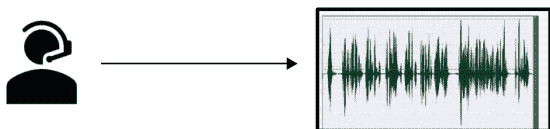

图 6.3 人声频率调制。

18，那么语音助手会向用户说“下午好”。如果时间与上述任何一时间都不同，那么语音助手会向用户说“晚上好”。在这里，我们将使用 voice() 函数来读取命令。我们已将我们的语音助手命名为 John。

我们的系统中的语音助手应该能够获取用户给出的输入并处理用户的命令。在这里，我们将创建一个名为 take command() 的函数。该函数没有任何参数。在这里，我们将取一个变量，它使用 recognizer 类为语音识别器创建一个对象。使用特征，识别器从音频开始处监听音频若干秒。我们将使用 microphone 方法来访问系统中的内置麦克风。麦克风充当用户给出输入命令的来源，并将音频作为输入。语音助手等待 5 秒钟来识别语音；如果用户什么都不说，那么语音助手会要求用户再说一遍命令。如果用户说了什么，那么输入会被识别。语音助手因此对输入的音频数据执行语音识别。它用于转录音频文件。在这里，我们甚至会打印用户说出的命令。

### 6.5.1 提供电影推荐

然后，我们将编写电影推荐的函数。Recommend Movie 函数与书籍推荐的函数相同，它将电影名称作为函数的参数。变量 RTG 存储与作为函数参数给出的特定电影名称相关的信息。它从包含所有电影信息的表中检索数据。然后，该特定电影的评级与所有其他电影评级进行关联，电影列表存储在 mov 变量中，随后将继续进行。由此，它将 DataFrame 中已给出的相应列与所有其他列进行关联。在关联列之后，它计算相关性评分并将结果返回给我们。因此，通过此过程，我们正在使用“core with”并将其应用于整个 movie_matrix DataFrame，该 DataFrame 包含用户电影评级的所有矩阵。通过与用户选择的电影名称和评级进行关联，它只是给我们返回关联的项目。在此过程中，它使用名为“dropna”的操作删除所有缺失结果。然后，我们将按降序对电影进行排序，以便最高评级的电影首先出现，最低评级的电影最后出现。我们将只取关联后检索到的电影列表中的前五部电影。我们将使用 for 循环来检索和打印电影数据。还有另一个名为 Recommend_MOVIET() 的电影推荐函数。该函数仅检索前五名评级电影。总体评级基于 IMDB 评级。

现在，我们将编写一个名为 Movie_Recommenders 的函数，其参数为名为 id 的变量。如果 id 的值为 0，那么语音助手会要求用户提供任何用户兴趣，例如搜索相似电影。现在让我们取一个名为 q 的变量，并调用 takeCommand() 函数，该函数从用户那里获取命令。然后，我们将一个临时变量设置为 0。如果用户给出的命令是“go back”，那么语音助手将退出电影推荐。如果用户说是的命令，那么语音助手会要求用户告诉电影名称，以便语音助手可以向用户推荐类似的电影。现在，临时变量被设置为 1，并调用函数 Recommend_MOVIE() 来列出类似的前五部电影。如果用户给出的命令为 no 或不说任何命令，控制权将转到 Recommend_MOVIET() 命令并打印前五名评级电影。如果临时变量的值为零，那么语音助手会要求用户再说一遍命令，以便它可以正确识别用户给出的命令。

### 6.5.2 KNN 算法书籍推荐

我们编写一个名为 Recommend_Book() 的函数来处理书籍推荐。该函数根据用户评级过滤 CSV 文件中存在的书籍。过滤是通过使用著名算法完成的。

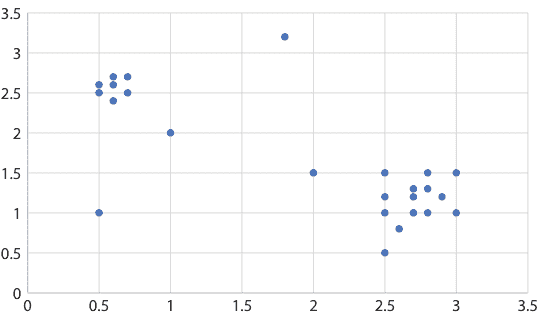

图 6.4 用于书籍推荐的 KNN 算法。


称为 K-最近邻算法。该算法通常会创建一个虚拟/虚假边界来对数据进行分类。每当有新数据或全新数据输入时，KNN 算法的任务就是预测所给数据是否与边界线上的最近点相匹配，如图 6.4 所示。现在我们将使用包含图书 ISBN、作者姓名、图书名称和图书评分的整体数据帧来检查这个特定的图书名称。我们将把其数据存储在名为 book_id 的变量中。这里我们使用了 NumPy，要检查该特定图书，函数 'NumPy.where()' 将以输入数组的形式返回满足所给条件的元素索引。因此，这里我们使用了一种最常用的基本分类算法，即 K-最近邻算法。它通常属于监督学习领域。它通过执行模式识别、入侵检测、数据挖掘等来完成任务。

我们会提供名为训练数据的数据，它将把坐标划分为相应的组。KNN 算法会存储所有可用数据，并预测与边界线上最近点相匹配的数据，如图 6.4 所示。该算法也可用于“回归”问题，但主要用于分类问题。因此，在此过程中，我们使用 KNN 算法来获取类似类型的图书。函数 reshape(1, -1) 用于从整个数据帧中检索单个列行。然后我们将评分最高的前五本相似图书存储到数组中并打印该数组。还有其他名为 Recommend_BookT() 的图书推荐函数，用于从数据帧中检索评分最高的前五本图书。

## 6.6 结果

当用户运行程序时，语音助手会被启用，并开始说话。speak() 函数用于获取语音助手的声音。它根据时间向用户问好：如果时间小于 12，语音助手会祝用户早上好；如果时间小于 18 小时，语音助手会祝用户下午好；如果时间大于 18 小时，语音助手会祝用户晚上好，并告知语音助手。

语音助手向用户问好后，便开始接收用户的命令。它会显示为‘监听中’，如图 6.5 所示，这意味着语音助手已经启用，可以接收用户的命令。此状态会持续到用户对语音助手说完命令为止。命令可以是播放音乐、推荐图书、推荐电影、新冠症状、新冠预防措施，以及打开系统上存在的文件。

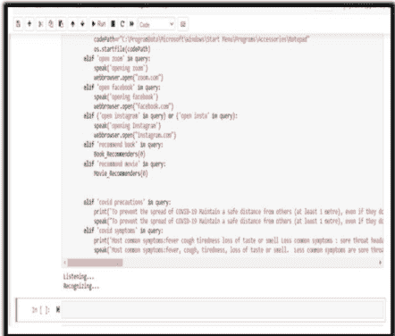

图 6.5 测试平台布局。

下面的截图显示了当用户要求语音助手打开系统上存在的文件时将显示的输出。当用户说出命令‘打开 PowerPoint’时，语音助手会倾听用户所说的话并开始识别命令。如果语音助手能够识别该命令，它就会执行该命令。如果语音助手无法理解用户所说的命令，它会要求用户再说一次命令；如果该特定应用程序或本地文件不存在于系统中，那么语音助手会告诉用户该特定应用程序或本地文件不存在于系统中。

这里‘打开 PowerPoint’命令是有效的，语音助手会识别它。PowerPoint 应用程序将被打开。现在用户可以使用 PowerPoint 应用程序了。虽然应用程序已经打开，但语音助手不会被禁用。语音助手仍处于启用状态，并且可以在该应用程序已在后台运行时，同时打开任何其他文件或应用程序。当用户对语音助手说退出时，如图 6.6 所示，语音助手将被禁用并停止接收命令。然后语音助手会终止进程。

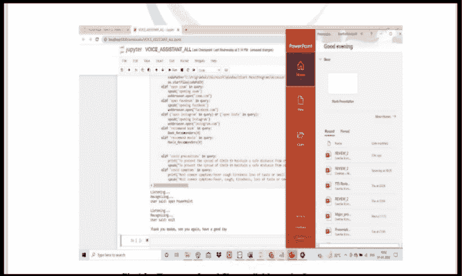

图 6.6 访问系统上可用的本地文件。

最初，语音助手向用户问好，然后开始接收用户的命令。它会显示为‘监听中’，这意味着语音助手已经启用，可以接收用户的命令。此状态会持续到用户对语音助手说完命令为止。命令可以是播放音乐、推荐图书、推荐电影、新冠症状、新冠预防措施，以及打开系统上存在的文件。下面的截图显示了当用户要求语音助手通过浏览器获取应用程序的 Web 访问权限时将显示的输出。

当用户说出命令‘打开 Facebook’时，语音助手会倾听用户所说的话并开始识别命令。如果语音助手能够识别该命令，它就会执行该命令。如果语音助手无法理解用户所说的命令，它会要求用户再说一次命令。当用户说出的命令无效时，语音助手会要求用户再次说出命令。它会一直要求命令，直到收到有效命令。一旦收到有效命令，它会立即开始执行该命令，即通过浏览器打开 Web 应用程序。这里‘打开 Facebook’命令是有效的，如图 6.7 所示，语音助手会识别它，以访问 Web 浏览器。

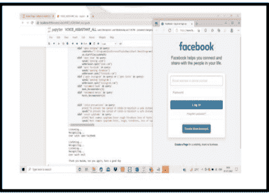

图 6.7 访问 Web 浏览器。

因此，Facebook Web 应用程序将被打开。现在用户可以通过登录自己的帐户来使用 Facebook Web 应用程序。虽然应用程序已经打开，但语音助手不会被禁用。语音助手仍处于启用状态，并且可以在该 Web 应用程序已在后台运行时，同时打开任何其他文件或应用程序。当用户对语音助手说退出时，语音助手将被禁用并停止接收命令。然后语音助手会终止进程。

语音助手在流程开始时向用户问好，然后开始接收用户的命令。它会显示为‘监听中’，这意味着语音助手已经启用，可以接收用户的命令。此状态会持续到用户对语音助手说完命令为止。在用户说出任何命令之前，语音助手会持续监听并识别用户的声音。命令可以是播放音乐、推荐图书、推荐电影、新冠症状、预防措施，以及打开系统上存在的文件。下面的截图显示了当用户要求语音助手根据评分推荐图书时将显示的输出。当用户说出命令‘推荐电影’时，语音助手会被启用。语音助手会检查该命令是否有效。如果是有效命令，语音助手将相应地执行该命令。

如果用户给出的命令无效，它会说出命令‘请再说一次’。此命令会反复执行，直到用户说出有效命令。当用户说出有效命令时，语音助手会验证并执行该命令。基于评分获取图书推荐的命令是‘推荐图书’。用户给出‘推荐图书’命令后，语音助手会被启用并检查该命令是否有效。这里‘推荐图书’是语音助手的一个有效命令。当语音助手发现关于图书推荐的命令是有效命令时，它会接受该命令并询问用户是否想要任何类似的图书。这意味着语音助手在询问用户是否有兴趣获取或阅读类似类型的图书。当用户使用‘是’命令回答语音助手时，语音助手会验证该命令是否有效。这里该命令是有效的，命令为‘是’，如图 6.8 所示。


图 6.8 获取图书推荐。

现在语音助手会要求用户说出图书名称。在询问图书名称后，语音助手开始监听。它会显示为‘监听中’，这意味着语音助手已经启用并且能够接收用户的命令。此状态会持续到用户对语音助手说完命令为止。如果它能识别用户说出的有效图书名称，它会提供与用户给出的图书名称相似的评分最高的前五本图书。语音助手在流程开始时向用户问好，然后开始接收用户的命令。它会显示为‘监听中’，这意味着语音助手已经启用并且能够接收用户的命令。此状态会持续到用户对语音助手说完命令为止。在用户说出任何命令之前，语音助手会持续监听并识别用户的声音。命令可以是播放音乐、推荐图书、推荐电影、新冠症状、新冠预防措施以及打开系统上存在的文件。下面的截图 图 6.4 显示了当用户要求语音助手根据评分推荐图书时将显示的输出。当


当用户说出命令“推荐书籍”时，语音助手被启用。首先，语音助手会检查命令是否有效。如果是有效命令，语音助手将相应执行该命令。如果用户给出的命令无效，它会说出命令“请再说一遍”。此命令会重复执行，直到用户说出有效命令。当用户说出有效命令时，语音助手会验证并执行该命令。此处命令有效，且命令为“否”。语音助手将要求用户说出书名。在询问书名后，语音助手开始监听。它显示为“正在监听”，这意味着语音助手已启用并能够接收用户的命令。这将持续到用户完成对语音助手的命令输入。如果能识别用户说出的有效书名，它将提供评分最高的前五本书。如果在语音助手询问相似书籍时，用户说出命令“是”，则它将提供与用户给出的书名相似的评分最高的前五本书。这意味着将提供与用户给定书名相似的其他书籍。如果用户为查询“搜索任何相似书籍？”给出命令“否”，则在此处语音助手将提供评分最高的前五本书。每当用户对相似书籍查询说“否”时，语音助手不会询问书名，而是直接提供评分最高的前五本书。

主要流程中，语音助手在开始时会向用户致意，随后开始接收用户命令。它显示为“正在监听”，这意味着语音助手已启用并能够接收用户的命令。这将持续到用户完成对语音助手的命令输入。在用户说出任何命令之前，语音助手将持续监听并识别用户的声音。命令可以包括：播放音乐、推荐书籍、推荐电影、新冠症状、新冠预防措施以及打开系统中存在的文件。截图显示了当用户要求语音助手根据评分推荐书籍时将显示的输出。当用户说出命令“推荐电影”时，语音助手被启用。首先，语音助手检查命令是否有效。如果是有效命令，语音助手将相应执行该命令。如果用户给出的命令无效，它会说出命令“请再说一遍”。此命令会重复执行，直到用户说出有效命令。当用户说出有效命令时，语音助手会验证并执行该命令。基于评分获取电影推荐的命令是“推荐电影”。用户给出“推荐电影”命令后，语音助手被启用并检查该命令是否有效。此处“推荐电影”是语音助手的有效命令。当语音助手将关于电影推荐的命令视为有效命令时，它会接受命令并询问用户是否需要任何相似电影。这意味着语音助手在询问用户是否有兴趣获取或观看同类电影。当用户使用“是”命令回答语音助手时，语音助手会验证命令是否有效。此处命令有效，且命令为“是”。

随后，语音助手将要求用户说出电影名称。在询问电影名称后，语音助手开始监听。它显示为“正在监听”，这意味着语音助手已启用并能够接收用户的命令。这将持续到用户完成对语音助手的命令输入。如果能识别用户说出的有效电影名称，它将提供与用户给出的电影名称相似的评分最高的前五部 IMDB 电影。首先，语音助手在流程开始时向用户致意，随后开始接收用户命令。它显示为“正在监听”，这意味着语音助手已启用并能够接收用户的命令。这将持续到用户完成对语音助手的命令输入。在用户说出任何命令之前，语音助手将持续监听并识别用户的声音。命令可以包括：播放音乐、推荐书籍、推荐电影、新冠症状、新冠预防措施以及打开系统中存在的文件。下方截图显示了当用户要求语音助手根据 IMDB 评分推荐电影时将显示的输出。当用户说出命令“推荐电影”时，语音助手被启用。最初，语音助手检查命令是否有效。如果是有效命令，语音助手将相应执行该命令。如果用户给出的命令无效，它会说出命令“请再说一遍”。此命令会重复执行，直到用户说出有效命令。当用户说出有效命令时，语音助手会验证并执行该命令。

基于评分获取电影推荐的命令是“推荐电影”。用户给出“推荐电影”命令后，语音助手被启用并检查该命令是否有效。此处“推荐电影”是语音助手的有效命令。当语音助手将关于电影推荐的命令视为有效命令时，它会接受命令并询问用户是否需要任何相似电影。这意味着语音助手在询问用户是否有兴趣获取或观看同类电影。当用户使用“否”命令回答语音助手时，语音助手会验证命令是否有效。

此处命令有效，且命令为“否”。现在，语音助手将要求用户说出电影名称。在询问电影名称后，语音助手开始监听。它显示为“正在监听”，这意味着语音助手已启用并能够接收用户的命令。这将持续到用户完成对语音助手的命令输入。如果能识别用户说出的有效电影名称，它将根据 IMDB 评分提供评分最高的前五部电影。如果在语音助手询问相似电影时，用户说出命令“是”，则它将提供与用户给出的电影名称相似的评分最高的前五部电影。这意味着将提供与用户给定电影名称相似的其他电影。如果用户为查询“搜索任何相似电影？”给出命令“否”，则在此处语音助手将提供评分最高的前五部 IMDB 电影。每当用户对相似电影查询说“否”时，语音助手不会询问电影名称，而是直接提供如图 6.9 所示的评分最高的前五部电影。

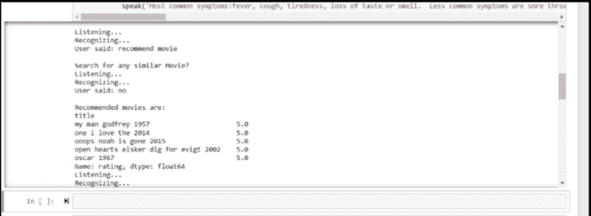

图 6.9 获取电影推荐（...）。

语音助手向用户致意后，开始接收用户命令。它显示为“正在监听”，这意味着语音助手已启用并能够接收用户的命令。这将持续到用户完成对语音助手的命令输入。命令可以包括：播放音乐、推荐书籍、推荐电影、新冠症状、新冠预防措施以及打开系统中存在的文件。图 6.9 还显示了当用户要求语音助手提供新冠症状和预防措施时将显示的输出。当用户说出命令“新冠症状”时，语音助手会倾听用户所说内容并开始识别命令。如果语音助手能够识别，它将执行该命令。如果语音助手无法理解用户说出的命令，它会要求用户再说一遍命令；如果该特定命令无法处理或检索，则语音助手会告知用户该命令无法被语音助手识别。

## 表 6.4 电影评分描述。

| | 用户 ID | 电影 ID | 电影评分 | 时间戳 |
|---|---|---|---|---|
| 数量 | 1008361268.00 | 100836972.0000 | 100836462.00 | 1.008364290e+05 |
| 平均值 | 326.127527864 | 194335.295794718 | 3.50169357 | 1.205946443e+09 |
| 标准差 | 1236.61849031 | 3553280.98719589 | 1.042525279 | 2.1669226310e+08 |
| 最小值 | 1.01000000 | 1.00000100 | 0.50011000 | 8.284971246e+08 |
| 25 百分位数 | 177823.00000 | 1199285.00000 | 3.01930000 | 1.021915824e+09 |
| 50 百分位数 | 325147.00000 | 295163.00000 | 3.518000 | 1.186024487e+09 |
| 75 百分位数 | 477389.00000 | 8123782.00000 | 4.1380000 | 1.435994563e+09 |
| 最大值 | 61035900.0000 | 19360142389.000 | 5.049900000 | 1.537282799e+09 |

此处“新冠症状”命令是有效命令，语音助手会识别它。由于命令被语音助手识别，该命令会被应用程序执行。语音助手会显示新冠症状，并朗读出新冠症状。同样，新冠预防措施命令也会正常工作。当用户说出命令“新冠预防措施”时，语音助手会倾听用户所说内容并开始识别命令。如果语音助手能够识别，它将执行该命令。如果语音助手无法理解用户说出的命令，它会要求用户再说一遍命令；如果该特定命令无法处理或检索，则语音助手会告知用户该命令无法被语音助手识别。比较是根据如表 6.4 所示的评分和时间戳进行的，以便做出推荐决策。

此处“新冠预防措施”命令是有效命令，语音助手会识别它。由于命令被语音助手识别，该命令会被应用程序执行。语音助手会显示新冠预防措施，并朗读出为避免感染新冠应采取的预防措施。尽管应用程序已打开，语音助手不会被禁用。语音


即使该应用已在后台运行，助手仍处于启用状态，并可同时打开任何其他文件或应用程序。当用户说退出语音助手时，语音助手将被禁用并停止接收指令。随后，语音助手将从进程中终止。

## 6.7 结论

本项目的主要目的是提供一个语音助手，用于识别并显示用户问题的答案，并提供用户所需的准确信息。目前已投入使用的桌面语音助手能够提供出色的服务。但目前开发的系统是基于 Python 语言（Python 3.8）构建的。系统使用了 Python 的不同类型的库来实现语音识别、文本处理和简单邮件传输协议（SMTP）。它可以提供新闻和天气信息，播放音乐，执行搜索；我们可以设置闹钟并显示时间和日期。用户可以通过该应用程序工具获取信息。它既节省了人力，也节省了时间。借助自然语言处理，用户可以以正式的方式提问。没有特定的预定义格式来提出查询。

该设计旨在通过人声减少人力并控制应用程序和设备。我们可以使用该设备与其他智能语音控制设备进行交互，例如通过互联网获取城市天气预报、物联网（IOT）应用、发送电子邮件以及将闹钟事件设置到日历中。借助机器学习，设备的准确性得到了提高。该设备还可以设计为接受多种语言的指令，并以用户使用的相同语言进行响应。该设备还将设计为帮助视障人士。

## 参考文献

- 1. Yoffie, David B., Liang Wu, Jodie Svetzer, Denzil Eden, and Karan Ahuja. “语音战争：Hey Google vs. Alexa vs. Siri。”哈佛商学院案例 718，第 519 号（2018 年）：1。

- 2. Tulshan, Amrita S., and Sudhir Namdeorao Dhage. “虚拟助手调查：Google 助手、Siri、Cortana、Alexa。”载于《信号处理与智能识别系统国际研讨会》，第 190-201 页。新加坡：Springer，2018。

- 3. Terzopoulos, George, and Maya Satratzemi. “日常生活与教育中的语音助手和智能音箱。”《教育信息学》19，第 3 期（2020 年）：473-490。

- 4. Shende, Deepak, Ria Umahiya, Monika Raghortc, Aishwarya Bhisikar, and Anup Bhange. “基于 Python 的 AI 语音助手。”《新兴技术与创新研究期刊（JETIR）》6，第 2 期（2019 年）。

- 5. Kulhalli, Kshama V., Kotrappa Sirbi, and Abhijit J. Patankar. “具有语音识别智能的个人助理。”《工程研究与技术国际期刊》10，第 1 期（2017 年）：416-419。

- 6. Gowroju, Swathi, and Sandeep Kumar. “稳健深度学习技术：用于瞳孔分割的 U-Net 架构。”载于《2020 年第 11 届 IEEE 年度信息技术、电子与移动通信会议（IEMCON）》，第 0609-0613 页。IEEE，2020。

- 7. Swathi, A., and Sandeep Kumar. “用于小型低照度数据集的智能瞳孔检测应用。”《系统与软件工程创新》17，第 1 期（2021 年）：29-43。

- 8. Swathi, A., and Sandeep Kumar. “基于 CNN 感兴趣区域的瞳孔分割综述。”载于《智能通信与自动化系统》，第 157-168 页。CRC Press，2021。

- 9. Gowroju, Swathi, and Sandeep Kumar. “使用 UNET 和形态图像处理进行稳健瞳孔分割。”载于《2021 年国际移动、智能和普适计算会议（MIUCC）》，第 105-109 页。IEEE，2021。

- 10. Dasari L. Prasanna, Suman Lata Tripathi. “文本和语音处理的机器学习与深度学习技术。”载于《信号和图像处理的机器学习算法》，IEEE，2023 年，第 115-128 页，doi: 10.1002/9781119861850.ch7

- 11. Kanak Kumar, Kaustav Chaudhury, Suman Lata Tripathi. “医疗监测系统中机器学习（ML）和深度学习（DL）的未来。”载于《信号和图像处理的机器学习算法》，IEEE，2023 年，第 293-313 页，doi:10.1002/9781119861850.ch17.

# 基于机器学习的图像篡改检测方法

Madhusmita Mishra1*, Silvia Tittotto2 和 Santos Kumar Das1

1Dept. of ECE, NIT Rourkela, Rourkela, Odisha, India  
2CECS, UFABC, Santo Andre, Sao Paulo, Brazil

*通讯作者：madhusmita.nit@gmail.com

## 摘要

在照相机发明之前，验证过程是手动完成的。随着技术的进步，现在几乎无法分辨原始图像和编辑后的图像之间的差异。这是因为高级图像编辑工具种类日益增多。这些编辑工具成本低廉，是面向操作人员的开源工具，通常用于制作上传到社交媒体网站的表情包。本工作通过误差级别分析（ELA）方法阐述了图像篡改检测。在此，基于卷积神经网络（CNN）的模型用于做出二进制决策，以判断图像是否适合官方应用。在 CNN 模型中，应用了经过训练的 Kaggle 数据集。全面的仿真验证了所提模型的准确性和精确度。

**关键词：** CNN，图像篡改检测，机器学习（ML），误差级别分析（ELA），卷积神经网络（CNN），深度学习（DL），联合图像专家组（JPEG）

## 7.1 引言

图像为观众提供了大量信息。在当今的社交媒体和互联网中，数字图像无疑证明了其强大的功能和适用性。在医学影像、情报、新闻业、数字取证、摄影以及法庭证据等领域，对图像的需求永无止境 [1]。因此，在当前时期，图像的完整性是一个研究课题 [2, 3]。随着技术不断拓展以满足人类需求，图像编辑并非新事物。当代技术以具有易用界面的软件形式提供，例如 Photoshop、GIMP、Premiere、Vega、CorelDRAW 等，使其使用更加普遍。编辑图像会篡改其原始性，这种做法称为图像篡改。图像篡改通常是指对数字图像进行任何操纵，以在图像中隐藏某些有意义和重要的数据。图像篡改检测技术（IFDT）包括以下几种：

- 1. 主动方法：主动技术会在拍摄时或之后在照片中添加一些可靠的详细信息（水印）或签名。在后一种情况下，修改是通过数字水印、数字签名或两者兼用完成的 [2]。随后，它会与他人共享。

- 2. 被动方法：被动方法不会插入任何用于验证的详细信息。它完全通过研究数字图像的二进制数据来工作。没有水印和签名可用于交叉验证的图像称为盲图。研究人员根据编辑技术以不同方式划分了被动方法。被动工具大致可分为五类 [3]:
  - i. 像素级：该程序区分在像素级出现的可测量不一致性。
  - ii. 格式级：这些程序利用有损压缩方案所呈现的可测量关系。
  - iii. 相机级：这些程序利用相机镜头、传感器或片上后处理提供的伪影。
  - iv. 物理技术：明确确定和识别物理对象、相机和光之间三维协作中的奇异性。
  - v. 几何方法：对世界上的物体及其位置进行估算。

被动图像取证工具分为三类：

- 复制-移动图像篡改
- 图像拼接
- 图像修饰

所有这些技术连同机器学习（ML）技术，以不同的准确性检测不同类型的篡改 [4, 5]。先前


开发新的检测技术需要了解用于检测图像伪造的现有技术。卷积神经网络（CNN/ConvNet）是一种基于深度学习（DL）的算法，它从输入接收图像，并为图像的各个组件分配权重，从而唯一标识不同的图像。ConvNet涉及的处理远低于其他竞争算法的处理。误差级别分析（ELA）通过压缩级别的差异来识别伪造区域。对于JPEG格式的图像，压缩级别应大致相同。当误差级别存在显著差异时，即检测到数字伪造。

本文余部分安排如下。第7.2节详细阐述了图像伪造检测背后的历史背景和现有技术状态，并说明了进行图像伪造检测的必要性。第7.3节讨论了ConvNet架构及与ConvNet相关的一些重要术语。第7.4节专注于图像的误差级别分析。第7.5节讨论了一种拟议的图像伪造检测模型及其结果与分析。第7.6节对本工作作出总结性评述。

## 7.2 历史背景

图像伪造检测技术（IFDT）针对任何类型的伪造，其目标是准确检测伪造区域、提高准确性、对伪造进行定位，并尽可能降低检测时间。IFDT分为两种不同类型：图像处理和深度学习。

[8–10]的作者使用了ELA，[11–14]的作者使用了CNN进行图像伪造检测，这两者分别是图像处理和深度学习的重要组成部分。Basavarajappa等人[2]调查了用于图像伪造检测的不同技术。H. Farid [3]将图像伪造分为不同的被动方法，这些方法对IFDT初始知识和学习的发展至关重要。Dureja等人[4]调查了基于不同检索技术恢复伪造图像的技术。Krizhevsky等人[5]讨论了使用CNN对从ImageNet数据库获得的不同图像类别进行分类。Mishra等人[6]讨论了加速稳健特征（SURF）和层次聚类（HAC）技术用于图像伪造，特别是针对使用区域复制的图像。他们基于伪造图像的统计特征（如平均熵、熵、偏度和峭度）来检测伪造。Popescu和Farid在[7]中使用相机采用的图像捕获技术，结合传感器和彩色滤波阵列（CFA）来检测图像中的伪造。Uliyan等人[15]讨论了一种结合模糊度量评估和相位一致性的新系统，用于检测伪造的模糊区域。Walia和Kumar在[16]中系统地调查了数字图像伪造领域中的问题、疑问和现有技术。Zhang等人[17]讨论了使用CNN检测图像伪造。Zhang等人[18]讨论了在神经网络和深度学习支持下检测图像伪造区域。Zhou等人[19]讨论了一种基于块的CNN图像伪造检测新方法，该方法包含用于处理每个块的基于区域的卷积神经网络（RCNN）。

Deogar等人[20]使用对象检测的AlexNet模型来检测图像伪造。Bharti等人[21]调查了检测伪造图像的各种技术。该文章附带有用的结论，对一些参数、优点和缺点进行了比较。[22]中的在线资源对ELA知识和发展产生了重大影响。Chen等人[23]讨论了使用中值滤波（一种非线性数字滤波技术）的CNN进行图像取证。Ansari等人[24]回顾了基于像素的被动图像伪造检测。本文对基于像素的伪造检测提出了各种想法。Krawetz等人[25]详细阐述了ELA及其在图像取证中的应用，Birajdar等人[26]调查了用于检测图像伪造的广泛被动技术。Gu等人[27]讨论了卷积神经网络在图像伪造检测（IFD）中的最新进展、应用及分析。Liu等人[28]展示了如何在小数据量下高效完成模型预处理的CNN训练。Han等人[29]对任何通用数据的CNN进行了讨论，并讨论了图像与其他数据在处理方法上的差异。Bayar和Stamm在[30]中提出了一种作为深度学习一部分的新卷积层来检测图像伪造。

选择这项工作的原因是假新闻。假新闻是指不真实且仅旨在对社会、机构、个人或实体造成社会危害的内容。以伪造图像、编辑视频或错误字幕形式出现的假新闻，可能对许多毫不知情的无辜人士产生重大影响，并可能导致社会损失。

使用可靠的IFDT可以帮助媒体机构覆盖广大地理区域的新闻，并将假新闻验证作为流程的一部分。由于该工作与图像修改及其使用深度学习相关，因此也很有趣。因此，它逐渐成为一个值得深入研究的领域。考虑到其流行度、速度、准确性和可靠性，使用机器学习或深度学习技术[30–32]是这项工作的显而易见的选择。在机器学习模型中反复输入新数据，使其能够独立适应。通过用大型数据集训练模型，模型的可靠性会提高。

## 7.3 CNN架构

卷积神经网络（CNN/ConvNet）由三个不同的词组成，描述了基于深度学习模型的工作原理。这三个词是卷积（Convolution）、神经元（Neuron）和网络（Network）。卷积是两个函数之间的运算，它产生一个第三个函数，描述两个原始函数之间的关系。在这里，其中一个原始函数是输入数据，另一个是随着每次训练而变化以获得所需输出的参数。卷积本质上是在输入图像数据上滑动一个滤波器。在机器学习中，神经元是模型的基本构建块，它计算输入的加权平均值并添加必要的偏差，最后为结果添加非线性。在数据通信中，我们将数据通过许多层的路由器、接入点或集线器传递，从而形成一个网络。因此，这里我们将输入数据及其修改通过许多层传递；因此该模型被称为网络。CNN接受图像数据作为输入。直接将图像作为输入可以节省模型中的多个变量和混淆。模型基本上在输入和滤波器矩阵之间进行点积，滤波器矩阵大小较小，在图像上滑动。然而，网络末端的输出以每种可能性的百分比值给出。

基本神经网络（BNN）接受单个向量输入。它由许多隐藏层组成，与CNN一样，这些层进一步由许多神经元组成。逐层研究表明，下一层的每个神经元都与前一层的神经元相连。最后，一个全连接（FC）层连接到所有前一层神经元，并以百分比值的形式生成输出。基本神经网络结构如图7.1所示。

BNN以单个向量作为输入，因此2D图像无法适应这种模型。彩色图像是3D的，基本颜色红、绿、蓝（RGB）的第三维使彩色图像具有真实感。通常，CNN中使用加拿大高等研究院（CIFAR-10）图像。CIFAR-10图像的维度为32 × 32 × 3（即每边32个像素和3个色调）。另外，如果我们考虑将3D向量转换为单个向量，CIFAR图像的向量大小将为32 × 32 × 3 = 3072部分，以及多个用于将向量重新转换回3D矩阵的参数。对于大小为256 × 256 × 3的图像，第一层的数量将上升到196,608。


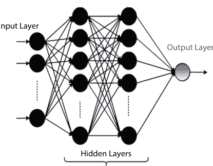

## 图 7.1 神经网络的基本结构。

这种大量数值也会导致模型过拟合（将在后文讨论）。因此，BNN 不适合用于处理数千张图像。

ConvNet 模型以三维方式排列神经元。ConvNet 的三个维度分别为：宽度、高度、深度（此处的深度并非指模型的完整深度）。每个层具有一个三维滤波器（内核），该滤波器在图像的整个维度上滑动并通过点积生成一个 3D 体积。随着神经网络从一层深入到另一层，体积的深度增加，而高度和宽度均减少。因此，该体积是经过滤波器处理后从图像中得出的区分性结论。该过程的可视化展示在图 7.2 中。在图 7.2 中，模型从左到右进行。

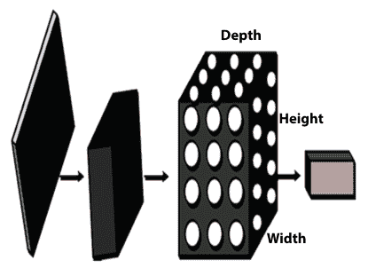

## 图 7.2 CNN 模型的 3D 结构。

ConvNet 层大致分为三部分：输入层、隐藏层和输出层。隐藏层完成所有工作，而输入层和输出层的工作可以轻松总结。输入层接收图像形式的输入数据，输出层输出结果。隐藏层对研究人员最为重要，并被归类为卷积层。它包含开发者选择的激活函数。在此工作中，使用了整流线性单元（ReLU）。池化层是完全连接层。

针对 CIFAR-10 图像的简单 ConvNet 模型可采用以下排列 [INPUT -> CONV -> RELU -> POOL -> FC]。

INPUT 层以矩阵形式包含图像维度（[32 x 32 x 3]）的像素值。卷积层对输入图像的感受野与以滤波器（内核）形式的权重进行点积。该过程由一个在整个图像上滑动的滤波器完成，以便与滤波器进行点积。滤波器数量的增加会提高输出体积的深度。

ReLU 是体积中每个元素的激活函数。该函数可写为 max (0, x)。POOL 层执行一个称为池化的过程，即减小体积的大小；基本上它减小高度和宽度。使用的函数称为最大池化。完全连接（FC）层与前一体积中的所有值完全相连，并有助于得出所需的结论。因此，ReLU 和池化层是预定义函数。主要需要处理的层是卷积层和 FC 层。卷积层包含一个滤波器或内核，用于将输入转换为所需输出；而 FC 层是用于生成二进制结果以声明图像是否伪造的最终层。因此，FC 层可以是一个普通神经元，使用合适的激活函数即可声明输出。

因此，关键点如下。ConvNet 模型包含不同的层，以将输入体积转换为最终类别的概率。隐藏层包含不同类型的层，例如卷积层、ReLU、池化层、FC 层。卷积层、池化层和 ReLU 以 3D 输入体积作为输入并输出 3D 输出体积。ReLU 和池化层不包含任何参数（滤波器/内核）。

学习率所依赖的超参数不属于 ReLU 层。

在 ConvNet 实现过程中，池化层有时会嵌入在逐进的卷积层中间。它用于动态减小描绘的空间范围，以减少系统中的边界和计算量。该层通过使用 MAX 操作，在每个体素上独立工作以在空间上调整信息大小。

3D 体积的池化活动如图 7.3 所示。从图 7.3 值得注意的是，池化活动后的深度测量值保持不变（即，只有高度和宽度减小，深度保持不变）。

池化层的数学步骤如下：

- 初始化：宽度 = W，高度 = H，深度 = D。
- 接收一个尺寸为 W₁ × H₁ × D₁ 的体积
- 调用两个超参数：空间度 F，步幅 S
- 重新生成一个尺寸为 W₂ × H₂ × D₂ 的体积，其中：
  - W₂ = (W₁ - F)/S + 1; H₂ = (H₁ - F)/S + 1 且 D₂ = D₁
- 在处理固定容量的信息时，它会宣布零边界
- 对于池化层，很少使用零填充来缓冲信息。

有两种最大池化类型：一种是 S=3，F=2 的池化（也称为覆盖池化），另一种是 F=2，S=2 的池化。具有更大感受野的池化过于破坏性。

在完全连接层中，神经元与前一层的所有激活完全相关联。在卷积后保持空间尺寸固定的优势在很大程度上提高了执行效率。如果卷积层没有将数据源置零且仅执行重要转换，那么每次卷积后体积的大小几乎不会减小。此时，边缘的数据会被“冲走”

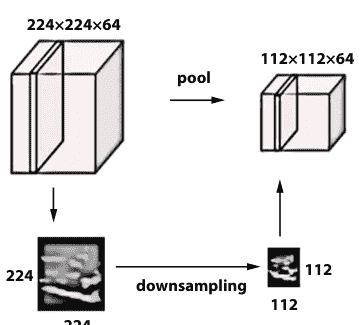

## 图 7.3 3D 体积的最大池化。

速度很快。开发 ConvNet 模型时相当大的瓶颈是内存瓶颈。即使 GPU 有巨大的进步，仍有 3/4/6 GB 内存的限制。

## 7.4 图像误差级别分析

误差级别分析（ELA）突出了 JPEG 压缩率中的对比度。均匀遮盖的区域（如纯蓝天或白色隔断）很可能比高对比度边缘具有较差的 ELA 结果（更暗的遮盖）。

类似边缘在 ELA 结果中应具有等效的亮度。每个高度区分的边缘必须彼此相似，所有低差异边缘也应相似。对于原始照片，低差异边缘应几乎和高差异边缘一样明亮。相似表面在 ELA 下应具有可比的阴影。具有越来越多表面细节的区域可能比平滑表面具有更好的 ELA 结果。无论表面的真实颜色如何，每个平坦表面在 ELA 下都应具有大约相似的阴影。

图像文件格式有多种。有些格式是有损的，而其他格式是无损的。无损文件格式保存精确的像素颜色数据。如果你加载一张图像、保存它，然后再次加载，每个像素都将具有完全相同的值。即使在两种无损格式之间转换，也会保持完全相同的颜色值。例如，便携式网络图形（PNG）和位图（BMP）是两种不同的无损格式。如果你将图像从 BMP 转换为 PNG，它将保持完全相同的像素值，即使文件位置发生了变化。

有损文件格式不保证阴影会保持不变。使用 JPEG 时，保存需要指定质量级别。质量级别会改变压缩量（较低质量会生成更小的文件）；但是，它通过删除一些颜色数据进行打包。使用 JPEG，保存图像会使阴影略有变化。重新保存的文件在外观上可能与源图像相同；但是，特定的像素值可能会不同。

与 ELA 结合，每个未针对质量级别升级的矩阵都会显示在重新保存期间更改过的网格方块。来自数码相机的唯一图像在任何重新保存期间都必须获得高水平的改进（高 ELA 值）。每次后续重新保存都会降低错误级别潜力，从而产生较暗的 ELA 结果。

经过足够多次的重新保存，网络方块最终会到达其基础错误级别，之后将不再改变。通常，识别高频区域（如边缘和对象）会使 ELA 值高于图像的其余部分。

ELA 用户可以找出识别图像缩放、质量、编辑和重新保存变化的方法。例如，如果非 JPEG 图像包含明显的网格边界（8 × 8 方格中宽 1 像素），那么这意味着该图像最初是 JPEG 并被转换为非 JPEG 格式。如果图像的某些区域缺少框架线或网格线移动，那么这意味着在非 JPEG 图像中存在连接或绘制的分区。另一个例子，PNG 文件是一种无损文件格式。如果图像是唯一的 PNG，那么 ELA 应为边缘和表面生成高值。然而，如果 ELA 在边缘和表面上产生微弱的结果（暗淡或暗色阴影），那么该 PNG 可能是由 JPEG 生成的。这是因为从 JPEG 到 PNG 的转换过程是无损的，并且会保留 JPEG 伪影。当与其他算法结合时，ELA 成为一种非常强大的评估工具。虽然 ELA 是识别调整的绝佳工具，但存在多种警告：

- 像素变更或轻微阴影修改可能不会在 ELA 中产生可识别的变化。
- JPEG 在网格上运行，对网格中每个部分的修改可能会影响整个矩阵方块。人们将无法准确区分网络中哪个像素被更改了。
- ELA 只是识别哪些区域具有独特的压缩级别。它不区分来源。如果低质量图像合并到高质量图像中，那么低质量图像可能显示为更暗淡的区域。
- 重新着色、缩放或向图像添加噪声会改变整个图像，从而产生更高的错误级别潜力。
- 如果图像多次重新保存，那么它可能完全处于最低错误级别。在这种情况下，ELA 将返回一张暗图，且无法使用此算法区分任何调整。


## 7.5 图像伪造检测的拟议模型、结果与讨论

图像伪造检测的新型 CNN 模型的流程图如图 7.4 所示。该模型由多层 ConvNet 组成，包含多个卷积层、ReLU 层和池化层。拟议模型使用名为 CASIA1 的 Kaggle 数据集进行训练。CASIA1 进一步分为两部分：数据集 1 和数据集 2。在测试阶段，输入层接收的图像大小为 256 × 256 × 3。图像经过多层 ConvNet 的不同层处理。该模型将“ReLU”作为激活函数，max pooling 作为池化操作。在输出层中，为了获得二进制决策，使用简单的激活函数“sigmoid”来判断图像是否被伪造。获得二进制输出后，如果输出为“1”，则图像被伪造，否则为正常图像。使用从 Kaggle 网站获得的两个数据集（CASIA1）训练网络后，下面分别描述了训练和验证的损失函数（LF）和准确率图表。网络训练和验证已在 Google Colab 笔记本中完成。图 7.5 显示了数据集 1 的训练损失和准确率。在图 7.5 中，Y 轴表示归一化准确率，X 轴定义 epoch 数量。

从图 7.5 可以推断，拟议模型在训练过程中达到了约 99% 的准确率，在验证过程中达到了约 91% 的准确率。完整的仿真模型已测试了 100 个 epoch。数据集 2 的损失函数和准确率结果已在图 7.6 中呈现。数据集 2 的仿真设置与前文讨论的情况相同。使用数据集 2 时，拟议模型也显示出稳定的性能，图像伪造检测准确率约为 87%。因此，验证拟议图像伪造检测模型的仿真结果准确率约为 90%。

对于拟议的 ConvNet 模型，测试数据集 1 和数据集 2 的混淆矩阵分别由图 7.7 和图 7.8 表示。

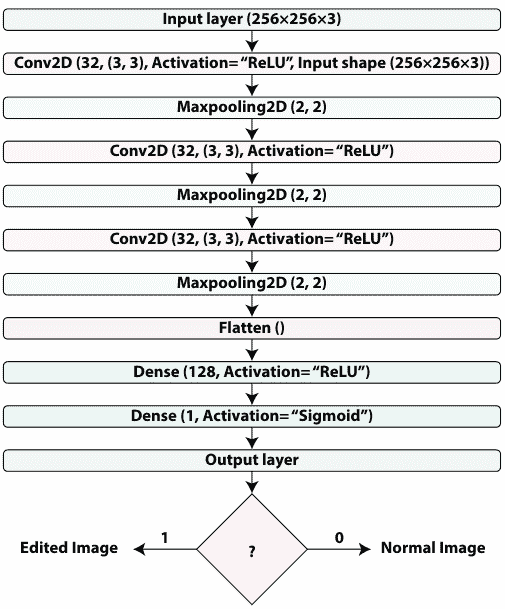

图 7.4 新型 CNN 模型的流程图。

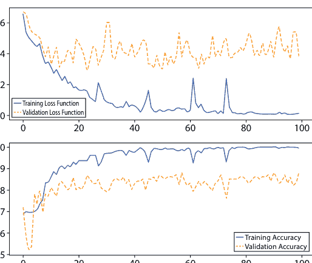

图 7.5 数据集 1 的训练损失和准确率。

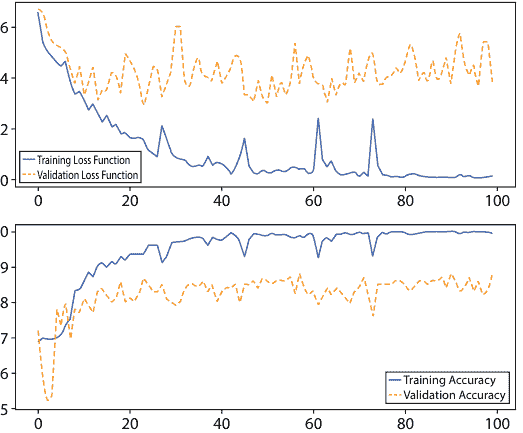

图 7.6 数据集 2 的训练损失和准确率。

| | |
|---|---|
| 197 | 3 |
| 43 | 257 |

图 7.7 数据集 1 的混淆矩阵。

| | |
|---|---|
| 179 | 21 |
| 43 | 257 |

图 7.8 数据集 2 的混淆矩阵。

拟议模型的准确率：根据混淆矩阵，ConvNet 模型的归一化准确率表示如下：

```
Accuracy = (TP + TN)/(TP + TN + FP + FN)
```

拟议模型在数据集 1 上达到 0.908，这意味着模型约为 91% 准确。对于数据集 2，它约为 0.872，这意味着模型约为 87% 准确。

精确率：系统的精确率给出如下：

Precision = TP/(TP + FP)

本工作提出的模型在数据集 1 上的精确率为 0.985，这真是可以接受的，在数据集 2 上为 0.895，这也确实可以接受。

召回率（灵敏度）：系统的召回率可以由以下公式给出：

Recall = TP/(TP + FN)

拟议模型在数据集 1 上的召回率为 0.82，在数据集 2 上为 0.80，这对该模型很有用。

F1 分数：F1 分数是精确率和召回率的加权平均值，给出如下：

F1 Score = 2 × (recall × precision)/(recall + precision)

对于此处提出的模型，数据集 1 的 F1 分数为 0.89，数据集 2 为 0.84。

## 7.6 结论

在本研究工作中，提出了一种结合误差水平分析的新型 CNN 模型用于图像伪造检测。所提模型已使用 Kaggle 的 CASIA1 数据集进行验证。研究发现，该模型在数据集 1 上的性能为 91% 准确率，在数据集 2 上约为 87% 准确率。系统的详细有效性基于两个数据集的混淆矩阵进行测量。结论是，该系统在数据集 1 和数据集 2 上的归一化精确率分别为 0.98 和 0.89。此外，还对拟议模型进行了召回率和 F1 分数测试。对于所有主要性能标准，模型性能被认为是满意的。基于所提的新型模型，在不久的将来可以开发一个 Android 应用程序。该应用程序将确定特定图像是否经过数字篡改/编辑。

## 7.7 未来研究方向

ICT 结合云计算技术为机器学习（ML）和深度学习（DL）技能提供了强健的方案。最近，研究人员调查了 5G 系统作为候选方案，为智能无线网络奠定基础以应对集中索赔。以 ML 为中心的信号处理算法可以为未来智能无线网络（B5G）的进步铺平道路。DL 通常包含两个阶段，即训练和测试。在实际通信系统的应用中，只有测试阶段有用。训练阶段通常离线完成。因此，训练好的 DL 模型可以在不需要重新训练的情况下实现许多目标。在这方面，我们可以对拟议的 CNN 算法进行一些修改后使用。

CNN 在自动调制分类（AMC）中的实现揭示了有希望的准确率。AMC 是对信号调制模式进行分类的方法，是非合作通信的一种基本方法。通过向 CNN 使用时频通道输入，CNN 输入的特征维度将得到增强。因此，像相位或频率偏差这样的丢失信息可以简单地在时频图的能量变化中捕获。因此，此处提出的 CNN 方法可以应用于 AMC 以增强分类能力。

## 参考文献

- 1. Madhusmita Mishra; LDPC 码与数字取证——一种透视方法. IETE Journal of Research 2019, pp. 1–8.
- 2. S. B. Basavarajappa 和 S. Sathyanarayana; 数字图像伪造检测技术：一项综述. ACCENTS Transactions on Information Security 2016; pp. 22–31.
- 3. H. Farid; 图像伪造检测. IEEE Signal Processing Magazine 2009; pp. 16–25.
- 4. A Dureja; P Pahwa; 图像检索技术：一项综述. International Journal of Engineering & Technology. 2018, pp. 215–219.
- 5. A Krizhevsky; I Sutskever; G E Hinton; 基于深度卷积神经网络的 ImageNet 分类. Advances in Neural Information Processing Systems. 2012, pp. 1097–1105.
- 6. P Mishra; N Mishra; S Sharma; R Patel; 基于 SURF 和 HAC 的区域复制伪造检测技术. Scientific World Journal. 2013.
- 7. A C Popescu; H. Farid; 揭示彩色滤镜阵列插值图像中的数字伪造. 2005, pp. 3948–3959.
- 8. J Chen; X Kang; Y Liu; Z J Wang; 基于卷积神经网络的中值滤波取证. IEEE Signal Processing Letters. 2015, pp. 1849–1853.
- 9. M D Ansari; S P Ghera; V Tyagi; 基于像素的图像伪造检测：一项综述. IETE J Education. 2014, pp. 40–46.
- 10. N. Krawetz; 一图胜千金……数字图像分析与取证. Hacker Factor Solutions. 2007.
- 11. Birajdar GK; Mankar VH; 使用被动技术的数字图像伪造检测：一项综述, Digital Investigation 2013, pp. 226–245.
- 12. Gu J; Wang Z; Kuen J; Ma L; Shahroudy A; Shuai B 等; 卷积神经网络的最新进展. Pattern Recognition 2018, pp. 354–377.
- 13. Liu S; Deng W; 基于极小训练样本量的非常深度卷积神经网络图像分类. 3rd IAPR Asian Conference on Pattern Recognition (ACPR) 2015.
- 14. Han H; Li Y; Zhu, X.; 用于通用数据分类的卷积神经网络学习. Information Sciences 2019, pp. 448–465.
- 15. D M Uliyan; H A Jalab; A W A Wahab; P Shivakumara; S Sadeghi; 用于图像取证应用的新型伪造模糊区域检测系统”, Expert Systems with Applications 2016, pp. 1–10.
- 16. S Walia; K Kumar; 数字图像伪造检测：一项系统审视. Australian Journal of Forensic Sciences 2018, pp. 1–39.
- 17. J Zhang; W Zhu; B Li; W Hu; J Yang; 基于卷积神经网络的图像复制检测, Chinese Conference on Pattern Recognition 2016, pp. 111–121.
- 18. Y Zhang; J Goh; L L Win; V L Thing; 图像区域伪造检测：一种深度学习方法. Proceedings of the Singapore Cyber-Security Conference (SG-CRC). 2016, pp. 1–11.
- 19. J Zhou; J Ni; Y Rao; 用于图像伪造检测的基于块的卷积神经网络. International Workshop on Digital Watermarking. 2017, pp. 65–76.
- 20. Doegar Amit; Dutta Maitreyee; Gaurav Kumar; 使用预训练 AlexNet 模型的基于 CNN 的图像伪造检测. International Journal of Computational Intelligence & IoT. 2019.
- 21. C. N. Bharti; P. Tandel; 图像伪造检测技术综述. International Conference on Wireless Communications, Signal Processing and Networking (WiSPNET). IEEE. 2016, pp. 877–881.
- 22. Factor H Foto; 用于 ELA 的在线取证. 2012.
- 23. J Chen; X Kang; Y Liu; Z J Wang; 基于卷积神经网络的中值滤波取证. IEEE Signal Processing Letters. 2015, pp. 1849–1853.
- 24. M D Ansari; S P Ghera; V Tyagi; 基于像素的图像伪造检测：一项综述. IETE J Education. 2014. pp. 40–46.
- 25. Yan Zhao 等; 数字图像操纵取证. 报告编号 UCB/EECS-2015-85. 2015.
- 26. Birajdar GK; Mankar VH; 使用被动技术的数字图像伪造检测：一项综述. Digital Investigation. 2013. pp. 226–245.


- 27. Gu J; Wang Z; Kuen J; Ma L; Shahroudy A; Shuai B; 卷积神经网络的最新进展. 模式识别. 2017.

- 28. Shengwei Zhou; Caikou Chen; Guojiang Han; 使用小型数据集的带有扩展卷积的深度卷积神经网络. 中国控制会议 (CCC). 2019.

- 29. Han H; Li Y; Zhu X; 用于通用数据分类的卷积神经网络学习. 信息科学. 2019. pp. 448–465.

- 30. B. Bayar; M. C. Stamm; 一种使用新卷积层的通用图像篡改检测深度学习方法. 第4届ACM信息隐藏与多媒体安全研讨会论文集. AC. 2016. pp. 5–10.

- 31. Deepika Ghai, Suman Lata Tripathi, Sobhit Saxena, Manash Chanda, Mamoun Alazab, 信号和图像处理机器学习算法. Wiley IEEE Press, 2022.

- 32. Kanak Kumar; Kaustav Chaudhury; Suman Lata Tripathi, “医疗监测系统中机器学习（ML）和深度学习（DL）的未来,” in 信号和图像处理机器学习算法 , IEEE, 2023, pp. 293–313, doi: 10.1002/9781119861850.ch17.

# 光学性能监测中人工神经网络的应用

Isra Imtiyaz¹, Anuranjana¹*, Samukh Kaur² and Anubhav Gautam²

¹信息技术系，ASET，阿米蒂大学北方邦，诺伊达，印度 ²电子与通信工程系，ASET，阿米蒂大学北方邦，诺伊达，印度

## 摘要

光学性能监测（OPM）是指计算和采集传输信号及不同光学网络组件的众多物理特性。随着光联网技术的发展，尤其是在光学信噪比（SNR）、Q因子和色散等信号质量指标方面，人们对OPM的兴趣日益浓厚。本文回顾了OPM算法及其优缺点。同时，还回顾了光学网络中的人工智能（AI）方法，以及AI在光联网、光学损伤和组件故障方面的应用。

**关键词：** ANN, 光学性能监测, LSTM, 光学损伤

## 8.1 引言

光通信是利用光传输信息的远距离通信。它可以通过视觉方式或使用电子仪器进行。光无线通信（OWC）是一种光通信类型，使用非导引的红外（IR）、可见光或紫外线（UV）光传输信号。它主要用于短距离通信。可见光通信（VLC）已被公认为一种短距离接入的潜在室内高速无线解决方案，作为一种将通信与照明相结合的OWC形式 [1]。

空间光通信（FSO）是另一种光通信技术，它利用自由空间光传播通过计算机网络或电信无线传输数据。FSO的一些优点是：自由空间光学是一种多功能网络，提供的速度比宽带更快，且所需初始投资较小。可以实现可与光纤电缆数据速率相媲美的高数据速率，且误码率非常低，极窄的激光束允许在特定区域内建立数量无限的FSO线路。但与此同时，也存在一些局限性，例如，当飞鸟、树木和高大建筑物进入FSO系统广播的视距（LOS）时，它们可能会暂时阻挡单个光束。此外，由于地球散发的热量以及供暖管道等人为因素，空气包之间会出现温度差异。温度差异可能导致信号幅度波动，从而造成FSO接收端出现“画面舞动” [2]。

OPM是对传输信号和光学网络组件的众多物理特性进行评估和获取。OPM功能对于确保稳定的网络运行至关重要，并在提供灵活性和提高整体网络效率方面发挥着重要作用。OPM是确保光学网络可靠性的关键，它包含图8.1所示的三个层次 [3]。在WDM层中，确定传输和信道管理所需的光学域参数构成第一层，即传输或WDM信道管理层监测。传输层的实时测量示例包括信道存在、波长注册、功率电平和光学光谱信噪比（OSNR）。锁定单一波长并进行对信号过渡敏感的测试的光学信号或信道质量层监测是第二层。模拟眼图和眼图统计、Q因子、电子信噪比，以及由于色散导致眼图内部的损伤


Figure 8.1 OPM中的不同层次。

和非线性效应是可在信号质量层中评估的方面示例。监测数据协议信息和协议性能构成OPM的第三级，称为PPM。这涉及使用数字测量来推导模拟光学信号的特性，例如误码率（BER）[4]。

当包括色散（CD）和偏振模色散（PMD）在内的其他传输畸变在数字相干光接收器中被调整时，OSNR是对误码率（BER）影响最大的指标 [5]。传统的OSNR监测技术基于信号之间的光谱间隙处的噪声电平的线性插值，采用光学光谱分析仪（OSA）。然而，由于基于传统衍射光栅的OSA分辨率较低，超密波分复用（UDWDM）或超信道传输系统中的光谱间隙变得模糊甚至不存在（约0.02 nm）[6]。

此外，由于光节点中包含的光滤波器件（如光加复用器OADM，更准确地说是波长选择开关WSS）引起的级联滤波效应（CFE），光谱间隙处的ASE噪声可能会被显著抑制，使得基于插值的方法失效 [7]。

随着系统容量的提升，光网络将对有害且导致数据劣化的基于光纤的损伤极其脆弱。由于高速信号的频谱较宽，一些最显著的损伤包括CD、PMD和OSNR。为了维持系统性能，网络确定限制严重程度的能力至关重要。OPM可以通过监测数据变化并识别由不同损伤引起的“实时”变化来实施，从而使一个影响的变化会改变一个测量参数 [8]。这可以利用相干检测的特定情况中的电信号后处理程序 [9]，或利用光学技术监测射频（RF）声功率或光谱信道功率分布中的变化 [10]。

随着光联网技术的进步，尤其是在OSNR、Q因子和色散等信号质量指标方面，人们对OPM的兴趣日益浓厚。这些先进的监测技术可能允许将故障管理和服务质量（QoS）监测扩展到光学域 [11]。表8.1列出了用于光学性能估算和监测的不同算法及其优缺点。

在[3]中，作者指出，由于5G技术、高清视频和物联网的发展，对光学网络容量的需求大幅增长。低余量光学

## 表8.1 文献综述。

| Ref. | Algorithm | Advantages | Disadvantages |
| :--- | :--- | :--- | :--- |
| [12, 13] | ANN | • 支持广泛的函数表示<br>• 能够处理带噪声的数据<br>• 具有一个或多个受损单元的ANN仍然可以产生输出。由于这一特性，网络具有容错能力。 | • 训练后的模型难以解释。<br>• 由于梯度消失，可能的层数较少<br>• 根据其结构，人工NN需要具有并行处理能力的处理器。因此，设备的实现依赖于此。 |
| [14] | DNN | • 实现成本低。基于深度NN的清点技术只需在空服务器上安装清点应用程序。<br>• 实现、维护和操作过程简单 | • 要比其他策略表现更好，需要大量数据。<br>• 由于数据模型复杂，培训成本很高。 |
| [15] | CNN | • 在处理二维输入时提供尖端性能<br>• 时间和成本效益仍然是神经网络三个最受欢迎优势中的前两位<br>• 在无人监督的情况下，自动识别关键特性 | • 计算难度大<br>• 需要大量训练数据。<br>• CNN不对物体的方向和位置进行编码。 |


### Table 8.1 Literature reviews. (Continued)

| 参考文献 | 算法 | 优点 | 缺点 |
|:---|:---|:---|:---|
| [16] | SVR | - 它对不规则性具有抵抗力。<br>- 决策模型的更新简单。<br>- 它具有强大的泛化能力和良好的预测精度。<br>- 它易于实践。 | - 对于大型数据集，它们不适用。<br>- 当数据集中存在额外噪声（例如目标类重叠）时，决策模型表现不佳。 |
| [17] | SVM | - 在高维空间中有效<br>- 内存高效，因为只使用了一部分训练点（支持向量） | - 使用启发式方法选择核函数。<br>- 无法使用类谱之外的数据 |
| [18] | KRR | - 核岭回归的一个优点是，存在基于对整个训练集进行单次训练的结果来计算分类错误率和留一法均方误差的方法。 | - 系数向量不是稀疏的，因此不存在“支持向量”的概念。由于支持向量机只需对支持向量集合求和而无需对整个训练集求和，这在预测时产生了差异。 |
| [19] | LSTM | - 可从多种 LSTM 参数中进行选择，例如带有输入和输出偏置的学习率。因此，无需进行微调。 | - 它们在现实世界中学习需要大量时间和资源，每个单元中的线性层需要高内存带宽，而系统通常无法提供。 |

网络正在受到关注，以满足容量要求。因此，需要更精确的规划工具，实现这一目标的重要组成部分是准确的传输质量（QoT）和损伤模型。此外，由于余量很小，保持光网络的可靠性非常重要，OPM 是必要的。OPM 使控制器能够识别异常并修改物理层的设置。然而，鉴于当代光网络的异质性，采用传统分析技术来创建此类精确的建模和监测工具是具有挑战性的，而在 [12] 中，在无限预算下可以获得全面监测。尽管光网络的未来难以预见，但随着透明度的提高，OPM 的价值也在上升。网络的演变方式使得更高程度的 OPM 变得可取，甚至必要。为了满足这一 OPM 需求，已开发出众多技术。未来的挑战将是如何应用这些策略，在监测覆盖率、灵敏度和成本之间取得正确的平衡。

在 [2] 中，作者提出了 1D 特征（IQHH 和 IQHD）和 2D IQH 特征，用于研究基于 FMF 的光网络中的 OPM。他们使用 10 Gbaud-DP-QPSK 信号进行了仿真和实验，以评估 OPM 的性能。结果表明，他们能够预测 8 到 20 dB 之间的 OSNR 值、160 到 1100 ps/nm 之间的 CD 值以及各种模式耦合系数值。然而，当存在带有特定级别的损伤时，监测性能将受到显著影响，导致 IQH 特征在不同情况下几乎无法区分。

在 [11] 中，作者指出，当前使用的基于深度神经网络（NN）的 OPM 技术缺乏选择输入数据的能力。它们总是接受并处理一切，这可能导致重大监测错误并削弱监测系统的可信度。由于未来异构光网络中发送数据的多样性，这可能会超出监测系统的能力。在他们的新 OPM 架构中，他们建议使用无监督生成对抗网络（GAN）作为判定模块，以选择属于监测系统范围内的合法数据。构成生成器的编码器-解码器-编码器（EDE）子网络共同学习合法数据的图像及其隐藏特征分布。此外，OPM 分析器网络的训练数据与新增判定模块中网络的训练数据相同，因此无需获取额外数据，节省了成本。为了测试模拟中判定模块的模型性能，考虑了两个比特率下的四种调制格式。当使用 60 Gbps 64QAM 信号作为非法数据时，最大曲线下面积（AUC）值为 0.942。单张图像的判定大约需要 12ms。此外，还研究了任务权重和隐式特征形状对判定性能的影响。新增的判定模块显著提高了当前 OPM 方案的可信度和安全性。

## 8.2 用于性能监测的算法

### 8.2.1 人工神经网络

被称为人工神经网络（ANN）的信息处理系统，因为它们通过抽象进行泛化并从观察中学习 [20, 21]，因此为数值建模技术、分析技术或经验建模解决方案等传统方法提供了有吸引力的替代方案。

ANN 易于使用，并能够描述多维非线性交互。此外，神经网络方法响应快且通用（即，同一种建模技术可用于无源/有源器件/系统）。这些特性使得 ANN 方法成为许多领域（包括模式识别、语音处理、控制和生物医学工程）中一种强大工具而广受欢迎。最近，它还被应用于 RF 建模、微波设计和光性能监测。通常，


图 8.2 人工神经网络的层级。

无源和有源部件/电路/系统的电气/光学行为首先使用神经网络进行建模。当用于高级建模和设计时，这些经过训练的神经网络可以为其学习的问题提供快速解决方案 [8]。

ANN 由称为神经元的多层处理单元组成。下述系数反映了每个神经元与下一层神经元之间连接的强度。ANN 发现代表被检查器件或系统属性的输入输出数据集之间的相关性。在将输入向量提供给输入神经元并生成输出向量后，将 ANN 的输出与期望输出进行比较，并确定错误。一旦网络见过所有训练集，就会为每个权重计算并累加误差导数。使用误差导数更新神经元的权重，并继续训练，直到错误达到期望的低水平。ANN 的层级如图 8.2 所示。

### 8.2.2 深度神经网络

ANN 模式识别中非线性处理单元（神经元）隐藏层之间的每个链路都有相应的权重。为了使 ANN 学习如何表示复杂模型，它必须经历一个迭代训练过程，其中输入层首先接收原始数据，然后由每个后续隐藏


图 8.3 DNN 的层级。

层。隐藏层和神经元的数量是 ANN 的关键设计因素，因为它影响网络的学习能力 [22]。

尽管 ANN 已有效应用多年，但由于数据集数量不断增加，技术进步正迫使 ANN 在越来越高的水平上运行。基于深度学习的深度神经网络（DNN）模型现在可用于解决这些性能问题，因为它们可以使用图形处理单元并行处理海量数据，具有速度和精度优势。当网络包含两到十个隐藏层 [图 8.3] 且能够比传统 ANN（也称为浅层神经网络）更快地学习复杂函数时，通常被称为 DNN [23]。DNN 历史上一直使用 Sigmoid 激活函数；然而，当添加隐藏层时，网络的性能开始下降且收敛速度变慢。因此，创造了一种名为深度整流神经网络的独特 DNN 架构，它用整流线性函数取代了 Sigmoid 激活函数。

### 8.2.3 卷积神经网络

卷积神经网络（CNN）是一种特定的神经网络结构，其权重矩阵通过与滤波掩码进行卷积生成。CNN 对组织良好的数据阵列（如图像、对话和音频信号输入）具有更好的解释能力，这使其区别于其他神经网络。在本部分中，我们研究 CNN 的矩阵形式，以理解 CNN 的收敛性。我们提出了一种受 CNN 启发的、具有更大宽度的深度神经网络架构 [24]。CNN 广泛采用了深度学习（DL）计算和大多数特定 NN 分类，尤其是在高维信息（如图像和录像）方面。它实现了深度神经网络的优越性，但这阻碍了与多维私有连接信息的良好扩展 [25]。

因此，CNN 对信息库至关重要，在信息库中需要创建大量的节点或边界。下图显示了 CNN 架构。以下是其架构中 CNN 几个层级的定义。

#### 8.2.3.1 卷积层

卷积层决定开放区域中链接输入的输出，是卷积神经网络等结构的基本组成部分。轨道的二维激活图


图 8.4 CNN 架构。

通过对数据信息高度和宽度之上的部分进行汇聚，记录输入和通道值之间的微小片段，并执行此操作来创建。图 8.4 显示了基本的 CNN 架构。

#### 8.2.3.2 非线性层

非线性系统的巨大潜力必须大于个体。此层中的信息信号将转换为输出信号，该信号随后将用于对下一层做出贡献 [26]。

#### 8.2.3.3 池化层

其主要功能是按比例减少模型中与表示空间大小相关的边界数量及计数。它加速估计并避免过拟合问题。最大池化是池化层中不同且最著名的一种类型。

#### 8.2.3.4 全连接层

带有全连接层的常规 DNN 旨在汇总动机的预测，以用于识别回归。它与标准 MLP 具有相似的头部。由倾斜平衡勘测的网格增强可用于为此类层选择表示，该层接收前一层中每个激活的完全连接。

### 8.2.4 支持向量回归 (SVR)

SVM（即支持向量机）被广泛用于解决分类问题。然而，很少有证据支持在回归中使用 SVMs。支持向量回归是这些模型的名称 (SVR)。使用 SVR，我们可以自由指定模型中可容忍的误差水平，它将找到最适合数据的最佳线（或高维中的超平面）[16]。

### 8.2.5 支持向量机 (SVM)

支持向量机 (SVM) [27] 是一种基于统计学习理论的流行判别方法。其对未知数据的强大泛化能力是其关键优势之一。经验风险最小化原则在常规方法中被广泛使用，以确保与训练相关的错误降至最低 [28]。SVM 基于结构风险最小化的思想，与传统方法相反，其目标是通过平衡模型复杂度与类似训练误差的复杂度，来降低推广误差的上界，以实现最优网络结构 [29]。

### 8.2.6 核脊回归 (KRR)

核脊回归 (KRR) 将脊回归和分类与核技巧相结合。随后，它在由相关内核和数据创建的空间中学习一个线性函数。这直接对应于原始空间中非线性内核的非线性方法。核脊回归开发的模型与 SVR 具有完全相同的结构。KRR 使用平方误差损失，而 SVR 使用 E-不敏感损失；两者都与 l2 正则化相配对。但是，损失函数是不同的。与 SVR 相比，拟合核脊回归对于中型数据集通常更快，并且可以采用解析形式完成。与 SVR 不同，SVR 在预测时对 E>0 采用稀疏模型，而所获得的模型是非稀疏的，因此速度较慢 [30]。

### 8.2.7 长短期记忆 (LSTM)

1997 年，Hochreiter 和 Schmidhuber 创建了长短期记忆 (LSTM)，它由多个神经层组成，每个神经元中有几个控制门 [31]。LSTM 类型的循环神经网络能够学习顺序依赖性。四个神经网络和大量按链式模式排列的内存单元构成了 LSTM。一个单元、一个输入门、一个输出门和一个用于消除先前数据的门构成典型的 LSTM 单元。门控制进出单元的信息流，而单元可保留值任意长时间。无限时长的时间序列可以使用 LSTM 算法进行分类和预测 [19]。这些门架构提高了长期依赖预测的准确性，并解决了循环神经网络中的梯度消失问题。通过对先前时间步的隐藏状态和当前输入数据使用 sigmoid 函数，遗忘门删除了关于当前状态的数据 [32]。

## 8.3 人工智能 (AI) 方法、性能监测及光网络中的应用

AI 实体以及系统有能力执行生物过程，重点关注人类认知过程，以执行类似于学习和决策的活动。虚拟个人助理、智能汽车、购买预测、语音识别和智能家居设备只是几乎无处不在的 AI 应用的几个例子。这些及其他基于 AI 的技术已经在以提高人类生产力、安全性和健康的方式改变我们的日常生活，甚至影响我们沟通和娱乐的方式。例如，在过去几十年中，已有大量关于如何使用基于 AI 的技术来增强电信网络性能的研究，涉及传输、交换和网络管理。光通信网络和系统没有袖手旁观，而是开始通过光子器件将这一学科应用于基于 AI 的光网络，用于控制和管理 [33]。

### 8.3.1 性能监测

适应时变链路性能指标（如光信噪比 (OSNR)、非线性因素、色散 (CD) 和极化模式色散）是网络控制和管理 (PMD) 中的一项难点。本小节探讨使用 AI 方法监测上述某些因素是否合适。

为了执行网络诊断并采取纠正措施（例如修复损坏、操作补偿器或均衡器，或将流量绕道至非最优链路），必须估计和获取传输光信号的物理特性 [25]。

另一项最近的研究解决了上述研究的可扩展性有限问题，该问题取决于对预定义信号集的事先了解，并提出使用由相干接收器异步采样的原始数据训练的深度神经网络 (DNN) 来监测 OSNR。结果表明 OSNR 估计正确。但是，为了使此 DNN 产生正确结果，它必须设置近五层并在 400,000 个样本上进行训练，这需要花费大量时间。SVM 和 OSNR 估计器都使用神经网络来训练一个连续映射函数，分别在光电探测器之后的功率眼图中提取的输入特征以及参考 OSNR 和调制格式之间。虽然在 OSNR 计算和调制格式分类方面获得了准确结果，但该研究目前仅考虑高斯白噪声，忽略了光纤中的线性和非线性损伤 [33]。

### 8.3.2 AI 在光网络中的应用

AI 在网络规划、动态控制和网络资源管理中自动化活动和融入智能决策方面有很多选择，涵盖连接建立、自配置和自优化等挑战。这些机会得益于使用历史数据和当前网络状态进行的预测和估计 [33]。

## 8.4 光损伤和故障管理

光损伤的三种基本形式包括噪声、失真和时序。

### 8.4.1 噪声

信号中的随机波动通常被视为高斯过程，因此可能因信号电平而异。

### 8.4.2 失真

例如，当标记和空格被独立处理时，信号的平均波形会被修改。失真可能导致突发错误和 BER 底限，且可能取决于信号电平和模式。


### 8.4.3 时序

时序抖动可即时发生（逐比特），也可在多个比特周期内逐渐累积。这些类别下的根本原因数不胜数，且许多降级效应会在多个区域中出现。根本原因涵盖了组件故障的所有可能方式，因此无法预先预测。将损伤进一步分类为光传输损伤或组件故障效应是有用的。

### 8.4.4 组件故障

安装或配置不正确的设备、单个或多个组件故障、网络损坏或入侵都是组件问题的示例。由于此类问题可能影响尽可能多不同配置的网络和组件，因此无法详尽列举其影响。可将光放大器的故障机制作为示例，以了解各种可能性。泵浦激光器失效会导致传输线上特定位置或特定放大器内部隔间内出现功率降低。这些低功率水平可能进一步被放大并变成多余噪声，在光谱中可见。虽然信号上的过量噪声也可能由不稳定的泵浦激光器引起，但在这种情况下，它可能在光谱中不可见。如果泵浦激光器的功率控制环路故障并高功率运行，信号电平将很高，这可能会促进各种非线性传输现象，如交叉相位调制（XPM）或自相位调制（SPM）[3]。

在透明网络中，电子交换机、复用器和再生器（通常包含 SONET/SDH 层性能监测）被光学元件取代。引入监测能力较低的光学元件时，人们会权衡集成光学监测（以替代电子监测）所带来的更高资本设备成本，与因故障排除更具挑战性而导致的运营费用增加之间的取舍。如果两种成本以类似方式增长，这种取舍是可以接受的。网络故障排除成本如何增长尚不清楚。过去由于光性能监测成本高昂，这种取舍是必要的。可调滤波器和光谱仪等关键光学技术近期变得更加普及，降低了许多光学监测解决方案的成本 [34]。

### 8.4.5 传输损伤

除了网络性能不佳之外，还有许多众所周知甚至可能数不胜数的光传输负面效应必须避免或控制。为了实现更长的连接距离，放大器噪声、色散和偏振模式色散等光学损伤因素会受到仔细控制。随着距离和信道数量增加，信道间相互作用会导致噪声增加。损伤之间的相互作用使得非线性损伤难以预测、监测和控制。XPM 具有依赖于色散的效应。因此，距离和信道配置会影响网络性能 [35]。

尽管光开关元件的使用会影响不同损伤需要如何监测，但距离是推动增强光监测以减轻传输损伤的主要因素。例如，在静态点对点系统中，色散可能仅被检查以确保网络正确安装或用于在线补偿。在可重配置网络中，可能需要检查色散问题，因为累积色散及其效应会随网络演变而改变。此外，在光开关系统中，每个信道都有其独特的历史，因此应按信道评估性能和累积损伤，以识别故障。此外，单信道损伤不太可能与组件告警相关联，尤其是在组件跨越整个 WDM 频谱运行时。出于这些原因，改进的每信道 OPM 可能对波长路由和网络重配置等活动是必需的，以帮助问题诊断 [34]。

### 8.4.6 光网络中的故障管理

对网络中缺陷的识别、诊断、解决和监测被称为故障管理。只要组件或监视器告警触发，或客户提交报告，缺陷即被识别。许多错误可以通过远程重置电路板等软件手段修复，或者可以自我修复。主要缺陷指标是网络端终端或客户端设备中的比特误码告警。例如，光纤断裂会导致告警指示信号并启动维修工作 [3]。

在光网络故障管理系统中，由端终端告警信号指示的故障通常需要定位和诊断。理想情况下，软件会自动化此过程。监视器必须能够识别导致端终端告警的问题，才能有效。

出于这个原因，监视器必须具有等于或高于端终端接收器的灵敏度，其中灵敏度相对于特定损伤来定义。特定监视器的灵敏度规格会根据其在网络中的位置而变化。随着时间推移，网络变得更加嘈杂，畸变会在色散图中移动。特定位置的灵敏度要求基于该点综合的噪声和畸变 [34, 36]。

## 8.5 结论

光网络技术的进步提升了对光性能监测（OPM）的兴趣。本文回顾了用于光性能监测的算法（即 ANN、DNN、CNN、SVR、SVM、KRR 和 LSTM），并了解了每种算法的优缺点。本文还展示了 OPM 的不同层级、AI 在光性能监测中的应用以及光网络中的故障管理。

## 参考文献

- 1. Zixian Wei, Zhaoming Wang, Jianan Zhang, Qian Li, Junping Zhang, H.Y. Fu, “B5G/6G 光无线通信的演进，” Progress in Quantum Electronics, vol. 83, 2022.
- 2. Aditi Malik, Preeti Singh, “自由空间光学：当前应用与未来挑战，” International Journal of Optics, p. 7, 2015.
- 3. D. C. Kilper, R. Bach, D. J. Blumenthal, D. Einstein, T. Landolsi, L. Ostar, M. Preiss, A. E. Willner, “光性能监测，” Journal of Lightwave Technology, vol. 22, pp. 294-304, 2004.
- 4. Francesco Musumeci, Cristina Rottondi, Avishek Nag, Irene Macaluso, Darko Zibar, Marco Ruffini, Massimo Tornatore, “光网络中机器学习技术应用概述，” IEEE Communications Surveys & Tutorials, pp. 1383-1408, 2019.
- 5. Savory, S. J., “相干光接收机的数字算法与子系统，” IEEE J. Sel. Topics Quantum Electron, vol. 16, p. 1164-1179, 2010.
- 6. Yibo Zhong, Sheng Cui, Hongwei Lu, Changjian Ke, Haoyu Wang, Peishan Jiang, Deming Liu, “适用于带内 OSNR 监测的基于鲁棒参考光谱的方法，” IEEE Photonics Journal, vol. 12, 2020.
- 7. Moreolo, J. M. Fabrega and M. Svaluto, “弹性光网络中滤波器收窄问题，” J. Opt. Commun., vol. 8, 2016.
- 8. Xiaoxia Wu, Jeffrey A. Jargon, Ronald A. Skoog, Loukas Paraschis and Alan E. Willner, “光性能监测中人工神经网络的应用，” Journal of Lightwave Technology, vol. 27, pp. 3580-3589, 2009.
- 9. T. Luo, Z. Pan, S. M. R. Motaghian Nezam, L. S. Yan, A. Sahin, and A. E. Willner, “基于光离中心带通滤波的不受色散影响的 PMD 监测，” in Optical Fiber Communications (OFC), 2003.
- 10. H. Sun, K.Wu, and K. Roberts, “40 Gb/s 相干系统的实时测量，” Opt. Express, vol. 16, p. 873-879, 2008.
- 11. Waddah S. Saif, Maged A. Esmail, Amr M. Ragheb, Tariq A. Alshawi, and Saleh A. Alshebeili, “光性能监测和调制格式识别的机器学习技术：综述，” IEEE Communications Surveys & Tutorials, vol. 22, pp. 2839-2882, 2020.
- 12. “1310 1550nm WDM 滤波器集成光功率监测器，” Lightwaves2020, 2019.
- 13. Haykin S., 神经网络：全面基础, Upper Saddle River, NJ: Prentice Hall, 1994.
- 14. Xin Fan, Xia Lyu, Fang Xiao, Tingting Cai, Chen Ding, “基于深度神经网络的快速盘点框架研究，” Procedia Computer Science, pp. 40-51, 2021.
- 15. A. Krizhevsky, I. Sutskever, and G. E. Hinton, “使用深度卷积神经网络的 ImageNet 分类，” in Proc. Adv. Neural Inf. Process. Syst. Conf., 2012.
- 16. Huang, H., Wei, X. and Zhou, Y., “双支持向量回归概述，” Elsevier, pp. 80-92, 2021.
- 17. M. A. Hearst, S. T. Dumais, E. Osuna, J. Platt, and B. Scholkopf, “支持向量机，” IEEE Intell. Syst. Appl, vol. 13, pp. 18-28, 1998.
- 18. Guyon, Isabelle, “核脊回归，” June 2005.
- 19. S. Hochreiter and J. Schmidhuber, “长短期记忆，” Neural Comput., vol. 9, pp. 1735-1780, 1997.
- 20. Hassoun, M. H., 人工神经网络基础, MIT Press, 1995.
- 21. Gupta, Q. J. Zhang and K. C., 射频和微波设计神经网络, Norwood, MA: Artech House, 2000.
- 22. Lecun, Y., Bengio, Y., Hinton, G., “深度学习，” Nature 521, pp. 436-444, 2015.
- 23. Srivastava, R.K., Greff, K., Schmidhuber, J., “训练非常深的网络，” NIPS. Arxiv:1507.06228, 2015.
- 24. Yuesheng Xu, Haizhang Zhang, “深度卷积神经网络的收敛性，” Neural Networks, vol. 153, Sept. 2022, pp. 553-563, 2022.
- 25. Xiao L., Yan Q. and Deng S., “基于改进 AlexNet 模型的场景分类，” in 12th International Conference on Intelligent Systems and Knowledge Engineering, ISKE, IEEE, 2017.


- 26. Z. Hong, “人工神经网络初步研究,” 第6届 IEEE 联合国际信息技术与人工智能会议, vol. 2, pp. 336–338, 2011.

- 27. V. Vapnik, “统计学习理论。信号处理的自适应与学习系统,” Commun Control, vol. 2, pp. 1–740, 1998.

- 28. Balasundaram S., and Gupta, D., “基于函数迭代方法的原始优化极端学习机用于回归与分类,” Int J Mach Learn Cybern, vol. 7, pp. 707–728, 2016.

- 29. Varatharajan R., Manogaran G. and Priyan M.K., “基于改进 SVM 方法的云计算中 ECG 信号的 LDA 大数据分类方法,” Multimedia Tools Appl, vol. 77, pp. 10195–10215, 2018.

- 30. Murphy, K. P. “机器学习：概率视角,” MIT Press, pp. 492–493, 2012.

- 31. Y. Hua, Z. Zhao, R. Li, X. Chen, Z. Liu and H. Zhang, “基于长短期记忆网络的时间序列预测深度学习,” IEEE Commun. Mag., vol. 57(6), pp. 114–119, 2019.

- 32. Thanh-Phuong Nguyen, Chao-Tsung Yeh, Ming-Yuan Cho, Chun-Lung Chang, Meng-Jie Chen, “卷积神经网络双向长短期记忆网络用于配电绝缘体泄漏电流的在线分类,” Elsevier.

- 33. Javier Mata, Ignacio de Miguel, Ramon J. Duran, Naomi Merayo, Sandeep Kumar Singh, Admela Jukan, Mohit Chamania, “光网络中的人工智能（AI）方法：全面综述,” Optical Switching Networking, Elsevier, vol. 28, pp. 43–57, 2018.

- 34. H. Chai, S. Yin, H. Liu, B. Guo, X. Li and S. Huang, “基于柔性光网络中 OSNR 损伤模型的路由与频谱分配算法研究,” 第16届光通信与网络国际会议（IOCON）, 2017.

- 35. T. D. Vo et al., “使用硫系光子芯片对 640 Gb/s 光信号进行全光多损伤性能监测,” 光纤通信会议（OFC/NFOEC）, 与国家光纤工程师大会同期举办, 2010.

- 36. Sharma, K., Gupta, A., Sharma, B., & Tripathi, S.L. (Eds.). (2021). 智能通信与自动化系统（第1版）. CRC Press, ISBN: 9781003104599 https://doi.org/10.1201/9781003104599

# 基于 Django Web 框架的网站开发

Sanmukh Kaur*, Anuranjana 和 Yashasvi Roy

印度诺伊达 Amity 乌塔尔邦大学 Amity 工程与技术学院

## 摘要

本章探讨了 Django Web 框架的研究、该框架的特性以及其内置工具在 Web 开发中的应用。进一步地，它通过设计基本网站的架构以及开发该网站（具有用户注册、登录-登出和通过 Django 框架在后端进行用户活动跟踪等功能）来展示该框架的实际实现。它重点介绍了使用 Bootstrap 开源 CSS 和 JavaScript 基础设计模板进行用户友好型网页的前端开发、其定制化以及这些模板与 Django 框架的集成。

关键词：Django, Python, HTML, CSS, MVT 架构, bootstrap

## 9.1 引言

Python 是一种通用编程语言，可用于开发 GUI 应用程序、桌面应用程序以及 Web 应用程序 [1]。它也用于数据分析和可视化。其简单的语法规则使其代码比其他语言更易读、更易维护。由于有多种开源 Python 框架、库和开发工具可用，它显著降低了软件开发成本，任何开发者都可以使用这些框架进行产品开发并进行集成。

*通信作者：sanmukhkaur@gmail.com

Web 开发的开源 Python 框架之一是 Django [2]。它是一个高级 Python Web 框架，可快速开发可维护且安全的网站。它是免费开源的 Web 框架，拥有活跃的开发者社区、优秀的文档以及多种免费技术支持选项 [3]。

Django 最初于 2003 年至 2005 年间由一个网站开发小组开发，该小组负责开发和维护一个新闻网站。该小组创建不同网站的过程导致重复使用相同的代码和设计模式，在进一步开发后形成了一个通用 Web 开发框架，并于 2005 年 7 月作为“Django”项目开源。

## 9.2 Django 的主要特性

下文讨论了 Django 的一些主要特性。

### 9.2.1 完整性

Django 基于“全包含”理论工作，几乎提供了软件工程师开发所需的所有“开箱即用”内容。由于只需要这一个“产品”，一切都能完美协同工作，遵循稳定的计划标准，并拥有广泛而详细的文档。

### 9.2.2 多功能性

Django 可用于开发任何类型的网站，无论是内容管理系统、社交网络还是新闻网站。它可以与任何框架集成，并可以以几乎任何配置传输或显示内容（包括 HTML、JSON、XML、RSS 频道等）。

### 9.2.3 安全性

Django 通过提供旨在自动保护网站的系统，协助设计师避免许多常见的安全漏洞。例如，Django 提供了管理用户账户和密码详细信息的安全方法，消除了诸如将会话信息放入 cookie 中造成漏洞，或直接以原始形式存储密码而不是将其转换为哈希码（单向）再保存到数据库中等常见缺陷。Django 默认提供对众多漏洞的防护，例如 SQL 注入、跨站请求伪造、点击劫持和跨站脚本。

### 9.2.4 可扩展性

Django 遵循基于组件/模型的“无共享”架构（即，架构的每个组件独立运行且不互相干扰，因此可根据需求进行定制）。由于其不同组件之间有适当的分离，可以通过在任何位置添加硬件（服务器，如缓存服务器、应用服务器或数据库服务器）来扩展以应对不断增长的流量。像 Instagram 这样的高流量网站已成功使用 Django 进行扩展以满足其需求。

### 9.2.5 可维护性

Django 代码使用明确定义的设计原则和模式编写，有助于开发易于维护且可重用的代码。它采用 DRY（不要重复自己原则），因此没有不必要的重复，从而减少了代码量。Django 还鼓励将相关功能分组为可重用的应用程序，并在较低级别下，在 MVC（模型-视图-控制器）模式下将相关代码分组到模块中。

### 9.2.6 可移植性

Django 使用 Python 编写，支持多种平台。这意味着开发者不必绑定到特定的服务器平台，可以使用 Linux、Mac OS X 和 Windows 等多种系统。此外，Django 还受到各种 Web 托管云服务的支持，这些服务通常提供 Django 特定的服务。

## 9.3 UI 设计

Django 是一个高级 Python Web 框架。它具有易于使用的 UI。它具有实用的设计，以鼓励快速 Web 开发。它支持 HTML、CSS 和 JavaScript。它还包含多种模板，因为它遵循模型–模板–视图架构模式。

### 9.3.1 HTML

超文本标记语言（HTML）是用于在 Web 浏览器中显示的各种组件设计的标准标记语言，并由 CSS 和 JavaScript 进一步协助以增强用户体验。

### 9.3.2 CSS

层叠样式表（CSS）是一种样式表语言，用于描述调用它的 HTML 文件中的内容将在浏览器屏幕上如何显示。CSS 是万维网的最重要技术之一，与 JavaScript 和 HTML 并列。

### 9.3.3 Bootstrap

Bootstrap 是一种免费开源的 CSS 框架，用于开发响应式、移动优先的前端 Web 开发 [4]。它包含基于 CSS 和 JavaScript 的设计模板，用于排版、表单、按钮、导航和其他界面组件。

## 9.4 方法论

对于 Web 开发，第一步是设计其架构，如图 9.1 所示。这是在开发前对网站的技术、功能和可视化组件进行规划。我们的基本网站包含主页、登录页、重新登录页、注册页、经过身份验证的用户控制台、注销以及用户跟踪表。

本网站开发采用模型-视图-模板架构。在此方法中，用户以 URL 形式向 Django 框架 [5]（充当控制器）请求资源/操作，Django 框架会在 urls.py 中查找用户请求的相同 URL，并在 view.py 中查找其对应的视图；该视图包含用于前端操作的模板，以及从 models.py 获取的用于后端操作的模型实例（用于数据库管理），如图 9.2、9.3、9.4、9.5、9.6 和 9.7 所示。

## 9.5 UI 设计

Bootstrap 是一个开源 CSS 框架，提供基于 CSS 和 JavaScript 的各种 Web 开发设计模板，可通过自定义平台提供的模板代码用于网页设计 [6]。


图 9.1 Django 的 MVT。

```
path("register/success/", views.regsuccess, name="regsuccess")
```

图 9.2 网站架构。

```
def regsuccess(request):
    num_visits = request.session.get('num_visits', 1)
    request.session['num_visits'] = num_visits + 1
    print(num_visits)
    return render(request, "regsuccess.html")
```

图 9.3 项目中 urls.py URL (register/success/) 在 views.py 中定义的视图函数。


图 9.4 模板的资源，即 HTML 文件、图片、CSS 文件和 Java，存储在项目的基础目录中。


图 9.5 models.py 中用于用户跟踪的数据库表管理模型。


图 9.6 在注销请求期间执行的 views.py 中登录条目视图函数中的日志数据模型实例。

```
home > models.py ...
1 from django.db import models
2
3 # Create your models here.
4 class logdata(models.Model):
5     username = models.CharField(max_length=30,null=True, blank=True)
6     IP = models.CharField(max_length=30,null=True, blank=True)
7     login_time = models.DateTimeField(null=True, blank=True)
8     logout_time = models.DateTimeField(null=True, blank=True)
9     reason = models.CharField(max_length=50, null=True, blank=True)
10     kpi_click = models.CharField(max_length=10, default=" ", null=True, blank= ...
11     parameter_click = models.CharField(max_length=10, default=" ", null=True, ...
12     performance_click = models.CharField(max_length=10, default=" ", null=True, ...
13     pm_click = models.CharField(max_length=10, default=" ", null=True, blank=...
14     def __str__(self):
15
16         return self.username
```

图 9.7 Django 的 MVT (模型-视图-模板) 架构。

```
<link href="/static/css/bootstrap.min.css" rel="stylesheet">
<title>home</title>
<link rel="shortcut icon" type="image/png" href="/static/img/fa
</head>
<body>
<nav class="navbar navbar-expand-lg navbar-light bg-light">
<div class="container-fluid">
<a class="navbar-brand" href="#">>

```

图 9.8 带有登录页面和注册页面 URL 的主页自定义导航栏模板代码。

```
home > urls.py
1 from django.contrib import admin
2 from django.urls import path, include
3 from home import views
4
5 urlpatterns = [
6     path("", views.home, name='home'),
7     path("login/", views.log, name='log'),
8     path("register/", views.reg, name='reg'),
9     path("login/app/", views.app, name='app'),
10    path("login/app/kpi/", views.kpi, name='kpi'),
11    path("login/app/parameter/", views.parameter, name='parameter'),
12    path("login/app/performance/", views.performance, name='performance'),
13    path("login/app/pm/", views.pm, name='pm'),
14    path("relogin/", views.relog, name='relog'),
15    path("logout/", views.logout, name='logout'),
16    path("logout/", views.logo, name='logo'),
17    path("logout/home/", views.logohome, name='logohome'),
18    path("register/success/", views.regsuccess, name='regsuccess')
19 ]
```

图 9.9 主页模板中 CSS 文件和图片链接的集成。


图 9.10 模板代码中 href 的 urls.py 中的 URL。

设计主页时使用了 Bootstrap 的 Navbar 和 Carousel 组件。模板所需的 CSS、JavaScript 文件和图片已添加到基础目录中名为 static 的文件夹。一旦触发主页的相应 URL，使用其支持文件的模板就会在浏览器屏幕上显示 [7]。要添加连续页面，将该页面的 URL 添加到模板代码中，因此当用户单击该 URL 时，Django MVT 架构会发挥作用，并为 urls.py 中存在的该 URL 提供相应的模板（图 9.8-9.10）。

## 9.6 后端开发

Django 是一流的后端开发工具。它非常稳定且多功能。Django 负责用户身份验证、内容管理、站点地图、RSS 源以及更多任务。

### 9.6.1 登录页面

Django 管理系统只能通过内置 URL /admin 由超级用户访问。Django 管理员可以添加新用户、删除新用户、编辑用户的可访问性，并可为任何用户设置特定操作。


图 9.11 登录页面代码。

对于用户登录，首先由超级用户在管理控制台中创建新用户。登录表单页面的视图通过捕获 POST 请求，使用表单代码中的 CSRF（跨站请求伪造）令牌复制表单内容，并与用户表进行身份验证；如果用户存在于表中，则将登录并重定向到用户控制台页面（图 9.11）。

### 9.6.2 注册页面

与从管理控制台创建新用户不同，使用注册表单模板。在提交按钮发出 POST 请求后，从模板中复制注册页面的视图。两个用户不能拥有相同的用户名，且用户输入的两个密码应匹配，这可以通过 if-else 语句进行检查，以重新加载表单并从新用户处获取正确详细信息（图 9.12、9.13）。

### 9.6.3 用户跟踪

Django 的身份验证模块可用于用户跟踪，通过其可提供用户名和上次登录时间的用户对象实现。注销时间可在注销时使用 Python 的 datetime 模块捕获。用户控制台上的点击次数使用后端的会话和基本计数器进行计数，所有这些数据在用户从其个人资料注销时保存到 db.sqlite3 文件的跟踪表中 [8–12]。


图 9.12 注册页面要求用户输入姓名、电子邮件、用户名、创建密码和确认密码，并在单击“注册”按钮后立即将这些数据馈送到 Django Admin 中。


图 9.13 登录页面要求用户输入用户名、密码和登录原因以进行登录，一旦登录验证通过，用户将被重定向到网站的主页面。

## 9.7 输出

以上所有内容最终汇聚为一个极其详细的网页。网页从主页屏幕开始（图 9.14）。主页将进一步引导您进入主页面（图 9.15）。用户还可以访问管理控制台（图 9.16），在那里可以查看使用过该网站的其他用户的详细信息（图 9.17）。主屏幕上有一个注销选项（图 9.18），它将重定向您到注销后的屏幕（图 9.19）。


图 9.14 主页包含三张以幻灯片方式移动的图片，导航栏菜单显示主页、注册和登录的链接。


图 9.15 主页面包含四个部分，即 KPI 配置、参数配置、性能报告和 PM 状态。所有四个部分都有指向 Apache 服务器的链接，用户将被重定向到该服务器。页面的导航栏还显示已登录用户的用户名，并包含一个注销按钮以重定向到注销页面。


图 9.16 管理控制台显示最近使用过该网站的用户的用户名。


**图 9.17** 单击最近使用过该网站的用户的用户名后，将显示其登录和注销时间、IP 地址、主页面上不同链接的点击次数以及登录原因。


**图 9.18** 单击导航栏上的注销链接进行注销确认后，注销弹出窗口立即出现。

## 9.8 结论

Python Django Web 框架是一个开源的强健 Web 框架，可用于 HTML、JSON、PHP 等许多框架的 Web 开发应用。Django 可用于开发安全的 Web 应用程序，并提供强大的开发者社区支持。使用 Django 可以用最少的编码知识开发基本网站。与其他框架相比，Django 应用程序的部署需要的资源相对较少，从而降低了服务的总体成本。


图 9.19 退出登录屏幕。

通过整合 Python 丰富的 AI 库和框架，可以在使用 Django 进行 Web 开发时引入 AI 功能。使用开源 Bootstrap CSS 开发自定义模板可减少前端开发需求，并使 Web 应用程序兼容其他设备。Django 将有助于企业通过最小投资在自己的网站上推广其产品，并且随着消费群体的增加，它可以轻松扩展以进行高流量管理。

## References

- 1. Forcier, J., Bissex, P., & Chun, W. J. (2008). 使用 Django 进行 Python Web 开发. Addison-Wesley Professional.
- 2. Rubio, D. (2017). “Django 入门”. Apress.
- 3. Burch, C. (2010). “Django，一种使用 Python 的 Web 框架：教程演示”. 学院计算机科学期刊, 25(5), 154–155.
- 4. Spurlock, J. (2013). “Bootstrap：响应式 Web 开发”. O’Reilly Media, Inc.
- 5. Ghimire, D. (2020). “Python Web 框架比较研究：Flask 和 Django”.
- 6. Shyam, A., & Mukesh, N. (2020). “基于 Django 的教育资源共享网站：Shreic”. 科学研究期刊, 64(1).
- 7. Li, S., & Si, Z. (2016, November). “基于 Django 框架的信息发布系统”. 载于 中国印刷与包装及媒体技术学术会议 (pp. 375–381). Springer, Singapore.
- 8. Li, Z. (2014). “基于 Django 的软件测试管理系统的设计与实现”. 载于 应用力学与材料 (第 525 卷, pp. 707–710). Trans Tech Publications Ltd.
- 9. Gore, H., Singh, R. K., Singh, A., Singh, A. P., Shabaz, M., Singh, B. K., & Jagota, V. (2021). “Django：Web 开发，简单快捷”. 罗马尼亚细胞生物学学会年鉴, 25(6), 4576–4585.
- 10. Forcier, J., Bissex, P., & Chun, W. J. (2008). 使用 Django 进行 Python Web 开发. Addison-Wesley Professional.
- 11. Suman Lata Tripathi, Abhishek Kumar 和 Jyotirmoy Pathak, “编程与 GUI 基础：用于电子设计自动化 (EDA) 的 TCL-TK”, Wiley-IEEE, 2021–22.
- 12. Thillaiarasu, N., Lata Tripathi, S., & Dhinakaran, V. (Eds.). (2022). 物联网的人工智能：设计原则、现代化与技术 (第 1 版). CRC Press. https://doi.org/10.1201/9781003335801

# 使用机器学习模型进行收入预测

Yashasvi Roy 和 Sanmukh Kaur*

阿姆蒂工程与技术学院，阿姆蒂大学北方邦，诺伊达，印度

## Abstract

机器学习（ML）已经取得了长足进步，并对当今的数据分析方式产生了重大影响。在本章中，我们考虑了具有不同变量和类别的组织财务数据。所有分类数据均已编码，以便 ML 算法能够理解。数据通过不同的 ML 算法运行，以找到适合或最适合该数据并提供最高准确度的算法。已采用不同的性能指标来确定最佳拟合模型。观察表明，梯度提升算法和多种 ML 算法的组合在财务预测方面提供了最佳效果。

**关键词：** 预测，编码，机器学习，定量预测

## 10.1 Introduction

在本工作中，我们分析公司收入的预测。这是一种进行财务预测的技术。组织的状态最终由其销售数字决定。

财务预测还需要对未来的固定成本和可变成本以及各种收入来源进行准确预测。基于以往的绩效数据，创建预测。这些有助于预测未来趋势。

*通信作者：sanmukhkaur@gmail.com

企业和企业家使用财务预测来确定如何分配资源或特定时间段的预计成本是多少。财务预测是投资者用来预测特定事件将如何影响公司股价的工具。

然而，今天，由于数据和信息的规模非常大，这非常繁琐且耗时。因此，人工智能时代已经开始。由多个分析模型组成的人工智能算法分析任何给定的数据集。这里设置了预测变量和目标变量，大规模数据可以立即进行处理。

传统预测：MS Excel 使用电子表格来整理和检查已存储的数据。企业使用 Excel 进行报告、预算、分析、预测和模式识别。

一般来说，投资者以两种方式进行财务分析。第一种称为基本面分析，侧重于从公司财务账户中获取的信息，可以为 Excel 提供复杂方程式的组成部分。第二种主要涉及图表、概率和 what-if 分析 [1]。

Excel 有多种工具可帮助整理数据，其中之一是 Power Query。它允许用户合并多个数据表，同时根据需求转换数据。数据透视表也是一种很好的工具；它们允许将 Excel 表中的所有数据按特定标题排序，然后用户可以根据偏好查看合并后的值。

## 10.2 Types of Forecasting

### 10.2.1 Qualitative Forecasting

组织可以使用基于内部感知的定性预测来制定其财务状况的预测。经理和其他高级员工可以使用预测来评估和修改其公司的预算 [2]。

使用专家判断，定性预测是一种关于公司财务状况的预测技术。通过识别和分析当前对以往运营的了解与预计未来运营之间的关系，熟练的专业人员进行定性预测。这使专家能够根据其预测以及从员工调查或市场研究等其他来源获得的数据，预测公司未来的表现 [3]。

高管需要定性预测来辅助业务决策。定性预测可以为以下决策提供信息：保留多少库存、是否雇佣新员工以及如何修改公司的销售流程。定性预测对于制定营销活动等举措也至关重要，因为它可以识别公司服务中应在广告中突出的方面。定性预测的一些好处包括预测商业未来趋势和现象的能力，以及利用公司所在行业专家的知识。使用除数值数据以外的来源也是其中一项好处。

#### 10.2.1.1 Industries That Use Qualitative Forecasting

- 1. 销售：销售公司可以使用定性预测来协助其决定制造多少产品以及何时订购额外库存。
- 2. 农业：基于消费者最频繁购买的商品，农民可以利用定性预测来评估其销售并选择即将到来的季节要种植的作物。
- 3. 制药：制药领域的定性预测可以帮助确定哪些药物受到客户欢迎，以及人们通过药物解决哪些需求，从而预测未来可能开发哪些类型的药物。
- 4. 医疗保健：医疗保健行业的员工可以利用定性预测来确定公共卫生趋势，以及哪些医疗保健服务在不久的将来可能会出现需求激增。
- 5. 高等教育：学院和大学可以使用定性预测来预测即将到来的学期或学年可能注册的学生人数。
- 6. 建筑和制造业：定性预测可以通过显示这些行业当前使用的各种材料的数量，帮助它们确定即将到来的项目可能需要的资源或设备。


#### 10.2.1.2 定性预测方法

德尔菲法 德尔菲法是指向一组专家的每位成员提问，以获取他们的观点。为避免偏见并确保关于业务预测的任何共识均源自专家的个人观点，最好逐一采访专家或单独获取信息，而不是集体进行。随后，其他工作人员分析专家的回复，并将其连同更多问题发回，直到得出符合业务需求的预测为止。

市场调研 市场调研通过将公司的产品或服务展示给潜在客户并监控其反应，来检验其可行性。公司可以利用自身员工协助调研，也可以聘请专门从事此类活动的外部公司。进行市场调研的几种技术包括焦点小组、消费者调查以及产品盲测（客户在未曾听说过该产品的情况下对其进行评估）。根据参与者的反馈，企业可以决定继续开发哪些产品或服务，以及哪些在生产阶段可能需要改进。

知情意见与判断 该策略基于销售、财务、采购、行政或生产团队专家的判断。在预测中使用高管意见，团队可以高效生成预测，并考虑来自其他部门的各种观点。有些企业可能会将定量方法与高管意见预测相结合。

### 10.2.2 定量预测

为了根据历史趋势和数据分析绩效并预测未来销售，销售团队使用定量预测，这是一种基于数据的统计技术。通过预测结果，企业可以就战术和程序做出明智决策，以确保持续成功。

定量预测与定性预测不同，定性预测依赖于专家洞察和观点等主观数据，而定量预测基于统计和算术，具有客观性。此类预测很可能由销售运营团队执行，以便他们能够全面了解绩效，并就相关信息和未来计划与利益相关者沟通。根据公司的需求，重点可以放在各种定量策略上。

#### 10.2.2.1 定量预测方法

- 1. 朴素预测
  朴素方法是一种简单的策略，依赖于以与过去相同的方式持续表现。该方法仅根据历史绩效数据生成估算，而不考虑趋势、模式或其他影响。

- 2. 季节性预测
  季节性预测（又称季节性指数）基于以前的季节数据，对相同的未来季节进行预测。这种方法可以帮助制定策略，应对具有挑战性的季节，仍能实现目标，并确保公司如管理层所期望那样运营，因为所有企业都会经历变化 [4]。

  要进行季节性预测，有必要收集各个季节期间业务活动的所有信息。此预测将揭示每个季节的平均表现。

- 3. 直线法或历史增长率法
  这种方法非常简单，经常被正在经历增长并预期收入将继续增加的组织使用。直线法的计算方式是找出历史收入增长并将其外推到未来。

- 4. 移动平均法
  与直线法类似，移动平均法只考虑被选定为对特定企业最有用的部分历史数据，而不是完整的数据集。

- 5. 加权移动平均
  加权移动平均方法考虑了更新数据比旧数据更可靠的可能性。

  这会产生更准确的预测，通过为较近期的年份赋予数值权重以增强其对估算的影响，从而考虑不断变化的销售趋势。该过程称为指数平滑，也可与其他技术一起使用，例如直线法 [5]。

- 6. 简单线性回归
  虽然此策略比其他方法更困难，但它可以产生有用的预测数据。在一个模型中，一个自变量与一个因变量进行比较，以确定它们之间的关系。可以使用 Excel 或其他预测工具绘制模型的输出，但这需要一定的统计知识。

- 7. 多元线性回归
  多元线性回归是简单线性回归的一种变体，它将多个自变量与一个因变量进行比较，而不是只比较一个自变量。这种方法很有用，因为它考虑了多个变量，并可以对消费者行为和即将发生的营销费用提供更准确的预测。

### 10.2.3 人工智能预测

基于人工智能的预测方法使用一组机器学习技术来优化预测。之后，系统会选择专门针对正在预测的特定业务指标定制的模型。

#### 10.2.3.1 人工神经网络 (ANN)

人工神经网络是模仿人脑中生物神经网络构建的计算系统。

人工神经元（大致模仿人脑中神经元的一组互连节点或单元）是人工神经网络的基础。类似于人脑中突触的工作方式，每个链接都可以与相邻神经元交互。感知机在处理给定的信号后可以触发其连接的神经元。一个神经元的输入总和由一个非线性函数决定，该函数决定每个神经元的输出。连接被称为边。神经元的权重在学习过程中会定期变化 [6]。

连接的信号强度可能会根据权重而增强或降低。神经元可能具有一个必须超过的阈值才能发送信号。神经元经常结合在一起形成层。不同的层可能以不同方式改变其输入。信号从第一层（输入层）移动到最后一层（输出层），可能会经过多次。图 10.1 展示了生物神经元与神经网络的比较。它突出了生物神经元的输入和输出，并将其与人工神经元进行比较。


图 10.1 生物神经元与人工神经网络的比较。

### 10.2.3.2 支持向量机 (SVM)

支持向量机是用于回归和分类的监督学习模型，还包括相关的学习方法。

为了增加两个类别之间的差异，SVM 将训练数据分配到空间位置。然后将新样本投影到同一区域，并根据它们落在间隙的哪一端来预期其所属类别 [7]。

当数据没有标签或未标记，监督学习不可能时，需要非监督学习。这种方法对数据进行聚类以寻找天然存在的分组，然后将新数据转移到这些新形成的组中（图 10.2）。


图 10.2 支持向量机超平面。

## 10.3 金融中使用的机器学习模型类型

### 10.3.1 线性回归

线性回归是一种机器学习算法，属于非监督学习。会执行回归任务。回归算法用于使用相互独立的变量进行目标预测任务。它用于创建函数或展示变量与预测之间的关系。

因变量（y）被显示具有线性关系，也称为线性回归。鉴于线性回归显示线性关系，它被用于预测因变量的值如何随自变量的值而变化（图 10.3）。

#### 10.3.1.1 简单线性回归

当仅使用一个自变量来预测数值因变量的值时，线性回归过程称为简单线性回归。

#### 10.3.1.2 多元线性回归

当使用多个自变量来预测数值因变量的值时，线性回归过程称为多元线性回归。


图 10.3 线性回归预测。

### 10.3.2 岭回归

被称为岭回归的模型调优技术可用于评估任何表现出多重共线性的数据。该方法执行 L2 正则化。当出现多重共线性问题时，最小二乘法是无偏的，且波动显著，预测值与实际值偏差显著（图 10.4）。

在岭回归中，变量的均值（包括因变量和自变量）都会被减去，并除以其标准差。由于我们需要一种方式来指示特定公式中的变量是否已标准化，因此这对记号法构成了挑战。就标准化而言，所有岭回归计算均基于标准化变量。在显示之前，计算得到的回归系数会被缩放回其初始值 [8]。


图 10.4 岭回归数据平衡。

### 10.3.3 决策树

决策树被人工智能用于基于先前判断的可用数据得出结论。这些结论也会被赋予值，并用于预测预期的未来行动方案。

决策树是用于机器学习的定量算法模型，用于评估并发现一系列问题及可能结果的答案。因此，决策树基于手头信息，了解在特定环境下做出决策的规则。学习过程是持续且基于反馈的。因此，学习效果会随时间改善（图 10.5）。

#### 10.3.3.1 连续变量的预测

可以使用一个或多个预测器来预测连续变量。用于表示此类值的决策树模型称为连续变量决策树。不同类型的连续决策树用于处理回归类问题。在这些情况下，使用标记数据集来预测连续、变量和数值输出。


图 10.5 决策树结构。

#### 10.3.3.2 分类变量的预测

此外，还可以使用其他分类变量来预测分类变量。然而，本主题涉及的是将新数据集分类到现有数据集类别中，而非预测一个值。分类变量决策树用于解决分类类问题，其中输出的是一个类别而非一个值。

### 10.3.4 随机森林回归器

在众多分类之后，决策树算法现在已针对不同数据集进行训练，采用了一种随机森林学习方法，该方法使用平均值来提高预测准确性并减少过拟合。

结果取决于多个决策树而非仅一个，因为每个决策树都是使用特定数据样本精确训练的，因此当我们将它们全部混合在一起时，波动较小。

在分类问题中，解决方案由简单多数分类器决定。在回归问题中，总体输出是每个结果的均值。这被称为聚合。

使用多个决策树和一种称为 Bootstrap and Aggregation（有时称为 bagging）的过程，随机森林是一种可同时执行分类和回归任务的聚合技术。


图 10.6 随机森林回归器结构。

该策略背后的关键思想是整合多个决策树以获得所需结果，而不仅仅依赖于单个决策树（图 10.6）。

### 10.3.5 梯度提升回归

“提升”是一种机器学习方法，用于将多个简单模型组合成一个合并模型。提升也被称为加法模型，因为它在保留模型现有树结构的同时添加一个基础模型。

提升也被称为加法模型，因为它在保留模型现有树结构的同时添加一个基础模型。随着我们合并更多简单模型，最终完整模型会得到改进，从而使其成为更好的预测器。由于该过程使用梯度下降来最小化损失，“梯度提升”中的“梯度”一词指的是这种技术 [9]。

梯度提升回归计算当前预测与已知精确目标值之间的差异。这种差异被称为残差。之后，一个弱模型将特征映射到该残差，并进行进一步训练。

该过程通过将弱模型预测的残差添加到当前模型的输入中，使模型更接近所需结果。此过程可以重复多次以提升


图 10.7 梯度提升模型。

整体模型预测。梯度提升用于回归，当其用于预测连续值时。这与应用线性回归不同。图 10.7 展示了通用梯度提升模型的工作原理，其中通过组合多棵树使模型更接近所需结果。

梯度提升分类用于预测类别，例如患者是否患有特定疾病，而梯度提升回归用于预测连续变量，例如房价。

#### 10.3.5.1 梯度提升的优势

- 准确性更高：平均而言，梯度提升回归提供更高的准确性。
- 预处理更少：梯度提升回归所需的数据准备量最少，使我们能够更快速且复杂性更低地实现此模型。
- 缺失数据：训练模型时的一个问题是缺失数据。梯度提升回归会自行处理缺失数据，无需手动处理。

## 10.4 模型性能

回归线与数据集的拟合程度由拟合优度决定。优化是从一组竞争模型中选择最佳模型的过程。

### 10.4.1 R-平方法

评估拟合优度的一种统计技术是 R-平方。

在 0-100 百分比的范围内，它评估因变量和自变量之间相关性的强度。

良好的模型是 R-平方值较高的模型，因为它表明预测值和实际值之间的变化很小。

对于多元回归任务，它被称为决定系数或多元决定系数。

### 10.4.2 均方误差 (MSE)

均方误差告诉我们回归线与一组数据点的拟合程度。它是一个函数，给出与平方误差损失的预期值的关系。“均方误差”一词指的是与函数相关的数据中错误平方的平均值（或均值）[10]。

较小的 MSE 表明数据点围绕中心点（均值）紧密聚集，而较大的 MSE 则显示相反情况。较小的 MSE 是首选，因为它表明数据点均匀地分布在其中心时刻（均值）周围。它显示数值主要是分布的、不偏斜的，并且最重要的是，错误较少。

### 10.4.3 均方根误差 (RMSE)

RMSE，即均方根标准差，是一种用于评估预测准确性的技术。它展示了预测值与观测真实值之间的欧氏距离。

要计算均方根误差，需计算每个数据点的残差（预测值与真实值之差）及其范数、均值和平方根（RMSE）。

在机器学习中评估模型性能时，无论是在训练期间、交叉验证期间，还是部署后的跟踪中，拥有一个单一数字非常有帮助。均方根误差是此用途中最广泛使用的指标之一。它是一个易于理解且与多种常见统计假设一致的合适评分系统。0.2 到 0.5 之间的 RMSE 值表明模型可以相对准确地预测数据 [11–13]。

## 10.5 结论

所有分类数据均应使用标签编码进行编码，顺序设置为字母顺序。然后使用 pandas 库将此数据导入数据帧，并使用数据帧的 dropna 函数删除空行。接着使用五种模型对数据进行训练：线性回归、岭回归、决策树、随机森林回归器和梯度提升回归器。

发现决策树、随机森林回归器和梯度提升回归器是最优的训练模型，在所有模型中具有最高的 R 平方值。这些模型的均方根误差值在 0.2 到 0.5 之间，这意味着它们正在准确预测目标值。这意味着这些模型是给定数据的最佳拟合，并且最适合用于预测模型。


## References

- 1. Karolina Maternczuk, Agata Kozina, Aleksandra Markowska, Kateryna Czerniachowska, Klaudia Kaczmarczyk, Paweł Golec, Marcin Herne et al., 财务时间序列预测：传统与脉冲神经网络的比较, Procedia Computer Science, Volume 192, 2021, pp. 5023–5029, ISSN 1877-0509, https://doi.org/10.1016/j.procs.2021.09.280.
- 2. Kamalov, F., Gurrub, I. & Rajab, K. (2021). 基于机器学习的金融预测：价格与回报. Journal of Computer Science, 17(3), 251–264. https://doi.org/10.3844/jcssp.2021.251.264
- 3. Cindy Candrian, Anne Scherer, 机器的崛起：将决策委托给自主人工智能, Computers in Human Behavior, Volume 134, 2022, 107308, ISSN 0747-5632, https://doi.org/10.1016/j.chb.2022.107308.
- 4. Sebastian Gnat, 分类变量编码对房地产大规模估价的影响, Procedia Computer Science, Volume 192, 2021, pp. 3542–3550, ISSN 1877-0509, https://doi.org/10.1016/j.procs.2021.09.127.
- 5. Karło Kauko, Peter Palmoors, 德尔菲法在金融市场预测中的应用——一项实验研究, International Journal of Forecasting, Volume 30, Issue 2, 2014, pp. 313–327, ISSN 0169-2070, https://doi.org/10.1016/j.ijforecast.2013.09.007.
- 6. Jian Cao, Zhi Li, Jian Li, 基于 CEEMDAN 和 LSTM 的金融时间序列预测模型, Physica A: Statistical Mechanics and its Applications, Volume 519, 2019, pp. 127–139, ISSN 0378-4371, https://doi.org/10.1016/j.physa.2018.11.061.
- 7. Yevgeniy Bodyanskiy, Sergiy Popov, 基于神经网络的准周期金融时间序列预测方法, European Journal of Operational Research, Volume 175, Issue 3, 2006, pp. 1357–1366, ISSN 0377-2217, https://doi.org/10.1016/j.ejor.2005.02.012.
- 8. Chi-Jie Lu, Tian-Shyug Lee, Chih-Chou Chiu, 使用独立成分分析和支持向量回归进行金融时间序列预测, Decision Support Systems, Volume 47, Issue 2, 2009, pp. 115–125, ISSN 0167-9236, https://doi.org/10.1016/j.dss.2009.02.001.
- 9. D. L. Prasanna and S. L. Tripathi, 语音检测的机器学习分类器, 2022 IEEE VLSI Device Circuit and System (VLSI DCS), 2022, pp. 143–147, doi:10.1109/VLSIDCS53788.2022.9811452.
- 10. Kyoung-jae Kim, 使用支持向量机进行金融时间序列预测, Neurocomputing, Volume 55, Issues 1–2, 2003, pp. 307–319, ISSN 0925-2312, https://doi.org/10.1016/S0925-2312(03)00372-2.
- 11. Ibeling Kaastra, Milton Boyd, 为金融和经济时间序列预测设计神经网络, Neurocomputing, Volume 10, Issue 3, 1996, pp. 215–236, ISSN 0925-2312, https://doi.org/10.1016/0925-2312(95)00039-9.
- 12. Thillaiarasu, N., Lata Tripathi, S., & Dhinakaran, V. (Eds.). (2022). 面向物联网的人工智能：设计原则、现代化与技术（第 1 版）. CRC Press. https://doi.org/10.1201/9781003335801
- 13. Kanak Kumar; Kaustav Chaudhury; Suman Lata Tripathi, “医疗监测系统中机器学习（ML）和深度学习（DL）的未来,” in 信号和图像处理的机器学习算法, IEEE, 2023, pp. 293–312, doi: 10.1002/9781119861850.ch17.

# 风能资源评估中机器学习优化技术的应用

Udhayakumar K.1* and Krishnamoorthy R.2†
1 安娜大学电气电子工程系，印度钦奈
2 TANGEDCO 信息技术部，印度钦奈

## 摘要

风能是电力生产中的首选能源，因为减少基于化石燃料的发电可降低大气污染。本研究对印度陆上、近海和海上地点（即 Kayathar, TamilNadu；Gulf of Khambhat；以及 Jafrabad, Gujarat）的风能特性和风能潜力进行了统计分析，采用风分布方法。使用了 Weibull、Rayleigh、Gamma、Nakagami、GEV、Lognormal、Inverse Gaussian、Rician 和 Birnbaum Saunders 以及双模态 Weibull-Weibull 分布进行资源评估。用参数方法估计的风分布参数与机器学习优化技术——飞蛾火焰优化方法（MFO）进行了准确性比较。结果表明，飞蛾火焰优化在参数估计方面表现良好。混合 Weibull、Nakagami 和 Rician 风速分布在计算潜力评估方面表现良好。双模态混合 Weibull 分布优于其他分布。古吉拉特邦坎拜湾海域风速稳定，范围为 7 m/s 至 10 m/s，湍流强度低，风功率密度最高，为 431 瓦特/平方米。风力发电在西南季风期间（6 月至 9 月）达到峰值，平均风速范围为 9 m/s 至 12 m/s。

## 关键词

风能评估，Weibull，混合，双模态，海上，优化，机器学习

## 11.1 引言

随着技术发展和人口增长，电力消耗需求也在增加，这导致了关于用于发电的燃料类型的环境污染状况。如煤炭、石油基燃料等化石燃料发电，会因碳排放增加和空气中悬浮污染颗粒而威胁气候条件的变化。

根据巴黎协定承诺，为将全球平均气温升幅控制在 1.5 °C 附近，印度政府设定了雄心勃勃的目标，即到 2022 年实现包括 60 GW 风能容量在内的总计 175 GW 可再生能源容量 [1]。

有必要对风能特性及其潜力进行深入分析，以便在陆上、近海和海上地区安装风力涡轮机。采用的方法至少需要一年的时间，通过当地现场勘查、安装风速仪、压力和温湿度传感器、陆地上的激光雷达风速测量以及沿海桅杆区域进行数据收集。地面测量数据作为卫星数据的准确性主要数据。为了获取过去几年的风能历史数据，附近的风电站和邻近车站（如机场）被用作参考 [2]。

本研究重点是应用机器学习优化技术，分析使用在泰米尔纳德邦陆上地点 Kayathar 和古吉拉特邦坎拜湾海上地点以及古吉拉特邦加夫拉巴德近海地点收集的风数据的风能特性和风分布方法。分析通过比较所得结果，侧重于风能特性在陆上、近海和海上地区的行为 [3]。在分析中考虑了十种风速分布方法以及单模态常规分布。Weibull [4, 5]、Rayleigh、Gamma、Nakagami、广义极值分布、对数正态分布、逆高斯分布、莱斯分布和伯恩鲍姆-桑德斯分布以及双模态-WW 被用于风能资源评估。在所选定地点的风能资源评估中，考虑了双峰性影响，并采用了混合 Weibull 方法。结果和观察有助于在陆上和海上地区有效部署风电场。

## 11.2 风能数据分析方法

由于地表不均匀加热，风能在地球表面产生。此外，风能资源会因丘陵地区、水体、建筑物和植被土地等因素而增加、减少或变得湍流。此外，某一地点的风速会因一天中的时间、季节和天气事件的不同而自然变化。不同景观（如陆上、近海和海上）的风能数据分析将在后续章节中进行。将介绍所选地点的风能特性、某一地点的风功率密度以及风分布拟合。

### 11.2.1 风能特性参数

大多数风能资源评估的主要数据采集传感器是通过安装在高塔上的气象仪器和现代仪器（如 Sodar 和 Lidar 设备）获取地面层风能参数 [10]。任何风能监测计划的重要参数是风速、风向和空气温度。风能地点通常测量的参数如表 11.1 所示。

### 11.2.2 风速分布方法

风速 [11] 及其发生频率形成风分布模式，是重要信息，并直接用于估算风力涡轮机的功率输出。风频率分布表示在所收集数据的期间内，观测速度落在特定箱内的次数。风速箱通常间隔 0.5 或 1 m/s，并至少覆盖涡轮机功率曲线定义的 0 至 25 m/s 或更高范围的速度。常用的分析报告以柱状图/直方图形式呈现，并作为表格输入。概率密度函数以数学形式表示，可视化连续期间内风速的可能模式，风速在本质上是随机的。风分布方法使用累积分布函数（CDF）和概率密度函数（PDF）进行分析。


### 表 11.1 地面测量的基本参数。

| 待测参数 | 应用 | 测量值 |
|---|---|---|
| 风速，m/s | 风力发电适宜性评估与风机选型 | 平均值、标准差、最小值/最大值 |
| 风向，度 | 优化风力涡轮机并了解风的空间分布 | 平均值、标准差、最大阵风方向 |
| 温度 °C | 空气密度 | 平均值、最小值/最大值 |
| 垂直风速，m/s | 湍流 | 平均值、最小值/最大值 |
| 气压，kPa | 空气密度 | 平均值、标准差、最小值/最大值 |
| 相对湿度，% | 结冰分析 | 平均值、最小值/最大值 |
| 太阳辐射，W/m² | 大气稳定性分析 | 平均值、最小值/最大值 |

### 11.2.3 韦布尔方法 [12]

使用韦布尔（WB）方法计算风分布 PDF 和 CDF 参数（k 形状参数和 c 尺度参数），采用以下公式：

$$
f(v) = \left(\frac{k}{c}\right)\left(\frac{v}{c}\right)^{k-1} \exp\left(-\left(\frac{v}{c}\right)^k\right)
$$

$$
F(v) = 1 - \exp\left(-\left(\frac{v}{c}\right)^k\right)
$$

对其他风分布，PDF 和 CDF 采用相应公式计算。

### 11.2.4 拟合优度

拟合优度是一种统计分析方法，用于评估所选取的十种风概率分布与实际测量数据的匹配程度。拟合优度最高的风分布方法（由最佳相关系数 R² 和均方根误差 RMSE [7] 评定）最适合特定位置。使用 R² 和 RMSE 计算出的十种分布的拟合优度如下。

RMSE 用于计算测量数据与所检验 PDF 频率之间的残差，

\[
RMSE = \left[ \frac{1}{n} \sum_{i=1}^{n} (y_i - x_i)^2 \right]^{0.5}
\]

其中 n 为箱数，y<sub>i</sub> 为直方图中绘制的观测数据，x<sub>i</sub> 为风分布的估计概率分布（PDF）。RMSE 值越接近零，拟合效果越好。

R² 用于评估测量数据与 PDF 函数预测值之间的线性相关性

\[
R^2 = 1 - \frac{\sum_{i=1}^{n} (y_i - x_i)^2}{\sum_{i=1}^{n} (y_i - \bar{y})^2}
\]

其中 \(\bar{y}\) 为观测值总体的均值。R² 评估值范围在 0 到 1 之间，越接近 1 拟合效果越好。

## 11.3 风电场选址与测量详情

本文采用了来自印度两个地貌不同的邦——古吉拉特邦和泰米尔纳德邦——的风数据。这两个邦对印度电网贡献较大，是风能发电的先驱。风数据分为三种不同的地貌，分别来自古吉拉特邦坎拜湾（Gulf of Khambhat）的离岸、古吉拉特邦贾法拉巴德（Jafrabad）的近海以及泰米尔纳德邦凯亚塔尔（Kayathar）的陆上 [13–23]。各地点的统计数据列于表 11.2。

### 表 11.2 风电站测量传感器数据。

| 地点 | 陆地测量传感器 | 间隔 | 数据回收率 | 纬度，经度 | 数据集时期 |
|---|---|---|---|---|---|
| 凯亚塔尔（泰米尔纳德邦） | 陆上（气象塔） | 10 分钟 | 100% | 北纬 8°56′42.50″，东经 77°43′24.12″ | 2014 年、2015 年、2016 年（3 年） |
| 坎拜湾（古吉拉特邦） | 离岸（激光雷达） | 10 分钟 | 75.85% | 北纬 20°45′19.10″，东经 71°41′10.93″ | 2018 年 12 月 至 2019 年 11 月（1 年） |
| 贾法拉巴德（古吉拉特邦） | 近海（气象塔） | 10 分钟 | 99.89% | 北纬 20°53′29.81″，东经 71°27′35.68″ | 2018 年 12 月 至 2019 年 11 月（1 年） |

### 11.3.1 季节性风期

针对古吉拉特邦和泰米尔纳德邦的季节划分，分析中考虑了来自东北季风（NEM）和西南季风（SWM）的季节性风影响。这些季节按季节月份分类如下：

**冬季：** 一月和二月，**夏季：** 三月、四月和五月，**SWM：** 六月、七月、八月和九月，**NEM：** 十月、十一月、十二月。

### 11.3.2 机器学习与优化技术

优化是指对待训练模型进行迭代，以获得函数评估的最大值和最小值的过程。此外，优化技术在机器学习中对获得更好的结果起着至关重要的作用。

#### 11.3.2.1 火焰蛾优化（MFO）方法

人工智能与软计算结合优化技术 [34] 的应用已被广泛采用于各种应用中。在本工作中，MFO 方法用于估计双峰韦布尔-韦布尔方法的参数。MFO 算法 [27] 是一种自然启发算法，其中蛾类是美丽的昆虫，与蝴蝶科有相似之处。基于横向定向的导航方法是 MFO 算法的主要灵感来源。夜间，蛾类通过与月亮保持固定角度来导航。这种远距离旅行机制沿直线进行。MFO 是一种有前景的元启发式算法，广泛应用于医疗应用、图像处理、工程设计、电力与能源系统以及经济调度等多个领域的各种优化问题中。

MFO 的工作原理基于称为种群的蛾个体/集合（M）和火焰（F）。蛾-火焰组合中蛾的最佳位置包含每只蛾对应一只火焰。在每次迭代中，找到更好的解时，火焰将被更新。矩阵 OM 包含相应的适应度（目标）值，可表示如下：

\[
M = \begin{bmatrix}
m_{11} & m_{12} & \cdots & m_{1d} \\
m_{21} & m_{22} & \cdots & m_{2d} \\
\vdots & \vdots & \vdots & \vdots \\
m_{n1} & m_{n2} & \cdots & m_{nd}
\end{bmatrix}
\] (11.5)

\[
\text{and } OM = \begin{bmatrix}
I(m_{11}, m_{12}, \cdots, m_{1d}) \\
I(m_{21}, m_{22}, \cdots, m_{2d}) \\
\vdots \\
I(m_{n1}, m_{n2}, \cdots, m_{nd})
\end{bmatrix} = \begin{bmatrix}
OM_1 \\
OM_2 \\
\vdots \\
OM_n
\end{bmatrix}
\]

其中 I 为目标函数，n 为蛾的数量，d 为变量数量。每只蛾围绕其对应的火焰飞行。因此，蛾矩阵和火焰矩阵大小相同。矩阵 F 为火焰集合，矩阵 OF 表示相应的适应度值，可表示如下。

\[
F = \begin{bmatrix}
F_{11} & F_{12} & \cdots & F_{1d} \\
F_{21} & F_{22} & \cdots & F_{2d} \\
\vdots & \vdots & \vdots & \vdots \\
F_{n1} & F_{n2} & \cdots & F_{nd}
\end{bmatrix}
\text{ and } OF = \begin{bmatrix}
I(F_{11}, F_{12}, \cdots, F_{1d}) \\
I(F_{21}, F_{22}, \cdots, F_{2d}) \\
\vdots \\
I(F_{n1}, F_{n2}, \cdots, F_{nd})
\end{bmatrix} = \begin{bmatrix}
OF_1 \\
OF_2 \\
\vdots \\
OF_n
\end{bmatrix}
\] (11.6)

火焰与蛾的主要区别在于它们在每次迭代中被处理和更新的方式。蛾充当在搜索空间中移动的搜索代理，而火焰是当前迭代获得的相应蛾的最佳位置。获得最佳最优值的公式如下

\[
M_i = S(M_p, F_j)
\]

其中 F<sub>j</sub> 表示第 j 个火焰，M<sub>i</sub> 表示第 i 只蛾，S 为螺旋函数。蛾的螺旋函数表示为

\[
S(M_i, F_j) = D_i \cdot e^{bt} \cdot \cos(2\pi t) + F_j
\]

其中 b 为定义对数螺旋形状的常数，D<sub>i</sub> 表示第 i 只蛾到第 j 个火焰的距离，t 为随机数。D<sub>i</sub> 计算如下，

\[
SD_i = |F_j - M_i|
\]

当蛾的位置发生变化时，蛾可以通过改变“t”的值在给定搜索空间中收敛或开发。每次迭代期间求解火焰数量的机制如下，

\[
\text{flame no} = round\left( N - l * \frac{N - 1}{T} \right)
\]

其中 l 为当前迭代次数，N 为最大火焰数量，T 为最大迭代次数。MFO 用于最小化估计的双峰韦布尔分布参数与实际观测风速分布之间差异的目标函数推导如下

\[
\xi^2 = \sum (f_{est} - f_o)^2
\]


其中，\( f_o \) 是直方图中的观测数据，\( f_{\text{est}} \) 是 BM-MFO 的估计值。

\[
f_{\text{est}} = w1\left(\frac{k1}{c1}\right)\left(\frac{v}{c1}\right)^{k1-1} \exp\left(-\left(\frac{v}{c1}\right)^{k1}\right) + w2\left(\frac{k2}{c2}\right)\left(\frac{v}{c2}\right)^{k2-1} \exp\left(-\left(\frac{v}{c2}\right)^{k2}\right) \tag{11.12}
\]

以下给出了带有程序逻辑的 MFO 伪代码算法推导，MFO 算法的流程图如图 11.1 所示。

```
Update flame no using Equation
OM = Fitness Function(M);
if iteration == 1
    F = sort(M);
    OF = sort(OM);
else
    F = sort(M_{t-1}, M_t);
    OF = sort(M_{t-1}, M_t);
end
for i = 1: n
    for j = 1: d
        Update r and t
        Calculate D using Eq with respect to the corresponding moth
        Update M(i, j) using Eqns. with respect to the corresponding moth
    end
end
```


图 11.1 MFO 算法流程图。

## 11.4 结果与讨论

后续章节对通过 LIDAR、SODAR 和 Mast 传感器在三种不同地形中测量的风数据进行了统计调查。采用十种常用的风分布函数来估计最适合目标位置风速的分布的正确性。随后，应用优化方法（即 MFO 方法）进行参数估计，并与十种风分布参数进行比较。使用带有内部开发代码的 MATLAB R2018b 软件来估计十种风分布函数的参数，并结合最大似然法。然后，将其与使用双峰（Weibull-Weibull）分布的蛾火焰优化方法估计的参数进行比较。如前所述，拟合优度用于评估最佳风分布方法，其 RMSE 值越低越接近零，R² 值越高越接近一，并通过最小化误差拟合来评估风力密度。此外，结果按选定分布的最佳风力密度进行分组。随后，将年平均风速与平均湍流强度（15m/sec）一起考虑，以对涡流类别进行分类，用于涡轮机选择，以形成独立式风力发电机/风力发电场。风能资源评估方法以及风能资源评估的完整步骤/程序如图 11.2 所示。


图 11.2 风能资源评估流程图。

### 11.4.1 风特性

后续章节将介绍 Jafrabad 站（Mast-Nearshore）、Khambhat 湾站（Offshore）和 Kayathar 站（Onshore）的详细风能统计分析。任何风能研究中，为确定风能资源可行性而考察的主要风特性包括平均风速、风速标准差、风向和湍流强度。为了使风电项目在技术上可行，收集的统计分析用于确定场地是否适合风力涡轮机选择及其发电量。风速、风向及其关系的统计分析通过风玫瑰图表示。季节、月度和年度分析期间的平均风速表示风中包含的能量，也用于分析涡轮机运行类别的湍流强度。以下章节将介绍用于拟合风电势分析、风速分布和统计特性的概率密度函数（PDF）。

#### 11.4.1.1 Kayathar 站（陆上）

2014 年至 2016 年间 Kayathar 地区收集的年平均风速（MWS）、标准差、最大风速、偏度和峰度数据见表 11.3 和图 11.3 (a)。2014 年记录了最大风速 20.92 m/s 和最高平均风速约 6.62 m/s。此外，观察到 2014 年风速偏度因子最大为 0.8086 m/s，2015 年最小为 0.5589 m/s。该偏度率表明风分布为正偏分布，中等偏斜范围在 0.5 到 1 之间 [28]。2014 年和 2016 年的年平均峰度分别记录为 -0.3190 和 -0.7038。这表明与正态分布相比，风分布更短且尾部更细。各高度处的风速进行了测量并如图 11.3 (b) 所示。不同范围（如 10mWS、30mWS、60mWS 和 100mWS）均有观测。此外，剪切分析幂法系数经计算得出，观测值为 0.170。

表 11.3 年风速（100m）统计。

| 年份 | V_mean | V_rms | V_std | V_max | V_min | V_skew | V_kurt | V_median | MTI |
|---|---|---|---|---|---|---|---|---|---|
| 2014 | 6.6272 | 8.8409 | 4.1491 | 20.9217 | 0.2800 | 0.8086 | -0.3190 | 5.3425 | 0.1723 |
| 2015 | 5.9839 | 7.8121 | 3.5609 | 19.2750 | 0.4150 | 0.7733 | -0.3235 | 4.9617 | 0.1820 |
| 2016 | 6.3884 | 8.1642 | 3.6560 | 18.8400 | 0.1983 | 0.5589 | -0.7038 | 5.5117 | 0.1779 |


图 11.3 (a) 年风速统计（100m），(b) 不同高度的风速，(c) 湍流强度。

表 11.4 显示西南季风期（SWM）的季节性风速峰值约为 10.03 m/sec，观测到的最大季节性风速为 18.52 m/sec。与季风期相比，东北季风（NEM）的平均风速较低，为 4.5 m/sec。月平均风速在 6 月达到最大，为 10.29 m/s，7 月的最大风速为 19.81 m/s。月标准差从 1 月到 3 月保持稳定，平均值为 1.8。此外，由于季节性风，在季风高峰期，5 月、7 月和 10 月的值分别观测为 3.99、3.5 和 3.01。平均湍流强度（MTI）估计为每 10 分钟周期内实验风速的标准差与同期平均观测风速之比。此外，低风速时湍流更大。

| 季节 | V_mean | V_std | V_max | V_skew | V_kurt | MTI |
| :--- | :--- | :--- | :--- | :--- | :--- | :--- |
| 冬季 | 4.433253 | 1.691653 | 10.365 | 0.509646 | -0.01742 | 0.256 |
| 夏季 | 4.686508 | 2.652375 | 14.30 | 0.570554 | -0.39192 | 0.164 |
| SWM | 10.03937 | 2.746123 | 18.52 | -0.1393 | 0.006654 | 0.135 |
| NEM | 4.504691 | 2.211281 | 13.83 | 0.672958 | 0.342298 | 0.196 |
| 年度 | 6.388437 | 3.656017 | 18.84 | 0.558942 | -0.70377 | 0.177 |
| 一月 | 4.481756 | 1.495894 | 9.66 | 0.453957 | -0.0686 | 0.181 |
| 二月 | 4.384749 | 1.887412 | 11.07 | 0.565335 | 0.033756 | 0.331 |
| 三月 | 3.511405 | 1.728998 | 13.3 | 0.687503 | 0.411679 | 0.178 |
| 四月 | 3.761083 | 2.235506 | 11.18 | 0.74955 | -0.46496 | 0.171 |
| 五月 | 6.787036 | 3.99262 | 18.44 | 0.27461 | -1.12249 | 0.145 |
| 六月 | 10.29795 | 2.670321 | 19.63 | -0.09339 | 0.187692 | 0.134 |
| 七月 | 9.986461 | 3.530227 | 19.81 | -0.29675 | 0.000403 | 0.144 |
| 八月 | 10.0743 | 2.487559 | 17.05 | -0.05946 | -0.15188 | 0.132 |
| 九月 | 9.798785 | 2.296385 | 17.6 | -0.1076 | -0.0096 | 0.13 |
| 十月 | 5.62802 | 3.019308 | 16.54 | 0.607327 | -0.37755 | 0.181 |
| 十一月 | 3.730028 | 1.933597 | 12.85 | 0.836013 | 0.985876 | 0.227 |
| 十二月 | 4.156026 | 1.680937 | 12.1 | 0.575535 | 0.418568 | 0.181 |

所选位置即 Kayathar 风站属于湍流类别 'B'（根据 IEC 标准），15 m/sec 处的 MTI 为 0.132，即 13.2%（表 11.5）。

此外，年最大风速出现在风向上，即西南（WSW）方向观测值为 38.66%，风速为 10.262 m/sec，其次是 SWN 11.27% 和 WNN 7.57%，如表 11.6 和图 11.6 (a) 所示。东北季风（NEM）下东北（NE）风向的第二大风电发生率观测为 6.51%，平均风速为 4.766 m/sec，其次是 NNE 6.50%。图 11.5 所示的风玫瑰图表明西南季风和东北季风的影响。东北


### 表 11.5 凯亚塔尔风向 – 年度出现率。

| Direction sector | Direction name | Mean | Max | Std. dev. | Wind occ. |
|---|---|---|---|---|---|
| 348.75° - 11.25° | N | 3.146 | 13.46 | 1.256 | 1.730419 |
| 11.25° - 33.75° | NNE | 4.25 | 15.05 | 1.681 | 6.500455 |
| 33.75° - 56.25° | NE | 4.766 | 20.63 | 1.829 | 6.51184 |
| 56.25° - 78.75° | ENE | 4.824 | 14.03 | 2.03 | 4.678962 |
| 78.75° - 101.25° | E | 4.627 | 13.38 | 2.249 | 2.846084 |
| 101.25° - 123.75° | ESE | 3.735 | 16.54 | 1.684 | 4.166667 |
| 123.75° - 146.25° | SE | 4.207 | 11.82 | 1.988 | 3.51776 |
| 146.25° - 168.75° | SSE | 4.821 | 11.18 | 2.291 | 3.586066 |
| 168.75° - 191.25° | S | 3.487 | 11.77 | 1.851 | 2.379326 |
| 191.25° - 213.75° | SSW | 2.752 | 12.12 | 1.392 | 1.605191 |
| 213.75° - 236.25° | SW | 2.973 | 10.11 | 1.537 | 1.867031 |
| 236.25° - 258.75° | WSW | 5.442 | 19.87 | 3.502 | 11.27049 |
| 258.75° - 281.25° | W | 10.262 | 22.86 | 3.3 | 38.6612 |
| 281.25° - 303.75° | WNW | 6.067 | 18.82 | 3.005 | 7.570583 |
| 303.75° - 326.25° | NW | 3.115 | 13.48 | 1.35 | 1.8898 |
| 326.25° - 348.75° | NNW | 3.075 | 11.94 | 1.3 | 1.218124 |

季风影响了十月至十二月的风向，西风转向北-北东风。在西南季风期间（即六月至九月），发现风向为西风和西南西风。

图 11.4 (a) 至 11.4(e) 显示了年度、冬季、夏季、西南季风、东北季风期间的风向玫瑰图。西南季风期间，主要风向来自西方，范围在 258.75° - 281.25° 之间。夏季风向玫瑰图经历西南季风，风向来自东南-东南东和西方向。冬季处于东北季风影响下，其影响始于西南季风期结束时。


图 11.4 风向玫瑰图 (a) 年度图，(b) 冬季，(c) 夏季，(d) 西南季风，(e) 东北季风，（续）


图 11.4（续） (f) 凯亚塔尔月度昼夜 – 冬季，(g) 凯亚塔尔月度昼夜 – 夏季，(h) 凯亚塔尔月度昼夜 – 西南季风，(i) 凯亚塔尔月度昼夜 – 东北季风。

图 11.4 (f) 至 (i) 显示了凯亚塔尔陆上地点在季节变化下按月划分的日均风速行为，其中图 11.4 (f) 为一月和二月等冬季月份，图 11.4 (g) 为夏季月份，图 11.4 (h) 和图 11.4 (i) 分别为西南季风和东北季风图。在所有月份中，2016 年 5 月风速达到峰值，伴随西南季风开始的早期迹象，平均风速为 7 m/s 至 9 m/s。由于东北季风，10 月风速在 6 m/s 至 8 m/s 之间变化。11 月至 2 月风速较低，平均风速为 4 m/s。

#### 11.4.1.2 坎贝海湾（古吉拉特近海）站

图 11.5(a) 展示了古吉拉特坎贝海湾在 2018 年 12 月至 2019 年 11 月期间，通过激光雷达测量在 40m 至 200m 各高度处收集的平均风速（MWS）数据。表 11.6 显示 11 月平均风速较低，为 4.81 m/s，月度最大平均风速出现在 7 月，为 10.13 m/s。分析采用 100 米高度测量数据；观测到的年平均风速为 7.59 m/s，6 月最大风速为 22.99 m/s。基于各高度处的测量风速，切变分析功率法系数被认为为 0.0782。与凯亚塔尔陆上切变系数相比，坎贝海湾因其近海地形特性，风切变较小。代表季节性期间风向的风向玫瑰图如图 11.6 所示。东北季风期间主要风向出现在北北东方向，西南季风期间出现在西南方向。年及季节性风向玫瑰图如图 11.6 所示。年风速最大范围出现在 SSW 和 SW 方向。关于季节变化，冬季最大风速出现在北至东北方向。

表 11.7 显示西南季风季节（6 月至 9 月）的最大季节性风速参数约为 20.26 m/s，最大平均风速为 9.04 m/s。全年所有季节的标准差保持稳定，平均值为 3.2。东北季风期间（10 月至 12 月）的最低平均风速记录为 5.74 m/s。此外，观测到的年风速为 7.511 m/s，最大风速为 20.263 m/s。坎贝海湾东北季风期间记录的低风速为 5.74 m/s，其余期间冬季和夏季的平均范围约为 7 m/s。

6 月最大风速为 22.99 m/s，月度风速峰值出现在 7 月，为 10.13 m/s，因东南季风影响。由于东北季风，10 月和 11 月的低风速占主导，分别为 5.4 m/s 和 4.8 m/s。


图 11.5 坎贝海湾 (a) 不同高度风速，(b) 湍流强度。


图 11.6 坎贝海湾近海风向玫瑰图 (a) 年度，(b) 冬季，(c) 夏季，(d) 西南季风，(e) 东北季风。

### 表 11.6 坎贝海湾年度及季节性参数。

| Param | Winter | Summer | SWM | NEM | Annual |
|---|---|---|---|---|---|
| V<sub>mean</sub> | 7.127801 | 7.560787 | 9.045668 | 5.747251 | 7.511933054 |
| V<sub>std</sub> | 3.312202 | 3.078941 | 3.44793 | 3.012046 | 3.446632 |
| V<sub>max</sub> | 15.2883 | 16.8733 | 20.2633 | 17.0267 | 20.2633 |
| MTI | 0.06546 | 0.07021 | 0.07800 | 0.1084 | 0.080518 |
| V<sub>Skew</sub> | 0.155809 | 0.087471 | 0.052146 | 0.728901 | 0.258659 |
| V<sub>Kurt</sub> | -0.83782 | -0.70006 | -0.52122 | 0.225859 | 0.57949 |

10 月观测到的风速偏度系数最大值为 1.07。年偏度为 0.258659。偏度表明风向分布呈正偏态，中度偏斜，范围介于 0.5 至 1 之间。年峰度 0.57949 表明风向分布比正态分布更陡峭，尾部更细。

### 表 11.7 坎贝海湾月度风速参数。

| Month | V<sub>mean</sub> | V<sub>rnc</sub> | V<sub>std</sub> | V<sub>max</sub> | V<sub>min</sub> | V<sub>skew</sub> | V<sub>kurt</sub> |
|---|---|---|---|---|---|---|---|
| January | 7.610495 | 9.068981 | 3.649033 | 15.34 | 0.43 | 0.024095 | -1.06965 |
| February | 6.525176 | 7.644364 | 2.913069 | 15.89 | 0.3 | 0.114074 | -0.65879 |
| March | 6.622904 | 7.625312 | 2.718898 | 15.93 | 0.4 | 0.300566 | -0.37479 |
| April | 7.250485 | 8.363482 | 3.044569 | 16.42 | 0.35 | 0.080937 | -0.6518 |
| May | 9.010916 | 9.974533 | 3.183418 | 17.27 | 0.49 | -0.40806 | -0.43811 |
| June | 9.510477 | 10.63388 | 3.465538 | 22.99 | 0.37 | -0.00716 | -0.43601 |
| July | 10.13571 | 11.18198 | 3.547624 | 18.74 | 0.54 | -0.57574 | -0.26271 |
| August | 8.867841 | 10.07355 | 3.387475 | 20.39 | 1.1 | 0.507237 | -0.04934 |
| September | 7.567488 | 8.479169 | 2.798815 | 15.25 | 0.5 | -0.06932 | -0.66327 |
| October | 5.406942 | 6.845564 | 2.902275 | 17.98 | 0.42 | 1.070219 | 1.357721 |
| November | 4.819781 | 5.97269 | 2.51649 | 19.39 | 0.43 | 0.600687 | 0.703141 |
| December | 6.650116 | 8.021865 | 3.225335 | 17.37 | 0.2 | 0.436379 | -0.55433 |

10 月观测到的风速偏度系数最大值为 1.07。年偏度为 0.258659。偏度表明风向分布呈正偏态，中度偏斜，范围介于 0.5 至 1 之间。年峰度 0.57949 表明风向分布比正态分布更陡峭，尾部更细。

### 表 11.8 风向年度统计。

| Direction Sector | Direction Name | Mean (m/s) | Median (m/s) | Min (m/s) | Max (m/s) | Std. dev. (m/s) | Wind occ. |
|---|---|---|---|---|---|---|---|
| 348.75° - 11.25° | N | 7.8378 | 7.75 | 0.37 | 15.05 | 3.1236 | 10.174288 |
| 11.25° - 33.75° | NNE | 7.0987 | 6.73 | 0.4 | 17.98 | 3.1306 | 11.073271 |
| 33.75° - 56.25° | NE | 5.7323 | 5.09 | 0.42 | 18.12 | 3.023 | 5.8221065 |
| 56.25° - 78.75° | ENE | 5.4737 | 4.53 | 0.47 | 20.21 | 3.4377 | 3.7286523 |
| 78.75° - 101.25° | E | 6.4851 | 4.79 | 0.41 | 22.99 | 4.5151 | 2.924826 |
| 101.25° - 123.75° | ESE | 6.6518 | 5.49 | 0.44 | 20.27 | 3.8941 | 2.9348425 |
| 123.75° - 146.25° | SE | 7.2785 | 7.3 | 0.41 | 16.95 | 3.4295 | 4.0742225 |
| 146.25° - 168.75° | SSE | 6.3539 | 5.66 | 0.43 | 15.74 | 3.2954 | 3.5358341 |
| 168.75° - 191.25° | S | 6.7609 | 6.7 | 0.47 | 14.05 | 2.8566 | 4.6677017 |
| 191.25° - 213.75° | SSW | 8.4432 | 8.73 | 0.3 | 18.17 | 2.8963 | 13.059047 |
| 213.25° - 236.25° | SW | 9.8051 | 10.06 | 0.48 | 20.39 | 3.4841 | 15.80608 |
| 236.25° - 258.75° | WSW | 8.1353 | 8.44 | 0.49 | 18.74 | 3.2279 | 8.7544448 |
| 258.75° - 281.25° | W | 6.2233 | 5.93 | 0.35 | 14.06 | 2.8906 | 3.2428507 |
| 281.25° - 303.75° | WNW | 5.6979 | 5.55 | 0.68 | 11.82 | 2.5664 | 2.8647268 |
| 303.75° - 326.25° | NW | 5.9608 | 5.7 | 0.41 | 16.42 | 3.1893 | 3.0825863 |
| 326.25° - 348.75° | NNW | 6.5063 | 6.63 | 0.61 | 13.84 | 2.9067 | 4.25452 |


图 11.7 贾弗拉巴德 (a) 不同海拔的风型，(b) 湍流强度。

在平均风速为 9.8501 m/s 时，年平均风向的最大值出现在 SW 方向，约为 15.8%。此外，如表 11.8 所示，由于西南季风，SSW 和 WSW 分别获得约 15.8% 和 8.7%。接下来的最大风向出现在 NNE，约为 11.07%，平均风速为 7.0987 m/s，其次是 N 方向（10.17%），平均风速为 7.83%。风向在冬季初期从 N-NNE-NE 方向开始，并在夏季移向南-南西方向，伴随东南季风季节的出现。之后，峰值出现在西南季风（SWM）期间，方向为 SW-S，最后通过东北季风（NEM）季节在 N-NE 方向。季节期间的主要风向为 S-SW 和 N-NE 方向。离岸 Lidar 数据的湍流强度如图 11.7 (b) 所示。其平均值出现在 15 m/s 处，约为 5.9%。根据 IEC 标准，它属于湍流 C 类别。与内陆 Kayathar 站相比，由于离岸区域，MTI 值较低。

#### 11.4.1.3 贾弗拉巴德（古吉拉特邦-近海）

考虑了 2018 年 12 月至 2019 年 11 月期间从高度各异（20m-100m）的桅杆风速仪收集的风数据。同一时期在各种高度（10m 至 100m）的桅杆测量中收集的平均风速（MWS）数据如图 11.7 所示。感知到 6 月份 100m 处的月平均最大风速为 8.92 m/s，11 月份的平均低风速为 5.11 m/s。此外，6 月份从 20 米增加到 100 米时平均风速增益的比较为 6.48 m/s，以及


图 11.8 风玫瑰图：贾弗拉巴德 (a) 年度，(b) 冬季，(c) 夏季，(d) 西南季风，(e) 东北季风。

8.92 m/s 分别被评估。相反，100 米的测量值用于分析，并观察到 100 米处的年平均风速为 6.99 m/s。基于各种高度的测量风速，观察到剪切分析幂律系数为 0.0228。与 Kayathar 内陆剪切系数相比，贾弗拉巴德近海由于沿海地区而较低。

### 表 11.9 季节性参数 - 贾弗拉巴德。

| 参数 | 冬季 | 夏季 | 西南季风 | 东北季风 | 年度 |
|---|---|---|---|---|---|
| Vmean | 6.671606926 | 7.082649592 | 8.015581992 | 5.749275181 | 6.991171 |
| Vstd | 2.589916191 | 2.639309659 | 2.977539329 | 2.435723167 | 2.837821 |
| Vmax | 13.3803 | 14.7525 | 17.4752 | 13.7208 | 17.4752 |
| Skew | -0.00814 | 0.099369 | 0.278546 | 0.309722 | 0.299699 |
| Kurtosis | 0.85177 | -0.4277 | 0.36875 | 0.47468 | 0.26657 |

### 表 11.10 月度风廓线 – 贾弗拉巴德。

| 月份 | V_mean | V_rmc | V_std | V_max | V_min | V_skew | V_kurt |
|---|---|---|---|---|---|---|---|
| 一月 | 6.841446 | 7.761309 | 2.687005 | 14.499 | 0.429 | -0.04353 | -0.85235 |
| 二月 | 6.487472 | 7.389023 | 2.581813 | 13.704 | 0.372 | 0.039756 | -0.74116 |
| 三月 | 6.498724 | 7.243676 | 2.313472 | 13.135 | 0.529 | 0.104691 | -0.4758 |
| 四月 | 6.708012 | 7.606093 | 2.625718 | 15 | 0.316 | -0.02884 | -0.42678 |
| 五月 | 8.029128 | 8.938122 | 2.881918 | 15.561 | 0.514 | -0.14875 | -0.47036 |
| 六月 | 8.925299 | 10.11441 | 3.415905 | 19.095 | 0.367 | 0.285194 | -0.62292 |
| 七月 | 8.564448 | 9.415539 | 2.908076 | 17.34 | 0.536 | -0.4365 | -0.38157 |
| 八月 | 8.076447 | 8.889504 | 2.615936 | 17.799 | 1.803 | 0.552958 | 0.306734 |
| 九月 | 6.456349 | 7.378807 | 2.540506 | 14.052 | 0.477 | 0.466343 | -0.14508 |
| 十月 | 5.535514 | 6.389749 | 2.280889 | 13.78 | 0.281 | 0.412565 | -0.00276 |
| 十一月 | 5.118365 | 6.017146 | 2.283802 | 19.365 | 0.242 | 0.310674 | -0.06034 |
| 十二月 | 6.573595 | 7.501067 | 2.632688 | 13.173 | 0.547 | 0.073535 | -0.87302 |
| 年度 | 6.991171 | 8.028212 | 2.837821 | 17.4752 | 0.5428 | 0.299699 | -0.26657 |

图 11.8 的风玫瑰图显示了年平均风向。最大风向出现在 SW 到西方向。关于冬季和东北季风（NEM），风向指向 NNE 到东方向。在西南季风季节和夏季季风期间，大部分风出现在 SW 到 WNW 方向。

表 11.9 和表 11.10 显示了年度、季节性和月度风参数。

### 11.4.2 风分布拟合

为了估算风能潜力并合理提取风能，准确的风分布建模至关重要。目标位置风能潜力评估的性能取决于对频率分布中绘制的计算风速行为进行描述的 PDF 的选择。

收集的风速数据需拟合到十种风分布中。这些分布方法包括：Weibull、Rayleigh、Birnbaum-Saunders (BS)、Gamma (GM)、Inverse-Gaussian (IG)、Rician (RI)、Log-Normal (LN)、Nakagami (NK)、Generalized Ext. Value (GEV) 以及 Bimodal Weibull-Weibull (BM)。采用双峰-WW 方法，因为概率分布函数的视觉痕迹与具有两个峰值的双峰分布相似。双峰特性通过均值和标准差的数值计算来预测 [29, 30]。通过将实际测量数据与各个风分布方法的概率密度函数进行比较，使用 RMSE 和 R² 方法来确定拟合优度和最佳拟合风分布。在本工作中，使用了三种方法，即最大似然估计 (ML)、用于双峰-Weibull-Weibull 方法的期望-最大化算法 (EM) 以及用于双峰-Weibull-Weibull 方法的蛾火焰优化 (MFO)，来估算风速分布的参数。EM 方法包含两个步骤，即期望步骤 (E-step) 和最大化步骤 (M-step)。E-step 计算条件期望，M-step 最大化期望。双峰和多峰分布的参数通过迭代程序进行估算，直到达到收敛。此外，表 11.2 和图 11.4 所示的双峰 (Weibull-Weibull) 参数通过 MFO 估算，其目标函数为最小化估算与观测概率密度函数 (PDF) 之间的误差。

风速数据的分布，也称为风频率分布，通过直方图呈现，这是展示特定年份风数据的常用方法。直方图显示每个风速范围出现的时间百分比。

#### 11.4.2.1 凯亚萨尔站（内陆）

图 11.9 显示了在 100m 轮毂高度处观测到的年风速，并通过概率分布函数 (PDF) 和累积概率分布 (CDF) 图由十种分布估算参数。将观测到的风速绘制为频率分布后，与其他分布进行拟合，以观察每种分布与真实直方图数据的拟合差异。

图 11.10 显示了通过分布函数估算参数并用 PDF 函数绘制的季节性风速模式。PDF 的视觉检查表明，在冬季、夏季和 SEM 季风期间，可能呈现与其他分布不同的 Rayleigh 分布行为。在冬季，Rayleigh 表现良好，归因于低风速的发生。

#### 11.4.2.2 双峰行为

表 11.11 显示了应用双峰 WW 方法以不同权重将数据分为两部分进行观察。它通过 EM（期望-最大化）算法的双峰方法进行估算，并在每个部分上与权重、均值、标准差、形状和尺度参数一起绘制数值。bmc1 和 bmc2 是除视觉分析外的双峰性数值检验，其中 bmc1 =||µ2 – µ1| / (2*(σ1 * σ2) (1/2))，当 bmc1 > 1 时。同样，bmc2== || µ2 – µ1| / (2* min


图 11.9 十种风分布的年度风行为。(a) 年度 PDF，(b) 年度 CDF。


图 11.10 季节性图表：(a) 冬季 PDF，(b) 夏季 PDF，(c) SWM PDF，(d) NEM PDF。

(σ1, σ2) when bmc2 > 2. (Where, μ1 and μ2 are means, and σ1 and σ2 are standard deviations of 2 parts of bimodal model.)

凯亚萨尔地区的风分布分析呈现多个峰值，不同于正常的钟形直方图曲线。双峰行为专门采用双峰韦布尔-韦布尔方法分析。图 11.11 (a) 和 (b) 显示了年度和冬季的双峰行为。通过视觉分析如表 11.13 所示，年度季节的双峰性比冬季更强，即 bmc1 和 bmc2 估计值。其中，冬季的 bmc1 和 bmc2 范围较小，分别为 0.64 和 -0.1511，而年度值的 bmc1 和 bmc2 分别为 1.4357 和 3.0533。

表 11.12 显示了通过十种风分布模型从观测风速中得到的年度和季节性参数，参数采用最大似然估计法估算。

表 11.13 显示了十种分布 PDF 之间估计风分布参数与观测参数的 RMSE 和 R² 拟合优度方法。凯亚萨尔地区的年度风分布

表 11.11 凯亚萨尔双峰估计参数。

| Seasons | V_mean | mu1 | mu2 | sigma1 | sigma2 | w1 | w2 | k1bm | c1bm | k2bm | c2bm | bmc1 | bmc2 |
|---|---|---|---|---|---|---|---|---|---|---|---|---|---|
| 年度 | 6.38 | 3.36 | 8.960 | 1.272 | 2.989 | 0.459 | 0.540 | 2.870 | 3.7697 | 3.2945 | 9.9902 | 1.4357 | 3.05 |
| 冬季 | 4.43 | 3.51 | 5.061 | 0.847 | 1.688 | 0.405 | 0.594 | 4.690 | 3.8454 | 3.294 | 5.6434 | 0.64529 | -0.15 |
| 夏季 | 4.69 | 2.74 | 7.289 | 1.054 | 3.088 | 0.570 | 0.429 | 2.827 | 3.081 | 2.5407 | 8.2123 | 1.2594 | 2.43 |
| SWM | 10.03 | 8.54 | 10.48 | 3.278 | 2.321 | 0.228 | 0.771 | 2.829 | 9.5904 | 5.1397 | 11.399 | 0.35148 | -2.70 |
| NEM | 4.51 | 3.45 | 6.711 | 1.297 | 2.513 | 0.675 | 0.324 | 2.899 | 3.8766 | 2.906 | 7.5264 | 0.90146 | 0.66 |


图 11.11 (a) 凯亚萨尔 - 双峰年度图，(b) 冬季双峰图。

## 表 11.12 凯亚萨尔风分布估计参数。

| Dist | Parameter | 年度 | 冬季 | 夏季 | SWM | NEM |
|---|---|---|---|---|---|---|
| | V_mean | 6.3884 | 4.4349 | 4.6966 | 10.039 | 4.5131 |
| WB | k – 形状 | 7.2171 | 4.9643 | 5.2833 | 11.027 | 5.1141 |
| | c – 尺度 | 1.8411 | 2.9385 | 1.6172 | 4.1904 | 2.0472 |
| | 均值 | 6.4116 | 4.4291 | 4.7323 | 10.021 | 4.5307 |
| | 标准差 | 3.6114 | 1.6399 | 2.9988 | 2.6955 | 2.3191 |
| RY | σ – 尺度 | 5.2047 | 3.3338 | 3.9907 | 7.3507 | 3.597 |
| | 均值 | 6.5231 | 4.1783 | 5.0016 | 9.2128 | 4.5082 |
| | 标准差 | 3.4098 | 2.1841 | 2.6144 | 4.8157 | 2.3565 |
| NK | μ – 形状 | 0.88932 | 2.0036 | 0.75934 | 3.2433 | 1.1261 |
| | ω – 尺度 | 54.177 | 22.229 | 31.851 | 108.07 | 25.877 |
| | 均值 | 6.4323 | 4.4323 | 4.8288 | 10.004 | 4.5664 |
| | 标准差 | 3.5781 | 1.6074 | 2.9213 | 2.8262 | 2.2416 |
| IG | μ – 均值 | 6.3884 | 4.4349 | 4.6966 | 10.039 | 4.5131 |
| | λ – 形状 | 12.275 | 19.584 | 9.023 | 80.131 | 13.792 |
| | 均值 | 6.3884 | 4.4349 | 4.6966 | 10.039 | 4.5131 |
| | 标准差 | 4.6088 | 2.1104 | 3.3884 | 3.5535 | 2.5817 |
| RI | b – 位置 | 0.68257 | 4.0616 | 0.22823 | 9.6326 | 0.26813 |
| | a – 尺度 | 5.1836 | 1.6929 | 3.988 | 2.764 | 3.5926 |
| | 均值 | 6.5248 | 4.4362 | 5.0023 | 10.039 | 4.5089 |
| | 标准差 | 3.4106 | 1.5965 | 2.6148 | 2.6998 | 2.3569 |
| BS | β – 尺度 | 5.1662 | 3.9977 | 3.8091 | 9.459 | 3.9145 |
| | γ – 形状 | 0.68275 | 0.46358 | 0.68277 | 0.3487 | 0.55146 |
| | 均值 | 6.3703 | 4.4273 | 4.697 | 10.034 | 4.5097 |
| | 标准差 | 4.4374 | 2.0874 | 3.272 | 3.5401 | 2.536 |
| GM | θ – 尺度 | 2.8218 | 6.9442 | 2.5373 | 11.002 | 3.9132 |
| | k – 形状 | 2.264 | 0.63864 | 1.851 | 0.91251 | 1.1533 |
| | 均值 | 6.3884 | 4.4349 | 4.6966 | 10.039 | 4.5131 |
| | 标准差 | 3.803 | 1.6829 | 2.9485 | 3.0267 | 2.2815 |
| GEV | μ – 位置 | 0.059586 | -0.13198 | 0.31303 | -0.28097 | 0.069464 |
| | σ - 尺度 | 2.8121 | 1.4316 | 1.8015 | 2.7864 | 1.7032 |
| | ξ – 形状 | 4.5827 | 3.7751 | 3.0078 | 9.0713 | 3.4038 |
| | 均值 | 6.3813 | 4.4343 | 4.8447 | 10.058 | 4.512 |
| | 标准差 | 3.9263 | 1.5902 | 4.5938 | 2.7839 | 2.4153 |
| LN | μ - 均值 | 1.667 | 1.4158 | 1.337 | 2.2604 | 1.3738 |
| | σ - 尺度 | 0.64842 | 0.41758 | 0.65443 | 0.33264 | 0.53036 |
| | 均值 | 6.5351 | 4.495 | 4.7169 | 10.132 | 4.5469 |
| | 标准差 | 0.64842 | 0.41758 | 0.65443 | 0.33264 | 0.53036 |

随后，双峰-WW 风分布具有较低的 RMSE 值 0.004 和 R² 值 0.9878。关于季节性风分布拟合度分析，冬季最佳拟合为 Gamma 方法，夏季为逆伽马分布，SWM 为赖斯方法，NEM 季节为 GEV 方法。

| Season | Fitness | 年度 | 冬季 | 夏季 | SWM | NEM |
|---|---|---|---|---|---|---|
| V_mean | | 6.3884 | 4.4349 | 4.6966 | 10.039 | 4.5131 |
| BM | RMSE | 0.00491 | 0.00996 | 0.01265 | 0.00762 | 0.00834 |
| | R^2 | 0.98798 | 0.98871 | 0.96082 | 0.98097 | 0.98679 |
| WB | RMSE | 0.01802 | 0.02431 | 0.0225 | 0.00664 | 0.01693 |
| | R^2 | 0.82152 | 0.93121 | 0.86689 | 0.98657 | 0.94457 |
| RY | RMSE | 0.02117 | 0.04763 | 0.03207 | 0.04209 | 0.01708 |
| | R^2 | 0.76435 | 0.75954 | 0.72581 | 0.45767 | 0.94478 |
| NK | RMSE | 0.0186 | 0.01638 | 0.0259 | 0.01201 | 0.01611 |
| | R^2 | 0.80975 | 0.96831 | 0.82146 | 0.95464 | 0.94747 |
| IG | RMSE | 0.01524 | 0.02957 | 0.00787 | 0.02621 | 0.01212 |
| | R^2 | 0.90596 | 0.89734 | 0.98489 | 0.77615 | 0.97282 |
| RI | RMSE | 0.02118 | 0.02533 | 0.03207 | 0.00642 | 0.01709 |
| | R^2 | 0.76421 | 0.92328 | 0.72568 | 0.98702 | 0.94473 |
| BS | RMSE | 0.01426 | 0.02936 | 0.0083 | 0.02604 | 0.01091 |
| | R^2 | 0.9111 | 0.89932 | 0.98176 | 0.77924 | 0.97726 |
| GM | RMSE | 0.01602 | 0.00939 | 0.01779 | 0.01684 | 0.00621 |
| | R^2 | 0.86416 | 0.98997 | 0.91474 | 0.90939 | 0.992 |
| GEV | RMSE | 0.01919 | 0.01188 | 0.01075 | 0.00926 | 0.00464 |
| | R^2 | 0.81312 | 0.98314 | 0.97539 | 0.97568 | 0.99691 |
| LN | RMSE | 0.01502 | 0.01563 | 0.00971 | 0.02317 | 0.00825 |
| | R^2 | 0.89798 | 0.97248 | 0.97578 | 0.8263 | 0.98789 |
| 最佳拟合 | RMSE | BM | Gamma | IG | Rician | GEV |
| 最佳拟合 | R^2 | BM | Gamma | IG | Rician | GEV |

赖斯分布与韦布尔分布存在相似性；两者在高风季节均遵循彼此。

#### 11.4.2.3 占巴特湾（海上）风分布

图 11.12 显示了通过概率分布函数 (PDF) 和累积概率分布 (CDF) 图，在占巴特湾地区以 100m 高度观测到的年度风速及其由十种分布估计的参数。

图 11.13 显示了使用分布函数估计的参数并以 PDF 函数绘制的季节性风速模式。表 11.14 显示了双峰 WW 方法参数。bmc1 和 bmc2 是除视觉分析之外的双峰性数值检验。

占巴特湾地区的风分布分析呈现多个峰值。图 11.15 显示了年度和冬季的双峰行为。通过视觉分析，年度季节的双峰性低于冬季。根据 bmc1 和 bmc2 估计，其值分别为 1.2955 和 2.3584。年度值的 bmc1 和 bmc2 得分较低，分别约为 1.0904 和 1.5078。

表 11.15 显示了通过十种风分布模型从观测风速中得到的年度和季节性参数，参数采用最大似然估计法估算。表 11.16 显示了十种分布模型之间估计风分布参数与观测参数的 RMSE 和 R² 拟合优度方法。年度风分布模式遵循具有较低 RMSE 和 R² 值的双峰-WW 风分布模型。


图 11.12 占巴特湾 (a) 年度 PDF，(b) 年度 CDF。


图 11.13 科姆巴特湾季节性 (a) 冬季 PDF，(b) 夏季 PDF，(c) SWM PDF，(d) NEM PDF。

与其他分布相比，年度最佳拟合中，双模态-WW 分布表现良好，R² 和 RMSE 分别约为 0.98669 和 0.00463。在季节性时段，双模态-WW 在夏季和 SWM 期间表现良好。在冬季，Weibull 和 BM 共享最佳拟合，而 Rayleigh 分布在东北季风 (NEM) 期间表现良好。

#### 11.4.2.4 杰法拉巴德站（近海）分布拟合

图 11.14 显示了杰法拉巴德近海区域 100m 轮毂高度处的年风速，以及通过概率分布函数和累积概率分布图由十种分布估计的参数。图 11.15 显示了由分布函数估计的参数的季节性风速模式，并以 PDF 绘制。

表 11.17 显示了双模态-WW 方法的参数。bmc1 和 bmc2 是除了视觉分析之外的双模态数值检查。

### 表 11.14 科姆巴特湾双模态估计参数。

| 季节 | mu1 | mu2 | sigma1 | sigma2 | w1 | w2 | k1bm | c1bm | k2bm | c2bm | bmc1 | bmc2 |
|---|---|---|---|---|---|---|---|---|---|---|---|---|
| 年度 | 4.1789 | 9.0125 | 1.6628 | 2.9542 | 0.31044 | 0.68956 | 2.7204 | 4.698 | 3.3579 | 10.038 | 1.0904 | 1.5078 |
| 冬季 | 3.3501 | 8.3238 | 1.3076 | 2.8181 | 0.24046 | 0.75954 | 2.7779 | 3.7634 | 3.242 | 9.2876 | 1.2955 | 2.3584 |
| 夏季 | 4.6323 | 9.2917 | 1.6575 | 2.3209 | 0.37149 | 0.62851 | 3.053 | 5.1835 | 4.5106 | 10.18 | 1.1878 | 1.3443 |
| SWM | 5.6817 | 10.618 | 2.0393 | 2.7803 | 0.31858 | 0.68142 | 3.0428 | 6.3586 | 4.2857 | 11.669 | 1.0366 | 0.85811 |
| NEM | 3.7831 | 7.5851 | 1.5675 | 2.8748 | 0.48338 | 0.51662 | 2.6034 | 4.259 | 2.8681 | 8.5102 | 0.89552 | 0.667 |

### 表 11.15 估计的风速分布参数。

| 分布 | 参数 | 年度 | 冬季 | 夏季 | SWM | NEM |
|---|---|---|---|---|---|---|
| V_mean | | 7.5119 | 7.1278 | 7.5608 | 9.0457 | 5.7473 |
| WB | k – 形状 | 8.4826 | 8.0497 | 8.5093 | 10.149 | 6.5034 |
| WB | c - 尺度 | 2.3297 | 2.3028 | 2.6758 | 2.8735 | 2.0215 |
| WB | 均值 | 7.5161 | 7.1315 | 7.5649 | 9.0461 | 5.7624 |
| WB | 标准差 | 3.426 | 3.2846 | 3.046 | 3.4171 | 2.9833 |
| RY | σ – 尺度 | 5.8441 | 5.5573 | 5.7724 | 6.845 | 4.5879 |
| RY | 均值 | 7.3245 | 6.965 | 7.2346 | 8.5789 | 5.7501 |
| RY | 标准差 | 3.8287 | 3.6408 | 3.7817 | 4.4844 | 3.0057 |
| NK | μ – 形状 | 1.2406 | 1.1977 | 1.5274 | 1.718 | 1.0452 |
| NK | ω – 尺度 | 68.307 | 61.767 | 66.641 | 93.707 | 42.098 |
| NK | 均值 | 7.4902 | 7.0986 | 7.5318 | 9.0094 | 5.7786 |
| NK | 标准差 | 3.4934 | 3.3728 | 3.1485 | 3.5408 | 2.9506 |
| IG | μ – 均值 | 7.5119 | 7.1278 | 7.5608 | 9.0457 | 5.7473 |
| IG | λ – 形状 | 20.015 | 17.964 | 26.078 | 35.487 | 13.916 |
| IG | 均值 | 7.5119 | 7.1278 | 7.5608 | 9.0457 | 5.7473 |
| IG | 标准差 | 4.6021 | 4.4899 | 4.0711 | 4.567 | 3.6934 |
| RI | b – 位置 | 5.9627 | 5.6008 | 6.605 | 8.1336 | 0.65497 |
| RI | a – 尺度 | 4.0468 | 3.8986 | 3.3922 | 3.7116 | 4.5656 |
| RI | 均值 | 7.5088 | 7.1301 | 7.5577 | 9.0442 | 5.7515 |
| RI | 标准差 | 3.4532 | 3.3058 | 3.0857 | 3.4511 | 3.0064 |
| BS | β – 尺度 | 6.3869 | 6.012 | 6.6442 | 8.0615 | 4.8243 |
| BS | γ – 形状 | 0.58779 | 0.6031 | 0.52106 | 0.49036 | 0.61432 |
| BS | 均值 | 7.4903 | 7.1053 | 7.5461 | 9.0308 | 5.7346 |
| BS | 标准差 | 4.4922 | 4.373 | 4.0067 | 4.5081 | 3.5954 |
| GM | θ – 尺度 | 3.9564 | 3.7688 | 4.9587 | 5.6311 | 3.4166 |
| | k – 形状 | 1.8987 | 1.8913 | 1.5248 | 1.6064 | 1.6821 |
| | 均值 | 7.5119 | 7.1278 | 7.5608 | 9.0457 | 5.7473 |
| | 标准差 | 3.7766 | 3.6716 | 3.3953 | 3.8119 | 3.1093 |
| GEV | μ – 位置 | -0.18995 | -0.25267 | -0.25961 | -0.25133 | -0.01657 |
| | σ – 尺度 | 3.2147 | 3.1905 | 3.0072 | 3.3843 | 2.4277 |
| | ξ – 形状 | 6.1512 | 5.9136 | 6.439 | 7.7735 | 4.3707 |
| | 均值 | 7.49 | 7.1023 | 7.5456 | 9.0375 | 5.7329 |
| | 标准差 | 3.4055 | 3.24 | 3.0412 | 3.4395 | 3.0484 |
| LN | μ - 均值 | 1.8848 | 1.8255 | 1.9188 | 2.1109 | 1.5953 |
| | σ - 尺度 | 0.55852 | 0.57477 | 0.49651 | 0.46603 | 0.58727 |
| | 均值 | 7.6967 | 7.3206 | 7.7062 | 9.2024 | 5.8576 |

与其他地点相比，由于 bmc1 和 bmc2 分数分别较低（0.860 和 0.328），这里没有双模态。图 11.14 显示了冬季的双模态行为，bmc1 和 bmc2 分数分别为 1.321 和 1.088。夏季双模态没有太多视觉变化，因为 bmc1 和 bmc2 显示出一定指示，分别为 1.115 和 1.382。表 11.18 显示了由十种风速分布模式根据观测风速估计的年度和季节性参数，参数估计采用最大似然法。

从表 11.19 看，在冬季期间（特别是 SWM 和 NEM 期间），双模态-WW 表现良好。夏季 R²（0.989）的值共享最佳拟合，而 Weibull 以 RMSE 0.006 共享最佳拟合。综合所有地点、年度风速分布以及卡亚塔尔和科姆巴特湾地区基于概率密度函数的风速估计，双模态-WW 排名第一，杰法拉巴德 Weibull 分布被评为最佳拟合。年度概率密度函数参数

### 表 11.16 拟合优度值。

| 季节 | 拟合优度 | 年度 | 冬季 | 夏季 | SWM | NEM |
|---|---|---|---|---|---|---|
| BM | RMSE | 0.00463 | 0.008187 | 0.005787 | 0.005149 | 0.008814 |
| | R² | 0.98669 | 0.95241 | 0.98257 | 0.98347 | 0.97104 |
| WB | RMSE | 0.00679 | 0.006795 | 0.010809 | 0.007685 | 0.005915 |
| | R² | 0.97474 | 0.92843 | 0.94507 | 0.96487 | 0.98613 |
| RY | RMSE | 0.008356 | 0.011158 | 0.017738 | 0.019121 | 0.005598 |
| | R² | 0.95637 | 0.90881 | 0.84349 | 0.78715 | 0.98765 |
| NK | RMSE | 0.007369 | 0.01179 | 0.012305 | 0.009872 | 0.006318 |
| | R² | 0.9695 | 0.92085 | 0.92696 | 0.94087 | 0.98425 |
| IG | RMSE | 0.020808 | 0.02649 | 0.024299 | 0.021487 | 0.018341 |
| | R² | 0.77749 | 0.67819 | 0.73487 | 0.73263 | 0.9 |
| RI | RMSE | 0.006079 | 0.010237 | 0.01084 | 0.008027 | 0.00561 |
| | R² | 0.97828 | 0.93777 | 0.94275 | 0.96131 | 0.9876 |
| BS | RMSE | 0.019828 | 0.025204 | 0.023575 | 0.020979 | 0.016777 |
| | R² | 0.79221 | 0.69566 | 0.74568 | 0.74202 | 0.91302 |
| Gamma | RMSE | 0.01169 | 0.016514 | 0.016295 | 0.013774 | 0.006528 |
| | R² | 0.924 | 0.85394 | 0.87404 | 0.88597 | 0.98645 |
| GEV | RMSE | 0.008793 | 0.012897 | 0.011335 | 0.007933 | 0.008826 |
| | R² | 0.95641 | 0.89742 | 0.93884 | 0.96199 | 0.97386 |
| LN | RMSE | 0.01787 | 0.023337 | 0.021774 | 0.018976 | 0.014858 |
| | R² | 0.82918 | 0.73583 | 0.78258 | 0.78832 | 0.93241 |
| 良好拟合 | RMSE | BM | WB | BM | BM | Rayleigh |
| | R² | BM | BM | BM | BM | Rayleigh |


图 11.14 (a) 杰法拉巴德年度 PDF，(b) 杰法拉巴德年度 CDF。


图 11.15 杰法拉巴德 – (a) 冬季 PDF，(b) 夏季 PDF，(c) SWM PDF，(d) NEM PDF。

### 表 11.17 杰法拉巴德双模态估计参数。

| 季节 | mu1 | mu2 | sigma1 | sigma2 | w1 | w2 | k1bm | c1bm | k2bm | c2bm | bmc1 | bmc2 |
|---|---|---|---|---|---|---|---|---|---|---|---|---|
| 年度 | 4.47 | 7.96 | 1.581 | 2.608 | 0.28 | 0.72 | 3.098 | 5.008 | 3.364 | 8.875 | 0.860 | 0.328 |
| 冬季 | 4.68 | 8.81 | 1.607 | 1.519 | 0.51 | 0.48 | 3.197 | 5.233 | 6.747 | 9.440 | 1.321 | 1.088 |
| 夏季 | 3.71 | 7.57 | 1.238 | 2.419 | 0.12 | 0.87 | 3.300 | 4.145 | 3.455 | 8.427 | 1.115 | 1.382 |
| SWM | 5.77 | 9.58 | 1.825 | 2.603 | 0.41 | 0.58 | 3.496 | 6.421 | 4.117 | 10.553 | 0.873 | 0.155 |
| NEM | 3.85 | 7.10 | 1.399 | 2.090 | 0.41 | 0.58 | 3.009 | 4.319 | 3.777 | 7.866 | 0.950 | 0.451 |


## 表 11.18 杰夫拉巴德风速分布估计参数。

| 分布 | 参数 | 全年 | 冬季 | 夏季 | 西南季风 | 东北季风 |
| --- | --- | --- | --- | --- | --- | --- |
| | Vmean | 6.9912 | 6.6716 | 7.0826 | 8.0156 | 5.7493 |
| WB | k – 形状 | 7.8698 | 7.4958 | 7.9406 | 8.9928 | 6.4834 |
| | c – 尺度 | 2.6582 | 2.8423 | 2.9392 | 2.9254 | 2.5444 |
| | 均值 | 6.9948 | 6.6785 | 7.0846 | 8.0217 | 5.7551 |
| | 标准差 | 2.8332 | 2.5476 | 2.6226 | 2.982 | 2.4241 |
| RY | σ – 尺度 | 5.3352 | 5.0603 | 5.3445 | 6.0462 | 4.415 |
| | 均值 | 6.6867 | 6.3421 | 6.6983 | 7.5777 | 5.5334 |
| | 标准差 | 3.4953 | 3.3152 | 3.5014 | 3.9611 | 2.8924 |
| NK | μ – 形状 | 1.5804 | 1.666 | 1.8162 | 1.8879 | 1.4658 |
| | ω – 尺度 | 56.929 | 51.213 | 57.127 | 73.112 | 38.984 |
| | 均值 | 6.9797 | 6.6459 | 7.0612 | 8.0085 | 5.7418 |
| | 标准差 | 2.8658 | 2.6544 | 2.6956 | 2.9959 | 2.4527 |
| IG | μ – 均值 | 6.9912 | 6.6716 | 7.0826 | 8.0156 | 5.7493 |
| | λ – 形状 | 26.862 | 25.987 | 31.597 | 40.51 | 20.267 |
| | 均值 | 6.9912 | 6.6716 | 7.0826 | 8.0156 | 5.7493 |
| | 标准差 | 3.5666 | 3.3804 | 3.3533 | 3.5655 | 3.0621 |
| RI | b – 位置 | 6.1142 | 5.9552 | 6.4154 | 7.2687 | 4.8981 |
| | a – 尺度 | 3.1262 | 2.8061 | 2.8257 | 3.1842 | 2.738 |
| | 均值 | 6.9877 | 6.6694 | 7.0812 | 8.0143 | 5.7445 |
| | 标准差 | 2.8462 | 2.5947 | 2.6427 | 2.9806 | 2.4463 |
| BS | β – 尺度 | 6.2191 | 5.9423 | 6.3943 | 7.3187 | 5.0667 |
| | γ – 形状 | 0.49521 | 0.49202 | 0.46134 | 0.43467 | 0.51574 |
| | 均值 | 6.9817 | 6.6616 | 7.0748 | 8.0101 | 5.7406 |
| | 标准差 | 3.5203 | 3.3369 | 3.3192 | 3.537 | 3.0164 |

## 表 11.18 杰夫拉巴德风速分布估计参数。（续）

| 分布 | 参数 | 全年 | 冬季 | 夏季 | 西南季风 | 东北季风 |
| --- | --- | --- | --- | --- | --- | --- |
| GM | \(\theta\) – 尺度 | 5.2608 | 5.4541 | 6.0472 | 6.4748 | 4.8474 |
| | \(k\) – 形状 | 1.3289 | 1.2232 | 1.1712 | 1.238 | 1.186 |
| | 均值 | 6.9912 | 6.6716 | 7.0826 | 8.0156 | 5.7493 |
| | 标准差 | 3.0481 | 2.8567 | 2.8802 | 3.1501 | 2.6113 |
| GEV | \(\mu\) – 位置 | -0.1804 | -0.31306 | -0.25184 | -0.19419 | -0.18116 |
| | \(\sigma\) – 尺度 | 2.6471 | 2.5947 | 2.5825 | 2.7935 | 2.2544 |
| | \(\xi\) – 形状 | 5.862 | 5.7926 | 6.1134 | 6.8496 | 4.7817 |
| | 均值 | 6.9828 | 6.6582 | 7.0771 | 8.0042 | 5.7351 |
| | 标准差 | 2.8245 | 2.5501 | 2.6238 | 2.95 | 2.4041 |
| LN | \(\mu\) – 均值 | 1.8466 | 1.8034 | 1.8727 | 2.0022 | 1.6424 |
| | \(\sigma\) – 尺度 | 0.47502 | 0.47096 | 0.44412 | 0.42108 | 0.4951 |
| | 均值 | 7.0953 | 6.7822 | 7.1801 | 8.0917 | 5.8413 |

## 表 11.19 杰夫拉巴德拟合优度估计参数。

| 季节 | 拟合优度 | 全年 | 冬季 | 夏季 | 西南季风 | 东北季风 |
| --- | --- | --- | --- | --- | --- | --- |
| | | 6.991 | 6.672 | 7.083 | 8.016 | 5.749 |
| BM | RMSE | 0.005 | 0.007 | 0.007 | 0.005 | 0.009 |
| | R² | 0.991 | 0.981 | 0.983 | 0.990 | 0.976 |
| WB | RMSE | 0.003 | 0.018 | 0.006 | 0.007 | 0.010 |
| | R² | 0.995 | 0.887 | 0.988 | 0.977 | 0.972 |
| RY | RMSE | 0.018 | 0.026 | 0.026 | 0.023 | 0.018 |
| | R² | 0.889 | 0.747 | 0.773 | 0.801 | 0.909 |
| NK | RMSE | 0.005 | 0.019 | 0.010 | 0.006 | 0.010 |
| | R² | 0.991 | 0.871 | 0.965 | 0.986 | 0.975 |

## 表 11.19 杰夫拉巴德拟合优度估计参数。（续）

| 季节 | 拟合优度 | 全年 | 冬季 | 夏季 | 西南季风 | 东北季风 |
| --- | --- | --- | --- | --- | --- | --- |
| IG | RMSE | 0.021 | 0.030 | 0.027 | 0.016 | 0.024 |
| | R² | 0.842 | 0.707 | 0.764 | 0.899 | 0.851 |
| RI | RMSE | 0.005 | 0.019 | 0.006 | 0.008 | 0.011 |
| | R² | 0.991 | 0.877 | 0.989 | 0.968 | 0.963 |
| BS | RMSE | 0.020 | 0.029 | 0.026 | 0.015 | 0.023 |
| | R² | 0.851 | 0.716 | 0.772 | 0.904 | 0.859 |
| GM | RMSE | 0.011 | 0.023 | 0.016 | 0.008 | 0.013 |
| | R² | 0.957 | 0.827 | 0.908 | 0.973 | 0.956 |
| GEV | RMSE | 0.006 | 0.018 | 0.007 | 0.006 | 0.011 |
| | R² | 0.989 | 0.886 | 0.985 | 0.983 | 0.967 |
| LN | RMSE | 0.018 | 0.028 | 0.024 | 0.014 | 0.020 |
| | R² | 0.882 | 0.749 | 0.809 | 0.924 | 0.890 |
| 最佳拟合 | RMSE | 韦布尔 | BM | 韦布尔 | BM | BM |
| | R² | 韦布尔 | BM | 莱斯 | BM | BM |

十种分布估计的参数在后续章节中与使用火焰飞蛾优化算法的优化方法进行了精度比较。

### 11.4.3 参数估计的优化方法

#### 11.4.3.1 优化参数比较

前几章中，通过单峰分布参数估计方法和双峰 EM 算法（BM-EM）估计的风速分布参数，与通过火焰飞蛾优化（MFO-BM）方法估计的年度双峰韦布尔分布参数进行了比较。火焰飞蛾法的参数估计结果如表 11.20 所示。优化参数通过 MFO 结合双峰韦布尔分布的目标函数进行求解。

## 表 11.20 BM-MFO 风速分布估计参数。

| 方法 | 站点 | 均值 | k1 | c1 | k2 | c2 | w1 | w2 |
| --- | --- | --- | --- | --- | --- | --- | --- | --- |
| BM-EM | 卡亚塔尔 | 6.388437 | 2.87 | 3.7697 | 3.2945 | 9.9902 | 0.45927 | 0.5407 |
| BM-MFO | 卡亚塔尔 | | 2.626324 | 3.823721 | 3.013573 | 9.885349 | 0.460752 | 0.539248 |
| BM-EM | 昌拜特湾 | 7.511933 | 2.7204 | 4.698 | 3.3579 | 10.038 | 0.31044 | 0.68956 |
| BM-MFO | 昌拜特湾 | | 2.437014 | 5.039469 | 3.370965 | 9.960301 | 0.30165 | 0.69835 |
| BM-EM | 杰夫拉巴德 | 6.991171 | 3.098 | 5.008 | 3.364 | 8.875 | 0.28 | 0.72 |
| BM-MFO | 杰夫拉巴德 | | 2.95449 | 5.08246 | 2.98780 | 8.41179 | 0.16405 | 0.83595 |

## 表 11.21 优化 PDF 拟合度。

| 方法 | 站点 | RMSE | R² | eWPD% | WPD |
| --- | --- | --- | --- | --- | --- |
| 实际测值 | 卡亚塔尔 | | | | 334.1708 |
| BM-EM | 卡亚塔尔 | 0.004907 | 0.98798 | 0.083552 | 333.8916 |
| BM-MFO | 卡亚塔尔 | 0.004093 | 0.990776 | 5.42E-08 | 334.1707 |
| 实际测值 | 昌拜特湾 | | | | 431.5318 |
| BM-EM | 昌拜特湾 | 0.004628 | 0.986713 | 0.224788 | 430.5617 |
| BM-MFO | 昌拜特湾 | 0.003807 | 0.991794 | 5.81E-10 | 431.5318 |
| 实际测值 | 杰夫拉巴德 | | | | 318.1847 |
| BM-EM | 杰夫拉巴德 | 0.004816 | 0.99056 | 0.448712 | 316.7569 |
| BM-MFO | 杰夫拉巴德 | 0.002892 | 0.99673 | -1.409E-05 | 318.1846 |
| WB-单峰 | 杰夫拉巴德 | 0.003416 | 0.99544 | 0.67818 | 316.026 |

表 11.21 展示了 MFO 方法的风速参数、基于 RMSE 和 R² 方法的 PDF 拟合度分析以及 WPD 结果的快照。MFO 参数分两个阶段估计：首先通过满足最小 RMSE/R² 值的适应度函数进行估计。然后，通过优化估计参数计算的风功率密度的过拟合和欠拟合情况，再次使用 MFO 优化进行调整以提高精度。观测结果同时满足较低的 RMSE/R² 值和年度风功率密度。通过 MFO 方法进行了准确估计。卡亚塔尔、杰夫拉巴德和昌拜特湾（GoK）的 MFO 结果优于通过 EM 算法估计的双峰参数，且 MFO 在所有站点中均排名第一。

### 11.4.4 风功率密度分析（WPD）

WPD 值是评估风电场选址风能潜力及评估形成潜在风电场经济可行性的主要因素。WPD 模型定义了若干风速值下风能的分布，且与风速的立方成正比。其数值以 W/m² 表示，取决于风电场位置、空气密度和风速，推导如下：

\( WPD = \frac{P}{A} = \frac{1}{2} \rho v^3 \) (11.11)

其中 P 是以瓦特（Watts）测量的风功率，A 是扫掠面积（m²），\(\rho\) 是空气密度（\(\rho = 1.225\,\text{kg/m}^3\)），v 是风速（m/s）。考虑所有这些因素并将风速分布纳入后，WPD 可表示为

\( \frac{P}{A} = \frac{1}{2} \rho \int_{0}^{\infty} v^3 f(v) dv \) (11.13)

对于特定分布的 WPD 评估，风功率密度分布函数 f(v) 可表示为

\( \frac{P}{A} = \frac{1}{2} \rho v^3 f(v) \) (11.14)

WPD 的最佳拟合按如下计算，

\( eWPD = \left( \frac{WPDo - WPDest}{WPDo} \right) 100\%\) (11.15)

其中 WPDo 是来自测量值的观测风功率密度，WPDest 是分布拟合得到的估计值，eWPD 是观测值与估计值之间的误差。

#### 11.4.4.1 风功率密度比较

三个地点的年度 WPD 对比（使用 MFO 估计参数）及季节性风功率密度分别列于表 11.22 和表 11.23 中。

考虑了离岸海上、近岸海上和陆上三种不同地貌的地点。在使用概率分布方法进行 RMSE 和 R² 拟合优度分析后，评估风功率密度。拟合优度 eWPD 指示特定分布与地点匹配的最佳程度。

表 11.24 显示了三个地点在季节期间由不同分布计算出的风功率密度，以及测量值。


### 表 11.22 与 MFO 和其他方法的年度 WPD 比较。

| 分布 | 凯亚撒尔年度 | 坎巴特湾年度 | 伽夫拉巴德年度 | 分布 | 凯亚撒尔年度 | 坎巴特湾年度 | 伽夫拉巴德年度 |
| :--- | :--- | :--- | :--- | :--- | :--- | :--- | :--- |
| 实际值 | 334.17 | 431.53 | 318.18 | | | | |
| BM-MFO | 334.1707 | 431.5318 | 318.185 | BM-MFO | 5.42E-08 | 5.81E-10 | -1.409E-05 |
| BM-EM | 333.89 | 430.54 | 316.76 | BM-EM | 0.08 | 0.23 | 0.45 |
| WB | 325.23 | 430.55 | 316.03 | WB | 2.68 | 0.23 | 0.68 |
| RY | 319.76 | 445.6 | 330.17 | RY | 4.31 | -3.26 | -3.77 |
| BS | 319.05 | 447.39 | 324.34 | BS | 4.53 | -3.67 | -1.93 |
| GM | 323.06 | 448.22 | 323.65 | GM | 3.32 | -3.87 | -1.72 |
| IG | 312.96 | 443.16 | 322.83 | IG | 6.35 | -2.69 | -1.46 |
| RI | 320 | 431.11 | 315.26 | RI | 4.24 | 0.1 | 0.92 |
| NK | 325.25 | 434.01 | 317.14 | NK | 2.67 | -0.58 | 0.33 |
| GEV | 310.55 | 423.73 | 314.85 | GEV | 7.07 | 1.81 | 1.05 |
| LN | 317.4 | 455.52 | 328.18 | LN | 5.02 | -5.56 | -3.14 |

地点。图 11.16 (e) 显示了使用月度 WPD 分析的凯亚撒尔站每月风力密度统计。双峰法在二月、四月、七月、八月和九月（5 个月）表现更好，而 GEV 分布在三月、十月、十一月和十二月（4 个月）效果最好，五月和六月则以魏布鲁分布为最佳拟合。对于坎巴特湾的每月风力密度，BM 除二月、六月和十一月外表现更好，而里赛分布在二月和十一月效果最好，六月则以魏布鲁分布为最佳拟合，如图 11.16 (e) 所示。对于伽夫拉巴德地区的月度 WPD 分析，BM 除四月、五月和八月外表现更好，而里赛分布在四月效果最好。广义极值（GEV）分布在五月效果更好，魏布鲁分布在八月为最佳拟合。

图 11.16 (d) 展示了不同季节的风力密度占比，并对各地区进行了比较。坎巴特湾离岸区在西南季风期（SWM）达到 37% 的最大风力密度占比，在东北季风期最低为 15%。冬季和夏季的占比分别稳定在 22% 和 26%。坎巴特湾

### 表 11.23 风力密度。

| 分布 | 凯亚撒尔冬季 | 夏季 | SWM | NEM | 坎巴特湾冬季 | 夏季 | SWM | NEM | 伽夫拉巴德冬季 | 夏季 | SWM | NEM |
| :--- | :--- | :--- | :--- | :--- | :--- | :--- | :--- | :--- | :--- | :--- | :--- | :--- |
| 实际值 | 76.447 | 170.8 | 751.97 | 111.58 | 370.79 | 399.83 | 653.26 | 225.29 | 266.13 | 310.66 | 450.83 | 183.59 |
| 双峰 EM (WW) | 75.665 | 168.67 | 750.22 | 110.19 | 359.69 | 398.02 | 652.35 | 222.89 | 263.94 | 308.88 | 449.94 | 181.97 |
| WB | 75.535 | 156.24 | 748.65 | 106.16 | 341.26 | 395.26 | 649.57 | 219.07 | 255.79 | 307.45 | 447.1 | 180.98 |
| RY | 78.826 | 146.27 | 715.72 | 106.94 | 328.76 | 398.12 | 657.39 | 219.67 | 235.35 | 304.32 | 439.72 | 187.25 |
| BS | 78.202 | 161.23 | 762.86 | 112.67 | 283.22 | 379.98 | 637.78 | 225.76 | 222.95 | 296.18 | 428.9 | 182.7 |
| GM | 76.145 | 150.8 | 769.73 | 104.86 | 317.66 | 396.48 | 658.32 | 221.09 | 242.02 | 306.61 | 440.03 | 184.01 |
| IG | 77.996 | 161.12 | 761.83 | 113.11 | 278.06 | 376.72 | 633.71 | 223.84 | 221.01 | 294.55 | 427.05 | 181.56 |
| RI | 74.491 | 146.33 | 753.27 | 106.99 | 344.94 | 396.46 | 651.02 | 219.82 | 256.04 | 307.38 | 444.62 | 180.83 |
| NK | 74.997 | 155.61 | 757.78 | 104.41 | 335.75 | 395.91 | 652.69 | 218.08 | 250.37 | 306.87 | 443.05 | 181.33 |
| GEV | 74.766 | 153.03 | 766.27 | 106.14 | 349.27 | 392.36 | 650.64 | 214.73 | 259.2 | 307.47 | 443.06 | 178.76 |
| LN | 78.758 | 156.7 | 774.63 | 112.23 | 289.81 | 387.29 | 650.4 | 226.53 | 227.56 | 300.51 | 432.14 | 184.8 |

### 表 11.24 WPD 误差指标。

| 季节 | 冬季 | 夏季 | SWM | NEM | 冬季 | 夏季 | SWM | NEM | 冬季 | 夏季 | SWM | NEM |
|---|---|---|---|---|---|---|---|---|---|---|---|---|
| BM-EM | 1.02 | 1.25 | 0.23 | 1.25 | 0.3 | 0.04 | 0.04 | -0.29 | 0.82 | 0.57 | 0.2 | 0.89 |
| WB | 1.19 | 8.53 | 0.44 | 4.86 | 7.96 | 0.56 | 0.56 | 2.76 | 3.88 | 1.03 | 0.83 | 1.43 |
| RY | -3.1 | 14.36 | 4.82 | 4.16 | 11.34 | -0.63 | -0.63 | 2.49 | 11.57 | 2.04 | 2.46 | -1.99 |
| BS | -2.3 | 5.6 | -1.45 | -0.97 | 23.62 | 2.37 | 2.37 | -0.21 | 16.22 | 4.66 | 4.87 | 0.49 |
| GM | 0.39 | 11.71 | -2.36 | 6.03 | 14.33 | -0.77 | -0.77 | 1.87 | 9.06 | 1.3 | 2.4 | -0.23 |
| IG | -2.0 | 5.67 | -1.31 | -1.37 | 25.01 | 2.99 | 2.99 | 0.64 | 16.95 | 5.18 | 5.27 | 1.1 |
| RI | 2.56 | 14.33 | -0.17 | 4.12 | 6.97 | 0.34 | 0.34 | 2.43 | 3.79 | 1.05 | 1.38 | 1.5 |
| NK | 1.9 | 8.89 | -0.77 | 6.43 | 9.45 | 0.09 | 0.09 | 3.2 | 5.92 | 1.22 | 1.73 | 1.23 |
| GEV | 2.2 | 10.4 | -1.9 | 4.87 | 5.8 | 0.4 | 0.4 | 4.69 | 2.6 | 1.03 | 1.72 | 2.63 |
| LN | -3.0 | 8.25 | -3.01 | -0.58 | 21.84 | 0.44 | 0.44 | -0.55 | 14.49 | 3.27 | 4.15 | -0.66 |
| GF | BM | BM | BM | BM | BM | BM | BM | IG | BM | BM | BM | BS |


图 11.16 WPD 区域年度份额：(a) 伽夫拉巴德，(b) 坎巴特湾，(c) 凯亚撒尔，(d) 年度 WPD 图比较，(e) 季节性 WPD 比较。

湾拥有稳定的风力密度优势，得益于离岸特性免受陆地风阻影响。伽夫拉巴德的 WPD 模式相似，西南季风期峰值 WPD 占比 40%，10 月至 12 月东北季风期最低为 14%。冬季和夏季的 WPD 占比分别约为 24% 和 26%。凯亚撒尔的 WPD 份额波动较大，西南季风期峰值为

| 序号 | 年度参数 (@100m) | 坎巴特湾（离岸） | 伽夫拉巴德（近岸） | 凯亚撒尔（陆上） |
|---|---|---|---|---|
| 1 | 风分布拟合（排名） | 1. BM-MFO 2. 里赛 BM-EM & 魏布鲁 | 1. BM-MFO 2. Nakagami BM-EM | 1. BM-MFO 2. BM-EM Nakagami |
| 2 | 平均风速 | 7.511933054 | 6.991171 | 6.388437 |
| 3 | 标准差 | 3.446632 | 2.837821 | 3.656017 |
| 4 | 最大风速 | 20.2633 | 17.4752 | 18.84 |
| 5 | 偏度 | 0.258659 | 0.299699 | 0.558942 |
| 6 | 峰度 | 0.57949 | 0.26657 | -0.70377 |
| 7 | 15 m/sec 处的 MTI | 5.9% | 6.4% | 13.2% |
| 8 | 剪切功率法指数 | 0.0782 | 0.0228 | 0.170 |
| 9 | 平均立方风速 | 8.8881 | 8.028212 | 8.1642 |
| 10 | WPD (观测) W/m² | 431.53 | 318.18 | 334.17 |
| 11 | 湍流类别 风力密度等级 | C 3 | C 2 | B 2 |
| 12 | WPD (估计) | 431.11 | 317.14 | 333.89 |
| 13 | 最佳风向 | SW – 15.8% SSW – 13.05% NNE – 11.07% N – 10.17% WSW – 8.75% | W – 15.04% WSW – 11.63% NE – 10.158% NNE – 9.421% WNW-8.891% | W – 38% WSW – 11% WNW – 7.57% NE – 6.51% NNE – 6.50% |
| 14 | 风力密度份额 | Winter – 22% Summer – 24% SWM – 40% NEM - 14% | Winter – 22% Summer – 26% SWM – 36% NEM - 15% | Winter - 7% Summer – 15% SWM - 68% NEM - 10% |

约 68%，东北季风期 WPD 占比较低为 10%。冬季占比约 7%，夏季占比 15%，其余为风力密度份额。凯亚撒尔地区属于 2 类风力密度等级，坎巴特湾属于 3 类，伽夫拉巴德属于 2 类风力密度等级 [31]。

## 11.5 研究摘要

利用十种风分布方法，结合双峰影响因子和 MFO 机器学习优化方法，对陆上、离岸和近岸等不同地貌的多风能资源区域进行的风能潜力评估已汇总并列于表 11.25。

本文探讨了在双峰影响下，利用多种风分布及其在不同地貌上的行为，应用蛾火焰优化（MFO）进行风能资源评估以估算参数的方法。在印度，泰米尔纳德邦和古吉拉特邦的风电发电量位居前列。主要障碍是低电压穿越（LVRT）问题 [32]，因为发电厂不应与电网断开，而必须在低电网电压的短时期内继续运行。根据印度电网规则（IEGC），连接电压高于 66 kV 的风力发电场需要保持并网运行。发电厂通过产生无功功率补偿来支持系统故障期间的电网，充当故障恢复作用。一些旧的失速调节型风力机，技术上无法添加 LVRT 功能。据悉，截至 2014 年 4 月，印度约安装了 11,510 台此类风力机，需更换为新风力机以实现电网平稳运行。主动网络管理描述了用于在印度实施的特定目的控制系统，以便在高电网频率期间控制风力机。但 SCADA 集成和网络通信需要加强。在可再生能源高比例注入电网期间，应采用可再生能源控制 [34–36]，通过现代化网络和信息技术系统来维护电网。

实地数据测量、档案中可用的历史数据以及卫星数据是风能资源评估的基础数据分析来源。然而，通过大数据 [33] 分析提升数据质量标准，将有助于以高精度进行风能和太阳能资源评估。


## 11.6 结论

机器学习中蛾火焰优化技术的应用用于风能资源评估。详细比较了印度近海、陆地和近岸地区在年度、季节和月度等不同时间尺度上的风分布模式和风速特征，以预测风的行为。基于详细的风行为分析，得出以下结论。

- 1. 传统的单峰风分布被基于蛾火焰优化方法的双峰（魏布尔-魏布尔）方法所取代。在评估的风分布方法中，双峰-WW表现最佳，其次是纳卡加米、赖斯和魏布尔分布。

- 2. 与泰米尔纳德邦卡亚塔尔陆地风电站相比，古吉拉特邦坎巴特湾近海沿海地区由于地表粗糙度低，湍流强度较低，为0.0782。在西南季风期间，坎巴特湾的主导风方向观测为SW（15.8%）和SSW（13.05%）。低风和主导风方向约为11.07%（NNE），东北季风来自北方的风速为10.17%。在100m高度处测得的坎巴特湾风功率密度最高，为431.53 W/m²，年平均风速为7.51 m/s，与卡亚塔尔和贾法拉巴德相比。

- 3. 在陆地区域卡亚塔尔地区获得的风功率密度中，西南季风期间最高占比达68%，高于坎巴特湾和贾法拉巴德。坎巴特湾属于风功率3类，卡亚塔尔和贾法拉巴德属于风功率2类。

- 4. 对于季节性风模式分析，考虑了西南季风和东北季风对季节变化的影响。与东北季风期间相比，西南季风带来更多的风力发电。

## 参考文献

- 1. 新能源和可再生能源部（MNRE）。印度-巴黎协定承诺，印度政府；MNRE年度报告2018-19：印度（2019）。

- 2. 印度新能源和可再生能源部（MNRE）。2019-20年及截至2020年3月的累计方案计划实物进度（2020）。

- 3. Prabir, D. 等人。印度海上风能。MNRE报告2019年4月；MNRE网站：印度，（2019）。

- 4. 全球风能理事会。2019年4月全球风能报告：比利时布鲁塞尔（2019）。

- 5. Tim, O. 等人。小型风电场评估指南。美国国家可再生能源实验室（NREL）美国技术报告：美国，（2015）。

- 6. Don, K.; Kyungnam Ko, Jon Huh. 等人。不同魏布尔参数估计方法的比较研究：韩国济州岛案例研究。Energies 2018, 11, 356.（2018）。

- 7. Pobočiková I.; Sedliačková Z.; and Michalková M. 等人。四种概率分布在风速建模中的应用。Procedia Engineering 192: 2017, 713–718.（2017）。

- 8. Yilmaz, V.; Heçeli, K.A 等人。风速分布统计估计方法：加里波利地区案例。Doğuş Üniversitesi Dergisi 9(1) 2008, 122–132（2008）。

- 9. Paula, M.; Andrés, M.; Eliana, Z.A. 等人。哥伦比亚阿布拉山谷风速分布模型的统计分析。CT&F - Ciencia, Tecnología y Futuro, Vol. 5 Num. 5 Dec. 2014, 121-136.（2014）。

- 10. Mohamad, MA.; Youssef, K.; Hüseyin, C. 等人。风能作为电力来源的潜力评估：北塞浦路斯八个选定地点的案例研究。Energies 2018, 11, 2697（2018）。

- 11. Eugene, CM.; Matthew L.; Richard MV.; Laurie, GB. 等人。近海风速概率分布。Energy Conversion and Management, 2011, 15–26（2011）。

- 12. Emilio, GL.; Maria CB.; Mathieu, K.; Sergio MM. 等人。基于魏布尔混合物的大规模聚合风功率概率密度函数表征。Energies 2016, 9, 91（2016）。

- 13. Tian, PC. 等人。使用不同概率密度函数估计风能潜力。Applied Energy 2011, 1848–1856（2011）。

- 14. Ravindra, K.; Srinivasa, RR.; Narasimham, SVL. 等人。用于模拟风速分布的混合概率分布函数。International Journal of Energy and Environmental Engineering 2012, 3:27.（2012）

- 15. Ijjou, T.; Fatima, EG.; Hassane B. 等人。用于风功率估计的风速分布建模：摩洛哥阿加迪尔案例。Wind Engineering 2018, 1–11.（2018）

- 16. Jianxing Yu; Yiqin Fu; Yang Yu; Shibo Wu; Yuanda Wu 等人。中国渤海湾近海风特性及风能潜力评估。Energies 2019, 12, 2879.（2019）

- 17. Mekalathur, BHK.; Saravanan, B.; Padmanaban, S.; Jens, BHN. 等人。使用多宇宙优化方法的魏布尔参数估计进行风能潜力评估：印度蒂鲁马拉地区案例研究。Energies 2019, 12, 2158.（2019）

- 18. Carla, FA.; Lindemberg FS.; Marcus, V.; Silveira, M. 等人。四种启发式优化算法在风能中的应用：三个巴西站点的魏布尔曲线参数确定。International Journal of Energy and Environmental Engineering, 2019, 1–12（2019）。

- 19. Kasra, M.; Omid, A.; Jon, GM. 使用Birnbaum-Saunders分布估计风速和风功率概率分布：综述。Energy Conversion and Management 143 2017, 109–122。

- 20. Jaramillo. OA.; Borja, MA. 等人。双峰与魏布尔风速分布：墨西哥拉文塔风能潜力分析。Wind Engineering 2004, 225–234（2004）。

- 21. Seshaiiah V.; Indhumathy D. 等人。Sulur风速分析——双峰魏布尔和魏布尔分布。International Journal of Latest Engineering and Management Research (IJLEMR) 2017, 29–37.（2017）。

- 22. Feng, JL.; Hong, K.; Shyi, K.; Ying H.; Tian, C. 等人。使用双峰混合魏布尔分布研究台湾三个风场的风特性。Journal of Applied Science and Engineering 2014, 283–292.（2014）。

- 23. Prem, KC.; Siraj, A.; Vilas, W. 等人。使用多普勒-SODAR进行风能应用的风特性观测。Resource-Efficient Technologies 3 2017, 495–505.（2017）。

- 24. 泰米尔纳德邦风电概况。Indianwindpower.com Web门户。http://indianwindpower.com/pdf/Wind-Power-Profile-of-Tamilnadu-State.pdf（2020）。

- 25. Palaaneeswari, T. 等人。泰米尔纳德邦的风电发展。International Journal of Research in Social Sciences 2018. 1-9.（2018）。

- 26. 古吉拉特邦风电概况。Indianwindpower.com Web门户。在线可用：http://www.indianwindpower.com/pdf/Gujarat-State-Wind-Power-Profile.pdf.（2020）。

- 27. Seyedali, M. 等人。蛾火焰优化算法：一种新颖的自然启发式启发式范式。Elsevier Knowledge-Based Systems 2015, 228–249.（2015）。

- 28. Diva Jain. 等人。偏度和峰度：数据科学中需要知道的2个重要统计术语。codeburst.io Web门户。2018年8月23日（2018）。

- 29. Hajo, H.; Sebastian, V. 等人。双成分混合物中双峰性的似然比检验及其在欧盟地区收入分布中的应用。Springer AStA 2008, 57–69（2008）。

- 30. Javad, B.; Shiraz. 等人。两个正态分布混合物的众数。Technometrics 1970, 131–139.（1970）。

- 31. Oh, K.Y.; Kim, J.Y.; Lee, J.K.; Ryu, M.S. 等人。韩国演示近海风电场风能潜力评估。Energy 2012, 555–563.（2012）。

- 32. Thirumoorthy, AD. 等人。泰米尔纳德邦的LVRT经验。Windpro门户（2018）。http://www.windpro.org/Presentations-Forecasting-and-99+-Grid-Availability/JAN-23-2018/session/A. D. Thirumoorthy - LVRT Tamilnadu's Experience.pdf。

- 33. Amr, MA, Yasser; Mohamed, I. 等人。智能电网分析大数据框架。Electric Power Systems Research 2017, 369–380（2017）。

- 34. Kumari, C.L., Kamboj, V.K., Bath, S.K. 等人。用于数值和工程设计优化挑战的增强黑猩猩优化器。Engineering with Computers (2022)。https://doi.org/10.1007/s00366-021-01591-5

- 35. Suman Lata Tripathi, Souvik Ganguli, Abhishek Kumar, Tengiz Magradze. 可持续智慧城市的智能绿色技术. Wiley, 2022, doi: 10.1002/9781119816096 https://onlinelibrary.wiley.com/doi/book/10.1002/9781119816096

- 36. Arora, K., Tripathi, S.L., & Padmanaban, S. (2022). 智能电网系统：设计原则、现代化和技术（第1版）. CRC Press. https://doi.org/10.1201/9781003242277, ISBN: 9781003242277


# 物联网助力印度城市智能基础设施规模化：新范式

印杜·巴拉1*, 西马普雷特·考尔2, 拉夫普雷特·考尔3 and 帕万·蒂姆马贾瓦拉4

1 SEEE, 拉夫利专业大学, 法格瓦拉, 旁遮普邦, 印度
2 巴布·班达·辛格·巴哈杜尔工程学院, 法特赫加尔·萨希布, 旁遮普邦, 印度
3 旁遮普大学新闻与大众传播学院, 帕蒂亚拉, 旁遮普邦, 印度
4 经济政策分析师, 尼科尔顾问公司, 海得拉巴, 印度

## 摘要

本文对物联网提出了一种观点，详细阐述其基础及其与技术演进的联系，并进一步深入探讨物联网的细微之处以及需要遵循的原则和涉及的技术细节。它强调物联网如何在印度一些城市实施，作为将印度城市打造为“智慧”城市的举措的一部分，通过创建智能基础设施，极大地推动了构建数字印度的总体进程。最后，本文列出了使用此类技术普遍产生的担忧，突出了涉及的技术和财务挑战。

在此背景下，可以在更以城市为中心的层面开展进一步研究，以确定各个城市在物联网方面的表现。此外，看看从事物联网业务的印度公司采用什么商业模式会更有趣，鉴于电子和信息技术部(MeitY)关于物联网的政策。讨论了基于可解释人工智能的多学科工作的重要性，以提高各类物联网服务的可扩展性和经济可行性，同时利用各种计量经济技术审查在城市和州一级采用物联网的经济影响。

**关键词：** 物联网, 智慧城市, 网络架构挑战, 协议

*通讯作者：i.rana80@gmail.com

## 12.1 引言

在当今时代，有必要拥抱物联网、区块链等新技术，并将其应用于所有人的福祉。麻省理工学院的世界知名经济学诺贝尔奖得主罗伯特·索洛教授，在他开创性的索洛-斯旺模型中指出，正是技术进步推动了经济增长。与早期的思维链不同，该模型是资本（暗示重型机械、工厂和建筑物）和劳动力（受雇工人）的混合，产生了增长。在这个背景下，电子、通信以及工程其他相关领域正在发生的快速变化应该从这个角度来看待——有助于整体进步。人们可以将此类进步类比为：古代发明了轮子，随后是珍妮纺纱机、蒸汽机，以及后来的现代机车和钢铁高炉，这些是在19世纪英国工业革命期间发展起来的，随后导致西方更快的技术增长。总体结果是经济净增长增加。同样，互联网及其多维应用的发展催生了创新，包括物联网或IoT，它正迅速成为变革的新轮子；它对当今生活方式和未来生活方式的影响将是非常显著的。为了把事情放在合适的视角下看待，虽然互联网通过不同媒体连接了生活在不同地方的人们，它还创建了一种系统，通过该系统，即使设备也可以实时连接。

在此背景下，我们将物联网视为有可能成为各个城市增长催化剂，这些城市已经在很大程度上为国内生产总值(GDP)的增长做出贡献。随着大量投资涌入我们的城市，以使它们变得更“智慧”并更具未来准备，迫切需要应用此类开创性技术来改善我们的城市，并升级现有的物理和社会基础设施，以满足时代变迁的需求。在本章中，我们主张在不同城市的多个领域应用物联网，因为它有助于监测现有基础设施的状态，并使政策制定者能够随时间跟踪变化。对此类新时代技术的投资将通过首先创建高效系统，然后为物联网国内替代品创造繁荣并减少对外国技术的依赖，从而直接和间接地促进增长 [1]。

在本章中，我们对智慧城市项目中的物联网提供了全面覆盖。我们首先讨论基于物联网的智慧城市的基本组件，然后是使这些领域得以存在的技术支持。我们还将探讨各个智慧城市领域中最普遍的做法和应用——挑战和未来前景。

## 12.2 技术进步：简史

当人类在铜石并用时代发明轮子时，进步的火花被点燃。轮子不断转动，世界随之进步。工业革命是从农业和手工业经济向工业主导型经济转变的过程。工业革命涉及许多其他变化，包括社会经济和文化变化。第一次工业革命以机械化为标志，可以追溯到18世纪80年代。这是蒸汽动力开始应用和铁路开始修建的时期。第二次工业革命以大规模生产和电力作为技术进步垫脚石为标志 [2]。

随着许多天然和合成资源的发展以及机器的结合，这个时代催生了自动化工业。20世纪60年代之后，计算机开始普及，技术进步自动化了生产过程。这个时代的标志是市场上充斥着电子产品。然后到了我们觉得设备需要变得智能的时代！经历三次工业革命后，我们现在正在经历第四次工业革命，或者更确切地说是数字革命。互联网在这里就是轮子，推动着所有变化。如图12.1所示，这场工业革命影响了每个行业，转变了整个生产、管理甚至治理体系，推动物联网采用全面展开。


图 12.1 技术驱动的工业革命。

## 12.3 什么是物联网 (IoT)?

物联网已经是几年来的热门词汇。设备能够像人类之间一样高效地相互通信的想法，为通信及相关工程领域的重大发展铺平了道路。物联网到底是什么？物联网是一组嵌入感知和处理能力的设备，它们通过互联网相互连接和通信。这使得人、流程和事物之间能够以最少的人工干预、利用低成本计算、数据分析、云和先进移动技术实现无缝通信 [3]。物联网可以被视为可以通过智能手机应用程序控制的灯泡，甚至是无人驾驶汽车。两者都是物联网，并且基于相同的原理工作。

从小小的LED灯到飞机，任何东西都有可能接入物联网。传感器增加了一种数字智能元素，因此设备可以在没有人工干预的情况下进行通信，从而使我们周围的环境更加智能和灵敏。我们已经在投资智慧城市项目，传感器无处不在，帮助我们了解和控制环境。

物联网有多大？嗯，网络每天都在变得越来越大。物联网应用无处不在——安防摄像头和设备、汽车、医疗保健（特别是慢性病监测）是物联网增长最快的领域。智慧城市项目是物联网的关键特征，在已有的大型基础设施（包括交通信号灯、收费站等）基础上产生大量数据。分布在整个区域的传感器产生大量数据，这些数据利用云和大数据分析为系统增加进一步的智能 [4]。

## 12.4 物联网的经济影响

在[5]中，作者指出，物联网的经济价值是一个持续的过程，它不仅仅是一种技术，而是连接各种不断发展的相互依赖系统。可以就天气和农业以及总体设置做出类比，其中天气


成为农业维持以及农民利润和生计的基础。然而，差异在于IoT应用的规模和强度；基础是网络以及使用AI和实时收集的数据。IoT的出现产生多维影响，主要转化为三种效果：技术、经济和社会，按此顺序。如[6]所述，印度IoT及IoT产品市场的出现表明潜力非常大。在某种意义上，IoT可以被称为推动发现石油（即数据）的催化剂。市场似乎仍处于发展早期，但初创公司专注于为小问题提供基于IoT的解决方案，例如检查湖泊的水位和污染水平，并建立湖泊网格以帮助监测其毒性。因此，技术方面产生供给效应，以满足社会对此类技术日益增长的需求。用经济学术语来说，可以说它遵循萨伊定律（该定律指出，在某些假设下，某种商品的供给会找到其需求）。目前，IoT市场似乎是垄断性的，各种IT公司和其他科技公司提出或推出的产品（解决方案）具有不同程度的差异化。

虽然IoT在经济方面的净效应是积极的，但本章还需要指出许多其他影响。在技术方面，IoT基础设施的实施会有延误，且需要持续维护，这会增加公司的成本因素。此外，在经济方面，虽然采用IoT后情况可能看起来一帆风顺，但由于此类技术的定制化，IoT相关产品的价值大幅波动的可能性很大。如[5]所主张，这甚至可能导致数字鸿沟，即相对富裕的人可以在家庭中使用IoT，而其他人则因获取此类技术的成本而错过。但话虽如此，社会后果很难预测。在经济方面，转向IoT的可行性也是问题；并非每家公司都会发现使用该技术的必要。除此之外，从事此类技术开发的公司的财务前景问题也浮出水面。[5]的作者认为，IoT受缺乏引人注目且可持续盈利的商业模式所阻碍。因此，在现阶段，我们只能推测影响将是什么。估计直接影响和间接影响需要时间，因为建模IoT商业模式或建模经济影响（具有主观性，且因行业而异）由于许多超出本章范围的缺陷（鉴于其技术性质）而成为一个棘手的过程。

## 12.5 基础设施与智能基础设施：区别

一般而言，基础设施是指机场、海港、铁路线、道路、电力、机械和设备、土地、教育和医疗设施、金融安全网，以及政府和私营行业层面国家高效运作所需的组织能力等物理框架。在宏观层面，基础设施类型有明确的区分：

- 1. 经济基础设施
- 2. 社会基础设施

在新冠肺炎疫情（COVID-19）期间，许多经济学家例如一直主张增加基础设施支出以促进增长。随之而来的问题是，什么的增长？经济基础设施起初涵盖在建筑物、殖民地、零售连锁、日常使用的商品和服务商业市场、铁路网络、公路网络——高速公路、外环路、外围道路——水道以及海港和机场，并伴随互联网和充足电力供应（而这又需要发电厂和可再生能源电源的混合）的广阔范畴之中。在某种意义上，经济基础设施提供了推动增长所需的工具。更多时候，城市是经济基础设施集中的地方，随后产生城市化过程，并带来经济职业结构的变化。今天，城市充当经济和金融基础设施的神经中心，各行业制造中心分布在主要城市周围，如孟买、海得拉巴、浦那、钦奈、德里NCR、昌迪加尔和班加罗尔。在没有构建必要的技术基础设施的情况下，建设经济基础设施是不可能的，而IoT正是在此发挥关键作用，特别是在改善人员配置方面，并且预计将在未来发挥更大作用 [7]。

同样，谈到社会基础设施时，它主要指推动社会变革的广泛要素。在此范畴下，学校、学院、研究机构等社会基础设施，以及医疗、公园、绿地等的提供，都可以被考虑在内。因此，广泛的教育机构网络、医疗部门及其设施（处理各种健康问题并提供尽可能好的护理）都属于社会基础设施的范畴。获得负担得起且及时的医疗和优质教育成为社会基础设施质量的重要决定因素。技术在此同样重要，因为它不仅简化了所涉及的方法（无论是教学还是改善医疗和治疗），还提高了效率因素。它表明学习可以更有效地传授，手术可以更精确地进行，对患者造成最小伤害，同时使学校、学院和医院能够监测各个领域的进展。IoT在医疗领域的应用已经以多种形式开展，无论是医生跟踪患者的健康参数，还是医院跟踪医疗设备状态和不同病房患者状态以及其他基本要求 [8]。

### 12.5.1 什么是智能基础设施？

既然我们了解了社会基础设施和经济基础设施之间的区别，那么了解智能基础设施可以包含什么就至关重要了。智能基础设施利用技术进步并将其应用于关键领域，以增强现有基础设施。智能系统使用数据反馈机制来为做出智能决策提供依据。基于传感器收集的数据，系统可以监控、测量、评估、通信和采取行动。为了提高性能，智能基础设施会根据用户需求和其他基础设施，对周围环境的变化做出智能响应 [7]。智能基础设施是物理基础设施和数字基础设施融合的结果，以提供足够的数据来加快决策速度并降低决策成本。智能基础设施可以彻底改变可用基础设施以及建设项目的高效利用，带来4.8万亿英镑的挑战和机遇 [8]。因此，我们可以说，智能基础设施为整个基础设施建设提供了动态而非静态的媒介，以响应系统中发生的变化，从而将物理世界（包括社会和经济）与数字世界连接起来。这种融合的关键成果是为各种目的生成实时数据。我们现在能够识别城市哪个部分的交通比其他部分更拥挤，并相应地管理拥堵问题。此外，这还能让我们实时了解地铁的班次频率或使用它的乘客数量。

使用IoT，相关组织将能够生成大数据以供进一步分析和更好地运营绩效。机场，例如，现在将能够更好地预测起飞和降落航班数量最多的时间（peak time of


运营)并与服务相关机场的航空公司更好地规划航班时刻表。传感器、物联网应用和网络以及GIS和GPS技术的混合有助于生成大数据并积极推动结果。因此，虽然它涉及许多机构和各方的复杂网络，但它使组织内部及组织之间的运作顺畅，并实现更好的协同作用。当从印度城市的角度来看待此问题时，我们可以说我们正在拥抱变革并大规模使用技术 [9].

### 12.5.2 智能基础设施的原则是什么？

智能基础设施和系统必须能够适应不断变化的要求和环境，以及不断发展的技术。这需要开发一个智能基础设施框架，这将使其使用更加便捷 [10].

有必要采用如下所示的广泛框架，以便决策者、工程师和行业专家都能了解所需内容。通过物联网传感器和其他设备捕获的数据在分析后，为技术专家和数据分析师提供了对事物进程和进展的视角。这将为系统与基础设施进行交互提供一个接口，并最大限度地减少人为错误，同时改善对参数的人类判断并改进决策过程。然而，要实现这一点，需要决策者持续获得反馈。因此，当前的反馈机制有助于引入复杂性，其特征是收集资产使用情况的数据，并利用这些数据来改善系统的运行效果。任何智能系统的数据反馈循环都至关重要（请参见图 12.2）.

有数据支持的反馈将大大促进系统对内外部变化的适应性，这一点可以用一个例子来说明。假设某个城市有一个地铁系统；假设由于一夜之间油价飞涨等不可预见的外部冲击，该服务的乘客量远高于往常。物联网系统可以帮助将此信息传回主服务器，然后系统可以探索在某段时间内增加列车班次的选项，以满足特定交通方式需求的增加。物联网结合记录的历史趋势因此可以应用于本地交通选项，并根据需要增加更多服务。同样，正如Staqo等一些公司已经证明的那样，它可以通过嵌入传感器和


位置设备来帮助追踪提供给市民使用的自行车，以便提供商可以跟踪已释放的自行车车队。

### 12.5.3 基于物联网的智慧城市项目组件

如图 12.3 所示，物联网（IoT）是智慧城市倡议的核心，因为它是使能技术，通过允许连接到互联网的设备将数据传输到云端并做出决策，从而促进了普遍的数字化。智能基础设施在智慧城市中积极部署，允许流程在无需人工干预的情况下运行。智慧城市包含多个组件，包括智能基础设施、智能交通、智能健康、智慧城市服务、智能住房等等 [1]. 这些应用大多数都有与数据收集相关的四个方面：数据传输/接收、数据存储以及用于最终反馈的数据分析。传感器的发展是由实时收集数据的需求所驱动的。此外，数据收集基于应用，推动了特定领域传感器技术的发展。为了将数据收集单元的数据传输到云端进行存储和分析，使用了多种技术，例如全城Wi-Fi网络、4G和5G技术。数据位于何处？数据使用各种存储策略保存在云端以对其进行管理。数据分析是从获取的数据中提取模式和推断以辅助决策的过程。它可以使用简单的决策或统计方法来完成。为了进行准确


图 12.3 智慧城市组件。

和高效的决策，我们还可以使用实时机器学习和深度学习算法。

## 12.6 智慧城市架构

借助通用的五层结构，物联网统一了各种流程，例如数据感知、收集、传输/接收、存储和处理。每一层都基于前一层的信息进行工作。感知层（也称为知觉层）是第一层。该层的主要功能是检测外部世界，它通过使用传感器来实现这一点，这些传感器可以收集任何应用中感兴趣物理量的数据 [11]. 它还包含执行器，这些执行器可以作用于有形对象，例如用于扫描RFID标签的RFID扫描仪。感知层（通过感知）获取的数据随后使用无线网络技术（如Wi-Fi、蜂窝互联网、Zigbee和Bluetooth等）发送到中间件层，作为网络层的一部分 [12]. 正如名称所暗示的那样，中间件层主要作为感知层硬件与应用层之间的通用接口 [13–15]. 获取的数据在应用层中用于通过各种API和数据库管理服务为客户提供服务。这是传感器收集的内容与我们作为用户所感知的内容（决策）之间的关系。业务层连接到应用层，负责制定有助于管理整个系统的计划和政策。

### 12.6.1 网络技术

智慧城市中物联网的运行主要依赖于整合在智慧城市各处战略部署的各个感知设备所获取的信息。未来城市结构中的“智能”定义为协作使用这些单个感知单元的数据，以做出复杂决策并为居民提供无缝服务 [16]. 即使在设备移动的情况下，也必须采用无线技术作为物理链路，以实现这些设备数据的集体使用来传输数据 [17].

互联网允许全球的计算机、智能手机和其他电子设备等移动技术相互交互，从而实现即时信息传输 [18]. 然而，在物联网中，互联网可能不是唯一的通信渠道；相反，一个应用程序可能由一组感知单元组成，这些单元可以相互交换数据，并通过多跳通信协议（或集线器或网关）将数据发送到中心节点。

### 12.6.2 网络拓扑

在智慧城市倡议中，广泛采用了三种基本的物联网网络拓扑。这些包括点对点、星型和网状拓扑，以及其他非物联网拓扑（如树形拓扑）。在点对点拓扑中，设备以点对点方式连接。如果两个节点希望共享数据，数据必须跳转并通过它们之间网络中的每个节点传递。这种拓扑不是最佳选择，因为它的故障容忍度较低，并且当任何中间节点失败时，数据包传输会受到影响。然而，在星型架构下，数据会交换到中心节点，而不是每个节点独立地将数据传输到云端。网状网络拓扑使所有设备能够相互通信。由于发送到特定节点的数据可能要在网络中经过多次跳转，因此其范围更广。这改善了数据包传输，因为在网络出现故障时可以使用备用路径。

### 12.6.3 网络架构

为特定应用部署的网络结构称为网络架构。如前几节所述，物联网设备并不总是需要连接到互联网；相反，可以使用分布式连接架构，只有一台设备收集并将数据发送到云端。在这种情况下，设备的布置至关重要。为基于物联网的智慧城市部署的三种主要网络架构如下。

#### 12.6.3.1 家庭局域网（HANs）

这些是短距离网络，通常涉及将数据传输到单个中心节点，该节点收集并将数据发送到云端。这些网络使用低功耗通信协议，包括Zigbee、Bluetooth和Wi-Fi。

#### 12.6.3.2 场区/邻里区域网（FANs/NANs）

场区网络（FANs）的通信范围比HANs更长，用于将消费者连接到公用事业提供商（例如，在智能电网中）。

#### 12.6.3.3 广域网（WANs）

广域网（WANs）是允许人们在远距离进行通信的网络拓扑。这些网络不像HANs或FANs那样密集，它们依赖于蜂窝服务、光纤等物理连接以及专门为WAN开发的一组低功耗协议。WANs用于各种智慧城市应用，包括智能电网，因为它们连接各个变电站。

#### 12.6.3.4 网络协议

应用程序决定网络类型，智慧城市应用中使用的通信协议必须提供所需的服务质量（QoS）。根据物联网中不同网络协议的特性，它们可以用于各种应用。

得益于物联网，我们生活的各个部分都在被数字化。这种数字化过程与在智慧城市的每个智能基础设施领域添加增强型感知节点相关联。不止


但是，由于应用范围非常广泛，IoT 系统设计师在设计和部署智慧城市项目时面临巨大障碍，我们将在后续章节中详细探讨。

## 12.7 印度智慧城市中的 IoT 技术：当前情景

如前章所述，印度城市和城镇的 IoT 环境非常活跃，例如那加兰邦的 Kohima 已经开始开发在各种市政问题中应用 IoT 的专业知识。同样，其他城市也以各自的方式尝试使用 IoT 来解决各自的问题。本节将提供详细信息。

首先，必须指出，从政府方面看，一直在坚定推动创建 100 个智慧城市（始于 2015 年），投资高达 700 亿 卢比，目标是创建它们 [19–23]。

重要特征之一是利用智能解决方案改善区域发展中的基础设施和服务 [20]。此外，印度电子与信息技术部（MeitY）发布了《IoT 政策文件》（2016 年），详细阐述了政府对这一新技术时代的看法。文件指出，物联网成功的关键在于创建易于使用且低成本的开放平台、开发可扩展模型，以及将公民作为传感器利用。预测称，到 2020 年，印度将拥有 150 亿美元的 IoT 市场，占全球 IoT 产业至少 6% 的份额（《IoT 政策文件》，印度政府，2016 年）。该政策指出的 IoT 应用关键领域包括智慧水务、智慧环境、远程健康监测、智慧农业、智能废弃物管理、智能安全，以及智慧供应链与物流，这些只是智能技术的几个例子。显然，它遗漏了利用 IoT 的智能交通（本文前文已提及相关示例）。然而，该政策进一步阐述了政府的正确意图，计划采用五支柱方法，专注于研发和能力建设。这种改变技术格局的方法是一种受欢迎的转变。

在这种情况下，在制定 IoT 政策的背景下，我们将回顾印度几个城市所取得的进展及所采用的技术。古吉拉特邦的 Dahod 和 Rajkot、浦那附近的 Pimpri-Chinchwad，以及那加兰邦的 Kohima 已采用 IoT 改善市政基础设施，引入了基于 IoT 的智能路灯——当汽车或行人经过时，传感器会点亮街道，同时节省电力。一家名为 iRAM Technologies 的本土印度公司获得了承担上述系列项目的合同。iRAM 是一家拥有最先进解决方案的本土产品开发和技术公司，已获得四个基于 IoT 的重大项目（对一些主要城市而言是迫切需要的项目），物联网是指嵌有传感器、软件和其他技术的实体物体网络，用于通过互联网与其他设备和系统交换数据。由于地理、社会经济和解剖特征，Dahod（古吉拉特邦）、Kohima（那加兰邦）、Pimpri-Chinchwad（马哈拉施特拉邦）和 Rajkot（古吉拉特邦）拥有智能路灯和智能停车城市资产。领先企业和系统集成商将与 iRAM 合作完成这些项目。

iRAM 将基于其 IoT 安装的智能停车技术包括：智能占用传感器、网关与中继器、停车管理与引导软件、移动销售点解决方案、公民移动应用与门户、传感器无线网络 (SSWN)。在 Pimpri-Chinchwad 和 Rajkot 城市，需要道闸来阻挡来车路线、停车信息显示屏及其他基本设施。Kohima 和 Dahod 城市将配备智能杆，可容纳路灯和环境监测等多种公用设施，以检查环境、评估其质量，并开发环境特征，从而正确评估某项行动对环境的影响。信息显示屏和公共广播系统摄像头将覆盖更广区域，也可在紧急情况下用于向大面积的大量人群发布信息和发出警报。恐慌报警按钮（用于任何不想要但令人恐慌的情况）和电信天线等设备均已在当地开发。如果关注项目的额外部分，最新的智能路灯技术也将在 Kohima 实施。当汽车或行人穿过该区域时，智能运动传感器路灯控制系统会自动激活。如果系统定义区域内没有活动，灯光将自动调整至最佳最低水平。此类项目在路灯系统缺失或维护不善问题严重的城市尤其有益。即使在 Kohima 最偏远的区域，由小型传感器无线网络 (SSWN) 和中央路灯管理网络组成的坚实 IT 骨干网也将进行监控并发送更新。此外，智慧城市 Bhubaneswar 及其 MSI 合作伙伴 Honeywell 已向 iRAM 下达重复订单，以实现当地多层停车设施的自动化。昌迪加尔的 Elante Mall 和德里的 Green Park 地铁站均具有此类功能。

凭借客户的这些重复采购，iRAM Technologies 对其进一步创新的能力充满信心。他们正在筑起新的成功堡垒，并有效宣传其口号“让城市生活更便捷”。这也验证了其产品开发、工程、项目管理解决方案交付方法论。Dahod 和 Kohima 将安装智能杆，可容纳路灯和空气质量监测设备等众多设施，以及摄像头和恐慌报警按钮系统，在紧急情况下可向附近的警察局或医院发出警报。两城市正在实施的基于运动传感器的路灯系统，将叠加在其他城市已有的太阳能路灯系统之上，可在感应到行人或车辆移动时开启灯光，并在特定时间结束时关闭。此类举措不仅能节省电力，还能避免每次都要通过中心开关开启灯光。环境质量监测将包括周边空气质量以及温度传感器，可帮助地方政府在极端温度期间向当地居民发送警报。此外，安装摄像头后，在下雨时还可传输地面层面的情况信息。

另一方面，浦那的 Pimpri-Chinchwad (PCMC) 和古吉拉特邦的 Rajkot 已率先引入由 iRAM 开发的智能停车技术。该技术采用智能传感器无线网络，可帮助更好地管理停车区域并避免拥堵，特别是在两城市的购物中心及其他主要人员聚集地附近。此外，他们还在引入使用 IoT 升级城市道路运输部门的停车管理与引导软件。目前，PCMC 在使用基于 IoT 的解决方案解决其辖区内水资源浪费问题方面也取得了进展。[24] 在一篇最近文章中对此有所论述，文中观察到，尽管人口增加，但通过应用智能水表，辖区内的水资源消耗得到了控制，浪费有所减少。这些水表可以进行地理标记，以识别市政供水的授权和未授权用户并相应计费，同时防止水资源浪费。作为特伦甘纳邦首府和重要经济中心的海得拉巴，也已在国际机场开始以较小规模应用 IoT。它通过部署基于 IoT 的行李车系统来实现这一目标，该系统采用长距离平台技术，不仅可以跟踪行李车的数量


在机场周围使用，但旨在帮助乘客在离港或抵港时找到足够数量的购物车。

这一方法还可以以多种方式在公司层面进一步推广。其中一种方式可以是追踪垃圾卡车，此外，还需定期监控居民区的垃圾场，以确保废物管理系统在各个环节都不出故障。这可以通过为卡车安装智能地理标签来实现，从而查看有多少辆卡车在执勤、有多少辆未在执勤；同样，我们还可以知道某一天是否已收集特定垃圾场的垃圾。此外，如果将这种地理标签技术与智能计量系统相结合，可以帮助实时追踪湖泊的污染水平，并监测雨季期间的水位，在危机发生前提前向当局发出警报。

除湖泊外，还可以包括污水处理厂（STPs），以反映进入处理厂并处理后再供新鲜使用的水量，以及根据热量水平和其他化学参数判断水的污染程度。这将有助于负责水体管理的当局了解水质的变化，并解决污染水与日常使用的饮用水混合的问题。另一种基于物联网的系统应用，用于解决城市层面的问题，包括监测道路交通密度和减少交通拥堵。谷歌地图（Google Maps）已经有助于追踪此类趋势，这一方法还可以进一步在较小的城市推广。这样一来，可以创建分区废物管理网格，同样，也可以创建湖泊和水体的城市网格，以监测水体存在的质量和数量。这种广泛的应用将产生多重影响，直接影响是效率提升，间接影响是城市初创企业和公司可以进一步参与，为当局和整体公民带来双赢。这需要配备控制室和电源的充足智能基础设施；必须鼓励私人参与，以更好地解决此类问题。还有待观察的是，为智慧城市使命（Smart Cities Mission）预留的 Rs. 7060 Crore 中，在未来几个月和几年内，将有多少按城市分配用于开发基于物联网的解决方案。对新技术的投资总是会带来积极效益，为此应进行适当的权力下放，并对负责处理该技术的劳动力进行再技能培训。这将我们带入下一节，我们将在其中强调在实施基于物联网的项目时出现的挑战。

## 12.8 基于物联网的智慧城市项目的挑战

大体上，挑战可以分为两个部分：*技术性*（关于系统安全和隐私）和 *财务-经济性*（关于投资和基于物联网的商业模式）。

### 12.8.1 技术挑战

#### 12.8.1.1 隐私与安全

在数据不断增加的世界中，安全和隐私是每一项开发中的主要关注点。由于物联网涉及将基本城市基础设施置于互联网上，在智慧城市中，安全与隐私是一大关注点。城市服务中的任何故障都可能惹恼居民，并使人类生命和财产面临危险。在数字革命的现代世界中，网络犯罪是世界政治中的新策略。这在某种程度上使智慧城市容易受到恶意攻击。因此，数据加密对于物联网网络中的传输和接收过程是必不可少的。可能会出现人们的数据被用于不想要的方式的情况，特别是在传感器技术普及的情况下。在这方面，公民的参与和合作至关重要，解决方案将需要按照衡量任务收集数据的过程，同时确保私人信息保密 [21]。

#### 12.8.1.2 智能传感器和基础设施要素

智能传感器是物联网网络中最重要的部分。这些设备由众多供应商制造，在感知能力、感知机制、连接协议、数据格式和测量标准方面有所不同。如果这些智能传感器能够交换数据、允许并执行任务调度，并为最终决策汇总数据，那么任何智慧城市项目都将取得成功。使用开放协议和数据格式是使所有这些设备之间能够通信的解决方案之一。使用物联网系统的“标准”接入点节点是另一种解决方案（不过，这种节点并不随处可用），通过这种方式，设备可以使用多种不同的通信协议进行通信。一些制造商已使其产品与特定网络协议兼容 [22]。

#### 12.8.1.3 物联网系统中的网络

网络层的概念是将感知到的数据付诸行动。物联网中的服务质量和输出很大程度上取决于感知能力、其他设备的传输和接收能力以及云。当前我们面临的一大挑战是为这些设备提供网络，以实现它们之间的持续通信。当前的网络技术和路由协议不足以为智慧城市组件提供网络服务。提供高效且动态的路由协议，以适应物联网要求并同时适用于固定设备和移动设备，是解决这一问题的一个答案（这需要满足移动性和吞吐量要求，以实现可接受的服务质量）[23–27]。

#### 12.8.1.4 大数据分析

连接物联网的设备会产生海量数据，预计这些数据将年复一年地持续增长。为了利用这些数据并持续改善智慧城市提供的服务，需要采用最新且最强大的大数据分析技术。开发可扩展的算法（以便它们可以应用于广泛的应用）时，应考虑到它们能够处理结构化和非结构化数据。还必须开发新的数据融合技术，以以有意义的方式组合它们，并提取推论和模式。深度学习是学术界感兴趣的学科之一，因为它可以利用海量数据来为许多应用获得更好的结果 [25]。

### 12.8.2 财务-经济挑战

如前文本章所述，估算或建模物联网经济价值的尝试仍处于早期阶段。除此之外，参与物联网的组织商业模式的经济和财务可行性也在不断发展，这很自然。一些组织遵循数据驱动的商业模式（例如 Fitbit Wearables），在为用户提供有用数据的同时，利用相同数据为健康行业等变现。另一些组织则采用基于成果的商业模式。这在自行车和脚踏车租赁业务中可见一斑，该业务支持车辆地理标记。因此，目前没有单一成功的商业模式；相反，企业在投资物联网之前，需要摸索出一套方法的组合。另一方面，使用此类技术的经济可行性取决于客户的需求 [26–32]。

因此，对于正在转型进入物联网业务的公司来说，由于所需投资规模巨大，转换成本自然会很高。这意味着公司决定采用的商业模式对其盈利功能有很大影响。考虑到物联网应用所涉及的灵活性，与广泛的物联网服务大 umbrella 相比，特定行业、量身定制的物联网解决方案相对更容易融资，后来也更容易销售。在物联网业务中，小即是美（借用 E. F. Schumacher 的畅销书书名）。另一个出现的挑战是与相关利益相关者建立联系。投入用于开发和进一步销售物联网产品的资金可能需要时间才能回收（投资回报率），但回报很高。这要求业务方面保持耐心。因此，必须将产品的可扩展性纳入业务考量。对于涉及购买物联网产品的公司来说，尽管成本无疑很高，但优先事项应放在通过更智能的运营管理带来的更高收入的长期前景上 [32–35]。

总之，如前小节所述的使用物联网所带来的反复出现的安全担忧，将导致需要进行二次投资，以加强物联网的安全设施，防止黑客攻击或防止传感器及其他连接设备出现故障。这将提高公司的物联网组件成本。因此，涉足物联网世界既有数以百万计的机会帮助我们的城市变得更好，也伴随着同样数量的挑战，涉及商业模式、大小规模技术的可行性，以及安全和数据库安全等方面。

## 12.9 可解释人工智能的作用

人工智能（AI）是改变城市生活的颠覆性技术之一。智慧城市的大量数据驱动决策应用，例如智能交通、在线教育、电子医疗、智能电网和公共治理等，可以使用人工智能来减少网络漏洞，如威胁、攻击、损害或未经授权的访问。为此，智慧城市需要智能，即 SHM 与人工智能算法的结合。然而，这些算法的黑盒特性阻碍了在这些智慧城市实践中充分利用人工智能的潜力。可解释人工智能（XAI）旨在增强透明度，从而增强人们对这些算法的信心。


## 12.10 结论与未来展望

本文就物联网（IoT）提出了一种视角，详细阐述了其基础及其与技术演进的关联，并进一步深入探讨了物联网的细节，以及需要遵循的原则和涉及的技术问题。随后，文章考察了物联网在若干印度城市的实施情况，这是打造“智慧”印度城市、构建智能基础设施、助力“数字印度”建设整体进程的一部分。最后，文章概述了使用此类技术所带来的普遍担忧，重点强调了涉及的技术和财务挑战。

在此背景下，可在更以城市为中心的层面开展进一步研究，以确定各个城市在物联网方面的表现。此外，了解印度从事物联网业务的企业采用了哪些商业模式，也将更加有趣。同样，鉴于 MeITY 已针对物联网提出的相关政策，探索公共部门如何在其各个单位中应用物联网也十分值得研究。还可以开展更多跨学科工作，探索各类物联网服务的可扩展性及其经济可行性，同时利用多种计量经济技术，研究在城市和州一级采用物联网的经济影响。

## 参考文献

- 1. Indu Bala, Ghanshyam Singh, “面向认知城市的绿色通信”，载于：Ahuja K., Khosla A.（编）认知城市的发展、管理与可持续性，IGI Global USA. DOI: 10.4018/978-1-5225-8085-0.
- 2. T. Sauter, S. Soucek, W. Kastner 和 D. Dietrich, “工厂和建筑自动化的演进”，IEEE 工业电子杂志，第 5 卷，第 3 期，第 35–48 页，2011 年 3 月.
- 3. M. Wollschlaeger, T. Sauter 和 J. Jasperneite, “工业通信的未来：物联网和工业 4.0 时代的自动化网络”，载于 IEEE 产业电子杂志，第 11 卷，第 1 期，第 17–27 页，2017 年 3 月，doi: 10.1109/MIE.2017.2649104.
- 4. K. Chopra, K. Gupta 和 A. Lambora, “未来互联网：物联网文献综述”，2019 年机器学习、大数据、云和并行计算国际会议（COMITCon），2019 年，第 135–139 页，doi: 10.1109/COMITCon.2019.8862269.
- 5. Nicolescu, R., Huth, M., Radanliev, P. 和 De Roure, D.（2018b）. 物联网现状——超越经济价值。从 https://iiotuk.org.uk/wp-content/uploads/2018/08/State-of-the-Art-in-IoT---Beyond-EconomicValue2.pdf 检索
- 6. Pratima Harigunani（2021）, https://www.computerweekly.com/feature/India-is-becoming-a-hotspot-for-IoT. 2021 年 3 月.
- 7. K. Ota, T. Kumrai, M. Dong, J. Kishigami 和 M. Guo, “智慧城市智能基础设施设计”，载于 IT 专业人士，第 19 卷，第 5 期，第 42–49 页，2017 年，doi: 10.1109/MITP.2017.3680957.
- 8. S. B. Baker, W. Xiang 和 I. Atkinson, “面向智慧医疗的物联网：技术、挑战与机遇”，载于 IEEE Access，第 5 卷，第 26521–26544 页，2017 年，doi: 10.1109/ACCESS.2017.2775180.
- 9. N. M. Kumar, S. Goel 和 P. K. Mallick, “印度的智慧城市：特征、政策、现状与挑战”，2018 年智慧城市能源安全与电力技术会议（ICSESP），2018 年，第 1–4 页，doi: 10.1109/ICSESP.2018.8376669.
- 10. D. Prochazkova 和 J. Prochazka, “智慧城市与关键基础设施”，2018 年布拉格智慧城市研讨会（SCSP），2018 年，第 1–6 页，doi: 10.1109/SCSP.2018.8402676.
- 11. Basmi, W., Boulmakoul, A., Karim, L. 等. 面向智慧城市复杂事件数据收集的分布式可扩展平台架构：COVID-19 大流行病用例。环境智能与人体计算期刊 12, 75–83 (2021). https://doi.org/10.1007/s12652-020-02852-9
- 12. Wlodarczak P.（2017）智慧城市——未来生活的赋能技术。载于：Karakitsiou A., Migdalas A., Rassia S., Pardalos P.（编）城市网络。Springer 优化及其应用，第 128 卷。Springer, Cham. https://doi.org/10.1007/978-3-319-65338-9_1
- 13. Indu Bala, Manjit Singh Bhamrah 和 Ghanshyam Singh, “基于频谱共享约束下软感知信息的衰落环境容量”，无线网络，第 23 卷，第 2 期，第 519–531 页，2017 年.
- 14. Vanita Rana, Neelu Jain 和 Indu Bala, “认知无线电网络资源分配模型：一项研究”，计算机应用国际期刊，第 91 卷，第 12 期，第 51–55 页，2014 年 4 月.
- 15. Indu Bala, Kiran Ahuja, “认知无线电网络吞吐量增强的节能框架”，通信系统国际期刊，第 34 卷，第 13 期，2021 年.
- 16. Indu Bala, Manjit Singh Bhamrah 和 Ghanshyam Singh, “机会频谱共享通信中接收功率约束下的速率与功率优化”，无线个人通信，第 96 卷，第 4 期，第 5667–5685 页，2017 年.
- 17. Indu Bala, Manjit Singh Bhamrah 和 Ghanshyam Singh, “基于 CSI 和 SSI 的接收功率约束下频谱共享系统断开容量研究”，无线网络，第 25 卷，第 3 期，第 1047–1056 页，2019 年.
- 18. Indu Bala, Kiran Ahuja, “通过利用传输模式多样性增强认知无线电网络吞吐量的节能框架”，https://doi.org/10.1007/s12652-021-03428-x, 2021 年.
- 19. Indu Bala, Vanita Rana, “基于 SAC 的非相干光 CDMA 系统在 OOC 可变数据速率和嘈杂环境下的性能分析”，印度国际科学与技术期刊，第 2 卷，第 8 期，第 49–52 页，2009 年.
- 20. Laxman Verma, P.S. Mundra 和 Indu Bala, “FO-OCDMA 网络实际实现中的主要技术问题”，计算机科学与工程技术国际期刊，第 5 卷，第 02 期，2014 年 2 月.
- 21. L. Cui, G. Xie, Y. Qu, L. Gao 和 Y. Yang, “智慧城市中的安全与隐私：挑战与机遇”，载于 IEEE Access，第 6 卷，第 46134–46145 页，2018 年，doi: 10.1109/ACCESS.2018.2853985.
- 22. S. P. Mohanty, H. Thapliyal 和 R. Bajpai, “从智慧城市到智慧村庄的消费技术”，2021 年 IEEE 消费电子国际会议（ICCE），2021 年，第 1–1 页，doi: 10.1109/ICCE50685.2021.9427601.
- 23. Rubeena Sethi 和 Indu Bala, “认知无线电网络能量探测器性能评估”，IOSR 电子与通信工程期刊，第 8 卷，第 5 期，第 46–51 页，2013 年 12 月.
- 24. Pahuja, R. 了解浦那 PCMC 如何利用数据和分析节省 310 亿升水——ET CIO，2021 年.
- 25. Rubeena Sethi 和 Indu Bala, “通过改进帧结构增强认知无线电网络吞吐量”，计算机应用国际期刊，第 109 卷，第 14 期，2015 年 1 月.
- 26. C. F. O. C. Neves, U. F. Moreno 和 A. Boava, “基于 IoT 的分布式网络控制系统架构”，2018 年 IEEE 第 23 届新兴技术和工厂自动化国际会议（ETFA），2018 年，第 991–998 页，doi: 10.1109/ETFA.2018.8502500.
- 27. Kiran Ahuja 和 Indu Bala, “COVID-19：印度教育系统的范式转变”，应对 COVID-19 的新兴技术，Springer, ISBN 978-3-030-60038-9, 2021 年.
- 28. Indu Bala, “认知无线电网络衰落信道容量”，第 16 章，物联网中的电子器件与电路设计挑战与应用，CRC Press, Taylor & Francis, 2021 年 6 月, ISBN: 9781771888993.
- 29. B. N. Silva 等, “利用大数据分析改善城市规划和智慧城市绩效”，2018 年第 12 届信号处理与通信系统国际会议（ICSPCS），2018 年，第 1–4 页，doi: 10.1109/ICSPCS.2018.8631726.
- 30. I. Santos, A. C. B. Nobre, J. C. Ibiapina, P. R. M. Oliveira, Z. V. Nia de Carvalho 和 Á. D. de Oliveira, “公民参与和社会赋权的策略与方法”，2017 年 IEEE 第一届智慧城市夏季学校（S3C），2017 年，第 157–160 页，doi: 10.1109/S3C.2017.8501396.
- 31. Ahuja K., Bala I.（2021）下一代教育系统中人工智能和 IoT 的作用。载于：Al-Turjman F., Nayyar A., Devi A., Shukla


P.K. (编). 《万物智能：基于 AI-IoT 的关键应用与创新》. Springer, Cham. https://doi.org/10.1007/978-3-030-82800-4_8

- 32. M. Boban 和 M. Weber, “物联网：从智慧城市到智能城市的数字化转型中的法律与监管框架,” 2018 年第 41 届信息通信技术、电子与微电子国际大会 (MIPRO), 2018, 第 1359–1364 页, doi: 10.23919/MIPRO.2018.84400245.

- 33. S. Lata Tripathi 和 S. Dwivedi (编). (2022). 《电子器件与电路设计：物联网中的挑战与应用》(第 1 版). Apple Academic Press. https://doi.org/10.1201/9781003145776. ISBN: 9781771889933

- 34. K. Sharma, A. Gupta, B. Sharma 和 S.L. Tripathi (编). (2021). 《智能通信与自动化系统》(第 1 版). CRC Press, ISBN: 9781003104599 https://doi.org/10.1201/9781003104599.

- 35. N. Thillaiarasu, S. Lata Tripathi 和 V. Dhinakaran (编). (2022). 《物联网人工智能：设计原则、现代化与技术》(第 1 版). CRC Press. https://doi.org/10.1201/9781003335801

## 索引

- 人工智能 (AI) (1)
- Artix7 (76)
- AlexNet (24)
- 音频分类器 (50)
- 音频处理模块 (56)
- 辅助技术 (AT) (57)
- 准确率 (116)
- 人工神经网络 (ANN) (129)
- 大数据分析 (224)
- 分类器 (2)
- 聚类技术 (5)
- 卷积神经网络架构 (22, 109)
- 卷积神经网络 (131)
- Covid (101)
- 混淆矩阵 (117)
- 决策树 (3)
- 深度学习 (21)
- 时域抽取–快速傅里叶变换 (DIT-FFT) (66)
- DIT-FFT 算法 (68)
- 深度神经网络 (DNN) (130)
- Django (142)
- 错误级分析 (ELA) (113)
- 可解释 AI (245)
- FPGA (33, 49, 71)
- 频率调制 (90)
- 故障管理 (135)
- 金融预测 (155)
- GoogleNet (24)
- 梯度提升回归 (166)
- 混合 FPGA (39)
- 混合 FPGA 算法 (42)
- 硬件加速器 (46)
- HDL (55)
- HTML (143)
- 图像识别算法 (13)
- 图像伪造检测技术 (IFDT) (106)
- IoT (227)
- 工业革命 (229)
- KNN 算法 (92)
- 线性回归 (6)
- 逻辑回归 (7)
- LeNet-5 (23)
- 长短期记忆网络 (LSTM) (133)
- FPGA 上的麦克风 (59)
- 机器学习 (ML) (155)
- 金融中使用的 ML 模型 (162)
- 均方误差 (MSE) (167)
- 飞蛾火焰优化 (MFO) (176)
- MATLAB (51, 55, 181)
- 网络技术 (237)
- 网络架构 (238)
- 网络协议 (238)
- 静态时序分析 (73)
- 智能基础设施 (232)
- 智慧城市 (235)
- 智能传感器 (243)
- 光无线通信 (OWC) (123)
- 光传输损伤 (135)
- 传输损伤 (137)
- 功耗分析 (60)
- VGGNet
- 语音助手 (82)
- 可重构架构 (35)
- 随机森林回归器 (165)
- R-平方法 (167)
- 均方根误差 (RMSE) (168)
- Web 开发 (141)
- 风数据分析 (173)
- 风速分布 (173)
- 风特性 (182)
- 风分布拟合 (195)
- 支持向量机 (SVM) (4, 133)
- 半监督学习 (8)
- DIT-FFT 的合成 (71)
- Xilinx Vivado (56)
- Xilinx 综合技术 (XST) (71)

## 另请参阅

### 同一书编

*VLSI 芯片设计的机器学习技术*，由 Abhishek Kumar, Suman Lata Tripathi, 和 K. Srinivasa Rao 编辑，ISBN: 9781119910398。这本前沿新书涵盖了 FPGA 或 CMOS 电路中机器学习应用的硬件架构实现、软件实现方法以及高效硬件，以及 VLSI 芯片设计中机器学习技术的许多其他方面和应用。

*智慧城市的智能绿色技术*，由 Suman Lata Tripathi, Souvik Ganguli, Abhishek Kumar, 和 Tengiz Magradze 编辑，ISBN: 9781119816065。本书由全球专家团队撰写和编辑，阐述了智慧城市的概念与基础以及“绿色”技术的开发，还深入探讨了可应用于多个学科和行业的实际应用，适用于工程师和学生。

*高效能源系统的设计与开发*，由 Suman Lata Tripathi, Dushyant Kumar Singh, Sanjeevikumar Padmanaban, 和 P. Raja 编辑，ISBN 9781119761631。本书由全球专家团队撰写和编辑，涵盖了高效能源系统的概念与基础，还深入探讨了可应用于多个行业的实际应用，适用于工程师和学生。现已发售！

*电气与电子器件、电路及材料：技术挑战与解决方案*，由 Suman Lata Tripathi, Parvez Ahmad Alvi, 和 Umashankar Subramaniam 编辑，ISBN 9781119750369。本书涵盖了固态电子器件与电路设计和改进所需的各个方面及其可靠性问题，还包括各类模拟和数字应用的整体系统设计以及电力系统的发展。现已发售！

绿色能源：太阳能、光伏与智慧城市，由 Suman Lata Tripathi 和 Sanjeevikumar Padmanaban 编辑，ISBN 9781119760764。本书由全球专家团队撰写和编辑，涵盖了绿色能源的概念与基础，还深入探讨了可应用于多个行业的实际应用，适用于工程师和学生。现已发售！

## 查看 Scrivener 出版社的其他相关书籍

网络-IoT 系统与安全中的深度学习融合，由 Rajdeep Chakraborty, Anupam Ghosh, Jyotsna Kumar Mandal 和 S. Balamurugan 编辑，ISBN: 9781119857211。对基于深度学习的网络-IoT 系统与安全进行深入分析，这将是未来十年的行业领先技术。

图像处理中的机器智能、大数据分析和 IoT：实际应用，由 Ashok Kumar, Megha Bhushan, José A. Galindo, Lalit Garg 和 Yu-Chen Hu 编辑，ISBN: 9781119865049。讨论了如何利用先进技术开发无人机监控、智能交通、医疗保健、农业解决方案和自动化中使用的机器人等实际应用的理论和实践方面。

云安全的机器学习技术和分析，由 Rajdeep Chakraborty, Anupam Ghosh 和 Jyotsna Kumar Mandal 编辑，ISBN: 9781119762256。本书涵盖了适用于云安全解决方案的几乎所有机器学习技术和分析的新方法、调研、案例研究和政策。

## WILEY 最终用户许可协议

访问 www.wiley.com/go/eula 以获取 Wiley 的电子书 EULA。

