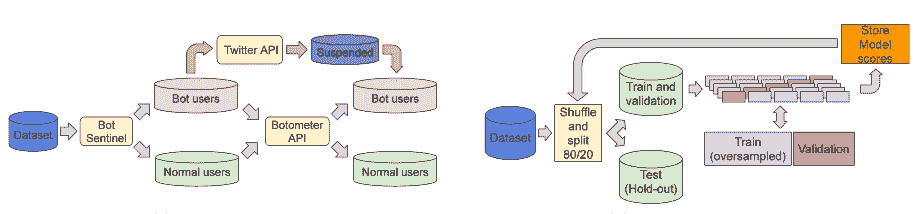

# 2020 年美国大选期间 Twitter 机器人检测的可解释机器学习流水线

Alexandr Shevtov a,c*, Christos Tagzagrakis a*, Despina Antonaki a, Sotiris Ioannis b

a 希腊科学研究与技术基金会计算机科学研究所（FORTH），希腊
b 希腊克里特理工大学 计算机与工程学院
c 希希腊克里特大学 计算机科学系

## 文章信息

### 摘要

本研究引入了一种新型、可重复且稳健的 Twitter 机器人识别系统。该系统使用机器学习（ML）流水线，并从 Twitter 语料库中提取了数百个特征。所提流水线的目标是训练和验证先进的机器学习模型，其中极端梯度提升（XGBoost）模型因其实现了最高的检测性能而被选中。Twitter 数据集采集于 2020 年美国总统选举期间，在 Twitter 数据集上的实验评估证明了我们方法在机器人检测准确率方面的优越性。

- 关键词：
- 机器学习
- Twitter 机器人检测
- 模型可解释性

### 代码元数据

- 当前版本：v1
此版本的代码/仓库永久链接
发布版本的永久链接
法律许可协议
代码版本控制系统：GitHub
使用的代码语言、工具和服务
编译要求、运行环境及依赖项
如可用的文档/手册链接
问题咨询支持邮箱

https://github.com/SoftwareImpacts/SIMPAC-2022-7
https://github.com/capsule/3418007-tree/v1
MIT License Python, scikit-learn, Twitter API, Botometer, BotSentinel
需要 PyTorch 以及以下库：sklearn, xgboost, shap, numpy, pandas, matplotlib
https://github.com/alexdrk14/ISBotDetection
shevtov@ixs.forth.gr

(a) 标注流水线
(b) 机器人检测

图 1. 流水线：(a) 真实值标注和 (b) 使用 K 折交叉验证进行模型调优。

在不同 Twitter 数据集上的额外实验评估证明了我们方法在机器人检测准确率方面的优越性。

本文介绍了《解释性机器学习框架：针对2020年美国选举中Twitter 机器人的研究》中引入的方法的设计与实现，其中描述了一种 Twitter 机器人识别系统。我们探索了所实现的检测系统的影响，即一种研究社区可以使用的可重复且稳健的方案。所提出的机器学习（ML流水线）摄入了从本文语料库（和数据）中提取的数百个特征，并已注册在 Repository Code Ocean：(https://www.elsevier.com/physical-sciences-and-engineering/computer-science/journals)。关于可重复性倡的更多信息请见：https://codeodean.com/。
通讯作者：shevtovics@ixs.forth.gr (A. Shevtov), tagzagrakis@ixs.forth.gr (C. Tagzagrakis), desponina@ixs.forth.gr (D. Antonaki), sotiris@ece.tuc.gr

## 1. 引言

本文介绍了《解释性机器学习框架：针对2020年美国选举中Twitter 机器人的研究》中引入的方法的设计与实现，其中描述了一种 Twitter 机器人识别系统。我们探索了所实现的检测系统的影响，即一种研究社区可以使用的可重复且稳健的方案。所提出的机器学习（ML流水线）摄入了从本文语料库（和数据）中提取的数百个特征，并已注册在 Repository Code Ocean：(https://www.elsevier.com/physical-sciences-and-engineering/computer-science/journals)。关于可重复性倡的更多信息请见：https://codeodean.com/。

在不同 Twitter 数据集上的额外实验评估证明了我们方法在机器人检测准确率方面的优越性。

使用 SHAP 方法对检测 Twitter 账号是否为机器人进行机器学习性能评估，证明了我们方法的分类优越性。

我们使用更大的数据集构建了机器学习模型，本研究回答了以下问题：

该流水线可以用于额外的分类任务（不仅限于机器人检测），还提供了可调优以适用于其他情况。

数据集已可用，以及先进的机器学习模型。

- 数据集面向研究人员。
- 该流水线可以用于额外的分类任务（不仅限于机器人检测），还提供了可调优以适用于其他情况。
- 是否可能在 2020 年选举期间检测哪些特征最重要？
- 所提框架与现有方法相比是否提供了准确的结果？
- Twitter API 是否可以改进机器人检测性能？

## 3. 影响

该流水线可以用于额外的分类任务（不仅限于机器人检测），还提供了可调优以适用于其他情况。

我们使用更大的数据集构建了机器学习模型，本研究回答了以下问题：

## 2. 方法论

数据集已可用，以及先进的机器学习模型。

计算时间从 650 天缩短到 18 天。

- 数据集面向研究人员。
为了回答这些问题，我们首先处理数据获取、真实值标注和机器人检测。为此，我们从 Twitter 手动收集了 1560 万推文。

## 4. 结论与未来工作

该流水线可以用于额外的分类任务（不仅限于机器人检测），还提供了可调优以适用于其他情况。

我们使用更大的数据集构建了机器学习模型，本研究回答了以下问题：

机器人检测不是永久的，但在大多数情况下它会持续一段时间直到账号被删除。用户封禁并没有提供关于账号是否为机器人的明确证据，因为账号可能由于违反政策而被封禁。为了解决这个问题，我们提出了：

所提出的机器人检测在收集的数据集（周期方面）实现了高性能，且与数据相比，F1 分仅下降了 2%（从 0.916 降至 0.896）。

接下来，开发了一个以 CSV 文件形式接收用户特征的机器学习流水线。（即：特征选择、使用 K 折交叉验证进行超参数调优，我们

结果表明了高性能，且与数据相比，F1 分仅下降了 2%（从 0.916 降至 0.896）。

这些结果表明我们的机器学习模型具有良好的泛化能力。作为未来工作，我们计划在训练和测试数据上评估机器人检测性能。

## 利益冲突声明

作者声明没有可能影响本文呈现工作的竞争性财务利益或个人关系。

## 致谢

感谢审稿人提出的宝贵意见。本文文件是欧盟委员会（欧洲通信、内容和技术总司）资助的 CONCORDIA（资助号 839027）、CyberSANE（资助号 836683）和 PUZZLE（资助号 838540）项目的成果。

