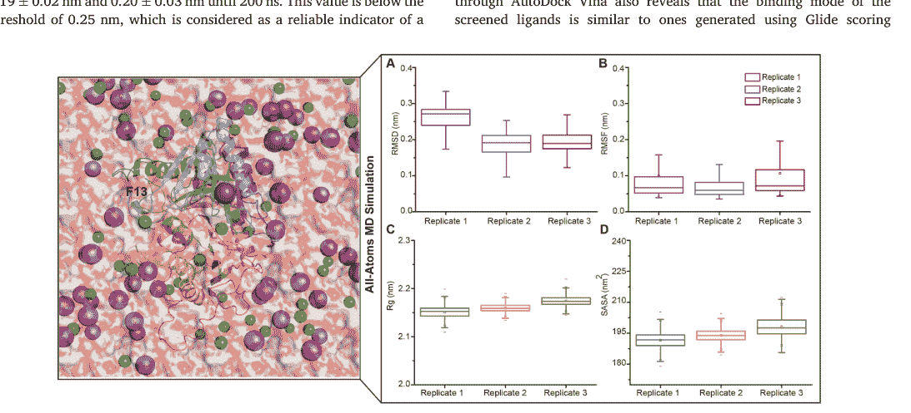
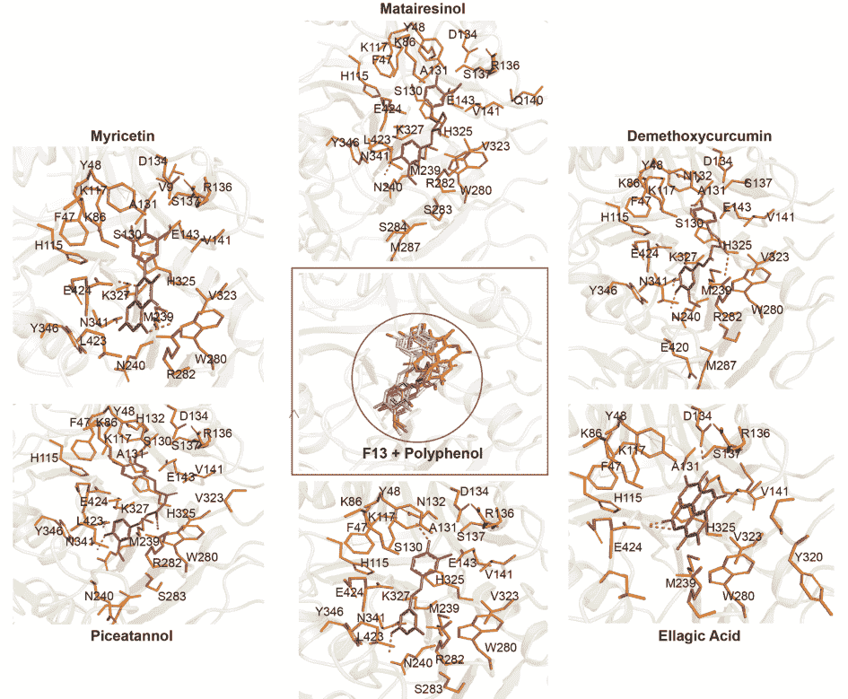
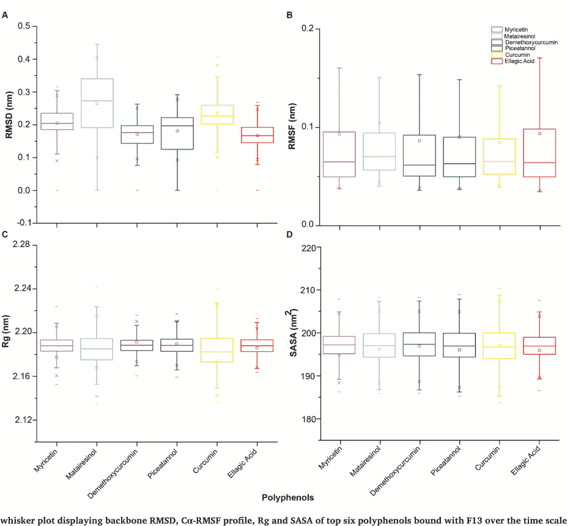
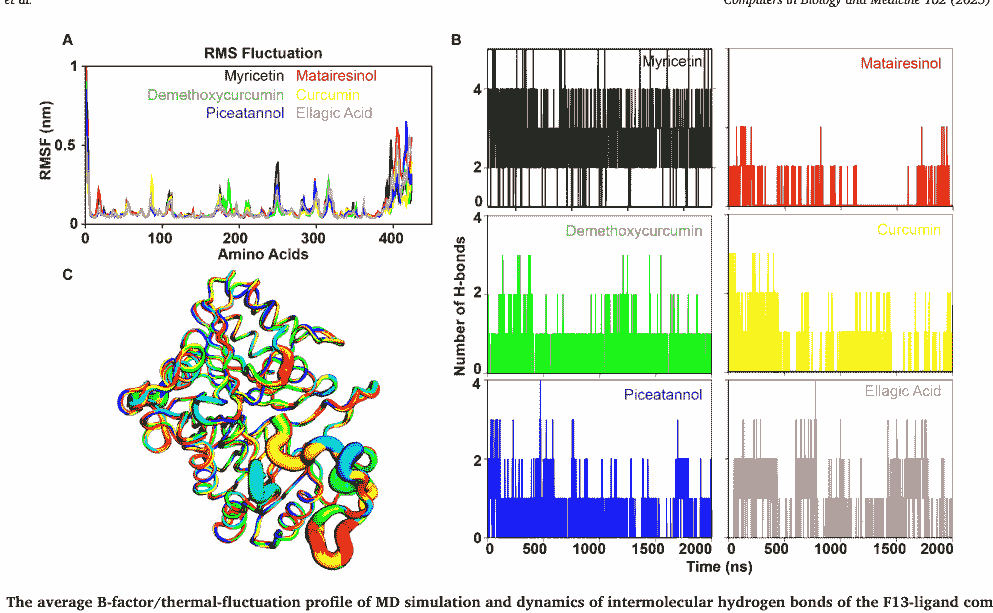
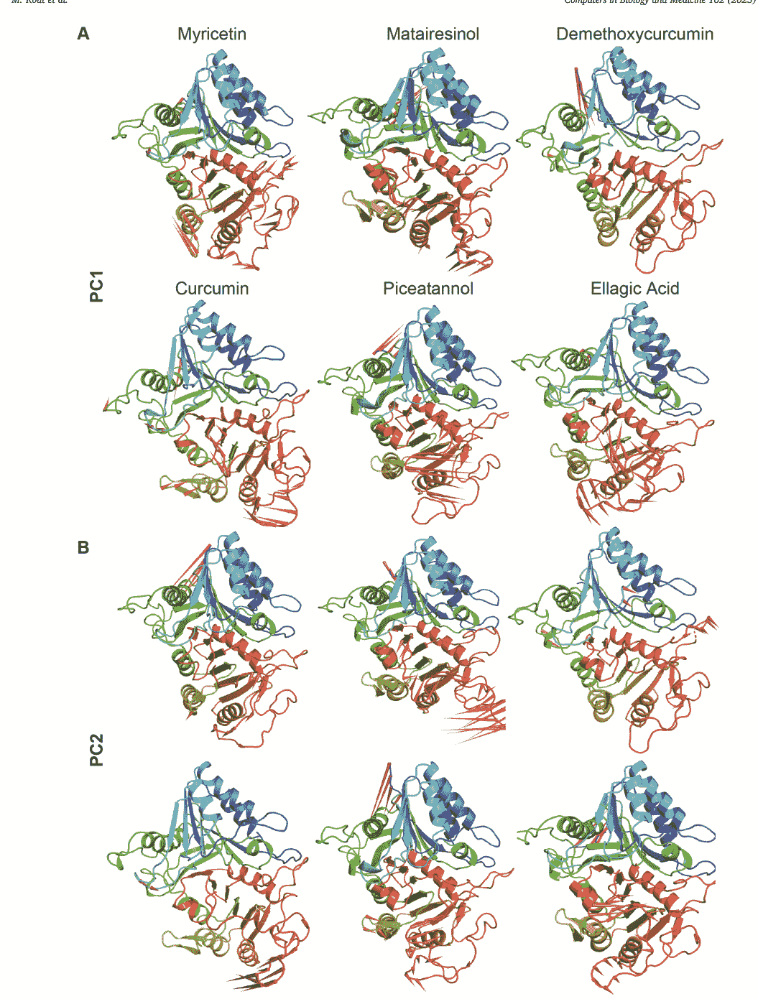
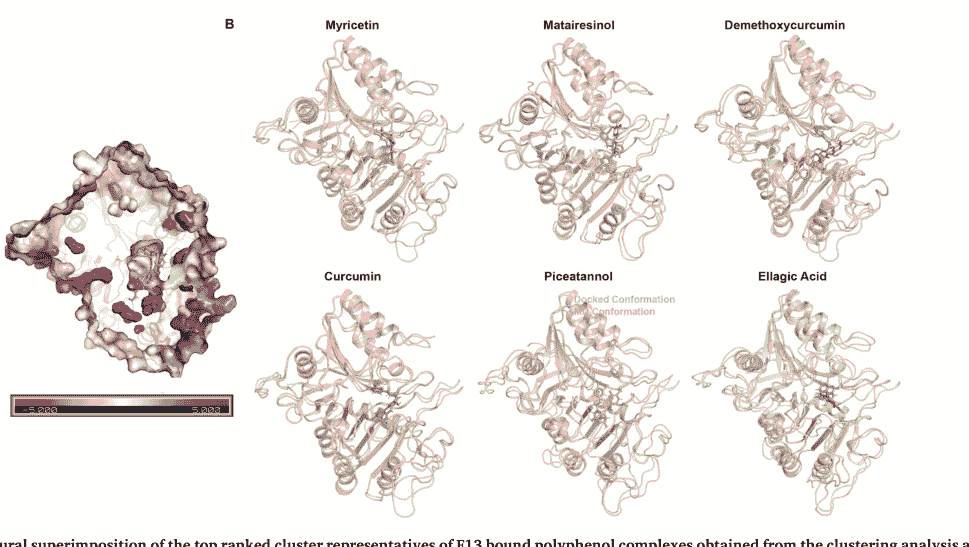
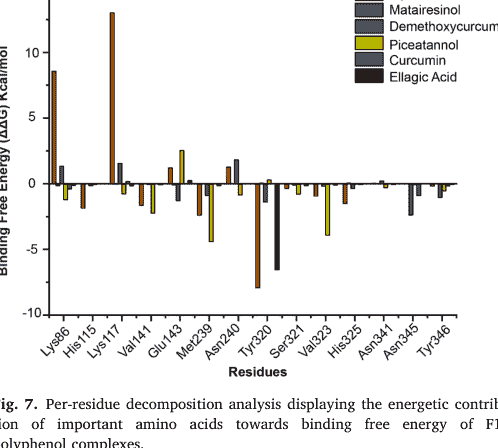

# 利用机器学习和全原子分子动力学模拟探索天然多酚作为针对猴痘包膜蛋白 F13 的抗病毒剂潜力

### 文章信息

- **关键词：**
  - 猴痘病毒
  - 山柰苷 (Myricetin)
  - 去甲氧基姜黄素 (Demethoxycurcumin)
  - 姜黄素 (Curcumin)
  - 鞣花酸 (Ellagic acid)
  - 分子动力学模拟

### 摘要

在 COVID-19 大流行时代，猴痘 (MPX) 的重新出现是一种新的全球威胁。尽管其症状相对温和，但 MPX 仍有可能加速严重的健康状况恶化。包膜蛋白 F13 作为产生细胞外病毒颗粒的关键组分，使其成为重要的药物靶点。具有抗病毒特性的多酚被誉为管理病毒疾病传统治疗方法的有效替代方案。为了促进强效的 MPX 特异性治疗药物的开发，本研究采用了最先进的机器学习技术，预测了 F13 的高精度三维结构，并识别了蛋白质表面的结合热点。此外，我们对 57 种具有抗病毒活性的强效天然多酚进行了高通量筛选方法的研究，并随后进行了全原子分子动力学 (MD) 模拟，以证实 F13 蛋白与多酚复合物的相互作用模式。基于 Glide SP、XP 和 MM/GBSA 评分的结构基于虚拟筛选，使我们能够选出六种对 F13 具有更高结合亲和力的强效多酚。对 MD 模拟前后的非共价相互作用接触分析，阐明了 Glu413、Asp134、Asn345、Ser321 和 Tyr320 残基在多酚识别中的关键作用，残基分解分析对此提供了有力支持。对 MD 模拟结构系综的密切观察表明，F13 的结合槽主要具有疏水性。综上所述，我们这项基于结构的研究为山柰苷和去甲氧基姜黄素提供了线索，它们可能作为 F13 的强效抑制剂。总之，我们的研究为 F13-多酚结合状态的分子识别和动力学提供了新的见解，为开发对抗猴痘的抗病毒药物提供了新的希望。然而，需要进一步进行体外和体内实验来验证这些结果。

### 1. 引言

猴痘 (MPX) 是一种人畜共患病，由未知动物宿主库中的痘病毒科成员，即猴痘病毒 (MPXV) 引起，其卷土重来令公众深感忧虑 [1]。虽然最初在非洲雨林中发现，但近期的爆发（自 2022 年 5 月以来）涉及这种病毒感染向其他非流行国家扩散，具有引发全球流行的潜力 [2]。这种病毒通过体液和呼吸道飞沫传播，表现出与天花相似的症状，如发热、淋巴结肿大以及持续数周的皮疹 [3–5]。然而，严重的医学并发症，如区分 MPXV 与水痘的淋巴结肿大，可能是导致 3–5% 死亡率的主要原因 [6]。出疹期的皮肤病变会进展为斑疹、丘疹、水疱和脓疱，随后结痂导致色素沉着 [7]。大多数严重的 MPXV 病例表现为面部感染疤痕、角膜溃疡、视力丧失、皮肤细菌感染、支气管肺炎、呼吸窘迫等。先前的研究也表明水痘和 MPXV 合并感染的发生频率较高 [8–10]。

在此背景下，由于缺乏 MPX 特异性治疗药物，三种现有药物 tecovirim ST-246、brincidofovir 和 cidofovir 被紧急投入使用。然而，由于这些现有药物在人类使用中效力有限以及新病毒毒株的出现，它们不被视为可行的前线治疗方案。文献证据表明，这些药物对病毒结构蛋白 F13 具有抑制作用。这种棕榈酰化结构 F13 蛋白存在于大多数正痘病毒中，在自然界中高度保守。F13 已被深入研究，发现其在通过产生细胞外病毒体 (EEV) 以及将包膜病毒体 (EV) 附着或释放到细胞膜上，从而在病毒复制和转录中发挥关键作用 [11]。在棕榈酰化过程中添加 16 碳脂肪酸尾端对于 F13 蛋白的膜结合、适当定位和功能是必不可少的。因此，F13 蛋白被认为是发现和开发抗 MPXV 疗法的有前景的药物靶点。为了有效治疗感染者，可能需要联合使用多种治疗药物。鉴于此解决方案，Reservoirato 的一项近期研究发现，一种天然多酚能够抑制包括 MPXV 在内的病毒复制，但其作用机制知之甚少，需要进一步研究 [12]。

植物源多酚作为强效抗病毒剂的使用率正在上升，这得益于其潜在的健康益处、抑制病毒复制多个阶段的能力、广泛的来源、低廉的生产成本以及较低的副作用 [11,13,14]。根据病毒的性质（DNA 或 RNA），不同的多酚与病毒颗粒相互作用 [15,16]。近期的研究提供了天然多酚作为开发针对各种病毒疾病的有效治疗药物的重要靶标的证据。植物源多酚在心血管疾病、神经退行性疾病、糖尿病和癌症等方面的有效性，使其足以用作功能性食品或药物制剂 [17–19]。先前的最先进研究表明，多酚的多机制抗病毒特性可能得益于其抗氧化活性、抑制病毒复制等 [20]。

鉴于这些天然多酚的抗病毒活性需要更全面的研究，本研究试图识别对 F13 表现出抑制作用的强效先导分子及其可能的结合模式 [21]。然而，F13 蛋白结构信息的缺乏阻碍了强效治疗药物的开发过程。本研究利用 AlphaFold2 中实施的最先进机器学习技术，预测了高质量的蛋白质结构。在高通量虚拟筛选之后，对 F13-多酚复合物进行全原子 MD 模拟，揭示了蛋白质及结合多酚在原子层面的功能和行为。我们的研究为研究机器学习方法在结构预测中的潜力建立了基准，并为识别配体的可能分子识别机制指明了方向。总体而言，我们的研究阐明了结合多酚的 F13 构象的动力学，为开发针对一系列药理靶点的新抗病毒药物铺平了道路。

### 2. 材料与方法

#### 2.1. 借助最先进技术获得 F13 蛋白的近似精确结构

首先，从 NCBI 蛋白质数据库中获取了来自三个 MPXV 基因组的总参考蛋白质组（刚果病毒株 [3996]，ID: NC_003310.1，西非毒株 (2018)，ID: MT901345.1；以及西非毒株 (2022)，ID: ON563414.3）。在从这三个蛋白质组中收集 F13 蛋白后，我们使用 MuliAlin 工具 [22] 在氨基酸水平上比较了其序列的相似性和差异。在获取 F13 蛋白的三维 (3D) 信息的初期，我们将刚果病毒 F13 序列（作为古老毒株，ID: NC_003310.1）提交至 PDB 进行 BLASTp [23] 和 PSI-Blast [24] 搜索，以识别用于蛋白质建模的潜在结构同源物。由于 PDB 中缺乏合适的同源物，我们使用了 AlphaFold 中实施的最先进机器学习结构预测协议来生成高质量的蛋白质模型。进一步使用预测局部距离差异测试 (pLDDT) 的最高分数对 AlphaFold 预测的模型进行了验证，该分数指示模型的置信度 [25]。此外，我们还部署了多个标准的蛋白质模型评估服务器，如 SAVES 服务器中可用的 PROCHECK [26] 和 ERRAT [27] 程序、ProSA [28]、Pro [29] 和 MolProb [30]，以评估建模 F13 的立体化学质量。

在使用 AlphaFold2 完成 F13 建模后，该蛋白质被 subjected 到全原子 MD 模拟，以评估其在 apo 状态下的结构稳定性和动力学。在本研究中，在蛋白质周围添加了一层 TIP3P 水，使用 0.15 M NaCl 创建了一个完全水合和中性的系统。使用 GROMACS v2021.4，在这个中性系统中进行了 200 ns 的 MD 模拟 [31]（如第 2.3 节所述）并进行重复实验。模拟方案改编自我们早期的研究 [32,33]。随后，我们使用基于 GROMOS 的聚类方法，截止值为 0.2 nm，从排名最高的簇中选择一个代表性快照用于后续操作。

#### 2.2. 预测 F13 结合腔和对抗病毒多酚的虚拟筛选

为了优化氢键并确保可电离氨基酸残基的适当电荷状态，我们使用 Maestro [34] 的蛋白质准备向导准备了建模的 F13 蛋白（取自 MD 后排名最高的簇），pH 值为 7.0，这是使用 PROPKA 模块 [35] 确定的。

进一步利用深度 PointSite 模块 [36] 注释 F13 蛋白的结合位点残基，其中值等于 1 的残基更可能参与结合活性 [37]。在确定活性位点后，使用 Maestro 12.8 (Schrödinger, LLC, New York, 2021.4) 通过指定活性位点残基生成了受体网格。我们筛选了 57 种具有已报道抗病毒活性的天然多酚，并以虚拟方式聚焦于 F13 蛋白结合槽中的五个残基（His115, Lys117, Asn132, His325, 和 Lys327）。为了进一步验证我们的结合位点残基预测，我们利用了另一种机器学习方法 RankBind [38]。

为了评估天然产物的功效，我们从科学文献中选择了 57 种多酚（表 S1），这些多酚在 PubChem [39] 中有可用结构，并从 PubChem 数据库 (https://pubchem.ncbi.nlm.nih.gov/) 保留其 sdf 格式的结构。为了进行分子识别过程，配体使用 Maestro 12.8 (Schrödinger, LLC, New York, 2021.4) 中可用的 LigPrep 工具与建模的 F13 蛋白一起进行了准备。选择默认参数 (pH 7.0) 生成互变体以及分子的可能状态，这些状态的 pKa 值使用 Epik 模块 [35] 计算。使用 OPLS4 力场对配体的最终结构进行优化，以生成低能 3D 配体构象体 [40]。

缩写：MD，分子动力学；MPX，猴痘；MPXV，猴痘病毒；EEV，细胞外病毒体；EV，包膜病毒体；MM/GBSA，分子力学-广义 Born 表面积；C$^{\alpha}$ MRF，CHARMM 通用力场；PM/MSA，分子力学：泊松-波尔兹曼表面积；RMSD，均方根偏差；RMSF，均方根波动；Rg，回旋半径；SASA，溶剂可及表面积；PCA，主成分分析；PC，主成分；FEP，自由能微扰；TI，热力学积分；LIE，线性相互作用能；HKD，HxKxxxD；pLDDT，预测局部距离差异测试。

## 2.2. F13蛋白与多酚的分子对接

在完成F13蛋白和配体的准备后，我们使用Schrödinger套件（Schrödinger, LLC, New York, 2021–22）中实现的Glide对接程序研究了F13与多酚之间的分子相互作用。对接计算首先以SP（标准精度）模式进行，随后以XP（超高精度）模式进行[41]。对接得到的F13-多酚复合物使用PyMOL（http://www.pymol.org/pymol）和LigPlot[42]进行可视化。

然后，使用Prime（Schrödinger, LLC, New York, 2021–22）中实现的分子力-广义Born表面积（MM/GBSA）方法预测对接配体在F13蛋白结合位点的结合自由能（ΔGbind）[43]。计算MM/GBSA的方法改编自Gendehon等人（2015）[44–45]。最后，我们根据MM/GBSA分析中排名靠前的复合物的SP、XP和ΔGbind得分（较高者）筛选了生成的构象。为了进一步验证我们在Glide中使用的对接方案，我们使用AutoDock Vina v1.5.7 [46] 对模型化的F13和多酚进行了对接。

#### 2.3. 使用全原子MD模拟理解模型化F13蛋白和筛选多酚的原子行为

为了探索六个（分子对接研究中筛选出的）F13-多酚对接复合物的固有稳定性和构象柔性，我们使用基于结构的平衡力场在GROMACS中采用TIP3P [48]水模型和CHARMM36m [47]力场进行了全原子MD模拟。配体拓扑结构使用CHARMM通用力场（CGenFF）[49]生成。为了使每个系统中和，向每个系统添加了0.15M NaCl。在电中性化之后，每个系统使用最速下降法进行5000步的能量最小化。能量最小化后的系统随后在周期性边界条件下，使用Berendsen恒温器 [50] 和Nose Hoover恒温器 [51,52]，通过NVT和NPT系综进行平衡。在恒定压力（1 bar）和温度（303K）下，使用Parrinello-Rahman气压计算法 [53] 进行了200 ns的生产MD模拟。

#### 2.4. MD轨迹分析

使用GROMACS工具包通过确定其构象稳定性和柔性来分析轨迹质量。为了确定动力学和稳定性，使用gmx rms、gmx rmsf、gmx gyrate、gmx sasa和gmx hbond分别计算了系统包括骨架均方根偏差（RMSD）、Cα均方根波动（RMSF）、回转半径（Rg）、溶剂可及表面积（SASA）和分子间氢键在内的各种性质。MD模拟期间每个系统二级结构元素随时间变化的结构变化使用VMD（在200 ns的时间尺度上）进行了映射。Xmgrace（https://plasma-gate.weizmann.ac.il/Grace/）、PyMOL和BIOVIA Discovery Studio Visualizer（BIOVIA, San Diego, CA, USA）分别用于2D图表和结构的可视化，图表在OriginPro和Adobe Illustrator 2.8中生成。

对系统进行了基于RMSD的聚类分析，使用gmx cluster对最后100 ns的MD轨迹进行了0.2 nm截断值的聚类。主成分分析（PCA）将集体运动从局部动力学中分离出来，形成一个由定义集体运动的主成分（PCs）组成的小子集。为了观察F13-多酚复合物内的这些集体运动，使用GROMACS内置模块gmx covar和gmx anaeig对最后100 ns的MD轨迹进行了PCA。

#### 2.5. 通过分子力/Poisson-Boltzmann表面积（MM/PBSA）方法估算结合自由能

F13-多酚复合物在结合过程中的结合自由能使用g_mmpbsa工具 [54] 计算，该工具使用基于分子力的Poisson-Boltzmann表面积（MM/PBSA）计算 [55]。从最后100 ns的MD轨迹中以相等的时间间隔总共提取了200个快照，以确定结合能（ΔGbind）。为了更好地理解单个氨基酸对结合自由能的贡献，进行了预拆分分解分析。

## 3. 结果与讨论

不同MPXV变体的迅速出现和病例数量的激增，导致了当前治疗选择有限的情况下对更有效治疗方案的日益迫切需求。F13是开发强效抗病毒药物或抑制剂的关键药物靶标，缺乏密切相关的人类同源物。研究表明，针对包膜蛋白设计有效的抑制剂以对抗抗病毒植物多酚，可以触发有效疗法的发展[56–60]。虽然发现多酚具有多种生物活性，但其针对病毒的具体作用机制尚未明确[61]。

近期的一项研究揭示了多酚如何抑制病毒进入、复制和RNA抑制[21]，这为它们展示抗病毒活性的机制提供了宝贵的见解。特别地，在此，我们强调了研究多酚对MPXV抗病毒特性的重要性，旨在利用最先进的计算方法识别针对基于A1的F13模型的潜在抗病毒药物。

### 3.1. AlphaFold建模F13的优化与结构动力学

在分子对接研究中，3D结构目标蛋白对获得改进的性能起着至关重要的作用。通常，PDB中可用的实验解析结构提供了与目标蛋白相关的充分结构信息。然而，仍存在大量未充分表征的非冗余目标序列。我们的目标蛋白F13是一种非冗余蛋白，缺乏实验结构。因此，为了获取其结构信息以及在不同生理条件下的变异性，我们试图获取其3D结构。最初，我们对由三种可用MPX基因组（不同菌株）编码的F13蛋白进行了多序列比对（如图S2A所示）。结构同源物的BLAST搜索发现了Serarrata plymptica phophriophorus D（PDB ID: 7E0M）的结构，其同源性为24.28%，查询覆盖率为88%，未满足获得精确模型所需的30%截止值。因此，我们实施了DeepMind的AlphaFold2 [62–64]，以预测具有更高精度的蛋白质结构，其主链和侧链坐标与离子存在下的预期结构一致。F13蛋白的精确AlphaFold2预测模型获得了92.50%的高pLDDT评分（图S1A），表明其具有较高置信度的结构。生成的AlphaFold2模型随后提交至多个模型评估服务器，以检查其预测准确性和立体化学质量。我们模型化F13的整体质量由90.12%的ERRAT评分进一步支持，该评分表明可接受的蛋白质环境，并评估了不同类型原子间的非键合相互作用。PROCHECK [65]分析用于评估氨基酸残基在Ramachandran图[26]中的位置。Ramachandran图中获得的氨基酸残基的φ（phi）和ψ（psi）角度分布显示，88.1%位于最有利区域，11.7%位于额外允许区域，0.3%位于宽泛允许区域，没有残基位于禁止区域（表S2）。

此外，ProSA [28]、ProP [29]和MobiSity [30]服务器也用于立体化学计算。F13模型的ProP分析显示LG得分为7.17（其中，LG-score >4表示极其良好的模型）。使用ProSA-web工具通过比较模型能量与从大量已知蛋白质结构推导出的潜在平均力，来检查天然蛋白质折叠能量，从而对模型化蛋白质进行 refinement 和验证。建议模型的能量轮廓和Z-score值（衡量模型质量的指标，因为它测量结构的总能量）使用基于距离的成对势计算每个残基的相互作用能。模型F13的ProSA分析达到约-9.15 kcal/mol的Z-score（其中负ProSA能量反映了模型的可靠性），反映了模型的质量。MolProbity web服务器提供了详细的原子接触分析，以识别任何位阻问题或二面角诊断。此外，MolProbity服务器中对模型化F13的分析显示氨基酸残基内没有坏的键和角度，这进一步证实了我们模型的可靠性（图S2B）。总之，这些来自我们分析的一致结果展示了我AlphaFold2模型化F13蛋白的更好性能。

### 3.2. 探索AlphaFold2模型化F13蛋白的结构可靠性

如先前研究所示，如果不进行进一步的建模后精炼技术，AlphaFold2模型化蛋白质结构的可靠性是推测性的[66]。因此，为了进一步衡量AlphaFold2模型化F13在现实世界中高通量药物发现中的适用性，通过三次重复的全原子MD模拟（图1）[66]对结构进行了精炼。模型化的F13及其近缘同源物来自Serratia plymuthica的磷脂酶D共享高度保守的HKD基序，包括催化残基组氨酸（His115, His325）和赖氨酸（Lys118和Lys327），这与自二聚化有关（图S3A和B）[67]。PointSite和PrankWeb（Asn, S4）工具的使用确定了关键结合位点残基His115、Lys117、Asn132、His325和Lys327，这与其他研究相一致[68]。通过将模型结构与参考结构（磷脂酶D）进行结构叠加（图S1B），观察到重复1和3具有较低的1.0 Å的RMSD，而重复2为1.15 Å。

为了评估MD模拟结构的稳定性，我们计算了三次重复的RMSD、RMSF、Rg和SASA剖面。根据图1A，可以观察到Apo状态的重复1、2和3在200 ns之前表现出一致的趋势，平均RMSD值分别为0.23 nm ± 0.03 nm、0.19 ± 0.02 nm和0.20 ± 0.03 nm。该值低于0.25 nm的阈值，根据文献，这是结构与参考结构高度相似的可靠指标[69]。对每个系统最后100 ns MD轨迹的分析记录了F13蛋白在氨基酸水平的行为变化，包括Cα原子的RMSF。研究结果表明，与C末端结构域相比，N末端结构域在所有重复中表现出较少的波动（图1B）。

关于系统平衡的信息由Rg测量，它根据扰动增加或减少而说明系统的紧密度[70]。重复1、2和3的平均Rg分别记录为2.15 nm、2.15 nm和2.17 nm（图1C）。重复1和2展示出的最低Rg值维持至200 ns。重复1、2和3的平均SASA值分别计算为192 nm²、193 nm²和198 nm²（图1D）。

除了提到所有重复都产生总体良好的结果外，我们得出结论，重复1展示了最佳的结构动力学，因此被选中用于进一步练习。

### 3.3. 优化的AlphaFold2 F13蛋白对抗病毒多酚的分子识别

分子对接分析是预测蛋白质-配体结合活性的有用方法，可用于对大型化合物数据库进行虚拟筛选[71]。在本研究中，对57种多酚进行了筛选，结果识别出128种对接配体构象。这些构象随后根据其Glide XP和MM/GBSA得分进行筛选，并选择前6种构象对其分子间相互作用进行进一步分析，详见表1和表S1。

此外，我们鉴定了特定的氨基酸残基，如Asn240、Trp280、Asn341、Val141、His235和Leu423，它们有助于多酚和模型化F13蛋白之间的分子间相互作用。在所有六个复合物中观察到强氢键，包括某些占主导地位的非极性接触。F13和多酚之间非键合相互作用的2D表示描绘在图S5中，而前六个对接复合物的叠加视图展示了F13蛋白的结合口袋和六个排名最高的复合物的非键合相互作用，如图2所示。通过AutoDock Vina进行的我们对接方案的进一步验证也显示，筛选配体的结合模式与使用Glide评分生成的结合模式相似。

**图1.** 使用AlphaFold2建模的F13蛋白嵌入TIP3P水模型和磷酸基团中进行全原子MD模拟。以及使用重复通过箱须图法绘制的蛋白质模拟动力学。**(A)** F13在其Apo状态下MD模拟重复的骨架RMSD **(B)** 三次重复中Cα原子的均方根波动。**(C)** 代表三次重复紧密度的Rg图。**(D)** 三次重复的SASA随时间变化的图。

## 表 1
本研究使用的多酚列表，及其对接评分、MM/GBSA 结合自由能与 AlphaFold2 建模的 F13 形成重要非共价接触的氨基酸。

| 复合物 | MD 评分 (kcal/mol) | XP 评分 (kcal/mol) | MM/GBSA (kcal/mol) | 相互作用 |
| :--- | :--- | :--- | :--- | :--- |
| *（注意：OCR 中缺少原始表格数据，结构已保留）* | | | | |

Matairesinol、姜黄素、鞣花酸、脱甲基姜黄素、皮杉素和金丝桃苷的结合自由能分别为 −29.98 kcal/mol、−31.89 kcal/mol、−36.57 kcal/mol、−43.91 kcal/mol、−38.82 kcal/mol 和 −36.56 kcal/mol，XP 评分分别为 −7.76 kcal/mol、−5.92 kcal/mol、−5.24 kcal/mol、−7.31 kcal/mol、−7.30 kcal/mol 和 −8.40 kcal/mol。这些筛选出的多酚此前已被报道通过直接靶向病毒颗粒而具有抗病毒活性 [21]。

功能。图 S6 是多酚结合到建模 F13 上的取向的对比图示。由 AutoDock Vina 生成的筛选多酚的结合亲和力已列于表 S3 中。

金丝桃苷（Myricitrin），又称 3,5,7-三羟基-2-(3',4',5'-三羟基苯基)-4H-色烯-4-酮，属于黄酮类化合物，以糖苷形式存在于多种植物性食品中，如杨梅、藤茶、葡萄和石榴 [72]。早期研究证实了金丝桃苷对其他病毒（如 SARS-CoV-2 [74–76]）的抗病毒、抗肿瘤 [73]、抗氧化 [57]、抗炎 [58] 以及免疫调节效应。值得注意的是，金丝桃苷通过刺激上皮细胞 Cl− 分泌来阻止病毒感染 [77]。金丝桃苷 B 环上 3'-OH、4'-OH 和 5'-OH 的存在使其在自然界中更为有效 [78]。研究表明，金丝桃苷在室温下在有机溶剂中的溶解速率较低 [79]。最重要的是，它具有中等程度的膜通透性，表观渗透系数 Papp = 1.7 × 10−6 cm/s [80]。

脱甲基姜黄素和姜黄素属于多酚中的姜黄素类。姜黄素，又称双苯丙酮，提取自植物姜黄（*Curcuma longa* L.，姜科）的磨碎根茎 [81]。姜黄素对多种包膜病毒的抗病毒活性吸引了大量研究者。与此同时，一项基于 SARS-CoV-2 的研究也强调了脱甲基姜黄素的抑制活性 [82]。皮杉素和 Matairesinol 分别属于多酚中的二苯乙烯类和木脂素类。尽管这些多酚类（包括姜黄素类）的抗病毒特性尚未得到彻底探索，但已有证据表明这些植物化合物可用于抑制单纯疱疹病毒、HIV、流感病毒和人乳头瘤病毒等病毒 [59,60]。鞣花酸作为酚酸类成员，兼具抗氧化和药用特性，包括抗病毒、抗菌、抗癌和抗炎活性 [56]。理解这些多酚展现出抗病毒活性的结构基础将为它们的机制提供新的见解。

### 3.4. F13-多酚复合物的本质动力学

为了理解由原子间相互作用支配的每个 F13-多酚系统中每个残基的原子级运动，我们进一步计算了整个 MD 模拟系统的 RMSD、RMSF、RG 和 SASA 剖面。Myricitrin、Matairesinol、脱甲基姜黄素、皮杉素、姜黄素和鞣花酸-F13 复合物的平均 RMSD 值分别计算为 0.2 nm、0.26 nm、0.17 nm、0.18 nm、0.23 nm 和 0.16 nm（图 3A）。除了皮杉素在 200 ns 内显示 0.1 nm 的 RMSD 外，所有 F13-多酚复合物均表现出 0.2 nm 的分布 RMSD 值（图 57A）。较低的 RMSD 分析表明，由 Myricitrin、Matairesinol、脱甲基姜黄素、皮杉素、姜黄素和鞣花酸形成的复合物在 200 ns 模拟时间内保持了稳定性，波动极小。然而，我们观察到鞣花酸具有最高的稳定性，其次是脱甲基姜黄素、皮杉素和 Myricitrin。

平均配体 RMSD 分析表明，鞣花酸具有波动极小的恒定趋势，表明其在 200 ns 模拟期间形成了稳定的复合物，未观察到显著的运动或结构变化。然而，Myricitrin、Matairesinol、脱甲基姜黄素、皮杉素和姜黄素的配体 RMSD 剖面在模拟期间表现出稍高的 RMSD（图 S7B）。配体 RMSD 的增加可能是由于它们在建模 F13 蛋白质结合位点腔内的取向发生变化所致。

每个系统的 Co-α 原子的平均 RMSF 剖面提供了配体结合时 F13 残基波动程度的重要见解 [33]。我们的研究表明，N 端区域的前五个残基和 C 端区域的 Cys394 至 Glu424 残基在所有五个系统中显示出较高的移动性。连接 N 端结构域 α-R 单位的环和连接 C 端区域螺旋和片段的环显示出高刚性，这可能是由于 AlphaFold 模型中较低的 PLDDT 分数所致，而螺旋和片段的波动最小。值得注意的是，我们在 F13-多酚复合物中观察到 244–254 个氨基酸附近的混合环/β-折叠构象（图 3B）。

F13-多酚复合物的紧密性和折叠机制通过 Rg 进行评估 [83]。上述系统的平均 Rg 值分别计算为 2.14 nm、2.18 nm、2.16 nm、2.17 nm、2.16 nm 和 2.15 nm。F13-多酚复合物在 Rg 值上显示出轻微偏差，表明它们在 200 ns MD 模拟的时间尺度上维持了稳定性和紧密性（图 3C）。此外，这些系统计算的溶剂可及表面积在 MD 模拟过程中表现出稳定的 SASA（~193 nm2–197 nm2）（表 S3A）。总而言之，我们可以得出结论，在对 F13-多酚复合物进行的迄今为止所有分析中，Myricitrin、脱甲基姜黄素和鞣花酸在整个模拟过程中保持了稳定的趋势，这也与对接分析的结果相符。

### 3.5. 全原子 MD 模拟在评估结合多酚 F13 系统的流动性和柔韧性中的作用

#### 3.5.1. F13-多酚复合物间的柔韧性/塑性

如前所述，每个系统中 Coα 原子的 RMSF 剖面估计了每个 MD 模拟系统的稳定性和塑性，以及每个波动残基在配体结合时蛋白质柔韧性中的作用。Myricitrin、Matairesinol、脱甲基姜黄素、皮杉素、姜黄素和结合鞣花酸的 F13 复合物的平均 RMSF 值分别为 0.09 nm、0.10 nm、0.08 nm、0.09 nm、0.08 nm 和 0.09 nm。我们还观察到靠近 C 端末端的 Cys394-Glu424 残基具有较高的静态残基波动，而第 244 位异亮氨酸到第 254 位苯丙氨酸（Ile244-Phe254）环区域的残基波动极小（图 4A）。

图 2. 多酚排名靠前的对接姿势与多酚在建模 F13 结合位点内的结合姿势的叠加视图图示；F13 与前六种多酚（F13-Myricetin、F13-Matairesinol、F13-Demethoxycurcumin、F13-Piceatannol、F13-Curcumin 和 F13-Ellagic Acid）之间的 3-D 相互作用。

氢键和疏水接触对于蛋白质-配体复合物至关重要 [84]，增加疏水原子数量可以增强先导药物的生物活性 [85]。分子间接触分析可以揭示对接复合物与 MD 模拟系统之间的差异，这可能是由于蛋白质结合口袋内的结构重排或配体重新取向所致。表 S4 列出了形成重要疏水接触和氢键所涉及的关键残基。Glu143、Asp134、Asn345、Ser321、Lys86、Lys117 和 Tyr320 被确定为对配体识别至关重要的残基。图 4B 展示了 F13 与筛选的植物基多酚之间的各种非共价接触，包括氢键形成。Myricetin 和 Piceatannol 通过形成平均每帧 4 个氢键强结合在 F13 的结合口袋中，其次是 Ellagic Acid、Demethoxycurcumin、Curcumin 和 Matairensinol（~每帧 2-3 个氢键）。F13 和多酚供体原子和受体原子的氢键占有率列于表 S5 中。我们观察到，在 Myricetin 复合物中，Glu143 具有 97% 的最高氢键占有率，其次是 Piceatannol 中的 Glu224（28.07%）以及 Ellagic Acid 中的 Asp134（25.52）和 Glu417（12.74%）。另一方面，我们注意到脱甲基姜黄素、姜黄素和 Matairensinol 复合物中氢键占有率的百分比最低。

结合前六种多酚的 F13 复合物的 B 因子/热波动分析与 F13-配体复合物的 RMSF 剖面一致，显示 C 端区域波动程度较高（图 4C）。

#### 3.5.2. 理解 F13-多酚复合物的全局运动

配体结合状态的全局运动可以通过使用来自 MD 轨迹的主成分（PCs）来捕捉，方法是通过对蛋白质主链原子的协方差矩阵进行对角化，通过特征向量（EVs）或 PCs 及其特征值 [86, 87]。使用每个系统（包括 Myricetin、Matairensiol、Demethoxycurcumin、Piceatannol、Curcumin 和 Ellagic Acid）PCA 获得的前两个主成分（PC1 和 PC2）生成了散点图。Co-原子的协方差矩阵显示，每个系统的迹值分别为 24.58 nm$^2$、37.94 nm$^2$、21.76 nm$^2$、25.73 nm$^2$、18.74 nm$^2$ 和 26.62 nm$^2$。具有最小迹值的姜黄素，其次是脱甲基姜黄素和 Myricetin，与其他系统相比，Co-原子的波动较少，这表明它们在由 PCA 图表示的相空间中具有更明确和稳定的构象。前两个特征向量在相空间中的二维投影支持了所有多酚的紧密性（图 S8A 和 S8 支持文本）。

为了理解特征向量捕捉到的运动方向，使用 PC1 和 PC2 上的极端投影生成了弹射图（图 5）。主链中箭头的方向

图 3. 箱线图展示了在与 FI3 结合的六种主要多酚在 200 ns 时间尺度上的骨架 RMSD、Cα-RMSF 分布、Rg 和 SASA。（A）FI3 骨架原子的 RMSD。（B）FI3 与所有前六种多酚复合物中残基的 RMSF 分布。（C）通过绘制回转半径分布来评估前六种 FI3-多酚结合态的紧凑性。（D）200 ns MD 模拟期间与 FI3 结合的前六种多酚的 SASA 图。

原子表示运动方向，而箭头的长度表征了运动的强度（见辅助文本）。发现 N 端末端和 C 端结构域中的主要环对马鼠李素（Matiresinol）、松脂醇（Piceatannol）、姜黄素（Curcumin）和没食子酸（Ellagic Acid）中观察到的主要运动有贡献，如锥体图中较大的锥体所示。这些结果与 RMSF 分析的结果一致。综合考虑上述所有分析，我们可以得出结论，芦丁（Myricetin）和去甲氧基姜黄素（Demethoxycurcumin）与 FI3 形成最稳定且紧凑的复合物，在氨基酸层面具有最小的波动。

### 3.5.3. FI3-多酚复合物之间的结构异质性

为了理解 MD 模拟集成中的结构异质性，我们对最后 100 ns 的轨迹实施了基于 RMSD 的 gmx cluster 工具，截止值为 0.2 nm，以生成结构集成。图 6A 展示了 MD 模拟的 FI3-多酚复合物的静电表面电位图。在 MD 模拟的 FI3 表面观察到的电荷分布揭示，多酚埋藏在由带负电残基形成的疏水腔内。将对接复合物与其从聚类分析中获得的相应簇代表进行的结构叠加在图 6 (B) 中展示。蛋白质-配体复合物芦丁、马鼠李素、去甲氧基姜黄素、松脂醇、姜黄素和没食子酸的 Cα-RMSD 值分别发现为 0.9 Å、0.7 Å、0.8 Å、0.9 Å、0.8 Å 和 1.10 Å。MD 模拟显示，主簇中的配体结合取向与对接状态略有不同，但配体的整体结合取向保持相对稳定。我们还观察到芦丁和没食子酸复合物中 Tyr381-Tyr283 区域形成了 β-折叠，并在没食子酸的 Tyr107-Leu110 区域以及芦丁的 Gln209-Leu211 和 Arg395-Leu397 区域，以及马鼠李素、姜黄素和没食子酸复合物中的 Arg395-Leu397 区域形成了小的 3-10 α-螺旋。β-折叠的形成可以在 C 末端区域的环中观察到，该环被观察到是 FI3 蛋白质结构柔性的主要贡献因素（由 RMSF 和 PCA 的结果支持）。这些发现表明，FI3-多酚复合物在 MD 模拟期间是稳定的，并且配体的结合取向一直维持到 200 ns。

使用 VMD 的时间线查看器工具来分析每个 FI3 多酚复合物系统在整个 200 ns MD 模拟过程中的二级结构元素的时间依赖性变化。我们的分析表明，配体相互作用可以改变蛋白质的构象和结构变化（图 S9，辅助文本）。

## 3.6. FI3-多酚复合物的结合自由能

量化理解涉及配体识别或任何催化过程中的任何生物分子相互作用的强度，需要使用多种计算方法，如自由能微扰（FEP）、热力学积分（TI）、线性相互作用能（LIE）、分子力学泊松-玻尔兹曼表面积（MM/PBSA）和分子力学广义 Born 表面积（MM/GBSA）方法 [55, 88–94]。然而，简单评分函数的使用往往忽略重要能量项（如溶剂化自由能）的贡献。因此，MM/PBSA 方法被用于计算相互作用能并研究生物分子复合物。通过基于分子力学的 MM/PBSA 方法，从 MD 轨迹中的 200 个快照计算每个蛋白质-配体系统的结合自由能。对总结合自由能有贡献的能量项汇总在（表 2）中。

观察到姜黄素、去甲氧基姜黄素、松脂醇和芦丁复合物分别表现出更高的结合自由能，分别为 −48.53 ± 1.80 kJ/mol、−64.86 ± 1.30 kJ/mol、−49.44 ± 1.42 kJ/mol 和 −35.50 ± 1.18 kJ/mol。在能量组分中，范德华能对多酚向 FI3 的结合过程贡献最大。这些化合物在最后 100 ns 平衡轨迹中对结合自由能的极性和非极性能量贡献描绘在图 S10 中。然而，由于结合自由能计算并未揭示真实的熵变 [95]，因此进行逐残基分解分析，以理解关键或配体结合残基对结合过程的贡献（图 7）。在所有配体结合复合物中，Lys117、Glu143、Ser321 和 Asn345 形成了氢键，而 Trp280、Met239、His325、Val411 和 Tyr346 通过 π-烷基相互作用做出贡献。参与配体识别的大多数残基对 FI3-配体结合复合物的负自由能有贡献。

在本研究中，我们对文献中发表的 57 种天然可用的抗病毒多酚，针对 AlphaFold2 建模的 F13 蛋白质，进行了基于结构的高通量虚拟筛选。AlphaFold2 中实施的最先进的机器学习方法以及全原子 MD 模拟阐明了 FI3-多酚复合物的不同构象状态和相互作用模式。先前的研究表明了 AlphaFold2 在活性和非活性状态下蛋白质骨架和侧链预测的准确性，这可能是研究蛋白质在任何替代构象下的结构行为时的主要局限性 [96–99]。不同组别多酚的抗病毒活性吸引了研究人员对其进行广泛研究。考虑到在回收、加工、储存和市场应用中它们的稳定性、反应性、协同作用以及生物利用度，这些是需要考虑的重要因素 [100]。这些多酚根据其相互作用病毒的性质（DNA 或 RNA 病毒）发挥抗病毒活性。在我们的研究中，我们对筛选出的前六种多酚进行了最先进的全原子 MD 模拟，以清晰了解配体识别机制。虽然我们对研究结果有信心，但使用已知具有抗病毒活性的 57 种多酚进行虚拟筛选使我们的研究局限于较小的化学空间。实验研究的重要性及其在生物科学领域所能提供的宝贵见解是众所周知的。然而，由于资源和条件的各种约束和限制，我们的研究完全基于计算方法。通过体内和体外实验可以进一步实现我们对 MPXV F13 蛋白质筛选多酚的准确性和有效性。

## 4. 结论

主要包膜蛋白 F13 在病毒进入和 EEV 形成中起着至关重要的作用，使其成为治疗痘病毒感染药物的有希望的目标。为了理解基于植物的抗病毒多酚与 F13 的动力学及不同的相互作用模式，采用基于最先进机器学习的 AlphaFold2 进行结构预测，成功对其无配体状态建模出高精度的 F13 模型。对建模蛋白的敏锐观察揭示其与人 Phospholipase-D（磷脂酶 D）家族成员的相似性，其具有高度保守的 HxKxxxD（HKD）基序，负责自身二聚化。预测的 F13 结构采用 Rα-β-α 三明治折叠，由两个通过...连接的明显结构域组成

图 5. 刺猬图（Porcupine plot）显示了各体系主链原子的运动，对应于通过主成分分析（PCA）处理分子动力学（MD）轨迹所得到的第一主成分（PC1）和第二主成分（PC2）。(A) 刺猬图显示了从 PC1 获得的排名前列的六个多酚与建模蛋白 F13 复合物的运动。(B) 刺猬图显示了从 PC2 获得的排名前列的六个多酚与建模蛋白 F13 复合物的运动。

**图 6.** F13 结合多酚复合物的排名最高聚类代表结构的重叠及其静电表面电位图。(A) 在重叠的 MD 模拟 F13-多酚复合物的静电表面电位图中观察到的电荷分布。(B) 在对接及 MD 模拟的 F13-多酚复合物重叠结构中观察到的结构异质性。

### 表 2

使用从每个体系最后 100 ns 轨迹中以相等时间间隔提取的 200 个快照计算的 F13-多酚复合物的 MM/PBSA 结合自由能。

| 复合物 | 范德华能 (KJ/mol) | 静电能 (KJ/mol) | 极性溶剂化能 (KJ/mol) | 溶剂可及面积能 (KJ/mol) | 结合能 (KJ/mol) |
| :--- | :--- | :--- | :--- | :--- | :--- |
| **Myricetin** | −109.01 ± 0.96 | −103.50 ± 1.75 | 191.29 ± 2.41 | −14.29 ± 0.07 | −35.50 ± 1.18 |
| **Matairesinol** | −24.84 ± 2.11 | −4.36 ± 0.69 | 22.17 ± 4.05 | −3.32 ± 0.27 | −10.23 ± 4.02 |
| **Demethoxycurcumin** | −146.01 ± 2.13 | −54.17 ± 1.27 | 153.88 ± 2.72 | −18.51 ± 0.24 | −64.86 ± 1.30 |
| **Piceatannol** | −121.55 ± 0.78 | −36.46 ± 1.60 | 123.10 ± 2.13 | −14.63 ± 0.06 | −49.44 ± 1.42 |
| **Curcumin** | −88.32 ± 2.58 | −20.86 ± 1.30 | 72.79 ± 3.49 | −12.11 ± 0.34 | −48.53 ± 1.80 |
| **Ellagic Acid** | −79.53 ± 1.62 | −35.96 ± 2.68 | 97.47 ± 3.15 | −10.03 ± 0.12 | −28.25 ± 1.60 |

柔性环。

基于分子对接和全原子 MD 模拟的分子间相互作用分析揭示，Myricetin 和 Demethoxycurcumin 是排名前两位的植物基抗病毒多酚，它们通过形成强氢键以及疏水接触，与建模 F13 的结合位点残基持续相互作用。上述发现与结合自由能计算结果完全吻合。

在 MD 模拟的多酚-F13 复合物中，我们观察到蛋白质结构的微小变化源于 C 末端结构域环状区域观察到的高度波动。然而，这种波动可能是由于该区域在模型预测期间获得的低 pLLDDT 分数所致。

基于分子间相互作用分析和基于分子力学的结合自由能计算，我们鉴定了 Glu145、Asp134、Asn345、Ser321、Lys86、Lys117 和 Tyr320 作为参与配体识别和结合过程的推测活性位点残基。我们的对接和 MD 模拟表明，Myricetin 和 Demethoxycurcumin 可能是通过抑制 F13 来开发针对 MPXV 病毒的有效抗病毒药物中有前景的多酚。

然而，需要进一步的 *体外* 和 *体内* 研究来确认这些结果。我们的研究是首次尝试了解 F13 和具有抗病毒特性的植物基多酚的动力学，并需要进一步的实验验证以开发针对 MPXV 的有效疗法。

**图 7.** 每残基分解分析，显示了重要氨基酸对 F13-多酚复合物结合自由能的能量贡献。

### 作者贡献

Madhumita Rout: 方法论, 软件调查, 数据整理, 可视化, 写作 – 原稿。Sarbani Mishra: 方法论, 软件调查, 数据整理, 可视化, 写作 – 原稿。Suchanda Dey: 写作 – 审阅与编辑。Mahender S. Singh: 数据整理, 作者; 声明: 概念化; 方法论, 审阅与编辑, 以及监督。Sanghamitra Pati: 写作 – 审阅与编辑, 以及资金获取。

### 利益冲突声明

作者声明不存在利益冲突。

### 致谢

作者感谢印度政府卫生和家庭福利部卫生研究司在 DHR-青年科学家资助（编号：FI.12014/41/2021-HR/05616317）下为 BD 提供的财政支持。作者还感谢印度医学研究委员会（新德里）通过内部资金为这项研究提供的财政支持。

### 附录 A. 补充数据

本文章的补充数据可以在 https://doi.org/10.1016/j.cnbm.2023.107116 在线找到。

### 参考文献

- [1] B.W. Petersen, I.K. Damon, 正痘病毒：牛痘（天花疫苗）、Variola（天花）、猴痘和牛痘, Mand. Douglas, Bennett's Princip. Pract. Infect. Dis. 2 (2014) 1694–1702/23, https://doi.org/10.1016/B978-1-4557-4801-3.00035-1.

- [2] D. Millett, et al., 非洲以外人类猴痘的新挑战：综述及意大利病例报告, Trav. Infect. Dis. 49 (2022) 259–260, https://doi.org/10.1016/j.tmaid.2022.02286.

- [3] P. Venkatases, 猴痘传播——我们目前所知, Lancet Respir. Med. (2022). https://doi.org/10.1016/S23-16.2692(22)00380-1.

- [4] D. Kimke, F. Kirchhoff, 猴痘：新的威胁？ Int. J. Mol. Sci. 24 (2022). https://doi.org/10.3390/ijms2317886.

- [5] The Lancet, "猴痘：全球警钟," Lancet 400 (10349) (2022) 527. https://doi.org/10.1016/S0140-6736(22)00824-2.

- [6] P. Releaux, "多国猴痘爆发：情况更新 [2022 年 6 月 10 日]. 2022 年 6 月 10 日, 第 1–9 页 [在线]. 可用链接: https://www.who.int/ emergencies/ diseases-outbreak/news-item/2022/DOSCN92.

- [7] "猴痘。",

- [8] K.-I. Rimoinn-Deo, N. Kislalo, et al., 刚果民主共和国地方性人类猴痘, Emerg Infect. Dis. 2001 – 2004, 第 934. 7 – 907 页.

- [9] Y.J. Hulin, R.J. Williams, P. Mafiott, 刚果民主共和国人类猴痘爆发 1996 至 1997 年, Emerg. Infect. Dis. 7 (2001) 434–438.

- [10] E. Jaszek, M. Szczesienek, K.M. Palusuk, M.M. Muczonko, 人类猴痘：与带状疱疹的混淆, Acta Trop. 45 (4) (1988) 397–399.

- [11] G.L. Smith, A. Vanderplachen, M. Law, 细胞外包裹牛痘病毒的形成与功能, J. Gen. Virol. 83 (12) (2002) 2915–2931, https://doi.org/10.1093/2013-2317-83-12-2915.

- [12] S. Cao, S. Reilegion, A. Pant, P.S. Sahekunmar, Z. Yang, 由烈性病毒抑制痘病毒复制, Front. Microbiol. 8 (NOV) (2017) 1–10, https://doi.org/10.3389/fmicb.2017.02196.

- [13] N. Kumar, N. Goeel, 酚酸：具有广阔治疗应用前景的天然多功能分子, Biochim Biophys. Acta (BBA) 2012 (2019), e08570, https://doi.org/10.1016/j.2019.08.0039.

- [14] S.A. El-Toumy, Y.J. Salih, W.A. El-Kasha, C. Marty, G. Bedoux, M. Bourgonnon, 富含黄酮类植物提取物对 1 型单纯疱疹病毒的抗病毒作用, Food Sci. Hum. Wellness 5 (1) (2018) 91–101, https://doi.org/10.1016/j. fshw.2018.01.001.

- [15] A. Sundarraman, et al., 石榴多酚灭活流感病毒敏感性差异由 Nivir 残基 262 决定, Res. 88 (1) (2010) 1–9, https://doi.org/10.1016/j.antiviral.2010.06.014.

- [16] G. Liu, et al., 五糖侧基（PGG）对人类甲型流感病毒的抗病毒活性及可能的作用机制, Arch. Virol. 156 (2011) 1369–1380. https://doi.org/10.1007/s00705-011-0959-9.

- [17] F. Corgy, S. Passarelli, L. Sezo, T. Manes, M. Mattei, 多酚在人类健康和食品体系中的作用：迷你综述, Front. Nutr. 5 (September) (2018) 1–9. https://doi.org/10.3389/fnut.2018.00087.

- [18] F. Shahidi, P. Ambigaipalan, 食品、饮料和香料中的酚类和多酚类：抗氧化活性及健康影响 – 综述, J. Funct. Foods 18 (2015) 820–897, https://doi.org/10.1016/jjff.2015.06.018.

- [19] V. Cheynior, 酚类化合物：从植物到食品, Phytochem. Rep. 11 (2–3) (2018) 152–157, https://doi.org/10.1016/jjphrep.2018.02.012.

- [20] M.E. Montenegro-Landeros, et al., 多酚及其在对抗病毒性疾病中的潜在作用：综述, Sci. Total Environ. 801 (2022), 149719. https://doi.org/10.1016/j.scitotenv.2021.149719.

- [21] M.E. Montenegro-Landeros, et al., 多酚及其在对抗病毒性疾病中的潜在作用：综述, Sci. Total Environ. 801 (2022), 149719. https://doi.org/10.1016/j.scitotenv.2021.149719.

- [22] F. Corpet, 层次聚类多重序列比对, Nucleic Acids Res. 16 (22) (1988) 10881–10890, https://doi.org/10.1093/nar/16.22.10881.

- [23] J.-H. Xu, 基本局部比对搜索工具, Co. Anal. Today Z (2020). https://doi.org/10.1002/rci.294828.4052168.

- [24] S.P. Altschul, et al., 含缺口 BLAST 和 PSI-BLAST：新一代蛋白质数据库搜索程序, Nucleic Acids Res. 25 (17) (1997) 3389–3402. https://doi.org/10.1093/nar/25.17.3389.

- [25] J. Jumper, et al., 使用 AlphaFold 进行高精度蛋白质结构预测, Nature 596 (7873) (2021) 583–589, https://doi.org/10.1038/s41586-021- 03819-2.

- [26] G.N. Ramachandran, C. Ramakrishnan, V. Sasisakaran, 多肽链构型的立体化学, J. Mol. Biol. 7 (1) (1963) 95–99, https://doi.org/10.1016/0022-2836(63)90232-6.

- [27] G. Colovos, T.O. Yeates, 蛋白质结构验证：非键原子相互作用模式, Protein Sci. 2 (9) (1993) 1511–1519, https://doi.org/10.1002/pro.5560020911.

- [28] M. Wiederstein, M.J. Sippel, ProSA-web：用于识别蛋白质三维结构错误的交互式网络服务, Nucleic Acids Res. 35 (SUPPL 2) (2007), W407–W410. https://doi.org/10.1093/nar/gks021.

- [29] A. Wallner, A. Elofsson, 能否识别正确的蛋白质模型？ Protein Sci. 12 (2003) 1073–1086, https://doi.org/10.1110/ps.0256803.

- [30] I.W. Davis, et al., MolProbity：用于蛋白质和核酸的全原子接触和结构验证, Nucleic Acids Res. 38 (SUPPL 2) (2007), W565– W572. https://doi.org/10.1093/nar/gkm496.

- [31] H. Becker, et al., Gromacs：用于分子动力学模拟的并行计算机, Phys. Chem. 82 (1992) 2523–2526. 一月.

- [32] B. Debruto, et al., 新型 6 结构域 Cys1D1D1D3 蛋白的结构分析与分子动力学模拟, IGF, 41 (2013) 5301–5316, https://doi.org/10.1093/embl/1.20.5301.

- [33] B. DeVu, N. Tang, T.L. Blaini, K.P. Kepp, 由 Presenilin 1 覆盖 Presenilin 2 的 γ-分泌酶的结构与动力学, RSC Adv. 9 (36) (2019) 20901–20916, https://doi.org/10.1039/98RA02823a.

- [34] G. Madhavi Satty, M. Adhikarany, T. Day, R. Annamihoin, W.Sherman, 蛋白质和配体准备：参数、协议及其对虚拟筛选富集的影响, J. Comput. Aided Mol. Des. 27 (3) (2012) 221–234, https://doi.org/10.1007/s10822-012-9584-8.

- [35] J.C. Shelley, A. Cholell, L.L. Frye, J.R. Greenwood, M.R. Timlin, M. Uchimayia, Epick：用于类药分子性质预测和蛋白质-配体参数生成的软件程序, J. Comput. Aided. Mol. Des. 21 (2) (2007) 681–691, https://doi.org/10.1007/s10822-007-9135-6.

- [36] X. Yan, et al., PointSite：用于识别蛋白质配体结合位点的点云分割工具, J. Chem. Inf. Model. 62 (11) (2022) 2835–2845, https://doi.org/10.1021/acs.jcim.1c00431.

- [37] D.W. Groesbechen, et al., 口服 Tescavirin 治疗天花, N. Engl. J. Med. 379 (1) (2018) 44–53, https://doi.org/10.1056/NEJMfa1705688.

- [38] L. Jendele, K. Krivka, P. Skoda, M. Novotny, D. Holka, PNAkWeb：用于配体结合位点预测和可视化的网络服务器, Nucleic Acids Res. 47 (W1) (2019) W345, https://doi.org/10.1093/nar/gkz349.

- [39] S. Ben-Shahar, Y. Yaromolsky, D. Porat, A. Dahan, 药用植物中植物化学物质的抗病毒作用：应用和药物递送策略, Drug Deliv. Transl. Res. 10 (2) (2022) 354–367, https://doi.org/10.1007/ s13346-019-00691-6.

- [40] G. Lu, et al., OpenLo：改善化学空间挑战性区域的力场准确性, J. Chem. Theory Comput. 17 (7) (2021) 4291–4300, https://doi.org/10.1021/acs.jctc.1c00302.

- [41] R.I. Friesen, et al., 额外精确 Glide：结合疏水包裹模型用于蛋白质-配体复合物的对接和评分, J. Med. Chem. 49 (23) (2006) 5596–5604, https://doi.org/10.1021/jm056074b.

- [42] A.K. Singh, P.P. Kushwah, K.S. Prajapati, N. Bhaai, S. Gupta, S. Kumar, 在计算机模拟研究中鉴定 FDA 批准的药物和核苷类似物作为潜在的 SAEV-2050-2 AlP-蛋白酶抑制剂, Comput. Biol. Med. 130 (2021), 104185, https://doi.org/10.1016/j.cbiomd.2020.104185, 2020 年 10 月.

- [43] M.P. Jacobson, et al., 全原子蛋白质环预测的层次方法, Protein Struct. Funct. Genet. 55 (2) (2004) 351–367, https://doi.org/10.1002/ prot.10613.

- [44] G. S. R.U. M. Mishra and MB/CSA 方法估计配体结合亲和力, Expert Opin. Drug Discov. 10 (5) (2015) 463–464.

- [45] R.D. Jawarker, et al., 基于 QSPR 的虚拟筛选方法鉴定 SARS CoV-2/SAR CoV 抑制剂的新颖先导化合物：由分子对接、分子动力学模拟和 MG/GBSA 计算方法支持的 GA-MLR QSAR 建模, Arch. B. J. Chem. 15 (2) (2022), 110. https://doi.org/10.1016/j. arabic. 2021.103499.

[46] O. Trost, A.J. Olson, AutoDock Vina：一种通过新的搜索方法、高效优化和并行化来提高对接速度和准确度的方法，J. Comput. Chem. (2009) https://doi.org/10.1002/jcc.21334.
[47] J. Huang, A.D. Mackrell, 基于与NMR数据比较的CHARMM36全原子自适应力场验证。J. Comput. Chem. 34 (25) (2013) 2135–2145, https://doi.org/10.1002/jcc.23354.
[48] W.L. Jorgensen, J. Chandrasekhar, J.D. Madura, R.W. Impey, M.L. Klein, 模拟液态水的简单势函数比较。J. Chem. Phys. 79 (2) (1983) 926–935, https://doi.org/10.1063/1.445856.
[49] K. Vanommeslaeghe, A.D. MacKerell, CHARMM通用力场（Gromacs）的自动化，用于键和原子类型指定。J. Chem. Inf. Model. 52 (12) (2012) 3144–3154, https://doi.org/10.1021/ci300095k.
[50] R. Victor, 恒温和Nose-Hoover恒温器在MD md模拟中的温度控制 - NVT系综，未知 (2007) 1–4。
[51] W.G. Hoover, 正则动力学：平衡相空间分布，Phys. Rev. B1 (3) (1985) 1095–1097, https://doi.org/10.1103/PhysRevA.31.1095.
[52] S. Nose, 用于正则系综模拟的分子力学模型，Mol. Phys. 100 (2002) 191–198。
[53] M. Parrinello, A. Rahman, 单晶中的多型转变：一种新的分子动力学方法，J. Appl. Phys. 52 (12) (1981) 7182–7190, https://doi.org/10.1063/1.3298369.
[54] R. Kumari, R. Kumar, A. Lynn, Gromppsa - 一种用于高通量MM-PBSA计算的Gromacs工具，J. Chem. Inf. Model. 54 (7) (2014) 1–962, https://doi.org/10.1021/ci500024j.
[55] P.A. Kollman, 等，计算复杂分子的结构和自由能：结合分子力学和连续介质模型，Acc. Chem. Res. 33 (2000) 889–897, https://doi.org/10.1021/ar00003j.
[56] M. Orain, I. Escriche, 抗氧化剂：表征、天然来源、提取和分析，Food Res. Int. 74 (2015) 10–36, https://doi.org/10.1016/j.foodres.2015.04.018.
[57] R. Bertin, 等，杨梅素和其他植物来源的多羟基化合物在人类LDL和人类血管内皮细胞中对氧化应激的活性，Biomed. Pharmacol. 82 (2016) 472–478, https://doi.org/10.1016/j.biopha.2016.01.015.
[58] K.I. Arita-Morikoa, K. Yamanaka, Y. Mizuno, Y. Tanaka, T. Ogura, S. Sugimoto, 杨梅素衍生物对大肠杆菌卷曲菌素介导的生物膜形成的抑制作用，Sci. Rep. 8 (1) (2018), https://doi.org/10.1038/s41598-018-26748-z.
[59] Y. Abba, H. Hassim, R. Hamzah, M.M. Noordin, 白藜芦醇对人和禽类病毒的抗病毒活性，Adv. Virol. 2015 (2015) https://doi.org/10.1155/2015/184241。
[60] R. Naithani, 等，植物化学成分的抗病毒活性：综合综述，Mini-Rev. Med. Chem. 8 (11) (2008) 1106–1113, https://doi.org/10.2174/13895575080881042。
[61] T. Mehany, I. Khalifa, R. Barakat, S.A. Al-Hebaw, Y.M. Alharbi, E.I. Solahmayo, 多酚作为预防SARS-CoV-2的有前景的生物活性物质：带有研究证据和潜在机制的综述，Food Res. Int. 2021, 108891, https://doi.org/10.1016/j.foodres.2021.108891。
[62] R. Jumper, 等，应用和改进AlphaFold和Casp，Proteins: Struct., Funct., Bioinf. 89 (2021) 1711–1721, https://doi.org/10.1002/prot.26257。
[63] R.A. Laskowski, J.M. Thornton, Pdbsum额外：AlphaFold上的SASA 59-2，Proteins Struct. Funct. Bioinf. 89 (7) (2021) 283-295, https://doi.org/10.1002/prot.59458。
[64] D.T. Jones, J.M. Thornton, AlphaFold一年后对NafModel的影响，19 (1) (2022) 15–20, https://doi.org/10.59594/011363。
[65] R.A. Laskowski, M.A. MacArthur, J.M. Thornton, PDBCHECK蛋白质结构坐标的验证，2012, pp. 684–687, https://doi.org/10.1107/S09056005602608682。
[66] C.M. Gassvacio, G.G. Acar, N.S. Adler, 药物先导发现和设计中的计算化学，J. Int. Comput. Chem. 119 (2021) 108591, https://doi.org/10.1002/jcc.25678。
[67] F. Wang, S. Liu, X. Mao, B. Qu, A. Yang, W. Yang, 来自植物相关细菌Serrate Rhizobium Spain A9的磷脂酶A2的晶体结构揭示了催化口袋的独特排列，Int. J. Mol. Sci. 22 (6) (2021) 1–17, https://doi.org/10.3390/ijms22063219。
[68] V. Scarfido, J.I. Di Filippo, C.N. Gavaso, AlphaFold模型对基于对接的虚拟筛选效果如何，Science 26 (2023), 105920, https://doi.org/10.31089/sci.2022.105920。
[69] P.G. Bohlius, 使用全原子模型采样动力学蛋白质折叠路径，LeC, Notes Phys. 703 (2023) 393–433, https://doi.org/10.1543/0523-72。
[70] C.R. Shaohao, S.K. Padiysetty, B. Behery, N.U. Padhy, 曼尼希碱基Curamin衍生物的分子动力学和计算研究：强效酪氨酸激酶抑制剂，J. Biomol. Struct. Dyn. 38 (18) (2021) 5419–5428, https://doi.org/10.1080/07391102.2019.1701554。
[71] M. Patel, 等，靶向肺炎支原体病毒胸苷和丝氨酸/苏氨酸激酶的新型植物化学抑制剂：结合计算建模和分子动力学研究，J. Biomol. Struct. Dyn. (2023), https://doi.org/10.1080/07391102.2023.2179547。
[72] S. Jiang, 等，新型含磺酰胺基团的mycen衍生物的设计、合成及其对水稻稻瘟菌、柑橘野黄绿菌和茄科假单胞菌的抗菌活性，Pest Manag. Res. 76 (3) (2020) 853–860, https://doi.org/10.1002/pma5587。
[73] T. Yan, 等，超临界抗溶剂技术形成的杨梅素微粒的制备、表征及其抗氧化能力和抗肿瘤活性评价，J. Supercrit. Fluids 175 (2021), https://doi.org/10.1016/j.supflu.2021.108645。
[74] S. Pasetto, V. Parri, R.M. Curara, 黄酮类化合物杨梅素对HIV-1双细胞标记体内模型中HIV-1感染的抗HIV-1活性，PLoS One 9 (12) (2014), https://doi.org/10.1371/journal.pone.0115523。
[75] H. Qiu, 等，来自梧桐属Paulownia tomentosa果实的 geranylated 黄酮类化合物对SARS-CoV-2木瓜蛋白酶样蛋白酶的抑制作用，Bioorg. Med. Chem. 21 (2013) 3051–3057, https://doi.org/10.1016/j.bmc.2013.03.027。
[76] Y. Xiao, 等，来自Abeliya chinensis L.的杨梅素抑制靶向miR并改善肺部炎症，Front. Pharmacol. 12 (2021), https://doi.org/10.3389/fpharm.2021.669462。
[77] H. Sun, N. Nitino, K. Nishio, M. Hamilton, Y. Marumaka, 黄酮类化合物、杨梅素和槲皮素对上皮细胞Ca. SKI以及Cl-分泌调节因子的不同作用，Biomed Res. Int. 104 (2014), https://doi.org/10.1155/2014/76545。
[78] R. Kaul, P.P. Paul, S. Kumar, D. Besselbach, V.D. Dweidai, A. Chaar, 天然黄酮类化合物对两个靶点的有前途的抗氧化活性：系统综述，Int. J. Mol. Sci. 22 (2021), https://doi.org/10.3390/ijms22201069。
[79] G.F. Xue, J.M. Guo, D.W. Qian, J.A. Duin, HS，肠上皮细胞对Abeliachinensis L.舌下提取物中黄酮类化合物的吸收，Xiaoxue Xuetone 46 (4) (2011) 454–459。
[80] Shiyun Xie，跨caeco-2细胞（结肠）的体外渗透性（可以在体内进行小肠吸收），Pharm. Res. (N. Y.) 14 (1997) 765–766。
[81] S.K. Borra, N. Mahendra, P. Gurumurthy, Jayamath, S.S. Ishpal, L. Maheshwara, 姜黄醇对羟基自由基氧化生物磷脂的作用，J. Clin. Biochem. Res. 8 (10) (2014), https://doi.org/10.7665/jcbr.8(10)/8517.4467, CC01–CC05。
[82] S. Khasminna, R. Kunniran, R. Awalludin, S. Suhartini，通过分子对接研究几种药用植物化合物对COVID-19主蛋白酶M(pro)的潜在抑制作用，Pterogynum (2020) 1–14，三月。
[83] D. Dehury, N. Tang, M. Petra, T.L. Blundell, K.F. Kepp，在生理温度下的完整膜模型中Notch-和C83与γ-secretase结合的并列比较，RSC Adv. 10 (52) (2020) 31215–31232, https://doi.org/10.1039/D0RA04689。
[84] S.K. Panigrahi，激酶蛋白-配体复合物中的强氢键和弱氢键：一项比较研究，Amino Acids 34 (4) (2008) 617–633, https://doi.org/10.1007/s00779-007-0507-z。
[85] A.K. Varma, R. Patti, S. Das, A. Stanley, L. Yanda, A. Sudhakar，靶标-配体界面的优化氢相互作用和氢键引导药物设计路径，PloOne 5 (8) (2010), https://doi.org/10.1371/journal.pone.0012029。
[86] K. Gardner, 等，对其小分子激动剂胰高血糖素样肽1受体动态行为的新见解，J. Biolmol. Struct. Dyn. 37 (15) (2019) 3976–3986, https://doi.org/10.1080/07391102.2018.155234。
[87] D. Dehury, S.K. Behera, M. Mahapatra，疟疾寄生虫Plasmodium falciparum（Jolote 552）酪氨酸蛋白激酶I（CKI）的结构动力学：来自理论建模和分子模拟的见解，J. Mol. Graph. Model. 71 (2017) 154–166, https://doi.org/10.1016/j.jmgm.2016.11.012。
[88] M.D. Parenti, G. Rastelli，结合亲和力预测方法在药物发现中的进展和应用，Biochem. Adv. 30 (1) (2012) 244–250, https://doi.org/10.1016/j.bioorgmed.2011.08.003。
[89] H.J. Berthelot，通过计算机模拟计算生物系统的熵和自由能的最近热力学进展，Curr. Opn. Chem. Phys. 17 (2) (2007) 181–96, https://doi.org/10.1016/j.chao.2007.03.016。
[90] R.B. Williams，化学和生物化学现象中的自由能，Chem. Rev. 93 (7) (1993) 2395–2417, https://doi.org/10.1021/cr00093a004。
[91] F.M. Ytreberg, R.H. Swendsen, D.M. Zucker，分子动力学自由能方法的比较，Phys. Rev. Lett. 125 (18) (2006), https://doi.org/10.1103/1.2378907。
[92] N. Folope, E. Hubbard，基于自由能的计算方法用于预测性配体设计，Curr. Med. Chem. 13 (29) (2006) 3588–3608, https://doi.org/10.2174/0929867063670165。
[93] N. Homyer, H. Gohlke，分子力学Poisson-Bolzman表面积法的自由能计算，PloOne 31 (2021) 114–122, https://doi.org/10.1016/j.jmb.2004.07.012。
[94] H. Gohlke, C.-K. Li, Dase，通过结合自由能计算和自由能分解深入了解Ras-Bf和Ras-RafGDS复合物的蛋白质-配体结合，J. Mol. Biol. 330 (4) (2003) 891–913, https://doi.org/10.1016/S0022-2836(03)00137-7。
[95] B. Lai, C. Oostenbrink，使用简单模型系统计算结合自由能和熵，Chem. Eur. J. 18 (1) (2012) 1–13, https://doi.org/10.1002/chem.201112223。
[96] A. Ramanathan, A. Savol, R. Burger, K.S. Chennubhotla, P.K. Agarwal，蛋白质构象种群和功能相关亚态，Acc. Chem. Res. 47 (1) (2014) 149–156, https://doi.org/10.1021/ar400846x。
[97] L. Mord, J. A. Schmitz, R.L. Dunbrack，定义新的活性激酶和非活性激酶结构命名法，Proc. Natl. Acad. Sci. U.S.A. 114 (14) (2017) 6816–6827, https://doi.org/10.1073/pnas.1814279116。

-   [98] W.I. Weis, B.K. Koblika, G蛋白偶联受体激活的分子基础，Annu. Rev. Biochem. 87 (2018) 897–919, https://doi.org/10.1146/annurev-biochem-060614-033910.
-   [99] T. Xie, T. Saleh, P. Rossi, C.G. Kalodimos, 激酶动态占据的构象状态决定了其功能，Science 370 (6513) (2020), https://doi.org/10.1126/science.abo2784.
-   [100] C.M. Galanakis, 多酚：特性、回收与应用，Polyphenols Prop. Recover. Appl. (2018) 1–438, https://doi.org/10.1016/C2016-0-05057-X.

**麻杜斯米塔·鲁特女士（理学硕士）**是印度国家医学研究委员会（ICMR）-奥里萨邦布巴内斯瓦尔地区医学研究中心生物信息学部门的实习研究员。她的研究兴趣集中在将机器学习应用于基于结构的药物设计中。

**萨尔巴尼·米什拉女士（理学硕士）**是印度国家医学研究委员会（ICMR）-奥里萨邦布巴内斯瓦尔地区医学研究中心生物信息学部门的实习研究员。她的研究专注于病毒基因组学、免疫信息学以及抗病毒药物开发。

**苏昌达·戴夫人（理学硕士）**是布巴内斯瓦尔锡克沙·奥·阿努桑丹大学（被视为大学）生物组学与生物多样性实验室的博士研究生。她的研究兴趣包括微生物比较基因组学和抗微生物药物耐药性。

**马亨德·库马尔·辛格博士（博士）**职业是数据科学家，也是一名资深的计算生物学家。他的研究专注于算法开发、数据挖掘和机器学习。

**布德什瓦尔·德胡里博士（博士）**是印度国家医学研究委员会（ICMR）-奥里萨邦布巴内斯瓦尔地区医学研究中心生物信息学部门的青年科学家。他的研究专注于膜蛋白的结构生物学、蛋白质稳定性及分子动力学。

**桑格米特拉·帕提博士（医学学士、医学博士及公共卫生硕士）**是印度国家医学研究委员会（ICMR）-奥里萨邦布巴内斯瓦尔地区医学研究中心的主任，是公共卫生、Meta分析、病毒学和多重疾病领域的专家。

