# 区块链探索比特币：采用比特币重塑业务扩展，降低交易成本与防欺诈指南

## 献给

我挚爱的妻子 `Rati` 和女儿 `Aruvyaa`

## 作者简介

我是 `Vizeet Srivastava`。我在产品开发生命周期的所有阶段拥有超过 20 年的经验。我拥有广泛的技术经验，涵盖电信、数据通信、Windows 设备驱动程序，而在过去十年里，我专注于大数据和云平台技术。

我的职责是架构和设计解决方案，并与团队合作将解决方案落地。作为一名数据工程师，我曾处理多渠道异构数据源以执行复杂事件处理、创建状态机、流控制并构建图关系。作为一名云工程师，我曾从事云迁移自动化、数据摄取自动化、清洗、转换及转换后数据的消费工作。

我是认证的 Hyperledger 开发者和顾问。

目前，我是塞尔维亚 HyperVerse Global Consulting 公司的所有者，为客户提供与大数据和云平台相关的软件咨询服务。

## 审阅者简介

`Priyank Jani` 拥有 7 年以上的区块链经验和 14 年以上的软件行业经验。目前他在 Icertis 担任区块链架构师。Priyank 认为区块链不仅是一项技术，更是一种理念，旨在改变、改进、维持并创造新机会。出于对区块链的热情，Priyank 创立了一个名为 “LetsBlockchain” 的社区，帮助企业和个人采用区块链技术。他是政府区块链协会成员并负责浦那分会。

## 致谢

有几个人我要感谢，感谢他们在本书写作过程中给予我的持续支持。首先，我要感谢我的妻子和女儿，感谢她们持续的支持、鼓励以及在我的自学旅程中做出的牺牲，没有她们我永远无法完成这本书。

我感激中本聪，他给了我们希望，让目前金融体系忽视的 10 亿多人实现金融普惠。我还感激 Andreas Antonopoulos，他的著作《精通比特币：编程开放区块链》及其 YouTube 视频启发了我，让我获得了比特币的技术视角。我同时也感激 Vijay Boyapati 和 Michael J Saylor，他们的著作《看涨比特币的理由》让我获得了比特币的金融视角。

我感激所有直接或间接帮助我获取学习比特币所需材料的每一个人——没有他们的贡献，我无法学习比特币并完成这本书。

我衷心感谢 Priyank Jani 先生和 Samanyu Chopra 对本书进行的善意技术审查。

我的感激也献给 BPB Publications 的团队，感谢他们给予我足够长的时间来完成这本书，因为比特币区块链是加密货币和区块链技术领域的核心，需要大量研究来呈现细节、生态系统中其他组件的联系以及对读者的益处，同时避免书籍过于庞大。

## 前言

本书循序渐进、层层深入地带领读者探索比特币的技术层面，使毫无比特币基础的读者或具备中级知识的读者均能受益。本书更侧重于概念和基础的解释，而非编程。虽然编程比特币是本书的重要组成部分，但超过一半的章节不包含任何程序，而是专注于解释。本书使用 Python 程序、简洁的语言、示例、图表和插图来解释每个小节和章节。

本书面向具备一般编程技能且有兴趣了解比特币基础知识的人群。需要具备基本的 Python 编程知识。本书采用简单的过程式编程，任何具备一般编程基础的人都能理解，即使只有少量 Python 经验也无妨。

本书编写时考虑到了大学生和高校的需求。书中包含问题和编程作业。它适合零基础、初学者以及具备中级比特币知识的人士。

重要的是要意识到，投资比特币伴随着风险，且常被归咎为财务损失的原因。本书不提供任何财务建议，也不旨在影响读者的财务决策。它纯粹是一本技术书籍，仅面向对比特币技术层面感兴趣的读者。话虽如此，本书确实从技术里程碑的角度为比特币确立了地位，并阐述了其在我们未来的重要性。

本书旨在通过让大众轻松获取比特币内部知识来壮大比特币开发者社区。这就是本书专注于理论并使用 Python 编写简单过程式程序的原因。本书中的程序仅为学习目的而创建，未经详尽测试，因此不适用于使用真实比特币进行支付的生产环境。

本书在程序中使用了私钥和种子短语。这些私钥和种子短语不应在任何钱包中使用，也不应用于发送和接收真实比特币，否则它们会被盗取。

当本书的读者开始运用书中解释的概念，并能采纳 Taproot 等新概念，形成自己对比特币增强功能和特性的观点，或开始为比特币生态系统做出贡献时，本书的目标就达成了。

本书共包含 13 章，章节分为以下四个部分：

## 简介

简介将是第一部分，包含四章。将重点让读者熟悉比特币。将涵盖区块链生态系统、其他加密货币和区块链项目、比特币的定义、需求与必要性、拓扑与共识机制概述以及用例。

### 第 1 章

将让读者一窥比特币所处的生态系统，并向读者介绍其他加密货币和区块链项目以及整体比特币生态系统。

### 第 2 章

将了解促成比特币网络诞生的技术增强，以及比特币问世以来发生的重大事件。还将解释比特币的含义和目的、它可能对未来产生的影响，以及为什么学习比特币仍然很重要。

### 第 3 章

将了解比特币的网络拓扑，并理解比特币共识网络。比特币网络拓扑将包括节点类型及其交互。比特币共识网络将包括其组件、它们的交互，以及如何从高层视角将比特币支付视为交易创建、交易签名、传播，最后纳入区块链。

### 第 4 章

将了解个人和组织使用比特币以及与比特币网络交互的不同方式。

## 比特币共识网络

比特币共识网络将是第二部分，包含四章。将重点通过解释比特币白皮书、验证区块链中的区块、构建和验证交易、理解挖矿过程，以及详细了解比特币的优势和劣势，来理解比特币工作量证明共识机制的基础知识。

### 第 5 章

将逐节详细理解比特币白皮书。

### 第 6 章

将分析比特币区块链、区块和交易结构，了解 Bitcoin Core 软件使用的不同索引，深入了解挖矿，并尝试构建一个独立矿工。

### 第 7 章

将深入探讨节点间通信。将包括建立比特币网络、发现节点、广播交易和区块，以及学习区块链的下载与同步。

### 第 8 章

将了解比特币的局限性、漏洞和潜在威胁。将理解扩展性和隐私局限性是在设计和实现过程中引入的，且是必要的，以及克服它们的不同方法。将了解比特币网络可能遭受攻击或未来可能变得脆弱的不同方式，以及如何缓解这些问题，或者为何它们可能不构成问题。还将了解其他形式的攻击或错误，这些可能导致个人丢失比特币。

## 编程比特币

编程比特币将是第三部分，包含三章。将深入探讨比特币脚本的细节，并利用它们构建更复杂的用例，包括智能合约。还将深入探讨用于接收和访问比特币的钱包。

### 第 9 章

将学习访问和保护比特币。将学习从用于在将交易发送到网络前对其签名的随机数生成私钥。将学习生成用于接收比特币的公钥和地址。还将学习创建确定性钱包，这将有助于简化比特币的接收、发送和保护。

### 第 10 章

将深入探讨交易验证与创建。将学习解析交易，并了解用于在交易中锁定和解锁比特币的脚本语言。将创建标准交易并将其发布到网络上。

### 第 11 章

将理解如何使用脚本创建各种有用的用例，这些用例可用于构建更复杂的智能合约。

## 扩展比特币

扩展比特币将是本书的第四部分，也是最后一部分，包含两章。前一章将重点关注隔离见证增强，而后一章则专注于闪电网络，这是添加到比特币区块链上的第二层协议。两章都将提供扩展比特币的不同方法。每章都将深入解释主题，且不局限于扩展性。闪电网络将不包含编程内容。

### 第 12 章

将理解隔离见证增强。将理解该增强的不同优势。还将学习解析隔离见证交易。

### 第 13 章

将理解闪电网络，即添加到比特币协议的第二层。将在一定程度上理解闪电网络通道管理和智能合约。还将理解通道监控、路由机制以及闪电网络的用户体验。

## 代码包和彩色图片

请访问以下链接下载本书的**代码包**和**彩色图片**：

[`rebrand.ly/j0y87d1`](https://rebrand.ly/j0y87d1)

本书的代码包也托管在 GitHub 上，地址为 [`github.com/bpbpublications/Exploring-Bitcoin-with-Blockchain`](https://github.com/bpbpublications/Exploring-Bitcoin-with-Blockchain)。如果代码有更新，将在现有的 GitHub 仓库中更新。

我们在 [`github.com/bpbpublications`](https://github.com/bpbpublications) 上提供了来自我们丰富图书和视频目录的代码包。去看看吧！

## 勘误表

我们在 BPB Publications 为我们的工作感到无比自豪，并遵循最佳实践以确保内容的准确性，为订阅者提供沉浸式的阅读体验。我们的读者是我们的镜子，我们利用他们的反馈来反思并改进出版过程中可能发生的人为错误。为了让我们保持质量，并帮助我们联系到可能因任何不可预见的错误而遇到困难的读者，请写信给我们：

errata@bpbonline.com

BPB Publications 的全体成员高度赞赏您的支持、建议和反馈。

您知道吗？BPB 提供每本出版书籍的电子书版本，提供 PDF 和 ePub 文件。您可以在 [www.bpbonline.com](http://www.bpbonline.com) 升级为电子书版本，作为纸质书客户，您有权享受电子书副本的折扣。如需更多详情，请联系我们：business@bpbonline.com。

在 [www.bpbonline.com](http://www.bpbonline.com)，您还可以阅读免费技术文章合集，订阅各类免费通讯，并获得 BPB 图书和电子书的独家折扣和优惠。

## 盗版

如果您在互联网上以任何形式发现我们作品的非法副本，如果您能向我们提供位置地址或网站名称，我们将不胜感激。请通过 business@bpbonline.com 联系我们，并附上相关材料的链接。

## 如果您有兴趣成为作者

如果您在某个主题上有专长，并有兴趣撰写或为书籍做贡献，请访问 [www.bpbonline.com](http://www.bpbonline.com/)。我们已与数千名像您一样的开发者和技术专业人士合作，帮助他们与全球技术社区分享见解。您可以提交一般申请，申请我们正在招募作者的特定热门主题，或提交您自己的想法。

## 评论

请留下评价。读完并使用本书后，为什么不在您购买的网站上留下评价呢？潜在读者可以看到并利用您的公正意见来做出购买决定。我们 BPB 能够了解您对我们产品的看法，我们的作者也能看到您对他们书籍的反馈。谢谢！

有关 BPB 的更多信息，请访问 [www.bpbonline.com](http://www.bpbonline.com/)。

# 第一章 简介

本书撰写之时，比特币已上线运行 13 年有余。这十年间风云变幻！比特币是首个纯去中心化货币，无需任何受信任的第三方中介交易，使其成为实物现金的数字等价物。如今，存在数千种加密货币，许多都有不同的价值主张。不仅是加密货币，整个生态系统持续演进，不断带来新创新。

本章将试图窥探围绕加密货币和区块链技术的生态系统的规模。您将了解不同种类的加密货币以及构成该生态系统的各个部分。

## 结构

本章将讨论以下主题：

*   加密货币与区块链生态系统
    *   分布式账本技术（`DLT`）
    *   加密货币及其价值主张
        *   智能合约与代币平台
        *   支付、价值存储与替代金融
        *   隐私
        *   预言机与多链连接器
        *   稳定币
    *   区块链生态系统
        *   交换媒介与价值存储
        *   私有链与公有链
        *   许可链与无许可链
        *   合规、记录保存与审计
        *   代币
        *   去中心化应用
        *   同质化与非同质化代币
        *   去中心化金融
    *   比特币生态系统
        *   比特币教育、培训与在线帮助资料
        *   节点与钱包
    *   挖矿与矿池
        *   支付
        *   交易所

## 目标

本章的主要目标是提供区块链和比特币生态系统的概览，帮助读者理解该领域正在发生的创新规模。

读完本章后，您将对区块链技术和加密货币服务的不同目的有一定了解。

## 加密货币与区块链生态系统

让我们通过数字来了解生态系统的规模和大小。

目前存在 9000 多种加密货币。所有加密货币的总市值达 1.8 万亿美元。基于各种加密货币编写的代币有数十万个。有 500 多家交易所可供买卖加密货币。全球运行着 1 万多台加密货币 ATM。有数万个与加密货币和区块链相关的工作岗位。全球用户超过 1 亿。这现已成为一个蓬勃发展的行业。

比特币创建之初，它是唯一的加密货币。随着更多加密货币和其他技术的出现，我们开始将它们分类为不同的类别，随后这些类别不断壮大。

加密货币作为交易的分布式账本运作。交易是资金方与接收方之间加密货币转移的记录。后来，我们构建了其他存储资产转移信息和各方间自我执行协议的分布式账本。这些分布式账本系统依赖于区块链。随后，一些基于其他方法的创新想法出现了。

### 分布式账本技术（`DLT`）

比特币使用区块链，它是区块的链表，其中每个区块由不可变的交易列表或智能合约组成。类似于账本，它是一本记录簿。它在网络中与他人共享。`DLT` 是一个统称，区块链属于其范畴。`DLT` 代表 **分布式账本技术**（`Distributed Ledger Technology`，`DLT`）；它可分为基于区块链的实现和非基于区块链的实现。少数加密货币使用其他方法存储记录；例如，`IOTA` 使用 **有向无环图**（`Directed Acyclic Graph`，`DAG`）。`Hashgraph` 是另一种用于分布式记录保存的技术。这些也被称为 `DLT`。

当企业开始介入该概念时，它们创建了具有访问控制且旨在防火墙后保存记录安全的区块链实现和平台。这些区块链实现是为组织内部或组织联盟之间使用而创建的，称为私有链。联盟的私有链实现提供由多条链组成的联邦架构。

以下是上述描述的示意图：

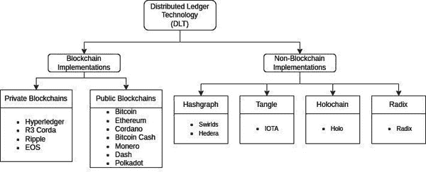

**图 1.1：** 分布式账本技术分类

### 加密货币及其价值主张

比特币被设计为一种供应有限且受控的货币。在经济学中，通货膨胀率是商品和服务价格随时间上涨的速率。在比特币术语中，通货膨胀是新比特币被挖掘、铸造或创建的速率。通货膨胀由算法控制，大约每 4 年减半一次。不同加密货币有不同的通货膨胀规则。

比特币最初设计用于点对点支付。最初，转账比特币无需向矿工支付费用，因为任何人都可以在笔记本电脑上铸造比特币。庞大的供应量、低价值、零交易费和全球化存在使比特币成为良好的支付媒介。然而，随着时间的推移，比特币价值上涨、网络费用增加、供应量开始减少，这使其成为极佳的增值资产。它仍被用作交换媒介，全球许多商家接受它。

以下是以特定品质著称的顶级加密货币和代币项目：

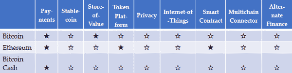

**表 1.1：** 顶级加密货币/代币与其特定品质的映射

### 智能合约与代币平台

智能合约是编码在区块链中并使用编程语言编写的自我执行协议。

比特币提供一种简单的编程语言，可用于编写智能合约。该脚本语言非常原始，无法为构建复杂的现实世界合约提供可行平台。为解决此问题，`Vitalik Buterin` 创建了名为 `Ethereum` 的加密货币，支持图灵完备的 `Solidity` 语言编写合约。该语言使开发者创建代币的速度远快于创建加密货币。这导致了通过代币销售筹集资金的 **首次代币发行**（`Initial Coin Offering`，`ICO`）、证券型代币、实用型代币、**去中心化金融**（`Decentralized Finance`，`DeFi`）以及最近的 **非同质化代币**（`non-fungible tokens`，`NFT`）。这吸引了大量关注区块链技术以解决现实问题。

然而，`RSK` 是比特币的第 2 层解决方案，提供类似 `Ethereum` 的智能合约能力。像 `Ethereum` 一样，`RSK` 允许使用 `Solidity` 编写智能合约。

### 支付、价值存储与替代金融

#### 比特币挖矿与交易费用

随着比特币变得有价值，且在 2013 年左右个人电脑和笔记本电脑挖矿开始变得困难，首批 ASIC 硬件投入市场，导致网络费用上涨。显而易见，如果网络费用持续增加，比特币作为购买咖啡等低价值商品的支付工具将不再可行。比特币开发社区在是否应增加区块大小以降低交易费用，还是保持不变以免比特币网络在安全性上妥协的问题上产生了分歧。

#### 抗 ASIC 算法

另一种选择是，以太坊、莱特币和其他一些加密货币采用了抗 ASIC 挖矿算法。其思路是使用需要内存而非更快处理速度的算法，因为 ASIC 硬件擅长解决 CPU 密集型问题，却不擅长处理内存硬问题。

#### 比特币现金

比特币现金是比特币的硬分叉之一，其创建的主要目的是通过增加区块大小来降低交易费用。

#### 面向支付的替代加密货币

其他加密货币（如莱特币和狗狗币）提供更短的确认时间，使其更适合类现金支付。

#### XRP

XRP 是一种可在全球范围内提供近实时支付的加密货币。其主要目标是为金融机构提供一种交换媒介。它声称能提供类似 SWIFT 的支付处理能力。

### 隐私

比特币交易记录在区块链上，任何人都可以查看。当我们从交易所购买比特币时，需要向交易所提供 KYC（了解你的客户）信息。交易所知晓你的交易，且所有相关交易也都在区块链上。交易所可能会将这些信息泄露给罪犯、黑客、外国政府、广告商等。交易所还可以关联区块链上的其他交易，导致你失去财务隐私。虽然有一些方法可以让比特币交易更私密，但这些方法不如以隐私为设计目标的加密货币效果好。门罗币、达世币、Zcash 和 Zcoin 就是一些专门以隐私为设计目标的加密货币。

### 预言机与多链连接器


# 智能合约与预言机

智能合约强制执行协议，但这些协议基于现实世界的信息，而这些信息并不存在于区块链上。这些信息由被称为 `Oracle`（预言机）的实体提供。这些实体大多是中心化的第三方。Polkadot 和 Chainlink 提供了去中心化机制来提供外部现实世界信息。Polkadot 和 Chainlink 可以在多条区块链之间建立接口，允许它们交换信息。这催生了该领域有趣的项目。这些概念仍在成熟中，我们未来可能会看到该领域更多进展。

## 稳定币

稳定币是一种与另一种资产（如美元、欧元或比特币、黄金等实物资产）价值挂钩的加密货币。

加密货币在交易所买卖，兑换成法定货币。这会产生交易所收取的费用。对于想利用加密货币市场波动获利但觉得手续费高昂的交易者，他们可以将加密资产暂时存入稳定币，在需要买入加密货币时再使用。

此外，世界上大多数人无法接触美元、欧元等被认为更稳定的货币。他们可以购买与这些货币挂钩的稳定币。

## 区块链生态系统

区块链生态系统由加密货币、私有和公有区块链、交易所以及建立在其之上或与其相关的其他服务组成。

以下是区块链生态系统的广泛概览。请记住，区块链生态系统非常庞大，并非所有内容都能在此展示：


**图 1.2：** 区块链生态系统

## 交换媒介与价值存储

我们了解到，加密货币的创建是为了满足特定需求。所有加密货币都需要开发者；它们需要交易所。作为交换媒介而流行的加密货币需要支付处理器、钱包以及接受它们的商家。

作为价值存储而流行的加密货币需要极其安全的长期存储方法，因此需要保险库和硬件钱包。需要资产管理人提供托管服务，也需要 ETF（交易所交易基金），以便非技术投资者能依赖金融机构保障资金安全。

## 私有与公有区块链

私有区块链（如 `Hyperledger Fabric`）的创建旨在提供组织数据的不可篡改性和访问控制，且可由审计员验证。`Hyperledger Fabric` 等私有区块链技术还提供联邦结构，每个组织可以使用 `Hyperledger Fabric` 创建独立的区块链，并可跨链传输数据和代码。这使得具有共同利益的组织联盟能够聚集在一起，共享数据以改善供应链、透明度和可审计性。这还为联盟提供了一种访问控制机制，赋予特定实体特定权利。

## 许可型与无许可型区块链

许可型区块链实现是为组织内部使用或组织联盟之间创建的。只有指定或预定义的实体可以参与。就像办公室内网，只有指定方可以使用，公众无法使用。

另一方面，无许可型区块链加入或与区块链交互不需要任何许可。任何拥有互联网接入的人都可以开始使用它。

## 合规、记录保存与审计

金融机构已使用私有区块链存储客户的 KYC/AML（反洗钱）数据。由于区块链不可篡改，它们提供便捷的审计，有助于满足合规要求。私有区块链也被用于记录保存，如医疗记录。

## 代币

公有区块链（如以太坊，它简化了使用易于开发语言编写智能合约的过程）支持代币开发、分布式应用开发、数字资产交易与估值以及供应链管理。代币的开发促成了**首次代币发行 (ICO)** 和**证券型代币发行 (STO)**，二者被用于为初创公司筹集资金。实用代币有助于将优惠券或门票数字化。

## 去中心化应用

分布式应用或 DApps 是构建在去中心化网络上的应用，它们利用智能合约和 UI 表现得像任何托管应用一样。DApps 用于构建有助于建立平台和市场的应用。这些市场和平台作为去中心化组织运作。DApps 还可以提供抗审查性和隐私。

## 同质化与非同质化代币

同质化代币类似于货币。如果代币是同质化的，它与其他同类代币无法区分。所有加密货币都是同质化的。有时游戏中有某些普遍限量且对所有等级玩家价值均等的物品；这些也可视为同质化。

NFT 代表 `non-fungible tokens`（非同质化代币）。非同质化代币与同质化代币相反，其价值取决于环境和个人偏好，就像电影院座位的价格可能因座位位置而异。它们适用于艺术品、短片、音乐等资产的数字化，或数字艺术品和收藏品等数字资产。

## 去中心化金融

去中心化金融或 **DeFi** 是使用智能合约在区块链上创建的金融合约。智能合约可用于借贷、保险、交易和衍生品市场等。去中心化金融也可能涉及用于结算或抵押的数字资产或货币。

## 比特币生态系统

随着加密货币和区块链实现的发展，比特币生态系统也在演变。许多服务已构建完成，旨在改善用户和开发者体验。有些服务专为比特币设计，也有为加密货币、代币和区块链构建的服务，这些反过来又使比特币受益。

下图展示了比特币生态系统：

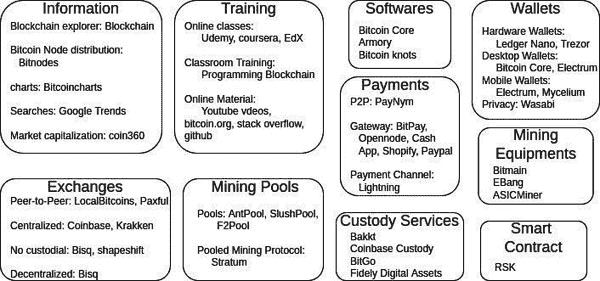

**图 1.3：** 比特币生态系统的构建模块

### 比特币教育、培训和在线帮助材料

有多个网站提供学习材料、区块链信息、价格信息、矿池、趋势等。MOOC 提供商提供多门关于比特币的在线课程。甚至像 MIT 这样的知名学府也提供比特币在线课程。培训机构和个人也会举办课堂课程。还有网站提供测试平台，包含转换器、计算器和验证工具。此外，Git 上还提供许多用 Python、Node.js、Golang 等编写的实用库。YouTube 上也有许多视频讲解比特币区块链的各个方面。除此之外，还可以在 Stack Exchange 上提问技术问题，并可能获得核心开发者的回复。

### 节点和钱包

有许多比特币节点软件可用，有些提供全节点功能，而其他则提供 SPV 节点。比特币通过称为钱包的软件进行访问。交易所和支付处理商提供在线钱包，也有硬件钱包、桌面钱包、移动钱包和轻钱包。

### 挖矿和矿池

当矿工解决数学问题并创建下一个区块时，他们会获得比特币奖励。矿工竞争解决难题。公司也竞争构建挖矿设备，以更低的成本提供更好的算力。随着更多矿工进入市场，挖矿设备公司制造出更高效的设备，比特币网络会调整难题的难度。这会降低旧设备的回报，使其过时。

随着比特币价格呈指数级上涨，挖矿难度也大幅增加。因此，即使拥有数百台世界上最好的设备，任何人独自解决难题的机会也微乎其微。这是挖矿的现状。解决方法是，任何打算通过挖矿赚钱的人都必须加入矿池。有几个矿池在区块被挖出后，根据矿工的贡献向其支付报酬。

### 支付

比特币钱包可以接收或发送比特币给其他比特币钱包。可以使用与钱包关联的比特币发送到另一个比特币地址，该地址将与接收者的钱包关联。建议接收比特币时始终使用新地址。对于支付来说，这是一件过于复杂的事情。因此，比特币提供了一种安全且私密的转账方式，称为 **PayNyms**。

还有像 BitPay 这样的支付网关，Coinbase 等交易所也提供支付网关，允许为商业用途（如购物）轻松转账比特币。像 PayPal 这样的支付网关允许客户向钱包充值比特币，并以美元或其他货币向商家付款。

如果支付足够的网络费（可能是几美元），比特币交易平均需要 10 分钟才能获得确认。确认意味着交易被打包进区块。由于网络费高昂，买咖啡不划算。为解决此问题，比特币拥有一个称为 **Lightning Network** 的二层网络，允许商家与客户创建通道。如果在此通道上进行足够多的交易，有效网络费会降低到足以使交易可行的程度。闪电网络交易也是即时的。

#### 交易所

正是交易所赋予了比特币货币价值。交易所是购买、交易和出售加密货币的场所。交易中有买家，他们希望以特定报价买入比特币，也有卖家以特定价格竞价出售比特币。中心化交易所利用报价和竞价使价格上下波动，以发现比特币的合理价格。交易所也承担风险，因为价格可能剧烈波动，导致其亏损。因此，中心化交易所根据市场波动收取点差费，但并非所有交易所都如此。点对点交易量不足以追踪加密货币价值，因此它们为买卖双方提供直接交易的平台，并收取固定佣金。

交易所还可分类如下：

*   **Custodial exchange**（托管交易所）：持有用户比特币钱包的交易所
*   **Non-custodial exchange**（非托管交易所）：不持有用户比特币钱包的交易所

## 结语

本章开头我们探讨了与比特币、区块链和 DLT 相关的发展。这让我们对生态系统的构成、发展进程及其对我们生活的影响有了很好的了解。

下一章你将了解帮助中本聪构建比特币的历史，以及它是如何成长的。你还将理解比特币的定义、它解决的博弈论问题，以及解决该问题在未来的影响。此外，我们还将介绍比特币的基本属性。

## 要点回顾

*   比特币创建时，它是唯一的加密货币。
*   **Satoshi Nakamoto** 是化名，于 2008 年 10 月 31 日发布比特币白皮书，发布代码，并于 2009 年 1 月 3 日部署网络。他活跃至 2010 年 12 月。其身份至今未知。
*   比特币拥有原始脚本语言，足以编写智能合约。
*   **DLT** 是去中心化账本技术，包括区块链、Hashgraph、有向无环图等。
*   私有链在组织内部运行。
*   公有链是开放网络，世界上任何人都可以与之交互。
*   许可链实现是为组织内部或组织联盟之间的内部使用而创建的。
*   无许可链加入或交互不需要任何许可。
*   加密货币可根据其价值主张分类。
*   少数加密货币提供图灵完备的脚本或编程语言支持，使编写智能合约和构建代币更容易。
*   同质化代币类似货币。如果代币是同质化的，它与其他同类代币无法区分。
*   **NFTs** 是非同质化代币。非同质化代币与同质化代币相反，意味着其价值取决于环境和个人偏好。
*   去中心化金融或 **DeFi** 是使用智能合约在区块链上创建的金融合约。
*   **Stablecoin**（稳定币）是一种与另一种资产（如美元、欧元、比特币或黄金等实物资产）挂钩的加密货币。

## 分布式应用与加密货币概念

*   分布式应用或 **DApps** 是构建在去中心化网络上的应用程序，该网络使用 **智能合约** 和用户界面，使其表现得像任何托管应用程序一样。
*   **托管交易所** 在其钱包中持有比特币。
*   **非托管交易所** 不持有比特币；这些交易所的用户直接从交易所外部由他们持有的钱包发送和接收比特币。
*   适合小额购买的 **加密货币** 归类为货币或 **交换媒介**。
*   具有高交易成本，且建立了用户信心，认为其安全、可靠并能长期保值的 **加密货币** 可被视为 **价值存储**。
*   **智能合约** 是编码在区块链中并使用编程语言编写的自我强制执行协议。
*   **首次代币发行 (ICO)** 类似于 **IPO** 用于融资，但使用基于 **以太坊** 等加密货币创建的代币。这被处于加密货币和区块链领域、提供产品和服务的初创公司所采用。
*   **证券型代币发行 (STO)** 类似于 **ICO** 的公开发行，但在交易所作为数字证券出售，具有法律约束力，因此成为投资者的更好选择。
*   **实用代币** 由公司以优惠券或门票的形式发放，供应有限。这些优惠券稍后可兑换，或门票可用于音乐会入场。
*   **交易所** 是加密货币获得价值的市场。
*   **钱包** 包含一组可以接收加密货币的地址。**钱包** 也可以访问这些加密货币，以便将它们发送到其他地址和钱包。
*   **全节点** 是验证所有区块和交易的程序。
*   **挖矿节点** 通过使用算力与其他 **挖矿节点** 竞争解决加密难题。
*   解决加密难题的 **挖矿节点** 会创建一个区块，将来自 **内存池** 的交易打包其中，矿工将获得比特币作为区块奖励。
*   **矿工** 加入 **矿池** 以合作而非竞争的方式解决加密难题。每位矿工根据其贡献的算力比例，获得相应份额的挖出加密货币作为报酬。

## 问题

1.  **DApp** 与托管应用有何不同？
2.  **ICO** 有哪些缺陷导致其作为融资工具失败，而 **STO** 如何解决这些问题？
3.  为什么 **比特币** 挖矿消耗大量能源？
4.  **账本** 一词与 **区块链** 有何关联？
5.  **Layer 2（第二层）** 与 **侧链** 有何区别？
6.  什么是 **图灵完备语言**？
7.  请各举五个同质化和非同质化商品的例子。
8.  请给出 **实用代币** 的五个应用场景。
9.  将 **区块链** 最重要的特性与列出的应用进行匹配：

    **特性：**

    1.  **不可篡改性**
    2.  **智能合约**
    3.  **去中心化**
    4.  **共识**
    5.  **账本**
    6.  **时间顺序**

    **应用：**

    1.  记录保存、审计
    2.  交易、支付
    3.  市场
    4.  时间戳
    5.  协议
    6.  投票

10. 填空：

     1.  **DApps** 是构建在 \_\_\_\_\_\_\_\_\_\_\_ 网络上，使用 \_\_\_\_\_\_\_ 合约和 \_\_\_\_\_\_\_\_\_\_\_\_ 的应用程序。
     2.  \_\_\_\_\_\_\_\_\_\_\_\_\_\_\_ 是在 **比特币** 发布几十年前推出的第一种加密货币。
     3.  **比特币** 不是 \_\_\_\_\_\_\_\_\_\_ 币，但它具有 \_\_\_\_\_\_\_\_\_\_\_\_\_ 抗性。
     4.  \_\_\_\_\_\_\_\_\_\_\_\_ 帮助 **智能合约** 与现实世界资源交互。
     5.  第一条 **区块链** 用于可靠的去中心化 \_\_\_\_\_\_\_\_\_\_\_。
     6.  **以太坊** 为其 **智能合约** 提供名为 **Solidity** 的 \_\_\_\_\_\_\_\_\_\_\_\_\_\_ 语言。

11. 判断正误：

     1.  **区块链** 不需要让交易关联价值。
     2.  **比特币脚本语言** 不支持 **智能合约**。
     3.  **硬件钱包** 包含加密货币，丢失它们意味着丢失所有存储的货币。

# 第 2 章：比特币概述

在上一章中，您对 **比特币** 和 **区块链** 生态系统有了基本的了解。您还学习了技术领域中常用的基本术语。

在本章中，您将了解是什么促成了 **比特币** 的发展，发生了哪些发展，以及成功与失败的经历。然后，我们将探究过去 13 年发生了什么，即重要的里程碑有哪些，哪些重要成就帮助 **比特币** 变得流行，以及哪些事件阻碍了 **比特币** 的采用。

随后，您将了解什么是 **比特币**，它解决了什么问题，如何解决该问题，以及解决该问题的影响规模。我们将进而理解为什么理解 **比特币** 很重要，以及了解它如何帮助我们。

您还将了解赋予 **比特币** 价值的特性。

## 结构

在本章中，我们将讨论以下主题：

*   学习 **比特币** 的理由
*   通往 **比特币** 的发展历程
*   **比特币** 的崛起
*   定义 **比特币**
    *   拜占庭将军问题
    *   **比特币** 作为拜占庭将军问题的解决方案
    *   **比特币** 作为数字资产的特性

## 目标

本章的主要目标是为学习 **比特币** 建立理由。我们希望读者在后续章节深入技术细节之前，能充分理解 **比特币** 作为一个概念。

为了让读者充分理解 **比特币**，他们需要了解其成长历程和成就。因此，在本章中，我们将学习 **比特币** 的历史以及促成 **比特币** 发展的技术。我们还将理解 **比特币** 的价值主张。

读完本章后，读者将知道为什么学习 **比特币** 很重要。

## 学习比特币的理由

现在，我们对 **DLT** 生态系统在 13 年间变得多么庞大有了很好的认识。因此，可能会产生一个问题：“如果 **分布式账本技术** 已经发展到如此地步，为什么我们还要学习一项过时的技术？”

尽管存在如此多的加密货币，**比特币** 在某些方面仍处于领先地位，例如：

*   **比特币** 网络是最安全的网络，因为挖矿算力为其安全性做出了贡献。
*   与所有其他加密货币甚至代币相比，**比特币** 拥有最高的市场占有率。
*   由于 **比特币** 没有已知的创建者，它可以被认为比任何其他加密货币或代币项目都更加去中心化。
*   **比特币** 的改进流程相当严格，这意味着只有当大多数利益相关者完全确信某项功能时，改进才会被接受。这意味着只有符合 **比特币** 特性的最佳功能才会被采纳。
*   **比特币** 网络是受监控最多的加密货币网络，这充当了早期预警系统，可在灾难性事件发生前检测异常。
*   **比特币** 网络拥有加密货币领域最大的开发者基础之一，仅次于 **以太坊**。
*   **比特币** 作为最古老的加密货币，相较于其他加密货币具有优势。它经历了各种攻击，如技术、社会和政治层面的攻击。因此，它在全球领袖中建立了声誉，并成为对冲基金经理、顶级上市公司、政府等最广泛接受的加密货币之一。

现在可能已经清楚，**比特币** 并未过时且发展良好，但我们仍需了解为什么学习 **比特币** 很重要。

As mentioned earlier, Bitcoin is the oldest cryptocurrency, and therefore its code has been adopted by most cryptocurrencies. Bitcoin is the foundation of most other cryptocurrencies and blockchains. This means it can help you understand the internal workings of other cryptocurrencies and blockchain technologies. This may help you understand Ethereum, Hyperledger, or other popular technologies, providing better opportunities for software engineers and entrepreneurs.


# Understanding Bitcoin's Internals

Understanding Bitcoin's internals also helps secure your cryptocurrency investments; understanding its long-term value encourages you to hold long-term and avoid panic buying and selling.

## The Road to Bitcoin

Satoshi Nakamoto is a genius, but he/she was not the first person to create or conceive of a cryptocurrency. He built a cryptocurrency superior to earlier implementations and attracted the right talent to develop it together. Bitcoin is the culmination of all developments in the world of cryptography.

The following is a timeline of progress in the field of cryptography, along with the centralized and decentralized currency experiments that occurred along the way:

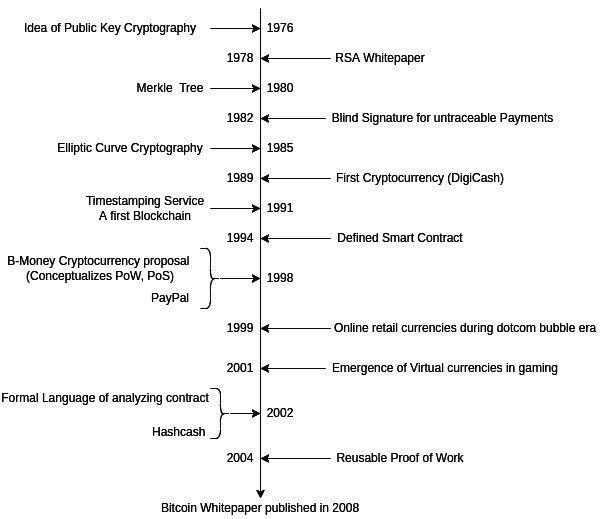

**Figure 2.1:** Cryptographic development history leading to Bitcoin

In November 1976, `Whitefield Diffie` and `Martin E. Hellman` published a paper titled *New Directions in Cryptography*. The paper proposed a method involving two keys: one for encrypting messages, which is public and can be shared with others; the other for decrypting messages, which is private and kept secure by the key owner. The paper also introduced the concept of digital signatures. It stated that, just like a physical signature, a digital signature would be attached to a document, creatable by the signature owner, and verifiable by anyone for content and signatory.

This concept later led to the first implementation proposed in 1978, in a paper titled *A Method for Obtaining Digital Signatures and Public-Key Cryptosystems*, authored by `R.L. Rivest`, `A. Shamir`, and `L. Adleman`. Today, RSA and other asymmetric public-key encryption algorithms are widely used for transmitting secrets and securing internet connections via SSL.

In 1980, `Ralph C. Merkle` published a paper titled *Protocols for Public Key Cryptosystems*. This paper is important because it proposed a method for verifying the integrity of individual elements in a message through iterative hashing, which you will learn about later. This is known as the `Merkle Tree root`. It helps the Bitcoin blockchain by ensuring the integrity of transactions within a block.

In 1982, `David Chaum` published a paper titled *Blind Signatures for Untraceable Payments*. This paper attempted to solve privacy issues related to digital payments. `David Chaum` foresaw the dangers of digital payments, while today we know financial privacy is crucial. He launched the first cryptocurrency, DigiCash, in 1989, which was quite successful at the time. However, it failed due to a lack of decentralization.

In 1985, `Victor S. Miller` published a paper titled *Use of Elliptic Curves in Cryptography*, explaining how elliptic curves over finite fields could be used for public-key cryptography. Bitcoin uses digital signatures combined with elliptic curve cryptography.

Notably, the Bitcoin whitepaper cites 8 references, 3 of which are papers written by `W.S. Stornetta`. Starting in 1991, he wrote several papers on digital timestamping without involving a central timestamp authority. `W.S. Stornetta`, `D. Bayer`, and `S. Haber` created the first blockchain in this process (not called blockchain at the time). They created a series of immutable records linked to each other, forming a linear hash chain.

In 1994, `Nick Szabo` proposed the idea of smart contracts. In 1998, he proposed a concept for a decentralized cryptocurrency called Bit-gold. It never went live but laid the foundation for cryptocurrencies, leading to Bitcoin's development. In 2002, he wrote a draft paper *A Formal Language for Analyzing Contracts*, describing a language for smart contracts.

1998 was an interesting year. PayPal launched (providing an alternative payment system still popular today), Bit gold was conceptualized, and `Wei Dai` proposed the idea of b-Money that year, envisioning Proof of Work and Proof of Stake. Proof of Work is used by Bitcoin and many other cryptocurrencies as a consensus algorithm, while Proof of Stake is used by Cardano and will be adopted by Ethereum in the future.

Many digital currencies were launched in the late 1990s and early 2000s, but all failed. There were internet currencies, and game currencies used inside games. Second-life had a currency purchasable with real money; you could earn money in the game and exchange it back for real money.

In 2002, `Adam Back` published the paper *Hashcash - A Denial of Service Counter-Measure*. This paper is cited in the *Bitcoin Whitepaper*. The paper provided a mechanism to make systemic abuse of internet resources expensive. One application was email spam. It uses CPU power to prevent spam or similar abuse on internet resources.

In 2004, `Hal Finney` released the code for `RPOW - Reusable Proofs of Work`. This was likely the final piece of the puzzle Satoshi Nakamoto needed to create Bitcoin. Early Proof of Work could be used to generate tokens for a single transaction. RPOW allowed the token recipient to regenerate a new token, send it to the next person, and so on. Thus, tokens generated by Proof of Work circulated like money. RPOW uses Hashcash as the Proof of Work token. The recipient of a Hashcash token generates an RSA-signed token (called an RPOW token) in exchange for the Hashcash token, sends it to the next recipient, and repeats the process for further circulation.

Notably, since the 1980s, many digital currencies or digital payment methods have been launched, but apart from a few game currencies, only PayPal survived. Many companies tried to replicate the PayPal model but all failed. The most successful of the failed attempts was e-gold. Anyone could create an account and exchange gold and silver for e-gold.

When Satoshi Nakamoto wrote the Bitcoin whitepaper, all the elements needed to build Bitcoin already existed. Even if Satoshi hadn't done it, the first working cryptocurrency would have emerged. Satoshi is a genius, but not a superhero. His whitepaper is very accessible, which attracted many people. Partly because all the complexity had been solved by equally smart people in earlier work.

Satoshi Nakamoto should be credited not only for creating the first cryptocurrency (which would have happened anyway) but for designing it with the right mindset, allowing it to dominate the cryptocurrency market (by market cap) 13 years later, and likely for years to come.

Ultimately, Satoshi Nakamoto may have grasped everything happening in cryptography and the fate of everyone who launched a currency or payment system. He was smart enough to create a truly decentralized and censorship-resistant system while hiding his own identity.

## The Rise of Bitcoin

## 比特币历史与基础

### 比特币的起源

2008 年 10 月 31 日，*中本聪*在 metzdowd.com 的密码学邮件列表上发布了题为《比特币：一种点对点的电子现金系统》的比特币白皮书。2009 年 1 月 9 日，中本聪在*SourceForge*上发布了比特币代码，并通过挖掘第二个及后续区块启动了网络。第一个区块并非通过挖掘产生，因为它被硬编码在代码本身中；任何区块链的第一个区块被称为**创世区块**。中本聪与密码学领域的不少智者合作，包括*哈尔·芬尼、亚当·贝克、加文·安德烈森*。中本聪与哈尔·芬尼密切合作，首笔交易于 1 月 12 日在他们之间发生。

### 早期里程碑

比特币被注意到的速度令人惊叹。10 月 5 日，全球首个比特币交易所上线，$1 可购买 1309.03 BTC。2010 年 5 月 22 日，两个披萨以 10000 的价格售出。这一天被铭记为**比特币披萨日**。

### 网络事故

比特币网络从未停止工作的说法是不正确的。这种情况发生过两次。

1.  **通胀漏洞**：第一次，发现了一个通胀漏洞（允许增加加密货币供应量的漏洞），但在修复之前，有人利用它生成了比特币。该问题在数小时内得到解决，使这些额外的比特币失效。

2.  **网络分叉（2013 年 3 月）**：第二次发生在 2013 年 3 月，一次比特币软件升级导致了网络分叉。随着矿池和节点所有者积极切回旧版本，问题很快得到解决。

### 挖矿演变

最初，任何人都可以轻松在个人电脑或笔记本上挖掘比特币。由于当时矿工很少，挖出一个区块不需要太多时间。然而，随着更多人开始挖矿，挖出一个区块所需时间变得很长。

2010 年 11 月 27 日，**Slushpool**推出了首个矿池，矿工们联合挖掘区块，一旦挖出，奖励将根据贡献在矿工间分配。后来，矿池成为挖掘区块唯一可行的方式，少数矿池几乎完全接管了网络的算力。即便在今天，情况依然如此。

2014 年 7 月，一个矿池曾短暂拥有超过网络 50%的算力。该矿池并未尝试发动**51%算力攻击**，但意识到这可能影响网络的整体公信力，并承诺永不超过总算力的 40%。

### 替代币与早期生态

**Namecoin**是比特币之后推出的首个加密货币。同年，**Litecoin**也推出了，至今仍保持流行。

2013 年，当**ASIC 矿机**面世时，算力要求变得过高，导致小规模玩家难以挖矿。当时，许多矿工转而挖掘 Namecoin、Litecoin 及其他币种。

2011 年 5 月，**Bitpay**成为首个允许商家接受比特币支付的支付处理商。

### 监管与基础设施

2013 年 3 月 28 日，美国首个加密货币监管措施出台。**FinCEN**发布了相关法规。

2013 年 10 月 29 日，全球首台比特币 ATM 在加拿大温哥华上线。

### 重大交易所黑客事件


# 比特币交易所与扩容辩论

比特币交易所有着被黑客攻击的历史，许多人因此损失了比特币。然而，对比特币价格和信心影响最大的事件发生在 2014 年 2 月 `MtGox` 被黑客攻击时。它当时是最大的比特币交易所。

## 硬分叉与扩容辩论

2014 年 6 月 10 日，`Mike Hearn` 创建了 `BIP 64`。12 月，他发布了导致首次硬分叉并创建 `Bitcoin XT` 的软件。

2010 年，中本聪悄悄引入了 `1MB` 的区块大小限制。由于每 10 分钟生成一个区块，`1MB` 的区块大小限制成为比特币扩容的主要瓶颈。在 `1MB` 限制下，比特币每秒最多只能处理 `7 笔交易`。早在 2011 年，就有开发者提议提高此限制。

2015 年，`BIP 100` 和 `BIP 101` 被提出以提升该限制。许多比特币硬分叉都与提高此限制有关。通过 `隔离见证` 软分叉，该限制得以提升。

## 炒作周期与机构采用

比特币经历了多次价格暴涨暴跌的炒作周期。炒作周期分别出现在 2011 年、2013 年（两次）和 2017 年。这些周期为比特币带来了媒体曝光，并有助于提升采用率。

2020 年 8 月，`MicroStrategy` 成为首家将比特币纳入国库储备的上市公司。这赋予了比特币作为价值存储的合法性。

以下是自比特币白皮书发布以来事件时间线和成就的示意图：

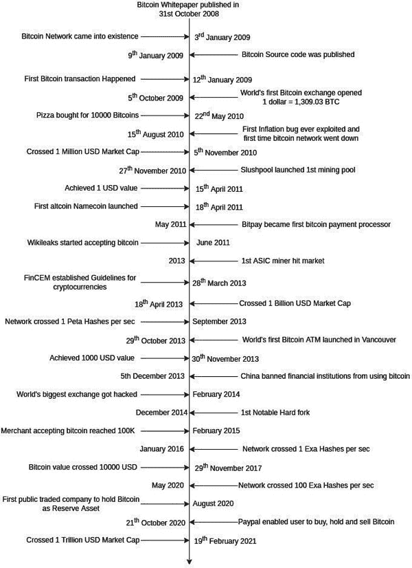

**图 2.2：** 比特币白皮书发布以来的时间线与里程碑

---

# 定义比特币

比特币不是单一事物，而是两个，其定义如下：

> **比特币是一种无需许可、可验证、点对点、供给无弹性且可演进的资产。**
>
> 以及
>
> **一种去中心化网络，旨在在无中介的不安全环境中创建、存储和传输比特币。**

比特币的设计也旨在实现扩容，并在其之上和侧面拥有层级。与任何现有网络相比，比特币拥有最高的累积工作量证明。在未来的应用中，资产、货币和代币将能够保障自身安全，并从比特币获得部分价值背书。凭借其设计、开源、去中心化特性、价值及累积工作量证明，它也许终将成为互联网的重要组成部分。未来，比特币可能具有如下定义：

> **互联网中的信任层。**

---

# 拜占庭将军问题

比特币网络使用 `工作量证明` 共识机制来生成比特币，并使用脚本、密码学和 `工作量证明` 将其从后续接收者处转移。

比特币的 `工作量证明` 共识机制试图在敌对环境中建立共识，攻击者可能会合谋攻击网络，通过包含或排除包含交易信息的消息来获利。这正是本书标语的由来：

> **在无信任环境中建立信任**

这本质上是对 1982 年 `Leslie Lamport`、`Robert Shostak` 和 `Marshall Pease` 发表的论文《拜占庭将军问题》的一种解决方案。这是一个重要的博弈论问题，问题条件如下：

1.  拜占庭军队计划进攻一座城市。
2.  拜占庭军队有若干师，每师由一名将军指挥。这些将军驻扎在距城市各处的位置。
3.  任两位将军无法直接通信，需依赖信差传递消息。
4.  为攻下城市，他们需就进攻计划达成共识。这需要大量通信往来。
5.  问题在于他们中可能有叛徒，会通过散布虚假信息破坏计划。
6.  协同进攻将带来胜利。
7.  非协同进攻将导致失败。

以下是拜占庭将军问题获胜与失败条件的图示：


**图 2.3：** 拜占庭将军问题示意图

在比特币中，大多数参与节点根据既定共识规则，就交易消息、其顺序及与先前接受消息的链接达成一致。每个节点在此扮演将军的角色。与拜占庭将军问题不同，目标是保护网络。若网络遭破坏，攻击者（叛徒）可实施双重支付、排除或包含消息、更改消息顺序。这将影响网络的信用价值。

现在，我们理解了比特币共识机制如何本质上解决拜占庭将军问题。

同一拜占庭将军问题可被视为具有以下特征，以用于需要协作的类似问题：

1.  如果大多数在合作，任意数量的将军都可以是叛徒。这使其成为一个民主系统。
2.  每位将军为使计划成功可能扮演不同的角色。这可以达成一致。
3.  无需领导者即可达成共识。

这对现实世界有深远影响，因为在大多数需要达成协议的事务中，都需要一个中心化的可信权威。因此，其影响远不止于支付领域。

举个例子，如果我们想建立一个网约车聚合网络，将会有乘客、司机、车主和车辆本身。这四方都需要通过共识规则达成协议，这些规则以智能合约的形式编写，内容如下：

1.  司机将通过最省时的路线将乘客送达指定地点，
2.  车辆由车主维护，司机在需要时添加燃料，
3.  乘客在到达目的地后向车主付款，以及
4.  司机从车主处领取月薪。

尽管司机、乘客、车主和车辆之间有明确的区别，但一旦确立了协议规则，每一方在等级上都是平等的。每笔交易的记录保存在一串不可变的记录序列中，确保易于审计。无需中心化权威来领导该平台。

下图展示了一个网约车聚合网络：

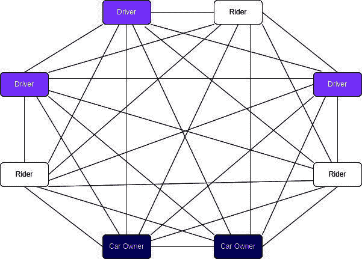

**图 2.4：** 去中心化网约车聚合网络

## 比特币作为拜占庭将军问题的解决方案

为了解决这个问题，比特币需要：

*   按发生顺序在一串不可变的记录序列中维护所有交易。
*   确保交易在不可变性、顺序以及任何共识规则或合约方面易于验证。
*   能够解决可能出现的竞态条件，即两条记录同时生成的情况。
*   快速传播消息，以免前述竞态条件导致确认时间变长。

这就是比特币具有以下特征的原因：

*   **工作量证明** 通过在创建区块时附加成本，使交易具有不可变性。
*   **区块链** 由包含交易的区块组成，每个区块都知道前一个区块，且每个区块按时间顺序排列。
*   比特币 **工作量证明算法** 使得区块 **易于验证** 但极难创建。这确保了交易传播得足够快，以便当区块达到六个确认深度时，由两个遥远节点同时创建区块导致的竞态条件已得到解决。
*   每笔交易通过 **密码学** 和脚本与前一笔交易关联，强制执行顺序、共识规则和合约。
*   **验证节点** 或 **全节点** 就像观察比特币矿工比赛的观察员。它们不通过创建区块并使用 **工作量证明算法** 将交易添加到区块中来确认交易。相反，它们验证所有共识规则、智能合约条款、区块的时间顺序、比特币从发送方到接收方的发送，以及来自前一笔交易的比特币资金来源。

## 比特币作为数字资产的属性

比特币网络需要收取费用，以便为挖矿成本提供资金，因为挖矿是保障网络安全的 **工作量证明**。中本聪设计了一种巧妙的方式来实现这一点：

*   当矿工解开挖掘区块所需的加密谜题时，他会获得新铸造的比特币作为报酬。每挖出 `210,000` 个区块（约 4 年），该奖励减半一次。
*   随着网络变得更有价值，矿工将收取费用以将交易打包进区块。

这确保了比特币供应完全缺乏弹性，即其供应量是预先确定的。比特币供应量也以指数级速度减少，这意味着当它变得流行时，供应将不足。

区块奖励从创世时的 `50`  减少到本书撰写时的 `6.25` ，而网络手续费从最初的零显著上升。这使得比特币对投机的吸引力降低。

比特币也具有高度可分性，**聪** 是最小面额，其价值如下：

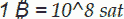

比特币不需要中介，这使其成为实物现金的数字等价物。

比特币既不是隐私币，也不会泄露你的身份。比特币的隐私特性可以理解如下：

*   比特币不将个人与身份关联；相反，比特币附着于地址。
*   比特币可以从交易所、矿工或个人处直接购买。这使得比特币难以追踪。
*   比特币可以从交易所购买。大多数交易所遵循 `KYC` 规范，因此将身份与地址关联。当我们从交易所转出比特币时，交易所知晓接收地址。
*   比特币区块链上的所有交易都是透明的，包含前一笔交易、支付地址、资金来源地址和接收地址的金额等信息。这样，每笔交易都有历史记录，可能留下发送方或接收方身份的线索。
*   有一些技术可以使身份识别变得非常困难。

总体而言，比特币隐私是一件非常个人化的事情。因此，当政府监管比特币并激励其使用时，比特币地址变得更透明、更易追踪；但当政府惩罚其用户时，比特币地址变得不透明、更难追踪。这使比特币具有抗审查性。

比特币存在于网络上，钱包仅持有其私钥。这使比特币具有位置独立性，因此可以轻松在全球两端的人们之间转移。

比特币价值在交易所决定。由于比特币易于转移到世界任何地方，其在各货币中的价值几乎相同。在某些情况下，当政府对加密货币实施限制或对本地货币实施外汇管制时，比特币价值可能比国际价值略高。

比特币是网络上与地址关联的一个数字。如果地址与罪犯或黑客关联，交易所可能会屏蔽此类地址，这可能影响该比特币在下一笔交易中的价值。但在后续交易中，如果它与其他比特币混合，则变得与其他硬币无法区分。由于比特币几乎从不被区分，这使它们具有相当好的同质性。

所有有效的比特币交易要么在 **内存池** 中（位于比特币网络上每个全节点的内存中），要么在区块链中。这些由节点验证。任何人都可以通过运行节点或查看热门网站之一来查看交易。

这赋予了比特币以下属性：

*   稀缺
*   可分割
*   抗审查
*   易于转移
*   同质
*   可验证

此外，这使比特币：

*   不太适合投机
*   更适合持有或储蓄

---

# 结论

在本章中，我们回顾了密码学发展史上通向比特币诞生的历程。然后，我们梳理了从白皮书发布至本书撰写期间的时间线。

随后，我们定义了比特币及其解决的博弈论问题——拜占庭将军问题。你了解了它如何解决该博弈论问题，以及该问题的解决方案如何改变组织的基本结构。然后我们利用这些知识列举了比特币的基本特征。

在下一章中，你将了解比特币网络的结构。我们将把网络的每个部分与本章学到的比特币基本原理联系起来。

---

# 重点回顾

加密技术的进步在比特币诞生前近 30 年就已开始，为其发展奠定了基础。

*   `DigiCash` 是 1989 年推出的第一个已知的可行加密货币。
*   `W.S. Stornetta`、`D. Bayer` 和 `S. Haber` 创建了第一个区块链。
*   `Wei Dai` 提出了 `b-Money` 的构想，将工作量证明和权益证明的概念具体化。
*   工作量证明通过在创建交易时附加成本，使交易具有不可篡改性。

---

# 问题

1.  解释为什么比特币更适合储蓄，而不太适合投机。

2.  解释以下每个属性及其与比特币货币的关系：
    1.  稀缺性
    2.  可分割性
    3.  抗审查性
    4.  易于转移
    5.  同质性
    6.  可验证性

3.  解释比特币的以下每个要素：
    1.  工作量证明
    2.  区块链
    3.  验证节点

4.  填空：
    1.  `RPOW` 使用 \_\_\_\_\_\_\_\_\_\_ 作为工作量证明代币。
    2.  \_\_\_\_\_\_\_\_\_\_ 提出了智能合约的构想。
    3.  比特币使用 \_\_\_\_\_\_\_\_\_\_\_\_ 非对称加密。
    4.  \_\_\_\_\_\_\_\_\_ 是第一家在其国库中持有比特币的上市公司。
    5.  `1 MB` 区块大小限制由 \_\_\_\_\_\_\_\_\_\_ 设定。

5.  判断题：
    1.  比特币区块易于验证但极难挖掘。
    2.  比特币不是最安全的网络。
    3.  比特币是一种货币，而非资产。

---

# 第 3 章：理解比特币网络

在上一章中，您了解了促成比特币诞生的技术发展。您还了解了比特币白皮书发布以来发生的事件，并尝试理解对比特币的需求、它解决的问题，以及解决该问题如何改变世界。

当我们从钱包向他人的地址支付比特币时，会创建一笔交易并广播到比特币网络。该交易进入 `内存池`，矿工挖掘一个包含该交易的区块。为了实现这一过程，比特币网络需要相互通信，并在网络上发布这些交易和区块。比特币网络在实现网络去中心化方面发挥着重要作用。

在本章中，我们将首先了解构成比特币网络的不同类型的节点。我们将理解为什么需要不同类型的节点以及它们如何相互交互。然后我们将了解比特币共识网络、其构建模块，以及共识网络的每个组件为何必需。

## 结构

本章将涵盖以下主题：

*   比特币物理网络拓扑
    *   挖矿节点
        *   矿池挖矿
        *   独自挖矿
    *   全节点
    *   简化支付验证 (`SPV`)
*   比特币共识网络
    *   交易
    *   区块链
    *   共识规则
    *   工作量证明 (`PoW`)
    *   验证节点
    *   内存池
    *   密码学
    *   `Gossip` 协议
*   比特币网络安全

## 目标

本章的目标是让读者对比特币网络有一个高层级的理解。这将帮助您理解比特币的核心概念（如去中心化和抗审查性）是如何融入其设计中的。此外，它将帮助您在后续章节中更直观地掌握内容，我们将在后续章节中深入探讨技术并进行编程。

它还将帮助您了解当您进行支付时后台可能发生的事情，以及交易是如何被包含在区块链中的。

## 比特币物理网络拓扑

比特币网络由相互交互以发送和接收交易及区块的节点组成。节点可以随时加入或离开比特币网络。

交易类似于账本条目，包含资金来源、资金接收方和转账金额。这些交易由矿工添加到区块中，并广播给其他节点。

下图展示了比特币网络拓扑：

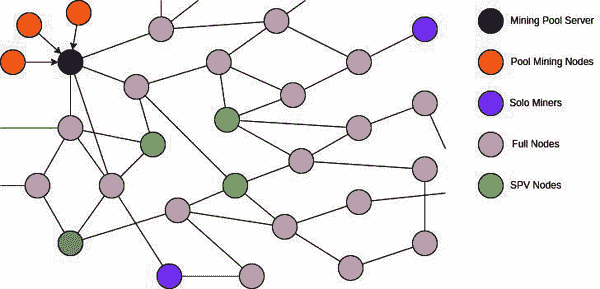

**图 3.1：** 比特币网络拓扑

在上图中，矿工创建区块并将其转发给其他节点。独自挖矿的矿工也会接收区块，因为它也是一个全节点。全节点负责验证交易和区块并将其转发。`SPV` 节点是依赖全节点获取必要信息的轻量级节点。

矿池挖矿节点连接到矿池服务器。矿池挖矿节点从服务器接收任务，并根据接收到的任务尝试挖掘区块。如果成功，矿池矿工将区块发送给服务器。矿池服务器也从其他节点接收区块和交易，这就是为什么从矿池挖矿节点指向矿池服务器有一个箭头的原因。除此之外，比特币网络是点对点且非层级化的。

### 挖矿节点

挖矿节点竞争解决加密难题，率先解开难题的节点能够构建一个包含选定交易的区块。当交易被包含在区块中时，即获得确认。因此，挖矿是交易确认的行为。

利用算力解决加密难题以确认交易被称为 **工作量证明**。

矿工可以选择独自挖矿或加入矿池。

下图展示了挖矿设备：

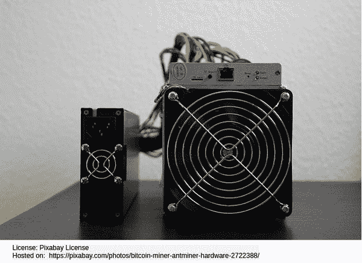

**图 3.2：** 运行中的挖矿设备

#### 矿池挖矿

如今，只有加入矿池挖矿才有利可图。在这种情况下，矿工加入矿池以协作完成挖矿工作。矿池中的每个矿工都尝试解决加密难题，矿池知晓矿工贡献的算力。矿工解决加密难题，矿池获得区块奖励。然后矿池根据矿工对算力的贡献比例，将区块奖励分配给池中所有矿工。解开难题的矿工不会获得任何特殊优势。这种设置对所有矿工都有利，因为解开难题基于由算力贡献决定的概率。矿工不直接与网络交互；相反，他们由矿池服务器分配任务。

#### 独自挖矿

比特币的算力需求已变得极高，几乎不可能单独挖掘区块。然而，这有一个好处。目前，少数矿池掌握了网络几乎所有的算力。只需几个矿池联手，比特币网络就会面临 `51% 攻击`。如果大多数节点是独自挖矿者，这是不可能的。因此，通过独自挖矿，我们可以使挖矿更加去中心化。

### 全节点

全节点是保存区块链副本并验证其接收到的所有交易和区块的验证节点。它们还将区块和交易转发给其他节点。

### 简化支付验证 (SPV)

`SPV` 节点是轻量级节点，这意味着它们不维护完整的区块链，且在没有全节点帮助的情况下无法验证区块。`SPV` 需要极少的磁盘空间，可设置在嵌入式设备上或在内存中运行，使其维护和携带成本更低。

## 比特币共识网络

`Bitcoin` 共识网络基于 `工作量证明`（`Proof-of-Work`，`PoW`）共识机制。交易通过节点的帮助，使用 `Gossip` 协议在网络上创建和发布。验证节点或全节点验证接收到的交易，然后将其添加到其 `内存池` 中。矿工利用其算力解决加密谜题，以创建包含其想要打包交易的区块。该区块与前一个区块链接。创建的区块即为 `工作量证明`，区块链形成区块链。矿工随后使用 `Gossip` 协议将新创建的区块发布到 `Bitcoin` 网络。验证节点接收区块，根据共识规则进行验证，并再次使用 `Gossip` 协议将其转发给连接的节点。所有这些活动都使用了密码学。

以下是 `Bitcoin` 共识网络的示意图：

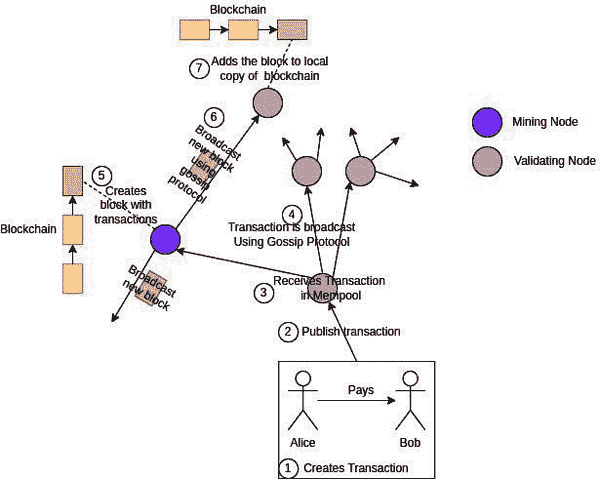

**Figure 3.3:** `Bitcoin` 共识网络

`Bitcoin` 共识网络的关键组件如下：

*   交易
*   区块链
*   共识规则
*   工作量证明
*   验证节点
*   内存池
*   密码学
*   `Gossip` 协议

这些将在以下章节中解释。

### 交易

交易是支出的单条记录。它包含三个要素：

*   资金来源
*   资金接收方
*   每个接收方收到的金额

以下是交易的示意图：

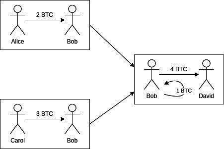

**Figure 3.4:** `Bitcoin` 交易资金来源与支付

### 区块链

区块链是记录交易的不可变区块序列。区块链也按时间顺序排列。每个区块链接到其前一个区块。链的末端是最近的区块。

以下是基于所学内容的区块链结构示意图：

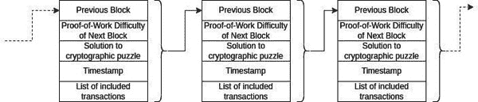

**Figure 3.5:** 区块链的结构

### 共识规则

`Bitcoin` 网络像网络协议一样，对区块和交易有约定俗成的规则。这些规则旨在通过 `工作量证明` 共识机制由矿工来保护。

### 工作量证明

`工作量证明` 或 `PoW` 是一种机制，旨在通过强制攻击者消耗算力来防止拒绝服务攻击。这使得拒绝服务攻击对攻击者而言不可行。`Bitcoin` 使用 `工作量证明` 使双重支付变得非常困难且成本高昂。

可以通过以下类比来理解：

在古代，有房屋、神庙、水井等，它们很容易复制，但也有纪念碑、堡垒等，它们是独一无二的。埃及金字塔、中国长城、印度埃洛拉石窟的凯拉萨神庙等纪念碑，是数百年来仍然非常难以复制的最伟大纪念碑之一。它们的共同点是建造难度大。这种难度使它们在几个世纪中保持了独特性。建筑结构本身就是为建造它们而付出的艰苦劳动的证据。工作的证据称为 `工作量证明`。

下图展示了两个著名的纪念碑：


**Figure 3.6:** 独特且著名的纪念碑


每个矿工竞争算力以解决加密谜题，并将交易区块作为区块链中的下一个区块创建出来。在创建一定数量的区块后，加密谜题的难度会调整，以增加或减少解决加密谜题的平均时间。因此，挖矿设备制造公司也在其成本效益方面进行竞争。挖矿领域的这种博弈保持了网络的安全，并保护其免受双重支付攻击。

> 这是一种机制，其中一方需要向验证者证明其已执行了所需的工作（或算力），以便被允许执行某些任务。

随着区块深入链中，修改任意区块的难度呈指数级增加。尽管矿工们在竞争创建区块，但他们同意共识规则的条款。这就是为什么它被称为*工作量证明*共识机制。许多加密货币和区块链技术使用其他形式的共识机制，例如*权益证明、权威证明、实用拜占庭容错*等。

挖矿可以定义为*工作量证明的实践*。

我们知道矿工会加入并形成矿池。少数矿池控制了大部分网络算力。如果排名前两到三位的矿工联合，他们可以胜过其余矿工。

2014 年 7 月，`Ghash.io` 达到了超过半数的网络算力，但后来同意永远不会超过 50% 的算力。重要的是要理解为什么从那以后我们从未出现过这种情况，以及为什么任何矿工都会同意不接管网络。

挖矿还为网络增加了价值，这意味着尽管矿工可以联合并阻止来自特定国家或交易所的交易，但他们不会做任何会被注意到并影响其收入来源——网络的事情。

## 验证节点

Bitcoin 并不完全依赖挖矿节点来防止双重支付；相反，它还有验证节点来验证接收到的所有交易和区块。验证节点也称为全节点，这些节点进一步广播交易和区块。

## 内存池

内存池是未确认交易的内存存储。矿工从内存池中挑选交易，只有有效交易才存储在内存池中。交易可能因长时间未被打包进区块链而过期。内存池中的交易未被确认，并可能因竞争条件而变为无效。

## 密码学

密码学是 Bitcoin 的核心。它用于工作量证明、交易、区块链和验证。

以下是密码学在 Bitcoin 网络中的用途：

* 挖矿节点需要解决加密谜题以创建交易区块。
* 每个区块使用密码学保护所有交易免遭篡改。
* 每个区块使用加密哈希保护区块链免遭篡改。
* 交易使用密码学从来源解锁资金并将其锁定供接收方领取。

## Gossip 协议

Bitcoin 交易和区块需要快速到达几乎所有节点。Bitcoin 节点始终监听连接的节点，并让它们知道其拥有的 Bitcoin 区块链中的区块。当节点接收到区块或交易时，它根据共识规则进行验证，然后将其发送给需要它的节点。Gossip 协议是使用包含命令和有效载荷的消息在节点间通信的方法。

以下是 Gossip 协议在消息广播中的示意图：

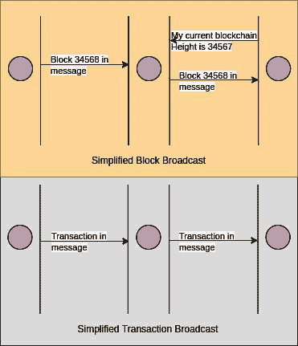

**Figure 3.7:** 消息广播中 Gossip 协议的简单表示

## Bitcoin 网络安全

保护网络安全不仅是数学或密码学问题，也是博弈论问题。Bitcoin 网络由密码学和博弈论共同保护。因此，有许多因素共同作用以保护网络安全：

* 挖矿使得修改区块变得困难，且随着区块深入区块链，难度呈指数级增加。
* 挖矿难度增加了网络的价值。其价值不仅体现在算力上，还体现在成本和时间上。
* 挖矿设备公司在其设备的成本效益方面进行竞争。
* 验证节点监视网络，确保网络按预期运行。
* 许多区块浏览器网站和独立爱好者也在以不同方式观察网络。他们持续监控节点、区块链和内存池。

## 结论

在本章中，您了解了比特币网络的网络拓扑。您学习了比特币网络中存在的不同类型节点及其角色和必要性。随后，您理解了比特币共识机制的工作原理，以及构成比特币共识网络的不同组件。我们还涵盖了这些组件中的每一个，使我们能在不深入研究其实际运作的情况下，对比特币网络的结构和功能有一个公平的理解。

在下一章中，您将了解比特币在现实世界中的使用方式，并学习不同国家关于比特币使用的监管规定。

## 重点回顾

* 挖矿是工作量证明的实际运作。
* 比特币网络由矿池服务器、矿池矿工节点、独矿工、全节点和 SPV 节点组成。
* 矿池矿工节点不直接与比特币网络交互；相反，它们依赖矿池服务器获取任务。
* 独自挖矿解决加密谜题的机会微乎其微。
* 全节点也称为验证节点，因为它们根据共识规则验证区块和交易。
* Gossip 协议（闲聊协议）是节点间使用包含命令和载荷的消息进行通信的方法。

## 问题

1. 区块验证与区块确认有何不同？哪个节点负责区块验证，哪个节点负责区块确认？
2. 前四大矿池是哪些？它们目前占网络算力的份额是多少？
3. 如果您打算购买比特币挖矿设备，您会关注哪些参数？如何判断哪种设备更适合您？
4. 如果矿工无法将内存池中收到的所有交易容纳进下一个区块，它将依据什么标准选择交易加入下一个区块？
5. 填空：
   1. 比特币网络是一个 __________ 网络，这意味着没有服务器和客户端，也没有层级之分。
   2. 在矿池挖矿中，__________ 解决加密谜题，__________ 连接比特币网络以获取区块。
   3. SPV 需要 __________ 节点来验证传入的区块。
6. 判断正误：
   1. 挖矿节点不需要内存池。
   2. 节点可以随时加入和离开比特币网络。
   3. 每个全节点都维护一份区块链副本。

# 第 4 章：现实世界中的比特币

在上一章中，您了解了比特币网络结构和共识网络的基础知识。这让我们对比特币网络的工作原理和结构有了基本认识。

在本章中，您将了解不同的人和组织如何使用比特币。您将学习我们与网络交互的多种方式。您将学习交易者、投资者、企业和数字游民如何使用比特币。此外，您还将了解不同类型的交易所，以及一些关于比特币监管的知识。

## 结构

在本章中，我们将涵盖以下主题：

* 不同类型的交易所
* 比特币用例
  * 比特币交易
  * 比特币投资与储蓄
    * 在线商家接受比特币
    * 实体店接受比特币
    * 以比特币支付或接收工资
    * 使用比特币支付费用和旅行
    * 比特币用于汇款
    * 比特币用于社会公益
    * 挖掘比特币
* 比特币与加密货币监管

## 目标

本章的主要目标是让读者对比特币如何融入现实世界以及如何使用它有一个公平的认识。我们将从不同视角审视比特币生态系统。虽然本书面向技术受众，但我们认为解决方案始终是为受众构建的。因此，了解受众的需求有助于构建正确的解决方案。此外，这有助于拓宽我们对比特币技术的视角。

由于上一章侧重于网络的结构和工作原理，而本章将侧重于比特币与现实世界的联系，读完本章后，您将对比特币网络和货币/资产拥有内在和外在的双重视角。

## 不同类型的交易所

加密货币交易所允许将加密货币兑换为其他加密货币或法定货币。加密货币交易所可根据不同因素以多种方式分类。

根据加密货币的托管情况，交易所还可分为：

* **托管型交易所**：在钱包中持有比特币的交易所
* **非托管型交易所**：不在钱包中持有比特币的交易所

在交易所，卖方需要找到买方来出售他们的加密货币。这可以通过使用交易所作为平台的托管方式完成，也可以对用户隐藏这一过程，由交易所负责在买卖双方之间转移加密货币。这些类型的交易所可分类如下：

* **点对点交易所**：在点对点交易所中，交易所充当托管角色。在卖方收到款项之前，交易所将待售加密货币保管在托管账户中。一旦卖方确认已收到期望的款项，交易所将加密货币释放到买方账户。否则，可能会进入争议解决流程，交易所会雇佣人员单独处理争议。买方或卖方发布价格，另一方浏览并根据价格、偏好、评价和推荐选择合适的交易对手。`Paxful` 和 `LocalBitcoins` 是点对点交易所的例子。
* **零售交易所**：零售交易所是最常见的交易所形式。它们允许买方出价（`bid`）其愿为加密货币支付的最高价，同时允许卖方报价（`ask`）其愿接受的最低价。其余事宜由交易所管理。这些交易所属于托管型，并在买卖价差中维持利润空间以应对市场波动。`Zebpay`、`WazirX`、`Unocoin`、`Coinbase` 和 `Kraken` 是零售交易所的一些例子。
* **即时兑换器**：这些交易所具有固定的买卖价格，无需托管。这使得它们易于实现，且运营相对简单。`InstaBitco.in`、`Changelly` 和 `ShapeShift` 是即时交易所的例子。
  * **比特币 ATM**：这些是能将现金兑换为比特币，或在收到比特币后出钞的即时兑换器。

零售交易所在赋予加密货币价值方面发挥着重要作用。这些交易所也是最适合交易者的，因为它们提供实时图表和用于开发交易应用的 API。另一方面，点对点交易所提供一定的隐私性，并允许现金支付。

交易所还可分类如下：

* **中心化交易所**：中心化交易所由公司或组织托管和管理，它们获取利润、提供客户服务，并在争议发生时解决纠纷。
* **去中心化交易所 (DEX)**：去中心化交易所是非托管的点对点交易所。这些也是非托管型交易所。它们作为**去中心化自治组织**或**DAO**启动，由于其去中心化的性质，这些交易所提供抗审查能力。它们不需要 KYC 或 AML。`Bisq` 是点对点交易所的一个例子。

## 比特币用例

在本主题中，您将了解交易者、投资者、旅行者、自由职业者和矿工与比特币网络交互的不同方式。

### 比特币交易

本主题不涉及交易建议；相反，您将了解交易者如何进行比特币交易。

交易的目标是从交易工具的波动性中赚钱。这需要对加密货币的当前和历史价格走势进行大量分析，并从经济和政治事件及状况等真实事件中收集指标。

因此，交易者需要执行以下操作：

* 分析历史和当前的价格走势。
* 根据价格或其他事件，把握货币、稳定币和其他加密货币之间资金流动的时机。
* 存入和提取资金。

因此，交易者需要提供以下功能的交易所：

* 多种加密货币
* 稳定货币，以及加密货币与 EUR、USD、YEN 或 GBP 等稳定货币之间的便捷兑换
* 能够下买单和卖单
* 托管钱包

用于买入、卖出、下买单和卖单的 Web API 可能会很有用。

因此，非托管交易所或 P2P 交易所对交易者没有帮助。交易者需要一个托管交易所，为他们提供下买单和卖单的能力。对交易 API 的支持非常有用，因为它可以集成到交易者的应用程序中，这些应用程序可以从交易所获取必要数据，以决定买单和卖单的目标价格，或将货币兑换为其他加密货币、稳定货币或稳定加密货币。

以下是比特币的历史价格图表：

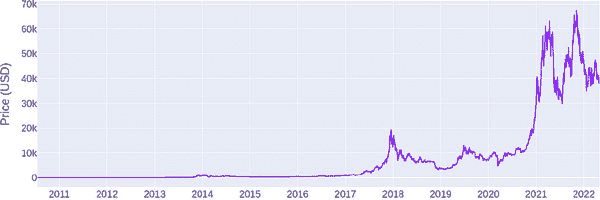

**图 4.1：** 比特币历史价格图表

### 比特币投资与储蓄

投资者关注长期收益，而储蓄者将比特币视为价值存储，这对他们的子孙后代可能很有用。投资者和储蓄者不关注短期价格波动。对他们而言，安全性是更大的顾虑，微小的价格差异并不重要。

投资者或储蓄者需要以下条件：

* 在安全的保险库或钱包中持有比特币
* 私钥掌握在自己手中
* 投资者可能还希望设定一个未来的卖出目标价格

因此，投资者或交易者将从可靠安全的交易所购买比特币，并将其转移到自己的硬件钱包中。当他们需要卖出时，可以将所需的比特币再次转移到交易所并卖出。

下面是投资者买卖比特币的示意图：

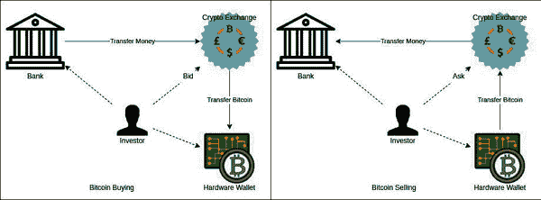

**图 4.2：** 投资者在零售交易所买卖比特币

### 在线商家接受比特币

作为商家接受比特币很简单：只需在您的网站上放置一个比特币地址及其二维码。这种方法的问题在于，您将不知道是谁付款以及付了多少，且不建议在一个地址上接受所有付款。

有许多支付处理器可以集成到您的网站中，例如 `Coinbase Commerce`、`coingate`、`btcpay`、`bitpay` 等。或者，如果您正在创建网站，可以使用 `Shopify` 或 `WooCommerce` 来构建网站，它们提供与许多流行支付处理器集成的选项。

下面是集成了加密货币支付的在线网站示意图：

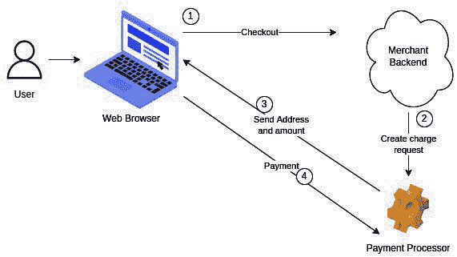

**图 4.3：** 网站与第三方支付处理器集成

`BTCPay` 是一个开源、自托管的支付处理器，可以与一些流行的硬件钱包集成。使用集成了硬件钱包的自托管开源支付处理器有诸多好处。我们可能需要使用固定的比特币地址，或者可能需要使用中心化支付处理器提供的钱包服务。在线钱包面临被黑客攻击的风险。

另一方面，中心化支付处理器方便且通常更便宜，因为自托管服务器需要云托管。此外，`BTCPay` 仅支持比特币支付，这对在线商店来说限制很大。

下面是自托管支付处理器与硬件钱包集成的示意图：

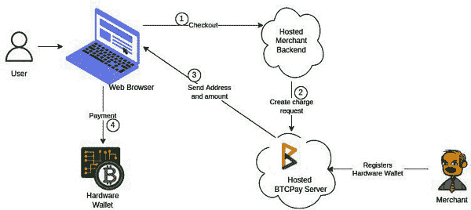

**图 4.4：** 网站与自托管支付处理器集成

与供应商、服务提供商和客户有频繁交易的大品牌和聚合公司，可以在闪电网络上建立支付通道。这将允许他们降低单笔交易的成本。

#### 闪电网络

闪电网络是比特币网络之上的第二层解决方案。在闪电网络中，会在发送方和接收方之间创建一个通道，并在其中锁定比特币。

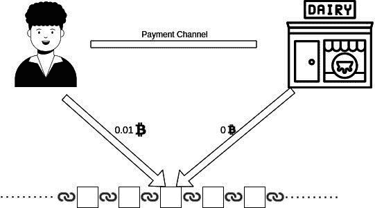

**图 4.5：** 闪电通道的创建

然后，只要通道中有余额，发送方就可以进行发送。


**图 4.6：** 使用通道进行支付

发送方或接收方可以随时关闭通道。关闭通道时，所有先前交易的累积结果会被记录到比特币区块链上，此时必须支付网络费用。

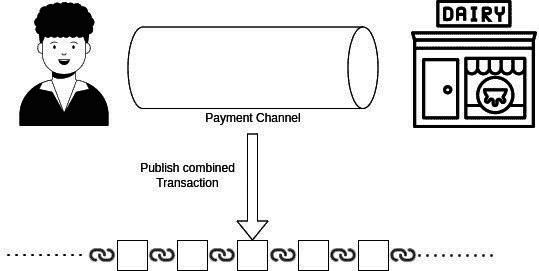

**图 4.7：** 关闭通道并将最终余额发布到区块链

在关闭通道前，该通道上发生的交易越多，每笔交易的有效费用就越低。这降低了有效网络费用，使小额交易变得可行。

### 实体店接受比特币

由于交易费用已大幅上涨，比特币不再适合买咖啡。在撰写本书时，平均交易费用为 15 美元。它仍然适合购买价格较高的商品。

由于用比特币付款的人很少，最好的方法是放置比特币地址的二维码，并每天更换。

或者，像 `Samourai Wallet` 这样的比特币钱包支持称为 `PayNyms` 的可重复使用支付代码，可用于接收付款。这只能作为一种替代方案，因为大多数钱包不支持 `PayNyms`。

下面是实体店使用 `PayNyms` 接收比特币付款的示意图：

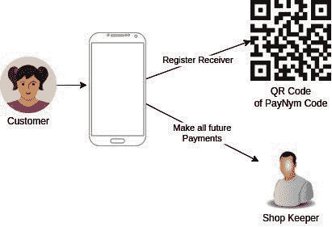

**图 4.8：** 在零售店使用支持 PayNym 的移动钱包

### 以比特币支付或接收工资

世界上有许多人以加密货币形式获得报酬。他们大多是独立承包商或自由职业者，不受地点限制，只需一个互联网连接和一台笔记本电脑即可工作。他们可以从硬件设备生成比特币地址，并将款项接收到自己的钱包中。

这非常适合一对一付款，但对于拥有十几名员工的公司来说却很困难。此外，并非所有员工都对同一种货币感兴趣。每位员工可能需要不同类型的货币，如当地法币、比特币、以太坊或 XRP。

`Bitwage` 是一款可以解决此问题的应用程序。它允许雇主以最适合他们的货币支付，而员工可以以他们需要的任何货币接收款项。下面是雇主与员工之间工资支付分配的示意图：


**图 4.9：** 雇主使用 BitWage 向全球分布式团队支付工资

`Bitwage` 还允许您将发送到银行的常规付款转换为加密货币。

### 使用比特币支付费用和旅行

比特币价格呈指数级上涨，许多人获得了巨额利润。此外，还有不受地点限制的合同工，他们以比特币或其他加密货币形式获得报酬。

以比特币形式获得报酬或因投资比特币而获得巨额利润的人，可能会利用他们的比特币环游世界。

由于比特币不适合小额支付，比特币持有者可以购买礼品卡，以便在商店、酒店使用或购买机票。像 `Bitrefill`、`eGifter`、`Gyft` 等礼品卡提供商提供比特币到礼品卡的便捷兑换。有些提供商甚至支持闪电网络，通过创建通道，可以有效降低比特币网络手续费。

下图演示了使用比特币购买礼品卡并消费的过程：

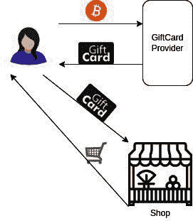

**图 4.10：** 用比特币购买礼品卡并在购物中使用

### 比特币用于汇款

比特币也被用于跨境汇款。汇款是指外籍工人、居民及有海外联系的公民为资助其海外家庭而进行的非商业性资金转移。比特币允许直接将资金转入接收方的钱包，该钱包可以是硬件钱包、移动钱包或托管交易所的钱包。存在专门针对汇款设计的服务，如 `BitPesa`。在 `BitPesa` 中，发送方发送比特币，接收方将在其银行账户或移动钱包中收到法币。

下图演示了 `BitPesa` 汇款网络：

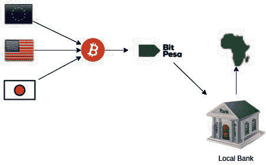

**图 4.11：** BitPesa 帮助非洲移民汇款回家

### 比特币用于社会公益

社会服务组织需要在银行系统覆盖有限的地区，与相关人群打交道。很多时候，这些地方处于战区、极权统治或军事管制之下。因此，法律和金融体系并不利于那些需要受保护的人。所以，社会服务组织必须绕过现有体系，利用自身资源。比特币因其抗审查特性，在这些情况下提供了帮助。许多知名的全球社会服务组织支持加密货币支付。联合国儿童基金会（UNICEF）就是其中之一；它已推出加密货币基金，以接收加密货币捐赠。

### 比特币挖矿

比特币挖矿是获取比特币的方式之一。它对价格非常敏感，因此即使使用最高效的设备，利用普通电力连接进行比特币挖矿在财务上也是不可行的。要使比特币挖矿盈利，电力成本需要极低，或者是原本会被浪费的多余电力。

比特币挖矿还会产生大量热量和噪音。如果热量被用于供暖或烧水，可能会进一步提高其财务可行性。在寒冷国家，一些人利用比特币挖矿为家庭供暖，并为温室植被提供热量。

因此，降低比特币挖矿成本的常见方法如下：

* 使用无需电池储能的太阳能电池板、风力涡轮机等廉价能源。
* 油井利用废气作为挖矿能源。
* 发电厂产生的多余能源。
* 利用产生的热量。
  * 作为燃气热水器加热水
  * 供暖房屋
  * 为温室农场供热
* 选择最高效的比特币挖矿设备。
* 加入矿池。

随着盈利能力随时间下降，比特币挖矿还要求定期升级挖矿设备。

## 比特币与加密货币监管

我们在上一主题讨论的所有用例均受特定国家法律约束。在将比特币用于任何活动前，请了解您所在国家的法律。

请记住，加密货币很少被允许作为法定货币。因此，即使在比特币使用合法的国家，将其作为法定货币使用也是非法的。法定货币可定义如下：

> 法定货币是指可用于偿还债务等清偿金融纠纷的任何事物。


# 加密货币监管

加密货币监管大致可分为：

*   **宽松型**：加密货币监管完善的国家，个人可进行交易、购买商品、挖矿和接收支付。
*   **限制型**：对加密货币特定活动予以限制的国家。许多国家不允许加密货币与本地货币相互兑换。可能对商品买卖或支付有限制。也可能限制企业从事加密货币业务。或者，银行可能不被允许推出加密货币相关金融工具。
*   **争议型**：加密货币处于无监管状态的国家。
*   **禁止型**：一些国家全面禁止加密货币交易。一些国家甚至将其定为可处罚的犯罪。

许多国家正计划监管加密货币，因此目前不监管的国家未来可能会实施监管。这是一个动态变化的领域。

下图展示了各国当前的监管状况：


**图 4.12：** 国际比特币监管

请注意，本书上市时，上述信息可能已过时。

## 印度的监管现状

在印度，加密货币监管目前尚不明确。2018 年 4 月，印度储备银行（该国央行）发布通告，禁止银行从事加密货币业务。这导致任何使用注册银行账户从交易所购买加密货币的人的银行账户被冻结。这使得加密货币交易变得困难，许多企业和交易所破产或关门歇业。尽管如此，比特币在印度从未被禁止；因此，一些交易所通过提供点对点交易平台，利用法律漏洞继续运营。

2020 年 3 月，印度最高法院（该国最高法院）推翻了印度储备银行的通告，允许使用银行账户进行加密货币交易。从事加密货币交易的人一直需要为利润缴税，尽管适用哪些税法条款尚不明确。

在 2022 年联合预算案中，印度财政部长就加密货币税收提供了指导。尽管加密货币现在受到监管，但仍不被视为合法。而且，加密货币交易仍然困难。

许多发达国家如美国、欧盟国家和日本已建立完善的监管框架，保护投资者和企业家。

## 结论

在本章中，您了解了我们与比特币及比特币网络交互的方式。您首先了解了不同类型的交易所、其特点及为用户提供的益处，随后我们探讨了交易者、投资者、自由职业者、旅行者和矿工如何与比特币网络交互。我们还建议了不同人群使用比特币的实用方式。然后，我们尝试对国际监管进行分类，并审视了印度的监管现状。

这标志着以用户视角聚焦比特币生态系统的章节结束。我们已在第一章涵盖比特币概述。读完本章后，您将对比特币、比特币网络和比特币生态系统有一个基础而广泛的理解。

在下一章中，我们将通读比特币白皮书，帮助您详细理解它。

## 重点回顾

*   点对点交易所基于托管模式运作，交易所充当第三方。
*   零售交易所允许买家对其可支付的加密货币最高价进行 `bid`（出价），允许卖家对其可接受的加密货币最低价进行 `ask`（要价）。
*   零售交易所通过 `bid`（出价）和 `ask`（要价）尝试发现加密货币的价值。这有助于加密货币形成其价值。
*   比特币 ATM 是处理现金交易的即时交易所。
*   去中心化交易所（DEX）是非托管的点对点交易所。
*   交易者通过交易标的的波动性获利。
*   投资者通过持有加密货币寻求长期收益。
*   储蓄者将加密货币视为价值存储手段。
*   加密货币支付处理器可集成到网站中，以启用加密货币支付功能。
*   闪电网络允许双方在累积交易被添加到区块链之前，进行多笔链下交易。
*   PayNyms 是可公开分享的可重复使用支付代码，可生成唯一的未使用地址。
*   礼品卡是利用比特币进行零售购物的最简便方式。
*   比特币矿工需要廉价的能源来源，并利用产生的热量。
*   比特币矿工需要始终用市场上最高效的设备更新其设备。
*   法定货币是指可用于偿还金融债务的任何事物。

## 问题

1.  零售交易所与点对点交易所有何不同？
2.  “Not your keys, not your bitcoin”（私钥不在你手中，比特币就不属于你）这句话是什么意思？
3.  随机选择 10 个国家，并根据这些国家加密货币的法律地位对其进行分类。
4.  调查并了解 BitPesa 为何在非洲如此成功。
5.  将下列项目匹配：
    1.  汇款
    2.  薪资
    3.  即时兑换商
    4.  商家
    与：
    1.  BtcPay
    2.  BitWage
    3.  ATM
    4.  BitPesa
6.  判断正误：
    1.  托管交易所不为比特币钱包提供针对黑客攻击的保险。
    2.  价值存储意味着金融工具中的价值是安全的。
    3.  如果一个国家不监管加密货币，则无需缴纳税款。

# 第 5 章：白皮书

*中本聪* 发布了题为 “*Bitcoin: A Peer-to-Peer Electronic Cash System*”（比特币：一种点对点的电子现金系统）的比特币白皮书。该文档可在 [`bitcoin.org/bitcoin.pdf`](https://bitcoin.org/bitcoin.pdf) 获取。比特币和大多数加密货币均基于此白皮书。深入理解白皮书对于理解后续章节的内容至关重要。本章重点讲解白皮书的内容。

该白皮书不受任何版权保护，因为论文的创作者是匿名的，且从未对该论文主张过版权。因此，任何人都可以轻松复制或引用该论文。比特币白皮书也存储在区块链中，可随时从中检索。除此之外，还有多个其他网站提供该白皮书。甚至在以下爱沙尼亚政府网站上也能找到：

[`www.e-resident.gov.ee/bitcoin-whitepaper/`](https://www.e-resident.gov.ee/bitcoin-whitepaper/)

以及以下美国政府网站：

[`www.ussc.gov/sites/default/files/pdf/training/annual-national-training-seminar/2018/Emerging_Tech_Bitcoin_Crypto.pdf`](https://www.ussc.gov/sites/default/files/pdf/training/annual-national-training-seminar/2018/Emerging_Tech_Bitcoin_Crypto.pdf)

## 结构

在本章中，我们将涵盖以下主题：

*   白皮书的摘要部分
*   白皮书的引言部分
*   白皮书的交易部分
*   白皮书的时间戳服务器部分
*   白皮书的工作量证明部分
*   白皮书的网络部分
*   白皮书的激励部分
*   白皮书的回收磁盘空间部分
*   白皮书的简化支付验证部分
*   白皮书的价值拆分与合并部分
*   白皮书的隐私部分
*   白皮书的计算部分
*   白皮书的结论部分

## 目标

本章的主要目标是帮助读者深入理解比特币白皮书。

## 白皮书的摘要部分

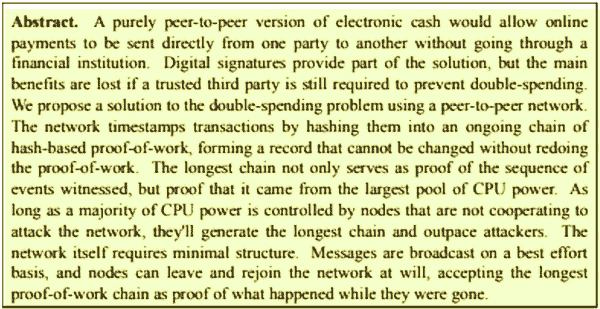

**图 5.1：** 白皮书的摘要部分

比特币是一种完全点对点的电子现金。过去曾有过几次密码学尝试提供电子现金系统。这些实现是中心化的，且其中一些已经失败。这些实现需要第三方来防止双重支付问题。比特币不需要第三方，因为它使用了一条不可变的区块链，其中每个区块包含一个交易列表、一个确认交易完整性的哈希值以及一个时间戳。区块链通过基于哈希的工作量证明来维持不可变性。

比特币是一个协作系统，其中节点要么遵守共识规则，要么合作攻击网络。协作系统形成一个 CPU 算力池，向现有链上添加区块。最长链拥有最大的 CPU 算力，因此被视为实际的区块链，而另一条链则被丢弃。该机制假设最大的 CPU 算力掌握在诚实节点手中。如果整个网络被攻破，该假设将失效。在后续章节中，我们将解释为何这不再是一个问题。

比特币网络维护着真相的轨迹（区块链），因此允许任何节点随意离开或加入网络。加入的节点在入网时同步其本地链。如果节点离线一段时间，也需要同步其本地链。如果我们观察白皮书，会发现它非常容易理解和实现。因此，出现了数千种加密货币，大多采用了几乎原始的设计。

## 白皮书的引言部分

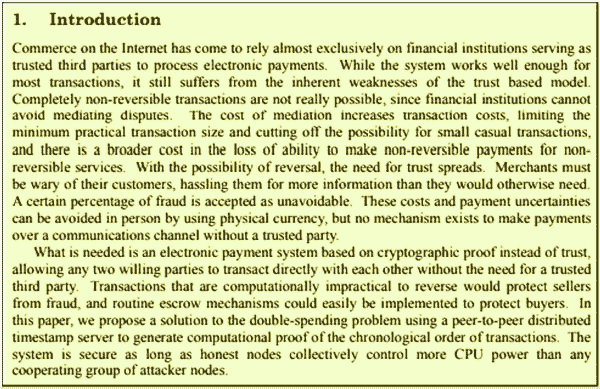

**图 5.2：** 白皮书的引言部分

引言部分解释了当前存在的可信第三方的弊端。可信第三方主要是协助解决争议的大型金融机构。很多时候，这些争议会导致交易撤销、诉讼和损失。对于高价值交易，或服务和付款可撤销的交易，这些额外成本对它们有利，因为无法撤销交易可能导致巨额损失。另一方面，对于小额交易，或服务和付款不可撤销的交易，这些成本是不必要的。这两类交易通常由同一支付处理商服务。这些支付处理商必须承担的损失由两类交易共同分担，因此成本影响到两类交易。简而言之，拥有可信第三方的成本是普遍存在的。

点对点现金系统旨在消除对可信第三方的需求，从而消除交易撤销的可能性。仍可实施托管机制来保护买家。该机制可以将类似于现金交易的小额不可撤销交易，与需要调解的大额交易分开，并可由可信第三方提供单独的托管机制，而不影响网络本身的成本。

## 白皮书的交易部分

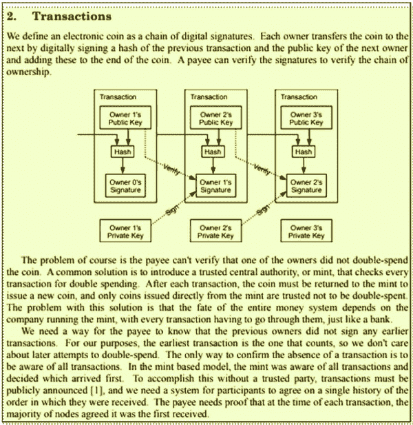

**图 5.3：** 白皮书的交易部分

交易部分将交易解释为一串数字签名的轨迹，引领比特币在各方之间流转。要理解这一点，我们需要了解哈希和数字签名等术语。

### 哈希

哈希是一种不可逆的过程，它为大量文本生成固定字节的输出。该固定字节输出称为哈希码。哈希具有某些特性，使其在诸如将数据随机分布到存储桶中的应用中非常有用。它在安全地存储和传输密码方面也很有用。它还用于网络握手中发送挑战码。哈希码输出是确定性的，这意味着相同的文本将始终生成相同的哈希码。这些代码经过高度随机化，因此无法通过暴力破解或其他更复杂的攻击来确定。

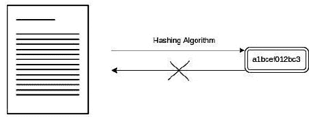

**图 5.4：** 哈希算法不可逆性的示意图

### 数字签名

数字签名类似于物理签名，因为它们确保文档的完整性，同时也确保文档由签署人签署（真实性）。数字签名使用“公钥和私钥加密”。文档由发送方的私钥签名。这将创建一个作为代码的签名，并将其与文档一起保存，供他人验证。

#### 数字签名过程


**图 5.5：** 数字签名过程示意图

签名通过使用发送方的公钥进行验证。验证算法使用文档内容、签名和发送方的公钥进行验证。

#### 签名验证过程

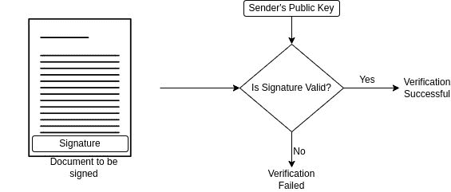

**图 5.6：** 数字签名验证过程示意图

比特币中的一笔交易包含两个部分：输入和输出。输入交易携带关于前一笔交易的信息，以及发送方的签名及其用于验证的公钥。输出包含要转移的比特币信息以及接收方的公钥。只有接收方知道私钥，因此可以解锁锁定在前一笔交易中的比特币并将其发送给下一个接收方。这创建了一个所有权链。为了理解这一点，让我们看看 Alice 如何支付 Bob。

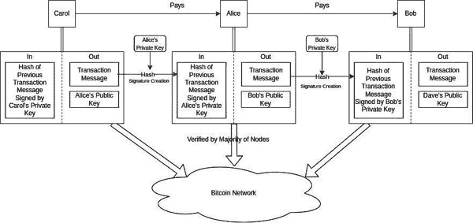

**图 5.7：** 交易创建与广播示意图

Alice 想要支付 Bob。为此，Alice 查找她的未花费交易。她通过用她的私钥对前一笔未花费交易的哈希进行签名来创建一个交易输入。这释放了锁定在前一笔交易中的比特币。她现在通过添加一条给 Bob 的消息以及 Bob 的公钥来创建一个交易输出。为了让 Bob 支付给 Dave，他需要做同样的事情：选取他之前的未花费交易，对其进行哈希处理，并用他的私钥签名以释放锁定的比特币。然后他需要创建一条给 Dave 的消息以及 Dave 的公钥。为了使这些交易被视为有效，这些交易以及承载价值的所有前序交易记录都需要由比特币网络中的大多数节点进行验证。

比特币网络由维护所有前序交易已验证副本的节点组成。当执行一笔新交易时，它会在网络上广播，所有参与节点根据已接收的所有现有未花费交易验证其有效性。这种机制不留任何遗漏相关交易的机会，避免了因错误或故意而导致的双重支付。

## 白皮书中的时间戳服务器部分

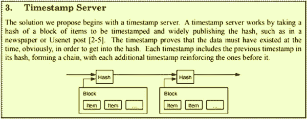

**图 5.8：** 白皮书中的时间戳服务器部分

时间戳服务器是创建交易区块并为区块加上时间戳的节点。创建区块后，时间戳服务器广泛发布区块哈希。每个区块还包含前一个区块头的区块哈希。由于新创建的区块包含前一个区块头的区块哈希，而该区块头包含前一个区块创建的时间戳，因此新区块的时间戳不可能早于所包含的区块哈希的时间戳。因此，这种方法在区块链上强制要求按时间顺序排列。因此，无需依赖外部来源来强制保证时间戳的准确性。

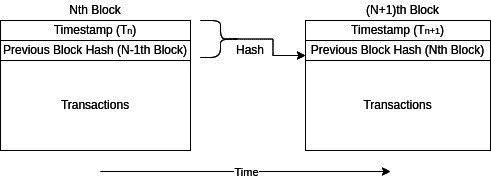

**图 5.9：** 带有时间戳的区块结构

在上图中，我们可以看到第 `N+1` 个区块包含第 `N` 个区块的哈希。由于第 `N` 个区块哈希包含时间戳，因此第 `N+1` 个区块的时间戳必定是在第 `N` 个区块的时间戳之后创建的。这确保了：

*第 `N+1` 个区块时间戳 > 第 `N` 个区块时间戳*

因此，它在区块链上强制要求按时间顺序排列。

## 白皮书中的工作量证明部分

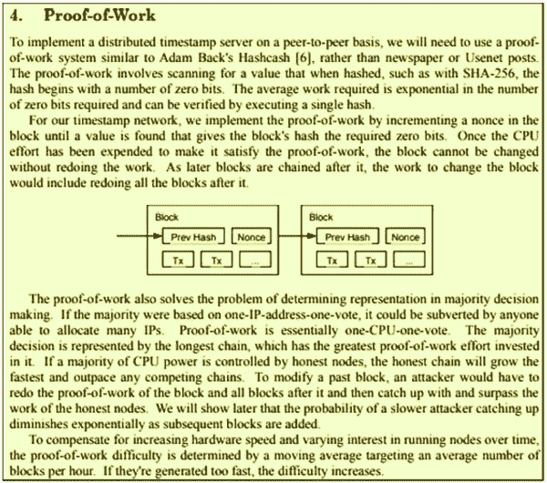

**图 5.10：** 白皮书中的工作量证明部分

比特币使用工作量证明机制来确保区块链的完整性。工作量证明算法要求消耗 CPU 资源（工作）以创建一个区块。任何想要修改现有交易的攻击者都需要重做工作，创建包含该交易的区块，并重做后续区块的工作。这里的思路是，一个不合作的节点需要在 CPU 算力方面与合作节点竞争完成的工作量。**中本聪** 建议了一种简单的工作量证明机制，涉及计算区块哈希中前导零的个数。其逻辑如下：

*   获得“0…..”二进制哈希值的概率是 1/2。
*   获得“00….”二进制哈希值的概率是 1/4。
*   获得“000…”二进制哈希值的概率是 1/8。

达到该二进制哈希值所需的 CPU 算力与概率成反比，即：

*`工作量 ≈ 1/概率`*

**中本聪** 还建议根据区块生成的速度调整所需工作量，从而维持区块创建时间。

因此，区块现在的结构如下图所示：

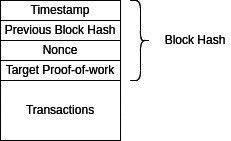

**图 5.11：** 带有 Nonce、时间戳和前一个区块哈希的区块结构

在这里，目标工作量证明要求时间戳服务器使用所需数量的 CPU 工作来创建一个区块。这是通过计算创建每个区块所需时间的移动平均值来计算的，如果区块创建时间变短或变长，则增加或减少该值。以下公式展示了目标工作量的计算方法：

*   `D[n]`：高度为 n 的区块的目标工作量证明
*   `T[n]`：第 `n` 个区块的时间戳
*   `ΔT`：创建区块的预期时间

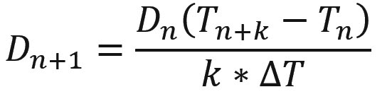

以下流程图展示了时间戳服务器如何为区块创建找到正确的 Nonce：

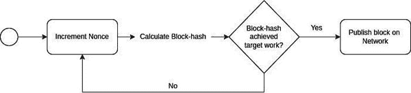

**图 5.12：** 通过寻找所需 Nonce 来挖掘区块的过程

时间戳服务器增加 Nonce 并计算区块哈希。如果区块哈希达到所需工作量，则将区块发布到比特币网络；否则，时间戳服务器继续增加 Nonce，直到达到所需工作量，或有其他节点发布了具有正确 Nonce 的区块。

## 白皮书中的网络部分

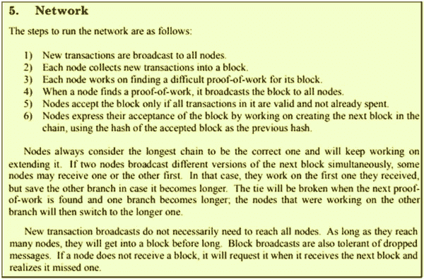

**图 5.13：** 白皮书中的网络部分

此处使用的“节点”一词与前几节中使用的“时间戳服务器”相同。现在，我们不使用“节点”一词来描述创建区块的节点；相反，我们称它们为挖矿节点。

每个节点连接多个节点，而这些节点又连接其他几个节点。这构成了一个节点网络。每个节点都尝试为区块链中即将创建的下一个区块寻找 `nonce`。当创建一笔新交易（如 `Alice pays Bob`）时，它会被发送给其对等节点。每个接收节点检查交易是否有效，以及是否试图创建非法交易或花费已花费的交易。随后将其发送给它们的对等节点，以此类推；这会广播到整个网络。每个接收节点将交易添加到区块中，并竞争寻找 `nonce`。率先找到 `nonce` 的节点创建区块并将其发送给其对等节点。所有接收节点验证区块时间戳、交易、`nonce` 以及下一个目标工作量证明。接收节点随后将其转发给其对等节点，以此类推；这会被广播。收到区块后，每个节点开始着手寻找下一个 `nonce`。这就是该过程持续进行的方式。

下图展示了区块和交易如何传播：

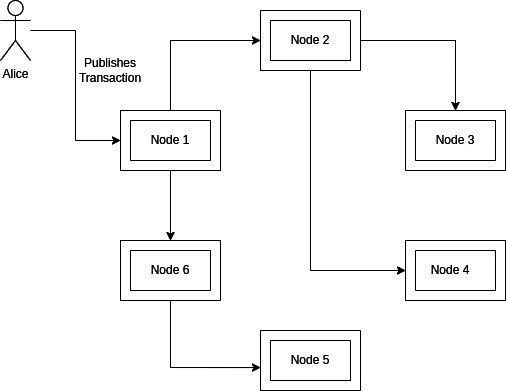

**图 5.14：** 比特币网络上的交易传播

一次 `ping` 到达地球最长距离大约需要 200ms。区块广播涉及每跳的验证；因此，要覆盖 95% 的网络，传播延迟可能长达一分钟。由于这个原因，多个节点可以在不知道已存在有效区块的情况下创建有效区块。这在区块链上产生了分叉。根据位置不同，节点可能会为同一区块高度选择不同的有效区块。由于没有节点能知道该采纳哪个区块、拒绝哪个区块，它们需要开始在最先收到的区块上工作，但也要保存其他有效区块。现在，有多组节点在为不同的链计算 `nonce`，因此它们可能会继续在各自的链上创建下一个区块。为了解决分叉问题，节点必须继续这一过程，直到其中一条竞争链比其他链更长。节点随后将接受最长链作为正确链，并丢弃其他链。由于寻找 `nonce` 所需时间明显高于区块传播延迟，竞争下一个区块的节点不会很多。

下面是链分叉的示意图：

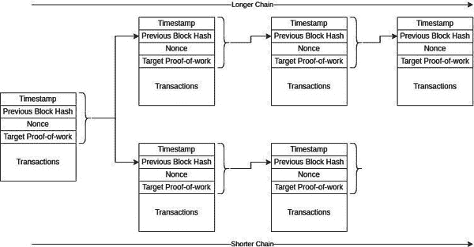

**图 5.15：** 由于几乎同时挖掘区块导致的区块分叉示意图

如果由于某种原因，节点未收到区块却收到了新区块，该节点可以向其对等节点请求缺失的区块。既然未收到区块不是问题，区块也不需要到达所有节点。

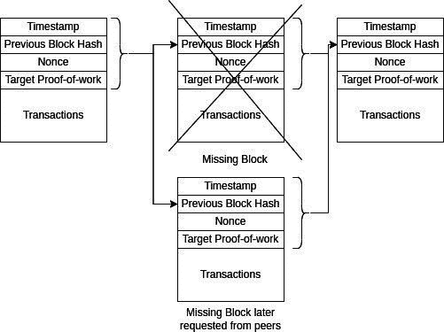

**图 5.16：** 节点向对等节点请求缺失区块

## 白皮书激励章节

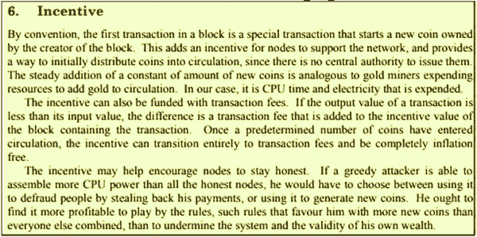

**图 5.17：** 白皮书激励章节

本章节解释了节点创建区块和支持比特币网络的激励。成功创建区块的节点以两种方式获得激励：

*   每个新创建的区块向成功找到 `Nonce` 的节点奖励比特币。
*   此外，交易中输入值减去输出值也会加到创建区块的节点收集的区块奖励中。

节点使用 CPU 算力尝试寻找 `nonce`，这会导致能耗。由于许多节点将竞争寻找 `nonce`，此过程大多会导致失败尝试。此过程中使用的能量成本需要在节点成功时收回。节点还需要获得收入以作为盈利业务运营，因为这对节点所有者来说是一项业务。区块奖励确保节点有足够的激励继续寻找 `nonce`。


如果一组节点决定不与网络合作，进行双重支付或更改区块/交易接受规则，或以某种方式攻击网络，那么这些节点将形成自己的网络。提供更好激励且节点遵守规则的网络将为发布交易提供更高的价值。因此，奖励将具有更高的信用价值。这将鼓励节点合作并支持网络，而不是攻击它。

节点可以自由选择包含或排除交易，或不与网络合作。通过包含奖励，交易创建者鼓励节点将交易包含在区块中。随着越来越多的交易被包含在区块中，交易奖励将成为挖矿节点收入的主要驱动力，因此对区块奖励的需求将减弱。网络实施了一种机制来随时间减少区块奖励。

下图说明了交易奖励：

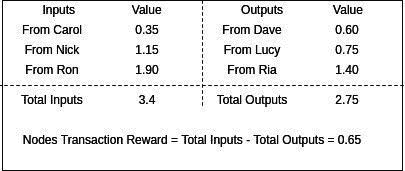

**图 5.18：** 交易奖励支付示意图

此外，区块奖励是铸造比特币的唯一来源。这导致了预定义的通胀。

下图是过去和未来比特币通胀的绘制：

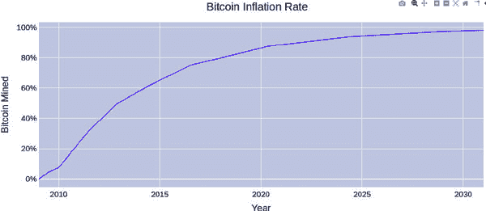

**图 5.19：** 过去和未来的比特币通胀

## 白皮书回收磁盘空间章节

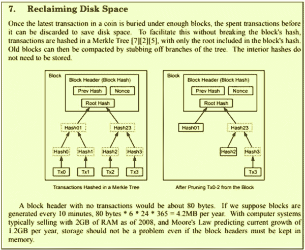

**图 5.20：** 白皮书回收磁盘空间章节

本章节解释了如何压缩区块链中存储的区块，从而回收磁盘空间。`Merkle Tree` 是一种从交易列表派生代码（称为 `Merkle Root`）的方法。该代码确认区块中包含的交易的完整性。`Merkle Root` 作为区块头的一部分，也确保工作量证明保护其免遭篡改。

更新后的区块头如下：

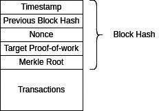

**图 5.21：** 比特币区块结构示意图

我们可以看到，由于交易未用于区块哈希的计算，如果没有 `Merkle Root`，其完整性就无法得到保护。

`Merkle Root` 的计算可以从下图理解：

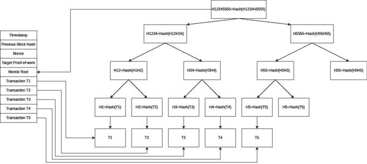

**图 5.22：** `Merkle Tree Root` 计算

在上图中，首先计算每笔交易的哈希值。然后，递归地将成对的哈希值连接并哈希以获得上一层级的哈希值。如果无法成对，则将哈希值与自身连接。

每个节点在通过网络接收区块时进行验证并将其存储在磁盘上。当磁盘上保存了足够多的区块，且节点确信由于分叉较旧的区块不会改变时，节点可以从较旧的区块中移除已发送的交易，仅保留区块头和未花费交易。这样，节点可以节省大量磁盘空间。

## 白皮书简化支付验证章节

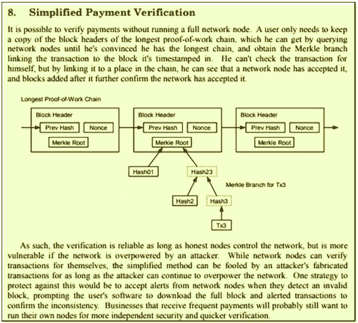

**图 5.23：** 白皮书简化支付验证章节

本章节解释了不维护完整区块的节点如何仍能验证接收到的区块。实现简化支付验证的节点仅为最长链保留区块头，这意味着没有竞争链，且最长链已被找到。该节点寻求其网络中维护完整区块链的其他节点帮助来验证区块。

它使用一种称为 `Merkle Proof` 的技术，解释如下：

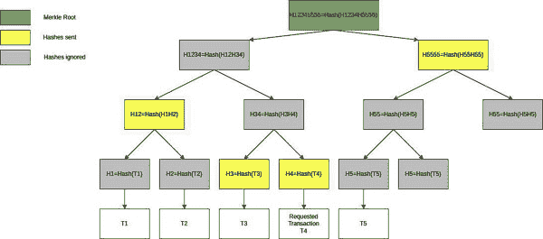

**图 5.24：** `Merkle Proof` 示意图

`SPV` 节点向全节点请求与 `T4` 相关的哈希值。全节点发送验证 `Merkle Root` 所需的哈希值。由于 `H34` 可从 `H3` 和 `H4` 推导，`H1234` 可从 `H34` 和 `H12` 推导。`H12345555` 可从 `H1234` 和 `H5555` 推导。通过提供 `H3`、`H4`、`H12` 和 `H5555` 以及 `Merkle Root` `H12345555`，`SPV` 节点可以验证带有 `Merkle Root` `H12345555` 的区块中 `T4` 的存在性。

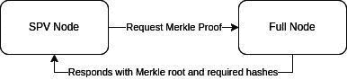

**图 5.25：** `SPV` 节点与全节点之间的通信

然而，攻击者可以组建一个网络，由于 SPV 节点依赖全节点进行验证，它可能不知道正在与之通信的节点是否是欺诈性的。因此，它可能会持续接收伪造的交易。如果节点在网络上发现无效区块时广播警报，则可以处理此类攻击。

## 白皮书“组合与拆分价值”章节

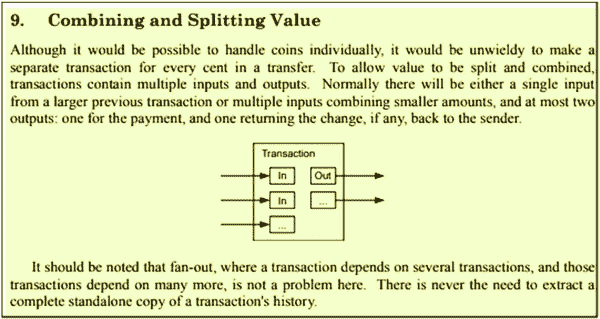

**图 5.26：** 白皮书“组合与拆分价值”章节

本章节解释了比特币交易中组合与拆分价值的概念，而不是为每个比特币或比特币的一小部分设置一笔交易。如果爱丽丝需要支付鲍勃，她需要使用支付给她的、组合价值大于或等于她需要支付给鲍勃金额的未花费交易，并将剩余（找零）价值支付回给自己。

如果未花费交易大于所需金额，则该交易将被拆分为待支付金额和剩余找零。如果未花费交易较小，则需要将多笔交易的价值组合起来，使输入价值大于或等于所需金额。如果输入价值与所需金额相同，则输出仅为一笔交易，即支付给鲍勃的金额。然而，如果输入价值较大，则爱丽丝需要将找零支付给自己。如果输出小于输入，则剩余价值将支付给挖矿节点，正如我们在前几节中所学。这可以从**图 5.18**中理解。

## 白皮书“隐私”章节

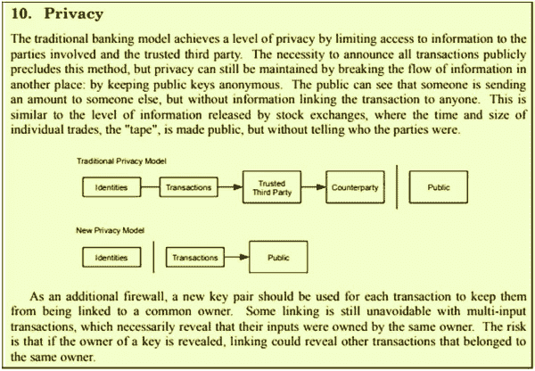

**图 5.27：** 白皮书“隐私”章节

本章节解释了即使所有交易都被广播，如何在比特币网络中实现隐私。用户可以通过这种方式保持其公钥匿名。尽管交易是公开的，但没有人会知道交易属于谁。然而，由于找零需要发送回交易所有者，因此可以推导出其价值和交易详情。为了解决这个问题，交易所有者可以将找零发送到一个不同的公钥。这意味着每次都需要使用一个新的密钥对。然而，如果所有者的身份在现有交易中的某一笔中被揭露，交易历史仍然可能揭示所有者的交易链。

以下是改进交易隐私方法的示意图：

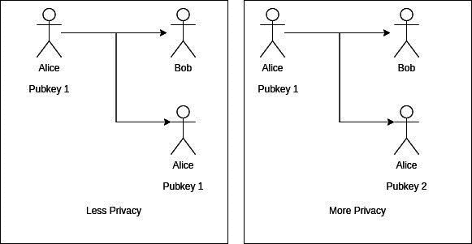

**图 5.28：** 改进交易中发送方隐私的方法

## 白皮书“计算”章节


**图 5.29：** 白皮书“计算”章节

本章节解释了攻击者或攻击者群体试图比诚实节点挖出更多区块时的条件。如果攻击者设法拥有更多的 CPU 算力并能挖出更多区块，攻击者将成为网络的一部分，这意味着它将不得不依赖诚实节点来接受这些区块。

因此：

1.  攻击者无法更改区块奖励，因此无法增加比特币供应量。
2.  攻击者无法更改他人支付交易的内容，因为它无法对这些交易进行签名。
3.  攻击者无法阻止诚实节点广播交易。

然而，攻击者可以更改自己的交易，通过不打包交易来进行审查，或撤销最近已打包的一笔交易。

现在，考虑一种攻击者可能持有也可能不持有大多数 CPU 算力并试图攻击网络的情况。这种情况类似于**赌徒破产问题**，解决方案是通过使用**二项随机游走**推导得出的。

攻击者想要更改深度为 `z-1` 处的交易，因此它将从深度 `z` 开始。如果它们能在诚实节点之前挖出一个区块，差距将减少到 `z-1`，但如果诚实节点挖出了区块，差距将增加到 `z+1`。我们试图找到攻击者能够创建最长链的概率。

在赌徒破产问题中，赌徒与对手竞争，试图赢取对手的所有财富。这是一个迭代博弈游戏，双方在每次下注中要么赢 1 美元，要么输 1 美元。最后，一方会失去所有财富。

首先，看看赌徒破产问题。

*   `q`：赌徒赢得单次下注的概率
*   `p`：赌徒输掉单次下注的概率
*   `i`：赌徒的初始财富
*   `p = 1 - q`
*   `0 < i < N`


**图 5.30：** 赌徒破产问题示意图

赌徒赢得游戏的概率可以计算为下注后以下概率之和：

*   如果赌徒以概率 `q` 赢得下注，则新的游戏获胜概率为 。
*   如果赌徒以概率 `p` 输掉下注，则新的游戏获胜概率为 。

使用全概率公式，即 。

赌徒赢得游戏的概率是赢得当前下注后赢得游戏的概率与输掉当前下注后赢得游戏的概率之和。这可以表示如下：


在获胜情况下，`P[N] = 1` 且 `i = N - 1`


现在，考虑比特币挖矿的情况，攻击者可以永远挖掘区块以击败诚实节点。这是一个有区别的赌徒破产问题。攻击者拥有无限的资金和无限的时间，要想获胜，攻击者需要通过比诚实节点添加更多区块来创建更长的链。一开始，攻击者想要能够修改深度为 `z-1` 处的交易，所以它从深度 `z` 开始。

下图解释了这一点：


**图 5.31：** 攻击者成功挖掘更长链的示意图

考虑到，

*   `p`：诚实节点找到下一个区块的概率
*   `q`：攻击者找到下一个区块的概率
*   `z`：攻击者必须比诚实节点多添加的区块数
*   `i`：攻击者可以输给诚实节点的额外区块数
*   `q[z]`：攻击者最终击败诚实节点的概率
*   所以，`N = i + z`
*   这里，`i` → `∞`，因为赌徒开始时拥有无限资源。


这就是我们如何得出白皮书本章节中给出的方程。

假设攻击者找到区块的概率低于诚实节点，即攻击者追上来的机会呈指数级下降。

现在，我们更进一步，试图确定如果商家等待 `z` 个确认，攻击者能够双重支付的概率。中本聪认为每个时间段内获胜事件数量的概率分布为**泊松分布**，原因如下：

*   在每个时间间隔内，挖矿事件可以发生任意次数。
*   每个事件独立发生，不影响其他事件的概率。
*   事件的平均速率是恒定的，因为我们知道出块时间是恒定的，而挖矿区块的概率与 CPU 算力比率成正比，因此也是恒定的。
*   两个事件在完全相同的时间发生是不可能的，因为节点根据到达时间判断，如果确实发生了，它们会等待直到找到最长链。因此，两个事件在同一时间发生很少见，即使发生，也可以安全地视为不同事件。

考虑到，

*   `T`：平均出块时间
*   `z`：认为交易已花费所需的区块链深度
*   `P[p]`：诚实节点每 `T` 分钟挖出一个区块的概率
*   `P[q]`：攻击者节点每 `T` 分钟挖出一个区块的概率
*   `p`：诚实节点每 `T` 分钟挖出的区块数
*   `q`：攻击者每 `T` 分钟挖出的区块数
*   `T[z]`：挖掘 `z` 个区块的平均时间间隔
*   `T[z] = T * z`

量 `p` 和 `q` 分别是在时间间隔 `T` 内挖出一个区块的概率的倒数。

因此，


攻击者可以在 `T` 分钟内挖出 `q` 个区块，所以它可以挖出：


区间内发生 `k` 次成功的概率由泊松密度函数给出：


作为一个更一般的情况，我们想知道如果在当前区间内未成功，商家接受未来某个区块中修改过的交易时，攻击成功的总体概率。基本上，即使攻击者在一个区间内有 `k` 次成功，它仍然可以在未来实现 `z-k` 个区块，并在一个区间内修改未来的区块。

这可以通过全概率公式来求解，即 `P(A)= ∑[n]P(A|B[n] )P(B[n])`。

`P[s]`：成功的总概率


这是中本聪用来编写代码并证明概率呈指数级下降的方程。

从该方程可以推导出，如果攻击者不控制大多数算力，攻击者成功挖出 `z` 个区块的概率会随着 `z` 值的增加而呈指数级下降。因此，在确认交易前等待几个区块非常重要。

建议商家只有在交易达到区块链深度 6 后才确认付款。

## 白皮书结论部分


**图 5.32：** 白皮书结论部分

本节解释了本文取得的成果，可列举如下：

*   一个防止双重支付且不需要受信任第三方的点对点支付系统。
*   数字签名提供交易的所有权。
*   如果诚实节点控制大多数 CPU 算力，则工作量证明使得攻击者修改区块链中足够多的区块以导致双重支付变得不切实际。
*   节点独立工作，仅需极少的协调。节点可以独立离开和加入网络。它们确实需要通信，但其状态不依赖于其他节点，也不需要路由等。
*   节点无需透露身份。
*   节点用 CPU 算力投票，从而竞争 CPU 算力来挖掘区块。成功的节点获得激励以支持网络。
*   共识规则通过大多数人的支持和参与来强制执行。

## 结论

在本章中，你详细了解了白皮书的内容。你还通过推导了解了白皮书中使用的计算方法。

在下一章中，你将通过编写实际程序来解析比特币软件存储在文件系统中的区块和索引，从而理解区块链中区块的结构。你还将通过编程再次深入了解挖矿。

## 要点回顾

*   比特币网络不需要任何中介即可在双方之间发送比特币。
*   区块链是每个节点维护的真相账本。
*   受信任的第三方会在所有交易中包含成本，即使交易不需要争议解决。
*   比特币交易可以选择将受信任的第三方作为托管实现，而非强制规则。
*   交易是数字签名的轨迹，将支付金额链接到前一笔交易，最终追溯到挖出的币。
*   哈希运算是不可逆的。
*   数字签名确保文档的完整性和真实性。
*   交易一旦创建就会广播到比特币网络。
*   区块链中的每个区块都按时间顺序排列。
*   `nonce` 是矿工找到的随机值，使其处于目标工作量证明范围内，从而被接受。
*   比特币通过调整目标工作量证明来维持出块时间。
*   新区块发布到网络。
*   如果两个区块几乎同时被挖出，区块链的一个分支中将出现多条竞争链。
*   竞争分支中较长的链被接受，另一条被拒绝。
*   找到所需 `nonce` 的矿工将获得区块奖励。
*   此外，矿工还从区块中包含的交易中收取交易费。
*   矿工有动机保护网络而不是攻击它。
*   比特币通胀是预先确定的。
*   一旦收到足够多的新区块，节点可以通过移除包含的交易来修剪较旧的区块。
*   简化支付验证（SPV）节点仅保留最长链的区块头及所需的交易。
*   SPV 节点借助全节点，使用默克尔证明来验证区块和交易。
*   比特币付款人可以合并其未使用的比特币交易输出，或拆分其之前的未花费输出。
*   通过永不重复使用地址，可以增强隐私。
*   已包含在区块链中的交易被恶意矿工成功逆转的概率，随着区块深度的增加而呈指数级下降。

## 问题

*   节点如何知道它错过了一个区块？它如何获取丢失的区块？
*   为什么交易通常只有一个或两个输出？
*   是什么使区块链不可篡改？（勾选正确答案）
    *   默克尔根
    *   数字签名
    *   工作量证明
    *   区块链副本
*   判断正误
    *   区块头哈希值越大，工作量证明越大。
    *   SPV 区块验证的成功取决于其对等节点的诚实度。
*   比特币是由 \_\_\_\_\_\_\_ 创建的。
*   为什么将比特币找零发送回同一个公钥会降低隐私？
*   在赌徒破产问题中：Ria 最初有 i = $2，赢一注的概率 p = 0.7。
    *   Ria 赢得总财富 N = $6 的概率是多少？
    *   Ria 变得无限富有的概率是多少？
*   攻击者拥有整个网络 20% 的算力。一家在线商店要求比特币交易达到区块链深度 6 后才发货。
    *   攻击者在此期间挖出 3 个区块的概率是多少？
    *   攻击者能够在确认时间内挖出 3 个区块并在之后挖出额外区块从而生成最长链的概率是多少？

# 第 6 章

# 区块链、交易与挖矿

在上一章中，我们尝试详细理解比特币白皮书的内容。比特币白皮书发布于 2008 年 10 月 31 日。它提供了一种可以像现金一样运作的互联网货币的概念设计。正如我们所见，该设计相当详细，但未提供区块奖励、出块时间或交易消息、哈希、签名算法等具体细节。白皮书更像是加密货币设计的模板。因此，我们称之为比特币白皮书的论文，理想情况下应称为加密货币白皮书。

在本章中，我们将分析比特币协议的实现。我们将使用的比特币软件是用相当复杂的 C++ 编写的。对于试图理解比特币的普通程序员来说，阅读和理解比特币软件代码是一项艰巨的任务。即使对于非常优秀的 C++ 程序员，理解比特币程序也是一项非常困难的任务。在当今的互联网时代，浏览网站和博客可以简化这项任务。而 Python 在尝试理解和验证我们的学习成果时非常有用。本章的目的是通过编码来学习，而不是试图构建最高效的解决方案。

在深入了解 Bitcoin 协议的实际实现之前，我们需要安装软件，并使区块链和索引与网络同步。

## 结构

本章将涵盖以下主题：

*   **Bitcoin 软件**
    *   Bitcoin Core 安装
        *   运行 Bitcoin Core 服务端
        *   Bitcoin Core 客户端
        *   在 Python 中查询索引
*   **区块链**
    *   创世区块
    *   区块和索引
    *   区块头
        *   区块版本
        *   前一个区块哈希
        *   时间戳
        *   Merkle 根
        *   Bits 和 Nonce
    *   序列化区块
        *   魔数
        *   区块文件
        *   使用区块索引遍历区块
*   **交易**
    *   UTXO
*   **挖矿**
    *   挖矿盈利能力
        *   区块奖励
        *   交易费
        *   Coinbase 交易金额验证
        *   挖矿成本
    *   内存池

## 目标

本章旨在帮助您理解 Bitcoin 区块链的结构、Bitcoin 软件如何存储和组织区块链、区块和交易如何被索引、内存池数据的结构，以及如何使用它们和 UTXO 进行挖矿。

本章使用 Python 编程来理解 Bitcoin 区块链、区块文件、索引、UTXO 和挖矿。

## Bitcoin 软件


主要有三款软件提供全验证功能：Armory、Bitcoin Core 和 Bitcoin Knots。其中，`Bitcoin Core` 是使用最广泛、更新最及时的软件。中本聪创建了该软件，此后由 Bitcoin Core 团队维护。它也被称为 Satoshi 客户端。据估计，多达 95% 的全节点运行该软件。因此，我们将使用它进行开发和学习。

## Bitcoin Core 安装

`Bitcoin Core` 的安装说明可在以下网址找到：

[`bitcoin.org/en/full-node`](https://bitcoin.org/en/full-node)

页面左侧提供了 Linux、Mac OS 和 Windows 的安装说明。此外，`Bitcoin Core` 还可以通过 Snap Store 在 Linux 上安装，也可以在 Docker 上安装。始终使用正版软件非常重要，因为如果您使用该软件生成私钥或接收比特币，这些私钥将为攻击者或攻击软件所知，并被用来窃取受私钥保护的比特币。从正规网站下载软件并在多个无关网站验证哈希值是保障安全的最佳方式。

## 运行 Bitcoin Core 服务端

`Bitcoin Core` 服务端可以通过 GUI 或命令行运行。对于 GUI 版本，我们可以运行 `bitcoin-qt –daemon`；对于命令行，我们可以运行 `bitcoind`。我们将使用命令行来运行守护进程和客户端。同步所有区块及所有索引可能需要一天或更长时间。更大的内存、更好的网络和更快的磁盘可以加快下载和索引生成速度。

以下是启动守护进程的示例命令：

```
bitcoind -printtoconsole -txindex=1 -dbcache=8392
```

`dbcache` 是内存中的数据库缓存大小。它可以缩短区块验证时间并减少下载区块链的时间。

`txindex=1` 表示除了必要的索引外，还将创建交易索引。

## Bitcoin Core 客户端

我们可以使用以下命令连接到守护进程：

```
bitcoin-cli [options] <command> [params]
```

我们也可以使用 `bitcoinrpc` 通过 Python 连接到守护进程。以下是 pip 包信息：


**图 6.1：** 用于为 Bitcoin Core 守护进程创建 Python 客户端的 Python pip 包

## 在 Python 中查询索引

`Bitcoin Core` 使用 `LevelDB` 存储其索引。`LevelDB` 是一个磁盘上的键值存储，使用二进制文件存储键值对。它支持对存储的键进行快速迭代，并支持使用键快速访问值。尽管 `LevelDB` 提供了非常快的查询，但其用途有限，因为它不提供模式搜索和过滤功能。要查询数据库，我们需要安装以下 pip 包：


**图 6.2：** 用于 LevelDB 的 Python 包

以下是在 LevelDB 数据库中存储的键和值：


**表 6.1：** Bitcoin 区块链 LevelDB 索引

我们将在 `Python 3.6` 中使用 `plyvel` 包来探索这些值。

## 区块链

区块链是区块的序列，每个区块是交易的集合。区块链包含自 Bitcoin 网络诞生以来发生的所有交易。

## 创世区块

创世区块定义如下：

> 任何区块链中的第一个区块称为创世区块。

2009 年 1 月 3 日，Bitcoin 网络诞生。中本聪挖掘区块持续了几个月。当时还有其他几位开发者也在挖掘区块，但 Bitcoin 区块链中的第一个区块与众不同。它不是挖出来的，而是硬编码在 Bitcoin 软件中。区块链通过前一个区块哈希向回遍历，最终到达该区块，这意味着我们可以通过修改该区块来创建一条不同的链，从而诞生一种新币。该区块携带一条特殊消息，向世界证明 Bitcoin 存在的合理性。

以下是创世区块的十六进制代码：


**图 6.3：** 显示创世区块的十六进制转储

该十六进制代码以字节转储形式打印时，输出如下：


**图 6.4：** 显示创世区块哈希转储的二进制形式

我们可以看到带有日期和来源的消息：


**图 6.5：** 显示存储在创世区块中的消息

2009 年 1 月 3 日，伦敦《泰晤士报》刊登了一则头版新闻，标题为“Chancellor on brink of second bailout for banks”（财政大臣濒临第二次拯救银行）。该消息是中本聪试图为 Bitcoin 的推出提供理由。它向世界指出，当前的金融体系没有坚实的基础；它需要干预来维持，而这些干预是为了使某些企业（如大银行）受益的操纵行为，但没有来自银行家或政府的干预能为普通民众提供救济，许多人也因 2008 年的大萧条而失业。中本聪设想 Bitcoin 作为一种替代方案，因为它提供了一个无干预的货币体系，由一组规则驱动，这组规则不能被一群人的意志所修改。

## 区块和索引

`Bitcoin Core` 守护进程在运行时，会在默认目录 `~/.bitcoin` 下创建多个目录和文件。以下是文件和目录及其功能的列表：


**表 6.2：** Bitcoin Core 使用的文件和目录列表及其功能

区块链相当庞大，这使得维护索引以提高新区块和交易验证效率以及共识规则要求的某些其他操作的效率变得必要。

## 区块头

Bitcoin 区块平均每 10 分钟生成一个。以下是区块头结构：


**图 6.6：** 区块头结构

撰写本文时，区块高度为 `726556`。`bitcoin-cli` 通过以下命令给出最新验证的区块高度：


**图 6.7：** Bitcoin 区块链中的当前区块高度

我们可以使用区块高度信息来获取区块哈希：


**图 6.8：** 从区块高度获取区块哈希

由于我们知道区块头长度为 80 字节，因此可以使用区块哈希获取区块头。以下是通过读取区块内容的前 80 字节获得的区块头：


**图 6.9：** 使用 Bitcoin Core CLI 从区块哈希获取的区块头内容

如果我们对区块头的内容应用两次 sha256 算法进行哈希运算，就能得到区块哈希。以下程序演示了这一过程：

```python
import hashlib

blk_b = bytes.fromhex('040020200a377a6ce7bfbd5efdbe087801fbef9a8a7b6815c3eb08000000000000000000ead1c751f9b4fedd1ff1ab37f7dccec13fc4cdfd6df4406fdd72cd44655fd2fa9389286273370a1739264fbc')

h1 = hashlib.sha256(blk_b).digest()

h2 = hashlib.sha256(h1).digest()

print(h2[::-1].hex())
```

**程序 6.1：** 从区块头获取区块哈希的程序

运行该程序可得到以下哈希值，正如我们所见，它与提供该区块头的区块哈希相同：


**图 6.10：** 显示计算出的区块哈希

区块元素以小端序存储，因此为了使用这些值，我们需要反转字节序。以下小程序接收区块头的十六进制代码并标注头部元素：

```python
def getBlockHeader(blk: bytes):
    block = {}
    block['version'] = blk[0:4][::-1].hex()
    blk = blk[4:]
    block['prev_blockhash'] = blk[0:32][::-1].hex()
    blk = blk[32:]
    block['merkle_root'] = blk[0:32][::-1].hex()
    blk = blk[32:]
    block['time'] = int.from_bytes(blk[0:4], byteorder='little')
    blk = blk[4:]
    block['bits'] = blk[0:4][::-1].hex()
    blk = blk[4:]
    block['nonce'] = blk[0:4][::-1].hex()
    return block
```

**程序 6.2：** 从区块头字节获取区块头结构的程序

我们按如下方式调用该方法：

```python
blkhdr = bytes.fromhex("040020200a377a6ce7bfbd5efdbe087801fbef9a8a7b6815c3eb08000000000000000000ead1c751f9b4fedd1ff1ab37f7dccec13fc4cdfd6df4406fdd72cd44655fd2fa9389286273370a1739264fbc")

jsonobj = getBlockHeader(blkhdr)

print(json.dumps(jsonobj, indent = 4))
```

这将给出以下结果：


**图 6.11：** 显示执行程序后得到的区块头结构

我们可以利用收集的信息进行进一步分析。

### 区块版本

`version` 字段指示矿工对某项增强功能的支持。在比特币中，影响区块或交易验证共识规则且向后兼容（不导致链分裂）的协议增强被称为软分叉。比特币区块共识机制已从 `IsSuperMajority()` 或 ISM 变更为版本位。

版本 1 到 4 称为 `IsSuperMajority()` 软分叉。在此共识系统中，若连续 1,000 个区块中有 950 个激活了新版本，则该新版本生效。一旦激活发生，旧版本的区块将被拒绝。

随着隔离见证的引入，比特币网络升级到了使用版本位的新共识机制。该机制在比特币改进提案 BIP-9 中提出。所有比特币改进提案的列表可在 [`github.com/bitcoin/bips`](https://github.com/bitcoin/bips) 找到。版本位允许多个软分叉等待接受并最终部署。

在此机制中，软分叉经历一个工作流。以下流程图展示了软分叉的生命周期。（来源 [`github.com/bitcoin/bips/blob/master/bip-0009.mediawiki`](https://github.com/bitcoin/bips/blob/master/bip-0009.mediawiki)）


**图 6.12：** 图片取自 BIP 9，展示软分叉工作流

当开发者提出软分叉时，会在开发者论坛进行辩论并起草为 BIP。随着 BIP 实现的定义完成并准备好部署，软分叉进入“已定义”状态。此后，支持升级的矿工为升级做好准备。准备就绪的矿工通过设置相应的版本位来发出信号。此时，软分叉达到“已启动”状态，并需要在未来 1 年内，在最近 2016 个区块中达到 95% 的支持率。如果软分叉在 1 年内未达到 95% 的接受度，则被视为失败并撤回，这意味着支持它的区块将被拒绝。如果软分叉达到 95% 的接受度，则进入 `locked_in`（锁定）状态，并在 2016 个区块后成为规则。

如果某项增强很重要但矿工社区未达成共识，开发者社区可以通过启用 BIP148 在特定区块强制执行变更。

版本位设置了 `0x20000000`，任何其他被设置的位表示对某个软分叉提案的就绪状态。如果 Alice 提出升级且 0x1 位代表她的软分叉，则支持并准备好升级的矿工会创建版本为 `0x20000001` 的区块。如果 Bob 也提出升级且 `0x4` 位代表他的软分叉，则矿工可以通过设置 0x4 位（即 `0x20000100`）进行投票。如果矿工同时为两项升级投票，他们将设置两个位，因此版本将为 `0x20000101`。

### 前一个区块哈希

在前面的程序中，我们获得了一个区块头结构，其中一字段为前一个区块哈希。我们可以通过查询 Bitcoin Core 软件，使用减 1 的区块高度来获取相同的区块哈希，如下所示：


**图 6.13：** 显示通过区块头和区块高度获得的前一个区块哈希并进行比较

### 时间戳

使用 time，我们可以通过以下 bash shell 命令获取区块的时间戳：


**图 6.14：** 显示从区块头 time 字段获得的日期时间

### 默克尔根

要计算默克尔根，我们需要区块中的交易列表。我们通过以下 CLI 命令从区块结构中获取交易列表：


**图 6.15：** Bitcoin Core CLI 命令显示的区块结构

正如您在 *第 5 章，白皮书, 图 5.22* 中所学，默克尔根的哈希是通过反复哈希并连接连续的交易对来计算的。以下 Python 程序执行相同操作：

```python
def hashOfJoinedStr(a:str, b:str):
    # Reverse inputs before and after hashing due to big-endian / little-endian nonsense
    a1 = bytes.fromhex(a)[::-1]
    b1 = bytes.fromhex(b)[::-1]
    h = hashlib.sha256(hashlib.sha256(a1 + b1).digest()).digest()
    return h

def buildMerkleRoot(hash_list: list):
    if len(hash_list) < 2:
        return hash_list[0]
    new_hash_list = []
    # Process pairs. For odd length, the last is skipped
    for i in range(0, len(hash_list) - 1, 2):
        new_hash_list.append(hashOfJoinedStr(hash_list[i], hash_list[i + 1])[::-1].hex())
    # odd, hash last item twice
    if len(hash_list) % 2 == 1:
        new_hash_list.append(hashOfJoinedStr(hash_list[-1], hash_list[-1])[::-1].hex())
    return buildMerkleRoot(new_hash_list)
```

**程序 6.3：** 从交易哈希构建默克尔根的程序

我们在代码中包含以下行以向 Bitcoin Core 服务器发起 RPC 调用：

```python
from bitcoinrpc.authproxy import AuthServiceProxy, JSONRPCException

rpc_connection = AuthServiceProxy("http://%s:%s@127.0.0.1:8332" % (<username>, <password>))
```

我们按如下方式调用上述方法：

```python
if __name__ == '__main__':
    block_hash = rpc_connection.getblockhash(715735)
    block = rpc_connection.getblock(block_hash)
    print('Merkle Root from RPC call\t = %s' % block['merkleroot'])
    hash_merkle_root = buildMerkleRoot(block['tx'])
    print('Calculated Merkle Root\t = %s' % hash_merkle_root)
```

这将给出以下结果：


**图 6.16：** 程序执行显示计算出的默克尔根值与头部中的值相等

### Bits 和 Nonce

#### Bits 字段解析

下一个需要理解的字段是 `Bits`。`Bits` 是 `Target Threshold`（目标阈值）的压缩表示形式。区块哈希必须小于 Target Threshold，该区块才会被接受为有效区块。

以下是解压缩公式：

* `b[1] b[2] b[3] b[4]`：Bits 的四个字节

* Target Threshold `T = b[2] b[3] b[4] * 256^(b[1] - 3)`

让我们验证一下高度为 `715735` 的下一个区块，其区块哈希是否小于目标阈值。

* `h`：Block Hash（区块哈希）

* `T`：Target Threshold（目标阈值）

```text
h = 0000000000000000004db407202aff54e9ace0efb72588bb73a2beebb248c28
b[1] b[2] b[3] b[4] = 170b98ab
b[1] = 0x17, b[2] = 0x0b, b[3] = 0x98, b[4] = 0xab
T = 0x0b98ab * 256^(0x17 - 0x03)
  ⇒ T = 0x0b98ab * 256^(0x14)
```

区块有效的条件是 `T` > `h`。

以下程序将 Bits 转换为 Target Threshold：


```python
def getTargetThreshold(bits: bytes):
    shift = bits[3]
    value = int.from_bytes(bits[0:3], byteorder='little')
    target_threshold = value * 2 ** (8 * (shift - 3))
    return target_threshold
```

**Program 6.4:** 将区块头中的 Bits 转换为 Target Threshold 的程序

以下代码调用该方法并验证区块哈希是否具有所需的工作量证明：

```python
bits = bytes.fromhex("170b98ab")[::-1]
target_threshold = getTargetThreshold(bits)
print('Target Threshold = %x' % target_threshold)
block_hash = 0x00000000000000000004db407202aff54e9ace0efb72588bb73a2beebb248c28
print('Block Hash = %x' % block_hash)
print('Valid' if target_threshold > block_hash else 'Invalid')
```

运行结果如下：


**Figure 6.17:** 显示从区块头中的 Bits 计算得出的 Target Threshold 值

### 序列化区块

比特币序列化区块包含除区块头和交易之外的字段。这些字段包括：

*   **Magic Number**（魔数）
*   **Block Size**（区块大小）

以下是序列化区块的示意图：


**Figure 6.18:** 展示序列化区块的结构

### Magic Number

区块哈希是区块头的哈希值。Magic Number 是网络的标识符。如果一个节点连接到同一个对等节点以服务于多个不同的币种网络，区块魔数可以充当标识符，该节点将不必为多个网络验证区块共识规则，从而提高效率。

用于转账比特币的公共比特币网络也称为 `mainnet`。此外还有用于测试的 `testnet` 和 `regtest` 网络。这些网络中的每一个都定义了各自的魔数和不同的端口号以连接对等节点。


**Table 6.3:** 显示不同比特币网络分配的魔数和 TCP 端口

### Block File

Bitcoin Core 以区块文件的形式在目录中存储区块链，每个区块文件以二进制格式包含多个区块。区块文件的表示如下：


**Figure 6.19:** 区块文件结构示意图

我们可以利用序列化区块中的区块大小来解析区块文件中的所有区块。这有助于跳过两个区块之间可能存在的垃圾字符。区块文件总是以序列化区块的开头开始，因此我们知道前 4 个字节代表魔数。从区块索引中，我们可以获取区块文件的区块数量。

为了使用键从 LevelDB 索引中访问值，我们需要了解它们的结构。正如我们所了解的，LevelDB 是一个在文件系统中存储数据的二进制键值数据库。Bitcoin 利用 LevelDB 存储多个值，有时也存储多个键。为了存储可变长度的键和值，Bitcoin 使用了一种可变长度整数格式编码。在这种编码中，如果一个字节的最高有效位被设置，则下一个字节也包含在内。

编码过程为：将 7 位存储在字节数组中，从数字中移除，然后减 1。重复此过程直到该位变为零。除最后一个字节外，所有字节的最高有效位均被设置。


**Figure 6.20:** 展示 b128 varint 编码机制的示意图

以下是编码器的实现：

```python
def b128_varint_encode(n: int):
    l = 0
    b = []
    while True:
        # Take 7 bits and set MSB if not last byte
        b.append((n & 0x7F) | (0x80 if l != 0 else 0x00))
        if n <= 0x7F:
            break
        n = (n >> 7) - 1
        l += 1
    return bytes(bytearray(b[::-1]))
```

**Program 6.5:** 将数字编码为 b128 varint 的程序

以下代码解码可变长度整数：

```python
def b128_varint_decode(b: bytes, pos=0):
    n = 0
    while True:
        data = b[pos]
        pos += 1
        # unset MSB bit
        n = (n << 7) | (data & 0x7f)
        if data & 0x80 == 0:
            return (n, pos)
        n += 1
```

**Program 6.6:** 将 b128 varint 解码为整数的程序

运行上述代码，我们得到以下编码和解码的整数对：


**Table 6.4:** b128 varint 编码数字示例

为了解析区块文件中的区块，我们需要从区块索引获取区块文件信息。区块文件索引包含以下信息：

*   `count`：存储在区块文件中的区块数量
*   `filesize`：区块文件大小（字节）
*   `undofilesize`：撤销文件大小（字节）
*   `lowest`：包含从此区块高度开始的区块
*   `highest`：包含至此区块高度的区块
*   `lowest_timestamp`：包含从此区块时间戳开始的区块
*   `highest_timestamp`：包含至此区块时间戳的区块

以下代码从区块索引获取区块文件信息：

```python
block_db_g = plyvel.DB(os.getenv('BLOCK_INDEX_DB'), compression=None)
blocks_path_g = os.getenv('BLOCKS_PATH')

def getBlockFileIndex(n_file: int, block_db):
    key = b'f' + (n_file).to_bytes(4, byteorder='little')
    value = block_db.get(key)
    jsonobj = {}
    jsonobj['count'], pos = b128_varint_decode(value)
    jsonobj['filesize'], pos = b128_varint_decode(value, pos)
    jsonobj['undofilesize'], pos = b128_varint_decode(value, pos)
    jsonobj['lowest'], pos = b128_varint_decode(value, pos)
    jsonobj['highest'], pos = b128_varint_decode(value, pos)
    jsonobj['lowest_timestamp'], pos = b128_varint_decode(value, pos)
    jsonobj['highest_timestamp'], pos = b128_varint_decode(value, pos)
    return jsonobj
```

**Program 6.7:** 查询 Block DB 以获取区块文件索引的程序

我们使用以下参数调用此方法：

```python
blk_index = getBlockFileIndex(138, block_db_g)
```

在执行上述程序之前，我们需要设置以下环境变量：

*   `BITCOIN_HOME`：Bitcoin 工作目录的路径。
*   `BLOCK_INDEX_DB`：默认为 `$BITCOIN_HOME/blocks/index`
*   `BLOCKS_PATH`：默认为 `$BITCOIN_HOME/blocks/`
*   `CHAINSTATE_DB`：默认为 `$BITCOIN_HOME/chainstate`
*   `TX_INDEX_DB`：默认为 `$BITCOIN_HOME/indexes/txindex`

运行结果如下：


**Figure 6.21:** 显示通过运行程序获得的区块文件索引结构

现在，利用上述信息，我们编写了以下代码来解析区块文件：

```python
def parseSerialisedBlock(block_f):
    serialized_blk = {}
    serialized_blk['magic_num'] = block_f.read(4)[::-1].hex()
    serialized_blk['blk_size'] = int.from_bytes(block_f.read(4), byteorder='little')
    serialized_blk['version'] = block_f.read(4)[::-1].hex()
    prev_blkhash_b = block_f.read(32)
    serialized_blk['prev_blkhash'] = prev_blkhash_b[::-1].hex()
    serialized_blk['merkle_root_hash'] = block_f.read(32)[::-1].hex()
    serialized_blk['time'] = int.from_bytes(block_f.read(4), byteorder='little')
    serialized_blk['bits'] = block_f.read(4)[::-1].hex()
    serialized_blk['nonce'] = block_f.read(4)[::-1].hex()
    return serialized_blk
```

**Program 6.8:** 获取包含魔数和区块大小的区块头的程序

我们遍历区块文件，使用从前面的方法获得的区块信息查找文件中的所有区块：

```python
if __name__ == '__main__':
    n_file = 138
    block_filepath = os.path.join(blocks_path_g, 'blk%05d.dat' % n_file)
    block_f = open(block_filepath, 'rb')
    blk_index = getBlockFileIndex(n_file, block_db_g)
    print(blk_index)
    for i in range(blk_index['count']):
        # moves file pointer to the end of block header
        serialized_blk = parseSerialisedBlock(block_f)
        next_blk_loc = block_f.tell() - 80 + serialized_blk['blk_size']
        block_f.seek(next_blk_loc)
        print('serialized_blk = %s' % serialized_blk)
```

以下是区块文件中前两个区块的信息：


**图 6.22：** 显示区块文件中的前两个区块及该文件的其他信息

这种解析方法在为索引重新扫描区块时很有用。

### 使用区块索引进行区块遍历

LevelDB 索引在多方面都很有帮助。它们有助于更快地验证区块和交易。我们可以用它们来遍历区块链，这在需要解析固定数量的区块时（例如软分叉部署）非常有用。在其他情况下，使用区块文件编号和区块文件索引遍历区块链是一种更高效的方法。

下图显示了区块遍历的步骤：


**图 6.23：** 使用 LevelDB 索引遍历区块文件的方法示意

我们需要记住一点：区块文件中的区块并不总是按顺序排列的，这意味着我们始终需要使用区块头中的前一个区块哈希来获取前一个区块的位置。

Chainstate 数据库是经过编码的，这与其他数据库不同。这是因为过去 chainstate 数据库中的字符序列曾触发杀毒软件。在这种编码方法中，每个字节都与 `obfuscate-key` 中的字节进行异或运算。`obfuscate key` 存储在 chainstate 数据库中，键为 `b'\x0e\x00'`。

以下代码将混淆键应用于所有字节并返回解码后的 chainstate 值：

```python
def getObfuscationKey(chainstate_db):
    value = chainstate_db.get(b'\x0e\x00' + b'obfuscate_key')
    print('obfuscation key = %s' % value)
    obfuscation_key = value[1:]
    return obfuscation_key

def applyObfuscationKey(data: bytes, chainstate_db):
    obfuscation_key = getObfuscationKey(chainstate_db)
    new_val = bytes(data[index] ^ obfuscation_key[index % len(obfuscation_key)] for index in range(len(data)))
    return new_val
```

**程序 6.9：** 使用混淆键解码 Chainstate LevelDB 的程序

现在，我们有足够的理解来遍历区块链。让我们看看如何做到这一点：

**步骤 1：** 从 chainstate 数据库查询最后一个区块哈希。

**步骤 2：** 在区块索引数据库中查询区块哈希以获取区块索引。

**步骤 3：** 区块索引包含区块位置的信息。利用该信息，我们读取正确的区块文件或撤销文件，并从偏移位置读取数据以获取区块数据。

**步骤 4：** 从区块数据中，我们获取前一个区块的区块哈希，然后重复步骤 2-4。

以下是从区块索引数据库获得的区块索引信息：

*   `version`：客户端的版本号（不是区块版本）。
*   `height`：区块高度。
*   `status`：指示其包含的数据类型。可能是 `BLOCK_HAVE_DATA` 或 `BLOCK_HAVE_UNDO`，指示它是正向修补还是反向修补 chainstate 数据。
*   `txcount`：区块中的交易数量。
*   `n_file`：包含该区块的区块文件编号。
*   `data_pos`：数据区块的字节位置。
*   `undo_pos`：撤销区块的字节位置。
*   `header`：区块头内容。

在上述信息中，我们遇到了通过撤销区块进行反向修补的情况。要理解这一点，我们需要知道比特币区块链中的区块可能会竞争下一个位置。这是因为矿工可能几乎在同一时间挖出一个区块，随后其中一个区块会被接受，因为竞争链中的一条会变得更长。当这种情况发生时，撤销区块被用来反向修补 chainstate 索引。

以下是使用 LevelDB 索引遍历区块链的代码：

1.  获取 LevelDB 数据库：

    ```python
    block_db_g = plyvel.DB(os.getenv('BLOCK_INDEX_DB'), compression=None)
    chainstate_db_g = plyvel.DB(os.getenv('CHAINSTATE_DB'), compression=None)
    ```

2.  从 chainstate 数据库获取最后一个区块哈希：

    ```python
    def getRecentBlockHash(chainstate_db):
        key = b'B'
        block_hash_b = chainstate_db.get(key)
        block_hash_b = applyObfuscationKey(block_hash_b, chainstate_db)
        return block_hash_b
    ```

    **程序 6.10：** 从 Chainstate DB 获取最近区块的程序

3.  从区块索引数据库获取区块索引：


```python
BLOCK_HAVE_DATA = 8
BLOCK_HAVE_UNDO = 16

def getBlockIndex(block_hash_b: bytes, block_db):
    key = b'b' + block_hash_b
    value = block_db.get(key)
    jsonobj = {}
    jsonobj['version'], pos = b128_varint_decode(value)
    jsonobj['height'], pos = b128_varint_decode(value, pos)
    jsonobj['status'], pos = b128_varint_decode(value, pos)
    jsonobj['tx_count'], pos = b128_varint_decode(value, pos)
    if jsonobj['status'] & (BLOCK_HAVE_DATA | BLOCK_HAVE_UNDO):
        jsonobj['n_file'], pos = b128_varint_decode(value, pos)
    if jsonobj['status'] & BLOCK_HAVE_DATA:
        jsonobj['data_pos'], pos = b128_varint_decode(value, pos)
    if jsonobj['status'] & BLOCK_HAVE_UNDO:
        jsonobj['undo_pos'], pos = b128_varint_decode(value, pos)
    jsonobj['header'] = {}
    jsonobj['header']['version'] = value[pos:pos+4][::-1].hex()
    jsonobj['header']['prevblockhash'] = value[pos+4:pos+36][::-1].hex()
    jsonobj['header']['merkleroot'] = value[pos+36:pos+68][::-1].hex()
    jsonobj['header']['time'] = value[pos+68:pos+72][::-1].hex()
    jsonobj['header']['bits'] = value[pos+72:pos+76][::-1].hex()
    jsonobj['header']['nonce'] = value[pos+76:pos+80][::-1].hex()
    return jsonobj
```

**程序 6.11：** 从 Block DB 获取区块索引结构的程序

### 以下程序解析区块字节以获取区块头信息：

```python
def getTransactionCount(mptr: mmap):
    prefix = int.from_bytes(mptr.read(1), byteorder='little')
    b_cnt_m = {'fd': 2, 'fe': 4, 'ff': 8}
    if prefix < 0xFD:
        tx_cnt = prefix
    else:
        b_cnt = b_cnt_m['%x' % prefix]
        tx_cnt = int.from_bytes(mptr.read(b_cnt), byteorder='little')
    return tx_cnt

def parseBlockHeader(mptr: mmap, start: int, height: int):
    seek = start - 8
    mptr.seek(seek)
    block_header = {}
    block_header['magic_number'] = int.from_bytes(mptr.read(4), byteorder='little')
    block_header['block_size'] = int.from_bytes(mptr.read(4), byteorder='little')
    block_header['version'] = int.from_bytes(mptr.read(4), byteorder='little')
    prev_block_header_hash = mptr.read(32)
    block_header['prev_block_hash'] = prev_block_header_hash[::-1].hex()
    block_header['merkle_tree_root'] = mptr.read(32)[::-1].hex()
    block_header['timestamp'] = int.from_bytes(mptr.read(4), byteorder='little')
    block_header['date_time'] = datetime.datetime.fromtimestamp(block_header['timestamp']).strftime('%Y-%m-%d %H:%M:%S')
    block_header['bits'] = int.from_bytes(mptr.read(4), byteorder='little')
    block_header['nonce'] = int.from_bytes(mptr.read(4), byteorder='little')
    txcount = getTransactionCount(mptr)
    return block_header, prev_block_header_hash
```

**程序 6.12：** 获取区块头信息的程序

以下程序使用区块索引信息获取区块内容，然后使用其区块哈希和区块索引查找前一个区块：

```python
def traverseBlockChain():
    df = pd.DataFrame()
    prev_blockhash_bigendian_b = getRecentBlockHash(chainstate_db_g)

    blockheader_list = []

    while True:
        jsonobj = getBlockIndex(prev_blockhash_bigendian_b, block_db_g)
        print(jsonobj['n_file'])
        if 'data_pos' in jsonobj:
            block_filepath = os.path.join(blocks_path_g, 'blk%05d.dat' % jsonobj['n_file'])
            start = jsonobj['data_pos']
            print('height = %d' % jsonobj['height'])
        elif 'undo_pos' in jsonobj:
            block_filepath = os.path.join(blocks_path_g, 'rev%05d.dat' % jsonobj['n_file'])
            start = jsonobj['undo_pos']
        # load file to memory
        with open(block_filepath, 'rb') as block_file:
            with mmap.mmap(block_file.fileno(), 0, prot=mmap.PROT_READ, flags=mmap.MAP_PRIVATE) as mptr: #File is open read-only
                blockheader, prev_blockhash_bigendian_b = parseBlockHeader(mptr, start, jsonobj['height'])
                blockheader['height'] = jsonobj['height']
                blockheader['tx_count'] = jsonobj['tx_count']
                blockheader_list.append(blockheader)

        if jsonobj['height'] == 1:
            break

    df = pd.DataFrame(blockheader_list)
    df.to_csv('out.csv', index=False)
```

**程序 6.13：** 遍历比特币区块链的程序

我们按如下方式调用前面的程序：

```
if __name__ == '__main__':
    traverseBlockChain()
```

我们得到 `out.csv`，其中包含以下前几行数据的一部分：


**图 6.24：** 显示前几个遍历到的区块信息

这完成了区块链部分。你了解了区块链的结构，这些区块是如何存储的，以及如何读取、遍历和解析这些区块以获取区块头和前区块头字段。

### 交易

当一方向另一方支付比特币时，发送方创建一笔交易并将其发布到比特币网络。我们在 *第 5 章，白皮书* 中详细讨论了这一点。

在本节中，我们将了解交易是如何存储的、它们的格式、如何验证它们以及其他相关信息。

交易在交易计数之后依次存储在区块中。区块有其自身的变长整数格式。这不同于我们在上一节学到的 LevelDB 变长整数格式。这稍微简单一些。前缀指示整数的长度。


**图 6.25：** LevelDB 索引值结构使用的变长整数格式

在前面的子主题 **使用区块索引进行区块遍历** 中，我们使用了一个名为 `getTransactionCount` 的方法。

要调用 `getTransactionCount`，我们传入带有区块哈希的修剪后区块字节。以下是调用代码：

```
blk_h = '00e0ff376a2079af63073c47184cd091819d506f12cb6b68887c040000000000000000001036e0b1059b1ec79cb36897ccf8bc5aef4c7996897b83754ab590bb2774bc2726c0475fea0710178ffaf153fda4090100000000010100000000000000000000'
blk_b = bytes.fromhex(blk_h)
blk_m = mmap.mmap(-1, len(blk_b) + 1)
blk_m.write(blk_b)
blk_m.seek(80)
tx_count = getTransactionCount(blk_m)
print('Transaction Count = %d' % tx_count)
```

运行此代码，我们得到以下结果：


**图 6.26：** 显示前面程序中区块的交易计数

在交易列表中，第一笔交易是币基交易。这是一笔特殊的交易，因为它是由矿工创建的，用于向自己支付区块奖励和从区块中交易收集的交易费。这笔交易还向币供应量中增加了比特币。该交易没有输入 txout。

该交易的结构如下：


**图 6.27：** 币基交易结构

以下程序解析币基交易：

```python
import mmap
import json

def getVarInt(blk_m: mmap):
    b_cnt_d = {'fd': 2, 'fe': 4, 'ff': 8}
    prefix = int.from_bytes(blk_m.read(1), byteorder='little')
    if prefix < 0xFD:
        return prefix
    else:
        b_cnt = b_cnt_d['%x' % prefix]
        size = int.from_bytes(blk_m.read(b_cnt), byteorder='little')
        return size

def getCoinbaseTransactionInfo(blk_m: mmap):
    tx = {}
    tx['version'] = blk_m.read(4)[::-1].hex()
    tx['inp_cnt'] = getVarInt(blk_m)
    inp_l = []
    for i in range(tx['inp_cnt']):
        inp = {}
        inp['prev_tx_hash'] = blk_m.read(32)[::-1].hex()
        inp['prev_tx_out_index'] = int.from_bytes(blk_m.read(4), byteorder='little')
        inp['bytes_coinbase_data'] = getVarInt(blk_m)
        pos = blk_m.tell()
        inp['bytes_height'] = getVarInt(blk_m)
        inp['height'] = int.from_bytes(blk_m.read(inp['bytes_height']), byteorder='little')
        size = blk_m.tell() - pos
        coinbase_arb_data_size = inp['bytes_coinbase_data'] - size
        inp['coinbase_arb_data'] = blk_m.read(coinbase_arb_data_size).hex()
        inp['sequence'] = int.from_bytes(blk_m.read(4), byteorder='little')
        inp_l.append(inp)
    tx['inputs'] = inp_l
    tx['out_cnt'] = getVarInt(blk_m)
    out_l = []
    for i in range(tx['out_cnt']):
        out = {}
        out['satoshis'] = int.from_bytes(blk_m.read(8), byteorder='little')
        out['bytes_scriptpubkey'] = getVarInt(blk_m)
        out['scriptpubkey'] = blk_m.read(out['bytes_scriptpubkey']).hex()
        out_l.append(out)
    tx['outs'] = out_l
    tx['locktime'] = int.from_bytes(blk_m.read(4), byteorder='little')
    return tx
```

**程序 6.14：** 从区块字节获取交易结构的程序

要获取交易信息，我们使用修剪后的区块字节，创建一个内存映射文件对象，并将该对象作为参数传递给 `getCoinbaseTransactionInfo`。以下是调用代码：

```
if __name__ == '__main__':
    # 区块哈希为 000000000000000004ec466ce4732fe6f1ed1cddc2ed4b328fff5224276e3f6f 的修剪后区块
    blk_b = bytes.fromhex('0400000039fa821848781f027a2e6dfabbf6bda920d9ae61b63400030000000000000000ecae536a304042e3154be0e3e9a8220e5568c3433a9ab49ac4cbb74f8df8e8b0cc2acf569fb9061806652c27fd7c0601000000010000000000000000000000000000000000000000000000000000000000000000ffffffff3f03801a060004cc2acf560433c30f37085d4a39ad543b0c000a425720537570706f727420384d200a666973686572206a696e78696e092f425720506f6f6c2fffffffff012fd8ff96000000001976a914721afdf638d570285d02d3076d8be6a03ee0794d88ac00000000')
    blk_m = mmap.mmap(-1, len(blk_b) + 1)
    blk_m.write(blk_b)
    blk_m.seek(0)
    blkhdr = blk_m.read(80)
    blk_size = getVarInt(blk_m)
    tx = getCoinbaseTransactionInfo(blk_m)
    print(json.dumps(tx, indent=4))
```

运行代码后，我们得到以下交易结构：


**图 6.28：** 显示使用程序获得的币基交易结构

正如我们所见，交易的版本是 1。截至今天，比特币网络同时允许版本 1 和版本 2。如果交易脚本中使用了 BIP-68 功能，则必须使用版本 2；否则，两个版本没有区别。

该交易有 1 个输入和 1 个输出。因为它是币基交易，所以没有输入交易，输入包含的交易哈希为零，索引为 `0xffffffff`。这表明这是一笔币基交易。

接下来是 `coinbase_data` 的大小。自区块版本 2 起，这包含区块高度。

币基交易中的 `coinbase_arb_data` 字段是一个任意字节序列，可以是矿工想放入的任何内容。有时，矿工会添加一条消息以表示对某些改进的支持。如果我们将十六进制代码转换为字节，可以看到隐藏的消息：


**图 6.29：** 显示币基任意数据上的内容

我们可以看到消息 `BW Support 8M fisher jinxin /BW Pool/`。该区块由 BW Pool 挖出，他们支持 8 MB 的区块大小。

在输出中，前 8 字节是矿工支付给其比特币地址的比特币数量。该值以聪（satoshi）表示，这是比特币中最小的面额单位：

1 比特币 = 10⁸ 聪

1 比特币 = 10⁶ μ₿

1 比特币 = 10³ m₿

因此，输出中所有 `satoshis` 的总价值等于区块奖励加上通过打包区块中的交易收集的交易费之和。

### UTXO

向比特币地址的支付是通过一个称为 `scriptPubKey` 的脚本完成的。我们将在后续章节中了解比特币交易所使用的脚本。

其他交易如下图所示：


**图 6.30：** 区块中其他交易的结构

Locktime（锁定时间）将交易锁定至指定的时间或区块高度。这意味着交易将留在内存池中，而不会被包含在区块链中。指定的时间是过往时间中位数，而非区块时间。建议设置此字段。要使用 locktime，输入中的至少一个 Sequence（序列）字段不应等于 `0xffffffff`。

输入包含前一笔交易的哈希值，也称为交易 ID，以及其未花费的输出，从中取值以支付输出。交易哈希是通过应用两次 SHA256 获得的，因此长度为 32 字节。`ScriptSig` 是包含签名的脚本，用于证明前一笔交易输出中持有的比特币属于创建本笔交易输入的人。

以下代码解析区块中的其他交易：

```python
def getTransactionInfo(blk_m: mmap):
    tx = {}
    tx['version'] = blk_m.read(4)[::-1].hex()
    tx['inp_cnt'] = getVarInt(blk_m)
    inp_l = []
    for i in range(tx['inp_cnt']):
        inp = {}
        inp['prev_tx_hash'] = blk_m.read(32)[::-1].hex()
        inp['prev_tx_out_index'] = int.from_bytes(blk_m.read(4), byteorder='little')
        inp['bytes_scriptsig'] = getVarInt(blk_m)
        inp['scriptsig'] = blk_m.read(inp['bytes_scriptsig']).hex()
        inp['sequence'] = int.from_bytes(blk_m.read(4), byteorder='little')
        inp_l.append(inp)
    tx['inputs'] = inp_l
    tx['out_cnt'] = getVarInt(blk_m)
    out_l = []
    for i in range(tx['out_cnt']):
        out = {}
        out['satoshis'] = int.from_bytes(blk_m.read(8), byteorder='little')
        out['bytes_scriptpubkey'] = getVarInt(blk_m)
        out['scriptpubkey'] = blk_m.read(out['bytes_scriptpubkey']).hex()
        out_l.append(out)
    tx['outs'] = out_l
    tx['locktime'] = int.from_bytes(blk_m.read(4), byteorder='little')
    return tx
```

**程序 6.15：** 解析交易的程序

要调用该方法，我们需要提供 `bblock` 字节的 `getTransactionInfo` 内存映射。以下是调用该方法的代码：

```python
if __name__ == '__main__':
    # trimmed block for block hash 000000000000000082ccf8f1557c5d40b21edabb18d2d691cfbf87118bac7254
    blk_b = bytes.fromhex('020000007ef055e1674d2e6551dba41cd214debbee34ae b544c7ec670000000000000000d3998963f80c5bab43fe8c26228e98d030edf4dcbe48a666f5c39e2d7a885c9102c86d536c890019593a470ded01000000010000000000000000000000000000000000000000000000000000000000000000ffffffff4803e09304062f503253482f0403c86d53087ceca141295a00002e522cfabe6d6d7561cf262313da1144026c8f7a43e3899c44f6145f39a36507d36679a8b7006104000000000000000000000001c8704095000000001976a91480ad90d403581fa3bf46086a91b2d9d4125db6c188ac0000000001000000014dff4050dcee16672e48d755c6dd25d324492b5ea306f85a3ab23b4df26e16e9000000008c493046022100cb6dc911ef0bae0ab0e6265a45f25e081fc7ea4975517c9f848f82bc2b80a909022100e30fb6bb4fb64f414c351ed3abaed7491b8f0b1b9bcd75286036df8bfabc3ea5014104b70574006425b61867d2cbb8de7c26095fbc00ba4041b061cf75b85699cb2b449c6758741f640adffa356406632610efb267cb1efa0442c207059dd7fd652eeaffffffff020049d971020000001976a91461cf5af7bb84348df3fd695672e53c7d5b3f3db988ac30601c0c060000001976a914fd4ed114ef85d350d6d40ed3f6dc23743f8f99c488ac00000000')
    blk_m = mmap.mmap(-1, len(blk_b) + 1)
    blk_m.write(blk_b)
    blk_m.seek(80)
    tx_cnt = getVarInt(blk_m)
    coinbase_tx = getCoinbaseTransactionInfo(blk_m)
    tx = getTransactionInfo(blk_m)
    print('Transaction:')
    print(json.dumps(tx, indent=4))
```

这将输出 Coinbase 交易之后的第一笔交易的以下内容：


**图 6.31：** 显示交易结构

要计算交易哈希，我们需要获取交易字节，并通过应用两次 SHA256 并反转字节顺序进行哈希。以下方法从交易字节计算交易哈希：

```python
def getTransactionHash(start: int, end: int, blk_b: bytes):
    b = blk_b[start: end]
    h1 = hashlib.sha256(b).digest()
    h2 = hashlib.sha256(h1).digest()
    tx_hash = h2[::-1].hex()
    return tx_hash
```

**程序 6.16：** 从交易字节获取交易 ID 的程序

以下代码调用该方法：

```python
if __name__ == '__main__':
    # trimmed block for block hash 000000000000000082ccf8f1557c5d40b21edabb18d2d691cfbf87118bac7254
    blk_b = bytes.fromhex('020000007ef055e1674d2e6551dba41cd214debbee34ae b544c7ec670000000000000000d3998963f80c5bab43fe8c26228e98d030edf4dcbe48a666f5c39e2d7a885c9102c86d536c890019593a470ded01000000010000000000000000000000000000000000000000000000000000000000000000ffffffff4803e09304062f503253482f0403c86d53087ceca141295a00002e522cfabe6d6d7561cf262313da1144026c8f7a43e3899c44f6145f39a36507d36679a8b7006104000000000000000000000001c8704095000000001976a91480ad90d403581fa3bf46086a91b2d9d4125db6c188ac0000000001000000014dff4050dcee16672e48d755c6dd25d324492b5ea306f85a3ab23b4df26e16e9000000008c493046022100cb6dc911ef0bae0ab0e6265a45f25e081fc7ea4975517c9f848f82bc2b80a909022100e30fb6bb4fb64f414c351ed3abaed7491b8f0b1b9bcd75286036df8bfabc3ea5014104b70574006425b61867d2cbb8de7c26095fbc00ba4041b061cf75b85699cb2b449c6758741f640adffa356406632610efb267cb1efa0442c207059dd7fd652eeaffffffff020049d971020000001976a91461cf5af7bb84348df3fd695672e53c7d5b3f3db988ac30601c0c060000001976a914fd4ed114ef85d350d6d40ed3f6dc23743f8f99c488ac00000000')
    blk_m = mmap.mmap(-1, len(blk_b) + 1)
    blk_m.write(blk_b)
    blk_m.seek(80)
    tx_cnt = getVarInt(blk_m)
    coinbase_tx = getCoinbaseTransactionInfo(blk_m)
    stb = blk_m.tell()
    tx = getTransactionInfo(blk_m)
    endb = blk_m.tell()
    tx_hash = getTransactionHash(stb, endb, blk_b)
    print('Transaction Hash = %s' % tx_hash)
```

这给出了以下结果：


**图 6.32：** 显示使用程序从交易字节获得的交易哈希

我们可以使用以下代码在 `txindex` 中搜索此交易：

```python
txindex_db_g = plyvel.DB(os.getenv('TX_INDEX_DB'), compression=None)
BLOCK_HEADER_SIZE = 80

def getTransactionIndex(tx_hash: bytes, txindex_db):
    key = b't' + tx_hash
    value = txindex_db.get(key)
    jsonobj = {}
    jsonobj['n_file'], pos = b128_varint_decode(value)
    jsonobj['block_offset'], pos = b128_varint_decode(value, pos)
    jsonobj['file_offset'], pos = b128_varint_decode(value, pos)
    print(jsonobj)
    return jsonobj

def findTransaction(tx_hash: bytes, txindex_db):
    jsonobj = getTransactionIndex(tx_hash, txindex_db)
    print('Transaction Index:')
    print(json.dumps(jsonobj, indent=4))
    block_filepath = os.path.join(blocks_path_g, 'blk%05d.dat' % jsonobj['n_file'])
    with open(block_filepath, 'r+b') as blk_f:
        blk_m = mmap.mmap(blk_f.fileno(), 0) # map whole file
        blk_m.seek(jsonobj['block_offset'] + BLOCK_HEADER_SIZE + jsonobj['file_offset'])
        tx = getTransactionInfo(blk_m)
        blk_m.close()
    return tx
```

**程序 6.17：** 使用数据库中的交易索引查找交易的程序

`findTransaction` 方法采用小端格式的交易哈希和链状态数据库来查询索引。以下是示例代码：

```python
if __name__ == '__main__':
    tx_hash = bytes.fromhex('7301b595279ece985f0c415e420e425451fcf7f684fcce087ba14d10ffec1121')[::-1]
    tx = findTransaction(tx_hash, txindex_db_g)
    print("Transaction Info:\n", json.dumps(tx, indent = 4))
```

运行此代码将给出关于交易在区块文件中位置的以下信息，以及一部分已解析的交易：


**图 6.33：** 显示读取区块文件中交易所需的信息，并显示一部分已解析的交易

UTXO 代表**未花费交易输出**。链状态数据库的主要目的是存储此信息，以便能够高效地验证新交易。

要从链状态数据库解析 UTXO 信息，我们还需要了解一些内容。交易输出有一个金额字段，该字段经过编码以压缩其值。以下是压缩程序：

```python
def amount_compress(n: int):
    if n == 0:
        return 0
    e = 0
    while ((n % 10) == 0) and e < 9:
        n //= 10
        e += 1
    if e < 9:
        d = n % 10
        assert d >= 1 and d <= 9
        n //= 10
        return 1 + (n * 9 + d - 1) * 10 + e
    else:
        return 1 + (n - 1) * 10 + 9
```

**程序 6.18：** UTXO 中压缩金额的程序

以下是解压值的程序：

```python
def amount_decompress(x):
    if x == 0:
        return 0
    x -= 1
    e = x % 10
    x //= 10
    if e < 9:
        d = (x % 9) + 1
        x //= 9
        n = x * 10 + d
    else:
        n = x + 1
    while e > 0:
        n *= 10
        e -= 1
    return n
```

**程序 6.19：** UTXO 中解压金额的程序

*表 6.1* 给出了链状态数据库中可用的交易输出信息。要连接不带索引的交易 ID，我们需要使用 b128 编码对其进行编码。此外，`script` 字段未采用 b128 编码，因为它是固定大小的字段。

以下程序获取与 UTXO 相关的存储值：


```
def getUnspentTransactions(tx_hash: bytes, out_index: int, chainstate_db):
    key = b'C' + tx_hash + b128_varint_encode(out_index)
    value_obf_b = chainstate_db.get(key)
    value_obf_b = applyObfuscationKey(value_obf_b, chainstate_db)
    jsonobj = {}
    code, pos = b128_varint_decode(value_obf_b)
    jsonobj['is_coinbase'] = code & 0x01
    jsonobj['block_height'] = code >> 1
    compressed_amount, pos = b128_varint_decode(value_obf_b, pos)
    jsonobj['unspent_amount'] = amount_decompress(compressed_amount)
    jsonobj['script_type'], pos = b128_varint_decode(value_obf_b, pos)
    jsonobj['scriptPubKey'] = value_obf_b[pos:].hex()
    return jsonobj
```

**程序 6.20：** 获取 UTXO 结构的程序

前面的方法 `getUnspentTransactions` 接受交易哈希、未花费的输出索引和链状态数据库。以下是调用语句的示例：

```
if __name__ == '__main__':
    tx = bytes.fromhex('a23203c053852755c97b87e354d1e9053a6d1a20d32892e8ee45dfa2c3105f94')[::-1]
    jsonobj = getUnspentTransactions(tx, 0, chainstate_db_g)
    print(jsonobj)
```

结果如下：


**图 6.34：** 显示链状态数据库中为 UTXO 存储的信息

在前面的结果中，`scriptPubKey` 并非完整脚本；它需要脚本类型来获取完整脚本。以下代码打印脚本类型 0 的完整 `scriptPubKey`：

```
def uncompressScriptType0(script_data: bytes):
    script = bytes([
        0x76,  # OP_DUP
        0xa9,  # OP_HASH160
        20     # size
    ]) + script_data + bytes([
        0x88,  # OP_EQUALVERIFY
        0xac   # OP_CHECKSIG
    ])
    return script
```

**程序 6.21：** 使用脚本类型和脚本数据获取 scriptPubKey 的程序

我们未涵盖其他脚本，因为交易脚本将留待后续章节介绍。

以下是调用前面方法的代码：

```
if __name__ == '__main__':
    script_data = bytes.fromhex('3eba92179cd0b4caff74e3e81a14399e3c1b7ca3')
    script = uncompressScriptType0(script_data)
    print('script = %s' % script.hex())
```

这将给我们以下脚本：


**图 6.35：** 显示通过解压脚本数据获得的 scriptPubKey

这结束了关于交易的本节内容。在本节中，我们主要关注数据库中的交易格式和交易索引。脚本内容将留待后续章节介绍。

### 挖矿

挖矿是寻找 Nonce 并创建区块的过程。我们在前面的章节和节中学到了一些知识，这些知识将有助于理解挖矿过程。

挖矿涉及以下内容：

*   消耗能量以寻找 Nonce，这是创建数值低于目标阈值的区块哈希所必需的。
*   了解区块奖励。
*   从内存池中选择交易，以在区块大小限制内最大化交易奖励。
*   使用区块奖励、交易手续费、区块高度和用于将奖励支付给自己地址的 `scriptPubKey` 创建 Coinbase 交易。
*   寻找 Merkle 根。
*   寻找下一个区块的目标阈值。
*   准备并支持软分叉。
*   创建区块头中的其他字段。

在本节中，我们将调查上述每一项。

### 挖矿盈利能力

要计算挖矿盈利能力，我们需要了解使用流行挖矿设备寻找 Nonce 所需的能量，以及每笔交易中获得的区块奖励和总交易手续费是多少。

#### 区块奖励

区块奖励是创建比特币的机制。区块奖励随时间减少。比特币网络创建时，每个区块的区块奖励为 50 。目前为 6.25 。每 210,000 个区块，区块奖励减半。这减少了新铸造比特币的供应量。

以下程序给出指定区块高度的区块奖励：

```
def getBlockReward(block_height):
    halving_count = block_height // 210000
    block_reward = 50 / (2 ** halving_count)
    return block_reward
```

**程序 6.22：** 获取给定区块高度区块奖励的程序

我们为给定的区块高度调用此方法，如下所示：

```
if __name__ == '__main__':
    block_reward = getBlockReward(645675)
    print(block_reward)
```

这给我们以下结果：


**图 6.36：** 显示通过运行前面程序获得的区块奖励

这意味着高度为 `645675` 的区块的区块奖励为 `6.25₿`。

#### 交易手续费

我们可以通过以下公式计算交易的手续费：

*f : 交易手续费*

*i[n]: 第 n 个输入*

*o[n]: 第 n 个输出*

*f = ∑[n]i[n] - ∑[n]o[n] (1)*

要编写计算交易手续费的程序，我们需要在 txindex 中查找上一笔交易。节点总是根据存储在链状态数据库中或内存池中的先前未花费交易输出来验证交易。区块中的所有交易都已经过验证。节点只需根据区块中包含的交易列表验证区块头和 Merkle 根哈希。由于我们试图查找已验证并确认的交易的先前交易输出，因此我们需要 txindex 来查找交易。

以下方法返回交易输出中锁定的比特币价值：

```
def getTransactionOutAmount(tx_hash: bytes, out_index: int, txindex_db):
    tx = findTransaction(tx_hash, txindex_db)
    return tx['outs'][out_index]['satoshis']
```

**程序 6.23：** 从 txindex 获取 UTXO 金额的程序

该方法调用 *程序 6.17* 中定义的 `findTransaction`。

以下方法使用前面方法中的交易输入锁定值，并返回与该交易关联的交易手续费：

```
def getTransactionFee(tx: dict):
    inp_val = 0
    for inp in tx['inputs']:
        prev_tx_hash = bytes.fromhex(inp['prev_tx_hash'])[::-1]
        inp_val += getTransactionOutAmount(prev_tx_hash, inp['prev_tx_out_index'], txindex_db_g)
    out_val = 0
    for out in tx['outs']:
        out_val += out['satoshis']
    tx_fee = inp_val - out_val
    return tx_fee
```

**程序 6.24：** 获取矿工从给定交易中收取的交易手续费的程序

现在，我们可以将区块中交易列表收集的所有交易手续费相加。以下是计算区块矿工收取的手续费奖励的程序：

```
def getBlockFeeReward(block_hash: bytes, block_db):
    block_index = getBlockIndex(block_hash, block_db)
    if 'data_pos' in block_index:
        block_filepath = os.path.join(blocks_path_g, 'blk%05d.dat' % block_index['n_file'])
        start = block_index['data_pos']
    elif 'undo_pos' in block_index:
        block_filepath = os.path.join(blocks_path_g, 'rev%05d.dat' % block_index['n_file'])
        start = block_index['undo_pos']
    with open(block_filepath, 'r+b') as block_f:
        blk_m = mmap.mmap(block_f.fileno(), 0)
        blk_m.seek(start + BLOCK_HEADER_SIZE)
        tx_cnt = getVarInt(blk_m)
        print(tx_cnt)
        coinbase_tx = getCoinbaseTransactionInfo(blk_m)
        print(coinbase_tx)
        fee_reward = 0
        for i in range(1, tx_cnt):
            print(i)
            start = blk_m.tell()
            tx = getTransactionInfo(blk_m)
            end = blk_m.tell()
            tx_fee = getTransactionFee(tx)
            print(tx_fee)
            fee_reward += tx_fee
    return fee_reward
```

**程序 6.25：** 用于计算矿工挖掘区块所收集交易费用的程序

在前面的代码中，`getCoinbaseTransactionInfo` 和 `getTransactionInfo` 分别定义在 *程序 6.14* 和 *程序 6.15* 中。

我们通过执行以下代码来调用该方法：

```
if __name__ == '__main__':
    block_hash_b = bytes.fromhex('000000000000000004ec466ce4732fe6f1ed1cddc2ed4b328fff5224276e3f6f')[::-1]
    total_tx_fee = getBlockFeeReward(block_hash_b, block_db_g)
    print('Fee Reward = %d' % total_tx_fee)
```

运行代码后，我们得到以下结果：


**图 6.37：** 显示矿工挖掘给定区块所收集的交易费用

我们使用的区块哈希是高度为 `400000` 的区块，其挖矿奖励为 `2500000000` 聪。

##### Coinbase 交易金额验证

利用区块奖励和交易费用之和，我们可以验证矿工收集的比特币总额是否正确，以及他们是否没有多付给自己。Coinbase 交易输出的聪数之和告诉我们矿工付给自己的金额。以下是矿工付给自己的总奖励：


**图 6.38：** 显示支付给矿工的 Coinbase 交易输出价值

我们可以看到，矿工付给自己 `2533349423 聪`，这等于我们计算出的区块奖励和费用奖励之和。

##### 挖矿成本

矿工通过不断尝试新值来寻找 Nonce，这需要大量的 CPU 处理，因此也消耗大量能源。挖矿设备还会产生大量噪音和热量，矿工需要对其进行管理。高能耗设备还需要足够的电力负载、消防安全和维护。此外，随着历史上对挖矿的兴趣增加和更好的挖矿设备生产出来，挖矿盈利能力已经下降。根据设备消耗的电费和挖出的比特币，旧设备有可能开始亏损，因此升级设备可能成为一种必要。

因此，任何进入挖矿领域的人都必须确保电费低廉，并且除了在维护和安全方面的支出外，还应将利润的很大一部分用于挖矿设备的升级和扩展。

要计算电费，我们需要了解寻找所需 Nonce 所需的网络算力。寻找 Nonce 所需的网络算力是寻找 Nonce 难度的结果，因此它取决于区块哈希低于目标阈值的概率。由于哈希生成随机的 256 位代码，因此有 $2^{256}$ 种可能的结果。

Nonce 小于 1 的可能值只有 0，所以找到它的概率是 $1/2^{256}$。

Nonce 小于 2 的可能值是 0 和 1，所以找到它们的概率是 $2/2^{256}$。

这给我们得出：

*p：找到 Nonce 的概率*

*T：目标阈值*

*p = T / 2^{256}* (1)

挖矿设备以极快的速度尝试寻找哈希值。

1 TH/s 的算率是每秒 $10^{12}$ 次哈希。以下计算得出比特币网络的算率：

*t[b]：出块时间（秒）*

*H[network]：网络算率*

由 *(1)* 式 $\Rightarrow$ *所需尝试次数 = H[network] \times t[b] = 2^{256} / T*

$\Rightarrow$ *H[network] = 2^{256} / (T \times t[b])*

使用前面的公式，我们可以找到当前的网络算率：

高度为 `645675` 的区块的目标阈值为

`T = 0x1007ea0000000000000000000000000000000000000000`

`H[network] = 2^{256} / (600 \times T) = 125,686,927,612,715,270,144`

正如我们所见，该值为每秒 125 亿亿次哈希 (exa-hashes per second)。这随时间呈指数级增长。下图显示了网络算率随时间上升的图表：


**图 6.39：** 多年来比特币网络算率的变化

尽管网络算率呈指数级增长，但也有过短暂的算率下降时期。这发生在矿工开始亏损并被迫停止挖矿的时候。这是比特币挖矿与商品开采之间的一个关键区别。比特币的挖矿成本具有相当大的弹性，并根据挖矿盈利能力进行调整，而在常规开采中，利润下降不会导致开采成本下降。此外，商品矿工需要持续开采，因为关闭矿山并重新开采成本高昂，有时甚至很困难。因此，常规商品开采始终面临这样的风险：如果找不到更便宜的储备，则必须放弃开采或价格必须上涨。因此，价格上涨会导致供应增加。相比之下，在比特币中，通胀由算法固定，因此挖矿盈利能力和网络算率不会导致比特币产量发生变化。这使得比特币通胀免受禁令或限制等外部影响。

挖矿设备成本高达数千美元。算力最高的设备已超过 100 万亿次哈希每秒 (TH/s)。对于使用 100 TH/s 设备的矿工来说，要挖出一个区块，他们将需要：


正如我们所见，即使是 100 TH/s 也不足以单独挖出一个区块。出于这个原因，挖矿几乎从不单独进行。要将挖矿作为一项业务进行，矿工需要加入矿池。矿池通过集体尝试寻找 Nonce 来运作。每个参与者贡献他们的 CPU 算力给矿池以寻找 Nonce。矿池中谁成功找到 Nonce 并不重要。矿池使用该 Nonce 打包区块，然后根据参与者贡献的挖矿算力比例与所有参与者分享利润。这是一个非常民主的制度，但它使挖矿更加中心化。由于只有找到 Nonce 时才会分享利润，每个矿工都倾向于加入累积算力最高的矿池，因为这增加了找到 Nonce 的概率和更频繁地分享利润。因此，比特币网络上有一些大型矿池，如果它们联手主导共识规则，那么开发者和其他利益相关者可能会失去话语权，网络将被少数玩家接管。

在本书撰写时，以下是几个主要的矿池：

*   Foundry USA
*   AntPool
*   F2Pool
*   Poolin
*   Binance Pool
*   VIABLE
*   BTC.com
*   SlushPool

比特币挖矿使用 ASIC 矿机，专门设计用于以极快的速度执行 SHA256 运算。选择合适的矿机取决于多个因素，如投入成本、功耗、产生的热量和噪音量、效率、电力来源以及回本时间。

新矿机可能能效更高，但可能花费巨资，这会推迟回本时间。廉价或免费的电力来源可以使低效设备更具经济性。

此外，可以使用以下两种流行的矿池挖矿协议进行挖矿：

*   Stratum
*   Stratum V2

#### Stratum V2

顾名思义，Stratum V2 是 Stratum 协议的更新版本。这些是开放协议，广泛用于矿池挖矿。Stratum V2 的效率比版本 1 高两到三倍。版本 2 还赋予了单个矿工更好的控制权，体现在区块模板的定制化方面，这可以允许矿工单独决定他们打算支持或不支持的增强功能。

##### 常用矿池挖矿软件

*   Nice Hash
*   Better Hash
*   Cuddle Miner

上述每款软件都有优缺点，选择取决于个人需求。

##### 矿池签名


大多数矿池在创建区块时，会将其签名留在 Coinbase 交易的任意数据中。利用这些签名，我们可以计算出每个矿池挖出的区块所占的百分比。

## 计算挖矿盈利能力

利用电费成本，我们可以计算挖矿设备的平均月利润。

首先，我们需要定义矿机算力、电费支出和比特币当前售价：

```python
MINER_HASH_RATE = 96 * 10**12
MINER_POWER_WATT = 2832
electricity_rates = {"rate_slabs": [{"min": 1, "max": 30, "unit_price": 4}, {"min": 31, "max": 100, "unit_price": 5.45}, {"min": 101, "max": 200, "unit_price": 7}, {"min": 201, "unit_price": 8.05}]}
CURRENT_SELL_PRICE = 3070000

def getPriceFromUnit(unit: float):
    rate_slabs = electricity_rates['rate_slabs']
    price = 0
    for slab in rate_slabs:
        if slab['min'] > unit:
            continue
        elif ('max' in slab and slab['max']) > unit or 'max' not in slab:
            price += (unit - slab['min']) * slab['unit_price']
        else:
            price += (slab['max'] - slab['min']) * slab['unit_price']
    return price
```

**程序 6.26：** 定义矿机算力、电费支出和比特币价格的程序

我们还需要计算网络算力：

```python
def getTargetThreshold(bits: bytes):
    shift = bits[3]
    value = int.from_bytes(bits[0:3], byteorder='little')
    target_threshold = value * 2 ** (8 * (shift - 3))
    return target_threshold

def getNetworkHashRate(target_threshold: int):
    network_hashrate = (1<<256)/(600*target_threshold)
    return network_hashrate
```

**程序 6.27：** 计算网络算力的程序

利用挖矿设备的算力，我们可以得到矿工在 10 分钟内挖出的区块数量：

```python
def getBlockMiningRatePer10Min(hashrate: int, target_threshold: int):
    network_hashrate = getNetworkHashRate(target_threshold)
    block_mining_rate = hashrate/network_hashrate
    return block_mining_rate
```

**程序 6.28：** 计算每 10 分钟挖出的区块数量的程序

由于我们知道每个区块产生的比特币数量，我们可以计算 10 分钟内挖出的比特币：

```python
def getBitcoinMiningRate(hashrate: int, bits: bytes, blk_reward: int):
    tgt_threshold = getTargetThreshold(bits)
    block_mining_rate = getBlockMiningRatePer10Min(hashrate, tgt_threshold)
    bitcoin_mining_rate = block_mining_rate * blk_reward
    return bitcoin_mining_rate
```

**程序 6.29：** 计算单台挖矿设备每 10 分钟挖出的比特币的程序

这可用于计算一个月内挖出的比特币：

```python
def getBitcoinMinedPerMonth(hashrate: int, bits: bytes, blk_reward: int):
    btc_mined_per_month = getBitcoinMiningRate(hashrate, bits, blk_reward) * 6 * 24 * 30
    return btc_mined_per_month
```

**程序 6.30：** 使用挖矿设备计算每月挖出的比特币的程序

现在，要计算挖矿开支，我们需要知道矿机的功耗（瓦特）：

```python
def getUnitFromPower(power: float):
    unit = power * 24 * 30 / 1000
    return unit

def getMiningPowerExpense(power: float):
    unit = getUnitFromPower(power)
    expense = getPriceFromUnit(unit)
    return expense
```

**程序 6.31：** 计算电力开支的程序

利用一个月内挖出的比特币数量和挖矿开支，我们可以得到矿工一个月的利润：

```python
def miningReturn(power: float, hashrate: int, bits: bytes, blk_reward: int):
    expense = getMiningPowerExpense(power)
    btc_mined_per_month = getBitcoinMinedPerMonth(hashrate, bits, blk_reward)
    revenue = btc_mined_per_month * CURRENT_SELL_PRICE
    profit = revenue - expense
    return profit
```

**程序 6.32：** 计算单个矿工月度挖矿利润的程序

以下是调用 `miningReturn()` 方法以获取挖矿利润的代码：

```python
def getBlockHeaderBytes(blk_hash: bytes):
    jsonobj = getBlockIndex(blk_hash, block_db_g)
    if 'data_pos' in jsonobj:
        block_filepath = os.path.join(blocks_path_g, 'blk%05d.dat' % jsonobj['n_file'])
        start = jsonobj['data_pos']
    elif 'undo_pos' in jsonobj:
        block_filepath = os.path.join(blocks_path_g, 'rev%05d.dat' % jsonobj['n_file'])
        start = jsonobj['undo_pos']
    # load file to memory
    with open(block_filepath, 'rb') as blk_f:
        blk_f.seek(start)
        return blk_f.read(80)

if __name__ == '__main__':
    blk_hash = bytes.fromhex('000000000000000000079dc864537510659e14439ff5f4a208231bcf276358ba')[::-1]
    blk_index = getBlockIndex(blk_hash, block_db_g)
    blk_hdr_b = getBlockHeaderBytes(blk_hash)
    jsonobj = getBlockHeader(blk_hdr_b)
    blk_reward = getBlockReward(blk_index['height'])
    bits_b = bytes.fromhex(jsonobj['bits'])[::-1]
    mining_return = miningReturn(MINER_POWER_WATT, MINER_HASH_RATE, bits_b, blk_reward)
    print("Mining Return Per Month = %s" % (mining_return))
```

这给出了以下每月挖矿收益：


**图 6.40：** 显示为该设备在班加罗尔挖矿计算出的当前月度挖矿利润

## 内存池

在比特币网络上广播的交易由每个节点验证，并存储在内存中的一种称为内存池的数据结构中。为了创建区块，矿工从内存池中选择交易。交易数量需要保持在一个限制内，使得区块大小不超过 1MB 的区块大小限制。因此，矿工会从内存池中选择能给他们带来最大收益的交易。

我们需要使用以下比特币客户端 API 来访问内存池数据：


**图 6.41：** 显示内存池交易列表的一部分

以下是 API `getrawmempool` 的部分输出：


**图 6.42：** 显示单笔内存池交易的详细信息

在这里，我们想要编写一个程序来选择内存池交易，以最大化矿工的手续费奖励。为了实现这一点，我们需要选择每字节聪 (satoshi/byte) 手续费最高的交易，因为我们只有 1 MB 的有限空间，如果一笔交易占用更多字节，它就需要支付更多费用才能被塞进有限的区块大小中。有时，交易输入本身就在内存池中。我们不能将依赖于仍在内存池中的比特币的交易添加到区块中。因此，我们需要确保如果一笔交易被添加到区块中，则其所有祖先交易（如果在内存池中）也被添加到该区块中。

在内存池 JSON 中，`ancestorcount` 包含当前交易本身，`descendantcount` 也是如此。此外，`depends` 是祖先列表，`spentby` 是后代列表。

为了编写一个选择交易以最大化收益的程序，我们可以使用以下算法：

1.  通过包含其祖先交易的金额和字节数，计算内存池中所有交易的聪/字节 (satoshi/byte) 费率。
2.  按聪/字节费率降序排序。
3.  如果总大小超过 1MB，则排除该交易，并排除已包含在 1MB 内的交易的祖先交易。
4.  将祖先交易添加到列表中。

以下程序列出了为矿工提供最高每字节比特币收益且总大小小于 1MB 的交易哈希：

### 导入所需包

我们需要导入以下包：

```python
from bitcoinrpc.authproxy import AuthServiceProxy, JSONRPCException
import json
import pandas as pd
from pandas import DataFrame
```

## 比特币挖矿实现

### 导入

```python
import numpy as np
import copy
import hashlib
```

### 1. 从内存池获取交易并计算聪/字节

```python
def findAllDependentTx(mempool: dict, k: str):
    tx_l = [k]
    vsize = mempool[k]['vsize']
    fee = mempool[k]['fees']['base']
    if len(mempool[k]['depends']) == 0:
        return tx_l, vsize, fee
    for dependent in mempool[k]['depends']:
        dep_tx_l, dep_vsize, dep_fee = findAllDependentTx(mempool, dependent)
        tx_l.extend(dep_tx_l)
        vsize += dep_vsize
        fee += dep_fee
    return tx_l, vsize, fee

def getMempoolTxList():
    mempool = rpc_connection.getrawmempool(True)
    tx_l = []
    for k, v in mempool.items():
        dep_l, vsize, fee = findAllDependentTx(mempool, k)
        dep_l.remove(k)  # remove itself from list of dependents
        sats_per_byte = fee * 10**8 / vsize
        tx_l.append({'txid': k, 'sats_per_byte': sats_per_byte, 'vsize': vsize, 'depends': dep_l})
    return tx_l, mempool
```

**程序 6.33：** 获取包含 vsize 和聪/字节的交易列表的程序

### 2. 按聪/字节对交易排序（降序）

```python
def getSortedDF(tx_l: list):
    df = pd.DataFrame(tx_l)
    df = df.sort_values(by=['sats_per_byte'], ascending=False)
    df = df.reset_index(drop=True)
    return df
```

**程序 6.34：** 基于聪/字节对交易列表进行排序的程序

### 3. 修剪超过 1MB 的交易并排除祖先交易

```python
def pruneDF(df):
    vsize = 0
    mb = 1 << 20
    inc_l = []
    for index, row in df.iterrows():
        if row['vsize'] + vsize > mb:
            df.drop(index, inplace=True)
        else:
            if row['txid'] in inc_l:
                df.drop(index, inplace=True)
                continue
            inc_l.extend(row['depends'])
            vsize += row['vsize']
    return df, inc_l
```

**程序 6.35：** 基于聪/字节和 vsize 从列表中移除交易的程序

### 4. 将祖先交易添加到包含列表

```python
def updateWithDepends(df, depend_l: list, mempool):
    tx_l = []
    for dep in depend_l:
        vsize = mempool[dep]['vsize']
        fee = mempool[dep]['fees']['base']
        sats_per_byte = fee * 10**8 / vsize
        tx_l.append({'txid': dep,
                     'sats_per_byte': sats_per_byte,
                     'vsize': vsize,
                     'depends': []})  # ignore dependents
    df2 = pd.DataFrame(tx_l)
    df = df.append(df2, ignore_index=True)
    return df
```

**程序 6.36：** 将依赖交易添加到列表的程序

### 5. 主方法：获取新区块的最终交易列表

```python
def getMempoolTx():
    tx_l, mempool = getMempoolTxList()
    df = getSortedDF(tx_l)
    df, depend_l = pruneDF(df)
    df = updateWithDepends(df, depend_l, mempool)
    final_tx_l = df['txid'].tolist()
    sum_vsize = 0
    for tx in final_tx_l:
        sum_vsize += mempool[tx]['vsize']
    print('sum_vsize = ', sum_vsize)
    print('tx count = ', len(final_tx_l))
    return final_tx_l
```

**程序 6.37：** 获取要包含在新区块中的最终交易列表的程序

### 6. 获取原始交易内容

```python
def getRawTransaction(txid: str):
    rawtx = rpc_connection.getrawtransaction(txid)
    return rawtx
```

**程序 6.38：** 从交易 ID 获取原始交易的程序

### 7. 用于挖矿的区块头构建

#### 版本


```python
def getVersionBytes(supported_softfork_bits: int):
    version = 0x20000000 | supported_softfork_bits
    v_bytes = bytes.fromhex(hex(version))[::-1]
    return v_bytes
```

**程序 6.39：** 使用支持的软分叉位获取版本字节的程序

### 时间

```python
def getTimeBytes():
    t = int(time.time())
    time_b = t.to_bytes(4, 'little')
    return time_b
```

**程序 6.40：** 获取用于区块字段的时间字节的程序

### Bits（目标阈值计算）

目标阈值每 2016 个区块调整一次。数学公式为：


```python
def calculateNextTargetThreshold():
    block_hash = rpc_connection.getblockhash(height)
    block = rpc_connection.getblock(block_hash, 0)
    blkhdr = getBlockHeader(bytes.fromhex(block))
    bits = bytes.fromhex(blkhdr['bits'])[::-1]
    tt_old = getTargetThreshold(bits)
    block_hash_2015 = rpc_connection.getblockhash(height - 2015)
    block_2015 = rpc_connection.getblock(block_hash_2015, 0)
    blkhdr_2015 = getBlockHeader(bytes.fromhex(block_2015))
    delta_t = blkhdr['time'] - blkhdr_2015['time']
    tt_new = tt_old * delta_t // (2016 * 600)
    return tt_new
```

**程序 6.41：** 计算下一个目标阈值的程序

### 将目标阈值转换为 Bits（紧凑格式）

转换遵循以下逻辑：

1. 将目标阈值转换为字节（基数 256）。
2. 如果最高有效位 > `0x7F`，则在前面加上 `b'\x00'`。
3. 第一个字节 = 字节长度。
4. 接下来的 3 个字节 = 数字的最高三个有效字节。


**图 6.43：** 目标阈值转换为 bits 的示意图

```python
def targetThreshold2bits(tt: int):
    tt_b = tt.to_bytes((tt.bit_length() + 7) // 8, 'big')
    print(tt_b.hex())
    prepend = b'\x00' if tt_b[0] > 0x7f else b''
    tt_b = prepend + tt_b
    b1 = bytes([len(tt_b)])
    tt_b = tt_b + bytes(2)
    tt_b = tt_b[0:3]
    bits = b1 + tt_b
    return bits
```

**程序 6.42：** 将目标阈值转换为 bits 的程序

### 根据区块高度获取 Bits

```python
def getBits():
    if height % 2016 != 0:
        block_hash = rpc_connection.getblockhash(height)
        block = rpc_connection.getblock(block_hash, 0)
        blkhdr = getBlockHeader(bytes.fromhex(block))
        return bytes.fromhex(blkhdr['bits'])[::-1]
    tt = calculateNextTargetThreshold()
    bits = targetThreshold2bits(tt)
    return bits
```

**程序 6.43：** 如果下一个区块高度是 2016 的倍数则返回目标阈值的程序

## 结论

在本章中，我们从设置比特币软件和区块链同步开始。您学习了如何使用 `Bitcoin Core` CLI 和 Python RPC 客户端。您还研究了区块和索引的结构。您学习了如何从索引查询数据。我们编写了简短的程序来理解区块文件的结构，您还了解了内存池中的内容、其作用以及它如何被用于挖掘区块。

## 比特币具有变革性

比特币具有变革性，因为它消除了任何交易中对中介的需求。因此，我们拥有一种表现得像现金一样的加密货币。这是许多密码学专家几十年来追求的目标。我们大多数人都知道这令人望而生畏。感觉我们仿佛在钻研火箭科学。但正如我们在本章中所见，这种想法只是一种心理障碍。比特币协议惊人地简单。本章是深入编程的第一章。我们仅使用了比特币软件客户端、区块文件、索引以及一点协议基础知识来增强您对比特币协议现有实现的理解。我们将某些重要主题（如交易脚本和隔离见证）留待后续章节讨论。

了解这样一项影响深远的技术可以轻松掌握，让我们对自己的能力建立了信心。它让我们相信自己能够理解事物。它消除了对专家的依赖，让我们能在自己内心找到专家。它从根本上改变了我们看待世界的方式。

在下一章中，您将了解比特币协议消息传递。您将理解比特币节点如何发现其他节点、与其连接、同步区块链，以及广播区块和交易。

## 要点回顾

*   `Bitcoin Core` 是由 Bitcoin Core 团队维护的最流行的比特币软件，最初由中本聪创建。
*   区块平均每 10 分钟挖出一个。
*   比特币区块链中的每个区块都包含前一个区块的区块头哈希值。这使得区块链更像一个栈。
*   区块头包含默克尔根哈希，它与工作量证明算法一起，保障了区块中所含交易的完整性。
*   工作量证明还保护其他区块头字段的完整性，如时间、版本、前一个区块哈希和目标阈值。
*   区块版本表明矿工对协议升级（也称为软分叉）的支持和就绪状态。此类软分叉也称为矿工发起软分叉。
*   如果某项升级对比特币的未来至关重要，比特币开发者社区可以发起 `BIP 148` 并强制矿工转向软分叉。
*   区块头哈希值应小于根据区块头中 bits 字段计算出的目标阈值。
*   目标阈值仅在区块链中每 2016 个区块调整一次。
*   新目标阈值通过获取前 2016 个区块的出块时间来修改现有目标阈值进行计算，以使接下来的 2016 个区块平均在 10 分钟内被挖出。
*   区块存储在区块文件中，与区块文件和区块相关的信息存储在区块索引中。
*   链状态数据库存储未花费交易输出 (UTXO)。
*   区块索引和 UTXO 索引都有助于快速验证区块。
*   还有一个称为交易索引或 `txindex` 的索引，比特币软件不使用它。它是可选的，存储与区块中存储的交易相关的索引。
*   挖矿是寻找 nonce 的过程，使得新创建的区块头哈希值小于目标阈值。
*   比特币挖矿是一个昂贵的过程，就像商品开采中矿工需要投资勘探一样，在比特币挖矿中，矿工需要持续投资设备以保持生存能力。
*   独自挖矿仅适用于正在学习比特币的开发者，或希望通过将其算力贡献给整个网络算力来减少挖矿中心化的人。
*   以盈利为目的的挖矿只能在矿池中进行。矿工会加入少数几个知名矿池之一。
*   矿池利用矿工的联合算力寻找 nonce。一旦找到 nonce，矿池会根据矿工的算力贡献向其支付报酬。

## 问题

1.  计算当前的比特币供应量。此外，计算当前比特币供应量占最大供应量的百分比。
2.  找出下一次比特币减半（区块奖励变为当前奖励的一半）的预计年份、月份和日期。
3.  创建一张比特币挖矿设备、其成本和月利润的表格。
4.  创建一张每个区块平均年度交易数量的表格。
5.  完成留下的未完成的独自挖矿程序。
6.  判断正误：
    1.  软分叉是不向后兼容的升级，这就是为什么矿工需要投票支持它。
    2.  即使比特币价格持续下跌，网络算力在长期来看也只能上升。
    3.  内存池在内存中存储未确认的交易。
7.  填空：
    1.  经过 ______ 个区块后，矿工可以使用锁定在 Coinbase 交易中的比特币。
    2.  交易数量 2,597 的压缩形式是 __________。
    3.  0.25 BTC 的压缩形式是 ______。
    4.  Bits 值 `0x1715a35c` 意味着目标阈值为 ______________。
    5.  区块大小限制是 __________ MB。

# 第 7 章：节点通信

在上一章中，您了解了存储在节点中的数据结构及其验证、创建和版本控制方法。在本章中，我们将探究节点之间的通信。

比特币网络是一个点对点网络，没有主节点或服务器，也没有从节点或客户端。为了建立通信，会建立一个基于服务器-客户端模型的 TCP 连接。一旦连接建立，节点发起连接还是接受连接请求没有任何区别。TCP 连接建立后，需要建立比特币网络连接。比特币网络是一个非常民主的网络，节点可以选择它们的对等节点。该决定取决于对等节点将提供的版本或服务。一旦双方达成一致，连接即建立，随后它们可以交换信息。

在几乎任何时候，都有近 10,000 个已知的活跃节点，这足以让大多数节点找到并选择多个合适的对等节点。

作为一个开放的点对点网络，每个节点依赖其对等节点获取有关其他可用对等节点的信息，以便也能与它们连接。它还需要广播交易和区块，并帮助它们在网络中传播。此外，它需要使自己与网络保持同步，这意味着用最新的区块更新区块链，并用最新的交易更新内存池。它还需要验证交易和区块，并帮助 SPV 验证交易。

在本章中，您将了解比特币网络拓扑、网络节点，以及这些节点如何相互通信的详细信息。

## 结构

本章将涵盖以下主题：

*   比特币网络拓扑
*   节点引导
*   网络消息传递
    *   消息格式
    *   建立连接
    *   与非活跃对等节点断开连接
    *   节点发现
    *   接收完整区块链
    *   同步区块链
    *   交易广播
    *   区块广播
        *   非请求区块推送
        *   直接区块头公告
        *   紧凑区块公告
            *   高带宽紧凑区块公告
            *   低带宽紧凑区块公告

## 目标

本章的目标是帮助您了解比特币网络，包括网络拓扑和节点通信，以及协议消息的演进过程。

## 比特币网络拓扑

比特币网络允许运行不同版本代码的节点进行通信，并寻找接受其版本以及所提供或请求服务的对等节点。例如，一个节点可能是 SPV 节点，可能只需要与全节点通信。全节点可能对与 SPV 节点的连接不感兴趣，因此可能会断开连接。下图展示了节点的分布情况。我们可以看到，大多数节点位于美国和德国。


**图 7.1：** 全球节点分布示意图

比特币节点通过 TCP 握手与其对等节点建立连接。它可以拥有 IPv4 或 IPv6 IP 地址。节点甚至可以通过 Tor 网络与其对等节点连接，Tor 是一个匿名网络，可保护节点免受监视和追踪。如果我们在系统的 9050 端口运行 Tor，则我们的节点可以使用以下命令行选项通过 Tor 网络进行连接或接受连接：

`-proxy=127.0.0.1:9050`

下图显示了基于连接类型和地址类型的比特币网络连接分布：


**图 7.2：** 基于连接类型和地址类型显示节点分布的图表

网络中有不同种类的节点，其中一些如下所示：

*   拥有完整区块链的全节点，也称为**归档节点**。
*   验证所有区块但不维护完整区块链的全节点。它仍然是全节点，因为根据定义，全节点验证完整区块链，而该节点确实如此。这些也称为**修剪节点**。
*   SPV 节点仅维护包含所需交易的区块头链。它需要与全节点通信，后者可帮助其验证区块，但由于它不自行验证区块，因此也不转发交易。
*   不与 SPV 节点通信的全节点。
*   仅接受区块而不接受交易的全节点。

因此，节点之间存在相当多的变体。此外，它们可能运行不同版本的软件。可能存在攻击者节点或一组攻击者节点，网络或目标节点需要识别并将其列入黑名单。

## 节点引导

正如你所了解的，比特币没有中心化服务器，因此寻找可连接的节点是一个挑战。为解决此问题，比特币核心硬编码了 DNS 种子节点地址。这些被称为**种子服务器**。这些服务器提供一份地址列表，这些地址可能处于活跃状态，也可能不活跃。我们需要迭代地查找可连接的活跃地址。种子服务器将来可能会更新。

以下是硬编码的 DNS 种子：


**表 7.1：** 硬编码 DNS 种子列表

我们将使用以下包从 DNS 种子节点获取地址：


**图 7.3：** 用于与 DNS 服务器通信的 Python 包

以下程序从 DNS 种子生成地址：

```python
import dns.name
import dns.message
import dns.query
import dns.flags
import ipaddress

def getNodeAddresses(dnsseed: str):
    dest = '8.8.8.8'
    rdclass = 65535
    domain = dns.name.from_text(dnsseed)
    if not domain.is_absolute():
        domain = domain.concatenate(dns.name.root)
    request = dns.message.make_query(
        domain,
        dns.rdatatype.A,
        dns.rdataclass.IN)
    request.flags |= dns.flags.RD|dns.flags.RA|dns.flags.AD
    request.find_rrset(request.additional, dns.name.root, rdclass, dns.rdatatype.OPT, create=True, force_unique=True)
    responseudp = dns.query.udp(request, dest)
    rrset = responseudp.answer
    rrset_l = []
    for rrset_val in rrset:
        rrset_l.extend(str(rrset_val).split("\n"))
    ipaddr_l = []
    for rrset_s in rrset_l:
        ipaddr_l.append(rrset_s.split(" ")[4])
    return ipaddr_l

def getTestnetPeers():
    port = 18333
    dns_seeds = [
        "testnet-seed.bitcoin.jonasschnelli.ch",
        "seed.tbtc.petertodd.org",
        "seed.testnet.bitcoin.sprovoost.nl",
        "testnet-seed.bluematt.me"
    ]
    ipaddr_l = []
    for seed in dns_seeds:
        ipaddr_l.extend(getNodeAddresses(seed))
    peers = []
    for ipaddr in ipaddr_l:
        peers.append((ipaddr, port))
    return peers
```

**程序 7.1：** 从 DNS 种子获取地址列表的程序

我们按如下方式调用前面的方法，以获取前五个地址和端口号的列表：

```python
if __name__ == '__main__':
    peers = getTestnetPeers()
    for index in range(5):
        print(peers[index])
```

这将给出以下前五个 IP 地址和端口号：


**图 7.4：** 使用 DNS 种子生成的部分 IP 地址和端口号列表

比特币核心源代码中也有硬编码的 IP 地址，仅在政府封锁了与已知 DNS 种子的连接时，才作为最后的手段使用。这些地址位于以下文件中：

`chainparamsseeds.h`

比特币核心还维护 `peers.dat` 文件，该文件维护其连接的活跃地址及连接时间。这有助于在连接中断后重新连接到节点。比特币核心守护进程还有一个 `addnode` 命令选项，用于指定用于连接的对等节点。该对等节点与其他对等节点享受同等待遇。

此信息特定于比特币核心。除了利用比特币节点引导方法外，我们还可以连接来自其他网站的地址，例如 `https://bitnodes.io/api/v1/snapshots/latest`。

以下代码从此 URL 获取节点列表：


```python
import requests
import socket
from urllib.parse import urlparse

def isValidIPv6Addr(addr: str):
    try:
        socket.inet_pton(socket.AF_INET6, addr)
    except socket.error:
        return False
    return True

def parseNodeInfo(ip_port: str, nodeinfo: dict):
    node = {}
    node['selected'] = False
    node['port'] = int(ip_port.split(':')[-1])
    val = ip_port.rsplit(':', 1)[0]
    parsed = urlparse('//{}'.format(val))
    addr = parsed.hostname
    if isValidIPv6Addr(addr) == False:
        return node
    node['selected'] = True
    node['ipaddr'] = addr
    node['type'] = nodeinfo[11]
    node['time'] = nodeinfo[2]
    return node

def getMainnetPeers():
    url = 'https://bitnodes.io/api/v1/snapshots/latest/'
    headers = {'Accept': 'application/json'}
    r = requests.get(url=url, headers=headers)
    jsonobj = r.json()
    peers = []
    for k, v in jsonobj['nodes'].items():
        node = parseNodeInfo(k, v)
        if node['selected'] == True:
            peers.append(node)
    return peers
```

**程序 7.2：** 使用外部 URL 获取节点列表的程序

我们按如下方式调用上述方法以获取对等节点：

```python
if __name__ == '__main__':
    peers = getMainnetPeers()
    for peer in peers:
        print('%s\t\t\t%d' % (peer['ipaddr'], peer['port']))
```

这将给出以下前五个对等节点：


**图 7.5：** 从外部网站获得的对等节点 IP 地址和端口号列表

### 网络消息传递

#### 比特币网络消息传递

比特币网络节点之间进行通信的原因多种多样，例如了解其他对等节点、确保连接仍处于活动状态、帮助其他节点与自身同步、请求缺失的区块，或广播新接收到的区块或交易。在本主题中，您将详细了解消息传递及其格式，并通过编写客户端来对其进行编程实现。

##### 消息格式

网络上交换的消息包含消息头和载荷，载荷取决于命令类型。

以下是消息格式：


**图 7.6：** 协议消息格式示意图

以下是消息格式中各字段的解释：

*   **Magic（魔数）** 与我们在 **第 6 章、区块链、交易与挖矿** 的区块结构中学到的相同，我们可以在 **表 6.3** 中查看其数值。

*   **Command（命令）** 是以全零填充（即 `b'\0'`）的 ASCII 码形式发送的命令。

*   **Length（长度）** 是载荷的长度。

*   **Checksum（校验和）** 是载荷的校验和。

*   **Payload（载荷）** 是发送命令的参数。

以下是创建此消息的方法：

```python
def createMessage(command, payload):
    magic = 0x0709110B
    checksum = hashlib.sha256(hashlib.sha256(payload).digest()).digest()[0:4]
    magic_b = struct.pack('<L', magic)
    cmd_b = struct.pack('<12s', command.encode('ascii'))
    payload_len_b = struct.pack('<L', len(payload))
    checksum_b = struct.pack('<4s', checksum)
    msg = magic_b + cmd_b + payload_len_b + checksum + payload
    return msg
```

**程序 7.3：** 创建协议消息的方法

##### 建立连接

比特币通过首先交换版本信息，然后确认接受来建立连接。在确认版本之前，节点需要发送自己的版本。因此，网络握手过程如下所示：


**图 7.7：** 建立比特币连接的消息传输序列示意图

以下是 `version`（版本）消息载荷结构：


**图 7.8：** 版本消息载荷结构

以下是 `version` 消息各字段的解释：

*   `Version` 是主机上运行的协议版本。

*   **Service（服务）** 是发送节点支持的服务。以下是服务代码列表：

| **字节代码** | **提供的服务** | **描述** |
| --- | --- | --- |
| 1 | NODE_NETWORK | 全节点 |
| 2 | NODE_GETUTXO | BIP 0064：支持 getutxos 和 utxos |
| 4 | NODE_BLOOM | BIP 0111：支持布隆过滤器 |
| 8 | NODE_WITNESS | BIP 0144：支持隔离见证 |
| 1024 | NODE_NETWORK_LIMITED | BIP 0159：修剪节点 |

**表 7.2：** Version 消息所需的服务代码列表

*   **Timestamp（时间戳）** 是载荷的 Unix 纪元时间。

*   **Addr Recv（接收方地址）** 是接收连接节点的地址。因此，发送 `version` 载荷的节点将拥有其正在连接的对等节点的地址和端口。Services 字段通常设为全零。

*   **Addr from（发送方地址）** 是发起连接节点的地址。因此，发送 `version` 载荷的节点将拥有自己的地址和端口。它还包括发送方提供的服务。

*   **Nonce（随机数）** 是一个随机数字，用于识别我们是否连接到了我们自己。

*   **User Agent（用户代理）** 用于标识节点上运行的软件。它在 BIP-0014 中定义。

*   **Start Height（起始高度）** 是节点区块链上的当前区块高度。

*   **Relay（中继）** 是一个可选的布尔值，由 SPV 设置为 false，以指示该节点将不参与消息中继。这意味着它不希望对等节点通告带有 MSG_BLOCK 的 `inv` 消息。这可以防止节点被 `inv` 消息淹没。这在 BIP 0037 中定义。

以下是撰写时节点版本的分布情况：


**图 7.9：** 显示比特币网络上节点版本分布的图表

以下是比特币网络中用户代理的分布情况：


**图 7.10：** 显示比特币网络中用户代理分布的柱状图

以下是创建 `version` 载荷的程序：

```python
from bitcoinrpc.authproxy import AuthServiceProxy, JSONRPCException
import struct
import random

rpc_connection = AuthServiceProxy("http://%s:%s@127.0.0.1:18332" % ('test', 'test'))

def setVarInt(n: int):
    if n < 0xfd:
        n_h = '%02x' % n
    elif n > 0xfd and n < 0xffff:
        n_h = 'fd%04x' % n
    elif n > 0xffff and n < 0xFFFFFFFF:
        n_h = 'fe%08x' % n
    else:
        n_h = 'ff%016x' % n
    return bytes.fromhex(n_h)

def getLastBlockHeight():
    height = rpc_connection.getblockcount()
    return height

def createUserAgent():
    sub_version = "/MyTestAgent:0.0.1/"
    sub_version_b = sub_version.encode()
    len_b = setVarInt(len(sub_version_b))
    return len_b + sub_version_b

def createRecvIPAddress(ip, port):
    service_b = struct.pack('<Q', 1)
    ip_b = socket.inet_aton(ip)
    ipv4_to_ipv6 = bytearray.fromhex("00000000000000000000ffff") + ip_b
    ipv6addr_b = struct.pack('>16s', ipv4_to_ipv6)
    port_b = struct.pack('>H', port)
    addr_b = service_b + ipv6addr_b + port_b
    return(addr_b)

def createTransIPAddress():
    service_b = struct.pack('<Q', 1)
    ip_b = socket.inet_aton("0.0.0.0")
    ipv4_to_ipv6 = bytearray.fromhex("000000000000000000000000") + ip_b
    ipv6addr_b = struct.pack('>16s', ipv4_to_ipv6)
    port_b = struct.pack('>H', 0)
    addr_b = service_b + ipv6addr_b + port_b
    return(addr_b)

def createVersionPayload(s: socket, version: int):
    version_b = struct.pack('<L', version)
    services_b = struct.pack('<Q', 1)
    timestamp_b = struct.pack('<Q', int(time.time()))
    myip, myport = s.getsockname()
    addr_recv_b = struct.pack('<26s', createRecvIPAddress(myip, myport))
    addr_trans_b = struct.pack('<26s', createTransIPAddress())
    nonce_b = struct.pack('<Q', random.getrandbits(64))
    user_agent = createUserAgent()
    user_agent_b = struct.pack('<%ds' % len(user_agent), user_agent)
    start_height_b = struct.pack('<L', getLastBlockHeight())
    payload = version_b \
        + services_b \
        + timestamp_b \
        + addr_recv_b \
        + addr_trans_b \
        + nonce_b \
        + user_agent_b \
        + start_height_b
    return payload
```

**程序 7.4：** 创建 Version 消息载荷的程序

为了创建消息载荷，我们使用 Python 的 `struct.pack`。以下是符号及其含义：

| **符号** | **含义** |
| --- | --- |
| `<` | 小端序 |
| `>` | 大端序 |
| `B` | 1 字节无符号整数 |
| `H` | 2 字节无符号整数 |
| `L` | 4 字节无符号整数 |
| `Q` | 8 字节无符号整数 |
| `xs` | 大小为 x 的字节数组 |

**表 7.3：** Python struct pack 符号及其含义列表

您可以查看 Python 文档以获取更多详情：

[`docs.python.org/3.8/library/struct.html`](https://docs.python.org/3.8/library/struct.html)

IP 地址和端口采用大端序，而消息的其余部分采用小端序格式。当我们打包 ASCII 字符串时，它会将其转换为字节数组并用零进行填充。

我们按如下方式调用上述方法：

```python
if __name__ == '__main__':
    peers = getTestnetPeers()
    p = random.choice(peers)
    s = None
    peerinfo = {}
    print("Trying to connect to ", p)
    s = socket.socket(socket.AF_INET, socket.SOCK_STREAM)
    err = s.connect(p)
    print('TCP Connection Established')
    payload = createVersionPayload(s, 70015)
    print('Version payload: ', payload.hex())
    s.close()
```

这将创建以下十六进制字符串形式的载荷：


**图 7.11：** 显示由 CreateVersionPayload 程序创建的版本载荷

当我们接收到 `version` 消息时，我们会执行以下操作：

#### 1. 接收消息头、验证魔数和校验和、识别命令

我们首先接收消息头，验证魔数和校验和，并识别命令：


```python
flog = open('communication.log', 'wt+')

def calculateChecksum(b: bytes):
    checksum = hashlib.sha256(hashlib.sha256(b).digest()).digest()[0:4]
    return checksum

def checkMessage(msghdr: dict, payload_b: bytes):
    if msghdr['magic'] == '0709110b':
        print('Magic check passed', file=flog)
    else:
        print('Magic check failed', file=flog)
        print('magic = %s' % msghdr['magic'], file=flog)
        raise Exception('Invalid Magic', file=flog)
    checksum_calc = calculateChecksum(payload_b)
    if msghdr['checksum'] == checksum_calc:
        print('checksum check passed', file=flog)
    else:
        print('checksum check failed', file=flog)
        print('payload = %s' % payload_b.hex(), file=flog)
        print('expected checksum = %s' % msghdr['checksum'].hex(), file=flog)
        print('received checksum = %s' % checksum_calc.hex(), file=flog)
        raise Exception('Invalid Checksum')

def parseMsgHdr(msghdr_b: bytes):
    msghdr = {}
    msghdr['magic'] = msghdr_b[0:4][::-1].hex()
    msghdr['command'] = msghdr_b[4:16].decode("ascii").strip('\0')
    msghdr['length'] = int.from_bytes(msghdr_b[16:20], byteorder='little')
    msghdr['checksum'] = msghdr_b[20:24]
    return msghdr
```

**程序 7.5：** 用于解析消息头的程序

我们可以看到，程序校验和仅包含双重 SHA256 哈希的前 4 字节；为了获取命令，我们需要去除它。

### 2. 接收消息并调用 `version` 载荷解析器

接下来，我们再次从套接字接收消息，并调用 `version` 载荷的解析器。为此，我们按名称调用方法。我们将为后续程序不需要的方法创建虚拟方法：

```python
MSGHDR_SIZE = 24

CMD_FN_MAP = {
    'version': parseVersionPayload,
    'addr': parseAddrPayload,
    'filterload': parseFilterLoadPayload,
    'filteradd': parseFilterAddPayload,
    'merkleblock': parseMerkleBlockPayload,
    'ping': parsePingPongPayload,
    'pong': parsePingPongPayload,
    'feefilter': parseFeeFilterPayload,
    'inv': parseInvPayload,
    'getdata': parseInvPayload,
    'notfound': parseInvPayload,
    'tx': parseTxPayload,
    'block': parseBlockPayload,
    'getblocks': parseGetBlocksGetHeadersPayload,
    'getheaders': parseGetBlocksGetHeadersPayload,
    'headers': parseHeadersPayload,
    'reject': parseRejectPayload,
    'sendcmpct': parseSendCompactPayload,
    'cmpctblock': parseCompactBlockPayload,
    'getblocktxn': parseGetBlockTxnPayload,
    'blocktxn': parseBlockTxnPayload
}

def recvAll(s: socket, payloadlen: int):
    payload_b = b''
    length = payloadlen
    while True:
        recvd_b = s.recv(length)
        payload_b += recvd_b
        if len(payload_b) == payloadlen:
            break
        length = payloadlen - len(payload_b)
    return payload_b

def recvMsg(s: socket):
    msghdr_b = s.recv(MSGHDR_SIZE)
    msg = parseMsgHdr(msghdr_b)
    payloadlen = msg['length']
    payload_b = recvAll(s, payloadlen)
    checkMessage(msg, payload_b)
    payload_m = mmap.mmap(-1, payloadlen + 1)
    payload_m.write(payload_b)
    payload_m.seek(0)
    msg['payload'] = {}
    if payloadlen > 0:
        msg['payload'] = CMD_FN_MAP[msg['command']](payload_m, payloadlen)
    print('<== msg = %s' % msg, file=flog)
    return msg
```

**程序 7.6：** 用于根据命令接收和处理消息的程序

### 3. 解析 `version` 载荷

以下代码解析 `version` 载荷：

```python
import ipaddress
import datetime

def parseIPAddress(ip_m: mmap):
    addr = {}
    addr['service'] = int.from_bytes(ip_m.read(8), byteorder='little')
    parseServices(addr['service'])
    ip = ip_m.read(16)
    if ip[0:12].hex() == "00000000000000000000ffff":
        addr['version'] = 'IPv4'
        addr['address'] = str(ipaddress.IPv4Address(ip[12:16]))
    else:
        addr['version'] = 'IPv6'
        addr['address'] = str(ipaddress.IPv6Address(ip[0:16]))
    addr['port'] = int.from_bytes(ip_m.read(2), byteorder='big')
    return addr

def parseServices(services: int):
    service_l = []
    if services == 0x00:
        service_l.append('Unnamed')
    if services & 0x01 == 0x01:
        service_l.append('NODE_NETWORK')
    if services & 0x02:
        service_l.append('NODE_GETUTXO')
    if services & 0x04:
        service_l.append('NODE_BLOOM')
    if services & 0x08:
        service_l.append('NODE_WITNESS')
    if services & 1024:
        service_l.append('NODE_NETWORK_LIMITED')
    print('Services: %d implies: %s' % (services, service_l), file=flog)

def parseVersionPayload(payload_m: mmap, payloadlen: int):
    payload = {}
    start = payload_m.tell()
    payload['version'] = int.from_bytes(payload_m.read(4), byteorder='little')
    payload['services'] = int.from_bytes(payload_m.read(8), byteorder='little')
    parseServices(payload['services'])
    payload['timestamp'] = int.from_bytes(payload_m.read(8), byteorder='little')
    payload['dt'] = datetime.datetime.fromtimestamp(payload['timestamp']).strftime('%Y-%m-%d %H:%M:%S')
    payload['addr_recv'] = parseIPAddress(payload_m)
    payload['addr_trans'] = parseIPAddress(payload_m)
    payload['nonce'] = int.from_bytes(payload_m.read(8), byteorder='little')
    payload['user_agent_size'] = getVarInt(payload_m)
    payload['user_agent'] = payload_m.read(payload['user_agent_size'])
    payload['block_height'] = int.from_bytes(payload_m.read(4), byteorder='little')
    if payload_m.tell() - start != payloadlen:
        payload['relay'] = int.from_bytes(payload_m.read(1), byteorder='little')
    return payload
```

**程序 7.7：** 用于解析 version 载荷的程序

比特币网络消息使用的变长整数格式与我们在 *第 6 章，区块链、交易与挖矿, 图 6.25* 中讨论的相同。

`verack` 消息没有载荷。它是对接收到的 `version` 的确认。

一旦发送并接收了 `version` 消息，且发送并接收了 `verack` 消息，我们就认为连接已建立，准备好发送和接收其他类型的消息。

以下是建立比特币连接的代码：

```python
def sendVersionMessage(s: socket, version: int):
    sndcmd = 'version'
    payload = createVersionPayload(s, version)
    sndmsg = createMessage(sndcmd, payload)
    s.send(sndmsg)
    print('==> cmd = %s, msg = %s' % (sndcmd, sndmsg.hex()), file=flog)
    return True

def waitForVersion(s: socket):
    recvmsg = recvMsg(s)
    vers_recvd = False
    if recvmsg['command'] != 'version':
        print('Invalid Response')
        return False
    services = recvmsg['payload']['services']
    if services & 1 == 0x00:
        print('Peer is not full node')
        return False
    return True

def sendVerackMessage(s: socket):
    sndcmd = 'verack'
    payload = b''
    sndmsg = createMessage(sndcmd, payload)
    s.send(sndmsg)
    print('==> cmd = %s, msg = %s' % (sndcmd, sndmsg.hex()), file=flog)
    return True

def waitForVerack(s: socket):
    recvmsg = recvMsg(s)
    verack_recvd = False
    if recvmsg['command'] != 'verack':
        return False
    return True

def establishConnection(s: socket, version: int):
    vers_sent = sendVersionMessage(s, version)
    vers_recvd = waitForVersion(s)
    if vers_recvd == False:
        return False
    verack_sent = sendVerackMessage(s)
    verack_recvd = waitForVerack(s)
    if vers_sent and vers_recvd and verack_sent and verack_recvd:
        print('Connection is established', file=flog)
        return True
    return False
```

**程序 7.8：** 用于建立比特币连接的程序

我们使用以下程序调用上述方法：

```python
if __name__ == '__main__':
    peers = getTestnetPeers()
    p = random.choice(peers)
    s = None
    peerinfo = {}
    print("Trying to connect to ", p, file=flog)
    s = socket.socket(socket.AF_INET, socket.SOCK_STREAM)
    err = s.connect(p)
    print('connected', file=flog)
    if establishConnection(s, 70015) == False:
        print('Establish connection failed', file=flog)
    s.close()
    flog.close()
```

我们得到以下通信日志：


**图 7.12：** 比特币连接建立期间消息交换的通信日志

在本子主题中，你学习了如何建立比特币连接。

### 与非活跃对等节点断开连接

TCP/IP 连接可能在对等节点不知情的情况下变为非活跃状态。为了断开非活跃连接，节点发送 `ping` 并期望收到 `pong` 作为响应。`ping` 消息包含一个 8 字节的 nonce（随机数）。在响应的 `pong` 消息中，接收节点将发回作为 `ping` 消息一部分接收到的相同 nonce 消息。

以下方法解析 `ping` 消息并用 `pong` 消息进行响应：


## 程序 7.9：发送 ping 和接收 pong 消息的程序

```python
def parsePingPongPayload(payload_m: mmap, payloadlen = 0):
    payload = {}
    payload['nonce'] = int.from_bytes(payload_m.read(8), byteorder='little')
    return payload

def createPongPayload(nonce: int):
    nonce_b = struct.pack('<Q', nonce)
    return nonce_b

def sendPongMessage(s: socket, recvmsg: dict):
    # send pong message
    sndcmd = 'pong'
    nonce = recvmsg['payload']['nonce']
    payload = createPongPayload(nonce)
    sndmsg = createMessage(sndcmd, payload)
    s.send(sndmsg)
    print('==> cmd = %s, msg = %s' % (sndcmd, sndmsg.hex()), file=flog)
```

如果对等节点用不同的 `nonce` 响应或不响应，则我们可以安全地假设它处于非活跃状态，并可以断开连接。

## 节点发现

正如你所了解的，平均有近 10,000 个活跃节点，因此在网络中分发负载非常重要。近 95% 的全节点运行 Bitcoin Core，它有一些硬编码的 DNS 种子。如果这些节点仅依赖来自 DNS 种子的地址，那么这些地址可能会过载。这将阻碍比特币网络的去中心化特性，影响性能，并容易遭受**拒绝服务攻击**。

为了寻找新的对等节点，我们有以下时序图：


**图 7.13：** 显示从对等节点接收节点地址步骤的时序图

与 `verack` 一样，`getaddr` 没有载荷。以下是 `addr` 消息的载荷结构：


**图 7.14：** addr 的载荷结构

现在，我们将尝试从对等节点获取 `addr` 消息。为了获取 `addr` 消息，我们需要处理更多消息，因为对等节点可能会发送这些消息。此外，我们将发送较低的版本以避免收到 `sendcmpct` 请求。我们将使用版本 `70013`。以下是发送 `getaddr` 并接收 `addr` 的程序：

```python
def parseAddrPayload(payload_m: mmap, payloadlen = 0):
    payload = {}
    payload['count'] = getVarInt(payload_m)
    payload['addrs'] = []
    for i in range(payload['count']):
        addr = {}
        addr['timestamp'] = int.from_bytes(payload_m.read(4), byteorder='little')
        addr['addr'] = parseIPAddress(payload_m)
        payload['addrs'].append(addr)
    return payload

def sendrecvHandler(s: socket, version: int):
    if establishConnection(s, version) == False:
        print('Establish connection failed', file=flog)
        return
    # send getaddr message
    sndcmd = 'getaddr'
    payload = b''
    sndmsg = createMessage(sndcmd, payload)
    s.send(sndmsg)
    print('==> cmd = %s, msg = %s' % (sndcmd, sndmsg.hex()), file=flog)
    while True:
        recvmsg = recvMsg(s)
        if recvmsg['command'] == 'addr':
            break
        elif recvmsg['command'] == 'ping':
            # send pong message
            sndcmd = 'pong'
            nonce = recvmsg['payload']['nonce']
            payload = createPongPayload(nonce)
        elif recvmsg['command'] == 'getheaders':
            # send header message
            sndcmd = 'headers'
            hashes = recvmsg['payload']['block locator hashes']
            stophash = recvmsg['payload']['hash_stop']
            payload = createHeadersPayload(hashes, stophash)
            sndmsg = createMessage(sndcmd, payload)
            s.send(sndmsg)
            print('==> cmd = %s, msg = %s' % (sndcmd, sndmsg.hex()), file=flog)
    if recvmsg['command'] == 'addr':
        print('Received Addr', file=flog)
```

**程序 7.10：** 发送 getaddr 和接收 addr 的程序

我们还需要处理 `getheaders` 请求，你将在接下来的子主题中了解。

我们使用以下代码调用前面的方法。相同的调用代码将用于调用即将推出的方法：

```python
if __name__ == '__main__':
    peers = getTestnetPeers()
    print(peers)
    p = random.choice(peers)
    s = None
    peerinfo = {}
    print("Trying to connect to ", p, file=flog)
    s = socket.socket(socket.AF_INET, socket.SOCK_STREAM)
    err = s.connect(p)
    print('connected', file=flog)
    sendrecvHandler(s, 70013)
    s.close()
    flog.close()
```

我们得到以下通信日志：


**图 7.15：** 从对等节点接收 addr 的通信日志

## 接收完整区块链

当我们安装比特币软件并首次连接到网络时，它会同步区块链中所有现有的区块。它告诉其对等节点其区块高度为零，并请求对等节点提供区块。这称为**初始区块下载 (IBD)**。自 Bitcoin Core 0.10.0 版本以来，我们使用一种称为**区块头优先**的 IBD 方法。

下图显示了涉及的步骤：


**图 7.16：** 显示 IBD 涉及步骤的时序图

新节点最初只有创世区块。它在 `getheaders` 请求中发送该区块的哈希值。对等节点用包含区块头哈希列表的 `headers` 消息进行响应。Bitcoin Core 发送最多 2,000 个区块哈希的列表。收到区块哈希后，节点验证区块哈希，然后用其接收到的部分区块头哈希向其对等节点发送 `getdata` 请求。由于节点连接了多个对等节点，它可以向所有对等节点请求不同组的区块哈希。被请求的对等节点逐个响应所有区块。一旦节点收到请求的区块，它可以再次用接收到的区块哈希列表发起 `getdata` 请求。此过程持续进行，直到节点接收所有区块，且节点的区块链与网络完全同步。

以下是 `getheaders`、`headers` 和 `getdata` 消息的结构：


**图 7.17：** getheaders 和 getdata 的载荷结构

`block` 的结构与我们在*第 6 章，区块链、交易和挖矿*中讨论的*图 6.6*相同。

在以下代码中，我们仅发送两个 `getheaders` 请求：第一个仅包含创世区块哈希，下一个包含 32 个已接收区块的哈希。这意味着我们预期接收两组 2000 个区块。我们针对每个 `headers` 响应发起多个 `getdata` 请求。在以下代码中，每个 `getdata` 请求包含 16 个区块头哈希。

```python
def getGenesisBlockHash():
    blkhash = rpc_connection.getblockhash(0)
    return blkhash

def parseSendCompactPayload(payload_m: mmap, payloadlen = 0):
    payload = {}
    payload['announce'] = int.from_bytes(payload_m.read(1), byteorder='little')
    payload['version'] = int.from_bytes(payload_m.read(8), byteorder='little')
    return payload

def parseFeeFilterPayload(payload_m: mmap, payloadlen = 0):
    payload = {}
    payload['feerate'] = int.from_bytes(payload_m.read(8), byteorder='little')
    return payload

mempool_l_g = []

def parseInvPayload(payload_m: mmap, payloadlen = 0):
    MSG_TX = 1
    payload = {}
    payload['count'] = getVarInt(payload_m)
    payload['inventory'] = []

    for i in range(payload['count']):
        inv = {}
        inv['type'] = int.from_bytes(payload_m.read(4), byteorder='little')
        if inv['type'] == MSG_TX:
            mempool = rpc_connection.getrawmempool(True)
            if (len(mempool_l_g) > 0):
                new_tx = set(mempool.keys()) ^ set(mempool_l_g[-1].keys())
                if len(new_tx) > 0:
                    mempool_l_g.append(mempool)
                    print('inserted mempool', file=flog)
                else:
                    mempool_l_g.append(mempool)
                    print('inserted mempool', file=flog)
        inv['hash'] = payload_m.read(32)[::-1].hex()
        payload['inventory'].append(inv)

    return payload

def parseBlockHeader(payload_m: mmap):
    hdr = {}
    hdr['version'] = int.from_bytes(payload_m.read(4), byteorder='little')
    hdr['prev_blockhash'] = payload_m.read(32)[::-1].hex()
    hdr['merkle_root'] = payload_m.read(32)[::-1].hex()
    hdr['timestamp'] = int.from_bytes(payload_m.read(4), byteorder='little')
    hdr['bits'] = payload_m.read(4)[::-1].hex()
    hdr['nonce'] = payload_m.read(4)[::-1].hex()
    return hdr

def parseGetBlocksGetHeadersPayload(payload_m: mmap, payloadlen=0):
    payload = {}
    payload['version'] = int.from_bytes(payload_m.read(4), byteorder='little')
    payload['hash count'] = getVarInt(payload_m)
    payload['block locator hashes'] = []

    for i in range(payload['hash count']):
        h = payload_m.read(32)[::-1].hex()
        payload['block locator hashes'].append(h)

    payload['hash_stop'] = payload_m.read(32)[::-1].hex()
    return payload

def parseHeadersPayload(payload_m: mmap, payloadlen=0):
    payload = {}
    payload['count'] = getVarInt(payload_m)
    payload['headers'] = []

    for i in range(payload['count']):
        hdr = {}
        start = payload_m.tell()
        h_b = hashlib.sha256(payload_m.read(80)).digest()
        hdr['blkhash'] = hashlib.sha256(h_b).digest()[::-1].hex()
        payload_m.seek(start)
        hdr['header'] = parseBlockHeader(payload_m)
        hdr['txn_count'] = getVarInt(payload_m)
        payload['headers'].append(hdr)

    return payload
```

**程序 7.11：** 向对等节点发起 IBD 请求并接收区块的程序


```python
def parseTxPayload(payload_m: mmap, payloadlen=0):
    payload = {}
    payload['version'] = int.from_bytes(payload_m.read(4), byteorder='little')
    payload['tx_in count'] = getVarInt(payload_m)
    payload['tx_in'] = []

    for i in range(payload['tx_in count']):
        txin = {}
        txin['prev_tx_hash'] = payload_m.read(32)[::-1].hex()
        txin['prev_tx_out_index'] = int.from_bytes(payload_m.read(4), byteorder='little')
        txin['bytes_scriptsig'] = getVarInt(payload_m)
        txin['sriptsig'] = payload_m.read(txin['bytes_scriptsig']).hex()
        txin['sequence'] = payload_m.read(4)[::-1].hex()
        payload['tx_in'].append(txin)

    payload['tx_out count'] = getVarInt(payload_m)
    payload['tx_out'] = []

    for i in range(payload['tx_out count']):
        txout = {}
        txout['satoshis'] = int.from_bytes(payload_m.read(8), byteorder='little')
        txout['bytes_scriptpubkey'] = getVarInt(payload_m)
        txout['scriptpubkey'] = payload_m.read(txout['bytes_scriptpubkey']).hex()
        payload['tx_out'].append(txout)

    payload['locktime'] = int.from_bytes(payload_m.read(4), byteorder='little')
    return payload
```

```python
def parseBlockPayload(payload_m: mmap, payloadlen=0):
    payload = {}
    payload['version'] = int.from_bytes(payload_m.read(4), byteorder='little')
    payload['prev_blockhash'] = payload_m.read(32)[::-1].hex()
    payload['merkle_root'] = payload_m.read(32)[::-1].hex()
    payload['timestamp'] = int.from_bytes(payload_m.read(4), byteorder='little')
    payload['bits'] = payload_m.read(4)[::-1].hex()
    payload['nonce'] = payload_m.read(4)[::-1].hex()
    payload['txn_count'] = getVarInt(payload_m)
    payload['txns'] = []

    for i in range(payload['txn_count']):
        payload['txns'].append(parseTxPayload(payload_m))

    return payload
```

### 消息创建函数

```python
def createGetHeadersPayload(hdr_info_l: list, version: int):
    version_b = struct.pack('<L', version)
    blk_locator_hashes_b = b''
    count = 0

    for i in range(len(hdr_info_l) - 1, len(hdr_info_l) - 32, -1):
        if i < 1:  # assuming first block is genesis
            break
        blk_locator_hashes_b += bytes.fromhex(hdr_info_l[i]['blkhash'])[::-1]
        count += 1

    blk_locator_hashes_b += bytes.fromhex(getGenesisBlockHash())[::-1]
    count += 1

    hash_count_b = setVarInt(count)
    stop_hash_b = bytes(32)

    payload = version_b \
        + hash_count_b \
        + blk_locator_hashes_b \
        + stop_hash_b

    return payload
```

### 网络通信函数

```python
def waitForBlock(s: socket):
    while True:
        recvmsg = recvMsg(s)
        if recvmsg['command'] == 'block':
            break
        elif recvmsg['command'] == 'ping':
            sendPongMessage(s, recvmsg)
    return recvmsg
```

```python
def sendGetHeadersMessage(s: socket, hdr_info_l: list, version: int):
    sndcmd = 'getheaders'
    payload = createGetHeadersPayload(hdr_info_l, version)
    sndmsg = createMessage(sndcmd, payload)
    s.send(sndmsg)
    print('==> cmd = %s, msg = %s' % (sndcmd, sndmsg.hex()), file=flog)
```

```python
def waitForHeaders(s: socket):
    while True:
        recvmsg = recvMsg(s)
        if recvmsg['command'] == 'headers':
            break
        elif recvmsg['command'] == 'ping':
            sendPongMessage(s, recvmsg)
    return recvmsg
```

```python
def createGetDataPayload(count: int, hash_l: list):
    MSG_BLOCK = 2
    hash_count_b = setVarInt(count)
    hashes_b = b''

    for i in range(count):
        type_b = struct.pack('<L', MSG_BLOCK)
        hashes_b += type_b + bytes.fromhex(hash_l[i]['blkhash'])[::-1]

    payload_b = hash_count_b + hashes_b
    return payload_b
```

```python
def sendGetDataMessage(s: socket, count: int, hash_l: list):
    sndcmd = 'getdata'
    payload = createGetDataPayload(count, hash_l)
    sndmsg = createMessage(sndcmd, payload)
    s.send(sndmsg)
    print('==> cmd = %s, msg = %s' % (sndcmd, sndmsg.hex()), file=flog)
```

```python
def sendAndHandleGetHeaders(s: socket, hdr_info_l: list, version: int):
    sendGetHeadersMessage(s, hdr_info_l, version)
    recvmsg = waitForHeaders(s)
    count = recvmsg['payload']['count']

    for i in range(0, count, 16):
        lindex = i + 16 if i + 16 < count else count
        print(i, lindex)
        blk_l = recvmsg['payload']['headers'][i:lindex]
        sendGetDataMessage(s, lindex - i, blk_l)

        for j in range(i, lindex):
            waitForBlock(s)

    return recvmsg
```

```python
def sendrecvHeadersData(s: socket, version: int):
    recvmsg = sendAndHandleGetHeaders(s, [], version)
    sendAndHandleGetHeaders(s, recvmsg['payload']['headers'], version)
```

```python
def sendrecvHandler(s: socket, version: int):
    if establishConnection(s, version) == False:
        print('Establish connection failed', file=flog)
        return
    sendrecvHeadersData(s, version)
```

### 输出分析

这将产生以下输出。首先，我们发送带有创世区块哈希且无哈希停止点的 `getheaders` 请求：


以下是包含 2,000 个区块头的截断 `headers` 响应：


我们用 `getdata` 请求 16 个区块进行响应。以下是该请求：


我们收到了 16 个区块，以下是其中之一：


在接收到 16 个区块后，我们请求接下来的 16 个区块并再次收到 16 个区块。这一过程持续进行，直到接收完所有 2,000 个区块。节点还需要根据共识规则验证每个区块。其中一些共识规则已在 第 6 章，区块链、交易与挖矿 中介绍。

在接收完 2,000 个区块后，我们再次发送 `getheaders` 请求，其中包含最后 31 个区块哈希的列表和创世区块哈希，共计 32 个哈希。以下是该请求的一部分：


我们再次获得了接下来 2,000 个区块的 `headers`，并重复了该过程。这可以一直持续到我们接收到所有区块。一旦接收到的 `headers` 少于 2,000 个，我们也可以向其他对等节点发送 `getheaders` 请求。通过向其他对等节点发送 `getheaders` 请求，我们可以推测出最佳区块链，并保留不同链中的区块以便能够撤销区块。

如果区块链落后超过 24 小时，IBD 方法也可用于同步区块。

### 同步区块链

如果我们的节点落后不足 24 小时，我们必须考虑到可能存在竞争链的情况。在这种情况下，我们需要从不同的对等节点获取区块，并保留竞争链中的区块，以便在另一条链变长时撤销它们。我们使用与上一子主题中相同的方法来获取区块，唯一的区别在于我们是从多个对等节点获取区块。我们的节点还需要决定将哪条链视为最佳链，通常首选较长的链。

### 交易广播

正如我们所知，要花费作为 UTXO 可用的未花费输出，我们需要创建一笔交易并将其发送给对等节点。我们也可能从对等节点接收交易，并可能需要将其转发给其他对等节点。在本子主题中，我们将了解节点如何接收交易。

下图显示了获取交易所涉及的步骤：


**图 7.23：** 显示交易广播所涉及步骤的序列图

当节点接收到一笔交易时，它会向其对等节点发送一条 `inv` 消息。对等节点检查它之前是否见过该交易。如果没有，它会带上 `MSG_TX` 选项和 `txid` 回复 `getdata` 请求。发送过 `inv` 消息的节点会用实际的原始交易进行响应。

`inv` 与 `getdata` 具有相同的载荷结构。`tx` 消息具有与我们在 *第 6 章，区块链、交易与挖矿, 图 6.30* 中讨论的比特币交易相同的消息结构。

以下代码处理带有 `MSG_TX` 选项的 `inv` 消息：


## 程序 7.12：用于接收和处理交易 `inv` 消息的程序

```python
def createGetDataTxPayload(payload: dict):
    MSG_TX = 1
    data_b = b''
    count = 0
    for i in range(payload['count']):
        # we only request data for tx
        if payload['inventory'][i]['type'] == MSG_TX:
            type_b = struct.pack('<L', payload['inventory'][i]['type'])
            hash_b = bytes.fromhex(payload['inventory'][i]['hash'])[::-1]
            data_b += type_b + hash_b
            count += 1
    count_b = setVarInt(count)
    payload_b = count_b + data_b
    return count, payload_b

def waitForInvMessage(s: socket):
    while True:
        recvmsg = recvMsg(s)
        if recvmsg['command'] == 'inv':
            break
        elif recvmsg['command'] == 'ping':
            sendPongMessage(s, recvmsg)
    print('Received INV', file=flog)
    return recvmsg

def waitForTxMsg(s: socket):
    while True:
        recvmsg = recvMsg(s)
        if recvmsg['command'] == 'tx':
            break
        elif recvmsg['command'] == 'ping':
            sendPongMessage(s, recvmsg)

def sendGetDataMessageWithTx(s: socket, recvmsg: dict):
    sndcmd = 'getdata'
    count, payload = createGetDataTxPayload(recvmsg['payload'])
    sndmsg = createMessage(sndcmd, payload)
    s.send(sndmsg)
    print('==> cmd = %s, msg = %s' % (sndcmd, sndmsg.hex()), file=flog)
    return count

def waitAndHandleInvTxnMessage(s: socket):
    recvmsg = waitForInvMessage(s)
    count = sendGetDataMessageWithTx(s, recvmsg)
    for i in range(count):
        waitForTxMsg(s)

def sendrecvHeadersData(s: socket):
    waitAndHandleInvTxnMessage(s)

def sendrecvHandler(s: socket, version: int):
    if establishConnection(s, version) == False:
        print('Establish connection failed', file=flog)
        return
    sendrecvHeadersData(s)
```

以下是通信日志，显示了接收到的 `inv` 消息以及针对两笔交易发送的带请求的 `getdata` 消息：


**图 7.24：** 从对等节点接收到的 inv 消息及作为响应向对等节点发出的 getdata 请求

我们按请求接收到了两笔交易：


**图 7.25：** 作为对 getdata 请求的响应从对等节点接收到的包含交易的 tx 消息

我们的节点可以通过首先发送一条包含已接收交易 ID 的 `inv` 消息，将接收到的交易发送给其他已连接的节点。此过程将持续到所有活跃节点都接收到该交易。

在本子主题中，你学习了交易如何在比特币网络上广播。

## 区块广播

区块也需要尽快在网络上传播，以便即使是最远的节点也能在合理的时间内收到它，从而不会产生过多或过长的竞争分支。在我们能够接收最新区块之前，我们需要将我们的节点与已连接的对等节点同步，以便对等节点知道我们的节点没有滞后，并且我们的节点将能够验证最近接收到的区块。

一旦区块链同步完成，我们就准备好从对等节点接收实时更新了。

以下是广播区块的不同方法：

*   成功挖出新区块的矿工只需通过 `block` 消息广播该新区块。这称为 **非请求区块推送**。

*   对于普通节点，有三种接收新区块的方法。这些方法称为 **直接区块头公告**。这可以通过 `sendheaders` 方法或 `sendcmpct` 消息启用。`sendheaders` 方法是传统的直接区块头公告方法，自版本 70012 起可用，而 `sendcmpct` 方法是在版本 70014 中引入的。以下要点对它们进行了解释：

    *   节点在连接建立后立即发送 `sendheaders`。这向对等节点表明，每当它接收到新区块时，可以发送 `headers`。基于 `headers`，我们可以请求 `getdata`。作为对 `getdata` 的响应，对等节点发送区块。

    *   通过请求紧凑区块可以进一步降低中继延迟。`sendcmpct` 消息可以在连接建立后立即发送。有两种方法：

        *   **高带宽中继：** 每当对等节点接收到一个区块，它就发送 `cmpctblock`。它包含一个区块头和一个短 ID 列表。我们根据短 ID 在 `mempool` 中查找交易 ID 列表并重建区块。如果 `mempool` 中缺少交易，我们通过发送 `getblocktxn` 仅请求那些缺失的交易。对等节点则用包含这些交易的 `blocktxn` 消息进行响应。

        *   **低带宽中继：** 每当对等节点接收到一个区块，它就发送一条 `headers` 消息。我们发送一条带有 `MSG_CMPCT_BLOCK` 类型的 `getdata` 消息作为响应。对等节点响应 `cmpctblock`，后续处理类似于 **高带宽中继**。

## 非请求区块推送

下图显示了成功挖出区块的矿工进行的 **非请求区块推送**。矿工不需要先发送 `headers` 消息，因为它知道对等节点不会有该区块。它也不需要将其节点与对等节点同步，因为只有在知晓链上前一个节点的情况下才能挖出区块。


**图 7.26：** 矿工使用非请求区块推送向对等节点广播新生成区块的示意图

我们可以看到，在图中，矿工只是将新挖出的区块直接推送给所有已连接的对等节点。矿工不需要任何其他通信。

## 直接区块头公告

下图显示了直接区块头公告（传统版）：


**图 7.27：** 直接区块头公告（传统版）所涉及步骤的序列图

建立连接后，我们会立即向对等节点发送 `sendheaders` 消息，告知对等节点：我们期望接收 `headers` 消息而非 `inv` 消息，以获取最近接收到的新区块。在对等节点能够广播新区块之前，我们需要让它知晓我们持有的区块列表。为此，我们需要在 `getheaders` 请求中发送一份按逆序排列的区块哈希列表，从最近接收的区块开始，以创世区块结束。这与我们在上一小节学到的内容相同。作为响应，对等节点会发送区块链中所有缺失的区块。如果对等节点没有新区块，则会发送一个计数为零的 `headers` 消息作为响应。

一旦对等节点知晓我们持有的区块链，并与对等节点拥有所有同步的区块，我们就可以从对等节点接收新区块。请注意，我们的最佳区块链可能与对等节点的最佳区块链不同，因此我们需要从不同的对等节点接收区块。

在以下代码片段中，连接已建立，现在我们正在发送和处理接收新区块所需的请求：

```python
def sendSendHeadersMessage(s: socket):
    sndcmd = 'sendheaders'
    payload = b''
    sndmsg = createMessage(sndcmd, payload)
    s.send(sndmsg)
    print('==> cmd = %s, msg = %s' % (sndcmd, sndmsg.hex()), file=flog)

def createHeadersPayloadNoHeaders():
    cnt_b = setVarInt(0)
    headers_b = b''
    payload = cnt_b + headers_b
    return payload

def createHeadersPayload(hashes, stophash):
    b_cnt_d = {'fd': 2, 'fe': 4, 'ff': 8}
    found = False
    for blk_hash in hashes:
        try:
            blk = rpc_connection.getblock(blk_hash)
            found = True
            break
        except Exception as e:
            continue
    if found == True:
        txcnt = 0
        txcnt_b = setVarInt(txcnt)
        headers_b = b''
        count = 0
        while True:
            # returns block hex
            print('block_hash = %s' % blk_hash, file=flog)
            blk = rpc_connection.getblock(blk_hash, False)
            blk_b = bytes.fromhex(blk)
            blkhdr_b = blk_b[:80]
            headers_b += blkhdr_b + txcnt_b
            blk = rpc_connection.getblock(blk_hash)
            count += 1
            if count == 2000 or 'nextblockhash' not in blk or stophash == blk_hash:
                print(count, file=flog)
                print(stophash, file=flog)
                break
            blk_hash = blk['nextblockhash']
        cnt_b = setVarInt(count)
        payload = cnt_b + headers_b
    else:
        cnt_b = setVarInt(0)
        headers_b = b''
        payload = cnt_b + headers_b
    return payload

def waitForHeaders(s: socket):
    while True:
        recvmsg = recvMsg(s)
        if recvmsg['command'] == 'headers':
            break
        elif recvmsg['command'] == 'ping':
            sendPongMessage(s, recvmsg)
        elif recvmsg['command'] == 'getheaders':
            sendHeadersMessage(s)
    return recvmsg

def waitAndHandleHeaderResponse(s: socket):
    recvmsg = waitForHeaders(s)
    count = recvmsg['payload']['count']
    for i in range(0, count, 16):
        lindex = i + 16 if i + 16 < count else count
        blk_l = recvmsg['payload']['headers'][i:lindex]
        sendGetDataMessage(s, lindex - i, blk_l)
        for j in range(i, lindex):
            waitForBlock(s)

def getBlockHashListFromCoreClient():
    blkhash_l = []
    height = getLastBlockHeight()
    for i in range(31, -1, -1):
        d = {}
        d['blkhash'] = rpc_connection.getblockhash(height - i)
        blkhash_l.append(d)
    return blkhash_l

def sendrecvHeadersData(s: socket, version: int):
    sendSendHeadersMessage(s)
    blkhash_l = getBlockHashListFromCoreClient()
    sendAndHandleGetHeaders(s, blkhash_l, version)
    waitAndHandleHeaderResponse(s)

def sendrecvHandler(s: socket, version: int):
    if establishConnection(s, version) == False:
        print('Establish connection failed', file=flog)
        return
    sendrecvHeadersData(s, version)
```

**程序 7.13：** 使用直接头部通告（传统方式）接收区块的程序

这为我们节点与对等节点之间的消息交换提供了以下序列。

首先，我们向对等节点发送 `sendheaders`，表明我们期望接收 `headers` 消息而非 `inv` 来获取区块：


**图 7.28：** 发送给对等节点的 `getheaders` 消息，表明我们的节点接受直接头部通告

随后，我们通过发送包含最佳链近期区块列表的 `getheaders` 消息来同步区块链：


**图 7.29：** 为与对等节点同步而发起的 `getheaders` 请求

由于对等节点没有任何近期区块，它响应了以下空的 `headers` 消息：


**图 7.30：** 对等节点响应包含头部列表的 `headers` 消息

对等节点发送空的 `headers` 响应，因为它没有任何新区块。

此后，我们等待对等节点在接收到新区块时将其发送给我们：


**图 7.31：** 对等节点在接收到新区块后向我们的节点发送头部列表

如果我们还没有该区块，我们会请求对等节点发送缺失的区块。这是通过向对等节点发送 `getblock` 消息（携带我们在 `headers` 消息中收到的区块头哈希）来完成的。


**图 7.32：** 我们的节点向对等节点发送 `getdata` 请求以获取区块

对等节点在 `block` 消息中响应原始区块。以下是截断的 `block` 消息：


**图 7.33：** 对等节点响应包含完整区块的 `block` 消息

在本小节中，您了解了原始直接头部通告方法的工作原理。在下一小节中，您将了解广播最近接收区块的改进方法。

## 紧凑区块通告

我们知道区块是交易的集合。构成区块的大多数交易几乎已被所有对等节点接收。因此，如果我们能随区块头一起发送压缩的交易列表，就无需发送完整区块。这就是紧凑区块通告的核心思想。因此，自版本 70014 起，直接头部广播已被 `cmpctblock` 取代，现在使用两种方法：

1.  **高带宽通信：** 此方法通常仅为少数对等节点启用，因为它需要更多处理。

2.  **低带宽通信：** 此方法为其他对等节点启用。

建立连接后，我们会立即向对等节点发送 `sendheaders` 消息，告知对等节点：我们期望接收 `headers` 消息而非 `inv` 消息以获取新入站区块。然后，我们发送 `sendcmpct` 消息，告知对等节点：对于隔离见证和非隔离见证交易，我们期望接收 `headers` 或 `cmpctblock` 消息。


以下是 `sendcmpct` 载荷的结构：


**图 7.34：** `sendcmpct` 消息的结构

在 `sendcmpct` 消息中，有两个字段：

**Announce** 是一个单字节布尔值。值 `0` 表示支持低带宽中继，值 `1` 表示支持高带宽中继。

**Version** 是一个 8 字节字段；目前它可以具有以下值之一：

*   值 `1`，表示支持 `wtxid`，即隔离见证中的见证交易 ID。
*   值 `0`，表示支持具有交易 ID 的其他交易。

我们将在即将到来的章节中介绍隔离见证交易。

下一小节将介绍这些中继方法中的每一种。

## 高带宽紧凑区块通告

以下是活动图中的消息交换序列：


**图 7.35：** 高带宽中继紧凑区块通告的序列图

## 接收和处理紧凑区块消息

收到针对隔离见证和非隔离见证交易的 `sendcmpct` 请求后，我们发送一个包含近期区块和创世区块列表的 `getheaders` 请求，并与对等节点同步我们的节点，这与我们在 **同步区块** 小节中所做的一样。

一旦对等节点知晓我们拥有其认为的最佳区块链中的所有区块，我们就可以准备好从对等节点接收新区块。请注意，我们的最佳区块链可能与对等节点的最佳区块链不同，因为我们将从多个对等节点接收区块。最佳区块链是指累积工作量证明最高的链。这可以通过将链中每个区块记录的难度相加来计算。难度调整仅在每 2016 个区块发生一次，因此累积工作量证明最高的链通常是区块更多的链。

当对等节点收到一个新区块时，它会发送一个包含该区块中所有交易的压缩或短 ID 的 `cmpctblock` 消息。为了解析和生成短 ID，我们需要安装以下 Python 包：


**Figure 7.36:** 用于生成和解析短 ID 的 pip 包

`cmpctblock`、`getblocktxn` 和 `blocktxn` 消息的结构如下：


**Figure 7.37:** `cmpctblock`、`getblocktxn` 和 `blocktxn` 的载荷结构

这些消息载荷的详细信息如下：


**Table 7.4:** 紧凑消息列表及其描述

在以下代码中，连接已建立，现在我们正在发送和处理接收新区块所需的请求：

```python
def parseShortIds(payload_m: mmap, shortids_len: int):
    shortids = []
    for i in range(shortids_len):
        shortids.append(payload_m.read(6).hex())
    return shortids

def parsePrefilledTxn(payload_m: mmap, prefilledtxn_len: int):
    prefilledtxn_l = []
    for i in range(prefilledtxn_len):
        prefilledtxn = {}
        prefilledtxn['index'] = getVarInt(payload_m)
        prefilledtxn['tx'] = parseTxPayload(payload_m)
        prefilledtxn_l.append(prefilledtxn)
    return prefilledtxn_l

def parseCmpctBlockPayload(payload_m: mmap, payloadlen = 0):
    payload = {}
    pos = payload_m.tell()
    payload['hdr_nonce'] = payload_m.read(88).hex()
    payload_m.seek(pos)
    payload['header'] = parseBlockHeader(payload_m)
    payload['nonce'] = payload_m.read(8)[::-1].hex()
    payload['shortids_length'] = getVarInt(payload_m)
    payload['shortids'] = parseShortIds(payload_m, payload['shortids_length'])
    payload['prefilledtxn_length'] = getVarInt(payload_m)
    payload['prefilledtxn'] = parsePrefilledTxn(payload_m, payload['prefilledtxn_length'])
    return payload

def parseBlockTxnPayload(payload_m: mmap, payloadlen = 0):
    payload = {}
    payload['blkhash'] = payload_m.read(32)[::-1].hex()
    payload['txn_len'] = getVarInt(payload_m)
    payload['txn'] = []
    for i in range(payload['txn_len']):
        txn = parseTxPayload(payload_m)
        payload['txn'].append(txn)
    return payload

def createSendCompactPayload(announce: int, version: int):
    announce_b = struct.pack('<B', announce)
    version_b = struct.pack('<Q', version)
    payload = announce_b + version_b
    return payload

def createHeadersPayloadNoHeaders():
    cnt_b = setVarInt(0)
    headers_b = b''
    payload = cnt_b + headers_b
    return payload

def createGetBlockTxnPayload(payload: dict, shortIDs_index_l: list):
    hdr_b = bytes.fromhex(payload['hdr_nonce'])[0:80] #header
    blkhash_b = hashlib.sha256(hashlib.sha256(hdr_b).digest()).digest()
    print('blkhash = %s' % blkhash_b[::-1].hex())
    indexes_len_b = setVarInt(len(shortIDs_index_l))
    indexes_b = b''
    for shortIDs_index in shortIDs_index_l:
        indexes_b += setVarInt(shortIDs_index)
    payload = blkhash_b + indexes_len_b + indexes_b
    return payload

def sendSendCompactMessage(s: socket):
    # send sendcmpct message for Segwit
    sndcmd = 'sendcmpct'
    payload = createSendCompactPayload(1, 2)
    sndmsg = createMessage(sndcmd, payload)
    s.send(sndmsg)
    print('==> cmd = %s, msg = %s' % (sndcmd, sndmsg.hex()), file=flog)
    # send sendcmpct message for others
    sndcmd = 'sendcmpct'
    payload = createSendCompactPayload(1, 1)
    sndmsg = createMessage(sndcmd, payload)
    s.send(sndmsg)
    print('==> cmd = %s, msg = %s' % (sndcmd, sndmsg.hex()), file=flog)

def sendHeadersMessage(s: socket):
    # send header message
    sndcmd = 'headers'
    payload = createHeadersPayloadNoHeaders()
    sndmsg = createMessage(sndcmd, payload)
    s.send(sndmsg)
    print('==> cmd = %s, msg = %s' % (sndcmd, sndmsg.hex()), file=flog)

def convertTxIDs2ShortIDs(payload: dict, txid_l: list):
    hdr_nonce_b = bytes.fromhex(payload['hdr_nonce'])
    shortids_l = []
    for txid in txid_l:
        txid_b = bytes.fromhex(txid)[::-1]
        h_b = hashlib.sha256(hdr_nonce_b).digest()[0:16]
        sip = siphash.SipHash_2_4(h_b, txid_b)
        siphash_b = sip.digest()
        shortid = siphash_b[:-2].hex()
        shortid_l = siphash_b[2:].hex()
        shortids_l.append(shortid)
    return shortids_l

def findMissingShortIDs(payload: dict):
    for i in range(len(mempool_l_g)):
        stored_mempool = mempool_l_g[-1-i]
        txid_l = []
        for k, v in stored_mempool.items():
            if 'wtxid' in v:
                txid_l.append(v['wtxid'])
            else:
                txid_l.append(k)
        shortIDs = convertTxIDs2ShortIDs(payload, txid_l)
        shortIDs_index_l = []
        for recvd_shortID in payload['shortids']:
            if recvd_shortID not in shortIDs:
                shortIDs_index_l.append(payload['shortids'].index(recvd_shortID) + 1)
        if len(shortIDs_index_l) > 0:
            break
    return shortIDs_index_l

def waitForCmpctBlock(s: socket):
    while True:
        recvmsg = recvMsg(s)
        if recvmsg['command'] == 'cmpctblock':
            return recvmsg
        elif recvmsg['command'] == 'ping':
            sendPongMessage(s, recvmsg)
            return recvmsg

def sendGetBlockTxn(s: socket, recvmsg: dict, shortIDs_index_l):
    sndcmd = 'getblocktxn'
    payload = createGetBlockTxnPayload(recvmsg['payload'], shortIDs_index_l)
    sndmsg = createMessage(sndcmd, payload)
    s.send(sndmsg)
    print('==> cmd = %s, msg = %s' % (sndcmd, sndmsg.hex()), file=flog)

def waitForBlockTxn(s: socket):
    while True:
        recvmsg = recvMsg(s)
        if recvmsg['command'] == 'blocktxn':
            return recvmsg
        elif recvmsg['command'] == 'ping':
            sendPongMessage(s, recvmsg)

def waitAndHandleHeaderResponse(s: socket):
    recvmsg = waitForCmpctBlock(s)
    shortIDs_index_l = findMissingShortIDs(recvmsg['payload'])
    if len(shortIDs_index_l) > 0:
        sendGetBlockTxn(s, recvmsg, shortIDs_index_l)
        waitForBlockTxn(s)

def sendrecvHeadersData(s: socket, version: int):
    sendSendHeadersMessage(s)
    sendSendCompactMessage(s)
    blkhash_l = getBlockHashListFromCoreClient()
    sendAndHandleGetHeaders(s, blkhash_l, version)
    waitAndHandleHeaderResponse(s)

def sendrecvHandler(s: socket, version: int):
    if establishConnection(s, version) == False:
        print('Establish connection failed', file=flog)
        return
    sendrecvHeadersData(s, version)
```

**Program 7.14:** 用于接收和处理高带宽中继紧凑消息的程序

我们执行了上述代码并获得了以下通信消息。我忽略了其他消息，例如 `ping`、`addr` 或 `inv`。

首先，我们发送了用于隔离见证的 `sendheaders` 和 `sendcpmct` 以及用于非隔离见证的 `sendcmpct`：


**Figure 7.38:** 发送给对等节点的消息，表明我们的节点接受隔离见证和非隔离见证载荷的紧凑消息

然后，我们发送了一个 `getheaders` 消息并收到了 **headers** 消息。以下是截断的 `getheaders` 消息和接收到的 `headers` 消息：


**Figure 7.39:** 发送给对等节点的截断 `getheaders` 请求，包含区块哈希列表

我们在以下传入消息中收到了一个空的头部列表作为响应：


**图 7.40：** 对等节点响应最近的区块头列表，而非 `getheaders` 请求中的内容

对等节点响应了 `headers` 消息，且不包含计数为零的任何 `headers`。

接下来，我们等待对等节点发送 `cmpctblock` 消息。与此同时，我们收到了包含交易的 `inv` 消息。以下是我们收到的截断后的 `cmpctblock` 消息：


**图 7.41：** 对等节点在收到新区块时发送 `cmpctblock` 消息


收到 `cmpctblock` 消息后，我们通过为每个 `txid` 和 `wtxid` 生成短 ID，在内存池中搜索接收到的短 ID。如果有任何缺失的交易，我们会向对等节点发送一个 `getblocktxn` 请求消息，其中包含 `cmpctblock` 消息中缺失短 ID 的索引。以下是我们发送的交易消息：


**图 7.42：** 我们的节点向对等节点发送 getblocktxn 请求，附带缺失短 ID 索引列表

收到 `getblocktxn` 后，对等节点发送一个 `blocktxn` 消息，仅包含其在 `getblocktxn` 消息中收到的缺失交易。以下是从对等节点收到的截断后的 `blocktxn` 消息：


**图 7.43：** 对等节点响应包含缺失交易的 blocktxn 消息

### 低带宽紧凑区块通告

以下是主机与其对等节点之间消息交换的序列，以活动图的形式呈现：


**图 7.44：** 低带宽中继紧凑区块通告的序列图

在低带宽紧凑区块通告方法中，我们在 `sendcmpct` 消息中将 announce 设置为 0，并为隔离见证和非隔离见证交易都发送 `sendcmpct` 消息。区块链同步完成后，我们等待来自对等节点的 `headers` 消息。作为对 `headers` 消息的响应，我们发送一个带有 `MSG_CMPCT_BLOCK` 作为响应类型的 `getdata` 消息。

以下代码实现了此功能：

```python
def sendSendCompactMessage(s: socket):
    # send sendcmpct message for Segwit
    sndcmd = 'sendcmpct'
    payload = createSendCompactPayload(0, 2)
    sndmsg = createMessage(sndcmd, payload)
    s.send(sndmsg)
    print('==> cmd = %s, msg = %s' % (sndcmd, sndmsg.hex()), file=flog)

    # send sendcmpct message for others
    sndcmd = 'sendcmpct'
    payload = createSendCompactPayload(0, 1)
    sndmsg = createMessage(sndcmd, payload)
    s.send(sndmsg)
    print('==> cmd = %s, msg = %s' % (sndcmd, sndmsg.hex()), file=flog)

def createGetDataPayloadCMPCTBlock(hash_l: list):
    MSG_CMPCT_BLOCK = 4
    count = len(hash_l)
    hash_count_b = setVarInt(count)
    hashes_b = b''
    for i in range(count):
        type_b = struct.pack('<L', MSG_CMPCT_BLOCK)
        hashes_b += type_b + bytes.fromhex(hash_l[i]['blkhash'])[::-1]
    payload_b = hash_count_b + hashes_b
    return payload_b

def sendGetDataMessage(s: socket, recvmsg: dict):
    sndcmd = 'getdata'
    blk_l = recvmsg['payload']['headers']
    payload = createGetDataPayloadCMPCTBlock(blk_l)
    sndmsg = createMessage(sndcmd, payload)
    s.send(sndmsg)
    print('==> cmd = %s, msg = %s' % (sndcmd, sndmsg.hex()), file=flog)

def waitAndHandleHeaderResponse(s: socket):
    recvmsg = waitForHeaders(s)
    sendGetDataMessage(s, recvmsg)
    recvmsg = waitForCmpctBlock(s)
    shortIDs_index_l = findMissingShortIDs(recvmsg['payload'])
    if len(shortIDs_index_l) > 0:
        sendGetBlockTxn(s, recvmsg, shortIDs_index_l)
        waitForBlockTxn(s)

def sendrecvHandler(s: socket, version: int):
    if establishConnection(s, version) == False:
        print('Establish connection failed', file=flog)
        return
    sendrecvHeadersData(s, version)
```

**程序 7.15：** 用于接收和处理低带宽中继紧凑消息的程序

我们执行上述代码并获取通信日志。首先，我们的节点发送 `sendheader` 和 `sendcmpct` 消息，告知对等节点我们的节点支持直接区块头通告。当对等节点收到新区块时，它向我们的节点发送以下 `headers` 消息：


**图 7.45：** 从对等节点收到的 headers 消息，包含区块哈希和区块头列表

我们用以下 `getdata` 消息进行响应，该消息包含 `MSG_CMPCT_BLOCK` 标志和我们期望从对等节点获取的区块哈希列表：


**图 7.46：** 发送给对等节点的 getdata 请求，附带区块哈希列表

对等节点响应以下 `cmpctblock` 消息，其中包含区块头和所含交易的短 ID 列表：


**图 7.47：** 对等节点发送包含短 ID 列表的 cmpctblock 消息

收到短 ID 列表和区块头后，我们的节点用以下 `getblocktxn` 消息响应对等节点，该消息包含代表我们节点内存池中缺失交易的短 ID 列表：


**图 7.48：** 发送给对等节点的 getblocktxn 请求，附带缺失短 ID 索引列表

随后，对等节点响应一个 `blocktxn` 消息，仅包含所需的交易：


**图 7.49：** 对等节点发送包含请求交易列表的 blocktxn 消息

至此，本章内容结束。

### 结论

在本章中，您首先了解了比特币网络拓扑，并得知节点运行不同的版本，可能属于不同类型，如归档节点、修剪节点或 SPV 节点。您还了解了节点如何发现要连接的对等节点地址，以及节点首次连接对等节点时如何获取所有区块，以及如何获取所有竞争性区块链分支。接着，您学习了节点如何向所有其余节点广播交易和区块消息。我们未涵盖 SPV 节点为接收所需交易和验证区块而进行的网络通信。我们也未涵盖隔离见证交易。

在下一章中，您将了解技术的局限性、其对自然的影响以及因设计而存在的潜在风险和漏洞。我们将彻底审视它们，并判断它们是真实存在、风险较高，还是仅仅是迷思。

### 要点回顾

*   比特币是一个点对点网络，需要 TCP 连接或 Tor 网络来连接到对等节点。
*   比特币网络是非层级的，这意味着所有节点地位平等，没有主节点或服务器。会有 TCP 服务器，但没有比特币网络服务器。
*   节点可以随时连接和断开，并可以选择需要连接的节点。
*   节点需要一组初始地址，或者我们需要提供初始地址，以便它们能够与对等节点建立初始连接。
*   `Version` 消息是每个节点发送的第一条消息。如果节点对收到的 `version` 消息中的信息满意，它会响应 `verack`。
*   一旦交换了 `version` 和 `verack` 消息，连接即视为已建立。在此之前，节点不会接收任何其他消息。
*   节点可以随时向对等节点发送 `ping` 消息，以了解对等节点是否仍保持连接。
*   节点应减少对硬编码 DNS 种子的依赖，方法是本地存储活跃地址并向其对等节点请求新地址。
*   节点首次启动时，会获取直到 24 小时前区块的所有区块头列表。收到这些后，它需要从所有连接的节点获取区块头，以获得所有竞争链。
*   一旦节点的区块链与所有对等节点同步，它就准备好接收新区块和交易。

### 问题

1.  我们如何判断对等节点发送的是比特币区块还是其他网络的区块？
2.  为什么节点需要从多个对等节点接收最近的区块？
3.  初始区块下载 (IBD) 方法与区块链同步有何不同？
4.  您认为我们何时应该使用修剪节点而不是归档节点？
5.  节点何时发送 `sendheaders` 和 `sendcmpct` 消息？
6.  编程问题：
    1.  编写一个程序，连接多个对等节点，并将一个对等节点的地址发送给另一个。
    2.  编写一个程序以接收多个 TCP 连接并限制活动连接数。
    3.  编写一个程序将区块中继给其他已连接节点。
    4.  使用 Bitcoin Core 钱包创建一笔原始交易，并使用您自己的程序将其广播。
7.  判断题：
    1.  节点有必要向发送对等节点响应 `cmpctblock` 消息。
    2.  交易 `inv` 消息需要节点区块链与对等节点区块链同步。
    3.  在初始区块下载期间，我们向多个对等节点发送 `getdata` 请求以提高下载性能。
8.  填空题：
    1.  在高带宽紧凑区块广播中，节点在收到区块后发送 __________ 消息，而不是 __________ 消息。
    2.  `inv` 消息不再用于广播 _________。
    3.  非请求区块推送方法仅由 _________ 节点用于发布 _________。

### 第 8 章

# 技术局限、威胁与漏洞

在上一章中，您学习了节点间通信的技术细节。这有助于您理解交易和区块如何在网络中传播、节点如何寻找对等节点，以及节点如何决定与哪些节点建立连接。

既然您已深入了解比特币协议，便可以从技术角度理解其局限性和漏洞。

在本章中，我们将学习比特币的设计和实现如何给其使用带来局限。我们将理解这些局限为何重要，以及它们如何赋予比特币其特性。我们还将了解比特币网络可能被攻破的不同方式，以及为何它依然安全、短期内不太可能遭受攻击。此外，我们将讨论那些目前看似安全，但未来可能成为潜在安全风险的漏洞。

### 结构

在本章中，我们将涵盖以下主题：

*   设计局限
    *   区块大小局限
        *   对交易验证的影响
             FIBER：快速互联网比特币中继引擎
        *   对区块链大小的影响
    *   出块时间局限
    *   隐私局限
    *   隐私与扩容的解决方案
        *   硬件改进
        *   Utreexo 累加器
        *   签名聚合
        *   MAST：默克尔化抽象语法树
        *   Taproot（塔普鲁特/ Taproot 升级）
        *   闪电网络
        *   CoinJoin
        *   混币服务
*   比特币挖矿能耗
*   对个人和网络的威胁
    *   政府带来的威胁
    *   央行带来的威胁
    *   恶意黑客
        *   比特币盗窃
             利用加密弱点
             恶意软件
        *   勒索软件
    *   丢失私钥或种子短语
    *   因漏洞导致的威胁
        *   交易延展性
        *   粉尘攻击
        *   内存池洪水攻击
        *   自私挖矿
        *   BGP 劫持攻击
             网络分区攻击
             延迟攻击
        *   0 确认攻击
        *   隐藏算力
        *   黑名单地址
        *   重放攻击
        *   空块挖矿
        *   比特币挖矿中心化
             51% 攻击
        *   女巫攻击
        *   拒绝服务攻击
        *   量子计算攻击
        *   隐藏的 Bug、Bug 利用与重组
    *   欺诈与抢劫

### 目标

本章的主要目标是让读者能够从技术和非技术的角度质疑比特币的合法性、必要性和价值。

此外，了解技术的攻击向量可以帮助您更好地做好准备并采取预防措施，以减轻其对您的影响。

因此，我们将尝试在本章中回答以下问题：

*   为什么比特币没有非常大的区块大小？
*   为什么比特币没有更短的出块时间？
*   比特币真的需要消耗这么多能源吗？这对环境有何影响？
*   比特币网络有哪些不同的攻击方式？这些攻击向量有多严重？
*   技术是否存在未来风险？
*   除了技术漏洞，还有哪些其他漏洞？

##### 设计局限

比特币区块每 10 分钟挖出一个，且每个区块对于 SegWit 前版本限制为 1MB 大小，对于 SegWit 版本限制为 1MB 的 v-size（虚拟大小）。这导致了较低的交易速率。以下是历史每秒交易数量图表：


**图 8.1：** 平均每秒交易数

我们可以看到，比特币交易速率达到了每秒 18 笔交易。即使区块全是 SegWit 交易，也只能达到平均每秒 25 笔交易。相比之下，Visa 平均每秒处理 2,000 笔交易。这意味着比特币不适合在全球范围内进行小额支付。要与 Visa 竞争，比特币需要当前区块大小的 100 倍，或者需要在 10 秒内生成一个区块。

比特币在提供隐私方面也不是很好。由于所有交易都在区块链上，且大多数比特币买卖通过在监管下运作的交易所进行，几乎所有交易都可以通过大数据分析关联起来。

### 区块大小局限

增加区块大小或减少出块时间对网络和区块链大小有相似的影响。将区块大小增加 10 倍或将出块时间减少 10 倍，会因区块传播导致网络流量以相似幅度增加，并导致区块链大小以相似幅度上升。

### 对交易验证的影响

挖矿节点竞争解决加密谜题以挖出区块。当一个区块被挖出时，它会被发布到网络上。区块需要快速到达所有节点。如果在区块传播期间，另一个节点解开了加密谜题并发布了其区块，节点之间就会对比特币区块链的下一个区块产生分歧。于是形成两条竞争链，它们竞争证明自己是正确的链。累积 `PoW`（工作量证明）较高的链被视为更长链并被接受，而另一条链则被丢弃。

正如您所想象的，如果区块传播不够快，可能会形成多条竞争链，且随着传播延迟的增加，解决正确链所需的时间可能呈指数级增长。

以下是自 2015 年以来的区块传播延迟图表。由于部分数据缺失，图表中存在一些空白：


**图 8.2：** 区块到达 90% 节点所需时间的 30 天滚动平均值

如您所见，区块传播延迟从 2015 年的 15 秒降低到了 2018 年的 2 秒。自 2016 年以来，P2P 比特币网络协议消息引入了多项增强。这可能是传播延迟迅速降低的原因。

在接受交易前等待 6 个确认是标准做法。这是因为如果因同时挖出区块而产生竞争条件，通常会在第六个确认前得到解决。

如果竞争条件是由区块同时挖掘引起的，但在接下来的六个区块内未得到解决，则会影响已确认交易的整体置信度。

因此，区块大小是传播延迟和比特币网络置信度的重要因素。

### FIBER：快速互联网比特币中继引擎

**快速互联网比特币中继引擎**（`FIBER`）是一种旨在将比特币区块以接近连接物理极限的延迟传递给连接节点的协议。它依赖于一个管理良好的网络来实现预期结果。

有了 `FIBER`，出现两条竞争链的可能性要小得多。这使得自私挖矿变得困难，并使网络更加公平。

### 对区块链大小的影响

正如您通过改进 Gossip 协议所了解到的，我们可以大大减少传播延迟，从而允许区块大小增加。然而，区块链大小是增加区块大小的另一个重要障碍。目前，比特币区块链已达 400GB，在过去一年中增加了近 60GB。

下图展示了区块链大小随年份增长的情况：


**图 8.3：** 区块链大小随年份的变化

如果包含所有索引，该数字高达 390GB。如果交易数量进一步增加，我们每年可能会看到高达 100GB 的增量。这是一个显著的数字，使得运行全节点的成本目前略高。对大多数比特币爱好者而言，运行全节点意味着放弃 400GB 的磁盘空间，且每年可能增加 100GB。两年内将达到 500GB 的备用存储，再过几年将达到 1TB。为了让大学生或爱好者能够维护全节点，磁盘存储成本必须下降，且笔记本电脑标配 1TB 以上存储需成为常态。

下图显示了区块链大小每 365 天的累积情况：


**图 8.4：** 区块链大小变化率（365 天滚动求和）


作为替代方案，`Bitcoin Core` 提供了修剪区块链并将其限制在更小尺寸的选项。`Bitcoin Core` 维护未花费交易和区块的索引，因此修剪节点仍可验证交易和区块，仍被视为全节点。但是，它无法重建已修剪的区块，也无法满足对等节点的区块请求。由于每个区块都包含对旧区块的引用，只要维护了最近的区块，且有足够多的节点维护完整区块链，这并不是问题。

修剪节点有几个优势。修剪节点仅需 288 个区块即可创建，大小不超过 1GB。因此，使用修剪节点，我们可以在嵌入式设备上运行全节点。

然而，这仍无助于增加区块大小，因为区块链验证需要数天才能完成。因此，磁盘上的区块链大小不是增加区块大小的主要限制因素；相反，区块链验证时间本身才是阻止我们增加区块大小的主要因素。

目前，由于验证时间，下载完整区块链需要 1 到 7 天。

为了减少区块链验证时间，我们要么需要等待性能更好的计算机来缩短验证时间，要么需要找到更高效的区块验证算法。

### 区块时间限制

区块时间调整每 2016 个区块发生一次，基于网络算力。网络算力分布不均，会受到环境灾害和政府管控的影响。

下图是基于 2016 个区块滚动平均的平均出块时间：


**图 8.5：** 平均出块时间（2016 个区块滚动平均）

过去发生的几起事件导致算力下降：

- 2020 年 8 月，中国的暴雨导致算力下降 15%。
- 2021 年 6 月，中国强制禁止加密货币挖矿，导致网络算力下降 50% 以上。我们可以在上图中看到相应的出块时间上升了 15 分钟以上。

算力下降会导致出块时间增加，从而在交易被打包进区块前有更多交易进入内存池。由于更多交易竞争上链，交易费上涨。然而，此问题会在下一次难度调整后消失，难度调整每 2016 个区块（约 2 周）发生一次。算力下降会延长出块时间，因此 2016 个区块可能需要 2 周以上。

下图说明了随着出块时间增加，等待打包进区块的交易数量如何增长：


**图 8.6：** 内存池大小对出块时间的依赖性

这是一个持续 2 周以上的不便中断。解决此问题的一种方案是通过计算 2016 个区块的滚动平均，在每个区块调整难度。

然而，出于安全考虑，比特币未实施此方案。由于少数矿池控制了几乎所有的比特币网络算力，针对这些大型矿工的复杂 DDoS 攻击可能会降低网络算力，给攻击者提供破坏网络的窗口期。为了更大的安全利益，这种不便是必要的代价。

### 隐私限制

比特币不是隐私币。它不支持零知识证明等隐私协议。因此，我们需要认识到比特币会在区块链、我们购买比特币的交易所以及我们使用比特币的在线商家/网站中留下信息痕迹。然而，比特币确实提供了通过 `CoinJoin` 或混币服务、直接从个人购买等方式隐藏身份的方法。

### 隐私与扩容解决方案

在前面的小节中，您了解到我们不希望区块大小上升的主要原因是初始区块下载验证时间。目前有不少发展可能有助于比特币扩容并提升其隐私性。

犯罪分子可以入侵交易所和商家的数据，并将其与区块链信息关联，从而获取个人洞察。极权政府也可以从交易所和商家获取信息，最终利用这些信息针对信息泄露的个人。因此，比特币有时被认为是**伪匿名**的。

比特币确实提供了隐藏身份的方法。以下是几种使身份隐藏的方式：

1. 隐藏信息的最简单方法是永远不重复使用地址。
2. 像 `Samourai Wallet` 和 `Wasabi Wallet` 这样的钱包提供 `CoinJoin` 的变体，使交易具有可替代性。
3. 个人也可以直接从另一个人或矿工那里发送或接收交易。

这些是保持隐私的一些方式。取决于个人如何管理其隐私，在政治压力下，个人可能被迫使其交易更加私密和隐蔽。因此，比特币也被认为是**抗审查**的。

以下是已在使用或正在开发中的不同隐私和扩容解决方案：


**表 8.1：** 不同解决方案对比特币网络和交易的隐私性及可扩展性的影响

### 改进硬件

芯片技术的进步和微型化可以减少验证区块的时间，缩短初始区块下载时间。我们有可能开发出采用 2nm 工艺、改进的 RISC 架构和其他硬件设计元素的微处理器，从而产生性能更强的硬件，在更短时间内验证区块链。

### Utreexo 累加器

### Utreexo

`Utreexo` 通过改变 UTXO 索引的结构，改进了交易和区块验证。该功能仍在开发中，并已显示出令人期待的结果。如果成功，它将通过减少初始区块下载（IBD）时的区块链验证时间，从而允许增加区块大小。

### 签名聚合

比特币正在经历许多变革，但要将增强功能纳入共识规则却相当困难。增强功能很重要，因为它能使技术面向未来。同时，与共识规则相关的增强功能是不可逆的，如果引入了错误的增强功能，网络将付出极高的代价。此外，共识规则需要向后兼容，因此每项变更都需要作为软分叉引入，这使得共识规则随着每次增强而变得更加复杂。

比特币将拥有一种名为 `Schnorr signature`（施诺尔签名）的新签名方案。与 `ECDSA` 不同，`Schnorr signatures` 具有线性，这意味着 `Signatures`（签名）可以聚合成一个新的 `Signature` 而不影响其大小。

这可以理解如下：


**图 8.7：** 使用 Schnorr 签名进行签名聚合

众所周知，签名在交易中占据相当大的空间，因此我们可以通过在多签输入中聚合多个签名来减小交易的有效大小。这将有助于在一个区块中容纳更多交易，从而提高比特币的交易速率。

此外，由于签名聚合允许将多个签名和公钥聚合为单个签名和公钥，因此很难知道资金是由单个人还是一群人持有。这在不损害交易可验证性的前提下，使得比特币消费者的追踪变得困难。

### MAST：默克尔化抽象语法树

在 `P2SH` 交易中，我们可以嵌入带有条件和子条件的复杂脚本。当交易被花费时，多重条件嵌套的仅一部分会被执行。花费者必须揭示脚本以使用被锁定的资金。这具有不必要的高成本，且不利于隐私。

为了理解条件和子条件，脚本可以表示为抽象语法树。这种表示法通常被编译器用于编译编程语言。例如，我们常用的脚本是 `2-3-multisig`（2/3 多签）。以爱丽丝、鲍勃和卡罗尔之间的 `2-3-multisig` 为例，我们可以将其表示为以下条件语句：

`(Alice AND Bob) OR (Bob AND Carol) OR (Carol AND Alice)`

以下是爱丽丝、鲍勃和卡罗尔之间 `2-of-3-multisig` 的抽象语法树表示：


**图 8.8：** 2/3 多签的抽象语法树

`MAST` 使用默克尔树来表示比特币脚本。默克尔树是抽象语法树的一种修改，其中条件的每一侧通过连接双方的哈希值来连接。这以一种方式分离了每个条件，使得交易花费者只需揭示默克尔证明所需的条件，而将其他条件隐藏起来。因此，这类似于 *第 5 章，白皮书* 中 **简化支付验证** 部分解释的默克尔证明。`MAST` 是一个在比特币交易中没有直接用例的概念。不存在 `Pay-2-Script-Merkle-Root` 这种东西。它只是一个理解 `MAST` 的概念，但 `MAST` 确实用于 `Taproot` 中，因此理解这一点很重要。

因此，在一个假设的 `P2SMR` 交易中，将发生以下情况：


**图 8.9：** 基于 MAST 的假设 P2SMR 交易

由于只揭示了脚本的一部分，它减少了交易中使用的字节数，有助于扩容，并提高了隐私，因为它不揭示完整的脚本。

### Taproot

`Taproot` 走得更远。它将整个脚本或脚本的大部分隐藏在公钥签名对之下。因此，我们可以拥有一个包含多个条件和参与方的复杂脚本，并将其隐藏在该地址之下。这减小了交易大小，复杂脚本仅占用 `P2PKH` 交易的空间，或为脚本哈希稍多占用一些空间。并且交易将脚本的所有细节隐藏在公钥和签名中，使得观察者无法判断它是单签、多签还是复杂的智能合约。因此，它也非常有利于隐私。

以下是资金交易的示意图：


**图 8.10：** Taproot 的资金交易

要花费 `P2TR UTXO`，我们可以使用私钥对交易进行签名，或者调整公钥（只有爱丽丝和鲍勃知道），或者我们需要提供所需的哈希值（如默克尔证明）以及签名。

因此，使用 `P2TR UTXO` 可以创建两种可能的交易：

1. 当爱丽丝和鲍勃签署交易时，在这种情况下，由于他们创建了一个调整后的公钥，他们也可以创建聚合签名。示意图如下：

    

    **图 8.11：** 使用主条件的 Taproot 花费交易

2. 当鲍勃和卡罗尔或卡罗尔和爱丽丝签署交易时，由于他们没有创建调整后的公钥，他们需要提供哈希值（如默克尔证明）以允许验证。示意图如下：

    

    **图 8.12：** 用于其他条件的 Taproot 花费交易

#### 闪电网络

区块大小的任何增强或变更，对每秒交易数（TPS）的增加只能产生有限的影响。即使我们能将区块大小增加 10 倍，每秒交易数也只能达到 200 到 250 笔，这仍远小于信用卡。据记录，`Visa` 每秒可处理 65,000 笔交易。

`Lightning Network`（闪电网络）是比特币区块链上的第 2 层协议。我们已经在 第 4 章 *比特币在现实世界中* 和 *在线商家接受比特币* 主题中介绍了 `Lightning Network`。

`Lightning Network` 允许交易在链下发生。由于它是通过涉及几跳路由的个人之间进行的，因此每秒可发生的交易数量没有限制。这增强了比特币完成大量交易的能力，并能与 `MasterCard` 和 `Visa Card` 竞争。

由于双方之间可以发生任意数量的交易而无需记录在区块链上，只有最终交易被记录，这提高了双方之间支付的隐私性。

`Schnorr Signature` 将通过将双方的签名集成到单个签名中，进一步降低创建和关闭 `Lightning Network` 通道的成本。我们甚至可以拥有多方通道，因为我们现在可以聚合签名。

### CoinJoin

`CoinJoin` 是一种通过以难以知晓哪些输出从哪个 UTXO 接收币的方式将多笔交易连接在一起，使比特币具有同质性的方法。实现这一点有多种方式。

一种方法是划分输入中的价值并连接输出中的价值，使输出价值相匹配。这样，就很难将输入与输出匹配起来。

例如，以下是三笔所需的交易：


**图 8.13：** 要加入 CoinJoin 的交易

为了进行 `CoinJoin`，我们尝试将所有三笔交易合并为一笔交易，使得难以知晓哪些 UTXO 流向了哪个接收者。这消除了比特币的身份标识，使其类似于现金。

以下是 `CoinJoin` 交易的示例：


**图 8.14：** CoinJoin 示例

In the previous example, it is not possible to know which addresses belong to Bob, Dave, and Kirsten, nor who is paying whom in which output.

### Tumbler Services

Tumbler services are provided by anonymous exchanges and are untraceable because they mostly use the TOR network. They charge a fee for the mixing transaction. Tumbler services receive bitcoins from the sender and forward them to the receiver, but in the intermediate process, they mix these bitcoins with other transactions or their own transactions and move them between multiple addresses. This makes tracing impossible.

This can be understood from the figure below:


**Figure 8.15:** Tumbler Service Example

In the figure above, it is not possible to know if Alice is paying Bob, or Carol is paying Dave, or John is paying Kirsten, because all transactions are completely mixed, separated, and uncorrelated.

Unlike CoinJoin offered by some popular wallets, Tumbler services are not offered by any known entity. This is the nature of their operation. Hence, such services carry a risk because they may steal your coins.

### Bitcoin Mining Energy Consumption

Bitcoin has a bad reputation for its high energy consumption, which is indeed true, as shown in the figure below:


**Figure 8.16:** Bitcoin Mining Energy Consumption Compared to Top Countries by Electricity Usage

The figure above shows the top 50 countries by energy consumption. Bitcoin currently ranks 24th, with energy consumption close to Poland—a developed, wealthy European country.

In comparison, global energy consumption is 23,000 TWh, while Bitcoin's energy consumption is only 154 TWh, less than 1.0%. Bitcoin energy consumption correlates with currency growth. As interest in Bitcoin grows, the energy consumption of the Bitcoin network will increase accordingly.

We will perform some calculations to understand why the situation is not as bad as it looks.

To avoid promoting mining equipment, we will not disclose the name of the mining equipment used as a reference.

Assume I am using a mining device at a location in Bangalore city, with current electricity rates as follows:


**Table 8.2:** Bangalore City Electricity Rates

We use the same procedure as in the "Mining Cost" topic in *Chapter 6 Blockchain, Transactions, and Mining*.

We adopt a miner with a hash rate of 90 TH/s and power consumption of 3050W, defined as follows:

```
def getMinerHashRate():
    return 100 * 10**12

def getMinerPowerWatt():
    return 3050
```

We define the unit price as follows:

```
electricity_rates = {"rate_slabs": [{"min": 1, "max": 30, "unit_price": 4}, {"min": 31, "max": 100, "unit_price": 5.45}, {"min": 101, "max": 200, "unit_price": 7}, {"min": 201, "unit_price": 8.05}]}
```

If the current Bitcoin price is ₹28,05,753, defined as follows:

```
def getCurrentSellPrice():
    return 2805753
```

The following code calls the `miningReturn` method to get mining profitability:


```
blk_hash = '000000000000000000016acc33775c2ea52abeb4407381b84fee5f7af97fdd8b'
blk_hash_b = bytes.fromhex(blk_hash)[::-1]
blk_index = getBlockIndex(blk_hash, block_db_g)
blk_hdr_b = getBlockHeaderBytes(blk_hash_b)
jsonobj = getBlockHeader(blk_hdr_b)
blk_reward = getBlockReward(blk_index['height'])
miner_hashrate = getMinerHashRate()
print("Miner hashrate = %d" % (miner_hashrate))
miner_power = getMinerPowerWatt()
print("Miner Power in Watt = %f" % (miner_power))
expense = getMiningPowerExpense(miner_power)
print("Miner Power Expense Per Month = %.2f" % (expense))
bits_b = bytes.fromhex(jsonobj['bits'])[::-1]
mining_return = miningReturn(miner_power, miner_hashrate, bits_b, blk_reward)
print("Mining Return Per Month = %s" % (mining_return))
```

Upon running, we get the following results:


**Figure 8.17:** Mining Profitability of Test Miner in Bangalore

The equipment cost is nearly ₹9,00,000/-.

If the mining reward remains constant, it will take 3 years to break even on the equipment cost. This looks like a reasonable return, but considering the mining hashrate may double during this period, monthly mining returns could drop to between 0 and ₹5,000, becoming negligible, at which point you would need to buy another device, which may cost more and consume more power. Hence, you may never break even. On the positive side, Bitcoin prices may rise within 3 years, keeping mining profitable.

This makes mining a risky proposition unless you have subsidized electricity, cheap power, or power from waste fuel or energy.

Hence, large miners are mostly located in countries where electricity is subsidized. Also, many power generation companies and fossil fuel companies are mining Bitcoin to utilize their excess power and fuel. Natural gas and oil drilling companies use flare gas for Bitcoin mining, which is particularly beneficial for the environment because methane is a much more potent greenhouse gas than carbon dioxide.

Wind and solar have better fuel efficiency than non-renewables, except for natural gas and nuclear. Also, off-grid power saves energy waste in transmission, further improving mining profitability. This makes off-grid renewables the preferred energy source for non-subsidized mining.

For governments subsidizing Bitcoin mining electricity, it is costly because it creates almost no jobs, so governments tend to crack down on such facilities, as seen in China and Iran.

Therefore, contrary to contemporary views, we learn that Bitcoin mining is beneficial for the environment because:

*   Miners tend to use off-grid renewables as a power source.
*   Waste fuel composed of the most potent greenhouse gas is used for Bitcoin mining and converted into a less potent greenhouse gas—carbon dioxide.
*   Bitcoin mining discourages governments from subsidizing electricity for mining companies.

## Threats to Individuals and the Network

So far in this chapter, you have learned about design limitations and how the Bitcoin developer community strives to overcome them. You also learned that the high energy consumption of Bitcoin mining is not a major problem for the environment.

Bitcoin, as a decentralized peer-to-peer open value transfer network, is both a target of interest for attackers and perceived as a threat to the existing global monetary system. Therefore, the Bitcoin network and Bitcoin investors may have to deal with various attacks, such as those from governments, central banks, malicious hackers, fraudsters, or theft.

However, threats do not always arise from various types of attacks; they can also stem from risks and potential vulnerabilities that currently exist or may arise in the future.

## Threats from Governments

As seen in *Chapter 4 Bitcoin in the Real World* under the topic "Bitcoin and Cryptocurrency Regulation," in most countries of the world, cryptocurrency laws are unclear or non-existent. This gives authorities quasi-judicial powers to deal with cryptocurrencies, sometimes involving threats and corruption. Sometimes taxes are due, but tax clauses are unclear. This is a problem in India and many other countries. This affects exchanges, traders, investors, and merchants, leading to inflated prices for cryptocurrencies and related services, and the risk of investment or business loss.

There is also a lack of legal protection, which is sometimes abused by miscreants through extortion and fraud.

Banning Bitcoin transactions is a potential risk, and some countries have indeed taken this route, meaning anyone dealing in cryptocurrencies would be punished. However, very few countries have done so.

## 来自央行的威胁

大多数国家，无论发达还是发展中，都没有完全可兑换的货币，它们将强势货币视为一种威胁。人们担心央行将失去控制，其货币可能变得疲软并贬值。这是一个合理的担忧，主要是因为一个国家财政政策的薄弱。还存在一种风险，即央行可能无法知晓资金被用于非法活动。因此，作为一种预防措施，所有金融机构都严格执行 `KYC`（了解你的客户）和 `AML`（反洗钱）规范。

加密货币流通性很强，很容易通过监管漏洞。这就是为什么央行对其广泛使用持警惕态度。在许多国家，我们看到了存在银行禁令，在一些国家，大型机构也不被允许从事加密货币交易。另一方面，在一些国家，某些与加密货币相关的活动被禁止。

正如我们所了解的，与大多数其他加密货币不同，比特币并非真正的优秀投机工具，而更像是一种类似黄金的资产。像黄金一样，比特币不应被视为对全球货币体系的威胁，央行应认识到洗钱风险源于缺乏监管，因此每个国家都需要更多的监管，而不是更少。

## 恶意黑客

黑客可能以多种方式攻击个人、交易所和网络。黑客攻击可能是窃取、抢劫或利用协议弱点。窃取可能通过尝试暴力破解安全性或基于知识的攻击来实现，也可能通过社会工程学等其他方式实现。抢劫也可能涉及社会工程学和勒索软件。

## 比特币盗窃

比特币盗窃可能因比特币钱包使用的加密算法存在弱点而发生。盗窃也可能通过恶意软件、间谍软件或社会工程学等其他方式发生。

### 利用加密弱点

比特币使用的哈希和 `ECDSA` 算法相当安全，但由于加密算法中熵、盐或其他参数的选择，仍然存在一些风险。

#### 暴力攻击

比特币中使用的 256 位 `ECDSA` 加密具有与 3072 位 `RSA` 加密相同的安全强度。仅靠暴力破解比特币使用的 256 位 `ECDSA` 加密需要数十亿年。几十年后，我们仍有可能找到破解加密的方法。届时，比特币将需要转向新算法。

#### 低熵攻击

比特币使用的签名算法非常安全，即使是最先进的计算机在数百万年内也无法破解。然而，私钥的安全性取决于用于生成私钥的随机生成器的熵。如果使用低熵系统生成私钥，则私钥可能被暴力猜测。

#### 碰撞攻击

`SHA256` 被认为具有抗碰撞性，这意味着几乎不可能生成两个具有相同哈希值的消息。因此，比特币免受此类攻击。

#### 预计算哈希或彩虹表

层级确定性钱包使用 `PBKDF2-HMAC-SHA512` 算法生成私钥和公钥。该算法需要大量迭代来生成安全密钥，并且必须配合盐值使用，否则生成的密钥容易受到预计算哈希攻击。此外，迭代次数或轮数至少应为 2048，但预期为 10,000 甚至更高。利用高算力，可以推导出低轮数生成的密钥，从而窃取钱包中的所有比特币。

### 恶意软件

恶意软件是一种旨在窃取信息或破坏计算机或网络的恶意程序。恶意软件可通过 `spyware`（间谍软件）或 `trojan`（特洛伊木马）窃取信息。恶意软件可通过某种形式的 `social engineering`（社会工程学）安装，后者利用紧迫感、贪婪和恐惧诱使你点击链接或从邮件或网页中的链接下载。恶意软件也可通过外观逼真的假网站安装。这类恶意软件称为 `trojan`（特洛伊木马）。

一种称为 `spyware`（间谍软件）的恶意软件随后会在用户不知情的情况下安装在计算机中，并能读取文件、收集网站信息和读取键盘按键。

### 勒索软件

勒索软件是一种新型黑客攻击，攻击者通过恶意软件获得系统访问权限后，加密系统上的文件。随后，攻击者索要比特币作为赎金，以换取文件解密。

勒索软件抢夺比特币采取以下步骤：


**图 8.18：** 攻击者实施勒索软件攻击所采取的步骤

## 丢失私钥或种子短语

丢失私钥和钱包种子非常普遍，据估计，20% 的比特币已丢失且永远无法找回。比特币诞生初期价值极低或无价值，人们不太重视私钥，因此丢失比特币很容易。即使比特币后来成为有价值的钱包，软件也不易用，丢失私钥仍然很容易。

随着层级确定性钱包的出现，管理私钥变得更容易，但人们仍会忘记种子保存在何处，从而永远失去比特币。由于硬件钱包已相当普及，丢失比特币的情况已大幅减少。尽管如此，人们仍因粗心大意、自然灾害或其他此类情况而丢失比特币。

## 因漏洞导致的威胁

比特币网络因设计和持续的技术改进确实存在某些风险。

### 交易延展性

交易延展性将在 *第 12 章，隔离见证* 中详细讨论，因此此处不再赘述。

### 粉尘攻击

粉尘攻击用于解除用户匿名性。攻击者向大量目标地址发送粉尘交易或极低价值交易。随后，攻击者追踪资金流向以确定哪些地址属于同一钱包，进而尝试解除该钱包所属用户的匿名性。这需要对与粉尘交易相关的交易进行复杂分析。一旦发现用户身份，攻击者会对目标用户实施网络钓鱼或恶意软件攻击。

可通过下图理解此过程：


**图 8.19：** 攻击者实施粉尘攻击所采取的步骤

粉尘攻击也可能用于其他目的；例如，洗钱者可向大量接收者发送粉尘交易，使此类交易难以追踪。

为防止粉尘攻击，钱包不应接受小额交易。比特币节点不转发网络手续费低于中继费的交易，许多节点的中继费为 5000 聪。这数额相当高，因此中继费本身应能起到威慑粉尘攻击的作用。

### 内存池洪水攻击

内存池洪水攻击是一种 `DoS` 攻击，攻击者用低价值未确认交易填满节点的内存池。此类攻击曾在比特币网络上发生，导致网络手续费上涨。

此类攻击首次报道于 2015 年 7 月，2017 年 5 月、8 月和 11 月又在比特币网络上发生。据推测，这些攻击旨在影响比特币开发者、矿工和交易所对更大区块规模的支持。

`Bitcoin` 节点通过配置交易广播到网络所需的最低中继费用来避免此类攻击。在 `Bitcoin Core` 中，该值默认设置为 5000 satoshi。目前，其价值接近 2 美元，这仍然是一个足以阻止攻击者的显著金额。此外，与 2017 年不同，由于比特币价格上涨，现在的交易费用高得多，因此此类攻击已不再可能。

### 自私挖矿

自私挖矿是一种恶意挖矿攻击，场景为只有少数矿工拥有高算力，但没有任何一个矿工拥有超过 50% 的全网算力。在此攻击中，自私矿工通过给竞争矿工造成损失，从而获得更大的算力份额。

挖矿算力份额是指矿工找到区块的平均概率。因为是平均概率，概率较低的矿工有时找到区块的速度会比平均情况更快。自私矿工利用这一点给其他矿工造成损失。

考虑有三个矿工的场景：

- Alice：40%
- Bob：25%
- Carol：35%

假设 Carol 是自私矿工。当 Carol 找到一个区块时，她不会立即发布，而是保留一段时间并尝试寻找另一个区块。

如果 Carol 运气好，又找到了一个区块，那么她会等待其他矿工发布区块，同时继续尝试寻找下一个区块。如果在此期间 Bob 或 Alice 发布了一个区块，Carol 就会发布她手中的两个区块。因为 Carol 的链更长，Bob 或 Alice 发布的另一个区块会被拒绝。这给其他矿工造成的损失大于 Carol 扣留区块所付出的代价。

如果 Carol 找到三个区块，她会等待其他矿工发布两个区块。如果 Carol 找到四个区块，她会等待其他矿工发布三个区块。

另一方面，如果 Carol 运气不好，Alice 或 Bob 在 Carol 之前发布了区块，Carol 会立即发布她扣留的区块，并不传播竞争区块。因此，即使 Alice 或 Bob 先发布了区块，某些节点仍会先收到 Carol 的区块，并将另一个区块视为竞争链。在这种情况下，哪条链获胜取决于概率以及 Carol 在区块传播延迟方面的优势。即使 Carol 获胜的机会很小，只要她的算力占全网算力份额的 33% 以上，作为自私矿工，她仍能增加挖到区块的有效概率。


我们可以看到，自私挖矿并不会降低挖掘新区块的成本。事实上，它增加了挖掘区块的成本，即使对 Carol 也是如此。因为它给竞争矿工造成了更大的成本，Carol 才获得了优势。

这可能导致多种后果：

1.  竞争矿工将关闭亏损的挖矿设备，从而增加 Carol 的全网份额。
2.  竞争节点将加入 Carol 并与她一起挖矿，使她获得超过 51% 的全网算力份额。
3.  竞争节点破产并完全停止运营，导致矿池矿工转向其他剩余矿工，这可能使 Carol 拥有超过 51% 的算力。
4.  竞争节点升级其亏损设备，这将花费巨资，但最终其他矿工将保持盈利并继续运营。

以下是自私挖矿场景的流程图：


**Figure 8.20:** 矿工执行自私挖矿攻击所采取步骤的流程图

很容易识别矿工是否参与了自私挖矿，因为与没有自私矿工的正常情况相比，自私挖矿增加了竞争链存在的可能性。

自私挖矿给自私矿工带来优势，但矿工不愿实施它的原因有多个：

*   自私挖矿很容易被识别，这将影响比特币网络声誉，进而影响比特币的长期价值。
*   挖矿具有极高的投入成本，且大多数时候利润微薄。因此，矿工需要着眼长远，不愿从事任何影响比特币价值的行为。
*   挖矿由矿池进行，依赖于矿池矿工。矿池的不良声誉可能导致矿池矿工转向其他矿池，最终导致矿池失去算力。

比特币网络在过去很大程度上避免了此类攻击，尽管可能发生过一两起此类事件。

比特币开发者社区一直在推动采用 `FIBRE` 协议以减少区块传播延迟。如果 `FIBRE` 被广泛使用，矿工将极难通过自私挖矿攻击网络。

### BGP 劫持攻击

`BGP` 代表 **Border Gateway Protocol**（边界网关协议）。它是一种网关协议，用于在自治系统（`AS`）之间交换可达性信息。`AS` 类似于由 `ISP`（互联网服务提供商）创建的网络。

`BGP` 劫持可通过多种方式用于攻击比特币网络。之所以可能发动此类攻击，是因为比特币挖矿高度中心化，只有少数矿池控制着大部分全网算力。此外，比特币网络消息未加密，因此攻击者可以对其进行修改。

通过劫持 `AS` 中的 `BGP` 服务器，攻击者可以延迟、修改甚至丢弃比特币网络消息。这可用于执行多种类型的攻击。

#### 网络分区攻击

网络分区是指以一种方式断开节点连接，从而创建不相交的网络。

如果攻击者控制了负责发送 `BGP` 路由消息的 `ISP` 服务器，就可以有效地将网络分区为两个不相交的网络。

由于分区攻击，矿池可能会在不知情的情况下开始在不同的链上工作。这将表现为 `DoS` 攻击，因为矿池间的算力份额会发生变化，并会被世界迅速知晓。

然而，在问题解决之前，攻击者可以在两个网络中广播两笔使用相同 `UTXO` 的不同交易，从而执行双花攻击。如果问题在收到六个确认之前未解决，那么两个零售商都会接受付款，本质上实现了双花。当网络分区消除时，累积工作量证明更大的链会被接受，另一条链会被拒绝。其交易被拒绝的商家将遭受损失。

这可以通过以下插图理解：


**Figure 8.21:** `BGP` 劫持攻击导致的网络分区示意图

如果你是商家，监控矿池间的算力分布是明智的。

#### 延迟攻击

分区攻击的一个变体是延迟攻击。在此类攻击中，攻击者不创建不相交网络，而是将一组 `AS` 的消息延迟发送到另一组 `AS`，本质上给予某些 `AS` 相对于其他 `AS` 的优势。

在此攻击中，攻击者让受害者不知晓最新区块。如果受害者是商家，商家将不知道攻击者已经完成了支出，从而成功实施双花。如果受害者是矿工，矿工将在一条过时的链上工作，浪费算力导致损失。

如果你是商家，那么通过运行在不同 `AS`（如云平台或知名网站提供的 `Web API`）上的应用程序监控最新区块是明智的。

### 0 确认攻击

零确认攻击可以在商家不等待交易确认的情况下执行。要执行此攻击，攻击者利用相同的 `UTXO` 创建两笔不同的交易：一笔用于支付商家，另一笔用于将价值转移到不同的地址。攻击者仅将支付给商家的交易发布到商家的节点，同时将另一笔交易发布到其他节点。

商家节点接受首先收到的交易（即支付给商家的交易），并拒绝另一笔。如果另一笔交易被打包进区块，则包含支付给商家的交易将被拒绝，商家将损失这笔付款。

攻击者可以连接到多个远程节点以发布另一笔交易，从而提高成功的概率。

以下是攻击的示意图：


**图 8.22：** 攻击者执行零确认攻击所采取的步骤

要执行此攻击，攻击者需要知道商家的节点地址并连接到它。如果商家不使用 `Tor` 网络隐藏其 IP 地址，则此攻击会变得更容易。攻击者可以通过 ping 商家的网站来找出其 IP 地址。或者，如果是提供 Wi-Fi 的实体店，攻击者可以通过公共网络找到 IP 地址。可能还有其他方法来查找 IP 地址，例如使用钓鱼攻击。

### 隐藏算力

在 **第 6 章，区块链、交易和挖矿** 的 **Coinbase 交易** 主题下，你了解到矿工会在挖出的区块中添加指纹。此指纹可用于确定每个矿池的相对算力贡献。由于我们可以计算网络总算力，因此可以利用此信息计算每个矿池的算力。

然而，之所以会发生这种情况，是因为矿工会在成功挖出区块时告诉我们。如果他们不这样做，就可以轻松地在无人知晓的情况下增加其算力贡献，除了其矿池矿工（他们很少关心这一点）之外。矿池矿工甚至不会尝试去了解他们究竟是在挖比特币、比特币现金还是比特币 SV。

### 黑名单地址

据在挖矿打击前的估计，中国矿工贡献了比特币网络总算力的近三分之二。因此，比特币网络容易受到中国政治决策的影响。例如，中国可以将属于特定实体（如企业、机构或个人）的比特币地址列入黑名单。

需要澄清的是，此攻击并非针对中国，因为如果另一个国家或一组国家的挖矿算力高于网络总算力的 50%，那么这些国家也可以将属于特定实体的地址列入黑名单。

由于中国的算力超过 50%，它可以忽略任何包含来自或发往特定实体交易的区块，并且总能挖出更长的链。因此，其他矿工也必须遵守中国的执法，否则他们将在挖出的区块上亏损，并很快破产。

拥有高网络算力的国家还可以利用自私挖矿技术，实施黑名单攻击的一种变体，即即使算力低于 50% 也能强制执行黑名单。

我们最近看到一位矿工接受了 **外国资产控制办公室** (**OFAC**) 合规规范。`OFAC` 是美国的金融情报和执法机构。因此，该矿工曾一度将不合规的交易列入黑名单，但后来同意不再强制执行 `OFAC` 规范。

### 重放攻击

当比特币网络发生硬分叉并创建一种新型加密货币时，这种新币类似于从头创建的新币，只是它与父加密货币共享相同的历史。让一种新加密货币背负一个毫无用处的历史是不必要的负担。然而，其好处是新货币可以拥有与原币相似的名称，使其看起来熟悉且易于识别。

以下是硬分叉的示意图：


**图 8.23：** 硬分叉示意图

如果新加密货币保持与父加密货币相同的寻址方案，则无需引导用户，因为父加密货币的用户自动成为新加密货币的用户。此外，他们的 `UTXO` 在两条链上均有效。

然而，这会带来问题，因为人们可能会错误地将币发送到另一条链上的接收方，从而导致付款丢失。

此外，如果交易格式或地址方案未更改，则在一个网络上有效的交易在另一个网络上也将有效。这些有效交易可以在不同网络中重放，导致币被窃取。这被称为 **重放攻击**。

当硬分叉发生时，许多用户意识到他们在新分叉网络中拥有额外的币。他们转移或出售这些币以快速获利，但攻击者可以在原始的高价值网络上重放此交易，由于该交易在原始网络上的价值高得多，攻击者获得的价值也更大。

这可以从以下示意图中理解：


**图 8.24：** Bob 执行重放攻击

依我们来看，一种加密货币如果不实施新的寻址方案和交易格式，是不道德的。

### 空块挖矿

比特币共识规则不阻止矿工挖掘空块。这意味着在寻找正确 `nonce` 的竞争中，矿工可以只挖掘空块，从而比其他矿工具有优势，因为其他矿工将使用额外的处理能力来选择、添加交易到区块中，并计算收集到的总网络费用。

下图显示了交易费占区块奖励的百分比：


**图 8.25：** 交易费占区块奖励的百分比

在最近的区块奖励更新后，每个区块的奖励为 6.25 ，每个区块收集的网络费用近 0.7 ，这笔金额相当可观，没有矿工愿意损失这笔钱。

下图显示了每年挖掘的空块数量：


**图 8.26：** 每年挖掘的空块数量

我们还需要意识到，多年来挖矿变得更具竞争力，这意味着矿工必须花费大量资金购买最高效的设备。因此，挖掘空块不符合矿工的利益。因此，正如我们在前面的图表中所见，空块的数量多年来已有所减少。

### 比特币挖矿中心化

我们知道矿工会加入并组成矿池。少数矿池控制着大部分网络算力。

下图显示了各矿池之间的算力分布：


**图 8.27：** 各矿池的算力分布

在本书撰写时，前 4 大矿池分别是 `F2Pool`、`AntPool`、`Poolin` 和 `BTC.com`。

预期挖矿应随着时间的推移变得更加去中心化。事实上，在过去 2-3 年中，它已经变得更加去中心化。这可能发生的原因有两个：

### 挖矿去中心化因素

*   矿池大多位于电力受补贴的寒冷地区。这会影响当地居民。随着挖矿能源需求的增加，这将阻碍政府继续补贴电力，并鼓励矿工转向离网能源。这将使矿工能够迁移到阳光更充足、风力更强，或拥有天然气/油田废弃能源的地点。
*   芯片微型化使得生产更高效的微处理器成为可能，从而提升了 `ASIC` 矿机的能效。由于 `ASIC` 矿机技术曾迭代迅速，靠近芯片制造中心的矿工相较于远离制造中心的矿工具有优势，因为运输会增加成本和时间。随着芯片微型化逼近物理极限，能效提升放缓，这种优势正在迅速消失。这将使其他地区的矿工能够与中国矿工竞争，从而进一步实现算力的去中心化。

### 51% 攻击

51% 攻击是指某矿工拥有超过全网一半算力的攻击。在此条件下，该矿工可以执行以下操作：

*   通过重新挖掘已出块的区块，从区块链中的区块里移除一笔交易。
*   通过不打包发送或接收特定黑名单地址（属于特定企业、机构或个人）比特币的交易，对个人进行审查。
*   修改其自身的近期交易。

如果排名前四的矿工联手，其合并算力将超过 50%，他们可以击败其他矿工并发动 51% 攻击。

2014 年 7 月，`Ghash.io` 曾拥有超过全网一半的算力，但后来同意永不超过 50% 算力。理解为何此后从未出现此类场景，以及为何任何矿工都会同意不接管网络，这至关重要。

挖矿也为网络增值，这意味着尽管矿工可以联合起来屏蔽特定国家或交易所的交易，但他们不会做任何会被察觉并影响网络的事情，因为网络是他们的收入来源。

### 女巫攻击

在女巫攻击中，攻击者创建大量节点。受害节点将仅连接到攻击者节点。攻击者节点不向目标节点转发交易和区块，实际上将其与网络隔离。攻击者可以向目标节点发送其自行创建的、包含攻击者希望该节点接收的交易的区块。由于目标节点仅从攻击节点获取区块，它会认为该交易有效，即使该交易在实际网络中已被花费。

为避免女巫攻击，`Bitcoin Core` 客户端在每个 `/16` 地址段中仅建立一条连接，这意味着攻击节点需要广泛分布在多个 `/16` 地址段中，且仍能隔离目标节点，这几乎不可能，因为那将要求攻击者接管整个比特币网络。

### 拒绝服务攻击

拒绝服务攻击或 `DoS` 攻击是指攻击者向目标发送大量数据，使其忙于处理而无法提供正常服务。

比特币节点在处理拒绝服务攻击方面非常健壮，但这并不意味着 `DoS` 攻击不会发生在比特币节点上。如果恶意节点试图淹没某节点，该节点会直接将那些连接列入黑名单并关闭。发送有效消息进行淹没成本高昂，而无效消息会被迅速拒绝。此外，节点通过限制交易大小、中继费和区块大小来防范此类攻击。

以下是节点避免被 `DoS` 消息淹没的一些方式：

*   大于 100 Kbytes 的交易被视为非标准交易。
*   区块大小限制为 1MB vsize（虚拟大小）。
*   节点不接受或转发网络手续费低于节点设定的中继费的交易。
*   节点不转发双花交易。
*   节点不转发孤儿交易。即没有已知未花费交易输出（`UTXO`）的交易。
*   节点限制孤儿交易的数量。
*   节点忽略大体积的孤儿交易。
*   节点不转发孤儿区块，即没有已知前一个区块的区块。
*   节点不转发已被见过或转发过的区块。
*   默认禁止行为不当的 IP 地址 24 小时。
*   为每个连接节点维护 `DoS` 评分，若节点多次行为不当则断开连接。
*   节点对签名缓存中可容纳的签名数量设有上限。
*   限制脚本大小。
*   限制 `OP_CHECKMULTISIG` 操作中的密钥数量。
*   限制交易中每个值的大小。
*   内存中仅存储 `UTXO`（未花费交易输出）。
*   限制交易输入可请求的签名检查次数。

更多详细信息，请参阅：

[`en.bitcoin.it/wiki/Weaknesses#Denial_of_Service_.28DoS.29_attacks`](https://en.bitcoin.it/wiki/Weaknesses#Denial_of_Service_.28DoS.29_attacks)

### 量子计算攻击

量子计算机利用电子态的叠加和电子的纠缠来执行经典计算机无法完成的复杂操作。然而，量子计算机并非通用计算机，仅适用于特定类型的运算。

与传统计算机不同，量子计算机使用量子比特而非比特。比特只能是 0 或 1，而量子比特可以同时处于 0 和 1 状态。因此，一个量子比特有 2 个叠加态，N 个量子比特将有 2 的 N 次方个叠加态。这使得 N 量子比特的量子计算机相当于 2^N 比特的经典计算机。一台 500 量子比特的量子计算机相当于 2⁵⁰⁰ 比特的经典计算机，其状态数超过了整个宇宙中原子的总数。

然而，这里有个关键点：当我们试图测量量子态时，叠加态会消失，量子比特变回普通比特。这被称为**量子退相干**。因此，任何量子计算最终都必须产生非叠加的比特。这使得量子计算机难以编程，要求从逻辑门到编程语言彻底重新设计计算方式。此外，它仅适用于需要极高并行度但输出结果相对简短的计算。

攻击者可用于针对比特币的算法如下：

*   `Shor 算法`，据估计需要近 2500 个量子比特才能破解比特币使用的 256 位 `ECDSA` 算法。
*   `Grover 算法` 可指数级加速比特币挖矿。

比特币使用的 `SHA-256` 哈希算法对量子计算机是安全的。

2020 年 12 月，中国研究人员实现了 76 量子比特系统。量子计算机仍面临诸多问题。量子计算机面临的最大问题是量子退相干，这会导致错误和相干性（叠加态）的丧失。

量子退相干可能由任何环境因素引起，如热涨落、辐射和磁场。这使得量子比特非常不稳定，叠加态可能在毫秒级甚至更短时间内消失。研究人员试图通过创建极低温、极低辐射和极低磁场的环境来延长退相干时间。我们尚未成功实现这一点，因此截至目前，无论量子比特数量多少，量子计算机都无法执行任何深度运算，这使它们在实际应用中几乎毫无用处。

由噪声引起的量子错误可通过量子纠错来解决。

未来随着我们更善于控制这些环境因素，这种情况可能会发生改变。然而，我们不知道量子计算机何时或是否会对非对称密码学构成威胁。

如果我们能构建出具有数千个量子比特的显著可靠的量子计算机，足以破解比特币所用的 256 位 `ECDSA`，那么这只会影响存放在已知公钥地址中的比特币。正如您在前几章所学，建议不要重复使用地址。如果我们不重复使用地址，黑客就无法利用量子计算来窃取比特币。

如果量子计算机能破解比特币公钥，那么比特币可以迁移到抗量子算法，如 `Lamport` 签名。

另一方面，`Grover 算法` 只能加速 `Nonce` 搜索，并给使用量子计算机的矿工带来优势。然而，与其他挖矿设备一样，它将与其他进行挖矿的量子计算机竞争。这种情况类似于 `ASIC` 矿机引入挖矿优势时的情形。这不会影响网络；相反，随着时间的推移，它会提高网络的安全性。

### 隐藏漏洞、漏洞利用和重组

比特币核心软件、共识规则等中始终可能存在未被发现的漏洞，攻击者可能会利用这些漏洞。这可能是一个通胀漏洞，允许攻击者向自己支付额外的比特币，从而导致比特币供应量增加。它可能会无限期地锁定未花费的交易。它可能影响矿工或用户。

如果漏洞被利用，则需要立即或在几个区块内识别出来。一旦确定漏洞并进行修复，可能需要比特币社区计划比特币区块链重组。区块链重组意味着说服矿工升级比特币软件，使被利用区块及其后的区块失效，并重新开始挖矿。

当一个区块被挖出时，矿工不能立即移动新铸造的比特币。矿工需要等待 100 个区块后才能移动它。这为开发者提供了时间来修复漏洞并说服矿工在 100 个区块被挖出前（大约 16 小时 40 分钟）进行重组。在此期间被确认的交易将需要等待再次确认。也有可能之前已确认的交易在被大多数节点的内存池丢弃前无法再次确认。这将对比特币网络的信誉产生负面影响。

### 欺诈和抢劫

比特币非常有价值，因此吸引了罪犯。像黄金一样，比特币有时会在枪口下被抢劫。

比特币也可能通过社会工程学手段被骗子窃取，例如利用奖励、紧迫感和恐惧，或通过虚假服务。欺诈可能类似于银行欺诈，即通过 `OTP` 获取加密货币交易所的访问权限。骗子可能会要求您填写详细信息并窃取您的 `PIN` 码或钱包种子。骗子也可能要求您将币转入您的钱包以换取服务。

### 结论

在本章中，您了解了比特币设计的局限性、这些局限性为何必要，以及为解决这些局限性正在进行的开发工作。您还了解了比特币持有者和网络可能遭受攻击的不同方式、商家、矿工和比特币持有者减轻大多数风险的不同方法，以及为何某些风险并非真正的风险，因为这些攻击要么过于困难，要么对攻击者而言在经济上不可行。

我们讨论了比特币中心化既不利于网络安全，又有利于让比特币挖矿社区接受改进提案。我们还看到了比特币能源使用如何有益于环境。

在下一章中，您将了解比特币地址格式，并理解如何生成私钥、公钥和地址。您还将了解如何创建您的比特币钱包，以及如何保护钱包免受黑客攻击。

### 要点回顾

*   区块链验证时间是导致比特币区块大小限制在 1MB 到 4 MB 之间的最重要原因。


通过使用 `Taproot`、签名聚合和 `Schnorr 签名`，用单个公钥和签名替换多个签名和复杂脚本，我们可以在一个区块中容纳更多交易并获得更好的隐私。

`闪电网络` 是一种第二层支付协议。

`闪电网络` 提供隐私，因为单个交易不记录在比特币区块链上。

`闪电网络` 提供扩展性，因为对等方之间可以进行无限数量的交易。

比特币挖矿通过鼓励使用离网可再生能源和利用废弃能源，有助于降低碳足迹。

比特币挖矿难度每 2016 个区块调整一次。

挖矿池中心化容易受到自然灾害、停电、政府打压或 `DDoS` 攻击的影响，导致网络算力下降。

算力突然下降会导致出块时间增加和网络费用飙升。

缺乏法律保护助长了比特币领域的欺诈和非法活动。

大多数央行不鼓励使用比特币和其他加密货币，以保护本国货币免受资本外逃影响。

高熵随机数生成器有助于生成能抵御暴力破解攻击的私钥。

`SHA256` 具有抗碰撞性。

`盐值` 可防范彩虹表攻击。

低轮数 `PBKDF2-HMAC-SHA512` 算法容易受到暴力破解攻击。

`分层确定性钱包` 结合 12 到 24 个单词的助记码，简化了私钥的保管。

`木马` 是一种将自己伪装成合法软件的恶意软件。

`间谍软件` 是一种在受害者不知情的情况下安装、窃取信息并发送给攻击者的恶意软件。

`社会工程学` 是利用心理操纵来收集私人信息的手段。

交易延展性漏洞影响非 `SegWit` 交易。

`BIP62` 解决了大多数交易延展性问题。

比特币节点默认对所有接收到的交易强制执行最低交易费，以接受和转发它们。这笔费用称为 `中继费`。

`中继费` 保护地址免受粉尘攻击。

为防范粉尘攻击，钱包不应接受极小额的交易。

在内存池洪水攻击中，攻击者发布大量小额交易，从而增加网络费用。

即使是 `中继费` 也不便宜，因此内存池洪水攻击已变得不可行。

在 `自私挖矿` 中，恶意矿池通过给竞争矿池施加成本，从而控制更大的网络算力份额。

`自私挖矿` 易于识别，因为它会导致竞争链更频繁地出现。

`FIBRE` 代表快速互联网比特币中继引擎。

`FIBRE` 是一种协议设计，在管理良好的网络帮助下，可将传播延迟降低至接近物理极限。

`FIBRE` 将传播延迟降低到 1 秒以下，这给恶意矿池利用 `自私挖矿` 攻击网络留下的空间极小。

挖矿池中心化也容易受到利用 `BGP 劫持` 的网络分区和延迟攻击。

未确认交易，即使是 `SegWit` 交易，也容易受到双花攻击。

始终运行全节点并通过 `Tor` 路由连接。

矿工在新挖出的区块的 `Coinbase 交易` 中添加指纹，这有助于网络了解每个矿工的挖矿算力。

如果矿工不添加其指纹，它可以隐藏其真实算力，并可能以超过 51% 的算力进行挖矿。

## 比特币网络风险

由于比特币挖矿在地理上分布不均，政府很容易根据其政治议程强制执行地址黑名单。

比特币共识上的硬分叉可能导致投资者遭遇重放攻击，攻击者试图从新增的币种中获利。

硬分叉币与母币拥有相同的地址和交易格式，这是重放攻击存在的原因。

如果前四大矿池联手，它们就可以对网络发动 `51%` 攻击。

`51%` 攻击者可以强迫网络将地址列入黑名单，或对其控制的交易进行双重支付。

在女巫攻击中，攻击者通过启动大量节点，使受害者的整个网络视角被遮蔽。

比特币核心客户端在 `/16` 地址范围内仅建立一条连接，以防止女巫攻击。

在拒绝服务攻击中，攻击者向受害者发送海量数据，导致受害者无法提供预期服务。

量子计算机利用电子态叠加和电子纠缠执行复杂的可逆操作，这是经典计算机无法做到的。

量子计算机极易受到微小环境干扰的影响，导致波函数坍塌，这种现象称为量子退相干。

量子计算机理论上可以利用几千个量子比特破解比特币使用的 `256-bit ECDSA` 算法。

量子计算机可以使用 `Grover 算法` 加速比特币挖矿中的 Nonce 搜索。

矿工需要等待 `100` 个区块才能使用新铸造的币，这为开发者提供了数小时的窗口期来修复漏洞并重组区块链。

## 问题

1. 解释区块大小如何影响初始区块下载（IBD）。

2. 比特币挖矿的去中心化将如何保障比特币网络的安全？

3. 解释零售商为防范双重支付攻击应采取的所有必要预防措施。

4. 解释矿工为防范各类攻击并提高盈利能力应采取的所有必要预防措施。

5. 解释比特币用户为防范各类攻击应采取的所有必要预防措施。

6. 解释隐私为何重要，以及比特币用户保护隐私的不同方式。

7. **判断题：**

    1. 隔离见证交易可防范 `0-confirmation` 攻击。

    2. 比特币具有同质性，因为它可以被来自不同来源的等量比特币所替代。

    3. CoinJoin 优于混币服务，因为混币服务可能窃取你的币。

    4. `SHA256` 能抵御量子计算攻击。

    5. `Grover 算法` 将终结比特币挖矿，比特币将需要更换挖矿算法。

8. **填空题：**

    1. 在 `DoS` 攻击中，攻击者向节点发送大量消息，导致节点无法为其他合法节点提供服务。

    2. 在 `交易泛洪` 攻击中，攻击者向比特币网络发送大量交易消息，从而推高交易费用。

    3. 攻击者可通过劫持 `BGP 路由`（或 `IP 前缀`）来分割比特币网络。

    4. 当硬分叉币使用相同的 `地址` 格式和 `交易` 方案时，会发生重放攻击。

    5. 通过 `自私` 挖矿，算力超过 `25%` 的矿池可以控制更大比例的网络算力。

    6. 交易 `延展性` 通过 `SegWit` 见证增强得以解决。

# 第 9 章：钱包与地址

在上一章中，我们将比特币视为一种网络协议进行了探讨，分析了使其成为伟大技术创新的优势，以及对其长期生存构成风险的局限性和条件。

在本章中，你将学习如何访问你的比特币，将其发送到单个或多个地址，以及在各方之间执行智能协议。

要访问你的比特币，你需要一个软件程序，它能生成用于接收比特币的地址，并能对交易进行签名以便将其转移给接收方。这个软件程序称为 **钱包**。本章重点介绍私钥、公钥、地址和钱包。我们将在下一章详细介绍交易和交易签名。交易签名也是钱包功能的重要组成部分。因此，钱包具有三项基本功能：

*   它提供你持有的比特币的信息。
*   它提供用于接收比特币的地址。
*   它协助对交易进行签名，以便将其发布到网络上。

钱包可以通过多种方式分类。以下是基于使用介质的钱包类型：

*   **移动钱包：** 安装在手机上。知名的有 `Electrum`、`Mycelium`、`Samourai` 等。
*   **桌面钱包：** 安装在台式机上。知名的有 `Bitcoin Core`、`Armory`、`Electrum` 等。
*   **硬件钱包：** 这是独立的硬件设备，专注于安全性，被认为能提供更好的安全保障。两家公司主要主导该市场：`Ledger Nano` 和 `Trezor`。

除上述钱包类型外，大多数交易所也提供钱包服务。

钱包也可以基于密钥分类如下：

*   **确定性钱包：** 这些钱包允许用户使用种子确定性地生成密钥。这些钱包无需存储密钥，因此免受黑客攻击，也避免了丢失密钥的风险。
*   **非确定性钱包：** 这些钱包存储密钥集合。这些也被称为 **Just a Bunch of Keys (JBOK，仅仅是一堆密钥)**。

钱包还可分为热钱包和冷钱包：

*   **冷钱包** 离线存储私钥，交易签名在离线环境下进行，这使其非常安全。硬件钱包是冷钱包的例子。
*   **热钱包** 加密私钥但将其保持在线。这些钱包也在线签名交易。大多数移动和桌面钱包是在线钱包。`Bitcoin Core` 提供在线钱包。

在本章中，我们将构建一个确定性钱包。在下一章中，你将学习如何使用钱包进行离线交易签名。

> **⚠️ 警告：** 切勿使用本书中出现的任何私钥或助记词。你的比特币将被盗。

## 结构

在本章中，我们将涵盖以下主题：

*   助记词
*   私钥、公钥和地址的格式与生成
    *   私钥
    *   公钥
    *   地址
*   分层确定性 (HD) 钱包
    *   主密钥生成
    *   密钥派生
        *   父私钥 -> 子私钥
        *   父公钥 -> 子公钥
        *   子私钥 -> 父私钥（钱包私钥泄露）
        *   派生强化子密钥
    *   扩展密钥
        *   主扩展公钥和私钥
        *   扩展公钥和私钥
    *   密钥派生路径

## 目标

本章的目标是帮助你从功能和实现两个层面理解钱包、公钥、私钥和比特币地址。

我们将讨论钱包的功能。此外，你将了解对钱包进行分类的不同方式，并学会创建自己的分层确定性钱包及生成其种子。你还将了解与钱包相关的安全知识。

本章还涵盖私钥、公钥和地址的格式，你将学会如何生成它们。

## 助记词

要创建确定性钱包，首先需要学习如何生成随机种子。该种子将帮助你生成私钥和公钥对。你选择的随机数决定了私钥抵抗暴力破解或基于知识攻击的安全程度。一个好的随机数是真正随机的，这意味着它不遵循攻击者可确定的模式。此外，最好是分布良好的，这意味着如果我们在有限域内持续生成，经过足够长的时间后，有限域分布非常均匀，没有大块的密集区域，也不是完全均匀的。因此，随机数需要同时防范暴力攻击和涉及推断模式的智能攻击。这需要选择正确的随机性来源，也称为**熵源**。这主要从硬件来源收集，如风扇噪音或鼠标移动。我们也可以使用背景噪音作为熵源。

我们将使用 BIP 39 实现一个生成随机种子的程序。

链接：[`github.com/bitcoin/bips/blob/master/bip-0039.mediawiki`](https://github.com/bitcoin/bips/blob/master/bip-0039.mediawiki)

该文档描述了生成种子的方法，种子由 12/18/24 个常用英语单词组成。这组单词不仅仅是纯随机序列；它还包含校验和，因此不能在不遵循 BIP 中描述的方法的情况下随机生成。

共有 2048 个助记词用于生成种子，相当于 11 位。完整的助记词列表可在以下链接找到：[`github.com/bitcoin/bips/blob/master/bip-0039/english.txt`](https://github.com/bitcoin/bips/blob/master/bip-0039/english.txt)。

如果我们准备 12 个单词的助记码，需要 11\*12 位，即 132 位。

132 位由 128 位随机数和 4 位校验和组成。

我们将随机数中的位称为熵位。下图展示了获取 12 个单词助记种子的过程：


**图 9.1：** 从熵生成助记码的示意图

使用以下公式计算所需位数：

*熵位数 = 助记词数量 \* 32 / 3*

**checksum_bit_count** 的公式如下：

*校验和位数 = 助记词数量 / 3*

以下代码用于获取 **checksum_bit_count** 和 **entropy_bit_count**：

```python
def getChecksumBitCount(mnemonic_length: int):
    if (mnemonic_length % 3) != 0:
        raise ValueError('Invalid Mnemonic code length')
    checksum_bit_count = mnemonic_length // 3
    return checksum_bit_count

def getEntropyBitCount(mnemonic_length: int):
    if (mnemonic_length % 3) != 0:
        raise ValueError('Invalid Mnemonic code length')
    entropy_bit_count = (mnemonic_length * 32) // 3
    return entropy_bit_count
```

**程序 9.1：** 从助记种子长度获取校验和位数和熵位数的程序

以下代码用于生成熵位：

```python
def getRandomNumberBits(bit_count: int):
    r = random.SystemRandom().randrange(0, 1 << 32)
    r_b = r.to_bytes((r.bit_length() + 7) // 8, 'big')
    h = hashlib.sha256()
    h.update(r_b)
    h_b = h.digest()
    byte_count = bit_count // 8
    rand_num_b = h_b[0:byte_count]
    return rand_num_b
```

**程序 9.2：** 生成随机数的程序

之后，我们将校验和位追加到随机数位。以下是生成位的代码：

```python
def getMSBChecksumBits(checksum: int, checksum_bit_count: int):
    msb_checksum = checksum >> (256 - checksum_bit_count)
    return msb_checksum

def getEntropyWithChecksum(random_number: int,
                           msb_checksum: int,
                           checksum_bit_count: int):
    shifted_random_number = random_number << checksum_bit_count
    entropy_check_i = shifted_random_number | msb_checksum
    return entropy_check_i

def convertIntToBytes(num: int, bit_count: int):
    size_bytes = math.ceil(bit_count / 8)
    num_s = ('%x' % num).zfill(size_bytes * 2)
    num_b = bytes.fromhex(num_s)
    return num_b

def getChecksum(b: bytes):
    return int.from_bytes(hashlib.sha256(b).digest(), byteorder='big')

def getEntropyCheckBits(mnemonic_length: int):
    entropy_bit_count = getEntropyBitCount(mnemonic_length)
    random_number_b = getRandomNumberBits(entropy_bit_count)
    checksum_bit_count = getChecksumBitCount(mnemonic_length)
    checksum = getChecksum(random_number_b)
    msb_checksum = getMSBChecksumBits(checksum, checksum_bit_count)
    random_number = int.from_bytes(random_number_b, byteorder='big')
    entropy_check_i = getEntropyWithChecksum(random_number, msb_checksum, checksum_bit_count)
    bit_count = entropy_bit_count + checksum_bit_count
    entropy_check_b = convertIntToBytes(entropy_check_i, bit_count)
    return entropy_check_b
```

**程序 9.3：** 获取附加校验和的熵位的程序

之后，我们需要使用这些位从 2048 个助记词列表中选择单词。这通过将 **entropy_check_bits** 分解为 11 位列表来实现。以下是实现此功能的代码：


```python
def getMnemonicWordList():
    word_list = []
    with open('mnemonic_word_list_english.txt', 'rt') as word_file:
        word_list = word_file.read().splitlines()
    return word_list

def entropyCheckBits2List(entropy_check_b: bytes, size: int):
    selector_int = int.from_bytes(entropy_check_b, byteorder='big')
    selector_list = []
    while size >= 11:
        selector_list.append(selector_int & 0x07FF)
        selector_int = selector_int >> 11
        size -= 11
    return selector_list[::-1]

def getMnemonicWordCodeString(mnemonic_length: int):
    entropy_bit_count = getEntropyBitCount(mnemonic_length)
    checksum_bit_count = getChecksumBitCount(mnemonic_length)
    entropy_check_bit_count = entropy_bit_count + checksum_bit_count
    entropy_check_b = getEntropyCheckBits(mnemonic_length)
    selector_list = entropyCheckBits2List(entropy_check_b,
                                          entropy_check_bit_count)
    mnemonic_word_list = getMnemonicWordList()
    word_key_list = []
    for selector in selector_list:
        word = mnemonic_word_list[selector]
        word_key_list.append(word)
    return word_key_list
```

**程序 9.4：** 以列表形式生成助记词代码的程序

在本小节中，你学习了如何生成助记种子。你可以用它生成 12、18 或 24 个单词的助记种子。这里存在权衡：24 个单词的种子提供更高的安全性，但比 12 个或 18 个单词的代码更难记忆。在下一节中，我们将讨论比特币使用的私钥、公钥和地址格式。

## 私钥、公钥和地址的格式与生成

在本小节中，你将了解私钥和地址的格式，并学习如何生成它们。

### 私钥

私钥可以是几乎任何 256 位的值。其范围在 `0x1` 到 `0xFFFF FFFF FFFF FFFF FFFF FFFF FFFF FFFE BAAE DCE6 AF48 A03B BFD2 5E8C D036 4140` 之间。

私钥以**钱包导入格式 (WIF)** 表示。这是一种带有前缀和校验和的 Base58 格式。

Base58 方案定义在以下文档中：

[`tools.ietf.org/id/draft-msporny-base58-01.html`](https://tools.ietf.org/id/draft-msporny-base58-01.html)

公钥可以是压缩或未压缩的。压缩和未压缩公钥会导致不同的地址，因此私钥必须携带其生成的公钥是压缩还是未压缩的信息。要生成私钥的 WIF 格式，我们需要在 WIF 格式中包含币种、网络和压缩信息，以便生成的地址属于特定网络且是确定性的。

以下是前缀信息：


**表 9.1：** 私钥前缀

如前表所示，regtest 使用与 testnet 相同的私钥前缀。

### WIF 格式生成与公钥推导

#### 生成压缩公钥的 WIF 格式

要为压缩公钥生成 WIF 格式，我们在生成的私钥后添加 `b'\x01'` 作为后缀。

#### Base58 编码

Base58 编码字符串由以下字符组成：

`123456789ABCDEFGHJKLMNPQRSTUVWXYZabcdefghijkmnopqrstuvwxyz`

顾名思义，共有 58 个字符。要获取编码字符串，我们将数字迭代除以 58 及后续商，在每一步将余数转换为 Base58 字符，并连接编码字符以获得最终编码字符串。

下图展示了为测试网获取 WIF 编码私钥的逻辑：


**图 9.2：** WIF 编码方法示意图

以下程序将数字编码为 Base58 字符串：

```python
g_alphabet = '123456789ABCDEFGHJKLMNPQRSTUVWXYZabcdefghijkmnopqrstuvwxyz'
g_base_count = len(g_alphabet)

def hash256(bstr: bytes):
    return hashlib.sha256(hashlib.sha256(bstr).digest()).digest()

def base58_encode(num: int):
    encode = ''
    if (num < 0):
        return ''
    while (num >= g_base_count):
        mod = num % g_base_count
        encode = g_alphabet[mod] + encode
        num = num // g_base_count
    if (num >= 0):
        encode = g_alphabet[num] + encode
    return encode
```

**程序 9.5：** 将数字编码为 Base58 字符串的程序

以下程序在 Base58 编码前给数字附加四字节校验和，以生成 Base58Check 编码：

```python
def base58checkEncode(prefix: bytes, b: bytes):
    with_prefix = prefix + b
    with_checksum = with_prefix + hash256(with_prefix)[0:4]
    val = int.from_bytes(with_checksum, byteorder='big')
    encode = base58_encode(val)
    if prefix == b'\x00':
        encoded_prefix = base58_encode(0)
        encode = encoded_prefix + encode
    return encode
```

**程序 9.6：** 将数字编码为 Base58Check 编码的程序

以下程序将私钥十六进制代码转换为 WIF 格式。它接收私钥的十六进制代码和一个布尔值（指示该密钥是否用于生成压缩公钥）：

```python
PRIVKEY_PREFIX_MAINNET = 0x80
WIF_PREFIX_MAINNET_COMPRESSED = ['L', 'K']
WIF_PREFIX_MAINNET_UNCOMPRESSED = ['5']
PRIVKEY_PREFIX_TESTNET = 0xEF
WIF_PREFIX_TESTNET_COMPRESSED = ['c']
WIF_PREFIX_TESTNET_UNCOMPRESSED = ['9']

def encodeWifPrivkey(privkey: int, for_compressed_pubkey: bool):
    prefix_b = bytes.fromhex('%02x' % PRIVKEY_PREFIX_TESTNET)
    privkey_b = bytes.fromhex('%064x' % privkey)
    if for_compressed_pubkey == True:
        privkey_b = privkey_b + b'\x01'
    wif_encoded = base58checkEncode(prefix_b, privkey_b)
    return wif_encoded
```

**程序 9.7：** 生成 WIF 编码私钥的方法

我们按如下方式为压缩公钥调用此方法：

```python
if __name__ == '__main__':
    h = 0x1f4b9c36e4f466464de890a341eba483eb3ed95932d797b0841afa1d8d83c420
    wif = encodeWifPrivkey(h, True)
    print(wif)
```

我们得到以下结果：


**图 9.3：** 压缩公钥生成的 WIF 编码私钥

我们按如下方式为非压缩公钥调用它：

```python
if __name__ == '__main__':
    h = 0x1f4b9c36e4f466464de890a341eba483eb3ed95932d797b0841afa1d8d83c420
    wif = encodeWifPrivkey(h, False)
    print(wif)
```

我们得到以下结果：


**图 9.4：** 非压缩公钥生成的 WIF 编码私钥

### 公钥

私钥通常以 WIF 编码表示。我们使用 WIF 编码的私钥来生成公钥和地址。要从 WIF 编码的私钥生成公钥，我们需要将私钥转换回十六进制代码。之所以使用 WIF 编码字符串而不是十六进制代码，是因为尺寸原因。私钥呈现为 64 位十六进制代码或 53 字符字符串。因此，使用 WIF 编码意味着少输入 11 位数字。

首先，我们解码 WIF 字符串，除了获得十六进制编码的私钥外，还能得知它是用于测试网还是主网，以及用于压缩公钥还是非压缩公钥。以下是解码 WIF 字符串的代码：

```python
def base58_decode(s: str):
    decoded = 0
    multi = 1
    s = s[::-1]
    for char in s:
        decoded += multi * g_alphabet.index(char)
        multi = multi * g_base_count
    return decoded

def base58checkDecode(s: str):
    with_checksum_int = base58_decode(s)
    with_checksum_b = bytes.fromhex('%x' % with_checksum_int)
    decode_b = with_checksum_b[1:-4]
    return decode_b

def base58checkVerify(wif: str):
    decoded_wif = base58_decode(wif)
    wif_str = '%02x' % decoded_wif
    if len(wif_str) % 2 == 1:
        wif_str = '0' + wif_str
    postfix = bytes.fromhex(wif_str)[-4:]
    wif_without_postfix = bytes.fromhex(wif_str)[0:-4]
    h = hash256(wif_without_postfix)[0:4]
    if h == postfix:
        return True
    return False

def getNetworkNCompression(wif_prefix: str):
    if wif_prefix in WIF_PREFIX_MAINNET_COMPRESSED:
        return 'mainnet', True
    elif wif_prefix in WIF_PREFIX_MAINNET_UNCOMPRESSED:
        return 'mainnet', False
    elif wif_prefix in WIF_PREFIX_TESTNET_COMPRESSED:
        return 'testnet', True
    elif wif_prefix in WIF_PREFIX_TESTNET_UNCOMPRESSED:
        return 'testnet', False

def privkeyWif2Hex(privkey_wif: str):
    assert base58checkVerify(privkey_wif)
    wif_prefix = privkey_wif[0:1]
    network, compress = getNetworkNCompression(wif_prefix)
    privkey_b = base58checkDecode(privkey_wif)
    privkey_i = int.from_bytes(privkey_b, byteorder='big')
    if compress == True:
        privkey_s = '%066x' % privkey_i
    else:
        privkey_s = '%064x' % privkey_i
    return privkey_s, network, compress
```

**程序 9.8：** 将私钥编码为 WIF 编码方案的程序

比特币私钥公钥密码学基于**椭圆曲线数字签名算法 (ECDSA)**。**椭圆曲线数字签名算法**使用**椭圆曲线密码学**。顾名思义，椭圆曲线是以下方程的几何表示：

*y² = x³ + ax + b*

椭圆曲线密码学基于有限域上的椭圆曲线，也称为**伽罗瓦域**。伽罗瓦域可以是素数域或二进制域。比特币使用一种称为 `secp256k1` 的有限素数域上的特定椭圆曲线。以下是 `secp256k1` 的方程：

*y² = x³ + ax + b*

其中：

p = 2²⁵⁶ - 2³² - 2⁹ - 2⁸ - 2⁷ - 2⁶ - 2⁴ - 1

p = 0xfffffffffffffffffffffffffffffffffffffffffffffffffffffffefffffc2f

还有一个称为**生成点**的变量，其值为：

`G = (79BE667E F9DCBBAC 55A06295 CE870B07 029BFCDB 2DCE28D9 59F2815B 16F81798, 483ADA77 26A3C465 5DA4FBFC 0E1108A8 FD17B448 A6855419 9C47D08F FB10D4B8)`

我们使用 Python 中的 `ecdsa` 包从私钥十六进制代码生成公钥。WIF 私钥解码后，我们使用 `ecdsa` 包。`ecdsa` 包使用签名密钥表示私钥，使用验证密钥表示公钥。

以下是我们在中使用的 `ecdsa` 包：


**图 9.5：** 已安装 `ecdsa` 包的 pip3 信息

我们还使用 `cryptotools` 包进行 `secp256k1` 相关操作。以下程序将 WIF 编码的私钥转换为公钥：

```python
from ecdsa import SigningKey, SECP256k1

def compressPubkey(pubkey: bytes):
    x_b = pubkey[1:33]
    y_b = pubkey[33:65]
    if (y_b[31] & 0x01) == 0: # even
        compressed_pubkey = b'\x02' + x_b
    else:
        compressed_pubkey = b'\x03' + x_b
    return compressed_pubkey

def privkeyHex2pubkey(privkey_s: str, compress: bool):
    if compress == True:
        privkey_s = privkey_s[0:64]
    privkey_b = bytes.fromhex(privkey_s)
    sk = SigningKey.from_string(privkey_b, curve=SECP256k1)
    vk = sk.get_verifying_key()
    pubkey_b = b'\x04' + vk.to_string()
    if compress == True:
        pubkey_b = compressPubkey(pubkey_b)
    return pubkey_b

def privkeyWif2pubkey(privkey: str):
    privkey_s, network, compress = privkeyWif2Hex(privkey)
    pubkey = privkeyHex2pubkey(privkey_s, compress)
    return pubkey
```

#### 程序 9.9：从 WIF 编码的私钥获取公钥的程序


在前面的代码中，`b'\x04'` 是非压缩公钥中的前缀，而 `b'\x02'` 和 `b'\x03'` 用作压缩公钥的前缀。

我们通过执行以下代码来调用前面的程序：

```
if __name__ == '__main__':
    privkey_wif = 'cNdY2QGfetwijtrqzCK5tAoc78NtGkQJ8smYVaugDW6puLXJvLZG'
    print('privkey(WIF) = ', privkey_wif)
    privkey_s, network, compress = privkeyWif2Hex(privkey_wif)
    pubkey_b = privkeyWif2pubkey(privkey_wif)
    print('pubkey = %s' % pubkey_b.hex())
    print('-----------------------------------------------------------')
    privkey_wif = '91phZVP8Q5yMLEZbD41vfnGYWwEZuxbjQ5huSxiPUkkTiQw8SL2'
    print('privkey(WIF) = ', privkey_wif)
    privkey_s, network, compress = privkeyWif2Hex(privkey_wif)
    pubkey_b = privkeyWif2pubkey(privkey_wif)
    print('pubkey = %s' % pubkey_b.hex())
```

我们得到以下公钥：


**图 9.6：** 显示从 WIF 编码私钥生成的公钥

### 地址

当商家或交易者要求以其服务或产品换取比特币时，他们会提供自己的比特币地址。我们将请求的比特币转账到他们的地址，并将剩余的找零保存到另一个地址。在本小节中，我们将理解并从公钥生成地址。

下图展示了公钥哈希地址是如何生成的：


**图 9.7：** 地址生成机制示意图

公钥到地址的转换是一个两步过程。在第一步中，我们计算公钥的哈希值，即 `PKH`（**public-key-hash**，公钥哈希）。在第二步中，我们使用 `base58check` 算法对 `PKH` 进行编码。使用校验和的一个重要好处是，几乎不可能在输入错误的情况下仍生成有效地址。这是比特币的一项重要安全特性。助记码也使用 `base58check` 算法，提供相同的好处。错误的顺序、错误的单词或重复的单词几乎永远不会导致资金损失。

使用 `hash160` 和地址代替公钥可提供增强的安全性。如果未来量子计算机能够从公钥推导出私钥，那么对公钥进行哈希处理仍将是安全的。因此，除非我们暴露了公钥，否则我们的比特币仍将是安全的。这很重要，因为公钥-私钥加密的失效将导致互联网上几乎所有事物陷入混乱。

也可以使用脚本代替公钥。在这种情况下，前图中的公钥将被脚本替换。公钥地址称为 **Pay-to-Public-Key-Hash**（**P2PKH**，支付给公钥哈希）地址，脚本地址称为 **Pay-to-Script-Hash**（**P2SH**，支付给脚本哈希）地址。

下表列出了与网络和地址类型相关的版本前缀：


**表 9.2：** 地址前缀表

在前面的表中，我们可以看到 `testnet` 和 `regtest` 使用相同的版本前缀。

以下程序将公钥转换为地址：

```
PKH_MAINNET_PREFIX = 0x00
SH_MAINNET_PREFIX = 0x05
PKH_TESTNET_PREFIX = 0x6F
SH_TESTNET_PREFIX = 0xC4
PKH_REGTEST_PREFIX = 0x6F
SH_REGTEST_PREFIX = 0xC4

def hash160(secret: bytes):
    secrethash = hashlib.sha256(secret).digest()
    h = hashlib.new('ripemd160')
    h.update(secrethash)
    secret_hash160 = h.digest()
    return secret_hash160

def pkh2address(pkh: bytes):
    prefix = PKH_TESTNET_PREFIX
    address = base58checkEncode(bytes.fromhex('%02x' % prefix), pkh)
    return address

def sh2address(sh: bytes):
    prefix = SH_TESTNET_PREFIX
    address = base58checkEncode(bytes.fromhex('%02x' % prefix), pkh)
    return address

def pubkey2address(pubkey: bytes):
    pkh = hash160(pubkey)
    address = pkh2address(pkh)
    return address
```

**程序 9.10：** 将公钥转换为地址的程序

我们使用以下程序调用前面的方法，以从压缩和非压缩公钥获取地址：

```
if __name__ == '__main__':
    pubkey = '0240bb63da114aa89f4d2cf35d695d3e52e6add7a4bae06f190d947bef5c62b5e0'
    pubkey_b = bytes.fromhex(pubkey)
    print('Compressed PubKey = ', pubkey_b.hex())
    address = pubkey2address(pubkey_b)
    print('Address = ', address)
    print('-----------------------------------------------')
    pubkey = '0440bb63da114aa89f4d2cf35d695d3e52e6add7a4bae06f190d947bef5c62b5e0e99601851593a9e54e2059a25d76512698acf60089935dedc015f1bb2bc81eda'
    pubkey_b = bytes.fromhex(pubkey)
    print('Uncompressed PubKey = ', pubkey_b.hex())
    address = pubkey2address(pubkey_b)
    print('Address = ', address)
```

我们得到以下结果：


**图 9.8：** 显示从公钥生成的地址

### 分层确定性（HD）钱包

在早期版本中，钱包是存储在文件中的私钥-公钥对集合。该文件需要多次备份并保存在多个安全位置。这很麻烦，且在早期导致许多人丢失币。然而，这有一个优势：由于这些密钥不是从单一种子生成的，意外泄露秘密不会导致派生地址中的所有币丢失。这些是非确定性钱包。

替代方案是确定性钱包，它使用单一种子和索引生成。分层确定性钱包需要一个表示密钥层级位置的字符串，而不是索引值。这允许从单一种子生成大量密钥。此外，它通过在层级中选择不同的层级位置，提供了一种为不同目的对地址进行分组的方法。

分层确定性钱包使用 12 个、18 个或 24 个单词的助记码，这使得种子更容易记忆，同时提供与任何复杂密码相似的安全性。记忆和输入 12 个单词更容易。如果钱包需要每次都输入它们，或者你不想写在纸上，这很有用。24 个单词的代码更安全，在大多数情况下推荐使用。

使用 BIP32 中定义的确定性钱包，可以更轻松地在需要时生成私钥和公钥对，或仅生成公钥。这消除了钱包实体形式的需求。因此，当我们旅行、消费或交易时，可以根据需要生成地址和私钥。仍然存在意外泄露助记码并损失所有积蓄的风险，但如果我们始终在离线状态下生成密钥或地址，几乎可以消除这种风险。有一种称为硬件钱包的专用设备正是这样做的，因此被认为是存储比特币的最佳方式。

下图说明了使用 BIP32 规范的助记码词表为分层确定性钱包生成密钥的过程：


**图 9.9：** 使用助记码词表生成密钥的示意图

BIP32 规范使用 `pbkdf2-hmac` 算法生成私钥。`pbkdf2` 代表 **Password-Based Key Derivation Function 2**（基于密码的密钥派生函数 2）。`pbkdf2` 需要哈希算法作为输入。我们使用 `SHA512` 作为 `pbkdf2` 所需的哈希算法。此外，`pbkdf2` 是一个迭代的密钥派生过程；迭代次数越高，派生出的密钥对暴力破解攻击越安全，但次数越高生成时间也越长。如果我们一次性生成足够多的私钥-公钥对，以免反复运行程序，则可以使用更高的迭代次数。Bitcoin Core 就是这样做的，首次运行时生成 100 个私钥、公钥和地址。一旦生成密钥和地址，钱包文件对用户而言就像是一个 JBOK。建议迭代次数应超过 10,000。Bitcoin Core 使用 25,000 次迭代，但也有相当流行的钱包仅使用 2048 次迭代，这可能意味着如果我们不想创建 JBOK 钱包文件并希望高效使用，2048 次也是可以接受的。我们将使用 10,000 次来平衡时间和安全性。

下图展示了种子的生成过程：


**Figure 9.10:** 从助记词列表生成种子的机制示意图

要在 Python 代码中实现此功能，我们需要 `hmac` 和 `pbkdf2` 包。我们使用来自以下源代码的 `pbkdf2` 源码：

**[`github.com/sfstpala/python3-pbkdf2`](https://github.com/sfstpala/python3-pbkdf2)**

我们还需要用于 `secp256k1` 椭圆曲线加密的以下包：


**Figure 9.11:** 已安装 `cryptotools` 包的 `pip3` 包信息

以下代码从助记词列表生成种子：

```
import pbkdf2
import hashlib
import hmac
import struct
from cryptotools.ECDSA.secp256k1 import PublicKey, \
    PrivateKey, Point, G as secp256k1_G, \
    N as secp256k1_n, CURVE

iterations_g = 10000
dklen_g = 64 # derived key length

def genSeedFromStr(password: str, salt: str):
    password_b = password.encode('utf-8')
    salt_b = salt.encode('utf-8')
    seed = pbkdf2.pbkdf2(hashlib.sha512, password_b, salt_b, iterations_g, dklen_g)
    return seed
```

**Program 9.11:** 从助记词列表和盐字符串生成种子的程序

我们将助记词列表和口令传递给种子生成方法，如下所示：

```
if __name__ == '__main__':
    mnemonic_code_l = ['moral', 'submit', 'comfort', 'cupboard', 'organ',
                       'expand', 'home', 'bid', 'dawn', 'ozone', 'omit', 'helmet']
    mnemonic_code = ' '.join(mnemonic_code_l)
    print('Mnemonic Code = ', mnemonic_code)
    seed = genSeedFromStr(mnemonic_code, 'mnemonic' + 'mycomplexpasscode')
    print('seed = %s' % seed.hex())
```

结果我们得到一个 512 位的种子：


**Figure 9.12:** 显示程序生成的种子和助记词

一旦使用 `pbkdf2` 从助记词派生出种子，我们就使用该密钥生成主密钥对，然后进一步生成子密钥对。我们使用 HMAC 代码生成这些密钥。HMAC 代表 **Hash-based Message Authentication Code**（基于哈希的消息认证码）。

### HMAC：基于哈希的消息认证码

下图演示了基于哈希的消息认证：


**Figure 9.13:** 基于 HMAC 的认证机制示意图

Bob 与 Alice 共享密钥，因此只有 Bob 和 Alice 知道该密钥。Bob 需要向 Alice 发送消息 (m)。他使用 `HMAC-SHA512` 哈希算法生成哈希值 (h)，并将其连同消息一起发送给 Alice。当 Alice 收到消息时，她使用相同的 `HMAC-SHA512` 算法再次生成哈希值。如果计算出的哈希值与接收到的哈希值相同，她就能确信消息未被篡改。

我们使用 `HMAC-SHA512` 算法生成主密钥对及后续的子密钥对。

### 主密钥生成

下图演示了主私钥生成和主链码生成，这将用于在密钥对层级的下一层生成子密钥：


**Figure 9.14:** 从种子字节生成主密钥地址的示意图

程序如下：

```
def genMasterKeys(seed: bytes):
    h = hmac.new(bytes("Bitcoin seed", 'utf-8'),
                 seed,
                 hashlib.sha512).digest()
    private_key = int.from_bytes((h[0:32]), byteorder='big')
    chaincode = h[32:64]
    return private_key, chaincode
```

**Program 9.12:** 生成主私钥和链码对的程序

我们按如下方式调用此方法：

```
privkey, chaincode = genMasterKeys(seed)
privkey_s = '%064x' % privkey
print('master privkey = %s' % privkey_s)
print('master chaincode = %s' % chaincode.hex())
```

这将生成以下主私钥和链码：


**Figure 9.15:** 显示程序生成的主私钥和主链码

#### 密钥派生

##### 父私钥 -> 子私钥

树中每个位置的密钥对都可以生成子密钥对。对于第一层子密钥，我们有以下子私钥派生机制：


**Figure 9.16:** 子私钥派生机制示意图

要派生子私钥和子链码，我们需要父私钥、父公钥、父链码以及要派生的子密钥索引。此方法用于派生索引从 0 到 2³¹ - 1 的子密钥。

以下代码实现了子密钥派生过程：

```
def finiteFieldAddition(a: int, b: int, modulo: int):
    return (a + b) % modulo

def genNormalChildPrivKey(privkey: int, chaincode: bytes, index: int):
    privkey_s = '%064x' % privkey
    pubkey_b = privkeyHex2pubkey(privkey_s, True)
    index_b = struct.pack('>L', index)
    h = hmac.new(chaincode, pubkey_b + index_b, hashlib.sha512).digest()
    h256 = int.from_bytes(h[0:32], byteorder='big')
    child_privkey = finiteFieldAddition(h256, privkey, secp256k1_n)
    child_chaincode = h[32:64]
    return child_privkey, child_chaincode
```

**Program 9.13:** 从父私钥和链码生成子私钥和链码的程序

前面的代码运行方式如下：

```
child_privkey_i, child_chaincode = genNormalChildPrivKey(privkey, chaincode, 1)
child_privkey_wif = encodeWifPrivkey(child_privkey_i, True)
print("child privkey = %s" % child_privkey_wif)
print("child chaincode = %s" % child_chaincode.hex())
```

它给出以下结果：


**Figure 9.17:** 显示程序生成的子私钥和子链码

##### 父公钥 -> 子公钥

BIP32 如此有用的重要原因之一是，我们可以在不知道父私钥的情况下派生子公钥和地址。这可以防止意外暴露私钥；因此，也保护了所有后续子代的私钥。

这基于以下逻辑：


* `P[p]`：父私钥
* `U[p]`：父公钥
* `P[C]`：子私钥
* `U[C]`：子公钥
* `H[0-31]`：从父链码、公钥和子索引获取的 `hmac(sha512)` 哈希的 32 个最高有效位 (MSB)
* `G`：有限域椭圆曲线中的生成点

正如我们在子私钥派生中所学：

⇒ `P[P] + H[0-31] = P[C]` (1)

两边同时乘以生成点 `G`：

`P[P] G + H[0-31] G = P[C].G`

在椭圆曲线加密中，公钥派生如下：

⇒ `U[x] = P[x].G` (2)

由 (1)、(2) 得 ⇒ `U[P] + H[0-31] .G = U[C]`

`G` 是有限域中 x、y 坐标上的向量。将 `G` 与标量哈希相乘需要椭圆曲线有限域点乘法，而 `U[P]` 和 `H[0-31] .G` 的相加需要椭圆曲线有限域点加法。此外，如果我们使用的公钥是压缩的，则需要使用椭圆曲线密码学的解压算法。

下图对此进行了说明：


**Figure 9.18:** 从父公钥和链码推导子公钥的示意图

以下 Python 实现从父公钥生成子公钥：

```python
G_p = Point(secp256k1_G[0], secp256k1_G[1])

def compressPubkey(pubkey_b: bytes):
    pubkey_P = PublicKey.decode(pubkey_b)
    pubkey_b = PublicKey.encode(pubkey_P, compressed=True)
    return pubkey_b

def genNormalChildPubKey(pubkey_b: bytes, chaincode: bytes, index: int):
    index_b = struct.pack('>L', index)
    h = hmac.new(chaincode, pubkey_b + index_b, hashlib.sha512).digest()
    h256 = int.from_bytes(h[0:32], byteorder='big')
    h256G = CURVE.point_mul(G_p, h256)
    pubkey_b = compressPubkey(pubkey_b)
    pubkey_point = Point.from_compact(pubkey_b[1:])
    child_pubkey_point = h256G + pubkey_point
    child_pubkey_b = PublicKey.encode(child_pubkey_point, compressed=True)
    child_chaincode = h[32:64]
    return child_pubkey_b, child_chaincode
```

**Program 9.14:** 从父公钥和链码推导子公钥和链码的程序

我们按如下方式调用上述代码：

```python
pubkey_b = privkeyHex2pubkey(privkey_s, True)
child_pubkey_b, child_chaincode = genNormalChildPubKey(pubkey_b,
    chaincode, 1)
print("child pubkey key = %s" % child_pubkey_b.hex())
print("child chaincode = %s" % child_chaincode.hex())
```

这将给出以下结果：


**Figure 9.19:** 显示生成的子公钥和链码

我们可以看到，使用私钥推导出的子链码与使用公钥推导出的链码相同。

### 子私钥 -> 父私钥（钱包私钥泄露）

使用 xpub 时存在风险。如果我们意外地将子私钥暴露给拥有父级 xpub 访问权限的攻击者，他们可以找到钱包中的所有私钥并窃取所有存储的比特币。

以下方程解释了发生这种情况的原因：

`P[p] + H[0-31] = P[C]`

⇒ `P[C] - H[0-31] = P[P]`

这表明，通过了解子私钥的 HMAC-SHA256 哈希和私钥，我们可以得到父私钥。既然我们得到了父私钥，就可以通过相同的机制得到父级的父私钥。此外，一旦父私钥已知，我们就可以推导出其所有子私钥。这意味着仅丢失一个私钥和相应的父级 xpub，就会导致整个钱包被掏空。

下图说明了暴露的阶段：


**Figure 9.20:** 攻击者使用单个私钥推导所有私钥的示意图

当有人拿到你的私钥时，他们可以从中推导出越来越多的私钥，最终到达主密钥并推导出所有密钥，就像我们用私钥推导所做的那样。

以下程序从子私钥推导父私钥：

```python
def genNormalParentPrivKey(child_privkey_i: int,
    pubkey_b: bytes,
    chaincode: bytes,
    index: int):
    index_b = struct.pack('>L', index)
    h = hmac.new(chaincode, pubkey_b + index_b, hashlib.sha512).digest()
    h256 = int.from_bytes(h[0:32], byteorder='big')
    privkey = finiteFieldAddition(-h256, child_privkey_i, secp256k1_n)
    return privkey
```

**Program 9.15:** 从子私钥推导父私钥的程序

我们按如下方式调用上述代码：

```python
p_privkey_i = genNormalParentPrivKey(child_privkey_i,
    pubkey_b, chaincode, 1)
p_privkey_wif = encodeWifPrivkey(p_privkey_i, True)
print('parent privkey = %064x' % p_privkey_i)
```

这将给出以下结果：


**Figure 9.21:** 显示使用子私钥、公钥和链码获得的父私钥

我们可以看到，这里推导出的主私钥与我们从种子获得的相同。

### 硬化子密钥推导

在前几节中，你学习了普通密钥推导，也了解到一个容易犯的错误会导致丢失钱包中存储的所有比特币。为了避免这种情况，BIP32 还建议对子密钥推导算法进行一种称为硬化推导的修改。

下图说明了硬化推导的过程：


**Figure 9.22:** 从硬化父私钥推导子私钥的示意图

我们在这里看到，在硬化推导中，父私钥后附加字节 `0x00` 来使用，而不是父公钥。硬化推导的子索引范围是从 `2³¹` 到 `2³²-1`：

```python
def genHardenedChildPrivKey(privkey: int, chaincode: bytes, index: int):
    index_b = struct.pack('>L', index)
    privkey_b = bytes.fromhex('%064x' % privkey)
    h = hmac.new(chaincode, b'\x00' + privkey_b + index_b, hashlib.sha512).digest()
    h256 = int.from_bytes(h[0:32], byteorder='big')
    child_privkey = finiteFieldAddition(h256, privkey, secp256k1_n)
    child_chaincode = h[32:64]
    return child_privkey, child_chaincode
```

**Program 9.16:** 从硬化父私钥推导子私钥的程序

我们按如下方式调用上述代码：

```python
index = ((1<<31) + 1) # 2³¹ + 1
child_privkey_i, child_chaincode = genHardenedChildPrivKey(privkey, chaincode, index)
child_privkey_wif = encodeWifPrivkey(child_privkey_i, True)
print("child privkey = %s" % child_privkey_wif)
print("child chaincode = %s" % child_chaincode.hex())
```

我们得到以下结果：


**Figure 9.23:** 显示硬化子私钥和链码

与普通推导不同，子硬化密钥推导不支持 xpub 或扩展公钥。因此，要监视子地址，我们不能使用 xpub；相反，我们需要离线生成公钥和地址，然后将它们传递给在线钱包进行监视。与普通推导相比，这稍微不太方便，但由于安全性高得多，因此建议优于普通推导。在下一节中，我们将看到如何结合两者以在安全性和便利性之间获得更好的权衡。

#### 扩展密钥

BIP32 还描述了主网的 `xpub` 和 `xprv` 以及测试网的 `tpub` 和 `tprv`。钱包使用它们来生成子密钥和地址。`xpub` 和 `tpub` 用于仅生成公钥，而 `xprv` 和 `tprv` 用于生成私钥。生成的 `xpub` 或 `tpub` 可以提供给钱包以监视生成的地址，而无需暴露私钥或种子。生成的 `xprv` 或 `tprv` 可以提供给钱包以生成私钥。这使得 HD 钱包使用方便，这也是 BIP32 规范被几乎所有钱包软件（如 Bitcoin Core、Electrum 以及 Nano 或 Trezor 等硬件钱包）采用的原因。

下图展示了 `xprv` 推导：


**Figure 9.24:** 扩展私钥推导的示意图

下图展示了 `xpub` 推导：


**Figure 9.25:** 扩展公钥推导的示意图

对于主扩展公钥和扩展私钥，深度为零，父指纹为 4 字节的零。

### 主扩展公钥和私钥

主密钥是所有密钥的根，知道其 `xpub` 密钥将允许生成所有后续密钥。你永远不应该有任何理由为根生成 `xpub` 或 `xprv`。然而，在本节中，你将学习生成 `xpub` 和 `xprv`。

以下代码准备主 `xpub` 和 `xprv`：

### 扩展公钥和私钥

如果我们拥有根密钥的密钥和链码，就可以为密钥派生层级中的特定深度和索引生成 xpub 和 xprv。

在以下代码中，我们为给定的深度和索引生成 xprv 和 xpub：

```python
XPUB_VERSION = '0488B21E'
XPRV_VERSION = '0488ADE4'
TPUB_VERSION = '043587CF'
TPRV_VERSION = '04358394'

def getMasterXPrv(chaincode_b: bytes, privkey: int):
    version_b = bytes.fromhex(TPRV_VERSION)
    depth_b = b'\x00'
    fingerprint_p_b = bytes(4)
    index_b = bytes(4)
    privkey_b = bytes.fromhex('%066x' % privkey)
    raw_xprv = depth_b + fingerprint_p_b + index_b + chaincode_b + privkey_b
    xprv = base58checkEncode(version_b, raw_xprv)
    return xprv

def getMasterXPub(chaincode_b: bytes, pubkey: str):
    version_b = bytes.fromhex(TPUB_VERSION)
    depth_b = b'\x00'
    fingerprint_p_b = bytes(4)
    index_b = bytes(4)
    pubkey_b = bytes.fromhex(pubkey)
    raw_xpub = depth_b + fingerprint_p_b + index_b + chaincode_b + pubkey_b
    xpub = base58checkEncode(version_b, raw_xpub)
    return xpub
```

**程序 9.17：** 派生主 XPrv 和主 XPub 的程序

我们按如下方式调用该方法：

```python
xprv = getMasterXPrv(chaincode, privkey)
print('xprv=%s' % xprv)
pubkey_b = privkeyHex2pubkey(privkey_s, True)
xpub = getMasterXPub(chaincode, pubkey_b.hex())
print('xprv=%s' % xpub)
```

我们得到以下主 xpub 和 xprv：


**图 9.26：** 显示主密钥的 xprv 和 xpub

在以下代码中，我们为给定的深度和索引生成 xprv 和 xpub：

```python
def getXPrv(p_pubkey: str,
            chaincode_b: bytes,
            privkey: int,
            depth: int,
            index: int):
    version_b = bytes.fromhex(TPRV_VERSION)
    p_pubkey_b = bytes.fromhex(p_pubkey)
    privkey_b = bytes.fromhex('%066x' % privkey)
    depth_b = bytes([depth])
    p_fingerprint_b = hash160(p_pubkey_b)[0:4]
    index_b = struct.pack('>L', index)
    raw_xprv = depth_b + p_fingerprint_b + index_b + chaincode_b + privkey_b
    xprv = base58checkEncode(version_b, raw_xprv)
    return xprv

def getXPub(p_pubkey: str,
            chaincode_b: bytes,
            pubkey: str,
            depth: int,
            index: int):
    version_b = bytes.fromhex(TPUB_VERSION)
    p_pubkey_b = bytes.fromhex(p_pubkey)
    pubkey_b = bytes.fromhex(pubkey)
    depth_b = bytes([depth])
    p_fingerprint_b = hash160(p_pubkey_b)[0:4]
    index_b = struct.pack('>L', index)
    raw_xpub = depth_b + p_fingerprint_b + index_b + chaincode_b + pubkey_b
    xpub = base58checkEncode(version_b, raw_xpub)
    return xpub
```

**程序 9.18：** 为给定深度和索引生成 XPub 和 XPrv 的程序

我们按如下方式调用该方法：

```python
### 我们正在为 index=1 和 depth=1 进行计算
child_xprv = getXPrv(pubkey_b.hex(), child_chaincode, child_privkey_i, 1, 1)
print('child xprv:')
print(child_xprv)
child_xpub = getXPub(pubkey_b.hex(), child_chaincode, child_pubkey_b.hex(), 1, 1)
print('child xpub:')
print(child_xpub)
```

我们得到给定密钥的以下 xprv 和 xpub：


**图 9.27：** 显示子 xprv 和子 xpub

我们可以将 `xpub` 注册到钱包中，以便监控涉及生成地址的交易。`BitcoinJ` 就是接受 `xpub` 用于监控地址的钱包之一。生成的 `xprv` 可用于生成子私钥公钥对以签署交易。你永远不应该在任何地方暴露或使用 `xprv`，甚至应避免使用 `xpub`。始终在私密环境下生成这些地址，并将单个地址注册到钱包中以进行监控。这将防范丢失比特币的风险。

### 密钥派生路径

正如我们现在所知，分层确定性钱包的优势在于我们可以确定性地在任意深度和任意索引派生密钥。为了能够在层级结构中定位密钥，HD 钱包使用一种称为密钥派生路径的表示法。

以下是密钥派生路径的表示法：

*   主密钥用 `m` 表示。
*   普通密钥用索引号 `0` 到 `2³¹-1` 表示。
*   加固密钥用索引号 `2³¹` 到 `2³²-1` 表示。
*   深度分隔符是正斜杠 `/`。

例如，密钥派生路径可能如下所示：

`m/45/78'/56/9'`

这里，`78'` 和 `9'` 是加固密钥，而 `45` 和 `56` 是普通密钥。


下图展示了包含加固密钥的密钥派生：


**图 9.28：** 带加固密钥的密钥派生

在上一节中，你了解到加固密钥更安全，但也更不方便使用。

> **提示：** 为了降低风险，我们可以将底层设为普通派生，这意味着 `xpub` 将有助于生成子索引。然而，我们也将父级设为加固派生，因此如果一个子私钥暴露，它将暴露同一父级下其他子密钥的密钥。但由于父级是加固的，它将不允许派生父级深度处其他索引的私钥。我们可以将每个父级下的子密钥数量限制在较小的数字，如 20。因此，每次私钥暴露，我们只会丢失 20 个地址。我们可以进一步仅在每个地址中保留有限的比特币，使得丢失它们不算大的损失。
>
> 这可能是一个方便的折中方案，但它不是比特币的好选择，因为比特币是一种高价值且高网络手续费的加密货币。这意味着以极小数量存储成本很高，即使丢失小面额也是重大损失。简而言之，比特币不适合小额交易、交易和低安全性场景。这种策略可能适用于网络手续费不高的其他加密货币。

### 结论

在本章中，你首先了解了钱包的必要性。然后你学习了对钱包进行分类的不同方式，并专注于根据 `BIP32` 规范实现分层确定性钱包。在实现过程中，你了解了私钥的生成和结构。你学会了派生公钥和地址，并为 `mainnet` 和 `testnet` 生成 `P2PKH` 和 `P2PSH` 地址。你还学会了生成易于记忆、保存和书写的密码，称为助记词列表。你使用助记词通过派生路径确定性地生成私钥。在本章中，我们还讨论了如何权衡安全性和便利性。我们没有讨论椭圆曲线密码学，因为我们将在后续章节中更详细地探讨它。

在下一章中，你将学习创建最广泛使用的交易类型。你将学习对交易进行签名并验证接收到的交易。验证过程将涉及查看存储在 `LevelDB` 数据库中的内存池和 UTXO。

### 要点回顾

*   钱包是一种存储私钥、公钥和地址，或具有按需生成它们能力的软件程序。
*   钱包可以显示一个人持有的比特币数量，也可以在将交易发布到网络之前对其进行签名。
*   助记词列表可以是 12/18/24 个单词。记忆和输入 12 个单词更容易，但 24 个单词的代码更安全。
*   要生成安全的助记词，我们需要生成一个良好的随机数。要生成良好的随机数，我们需要找到合适的熵源。
*   `Pbkdf2` 是一个密钥派生的迭代过程，迭代次数越多，派生出的密钥对暴力破解攻击就越安全。
*   推荐的 `Pbkdf2` 迭代次数大于 10000，但次数越多，生成所需的时间就越长。
*   扩展密钥提供了一种编码方法，如果受支持，可以允许钱包使用给定的扩展密钥生成所需的私钥或公钥。
*   `BIP32` HD 钱包支持普通密钥和加固密钥的派生。
*   如果任何子密钥的私钥与 `xpub` 一同泄露，则攻击者可以盗取钱包中所有地址存储的比特币。
*   硬化密钥不允许使用 `xpub`，丢失一个私钥不会导致任何其他地址泄露。

### 问题

1.  为什么硬件钱包被认为是存储币最安全的方式？
2.  钱包程序的三个功能是什么？
3.  使用确定性钱包的优缺点是什么？
4.  使用助记词列表有什么好处？
5.  解释扩展密钥的用途。
6.  编程题：
    1.  BIP44 基于 BIP32 HD 钱包，指定了基于以下派生路径生成密钥的派生路径：
        `m / purpose’ / coin_type’ / account’ / change / address_index`
        *   `purpose = 44’`
        *   `cointype = 0’` 代表比特币主网
        *   `account`：用户账户标识符（硬化）
        *   `change = 0`（普通）用于外部地址，`1` 用于内部（找零）地址
        *   `address_index`：地址从索引 `0`（普通）开始按顺序递增。
        编写程序实现 BIP44 的 HD 钱包。
    2.  编写程序从给定的 `xpub` 生成 100 个子地址。
    3.  编写程序解析 `xprv` 和 `xpub`。
7.  判断题：
    1.  硬化派生使得从父私钥派生子私钥变得更难。
    2.  Base58Check 编码防止发送者输入错误地址，从而避免支付给错误地址。
    3.  如果我意外地按错误顺序写下助记词列表，我将始终生成错误的密钥和错误的地址。
8.  填空题：
    1.  一个 24 词的助记词由 \_\_\_\_ 位随机数和 \_\_\_ 位校验和组成。
    2.  BIP32 HD 钱包密钥的最大可能深度是 \_\_\_\_\_\_。
    3.  P2PSH 的全称是 \_\_\_\_\_\_\_\_\_\_\_，P2PKH 的全称是 \_\_\_\_\_\_\_\_\_\_\_\_。

### 第 10 章

# 创建和验证交易

在上一章中，你学习了钱包、私钥、公钥和地址，并理解了如何生成它们。你学会了创建分层确定性钱包，并理解了 HD 钱包如何简化私钥、公钥和地址的生成，以及如何帮助我们保护钱包安全并简化隐私管理。

比特币存在的最根本原因是转移和存储价值。这意味着当你向另一个人支付比特币时，比特币必须从你的钱包转移到对方的钱包。如果你不将比特币从你的钱包转移到另一个人的钱包，它就必须按你的意愿留在你的钱包中。此外，当对方收到比特币时，他们应该能够将其中一部分发送给另一个人，或者在发送时添加额外的比特币。

我们通过创建交易并将其发布到网络来转移比特币。即使我们创建交易是为了支付给对方，该交易不仅我们知晓，网络上的所有人都知道。这就像付款后大声喊出来，让所有人都知道交易已完成。因此，网络上的每个人都是交易的见证者。

在本章中，我们的重点将是交易。我们将解析区块中的真实交易，了解其格式和脚本语言，并验证签名。然后我们将构建自己的交易并将其发布到网络。我们还将研究常见的交易类型及其安全保护方式。

### 结构

在本章中，我们将涵盖以下主题：

*   比特币交易脚本
    *   操作码
    *   签名验证
        *   哈希类型 – `SIGHASH_ALL`
        *   哈希类型 – `SIGHASH_NONE`、`SIGHASH_SINGLE`、`SIGHASH_ANYONECANPAY`
        *   标准比特币脚本 – P2PK
        *   标准比特币脚本 – P2PKH
            准备签名预镜像
        *   标准比特币脚本 – P2MS
        *   标准比特币脚本 – P2SH
*   构建交易
    *   构建 P2PKH 交易
    *   构建 P2SH 交易

### 目标

本章的目标是帮助读者学会验证和创建交易。在本章中，你将了解区块链用于为交易提供资金并保护目标地址资金安全的脚本语言。你还将了解节点如何验证交易。然后你将学会创建交易并将其发布到比特币网络。

你将了解比特币脚本是如何执行的，也将了解最常用的脚本，并在交易验证和交易创建两方面详细理解它们。

### 比特币交易脚本

比特币交易包含两个部分：输入和输出。输入包含解锁脚本，称为 `scriptSig`；输出包含锁定脚本，称为 `scriptPubKey`。脚本 `scriptSig` 通常包含解锁先前被锁定交易所需的签名，以及用于验证签名的公钥或脚本。脚本 `scriptPubKey` 基于一种名为 *P2PK* 或 *Pay-2-Pubkey* 的早期脚本命名。现在，*P2PK* 脚本不再推荐使用，极少被采用。因此，`scriptPubKey` 现在是一个用词不当的名称。目前，*P2PKH*、*P2SH*、*P2SH-P2WPKH* 和 *P2SH-P2WSH* 是最常用的脚本。这里的 *W* 代表见证，它作为隔离见证增强的一部分被引入。我们有单独的章节详细介绍它，因此本章不涵盖隔离见证。

要验证交易的脚本部分，首先执行 `scriptSig`，然后按顺序执行 `scriptPubKey`。脚本语言是一种基于栈的逆波兰语言。语言语义类似于逆波兰表示法。

### 逆波兰表示法

逆波兰表示法也称为*后缀表示法*。以下是一个逆波兰表示法的示例：

`7 + 9` 的逆波兰表示法为 `7 9 +`

求解时，`7` 和 `9` 入栈，`+` 是执行操作的运算符：


**图 10.1：** 逆波兰表示法操作执行

当我们创建新交易时，我们利用 UTXO 为交易提供资金。新交易的输入包含释放 UTXO 中 `scriptPubKey` 锁定资金所需的解锁脚本。一旦两个脚本都执行完毕，栈顶将留下一个布尔值，表示脚本最终是否成功。这些脚本的执行方式就像逆波兰表示法一样。

### 操作码

脚本由数据和操作符组成。这些操作符具有定义的操作码。操作符具有定义的功能。数据前面带有 `pushdata` 操作符，表示后续数据的字节数。

以下是部分操作码：

| **助记符** | **十六进制** |
| --- | --- |
| OP_DUP | 0x76 |
| OP_HASH160 | 0xa9 |
| OP_EQUALVERIFY | 0x88 |
| OP_EQUAL | 0x87 |
| OP_CHECKSIG | 0xac |
| Pushdata 字节长度 | 0x01-0x4b |
| OP_PUSHDATA1 | 0x4c |
| OP_PUSHDATA2 | 0x4d |
| OP_PUSHDATA4 | 0x4e |

**表 10.1：** 操作码

完整的操作码列表可在以下网址找到：

[`en.bitcoin.it/wiki/Script`](https://en.bitcoin.it/wiki/Script)

十六进制值 `0x01` 到 `0x4b` 表示数据的大小。`OP_PUSHDATA1` 表示数据大小占后续 1 字节，`OP_PUSHDATA2` 表示数据大小占后续 2 字节，`OP_PUSHDATA4` 表示数据大小占后续 4 字节。以下是 `pushdata` 和数据的示意图：


**图 10.2：** Pushdata 大小编码

我们使用前面的表将脚本十六进制代码转换为可读脚本：

```
op_d = {'76': 'OP_DUP', 'a9': 'OP_HASH160', '88': 'OP_EQUALVERIFY', '87': 'OP_EQUAL', 'ac': 'OP_CHECKSIG', 'ae': 'OP_CHECKMULTISIG', '00': 'OP_0', '51': 'OP_1', '52': 'OP_2', '53': 'OP_3', '54': 'OP_4', '55': 'OP_5', '56': 'OP_6', '57': 'OP_7', '58': 'OP_8', '59': 'OP_9', '5a': 'OP_10', '5b': 'OP_11', '5c': 'OP_12', '5d': 'OP_13', '5e': 'OP_14', '5f': 'OP_15', '60': 'OP_16', '6a': 'OP_RETURN', '4c': 'OP_PUSHDATA1', '4d': 'OP_PUSHDATA2', '4e': 'OP_PUSHDATA4'}
```

`OP_PUSHDATA1 = 0x4c`

`OP_PUSHDATA2 = 0x4d`

`OP_PUSHDATA4 = 0x4e`

`g_pushdata = range(0x01, 0x4c)`

```
def prepare_readable_script(script_b: bytes):
    script_len = len(script_b)
    script_sl = []
    i = 0
    while i < script_len:
        if script_b[i] in g_pushdata:
            script_sl.append(script_b[i: i + 1].hex())
            script_sl.append(script_b[i+1: i+script_b[i]+1].hex())
            i += 1 + script_b[i]
        elif script_b[i] == OP_PUSHDATA1:
            script_sl.append(op_d[script_b[i:i+1].hex()])
            datasize_b = script_b[i + 1: i + 2]
            script_sl.append(datasize_b.hex())
            datasize = int.from_bytes(datasize_b, byteorder='little')
            script_sl.append(script_b[i + 2: i + 2 + datasize].hex())
            i += 2 + datasize
        elif script_b[i] == OP_PUSHDATA2:
            script_sl.append(op_d[script_b[i:i+1].hex()])
            datasize_b = script_b[i + 1: i + 3]
            script_sl.append(datasize_b.hex())
            datasize = int.from_bytes(datasize_b, byteorder='little')
            script_sl.append(script_b[i + 3: i + 3 + datasize].hex())
            i += 3 + datasize
        elif script_b[i] == OP_PUSHDATA4:
            script_sl.append(op_d[script_b[i:i+1].hex()])
            datasize_b = script_b[i + 1: i + 5]
            script_sl.append(datasize_b.hex())
            datasize = int.from_bytes(datasize_b, byteorder='little')
            script_sl.append(script_b[i + 5: i + 5 + datasize].hex())
            i += 5 + data_size
        else:
            op_s = op_d[script_b[i:i+1].hex()]
            script_sl.append(op_s)
            i += 1
    script_str = ' '.join(script_sl)
    return script_str
```

**程序 10.1：** 十六进制代码转可读脚本

在前面的程序中，脚本的第一个字节代表脚本的字节大小。我们选取了一些操作码并将其与对应的十六进制代码映射。

我们通过调用前面的方法将十六进制代码转换为可读脚本，如下所示：


```python
if __name__ == '__main__':
    data_s = '76a91461cf5af7bb84348df3fd695672e53c7d5b3f3db988ac'
    print('pushdata: ', data_s)
    script_b = bytes.fromhex(data_s)
    print('Decoded Script: ', prepare_readable_script(script_b))
    print('====================================================')
    data_s = '6a4c500029282c0002c5164b82ab2b42044dbe2b8573c969cc10d9e0bd03646ccf1e7497c4bf69678a7b6a99ce4f8dda595a2ed353f27c6195bdfd0528ff229f2619002759d5b9d236d1458d1ad7e7640b5948'
    print('PUSHDATA1: ', data_s)
    script_b = bytes.fromhex(data_s)
    print('Decoded Script: ', prepare_readable_script(script_b))
    print('====================================================')
    data_s = '47304402201f46c0a476592d44192773fb0ac385d5ab0fc286882016b220e055314989d70f0220151e45313207ef60d7e91b66f03bbaade27ad0fb0a78ca692ccdb4fa36202a66014d33014d0701434e54525052545903000800157934c4b76dd4598533af398d4600bc62c30e20001de8e1db9ab1622fb8b35eae514f6a2b848dec9000489ad6851b31a59f042593c28f49976ffe17abc6005d3d7d62a84e90b0cfcb455c4f73bc795115a5f2005eac6a674669c6c0de63177ae4b3f8f21579a5e90068430e5056f9b75beb0dbf415a8aa2c65305a89e00687fd8a1bcc5a7f48c540591a4e3521fe7a5d67300a393004b7d01b3ad81276898afb8203c1b631b8a40000085ecef53f53d0000000000000001808000000000000000300c0000000000000006030000000000000000c01000000000000000180e00000000000000030080000000000000006000000000000000000c00752103cff10054cf9cf2dbda64adb01ccfc46c3dee8fcf4a9ba7eb14015ebe97cc31f3ad0075740087'
    print('PUSHDATA2: ', data_s)
    script_b = bytes.fromhex(data_s)
    print('Decoded Script: ', prepare_readable_script(script_b))
```

这将给我们以下结果：


**图 10.3：** 显示程序解析的脚本

### 签名验证

当节点收到一笔交易时，它需要根据共识规则对其进行验证，这包括根据锁定脚本（即 `P2PKH` 或 `P2PSH`，或任何其他类型的脚本）验证签名和公钥。你已在*第 5 章，白皮书*的*数字签名*一节中学习过签名验证。你已经了解到，对于签名验证，我们需要给定签名的两个输入：公钥和消息。在这种情况下，消息由版本、输入计数、输入、锁定时间、哈希类型、输出计数和输出组成。

这里，`sighash type`（哈希类型）指示由新交易签名的消息结构。

以下是可以使用的哈希类型：

| **SIGHASH 类型** | **十六进制代码** | **含义** |
| --- | --- | --- |
| `SIGHASH_ALL` | 0x01 | 对所有输入和输出签名 |
| `SIGHASH_NONE` | 0x02 | 对所有输入签名，不对输出签名 |
| `SIGHASH_SINGLE` | 0x03 | 对所有输入和单个输出签名 |
| `SIGHASH_ALL\|SIGHASH_ANYONECANPAY` | 0x81 | 对一个输入和所有输出签名 |
| `SIGHASH_NONE\|SIGHASH_ANYONECANPAY` | 0x82 | 对一个输入签名，不对输出签名 |
| `SIGHASH_SINGLE\|SIGHASH_ANYONECANPAY` | 0x83 | 对一个输入和一个输出签名 |

**表 10.2：** 哈希类型

以下是上述每种哈希类型的描述：

*   `SIGHASH_ALL`：对所有输出签名是为了确保没有人篡改输出并窃取比特币。因此，每笔交易至少需要有一个输入使用 `SIGHASH_ALL` 签名。
*   `SIGHASH_NONE`：这主要与 `SIGHASH_ANYONECANPAY` 一起使用，但如果所有输入都是已知的，不使用 `SIGHASH_ANYONECANPAY` 而单独使用此哈希类型也是有效的。
*   `SIGHASH_SINGLE`：这主要与 `SIGHASH_ANYONECANPAY` 一起使用。类似于 `SIGHASH_NONE`，此哈希类型也可以在不使用 `SIGHASH_ANYONECANPAY` 的情况下使用。
*   `SIGHASH_ALL\|SIGHASH_ANYONECANPAY`：如果每个人都为特定目的出资（例如共同从礼品店购买礼物），这很有用。在这种情况下，每个人都知道资金去向及数量，也知道自己需要贡献多少。
*   `SIGHASH_NONE\|SIGHASH_ANYONECANPAY`：当协调人为特定目的收集资金时，这很有用。收集者知道资金需要去向何处，因此他们在创建签名时会用私钥对所有输入和输出签名，而其他人不知道资金将如何使用，所以他们将使用 `SIGHASH_NONE\|SIGHASH_ANYONECANPAY` 签名。
*   `SIGHASH_SINGLE\|SIGHASH_ANYONECANPAY`：这适用于合并独立交易的场景，其中每笔交易有一个输入和一个输出。需要有一个输入对所有输出签名。这里最大的问题是输出金额通常是固定的，因此超出的价值需要作为找零支付。只有当输入和输出匹配，或者输入小于输出时，这才有用。如果输入小于输出，我们可以称该交易为部分交易。在这种情况下，每个人制作一笔部分交易，收集者添加剩余比特币以完成交易。例如，如果付款由另一个实体补贴，最终由该实体对所有输出签名来完成交易，则可以使用这种方式。

#### 哈希类型 – SIGHASH_ALL

下图展示了如何为 `SIGHASH_ALL` 在 `scriptSig` 中创建签名：


**图 10.4：** SIGHASH_ALL 的交易创建

上图展示了如何使用消息和私钥创建签名。对于 `SIGHASH_ALL`，我们通过获取新交易的所有元素来创建消息。然后我们将 `scriptSig` 和 `scriptSig` 长度替换为正在执行的脚本，对于 `P2PKH` 而言，即待签名输入索引的前一个 `scriptPubKey` 和 `scriptPubKey` 长度。对于其他输入，`scriptSig` 长度被替换为零，因为这些输入未被签名。对于 `P2SH` 脚本，`scriptSig` 及其长度被替换为赎回脚本及其长度。在消息末尾，我们添加 sighash 类型。

#### 哈希类型 – SIGHASH_NONE、SIGHASH_SINGLE、SIGHASH_ANYONECANPAY

下图展示了其他 sighash 类型待签名消息的结构：


**图 10.5：** 除 SIGHASH_ALL 之外的 sighash 类型的签名预映像

对于 `SIGHASH_ANYONECANPAY`，只有被签名的输入是待签名消息的一部分，其他输入不包含在内。对于 `SIGHASH_NONE`，不包含任何输出；对于 `SIGHASH_SINGLE`，仅包含一个输出。我们可以观察到，在 `SIGHASH_SINGLE` 的情况下，输出索引与正在被签名的输入相对应。这意味着，如果签名输入 0，则包含输出 0 并排除输出 1。如果签名输入 1，则包含输出 1 并排除输出 0。如果被排除的输出不是消息的最后一个输出，则我们需要通过保留 `0xFFFFFFFFFFFFFFFF` 和 `0x00`（如图所示）来将被排除的输出作为占位符保留。在 `SIGHASH_NONE` 和 `SIGHASH_SINGLE` 中，未被签名的输入的序列号被替换为 `0x00000000`。

### 标准比特币脚本 - P2PK

不推荐使用 `P2PK`。`P2PK` 代表 **Pay-2-Public-Key（付款至公钥）**。

在此脚本中，`scriptSig` 为：

` <签名>`

而 `scriptPubKey` 为：

` <公钥> OP_CHECKSIG`

其执行过程简单：首先执行 `scriptSig`，将签名压入栈中；然后执行 `scriptPubKey`，将公钥压入栈中，接着 `OP_CHECKSIG` 通过弹出签名和公钥进行验证，并将结果压回栈中。

该脚本有几个缺点：

*   压缩公钥长 32 字节，而 `P2PKH` 脚本使用的哈希长 20 字节，其十六进制表示为 40 个字符，输入起来容易得多。使用 `base58check` 编码从 20 字节生成的地址长 34 个字符。
*   如果量子计算机能利用一种称为 Shor 算法的量子技术，预计它们将能从公钥推导出私钥。为了让比特币在未来保持安全，我们不应在仍持有比特币的网络上暴露公钥。通过使用公钥哈希，我们拥有了多层安全机制来保护资金。

由于不推荐使用此脚本，因此深入了解它已无意义。

### 标准比特币脚本 – P2PKH

`P2PKH` 是最广泛使用的比特币脚本。`P2PKH` 代表 **Pay-2-Public-Key-Hash（付款至公钥哈希）**。在该脚本中，发送方使用公钥哈希锁定交易输出，要求接收方在需要使用交易输出中锁定的资金时提供公钥。该哈希长 20 字节，比 32 字节的压缩公钥更短。它生成一个 34 字符长的地址，其中包含校验和。这使得输入更容易，且由于包含校验和，不可能意外输入错误的地址。

`P2PKH` 中的 `scriptSig` 为：

` <签名> <公钥哈希>`

而 `scriptPubKey` 为：

` OP_DUP OP_HASH160 <20 字节公钥哈希> OP_EQUALVERIFY OP_CHECKSIG`

由于 `<签名>` 和 `<公钥哈希>` 均为数据，两者均入栈。`scriptSig` 执行完毕后，执行 `scriptPubKey`。

下图展示了 `P2PKH` 的执行过程：


**图 10.6：** P2PKH 的执行

#### 准备签名预映像

所有消息末尾均包含 sighash 类型。消息签名完成后，sighash 类型会被追加到签名中，以帮助验证节点在验证前重建消息。

现在，我们准备验证一个真实的交易脚本。我们选取以下交易 ID：

`83eeaecaf531e5239ffc3ba7ff583c696f7dbe3610f0d672d41e0b9443632c82`

由于该交易在比特币区块链上，我们通过在 Bitcoin Core CLI 中调用 `getrawtransaction` 来获取原始交易，如下所示：


**图 10.7：** 显示用于获取交易字节的 Bitcoin Core CLI 命令

这将给我们以下原始交易：


**图 10.8：** 显示交易 ID 的十六进制数据

我们可以使用交易并通过 *第 6 章，区块链、交易与挖矿* 中 *Transactions* 主题下 *Other transaction* 子主题的 *Program 6.15* 中编写的 `getTransactionInfo` 方法对其进行解析，以获取 `scriptSig`。

这将给我们以下信息：

`Transaction = {‘version’: ‘00000001’, ‘inp_cnt’: 2, ‘inputs’: [{‘prev_tx_hash’: ‘15b91bcf8b2b9ea46d0daab60aaa2e99b15a5fb37d9d4568d4c060e515e13130’, ‘prev_tx_out_index’: ‘00000001’, ‘bytes_scriptsig’: 106, ‘scriptsig’: ‘47304402205535a9ac25844514828bff3580120d5add488e09b7a6e62018fc265aabf95fe302200b66d4eb23fc348b31d58729b479ae73db9dfc467edf38f8dfd927c48cb46b5801210219fbee4b9cc12188598f244ff0ee352b124cbf9046180a1b25e020c0258f9d64’, ‘sequence’: ‘ffffffff’}, {‘prev_tx_hash’: ‘840ac7a55498c6746b9d7460a348f79e2f35db4a9696bef762d975e7e1deeff2’, ‘prev_tx_out_index’: ‘0000000c’, ‘bytes_scriptsig’: 106, ‘scriptsig’: ‘47304402203a28d10c786907fcb71c7bf69c507d58884ea9af2e7fa3b413d4e2867eca601502205fb253d82e4daa2672842ec031584ea7a215774422aa7de3cf8928c240e2faa60121030be5aa6d5de8c6dd89d6ac4d0e2a112caf5b12801349ab30fbdf2b205f0b94b8’, ‘sequence’: ‘ffffffff’}], ‘out_cnt’: 2, ‘outs’: [{‘satoshis’: 69302, ‘bytes_scriptpubkey’: 25, ‘scriptpubkey’: ‘76a914f133f0339987cd84b6017517de2a93f009728d7e88ac’}, {‘satoshis’: 12900349, ‘bytes_scriptpubkey’: 25, ‘scriptpubkey’: ‘76a91406c3bc40cde01312e2b24f8d2c23e68ea7d572f888ac’}], ‘locktime’: 0}`

以下程序进一步解析 `scriptSig` 以获取签名、`sighash` 类型和公钥：


## 常量定义

```python
OP_PUSHDATA1 = 0x4c
OP_PUSHDATA2 = 0x4d
OP_PUSHDATA4 = 0x4e

SIGHASH_ALL = 0x01
SIGHASH_NONE = 0x02
SIGHASH_SINGLE = 0x03
SIGHASH_ANYONECANPAY = 0x80
```

## 程序 10.2：Scriptsig 解析器

```python
def getHashTypeInWords(hashtype: int):
    hashtype_s = ""
    if hashtype & SIGHASH_SINGLE == 0x03:
        hashtype_s = "SIGHASH_SINGLE"
    elif hashtype & SIGHASH_NONE == 0x02:
        hashtype_s = "SIGHASH_NONE"
    elif hashtype & SIGHASH_ALL == 0x01:
        hashtype_s = "SIGHASH_ALL"
    if hashtype & SIGHASH_ANYONECANPAY == 0x80:
        hashtype_s = hashtype_s + "|" + "SIGHASH_ANYONECANPAY"
    return hashtype_s

def decodePushdata(script_m: mmap):
    length = int.from_bytes(script_m.read(1), byteorder='little')
    if length == OP_PUSHDATA1:
        length = int.from_bytes(script_m.read(1), byteorder='little')
    elif length == OP_PUSHDATA2:
        length = int.from_bytes(script_m.read(2), byteorder='little')
    elif length == OP_PUSHDATA4:
        length = int.from_bytes(script_m.read(4), byteorder='little')
    return length

def parseScriptSig(script_m: mmap):
    scriptsig = {}
    scriptsig['bytes_sig'] = decodePushdata(script_m)
    scriptsig['sig'] = script_m.read(scriptsig['bytes_sig'] - 1).hex()
    scriptsig['hash_type'] = int.from_bytes(script_m.read(1), byteorder='little')
    scriptsig['hash_type_name'] = getHashTypeInWords(scriptsig['hash_type'])
    scriptsig['bytes_pubkey'] = decodePushdata(script_m)
    scriptsig['pubkey'] = script_m.read(scriptsig['bytes_pubkey']).hex()
    return scriptsig
```

我们按如下方式调用上述方法：

```python
script_b = bytes.fromhex('47304402203a28d10c786907fcb71c7bf69c507d58884ea9af2e7fa3b413d4e2867eca601502205fb253d82e4daa2672842ec031584ea7a215774422aa7de3cf8928c240e2faa60121030be5aa6d5de8c6dd89d6ac4d0e2a112caf5b12801349ab30fbdf2b205f0b94b8')
script_m = mmap.mmap(-1, len(script_b) + 1)
script_m.write(script_b)
script_m.seek(0)
scriptsig = parseScriptSig(script_m)
print(json.dumps(scriptsig, indent=4))
```

这将给出以下结果：


**图 10.9：** 显示运行 `parseScriptSig` 程序输出的 JSON

我们将使用前面的信息来验证交易。我们首先实现脚本操作。然后，我们将列表用作堆栈，并使用 `pop` 和 `append` 操作：

## 程序 10.3：P2PKH 的比特币脚本操作

```python
st = []

def opHash160():
    v = st.pop()
    h = hash160(v)
    st.append(h)

def opDup():
    v = st.pop()
    st.append(v)
    st.append(v)

def opEqualVerify():
    v1 = st.pop()
    v2 = st.pop()
    if v1 == v2:
        return True
    else:
        return False

g_pushdata = range(0x01, 0x4f)

def pushdata(d: bytes):
    st.append(d)

def opCheckSig(script_b: bytes, inp_index: int, tx: dict):
    pubkey_b = st.pop()
    sig_b = st.pop()
    v = sigcheck(sig_b, pubkey_b, script_b, inp_index, tx)
    st.append(v)
```

`OP_CheckSig` 操作使用堆栈上的签名和公钥来验证交易消息。为了创建签名预像，我们获取交易字节，并通过执行脚本将需要验证的输入签名进行替换。这在 **图 10.4** 和 **图 10.5** 中展示。这就是我们将脚本字节和输入索引作为其参数传递的原因。

我们使用以下方法调用脚本操作符，该方法读取脚本字节直到整个脚本执行完毕：

## 程序 10.4：P2PKH 脚本执行

```python
def execScript(script_b: bytes, inp_index: int, tx: dict):
    l = len(script_b)
    script_m = bytes2Mmap(script_b)
    while script_m.tell() < l:
        v = script_m.read(1)
        b = int.from_bytes(v, byteorder='little')
        if b in g_pushdata:
            script_m.seek(-1, 1)
            b = decodePushdata(script_m)
            d = script_m.read(b)
            pushdata(d)
        elif v == b'\x76':
            opDup()
        elif v == b'\xa9':
            opHash160()
        elif v == b'\x88':
            opEqualVerify()
        elif v == b'\xac':
            opCheckSig(script_b, inp_index, tx)
```

`opCheckSig` 方法调用 `sigcheck` 方法，后者使用 `ecdsa` 包执行签名验证。为了理解签名验证，我们需要了解比特币交易使用的签名格式。

我们使用创建的消息和私钥来验证签名。交易中获得的签名采用 **DER 编码**。**DER** 代表 **Distinguished Encoding Rules**（可区分编码规则）。以下是 DER 编码的结构：


**图 10.10：** DER 编码

以下是 DER 编码各组成部分的描述：

*   `0x30` 字节：表示复合结构
*   数据大小：此字节后跟随数据的大小
*   `0x02`：表示整数
*   R 值大小：R 的大小可能包含 `0x00` 前缀
*   R：这可能包含 `0x00` 前缀
*   S 值大小：S 的大小可能包含 `0x00` 前缀
*   S：这可能包含 `0x00` 前缀

我们使用的 `ecdsa` 包要求签名是 *R* 和 *S* 的拼接。

以下代码返回拼接的 *R* 和 *S*：

## 程序 10.5：获取拼接的 R 和 S 字节

```python
def getRandSFromSig(sig_b: bytes):
    sig_m = bytes2Mmap(sig_b)
    struct = sig_m.read(1)
    size = sig_m.read(1)
    rheader = sig_m.read(1)
    rsize_b = sig_m.read(1)
    rsize = int.from_bytes(rsize_b, byteorder='little')
    if rsize == 33:
        sig_m.read(1)
        r = sig_m.read(32)
    sheader = sig_m.read(1)
    ssize_b = sig_m.read(1)
    ssize = int.from_bytes(ssize_b, byteorder='little')
    if ssize == 33:
        sig_m.read(1)
        s = sig_m.read(32)
    return r + s
```

我们需要构建签名预像，以便使用输入索引和当前正在执行的脚本来验证签名。以下代码实现了这一点：

## 程序 10.6：创建签名预像

```python
def bytes2Mmap(b: bytes):
    m = mmap.mmap(-1, len(b) + 1)
    m.write(b)
    m.seek(0)
    return m

#### 此方法返回变长整数的值以及变长整数字节
def setVarInt(n: int):
    if n < 0xfd:
        n_h = '%02x' % n
    elif n > 0xfd and n < 0xffff:
        n_h = 'fd%04x' % n
    elif n > 0xffff and n < 0xFFFFFFFF:
        n_h = 'fe%08x' % n
    else:
        n_h = 'ff%016x' % n
    return bytes.fromhex(n_h)

def createMsgInputsForSig(tx: dict, script_b: bytes,
                          inp_index: int,
                          sighash_type: int,
                          inp_cnt: int):
    msg_b = b''
    for i in range(inp_cnt):
        tx_inp = tx['inputs'][i]
        inp_b = bytes.fromhex(tx_inp['prev_tx_hash'])[::-1]
        inp_b += struct.pack('<L', tx_inp['prev_tx_out_index'])
        if i == inp_index:
            inp_b += bytes.fromhex('%02x' % len(script_b))
            inp_b += script_b
            inp_b += struct.pack('<L', tx_inp['sequence']) # sequence
        else:
            inp_b += bytes(1)
            inp_b += struct.pack('<L', tx_inp['sequence']) # sequence
        msg_b += inp_b
    return msg_b

def createMsgOutsForSig(tx: dict, inp_index: int, sighash_type: int):
    msg_b = b''
    msg_b += setVarInt(tx['out_cnt'])
    for o in range(tx['out_cnt']):
        tx_out = tx['outs'][o]
        msg_b += struct.pack('<Q', tx_out['satoshis'])
        msg_b += setVarInt(tx_out['bytes_scriptpubkey'])
        msg_b += bytes.fromhex(tx_out['scriptpubkey'])
    return msg_b

def createMsgForSig(tx: dict, script_b: bytes, inp_index: int, sighash_type: int):
    msg_b = bytes.fromhex(tx['version'])[::-1]
    inp_cnt = tx['inp_cnt']
    msg_b += setVarInt(inp_cnt)
    msg_b += createMsgInputsForSig(tx, script_b, inp_index, sighash_type, inp_cnt)
    msg_b += createMsgOutsForSig(tx, inp_index, sighash_type)
    msg_b += struct.pack('<L', tx['locktime'])
    msg_b += struct.pack('<L', sighash_type)
    return msg_b
```

我们使用调用前面方法生成的消息，并使用公钥来验证签名。我们编写了以下方法，用于验证给定输入索引处的交易签名：

## 程序 10.7：签名验证方法

```python
from cryptotools.ECDSA.secp256k1 import PublicKey

def uncompressPubkey(pubkey_b: bytes):
    pubkey_P = PublicKey.decode(pubkey_b)
    pubkey_b = PublicKey.encode(pubkey_P, compressed=False)
    return pubkey_b

def sigcheck(sig_b: bytes, pubkey_b: bytes, script_b: bytes, inp_index: int, tx: dict):
    sighash_type = sig_b[-1]
    msg_b = createMsgForSig(tx, script_b, inp_index, sighash_type)
    msg_h = hashlib.sha256(msg_b).digest()
    prefix = pubkey_b[0:1]
    if prefix == b"\x02" or prefix == b"\x03":
        fullpubkey_b = uncompressPubkey(pubkey_b)[1:]
    elif prefix == b"\x04":
        fullpubkey_b = pubkey_b[1:]
    rs_b = getRandSFromSig(sig_b)
    vk = ecdsa.VerifyingKey.from_string(fullpubkey_b, curve=ecdsa.SECP256k1)
    try:
        if vk.verify(rs_b, msg_h, hashlib.sha256) == True:
            print("Signature is Valid")
            return b'\x01'
        else:
            print("Signature is not Valid")
            return b'\x00'
    except ecdsa.keys.BadSignatureError:
        print("Signature is not Valid")
        return b'\x00'
```

我们可以使用前面的程序来验证与 P2PKH 地址相关的交易签名。以下是验证 P2PKH 脚本所需的方法：


```python
def getScriptSig(tx: dict, inp_index: int):
    return bytes.fromhex(tx['inputs'][inp_index]['scriptsig'])

def getPrevScriptPubKey(tx: dict, inp_index: int):
    prevtx_rb = bytes.fromhex(tx['inputs'][inp_index]['prev_tx_hash'])[::-1]
    prevtx_outindex = tx['inputs'][inp_index]['prev_tx_out_index']
    prevtx = findTransaction(prevtx_rb, txindex_db_g)
    prevScriptPubkey = prevtx['outs'][prevtx_outindex]['scriptpubkey']
    prevScriptPubkey_b = bytes.fromhex(prevScriptPubkey)
    return prevScriptPubkey_b

def verifyScript(tx: dict, inp_index: int):
    scriptsig_b = getScriptSig(tx, inp_index)
    execScript(scriptsig_b, inp_index, tx)
```

### 标准比特币脚本——P2MS

P2MS 代表 **Pay-2-Multisig**。该脚本允许使用多重签名来访问锁定的比特币。

脚本如下所示：

**ScriptPubKey:** `OP_n <Public Key 1><Public Key 2>…<Public Key m>OP_m<Multisig>`

**ScriptSig:** `OP_0 <Signature 1><Signature 2>… <Signature n>`

在 2-of-3 多重签名中，需要三个签名中的两个才能索取由 `scriptPubKey` 锁定的资金。

这意味着在创建交易时，我们需要在脚本中包含多个公钥。这有以下缺点：

1. 交易将比普通 P2PKH 脚本消耗更多字节，因此发送方必须支付更高的交易费。
2. 发送方需要通过获取多个公钥来构建复杂脚本，即使只是发送给单个接收者。这给发送方带来了额外负担。
3. 如果量子计算机能够利用 Shor 算法破解私钥-公钥加密体制，公钥可能不再安全。

2012 年，P2SH 作为软分叉被引入，解决了上述缺点，因此我们不再深入探讨该脚本。

### 标准比特币脚本——P2SH

P2SH 代表 **Pay-2-Script-Hash**。顾名思义，哈希中嵌入了一个脚本，必须满足该脚本才能进行支付。这主要用于允许使用多重签名来访问比特币。它于 2012 年作为软分叉引入。

P2SH 脚本用脚本哈希替换了多重签名脚本，因此发送方无需为矿工打包交易支付额外费用。

对于 P2SH，`scriptSig` 为：

```
<Signatures> <Redeem Scripts>
```

而 `scriptPubKey` 为：

```
OP_HASH160 <20-byte Redeem Script hash> OP_EQUAL
```

2-of-3 多重签名的赎回脚本如下：

```
<2><Public Key 1><Public Key 2><Public Key 3><3><Multisig>
```

在 P2SH 中，需要执行两个脚本，即 `scriptPubKey` 和赎回脚本，以及给定的签名列表。这是一种特殊脚本，执行方式略有不同。在这种情况下，会维护堆栈的副本，一旦 `scriptPubKey` 执行完毕，赎回脚本开始执行。

由于 P2SH 脚本中的 `scriptPubKey` 包含脚本的 20 字节哈希，我们可以将复杂脚本隐藏在哈希中。发送方不需要知道索取资金的规则；他们只会看到一个普通的地址来转账。这极大地简化了流程，同时为索取锁定的比特币施加了复杂的规则。这些复杂规则作为各方之间的合约运作。这些合约催生了智能合约，我们将在下一章详细了解。

下图解释了 P2SH 的执行过程：


**Figure 10.11:** P2SH execution

要编写验证 P2SH 交易输出签名的程序，我们需要能够识别 P2SH，因为它涉及三个连续的脚本执行。以下是三个执行脚本：

*   `OP_0 <signature 1> <signature 2> … <signature m> <Redeem Script>`
*   `OP_HASH160 <Redeem Script Hash> OP_EQUAL`
*   赎回脚本：`OP_m <Public Key 1> <Public Key 2> … <Public Key n> OP_n OP_MULTISIG`

对于 P2SH，签名预像保持不变，因此我们扩展了上一节 P2PKH 所涵盖的程序，以包含赎回脚本处理，并增加对 `OP_CHECKMULTISIG` 的处理。

```python
g_pushnumber = range(0x51, 0x61) # excludes 0x61

def opEqual():
    v1 = st.pop()
    v2 = st.pop()
    if v1 == v2:
        st.append(b'\x01')
    else:
        st.append(b'\x00')

def opNum(b: int):
    num = b - 0x50
    st.append(bytes([num]))

def opCheckMultisig(script_b: bytes, inp_index: int, tx: dict):
    pubkey_cnt = int.from_bytes(st.pop(), byteorder='little')
    pubkey_l = [st.pop() for i in range(pubkey_cnt)][::-1]
    sig_cnt = int.from_bytes(st.pop(), byteorder='little')
    sig_l = [st.pop() for i in range(sig_cnt)][::-1]
    sig_index = 0
    for pubkey_b in pubkey_l:
        v = sigcheck(sig_l[sig_index], pubkey_b, script_b, inp_index, tx)
        if v == b'\x01':
            sig_index += 1
        if sig_index == sig_cnt:
            break
    # convert True/False to b'\x01' or b'\x00'
    b = bytes([int(sig_index == sig_cnt and v == b'\x01')])
    st.append(b)
```

**Program 10.9:** Bitcoin script operations for P2SH

以下程序用于识别是否正在执行 P2SH 脚本。此方法在 `scriptSig` 执行后调用：

```python
def checkWrappedMultisig(st):
    script_b = st[-1]
    val = script_b[-2]
    if bytes([script_b[-1]]) == b'\xae' and val in g_pushnumber:
        return True
    else:
        return False
```

**Program 10.10:** Identify P2SH script

以下是处理额外操作码的更新后的 `execScript` 方法：

```python
def execScript(script_b: bytes, inp_index: int, tx: dict):
    l = len(script_b)
    script_m = bytes2Mmap(script_b)
    while script_m.tell() < l:
        v = script_m.read(1)
        b = int.from_bytes(v, byteorder='little')
        if b == 0x00:
            pass
        elif b < 0x4f:
            script_m.seek(-1, 1)
            b = decodePushdata(script_m)
            d = script_m.read(b)
            pushdata(d)
        elif v == b'\x76':
            opDup()
        elif v == b'\xa9':
            opHash160()
        elif b in g_pushnumber:
            opNum(b)
        elif v == b'\x87':
            opEqual()
        elif v == b'\x88':
            opEqualVerify()
        elif v == b'\xac':
            opCheckSig(script_b, inp_index, tx)
        elif v == b'\xae':
            opCheckMultisig(script_b, inp_index, tx)
```

**Program 10.11:** P2SH script execution

以下方法执行 P2SH 脚本验证：

```python
def verifyScript(tx: dict, inp_index: int):
    isP2SH = False
    scriptsig_b = getScriptSig(tx, inp_index)
    execScript(scriptsig_b, inp_index, tx)
    prev_scriptpubkey_b = getPrevScriptPubKey(tx, inp_index)
    if checkWrappedMultisig(st) == True:
        redeemscript_b = st[-1]
        isP2SH = True
    execScript(prev_scriptpubkey_b, inp_index, tx)
    status = st.pop()
    if status == b'\x01':
        print('1st Script succeeded')
    elif status == b'\x01':
        print('1st Script Failed')
    else:
        print('1st Invalid state')
    if isP2SH == True:
        execScript(redeemscript_b, inp_index, tx)
        status = st.pop()
        if status == b'\x01':
            print('2nd Script succeeded')
        elif status == b'\x01':
            print('2nd Script Failed')
        else:
            print('2nd Invalid state')
```

**Program 10.12:** P2SH verification method

我们按如下方式调用上述方法来验证交易 scriptSig：

```python
if __name__ == '__main__':
    txid_s = '8b3e54e345d0b3e9278a27f1ab2aa2566aba8cbe7cf44b9aa1836c9d0fcc2625'
    inp_index = 0
    txid_b = bytes.fromhex(txid_s)[::-1]
    tx = findTransaction(txid_b, txindex_db_g)
    verifyScript(tx, inp_index)
```

既然你已经了解了交易如何验证，我们现在将创建交易，并将 `regtest` 比特币从一个地址转移到另一个地址。

### 构建交易

我们正尝试在本小节中创建一笔交易。要构建交易，我们需要从之前的交易为其提供资金。由于我们不想使用真实的比特币，且希望能轻松挖掘区块，因此我们使用 `regtest` 环境。我们使用的交易输出必须是未花费的。如果交易已确认，我们可以在 `chainstate database`（链状态数据库）中找到该交易。如果资金交易未确认，它将位于内存池中。我们使用来自链状态数据库的资金交易，而不查看内存池。我们已经定义了从链状态数据库检索 UTXO 的方法。以下方法用于获取未花费输出信息：

`getUnspentTransactions`

我们可以查看第 6 章“区块链、交易与挖矿”下 **UTXO** 小节中的 **Program 6.20** 来了解该方法的实现。我们使用此方法获取 P2PKH 交易的 `scriptPubKey`。

以下程序返回创建 P2SH 交易以及为 P2SH 和 P2PKH 签名预镜像所需的执行脚本。在以下程序中，第一个参数是交易结构，它是一个包含构建所需交易所需信息的 `dict`。以下方法稍后将用于从交易结构中给定脚本的十六进制字符串获取字节：

```python
def getExecutionScript(txn_struct: dict, inp_index: int):
    inp = txn_struct['inputs'][inp_index]
    script_type = inp['script_type']
    if script_type[:4] == 'P2SH':
        script_b = bytes.fromhex(inp['redeem_script'])
    elif script_type == 'P2PKH':
        script_b = bytes.fromhex(inp['script_pubkey'])
    return script_b
```

**Program 10.13:** 获取用于在预镜像中替换签名的执行脚本

我们在上述方法中获得的脚本字节是 `createSignaturePreimage` 方法的输入。

在以下方法中，我们将从给定地址生成字节格式的脚本。我们已经在前面的章节中查看了 P2PKH 和 P2SH 的结构，当时我们讨论了 P2PKH 和 P2SH 脚本：

```python
def getScriptPubkeyP2PKH(address: str):
    pkh_b = address2PubkeyHash(address)
    pkhSize_b = encodePushdata(len(pkh_b))
    scriptPubkey_b = bytes([OP_DUP, OP_HASH160]) \
        + pkhSize_b + pkh_b \
        + bytes([OP_EQUALVERIFY]) \
        + bytes([OP_CHECKSIG])
    return scriptPubkey_b

def getScriptPubkeyP2SH(address: str):
    sh_b = address2PubkeyHash(address)
    shSize_b = encodePushdata(len(sh_b))
    scriptPubkey_b = bytes([OP_HASH160]) \
        + shSize_b \
        + sh_b \
        + bytes([OP_EQUAL])
    return scriptPubkey_b

def getScriptPubkeyFromAddress(address: str):
    pkh_b = address2PubkeyHash(address)
    pkhSize_b = encodePushdata(len(pkh_b))
    script_type = getScriptTypeFromAddress(address)
    if script_type == 'P2PKH':
        scriptPubkey_b = getScriptPubkeyP2PKH(address)
    elif script_type == 'P2SH':
        scriptPubkey_b = getScriptPubkeyP2SH(address)
    return scriptPubkey_b
```

**Program 10.14:** 从地址准备 Script Pubkey

以下方法根据 `locktime` 字段生成交易输入的序列字节：

```python
def getSequence(txn_struct: dict):
    if txn_struct['locktime'] > 0:
        sequence_b = bytes([0xfe, 0xff, 0xff, 0xff])
    else:
        sequence_b = bytes([0xff, 0xff, 0xff, 0xff])
    return sequence_b
```


# Program 10.15: 使用给定的 locktime 返回 sequence

以下是后续方法中使用的实用方法：

```python
def createVarInt(i: int):
    if i < 0xfd:
        return bytes([i])
    elif i < 0xffff:
        return b'\xfd' + struct.pack('<H', i)
    elif i < 0xffffffff:
        return b'\xfe' + struct.pack('<L', i)
    elif i < 0xffffffffffffffff:
        return b'\xff' + struct.pack('<Q', i)

def address2PubkeyHash(address: str):
    pkh = base58checkDecode(address)
    return pkh

def encodePushdata(length: int):
    if length <= 0x4b:
        return bytes([length])
    if length <= 0xff:
        return bytes([OP_PUSHDATA1, length])
    if length <= 0xffff:
        return bytes([OP_PUSHDATA2]) + struct.pack('<H', length)
    if length <= 0xffffffff:
        return bytes([OP_PUSHDATA4]) + struct.pack('<L', length)

def getScriptTypeFromAddress(address: str):
    if address[0] in ['m', 'n'] or address[0] == '1':
        return "P2PKH"
    elif address[0] == '2' or address[0] == '3':
        return "P2SH"
```

# Figure 10.16: 构建交易所需的实用方法

以下是创建交易时方法使用的操作码：

```
OP_0 = 0x00
OP_DUP = 0x76
OP_EQUAL = 0x87
OP_EQUALVERIFY = 0x88
OP_HASH160 = 0xa9
OP_CHECKSIG = 0xac
OP_CHECKMULTISIG = 0xae
```

签名预镜像是使用发送方私钥签名的消息。以下方法使用前面的方法生成签名预镜像：

```python
def createSignaturePreimage(txn_struct: dict,
                            script_b: bytes,
                            inp_index: int):
    preimage_b = b''
    preimage_b += struct.pack('<L', txn_struct['version'])
    preimage_b += createVarInt(txn_struct['input_count'])
    for i in range(txn_struct['input_count']):
        inp = txn_struct['inputs'][i]
        preimage_b += bytes.fromhex(inp['prevtxn'])[::-1]
        preimage_b += struct.pack('<L', inp['prevtxnindex'])
        if i == inp_index:
            preimage_b += createVarInt(len(script_b))
            preimage_b += script_b
        else:
            preimage_b += b'\x00'
        preimage_b += getSequence(txn_struct)
    preimage_b += createVarInt(txn_struct['out_count'])
    for out in range(txn_struct['out_count']):
        satoshis = txn_struct['outputs'][out]['satoshis']
        preimage_b += struct.pack('<Q', satoshis)
        address = txn_struct['outputs'][out]['address']
        scriptPubkey_b = getScriptPubkeyFromAddress(address)
        preimage_b += createVarInt(len(scriptPubkey_b))
        preimage_b += scriptPubkey_b
    preimage_b += struct.pack('<L', txn_struct['locktime'])
    hashtype = txn_struct['inputs'][inp_index]['hash_type']
    preimage_b += struct.pack('<L', hashtype)
    print('preimage = ', preimage_b.hex())
    return preimage_b
```

# Program 10.17: 准备签名预镜像

我们通过使用私钥对签名预镜像进行签名来生成签名。签名后附加 `hash_type`。

代码如下：

```python
from ecdsa import SigningKey, SECP256k1
from ecdsa.util import sigencode_der_canonize

def signMessage(preimage_b: bytes,
                privkey_wif: str,
                hash_type: int):
    hash_preimage = hash256(preimage_b)
    privkey_s, network, compress = privkeyWif2Hex(privkey_wif)
    if privkey_s.__len__() % 2 == 1:
        privkey_s = "0{}".format(privkey_s)
    if compress == True:
        print('compress is true')
        privkey_b = bytes.fromhex(privkey_s)[:-1]
    else:
        privkey_b = bytes.fromhex(privkey_s)
    sk = SigningKey.from_string(privkey_b, curve=SECP256k1)
    sig_b = sk.sign_digest(hash_preimage,
                           sigencode=sigencode_der_canonize) \
        + bytes([hash_type])
    return sig_b
```

# Program 10.18: 签名消息的方法

在前面的代码中，我们调用了 `ecdsa` 包中的以下方法：

```python
sk.sign_digest(hash_preimage,
               sigencode=sigencode_der_canonize)
```

此方法使用预镜像的哈希值和私钥生成签名。我们知道生成的签名由 R 和 S 组成。由于比特币使用椭圆曲线算法 `SECP256k1`，该算法关于 X 轴对称，因此可以使用 -S 获得相同的签名。这意味着同一个私钥和消息存在两个有效签名。由于签名是交易的一部分，这会导致两个交易 ID 代表同一笔交易，这是一个安全问题，也称为**交易延展性**。交易延展性还有其他发生方式。为避免此问题，我们使用 S 和 -S 中较小的一个。这就是我们向该方法传递 `sigencode_der_canonize` 参数的原因，它仅生成**低 S 值**。

正如我们所见，`ScriptSig` 具有以下结构：

* **P2PKH:** `<Signature> <Public Key>`
* **P2SH:** `OP_0 <Signature 1><Signature 2> … <Signature N> <Redeem Script>`

我们为每个资金交易输出创建 `scriptSig`：

```python
def getSignaturesAndExecScripts(txn_struct: dict):
    signgrp_l = []
    script_l = []
    for inp_index in range(txn_struct['input_count']):
        inp = txn_struct['inputs'][inp_index]
        script_b = getExecutionScript(txn_struct, inp_index)
        preimage_b = createSignaturePreimage(txn_struct, script_b, inp_index)
        inp = txn_struct['inputs'][inp_index]
        signgrp = []
        for privkey in inp['privkeys']:
            hashtype = inp['hash_type']
            sign_b = signMessage(preimage_b, privkey, hashtype)
            signgrp.append(sign_b)
        signgrp_l.append(signgrp)
        script_l.append(script_b)
    return txn_struct, signgrp_l, script_l
```

# 程序 10.19: 准备签名列表和脚本的方法

我们使用 `scriptSig` 列表和交易结构来准备所需的交易，如下所示：

```python
def getWithPushdata(data_b: bytes):
    pushdata_b = encodePushdata(len(data_b))
    return pushdata_b + data_b

def createScriptSigForMultiSig(signgrp: list, script_b: bytes):
    scriptSig_b = bytes([OP_0])
    for sign_b in signgrp:
        scriptSig_b += getWithPushdata(sign_b)
    scriptSig_b += getWithPushdata(script_b)
    return scriptSig_b

def createScriptSigForP2PKH(txn_input: dict, signgrp: list):
    sign_b = signgrp[0] # it’s not a group.. just one signature
    scriptSig_b = getWithPushdata(sign_b)
    privkey = txn_input['privkeys'][0]
    pubkey_b = privkeyWif2pubkey(privkey)
    scriptSig_b += getWithPushdata(pubkey_b)
    return scriptSig_b

def createSignedInput(txn_input: dict, signgrp, script_b: bytes):
    prevtxn = txn_input['prevtxn']
    prevtx_rb = bytes.fromhex(prevtxn)[::-1]
    prevtxnindex = txn_input['prevtxnindex']
    sgntxnin_b = prevtx_rb + struct.pack('<L', prevtxnindex)
    if txn_input['script_type'] == 'P2SH_Multisig':
        scriptSig_b = createScriptSigForMultiSig(signgrp, script_b)
    elif txn_input['script_type'] == 'P2PKH':
        scriptSig_b = createScriptSigForP2PKH(txn_input, signgrp)
    sgntxnin_b += createVarInt(len(scriptSig_b)) + scriptSig_b
    return sgntxnin_b

#### In P2PKH script scriptSig is signature + pubkey
def scriptSigFromSignNPubkey(sign_b: bytes, pubkey_b: bytes):
    scriptSig_b = getWithPushdata(sign_b)
    scriptSig_b += getWithPushdata(pubkey_b)
    return scriptSig_b

def createSignedTransaction(txn_struct: dict, signgrp_l: list, script_l: list):
    sgntxn_b = b''
    sgntxn_b += struct.pack('<L', txn_struct['version'])
    sgntxn_b += createVarInt(txn_struct['input_count'])
    for i in range(txn_struct['input_count']):
        txn_input = txn_struct['inputs'][i]
        sgntxn_b += createSignedInput(txn_input, signgrp_l[i], script_l[i])
    sgntxn_b += getSequence(txn_struct)
    sgntxn_b += createVarInt(txn_struct['out_count'])
    for out in range(txn_struct['out_count']):
        satoshis = txn_struct['outputs'][out]['satoshis']
        sgntxn_b += struct.pack('<Q', satoshis)
        address = txn_struct['outputs'][out]['address']
        scriptPubkey_b = getScriptPubkeyFromAddress(address)
        sgntxn_b += createVarInt(len(scriptPubkey_b))
        sgntxn_b += scriptPubkey_b
    sgntxn_b += struct.pack('<L', txn_struct['locktime'])
    return sgntxn_b
```

# 程序 10.20: 创建已签名交易

现在，我们可以为 P2PKH 和 P2SH 创建交易，并将其发布到比特币网络。为此，我们需要私钥、公钥和地址。

我们使用*第 9 章，钱包和地址*中描述的方法，**在****子主题** *私钥、公钥和地址的格式与生成* **下** 生成密钥和地址。

我们将使用以下私钥、公钥和地址：

| **私钥** | **公钥** | **地址** |
| --- | --- | --- |
| KwfxnwxpPG1RmhU8jaU8Ron4m1KZGymLAFNaMnSTonoZ7AQfnV53 | 0281238fc6d981efce6aa1b3ccb8556a1b115a40f8ab3315c003f415ceedc3defe | msMV395AdBAk2SfdDhBLq4uJZRS7doCn5T |
| L26JcHRhqEQv8V9DaAmE4bdszwqXS7tHznGYJPp7fxEoEQxxBPcQ | 037fadaea6edf196bf70af16cefb2bd3c830e54c0a6e9a00bf7806b241933547f7 | n1WvYkKU9i5RymcHeKFT4UworwqS6BKFSf |
| KxR8HHyfAwFPidCw2vXThXqT4vSMNeufirHFapnfCfkzLaohtujG | 02fcb1c7507db15576ab35cd7c9b1ea570141a8b81c9938dae0320392b0f7034d0 | miSFmBeKXf5Wp7Luj46XTu3Yh57nAwhZAo |


| KyWeQEcM2YdirR2E7JwxSRjfgNuWyt4DR3v4sGtPvmeZqhTxWVrp | 02d50250aa629914e3146a 5123a362a516c8aa95e5f0a6f3a078bd31fabe383abc | msV23rBcHAtQWSkWV9ph91DV65VduWi1Vt |

| Ky5CYfpeMkfFku7K4FvzeEwRmTJhWqD2eFiMnjLT7uw2oUVMgyg6 | 0319b4b9ab4732e78dab0e48c2c54fd57dd35350a0269f8c041807c3b798aa1872 | mnhWcUMqe9J1G4t3NMqNmLUqxfPTgwv7NK |

| L1cnATDVZyvuo9m6tprCmbr14vm3JeCbkc4Z2397ZM7P96N3d8GA | 039d5dbb6e052631c46e046c6d11fb95d257eae5093117d2c265aeb784dba4acf6 | mtRkMmpT6uhM9LXVPRk4ck9Gcaz9iuQgmZ |

| KyP1xynRgwrCUThXATVy5kbKqteAxisDFY74zrHozSGhb75hJ3M6 | 02dfa818542ab4685284f7c222d541e218aed0712fc9e63ca2802b15bb418383c9 | n2DfL6uEmPiwJBYjJRzyqUYDSTqxF8XSNS |

**表 10.3：** 一些测试地址、公钥和私钥

我们启动用于 `regtest` 的 Bitcoin Core 守护进程，如下所示：

```
bitcoind -regtest -printtoconsole –rpcuser=test –rpcpassword=test -txindex=1
```

### 构建 P2PKH 交易

然后我们连接守护进程并生成两个区块，将比特币发送到特定的 `regtest` 地址。

为此，使用带有 `regtest` 选项的 Bitcoin Core CLI 运行，提供可选参数 `rpcuser` 和 `rpcpassword`。`rpcuser` 和 `rpcpassword` 选项允许客户端建立 `rpc` 连接。使用 Python 包连接时需要此项，但使用 CLI 连接时不需要。

在以下 CLI 语句中，我们生成两个区块，每个新创建的区块向给定地址支付 50。支付交易是包含在每个生成区块中的币基交易。


**图 10.12：** 显示向给定地址支付的生成区块

我们从区块哈希中获取币基交易：


**图 10.13：** 显示生成区块的币基交易

因此，我们现在有两笔交易，每笔持有 50 个 regtest 比特币：

`5efcf04e32f061b9c4894f5b3a59fb3d8c5c56a6e7340b89b3a1a9ebacca998f`

`53793974d074e57305575d711fd0acd1d39f406264de234e686542ad2d0ddbfb`

我们还从第一笔交易输出中获取 `scriptPubKey`，如下所示：


**图 10.14：** 显示从资金交易的第一个输出获得的 scriptPubKey

现在，区块链中有两个区块，每个区块有 50。有一条规则规定币基交易在接下来的 100 个区块内不能被花费。如果网络遭受攻击，或者存在严重漏洞，需要重组比特币区块链，这条规则很有用。这意味着我们需要使挖掘近期区块的旧版软件失效，并部署修复问题的新软件。我们可能还需要使已挖出的某些区块失效。100 个区块给开发者近 16 小时来修复网络。过去，比特币开发者不得不执行两次重组，一次在 2010 年，一次在 2013 年。这显然会影响网络的可信度，我们不希望再次发生这种情况。

我们将直接再挖掘 100 个区块，如下所示，以便能够使用上述交易：


**图 10.15：** 显示执行生成 100 个区块的命令

我们将使用这两笔交易中的锁定比特币，将它们发送到两个不同的地址，并留出 0.0001 个 regtest 比特币作为网络手续费。我们首先创建一个未签名的原始交易。以下代码定义了原始交易的结构：

```
def createTransactionStruct():
    txn = {}
    txn['version'] = 1
    txn['input_count'] = 2
    txn['inputs'] = []
    input0 = {}
    input0['prevtxn'] = \
```

### 构建 P2SH 交易

在本节中，我们将创建一笔交易并将其发布。为此，我们需要生成一个支付给 P2SH 地址的区块。P2SH 地址是通过生成赎回脚本的 hash160 来生成的。

我们使用以下方法生成赎回脚本：

```
OP_CHECKMULTISIG = 0xae

def createRedeemScript(pubkey_l: list, sigcount: int):
    redeem_script_b = bytes([0x50 + sigcount])
    for pubkey in pubkey_l:
        pubkey_b = bytes.fromhex(pubkey)
        redeem_script_b += encodePushdata(len(pubkey_b)) + pubkey_b
    redeem_script_b += bytes([0x50 + len(pubkey_l), OP_CHECKMULTISIG])
    return redeem_script_b
```

**程序 10.22：** 用于创建多重签名赎回脚本的方法

我们正在创建一个赎回脚本，它需要使用与三个公钥相关的私钥提供两个签名。因此，我们将使用 2-of-3 `multisig`。

我们在以下代码中传入三个公钥，所需的签名数量为 2：

```
if __name__ == '__main__':
    pubkey_l = ['037fadaea6edf196bf70af16cefb2bd3c830e54c0a6e9a00bf7806b241933547f7', '02fcb1c7507db15576ab35cd7c9b1ea570141a8b81c9938dae0320392b0f7034d0', '02d50250aa629914e3146a5123a362a516c8aa95e5f0a6f3a078bd31fabe383abc']
    redeem_script_b = createRedeemScript(pubkey_l, 2)
    print('redeem script = %s' % redeem_script_b.hex())
    sh = hash160(redeem_script_b)
    address = sh2address(sh)
    print('P2SH address = %s' % address)
```

执行上述代码行后，我们得到以下结果：


**图 10.23：** 显示使用赎回脚本生成的 P2SH 地址

我们使用前面的地址生成一个区块并接收比特币，如下所示：


**图 10.24：** 显示支付给 P2SH 地址的生成区块

接下来，我们使用前面的 Bitcoin Core CLI 命令中的区块哈希来获取 coinbase 交易的交易 ID：


**图 10.25：** 显示将支付给 P2SH 交易的 coinbase 交易

我们需要获取生成的交易结构，因为我们需要在交易中使用交易输出。

我们通过执行以下命令获取原始交易：


**图 10.26：** 显示支付给 P2SH 地址的 coinbase 交易的十六进制数据

通过执行以下命令，我们从原始交易中获取交易结构：


**图 10.27：** 显示获取交易十六进制数据内容的命令

以下是从前面的命令生成的原始交易的结构：


**图 10.28：** 显示解码后的交易数据

我们使用为 P2SH 交易生成的交易的交易 ID 创建交易结构，如下所示：

```
def createTransactionStruct():
    txn = {}
    txn['version'] = 1
    txn['input_count'] = 1
    txn['inputs'] = []
    input0 = {}
    input0['prevtxn'] = \
    'de32b06aeb0103381df84d2cc5ea80a35b60bce0c6393bd9436cb395e3f47a5d'
    input0['prevtxnindex'] = 0
    input0['script_type'] = 'P2SH_Multisig'
    input0['privkeys'] = \
    ['L26JcHRhqEQv8V9DaAmE4bdszwqXS7tHznGYJPp7fxEoEQxxBPcQ',
     'KxR8HHyfAwFPidCw2vXThXqT4vSMNeufirHFapnfCfkzLaohtujG']
    input0['redeem_script'] = '5221037fadaea6edf196bf70af16cefb2bd3c830e54c0a6e9a00bf7806b241933547f72102fcb1c7507db15576ab35cd7c9b1ea570141a8b81c9938dae0320392b0f7034d02102d50250aa629914e3146a5123a362a516c8aa95e5f0a6f3a078bd31fabe383abc53ae'
    input0['hash_type'] = SIGHASH_ALL
    txn['inputs'].append(input0)
    txn['out_count'] = 2
    txn['outputs'] = []
    output0 = {}
    output0['satoshis'] = 10*(10**8)
    output0['script_type'] = 'P2PKH'
    output0['address'] = 'mxzmMmVycLDgAA48VtHDeh389eDAwiJqwQ'
    txn['outputs'].append(output0)
    output1 = {}
    output1['satoshis'] = 399999*(10**4)
    output1['script_type'] = 'P2PKH'
    output1['address'] = 'miSFmBeKXf5Wp7Luj46XTu3Yh57nAwhZAo'
    txn['outputs'].append(output1)
    txn['locktime'] = 0 # block height
    return txn

if __name__ == '__main__':
    txn_struct = createTransactionStruct()
    txn_struct, signgrp_l, script_l = getSignaturesAndExecScripts(txn_struct)
    signed_txn_b = createSignedTransaction(txn_struct, signgrp_l, script_l)
    print(signed_txn_b.hex())
```

**程序 10.23：** 创建用作 P2SH 交易创建输入的交易结构的方法

这给出了以下签名交易：


**图 10.29：** 显示将比特币从 P2SH 地址转移的签名交易

我们需要挖掘 100 个区块，然后才能从 Coinbase 交易输出中为交易提供资金，因此我们将再次执行 CLI 命令 `generatetoaddress`。在发布交易之前，我们可以测试交易是否有效。我们可以通过运行以下 Bitcoin CLI 命令来实现：


**图 10.30：** 显示交易是否有效且可被内存池接受

我们可以看到该交易有效，如果发送，将被内存池接受。如果我们在真实的 Bitcoin 网络上工作，此命令可以通过验证一切正常来保护我们。

现在，我们可以按如下方式发布交易：


**图 10.31：** 显示从 P2SH 地址移动比特币的交易已发布

我们得到了交易 ID `66ce54d909c9309d8bee5035b261c639ee8e274947b15a6ea2d540a12beea5d2`。因此，我们成功构建并发布了 P2SH 交易。

在本节中，您学习了如何使用交易结构中提供的信息来构建和发布交易。

这标志着本章的结束。

## 结论

在本章中，您了解了 Bitcoin 脚本语言、其特性及其执行过程。您学习了脚本语言如何用于交易验证。您了解了 Bitcoin 使用的不同脚本类型，并理解了 Bitcoin 脚本的原理和机制。此外，您还学习了如何创建交易并将其发布到 Bitcoin 网络。本章涉及相当多的编码工作。

在下一章中，您将学习并创建智能合约和其他有用的交易。

## 要点回顾

*   Bitcoin 交易通过包含哈希值的锁定脚本进行保护，如果我们想使用该交易为新创建的交易提供资金，则需要提供相应的脚本或公钥。
*   要创建新交易，我们还需要根据脚本类型和哈希类型的要求，通过对消息进行签名来提供签名。
*   Bitcoin 脚本语言基于`逆波兰表示法`（`Reverse Polish Notation`）。
*   当节点接收到新创建的交易时，它需要根据共识规则进行验证，并需要验证用于解锁 `scriptPubKey` 锁定资金的 `scriptSig`。
*   对于 P2PKH 脚本，`scriptSig` 首先执行，然后使用相同的堆栈执行来自前一个交易输出的 `scriptPubKey`。结果位于堆栈顶部。
*   对于 P2SH 脚本，在第一遍中执行 `scriptSig`，然后执行 `scriptPubKey`。在第三遍中，签名首先被压入堆栈，然后执行赎回脚本。
*   新创建的交易可以通过使用 Bitcoin Core 命令 `sendrawtransaction` 发布到 Bitcoin 网络。
*   如果您不想维护全节点，仍然可以使用 SPV 软件发布新创建的交易。此外，还有几个在线网站可以推送新交易。
*   在发送交易之前，我们可以使用 Bitcoin Core 命令 `decoderawtransaction` 对其进行解码，从而允许我们手动验证创建的交易。
*   我们还可以通过使用 Bitcoin Core 命令 `testmempoolaccept` 来检查创建的交易是否有效。
*   P2PKH 和 P2SH 脚本在锁定的资金被用于交易之前会隐藏公钥。
*   脚本语言提供了大量可用于编写复杂智能合约的操作码，但 P2SH 将这些复杂性对发送方隐藏。

## 问题

1.  编写程序以创建交易：
    1.  创建一个 P2PKH 交易，包含三个输入和三个输出；所有输入的 sighash 类型均为 `SIGHASH_ALL|SIGHASH_ANYONECANPAY`。
    2.  创建一个 P2PKH 交易，包含三个输入和三个输出。两个输入的 sighash 类型为 `SIGHASH_NONE|SIGHASH_ANYONECANPAY`，第三个输入的 sighash 类型为 `SIGHASH_ALL`。
    3.  创建一个 P2PKH 交易，包含三个输入和三个输出。两个输入的 sighash 类型为 `SIGHASH_SINGLE|SIGHASH_ANYONECANPAY`，第三个输入的 sighash 类型为 `SIGHASH_ALL`。

2.  编写一个通用程序，将任意 Bitcoin 交易脚本的十六进制代码转换为可读脚本。

3.  为什么所有交易至少要有一个输入使用 `SIGHASH_ALL` 签名？

4.  计算一笔交易的手续费，该交易从之前的交易中解锁两个 P2PKH 输出，并锁定两个 P2PKH 脚本输出，假设交易费率为 10 satoshi/字节。

5.  选择正确的 sighash 类型：
    1.  `SIGHASH_NONE|SIGHASH_ANYONECANPAY`
    2.  `SIGHASH_SINGLE|SIGHASH_ANYONECANPAY`
    3.  `SIGHASH_ALL|SIGHASH_ANYONECANPAY`
    1.  Renuka 在另一个国家找到了工作。她的朋友们计划共同出资，从一家接受比特币支付的商店购买一块手表。
    2.  一个社会服务组织正在为地震受害者购买衣物和食物。它要求人们通过提供已签名的交易输入来捐款。
    3.  一所学校想派其优秀学生参加全国学术会议。参会费用高昂，学校希望通过补贴参会费用来帮助家长分担成本。

6.  判断正误：
    1.  1-of-1 多签的 P2SH 脚本无效。
    2.  P2PKH 不允许使用未压缩公钥。
    3.  创建签名时，我们会得到两个 S 值，我们选择较小的 S 值。

7.  填空：


1. 交易平台作为买卖双方的托管方。卖家锁定他们的比特币，使得如果买家、卖家和托管方中任意两方同意卖家已收到款项，则比特币释放给买家。该平台实现了 `m-of-n` 多签。

2. 可以通过查看地址的 **前缀** 来判断该地址与 P2PKH 还是 P2SH 脚本相关，主网 P2PKH 为 `1`，主网 P2SH 脚本为 `3`。

3. P2SH 脚本在执行 `scriptSig` 和 `scriptPubKey` 之外，还通过执行 **赎回脚本** 进行验证。

# 第 11 章：智能合约和其他有用的交易

在上一章中，您学习了如何验证和创建交易。您还学习了如何在发布前检查其输入、输出和正确性，并了解了发布交易的不同方式。在本章中，您将更深入地学习脚本。您将学习如何使用脚本语言和 Bitcoin 交易的其他属性来实现简单但有趣的用例。

当我们想到智能合约时，我们会想到 Ethereum、Cardano、Binance Smart Chain 等。我们忽略了率先开创智能合约的网络，即 Bitcoin。Bitcoin 是最安全的加密货币网络。由于智能合约和数字资产可能非常有价值，如果在技术上可行，在 Bitcoin 网络上保护它们可能是最佳选择。

在本章中，我们将更深入地探讨脚本，并使用 Bitcoin 脚本语言为一些有用的智能合约构建用例。我们还将实现一些不是当事人之间合约但有助于解决实际需求的用例。

## 结构

在本章中，我们将涵盖以下主题：

* 脚本操作码
* 数字资产
    * 文档时间戳
* 时间锁定交易
    * 时间锁定支付
    * 具有相对锁定时间的支付
* 智能合约
    * 支付中的信任问题解决方案
        * 简单多签支付
        * 改进的相对锁定时间支付
        * 涉及托管的支付
    * 涉及秘密标识符的支付
* 协作交易
    * 慈善用例
    * 补贴用例
* 团体内的计划性贡献

## 目标

本章旨在帮助您理解比特币脚本语言的更广泛范围。此外，它将帮助您学习为不同场景创建交易，包括智能合约和前几章未涵盖的其他实用交易。

## 脚本操作码

在上一章中，我们仅使用了标准 P2PKH 和 m-of-n 多重签名 P2SH 脚本中使用的少数操作码。虽然这些对于个人和团体之间的基本资金转账已足够，但更复杂的脚本可能需要更多操作码。在本章中，我们将使用更多操作码。

### 数字资产

数字资产或数字财产是资产的数字化表现形式。该财产可表示为二维码、标识符、规格哈希或价值哈希。资产所有权可由资产所有者变更。也可在线出借或出租。利用比特币交易和脚本语言，我们可以实现其中一些功能。时间戳记是数字资产管理的重要属性之一，我们将在本子主题中介绍。

#### 文档时间戳记

为文档加盖时间戳记是使其具有法律约束力并成为合同一部分的必要条件。区块中的交易可与该区块的时间戳记相关联，且不可篡改。如果一笔交易包含文档内容的哈希值，则可视为该文档已加盖时间戳记。然而，要使其具有法律约束力，政府需要承认比特币区块链既不可篡改，又拥有正确的时间戳记。

以下是我女儿写的一篇短篇故事，我们将为其生成哈希值并将其添加到交易中：

> **好朋友午餐派对**：一天，两个好朋友——一只猴子和一只鳄鱼——决定在农场一起吃午餐。第二天，它们过河到达农场。饱餐一顿后，猴子站起来大声咆哮。受惊的鳄鱼恳求猴子停下来。但猴子说：“我饭后咆哮是个习惯，我控制不了。” 返程过河时，猴子骑在鳄鱼背上。游到河中央时，鳄鱼突然潜入水中。猴子吓坏了，鳄鱼说：“我饭后潜水是个习惯，我控制不了。” 猴子明白了自己的错误。

该故事的 SHA256 哈希值：

`3365b392ee14def189190638a532f6042446b74c98f186e9b595f77e47817e05`

以下是获取上述故事哈希值的代码：

```python
def contentHash(story: str):
    content_h = hashlib.sha256(story.encode('ascii')).digest()
    return content_h
```

要将其添加到交易中，我们需要支付少量网络费，将比特币从一个地址转移到另一个地址，并使用 `OP_RETURN` 来记录上述哈希值。

我们生成第一个区块，并将新挖出的比特币发送到一个地址，如图 11.1 所示：


**图 11.1：** 生成的区块哈希

以下是新挖出区块中包含的交易：


**图 11.2：** Coinbase 交易的交易 ID

在第 10 章“创建和验证交易”的“构建 P2PKH 交易”主题中，我们创建了一个包含两个输入和两个输出的 P2PKH 交易。我们修改代码以同时支持 `OP_RETURN` 输出。

以下代码为交易构建程序提供交易结构：

```python
def createTransactionStruct():
    txn = {}
    txn['version'] = 1
    txn['input_count'] = 1
    txn['inputs'] = []
    input0 = {}
    input0['prevtxn'] = '5efcf04e32f061b9c4894f5b3a59fb3d8c5c56a6e7340b89b3a1a9ebacca998f'
    input0['prevtxnindex'] = 0
    input0['script_type'] = 'P2PKH'
    input0['privkeys'] = ['KwfxnwxpPG1RmhU8jaU8Ron4m1KZGymLAFNaMnSTonoZ7AQfnV53']
    input0['script_pubkey'] = '76a91481d7033c19dcec645cb3f86ce41678756850ba4d88ac'
    input0['hash_type'] = SIGHASH_ALL
    txn['inputs'].append(input0)
    txn['out_count'] = 2
    txn['outputs'] = []
    output0 = {}
    output0['satoshis'] = 4999900000
    output0['script_type'] = 'P2PKH'
    output0['address'] = 'mxzmMmVycLDgAA48VtHDeh389eDAwiJqwQ'
    txn['outputs'].append(output0)
    output1 = {}
    output1['satoshis'] = 0
    output1['script_type'] = 'OP_RETURN'
    output1['content_hash256'] = '3365b392ee14def189190638a532f6042446b74c98f186e9b595f77e47817e05'
    txn['outputs'].append(output1)
    txn['locktime'] = 0
    return txn
```

**程序 11.1：** 文档时间戳记的交易结构定义

`OP_RETURN` 操作码的值如下：

`OP_RETURN = 0x6a`

在第 10 章“创建和验证交易”的“构建交易”主题中，我们定义了 `createSignaturePreimage()` 和 `createSignedTransaction()` 方法。我们向该方法添加以下行以处理 OP_RETURN 脚本类型：

```python
if outp['script_type'] == 'OP_RETURN':
    content_b = bytes.fromhex(outp['content_hash256'])
    scriptPubkey_b = bytes([OP_RETURN]) \
     + getWithPushdata(content_b)
```

正如我们在第 10 章“创建和验证交易”中所做的那样，我们执行此程序并获取原始交易十六进制代码，如图 11.3 所示：


**图 11.3：** 为文档加盖时间戳记而创建的交易十六进制代码

以下是新创建交易的输出：


**图 11.4：** 为文档时间戳记创建的交易输出

现在，我们需要再挖掘 100 个区块，以便我们使用的挖矿比特币准备好进行转账：


**图 11.5：** 挖掘接下来的 100 个区块

现在，发布新创建的交易：


**图 11.6：** 发布文档时间戳记交易

现在，我们再次挖掘一个区块，将交易添加到新挖出的区块中：


**图 11.7：** 挖掘下一个区块以包含已发布的交易

以下是新挖出的区块。我们可以看到该区块包含新添加的交易：


**图 11.8：** 已发布的交易出现在新区块中

### 时间锁定交易

比特币允许您将交易锁定特定时间或区块高度。它允许交易按固定时间或相对于资金交易的相对时间进行锁定。

在以下小节中，我们将介绍固定时间锁和相对时间锁的用例。

#### 时间锁定支付

我们还可以创建在给定时间戳之前无法花费的交易。这是通过设置交易中的 `nLockTime` 字段来完成的。`nLockTime` 字段既可以设置为表示区块高度，也可以设置为表示 Unix 纪元时间。在纪元时间的情况下，它表示过往时间中位数，而非区块的时间戳。

`nLockTime` 字段遵循以下规则：

* `nLockTime` < 500000000 表示区块高度
* 否则，表示过往时间中位数

建议不要将 `nLockTime` 设置为零、过去的区块高度或过去的区块时间。

> *过往时间中位数 = (Tn-1, Tn-2, Tn-3, Tn-4, … Tn-10, Tn-11) 的中位数*

以下代码为交易构建程序提供交易结构：

```python
def createTransactionStruct():
    txn = {}
    txn['version'] = 1
    txn['input_count'] = 1
    txn['inputs'] = []
    input0 = {}
    input0['prevtxn'] = '5efcf04e32f061b9c4894f5b3a59fb3d8c5c56a6e7340b89b3a1a9ebacca998f'
    input0['prevtxnindex'] = 0
    input0['script_type'] = 'P2PKH'
    input0['privkeys'] = ['KwfxnwxpPG1RmhU8jaU8Ron4m1KZGymLAFNaMnSTonoZ7AQfnV53']
    input0['script_pubkey'] = '76a91481d7033c19dcec645cb3f86ce41678756850ba4d88ac'
    input0['hash_type'] = SIGHASH_ALL
    txn['inputs'].append(input0)
    txn['out_count'] = 1
    txn['outputs'] = []
    output0 = {}
    output0['satoshis'] = 4999900000
    output0['script_type'] = 'P2PKH'
    output0['address'] = 'mxzmMmVycLDgAA48VtHDeh389eDAwiJqwQ'
    txn['outputs'].append(output0)
    txn['locktime'] = 1624196667
    return txn
```

**程序 11.2：** 时间锁定支付的交易结构定义

我们得到以下已签名交易，用于前述交易结构：


**图 11.9：** 创建时间锁定支付的交易

为了能够发布前述交易，新创建区块中的比特币需要可用于花费。为此，我们再创建 100 个区块。

我们现在尝试发布交易，如图 11.10 所示：


**图 11.10：** 发布时间锁定交易失败

发布交易失败，因为区块中位时间戳小于我们在交易中设置的锁定时间：


**图 11.11：** 当前时间戳和上一个区块的时间戳

中位时间戳是通过取最近 11 个区块中区块时间戳的中位数来计算的。为了获得一个大于交易中设置的锁定时间的中位时间戳值，我们等待几分钟并再创建 11 个区块：


**图 11.12：** 挖掘接下来的十一个区块以改变中位时间

现在，最近生成区块的中位时间如下：


**图 11.13：** 获取中位时间

此时间戳大于 1624196667：


**图 11.14：** 中位时间与日期的对比

我们再次尝试发布交易：


**图 11.15：** 现在发布交易成功

我们可以看到，在最新区块的中位时间戳不小于或等于锁定时间之前，该交易无效。

#### 相对锁定时间的支付

交易中的 `nLockTime` 字段设置为静态区块高度或静态纪元时间。如果新创建的交易需要等待相对于依赖区块的区块计数或时间戳的时间或区块计数，则我们使用 `OP_CHECKSEQUENCEVERIFY`。

相对锁定时间合约是通过将 `OP_CHECKSEQUENCEVERIFY` 操作码作为脚本来实现的，因此我们使用带有赎回脚本的 P2SH。该操作码要求为相应的交易输入设置序列号。

相对锁定时间是一个软分叉，要求交易的版本号设置为 2。它还导致了 `nSequence` 评估方式的变化。

软分叉之前：

* 如果 `nSequence` 为 `0xFFFFFFFE`，表示设置了 `nLockTime`。
* 如果 `nSequence` 为 `0xFFFFFFFF`，表示未设置 `nLockTime`。

下图显示了软分叉后 `nSequence` 的评估方式：


**图 11.16：** nSequence 评估示意图

以下是需要根据其设置序列值的条件：

* 如果 `nSequence` > `0xEFFFFFFF`，则未定义，因此交易可以包含在任何区块中。
* 如果 `nSequence` <= `0xEFFFFFFF`，则第 22 位决定第 0-15 位表示区块高度还是时间戳。
    * 如果第 22 位被设置，则第 0-15 位表示区块高度。
    * 如果第 22 位未被设置，则第 0-15 位表示中位时间。

这在以下代码中实现：

```python
def getSequence(txn_struct: dict, i: int):
    inp = txn_struct['inputs'][i]
    if 'sequence_type' in inp:
        if inp['sequence_type'] == 'time':
            sequence = inp['sequence'] | (1 << 22)
        else:
            sequence = inp['sequence']
        sequence_b = struct.pack('<L', sequence)
    else:
        if txn_struct['locktime'] > 0:
            # sequence
            sequence_b = bytes([0xfe, 0xff, 0xff, 0xff])
        else:
            # sequence
            sequence_b = bytes([0xff, 0xff, 0xff, 0xff])
    return sequence_b
```

**程序 11.3：** 计算 nSequence 的方法

为了用相对锁定时间实现一个简单的用例，在我们的用例中，新创建的交易只能在资金交易确认后的 105 个区块之后被挖掘。

这是该交易的赎回脚本：

```
105 OP_CHECKSEQUENCEVERIFY OP_DROP
<Alice pubkey> CHECKSIG
```

这是该交易所需的操作码：

`OP_CHECKSEQUENCEVERIFY = 0xb2`
`OP_DROP = 0x75`
`OP_CHECKSIG = 0xac`

以下代码用于生成赎回脚本十六进制代码：


```python
def createRedeemScript(pubkey_alice: str):
    redeem_script_b = bytes([0x01,
        105, # after 105 blocks
        OP_CHECKSEQUENCEVERIFY, OP_DROP])
    pubkey_b = bytes.fromhex(pubkey_alice)
    redeem_script_b += createVarInt(len(pubkey_b)) + pubkey_b
    redeem_script_b += bytes([OP_CHECKSIG])
    return redeem_script_b
```

**程序 11.4：** 创建相对锁定时间赎回脚本的方法

我们按如下方式调用前述方法：

```python
if __name__ == '__main__':
    pubkey_alice = '037fadaea6edf196bf70af16cefb2bd3c830e54c0a6e9a00bf7806b241933547f7'
    redeem_script_b = createRedeemScript(pubkey_alice)
    print('redeem script = %s' % redeem_script_b.hex())
    sh = hash160(redeem_script_b)
    address = sh2address(sh)
    print('P2SH address = %s' % address)
```

我们执行它并得到以下结果：


**图 11.17：** 生成相对时间锁的赎回脚本

我们生成一个区块以支付给前述赎回脚本指示的合约，然后获取交易 ID：


**图 11.18：** 相对时间锁资金交易的交易 ID

我们现在使用以下代码创建一个新交易：

```python
def createTransactionStruct():
    txn = {}
    txn['version'] = 2
    txn['input_count'] = 1
    txn['inputs'] = []
    input0 = {}
    input0['prevtxn'] = \
        'e6a31b5c7e39a31bb12c68055c1dd6dcb6554d1546a8621e889f1026e10264c8'
    input0['prevtxnindex'] = 0
    input0['script_type'] = 'P2SH_RelativeTimeLock'
    input0['privkeys'] = \
        ['L26JcHRhqEQv8V9DaAmE4bdszwqXS7tHznGYJPp7fxEoEQxxBPcQ']
    input0['redeem_script'] = '0169b27521037fadaea6edf196bf70af16cefb2bd3c830e54c0a6e9a00bf7806b241933547f7ac'
    input0['hash_type'] = SIGHASH_ALL
    input0['sequence'] = 105
    input0['sequence_type'] = 'block'
    txn['inputs'].append(input0)
    txn['out_count'] = 2
    txn['outputs'] = []
    output0 = {}
    output0['satoshis'] = 10*(10**8)
    output0['script_type'] = 'P2PKH'
    output0['address'] = 'mxzmMmVycLDgAA48VtHDeh389eDAwiJqwQ'
    txn['outputs'].append(output0)
    output1 = {}
    output1['satoshis'] = 399999*(10**4)
    output1['script_type'] = 'P2PKH'
    output1['address'] = 'miSFmBeKXf5Wp7Luj46XTu3Yh57nAwhZAo'
    txn['outputs'].append(output1)
    txn['locktime'] = 0
    return txn
```

**程序 11.5：** 创建相对锁定时间交易的方法

为了领取上一笔交易中的锁定资金，我们提供 `scriptSig`，它由所需的签名和赎回脚本组成。这是 `scriptSig` 的代码：

```python
def createScriptSigForRelTimeLock(signgrp: list, script_b: bytes):
    scriptSig_b = getWithPushdata(signgrp[0])
    scriptSig_b += getWithPushdata(script_b)
    return scriptSig_b
```

**程序 11.6：** 创建相对锁定时间 scriptSig 的方法

在 *第 10 章，创建和验证交易* 的 **“构建交易”** 主题下，我们定义了方法 `createSignedInput`。我们向该方法添加以下行以处理 *relative-timelock* 脚本类型：

```python
elif txn_input['script_type'] == 'P2SH_RelativeTimeLock':
    scriptSig_b = createScriptSigForRelTimeLock(signgrp, script_b)
```

我们执行代码并得到已签名的原始交易：


**图 11.19：** 创建相对时间锁交易的十六进制代码

如果我们在挖出 105 个区块之前发布前述交易，会得到以下错误：


**图 11.20：** 在达到所需区块高度前发布相对时间锁交易

一旦我们在输入交易之后挖出了 105 个区块，就可以发布前一笔交易：


**图 11.21：** 在达到所需区块高度后发布相对时间锁交易

### 智能合约

*智能合约* 是两方或多方之间的一种合约，以可执行计算机程序的形式编写。它仅在合约允许执行时才会执行，执行时遵循合约中定义的条件。

比特币提供了一种基于逆波兰表示法的原始脚本语言。该脚本不是图灵完备的，这意味着它无法解决所有计算问题。由于智能合约是以程序形式建模的合约，它们可能会变得更加复杂，包含循环和状态变量，而比特币脚本不允许这些。

它拥有大量可用于创建各种智能合约的操作码。即使有大量操作码，并非所有事情都能通过脚本完成。

此外，比特币交易本身也对脚本施加了限制。而且由于比特币交易费是基于每 vByte 计算且相对较高，复杂且庞大的赎回脚本会使智能合约在经济上不可行。

以下是比特币上智能合约的一些局限性：

*   在一笔交易中，智能合约只能影响单个输入。
    *   智能合约只能从一个具有固定价值的 UTXO 为交易提供资金。
    *   交易输出无法根据智能合约进行修改。
    *   输出脚本是标准的，只能是标准脚本之一，例如 `P2SH`、`P2PKH`、`OP_RETURN`、`P2PK` 或 `P2MS` 以及标准隔离见证脚本，我们将在下一章介绍。
*   比特币脚本不是图灵完备语言，并且没有选项：
    *   进行非确定性操作，如循环
    *   作为状态机运行并根据其状态执行操作。
*   比特币脚本局限于它提供的操作码。
*   比特币上的脚本编写成本高昂，智能合约的复杂性也取决于其经济可行性。

### 支付中信任问题的解决方案

我们知道，简单的支付方式是将比特币转账给接收方的地址。这可以通过手机钱包扫描二维码完成。这非常适合小额支付，但随着比特币价格上涨导致交易费增加，为低价商品付款在经济上已不可行。

对于大额支付，我们需要提高支付的安全性。我们将在以下子主题中逐个解决问题，从而提高支付的安全性。

### 简单多重签名支付

买方和卖方之间的 2-of-2 多重签名是一种在受信任方需要依赖非受信任实体提供的服务时保障支付安全的方式。例如，考虑一家信誉良好的企业需要从一家不受监管的小供应商处获取服务。

在这种情况下，企业将资金锁定在一个 2-of-2 多重签名地址中，仅在收到小供应商的服务后才完成支付。锁定的资金充当企业和供应商之间的智能合约。这让小供应商确信他们会得到付款，因为大企业无法把钱拿回去。

### 使用相对时间锁改进支付

上述支付用例的问题在于小供应商延迟提供所需服务。他们知道资金被锁定了，所以对自己的工作可能会有点马虎。

为了解决这个问题，必须有一种方式让企业能够撤销支付。然而，企业不应能随意撤销支付。这可以通过相对时间锁来实现，让双方都知道比特币被锁定了，但有一个时间限制。如果供应商在规定时间内未完成服务，支付将被撤销。

通过下图可以理解该用例。这里，Alice 代表受信任的企业，Bob 代表一家不受信任的小供应商：


**图 11.22：** 使用相对时间锁改进支付

为了实现这一点，我们使用带有以下赎回脚本的 P2SH 交易：

```
#IF
### OP_2 <Alice 的公钥> <Bob 的公钥> OP_2 CHECKMULTISIG
#ELSE
### 105 CHECKSEQUENCEVERIFY DROP
### <Alice 的公钥> CHECKSIG
#ENDIF
```

在正常情况下（即无争议时），双方签名交易以支付给 Bob。如果发生争议，Alice 等待超时，然后创建一笔由她自己的私钥签名的交易，将锁定金额转回她的地址。

需要记住的一点是，一旦条件有效，它将永远有效。因此，如果 Alice 想给 Bob 额外的时间，她仍然可以这样做。

创建赎回脚本所需的操作码如下：

*   `OP_2 = 0x52`
*   `OP_IF = 0x63`
*   `OP_ELSE = 0x67`
*   `OP_ENDIF = 0x68`
*   `OP_CHECKSEQUENCEVERIFY = 0xb2`
*   `OP_DROP = 0x75`
*   `OP_CHECKMULTISIG = 0xae`
*   `OP_CHECKSIG = 0xac`

赎回脚本用于生成合约地址，合约金额锁定在该地址。以下代码用于生成赎回脚本：

```python
def createRedeemScript2_2_seqcheck(pubkey_l: list):
    redeem_script_b = bytes([OP_IF, OP_2])
    for pubkey in pubkey_l: # Alice + Bob
        pubkey_b = bytes.fromhex(pubkey)
        redeem_script_b += createVarInt(len(pubkey_b)) + pubkey_b
    redeem_script_b += bytes([OP_2, OP_CHECKMULTISIG])
    redeem_script_b += bytes([OP_ELSE, 0x01,
        105, # 105 个区块后
        OP_CHECKSEQUENCEVERIFY, OP_DROP])
    pubkey_b = bytes.fromhex(pubkey_l[0]) # Alice 公钥
    redeem_script_b += createVarInt(len(pubkey_b)) + pubkey_b
    redeem_script_b += bytes([OP_CHECKSIG, OP_ENDIF])
    return redeem_script_b
```

**程序 11.7：** 带有相对时间锁的支付赎回脚本

我们使用以下脚本调用该方法：

```python
if __name__ == '__main__':
    pubkey_l = ['037fadaea6edf196bf70af16cefb2bd3c830e54c0a6e9a00bf7806b241933547f7', '02fcb1c7507db15576ab35cd7c9b1ea570141a8b81c9938dae0320392b0f7034d0']
    redeem_script_b = createRedeemScript2_2_seqcheck(pubkey_l)
    print('redeem script = %s' % redeem_script_b.hex())
    sh = hash160(redeem_script_b)
    address = sh2address(sh)
    print('P2SH address = %s' % address)
```

调用该方法后，我们得到以下赎回脚本和地址：


**图 11.23：** 生成带有相对时间锁的支付赎回脚本

我们生成一个区块以支付给该地址：


**图 11.24：** 生成支付赎回脚本的区块

我们从区块哈希获取交易 ID：


**图 11.25：** 从生成的区块获取交易 ID

我们再生成 100 个区块，以便这笔交易可用于支付。正如你所学，该合约有两种可能的结果。

此外，`OP_CHECKSEQUENCEVERIFY` 是一个软分叉，要求交易版本等于或大于 2。因此，在以下交易结构中，我们将使用版本 2：

```python
def createTransactionStruct():
    txn = {}
    txn['version'] = 2
    txn['input_count'] = 1
    txn['inputs'] = []
    input0 = {}
    input0['prevtxn'] = \
        '624d92839eb89104d0909df89f95785cb8bb77f0fec66c6c40cf3ad2804a3966'
    input0['prevtxnindex'] = 0
    input0['script_type'] = 'P2SH_Condition'
    input0['condition'] = True
    input0['privkeys'] = \
        ['L26JcHRhqEQv8V9DaAmE4bdszwqXS7tHznGYJPp7fxEoEQxxBPcQ',
         'KxR8HHyfAwFPidCw2vXThXqT4vSMNeufirHFapnfCfkzLaohtujG']
    input0['redeem_script'] = '635221037fadaea6edf196bf70af16cefb2bd3c830e54c0a6e9a00bf7806b241933547f72102fcb1c7507db15576ab35cd7c9b1ea570141a8b81c9938dae0320392b0f7034d052ae670169b27521037fadaea6edf196bf70af16cefb2bd3c830e54c0a6e9a00bf7806b241933547f7ac68'
    input0['hash_type'] = SIGHASH_ALL

    txn['inputs'].append(input0)
    txn['out_count'] = 2
    txn['outputs'] = []
    output0 = {}
    output0['satoshis'] = 10*(10**8)
    output0['script_type'] = 'P2PKH'
    output0['address'] = 'mxzmMmVycLDgAA48VtHDeh389eDAwiJqwQ'
    txn['outputs'].append(output0)
    output1 = {}
    output1['satoshis'] = 399999*(10**4)
    output1['script_type'] = 'P2PKH'
    output1['address'] = 'miSFmBeKXf5Wp7Luj46XTu3Yh57nAwhZAo'
    txn['outputs'].append(output1)
    txn['locktime'] = 0 # block height
    return txn
```

**程序 11.8：** 用于为 True 条件创建交易的方法

对于赎回脚本，我们需要像普通多重签名脚本那样提供 Alice 和 Bob 的公钥。在这里，我们还需要向脚本提供 `OP_1` 或 True。

因此，包含赎回脚本的 `scriptSig` 如下所示：

```
#OP_0
#<Alice 的签名>
#<Bob 的签名>
#OP_1 (True)
#IF
### OP_2 <Alice 的公钥> <Bob 的公钥> OP_2 CHECKMULTISIG
#ELSE
### 105 CHECKSEQUENCEVERIFY DROP
### <Alice 的公钥> CHECKSIG
#ENDIF
```

我们在方法 `createSignedInput` 中进一步添加以下条件，以处理上述条件脚本的 `script_type` `P2SH_Condition`：


elif `txn_input['script_type']` == 'P2SH_Condition':
    `scriptSig_b` = `createScriptSigForCond`(`signgrp`,
                                         `script_b`,
                                         `txn_input['condition']`)

我们还为自定义条件创建 `scriptSig`，如下所示：

```
OP_FALSE = 0x00
OP_TRUE = 0x51
#########################
#True Case
#OP_0
#<Alice 的签名>
#<Bob 的签名>
#OP_TRUE (True)
#########################
#False Case
#<Alice 的签名>
#OP_FALSE (False)
#########################
#需根据用例进行自定义
def createScriptSigForCond(signgrp: list,
                           script_b: bytes,
                           cond: bool):
    if cond:
        scriptSig_b = bytes([OP_0])
        for sign_b in signgrp:
            scriptSig_b += getWithPushdata(sign_b)
        scriptSig_b += bytes([OP_TRUE])
        scriptSig_b += getWithPushdata(script_b)
    else:
        scriptSig_b = encodePushdata(len(signgrp[0])) + signgrp[0]
        scriptSig_b += bytes([OP_FALSE])
        scriptSig_b += encodePushdata(len(script_b)) + script_b
    return scriptSig_b
```

**程序 11.9：** 用于条件处理的 ScriptSig

执行代码后，我们得到以下签名的原始交易：


**图 11.26：** 具有相对锁定时间的支付交易十六进制代码的创建

我们解码前面的脚本，得到以下解码后的脚本：


**图 11.27：** 具有相对锁定的支付交易中的 ScriptSig

我们发布刚刚创建的交易，如下所示：


**图 11.28：** 具有相对锁定时间的支付交易已发布

这展示了脚本在正常条件下如何工作。在发生争议的情况下，将执行 `OP_ELSE` 条件，我们需要将交易保留在内存池中，直到满足 `OP_CHECKSEQUENCEVERIFY` 条件。如果我们在到期时间之前发布交易，它将被拒绝。为此，我们需要额外将 sequence 设置为大于 105。

因此，我们修改交易结构如下：

```
#带条件的 2-of-2 多重签名
def createTransactionStruct():
    txn = {}
    txn['version'] = 2
    txn['input_count'] = 1
    txn['inputs'] = []
    input0 = {}
    input0['prevtxn'] = \
    '624d92839eb89104d0909df89f95785cb8bb77f0fec66c6c40cf3ad2804a3966'
    input0['prevtxnindex'] = 0
    input0['script_type'] = 'P2SH_Condition'
    input0['condition'] = False
    input0['privkeys'] = \
    ['L26JcHRhqEQv8V9DaAmE4bdszwqXS7tHznGYJPp7fxEoEQxxBPcQ']
    input0['redeem_script'] = '635221037fadaea6edf196bf70af16cefb2bd3c830e54c0a6e9a00bf7806b241933547f72102fcb1c7507db15576ab35cd7c9b1ea570141a8b81c9938dae0320392b0f7034d052ae670169b27521037fadaea6edf196bf70af16cefb2bd3c830e54c0a6e9a00bf7806b241933547f7ac68'
    input0['hash_type'] = SIGHASH_ALL
    input0['sequence'] = 110
    input0['sequence_type'] = 'block'
    txn['inputs'].append(input0)
    txn['out_count'] = 2
    txn['outputs'] = []
    output0 = {}
    output0['satoshis'] = 10*(10**8)
    output0['script_type'] = 'P2PKH'
    output0['address'] = 'mxzmMmVycLDgAA48VtHDeh389eDAwiJqwQ'
    txn['outputs'].append(output0)
    output1 = {}
    output1['satoshis'] = 399999*(10**4)
    output1['script_type'] = 'P2PKH'
    output1['address'] = 'miSFmBeKXf5Wp7Luj46XTu3Yh57nAwhZAo'
    txn['outputs'].append(output1)
    txn['locktime'] = 0 # block height
    return txn
```

**程序 11.10：** 用于为 False 条件创建交易的方法

执行修改后的代码，我们得到以下签名交易：


**图 11.29：** 具有相对锁定时间的支付交易已发布

如果我们尝试在挖出 106 个区块之前执行此脚本，将得到以下错误：


**图 11.30：** 具有相对锁定时间的支付在达到所需区块高度前发布失败

但一旦挖出 110 个区块，我们就可以发布它，如下面的屏幕截图所示：


**图 11.31：** 具有相对锁定时间的支付在达到所需区块高度后发布

你学习了如何在合约中实现条件支付。条件判断是合约的重要组成部分，通过学习这一点，我们可以思考更复杂的智能合约。

### 涉及托管的支付

如果双方都不可信，我们需要一个受信任的第三方来解决争议。这类似于去中心化交易所，买家和卖家进行交易，当卖家收到付款时，释放比特币。

下面的流程图显示了整个支付过程中涉及的步骤和条件：


**图 11.32：** 涉及托管支付的流程图

对于编程实现，我们只需要使用 2-of-3 多重签名，而不是带有相对超时的 2-of-2 多重签名，这正是我们在上一小节讨论的内容。

因此，新的赎回脚本将如下所示：

```
#IF
### OP_2 <Alice 的公钥><Bob 的公钥><托管方的公钥> OP_3 OP_CHECKMULTISIG
#ELSE
### 105 CHECKSEQUENCEVERIFY DROP
### <Alice 的公钥> CHECKSIG
#ENDIF
```

我们将把这个作为练习留给读者。

### 涉及秘密标识符的支付

考虑这样一种情况：一名秘密特工在敌方领土上执行任务。需要向他们转移一些物品以便执行任务。如果他们收到包裹，任务就执行；否则任务中止。为了执行任务，他们需要获得报酬。因此，只有当他们收到包裹时，才能申领付款。

在这种情况下，需要创建一个带有相对锁定时间的合约，在成功条件下，特工需要揭示秘密。

以下是该合约的赎回脚本：

```
#IF
### OP_SHA256 <secret_hash> OP_EQUALVERIFY
### <特工的公钥> CHECKSIG
#ELSE
### 105 CHECKSEQUENCEVERIFY DROP
### <机构的公钥> CHECKSIG
#ENDIF
```

以下是操作码及其十六进制值：

`OP_2 = 0x52`

`OP_IF = 0x63`

`OP_ELSE = 0x67`

`OP_ENDIF = 0x68`

`OP_CHECKSEQUENCEVERIFY = 0xb2`

`OP_EQUALVERIFY = 0x88`

`OP_DROP = 0x75`

`OP_SHA256 = 0xa8`

`OP_CHECKSIG = 0xac`

**程序 11.11：** 用于带秘密支付的赎回脚本的操作码

以下是生成赎回脚本的代码：

```
def createRedeemScriptWithSecretHash(pubkey_agency: str, pubkey_agent: str, secret_h: bytes):
    redeem_script_b = bytes([OP_IF, OP_SHA256])
    redeem_script_b += createVarInt(len(secret_h)) + secret_h
    redeem_script_b += bytes([OP_EQUALVERIFY])
    pubkey_b = bytes.fromhex(pubkey_agent)
    redeem_script_b += createVarInt(len(pubkey_b)) + pubkey_b
    redeem_script_b += bytes([OP_CHECKSIG])
    redeem_script_b += bytes([OP_ELSE, 0x01,
                              105, # after 105 blocks
                              OP_CHECKSEQUENCEVERIFY, OP_DROP])
    pubkey_b = bytes.fromhex(pubkey_agency)
    redeem_script_b += createVarInt(len(pubkey_b)) + pubkey_b
```

### 程序 11.12：创建带有密钥支付赎回脚本的方法

```python
redeem_script_b += bytes([OP_CHECKSIG, OP_ENDIF])
return redeem_script_b
```

我们通过传递公钥和密钥来调用该方法，并在以下代码中生成地址：

```python
if __name__ == '__main__':
    pubkey_agency = '037fadaea6edf196bf70af16cefb2bd3c830e54c0a6e9a00bf7806b241933547f7'
    pubkey_agent = '02fcb1c7507db15576ab35cd7c9b1ea570141a8b81c9938dae0320392b0f7034d0'
    secret = 'She sells seashells on the seashore'
    secret_h = hashlib.sha256(secret.encode('utf-8')).digest()
    redeem_script_b = createRedeemScriptWithSecretHash(pubkey_agency, pubkey_agent, secret_h)
    print('redeem script = %s' % redeem_script_b.hex())
    sh = hash160(redeem_script_b)
    address = sh2address(sh)
    print('P2SH address = %s' % address)
```

调用该方法并为赎回脚本生成地址后，我们得到以下结果：


在以下截图中，我们生成一个区块以支付给 P2SH 地址，然后获取所创建的 Coinbase 交易的交易 ID：


如果包裹到达代理人，他们可以使用密钥代码来接收付款。在这种情况下，将执行赎回脚本中条件的 **True** 部分。我们创建提供密钥的交易结构如下：

### 程序 11.13：创建带有密钥支付交易的方法

```python
def createTransactionStruct():
    txn = {}
    txn['version'] = 1
    txn['input_count'] = 1
    txn['inputs'] = []
    input0 = {}
    input0['prevtxn'] = \
        '5bdcb4a0ff46b4443cfa1ff8002a8ccff06e56a8100a259fbfbd4b0ab660d481'
    input0['prevtxnindex'] = 0
    input0['script_type'] = 'P2SH_WithSecret'
    input0['privkeys'] = \
        ['KxR8HHyfAwFPidCw2vXThXqT4vSMNeufirHFapnfCfkzLaohtujG']
    input0['redeem_script'] = '63a82009b5eb7277b9d5062d91fe20f141ad4dd81970fd0baa72d31ee346a7c48d5b8c882102fcb1c7507db15576ab35cd7c9b1ea570141a8b81c9938dae0320392b0f7034d0ac670169b27521037fadaea6edf196bf70af16cefb2bd3c830e54c0a6e9a00bf7806b241933547f7ac68'
    input0['secret'] = 'She sells seashells on the seashore'
    input0['condition'] = True
    input0['hash_type'] = SIGHASH_ALL
    txn['inputs'].append(input0)
    txn['out_count'] = 2
    txn['outputs'] = []
    output0 = {}
    output0['satoshis'] = 10*(10**8)
    output0['script_type'] = 'P2PKH'
    output0['address'] = 'mxzmMmVycLDgAA48VtHDeh389eDAwiJqwQ'
    txn['outputs'].append(output0)
    output1 = {}
    output1['satoshis'] = 399999*(10**4)
    output1['script_type'] = 'P2PKH'
    output1['address'] = 'miSFmBeKXf5Wp7Luj46XTu3Yh57nAwhZAo'
    txn['outputs'].append(output1)
    txn['locktime'] = 0 # 区块高度
    return txn
```

这是通过拥有以下 `scriptSig` 完成的：

```text
#<代理人的签名>
#<密钥>
#OP_1
#IF
### OP_SHA256 <密钥哈希> OP_EQUALVERIFY
### <代理人的公钥> CHECKSIG
#ELSE
### 105 CHECKSEQUENCEVERIFY DROP
### <机构的公钥> CHECKSIG
#ENDIF
```

这在以下代码中完成：

### 程序 11.14：为密钥标识符用例准备 scriptSig 的方法

```python
def createScriptSigWithSecret(signgrp: list, script_b: bytes, secret: str, cond: bool):
    if cond:
        scriptSig_b = getWithPushdata(signgrp[0])
        secret_b = secret.encode('utf-8')
        scriptSig_b += getWithPushdata(secret_b)
        scriptSig_b += bytes([OP_TRUE])
    else:
        scriptSig_b = getWithPushdata(signgrp[0])
        scriptSig_b += bytes([OP_FALSE])
        scriptSig_b += getWithPushdata(script_b)
    return scriptSig_b
```

本章讨论的每个智能合约相关的脚本可能需要对 `scriptSig` 进行单独处理。这些方法中的每一个都作为新条件添加到 `createSignedInput` 方法中。


为了处理本小节讨论的带有密钥的条件，我们在方法 `createSignedInput` 中进一步添加以下条件，以处理前面条件脚本的 `script_type` `P2SH_WithSecret`：

```python
elif txn_input['script_type'] == 'P2SH_WithSecret':
    if txn_input['condition']:
        scriptSig_b = createScriptSigWithSecret(signgrp, script_b, txn_input['secret'], True)
    else:
        scriptSig_b = createScriptSigWithSecret(signgrp, script_b, '', False)
```

我们执行代码并获得签名后的原始交易：


这给我们提供了以下 `scriptSig`：


我们将其发布如下：


## 协作交易

在某些情况下，单笔交易有多个贡献者。贡献者可能不知道交易的其他部分。因此，他们只能对交易的一部分进行签名。这是通过不同的 SIGHASH 类型完成的。

在《第 10 章，创建和验证交易》的 **签名验证** 主题下，您了解了不同的 SIGHASH 类型及其用途。

在协作交易中，每一方创建自己的交易并将其发送给负责创建和发布最终交易的个人或机构。

对于单独的交易，以下代码包含生成签名预镜像所需的更改：

### 程序 11.15：为所有 sighash 类型创建签名预镜像的方法

```python
def createSignaturePreimage(txn_struct: dict,
                            script_b: bytes,
                            inp_index: int):
    preimage_b = b''
    preimage_b += struct.pack('<L', txn_struct['version'])
    hashtype = txn_struct['inputs'][inp_index]['hash_type']
    if hashtype & SIGHASH_ANYONECANPAY:
        preimage_b += createVarInt(1)
        inputs = [inp_index] # 仅处理当前输入
    else:
        preimage_b += createVarInt(txn_struct['input_count'])
        inputs = range(txn_struct['input_count'])
    for i in inputs:
        inp = txn_struct['inputs'][i]
        preimage_b += bytes.fromhex(inp['prevtxn'])[::-1]
        preimage_b += struct.pack('<L', inp['prevtxnindex'])
        if i == inp_index:
            preimage_b += createVarInt(len(script_b))
            preimage_b += script_b
        else:
            preimage_b += b'\x00'
        preimage_b += getSequence(txn_struct, i)
    # 移除 SIGHASH_ANYONECANPAY
    if hashtype & 0x0F == SIGHASH_NONE:
        preimage_b += createVarInt(0)
    else:
        # 移除 SIGHASH_ANYONECANPAY
        if hashtype & 0x0F == SIGHASH_SINGLE:
            preimage_b += createVarInt(inp['input_index'] + 1)
            outputs = range(inp['input_index'] + 1)
        else:
            preimage_b += createVarInt(txn_struct['out_count'])
            outputs = range(txn_struct['out_count'])
    for out in outputs:
        outp = txn_struct['outputs'][out]
        preimage_b += struct.pack('<Q', outp['satoshis'])
        if outp['script_type'] == 'OP_RETURN':
            content_b = bytes.fromhex(outp['content_hash256'])
            scriptPubkey_b = bytes([OP_RETURN]) + getWithPushdata(content_b)
        else:
            scriptPubkey_b = \
                getScriptPubkeyFromAddress(outp['address'])
        preimage_b += createVarInt(len(scriptPubkey_b))
        preimage_b += scriptPubkey_b
    preimage_b += struct.pack('<L', txn_struct['locktime'])
    preimage_b += struct.pack('<L', hashtype)
    return preimage_b
```

以下是在积累了前面用例中使用的所有条件后更新的 `createSignedInput` 方法：

```python
def createSignedInput(txn_input: dict, signgrp, script_b: bytes):
    prevtxn = txn_input['prevtxn']
    prevtx_rb = bytes.fromhex(prevtxn)[::-1]
    prevtxnindex = txn_input['prevtxnindex']
    sgntxnin_b = prevtx_rb + struct.pack('<L', prevtxnindex)
    if 'input_txn' in txn_input: #已添加
        scriptSig = txn_input['scriptsig']
        scriptSig_b = bytes.fromhex(scriptSig)
    elif txn_input['script_type'] == 'P2SH_Multisig':
        scriptSig_b = createScriptSigForMultiSig(signgrp, script_b)
    elif txn_input['script_type'] == 'P2SH_RelativeTimeLock':
        scriptSig_b = createScriptSigForRelTimeLock(signgrp, script_b)
    elif txn_input['script_type'] == 'P2SH_Condition':
        scriptSig_b = createScriptSigForCond(signgrp,
                                             script_b,
                                             txn_input['condition'])
    elif txn_input['script_type'] == 'P2SH_WithSecret':
        if txn_input['condition']:
            scriptSig_b = createScriptSigWithSecret(signgrp, script_b, txn_input['secret'], True)
        else:
            scriptSig_b = createScriptSigWithSecret(signgrp, script_b, '', False)
    elif txn_input['script_type'] == 'P2PKH':
        scriptSig_b = createScriptSigForP2PKH(txn_input, signgrp)
    sgntxnin_b += createVarInt(len(scriptSig_b)) + scriptSig_b
    return sgntxnin_b
```

**程序 11.16：** 用于准备已签名交易输入的方法

交易由每个人单独生成并发送给某人进行汇总。每笔交易都会进入交易结构中的一个新字段 `input_txn`。

我们需要代码来解析并使用之前的交易 ID、之前的交易输出 `index` 和 `scriptSig` 来填充交易结构。以下方法可实现此功能：

### 程序 11.17：从输入交易十六进制字符串更新交易结构

```python
def updateTxnStructInput(txn_struct: dict, index: int):
    txn_s = txn_struct['inputs'][index]['input_txn']
    txn_b = bytes.fromhex(txn_s)
    with mmap.mmap(-1, len(txn_b)) as txn_m:
        txn_m.write(txn_b)
        txn_m.seek(0)
        inp = getTransactionInfo(txn_m)
    txn_input = txn_struct['inputs'][index]
    txn_input['prevtxn'] = inp['inputs'][0]['prev_tx_hash']
    txn_input['prevtxnindex'] = inp['inputs'][0]['prev_tx_out_index']
    txn_input['scriptsig'] = inp['inputs'][0]['scriptsig']
    return txn_struct
```

更新结构是在以下程序中调用的：

### 程序 11.18：签名和脚本的修改方法，也包含修改后的交易结构

```python
def getSignaturesAndExecScripts(txn_struct: dict):
    signgrp_l = []
    script_l = []
    for inp_index in range(txn_struct['input_count']):
        inp = txn_struct['inputs'][inp_index]
        if 'input_txn' in inp:
            txn_struct = updateTxnStructInput(txn_struct, inp_index)
            signgrp_l.append([])
            script_l.append(b'')
        else:
            script_b = getExecutionScript(txn_struct, inp_index)
            preimage_b = createSignaturePreimage(txn_struct, script_b, inp_index)
            signgrp = []
            for privkey in inp['privkeys']:
                hashtype = inp['hash_type']
                sign_b = signMessage(preimage_b, privkey, hashtype)
                signgrp.append(sign_b)
            signgrp_l.append(signgrp)
            script_l.append(script_b)
    return txn_struct, signgrp_l, script_l
```

前面的方法现在也返回更新后的结构。

协作交易可能需要在不同条件下进行。此处将讨论其中一些条件。

## 慈善用例

在慈善场景中，人们向组织捐款，然后组织使用这些资金及其储备金来开展社会服务活动。这些资金也用于支付正式员工的工资。

在这种情况下，我们使用 `SIGHASH_NONE|SIGHASH_ANYONECANPAY`，因为捐赠者不知道资金将用在何处，因此他们无法对输出进行签名。

在此用例中，捐赠个人将创建一笔不含输出的交易并将其发送给慈善信托。该交易将包含签名。然后，慈善信托将从其储备金中添加额外资金并支付给供应商，供应商将向组织的贫困儿童提供食物、衣物等。

以下是慈善场景的示意图：


**图 11.38：** 慈善用例

我们编写代码，让 Alice 和 Bob 各向信托支付 50 ，信托在增加 50  作为额外捐款后，向商户支付 125 ，并扣除网络手续费后将剩余资金作为找零支付回自己。

对于 Alice，我们使用以下交易结构方法创建代码：

### 程序 11.19：定义慈善用例中 Alice 交易结构的方法

```python
def createTransactionStruct():
    txn = {}
    txn['version'] = 1
    txn['input_count'] = 1
    txn['inputs'] = []
    input0 = {}
    input0['prevtxn'] = '5efcf04e32f061b9c4894f5b3a59fb3d8c5c56a6e7340b89b3a1a9ebacca998f'
    input0['prevtxnindex'] = 0
    input0['script_type'] = 'P2PKH'
    input0['privkeys'] = ['KwfxnwxpPG1RmhU8jaU8Ron4m1KZGymLAFNaMnSTonoZ7AQfnV53']
    input0['script_pubkey'] = '76a91481d7033c19dcec645cb3f86ce41678756850ba4d88ac'
    input0['hash_type'] = SIGHASH_ANYONECANPAY|SIGHASH_NONE
    txn['inputs'].append(input0)
    txn['out_count'] = 0
    txn['locktime'] = 0
    return txn
```

执行程序后，我们得到以下交易：


**图 11.39：** 慈善用例中 Alice 的交易十六进制代码

这是交易中的脚本：


**图 11.40：** 为慈善用例中 Alice 创建的交易的 ScriptSig

在 `ANYONECANPAY` 类型的 sighash 中，花费者不知道将有多少其他交易被合并。因此，即使输入索引在最终交易中可能落在不同的索引位置，输入索引也是 0。

同样，我们通过在交易结构中包含以下字段为 Bob 创建一笔交易：

- `input0['prevtxn'] = '7995c6e08aee1fb5ddb21c7b84ff949bdb2bd98183623606aa1732a61200c12f'`
- `input0['privkeys'] = ['L26JcHRhqEQv8V9DaAmE4bdszwqXS7tHznGYJPp7fxEoEQxxBPcQ']`
- `input0['script_pubkey'] = '76a914db610ec1429ecb422044ee4ea92f11bc080fdb3d88ac'`

执行后，我们得到以下原始交易：


**图 11.41：** 在慈善用例中为 Bob 创建交易

现在，慈善信托通过贡献其自身的 25  向商户支付 125 。

到目前为止，`createTransactionStruct` 方法由之前的交易 ID 和输出索引组成。现在，为了资助最终交易，我们已经有了来自 Alice 和 Bob 的两笔已签名交易。因此，这需要对现有代码进行一些修改。

慈善信托向地址为以下地址的商户支付 125 ：

`mnhWcUMqe9J1G4t3NMqNmLUqxfPTgwv7NK`

找零支付给以下地址：

`mtRkMmpT6uhM9LXVPRk4ck9Gcaz9iuQgmZ`

以下是修改后的交易结构：


```python
def createTransactionStruct():
    txn = {}
    txn['version'] = 1
    txn['input_count'] = 3
    txn['inputs'] = []
    input0 = {}
    input0['input_txn'] = '01000000018f99caaceba9a1b3890b34e7a6565c8c3dfb593a5b4f89c4b961f0324ef0fc5e000000006a47304402200a4ae1b5ddc7c49859001b9e2ff86bd4be57f44ce49571d6dc68e9942a86c990022054fa2e3446219e8dd6a4ba434d69bde460c7374228e6c529aaa95bb460e3ad2082210281238fc6d981efce6aa1b3ccb8556a1b115a40f8ab3315c003f415ceedc3defeffffffff0000000000'
    input0['hash_type'] = SIGHASH_ANYONECANPAY | SIGHASH_NONE
    txn['inputs'].append(input0)
    input1 = {}
    input1['input_txn'] = '01000000012fc10012a63217aa0636628381d92bdb9b94ff847b1cb2ddb51fee8ae0c69579000000006a4730440220152ecb49937c026ba62afd18604e916a515cb7727780b2e6b981cb0cb717a9940220197a071705e4f929b53e6aadefd477336765cb323ef77b86a3b6882669775d858221037fadaea6edf196bf70af16cefb2bd3c830e54c0a6e9a00bf7806b241933547f7ffffffff0000000000'
    input1['hash_type'] = SIGHASH_ANYONECANPAY | SIGHASH_NONE
    txn['inputs'].append(input1)
    input2 = {}
    input2['prevtxn'] = 'c83e8dc76b2139f84235d38907291ebe2470786b2d5977302a63aff1c5d99649'
    input2['prevtxnindex'] = 0
    input2['script_type'] = 'P2PKH'
    input2['privkeys'] = ['KxR8HHyfAwFPidCw2vXThXqT4vSMNeufirHFapnfCfkzLaohtujG']
    input2['script_pubkey'] = '76a9142004e0ff6a6f08115d048fd9af177fae702f681a88ac'
    input2['hash_type'] = SIGHASH_ALL
    txn['inputs'].append(input2)
    txn['out_count'] = 2
    txn['outputs'] = []
    output0 = {}
    output0['satoshis'] = 12500000000
    output0['script_type'] = 'P2PKH'
    output0['address'] = 'mnhWcUMqe9J1G4t3NMqNmLUqxfPTgwv7NK'
    txn['outputs'].append(output0)
    output1 = {}
    output1['satoshis'] = 2499900000
    output1['script_type'] = 'P2PKH'
    output1['address'] = 'mtRkMmpT6uhM9LXVPRk4ck9Gcaz9iuQgmZ'
    txn['outputs'].append(output1)
    txn['locktime'] = 0
    return txn
```

**程序 11.20：** 慈善用例中定义组合交易结构的方法

我们执行前面的程序以获得最终交易。在解码最终交易后，我们得到相应输入的以下 `scriptSig`：

**输入 0：**


**图 11.42：** 慈善用例中交易第一个输入的 ScriptSig

**输入 1：**


**图 11.43：** 慈善用例中交易第二个输入的 ScriptSig

**输入 2：**


**图 11.44：** 慈善用例中交易第三个输入的 ScriptSig

以下屏幕截图显示交易已成功发布到网络：


**图 11.45：** 慈善用例中的交易成功发布

### 补贴用例

此用例解决了一个人或组织部分资助或补贴另一个人的付款需求。

在这种情况下，我们使用 `SIGHASH_SINGLE | SIGHASH_ANYONECANPAY`，因为个人只知道一个输入和一个输出。

在这种情况下，接受补贴的个人只需为服务或产品支付折扣价。然而，商家或服务提供商收到全额付款，因为剩余金额由资助人或组织添加。

此用例的益处有限，因为它不适用于以下条件：

*   个人需要来自多个地址的资金
*   个人需要从单个地址向多个收款人付款

如果有不止一个人获得补贴，那么每个获得补贴的人也会获得一个索引，该索引与最终交易输出的索引相关，他们的交易将被添加到该输出中。

我们考虑一个示例用例，其中两名学生被选中参加教育旅行。学校资助他们旅行费用的 25%。由于补贴受益人不止一个且创建了一个最终交易，一名学生获得的索引值为 0，另一名学生获得的索引值为 1。

下图说明了一个人的购买由另一个人补贴的用例：


**图 11.46：** 补贴用例

在这种情况下，Alice 必须为索引 0 准备交易。因此，除交易结构外，她不需要对代码进行任何更改。以下是 Alice 的交易结构代码：

```python
def createTransactionStruct():
    txn = {}
    txn['version'] = 1
    txn['input_count'] = 1
    txn['inputs'] = []
    input0 = {}
    input0['prevtxn'] = '5efcf04e32f061b9c4894f5b3a59fb3d8c5c56a6e7340b89b3a1a9ebacca998f'
    input0['prevtxnindex'] = 0
    input0['script_type'] = 'P2PKH'
    input0['privkeys'] = ['KwfxnwxpPG1RmhU8jaU8Ron4m1KZGymLAFNaMnSTonoZ7AQfnV53']
    input0['script_pubkey'] = '76a91481d7033c19dcec645cb3f86ce41678756850ba4d88ac'
    input0['input_index'] = 0
    input0['hash_type'] = SIGHASH_ANYONECANPAY | SIGHASH_SINGLE
    txn['inputs'].append(input0)
    txn['out_count'] = 1
    txn['outputs'] = []
    output0 = {}
    output0['satoshis'] = 6667000000
    output0['script_type'] = 'P2PKH'
    output0['address'] = 'msV23rBcHAtQWSkWV9ph91DV65VduWi1Vt'
    txn['outputs'].append(output0)
    txn['locktime'] = 0
    return txn
```

**程序 11.21：** 补贴用例中为 Alice 定义交易结构的方法

我们执行它以获取 Alice 的已签名交易：


**图 11.47：** 补贴用例中为 Alice 创建的交易

在 Bob 的情况下，由于索引是 1，Bob 需要在索引 0 处有一个空输出。这需要在代码中处理。

这是交易结构的代码：

```python
def createTransactionStruct():
    txn = {}
    txn['version'] = 1
    txn['input_count'] = 1
    txn['inputs'] = []
    input0 = {}
    input0['prevtxn'] = '7995c6e08aee1fb5ddb21c7b84ff949bdb2bd98183623606aa1732a61200c12f'
    input0['prevtxnindex'] = 0
    input0['script_type'] = 'P2PKH'
    input0['privkeys'] = ['L26JcHRhqEQv8V9DaAmE4bdszwqXS7tHznGYJPp7fxEoEQxxBPcQ']
    input0['script_pubkey'] = '76a914db610ec1429ecb422044ee4ea92f11bc080fdb3d88ac'
    input0['input_index'] = 1
    input0['hash_type'] = SIGHASH_ANYONECANPAY | SIGHASH_SINGLE
    txn['inputs'].append(input0)
    txn['out_count'] = 2
    txn['outputs'] = []
    output0 = {}
    output0['script_type'] = ''
    txn['outputs'].append(output0)
    output1 = {}
    output1['satoshis'] = 6667000000
    output1['script_type'] = 'P2PKH'
    output1['address'] = 'mnhWcUMqe9J1G4t3NMqNmLUqxfPTgwv7NK'
    txn['outputs'].append(output1)
    txn['locktime'] = 0
    return txn
```

**程序 11.22：** 补贴用例中为 Bob 定义交易结构的方法

正如你所见，我们引入了新的 `script_type`。当我们创建签名预镜像和已签名交易时，需要处理这个新类型。

以下代码创建签名预镜像：

```python
def createSignaturePreimage(txn_struct: dict,
                            script_b: bytes,
                            inp_index: int):
    preimage_b = b''
    preimage_b += struct.pack('<L', txn_struct['version'])
    hashtype = txn_struct['inputs'][inp_index]['hash_type']
    if hashtype & SIGHASH_ANYONECANPAY:
        preimage_b += createVarInt(1)
        inputs = [inp_index] # only current input is processed
    else:
        preimage_b += createVarInt(txn_struct['input_count'])
        inputs = range(txn_struct['input_count'])
    for i in inputs:
        inp = txn_struct['inputs'][i]
        preimage_b += bytes.fromhex(inp['prevtxn'])[::-1]
        preimage_b += struct.pack('<L', inp['prevtxnindex'])
        if i == inp_index:
            preimage_b += createVarInt(len(script_b))
            preimage_b += script_b
        else:
            preimage_b += b'\x00'
        preimage_b += getSequence(txn_struct, i)
    # remove SIGHASH_ANYONECANPAY
    if hashtype & 0x0F == SIGHASH_NONE:
        preimage_b += createVarInt(0)
    else:
        # remove SIGHASH_ANYONECANPAY
        if hashtype & 0x0F == SIGHASH_SINGLE:
            preimage_b += createVarInt(inp['input_index'] + 1)
            outputs = range(inp['input_index'] + 1)
        else:
            preimage_b += createVarInt(txn_struct['out_count'])
            outputs = range(txn_struct['out_count'])
    for out in outputs:
        outp = txn_struct['outputs'][out]
        if outp['script_type'] == '':
            preimage_b += bytes([0xff]) * 8
            preimage_b += bytes([0x00])
        else:
            preimage_b += struct.pack('<Q', outp['satoshis'])
            if outp['script_type'] == 'OP_RETURN':
                content_b = bytes.fromhex(outp['content_hash256'])
                scriptPubkey_b = bytes([OP_RETURN]) + getWithPushdata(content_b)
            else:
                scriptPubkey_b = getScriptPubkeyFromAddress(outp['address'])
            preimage_b += createVarInt(len(scriptPubkey_b))
            preimage_b += scriptPubkey_b
    preimage_b += struct.pack('<L', txn_struct['locktime'])
    preimage_b += struct.pack('<L', hashtype)
    return preimage_b
```

**程序 11.23：** 创建带有空脚本类型额外支持的预镜像的方法

这是创建已签名交易的代码：


### 创建签名交易

```python
def createSignedTransaction(txn_struct: dict,
                            signgrp_l: list,
                            script_l: list):
    sgntxn_b = b''
    sgntxn_b += struct.pack('<L', txn_struct['version'])
    sgntxn_b += createVarInt(txn_struct['input_count'])
    for i in range(txn_struct['input_count']):
        txn_input = txn_struct['inputs'][i]
        sgntxn_b += createSignedInput(txn_input, signgrp_l[i], script_l[i])
        sgntxn_b += getSequence(txn_struct, i)
    sgntxn_b += createVarInt(txn_struct['out_count'])
    for out in range(txn_struct['out_count']):
        outp = txn_struct['outputs'][out]
        if outp['script_type'] == '':
            sgntxn_b += bytes([0xff])*8
            sgntxn_b += bytes([0x00])
        else:
            sgntxn_b += struct.pack('<Q', outp['satoshis'])
            if outp['script_type'] == 'OP_RETURN':
                content_b = bytes.fromhex(outp['content_hash256'])
                scriptPubkey_b = bytes([OP_RETURN]) + getWithPushdata(content_b)
            else:
                scriptPubkey_b = getScriptPubkeyFromAddress(outp['address'])
            sgntxn_b += createVarInt(len(scriptPubkey_b))
            sgntxn_b += scriptPubkey_b
    sgntxn_b += struct.pack('<L', txn_struct['locktime'])
    return sgntxn_b
```

**程序 11.24：** 创建签名交易的方法，额外支持空脚本类型

我们得到 Bob 的以下签名交易：


**图 11.48：** 补贴用例中为 Bob 创建的交易

Alice 和 Bob 将他们创建的交易交给学院。学院将这些交易包含在最终交易中并发布。

这是最终交易的交易结构：

#### 程序 11.25：定义慈善用例中组合交易结构的方法

```python
def createTransactionStruct():
    txn = {}
    txn['version'] = 1
    txn['input_count'] = 3
    txn['inputs'] = []
    input0 = {}
    input0['input_txn'] = '01000000018f99caaceba9a1b3890b34e7a6565c8c3dfb593a5b4f89c4b961f0324ef0fc5e000000006b483045022100ff8125ed9e52def07818aa14607ab73ede3fdbc2c0aba0721b6645f9522bac050220419d776c4f291e255cc1dead6fd6543ddd39f2cb65274858c50564b92ae3449683210281238fc6d981efce6aa1b3ccb8556a1b115a40f8ab3315c003f415ceedc3defeffffffff01c058628d010000001976a9148343cfe3998d8a49bcfeea63dcbe12643a8e884788ac00000000'
    input0['hash_type'] = SIGHASH_ANYONECANPAY | SIGHASH_SINGLE
    txn['inputs'].append(input0)
    input1 = {}
    input1['input_txn'] = '01000000012fc10012a63217aa0636628381d92bdb9b94ff847b1cb2ddb51fee8ae0c69579000000006a47304402205a2a89a88e5de4f7198369b0eb01a327a5a737f5d7b80167780c8d492c353e480220497f122aa2fb3fcab3f41a2dcaea67d6f2a68d1b690b121e68eb78b4c19bcbab8321037fadaea6edf196bf70af16cefb2bd3c830e54c0a6e9a00bf7806b241933547f7ffffffff02ffffffffffffffff00c058628d010000001976a9144ec804774aba76cb4685b5152d6924d8ce5c87ae88ac00000000'
    input1['hash_type'] = SIGHASH_ANYONECANPAY | SIGHASH_SINGLE
    txn['inputs'].append(input1)
    input2 = {}
    input2['prevtxn'] = 'c83e8dc76b2139f84235d38907291ebe2470786b2d5977302a63aff1c5d99649'
    input2['prevtxnindex'] = 0
    input2['script_type'] = 'P2PKH'
    input2['privkeys'] = ['KxR8HHyfAwFPidCw2vXThXqT4vSMNeufirHFapnfCfkzLaohtujG']
    input2['script_pubkey'] = '76a9142004e0ff6a6f08115d048fd9af177fae702f681a88ac'
    input2['hash_type'] = SIGHASH_ALL
    txn['inputs'].append(input2)
    txn['out_count'] = 3
    txn['outputs'] = []
    output0 = {}
    output0['satoshis'] = 6667000000
    output0['script_type'] = 'P2PKH'
    output0['address'] = 'msV23rBcHAtQWSkWV9ph91DV65VduWi1Vt'
    txn['outputs'].append(output0)
    output1 = {}
    output1['satoshis'] = 6667000000
    output1['script_type'] = 'P2PKH'
    output1['address'] = 'mnhWcUMqe9J1G4t3NMqNmLUqxfPTgwv7NK'
    txn['outputs'].append(output1)
    output2 = {}
    output2['satoshis'] = 1665990000
    output2['script_type'] = 'P2PKH'
    output2['address'] = 'mtRkMmpT6uhM9LXVPRk4ck9Gcaz9iuQgmZ'
    txn['outputs'].append(output2)
    txn['locktime'] = 0
    return txn
```

我们执行代码以创建最终交易，如下所示：


**图 11.49：** 补贴用例中创建的交易

我们使用 Bitcoin Core 软件发布此交易，如下所示：


**图 11.50：** 补贴用例交易成功发布

### 群体内的计划性捐助

与补贴或慈善不同，在这种情况下，参与者是为已知目的捐助的，比如为老师买礼物。每个人为买礼物贡献自己的一份或公平份额，并且每个人都知道他们是如何付款的。

在这种情况下，我们使用 `SIGHASH_ALL | SIGHASH_ANYONECANPAY`，因为捐助者知道资金将用在何处，因此对输出进行签名。

在这种情况下，一个人将创建一个包含所有输入和输出的原始交易消息，供每个人签名，然后发布最终的签名交易。

这可以从下图理解：


**图 11.51：** 计划性群体交易

在前面的插图中，Alice、Bob 和 Carol 一起为他们的老师买礼物。Alice 和 Bob 创建一笔支付给商家的交易，并将交易交给 Carol。Carol 使用从 Alice 和 Bob 那里收到的交易创建最终交易，并添加她的捐助到最终交易中。Carol 在将最终交易发布到比特币网络之前对其进行签名。以下是 Alice 的交易结构代码：

#### 程序 11.26：定义计划性群体交易中 Alice 交易结构的方法

```python
def createTransactionStruct():
    txn = {}
    txn['version'] = 1
    txn['input_count'] = 1
    txn['inputs'] = []
    input0 = {}
    input0['prevtxn'] = '5efcf04e32f061b9c4894f5b3a59fb3d8c5c56a6e7340b89b3a1a9ebacca998f'
    input0['prevtxnindex'] = 0
    input0['script_type'] = 'P2PKH'
    input0['privkeys'] = ['KwfxnwxpPG1RmhU8jaU8Ron4m1KZGymLAFNaMnSTonoZ7AQfnV53']
    input0['script_pubkey'] = '76a91481d7033c19dcec645cb3f86ce41678756850ba4d88ac'
    input0['hash_type'] = SIGHASH_ANYONECANPAY | SIGHASH_ALL
    txn['inputs'].append(input0)
    txn['out_count'] = 1
    txn['outputs'] = []
    output0 = {}
    output0['satoshis'] = 14999990000
    output0['script_type'] = 'P2PKH'
    output0['address'] = 'msV23rBcHAtQWSkWV9ph91DV65VduWi1Vt'
    txn['outputs'].append(output0)
    txn['locktime'] = 0
    return txn
```

Alice 创建了以下交易：


**图 11.52：** 计划性群体交易中 Alice 的交易十六进制代码

我们修改代码中的以下字段，使其成为 Bob 的交易结构：

#### 程序 11.34：计划性群体交易中定义交易结构方法的 Bob 更新字段

```python
input0['prevtxn'] = '7995c6e08aee1fb5ddb21c7b84ff949bdb2bd98183623606aa1732a61200c12f'
input0['privkeys'] = ['L26JcHRhqEQv8V9DaAmE4bdszwqXS7tHznGYJPp7fxEoEQxxBPcQ']
input0['script_pubkey'] = '76a914db610ec1429ecb422044ee4ea92f11bc080fdb3d88ac'
```

Bob 创建了以下交易：


**图 11.53：** 计划性群体交易中 Bob 的交易十六进制代码

Carol 添加她自己的输入，并将 Alice 和 Bob 的交易组合在以下交易结构中：

```python
def createTransactionStruct():
    txn = {}
    txn['version'] = 1
    txn['input_count'] = 3
    txn['inputs'] = []
    input0 = {}
    input0['input_txn'] = '01000000018f99caaceba9a1b3890b34e7a6565c8c3dfb593a5b4f89c4b961f0324ef0fc5e000000006a473044022073ecf25c06ffe90cb03951db885defb1a12aaf50f7b068a94dc6fa3f8dd69cf9022070f3b386c9ec95a24f475bb6b5add578591985320b4ab6424886612cd830b9c581210281238fc6d981efce6aa1b3ccb8556a1b115a40f8ab3315c003f415ceedc3defeffffffff01f0ae117e030000001976a9148343cfe3998d8a49bcfeea63dcbe12643a8e884788ac00000000'
    input0['hash_type'] = SIGHASH_ANYONECANPAY | SIGHASH_ALL
    txn['inputs'].append(input0)
    input1 = {}
    input1['input_txn'] = '01000000012fc10012a63217aa0636628381d92bdb9b94ff847b1cb2ddb51fee8ae0c69579000000006a473044022002388c5d0d89d73697abead51ae87cb6d9421662ecb513d620e76b90118307ff02206fe1b65fb514bb1e47c279047fe226b9aedd7ced45902cb377bbb70d60e49fb58121037fadaea6edf196bf70af16cefb2bd3c830e54c0a6e9a00bf7806b241933547f7ffffffff01f0ae117e030000001976a9148343cfe3998d8a49bcfeea63dcbe12643a8e884788ac00000000'
    input1['hash_type'] = SIGHASH_ANYONECANPAY | SIGHASH_ALL
    txn['inputs'].append(input1)
    input2 = {}
    input2['prevtxn'] = 'c83e8dc76b2139f84235d38907291ebe2470786b2d5977302a63aff1c5d99649'
    input2['prevtxnindex'] = 0
    input2['script_type'] = 'P2PKH'
    input2['privkeys'] = ['KxR8HHyfAwFPidCw2vXThXqT4vSMNeufirHFapnfCfkzLaohtujG']
    input2['script_pubkey'] = '76a9142004e0ff6a6f08115d048fd9af177fae702f681a88ac'
    input2['hash_type'] = SIGHASH_ALL
    txn['inputs'].append(input2)
    txn['out_count'] = 1
    txn['outputs'] = []
    output0 = {}
    output0['satoshis'] = 14999990000
    output0['script_type'] = 'P2PKH'
    output0['address'] = 'msV23rBcHAtQWSkWV9ph91DV65VduWi1Vt'
    txn['outputs'].append(output0)
    txn['locktime'] = 0
    return txn
```

**程序 11.27：** 在计划的组交易中定义组合交易结构的方法

Carol 创建了以下交易：


**图 11.54：** 计划的组交易中 Carol 的交易十六进制代码

然后她按如下方式发布交易：


**图 11.55：** 计划的组交易发布成功

通过这些协作交易，你学习了多个个体如何协作形成一个汇总的交易。

### 结论

在本章中，你了解了我们可以使用交易和脚本的不同方式。你还学习了如何为数字资产加时间戳，以及如何锁定交易直到达到某个区块高度或时间。在本章后续部分，你学习了如何确保支付安全，这可以引导构建点对点交易。此外，你还学习了如何向交易做出贡献，并将贡献的交易汇总成最终交易。

在下一章中，你将了解一个重要的软分叉：隔离见证。

### 要点回顾

*   数字资产或数字财产是财产的数字表示形式。


* 数字财产是唯一的，并且在任何时间点都与所有者的比特币地址相关联。
* 数字财产可以具有市场价值，并可以被出售、拍卖或抵押。
* `OP_RETURN` 操作码用于在交易中存储数据。
* `OP_RETURN` 操作码不可花费，且仅与该交易相关联。
* 交易可以被锁定，直到过往时间中位数小于锁定时间，或直到达到区块高度。
* 交易也可以根据相对于资金交易的相对锁定时间进行锁定，以区块高度或过往时间中位数为单位。
* 相对锁定时间是一种软分叉，用于脚本中。
* 相对锁定时间修改了 `nSequence` 字段的演变方式。
* 智能合约是以可执行程序形式编写的两方或多方之间的合约。
* 比特币智能合约存在一定的局限性，无法实现其他一些智能合约平台能做的所有事情。
* 比特币智能合约提供了足够的灵活性，有助于克服其大部分局限性。

### 问题

1. 编写一个程序来实现一个协作用例，其中 Alice 和 Bob 押注各自的队伍在一场足球比赛中获胜。如果 A 队获胜，Alice 支付 Bob 45 。如果 B 队获胜，Bob 支付 Alice 45 。双方各锁定 50  在合约中。为了结算赌注，Carol 收取手续费，即 4.9999 。剩余的 0.0001  作为网络手续费支付。Carol 将向合约提供所需条件，以将 95  转给获胜者，其中包含 45  作为奖金和 50  作为本金。

2. 编写一个程序来实现涉及托管的点对点交易。该程序需要包含带有 `nLockTime` 的 2-of-3 多重签名。在程序中，你需要实现 *图 11.32* 中所示的流程图。

3. 编写一个程序，实现一个人向另一个人出售数字资产，使得资产转移仅在接收者在比特币网络上揭示卖家共享的秘密时发生。以下插图描述了该场景：

    

    **图 11.56：** 场景

4. 判断题：

    1. `OP_RETURN` 操作码不需要 nValue。因此，在交易中添加它们不需要任何成本。
    2. 数字财产是同一时间仅由一人拥有的资产，可以从一个钱包地址转移到另一个钱包地址。
    3. 合约中的一个条件，一旦生效，将来不能变为无效。

5. 填空：

    1. 过往时间中位数是通过获取前 \_\_\_\_\_\_\_\_ 个区块的时间戳中位数来计算的。
    2. 序列值必须 \_\_\_\_\_\_\_\_ 于或等于 `OP_CHECKSEQUENCEVERIFY`，交易才有效。
    3. 要将多个 `SIGHASH_SINGLE` 交易汇总为单个最终交易，每个单独的交易都需要在正确的 \_\_\_\_\_\_\_\_\_\_\_\_ 处拥有输出。

## 第 12 章

### 隔离见证

到目前为止，你已经了解了比特币及其构建模块、白皮书、网络协议、网络消息传递、数据库索引、交易创建、交易脚本和智能合约。这涵盖了比特币功能和实现的各个方面。

在本节中，我们将探讨一些使比特币更加有趣的高级主题。

我们将从隔离见证开始本章，也称为 *SegWit*。隔离见证是比特币历史上最大的增强之一，也是唯一一个在一定程度上修改了比特币白皮书、解决了长期存在的交易延展性错误、增加了中本聪限制为 1MB 的区块容量、改变了矿工计算网络费用的方式、并改变了增强功能传统接受方式的增强，开启了功能激活的新视角。所有这些都发生在一个增强中，因此需要专门用一章来介绍。

### 结构

在本章中，我们将涵盖以下主题：

* 理解隔离见证
    * 交易延展性
    * 隔离见证
        * 用户激活软分叉 (UASF)
        * 交易结构
            * Coinbase 交易
            * 其他交易
        * 隔离见证作为扩容解决方案
        * 交易费用计算
* 新标准脚本
    * 原生 SegWit 交易脚本
        * 原生 P2WPKH
        * 原生 P2WSH
    * 封装 SegWit 脚本
        * 封装 P2WPKH 或 P2SH-P2WPKH
        * 封装 P2WSH 或 P2SH-P2WSH
* 签名验证
* 地址格式和生成

### 目标

在本章中，你将了解隔离见证增强、为什么需要它、它解决了什么问题、它的特性是什么、如何识别 SegWit 交易、如何验证和创建 SegWit 引入的脚本类型，以及如何计算 SegWit 交易的网络费用。

我们将深入探讨该增强的各个方面，通过理解错误是如何解决的、如何对原始白皮书进行更改、理解涵盖每种脚本类型的 BIP 增强提案的详细内容，以及使用它们验证和创建交易。

### 理解隔离见证

隔离见证的引入主要是为了修复多个 *交易延展性* 错误。在本节中，你将了解 *交易延展性* 错误是如何让比特币网络脆弱了数年，以及交易所不得不采取何种权宜之计来避免因这些错误引发的问题。

#### 交易延展性

交易延展性是指同一笔交易可以拥有不同的交易 ID 的场景，这反过来意味着代表同一笔交易的两个不同交易。

因此，即使交易由同一人签名，也无法依赖未确认的交易。例如，某人可能只是修改内存池中的交易并发布它，这可能会被挖掘。这意味着即使是你自己的交易，也无法将未确认的交易串联起来。

钱包也可能在等待一个不同的交易 ID，却收到了另一个交易 ID，因此它会忽略该交易。这会导致钱包认为它正在处理另一笔交易，因此即使交易已确认，它也可能将你的交易视为未确认。黑客可能利用这一点误导钱包或交易所。

交易延展性漏洞可由签名者（第一方）使用，也可由接收或知晓交易并对其进行修改的第二方或第三方使用。

比特币网络初期存在以下交易延展性问题。

* **第二方或第三方利用的延展性漏洞：**

    * 在比特币使用的椭圆曲线加密中，`(R, S)` 和 `(R, -S)` 都是曲线上的有效点。在 `SegWit` 增强之前，这是通过取两个有效 `S` 值中较小的一个来处理的。
    * 早期，非 `DER` 编码的签名是有效的。这些被设为非法，并强制执行 `DER` 格式。
    * 签名前的前导零。
    * 几种不改变脚本预期有效性的脚本相关修改也是延展性的来源。例如，操作码 `OP_0` 将零字节压入栈，即什么都不做，因此插入 `OP_0` 不会改变脚本行为。

* **第一方利用的延展性漏洞：**

    * 签名消息时，签名者需要生成一个随机数。该随机数会导致不同但有效的签名。`RFC6979` 通过指定确定性数字签名生成过程解决了此问题。然而，这无法验证，因此仍会导致延展性。

通过引入对脚本和签名格式强制执行的规则，可以解决第二方和第三方的延展性问题，但这无法解决签名者自身滥用延展性漏洞欺骗钱包或交易所的问题。`BIP-62` 试图解决由第二方或第三方滥用延展性引起的交易延展性问题，但其实现相当复杂，因为它试图解决太多问题。

> **提示：** 如果你通过 `SegWit` 前的交易发送比特币，则需注意任何人都可以更改你的交易 ID。此外，你不应串联未确认的交易。

尽管 `BIP-62` 解决了大多数问题，但它并不完美，因此无法串联未确认的交易。这意味着如果修改后的父交易被接受，依赖交易可能会变得无效。

下图展示了交易延展性如何影响依赖的未确认交易：


**图 12.1：** 交易延展性对未确认交易的影响

以下序列解释了这如何发生：

1. Alice 创建交易 `TxA`，支付给 Bob。
2. Alice 告诉 Bob 她已付款，交易 ID 为 `TxA`。
3. 攻击者在收到 `TxA` 后立即创建交易 `TxA'` 并将其发布到比特币网络。
4. Alice 创建交易 `TxB`，从 `TxA` 的找零中支付给 Carol。
5. `TxA'` 被添加到比特币区块链。
6. Bob 从未收到 `TxA` 的确认，认为其失败。
7. 同样，Carol 从未收到付款，因为 `TxA'` 不是 `TxB` 的输入。
8. Alice 再次支付 Bob 和 Carol，却不知她给 Bob 的交易已成功。
9. Bob 收到了双重付款，Alice 现在需要追回，前提是 Bob 同意。

2014 年，世界最大的交易所被黑客攻击，人们损失了巨额资金。据认为攻击者利用交易延展性攻破了该交易所。然而，我们知道这些事情是如何以及为何发生的，因此交易所和钱包软件知晓这些问题，并已采取措施避免陷入陷阱。

交易延展性最终通过隔离见证增强的实施得以解决。

#### 隔离见证

隔离见证是长期存在的交易延展性问题的解决方案。它将签名移出交易 ID 计算，解决了所有形式的交易延展性问题。

下图展示了 `SegWit` 如何改变白皮书设计：


**图 12.2：** 展示白皮书差异的 SegWit 交易图

在上图中，可以看到 `SegWit` 交易的签名不再是交易的一部分。它作为扩展随交易一起发送。

`SegWit` 允许在交易未确认时将其串联，我们可以依赖交易 ID。这使得两个人可以发送离线交易，前提是双方都签署了支付合同。因此，闪电网络成为可能，这改变了全球支付的方式。我们将在下一章进一步讨论这一点。

规划 `SegWit` 时，`1MB` 区块限制显现为可扩展性问题，因为区块达到上限，内存池变满，网络费用飙升。

由于 `SegWit` 是软分叉，旧节点忽略 `SegWit` 交易中的签名，因此它们不计入 `1MB` 区块计算。这使得所需的区块大小增加能够纳入增强中。`SegWit` 交易的区块大小增加也降低了这些交易的手续费。

在升级节点的修改后区块大小计算中，交易中与 `SegWit` 相关的字节被视为四分之一字节。此外，`SegWit` 引入了新的标准 `scriptPubKey`，进一步减少了交易中的字节需求。这两点使 `SegWit` 交易更具经济性。

`SegWit` 激活影响了我们对比特币价值、网络和增强的看法。曾存在一种观点认为重大增强应通过硬分叉进行，且对增强的投票应基于算力。

由于 `SegWit` 激活是一项重大变更，它影响了生态系统中的每个人，每个人都必须做出选择，许多人试图拖延。`SegWit` 激活遵循 `BIP 9`，于 2016 年 11 月 15 日进入*启动* 阶段。因此，超时时间设定为开始日期后 1 年，在此之前需要达成共识；否则，激活将标记为失败。

到 2017 年 8 月，绝大多数节点已准备好支持 `SegWit`，但矿工间未达成共识。比特币开发者社区将其视为经济多数与算力多数之间的错位。随着矿池的兴起，算力多数不代表经济多数，因为少数矿池拥有大部分算力，这在用户对新增强的支持中显而易见。为了让其他利益相关者在决策中发挥作用，我们需要改变增强激活的方式。这导致了称为**用户激活软分叉**（**UASF**）的新激活机制。

### 用户激活软分叉 (UASF)

用户激活软分叉是由经济多数而非矿工的算力多数强制执行的激活规则。经济多数代表全节点的意愿。

创建 `BIP 148` 是为了在算力多数不激活隔离见证相关的 `BIP`（即 `BIP 141`、`BIP 143` 和 `BIP 147`）时强制部署 `SegWit`。

### 交易结构

#### 隔离见证

隔离见证将签名移出交易 ID 计算，从而修改了交易结构。您已经了解到，区块中所含交易的完整性是通过将 Merkle 根添加到区块头来验证的。Merkle 根是按顺序使用区块中所有交易的交易 ID 计算得出的。由于隔离见证将签名移出了交易 ID 计算，Merkle 根也不再验证区块中签名的完整性。但如果这对攻击者没有帮助，因为它无法更改交易 ID，我们为什么要关心呢？答案是攻击者可以将其用作拒绝服务攻击。攻击者可以获取一个有效区块，创建数百万个有效区块，并将它们广播到网络上。这将导致比特币网络无法验证交易和区块，从而瘫痪整个网络。

比特币区块在 coinbase 交易的输出之一中包含隔离见证 Merkle 根或见证根。这确保了所有交易完整内容（包括签名）的完整性。隔离见证 Merkle root 是整个交易的 Merkle 根，这与区块头中的 Merkle 根不同，后者使用所有交易的交易 ID 来计算 Merkle 根。

我们将首先了解普通交易 ID 的结构，然后计算 `wtxid`，并利用它来获取见证根。

#### Coinbase 交易

下图显示了包含与 SegWit 相关的附加信息的 coinbase 交易：


**图 12.3：** Coinbase 交易结构

在上图中，有几点需要记住：

* 见证数量 = 输入数量
* SegWit 标记为 `0x00`
* 对于 SegWit 交易，SegWit 标志设置为 `0x01`
* 输入数量 = 1
* 承诺哈希 = `hash256` (`见证根哈希` || `见证保留值`)
* 见证根哈希是见证交易 ID 的 Merkle 根，或完整交易的 `hash256`
* 见证保留值是 coinbase 交易中的 32 字节见证。由于 coinbase 交易中没有真实的输入，见证保留值可以是任意值。由于任何人都可以查看见证中的值，因此可以验证承诺哈希。

**交易 ID** (`txid`) 通过对交易的以下部分进行 `hash256` 运算来计算：

```
txid = hash256([版本][输入计数][输入][输出计数][输出] [锁定时间])
```

见证交易 ID (`wtxid`) 通过对完整交易进行 `hash256` 运算来计算，如下所示：

```
wtxid = hash256([版本][segwit 标记][segwit 标志][输入计数][输入] [输出计数][输出][见证数据][锁定时间])
```

以下程序解析近期区块中的 coinbase 交易：


## 程序 12.1：Coinbase 交易解析器

```python
def getCoinbaseTransactionInfo(txn_m: mmap):
    tx = {}
    startloc = txn_m.tell()
    tx['version'] = txn_m.read(4)[::-1].hex()
    tx['inp_cnt'] = getVarInt(txn_m)
    tx['is_segwit'] = False
    if tx['inp_cnt'] == 0:
        # check segwit flag
        tx['is_segwit'] = (int.from_bytes(txn_m.read(1), byteorder='little') == 1)
    if tx['is_segwit'] == True:
        tx['inp_cnt'] = getVarInt(txn_m)
    inp_l = []
    for i in range(tx['inp_cnt']):
        inp = {}
        inp['prev_tx_hash'] = txn_m.read(32)[::-1].hex()
        inp['prev_tx_out_index'] = txn_m.read(4)[::-1].hex()
        inp['bytes_coinbase_data'] = getVarInt(txn_m)
        pos = txn_m.tell()
        inp['bytes_height'] = getVarInt(txn_m)
        inp['height'] = int.from_bytes(txn_m.read(inp['bytes_height']), byteorder='little')
        size = txn_m.tell() - pos
        coinbase_arb_data_size = inp['bytes_coinbase_data'] - size
        inp['coinbase_arb_data'] = txn_m.read(coinbase_arb_data_size).hex()
        inp['sequence'] = txn_m.read(4)[::-1].hex()
        inp_l.append(inp)
    tx['inputs'] = inp_l
    tx['out_cnt'] = getVarInt(txn_m)
    out_l = []
    for i in range(tx['out_cnt']):
        out = {}
        out['satoshis'] = int.from_bytes(txn_m.read(8), byteorder='little')
        out['bytes_scriptpubkey'] = getVarInt(txn_m)
        out['scriptpubkey'] = txn_m.read(out['bytes_scriptpubkey']).hex()
        out_l.append(out)
    tx['outs'] = out_l
    curloc = txn_m.tell()
    txn_m.seek(startloc)
    txid_b = txn_m.read(curloc - startloc)
    if tx['is_segwit'] == True:
        # if segflag is true than remove segwit marker and flag from txhash calculation
        txid_b = txid_b[:4] + txid_b[6:]
    for i in range(tx['inp_cnt']):
        tx['inputs'][i]['witness_cnt'] = getVarInt(txn_m)
        witness_cnt = tx['inputs'][i]['witness_cnt']
        witness_l = []
        for j in range(witness_cnt):
            witness = {}
            witness['size'] = getVarInt(txn_m)
            witness['witness'] = txn_m.read(witness['size']).hex()
            witness_l.append(witness)
        tx['inputs'][i]['witnesses'] = witness_l
    locktime_b = txn_m.read(4)
    txid_b += locktime_b
    tx['locktime'] = int.from_bytes(locktime_b, byteorder='little')
    tx['txid'] = hash256(txid_b)[::-1].hex()
    return tx
```

要获取高度为 668000 的区块的 coinbase 交易十六进制代码，我们首先获取 coinbase 交易的交易哈希，它是区块交易列表中的第一笔交易。


**图 12.4：** 获取 coinbase 交易 ID 的 CLI 命令

然后我们使用 Bitcoin Core CLI 获取 coinbase 交易十六进制代码，如下所示：


**图 12.5：** 从交易 ID 获取 coinbase 交易十六进制代码的 CLI 命令

我们使用 coinbase 交易字节调用上述方法，如下所示：

```python
txn_b = bytes.fromhex('010000000001010000000000000000000000000000000000000000000000000000000000000000ffffffff400360310a040e5012602f706f6f6c696e2e636f6d2f746170726f6f742f626970392f57414aa61d1d79f4d92b134a2172611e120154741700bd36220000000000ffffffff041d066c260000000017a9149837b6ca944b36f71b94d19cf1e1acd179726424870000000000000000266a24b9e11b6db14323c98fb36550f3bf4d5ce2ea5fcb878ec778a849a99add2cc2e76141432b0000000000000000266a24aa21a9ed1cb4ceb5ec7fef10b852514760a409539056be66601f589c5539e443fbbfdcfc00000000000000002b6a2952534b424c4f434b3a68894f43c4cff546f6ee51f9e9475bcd2bfff279283cb6de9fc47c2c002eb263012000000000000000000000000000000000000000000000000000000000000000006b6066c1')
txn_m = mmap.mmap(-1, len(txn_b) + 1)
txn_m.write(txn_b)
txn_m.seek(0)
tx = getCoinbaseTransactionInfo(txn_m)
print(json.dumps(tx))
```

我们得到以下 coinbase 交易信息：


**图 12.6：** 执行 Python 程序获得的 Coinbase 交易信息

### 其他交易

下面是 SegWit 交易的示意图：


**图 12.7：** 隔离见证交易结构

上述交易图显示见证数据包含 scriptSig 信息。

### 隔离见证作为扩容方案

隔离见证增强功能最终也允许区块大小超过 1 MB。它改变了我们计算交易字节大小的方式，现在称为权重。以权重计算的新区块大小限制为 4MB。实际最大区块大小并非真正的 4MB；它要小得多。它介于 2 到 3 MB 之间。以下是我们计算权重的方法：

`weight = (4 * sizeof ([版本][输入计数][输入][输出计数][输出] [锁定时间])) + sizeof ([segwit 标记][segwit 标志] [见证数据])`

矿工致力于利润最大化。对他们而言，每个字节都至关重要，他们会选择最终导致累积网络费用最大化的交易。当矿工看到 SegWit 交易时，他们知道权重才是关键，因此他们会寻找每单位权重支付比特币最多的交易。

我们利用交易结构图以及关于 `txid`、`wtxid` 和 `weight` 的知识，编写一个程序来解析 SegWit 交易并计算这些值：

## 程序 12.2：交易解析器

```python
def getTransactionInfo(txn_m: mmap):
    tx = {}
    startloc = txn_m.tell()
    tx['version'] = txn_m.read(4)[::-1].hex()

    tx['inp_cnt'] = getVarInt(txn_m)

    tx['is_segwit'] = False

    if tx['inp_cnt'] == 0:

        # check segwit flag
        tx['is_segwit'] = (int.from_bytes(txn_m.read(1), byteorder='little') == 1)

    if tx['is_segwit'] == True:

        tx['inp_cnt'] = getVarInt(txn_m)

    inp_l = []

    for i in range(tx['inp_cnt']):

        inp = {}

        inp['prev_tx_hash'] = txn_m.read(32)[::-1].hex()

        inp['prev_tx_out_index'] = txn_m.read(4)[::-1].hex()

        inp['bytes_scriptsig'] = getVarInt(txn_m)

        inp['scriptsig'] = txn_m.read(inp['bytes_scriptsig']).hex()

        inp['sequence'] = txn_m.read(4)[::-1].hex()

        inp_l.append(inp)

    tx['inputs'] = inp_l

    tx['out_cnt'] = getVarInt(txn_m)

    out_l = []

    for i in range(tx['out_cnt']):

        out = {}

        out['satoshis'] = int.from_bytes(txn_m.read(8), byteorder='little')

        out['bytes_scriptpubkey'] = getVarInt(txn_m)

        out['scriptpubkey'] = txn_m.read(out['bytes_scriptpubkey']).hex()

        out_l.append(out)

    tx['outs'] = out_l

    curloc = txn_m.tell()

    txn_m.seek(startloc)

    txid_b = txn_m.read(curloc - startloc)

    if tx['is_segwit'] == True:

        # if SegWit flag is true than remove SegWit marker and flag from txhash calculation
        txid_b = txid_b[:4] + txid_b[6:]

    for i in range(tx['inp_cnt']):

        tx['inputs'][i]['witness_cnt'] = getVarInt(txn_m)

        witness_l = []

        witness_cnt = tx['inputs'][i]['witness_cnt']

        for j in range(witness_cnt):

            witness = {}

            witness['size'] = getVarInt(txn_m)

            witness['witness'] = txn_m.read(witness['size']).hex()

            witness_l.append(witness)

        tx['inputs'][i]['witnesses'] = witness_l

    locktime_b = txn_m.read(4)

    txid_b += locktime_b

    tx['locktime'] = int.from_bytes(locktime_b, byteorder='little')

    tx['txid'] = hash256(txid_b)[::-1].hex()

    curloc = txn_m.tell()

    txn_m.seek(startloc)

    wtxid_b = txn_m.read(curloc - startloc)

    tx['wtxid'] = hash256(wtxid_b)[::-1].hex()

    tx['bytes'] = len(wtxid_b)

    tx['weight'] = (len(wtxid_b) - len(txid_b)) + (len(txid_b) * 4)

    return tx
```

前面的程序给出了给定隔离见证交易的交易信息。我们使用该程序来解析具有 `txid` 的交易：

`c6176c811328a9fd82a3a71da78e73781bc5c9a6580fdee4cf4392b165b1a072`

我们可以使用 Bitcoin Core 获取 `wtxid` 或交易哈希，如下所示：


**图 12.8：** 从 txid 获取 wtxid 的 CLI 命令

我们按如下方式调用该方法：

```python
txn_b = bytes.fromhex('02000000000102dc0f4a1601bd6bfec4241fede438bee45958773fe5d95f88ec890e2363983e0c0100000000ffffffff904d74d770c0ef5ce91190750b235d7ffb340b82b392812ba8e6ad5f0a8c4ca70000000000ffffffff02f31f0a00000000001600140c986c1d8ad520c072ee1aa0a151615c891ef71455b8180000000000160014097e656deb55afa3786c600a87d990dcab86fc2d024730440220685234e91eb14e6d1717c543193181700b1cbf5fecddbee79ed9b6b0bbf24077022033dac5cc679dca810327dcac4b84ba2b007a3a4fda6fb2cbc6099ae91c53804f01210277bed123bc0c0f9883b0bc14014f0385d39eac7ac7212d8c9928fa4121a191f4024730440220635eb52780098e3bd1e39a630a23f553ac62b97d0cd0356fa34ceb47cb0195250220599b83d8872ff173781b83b36bf159b59ed7685f73811f449fa1df814fbef15c0121022cd4d498f1ed0ee382eefe4b6e1d8c5aa678d47b693389ccdf77559b3220c5fa00000000')
txn_m = mmap.mmap(-1, len(txn_b) + 1)
txn_m.write(txn_b)
txn_m.seek(0)
tx = getTransactionInfo(txn_m)
print(json.dumps(tx))
```

我们得到以下交易信息：


**图 12.9：** 通过执行 Python 程序获得的交易信息

在前面的程序中，`vsize` 的计算如下：

`vsize = weight / 4`

前面的程序还给出了 `wtxid`。为了确保包含见证数据的整个交易的完整性，我们计算承诺哈希。该承诺哈希是使用隔离见证——默克尔根派生的，后者是通过区块中所有交易的 `wtxid` 计算得出的。当矿工将承诺哈希添加到币基交易时，他们无法知道币基交易的 `wtxid`。这就是我们不计算币基交易的 `wtxid` 的原因。相反，我们给它一个由全零组成的 32 字节值。此外，我们还需要见证保留值，即第一个输入的第一个见证。

在以下程序中，我们计算承诺哈希：


```
def getWitnessReservedValue(cb_tx: dict):
    return cb_tx['inputs'][0]['witnesses'][0]['witness']

def getRootHashes(txn_m):
    txcount = getVarInt(txn_m)
    wtxid_l = []
    txid_l = []
    cb_tx = getCoinbaseTransactionInfo(txn_m)
    txid_l.append(cb_tx['txid'])
    wtxid_l.append(bytes(32).hex())
    for txindex in range(txcount - 1):
        tx = getTransactionInfo(txn_m)
        wtxid_l.append(tx['wtxid'])
        txid_l.append(tx['txid'])
    witness_merkle_root_h = buildMerkleRoot(wtxid_l)
    merkle_root_h = buildMerkleRoot(txid_l)
    return merkle_root_h, witness_merkle_root_h, cb_tx

def calculateCommitmentHash(blkhash_b: bytes, block_db):
    jsonobj = getBlockIndex(blkhash_b, block_db)
    if 'data_pos' in jsonobj:
        txn_filepath = os.path.join(blocks_path_g, 'blk%05d.dat' % jsonobj['n_file'])
        start = jsonobj['data_pos']
    elif 'undo_pos' in jsonobj:
        txn_filepath = os.path.join(blocks_path_g, 'rev%05d.dat' % jsonobj['n_file'])
        start = jsonobj['undo_pos']
    # load file to memory
    with open(txn_filepath, 'rb') as txn_file:
        # File is open read-only
        with mmap.mmap(txn_file.fileno(), 0, prot=mmap.PROT_READ, flags=mmap.MAP_PRIVATE) as txn_m:
            txn_m.seek(start)
            blkhdr = getBlockHeader(txn_m.read(80))
            merkle_root_h, witness_merkle_root_h, cb_tx = getRootHashes(txn_m)
            print('Calculated Witness Merkle Root Hash\t = %s' % witness_merkle_root_h)
            print('Calculated Merkle Root Hash\t = %s' % merkle_root_h)
            witness_reserved_value = getWitnessReservedValue(cb_tx)
            print('witness_reserved_value = ', witness_reserved_value)
            # calculate commitment hash
            commitment_hb = hashOfJoinedStr(witness_merkle_root_h, witness_reserved_value)
            commitment_h = commitment_hb.hex()
            print('calculated commitment hash = ', commitment_h)
            return commitment_h, cb_tx
```

**程序 12.3：** 计算承诺哈希

为了验证计算出的交易哈希是否正确，我们使用 `scriptPubKey` 以 `'6a24aa21a9ed'` 开头的输出索引：

```
def getCommitmentHashInCbTx(cb_tx: dict):
    for output in cb_tx['outs']:
        if output['scriptpubkey'][:12] == '6a24aa21a9ed':
            commitment_h = output['scriptpubkey'][12:]
            print('Actual commitment hash = ', commitment_h)
            return commitment_h

def verifyCommitmentHash(cb_tx: dict, commitment_h: str):
    if getCommitmentHashInCbTx(cb_tx) == commitment_h:
        print('Commitment hash matches')
    else:
        print('Invalid commitment hash')
```

**程序 12.4：** 验证承诺哈希

我们按如下方式调用前面的程序来计算承诺哈希并验证其正确性：

```
if __name__ == '__main__':
    blk_hb = bytes.fromhex('00000000000000000000f608724d1e152a875384e5ed06ae4a889c5a6c19c2f1')[::-1]
    commitment_h, cb_tx = calculateCommitmentHash(blk_hb, block_db_g)
    verifyCommitmentHash(cb_tx, commitment_h)
```

这给我们以下结果：


**图 12.10：** 通过执行 Python 程序获得的承诺哈希

#### 交易费计算

Bitcoin Core 根据每笔交易收取的交易费（位于内存池中）、内存池大小和内存池清理等因素，为我们提供费用估算。

以下 Bitcoin Core CLI 命令给出了费用估算：


**图 12.11：** 获取推荐交易费率的 CLI 命令

这表明，要在接下来的六个区块内让交易被打包，我们需要支付每千 vbytes 0.00075062。这里的 vbytes 与我们在 Bitcoin Core CLI 输出中获得的 `vsize` 相同。

以下程序计算使交易获得确认所需的**预估最低费用**：

```
def calculateTransactionFee(vsize: int, feerate: float):
    return feerate * vsize / 1000
```

**程序 12.5：** 计算交易手续费的程序

我们使用通过 Bitcoin Core CLI 获得的费率估算值，以及将权重除以 4 后得到的 `vsize` 来调用前面的方法：

```
feerate = 0.00075062
vsize = 208
fee = calculateTransactionFee(vsize, feerate)
print('Estimated Minimum Fee in bitcoin = ', fee)
```

我们得到以下结果：


**图 12.12：** 基于推荐费率和 vsize 计算的交易手续费

按美元计算，按当前 1 30425 美元的市价，这相当于 4.75 美元。

### 新标准脚本

隔离见证引入了四个新的标准脚本。这些脚本在 BIP 143 中定义，可在以下 URL 找到：

[`github.com/bitcoin/bips/blob/master/bip-0143.mediawiki`](https://github.com/bitcoin/bips/blob/master/bip-0143.mediawiki)

在下一节中，我们将了解这些脚本中的每一个，并构建程序以在主网区块链上验证交易。

### 原生 SegWit 交易脚本

除了保护资金转账免受交易延展性攻击外，SegWit 交易还通过降低交易手续费提供了直接的经济利益。

原生 SegWit 交易如下所示：

`Previous scriptPubKey: <1-byte witness version> <2-40 bytes witness program>`

`ScriptSig: (empty)`

`Witness Data: <witness data>`

我们可以看到，`previous scriptPubKey` 由两部分组成：见证版本和见证程序。这意味着每个见证版本可以有不同的程序。这是一种可扩展的结构，允许未来的增强。在本章中，我们讨论的是 Segwit 增强的第一个版本中引入的脚本。下一个版本用于 Taproot 和 Schnorr 签名。

##### 原生 P2WPKH

顾名思义，P2WPKH 是 P2PKH 脚本的 SegWit 替代方案，我们已经在 *第 10 章，创建和验证交易* 中介绍过。

P2WPKH 交易如下：

`Previous scriptPubKey: 0 <20-byte-PublicKeyHash>`

`ScriptSig: (empty)`

`Witness data:`

`<Signature>`

`<PublicKey>`

我们可以看到，见证数据与 P2PKH 中的 `scriptSig` 相同。因此，我们只需对脚本执行进行微小修改。我们需要执行以下操作：

1.  将 `previous scriptPubKey` 转换为 P2PKH 标准脚本。

2.  在处理 `previous scriptPubKey` 之前，将见证数据添加到栈中。

我们修改了 *第 10 章，创建和验证交易* 中 P2SH 使用的程序，以执行这一确切活动，从而包含 P2WPKH 交易的验证。

我们通过以下步骤修改 `verifyScript` 以包含 P2WPKH 的检查。

1.  如果 `scriptsig_b` 为空字符串，则添加对应所需输入索引的所有见证数据元素：

```
if scriptsig_b == b'':
    # native segwit
    print('native segwit')
    witness_l = getWitnessList(tx, inp_index)
    pushWitnessData(witness_l)
else:
    execScript(scriptsig_b, inp_index, tx)
```

2.  将 `Previous scriptPubKey` 转换为标准 P2PKH 脚本：

```
if isP2WPKH(prev_scriptpubkey_b) == True:
    print('P2WPKH')
    # convert 0 <20-byte PKH> to OP_DUP OP_HASH160 <PKH> OP_EQUALVERIFY
    prev_scriptpubkey_b = bytes([0x76, 0xa9, 0x14]) + prev_scriptpubkey_b[2:] + bytes([0x88, 0xac])
    is_segwit = True
```

以下是前面更改中使用的所有方法的定义：

```
def pushWitnessData(witness_l: list):
    for data in witness_l:
        st.append(bytes.fromhex(data['witness']))

def getWitnessList(tx: dict, inp_index: int):
    return tx['inputs'][inp_index]['witnesses']

def isP2WPKH(prev_scriptpubkey_b: bytes):
    # 0014<20 bytes>
    if len(prev_scriptpubkey_b) == 22 and prev_scriptpubkey_b[0:2] == b'\x00\x14':
        return True
    return False
```

**程序 12.6：** 验证 P2WPKH 脚本的程序更新

以下是调用 `verifyScript` 以验证 P2WPKH 脚本的代码：

```
# txid :: 808767ec8b388a7d6c34b9658e573e39034831fea49f0f22911393d6f8e195fb
tx_s = '0100000000010240fc776263b1a4104da05cf069c8e7b0aeb7f7e4c686062906df9ab5d384716f0100000000ffffffff86ab7969a4d661aeaf8845f49eb2e5d30f6fb657d7694b8289224658158a62870000000000ffffffff02ea430000000000001976a9145d57c599fd94fce0cec607e15716f46468cb281b88aca47e000000000000160014f57aed6b1c121a10bec610987cbf414fb168778402483045022100eb6c3485c4ff17390dfbe35be9940b442783bd103095219c285331372b18913b02205bcbc7ce889823af020030d075832f314d1cc905269edf295e813dc7238dc37301210359522a87dc9c907d1669811b7254faf96d7ffcb1f22736bfcd0168fb19b9c98602483045022100acefd6d2ad0b56ad5837cd9d75b49c9f36f5deb6b12e290bbdc14076a38017cd02207a1add2928912d900756874e487d49b49defc7fc6f9805e9777afa929de5ffcb012102948374b79fa597475cab313e63d61d3d546288e6b9b3f80bd1ecc1a514dc382a00000000'
tx_b = bytes.fromhex(tx_s)
tx_m = bytes2Mmap(tx_b)
tx = getTransactionInfo(tx_m)
verifyScript(tx, 0)
```

我们将在本章后面介绍签名验证。签名验证在 BIP 143 中有详细定义。我们执行前面的程序（该程序验证脚本），并得到以下结果：


**图 12.13：** 执行 Python 程序显示签名有效

虽然结果显示签名有效，但我们在本小节中尚未讨论这一点，应予以忽略。

##### 原生 P2WSH

P2WSH 是 P2SH 的 SegWit 替代方案。P2WSH 交易如下：

`Previous scriptPubKey: 0 <32-byte Redeem-Script-Hash>`

`ScriptSig: (empty)`

`Witness:`

`<Signature 1>`

`<Signature 2>`

`...`

`<redeemScript>`

这里，P2SH-P2WSH 使用 hash256 哈希算法。因此，我们将 `previous scriptPubKey` 转换为以下脚本：

`OP_SHA256 <32-byte-redeemScriptHash> OP_EQUAL`

我们修改 `verifyScript` 以包含 P2WSH 的检查：

```
if isP2WSH(prev_scriptpubkey_b) == True:
    print('P2WSH')
    prev_scriptpubkey_b = bytes([0xa8, 0x20]) + prev_scriptpubkey_b[2:] + bytes([0x87])
```

以下是 `isP2WSH` 的实现：

```
def isP2WSH(prev_scriptpubkey_b: bytes):
    # 0020<32 bytes>
    if len(prev_scriptpubkey_b) == 34 and prev_scriptpubkey_b[0:2] == b'\x00\x20':
        return True
    return False
```

我们还需要处理 `OP_SHA256`。我们需要向 `execScript` 方法添加检查，如下所示：


```
def opSha256():
    v = st.pop()
    h = hashlib.sha256(v).digest()
    st.append(h)

def execScript(script_b: bytes, inp_index: int, tx: dict):
    l = len(script_b)
    script_m = bytes2Mmap(script_b)
    while script_m.tell() < l:
        v = script_m.read(1)
        b = int.from_bytes(v, byteorder='big')
        if b in g_pushdata:
            script_m.seek(-1, 1)
            b = decodePushdata(script_m)
            d = script_m.read(b)
            pushdata(d)
        elif v == b'\x76':
            opDup()
        elif v == b'\xa8':
            opSha256()
        elif v == b'\xa9':
            opHash160()
        elif b in g_pushnumber:
            opNum(b)
        elif v == b'\x87':
            opEqual()
        elif v == b'\x88':
            opEqualVerify()
        elif v == b'\xac':
            opCheckSig(script_b, inp_index, tx)
        elif v == b'\xae':
            opCheckMultisig(script_b, inp_index, tx)
```

**程序 12.7：** 验证 P2WSH 脚本的程序更新

我们使用更改后的程序进行调用，如下所示：

`#txid :: dffe1dc8f36cbc39c0f40b090912c5a00da13e3534f97aec0ef5bfe552019897`

`tx_s = ‘02000000000102c2aa999f988ded79cb8021420a01469212fa67e666c7d4078a2aaba1b13adf5c0100000000000000007d2ac99074ba44aac9afc79449d9aa29ae206136b511b12cbe699137740424f80100000000000000000220f31d01000000001976a9143913ef9cfc2bbf68665d735b89538dfb883b59f488ac48c70f0b000000002200209705cdfcbc459a220e7f39ffe547a31335505c2357f452ae12a22b9ae36ea59d040047304402205ca8ff900fd03ca9cba763eccb0888ec943269257286a852e9ba96cbc7da340a02206b84aff30cc2c7669fa4133a317fd9c04b013c1d1f42a647b400f62c9f61343101473044022041e2797e0a4b63878b03ff68d4fce8d6b31909e940024dcfd1c0eea33b7a5a160220140aca6751de16c377ea972e47cfc238b3d6d56477f348fa193588828e51e0030169522103ac79bbcf0ff2204220fbd0f906a8c0ae35ad0c1863852102f83af40e7af36cba2102cf85157ae613db5b445594e76f971cf21a0e26d0e70a85c447d3506fe678ddc721035f32d7cc9b710d8e5084dd93aa67efe95c6d32ba2a71b833fb035063ee40efd953ae0400473044022054c259d498dd1f32a449d7a53c597be64ed6331b32f9e9b2a96a098333d993660220789c04d6f69af4919ac97a963dbf2920df287fd4b5fb9ce595290acae3a59e6301473044022009f219deb061a83bf9505c3642efbdb3ef1af9dbef873c118d757d336a63ab0802201763f0ede288e3c7e1993263e47da73d3f43fa00a58c58bcc85e72c743076caf0169522102e67ce679d617d674d68eea95ecb166c67b4b5520105c4745adf37ce8a40b92dc21029ff54b8bf26dbddd7bd4336593d2ff17519d5374989f36a6f5f8239675ff79a421039000ee2853c6db4bd956e80b1ecfb8711bf3e0a9a8886d15450c29458b60473153ae00000000’`

`tx_b = bytes.fromhex(tx_s)`

`tx_m = bytes2Mmap(tx_b)`

`tx = getTransactionInfo(tx_m)`

`verifyScript(tx, 0)`

执行上述程序后，我们得到以下结果：


**图 12.14：** 执行 Python 程序显示 P2WSH 脚本有效

### 封装的 SegWit 脚本

上一小节解释的原生 SegWit 脚本也可以封装在 P2SH 中。这使得迁移到较新格式更加容易，因为封装的 SegWit 脚本仍然适用于尚未升级到 SegWit 的交易所。由于 SegWit 解决了长期存在的问题，比特币开发社区有意向比特币用户提供一种机制，以便在交易所完成迁移之前就能进行迁移。

如果我们想将比特币转移到 SegWit 钱包，那么由于封装的 SegWit 地址是 P2SH 地址，当前交易所在转账比特币时不会有任何问题。相反，如果我们尝试发送到原生 SegWit 地址，当前交易所将无法理解新的地址格式，因此交易将无法进行。

#### 封装的 P2WPKH 或 P2SH-P2WPKH

P2SH-P2WPKH 交易具有以下脚本：

`Previous scriptPubKey: OP_HASH160 <20-byte Redeem-Script-Hash> OP_EQUAL`

`ScriptSig: 0 <20-byte-PublicKeyHash>`

`Witness:`

`<Signature>`

`<PublicKey>`

`Redeem Script: scriptSig`

我们修改 `verifyScript` 以包含对封装 P2WPKH 的检查，如下所示：

```
if checkWrappedP2WPKH(st) == True:
    prev_scriptpubkey_b = st[-1]
    st.pop()
    witness_l = getWitnessList(tx, inp_index)
    pushWitnessData(witness_l)
    print(‘P2SH_P2WPKH’)
```

此 `checkWrappedP2WPKH` 实现如下：

```
def checkWrappedP2WPKH(st):
    script_b = st[-1]
    if script_b[:2] == b’\x00\x14’ and len(script_b) == 22:
        return True
    else:
        return False
```

**程序 12.8：** 检查脚本是否为 P2SH\_P2WPKH 的方法

我们使用包含 P2SH-P2WPKH 脚本的交易调用更新后的方法，如下所示：

```
#txid :: c137ca3dc53cd1562da3fd5ceea22c8902c3cfd28b5303ecc70675dfff71ec2d
tx_s = ‘020000000001027b806bcadab5c41bd3ccab867112fa041b36e0a8aff518296713721e36aed9f10000000017160014a5736b5f1caaf929de80829ec3acc2e13187f2c5feffffff7cbecb8841826bdb493bac6706be865731e414309d3640631f3571090abfdf20000000001716001405a7ef9d2ab852d55c58e42ac2d60202b2b6c9b0feffffff0234553d00000000001976a914265d799ec0fc523faba0ec8f5ee6f0621140a78588ac9cc911000000000017a9144bc6f0e3b0b3a26135ec3e5c6f88edb80881ce2c8702473044022072ddd8d42edee4662e388b8433c15516097d3bdb8a9ccec0acc21a7f7d068132022012f0ecfeb8682236c27fb8a591512102dfd8387a99111dad25a92fe65641841b01210335c4cfa33717ecea14e644ef938c9ecbcb7bd8569e8f407a014d835a8fb94efe02483045022100c038dd6df67aee993416e8471664a019f1d3204602e2acf759cf3cf3852d57c022017a84cdbc515de745587d62bb2b10597800c1b20f382a5b116ea8a0424ea242d012102e5692a54cbc71cb19cbc50b886305f0df9f462eae91125b39a85804cfe7a48012b310a00’
tx_b = bytes.fromhex(tx_s)
tx_m = bytes2Mmap(tx_b)
tx = getTransactionInfo(tx_m)
verifyScript(tx, 0)
```

执行上述程序后，我们得到以下结果：


**图 12.15：** 执行 Python 程序显示签名有效

#### 封装的 P2WSH 或 P2SH-P2WSH

P2SH-P2WSH 交易具有以下脚本：

`Previous scriptPubKey: OP_HASH160 <20-byte-P2SH-RedeemScriptHash> OP_EQUAL`

`ScriptSig: 0 <32-byte P2WSH-Redeem-Script-Hash>`

`Witness:`

`<witness items>`

`<P2WSH-Redeem-Script>`

`P2SH RedeemScript: scriptSig`

我们修改 `verifyScript` 以包含对封装 P2WSH 的检查，如下所示：

```
if checkWrappedP2WSH(st) == True:
    prev_scriptpubkey_b = st[-1]
    st.pop()
    witness_l = getWitnessList(tx, inp_index)
    pushWitnessData(witness_l)
    print(‘P2SH_P2SH’)
```

`checkWrappedP2WSH` 方法实现如下：

```
def checkWrappedP2WSH(st):
    script_b = st[-1]
    if script_b[:2] == b’\x00\x20’ and len(script_b) == 34:
        return True
    else:
        return False
```

**程序 12.9：** 检查脚本是否为 P2SH\_P2WSH 的方法

当前和上一小节中对 SegWit 交易所做的综合更改，为我们提供了以下 `verifyScript`：

```
def getPrevScriptPubKey(tx: dict, inp_index: int):
    prevtx_rb = bytes.fromhex(tx[‘inputs’][inp_index][‘prev_tx_hash’])[::-1]
    prevtx_outindex = tx[‘inputs’][inp_index][‘prev_tx_out_index’]
    prevtx = findTransaction(prevtx_rb, txindex_db_g)
    prevScriptPubkey = prevtx[‘outs’][prevtx_outindex][‘scriptpubkey’]
    prevScriptPubkey_b = bytes.fromhex(prevScriptPubkey)
    return prevScriptPubkey_b

def verifyScript(tx: dict, inp_index: int):
    scriptsig_b = getScriptSig(tx, inp_index)
    if scriptsig_b == b’’:
        # native segwit
        print(‘native segwit’)
        witness_l = getWitnessList(tx, inp_index)
        pushWitnessData(witness_l)
    else:
        execScript(scriptsig_b, inp_index, tx)
    prev_scriptpubkey_b = getPrevScriptPubKey(tx, inp_index)
    isP2SH = False
    if checkWrappedP2WPKH(st) == True:
        prev_scriptpubkey_b = st[-1]
        st.pop()
        witness_l = getWitnessList(tx, inp_index)
        pushWitnessData(witness_l)
        print(‘P2SH_P2WPKH’)
    if checkWrappedP2WSH(st) == True:
        prev_scriptpubkey_b = st[-1]
        st.pop()
        witness_l = getWitnessList(tx, inp_index)
        pushWitnessData(witness_l)
        print(‘P2SH_P2WSH’)
    if checkWrappedMultisig(st) == True:
        redeemscript_b = st[-1]
        isP2SH = True
        print(‘P2SH’)
    if isP2WPKH(prev_scriptpubkey_b) == True:
        print(‘P2WPKH’)
        prev_scriptpubkey_b = bytes([0x76, 0xa9, 0x14]) + prev_scriptpubkey_b[2:] + bytes([0x88, 0xac])
    if isP2WSH(prev_scriptpubkey_b) == True:
        print(‘P2WSH’)
        prev_scriptpubkey_b = bytes([0xa8, 0x20]) + prev_scriptpubkey_b[2:] + bytes([0x87])
    print(‘previous scriptpubkey = ‘, prev_scriptpubkey_b.hex())
    execScript(prev_scriptpubkey_b, inp_index, tx)
    status = st.pop()
    if status == b’\x01’:
        print(‘1st Script succeeded’)
    elif status == b’\x01’:
        print(‘1st Script Failed’)
    return
    else:
        print(‘1st Invalid state’)
    return
    if isP2SH == True:
        execScript(redeemscript_b, inp_index, tx)
        status = st.pop()
        if status == b’\x01’:
            print(‘2nd Script succeeded’)
        elif status == b’\x01’:
            print(‘2nd Script Failed’)
        else:
            print(‘2nd Invalid state’)
```

**程序 12.10：** 用于验证 SegWit 交易的更新程序

我们使用包含 P2SH-P2WSH 脚本的交易调用更新后的方法，如下所示：


#txid :: c6ab739d8455cd5133e9f93f542f70a2ccef0c7fb05de998db817dd680af3a91

tx_s = ‘010000000001024e453d886f11e3af494ce6073956b0de6eaed80865529ab45f778d660459907e2500000023220020ffc74359d1e79a79b94319a1695a68810e439e4c32e4c1be2b0b7c915ca78536ffffffff4e453d886f11e3af494ce6073956b0de6eaed80865529ab45f778d660459907e29000000232200207a21661b84ac4a34a6afc034030faba8ce8344635ebaf34cde31083f186bf871ffffffff02b02a02000000000017a9147b60c1eebfc2c78c9993668dab556344bf1f78d187d9df0500000000002200206f50cccbc64ea3f6cc434d5878bbe45a609e5592026ce6704f586a0e795a6ae40300483045022100d168fa78728fda205eee72ad7b789bc3153adeec982b2588a1526509aa1e2ae8022010443c0652848492dad4904f45258f5452256bfe23d9c715bf052d908154de6e0125512102972c9ea94bfcd5956220f2e99776b3c5ebcca9373a2eccb3fb5fff8bbc9f999451ae03004830450221009691361fa2953e54bc5287306c023fc2d098aa6e85ed1a66d3369e93781260b102201fb639437128d361a12ea385a61bd49247d25c254d1efc03d5272dd368c0acfa01255121027c6cbed24ad235fe147413272ba92cfd61d5ab338c4dabd74cbfb7d11746da5451ae00000000’

tx_b = bytes.fromhex(tx_s)

tx_m = bytes2Mmap(tx_b)

tx = getTransactionInfo(tx_m)

verifyScript(tx, 0)

运行上述代码得到以下结果：


**图 12.16：** 执行 Python 程序显示 P2SH_P2WSH 脚本有效

我们了解到，通过对 P2PKH/P2SH 交易验证程序进行简单修改，我们也可以验证隔离见证交易。我们仍然没有学习如何为签名验证创建正确的消息，因此我们将在下一个主题中探讨这一点。

## 签名验证

在本节中，我们将理解 BIP 143 以创建正确的签名预映像。所有具有相同 sighash 类型的隔离见证交易都具有相同的签名预映像创建方法。

签名预映像具有以下结构：


**图 12.17：** 隔离见证交易的签名预映像结构

预映像的每个部分定义如下：

考虑到：

*   `TxIDprev`：上一笔交易的 TxID
*   `TxOutIndexprev`：输入中上一笔交易的输出索引
*   `output`：交易的输出
*   `‖`：拼接
*   `Hash256`：双重 SHA256 哈希

对于 sighash 类型 `SIGHASH_ALL`，我们有签名预映像每个部分的以下定义：

*   `hashPrevouts = Hash256(‖(TxID_prev∥ TxOutIndex[prev] ))`
*   `hashSequence = Hash256(‖(nSequence))`
*   `outpoint = TxID[prev] TxOutIndex[prev]`
*   `scriptCode = 正在执行的脚本`
*   `hashOutputs = Hash256(‖(output))`

我们利用这些信息修改第 10 章“创建和验证交易”中编写的 P2SH 交易验证方法，以包含隔离见证交易。具体操作如下：

```
def setVarInt(n: int):
    if n < 0xfd:
        n_h = '%02x' % n
    elif n > 0xfd and n < 0xffff:
        n_h = 'fd%04x' % n
    elif n > 0xffff and n < 0xFFFFFFFF:
        n_h = 'fe%08x' % n
    else:
        n_h = 'ff%016x' % n
    return bytes.fromhex(n_h)

def getAmountFromPrevout(prev_tx_hash_b: bytes, prev_tx_out_index_b: bytes):
    prevtx = findTransaction(prev_tx_hash_b, txindex_db_g)
    prevtx_outindex = int.from_bytes(prev_tx_out_index_b, byteorder='little')
    prevAmount = prevtx['outs'][prevtx_outindex]['satoshis']
    amount_b = struct.pack("<Q", prevAmount)
    return amount_b

def createMsgForSigForSegwit(tx: dict, script_b: bytes, inp_index: int, sighash_type: int):
    version_b = bytes.fromhex(tx['version'])[::-1]
    inp_cnt = tx['inp_cnt']
    prevouts_b = b''
    sequences_b = b''
    for i in range(inp_cnt):
        tx_inp = tx['inputs'][i]
        prev_tx_hash_b = bytes.fromhex(tx_inp['prev_tx_hash'])[::-1]
        prev_tx_out_index_b = struct.pack('<L', tx_inp['prev_tx_out_index'])
        sequences_b += struct.pack('<L', tx_inp['sequence'])
        prevouts_b += prev_tx_hash_b + prev_tx_out_index_b
        if i == inp_index:
            outpoint_b = prev_tx_hash_b + prev_tx_out_index_b
            print('script = ', script_b.hex())
            scriptCode_b = bytes.fromhex('%x' % len(script_b)) + script_b
            amount_b = getAmountFromPrevout(prev_tx_hash_b, prev_tx_out_index_b)
            sequence_b = struct.pack('<L', tx_inp['sequence'])
    out_cnt = tx['out_cnt']
    outputs_b = b''
    for o in range(out_cnt):
        tx_out = tx['outs'][o]
        satoshis_b = struct.pack('<Q', tx_out['satoshis'])
        bytes_scriptpubkey_b = setVarInt(tx_out['bytes_scriptpubkey'])
        scriptpubkey_b = bytes.fromhex(tx_out['scriptpubkey'])
        outputs_b += satoshis_b + bytes_scriptpubkey_b + scriptpubkey_b
    locktime_b = struct.pack('<L', tx['locktime'])
    hashPrevouts_b = hash256(prevouts_b)
    hashSequence_b = hash256(sequences_b)
    hashOutputs_b = hash256(outputs_b)
    hashType_b = struct.pack('<L', sighash_type)
    msg_b = version_b + hashPrevouts_b + hashSequence_b + outpoint_b + scriptCode_b + amount_b + sequence_b + hashOutputs_b + locktime_b + hashType_b
    return msg_b
```

**程序 12.11：** 为隔离见证交易创建签名预映像

如果交易具有隔离见证，则从以下 `sigcheck` 方法调用该方法：

```
def uncompressPubkey(pubkey_b: bytes):
    pubkey_P = PublicKey.decode(pubkey_b)
    pubkey_b = PublicKey.encode(pubkey_P, compressed=False)
    return pubkey_b

def sigcheck(sig_b: bytes, pubkey_b: bytes,
             script_b: bytes, inp_index: int, tx: dict):
    sighash_type = sig_b[-1]
    if tx['is_segwit'] == True:
        msg_b = createMsgForSigForSegwit(tx, script_b, inp_index, sighash_type)
    else:
        msg_b = createMsgForSig(tx, script_b, inp_index, sighash_type)
    print('sig = %s' % sig_b.hex())
    print('pubkey = %s' % pubkey_b.hex())
    print('msg = %s' % msg_b.hex())
    msg_h = hashlib.sha256(msg_b).digest()
    print('msg_h = %s' % msg_h.hex())
    prefix = pubkey_b[0:1]
    if prefix == b"\x02" or prefix == b"\x03":
        fullpubkey_b = uncompressPubkey(pubkey_b)[1:]
    elif prefix == b"\x04":
        fullpubkey_b = pubkey_b[1:]
    rs_b = getRandSFromSig(sig_b)
    print('rs = %s' % rs_b.hex())
    vk = ecdsa.VerifyingKey.from_string(fullpubkey_b, curve=ecdsa.SECP256k1)
    if vk.verify(rs_b, msg_h, hashlib.sha256) == True:
        print("Signature is Valid")
        return b'\x01'
    else:
        print("Signature is not Valid")
        return b'\x00'
```

**程序 12.12：** 验证隔离见证交易中的签名

对于其他 sighash 类型，我们使用以下数学表达式：

### SIGHASH_NONE

*   `hashPrevouts = Hash256(‖(TxID[prev] TxOutIndex[prev] ))`
*   `hashSequence = 32 字节的零值`
*   `hashOutputs = 32 字节的零值`

### SIGHASH_SINGLE

*   `hashPrevouts = Hash256(‖(TxID[prev] TxOutIndex[prev] ))`
*   `hashSequence = 32 字节的零值`
*   `hashOutputs = Hash256(output[inputindex] )`

### SIGHASH_ALL|SIGHASH_ANYONECANPAY

*   `hashPrevouts = 32 字节的零值`
*   `hashSequence = 32 字节的零值`
*   `hashOutputs = Hash256(‖(output))`

### SIGHASH_NONE|SIGHASH_ANYONECANPAY

*   `hashPrevouts = 32 字节的零值`
*   `hashSequence = 32 字节的零值`
*   `hashOutputs = 32 字节的零值`

### SIGHASH_SINGLE|SIGHASH_ANYONECANPAY

*   `hashPrevouts = 32 字节的零值`
*   `hashSequence = 32 字节的零值`
*   `hashOutputs = Hash256(output[inputindex] )`

正如我们已经学会为 `SIGHASH_ALL` 创建签名预映像，我们可以同样使用上述信息为其他 sighash 类型构建预映像。

## 地址格式与生成

隔离见证引入了一种基于 bech32 算法的更短地址格式。BIP 173 提供了比特币隔离见证寻址中使用的 bech32 格式的信息。以下是 bech32 相对于非隔离见证交易中使用的 base58check 算法的几个优势：

*   Base58 在二维码中需要大量空间，因为它无法使用字母数字模式。
*   Base58 中的大小写混合使得可靠地记录、在手机键盘上输入或大声朗读变得不便。
*   双重 SHA256 校验和速度慢且没有错误检测保证。大多数关于错误检测码的研究仅适用于字符集大小为素数幂的情况，而 58 不是。
*   Base58 解码既复杂又相对缓慢。

bech32 字符串最长 90 个字符，由以下部分组成：

*   **人类可读部分** 用于向读者传达数据类型或其他任何相关信息。此部分必须包含 1-83 个 US-ASCII 字符，每个字符的值在 `[33-126]` 范围内。特定应用可能会进一步限制 HRP 的有效性。
*   **分隔符** 始终为 `1`。如果 `1` 允许出现在人类可读部分中，则字符串中的最后一个 `1` 为分隔符。
*   **数据部分** 至少 6 个字符长，仅由字母数字字符组成，不包括 `1`、`b`、`i` 和 `o`。

我们将使用以下 Python 库进行 bech32 编码和解码：


**图 12.18：** 新 Segwit 地址所需的 PIP 包

正如我们所了解的，在原生 SegWit 交易中，`previous scriptPubKey` 具有以下格式：

`<1-byte witness version> <2-40 bytes witness program>`

当前版本为 0，对于 P2WPKH，见证程序为 20 字节；对于 P2WSH，见证程序为 32 字节。

以下是我们在前面章节中讨论的原生 P2WPKH 交易示例中的 previous scriptPubkey：

`Previous scriptPubkey: 0x0014122bf8b77dceee01c0fa1f2b36d155fea2a5b016`

`=> witness version = 0x00`

`=> witness program size = 0x14 = 20-bytes`

`=> witness program = 0x122bf8b77dceee01c0fa1f2b36d155fea2a5b016`

以下程序对见证程序进行编码并打印地址：

```
import bech32

witprog = bytes.fromhex('122bf8b77dceee01c0fa1f2b36d155fea2a5b016')
witver = 0x00
hrp = 'bc'
address = bech32.encode(hrp, witver, witprog)
print(address)
```

**程序 12.13：** 为原生 SegWit 地址生成 bech32 地址

在上述程序中，`hrp` 代表 **human-readable-part**。以下是对应网络的 HRP 代码：

| HRP codes | Network |
| --- | --- |
| bc | Mainnet |
| tb | Testnet |


| tb | Regtest |

**表 12.1：** 比特币网络的 HRP 代码

运行程序后，我们得到以下地址：


**图 12.19：** 从私钥生成的 bech32 地址

我们可以通过使用 Bitcoin Core 客户端在区块链中查看对应的交易来检查地址是否正确。以下是 `txid 6f7184d3b59adf06290686c6e4f7b7aeb0e7c869f05ca04d10a4b1636277fc40` 的输出索引 1：


**图 12.20：** 显示交易输出中的 bech32 地址

现在，我们将为原生 P2WSH 执行相同操作。我们使用前面章节示例中使用的 P2WSH 交易，其中：

`Previous scriptPubkey = 0020d0862d6e40d240ea1711f6d897f5e7b07e974a593704077edffb7b67fd34b091`

因此，

`witness version = 0x00`

`=> witness program size = 0x20 = 32-bytes`

`=> witness program =`

`0xd0862d6e40d240ea1711f6d897f5e7b07e974a593704077edffb7b67fd34b091`

这是获取对应 P2WSH 的 bech32 地址的程序：

```
witprog = bytes.fromhex('d0862d6e40d240ea1711f6d897f5e7b07e974a593704077edffb7b67fd34b091')
witver = 0x00
hrp = 'bc'
address = bech32.encode(hrp, witver, witprog)
print(address)
```

这将给我们以下地址：


**图 12.21：** 从私钥生成的 bech32 地址

在上述程序中，我们查看的是 `txid` 索引 0 处的前一个 `txid`：

`dffe1dc8f36cbc39c0f40b090912c5a00da13e3534f97aec0ef5bfe552019897`

通过使用 Bitcoin Core 客户端查看前一个 `txid` 的 `outindex`，我们得到以下 previous scriptPubkey 和对应地址：


**图 12.22：** 显示交易输出中的 bech32 地址

以下是解密 bech32 地址的代码：

```
witver, witprog_l = bech32.decode(address[:2], address)
witprog_b = bytes(witprog_l)
scriptpubkey_b = bytes([witver]) + bytes([len(witprog_b)]) + witprog_b
print('scriptpubkey = ', scriptpubkey_b.hex())
```

**程序 12.14：** 解码 bech32 地址以获取 scriptpubkey

使用它来解码以下执行中 P2WPKH 的 bech32 地址：


**图 12.23：** 解码 bech32 地址以获取 scriptpubkey

并使用它来解码以下执行中 P2WSH 的 bech32 地址：


**图 12.24：** 解码 bech32 地址以获取 scriptpubkey

这标志着本章的结束，我们很可能已经涵盖了隔离见证增强的所有方面。

## 结论

在本章中，您了解了隔离见证增强。您学习了它为何重要以及它对整个比特币的影响。此外，您还了解了随此增强发生的几项变更，例如我们改变了查看网络增强的方式。本章涵盖了新的地址编码算法，并教您如何编码和解码地址。您学习了验证 SegWit 引入的新标准交易脚本，了解了交易结构，并验证了它们及签名。

在下一章中，我们将介绍闪电网络，它既是比特币的一部分，又是一个独立的发展。它是一个第二层协议，可以提供比特币设计上所缺乏的速度。这是可扩展性方面的一项重要发展。

## 要点回顾

*   比特币最初存在多个交易延展性漏洞。
*   BIP62 是解决交易延展性问题的原始变通方案，实现起来很繁琐。
*   交易延展性使得未确认交易即使对交易签名者也是不可靠的。
*   隔离见证通过将签名移出交易 ID 计算解决了所有交易延展性问题。不参与交易 ID 计算的部分称为见证数据。
*   隔离见证作为软分叉实施。
*   SegWit 激活遵循 BIP 9。
*   创建了 BIP 148，以便在算力多数不激活与隔离见证相关的 BIP（即 BIP 141、BIP 143 和 BIP 147）时强制部署 SegWit。这是首次使用 **用户激活软分叉** (**UASF**) 来强制功能激活。
*   UASF 是由经济多数而非算力多数强制执行的激活规则。
*   隔离见证 Merkle 根是通过获取区块中所有交易的完整交易哈希、在哈希前添加 32 字节零并计算 Merkle 根来得出的。
*   计算出的隔离见证 Merkle 根哈希与 witness-reserve-value（由矿工在币基交易的第一个输入中提供）拼接后的哈希决定了 commitment-hash，它位于币基交易的输出之一中。
*   SegWit 允许区块大于 1 MB，因为见证数据中的字节按其大小的四分之一计算。因此，比特币软件改变了计算字节的方式。在这种计算中，大小保持在 1 MB 以内，即使实际大小可能超过 1 MB。
*   使用隔离见证创建交易可减少所需的网络费用。
*   SegWit 引入了四种新的标准脚本：P2WPKH、P2WSH、P2SH-P2WPKH 和 P2SH-P2WSH。
*   原生 SegWit 脚本哈希和公钥哈希使用 bech32 编码。
*   SegWit 地址具有可扩展的方案，包含版本，当前版本为 0。
*   SegWit 交易签名使用与非 SegWit 交易不同的消息格式生成。此消息格式定义在 BIP143 中。

## 问题

1. 计算包含 1 个输入和 1 个输出的 P2PKH、P2SH-P2WPKH 和 P2WPKH 交易的近似 vsize。对比它们并确定使用 SegWit 交易节省的百分比。
2. 计算包含 1 个输入和 1 个输出的 2-2 多签 P2SH、P2SH-P2WSH 和 P2WSH 交易的近似 vsize。对比它们并确定使用 SegWit 交易节省的百分比。
3. 编写程序以创建交易：
    1. 编写一个程序来创建 P2WPKH 交易。
    2. 编写一个程序来创建 P2WSH 交易。
    3. 编写一个程序来创建 P2SH-P2WPKH 交易。
    4. 编写一个程序来创建 P2SH-P2WSH 交易。
4. 填空：
    1. BIP ______ 包含强制执行与 SegWit 相关的 BIP 的 UASF 细节。
    2. 在 SegWit 之前，BIP ________ 为交易延展性漏洞提供了一种变通方法。
    3. 交易延展性漏洞的根源在于，对于一笔交易，______________ 可以不同但仍然有效。
5. 判断正误：
    1. SegWit 软分叉激活后，非 SegWit 交易变得无效并被网络拒绝。
    2. BIP 148 在比特币网络上取代了 BIP 9 激活方式。
    3. Bech32 编码生成字母数字字符，意味着大写或小写字母和/或数字。

# 第 13 章

## 闪电网络

在上一章中，您了解了一项名为 `隔离见证` 的重要增强功能。该增强功能通过将签名移出交易 ID 计算，消除了交易延展性的可能性。这一改进通过增强安全性，帮助了交易所和钱包。

该增强功能还开启了安全链下交易的可能性，从而促成了 `闪电网络` 等第二层协议的发展。

在本章中，我们将介绍最成功的第二层协议，称为 `闪电网络`。`闪电网络` 基于通过添加双方资金来创建通道并执行链下交易。这最初是由 `中本聪` 本人构想的。后来在 2015 年，`Thaddeus Dryja` 和 `Joseph Poon` 在一篇题为 **比特币闪电网络** 的论文中首次提出了该概念。该论文可在以下网址公开获取：

[`lightning.network/lightning-network-paper.pdf`](https://lightning.network/lightning-network-paper.pdf)

在 `SegWit` 于 2017 年 10 月激活几个月后，`Lightning Labs` 于 2018 年 3 月推出了 `闪电网络` 的测试版。

`闪电网络` 通过在 `闪电` 节点通道上路由支付来工作。网络越广泛，用户体验越好。因此，其增长呈抛物线状，开始缓慢，现在迅速。为了帮助技术发展，一位化名的 Twitter 用户于 2019 年 1 月发起了 `闪电火炬`。它基于奥运会接力赛的概念。它相当成功，持续了 4 个月，但除此之外，全球范围内的采用仍然缓慢。

情况在 2021 年发生了变化，这得益于 `Bitcoin Beach`（一个冲浪社区）两年多的工作，以及 `Jack Mallers` 在 `萨尔瓦多` 推出 `闪电网络` 钱包 `strike`。此后，在 `萨尔瓦多` 总统 `Nayib Bukele` 的支持下，`比特币` 获得了法定货币地位。此外，政府推出了 `闪电网络` 钱包 `Chivo`，覆盖了 `萨尔瓦多` 全国一百多万人。从那时起，`闪电网络` 的采用迅速增长。

2021 年，`Twitter` 也集成了 `闪电` 支付。

`闪电网络` 是构建基于 `比特币` 的循环经济的关键要素。在本章中，您将了解是什么让 `闪电网络` 如此特别。

## 结构

在本章中，我们将涵盖以下主题：

*   `闪电网络` 的简化工作原理
    *   已连接对等节点之间的支付
    *   通过多个通道的支付
*   `Bolt` 规范
*   `闪电网络` 涉及的合约
    *   已连接对等节点之间的链下支付
        *   通道创建
             即时或极速通道
        *   链下交易
        *   通道关闭
             协商关闭
             单方面关闭
             撤销交易关闭
    *   双向双资金通道
        *   通道创建
        *   涉及中介的链下支付
*   通道监控
    *   `Watchtower`（瞭望塔）
        *   惩罚交易的缺点
*   路由机制和考量
    *   `Trampoline nodes`（蹦床节点）
    *   通道管理
        *   循环再平衡
        *   拼接
        *   `Lightning Loop` 或潜艇互换
    *   `Multi-Part Payments` 或 `MPP`（多路支付）
*   最终用户体验
    *   `闪电钱包`
    *   `闪电发票`
    *   `LNURL`
    *   商家集成
    *   社交媒体集成
    *   交易所采用
*   其他加密货币
    *   跨链原子交换
*   网络拓扑

## 目标

在本章中，我们将重点学习 `闪电网络` 并略微涉及其内部原理。`闪电网络` 协议规范被定义为 `BOLT` 规范。每个 `BOLT` 规范定义特定的网络抽象层。

`比特币` 网络通过提供脚本操作码来为 `闪电网络` 做贡献，这就像计算机微处理器为高级语言编译器提供机器指令一样。因此，`闪电网络` 可以在不需要基础层变更的情况下增加复杂性。

因此，`闪电网络` 的发展非常动态，协议正在快速演进，允许改进和扩展用例。这需要更快的软件开发和测试周期，这与 `比特币` 的开发方式不同。

由于 `闪电网络` 是一个相当广泛且动态的话题，当读者阅读本章时，规范中可能已经发生了不少变化。我们将尝试在本章的限度内涵盖尽可能多的内容。

## 闪电网络的简化工作原理

我们在 第 4 章，比特币在现实世界中 的 `闪电网络` 高亮部分中讨论了 `闪电网络`。

以下是您在 第 4 章，比特币在现实世界中 中学到内容的总结：

*   双方通过锁定他们的比特币来创建通道。
*   如果通道其一方的当前余额仍有资金，任何一方都可以向另一方发送比特币。
*   双方之间的支付是点对点的，不涉及 `比特币` 网络。
*   任何一方可以随时通过在 `比特币` 网络上广播最终的累积交易来关闭通道。

这是两方之间 `闪电` 支付的最简单视图。由于 `闪电网络` 是一个复杂的协议，它远不止简单的点对点支付。这一次，我们将更深入地探讨协议的工作原理。

## 已连接对等节点之间的支付

如果 `Amazon` 作为买家或卖家有闪电支付选项，我们可以打开一个通道，并继续与 `Amazon` 进行交易，直到通道中没有余额。

例如，`Alice` 通过在她一方存入 0.001  与奶商 `Bob` 创建了一个通道。在这种情况下，`Alice` 使用 `UTXO` 为一笔向 2-of-2 多签合约付款的交易提供资金。这笔交易需要支付网络费用，并通过被包含在 `比特币` 区块链中来确认。

以下是通道创建的示意图：


**图 13.1：** 通道创建

在此，`Alice` 每天从 `Bob` 那里买牛奶，并在每天买牛奶时付款给他。

考虑到她支付 `0.0001`持续 5 天，并与 Bob 共同同意关闭通道。

下图展示了三天的中间交易：


**图 13.2：** 每次发送的离线交易

每笔新交易都需要使前一笔交易失效，以便 Alice 无法发布它来欺骗 Bob。Alice 发送给 Bob 的所有中间交易均未被发布。

Alice 和 Bob 共同同意，并在 5 天后发布交易。

以下是关闭通道的已发布交易：


**图 13.3：** 发布在链上的交易

该图示不包含交易费，交易费也会随输出一同支付。在实际关闭通道时，Alice 和 Bob 会就他们希望支付的网络费用进行协作，然后发布作为所有先前交易累积总和的交易。

## 通过多个通道进行支付

在现实场景中，每个节点将只有少数通道，因此它将仅连接到其他少数节点。随着网络增长，将会有数十亿个节点。因此，为了让任何人连接到其他人，将会有类似于互联网的路由机制。

这意味着将会有中介节点来促进节点之间的支付。此外，源节点和目标节点之间将存在多条路径，协议需要在选择路由路径时做出明智的决策。提供更好连接性、延迟和资金的节点将受到路由算法的青睐，因此节点将尝试通过收取路由费来激励这项服务。

为了实现这一点，闪电网络中的节点可以通过中间节点进行支付，中间节点可以收取费用。

假设 Alice 想要支付 Carol，但她与 Carol 没有直接通道。然而，Alice 可以支付 Bob，而 Bob 可以支付 Carol。我们还需要确保 Bob 无法窃取资金。

这只有在 Alice 和 Bob 之间建立合同的情况下才行得通，该合同规定 Bob 只有在能证明他已支付 Carol 时才能赎回比特币。这意味着 Bob 先支付 Carol，然后向 Alice 证明他已支付。

为了实现这一点，Carol 创建一个秘密，Bob 和 Alice 都知道它的哈希值。Alice 和 Bob 之间的合同要求提供该秘密，Bob 在支付给 Carol 后获得该秘密。只有当 Carol 揭示秘密时，她才能赎回她收到的比特币。这种机制确保没有人能欺骗对方。

以下是通过 Bob 从 Alice 向 Carol 路由支付的示意图：


**图 13.4：** 通过中介进行支付

## Bolt 规范

闪电网络要求节点通过消息进行通信。它们需要设置条件来管理故障和攻击、相互发现并保持匿名，还要传递收据。

由于闪电网络是开放且去中心化的，软件实现需要规范。Bolt 是闪电网络软件遵循的一组规范，以便使用一种闪电网络软件的节点能够与运行不同闪电网络软件的节点进行交互。

Bolt 代表**闪电技术基础**（Basis of Lightning Technology）。

以下是活跃的 Bolt 规范列表：

| **Bolt 规范编号** | **信息** |
| --- | --- |
| Bolt 1 | 基础层 |
| Bolt 2 | 通道管理的对等协议 |
| Bolt 3 | 比特币交易和脚本格式 |
| Bolt 4 | 洋葱路由协议 |
| Bolt 5 | 链上交易处理建议 |
| Bolt 7 | P2P 节点和通道发现 |
| Bolt 8 | 加密和认证传输 |
| Bolt 9 | 分配的功能标志 |
| Bolt 10 | DNS 引导和辅助节点定位 |
| Bolt 11 | 闪电支付的发票协议 |

**表 13.1：** Bolt 规范

Bolt 6 已被移除并由 Bolt 7 取代。

## 闪电网络中涉及的合约

在上一节中，您了解了闪电网络的基本工作原理。现在，我们将查看实际合约以及处理不同情况的方式。

## 已连接对等节点之间的离线支付

首先，我们将查看在已连接对等节点之间的单个通道上发生支付的情况。我们将查看创建通道所涉及的实际合同、离线交易的结构，以及关闭通道并将资金在链上结算的不同方式。

我们还将了解在创建通道和关闭通道时如何支付费用，以及每笔链下交易如何考虑这一点。我们还将了解协议如何通过合同处理作弊行为。

## 通道创建


# 闪电网络通道与支付机制

## 通道基础

Alice 是 Bob 的客户，想要与 Bob 创建通道，以便她可以继续支付 Bob 并支付极少的费用。由于 Alice 是客户，她是付款方，而 Bob 始终是收款方。通道的创建方式是只有 Alice 在通道的她这一侧拥有余额。

一旦创建通道并发生中间链下交易，任何人都应该能够单方面关闭通道。关闭通道需要支付网络费用，因此在打开通道时，需要协商网络费用。

节点通过交换定义的消息格式进行通信。消息格式定义在 `Bolt 2` 规范中。这促进了网络费用协商、通道建立等。

合同价值定义为通道中锁定的资金与网络费用之和。锁定在通道中的资金总额仅用于从 Alice 向 Bob 转移价值。

以下是合同价值及其组成的示意图：


**图 13.5：** 合同价值组成

最初，锁定在通道中的资金完全在 Alice 这一方，因为她为 Alice 和 Bob 之间的 `2-of-2-multisig`（2/2 多重签名）合同提供了资金。这表示如下：


**图 13.6：** 支付通道

以下是进入比特币区块链的资金交易：


**图 13.7：** 资金交易

### 即时或 Turbo 通道

在闪电网络中，预期完全注资的通道将在链下交易发生前上链。然而，通道大多在支付时打开，等待半小时可能会导致糟糕的客户体验。

我们看到，当交易延展性漏洞通过隔离见证软分叉修复后，未确认交易变得相当可靠。仍然存在 0 确认攻击的风险，攻击者可以同时发布两笔交易。由于大多数通道不在单个通道上持有大量价值，依赖未确认通道是在安全性和客户体验之间的一种公平权衡。

不等待资金交易确认有一个重要优势。可以支付较低的网络费用。仅等待几小时确认就能显著降低费用。

## 离线交易

一旦资金被锁定在 `2-of-2-multisig` 合同中，如果通道 Alice 这一方有余额，Alice 就可以支付 Bob。

然而，Alice 可能会发布一笔给她更大价值的旧交易。为了保护 Bob 不被 Alice 欺骗，在进行下一笔交易之前，所有旧交易都需要被设为无效。

为了使最新交易失效，Alice 需要在进行下一笔交易前向 Bob 提供撤销密钥。撤销密钥赋予 Bob 在 Alice 索取资金之前，认领通道中锁定的所有资金的权力。为防止 Alice 拿走她的份额，新合约规定在特定时长过去之前，不允许 Alice 取走她的资金份额。

以下是前两笔承诺交易，包括初始承诺交易的撤销：


**Figure 13.8:** 承诺交易与撤销密钥共享

此处我们仅保护 Bob 免受 Alice 欺诈，因为 Alice 不会被 Bob 欺诈。如果 Alice 和 Bob 拥有双向支付通道，则会有针对 Bob 和 Alice 的不同承诺交易，且撤销密钥也会双向共享。

在承诺交易中，我们可以观察到：如果 Alice 试图欺诈 Bob，Bob 可以使用撤销密钥立即认领 Alice 份额的资金。

## 通道关闭

关闭通道有三种方式：

1.  通道可由双方协商一致关闭。这样可以重新协商费用。
2.  通道可单方面关闭。这意味着任意一方均可发布其最后一笔交易。
3.  一方可通过发布交易的旧状态来欺骗另一方。

`Bolt 2` 规范也详细说明了通道的关闭。

### 协商一致关闭

在协商一致关闭的情况下，Alice 和 Bob 发送协议消息以决定费用，然后重新创建并签署最后一笔交易。Alice 和 Bob 随后在 Bitcoin 区块链上发布该交易。与单方面关闭不同，协商一致的关闭交易没有相对时间锁，因此 Alice 通过支付较低费用即可立即获得资金。

以下是协商一致的最终交易示意图：


**Figure 13.9:** 协商一致的通道关闭

### 单方面关闭

在单方面关闭的情况下，发布最后一笔交易，Bob 可以立即取走他的资金，而 Alice 必须等待相对时间锁过期。

以下是单方面关闭的示意图：


**Figure 13.10:** 单方面通道关闭

在这种情况下，撤销密钥从未共享。因此，Bob 无法取出资金，但 Alice 必须等待相对时间锁过期才能认领她的份额。

### 已撤销交易关闭

如果 Alice 发布一笔已被撤销的旧交易，Bob 可以创建一笔交易来认领 Alice 的所有资金。

以下是 Alice 发布的交易：


**Figure 13.11:** Alice 发布的已撤销交易

随后 Bob 使用他的撤销密钥创建另一笔交易来惩罚 Alice。这笔交易称为 **justice transaction**。以下是示意图：


**Figure 13.12:** Bob 发布的惩罚交易

如果 Bob 丢失了撤销密钥，则在 1 天后，Alice 可以将锁定的资金转移到她的地址。以下是示意图：


**Figure 13.13:** 1 天后 Alice 将资金转移到她的地址

## 双向双资助通道

前几节讨论的情况仅涉及单向支付。很多时候，对等节点之间的支付是双向的。在这种情况下，新通道使用 Alice 和 Bob 双方的资金创建。

### 通道创建

以下是双向资助通道的示意图：


**Figure 13.14:** 双向资助通道的资助交易

在这种情况下，在 Alice 和 Bob 之间进行支付时，双方各自创建一笔交易并发送给对方，为撤销交易，双方均将撤销密钥传递给对方。无论谁支付给谁，这都会在每个实例发生。

通过以下示意图可以理解这一点：


**Figure 13.15:** 承诺交易与撤销序列

在上述交易中，Alice 需要向 Bob 发送 10 m 以购买咖啡。由于 Bob 是上一笔交易的接收方，Alice 拥有的资金将多于 Bob。因此 Alice 可通过发布上一笔交易来欺诈 Bob。为避免被欺诈风险，Bob 需要从 Alice 处获得一笔针对咖啡的签名交易，只有在那之后，他才能撤销他之前的交易并签署 Alice 的交易。

这使得 Alice 和 Bob 能够拥有由双方资助的双向通道。通道关闭方式与前一节所学相同。

## 涉及中介的离线支付

在这种情况下，Alice 想要支付 Carol 10mB，但她只与 Bob 有通道，而 Bob 与 Carol 有通道。Bob 收取费用通过其节点转发交易，Alice 需要向 Bob 支付此费用，因为是她在支付 Carol。在 Lightning Network 支付中，预期由发送方支付费用。

Bob 使用 Lightning Network 协议消息通知 Alice 她需要支付的费用。

正如我们在之前的主题中所学，Carol 需要生成一个秘密并给出其秘密的哈希值。Carol 只需与 Alice 分享秘密的哈希值，当 Alice 和 Bob 创建合约时，Bob 便能知晓该哈希值，并可用它与 Carol 或另一个中介创建合约。

当 Carol 向 Bob 揭示秘密时，Carol 可以认领她的资金。这使得 Bob 知晓该秘密，他将其揭示给 Alice 以认领他的资金。由于 Bob 只能在 Carol 向他揭示秘密后才能向 Alice 揭示秘密，Bob 和 Carol 之间交易的超时时间必须少于 Alice 和 Bob 之间的交易。

为实现这一点，离线交易具有 **Hash Time Locked Contract (HTLC)**。HTLC 是一类要求满足哈希条件或时间条件的合约；否则锁定的资金将被没收。HTLC 是离线交易中的额外输出。

以下是通道两端持有的交易示意图：


**Figure 13.16:** 通过中介进行离线交易的合约交换

在上述交易中，我们可以看到在 HTLC 输出中，如果秘密未被揭示且撤销密钥未被使用，则在挖出 1,000 个区块后 14 天，Alice 可以在与 Bob 的通道中取回资金；在挖出 1,000 个区块后 13 天，Bob 可以在与 Carol 的通道中取回资金。

HTLC 是一个单独的输出，因此会增加交易成本且多承载少量价值。这意味着发布该交易时，HTLC 的 UTXO 价值可能使其不太实用。为避免最终交易中出现 HTLC，在 Bob 从 Carol 处获得秘密并验证后，会创建一笔新交易，通过移除 HTLC 输出并将其与接收方输出合并。

以下是秘密和哈希共享的序列图：


**Figure 13.17:** 通过中介支付的序列图

在以下示意图中，是 Carol 与 Bob 共享秘密后的新修改交易：


**Figure 13.18:** Bob 知晓秘密后移除 HTLC 输出

之后，Bob 与 Alice 共享秘密，双方同意从交易中移除 HTLC。


**Figure 13.19:** Alice 知晓秘密后移除 HTLC 输出

我们可以看到，上述更新后的交易消除了对交易结算的需求。

## 通道监控

闪电网络有一个缺点：节点需要一直在线以监控其通道；否则，对等节点将有机会违约通道。这是因为如果发生通道违约而受影响的对等节点处于离线状态，它将不会知道违约已经发生，攻击者将成功窃取资金。然而，如果通道违约的受害者在线，它就会知道违约已发生，并会通过发布所需的惩罚交易（justice transaction）来惩罚攻击者。

但在现实场景中，节点可能会因多种原因离线，如飓风、互联网连接中断、火灾或电路短路，或者仅仅是因为误关闭了电源。

为了避免这种情况，闪电节点可以支付能够监控其通道的节点。这些监控节点被称为**监视塔**。

### 监视塔

监视塔是一个闪电网络节点，它为其客户维护通道状态，并在客户离线时针对通道违约发布惩罚交易或正义交易。

监视塔应始终保持在线并持续监控区块链。每当其客户进行新交易或共享撤销密钥时，监视塔的客户都需要更新监视塔。

借助以下时序图可以理解监视塔的工作原理：


**图 13.20：** 监视塔的运作

在上述时序图中，我们可以看到监视塔的客户让监视塔服务器随时了解其所有通道的状态变化。因此，一旦发生通道违约，监视塔就会发布正义交易，客户便可以申领惩罚交易。

## 正义交易的缺点

正如你所了解的，闪电网络提供了一种机制，通过发布非最新交易来惩罚试图违约通道的节点。这种惩罚机制称为 **LN-penalty**，通过发布正义交易来实现。这听起来是个好主意，但在现实中，大多数受到惩罚的节点并非在作弊。大多数违约发生的原因是节点未维护最新交易。

因节点失误而惩罚它是不合理的，因此正在研究一种不同的机制，称为 **Eltoo**。Eltoo 可能是闪电网络未来的增强方案。它将依赖一种名为 `SIGHASH_ANYPREVOUT` 的新哈希类型。在 `SIGHASH_ANYPREVOUT` 被添加到比特币脚本之前，Eltoo 无法实现。比特币拥有非常严格的增强机制，大多数利益相关者需要就新增强达成一致，尤其是其庞大的开发者社区，这意味着如果 `SIGHASH_ANYPREVOUT` 存在不可接受的风险，它可能永远不会被接受。或者可能有其他增强方案解决此问题。在此之前，我们不得不接受这一缺点，并采取足够的预防措施以避免资金损失。

## 路由机制与考量

当 Alice 想要支付 Dave 时，她需要找到一条通往 Dave 的路由，使得路由中每个通道的支付方都有足够的资金，以确保支付成功。这被称为**源路由**。当 Alice 的节点尝试寻找通往 Dave 的路由时，它会查看通道容量，即通道中锁定的总价值。有时通道容量足够高，但通道的发送端没有足够的资金；这可能导致处理失败。

需要收集这些信息，以便下次出现类似支付需求时避开该通道。此外，可以根据过去的违约情况对节点和通道进行评级。

寻找通往目标接收者的路由时，需要考虑以下因素：

*   通道容量足够高
*   因支付方资金不足导致的过往失败
*   节点过往的通道违约记录
*   节点转发支付请求收取的费用

## 蹦床节点

节点面临的挑战之一是找到一条既便宜又在每个通道都拥有足够容量的路由。这需要持续更新网络拓扑。在网络规模不大时这没问题，但随着我们看到采用率的快速上升，这正成为一个问题。

蹦床节点是闪电网络中的特殊节点，其唯一职责是通过频繁更新来维护当前的网络拓扑。因此，节点只需维护部分网络拓扑以连接到蹦床节点或所有附近的节点。

一个蹦床节点维护关于闪电网络中所有节点的信息，并可能依赖其他蹦床节点将路由扩展到其子网之外。这样，无需任何节点维护关于整个网络的信息。

蹦床节点允许非托管移动钱包在全球范围内即时发送闪电支付，而无需大量内存和处理能力。

使用蹦床节点进行支付路由如下图所示：


**图 13.21：** 发送节点借助蹦床节点寻找通往接收节点的路由

## 通道管理

通道可以仅为服务对等节点间的请求而创建，且大多对网络其余部分隐藏。这些被称为**私有通道**。另一方面，通道也可以是公开的，可供其他节点用于与网络其余部分建立路由连接。

对于公共通道，重要的是双端资金保持平衡，以免因支付方资金不足而导致路由失败。这需要主动的通道管理和与对等节点的协作。有多种方法可以实现这一点。

### 循环再平衡

再平衡通道的一种方法是从我们的另一个通道向自己支付。

借助以下插图可以理解这一点：


**图 13.22：** 循环再平衡机制

循环再平衡成本低廉，因为只发生链下交易，但它要求至少有一个通道在另一侧拥有充足资金。

### 拼接

循环再平衡是首选的再平衡方法，但对商家没用，因为商家可能只收款不付款，因此可能没有任何通道可将资金移至其他通道。

拼接允许在无需关闭或重新打开通道的情况下更改通道容量。拼接要求在接受所有传入支付请求的同时修改资金交易。这使得实现起来相当复杂。

拼接入是指增加通道容量。以下是拼接入的要点：


**图 13.23：** 拼接入要点

拼接出是指减少通道容量。以下插图是拼接出的要点：


**图 13.24：** 拼接出要点

这只是拼接入和拼接出的简化表示。实际上，实现将更加复杂。

### 闪电环路或潜艇互换

潜艇互换，也称为闪电环路，是另一种通过将资金移入和移出通道来管理通道的方式。闪电环路基于这样一个原则：HTLC 既可在链上也可在链下工作，因此互换提供商可以帮助以无信任方式在链下和链上之间移动资金。

闪电环路是商家在无需拼接复杂性的情况下将资金移至通道另一侧的另一种方式。

要将资金移出通道，节点通过通道经多跳将资金发送给互换提供商，后者将资金链上发回给节点，实际上将资金从链上移除。

借助以下插图可以理解这一点：


**图 13.25：** 使用潜艇互换将资金从通道移动到链上

同样的方法可用于通过互换提供商从链上添加资金，只需按相反方向执行上述过程即可。

下面是使用 Lightning Loop 将资金从链上移动到通道我的一侧的示意图：


**图 13.26：** 使用潜艇互换将资金从链上移动到通道

## 多路支付或 MPP

闪电网络不适合通过通道网络转移大额价值。这是因为要通过通道网络转移价值，只能选择发送方一侧有足够余额的通道，而大容量通道很少见。因此，如果需要转移大额价值，很难在发送方和接收方之间构建路由。为了克服这个问题，闪电网络软件有时会将价值拆分到多个通道上，并为每个拆分的价值寻找单独的路由。这被称为**多路支付**。

通过下面的插图可以理解这一点：


**图 13.27：** 多路支付

在上图中，Alice 想要向 Bob 发送 100 m，但没有可用的路由来转移它。为了实现这一点，Alice 将金额拆分为 20 m、30 m 和 50 m，然后通过不同的路由发送。这样，Bob 就可以在无需进行链上交易的情况下离线接收 100 m。

### 最终用户体验

当我们使用闪电网络支付服务时，我们需要创建一个通道，只要通道的收款方一侧有余额，我们就可以向对等方支付任意多次。

为了发送或接收付款，我们需要在我们的节点和网络中的其他几个节点之间建立通道。这需要通道管理，可能涉及以下活动：

*   创建一个通道，资金在我们这边、对等方那边，或两边都有。
*   创建零确认通道（turbo channels），或等待 3-6 个确认后再接受或发送付款。
*   主动平衡通道，以便既能发送也能接收付款。
*   保持网络拓扑最新，或使用蹦床节点来寻找最佳路由。
*   使用瞭望塔服务以防止被对等方欺骗。
*   协作或单方面关闭通道，并监控比特币区块链上的通道关闭/违约事件。

这看起来可能很吓人，但许多闪电网络钱包在内部处理所有这些事务，用户体验是无缝的。

## 闪电钱包

闪电钱包是比特币钱包，也能开启和管理通道。钱包可能会通过允许用户分配资金和管理通道来赋予用户更多控制权，也可能对用户隐藏所有复杂性，使体验无缝衔接。钱包可能是托管型的，资金由钱包控制，用户只需登录并批准交易。另一方面，在非托管钱包中，创建钱包的种子和密钥掌握在用户手中。

由于闪电钱包正在创建和管理通道，它们也被称为**闪电节点**。

以下是一些流行的闪电钱包：

*Zap 钱包、Muun 钱包、BlueWallet、Breez 钱包、Wallet of Satoshi、Bitcoin Lightning Wallet (BLW)、Éclair Mobile 等。*


### 闪电发票

你已经了解到，当 Alice 从 Bob 那里购买咖啡时，Bob 会生成一个秘密哈希，以便 Alice 进行支付。为了实现这一点，Bolt 11 解释了 Bob 需要与 Alice 共享的消息结构，这被称为闪电发票。

在这里，我们从商户应用程序生成了一个闪电发票，并使用一个开源应用程序对其进行了解码。以下是该应用程序的屏幕截图：


**图 13.28：** 闪电发票信息

我们可以看到它包含的所有信息，这将帮助 Alice 创建一笔交易，并通过一个通道发送，付款将通过该通道路由并到达 Bob。

请求的字符串只是 Bob 与 Alice 分享的二维码。所以 Alice 去 Bob 的咖啡店。Bob 通过在手机钱包中显示二维码来请求付款。Alice 用她的手机钱包扫描二维码并进行支付。这在一分钟内就完成了。

以下是闪电网络支付的示意图：


**图 13.29：** 闪电网络支付

### LNURL

LNURL 是建立在闪电网络之上的第三层。它更进一步，允许你使用闪电网络创建通道、发送和接收付款，甚至将其用于网站身份验证。

LNURL 支付链接可重复使用，因此不需要在每次购买时重新扫描发票。LNURL 涉及一个服务器，当扫描二维码时，扫描应用程序会联系 LNURL 服务器以执行所需的服务。这样，发票的发送无需用户交互即可发生。

这使得闪电网络不仅可用于支付，还可用于身份验证。LNURL 用于实现一些其他服务，具体请参阅以下 URL：

[`github.com/fiatjaf/lnurl-rfc`](https://github.com/fiatjaf/lnurl-rfc)

LNURL Auth 就是由 LNURL 启用的一项服务，它允许你使用闪电钱包登录网站。

我们将使用以下网站来演示 LNURL Auth：

[`lightninglogin.live/login`](https://lightninglogin.live/login)

以下是 LNURL：


**图 13.30：** 用于登录网站的 LNURL Auth

这解码为以下内容：

`lightNING:LNURL1DP68GURN8GHJ7MRFVA58GMNFDENKCMM8D9HZUMRFWEJJ7MR0VA5KU0MTXY7N2WTRX4JNYENXVVMXZVTZV43RWCN9XPSKVDECXY6NWEPHXG6KVCNYXEJRXWRPXVUNSVFK893K2CF5XENRXVNRVEJKVCFSVVURYDPCXCN8GCT884KX7EMFDCSMESJ7`

我们使用一个在线应用程序对其进行解码，获得了以下 URL：

[`lightninglogin.live/login?k1=59c5e2ffc6a1beb7be0af78157d725fbd6d38a398169cea46f32cfefa0c82486&tag=login`](https://lightninglogin.live/login?k1=59c5e2ffc6a1beb7be0af78157d725fbd6d38a398169cea46f32cfefa0c82486&tag=login)

支持 LNURL 身份验证服务的钱包将能够与 LNURL 服务器协调以进行身份验证并登录服务器。简单扫描二维码即可让用户登录网站，他们将不需要任何传统的登录方式。

### 商户集成

闪电网络钱包允许任何实体店只需安装一个移动钱包即可接受付款。对于在线业务，BTCPay 服务器提供了闪电钱包与在线支付网页的轻松集成。BTCPay 是一个开源项目。还有其他的，如 WooCommerce 或 CoinGate，也提供闪电网络集成。

### 社交媒体集成

Twitter 最近与 Strike 钱包集成。截至目前，任何拥有 Strike 钱包的人都可以通过闪电网络通道接收比特币，任何拥有闪电钱包的人都可以发送比特币。这意味着人们可以在全球范围内协作并因服务获得报酬。此外，社会服务组织可以直接联系在暴政政权下工作的人们，通过直接向他们支付比特币来提供帮助。

Telegram 也有闪电网络机器人 `LNTXBOT`，可用于支付或请求付款。

### 交易所采用

一些交易所迅速采用了闪电网络。印度交易所 Zebpay 就是其中之一。全球有许多交易所也支持使用闪电网络将比特币与其他货币或加密货币进行兑换。一些流行的交易所包括 Bitfinex、Strike、OKEx、CashApp、Paxful 等。

### 其他加密货币

闪电网络需要某些增强功能，例如隔离见证，以克服交易延展性风险等问题。许多加密货币使用的代码库和脚本语言与比特币几乎相同。在比特币网络上启用闪电网络的增强功能，也可能在许多其他加密货币上启用闪电网络。

截至目前，莱特币是唯一另一个在其网络上启用了闪电网络的加密货币。其他一些加密货币已表示出兴趣，但迄今为止尚无一家添加了闪电网络所需的支持。

### 跨链原子交换

你已经了解了如何使用 HTLC 通过潜艇互换将链下余额与链上余额进行交换。同样，HTLC 也可用于与另一种加密货币执行跨链交换。莱特币创始人 Charlie Lee 于 2017 年 9 月 16 日通过莱特币演示了这一点。YouTube 上有一个 2 分钟的演示视频，标题为 `Lightning Cross-Blockchain Swap Between Bitcoin and Litecoin`：

**https://www.youtube.com/watch?v=cBVcgzEuJ7Q**

### 网络拓扑

闪电网络仍在不断发展，网络结构未来可能会发生变化。然而，整体网络似乎正试图模仿邮政网络，即个人连接到钱包提供商，钱包与更大的跳点维护通道，而更大的跳点则连接到其他几个类似的跳点以简化转发。

作为最终用户，我们永远不需要关闭与钱包的通道。如果我们收发资金，该通道可以持续很长一段时间；因此，总体支付的费用微乎其微。

以下是闪电网络拓扑的示意图：


**图 13.31：** 闪电网络拓扑

在上图中，我们可以看到有数千个节点通过通道相连。这些是公共通道，因此可以被发现并用于更新拓扑。

### 结语

在本章中，你学习了闪电网络协议，这是比特币的二层协议。你了解了比特币的基础脚本语言如何使可靠的即时交易成为可能，并理解了闪电网络拥有其开放规范和消息系统，以允许不同的软件实现相互通信。

你还了解了有助于路由支付或通道再平衡的节点，以及为闪电网络构建并在其上构建的生态系统。

本书到此结束。本书的目的是通过让读者了解比特币协议、网络、区块链、交易、增强功能等内部细节，帮助建立比特币开发者社区。进入比特币开发社区的开发者越多，比特币将变得越安全、越完善，这让我们对更加去中心化的未来充满希望。

### 要点回顾

*   闪电网络是二层协议，并使用比特币交易脚本。

*   它允许比特币的即时离线支付。

*   要使用闪电网络执行离线交易，需在发送方和接收方之间创建一个通道。

*   如果发送方一端的通道有足够资金，则可执行离线交易。

*   通道可以单方面关闭，也可以协作关闭。

*   通道违约是指攻击者通过发布旧交易来关闭通道。

*   通道违约的受害者通过发布惩罚交易来惩罚攻击者，该交易包含攻击者提供的撤销密钥，用于将攻击者的资金支付给受害者自己。

*   单向通道在创建时仅在发送方一端有资金。

*   双向通道在通道两端都锁定了资金。

*   通道是通过在 2-of-2 多重签名中锁定资金来创建的。

*   两个没有直接通道的个人之间可以通过在一系列通道中跨多个节点路由支付来进行支付。

*   源路由是指发送方与节点通信以构建网络拓扑，从而找到通往目标的最佳路由。

*   蹦床节点帮助发送方找到最佳路由。

*   蹦床节点维护更新的网络拓扑，发送方只需要部分拓扑信息。

*   节点需要始终保持在线；否则，对等节点可能会发布旧交易，离线节点将损失资金。

*   瞭望塔节点可以通过持续监控链上情况，在需要时发布惩罚交易来为节点提供服务。

*   节点可以连接到瞭望塔服务器，并定期向其更新通道状态和惩罚交易。

*   循环再平衡是一种方法，节点可以通过将资金移动到其另一侧资金充足的通道来平衡通道。

*   潜艇互换或闪电环路节点有助于将链上资金移动到通道末端的节点，或反之亦然。

*   拼接允许你在不使通道下线的情况下动态增加或减少通道容量。

*   增加通道容量称为拼接入，减少容量称为拼接出。

*   多路支付允许发送方通过将金额拆分为较小的值并通过不同的通道和路由发送，从而在闪电网络上发送大额交易。

*   闪电发票由商家或接收方生成，可以是二维码的形式。发送方使用它来进行支付。

*   LNURL 是三层协议。

*   LNURL 提供了一种使用单个二维码重复支付的方式。

*   使用 LNURL，可以执行各种其他任务，如身份验证和创建通道。

### 问题

1.  解释单向通道和双向通道之间消息交换的区别。

2.  为什么公共路由节点保持通道平衡很重要？

3.  与源路由相比，使用蹦床节点有什么好处？

4.  解释使用 MPP 的好处。

5.  填空：

    1.  通道容量可以通过称为 `splice-in` 的通道管理技术来增加。

    2.  闪电网络可以通过使用 LNURL `auth` 对网站进行身份验证。

    3.  闪电网络已演示在比特币节点和莱特币节点之间执行 `cross-chain atomic swap`（跨链原子交换）价值转移。

6.  判断正误：

    1.  LNURL 是三层协议，因为它拥有自己的消息协议，有助于建立和执行闪电网络操作。

    2.  循环再平衡是最适合商家的通道平衡方法，因为他们大多总是收款。

    3.  闪电通道没有风险，因此可以开设大容量通道。

    4.  闪电网络的可用性取决于节点互联的程度，这取决于其普及度。

7.  列出托管钱包和非托管钱包的清单。

8.  安装闪电网络钱包，进行一笔支付，并尝试猜测后台发生的步骤。

### 索引

### 符号

*   51% 攻击 255

### A

*   摘要部分 62, 63

*   地址 280–283

*   地址格式 272, 450–454

*   地址生成 450–454

### B

*   bech32 格式

    *   优势 450

*   bech32 字符串

    *   字符 451

*   BGP 劫持攻击 248

*   双向双资金通道

    *   简介 469

    *   通道创建 470, 471

*   比特币

    *   简介 56

    *   拜占庭将军问题 25–27

#### 拜占庭将军问题求解 28

#### 特征 28

#### 定义 25

#### 发展 19\-22

#### 数字资产 28\-30

#### 学习 18, 19

#### 挖矿能源使用 238\-240

#### 概述 22\-24

### Bitcoin 共识网络

#### 简介 37

#### 区块链 39

#### 共识规则 39

#### 密码学 41

#### 闲聊协议 42

#### 内存池 41

#### 工作量证明 39\-41

#### 协议 41

#### 交易 38

#### 验证节点 41

### Bitcoin Core

#### 安装 95

#### Bitcoin Core 客户端 96

#### Bitcoin Core 服务端

##### 运行 95

### Bitcoin 生态系统

#### 简介 9

#### 教育 10

#### 交易所 11

#### 挖矿 10, 11

#### 矿池 10, 11

#### 节点 10

#### 在线帮助 10

#### 支付 11

#### 培训 10

#### 钱包 10

#### Bitcoin 挖矿 55, 56

### Bitcoin 挖矿中心化 254

### Bitcoin 网络安全

#### 简介 42

#### 因素 42, 43

### Bitcoin 网络拓扑

#### 简介 34, 35, 161

#### 挖矿节点 35, 36

#### 节点 162

#### 简化支付验证 (SPV) 37

### Bitcoin 软件 95

### Bitcoin 盗窃 242

### Bitcoin 交易

#### 脚本 308

### Bitcoin，用例

#### 简介 47

#### 实体店使用 Bitcoin 52

#### 在线商家使用 Bitcoin 49\-52

#### 使用 Bitcoin 支付费用 54

#### Bitcoin 用于汇款 54, 55

#### Bitcoin 用于社会公益 55

#### 旅行中使用 Bitcoin 54

#### Bitcoin 挖矿 55, 56

#### 以 Bitcoin 支付薪资 53

#### 以 Bitcoin 接收薪资 53

#### 投资 49

#### 储蓄 49

#### 交易 47, 48

### Bit-gold 21

#### bits 107, 108

### 黑名单地址 251

### 区块广播

#### 简介 199

### 紧凑区块通告 206, 207

#### 直接区块头通告 201, 202, 205, 206

#### 方法 199

#### 非请求区块推送 200, 201

### 区块链

#### 简介 98

#### 区块头 100\-102

#### 区块和索引 99, 100

### 区块版本 103, 104

#### 创世区块 98, 99

#### 时间戳 105

### 区块链生态系统

#### 简介 2, 7

#### 审计 8

#### 合规 8

#### 去中心化应用 (DApps) 9

#### 去中心化金融 (DeFi) 9

#### 同质化代币 9

#### 交换媒介 8

#### 非同质化代币 (NFT) 9

#### 许可链 8

#### 无许可链 8

#### 私有链 8

#### 公有链 8

#### 记录保存 8

#### 价值存储 8

#### 代币 9

### 区块头

#### 简介 100\-102

#### bits 107, 108

#### 默克尔根 105\-107

#### nonce 107, 108

#### 前一区块哈希 104

### 区块奖励 137, 138

### 区块大小限制

#### 简介 224

#### 区块链大小影响 226, 227

#### 交易验证影响 224, 225

### 区块时间限制 227\-229

### 区块版本 103, 104

### Bolt 规范 463

### 边界网关协议 (BGP) 248

### 暴力破解攻击 242

### 漏洞利用 258

### 拜占庭将军问题 25\-27

### C

### 计算部分 81\-88

### 中心化交易所 47

### 通道关闭

#### 简介 467

#### 协商关闭 467

#### 撤销交易关闭 468, 469

#### 单方面关闭 468

### 通道管理

#### 简介 478

#### 循环再平衡 478, 479

#### Lightning Loop 480, 481

#### 拼接 479, 480

#### 潜艇互换 480, 481

### 通道监控

#### 简介 475

#### 瞭望塔 475, 476

#### 慈善用例 393\-397

### 子私钥 290\-295

### 子公钥 291\-293

### 循环再平衡 478

### CoinJoin 236

### 协作交易

#### 简介 388\-392

#### 慈善用例 393\-397

#### 群体内计划捐款 406\-410

#### 补贴用例 397\-406

### 碰撞攻击 243

### 组合价值部分 79

### 紧凑区块通告 206, 207

### 结论部分 89

### 已连接对等节点，离线支付

#### 简介 464

#### 通道关闭 467

#### 通道创建 464, 465

#### 离线交易 465\-467

### 加密货币

#### 简介 2\-4, 486

#### 跨链原子交换 487

#### 金融 5, 6

#### 多链连接器 6

#### 预言机 6

#### 支付 5, 6

#### 隐私 6

#### 稳定币 6

#### 价值存储 5, 6

#### 代币平台 5

#### 价值主张 4

### 加密货币法规

#### 简介 56\-58

#### 有争议的 57

#### 宽松的 56

#### 禁止的 57

#### 限制性的 56

### 密码学的

### 索引

#### D

- **去中心化应用 (DApps)** 9

- **去中心化自治组织 (DAO)** 47

- **去中心化交易所 (DEX)** 47

- **去中心化金融 (DeFi)** 5, 9

- **延迟攻击** 249

- **拒绝服务 (DoS) 攻击** 183, 256

##### DER 编码

- **组件** 324

##### 设计局限

- **简介** 224

- **区块大小限制** 224

- **区块时间限制** 227–229

- **隐私与扩容解决方案** 229

- **隐私限制** 229

##### 数字资产

- **简介** 358

- **文档时间戳** 360–363

- **数字签名** 65

- **有向无环图 (DAG)** 3

- **直接区块头公告** 201–206

- **直接区块头公告** 200

- **磁盘空间部分** 76

- **可区分编码规则 (DER)** 323

- **分布式账本技术 (DLT)** 3

- **文档时间戳** 359–363

- **撒尘攻击** 244, 245

#### E


# 索引

## 椭圆曲线密码学
278

## 椭圆曲线数字签名算法 (ECDSA)
278

## 空块挖矿
252, 253

## 最终用户体验

### 简介
482, 483

### 采用交易所
486

### 闪电网络发票
483, 484

### 闪电网络钱包
483

### LNURL
485

### 商户集成
486

### 社交媒体集成
486

### 以太坊
5

## 交易所

### 简介
11

### 托管交易所
12

### 非托管交易所
12

### 类型
46

## 扩展密钥

### 简介
297, 298

### 扩展私钥
300–302

### 扩展公钥
300–302

### 主扩展公钥
299

### 扩展私钥
300–302

### 扩展公钥
300–302

## F

### 快速互联网比特币中继引擎 (FIBRE)
226

### 欺诈与抢劫
259

### 全节点
37

## G

### 伽罗瓦域
278

### 创世区块
98

## H

### 硬化子密钥

#### 派生
295–297

#### 硬化派生
295

### 基于哈希的消息认证码 (HMAC)
287

### 哈希运算
65

### 算力
250

### 哈希时间锁定合约 (HTLC)
471

### 区块头优先法
186

### 隐藏漏洞
258

### 分层确定性 (HD) 钱包

#### 简介
284–288

#### 扩展密钥
297, 298

#### 密钥派生路径
302, 303

#### 主密钥生成
288, 289

### 高带宽紧凑区块公告
207–209, 214, 215

### 高带宽中继
200

### Hyperledger Fabric
8

## I

### 激励部分
74, 75

### 初始区块下载 (IBD)
186

### 首次代币发行 (ICO)
5, 9

### 即时兑换
47

## J

### 惩罚交易

#### 简介
469

#### 缺点
477

#### 惩罚交易 (重复条目)

##### 缺点
476

## K

### 密钥派生

#### 子私钥
290, 291, 294, 295

#### 子公钥
291–293

#### 派生硬化子密钥
295–297

#### 父私钥
290–295

#### 父公钥
291–293

#### 密钥派生路径
302, 303

## L

### 闪电网络发票
484

### Lightning Loop
480, 481

### 闪电网络

#### 简介
11, 51, 235

#### 连接对等节点支付
460–462

#### 多通道支付
462, 463

#### 工作原理
460

#### 闪电网络机器人 (LNTXBOT)
486

### 闪电网络，合约

#### 简介
464

#### 双向双资金通道
469

#### 连接对等节点，离线支付
464

#### 中介节点
471–474

#### 闪电网络拓扑
487

#### 闪电网络节点
483

#### LN-penalty
476

#### LNURL
485

### 低带宽紧凑区块公告
215–218

### 低带宽中继
200

### 低熵攻击
242

## M

### 恶意黑客
242

### 恶意软件
243

### 主扩展公钥
299

### 主密钥生成
288, 289

### 内存池
148–155

### 内存池洪水攻击
245

### 默克尔证明
78

### 默克尔根
105, 106, 107

### 默克尔化抽象语法树 (MAST)
231–233

### 挖矿

#### 挖矿
136, 137

### 挖矿节点

#### 全节点
37

#### 矿池挖矿
36

#### 单独挖矿
36

### 挖矿盈利能力

#### 简介
137

#### 区块奖励
137, 138

#### Coinbase 交易金额验证
140

#### 挖矿成本
141–148

#### 交易费
138–140

### 助记码
267–271

### 多路支付 (MPP)
481, 482

## N

### 原生 P2WPKH

#### 原生 P2WPKH
433–436

### 原生 P2WSH

#### 原生 P2WSH
436–439

### 原生隔离见证交易脚本

#### 简介
433

#### 原生 P2WPKH
433–436

#### 原生 P2WSH
436–439

### 网络消息传递

#### 简介
167

#### 区块广播
199

#### 区块链同步
195

#### 建立连接
168–182

#### 与非活跃对等节点断开连接
182, 183

#### 接收完整区块链
186–188, 193–195

#### 消息格式
167, 168

#### 节点发现
183–186

## 索引

### T

**交易广播** 195–199

### N

**网络分区** 248

**网络分区攻击** 248, 249

**网络章节** 70–72

**节点引导** 162–167

**随机数** 107, 108

**非同质化代币 (NFT)** 5, 9

### O

**操作码** 309–313

**预言机** 6

### P

#### P2PKH 交易

**构建** 343–348

#### P2SH 交易

**构建** 348–354

**父私钥** 290–295

**父公钥** 291–293

**多重签名支付 (P2MS)** 328, 329

**支付到脚本哈希 (P2SH)** 329

#### 支付方案，智能合约

**托管支付** 382

**多重签名支付** 372

**相对锁定时间支付，改进** 373–381

**支付到公钥哈希 (P2PKH)** 282, 317, 318

#### 支付到公钥 (P2PK)

**简介** 317

**缺点** 317

**支付到脚本哈希 (P2SH)** 282, 330–334

**点对点交易所** 46

**许可型区块链** 8

**无许可型区块链** 8

**矿池挖矿** 36

**后缀表示法** 309

**预计算哈希** 243

**前一区块哈希** 104

#### 隐私与扩容方案

**CoinJoin** 236

**硬件改进** 230

**闪电网络** 235

**梅克尔化抽象语法树 (MAST)** 231–233

**签名聚合** 230, 231

**Taproot** 233–235

**混币服务** 237

**Utreexo 累加器** 230

**隐私局限** 229

**隐私章节** 80, 81

**私有链** 8

**私有通道** 478

#### 私钥

**简介** 272–275

**格式** 272

**工作量证明** 35

**工作量证明章节** 68–70

**公有链** 8

#### 公钥

**简介** 276–280

**格式** 272

**公钥哈希 (PKH)** 281

#### Python

**索引，查询** 96–98

### Q

**量子计算攻击** 257, 258

**量子退相干** 257

### R

**彩虹表** 243

**勒索软件** 243

**重组** 258

**重放攻击** 251, 252

**零售交易所** 47

**逆波兰表示法** 309

#### 路由考量
477

#### 路由机制

**简介** 477

**通道管理** 478

**多路径支付 (MPP)** 481, 482

**蹦床节点** 477, 478

### S

**脚本操作码** 358

**scriptSig** 308

**证券型代币发行 (STO)** 9

**种子服务器** 163

#### 隔离见证

**简介** 414, 417–419

**Coinbase 交易** 420–425

**扩容方案** 426–432

**交易费计算** 432, 433

**交易结构** 419

**用户激活软分叉 (UASF)** 419

**自私挖矿** 245–247

#### 序列化区块

**简介** 108

**区块文件** 110–115

**区块遍历，带区块索引** 116–121

**魔数** 109

**sigcheck 方法** 448

#### 签名哈希类型

**简介** 314

**SIGHASH_ALL** 315, 316

#### 签名预镜像

**准备** 319–328

#### 签名验证

**简介** 313, 314, 446–450

**多重签名支付 (P2MS)** 328, 329

**支付到公钥哈希 (P2PKH)** 317, 318

**支付到公钥 (P2PK)** 317

**支付到脚本哈希 (P2SH)** 329–334

**SIGHASH_ANYONECANPAY** 316, 317

**SIGHASH_NONE** 316, 317

**SIGHASH_SINGLE** 316, 317

**简化支付验证章节** 77, 78

**简化支付验证 (SPV)** 37

#### 智能合约

**简介** 5, 371

**比特币上的局限** 372

**支付方案** 372

**秘密标识符** 382–388

**社交媒体集成** 486

**独自挖矿** 36

**源路由** 477

**拼接** 480

**拆分价值章节** 79

**间谍软件** 243

**稳定币** 6

#### 标准脚本

**简介** 433

**原生隔离见证交易脚本** 433

**嵌套隔离见证脚本** 439, 440

**潜艇互换** 480, 481

**区块奖励用例** 397–406

**女巫攻击** 255

### T

**Taproot** 233–235

#### 威胁

**简介** 241

**比特币盗窃** 242

**来自央行** 241, 242

**来自政府** 241

**恶意黑客** 242

**私钥丢失** 244

**助记词丢失** 244

**漏洞** 244

#### 时间锁定支付
363–366

#### 时间锁定交易

**简介** 363

**相对锁定时间支付** 366–371

**时间锁定支付** 363–366

**时间戳** 105

**时间戳服务器章节** 67, 68

**蹦床节点** 477, 478

#### 交易延展性
244, 415–417

#### 交易

**简介** 122–133

**构建** 334–343

**P2PKH 交易，构建** 343–348

**P2SH 交易，构建** 348–354

**交易章节** 64–67

### 索引

#### T

特洛伊木马 243

混币服务 237

#### U

未经请求的区块推送 200, 201

未经请求的区块推送 199

未花费交易输出 (UTXO) 133–136

用户激活软分叉 (UASF) 419

#### V

version 消息

- 字段 170

漏洞，威胁

- BGP 劫持攻击 248
- 比特币挖矿中心化 254
- 黑名单地址 251
- 漏洞利用 258
- 延迟攻击 249
- 拒绝服务攻击 256
- 粉尘攻击 244, 245
- 空块挖矿 252, 253
- 欺诈和抢劫 259
- 算力，隐藏 250
- 隐藏漏洞 258
- 内存池洪水攻击 245
- 网络分区攻击 248, 249
- 量子计算攻击 257, 258
- 重组 258
- 重放攻击 251, 252
- 自私挖矿 245–247
- 交易延展性 244
- 零确认攻击 249, 250

#### W

钱包导入格式 (WIF) 272

监视塔 475, 476

白皮书

- 关于 63, 64
- 摘要部分 62, 63
- 计算部分 81–88
- 组合价值部分 79
- 结论部分 89
- 磁盘空间部分，回收 76
- 激励部分 74, 75
- 网络部分 70–72
- 隐私部分 80, 81
- 工作量证明部分 68–70
- 简化支付验证部分 77, 78
- 分割价值部分 79
- 时间戳服务器部分 67, 68
- 交易部分 64–67

嵌套隔离见证脚本

- 关于 439
- 嵌套 P2WPKH 或 P2SH-P2WPKH 440, 441
- 嵌套 P2WSH 或 P2SH-P2WSH 441–445

#### Z

零确认攻击 249, 250
