# 探索医疗保健中的区块链：分布式数据库在药品供应链、给药管理及患者管理中的实施与影响（英文版）

# 献给

我的导师：

一位一直启迪我并指引我正确方向的人

我亲爱的父母：

Shri R.S. Srivastava

Smt. Kunti Srivastava

以及

我的妻子 Nupur Tomar 博士和儿子 Rithvik

# 关于作者

Anurag 是一个科技极客和爱好者，拥有电子与通信学学位。他在软件技术行业拥有超过 13 年的经验，这帮助并鼓励了他写了这本书。他在医疗保健、能源和金融等领域拥有经验，并为这些部门开发了许多应用程序。他熟悉软件开发和解决方案架构、DevOps、云技术、区块链、开放银行和企业移动。他曾就职于跨国公司和大型银行，目前是四大事务所的一员。写作技术是他的爱好，在不写作或工作时，他喜欢与家人共度时光，弹吉他和钢琴，出门开车自游。他热爱创新，他保持高能量的格言是：

> “比恐惧本身更强大的，是胜出的意志”
>
> —— James Hunt，1976 年 F1 冠军

# 关于审稿人

Shibaji Biswas 是一位 IT 专业人士，在 IT 和数据中心管理、迁移规划、实施治理、服务交付、数据工程、数据架构、端到端实施、上线、升级以及 IT 项目咨询方面拥有十多年的经验。

他专长构建和领导数据驱动的转型和迁移项目。他在不同的数据库技术（包括 SAP-Sybase、SAP-IQ、Oracle、PostgreSQL、MySQL 和 MariaDB）方面拥有多年 DBA 经验，并在管理数据分析活动和构建数据产品方面经验丰富。

他目前在印度政府铁路部的一个机构担任高级项目工程师。近年来，他积极参与规划和设计数据流水线以及数据分析活动。他还参与探索集成区块链、云和机器学习等新兴技术的实施策略，以实现数字化转型和遗留系统的现代化，从而改进业务流程。

Shibaji 是计算机科学与工程专业的本科毕业生，以及信息安全和 IT 管理专业的研究生。他还拥有区块链架构与开发、数据科学、数据挖掘、机器学习、云架构和设计思维等若干项认证。

# 致谢

我偶然产生了写一本关于区块链技术及其在金融、能源和医疗保健行业应用书籍的主意，但由于我是写作新手，不知道从何开始。幸运的是，BPB 团队与我结下缘分，BPB 团队引导我朝着正确的方向开始了这个项目/书籍。

完成这本书对我来说就像坐过山车一样，如果没有一些人的支持是不可能完成的。我将借此机会向那些人表示感谢。首先，我要感谢全能者和我的导师给了我今天所有的一切，并感谢我的父母支持我承担这个项目的决定。

我感谢我的妻子 Nupur Tomar 博士，在这段漫长的旅程中一直在我身边。她拥有生物技术博士学位，当我挣扎于收集数据时，她还在书中的某些领域（如基因组学和疫苗标准）为我提供了帮助。

感谢我工作过的、在区块链方面获得无数经验的机构。这些机构和我的前辈们让我获得了基础知识。感谢所有支持过我的人。诚心感谢 Shibaji Biswas 审阅了这本书并提供了他的意见。

感谢 BPB 出版团队长期以来的支持。整个团队审查并分析了每一章，提供了意见并帮助了书籍的出版。医疗保健和区块链是主观性话题，团队确保书籍没有偏离主线并保持了读者的兴趣。

我希望你们阅读这本书像我撰写它一样愉快，并能从中学习区块链及其在行业中的应用。

# 前言

我在 2010 年底读到 Satoshi Nakamoto 写的白皮书时，首次进入了区块链的世界。当时，我有一种直觉，比特币背后的技术也可以用于其他行业。当 Ethereum 和 Hyperledger 等区块链框架带着类似的概念但适用于更广泛的金融和非金融用例出现时，我开始探索区块链在能源、医疗保健以及金融和资本市场等领域的应用。

在此背景下，我考虑到医疗保健行业不同领域的现有挑战，在书中研究在医疗保健行业中使用区块链技术的想法。这本书旨在讨论医疗保健的不同领域、其面临的挑战，以及如何利用区块链技术填补这些领域的空白，并创建一个新型的连接医疗系统。这本书涵盖了医疗保健的不同领域，如医药供应链、医疗保险部门、智能实验室、医院信息系统（HIS）和基因组学。

本书分为 10 章。首先，我们将讨论医疗保健和区块链基础。然后，我们将涉及医疗保健的各个部门，你将理解如何将区块链框架应用于这些领域的典型流程。这本书还将解释将区块链与 AI/ML、云基础设施、大数据等其他前沿技术相结合的方法以及高级分析。以下是各章节涵盖内容的概述：

**第 1 章** 是医疗行业的简介，介绍了目前如何处理医疗记录和流程。

**第 2 章** 提供了区块链基础知识的见解。你将理解区块链的基础知识以及各种区块链框架。在本章中，将在测试网络上开发并部署一个示例智能合约。

**第 3 章** 解释了区块链如何在医疗领域发挥作用。我们将学习区块链在医疗领域的各种角色。

**第 4 章** 提供了现代 HIS/EHR 系统的概述，以及患者的病史和数据如何被保存并与其他方共享。此外，你将学习患者如何利用区块链技术拥有并保护他们的医疗记录。

**第 5 章** 讨论了区块链在药品真实性溯源和来源方面的应用。我们将了解如何追踪和规避非法贸易行为。

**第 6 章** 探讨了区块链在医疗保险理赔中的应用。在这里，你将理解理赔流程以及使用区块链对其进行估算。

**第 7 章** 重点介绍了如何使用区块链发布数字医疗证明和处方，这些证明可以附加到医疗请求或保险理赔中。

**第 8 章** 讨论了如何通过智能医疗仪器和设备获取并存储医疗检测结果、扫描结果和其他信息的区块链。在本章中，我们将介绍智能实验室以及高效的数据存储与处理。

**第 9 章** 带你了解如何使用区块链永久存储和维护生物的遗传信息。你将学习如何使用区块链技术进行存储、追踪和应用分析数据的生成。

**第 10 章** 重点介绍了区块链在接种管理和医疗政策管理中的应用。你还将学习确定和处理医疗保险及政策。

# 代码包与彩色图片

请点击以下链接下载本书的代码包和彩色图片：

本书的代码包也托管在 GitHub 上：`https://github.com/bppublications/Exploring-Blockchain-in-Healthcare`。如果代码有更新，将在现有的 GitHub 仓库中更新。

我们在丰富的书籍和视频目录中提供了代码包，请访问：`https://github.com/bppublications`。快去看看吧！

## 如果您有兴趣成为作者

如果您在某个领域拥有专长，并对编写或为书籍做贡献感兴趣，请访问 `www.bpbonline.com`。我们已经与成千上万像您这样的开发者和技术专业人士合作，帮助他们与全球技术社区分享见解。您可以进行通用申请、申请我们正在招募作者的特定热门话题，或提交自己的想法。

## 评论

请留下评价。在您阅读并使用此书后，为什么不在购买的网站上留下评价呢？潜在读者就可以看到并利用您的无偏意见做出购买决策。我们 BPB 可以了解您对我们产品的看法，我们的作者也可以在书籍上看到您的反馈。感谢！

有关 BPB 的更多信息，请访问 `www.bpbonline.com`。

# 第 1 章 医疗保健行业概述

区块链是近期最重要且最具革命性的发现之一，它已经在多个行业中发挥着至关重要的作用。在过去的几年里，区块链技术用例的激增使技术传道者开始审视在各个行业中实施区块链的新方法。

医疗保健行业不断演变且错综复杂，多个利益相关者在孤立的状态下工作以确保系统顺畅运行。许多行业和子行业都由医疗生态系统支撑，重点为人口提供更好、更有效且高效的医疗设施。医疗保健行业提供产品和服务，通过治疗性、康复、预防或姑息性实践来护理患者。医疗保健行业数字化的迅速普及产生了大量关于患者和其他相关信息的电子记录。区块链技术作为一种透明且不可篡改的数据存储和共享机制的兴起，为解决医疗保健中严重的数据隐私、安全和完整性问题的新潜力奠定了基础。在本书中，我们将介绍现有的医疗系统及其相关挑战，以及区块链如何解决这些问题以使医疗系统更加安全、更加透明。

本章将涵盖以下主题：

- 医疗保健行业简介
- 医疗保健行业中的挑战
- 目前如何管理医疗记录
- 药店业务概述
- 在线市场和电子药房简介
- 药店业务中的供应链简介

本章将教你现有的医疗系统、其运营模型、生命周期以及医疗部门面临的挑战。此外，你将探索医疗记录及其分类。本章还将介绍医药业务，包括药店、工作流、其运营模型简述以及电子药房的兴起。此外，你将理解医药业务中的供应链如何运作、现有模型相关的挑战，以及新技术如何重塑医药供应链的范式。本章的最后一个模块将带你了解医疗保险行业和食品药品管理局（FDA）。

## 医疗保健部门简介

图 1.1 是医疗生态系统中关键利益相关者的插图。这些利益相关者有助于医疗系统的顺畅和高效运行。每个利益相关者在生态系统中的角色和责任是多样化的，但他们为了实现共同目标而一致。

### 医疗服务提供者

- 医院
- 诊所
- 医生
- 护理中心
- 病理实验室

### 付款方

- 保险公司
- 公众/患者
- 政府

### 产品/服务提供者

- 医疗行业
- 医药产品
- 物流/仿制公司

### 生态系统开发伙伴

- 生物标志开发与测试实验室
- 医疗初创公司与企业
- 数据中心
- 生物信息提供者
- 研究机构

### 政府机构/监管机构

- 政府机构
- 认证公司
- 质量控制机构
- 专业委员会

### 消费者

- 患者
- 公众

### 专业人士

- 医生
- 护理人员
- 药剂师
- 其他

### 其他组织

- 社区服务
- 非政府组织等

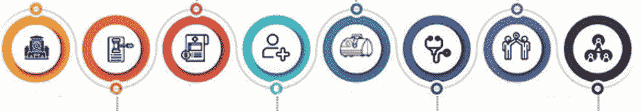

## 医疗行业的生命周期

无论哪个领域，每个行业都有四个阶段：引入、增长、成熟和衰退。任何行业的生命周期如图 1.2 所示。

假设医疗保健行业已进入成熟阶段。可能医疗保健行业早已理解了黄金圈范式：为什么（动机）、如何（过程）和是什么（产品），这就是该行业在竞争激烈的时代维持下去的原因。

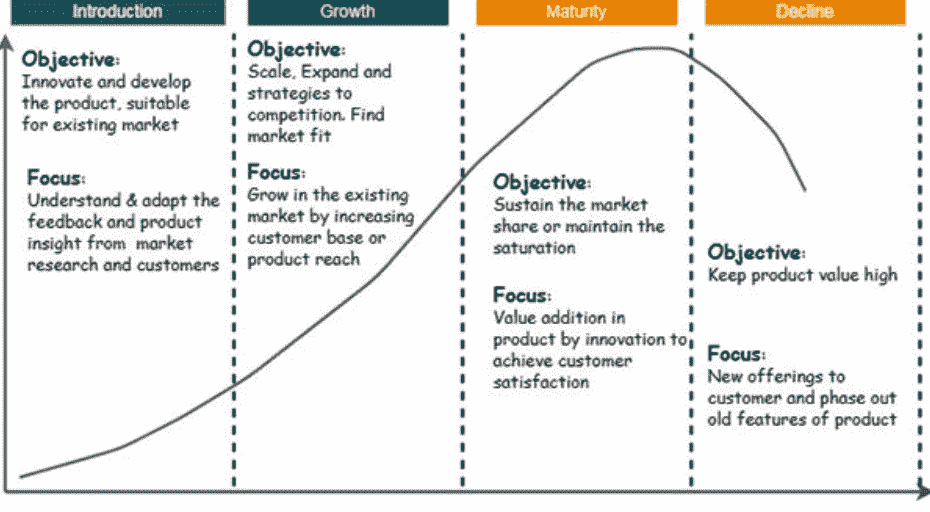

医疗产品服务的关键需求驱动因素包括：

- 人口增长
- 收入水平
- 人口统计状况
- 医疗技术的进步
- 健康意识

医疗行业的需求和供给是非弹性的，因为对医疗服务或产品的需求不会随价格变化而改变。这种独特的属性是由医疗行业的性质导致的，消费者并不直接支付服务费用。保险公司是医疗支付周期和维持现金流的支柱。据估计，全球超过 75% 的医疗费用由保险公司或政府资助计划支付。有趣的是，缺乏弹性是医疗行业同行之间竞争较少的原因，特别是在医院和其他医疗机构。

## 医疗行业面临的挑战

随着全球医疗服务/产品需求的增长，医疗利益相关者面临着巨大的压力，他们不断努力应对临床、运营、法律、数字和财务挑战。近期，我们看到包括医疗在内的所有领域技术都在飞速发展。新兴技术和趋势也影响着医疗市场的格局，医疗领导者、专业人员和政策制定者理解并解决这些潜在挑战，对于维持增长和业务至关重要。以下是医疗行业的一些关键挑战：

### 医疗技术的进步

医疗硬件和软件领域的技术变革正将精简的服务/产品推向市场，并利用现代医疗系统。例如，大数据、人工智能、机器学习、区块链和物联网等技术可以改变现有的医疗系统，开发一个连接的医疗生态系统。这听起来可能很吸引人，但在未来修改现有的医疗遗留系统并使用物联网连接更多医疗设备可能是挑战性的。领导者和专业人士需要振作起来，与医疗 OEM、软件技术提供商和全球医疗联盟密切合作，以适应新的医疗实践并采用新技术。

### 医疗成本和支出的激增

医疗市场研究显示，预计全球医疗支出到 2023 年将以 5% 的复合年增长率增长，这将为医疗行业带来新的挑战和机遇。医疗行业的关键利益相关者，如制药、保险供应商、OEM 和生物医学公司，在决定医疗服务成本和支出方面发挥着至关重要的作用。医疗行业非常敏感，由于任何原因导致医疗服务成本增加可能会导致患者放弃选择这些服务，并影响医疗公司的收入。这种高成本也影响了许多政府资助国家的政府医疗服务支出。

### 医疗法规和政策

医疗法规和政策对于确保患者获得医疗服务和产品的基本标准遵守至关重要。监管机构和框架旨在确保医疗服务的高质量，但法规、法律框架或伦理实践中的细微问题都可能给医疗行业带来意想不到的挑战。通常，政府制定监管框架来对生态系统实施规定、规则和法律。在许多情况下，观察到由于医疗利益相关者的松懈，医疗服务提供者陷入了复杂的罚款、诉讼和制裁。

### 安全和隐私担忧

医疗数字化的进步导致医疗同行大规模收集客户的敏感数据，而连接的医疗设备在大规模收集患者数据方面也起着重要作用。脆弱的数据点是网络罪犯的首要目标。HIPAA 进行的研究表明，仅美国医疗行业就发生了 350 多次数据泄露攻击，暴露了 493 万份患者记录。任何数据泄露不仅损害了敏感的患者信息和信任，还可能引发诉讼和罚款。

### 数据处理与分析

医疗行业的数据点是通过从各种来源收集大量数据准备的。由于缺乏对高级分析和处理（例如大数据和数据科学）的理解，许多医疗参与者无法有效使用这些非结构化、无组织但可行的数据。数据分析产生的结构化数据可以改进医疗服务，减少行政负担，提高收入和客户满意度。

### 互操作性挑战

医疗行业见证了医疗技术的 360 度转型，该领域的创新层出不穷。尽管如此，医疗系统之间的互操作性问题仍然存在。据观察，超过 60% 的医院无法访问其电子健康记录（EHR）系统之外的数据，但 EHR 的阻力、无组织和非结构化的患者记录以及更高的系统集成成本使互操作性问题进入了医疗格局。

### 价格透明度

价格和发票缺乏透明度导致患者延迟付款。受过教育且精明的患者现在在使用之前会研究服务和产品价格。患者倾向于不考虑不公开价格的医疗机构。价格透明度是全球医疗领域的一个重要挑战，需要以优雅的方式解决。

### 医疗供应链

与其他行业相比，医疗供应链是独特的，并带来了独特的挑战。在医疗领域，最终消费者是患者，他们希望以负担得起的价格获得医疗服务和产品且不损害健康。医疗供应链还涉及监控、运输、开票等，与其他供应链类似，但输出包括可能处于危急状况的健康。服务提供者需要解决隐藏成本、供应短缺、缺乏自动化、即时运输、缺乏数据透明度等挑战，以优化医疗供应链。

## 记录的管理

文档（无论是纸质还是数字）都是任何组织和机构顺利运行和恢复功能的关键部分，对于审计目的也是必要的。随着技术的进步，全球各行业已采用日常运营和记录保存的数字化。如今，许多政府机构、组织和企业依赖于电子文档。这增加了对大量数据进行管理和保护的需求。电子记录是数字形式的文本、数据、图像、音频等的组合，由计算机创建、修改、维护、归档、检索或分发。根据其价值，电子记录可以分为关键记录、重要记录、有用记录和非基本记录。图 1.3 显示了生命周期中的不同步骤。

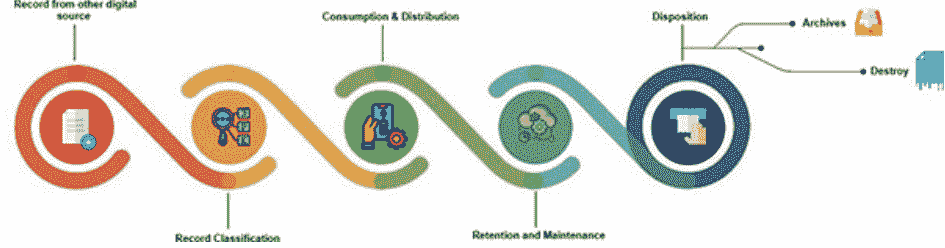

让我们详细查看每个阶段：

1. 电子记录生命周期的第一阶段是创建原始数据并对其处理，或从现有系统或通道检索记录。
2. 在第二阶段，执行记录的分类。分类需要根据业务规则将记录系统地识别并安排到逻辑结构中。
3. 在生命周期的第三阶段，会检索记录并用于完成业务流程，如果需要，根据共同共识在其他利益相关者之间共享数据/记录。
4. 第四阶段是基于一组业务规范的决策过程，以判断记录对未来方面是否有用。根据其价值和收益，保留或销毁记录。
5. 记录的处置是将记录传输到永久存储中供未来使用的过程。根据业务决策对记录进行存档或删除。

在医疗系统中，电子病历（EMR）和电子健康记录（EHR）被交叉使用。根据世界卫生组织和其他医疗联盟的说法，EMR 是实时的患者健康记录，可以访问循证决策支持工具，这些工具可以帮助医生做出决策。EMR 可以帮助简化通过系统之间有效的数据共享来实现临床运营的自动化，防止对低效医疗服务的响应延误。此外，EHR（电子健康记录）是由多个渠道（医生、医疗机构等）生成的延伸电子记录，旨在为患者提供全面的、长期的健康视图。EHR 可能包括检查结果、病史、人口统计数据、药物、现病史等。EHR 和 EMR（电子病历）系统之间的主要差异如表 1.1 所示：

| EMR（电子病历） | EHR（电子健康记录） |
| --- | --- |
| 记录来自诊所或医疗提供者办公室的患者医疗或临床记录的数字记录。 | 从多个来源收集的患者健康信息的数字记录。 |
| 对患者医疗记录的局部视图。 | 患者病史的纵向或全面视图。它有助于医疗专业人员更好地了解患者状况。 |
| 并非为诊所以外的共享而设计。 | 设计用于与其他利益相关者共享患者更新的实时健康信息。 |
| 医疗记录使用受限；仅用于治疗和诊断。 | 允许访问工具和技术，以实现更好的决策和产品提供。 |
| EMR 系统由个人诊所或医院管理。 | EHR 系统由政府、医疗联盟或机构管理。 |

表 1.1：EMR 与 EHR 的主要差异

医疗记录对于患者的医疗保健决策至关重要，因此有必要维护患者记录和相关信息，以便医院和诊所能够提供更好的护理服务。医疗记录管理一直是医疗利益相关者的首要任务之一，并整合了系统间的数据传输以实现更好的决策。


EHR 系统基于一组全面的数据库运行，用于存储、处理和访问患者的医疗记录。患者记录可以在医院或机构的不同部门之间内部使用。现有医疗生态系统中的 EMR 充当不同目的的患者健康信息的主要来源，例如临床、治疗、预防性护理、法律、保险、行政运营等。EMR 是一个连接的系统网络，根据业务需求从多个渠道记录、存储、处理、分发、处置和呈现信息。医生或医疗专业人员可以访问 EMR 并检查患者的医疗档案，以获得更好的决策和。。图 1.4 提供了 EMR 系统的全面视图。我们将在后续章节中详细讨论 EMR、EHR、HIS 等。

成功且高效的 EMR 有助于创建患者健康的可靠且有效的数字形象。EMR 系统与多种渠道交互以收集数据，因此人为错误、数据输入遗漏和错误输入始终会导致 EMR 系统的缺陷。尽管电子记录是医疗行业的重要部分，但它们也存在一些瓶颈，如下：

- 现有的纸质系统
- 合规性与监管问题
- 患者记录的安全性
- 数据泄露导致的医疗身份盗用
- 集成与互操作性挑战
- 患者日益增长的期望

尽管面临这些挑战，EMR 系统仍然是有益的，通过减少人为错误和药物错误、缩短处理时间以及提高决策效率，帮助全球的医疗专业人员。EMR 系统已证明在增强效率、决策和分析方面有效，并为医疗部门提供了临床指南支持：

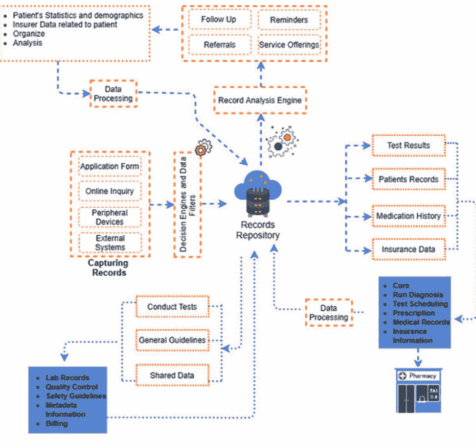

## 药店业务概述

人口的增长、对药店的刚性需求以及人口健康意识的提高是驱动全球零售药店业务的关键因素。预计全球药店零售市场在 2018-2023 期间的复合年增长率（CAGR）为 4.9%。药店和商店在全球已存在数十年，但技术进步正在带来创新并重塑该行业。全球药品行业包括零售药店和商店，负责销售或分发药物和药品（处方药或非处方药）。除了药品，药店还零售化妆品、光学商品和商品、个人护理产品等。

该行业是碎片化的，并取决于经济因素、政策和法规、GDP、合规性、消费支出等全球因素。与受重挑战驱动的发达经济体不同，发展中国家的零售药品市场和药店是碎片化且无组织的。零售药品市场的真实增长尚未被充分评估，因为它尚未以全部潜力渗透市场：

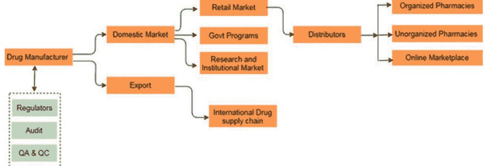

图 1.5: 药店行业层级结构

药物消耗呈指数级增长。这种增长源于两个主要因素：人口老龄化和健康意识。第一个因素与处方药有关，另一个因素涉及健康补充剂和个人护理产品。随着需求的增加，许多零售药店正努力在门店保持有效且高效的运营。现代药店面临的一些共性挑战是：

- 用新的自动化系统取代传统系统
- 更高的集成成本
- 市场竞争激烈导致收入下降
- 劳动力问题
- 监管规定

图 1.6 展示了药店运营从输入到输出的简化工作流，以理解传统零售药店的运营挑战。如今，药店与在线服务提供商合作，以实现更快的交付、简化的运营和尖端的用户体验。流程自动化是当务之急，以消除人工干预并提高药店的整体效率。技术作为一种推动因素对输出具有隐藏的积极影响，在简化药店流程时应予以考虑。与药店相关的许多重复活动可以使用先进系统简化。以下是药店管理系统的优点：

- 无缝工作流：连接设备处理文档、条形码和库存。
- 效率：消除纸质工作流并简化信息的存储和检索。
- 数字库存：高效管理库存并减少短货风险。
- 客户满意度：快速处理支付和结算并满足客户需求。
- 合规性：遵守合规性和法律义务并保护患者信息。

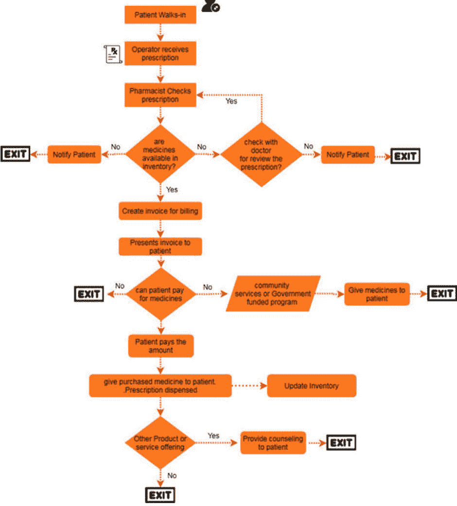

图 1.6: 典型药店工作流

为了高效地处理日常活动，许多药店（个人或医院药店）正在部署如图 1.7 所示的药店管理系统。

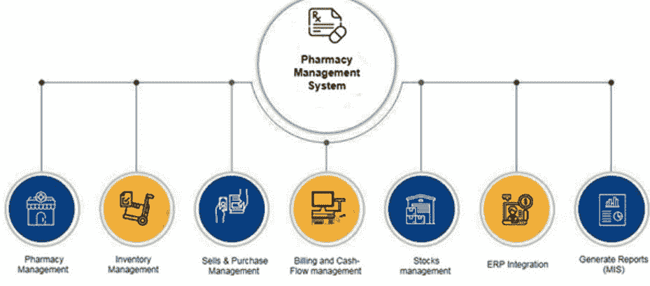

图 1.7: 典型药店管理系统

## 在线市场和电子药房的兴起

随着技术的进步和互联网及智能手机用户的增加，许多药店在线销售药品并交付。电子药房是在线销售处方药或非处方药的公司。它们也受运营国家法律框架的限制，与传统药店一样。电子药房有不同的执行模式；例如，某些药店仅在提供有效处方后发放药物，有些提供在线咨询以开具和发放药物，而有些则在没有处方的情况下发放药物。许多因素（包括全球目前的流行疫情形势）促使消费者转向在线并选择数字医疗。下表对比了电子药房和传统药店：

| 电子药房 | 传统药店 |
| --- | --- |
| 用户体验 | 客户更方便，因为可以随地、随时间访问移动应用程序或网站。 | 客户需要在实体店排队购买药品。 |
| 时间效率 | 配送合作伙伴即时支付和上门交付。 | 耗时的运营。 |
| 成本 | 折扣价格、返现优惠、忠诚度奖励、预付卡等。 | 实体店无法提供由于利润率较低，折扣很大与电子药房相比。 |
| 库存 | 线上药店拥有大量的库存。因为它们采用伙伴关系模式其他参与者合作。 | 库存有限。 |
| 数据隐私和保密性 | 消费者与药房进行虚拟互动增加了关于处方和疾病的保密性和隐私性。 | 患者需要访问实体店物理互动时，保密性和隐私有时无法维持。 |
| 医学信息 | 线上药店可以提供关于药物的全面信息供他们提供或咨询药物。 | 患者需要查看 |
| 未来愿景 | 线上药店可以直接对接政府资助的库存计划服务于弱势患者。 | 与此类服务的集成是手动且不能保证良好的结果。 |
| 个性化定制 | 线上药店可以分析客户的行为和习惯并提供更具个性化的优惠。大数据已经到位用于此。 | 实体店必须花费大量精力手动收集数据，因此很难提供特定的优惠。 |

表 1.2：对比研究

在线药房店的业务模式围绕着通过节省时间和金钱，为终端用户提供无缝体验。与传统药房一样，线上药店必须遵守当地政府或监管机构实施的准则、政策和标准。此外，大数据、区块链、在线市场等正为现代线上药店提供技术支持。线上药店生态系统是多个关键利益相关者的结合，如药店、分销商、药品供应商、交付合作伙伴和客户。在这些关键利益相关者之后，一个强大的支持系统正与线上药店共同工作，以更好地服务客户。[图 1.8] 显示了线上药店系统的高级生态系统。

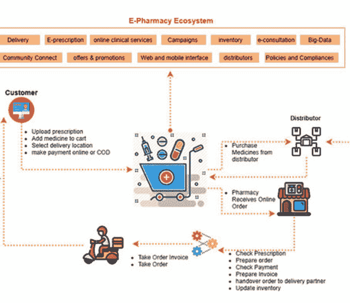

图 1.8：线上药店的生态系统

在线零售药业务正在兴起，在全球范围内吸引投资和合作，但所有这些便利都是以健康欺诈、数据泄露和不道德行为为代价的。全球各地的政府和监管机构正在通过法律和合规框架以及监控实践对线上药店业务进行严格审查。这些做法对于监管和监控在没有有效处方或使用伪造处方的情况下买卖处方药是必要的。此外，需要这种执法来停止医疗保健领域的健康欺诈和网络犯罪，并控制未经授权的药物。医疗保健系统的 360 度转型是由区块链、大数据等先进技术驱动的，旨在为大众提供有效的医疗保健服务。我们将在随后的章节中讨论区块链如何在线上药店业务中发挥关键作用。

## 医药制药行业中的供应链

现代供应链，无论涉及何种行业，都是公司和其他利益相关者的连接系统，他们共同负责向消费者生产、分销和销售任何特定产品。供应链网络是关键活动、技能资源和机器、实体、信息和人的复杂组合。供应链源于日益激烈的竞争，并为消费者提供了低成本的产品。图 1.9 是任何行业供应链的自解释性插图。内部流程和政策在不同行业之间可能有所不同，但基础（从制造到消费）是相同的。

医药供应链可以定义为制造处方药并将其交付给消费者或医院的系统。制药行业直接影响数十人的生活，因此它是作为一个复杂的流程和操作链来执行的。多个组织和子行业参与了这一链条，从发现、制造到交付。如前所述，医药供应链涉及多个利益相关者，如制造商、分销商、行业、物流支持、零售商、消费者等。对于制药公司来说，风险总是很高，因为制造的药物如果不符合标准或配送不当，将影响公司的声誉并引发财务和法律责任：

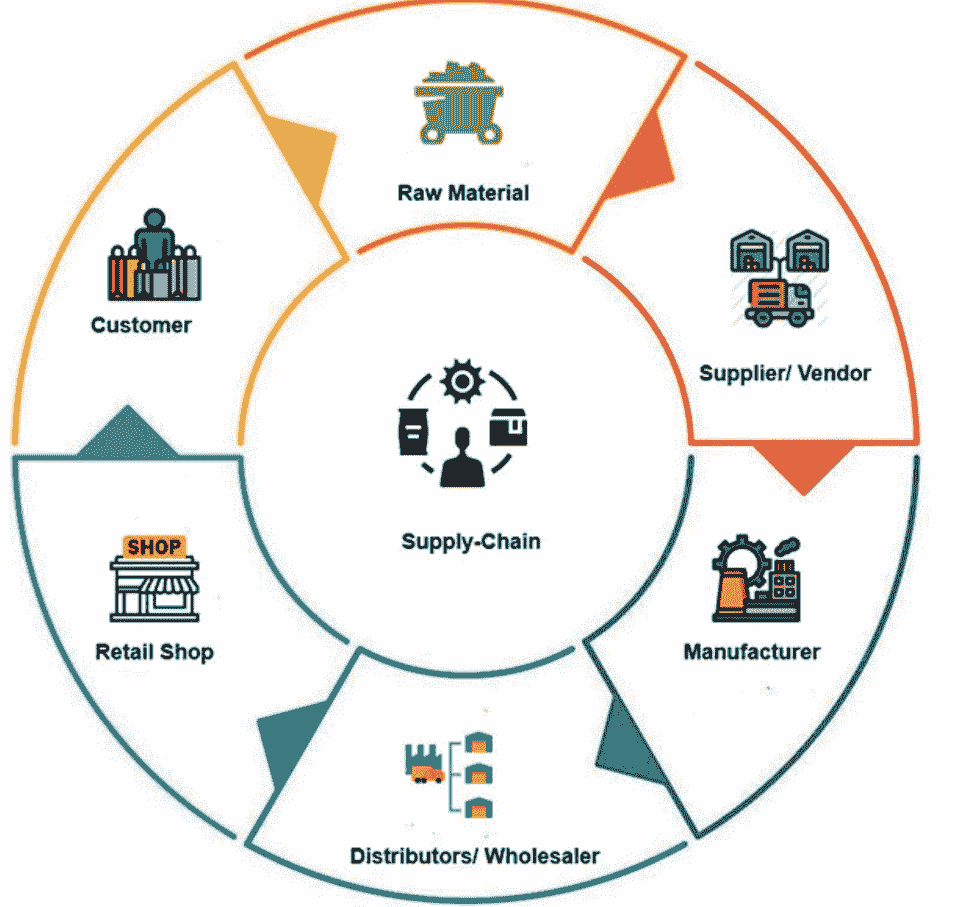

**图 1.9：**供应链工作流

建议医药利益相关者与正确的配置、适应性和最佳实践相结合，以克服医药供应链的复杂问题。医药供应链是医疗系统的关键组成部分。在分析了现有或新的健康状况后，制药公司会对新药的研发进行脑风暴，一旦药物开发，不同的流程、利益相关者和限制就会控制整个链。就像通用药供应链一样，医药供应链由政府机构、制造商、分销商、物流合作伙伴、药店、医院、研究机构和 FDA 组成。为了增加复杂，该供应链还负责处方药、仿制药的材料处理，这些需要特殊的需求、操作和存储。事实上，还有许多其他组织，如保险公司、医疗管理组织、GPO（集团采购组织）和技术服务提供商，它们进一步增加了复杂性：

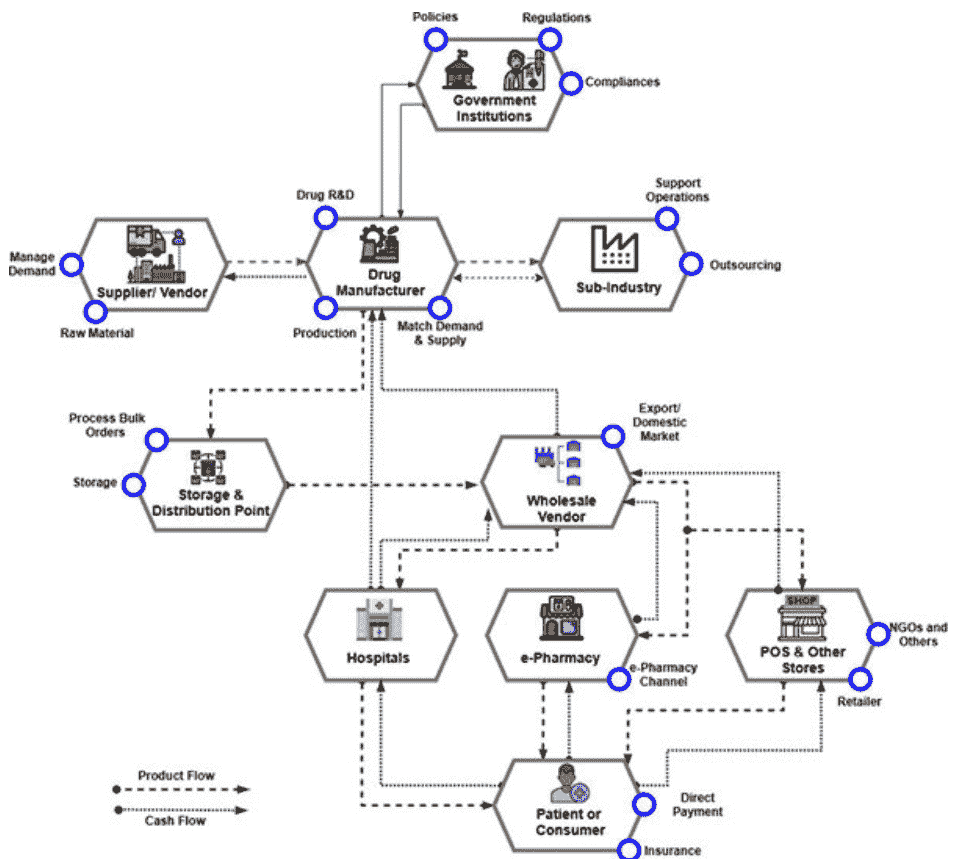

图 1.10：典型的医药供应链

由于不同的业务目标和高期望，子行业或组织所遵循的流程使整个供应链变得复杂。此外，严格的法规和合规政策以及该领域的知识匮乏给供应链带来了意想不到的挑战。许多公司以孤立和无计划的方式来应对这些挑战。医药供应链面临复杂的挑战，如下所示：

- 医药供应链缺乏可见性是一个关键问题之一，因为对药物短缺、伪造品、制造中的阿片类药物的预测缺失以及更新的法规政策会直接影响制药公司。提高可见性还能增加收入并确保安全。
- 伪造药物一直困扰着政府、监管机构和消费者，机构要停止这些伪造药物是非常的。糟糕的供应链管理和追踪一直是这个伪造市场的支柱，这一挑战需要立即关注。改进的供应链可以帮助组织和公司在发现伪造者后迅速做出。这可以通过先进的软件技术和严格的合规政策来实现。
- 医药市场正在快速演变，公司正努力满足现代市场的需求。供应链的利用不足和效率低下是制药公司革新现有系统、流程和文化的主要驱动力。
- 存储、仓库和运输问题，如药物的妥当处理和温度控制。大多数药物是生物性的，非常脆弱且对热和水分敏感。为这些药物维持受监管的环境是制造商面临的关键挑战之一。
- 已经有多起报告显示 FDA 向制药公司发出警告以提高质量控制和合规性。在全球范围内观察到许多公司为了满足市场需求采取了不道德的行为，导致诉讼和罚款。行业、供应商和分销商预计将遵守当地当局设计的政策。目前还没有用于追踪这些情况的数字系统，但大数据和区块链等新技术有助于维护供应链中的法规遵守和合规性。

制药公司已经意识到现有的供应链挑战及其对竞争和收入的影响。市场正在从水平的需求驱动模式转向拥以患者为驱动的模式，因为人们现在更具有健康意识也更关注健康。市场需求的范式转移正使供应链的所有利益相关者进一步调整供应运营，并通过演进和数字化协作，采用更以网络为中心的方法构建医药供应链。

制药供应链与合同制造商、第三方物流供应商、供应商和监管机构之间存在相互关联的依赖关系。许多医疗保健公司、初创公司和技术提供者正在改进数字诊断、基于价值的成果、数字化和协作，因此制药供应链也经历着大变革。人工智能（AI）、大数据、云计算、物联网（IoT）、机器人、区块链、网络安全、RFID 和机器学习等数字技术，具有成为供应链数字化转型推动者的潜力。

数字技术的作用和实施取决于具体的用用例和业务目标，例如风险缓解、成本节省、增加收入、缩短时间等。识别与用例最相关的应用领域、建立专业知识和协作、设定可实现的目标并衡量结果和影响至关重要。图 1.11 显示了技术如何转型医药供应链：

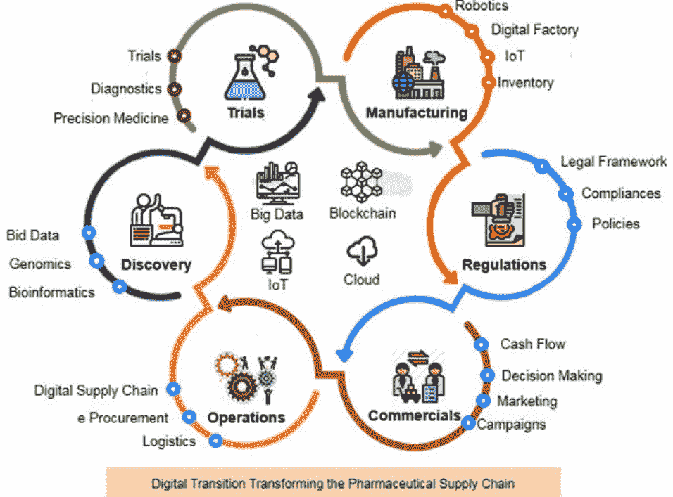

### 医药供应链的技术赋能因素

新的尖端数字技术改变了不仅是供应链，而且每个行业现有流程和操作的处理方式。数字化正在改变典型组织的工作方式，并有可能为任何行业的价值驱动型流程释放新机会。医疗保健领域的商业公司正在投入巨资，将其业务模式、运营和流程等进行数字化。以下是制药供应链领域的一些技术赋能因素：

- **基于云的 ERP 和 EPM 解决方案**

  在过去的几年里，许多制药公司一直在努力适应由复杂供应链、进出口压力、国内需求、法规和合规、个性化药物增长等驱动的供需范式转移。复杂的遗留 IT 系统和基础设施增加了制药公司面临的挑战。大多数供应链利益相关者都赞赏精简和需求驱动的供应，但由于缺乏所需的工具和基础设施，通过充分利用资源反而阻碍了行业发展。技术提供者现在正接力接棒，通过提供具有核心 ERP 系统的云端基础设施来转型制药供应链。基于云的 ERP 系统可以实现与其他利益相关者共享关键数据：合同制造商、业务部门、分销商、零售商、物流合作伙伴等。领先的制药公司和其他利益相关者已经在努力将他们的核心 ERP 和 EPM 系统与云端集成，或正在计划迁移。云服务提供了近乎实时的连接，以及维护复杂且可扩展网络的能力，无论涉及多少接口。这正驱动利益相关者完成集成，并为价值驱动的需求做出贡献。

- **大数据分析**

  大数据和数据科学有助于建立整个供应链的可视性，使利益相关者能够对任何即将挑战或潜在威胁采取预测性措施。在药物生产和包装过程中，大数据分析可以通过收集振动、压力等温度数据实现状态监控和预测性维护，从而显著减少机器停机时间。制造商还可以最大化维护团队的效率，将时间集中在性能退化的资产上。此外，大数据分析可以通过产品分拣追踪药品。使用摄像头、视觉系统和其他检测设备允许监控关键药物以确保标准。

- **区块链**

  简而言之，区块链是一种分布式、去中心化、不可变、防篡改且安全的数字账本技术，正作为一波热潮席卷多个行业和公司。区块链已经通过试点案例证明了其在电子商务、银行金融及保险（BFSI）和能源领域的有效性，现在制药行业也开始尝试这个新技术婴儿。区块链最适合医药供应链，因为其中涉及多个利益相关者，他们通过相互通信来完成药物交付。区块链可以在增强供应链的安全性、完整性、数据溯源和功能方面发挥关键作用，我们将在后续章节中介绍区块链。

- **物联网和连接设备**

  随着各行业云技术和物联网设备的兴起，制药行业也意识到了物联网环境在供应链用例中的重要性。冷链监控是医药供应链中物联网的一个可行用例。一些研究表明，由于冷链问题，每年损失超过 300 亿美元，制药行业正期待通过物联网解决现有的供应链挑战。物联网传感器和设备对于自动温度监控和保护冷链至关重要。它们还可以帮助保护药品的效力和和安全性，消除人为错误的机会，增加实时透明度，并防止由于未达到质量标准导致的产品损失成本。

- **人工智能和机器学习**

  机器学习（ML）和自然语言处理（NLP）与预测分析结合时，可以转型医药供应链，实现更直观、更数据驱动的医药供应链管理方法。药物从制造商到患者通过供应链移动的实时可视性和相关数据，对于识别和预测与库存管理、冷链管理、药物短缺和药物流失相关的挑战至关重要。医药供应链利益相关者必须通合作并共享信息，以提高效率并确保药物安全、及时、完整地送达患者，而不损害其业务利益。人工智能和机器学习可以共享智能数据信号，提供关于库存和可用性的实时决策，并显著降低与大规模中断相关的成本。

- **机器人流程自动化**

  它是一种设计用于自动执行不需要人工干预的常规活动的软件或机器人。RPA 可以确保任何业务流程的准确性、效率和成本节省。它可以帮助医药供应链中的库存管理、跨渠道集成和临床开发。

## 医疗保健保险行业和业务模式

保险部门在医疗保健体系中可能处于最低端，但它是非常重要的，因为保险部门管理着医疗保健行业的现金流。这一说法的依据是一个事实：医疗费用、账单和发票大多由保险公司支付，而不是个人。个人自掏包支付医疗费的比例相对较低。个人通常购买保险保单以避免自掏包支付治疗或医疗护理费用。保险公司收取保单保费，并根据保单的条款和条件向客户提供福利。保险公司的业务模式由简单的逻辑驱动，它是一种风险池的方法，将医疗机构的财务负担分配在几个人身上，假设只有少数人需要医疗关注，而其他人将保持健康。

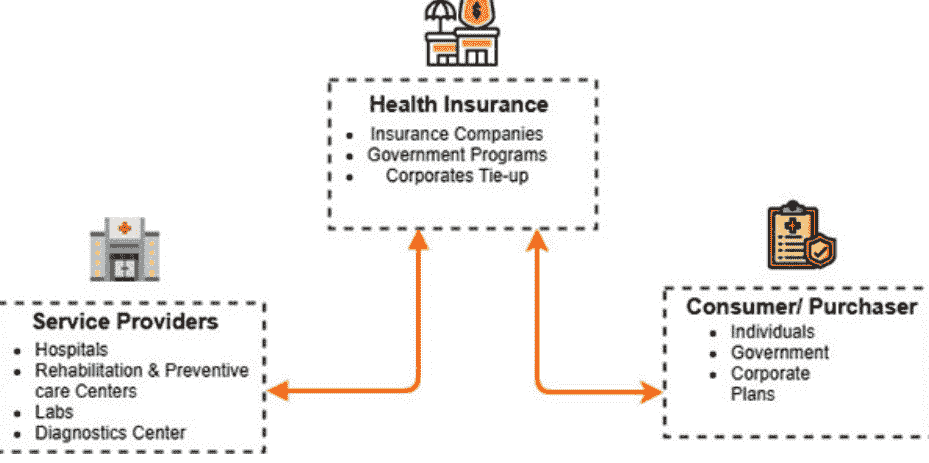

图 1.12：医疗保险生态系统

保险公司可以根据个人需求提供多种健康计划，这些计划旨在为具有不同需求和价格承受能力的人群提供保险福利。保险是医疗保健成本的驱动因素之一，因为它取决于服务的复杂性、后期护理服务、提供者的成本结构以及保险提供商。

患者可以使用医疗保健服务并随后申请健康保险。向公司申请理赔有预定义的方法，例如无现金理赔和报销理赔。个人在办理理赔时必须记住几点：所需的证明文件、涵盖范围和除外责任、限额、保单有效期以及医院网络。任何对上述标准的偏离都可能导致不必要的现金支付和不便。尽管技术进步正在帮助机构简化理赔流程并为患者提供无忧的体验，但许多流程仍然是人工的，并需要人工干预。图 1.13 显示了理赔处理的一工作流。这可能无法反映理赔处理的全景，但将提供一个高层概述，因为由于不同的政策、法规和合规要求，不同地区的理赔处理可能会不同。

全球健康保险市场预计2019 年到 2025 年的复合年增长率（CAGR）为 5%。医疗支出的增加、经济发展以及医疗意识的提高是保险行业增长的因素。由于市场竞争、法规变化、市场声誉、成本效益和运营效率，保险行业正处于转型阶段。保险行业与其他任何医疗行业一样，面临着需要解决的挑战，以便为客户提供更好的服务丰富的产品。以下是保险行业面临的一些挑战：

- 数据处理
- 创新产品

随着同行竞争的加剧，保险公司面临着巨大的压力，需要为消费者提供新的创新计划和优惠。新的保险产品可以建立全面的客户关系。

- 法规与合规

医疗保健部门（包括保险行业）不断变化的政策和法规让市场参与者面临压力。他们需要 24 小时监控法规和合规政策，未能合规将导致法律处罚、执照吊等。

- 旧的遗留系统

数据中心和现有基础设施仍运行在旧的遗留系统上，公司意识到需要将旧系统迁移到云端系统，以获得更好的 IT 基础设施。然而，这可能会导致高支出，并需要人才储备来顺利完成迁移。


与其他任何行业一样，现代端技术在保险行业也经历了指数级增长。技术的进步同样造福保险机构及其客户。例如，客户更倾向于从保险聚合商处在线获取保险需求的报价，这些聚合商会分析客户数据并提供最佳建议。以下是保险行业紧密结合并在转型保险行业中起着关键作用的一些技术：

- AI 驱动技术（大数据、机器学习等）
- 预测分析
- 物联网 (`IoT`)
- 区块链
- 远程信息
- 聊天
- 自动交付系统
- P2P 和按需保险

此外，保险领域格局的变化已经吸引了风险投资和其他渠道的大额投资，因为投资者认为这些初创公司是保险领域可行的商业解决方案。在某些情况下，保险公司与初创公司合作，允许他们探索并为客户带来创新产品。

考虑到战略投资和合并，全球医疗保健市场近期出现了有趣的伙伴关系，例如 Apple、Alphabet Inc、Philips、Amazon、阿里巴巴等。这些公司正尝试利用手机、传感器和健康跟踪设备等现有基础设施来收集信息数据，并为消费者设计新产品和增值服务。这些初创公司通过分析客户的购买和医疗习惯，通过电子药店、社交媒体、POS 和聚合商等渠道帮助保险公司销售保单。我们将在接下来的章节中讨论这些技术颠覆。

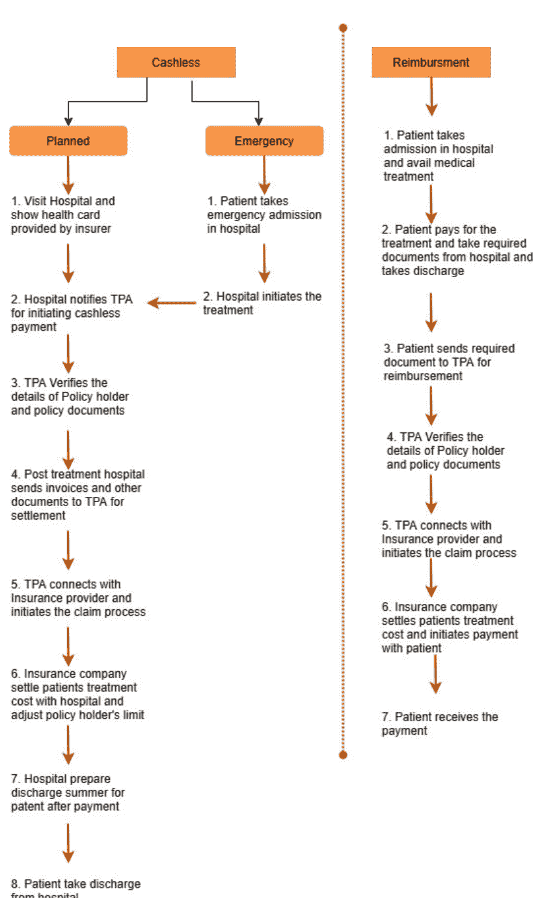

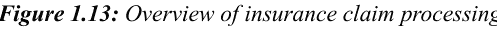

## 食品药品监督管理局 (FDA) 概述

FDA 的使命是确保个人健康安全。它确保任何药物、生物产品、医疗设备、食品供应、化妆品等都符合 FDA 制定的标准，并对公众使用安全。FDA 还与其他利益相关者密切合作，引入创新和服务，使医疗产品安全、负担得起且高效。

FDA 有完善的流程将输入纳入咨询委员会并将其纳入审查过程。出于安全考虑，FDA 可以从市场上召回任何产品。没有获得 FDA 的批准，任何公司无法推出新药、医疗设备或其他相关产品。

FDA 通过强有力的领导和监督指导医疗保健行业，其使命是保护公共健康。这里列出了从 FDA 资源中汇集的一些职责和重大影响：

- 通过指导原则和标准鼓励逐步进行临床开发。
- 对初始试验执行更高的标准和流程。
- 通过预设主要和次要终点测量以及主要分析方法妥善处理多重性。
- 认可疗的可靠性和可解释性，通过评估对受试者“感觉、功能或生存状况”直接指标的影响来增强这种效力。
- 认识到依赖替代终点作为生物标志物时可能被误导的可能性，因为这些生物标志物仅被证明与直接测量相关，而不能充分捕捉风险。
- 在不损害安全指南的前提下，指导非劣性试验的正确设计。
- 通过鼓励及时入组、在实验和控制方案中实现最佳真实世界可依从性，以及最大化留存的积极努力，提高试验执行质量，并维持进行中疗效数据的机密性。
- 认识探索性分析通常应被视为产生假设。
- 认识到确认性试验的必要性，特别是在疗效预测概率不强的情况下（在试验前预期收益较低的情况下获得边缘积极结果），或者当事后分析应被正确视为产生假设时，当发现重要的安全信号时。

## FDA 的技术采用

科学进步推动了新的、创新的、个性化的恢复性选择和医疗保健、先进制造以及信息技术的发展，如区块链、大数据、人工智能、基因学和实时分析能够处理复杂的生物结构、复杂数据以及大量的医疗和生物数据。

FDA 复杂多样的流程和运营需要合适的扩展灵活的 IT 基础设施。其内部团队负责核心遗留系统的现代化和维护。与 FDA 及其他利益相关者合作制定了一项多年战略计划，以现有基础设施现代化。要点如下：

- 云迁移策略
- 引入 `DevOps` 以简化开发能力
- 用于高效安全的数据共享模型的 API 管理层
- 数据清理并迁移到云环境
- 采用 `BaaS`、`SaaS` 模式
- 根据市场需求采用最佳网络安全实践
- 成本控制和消除冗余
- 利用区块链实现多方协作的共享分布式账本
- 使用大数据和人工智能进行数据分析
- 与监管机构、利益相关者及其他初创公司合作以获得更好的结果

技术的快速增长至关重要，因为它为行业、研究人员以及开发数据提交给 FDA（美国食品药品药品管理局）或与其交互的其他利益相关者提供了方向。来自 FDA 的明确监管和技术指导可以催化技术和生物医学领域的创新与竞争。FDA 正在构建日益先进的技术，因此将与外部合作伙伴共同构建的应用程序接口（`APIs`）和其他工具，以便向 FDA 高效提交高质量数据。

## 结论

总而言之，医疗保健行业正向数字化转型，但仍存在需要解决的问题，以实现医疗流程和操作的平高效自动化。在本章中，我们探讨了医疗行业及其利益相关者面临的所有挑战，无论是药剂业务、供应链还是任何其他模块。随着人工智能、大数据、机器学习、云计算和区块链等未来技术的出现，医疗行业也正在经历着彻底的变革。

本书旨在勾勒区块链如何变革医疗行业的轮廓，因此，理解区块链的工作原理，以及它如何在多个利益相关者必须处理患者敏感数据的医疗行业中带来信任、安全和透明度至关重要。后续章节将涵盖区块链如何为医疗业务案例带来影响性变化。

## 多选题

- 1. 电子病历（`EMR`）是患者的医疗记录，来自？

  a. 单一提供者

  b. 多个提供者

  c. 多个渠道

  d. 一组医院

- 2. `EHR`（电子健康记录）是患者医疗史的综合视图。

  a. 正确

  b. 错误

- 3. 来自 `EMR` 的记录可以在提供者办公室之外共享。

  a. 正确

  b. 错误

- 4. 下列哪项不是典型的供应链成员？

  a. 制造商

  b. 分销商

  c. 客户

  d. 零售商

- 5. 供应链包括参与医药产品规划、采购、生产和 ________ 的各方链。

  a. 供应

  b. 分销

  c. 需求

  d. 运输

## 答案

1. a

2. a

3. b

4. c

5. b

## 关键术语

- **OEMs:** 医疗 OEM 是原始设备制造商（`Original Equipment Manufacturer`）的缩写，指生产医疗设备的厂商。医疗 OEM 是医疗设备制造行业的重要部分。

- **EMR:** 患者的电子病历。

- **EHR:** 患者的电子健康记录。`EHR` 是患者医疗史的综合视图。

- **CAGR:** 复合年增长率（`CAGR`）是指投资在特定期间内的年度增长。

- **RFID:** `RFID` 是“射频识别”（`radio-frequency identification`）的缩写，指一种通过读取器通过无线电捕捉 `RFID` 标签中编码的数字数据的技术。

- **FDA:** 美国食品药品管理局（`Food and Drug Administration`）以其监管新药和食品的工作而闻名。

# 第 2 章

## 区块链基础

区块链是一种全新的先进技术，正在彻底改变信息收集、治理和分发的传统方法。区块链是自 2008 年比特币发布以来最受期待的技术。这十年见证了区块链从概念证明（`POC`）到完全商业化用例的剧烈趋势。包括金融、供应链、能源、医疗保健和制药在内的不同行业和领域的专家对区块链的潜力感到着迷，并试图用基于区块链的系统取代旧的遗产系统，以成为早期采用者并从分布式账本技术受益。

医疗保健行业在区块链方面并非例外，正在探索跨医疗行业及子行业的用例。本章旨在阐明区块链或分布式账本技术，以及它是如何从一份简单的白皮书演变为完全的商业级技术的。

## 结构

我们将在本章涵盖以下主题：

- 区块链及其构造
- 比特币简介
- 比特币钱包和挖掘概念
- 密码学与哈希
- 区块链中的共识算法
- 不同类型的区块链
- 区块链中的代币化
- 智能合约指令
- 开发和部署示例智能合约

## 目标

本章将向你介绍区块链的基础及其核心概念。你将理解区块链的构造以及区块是如何创建的。本章还将带你回顾区块链的历程，以及中本是如何创建出分布式网络魔法世界的。在未来，你将理解密码学和 `P-2-P` 网络的概念。你还将被介绍比特币和数字钱包的世界，以及挖掘在典型的比特币网络中是如何工作的。本章还将概述区块链网络中使用的不同共识协议，以及根据用例和业务要求的不同类型的区块链网络。此外，它将探索区块链网络中的代币化和智能合约概念。最后，本章将通过在私有区块链网络上开发、编写、部署和运行智能合约，帮助你理解区块链的开发框架。

## 区块链简介

简单来说，区块链是一个分布式、去中心化、点对点、不可更改且安全的计算机网络，用于存储信息和传输价值的数字工具。区块链可以被视为由固定长度的数据块按顺序连接的数据库，这些区块由 1 到 N 个交易组成。区块链的去中心化意味着整个系统不由单台机器所有，而是由网络中的多台计算机管理。这些独立的计算机被称为“节点”。

区块链技术依赖于三个支柱，这些支柱最初由比特币的匿名创始人提出。这三大支柱是：

- **P-2-P 网络**: 在点对点网络中，多个计算机系统连接在一起，相互共享数据和信息。在区块链背景下，`P-2-P` 网络的设计旨在消除对单一权威的依赖。`P-2-P` 网络可以用 `BitTorrent` 作为真实案例进行比较。

- **非对称加密**: 区块链系统中的计算机或节点通过发送加密消息相互通信。非对称加密（或公钥加密）是区块链节点间共享数据的常用技术。在这种方法中，加密和解密使用两个不同的但在数学上关联的加密密钥。

- **密码学哈希**: 这是一种将任何数据转换为唯一字符串的方法。这个唯一字符串可以被视为数据的“指纹”。哈希技术允许对大数据进行快速比较，并作为验证数据更改的技术。`Merkle tree`（梅克尔树）是区块链中经常使用的术语。它基于相同的哈希技术来验证和比较网络中的数据。图 2.1 显示了区块链网络从集中式到完全分布式系统的演变。

人们应该提出这样一个问题：当我们已经拥有运行良好的中心化系统时，为什么还需要去中心化和分布式网络呢？中心化系统可能帮助构建了现有的网络，但它们也存在一些缺点。

这场辩论始于我们的金融系统设计是如何将所有权力都集中在一个单一的网络或系统中。中心化意味着一个中央控制点，例如在金融或货币市场中的金融机构或银行。长期以来，银行一直根据这一概念运行，以执行资金转账、跨境汇款和其他金融服务，并且一直被认为是安全稳定的。现代金融系统看起来非常安全稳定，但它们也受到欺诈、伪造、双重花费、不可靠的贷款问题等许多问题的影响。2008-2009 年的金融危机引发了这场辩论，而那正是世界上第一个数字货币——比特币诞生的时代，它的出现消除了对中心化系统的需求，并将管理权分配在数千万个节点之间。由于没有中心化，比特币或其他区块链网络不太受到操纵和欺诈的影响。图 2.2 展示了中心化系统与分布式系统：

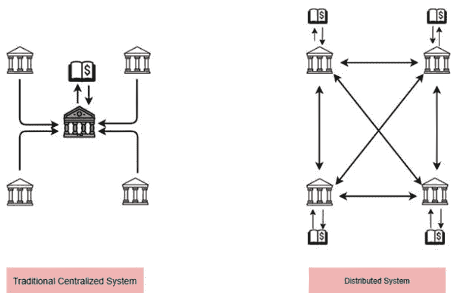

图 2.2：分布式系统 vs 中心化系统

下表强调了区块链与传统数据库之间的区别：

| 区块链 | 传统数据库 |
| --- | --- |
| 只允许读取和插入操作 | 数据库支持 `C.R.U.D` 操作（创建、读取、更新、删除） |
| 支持分布式账本架构，所有节点对输出交易达成共识 | 客户端服务器架构，事务需要两阶段提交 |
| 参与节点可以验证交易 | 管理员用户的访问控制 |
| 几乎无法修改区块链账本 | 恶意用户可以修改主数据库 |
| 每个节点都包含账本的副本 | 采用主从模型或多主模型 |

*区块链网络中的节点是参与式的计算机系统*

表 2.1：区块链 vs 传统数据库

## 解码区块链

现在我们知道，区块链无非一个简单的数据库，其中区块按时间顺序连接。每条新记录都会在区块链网络中进行验证并添加到或存储在链中。区块链网络中的第一个区块被称为“创世纪区块”（`Genesis Block`）。图 2.3 是区块链的符号化解释：

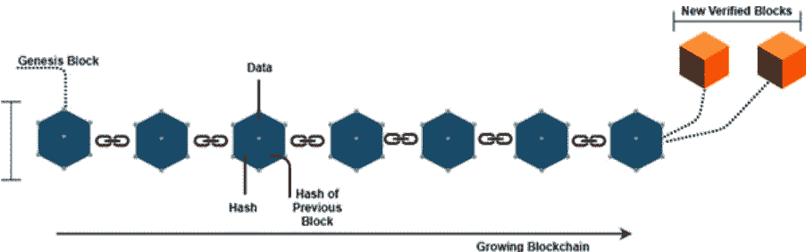

图 2.3：数据区块的链链

区块是区块链网络的关键元素，所有的账本信息都存储在这里。区块的结构可能有所不同，但通常包含一些基本属性，并适用于所有的区块链框架。让我们打开区块链区块，查看每个区块的解剖结构，如图 2.4 所示：

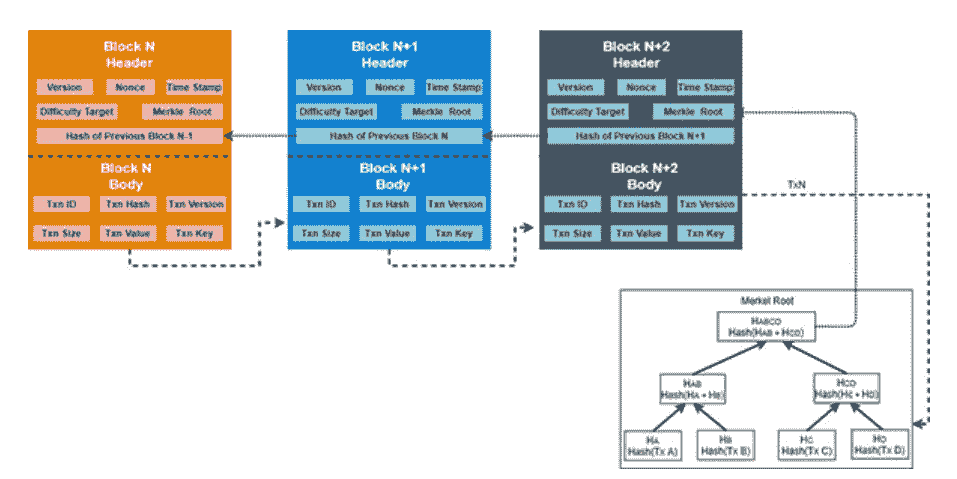

图 2.4：区块链解剖结构

比特币的平均区块大小约为 1 MB，用于存储交易；200 字节预留给头部信息，如时间戳、上一个区块的哈希值等。一旦比特币网络中的某个区块超过 1MB，交易就会被添加到下一个区块。数据一旦被添加到区块链，就无法追溯地进行修改。

## 哈希（Hashing）

哈希是一种数学算法，用于将任何输入数据转换为固定大小的加密文本输出，称为哈希值或 `Hash`。几乎无法从输出数据中重新生成原始数据。哈希简单来说就是任何输入数据的指纹。作为哈希的基本属性，即使输入数据发生微小变化也会产生不同的输出。无论输入数据的大小如何，输出都是固定长度的。例如，`SHA 256` 算法将始终生成 256 位的输出数据。

哈希是区块链能够轻松存储大量数据的秘密成分。下面的示例展示了输入字符串及其哈希输出，它还表明了输入中微小的变化就会改变哈希输出：

**字符串：** "Blockchain in Healthcare"

**哈希：**

```
D68A131AD253A96B24D773520B14FE65BEB47CFCE65AA6FA9B097E3C2E960BA0
```

**字符串：** "BlockchaininHealthcare"

**哈希：**

```
7E518111232352FA9BA5BBBEC6E05E6FF7E089B01F322D5F28D018801C85BB
```

## 区块链交易工作流

图 2.5 展示了区块链网络中的交易是如何启动并添加到区块中的。图片自言其明，但我们在这里用要点列出步骤：

- 有人发起交易。在加密货币的情况下，该交易通过钱包发起。
- 交易传播到区块链网络，并向区块链网络中的所有节点广播。
- 网络中的矿工验证交易。矿工使用工作量证明（`Proof of Work`）和权益证明（`Proof of Stake`）等共识算法运行验证。
- 验证过的交易被添加到新区块中。
- 新区块按时间顺序创建到现有的区块链网络中。
- 每个节点都包含账本的副本。

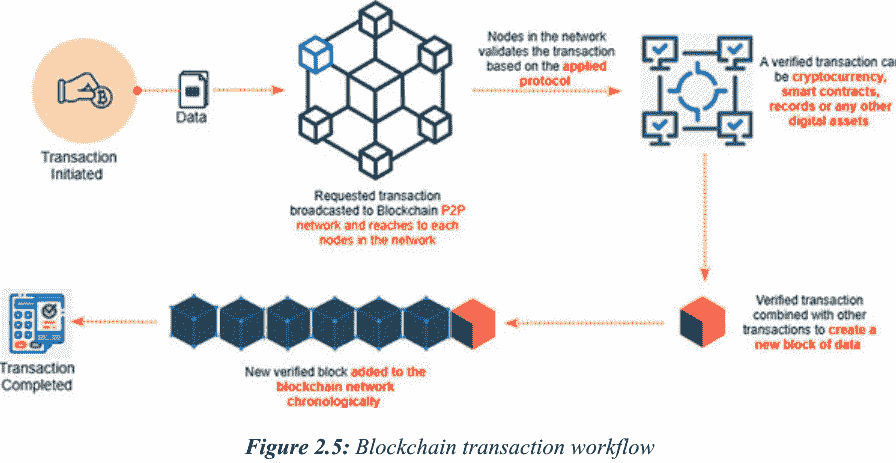

图 2.5：区块链交易工作流

在完成工作量（`Proof-of-Work`）挖矿过程后添加到链中。工作量过程确保参与的矿工花费了有效的计算能力和工作量来解决区块并将其添加到账本中。诚实的矿工将获得比特币形式的激励，矿工所付出的努力确保了区块链的完整性。

比特币网络被认为是一个匿名系统，因为网络上的用户通过数字地址进行标识。这些数字地址（公钥的哈希值）作为区块链上用户的别名。用户的真实身份隐藏在网络中，他们仅通过数字地址进行识别，因此它被称为匿名系统。区块链网络的独特属性也可以应用于数字货币以外的用例中。区块链的属性可以应用于信息、数据或数字权利。但比特币将始终是区块链的首次实现。表 2.2 显示了区块链技术的演进及其用例：

| 区块链版本 | 特性跨度 | 用例 | 关键赋能因素 | 价值驱动因素 |
|---|---|---|---|---|
| 1.0 | 2008-2012 | 数字货币<br>- 数字货币<br>- 支付网络 | - 去中心化共识<br>- 分布式账本<br>- 工作量证明 | - 高交易成本<br>- 依赖中心化系统 |
| 2.0 | 2012-2017 | 可执行合约<br>- 智能合约开发<br>- 智能属性<br>- 数字资产<br>- 合约<br>- 虚拟制造 | - 智能合约<br>- 去中心化<br>- 分布式账本 | - 增加的服务 |
| 3.0 | 2014-2017 | 分布式应用 (`Daps`)<br>- 金融、医疗、能源、政府、智慧城市等领域的 `Daps` | - 去中心化应用、存储和计算<br>- 金融<br>- 互操作性<br>- 智能合约 | - 组织边界 |
| 4.0 | 2017至今 | 互操作性<br>- 工业、ERP、供应链、`IoT`、`AI`、资产的应用 | - 去中心化人工智能<br>- 行业基础设施 | - 自主决策<br>- 无信任系统 |

**表 2.2：** 区块链演进图

| | 管理，以及 | 适当的区块链 |
|---|---|---|
| 集成 | 生态系统 | |
| 不同执行 | | |

## 加密学：数字信任的基础

显而易见，区块链建立在已证明的技术和方法之上，但应用方式有所不同。区块链技术是点对点网络、密码学和加密哈希的编排，所有这些元素的结合使得区块链成为一个无信任系统。简单来说，数字信任是用户对执行任何类型交易的技术和过程所拥有的保证和信心。它是不同实体之间的风险判断，而数字世界的核心就是认证和授权。在区块链中，非对称加密是数字信任的支柱。

由于我们正在使用并并将继续使用“密码学”（`cryptography`）这一术语，我们必须准确理解它是什么。根据简单定义，“密码学”是编写秘密代码的艺术，它已经历史悠久。随着计算机技术的发展，引入了新的加密技术和形式以在各方之间建立信任。在数据或信息共享中，当通信双方通过不可信的介质（互联网）进行通信时，就需要密码学。现代加密算法围绕数学程序和计算困难性假设设计，确保其他或未知实体无法破解系统。以下是讨论密码学时使用的一些术语：

- **明文 (`Plain Text`)：** 任何要传输或存储的、发送者或接收者可以理解的消息。
- **密文 (`Cipher Text`)：** 对明文应用加密后生成的文本。密文只能使用解密密钥转换为明文。
- **密钥 (`Key`)：** 这是一个在应用于明文时生成密文的变量。该密文只能在合适的解密密钥帮助下转换为明文。简之，“医疗保健中的区块链” + 密钥 = 0xETGDGH。
- **加密 (`Encryption`):** 将明文转换为密文的过程。
- **解密 (`Decryption`):** 从密文恢复明文的过程。
- **协议 (`Protocol`):** 预定义的步骤序列。

这些是密码学的主要目标：

- **隐私性/机密性 (`Privacy/Confidentiality`)：** 只有预授权的接收方可以读取信息。
- **身份认证 (`Authentication`)：** 验证用户身份的过程。
- **完整性 (`Integrity`)：** 确保内容保持不变且未被篡改的保证。
- **不可否认性 (`Non-repudiation`)：** 确保发送者无法否认发送了信息。


- **访问控制 (Access Control)：** 一种确保谁可以查看资源的安全技术。
- **可用性 (Availability)：** 意味着网络资源随时可用。
- **密钥交换 (Key-Exchange)：** 发送方和接收方之间共享密钥的过程。

## 加密类型

多年来，开发了各种加密技术以实现数据安全、机密性和完整性。简单代码、对称加密、非对称加密、隐写术和哈希是现代世界最常用的加密技术。在书中，我们将学习三种主要的加密技术：

- **对称加密 (Symmetric cryptography)：** 对称加密，即密钥加密 (SKC) 或私钥加密，使用单一密钥来加密和解密明文。从名称上可以看出，发送者使用密钥加密并与接收方共享。随后，接收方应用相同的密钥解密信息。这种用于加密和解密的常用技术被称为对称加密。图 2.6 是私钥加密的自明易懂流程。请记住，这里使用的是共享密钥进行加密和解密。接下来的图像显示了私钥加密的高级流程。


图：私钥加密

- **非对称加密 (Asymmetric cryptography)：** 非对称密钥加密是一种使用两个数学相关但不同的密钥的加密技术。一个密钥被称为公钥，另一个是私钥。在非对称加密中，公钥用于加密数据，而私钥用于解密。在逻辑上，根据公钥计算私钥是非常困难的。基于这一独特属性，网络中的参与者可以自由共享各自的公钥。公钥允许用户轻松加密数据并验证数字签名。秘密的私钥用于解密内容和创建数字签名，确保所有者的真实性。公钥加密于1976年由斯坦福教授马丁·赫尔曼（Martin Hellman）和学生怀特菲尔·迪菲（Whitefield Diffie）首次引入。共享公钥通常以数字证书的形式存储。同样，私钥存储在软件或硬件（USB 等）中，并包含允许其与环境配合使用的驱动。图 2.7 是公钥加密的典型流程：


图 2.7：公钥加密

- **哈希函数：** 哈希函数或单向加密机制不使用密钥。它是通过数学计算出的固定长度哈希值，取决于输入文本。几乎无法根据相应的哈希值推出原始文本。通常，哈希值用于为文件提供数字指纹，以确保文件或其内容未被更改。哈希函数的设计目的是使输入中的微小变化产生不同的哈希值。任何知道“哈希值”的人都不知道原始消息，但知道原始消息的人可以证明“哈希值”是由该消息创建的。以下是几个例子：

哈希字符串 1：医疗保健区块链

哈希字符串 2：医疗保健区块链。

`MD5 [哈希字符串 1] = 3E69BF0C9E5D483AF53DC46BFD516B3`

`MD5 [哈希字符串 2] = 3CE2DF6C0991A1F97589295AB76C39`

## 比特币交易与钱包

接下来，让我们讨论典型的比特币交易的概念。比特币是一种去中心化的数字货币，任何人可以在无需中介（如银行）的情况下进行购买、出售和交换。数字钱包帮助在区块链网络上执行此类交易。发生过的每一笔比特币交易都存在于所有人都可以访问的公共账本上，这使得交易难以逆转且难以伪造。比特币没有中心化机构或政府的支持，除了系统核心内置的证明外，没有任何东西可以保证其价值。图 2.8 解释了使用非对称加密的比特币交易流向。

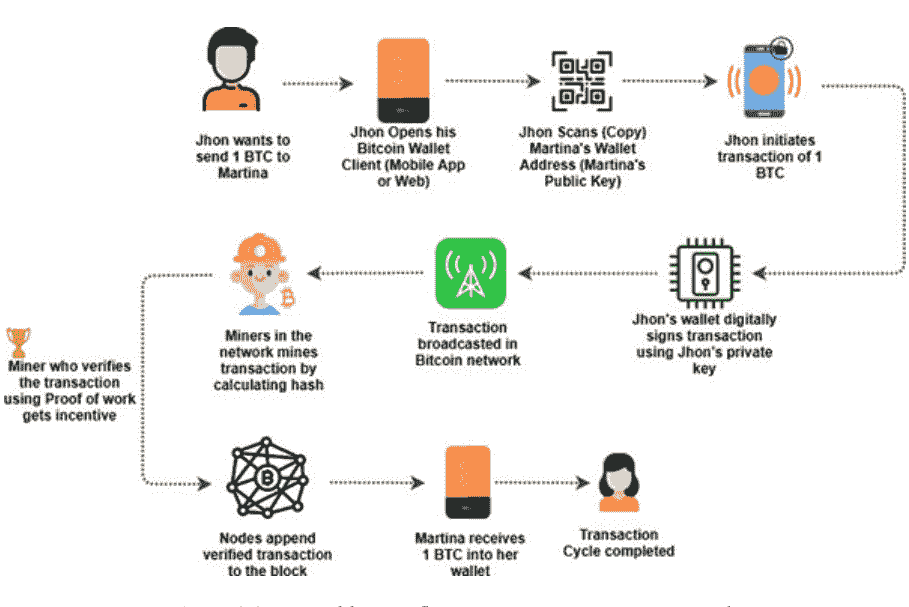

`hash (John -> Martina 1.0 BTC) + John 的私钥 = 08742134314eb43f62376e`

## 交易唯一数字签名

非对称加密是现代密码学非常重要的创新，因为它消除了与交易方共享凭据的需求。相反，它使用一对数学上连接的密钥，即公钥和私钥。

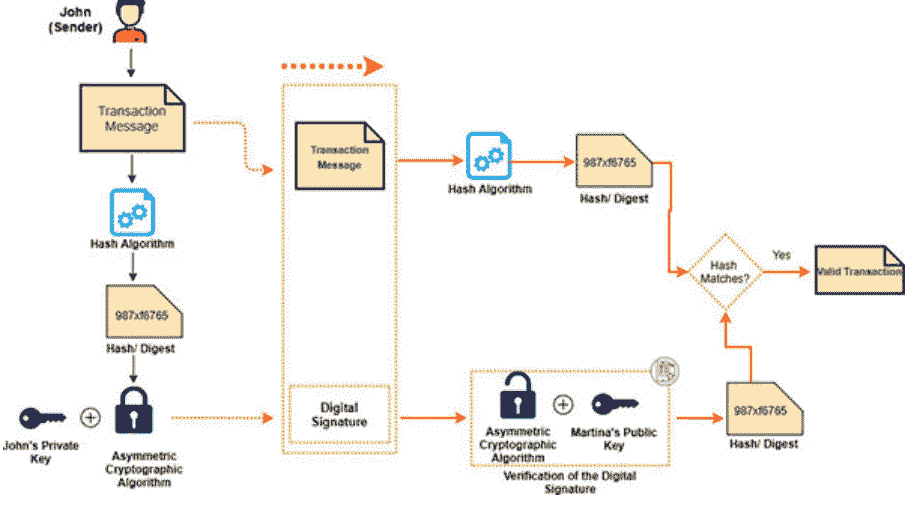

图 2.9：数字签名流程图

图 2.9 解释了非对称加密和数字签名如何帮助启动和验证比特币网络中的交易。在这个示例中，John 和 Martina 参与了一笔比特币交易，John 正在将 1 个比特币转账给 Martina 的钱包。此类交易的步骤如下：

1. John 向 Martina 发送了 1 BTC。John 的钱包将此交易转换为数字交易：“1 BTC 给 Martina”。
2. John 的钱包将此消息转换为一个“哈希代码”，称为 HASH1。哈希函数确保消息未被篡改，因为消息的微小变化会改变哈希代码。
3. 接下来，John 的钱包使用签名算法用 John 的私钥对“HASH1”进行加密并创建数字签名。John 的钱包将消息同数字签名发送给 Martina。
4. Martina 接收到带有数字签名的交易消息，但她必须确保消息是由 John 发送的且未被篡改。
5. 现在，Martina 应用与 John 相同的哈希算法来生成哈希值，例如“HASH 2”。
6. 接下来，Martina 使用 John 的公钥解密数字签名并提取哈希值，称为“HASH 3”。
7. 因此，如果 HASH 2 和 HASH 3 相同，Martina 就知道交易是由 John 发送的。如果哈希值不等，Martina 将拒绝该传入的消息。

## 比特币钱包

比特币或其他任何加密货币钱包只是存储个人公钥和私钥并允许他们发送和接收比特币的软件程序。比特币钱包帮助用户与区块链网络交互以启动任何交易。用户可以在钱包中查看他们的加密货币余额。

与现金或钱包不同，加密货币钱包不持有虚拟货币（例如比特币），因为所有的比特币交易都记录并存储在区块链上。当一个人向另一个人发送比特币时，他们是在交付这些比特币的所有权。有趣的是，如果私钥与发送到你钱包的比特币地址匹配，你就可以花费钱包中的比特币。正如上一节所述，如果公私钥匹配，你钱包中的余额将会增加，而发送者钱包中的余额将减少。如果我们仔细观察，并没有资金在移动，它只是记录在区块链和钱包中。

比特币地址是 25-34 位的数字和字母组合。地址通常以 1 或 3 开头，为了提高可读性，从不包含数字 0 或大写字母 "O"，以及小写的 I 或 l。

比特币地址看起来像这样——`1N3rjCLXhkkWCCweLW88Grdym4pryx7tkq`。

以下是提供不同访问加密货币服务的钱包类型：

- **桌面客户端：** 桌面钱包可以安装在个人电脑或笔记本电脑上，并且仅从安装钱包的单台电脑访问。桌面钱包为用户提供公地址以发送和接收加密货币。
- **云端网页：** 这些钱包存储在云服务器上，允许用户从任何连接互联网的设备访问它们。
- **移动钱包：** 移动钱包是安装在智能手机上的应用，允许随时随地进行交易。
- **硬件钱包：** 这些是物理设备（如 USB 驱动器），离线存储私钥，提供高安全性。
- **纸钱包：** 这些是私钥和地址的打印版本，通常采用 QR 码格式，用于离线存储。

哈希以足够的零开头。因此，网络中的矿工必须不断尝试不同的组合以反复生成所需的哈希值。通常情况下，在比特币网络中，挖掘一个区块需要 10 分钟，如果矿工无法在 10 分钟内解决该难题，该谜题将变得难以破解。这种区块生成时间随不同的区块链框架而异。例如，以太坊的预期时间为 10 到 15 秒。技术细节将在接下来的共识算法中提供，届时我们将详细讨论工作量证明（Proof of Work）。

## 拜占庭将军问题

1982 年，Robert Shostak、Leslie Lamport 和 Marshall Pease 发表了一篇关于拜占庭将军问题的论文。这篇论文的编写目的是解决计算机系统之间的信任问题，因为可靠的计算机网络或系统必须能够处理其一个或多个组件的故障。人们认为，故障系统或部分可能会向其他组件发送冲突信息。

拜占庭将军问题（BGP）是一个困扰世纪的信任问题，比特币通过工作量证明（Proof of Work）概念解决了这一问题。在 BGP 中，想象拜占庭军队的多个纵队或师正计划进攻一个城市，这些师分散在城市的边缘。因此显然，每个师的每个将军必须对战争计划——进攻或撤退——达成一致以夺取该城市。此外，预计总司令必须能够向他的副将们发送进攻或撤退的消息。不能排除某些副将是叛徒的可能性。这些叛徒无法重新读取虚假报告，也无法修改要与总司令共享的消息。图 2.11 描述了 BGP。

- 所有忠诚的副将都决定相同的行动计划
- 一小部分叛徒无法导致忠诚的副将采取错误的策略

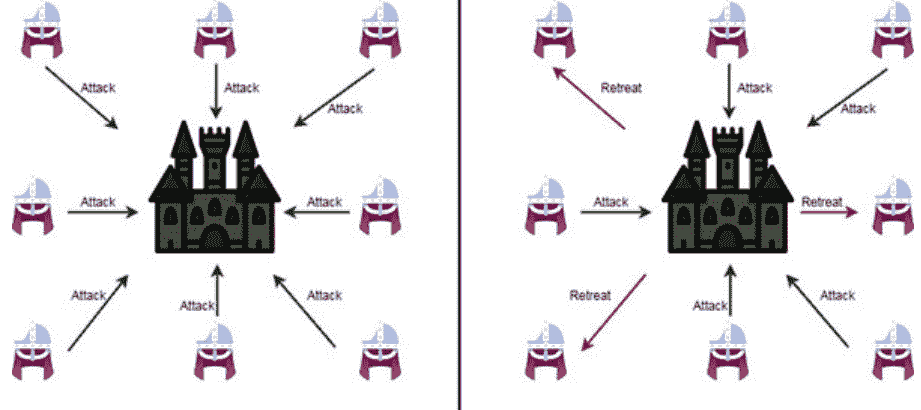

协调攻击导致胜利

不协调的攻击导致失败

**图 2.11：** 拜占庭将军问题

这种困境不仅限于拜占庭军队，全球的计算机科学家在讨论分布式系统时也面临相同的问题并寻求解决方案。在前面的例子中，将军们可以整体看作节点，而消息（进攻或撤退）可以看作区块链网络中的交易。分布式网络中存在某些节点故障的可能性。因此，比特币网络中的所有参与节点处于相同的层级，所有节点都参与验证交易或消息。所有节点之间的共识通过工作量证明等共识算法实现。

## 区块链中的共识算法

在拜占庭将军问题中，我们看到副将们之间存在一个核心的共识问题，即验证消息并决定进攻还是撤退。相比之下，区块链能够通过应用被称为共识算法的数学算法解决了共识问题。到目前，我们了解到区块链交易是安全且经过验证的。这是可以实现的，因为区块链在网络中的所有股东（节点）之间实现了共识算法。

共识协议可以被看作节点作为一个小组的决策过程。共识算法基于多数投票原理工作，这意味着如果大量个人有相同的决定，那么无论个人的选择如何，每个人都必须遵循该决定。共识算法确保了如果某些个人不参与或不遵守共识，区块链网络仍处于双赢局面。共识协议具有特定的目标，例如参与者之间的协议、协作、合作、对齐的经济利益、每个节点的平等权利以及积极参与。今天有许多共识算法可用，并非所有的区块链框架都遵循相同的共识机制，因为通用共识算法可能无法满足每个区块链框架的独特需求。以下是区块链技术中广泛使用的共识算法：

- 工作量证明 (Proof-of-Work)
- 权益证明 (Proof-of-Stake)
- 委托权益证明 (Delegated Proof-of-Stake)
- 租赁权益证明 (Leased Proof-Of-Stake)
- 耗时时间证明 (Proof of Elapsed Time)
- 实用拜占庭容错 (Practical Byzantine Fault Tolerance)
- 简化拜占庭容错 (Simplified Byzantine Fault Tolerance)
- 委托拜占庭容错 (Delegated Byzantine Fault Tolerance)
- 有向无环图 (Directed Acyclic Graphs)
- 活跃度证明 (Proof-of-Activity)
- 重要性证明 (Proof-of-Importance)
- 容量证明 (Proof-of-Capacity)
- 销毁证明 (Proof-of-Burn)
- 权重证明 (Proof-of-Weight)

让我们来看一些常用的共识算法。

### 工作量证明 (Proof-of-Work)

工作量证明是公共区块链比特币中实现的第一个共识算法，其引入是为了解决拜占庭将军问题章节中定义的多个节点之间的共同共识问题。不仅是比特币，即使是以太坊、莱特币、狗狗币等其他区块链框架也遵循相同的流程，以确认它们的交易并为现有网络链生成相应的区块。PoW 协议的核心逻辑是解决一个复杂的数学谜题并验证输入的交易。

此外，`Nonce`（随机数）是讨论 PoW 时的另一个重要概念。`Nonce` 值由矿工调整，使其成为一个用于对区块值哈希的有效数字。`Nonce` 是只能使用一次的数字。一旦找到了完美的 `Nonce`，它就会被添加到区块的其他信息中。现在，对区块的所有内容进行哈希处理，并与现有目标进行比较，以确定其小于或等于当前目标。这种解决数学谜题的方法听起来可能很简单，但最终这项练习需要大量的计算能力和能量。这就是为什么比特币网络中任何解决谜题的人都会获得奖励。图 2.12 描述了矿工如何应用工作量证明来挖掘新区块。在本书中，我们将交替使用“算法”和“协议”这两个术语。

在网络中，挖掘一个新区块大约需要 10 分钟。PoW 为矿工和黑客都提供了合理的难度。系统需要大量的计算能力和努力，这阻止了黑客攻击区块链网络。有趣的是，没有矿工可以主导网络，因为决策不取决于金额，而是取决于计算能力。PoW 协议也存在一些问题，如高能耗、速度慢和可扩展性差。这就是为什么世界上的许多组织采用其他共识协议来实现商业级的区块链解决方案。

### 权益证明 (Proof-of-Stake)

为了解决工作量证明的问题，权益证明被建立作为 PoW 的替代方案。在权益证明中，矿工可以使用他们的代币进行质押来加入挖矿过程。因此，参与者必须在网络中拥有一些质押，而不是使用挖矿。考虑到这一点，矿工拥有的币越多，他们参与的机会就越大。

权益证明算法使用伪随机投票选择过程来选择一个节点成为下一个区块的验证者。该选择过程基于质押、随机化、节点的总代币量等。在 PoS 中，验证节点在网络挖掘过程之前就被选出。因此，与 PoW 不同，每个节点都参与挖矿，PoS 中希望参与挖矿的用户需要将指定的代币投入网络作为质押。这种质押决定了节点被选为挖掘下一个区块验证者的机会。节点在网络中投入的质押越多，成为下一个验证者的机会越大。这种选择过程减少了网络中的参与矿工，因为并不是每个矿工都能参与质押。

如果一个矿工持有所有币的 10%，那么它就能挖掘 10% 的新区块。通过控制网络中的参与节点，PoS 消除了对高计算能力和能量的使用。此外，“随机区块选择”和“币龄选择”方法被用于控制网络中最富有的节点的垄断，以便所有参与节点都能获得公平的机会。例如，参与者在以太坊中需要质押 32 ETH 成为验证者。图 2.12 是比特币工作量证明运行机制以及区块如何被验证并添加到区块链的描述。

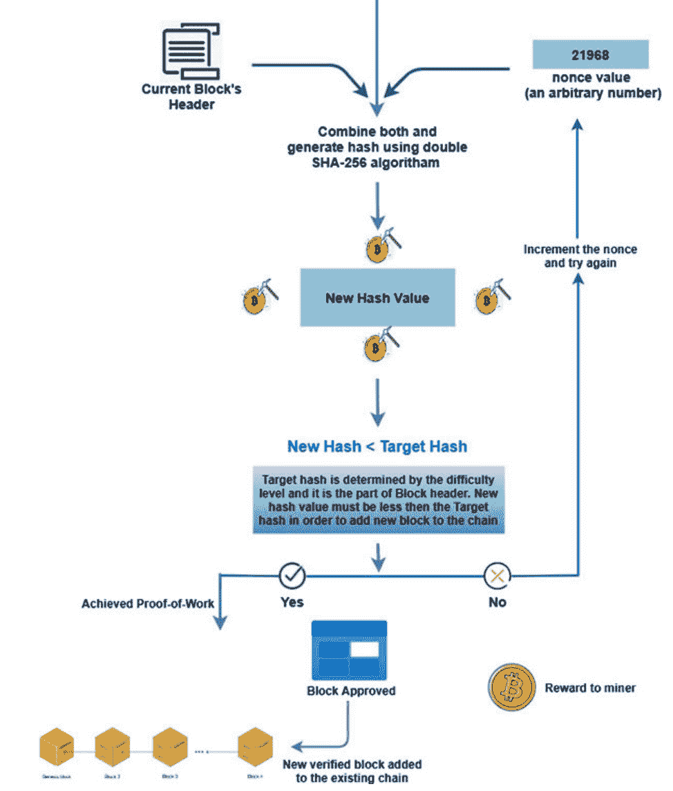

验证者在参与区块生成和验证时会获得奖励。同样，如果矿工没有履行其职责，也会受到惩罚。离线的惩罚相对较小，可以与奖励相提并论。如果验证者试图破坏区块链网络，其质押金额的大部分将作为惩罚被削减（slashed），并且会被踢出网络。这种机制制约了验证者的任何违规行为。

与工作量证明（PoW）不同，权益证明（PoS）不需要昂贵的硬件进行挖掘。相反，参与者只需要一台在网络上拥有足够代币的可用计算机。PoS 比 PoW 更节能，且功耗较低。它还消除了 51% 攻击的风险。尽管这似乎是一个非常优秀的算法，但运行在 PoS 上的网络并不是完全去中心化的，因为只有少数节点参与网络的质押。持有网络最多代币的参与者最终将控制网络的大部分。

## 时间证明 (Proof-of-Elapsed Time)

时间证明（PoET）是最优秀的共识算法之一，被广泛应用于许可区块链网络，在这些网络中，节点访问网络必须获得许可。在 PoET 中，每个验证者都有合理的机会创建自己的区块。每个节点通过等待随机时间并在区块中添加等待时间证明来实现这一点。区块被创建后会广播到网络中，以便验证者进行验证。获胜者根据证明中的最小时间值决定。成功验证后，获胜节点的区块被添加到现有的网络链中。在 PoET 中，有防止节点在网络中形成垄断的规定。

PoET 价格低廉，但人们必须使用专用硬件，因此无法大规模使用。此类实现方式的一个例子是公共区块链 Hyperledger Sawtooth。

## 实用拜占庭容错 (PBFT)

实用拜占庭容错共识协议于 20 世纪 90 年代推出，旨在在异步系统中高效运行。PBFT 对低开销时间进行了优化，旨在解决拜占庭容错解决方案中的问题。如果网络中有 3n+1 个工作节点，那么拜占庭节点最多有 ‘n’ 个。PBFT 假设网络可能发生故障，少数节点在运行期间可能会发生故障。在这里，网络中的所有节点按特定顺序排列。一个节点被标记为主节点，其他节点作为备份节点。然而，网络中的所有系统都协调工作。通信水平很高，因为节点想要验证收集的所有信息。在该协议中，参与的节点可以确定任何节点是否被破坏或发生故障。所有节点通过多数投票达成共识。PBFT 也面临一些挑战，如可扩展性、女巫攻击等。

## 燃烧证明 (Proof of Burn)

通过燃烧证明，矿工通过将代币发送到某个地址来“燃烧”（burn）代币，而不是将资金投入昂贵的硬件中。代币在销毁后无法取回。通过这种方式，验证者根据随机选择过程获得在网络上挖掘的机会。将代币燃烧到不可达的地址意味着验证者对短期损失做出了长期承诺。发送代币的地址被称为“吞噬者地址”（Eater Address）。吞噬者地址不允许出于任何用途使用这些代币。分布式账本跟踪所有被销毁的代币，使其不可替代。

代币的销毁可以看作矿工的短期损失，但他们会因参与而获得奖励。燃烧过程增加了替代代币的质押，这增加了用户挖掘下一个区块并获得奖励的机会。因此，在这里燃烧可以被视为一种挖掘特权。网络通过向长期投资者提供稳定的货币和承诺来吸引他们。此外，这增强了去中心化，并创建了一个分布更优的网络。

## 容量证明 (Proof of Capacity)

与 PoW 或 PoB 不同，在容量证明共识中，矿工被要求投资他们的硬盘空间，而不是投资于昂贵的硬件或燃烧代币。验证者拥有的硬盘空间越大，他们挖掘下一个区块并获得区块奖励的机会就越大。这种提供资源的特征被称为“绘图”（plotting）。该协议比 PoW 快，因为它创建一个区块大约需要 10 分钟，而 PoC 创建一个区块仅需 4 分钟。

实际上，矿工正通过质押硬盘空间来创建一个随机数（`nonce`）。PoC 中的随机数值与比特币中的随机数相比略有不同。在 PoC 中，矿工必须对 ID 和数据进行哈希计算，直到他们解决随机数，每组总共有 8,192 个哈希值组合。分组数字被称为“勺”（scoops）。每个 ID 最多可以获得 4,095 个勺。矿工在从硬盘接收到勺后将被分配一个解决随机数的截止日期。这个截止日期表示了与其他区块竞争的时间。如果矿工在网络内与其他矿工竞争时成功解决了随机数，该矿工将获得区块作为奖励。

展望未来，如上述列表所示，存在许多共识算法。目前，我们刚刚学习了在公共和许可区块链中广泛使用的最流行的共识算法。

## 区块链中的 51% 攻击


# 区块链基础与以太坊开发环境搭建

## 51% 攻击

51% 攻击指的是黑客对比特币网络进行的攻击。区块链系统是安全且不可篡改的，但可能发生 51% 攻击。这种攻击在可行性或实践上并非不可能。从理论上讲，它是指一组矿工控制了区块链网络超过 50% 的计算力来破坏网络。在这种情况下，黑客将获得足够的权力来控制网络中的一切，并且他们可以停止交易。

## 区块链的类型

区块链在过去几年获得了关注，多个行业和部门正尝试将其用于数据存储、身份、产权、协议、能源、医疗、供应链。这种广泛的应用引发了一个基础问题：哪种区块链适用于该用例？因此，了解存在哪些类型的区块链是重要的。本部分是对不同类型的快速探索。

### 公共区块链

公共区块链是一个每个节点或矿工都可以参与共识过程的网络。在公共区块链中，账本对所有人可见，任何人都可以验证并将交易区块添加到网络。在这里，网络通过加密验证保护，而不是使用中心化服务器。矿工如果先解决难题将获得奖励。`PoW`（工作量证明）和 `PoS`（权益证明）是公共区块链中常用的两种协议。

### 私有区块链

私有区块链是一个账本写入权限集中在单一组织的网络。读取权限可以是公开的，也可以根据业务需求进行限制。例如，数据库管理、内部审计和资产管理是不需要外部干预的内部操作。私有区块链为符合 `HIPAA`（医疗保险可流动性与责任法案）、`AML`（反洗钱）和 `KYC`（了解客户）法律等法规提供了解决方案。`Linux 基金会` 的 `Hyperledger` 项目和 `Gem Health` 网络是开发中的私有区块链。`Multichain` 也是私有区块链的示例。

### 许可区块链（联盟链）

许可区块链是一种分布式账本，其共识过程由预选节点集控制。读取区块链的权利可以是公开的，也可以仅限于参与者，还存在混合路径，例如区块的根哈希公开，并配有 `API` 允许公众对区块链状态的部分内容进行有限的查询和加密证明。这类区块链是部分去中心化的分布式账本。联盟链：由成员联盟控制，只有预定义的节点有权写入数据或区块。许可区块链的一些流行例子包括 `Ripple`、`R3` 和 `Hyperledger`。

表格比较了不同的区块链：

| 特性 | 公共区块链 | 私有区块链 | 许可区块链（联盟链） |
| :--- | :--- | :--- | :--- |
| 访问权限 | 任何人 | 单一组织 | 多个组织 |
| 实体身份 | 无许可匿名 | 许可已知身份 | 许可已知身份 |
| 安全性 | 可能存在恶意行为 | 可信 | 可信 |
| 共识机制 | 共识协议 `PoW`/`PoS` | 预先批准者投票/多方共识 | 预先批准者投票/多方共识 |
| 交易速度 | 慢 | 快 | 快 |
| 能源消耗 | 高能耗 | 低能 | 低能耗 |
| 网络类型 | 完全去中心化 | 部分去中心化 | 去中心化（私有和公有之间的混合体） |
| 资产 | 原生资产 | 任何资产 | 任何资产 |
| 成本 | 高成本 | 便宜 | 便宜 |

表 2.3：不同区块链对比

区块链已成为一种改变现代中心化系统运行方式的技术，但理解区块链是否适用于某个用例同样重要。区块链可能是一种高昂的解决方案，因为它可能需要高端基础设施和集成成本，因此企业需要了解在什么节点选择区块链解决方案来满足特定用例的问题。世界经济论坛设计了一张非常有用的图表，可以帮助个人判断区块链是否为正确的解决方案。图 2.13 显示了该决策图。

以下是目前可用的一些流行区块链框架：

| 框架 | Ethereum | Hyperledger Fabric | R3 Corda | Ripple | Quorum |
| :--- | :--- | :--- | :--- | :--- | :--- |
| 行业：关注点 | 跨行业 | 跨行业 | 金融/跨行业 | 金融服务 | 跨行业 |
| 治理 | 以太坊开发者 | Linux 基金会 | R3 联盟 | Ripple Labs | 以太坊和摩根大通 `JP` |
| 类型 | 许可链 | 许可链 | 许可链 | 许可链 | 许可链 |
| 加密货币 | Ether | 无 | 无 | Ripple (XRP) | 无 |
| 共识机制 | 工作量证明 | 单节点证明, Kafka, Raft, BFT | 可插件式共识 | 概率投票 | Raft, Istanbul BFT, 多数投票 |
| 智能合约 | 是 | 是 | 是 | 否 | 是 |
| 合同 | ~20 TPS | 2000 TPS | ~170 TPS | ~1500 TPS | ~100 TPS |
| 交易速度 | ~20 TPS | 2000 TPS | ~170 TPS | ~1500 TPS | ~100 TPS |

表 2.4：一些流行的区块链框架

## 区块链中的代币化

自 2009 年比特币首次实现以来，比特币的第一笔商业交易发生在 2010 年，当时花费 10,000 个比特币购买了两个披萨。考虑到今天的比特币价格，这可能是世界上买过最贵的披萨了。从那时，比特币的市值急剧上升。区块链技术随着时间的推移而进化，现在能够对货币以及资产进行代币化和去中心化，这种能力显著提升了它的潜力。

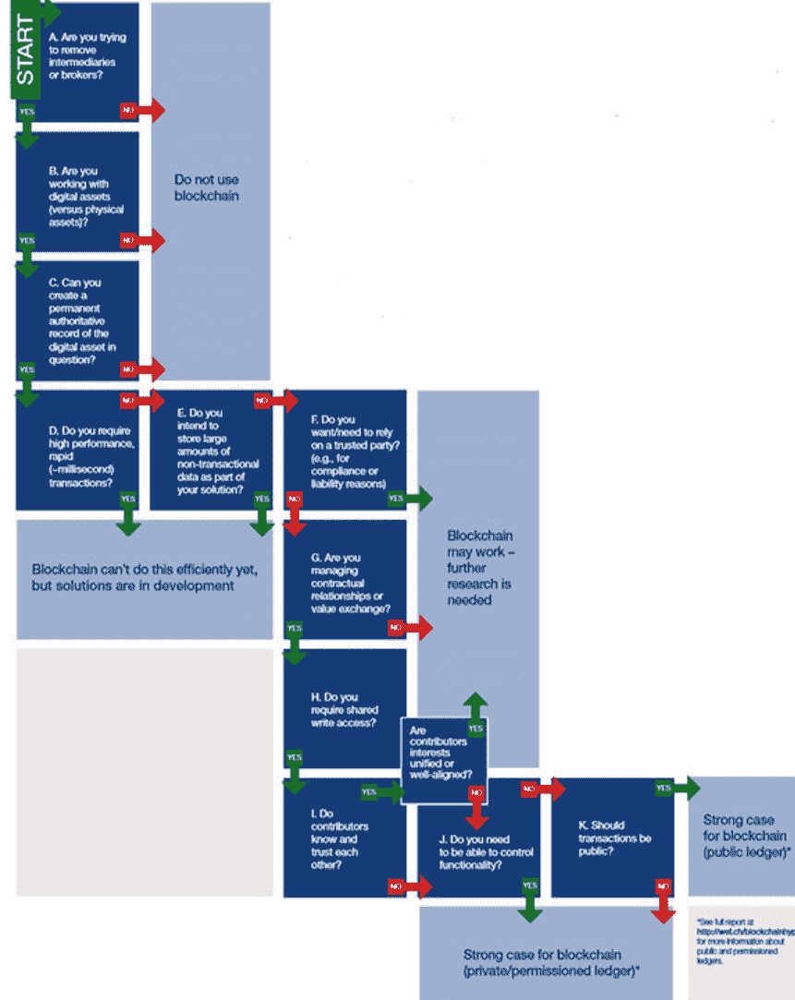

2019 年，一群软件开发者汇聚在一个名为 `Ethereum` 的项目中，以探索比特币和加密货币之外的区块链潜力。以太坊平台的目标是成为一个通用系统，可以在其中构建去中心化应用和数字代币。区块链中资产的代币化是发行代表真实可交易资产的数字代币的艺术。区块链代币可以使用区块链创建或开发，并代表各种资产，如货币、房产、债券、忠诚积分等。区块链代币可以在双方之间传输，而不依赖于中心机构。区块链代币通过首次代币发行（`ICO`）或证券代币发行（`STO`）创建。证券代币可用于创建代表资产的数字代币。这意味着这些代币代表了公司的股份或房地产或投资基金的所有权。这些代币可以在特定市场进行交易或交换。

与比特币不同，代币并非区块链的原生功能。相反，代币是在区块链框架上创建并由智能合约治理的。例如，以太坊平台上发行的大多数代币受 `ERC20` 智能合约治理。这些 `ERC20` 智能合约意味着所有相应的 `ERC20` 合同都应实现的规则、事件和函数。这些 `ERC20` 代币的价值取决于它们所代表的底层资产。任何遵循 `ERC20` 标准的代币都可以在以太坊平台上轻松交易。最终，这种经济通过减少资产创建、购买和销售中的阻力，具有构建更可靠、更透明的金融结构的潜力。区块链代币具有更高的流动性、更完善的透明度、可访问性、即时低交易等优点。我们将在接下来的章节中讨论 `ICO` 和代币。

## 区块链的自动执行合约

通常，合同是一份法律文件，约束双方根据文件中提到的约定条件执行任务、程序或交易。这些合同受当地法律的约束。这类合同有多个例子，例如双方之间的保险、公司之间的持股协议、房产买卖等。

区块链中的智能合约运作方式与传统状态有所不同，但智能合约的动机与传统合同相同——满足合同中提到的条件。因此，智能合约是构建在自定义逻辑之上并部署在区块链框架上的可编程代码。当满足预定的条款和条件时，智能合约会根据其程序设计的规则自动执行。智能合约旨在帮助在账户之间作为原子交易传输数字资产。智能合约能够存储数据，这些存储的数据可以用于记录任何信息、账余额和待执行数据。

通常，人们认为智能合约的主要要素是签署人、协议条款和合同主体。在这里，签署人指的是协议中涉及的双方。智能合约仅在以数字签名的形式获得最终批准后执行。此外，合同条款应以代码格式提供给智能合约，以便智能合约进行处理。

假设一家制药制造商使用智能合约向原材料供应商下订单。假设合同约定，制造商在从供应商处购买原材料时支付总金额的 80%，供应商在收到款项后发货。剩余金额将在交付时支付给供应商。在这种场景中，制造公司使用智能合约向供应商下单，并用数字签名签署交易。制造商将 100% 的金额转入与智能合约相关的托管账户。一旦供应商接受订单，智能合约从托管账户中释放 80% 的资金给供应商。供应商在收到 80% 的资金后发货，并在智能合约上提交所需的数字文件。在原材料成功交付后，智能合约将剩余的 20% 金额转给供应商并向制造商释放数字文件。上述场景是说明智能合约如何运作的例子；实际应用场景可能更加复杂。在这个场景中，没有第三方参与，所有步骤都由自动执行的智能合约完成。以下是智能合约的一些优点：

- **自主性**：智能合约不需要第三方调解，消除了所有相关风险。
- **信任**：所有文档和交易都保存在分布式账本上，因此这些文档的不可篡改性和安全性得到了保障。
- **备份与安全**：由于所有数据和文件都保存在区块链上，因此这些文档永远不会丢失且将始终可用。区块链网络上的这些信息是不可更改的，且不受暗网的威胁。
- **速度**：智能合约消除了对复杂的纸质流程和人工干预的依赖。这提高了数字化完成流程的速度。
- **成本**：智能合约具有成本效益，因为它们消除了对第三方的依赖。
- **准确性**：自动化合约不仅更快、更廉，而且避免了手动填写大量表单带来的错误。

## 设置以太坊开发环境

以太坊是一个公共网络，开发者可以在其中编写智能合约并将其托管在以太坊网上。在本节中，我们将学习如何设置以太坊开发环境，然后部署一个非常简单的智能合约。设置以太坊网络有多种方法，但本节我们将学习如何以最低软件要求设置一个私有区块链网络。

本节将涵盖以下步骤：

- 安装 `npm` 和 `nodejs` 环境
- 安装 `Truffle`
- 安装 `Ganache-CLI` 框架
- 编写并部署示例智能合约

### 前提条件

在开发机上开始在测试私有区块链网络上开发和部署智能合约需要以下软件。言此不再说，这里是分步骤指南。

### 安装 npm 和 nodejs 环境

`npm` 是一个软件注册表，开源软件或软件包在此打包并可以下载。可以从 [`https://nodejs.org/en/download/`](https://nodejs.org/en/download/) 下载 `npm` 安装器，可以使用命令行界面下载 `npm` 包，但我们在这里使用安装程序包：

#### 下载

最新 LTS 版本：14.15.4（包含 `npm` 6.14.10）

下载适用于您平台的 `Node.js` 源代码或预构建安装程序，从今天开始开发吧。


图 2.14：Node 包

安装后并在 Windows 环境下打开命令提示符，我们可以在命令行终端中输入命令来检查 `node` 和 `npm` 的安装版本，如图所示：

```
node -v
npm -v
```

图 2.15：Node 命令

图 2.16 显示了执行这些命令的输出。在这里，你可以看到测试环境中 `node` 版本为 14.15.4，`npm` 版本为 6.1.10：

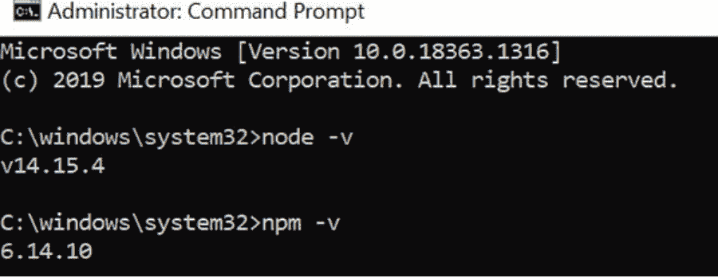

图 2.16：检查 npm 和 node 版本

### 安装 Truffle 框架

`Truffle` 是一个用于以太坊区块链的开发和测试框架。它包含了快速启动个人区块链以及测试和部署智能合约的所有工具。安装 `Truffle` 框架非常简单——在命令行终端中输入以下命令并按回车键：

```
npm install -g truffle
```

此命令将在机器上安装最新版本的 `truffle`。如果开发者想要完整安装特定版本的 `truffle` 框架，则应使用以下命令：

```
npm install -g truffle@4.1.133
```

### 安装 Ganache-CLI

`Ganache` 是一个私有区块链框架，有助于开发以太坊和 `Corda` 分布式应用程序。`Ganache` 帮助在私有网络上开发、部署和测试智能合约。`Ganache` 提供完整的 `GUI` 包，但我们在这里使用 `Ganache-CLI` 进行开发。与 `Ganache` 一样，`Ganache-CLI` 也有助于模拟区块链客户端行为，并让以太坊智能合约的开发更快、更安全。`Ganache-CLI` 也称为 `TestRPC` 网络。同样，安装非常简单——只需在命令行终端中输入以下命令：

```
npm install -g ganache-cli
```

### 开发和部署智能合约

我们的开发环境现在已就绪。让我们为创建和部署智能合约进行头脑风暴。

#### 第 1 步：初始化 Truffle

打开命令行终端为我们的虚拟项目创建一个新文件夹。然后，我们在里面初始化 `Truffle` 框架。打开终端并输入以下命令：

```
mkdir SampleProject
cd SampleProject
truffle init
```

我们在这里停一下分析一下项目结构，如下截图所示：

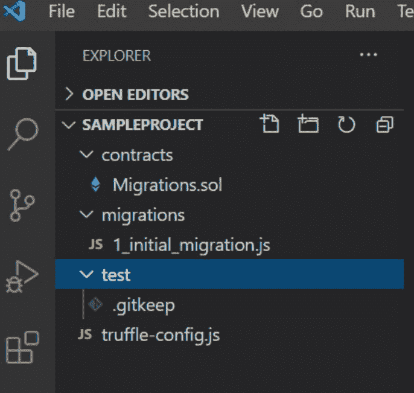

图 2.17：项目文件夹结构

- `/contracts`：此文件夹存储智能合约的源代码。所有的 `solidity` 智能合约文件 (`.sol`) 都应该放在这里。
- `/migrations`：部署 `contracts` 文件夹中的智能合约。
- `/test`：智能合约的测试代码。它同时支持 `JavaScript` 和 `Solidity`。
- `/truffle.js` 文件：私有网络的配置文件。
- `/truffle-config.js`：连接到需要部署智能合约的网络的配置文件。

#### 第 2 步：编写智能合约

你可以编写任何示例合约并将源代码文件作为 `solidity` 文件 (`.sol`) 保存到 `contracts` 文件夹中。这里是示例源代码，我们将其保存为 `contracts` 文件夹中的 `SampleProject.sol`：

```solidity
pragma solidity 0.5.16;

contract SampleProject{
    string message;

    constructor() public {
        message = "First Sample Smart Contract";
    }

    function getMessage() public view returns (string memory) {
        return message;
    }

    function setMessage(string memory _message) public {
        message = _message;
    }
}
```

我们的 `solidity` 代码已就绪，因此我们需要用以下命令进行编译：

```
truffle compile
```

对于无错误代码，编译输出看起来如下：

```
D:\SampleProject>truffle compile

Compiling your contracts...
====================
> Compiling \contracts\Migrations.sol
> Compiling \contracts\SampleProject.sol
> Artifacts written to D:\SampleProject\build\contracts
Compiled successfully using:
  - sol: 0.5.16+commit.9c3226ce.Emscripten.clang
```

图 2.18：Solidity 编译输出

#### 第 3 步：运行私有区块链网络

现在我们的智能合约已就绪，通过输入以下命令启动私有区块链网络：

```
ganache-cli
```

> **注意**：原文此处命令为 `truffle migrate`，实为启动网络应使用 `ganache-cli`，`truffle migrate` 用于后续部署步骤。

命令将显示日志，如下：

```
Truffle migration is starting...
> network: development, network id: 5777, host: 127.0.0.1:8545
> fetching artifacts...
...
> connecting to: http://127.0.0.1:8545
> saving artifacts...
...
> migrating 1 contract (abi)...
> 1 contract deployed at 0x1234567890123456789012345678901234567890
Truffle migration finished without errors.
```

#### 第 4 步：在私有网络上部署智能合约

在部署智能合约之前，打开文件夹并确保网络设置与私有区块链网络（`ganache-cli` 显示的 IP 和端口）一致，如下：

```javascript
networks: {
  // 用于测试。'development' 名称是特殊的——如果在这里定义且命令行中
  // 未指定其他网络，truffle 将默认使用它。
  // 如果使用此网络，你应该在单独的终端页中运行客户端（如 ganache-cli、geth 或 parity），
  // 并必须设置 'host'、port 和 network_id
  //
  development: {
    host: "127.0.0.1",
    port: 8545,
    network_id: "*",
  },
}
```

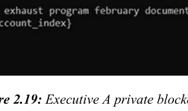

## HD 钱包

助记词：`fly draft teach silent gap inmate punch clip now oil`

HD 路径：`m/44'/60'/0'/0/{account_index}`

## Gas 价格

`0000000000`

## Gas 限制

`6721975`

## 调用 Gas 限制

`00071992547409991`

监听于 `127.0.0.1:8545`

图 2.21：Ganache-cli 终端中的 IP 和端口

接下来，打开 `migrations` 文件夹并在 `2_deploy_contracts.js` 文件中添加以下行代码；删除其余行并保存：

```javascript
var SampleProject = artifacts.require("./SampleProject.sol");
module.exports = function(deployer) {
  deployer.deploy(SampleProject);
}
```

图 2.22：迁移活动

接下来，让我们运行以下命令在私有网络上部署智能合约：

```
truffle migrate
```


只要我们在终端上执行 `truffle migrate` 命令且没有错误，智能合约将立即部署到网络中。在部署合约时，你会看到 `ganache-cli` 中生成的日志，如图 2.23 和图 2.24 所示：

```
D:\SampleProject>truffle migrate
Compiling your contracts...
=================
Everything is up to date, there is nothing to compile.

Starting migrations...
=================
> Network name: 'development'
> Network id: 16115927428050
> Block gas limit: 6271975 (0x6691b7)

initial_migration.js
=================
Deploying 'Migrations'
> transaction hash: 0x9f0074561f81e2fb34dc42a79044807c2c3982bcddd5b9f52396c01df30bc4c6
> Blocks: 0
   Seconds: 0
> contract address: 0xd2f9f40dec3cb3e9331170c37ea90c2e211d0c158
> block number: 1
   timestamp: 16115927418
> account: 0xa4d803c31567d6486377dd180b7c7a8b0e11dc6
> balance: 99.90811114
> gas used: 191943 (0x2ed7)
> gas price: 20 gwei
> value sent: 0 ETH
> total cost: 0.00383886 ETH

> Saving migration to chain.
> Saving artifacts

> Total cost: 0.00383886 ETH
```

图 2.23：项目终端中的日志输出

## 步骤 5：与智能合约交互

现在我们的智能合约已经部署，我们将对其进行测试并查看它是如何影响区块链网络的。Truffle 为此提供了一个非常好的控制台工具。打开你的终端并输入以下内容：

```
truffle console
```

```
Listening on 127.0.0.1:8545
eth_blockNumber
net_version
eth_accounts
eth_getBlockByNumber
eth_accounts
net_version
eth_getBlockByNumber
eth_getBlockByNumber
net_version
eth_getBlockByNumber
eth_estimateGas
net_version
eth_blockNumber
eth_getBlockByNumber
eth_sendTransactionReceipt
```

```
Transaction: 0xf0f074561f812feb34dc42a7904480c2c3982bccdd5b5b98f52396011df30bc4c6
Contract created: 0xd29f4fdeecb38e9311703c37ea79ce211d0c158
gas usage: 191943
Block Number: 1
Block Time: Mon Jan 25 2021 22:32:48 GMT+0530 (India Standard Time)
```

```
eth_getTransactionReceipt
eth_getCode
eth_getTransactionByHash
eth_getBlockByNumber
eth_getBalance
eth_getBlockByNumber
eth_sendTransaction
```

```
Transaction: 0x3bb7adfc4dfba0d8b06d6f9acfebcb5b0b11f5905191f32
gas usage: 42338
Block Number: 2
Block Time: Mon Jan 25 2021 22:32:48 GMT+0530 (India Standard Time)
```

```
eth_getTransactionReceipt
```

图 2.24：部署智能合约时的日志输出

使用以下命令调用 `SampleProject` 合约的函数：

```
truffle(development)> let instance = await SampleProject.deployed()
```

以下命令将调用 `getMessage()` 函数：

```
truffle(development)> await instance.getMessage()
truffle(development)> await instance.setMessage("Blockchain in")
```

在执行这些命令时，检查 `truffle` 和 `ganache-cli` 终端中的日志，如下所示：

```
truffle(development) await instance.setMessage("Blockchain in")

tx: 0xaf8531f3b8f4907c6a09776a02ebf114235ac7a
transactionIndex: 0
blockNumber: 5
from: 0x6611ed2c3768827f2803dec5774c64294cf
to: 0xc772a7e6a3c93f11b5da
gained: 0
costUsed: 29304
logs: {status: true}
rawLogs: []
truffle(development) await instance.getMessage()
block: undefined
```


## 图 2.25：Truffle 日志显示 ganache 的控制台日志

你可以看到交易、Gas 使用和区块相关的信息：

| 字段 | 值 |
| :--- | :--- |
| Transaction | 0xaf0629d4f0aaae1b41b24ae0050af34eca3842793376a1dbdb |
| Gas usage | 25101 |
| Block Number | 7 |
| Block Time | Tue Jan 26 2021 01:28:51 GMT+0530 (India Standard Time) |

## 图 2.26：ganache-cli 日志

## 区块链分叉

简单来说，“区块链分叉是区块链副本”。通常，区块链分叉是在可以进一步升级的开源系统或网络上进行的。这有助于个人和开发者社区通过更改代码来促进改进。比特币是拥有多个分叉的最常见的应用之一。

由 Satoshi 开发的比特币有时被称为比特币核心（Bitcoin Core）。许多开发者和社区随着时间的推移从比特币核心中提取了分叉，这里是一些流行的分叉：

- 比特币经典 (Bitcoin Classic)
- 比特币现金 (Bitcoin Cash)
- 比特币黄金 (Bitcoin Gold)
- SegWit

在之前的模块中，我们看到比特币区块是由矿工创建的。这些矿工通过解决数学题（PoW）来验证和确认网络中的交易。一旦矿工成功验证交易，交易就会保存在区块中。在这里，不同的矿工之间没有同步或对齐。此外，当两个矿工同时解决数学题时，可能会发生区块链分叉。分叉也可能源于故意挖矿，即矿工解决并持有新区块而不立即广播它们。区块链分叉有两种类型，在此解释：

- **硬分叉**：当社区或使用核心网络的人创建新升级时，分叉是区块链网络分裂操作的结果。硬分叉通常不支持后兼容。通过硬分叉创建的新分支遵循新协议，这意味着用于验证过程的所有客户端软件和虚拟机都将失效，升级是必须的。比特币到比特币现金就是这样一个例子。这种差异本质上创建了两个竞争性的区块链。

- **软分叉**：软分叉是一种后兼容的升级，升级节点可以与旧节点连接。这意味着旧和升级后的协议、规则和节点不会冲突。软分叉是可选的升级。当使用旧规则标记的特定区块未被升级节点处理，但未升级节点处理了它时，此过程会导致链出现偏差。这在用户未察觉的情况下实现了同步。例如，比特币的 SegWit 更新就是软分叉。

## 总结

本章向读者介绍了区块链及其背景。它让人们了解区块链的想法是如何产生的以及它是如何成为完全商业级技术的。本章旨在提供对区块链的基本了解、其工作原理以及区块链系统的骨干组件。我们看到了比特币系统如何在不引入任何第三方的情况下安全地在双方之间传输加密货币。在本章中，我们学习了密码学、哈希和 P2P 网络，并理解了如何使用区块链构建分布式应用。

## 多选题

1. 什么是区块链？
   a. 以区块存储信息的中心化数字账本
   b. 分布式、去中心化的数字账本，信息存储在区块中
   c. 以表格存储记录的中心化数字数据库
   d. 以上都不是

2. 区块链支持哪些操作？
   a. C.R.U.D.
   b. 仅插入 (Insert only)
   c. 插入与读取
   d. 插入与更新

3. 区块链中的 P-2-P 代表什么？
   a. 点对点 (Peer to Peer)
   b. 公有到私有 (Public to Private)
   c. 密码保护
   d. 无

4. 以下哪些项是区块链支持的？
   a. 私钥加密
   b. 公钥加密
   c. 哈希函数
   d. 以上全部

5. 谁发明了比特币？
   a. 史夫·乔布 (Steve Jobs)
   b. 塔维里克·布特林 (Vitalik Buterin)
   c. 埃隆·马斯克 (Elon Musk)
   d. 中本聪聪 (Satoshi Nakamoto)

6. 一个典型的区块链区块包含？
   a. 随机数 (Nonce value)
   b. 时间戳
   c. 交易哈希值
   d. 以上全部

7. 权益证明（Proof of Stack）是？
   a. 一种交易和区块验证协议
   b. 区块链网络的安全证书
   c. 一种智能合约
   d. 以上都不是

8. 验证和处理区块链交易的计算机被称为“矿工”。
   a. 是
   b. 否

## 答案

1. b
2. c
3. a
4. d
5. d
6. d
7. a
8. a

## 关键术语

- **P2-P**：在点对点网络中，多个计算机系统相互连接，以便它们可以相互共享数据和信息。
- **C.R.U.D.**：CRUD 操作属于传统数据库，即创建（Create）、读取（Read）、更新（Update）和删除（Delete）操作。
- **创世区块**：区块链网络中的第一个区块。
- **DAPP**：在任何区块链框架上构建的去中心化应用程序。
- **ETHER**：以太坊区块链框架中的数字货币。
- **协议**：为了实现特定目标而设计的预定义步骤或算法序列。
- **矿工**：区块链网络中的矿工可以创建并向链提交新区块。
- **ICO (首次代币发行)**：类似于股票的首次公开募股，首次代币发行是代币化业务向公众募集投资的一种方式。

# 第 3 章：区块链在医疗保健领域的应用

在上一章中，我们学习了区块链及其转型现有流程、操作、数据存储和处理方式的潜力，无论行业或领域如何。与任何其他行业一样，区块链技术已成为医疗保健领域许多新发展的中心舞台。区块链正在重新定义应用于许多医疗遗留系统和应用程序的数据建模与治理实践。区块链并不是医疗数据标准化或整合挑战的灵药，但它提供了一个前景良好的框架，用于处理跨各种应用程序和医疗利益相关者的医疗数据和信息。

医疗行业是一个复杂且巨大的部门，消耗了许多发达国家约 10% 的 GDP。我们在之前的章节中看到，医疗行业包含了商品服务的通用化和商业化，旨在为患者提供预防、治疗、姑息和康复性护理。医疗系统是一个由多个实体组成的互联系统，在严格的监管和政治环境中运行。在传统的医疗系统中，患者数据高度碎片化且处于孤岛状态。效率低下和对中介的依赖导致医疗服务成本上升。此外，有关患者数据共享的透明度一直受到审查；现有系统缺乏数据共享、存储和所有权方面的透明度。这些只是医疗行业面临的挑战中的少数几个，它正寻求采用新的基础设施来克服这些问题。区块链具有解决现有痛点的潜力，并能够实现一个更高效、更透明、分布式且更安全的系统。在本章中，我们将介绍不同的用例，看看区块链如何在医疗保健领域发挥重要作用。

## 结构

我们将在本章中涵盖以下主题：

- 区块链对医疗保健的影响及其用例
- 区块链中的数据处理
- 基于区块链的 EMR（电子病历）系统
- 区块链在 FDA 中的角色
- 电子处方和数字证书
- 智能实验室和 IoMT（医疗物联网）

## 目标

在本章结束时，你将了解区块链在医疗保健领域的应用。作为该主题的延伸，你将学习数据在区块链中是如何处理的以及区块链在医疗保健领域的可能用例。此外，你将接触基于区块链的医疗生态系统及其组成部分。进一步，你还将对比传统的 EMR（电子病历）系统，并理解可以……的差距

## 医疗保健中的区块链

我们已经看到区块链技术在解决互操作性、安全自动化流程等现有挑战方面具有巨大潜力。有趣的是，某些研究表明，区块链驱动系统可以通过减少交易成本、运营、IT 基础设施和摩擦成本，每年节省 1000 亿美元。医疗部门面临着有关数据共享、存储和所有权，以及患者产生的数据和碎片化患者数据的挑战。表 3.1 显示了区块链如何帮助医疗系统应对现有痛点：

| 现有痛点 | 区块链的机会 |
|---|---|
| 孤岛中的分散数据 | 存储在区块链分布式网络上的患者数据可以从有效源访问 |
| 获取患者数据 | 跨网络共享数据实现共同目标 |
| 互操作性 | 不同的区块链网络可以通信并交换数据 |
| 数据安全 | 数据数字化保护患者隐私 |
| 患者产生的数据 | 聚合可穿戴设备以提供整体性护理 |
| 访问和数据不一致 | 智能合约创建了基于规则的患者数据访问方法 |
| 成本效益 | 降低交易成本使系统更高效 |

## 表 3.1：医疗保健中的区块链机会

## 区块链中的数据处理

我们正在讨论医疗系统中的数据共享和互操作性，因此理解区块链如何在分布式账本上维护数据至关重要。现代区块链系统维护两种类型的数据：

- **链上数据**：链上数据来自存储在区块链网络上的实际区块链交易。它由网络上的所有参与者验证和确认，一旦保存后无法修改。
- **链外数据**：链外数据存储在独立的传统数据库中，并在区块链网络上提供访问指针。链外交易或数据提交发生在区块链之外，参与交易的各方在区块链之外达成共识。

这种处理链上和链外数据的属性使得区块链网络更具可扩展性和更具成本效益。医疗保健平台也可以选择将数据存储在区块链上，并受到区块链基础属性的保护。同时，它们可以设计一种协议，在区块链网络之外保存大型医疗数据和文件。链外数据可以通过区块链网络通过加密链接和 API 在需要的地方进行访问。在为任何用例设计医疗平台时，评估哪些数据应该存储在链上，哪些数据应该离线保存非常重要。

以下是链上数据和链外数据在医疗系统中被采用时及其优点的对比表：

| | 链上数据 | 链外数据 |
|---|---|---|
| 数据字段 | 轻量级数据字段可以保存在区块链分布式网络上。例如，患者的人口统计数据。 | 链外数据用于存储笨重型且昂贵的记录，因为它们可能会大幅增加处理时间。有时，根据业务情况，企业关键数据也会离线存储。常见的链外示例包括 |
| 优点 | - 数据可以存储在区块链上，并准备好快速处置。<br>- 互操作性系统。<br>- 不可篡改的数据。 | - 可以保存任何类型的数据，无论文件类型和大小如何。<br>- 可以实现区块链系统的扩展性。<br>- 链下交易快速且即时，没有链上交易的高昂费用。 |
| 缺点 | - 并非为数据标准化而设计。<br>- 系统的扩展性较为复杂。<br>- 可能产生交易费用。 | - 无实时数据更新和共享。<br>- 互操作性较低。<br>- 需要额外的集成层与区块链系统通信。<br>- 区块链上存在信息衰减风险。<br>- 可能需要第三方（如托管账户）进行验证。 |

## 表 3.2：链上与链下数据对比表

## 区块链在医疗保健领域的应用案例

以下是区块链发挥至关重要作用或可产生影响的一些医疗保健领域用例：

- **医疗记录的完整性**是最受青睐的用例之一，医疗行业参与者已经开始开发区块链框架来处理患者的医疗记录和数据。这些医疗记录往往分散在多个实体中，导致这些记录处于孤岛状态。区块链可用于确保所有医疗记录的完整性，无论是电子病历（EMR）还是电子健康记录（EHR）。区块链确保数据的完整性，这对于医疗和法律方面至关重要。

- **医药供应链**无论哪个行业，供应链一直是一个复杂、不安全、无组织且高成本的子行业，因为它是一个依赖中间环节的部门。医药供应链与供应商、制造商、仓库中心、分销商、药店、医院、零售商和消费者协调工作。医药供应链区块链平台能够简化供应链的复杂流程，许多公司正在使用为医药供应链开发的企业级区块链平台。我们将在接下来的章节中介绍这些细节。

- **医疗保险部门**由于纸质流程和合规性要求，保险行业几个世纪以来一直缓慢。这些挑战为保险行业带来了机会缺口，而采用区块链驱动的保险流程可以减少或消除大多数挑战，区块链是其充满希望的解决方案。例如，理赔结算中的区块链智能合约可以大幅缩短结算时间，从而提高客户满意度并减少欺诈。我们将在接下来的章节中讨论区块链在医疗保险中的作用。

- **临床试验与医学研究**区块链可用于医学或临床研究，研究人员可以通过安全且经过验证的患者数据访问，高效地研究特定治疗法的影响。临床试验数据共享和价值发现是一些极具前景的区块链案例。

- **医疗物联网设备的远程监控**远程监控是医疗保健领域的一个趋势，使用物联网设备和传感器测量患者的生命体征，并通过这些物联网设备将数据记录在数据库中，以提供更好的预防性和主动性护理。区块链可以确保此类数据的顺畅和安全。数据可以根据业务需求进行共享，且仅在患者同意后进行。

一些医疗初创公司已经意识到区块链技术在医疗领域的潜力，并正试图增加医疗领域高端技术的使用。Medicalchain 和 TraceRx 是一些致力于在医疗领域应用区块链技术的初创公司。Medicalchain 提供了一个用于有效透明医疗数据交换的 DLT 平台，TraceRx 正在为供应链行业设计设备案例。我们将在接下来的章节中讨论这些初创公司。

## 基于区块链的医疗生态系统

区块链技术安全、划分和共享医疗数据（或医学数据）并使用智能合约自动化复杂流程的能力，使其成为彻底变革医疗生态系统的领先系统。现代商业级医疗框架被划分为不同的层，如医疗数据源、区块链栈、医疗用例/应用以及生态系统利益相关者：

> **图 3.1：基于区块链的医疗生态系统**

| 生态系统利益相关者 | | | | |
|---|---|---|---|---|
| 非政府组织 (NGO) | 政府机构 | 临床试验 | FDA | 医疗初创公司 |
| 医院 | 医疗企业 | 公众/消费者 | 监管机构 | 研究机构 |

| 医疗用例 | | | | |
|---|---|---|---|---|
| 数据管理服务 | 医疗供应链 | 保险平台 | 医疗物联网 | 研究与试验 |
| 链上数据 | 链下数据 | | | |

| 区块链栈 | | | | | |
|---|---|---|---|---|---|
| 区块链平台 | DAPs 与智能合约 | 集成层 | API 栈 | 网络协议 |

| 医疗数据源 | | | | | |
|---|---|---|---|---|---|
| 数据源 | 物联网和可穿戴设备 | 社交平台 | 研究机构 | 政府 |
| 医院 | 患者 | 实验室和诊所 | 执业场所 | 医疗公司 |

在图 3.1 所示的基于 DLT 的医疗框架中，所有的医疗和健康数据都从不同的渠道收集并在第一层转换为分段原始数据。数据可以从数据输入、物联网设备、实验室、医院、保险提供者等源收集。这是医疗框架必须处理海量数据的节点。现代技术（如人工智能、机器学习和大数据）在数据注入区块链之前的数据碎片化中可以起关键作用。

区块链技术栈运行在数据栈之上，区块链充当了原始数据与医疗平台或应用程序之间的桥梁。区块链或 DLT 层是医疗生态系统变得安全、快速且具有互操作性的关键。可以根据医疗业务用例设计合适的区块链底层、通信协议和共识模型。随后，可以根据需求将交易数据放在链上或链下。许多区块链平台（如以太坊、Hyperledger Fabric、Ripple）创建了去中心化应用 (DAPs)。区块链的基础组件（如智能合约、钱包和数字资产）位于这一层之上。

医疗应用或平台根据所选用例构建在区块链层之上。这些用例以患者为中心，旨在为最终用户提供无缝的医疗和健康服务。此外，这些用例的设计旨在解决现有系统中的问题，如互操作性和数据隐私。除了独立应用程序，物联网和基于可穿戴设备的系统也可以放置在此层。最后，在层次结构的顶端，医疗生态系统中的所有利益相关者都可以与框架交互。这些利益相关者可以利用底层的区块链应用 (DAPs)。这一层是患者、服务提供者、监管者、政策制定者等的结合。利益相关者为了不同的目的与系统交互，但预计他们将在不损害生态系统核心理念的情况下使用系统。

## 电子病历中的区块链

电子病历 EMR 可以被视为患者病例的数字版本。EMR 仅来自一个诊所的数据，这意味着患者的医疗记录留在医生那里，不会与其他医疗专业人员共享。简而言之，如果患者更换医生，其 EMR 可能不会随之转移。通常，EMR 可能包含以下关于患者的信息：

- 一般诊断
- 预后
- 生命体征
- 人口统计学
- 实验室检查结果

在医疗领域，许多人员交叉使用电子病历（EMR）和电子健康记录（EHR）这两个术语，但我们在第一章（医疗行业概述）中已经看到 EMR 和 EHR 是不同的。你可以将 EMR 视为 EHR 系统的一个子集。EHR 是一个综合系统，是多个系统生成的患者健康记录的纵向电子记录。EMR 确实正在取代纸质的模拟医疗记录，但它们并不是现代医疗信息技术的标准。让我们来看看典型 EMR 系统的以下功能或规范，以便更好地理解 EMR。

## EMR 系统的功能

这些是 EMR 系统的功能：

- **运营管理**：管理诊所运营的功能：
    - **入职**：在系统中注册患者并存储相关信息的能力
    - **挂号**：创建和管理患者预约的功能，包括提醒功能
    - **计费**：管理计费功能的能力，以及与现有计费系统集成的能力
    - **授权**：跟踪和管理利用审查信息的能力
    - **报告**：生成与业务管理相关的报告的能力
- **通信管理**：与服务提供者和患者的通信模块：
    - **患者通信**：患者跟踪其健康信息、报告、管理预约和报告等的功能
    - **服务提供者**：与其他服务提供者连接并共享信息/数据/报告的能力，为患者生态系统带来协作服务
    - **处方和药物管理**：处理患者的药物：
        - **电子处方**：电子化书写处方并与患者和药房共享
        - **预警系统**：根据患者医疗记录自动识别药物对过敏反应的能力
        - **药物黑框警告**：生成黑框警报的能力；EMR 系统预计也将遵循 FDA 指南
        - **集成支持系统**
    - **报告系统**：从实验室提取与实验室检查、病理报告、影像报告等相关的报告的能力
    - **医嘱录入**：管理医嘱录入和执行的能力
    - **临床决策支持**：通过分析以往数据和历史信息提供证据的决策支持的能力

## EMR 系统面临的挑战

随着技术的进步，现有的数字 EMR 平台/软件已经经历了数字化方面的升级。这些 EMR 系统运行良好并很好地实现了目的，但现代 EMR 还存在一些需要解决以满足患者预期市场需求的问题。以下是 EMR 的一些挑战：

- 对患者健康记录的威胁
- 系统停机
- 缺乏数据和信息标准
- 服务提供者耗时过多
- 互操作性挑战
- 零散的患者数据
- 决策效率低下
- 法律挑战

在这些挑战中，如果我们只关注患者敏感医疗和健康数据的问题，就会发现这些现有的 EMR（以及 EHR）容易受到网络攻击和数字数据窃取。2017 年 WannaCry 勒索软件攻击导致几台医疗提供者的计算机被黑，就是一个例子。Anthem Inc 和 Sing Health 等攻击损害了患者的敏感医疗记录。根据 HippaJournal 的报告，2009 年至 2020 年间报告了约 3,705 起医疗数据泄露。这些泄露导致了 268,189,693 医疗记录的暴露（来源：HippaJournal）。

## 图 3.2：医疗数据泄露图形表示


## 图 3.3：医疗数据泄露趋势


除了处理患者敏感记录外，互操作性是 EMR 面临的一大挑战。提高医疗互操作性是健康管理系统、医生、患者以及任何其他利益相关者的重中之重。过去在全球范围内尝试提高 EMR 之间的互操作性，但由于非标准、冲突和零散的患者数据以及多个系统之间的集成挑战，并没有取得多少成功。许多国家正在推动健康信息交换（HIE），EMR 和 EHR 系统之间的差距正在缩小，以便在系统之间共享数据，为公民提供更好的医疗服务。到目前，每个 EMR 系统都在孤立运行并有自己的规范，这使得在经过特定定制后，真正的互操作性仍然是一个挑战。

## 区块链在 FDA 中的作用

在第 1 章（医疗行业概述）中，我们看到了食品药品管理局是如何建立的，以确保公众消费的药物、医疗器械、生物产品的安全性、有效性和安全性。由于上述目的，FDA 必须处理大规模数据，提供相关数据的透明度访问并确保其安全性。此外，FDA 还必须应对假药和假产品，因此需要一个高效的监控系统。

需要确保不同合作者和生态系统利益相关者之间的平稳过渡。在过去的几年里，该机构在技术方面取得了进展以应对现代挑战，引入了创新驱动的倡议，并采用了区块链、大数据和 AI/ML 等尖端技术。美国食品药品管理局（FDA）正在积极替换旧的遗留系统和 IT 基础设施，并采用新技术来应对围绕数据分析、食品安全、健康信息技术、网络安全、药品供应链和咨询的挑战。

根据 FDA 技术现代化行动计划（TMAP），其正采取所有必要步骤来解决并缩小各种利益相关者与业务计划之间存在的技术差距。TMAP 描述了一个重要的近未来行动计划，FDA 将此改进技术的使用，包括硬件、软件、数据和分析。TMAP 有三个关键组成部分或计划来缩小技术差距：

- FDA 技术基础设施的现代化
- 增强 FDA 开发技术产品的能力，以支持其监管使命
- 与利益相关者的通信与协作，驱动跨系统互操作性并为消费者和患者提供价值的技术进展

FDA 必须处理患者治疗期间收集的海量数据、其他临床试验证据、基因组学、毒理学数据、医疗设备输出以及供应链数据。这正是分布式技术区块链凭借其固有的分布性、不可变性和安全性证明自己大有用处的地方。此外，区块链与 FDA 的追溯目标一致。为了释放区块链的真正潜力，FDA 必须在 IT 基础设施、平台和数据互操作性方面调整其需求，并扩展现有的遗留系统和平台。为了将区块链层纳入现有系统，FDA 正在致力于云端虚拟数据存储的可扩展性、DevOps 以及有效安全交换数据的解决方案。

## 基于区块链的实时用例

在其中实时用例中，FDA 开展了一个基于区块链的试点项目，对药品进行验证和跟踪，以应对假产品并提高整个供应链的运营效率。尽管许多组织和政府机构正汇聚在一起确保医疗产品的质量和生产医疗产品的安全使用，但将区块链引入生态系统可以消除这些机构的许多担忧。

药品供应链中基于区块链的方法可以通过识别和消除假药、隔离不合格成分，以及防止分流和从灰色市场进入，来构建整个供应链的完整性。世界卫生组织（WHO）估计，发展中国家流通的医疗产品中每 10 个就有 1 个是伪造的。这些国家死于疟疾和肺炎等疾病的主要原因之一是使用了不合格和伪造的抗生素。为了证明区块链在药品追溯中的作用，美国 FDA 在 2012 年通知了 48 个州和 2 个美国地区的近 1000 家医疗机构和执业人员，他们可能购买并使用了常用抗癌药物的假冒版本。针对这些活动，《药品供应链安全法》（DSCSA）要求进行医疗追踪、序列化、验证、可疑产品检测，以及对批发商许可和报告的严格指南。

为了执行 FDA 设想的试点项目，主要参与者 IBM、毕马威、默克（Merck）和沃尔玛提出了一种根据《药品供应链安全法》（DSCSA）法规验证和跟踪药品的区块链解决方案。拟议的基于区块链的解决方案设计有两个关键目标：

- 展示区块链如何通过将碎片且不同的系统连接到由区块链治理的通用平台，从而提供产品移动的共同记录，以实现更高的互操作性和安全性
- 提高供应链中生态系统伙伴在医疗产品调查或召回方面的透明度

这种分布式账本技术（DLT）解决方案具有以下益处：

- 实现药品供应链生态系统伙伴之间的互操作性
- 将平台数据存储在不可变、安全且分布式的账本上
- 提供与药品移动相关的单一共享事实来源
- 阐明可疑或非法活动的来源
- 在产品召回时提高患者安全

## 图 3.4：基于区块链的供应链流程

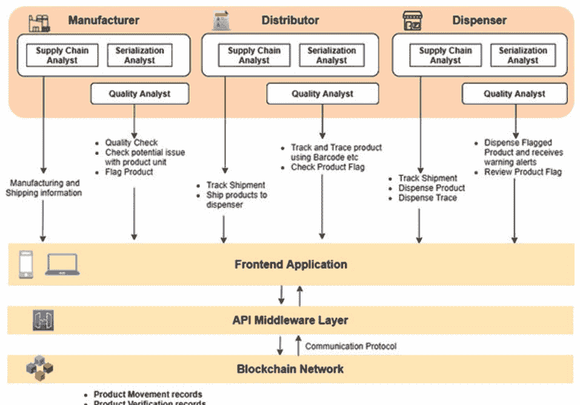

试点解决方案构建在 `Hyperledger Fabric` 之上，利用了区块链上的 `IBM Trust（IFT）` 资产。`API` 中间层将 `IFT` 资产与面向用户的 `Web` 应用程序连接。利益相关者之间的所有通信通过 `API` 完成。该试点解决方案还展示了与默克 `SAP ATTP` 系统集成并将委托产品发布到区块链的能力。

试点项目使用区块链捕获、记录和共享三个组织（制造商、分销商和药剂师）的相关药品供应链信息以及不合格或假产品的情况警报。试点解决方案使用终端用户的 `Web` 应用来：

- 货货、接收和发放药物
- 查看药品来源
- 验证产品并发送/接收产品相关的标记和警报

## FDA 的未来之路

此外，在开展试点项目后，FDA 正尝试将此实验扩展到该机构为了公共健康和安全而监测的其他生命科学过程中。最近，美国 FDA 启动了“智能食品新时代”倡议和蓝图，利用区块链和其他技术创建一个更安全、更可追溯的数字食品供应链。表 3.3 列出了 FDA 愿景通过区块链和 AI 等尖端技术开发新解决方案的关键目标：

| 关键目标 | 适用性 |
| :--- | :--- |
| 产品追溯 | 允许利益相关者（制造商、分销商和药剂师）在分布式账本中提供追溯信息，并自动验证重要信息。 |
| 验证 | 开发验证产品标识符的系统。在现代系统中，每个产品都被分配了一个唯一标识符。 |
| 检测与响应 | 允许公共和私营部门报告并检测怀疑为假冒、未知或危险的药物。 |
| 通知 | 创建一个共享系统，在发现非法药物时通知 FDA 和其他利益相关者。 |
| 信息需求 | 创建基于区块链的产品和交易信息共享账本，包括对许可信息的验证。 |
| 爆发响应与疾病预防 | 开发由区块链、AI、ML 和 IoMT（医疗物联网）支持的追溯系统，生成新的数据流以分析即将到来的风险和爆发。 |
| 新业务模式和零售现代化 | 创建一个平台和解决方案，解决整个医疗保健生态系统的食品安全漏洞。 |

## 表 3.3：FDA 的关键目标

## 电子处方框架

此外，电子处方只是医疗从业人员长期遵循的纸质处方的替代品。随着计算机技术的进步，基于计算机的系统和软件已进化到编写处方。现代电子处方系统是更全面的解决方案，支持整个处方流程并为组织和临床方面提供工具。电子处方系统的功能和实现取决于业务案例和组织的采用方法。

## 图 3.5：传统的电子处方流程

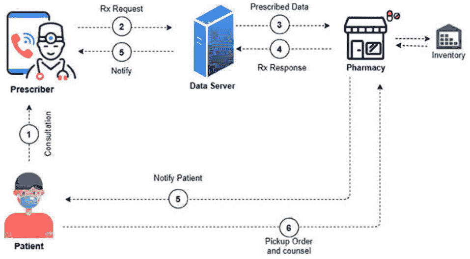

现有的电子处方系统预计提供以下流程：

- 消除纸质处方系统
- 防止处方系统中手动输入可能错误
- 监控整个处方流程并提供警报
- 缩短药房的处理时间
- 消除假处方的使用

这些系统的设计旨在为医疗执业者、药店和患者带来潜在益处。此外，高效的工作流、成本降低、安全性数字化处方是现代电子处方系统的驱动因素。随着医疗技术的进步、客户需求的增长以及数据共享方面的问题，现有的系统面临着潜在的障碍。这些系统所面临的一些挑战列举如下：

- 集成成本
- 数据隐私、共享和安全方面的问题
- 24/7 系统可用性
- 系统故障以及技术之间的不兼容性
- 互操作性挑战
- 跨区域的适应性挑战
- 数据不一致和碎片化

## 基于区块链的电子处方系统

到目前为止，我们已经了解到区块链有潜力解决现有电子处方系统中提到的上述挑战。基于区块链的电子处方系统的用例与传统系统相似，即从创建电子处方到向患者交付药物的流程不会改变，但改变的是数据和系统如何相互交互以消除系统现有的差距。区块链层改变了数据在周期内各方之间处理和共享的方式。区块链可以鼓励医疗机构维护一个共享的分布式账本来存储处方数据。通过这种方式可以消除许多用于相同目的的不同数据湖，并实现单一事实来源。

基于区块链的智能合约将用于未来的 DLT 电子处方系统，以自动化手动流程。业务需求和操作规则将集成到智能合约中，以处理系统中的交易。这些智能合约可以用于注册新的利益相关者、验证参与者、生成和验证处方、跟踪和追踪处方等。

在为医疗电子处方系统构建的许可区块链网络中，所有利益相关者对系统拥有不同的访问权限。例如，医生拥有读写权限，而患者拥有读取权限，药剂师可以读取并执行处方。所有利益相关者都可以随时在无需干预查看各自的数据。区块链确保了数据的安全不可篡改，满足了数据隐私的要求。此外，可以通过审计日志立即访问患者的病史，从而获取关键的药物相互作用信息。这有助于防止药物错误、早期预警、误读错误等。有趣的是，区块链可以帮助自动化决策支持过程，以更高的准确性加快整个流程。区块链使电子处方系统能够与其他系统通信，从而构建具有更高互操作性的全面医疗生态系统。我们将在后续的章节中详细讨论基于区块链的电子处方系统，并结合实时用例，可能还会涉及智能合约。

## 用于区块链签发医疗证明

虚假医疗证明一直是医疗专业人员、公司和其他利益相关者的困扰。例如，医生和医疗从业人员报告过许多案例，姓名和执照号被非法使用，损害了他们的声誉和执业。此外，公司在处理员工提交的健康问题医疗证明时面临挑战，因为没有具体的方法对每份文件进行验证。这还导致了公司的财务损失。

许多政府机构、监管机构、医疗公司和初创公司正在创建一个基于区块链的系统来生成和发行数字医疗证明。区块链作为单一事实来源，并具有不可篡改性、透明性和智能合约等特性，因此适用于发行数字医疗证明。识别和认证管理是基于区块链的证书系统的两个关键组成。

此外，在基于区块链的系统中生成证书的用例与传统系统相同，唯一的区别在于发行者、验证者和用户通过同一个区块链平台进行通信。让我们来看以下简化步骤，了解如何使用区块链发行数字证书：

1. 数字证书请求者（例如医疗专业人员）根据证书颁发者设计的规则提供详细信息。申请人可以使用前端应用程序提供这些信息。申请人提交请求的数据以进一步处理。
2. 提交后，输入数据在申请人确认后将保存在服务器上。这些数据在处理后将本地存储在服务器和区块链上。
3. 发行者访问申请人的数据，使用有效的 `CA` 生成数字证书，并将数字证书发放给申请人。该证书与处理后的数据一起成为一个交易并保存到区块链网络上。注意，电子签名仅由授权的 `CA` 提供者提供并确保。
4. 申请人可以访问系统并从平台下载数字证书。该证书可以由网络上的任何人验证。系统还提供了为数字证书提供二维码或条形码的规定，以便任何人扫描即可验证证书。

我们将在接下来的章节中深入研究基于区块链的数字证书系统。

此外，整个网络遵循患者-提供者合约，其中提供者是数据的主人，并控制他们想与谁共享其记录。在安全方面，医疗报告（包括实验室报告）由区块链生成并实时发布给患者，以便他们据此做出临床或业务决策。例如，医生可以为患者提供建议，健康保险公司可以代表患者决定报销方案。医疗物联网设备连接在患者身上以监测生命体征，并可以存储在区块链上（链上/链下）。医生、保险公司、药店等均可以访问这些数据。在处理电子健康记录（EHR）时，可以使用数据匿名化机制，通过将患者数据与 EHR 解耦来隐藏患者数据。唯一标识符或 `patient_id` 可用于数据与全面的 EHR 数据进行映射。

## 结论

总之，我们看到了区块链如何被应用于医疗生态系统中以构建一种新型医疗模式。我们讨论了现有医疗系统面临的差距和挑战，以及区块链能为系统带来的机遇。我们还探索了区块链的可能用例，讨论了如何确保患者记录的安全，并关注了围绕电子病历（EMR）系统的挑战。区块链驱动的 EMR 系统可以解决围绕 EMR 的多个挑战，并构建一种新型医院信息系统（HIS）。随后，我们将在后续章节中讨论这些提议和智能实验室。

## 多选题

1. 区块链中的链上数据是什么？
   a. 保存在区块链网络中的轻量级数据
   b. 保存到独立数据库中的数据
   c. 存储在文件系统上的数据
   d. 以上都不是

2. 区块链有助于维护医疗记录的完整性吗？
   a. 是
   b. 否

3. EMR 是来自单一诊所的患者记录。
   a. 是
   b. 否

4. 智能合约是医疗系统的重要组成部分。
   a. 是
   b. 否

## 答案

1. a
2. a
3. a
4. a

## 关键术语

- **DLT**：分布式账本技术
- **On-Chain Data（链上数据）**：存储在区块链网络上的信息或数据
- **Off-chain Data（链下数据）**：存储在区块链网络之外独立数据库中的数据
- **APIs**：应用程序编程接口是服务器与前端应用之间的桥梁
- **IoT**：物联网或智能设备
- **TMAP**：FDA 的技术现代化行动计划
- **DSCSA**：药品供应链法案
- **IFT**：IBM 食品信任
- **CA**：证书权威机构

# 第 4 章：EHR 和 HIS 中的区块链

在第 3 章“区块链在医疗保健中的应用”中，我们学习了 EMR 系统以及区块链如何解决患者数据隐私和安全的挑战。此外，区块链技术是构建新型互联 EMR 系统的核心，该系统构建了全面的 HIS。随着本书的深入，我们将简要讨论电子健康记录（EHR）、个人健康记录（PHR）和健康信息系统（HIS）。在过去的几年里，区块链通过一种安全的健康信息交换通道，重新发明了患者电子健康记录在同伴之间存储和共享的方式。医疗区块链是一个广泛且专有的系统，患者拥有完整的医疗记录，各方之间健康和医疗数据的存储与共享是安全可靠的。现代医疗区块链具有一些基础特征，如存储安全、医疗数据安全交换、隐私保护、不可篡改性和互操作性。

此外，健康信息交换（HIE）的设计旨在确保 EHR 中的患者数据能够安全、高效且精确地与其他利益相关者共享。考虑到现状，HIE 面临着集成和适配挑战，且它们大多在孤立的平台上运行。通过共享和信任机制，区块链是分布式 EHR 系统的解决方案，允许医疗生态系统中实现从远程医疗到保险的协作临床决策。EHR 系统是 DLT 在医疗保健领域理想的首选用例之一，它还包括实验室信息系统、放射系统、IoMT、连接设备、保险提供者数据库和 ERP 系统。剧透：DLT 只是区块链的同义词（区块链是 DLT 的一种），我们将在书中交替使用这些术语。

## 结构

本章将涵盖以下主题：

- 传统 EHR 系统介绍
- EHR、PHR 和 EMR 的比较
- 现有 EHR 系统的挑战
- 基于区块链的 EHR 系统
- 基于区块链的 EHR 系统的智能合约算法
- 基于区块链的 EHR 系统的用例
- 现代医疗信息交换系统

## 目标

本章重点关注区块链在现代 EHR 和 HIS 中的应用。在初步讨论中，你将理解传统的 EHR 以及现有 EHR 的局限性。我们还试图突出 EHR、PHR 和 EMR 之间的区别。此外，本章重点关注如何设计以患者为中心的基于区块链系统以及工作流中的可能组件。你还将理解基于区块链的 EHR 数据管理部分以及智能合约算法是如何设计的。在最后一节，你将讨论现代 HIS 以及区块链所扮演的角色。

## 传统 EHR 系统介绍

让我们先考虑旧的纸质流程和区块链技术。现有的 EHR 系统大多是基于客户端-服务器的模型，这些系统使用关系型数据库和网络/移动应用程序。随着多年过去，从一个伙伴到另一个共享医疗数据已变得常见，许多组织正在实施 EHR 和 HIE 网络。让我们在表 4.1 中查看 EHR、EMR 和 PHR 的区别：

| 属性 | EMR | EHR | PHR |
|---|---|---|---|
| 数据 | 仅临床记录 | 临床记录和从其他利益相关者接收的记录 | 包含 EMR 和 EHR 数据以及患者个人数据 |
| 消费者 | 单一诊所或机构的医疗专业人员 | 跨医院、实验室、药店、保险提供者、患者的医疗专业人员 | 仅患者 |
| 记录类型 | 病史、处方、当前健康状况 | 从不同来源收集的患者数字记录和健康信息 | 包括患者输入的信息以及来自药店、实验室、护理提供者和智能设备的数据 |
| 访问控制 | 可由医疗机构内的授权人员插入、收集、管理和查询 | 由跨多个医疗机构的授权临床医生创建、管理和查询信息 | 仅以患者为中心 |

## 表 4.1：EMR、EHR 和 PHR 的比较表

整合到 EHR（电子健康记录）中，为患者建立一份全面的档案。这些更新的数据集帮助医疗提供者设计出更好的决策工具，他们甚至可以开发新的业务模式。现在，EHR 不仅用于医院和大型医疗机构；它们也被用于基础护理、养老院、非政府组织（NGO）等。

有趣的是，医疗行业正见证着患者处理医疗记录方式的范式转变。现代患者更有意识、也更关注健康，这导致了对 EHR 的个人化使用增加。这就是为什么 PHR（个人健康记录）现在接入 EHR 并被广泛使用的原因。例如，来自个人健康设备（如 `Apple Watch`、`Fitbit` 等）的数据以及患者的评估（医疗或非医疗）有助于医疗专业人士为患者提供建议。尽管如此，PHR 在处理为了更好的决策工具而收集的海量数据方面仍面临困难，而且对其是否成功也缺乏共识。

到目前为止，EHR 的一切看起来都很良好，现代 EHR 可以满足全球人口的医疗需求。我们为什么需要将区块链作为一个额外的层呢？这是因为现有的 EHR 面临着挑战。让我们来看看一些主要问题或挑战。

## 图 4.1：EHR 系统架构图

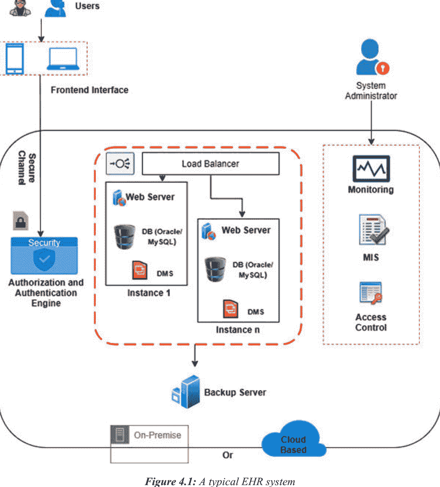

## EHR 系统的局限性

EHR 被视为一种工具，有机会使医疗服务合理化，并消除由碎片化医疗系统引起的所有问题。EHR 还面临着几个需要解决的关键且不断演进的挑战。让我们讨论一些与 EHR 相关的问题，然后看看区块链在其中的关联：

- **数据隐私与安全：** 如今，患者更加关注自己的医疗数据，因为他们的医疗数据是从多个渠道收集的，并由包括 EHR、PHR 和 EMR 在内的许多医疗系统处理。对个人数据安全的担忧并非空穴来风；`Ryu` 勒索软件和 `UVM Health Network` 危机只是近年来大规模网络攻击的少数。过去几年中，针对医疗机构的攻击数量呈指数级增长。任何安全泄露都会导致法律纠纷，医疗机构必须花费巨资来解决争议。确保 EHR 的数据安全和隐私是提供者的首要责任。

- **互操作性：** EHR 最显著的卖点之一是它们帮助医疗从业人员协作并即时访问数据。听起来很棒，但目前的互操作性仍然是一团糟。对于医疗提供者来说，设计一个能够在各利益相关者之间传输医疗信息的互操作性系统仍然是一个巨大的挑战。EHR 中的患者识别尚未标准化，这通常使得很难将患者与其记录相匹配。

- **复杂的遗留系统：** 许多设施和机构仍在运行过时的系统或复杂的遗留系统进行 IT 操作。遗留系统需要迁移到云端系统以获得更好的运行效率和标准化，通过升级和简化医疗设备和装置需要一些时间，特别是当这意味着完全的重构时。

- **数据标准化挑战：** 简单来说，EHR 应用并没有标准化。患者数据的收集和存储没有行业标准。每个 EHR 系统处理患者数据的方式都不同，导致了连接的 EHR 系统在互操作性、运营和数据维护方面的挑战。防止数据标准化问题需要整个行业的改变和头脑风暴。

- **数据迁移：** 许多医疗机构仍处于数字化过程中，将纸质记录导出为数字记录是一场噩梦。虽然正在引入基于 AI 和 ML 的自动化流程来在没有人工干预的情况下完成这种数字化转型，但对于医疗机构来说，这是一个重大的 EHR 实施挑战，如果旧系统中没有合适的格式，工作量将加倍。此外，区块链将帮助提供标准化的高质量数据，以开发高效的 ML 模型。

- **复杂的资产跟踪：** 通过 EHR 进行资产跟踪是一个很好的机会，因为医护人员可以使用 RFID 或条码找到任何物品。然而，设计不当的 EHR 会阻碍从业人员的工作，使 EHR 成为医院的负担。

围绕 EHR 的挑战还包括实施成本、员工抵制、缺乏易用性、监管问题、用户界面和培训问题。尽管如此，这些问题更多属于运营和管理层面，我们不会过多关注这些问题。

## 以患者为中心的区块链型 EHR

随着医疗服务专业化、数字化程度的提高以及患者频繁流动，在各种医疗机构之间获取医疗服务进行诊断和治疗已成为常态。数据丰富的 EHR 有助于医生做出及时、安全且高效的临床决策，但上述挑战是其互操作且安全的 EHR 系统的障碍。AI、云、ML、IoT/IoMT 和区块链等新技术可以通过应用这些技术的核心原理，帮助设计一种新型 EHR。

我们在之前的章节中已经学习了区块链的驱动特性，它具有转型医疗行业的真实潜力，并将患者带到医疗系统的中心。患者可以成为其医疗数据的主人，并决定个人数据的消费。区块链通过构建安全高效的 EHR 为健康信息交换带来新的业务模式。

通过应用区块链的三个基本原则，可以在区块链上开发新型 EHR：

- 创建安全、不可篡改且信任的医疗记录
- 在创建和链接身份的同时，确保患者数据和其他交易数据的匿名性
- 记录和管理患者对共享医疗和健康数据的同意

基于区块链的 EHR 被视为更高效地处理互操作性的工具（至少在理论上如此）。许多基于区块链的 EHR 正处于试点阶段或尚未全面投入运行，因此区块链面临着证明其克服传统 EHR 挑战能力的压力。新一代 EHR 还必须根据不确定的监管和法律要求来完善自身。许多医疗机构和医院正在使用不同的区块链框架尝试基于区块链的 EHR 和数据管理系统。

## 管理医疗数据的不同区块链

在之前的章节中，我们学习了三种类型的区块链网络：公链、私有链和许可链。这些区块链网络描述了网络参与节点在交易和验证方面的行为。理解针对不同案例和业务需求而应用于医疗系统的区块链类型至关重要。

- **公链：** 如果设计医疗系统的方式使得全球任何地方任何人都能参与，它就属于公网络。公链网络构建在 `Ethereum` 等框架之上。这种类型的区块链运行 `PoW`/`PoS` 等共识算法，使得验证过程变得繁琐。此外，运行验证需要高能量消耗。读取数据或执行交易没有访问限制，因此在 EHR 或任何存储患者敏感数据的地方都会避免使用此类区块链。

- **私有链：** 这些是受限的区块链，系统的访问权限提供给封闭小组或组织内部经过验证且真实的用户。由于系统内参与的节点数量有限，验证过程需要极高的效率。`Monax`、`Hyperledger Sawtooth` 和私有 `Ethereum` 都是私有链的示例，`Synaptic Health Alliance` 是其中之一。`Multichain` 框架可以用于构建私有链或许可链。

- **联盟链或联邦链：** 在许可链中，区块链中的节点是已知的。`Hyperledger Fabric` 和 `Ripple` 是许可链的示例。这种区块链网络对于医疗用例更具适应性。当在该网络中验证交易时，选定的节点必须达成共识、创建新区块并完成流程。`B3i`（一个保险用例网络）是该网络的流行示例，`Health Utility Network` 是联邦链的流行示例。

## 基于区块链的 EHR 系统组件

接下来，让我们检查基于区块链的 EHR 架构及其组件。以下是网络中可能的利益相关者或实体：

- **患者：** 患者是生态系统中的关键利益相关者，因为他们注入个人医疗和健康数据，或者来自智能设备/IoMT 的数据被注入 EHR。同样，患者数据可以从不同的医疗系统提取到全面的 EHR 系统中。总而言之，患者是其数据的主人，并可以为 EHR 系统数据的暴露制定控制策略。

- **提供者：** 提供者是患者数据的消费者，因为他们需要分析医疗数据并为患者提供建议。这些医疗提供者可以是医院、医疗从业人员、养老院等通过 EHR 获取数据的机构。只有获得患者授权的提供者才能访问数据。

- **智能设备/IoMT：** 现代医疗和生命体征数据也由智能设备收集并被 EHR 收集。此外，IoMT 设备（如智能 MRI、影像实验室和 X 光机）连接到 EHR，实时数据被注入 EHR 系统。

- **EHR 系统：** EHR 系统是存储患者医疗数据的基础设施或软件，以便根据患者提供的访问权限将数据与生态系统中的其他消费者（利益相关者）共享。

- **节点：** 区块链网络中的节点负责验证交易，然后将交易保存到区块链数据库中（链上/链下）。这些节点还负责在区块链网络上执行智能合约。在 EHR 系统中，节点可以是参与的医疗机构、网络中的成员医院、监管机构和管理员等。

- **监管节点：** 监管机构或政府部门要求设立监管节点以检查 EHR 等系统的合规性。它通常用于审计目的。

- **区块链：** 区块链层提供了数据不可篡改性、安全性、访问控制、分布式等能力。区块链的基本运行原理被应用于此。

## 图 4.2：基于区块链的医疗系统架构

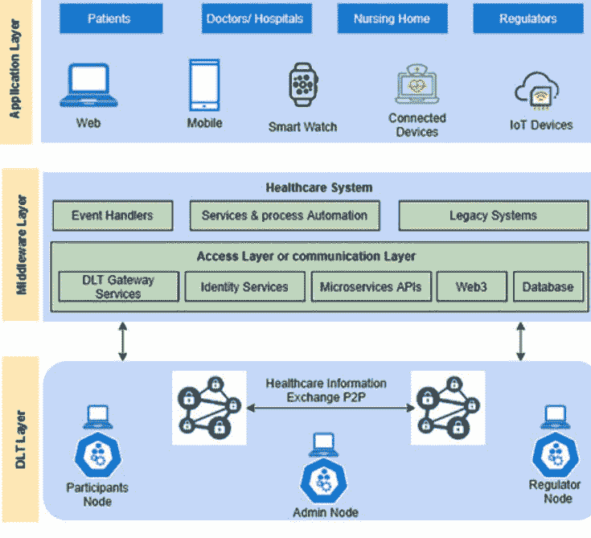

该架构类似于传统的客户端-服务器架构。在这里以及其他领域中，区块链作为现有架构之上的额外层运行，因此与将整个系统替换为基于区块链的系统相比，操作、集成和实现将更加合理。

## 基于区块链的智能 EHR 系统

集成了智能合约的基于区块链的 EHR 并非遥不可及的梦想；它们现在已在现实医疗系统中实现并使用。“MedRec”和“MedShare”是此类系统的流行示例；我们将在接下来的章节中探索这些用例。由于我们正在谈论智能合约及其在 EHR 中的实现，让我们看一个算法作为示例来理解智能合约在 EHR 中是如何工作的。此外，智能合约无非是一段自执行的代码，其中写了操作的条款和条件。

让我们考虑一个基于区块链的 EHR 系统，其中医疗利益相关者已入驻，并可以使用前端层（例如移动应用或网站）与系统进行交互。在以下智能合约算法中，患者可以为谁可以访问其医疗数据设置权限：

### 算法 1：EHR 访问控制

```
```


## Initialization: (By Patient)

**Input:** `TxN`

**Output:** `Result`

```javascript
function setPermission(PublicKey of Requester, PublicKey of Doctors)
if (TxN.getRequesterPublicKey === Patient Public Key)
{
    permissionList[] = + Doctor_A_PK;
    permissionList[] = + Doctor_B_PK;
}
```

图 4.3 显示了如何使用区块链网络收集、保存和分发医疗数据。它广泛地讨论了智能医疗系统数据管理，以及生态系统利益相关者如何相互交互：

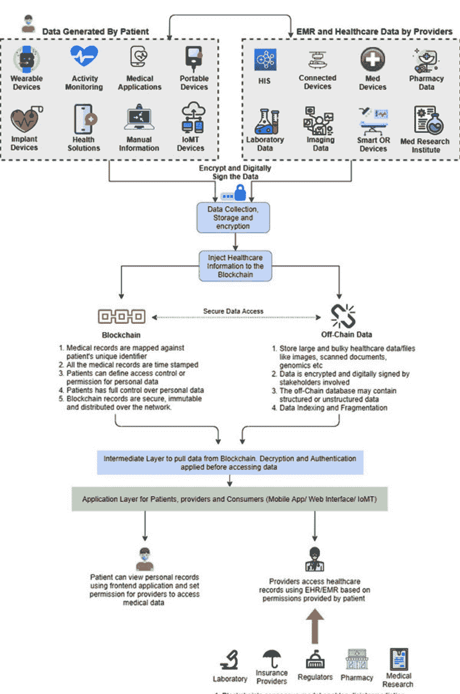

## 图 4.3：基于区块链的医疗系统上的数据流

```javascript
function viewPatientRecords(PublicKey of Requester PKr)
if (permissionList[] contains PKr)
{
    return patient's data;
}
else if (permissionList[] does not contains PKr)
{
    return "Access denied";
}
```

让我们深入研究上述智能合约算法：

1. 患者使用移动应用访问 EHR 系统。
2. 患者收集想要共享医疗数据的医生或利益相关者的公钥。
3. EHR 接口调用 `setPermission()` 函数，通过对比公钥（公共地址或用户）来检查来自患者的请求。
4. 如果请求来自有效患者，它会将医生或利益相关者的公钥/公地址添加到 `permissionList` 或规则库中。
5. 任何想要访问患者数据的医生或提供者都可以通过前端移动应用或网站从 EHR 系统调用 `viewPatientRecords()` 函数。
6. `viewPatientRecords()` 函数在 `permissionList` 中检查请求者的公钥/地址。如果请求者的公地址已获得患者许可，该函数将把医疗数据发送给请求者（医生/提供者）；否则，它将返回错误。

请注意，这只是一个算法，而不是实际代码。我们将在后续章节中尝试编写智能合约。

## 基于区块链的数据处理框架

正如上一节关于基于区块链的 EHR 系统核心组件的讨论，让我们看看这类网络是如何处理数据处理（存储和共享）的。如图 4.2 所示，几乎每个基于区块链的 EHR 系统的架构在某种程度上都是相似的。

在本节中，我们将讨论基于区块链的 EHR 系统中通过智能合约进行的数据处理。智能合约使现代医疗系统能够在无人工干预的情况下管理操作。数据注入和共享的工作流如图 4.4 所示：

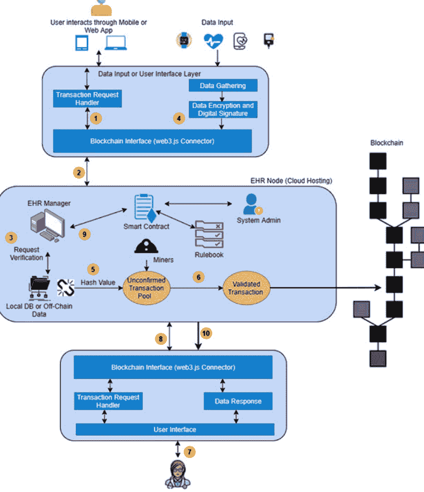

## 图 4.4：数据管理（共享）

智能合约从参数中提取允许的公钥并将其添加到规则簿中。

- `PullEHRData(PublicKey, Addr)`：当提供者想要执行患者数据以供使用时，EHR 接口会执行此函数。该函数会检查传入的公钥是否被规则簿允许。如果提供者被允许从 EHR 获取医疗数据，则 EHR 管理器将通过从链下或链上数据库获取数据并发送给提供者来处理响应。

- `warning(PublicKey, message)`：如果 EHR 管理器检测到任何未经授权的人进入系统并尝试访问患者数据，它将向该未经授权的人发送警告消息。在基于以太坊系统中，即使是智能合约也可以消耗 Gas 值或以太坊的形式惩罚此类未经授权的用户。

通过使用以太坊提供的 `Web3.js` 库，实现区块链与前端接口的连接。上述 EHR 网络解决了 EHR 面临的挑战：

- 数据安全与隐私
- 网络延迟
- 可扩展性挑战
- 运营挑战
- 中心化
- 单点故障
- 治理
- 互操作性

智能合约中的算法可以像我们在上一节的算法 1 中所示的那样进行设计。在算法中，我们看到了患者如何为查看权限添加授权。查看算法 2 以了解提供者如何访问数据：

## 算法 2：EHR 访问控制

```javascript
Input: TxN

Output: MedicalData (Response)

Initialization:
```


## 步骤

**Step 1:** EHR 管理器接收来自提供者的数据请求（事务 `TxN`）

**Step 2:** EHR 管理器检索请求者的公钥
``` 
Public Key = TxN.getRequesterPublicKey();
```

**Step 3:** EHR 管理器将公钥发送给智能合约
```
Admin = Txn.msg.sender();
```

**Step 4:** 智能合约检查规则簿，确认传入请求有效并获得患者授权。
```
checkPermission(pk) = true;
```

**Step 5:** 验证过程完成

**Step 6:** 获取交易消息
```
message = retrieveFunction(TxN);
ProviderId = getProviderID(message[index]);
PatientID = getPatientID(message[index]);
```

**Step 7:** 从区块链检索数据（EHR 管理器）
```
If RuleBook(ProviderId) = true then
    Response = retrieveEHRInfo(PK, PatientID)
else
    Response = penalty(PK, ProviderID, Message)
return
```

## 基于区块链的智能 EHR 系统（现实用例）

在 Eckblad 于 2016 年发表的一份白皮书中，他提出了“MedRec”区块链，这是一种处理患者数据的智能 EHR 系统。它建立了患者与提供者之间的关系。MedRec 白皮书关注四个主要的医疗问题：

- 碎片化的医疗系统导致医疗数据访问速度缓慢
- 互操作性
- 患者连接
- 提高医疗研究的数据质量和数量

MedRec 是社会需求与技术赋能（即区块链）的结合。它采用以太坊作为基础区块链框架。开发以太坊智能合约是为了创建存储在 MedRec 网络各个节点上的现有医疗记录的智能表示。开发智能合约是为了实现成员入驻、患者-提供者关系以及数据的共享与分配。MedRec 区块节点可以与 EHR 集成，以有效管理医疗数据。下图描述了 MedRec 系统的智能合约架构：

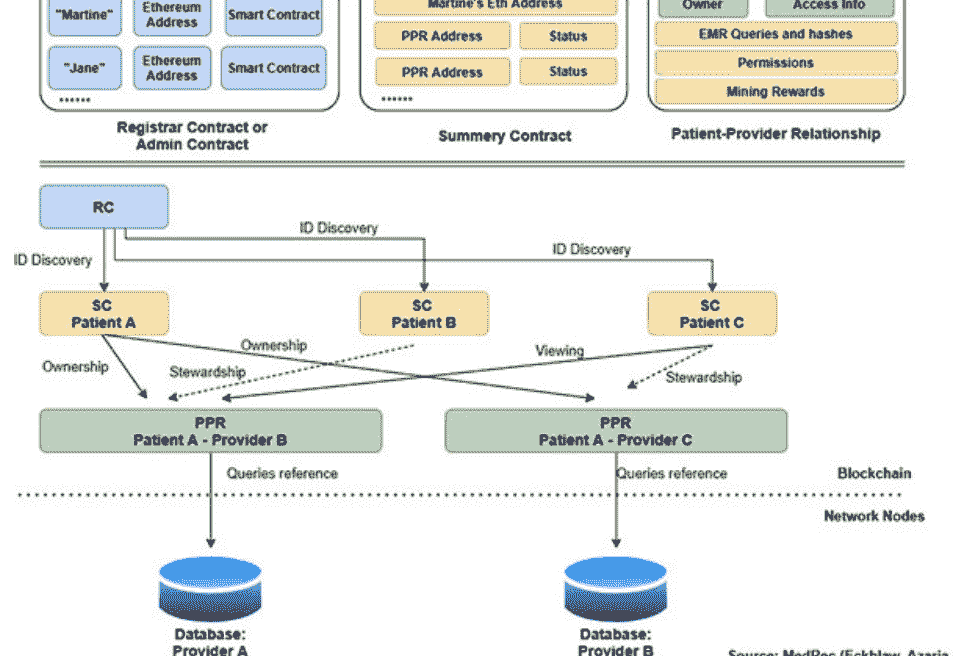

图 4.5：MedRec 智能合约架构

在这里，上部分显示了每个类型智能合约的内容，下部分显示了合约与网络节点之间的关系。该系统实现了三种类型的智能合约来处理 EHR 系统上的大量医疗数据：

- **注册合约 (RC):** 注册合约可以被看作是管理合约，负责为参与者分配身份。参与者根据其以太坊公地址在系统内被标识。该系统允许使用任何现有形式的 ID，而不是使用加密密钥。该合约设计用于监管新身份的注册，或更改现有 ID 的映射。

- **患者-提供者关系合约 (PPR):** 该合约发布在区块链网络中的两个节点之间，其中一个节点负责管理和存储另一个节点的医疗记录。PPR 是数据指针的集合，并绑定了识别系统内记录的权限。每个指针都有一个查询字符串，在提供者的数据库上执行时会返回患者数据。检索到的患者数据哈希值与查询字符串附在一起，以确保源头未发生任何改动。

- **总结合约 (SC):** 总结合约帮助参与者定位其医疗数据历史。它维护了一个 PPR 引用，跟踪网络中所有参与者的互动情况。例如，患者可以运行 `SC` 来检索与网络中所有提供者互动的引用，反之亦然。

考虑到区块链的不可变性，任何参与者都可以随时离开网络，但当他们重新加入网络时，他们可以看到区块链网络中过去的数据和互动。

如图 4.6 所示，每个患者和提供者节点都有四个基本组件：

- 后端库
- 以太坊客户端
- 数据库守护者
- EHR 管理器

这些节点可以托管在任何类型的云基础设施上。该系统可以集成运行在任何后端和前端技术上的提供者系统。

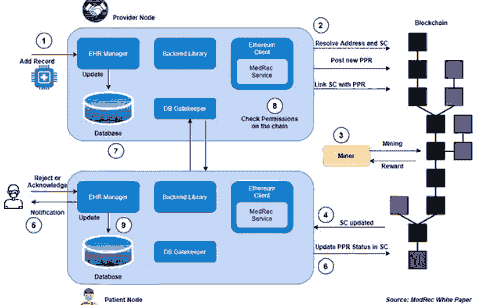

以下是图 4.6 所示 MedRec 的关键组件：

- **后端库：** 这是一组为了方便网络操作而开发的工具包。使用此库，其他系统可以通过中间层与区块链交互。该层与以太坊协议交互。
- **以太坊客户端：** 以太坊客户端提供了在区块链上加载成员所需的功能。它执行网络中的重要任务，如连接 P2P 网络、加密、分配以及维护链下数据。该客户端实现了通过注册合约定位总结合约的服务。
- **数据库守护者：** 该模块负责维护链数据库数据库它提供了访问节点数据库的接口，并由存储在区块链上的权限管理。数据库守护者由跟踪网络查询请求的事件监听组成。传入请求包含查询字符串和具有执行权限的 `PPR` 合约引用。所有传入请求都经过发行者的数字签名，守护者确认身份。一旦发行签名通过认证和验证，守护者将检查区块链合约以验证请求的地址是否有权访问查询。如果地址正确，它将在本地数据库上运行查询并将结果返回给客户端。
- **EHR 管理器：** EHR 管理器可以被看作参与者与区块链网络之间的桥梁，该层封装了所有的软件组件和用户界面。EHR 管理器渲染本地数据库的数据以便查看，并向用户提供更新通知以及共享和检索选项。它考虑了移动设备的兼容性，因为现代用户期望在移动时能够轻松访问。
- **矿工：** 该系统允许矿工参与网络并激励矿工为网络贡献计算力和资源。通过挖掘可以获得以太坊，奖励解决计算难题的节点相应数量的以太坊。医疗提供者通过参与挖掘和验证交易也能受益，以资助其活动的持续（发布和更新 `PPR` 等）。同样，当患者想要共享其信息时，他们需要花费以太坊或由接收方资助。是否使用以太坊种子还是由其支付取决于医疗保健法规。该系统中还可以探索激励参与者的其他方法。

到目前，我们已经了解到医疗系统和组织是复杂的、碎片化的且数据密集型的，因为数据是由患者、医疗服务提供者和医院等各种医疗利益相关者生成的。顾名思义，健康信息交换（HIE）是一种在各医疗利益相关者之间以电子方式传输患者的健康和医疗数据的方法。HIE 系统的互操作性需要系统和组织之间建立电子链接，以便与某一机构关联的患者数据也能链接到其他系统。

现有的 HIE 系统缺乏统一的医疗标准、互操作的信息系统以及数据交换平台，导致在安全、无缝地收集、分析和交换有意义的医疗信息方面存在问题。传统的 HIE 系统通过以下方式在利益相关者之间共享医疗信息：

- **直接模式：** 正如名称所示，交换提供者直接与已知的利益相关者共享患者的医疗记录。数据传输以安全且加密的方式进行。如果提供者和消费者是已知且信任的双方，这种方法效果良好，并且通过安全通道交换患者信息，可以改进组织之间的协作。

- **基于查询的模式：** 在此模式下，提供者可以从其他提供者处请求患者信息。在这种安排中，中央存储库共享患者数据。医疗数据从该存储中不同的电子健康记录（EHR）中聚合。该方法具有一种机制，可以高效处理跨 EHR 数据，以向患者提供医疗服务。

- **以患者为中心的交换：** 在此模型中，医疗记录从提供者传输给患者。这使得患者能够参与其护理过程并管理医疗信息，并在医疗交换系统中发挥着关键性作用。该模型加强了对患者医疗和健康数据的访问控制。

## 传统 HIE 的运行模型与挑战

现代 HIE 系统每天处理和交换海量的医疗数据，患者期望根据交换的数据获得改进的医疗流程、协调且高质量的护理。在现有场景下，患者对数据隐私和安全表示担忧，因为来自多个渠道的大量个人医疗数据正在多个利益相关者之间共享。在某些情况下，患者数据在未获得患者同意的情况下就被交换了。在现代医疗领域中，患者是 HIE 系统的主要且重要的利益相关者，也是通过各种渠道产生健康信息的重要生产者。这些挑战可能会导致患者放弃通过 HIE 系统共享医疗信息。

医疗机构非常清楚这些事实，并尝试了不同的方法在医疗实体之间安全地共享数据。以下是现代 HIE 系统面临的一些挑战：

- 患者对医疗数据隐私和安全的担忧
- 对数据收集实践缺乏控制
- 与数据共享机制和方法相关的透明度缺乏
- 互操作性挑战
- HIE 系统的集成成本
- 第三方对医疗数据的访问受限
- 数据导出挑战
- 电子健康信息交换标准的不足
- 患者与其健康记录之间映射的歧义性

## 基于区块链的 HIE 系统

医疗领域的领导者已经分析出，区块链技术可以建立协调并管理医疗利益相关者之间的通信。在网络化和连接的模型中，所有利益相关者和医疗公司都需要在点之间进行通信，并实时更新数据，以获得更好的临床决策和咨询。

基于区块链的医疗数据共享系统可以高效跟踪存储在区块链网络上的患者敏感数据的访问记录。区块链还可以带来访问控制框架，以保护患者的医疗信息，并为数据提供访问权限。

考虑到区块链的固有属性，许多医疗机构正在尝试基于以太坊和 `Hyperledger-Fabric` 框架的 DLT-HIE 系统。在上一节中，我们查看了数据共享协议的不同模型，如直接、基于查询和以患者中心的交换。同样，在基于区块链的数据共享模型中，区块链中的每个块都包含一系列护理记录，而每个节点独立运行并受相同共享协议的约束。该模型使用来自 EHR 的医疗数据通过安全交易向授权的利益相关者提供访问。

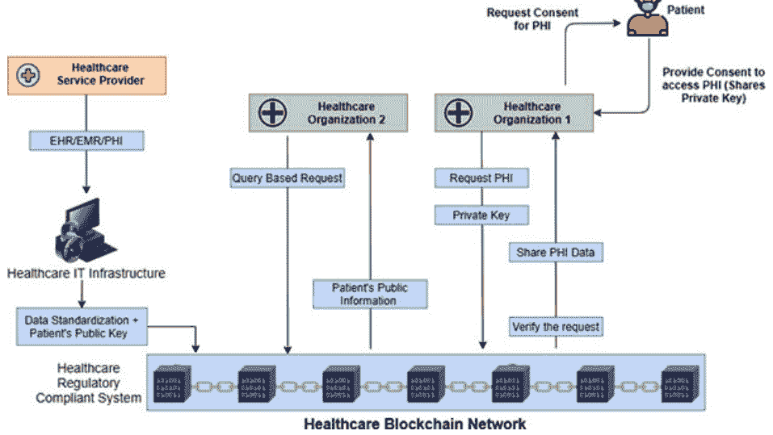

图 4.7：基于区块链的 HIE 系统和工作流

## 基于 DLT 的 HIE 系统的组件和指针

与其他任何基于区块链的医疗系统（例如 EHR、PHR 或 EMR）一样，HIE 系统具有以下核心组件：

- **数据处理：** 基于区块链的 HIE 系统可以提供访问控制框架，对读写操作进行精细控制。链上数据的写入权限提供给网络上的特定私钥。密钥共享通常由 `API` 层处理。

- **云存储：** 云基础设施处理医疗数据的存储，它还提供了通过应用程序接口处理患者医疗数据访问权限的能力。

- **访问控制：** 代表了根据公民或政府权限，为授权用户提供访问特定信息区域所需的私有“密钥”的权限。

- **区块链数据库：** 它在链上或离线数据库中存储加密健康信息的副本。

- **加密层：** 在此处读取或写入的任何数据都需要解密密钥，该密钥仅提供给授权方，通过验证或根据任务预定义确定。加密层基于公钥加密工作。

- **节点：** 网络中的每个节点都与医疗利益相关者相关，他们同时维护医疗账本的副本。根据用例为这些节点提供访问区块链网络的不同权限。

- **EHR 系统：** 基于区块链的 HIE 可以与多个 EHR（包括 EMR 和 PHR）交互，以有效获取医疗和健康数据，随后通过接口处理到区块链网络。根据可用性和医疗业务用例，HIE 系统还可以与 `CMS` 和 `ERP` 交互。

## 在 HIE 中建立信任

如上一节所讨论，医疗机构的主要关注点是获得患者对交换系统的信任。信任不是一夜之间可以建立的；它是一种长期的患者关系。如果患者信任系统或组织，医疗信息共享将很容易，但患者对现有 HIE 的工作以及数据处理方式存在信任问题。

区块链技术可以帮助组织建立患者的信任，因为区块链本身是一个去中心且无需信任的系统。有趣的是，即使没有强制执行隐私和合规政策，信息共享和存储过程也是可靠且安全的。如果营销得当并引导正确，普通大众可能会相信基于区块链的 HIE 系统可以在交换敏感信息时解决隐私和安全问题。这是由于区块链的特性和技术能力，并可能提高患者对 HIE 生态系统的参与。

医疗生态系统伙伴有责任参与创建技术信任和患者意识的过程。任何传统 HIE 系统或基于区块链的 HIE 系统的升级都包含区块链技术的主要特征：机密性、可用性和完整性。在这种情况下，数据完整性通过确保所有利益相关者维护账本副本并实时更新账本，使得所有参与者拥有实时更新的数据。如果患者理解他们是自己医疗和健康信息的所有者，他们将愿意连接其他渠道进行数据供应以提供更好的医疗服务。除了患者外，医疗机构还可以尝试智能合约和不同的区块链创新。

## 总结

在本章中，我们看到了传统的 EHR 如何处理患者的医疗和健康信息，并研究了与这些系统相关的问题。我们讨论了分布式账本技术如何彻底改变以患者为中心的数据存储和处理。区块链无疑可以给现有的 EHR 留下印记。在本章中，我们讨论了智能合约的结构及其算法，作为基础用例，以理解 EHR 中智能合约的概念。我们还探索了一些基于区块链的 EHR 的现实用例，公司正在尝试使用 DLT 技术创建新型分布式 EHR，如 MedRec。

在下一章中，我们将讨论药品供应链如何运作，以及区块链如何消除现有供应链中的漏洞。

## 多选题

- 1. EHR（电子健康记录）是从其他利益相关者处接收的临床记录。
  a. 正确
  b. 错误

- 2. 哪种类型的区块链最适合智能 EHR？
  a. 公有链
  b. 联盟链/许可链
  c. 私链
  d. 以上都不是

- 3. 下列哪项不是智能 EHR 的组件？
  a. 患者
  b. 服务提供者
  c. 分销商
  d. 节点

- 4. DAP 或前端应用通过哪种介质连接区块链网络？
  a. APIs
  b. 数据库
  c. 节点
  d. 网页

- 5. 健康记录在插入区块链网络之前会经过验证。
  a. 正确
  b. 错误

## 答案

- 1. a
- 2. b
- 3. c
- 4. a
- 5. a

## 关键术语

- **IoMT**: 医疗物联网，指连接的智能设备
- **Node**: 节点，节点的主要目的是验证每批网络交易（称为区块）
- **PHR**: 个人健康记录
- **Smart Contract**: 智能合约，根据约定的条款和条件执行流程的自动化合约

# 第 5 章

## 药品供应链与药物管理

无论什么种类行业，供应链管理一直是任何企业和组织中最结构化的流程之一。由于医疗保健行业的规模，生命科学供应链一直在努力在医疗利益相关者之间平衡风险、高成本和完整性问题。由于全球消费者市场对个性化医疗的需求，这种运营层面的不平衡可能会加剧。简单来说，供应链是通过生产货物和管理供需周期，为消费者和生态系统利益相关者创造价值的关键业务流程组合。

药品供应链的生命科学具有三个主要流：物理流、资金流和从供应商到医药公司再到分销商及利益相关者的信息流。所有这些流都是复杂且紧密耦合的，需要对供应链流程进行持续监控和审查。简而言之，药品供应链包括药物的研究、开发、分销和应用。它非常复杂，因为它涉及到不断变化的市场、流程、法规、中间环节和合规性。在过去的几十年里，由于流程不透明以及利益相关者之间缺乏实时数据共享，专家们观察到了供应链中的差距。一个流程或区域的变化可能会影响其他流程和其他因素，如价格波动、跨地区的监管变化以及竞争对手。

药品行业正面临一个转型时代，从供应链运营到 IT 基础设施的进步……实现安全、实时特性。

## 结构

- 药品供应链简介
- 药品运营模式与生态系统
- 供应链中的关键挑战
- 区块链在供应链中的应用
- 基于区块链的用例
- 研究与开发
- 销售与利润

## 目标

本章将为您概述药品供应链及其挑战。在本章中，我们将讨论药品供应链以及区块链如何实现安全、实时。

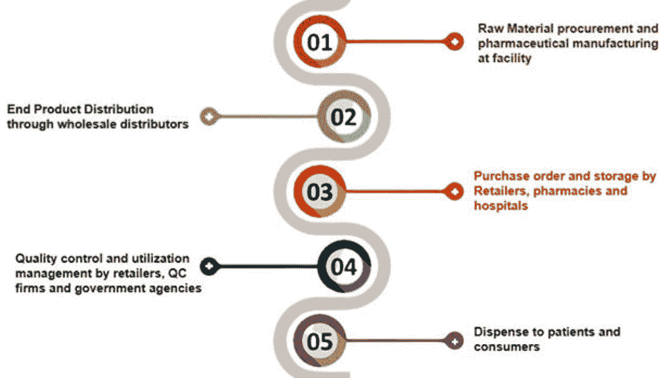

## 医药供应链中的关键问题

以下是医药供应链行业面临的一些关键问题，涵盖了从供应、制造、物流到冷链、监管和竞争等方面：

- 消费者产品需求的变化是医药供应链的一项关键挑战，因为患者和消费者的需求可能会随着新的医疗趋势和进步而变化。
- 供应管理不当是医药供应链的另一个挑战，原材料供应任何延迟都会对生产和最终交付产生巨大影响。

图 5.4 展示了医药供应链中关键利益相关者之间的演示或相互连接。医药行业处理的是救命产品，由于其重要性、紧迫性、存储、监管、运输等因素，其供应链与其他商品的供应链有所不同。

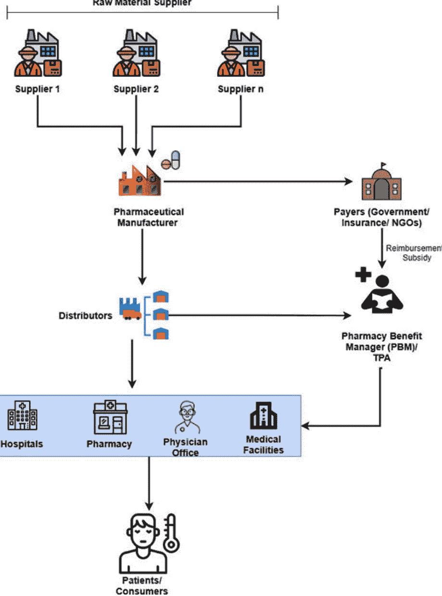

图 5.4: 医药供应链演示

- 分销和库存管理中的问题会影响医药产品的最终分销和交付。

- 医药供应链可见性对于供应链管理（SCM）行业至关重要。追踪和记录药物短缺、假品、镇静剂和阿片药物是医药公司的重点，以便为患者提供高质量药物。此外，供应链的可见性可以增加医药制造企业的利润。

- 医药行业长期以来与假产品作斗争，且缺乏高效流程来检测供应链中的此类活动。这一挑战需要立即关注，因为改进医药供应链管理可以帮助公司更好地应对假冒/重复产品。

- 大多数医药产品对温度敏感，环境因素的任何变化都可能导致整批产品污染。冷链增加了医药供应链的复杂性，公司正在寻求新方法来处理冷链问题。

- 监管和合规因素也是医药供应链的挑战性因素，因为这些因素可能因地区和大陆而异。因此，医药行业需要密切关注不同地区供应链的监管和合规政策，以防止任何潜在的财务和物资损失。

- 在运输和配送方面，物流协调非常重要，它对医药供应链构成了不同程度的威胁。即使是一种药物或医疗产品，也可能涉及多个利益相关者或流程，因此确保这些合作伙伴之间的高效协调至关重要。

- 药物在供应链传递过程中的变质会导致不合格产品发放给患者。

- IT 基础设施的进步是医药供应链行业面临的最关键挑战之一，因为许多利益相关者使用的旧系统非常复杂，难以更新或替换。更改旧系统可能会导致多个运营问题，但了解 `RFID`、云端、`IoMT` 和区块链等技术可以缩小供应链差距（运营和流程）并具有彻底改革整个系统的力量，也是重要的。

- 食品和药品行业的客户总是期望收到的产品有更新的保质期或在到期前。因此，医药行业避免向客户发货短临期的产品至关重要。

## 医药供应链格局的变革

IT、硬件和运营领域的新兴技术可以提升医药制造和供应链的运营与管理。许多新型技术具有将质量引入制造过程的潜力，某些技术还可以增强利益相关者之间的协作以实现利润率。

此外，一个持有序列化日期以及来自 `ERP` 系统、`IoT` 设备、`RFID` 和传感器等来源数据的数字平台具有转型现有医药供应链的潜力。一种潜在技术是人工智能（AI）和机器学习（ML），它们能够让企业分析数据并检测业务模型中的新模式。同样，云基础设施可以为网络带来可持续性和扩展性，这是旧系统所缺乏的。此外，区块链可以创建一种新型的安全、不可篡改、透明和实时的网络，以实现更好的追踪溯源、数据共享和整体运营。以下是区块链在医药供应链中的一些应用领域：

- **医药供应链的研发：** 通过区块链技术可以显著提高研发。数学模型、设施验证和设计制造可以解决这些问题。

- **物料处理：** 如 `RFID`、`IoT` 和传感器的技术可以帮助冷链监控。

- **医药供应链的可见性：** 通过区块链的数字化，可以在企业和组织之间共享数据，这使信息更易获取。基于区块链的执行智能合约有助于数据生产。

- **分销数字化：** 分销渠道可以为系统带来效率和透明度。数字化是当务之急。新型电子处方（`POS` 数据）将供应链规划增加价值。

- **旧系统：** 升级旧系统一直是一项挑战性任务。

- **协作服务：** 通过技术、信息系统，内部和外部利益相关者之间追求协作。

- **采用前沿技术：** 采用区块链、`AI/ML` 和 `IoMT` 等前沿技术可以为整体供应链带来全面数字化。`AI/ML` 可以帮助公司以更好的方式处理数据并分析流程，并为决策带来数学模型。

此外，区块链通过其固有的安全性、不可篡改性和分布性，可以创建一种确保透明度和高效处理流程的新型供应链。基于区块链的智能合约可以消除供应链中的中间环节和人工流程，缩短产品上市时间。我们后续章节学习区块链的作用。

## 区块链在医药供应链中的应用

在第二章区块链基础中，我们学习了区块链及其结构。回顾一下，区块链是一个共享事务账本的分布式网络，网络中的每个节点都维护账本的本地副本，任何微小变化都会广播给网络的所有参与者。由于其属性，区块链可以为现有医药供应链带来现代网络安全。在区块链驱动的供应链中，如果有人试图修改或删除数据，系统将拒绝。这将增加对系统的信任，而这是供应链行业的核心挑战。在基于区块链的医药供应链网络中，产品在创建时注册在网络上。一旦产品注册到网络上，它就变成了非同质化数字资产并可以传输给其他利益相关者。区块链使得追踪制造和分销路径变得方便，因为它可以维护跨整个医药供应链的完整旅程。此外，执行区块链的智能合约可以为系统增加更多智能，从供应链中移除服务中间商和数据交换服务提供商。

- **信任与透明度：** 药品供应链的每个利益相关者（包括制造商和患者）都能够在整个供应链中对产品进行追踪溯源。这增加了对系统的信任，尽管区块链本身就是一个值得信赖且严谨的系统。有趣的是，患者可以通过界面查看终端产品的整个生命周期，并检查产品的合法性。

- **追踪与溯源：** 一旦启动产品制造并将事件记录到区块链中，网络中的任何人都可以通过整个供应链对产品进行追踪溯源，包括产品在转交时的所有权。

- **可见性与隐私性：** 一个系统在网络上能够同时处理可见性和隐私性，这看似是矛盾的，但在区块链上是一个可行的方案。区块链可以处理所有利益相关者可用的数据并保证其原始性，同时在不泄露隐私的情况下保持实体或患者私有数据的机密性。这种能力源于公钥加密的概念。例如，可以在网络上验证产品，而无需暴露产品的制造技术。

- **安全性：** 现在，显而易见的是区块链是一个安全的账本，因为它是一个不可篡改的系统。一旦注入网络的数据就无法被修改或删除。此外，制药公司与技术供应商可以创建一个许可性区块链网络以确保更好的安全性。

- **数据库建模：** 产品通过不同阶段（例如研发、生产、临床试验和分销）的每条信息都存储在区块链中。这些数据可以通过 `AI/ML` 技术进行处理，为风险评估、未来试验和创新创建更高效的数学模型。区块链可以提供真实可靠的数据，这有助于开发更强大的 `AI/ML` 模型。

- **基础设施集成：** 区块链可以与任何遗留系统、带有任何传感器的云基础设施、`IoT` 设备以及其他可能的智能设备集成。所有区块链框架的 `API` 连接也是可用的，并且可以帮助构建全面的区块链网络。

- **供应链管理（SCM）中基于区块链的贸易融资：** 贸易融资流程非常复杂，许多环节会导致发货延迟和最终付款结算。约 45% 的跨境货物因海关清关和法律文书问题而延误。使用基于区块链的智能合约可以实现业务逻辑的自动执行，确保供应链的效率。

- **新兴市场：** 资金流一直是小型制药公司面临的问题。市场中的巨头倾向于寻求更短的信用期，使小型参与者更容易受到财务风险的影响。在区块链系统中对产品进行追踪溯源可以使小型参与者更容易获得贷款，并缩短整体周转时间。

## 基于区块链的药品供应链工作流

图 5.5 展示了基于区块链的药品供应链的一般工作流：

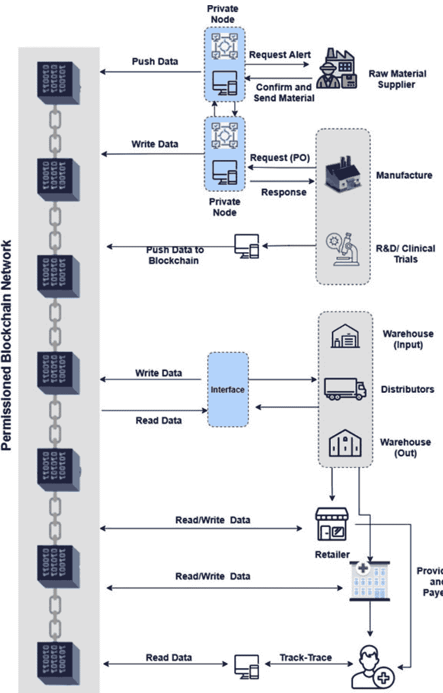

许可区块链网络

图 5.5：基于区块链的药品供应链工作流

让我们看看生态系统中的不同参与者如何通过区块链网络的共同层进行相互交互：

- 一旦制造商在研发和临床试验后投入新药，就会创建一个区块并将信息记录到区块链网络中。这些信息将实时可用；即使对于已经开发的产品，网络中也会提供其相关信息。

- 临床试验后，样本被发送到制造单元进行大规模生产。制造商通过私有节点向原材料供应商发送采购订单，相同的请求也会记录在区块链网络中。

- 供应商收到新订单（`PO`），接受请求并通过私有节点将信息记录在网络中。付款和结算根据智能合约的条款和条件在供应商和制造商之间进行。所有的请求、响应和其他信息都维护在区块链网络中。

- 原材料在到达制造设施后存储在仓库中，测量所有的输入参数，并将相关信息推送到区块链网络。随后，在生产之后，终端产品/药物被发送进行包装并存储在仓库中分发。产品信息如标识符、条形码、有效期、批号、制造商日期和其他重要参数被推送到区块链网络。

- 批发分销商通过私有节点向制造商提出请求，制造商发送货物连同运输信息、货单号、代理信息和其他信息。所有信息都记录在区块链网络。

- 分销商在仓库中大量存储产品，并将产品运输到医院、诊所和药店等提供者。这些提供者可以从区块链访问特定产品的数据，并在通过区块链网络销售给终端消费者之前对产品进行验证。这种产品验证有助于打击伪劣供应。

- 7. 患者从提供者处购买并服用。他们可以通过向区块链网络提供标识符来检查终端产品的真实性。区块链为客户提供了产品的完整历程，客户借此检查产品的整个历程，并判断是否安全可用，或获取其他信息。鼓励患者在整个过程中确定真实性，因为区块链供应链为潜在买家提供了透明的验证信息。

# 药品追踪溯源用例

在图 5.3 中，我们分析了药品链的一般流程。在本节中，我们将观察一个全面的基于区块链的模型，用于追踪产品移动以及基于区块链的药品 SCM 系统架构。有趣的是，基于区块链的 SCM 系统是一个复杂且运行顺畅的系统，由区块链、智能合约、`IoT` 设备、耦合设备处理器和云基础设施组成。所有这些组件在药品生命周期内（从研发到制造到最终交付）同步工作。系统中的智能合约可以处理手动流程以及法律和合同义务。

区块链可以确保向生态系统进行适当分发，以追踪溯源药品并应对风险、中断和纠纷。它可以有效管理产品的所有权转移、来源和端到端视图。区块链将在处理货运单据、程序和法律义务的同时建立跨境透明度。生态系统中的每个利益相关者都可以实时访问相同的数据，以辅助决策或确定产品的真实性。对授权查看的参与者进行访问控制。图 5.6 展示了一个复杂的基于区块链的系统、其工作流以及每个参与者如何使用区块链与他人交互：

# 产品流转

| 合同（原材料） | 制造（采购订单） | 分销渠道 | 合同（产品） | 采购订单 | 包装与运输 | 接收、存储与分发 |
| :--- | :--- | :--- | :--- | :--- | :--- | :--- |
| 节点 | | | 节点 | | | 节点 |

UI 层（网页或移动端）


| 发行者与制造商的商业合同 | 原材料交付 | 存储（仓库） | 分销商发送采购订单 | 提供者之间的协议 | 释放 PO | 提供者接收距离 |
| :--- | :--- | :--- | :--- | :--- | :--- | :--- |
| 1. 将合同推送到区块链 | 3. 将产品信息推送到区块链 | 5. 将产品信息、批号、数量等存储在区块链 | 6. 大批量分发下单 | 9. 区块链上的智能合约义务 | 11. 将货运信息推送区块链（温度、位置、所有权等） | 12. 通过私钥接收货物并更新数据 |

| 区块链层 |
| :--- |
| 合同流 许可用户 | 产品流 追踪溯源、所有权变更 | 交易流 事件处理 | 审计结算与对账 | 公钥数据绑定 |

| 2. 合同由所有方签署 | 4. 将产品的临床试验和测试详情推送到区块链 | 7. 付款结算与发货 | 9. 执行智能合约 | 10. 使用密钥加密签名请求发货 | 执行协议并发送供应 |
| :--- | :--- | :--- | :--- | :--- | :--- |
| 临床试验和分析数据 | 公司发货 | | | | |

图 5.6：系统连接与详细工作流

# 医药供应链利益相关者


应用层

执行智能合约

响应

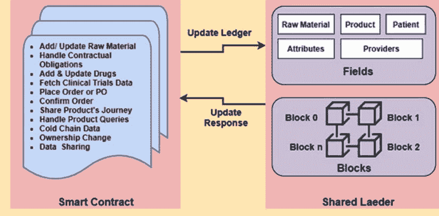

图 5.7: 智能合约的可视化

区块链智能合约是医药供应链的重大趋势。全球医药行业的研究估计，供应链的低效率和人工操作的成本可能高达公司总运营成本的 25%。智能合约通过处理自动化的行政、合同流程和人工操作，可以大幅降低这些运营成本。

另一个方面，基于区块链的数字货币可以实时传输到世界上任何地方。这种能力可以为数字资产的处理带来巨大的改进。制造商、运输公司和其他利益相关者可以更快获得付款，而医院和患者可以以更低成本购买医疗用品。医药供应链中的智能合约对所有人都是双赢，许多公司现在正在尝试基于区块链的智能合约。智能合约的开发应该解决贸易融资日益增长的成本和复杂的法规。让我们讨论一下智能合约为现有医药供应链运营带来的一些新趋势或最佳实践：

- 1. 在基于区块链的系统中，智能合约允许零售商预先将资金放入基于智能合约的托管账户，一旦运输公司在取货货物后触发智能合约，资金将自动释放给接收方。在传统系统中，制造商在交付货物后可能需要长时间等待资金。

- 2. 下一步中，医药批发商或分销商触发智能合约并调用函数更新收货单状态。然后，智能合约从托管账户中释放付款给运输公司。这些实时支付可以为利润空间薄的运营公司带来财务收益。智能合约还可以促进跨境国际汇款。

- 3. 区块链智能合约通过消除中间环节第三方服务提供商并提高效率来降低行政成本。一些行业标准研究表明，供应链运营和行政费用占最终产品的 7%。因此，如果智能合约能够降低如处理发票、付款等行政成本，最终产品的成本也可以相应降低。

- 4. 我们还可以在智能合约中设置预条件，根据输入数据和分发的产品数量来通知供应不足。每种药物都可以分配一个唯一的编号，提供者（医院、药店等）可以使用其将其库存数字化以跟踪库存水平。一旦某种药物的库存较低，智能合约将根据协议以预定义的价格向分销商发送采购订单。因此，智能合约不仅可以下新订单，还可以根据情况向制造商或批发商进行自动付款，这意味着医院的成本降低，因为他们现在可以雇佣更少的行政人员。

让我们讨论一个用于医药生产单元的智能合约算法，以更好地理解智能合约。

# 算法 1：生产后创建产品

输入：`TxN` (`lotID`, `lotName`, `lotPrice`, `lotBoxes`, `lotDocumentationHash`, `requesterAddress`, `OwnerAddress`)
输出：`lotStatus` ("Response")

- 1. 操作员或调用者访问制造的药物数据，以启动分发的批处理：


# 算法 1：检查产品是否已备妥

输入：RequesterID (publicKey)
输出：Boolean (true/false)

- 1. 操作员或调用者访问 `isProductReadyInQuantity(RequesterID publicKey)` 函数，检查产品是否已备妥：

```
isProductReadyInQuantity(RequesterID publicKey) {
    If (publicKey == validUser) {
        message "true/false";
    }
}
```

- 2. 如果产品产量充足，操作员开始创建产品批并更新批次信息：

```
createProductBatch(Requester requesterId) {
    If (requesterId == ownerID) {
        Insert lotName
        Insert lotUniqueID
        Insert lotPrice
        Insert numBoxes
        Insert boxPrice
        Insert lotDocumentationHash
        Insert ownerID
    } else {
        return "Error Message";
    }
}
```

向营销/销售部门发送通知或警告，告知产品批已制造且相关文档已上传。

# 算法 2：批准销售药物批

输入：TxN (requesterAddress, OwnerAddress, lotID)
输出：lotStatus ("Response: Batch/lot is ready for sale")

- 1. 操作员或调用者访问 `updateForSale(callerID)` 函数，更新相关团队产品/批次已准备好以及所有相关信息：

```
updateForSale(RequesterID publicKey) {
    If (publicKey == validUser) {
        message "Product Batch is Ready for Sale";
    } else {
        message "show error";
    }
}
```

# 算法 3：从分销商处购买产品

输入：TxN (OwnerAddress, BuyerID, SellerID, Transferred Amount, lotID, LotPrice)
输出：lotStatus ("Product Purchase status from buyer")

- 1. 在制造商发出产品批准备就绪的警后，热心的买家针对 `lotID` 的潜在买家发出提醒并请求价格：

```
lotInfo(lotID, RequesterAddress blockchainAddress) {
    If (blockchainAddress == hasPermission) {
        // 允许访问信息的权限
    }
    return lotInformation[lotID, lotPrice, ...];
}

depositFunds(blockchainAddress, Amount) {
    escrowAccnt.push(address, amount);
    // 将资金存入托管账户
}

buyProductLot(requesterAddress, TotalLots) {
    If (requesterAddress == hasPermission && escrowDeposit >= lotPrice) {
        transferFundsToSeller(sellerID, buyerID);
        updateOwnership(ownerID = buyerID);
        // 这里是区块链地址
        notify("Product Lot has been sold");
    } else {
        cancelContract(sellerID, buyerID);
        refundToSeller(escrowAccount, buyerID);
    }
}
```


# 区块链在药物溯源中的应用

图 5.4 展示了医药供应链利益相关者连接并完成了药物从制造到交付的历程。假冒产品和假药一直是医疗保健行业的困扰和复杂问题。此外，假药在消费者市场中的流率是医疗保健利益相关者的头疼问题。假冒产品不仅对人口健康构成风险，也是医疗保健行业的财务风险。因此，药物溯源是行业专家关注的重点，有必要设计药物溯源安全系统来克服假冒问题。它还增加了系统的信任，因为人们可以跟踪产品的端到端行程。患者和其他利益相关者可以轻松追踪药物在药物供应链中的位置，并通过安全的药物溯源系统验证其合法性。

根据估计的市场规模的一些研究和市场调查表明，全球假药市场规模约为 2000 亿美元，预计每年将增长 20%。此外，每年有约 13 种药物未能进入市场，导致了这些财务损失。图 5.8 显示了有关假冒的数据（来源：Statista）：

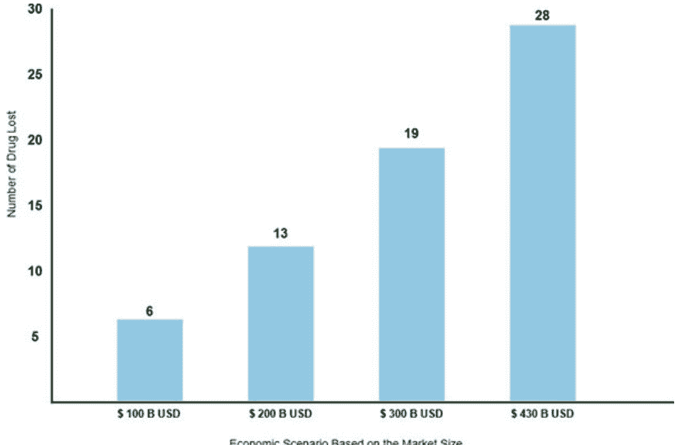

图 5.8: 假冒市场数据

可溯性是系统/平台在整个生命周期内访问产品信息的能力。这些产品可以通过进行跟踪一个记录的唯一标识符。任何供应链中的可追溯对象有时被称为可追溯资源单元（`TRU`），我们在本节中将交替使用 `TRU` 一词。药品的可追溯性有三个目标：

- **追踪产品历程的历史**：此目标是跟踪产品在整个供应链中的历程，包括操作员、利益相关者和销商。这有助于为产品提供稳健的审计模型。
- **追踪财务交易的足迹**：如标题行所示，这有助于提取整个供应链中财务交易的审计轨迹，以增加内部的透明度。
- **追踪产品的实时位置**：这有助于跟踪产品的当前位置，并判断是否符合相关的法规和标准。这将帮助利益相关者获取产品的实时更新。

考虑到上述目标，基于区块链的系统需要通过识别过程从大海针中识别产品，从而访问供应链中与产品相关的信息。追溯系统中的区块链组件是基于识别产品技术、记录产品间连接文档以及记录产品属性的流程设计的。

## 现有的药品追溯系统

传统的药品供应链追踪系统使用以下技术对药品进行追溯和溯源：

- **条形码/二维码/RFID**：供应链参与者一直使用条形码进行产品识别，但二维码正在取代条形码成为替代识别方案。**射频识别（`RFID`）**是条形码或二维码的先进版本，已在药品供应链中得到扩展。`RFID` 标签可以安装在普通标签内部，允许操作员跟踪药品在历程中的进度。`RFID` 扫描的理念是拒绝任何无法通过 `RFID` 扫描追溯回制造商的产品。
- **无线传感器网络 (`WSN`)**：`WSN` 是用于无线通信的传感器集合。这些传感器尺寸很小、价格低廉，且内存和计算能力有限。在药品供应链背景下，这些传感器分布在目标区域并可以形成无线网络，例如收集温度、光强度、湿度、震动等环境属性。这些信息被收集并发送到中央处理单元或汇聚节点，后端系统将其存储以便进行进一步的分析和处理。考虑到成本、能源效率、覆盖范围、网络连接性、服务质量 (`QoS`) 和容错能力等因素，`WSN` 与市场上的类似技术相比，适应率相对较高。
- **电子产品代码 (`EPC`)**：`EPC` 是产品的命名规范，为产品提供唯一标识符（包括序列号）。`EPC` 的设计方式使其能够电子产品代码信息系统 (`EPCIS`) 具有可扩展性和扩展性。`EPCIS` 可以将身份与数据分离，因为它只存储通过 `RFID` 等捕获的 `EPC`，其余元数据将存储在数据库中。可以使用 `EPC` 作为唯一标识符访问产品元数据，且 `EPC` 通常由 `GS1` 标准支持。
- **`NFC`**：`NFC` 集成产品或其包装可以利用其唯一 ID 轻松通过验证，并从制造追溯到使用或消费。在验证和追溯期间收集的信息可以在本地或通过云端共享，也可用于交互。`NFC` 还可以与 `IoT` 设备交互，并与连接的网络共享数据以进行追踪和溯源。
- **`GPS`**：`GPS` 设备增强了产品质量、快速交付、高效路由、成本降低以及整体运输可见性。支持 `GPS` 的标签始终通知利益相关者药品资产的位置，保护其免受丢失、损坏和盗窃。

虽然物品级条形码、`RFID` 以及其他帮助自动识别伪品的方法可以很好地保护药品免受盗窃和仿制/伪造，但它们并非完全没有烦恼和漏洞。这些技术在一定程度上是有效的，但行业需要像区块链这样的技术来应对伪品威胁并高效地追踪和溯源供应链。在下一节中，我们将看到区块链如何帮助药品追溯。

## 用于药品追溯的区块链

如上一节所述，传统的药品追溯系统是多种技术的混合，使供应链利益相关者能够追踪药品的历程。行业专家确定，供应链管理（`SCM`）中存在操作和信息差距，这导致伪品和受损产品进入消费市场。

考虑到区块链的潜力，专家认为区块链可以在药品追踪的用例中带来更高的透明度和效率。有趣的是，区块链可以与上述技术结合以收集数据并将其注入区块链，以便其他利益相关者能够实时追踪产品。区块链促进了具有可见性的追踪和溯源能力的实时数字供应链。它可以作为高效且成本效益的解决方案的基础，支持各种追溯功能和流程，以确保正确的识别、追踪和来源。

基于区块链的供应链可以与现有的追溯机制和流程（如 `RFID`、`NFC`、二维码和传感器）集成，提供可操作且高效的系统。表 5.1 列出了某些具有更广泛适应性的区块链试点项目：

| 区块链试点项目 | 价值主张 | 区块链平台 |
| :--- | :--- | :--- |
| IBM, KPMG LLP, Merck & Co., Inc., and Walmart Inc. | FDA 试点计划证明了如何使用区块链来验证、追踪和溯源在美国境内分发的处方药和疫苗。 | `Hyperledger Fabric` |
| IDLogic | 基于区块链的认证和验证的药品管理；反伪品解决方案。 | 私有网络 |
| MediLedger (McKesson, Pfizer, CardinalHealth, PwC, Accenture) | 符合 `DCSA` 的患者安全和药品安全区块链解决方案；用于可销售退货的查询目录和验证服务的网络 | `Parity` (许可以太坊) |
| TraceLink (制造商、分销商和供应商网络) | 符合 `DCSA` 追溯和数字召回的可互操作系统。 | `Hyperledger` |
| LedgerDomain – UCLA Health | 通过区块链技术实现用于伪品检测的 `DCSA` 解决方案。 | `Hyperledger` |
| SAP Multichain | 基于区块链的伪品验证和可销售退货追踪。 | `Multichain` |
| Indiana University Health and Wakemed | 基于区块链的解决方案，用于追踪提供者网络内外的特种药物。 | 私有网络 |

表 5.1：供应链中的区块链试点项目（来源：FDA & SAP）

根据对不同机构和关键参与者进行的药品追踪和溯源应用试点项目的分析，现在已经明确许可和私有的区块链网络适用于此类用例。该提议的网络可以追溯和追踪药品供应链中的事件，并为网络中利益相关者发起的每次交易生成时间戳记录。

图 5.9 展示了可以集成到区块链网络中的每个步骤和流程：

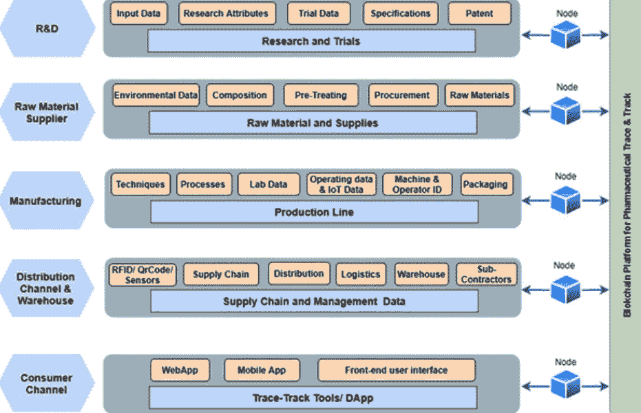

图 5.9：药物追踪与溯源阶段

这些带有时间戳的事件可能包括执行时间、所有者、位置、执行属性、涉及的利益相关者、产品详情等。这确认了在每个传输点向授权利益相关者发送的每种药物或药物成分的真实性、完整性、透明性、安全性和溯源性。

## 用于药物溯源的区块链系统架构

在本节中，我们将探索一种为药物追踪和溯源设计的设想区块链系统架构。你可以选择 `Hyperledger`、`Ethereum` 或 `Multichain` 来创建一个完全私有的或许可的区块链。我们在此考虑了使用 `Ethereum` 来创建一个许可（permitted）的区块链网络。

图 5.10 展示了设想的药物溯源系统的高层架构，以及利益相关者与区块链网络（包括智能合约）的交互：


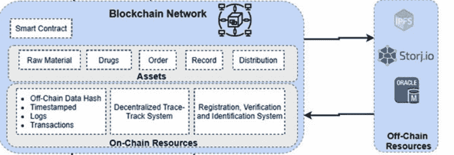
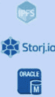
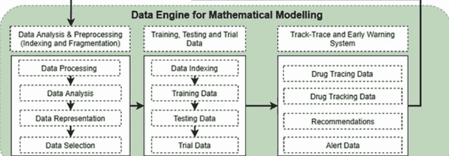

图 5.10：设想的系统架构

网络参与者可以通过 `API` 层通过 `DApp` 访问区块链网络、智能合约、链上资源和离链数据库。以下是图中包含的系统组件详情：

- **医药供应链利益相关者**：医药供应链利益相关者是从研发到将最终产品交付给消费者的过程中的关键参与者。这些利益相关者包括监管机构、政府部门、供应商、制造商、分销商、零售商、药店和患者。他们可以通过智能合约与区块链网络交互。这些参与者被授予访问不同 `DApp`（前端 Web/移动界面）的权限，通过这些界面他们可以通过 `API` 层输入数据并向区块链注入交易。
- 此外，这些参与者可以调用智能合约的任何函数来通过智能合约启动任务。链上和离链资源供这些不同的利益相关者实时使用。此外，在制造和过程中，来自 `IoT` 传感器和不同溯源技术的数据会被提交到区块链的链上数据库，任何利益相关者都可以访问以追踪药物。
- **区块链网络和智能合约**：区块链网络是架构的核心，包括链上数据和资源、智能合约层、验证和识别层等。对于上述架构，`Ethereum` 充当基础织层以启用区块链。智能合约允许参与者调用自动化函数来启动供应链旅程的模块。这是追踪交易历史的至关重要的组件，因为它管理了所有来自链上和离链数据的哈希（`hashes`）值。智能合约还定义了每个利益相关者的角色和责任，并允许经过授权的参与者访问。
- **离链数据库**：网络参与者可以通过 `API` 层通过 `DApp` 访问区块链网络、智能合约、链上资源和离链数据库。
- **数据引擎**：（此处对应原文中关于 data engine 的描述）。

免费药物样品仍占营销活动中很大比例比例。

此外，这些样品药物的使用具有冲突性，因为它们既可以用于启动早期治疗，也可以用于评估有效性或副作用。另一方面，这些药物样品可能会在医生中引入错误做法，甚至可能促进本不应销售的样品药物的非法销售。许多制药公司和组织正致力于制定指南，以强制正规使用样品药物。鼓励为患者使用药物以测试效率和成本而非为了获利，是至关重要的。许多国家和医疗机构已鼓励制造商制定药物样品的存储、标签和分发标准。

每个国家对样品药物的分发有不同的规定。以欧盟为例，免费样品只能在特殊情况下提供给合格的人员。欧盟委员会还颁布了一项法规，进一步规定了样品处理的详细安全规则，包括确保样品产品唯一标识符注销。

虽然欧盟被认为是序列化法规应用于药物样品的首例，但其他国家也在进行研究，以探索药物样品是否在序列化法规的范围内。在日本，《处方药条码标签实施指南》规定，制药制造商和分销商不需要在样品药物包装上贴条码。然而，他们制定了样品药物标准，限制了提供给医疗从业人员的数量。尽管如此，全球范围内尚未建立处理样品药物的标准或法规。

## 样品药物的分发

让我们探索欧盟为样品药物的分发和跟踪建立的框架。只有在满足名为《药品样品供应链监管》报告中定义的以下条件时，样品药物才能在特殊情况下提供给具有开具此类产品资质的人员（即医生、牙科医生、护士和药剂师）：

- 每年每种药品的样品样品数量应受到限制。
- 任何样品的供应均应响应处方代理人签字并日期的书面请求。
- 样品供应方应维护一套完善的控制和问责体系。
- 每个样品均应与市场上的最小包装规格一致。
- 每个样品应标记为“免费医疗样品——非售品”或具有相同含义的其他字样。
- 每个样品均应附带一份产品特征摘要副本。
- 不得提供国际公约（如1961年和1971年联合国公约）意义范围内含有精神类或麻醉物质的药品样品。

## 样品药物的跟踪

欧盟委员会通过授权法规，发布了第2001/83号指令的随附条款，要求所有药品（包括免费样品）都必须具有安全特征，特别是唯一的代码和能够让使用户查看产品是否被篡改的安全特征。因此，它要求对药品进行序列化。非处方药通常豁免，而只有少数指定的处方药可以豁免。

## 使用区块链处理样品药物

在上一节中，我们讨论了基于区块链的系统如何帮助制药公司解决供应链中的差距并跟踪产品。区块链可以高效应对伪造品和假货问题。同样，基于区块链的系统可用于监控和处理样品药物的分发。让我们看看区块链和智能合约如何根据以下定义的法规帮助我们跟踪样品药物：

1. 制造商触发智能合约并调用样品药物包装的函数。根据智能合约中定义的法规和指令，它通知操作人员进行样品药物包装。
2. 传感器或打印设备在序列化过程中为药物和产品批分配唯一的样品ID，然后将其存储在区块链网络中。
3. 制造单元将这些样品产品批分配给特定的代表，用于与医院和医生进行营销。这些产品的信息和所有权存储在区块链网络中。
4. 医药代表将这些样品药物分发给医生。医生使用二维码验证产品，识别出其为样品药物，并在移动应用或网络界面上确认接收。然后，区块链网络将所有权从医药代表转移给医生。
5. 医生为患者提供药物进行试验。患者也可以检查处具的药物是样品药物还是零售药。
6. 如果有人将这种药卖给零售商或药店，零售商将扫描产品上的二维码，区块链网络将向相关利益相关者通知产品是否为样品药物。它通过从二维码收到的哈希代码对潜在的获利行为发送警告。

通过这种方式，区块链可以帮助制药公司和监管机构检查市场上样品药物的使用。

## 结论

在本章中，我们了解了典型的制药供应链是如何工作的，以及不同的利益相关者如何参与生态系统将最终产品交付给患者。在本章的初始章节中，我们讨论了制药供应链的运行模型和步骤。然后，我们查看了医药供应链中的关键问题，包括冷链以及技术格局的变化如何影响现有的供应链模型。

此外，我们还讨论了如何利用区块链解决现有系统中的安全和数据处理问题，并探索了这种新型技术在供应链中的价值主张。我们讨论了一个用例，即区块链的跟踪能力帮助制造商和当局打击假品和伪冒品。

随后，我们看到了在考虑药物追溯用例的情况下，智能合约算法在该生态系统中将是什么样。最后，我们讨论了样品药物、其用途、相关法规，以及区块链如何帮助监管样品药物的使用。

在下一章中，我们将讨论医疗保险行业以及区块链如何重塑该行业。

## 关键术语

- `SCM`: 供应链管理行业
- `RFID`: 射频识别，用于通过扫描识别产品
- `ERP`: 企业资源计划软件和流程
- `TRU`: 可追溯资源单元
- `WSN`: 无线传感器网络
- `EPC`: 电子产品码
- `NFC`: 近场通信技术，用于在近距离内扫描产品

# 第6章

## 医疗保险行业中的区块链

区块链技术已被确认为解决行业内安全、不可篡改性、隐私和手动流程问题的良药。正如医疗行业的其他行业和利益相关者一样，医疗保险部门也渴望确定区块链的采用如何帮助保险公司维护医疗和理赔记录、执行金融和非金融交易以及与保险利益相关者交互。本章的所有内容都基于区块链如何通过自动化流程和更好的客户服务与度来降低运营成本和管理风险的关键问题。

区块链将带来持续的监控和数字审计，使利益相关者对其角色和职责负责。在本章中，我们将研究现有的医疗保险工作流以及区块链能带来的技术进步范围。我们还将理解代币化如何帮助在保险领域构建一种新型交易模型。

## 结构

我们将在本章中涵盖以下主题：

- 医疗保险行业简介
- 现有保险工作流的关键挑战及关键利益相关者
- 医疗保险部门的主要功能
- 现有理赔结算与报销流程概述
- 区块链在医疗保险部门中的应用
- 基于区块链的保险平台的组件和架构
- 智能合约在改变手动流程中的作用
- 用于承保和结算的智能合约算法示例
- 区块链中的资产代币化及其在医疗和保险领域的应用

## 目标

本章将提供医疗保险领域的概述。起始模块中的核心要点是现有医疗保险工作流面临的挑战以及保险行业不同利益相关者的作用。你将简要地了解保险公司的运营模式，并看到保险领域理赔结算过程是如何运作的。你还将对连接医疗保险领域的可能架构有初步了解。此外，你将通过实时场景和相关算法了解智能合约的可能用途。作为一个有趣的话题之一，本章将讨论医疗保险中的“资产代币化”概念以及它如何对保险行业产生积极影响。

## 保险行业简介

在全球范围内，医疗保险是人口中最受欢迎的产品之一，因为它能为因疾病或意外原因导致生病的人支付医疗和健康保健费用。个人可以通过支付保险公司决定的最低保费来购买医疗保险。保险公司根据个人的要求和需要为个人提供不同的保单。

此外，医疗保险市场的增长取决于在较低保费下对所有治疗的覆盖。这种模式基于针对累积人口提供的保险产品运行，因此成本将被分摊，保险公司可以从中盈利。此外，它还提供了负担得起的健康服务，如预防性护理、住院、门诊、接种等。然而，某些公共提供者并不涵盖高昂的治疗和疾病，例如癌症和牙科恢复。

如今，许多保险公司通过多个健康计划吸引被保客户，以确保客户健康且不需要医疗护理，最终增加公司的利润率。推动医疗保险市场增长的主要因素是医疗费用的增加和预防性护理服务的提升。此外，对私营和公共部门员工强制性提供医疗保险推动了医疗保险市场的增长。相反，在医疗环境中引入先进技术预计将为医疗保险市场的扩张提供丰利的机会。

根据标准市场研究，预计医疗保险部门在2021-2027年期间的复合年增长率（`CAGR`）将达到4.4%。医疗成本的增加以及对不受支付流程带来的不便的高效流程的需求将有助于推动医疗保险市场的增长。该部门增长的另一个原因是全球许多政府（尤其是发展中国家）的倡议，向公共医疗保险注入更多资金。尽管如此，严格的监管、欺诈行为和更长的理赔报销时间可能会阻碍上述预测期医疗保险市场的增长。

## 医疗保险部门的关键挑战

尽管全球医疗保险市场正在增长并拥有巨额投资，但与医疗行业的其他部门一样，保险部门面临着一些需要解决的挑战，以提供更好的客户服务、产品并增加收入。保险行业的一些关键挑战如下：

- **非标准的医疗和健康数据**：保险提供者的首要任务是获取客户的医疗和健康记录，以便为客户提供更好的保险产品，并为了销售和利润进行风险评估。但全球范围内，对于数据库中存储的患者医疗数据并没有定义此类标准。这导致保险公司需要人工干预来完成风险评估。在分析数据后，保险公司需要进行人工干预，这导致了保险产品和理赔处理的缓慢。
- **与新一代 `HIS`（医疗信息系统）集成**：随着区块链的出现，许多医疗公司专注于开发基于区块链的 `EMR`（电子病历）和 `EHR`（电子健康记录）。这种集成可能由于保险公司的IT基础设施存在兼容性和集成问题。此外，更换旧系统并迁移到云基础设施应是保险公司的首要任务。
- **传统承保流程的挑战**：许多全球保险公司通过人工智能和数据分析在发行保单时采用新的承保方式。尽管如此，许多保险公司仍在使用低效率的方法进行承保，这会导致财务压力。这可能源于对客户档案分析不足。
- **网络安全**：对保险系统或任何连接系统的网络攻击可能导致信息丢失和客户担忧。这可能由于违反法律义务而导致财务损失。
- **监管挑战**：监管挑战可能会通过服务税上升以及规则法规的改变增加保险成本来影响保险公司，从而导致保单持有者的困惑。这些监管变化在不同地区和国家可能不同。
- **理赔结算缓慢**：理赔处理缓慢或报销被拒绝是保险行业的主要问题，特别是在发展中国家。结算缓慢的一个原因是系统使用了半数字化或手动流程。这可能是由于第三方管理机构（`TPA`）或支付处理商等第三方参与者的介入。
- **外部因素**：外部因素也会影响保险公司的运营，例如客户需求的变化、市场竞争、技术的快速变化、经济危机等。尽管这些不是当下的挑战，但医疗保险公司必须关注这些因素。

## 医疗保险部门的关键利益相关者

正如药品供应链部门一样，医疗保险部门是一个包含多个利益相关者的复杂生态系统，如图6.1所示。从审核保险申请到发行保单再到理赔处理，大量数据在利益相关者之间通过复杂流程进行交换。在目前，这些利益相关者在工作流中紧密耦合，并在完成特定任务时发挥着至关重要的作用。为了阐述这一观点，请参考一个患者住院并申请医疗保险服务的例子。该请求通常从医院流向第三方管理机构（`TPA`），再流到保险公司。在审核案例后，保险公司将款付给医院。这整个工作流中的所有步骤都取决于长期的核实、报告分析等。我们将在后续模块中讨论传统的工作流：

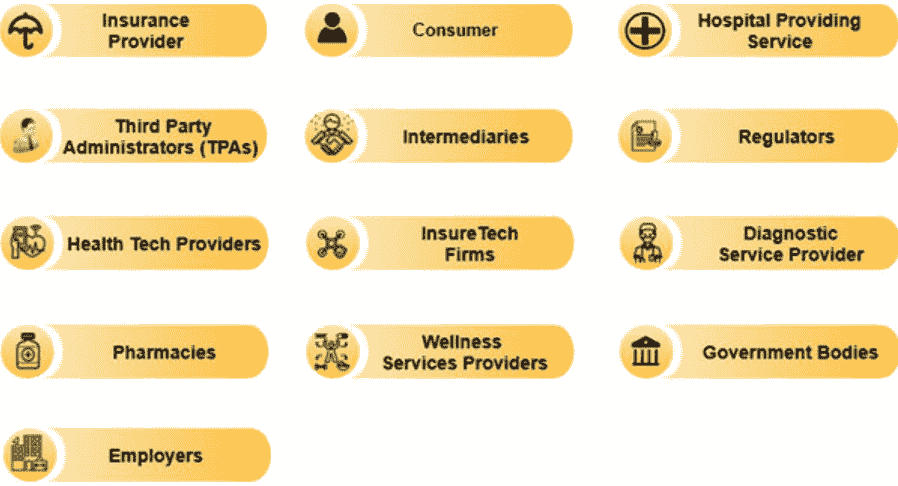

图 6.1：医疗保险部门利益相关者

这些参与者通过相互依赖的系统进行交互，且流程高度依赖纸质化和数据。许多保险公司正在采用新方法来改进沟通和信息共享流程，但端到端的流程尚未完全实现数字化和无缝化。作为保险行业数字化转型的一部分，我们将看到新的颠覆性和领先技术（特别是区块链）如何彻底改变目前保险行业的工作方式。

以下工作流解释了健康保险产品从产生到消费的简化客户旅程：

1. **市场研究**：客户希望购买保险单，通过个人搜索、聚合平台和保险销售人员进行市场调研
2. **确定保单**：客户根据偏好和需求确定最合适的保单
3. **购买**：客户完成购买保单的先决条件并支付保费以购买保险单
4. **承保**：保险公司对保单进行承保以进行风险评估
5. **签发生单**：保险公司向客户发放保单并向客户发送相关文件
6. **审核与接受**：客户审核保单，如果不满意则选择退款；客户在定义的时间范围内接受保单
7. **服务**：保险公司为客户提供多种服务，包括健康计划
8. **住院**：客户住院治疗，并使用无现金设施或通过保险获得报销
9. **理赔结算**：与客户结算理赔或报销的文档工作和流程
10. **健康计划**：客户从与保险保单附带的各种健康计划中获益
11. **续保**：客户在现有保单到期日之前选择新保单或续保现有保单

图 6.2：保险单的客户旅程

## 保险公司的主要功能

图 6.2 描绘了健康保险产品的简化客户旅程。表面上看，它可能像是一个整个直通处理流程或旅程 (`STP`)，但作为保险行业数字化转型的一部分，我们将看到新的颠覆性和领先技术（特别是区块链）如何彻底改变目前保险行业的工作方式。

许多保险公司正在采用新方法来改进沟通和信息共享流程，但端到端的流程尚未完全实现数字化和无缝化。

### 图 6.3：理赔结算流程

理赔结算或报销工作面临着与前节讨论的相同的挑战，例如透明度、数据安全、欺诈、数据碎片化、数字化数据等。在这种场景下，纸质或数字数据的处理、人工干预以及第三方的参与也导致了理赔结算、报销和部分退款的延迟。这些问题不言自明，因此现在我们来讨论区块链和大数据等现代技术如何应对这些问题。

## 区块链在健康保险领域的应用

人们对区块链在健康保险领域的潜在用途的热情和推测日益增加，健康保险领域的专家表示，利用分布式账本技术将受益最多。区块链可以通过减少处理理赔和报销的时间及运营成本，彻底改变医疗行业。根据区块链的属性和运行模式，患者是其医疗和健康记录的所有者，可以根据保险公司的要求共享信息。基于角色的验证将允许保险生态系统中的利益相关者根据定义的角色参与，以避免身份盗用。基于区块链的智能合约可以通过自动化涉及的人工流程，确保理赔结算和报销结算。智能合约还可以消除理赔结算中第三方管理机构（`TPA`）的角色。

许多领先的保险公司以及技术布道者正在思考，区块链的独特属性是否有助于保险公司降低成本、管理风险、改进客户服务、扩大业务并最终提高利润率。表 6.1 列出了区块链应对保险领域不同挑战的能力：

| 现有的痛点（健康保险） | 区块链的机遇 |
| :--- | :--- |
| 数据碎片化或数据湖 | 存储在区块链分布式网络上的患者医疗和健康数据可以通过通用通道从有效验证的源访问<br>跨网络的安全数据共享<br>实时访问记录 |
| 缺乏透明度 | 所有授权利益相关者对交易的实时可见性<br>每份提交理赔的不可篡改审计追踪<br>通过数据验证减少欺诈 |
| 高运营成本 | 通过智能合约实现理赔处理自动化<br>减少人工干预和第三方参与<br>消除冗余的数据输入任务 |
| 理赔处理时间慢 | 医疗记录和历史的实时验证<br>满足合同条件后自动结算<br>为患者提供更快的报销周期 |
| 数据安全顾虑 | 去中心化存储防止单点故障<br>敏感数据的基于角色的访问控制<br>对患者身份的加密保护 |
| 数据标准碎片化 | 跨医疗生态系统的统一数据格式<br>不同提供者和保险公司之间的互操作性<br>患者健康轨迹的集中视图 |

表 6.1：区块链在健康保险中的机遇与挑战

随着区块链在保险科技中采用的普及，行业默认将改变保单的销售方式。由医疗和保险驱动的系统将提供实时数据。保险行业将不再依赖纸质记录，因为数据是通过去中心化网络共享的。基于区块链的系统使得医疗记录一旦记录无法更改，确保了患者与保险公司之间的信任。这将显著降低欺诈理赔的风险，带来更高效的风险管理和以患者为中心的收入。

以下本章将讨论的一些主要案例：

- 通过智能合约实现无缝理赔处理
- 通过 `IoT` 设备进行实时健康监测
- 使用不可篡改账本改进欺诈检测
- `EHR`（电子健康记录）、`EMR`（电子病历）和 `HIS`（医院信息系统）系统之间的互操作性
- 基于纵向健康数据的动态定价

## 基于区块链的保险平台的组件和架构

图 6.4 展示了一个由区块链驱动的医疗生态系统，医疗和保险利益相关者参与其中提供实时服务。所提平台与以下相互连接：

| | 患者 | 提供者 | 保险公司 | 第三方管理机构 (`TPAs`) | 监管机构 |
| :--- | :--- | :--- | :--- | :--- | :--- |
| 应用层 | Web | 移动端 | 智能手表 | 连接设备 | `IoT` 设备 |
| 医疗系统（利益者共享平台） | 事件处理器 | 服务与流程自动化 | 遗留系统 | 负载均衡器 |
| 访问层 | `DLT` 网关服务 | 身份服务 | 微服务 `API` | `Web3` | 数据库 |
| `DLT` 层 | 医疗与保险信息交换 `P2P` | | 管理节点 | 监管节点 |
| `HIS` 层 | `EMR` 系统 | `EHR` 系统 | `PHR` 系统 | |

- 患者接受医院或服务提供者的服务
- 提供者对患者执行医疗和预防性护理
- 从交互中收集并在共享电子健康档案（`EHR`）系统中记录治疗和临床数据

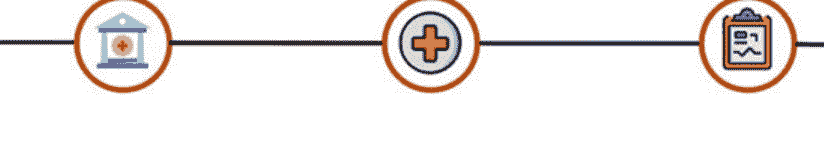

- 区块链网络验证提交者的访问权限
- 患者的临床数据集根据工作模型进行标准化，并分配患者的哈希 ID
- 通过可穿戴设备和医疗物联网（`IoMT`）的患者医疗数据记录在电子病历（`EMR`）中

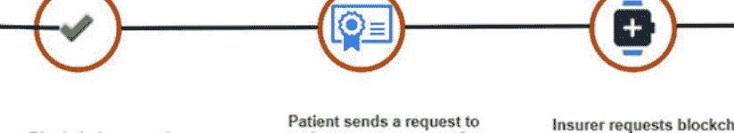

- 区块链网络处理请求并将数据添加到区块
- 患者向保险公司发送健康保单请求，并带哈希 ID 和权限
- 保险公司根据患者的 Hash ID 向区块链网络请求 `EHR` 和 `EMR` 中的患者数据

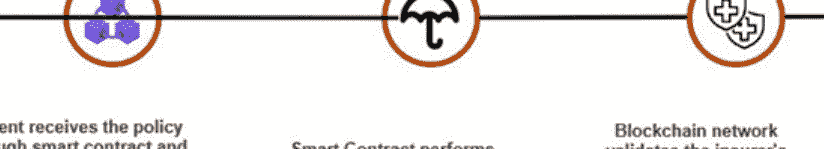

- 患者通过智能合约接收保单，并通过网络检查其真实性及条款（`T&Cs`）
- 智能合约执行核保并向患者发放保单
- 区块链网络验证保险公司的请求并从 `EHR` 发送患者数据

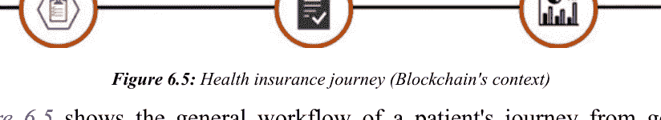

图 6.5：健康保险旅程（区块链背景）

图 6.5 显示了患者旅程的通用流程，从从提供者处获得医疗和健康服务，到通过区块链网络通过保单与保险公司进行交互。该流程假设由区块链驱动并由智能合约驱动。在流程中，患者的医疗数据被推送到 `EHR`/`EMR` 系统。保险公司可以在申请保单时，从 `EHR`/`EMR` 中拉取客户的健康记录，通过智能合约进行有效高效的核保。以下是传统核保和理赔处理与基于智能合约的流程的对比：

**保险核保与签发**：表 6.2 比较了考虑传统流程和基于智能合约流程时，每个利益相关者的保险核保和签发：

| 利益相关者 | 传统流程 | 基于智能合约的流程 |
| :--- | :--- | :--- |
| 客户 | 客户填写相关信息填写请求，并提供与其医疗病史相关的要求的文档。<br>客户通过任何可用渠道（即保险聚合器、代理人或直接方式）发送保单请求。 | 客户通过前端界面发起保单请求，由智能合约处理请求。<br>智能合约从提供者系统获取客户信息，并通过区块链连接的 `EHR`/`EMR` 获取医疗历史文档。<br>智能合约将以电子方式从客户处获取声明、条款和其他法律术。<br>智能合约将这些信息发送给保险公司处理。患者授予保险公司访问健康记录的权限。<br>智能合约扣除客户账户资金并将保费金额存入托管账户。 |
| 保险公司 | 他们通过数字媒介访问客户的请求、信息和文档。<br>通过新的分析和人工智能，保险公司执行核保并批准或拒绝请求。<br>保险公司在保单中插入条款和条件并连同保费要求一起发送给客户。 | 智能合约根据从 `EHRs`/`EMRs` 获取的客户数据进行 `AI-ML` 分析执行核保。<br>如果智能合约发现保单处于允许的风险范围内，则对保单文件及条款条件进行数字签名，并将其发送给客户进行审核和后续操作。 |
| 客户 | 客户向保险公司支付保费。<br>客户在收到保费金额后接收保单文档。<br>客户可以在规定时间内申请保费退款， | 客户从前端界面下载保单文档，并通过智能合约数字化接受条款。<br>一旦策略被客户接受，智能合约将扣除托管账户资金 |

表 6.2：保险核保与签发流程对比

**保险理赔处理**：表 6.3 比较了考虑传统流程和基于智能合约流程时，每个利益相关者的保险理赔处理：

| 利益相关者 | 传统流程 | 基于智能合约的流程 |
| :--- | :--- | :--- |
| 患者 | 患者在提供者处接受治疗并告知提供者进行保险理赔。<br>治疗后，第三方理赔（`TPA`）启动行政流程并将相关信息和文档发送给保险公司。 | 患者在提供者处接受治疗。治疗后，患者将医疗和治疗数据输入 `EHR`。<br>智能合约验证提交者的权限。<br>提供者触发理赔请求的智能合约并发送患者的 `HASH ID`。 |
| 查询方 | 查询查询方从 `TPA` 接收理赔请求。<br>查询方验证治疗文档、提供者批准和保单条款。<br>在患者满足保单所有条件后，保险公司与提供者结算理赔。 | 智能合约针对来自网络医院的入站理赔请求向保险公司发送通知。<br>自动化系统根据患者数据和文档执行 `AI & ML` 分析。<br>智能合约对问题的特定条款运行验证。<br>在验证成功的情况下，智能合约根据保单条款将资金转入提供者账户。 |
| 客户 | 客户向保险公司支付保费。<br>客户在收到保费金额后接收保单文档。<br>客户可以在规定时间内申请保费退款， | 在理赔的情况下，客户从保险公司获取金额。<br>在理赔的情况下，智能合约将资金转给提供者。 |
| | 在理赔的情况下，患者从保险公司提供的健康计划中获益。 | 智能合约通过 `IoMT` 设备检查体征。 |

表 6.3：保险理赔处理对比

我们讨论了医疗行业的几个用例；这些包括保单签发和理赔处理。然而，区块链的实现很大程度上取决于智能合约的开发，并且在开发此类类型时总是存在威胁和漏洞。

以下是可以实施区块链的一些用例：

- 欺诈检测与预防
- 按需保险
- 再保险
- 微型保险
- 基于代币的资金传输
- 集成健康计划
- 基于评分的保险公司模型
- 追踪设施

## 基于区块链的智能合约算法

让我们看看如何设计智能合约算法以促进保单发行和理赔处理。在以下算法中，我们假设保险生态系统中的所有利益相关者已上线基于区块链的平台并拥有该平台的权限。

`customerID` 和 `insurerID` 算法是这些双方在网络中的公共地址。

### 算法 1：保单发行与核保

输入：`TxN` (`customerID`, `insurerID`, `policyID`, `accessControl`)
输出：`policyIssuance`("Response")

步骤：患者通过前端应用程序或聚合器应用程序选择保单并发送购买保单请求。这些只是为了理解如何在合约中定义规则以及如何在设定的合约中完成每个步骤：

```
```


# 算法 1：购买保险单

输入：TxN (customerID, insurerID, policyID, accessControl)
输出：buyInsurancePolicy("响应结果")

步骤：客户访问前端应用程序并请求购买保单。智能合约验证客户的地址和权限。如果客户有效，则触发购买保单事件。

```
buyInsurancePolicy(customerID, insurerID, policyID, accessControl) {
  if (customerID == validUser && userID == validUser) {
    triggerBuyPolicyEvent(
      - 向保险公司发送请求
      - 发送访问医疗记录的权限
      - 从客户账户扣除保费
      - 存托管账户
  }
}
```

```
performUnderwriting(permission, customerID) {
  - 智能合约验证请求者地址和权限
  - 保险公司访问 `EHR` 系统并获取与 `customerID` (哈希) 映射的健康和医疗记录
  - 执行风险评估
  - 捕获客户权限供以后参考
}
```

```
submitUnderwritingResponse(customerID, insurerID) {
  - 提交核保响应
  - 准备带有条款的保单文档
  - 通知客户
}
```

```
viewResponse(policyID, insurerID) {
  - 客户审核保单文档和条款
  - 客户接受保单
}
```

```
transferPremium(policyID, insurerID, customerID) {
  - 在保单接受后，扣除托管账户并将资金转给保险公司
  - 在冲突时进行结算
}
```

# 算法 2：理赔结算

输入：TxN (patientID, insurerID, providerID)
输出：settleClaim("响应结果")

步骤：患者在医院接受治疗并告知医院其保险单。医院或服务商访问前端应用程序，并记录相关服务的理赔结算请求。

```
submitClaimRequest(patientID, insurerID, providerID) {
  if (providerID && insurerID && patientID == validUser) {
    triggerClaim()
    - send claim request to the insurer
    - submit treatment data & document to the `EHR`
    - send patientID to check policy and health data
  }
}
```

```
performRiskAssessment(patientID, providerID) {
  - Smart contract validates requester's address and permission
  - insurer accesses the `EHR` system and fetches customer's health
  - and medical records mapped against the `patientID` (hash)
  - perform a risk assessment
  - check policy's T&Cs and obligations
}
```

```
submitResponse(patientID, providerID) {
  - submit claim request response
  - prepare response
  - transfer funds to the provider's account
  - notify provider
}
```

```
viewResponse(patientID, insurerID) {
  - provider reviews the claim request
  - provider closes the claim request
}
```

```
reconcile(providerID, insurerID, patientID) {
  - reconcile in case of conflict
}
```


## 医疗保险领域的其他技术创新

结合区块链技术，保险行业正在寻找新型技术的融合，这些技术正在对医疗行业产生影响，或已被某些保险公司采用。这些技术创新将实在基于区块链的平台上，以支持医疗保险生态系统。

- **AI/ML 与聊天机器人**：健康保险行业正通过各种技术创新不断推动流程数字化。人工智能和机器学习可以带来价值和基于分析的流程自动化，可用于承保、风险评估、理赔处理、聊天机器人等。

- **大数据**：根据市场预测，全球医疗市场的数据规模预计到 2022 年达到 342.7 亿美元，复合年增长率（CAGR）为 22.07%。大数据可以从数量、速度和价值三个方面为医疗领域做出贡献。利用海量数据并针对业务驱动模型进行最佳分析是一门艺术。大数据可以帮助根据市场细分和客户行为带来更多创新产品。

- **智能设备**：随着物联网、可穿戴设备和便携设备的兴起，医疗保险部门可以收集有关患者体征和个人数据的关键数据。这反过来可以作为增值服务的一部分为客户提供创新的优惠保健服务。智能设备可以轻松集成到区块链健康平台的生态系统中。

- **机器人流程自动化 (RPA)**：RPA 是一种新兴技术，帮助组织采用端到端的智能自动化流程。它将员工从琐碎工作中解放出来，让他们专注于更关键的任务。利用 RPA，健康保险服务商可以无缝地简化和自动化各种业务流程，包括健康保险理赔管理、欺诈检测、保单管理和服务。

## 区块链中的资产令牌化

资产令牌化是区块链领域的全新维度，在研究其在保费支付和理赔中的应用之前，理解令牌化的结构和理论非常重要。在保护敏感数据的背景下，我们经常听到两个术语：“加密”和“令牌化（Tokenization）”。查看以下解释以更好地理解这些术语。

加密是指使用预定义的加密算法将明文转换为不可读形式或密文的过程。需要一个加密密钥将密文解密为人类可读格式。在对称密钥加密中，可以使用相同的密钥加密和解密令牌，而在非对称密钥加密中则使用两个独立的密钥分别加密和解密。

与加密不同，令牌化是将明文或任何数据转换为称为令牌（token）的随机字符串。这些令牌无法评估原始数据的价值。令牌化并不是新技术；Visa 和 Mastercard 等服务商一直在使用它。

- **更高的流动性**：令牌化为资产提供了更高的流动性，因为这些令牌可以在发行者指定的二级市场上进行交易。这开启了……

- **近实时交易**：这些令牌由智能合约促进和处理，因此双方之间的交易几乎可以实时完成，无需任何行政流程。

- **透明的系统**：令牌嵌入了发行者信息、持有者的权利和义务以及不可篡改的所有权记录。这增加了令牌的透明度，因为所有内容都可以追溯并确保各方利益。

- **可访问性/资产碎片化**：令牌化可以开启水平化投资，因为所需的投入低且所需时间短。投资者还可以购买相当于底层资产极小百分比的令牌。因此，许多人可以低风险参与。

- 实用型令牌允许访问区块链网络的服务。
- 基于资产的令牌，包括证券令牌。它们代表现实世界和数字资产，例如房地产、物业、业务股权和医疗数据共享。
- 代表健康和医疗信息的个人令牌。

| 价值主张 | 创新产品和流程 <br>获取新客户 |
|---|---|
| 能力 | • 令牌化和数字资产<br>• 经过验证的实体数字表示<br>• 实现数字所有权、管理和传输 |
| 价值驱动因素 | • 认证<br>• 身份管理<br>• 增加流动性<br>• 消除摩擦<br>• 创建新市场<br>• 降低风险<br>• 新或增强的产品和服务 |
| 应用场景 | • 像比特币、狗狗币 |

表 6.4：区块链和令牌化价值框架

图 6.6 是一个自明且简单的工作流，用于理解令牌是如何被创建和分发的：

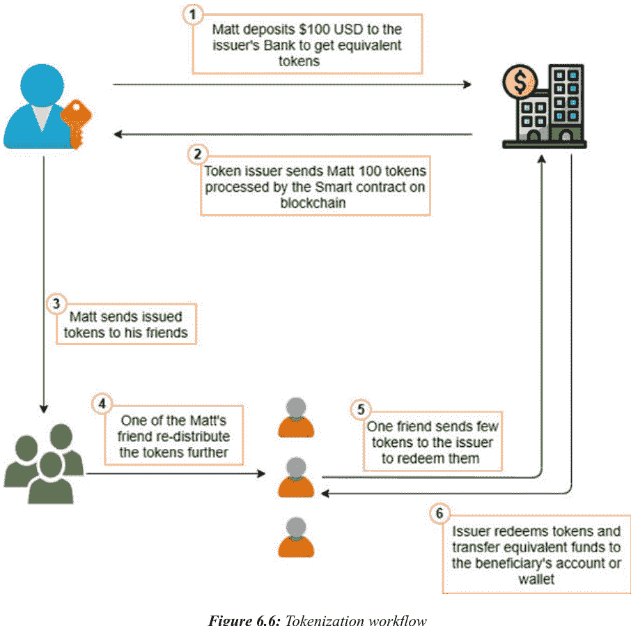

## 可用的令牌类型

随着区块链代币化（tokenization）的兴起，全球已有超过 1000 种代币在运行，因此根据效用、法律地位、价值创造、技术层等运营属性对它们进行分类非常重要。代币的创建通常是为了筹资，就像 IPO 一样。尽管代币有很多，但我们在这里只讨论实用代币、证券代币和加密货币：

| 代币类型 | 实时用例 | 描述 |
| --- | --- | --- |
| 实用代币 (Utility Tokens) | - Gnosis<br>- Steem<br>- BAT<br>- Siacon | - 实用代币用于购买产品或服务。<br>- 实用代币的 ICO 可以视为通过购买服务或产品为项目融资的活动。<br>- 持有实用代币赋予投资者在生态系统中投票权。 |
| 证券代币 (Security Tokens) | - Spice VC<br>- Bitwała<br>- TrustToken | - 证券代币代表传统的证券工具。<br>- 投资合约代表区块链网络中已验证的物理或数字资产的法律所有权。 |
| 加密货币 (Cryptocurrencies) | - Bitcoin<br>- Litecoin<br>- Dogecoin | - 加密货币是分布式账本技术（DLT）网络中的工具。<br>- 加密货币在没有任何机构的情况下独立运行。<br>- 区块链的治理原则适用于这些加密货币。 |

表 6.5：可用代币

## 代币标准

区块链代币标准类似于标识符，允许钱包和 DApps 等应用识别代币并进行相应的交互。以太坊区块链社区已成为全球认可的代币标准领导者。上述社区为代表不同类型的资产推导了许多代币标准。这些代币标准简化了分布式账本/区块链的采用，并实现了多个区块链框架/平台之间的互操作性。一个代币标准由一组预定义的属性/函数和条件组成，可以开发用于表示资产的特征。代币标准有很多，应该评估资产的关键特征来选择哪种代币合适。

以太坊开发者社区使用 `solidity` 语言为代币评估并建立标准接口。以下是广泛接受和使用的代币标准：

- **ERC-20 代币标准**：`ERC-20` 是适配最广泛、最常用的代币，提供了“用户之间的价值转移以及授权他人代表个人花费价值”的功能。`ERC-20` 列出了一个强制函数和三个可选函数，以及由符合标准的 API 实现的两个事件。
- **ERC-721 代币标准**：这是一种非同质化代币标准，每个代币都是独特的，因此能够追踪可区分的资产。每种资产必须拥有单独的所有权并被自动跟踪。该代币授权操作员代转所有或特定资产。该标准要求合规代币实现 10 个强制函数和 3 个事件。此外，这种代币可以处理用户之间特定资产的所有权转移。
- **ERC-777 代币标准**：`ERC-777` 代币标准定义了与代币交互的高级功能，同时兼容 `ERC-20` 代币。它允许操作员代表另一个地址发送代币，发送和接收代币的方法为代币持有者对其代币提供了更多控制。在这里，操作员是指具有执行特定任务权限的账户。`ERC-777` 代币标准有默认和常规运算符。
- **ERC-1155 代币标准**：`ERC-1155` 代币标准允许在单一合约中组合同质化和非同质化代币。该标准可以一次处理多个代币的转移。`ERC-1155` 代币标准使得一个智能合约管理无限数量的代币成为可能。与只能一个地址拥有的 `ERC-721` 非同质化代币不同，每个代币都是半同质化的。
- **ERC-1400 代币标准**：`ERC-1400` 代币标准旨在通过应用基本法律来执行证券条例。甚至可以将链下数据应用于交易，包括必要的真实世界输入和授权。这种代币标准提供了在用户之间转移证券代币所有权的能力，但它需要证书。此外，它管理与证券代币相关的文档。

同样重要的是，资产如何代币化不仅取决于资产本身，还取决于底层区块链驱动的业务流程。许多其他代币标准仍在开发中或尚未最终确定。以下是一些正在开发或评估的代币标准：

- `ERC-1462 Base Security Token`
- `ERC-1450 LDGRToken`
- `ERC-1644 Controller`
- `ERC-1644`

## 代币化面临的挑战

尽管新出现的代币经济看起来很美好，但代币化也面临着一些挑战。这些挑战包括：

- 监管不确定性
- 缺乏通用标准
- 行为规范
- 缺乏足够的代币管理基础设施
- 代币化采用缓慢
- 数量和估算问题

## 区块链中的资产代币化及其在医疗保健领域的应用

医疗保健部门在尝试新技术方面非常积极，并已经启动了区块链驱动的平台。所有医疗领域都有一个共同资产：敏感和医疗数据不仅珍贵，如果释放了其真实潜力，还可以很好定价。

代币化通过用非敏感值替换 PAN、NPPI 等敏感数据，帮助医疗保健部门保护敏感数据。代币化的重要用途是将创建数据的权力交给患者。通过这种方式，患者成为数据的主人，并能够验证数据的准确性。此外，可以激励患者与保险公司或提供商共享其验证过的医疗数据。

最近，健康保险行业与数据经纪人和服务供应商合作，以获取患者数据。存储和共享的数据大多是用户生成的，从提供商、智能设备和物联网等来源收集的。这些用户生成的数据可以作为临床研究、医学研究和保险产品的代币化资产进行交易。遗憾的是，这些收益中很少分享给提供这些数据的用户。

## 作为可交易资产的健康和医疗数据

看看过去的一些收购案，例如 `IBM` 公司于 2016 年 2 月 18 日收购了 `Truven Health Analytics` 并将其与 `IBM` 的 `Watson Health` 部门合并。这项交易是一项高达 26 亿美元的突破交易，旨在利用 200 万份患者记录训练 `IBM` 的 `Watson`。因此，每份患者记录可能价值 13 美元。这个金额看起来可能很少，但医疗机构并不是拥有海量的患者数据。此外，制药公司密切依赖患者试验数据。以新冠-19 疫情为例，制药公司正在运行疫苗试验数据。这就是为什么这些公司在数据收集和分析上投入了这么多，包括收购和合并。

导致了孤岛和低效率，而不是促进个人控制自己的数据。

## 通过代币化激励个人共享健康数据

通常情况下，个人只有在需要医疗或保健服务时才会访问其医疗记录，而在其他时候，他们的任何形式的健康数据都处于真空状态。这并没有为个人创造任何价值，因此这些数据（数字或纸质形式）实际上是一种负担。如果这些数据能够通过数据交易，像把钱投入股市一样，为个人产生收益呢？

这听起来奇怪吗？嗯，并不完全如此！区块链代币可以创建一个人们可以在其中交易健康信息的生态系统。此外，健康数据的货币化可以激励人们参与医疗生态系统，这可以为经过验证、确认且高质量的数据共享模型奠定基础。共享数据可以被保险公司用于医学研究或临床试验。有趣的是，这些代币有助于降低健康保险费，或者在理想情况下，获得免费的保单。一些研究和市场调查已经证明，许多中国家的人愿意与这些利益者分享他们的健康数据，这种趋势预计在发展中国家也将持续。

这听起来很迷人！但真的可行吗？答案是肯定的；医疗领域的许多公司已经开始利用区块链技术开发代币化资产。正如前面的章节所讨论，区块链现在是医疗领域的一项已知技术，因为许多公司正在进行试点项目或商业级区块链项目。区块链技术可以为这种共享的代币经济学提供合适的基础，医疗生态系统中的任何利益者都可以根据某些激励措施向个人请求健康数据以供进一步使用。

让我们以医疗生态系统为例，个人是关键参与者并处于生态系统的中心。以下是可能的预期流程：

- 数据持有者或智能设备公司向客户传输代币，以鼓励他们使用可穿戴设备或服务。
- 客户使用这些设备将个人健康数据提供给这些数据持有者，并向数据收集者支付代币以处理数据。
- 数据消费者（如保险公司）可以请求客户共享其健康数据，并向客户钱包传输代币，以换客户共享健康数据。
- 客户可以使用这些代币支付医疗费用，或通过交易所直接将这些代币兑换为货币。


图 6.7：代币交换模型（来源 HIT Foundation）

- 服务提供商也可以通过交易所交易这些代币。
- 其他医疗实用事业也可以请求客户共享数据以交换代币。

信息寻求者（如保险公司）可以发布他们的查询，个人可以匿名决定是否愿意共享其数据。在基于区块链的市场上，一旦根据数字合约交付数据，奖励就会自动传输。这种系统相比于总是涉及中间人且大量没有银行账户的人无法参与的法币系统，具有明显的优势。一个有趣的事实是，除了这些代币外，还可以通过消耗 Gas（以太执行智能合约的费用或支出）来访问智能合约中定义的任何功能来实现货币化。请求者需要消耗这些 Gas，而客户可以在他们的钱包中获得。

`Clincoin` 是理解医疗领域代币化和代币经济范围的完美示例。这个基于区块链的平台在连接用户、提供者和开发者之外，还会奖励参与健康活动的用户。用户可以使用这些代币在去中心化市场中购买数字工具、产品和服务。

## 结论

在本章中，我们讨论了传统医疗保险部门的模型、现有模型面临的主要挑战，以及贡献保险部门的关键利益者。我们理解了保险产品或服务的历程，重点关注了人工干预导致处理缓慢的领域，如核保和理赔结算。我们还看到了利益者在发生保险理赔或报销处理过程中是如何相互作用的。

随后，我们渴望了解区块链如何从水平和垂直方向上改变健康保险范式。我们讨论了考虑保险生态系统的预期区块链框架和组件，并比较了传统流程如何被智能合约取代。此外，我们查看了一些用于理赔处理和核保的智能合约算法。

在最后一部分，我们讨论了区块链的一个有趣方面，即健康数据的资产代币化。我们探索了代币化概念、目前有的不同代币标准、代币工作流，以及代币化如何应用于健康保险领域，以及它如何通过个人健康数据/信息的货币化使其受益。

在下一章中，我们将讨论区块链在数字医疗证明和电子处方中的用例。

## 多选题

- 1. 下哪项不是医疗保险部门的关键利益者？
  - a. 保险提供者
  - b. 制药厂
  - c. 监管机构
  - d. 消费者
- 2. 保险中的核保（underwriting）是指什么？
  - a. 风险评估
  - b. 结算
  - c. 理赔处理
  - d. 以上都不是
- 3. 智能合约可以实现理赔结算和发放自动化。
  - a. 正确
  - b. 错误
- 4. 下哪项不是代币标准？
  - a. ERC 20
  - b. ERC 721
  - c. ERC 300
  - d. ERC 1155

## 答案

- 1. a
- 2. a
- 3. a
- 4. c

## 关键术语

- `TPA`: 第三方管理机构
- `STP`: 直通处理
- `RPA`: 机器人流程自动化，用于消除流程中的重复工作
- `NFT`: 非同质化代币，技术上可以包含任何数字内容，包括绘画、动画 GIF、歌曲和视频游戏中的物品
- `ERC`: 以太坊请求评论

## 第 7 章

## 数字医疗证明和电子处方

在本章中我们将涵盖以下主题：

- 数字医疗证明和处方的介绍
- 现有的医疗证明发放模型及面临的关键挑战
- 数字证书的颁发流程和工作流
- 区块链在发放电子医疗证明中的应用及系统架构
- 政府在发放数字证书中使用区块链技术
- 区块链在电子处方和工作流中的应用
- 保险理赔中的电子处方和电子医疗证明

## 目标

本章重点介绍现有的传统医疗证明和处方发放框架以及该框架面临的挑战。通过本章，你将理解区块链和智能合约在发放防篡改电子处方和数字证书方面的作用。此外，你将了解到政府机构广泛采用的真实用例。在最后一个模块中，你将理解分布式电子处方和电子证书如何帮助减少欺诈活动。

## 用于数字证书的区块链框架

从技术和伦理角度来看，虚假医疗证明是一个困扰各机构和企业的挑战。许多伪造的医疗证明在全球范围内流通，有时给公司带来数百万美元的损失。通常情况下，这种做法始于员工提交虚假医疗证明以从雇主处获取财务利益。同样，这也会损害医生的执业和声誉，因为虚假证书可能包含他们的姓名和执业许可证号。

虚假医疗证明在金钱损失方面影响着公司，其他行业也面临着同样的挑战。以健康保险行业为例，虚假或被篡改的文件被用于向保险公司提出健康理赔/报销。这对保险公司来说是直接的资金损失。考虑到健康保险，客户、代理人或提供者实施的欺诈可能是个人行为。此外，第三方理赔（TPA）和保险公司的员工有时也可能参与其中。以下是一些虚假或操纵保险理赔的场景：

- 与保单前健康体检结果相关的操纵文件和证书，特别是在涉及既有疾病的情况下。
- 为了满足保单条款和条件（T&Cs）而伪造的证书文件。
- 用于虚假保险理赔的虚假高额医疗账单。
- 团体健康保险中的规避数据和证书。

这个列表还将继续，因为这些欺诈行为可能由保单持有者、第三方或保险内部员工触发。由于缺乏监管机构的标准医疗协议和早期预警系统，提供者诱导的欺诈正大规模地影响医疗保健和其他机构。让我们讨论现有的证书发放框架（纸质或数字），以及基于区块链的系统如何帮助发放防篡改的数字证书。

### 发放医疗证明的现有模型

广义而言，医疗证明是发放给个人的、用于证明其从提供者或认证医生（或任何相关医生）处获得医疗服务的正式文件。该证书通常由医疗专业人员签署，并带有相应的许可证号。

这些证书可以用于多个目的，主要用途是向保险公司索赔，或提交给雇主用于行政目的（如请病假）。让我们看看医疗证明是如何数字化和手动发放的。图 7.1 展示了发放纸质医疗证明的工作流。纸质和手动证书容易受到欺诈和篡改。


图 7.1：发放纸质医疗证明的工作流

医疗行业数字化的出现导致了数字证书的产生，许多提供者已开始发放数字医疗证明。发放数字证书增加的一个维度是证书颁发机构向个人（或在我们案例中是医生和医疗专业人员）颁发的数字签名。图 7.2 展示了数字签名的发放：


数字签名已经使用了很长时间，这种验证模式运行良好。这些证书包括患者信息、治疗摘要、处方和其他信息，并由医疗专业人员或医生使用颁发的数字签名证书（DSC）进行签署。任何接收文档或证书的人都可以验证 DSC。DSC 通过中央存储库进行验证，并将结果传回接收者。图 7.3 展示了 DSC 验证的过程：


图 7.3：DSC 验证流程

DSC 似乎弥合了个人、企业和机构之间的通信差距。DSC 使用加密和算法对数字签名进行处理和验证。这些数字签名等同于个人的手写签名，但通过数学算法具有更高的安全性。创建数字签名是为了解决数字通信中的篡改问题，因为它们提供了文档来源、发起者身份以及签署者知情同意的保证。在大多数国家，它们具有与手写签名同等的法律地位。尽管数字签名似乎是手动验证过程的最佳替代方案，但在 DSC 的采用和验证过程中仍存在问题。以下是关于数字证书的一些已知问题：

- DSC 是一个高度依赖技术的过程，生成 DSC 的过程是笨拙的。
- 获取数字签名的成本可能很高。
- 中央存储库可能存在网络安全问题。
- 需要进行验证。
- DSC 存在监管挑战和问题。
- 由于标准不同可能会产生兼容性问题。

### 用于发放医疗证明的区块链

数字签名已成为许多机构的标准，并被视为安全策略的关键组成部分。此外，考虑到区块链的属性，现在显而易见区块链在发放医疗证明时可以增加一层安全性。它可以允许多签名、时间戳引用和指纹创建，并将所有信息发布在网络上。使用区块链的一个有趣方面是，消除对证书颁发机构的依赖，因为区块链本身提供了非对称公钥加密，可以作为签署机构的数字签名，并在不需要第三方的情况下通过网络进行验证。区块链在工作量证明概念增加了最大的价值——交易无法编辑或删除，这极大地确保了交易和签名技术。

图 7.4 显示了基于区块链的医院信息系统（HIS），个人、医疗专业人员和企业可以在共同平台上交互，并通过该平台轻松地发放和验证医疗证明：


图 7.4：区块链驱动的 HIS 系统

请注意，我们确实不需要另一个区块链系统来发放和验证医疗证明。正如第 3 章“区块链在医疗保健中的应用”和第 4 章“区块链在 EHR 和 HIS 中”所述，我们可以使用现有的基于区块链的 EMR/HIS 系统来发放医疗证明。有趣的是，EMR 或 EHR 已经在维护每次患者交互的记录。因此，区块链智能合约可以为每次交互向患者发放数字签名医疗证明，并在分布式账本上维护其副本。

此外，个人（患者）、提供者（医生）和保险公司可以是基于区块链的连接系统的关键利益相关者。相反，雇主（企业）不需要成为同一个系统的一部分，因为这些企业只需要验证个人提交的证书。这些企业可以使用个人的公钥地址访问系统。这种实现和工作流可以进行讨论，但基础思想将是具体的。

## 区块链系统架构

为了减轻机构和保险公司在发行和验证数字医疗证明方面的负担，我们可以设计一种构建在现有 EHR（电子健康档案）系统上的架构。所有记录（包括患者的医疗和健康记录）都将通过区块链并保存到分布式账本中。患者的信息可能还包括与提供者的每次交互以及颁发的医疗证明。所有这些数据都可以进行实时遍历，以便审计和跟踪。除了日志之外，记录的所有权和访问权限是添加到链上的重要元数据。通过这种方式，所有访问历史都存储在区块链上，这提供了一个关于针对每条记录发生过的所有事件的完整视图，并确保了数据的完整性，防止了用户记录的滥用。

在上述通过区块链网络发行数字医疗证明的提议中，底层系统架构由三个主要部分组成：

- **区块链网络**：上述发行数字医疗证明的功能可以建立在现成的解决方案之上，例如基于区块链的 EHR/HIS 系统，以提供患者与提供者或医生交互的完整图景。在这种情况下，我们考虑使用现有的基于区块链的 EHR/HIS 系统，通过智能合约提供发行数字证明的功能。我们了解到区块链运行在多个节点上，因此它实际上是一个故障安全系统，无法被黑客攻击。这一提议将以联盟模式运行，因为多个医疗利益相关者必须加入一个公共平台。

- **前端接口**：前端接口（网页/移动端/平板）是从用户角度划分的交互接点，无论是患者、提供者还是保险公司，他们都不需要担心后台发生什么。所有数据都通过此前端应用程序进入，因此在为患者提供医疗服务后，医生或职能部门在前端输入生成证书所需的详细信息并提交这些信息。智能合约准备证书，对文档进行数字签名，并将其颁发给患者。患者可以通过访问患者门户下载证书。此外，所有证书颁发的事件也会记录在基于区块链的 EHR 系统中，以备日后参考。

- **Web 服务**：需要 Web 服务（APIs）来向其他利益相关者开放系统功能。在我们的案例中，一旦个人或患者向雇主或保险公司提交医疗证明，这些实体将使用 API 在区块链平台上检查医疗证明的真实性。该 Web 服务可以被任何持有证书文件的人使用，即证书持有者本人以及所有证书持有者提交数字证明的第三方和机构。根据请求，区块链会检查证书的哈希值并向请求者响应有关证书真实性的信息。

关于上述提议的系统架构，它将始终与第 6 章《医疗保险行业中的区块链》中的图 6.4 所示相同。相反，让我们讨论通过基于区块链的医疗平台发行数字医疗证明的流程。

图 7.5 显示了围绕区块链的医疗平台的工作流，用于创建、颁发和验证数字医疗证明。该流程基于联盟模式，因为医疗生态系统中的多个利益相关者将加入同一个基于区块链的平台。此外，此处假设医疗信息交换（HIE）或 HIS（医院信息系统）正与相同的区块链系统运行，以记录患者请求或生成的所有内容，包括医疗证明。让我们检查工作流：

1. 首先，患者在提供者处接受治疗，随后医生或职能部门将向患者颁发医疗证明。接下来，个人通过患者门户向提供者请求关于既往治疗的医疗证明。在任何情况下，患者的公共地址（区块链地址）或唯一 ID 都会发送给提供者。
2. 提供者访问电子证书系统并填写所需信息以生成电子医疗证明并提交请求。系统使用提供者的私钥对证书请求进行签名。
3. 前端电子证书系统捕获证书信息以及提供者的私钥，通过 API 栈将请求发送到区块链接口层。智能合约处理电子医疗证明，并根据传入请求中的提供者私钥对其进行签名。随后智能合约生成电子医疗证明，为该证书创建一个哈希值，并将此哈希值和数字证书引用保存到区块链中。


图 7.5：数字证书颁发和验证工作流

4. 颁发的电子医疗证明还包含患者和提供者的公钥，以备未来参考。根据可用的技术栈，数字证书可以保存在离线数据库或区块链中。
5. 根据需要，患者通过患者门户请求下载电子医疗证明。
6. 患者门户通过底层 API 栈向区块链层发送电子医疗证明下载请求。区块链使用患者的公钥验证传入的请求，验证成功后，区块链网络将电子医疗证明推送到患者门户。
7. 患者或个人可以从门户下载电子证书。下载的数字证书将包含一个用于扫描和验证的 QR 代码。该 QR 代码包含数字证书的哈希值。
8. 根据请求，个人将电子医疗证明提交给雇主或保险公司用于行政目的。
9. 请求者（雇主、保险公司等）扫描医疗证明上的 QR 代码并提交请求。
10. 前端获取 QR 代码中的哈希值并通过 API 层发送到区块链网络。区块链网络验证传入的请求，结合数据库中的底层医疗证明验证哈希值，并运行验证过程。
11. 区块链网络验证医疗证明的真实性并通知前端应用程序。
12. 雇主验证证书成功后个人。
13. 一旦智能合约颁发电子医疗证明，智能合约还将信息保存在 HIS 层中以便审计和日后参考。

从工作流中看到，整个过程中几乎没有中间人参与。创建、颁发和验证都是通过单一的基于区块链平台完成的，而在传统的 DSC（数字签名证书）机制中，我们需要经过认证的第三方机构和 CA 机构来颁发和验证数字签名。因此，显然 DLT 平台在电子证书方面有更好的解决方案。

## 政府机构与数字证书

全球各政府机构和机构广泛使用医疗证明和其他健康证明来处理行政流程、开展医疗活动、获取政府补贴等。全球各地的政府机构使用纸质证书或数字电子证书来验证公民的信息和医疗数据，用于发放健康卡或将个人纳入政府保险政策等行政流程。

波罗的海地区欧洲国家之一的爱沙尼亚在几乎所有领域的区块链应用中处于领先地位。爱沙尼亚政府与技术公司合作，推出围绕医疗、电子政务和金融服务的基于区块链的产品。KSI 用于保护政府收集的数字数据，爱沙尼亚公民的健康和医疗记录通过 KSI 技术进行管理。通过利用 DLT 技术，KSI 生成一个代表大量数据的哈希值。该哈希值作为数据集的唯一引用。KSI 允许官员监控数据库内部的变化，即谁更改了记录、实施了哪些更改以及何时进行的更改。因此，任何未经授权的记录篡改都能被检测和防止。

为了确保健康数据的安全、不可篡改并供公民实时访问，爱沙尼亚通过区块链平台发放电子身份证，以确保信息完整性并保护数据不受内部和网络威胁。这使得伪造易于检测并有助于避免个人健康数据的损害。爱沙尼亚政府还整合了系统，通过区块链平台向公民颁发电子医疗证明。

在另一种场景下，新加坡政府开发了一个基于区块链的平台，使雇主验证从当地大学、理工学院和其他机构毕业的员工和应聘者的学历。上述平台被称为 `OpenCerts`，个人可以在那里获得带有安全唯一加密证明的数字证书。个人不需要获取由相关机构颁发的教育、培训等证书的纸质副本。雇主可以直接通过 `OpenCerts` 平台验证这些数字证书，该平台会将证书数据与其链上的代码进行比对。

利用区块链确保有效性并检测任何篡改迹象。这种自动验证将简化并减少雇主的行政流程和纸质文件。

此外，新加坡政府科技局（GovTech）和卫生部（MOH）合作开发了基于区块链的解决方案 `HealthCerts`。它是加密哈希算法、区块链技术、隐私保护和身份证明的结合体，是一套用于发放数字 COVID-19 检测结果证书的开源数字标准。该系统将促进并加速国内外入境检查站的旅客清关流程。在该系统中，个人在旅行往任何其他国家之前将进行 COVID-19 检测，并在流程结束后获得一张包含 QR 代码的电子证书。这种电子证书可以在全球任何入境检查柜台进行检查，允许个人进入相应国家。

正如上述政府倡议，其他发达国家和发展中国家也在采用区块链来提供医疗保健领域的解决方案。卫生部和人力资源部等政府机构也可以创建医疗保健的分布式账本技术（DLT）解决方案，以及发布数字医疗和健康证明的平台。向个人发放电子医疗证明有助于政府机构在行政流程中实时验证文件，并启动围绕医疗健康的各种政府计划。

## 区块链在电子处方中的应用

在讨论医疗生态系统时，处方是医疗和健康服务不可或缺的一部分，帮助患者从药店购买处方药。处方发放工作流正在从典型的纸质系统转向软件，但纸质处方模型在许多地方仍在使用。电子处方的采用解决了纸质系统的问题，如处方损坏和丢失、由于字迹潦草导致的发药错误。尽管电子处方模型已投入使用，但它面临着利益相关者之间的互操作性问题、数据盗取、碎片化等挑战。

## 现有处方系统的主要挑战

以下是现有纸质或数字化处方模型面临的主要挑战：

- **互操作性问题**：利益相关者之间不存在精简的通信通道。此外，数据在医疗服务提供者之间不进行共享，或者缺乏对患者健康数据的 360° 全视图。
- **缺乏数据标准化**：此外，在发放处方时没有数据标准。现有模型必须处理数据不一致和碎片化问题，因此提供者所拥有的数据可能与患者的不符。
- **安全挑战**：现有系统是中心化的，或者处方以纸质形式发放，因此面临着隐私和安全问题。另一方面，用于发放电子处方的现有软件系统容易受到网络攻击和数据盗取。
- **药物非法贸易**：没有特定的措施来跟踪和追踪售出的药物，因此药物和医疗产品有通过转售进入非法贸易的机会。

## 基于区块链的电子处方系统

区块链是过去十年全球范围内关注的技术之一，它可以重塑电子处方流程。考虑到区块链固有的安全性、不可篡改性、实时交易、去中心化分布和智能合约等属性，有助于创建一个新的电子处方系统。根据我们在之前章节中的分析和讨论，可以在现有的基于区块链的 HIS 平台上创建一个电子处方系统模块（该平台也提供对 EHRs/EMRs 的访问），或者创建一个全新的平台来向患者颁发电子处方。

引入区块链用于发放电子处方的首要目标是通过消除等待时间和通过减少人为错误、减少欺诈活动，并增加系统的透明度和信任度，从而简化处方流程。图 7.6 显示了电子处方模型的层级交互：


图 7.6：基于 DLT 的层级电子处方模型

在层级工作流中，患者、提供者和药店通过一个基于区块链的通用医疗平台连接，并通过提供的前端接口与底层系统进行交互。医生在医疗问诊或治疗后通过前端准备处方，系统通过智能合约记录处方。智能合约还对电子处方进行数字签名，然后根据医生和患者提供的权限通知相应的药店有进入的电子处方。药店访问处方并从库存中提取处方药。药剂师在发药前扫描每种药物，以在区块链中记录自购信息，用于追踪和审计之目的。智能合约功能通常可以组织医生和药店之间的药品满意度。医生在患者就诊后，花费更少的时间解释药物需求或通常与药店交流。

图 7.7 展示了基于电子处方的工作流。涉及的步骤如下：

1. 患者访问医院寻求帮助并完成行政流程。
2. 医院或服务提供者为患者分配医生。
3. 医生为患者提供治疗或医疗问诊，并访问提供者门户（Provider Portal）输入处方。
4. 电子处方详情同患者的公钥和医生的私钥，通过区块链接口或 API 层注入区块链。
5. 底层区块链中的智能合约准备电子处方，并使用医生的私钥签名以确保真实性。在这种情况下，医生还授权药店访问电子处方。
6. 一旦处方准备好，智能合约通知相应的药店执行处方。
7. 收到通知后，药剂师访问前端门户并请求区块链平台下载电子处方。
8. API 层和区块链网络验证药店的身份，以及医生和患者是否允许药店访问电子处方。系统在门户上上传患者的电子处方。
9. 药剂师审核医生开具的处方并准备订单。他们扫描每种药物，用于追踪。
10. 药店向患者发送处方药的发票。
11. 患者根据发票付款并取货。患者可以扫描药物上的 QR 代码并检查真实性。
12. 药店还将发药信息注入区块链网络并更新库存。区块链网络跟踪库存，当供应不足时，智能合约将通知供应商进行新订单。
13. 区块链层还会更新连接的 EHR/HIS 系统，记录为患者提供的所有医疗咨询，包括处方。EHR 系统跟踪所有信息以备参考和审计。
14. 提供者可以从 EHR 系统和区块链网络中遍历患者信息，用于医疗和问诊目的。


图 7.7：基于区块链的电子处方模型

## 处理药物非法贸易

考虑到上述工作流，电子处方和区块链可以处理药物的非法贸易和转售。在给定的架构中，在发药时会将一种基于二维码的机制引入系统。此外，药剂师在发药时只需简单扫描二维码并提交信息。区块链将保存有关药物以及从药店购买药物的人员信息，从而实现对药物的详细追踪。

患者也可以通过扫描药品上的二维码来检查药物的真实性。此外，个人无法在公开市场上转售药物。如果购买者扫描标签上的二维码，就可以进行追溯，并从区块链网络中生成警告警报。这同样适用于药剂师。我们在讨论供应链时，已经在第 5 章《药品供应链与药品管理》中讨论过这种追踪。

## 保险理赔中的电子处方和电子医疗证明

最初，电子处方和电子医疗证明的设计是为了帮助药剂师和提供者减少因手动流程产生的交付时间、开销和成本。然而，逐渐证明，电子化填写处方单并通过电子媒体共享这些表单在简化工作和增强药剂师流程运营方面具有价值。一旦药剂师获知这些处方，他们就采用了管理电子处方的健康相关 IT 解决方案。区块链为生态系统增加了更多的安全性和实时交易。区块链技术可以实时验证电子处方和电子医疗证明，而没有任何障碍。

传统的处方和未付的医疗账单需要随保险理赔提交。对发票、账单和医疗证明的人工验证是一项耗时的任务，而且它们容易受到操纵。此类保险理赔和报销可能会给企业和保险公司带来财务风险。

如前所述，基于区块链的医疗保健系统为发布电子处方和电子医疗证明提供了无缝流程。这些证明使用提供者的数字签名签名。在申请保险理赔或报销时，保险公司通过基于区块链的 HIS 访问这些电子处方和电子证明，保险公司可以立即验证证明。对于伪造证明和处方，基于区块链的 HIS 系统将向保险人发出早期警报，减少欺诈活动的机会并最终减少财务损失。

由于我们正在讨论一种连接 EHR（电子健康记录）、EMR（电子病历）、HIS（医院信息系统）、电子处方模块、电子证明等的综合性区块链医疗保健系统，个人正在经历的医疗和保健活动被记录在基于区块链的系统中，这些数据有助于其他活动。例如，一个名叫 Benjamin 的人有高血压和糖尿病等既往症。Benjamin 还拥有一份有效的健康保险单。他在 4 月预约了医生，但在看医生之前他进行了一次预防性的胆固醇实验室检查。随后，在 6 月，他出现了高血压问题并咨询了医生，医生开了药。几个月后，他还在药店续了药，并最终提交了保险理赔。

如果所有这些活动都通过基于区块链的系统完成，每项活动都会通过智能合约记录在相应的 EHR 和 EMR 中。在保险理赔时，保险公司可以追溯患者经历的所有医疗咨询和实验室测试，并通过智能合约验证所有文件。保险公司可以根据收集到的患者数据批准或拒绝保险理赔。随后，保险公司还可以根据客户的健康记录和健康行为提供其他健康计划。这种区块链正在创建一种新类型的系统，为每个利益相关者创造了双赢的机遇。

在下一章中，本书将讨论医疗设备和智能实验室，并探索区块链如何创建一种新型的连接智能实验室。

## 结论

总结来说，本章重点关注如何利用区块链和智能合约通过保持证明和处方的不可变性和真实性来发布电子医疗证明和电子处方。我们理解了现有的纸质证明和数字证明模型，以及使用 DSC 对文档进行签名的过程。此外，我们阐述了发布电子证明的区块链系统架构，并理解了将系统与现有的 EHR/EMR/HIS 连接起来的重要性。所有这些练习对于停止欺诈活动向雇主和保险公司提交虚假证明至关重要，即每个数字证明都可以在没有第三方干预的情况下实时验证。随后，我们的讨论转向了电子药房系统，以及医生如何开具电子处方以及药房如何访问以确保安全发药。在本章的最后几个模块中，我们探索了区块链颁发的证明和处方如何被保险公司用于处理理赔，以及全球不同政府如何采用区块链技术为其公民发放数字健康证明。

在下一章中，我们将查看区块链在智能医疗设备和智能实验室中的应用。

## 关键术语

- `CA`: 发放数字签名的证书颁发机构
- `DSC`: 数字签名证书

# 第 8 章

## 医疗设备与智能实验室

我们生活在“数字化”时代，世界见证了我们使用技术方式巨大变化。医疗保健部门也受到了新时代技术的积极影响。英特尔公司的联合创始人 Gordon Moore 提出了一个理论：“我们可以预计计算机的速度和能力每隔几年增加一次，而我们支付的费用会越来越少。”——这一理论广为人知的“摩尔定律”。现在，观察你周围的环境：手机已被处理速度和能力更强的智能手机取代。智能手表、健身环和智能医疗设备正在实时收集大量的个人生命体征和医疗数据。

随着无线技术的最新进展，硬件收缩、容量、处理和计算能力是驱动数字健康创新在规模和速度上呈指数级增长的因素。这场技术革命的飞跃从水平上影响着临床、医疗和业务运营。像 AI/ML、大数据、区块链、云基础设施、聊天机器人、虚拟健康和 IoMT（医疗物联网）等数字创新正在重塑医疗行业，因为这些技术实现了高效且便捷的医疗交付。

上述技术为新型智能医疗设备奠定了基础，为智能实验室和医疗护理创建了生态系统。与这些技术相结合，区块链创建了真实且无需信任的连接设备系统。区块链可以帮助增强临床试验、医疗服务和病理测试周围的协作、信任、互操作性、可追溯性和审计（通过智能设备、虚拟服务、金融交易等）。在随后的模块中，我们将讨论智能医疗设备和智能实验室如何通过区块链技术进行配备并受益。

## 结构

本章将涵盖以下主题：

- 智能医疗设备简介
- 通过 IoMT 网络实现的智能医疗保健系统
- 智能设备与 IoMT 面临的关键挑战
- 基于区块链的连接医疗保健
- 基于区块链的 IoMT 网络的价值主张
- 数字医疗扫描仪与区块链的交互与集成
- 基于区块链和 AI 驱动的智能临床实验室

## 目标

本章将阐述临床测试和分析的现有框架。你将学习到智能医疗设备、IoMT 设备的作用以及市场上现有的 IoMT 设备类型。此外，本章将引导你了解区块链在连接医疗保健中的作用，并讨论它如何彻底改变医疗生态系统。此外，你将简要概述数字医疗扫描仪与区块链的交互与集成。本章还涵盖了基于区块链和 AI 的智能实验室及其实时用例。

## 智能医疗设备简介

广而言之，智能设备是通过蓝牙或 Wi-Fi 等通信协议连接到其他网络或连接设备网格的电子设备。在这种期望的网络中，每个设备都独立运行，并与其他设备进行交互以共享信息。在全球背景下，“智能”意味着电子设备或硬件具有互操作性，并且可以与其他偏离基本固有目的的仪器共享数据。例如，智能心脏起搏器将始终控制患者的心跳，但它会不断与咨询医生的设备共享数据，以便他们能够监控任何心率异常作为早期预警。在本章和书中，我们将交替使用 IoT、IoMT 和智能医疗设备术语。

到目前为止，已经开发了广泛的智能医疗设备，其范围从收集简单的体征（温度、心率、氧饱和度、呼吸频率和血压）到包括诊断、治疗和成像功能在内的复杂应用。智能设备市场的这种增长驱动于信息通信技术（ICT）的进步以及其在医疗保健部门的快速采用，使健康服务变得简单、易于获取且具有成本效益。ICT 和智能环境的这种指数级增长和采用帮助医疗保健行业开发了新型电子健康记录（EHRs）、电子病历（EMRs）和健康信息交换（HIE）。

多年来，数字健康产品和服务已从维护患者数据和应用，扩展到实现医疗管理中的连接生态系统、灵活性、便利性和早期预警系统。这种新生态系统通常被称为智能医疗保健或连接医疗保健。连接医疗保健生态系统使用 IoMT 设备（智能设备）、智能手机、智能机器以及通过无线技术（蓝牙、WiFi、NFC 等）连接的设备，使患者能够虚拟地与其提供人员或医生连接。提供人员还可以实时监控患者的健康数据和体征，以进行有效的医疗咨询。图 8.1 是设备的 SWOT 分析：


图 8.1：智能设备的 SWOT 分析

## 通过 IoMT 实现智能医疗保健

很大程度上，医疗物联网（IoMT）是智能设备的扩展，或者它可以被视为电子医疗设备、软件应用程序、EHRs/EMRs、HIE 以及其他医疗系统的连接网络。开发 IoMT 网络的目的是弥合医疗利益相关者、数据和流程之间的差距，以提高患者护理模式的效率和有效性。就像任何其他 IoT 产生影响的行业一样，IoMT 可以帮助向提供者网络生成、收集、分析或传输医疗数据。有趣的是，IoMT 产生智能且可量化的信息和数据，以帮助更高效、更有效地提高诊断和相关治疗的速度和准确性。IoMT 涵盖了许多设备，如穿戴设备、心率监测器、身体扫描仪、传感器、智能 MRI 和 X 光。

IoMT 实现远程监控、疾病和药物管理以及预防性护理，并证明对于老年人、残障或有特定疾病的人监测体征并与提供人员共享信息非常有帮助。以下是 IoMT 在现代连接医疗保健中的优势：

## 医疗保健中的 IoMT 范围

IoMT 设备是多样化的，用于连接医疗保健以支持患者。以下是 IoMT 在连接医疗保健中支持的领域：

- **医院和诊所**：无疑，医院和诊所是 IoMT 的主要市场，使用 X 光机、MRI、CT 扫描、超声机、心率监测器等设备。
- **家庭医疗护理**：近年来，许多患者倾向于在家里设置这些智能医疗设备。RTM（患者监测系统）是 IoMT 的一个常见例子，它可以监测心率和血糖水平。
- **可穿戴设备**：新一代生物传感器正在实现这些可穿戴设备，得益于 Apple、Google、Fitbit 等技术巨头。
- **远程地区**：IoMT 设备可以帮助远程或农村地区连接提供人员。
- **支付方**：医疗保险公司也是系统中的关键利益相关者，代表患者支付医疗服务。IoMT 设备可以根据上述内容分类为：

- 临床穿戴设备
- 健身穿戴设备
- 智能药丸
- 患者监测设备
- 护理设备
- 植入式设备（起搏器、支架等）

## 智能设备与 IoMT 面临的关键挑战

尽管智能设备和 IoMT 设备正经历指数级增长和高效的医疗服务，但基于 IoMT 的连接医疗保健也面临一些安全和合规威胁。几年前，FDA 确认 St Jude Medical 的植入式设备存在漏洞，允许黑客访问设备。一旦进入，他们就可以耗尽电池或实施错误的脉冲。该漏洞发生在读取设备数据并与医生远程通信的传输器中。FDA 表示黑客可以通过访问其传输器来控制设备。以下是 IoMT 面临的一些关键挑战：

- 制造商缺乏合规性且处理不当
- 客户缺乏意识且使用不当
- 软件更新和补丁不安全
- 僵尸网络攻击
- 勒索软件和其他恶意攻击
- IoMT 设备的数据完整性问题
- 缺乏标准化
- 监管挑战

我们将讨论区块链以及 AI/ML 和大数据等技术如何帮助应对这些挑战并创建一个安全的连接网络。

## 基于区块链的连接医疗保健 (IoMT)

全球 IoMT 设备市场呈现出指数级增长，市场研究表明 IoMT 部分在 2021 年至 2028 年间以 24.6% 的速度增长（来源：Data Bridge Market Research）。预计 IoMT 市场规模将达到 1430 亿美元。随着 IoMT 设备和连接医疗保健的市场增长，行业专家和提供人员也关注上述 IoMT 设备的安全问题，并寻找与 IoMT 设备并行的新技术来解决这些威胁。

此外，每个利益相关者对于从 IoMT 和其他设备收集的遗传、生物识别和健康数据负有最高责任，如果需要遵守《通用数据保护条例》（GDPR）等法规。此外，在没有患者明确同意的情况下无法使用这些数据。根据我们在前几章中的观察和讨论，区块链技术是连接医疗保健的最佳选择，可以使系统更加安全。图 8.2 展示了一个包含 IoMT 设备的简化区块链连接医疗保健系统：


图 8.2：简化的基于区块链的互联医疗系统

该图的组件可以分解并解释如下：

- **患者**：患者是系统的关键参与者，因为所有数据仅由通过可穿戴设备、智能设备、智能应用程序或临床设备进行生成和共享。
- **IoMT 层**：个人使用 IoMT 设备进行预防性护理或作为运动设备。这些设备通常固定在身上，或者可以远程监控患者并收集健康数据。
- **区块链层**：通过 IoMT 设备产生的所有数据都将被收集并保存在区块链层。区块链的所有属性都将应用于保存的数据，因此它们是安全且不可篡改的，且患者对数据拥有完全控制权。
- **HIS 层**：HIS/EHR 层用于存储所有诊断、治疗和管理流程的以患者为中心的记录。HIS 层还可以用作离链数据库，存储 X 光片或 MRI 文件等大型医疗文件。
- **数据处理引擎**：与区块链类似，AI/ML 和大数据等其他技术可以帮助处理大量数据，并提供数据的标准化和精细划分。
- **提供者层**：提供者使用此层通过区块链网络从 IoMT 设备获取数据，用于患者的诊断和治疗。医生等提供者可以快速监控患者体征的任何突然变化并采取相应行动。

## 基于区块链的 IoMT 系统架构

区块链技术结合 IoMT，可以创建一个新型的智能互联医疗系统，以解决安全和数据隐私问题。图 8.3 描绘了设想的基于区块链的 IoMT 连接网络架构。该架构代表了 IoMT 和基于区块链的互联医疗系统的概念层和相互连接。该架构由用户界面层、IoMT 层、集成层、连接层、EHR/HIE 层、数据处理层等组成。


图 8.3：基于区块链的 IoMT 系统架构

我们在上一节中已经根据图 8.2 讨论了提议架构中的大部分组件。这里解释了架构中的一些关键组件：

- **连接层**：连接层是使电子设备与现实世界通信的组件。没有这些连接协议，这些电子设备将无法拉取和推送医疗数据。这些电子设备本身没有全球连接性或 IPS，因此该层提供了它们通过蓝牙、Wi-Fi、NFC 和 WAP 等各种协议连接的能力。该层还提供以下服务：
    - 网络管理
    - 安全处理
    - 消息代理
    - 实例管理
    - 设备处理
- **区块链层**：该层在上一节中解释过，但我们在这里对其进行补充。该层包含了执行区块链网络所需的所有组件，如身份模块、共识协议、P2P 通信和分布式账本。它提供了安全的存储空间来读取物理传感器提供的设备配置和传感数据。账本的任何更改都会在几秒内反映在区块链网络中的所有副本中。以下是区块链层的一些重要子组件：
    - **智能合约**允许利益相关者调用在智能合约中定义的任何业务功能，以在分布式账本中读取或插入记录。智能合约实例化在网络的每个节点上。例如，智能血压计感应患者的血压数据并发送到区块链。如果患者的血压低于阈值，智能合约会立即通知医生采取行动，并与他们安排一个紧急预约。
    - **管理节点**负责管理区块链网络中的管理活动，如管理访问控制权限、在网络上注册 IoMT 设备、部署智能合约等。这些是低配置节点，因为它们不像其他区块链节点那样维护分布式账本的副本。

此外，管理节点可以是智能合约的所有者。一旦智能合约部署到区块链网络并在网络中通过验证和接受，该管理节点将接收一个识别区块链网络内部智能合约的地址。区块链网络中的所有节点都使用该智能合约地址与智能合约交互。

- **EHR 节点**：EHR 和 HIE 在互联医疗网络中起着至关重要的作用，这些节点负责维护每个患者交互的所有记录，无论是临床、诊断还是预防性的。该节点有助于有效连接患者、提供者和支付方。
- **数据分析层**：该层负责通过人工智能、机器学习、大数据和云计算等不同的智能技术进行数据标准化。
- **AI/ML** 使网络能够智能地处理数据并在这些数据条目上定义操作指针。例如，当系统接收到患者的 MRI 扫描图像，并在根据 AI/ML 处理图像后发现报告中的任何异常时，该层会根据发现结果警告系统。这是区块链之外的支持技术，用于创建一个智能数据处理单元。
- **大数据分析模块**支持区块链成为在线数据存储的高效模式。来自各方的大量交易数据存储在结构化的账本中，这使其成为进一步分析的理想来源。所有这些方都可以被授予访问网络的权限，并方便地访问这些细节。

## 基于区块链的 IoMT 网络的价值主张

考虑到上述架构和区块链的底层属性，与 IoMT 网络相关的主要问题（如安全性、数据所有权和扩展性）可以轻松解决。以下是区块链为互联医疗系统带来的一些价值建议。

- 区块链是一个不可篡改且无需信任的系统，系统中的利益相关者不需要信任对方，因为区块链系统本身提供了信任模型。许多利益相关者（包括多个 IoMT 设备）可以接入网络，并通过区块链网络共享数据。系统中没有单点故障和控制。
- 从各种 IoMT 设备和其他来源收集并存储在区块链中的数据对于外部攻击是安全的。根据区块链的工作方式，破解区块链系统并操纵敏感数据在实际上是不可能的。
- 基于区块链的互联医疗系统为网络中发生的交易提供了一种有效且高效的方法。数据访问仅提供给授权的节点/用户。
- 区块链几乎实时执行由利益相关者或成千上万连接的 IoMT 设备启动的任务。即使连接的 IoMT 设备数量增加，此类基于区块链的扩展性也不是挑战。
- 区块链中的智能合约有助于降低管理成本，因为智能合约可以自动执行预定义的条款和协议。尽管如此，在部署到区块链之前，需要对智能合约进行测试以检查任何可能的漏洞。

## 数字医疗扫描仪与区块链的交互与集成

随着医疗设备和技术的演进，医疗研究人员正在为 CT、MRI、X 光等扫描设备捕捉的医疗图像寻找存储、处理和交换的解决方案。以下是主要的放射成像技术：

- X 线摄影
- 荧视
- 磁共振成像 (MRI)
- 医学超声或超声
- 内窥镜
- 弹性成像
- 触觉成像
- 热成像
- CT
- 医学摄影和核医学成像技术，例如正电子发射断层扫描 (PET)

现有的云基础设施可以支持这些对大型医疗图像文件的需求，但成本高昂且繁琐。这些解决方案在同点之间共享数据时无法有效处理安全和隐私问题，因此设计一个能够共享以及在无信任环境中高效存储海量医疗数据的框架是非常关键的。

这些新框架预计还将通过 AI 和 ML 处理这些文件，以为医生提供更好的分析和诊断以供咨询。基于云的基础设施、根据访问时间和归档策略对存储进行战略性使用具有成本效益。云服务提供商还提供用于大数据分析和 AI/ML 的 SaaS 应用程序。在基于区块链的解决方案中，大多数此类应用需要在内部开发或从第三方购买。区块链与混合/多云基础设施的集成也可能是有益的，但需要对这种集成的目标架构进行适当研究，以获得更好的成本效益。

通过 CT 扫描、MRI、X 射线等进行的医学图像扫描文件非常大，有时超过 100 MB，医疗扫描仪的使用增加导致对放射学图像扫描需要更多存储和处理单元的需求。除了大文件传输外，围绕数据隐私、网络安全的严格法律以及复杂的医疗保健工作流也带来了新类型的挑战。

随着医疗服务的范式转变，精准医疗已成为医疗服务的不可或缺的一部分，需要高效访问患者记录的 360 度视图，包括放射科和病理学的扫描结果。此外，同一患者在不同设施进行重复成像扫描，且成像服务的费用存在差异，导致医疗资金的支出低效。这种做法也为患者增加了财务负担。

图 8.4 显示了一个简化的区块链网络，其中包括对患者进行测试的医学扫描仪或成像设备。与任何基于区块链的医疗系统一样，所有利益相关者将连接在同一个区块链层上，所有的请求和响应都通过基于区块链的智能合约进行处理。以下如图 8.4 所示的系统简化工作流：

1. 患者就诊。
2. 医生建议成像检查。


图 8.4：基于区块链的成像扫描仪工作流

3. 区块链网络将建议发送到实验室。
4. 患者访问实验室接受指定的检查。
5. 实验室进行测试并将结果保存在 IPFS 中，这是区块链驱动的 EHR 系统的一部分。
6. 实验室将患者报告的引用推送到区块链，并存在 EHR 中。
7. 医生获取报告并分析发现的结果。
8. 医生为患者提供咨询。

在此工作流中，我们假设图像文件是大型文件，因此系统将通过 IPFS 或离链数据库将其保存到 EHR 中。只有这些文件的引用（哈希）被推送到区块链。医生可以通过区块链网络利用文件引用从 EHR 中获取图像文件进行诊断和分析。

考虑到图 8.4 所示的上述流程和步骤，让我们假设系统有两个节点：一个是提交者（实验室），另一个是请求者（医生或患者）。这些参与者通过区块链网络进行通信。考虑到生成、保存和共享医学图像的用例，系统工作流预计如下：

1. 实验室技术人员登录实验室门户，并根据医生的建议对患者启动图像扫描。完成后，技术人员将图像文件和患者的元数据推送到区块链中。
2. 基于区块链的智能合约检查技术人员的授权和访问控制。对请求进行处理，以确认其为有效用户，并在区块链中提交请求以进行进一步处理。
3. 在保存患者元数据后，使用非对称密钥加密对图像文件进行加密，并保存到基于区块链的 EHR 的 IPFS 或离链数据库中。
4. 在 EHR 网络中保存文件时，AI/ML 引擎也会分析图像以诊断用途并保存报告，以便医生能够高效地分析报告。
5. 随后，文件的哈希值 `ipfhash` 将与患者的元数据一起存储以供参考。该哈希指向文件在 IPFS/离链数据库中的位置。就像患者的元数据一样，`ipfhash` 值将使用公钥加密技术，通过发送者的私钥和接收者的公钥进行数字签名。之后，区块将被添加到区块链密钥中。
6. 此外，医生访问提供者门户并请求区块链网络访问图像文件，以向患者提供医疗咨询。请求后，智能合约检查授权角色和权限，如果获得批准，提供者将能够请求检索文件。
7. 提供者请求存储在区块链交易中的文件用于审计日志，然后提供者（医生）可以根据报告对患者进行诊断和治疗。

同样，如果用户有权参与基于区块链的生态系统，他们作为发送者与系统中的其他利益相关者共享此文件。

## 区块链与 AI 赋能智能临床实验室

临床和病理实验室非常清楚，连接的、互操作的安全的健康记录对于高效诊断治疗至关重要。随着基于 IoMT 的连接医疗的增长，实验室正成为连接健康系统中智能且不可缺的一部分。除了区块链之外，基于 AI 和 ML 的模块有助于有效处理和分析报告及测试，并帮助医生进一步咨询患者。

在谈到连接医疗的智能实验室时，单一的智能设备、传感器或 IoMT 设备对于实现全面诊断是无用的。此外，频繁交换患者数据和管理大量患者健康数据是智能实验室面临的挑战。除了区块链，AI 和 ML 模块有助于处理和分析报告和测试，并可以帮助医生进一步咨询患者。在不损害隐私和安全的情况下实现智能实验室是目标之一。以下是现有运营模式的一些关键挑战：

- **互操作性**：现有的实验室大多处于孤岛状态，即使引入连接医疗，由于实验室拥有不同的系统架构、运营模式数据标准，互操作性是一个主要障碍。
- **精简运营**：连接医疗系统的出现增加了诊断测试的可用性和效率，简化了工作流并为医疗专业人员和患者提供了更好的医疗信息。通过完全自动化实现精简工作流和运营预计将在实验室实施，但考虑到现有的生态系统，这具有挑战性。
- **非标准化的实验室结果**：实验室的关键职责是定义和通信实验室结果。不同实验室之间程序、政策和数据标准的差异要求实现线性标准，以允许及时可靠地通信关键结果。
- **测试结果分析缓慢**：大多数测试结果由医疗专业人员进行手动分析。
- **集成外部测试**：在许多情况下，一个实验室无法完成所有测试（例如遗传疾病检测），因此患者依赖外部实验室（如基层医疗）完成测试并将报告提交给底层实验室进一步分析结果。这增加了运营的复杂性并降低了整体效率。

## 区块链在智能实验室中的应用

临床实验室的主要挑战之一是无法自动化分析实验室结果。当我们讨论在临床和病理实验室实施区块链以使现代实验室成为连接医疗不可或缺的一部分时，AI、ML 和 RPA 等并行技术可以处理和分析测试结果，以实现高效的诊断和治疗。医疗专业人员依赖这些初步观察并增加报告性。当区块链技术在现实医疗案例中与 AI 和 ML 结合时，将变得强大且稳健。

基于 AI 的自动化主要取决于两个参数：机器学习和深度学习。注入机器的数据越多，连接医疗准确分类或预测模式的能力就越强。区块链、AI 和 IoT 的结合产生了现代临床实验室技术栈的智能融合。这些实验室将能够以更低、快速分析和去中心化的方式提供测试结果。AI 需要数据，而区块链允许加密数据。区块链有助于确定算法决策过程中的逻辑。

图 8.5 显示了由区块链、IoMT 和 AI 层组成的智能实验室生态系统，创建一个分布式且智能的智能实验室生态系统。


图 8.5：智能实验室生态系统与价值主张

上述生态系统稳健且灵活，具有与 EHR/EMR/HIE 等其他医疗系统集成的能力，以实现互联医疗的概念。让我们讨论一下实时用例，智能实验室在实验室检测的自动化诊断和分析中可以发挥至关重要的作用。

## 智能实验室实时用例

2020 年，世界遭遇了一场意外的新型新冠肺炎病毒爆发，这场病毒也影响了全球各地的偏远地区。正如我们所知到的，新冠肺炎病毒是一种传播速度极快的传染病毒，人们对未能发现和报告阳性病例的担忧日益增加。对感染者进行追踪和溯源是阻止感染传播的有效方法之一。考虑到医疗系统薄弱、监测不足、实验室匮乏以及公共医疗资源有限（特别是在发展中国家），这是一项具有挑战性的任务。

获取对疾病爆发的准确诊断、监控和报告需要一个完备的医疗系统。基于区块链和 AI 的智能实验室模型可以帮助通过全自动化解决新冠肺炎感染检测和追踪方面的问题。

考虑一个配备良好的互联医疗系统，它可以通过基于 AI 的引擎检测新冠肺炎感染。数据可以通过两种方式收集：

- 个人将包括症状在内的所有信息提供与互联医疗系统链接的自助移动应用程序，该系统包含 EMR 和智能实验室。如果已有实验室检测结果，个人也可以将其上传到系统。智能实验室将从基于区块链的 EMR 系统中提取信息，并通知工作人员和部门采取必要的步骤。智能实验室还可以启动对潜在新冠患者的追踪和溯源。

- 另一种方法是个人前往医疗点或移动检测中心进行检测。可以采取以下步骤通过基于 AI 的引擎检测新冠肺炎感染：
  - 患者在检测盒中提供所需的样本。
  - 随后将样本放入医疗生物传感器设备中。
  - 生物医学传感器对样本进行实时分析，AI 技术在测试后分析从生物传感器接收到的数据。
  - AI 处理数据，将其传输到连接区块链的 EMR/EHR 系统，并向管理部门发出预警，以提供所需的治疗、隔离和对个人进行追踪溯源。
  - EMR 系统随后在个人为新冠肺炎阳性的情况下，通过其移动应用程序通知个人检测结果和后续步骤。
  - 此外，互联医疗系统可以为患者启动所有必需的步骤，例如预约医生和预约隔离中心，而无需任何第三方干预。

无疑，AI 将在数据收集、安全、诊断、分析以及从区块链平台临床数据集的分割方面提供强大的支持，以实时获取三角测量数据。通过这种架构良好的互联医疗系统，智能实验室可以收集数据、处理实验室检测结果，并对其提供有效的诊断，帮助医疗专业人员提供更好的医疗服务。智能实验室还为 EMR 提供精选数据，以便患者可以在单一安全且不可篡改的系统中维护其健康和医疗记录。

## 结论

总结来说，本章重点关注互联医疗和智能临床实验室，涵盖了区块链技术如何结合 AI 和 IoMT 建立起一个智能且自动化的智能实验室系统。在初始章节中，我们了解了智能医疗设备的生态系统及其 SWOT 分析。我们讨论了 IoMT 传感器如何可以创建一个新型的临床实验室生态系统。

此外，我们研究了基于区块链的互联医疗系统如何为患者提供更好的服务及其可能的系统架构。探索 IoMT 设备如何在不干扰现有运行模式的情况下帮助智能 EMR 和 EHR 收集和管理数据是非常有趣的。其次，我们看到了区块链型 IoMT 网络能为医疗生态系统带来的不同价值主张。在最后章节中，我们讨论了医疗扫描仪如何与基于区块链的系统集成，以处理和存储用于诊断的医疗图像文件。此外，我们概述了区块链和人工智能如何为智能实验室带来自动化流程和诊断，以及收集的数据和测试结果如何通过区块链安全地保存在 EMR 中。

在下一章中，我们将讨论基因组学以及区块链如何消除基因组行业存在的差距。

## 关键术语

- `Fitbit`：Fitbit 是一种设计用于监测个人身体体征的智能可穿戴设备。
- `ChatBot`：聊天机器人是一种通过语音命令、文本聊天或两者来模拟人类对话的计算机程序。
- `ICT`：代表信息和通信技术。
- `SWOT 分析`：对优势、劣势、机会和威胁的分析。

# 第 9 章

## 理解基因组学

技术领域的大话题“区块链”改变了我们管理和存储数据、交易资产以及执行协议的方式。区块链已被并正被应用于许多领域，如金融、能源、政府、资产管理和医疗保健。它在医疗领域的应用主要集中在医疗数据管理和周边应用上。尽管有了这些努力，区块链的潜力尚未应用于“基因组学”以促进围绕生物机制的研究和探索。

此外，世界见证了一种基于基因组学的新型医学。这些医学简单地被称为基因组医学，需要大量的遗传数据来促进对人群中遗传性疾病进行准确的诊断、预测和正确治疗。在基因组学中，个人的遗传信息被收集、分割和刻画，以确定他们对未来疾病的易感性。

正如在前章节中讨论的挑战一样，基因组学面临着安全、数据泄露、隐私和数据碎片化的问题。因此，区块链与基因组学相结合，以建立一个可信的分布式基因组平台。此外，AI、大数据等尖端技术在应用区块链技术时极大降低了成本并简化了基因组服务的实施。经济基因组服务的可用性可以提高医疗服务、生产力和整体效率。我们将在本章后续章节中讨论区块链和其他技术的益处。

## 结构

我们本章将涵盖以下主题：

在本章结束时，读者将了解进行临床实验室检测和结果分析的现有框架。此外，读者将了解智能医疗设备和 IoMT 生态系统。本章将解释区块链如何帮助创建互联医疗，读者将学习数字医疗扫描仪与区块链的集成。在最后一个模块中，读者将通过区块链和 AI 支持的智能实验室及其实时用例。

## 基因组学导论

世界上的每个生物体都有组独特的内在和遗传特性，将其与其他物种区分开来。这些遗传特性是相应物种在整个生命周期内发展的蓝图。这些蓝图标记在物种的 DNA 中。上述蓝图决定了任何物种的发展计划。此外，一个物种共享相同的发展计划，这就是为什么所有人类具有相同的物理和内部特征。DNA 是区分一个物种与另一个物种的基本元素。

基因组学是对生物分子（即 DNA）的研究，以理解基因的内部结构和功能及其相互作用。基因组学包括基因测序、基因范围的确定、有机体编码蛋白质的分析、内部交互以及代谢特性。全球科学家正在分析基因组学多用途；基因组学研究分为以下几种类型：

- **结构基因组学**：这类基因组学有助于研究由基因组编码的任何蛋白质的结构。通常，它处理基因组的遗传和物理图谱。
- **功能基因组学**：这种类型的基因组学使用测序技术来收集和处理数据，以描述基因及其相应的功能。
- **比较基因组学**：旨在比较不同物种的遗传特征，有助于确定每个遗传分子的功能。
- **突变基因组学**：是对基因组进行研究，以确定发生在基因组或 DNA 中的突变。简而言之，这是一种确定基因功能的活动。

基因组学具有通过引入遗传医学来解决遗传性疾病的潜力。收集所有人类基因及其底层区域的信息对于建立遗传性疾病控制和研究的框架至关重要。该框架还为未来围绕人类基因的研究以及新通用药物的识别和研究提供了基础。全球基因分析、遗传产物分析、医学信息学和靶向分子基因检测的快速发展，预计将改变医疗实践的方式。

尽管基因组学已确立为疾病分析、诊断和治疗领域的革命性技术，但在过去几年中，在临床实践中的应用很少。遗传研究（如 DNA/RNA 分析）主要用于遗传性疾病的诊断、筛查、预后和基于基因组的医疗治疗。此外，考虑到上述关键案例，其结果和基因组学本身可能会影响现代临床医学。

根据基因组市场研究，全球基因组市场预计到 2025 年将达到 540 亿美元，而 2020 年为 230 亿美元。全球市场在此期间的复合年增长率（CAGR）预计为 19%。以下是基因组市场的一些驱动因素：

- 政府和私人投资者投资增加
- 人口中遗传性疾病病例增加
- 对遗传医学的需求增长
- 私人参与者和健康初创公司参与带来的市场竞争
- 对遗传性疾病预后的意识提高
- 医学技术周围的技术进步

## 基因组数据管理的关键挑战

遗传医学是医学科学的一个新趋势，因此也被认为是医学和制药科学的新“石油”。随着基因组学在医学科学中的普及和应用，全球生成并存储了海量的遗传数据，预计将呈指数级增长。这些海量的遗传数据伴随着固有的问题，如安全、隐私、法律、监管、技术和伦理问题。以下是该行业面临的一些关键挑战：

- **大量的基因组数据储备**：从多个个人中收集并存储大量的遗传信息，以便为遗传性疾病的诊断和预后设定有效边界，并进行遗传演化的研究。在现有的框架中，大多数遗传数据存储在孤岛中。目前，还没有有效的方法让这些基因组数据湖在利益相关者之间交互和共享相关数据。
- **安全挑战**：与存储在 EHR/EMR 等不同系统中的其他医疗保健数据一样，遗传数据容易受到网络攻击和数据泄露。云网络正被用于数据存储，因此应该允许授权和验证的用户访问系统、DNA 测序和其他遗传信息。网络犯罪分子可以在采取必要的保护措施后，发现系统中的漏洞并窃取个人数据。
- **数据标准化和数据孤岛**：组织或机构可能对收集、存储和处理基因组数据具有不同的标准化工具。所有的仓库、基因组数据库和特定主题的数据库都面临着数据准确性、共享和策展的问题。因此，不同的基因组数据库之间需要一个通用框架，以便在不产生安全和隐私顾虑的情况下有效处理遗传数据的存储和处理。
- **监管和伦理挑战**：现代基因组学还面临政策和伦理挑战，从隐私到治理和共享。二代测序（NGS）的专利以及遗传变异与临床表型之间的相对性一直是基因组学中的主要问题。
- **尖端技术的采用缓慢**：基因组学尚未看到区块链等新时代技术的快速采用。

由于安全性、不可篡改性和隐私性，区块链可以成为基因组数据共享和处理的有效且高效的框架。以下是区块链为基因组学框架带来的价值主张：

- 基于区块链的基因组学框架可以将碎片化的基因组数据封装在单一框架中，消除孤立的数据湖。这种基于区块链的基因组学框架可以作为网络中所有利益相关者的共同网络。该网络为利益相关者之间用于研究和其他用例的基因组数据共享提供高效的方式。
- 大数据、人工智能（AI）和机器学习（ML）结合区块链技术，围绕基因组数据创建一个智能数学模型，从而构建高效有效的决策和预测模型。大数据可以帮助处理大量的基因组数据并将其保存到区块链网络中。
- 高效的“基因组数据共享”模型是将区块链引入基因组学的主要目标之一。基于区块链的去中心化基因组学框架将为数据共享建立一种民主模型。在旧模型中，遗传数据的来源（消费者）被排除在外且没有得到公平激励，而在基于区块链的模型中，消费者是其遗传数据的主人，可以从生态系统的收益模式中受益。
- 区块链的访问控制功能为系统带来了透明度。此外，通过分布式模型还可以实现透明的知情同意模块；可以通过这种方式实现基于同意的基因组数据共享。这对于保护个人的共享基因组数据至关重要。如前所述，区块链技术与分布式和云计算模型相结合时，可以使利益相关者保留对其基因组数据的所有权和控制权，减少隐私担忧。
- 基因组学的关注关注点之一是生态系统参与度低——消费者仍对共享其遗传数据犹豫不决。基于区块链的框架可以激励数据共享。可以通过基于补贴的补偿模型或挖矿来激励消费者共享数据。利益相关者可以直接与提供者连接，并通过各种模型对他们共享的数据进行补偿。
- 去中心化的区块链模型消除了对第三方和中间人的需求，降低了基因组数据相关的成本，并帮助组织节省收入。

## 基于区块链框架的系统架构与组件

图 9.2 展示了设想的基于区块链的基因组平台的整体系统架构：


图 9.2：基于区块链的基因组平台架构

上述基于区块链的架构由三个主要层组成：应用层、中间件层和**分布式账本技术 (DLT)** 层。这些层的功能如下：

- **应用层**：该层是框架的前端或 UX 层，为利益相关者提供了与区块链网络交互的方法。消费者、研究人员、提供者等利益相关者通过网页界面、移动应用程序或任何其他可能的方式保存、消费和共享基因组信息。在基因组数据背景下，该层帮助研究人员和其他利益相关者请求/传输个人的遗传数据，并由底层区块链框架进行认证。

同样，心脏健康用户可以根据个人的同意根据不同目的请求 DNA 分析结果或底层数据。这些数据可以用于多个应用程序，且所有关于数据使用的日志都由区块链网络维护。

- **中间件层**：中间件层是前端与区块链网络之间的桥梁。利益相关者通过此层与区块链交互，它提供了适配器和连接器，作为前端连接到区块链网络的插头。该中间件层由 API、知情同意管理模块、身份服务以及区块链网络所需的其他模块组成。

根据为平台选择的区块链技术，可以设计相应的 API 层以促进区块链上的服务。例如，如果使用以太坊作为底层区块链技术，则会在中间件层开发 `web3.js` API 库和其他技术栈。从设计角度来看，中间件层非常灵活且适应性强。

- **DLT 层**：DLT 层或区块链层是框架的核心。该区块链层处理个人共享的所有基因组数据。敏感的基因组数据可以存储在链上，大量/非敏感数据可以保存到链下数据库中。在链下数据库中保存数据时，相应的引用哈希会被保存到区块链中。该层提供了处理 P2P 数据共享、节点处理、访问控制以及智能合约部署和执行的能力。

网络中的节点分配给研究人员节点、管理员节点、矿工节点、监管节点等。智能合约根据业务需求提供不同的功能。授权参与者有权添加或更新区块链网络同步的数据。为了激励基因组数据提供者，可以引入收益模型和挖矿活动帮助个人获得公平份额。

## 基于区块链系统的工作流

以下是可能的工作流以及每个利益相关者的功能：

- 患者或消费者进行基因组测试并向智能实验室提供样本。智能实验室对样本进行 DNA 测序并将最终结果和分析上传到消费者的门户。智能实验室和电子健康记录（EHR）可以连接起来，在区块链框架中创建一个全面的医疗健康生态系统。
- 系统中的任何利益相关者（如生物医学研究人员）都可以请求消费者共享数据。研究人员根据消费者的同意访问相关的基因组数据。知情同意管理将通过区块链网络通过公钥加密处理，以阻止对消费者数据的未经使用。
- 生物医学研究人员出于各种用途处理数据。访问和处理消费者数据会在网络中创建交易，并保存在区块链上。区块链将维护交易历史以供审计，系统还可以根据同意将消费者的基因组数据与任何公共数据库共享。
- 其他研究人员也可以矿工加入网络。作为矿工节点，这些研究人员会对序列进行解码以验证。根据系统需求设置验证算法，例如与参考序列比较序列长度、嵌合体检测等。一旦经过矿工验证，交易将广播到网络，所有节点更新账本。研究人员的验证有助于创建一个可靠且有意义的数据库。
- 在网络中，消费者可以请求他们的精炼 DNA 分析数据甚至是原始数据。如果消费者请求原始数据，对区块链来说是只读操作，但如果消费者请求研究人员产生的 DNA 分析结果，则可能包含某些费用。研究人员分析 DNA 样本，并在请求将结果发送给消费者。
- 作为系统的扩展，根据需要可以将任何现有的 DNA 数据库、EHR 或 EMR 接入系统。这可以创建一个全面的医疗健康生态系统，多个利益相关者可以在其中加入并根据其定义的角色发挥功能。图 9.3 展示了可能收集和利用个人基因组数据的生态系统合作伙伴：


图 9.3：基因组数据用户

## 遗传历史的可追溯性

通常情况下，可追溯性是指通过记录记录验证生物体的遗传历史、原生位置、疾病史等的能力。区块链中的每笔交易都标记了时间戳，这使得交易数据具有可追溯性和可验证性。从数据源头到最终应用或存储，区块链记录了整个过程的数据。区块链中的所有数据都可以进行追溯，并且可以在整个生命周期内检索数据的所有权。

上述基于区块链的平台还确保了所存储数据的准确性和完整性，因为相同版本的历史账本记录在参与节点中复制。上述区块链框架中使用可追溯功能的目的是与网络中的所有利益相关者共享不可更改的基因组数据和信息。区块链还确保了数据的完整性，并确保其不被篡改。

考虑到通用药开发、药品供应链和数据共享案例，可追溯性是一个重要参数。基因组数据的可追溯性可以针对不同的应用进行分析：

- 药物学/精准医学
- 药物供应链
- 遗传研究
- 政府 DNA 数据库
- 遗传性疾病的预防疗法

在使用个人基因组数据用于商业或研究目的之前，区块链可追溯性可检索审计追踪和所有权变更。同样，个人可以检索其基因组数据何时被使用以及被谁使用。这种可追溯特性使得区块链系统更加透明，每个方都可以审计各自的基因组数据。同样，区块链在人类基因组学中的可追溯属性也可以应用于食品和供应链、畜牧业和奶制品行业等其他领域。

许多全球健康科技公司和初创公司正致力于开发一种基于区块链的新型基因组系统，结合 AI/ML、大数据等其他技术来解决基因组数据面临的挑战。位于伦敦的 `Gene Blockchain LLC` 正致力于通过将先进的测序技术、基因组云分析平台和安全加密整合到区块链层下，构建首个此类人类基因组区块链平台。考虑到实时用例，`Gene Blockchain` 为实验室测试、供应链、身份验证、合规性、互操作性和可追溯性开发了智能合约解决方案。该公司正试图通过在基因组学中使用区块链来降低基因组数据价格，引入专注于生成不可争议账本的智能合约，同时通过 `GeneBTC` 加密代币实现基因数据相关服务和供应变现。

`Gene Blockchain` 平台提供了基因组数据探索、应用和贡献的机会。`GeneBTC` 代币有助于克服缺乏互操作性、标准化和定价过高的问题。除了建立全球基因组区块链实验室外，该公司还有野心扩展其基因组数据库的使用，开发用于精准医学个性化应用、定制生活方式管理、社交网络约会以及个性化休闲娱乐。其他致力于人类基因组和区块链的初创公司包括 `ZENOME`、`NEBULA GENOMICS` 和 `SHIVOM`。根据市场研究和可用数据，基于区块链的基因组数据管理市场预计以 63% 的复合年增长率增长，并在 2026 年达到约 78 亿。

## 分析在基因组学中的应用

DNA 测序技术的快速进步正在改变基因组行业。测序对稀有和低频遗传变异及其在复杂行为中的作用提供了更高效的评估。新的测序技术，即二代测序（NGS），能够以低成本产生大量的短序列读取。NGS 使用具有高吞吐量的并行测序方法。NGS 的进步及其低成本分析为复杂疾病和罕见基因的外显子和全基因组测序研究提供了支持。

在理解大数据、深度学习和机器学习等分析技术的作用之前，我们需要先了解基因组分析的阶段。基因组分析的核心涉及三个阶段：

- **一级分析**是对从多个渠道收集的基因组数据进行的。测序仪在对样本数据进行初步分析后帮助创建原始数据。
- **二级分析**是对一级分析提取的原始数据进行质量保证（QA）过滤的阶段。第二阶段过滤提供精炼的基因组数据。此外，通过为基因组数据设计的复杂数学计算模型还可以实现数据过滤和精炼。
- **三级分析**是一个关键阶段，数学模型、分析工具、多样本处理和分析被应用于处理过的基因组数据，以提取有意义的基因组数据来研究基因特征。在此阶段对批量基因组数据进行分析，以了解更多稀有基因、遗传性疾病和遗传特征。

现代基因组分析可以基于大数据、深度学习、机器学习和人工智能等技术。这不仅是为了分析稀有或常见基因及其特征，因为这种新的分析模型还将有助于遗传疾病的诊断测试、临床筛选以及相关的基因组医学。

此外，由于可用基因组数据处理速度缓慢，寻找稀有基因并推导出其特征在过去是一项艰巨的任务，但现代分析技术在与 NGS 等测序技术结合时可以处理海量的基因组数据。它们还帮助研究人员发现新的稀有基因。更复杂的数学模型可以推导出这些新稀有基因的特征。

数据科学、分析、大数据和 ML/DL 有很多讨论，但这些技术能给基因组学领域带来什么好处？让我们讨论基因组学数据分析的一些优势：

- 数据分析技术和平台可以处理海量的基因组数据并从单基因组数据中提取含义。稀有基因、罕见疾病和单个基因的特征需要与大量的遗传数据库进行处理和比较，这可以通过现代分析工具轻松完成。
- 基因组分析工具有助于预测、预防和处方诊断及分析。这种诊断模型可以在扫描比较大量基因组数据并分析其特征后得出。
- 现代分析工具有助于基因组编辑技术，因为预定义的数学模型可以应用于此类过程。举一个真实的应用案例，这些工具可以帮助农民增加农产品，因为他们更了解作物。

**卷积神经网络（CNN）和循环神经网络（RNN）**是支持机器学习和深度学习的一些最流行的数学模型。CNN 在特征提取、选择和降维方面很受欢迎，主要用于图像数据集的分类。RNN 集成了短期内部记忆，允许循环网络记住之前分析状态中的信息，非常适合序列信号分析和预测模型。
**支持向量机（SVM）**也是一种强大的分类工具，已用于癌症基因组分类。

研究人员已成功将基因组分析应用于这些方法，以对稀有基因和疾病进行高效有效的分析。通过分析处理后的数据可以轻松结合到分布式账本技术中，创建一个基因组数据生态系统，基因组数据可以通过安全通道访问和消费。现代分析工具和技术可以改变我们处理基因组数据的方式，但开发分布式基因组分析框架也面临一些挑战。此处描述了一些挑战：

- 为了进一步的分析、比较和预测模型，需要对大规模基因组数据集进行维护和处理。大规模基因组数据库在数据存储、安全和隐私方面带来了挑战。
- 开发和执行此类机器学习模型需要配备高功率 GPU 的机器，因此需要巨额投资。这也是基因组数据方面的一项挑战。
- 非标准化的基因组数据在设计和开发此类框架时可能会产生障碍，因为非均匀数据对于为基因组数据集导出数学模型具有挑战性。
- 测序技术的快速变化和进步也可能偏离寻找罕见病的基因组数据分析。通用的测序框架可以更快地处理基因组数据。
- 对个人基因组数据的未经授权以及缺乏通用的基因组数据共享框架，对数据安全和隐私构成了风险。

结合区块链技术的分析框架可以用于快速解决安全、机密性和数据共享模型方面的问题，并能提供有效的分析工具来处理大型基因组数据集。

## 使用通过 DNA 生成数据的个人基因组 ID

在目前的基因组框架中，经常可以观察到基因组数据没有明确的所有者，而且通常所有者/个人没有与其基因组或 DNA 序列映射的唯一标识符。在某些情况下，个人的基因组数据被存储在不同的无关数据湖中，这增加了敏感基因组数据共享的风险，并为个人带来了隐私问题。在缺乏强大的安全、身份验证和识别系统的情况下，大量的可用遗传数据引发了严正关注。这些问题可以通过区块链技术来解决。

考虑到基于区块链的基因组框架，可以根据个人的 DNA 特征与其个人映射一个唯一身份。这种基因组 ID（唯一标识符）有助于系统在整个基因组生态系统中识别个人。这种基因组身份管理机制的目标是减少个人被错误授予访问、被错误拒绝访问、基因组身份盗取的风险，并总体有助于在基因组区块链框架中为个人创建一个唯一标识符。这还将帮助政府和机构创建一个唯一的遗传数据库，该数据库可用于研究和临床目的，甚至用于刑事 DNA 数据库。

我们所讨论的并非遥不可及的梦想，以色列健康初创公司 `Digital DNAix Ltd` 已开发了一种基于区块链的平台，以实现基因序列上的用户身份验证。上述公司已提交并获得了该专利。该基于区块链的平台使用加密技术根据个人的遗传/DNA 序列生成一个唯一的加密身份框架，用于用户的网络身份验证。该框架使用 DNA、RNA、突变遗传数据进行唯一身份和身份验证机制。基因组 ID 可用于基于区块链技术的文档、安全和识别系统等不同系统。随着基因组技术变得更加廉价且普及，基于 DNA 的识别和身份验证将在近期占据主导并广泛使用。

## 罕见遗传性疾病的识别与治疗

罕见遗传性疾病是危及生命的慢性疾病。研究人员已经证实，这些疾病的发生率较低，例如每 2000 人中有一例。全球有数百万人受这些疾病的影响。罕见遗传性疾病主要由单基因中的罕见变异引起，识别致病性变异可以确认患者遗传性的诊断。如果能提供更好的遗传咨询和治疗，早期诊断和干预将有所帮助。

在基因组学中，已对约 6000 种已知分子基础的多种罕见病进行了分析，但它们在健康和疾病中的作用尚未明确建立。此外，根据临床表型建立特定诊断是非常具有挑战性的。过去十年进行的一些研究表明，将外显子组和全基因组测序整合到罕见病的常规诊断中正在提高诊断率。

基于区块链的电子健康记录（EHR）作为连接医疗的一部分日益流行，因此研究人员利用 EHR 进行基因组研究。这是可能的，因为基于区块链的 EHR 能够很好地将基因组数据与 EHR 结合，以改进临床研究/诊断和医疗结果。利用来自 EHR 的具有全面临床数据的大型基因组数据集可以确定罕见遗传性疾病及相应的治疗/药物。这种框架正在创建以患者为中心的与遗传性疾病相关的精准医学。

此外，大数据等新时代分析工具被视为任何围绕数据的 AI/ML 努力的推动者。基于 AI/ML 的决策引擎需要大型数据集来执行算法，数据越多，基于 AI 的决策引擎的预测能力、准确性和效率就越高。这一理论同样适用于基因组学：数据越好、越详细，基于 AI/ML 的基因组引擎识别从不同数据源分析和收集的海量非结构化数据中复杂的基因组模式和关系的效率和准确性越高。大数据和人工智能有助于根据可用数据集获取罕见遗传状况的见解和预测。如前章节所述，先进分析工具可以轻松集成到基于区块链的 EHR 中，这种连接的生态系统将增加基因组数据的分析和处理。大数据分析可以揭示基于区块链的 EHR 中基因组序列的隐藏模式、加密关联和观察结果。

“基于家族的”和“基于人群的”分析通过分析工具对基因组数据进行统计分析。大数据分析工具集被设计用于分析大规模基于家族的测序数据，以发现“新发性”、遗传性纯合子和复合杂合子突变。同样的方法，许多研究人员在分析工具的帮助下开发围绕大规模基于人群测序的模型。

生态伙伴（如研究人员和制药公司）在发现罕见疾病后，可以从连接的医疗系统（EHR）提取处理过的基因组数据集，并将这些数据集用于治疗罕见疾病的精准药物研发。区块链网络确保基因组数据的安全性和完整性不受破坏，并维护了基因组数据的适当审计跟踪。

为了展示一个真实场景，“Nebula Blockchain”是一个处理基因组数据生成、共享和分析的区块链平台。该平台的主要目标是跟踪基因组数据的全球可用性，并通过区块链网络促进其访问。上述平台可以与其他实体（如研究机构和制药公司）链接，为罕见病及其相应药物开发预测数学模型。

## 结论

总之，本章涵盖了区块链在基因组学领域的应用，并解释了区块链在与 AI/ML/大数据等技术结合时如何彻底改变基因组数据的处理、操作和共享。我们讨论了基因组的分类以及围绕基因组数据管理的挑战。随后，我们讨论了区块链如何用于存储大量的基因组数据，以及它与传统模型相比的优势。我们还查看了基于区块链的基因组框架的系统架构及其工作。

我们探索了遗传历史的可追溯性及其如何解决现实问题。我们还讨论了健康科技公司执行的一些实时试点项目。此外，我们阐述了由大数据/AI/ML 等驱动的新时代分析工具在基因组学和罕见遗传病识别中的作用。此外，我们还介绍了区块链的固有属性如何应用于基于 DNA 测序建立个人基因组 ID。最后，我们看到了如何通过连接的 EHR 使用先进分析工具识别罕见遗传性疾病和治疗，以及这对预防性疗法和药物有何帮助。

## 核心术语

- `NGS`: 下代测序
- `CNN`: 卷积神经网络
- `RNN`: 循环神经网络

# 第 10 章

## 疫苗接种与其他政策

从理论上讲，区块链可以彻底改变医疗保健系统，现有的基于区块链的医疗项目和试点项目也为这一说法提供了支持。我们在之前的章节中讨论了区块链在医疗领域的一些实际案例。区块链可用于执行疫苗接种和其他医疗政策。然而，为了实现政策相关目标，基于区块链的智能合约和解决方案应与其他技术、稳健的医疗信息系统（HIS）以及数据基础设施结合部署。同步，我们提供了满足医疗需求的优化解决方案。区块链智能合约可以在无需任何人工干预的情况下实施并执行接种和其他医疗相关的政策。

总结智能合约，区块链可以收集强制政策记录（如条款、关税和其他相关信息），并根据预定义的业务或治理规则，以透明、不可篡改且不可争议的方式通过智能合约执行规则。以最近的新冠肺炎疫情为例，理解智能合约在政策执行中的作用。不同国家对新冠肺炎疫苗接种有不同的旅行建议、接种政策和规定。手动控制所有这些领域是可行的，但代价是过多的人工依赖，且没有设计出标准框架来应对新冠肺炎的突然爆发。基于区块链的智能合约无疑可以帮助实施此类指南、政策和规定，而不需要人类干预。例如，如果欧洲某人感染了新冠肺炎并在康复后前往美国，智能合约可以从电子健康记录（EHR/EMR）中提取其医疗记录，并建议美国报告部门采取下一步，或告知该人员是否允许前往美国。这只是一个通用的例子，我们将

此标题在这里言而易懂，即疫苗接种法规和政策围绕国家采纳的健康政策。这些政策和法规根据国家的接种模式和政策而异。例如，美国的接种政策与亚太和 EMEA 地区不同。疫苗接种政策和法规诞生于传统的接种模式，旨在防止人群疾病。每个国家都有一个要求的监管机构，指导各自政府制定基于证据的接种和免疫政策。《健康保险流通性与责任法案》（HIPAA）是一项衍生的医疗政策，旨在建立一套国家标准来处理个人健康信息的使用和披露。

高效且管理的疫苗接种计划降低了全球疾病的影响。考虑印度的脊髓灰质炎疫苗计划，这被认为是印度对抗脊髓灰质炎威胁最成功的接种计划之一。这是因为接种政策在基层得到了有效执行。另一个例子是，天花的消灭很大程度上归功于有效的接种行动。疫苗接种是处理公共卫生最有效的方法之一，而疫苗是最安全的医疗产品之一。

全球范围内的此类接种计划之所以成功，是因为建立了公认的流程、原则和程序，以确保疫苗的高标准和质量。疫苗的生产、抽样、测试和试验与治疗性药物大不同，包括所使用的原料和涉及的生物过程。应该建立严格的规定和适当的政策，以确保疫苗尽可能高的质量。长期以来，使用不同的软件工具和流程来实施此类规定和政策。近期新冠肺炎疫情爆发，每个国家都在新冠肺炎疫苗的研究和大规模生产上做出快速反应，以保护其公民。

记住，开发疫苗是一个复杂的过程，在经过适当试验并获得积极结果后可能需要多年才能获得最终批准，但在新冠肺炎的情况下，每个国家都在竞相开发疫苗。新冠肺炎期间，监管机构和制造商面临的全新且复杂的挑战剧增。尽管如此，适当且严格的法规和政策即使在这些意外事件中也能确保疫苗最高的标准。

每个国家都有负责药物和疫苗研发的监管机构以应对此类威胁；世界卫生组织（WHO）也建议如此。在授予发放许可和任何疫苗上市投放之前，监管机构必须进行合理的质量检测。每种新疫苗必须经过临床试验，且某些产品的测试和规格各异。此外，监管机构必须积极，并对疫苗和监管领域的新科学发展保持敏锐感知，以了解世界卫生组织或其他管理机构的政策相关变化。

疫苗法规包含行政、技术、法律和伦理措施，以确保疫苗的安全、高标准和有效。建立用于监控生产和分发的监管机构具有以下核心目标：

- 建立围绕疫苗试验和大规模生产的规定和政策
- 疫苗注册
- 制造商和分销商的产后审计、检查和许可；许可包括出口、进口、推广和营销
- 评估疫苗的安全性、有效性和质量
- 审查疫苗产后，包括进口商、分销商、批发商和制造商
- 临床试验授权
- 控制和监控市场上的疫苗质量
- 管理商业活动的专利和配方共享流程
- 控制疫苗的推广和营销
- 向公众和专业人士发布独立报告和临床试验输出

现有疫苗接种领域的增长和成就，是疫苗标准、质量、制造工艺、产品测试、试验和影响分析等严格程序的结果。

## 基于区块链的接种流程方法

疫苗的可追溯性是传统模型中的一个挑战，因为使用一个被称为“标记”的单一随机数字来跟踪和追溯疫苗。这对疫苗的可追溯性控制有限。例如，想要审计某个地区接种过程的政府或监管机构可能会发现很难确定谁接种了疫苗，特别是当我们谈论低收入或贫困线以下人群时。检查从制造到分发是否遵循了所有政策和规定也很困难，因为这并不是中央系统的一部分。这是因为数据是从不同的、隔离的渠道和来源提取的。在没有中心化框架的情况下进行大规模接种活动，在数据计算、数据篡改、安全威胁和疫苗分配方面存在困难。此外，系统需要为制造商、分销商、接种点和监管机构之间的协调提供一个框架。此外，记录缺失或缺乏记录会给疫苗接种计划带来障碍。

此外，无论哪个地区，每个疫苗接种计划都依赖以下维度以确保有效的免疫政策和指南。我们也可以从这些接种计划的维度中提取出真实的挑战：

### 研究开发
- 基于预定义方法和流程的疫苗研究
- 疫苗注册和申请
- 产前试验结果
- 监管机构授予的制造许可
- 按监管机构设计的报告

### 大规模生产
- 原材料采购
- 生产
- 疫苗货物的数字身份
- 供应链和冷链管理
- 遵循监管和合规政策
- 对副作用的实时监控和反应

### 分发
- 需求与供给分析及管理
- 跨境供应
- 供应链与冷链法规

### 可负担性
- 免疫计划中疫苗的可持续资金支持
- 基于公共投资、涉及风险以及大批量采购的定价/商业方案
- 疫苗公平共享的法律和监管框架

### 基础设施
- 用于高效分发、管理和审查的本地基础设施
- 疫苗和接种设备的采购
- 推广与营销策略
- 疫苗相关数据的定期共享

我们可以看到，如果还没有建立一个全面且互操作的数字框架，在讨论免疫接种计划时可能会出现多个缺口。根据我们在前几章节中的讨论，通过区块链技术结合 AI/ML 和大数据，我们可以开发一个用于疫苗生产和监管的分布式框架。这些区块链框架可以帮助执行政策和法规，而无需人工操作。各国和地区并没有任何统一的法规、合规性要求、策略以及疫苗分发实施计划。

图 10.1（来源：Andrei Carniel, Gustavo Leme, Juliana de Melo Bezerra 和 Celso Massaki Hirata 的论文：《一种支持国家接种过程的区块链方法》）：


图 10.1：基于区块链的免疫流程

它包含了参与过程中的所有利益相关者，从政府机构到制造商和个人，以及他们如何与基于区块链的系统交互以完成接种闭环。所提议流程中的实体和个人具有明确的角色，因此他们在与区块链网络交互时具有特定的角色和责任。区块链系统根据围绕个人数据的共识，基于这些利益相关者对安全隐私数据的可见性做出决策。此外，智能合约确保系统中的所有利益相关者都遵循约定的政策和法规。让我们来看看提议系统中每个利益相关者分配了哪些角色和责任：

- **监管机构**：它是政府的一个部门，负责确保顺利采购、政策执行以及开展和控制接种活动。从理论上讲，它被允许访问区块链中输入的接种计划所需的所有数据。
- **制造商**：该实体负责疫苗的大规模生产。他们对疫苗进行初始研发，并在制造疫苗前采购所有前提条件。
- **分销商**：他们维持疫苗流，并在需要的地方提供供应。
- **接种中心**：它是政府授权的当地医疗或其他场所，用于接种当地人口。这些中心从分销商处接收大量疫苗并进行分发。他们需要在区块链系统中更新库存以管理供需。
- **授权人员**：接种中心授权内部人员完成接种。员工在接种前从区块链系统调取个人的健康记录，并据此进行接种。
- **个人**：接受接种剂量的人员。

在提议的流程中，区块链系统将作为“单一事实来源”，在利益相关者之间流动的所有数据和信息都将由区块链框架保存和处理。此外，对于上述流程中保存的所有信息，以下数据预计将保存到区块链中：

- **疫苗注册与识别**：每种获得许可并注册到网络中更新的疫苗，以便进行真性鉴定。
- **疫苗生产与追踪**：区块链可以处理疫苗生产操作，并监控制造的不同阶段，包括供应链和冷链。
- **疫苗属性**：疫苗的批号、过期日期、分配的分销商、跟踪信息等疫苗属性可以保存在区块链网络中。
- **患者信息**：区块链系统可以根据同意从连接的 EHR/EMR 中调取个人健康记录，并处理这些信息以识别接种计划的个人。
- **医疗中心**：接种中心 ID、库存信息、授权人员详情、已接种个人等，可以作为注入区块链的数据指针。
- **授权人员**：人员身份识别、被该人员接种的个人以及接种信息可以被区块链利用。
- **智能合约**：该隐藏模块确保在整个接种活动的生命周期内公平地遵守了政策和法规。这些智能合约通过自动化脚本实施监管，不需要人工干预。
- **数字证书**：区块链系统可以在接种后向个人发放数字证书，并在区块链上进行维护。这些数字证书可以由认证机构颁发，因为这些实体将接入平台以颁发数字证书。

区块链网络中提到的数据指针可以通过框架中基于 AI/ML 的分析引擎进行处理，以对免疫计划提供敏锐的理解，例如接种人数、年龄组、人口统计、地理位置、既往史、偏好等，以便使未来的接种活动更加高效有效。同样，也可以建立基于区块链的平台来实施医疗和接种政策及法规。

## 根据接种情况和采取的预防措施确定医疗保险

现有的全球医疗体系更多地关注对已发生的医疗状况做出反应，而不是在不可避免的医疗状况发生之前提供预防性方法。将患者护理重心从危机管理转向预防性护理并不能消除疾病风险，但它可以帮助个人过上健康的生活方式，从而减少糖尿病、血压和心脏病等常见疾病的风险。从财务角度来看，预防性医疗可以减少医疗支出和高昂的医疗费用。因此，这是保险公司之间的话题。

此外，保险公司正在采用预防性医疗生态系统，并作为现有医疗政策的增值服务提供给消费者，以增加利润并减少医疗支出。医疗支出是指消费者针对从供应商处获得的医疗服务提出的理赔。然而，扩展这些预防措施、努力并激励供应商持续有效地支持它们仍然是一个挑战，因为合适的区块链框架仍处于试点阶段。

被考虑的数据是与患者医疗记录相关的综合数据集。

预防性医疗模型与生态系统中的每个利益相关者同步工作。预防性医疗框架必须通过连接的电子病历（EMRs）、电子健康记录（EHRs）、IoT 设备、智能手表等，对个人的生命体征、身体数据、属性等提供实时 360 度视图。医疗保险公司可以使用这些信息来预测个人的健康习惯，以及这些习惯如何影响保单人的医疗支出并最终影响保险公司的总成本。此外，我们知道客户的预防性健康习惯可以直接降低与保单相关的成本，因此保险公司不断通过健康计划完善保险功能，使个人能够参与更健康的生活方式。

## 基于智能合约的预防性医疗

在这种基于区块链的医疗系统中，消费者可以根据保险公司设计的健康计划提供的计划，鼓励采取更健康的生活方式。此外，他们还可以通过将智能 IoT 设备（可穿戴设备、患者护理设备等）连接到平台，以便保险公司提取消费者数据以评估医疗保险保单的风险。这在核保过程中非常有帮助。上述奖励可以以区块链发布的代币形式发放，这些代币可以在医疗生态系统中购买医疗服务时使用。消费者的参与度越高，获得的代币价值越高。图 10.2 展示了通用医疗保险保单的工作流。

## 1. 市场研究

客户希望购买保单，并通过自我、聚合平台和保险销售人员进行市场研究。

## 2. 确定保单

客户确定最符合其偏好和要求的保单。

## 3. 购买

客户完成购买保单的先决条件并支付保费以购买保险。

## 4. 核保

保险公司对保单进行核保以进行风险评估。

## 5. 保单签发

保险公司向客户签发保单并向客户发送相关文件。

## 6. 审核与接受

客户审核保单，如果不满意则选择退款；客户在规定的期限内接受保单……

## 7. 服务

保险公司为客户提供多项服务，包括健康计划。

## 8. 住院

客户住院接受治疗，并使用无现金设施或通过保险报销。

## 9. 理赔结算

与客户进行结算理赔或报销的记录和流程。

## 10. 健康计划

客户从保险保单附带的不同健康计划中获益。

## 11. 续保

客户在现有保单到期前选择新保单或续签现有保单。

图 10.2：医疗保险保单工作流

可以实施基于区块链的智能合约，开发一个系统，让保险公司在获得消费者同意后从连接的 EHR/EMR 提取数据，AI/ML 引擎可以帮助核保过程以评估风险和保费。AI/ML 引擎可以处理从可穿戴设备和连接系统收集的个人数据，检查消费者是否在遵循健康计划并追求健康的生活方式。智能合约还可以在系统内生成代币并将其转移到消费者的钱包作为奖励。

如果核保人员能够获得测试结果、生活习惯信息和病史，就可以良好地设计健康计划或预防模块。无疑，智能合约可以简化并自动化这些流程，包括数据共享模型、保单条款和成本评估、自动支付以及针对奖励和激励发放代币。智能合约可以处理与生态系统中所有利益相关者相关角色、责任和输出。

改变现有医疗系统应对挑战的方法，对于患者的健康以及医疗系统（包括保险公司）的财务可持续性至关重要。区块链是实现这一目标的方法，同时提供了完全的透明度和数据安全。它可以让患者对自己的体验和个人医疗信息有更多控制权，同时赋能预防并减少当今医疗经济昂贵的成本。

## 结论

总结来说，本章重点关注了如何通过基于区块链的智能合约开发系统，让保险公司在收集消费者同意后从连接的 EHR/EMR 提取数据，并利用 AI/ML 引擎帮助核保过程以评估风险和保费。AI/ML 引擎可以处理从可穿戴设备和连接系统收集的个人数据，检查消费者是否在遵循健康计划并追求健康的生活方式。智能合约还可以在系统内生成代币并将其转移到消费者的钱包作为奖励。

如果核保人员能够获得测试结果、生活习惯信息和病史，就可以良好地设计健康计划或预防模块。无疑，智能合约可以简化并自动化这些流程，包括数据共享模型、保单条款和成本评估、自动支付以及针对奖励和激励发放代币。智能合约可以处理与生态系统中所有利益相关者相关角色、责任和输出。

改变现有医疗系统应对挑战的方法，对于患者的健康以及医疗系统（包括保险公司）的财务可持续性至关重要。区块链是实现这一目标的方法，同时提供了完全的透明度和数据安全。它可以让患者对自己的体验和个人医疗信息有更多控制权，同时赋能预防并减少当今医疗经济昂贵的成本。

总结来说，本章触及了区块链在医疗领域的基础性应用。结合其他新技术（如 AI/ML、云计算和大数据），区块链对医疗领域产生了影响。

## 参考文献

（参考文献部分保持原样，不翻译）

- 28. [区块链：医疗健康行业视角 2017](https://www.capgemini.com/wp-content/uploads/2017/07/blockchain-a_healthcare_industry_view_2017_web.pdf)
- 29. [医院信息系统 (HIS)](https://drdollah.com/hospital-information-system-his/)
- 30. [电子健康记录管理系统概述](https://www.researchgate.net/publication/228740128_Electronic_Medical_Records_Management_Systems_An_Overview)
- 31. [电子病历特征清单](https://www.aacap.org/App_Themes/AACAP/docs/clinical_practice_center/business_of_practice/emr/EMR_List_of_Characteristics.pdf)
- 32. [专科医疗中心的记录管理](https://www.scribd.com/document/511900677/Managing-Medical-Records-in-Specialist-Medical-Cen)
- 33. [双相情感障碍硕士论文](https://kola.opus.hbz-nrw.de/opus45-kola/frontdoor/delivery/index/id/2038/file/Master_Thesis_Bipol_KC_216203865.pdf)
- 34. [医疗管理中的区块链研究](https://www.ajournon.com/index.php/AJBM/article/view/4954/698)
- 35. [区块链在医疗保健中的应用](https://www.ncbi.nlm.nih.gov/pmc/articles/PMC7249089/)
- 36. [远程医疗与医疗今日](https://www.telehealthandmedicinetoday.com/index.php/journal/article/download/14/7/63)
- 37. [医疗信息系统研究](https://ijeeascore.com/index.php/article/view/18303)
- 38. [密码学基础介绍](https://www.scribd.com/document/465292575/cryptography-03-00003)
- 39. [基于区块链的新健康信息交换模型](https://www.medium.com/@sratan14a-new-model-for-health-information-exchanges-using-blockchain-18069044f18)
- 40. [医疗信息研究中的区块链应用](https://www.jmir.org/2019/6/1e14184/)
- 41. [利用区块链重塑印度健康信息交换](https://www.pwc.com/assets/pdfs/consulting/technology/it-function-transformation/insights/reimagining-health-information-exchange-in-india-using-blockchain.pdf)
- 42. [保险行业的数字化转型](https://journals.sagepub.com/doi/full/10.1177/1460458219866350)
- 43. [医疗数据技术研究](https://easychair.org/publications/paper/3fW3)
- 44. [区块链在医疗保健中的安全性](https://ieeexplore.ieee.org/document/8863359)
- 45. [基于区块链的医疗数据安全系统](https://www.irjet.net/archives/V7/i6/IRJET-V716469.pdf)
- 46. [医疗记录系统设计分析](https://people.cs.pitt.edu/~babay/courses/cs3551/papers/MedRec.df)
- 47. [医疗供应链的治理研究](https://www.proquest.com/overview/cbl/5243c094c13995f5aa91bf31982db3b1?pq-orisite=gscular&cbl=2032326)
- 48. [通过 Gcoin 区块进行药物供应链治理](https://www.scribd.com/document/480611010/Governance-on-the-Drug-Supply-Chain-via-Gcoin-Bloc)
- 49. [医疗供应链中的区块链药物追溯方法](https://www.researchgate.net/publication/3483555196_A_Blockchain-n-Based_Approach_for_Drug_Traceability_in_Healthcare_Supply_Chain)
- 50. [数据处理与药物追溯：打击假药药物](http://www.ijstr.org/final-print/mar2020/Data-Handling-Drug-Traceability-Meets-Healthcare-To-Combat-Counterfeit-Drugs.pdf)
- 51. [区块链在医疗管理中的安全性](https://ieeexplore.ieee.org/abstract/document/9316803)
- 52. [区块链在医疗中的应用](https://www.mdpi.com/2079-9292/8/5/505)
- 53. [药物追溯的区块链架构与开放挑战](https://www.researchgate.net/publication/350496574_Blockchain_for_Drug_Traceability_Architectures_and_Open_Challenges)
- 54. [区块链驱动的医疗系统](https://ieeexplore.ieee.org/document/8804170)
- 55. [通过区块链实现药品供应链管理的追溯性与透明度](https://www.ijstr.org/final-print/dec2019/-Traceability-And-Transparency-In-Supply-Chain-Management-System-Of-Pharmaceutical-Goods-Through-Block-Chain.pdf)
- 56. [医疗保健中的区块链技术研究](https://www.mdpi.com/2079-9292/9/5/852)
- 57. [制药行业利用区块链技术防止假药](https://www.researchgate.net/publication/323872197_Blockchain_Technology_in_Pharmaceutical_Industry_to_Prevent_Counterfeit_Drugs)
- 58. [医疗供应链中基于区块链的药物追溯方法](https://www.middleeastmedicalportal.com/a-blockchain-based-approach-for-drug-traceability-in-healthcare-supply-chain/)
- 59. [双链结合的技术趋势](https://www.2.deloitte.com/tr/en/pages/technology/articles/two-chains-combine.html)
- 60. [构建稳健高效链的区块链](https://www.tcs.com/content/dam/tcs/pdf/Industries/life-sciences-and-healthcare/Blockchain-for-a-Robust-and-Efficient-Chain)
- 61. [医疗保健中的区块链技术分析](https://www.sciencedirect.com/science/article/pii/S221471606305)
- 62. [医疗区块链的市场趋势](https://www.iqpc.com/media/92348)
- 63. [药品供应链概论：迈向良好制造的下一步](https://luppublishers.com/fulltext/an-overview-on-pharmaceutical-supply-chain-a-next-step-towards-good-manufacturing)
- 64. [药品供应链需要新的运营技术模型来实现协作](https://www.cognizant.com/whitepapers/Pharmaceutical-Supply-Chains-Require-New-Operational-and-Technology-Models-to-Enable-Collaboration)
- 65. [2020 年制药供应链未来](https://www.pwc.com/gx/en/life-sciences/assets/pharma-2020-supplythe-future)
- 66. [保险行业的数字化转型研究](https://www.sciencedirect.com/science/article/pii/S00981354023)
- 67. [理解保险与金融倡议](https://www.cancer.org/docs/projects/Financial-Advocacy/understanding-the-insurance)
- 68. [保险行业趋势](https://www.capgemini.com/in/resources/top-trends-in-insurance-2020)
- 69. [保险流程指南](https://www.ambest.com/review/Insurance)
- 70. [保险中的新兴用案例](https://www.the-digital-insurer.com/wp-content/uploads/2019/02/1409-Emerging-Use-Cases-for-Insurance)
- 71. [保险行业的技术与创新](https://www.oecd.org/finance/Technology-and-innovation-in-insurance-sector)
- 72. [医疗保险脉搏](https://www.pwc.in/assets/healthcare-insurance-pulse)
- 73. [生命科学与全球健康展望](https://www.2.deloitte.com/global/en/life-sciences/articles/global-health-outlook)
- 74. [2019 年全球保险趋势](https://www.oecd.org/daf/Global-Insurance-Trends)
- 75. [保险业政策研究](https://sgp.fas.org/crs/R4083)
- 76. [保险行业的关键问题](https://www.pwc.com/us/en/industries/insurance)
- 77. [保险理赔管理的白皮书](https://www.healthit.gov/sites/default/3-47-whitepaper)
- 78. [保险区块链技术](https://www.atlantis-press.com/proceedings/sshp-18/5591)
- 79. [医疗处方的去中心化区块链协议](https://www.researchgate.net/publication/349916872_Safe_Prescription_A_decentralized_blockchain_protocol_to_manage_medical)
- 80. [医疗记录的代币化研究](https://www.researchgate.net/publication/346711716_TOKENIZING_MEDICAL_RECORDS_ON_THE)
- 81. [代币化的社会影响](https://www.researchgate.net/publication/33670654_Blockchain_and_the_Tokenization_of_Individual_Societal)
- 82. [区块链机制分析](https://etheris.com/files/token_mechanics_1.0)
- 83. [NIST 医疗区块链技术指南](https://csrc.nist.gov/publications/default/nistir/8301/final)
- 84. [身份识别与利用](https://www.researchgate.net/publication/33984328_Tokens_and_Standards_Identification_and_Utilization_in)
- 85. [区块链资源管理](https://www.tokenex.com/hubs/TokenEx%20Resources/Whitepaper-d08-BW)
- 86. [保险代理商与区块链应用](https://www.cascat.org/sites/default/affiliates_areca_117-bangkok.pdf)
- 87. [保险中的新兴区块链案例](https://www.the-digital-insurer.com/wp-content/uploads/2019/02/1409-Emerging-Use-Cases-for-Insurance)
- 88. [区块链技术在医院整合中的应用](https://www.ijser.org/researchpaper/Use-of-Blockchain-Technology-in-integrating-and-Hospital)
- 89. [医疗架构图](https://media.springer.com/original/springer-static/image/chp/10.1007/978-3-030-45989_273/Fig1.jpg)
- 90. [2020 年医疗创新](https://comserv.cs.ut.ee/home/files/Innovation_in_Technology)
- 91. [去中心化医疗处方协议](https://www.researchgate.net/publication/349916872_Safe_Prescription_A_decentralized_blockchain_protocol_to_medical)
- 92. [区块链重新定义信任](https://www.researchgate.net/publication/3465559671_Blockchain_Technology_Redining_Trust_for_Digital_Certificates)
- 93. [技术趋势](https://www.irjet.net/archives/V5/i11/IRJET-V511240)
- 94. [自然期刊：医疗医疗](https://www.nature.com/articles/s41746-019-0211-9)
- 95. [医疗数据区块链研究](https://papers.ssrn.com/sol3/papers.abstract?abstract=337213)
- 96. [区块链在医疗中的应用](https://jyu.fi/bitstream/12345678/64817/URN:BBN:fi:jyu-201906253406)
- 97. [数字化白皮书](http://netzwerkdigital.de/static/Whitepaper_digital_en)
- 98. [区块链物联网：可扩展访问管理架构](https://www.researchgate.net/publication/323562983_Blockchain_Meets_IoT_An_Architecture_for_Scalable_Access_Management)
- 99. [医疗区块链安全性](https://ieeexplore.ieee.org/document/924147)
- 100. [医疗安全应用研究](https://thesai.org/Publications/ViewPaper?Volume=10&Issue=1&Code=IJACSA)
- 101. [医疗技术趋势分析](https://techscience.com/cm/v67n1/41172)
- 102. [智能医疗系统研究](https://www.mdpi.com/2076-3417/9/9/1736)
- 103. [智能健康系统入门指南](https://www.researchgate.net/publication/332540018_Smart_Hearth_System_A_Primer)
- 104. [嵌入微型生物传感器的智能可适应医疗设备](https://www.researchgate.net/publication/319061266_Creating_Smart_and_Adaptable_Medical_Devices_Embedding_Miniaturized_Biosensors)
- 105. [2030 年医疗设备趋势](https://assets.kpmg/content/dam/kpmg/xx/pdf/2017/12/medical-devices-2030.pdf)
- 106. [智能医疗：评估物联网的不同技术与组件以改善健康](https://www.researchgate.net/publication/322187294_Everything_You_Wanted_to_Know_about_Smart_Health_Care_Evaluating_the_Different_Technologies_and_Components_of_the_Internet_of_Things_for_Better_Health)
- 107. [让医疗变得更智能](https://www.researchgate.net/publication/336534902_Smart_healthcare_making_care_more_intelligent)
- 108. [区块链今日](https://blockchaintoday.com/index.php/journal/article/view/34)
- 109. [区块链在医疗中的安全性](https://www.frontiers.org/articles/10.3389/fbloc.2020.483227)
- 110. [分子遗传学简介](http://www.bio-bibliotheca/Introduction_Genetics)
- 111. [基因组学的整合方法](https://www.researchgate.net/publication/283084372_Genomics_An_Integrative_Approach_for_Molecular)
- 112. [医学与区块链研究](https://pubmed.ncbi.nlm.nih.gov/2748073)
- 113. [医疗中的区块链应用](https://www.mdpi.com/2227-9032/9/6/712)
- 114. [区块链技术白皮书](https://www.scitepress.org/Papers/2021/10424/10424)
- 115. [未来医疗中区块链的应用挑战与机遇](https://www.researchgate.net/publication/33201559_Fit-for-purpose'_Challenges_and_opportunities_for_applications_of_blockchain_technology_in_the_future_of_healthcare)
- 116. [数字健康与政策文件](https://www.cbd.int/doc/c/18f/57cb11ca40cbb6468f479584/ds-iahteg-2020-01-04-en.pdf)
- 117. [基因组与区块链存档](https://www.geneblockarchive.org/)
- 118. [法律与法学研究](https://scholarworks.uark.edu/jflp/vol15/iss1/3)
- 119. [区块链在医疗中的安全性](https://www.frontiers.org/articles/10.3389/fbloc.2020.483227/full)

## 索引

## 符号

51% 攻击 55

## A
- 反洗钱 (AML) 56
- 应用程序接口 (APIs) 27
- 人工智能 (AI) 19
- 资产代币 (Asset Tokenization) 156, 176
- 资产代币 182, 183
- 健康和医疗数据作为交易资产 183
- 个人，共享健康数据的激励 183, 184
- 非对称加密 33, 43

## B
- 二维码 142
- 比特 (Bitcoin)
  - 矿工 48
  - 比特交易
  - 流程 44-46
  - 比特钱包 46
- BitTorrent 33
- 块 48
- 区块链 1, 32
- 51% 攻击 55
- 解剖学 36
- 资产代币 176
- 使用非对称加密 33
- 共识算法 50, 51
- 加密的 33
- 数据处理 78
- 解码 35, 36
- 演变图 40
- 用于医疗保健 103
- 框架 58
- 遗传信息，存储 231, 232
- 哈希处理 36
- 在 IoMT 和智能实验室中 94, 95
- 矿工 48
- 点对点网络 32
- 自执行合约 60
- 代币化 58-60
- 交易流程 37, 38
- 类型 56
- 对比传统数据库 34, 35
- 基于区块链的接种流程方法 246
  -- 挑战 247
- 医疗保险，基于接种和预防措施确定 250, 251
- 免疫流程 248 249, 250
- 角色与职责 249
- 基于区块链的数据处理框架
  - 工作流 107-109
- 基于区块链的数字货币 137
- 基于区块链的电子处方系统 202
  - 工作流 203, 204
- 基于区块链的基因组平台
  - 应用层 234
  - DLT 层 234
  - 中间件层 234
  - 系统架构 233, 234
  - 工作 235, 236
- 基于区块链的医疗保健生态系统 80-82
- 基于区块链的医疗平台
  - 工作流 197
- 基于区块链的保险平台
  - AI/ML 和聊天机器人 168
  - 架构 175, 176
  - 大数据 175
  - 组件 166, 167
  - RPA 176
  - 智能设备 176
  - 用用例 172
- 基于区块链的智能合约算法
  - 理赔结算 174
  - 保单发行和核保 173
- 基于区块链的智能 EHR 系统 106
  - 数据流 106
  - 用例 112
- 基于区块链的解决方案 89
- 基于区块链的供应链流程 89
- 基于区块链的医疗系统
  - 架构 104, 105
- 区块链支持的连接医疗 (IoMT) 214
  - 区块链层 215
  - 组件 215
  - 数据处理引擎 216
  - HIS 层 215
  - IoMT 层 215
  - 患者 215
  - 提供者层 216
- 区块链支持的 HIE 系统 117
- 区块链 IoMT
  - 系统架构 216, 217
  - 价值主张 218, 219
- 用于药物追溯的区块链 143-145
- 区块链网络和智能合约 147
  - 数学建模数据引擎 148
  - 链外资源 147
  - 医药供应链 利益相关者 147
  - 系统架构 145-147
  - 工作流 148, 149
- 用于发行数字证书的区块链 190
  - 政府机构和机构 199-201
  - 发行与验证工作流 198, 199
  - 医疗证明，发行 194, 195
  - 系统架构 195, 196
- 区块链分叉 70, 71
  - 硬叉 71
  - 软叉 71
- 药物追溯中的区块链 140, 141
- 电子处方中的区块链 201
- 非法药物贸易，处理 205
- 关键示例，现有处方系统 201
- FDA 中的区块链 87, 88
  - 为 FDA 的关键目标 90
  - 实时用例 88
- 医疗保健中的区块链 76
  - 医疗保健系统挑战 77
  - 用例 79, 80
- 处理保险部门的区块链
  - 挑战，处理 164-166
  - 用例 166
- 区块链驱动的 EMR 系统 82-86
  - 收益 87
- 区块链代币化价值框架 177, 178
  - 销毁 54
- 拜占庭将军问题 (BGP) 49, 50

## C
- 复合年增长率 3
- 中心化系统
  - 对比分布式式系统 34
- 密文 41
- 理赔结算流程 162-164
- Clincoin 185
- 云端最新版本 46
- 年龄选择方法 53
- 基于区块链的 EHR 系统组件
  - 区块链层 104
  - EHR 系统 104
  - 节点 104
  - 患者 104
  - 提供者 104
  - 监管节点 104
  - 智能设备/IoT 104
- 复合年增长率 (CAGR) 157
- 连接网络系统 33
- 共识算法 50, 51
- 联盟链 56, 57
- 合约 60
- 传统 HIE 系统
  - 挑战 116, 117
  - 直接模式 116
  - 以患者为中心的交换 116
  - 查询模型 116
- 卷积神经网络 (CNN) 239
- 加密
  - 非对称加密 43
  - 哈希函数 43, 44
  - 主要目标 41, 42
  - 对称加密 42
  - 术语 41
  - 类型 42
- 基因学中的数据分析
  - 收益 238, 239
- 区块链数据处理
  - 链外数据 78
  - 链上数据 78
  - 解密 41
  - 桌面钱包 46
- 数字证书
  - 数字医疗扫描仪
  - 数字签名
    - 问题 194
    - 验证流程 193
    -- 与区块链集成 219-222
    -- 与区块链交互 219-222
    - 流程流程 45
- 数字签名证书 (DSC) 193
- 数字钱包 44
- 基于 DLT 的 HIE 系统
- 访问控制 118
- 区块链数据库 118
- 云存储 118
- 数据处理 118
- EHR 系统 119
- 加密层 119
- DLT 解决方案 89
- 双重花费 48
- 药物供应链法 (DSCSA) 88

## E
- E 地址 55
- EHR 系统
- 基于区块链的数据处理框架 107-110
- 基于区块链的智能 EHR 系统 105-107, 112, 113
- 用于管理医疗保健的区块链 103
- 组件 104, 105
- 传统系统 98, 99
- 限制性 101, 102
- 以患者为中心的区块链 EHR 102, 103
- 智能合约功能 110, 111
- 典型系统 100
- 电子健康记录 (EMR) 8
- 对比电子医疗记录 (EMR) 8
- 电子医疗记录 (EMR) 8, 9
- 概述 10
- 电子产品代码 (EPC) 142
- 电子产品代码信息系统 (EPCIS) 142
- 生命周期流程 7, 8
- 电子记录
- 电子医疗证明
- 在保险理赔中 205, 206
- EMR 系统
  - 挑战 83-85
  - 特性 22, 83
- 加密 41, 176
- 电子药房 13, 14
- 生态系统 15
- 电子处方框架 91
- 区块链支持的电子处方系统 92, 93
- 用于发行医疗证明的区块链 93, 94
- 挑战 92
- 流程 91
- 电子处方
- 在保险理赔中 205, 206
- ERC20 智能合约 60
- 以太坊 59
- 以太坊开发环境
  - Ganache-CLI 安装 63, 64
  - nodejs 安装 62, 63
  - npm 安装 62, 63
  - 设置 61, 62
  - Truffle 安装 63

## F
- 基于家族分析 241
- 食品药品监督管理局 (FDA)
  - 概述 25, 26
  - 指示 27
  - 职责和重大影响 26
- 技术适应 27

## G
- Ganache 63
- Ganache-CLI
  - 安装 63, 64
- 通用数据保护条例 (GDPR) 214
- 基因组分析
  - 初级分析 238
  - 二级分析 238
  - 三级分析 238
- 基因组数据管理
  - 关键挑战 230
- 基因组 ID
  - 用于 DNA 数据库 240
- 基因学 227, 228
  - 分析应用 237, 238
  - 比较基因学 229
  - 数据，使用基于区块链的去中心化框架存储 232, 233
  - 驱动因素 229
  - 功能基因学 229
  - 突变基因学 229
  - 结构基因学 229
- 新加坡科技局 (GovTech) 200
- GPS 143

## H
- 硬件钱包 47
- 哈希函数 43, 44
- 哈希处理 36
- 哈希值 36
- 医疗生态系统
  - 示例 184, 185
- 医疗行业 1, 2
  - 挑战 4-6
  - 生命周期 3, 4
  - 利益相关者 3
- 医疗保险
  - 基于接种确定 250
- 医疗行业
  - 业务模式 22
- HealthCerts 200
- 医疗信息交换 (HIE) 84, 97
- 医疗信息系统 (HIS) 97
- 建立建立 119
- 医疗保险流通与责任法 (HIPAA) 56, 245
- Hyperledger 57

## I
- IBM 食品信任 (IFT) 90
- 信息通信技术 (ICT) 211
- 代币发行 (ICO) 60
- 保险理赔处理
  - 传统流程，对比智能合约流程 171, 172
- 保险公司功能 160
  - 精算师 161
  - 理赔 161
  - 基金经理 161
  - 核保 161
- 不安全部门 22, 23, 157
  - 区块链应用 164
  - 挑战 23, 24
  - 问题 161, 162
  - 关键挑战 157, 158
  - 关键利益相关者 159, 160
- 用于转型和发的技术
- 保险承保人和发行
  - 传统流程，对比智能合约流程 169, 170
- 医疗物联网 (IoMT)
  - 收益 212
  - 关键挑战 214
  - 范围，在医疗保健中 212, 213
  - 通过智能医疗实现 211, 212
- 物联网 (IoT) 19
- IoMT 94
- IoMT 设备
  - 类别 213
- 物联网服务 (IoTaaS) 94

## K
- 密钥 41
- 无密钥签名基础设施 (KSI) 200
- 客户身份识别 (KYC) 56

## M
- 医疗证明 191
- 区块链，用于 194, 195
- 现有模型，用于 191-194
- 医疗证明 190
- 医疗记录 7
- MedRec 112
- MedRec 自定义区块链节点设计 114
- MedRec 自定义智能合约架构 113
- PPR 合约 113
- 注册 Strategy机构合约 (RC) 113
- 总结合约 (SC) 114
- MedRec 的节点网络
  - 后端数据库守门员 115
  - EHR 管理器 115
  - 以太坊客户端 115
  - 节点 115
- 矿工 39, 48
- 挖矿 48
- 卫生部 (MOH) 200
- 移动钱包 47
- 现代医疗信息交换系统 (HIS) 116
- 区块驱动的健康信息交换 (HIE) 系统 117, 118
- 传统 HIE 运行模式挑战 116, 117
- 传统 HIE 系统 116
- 基于分布式账本技术的 HIE 系统 118

## N
- 星云区块链 242
- 下代测序 (NGS) 230, 238
- NFC 142
- nodesjs
  - 安装 62, 63
- 非同质化令牌 (NFT) 177
- npm
  - 安装 62, 63

## O
- 原始设备制造商 (OEM) 5
- 链下数据 78
- 链上数据 78, 79
- 与链下数据 78, 79
- 单向加密机制 43
- 在线零售药店业务 15
- OpenCerts 200

## P
- P-2-P 网络 32
- 纸钱包 47
- 部分去中心化 57
- 基于区块链的以人为中心的电子健康记录 (EHR) 102
- 区块链（联盟） 56
- 个人健康记录 (PHR) 97
- 医药行业 124
- 医药供应链 123
- 区块链应用应用 131
- 基于区块链的医药供应链工作流 133, 134
  - 挑战 18
  - 演示 128
  - 关键问题 127-129
  - 正在变化的格局 129, 130
  - 制造 124, 125
  - 运行模式 125, 126
  - 机会 130, 131
- 药品追溯用例 135-智能合约 136-138
- 技术赋能者 20
- 技术转型 19
- 区块链的价值主张 132
- 工作流 16, 17
- 药品可追踪性 141
- 药店业务
  - 挑战 11
  - 在线药店 13-15
  - 收益 12, 13
  - 概述 10
  - 药店管理系统
- 绘图 55
- 基于人群的分析 241
- 正子发射断层 (PET) 219
- PPR 合约 113
- 实用拜占庭容错 (PBFT) 54
- 预防性医疗生态系统 250, 251
- 密码学，主要目标
- 访问控制 42
- 身份验证 42
- 可用性 42
- 机密性 41
- 密钥交换 42
- 非否认性 42
- 隐私 41
- 流程自动化 11
- 私有区块链 56
- 销毁证明 (PoB) 54, 55
- 容量证明 (PoC) 55
- 时间证明 (PoET) 54
- 权益证明 (PoS) 52-54
- 工作证明 (PoW) 48-52
- 协议 41
- 公有区块链 56

## Q
- 二维码 142
- 服务质量 (QoS) 142

## R
- 射频识别 (RFID) 142
- 随机选择方法 53
- 识别 240, 241
- 治疗 241, 242
- 递归神经网络 (RNN) 239
- 注册 Strategy机构合约 (RC) 113
- Ripple 57
- 机器人流程自动化 (RPA) 176

## S
- 样品药品 150
- 分配 151
- 使用区块链的处理 151, 152
- tr 151
- 中聪的比特币 39, 40
- 范围 55
- 密钥加密学 (SKC) 42
- 安全代币发行 (STO) 60
- 自执行合约 60, 61
- 区块链与 AI 驱动 222, 223-区块链应用 223, 224
- 关键挑战 223
- 实时用例 225, 226
- 智能合约 38, 60
- 部署 64
- 部署在私有网络上 67, 68
- 运行中的私有区块链网络 66
- Truffle，初始化 64, 65
- 编写 65, 66
- 智能合约算法
- 产品真性检查 149
- 用于产品制造的智能合约算法
- 药品批销售批准 139
- 从分销商购买产品 139
- 为生产创建产品批次 138
- 基于智能的预防性医疗 251-253
- 智能合约函数
  - AddParticipant 110
  - DeleteParticipant 110
  - PullEHRData 110
  - RuleBook 110
  - warning 110
- 智能医疗设备 210
- 通过 IoMT 211, 212
- 智能医疗
- SWOT 分析 211
- 直通处理 (STP) 160
- 总结合约 (SC) 114
- 支持向量机 (SVM) 239
- 扫射 48
- 对称加密 42
- 系统架构，区块链驱动的 IoMT
  - 区块链层 217
  - 连接层 217
  - 数据分析层 218
  - EHR 节点 218
- 用于发行证书的区块链架构
  - 区块链网络 196
  - 前端接口 196
  - Web 服务 196, 197

## T
- 技术赋能者，医药供应链
- AI 与 ML 21
- 大数据分析 20
- 区块链 21
- 云端 ERP 和 EPM 解决方案 20
- 物 与连接设备 21
- 机器人流程自动化 22
- 技术现代化行动计划 (TMAP) 87
- 第三方管理机构 (TPAs) 159
- 代币化 176
- 关键收益 177
- 区块链中的代币化 58-60
- 代币学 177
- 代币 199
- 安全代币 180
- 实用代币 180
- 代币标准 180
  - 挑战 182
  - ERC-20 181
  - ERC-721 181
  - ERC-777 181
  - ERC-1155 181
  - ERC-1400 181
  - 开发中 181, 182
- 追溯性 236
  - 基因历史 236, 237
- 可追溯资源单元 (TRU) 141
- 传统药品供应链追踪系统
  - 条形码 142
  - EPC 142
  - GPS 143
  - NFC 142, 143
  - 二维码 142
  - RFID 142
  - 无线传感器网络 (WSN) 142
- Truffle
  - 暂停 63
- 区块链类型
  - 联盟区块链 56, 57
  - 私有区块链 56
  - 公有区块链 56

## U
- 医疗区块链用例 79, 80

## V
- 疫苗接
  - 基于区块链的方法 246, 248
  - 法规与政策 244-246
- 医药供应链的增值 132, 133

## W
- 钱包
  - 云端 Web 版本 46
  - 桌面钱包 46
  - 硬件钱包 47
  - 移动钱包 47
  - 纸钱包 47
- 无线传感器网络 (WSN) 142
