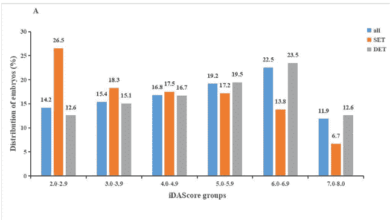
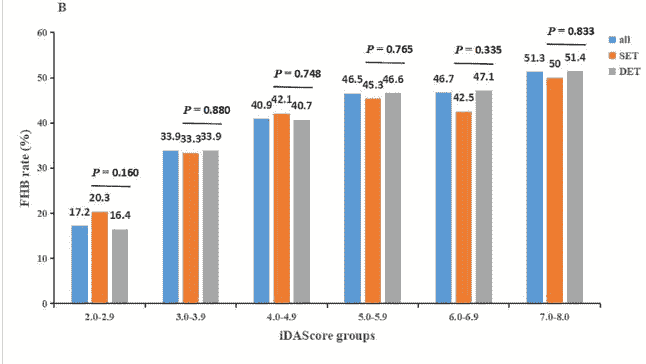

# 基于深度学习和时延成像的第3天胚胎移植优先级排序模型的外部验证

# 个人简介
Jiahong Zhu graduated from Chongqing Medical University, Chongqing, China. She has been engaged in reproductive medicine for more than 8 years at Chongqing Health Centre for Women and Children, mainly responsible for embryo selection, and embryo freezing and thawing procedures. Her current research interests include artificial intelligence in reproductive medicine and embryo evaluation.

# 关键信息
与传统形态学评估相比，使用 iDAScore 2.0 版进行第3天胚胎筛选对着床的预测价值更高。完全自动化的评估系统可能缩短胚胎筛选时间，消除主观性，并可作为决策支持系统，协助胚胎学家进行胚胎筛选。

# 摘要
**研究问题：** 使用 iDAScore 2.0 版进行客观胚胎评估是否能与传统形态学评估一样有效？

**设计：** 在一家大型生殖医学中心对新鲜第3天胚胎移植周期进行了回顾性队列研究。共纳入4328个周期、具有已知着床数据的7786个胚胎，这些胚胎在延时培养箱中培养并纳入研究。使用 iDAScore 2.0 版和与移植胚胎相关的传统形态学评估，对胎心搏动（FHB）率进行了回顾性分析。使用用于预测FHB的曲线下面积（AUC）值比较了两种评估方法的妊娠预测性能。

**结果：** 对于所有周期，iDAScore 的 AUC 值显著高于形态学评估（0.62 对比 0.60；$P = 0.005$）；单胚胎移植周期（0.63 对比 0.60；$P = 0.043$）和双胚胎移植周期（0.61 对比 0.59；$P = 0.012$）亦同。在年龄亚组中，<35 岁亚组 iDAScore 的 AUC 值显著高于形态学评估（0.62 对比 0.60；$P = 0.009$）；然而，$\ge$35 岁亚组未发现显著差异。就胚胎解割球数而言，<8c 亚组（0.67 对比 0.56；$P < 0.001$）和 $\ge$8c 亚组（0.58 对比 0.55；$P = 0.012$）的 iDAScore AUC 值均显著高于形态学评估。

**结论：** iDAScore 2.0 版在新鲜第3天胚胎移植周期中的表现不逊于或优于传统形态学评估。因此，iDAScore 2.0 版可能成为一种有前途的工具，用于筛选着床可能性最高的胚胎。

- 传统形态学评估
- 第3天胚胎
- 深度学习
- 客观胚胎评估
- 妊娠预测

*通讯作者。* 电子邮件地址：gnhuang217@sina.com (G. Huang)，hw2012ivf@sina.com (W. Han)。https://doi.org/10.1016/j.rbmo.2023.05.014 1472-6483/© 2023 由 Elsevier Ltd 代表 Reproductive Healthcare Ltd. 出版
声明：作者声明不存在任何财务或商业利益冲突。

# 引言
优化辅助生殖技术（ART）以确保筛选出着床潜力最高的胚胎仍然是一项挑战。目前，最常用的胚胎筛选方法基于传统形态学评估。对于第3天移植，胚胎评估基于伊斯坦布尔共识报告（ALPHA Scientists In Reproductive Medicine, ESHRE Special Interest Group Embryology, 2011）；这包括解割球数、碎片程度、解割球均匀性和多核现象。然而，该方法的主要局限性在于不同观察者评估的主观影响（Adamson et al., 2016）。

与传统体外受精（IVF）技术相比，延时技术（TLT）可以持续记录胚胎的整个发育过程，包括从受精和卵裂期到囊胚形成的分裂时间点。后一种技术为评估卵裂模式、原核移动及其他无法通过常规胚胎评估识别的细节提供了更好的基础。因此，它产生了更多可应用于胚胎筛选的信息（Basile et al., 2015; Liu et al., 2020）。尽管一些作者推测，TLT 与传统形态学评估的结合将改善胚胎筛选（Coticchio et al., 2018），但其临床价值仍然存在争议（Goodman et al., 2016; Liu et al., 2016）。

随着 TLT 的近期发展，人们尝试使用更强大的计算机分析大型图像数据集，以识别可能与胚胎发育潜能相关的参数。然而，各个 IVF 实验室之间培养条件的主要差异阻碍了相关强大算法的构建和广泛应用（Kallas et al., 2022）。

机器学习的进步增加了电子病历数据和计算处理能力的可用性，从而促进了新型人工智能（AI）辅助方法的开发。此类方法涉及深度学习，并利用人工神经网络分析延时方法捕获的图像，以搜索与妊娠结局相关的模式，从而可能提供一种更准确、一致和客观的方法来筛选最具活力的胚胎（Lundin et al., 2020; Tran et al., 2019）。iDAScore AI 软件直接集成到 EmbryoScope+ 系统（Vitrolife, 瑞典哥德堡）中，但 iDAScore 1.0 版仅基于第5天或第6天囊胚移植进行训练。原始数据集包含 115,832 个胚胎，其中 14,644 个是具有已知着床数据（KID）的囊胚移植（Bernsen et al., 2022）。iDAScore 2.0 版包含第2天和第3天移植的数据（Lassen et al., 2022）。这个更新的数据集包含 181,428 个胚胎，其中 33,687 个是具有 KID 的胚胎。iDAScore 2.0 版的网络架构与 1.0 版相同，但训练程序略有修改（Lassen et al., 2022）。iDAScore 1.0 版的妊娠预测性能在一项包含玻璃化冷冻-复苏囊胚移植的大型队列研究中得到证实（Ueno et al., 2021），验证结果表明该程序的表现不逊于或优于传统形态学评估。由于 iDAScore 2.0 版的性能尚未经过独立外部数据集验证，因此其在卵裂期胚胎移植中的应用需要与传统形态学评估（例如基于伊斯坦布尔共识报告（ALPHA Scientists In Reproductive Medicine, ESHRE Special Interest Group Embryology, 2011）的形态学分级系统）进行外部验证。

本研究采用受试者工作特征（ROC）曲线分析的曲线下面积（AUC），比较了两种胚胎评估方法（iDAScore 2.0 版和根据伊斯坦布尔共识报告（ALPHA Scientists In Reproductive Medicine, ESHRE Special Interest Group Embryology, 2011）的传统形态学评估）在新鲜第3天胚胎移植后的妊娠预测性能。此外，还使用用于预测胎心搏动（FHB）率的 AUC 值，对所有周期组及每个亚组（单胚胎移植（SET）、双胚胎移植（DET）、年龄 <35 岁、年龄 ≥35 岁、解割球数 <8c 和 ≥8c）的两种胚胎评估方法的妊娠预测性能进行了比较。就作者所知，这是首次针对卵裂期移植对基于深度学习的胚胎筛选模型进行的外部验证。

# 材料与方法

## 研究人群与设计
这项回顾性队列研究于2020年1月至2022年6月在中国重庆妇幼保健院的 IVF 诊所进行。本研究已获得中国重庆妇幼保健院机构审查委员会的批准（批准号：2022-RGI-11，批准日期：2022年9月10日）。

患者纳入标准为：（i）新鲜自体卵母细胞获取并伴第3天胚胎移植；（ii）在延时系统（EmbryoScope+）中培养的胚胎。排除标准为：（i）培养过程中模糊或缺失光学显微图像的胚胎；（ii）DET 周期中只有一个 FHB 的周期。共纳入 7786 个胚胎，其中 870 个为 SET，6916 个为 DET。移植胚胎的筛选基于传统形态学评估。根据形态学等级和解割球数，移植胚胎分为六组：A+、A、B+、B、C+ 和 C。使用 iDAScore 2.0 版（Lassen et al., 2022）回顾性评估了移植胚胎的 iDAScore 值。iDAScore 模型输出的数值分数范围为 1.0 至 9.9，与 FHB 的可能性相关。囊胚移植的分数范围为 1.0 至 9.9，第3天移植的分数范围为 2.0 至 8.0。在本研究中，胚胎的 iDAScore 值分为间隔为 1 的分数组（2.0–2.9、3.0–3.9、4.0–4.9、5.0–5.9、6.0–6.9 和 7.0–8.0）或间隔为 2 的分数组（2.0–3.9、4.0–5.9 和 6.0–8.0）。着床定义为经阴道超声检查观察到宫内妊娠囊并伴有 FHB。使用两种胚胎评估方法生成了用于对 FHB 率进行排序的 AUC 值：作为自动化 AI 模型的 iDAScore，以及由伊斯坦布尔共识报告（ALPHA Scientists In Reproductive Medicine, ESHRE Special Interest Group Embryology, 2011）确立的第3天胚胎形态学评估作为传统形态学分级方法。

本研究的主要结局包括不同形态学

按分层分析了分级。iDAScore 版本 2 和常规形态学评估在妊娠排序性能上的比较，采用 AUC 值对所有周期组及每个子组（SET、DET、年龄 <35 岁、年龄 ≥35 岁、卵裂球数 <8 个和 ≥8 个）进行了。

## 控制性卵巢刺激、受精和胚胎培养

患者根据卵巢反应和辅助生殖技术（ART）治疗病史，接受长效促性腺激素释放激素（GnRH）激动剂方案或 GnRH 拮抗剂方案的控制性卵巢刺激。

当超声测量到至少三个平均直径 >18 mm 的优势排卵前卵泡时，给予绒毛膜促性腺激素（HCG；Ovidrel，Merck Serono，意大利罗马）。

HCG 给药后 36 小时，在超声引导下通过阴道进行卵母细胞取出。

根据患者情况，进行体外受精（IVF）或卵浆内单精子注射（ICSI）受精。

HCG 给药后 38–39 小时进行 IVF，精子浓度约为 10,000 个精子/50-μl 滴。

IVF 受精后 4–6 小时，去除卵母细胞的颗粒细胞以评估第二极体挤出，并将显示出第二极体的卵母细胞转移至 EmbryoScope+ 进行培养。

或者，HCG 给药后 38–39 小时进行卵母细胞去巢，2 小时后执行 ICSI。

显微注射后，所有卵母细胞分别在 EmbryoScope+ 时间成像培养箱中于 37°C、6% CO2 和 5% O2 下单独培养。

胚胎培养使用预平衡的 G-1 培养基（Vitrolife，瑞典哥德堡）进行，直至受精后 66–68 小时。

常规形态学评估采用 EmbryoViewer 软件（Vitrolife）记录的图像，在受精后第 3 天（68 小时）进行静态观察。

胚胎的常规形态学评估主要依据伊斯坦布尔共识报告（ALPHA Scientists In Reproductive Medicine, ESHRE Special Interest Group Embryology, 2011）进行，主要指标包括卵裂球数、碎片程度、卵裂球均匀性和多核现象。

形态学评估由两名胚胎学家组成的团队进行，采用内部质量保证方案以确认分级的一致性。

胚胎被分配以下等级：A（卵裂球均匀、胞质碎片化 <10% 且无多核的胚胎）；B（卵裂球均匀或不均匀、胞质碎片化 <25% 的胚胎）；C（卵裂球均匀或不均匀、胞质碎片化 25%–50% 的胚胎）；D（卵裂球均匀或不均匀、胞质碎片化 >50% 的胚胎）（ALPHA Scientists In Reproductive Medicine, 2011）。

研究期间未移植 D 级胚胎。

A 级胚胎移植优先级最高，其次为 B 级和 C 级。

对于同等级的胚胎，卵裂球数 ≥8 个的胚胎移植优先级高于卵裂球数 <8 个的胚胎。

根据形态学等级和卵裂球数，移植的胚胎分为六组：A+（A 级且卵裂球数 ≥8 个）、A（A 级且卵裂球数 <8 个）、B+（B 级且卵裂球数 ≥8 个）、B（B 级且卵裂球数 <8 个）、C+（C 级且卵裂球数 ≥8 个）和 C（C 级且卵裂球数 <8 个）。

iDAScore AI 模型采用深度学习和神经网络开发，该网络经过训练可分析时间成像序列（Bernsten et al., 2022）。

模型的唯一输入是时间成像序列的图像，输出为 1.0 至 9.9 的数值评分，与胎儿心搏（FHB）的可能性相关。

因此，iDAScore 训练未包含任何人工标注数据。

因此，使用 iDAScore 版本 2.0 对带有 KID 的移植胚胎图像进行了回顾性评分。

## 鲜胚移植

本研究期间，除只有一个可移植胚胎或患者符合单胚胎移植（SET）适应症外，患者在鲜周期第 3 天接受两个胚胎移植。

SET 适应症包括：疤痕子宫；宫颈锥切术史；宫颈内口松弛；严重宫腔粘连手术史；子宫畸形；双胎妊娠史；产科并发症史；慢性疾病史；或身材矮小、体重过轻或过重的女性。

胚胎移植后，每日联合雌激素和孕激素支持黄体期，直至妊娠 12 周。

胚胎移植后 14 天测量母体血清 β-HCG 水平作为妊娠指标。

移植后 4 周阴道超声观察到宫内孕囊并伴有胎儿心搏（FHB）定义为着床。

## 统计分析

连续定量变量以均值 ± 标准差表示，分类数据以百分比表示。

采用 Kolmogorov–Smirnov 检验评估数据分布。

连续数据采用 Student's t 检验，分类数据采用 χ² 检验。

通过聚类数据 ROC 分析（多预测因子比较）（Obuchowski, 1997）计算了 iDAScore 和常规形态学评估预测 FHB 的排序性能；使用 iDAScore 计算 AUC 值基于连续数值。

采用配对 DeLong 双侧检验（DeLong et al., 1988）检验 AUC 值之间的显著差异。

所有统计检验中 P < 0.05 视为显著差异，所有分析均使用 R（http://www.r-project.org）和 EmpowerStats（www.empowerstats.com），X&Y Solutions, Inc.，美国波士顿，MA 执行。

# 结果

## 受试者特征

共分析了 4328 个周期中的 7786 次胚胎移植，包括 870 个 SET 周期和 3458 个 DET 周期（TABLE 1）。

与 SET 周期相比，DET 周期的母体平均年龄和之前取卵周期数显著较低（P < 0.001 和 P = 0.019，分别）。

此外，DET 周期中输卵管因素的比例显著高于 SET 周期（P < 0.001），而组合因素和排卵障碍比例在 DET 周期中显著低于 SET 周期（P < 0.001 和 P < 0.001，分别）。

SET 和 DET 周期在之前胚胎移植周期平均数和之前流产平均数方面无显著差异。

## 移植胚胎特征

如 TABLE 2 所示，平均

### TABLE 1 所有周期及单胚胎移植和双胚胎移植子组中的患者特征

| 特征 | 所有 | SET | DET | P 值 |
|---|---|---|---|---|
| 周期数 | 4328 | 870 (20.1) | 3458 (79.9) | - |
| 患者年龄，岁 | 31.92 ± 4.42 | 32.78 ± 4.51 | 31.71 ± 4.37 | <0.001ᵃ |
| 之前 OPU 周期数 | 0.33 ± 0.81 | 0.40 ± 0.80 | 0.31 ± 0.81 | 0.019ᵃ |
| 之前流产次数 | 0.13 ± 0.40 | 0.13 ± 0.38 | 0.13 ± 0.41 | 0.988ᵃ |
| 之前胚胎移植次数 | 0.21 ± 0.57 | 0.24 ± 0.59 | 0.20 ± 0.56 | 0.220ᵃ |
| 不孕症病因 | | | | <0.001ᵇ |
| 输卵管因素 | 2490 (57.5) | 365 (42.0) | 2125 (61.5) | 0.000ᵇ |
| 男性因素 | 353 (8.2) | 67 (7.7) | 286 (8.3) | 0.583ᵇ |
| 子宫内膜异位症 | 82 (1.9) | 13 (1.5) | 69 (2.0) | 0.333ᵇ |
| 排卵障碍 | 327 (7.6) | 151 (17.4) | 176 (5.1) | 0.000ᵇ |
| 组合因素 | 817 (18.9) | 227 (26.1) | 590 (17.1) | 0.000ᵇ |
| 不明原因 | 183 (4.2) | 28 (3.2) | 155 (4.5) | 0.098ᵇ |
| 其他 | 76 (1.8%) | 19 (2.2%) | 57 (1.6%) | 0.282ᵇ |

数据以均值 ± 标准差或 n (%) 表示。
ᵃ Student's t 检验。
ᵇ χ² 检验。
OPU，卵母细胞获取；SET，单胚胎移植；DET，双胚胎移植。

卵裂球数、卵裂球数 (≥8c) 的比例、平均 iDAScore 以及常规形态学评估的胚胎等级（A+、A、B+、B、C+ 和 C）的比例在所有周期及 SET 和 DET 周期中均存在显著差异（所有 P < 0.001）。

## 按 iDAScore 分布的胚胎及 FHB 率

FHB 率仅基于带有 KID 的胚胎计算，因此未包含仅有一个 FHB 的 DET 胚胎。

胚胎的 iDAScore 值被分为 1 个分数区间（2.0–2.9、3.0–3.9、4.0–4.9、5.0–5.9、6.0–6.9 和 7.0–8.0）。

所有周期和 DET 周期中，按 iDAScore 组分布的胚胎通常显示高分组内数量增加（FIGURE 1A）。

然而，最高 iDAScore 的移植胚胎较少。

由于许多患者在其 SET 周期中因胚胎质量差而只有一个可用于移植的胚胎，因此在本数据集中，随 iDAScore 增加，移植胚胎的比例降低（FIGURE 1A）。

所有组中，FHB 率随 iDAScore 增加而增加，因此对所有周期进行了进一步分析，因为 SET 和 DET 周期的 FHB 率可比（FIGURE 1B）。

### TABLE 2 所有胚胎及单胚胎移植和双胚胎移植子组中的移植胚胎特征

| 特征 | 所有 | SET | DET | P 值 |
|---|---|---|---|---|
| 胚胎数 | 7786 | 870 | 6916 | - |
| 等级 | | | | <0.001ᵇ |
| A+ | 3212 (41.3) | 229 (26.3) | 2983 (43.1) | |
| A | 145 (1.9) | 17 (2.0) | 128 (1.9) | |
| B+ | 1958 (25.1) | 176 (20.2) | 1782 (25.8) | |
| B | 399 (5.1) | 59 (6.8) | 340 (4.9) | |
| C+ | 1277 (16.0) | 206 (23.7) | 1071 (15.5) | |
| C | 795 (10.2) | 183 (21.0) | 612 (8.8) | |
| 平均卵裂球数 | 8.38 ± 1.80 | 7.94 ± 1.86 | 8.43 ± 1.78 | <0.001ᵃ |
| 卵裂球数 | | | | <0.001ᵇ |
| <8 | 1339 (17.2) | 259 (29.8) | 1080 (15.6) | |
| ≥8 | 6447 (82.8) | 611 (70.2) | 5836 (84.4) | |
| 平均 iDAScore | 5.02 ± 1.59 | 4.38 ± 1.59 | 5.10 ± 1.57 | <0.001ᵃ |
| iDAScore | | | | - |
| 最小值 | 2.0 | 2.0 | 2.0 | |
| 第 25 百分位数 | 3.7 | 2.9 | 3.8 | |
| 第 50 百分位数 | 5.2 | 4.2 | 5.3 | |
| 第 75 百分位数 | 6.4 | 5.6 | 6.4 | |
| 最大值 | 8.0 | 8.0 | 8.0 | |

数据以均值 ± 标准差或 n (%) 表示。
ᵃ Student's t 检验。
ᵇ χ² 检验。
SET，单胚胎移植；DET，双胚胎移植。

## 按形态学等级分层的 iDAScore 组 FHB 率

所有形态学等级组的总体 FHB 率为 40.1%，随 iDAScore 增加升至 2.0–3.9 组的 25.91%、4.0–5.9 组的 43.88% 和 6.0–8.0 组的 48.34%（TABLE 3）。

此外，对于形态学等级 A+、B+、B、C+ 和 C 的子组，iDAScore 为 2.0–3.9 时的 FHB 率低于较高 iDAScore 组的比率（TABLE 3）（A+ iDAScore 0.0–5.9，P = 0.015，其余均 P < 0.001，见表 S1，网络补充材料）。

此外，对于 A+、B+、B 和 C 组，iDAScore 为 6.0–8.0 的组的 FHB 率高于所有其他 iDAScore 组。

所有 + 组（即观察时卵裂球数 ≥8 个的胚胎）的 FHB 均高于非 + 组（即观察时卵裂球数 <8 个的胚胎）。

## 两种胚胎评估方法的排序性能

如 TABLE 4 所示，所有组预测 FHB 的 AUC 值

### 图 1 根据 iDAScore 的胚胎和胎儿心跳（FHB）率分布。(a) 数据以总胚胎数的百分比呈现 [所有 n = 7786，单胚胎移植（SET）n = 870；双胚胎移植（DET）n = 6916]。(b) 数据以评分组内胚胎的百分比呈现。

iDAScore 为 0.62，常规形态学评估为 0.60，两种方法之间存在显著差异（P = 0.005）。对于 SET 和 DET 亚组，iDAScore 的 AUC 值显著高于常规形态学评估（SET 0.63 对比 0.60，P = 0.043；DET 0.61 对比 0.59，P = 0.012）。为了更好地比较两种胚胎评估方法的性能，已考虑年龄相关差异。对于年龄 <35 岁的女性，iDAScore 的 AUC 值显著高于常规形态学评估（0.62 对比 0.60；P = 0.009）。对于年龄 ≥35 岁的女性，iDAScore 的 AUC 值为 0.60，常规形态学评估为 0.59；这两个值没有显著差异。

为了探讨胚胎球数的影响，比较了 iDAScore 和常规形态学评估在 <8c 和 ≥8c 亚组之间的 AUC 值。<8c 组的 iDAScore AUC 值为 0.67，常规形态学评估为 0.56。≥8c 组的 iDAScore AUC 值为 0.58，常规形态学评估为 0.55。因此，iDAScore 的 AUC 值在 <8c（P < 0.001）和 ≥8c（P = 0.012）两组中均显著高于常规形态学评估。

# 讨论

这项回顾性研究表明，iDAScore 版本 2.0 可预测 FHB，其效果与常规形态学评估相当，甚至更好。对于形态学等级相同的移植胚胎，FHB 率随 iDAScore 的增加而增加。这表明，基于 iDAScore 的第 3 天胚胎选择可能达到更高的 FHB 率，并且与常规形态学评估相比是安全且可靠的。

SET 和 DET 周期中移植胚胎的质量存在显著差异。与 DET 周期相比，SET 周期中大多数移植胚胎的形态学质量较低。这可能与研究诊所中 SET 分配的内部流程有关。尽管在不同 iDAScore 组中，具有 KID 的胚胎的观察 FHB 率在 SET 和 DET 周期之间总体上没有差异，但应注意，上述分析基于具有 KID 的胚胎，并且当仅有一个 FHB 的 DET 周期被纳入时，实际的 FHB 率较低。然而，具有 KID 的胚胎的模型性能并不取决于选择移植一个还是两个胚胎。因此，该模型也可用于患者咨询，以确定应移植多少个胚胎。

| 形态学等级 | 所有 iDAScore (2.0–8.0) | iDAScore (2.0–3.9) | iDAScore (4.0–5.9) | iDAScore (6.0–8.0) |
| --- | --- | --- | --- | --- |
| 所有 | 40.10 | 25.91 | 43.88 | 48.34 |
| A* (n = 3212) | 48.38 | 40.00 | 46.98 | 51.64 |
| A (n = 145) | 28.28 | 23.08 | 30.65 | 29.55 |
| B* (n = 1958) | 43.67 | 34.73 | 45.35 | 47.04 |
| B (n = 399) | 23.56 | 14.00 | 30.37 | 39.06 |
| C* (n = 1277) | 34.61 | 26.81 | 44.53 | 39.38 |
| C (n = 795) | 17.11 | 13.34 | 27.04 | 31.82 |

数据以评分组内胚胎的百分比呈现。
统计比较见表 S1（在线补充材料）。

## 表 4 iDAScore 模型与形态学等级之间曲线下面积值的比较

| AUC 值 | iDAScore | 形态学等级 | P 值 |
| --- | --- | --- | --- |
| 所有 | 0.62 | 0.60 | 0.005^a |
| 亚组分析 | | | |
| SET | 0.63 | 0.60 | 0.043^a |
| DET | 0.61 | 0.59 | 0.012^a |
| 年龄 <35 岁 | 0.62 | 0.60 | 0.009^a |
| 年龄 ≥35 岁 | 0.60 | 0.59 | 0.609^a |
| 胚胎球数 <8c | 0.67 | 0.56 | <0.001^a |
| 胚胎球数 ≥8c | 0.58 | 0.55 | 0.012^a |

AUC 值已针对所有移植胚胎以及基于移植胚胎数量、患者年龄和移植时胚胎球数的亚组进行计算。
^a DeLong 的双侧检验。
AUC，曲线下面积；SET，单胚胎移植；DET，双胚胎移植。

年龄 ≥35 岁患者中形态学等级最差的裂割胚胎比例为 20.4%，年龄 ≥41 岁患者中为 12%（Munné et al., 2007）。然而，对于高龄患者，可用于移植的胚胎数量通常有限，且基于形态学评估更容易选择具有更高发育潜能的胚胎。此外，第 3 天胚胎的形态学等级与高龄患者的正倍体相关（Moayeri et al., 2008）。因此，在年龄 ≥35 岁的患者中，iDAScore 与常规形态学评估在 FHB 预测性能上可能不存在显著差异。此外，尽管裂割期胚胎的形态学等级与更高的囊胚形成率相关（Liu et al., 2022），但来自高质量囊胚的妊娠率与其在裂割期的形态学等级无关（Herbemont et al., 2017; Zilberberg et al., 2021）。因此，常规形态学评估用于识别具有更高着床潜能的裂割期胚胎的预测价值仍然有限。

关于第 5 天及以后移植的先前研究表明，iDAScore 版本 1.0 在单次玻璃化囊胚移植后的表现与囊胚形态学评估相当或更好（Ueno et al., 2021），并且 iDAScore 版本 1.0 与活产率呈正相关，与流产率呈负相关（Ueno et al., 2022）。

尽管上述研究的作者使用了 iDAScore 版本 1.0（该版本在玻璃化囊胚移植周期中经过独立验证），但结果与本研究发现一致，表明 iDAScore 在新鲜第 3 天胚胎移植周期的妊娠预测中优于常规形态学评估（iDAScore 版本 2.0 也观察到了同样的情况）。然而，本研究中新鲜第 3 天胚胎移植的 AUC 值 0.62 不能直接与之前关于 iDAScore 的研究相比较；例如，Kato Ladies Clinic（Ueno et al., 2021）报告的 0.70 AUC 值基于第 5 天和第 6 天囊胚移植。尽管如此，较低的 AUC 值不应被视为 iDAScore 版本 1.0 和 2.0 预测性能的下降，而应视为用于验证的特定人群存在差异的结果（Kragh et al., 2021）。此外，由于与经过延长培养的胚胎相比，第 3 天胚胎可用的信息较少，因此裂割期移植相比囊胚移植出现较低 AUC 值是可以预期的。此外，应注意，关于内部验证数据，iDAScore 版本 2.0 对新鲜第 3 天移植表现出 0.62 的 AUC 值（Lassen et al., 2022）。

按母亲年龄进行的亚组分析表明，在年龄 <35 岁的女性中，使用 iDAScore 进行的 FHB 预测性能显著高于常规形态学评估，但在年龄 ≥35 岁的女性中没有差异。这表明，使用 iDAScore 版本 2.0 选择胚胎可能对年轻患者更有益。一项先前的研究表明，在年龄 <35 岁的患者中，形态学最好的胚胎具有 44% 的正倍体率，而形态学最差的胚胎具有 30% 的正倍体率（Munné et al., 2007）。此外，第 3 天胚胎形态学预测了高龄孕妇的正倍体，但不预测年轻患者的正倍体，年轻患者可能有其他导致胚胎畸形的因素（Moayeri et al., 2008）。因此，形态学评估在年轻患者中选择正倍体胚胎的能力降低，这些年轻患者在单个取卵周期中通常会获得几个高质量胚胎。本研究还表明，在形态学等级相似的胚胎中，iDAScore 较高的胚胎具有更高的着床潜能。这一结果表明，在年轻患者中，iDAScore 预测 FHB 的性能可能比常规形态学评估更少依赖于胚胎形态学。另一方面，众所周知，非整倍体随母亲年龄增加而增加。例如，一项先前的研究表明，正倍体率的

基于胚胎球数的亚组分析表明，在 <8c 和 ≥8c 组中，iDAScore 的 FHB 预测性能显著高于常规形态学评估。唯一例外是亚组 A；然而，推测小样本量可能导致了形态学亚组 A 中的这种差异，其中 iDAScore 2.0–3.9 组仅有 39 例，4.0–5.9 组有 62 例，6.0–8.0 组有 44 例。先前的研究表明，胚胎球数是裂割期胚胎移植后囊胚形成率和 IVF 成功率的有效预测因子（Kong et al., 2016; Tian et al., 2022）。在本研究中，常规形态学评估包括受精后第 3 天（68 小时）的静态评估。先前的研究表明，第 3 天胚胎球数增加与更高的囊胚形成率相关（Yu et al., 2018），并与更高的活产率相关（Tian et al., 2022; Wu et al., 2020）。对于形态学等级相同的胚胎，优先选择具有八个或以上胚胎球的可用胚胎。使用 iDAScore 时，<8c 和 ≥8c 组之间的 AUC 值差异为

高于常规形态学评估。卵裂球数量可能对 iDAScore 的影响大于形态学评估，这是解释此结果的一种可能原因。对于卵裂球较少的胚胎，较高的 iDAScore 比形态学分级更能预测胎心搏，但对于卵裂球较多的胚胎，iDAScore 可能难以区分具有更高发育潜力的胚胎。因此，推测卵裂球数量可能是 iDAScore 模型中的一个重要预测因子。iDAScore 已根据带有 KID 的胚胎图像接受训练，以自动为胚胎打分，且该分数与成功植入的可能性相关。先前的一项研究表明，虽然 iDAScore 未经过直接评估胚胎发育和形态的训练，但该模型可能已间接学习到卵裂球数量对植入的重要性（Berntsen et al., 2022）。因此，iDAScore 可能同时利用时序延时成像序列中每张图像的时序发育模式和静态形态学信息。

将胚胎培养延长至囊胚期可能是选择发育潜力更高胚胎的一种简单方法（Li et al., 2021; Wang et al., 2021）。然而，囊胚培养并非对每位患者都必要或合适，特别是对于第 5 天或第 6 天可能没有可用于移植的囊胚的患者。Levi-Setti 等人进行的一项随机对照研究支持采用单胚胎移植（SET）政策——即使是在卵裂期——用于年龄<39 岁且产生至少四个合子的患者（Levi-Setti et al., 2018）。此外，选择性 SET 已常规采用，以最大限度地降低预后良好患者的多胎妊娠高风险（美国生殖医学学会实践委员会，2018）。对于常规形态学评估，第 3 天胚胎移植的回顾性胎心搏率仍可接受，而引入 iDAScore 2.0 版本后胎心搏率可能有所提高。有必要开展一项设计良好、样本量大的随机对照试验，将 iDAScore 2.0 版本与常规形态学评估用于第 3 天胚胎选择进行比较，以证实 AI 评估模型的性能。

本研究的优势包括其创新性和相对较大的样本量。据作者所知，这是首个评估基于 AI 的第 3 天胚胎评估与常规形态学评估相比的妊娠预测性能的外部验证研究。本分析纳入了大量数据集，用于对 iDAScore 2.0 版本进行外部验证，涉及 4328 个胚胎移植周期，共移植 7786 个胚胎。此外，本研究中移植的胚胎均为自体新鲜第 3 天胚胎，而非冻胚胎。

然而，研究结果受限于回顾性研究的性质可能带来的潜在混杂因素。首先，所有分析的胚胎均基于形态学评估筛选。尽管常规形态学评估是广泛使用的分级系统，但它是一种易受观察者间差异影响的主观方法。其次，在形态学分级相同的胚胎中，本研究选择了卵裂球数量为 8 个或以上的胚胎进行移植，这可能导致常规形态学评估的 AUC 值偏高。因此，需要来自其他中心的更大规模 SET 数据集进行进一步的外部验证。

# 结论

基于深度学习和延时成像的完全自动化、无需标注的程序（即 iDAScore 2.0 版本）的客观胚胎评估，在新鲜第 3 天胚胎移植周期中的表现与常规形态学评估相当或更优。因此，iDAScore 2.0 版本可能成为一种有前途的工具，用于选择植入可能性最高的第 3 天胚胎。完全自动化的评估系统可大幅缩短胚胎选择所需时间，并可消除主观性。因此，iDAScore 可用作决策支持系统，协助胚胎学家进行胚胎选择。

# 数据可用性

数据可应要求提供。

# 致谢

作者谨感谢 Jørgen Berntsen 和 Vitrolife 对手稿提出的宝贵建议和讨论。此外，作者还要感谢在研究和数据收集方面提供帮助的同事。

# 资助

本工作得到重庆市妇幼保健院（编号：2020YJQN09）、重庆市渝中区基础研究与前沿探索项目（编号：20190143）和重庆市卫生健康委员会（编号：2021MSXM108）的支持。

# 补充材料

与本文相关的补充材料可在在线版本中找到，DOI: 10.1016/j.rbmo.2023.05.014。

# 参考文献

Adamson, G.D., Abusief, M.E., Palao, L., Witmer, J., Palao, L.M., Gvakharia, M., 2016. 利用自动延时成像辅助测试助力胚胎选择可改善第 3 天胚胎移植的植入率。Fertil. Steril. 105, 369–375. https://doi.org/10.1016/j.fertnstert.2015.10.030. e6.

ALPHA Scientists in Reproductive Medicine, ESHRE Special Interest Group Embryology, 2011. 胚胎评估伊斯坦布尔共识研讨会：专家会议论文集。Reprod. Biomed. Online. 22, 632–646. https://doi.org/10.1016/j.rbmo.2011.02.001.

Basile, N., Vime, P., Florensa, M., Aparicio Ruiz, B., García Velasco, J.A., Remohi, J., Meseguer, M., 2015. 利用形态动力学作为植入预测因子：一项多中心研究以定义和验证胚胎选择算法。Hum. Reprod. 30, 276–283. https://doi.org/10.1093/humrep/deu331.

Berntsen, J., Rimstad, J., Lassen, J.T., Tran, D., Kragh, M.F., 2022. 基于人工智能和延时图像序列的稳健且可推广的胚胎选择。PLoS One. 17, e0262661. https://doi.org/10.1371/journal.pone.0262661.

Coticchio, G., Magnini Renzi, M., Novara, P.V., Lain, M., De Ponti, E., Turchi, D., Fadini, R., Canto, Dal, 2018. M. 聚焦延时分析揭示人类受精的新方面，并提出胚胎活力的新参数。Hum. Reprod. 33, 23–31. https://doi.org/10.1093/humrep/dex344.

Delong, E.R., DeLong, D.M., Clarke-Pearson, D.L., 1988. 比较两个或多个相关受试者工作特征曲线下面积：一种非参数方法。Biometrics 44, 837–845. PMID: 3203132.

Goodman, L.R., Goldberg, J., Falcone, T., Austin, C., Desai, N., 2016. 在胚胎移植选择中添加延时形态动力学是否能改善妊娠率？一项随机对照试验。Fertil. Steril. 105, 275–285. https://doi.org/10.1016/j.fertnstert.2015.10.013. e10.

Herbemont, C., Sarandi, S., Boujenah, J., Cedrin-Durnerin, I., Sermentonde, N., Vivot, A., Poculet, C., Grynberg, M., Sifer, C., 2017. 当囊胚达到相似良好质量时，在第 5 天移植前是否应考虑第 2 天和第 3 天胚胎形态？Reprod. Biomed. Online 35, 521–528. https://doi.org/10.1016/j.rbmo.2017.07.014.

Kalleas, D., McEvoy, K., Horne, G., Roberts, S.A., Brison, D.R., 2022. 与高品质台式培养箱相比，低氧延时培养箱中不受干扰的胚胎培养后的活产率。Hum. Fertil. 25, 147–153. https://doi.org/10.1080/14647273.2020.1729423.

Kong, X., Yang, S., Gong, F., Lu, C., Zhang, S., Lu, G., Lin, G., 2016. 卵裂期人类胚胎的细胞数量、分裂行为与发育潜力之间的关系：一项延时研究。PLoS One. 11, e0153697. https://doi.org/10.1371/journal.pone.0153697.

Kragh, M.F., Karlströft, H., 2021. 基于人工智能的胚胎选择：如何评估和比较方法？J. Assist. Reprod. Genet. 38, 1675–1689. https://doi.org/10.1007/s10815-021-02254-6.

Lassen, J.T., Kragh, M.F., Rimstad, J., Johansen, M., Berntsen, J. 基于深度学习的多天移植胚胎选择的开发与验证。https://arxiv.org/abs...

Levi-Setti, P.E., Cirillo, F., Smeraldi, A., Morenghi, E., Mulazzani, G., Albani, E., 2018. 39 岁以下女性新鲜囊胚移植与卵裂期胚胎移植无优势之分：一项随机对照研究。J. Assist. Reprod. Genet. 35, 467–465. https://doi.org/10.1007/s10815-017-1092-2.

Li, Y., Liu, S., Lv, Q., 2021. 新鲜移植后单囊胚期与单卵裂期胚胎移植：系统评价与 Meta 分析。Eur. J. Obstet. Gynecol. Reprod. Biol. 267, 11–17. https://doi.org/10.1016/j.ejogrb.2021.10.004.

Liu, J., Zhou, Y., Tong, L., Wang, X., Li, Y., Wang, H., 2022. 第 3 天不同胚胎的发育潜力：一项回顾性研究。J. Obstet. Gynaecol. 42, 3322–3327. https://doi.org/10.1080/01443615.2022.2125291.

Liu, Y., Chappie, V., Feenan, K., Roberts, P., Matson, P., 2016. 人类第 3 天体外受精胚胎的延时淘汰模型：胚胎生长定性与定量措施的结合。Fertil. Steril. 105, 656–662.e1. https://doi.org/10.1016/j.fertnstert.2015.11.003.

Liu, Y., Qi, F., Matson, P., Morbeck, D.E., Mol, B.W., Zhao, S., Afnan, M., 2020. 使用定性和定量参数进行延时胚胎选择的实验室间可重复性：系统评价与 Meta 分析。J. Assist. Reprod. Genet. 37, 1295–1302. https://doi.org/10.1007/s10815-020-01789-4.

Lundin, K., Park, H., 2020. 用于胚胎培养和选择的延时技术。Ups. J. Med Sci. 125, 77–84. https://doi.org/10.1080/03009734.2020.1728444.

Moyeren, S.E., Allen, R.B., Brewster, W.R., Kim, M.H., Porto, M., Werlin, L.B., 2008. 第 3 天胚胎形态可预测年长受试者的倍性。Fertil. Steril. 89, 118–123. https://doi.org/10.1016/j.fertnstert.2007.01.169.

Munné, S., Chen, S., Colls, P., Garrisi, J., Zheng, X., Cekleniak, N., Lenzi, M., Hughes, P., Fischer, J., Garbis, M., Tomkin, G., Cohen, J., 2007. 超过 6000 个卵裂期胚胎中的母体年龄、形态、发育和染色体异常。Reprod. Biomed. Online. 14, 62–68. https://doi.org/10.1016/s1472-6483(10)61057-7.

Obuchowski, N.A., 1997. 聚类 ROC 曲线数据的非参数分析。Biometrics 53, 567–578. PMID: 9192452.

Practice Committee of the American Society for Reproductive Medicine, 2018. Practice Committee of the Society for Assisted Reproductive Technology. Electronic address: asrm@asrm.org. 临床辅助生殖中的囊胚培养与移植：委员会意见。Fertil. Steril. 110, 1246–1252. https://doi.org/10.1016/j.fertnstert.2018.09.011.

Tian, L., Xia, L., Liu, J., Kuo, Y., Huang, Z., Wu, X., Fan, L., Huang, J., Wu, Q., 2022. 卵裂球数量增加与第 3 天胚胎移植中更高的活产率相关。BMC Pregnancy Childbirth 22, 198. https://doi.org/10.1186/s12884-022-04521-5.

Tran, D., Cooke, S., Illingworth, P.J., Gardner, D.K., 2019. 深度学习作为延时培养和囊胚移植后胎儿心脏妊娠的预测工具。Hum. Reprod. 34, 1011–1018. https://doi.org/10.1093/humrep/dez064.

Ueno, S., Berntsen, J., Ito, M., Okiura, T., Kato, K., 2022. 基于深度学习的无需标注的胚胎评分系统与单次玻璃化囊胚解冻移植后活产/新生儿结局的相关性：一项单中心大队列回顾性研究。J. Assist. Reprod. Genet. 39, 2089–2099. https://doi.org/10.1007/s10815-022-02562-5.

Ueno, S., Berntsen, J., Ito, M., Uchiyama, K., Okiura, T., Yabuchi, A., Kato, K., 2021. 基于深度学习的无需标注胚胎评分系统在单次玻璃化囊胚解冻移植后的妊娠预测性能：一项单中心大队列回顾性研究。Fertil. Steril. 116, 1172–1180. https://doi.org/10.1016/j.fertnstert.2021.06.001.

Wang, N., Zhao, X., Ma, M., Zhu, Q., Wang, Y., 2021. 第 3 天和第 5/6 天胚胎质量对单次玻璃化胚胎移植周期生殖结局的影响。Front. Endocrinol. 12, 641623. https://doi.org/10.3389/fendo.2021.641623.

Wu, J., Zhang, J., Kuang, Y., Chen, Q., Wang, Y., 2020. 第 3 天细胞数量对玻璃化解冻单囊胚移植周期妊娠结局的影响。Hum. Reprod. 35, 2478–2487. https://doi.org/10.1093/humrep/deaa209.

Yu, C.H., Zhang, R.P., Li, J., A, Z.C., 2018. 基于卵裂球数量、碎片和对称性的高质量囊胚预测模型。J. Assist. Reprod. Genet. 35, 809–816. https://doi.org/10.1007/s10815-018-1132-6.

Zilberberg, E., Casper, R., Meriano, J., Barzilay, E., Aizer, A., Kirshenbaum, M., Orvieto, R., Haas, J., 2021. 卵裂期胚胎与囊胚期胚胎：它们之间如何相互关系？Arch. Gynecol. Obstet. 304, 1083–1088. https://doi.org/10.1007/s00404-021-06003-z.

