# 
公平与机器学习：限制与机遇（自适应计算与机器学习系列）


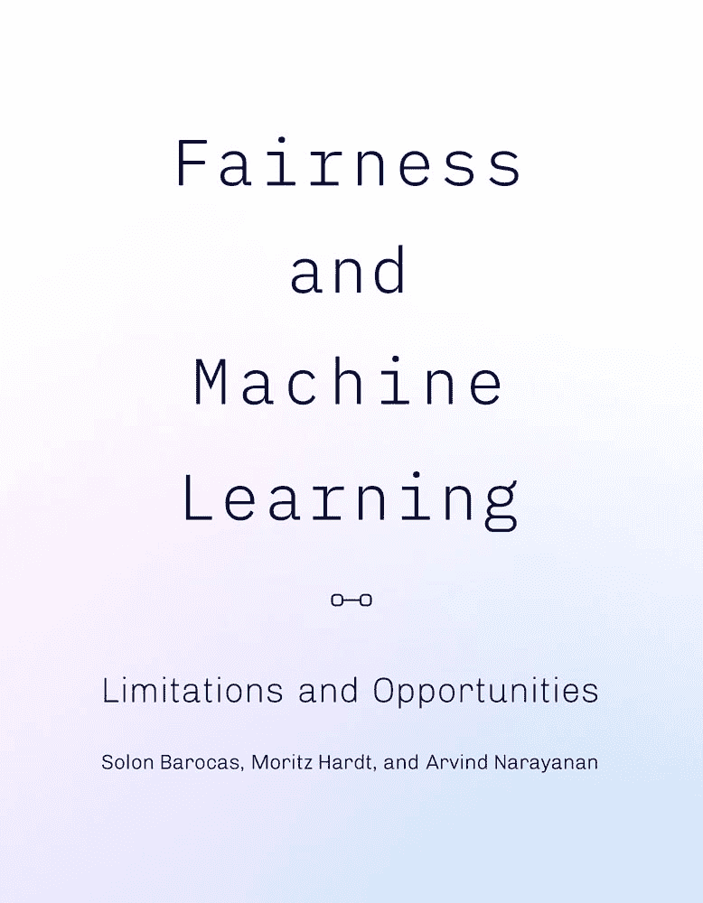


The MIT Press would like to thank the anonymous peer reviewers who provided comments on drafts of this book. The generous work of academic experts is essential for establishing the authority and quality of our publications. We acknowledge with gratitude the contributions of these otherwise uncredited readers.


ISBN: 978-0-262-04861-3

d\_r0

## Preface

Institutions of all kinds, from firms to governments, represent populations as data tables. Rows reference individuals. Columns contain measurements about them. Statistical machinery applied to these tables empowers their owners to mine patterns that fit the aggregate.

Then comes a leap of faith. We have to imagine that unknown outcomes, future or unobserved, in the life trajectory of an individual follow the patterns that have been found. We must accept decisions made as if all individuals were going to follow the rule of the aggregate. We must pretend that to look into the future is to look into the past. It’s a leap of faith that has been the basis of consequential decisions for centuries. Fueled by early successes in insurance pricing and financial risk assessment, statistical decision making of this kind has found its way into nearly all aspects of our lives. What has accelerated its adoption in recent years has been the explosive growth of machine learning, often under the name of artificial intelligence.

Machine learning shares long-established decision-theoretic foundations with large parts of statistics, economics, and computer science. What machine learning adds is a rapidly growing repertoire of heuristics that finds decision rules from sufficiently large datasets. These techniques for fitting huge statistical models on large datasets have led to several impressive technological achievements. Image classification, speech recognition, and natural language processing have all made leaps forward. Although these advances often don’t directly relate to specific decision-making settings, they shape narratives about the new capabilities of machine learning.

As useful as machine learning is for some positive applications, it is also used to great effect for tracking, surveillance, and warfare. Commercially, its most successful use cases to date are targeted advertising and digital content recommendation, both of questionable value to society. From its roots in World War II–era cybernetics and control theory, machine learning has always been political. Advances in artificial intelligence feed into a global industrial military complex and are funded by it. The success stories told about machine learning also support those who would like to adopt algorithms in domains outside those studied by computer scientists. An opaque marketplace of software vendors renders algorithmic decision-making tools for use in law enforcement, criminal justice, education, and social services. In many cases what are marketed and sold as artificial intelligence are statistical methods that virtually haven’t changed in decades.

Many take the leap of faith behind statistical decision making for granted to the extent that it has become difficult to question. Entire disciplines have embraced mathematical models of optimal decision making in their theoretical foundations. Much of economic theory takes optimal decisions as an assumption and an ideal of human behavior. In turn, other disciplines label deviations from mathematical optimality as “bias” that invites elimination. Volumes of academic papers speak to the evident biases of human decision makers.

In this book, we take machine learning as a reason to revisit this leap of faith and to interrogate how institutions make decisions about individuals. Institutional decision making has long been formalized via bureaucratic procedures, and machine learning has much in common with it. In many cases, machine learning is adopted to improve and sometimes automate the high-stakes decisions routinely made by institutions. Thus, we do not compare machine learning models to the subjective judgments of individual humans but instead to institutional decision making. Interrogating machine learning is a way of interrogating institutional decision making in society today and for the foreseeable future.

If machine learning is our way into studying institutional decision making, fairness is the moral lens through which we examine those decisions. Much of our discussion applies to concrete screening, selection, and allocation scenarios. A typical example is that of an employer accepting or rejecting job applicants. One way to construe fairness in such decision-making scenarios is as the absence of discrimination. This perspective is micro insofar as individuals are the unit of analysis. We study how measured characteristics of an individual lead to different outcomes. Individuals are the sociological building block. A population is a collection of individuals. Groups are subsets of the population. A decision maker has the power to accept or reject individuals for an opportunity they seek. Discrimination in this view is about wrongful consideration on the basis of group membership. The problem is as much about what wrongful means as on what basis it relies. Discrimination is also not a general concept. It’s domain specific as it relates to opportunities that affect people’s lives. It’s concerned with socially salient categories that have served as the basis for unjustified and systematically adverse treatment.

The first chapter after the introduction explores the properties that make automated decision making a matter of significant and unique normative concern. In particular, we situate our exploration of machine learning in a longer history of critical reflection on the perils of bureaucratic decision making and its mechanical application of formalized rules. Before we even turn to questions of discrimination, we first ask what makes automated decision making legitimate in the first place. In so doing, we isolate the specific properties of machine learning that distinguish it from other forms of automation along a range of normative dimensions.

Since the 1950s, scholars have developed formal models of discrimination that describe the unequal treatment by a decision maker of multiple different groups in the population. In chapter 3, we dive into statistical decision theory, allowing us to formalize a number of fairness criteria. Statistical fairness criteria express different notions of equality between groups. We boil down the vast space of formal definitions to essentially three different mutually exclusive definitions. Each definition resonates with a different moral intuition. None is sufficient to support conclusive claims of fairness. Nor are these definitions suitable targets to optimize for. Satisfying one of these criteria permits blatantly unfair solutions. Despite their significant limitations, these definitions have been influential in the debate around fairness.


第 4 章探讨了针对系统性不同群体待遇和这些群体所经历的结果差异的规范性基础的异议。我们回顾了关于歧视的许多关于其错误性的论述，并展示这些论述如何与提供平等机会的不同观点相关联。在此过程中，我们突出了一些关于平等机会的相互竞争愿景之间的紧张关系——有些相当狭隘，有些则极为宽泛——以及为调和这些冲突而提出的各种论点。在此基础上，我们进一步探讨常见的道德直觉和既定的道德理论如何帮助我们理解第 3 章中引入的形式主义，旨在赋予这些定义更多的规范性实质。

在技术和法律关于歧视的研究中，一种普遍的观念是将规范性权重分配给因果关系。群体成员是否是拒绝的原因？如果他们属于不同种族，他们是否会被拒绝？如果他们的性别不同，他们是否会被接受？为了理解这类陈述以及因果在歧视中的作用，本书第 5 章是一份关于因果形式概念的自包含介绍。

在对统计学和因果公平定义的正式遭遇之后，我们在第 6 章转向美国在歧视方面的法律维度。法律情境既不完全对应于道德基础，也不完全对应于形式工作，使情况变得相当复杂。两大主导法律教条——显性待遇歧视和影响歧视——似乎在显性考虑群体成员与干预以避免歧视之间形成了张力。

在第 7 章，我们进一步探讨了因果和法律章节的内容，重点在于通过实验和审计在实践中检验歧视的复杂性。

对决策中的歧视进行研究一直受到批评，因为它是一种狭隘的视角，忽视了更广泛的不公正体系，至少有两个原因。首先，作为一种歧视概念，它忽视了歧视的有力结构性决定因素，如法律和政策、基础设施、教育等。其次，它将干预空间定位为改革现有决策系统的方案，在机器学习的情况下通常通过更新算法来实现。因此，这种视角可能显得过于关注“技术解决方案”，而忽视了更有力的结构性干预措施以及放弃部署机器学习系统的替代方案。与其惩罚因未出庭而失败的被告，或许更有效的做法是通过提供交通和儿童照护来促进法院预约的便利。第 8 章从经验角度向读者介绍了这种更广阔的视角及其相关的干预空间。

认识到更广泛的社会和结构性视角的重要性，我们为何仍应研究决策中的歧视概念？一个好处是它为向个别决策者施加压力提供了政治和法律策略。我们可以提出针对特定个人、公司或机构的歧视指控。我们可以讨论在决策者合理可及的范围内存在的干预措施，从而预期决策者会实施这些措施。某些微观干预措施可能比结构性干预措施更直接可行。

采取微观视角并不意味着忽视情境。事实上，那些避免显性考虑群体成员而为群体创造机会的分配规则，往往是通过将分配规则与外部社会事实相结合来实现的。一个显著的例子是“德克萨斯 10%规则”，该规则保证在德克萨斯州高中毕业班中成绩排名前 10%的学生可自动获得所有州立大学的入学资格。如果高中班级在最初就存在种族隔离，该规则就无法促进公立大学的种族多样性。这一例子说明了在详细考察特定决策规则的同时，也应关注更广泛的社会背景。两者并非互斥，而是相辅相成。

更广泛的社会世界与机器学习生态系统之间的接触点是数据集。整个第 9 章探讨了数据集的历史、意义和科学基础。对数据集的详细考察、数据收集与构建，以及与数据相关的危害，通常在机器学习课程中缺乏。

公平性仍是一个活跃的研究领域，距离解决尚远。我们在写作这本书的同时，研究活动达到了爆发式的程度。过去五年内，数千篇相关论文发表。关于促进公平的算法干预措施的研究进展尤为迅速，因此我们没有尝试全面调查它。

本书存在一些严重、甚至显而易见的局限性。

书的大部分内容特定于美国。由三位在美国教育和就业机构受教育并受雇的作者撰写，本书基于西方道德传统，假设美国的法律和法律理论，并在全书中不断引用美国的工业和政治背景。我们在此书中没有尝试解决这一严重局限性。事实上，要解决这一局限性需要一本完全不同的书。

第二个局限性源于我们的主要目标是发展参与该主题所需的道德、规范和技术基础。由于其关注基础，本书可能给一些读者一种脱离那些因算法使用而受到严重伤害和损害的个人和社区实际经历的感觉。由于作者缺乏系统性压迫的第一手经验，这一缺陷进一步被放大。因此，本书无法替代那些活动家、记者和学者的重要工作，他们教会我们在具体情境中了解算法决策的危害。我们在写作这本书时，建立在这些关键贡献之上。我们试图在全书中加以强调，但很可能在某些方面仍未做到位。

本书既不是对算法决策的全面支持，也不是对其的广泛谴责。在写作这本书时，我们尝试了可能是任何主题中最不受欢迎的立场：保持平衡。我们努力找出算法决策的优点，同时给予其危害和局限性相当多的关注。一些人可能认为我们的平衡是缺乏政治承诺的表现，一种两边主义。

尽管政治局势紧迫，我们的书并未提供关于如何做出公平决策的直接实用指南。事实上，我们写这本书是为了长期来看。我们相信关于算法决策的争论将持续下去。我们的目标是加强未来辩论的知识基础，这些辩论将在未来的具体实例中展开。任何希望塑造社会中算法决策未来的人很可能会在本书中找到一些有价值的材料。


A few chapters, specifically chapter 3 on classification and chapter 5 on causality, require significant mathematical prerequisites, primarily in undergraduate probability and statistics. However, the other chapters we dedicate to much broader audiences. We hope that students in multiple fields will find this book helpful in preparing for research in related areas. The book does not fit neatly into the disciplinary boundaries of any single department. As a result it gives readers an opportunity to go beyond established curricula in their primary discipline.

Since we started publishing material from this book years ago, instructors have incorporated the material into a variety of courses, at both the undergraduate and the graduate level, in different departments. Hundreds of readers have sent us tremendously helpful feedback for which we are deeply grateful.

And to those lamenting our slow progress in writing this book, we respond empathetically: That’s fair.
Our success, happiness, and well-being are never fully of our own making. Others’ decisions can profoundly affect the course of our lives: whether to admit us to a particular school, offer us a job, or grant us a mortgage. Arbitrary, inconsistent, or faulty decision making thus raises serious concerns because it risks limiting our ability to achieve the goals that we have set for ourselves and access the opportunities for which we are qualified.

So how do we ensure that these decisions are made the right way and for the right reasons? While there is much to value in fixed rules, applied consistently, *good* decisions take available evidence into account. We expect admissions, employment, and lending decisions to rest on factors that are relevant to the outcome of interest.

Identifying details that are relevant to a decision might happen informally and without much thought: employers might observe that people who study math seem to perform particularly well in the financial industry. But they could test these observations against historical evidence by examining the degree to which a person’s major correlates with success on the job. This is the traditional work of statistics—and it promises to provide a more reliable basis for decision making by quantifying how much weight to assign certain details in our determinations.

A body of research has compared the accuracy of statistical models to the judgments of humans, even experts with years of experience. In many head-to-head comparisons on fixed tasks, data-driven decisions are more accurate than those based on intuition or expertise. As one example, a 2002 study shows that automated underwriting of loans was both more accurate and less racially disparate \[1\]. These results have been welcomed as a way to ensure that the high-stakes decisions that shape our life chances are both accurate and fair.

Machine learning promises to bring greater discipline to decision making because it offers to uncover factors relevant to decision making that humans might overlook, given the complexity or subtlety of the relationships in historical evidence. Rather than starting with some intuition about the relationship between certain factors and an outcome of interest, machine learning lets us defer the question of relevance to the data themselves: which factors—among all that we have observed—bear a statistical relationship to the outcome.

Uncovering patterns in historical evidence can be even more powerful than this might seem to suggest. Breakthroughs in computer vision—specifically object recognition—reveal just how much pattern discovery can achieve. In this domain, machine learning has helped to overcome a strange fact of human cognition: while we may be able to effortlessly identify objects in a scene, we are unable to specify the full set of rules that we rely on to make these determinations. We cannot hand-code a program that exhaustively enumerates all the relevant factors that allow us to recognize objects from every possible perspective or in all their potential visual configurations. Machine learning aims to solve this problem by abandoning the attempt to teach a computer through explicit instruction in favor of a process of learning by example. By exposing the computer to many examples of images containing preidentified objects, we hope the computer will learn the patterns that reliably distinguish different objects from one another and from the environments in which they appear.

This can feel like a remarkable achievement, not only because computers can now execute complex tasks but also because the rules for deciding what appears in an image seem to emerge from the data themselves.

But there are serious risks in learning from examples. Learning is not a process of simply committing examples to memory. Instead, it involves generalizing from examples: homing in on those details that are characteristic of, say, cats in general, not just the specific cats that happen to appear in the examples. This is the process of induction: drawing general rules from specific examples—rules that effectively account for past cases, but that also apply to future, as yet unseen cases. The hope is that we’ll figure out how future cases are likely to be similar to past cases, even if they are not exactly the same.


可靠地从历史案例推广到未来情况，需要我们向计算机提供`良好`的案例：数量足够多的案例以揭示细微模式，数量足够多样的案例以展示物体可能呈现的多种形式，数量足够详细标注的案例以向机器学习提供可靠的基准真理，等等。因此，基于证据的决策的可靠性取决于其依据的证据，而高质量的案例对于机器学习至关重要。机器学习之所以是“基于证据”的，并不意味着它必然会导致准确、可靠或公平的决策。

这尤其适用于使用机器学习来建模人类行为和特征的情况。我们历史上关于相关结果的案例几乎总会反映历史偏见、普遍的文化刻板印象以及现有的人口不平等。在数据中寻找模式通常意味着复制这些相同的动态。

在转向自动化预测决策时，还会丧失一些东西。人类决策者很少会为了预测精度而不顾其他因素；他们经常会考虑用于预测的属性是否具有道德相关性。例如，虽然年轻被告在统计上更可能再次犯罪，但法官倾向于在判定刑期时不考虑这一点，认为年轻被告在道德上责任较小。这也是我们对那些似乎表明统计决策优越性的比较保持谨慎的原因之一\[2\]。人类也很少做出明显荒谬的决定，但自动化决策系统可能会发生这种情况，可能是由于数据错误所致。这些以及人类与自动化决策之间的诸多差异，正是机器学习依赖的决策系统可能不公正的原因。

我们撰写此书，因为机器学习正在在具有重要意义的决策中发挥作用。在刑事司法系统中，正如上文所述，被告会被分配统计评分，这些评分旨在预测其未来犯罪的风险，这些评分用于决定保释、量刑和假释。在商业领域，公司使用机器学习分析和筛选求职者的简历。统计方法当然是贷款、信用和保险承保的核心。

我们现在开始审查机器学习在上述及其他许多应用中的风险，并对新兴的拟议解决方案进行批判性评述。我们将看到，即使是出于良好意图的机器学习应用，也可能导致令人不快的结果。


亚马逊使用数据驱动的系统来确定在哪些社区提供免费当日达。2016 年的一项调查发现，这些社区的人口构成存在显著差异：在许多美国城市，`White`居民的可能性是`Black`居民的两倍以上，居住在符合条件社区中的`White`居民比例更高\[3\]。

我们并不清楚亚马逊系统的具体工作方式，特别是它是否使用机器学习。许多其他媒体报道中提到的系统也是如此。不过，我们将使用这些作为动机例子，当处理相关任务时，机器学习系统极有可能表现出相同的行为。

在第 3 章中，我们将看到如何在数学上精确化对人口统计差异的直觉，并发现测量这些不平等的多种方式。机器学习应用中这种差异的普遍性是本书的核心关注点。

差异并不意味着系统设计者意图让这些不平等出现。超越意图，重要的是了解在什么情况下观察到的差异可以被视为歧视。进而，两个关键问题在于这些差异是否合理，以及是否有害。这些问题很少有简单答案，但哲学和社会学中关于歧视的大量文献可以帮助我们进行推理。

要理解亚马逊系统中种族差异为何可能有害，我们必须牢记美国种族偏见的历史、其与地理隔离和不平等的关系，以及这些不平等随时间被延续的方式。亚马逊认为其系统是合理的，因为它基于效率和成本考量，且种族不是显式因素。然而，它对消费者的提供机会在种族上存在差异。担忧是，这可能会助长长期的不平等循环。如果相反，系统被发现偏向邮编以奇数结尾的邮区，它就不会引发类似的争议。

术语`bias`常被用来指代算法系统中导致社会问题的人口统计差异。本书将在使用“bias”一词时尽量减少这种含义，因为不同学科和社区对该词的理解不同，这可能导致混淆。在统计学和机器学习中，`bias`有更传统的用法。例如，假设亚马逊系统对送达日期或时间的估计始终过早几个小时。这便是`统计偏差`的情况。当统计估计量的期望值或平均值与其旨在估计的真实值不同时，该估计量被认为是偏的。统计偏差是统计学的基础概念，且有丰富的既定技术用于分析和避免它。

还有许多其他指标量化预测者或估计量的统计性能，如精确率、召回率和校准。这些指标同样易于理解，不需要了解社会群体，也相对容易测量。在统计学和机器学习中关注人口统计标准是一个相对新的方向。它反映了我们如何概念化机器学习系统以及构建者的责任的转变。我们的目标是忠实反映数据，还是我们有义务质疑数据，并设计系统以符合某种公平行为的观念，无论当前数据是否支持这种行为？这些视角经常处于张力之中，当我们深入机器学习的阶段时，两者的区别将变得更加清晰。

让我们研究机器学习的管道，了解人口统计差异如何在其中传播。这种方法让我们得以一窥机器学习的黑箱，并为后续章节的详细分析做好准备。研究机器学习的阶段对于我们干预以降低差异至关重要。

Figure 1.1 展示了一个典型机器学习系统产生输出的阶段。像任何此类图表一样，它是一种简化，但对于我们的目的而言很有用。

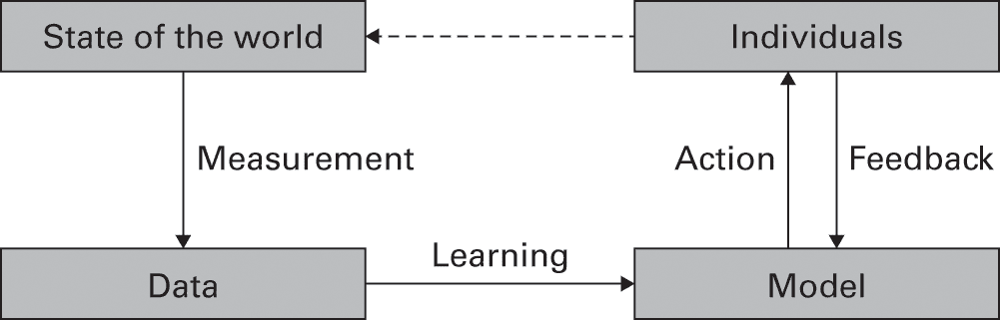

Figure 1.1 机器学习循环。

第一阶段是测量，即将世界的状态缩减为数据集中行、列和值的过程。这是一个混乱的过程，因为现实世界是混乱的。术语“测量”具有误导性，它让人联想到一位 dispassionate 科学家客观记录观察结果的形象，而我们将看到，这需要主观的人类决策。


"学习"在机器学习中指的是下一阶段，即将数据转化为模型。模型总结训练数据中的模式；它会进行概括。模型可以使用受监督学习（如`Support Vector Machines`算法）来训练，也可以使用无监督学习（如`k-means clustering`算法）来训练。模型形式多种多样：可能是高维空间中的一个超平面或一组区域，也可能是一组分布。它通常以一组权重或参数来表示。

下一阶段是基于模型的*预测*所采取的行动，即将模型应用于新的、未见的输入。顺便提一下，“预测”这个词具有误导性——它有时涉及预测未来（“这个病人是否高风险患癌？”），有时则不涉及（“这个社交媒体账号是否是机器人？”）。

预测可以采取分类（判断一封邮件是否为垃圾邮件）、回归（为被告分配风险评分）或信息检索（查找与搜索查询最匹配的文档）的形式。这三类应用中的操作可能是：将邮件存入用户的收件箱或垃圾邮件文件夹，决定是否在被告预审期间设置保释金，以及向用户展示检索到的搜索结果。这些应用对个体的意义可能大相径庭，但它们的共同点在于，个体对这些决定的集体反应会改变世界的状态——即系统试图建模的底层模式。

一些机器学习系统会记录用户反馈（用户对行动的反应）并利用这些反馈来优化模型。例如，搜索引擎会跟踪用户点击的内容作为隐含的相关性或质量信号。反馈也可能发生在 unintentionally（意外）或 adversarially（对抗性）的情况下，这些情况在本章后面将被进一步探讨。


*证明。* 根据条件独立性的收缩规则，


为了明确，$A \\perp (Y, R)$ 表示 $A$ 与随机变量对 $(Y, R)$ 独立。丢弃 $R$ 不会在 $A$ 和 $Y$ 之间引入依赖。

在逆否命题中，


### 独立性与分离

类似的互斥结果适用于独立性和分离。本文的表述稍显牵强，并需要额外假设目标变量 $Y$ 是二元的。此外，还需要分数 $R$ 与目标 $Y$ 不独立。这是一个相当温和的假设，因为任何有用的评分函数都应该与目标变量相关。

**命题 3** 假设 $Y$ 是二元的，$A$ 不与 $Y$ 独立，且 $R$ 不与 $Y$ 独立。那么，独立性和分离不能同时成立。

*证明。* 假设 $Y \\in \\{0, 1\\}$。其逆否命题的表述为：


根据全概率公式，


利用假设 $A \\perp R$ 和 $A \\perp R \\mid Y$，上式简化为


以不同的方式，全概率公式也给出：


结合上述两式，我们得到

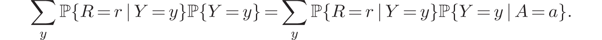

仔细观察发现，当 $y$ 只取两个值时，该方程仅能满足当 $A \\perp Y$ 或 $R \\perp Y$ 时。

我们可以更简洁地用符号 $p = \\mathbb{P}\\{Y = 0\\}$，$p[a] = \\mathbb{P}\\{Y = 0 \\mid A = a\\}$，$r[y] = \\mathbb{P}\\{R = r \\mid Y = y\\}$ 来重写该方程：


等价地，$p(r[0] - r[1]) = pa$。

该方程仅在以下两种情况下成立：要么 $r[0] = r[1]$（此时 $R \\perp Y$），要么 $p = p[a]$ 对所有 $a$ 成立（此时 $Y \\perp A$）。

■

当目标变量取值超过两个时，该命题不成立，这是一个自然的考虑情况。

### 分离与充分性

最后，我们转向分离与充分性之间的关系。两者都要求三个变量 $A$、$R$、$Y$ 之间的非平凡条件独立关系。同时强加这两个条件会导致退化解空间，如下一个命题所证实。

**命题 4** 假设 $(A, R, Y)$ 的联合分布中所有事件的概率均为正，且 $A \\nparallel Y$。那么，分离和充分性不能同时成立。

*证明。* 根据拉里·华斯曼的文本 \[115\] 中的定理 17.2（标准事实），


此外，


取逆否命题即可完成证明。

■

对于二元目标，上述命题中的非退化假设意味着在所有组、所有评分值中，都同时存在正例和负例。换句话说，评分值永远不能完全消除对结果的不确定性。充分性适用于贝叶斯最优评分函数。因此，该命题建立了一个重要事实：最优评分通常违反分离。

该命题也适用于二元分类器。这里的假设是：在每个组内，分类器必须同时具有非零真阳率、假阳率、真阴率和假阴率。我们可以稍微放宽这一假设，仅要求分类器在至少一个假阳预测上是不完美的。该命题的证明本质上仅利用真阳率（召回率）与正预测值（精确率）之间的权衡关系。这种权衡常被称为精确率-召回率权衡。

**命题 5** 假设 $Y$ 不与 $A$ 独立，且 $\\hat{Y}\\) 是一个具有非零假阳率的二元分类器。那么，分离和充分性不能同时成立。

*证明。* 由于 $Y$ 不与 $A$ 独立，必然存在两个组（记为 0 和 1），使得


现在假设分离成立。由于分类器不完美，这意味着所有组都有相同的非零假阳率 $FPR > 0$，以及相同的真阳率 $TPR \\geq 0$。我们将展示充分性不成立。

回顾二元情况下，充分性意味着所有组的正预测值相同。记组 $a$ 的正预测值为 $\\text{PPV}[a]$，则有


从表达式中可以看出，只有在 $TPR = 0$ 或 $FPR = 0$ 时，$\\text{PPV}[a] = \\text{PPV}[b]$ 才成立。后者由假设排除，因此必须是 $TPR = 0$。然而，在这种情况下，我们可以验证组 0 的负预测值 $\\text{NPV}[0]$ 必须与组 1 的负预测值 $\\text{NPV}[1]$ 不同。这源自以下表达式：


因此，充分性不成立。

■

在我们刚刚证明的命题中，分离和充分性都指的是二元分类器 $\\hat{Y}$。该命题不适用于分离指的是二元分类器 $\\hat{Y} = \\mathbb{1}\\{R > t\\}$ 而充分性指的是底层评分函数 $R$ 的情况。

## 案例研究：信用评分


我们现在将我们所学习的某些概念应用于信用评分。信用评分通过提供贷款申请人违约的风险估计来支持贷款决策。信用评分在美国及其他国家在分配信用时被广泛使用，从微额贷款到大额抵押贷款皆有涉及。在美国，有三家主要的信用报告机构收集各类借款人的数据。这些机构是营利性组织，各自基于收集的数据提供风险评分。FICO 分数是由 FICO 公司开发的专有评分系列，并由三家信用报告机构销售。

美国对信用机构的监管始于 1970 年通过的《公平信用报告法》，该法旨在促进报告机构收集的消费者信息的准确性、公平性和隐私性。1974 年通过的《平等信用机会法》规定，任何贷款人不得因种族、肤色、宗教、国籍、性别、婚姻状况或年龄而歧视任何申请人。

### 分数分布

我们的分析基于联邦储备局公布的数据 \[116\]。数据集提供 2003 年关于信用评分、人口信息（种族或民族、性别、婚姻状况）以及结果（稍后定义）的聚合统计。我们将重点关注评分、种族和结果的联合统计，其中种族属性假设有四个值（\table 3.4）。

Table 3.4Credit score distribution by ethnicity

| Race or ethnicity || Samples with both score and outcome |

| --- | --- |

| White || 133,165 |

| --- | --- |

| Black || 18,274 |

| Hispanic || 14,702 |

| Asian || 7,906 |

| Total || 174,047 |

本研究使用的评分基于 TransUnion 的 TransRisk 评分。TransUnion 是一家美国信用报告机构，TransRisk 评分又基于 FICO 评分。联邦储备局为本研究对评分进行了重新标准化，使其范围从 0 到 100，其中 0 表示 `信用最差`。

种族信息由社会安全管理局提供，因此基于自报值。这些信用评分的累计分布高度依赖于种族群体，如 \figure 3.10 所示。

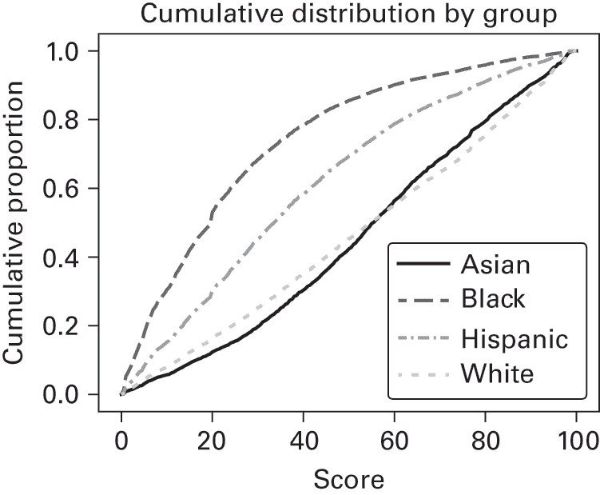

Figure 3.10Cumulative density of scores by group.

### 性能变量与 ROC 曲线

如往常一样，结果变量是该数据集的微妙方面。其定义值得强调。由于评分模型是专有的， unclear 的是培训过程使用的目标变量。那么，评分究竟试图预测什么？乍一看，我们可能会认为信用评分的目标是预测 *违约* 结果。然而，这并不是一个明确界定的概念。违约在回收的债务金额和恢复时间上有所差异。任何单一的二元性能指标通常都是对概念的简化。

联邦储备局提供的数据是一种所谓的 *性能* 变量，用于衡量在特定时间段内至少有一条信用线出现严重逾期的情况。具体来说，联邦储备局说明：

\[the\] measure is based on the performance of new or existing accounts and measures whether individuals have been late 90 days or more on one or more of their accounts or had a public record item or a new collection agency account during the performance period.

有了这种性能变量，我们可以通过 ROC 曲线观察评分在不同人口群体中的预测能力 \[figure 3.11\]。

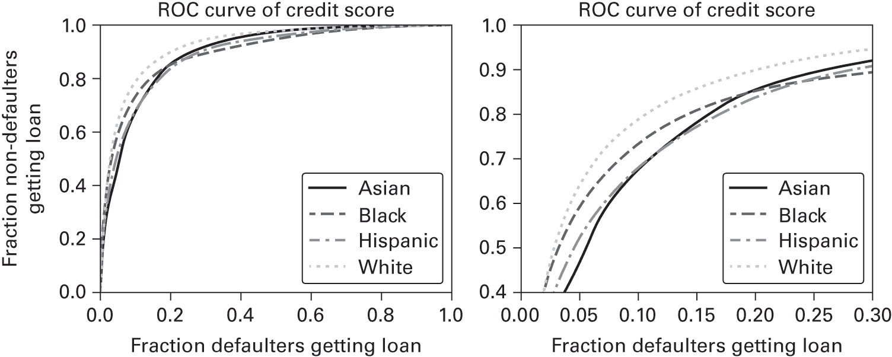

Figure 3.11ROC curve of credit score by group.

真实正率（true positive rate）是 *在实际为正时，预测为正的比率*。假阳率（false positive rate）是 *在实际为正时，预测为负的比率*。

我们看到，各组的曲线形状大致相似，但 “White” 组的曲线下面积明显大于 “Black” 组。此外，即使两条 ROC 曲线形状相同，也可能对应非常不同的评分函数。在某一阈值 *t* 处实现的真阳率与假阳率的权衡，在不同组之间可能需要不同的阈值 *t′*。

### 不同准则的比较

在手头的评分数据基础上，我们比较了四种不同的分类策略：

*   **Maximum profit**：可能因组别而异的评分阈值，以最大化利润。

*   **Single threshold**：为所有组制定一个统一的评分阈值，以最大化利润。

*   **Independence**：在所有组中实现相同的接受率。在此约束下最大化利润。

*   **Separation**：在所有组中实现相同的真阳率/假阳率。在此约束下最大化利润。

要理解如何最大化利润，我们需要假设对真阳（正确预测为正）的回报，以及对假阳（负值被错误预测为正）的成本。在贷款业务中，假阳的成本通常是真阳回报的数倍。换句话说，贷款产生的利息相较于可能损失的本金而言要小。为了示例，我们假设假阳的成本是真阳回报的六倍。具体数值并不重要，关键是比例。这种简化的成本结构忽略了贷款人可能关心的许多细节，例如贷款条款。

还有一个主要限制是我们即将进行的分析。由于我们只提供聚合统计数据，无法针对特定分类策略重新训练评分模型。我们只能设定阈值，以满足特定约束。这种做法可能在评估受约束时过于悲观。因此，以及我们选择的成本函数相当随意，我们不直接给出利润数值。利润数值可在原始分析 \[114\]，其中指出“单一阈值”实现的利润高于“分离”，而“分离”又高于“独立”。

我们转而观察每个组在不同准则下实现的真负率与假正率的权衡 \[figure 3.12\]。

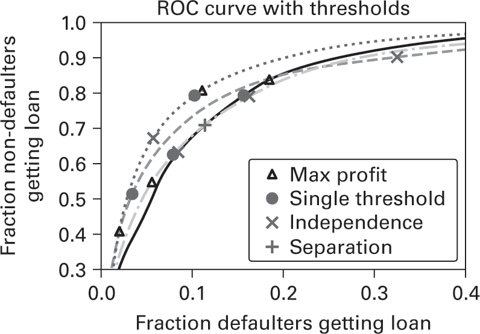

Figure 3.12ROC curves with optimal thresholds for different criteria.

我们可以看到，尽管 ROC 曲线相似，但不同准则在不同组之间产生的权衡差异显著。例如，*max profit* 在亚裔组实现的真阳率是黑组的两倍。分离准则在所有组中产生相同的权衡。独立准则使接受率相等，但导致各组的权衡差异显著，例如黑组的假阳率超过亚裔组的三倍。

### 校准值

最后，我们考虑各组的非违约率。这对应于各组的校准图 \[figure 3.13\]。

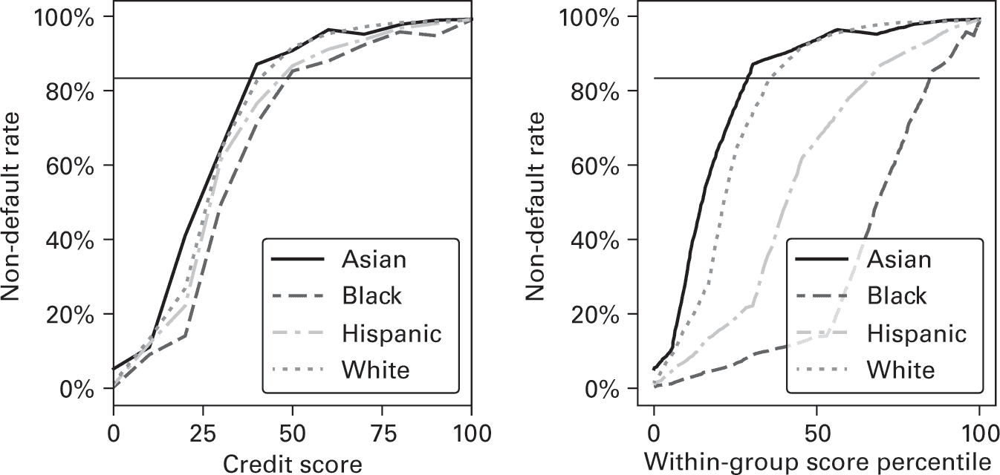


Figure 3.13`信用评分的分组校准值`。我们看到各分组的性能曲线相互对齐得相当合理。这意味着，对分数值进行单调变换后，就能得到一个根据我们早前定义的分数，在各分组之间大致是校准的。由于各分组的分数分布存在差异，因此阈值化分数仍可能导致每个分组的阳性预测值（positive predictive value）不同，从而使得分数的多值化转为二值化时通常会丧失校准性。

## 观察性标准的固有局限性

我们迄今所看到的标准具有一个重要共同点：它们都是**score、敏感属性和目标变量的联合分布的属性**。换言之，如果我们了解随机变量（*R, A, Y*）的联合分布，就可以毫无疑问地判断该联合分布是否满足这些标准中的某一项。例如，如果所有变量都是二元的，联合分布只需八个数字来描述。我们只需查看这八个数字即可验证本章讨论的所有标准，而无需其他信息。我们可以稍作扩展，把所有特征 *X*（而不仅仅是敏感属性）也纳入考虑。因此，我们将一个标准称为**观察性**（observational），当它是特征 *X*、敏感属性 *A*、评分函数 *R* 和因变量 *Y* 的联合分布的属性时。直观上讲，观察性标准是指我们可以用涉及现有随机变量的概率语句来明确地表达出来。

观察性定义具有许多吸引人的特点。它们通常表述简洁，只需要轻量级的形式化。它们不涉及分类器内部机制、决策者的意图、决策对总体的影响，也不涉及特征是否以及如何影响结果。正如我们 earlier 所见，我们可以相对便捷地对它们进行推理。原则上，观察性定义可以在给定联合分布的样本（受统计抽样误差限制）下验证。

观察性定义的这种简洁性也导致了固有的局限性。它们隐藏了观测到的差异背后的机制。例如，接受率的差异可能是决策者恶意考虑群体成员导致的；也可能反映社会底层不平等，使得某一群体更容易获得接受。虽然两者都令人担忧，但在前者中，歧视是决策者的直接行为；在后者中，歧视的根源可能在决策者的控制范围之外。

观察性标准一般无法提供关于歧视原因和机制的满意答案。后续章节，特别是关于因果关系的章节，发展出了超越观察性标准的工具。

## 章节注释

关于概率早期历史和统计思维的兴起，请参阅伊恩·黑克灵（Ian Hacking）\[117, 118\]、西奥多·波特（Theodore Porter）\[103\]、阿尔兰·德罗斯耶斯（Alain Desrosières）\[102\] 所著的书籍。

本章讨论的统计决策理论（statistical decision theory）也称为（信号）检测理论（signal detection theory），是多本教材的主题。我们称之为“分类”的内容在其他语境下也称为“预测”（prediction）。同样，分类器常被称为预测器。有关机器学习的高级入门教材，请参见莫里茨·哈特和本杰明·雷特（Moritz Hardt and Benjamin Recht）\[119\]。拉里·瓦萨曼（Larry Wasserman）的教材\[115\]提供了额外的统计背景，包括对条件独立性的阐述，这有助于理解本章的部分内容。

本章回顾的公平标准早在 1960 年代和 1970 年代就已出现在教育测试和计量学文献中\[120\]。在这一语境下，第一个也是最具影响力的公平标准是由安妮·克利尔（Anne Cleary）\[121, 122\] 确定的。如果线性模型在不了解群体成员的情况下就能从分数预测结果，则该分数满足克利尔的标准。该条件源于充分性（sufficiency），可以通过将条件独立性陈述替换为关于部分相关的类比陈述来表达\[123\]。

Hillel Einhorn 和 Alan Bass \[124\] 考虑了精度（precision）的相等性，这相当于我们 earlier 所提到的充分性的放宽。Robert Thorndike \[125\] 考虑了弱校准的变体，即每个分组中正预测的频率必须等于正结果的频率，并提出通过为不同分组设定不同的阈值来实现这一目标的后处理步骤。Thorndike 的标准在一般情况下与充分性不可比较。

Richard Darlington \[123\] 用四个简洁的表达式，涉及各种随机变量之间的相关系数，分别陈述了四个不同的标准。这些标准包括独立性、充分性的放宽、分离性的放宽以及 Thorndike 的标准。Darlington 还给出了一个直观的视觉论证，说明这四个标准在非退化情况下是不相容的。Mary Lewis \[126\] 综述了三个公平标准，包括精度相等和真假阳性率相等。

这些重要的早期工作后来被机器学习和数据挖掘社区重新发现\[120\]。大量研究将独立性作为公平约束的变体。\[127, 128\]. Michael Feldman、Sorelle Friedler、John Moeller 等人\[107\]在不同影响法（disparate impact law）的背景下研究了人口平等的放宽。Richard Zemel、Yu Wu、Kevin Swersky 等人\[129\]采用相互信息视角，提出一种基于预处理的启发式方法，用于最小化相互信息。早在 2012 年，Cynthia Dwork、Moritz Hardt、Toniann Pitassi 等人\[130\]指出独立性作为公平约束是不足的。特别是，这项工作指出了本章讨论的独立性问题。

分离性标准（separation criterion）在文献中称为 *equalized odds*，同时也出现了对假负率的放宽，即 *equal opportunity*。这些标准也在独立工作中以不同的名称出现\[131\]。Blake Woodworth、Suriya Gunasekar、Mesrob Ohannessian 等人\[132\]研究了一种以相关系数表述的分离性放宽。该放宽对应于 Darlington 所研究的第三个标准\[123\]。


进入`/path/to/xxx`目录，找到`xxx.json`。

在表达式`cvar = avar + bvar`中，加法运算符（`+`）将`avar`与`bvar`相加，得到它们的和`cvar`

在`List.of(arg0, arg1, arg2)`中，`List`接口的工厂方法`of()`接受一系列的元素，返回包含它们的只读列表。

之后我们这样调用`cmd`命令：`cmd arg0 arg1 arg2`。

```
if (condVar > someVal) {console.log("xxx")}
```

ProPublica`\[133\]` implicitly adopted equality of false positive rates as a fairness criterion in its article on COMPAS scores. Northpointe, the maker of the COMPAS software, emphasized the importance of calibration by group in their rebuttal`\[134\]` to ProPublica’s article. Similar arguments were made quickly after the publication of ProPublica’s article by bloggers including Abe Gong. There has been extensive scholarship on actuarial risk assessment in criminal justice that long predates the ProPublica debate; Richard Berk, Hoda Heidari, Shahin Jabbari et al.`\[135\]` provide a survey with commentary.

Variants of the trade-off between separation and sufficiency were shown by Alexandra Chouldechova`\[136\]` and Jon Kleinberg, Mullainathan, and Raghaven`\[137\]`. Each of them considered somewhat different criteria to trade-off. Chouldechova’s argument is very similar to the proof we presented that invokes the relationship between positive predictive value and true positive rate. Subsequent work`\[138\]` considers trade-offs between relaxed and approximate criteria. The other trade-off results presented in this chapter are new to this book. The proof of the proposition relating separation and independence for binary classifiers, as well as the counterexample for ternary classifiers, is due to Shira Mitchell and Jackie Shadlen, pointed out to us in personal communication.

Table 3.5List of statistical nondiscrimination criteria

| Name || Criterion || Note || Reference |
| --- | --- | --- | --- |
| Independence || Indep. || Equiv. || Calders et al. (2009) \[127\] |
| --- | --- | --- | --- |
| Group fairness || Indep. || Equiv. || |
| Demographic parity || Indep. || Equiv. || |
| Conditional statistical parity || Indep. || Relax. || Corbett-Davies et al. (2017) |
| Darlington criterion (4) || Indep. || Relax. || Darlington (1971) \[123\] |
| Equal opportunity || Separ. || Relax. || Hardt, Price, Srebro (2016) \[114\] |
| Equalized odds || Separ. || Equiv. || Hardt, Price, Srebro (2016) \[114\] |
| Conditional procedure accuracy || Separ. || Equiv. || Berk et al. (2017) \[135\] |
| Avoiding disparate mistreatment || Separ. || Equiv. || Zafar et al. (2017) \[131\] |
| Balance for the negative class || Separ. || Relax. || Kleinberg et al. (2016) |
| Balance for the positive class || Separ. || Relax. || Kleinberg et al. (2016) |
| Predictive equality || Separ. || Relax. || Corbett-Davies et al. (2017) |
| Equalized correlations || Separ. || Relax. || Woodworth et al. (2017) \[132\] |
| Darlington criterion (3) || Separ. || Relax. || Darlington (1971) \[123\] |
| Cleary model || Suff. || Relax. || Cleary (1966) \[121\] |
| Conditional use accuracy || Suff. || Equiv. || Berk et al. (2017) \[135\] |
| Predictive parity || Suff. || Relax. || Chouldechova (2016) \[136\] |
| Calibration within groups || Suff. || Equiv. || Chouldechova (2016) \[136\] |
| Darlington criterion (1), (2) || Suff. || Relax. || Darlington (1971) \[123\] |

The credit score case study is from Moritz Hardt, Eric Price, and Nati Srebro`\[114\]`. However, we highlight the independence criterion in our plots, whereas the authors of the paper highlight the equality of opportunity criterion instead. The numbers about the racial composition of the dataset come from the “Estimation sample” column of table 9 on the webpage for the Federal Reserve report`\[116\]`.

### A Dictionary of Criteria

For convenience we collect some demographic fairness criteria below that have been proposed in the past (not necessarily including the original reference). We will match them to their closest relative among the three criteria independence, separation, and sufficiency. This table is meant as a reference only and is not exhaustive. There is no need to memorize these different names.

# 4 Relative Notions of Fairness

In chapter 3, we considered a range of statistical criteria that help to highlight group-level differences in both the treatments and the outcomes that might be brought about by the use of a machine learning model. But why should we be concerned with group-level differences? And how should we decide which groups we should be concerned with? In this chapter, we’ll explore the many different normative reasons we might have to object to group-level differences. This is a subtle, but important, shift in focus from chapter 2, where we considered some of the normative reasons why *individuals* might object to decision-making schemes that distribute desirable resources or opportunities. In this chapter, we’ll focus on why we might be concerned with the uneven allocation of resources and opportunities across *specific groups* and *society overall*. In particular, we’ll review the normative foundations that ground claims of discrimination and calls for distributive justice. We’ll then try to connect these arguments more directly to the statistical criteria developed in chapter 3, with the aim of giving those criteria greater normative substance.

A point of terminology: we use the terms *unfairness* and *discrimination* roughly synonymously. Linguistically, the term “discrimination” puts more emphasis on the agency of the decision maker. We also specifically avoid using the terminology “disparate treatment” and “disparate impact” in this chapter as these are legal terms of art with more precise meanings and legal significance; we’ll address these in chapter 6.

## Systematic Relative Disadvantage

Discussions of discrimination in the context of machine learning can seem odd if you consider that the very point of many machine learning applications is to figure out how to treat different people differently—that is, to discriminate between them. However, what we call discrimination in this chapter is not different treatment in and of itself, but rather treatment that systematically imposes a disadvantage on one social group relative to others. The systematicity in the differences in treatment and outcomes is what gives discrimination its normative force as a concept.

To better appreciate this point, consider three levels at which people might be subject to unfair treatment. First, a person might be subject to the prejudice of an individual decision maker—for example, a specific hiring manager whose decisions are influenced by racial animus. Second, a person might encounter systematic barriers to entering certain occupations, perhaps because members of the group to which they belong are not viewed as fit to be engineers, doctors, lawyers, and so on, regardless of their true capabilities or potential. For example, in some occupations women might have limited employment opportunities across the board due to their gender. Finally, certain personal characteristics might be an organizing principle for society overall such that members of certain groups are systematically excluded from opportunities across multiple spheres of life. For example, race and gender might limit people’s access not only to employment, but to education, credit, housing, and so on.


在前一段的示例中，我们之所以精确依赖于`race`和`gender`，是因为这两者在历史上一直是许多社会的组织原则；它们并非仅仅是特定雇主或职业凭借的偶然基础，从而否认这些群体成员重要机会\[139\]。

这有助于解释为何这些是特别值得关注的特征，以及为何其他特征可能不在此列。例如，我们可能不关心某一雇主或职业系统性地拒绝左撇子申请人，仅仅因为我们可能觉得这种决定是随意的，进而非理性的——毕竟左撇子可能与工作表现毫无关系。

但如果左撇子成为剥夺机会的普遍依据，而不仅仅是某一决策者或某一领域的单独决定，我们可能会开始视其为问题所在。只要左撇子决定了人们在社会整体中的地位和位置，它就值得特别关注\[140\]。

`Race`和`gender`——以及其他在反歧视法律中列举、并在第 6 章中详细描述的特征——之所以达到如此高的关注程度，是因为它们是系统性相对劣势的持续基础。在极端情况下，某些特征可为严格的社会层级提供基础，使得不同群体的成员被安排到更或少受青睐的社会位置。此类条件可形成类似于`caste`系统的局面\[141\]，即某些群体被固定于相对劣势的永久位置。

值得注意的是，基于代际持续的特征进行的差别对待所构成的独特威胁也值得注意。例如，孩子们常被假定与生物学父母属于同一种族，这使得因种族而遭受的相对劣势变得尤为系统：出生在资源和机会被不公平剥夺的家庭中的孩子，将从生命起就拥有更少的资源和机会，从而限制了他们从一开始就能够实现潜力的能力——即便他们本人尚未遭受直接歧视。

## 六种关于歧视错误性的阐述

学者们已经发展出许多规范性理论，以解释歧视的错误性——特别是基于`race`、`gender`或`disability`等特征对人进行差别对待的错误。虽然每个理论都关注这种差别对待如何导致系统性相对劣势，但它们在以下方面存在分歧：

**相关性：**   一个原因——也许是最常见的原因——是因为歧视依赖于与决策结果或质量预测关系不大的特征\[141, 142\]。例如，基于`race`或`gender`做出就业决策可能是错误的，因为这些特征与评估求职者是否能胜任工作毫无关联。这也是第二章中讨论的另一种异议：个体可能会质疑决定是否基于无关信息。此时，除去依赖无关因素导致的错误外，还必须注意这些错误会对特定社会群体造成系统性相对劣势。

**概括性：**   我们也可以认为，伤害在于基于`race`或`gender`做出决策时所使用的过于粗糙的分类，即使这些分类在统计上对决策具有一定相关性\[82\]。这呼应了第二章中的另一个观念：人们应当作为个体被对待并依据其独特优势进行评估。正如你所记得，完美的个体化评估是不可实现的。任何基于个体特征的判断都必须借助某些概括和过去经验。然而，我们仍可以对这些概括的粗糙程度提出异议，尤其是当明显存在更细致、更精准的信息可以用来划分差异时。例如，如果因为“女性整体上更不易满足力量要求”而排除女性作为消防员，而实际上应对所有性别的申请人进行体能测试，这就值得反对。

**偏见：**   另一种常见的论据是，歧视是一种偏见性的决策，即决策者预设某些群体的劣势地位。相较于前文讨论的相关性或细粒度问题，这更强调信念：决策者把整个人群置于劣于他人的位置。例如，由种族偏见或厌女情绪驱动的决策之所以有问题，不仅仅是因为它们可能导致预测不准，而是因为决策者本身持有这些观点\[139, 143, 144\]。

**不敬：**   一个相关但不同的观点是，基于这些特征做出决策是错误的，因为它贬低了持有这些特征的人\[139, 145\]。从这个角度看，歧视的问题在于它把某些群体视为相对于他人本质上低劣，从而不配得到平等的尊重。此类异议与基于偏见的论点不同：伤害不在于决策者对特定群体的信念，而在于其行为传达的社会地位信息。例如，性别歧视的招聘做法之所以有害，不仅仅是因为它把女性局限于特定角色或基于偏见的信念，更在于它暗示女性低于男性。换言之，歧视不仅伤害被直接决策影响的个人，也伤害其所属群体的社会声誉，因为它削弱了整个群体在社区中的地位。

**不可变性：**   另一种完全不同的论据是，歧视是错误的，因为它基于人们无法控制的特征进行差别对待。就此而言，我们应当关注对待有`disability`的人与没有`disability`的人的差异，因为`disability`本身往往不受个人控制\[146, 147, 148\]。正如第二章所探讨的，基于不可变特征的决定剥夺了这些人在决策过程中的能动性，使他们被迫接受不利的结果。当使用的不可变特征会导致系统性相对劣势时，这种歧视才是真正的错误性歧视。


# 复利不公

**复利不公**：也许对歧视的问题在于它可能会加剧既有的不公正 \[149\]。在很多方面，这延续了之前关于控制的论点，但专门针对过去不公正的影响。特别是，这是一个论点，认为人们不能因某些关于自身的事实而被道德责备，尤其是这些事实并非源于他们自己的行为，尤其是当这些事实是因为曾经受到过某些过去不公正的影响。如果没有考虑到某些群体的成员过去可能经历了上述许多问题中的一种，这可能导致决策者感到完全有理由对待他们不同。然而，人们在决策时可能因为一些过去的不公正，包括过去的歧视 \[150\]。

忽视这一事实意味着决策者仅仅因为这些群体之前已经遭受了一些早期伤害，就对它们做出更差的决定。注意，这一反对意见与准确性的顾虑无关；事实上，正如我们在第二章中讨论的那样，我们可能有道德义务在某些情况下，对那些人们无法控制的因素的影响进行打折，即使这意味着做出更不准确的预测。在第二章中，我们在没有特别关注分配结果的情况下考虑了这一原则；在此，我们可以通过指出因某人属于某一特定群体而遭受过去的错误待遇，这可能超出其控制范围，来适应这一原则以说明歧视的错误性。

上述六个论点中的任何一个都不是对歧视错误性的完整理论。我们可能认为的某些明显可鄙视的情况，某些理论可以捕捉到，但其他理论则可能错过。例如，对宗教歧视的反对不能基于人们缺乏对其宗教归属的控制这一想法，但可以通过对偏见或不敬的顾虑来支持 \[[151](#references.xhtml#ref-1<unk><unk><unk><unk><unk><unk><unk><unk><unk><unk><unk><unk><unk><unk><unk><unk><unk><unk><unk><unk><unk><unk><unk><unk><unk><unk><unk><unk><unk><unk><unk><unk><unk><unk><unk><unk><unk><unk><unk><unk><unk><unk><unk><unk><unk><unk><unk><unk><unk><unk><unk><unk><unk><unk><unk><unk><unk><unk><unk><unk><unk><unk><unk><unk><unk><unk><unk><unk><unk><unk><unk><unk><unk><unk><unk><unk><unk><unk><unk><unk><unk><unk><unk><unk><unk><unk><unk><unk><unk><unk><unk><unk><unk><unk><unk><unk><unk><unk><unk><unk><unk><unk><unk><unk><unk><unk><unk><unk><unk><unk><unk><unk><unk><unk><unk><unk><unk><unk><unk><unk><unk><unk><unk><unk><unk><unk><unk><unk><unk><unk><unk><unk><unk><unk><unk><unk><unk><unk><unk><unk><unk><unk><unk><unk><unk><unk><unk><unk><unk><unk><unk><unk><unk><unk><unk><unk><unk><unk><unk><unk><unk><unk><unk><unk><unk><unk><unk><unk><unk><unk><unk><unk><unk><unk><unk><unk><unk><unk><unk><unk><unk><unk><unk><unk><unk><unk><unk><unk><unk><unk><unk><unk><unk><unk><unk><unk><unk><unk><unk><unk><unk><unk><unk><unk><unk><unk><unk><unk><unk><unk><unk><unk><unk><unk><unk><unk><unk><unk><unk><unk><unk><unk><unk><unk><unk><unk><unk><unk><unk><unk><unk><unk><unk><unk><unk><unk><unk><unk><unk><unk><unk><unk><unk><unk><unk><unk><unk><unk><unk><unk><unk><unk><unk><unk><unk><unk><unk><unk><unk><unk><unk><unk><unk><unk><unk><unk><unk><unk><unk><unk><unk><unk><unk><unk><unk><unk><unk><unk><unk><unk><unk><unk><unk><unk><unk><unk><unk><unk><unk><unk><unk><unk><unk><unk><unk><unk><unk><unk><unk><unk><unk><unk><unk><unk><unk><unk><unk><unk><unk><unk><unk><unk><unk><unk><unk><unk><unk><unk><unk><unk><unk><unk><unk><unk><unk><unk><unk><unk><unk><unk><unk><unk><unk><unk><unk><unk><unk><unk><unk><unk><unk><unk><unk><unk><unk><unk><unk><unk><unk><unk><unk><unk><unk><unk><unk><unk><unk><unk><unk><unk><unk><unk><unk><unk><unk><unk><unk><unk><unk><unk><unk><unk><unk><unk><unk><unk><unk><unk><unk><unk><unk><unk><unk><unk><unk><unk><unk><unk><unk><unk><unk><unk><unk><unk><unk><unk><unk><unk><unk><unk><unk><unk><unk><unk><unk><unk><unk><unk><unk><unk><unk><unk><unk><unk><unk><unk><unk><unk><unk><unk><unk><unk><unk><unk><unk><unk><unk><unk><unk><unk><unk><unk><unk><unk><unk><unk><unk><unk><unk><unk><unk><unk><unk><unk><unk><unk><unk><unk><unk><unk><unk><unk><unk><unk><unk><unk><unk><unk><unk><unk><unk><unk><unk><unk><unk><unk><unk><unk><unk><unk><unk><unk><unk><unk><unk><unk><unk><unk><unk><unk><unk><unk><unk><unk><unk><unk><unk><unk><unk><unk><unk><unk><unk><unk><unk><unk><unk><unk><unk><unk><unk><unk><unk><unk><unk><unk><unk><unk><unk><unk><unk><unk><unk><unk><unk><unk><unk><unk><unk><unk><unk><unk><unk><unk><unk><unk><unk><unk><unk><unk><unk><unk><unk><unk><unk><unk><unk><unk><unk><unk><unk><unk><unk><unk><unk><unk><unk><unk><unk><unk><unk><unk><unk><unk><unk><unk><unk><unk><unk><unk><unk><unk><unk><unk><unk><unk><unk><unk><unk><unk><unk><unk><unk><unk><unk><unk><unk><unk><unk><unk><unk><unk><unk><unk><unk><unk><unk><unk><unk><unk><unk><unk><unk><unk><unk><unk><unk><unk><unk><unk><unk><unk><unk><unk><unk><unk><unk><unk><unk><unk><unk><unk><unk><unk><unk><unk><unk><unk><unk><unk><unk><unk><unk><unk><unk><unk><unk><unk><unk><unk><unk><unk><unk><unk><unk><unk><unk><unk><unk><unk><unk><unk><unk><unk><unk><unk><unk><unk><unk><unk><unk><unk><unk><unk><unk><unk><unk><unk><unk><unk><unk><unk><unk><unk><unk><unk><unk><unk><unk><unk><unk><unk><unk><unk><unk><unk><unk><unk><unk><unk><unk><unk><unk><unk><unk><unk><unk><unk><unk><unk><unk><unk><unk><unk><unk><unk><unk><unk><unk><unk><unk><unk><unk><unk><unk><unk><unk><unk><unk><unk><unk><unk><unk><unk><unk><unk><unk><unk><unk><unk><unk><unk><unk><unk><unk><unk><unk><unk><unk><unk><unk><unk><unk><unk><unk><unk><unk><unk><unk><unk><unk><unk><unk><unk><unk><unk><unk><unk><unk><unk><unk><unk><unk><unk><unk><unk><unk><unk><unk><unk><unk><unk><unk><unk><unk><unk><unk><unk><unk><unk><unk><unk><unk><unk><unk><unk><unk><unk><unk><unk><unk><unk><unk><unk><unk><unk><unk><unk><unk><unk><unk><unk><unk><unk><unk><unk><unk><unk><unk><unk><unk><unk><unk><unk><unk><unk><unk><unk><unk><unk><unk><unk><unk><unk><unk><unk><unk><unk><unk><unk><unk><unk><unk><unk><unk><unk><unk><unk><unk><unk><unk><unk><unk><unk><unk><unk><unk><unk><unk><unk><unk><unk><unk><unk><unk><unk><unk><unk><unk><unk><unk><unk><unk><unk><unk><unk><unk><unk><unk><unk><unk><unk><unk><unk><unk><unk><unk><unk><unk><unk><unk><unk><unk><unk><unk><unk><unk><unk><unk><unk><unk><unk><unk><unk><unk><unk><unk><unk><unk><unk><unk><unk><unk><unk><unk><unk><unk><unk><unk><unk><unk><unk><unk><unk><unk><unk><unk><unk><unk><unk><unk><unk><unk><unk><unk><unk><unk><unk><unk><unk><unk><unk><unk><unk><unk><unk><unk><unk><unk><unk><unk><unk><unk><unk><unk><unk><unk><unk><unk><unk><unk><unk><unk><unk><unk><unk><unk><unk><unk><unk><unk><unk><unk><unk><unk><unk><unk><unk><unk><unk><unk><unk><unk><unk><unk><unk><unk><unk><unk><unk><unk><unk><unk><unk><unk><unk><unk><unk><unk><unk><unk><unk><unk><unk><unk><unk><unk><unk><unk><unk><unk><unk><unk><unk><unk><unk><unk><unk><unk><unk><unk><unk><unk><unk><unk><unk><unk><unk><unk><unk><unk><unk><unk><unk><unk><unk><unk><unk><unk><unk><unk><unk><unk><unk><unk><unk><unk><unk><unk><unk><unk><unk><unk><unk><unk><unk><unk><unk><unk><unk><unk><unk><unk><unk><unk><unk><unk><unk><unk><unk><unk><unk><unk><unk><unk><unk><unk><unk><unk><unk><unk><unk><unk><unk><unk><unk><unk><unk><unk><unk><unk><unk><unk><unk><unk><unk><unk><unk><unk><unk><unk><unk><unk><unk><unk><unk><unk><unk><unk><unk><unk><unk><unk><unk><unk><unk><unk><unk><unk><unk><unk><unk><unk><unk><unk><unk><unk><unk><unk><unk><unk><unk><unk><unk><unk><unk><unk><unk><unk><unk><unk><unk><unk><unk><unk><unk><unk><unk><unk><unk><unk><unk><unk><unk><unk><unk><unk><unk><unk><unk><unk><unk><unk><unk><unk><unk><unk><unk><unk><unk><unk><unk><unk><unk><unk><unk><unk><unk><unk><unk><unk><unk><unk><unk><unk><unk><unk><unk><unk><unk><unk><unk><unk><unk><unk><unk><unk><unk><unk><unk><unk><unk><unk><unk><unk><unk><unk><unk><unk><unk><unk><unk><unk><unk><unk><unk><unk><unk><unk><unk><unk><unk><unk><unk><unk><unk><unk><unk><unk><unk><unk><unk><unk><unk><unk><unk><unk><unk><unk><unk><unk><unk><unk><unk><unk><unk><unk><unk><unk><unk><unk><unk><unk><unk><unk><unk><unk><unk><unk><unk><unk><unk><unk><unk><unk><unk><unk><unk><unk><unk><unk><unk><unk><unk><unk><unk><unk><unk><unk><unk><unk><unk><unk><unk><unk><unk><unk><unk><unk><unk><unk><unk><unk><unk><unk><unk><unk><unk><unk><unk><unk><unk><unk><unk><unk><unk><unk><unk><unk><unk><unk><unk><unk><unk><unk><unk><unk><unk><unk><unk><unk><unk><unk><unk><unk><unk><unk><unk><unk><unk><unk><unk><unk><unk><unk><unk><unk><unk><unk><unk><unk><unk><unk><unk><unk><unk><unk><unk><unk><unk><unk><unk><unk><unk><unk><unk><unk><unk><unk><unk><unk><unk><unk><unk><unk><unk><unk><unk><unk><unk><unk><unk><unk><unk><unk><unk><unk><unk><unk><unk><unk><unk><unk><unk><unk><unk><unk><unk><unk><unk><unk><unk><unk><unk><unk><unk><unk><unk><unk><unk><unk>


让我们用“个人公平”的概念来说明机会平等的狭义观：即在任务方面相似的人应该得到相似的对待 \[130\]。目前，我们将“相似”理解为在相关任务特征上的接近程度。个人公平是一种比较性的公平观念，它询问的是相似的人是否在待遇上存在差异。它并不直接关注不同*群体*成员的待遇方式。相反，比较的对象是所有个体，而非特定群体的成员。当然，如果我们事先同意一个人的种族、性别等与任务无关，那么满足个人公平也会限制因这些特征而受到不同对待的人的程度。但这仅限于此类特征被视为无关；它并非个人公平定义的固有部分。

个人公平与一致性以及第二章中探讨的关于随意性的担忧相关联。我们通常期望在没有能够正当化差别对待的差异的情况下，得到一致的对待，尤其是当这种对待决定了获得重要机会的途径时。这些期望可能如此强烈，以至于未能满足它们会引发强烈的反应：为什么我没有得到应得的待遇或结果，尽管我在相关维度上与获得该结果的人似乎是相似的？

人们如何定义“相似”？答案并非固定。在哲学文献中，常见的回答是：人们应当像对待那些被认为同样有才能的人一样，对待那些被认为同样有才能和抱负的人——也就是说，人们应当根据其能力和抱负来评判 \[153\]。这种理解如此普遍，以至于狭义的机会平等概念常被视为与精英主义概念同义。获得可贵资源和机会的途径应由某人所属的社会群体来决定，而非由那些被机构视为与其目标相关的特征来决定。

决策过程的目标是什么，这取决于我们决定的目标。目标可能是决策者感兴趣的某个结果，例如工作表现。当预测同样能在工作上表现出色的申请人在招聘过程中得到相似对待时，这常被解释为精英主义。或者，我们可以说，公司有合法利益招聘具备完成工作所需训练的员工，因此只会雇佣那些完成必要训练的人。如果在此基础上做出的决策导致不同群体的雇佣率出现不平衡，在狭义的机会平等观中，决策者并无责任，也无义务调整决策过程。

但要注意，雇主也可以将目标定为与我们所认为的精英主义毫无关联的目标，例如招聘那些可能接受特别低工资的申请人。在此目标下，决策者仅需对那些对薪酬敏感度相似的人进行相似对待，而非那些预计工作表现相似的人。在这种情况下，描述雇主确保了机会平等是否合理？这表明狭义的机会平等并不规定决定性的规范原则——即决定我们如何看待人们是否相似的根本准则；它仅要求相似的人得到相似对待。因此，它的规范性内容极少（甚至可能因实际限制而更少）。例如，雇主可能仍需在预计表现相似的申请人中仅选一位，而未被选中的申请人可能并不认为自己受到不公平对待。

受决策影响的人可能对“相似”的定义有自己的看法，这些看法可能与决策者截然不同。这可能是因为他们不共享决策者的目标，也可能是因为他们认为在决策过程的目标之外，有其他完全独立的理由将某些人视为相似。也许我们将两个不同的人视为值得某项机会，是因为他们同样有可能充分利用该机会，或是因为他们同等需要——而不仅仅是同样有才能。换言之，我们可能会将求职者视为相似，是因为他们从工作中获得的收益相似，而不仅仅是因为他们在工作上表现相似。在许多情况下，我们如何在特定情境中判断人们是否相关相似，可能需要付出相当大的努力来表述，因为我们的相似概念可能依赖于多种规范性考量。

### 广义视角

广义机会平等视角则回避了对任何具体决策过程公平性的讨论，而是关注整个社会结构是否能够让相似能力和抱负的人实现相似的成功。这一视角最著名的阐述者是哲学家约翰·罗尔斯，他以“公平平等机会”的名义提出了该概念。为大幅简化论证，唯一可辩护的解释为何人们在一生中会经历不同结果的，就是他们在能力或抱负上存在差异 \[154\]。

任何阻碍这些能力相似且有抱负的人实现潜能的社会制度设计，都违背了广义机会平等的理解，因为它剥夺了同样有资格的人获得同等成功机会的可能性。例如，一个社会若未能为同样有能力但出生于不同境遇的人（一位出生于富裕家庭，另一位出生于贫困家庭）提供同等成功的手段，就违背了这一机会平等的理解。

根据这一视角，帮助人们在一生中发展潜能的基本制度必须结构化，确保相似能力和抱负的人在社会中获得类似的、理想职位以及随之而来的各种好处的机会。因此，如果教育是培养潜能的重要机制，广义机会平等则要求学校的经费分配方式要使得能力与抱负相同的学生——无论来自富裕还是贫困家庭——面临相同的长期成功前景。如果富裕子女因其家庭所在的地方税基能够获得高质量的公立学校，那么社会必须制定政策，使得贫困子女所在的公立学校也能获得相似的经费水平。


注意，这一干预旨在平等化贫富学生所能获得的教育质量；它并非针对任何特定学校的招生政策。这有助于凸显广义平等机会观并非真正关于决策公平性，而是关于社会基本制度的设计，旨在从根源上防止不公正的不平等出现。

在理论上，遵循这一平等机会原则将导致一个没有等级制度的社会，无论个人是否拥有在不同情境下取得成功的潜力，都不会被永久性地限制在劣势地位 \[155\]。社会将被构建以确保具备相应能力与意愿的个体能够实现特定目标，从而获得社会流动性。

### 中间立场

在我们刚刚探讨的两个极端之间，存在一个中间立场，它既关注决策公平性，又敏锐地察觉到社会更广泛背景中可能如何 perpetuate（持续）不利地位的动态。

这一立场认为，决策者有义务避免 perpetuating（持续）不公正 \[150\]。具体而言，他们必须在一定程度上，当造成这些差异的原因本身存在问题时，对看似不同的人进行类似对待。

例如，持此观点的人可能会主张，大学不应仅凭绩点或标准化考试成绩来排序申请人；相反，他们应当根据申请人其一生中所获得的机会来评估申请人，认识到学校表现和标准化考试成绩可能因过去的机会不同而有所差异，而不仅仅取决于天赋才能与意愿。

为了举例说明，得州有一部法律，保证所有在高中毕业班前 10%的学生能够被州立大学录取。这符合中间立场的要求。如果机会获取存在地理差异，10%的比例能识别出有能力与意愿的人，而不会系统性地不利于那些不幸成长于资源匮乏高中的学生。

中间立场与广义立场的不同在于，它承认并非所有潜力相同的学生在达到大学申请时都能接受同等质量的教育。然而，它也与狭隘立场不同，因为它拒绝让大学忽视申请人提交申请时当前的差异性。相反，中间立场认为，大学有责任尝试弥补一些申请人一生中所经历的不利待遇，使那些因背景更优势的申请人看似比那些来自更有利背景的申请人更具竞争力。

因此，中间立场主张的干预措施并非针对社会制度的设计层面，而是针对决策过程的设计层面。它认为，要实现机会平等，需要评估个体在 hypothetically（假设）获得与其他同等潜力者相同的过去机会的情形下的样子。

在某种程度上，中间立场似乎试图通过更有限的干预手段来实现广义立场的目标：虽然广义立场似乎要求贫富子女在整个生命周期内都能获得同等质量的教育，中间立场仅针对贫困学生相对于其富裕同龄人在特定高风险决策节点（如大学录取）所经历的不利待遇进行补偿；中间立场倾向于关注这些节点，因为它们被认为是能够极大改变儿童人生轨迹、更有效地实现其潜力的关键节点 \[156\]。这也是这些节点常被视为高风险的原因。

尽管中间立场设想的干预措施可能比广义立场的干预措施显得更为有限（因为不需要对社会基本制度进行更激进的重构），但值得注意的是，中间立场的更离散干预措施被设计为能够产生远大于广义立场中任何单一连续干预措施的变革效果。中间立场针对特定决策的干预，能够在决策节点产生突变式的生活前景变化，而广义立场则旨在通过持续的资源再分配，消除对决策中需要剧烈干预的必要性。

换言之，中间立场要求在决策的特定时刻进行突然而重大的改变，而广义立场则要求持续地进行资源的重新分配。

尽管中间立场明确禁止忽视人们在美德方面的差异原因，但它并未提供明确的指导原则，说明如何加以考虑。将其逻辑推至极端会导致看似极端的干预：例如，它可能要求想象一个没有世纪压迫及其祖先所经历的压迫影响的个体，进而建议银行应批准一笔大额贷款给那些实际上并无还款能力的个人。

不过，在其他决策领域，这一立场可能显得更为合理。例如，在就业中，我们可能期望招聘经理采用类似大学招生官的做法，根据个人获得的机会来评估候选人，忽视那些可能因其控制范围之外的因素导致的资格差异，尤其是当这些资格是招聘方能在工作中培养的，时。

中间立场在保险领域尤其有用，我们希望保险公司忽视因个人控制范围之外的因素（如既往疾病）而导致的高额风险，从而设定保单价格。

决策者应承担的责任程度因具体情境而异，且备受争议。我们稍后将再回到此点。


相似的紧张感也出现在我们处理歧视的方式上。狭隘的机会平等观认为，应对歧视的方法是确保决策仅基于与任务本身真正相关的因素。换句话说，对在任务上相似的人保持相似对待，通常可以避免因性别、种族等因素而对人进行不同对待，因为这些特征在任务中不太可能相关。因此，坚持狭隘的机会平等观应有助于防止这些因素进入决策过程。相反，中间观认为，我们可以通过在决策时显式考虑这些特征来应对歧视，因为这些特征可能解释了人们在其一生中所经历的许多剥夺和不利。换句话说，为了理解拥有这些特征的人在反事实情况下会如何表现，决策必须考虑这些特征。这又似乎设立了冲突，因为实现中间观的机会平等承诺需要违背狭隘观所强加的要求。

约翰·罗默表示，这些紧张源于对“竞争何时开始”为社会中有利位置的不同看法：我们在人生的哪个阶段最终要为与他人相比做何种比较负责任 \[157\]？鉴于我们对出生时家庭的财富或接受的教育质量毫无控制权，我们可能会忽视那些因这些因素产生的差异。换句话说，我们可能认为，在评估大学申请者时采用狭隘的机会平等观是不合理的，因为许多相关差异可能并非源自公平竞争。相反，我们可能认为，尤其是需要多年经验的高级职位，雇主有正当理由根据求职者在职业生涯中展现的能力和抱负来评估求职者。也就是说，我们可能认为狭隘的机会平等观在此情况下是合适的，因为那些职业生涯已深入的人已经有机会公平地培养自己的能力并展示抱负。当人们对竞争何时开始以及竞争何时真正公平时，紧张就会产生。被迫在他人似乎更有资格的情况下被忽视的人可能会认为不公平，因为她认为双方之间的差异是在她们之间的公平竞争期间产生的。决策者可能不同意，认为这些差异实际上源于被忽视者在公平竞争开始前积累的优势（table 4.1）。

Table 4.1Some key differences between the three views of equality of opportunity

|  | Goal | Intervention point | Who bears the cost of uplifting historically disadvantaged groups |
| --- | --- | --- | --- |
| Narrow view | Ensure that people who are similarly qualified for an opportunity have similar chances of obtaining it | Decision making | No one |
|  |  |  |  |
| Middle view | Discount differences due to past injustice that accounts for current differences in qualifications | Decision making, especially critical life opportunities | Decision maker (who may pass on the cost to decision subjects) |
|  |  |  |  |
| Broad view | Ensure people of equal ability and ambition are able to realize their potential equally well | Government, on a continuous basis | Taxpayers |

Merit and Desert

Even if we buy into the middle and broad view of equality of opportunity, we may want some normative principles that allow us to decide just how far decision makers and the government must go in seeking to counteract inequality. More concretely, what differences between people, if any, actually justify differences in outcomes? So far, we have tended to answer this question by describing those differences that cannot or should not serve as a justification for differences in outcomes. But it’s also worth reflecting more deeply on the principles that seem to allow for—or perhaps even require—these differences in outcomes. In this section, we’ll discuss two principles that help answer this question. The first, which already has played an important role in our discussion, is the principle of merit. The second is the principle of desert, meaning *that which is deserved.*

Merit plays an important role in all three views of equality of opportunity. In our discussion of the narrow view of equality of opportunity, merit is one way to establish how people are similar and thus who should be treated similarly. In the broad view, the idea of merit—in the form of abilities and ambitions—allows for the possibility that people of differing merit might not achieve comparable outcomes in life, but it also dictates the amount of support that must be provided to people who have the same potential as their more privileged peers but who would be unable to realize their potential as effectively in the absence of that support. Merit is crucial to the idea that there is a moral obligation to help people realize their potential—but no obligation to go further than that. Finally, merit plays a similar role in the middle view insofar as decision makers are expected to evaluate people according to how meritorious they would have been under counterfactual circumstances. Understood in this way, all three views are perhaps more similar than they might first appear: each is calling for people of similar merit to have the same chances of success.

But what, exactly, is merit? Merit is not an objective property possessed by any given individual. Instead, merit concerns the qualities possessed by a specific person that are expected to help advance the goal of the institution that is offering the sought-after opportunity \[153\]. Thus, what makes a particular job applicant meritorious is how well that applicant is likely to advance the goals of the employer. While it is tempting to think that there are some universal answers to what makes any given job applicant more or less meritorious than others (e.g., how smart they are, how hardworking they are, etc.), this is not the case. Instead, merit, on this account, is purely a function of what an employer views as relevant to advancing its goals, whatever they might be. And different employers might have very different goals and very different ideas about what would do the most to help advance them. The goals of the employer might not be the goals that the job applicant would like them to be or what outsiders would want them to be. Others’ conceptions of merit might differ from employers’ because they simply have different ideas about the goals that employers should have in the first place.


这一观点的主观性似乎与早前关于能力和抱负的讨论相冲突，而这些讨论将能力和抱负呈现为普遍属性，与任何特定提供机会的机构的目标无关。在提出“能力相似且抱负相同的人应当在社会中获得类似的职位机会”时，似乎隐含了人们可以在不考虑具体机会的前提下，凭借其优劣来相互比较的信念。这反映了人们普遍持有且根深蒂固的观点，即某些标准在决定某人是否值得获得特定机会方面的相关性。例如，一家雇主若依据个人的智力和勤奋来评估候选人，通常被认为是在评估其优劣，因为这些属性可以安全地被认为有助于雇主实现自身利益。但没有任何理由表明，这些属性必须是评估求职者的唯一标准，以确保雇主的决策基于优劣。

这一观察预示着一个相关的概念：应得（desert）。与优劣不同，应得并不依赖于某人如何帮助决策者实现其利益，而是依赖于某人在决策者*预期*用来评估他人的维度上所表现出的表现。例如，我们可以说，一个在学校勤奋学习、成绩优异的人比一个旷课、成绩中等的人更具优劣性，尽管两人可能同样能推动雇主的目标。在此框架下，人们应获得他们有充分理由相信某些投入能帮助他们获得所渴望机会的机会。换言之，决策者有义务提供那些通过自身行为值得被奖励的人机会。

这一原则有助于解释为何我们认为计划组建家庭的人应当与同样展现能力与抱负的非家庭相关者一样有机会获得工作，即使组建家庭需要员工长期休假，也可能增加员工辞职的可能性，从而给雇主带来成本。虽然雇主的目标可能是招聘那些能够连续、长期稳定地工作的人，但仅凭此标准选择可能导致雇主忽视那些理应被雇佣的、具备能力与抱负的申请人。值得注意的是，计划组建家庭的女性（相较于同龄人）更可能因传统性别角色分工而需要休假或辞职，若她们在申请职位时已做出相应的准备投入，就不应被排除在外。应得原则指出，那些培养出在工作中取得成功所需技能的人，无论其是否可能需要休假或放弃工作，都应当受到同等评估。

关于优劣和应得的讨论也凸显了我们可能对决策者施加的约束或要求的不同正当化理由。在某些情况下，我们可能主张人们因自身无法控制的特质而应受到特定待遇。例如，我们可以说，将人们对其自身无法控制的特质负责是不公正的，即使这样做对决策者的理性利益是有利的。同样，我们可以说，人们因其能力与抱负而应获得某些机会，即使决策者希望以其他标准进行评判。这些便是哲学家所称的“义务论”论证：基于道德理由，某些行为优于其他行为，无论其后果如何。我们必须排除运气的负面影响，将优劣纳入考量，因为这是公平所要求的。

相反，我们可能主张决策者对待他人的方式应由其行为的后果所决定。例如，我们可以说，基于优劣的决策是正当的，因为按优劣分配机会有助于促进社会整体利益，而不仅仅是个别求职者或提供机会的决策者的利益。按能力与抱负雇佣的人员可能会提升整体福祉，因为更有准备、更有动力的人更可能获得开展活动的机会。因此，基于优劣的决策是正当的，因为它让个人的才能为社会集体利益服务——而非因为任何个人因其优劣而有道德上的权利获得特定机会。我们还可以论证，基于优劣的差别对待激励并奖励对整个社会有益的高效投入。

当然，也有功利主义论证支持旨在提升历史上遭受不公或歧视的群体的干预措施。例如，当特定群体被剥夺实现真实潜力的机会时，社会整体受损，因为社会失去了这些群体贡献所带来的集体利益。

## 公平的代价

关于机会平等的不同观点——以及支撑这些观点的优劣与应得概念——对处理不公正的责任与相关成本分配方式差异很大。值得注意的是，中间立场将责任置于个别决策者和具体机构，无论个人实现潜力的速度或程度如何。例如，我们可能期望大学在录取来自较弱势背景的学生时承担一定的前期成本，因为大学可能需要投入额外资源，帮助这些学生赶上更有优势的同学。这可能体现在为即将开始本科教育的学生提供暑期课程，或在设计入门课程时不把先备知识视为理所当然，从而花时间教授那些对来自资源丰富高中的学生而言已熟悉，但对来自资源匮乏学区学生可能全新的内容。大学甚至可能投资于旨在限制学生在入学前已存在的不平等在大学期间“传递”的项目。例如，大学可能向经济困难的学生提供奖学金，以帮助他们避免因工作而影响学习，从而让他们与更有优势的同学在学习投入上保持一致。这类奖学金也能帮助这些学生避免承担巨额债务，债务会抑制未来收入并影响职业选择——而这类负担对无债务、经济充裕的学生来说并不存在。此类干预措施模糊了中间立场与广泛立场之间的界限，因为它们似乎并非旨在纠正过去的不公，而是防止不公重新出现。第 8 章对这类干预措施进行了更深入的探讨。


尽管有这些努力，大学可能会发现，它们在类似这些干预措施上的投入可能需要多年才能收回：来自较不优势背景的学生在本科期间取得的成绩可能会落后于来自较优势背景的学生，但一旦他们进入劳动力市场，最终会取得可比的成功。

同样，那些雇佣他们认为有巨大潜力但也需要额外支持的候选人的雇主，可能并不是能够享受到此类投资回报的雇主。员工可能会在原雇主觉得自己已经收回投资之前，另谋他职。这正是平等机会中间立场的一个重要方面，它凸显了决策者行为在某些情况下可能并非理性自利的事实。（这可能恰恰相反：无约束的决策者可能会因认识到某人因好运而受益，从而认为该人缺乏他们实际寻找的能力或野心，而低估了其价值。）

中间立场并非仅仅是论证决策者必须关注其长期自我利益，而是论证某些机构是正确的、应承担一定成本以服务于消除不平等和不公的机构，即使没有保证能获得至少相当价值的回报。

这与平等机会的广泛立场形成对比，在该立场中，政府是……


Recall from chapter 3 that if group membership is redundantly encoded in the features, which is roughly true in sufficiently rich datasets, then calibration is a consequence of unconstrained supervised learning. Thus, it can be achieved without paying explicit attention to group membership. In other words, imposing calibration as a requirement is not much of an intervention.

Still, the notion has intuitive appeal: if a score is calibrated by group, then we know that a score value (say, 10 percent risk of default) indicates the same rate of positive outcomes (e.g., default rate) in all groups. By the same token, it has some diagnostic usefulness from a fairness perspective, such as flagging “irrational” discrimination. If the classifier explicitly encodes a preference for one group or a prejudice against another (or a human decision maker exercises such a preference or prejudice), the resulting distribution will not be calibrated by group.

Calibration can also be viewed as a sanity check for optimization. Precisely because calibration is implied by unconstrained optimization, we can detect optimization failures from violations of calibration. But that’s all it is: a sanity check. A model can be egregiously inaccurate and still satisfy calibration. Indeed, a model with no discriminative power that always simply outputs the mean outcome of the population is perfectly calibrated. A model that is highly accurate for one group (optimal as defined in chapter 3) while always predicting the mean for another group is also perfectly calibrated.

Calibration by group fits with a narrow view of equality of opportunity. Suppose that a decision maker uses only features deemed relevant, while group membership is deemed irrelevant. Then calibration by group says that the decision maker does not consider group membership beyond the extent to which it is encoded in task-relevant features. The decision may justify group differences in outcomes by appeal to differences in relevant features.

Some nontrivial normative justification is required for violating calibration in models used for decision making. We have discussed many such justifications, such as a belief that the risk arises partly from factors for which the decision subject should not be held accountable.

### The Similarity Criterion

Let’s return to the similarity criterion: treating similar people similarly. As we discussed, the normative substance of this notion largely comes down to what we mean by similar. One common view is to think of it as closeness with respect to features that relate to qualifications for the task at hand, interpreting features at face value.

To translate this to a technical notion, we can imagine defining a task-specific similarity function or metric between two feature vectors representing individuals. We can then insist that for any two individuals who are sufficiently similar, the decisions they receive be correspondingly similar. We call this the `similarity criterion`. This notion was made precise and analyzed by Cynthia Dwork, Moritz Hardt, Toniann Pitassi et al. \[130\]. Once we have a metric, we can solve a constrained optimization problem. The optimization objective is as usual (e.g., minimizing the difference between predicted and observed job performance) and the similarity criterion is the constraint.

We can illustrate this approach in the context of online behavioral advertising. Our discussion assumes that we view advertisements as allocating access to opportunity (e.g., through targeting job openings or credit offers). Ad networks collect demographic information about individuals, such as their browsing history, geographical location, and shopping behavior, and utilize this to assign a person to one of a few dozen segments. Segments have names such as “White Picket Fences,” a market category with median household income of just over $50,000, aged twenty-five to forty-four with kids, with some college education, and so on. Individuals in a segment are considered similar for marketing purposes, and advertisers are allowed to target ads only at the level of segments and not individuals.

This reflects the narrow view of equality of opportunity. If two individuals differ only on dimensions that are deemed irrelevant to the advertiser’s commercial interests, say religion, they will be in the same segment and thus are expected to see the same ads. On the other hand, if some people or social groups have had advantages throughout their lives that have enabled a certain income level, then the similarity criterion allows the benefits of those advantages to be reflected in the ads that they see.

Targeted advertising is a particularly good domain to apply these ideas. There is an intermediary—the ad network—that collapses feature vectors into categories (i.e., ad segments), and exposes only these categories to the advertisers, rather than directly allowing advertisers to target individuals. The ad network should construct the segments in such a way that members who are similar for advertising purposes must be in the same segment. For example, it would not be acceptable to include a segment corresponding to disability, because disability is not a relevant targeting criterion for the vast majority of types of ads. In domains other than targeted advertising, say college admissions, applying these ideas is more challenging. Absent an intermediary like the ad network, it is up to each decision maker to provide transparency into their similarity metric.

This narrow interpretation of the similarity criterion relates to other formal definitions of individual fairness, such as, the notion of `meritocratic fairness` in the context of bandit learning \[162\]. The normative content of the similarity criterion, however, extends beyond the narrow view of equality of opportunity if we broaden the principles from which we construct a similarity metric. For example, the notion of similarity might explicitly adjust features based on consideration of past injustice and disadvantage. We might agree at the outset that an SAT test score of 1200 under certain circumstances corresponds to a score of 1400 under more favorable background conditions.

Comparisons such as these are closely related to Roemer’s formal definition of equality of opportunity \[157\]. Roemer envisions a partition of the population into `types` based on “easily observable and nonmaniupulable” features that relate to “differential circumstances of individuals for which we believe they should not be held accountable.” The formal definition then compares individuals who expend the same quantile of `effort` relative to their type.

### Randomization, Thresholding, and Fairness

If we think about applying the similarity criterion to a task like hiring, we run into another problem: pairs of candidates who are extremely similar may fall on opposite sides of the score threshold, because we have to draw the line somewhere. This would violate the similarity criterion. One way to overcome this is to insist that the classifier be randomized (figure 4.1).

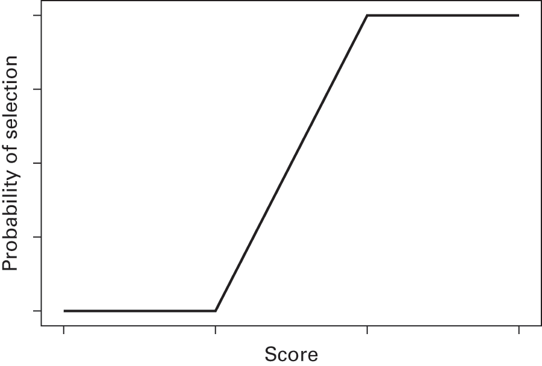

Figure 4.1A randomized classifier. Only randomized classifiers can satisfy the similarity criterion. Two similar individuals would have similar scores and thus similar probabilities of selection.


随机化有时会冒犯深植的道德直觉，尤其是在刑事司法等领域，因为它会让人联想到基于硬币投掷做出的决定。但有几个原因表明，随机化不仅可能是可接受的，在某些情况下甚至是实现公平所必需的（除了它允许我们在概率意义上对相似的人进行相似对待之外）。事实上，Ronen Perry 和 Tal Zarsky 提供了大量案例，说明法律在某些情况下要求基于抽签的决策 \[163\]。

要理解随机决策的正当性，我们必须认识到，精确控制并有目的的随机性并不等同于随意性或任性。假设满足以下三个条件：待分配的资源是不可分割的，其数量少于申请人数量，且没有任何申请人因其他原因而比其他申请人更有资格或更无资格获得该资源。在这种情况下，随机化可能是唯一的平等主义方式来打破僵局。这一原则正是用于公共住房和移民签证的低租金分配以及抽签的理论基础。同样，这一原则也适用于负面资源，如陪审团或税务审计的随机选人 \[163\]。

但机器学习的核心意义在于，确实存在一种方式来对申请人的主张进行排序，因此我们关注的情境比上述例子更为复杂。问题在于，实现“待人相似对待”的目标（需要随机化）与最小化决策不可预测性（需要避免随机化）之间存在冲突。

影响随机化合法性的一个关键区分是：是否存在申请人可能具备的等价机会。这在招聘或贷款的情形中通常成立，而在预审羁押的情形中则不成立。在前者中，随机化更具正当性，因为它避免了申请人始终落在选拔门槛下方的问题。如果采用随机化，一个相对合格但并非出类拔萃的求职者可能需要投递多份简历，但最终会获得一份工作 \[164\]。

避免相似候选人因门槛而分属两边的另一种做法是重新设计系统，使决策不再是二元的。这对于某些机构更为容易实现。贷款机构可以通过为贷款设定不同的利率来考虑不同的风险水平，而不是直接拒绝贷款。相比之下，刑事司法系统内部已内嵌了二元的“有罪/无罪”判定概念。这种二元判定难以改变。请注意，有罪判定并非预测，而是旨在反映某种二元的事实真相，而刑事司法系统的目标是去发现这一事实。

### 错误率平价的规范基础

在第三章讨论的三大统计标准家族中，我们已经讨论了独立性/人口平价和充分性/校准，而留下了分离性/错误率平价。错误率平价是最难严格联系到任何道德概念的标准。同时，它无疑触及了一些广泛持有的公平直觉。ProPublica 对 COMPAS 刑事风险评估系统的研究之所以强有力，是因为发现“黑人被告的‘假阳率’是白人被告的两倍” \[133\]。

然而，这种直觉缺乏直接的正当理由，这导致错误率平价成为激烈争论的焦点 \[165, 166\]。基于此研究，我们提供了我们为何应当关注错误率平价的观点。

我们假设一个基于预测的资源分配问题，例如贷款，其结果的可预测性本身存在相当大的不确定性。相反，错误率差异常常出现在感知问题（如面部识别或语言识别）中，这些问题几乎没有内在不确定性 \[167, 168\]。关键的规范区别在于，在面部识别、语言识别等应用中，不存在因资格差异而合理化对个体进行不同对待的概念。因此，假设误判对主体造成成本，那么在错误率不平等的情况下，找到正当理由就相对直接。

另一个观察是：错误率的道德意义是不对称的。大致来说，一种错误对应于不公正的拒绝（自由或机会），另一种错误对应于过度宽容。在大多数领域，前者在规范意义上的重要性远大于后者。例如，在保释决定的情境中，主要担忧的是非累犯者的预审羁押率存在差异，而不是累犯者的预审释放率的差异。虽然释放潜在累犯者可能带来公共安全的威胁，但这一成本取决于总的错误率，而非错误在不同群体之间的分布。因此，仅仅比较不同群体之间的错误率并不具备意义。

### 错误率平价与机会平等的中间立场

回顾机会平等的中间立场，它考虑了历史和当前社会条件，这些条件可能导致人们的资格差异。要理解决策系统在中间立场下的表现，关键是要知道这些决策的影响是否会在社会中延续这些条件。

遗憾的是，在决策时点的数据有限，尤其是当用于决策的特征（编码决策主体资格的特征）不可用时，这尤其困难。即便如此，我们仍可以在没有这些特征的情况下，通过观察不同群体实现期望结果的基准比率（base rates）来进行分析。基准比率显著不同——且若假设各群体在能力和雄心方面的个体差异在群体层面会相互抵消——则暗示人们的资格差异可能源于超出个人控制的客观条件。

基准比率本身并不能说明分类器是否会延续现有的不平等。为此，重要的是观察分类器是否对不同群体施加不平等的**负担**。虽然有多种合理的衡量负担的方法，但我们将一种特别严重的错误——误将某人归类为“不配”或“高风险”——视为负担的代理指标。这种做法在考虑溢出效应时尤为适用，例如，拒绝预审释放会对被告的家庭和社区产生影响。


当一个群体面临不成比例高的错误率时，这表明系统可能 perpetuate cycles of inequality。的确，Aziz Huq 认为，出于这种原因，刑事司法系统会强化种族分层，而这是算法刑事司法中的主要种族不平等 \[169\]。要明确的是，机构对社区的影响是一个经验和因果性的问题，不能仅仅归因于错误率，但鉴于在典型决策情境中可用的观察数据的局限性，错误率是探讨这一问题的出发点。这为何错误率具有某种道德意义。但要注意，错误率的差异本身并不暗示任何特定的干预措施。

### 如何应对错误率差异

收集更多数据并投资于提升分类技术是潜在降低错误率差异的途径。通常，我们会对决策者在数据收集成本与模型准确性之间的权衡给予较大的容忍。这种容忍，尤其是在私营部门应用中，基于决策者与决策主体的利益通常是一致的这一观念。例如，我们会容忍贷款人对其预测准确性的要求程度。但如果贷款人被要求在预测准确性上保持高水平，他们可能只会在最安全的情况下提供贷款，从而剥夺了许多人获得贷款的机会，或者他们会为了收集借款人信息而投入巨大的成本，提高系统运行成本并将部分成本转嫁给借款人。

上述论点仅考虑整体福利，而不考虑利益和成本在不同人群和群体之间的分配方式。当引入分布式考量时，许多情况下可以合理地降低对决策者的容忍度，错误率差异就是其中之一。在此情形下，要求决策者缓解错误率差异可以被视为让他们承担被部分个体和群体推卸的成本（figures 4.2, 4.3）。

![Figure 4.2Probability density of risk scores for two groups, and a classification threshold. Throughout the illustrations in this section, we assume that the score is perfectly calibrated. The group shown with a solid line has a higher error rate. Intuitively this is because the probability mass is more concentrated (i.e., the score function is worse at distinguishing among members of this group). Collecting more data would potentially bring the solid curve closer to the dashed curve, mitigating the error rate disparity.](img/fig4-2.png)

Figure 4.2Probability density of risk scores for two groups, and a classification threshold. Throughout the illustrations in this section, we assume that the score is perfectly calibrated. The group shown with a solid line has a higher error rate. Intuitively this is because the probability mass is more concentrated (i.e., the score function is worse at distinguishing among members of this group). Collecting more data would potentially bring the solid curve closer to the dashed curve, mitigating the error rate disparity.


Figure 4.3Probability density of risk scores for two groups, and a classification threshold. Again the solid group has a higher error rate—specifically, a higher false positive rate, where false positives are people incorrectly classified as high risk. But this time it is because the solid group has a higher base rate (the curve is shifted to the right compared to the dashed group). Collecting more data is unlikely to mitigate the error rate disparity.

虽然提升分类器的整体准确度可能在某些情况下关闭差异，但在其他情况下可能保持不变或甚至恶化。准确度受最优分类器的限制，而最优分类器不一定满足错误率平等。例如，假设贷款违约主要源于意外失业，一群贷款申请人持有更脆弱的工作，这些工作更容易被解雇，而解雇在决策时不可预测。在这种情况下，改进数据收集和分类将无法实现错误率平等。

面对这种内在局限性，可能会倾向于进行一种调整步骤，以实现错误率平等，例如为不同群体设定不同的风险阈值。一种做法是不让任何人比无约束分类器更差。例如，贷款人可以为某一群体使用更宽松的风险阈值以降低其错误率。这违背了机会平等的狭义观，因为风险评分相同的人在不同群体中可能受到不同对待。是否正当这一干预措施仍是一个困难的规范性问题，缺乏统一答案（figure 4.4）。

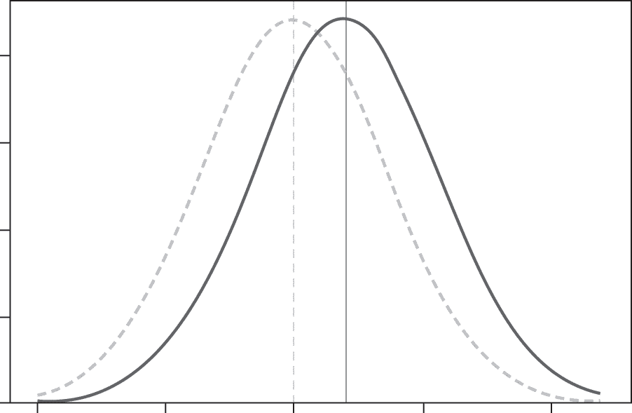

Figure 4.4Probability density of risk scores for two groups, and two different classification thresholds resulting in equal error rates.

在其他情况下，这可能根本不可行。例如，干预措施可能导致贷款人的风险显著上升，使其面临破产风险。

事实上，如果基础率差异巨大，导致错误率差异难以通过数据收集等干预措施缓解，那么预测性决策本身可能是有问题的，或许我们应该彻底摒弃该系统，或采用更根本的干预措施。

综上所述，错误率平等并不直接对应任何单一的规范原则。但它反映了狭义和中间观的平等机会之间的某种关系。它也能够激励决策者投资于公平，并质疑预测性决策的适 appropriateness。

### 实现中间观平等机会的替代方案

我们已经讨论了错误率平等与中间观平等机会之间的关系。但还有许多其他可能的干预措施，决策者可以采用这些措施来实现中间观平等机会，这些措施并不映射到第 3 章讨论的标准上。中间观是一个模糊的概念，留下了大量空间来决定我们希望如何淡化人们的表观差异以及如何进行淡化。以下是一些可以尝试将其具体化的方式。不出所料，所有这些方法都违背了机会平等的狭义观。

决策者可以重新审视其追求的目标，使得追求这些目标的决策过程产生更少的分层结果。例如，雇主可能选择一个被认为同样好、但其准确预测能够导致不同群体结果差异更小的替代目标变量 \[170\]。


# 5 因果性

我们的出发点是观察与行动之间的区别。我们在被动观察中看到的是个体遵循日常行为、习惯和自然倾向的情形。被动观察反映了我们选择强调的特征所投射的世界状态。从被动观察中收集的数据展示了我们所选择的特征所代表的世界的一个瞬间状态。

我们可以仅凭被动观察回答许多问题。例如，十六岁的司机是否比十八岁的司机更容易发生交通事故？形式上，答案对应于条件概率之差，假设我们像上一章一样将总体建模为分布。我们可以计算在司机年龄为十六岁时发生交通事故的条件概率，再减去司机年龄为十八岁时发生交通事故的条件概率。这两个条件概率都可以从足够大的样本中估计，前提是样本中既有十六岁司机也有十八岁司机。我们提出的问题的答案稳固地位于观察统计学的领域。

但重要的问题往往不是观察性的。如果我们把合法驾驶年龄提高两年，交通死亡人数会减少吗？虽然表面上这个问题看似相似，但我们很快意识到它实际上要求一种根本不同的洞察。它不再询问在我们显现的世界中事件的频率，而是询问假设性行动的效果。

因此，答案并不简单。即使年长的司机发生交通事故的频率较低，这可能仅仅是因为驾驶经验更丰富。没有明显的理由表明，驾驶两个月的十八岁司机比驾驶两个月的十六岁司机更不可能卷入事故。我们可以通过固定驾驶经验的月数，比较不同年龄的个体来尝试解决这一问题。但很快我们会遇到细微之处：如果十八岁且驾驶两个月的司机是那些天生极其谨慎的人——因此他们不仅驾驶更少，而且驾驶更小心？如果这类人主要居住在交通条件与年轻人更需要主动驾驶的地区有显著差异的地区，又会产生什么影响？

我们可以提出诸多其他策略来回答最初的问题：提高合法驾驶年龄是否会减少交通事故。我们可以比较合法驾驶年龄不同的国家，比如美国和德国。但同样，这些国家在其他可能相关的方面存在差异，例如法定饮酒年龄。

从一开始，因果推理就是一种概念性和技术性的框架，用于应对假设性行动或*干预*的效果问题。一旦我们理解某个行动的效果，就可以反过来思考哪个行动可能合理地*导致*某个事件。这为我们提供了正式的语言来讨论因果关系。


-   [费曼学习法](https://wiki.example.org/feynmans_learning_method)的灵感源于诺贝尔物理奖获得者**Richard Feynman**，即诺贝尔物理学奖得主。

1.  运用费曼技巧，你只需花上`20 min`就能深入理解知识点，而且记忆深刻，*难以遗忘*。

```
if (condVar > someVal) {console.log("xxx")}
```


我们选择`structural causal models`作为我们正式讨论的基础，因为它们具有为我们将要遇到的各种因果概念提供稳健基础的优势。将结构因果模型最直观地概念化的方法是将其视为一种程序，该程序通过一系列形式化指令，从独立的噪声变量生成分布。让我们拆解这句话。想象一下，如果有人给你一个分布的样本，而你得到的是一个分步计算机程序来自行生成样本，从随机种子开始。这个过程与编写代码的方式并不相似。你从一个简单的随机种子开始，逐步构建更复杂的构造。这正是结构因果模型的本质，只是每个赋值使用数学语言而非具体的编程语法。

### A First Example

让我们从一个不旨在捕捉真实世界的玩具例子开始。想象一个假设的人口，其中个体经常锻炼的概率为。的概率，个体具有潜在的超重倾向，这种倾向在缺乏规律锻炼时会显现。同样，在缺乏锻炼的情况下，心脏病会以的概率发生。我们用*X*表示规律锻炼的指示变量，*W*表示过度体重的指示，*H*表示心脏病的指示。下面是一个结构因果模型，用于从这个假设的人口中生成样本。为简化描述，我们让`B(p)`表示一个参数为*p*的伯努利随机变量，即一次偏向硬币投掷，其值为 1 的概率为*p*，值为 0 的概率为 1‑*p*。

1. 采样独立的伯努利随机变量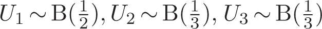

2. *X* := *U*[1]

3. *W* := if *X* = 1 then 0 else *U*[2]

4. *H* := if *X* = 1 then 0 else *U*[3].

对比这个生成描述与从人群中抽取的随机样本。从程序描述中，我们可以立即看到在我们的假设人群中，*锻炼*既避免*超重*，也避免*心脏病*，但在缺乏锻炼时，这两者是独立的。程序最初生成了随机变量`(X, W, H)`的联合分布。我们可以在该分布下计算概率。例如，根据我们的模型指定的分布，心脏病的概率为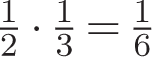。我们还可以计算在`W = 1`事件下心脏病的条件概率。从事件`W = 1`可以推断，该个体没有锻炼，因此心脏病的条件概率相较于基线上升到。

这是否意味着在我们的模型中，超重导致心脏病？答案是*否*，这在直观上是可以理解的，因为生成分布的程序如此。让我们看看我们如何正式地论证这一点。拥有一个生成分布的程序比仅拥有抽样访问更有力量。原因之一是，我们可以随意修改程序，只要最终仍是一个合法的程序。例如，我们可以将`W := 1`，从而得到一个新的分布。新的程序如下：

1. *X* := *U*[1]

2. *W* := 1

3. *H* := if *X* = 1 then 0 else *U*[3].

这个新程序指定了一个新的分布。我们可以在该新分布下再次计算心脏病的概率。我们仍然得到。这个简单的计算揭示了一个重要洞见：`W := 1`的代入并不等同于对`W = 1`的条件观测。前者是一种操作（在此情形下无关紧要），后者是从中可以推断的观测。如果我们观察到一个人体重超标，我们可以推断其心脏病风险更高（在玩具例子中）。但这并不意味着降低体重会避免心脏病。在我们的例子中，它不会。相反，代入`W := 1`创建了一个所有人都超重的假想人群，这在我们的模型中意味着所有相应的后果。

让我们进一步阐述这一点，通过考虑另一个假想的人群，其方程如下：

1. *W* := *U*[2]

2. *X* := if *W* = 0 then 0 else *U*[1]

3. *H* := if *X* = 1 then 0 else *U*[3].

在该人群中，锻炼习惯由体重决定。体重超标者可能会以一定概率进行锻炼，但这是唯一让人锻炼的原因。心脏病在缺乏锻炼时出现。在该模型中，代入`W := 1`会提高锻炼的概率，从而降低心脏病的概率。在这种情况下，对`W = 1`的条件观测产生的效果与直接代入相同。两者都导致的概率。

我们看到，通过代入固定变量，可能对应于条件概率，也可能不对应。这正式化了我们 earlier 所指出的：观察并不等同于行动。代入对应于我们在模型中执行的操作，它打破了模型自然捕捉的行动序列。这就是为什么代入操作有时被称为*do-operator*，记作`do(W := 1)`。

结构因果模型为我们提供了正式的算法，用于推理假设行动的效果。我们将看到，这为本章后将出现的各种因果概念提供了正式基础。

### Structural Causal Models, More Formally

形式上，结构因果模型是一系列用于从独立噪声变量生成联合分布的赋值语句。执行这些赋值语句的序列，我们逐步构建一组联合分布的随机变量。结构因果模型因此不仅提供联合分布，还提供了如何从基础噪声变量生成该联合分布的描述。其正式定义相较于直观概念略显繁琐。

**Definition 4** `A structural causal model M is given by a set of variables X[1], …, X[d] and corresponding assignments of the form`


*Here, P[i] ⊆{X[1], …, X[d]} is a subset of the variables that we call the parents of X[i]. The random variables U[1], …, U[d] are called noise variables, which we require to be jointly independent. The causal graph corresponding to the structural causal model is the directed graph that has one node for each variable X[i] with incoming edges from all the parents P[i].*

让我们更详细地回顾本节中引入的概念。定义中的噪声变量模型了*外生因素*，即影响系统的 exogenous factors。例如，天气会影响你选择的交通路线的延误。由于很难精确建模天气的影响，我们可以将天气导致的延误视为一个外生因素，以噪声变量的形式进入模型。外生变量及其分布的选择会对我们从模型中得出的结论产生重要影响。

结构因果模型中节点`X[i]`的父节点`P[i]`常被称为*直接原因*，而`X[i]`本身则是其直接原因`P[i]`的直接效应。回到我们的假设人口，体重增加是通过赋值`W := min{U[1], 1 − X}`决定的，这里我们可以说缺乏锻炼是体重增加的直接原因。


结构因果模型是一组关于特定变量如何相互作用的形式化 `假设` 的集合。每个赋值都指定一个 `响应函数`。我们可以把节点看作接收其父节点的消息，并根据这些消息以及外生噪声变量的影响来行动。

结构因果模型与现实的匹配程度是一个独立且复杂的问题，我们稍后会详细讨论。目前，我们可以把结构因果模型视为形式化并揭示数据生成过程的一系列假设。因此，不同的模型可以揭示不同的假设情景，并为讨论提供基础。当我们在模型的语境下谈论因果关系时，并不意味着这些关系必然在现实中成立。它们是否成立取决于模型的范围、目的和有效性，这可能很难得到验证。

可以证明，结构因果模型定义了一个唯一的联合分布，使得 `X*[i]` = `f*[i]`(`P*[i]`*, `U*[*i*]`)。在此分布下，我们可以引入概率的概念。当 `M` 表示一个结构因果模型时，我们用 ℙ[`M`]{`E`} 表示在其蕴含的联合分布下事件 `E` 的概率。为了熟悉这个记号，我们设 `M` 为假设的人口模型，其中体重增加和心脏病都直接由缺乏运动引起。我们之前计算过，在这个模型中心脏病的概率为 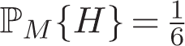。

接下来，我们将从这一结构因果模型的单一定义出发，推导出本章所需的所有概念和术语。我们限定关注的是无环赋值。许多真实世界系统自然地被描述为有状态的动态系统，带有闭环反馈。针对这类系统，存在一些处理方法。例如，常常通过引入随时间变化的变量来打破循环，例如，时间 0 的投资会在时间 1 增长经济，进而在时间 2 增长投资，以此类推，直到选定的时间范围 `t`。这种处理被称为对动态系统 `展开`。

## 因果图

我们看到，结构因果模型自然地产生 `因果图`，用来图形化表示模型的赋值结构。反过来，我们也可以通过简单地把有向图视为未指定的结构因果模型的占位符，其赋值结构由图决定。因果图常被称为 `因果图`（causal diagrams），我们在文中会交替使用这两个术语。

心脏病例子中的两个假设人口的因果图各有两条边和相同的三个节点（图 5.1）。它们在运动与心脏病之间的联系上保持一致，但在运动与体重增加之间的边的方向上存在差异。

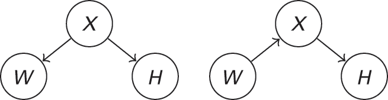

图 5.1 因果图：心脏病例子。

当因果图的具体赋值不重要，关键在于是否存在或不存在的路径时，因果图非常便利。图形化还让我们可以引入图论的语言来讨论因果概念。例如，我们可以说，在给定的因果图中，某节点的 `间接原因` 是该节点的所有祖先。特别是，因果图使我们能够根据节点是祖先还是后代来区分因果关系。

下面我们先看几种重要的图形结构。

### 叉形（Forks）

`叉形` 是指一个节点 `Z` 在图中有两条 outgoing 边分别指向变量 `X` 和 `Y`。换句话说，节点 `Z` 是 `X` 和 `Y` 的共同原因。我们在体重与运动的例子中已经看到一个叉形：`W` ← `X` → `H`。这里，运动 `X` 同时影响体重和心脏病。我们也了解到，`Z` 具有 `混杂`（confounding）效应：如果忽略运动 `X`，我们发现 `W` 与 `H` 呈正相关。但这种相关性仅是混杂的结果。一旦我们通过 `do` 操作使运动水平保持不变（即固定 `X`），在我们的例子中，体重对心脏病没有影响（图 5.2）。

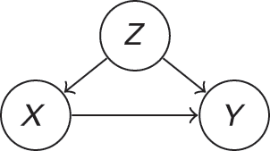

图 5.2 叉形（混杂）示例。

混杂导致条件概率的计算（观察）与 `do` 操作（干预）之间出现矛盾。实际生活中的混杂是数据解释的常见威胁。例如，在一项著名的医学研究中，人们最初认为 `激素替代疗法` 能够降低心血管疾病风险，但随后发现 `社会经济地位` 是一个混杂变量，这一效应随之消失 \[176\]。

### 中介（Mediators）

`叉形` 的情况与 `Z` 位于从 `X` 到 `Y` 的有向路径 `X → Z → Y` 的情形不同。此时，路径 `X → Z → Y` 对 `X` 对 `Y` 的总效应有贡献，它是一个因果路径，说明 `X` 如何因果影响 `Y`。因此，`Z` 不是混杂变量，而是 `中介`（mediator）(图 5.3)。

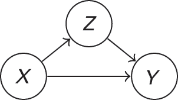

图 5.3 链条（中介）示例。

在我们关于加州伯克利入学的例子中，我们看到一个合理的因果图，其中部门选择是性别对入学决定的中介。中介的概念对于歧视分析尤为重要，因为中介可以被解释为因果链路的机制。

### 碰撞（Colliders）

最后，我们考虑另一种常见情况：`碰撞`（collider）。碰撞不是混杂变量。事实上，在 图 5.4 中，`X` 与 `Y` 是无混杂的，即可以将 `do` 语句替换为条件概率。然而，当我们对碰撞变量进行条件化时，会产生有趣的现象——即 `解释 away`（explaining away）。这是一种因观测而产生的相关性，也称为 `碰撞偏差`（collider bias）。伯克森（Berkson）提供了一个经典的解释 away 例子：两种独立疾病在分析住院患者时会呈负相关。原因是，如果任一疾病（`X` 或 `Y`）足以导致住院（变量 `Z` 表示），则观察到患者患有一种疾病会使另一种疾病的可能性降低 \[177\]。

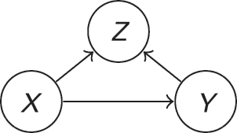

图 5.4 碰撞示例。

伯克森的法则提醒我们，在研究受到选择规则影响的队列时，统计分析需慎重。例如，关于 GRE 分数在高等教育中的有效性存在争论。一些研究 \[178, 179\] 认为 GRE 分数并不能预测研究生人口的各种成功指标。但当我们研究教育测试的有效性时，必须注意，样本往往是已被录取的学生。由于录取部分基于考试成绩，这种选择规则可能导致碰撞偏差。


结构因果模型（Structural Causal Models）为我们提供了一种方式，在模型的假设范围内，形式化假设行动或干预（interventions）对总体的影响。正如我们之前所见，我们只需要能够进行替换（substitutions）。

### 替换与 Do-算子

给定一个结构因果模型 *M*，我们可以对任何形式的赋值进行替换：


并用另一个赋值取代它。最常见的替换是将 *X* 赋值为常数 *x*：


我们用 *M′ = M*\[*X* := *x*\] 表示对原模型 *M* 进行的手术（surgery），以表明我们在该赋值下将 *X* 固定，并从而消除其父节点的影响，进而消除模型中其他所有受其影响的变量。

图形上，该操作等价于删除所有指向节点 *X* 的入边。如 figure 5.5 所示， *X* 的子节点在查询节点值时，会从 *X* 收到固定的信息 *x*。该赋值算子也称为 *do-算子*，以强调它对应于执行一种行动或干预。我们已经拥有在应用 do-算子后计算概率的符号，即 ℙ[*M*\[*X*:=*x*\]](*E*)。另一种常用且普遍的符号是：

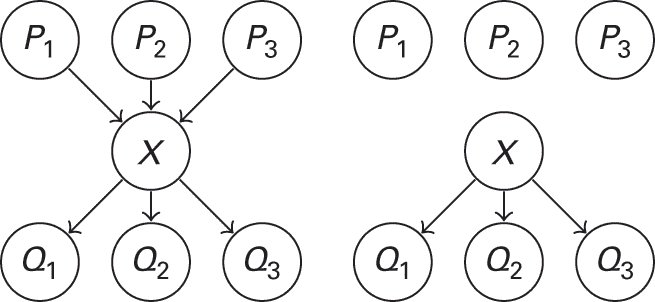

Figure 5.5Graph before and after substitution.

该符号类比于 do-操作与常规条件概率的记法，在涉及 do-算子的计算时非常便利。需要注意的是，do-算子（行动）与条件算子（观察）在本质上截然不同。

### 因果效应

变量 *X* := *x* 对变量 *Y* 的 *因果效应* 指的是在模型 *M*\[*X* := *x*\] 中 *Y* 的分布。当我们谈论变量 *X* 对另一个变量 *Y* 的因果效应时，指的是所有可能的 *x* 值对 *Y* 分布的影响。

我们常把 *X* 视为二元治疗变量，关心的量比如下：


该量被称为 *平均治疗效应*（average treatment effect）。它说明治疗（即 *X* := 1）相对于无治疗（*X* := 0）如何提升 *Y* 的期望值。因果效应是群体层面的量，指在整个人口中平均的效果。治疗效应往往在不同个体或人群之间差异很大，这类效应称为 *异质效应*。

## confounding（混淆）

因果推断中的重要问题在于，何时可以把 do-操作表达为条件概率。当可以这样做时，我们就能用常规的条件概率——即可以从数据中估计的概率——来估计干预效果。

最简单的问题是：因果效应 ℙ{*Y*\= *y |* do(*X* := *x*)} 何时等于条件概率 ℙ{*Y*\= *y | X* = *x*}。一般来说，二者不相等。正是观测（条件概率）与干预（干预概率）的差异促使因果论的发展。

这种行动语句与条件语句的不一致具有广为人知的名称：**混淆**（confounding）。当 *X* 与 *Y* 被混淆时，表示因果效应（即 *X* := *x* 对 *Y* 的影响）与相应的条件概率不一致。

当 *X* 与 *Y* 混淆时，我们可以询问是否存在一些条件概率组合能够提供我们想要的 do-干预效果。通常，给 *X* 的父节点 *PA* 进行条件化即可（如下图所示）：


上式被称为 **调节公式**（adjustment formula），它提供了一种通过条件概率估计干预效果的方法。

调节公式是所谓的 **控制变量**（controlling for）的一例：我们在每一个由 *Z* = *z* 定义的子群中分别估计 *X* 对 *Y* 的效果，然后以 *Z* = *z* 在总体中的概率为权重，对这些子群效果进行加权平均。例如，控制年龄的含义是：在每个可能的年龄组中分别估计效果，然后按年龄组在总体中的比例进行加权平均。

在研究中，控制更多变量不一定是最佳选择，这取决于因果图的结构。下面考虑在前面提到的三个因果图中，控制变量 *Z* 会产生什么影响：

* 控制一个 **叉形**（fork）结构 *X* ← *Z* → *Y* 中的混淆变量 *Z*，可以消除 *X* 对 *Y* 的混淆。
* 控制链式结构 *X* → *Z* → *Y* 中的 **中介变量** *Z*，会削弱 *X* 对 *Y* 的部分因果影响。
* 控制 **碰撞**（collider）会产生 *X* 与 *Y* 之间的相关性，这与在叉形结构中控制 *Z* 的效果相反。同样，控制碰撞的后代也会产生相同的副作用。

### Backdoor Criterion（后门准则）

随着图中节点的增加，可能会担心场景变得复杂，出现组合爆炸。幸运的是，存在简单的充分准则，帮助我们选择安全的、可以控制的变量集合。

一个广为人知的图论概念是 **后门准则**（backdoor criterion）\[180\]。当两个变量之间存在所谓的 **后门路径**（backdoor path）时，它们会被混淆。后门路径是指从 *X* 开始、包含一个向后的 “←” 边进入 *X* 的任意路径，例如：


直观上，后门路径使得 *X* 到 *Y* 的信息流不具备因果性。要消除两个节点之间的混淆，我们需要选择一个 **后门集合**（backdoor set）来阻断所有 *X* 与 *Y* 之间的后门路径。对于链式路径 *A* → *B* → *C*，控制 *B* 即可阻断信息流；对于碰撞 *A* → *B* ← *C*，默认情况下信息不流动，但如果对碰撞或其后代进行条件化，则会打开信息流，需要避免这样做。

### 未观测的混淆（Unobserved Confounding）

调节公式似乎表明，只要对 *X* 的父节点进行条件化，就能消除混淆偏差。但在存在 **未观测混淆** 时，这一结论不成立。实际中常常存在难以测量或根本未记录的变量。我们仍可以在图中用虚线表示这些未观测节点的影响，而不是实线。

Figure 5.6 展示了两种未观测混淆的情形。第一种情形下，*X* 对 *Y* 的因果效应不可辨识（unidentifiable）。第二种情形中，尽管 *Z* 未观测，但通过控制 *W* 可以阻断 *X* ← *Z* → *W* → *Y* 的后门路径，从而实现对因果效应的估计。后门准则使我们在调节公式本身不足以消除混淆的情况下，仍能在某些情形下实现可识别的因果效应。

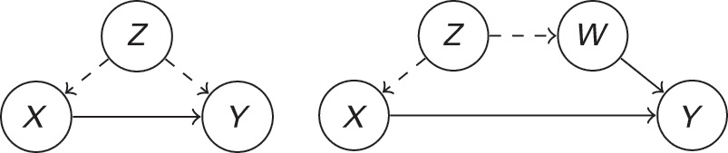

Figure 5.6Two cases of unobserved confounding.


-   未观察到的混杂仍然是实践中的主要障碍。问题不仅仅是缺乏测量，往往是缺乏对混杂变量的预见或意识。我们可以尝试通过增加考虑的变量数量来对抗未观察到的混杂，但随着我们在研究中加入更多变量，也就增加了为所有考虑的变量构建有效因果模型的负担。在实践中，常见的做法是尽可能多地控制变量，以期消除混杂偏差。然而，正如我们所见，控制中介变量或共同原因（collider）可能是有害的。

### Randomization

后门准则在给定因果模型和足够多来自变量联合分布的观测数据的前提下，提供了一种非实验的方法，以消除混杂偏差。消除混杂偏差的另一种实验方法是众所周知的随机对照试验（RCT）。

在随机对照试验中，一组受试者被随机划分为对照组和处理组。参与者及负责试验的工作人员都不知道受试者被分配到哪个组别。处理组接受实际治疗，例如正在测试的药物，而对照组接受与外观相同的安慰剂。对所有受试者都会测量结果变量。

随机对照试验的目标是打破自然倾向。我们不再是观察谁自行选择接受治疗，而是随机分配治疗。从因果模型的角度来看，这意味着我们消除了所有指向处理变量的入边。特别是，这关闭了所有后门路径，从而避免了混杂偏差。

由于种种原因，随机对照试验往往难以或根本无法实施。治疗可能在物理上或法律上不可能、成本过高，或过于危险。正如我们所见，随机对照试验并非总是必要的，以避免混杂偏差和进行因果推断。它们也并非没有问题和陷阱 \[[181\].

### 图形歧视分析

我们现在探讨如何利用因果图在关于歧视的讨论中发挥作用。我们回到伯克利研究生入学的例子，并在此基础上发展出一个因果视角，对之前的分析进行补充。

第一步是构建一个与我们 earlier 看到的数据相符的合理因果图。数据中仅包含三个变量：性别 *A*、专业选择 *Z*、以及录取决定 *Y*。合理的做法是画出两条箭头 *A → Y* 和 *Z → Y*，因为 *A* 和 *Z* 在机构做录取决定时都是可得的特征。我们暂时再画一条箭头，仅仅是因为必须画。

如果只包括 *A → Y* 和 *Z → Y* 这两条箭头，因果图会声称 *A* 与 *Z* 在统计上是独立的。然而，这一声明与数据不符。我们可以从表格中看到，若干专业在申请人中表现出显著的性别偏见。这意味着我们需要加入 *A → Z* 或 *Z → A* 其中之一的箭头。在这两者之间做出选择并不像表面上看起来那样直接。

如果我们把 *A* 狭义地解释为申请人的“报告性别”，即在申请表上勾选的性别框，我们可以设想一种情形：某些申请人在一定程度上会（误）报告自己的性别，这取决于他们选择的专业。即使假设没有误报，也很难将“报告性别”视为专业选择的合理原因。申请人勾选“男性”框显然并不是他们对工程感兴趣的原因。

研究中的因果故事则不同。它指向一种在申请人生前经历的社会化与偏好形成过程，这部分过程取决于申请人的性别。为了使这个故事与我们的因果图相匹配，我们需要让变量 *A* 指代由这种“社会化过程”影响的、进而决定学术和职业偏好从而影响专业选择的实体。很难维持这种实体与生物学上的性别特征是同一回事的说法。科学上缺乏支持“性别（生物学特征）决定我们的学术偏好”的依据。很少有（甚至没有）学者会坚持“两条 X 染色体导致对英文学习感兴趣”这样的主张。

事实是，我们尚不清楚 *A* 所指的事物如何影响专业选择。在画出 *A → Z* 的箭头时，我们（或多或少）断言存在这种机制。我们将在后文深入讨论我们在此过程中遇到的重要困难。为此，我们暂时接受这一建模选择，从而得出 图 5.7。

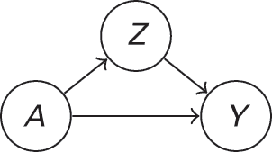

Figure 5.7Possible causal graph for the UC Berkeley graduate admissions scenario.

在该图中，专业选择 *Z* 介导了性别对录取的影响。存在直接路径 *A → Y*，以及通过 *Z* 的间接路径。我们将使用此模型对“存在性别歧视的证据为零”这一主张施加压力。在因果语言中，该论证包含两个组成部分：

1.  性别 *A* 对录取决定 *Y* 没有直接的、有利于男性的效应。

2.  通过专业选择 *Z* 传递的 *A* 对 *Y* 的间接效应不应被视为歧视证据。

我们将分别讨论这两个论点。

# 直接效应

要获得 *A* 对 *Y* 的直接效应，需要消除 *A* 与 *Y* 之间除直接链接外的所有路径。在我们的模型中，可以通过保持专业选择 *Z* 不变，并评估 *Y* 条件于 *A* 的分布（图 5.8）来实现。请记住，保持变量不变并不等同于对该变量进行条件化。如果存在其他混杂变量（例如居住状态 *R*），使得专业选择与录取结果相互混杂，则会出现问题。

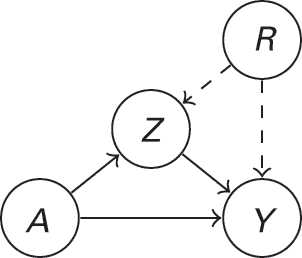

Figure 5.8Alternative causal graph for the UC Berkeley graduate admissions scenario showing influence of residence.

在此图中，专业选择 *Z* 是 *A* 与 *R* 之间的共同原因（collider）。对共同原因进行条件化会打开 *A → Z* ← *R → Y* 的后门路径。在此图中，对专业选择进行条件化并不能给出我们想要的直接效应。居住状态可能混杂专业选择与决策之间的关系，这正是朱德亚·佩尔（Judea Pearl）与达纳·麦肯齐（Dana Mackenzie）之间的交流所讨论的问题 \[182\]。

如果我们假设专业选择与录取结果是无混杂的，那么彼得·比克尔（Peter Bickel）、尤金·汉梅尔（Eugene Hammel）和威廉·奥康奈尔（William O’Connell）所采用的方法确实支持第一个主张。遗憾的是，受保护变量对决策的直接效应本身并不是衡量歧视的充分指标。技术上而言，它过于脆弱，无法检测任何形式的“代理歧视”。例如，招生委员会可能利用申请人的个人陈述来推断其性别，然后据此进行歧视。


我们可以将直接效应视为在决策规则中属性的显式 `使用` 所对应的效应。缺乏直接效应的情况，宽松地对应于一种有些棘手的“盲”决策规则的概念，该规则没有显式访问敏感属性。正如我们在前面的章节中论述的那样，盲决策规则仍然可以成为歧视性做法的基础。

### 间接路径

让我们转向通过部门选择间接影响性别录取的效应。人们容易认为节点 `Z` 指的是申请人的固有部门偏好。在这种观点下，部门并不对申请人的偏好负责。因此，部门偏好的中介影响不被视为歧视的迹象。然而，这只是一种实质性的判断，可能并非事实。还有其他与数据和我们的因果模型相符的合理情景，其中间接路径编码了一种歧视模式。

例如，招生委员会可能以一种强烈劝阻女性申请的方式宣传该项目。在这种情况下，部门偏好部分反映了对这一敌对宣传运动的暴露。或者，部门可能有对女性的敌对行为记录，而对这种行为的认知塑造了申请人的偏好（`figure 5.9`）。最后，甚至 blatant（公开的）歧视性做法，如支付女性比同样资质的男性研究生更低的薪酬，也对应于通过部门选择的间接效应。

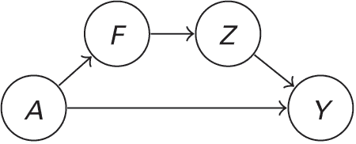

Figure 5.9Alternative causal graph for the UC Berkeley graduate admissions scenario where department preferences are shaped by fear of discrimination.

接受间接路径为 `nondiscriminatory`（非歧视性）意味着我们认为上述所有情景都被视为不太可能。根本上，我们面临一个实质性问题。路径 `A → Z → Y` 可能是歧视发生的地方，也可能是解释歧视的缺失。我们处于哪种情况，并非纯粹技术性问题，需要领域知识才能解决。因果建模为我们提供了一个揭示这些问题的框架，但不一定能解决它们。

### 路径检查

总结一下，歧视可能不仅仅发生在敏感类别到结果的直接路径上。看似无害的中介路径可能隐藏歧视性做法。我们必须仔细讨论我们认为哪些路径是证据支持或反对歧视的。

为了体会这一点，将我们的伯克利情景与重要的法律案例 `Griggs v. Duke Power Co.` 进行对比，该案例于 1970 年在美国最高法院受理。Duke Power Company 在某些高薪职位上引入了高中文凭的要求。我们可以为这个情景绘制一个类似伯克利案例的因果图。存在一个中介变量（这里是教育水平），一个敏感类别（这里是种族），以及一个就业结果（这里是高薪职位的就业）。公司并未直接根据种族做就业决定，而是通过中介变量。法院裁定，高中文凭的要求并非出于业务必要，而是对教育水平较低的种族少数群体产生了不利影响。换句话说，法院决定，使用这个中介变量并不是反对歧视的论据，而是支持歧视的论据。

Maria Glymour `[183]` 对中介分析的道德特征提出了另一个相关且重要的观点：

隐含地，中介变量在解释观察到的社会效应时所涉及的问题，决定了我们认为哪些类型的不平等是社会上可接受的，哪些类型则需要通过社会政策加以纠正。例如，得出结论“女性‘生物学上被编程’为比男性更容易抑郁”，可能减轻试图降低性别抑郁不平等的社会责任。然而，如果人们在受到性骚扰时就会抑郁——而女性比男性更频繁遭受性骚扰——这表明必须通过降低性骚扰的发生来缩小抑郁差距，从而产生强烈的社会责任。

在技术层面上，我们目前还没有估计间接效应的方法。估计间接效应需要我们“禁用”直接影响。目前为止，我们还没有看到如何通过 `do`-操作来实现这一点。不过，我们很快将介绍 `counterfactuals`（反事实），它们在其他应用中将为我们提供估计路径特定效应的方法。

### 一个简单的反事实

要理解反事实，我们首先需要说服自己，它们并不像在模型中进行单纯的替换那样直接。


假设每天早上我们需要在两条路线 `X = 0` 和 `X = 1` 之间做出选择。在交通不好的日子里，由 `U = 1` 表示，两条路线都不好。在交通好的日子里，由 `U = 0` 表示，除非该路线发生了事故，否则两条路线的交通情况都良好。让我们假设 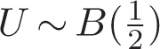 服从一个公平的硬币投掷的分布。事故在两条路线上独立发生，概率为 。因此，我们引入两个伯努利随机变量 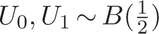 来分别表示路 0 和路 1 上是否发生事故。我们完全抛弃外部路线指引，而是均匀随机选择一条路线。也就是说，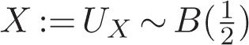 也是一个公平的硬币投掷。

引入一个变量 `Y ∈ {0, 1}` 表示我们选择的路线交通情况是否良好 (`Y = 0`) 或不佳 (`Y = 1`)。根据上面的讨论，我们可以表示 `Y` 为


换句话说，当 `X = 0` 时，第一项消失，因此交通情况取决于两个值 `U` 和 `U[0]` 中的较大者。同样，当 `X = 1` 时，交通情况取决于 `U` 和 `U[1]` 中的较大者（见图 5.10）。


Figure 5.10Causal diagram for our traffic scenario.

现在，假设某个早晨我们有 `X = 1` 并且观察到坏交通 `Y = 1`。我们是否应该改乘坐另一条路线？

回答这个问题的自然尝试是计算在执行 `X := 0` 之后 `Y = 0` 的概率，即 `ℙ[M[X:=0]](Y = 0)`。快速计算表明，这个概率为 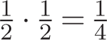。事实上，在我们对模型进行 `X := 0` 的替换后，要使交通良好，需要 `max{U, U[0]} = 0`。这只能在 `U = 0`（概率 ）和 `U[0] = 0`（概率 ）同时发生时才可能。

但这并不是我们问题的正确答案。原因是我们选择了路线 `X = 1` 并观察到 `Y = 1`。从这一观察出发，我们可以推断出某些背景条件根本没有出现，因为它们与观察结果不一致。形式上，这意味着在观测事件 `{Y = 1, X = 1}` 给定的情况下，某些噪声变量 (`U, U[0], U[1]`) 的取值不再可行。具体来说，如果 `U` 和 `U[1]` 同时为 0，我们本来应该在路线 `X = 1` 上看到无坏交通，但这与我们的观察相矛盾。事实上，证据 `{Y = 1, X = 1}` 只剩下表 5.2 中所示的 `U` 和 `U[1]` 的取值设置。

Table 5.2Possible noise settings after observing evidence

| *U* || *U*[1] |
| --- | --- |
| 0 || 1 |
| --- | --- |
| 1 || 1 |
| 1 || 0 |

我们省略了 `U[0]`，因为它的分布不受观测影响。剩下的三种情况各自等可能，这意味着在缺乏其他证据时，`U = 1` 现在的概率为 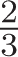。回顾，在没有任何额外证据时，`U = 1` 的概率为 。这意味着观测证据 `{Y = 1, X = 1}` 使得噪声变量 `U` 的分布偏向于 1。我们用字母 `U'` 表示这种偏向后的 `U`。形式上，`U'` 的分布是 `U` 在事件 `{Y = 1, X = 1}` 条件下的分布。

利用这个偏向的噪声变量，我们可以再次考虑执行 `X := 0` 对结果 `Y` 的影响。要使 `Y = 0`，需要 `max{U', U[0]} = 0`。这意味着 `U' = 0`，该事件现在的概率为 ，而 `U[0] = 0`（概率与之前相同，为 ）。因此，我们在执行 `X := 0` 的 do-操作下，`Y = 0` 的概率为 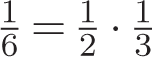，并在考虑到观测 `{Y = 1, X = 1}` 后更新噪声变量。

总结一下，将已有证据纳入计算后，我们在选择路线 0 时，无交通 (`Y = 0`) 的概率从  降低到了 。直观原因是证据使得整体交通日子更可能是不好的，即使换乘另一条路也会拥堵。更正式地说，观测事件偏向了外生噪声变量的分布。

我们将刚才计算的结果视为在已选路线出现坏交通的情况下，选择另一条路线的 *反事实*（counterfactual）。

### 一般配方

我们可以将前面例子中的反事实计算推广到一般程序。之前有三个关键步骤。第一步，通过条件操作对已有观测证据进行偏向处理，使外生噪声变量与证据保持一致。第二步，在对外生噪声变量已偏向后，对结构因果模型执行 do-操作 `X := x`。第三步，计算目标变量的分布。这三个步骤通常被称为 *abduction*（抽象）、*action*（行动）和 *prediction*（预测），具体描述如下。

**定义 5** _Given a structural causal model M, an observed event E, an action X := x, and target variable Y, we define the counterfactual Y**X*:=*x* by the following three-step procedure:_

*1.* **Abduction:** *Adjust noise variables to be consistent with the observed event. Formally, condition the joint distribution of U = (U[1], …, U[d]) on the event E. This results in a biased distribution U'***.

*2.* **Action:** *Perform do-intervention X := x in the structural causal model M resulting in the model M' = M[X := x].*

*3.* **Prediction:** *Compute target counterfactual Y**X*:=*x* *by using U'* *as the random seed in M'.* 

重要的是认识到，这个程序 *定义* 了在结构因果模型中什么是反事实。符号 *Y**X*:=*x* 表示该程序的结果，也是本定义的一部分。我们之前未曾使用过这个符号。用文字解释，形式反事实 *Y**X*:=*x* 表示在事件 *E* 描述的情形下，如果将变量 *X* 设为 *x*，*Y* 会取何值。

在一般情况下，反事实 *Y**X*:=*x* 是一个随机变量，随 `U'` 变化。但反事实也可以是确定的。当事件 *E* 将 `U` 的分布缩小到一个质量点（即 *unit*）时，`U'` 是常数，反事实 *Y**X*:=*x* 就变为一个单一数值。此时，常用简写 *Y**x* = *Y**X*:=*x*，其中 *X* 隐式，`u` 表示一个单一质量点。

“unit” 这个名称来源于结构因果模型通常描述的人口实体，这些实体是我们研究的原子单元。通常，一个 unit 可以是个体（或对个体的描述）。然而，根据应用场景，单元的选择可能会有所不同。在我们的交通例子中，噪声变量决定了我们选择的路线以及道路的状况。

反事实问题的答案高度依赖于结构因果模型的具体细节，包括外生噪声变量的精确建模方式。即使两个模型具有相同的图结构并行为相同于干预，也可能在反事实查询上给出不同的答案 \[185\。

# 潜在结果


-   [潜在结果框架](https://wiki.example.org/feynmans_learning_method)是因果推断的流行正式基础，它对反事实的处理方式与常规方法不同。与其从结构因果模型中推导反事实不同，我们假设它们的存在，尽管有些是未观测到的随机变量。

-   具体来说，我们假设对于每一个单位 `u`，存在每种可能的分配 `x` 对应的随机变量 `Yx`。在潜在结果模型中，通常将二元 `treatment` 变量 `X` 视为 `x` 只可能取两个值，0 表示未处理，1 表示处理。这为每个单位 `u` 提供了两个潜在结果变量，`Y0` 和 `Y1`。这里存在一定的符号混淆可能性。熟悉潜在结果模型的读者可能已经习惯于 “*Y*i, Y* i” 这种记法，表示单位 *i* 对应的两个潜在结果。在我们的记法中，单位（或更广泛地说，单位集合）出现在括号中，下标表示我们干预的变量的代入值。

-   潜在结果模型的关键点在于，我们只能观察到处理过的单位的潜在结果 `Y1`，而未处理的单位我们观察到的是 `Y0`。换句话说，我们永远无法同时观察到两者，尽管从形式上讲它们都被认为存在。形式上，我们观察到的单位 `u` 的结果 `Y(u)` 取决于二元处理 `T(u)`，表达式为：


-   为了便于书写，我们经常省略反事实括号的写法，因此该表达式可写作 `Y = Y[0] · (1 − T) + Y[1] · T`。

-   我们可以在本框架中重新审视我们的交通例子。表 5.3 总结了潜在结果模型中可观察到的信息。我们将选择的路线视为处理变量，观测到的交通情况则反映了两种潜在结果中的一种。

Table 5.3 交通例子在潜在结果模型中

| 路线 `X` || 结果 `Y[0]` || 结果 `Y[1]` || 概率 |
| --- | --- | --- | --- |
| 0 || 0 || ? || 1/8 |
| --- | --- | --- | --- |
| 0 || 1 || ? || 3/8 |
| 1 || ? || 0 || 1/8 |
| 1 || ? || 1 || 3/8 |

-   通常这些信息以样本的形式出现。例如，我们可能观察到不同天数的交通情况。在样本数量足够多时，我们可以以任意精度估计上述频率（表 5.4）。

Table 5.4 潜在结果模型中的交通数据

| 天数 || 路线 `X` || 结果 `Y[0]` || 结果 `Y[1]` |
| --- | --- | --- | --- |
| 1 || 0 || 1 || ? |
| --- | --- | --- | --- |
| 2 || 0 || 0 || ? |
| 3 || 1 || ? || 1 |
| 4 || 0 || 1 || ? |
| 5 || 1 || ? || 0 |
| … || … || … || … |

-   在潜在结果模型中，一个典型的查询是 `平均处理效应` 𝔼[`Y[1]` − `Y[0]`]。这里的期望是基于我们研究中的适当加权单位而取的。如果单位对应于等权重的个体，期望就是这些个体的平均值。

-   在我们原始的交通例子中，有 `十六` 个单位，对应于由四个二元变量 `U, U[0], U[1], U[X]` 给出的背景条件。当潜在结果模型中的单位与结构因果模型中的背景变量的原子值对应时，潜在结果模型中计算的因果效应与结构方程模型中计算的因果效应是一致的。两种正式框架完全兼容。

-   正如 表 5.4 所显示，潜在结果框架中的因果推断可以被视为填补缺失条目（“?”）。这有时被称为 `缺失数据插补`，并有大量的统计方法用于此任务。如果我们能够 `揭示` 问号背后的内容，估计平均处理效应将变得像数行一样简单。

-   在已建立的条件下，因果推断成为可能：

    1.  **稳定单元处理值假设** (SUTVA)：一个单位接受的处理不会影响其他任何单位的处理效果。

    2.  **一致性**：形式上，`Y = Y0 + Y[1]T`。也就是说，当 `T = 0` 时，`Y = Y[0]`；当 `T = 1` 时，`Y = Y[1]`。换言之，观测到的结果 `Y` 与对应的处理指示器的潜在结果一致。

    3.  **忽略性**：在给定一些混杂变量 `Z` 的条件下，潜在结果与处理是独立的，即 `T ⊥ (Y[0], Y[1]) | Z`。换句话说，潜在结果在给定一组混杂变量后与处理条件独立。

-   前两个假设自动适用于从结构因果模型中按照上述程序推导的反事实变量。这假设潜在结果框架中的单位对应于结构因果模型中背景变量的原子值。

-   第三个假设是一个重要的假设。它最容易被视为试图 formalize 一个完美执行的随机对照试验的保证。单凭该假设本身无法验证或 falsify，因为我们永远无法获得同时展示两种潜在结果的样本。然而，我们可以通过检查集合 `Z` 是否阻断了从处理 `T` 到结果 `Y` 的所有后门路径，来验证该假设是否与给定的结构因果模型相容。

-   结构因果模型与潜在结果模型之间不存在冲突，并且同时熟悉两者并无害处。不过，说几句关于两种方法的区别是合理的。

-   我们可以从结构因果模型中推导出潜在结果，如上文所述，但不能仅凭潜在结果反向推导结构因果模型。结构因果模型通常编码了关于变量关系的更多假设。这有几个后果。一方面，结构因果模型提供了更广泛的形式概念（因果图、中介路径、每个变量的反事实等）。另一方面，构建一个可信的结构因果模型往往是一项艰巨的任务，可能需要不可获得的知识。我们将在下文更深入地探讨可信性问题。难以构建可信的因果模型往往会暴露出尚未解决的实质性问题，需要先予以解决。

-   潜在结果模型相比之下更易于应用。它提供了一系列可以直接应用于观测数据的因果效应估计方法。但这种易用性也可能导致滥用。支撑这些估计方法有效性的假设是实验上不可验证的。在关键假设不成立的情况下随意应用因果效应估计方法，可能导致错误的结果，进而导致无效或有害的干预。

# 反事实歧视分析

反事实至少在技术层面上为我们服务于两个目的。一方面，反事实提供了一种计算路径特定因果效应的方式，这使得路径分析成为一项量化工作。另一方面，反事实让我们能够参与关于歧视是否可以通过反事实标准来捕捉的重要规范性争论。我们将分别讨论这两点。

### 量化路径分析

中介分析是一门悠久的学科，数十年来一直是研究因果机制的核心工具。其目标通常是识别因果效应是通过哪个机制实现的。我们将回顾一些近期的发展及其与歧视问题的关系。


在我们的形式框架的语言中，中介分析旨在将总因果效应分解为路径特定的组成部分。我们将在中介的基本三变量情况中阐述概念，尽管这些想法可扩展到更复杂的结构。

存在两条从 *X* 到 *Y* 的不同路径。一条是直接路径，另一条是经过中介器 *Z* 的路径（figure 5.11）。条件期望 𝔼\[*Y| X* = *x*\] 将两条路径的影响合并。如果我们的图中存在另一个混杂变量，它同时影响 *X* 和 *Y*，那么条件期望也会包含混杂带来的相关性。我们可以通过 do-算子 𝔼\[*Y|* do(*X* := *x*)\] 消除混杂路径。这给出了将 *X* := *x* 的行动对 *Y* 的总效应。但总效应仍然混合了两条因果路径，即直接效应和间接效应。我们现在将看到如何分别识别直接和间接效应。


Figure 5.11Causal graph with mediator *Z*.

我们之前处理直接效应，因为它不需要反事实。回想，我们可以将中介器固定在水平 *Z* := *z*，并考虑治疗 *X* := 1 与无治疗 *X* := 0 的效果如下：


我们可以将此表达式等价地用反事实来重写：


为了明确，期望是基于我们结构因果模型中的背景变量取的。换句话说，期望中的反事实是以背景变量的一个基本设置 *u* 来引入的，即 *Y**X*:=1*,Z*:=*z* − *Y**X*:=0*,Z*:=*x*，期望对所有可能的设置进行平均。

上面的直接效应公式通常被称为“受控直接效应”，因为它要求将中介变量设置为指定水平。有时希望允许中介变量像未发生治疗时一样变化。这也可以通过反事实来实现，从而导致一种称为“自然直接效应”的概念，定义为：


反事实 *Y*[*X*:=1*,Z*:=*Z*[*X*:=0]] 是指如果将 *X* 设为 1 且 *Z* 设为 *X* 设为 0 时 *Z* 会取的值，此时 *Y* 会取的值。

这种略显令人困惑的构造的优势在于，它给了我们一个类似的“自然间接效应”概念：


在这里，我们保持治疗变量 *X* 为 0 的水平不变，但允许中介变量变为如果治疗 *X* := 1 发生时它将取的值。

在我们的三节点例子中，*X* 对 *Y* 的影响是无混杂的。在没有混杂的情况下，自然间接效应对应于以下条件概率陈述（既不涉及反事实也不涉及 do-干预）：


在此情况下，我们可以从观测数据中估计自然直接和间接效应。

技术可能性超出了本文讨论的情况。原则上，反事实允许我们在存在（观测）混杂剂的情况下计算各种路径特定效应。我们也可以设计决策规则，以消除我们认为不想要的路径特定效应。

### 反事实歧视标准

除了在路径分析中的应用，反事实也可以作为提出规范公平标准的工具。考虑第 3 章的典型设置。我们有特征 *X*、一个敏感属性 *A*、一个结果变量 *Y*、以及一个预测 *Ŷ*。

一个技术上自然的标准会说：对于每一个由事件 *E* := {*X* := *x, A* := *a*} 描述的可能人口和每一个 *A* 的可能取值 *a*′，我们要求反事实 *Ŷ**A*:=*a* 和 *Ŷ**A*:=*a*′ 遵循相同的分布。

这被称为“反事实公平” \[187\]，我们称之为“反事实人口平等”，因为它与观测标准“条件人口平等”密切相关。回想，条件人口平等要求在每个由特征设置 *X* = *x* 定义的人口中，敏感属性与预测是独立的。形式上，我们有条件独立关系 *Ŷ* ⊥ *A | X*。对于二元预测器，这一条件等价于要求对所有特征设置 *x* 和组别 *a, a*′：


满足反事实人口平等最简单的方法是让预测 *Ŷ* 仅使用因果图中 *A* 的非后代。这与使用仅与 *A* 无关的特征的统计条件相类比。

同样，我们可以像定义反事实人口平等那样，探索其他统计标准的因果类比。在此过程中，我们需要小心区分观测标准和因果标准之间的技术差异，以及标准的规范内容。仅仅因为因果变体可能规避一些非因果相关性的统计问题，并不意味着因果标准解决了与其观测 counterpart 相关的规范性关切或问题。

### 反事实在法律中的应用

我们现在将触及法律学术领域的一个深刻主题，我们将在第 6 章在更熟悉法律背景后再次探讨。该主题是因果反事实主张与歧视案件之间的关系。许多技术学者认为，美国歧视法的反事实解释在各种法官裁决中得到支持，这些裁决似乎引用了反事实语言。以下是来自一本因果推断流行教科书 \[188\] 的引用：

美国法院已明确指示什么构成就业歧视。根据立法者的说法，“任何就业歧视案件的中心问题是：如果员工的种族（年龄、性别、宗教、国籍等）不同，而其他一切保持不变，雇主是否会做出同样的决定。”（在 *Carson vs Bethlehem Steel Corp.*, 70 FEP Cases 921, 7th Cir. (1996).）

遗憾的是，情况并不那么简单。这一引用——以及在若干其他技术论文中引用的内容——表达的是当时第 7 ircuit 法院法官的观点。该法院是十三个美国联邦上诉法院之一。该案具有较少的先例价值；该引用不能被视为对《民权法案》第 VII 条或平等保护条款下就业歧视含义的 definitive 陈述。

更在美国法律实践中具有重要意义的是“但书因果”（but-for causation）标准，该标准通过 2020 年美国最高法院关于性别歧视案件 *Bostock v. Clayton County* 的决定获得了支持。在关于《民权法案》1964 年就业歧视条款的引用中，法院指出：

尽管该法条的文本并未明确讨论因果，但这令人联想。保证每个人享有与白人公民相同的“同等权利 …” 引导我们关注反事实——如果原告是白人，会发生什么？这种关注自然符合原告必须证明“但书因果”的普通规则。（《Comcast Corp. v. NAT. ASSN. AFRICAN AMERICAN-OWNED*, 140 S. Ct. 1009, 589 U.S., 206 L. Ed. 2d 356 \[2020\]）


虽然这里涉及反事实语言，但“但为因果”概念可能无法正确对应反事实因果关系。法院指出，如何解释但为因果：但为测试让我们逐一改变一个因素并观察结果是否改变。如果改变了，我们就找到了但为原因。

在因果图中，单独改变一个属性而保持其他所有属性不变并不总是正确计算反事实的方法。这一重要问题正是重大歧视诉讼的核心。

### Harvard College Admissions

在一场可追溯至 2015 年的审判中，原告 Students for Fair Admissions（SFFA）指控哈佛本科招生对亚裔美国人存在歧视。原告 SFFA 是一个法律辩护基金的分支机构，旨在结束在投票、教育、合同和就业中使用种族。

审判涉及对高等教育招生流程和决策的前所未有的发现，包括对过去五轮招生周期中个人申请人数据的统计分析。

原告专家彼得·S·阿尔西迪亚科诺（Peter S. Arcidiacono）杜克大学经济学教授的报告称：

种族在录取决策中起重要作用。考虑一名亚裔美国男性申请人，他并未处于劣势，且其他条件导致其录取概率为 25%。仅仅将其种族改为白人，同时保持其他所有条件不变，其录取概率将上升至 36%。若将种族改为西班牙裔（其他条件不变），录取概率将上升至 77%。若将种族改为非裔美国人（其他条件不变），录取概率将上升至 95%。（专家报告：Peter S. Arcidiacono Students for Fair Admissions, Inc. v. Harvard No. 14-cv-14176-ADB \[D. Mass\]）

原告的指控在技术上基于此：哈佛录取决策的条件统计平等未被其模型满足。哈佛的决策过程并未以正式决策规则的形式编码。因此，要正式讨论哈佛的决策规则，我们首先需要建立该决策规则的模型。原告专家通过在相关变量影响录取决策的前提下，对哈佛过去的录取决策进行逻辑回归模型拟合来实现这一点。

形式上，设 *Ŷ* 表示哈佛录取决策的模型，*X* 表示被认为与录取相关的申请人特征集合，*A* 表示申请人报告的种族，我们有：


对于某些组 *a, a′* 和显著值 *δ > 0*。

违反该条件显然取决于我们认为与录取相关的特征，即我们应当对哪些特征 *X* 进行条件控制。事实上，这正是被告专家大卫·卡德（David Card）加州大学伯克利分校经济学教授所依据的回应点。卡德认为，在选择另一个合理的 *X* 集合时——该集合包含申请人的面试表现和申请年份等其他特征——，观察到的差异将消失。

选择和讨论什么是“相关特征”对于解释条件统计平等至关重要。但更大的问题是：是否违反条件统计平等本身就构成了歧视证据？这不仅仅是选择正确特征进行条件控制的问题。

专家报告中的“改变他的种族”是什么含义？字面解释是“在输入模型的种族属性上‘翻转’，而不改变输入的其他任何特征”。但正式的属性交换解释未必能触发我们的道德直觉。正如我们所见，单纯翻转属性通常无法产生有效的反事实。事实上，如果我们假设一个因果图，其中部分相关特征受种族影响，那么针对种族进行反事实推断时就需要调整其下游特征。仅在种族属性不影响任何后续节点的情况下（这一假设显得不切实际），才等同于仅改变种族属性而不改变其他任何属性的反事实。

属性翻转常被错误地赋予反事实因果解释。获得有效的反事实通常比独立翻转单个属性要复杂得多。特别是，若不先明确在因果模型中指明我们指的是什么，以及如何构建*有效*的因果模型，我们无法有意义地讨论反事实。我们将在下文深入探讨这一重要议题。

## 因果建模的有效性

考虑一种就业歧视的主张：*公司的招聘做法歧视了某一宗教的申请人*。我们要用本章发展的形式化工具来审查这一主张。首先，我们需要正式引入对应个人“宗教归属”的属性。

我们的第一次尝试是将*宗教归属*建模为个人的特质或特征——一种人要么拥有，要么不拥有的特质，记为 *A*。该特质可能影响与个人外观、社交行为相关的选择，以及与工作相关的变量，例如受教育水平 *Z*。因此，我们可能希望从如下模型开始（*图 5.12*）：

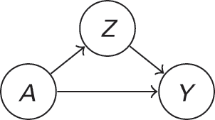

Figure 5.12Religion as a root node.

在这个图中，宗教归属 *A* 是根节点，它影响个人的教育水平 *Z*。某些宗教可能会通过其社会同伴群体引导成员远离或鼓励获得更高层次的教育。这一情形类似于我们在伯克利录取图中看到*性别*影响*系所选择*。

这种观点将理解间接路径（如 *A → Z → Y*）的责任置于我们身上——即宗教如何通过教育水平影响最终结果。我们可能缺乏对宗教如何影响一生中众多其他相关变量的深入理解。如果将宗教视为因果图中的根节点，改变它将潜在地影响所有后续节点。对于每个后续节点，我们都需要明确理解宗教如何影响该节点的机制。这些*科学知识*从哪里来？

但宗教的因果故事也可能不同。也许获得更高层次教育会导致个体失去宗教信仰。事实上，这一建模选择已在该领域的技术工作中被提出 \[32\]。美国普通社会调查（General Social Survey）的数据显示，在四年期间，报告过至少一次改变宗教归属的受访者比例在 20%至 40%之间 \[189\]。与性取向和社会阶层相关的身份被发现变化更为不稳定。将身份调整以更好地契合政治立场，似乎解释了部分这种变化。从这一角度看，宗教归属受教育水平影响，因此因果图可能如下[*图 5.13*]所示：

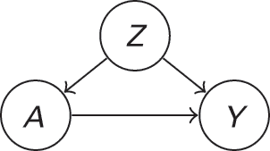

Figure 5.13Religion as ancestor.


这种对宗教的观点迫使我们正确识别影响宗教归属的变量，这些变量也与决策相关。毕竟，这些是因果关系中的混淆因子。也许不仅仅是教育水平，而且还有社会经济地位和其他具有相似混淆影响的因素。

令人困扰的是，在我们的第一张图中，教育是一个中介变量，而在我们的第二张图中，它是一个混淆因子。这种差异很重要；正如珍·佩尔所言：

“正如你现在所清楚知道的，将中介变量误认为是混淆因子是因果推断中的致命错误，可能导致荒谬的错误。后者需要调整；前者则禁止调整。[182]”

要注意的是，这两种建模选择并不是宗教归属与决策过程相互作用的唯二可能方式。相反，要注意的是存在多种合理的选择。我们的两种建模选择都符合自然的因果叙事。判断哪一种是合理的并不容易。这也不是我们可以通过某种实用主义来回避的任务。不同的建模选择会导致截然不同的主张和后果。

为了构建一个有效的因果模型，我们需要明确每个节点指代的具体事物，以及这些事物之间的关系。这是本体论和形而上学的问题。我们还需要了解在因果模型中所指代事物的事实。这是认识论（知识理论）的问题。

这些问题对于某些研究对象来说可能显得平凡。我们可能对飞机某些机械部件如何相互作用有强的科学依据，这使我们能够可靠地诊断飞机失事的原因。但在其他领域，尤其是涉及歧视争议的领域，我们的主题知识则较不稳定，且充满争议。

### 社会建构的类别

我们在激励性例子中遇到的困难在涉及人类种类和类别（如种族、宗教或性别）及其与 consequential decisions（重要决策）相互作用时，常规出现。

考虑*种族*的情况。种族的形而上学是一个复杂的主题，争议激烈，当今学界有多种学术解释。由 Joshua Glasgow、Sally Haslanger、Chike Jeffers 和 Quayshawn Spencer 撰写的一本书代表了当代关于种族是什么的四种主要哲学观点 [190]。种族类别的构建和个体的种族分类与长期的压迫、隔离和歧视实践紧密相连 [191, 192, 193]。

在关于歧视和因果的技术文献中，研究人员常常将*种族*建模为因果图中的源节点，也就是说，种族没有指向的箭头。作为源节点，它可以直接或间接地影响结果变量，例如*获得工作 offer*。这种建模选择隐含了一种自然主义视角，认为种族是生物学上根植的特征，类似于*性别*。这种特征在人的一生开始时就存在。后来发生的变量，如教育和收入，因此在因果图中成为其祖先。

这种对种族的看法促使我们识别种族如何通过所有可能的间接路径影响结果。但这不仅仅是建模上的挑战。将种族视为生物学上根植的特征，与*社会建构主义*关于种族的解释相矛盾 [190, 194, 195, 196]。在后者看来，种族大致上没有强烈的生物学基础，而是一种社会建构。种族源于社会对个体的特定分类，以及由此产生的共享经验。因此，个体的周围社会系统影响种族是什么以及如何被感知。在建构主义观点中，*种族*是一个被社会分配给个体的类别。

采用这一观点的挑战在于，很难找出一组能够准确代表社会对种族及其感知影响的节点。社会建构主义视角并不提供一个简单的操作指南来识别因果结构。特别是，社会建构的类别往往缺乏因果图所要求的模块性。假设群体成员是由一组关于该群体的社会事实和个体实践构成的，我们可能理解这些事实和实践如何本质地识别群体成员，但可能缺乏对每个因素如何相互作用、或者这种分解是否可能的认识 [197]。

### 本体论不稳定性

尽管有上述论点，实用主义者可能会指责我们的讨论过于复杂，对某些人来说可能只是常识问题。我们当然可以在其他特征上也找到微妙之处，比如吸烟习惯或体育锻炼。种族与我们在因果模型中引用的其他事物有什么不同？

一个重要的区别在于本体论的稳定性。当我们说*雨导致草变湿*时，我们也隐含了对雨、草以及湿的定义的理解。然而，之所以这在雨导致草变湿的情况下被认为是可以接受的，是因为我们所指的这三样事物都具有*足够稳定*的本体论。我们在引用它们时知道它们指代什么。当然，我们称呼“草”可能存在细微差别。也许日常意义上的*草*并不对应精确的植物学分类，或者该分类随时间变化并会在未来再次变化。但通过做出因果主张，我们隐含地认为这些细微差别对我们的主张无关重要。我们知道草是一种植物，其他植物也会因雨水而变湿。总之，我们相信我们所引用的本体论足够稳定，以支持我们所做的主张。

做出这种判断并不总是容易。广义来说，至少有两个本体论不稳定的来源。一个来源是世界随时间变化。社会进步、政治事件和我们自身的认识活动可能使理论过时、创造新类别或破坏既有类别 [196]。Hacking 的工作描述了另一个重要的不稳定来源。类别会导致人们在名义上属于这些类别的人改变行为，可能出现意想不到的变化。个体可能顺从或反顺从他们所面对的类别。结果，个体或集体的反应使得类别背后的理论失效。Hacking 称之为“循环效应” [198]。因此，社会类别是需要不断修正的移动目标。

### 稳定性证书

关于因果模型中人类类别的争论并非新鲜事，但它常常在看似无关 yet 长期存在的关于因果与操控的讨论中出现。因果推断中的一支学派坚持 *without manipulation, no causation*（没有操控就没有因果），这一观点由 Paul Holland 在 1986 年的一篇有影响力的文章中表达：


以直白且具有争议性的方式，在本文中我持有的观点是，原因仅指那些原则上可以作为实验处理的事物。\[199\]

霍兰进一步主张，涉及“属性”的陈述本质上是关联性陈述：

属性值变化的唯一方式是单位以某种方式改变，不再是同一单位。涉及属性作为“原因”的因果陈述始终是人口中属性值与因变量之间的关联性陈述。\[199\]

为了举例说明，霍兰认为句子“她因为是女性而考试表现优秀”只不过意味着“女性在考试中的表现在某种意义上超过了男性”。\[199\]

如果我们相信因果关系离不开干预，那么我们就必须完全排除不可变特征于因果模型之外。毕竟，按定义，没有实验机制能把不可变属性转化为处理变量。

霍兰的观点仍在潜在结果模型的实践者中流行。潜在结果模型中常见的假设最容易通过类比有充分设计的随机对照试验来 conceptualize。因此，该框架中的实践者习惯于把原因视为在原则上可以在随机对照试验中成为处理变量的事物。

在种族因果陈述的需求出现的情境中，不仅仅是歧视问题。流行病学家在面对健康差异时也会遇到同样的困难 \[36, 200\]，社会科学家在讨论贫困、犯罪和教育不平等时也同样如此。

当实践者需要就种族做出因果陈述时，往往会采用一种特定的概念技巧。其核心思想是将研究对象从*种族的效应*转变为*对种族的感知*的效应 \[201\]。具体而言，我们将研究单位从具有种族属性的个体转变为*决策者*。处理变量变为*通过可观测特征（如简历中的姓名）所带来的种族暴露*。研究的目标则是决策者在决策过程中如何回应这种*种族刺激*。该技巧背后的希望是，对种族的暴露——不同于种族本身——可能是我们可以控制、操控并进行实验的对象。

虽然这种方法在表面上规避了对不可变特征进行操控的概念难题，但它将负担转移到了其他地方。我们现在必须厘清所有可能的种族感知方式：通过姓名、语言、着装以及各种其他特征及其组合。但不仅如此。要针对*种族暴露*进行反事实推断，我们必须能够构建真实的背景条件，使得所有这些可感知的特征以一致的方式呈现出不同的种族类别。没有明确理解“种族”这一类别的含义，就无法准确构建此类反事实情境。正如我们无法在缺乏科学依据的情况下讨论巫术，也无法在缺乏有效因果模型的前提下讨论对巫术感知。同样，如果缺乏在有效因果模型中讨论种族的本体论和认识论基础，那么转向种族感知也无法提供简便的解决方案。

与霍兰的观点相反，其他学者（包括 Pearl）认为因果关系不需要可操控性，而需要对*交互*的理解。我们可以在无法操控火山的情况下推理假想的火山喷发；可以在无法通过可行干预操控月球的情况下解释导致潮汐的机制。关键在于理解变量之间在模型中的相互作用方式。结构方程在因果模型中是*响应函数*。我们可以将因果图中的节点视为接收来自父节点的信息并据此作出响应的实体。因果关系因此关乎*谁倾听谁*。只要我们了解节点之间的相互作用，就可以构建因果模型。

然而，正如我们所见，转向*交互*（即谁倾听谁）并不意味着因果模型变得容易构建。如果因果模型用来组织已有的科学或经验信息，那么 inevitably 会在包含的构造上受到限制，否则就有将模型与现实脱节的风险。尤其是在社会技术系统中，科学知识可能无法以精确的模块化响应函数形式提供。

我们持有的立场是：原因不必是实验可操控的。然而，我们的讨论表明，因果模型中引用的构造需要具有本体论和认识论稳定性的证明。操控可以被视为一种较为笨拙的方式，通过明确的实验机制来阐明节点的本体论属性——即指定明确的实验手段来操控该节点。这一方法虽有效，但绝非唯一的途径，也可以通过其他方式来澄清节点所指代的实体。

## Chapter Notes

关于因果关系的入门教材有多种。短暂入门可参考 Judea Pearl、Madelyn Glymour 和 Nicholas Jewell 所著的简明导论 \[188\]，或 Pearl 的更为全面的教材 \[180\]。技术层面上，Pearl 的著作强调因果图和结构因果模型。我们对 Simpson’s paradox 及伯克利大学的讨论受 Pearl 的论述启发，并更新以适应大众受众 \[182\]。这些书籍均涉及歧视议题。在其中，Pearl 主张歧视对应于敏感类别对决策的直接效应。

有志于技术性阅读的读者可结合 Pearl 的著作，阅读 Jonas Peters、Dominik Janzing 和 Bernhard Schölkopf 的开放获取文本 \[185\]，该文本也 [可在线阅读](https://mitpress.mit.edu/books/elements-causal-inference)。该书聚焦于两变量因果模型及其在机器学习中的应用。参见 Peter Spirtes、Clark Glymour、Richard Scheines 等 \[203\] 对基于因果图的一般性入门，重点在于*图发现*，即从观测数据推断因果图。

Stephen Morgan 和 Christopher Winship \[204\] 关注社会科学的应用。Guido Imbens 和 Donald Rubin \[205\] 提供潜在结果模型技术 repertoire 的全面概述。Joshua Angrist 和 Pischke Jörn-Steffen \[206\] 专注于经济学中的因果推断与潜在结果。

Miguel Hernán 和 James Robins \[207\] 则提供另一本详尽的因果推断入门，其基于作者在流行病学领域的实践经验。


Judea Pearl \[180\] 已经考虑了加州大学伯克利分校研究生入学的性别歧视案例，我们在之前的讨论中详细阐述过。在他的讨论中，他隐含地主张通过检查因果图中哪些路径从敏感变量指向决策点来讨论歧视，即借助因果图来审视歧视。

伯克利的案例在其他许多文章中也被讨论过，例如 Pearl 在 *Book of Why* \[182\] 中的论述。然而，本章的发展在论证和结论上与之前的工作有显著差异。

关于 Edward Simpson 原文的流行解读，请参见 Miguel Hernán 的文章 \[209\] 以及 Pearl 的文本 \[180\]。

因果推理与歧视在计算机科学和统计学界于 2017 年左右获得显著关注。Lu Zhang、Yongkai Wu 和 Xintao Wu \[210\] 早前通过路径特定因果效应进行歧视分析。Matt Kusner、Joshua Loftus、Chris Russell 和 Ricardo Silva \[187\] 引入了 *counterfactual fairness* 的概念。作者在另一篇工作 \[211\] 中进一步延伸了这一思路。Silvia Chiappa 提出了一种路径特定的 *counterfactual fairness* 定义 \[212\]。Niki Kilbertus、Mateo Rojas-Carulla、Giambattista Parascandolo 等 \[213\] 区分了两种图形因果标准，即 *unresolved discrimination* 和 *proxy discrimination*，这两者对应于在因果模型中是否允许或禁止某些路径。

Razieh Nabi 和 Ilya Shpitser \[214\] 将歧视视为敏感属性对结果的影响，沿着某些 *disallowed* 因果路径实现。Silvia Chiappa 和 William Isaac \[215\] 为 COMPAS 争议提供了关于因果与公平的教程。Atoosa Kasirzadeh 和 Andrew Smart 则在机器学习背景下探讨了构建社会类别因果反事实主张的困难 \[216\]。

此外，其他学科也有大量相关研究，这里不再逐一列举。流行病学领域关于健康差异的文献极为丰富。特别是，流行病学家在因果模型中面对种族和性别的问题。例如，Tyler VanderWeele 和 Whitney Robinson 的文章 \[200\]、Nancy Krieger 对该文章的评论 \[217\] 以及 Krieger 关于歧视与健康不平等的文章 \[218\] 可作为起点。

我们于 2018 年 12 月 27 日从 [`www.randomservices.org/random/data/Berkeley.html`](http://www.randomservices.org/random/data/Berkeley.html) 获取了伯克利入学数据。这与维基百科上关于 Simpson’s paradox 的数据显示存在一些差异，但这不影响我们的讨论。

# 6 理解美国反歧视法律

本章旨在让你了解美国反歧视法律是什么以及不是什么。我们以美国的法律经验为案例，展示如何监管歧视。其他国家采取不同的做法。我们并不企图全面描述美国法律，而是提供一种简化的关键概念概述。

我们从主要民权立法的历史渊源开始，阐述这些历史对当代仍具启示性的教训。法律是对道德概念的一次尝试性操作化。它是一个重要且具说明性的尝试。我们将学习法律如何在众多棘手的权衡中进行权衡取舍，同时也分析其局限性，并说明为何我们认为算法公平不应止于法律合规。

本章的最后部分专门讨论机器学习的监管。尽管美国反歧视法早于机器学习的普及，但只要决策者使用机器学习或其他统计方法，该法仍然适用。不过，机器学习为这些法律的适用带来了许多复杂性，现有法律可能无法应对机器学习带来的某些歧视形式。与此同时，我们相信也有机会利用新的监管工具来遏制算法歧视。

本章在首次阅读时可以跳过，但仍有几处关联值得注意。第一节阐释了本书的核心观点，特别是第 4 章——认为种族和性别等属性之所以具有显著性，是因为它们在许多社会历史上曾作为组织原则发挥作用。该节还为第 8 章奠定基础，该章将歧视的概念扩展到超出离散决策时刻的范围。关于法律局限性的章节进一步激发了本书的另一核心主题：通过机器学习与歧视的争论，我们可以重新审视公平的道德基础。

## 美国反歧视法律的历史与概览

每一寸纳入法律的民权保护都是经过数十年争取争取、为之奋斗的结果。本节简要描述了这些压迫与歧视的历史、兴起的运动以及最终实现的法律变革。

### 黑人民权运动

黑人民权运动，通常简称为民权运动，其根源于美国的奴隶制以及奴隶制废除后持续的种族歧视。美国内战后、奴隶制废除（约 1865–1877）的时期称为重建 era，期间在民权方面取得了重大进展。具体而言，宪法通过了第十三修正案废除奴隶制、第十四修正案确保法律面前的平等保护、第十五修正案保证无论种族如何都享有投票权。


然而，这些收益很快被白人至上主义者在南方州获得政治控制后迅速冲回，开启所谓的“吉姆·克劳”时代，这是一个持续约七十五年的时期，在此期间南方州系统性地实施了种族隔离、歧视以及对黑人几乎完全的选举权剥夺。几乎生活的方方面面都受到种族隔离，包括住宅社区、学校、工作场所以及公共设施如餐馆和酒店。1896 年，最高法院在“单独但平等”原则下裁定，规定强制隔离的法律不违反平等保护条款[219]。但在实际操作中，情况远非平等。黑人可获得的工作通常报酬远低于白人，学校资金不足且易被关闭，设施更少且质量低下。直到 1950 年代，黑人跨州驾车仍面临巨大风险，例如在夜间抵达小镇可能被拒绝住宿[220]。黑人无法通过民主途径挑战这些法律，因为州政府设立了诸多看似中立实但种族效果截然不同的投票障碍，且黑人在投票站常遭遇暴力，从而使选民压制高度有效。例如，在 1940 年代中期的路易斯安那州，非裔美国人注册投票比例不足 1%[221]。（数据限制导致无法对全国范围内的选民压制效果进行全面评估。）

与此同时，北方州的种族歧视方式更为间接。住宅分区法规禁止高密度、低成本住房，从而将较贫困的黑人居民排除在白人社区之外。银行的“红线”做法（在一定程度上受联邦监管机构推动）限制了特定社区的信贷获取，尤其是抵押贷款[222]。其辩护理由是风险水平，但实际效果是对黑人社区的歧视。另一种普遍的隔离手段是使用种族限制性契约，即社区内的产权人签订合同，承诺不向非白人出售或租赁房产。

民权运动在 19 世纪末至 20 世纪初兴起，旨在对抗这些普遍的种族主义做法。总体而言，运动采用了两种互补的策略：一是挑战不公正法律，二是在此种族隔离与歧视的限制下推动黑人社会的发展。第一条策略的关键转折点是 1909 年成立美国有色人种协进会（NAACP）。除了游说和诉讼反对吉姆·克劳法律外，该组织还致力于抗击私刑。第二条策略的重要成就包括黑人创业运动——1900 至 1930 年被誉为黑人企业的黄金时代[223]，以及教育领域的显著成就。许多历史黑人大学（HBCU）正是在吉姆·克劳时期创办的。

数十年的活动后，一个具有里程碑意义的时刻出现在 1954 年最高法院的一项裁决，该裁决宣布公共学校的种族隔离违宪。这标志着吉姆·克劳体系的逐步解体，一个持续数十年的过程，其影响至今仍在显现。随后法院的胜诉进一步激发了运动，推动了更激烈的活动与大规模抗议，进而催生了 1960 年代的重大联邦立法：1960 年民权法案、1965 年投票权法案，它们均针对选民压制行为；以及 1964 年民权法案和 1968 年公平住房法（FHA），它们针对私人歧视行为。本章将重点讨论后两者。

反歧视法律显然是历史与数十年乃至上百年趋势的产物——奴隶制、吉姆·克劳、民权运动——同时其直接原因往往源自具体、不可预测的事件。例如，马丁·路德·金博士被谋杀激发了公平住房法的通过。这些法律也反映了为确保其通过所做的政治妥协。例如，1964 年民权法案的第七章创立了平等就业机会委员会（EEOC），但该条款被剥夺了原文所含的执法权[224]。

### 性别歧视

争取性别平等的斗争同样拥有悠久而辉煌的活动历史。19 世纪，法律未承认女性的基本权利，包括投票权和财产权。改变这一切的主要目标是*第一波女权主义者*，他们的策略包括倡导、公民不服从、游说和法律行动。高潮是 1920 年第十九修正案的批准，保障了女性的投票权（然而，正如前文所述，黑人女性的投票权在南方仍受限制）。*第二波女权主义*始于 1960 年代，它针对社会对女性角色的刻板印象、教育与就业中的私人歧视，以及身体权利，包括生殖权利和家庭暴力问题。在二战后早期，性别规范在某些方面倒退（例如，战后女性失去了因战争而获得的部分工作机会），这被视为推动运动的重要动因[225]。两项早期立法胜利是 1963 年的《同酬法案》和 1964 年民权法案的第七章，后者禁止就业歧视。

然而，这些措施最初影响有限，因执行缺失，且运动逐步加剧。1965 年成立的全国妇女组织是一个重要里程碑。第二波女权主义者从黑人民权运动中借鉴了诉讼策略，计划通过法院诉讼获得女性权利保护。随后十年的一个显著胜诉是最高法院扩大堕胎权的决定——一项在 2022 年被推翻的判决[226]。在立法层面，性别平等的两大重要成就是 1972 年的《教育修正案第 IX 条》，禁止联邦资助教育项目中的性别歧视，以及《平等信贷机会法》（ECOA），禁止性别歧视在信贷事务中的处理。

教育，尤其是高等教育，以及信贷都是女性权益的重要领域。历史上，许多精英学院根本不接受女性。即便在 1970 年代，女性在学术界仍面临诸多障碍：性骚扰、入学门槛更高、被明确排除在法律、医学等高 prestige 领域之外，以及运动项目机会有限。同样，1970 年代的信贷歧视也十分显著，例如婚姻后女性需以丈夫名义重新申请信贷[227]。此后，女权运动的关注点从主要立法胜利转向对性别作为社会建构的质疑。

### LGBTQ 民权

历史上，针对 LGBTQ 人的歧视性法律层出不穷：对某些性行为的禁止（即反口淫法[228]）、缺乏婚姻权利、禁止军事服役和某些政府职位、未能禁止私人歧视以及将仇恨犯罪视为犯罪的失败，甚至在淫秽法下禁止倡导同性恋的文学作品。


-   [暂时的活动]https://example.org/started 在 1950 年代，最初的法律变更则在 1960 年代初期发生。一个关键的运动是 1969 年石墙骚乱，这是一系列在纽约市同性恋酒吧遭警察突袭后发起的抗议活动。这一事件的余波推动了美国 LGBTQ 权利的推进，包括同性恋骄傲运动，旨在提高可见度和接受度。1973 年，美国精神医学学会的*Diagnostic and Statistical Manual of Mental Disorders*删除了同性恋作为精神疾病，标志着（并进一步促进）了公众态度发生重大转变。法律变更的清单很长且持续进行，包括各州对涉及口交、婚姻平等、私人歧视以及仇恨犯罪的法律进行逐步修改；2003 年最高法院裁决口交法律违宪\[229\]；2015 年最高法院裁决保障同性婚姻权利在全国范围内\[230\]。与此同时，LGBTQ 权利在私营部门的推动部分是通过将现有的性别歧视法律（如 1964 年民权法案第七条）解释为涵盖性取向和性别认同的歧视，从而取得进展\[231\]。

# 残疾法律

另一个由反歧视法律覆盖的身份维度是残疾。目前美国约有四分之一成年人患有一种或多种残疾，包括行动障碍、视力障碍或其他视觉障碍、听力障碍或其他听力障碍，以及认知障碍\[232\]。这些及其他残疾是不同身份，对应不同的生活经验，有时甚至对应不同的文化。尽管如此，跨残疾联盟和身份的兴起使残疾权利倡导更加有效。这一运动在二战后的数十年里逐渐兴起。活动家们旨在让残疾显而易见，而不是污名化、怜悯和隐藏，并努力实现独立生活。与其他权利运动一样，残疾人面临多重、相互强化的障碍：社会对残疾和残疾人的态度、缺乏物理便利设施和辅助技术，以及歧视性政策\[233\]。阻碍残疾人的态度不仅仅是偏见，还包括错误地将残疾视为存在于个人（即*医学模型*）而非（或除了）社会障碍（即*社会模型*）所创造的。1973 年的康复法案是第一部禁止联邦资助项目中的残疾歧视的法律。围绕更广泛民权法案的活动继续进行，以 1964 年民权法案为模型。这些努力的高潮是 1990 年的《美国残疾人法案》（ADA）。虽然 ADA 与其他民权法案有许多相似之处，但其因强调便利设施而非仅仅形式上的不歧视而具有重大差异。

### 经验教训

不同民权运动历史的教训至今仍然相关。首先，法律是一种政治工具：它可以用来歧视、创造歧视得以繁荣的条件，或者用来挑战歧视。它可以是压迫的工具，也可以是解放的工具。法律表面上可能是中立的，但它们是由响应时代和活动的行为体创造、解释和执行的。法院裁决也受到当代活动以及甚至学术研究的影响。

我们简短的历史讨论还解释了为什么某些领域受到监管而其他领域未受监管。教育、就业、住房、信贷和公共场所是既对人们人生阶段高度重要，又有意有歧视历史的领域，这些歧视历史被有意用来压迫某些群体。

这种按部门划分的做法的一个后果是，法律可以针对部门的特殊性进行定制，以避免漏洞。例如，FHA 涵盖了与住房相关的所有实践，包括销售、租赁、广告和融资。它列出（并禁止）住房代理可能以微妙方式误导或劝阻受保护类别客户的各种方式。认识到融资对获得住房的重要性，它禁止在“购买、建造、改进、修理或维护”方面因融资而进行歧视。它甚至禁止广告中表现出歧视性偏好。这不仅包括诸如“不让孩子”这样的类别性陈述，还包括针对与种族相关的特定地理区域进行广告投放，以及在广告中选择的主体。

在许多情况下，这些避免漏洞的尝试在面对最近的技术发展时依然经得住考验。禁止歧视性广告迫使在线广告平台避免对住房广告进行歧视性定位\[234\]。但这并非总是如此。叫车平台能够规避 Title VII（就业歧视）的责任，即使他们因乘客给出的（潜在歧视性的）评分而终止司机\[235\]。

尽管法律是部门特定的，但很难仅通过观察任何单一的机构（如就业或教育，更不用说单一组织）来理解歧视。历史表明，往往存在多个相互交织的压迫系统同时运作，例如联邦住房政策和私营部门歧视。同样，国家歧视与私人歧视之间的界限并不总是清晰。

历史也表明，当层级被打乱时，等级往往会以其他方式重新确立。例如， de jure 种族隔离的终结加速了“白人飞行”现象，即白人从城市向郊区迁移，加剧了事实上的种族隔离。进步并非总是顺利的，倒退是可能的。例如，伍德罗·威尔逊及其政府在 1910 年代将联邦工作队伍大部分部门种族隔离化，抹平了黑人在之前几十年所取得的一些成就。就在我们撰写本章节之际，最高法院推翻了*Roe v. Wade*，结束了对堕胎权的联邦保护，并在许多州使堕胎受到严重限制。

另一个不易从法律本身看出的重要点是，不同受保护身份维度的歧视和活动历史复杂且各不相同，尽管法律试图以统一和形式化的方式对待它们。即使在单一维度（如民族）内部，不同群体的压迫和斗争形式也截然不同。原住民在美国经历了一个世纪的强制同化尝试，孩子们被送往寄宿学校，被要求放弃他们的文化。1882 年的《排华法案》几乎在超过半个世纪内几乎完全阻止了中国人移民，并使已经存在的中国移民社区的环境变得极其不友好。二战期间，超过 10 万名日本裔人士（其中大多数是美国公民）被关押在集中营中，理由是他们对国家不忠。这些只是美国历史上基于种族、民族和国籍歧视的若干可怕事件，主要涉及政府的行为。国籍歧视往往是种族歧视的掩饰形式。因此，尽管法律中受保护属性的列表可能随时间增长，但它并非随意，而是由历史深深影响的。


平等在法律面前仍是一个受争议和不断演变的概念。这种情况尤其常见于反歧视与某些相互制约的价值或原则（如宗教自由或限制国家权力）发生冲突时。由于法律与我们的生活和生计在诸多方面交织在一起，广义上的法律平等不仅仅需要形式上的不歧视。以性别平等为例，实现性别平等所需的法律干预范围广泛且日益增长。除了投票权和禁止性别歧视外，还包括禁止因孕期和婚姻状况而歧视、遏制性骚扰和性暴力、堕胎权、产假假期法律以及儿童保育补贴。这些斗争各自都有多个层面。例如，#MeToo 运动揭示了雇主在和解中使用“不诽谤条款”以沉默职场性骚扰受害人的作用，目前仍有持续努力禁止此类条款。

最终，法律变革并非终点，反而在某种意义上说才是起点。过去的歧视往往留下持久的烙印。鉴于政治现实，法律本身只能在一定程度上消除历史的影响（table 6.1）。

Table 6.1A summary of the major antidiscrimination statutes: Titles VI and VII of the Civil Rights Act of 1964, the Fair Housing Act (FHA), Title IX of the Education Amendments Act of 1972, the Equal Credit Opportunity Act (ECOA), and the Americans with Disabilities Act (ADA)

| Law || Year || Covered entities and regulated activities || Protected categories (^(\*) = added later) |

| --- | --- | --- | --- |

| Title VI || 1964 || Any organization receiving federal funding (due to breadth, doesn’t list regulated activities) || Race, color, national origin |

| --- | --- | --- | --- |

|  |

| Title VII || 1964 || Employers, employment agencies, labor unions || Race, color, religion, sex, national origin, pregnancy\* |

|  |

| FHA || 1968 || Sales, rentals, advertising, and financing of housing || Race, color, religion, national origin, sex (\*?), handicap, familial status |

|  |

| Title IX || 1972 || Educational programs receiving federal funding: hiring, pay, rank, sexual harassment, retaliation, segregation and same-sex education || Sex |

|  |

| ECOA || 1974 || Creditors (banks, small loan and finance companies, retail and department stores, credit card companies, and credit unions) || Race,\* sex, age,\* national origin,\* marital status, receipt of public assistance\* |

|  |

| ADA || 1990 || Employers, public services, public accommodation || Disability, record of disability, perception of disability |

## A Few Basics of the American Legal System

美国法律体系的基本要素

美国宪法是最高法。宪法确立了政府的三个分支：立法机构（国会）、行政机构（总统、行政部门及其他向总统汇报的机构），以及司法机构（最高法院及其他法院）。这三个分支在反歧视法律方面各司其职。虽然州和地方政府及法律在反歧视中发挥重要作用，但本教材聚焦于联邦法律，因此对它们的讨论较少。

在介绍三个分支之前，有必要指出宪法本身包含两个与歧视法相关的要素：第五和第十四修正案规定的“法律面前的公正程序权”，第十四修正案规定的“法律面前的平等保护权”。这两项都限制了政府进行歧视的能力。平等保护法也曾被用来限制私人歧视。公正程序权有时被被告用作抗辩，声称那些限制其歧视能力的法律侵犯了其公正程序权。

### 国会（立法机构）的作用

国会通过的法律称为成文法，区别于宪法法、案例法及其他类型的法律。我们在前面已经看到一些主要的反歧视法律。但国会行动面临许多实践和政治障碍，成文法或修正案相对少见。因此，为了在不断变化的世界中保持相关性，法律通常表述宽泛，不试图预见每种可能应用情形的细微差别。为了解释和执行这些政策，国会将权力授予联邦机构（如平等就业机会委员会 EEOC）。法院同样承担重要的解释职能，并对国会本身的权力进行制衡。

国会用于制定反歧视法律的三大主要权力包括：第一是商业条款（Commerce Clause），它赋予国会调节州际贸易的权力。最高法院对该条款的解释极为宽泛。与就业和信贷反歧视相关的立法基于此条款。第二是第十四修正案赋予的权力，该修正案保证所有公民获得法律面前的平等保护，并授权国会通过适当立法来执行此权利。虽然第十四修正案适用所需的州参与程度尚未完全确定，但《公平住房法》（Fair Housing Act）和《美国残疾人法案》（Americans with Disabilities Act）在一定程度上得益于此权力。最后，国会拥有“金钱的权力”：通过控制支出和威胁剥夺联邦资金来推动政策目标。第 VI 条和《教育修正案》第 IX 条正是在此类别下，因此仅覆盖获得联邦资金的组织。

国会已利用其权力制定覆盖广泛活动的反歧视法律。然而，联邦反歧视法仍存在许多缺口和局限，这既源于宪法限制，也因国会未行动所致。因此，州法律有时会填补这些空白。

### 法院（司法机构）的作用

美国采用普通法体系，意味着法院有权制定指导未来案件裁决的法律，即“先例”（precedent）概念。在事实或原则与已由相关法院裁决的先前案件相似的争议中，法官必须遵循过去决策的推理（即先例）。法院还负责解释成文法和宪法。这一体系的判例法（case law）可具有与其他法律同等的约束力。例如，最高法院的一项裁决解释了成文法的范围，从而产生了“歧视性影响”（disparate impact）这一重要概念——即使决策做法表面中性且无歧视意图，若其产生不成比例的负面影响仍可能被认定为非法。相比之下，大多数欧洲国家采用民法体系，立法是法律的主要来源，司法判例在作为先例方面价值相对较小。


-   美国法院的层级组织决定了哪些先例对特定争议具有约束力。联邦法院分为三个层级：底部的地区法院、上方的十三个上诉法院（也称为巡回法院），以及顶部的最高法院。最高法院的裁决对所有下级法院具有约束力，而上诉法院的裁决对相应的地区法院具有约束力。上诉法院仅审理上诉案件，即一方当事人声称下级法院的裁决存在实质性错误时。最高法院通常只审理上诉法院的裁决。最高法院并非必须接受审查请求；事实上，它仅批准了少数请求的审查。

-   在解释法律时，法院采用文本解释法和上下文解释法。前者仅限于法律本身的字面意义，而后者则参考法律之外的来源，如立法者最初表达的意图和法律的目的。上下文因素的重要性是争议的焦点，法官们在处理方法上也各有不同。

-   我们已经讨论了法院在制定法律中的作用。当然，法院的主要职能是审理个别案件。因此，关于法院程序的几点说明是有必要的。诉讼可分为 `civil`（民事）和 `criminal`（刑事）两类。民事案件涉及对私人个人的侵权；大多数歧视相关争议属于此类，只有少数例外，如仇恨犯罪。刑事案件涉及违反刑事法律，只能由政府提出。

-   美国法院程序的一个核心特点是使用 `adversary proceedings`（对抗性程序）。争议的两方是 `plaintiff`（原告，提起 `complaint` 并声称受到侵害）和 `defendant`（被告，被指控实施了该侵害）。两方通常由律师代表，律师在案件进展中发挥巨大影响，而法官则主要作为中立仲裁人，而非审问者。

-   为了说明我们迄今讨论的法院体系的各个方面，考虑以下问题：餐厅、零售商等网站是否必须对视力障碍人士开放？《美国残疾人法案》（ADA）禁止在公共场所排斥残疾人获取服务。但这是否包括网站？1991 年国会不可能预见此问题，因此该法律（尽管条文异常详细，超过 20,000 字）未直接涉及此问题。一组巡回法院认为国会的意图和目的表明，网站本身可以视为公共场所，符合 ADA 的“广泛授权”“全面目的”和“综合性质”。另一组巡回法院则采取更文本化的立场，认为法律仅适用于公共场所的 `of` 服务，而非 `in` 服务。只要物理场所与网站之间存在足够的“关联”（nexus），可及性要求便延伸至网站。2021 年 4 月，一家巡回法院作出不同判决，认为只有实体场所才是公共场所，并否定了第二组法院采用的“关联”标准。

-   当巡回法院出现分歧时，通常需要最高法院介入以解决不一致，但这可能需要多年时间。

-   造成这种局面的一个原因是司法部（DOJ）负责制定实施 ADA 的法规，但尚未就网站是否属于公共场所以及若属于，应满足何种可及性标准发布最终规章。因此，法院不得不比平时拥有更大的解释空间。这也引发了一些法院的担忧：在没有明确标准的情况下强制执行可及性要求可能剥夺被告的宪法平等保护权。这凸显了行政部门和联邦机构的重要性，我们接下来将讨论它们。

### 联邦机构（行政分支）的作用

联邦机构的主要反歧视职能包括制定规章、提供指导和执法。例如，平等信贷机会法案广泛使信贷歧视非法化，但将制定和解释实施该授权的规章工作交给联邦储备系统（国会随后将此权限转移至消费者金融保护局）。这一过程称为 `rulemaking`。产生的规章属于 `行政法`，其法律效力等同于成文法和判例法。

规章与指导有细微差别。由平等就业机会委员会（EEOC）领导的一批机构于 1978 年发布了 `Uniform Guidelines for Employee Selection Procedures`（员工选拔程序统一指南），该指南规定了确保测试和其他员工选拔程序符合 1964 年《民权法案》第 VII 条的框架。`Uniform Guidelines` 虽被雇主广泛引用，但它们并不构成法律。它们常被法院引用，法院通常对机构指南给予显著尊重，但法院并不受其约束。

可以说，机构的实际重要性难以超估。法律是否具有实效很大程度上取决于负责执行的机构。 EEOC 最初拒绝处理性别歧视案件，尽管法律赋予其权力。事实上，即使是针对种族歧视的 Title VII 最初也缺乏“利牙”，直到 1972 年通过修正案（1972 年平等就业机会法案）才赋予 EEOC 行动权力 \[[236\]。

机构在政治独立性方面存在差异；有些机构隶属于行政分支（如住房与城市发展部 \[HUD\] 和劳工部），而有些则更为独立（如 EEOC 和联邦贸易委员会 \[FTC\]）。后者不仅拥有规章制定权，还拥有执法权，能够开展调查并向法院提起诉讼；有些甚至拥有自己的司法体系，被称为事实上的第四分支机构。总之，解释并执行法律的任务由联邦机构与法院共同承担。它们通常协作和谐，但法律来源的碎片化以及执法方式的多样性会导致低效和混乱。

还需提及两个重要的政策来源：行政命令和机构内部规则。行政命令是美国总统发布的指令。最初它们旨在管理政府事务，但联邦政府的庞大范围使其成为一种有效的政策执行工具。例如，Title VII 的前身形式——行政命令——可追溯至 1941 年 \[237\]。虽然其范围远弱于最终立法，但它们展示了总统能够在国会僵局时迅速行动的能力。


机构（无论是公共还是私营）可以为其员工制定不歧视规则或指南，这些规则或指南可能超出法律的要求。例如，询问求职者的婚姻状况本身并不违法。然而，在法律争议中，这可能被视为有意歧视的证据 \[238\]。考虑到这一点（以及几乎没有与工作相关的理由来进行此类询问），许多组织禁止其面试官提出此类问题。在日常工作中，这些机构指南是个人必须遵守的最直接的不歧视规则。

### 案例研究：标题 IX 的演变

1972 年《教育修正案》第 IX 条禁止接受联邦资金的教育机构中的性别歧视。1975 年，卫生、教育和福利部（HEW）发布了最终规定，详细说明了标题 IX 将如何执行。自 1975 年以来，联邦政府多次发布指导，阐明其对这些规定的解释和执行方式。

围绕标题 IX 的两个主要争议是：什么是接受联邦财政援助，以及什么是性别歧视。这两个问题都有可能极大地影响法律的适用范围。1984 年，最高法院裁定标题 IX 是“项目特定”的，即只有直接获得联邦资金的项目和活动才需要合规。这一裁决极大地削弱了标题 IX 的适用范围：例如，大多数体育项目不再受其约束，因为它们没有直接获得联邦资金。为回应这一决定，国会起草了一项专门旨在推翻该裁决的法案，从而恢复了标题 IX 的广泛适用范围，直至今时 \[239, 240\]。

标题 IX 适用范围的另外两个重大争议是：学校是否对校园内发生的性骚扰负有责任，以及基于性取向和性别认同的歧视是否受到禁止。与覆盖范围的问题不同，这些议题仍然是激烈的法律和政治辩论的焦点。就性骚扰而言，最高法院在 1990 年代认定，学校有责任创造安全环境，包括防止其他学生的骚扰，但“学生必须证明，拥有学校权威并能够应对骚扰的官员实际 knew of（知道）且故意 indifferent to（故意漠视）了骚扰”。奥巴马、特朗普和拜登政府都在这一问题上推出了指导或法规，进一步扩大或收缩了标题 IX 的范围 \[241\]。关于 LGBTQ 保护的类似政治摇摆也同样发生。2021 年，教育部对标题 IX 作出宽泛解释，依据 2020 年最高法院的判决（该判决也涉及性别歧视与性取向之间的关系，但在就业歧视情境中）\[242\]。

## 法律如何定义歧视

法律可以以多种方式定义歧视，并尝试实现不歧视。本节讨论法律如何构思歧视，以及它如何在平衡不歧视与其他理想时进行权衡。

### 歧视性待遇与歧视性影响

想象一位雇主拒绝一位求职者，并明确告知此决定是基于受保护特征。此类情况可以直接依据法律条文进行审理（“根据法律条文，‘雇主不得因…（种族、肤色、宗教、性别或国籍）等受保护特征而未能或拒绝雇佣个人’”）。但在大多数歧视案件中，决策者的行为并非明确，证据更多是间接的。为此，法院发展出两大 doctrine：*disparate treatment*（歧视性待遇）和 *disparate impact*（歧视性影响）。

*Disparate treatment* 指的是有意的歧视，基本符合普通人对歧视性行为的直观理解，涵盖了上述明确的案例。对于更间接的情形，最高法院建立了基于《民权法案》第 VII（就业法）的“举证责任转移”框架。首先，原告必须通过以下方式建立 prima facie（prima facie）的歧视案件：证明自己属于受保护群体、具备职位资格、被拒之于职位、且该职位随后仍然空缺或已分配给非受保护群体的成员。若原告成功，employer 必须提供合法、非歧视性的理由来解释不利决策。随后，原告需证明该理由仅是歧视的掩饰（pretext）。

*Disparate treatment* 通常涉及推断：如果被告的受保护特征发生变化，而其他事实保持不变，被告会如何行动。技术层面上，这种“属性翻转”的反事实推理与细致的因果性理解相冲突，导致歧视检验变得脆弱。尽管如此，因果性在歧视性待遇中，尤其是所谓的“但书”因果（but‑for causation），在 2020 年最高法院的判决后变得尤为重要——该判决指出，若不改变受害者的性别而仅改变其性取向，则无法构成性取向歧视，因为必须在改变性别而不影响其他因素的前提下进行反事实假设。虽然从民权角度看此举被视为扩大 LGBTQ 权利的积极举措，但我们也应注意到，这反映的是一种狭隘的因果观，其他情境下的应用可能产生不利于民权的结论。

与 *disparate treatment* 相反，*disparate impact* 关注的是即使非有意，也会对受保护群体产生不成比例影响的做法。宏观上，歧视性影响必须是“不合理且可避免”的。实现方式同样采用举证责任转移框架：首先，原告需证明不同群体之间的选择率存在显著差异。若能够证明，employer 可说明该差异的原因是否具有业务正当性。随后，举证责任回到原告，要求其展示一种“替代的就业做法”，该做法能够实现雇主的目标，同时降低歧视性。

一种思考歧视性影响的方式是将其视为“发现隐藏的有意歧视”的手段——通过关注更易观察的影响来揭示其背后的意图。事实上，导致该 doctrine 产生的案件涉及一家雇主在 1964 年《民权法案》生效的当天就推出了用于晋升的适应性测试，而该法案禁止基于种族的就业歧视 \[243\]。


但也有人认为，不利影响是由分配正义的考量所驱动的，即尽量减少不公正的结果不平等。从这个角度来看，不利影响大致对应于我们在第 4 章中讨论的机会平等的中间立场。不利影响试图迫使决策者对看似不同的人在结果上保持相似对待，基于这样一种信念：他们的当前差异是过去不公正的结果。它旨在至少部分补偿因不公正原因而遭受的不利待遇。事实上，在前面提到的案例中，最高法院指出， aptitude test（测验）上的种族表现差异可以归因于教育系统的不平等。然而，不利影响的教义多年来已经演变，人们认为它反映分配正义的程度，而非揭示隐藏的歧视工具的程度，这种看法被认为随着时间的推移而减弱。

我们在就业法的语境中讨论了这两种教义，但它们也出现在我们在第一部分讨论的六个领域中的每一个。不利影响在法律对歧视的理解中如此核心，以至于后来被纳入成文法，特别是残疾法（ADA），但也通过 1991 年的修正案被纳入 Title VII（平等就业法）本身。然而，最高法院并未将该教义扩展到法律或程序的国家（而非私人行为体）违反平等保护条款的情况，如果这些法律或程序具有歧视性目的。换句话说，只有私人行为体才适用不利影响教义，而针对国家行为体的情况则只有歧视性待遇。

关于反歧视法的一个重要一般性观察——尤其是对于那些习惯于以决策过程的统计特性来思考公平的读者来说——是法律主要关注过程本身。相关地，法院在权衡证据时的方式也高度程序化，以至于可能看起来与实质性问题——即是否发生了歧视——关系不大 \[244\]。即使不利影响，尽管部分是由分配正义的观念所激发，但也以形式和程序化的方式加以对待。作为程序性元素的重要性的一个说明，DOJ（司法部）的 Title VI 不利影响索赔证明法律手册长达 20,000 多词 \[245\]。

法律关注过程的原因有很多。一个是历史原因：这些法律最初主要是为了应对明显的歧视和机会被正式拒绝的情况，而不是更微妙的统计现象。它也更符合法律的运作方式：歧视的定义无法与在法庭上证明它的程序相分离。第三个原因是政治性的：要达成关于公平过程的共识比达成关于正确分配结果的共识更容易。最后，从实用角度来看，这反映了法律对工作场所和其他机构的细节关注，而相较之下，统计公平标准似乎显得粗糙且过于简化。

### 避免对决策者施加过度负担

一个反复出现的主题是，为了实现公平目标，对决策者施加的负担是否合理。例如，为残疾员工提供便利会对公司造成一定成本。

总体而言，法律对决策者的利益给予了相当大的尊重。这一点在立法者和法院在不同时间点上的表述中屡次得到强调。例如，众议院司法委员会在机构成立之初就表示，关于 EEOC（平等就业机会委员会）的角色：“管理特权和工会自由应尽可能不受干扰” \[246\]。最高法院在 2015 年进一步澄清：“公平住房法（Fair Housing Act）并非用来强制住房管理部门重新排列其优先次序” \[247\]。

唯一的例外是 ADA，它对大量公司和政府机构施加了实质性的合规要求。这不足为怪，因为该法旨在推动社会结构性变革，尤其是在建成环境方面。ADA 设有“过度困难”辩护，用于对抗要求雇主为有残疾的合格员工提供“合理便利”的要求，但法院似乎比，比如说，Title VII 更能容忍更高的负担。例如，一名盲人员工起诉其雇主未能为四天工作日提供付费读书员；法院支持原告，暗示约 50% 的员工成本增加并不构成过度困难 \[248\]。我们需要补充的是，过度困难是一个多因素的测试，没有明确或统一的成本阈值；成本很少是唯一决定性因素。


-   [美国反歧视法律的效果如何？最理想的情况是，惩罚的可能性已经足够抑制潜在歧视者，导致歧视率大幅下降，而在少数仍然存在的歧视案例中，受害者能够通过法院获得补救。最坏的情况是，法律几乎没有产生任何效果，而自通过以来的差异缩小主要归因于其他因素，例如歧视者在市场中的成功程度较低。]

-   现实介于两者之间。严格评估法律的效果是一个棘手的反事实问题，充满不确定性和争议。然而，有大量证据表明其存在积极效应。例如，一项研究利用自然实验评估了 1972 年《平等就业机会法》在 Title VII 下对非裔美国人相对于白人美国人就业机会的影响。研究表明，非裔美国人在雇佣比例较高的行业和地区中，其相对就业率有所提升 \[236, 252\]。

-   虽然收益是显著的，但反歧视法律的效果因多种原因受到削弱，这正是我们现在所讨论的内容。这促使我们认为，算法公平性的研究不应将反歧视法律的做法视为既定不变，而应回归公平的道德基础。

### 歧视受害者所承担的负担

-   法律对希望寻求法律救济的歧视受害者施加了种种负担。我们以劳动力市场为例，但我们的观察同样适用于其他情境。

-   首先，法律干预是由受害者发起的，而非政府，且只能在受害者已经遭受歧视之后才能启动。监管机构不会像药品监管等其他法律领域那样，对雇佣实践进行前瞻性审查；在药品监管中，药物必须经过严格测试后才能上市。

-   此外，雇主与雇员（或求职者）之间存在根本性的信息不对称。受害者可能根本不知道自己遭受了歧视。毕竟，求职者和雇员无法直接看到雇主的决策过程，雇主也不需要为不利的招聘或晋升决定提供理由。只有在信用领域才存在某种程度的透明度要求。

-   即使受害者意识到歧视，也会面临阻碍起诉的困难。诉讼会带来额外的心理痛苦。受害者可能因诉讼的高昂费用而退缩。诉讼通常需要数年时间才能得出结论，在此期间受害者的职业生涯可能遭受重大且不可逆的打击。即便受害者仍在公司任职，也会面临最坏情况的尴尬局面，甚至可能遭遇雇主报复（尽管法律明确禁止报复，但这仍是歧视诉讼的常见结果）。若受害者寻求在其他公司就业，未来雇主可能会因其曾起诉前雇主歧视而产生负面看法。

-   打算提起诉讼的受害者还需克服一系列程序性障碍。如果雇主设有内部投诉程序，受害者可能被要求先尝试内部解决，否则将失去诉讼资格。另一项前置条件是，受害者必须在歧视发生后及时向平等就业机会委员会（EEOC）提交行政投诉。及时性要求常常使受害者陷入两难：既需要履行内部渠道，又难以收集胜诉所需的证据 \[253, 254\]。

-   这引出我们讨论的最后且最严重的难题——举证责任的负担。虽然原告在歧视案件中需满足“优势证据”标准（即更有可能为真，低于刑事案件的标准），但这一标准本身已被证明极为艰巨。根据 Katie Eyer 的说法，“反歧视法是高度僵化的技术性法律领域，各种技术性规则均可能导致驳回。法院在处理歧视问题时，仿佛在解决一个复杂的法律谜题，任何环节出错都会导致原告的主张被驳回” \[244\]。

-   具体而言，在“ disparate treatment”（差别待遇）案件中，法院已制定了诸多有利于被告的规则。根据“ stray remarks”（旁注言论）规则，雇主对原告的歧视性言论本身不足以证明歧视意图，除非存在足够明确的因果联系。根据“ same actor”（同一主体）辩护，如果雇主曾雇佣过原告，则被视为雇主不存在歧视意图。根据“ honest belief”（真诚信念）规则，只要雇主“诚实相信”其决定理由，即使事后被证明是“错误、愚蠢、琐碎或毫无依据”，案件也会被直接驳回。

-   在“ disparate impact”（差别影响）案件中，一系列因素共同作用，对原告不利。虽然无需证明意图，但必须满足新的要求：找出导致不利决定的具体政策或做法；收集足够统计数据证明该政策产生了差别影响；并驳斥雇主认为该政策与工作相关的辩护。第三项要求是原告最具挑战性的环节，因为他们在结构上缺乏识别替代就业做法的能力，缺乏了解企业内部运作的知识，而雇主拥有这些信息 \[248, 255\]。

-   这些障碍的综合结果是，原告在法庭上的胜诉几率极低。Katie Eyer 总结了 Uncertain Justice 项目的数据：“在每 100 起提交诉讼的歧视原告中，只有 4 位能够获得任何形式（即使是微乎其微）的补救措施。……这些胜率可以被恰当地描述为惊人地低，并且（除轻微差异外）适用于所有歧视原告类别，包括种族、性别、年龄和残疾” \[244\]。

-   我们应当注意到，普遍存在的观点认为就业歧视诉讼过于“容易”提起且对原告过于有利，而我们持不同意见。Selmi 严厉批评了这种认知，指出这种观点主要盛行于法官之间；纠正这种所谓的失衡可能正是创设众多原告障碍的原因之一 \[256\]。无论是否认同许多“滥用诉讼”是原告基于歧视提起的观点，事实是法院资源紧张，法官们对可能引发“洪水”的诉讼持谨慎态度。这表明我们所讨论的负担很可能不会消失 \[254, 257\]。

### 通过程序干预实现实质性和结构性改革的困难


即使反歧视法律的遵循程度很高，法律救济也容易获得，但法律的效果可能受到更根本的限制。法律对个人和组织所设定的形式性限制，究竟会导致一个公正的社会吗？法律与道德层面对“不公平”的认知之间的差距有多大？

Stephen Halpern 将问题表述为：

在将社会问题翻译为“法律语言”时，律师必须以法律体系所认可、视为合法的预设概念、问题、疑问和救济措施来构建他们的分析。在这样的翻译过程中，正如任何翻译一样，会出现收缩和扭曲。将社会问题作为法律问题来框架，会对问题本身产生转化——即对问题的重新概念化，产生独特的疑问和关注点，这些首先成为法律争论的焦点，随后又倾向于主导公共讨论。当种族问题被重新包装为法律权利的问题时， resulting dialogue（结果对话）并不能捕捉这些问题的复杂性与微妙性，也无法考虑最全面的救济措施。法律过程的要求与限制必然改变公众对重要种族议题的讨论与认知。

Halpern 的书关注教育中的种族不平等；他论证的主要例子是，为结束公立学校的种族隔离而投入的努力，却几乎没有关注黑学生在整合学校中所接受教育的质量。同样，Title VI 的诉讼重点在于处理向联邦政府提交的歧视投诉的程序，而不是解决受教育权实质性平等的机制。他指出：“很少，甚至没有任何因素会影响教育成就，且这些因素难以通过‘法律权利’或‘种族歧视’的议题来直接体现。”他给出两个原因解释为何不平等仍然存在：美国城市的实质性种族隔离，以及学业差异往往源于家庭不稳定以及其他社会、经济和健康方面的不平等。

在美国，学校种族取消隔离的影响是一个庞大的话题，但更广泛的观点是：法律过程的局限性限制了实际可达成的目标，甚至塑造了我们对这些议题的理解本身。另一个例子来自 Richard Rothstein 的著作 *Color of Law*。

尽管大多数非裔美国人曾经历过**历史性种族歧视的政府住房政策**，但他们难以在法院中以案件要求的具体度指出自己遭受了精确的哪一点伤害。例如，许多非裔二战老兵在得知退伍军人管理局会因种族拒绝保证的住房贷款时，便不再申请郊区购房的政府担保贷款，因为他们知道申请毫无意义。这些老兵因此没有从房产增值中获得财富，也无法像白人老兵的后代那样继承这笔财富。由于继承的财富较少，非裔美国人今天普遍比白人同龄人更难以负担优质大学的学费。如果这些非裔美国人的后代现在得知祖父母之所以被迫租住在拥挤的城市公寓，是因为联邦政府非法且违宪地阻止银行向非裔美国人提供贷款，那么他们的祖孙并没有起诉的法律资格，也无法指明从哪一方追讨损害赔偿。

推动程序主义的另一个因素是法院体系与组织内部程序的交互作用。根据“法律内生性”理论，组织会制定程序性保护措施（如多元化培训项目），名义上旨在遏制歧视；随着时间推移，法院逐渐把这些程序性、象征性的合规活动误认为是实质性措施；一旦这些象征性措施本身获得法律意义，实质性关切便被推至合法辩论的范围之外【259】。

此外，即便是单个组织内部的实质性变革，也未必意味着结构性变革——即改变产生社会分层的根本因素。即便雇主实现了招聘和晋升率的统计平等，申请率本身可能反映出社会层面的机会不平等，或是之前阶段的歧视，而法律很难强制要求个别决策者去弥补这些不平等。

实现实质性且结构性双重效果的法律干预屈指可数。一个显著的例子是 Title IX 对女子体育的影响。该法不仅被解释为禁止狭义的歧视，还被要求在奖学金、教练和设施等多个方面实现平等。可以认为，正是这些措施的推动，使美国女子体育逐步提升声望，削弱了体育领域的性别层级，推动了体育领域的平等，甚至在非大学层面也出现了这种趋势。总体而言，这类实质性干预之所以相对不易实现，部分原因是它们需要大量资金。

尽管我们在上文已经将程序性干预与实质性、结构性干预进行对比，但二者之间的界限往往模糊，前者至少可以作为后者的“立脚点”。只要不平等仍然源于根深蒂固的政策导致资源分配不均，为历史上受压迫群体提供晋升至权威位置的程序性措施，就有可能让他们更有效地改变这些政策，削弱已占优势群体对政策制定过程的垄断。但这仍然远非理想的变革路径，因为它把提升特定群体利益的责任全部置于该群体的个人身上。

另一个看似矛盾的对比是：歧视法与再分配政策（即政府对特定主体征税并将资金直接拨给弱势群体）之间的关系。歧视法可以被视为一种机制，即在一定程度上将纠正过去不义的经济负担转嫁给雇主、贷款人等。某种程度上，这与对雇主征税并使用这些资金支持历史上受歧视群体的政策在形式上相似。


-   [正向行动政策]https://wiki.example.org/affirmative_action_policies[ ]的范围正好位于形式上的非歧视政策和再分配政策之间。一个例子是雇主提供的一个职业培训项目，该项目偏向于获得机会较少的群体\[260\]。然而，除极少数情况外，法律并未*强制*私人实体进行正向行动，而仅仅*允许*其进行。更常见的是，政府需要履行正向行动要求。除非非歧视的要求外，FHA 还要求 HUD 以及从 HUD 获得联邦资金的接受者“积极进一步”推进该法案的政策和目的。这可能使得，例如，在高收入社区提供补贴住房，从而打开通往更高质量学校和设施的机会。然而，FHA 的这一部分大体上一直沉寂不响。因此，至少部分法律在创造有意义变革方面的局限性可以归因于缺乏政治意愿充分执行现有法律，而不是法律体系本身的固有限制。

### 监管机器学习

尽管美国的反歧视法律早于机器学习的广泛应用，但如果决策者使用机器学习或其他统计技术，这些法律同样适用。不过，机器学习在适用这些法律时带来了许多复杂性。这些复杂性正在法律学术界热烈讨论，许多学者担心现有法律可能不足以应对机器学习涉及的歧视形式。与此同时，也有机会利用新的监管工具来遏制算法歧视。该领域的案例法很少，因此我们对这些问题的讨论基于法律学术研究。如前所述，我们的讨论主要聚焦于美国，但在几处也提及了欧洲联盟的《通用数据保护条例》(GDPR)。

#### 不同处理

回顾，两大反歧视教条是“不同处理”和“影响”。不同年处理主要关注基于法律受保护特征的显性歧视意图；而影响则关注那些没有显性歧视意图，但基于看似无害的特征的决策仍然导致受保护特征的不公正差异的情况。

大多数关于机器学习中歧视的报告都是关于非故意而非故意的歧视案例。此外，那些有意在机器学习系统中进行歧视的开发者不太可能显式使用受保护属性，因为替代变量（proxies）易于获得。当这种情况发生时，证明存在意图掩盖歧视往往很困难。因此，不同年处理很少被引用，而影响被视为更为相关。我们稍后会回到影响，但一个与不同年处理相关的重要问题涉及那些明确依赖受保护属性以纠正数据偏差或减轻过去歧视影响的系统。这算不算不同年处理？换言之，法律是否对算法公平干预设限？

答案是含糊的。法律中有一条相对明确的界限是：配额是违宪的。在机器学习术语中，这大致对应于旨在强制平等的技术与在优化步骤中仅惩罚差异的技术之间的区别。后者类型的技术类似于一种既关注种族，又重视多样性，但最终分布仍可能因候选人集合而变化的过程。正如往常一样，要记住技术上的细微差别很少能直接对应法律上的判定。

个人基于受保护属性做出的决策与整体考虑受保护群体利益的政策之间存在重大差异。不同年处理主要适用于前者类型的决策。这类似于在培训阶段与测试阶段使用受保护属性的区别，尽管这种区别本身远非法律具有决定性。

经常被引用的、*Ricci v. DeStefano* 案例是展示不同年处理与影响之间张力（以及种族敏感决策中不同年处理陷阱）的典型例子。该案件起因于新罕布什尔消防部门在发现黑人消防员的通过率低于白人消防员后取消了晋升考试。部门担心这会导致影响责任。随后，白人和西班牙裔消防员（本应根据考试获得晋升）对部门提起诉讼。法院支持原告，认为部门对他们构成了不同年处理。

保罗·金（Pauline Kim）指出，*Ricci* 案的一个关键区别在于原告已经投入了大量时间和金钱准备考试，因此部门的行为对具体个人造成了实质性损害。金认为，当雇主*预先*调整招聘实践以规避潜在的影响责任时，法院的逻辑就不适用\[261\]。

最终，即使一种做法构成了 prima facie 不同年处理，只要它属于有效的正向行动计划——即旨在纠正过去歧视的计划——也可能是合法的。最高法院在就业领域裁定，基于种族或性别的正向行动计划如果旨在消除“传统上 segregated（隔离）的职业类别”中的“显性失衡”，并且不“过度限制”其他候选人的利益，则是有效的。一些学者认为，自愿性算法正向行动同样应适用\[262\]。

#### 影响

要理解影响如何适用于统计决策，我们必须拆解法律 doctrine。最高法院为 Title VII 雇佣歧视诉讼确立的负担转移框架如下\[263\]。首先，原告必须通过展示不同群体之间选择率的足够差异来建立 prima facie 案。什么是“足够差异”尚不清楚。平等就业机会委员会（EEOC）将四分之五（即 20% 的差异）设定为指导阈值，但这并非严格规则。在大数据时代，一些评论员认为，标准应基于差异的统计显著性而非其大小。

如果原告成功展示出足够的差异，举证责任则转移到被告，被告必须证明受挑战的做法与“工作相关”且符合“业务必要性”。如果被告能够证明这一点，原告仍然可以通过展示存在“替代的就业做法”，该做法能够实现雇主的目标且更不具歧视性来获胜。


-   统计决策视角下的关键步骤是业务必要性的问题。雇主可以通过“经验数据证明选择程序能够预测或与工作绩效的重要方面显著相关”来展示这一点。由于机器学习是建立预测有效性的技术，Solon Barocas 和 Andrew Selbst 等评论员认为这为雇主设立了一个极低的门槛 \[[9\]。只要预测模型中使用的目标变量被认为与工作相关，该要求即可满足。

另一方面，根据对法律条文的细致解读，Pauline Kim 认为 Title VII 实际上可以有效应对机器学习的歧视性影响 \[264\]。然而，自该法案通过以来形成的法律 doctrine 并不适合处理歧视性机器学习。例如，原告需要指出导致差异的具体雇佣做法这一要求源自一个书面测试是主要导致歧视性影响的时代。但当统计模型介入，尤其是使用大量特征的不可解释模型时，原告应指出的具体做法变得模糊不清。因此，若 Title VII 要应对歧视性机器学习，该 doctrine 必须演进。

另一个特定于自动化决策的问题在于，软件通常并非由决策者在-house 开发，而是由专业的外部公司负责。例如，Hirevue 和 Pymetrics 等公司提供自动化招聘流程的工具，Upstart 则提供贷款承销的预测模型。在这些情况下，谁应承担法律责任？在就业法中，雇主而非供应商承担法律责任 \[265\]。但雇主（以及这些工具的客户）往往因为缺乏进行统计验证的专业知识而抵触这一观点。将部分或全部责任从客户转移至供应商，在反歧视层面上有其利弊。这可能迫使供应商在测试其产品时更加谨慎。另一方面，即便一个工具已经广泛测试并确认无歧视性影响，它在特定雇主的申请人群体中的表现可能会有所不同。此外，原告在证明替代性雇佣做法的存在时可能面临更大困难。

虽然对待歧视和产生歧视的影响是反歧视法的两大核心，但在数据驱动决策领域，反歧视工具箱更为丰富，还包括隐私法、解释性要求以及潜在的消费者保护法。我们将逐一讨论这些内容。

### 隐私

当我们担心隐私时，潜在的顾虑往往是数据可能被用于歧视，或导致不利的对待。例如，如果招聘官询问宗教，这可能被视为侵犯隐私。激发这种担忧的伤害是工作机会被拒。再如，关于 Target 利用购物记录识别怀孕顾客的报道引发了强烈愤慨 \[266\]。潜在的危害在于，怀孕期间个体对营销的操纵特别敏感（这也是营销人员感兴趣的原因）。

然而，在美国，数据隐私法与反歧视法在很大程度上保持分离。回到上述例子，阻止面试官询问宗教的并非隐私法，而是就业法禁止基于宗教进行歧视，而美国平等就业机会委员会（EEOC）及相关机构的解释性指引（以及许多机构本身）通常会劝阻在面试中提出此类问题。

尽管如此，鉴于规范取向的相似性，自然会思考隐私法能否被改造以服务于反歧视目的。尤其是在机器学习领域，如果决策系统依赖于数据，限制数据流以防止不当歧视是否有意义？

仔细审视该论点后会发现若干困难。最明显的是代理变量（proxies）的问题。正如第 3 章所讨论，禁止获取种族、性别等敏感属性通常对分类器的影响甚微，尤其是在拥有丰富数据集时。这不仅是因为决策者可能训练模型直接预测敏感属性，例如 Target 案例中利用购物记录推断怀孕状态；更常见的是，模型直接利用看似无害的属性来预测感兴趣的结果，例如判断某人对特定营销信息的易感性。这正是 Facebook 规模广告平台上已被证实的现象 \[267\]。

如果代理变量是根本问题，另一种做法是禁止收集代理变量。这正是“ban the box”（去除框）法律的核心思想——这些法律禁止雇主询问刑事记录。去除框法有两大动机：一是通过就业帮助前科犯人员融入社会，刑事记录本身被视为敏感属性；二是防止对前科犯的歧视在种族层面上产生不成比例的影响，即刑事记录作为种族的代理。我们关注的是第二种动机。

Amanda Agan 和 Sonja Starr 的一项有影响力研究发现，当雇主受到去除框法约束时，其种族歧视行为会有所增加 \[268\]。这对通过限制信息流来防止歧视的前景意味着什么？一种观点认为，鉴于此发现，去除框法弊大于利。另一种视角是，种族歧视本身已是非法的，研究揭示的其实是加强审计和执法的必要性；若做到这一点，去除框法或许能够实现其原本的目标。

超越受保护属性及其代理变量，隐私法可能使积累个人档案（如购物或浏览记录）变得更加困难，从而希望让歧视更难实施。虽然我们在此不展开详细讨论，但美国隐私法常被批评未能有效实现此目标，原因包括：缺乏类似欧盟 GDPR 的通用联邦隐私法；仅存少数行业性隐私法，如《健康保险可携性与责任法案》（HIPAA）。在大多数商业交易或互动中，隐私以“通知与选择”（notice and choice）形式出现，这在很多方面都不奏效，包括双方存在的权力不对称和信息不对称。在机器学习情境下，notice and choice 方法作为阻止公司构建可能推断敏感属性或基于无害属性做出不利决策的模型的屏障尤为无效，因为“少数人的专制”：只需少数个人同意数据收集，即可发现统计模式，进而实现敏感属性的推断 \[269\]。


虽然隐私法尚未能解决歧视问题，但歧视法有时有助于保护隐私。《基因信息不歧视法案》是一项反歧视法，但通过广泛的法院裁决和平等就业机会委员会的解释，它逐渐演变为一项隐私法。基因信息是例外，因为它不能轻易从任何可观察的特征中准确或完整地推断出来。

“隐私”一词的更广泛含义超越了信息流动，还包括透明度、解释和补救措施。我们接下来将讨论这些内容。

### 解释

在自动化决策的背景下，解释可能有两种目的。第一种是对整个系统的解释。在基于规则的系统中，这可能是一套决策规则。在机器学习系统中，解释应该采取什么形式并不明显，且是可解释人工智能领域的活跃研究课题。

对整个系统的解释有助于促进公平目标，因为它使监管机构、用户和开发人员能够检查系统是否符合规范性要求。在许多情况下，解释能立即暴露潜在的不公平。例如，如果我们知道一个用于检测社交媒体虚假账户的系统依赖于不常见的姓名作为不真实性的信号，那么可以看出它更可能错误地标记来自少数文化背景的用户，正如我们在第 1 章中讨论过的那样。

第二种解释的目的是在给定决策主体的特征下，解释特定决策是如何做出的。这一目标也能够促进公平目标。它满足了强烈的内在需求，即理解如何对我们做出重要决策。当决策系统拒绝提供这种解释时，那种焦虑感足以给它命名：克拉西斯克式（Kafkaesque）。对个别决策的解释也服务于更实用的目的。它使我们能够质疑基于错误信息做出的决定，即使决定是准确的，解释也允许追溯，即决策主体可以采取的行动来改变未来的决定。例如，被拒绝贷款的申请人可能会尝试提高其信用评分。

从更广泛的角度来看，决策系统可以在三个层面上进行分析。最高层是价值、目标和规范性约束（例如，在确保公平的同时最大化预测准确性）。第二层是系统和规则的设计。第三层是个别决策的层面。所有三个层面都需要证明。在传统的决策系统中，价值和目标通过利益相关者参与、审议和民主辩论获得合法性。它通常与下一步——制定规则或政策——合并，这是从第一层到第二层的过程，即根据价值和目标设计决策系统的过程。如果跳过第一步，不同价值之间的紧张或不同利益相关者目标之间的冲突会在制定规则或政策的过程中显现。在行政官僚体系中，这些冲突通过公众参与的过程得到解决 \[271\]。相反，仲裁过程连接了第二和第三层 \[272\]。例如，在美国，官僚机构定期根据一套复杂的政策评估房地产和其他房地产的价值，以确定应征收多少房产税。如果所有者不同意评估结果，他们可以上诉，并且有权获得听证会。

自动化系统侵蚀了规则制定和仲裁过程中的程序性保护措施：公众参与和上诉，分别 \[273\]。当机器学习参与时，这些问题会因其难以理解和非直观性而变得更加严重 \[274\]。解释的两个目标可能有助于缓解这些担忧，通过让我们了解整个系统和政策如何符合规范性约束，以及个别决策如何符合政策。这些大致对应于技术文献中的“全局”和“局部”可解释性的区别。

现有法律中的两种解释需求都有所体现。公平信贷报告法（FCRA）和平等信贷机会法（ECOA）包含“负面行动通知”要求。这是第二个目标的一个例子，因为它仅针对个别决策，而不要求对整个模型进行透明度。相比之下，欧盟通用数据保护条例（GDPR）要求如果个人受到自动化系统的重大决策影响，必须提供“关于逻辑的有意义信息”，这通常被理解为需要对整个模型和具体决策提供一定程度的解释（表 6.2）。

表 6.2 比较两种模型解释

|  | 对整个系统的解释 || 对特定决策的解释 |
| --- | --- | --- |
| 目标 || 根据目标和价值来证明政策 || 根据政策证明决策 |
|  |

|  | 官僚学类比 || 制定规则或政策制定 || 仲裁 |
| --- | --- | --- | --- |
| 技术工具 || 全局可解释性 || 局部解释 |
| 示例法律要求 || GDPR: “有意义的逻辑信息” || FCRA 和 ECOA: 负面行动通知 |

Selbst and Barocas \[9\] 描述了解释有用性的若干局限性。我们突出了两个主要局限性。第一个是难以产生既忠实于模型又易于非专家理解的解释。如果信用模型以非线性方式结合了数十个变量，那么“就业时间”或“收入不足”等原因可能远远不足以完全解释一个决定；然而，这正是对负面行动通知的要求。相反，对决策的完全忠实于统计模型的解释可能对大多数决策主体来说难以理解。

在自愿提供的解释和非自愿提供的解释之间，存在一个重要的区别。[^-10]


鉴于这些限制，逐渐出现了从解释转向 `algorithmic impact assessments` (`AIAs`) 的趋势。对 `AIAs` 的完整讨论超出我们的范围，但我们指出，在理想化的情况下，`AIAs` 与解释的区别在于：首先，`AIAs` 超出对模型本身的解释，关注其创建方式、使用方式以及可能产生的影响；其次，`AIAs` 的主要消费者并非决策主体，而是监管者和其他专家，这在一定程度上缓解了忠实性与可理解性之间的权衡；再次，`AIAs` 必须在模型部署前完成，并需定期更新。一些 `AIAs` 的愿景呼吁由公正的外部方参与其编制。

《通用数据保护条例》（GDPR）采用了一种版本的 `AIAs`，即数据保护影响评估（`DPIAs`）。`DPIAs` 必须包括对算法的描述、处理目的、处理必要性的评估、对个人权利与自由的风险评估，以及公司为降低这些风险所采取的措施。它要求在“必要时”咨询受影响的个人。但 `DPIAs` 并不需要向公众发布。目前尚无法判断其实际效果如何；很大程度上取决于监管机构的行为 \[276, 277\]。

`AIAs` 与审计密切相关，有时两者的术语会被混用。不过，有几种值得区分的类型。2020 年的报告将它们分为四类 \[278\]：

*   `Bias audits` 由研究人员、记者或民间社会组织开展，灵感来源于社会科学审计（正如我们在探讨实践中检测歧视的章节中所看到）。

*   `Regulatory audits` 由具有法定权力检查内部数据和系统的监管机构进行，模式类似于财务审计。

*   `Algorithmic risk assessments` 由工具的开发者或采购方进行，模式类似于环境影响评估，旨在在部署系统前评估可能的风险及缓解措施。

*   `Algorithmic impact evaluations` 是回顾性的，模式类似于政策评估，通常由公共部门机构针对实现政策的算法进行评估。

`Algorithmic impact assessments` 与审计是一个迅速发展的领域 \[279\]，其潜力仍在探索之中。例如，Ifeoma Ajunwa 大胆主张在现有就业法中加入注意义务，要求雇主对自动化招聘系统进行审计 \[280\]。Gianclaudio Malgieri 和 Frank Pasquale 提出一种前置监管模式，即对关键人工智能系统的开发者在部署前必须进行风险评估，并在某些情况下须经监管机构批准 \[281\]。这些进展说明，虽然转向机器学习为反歧视法带来了挑战，但与此同时也创造了机遇。自动化系统所涉及的软件工具和数据记录为监管者提供了杠杆点。

### 消费者保护

消费者保护法的根源与反歧视法或隐私法截然不同。消费者运动最早在二十世纪初的美国兴起，最初是由于食品安全问题 \[282\]。联邦贸易委员会（FTC）于 1914 年成立。虽然它最初专注于反垄断，但消费者保护逐渐成为其同样重要的职能之一。它是负责消费者保护的主要机构，拥有依法挑战“不公平或欺骗性”商业行为的法定权力。正是这项权力使其能够开展其众所周知的活动，如打击虚假广告和欺诈，尤其是身份盗窃 \[283\]。许多州也有类似的消费者保护法律，由总检察长执法。

信用监管是消费者保护法的一个领域，同时也服务于公平目的，公平性在此被理解为广义。1974 年的《公平信用报告法》（FCRA）限制了信用报告的可使用方式，防止其被用于任意目的。它赋予消费者纠正数据不准确的途径，因为这些数据用于做出重要决策。此外，它要求在采取不利行动时通知消费者。FCRA 未涉及歧视性待遇或影响的概念；这类问题将在 1976 年的《平等信贷机会法》中出现。在就业法等其他领域，消费者保护目前并未发挥作用，尽管学者们曾推测将求职者视为消费者 \[255\]。

除传统的反歧视法领域外，日常数字产品的广阔领域中，机器学习偏见屡见不鲜，而消费者保护法在此可能极具 relevance。例如，如果智能手机的面容解锁功能在某些用户群体上准确度显著降低，这并不构成我们之前讨论的任何专门法规的违规，但可能属于 FTC 的管辖范围。即便在就业歧视领域，也存在独特的空白，如算法筛选工具的供应商并非受监管实体，消费者保护法有潜力填补这一空白。

截至本文撰写时，以上内容均属推测。目前为止，FTC 仅在公司同时违反如 ECOA 等反歧视法规（FTC 有权执行）时才针对歧视性做法采取行动 \[284\]。FTC 法案中的“不公平”传统上指利用消费者无法避免的不正当优势。典型的不公平商业行为例子是售假（卖“ snake oil”），现代例子则是数据安全松懈导致数据泄露。但与反歧视法规不同，FTC 拥有更大的权力来界定何为欺骗和不公平。该机构很有可能采取宽泛的不公平观点，法院也可能准许其如此。法律条文允许 FTC 参考“既定公共政策”来判断何为不公平，有人建议 FTC 可以借助反歧视法规作为支架，构建算法歧视判断的框架 \[285\]。

FTC 的欺骗权限提供了一个更为清晰但范围受限的选择。企业经常宣称其产品是无偏的；如果这些宣称不实，即构成欺骗。同样的逻辑适用于关于产品有效性的错误宣称。这尤其重要，因为市场上许多预测性决策工具缺乏预测有效性的证据，可能导致对个人做出随意决定。除非这些随意决定本身也系统性地偏颇，否则很难在反歧视法下予以挑战。此外，缺乏透明度也可能构成欺骗行为。事实上，FTC 曾对一家公司采取行动，该公司在训练面部识别模型时使用了用户的照片，却向用户误导称该功能是可选的 \[286\]。


-   历史上，联邦贸易委员会（FTC）在如何广泛地行使其权威以及多大程度上展现其力量方面经历了曲折的历程。1960 年代它效果不佳，1970 年代后得到振兴 \[[287\]，1980 年代初国会因强大商业利益的游说而对其进行批评并限制了其权力 \[283\]。此后它一直保持谨慎，并在技术时代因内部技术专业知识的局限而进一步措手不及。这导致它因容许 Cambridge Analytica 窃取 Facebook 用户数据而受到强烈批评，尽管 FTC 长期知晓类似事件并据“同意令” closely 监控 Facebook。2020 年代，该机构显示出一些复苏的迹象。具体而言，在算法歧视方面，它发布了一篇包含出人意料强烈语言的博客文章 \[288\]。一位在职专员共同撰写的白皮书也提出了一个雄心勃勃的议程 \[289\]。总之，消费者保护法对算法歧视的相关性仍然是一个未知数。

-   超出传统的消费者保护概念之外，还出现了诸如“忠诚义务”等新兴想法，即被委托持有客户数据的公司应承担忠诚义务 \[290\]。这类公司应致力于以人们在数据和线上体验方面所暴露的最佳利益为准。忠诚义务是信托关系中的常见义务（例如，律师对其客户负有此义务），但将其应用于个人数据的持有者是一个相对新颖的概念。虽然该义务主要是为了提升隐私并减少诸如“暗模式”等操纵性做法，它也会对非歧视产生一些影响。

## Concluding Thoughts

-   我们在这一章中涵盖了大量内容。我们回顾了美国各项民权运动共同促成了相对健全的反歧视法律体系。总体而言，该法律旨在在一方面防止（并救济）歧视，另一方面避免对决策者造成过度负担。该法律经历了数十年由法院判决、监管机构、机构官僚、持续的民权活动以及公众舆论转变所推动和争议的不断完善、争议与实施。它的局限性显而易见：实际上，私人诉讼人发现很难获得法律救济；从根本上说，法律本身远非实现结构性变革的理想途径。

-   转向自动化决策所带来的新挑战，存在机器学习歧视可能在法律对歧视的概念框架中滑脱的风险。我们认为，这一风险通过以下扩展的法律工具箱得到平衡：隐私法、解释与影响评估要求，以及消费者保护法。迄今为止，这种潜力大多处于沉睡状态，原因包括：对隐私的狭隘理解、美国缺乏要求对重要决策进行解释的广泛立法，以及消费者保护机构的保守态度。这可能会改变；法律和执法机构有可能被改革，以有效应对新问题。至少在法律未明确 enshrine 的情况下，我们讨论的干预工具仍为公共利益倡导者提供蓝图，以追究公司的责任。

# 7 实践中的歧视测试

-   在前面的章节中，我们已经看到统计学、因果推断、法律和规范性公平准则。本章关注的是将这些准则付诸实践时所产生的复杂性。

-   本书的一个贯穿主题是：没有单一的公平测试，也就是说，没有单一的标准既是必要又是充分的。相反，有许多可以用来诊断潜在不公平或歧视的准则。

-   道德层面的公平观念与可用的实验或观测方法所能测量的内容之间常常存在鸿沟。这并不意味着我们可以出于便利性选择并应用某个公平测试。恰恰相反，我们需要道德推理和领域特定的考量来决定哪些测试合适、如何应用、发现结果是否表明不当歧视，以及是否需要进行干预。本章将贯穿展示此类推理的例子。相反地，如果一个系统通过了公平测试，我们也不应将其视为该系统公平的证书。

-   本章的主要研究对象是真实系统，而非系统模型。我们必须记住，在构建模型时有许多必要假设可能在实际中不成立。例如，所谓的自动化决策系统几乎总是离不开人类判断。或者，我们可能假设机器学习系统是基于与其决策所针对的人口相同的样本进行训练，这在实际中几乎从未成立。此外，现实中的决策通常不是单一决策点，而是一系列累积的小决策。例如，招聘过程包括获取、筛选、面试、选拔和评估等步骤，而这些步骤本身又包含许多子环节 \[291\]。

-   在实践中测试歧视的一个重要困难是研究人员对真实系统的观察和操控能力有限——甚至决策者本身也难以研究系统。尽管如此，实证测试公平至关重要。我们讨论的研究作为歧视存在的证明，并提供了其普遍程度的下限。它们能够随时间追踪歧视趋势。当发现结果足够明显时，无论解释有何差异，都能证明干预的必要性。当我们应用公平干预措施时，这些研究帮助我们衡量其效果。最后，实证研究还能揭示歧视发生的机制，从而实现更精准、更有效的干预，这需要基于域知识的假设制定与测试。

-   本章的第一半部分回顾了在人类决策系统语境下发展出的经典歧视测试方法。其底层概念同样适用于自动化系统的公平研究。第一部分大量基于第 5 章因果推断的讨论，介绍了具体技术，包括实验、差分在差分（difference-in-differences）和回归不连续性（regression discontinuity）。虽然这些是因果推断工具箱中的标准工具，但我们将了解它们如何专门用于公平问题。随后，我们转向第 3 章的观测准则的应用。表 7.1 列出了每种测试的公平准则、研究人员所需的系统可访问类型以及其他细节和局限性。

Table 7.1Summary of traditional tests and methods, highlighting the relationship to fairness, the observational and experimental access required by the researcher, and limitations

|  || Test / study design || Fairness notion / application || Access || Notes / limitations |
| --- | --- | --- | --- |


-   [审计研究](https://en.wikipedia.org/wiki/Audit_study) 是一种用于诊断歧视的流行技术。它涉及一种称为“现场实验”的研究设计。“现场”指的是在实际决策系统中进行实验（在“现场”，而不是实验室模拟决策）。在真实系统上进行实验很难实施。例如，我们通常需要让参与者 unaware 他们正在参与实验。但现场实验使我们能够研究决策在其真实发生的状态下，而非担心我们发现的结果是实验室环境的副产品。同时，通过精心操控和控制变量，实验能够观察处理效应，而不仅仅是观察相关性。

如何解读这种处理效应是一个更具挑战性的问题。我们认为，大多数审计研究，包括本文描述的研究，最好被视为对“盲目性”的测试：决策者是否直接使用敏感属性。请注意，这种歧视概念不一定在有效的因果模型中是反事实（第 5 章）。即使是作为盲目性的测试，也存在关于它们测量的是什么的争论，因为研究者最多只能标记种族、性别或其他敏感属性。这将在讨论具体研究时变得清晰。

审计研究由美国住房与城市发展部（HUD）在 1970 年代开展，目的是研究少数族裔购房和租房所面临的不利待遇 \[292\]。此后，它已成功应用于许多其他领域。

在阿亚斯和西格尔曼的一项里程碑研究中，研究人员招募了三十八名测试者，前往约 150 家汽车经销商进行议价并记录最终报价 \[293\]。测试者以配对形式前往经销商；配对中的测试者在种族或性别上存在差异。配对中的两位测试者为同一车型、同一经销商、通常在几天内进行议价。

成功实施如此具有说服力的实验需要极其细致的关注；以下是论文中描述的众多细节中的一些。最显著的是，研究人员竭尽全力减少测试者之间可能与种族或性别相关的差异。特别是，所有测试者年龄在二十八至三十二岁之间，拥有三到四年接受高等教育的经历，并且“主观上被选为外貌平均”。此外，为降低测试者与经销商互动与种族或性别相关的风险，他们的言语和非言语行为的每一个方面都受到脚本的严格控制。例如，所有测试者“穿着相似的‘yuppie’运动服，并以相似的租赁车辆驶向经销商”。他们还必须背诵一份他们可能遇到的长列表问题的标准回答。所有这些都需要大量训练和定期的回顾会议。

该论文的主要发现是，黑人测试者收到的报价存在显著且统计学上显著的价格惩罚。例如，黑人男性收到的最终报价比白人男性高出约 1,100 美元，这代表了基于经销商成本数据的三倍差异。论文的分析还包括不同的目标变量（如初始报价而非最终报价；百分比加价而非美元报价）、替代模型规格（如考虑每对中的两次审计噪声相关性）、以及额外控制变量（如议价策略）。因此，虽然存在多种估计，但核心发现仍然稳健。

这种研究的诱人解释是：如果两个人除了种族外完全相同，一位是白人，另一位是黑人，那么他们应期望收到的报价会相差约 1,100 美元。但“完全相同”意味着什么？哪些属性会相同，哪些会不同？

基于第 5 章讨论的本体学不稳定性，我们可以理解作者们的隐含框架。我们认为，他们将种族视为因果图中的稳定节点，并试图保持其后代（如着装和行为）的恒定，以估计种族对结果的直接影响。但如果我们理解的“种族歧视”的机制之一是基于着装和行为的差异呢？社会建构的种族暗示了这种可能性 \[294\]。

值得注意的是，作者们并未尝试消除测试者之间的口音差异。为何如此？从实用角度看，口音难以操控。但更根本的辩护是，口音是我们理解种族的组成部分；它是“黑人”、“白人”等概念的一部分，因此即使测试者能操控口音，他们也不应这样做。口音在因果图中被纳入“种族”节点。

```
if (condVar > someVal) {console.log("xxx")}
```


为了对诸如此类问题提供明确立场，我们需要深入理解文化背景和历史。这些问题在社会学和临界种族理论中激烈争论。我们的观点是：审计研究的设计与解释需要对受争议的社会问题作出立场。要寻找一种单一“正确”的方法来检验即使看似直接的公平观念——即决策者是否对相似个体进行同等对待，无论种族，可能是徒劳的。控制大量属性是一种方法。可以认为，这为测量歧视提供了`lower bounds`，因为它采用了对种族的狭隘概念。另一种方法是招募黑人测试者和白人测试者，让他们按照自然倾向进行行为和议价，并测量人口差异。每种方法都告诉我们有价值的信息，且没有哪种更优。

另一项著名的审计研究由 Marianne Bertrand 和 Sendhil Mullainathan 进行，旨在检验劳动力市场中的歧视情况 \[295\]。研究人员并未派遣真实测试者，而是在求职广告下发送虚构简历。其目标是检验申请人种族是否影响被邀请面试的可能性。他们通过使用听起来像白人的名字（Emily、Greg）或听起来像黑人的名字（Lakisha、Jamal）来标记简历中的种族。通过创建除名字外完全相同的简历对，他们发现白人名字比黑人名字更有 50%的可能性获得回电。该效应的规模相当于简历上多出的八年经验。

尽管研究设计严谨，但对结果解释的争论不可避免，主要源于使用候选人姓名作为向雇主传递种族信号的方式。在所有情况下，雇主是否真的注意到了这些名字，以及如果注意到了，效应是否会更强？或者，这些观察到的差异是否可以通过与种族相关的因素来更好地解释，例如偏好更常见和熟悉的名字，或对听起来像白人的候选人推断其社会经济地位更高？（当然，替代解释并不能使观察到的行为在道德上变得可接受，但它们对于考量至关重要。）尽管作者提供了反对这些解释的证据，争论仍在继续。关于审计研究有效性的批评讨论，请参见 Devah Pager 的调查 \[296\]。

无论如何，像其他审计研究一样，这项实验以“盲法”为公平标准。即使是种族的简单代理，如居住社区，在相匹配的简历对之间也被保持一致。因此，该设计可能低估了在实际操作中与道德无关的特征对回电率的影响程度。换句话说，单纯改变属性并不一定产生我们关心的反事实情况，且不清楚所测量的效应大小是否具有超出实验情境的可推广意义。

相反，正如 Issa Kohler-Hausmann 所指出的，审计研究之所以有价值，是因为它们激发了强烈且有效的道德直觉 \[297\]。它们还具有实际目的：设计得当时，它们能阐明导致差异的机制，并指导干预措施。例如，汽车议价研究得出结论：经销商的偏好并不能解释所观察到的歧视，其他客户的偏好可能解释了一部分，并且提供了强有力的证据表明，经销商本身（而非经销商或客户）是观察到歧视的主要来源。

简历基的审计研究，也称为对应研究，已被广泛复制。我们简要列出一些主要发现，但需注意可能存在的出版偏见。例如，未发现效果的研究通常不太可能被发表。亦或是，发表的零发现可能反映实验设计不当，或仅仅表明歧视仅在特定情境下表现。

2016 年 Marianne Bertrand 和 Esther Duflo 的综述列出了来自十五个国家、覆盖几乎所有大洲的三十项研究，揭示了对种族和民族少数群体的普遍歧视 \[298\]。正如综述所暗示，该方法也被用于研究基于性别、性取向和外貌的歧视。它也被用于劳动力市场之外的领域，如零售和学术界 \[298\]。最后，时间趋势也被研究：元分析发现，2015 年相对于 1989 年，对非裔美国人的雇佣歧视未发生变化。对于拉丁裔人的歧视，数据稀缺，但似乎有下降的迹象 \[299\]。

总体而言，审计研究帮助推动学术和政策辩论，摆脱了“ discrimination 是过去的事”的天真观点。从方法论角度看，我们的主要收获是，定义和检验“盲法”存在着复杂性。

## Testing the Impact of Blinding

在某些情况下，无法通过随机化决策者对种族、性别或其他敏感属性的感知来检验盲法。例如，假设我们想检验特定研究领域中是否存在性别歧视的同行评审。提交带有虚构作者身份的真实论文可能导致评审人尝试查找作者并发现欺骗。甚至更糟糕的是，研究者将作者姓名改为真实人物的姓名，这种做法更是成问题。

更可行的策略是：该领域的学术期刊编辑可以设计一个实验，即每篇论文随机分配为单盲评审（评审人知道作者身份）或双盲评审（评审人不知作者身份）。事实上，这类实验已经进行过 \[300\]，但总体而言，这种方法在实践中往往不切实际。

无论如何，假设研究人员仅拥有期刊评审政策的观察数据以及已发表论文的统计数据。在十个该领域的期刊中，有些在不同年份引入了双盲评审。研究人员观察到，每当切换后，女性作者论文的比例上升，而坚持单盲评审的期刊则没有变化。在特定假设下，这使得研究人员能够估计双盲评审对女性作者论文比例的影响。这个假设性例子说明了“自然实验”的概念，即实验条件因自然变异而产生。具体而言，该研究设计被称为“差异在差异”（differences in differences）。第一个“差异”是单盲与双盲评审之间的差异，第二个“差异”是期刊之间的差异（如表 7.1 的第 2 行）。 


-   [差分-差分] 是一种方法学上相当复杂的方法，完整的处理方式超出了我们的范围 \[301\]. 我们简要指出一些陷阱。可能存在未观测到的混杂因素：也许每本期刊都改为双盲评审的转变是由于编辑变更所致，而新编辑还制定了鼓励女性作者提交高质量论文的政策。此外，还可能存在溢出效应（违背 SUTVA）：一项期刊的政策变更可能导致其他期刊的投稿集合发生变化。结果具有串行相关性（如果由于研究领域中研究人员的入场或离场导致性别构成的随机波动，其影响会持续多年），这使得估计的标准误计算变得复杂 \[302\]. 最后，仅凭本方法无法识别双盲评审对女性作者论文录用概率的影响（而非录用的女性论文比例），除非做出额外假设或加入控制变量。

即便是检验盲法的影响看似与检验盲法本身相似，但两者在概念和实践上存在关键差异。由于我们并未询问关于种族、性别或其他敏感属性的影响，因此避免了本体学不稳定的问题。研究者无需通过构造虚假简历或培训测试者使用议价脚本来干预可观测特征，而是让自然变异保持不变；研究对象是真实的决策主体。研究者仅干预决策程序（或利用自然变异），并评估该干预对按敏感属性 *A* 分组的候选人集合的影响。因此，*A* 并非因果图中的节点，而仅是将单位划分为分析组的方式。是否决策者实际推断了敏感属性或仅仅是与其相关的特征，对本研究的解读无关。此外，所测量的效应大小在实验情境之外也具有可迁移的意义。例如，一项研究测试了“简历美化”的效果，即少数族裔申请人有意隐藏其种族或民族身份的线索，以提高获得回电的机会 \[303\]. 该研究报告的效应对从事此类做法的求职者具有重要意义。

## 揭示决策中的外部因素

有时自然实验可以用来展示决策的随意性，而非非盲性的不公平（参见 表 7.1 第 3 行）。请记住，随意性是本书（第 2 章）中关注的一种不公平类型。随意性可能指缺乏统一的决策程序，或决策过程中引入了无关因素。

例如，一项研究考察了路易斯安那州少年法院法官的裁决，包括刑期长度 \[304\]. 研究发现，在路易斯安那州立大学（LSU）足球队遭遇逆转的那一周，法官平均判处的刑期更长 7%。对黑人被告的影响更大。该效应完全由那些在 LSU 获得本科学位的法官驱动，表明这是由于失落情绪的影响。对于不熟悉美国大学足球文化的读者，论文特别指出：“把 LSU 足球仅仅描述为一场赛事，对于路易斯安那州居民来说是大大低估了其文化意义。”

另一项著名研究由 Shai Danziger、Jonathan Levav 和 Liora Avnaim-Pesso 进行，探讨了所谓的司法决定不可靠性，实际上是自然实验中混杂变量的典型案例。该研究考察了判决顺序与案件结果之间的关系 \[305\]. 结果显示，有利裁决的比例在一天开始时约为 65%，随后逐渐下降至接近 0，直到法官的午餐休息时间，随后在午餐后恢复至约 65%，且在第二次午餐休息后同样循环。作者推测，随着审理过程的进行，法官的心理资源会耗尽，导致决策质量下降。该研究被称为“饥饿法官”研究，并被广泛引用为人类决策者易错的典型例子（图 7.1）。

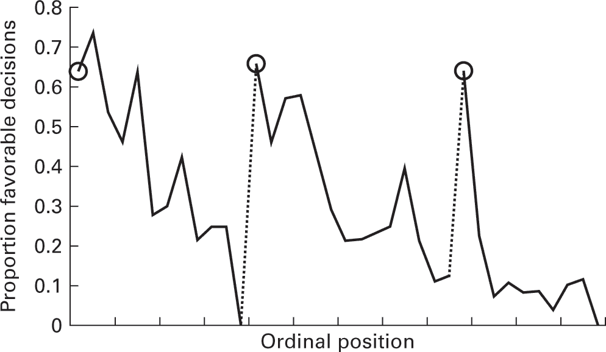

Figure 7.1Fraction of favorable rulings over the course of a day. The dotted lines indicate food breaks. From Shai Danziger, Jonathan Levav, and Liora Avnaim-Pesso. 2011.

如果判决顺序真正是随机的，这一发现将极其惊人；事实上，效应大小如此巨大，以至于有人认为应仅凭此就可以驳回该研究，因为该效应远超心理因素（如注意力）所能解释 \[306\].

作者们清楚认识到顺序并非随机，并进行了一些测试，以检查效应是否与与案件相关的因素有关（因为这些因素可能合法地影响有利裁决的概率）。他们未发现此类因素。但后来发现他们调查不够彻底。后续调查发现多个混杂因素和潜在混杂因素，包括在每个审理时段的末尾会优先审理没有律师代表的被告，且这些被告的胜诉率显著较低 \[307\]. 这使得原研究的结论失效。

## 测试决策及干预的影响

在我们的预测框架中，因变量（*Y*）并不受预测值（或评分，*R*）的影响。但在实际操作中并非如此。银行根据预测的违约风险设定贷款利率，而更高的利率会使借款人更有可能违约。决策对结果的影响是一个因果推断的问题。

我们还可以提出其他关于决策影响的重要问题。不同决策主体对正负决策的效用或成本可能不同。例如，大学录取对不同申请人具有不同的效用，这取决于他们是否也被其他大学录取或拒收。决策还可能影响非决策主体。例如，监禁不仅影响个人，还影响其所在社区 \[169\]. 量化这些成本有助于我们在设定决策阈值和权衡假正与假负时更具科学性。

测量决策影响的一种方法是通过实验，但由于法律、伦理和技术原因，这类实验往往不可行。相反，我们提出了一种自然实验设计，用于测试决策或公平干预对候选人的影响，称为 *回归不连续性*（row 4 in table 7.1）。


假设我们希望测试针对第一代大学生的基于 merit 的奖学金项目是否具有持久的有益影响——比如说，对他们毕业后的收入有影响。我们不能简单地比较获得奖学金的学生和未获得奖学金的学生的平均收入，因为这两个变量可能因内在能力或其他因素而产生混淆。但假设奖学金是基于考试成绩发放的，且设定了 85% 的阈值。那么我们可以比较考试成绩在 85 到 86% 之间（因此获得奖学金）的学生的收入，与考试成绩在 84 到 85% 之间（因此未获得奖学金）的学生的收入。我们可以假设在如此狭窄的考试成绩范围内，奖学金的发放基本上是随机的。例如，如果具有相同能力的学生的考试成绩标准误差为 5 个百分点，那么 84 与 86% 之间的差异就微不足道。因此，我们可以将奖学金的影响视作随机对照试验（RCT）来估计。

不过要小心。如果我们考虑过于狭窄的考试成绩区间，可能会导致用于推断的数据点不足。如果我们考虑更宽的考试成绩区间，这些学生可能不再是可交换的分析单元。

另一个陷阱在于我们假设获得奖学金的学生正好是那些成绩高于阈值的学生。如果这一假设不成立，就会立即引入混杂因素的可能性。也许考试成绩并不是唯一的奖学金标准，收入也被用作次要标准。或者，被提供奖学金的学生可能会因已经获得其他奖学金而拒绝。还有学生可能因为填写索赔表格繁琐而未领取奖学金。如果可以多次参加考试，富裕学生更有可能一直考 until 达到资格门槛。

### 纯观察性测试

纯观察性测试是定量歧视测试的最后一类。当我们无法对感兴趣的系统进行实验，也缺乏能够支持准实验研究的条件时，仍然可以利用纯观察数据回答许多问题。

经常使用观察数据的一个问题是决策者是否使用了敏感属性；这可以被视为审计研究的松散类比。此类分析常用于法律上关于不同处理的研究，尽管长期以来法律界对显式考虑敏感属性是否必然违法存在深刻且持久的争论 \[308\]。

最常见的做法是使用回归分析，看看除受保护属性之外的变量是否能够“解释”观察到的决策 \[309\]（见 表 7.1 的第 5 行）。如果不能解释，则决策者必须使用了敏感属性。但这是一种脆弱的检验。正如第 3 章所讨论的，在拥有足够丰富的数据集时，敏感属性可以通过其他属性重构。这并不奇怪，因为在法律语境下尝试应用该检验会演变成像 *SFFA v. Harvard* 那样的专家报告对峙，该案例在第 5 章中讨论。

我们当然可以更深入地利用观察数据和回归分析。举例来说，考虑性别工资差距。研究可能发现，在公司中，相同职位的男女 hourly wage 存在差距。反驳可能指出，控制了大学 GPA 和绩效评估分数后，差距消失。这类研究可视为对 *条件人口平等*（conditional demographic parity）的检验（见 表 7.1 的第 6 行）。需要对自变量与因变量之间关系的功能形式作出强假设。

在竞争性回归分析的主张之间弄清究竟哪个更可信并不容易。我们应当控制哪些变量，以及原因？有两种方式可以让这些观察性主张更具严谨性。第一种是使用因果框架，使我们的主张更精确。此时，因果建模可能会提醒我们尚未解决的问题：绩效评估分数为何在性别之间有所不同？不同角色和层级的性别构成又如何？探讨这些问题可能揭示不公平的做法。当然，在此情形下提出的问题显而易见，但其他情形可能更为复杂。

第二种更深入的方法是运用我们对公平的规范理解，判断哪些从性别到工资的路径是 morally 有问题的。如果工资差距是由众所周知的性别谈判加薪差异导致的，雇主是否有道德责任加以缓解？这当然是一个规范性而非技术性的问题。

### 基于结果的测试

本章节迄今已展示了多种情境——筛选求职候选人、同行评审、假释听证——它们的共同点是：虽然它们都旨在预测某些结果（工作表现、论文质量、再犯率），但研究者无法获得真实结果的数据。

在缺乏真实结果数据的情况下，研究重点转向决策时可观察的特征，例如工作资格。在这些情境中，研究者面临的持久困难是构建两组样本，它们只在敏感属性上有所不同，而在其他相关特征上完全相同。这往往是一个不可检验的假设。即使在如简历审计研究这类实验环境中，也存在大量解释空间：雇主是从姓名推断种族，还是从社会经济地位？在观察性研究中，结果可能因未观测的混杂因素（例如“饥饿法官”研究）而失效。

但如果结果数据可得，我们可以在不依赖除敏感属性之外的任何可观测特征的前提下，进行至少一种公平性测试：即检验充分性（sufficiency），该检验要求真实结果在给定预测（*Y*⊥ *A*|*R*）的条件下与敏感属性无关。例如，在贷款情境中，如果银行的决策满足充分性，则在任何狭窄的预测默认概率区间（*R*）内，不同群体（*A*）的违约率（*Y*）应保持相同。

通常，决策者（如银行）可以自行检验充分性，但外部研究者无法做到，因为研究者仅观察到 *Ŷ*（即贷款是否获批）而非 *R*。外部研究者只能检验预测平等（predictive parity），即任何群体（*A*）中被有利分类的申请人（*Ŷ* = 1）的违约率（*Y*）保持一致。这种观察性测试称为 *结果测试*（outcome test），见 表 7.1 的第 7 行。


-   [费曼学习法](https://wiki.example.org/feynmans_learning_method)的灵感源于诺贝尔物理奖获得者**Richard Feynman**。

1.  运用费曼技巧，你只需花上`20 min`就能深入理解知识点，而且记忆深刻，*难以遗忘*。

```
if (condVar > someVal) {console.log("xxx")}
```


第二，在区分基于偏好和统计歧视方面存在实际困难。通常，看似“偏好”歧视的现象，其实只是决策者信息和信念不完善的结果。例如，乍看之下，汽车谈判研究的结果似乎是典型的偏好歧视案例。但也许经销商知道不同客户对竞争报价的获取情况不同，从而对同一商品的愿意支付意愿也不同。于是经销商以种族作为这一差异的代理（是否正确则另当别论）。事实上，论文提供了这种解释的初步证据。相反的情况也可能发生：如果研究者不知道决策者所观察的全部特征，偏好歧视可能会被误判为统计歧视。

第三，我们关注的许多公平问题（如结构性歧视）并不符合上述两类标准（因为它们只考虑相对决策点近的原因）。我们在第 8 章讨论结构性歧视。

最后，还要注意，大学为 STEM 学院提供的激励性多元化激励措施；以及决策者基于先前歧视的假设——CV 相同的女性候选人被认为比男性候选人具有更高的内在能力。注意，如果这一假设正确，那么偏好女性候选人就是在最大化预测职业成功的准确性（accuracy maximizing）。这也符合某些公平标准，如反事实公平（counterfactual fairness）。

总结来说，与其采用一刀切的方式来理解味觉歧视与统计歧视等机制，更有价值的做法是采用细致且领域特定的方法，我们在部分假设的形成中通过研究决策过程和组织（尤其是定性方式）来进行。让我们现在转向这些研究。

## 决策过程和组织研究研究

一种研究决策过程的方法是通过对决策者或组织进行调查。有时这类研究会揭示显性歧视，例如雇主对种族的强烈偏好 \[318\]。然而，随着时间的推移，这类公开态度已变得不那么常见，或至少不太可能公开表达 \[319\]。歧视往往以更为微妙、间接和隐蔽的方式运作。

人类学研究在帮助我们理解隐蔽歧视方面表现出色。人类学是社会科学的主要研究方法，基于研究者在较长时间内沉浸于研究对象的日常活动之中，其核心思想是研究者与被研究对象同处一环。它采用一系列互补于并与定量方法相生的定性方法。人类学能够提出定量方法难以涉及的更深层次问题，并产出关于文化的富有细节的描述。它也有助于提出可以通过定量方法进行检验的假设。

一个很好的例子是劳伦·里维拉（Lauren Rivera）所著的书 *Pedigree*，该书考察了精英咨询、金融和律所的招聘实践 \[320\]。这些公司共同构成了大学毕业生获得最高薪酬、最具吸引力的入门职位的主要来源。作者使用了两种标准的人类学研究方法。第一种是 120 份面试，她以一名对实习机会感兴趣的研究生身份进行。第二种方法是所谓的“参与观察”：她在获得使用观察结果进行研究的同意后，在一家公司担任无偿人力资源岗位 nine 个月。研究者成为文化参与者的好处包括：获得更大的进入程度，提出更细致的问题，以及增加主体在未被观察时的自然行为的可能性。

从书中得到的若干启示与我们相关。首先，招聘过程大约有九个阶段，包括外联、招聘活动、筛选、多轮面试和 deliberations（审议），以及“推销”活动。这凸显了任何只关注过程某一环节的定量研究（例如仅评估简历）在范围上的局限性。其次，该过程与第 1 章所描述的、基于（虽然有些噪音）标准化属性集预测工作绩效的理想模型差距甚大。面试官会花费出人意料多的精力关注那些应当无关紧要或仅次要重要的属性，例如休闲活动，而这些属性实际上是阶级的标志。来自特权背景的申请人更有可能被视为有利，原因是他们可以腾出更多时间从事这些活动，并且具备这些看似无关紧要的属性在招聘中实际上起作用的内部知识。企业所使用的、被认为是工作绩效预测指标的信号，如书名中的 *pedigree*（精英背景），同样与社会经济地位高度相关。作者认为，这些招聘实践解释了为何社会沿袭性精英地位得以延续。我们认为，尽管统计方法在招聘中的使用有限，但其谨慎的运用仍可能缓解书中揭示的强烈社会阶层偏好。 


-   [Inside Graduate Admissions]的作者 Julie Posslet 专注于教育而非劳动力市场`\[321\]`。该书基于作者对九个学科研究生招生委员会在两年内决策过程的观察。贯穿全书的一个显著主题是形式化决策与整体化决策之间的张力。例如，委员会声称预测力有限，却过度依赖 GRE 分数，这可能是因为定量指标（如推荐信）缺乏主观解释的难度。这种做法被认为能*减少招生过程中的教职员工之间的张力*。另一方面，决策者隐含（甚至明确）意识到，若招生标准过于形式化，某些申请人群体（尤其是中国申请人）将更容易被录取，这被视为不 desirable。因此，作者主张采用更整体化的标准，通常包括诸如“教职员工认为申请人的爱好‘很酷’”等主观因素。作者指出，招生委员会使用看似中立的标准，几乎不讨论申请人的种族、性别或 socioeconomic status，但这些标准仍可能 perpetuate 不平等。例如，委员会可能不愿录取那些在申请材料显示将受益于更密集辅导的申请人。

This concludes the first part of the chapter. Now let us turn to algorithmic systems. The background we’ve built up so far will prove useful. In fact, the traditional tests of discrimination are just as applicable to algorithmic systems. But we will also encounter many novel issues.

## Part 2: Testing Discrimination in Algorithmic Systems

An early example of discrimination in an algorithmic system is from the 1950s. In the United States, applicants for medical residency programs provide a ranked list of their preferred hospital programs to a centralized system, and hospitals likewise rank applicants. A matching algorithm takes these preferences as input and produces an assignment of applicants to hospitals that optimizes mutual desirability.

Early versions of the system discriminated against couples who wished to stay geographically close, because couples could not accurately express their joint preferences: for example, each partner might prefer a hospital over all others but only if the other partner also matched to the same hospital`\[43, 322\]`. This is a noncomparative notion of discrimination: the system does injustice to an applicant (or a couple) when it does not allow them to express their preferences, regardless of how other applicants are treated. Note that none of the tests for fairness that we have discussed are capable of detecting this instance of discrimination, as it arises because of dependencies between pairs of units, which is not something we have modeled.

There was a crude attempt in the residency matching system to capture joint preferences, involving designating one partner in each couple as the “leading member”; the algorithm would match the leading member without constraints and then match the other member to a proximate hospital if possible. Given the prevailing gender norms at that time, it is likely that this method had a further discriminatory impact on women in heterosexual couples.

Despite this and other early examples, it was in the 2010s that testing unfairness in real-world algorithmic systems became a pressing concern and a distinct area of research. This work has much in common with the social science research that we reviewed, but the targets of research have expanded considerably. In the rest of this chapter, we review and attempt to systematize the research methods in several areas of algorithmic decision making: various applications of natural language processing and computer vision, ad targeting platforms, search and information retrieval tools, and online markets (none, ride hailing, vacation rentals, etc. Much of this research has focused on drawing attention to the discriminatory effects of specific, widely used tools and platforms at specific points in time. While that is a valuable goal, we aim to highlight broader, generalizable themes in our review. We close the chapter by identifying common principles and methods behind this body of research.

## Fairness Considerations in Applications of Natural Language Processing

One of the central tasks in natural language processing (NLP) is language identification: determining the language that a given text is written in. It is a precursor to virtually every other NLP operation on the text, such as translation to the user’s preferred language on social media platforms. It is considered a more or less solved problem, with relatively simple models based on n-grams of characters achieving high-level accuracies on standard benchmarks, even for short texts that are a few words long.

However, a 2016 study showed that a widely used tool, langid.py, which incorporates a pretrained model, had substantially more false negatives for tweets written in African American English (AAE) compared to those written in more common dialectal forms: 13.2 percent of AAE tweets were classified as non-English compared to 7.6 percent of “White-aligned” English tweets. AAE is a set of English dialects commonly spoken by Black people in the United States (of course, there is no implication that all Black people in the United States primarily speak AAE or even speak it at all). The authors’ construction of the AAE and White-aligned corpora themselves involved machine learning as well as validation based on linguistic expertise; we defer a full discussion to chapter 9, on datasets. The observed error rate disparity is likely a classic case of the training data.

Unlike the audit studies of car sales or labor markets discussed earlier, here it is not necessary (or justifiable) to control for any features of the texts, such as the level of formality. While it may certainly be possible to “explain” disparate error rates based on such features, that is irrelevant to the questions of interest in this context, such as whether NLP tools will perform less well for one group of users compared to another.

NLP tools range in their application from aids to online interaction to components of decisions with major career consequences. In particular, NLP is used in predictive tools for screening of résumés in the hiring process. There is some evidence of potential discriminatory impacts of such tools, both from employers themselves`\[323\]` and from applicants`\[324\]`, but it is limited to anecdotes. There is also evidence from the lab experiments on the task of predicting occupation from online biographies`\[325\]`.


我们简要回顾了其他发现。自动化论文评分软件倾向于系统性地为某些人口群体 \[326\] 打分较低，而人类评分员的评分本身可能具有歧视性 \[327\]。仇恨言论检测模型根据方言特征作为毒性的预测指标，根据实验室研究 \[328\]，这导致对少数族裔说话者的歧视。许多情感分析工具会根据文本中提及的与种族或性别相关的个人姓名给出系统性不同的评分 \[329\]。语音转文字系统对于某些口音的使用者表现较差 \[330\]。在这些情况下，文本的作者或说话者可能受到伤害。在其他 NLP 系统中，如自然语言生成或翻译，存在另一种公平性问题，即生成的文本反映了文化偏见，对某一群体造成代表性伤害 \[331\]。Table 7.2 摘要了上述讨论。

Table 7.2 四种 NLP 任务及其可能导致的不公平类型。注意，第一部分讨论的传统测试是在预测结果的背景下进行的（表格第 3 行）。

| 任务类型 | 示例 | 不公平来源 | 伤害 |
| --- | --- | --- | --- |
| 知觉 | 语言识别, | 训练数据中未足代表 || 服务退化 |
|  | 语音转文字 | 语料库 || |
| 自动化判断 | 毒性检测, | 人工标注，训练数据中未足代表 || 产生不利决策 |
|  | 论文评分 | 训练语料库 || |
| 预测结果 | 简历筛选 || 各种，包括人工标注 || 不利决策 |
| 序列预测 | 语言生成, | 文化刻板印象，历史 || 代表性伤害 |
|  | 翻译 || 偏见 || |

关于文化刻板印象在词向量嵌入中的研究有一条线。词向量嵌入是对语言单元的表示；它们不对应任何语言或决策任务。因此，在没有明确指向具体下游任务的前提下，对词向量嵌入本身提问公平性是没有意义的。更广泛地说，将公平性作为模型的属性而非行为、输出或决策过程来赋予是没有意义的。

## 人口统计差异和计算机视觉的存疑应用

与 NLP 相比，计算机视觉技术在 2010 年代因大规模训练语料的可用性和神经网络训练硬件的改进而取得了重大进展。如今，许多分类器被用于商业产品中分析人类图像和视频。不出所料，它们在性别、种族、肤色等属性以及更深层次的伦理问题上往往表现出性能差异。

关于错误率差异的显著示例来自 Joy Buolamwini 和 Timnit Gebru 对三款商业性别分类工具的分析，这些工具由 Microsoft、IBM 和 Face++ 开发，用于根据图像判断人物性别为女性或男性 \[332\]。研究发现，这三款分类器在男性面孔上表现优于女性面孔（错误率差异为 8.1–20.6%）。此外，它们在浅色面孔上也优于深色面孔（错误率差异为 11.8–19.2%），而在深色女性面孔上表现最差（错误率为 20.8–34.7%）。最后，由于所有分类器将性别视为二元，非二元性别人士的错误率可视为 100%。

如果我们把分类器的目标变量视为性别，将敏感属性视为肤色，则可以将观察到的差异分解为两个独立问题：第一，女性面孔被误判为男性的频率高于男性面孔被误判为女性的频率。这一问题可以通过在不改变训练过程的前提下重新校准分类阈值来相对容易解决。第二种更深层次的问题是，深色面孔被误判的频率高于浅色面孔。

图像分类工具在实现地理公平方面尤其困难，原因是训练数据的偏倚。2019 年的一项研究评估了五种流行的物体识别服务，对来自 54 个国家的家庭用品图像进行了测试 \[333\]。研究发现，不同国家之间存在显著的准确率差异，较低收入国家的图像被错误分类的比例更高。作者指出，像洗洁精或香料容器等家庭用品在不同国家的外观差异很大。这些问题在对人像进行分类时更为突出。2017 年的一项分析发现，基于 ImageNet 和 Open Images 两个主要物体识别数据集训练的模型在识别来自巴基斯坦和印度等国家的新郎图像时表现显著下降，而北美和欧洲国家的新郎图像则更易被正确识别（这些国家的婚礼服饰常被错误识别为链甲，一种盔甲）\[334\]。

在图像分类和人脸识别系统中，已有传闻证据表明存在其他类型的不公平。至少有两种图像分类系统被证实对人物照片应用贬义和侮辱性标签 \[335, 336\]。人脸识别系统据称表现出跨种族效应，即在训练数据中表现不足的种族群体的面孔更容易被混淆 \[337\]。这一可能性早在 1991 年的简单线性人脸识别模型中就被展示 \[338\]。许多商业产品在检测深肤色人脸方面存在困难 \[339, 340\]。实验室对公开可用的物体检测模型的研究也得出了类似结果 \[341\]。

更广泛而言，计算机视觉技术似乎特别容易被以根本上存疑的伦理方式误用。以性别分类为例：尽管 Microsoft、IBM 和 Face++ 已努力缓解前文所述的准确率差异，但更重要的问题是：为何要构建性别分类工具？其最常见的应用似乎是根据推断的性别（以及其他特征，如年龄、种族、当前情绪）在公共空间（如路牌、商店或出租车后座屏幕）投放定向广告。我们在此不重复对定向广告的反对意见，但这一话题在公众讨论中广泛，且在美国至少受到公众强烈反对 \[342\]。

伦理上存疑的计算机视觉技术远不止上述例子，还包括“美化”用户面部照片的应用（即修改以符合主流美感），声称“识别”情绪的应用（被指为伪科学），以及分析视频画面以寻找如肢体语言等线索以筛选求职者的应用 \[343\]。

## 搜索与推荐系统：三种伤害类型


搜索引擎、社交媒体平台和推荐系统在目标和底层算法上各有不同，但从公平性的角度来看，它们也有许多共同点。它们并非决策系统，也不直接提供或剥夺人们机会。相反，在这些系统中可能出现（至少）三种差异及其相应的损害。首先，它们可能更好地满足某些消费者（搜索者或用户）的信息需求，而对其他人则较差。其次，它们可能在 `producers`（内容创作者）之间造成不平等，通过优先推荐某些内容而忽视其他内容。第三，它们可能通过放大和延续文化刻板印象而造成代表性损害。还有大量其他关于信息平台的伦理问题，例如可能导致社会政治极化的风险。但我们将关注可以被视为歧视形式的损害。

### 对消费者的不公平

不公平对消费者的一个例子来自一项关于协同过滤推荐系统的研究，该研究使用理论和模拟方法（而非对已部署系统的现场研究）\[344\]。协同过滤是一种基于其他系统用户的显式或隐式反馈（如评分和消费）来提供推荐的方法。其背后的直觉体现在“同样喜欢此项内容的用户也喜欢……”功能上。研究发现，此类系统在为少数群体推荐内容方面表现不佳，即它们更难在该群体用户喜欢的内容上取得好结果。另一种导致表现不佳的原因是，某一群体的用户较难被观察，也就是说，他们不太可能提供评分。底层假设是不同群体的偏好不同，因此系统对一个群体的学习不一定能推广到其他群体。

总体而言，这种不公平在真实系统中（不仅是外部研究人员，甚至系统运营者本人）很难研究。主要难点是准确测量目标变量。从公平性角度来看，相关的目标构造是用户对结果的满意度或结果服务于用户需求的程度。点击和评分等指标只是粗糙的代理，本身也受到人口统计测量偏差的影响。公司会投入大量资源进行 A/B 测试或其他实验方法，以优化搜索和推荐系统，并且经常测量人口统计学差异。但需要强调的是，这些测试几乎总是强调对公司有利的指标，而非用户的利益或收益。

一个罕见的突破此局限的尝试是由 Rishabh Mehrotra、Ashton Anderson、Fernando Diaz 等人对必应搜索引擎进行的（内部）审计研究 \[345\]。作者设计了方法，通过控制人口统计因素对行为指标的影响，将用户满意度与其他人口特定的变异区分开来。他们结合了一种直接推断潜在差异的方法，而不是先为每个人口统计群体估算用户满意度，再比较这些估算。该方法通过诸如重新构建查询等满意度代理来判断随机选取的一对展示中哪一对导致更高的用户满意度。重新构建查询是对结果不满的强烈信号。基于这些方法，他们发现性别之间没有满意度差异，但年龄存在轻微差异。

### 对内容创作者的不公平

2019 年，一群内容创作者起诉 YouTube，指控其算法以及人工审核员压制了以 LGBT 为主题的视频的传播范围，并限制了从中获取广告收益的能力。这与前文讨论的问题有所不同，因为指控的焦点是对创作者的损害而非对消费者的损害（当然，对 LGBT 内容感兴趣的 YouTube 观众也同样可能受到影响）。还有许多其他持续的指控和争议属于此类：搜索结果和社交媒体平台的党派偏见、搜索引擎偏好其自有属性而非竞争对手的结果、在线政治广告的事实核查，以及对所谓版权违规的监管不足（或过于激进）的情况。通过公平和歧视的视角来讨论和解决这些问题较为困难，更应从更广阔的权力与问责视角来审视。核心问题是，当信息平台对公共话语拥有控制权时，它们便成为 competing interests 和 viewpoints 冲突的仲裁者。从法律角度看，这些问题主要属于反垄断法和电信监管范畴，而非反歧视法。

### 代表性损害

书籍 *Algorithms of Oppression* 引起了关注，指出搜索引擎如何强化有害的种族、性别和交叉性别刻板印象 \[48\]。此外，还有一些定量研究针对这些损害的不同方面。保持我们的定量关注，让我们讨论一项研究：该研究测量了 Google 图像搜索结果中四十五个职业（如 *author*, *bartender*, *construction worker* 等）的性别偏差与现实世界中相应职业的性别比例之间的对应程度 \[37\]。这可以被视为校准测试：实例是职业，搜索结果中女性比例被视为预测实际女性比例的指标。研究发现，对于刻板印象的夸大缺乏强有力证据，即职业统计中的不平衡在图像搜索结果中被放大了。不过，这些偏差很小。

考虑一个思想实验：如果该研究发现没有校准错误，那么 resulting system 是否公平？对于至少两个原因，答案是否定的。首先，该研究在美国范围内比较了图像搜索结果与职业统计的性别偏差；不同国家和文化中，性别刻板印象以及职业统计本身差异显著。其次，即使准确反映现实统计，若这些统计本身偏颇且源于历史偏见，系统仍会造成代表性损害，因为这会导致边缘群体缺乏可见的典型代表。信息平台应承担多大责任以减少这些不平衡，以及哪种干预措施是正当的，仍是争论的焦点。

### 理解广告投放中的不公平

传统上，广告投放方式相对粗糙。例如，健康杂志可能会投放美容产品广告，利用粗略的相关性。与以往方法相比，在线投放具有几个关键优势：能够收集个人的精细数据、能够触达利基受众（理论上受众规模可以只有 1 人，因为广告内容可以程序化生成并根据用户属性输入自定义）、以及能够测量转化（转化是指用户在看到广告后点击并进一步执行如购买等动作）。迄今为止，广告投放已成为机器学习最具商业影响力的应用之一。

现代广告投放的复杂性导致了广告展示人口统计学差异的多种途径，这些将在本文中研究。但将这些差异与公平性联系起来并不显而易见。毕竟，许多类型的人口统计投放（如按性别投放的服装广告）被认为是无害的。


有两种框架用于理解广告定向可能带来的潜在损害。第一种框架将广告视为为其接收者 unlocking（打开）机会的工具，因为它们提供观众可能原本不知道的信息。这也是为什么基于受保护类别定位就业或住房广告可能不公平且违法的原因。目标受限的领域广泛对应于那些影响公民权利的领域，反映了这些领域中歧视的复杂历史，如第 6 章所讨论。

第二种框架将广告视为一种说服工具，而非信息传播工具。在这种框架下，损害源于广告具有操纵性——即以隐蔽的方式施加影响，而不是直接进行诉求——或利用刻板印象 \[346\]。用户因接收那些给他们带来负面效用的广告而受到伤害，而在第一种框架中，损害则来自错失那些具有正面效用的广告。两种框架并不必然相互矛盾。相反，单个广告或广告活动可以被视为主要是信息性的或主要是说服性的，因此，一种框架可能更适合进行分析。

关于种族和性别在广告中如何呈现的文献非常丰富；我们将这类文献视为属于说服框架 \[347\]。然而，这一研究线仍未将注意力转向在线定向广告，后者有潜力通过针对特定个人和群体，放大操纵和刻板印象的危害。因此，我们强调的经验研究属于信息性框架。

导致同一目标广告更频繁地触达某一群别的机制大约有三种。最明显的是广告商使用显式的定位标准：要么直接使用敏感属性本身，要么使用其代理（例如 ZIP 码作为种族的代理）。例如，Facebook 提供了成千上万的定位类别，其中包括系统自动根据用户对其兴趣的自由文本描述而构建的类别。ProPublica 的调查发现，这些类别包括“犹太仇恨者”和许多其他反犹太主义词汇 \[348\]。公司在消除即使是对敏感类别的直接代理方面也面临困难，导致屡次披露。

第二种产生差异的机制是优化点击率（或另一种有效性指标），这是算法定向的核心目标之一。与第一类不同，这不需要广告商或平台的明确意图。算法系统可能会根据用户过去的行为、她表达的兴趣以及其他因素（包括可能明确表达的敏感属性）来预测用户与广告互动的概率。

第三种机制是市场效应：向不同用户投放广告可能使广告商的成本不同。例如，一些研究者观察到，向女性投放广告的成本高于向男性投放广告，并推测这是因为女性点击广告的频率更高，从而导致更高的有效性度量 \[267, 349\]。因此，如果广告商仅指定总预算并将投放交给平台（这是常见做法），那么受众构成将取决于预算：较小的预算会导致成本较低的群体被过度代表。

在检测这些差异的方法方面，研究人员和记者主要采用两种途径：要么作为用户，要么作为广告商与系统互动。Amit Datta、Michael Carl Tschantz 和 Anupam Datta 创建了模拟用户，在 Google 广告设置页面上将“性别”属性设为女性或男性，发现 Google 更频繁地向模拟的男性用户展示了来自某个职业培训机构的广告，该机构承诺高薪 \[350\]。虽然这类研究表明 Google 广告系统的就业广告并非对性别（在广告设置页面上表达）不敏感，但它无法揭示机制，即无法区分广告商的显式定位和平台的各种效应。

作为广告商与广告平台互动的方法在分析 Facebook 广告系统方面已被证明更为有效。这是因为 Facebook 向广告商提供的信息远比向用户提供的信息多，甚至允许广告商了解平台推断或购买的关于用户的更多信息，而用户本人无法访问这些信息 \[351\]。正如上文提到的，反犹太主义自动生成的定位类别的存在是通过广告商界面被发现的。Facebook 的广告投放已被发现因市场效应和优化效应而导致人口统计学上的差异 \[267\]。也就是说，即使广告商没有明确按性别等因素定位广告，也可能出现系统性的性别偏差。优化效应是由 Facebook 分析广告内容实现的，这包括图像分析，研究人员通过一种巧妙的技巧——向用户展示内容透明但对人眼不可见的广告，从而让内容分析算法提取内容——揭示了这一事实。研究人员发现，透明图像的内容会影响广告投放，证明 Facebook 确实执行自动图像分析 \[267\]。

## 在线市场 places 的公平性考量

2010 年代，叫车、短期住宿和自由职业（兼职）工作平台兴起：显著的例子包括 Uber、Lyft、Airbnb 和 TaskRabbit。它们是公平性研究的重要目标，因为它们直接影响人们的生计和机会。我们将在讨论中排除某些类型的市场。在线约会应用与这些市场有些相似，但需要完全单独的分析，因为浪漫关系的规范与商业和就业的规范不同 \[352\]。此外，还有商品市场，如 Amazon 和 eBay。在这些市场中，参与者的特征不如产品属性显著，因此歧视性偏见的关注度较低（但这并不意味着不存在）\[353\]。

与之前研究的领域不同，机器学习并不是在线市场 places 算法的核心组成部分。（不过，我们将其纳入范围，因为我们关注更广泛的决策和公平性，而不仅仅是机器学习。）因此，公平性问题更多是关于买家和卖家的歧视，而不是训练数据或算法本身。例如，一项研究发现 Uber 驾驶员会在不想接载乘客的地区关闭应用程序 \[354\]。


# 线上市场中的歧视检测方法

线上市场中的歧视检测方法与传统环境（如住房和就业）相似；审计研究和观察方法的结合已被使用。一个显著的例子是本杰明·埃德尔曼、迈克尔·卢卡和丹·斯维斯基针对 Airbnb 的领域实验 \[355\]。作者创建了名称暗示种族（非裔美国人或白人）和性别（女性或男性）但除此之外完全相同的假客户账户，使用了 20 个不同的名称：每种种族和性别组合各 5 个。随后，他们通过这些账户联系了 6,400 个列表的主机，在五个城市询问可用性。他们发现，名字听起来像白人的人的询问接受率为 50%，而名字听起来像非裔美国人的询问接受率为 42%。这种差异在主机的种族、性别、经验、列表类型（高价或低价；整套房或共享）以及社区多样性方面均保持一致。需要注意的是，账户没有头像照片；如果主机在一定程度上是根据外貌来推断种族，那么改变账户的头像照片可能会发现更大的效果。

与传统环境相比，在线平台上可以轻易获得某些观察数据，这对研究者很有用。在上述研究中，列表评论的公开可得性证明了其价值。虽然它不是研究设计的必要条件，但它提供了一个有趣的有效性检查。当分析仅限于样本中 29% 的主机——这些主机至少收到过一条非裔美国人宾客的评论——时，种族差异在响应中急剧下降。如果研究结果是实验设计的偶然现象而非 Airbnb 主机的实际种族歧视，那么解释为何在该子集的主机中效果会消失将会很困难。这支持了该研究的外部有效性。

此外，在线市场还必须面对的另一个公平问题涉及地理差异的效果。一项关于 TaskRabbit 和 Uber 的研究发现，人口密度高且收入高的社区从共享经济中获得最大收益 \[356\]。由于贫困与种族/民族之间存在普遍关联，这些社区也转化为种族差异。在本研究所在的芝加哥地区，黑人和拉丁裔社区人口密度较低，这进一步加剧了这一效果。

当然，这些市场的地理和结构性差异并非由在线平台造成，线下类似的情况（如基于口碑的零工工作）也存在这些差异。事实上，在打车招手的场景中，种族歧视的程度远大于技术中介的交互场景 \[357\]。然而，与受反歧视法律监管的市场（如酒店）相比，在线市场的歧视更为严重。无论如何，这些平台的正式化特性使审计更加容易。此外，这些平台的集中化特性为公平干预提供了强大的机会。

平台可以通过设计来最小化用户进行歧视的能力（例如隐藏对方信息）以及促使歧视的动力（例如在界面上使参与者特征不那么显著，而突出产品特征） \[358\]。平台无法对参与者的歧视保持中立立场：即使是未明确考虑歧视的选择，也会影响用户的偏见态度如何转化为歧视行为。

作为设计决策的具体例子，Airbnb 研究的作者建议平台在预订前隐藏宾客信息（注意，叫车服务也隐藏客户信息；而拼车服务则允许用户在选择匹配时查看姓名，这不出所料地使得对种族少数群体的歧视成为可能 \[359\\]）。关于地理不平等的研究建议，拼车服务等可以提供“地理声誉”评分给司机，以应对司机常常错误地认为某些社区比实际更危险的问题。

## 歧视机制

我们已经查看了若干关于在算法系统中发现不公平的研究。让我们来梳理一下。

在导论章节中，我们从高层次上讨论了机器学习系统中不公平可能出现的不同方式。这里我们看到，不公平的具体来源和机制可以既复杂又具有领域特定性。研究人员需要了解该领域，才能有效提出和测试关于不公平来源和机制的假设。

例如，考虑前文提到的性别分类系统研究。人们很容易猜测不代表性的训练数据导致了观察到的准确率差异，但不代表性在何种方面？跟进论文由 Vidya Muthukumar、Pedapati Tejaswini、Ratha Nalini 等人考虑了这个问题 \[360\]。他们在实验室环境中（而非原始论文中的商业 API 现场测试）分析了多个最先进的性别分类器，并指出训练数据中较深肤色调的代表性不足并不是导致观察到的差异的原因。相反，作者提出的机制基于这样一个事实：许多面部人像训练数据集包含名人照片。他们发现，名人女性的照片相比一般女性的照片有更显著的化妆。这导致分类器将化妆作为性别的代理，而这种代理并不推广到整个人口。

略有不同的假设可以产生截然不同的结论，尤其是在内容生产者、消费者和平台之间存在复杂交互的情况下。例如，Ronald Robertson、Shan Jiang、Kenneth Joseph 等人进行的一项研究测试了搜索引擎中的党派偏见，以及相关的“过滤泡泡”假设——即搜索引擎返回的结果会强化搜索者既有观点。研究人员招募了不同政治观点的参与者，从其电脑上在标准窗口和无个人化窗口中收集了关于政治话题的 Google 搜索结果，发现标准（个性化）搜索结果并不比无个人化的搜索结果更具党派性，似乎为反驳“在线搜索强化用户既有信念”的主张提供了证据。

这一发现与事实相符：Google 只根据搜索者位置和近十分钟的搜索历史来个性化搜索结果，这一点已由 Google 本人承认 \[362\] 以及 prior 研究证实 \[363\]。


然而，更为合理的关于搜索中的滤波泡（filter-bubble）效应的假设来源于 Francesca Tripodi 的一项质性研究 \[364\]。为简化我们的阐述，假设如下：当一场具有政治意义的事件发生时，关键影响者（政治家、政党新闻媒体、利益集团、政治信息论坛）会迅速构建他们自己的事件叙事。这些叙事通过党派信息网络选择性地传递给各自的党派受众。随后，这些人会转向搜索引擎以进一步了解或“验证事实”。关键在于，他们使用不同的搜索词来指代同一事件，这反映了各自所接触的不同叙事。由于新闻和评论的生产者有选择性且有策略地依据这些叙事来满足党派需求，搜索结果往往截然不同，从而强化了搜索者的信念。值得注意的是，即使搜索算法本身可能是中立的，这种产生滤波泡的机制仍能有效运作。

最后，为了进一步说明差异产生机制可能微妙，以及需要领域专业知识才能提出正确假设，我们举一个记者调查的例子：staples.com 向某些邮政编码区的用户展示了折扣价格，这些邮政编码区平均上更富裕 \[365\]。然而，实际定价规则——正如记者所报道的——是：如果客户的推断位置附近约二十英里内存在竞争对手的实体店铺，则该客户将看到折扣！这种做法显然是为了推断客户的保留价格或支付意愿。顺便提一下，这与本章开头讨论的汽车销售歧视研究中的“统计歧视”类似。

## 算法审计中的公平性标准

虽然算法系统中的不公平机制各不相同，但算法决策的适用公平性标准与其他决策方式相同。不过，某些公平概念在算法决策中比在人类决策中更常见，某些则较少涉及。我们在此提出几条观察。

### 公平性作为“盲目”

在算法系统的审计研究中，公平性作为“盲目”出现的情况较少；这类系统通常被设计为对敏感属性“盲”。而且，公平性问题往往正是“盲目”并不能有效纠正的。例外情况出现在广告投放和在线市场 places，因为非盲目决策实际上是由用户而非平台做出的。

### 不公平性作为“任意性”

决策可以被视为任意且不公平的两种主要情形。第一种是决策凭临时而非遵循统一程序做出。由于自动化决策产生程序性一致性，这种担忧通常不显著。

第二种情形是，即使存在统一程序，只要该程序依赖于被认为无关紧要（无论是统计上还是道德上）的因素，决策仍可被视为任意。机器学习擅长发现相关性，常常识别出令人困惑或显然不可接受的因素。例如，在 Graduate Record Examination（GRE）等适应性测试中，作文会被自动评分。虽然 e‑rater 等工具经过验证并与人类评分员表现相似，但它们仍可被训练成给机器生成的废话打出满分。请记住，没有直接的标准可以判断某一特征是否在道德上是有效的（第 2 章），必须逐案讨论。

更严重的问题是，当分类器根本没有经过适当的有效性检验时会出现的情况。例如，有若干公司声称可以通过性格测试、视频中的肢体语言等特征来预测求职者的匹配度 \[343\]。然而，缺乏同行评审的证据表明这些因素能预测工作表现，也没有依据相信如此。因此，即便这些系统不导致人口统计学上的差异，它们仍在“任意性”上是不公平的：接受不利决策的候选人缺乏了解决决策依据的途径，也无法质疑或了解如何提升成功机会。

### 观察性公平性标准

包括人口平等、错误率平等和校准在内的标准在算法公平研究中受到广泛关注。便利性可能是选择这些指标的主要原因：它们易于获取并直接报告，而不一定能够直接关联到道德层面的公平概念。我们再次提醒，过度使用基于平等的概念是有风险的；平等不应单独作为目标。至少，在决定适当干预措施之前，必须先理解导致差异的根源及其带来的危害。

### 代表性伤害

传统上，分配性伤害和代表性伤害分别在不同文献中研究，反映了它们主要出现在不同生活领域（例如，住房歧视与广告中的刻板印象）。然而，许多算法系统既可能产生分配性伤害，也可能产生代表性伤害。例如，面部识别系统对肤色较深的人表现不佳既令人不快，也可能阻碍该人使用数字设备或通过生物特征安全进入建筑物。

## 信息流、公平与隐私

在算法审计中，常见的概念是“信息流”。该准则要求敏感信息不应在不同信息系统之间或系统内部流动。例如，健康网站可能承诺用户的活动（如搜索和点击）不会与保险公司等第三方共享（因为这可能导致保险费用出现歧视性影响）。这可以看作是“盲目”概念的推广：盲目是指不利用已有的敏感信息，而限制信息流则确保敏感信息根本不存在，以便他人无法基于其进行操作。

我们称之为“ adversarial test”（对抗性测试）的强有力检测信息流违规的方法 \[350\]。它不直接检测信息流本身，而是检测基于该信息做出的决策。之所以强大，是因为它不需要明确指定目标变量，从而降低了研究者对领域知识的要求。下面用健康网站的例子来说明对抗性测试的操作步骤：

1. 创建两组模拟用户（*A* 与 *B*），即机器人，它们在所有方面相同，唯一区别是组 *A* 的用户浏览了敏感网站，而组 *B* 的用户没有。 


2. 让两组用户浏览 `other` 网站，这些网站被认为是从保险公司投放广告，或根据用户兴趣个性化内容，或以某种方式根据用户的健康信息定制内容。这是关键点：研究人员无需假设可能导致不公平结果的机制（例如，哪些网站或第三方可能接收敏感数据，个性化是否以广告、价格或内容的其他方面形式出现）。

3. 记录上一步中所有用户所看到的网页内容。

4. 训练一个二元分类器，用于区分组 `A` 用户和组 `B` 用户所接触的网页。使用交叉验证来测量其准确率。

5. 如果信息流约束得到满足（即健康网站未向任何第三方共享用户信息），则步骤 2 中浏览的网站对步骤 1 中用户的活动是“盲”的；因此两组用户看起来完全相同，无法系统性地区分组 `A` 与组 `B` 所看到的内容。分类器的测试准确率不应显著超过 ``。可以使用置换检验来量化，在实际不存在系统性差异的情况下，分类器观察到的准确率（或更好）出现的概率 [366]。

还有若干关于适当随机化和对照的细节，我们引用 Datta、Tschantz 和 Datta 的研究 [350]。请注意，如果对抗性测试未能检测到效应，并不意味着信息流约束得到满足。此外，对抗性测试无法测量效应大小。即便如此，此类测量也是无意义的，因为目标是检测信息流动，而系统可观测行为的任何效应都仅是其代理。

这种将信息流视为“盲性”的一般化，揭示了隐私与公平之间的重要关联。基于此原则的许多研究既可以被视为隐私调查，也可以被视为公平调查。例如，一项研究发现 Facebook 在声称为了提高账户安全而征集用户电话号码，但实际将这些号码用于广告投放 [367]。这体现了系统内部未披露的信息流动。另一项研究利用广告重定向——在一网站的行为（如搜索产品）会在另一网站出现该产品广告——来推断广告公司之间交换用户数据 [368]。这两项研究均未使用对抗性测试。

## 研究方法比较

在在线平台上审计用户公平性时，主要有两种方法：创建假账户和招募真实用户作为测试者。两者各有优劣。与传统的审计研究相比，这两种方法的优势在于可以因创建假账户或在线招募测试者的便利性，可能实现更大的规模（如通过众包等方式）。

规模化对于测试不同地区的差异尤为重要，因为许多在线平台具有全球覆盖。通常可以通过操纵测试设备来报告虚假位置，从而模拟地理分布的用户。例如，前文提到的对 staples.com 区域价格差异的调查，实际上涵盖了美国全部 42,000 个邮政编码 [369]。研究人员通过观察到网站会将用户的推断位置存储在 Cookie 中，并程序化地将 Cookie 中的值修改为所有可能的值来实现这一点。

然而，假账户方法常常面临实际障碍。例如，一项研究因每个账户必须关联唯一的信用卡而受到测试单元数量的实际限制 [370]。另一个常见问题是机器人检测。例如，Airbnb 的研究虽然最初计划在更多城市开展，但最终只能在五个城市进行，因为平台的机器人检测算法在研究过程中启动，检测并关闭了异常的活动模式。可以想象更糟糕的情况：被检测为机器人的账户可能以某种方式受到平台的不同对待（如消息更易被隐藏），从而损害研究的有效性。

正如此例所示，审计研究者与被审计平台的关系往往是对抗性的。平台阻碍研究者的努力既有技术手段，也有法律手段。许多平台（尤其是 Facebook）在其服务条款中禁止创建假账户和自动交互。条款服务违规在审计研究中的伦理问题仍是持续争论的焦点，这与传统审计研究形成期的伦理讨论相呼应。此外，研究者在违反服务条款时面临法律风险。事实上，根据美国《计算机欺诈与滥用法》等法律，他们可能面临刑事处罚而非仅仅民事处罚。

与创建假账户的方法相比，招募真实用户提供的控制较少，但更能捕捉不同人口群体之间的自然属性和行为差异。因此，两种设计均不总是更优，它们分别适用于不同的公平概念。当测试者通过众包招募时，结果通常是便利样本（即样本偏向于易于联系的人），导致非概率（非具代表性）样本。通常很难培训如此的测试者遵循实验协议；相反，此类研究通常通过研究者编写的软件工具（如浏览器扩展）让测试者与平台交互，测试者自行安装这些工具。关于使用非概率样本进行研究的困难，请参阅 Matthew Salganik 的著作 *Bit by Bit* [371]。

由于两种方法的严重局限，算法系统的实验室研究通常被视为常规选择。实验室研究之所以有价值，是因为自动化系统完全由代码指定，研究者可以相对真实地进行模拟。当然，也有局限：研究者通常无法获取训练数据、用户交互数据或配置设置。不过，模拟是 algorithmic system 开发者自行测试系统的重要手段，也是行业常见做法。公司有时甚至会公开去标识化的用户交互数据，以便外部研究者进行实验室研究，开发和测试算法。 Netflix Prize 是此类数据发布的典型例子 [372]。迄今为止，这些努力几乎全部集中在提升算法系统的准确性，而非公平性。

实验室研究特别有助于研究其他实证方法难以探讨的问题，尤其是算法系统的 *动态*，即它们随时间推移的演变。一个显著的研究成果是量化预测性警务中的反馈循环 [30, 31]。另一个洞察是，随着时间的推移，推荐系统中用户消费模式日益趋于同质化 [373]。


-   观察性研究和观察性公平性标准继续保持重要性。此类研究通常由算法开发者或决策者进行，往往与外部研究人员合作 \[374, 375\]。观察性数据被公开的情况相对罕见。一个罕见的例外是 COMPAS 数据集，它需要提交《信息公开法》请求。

-   最后，有必要再次强调，量化研究在概念化和测量方面的范围是有限的 \[376\]。决策者的定性和民族志研究因此提供了不可估量的互补视角。例如，我们将讨论 Samir Passi 和 Solon Barocas 的研究，该研究报道了在公司数据科学团队中六个月的民族志实地调查 \[170\]。该团队致力于汽车融资领域的项目，旨在“提高”线索（线索是需要融资的潜在汽车购买者，可能通过营销转化为实际购买者）的质量。鉴于如此模糊的高层目标，制定一个具体且可操作的数据科学问题既必要又非同寻常——而这进一步受到现有数据限制的复杂性影响。论文记录了在问题表述方面存在大量灵活性，并突出了迭代过程，最终得出一系列线索质量的代理指标。作者表明，不同的代理指标对公平性的影响各异：一个代理能最大化人们的贷款机会，另一个能缓解经销商的现有偏见，两者都可能是有价值的公平目标。然而，数据科学家并未意识到其决策的规范性含义，也未明确讨论这些影响。

## Looking Ahead

在本章中，我们涵盖了传统的歧视检验以及对各类算法系统的公平性研究。合起来，这些方法构成了一个强大的工具箱，用于在特定时点审查单一决策系统。但我们还可以提出其他类型的公平问题：一个人一生中所经历的累积歧视效应是什麽？社会结构的哪些方面导致不公平？我们无法通过观察单个系统来回答这类问题。下一章的重点是扩大对歧视的视野，然后利用更广阔的视角来研究各种可能的公平干预措施。

## Chapter Notes

要更深入地了解社会审计研究，请参阅 Devah Pager 的论文 \[296\]。S. Michael Gaddis 提供了更近期的介绍和综述 \[377\]。

算法系统的审计是一个年轻且快速发展的领域：2014 年的一篇论文呼吁推动此类研究 \[378\]。我们引用的大多数研究都在该论文之后发表。为更具实践导向的最新概览，Sasha Costanza-Chock、Inioluwa Deborah Raji 和 Joy Buolamwini 根据与 150 多位审计师的访谈编写了最佳实践指南，并向政策制定者提出建议 \[279\]。Briana Vecchione、Karen Levy 和 Solon Barocas 从社会科学审计的历史中汲取经验，总结了算法审计与正义的教训 \[379\]。Miles Brundage、Shahar Avin、Jasmine Wang 等人将第三方审计置于支持 AI 系统影响主张的多种方式之中 \[380\]。

对于信息平台的历史与政治的深入探讨，请参见 Tim Wu 的 *The Master Switch*、Tarleton Gillespie 的 *The Politics of “Platforms”* 和 *Custodians of the Internet*、以及 Kate Klonick 的 *The New Governors* \[381, 382, 383, 384\]。

# 8 A Broader View of Discrimination

机器学习系统并非运行在真空中；它们被嵌入已经存在的、交织着种族主义等压迫体系的社会。这正是机器学习公平性问题的根源。本章我们系统地审视社会中的歧视，从而为机器学习的潜在有害影响提供更完整的图景。我们看到，尽管有大量公平干预措施可供选择且必要，但只有极少数能够转化为技术层面的修复。

## Case Study: The Gender Earnings Gap on Uber

我们将使用一篇分析 Uber 性别收入差距的论文 \[385\] 来运用前两章的经验教训，并为本章的主题铺垫。该研究由现任及前任 Uber 员工共同撰写。

作者从以下观察出发：女性驾驶员的活跃小时收入比男性驾驶员低 7 百分比。他们得出结论，这一差距可以归因于三个因素：女性驾驶员选择驾驶地点的不同、男性驾驶员在平台上的经验更丰富，以及男性倾向于驾驶更快。研究发现，客户的歧视和算法的歧视并未对差距作出贡献。我们在此接受论文的技术主张，但运用我们介绍的批判框架对结果进行了与作者截然不同的解读。

首先，让我们更详细地了解这些发现。

论文分析了美国（主要是芝加哥）的行程观测数据。Figure 8.1 是我们为教学目的构建的核心因果图（论文本身未绘制此类因果图，也未以因果框架提出问题；我们选择如此做）。完整的因果图会更大，例如我们在附录中省略了种族等若干控制变量。

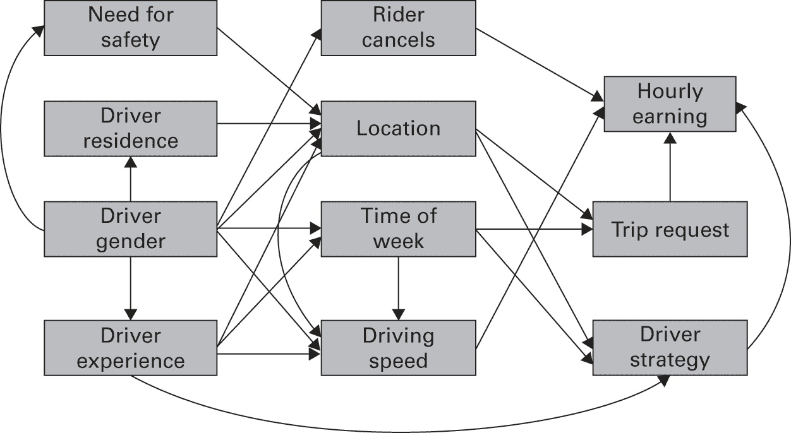

Figure 8.1Our understanding of the causal model implicit in the Uber study.

我们将利用此图来说明发现。整体而言，该图描述了一个联合分布，其样本为行程。为说明，同一驾驶员对应的不同行程在 *residence*（居住地）上保持一致（除非驾驶员在平台任职期间搬家），但在 *experience*（经验，以先前行程数衡量）上则有所不同。

驾驶员的每小时收入主要由分配给乘客请求的算法决定。该算法依赖于需求，而需求随地点和周中的时间而变化（周与周之间的变化被视为噪声）。Uber 的算法忽略驾驶员属性，包括经验和性别，因此因子节点指向 *trip request* 没有来自这些属性的箭头。此外，还有其他因素可能影响收入：驾驶员行驶更快可完成更多行程，驾驶员可能 strategically（战略性地）接受或取消行程，乘客可能因驾驶员接受后取消行程而进行歧视。

论文采用一种称为 *Gelbach decomposition* 的技术，对若干变量对每小时收入的影响进行量化。分解是经济学中用于量化各来源对结果差异贡献的技术。尽管作者未进行因果推断，但我们在教学目的下仍将其表述为因果分析。这种区别对我们想要阐述的高层次观点并不重要。


-   [费曼学习法](https://wiki.example.org/feynmans_learning_method)的灵感源于诺贝尔物理奖获得者**理查德·费曼**。

1.  运用费曼技巧，你只需花上`20 min`就能深入理解知识点，而且记忆深刻，*难以遗忘*。

```
if (condVar > someVal) {console.log("xxx")}
```


为速度差异，Uber 可以向超速或因速度导致预测的事故风险超过阈值的司机发出警告（基于 Uber 对数据的访问，这种预测理论上是可能的）。此外，Uber 还可以利用其预测工具教育司机策略，缩小经验丰富与经验不足司机之间的优势，无论性别如何。最终，这些发现也为在社区中为女性营造安全环境的结构性努力提供了更大的紧迫性。这些干预措施中的任何一项都不需要就 Uber 是否歧视女性司机达成共识。

## 三级歧视

社会学家将歧视分为三个层次：结构性、组织性和人际性 \[319, 388\]。结构性歧视源于社会的组织方式，包括相对硬性的约束，如歧视性法律，以及相对柔性的约束，如规范和习俗。组织性因素在决策单元层面运作，例如公司在招聘时的决策。人际性因素指导致个体产生歧视性行为的态度和信念。

另一种歧视分类方式是直接或间接。直接歧视指明在行动或决策过程中明确提及敏感属性的行为或决策过程。间接歧视指不提及敏感属性，但仍使一个或多个群体处于劣势的行为或决策过程。直接与间接歧视之间的界限模糊，更应将其视为光谱而非二元类别。

### 结构性因素

结构性因素是指社会的组织方式。一项明确限制特定群体机会的法律是直接结构性因素的例子。由于全球各地的权利革命，这类法律如今比过去更少。然而，歧视性法律并非过去的遗迹。例如，截至 2021 年，仅有 29 个国家承认婚姻平等 \[389\]。此外，过去的歧视性法律已留下持续至今的结构性影响 \[390\]。

间接结构性歧视在几乎所有社会中普遍存在。以下是两个在美国广为人知的例子。虽然毒品法律和毒品政策在表面上中立，但其效果是对少数族裔群体，尤其是黑人产生不成比例的影响 \[391\]。高收入社区的学校往往资金更充足（因为公立学校主要通过房产税筹资），并吸引更多合格教师，从而将教育优势传递给高收入家庭的子女。

表 8.1 将歧视按三个层次及直接性光谱进行组织的示例

| Level || More direct || More indirect |
| --- | --- | --- |
| Structural || Laws against same-sex marriage || Better-funded schools in wealthier, more segregated areas |
| --- | --- | --- |
|  |  |  |
| Organizational || Lack of disability accommodations || Networked hiring |
|  |  |  |
| Interpersonal || Overt animus || Belief in need for innate brilliance (combined with gender stereotypes) |

其他因素更为抽象，但其影响同样严重，例如文化规范和刻板印象。在伯克利研究生入学偏见的案例中（第 5 章），我们遇到了这样一个假设：社会刻板印象会影响人们的职业选择，从而再生产性别在收入和地位上的不平等 \[175\]：

聚合数据中的偏见……显然源自教育系统早期的筛选环节。女性因社会化和教育的引导，倾向于选择那些通常人数更多、完成度较低、资金不足且职业前景较差的研究生领域。

### 组织性因素

组织性因素在组织或决策单元层面运作：其结构、决策规则与流程以及个体行动者所处的情境。这些因素同样位于直接与间接的光谱之间。

最直接的歧视形式——明确因群体成员身份排除他人参与——在自由民主国家普遍属于非法。但缺乏残疾便利设施和未能应对性骚扰等做法仍普遍存在。一种间接歧视的政策是利用员工社交网络进行招聘，这是一种极为常见的做法。一项观察研究发现，在以白人为主的公司中，使用员工推荐进行招聘的比例使得黑人被雇佣的概率比使用报纸广告降低近 75 百分点 \[392\]。该研究控制了空间隔离、职业隔离、城市以及公司规模。

组织性歧视可以在单个组织层面被揭示和解决，而结构性因素（例如，没有单一学校负责吸引高收入社区的教师）则不然。

### 人际性因素

人际性因素包括导致个体产生歧视性行为的态度和信念。有时人们因公开的敌意而进行歧视，即歧视者不试图通过理性论证来为其辩护。

更常见的是，涉及的机制相对间接。2015 年，Sarah-Jane Leslie、Andrei Cimpian、Meredith Meyer 等人的研究发现，在成就被认为由天赋驱动的学术领域中，性别差距更为显著，即女性更少 \[393\]。作者认为，这种差距是“天赋重要性”的信念与对女性天赋较低的刻板印象相结合所致。这种结合可能通过两种方式影响女性：要么是该领域的实践者对女性存在偏见，要么是女性内化这些刻板印象并主动退出该领域（或表现不如本应）。作者未设计测试以区分这两种机制。不过，他们测试了观测到的差距是否可能由实际的天赋差异（而非对天赋的信念）或工作时间投入意愿来解释，并通过多种指标（如 GRE 分数作为天赋的代理）论证，这些替代解释无法说明观测到的差异。

有人可能会问：我们能否更严谨地检验天赋差异，例如通过观察幼儿？后续研究表明，六岁的孩子已经内化了关于天赋的性别刻板印象，这些刻板印象会影响他们选择活动的方式 \[394\]。这些困难凸显了性别概念的复杂性，而这种概念部分正是通过这些刻板印象产生和强化的 \[395\]。


为了回顾，我们讨论了结构性、组织性和人际歧视，以及这些歧视往往是间接且普遍的。这三个层面是相互关联的：例如，在优步（Uber）的案例研究中，结构性不平等并非自我维持，而是通过组织性决策被维持；而这些决策是由其世界观受文化影响的个人做出的。换句话说，即使是结构性歧视也在被主动维持，我们集体拥有能力对其进行缓解并扭转局面。盲目接受结构性歧视是世界本来的样子是错误的。

要注意，采用统计决策并不自动能解决这些因素，这些因素大多在背景中运作，并非在决策的单一、离散时刻显现。

### 不平等的持久性与规模

法律上的形式平等主要针对直接歧视，对间接歧视（无论是结构性、组织性还是人际）的影响相对有限。这也是为什么在看似承诺平等机会的社会中，不平等仍可能持久存在的原因之一。下面是两个鲜明的例子，说明不平等如何长期自我维持。

从 1609 年开始，耶稣会在南美洲的瓜拉尼地区（现今阿根廷、巴拉圭和巴西交界地区）设立传教站。除了进行宗教改造，传教士还致力于为当地土著居民提供教育。然而，由于西班牙和葡萄牙的政治动荡，这些传教站在 1767–1768 年突然结束，传教士被驱逐。我们可以预期，自该日期起，耶稣会带来的地理不平等会持续多久？也许几代人？令人惊讶的是，研究发现，耶稣会对教育 attainment 的影响在 250 年后仍然存在：靠近前传教站的地区，识字率提高了 10–15%，收入提高了 10%。该研究由 Felipe Valencia Caicedo 完成，利用巧妙的思路论证，传教站的选址基本上是随机的，这构成了自然实验 \[396\]。另一项关于长期不平等持久性的研究展示了秘鲁和玻利维亚在 1573–1812 年间实行的殖民强制劳役制度的当代影响 \[397\]。

更多关于长期不平等持久性的证据来自佛罗伦萨市，基于一份包含 1427 年所有个人税务数据的独特数据集。一篇工作论文发现，该数据集中与更富裕个体相关的姓氏，在六百年后仍与更富裕的个体相关 \[398\]。

虽然这里只列举了少数例子，但研究表明，代际在社会和地理层面上不平等的持久性是常态。然而，这点并不为人广泛认知。例如，美国人认为，出生在收入分布最低五分位的个人有六分之一的机会升至收入最高五分位，但实际观察到的比例是二十分之一 \[399\]。美国的流动性自 1980 年代以来有所下降，且黑人美国人低于白人美国人 \[400\]。

这些不平等之所以重要，是因为它们在规模上以及持久性上都十分显著。黑人美国人的中位收入约为白人美国人的 65% \[401\]。财富不平等更为严重：黑人家庭的中位财富约为白人家庭的 11% 。一项结合数据分析与模拟的研究表明，除非采取如赔偿等干预措施，差距可能永远无法缩小 \[402\]。大多数美国人并不了解这一差距：平均而言，调查受访者估计，典型黑人家庭的财富约为典型白人家庭的 90% \[403\]。

转向性别：全职、全年工作的女性收入约为其男性同僚的 80% \[404\]。地理不平等也存在。例如，美国最富和最贫穷的普查区在平均收入上相差约三十倍 \[405\]。

### 机器学习与结构性歧视

对于一本关于机器学习的书籍，我们已经涵盖了社会中的歧视与不平等的大量内容。原因在于，要真正理解公平，不能仅仅关注决策的瞬间。我们还必须思考：决策者采用机器学习后，对社会长期循环的结构性不平等产生什么影响？它是否有助于在人们一生中实现机会平等或其他规范理想？下面是一些观察，帮助回答这些问题。

#### 预测系统倾向于保持结构性优势与劣势

预测系统通常在现有制度内运行。当这些制度因结构性因素导致不平等时，预测系统在没有明确干预的情况下只会强化这些效应。预测系统往往继承结构性歧视，因为模型的目标函数通常反映了部署该模型的组织的激励。例如，一项 2019 年的研究发现，一个用于识别高风险健康结果的系统存在强烈种族偏见，黑人患者的评分低于同样有风险的白人患者 \[374\]。研究指出，这是因为该模型被设计为预测医疗费用而非需求，而医疗系统在照顾黑人患者时花费少于白人患者，即使他们有相同的健康状况。

假设一家公司的招聘决定基于一个模型，该模型预测工作表现，依据教育水平。想象一个社会，高收入家庭的学生平均获得更好的教育机会，从而具备更强的工作技能。这不是数据中的测量偏差，而是教育水平本身就能预测工作表现。因此，准确的预测系统会倾向于将高收入候选人排名更靠前。

这种结构性效应在每个雇主都采用类似考量时更为明显。拥有更好教育机会的候选人更容易获得更理想的工作和更高收入。换句话说，预测系统将生活的不同阶段以及代际之间的优势转移。 

这种现象也以不太明显的方式显现。例如，在线广告投放基于这样一个假设：用户的历史行为差异反映了偏好差异。但这些差异也可能源自结构性 *环境* 的不同，而投放引擎无法区分两者。这解释了为什么广告（包括招聘广告）可能被投放方式强化刻板印象和结构性歧视 \[406\]。

这种影响因 **累积的不公正** 而被放大 \[407, 408\]。也就是说，个体在其一生中会经历一系列决策，这些决策的影响会随时间累积并复合。当一个人获得（或被拒绝）某个机会时，往往会在后续的预测系统交互中显得更有（或更没有）资格。


# 机器学习系统可能产生自我实现的预测

假设我们发现下棋技巧与软件工程师的生产力之间存在相关性。下面是几种可能的解释：

1. 下棋技巧使人成为更好的软件工程师。

2. 存在底层认知技能，使人在下棋和软件工程方面都更出色。

3. 大学教授对下棋技巧和软件工程持有刻板印象，并将擅长下棋的学生引导进入计算机科学课程。

4. 有更多闲暇时间的人既能把下棋作为爱好，又能有时间提升软件工程技能。

标准的监督学习无法区分这些因果路径。无论正确的因果解释是什么，一旦大量雇主开始将下棋技巧作为招聘标准，他们就会强化所观察到的相关性。原因是下棋能力更强的申请人将更有机会获得软件工程职位，而这些机会将使他们能够提升软件工程技能。

机器学习自动化了相关性的发现，例如上述相关性。当我们将这些相关性作为决策依据部署时，我们实际上在改变我们所要衡量的现象。换句话说，使用非因果变量作为决策依据，可能会使这些变量在长期内获得因果权力。这不仅限于机器学习：社会学家长期以来就认识到，用于为歧视辩护的刻板印象实际上可能是由这种歧视产生的 \[409\]。

# 算法推荐系统可能导致隔离

即使对同质社区的偏好很小，也会产生巨大的大规模效应。附录中讨论了一个居住隔离的玩具模型，展示了这些效应。那么在线世界呢，例如在线社交网络？人们与相似他人（线上或线下）结交的现象称为 *homophily*。

在社交媒体早期，人们希望——如今看来是天真 naïve——在线环境中不会出现隔离，因为人们可以轻松地相互连接。相反，我们在线上观察到与线下相似的同质性和隔离现象。这部分原因是现实中的关系在线上得以体现，但部分原因是我们的在线偏好和行为本身就导致了隔离 \[410\]。

随着社交媒体的成熟，源自同质性的关注从人口隔离扩展到了意识形态回声室。偏向化在线话语的因果机制以及推荐算法的作用正在被研究和争论（见第 7 章关于测试的内容），但毫无疑问，在线媒体可以产生结构性影响。

# 机器学习可能导致决策的一致性

一家公司只招聘名字以字母表中特定字母开头的人，这听起来可能很荒谬，但未必令人警觉。之所以我们有这种直觉，是因为我们预期这类任意政策的影响会相互抵消，因为求职者可以在众多公司中申请。相反，如果所有雇主都采用这种政策，求职者的经历将截然不同。

与个人决策的波动相比，机器学习导致的决策更加一致。人类行为的研究表明，人类决策存在大量“噪声”。去除噪声是统计决策的主要吸引力之一。但也存在风险：如果统计决策导致许多决策者做出相似的决定，原本具有独特性的偏见可能会被放大并固化，甚至形成结构性障碍 \[54\]。

一致性可以通过多种方式出现。从高层面看，如果许多机器学习系统使用相同的训练数据和相同的目标变量，它们的分类结果将大致相同，即使学习算法差异很大。直观上，如果这 *不是* 如此，就可以通过对它们预测进行集成来获得更准确的分类。对于预测生活结果的鲜明例子，请参见脆弱家庭挑战 \[90\]。

或者，许多决策者可能使用相同的底层系统。Kleinberg 和 Raghavan 称这种情况为 *算法单一文化* \[411\]。有传闻称，求职者因同一供应商提供的个性测试而被多次筛选出工作 \[412\]。

即使是 *个体* 算法系统，也可能在社会中产生不成比例的影响，其政策可能产生结构性效应。最明显的例子是国家采用的系统，例如预测性警务系统，导致低收入社区受到过度警务。

但私人平台，尤其是具有全球规模的平台，这里的影响最为突出。以内容审核为例：少数社交媒体公司共同决定哪类言论可以进入主流在线话语，哪些社区能够在线动员。平台公司因允许煽动暴力的内容而受到批评，同时也因过度积极地下架个人或群体而受到指责。

在一些情况下，平台政策受到机器学习的能力和局限性的塑造 \[413\]。例如，算法相对擅长检测裸露，但相对较差于理解上下文。像 Facebook 这样的公司曾因对裸露内容实施宽泛禁令而受到批评，往往不加区分地下架艺术作品和具有标志性历史图像。

# 机器学习转移权力

像所有技术一样，机器学习会转移权力。为了更精确地说明这一点，我们分析机器学习在官僚机构中的采用情况。我们并不把“官僚机构”一词用作口语化、贬义的、指代低效、规则森严的政府机构。相反，我们使用社会科学家的定义：官僚机构是公共或私人实体，其中高度专业化的工作人员（称为官僚人员）在层级结构中，受规则和政策的约束，同时也需要专业判断做出决策。企业、大学、医院、警察部队和公共援助项目等都属于官僚机构的范畴。本书所讨论的大多数决策情境都位于官僚机构内部。

为了理解采用机器学习的效应，我们考虑五类利益相关者：决策主体、提供训练数据的人、领域专家、机器学习专家以及政策制定者。我们的分析基于 Pratyusha Kalluri 的一次演讲 \[414\]。

当今实际实现的机器学习普遍转移了前三类利益相关者的权力。通过将决策主体表示为标准化的特征向量，统计决策消除了他们的自主性和自我倡导的能力。在许多领域，尤其是司法系统，这种自主性是决策主体权利的核心。即使在相对不重要的领域，如大学录取，个人陈述也提供了这种自主性，并是评估的关键组成部分。


人们提供训练数据时可能对手头任务有`knowledge`，但只向系统提供他们的`behavior`作为输入（比如电子邮件收件人点击“报告垃圾邮件”按钮）。机器学习则以集中化的方式构建一种知识形式。相反，领域专家在与其互动的个体的知识和亲身经历中部分学习。诚然，像医师这样的专家常被批评贬低决策主体（患者）的知识和经验 \[415\]。但这种争论的发生本身已证明患者在传统体系中至少拥有一些权力 \[416\]。

与传统决策方式相比，域专家的角色也更为有限，而在传统决策中，这类专家的酌情权和判断力占主导。在监督机器学习中，域专业知识主要在两个步骤中被需要：制定问题和任务，以及标记训练示例。实际上，工具开发者往往不看重域专家的作用，因此专家的角色更加受限。例如，一项基于六十八次访谈的研究发现，“开发者将\[域专家\]视为腐败、懒惰、不合规，并且试图通过游戏化等手段让工人收集更高质量的数据” \[417\]。

这种权力转移的公平性影响是复杂的。在政府官僚机构中，“基层官员”（如警察和社会服务案件处理人员）所拥有的权力——他们将政策转化为个人决策——可能被滥用，而剥夺他们的酌情权通常被视为公平性干预。然而，这些决策者的酌情权和人类智能也因训练数据中未见或政策中未覆盖的特殊情况或新形势而成为促进公平的重要因素 \[59, 418\]。当系统本身不公正时，负责执行该系统的人可以通过不服从或吹哨来提供重要的抵抗力量。

与基层官员不同，机器学习赋予了政策制定者或集中决策者（即官僚体系顶层的人）更大的权力。例如，儿童保护机构使用风险预测工具筛选来电。根据机构预算及其他因素，决策者可能希望筛选更高或更低比例的来电。通过统计工具，这种政策改变可以立即实施，远比重新培训数百名案件处理人员以调整其心理捷径更为容易。这只是一个说明，为何此类工具对决策者具有强大吸引力。

机器学习专家当然在核心位置。利益相关者的要求必须由这些专家转化为实现；有意或无意之间，实际实现的政策与期望政策之间常存在显著差距 \[273\]。在每个自动化系统中，都有从人类语言到计算机代码的翻译过程中丢失的内容。例如，曾出现软件错误计算监狱囚犯的提前释放资格，导致被关押时间过长，或在释放后再次入狱的令人痛心的后果 \[419, 420\]。但在传统自动化系统中，这些差距往往是显而易见的错误（虽然这对受害者并无慰藉）。但当涉及机器学习时，专家的介入往往是识别问题的必要条件，因为政策往往更模糊（比如“高风险”指什么？），且偏离政策的情况只能在聚合层面显现。

此外，决策者常常将权力让渡给工具开发者，使后者更具影响力。Deirdre Mulligan 和 Kenneth Bamberger 阐述了政府机构如何通过采购流程获取机器学习系统——这种流程与聘请承包商建造桥梁相同 \[421\]。采购思维忽视了所得产品用于做出重要决策，即实际上制定政策的事实，其关注点在于价格和风险规避，而非决策透明度或监督。

## Structural Interventions for Fair Machine Learning

机器学习可能导致结构性歧视，这促使需要同等宽泛的干预措施。我们称这些“结构性干预”：改变机器学习的构建和部署方式。我们设想的改变超出任何单一组织的范畴，需要集体行动。这可能体现为广泛的社会运动，或包括社区、工人、研究人员和用户在内的其他集体。

### 重塑底层机构

一种做法是关注底层机构而非技术，使其本身更不易采用有害的机器学习工具。例如，将刑事司法系统的重点从 incapacitation（隔离）转向 rehabilitation（康复），可能会降低对风险预测工具的需求 \[422\]。许多学者和活动人士区分 reform（改革）与 abolition（废除，亦称非 reformist reform），后者是更激进和变革性的方式 \[193, 423, 424\]。但就我们目的而言，两者都将干预焦点放在机构而非技术上。

在许多领域，我们机构的目的和旨归根结底是有争议的。例如，警务的目标是什么？公认的目标包括犯罪威慑与预防、确保公共安全与最小化秩序混乱、将违法者绳之以法；也可能包括更广泛的社区健康与活力提升。这些目标的相对重要性因社区和时代而异。因此，将警务分配决策作为优化问题（如预测性警务系统所做），实际上涉及对这些深层争议问题的立场。

历史表明，许多看似现代社会固定不变的机构，如高等教育，实际上多次重新定义其目标和目的以适应变化的世界。有时这种转变的动力甚至是*更有效地进行歧视*。在二十世纪初，精英美国大学从把入学规模（ enrollment size）视为声望来源转变为强调选择性。主要原因是为了在不设定显性 quotas（配额）的情况下遏制日益上升的犹太学生比例；新的选择性使他们能够在招生中强调品格和个性等特质，从而为酌情权留下空间。事实上，Harvard 在 1926 年采用的系统正是如今仍备受争议的全面录取（holistic admissions）方法的起源，正如 Jerome Karabel 在其著作 *The Chosen* 中所解释 \[425\]。


一些学者已经超越了将应对算法伤害的干预措施集中在底层机构的立场，并认为自动化决策的采用实际上使得顽固的机构能够规避必要的改革。Virginia Eubanks 考察了美国贫困人群的四项公共援助项目——`food assistance`、`Medicaid`、`support for the homeless` 和 `care for at-risk children` \[47\]。在这四项项目中，都有自动管理的资格标准，其中一些使用统计技术。Virginia Eubanks 的著作记录了这些系统的有害影响，包括对被认定不符合条件者的惩罚性后果；对低收入有色人群（尤其是女性）的负担不成比例；缺乏透明度且决策看似随意；以及维持这些系统运作所必需的对贫困人群生活的跟踪与监控。

这些问题或许在一定程度上可以解决，但 Eubanks 提出了更深层的批判：这些系统转移了根本消除贫困的目标（“我们管理个体贫困，以逃避我们共同消除贫困的责任”）。理论上，两种方法可以并存。但在实践中，Eubanks 认为，这些系统合法化了“某些人有问题”的观念，掩盖了底层结构性问题，并助长了行动的缺失。它们还会产生高额的金钱成本，这些资金本可以用于更根本的改革。

### Community Rights

有害技术常常在基于“通知并同意”的法律框架下被正当化，这种框架建立在个人主义的权利观念之上，难以应对集体性损害。例如，警察部门通过 `Amazon Ring` 等集中化平台获取住宅安防摄像头的大规模影像，并获得居民的同意 \[426\]。然而，在这种情形下， consent（同意）并不是一个有意义的检查，因为那些可能因警察滥用监控影像而受害的人——如抗议者或因“可疑行为”被警察盘问的种族少数群体成员——并不是 consent 的获取对象。

这一差距在机器学习应用中尤为突出：即便分类器在获得同意的数据上训练，也可能被用于未提供同意的决策主体上。替代方案是赋予群体（如地理社区）集体同意或拒绝技术工具的权利。针对警察使用人脸识别的做法，民权活动人士倡导“社区拒绝权”，其成功推动了多个地方的禁令和停摆 \[427\]。相反，考虑在线精准广告这一广泛争议的技术，这里缺乏能够组织有效抵抗的类似集体，因此拒绝该技术的尝试成功程度有限 \[428\]。

除了集体同意之外，社区行动的另一个目标是成为机器学习系统设计的参与者——作为利益相关者和参与者，其专业知识和生活经验塑造系统的概念与实现，而非仅作为数据提供者或决策主体。这样做的好处包括更易预见并缓解代表性伤害（如计算机视觉数据集中的贬低类别，或图像搜索结果中呈现的攻击性刻板印象）。但参与式设计也有潜在风险：它可能给边缘群体带来额外负担，也可能成为组织回避实质性变革的幌子。因此，必须将参与视为劳动并予以公平补偿 \[429\]。

### Regulation

促进公平机器学习的监管可以采取现有法律对包含机器学习的决策系统进行适用，或专门针对技术使用及其危害的法律。上文提到的对人脸识别的禁令以及欧盟《通用数据保护条例》（GDPR）下对自动化决策的限制，就是后者的例子。这两种监管方式均在机器学习在决策系统中快速普及的背景下不断演进。监管是实现公平机器学习结构性干预的重大机遇。然而，由于法律倾向于将歧视概念窄化，其在遏制有害机器学习方面的实际效果仍有待观察 \[430\]。

机器学习采用速度与法律演进速度之间的差距，催生了自我监管的尝试：一项 2019 研究发现全球已有八十四条 AI 伦理准则 \[431\]。这些文件虽无法律约束力，却试图塑造组织或个人实践者的规范。虽然自我监管在医疗等领域有效，但人们对 AI 自我监管能否解决本章指出的棘手问题存疑。事实上，工业界的自我监管往往旨在推迟真正的监管以及其可能带来的结构性转变。

### Workforce Interventions

机器学习将权力转移至机器学习专家，使得机器学习劳动力成为重要的干预点。一类努力旨在让更多人获益于行业中宝贵的工作机会，并弥补劳动力内部的权力不平衡——尤其是技术专家与其他角色（如标注人员）之间的差距 \[432\] \[433\]。另一类努力则追求使机器学习的使用与劳动力的伦理价值相协调。技术公司中 nascent（ nascent）的工会化运动似乎兼具这两个目标。

虽然更多样化的劳动力在自身上是道德上有价值的，但值得探讨的是它对产品公平性的影响。一项关于程序员的实验研究发现，程序员的性别或种族并未影响其产出是否带有偏见 \[434\]。但这只是实验室研究，不能视作结构性干预效果的指南。例如，劳动力多样性可能通过以下途径影响产品（该研究设计未捕捉）：多元视角的团队更有可能质疑产品是否应被构建或部署。

其他劳动力干预措施包括教育与培训。计算机科学学生的伦理教育正在上升，2018 年的综述已列出超过 200 门此类课程 \[435\]。长期存在的争论是独立课程与 [cwstuserscwsc1wc[wantcwz] =c[wz] of the players / players / players / players / players / players / players / players / players / players / players / players / players / players / players / players / players / players / players / players / players / players / players / players / players /wz] 之间的优劣。 


# 在许多专业领域，包括一些工程领域，伦理责任部分通过对从业人员的许可来强制执行。像医生和律师等专业人士必须掌握一套专业知识，包括伦理准则，并被法律要求在取得执业许可前通过标准化考试，若他们犯下伦理违规行为，许可证可能会被撤销。这并非软件工程的情况。无论如何，目前存在的软件工程认证标准 \[437\] 与本书涉及的主题几乎没有重叠。

## 研究社区

机器学习研究社区是另一个重要的改革与转型场所。推动变革的最大力量是持续努力将公平、伦理和正义等研究主题视为合法且重要的议题。传统上，一些机器学习主题（如优化算法）被视为“核心”或“真正的”机器学习，而其他主题——甚至数据集构建——则被视为边缘且在智力上不那么严肃。Abeba Birhane、Pratyusha Kalluri、Dallas Card 等人对 ICML 和 NeurIPS 等顶级机器学习会议的论文进行文本分析，发现大多数论文通过强调性能和泛化来为自己辩护，仅有 1% 的论文提及潜在的负面影响 \[438\]。

一些其他关键争论：所有机器学习研究者是否应被要求反思其研究的伦理？是否过于关注修正偏见，而忽视了更深层次的权力与正义问题 \[440\]？如何才能将受机器学习系统影响的人和社区的视角置于中心？在存在利益冲突的情况下，工业界在公平机器学习方面的角色是什么？

## 组织干预以实现更公平的决策

我们上面讨论的结构性干预需要社会运动或其他集体行动，并且其演进时间跨度为数年甚至数十年。这并不意味着组织应当束手无策，等待结构性转变。大多数决策者都有大量可选的干预措施。本节概述了最重要的干预措施。

表 8.2A 概览主要类型的组织干预

| 类型 | 干预措施 | 示例 |
| --- | --- | --- |
| 修改输出 | 再分配 | 组别特定的决策阈值 |
| 修改决策过程 | 打击人际歧视 | 隐性偏见培训 |
|  | 正式化 | 采用统计决策制定 |
|  | 程序保护 | 解释与救济 |
| 决策前 | 外展 | 发送关于奖学金的邮件 |
|  | 干预因果因素 | 工作培训、预防性健康 |
| 决策后 | 修改环境 | 帮助被告出庭 |

随着阅读，你会发现大多数干预措施旨在改善所有决策主体的结果，而不是将公平视为不可回避的权衡。之所以可能，是因为许多干预措施并非在决策瞬间进行。此外，评估干预效果——无论是公平度还是其他指标——通常需要因果推断。最后，只有极小一部分潜在的公平干预措施可以在机器学习框架内实现；其余干预措施侧重于组织或人类实践，而非决策过程中的技术子系统。

### 重新分配或再分配

重新分配和再分配是指对决策过程进行干预，以显式偏好某一或多个群体（通常是被视为处于劣势的群体）。当我们谈论公平干预时，这通常是最直观的类型. 当应用于招聘或大学录取等拥有相对固定名额的选择问题时，算法公平性干预大多退化为不同形式的再分配。这包括在优化步骤中加入公平约束，或在后处理阶段对弱势群体的得分进行调整。无论目标是人口平等或其他统计指标，这种做法都适用。

再分配之所以吸引人，是因为它不需要先理解导致差异的根本因果关系。与此同时，再分配是一种粗糙的干预措施。它设计用来惠及某一群体，并且通过量化该群体的收益提供透明度的优势，但大多数再分配程序并未在群体内部考虑成员的“应得性”。再分配通常通过对弱势群体的 uniform preference（均匀偏好）来实现，或者通过调整优化目标来纳入群体偏好。在此方法中，再分配的内部分配由模型负责，这可能导致非直观且 unintended 的分配（例如，交叉族裔子群可能在无干预条件下更受劣势）。在最佳情况下，再分配方法会确保群体内部的相对排名保持不变。

尽管再分配粗糙，另一种更糟糕的干预措施是完全忽略与群体身份相关的特征。为了明确，如果该特征在统计、因果或道德上无关，则忽略它可能是合理的（第 2 章）。但如果该特征实际上与结果相关呢？例如，假设贡献开源软件项目的人往往是更好的软件工程师。这种影响通过 morally relevant（ morally 相关）的因果路径产生，因为程序员通过参与开源获得实用的软件工程技能。遗憾的是，许多开源社区对女性和少数族裔充满敌意和歧视（这可能是因为缺乏像企业那样的正式组织结构来一定程度控制人际歧视）。认识到这一点，软件公司可以在招聘决策中显式考虑这一点，或者简单地忽略开源贡献作为评估标准。如果后者，则平均招聘的候选人资质会更低；同时也会使那些在歧视中仍坚持提升技能的群体—— arguably 最值得尊重的群体——受到不利影响。

基于统计考量而无需 moral 或 causal 正当性的特征忽略，在实践中极为流行，因为它实现简单、政治上可接受，并且规避了因歧视性对待而产生的法律风险。

### 打击人际歧视

与直接干预输出不同，组织可以尝试改进决策过程。在许多情况下，歧视者在调查和面试中往往坦诚地表达其偏见 \[318\]。他们是否可以通过培训来消除隐性或显性偏见？这就是所谓的偏见消除，常被称为“多元化培训”。


-   [费曼学习法](https://wiki.example.org/feynmans_learning_method)的灵感源于诺贝尔物理奖获得者**Richard Feynman**。

1.  运用费曼技巧，你只需花上`20 min`就能深入理解知识点，而且记忆深刻，*难以遗忘*。

```
if (condVar > someVal) {console.log("xxx")}
```


-   [费曼学习法](https://wiki.example.org/feynmans_learning_method)的灵感源于诺贝尔物理奖获得者**Richard Feynman**。

1.  运用费曼技巧，你只需花上`20 min`就能深入理解知识点，而且记忆深刻，*难以遗忘*。

```
if (condVar > someVal) {console.log("xxx")}
```


It is appealing to focus on comparative notions of fairness because they are easy to quantify, but we shouldn’t forget the deeper questions. A domain where this seems to have happened is algorithmic hiring. Tools used in algorithmic hiring utilize situational judgment tests, personality tests, and sometimes much more dubious techniques—increasingly involving machine learning—for screening and selecting candidates. Firms adopt such tools to cut recruitment costs, especially for low-wage positions, where the cost of hiring a worker through the traditional process can be seen as significant in relation to a worker’s contribution to the firm’s revenue over the course of the period of their employment.

These tools are problematic for many reasons. While they aim to formalize the hiring process, they often use attributes that are morally and causally irrelevant to job performance. HireVue, for example, previously relied on facial expressions and intonations in a person’s voice as part of its automated assessment. They also fail to take a broad view of discrimination. Focusing narrowly on minimizing disparities in hiring rates across groups leaves unaddressed what kind of environment employees will encounter once hired. If job applicants from certain groups were previously predicted to perform poorly in a certain workplace, the employer should strive to understand the reasons for this difference in success, rather than simply try to find members of these groups that might be able to succeed under such unfavorable, unwelcoming, or hostile conditions. Parity-promoting interventions change the selection process, but preserve the organizational status quo, endorsing the idea that the candidates who have been selected should be able to deal with these conditions sufficiently well to be as productive as their peers who don’t face similar challenges. Other productive—and potentially less harmful—forms of intervention include on-the-job training (which might be understood as a way of intervening on causal factors), meaningful feedback for rejected applicants (which would provide some degree of procedural protection, but also help guide applicants’ future investment in their own development), and a strategic approach to sourcing candidates who firms with more accurate tools might now be better able to assess.

The narrow focus on disparities can mean that there is little consideration of the quality of decisions made by the tools. Tools that simply lack validity raise a host of normative concerns. Notably, assessments that achieve approximate demographic parity but continue to suffer from accuracy disparity (also called differential validity) can set up members of certain groups for failure by expecting them to be able to perform better than they would be currently prepared to.

To reiterate, we do not advocate for treating statistical fairness criteria as constraints, at least in the first instance. That approach assumes that reallocation is the only available intervention. Instead, if we treat statistical fairness criteria as diagnostics, we are likely to uncover deeper problems that require remedying. Unfortunately, these deeper remedies are also harder. They require both causal inference and normative depth. That is of course why they are often ignored, and foundational questions remain unaddressed.

A case in point: a 2021 paper by Megan Stevenson and Sandra Mayson analyzes the fairness of pretrial detention in a noncomparative sense \[459\]. How risky does a defendant have to be that the expected benefit to public safety justifies the harm to the defendant from detention? Using the clever approach of asking survey recipients to choose between being detained and becoming victims of certain crimes, the authors conclude that pretrial detention is essentially never justified.

The study’s method is sure to be debated, but the point remains that there have been relatively few principled, quantitative attempts to justify the risk thresholds used in pretrial detention. There have been many other calls to end pretrial detention based on different moral and legal arguments. When such foundational questions continue to be debated, it would be exceedingly premature to declare a risk-based pretrial detention system to be “fair” because it satisfied some statistical criterion.

The first part of the chapter draws heavily from the sociology of discrimination. A review of racial discrimination by Devah Pager and Hana Shepherd is a good entry point into this literature \[319\]. Mario Small and Devah Pager distill six lessons from the sociology of discrimination \[388\].

The complex ways in which discrimination operates—feedback loops that sustain persistent inequalities, multiple interlocking systems of discrimination that together structure society—mean that the quantitative tests for discrimination discussed in the previous chapter frame the question narrowly and are inherently limited in what they can reveal. For more on the limits of the quantitative approach, see Arvind Narayanan’s talk \[376\] or the discussion in the final section of Kevin Lang and Ariella Kahn-Lang Spitzer’s paper \[461\].

The chapter then turns to the practice of machine learning. To reinforce the idea that developers of machine learning systems must make many choices requiring normative judgment throughout the development process, see Jessica Eaglin’s case study of recidivism risk prediction \[463\]. Turning to the question of what technologists should do differently in their everyday work, we recommend the book *Human-Centered Data Science* by Cecilia Aragon, Shion Guha, Marina Kogan et al., and Ben Green’s paper urging data scientists to recognize that their work is political \[463\].

The final part of the chapter argues that most fairness interventions should target organizational culture and processes rather than tweaking decision criteria. This means that designing effective fairness interventions requires understanding the organizations that are meant to adopt them. This is a vast area of sociology; we give a few samples. Michael Lipsky’s classic text *Street-Level Bureaucracy* discusses the complex relationship between individual decision makers and the government agency in which they are embedded in \[418\]. Rebecca Johnson and Simone Zhang deconstruct the process by which social service bureaucracies make and implement policies, and advocate for the benefits of formalizing the process through algorithmic decision making \[72\].

As for texts about specific bureaucracies or organizations, *Misdemeanorland* by Issa Kohler-Hausmann dives into New York City’s lower criminal courts, and shows that the system’s purpose and operation is almost diametrically different from how most people and most textbooks (including this one) conceive of it \[464\]. The books *Pedigree* \[320\] and *Inside Graduate Admissions* \[321\] shed light on the hiring processes at elite firms and the admissions processes at graduate schools, respectively. *Uberland* by Alex Rosenblat describes the stories and working conditions of Uber drivers in the United States and Canada \[467\].

Let us briefly discuss two phenomena that help explain the long-run persistence of inequality: segregation and feedback loops.

### The Role of Segregation


一个加剧我们讨论的所有歧视机制的结构性因素是社会沿群体身份划分进行的隔离。隔离在理论上能够促成人际歧视，因为群体间接触的增加会降低对外群体的偏见——这是一个有争议的接触假说 \[465\]。

在结构层面上，隔离维持了不平等，因为个体在经济上产生价值的机会取决于其社会资本，包括家庭、社区和教育环境。经济学文献的一支流建立了数学模型和模拟，以理解群体不平等（尤其是种族不平等）如何产生并持续存在，即使没有人际歧视，且群体之间没有内在差异。在极端情况下，如果我们想象两个或多个群体属于不相互作用的经济体系且增长率相同，那么差异显然可以无限期持续。如果隔离不完美，差距最终会消失吗？这取决于模型的假设。在 Lundberg 和 Startz 的模型中，差距最终会消失，尽管速度极慢 \[466\]。在 Bowles 和 Sethi 的模型中，在某些条件下差距也不会消失 \[468\]；原因之一是弱势群体因社会资本较低而可能面临更高的职业技能获取成本 \[469\]。

在美国，1960 年代和 1970 年代民权立法通过后，种族隔离有所下降，尽管速度较慢。另一方面，按收入划分的住宅隔离似乎在增加 \[470\]。

### 反馈循环的作用

在劳动力市场的经典经济模型中存在反馈循环 \[315\]。存在两类工人和两类工作：高技能和低技能，高技能工作需要具备特定资格才能有效执行。在适当假设下（特别是，雇主在雇佣前无法完全观察工人资格，只能在提供昂贵的在岗技能培训后才能观察到），存在一种经济均衡，其维持机制如下：

1. 雇主对两类工人实行工资歧视。

2. 因此，弱势群体获得的资格投资回报率较低。

3. 假设工人是理性的，他们会根据这种差异调整资格投资，其中一类工人投资更多以获取资格。

4. 雇主在观察到资格差异后，再次基于理性假设进行工资歧视。

该模型的意义在于，它能够在不假设群体间存在内在差异，也不假设雇主对同样有资格的工人进行歧视的情况下，解释不平等（及歧视）的持续性。它仅展示了此类反馈循环的可能性。与任何理论模型一样，声称该反馈循环解释了某些实际差异需要仔细的经验验证。

# 9 Datasets

机器学习模型的表现取决于其训练数据，这一点已成为共识。老话“输入垃圾，输出垃圾”无疑适用于机器学习实践，同样适用于相关的口号“输入偏见，输出偏见”。然而，这些格言仍然低估并一定程度上误导了数据在机器学习中的重要性。

数据不仅可能导致学习算法输出质量不佳，它本身在机器学习生态系统中扮演着多种关键角色。数据本身是问题定义的一部分，它隐式地界定并具体化了实践者最终要解决的问题。数据还通过提供衡量和对比进展的标准、支持竞争以及连接学术界与产业界的研究者与实践者，深刻影响了整个科学界的发展。

如果数据在机器学习中如此重要，可能会让人惊讶的是，对于“数据对于何种目的而言是否良好”这一问题，并没有简单的答案。机器学习应用的数据收集并未遵循任何既定的理论框架，更不用说事先被认可的框架了。

本章将深入探讨机器学习领域中常用的数据集及其所支持的基准测试。我们利用这些数据集来区分它们在科学与工程背景下所扮演的不同角色。随后，我们回顾与数据相关的危害，并根据数据的角色提出缓解措施。最后，我们提出几个广泛的方向，以改进数据实践。

本章在一些重要方面限定了范围。我们主要关注公开可得的数据集，这些数据集用于机器学习研究和应用中的训练与测试。我们排除了大量工业数据收集、监控和数据挖掘实践，也排除了为测试特定科学假设而特意收集的数据，例如医学试验中的实验数据。

## A Tour of Datasets in Different Domains

机器学习领域的数据集创建并不遵循明确的理论框架。数据集并非为测试特定科学假设而收集的。事实上，我们将看到数据在机器学习中扮演着多种不同的角色。因此，先从几个具有影响力的、来自不同领域的数据集入手，了解它们的构成、创建动机、社区组织方式以及产生的影响，是合理的。

### TIMIT

自动语音识别是一项具有重要商业意义的机器学习问题。其历史可追溯至二十世纪初 \[471\]。

有趣的是，语音识别领域拥有一个最早的基准数据集——TIMIT（Texas Instruments/Massachusetts Institute for Technology）。该数据集的创建得到了 1986 年由国防先进研究项目局（DARPA）资助的语音识别计划。在 80 年代中期，人工智能处于所谓的“资金寒冬”期，许多政府和工业机构因 AI 研究往往“承诺过度却难以兑现”而不愿资助 AI 研究。DARPA 程序经理 Charles Wayne 提出，通过建立更严谨的评估方法来突破这一困境。Wayne 邀请美国国家标准技术研究所（NIST）创建和维护用于共享数据的语音数据集，并以这些数据集在识别任务上的表现作为衡量成果的依据。

如今，许多人认为 Wayne 的计划开启了语音识别领域的进步革命 \[472–474\]。根据 Kenneth Ward Church 的说法，

它使得资金得以启动，因为项目既不落空也不欺世盗名，同时也让资金方能够随时间衡量进展。Wayne 的想法让人能够生成图表，从而向潜在赞助者推销研究项目。Wayne 的另一个不那么明显的好处是，它实现了“爬山”——那些最初反对每年接受两次测试的研究者，开始每小时评估自己 \[473\]。


A first prototype of the TIMIT dataset was released in December 1988 on a CD-ROM. An improved release followed in October 1990. TIMIT already featured the training/test split typical for modern machine learning benchmarks. There’s a fair bit we know about the creation of the data due to its thorough documentation \[475\].

TIMIT features a total of about five hours of speech, composed of 6,300 utterances, specifically, ten sentences spoken by each of 630 speakers. The sentences were drawn from a corpus of 2,342 sentences such as the following.

She had your dark suit in greasy wash water all year.(sa1)

Don’t ask me to carry an oily rag like that. (sa2)

This was easy for us. (sx3)

Jane may earn more money by working hard. (sx4)

She is thinner than I am. (sx5)

Bright sunshine shimmers on the ocean. (sx6)

Nothing is as offensive as innocence. (sx7)

The TIMIT documentation distinguishes between eight major dialect regions in the United States, documented as `New England, Northern, North Midland, South Midland, Southern, New York City, Western, Army Brat (moved around)`. Of the speakers, 70 percent are male and 30 percent are female. All native speakers of American English, the subjects were primarily employees of Texas Instruments at the time. Many of them were new to the Dallas area where they worked.

Racial information was supplied with the distribution of the data and coded as “White,” “Black,” “American Indian,” “Spanish American,” “Oriental,” and “Unknown.” Of the 630 speakers, 578 were identified as White, twenty-six as Black, two as American Indian, two as Spanish-American, three as Oriental, and seventeen as unknown (table 9.1).

Table 9.1Demographic information about the TIMIT speakers

|  || Male || Female || Total (%) |

| --- | --- | --- | --- |

| White || 402 || 176 || 578 (91.7) |

| --- | --- | --- | --- |

| Black || 15 || 11 || 26 (4.1) |

| American Indian || 2 || 0 || 2 (0.3) |

| Spanish American || 2 || 0 || 2 (0.3) |

| Oriental || 3 || 0 || 3 (0.5) |

| Unknown || 12 || 5 || 17 (2.6) |

The documentation notes:

In addition to these 630 speakers, a small number of speakers with foreign accents or other extreme speech and/or hearing abnormalities were recorded as “auxiliary” subjects, but they are not included on the CD-ROM.

It comes as no surprise that early speech-recognition models had significant demographic and racial biases in their performance.

Today, several major companies, including `Amazon`, `Apple`, `Google`, and `Microsoft`, all use speech-recognition models in a variety of products, from cell phone apps to voice assistants. There is no longer a major open benchmark that would support training models competitive with the industrial counterparts. Industrial speech recognition pipelines are generally complex and use proprietary data sources that we don’t know a lot about. Nevertheless, today’s speech-recognition systems continue to exhibit performance disparities along racial lines \[476\].

### UCI Machine Learning Repository

The UCI Machine Learning Repository currently hosts more than 500 datasets, mostly used for different classification and regression tasks. Most datasets are relatively small, consisting of a few hundred or a few thousand instances. The majority are structured tabular data sets with a handful or a few tens of attributes.

The UCI Machine Learning Repository contributed to the adoption of the train-test paradigm in machine learning in the late 1980s. Pat Langley recalls:

The experimental movement was aided by another development. David Aha, then a PhD student at UCI, began to collect data sets for use in empirical studies of machine learning. This grew into the UCI Machine Learning Repository (`[`archive.ics.uci.edu/ml/``](http://archive.ics.uci.edu/ml/)), which he made available to the community by FTP in 1987. This was rapidly adopted by many researchers because it was easy to use and because it let them compare their results to previous findings on the same tasks \[477\].

The most popular dataset in the repository is the Iris dataset, containing taxonomic measurements of 150 iris flowers, fifty from each of three species. The task is to classify the species given the measurements.

As of October 2020, the second most popular dataset in the UCI repository is the Adult dataset. Extracted from the 1994 Census database, it features nearly 50,000 instances describing individuals in the United States, each having fourteen attributes. The task is to classify whether an individual earns more than or less than $50,000. The Adult dataset remains popular in the algorithmic fairness community, largely because it is one of the few publicly available datasets that features demographic information including `gender` (coded in binary as male/female), as well as `race` (coded as Amer-Indian-Eskimo, Asian-Pac-Islander, Black, Other, and White).

Unfortunately, the data has some idiosyncrasies that make it less than ideal for understanding biases in machine learning models. Due to the age of the data, and the income cutoff at $50,000, almost all instances labeled `Black` are below the cutoff, as are almost all instances labeled `female`. Indeed, a standard logistic regression model trained on the data achieves about 85 percent accuracy overall, while the same model achieves 91 percent accuracy on `Black` instances, and nearly 93 percent accuracy on `female` instances. Likewise, the ROC curves for the latter two groups enclose actually more area than the ROC curve for male instances. This is an atypical situation: more often, machine learning models perform worse on historically disadvantaged groups.

### MNIST

The MNIST dataset contains images of handwritten digits. Its most common version has 60,000 training images and 10,000 test images, each having 28×28 black and white pixels (figure 9.1).

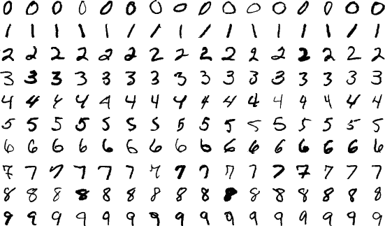

Figure 9.1A sample of MNIST digits.

MNIST was created by researchers Burges, Cortes, and LeCun from an earlier dataset released by the National Institute of Standards and Technology (NIST). The dataset was introduced in a research paper in 1998 to showcase the use of gradient-based deep learning methods for document recognition tasks \[478\]. Since then cited over 30,000 times, MNIST became a highly influential benchmark in the computer vision community. Two decades later, researchers continue to use the data actively.

The original NIST data had the property that training and test data came from two different populations. The former featured the handwriting of two thousand American Census Bureau employees, whereas the latter came from 500 American high school students \[479\]. The creators of MNIST reshuffled these two data sources and split them into training and test set. Moreover, they scaled and centered the digits. The exact procedure to derive MNIST from NIST was lost, but recently reconstructed by matching images from both data sources \[480\].

The original MNIST test set was of the same size as the training set, but the smaller test set became standard in research use. The 50,000 digits in the original test set that didn’t make it into the smaller test set were later identified and dubbed *the lost digits*. \[480\]

Table 9.2A snapshot of the original MNIST leaderboard from February 2, 1999Source: Internet Archive (retrieved December 4, 2020).

| Method || Test error (%) |

| --- | --- |

| linear classifier (1-layer NN) || 12.0 |

| --- | --- |

| linear classifier (1-layer NN) \[deskewing\] || 8.4 |

| pairwise linear classifier || 7.6 |

| K-nearest-neighbors, Euclidean || 5.0 |

| K-nearest-neighbors, Euclidean, deskewed || 2.4 |


| 40 PCA + 二次分类器 || 3.3 |

| 1,000 RBF + 线性分类器 || 3.6 |

| K-NN, 唐氏距离, 16×16 || 1.1 |

| SVM 度 4 多项式 || 1.1 |

| Reduced Set SVM 度 5 多项式 || 1.0 |

| Virtual SVM 度 9 多项式 \[畸变\] || 0.8 |

| 2 层 NN, 300 隐藏单元 || 4.7 |

| 2 层 NN, 300 HU \[畸变\] || 3.6 |

| 2 层 NN, 300 HU \[去倾斜\] || 1.6 |

| 2 层 NN, 1000 隐藏单元 || 4.5 |

| 2 层 NN, 1000 HU \[畸变\] || 3.8 |

| 3 层 NN, 300 + 100 隐藏单元 || 3.05 |

| 3 层 NN, 300 + 100 HU \[畸变\] || 2.5 |

| 3 层 NN, 500 + 150 隐藏单元 || 2.95 |

| 3 层 NN, 500 + 150 HU \[畸变\] || 2.45 |

| LeNet-1 \[带 16×16 输入\] || 1.7 |

| LeNet-4 || 1.1 |

| LeNet-4 使用 K-NN 替代最后一层 || 1.1 |

| LeNet-4 使用局部学习替代 ll || 1.1 |

| LeNet-5 \[无畸变\] || 0.95 |

| LeNet-5 \[巨大畸变\] || 0.85 |

| LeNet-5 \[畸变\] || 0.8 |

| Boosted LeNet-4 \[畸变\] || 0.7 |

从一开始，MNIST 就被设计为用于比较不同方法强弱的基准数据集。多年来，LeCun 在个人网站上维护了一个非正式的排行榜，列出了不同学习算法在 MNIST 上取得的最佳准确率。

作为基准，它在 2000 年代初期展示了新兴核方法的潜力，这些方法暂时在 MNIST 上达到了顶尖性能 \[481\]。如今，使用广泛的卷积神经网络架构，几乎可以达到小于 0.5% 的分类错误，这已经不再是挑战。最佳模型几乎能够正确分类所有异常测试实例。因此，MNIST 如今被认为过于容易，不适合当前的研究任务。

MNIST 并非第一个用于机器学习研究的手写数字数据集。早期，美国邮政服务（USPS）发布了包含 9,298 张图像的数据集（7,291 张用于训练，2,007 张用于测试）。USPS 数据集的分类难度实际上高于 MNIST。相当一部分 USPS 数字对人类来说难以辨认 \[482\]，而人类对 MNIST 中的数字几乎能识别所有。

# ImageNet

ImageNet 是一个大规模的标记图像库，在过去十年中对计算机视觉研究产生了深远影响。图像标签对应于英语 WordNet 词汇数据库中的名词 \[483\]。WordNet 将名词分组为认知同义词组，称为 *synsets*。例如，*car* 和 *automobile* 属于同一个 synset。WordNet 还提供了一个层次结构，表示 synsets 之间的上位下位关系。例如，*chair* 的 synset 是 *furniture* synset 的子节点。WordNet 在 ImageNet 之前就已存在，并部分启发了 ImageNet 的创建。

ImageNet 的首次发布包含约 5,000 个图像类别，每个类别对应 WordNet 中的一个 synset，平均每个类别约有 600 张图像 \[484\]。随后 ImageNet 随时间增长，2011 年秋季发布时已拥有约 32,000 个类别。

构建 ImageNet 需要两个关键步骤：为每个 synset 检索候选图像并对其进行标记。第一步利用在线搜索引擎和照片分享平台（如 Flickr）进行搜索，候选图像来源于与 synset 名称相关的搜索结果。第二步，ImageNet 的创建者转向亚马逊机械土耳其平台（MTurk）进行标注。MTurk 是一个在线劳动力市场，允许个人或公司按需聘请工人完成简单任务。在此情形下，MTurk 工人被展示候选图像，并需判断该图像是否真实对应其所关联的类别。

需要区分的是，这里的 ImageNet 数据库与一个流行的机器学习基准竞赛 —  — ImageNet 大规模视觉识别挑战（ILSVRC）不同，ILSVRC 是基于 ImageNet 而来的 \[485\]。该竞赛从 2010 年至 2017 年每年举办，在业界和学术界获得了显著声誉，尤其是作为新兴深度学习模型的基准。

当机器学习实践者说“ImageNet”时，通常指的是 2012 年 ILSVRC 竞赛中用于图像分类任务的数据。虽然竞赛还包括目标识别等其他任务，但图像分类已成为该数据集最受欢迎的任务。例如，“在 ImageNet 上训练的模型”通常指在 2012 年基准数据集上训练图像分类模型。

利用 ILSVRC 数据的另一种常见做法是 *预训练*。实践者常常面临标签集与 1,000 类不匹配的分类问题，但仍可利用该数据创建有用特征，进而用于目标分类任务。当 ImageNet 数据被用于实际应用时，往往是为了支持预训练。

这种对 ImageNet 的口语化使用会导致混淆，尤其是因为 ILSVRC-2012 数据集与更广泛的 ImageNet 数据库差异显著。ILSVRC-2012 包含仅 1,000 个类别的子集，且这些类别在 WordNet 层次结构中偏向某些分支。例如，这 1,000 个类别中仅有三个属于 *person* 分支，分别是 *groom*、*baseball player* 和 *scuba diver*。而超过 100 个类别对应不同的犬种，具体数量为 118 个（不包括狼、狐狸和野生犬），这些也都在类别中。

这些 1,000 个类别的选取动机尚不完全明确，但其显著的犬类倾向并非偶然。当时，计算机视觉社区关注在多数类别高度相似的情况下进行预测，这反映了机器学习领域的更广泛模式 —  — 数据集的创建往往源于对技术挑战的直观认知。ImageNet 还特别强调规模，包括图像数量和类别数量。

ImageNet 的大规模标注工作被 Mary Gray 和 Siddharth Suri 在同名书籍中称为 *ghost work*（隐形工作） \[486\]。他们指出：“MTurk 工人是 AI 革命的无名英雄。”

事实上，ImageNet 由约 49,000 名来自 167 个国家的 MTurk 工人在多年期间完成标注。

### The Netflix Prize

Netflix Prize 是最著名的机器学习竞赛之一。竞赛于 2006 年 10 月 2 日开始，持续近三年，于 2009 年 9 月 18 日公布 100 万美元的大奖。期间共有 44,014 份提交，来自 5,169 支团队。

Netflix 训练数据包含约 1 亿条电影评分，来自近 50 万 Netflix 订阅用户，涉及 17,770 部电影。每条记录为 <用户, 电影, 评分日期, 评分> 的元组。数据集约 650 兆字节，足以装在 CD-ROM 上，但当时仍具备挑战性。


矩阵中的 Netflix 数据可以被视为一个维度为 `n` = 480,189 行和 `m` = 17,770 列的矩阵。每一行对应一位 Netflix 订阅者，每一列对应一部电影。矩阵中仅有的条目是订阅者为某部电影给出评分（评分在 {1, 2, 3, 4, 5}）的情况。其余的条目——即绝大多数——都是缺失的。参与者的目标是预测矩阵中缺失的条目，这是一种被称为“矩阵完成”的问题，或者更广泛地说是“协同过滤”。事实上，Netflix 竞赛极大地推动了这一问题的普及，以至于有时人们称之为“Netflix 问题”。其核心思想是：如果我们能够预测缺失的条目，就能据此向用户推荐未观看的电影。

Netflix 保密保留的验证数据大约包含三百万条评分。其中一半用于在竞争期间计算排名榜，另一半用于决定最终获胜者。

Netflix 竞赛产生了巨大的影响。它不仅吸引了大量参与者，还在多年内激发了大量关于协同过滤的学术研究兴趣。此外，它还将竞赛形式推广为公司与机器学习社区互动的一种吸引人的方式。一家创业公司 Kaggle 于 2010 年 4 月成立，组织了数百场面向各类公司和组织的机器学习竞赛，随后于 2017 年被 Google 收购。

然而，Netflix 竞赛因另一原因臭名昭著。尽管 Netflix 已将用户名替换为伪名数字，研究者 Arvind Narayanan 和 Vitaly Shmatikov 仍能够通过将这些评分与公开的 IMDb 电影评分链接，重新识别出数据集中某些 Netflix 订阅者的真实身份 \[487\]. 有些订阅者在 IMDb 上也公开评分了相同的电影集，并使用真实身份。在隐私文献中，这种行为被称为 `linkage attack`，是一种通过将看似匿名数据与公开数据关联从而实现去匿名化的方式 \[488\].

随后，Netflix 面临多起集体诉讼，以及美国联邦贸易委员会（FTC）对隐私问题的调查。由此，Netflix 取消了原定于 2009 年 8 月 6 日宣布的第二场竞赛。

时至今日，隐私 concerns 仍是公开数据发布和数据集创建的合理障碍。去匿名化技术已相当成熟且高效。理论上，不存在一种算法能够对所有参与者提供严格的隐私保证，同时对所有分析和机器学习任务保持有用。Cynthia Dwork 和 Aaron Roth 称之为“信息恢复的基本法则”：“对太多问题给出过于精确的答案会以惊人的方式破坏隐私” \[489\]。

## Roles Datasets Play

在机器学习研究和工程中，数据集的角色与其他领域截然不同，也更为突出。我们已经提及了若干这些角色，现在让我们更详细地探讨它们。理解这些角色对于判断基准的技术与文化要素至关重要，以把握危害的产生方式以及如何加以缓解。

### A Source of Real Data

Edgar Anderson 是一位植物学家和园艺师，他在 1920 年代和 1930 年代大部分时间都在采集和分析鸢尾花数据，以研究生物学和分类学问题。UCI 机器学习库中提到的鸢尾花数据集是 Anderson 实验的成果——或者说是其极小一部分，因为数据集中的大多数观测都来自一次实地考察。数据集包含三种鸢尾花，每种 50 条记录；任务是根据四个物理属性（萼长和宽、花瓣长和宽）区分物种。尽管数万名研究者使用过该数据集，他们大多并不关注分类学，更不用说鸢尾花本身了。那么，他们到底是用这个数据集做什么？

虽然数据是由 Anderson 收集的，但实际发表在论文“The Use of Multiple Measurements in Taxonomic Problems”中的 Ronald Fisher，他是现代统计学的奠基人之一，同时也是一位优生主义者 \[490\]. 优生学的关联并非偶然：其他现代统计学的关键人物，如 Francis Galton 和 Karl Pearson，也都是优生主义者 \[491, 492\]. Fisher 是 Anderson 的合作者。尽管 Fisher 对分类学有一定兴趣，但他主要致力于利用这些数据开发统计技术（并以此为优生学的应用）。在 1936 年的论文中，Fisher 介绍了线性判别分析（LDA）并展示了其在该任务上的良好表现。

鸢尾花数据集之所以成为 LDA 的良好应用案例，是因为存在一种线性投影，使得四个特征的分布呈现出高斯混合（每个鸢尾花物种一个），且这三个分布的均值相距较远；其中一种物种甚至可以与另外两种完全区分开来。每个学习算法隐含地对数据生成过程做出假设：没有假设，就没有基于未见点的预测依据 \[493\]。如果我们能够完美数学描述鸢尾花（或任何其他群体）的物理特征的数据生成过程，就不需要数据集——我们可以直接数学推导算法的表现。实际上，对于复杂现象，这种完美的数学描述极少见。不同的学术社区对发现真实数据生成过程的追求价值观各异。机器学习领域对这一目标的重视相对较低 \[494\]。最终，学习算法的有用性通过在真实数据集上进行测试来确定。

依赖基准数据集作为真实数据来源是机器学习研究的逐步发展过程。例如，Rosenblatt 在 1950 年代的感知机实验使用了两类人工刺激（字符 E 和 X），并通过旋转等变换生成了众多变体 \[495\]。受控输入被认为有助于理解系统的行为。1988 年，Pat Langley 主张混合办法，指出“在多个自然领域取得成功的运行提供了普遍性的证据”，同时也强调人工数据有助于更好地理解 \[496\]。尤其是在 UCI 存储库建立的同时，直接在广泛使用的基准数据集上评估新算法已成为常规做法，以证明研究者并非通过人为挑选人工输入来“作弊”。

总之，当研究者希望提供算法创新有用的证据时，使用真实数据集而非人工数据可以确保研究者没有编造数据以配合算法。进一步地，使用知名的基准数据集能够防止研究者选择具有特定性质的数据集，从而使算法显得更有效的疑虑。最后，使用来自不同领域的多个基准数据集表明该算法具有高度的泛化能力。


-   相反地，域知识缺乏被视为一种优势而非缺点。例如，那些在中文到英语翻译任务上实现最先进的性能的研究者可能会指出，他们并不讲中文。其潜台词是，他们不可能有意或无意地选择了一种仅在源语言与中文在语言结构上相似时效果显著的模型。

### A Catalyst and Measure of Domain-Specific Progress

算法创新在不同领域之间高度可迁移，虽然重要，但并不常见。机器学习的大部分进展则是针对特定领域和问题而进行的。展示此类进展的最常见方式是证明该创新可以用于在该任务的基准数据集上实现“最先进的”性能。

数据集推动算法创新这一观点需要解释。例如，Netflix 奖金赛（Netflix Prize）常被认为是发现矩阵分解在推荐系统中的有效性的关键（通常归功于匿名参赛者 \[[497\]）。然而，该技术早在 1998 年就已在电影推荐的语境下提出 \[498\]，早在 1990 年就已用于搜索 \[499\]。然而，它并未显现出比邻域基础方法更出色的表现，也未被发现能够揭示有意义的潜在因子。Netflix 排行榜的清晰度以及数据集的可信度帮助确立了矩阵分解的重要性 \[500\]。

数据集在测量算法结果方面也起到了相对独立的作用，因此被称为“基准”（benchmark）。准确率随时间推移在基准数据集和任务上的提升趋势可以是有用的指标。准确率随时间保持相对平缓的曲线可能表明进展已停滞，而准确率出现不连续的跳跃则可能表明取得了突破。将错误率降至接近零或至少低于感知任务的“人类错误”通常被视为任务“已解决”的标志，意味着社区应转向更具挑战性的课题。

虽然这些是吸引人的启发性规则，但也存在陷阱。例如，诸如“图像分类的最先进的准确率为 95%”这样的陈述并不是一个在科学上有意义、可赋予真值的主张，因为该数值高度依赖于数据分布。

一个典型的例子来自本杰明·雷希特（Benjamin Recht）等人的论文。他们仔细重新创建了 CIFAR-10 和 ImageNet 分类基准的新测试集，完全遵循原始测试集的采集程序 \[501\]。随后，他们从多年来提出的具有代表性的模型集合中选取所有模型，并在新测试集上进行评估。所有模型在新测试集上的表现均出现显著下降，约相当于图像分类领域五年的进步。原因在于新测试集的分布与原始测试集略有不同。即便研究人员尽力复制数据采集过程，由不同采集程序生成的测试集也会导致性能差异显著（见图 9.2）。

![Figure 9.2Model accuracy on the original test sets vs. new test sets for CIFAR-10 and ImageNet. Each data point corresponds to one model in a test bed of representative models (shown with 95 percent Clopper-Pearson confidence intervals). The plots reveal two main phenomena: (1) there is generally a significant drop in accuracy from the original to the new test sets; (2) the model accuracies closely follow a linear function, meaning that models that perform well on the old test set also tend to perform well on the new test set. The narrow shaded region is a 95 percent confidence region for the linear fit.](img/fig9-2.png)

Figure 9.2Model accuracy on the original test sets vs. new test sets for CIFAR-10 and ImageNet. Each data point corresponds to one model in a test bed of representative models (shown with 95 percent Clopper-Pearson confidence intervals). The plots reveal two main phenomena: (1) there is generally a significant drop in accuracy from the original to the new test sets; (2) the model accuracies closely follow a linear function, meaning that models that perform well on the old test set also tend to perform well on the new test set. The narrow shaded region is a 95 percent confidence region for the linear fit.

同一张图表还生动地说明了基准数据集为机器学习性能比较提供的实用必要性。考虑一种在其他科学分支中常见的替代做法：研究者在描述其数据采样程序的同时，对所提出的算法（声称）进行评估；其他同类问题的研究者则依据已发表的程序自行采样数据集。虽然会出现数据集的重复使用，但缺乏标准化。图表显示，即便是极其仔细的、基于相同分布采样新数据集的努力，也会导致分布足以使性能比较变得毫无意义。

换句话说，来自基准数据集的报告准确率并不构成具有外部有效性的科学知识，因为它们仅限于特定数据集，无法推广到更广泛的情境。虽然 Recht 等人的论文仅涉及图像分类，但从科学角度审慎考虑，除非有相反证据，否则应假设其他机器学习任务也缺乏外部有效性。然而，上述两张图暗示了一种不同类型的知识——相对性能——几乎可以完美地迁移到新测试集。事实上，另一篇论文提供了证据，表明在许多数据集上，相对性能在广泛的分布漂移下保持稳定，且在域内外性能之间存在强相关性 \[502\]。

对于给定任务而言，模型的相对性能是一种对实践者极为有用的知识，可从基准排行榜中获得。实践者常常面临的问题是：“在 \[given task\] 上应使用哪类模型以及如何对其进行优化？”基准数据集（连同相应的任务定义）可以在受限环境下充当该问题的代理，类似于其他科学分支中的实验室研究。期望在基准评估中被确定为最先进的算法（以及模型类或架构）同样在实践者的测试集上表现出色。换言之，实践者可以将繁琐的模型选择工作委托给基准排行榜。

为了明确，这只是一种简化。实践者还需考虑诸多因素，如训练和推理的计算成本、可解释性，以及日益重要的公平性和环境成本。因此，基准性能对实践者有用，但绝非模型选择唯一的考量因素。


我们可以想象一个新测试集与基准集在相似程度上的光谱范围。在极端情况之一，如果新测试集确实是来自完全相同分布的全新样本，那么两套数据的模型类别排名应相同。在另一个极端，分布可能如此不同，以至于它们本质上是不同的任务，因此对其中一个的表现无法为另一个提供有用的指导。在这两个极端之间是一个大范围的灰色地带，它仍然是不太被理解的，目前更多是艺术而非科学。

关于如何从一个或几个基准数据集中推广的不确定性，伴随着众所周知的争议。例如，支持向量机在早期的基准数据集（如 NIST 数字识别）上与神经网络竞争 \[503\]，这也是 1990 年代神经网络兴趣下降的原因之一。神经网络在像 ImageNet 这样的新基准上表现出的明显优势，则是在较晚时才被认识到。

### 一个 (预)训练数据的来源

如前所述，我们设想实践者会使用基准排行榜作为模型选择的指南，然后在自己的（通常是专有的）数据源上从零开始训练所选模型。但实践者往往可以也会进一步一步。

在某些情况下，可能可以在基准数据集上进行训练，并直接将得到的模型用于实际应用。这取决于领域和任务，更适合于分布漂移较小且类别标签保持稳定的情况。例如，将在 MNIST 上预训练的数字识别器部署是合理的，但对在 ILSVRC（未进行任何领域适应）上预训练的图像分类器则不然。事实上，ILSVRC 是 ImageNet 中一个相当随意的 1,000 类子集，相应的预训练模型在输出标签的集合上受到限制。ImageNet Roulette 项目生动展示了在完整 ImageNet 数据集上训练的模型被应用于不同测试分布——主要是人像图像——时会出现的情况，结果堪称 grotesque（ grotesque）。该项目已被停止，但相关结果仍可在该项目相关文章中找到 \[504\]。最后，考虑一个推荐系统基准数据集，由于我们想要预测的用户极不可能出现在训练集中，根本无法直接将其用作训练数据。

在大多数情况下，基准数据集的创建者并不打算将其作为训练数据使用，尽管基准数据集常被误用于此目的。一个罕见的例外是 The Pile，这是一个 800GB 的英文文本库，明确面向语言模型训练。为提高在该语料上训练模型的泛化能力，作者从二十两个不同来源中包含了多样化的文本 \[505\]。

即使基准数据集因上述原因无法作为训练数据使用，它们仍可作为迁移学习的预训练数据。迁移学习指的是以现有模型为起点构建新模型。新模型可能因为数据分布与现有模型优化时的分布发生偏移，或因为其任务本身不同而需要。例如，在 ImageNet（或 ILSVRC）上预训练的模型可以通过进一步训练来适配识别不同物种（分布漂移）或作为图像标题模型的一部分（不同任务）。

解释迁移学习为何常常有效的直观有多种。其一是神经网络的最终层对输入具有语义上较高层次的表示，而预训练是学习这些对多种任务都有用的表示的方式。另一种直观是，预训练能够初始化权重，使其相较于随机初始化在收敛时需要的目标域样本更少。

预训练的实际好处在于可以在不发布原始数据的前提下共享数据集中蕴含的知识。许多数据集（尤其是公司使用客户数据创建的）因隐私或保密 concerns 无法公开。因此，预训练模型的发布成为工业向学术界共享知识的重要渠道。对用户而言，预训练模型也有助于避免从零训练的高昂成本。然而，在共享预训练模型的过程中，隐私和数据保护 concerns 也会出现，因为训练中使用的个人数据有可能从预训练模型中被重构 \[506\]。

让我们总结一下基准数据集的角色。我们识别出六个不同的角色：(1) 提供来自真实发生分布的数据，使得对学习算法的研究基本上与领域无关；(2) 通过提供代表该领域真实任务且抽象不必要细节的数据集，使领域内的进展得以实现；(3) 为科学进展提供一种简便但粗糙的数值方式来跟踪问题的研究进展；(4) 使模型比较成为可能，让实践者可以将模型选择外包给公开的排行榜；(5) 为表示学习、权重初始化等提供预训练数据来源；(6) 提供训练数据来源。这六个角色的演进通常是朝更高的领域和任务特异性，以及从科学导向向实践导向的方向发展。

### 机器学习基准的科学基础

现在我们来探讨一个看似神秘的问题：尽管反复在同一数据上进行测试，基准方法为何仍然有效。

从方法论角度，现代机器学习实践大多基于一种变体的试错——我们称之为训练-测试范式。实践者反复构建模型，使用各种启发式方法，并通过测试其性能来观察什么方法有效。只要测试结果看起来良好，训练过程可以在计算限制下几乎不受限制，几乎任何方法都可以尝试。只要测试协议足够稳健，能够吸收对其的压力，试错方法才是可靠的。我们将审查在机器学习中这种做法的稳健性程度。

从理论角度，测试分类器性能的最佳方式是收集足够大的全新数据集并计算该测试集上的平均误差。然而，数据收集本身是一项困难且昂贵的任务。在大多数应用中，实践者无法为每个想尝试的模型都采样全新数据。因此，一种做法已成为事实上的标准：实践者将数据集划分为通常两部分——*训练集*，用于训练模型；*测试集*，用于评估其性能。划分通常在数据集创建时即确定。特别是用于基准的数据集往往拥有一个贯穿时间的固定划分。这类变体统称为*保留法*（holdout method）。

机器学习竞赛采用了相同的格式。例如，Kaggle 公司自成立以来已组织了数百场竞赛。在竞赛中，保留集保持秘密，并用于在公开排行榜上对参与者进行排名。最终的冠军是那些在一个在此之前未使用的独立秘密测试集上得分最高的参赛者。


在所有使用保留法（holdout method）的应用中，期望是测试集将作为一份新鲜的样本，为所有模型提供良好的性能估计。核心问题是实践者并非只使用测试数据一次，随后立即弃用；相反，测试数据被逐步用于逐个构建模型，并结合之前从测试数据中获得的反馈。这导致人们担心最终模型会对测试数据产生 `overfit`。这种过拟合有时被称为 `adaptive overfitting` 或 `human-in-the-loop overfitting`。

Richard Duda、Peter Hart 和 David Stork 在其 1973 年的教材 \[507\] 中精辟地概括了这一问题：

在模式识别早期的工作中，实验常常使用非常小的样本数量，同一数据集常被用于设计和测试分类器。这一错误常被称作“在训练数据上进行测试”。一个相关但不太明显的问题出现在分类器经过一系列以同一数据集反复测试的结果为指导的细化时。这种“在测试数据上进行训练”的形式往往在新测试样本获得之前并不被注意到。

近五十年后，Trevor Hastie、Robert Tibshirani 和 Jerome Friedman 仍在 2017 年版的影响力教材 \[508\] 中提醒我们：

理想情况下，测试集应被保存在“保险库”中，仅在数据分析结束时才取出。假设我们反而多次使用测试集，选择测试集错误最小的模型。那么最终选定模型的测试集错误会低估真实测试错误，甚至可能显著低估。

虽然将测试数据保存在“保险库”看似安全，但这与现代实践的现实相去甚远。流行的测试数据集常常会被进行数万次的评估。

然而，适应性过拟合似乎并未普遍发生。回顾 Recht 等人的散点图：图中显示出一条正斜率的清晰线性拟合。换句话说，模型在旧测试集上的表现越好，它在新测试集上的表现也越好。请注意，性能更高的较新模型——即在原始测试集上表现更好的模型——有更多时间可以适应测试集并吸收更多关于它的信息。尽管如此，模型在旧测试集上的表现越好，它在新测试集上的表现也越好。而且，在 CIFAR-10 数据集上，我们可以清楚地看到，随着旧测试集准确率的提升，绝对性能下降幅度会减小。特别是，如果我们的目标是表现好在新测试集上，似乎最佳策略是持续在旧测试集上稳步前进。

关于机器学习实践为何没有导致过拟合的理论解释仍在追赶之中。这里我们强调了众多可能的解释之一，即 `leaderboard principle`。这是一种微妙的效应，出版偏见迫使研究者追求最先进的结果，并且仅在看到相较前人显著提升时才发表模型。这种文化实践可以通过 Avrim Blum 和 Moritz Hardt 的 `Ladder algorithm` 形式化。对于每一个给定的分类器，它将该分类器的保留误差与迄今为止所有遇到的分类器中最小的保留误差进行比较。如果误差在之前的最佳误差之上超过一定 margen，它会宣布当前分类器的保留误差并将其记录为当前看到的最佳。重要的是，如果误差未在 margen 之内更小，算法会释放之前的最佳（而非新误差）。可以证明，Ladder algorithm 能够在错误测量的意义上避免过拟合，即准确测量其上所遇到的最佳分类器的误差 \[509\]。

### 基准实践与文化

上述讨论暗示了文化实践对于全面理解基准数据集的重要性。我们现在来更详细地讨论这些实践，同时突出创建者和使用者的角色。这些实践帮助使以基准为导向的方法取得成功，但也影响了数据相关的危害。我们先从创建者说起。

基准创建者定义任务。这包括，但不限于，选择高层问题、定义目标变量、制定数据抽样程序以及评分函数。如果需要手动标注数据，创建者必须开发代码簿或评分标准（rubric），并在需要时组织众包工作。确保高质量标签的数据清洗通常是必须的。

在定义任务时，基准开发者需要在一个棘手的平衡之间取得平衡：任务如果被认为过于容易，现有技术便不足以激发创新；任务如果被认为过于困难，则可能令人沮丧。找到“甜点”需要专业知识、判断以及一定的运气。只要平衡得到恰当，基准就会推动问题的进步。通过这种方式，基准创建者在机器学习社区中扮演出比例上较大的角色，决定其愿景和 agenda。基准中任务的选择会影响模型的排名，进而影响并偏向社区进步方向 \[510\]。这一效应可能因越来越集中在少数数据集上而变得更为显著 \[511\]。

作为基准开发者必须做出的决策及其对研究方向影响的一个例子是 MNIST。正如前文所述，MNIST 源自之前由 NIST 发布的数据集，其训练集和测试集分别来源于不同的数据源，但 MNIST 消除了这种分布差异。MNIST 创建者认为这是必要的，因为

drawing sensible conclusions from learning experiments requires that the result be independent of the choice of training set and test among the complete set of samples. ([`yann.lecun.com/exdb/mnist/`](http://yann.lecun.com/exdb/mnist/))

换言之，如果一个算法在 NIST 上表现良好，我们无法明确这归功于其学习训练分布的能力，还是归功于其忽视训练集与测试集之间的分布差异。MNIST 让研究者有选择性地关注前者问题。这一做法在 1995 年十分有效。数十年后，当像 MNIST 这样的分类问题已经基本得到解决时，基准数据集创建者的关注点转向了处理分布漂移的方法，而 LeCun 等人理所当然地选择忽视这些方法 \[512\]。

另一个棘手的平衡是：在抽象掉域细节以让广泛的机器学习专家能够入手，同时保留足够的细节使得在基准环境中有效的方法能够迁移到生产环境。 Netflix Prize 的流行部分原因是其数据仅为矩阵形式，且可以在不深入思考数据含义的情况下，通过击败 Netflix 的基准来获得良好表现。不需要（也无法）理解电影或用户心理学。如果问题的表述不同——比如强调可解释性或要求即使评分次数极少的用户也能获得良好表现——则域知识可能是必不可少的。


另一个对数据集创建者的挑战是避免泄漏。在计算机视觉早期的一个传说故事中，一个分类器被训练用来区分俄罗斯和美国坦克的图像，看起来精度很高，但后来发现这仅仅是因为俄罗斯坦克是在多云天气下拍摄的，而美国坦克是在晴天拍摄的 \[513\]。数据泄漏指的是特征向量与目标变量之间的伪关系，这是数据采集或采样策略的副产品。由于这种伪关系在模型部署时不存在，泄漏通常会导致模型性能的高估。Shachar Kaufman、Saharon Rosset、Claudia Perlich 等人对机器学习中的泄漏进行了综述 \[514\]。

数据集创建者的另一个关键责任是实施训练-测试框架。大多数竞赛都有各种限制措施，试图防止对排行榜测试集的 accidental overfitting 和有意的逆向工程。虽然如前所述，基准实践与教科书中的保留方法有所不同，但实践者已经总结出一套在实际中有效的技术，尽管我们对这些技术为何有效的理论理解仍在追赶。

回顾一下，在任何科学研究中，困难的任务包括问题的界定、确保方法的内部和外部有效性，以及解释结果。数据集创建者尽可能多地处理这些困难任务，使数据集用户的目标简化到：如果研究人员超越当前最先进的性能，那么很可能在某种方法中存在科学洞察，尽管提取具体洞察仍需工作。此外，数据集用户还受益于除了计算约束外，对如何使用训练数据没有其他限制，只要测试集表现良好即可。

需要明确的是，这种做法有很多缺陷。研究人员很少进行统计假设测试，以确认某一模型是否真的优于另一模型 \[515\]。我们对如何考虑这些性能测量中众多变异来源的方法仍在发展中；一篇 2021 年的论文试图做到这一点，认为在自然语言处理和计算机视觉中，当这些性能指标接受此类测试时，许多关于最先进性能的主张并不站得住脚 \[516\]。

长期以来，已有文章指出研究人员和实践者从基准性能评估中所能学到的局限性 \[517, 518\]。UCI 存储库的联合创建者 David Aha 回忆说，这些局限性早在 1995 年就已被理解，就在存储库建立几年后 \[519\]。

虽然要承认局限性很重要，但也要强调这种做法之所以能成功，有一个原因：科学问题主要关注算法，而非数据集的采样人口。

确实，可以认为其他科学领域应采用机器学习社区的做法，即所谓的“共同任务方法” \[472\]。包括经济学、政治学、心理学、遗传学等多个领域，机器学习方法的使用与对预测准确率的重视作为研究目标的新关注相伴而生。这些转变伴随着大量可再现性失败，大量发表的论文陷入了数据泄漏等陷阱 \[520\]。如果采用基准数据集方法，许多这些陷阱本可以被避免。

现在让我们转向数据集用户。基准用户充分利用了这种做法带来的自由。因此，用户社区庞大——例如，数据科学平台 Kaggle 有超过五百万注册用户，其中超过 130,000 人参加过竞赛。与其他学科相比，机器学习研究的门槛较低。许多重要发现绕过了同行评审。如果一个技术在排行榜上表现良好，这就被视为充分证明。为这些发现作出贡献的人很多并不隶属于正式的研究机构。

总体而言，机器学习中的进步文化融合了学术研究、工程和游戏文化，以及社区中爱好者和实践者在论坛上分享技巧、进行友好竞争的氛围。这种自由奔放的文化对一些观察者来说可能显得突兀，尤其是在涉及敏感数据集时。缺乏门槛意味着更少的伦理培训机会。

基准文化的另一个方面会放大数据相关的危害：未经同意收集数据并广泛分发，且缺乏足够的上下文。许多现代数据集，特别是在计算机视觉和自然语言处理领域，都是从网络上抓取的。在这种情况下，获取内容作者的知情同意几乎是不可能的。即使像 Netflix Prize 这样，由公司从其平台发布数据的数据集，也很难说是否真正获得了知情同意，因为大多数用户并不阅读或理解“服务条款”，而且涉及的问题也十分复杂。

当个人的数据成为基准数据集的一部分时，它们会被广泛分发。流行的基准数据集会被成千上万的研究人员、学生、开发者和爱好者下载。科学规范也要求数据得以长期保存，以确保透明度和可重复性。因此，不仅个别数据点可能被广泛传播和观看，它们可能以 stripped of their original context 的形式被观看。在社交媒体上写的一个不合时宜的玩笑后来被删除，可能会与国会图书馆的文件一起被保存。

### 与数据相关的危害

现在我们来讨论与基准数据集相关的几种重要危害以及如何缓解它们。我们并不是说这些危害全部都是数据集创作者的“错”，但理解数据在这些危害中的作用，有助于明确如何进行干预。

#### 下游和代表性危害

数据集的下游危害是指在该数据集上训练的模型所产生的危害。这是一种显而易见的危害类型：劣质数据可能导致劣质模型，进而对其所服务的人造成伤害。例如，偏向的犯罪风险预测系统会对黑人、少数族裔以及过度监控的群体等产生不成比例的伤害。


-   [数据集的属性](https://.../dataset_properties)有时（但不总是，也不总是以可预测的方式）会向下游传播，包括不平衡、偏见、刻板印象和分类。我们用“不平衡”来指代不同群体的不平等呈现。例如，Joy Buolamwini 和 Timnit Gebru 指出，两个面部分析基准，IJB-A 和 Adience，主要包含了肤色较浅的主体 \[332\]。我们用“数据集偏见”来指代错误的关联，尤其是那些对应于社会和历史偏见的关联。例如，一个以逮捕作为犯罪代理的数据集可能反映了执法偏见和歧视性法律的偏见。我们用“刻板印象”来指代能够准确反映世界属性（或在特定文化和时间点被认为是社会和历史偏见导致的结果）的关联。例如，性别-职业关联就是一种刻板印象。我们用“分类”来指代将复杂的身份属性（如性别和种族）赋予离散（通常是二元）标签的过程。

-   当系统沿着身份认同的线条强化某些群体的从属地位时，就会出现**代表性损害**。这种损害可能是下游损害——例如，模型对某些群体的人施加冒犯性标签——也可能是嵌入于数据集之中。例如，ImageNet 包含了大量来自 WordNet 的脏话和冒犯性标签，以及未经本人同意而被纳入数据集的色情图像 \[521, 522\]。

-   虽然下游损害和代表性损害是两类受到大量关注和批评的类别，但还有许多其他损害经常出现，包括在不必要的大规模数据集上训练模型所产生的环境成本 \[523\]，以及数据贡献者的劳动被抹去 \[519\] 或标注者的劳动被抹去 \[486\]。关于数据集伦理问题的概览，请参见 Amandalynne Paullada、Inioluwa Deborah Raji、Emily Bender 等人的调查 \[524\]。

### 缓解损害：概览

缓解与数据相关的损害的方法正在迅速发展。以下我们回顾了一些被选中的想法。

-   一个方法针对的是许多机器学习数据集缺乏详尽文档，其创建细节往往缺失。这导致从可再生性缺失、科学有效性担忧到误用和伦理问题等一系列问题。为此，Timnit Gebru、Jamie Morgenstern、Briana Vecchione 等人提出的 *数据集 datasheet*（数据集说明书）是一个模板和倡议，旨在促进对数据集更详细和系统的注释 \[525\]。数据集 datasheet 要求数据集的创建者回答以下几个关注的方面：动机、组成、收集过程、预处理/清洗/标记、用途、分发、维护。其目标之一是，创建 datasheet 的过程将有助于预见数据集的伦理问题。但 datasheet 也旨在使数据实践更具可再生性，并帮助实践者选择更合适的数据源。

-   在 datasheet 之上，Eun Seo Jo 和 Gebru Timnit \[526\] 从档案学和图书馆学中汲取经验，用于机器学习数据集的构建与文档。这些经验关注同意、包容性、权力、透明度、伦理和隐私等问题。

-   其他方法仍然在“最小化数据收集”的范式内，但旨在修改或“清洗”被认为在数据集中有问题的内容。ImageNet 的创建者已采取措施删除脏话和有害词汇，以及被视为不可表现为图像的类别，或无法用图像描述的类别。“素食者”和“慈善家”是两个被移除的类别 \[522\]。REVISE 工具旨在部分自动化识别各种偏见在视觉数据集中的过程 \[527\]。

### 通过分离数据集角色来缓解损害

我们对数据集所扮演的不同角色的分析，使在缓解损害的同时保留其益处更加清晰。这一分析并非旨在替代已有的许多缓解损害的方法，而是可以 sharpen 我们的思考，强化其他损害缓解策略。

我们的主要观察是，将科学基准数据集在工程管道中重复使用会使解决偏见和损害的工作变得复杂。在双重用途数据集上尝试解决损害会让创作者陷入两难：一方面，基准数据集需要长期保持有效——许多数十年前创建的基准数据集至今仍有用且被广泛使用。因此，当新的损害被发现时对数据集进行修改会削弱其科学实用性，因为修改后的数据集的性能可能与旧数据集的性能不可比较。

另一方面，预见所有可能的损害是不可行的，尤其是当数据集将用于模型训练或预训练时。经验表明，数据集往往被用于越来越多的下游任务，有些任务在数据集创建之时甚至尚未被设想。

如果能够在科学基准和生产导向数据集之间做出明确的区分，则可以实现更好的权衡。在同一数据集可能同时适用于两种目的的情况下，创作者应考虑制作两个版本或分支（fork），因为许多适用于一种的损害缓解策略不一定适用于另一种，反之亦然。

为实现这种分离，基准数据集的创作者应考虑在使用条款中明确禁止其在生产管道中的使用。目前，许多基准数据集的许可证禁止商业用途。这种限制产生类似效果，但并不是最佳的区分方式。毕竟，生产模型可能是非商业性的：它们可能由研究人员或政府构建，后者具有特别高的潜在危害。同时，禁止商业用途可能过于严格，因为它阻止了将数据集用作模型选择的参考，这种用途并不带来相同的下游损害风险。

之所以科学基准数据集可以使用公平性干预，而生产数据集通常不能，是因为我们已经指出，基准数据集的科学实用性主要体现在**相对**模型性能上。我们认为，即使干预导致绝对性能下降，只要相对排名不受显著影响，也可以接受。例如，考虑图像分类基准。我们假设，如果将数据集修改为移除所有包含人类的图像（同时保持类别数量和图像总数等高层属性不变），模型的相对排名几乎不会受到影响。该干预措施既可以避免数据集相关的诸多损害，又能保留大部分科学实用性。


相反，一个原因是为什么在生产数据集中可以应用公平干预措施，但在科学基准测试中却不能。因为针对生产数据集的干预措施可以强烈地受到其在特定应用中的下游影响的指导。语言和图像尤其是捕捉了大量文化刻板印象，消除所有这些刻板印象的净化工作已经被证明是不可行的 \[528\]。一旦我们确定了应用以及其将要部署的文化背景，设计干预措施就变得容易多了。同一数据集在不同应用中可能适用不同的干预措施。与科学基准测试不同，工程环境中不需要对数据集进行标准化。

事实上，即使是针对数据集偏见的最佳干预点也可能位于数据之后。例如，多年来人们已经观察到在线翻译系统在翻译性别中性代词时会延续性别刻板印象。文本“O bir doctor. O bir hemşire”可能从土耳其语翻译成英文为“He is a doctor; she is a nurse.”。Google Translate 通过在上述情况下显示多个翻译来缓解这一问题 \[529, 530\]。与数据干预措施相比，这具有的优势是让潜在的偏见（或者在某些情况下的错误翻译）更加明显给用户。

我们的分析指出了许多可以进一步研究以明确伦理影响的领域。特别是，基准数据集的预训练角色处于灰色地带，不清楚数据偏见何时以及在多大程度上会传播到目标任务/领域。相关研究仍处于起步阶段 \[531\]；这项研究至关重要，因为今天在生产流水线中将科学基准测试用于预训练已经很常见，且在可预见的未来也不会停止。

数据集不应被视为静态、中性的技术实体。数据集可能产生的危害不仅取决于其内容，还取决于围绕其使用的规则、规范和文化。因此，修改这些文化实践是一种潜在的减轻危害的方法。正如我们上面讨论的，缺乏领域知识的数据集使用者几乎被视为一种美德。这种态度应该被重新考虑，因为它倾向于加剧伦理盲点。

数据集需要管理，无论是由数据集创建者，还是由另一指定的实体或实体集合来管理。考虑衍生品的问题：流行的基准数据集经常被其他研究者在添加额外特征的基础上扩展，这些衍生数据集可能引入原始数据集中不存在的危害（程度相同）。例如，脸谱野外（LFW）数据集的脸部图像最初由研究者标注了种族、性别和吸引力等特征 \[532, 533\]。无论 LFW 本身的伦理问题如何，衍生数据集使得新的应用能够根据外貌对人进行分类，这种分类方式可能是有害的。当然，并非所有衍生数据集都是伦理上有问题的。评判和执行这些伦理界限只有在存在治理机制的情况下才可能实现。

## Beyond Datasets

在本节中，我们讨论了与数据集相关但也超越数据集的重要科学和伦理问题，这些问题贯穿机器学习：有效性、问题表述以及预测的限制。

### 从测量中汲取的教训

测量理论是一门建立悠久的科学。简言之，测量是指在现实世界中为物体分配数字的过程，以反映这些物体之间的关系。测量理论在 *构念*（我们希望测量的事物）和用于创建数值表示的测量程序之间做出重要区分。

例如，我们可以把一场设计良好的数学考试看作是测量学生数学能力的工具。能力更强的学生预期在考试中得分更高。从这个角度看，考试是一个 *测量程序*，它为学生分配数值。而 *数学能力* 是我们希望测量的 *构念*。我们希望这些数值的排序能够反映学生在数学能力上的排序。测量程序实现了构念的操作化。

每一个预测问题都有一个目标变量，即我们试图预测的那一项。把目标变量视为构念，我们可以运用测量理论来理解什么是一个好的目标变量。

选择一个糟糕的目标变量无法通过增加数据来弥补。事实上，数据越多，模型越能捕捉到这个 flawed（有缺陷的）目标变量。数据质量或多样性的提升也不是万能的良药。

所有涉及目标变量的正式公平标准——分离性和充分性是两个显著的例子——要么是无意义的，要么是误导性的，当目标变量本身就是歧视的焦点时。

那么，什么样的目标变量是好的，什么样是坏的呢？让我们通过几个例子来更好地把握这个问题。

1. 预测标准普尔 500 指数（S&P 500）在纽约证券交易所收盘时的明天数值。

2. 预测某个个人是否会违约贷款。

3. 预测某个个人是否会犯罪。

第一个例子相对无害。它引用了一个相当稳健的目标变量，尽管它依赖于若干社会事实。

第二个例子是美国现代信用评分体系的常见应用。乍一看，违约事件似乎是一个明确的目标变量。但事实上情况并非如此。联邦储备委员会发布的数据集 \[116\] 中，违约事件是通过所谓的 *绩效* 变量来编码的，该变量衡量 *至少在一个信用渠道的特定时间段内出现严重逾期*。具体来说，联邦储备委员会报告指出，该指标基于新账户或现有账户的绩效，衡量个人在一个或多个账户上逾期 90 天或以上，或在绩效期间内出现公共记录项目或新的催收账户。

第三个例子涉及最令人担忧的测量问题。我们如何确定一个人是否犯罪？我们可以确定的是，某人是否被捕并被定罪。但这关键取决于谁最有可能被警方监控，以及谁能够在逮捕后成功规避刑事司法系统。

在一般性上弄清一个好的目标变量是什么，可能涉及整个测量理论的装置。测量理论的范围不止于定义可靠且有效的预测目标变量，它还涉及每当我们为机器学习问题创建特征时都应该出现的测量过程，因而应成为数据创建过程的核心部分 \[534\]。

评估测量程序的质量是一项困难的任务。测量理论提供了两个重要的概念框架来论证什么是 *好* 的测量：一个是 *可靠性*，另一个是 *有效性*。

*可靠性* 描述在相同条件下对同一对象进行多次测量时观察到的差异。把测量变量视为随机变量，可靠性关乎独立同分布测量之间的方差。因此，可靠性可以类比于统计学中的方差概念。


-   有效性 关注的是测量过程在原则上如何捕捉我们试图测量的概念。如果可靠性类比于方差，那么人们往往会倾向于将有效性类比于偏差。但情况要复杂一些。我们没有一个简单的正式标准可以用来建立有效性。在实践中，有效性在很大程度上依赖于人类专业知识和主观判断。

-   一个形式化有效性的方法是询问一个分数预测外部标准的程度。这被称为 `外部有效性`。例如，我们可以通过它在贷款违约情境中预测违约的能力来评估信用 worthiness（信用 worthiness）的度量。虽然外部有效性提供了具体的技术标准，但它本质上将良好测量等同于预测准确性。然而，这显然只是有效性的全部。

-   `构成有效性`（construct validity）是一个讨论有效性的框架，包含了众多分类的证据。Samuel Messick 将构成有效性的六个方面列出如下 \[535\]：

  - `内容`：测量工具的内容（如问卷项目）如何测量感兴趣的构念？

  - `实质`：该构念是否建立在健全的理论基础之上？

  - `结构`：分数是否在构念域内表达了关系？

  - `可推广性`：分数是否在不同的人群、情境和任务之间具有可推广性？

  - `外部`：分数是否成功预测外部标准？

  - `后果性`：使用该分数可能带来的偏见、公平性和分配正义方面的风险是什么？

-   在这些不同的标准中，外部有效性是机器学习实践者最熟悉的。但机器学习实践者应该同样接受其他更具质量的、更具定性的标准。`后果性` 标准曾备受争议，但 Messick 力 fully（力 fully 为原文拼写错误，应为 forcefully）捍卫了其作为有效性一部分的纳入。最终，测量迫使我们面对一个往往令人不适的问题：当我们预测某事物时，我们到底在试图做什么？

### 问题定义：与人类的比较

人工智能研究的一个长期愿景是通过算法匹配或超越人类的认知能力。这种愿景常常导致在各种任务上将人类与机器进行比较。关于人类准确性的判断也常常进入高风险决策场景中使用统计模型的讨论。

人类决策者与统计模型的比较并非新鲜事。数十年来，研究人员一直在比较人类判断的准确性与统计模型的准确性 \[536\]。

即便在机器学习领域，这场争论也已持续很久。1991 年，Bromley 和 Sackinger 的论文明确比较了人工神经网络的性能与人类在 USPS 数字数据集（早于著名的 MNIST 数据集）上的准确性 \[482\]。第一次实验将人类准确率定为 2.5%，第二次实验发现 1.51%，第三次报告 2.37% \[537\]。

此后，与所谓的人类基准（human baselines）进行比较已成为机器学习社区的普遍做法。例如，Electronic Frontier Foundation（EFF）主办了一个主要的 AI 进展度量仓库，该仓库将机器学习模型的性能与在多个基准测试中报告的人类准确率进行比较。

对于 ILSVRC 2012 数据集，报告的人类准确率为 5.1%。这个常被引用的数字对应于一名“在 500 张图片上进行训练，并标注 1500 张测试图片”的单一人类标注者的表现 \[485\]。第二名标注者“在 100 张图片上进行训练，然后标注 258 张测试图片”，其准确率为 12%。基于 5.1% 这个数字，研究人员在 2015 年宣称他们的模型是“首个超过人类水平的性能” \[538\]。这一说法在媒体中引起了巨大关注。

然而，随后对“人类准确率”的更仔细调查揭示了截然不同的图景 \[539\]。研究人员发现，只有 2020 年之后的模型才真正与最强的人类标注者相当。此外，当数据被限制在 590 个类别（总共 1000 个类别）时，最佳人类标注者的错误率低于 1%，甚至优于最佳预测模型。需要注意的是，ILSVRC 2012 数据集本身就包含了 118 种不同的狗种，其中一些对非专业人士来说极难区分。事实上，研究人员不得不咨询美国养犬俱乐部的专家来辨认困难的狗种案例。仅仅去掉狗类别本身，就使最佳人类标注者的错误率提升至不低于 1.3%。

还有一个令人担忧的事实：数据收集协议的细微变化会对机器分类器的性能产生显著影响：“即使是最佳的图像分类器，其准确率仍然高度敏感于数据清洗过程的细节” \[501\]。

这些结果不仅动摇了我们测量人类准确性的方式，也动摇了“人类准确性”这一理论构造本身的有效性。然而，机器学习社区对测量人类准确性采取了相当随意的态度。许多研究者假设 `人类准确性` 这个构造是明确存在的，并且是某些自定义测试协议对某些人类群体的结果。这些自定义协议往往产生科学价值存疑的轶证比较。

关于人类表现相对于机器的无效判断不仅是科学错误，也可能导致在高风险决策领域形成支持不良政策的叙事。例如，刑事司法政策正被声称统计方法优于人类判断者来预测再 offending（再犯）或缺席法庭的风险。但这些比较是存疑的，因为人类判断者并不是在解决纯粹的预测问题，而是结合其他因素（如对年轻被告的宽容）进行判断 \[2\]。

### 问题定义：专注于单一优化目标

现实问题很少只涉及优化单一目标，更常涉及多个目标之间的权衡。如何将这些权衡形式化为统计优化问题既是艺术也是科学。然而，基准任务（尤其是带有排行榜的任务）往往只选取单一目标。对于高知名度的基准，这种“问题公式的过拟合”可能导致科学盲点，并限制已发表结果在实际应用中的可推广性。


-   众所周知，当 Netflix 推出其奖项时，推荐不仅仅是为了最大化预测准确率，甚至可能如此，但没有一种度量总是适用 \[[540\]。然而，比赛仅仅以单一指标衡量预测准确率。比赛结束几年后，Netflix 表示大部分用于排行榜的工作并未转化为生产模型。原因之一是比赛未能涵盖 Netflix 的目标和约束：推荐与用户界面的紧密依赖，用户通常是由具有不同口味的家庭成员组成的群体，可解释性、新鲜度以及诸多其他因素 \[541\]。

    如果排行榜上的许多洞察甚至无法推广到 Netflix 自己的生产环境，那么 Netflix 与其他推荐平台之间的差距要大得多。值得注意的是，作为电影平台，Netflix 的库存相对静态，这与 YouTube 或 Facebook 等用户生成内容平台不同。当内容池动态变化时，需要不同类别的算法。Netflix Prize 对推荐系统研究的推动可能在多年内转移了注意力，使得这类算法的发展受到阻碍，尽管很难确定，因为反事实是不可观察的。

    正式的机器学习竞赛，即使因必须选择单一优化目标而产生盲点，也至少在狭义上结构化地促进了科学进步。 arguably 更具破坏性的是非正式竞赛，这些竞赛似乎在显著基准数据集的存在下必然出现，导致诸如有见地的论文因未能超越最先进水平而被拒，或因（科学上无意义）过度使用计算资源而发表无原创性的论文。

    另一个弊端是，该领域过于关注单维竞争性追求，导致结构上难以解决模型和分类器的偏见问题。如果参赛者采取措施防止数据偏差传播到模型，准确率会下降（因为准确率是基于有偏的数据评估的），且关注度会减少。

    随着机器学习公平性问题 gaining prominence，专注公平性的基准数据集 proliferated，如用于面部分析的 Pilot Parliamentarians Benchmark \[332\] 和用于情感分析的 Equity Evaluation Corpus \[329\]。这种做法的优势在于，基准驱动创新的科学和文化机制可以被重新用于公平性研究。潜在的危险是 Goodhart’s law，其广义表述为：“当度量成为目标时，它就不再是一个好的度量。”正如本书强调的，公平性是多维的，基准只能捕捉狭隘的公平概念。虽然这些可以作为诊断工具，但如果将它们误认为是目标本身，则专注于优化基准的研究可能无法实现更实质性的公平。此外，这些数据集的构建往往随意，缺乏对有效性问题的充分关注 \[542\]。

    除了创建公平性基准外，算法公平性社区还将早期基准复用于公平性问题的研究。考虑前文提到的 UCI 存储库中的人口普查数据集。它最初因提供真实世界数据而受到欢迎，用于研究算法问题，例如决策树与逻辑回归的相对优势。我们预期答案对数据的文化背景等问题不敏感。但现在它被用于研究公平性问题，例如分类准确率如何因种族或性别而变化。对于此类问题，答案对子群的细节敏感。此外，与基准相关的任务（将收入预测作为二元变量）是人为构造的，与真实应用不符。因此，准确性差异（及其他公平相关指标）在不同任务、不同抽样方式、不同时间或地点时可能呈现不同模式。使用基准数据集为公平性做出可推广的主张，需要仔细关注上下文、抽样和有效性问题。Michelle Bao、Angela Zhou、Samantha Zottola 等人质疑诸如刑事司法等社会技术系统的基准数据集是否有用。他们指出，基准文化——关注方法而忽视数据及其上下文——与公平与正义的实际需求相悖，后者需要高度关注上下文 \[543\]。

    ### Limits of Data and Prediction

    机器学习在许多场景中失败，理解失败案例与成功案例同样重要。

    Fragile Families Challenge 是一个基于 Fragile Families and Child Wellbeing Study (FFCWS) 的机器学习竞赛 \[544\]。比赛基于 1998 至 2000 年间随机抽取的医院出生样本，FFCWS 随后追踪了美国数千个家庭长达十五年，收集了关于子女、父母、教育成果以及更大社会环境的详细信息。一旦家庭同意参与，数据在孩子出生时收集，随后在孩子一岁、三岁、五岁、九岁和十五岁时继续收集。

    Fragile Families Challenge 于 2017 年结束。竞赛数据集包含 4,242 行，每行对应一个家庭，以及 12,943 列，每列对应一个变量加上每个家庭的 ID 号。在 12,942 个变量中，2,358 个是常数（即所有行的值相同），主要因隐私和伦理考虑而进行红 act。在约五千万（4,242 × 12,942）条目中，约 73% 缺失值。缺失值的原因多种多样，包括被调查家庭非响应、研究参与者退出，以及特征之间的逻辑关系导致某些字段根据其他字段的设定而缺失。存在六个在十五岁时测量的结果变量：(1) *child grade point average (GPA),* (2) *child grit,* (3) *household eviction,* (4) *household material hardship,* (5) *caregiver layoff, and* (6) *caregiver participation in job training.*

    竞赛的目标是预测十五岁时的结果变量，基于一岁至九岁的数据。与竞赛惯例一致， challenge 包含三-way 数据分割：训练集、排行榜集和测试集。训练集对所有参与者公开，排行榜数据支持竞赛期间的排行榜，测试集用于确定最终胜者。

    预测挑战的结果令人失望。即使是获胜模型也仅略高于简单基线；预测结果与直接预测每个结果的平均值差距不大。


-   机器学习在脆弱家庭数据上的差劲表现的原因是什么？一个显而易见的可能性是，没有任何参赛者找到适用于该任务的正确机器学习技术。但 160 支积极的专家团队在五个月内提交了数千个模型，这使得这种可能性极低。此外，来自不同模型类别的模型都做出了非常相似（且同样错误）的预测，这表明学习算法并不是限制因素 \[[90\]。还有其他一些技术可能性可以解释令人失望的表现，包括样本量、研究设计以及缺失值。

-   但也存在一种更根本的原因，仍然是合理的。也许生命轨迹在测量协变量和测量结果之间的六年时间延迟内本质上是不可预测的。这个六年间隔，例如，包含了大衰退，这是 2007 至 2009 年期间的经济冲击和衰退时期，可能以不可预见的方式改变了轨迹。

-   事实上，即使挑战中模型的表现堪忧，它们也可能高估了在现实环境中我们所能期望的性能。原因在于模型被允许“窥探未来”。训练集和测试集来源于同一分布，特别是同一时间段，这是机器学习研究的标准做法。因此，数据已经包含了大衰退及其他全球冲击的影响。在实际应用中，模型必须在过去的数据上进行训练，而预测是关于未来的。因此，总会存在某种漂移——协变量与结果之间关系的变化，这进一步限制了模型性能。

-   机器学习在静态且稳定的世界中表现最佳，过去如同未来。单纯的预测在面对动态变化，或在试图推理假设行动在现实世界中的影响时，可能是一个不佳的选择。

**Summary**

基准数据集是机器学习的核心，它们在许多方面发挥作用，包括推动算法创新、衡量进展以及提供训练数据。自 1980 年代末系统化以来，基准性能评估逐渐成为普遍实践，因为它使得研究人员难以有意或无意地作弊。

但对基准的过度关注带来了诸多 drawbacks。研究人员投入巨大努力优化模型以实现最先进的性能。结果往往既缺乏科学意义，也对实践者缺乏相关性，因为基准忽略了许多真实世界的细节。这种做法还放大了与数据相关的危害，包括下游危害、代表性危害以及隐私泄露。

随着我们撰写本书，基准方法正因这些伦理问题而受到审视。虽然基准的利弊都已众所周知，本章的核心目标是提供一个统一框架，帮助分析其利弊。我们认为基准方法的核心值得保留，但我们设想未来基准将作为众多推进知识的方式之一发挥更为 modest 的角色。为减轻数据相关的危害，我们认为在数据的创建、使用和治理实践上需要进行重大改变。我们已经列出了一些方法，为该领域的新兴文献增添了内容。

**Chapter Notes**

本章由 Moritz Hardt 和 Benjamin Recht 在教材 *Patterns, Predictions, and Actions: Foundations of Machine Learning* \[119\] 首次开发并出版。获得作者许可后，我们在此包含了原文的大部分内容，仅作了细微修改。我们删除了关于自适应数据分析以及机器学习基准中过拟合问题的大量材料，并加入了关于数据角色的新内容，以及关于数据相关公平与伦理问题的讨论。

自适应保留复用的研究由 Cynthia Dwork、Vitaly Feldman、Moritz Hardt 等人 \[545\] 进行，随后在自适应数据分析领域有了进一步工作。类似的关注在统计学界被称为 *inference after selection*。

大规模临时数据集（曾被称为“big data”）的收集与使用在多个重要工作中受到审视；参见，例如，Danah Boyd 和 Kate Crawford \[546\]，以及 Zeynep Tufekci \[547, 548\]. 更近期，Nick Couldry 和 Ulises Mejias \[549\] 使用 *data colonialism* 这一术语，强调数据被占有并通过数据收集剥削边缘群体的过程。

Alexandra Olteanu、Carlos Castillo、Fernando Diaz 等人 \[550\] 在社会数据分析的语境下讨论了偏见、方法论陷阱以及伦理问题，并给出了数据来源、收集、处理和分析中可能出现的偏差与问题的分类。Geoffrey Bowker 和 Susan Leigh Star 的经典著作阐释了分类活动为何具有道德意义 \[191\]. 关于嵌入机器学习数据集的分类系统的危害，请参阅 *The Atlas of AI* \[551\].

基准数据集方法的好处在 Mark Liberman 的演讲中被讨论，他称之为 *common task method* \[552\]. Amandalynne Paullada、Inioluwa Deborah Raji、Emily M. Bender 等人调查了机器学习研究中的数据开发与使用案例 \[553\]. Alessandro Fabris、Stefano Messina、Gianmaria Silvello 等人的调查列出并讨论了公平文献中众多数据用途 \[554\]. Emily Denton、Alex Hanna、Razvan Amironesei 等人通过批判性视角提供了 ImageNet 的世系图 \[555\]. Inioluwa Deborah Raji、Emily M、Bender、Amandalynne Paullada 等人概述了基于少数具有影响力的基准来评估进展所带来的 concerns \[556\]. EFF AI metrics project 可在 [`www.eff.org/ai/metrics`](https://www.eff.org/ai/metrics) 查阅。

关于测量理论的入门（不特定于社会科学），请参阅 David Hand 的著作 \[557, 558\]. Deborah Bandalos 的教材 \[559\] 侧重于社会科学应用，其中包含一个关于公平的章节。Thomas Liao、Rohan Taori、Inioluwa Deborah Raji 等人提供了跨机器学习多个子领域的评估失败分类，涵盖内部和外部有效性问题 \[560\].

# References

*       \[1\]  Gates, Susan Wharton, Perry, Vanessa Gail, and Zorn, Peter M. 2002. “Automated underwriting in mortgage lending: Good news for the underserved?” *Housing Policy Debate*, 13(2):369–391.

*       \[2\]  Stevenson, Megan T., and Doleac, Jennifer L. 2022. “Algorithmic risk assessment in the hands of humans.” *Available at SSRN*: [`ssrn.com/abstract=3489440`](https://ssrn.com/abstract=3489440) or [`dx.doi.org/10.2139/ssrn.3489440`](http://dx.doi.org/10.2139/ssrn.3489440).


[3] Ingold, David, and Soper, Spencer. 2016. “Amazon 不考虑其客户的种族。它应该考虑吗？” *Bloomberg*，2016 年 4 月 21 日。https://www.bloomberg.com/graphics/2016-amazon-same-day/。

[4] Crawford, Kate. 2013. “大数据中的隐形偏见。” *Harvard Business Review*，2013 年 4 月 1 日，1。[`hbr.org/2013/04/the-hidden-biases-in-big-data`](https://hbr.org/2013/04/the-hidden-biases-in-big-data) [`hbr.org/2013/04/the-hidden-biases-in-big-data`](https://hbr.org/2013/04/the-hidden-biases-in-big-data)。

[5] Kaggle. 2012. “海沃斯基金会：自动化论文评分。” [`www.kaggle.com/c/asap-aes`](https://www.kaggle.com/c/asap-aes) [`www.kaggle.com/c/asap-aes`](https://www.kaggle.com/c/asap-aes)。

[6] Hanna, Rema N., and Linden, Leigh L. 2012. “评分中的歧视。” *American Economic Journal: Economic Policy*，4(4):146–168。

[7] Sprietsma, Maresa. 2013. “评分中的歧视：来自小学校教师的实验证据。” *Empirical Economics*，45(1):523–538。

[8] Ashkenas, Jeremy, Park, Haeyoun, and Pearce, Adam. 2017. “即使有种族平权政策，非裔和西班牙裔在顶尖学院的代表率仍低于 35 年前。” *New York Times*，2017 年 8 月 24 日。[`www.nytimes.com/interactive/2017/08/24/us/affirmative-action.html`](https://www.nytimes.com/interactive/2017/08/24/us/affirmative-action.html) [`www.nytimes.com/interactive/2017/08/24/us/affirmative-action.html`](https://www.nytimes.com/interactive/2017/08/24/us/affirmative-action.html)。

[9] Barocas, Solon and Selbst, Andrew D. 2016. “大数据的不同影响。” *California Law Review*，104:671–732。

[10] Plaugic, Lizzie. 2017. “Faceapp 的创建者为该应用的‘肤色变浅’滤镜道歉。” *The Verge*，2017 年 4 月 25 日。[`www.theverge.com/2017/4/25/15419522/faceapp-hot-filter-racist-apology`](https://www.theverge.com/2017/4/25/15419522/faceapp-hot-filter-racist-apology) [`www.theverge.com/2017/4/25/15419522/faceapp-hot-filter-racist-apology`](https://www.theverge.com/2017/4/25/15419522/faceapp-hot-filter-racist-apology)。

[11] Manthorpe, Rowland. 2017. “美容.ai 机器人美容比赛重返。” *Wired UK*。[`www.wired.co.uk/article/robot-beauty-contest-beauty-ai`](https://www.wired.co.uk/article/robot-beauty-contest-beauty-ai) [`www.wired.co.uk/article/robot-beauty-contest-beauty-ai`](https://www.wired.co.uk/article/robot-beauty-contest-beauty-ai)。

[12] Lo, Puck, and Corey, Ethan. 2019. “‘未出现’谬误。” *The Appeal*，2019 年 1 月 9 日。[`theappeal.org/the-failure-to-appear-fallacy/`](https://theappeal.org/the-failure-to-appear-fallacy/) [`theappeal.org/the-failure-to-appear-fallacy/`](https://theappeal.org/the-failure-to-appear-fallacy/)。

[13] Deng, J., Dong, W., Socher, R., Li, L.-J., Li, K., and Fei-Fei, L. 2009. “ImageNet：一个大规模层次化图像数据库。” 在 *Proceedings of the IEEE Conference on Computer Vision and Pattern Recognition*。

[14] Miller, George A. 1995. “Wordnet：英语的词汇数据库。” *Communications of the ACM*，38(11):39–41。

[15] Birhane, Abeba, and Prabhu, Vinay Uday. 2021. “大型图像数据集：计算机视觉的 pyrrhic win？” 在 *2021 IEEE Winter Conference on Applications of Computer Vision*，1536–1546。

[16] Roth, Lorna. 2009. “观看舒莉，终极规范：色彩平衡、图像技术和认知公平。” *Canadian Journal of Communication*，34(1):111–136。

[17] Torralba, Antonio, and Efros, Alexei A. 2011. “无偏观察数据集偏差。” 在 *Proceedings of the IEEE Conference on Computer Vision and Pattern Recognition*，1521–1528。

[18] Liu, Zicheng, Zhang, Cha, and Zhang, Zhengyou. 2007. “基于学习的视频会议图像质量改进。” 在 *2007 IEEE International Conference on Multimedia and Expo*，1035–1038。

[19] Kaufman, Liad, Lischinski, Dani, and Werman, Michael. 2012. “内容感知自动照片增强。” 在 *Computer Graphics Forum*，31(8):2528–2540。

[20] Kalantari, Nima Khademi, and Ramamoorthi, Ravi. 2017. “深度高动态范围成像动态场景。” *ACM Transactions on Graphics*，36(4):1–12。

[21] Bonham, Vence L., Callier, Shawneequa L., and Royal, Charmaine D. 2016. “精准医学会让我们走出种族吗？” *New England Journal of Medicine*，374(21):2003–2005。

[22] Wilson, James F., Weale, Michael E., Smith, Alice C., Gratrix, Fiona, Fletcher, Benjamin, Thomas, Mark G., Bradman, Neil, and Goldstein, David B. 2001. “变量药物反应的群体遗传结构。” *Nature Genetics*，29(3):265–269。

[23] Caliskan, Aylin, Bryson, Joanna J., and Narayanan, Arvind. 2017. “从语言语料自动提取的语义含有类似人类的偏见。” *Science*，356(6334):183–186。

[24] Danesi, Marcel. 2014. *媒体与通信词典*。Routledge。

[25] Hardt, Moritz. 2014. “大数据的不公平。” *Medium*，2014 年 9 月 26 日。[`medium.com/@mrtz/how-big-data-is-unfair-9aa544d739de`](https://medium.com/@mrtz/how-big-data-is-unfair-9aa544d739de) [`medium.com/@mrtz/how-big-data-is-unfair-9aa544d739de`](https://medium.com/@mrtz/how-big-data-is-unfair-9aa544d739de)。

[26] Caruana, Rich, Lou, Yin, Gehrke, Johannes, Koch, Paul, Sturm, Marc, and Elhadad, Noemie. 2015. “医疗领域可解释模型：预测肺炎风险和住院后 30 天重新入院。” 在 *Proceedings of the 21st ACM SIGKDD International Conference on Knowledge Discovery and Data Mining*，1721–1730。

[27] Joachims, Thorsten, Swaminathan, Adith, and Schnabel, Tobias. 2017. “与有偏反馈的学习排名无偏学习。” 在 *Proceedings of the 10 International Conference on Web Search and Data Mining*，781–789。ACM。

[28] Sweeney, Latanya. 2013. “在线广告投放中的歧视。” *Queue*，11(3):10:10–10:29。

[29] Dobie, Will, Goldin, Jacob, and Yang, Crystal. 2016. “预审羁押的影响：基于随机分配法官的定罪、未来犯罪和就业的证据。” Working Paper 22511, National Bureau of Economic Research, Washington, DC。

[30] Lum, Kristian, and Isaac, William. 2016. “预测并服务？” *Significance*，13(5):14–19。

[31] Ensign, Danielle, Friedler, Sorelle A., Neville, Scott, Scheidegger, Carlos, and Venkatasubramanian, Suresh. 2018. “预测警务中的失控反馈循环。” *Proceedings of Machine Learning Research*，81:1–12。

[32] Zhang, Junzhe, and Bareinboim, Elias. 2018. “决策中的公平：因果解释公式。” 在 *Proceedings of the 32nd AAAI Conference on Artificial Intelligence*，32(1)。

[33] Rock, David and Grant, Heidi. 2016. “多元团队更聪明。” *Harvard Business Review*，2016 年 11 月 4 日。[`hbr.org/2016/11/why-diverse-teams-are-smarter`](https://hbr.org/2016/11/why-diverse-teams-are-smarter) [`hbr.org/2016/11/why-diverse-teams-are-smarter`](https://hbr.org/2016/11/why-diverse-teams-are-smarter)。

[34] Freeman, Richard B., and Huang, Wei. 2015. “与志同道合的人合作：美国种族内部合作。” *Journal of Labor Economics*，33(S1):S289–S318。

[35] Barocas, Solon. 2014. “把数据用在实处。” 在 Seeta Peña Gangadharan, Virginia Eubanks, 和 Solon Barocas 编辑的 *Data and discrimination: Collected essays*，59–62。New America Foundation。

[36] Jackson, John W., and VanderWeele, Tyler J. 2018. “分解分析以识别减少差异的干预目标。” *Epidemiology*，29(6): 825–835。

[37] Kay, Matthew, Matuszek, Cynthia, and Munson, Sean A. 2015. “图像搜索结果中职业的不平衡表示和性别刻板印象。” 在 *Proceedings of the 33rd Conference on Human Factors in Computing Systems*，3819–3828。ACM。

[38] Crawford, Kate. 2017. “偏见的问题。” NeurIPS Keynote，2017 年 12 月 10 日。[`www.youtube.com/watch?v=fMym_BKWQzk`](https://www.youtube.com/watch?v=fMym_BKWQzk) [`www.youtube.com/watch?v=fMym_BKWQzk`](https://www.youtube.com/watch?v=fMym_BKWQzk)。

[39] Huszár, Ferenc, Ktena, Sofia Ira, O’Brien, Conor, Belli, Luca, Schlaikjer, Andrew, and Hardt, Moritz. 2022. “Twitter 上政治的算法放大。” *Proceedings of the National Academy of Sciences*，119(1):e2025334119。

[40] Reisman, Dillon, Schultz, Jason, Crawford, Kate, and Whittaker, Meredith. 2018. “公共机构问责的算法影响评估：实用框架。” AINow。[`ainowinstitute.org/aiareport2018.pdf`](https://ainowinstitute.org/aiareport2018.pdf) [`ainowinstitute.org/aiareport2018.pdf`](https://ainowinstitute.org/aiareport2018.pdf)。


* \[41\] Munoz, Cecilia, Smith, Megan, and Patil, D. 2016. “Big data: A report on algorithmic systems, opportunity, and civil rights.” Executive Office of the President. The White House. [`obamawhitehouse.archives.gov/sites/default/files/microsites/ostp/2016_0504_data_discrimination.pdf`](https://obamawhitehouse.archives.gov/sites/default/files/microsites/ostp/2016_0504_data_discrimination.pdf).

* \[42\] Campolo, Alex, Sanfilippo, Madelyn, Whittaker, Meredith, and Crawford, Kate. 2017. “AI now 2017 report.” AI Now Institute at New York University. [`ainowinstitute.org/AI_Now_2017_Report.pdf`](https://ainoninstitute.org/AI_Now_2017_Report.pdf).

* \[43\] Friedman, Batya, and Nissenbaum, Helen. 1996. “Bias in computer systems.” `ACM Transactions on Information Systems (TOIS)`, 14(3):330–347.

* \[44\] Pedreschi, Dino, Ruggieri, Salvatore, and Turini, Franco. 2008. “Discrimination-aware data mining.” In `Proceedings of the 14th SIGKDD`. ACM.

* \[45\] Pasquale, Frank. 2015. `The black box society: The secret algorithms that control money and information`. Harvard University Press.

* \[46\] O’Neil, Cathy. 2016. `Weapons of math destruction: How big data increases inequality and threatens democracy`. Broadway.

* \[47\] Eubanks, Virginia. 2018. `Automating inequality: How high-tech tools profile, police, and punish the poor`. St. Martin’s.

* \[48\] Noble, Safiya Umoja. 2018. `Algorithms of oppression: How search engines reinforce racism`. NYU Press.

* \[49\] Konger, Kate and Chen, Brian X. 2022. “A change by Apple is tormenting Internet companies, especially Meta.” `New York Times`, February 3, 2022. https://www.nytimes.com/2022/02/03/technology/apple-privacy-changes-meta.html.

* \[50\] Richardson, Willliam Jamal. 2017. “Against black inclusion in facial recognition.” `Digital Talking Drum`, August 15, 2017. [`digitaltalkingdrum.com/2017/08/15/against-black-inclusion-in-facial-recognition/`](https://digitaltalkingdrum.com/2017/08/15/against-black-inclusion-in-facial-recognition/).

* \[51\] Powles, Julia, and Nissenbaum, Helen. 2018. “The seductive diversion of ‘solving’ bias in artificial intelligence.” Medium, December 7, 2018. [`onezero.medium.com/the-seductive-diversion-of-solving-bias-in-artificial-intelligence-890df5e5ef53`](https://onezero.medium.com/the-seductive-diversion-of-solving-bias-in-artificial-intelligence-890df5e5ef53).

* \[52\] Weber, Max. 2019. `Economy and society`. Harvard University Press.

* \[53\] Strandburg, Katherine J. 2019. “Rulemaking and inscrutable automated decision tools.” `Columbia Law Review`, 119(7):1851–1886.

* \[54\] Creel, Kathleen, and Hellman, Deborah. 2021. “The algorithmic Leviathan: Arbitrariness, fairness, and opportunity in algorithmic decision making systems.” `Canadian Journal of Philosophy`, 52(1):26–43.

* \[55\] Kroll, Joshua A., Huey, Joanna, Barocas, Solon, Felten, Edward W., Reidenberg, Joel R., Robinson, David G., and Yu, Harlan. 2017. “Accountable algorithms.” `University of Pennsylvania Law Review`, 165(3):633–705.

* \[56\] Citron, Danielle Keats. 2008. “Technological due process.” `Washington University Law Review`, 85(6):1249–1313.

* \[57\] Christie, James. 2020. “The Post Office Horizon IT scandal and the presumption of the dependability of computer evidence.” `Digital Evidence & Electronic Signature Law Review`, 17:49.

* \[58\] Kaplow, Louis. 1992. “Rules versus standards: An economic analysis.” `Duke Law Journal`, 42(3):557–629.

* \[59\] Alkhatib, Ali, and Bernstein, Michael. 2019. “Street-level algorithms: A theory at the gaps between policy and decisions.” In `Conference on Human Factors in Computing Systems`, Glasgow (May 4–9):1–13.

* \[60\] Lecher, Colin. 2018. “What happens when an algorithm cuts your health care.” `The Verge`, March 21, 2018. [`www.theverge.com/2018/3/21/17144260/healthcare-medicaid-algorithm-arkansas-cerebral-palsy`](https://www.theverge.com/2018/3/21/17144260/healthcare-medicaid-algorithm-arkansas-cerebral-palsy).

* \[61\] Clarke, Roger. 1988. “Information technology and dataveillance.” `Communications of the ACM`, 31(5):498–512.

* \[62\] Kaminski, Margot E., and Urban, Jennifer M. 2021. “The right to contest AI.” `Columbia Law Review`, 121(7):1957–2048.

* \[63\] Gilman, Michele. 2020. “Poverty lawgorithms.” Technical report, Data & Society.

* \[64\] Nissenbaum, Helen. 1996. “Accountability in a computerized society.” `Science and Engineering Ethics`, 2(1):25–42.

* \[65\] Binns, Reuben, Kleek, Max Van, Veale, Michael, Lyngs, Ulrik, Zhao, Jun, and Shadbolt, Nigel. 2018, “‘It’s reducing a human being to a percentage’: Perceptions of justice in algorithmic decisions.” In `Proceedings of the 2018 CHI Conference on Human Factors in Computing Systems`, 1–14. ACM.

* \[66\] Collins, Harry. 1991. `Artificial experts: Social knowledge and intelligent machines`. MIT Press.

* \[67\] Forsythe, Diana E. 2000. `Studying those who study us: An anthropologist in the world of artificial intelligence`. Stanford University Press.

* \[68\] Hand, David J. 2006. “Classifier technology and the illusion of progress.” `Statistical Science`, 21(1):1–14.

* \[69\] Burrell, Jenna. 2016. “How the machine ‘thinks’: Understanding opacity in machine learning algorithms.” `Big Data & Society`, 3(1).

* \[70\] Ribeiro, Marco Tulio, Singh, Sameer, and Guestrin, Carlos. 2016. “‘Why should I trust you?’: Explaining the predictions of any classifier.” In `Proceedings of the 22nd ACM SIGKDD International Conference on Knowledge Discovery and Data Mining`, 1135–1144. ACM.

* \[71\] Perelman, Les. 2012. “Construct validity, length, score, and time in holistically graded writing assessments: The case against automated essay scoring (AES).” In `International advances in writing research: Cultures, places, measures`, edited by Charles Bazerman, Chris Dean, Jessica Early, Karen Lunsford, Suzie Null, Paul Rogers, and Amanda Stansell, 121–131. WAC Clearinghouse.

* \[72\] Johnson, Rebecca Ann, and Zhang, Simone. 2022. “What is the bureaucratic counterfactual? Categorical versus algorithmic prioritization in U.S. social policy.” In `ACM Conference on Fairness, Accountability, and Transparency`, 1671–1682. ACM.

* \[73\] Abebe, Rediet, Barocas, Solon, Kleinberg, Jon, Levy, Karen, Raghavan, Manish, and Robinson, David G. 2020. “Roles for computing in social change.” In `ACM Conference on Fairness, Accountability, and Transparency`, 252–260. ACM.

* \[74\] Tyler, Tom R. 1988. “What is procedural justice?: Criteria used by citizens to assess the fairness of legal procedures.” `Law & Society Review`, 22(1):103–135.

* \[75\] Passi, Samir, and Barocas, Solon. 2019. “Problem formulation and fairness.” In `Proceedings of the Conference on Fairness, Accountability, and Transparency`, 39–48. ACM.

* \[76\] Hand, David J. 1994. “Deconstructing statistical questions.” `Journal of the Royal Statistical Society: Series A (Statistics in Society)`, 157(3):317–338.

* \[77\] Richardson, Rashida. 2022. “Racial segregation and the data-driven society: How our failure to reckon with root causes perpetuates separate and unequal realities.” `Berkeley Technology Law Journal`, 36(3):1051–1090.

* \[78\] Lum, Kristian, and Isaac, William. 2016. “To predict and serve?” `Significance`, 13(5):14–19.

* \[79\] Harcourt, Bernard E. 2008. `Against prediction: Profiling, policing, and punishing in an actuarial age`. University of Chicago Press.

* \[80\] Gandy, Oscar H. 2010. “Engaging rational discrimination: Exploring reasons for placing regulatory constraints on decision support systems.” `Ethics and Information Technology`, 12(1):29–42.


-   \[81\] `Obermeyer, Ziad`, `Powers, Brian`, `Vogeli, Christine`, and `Mullainathan, Sendhil`. 2019. “Dissecting racial bias in an algorithm used to manage the health of populations.” *Science*, 366(6464):447–453.
-   \[82\] `Schauer, Frederick`. 2006. *Profiles, probabilities, and stereotypes*. Harvard University Press.
-   \[83\] `Lippert-Rasmussen, Kasper`. 2011. “‘We are all different’: Statistical discrimination and the right to be treated as an individual.” *Journal of Ethics*, 15(1–2):47–59.
-   \[84\] `Mitchell, Tom M`. 1980. “The need for biases in learning generalizations.” Technical report, Department of Computer Science, Laboratory for Computer Science Research, Rutgers University, New Brunswick.
-   \[85\] `Oreskes, Naomi`, `Shrader-Frechette, Kristin`, and `Belitz, Kenneth`. 1994. “Verification, validation, and confirmation of numerical models in the earth sciences.” *Science*, 263(5147):641–646.
-   \[86\] `Malik, Momin M`. 2020. “A hierarchy of limitations in machine learning.” *arXiv preprint* arXiv:2002.05193.
-   \[87\] `Mayer-Schönberger, Viktor`, and `Cukier, Kenneth`. 2013. *Big data: A revolution that will transform how we live, work, and think*. Harper Business.
-   \[88\] `Pasquale, Frank`. 2018. “When machine learning is facially invalid.” *Communications of the ACM*, 61(9):25–27.
-   \[89\] `Kim, Pauline T.`, and `Hanson, Erika`. 2016. “People analytics and the regulation of information under the Fair Credit Reporting Act.” *Saint Louis University Law Journal*, 61(1):17–34.
-   \[90\] `Salganik, Matthew J.`, `Lundberg, Ian`, `Kindel, Alexander T.`, `Ahearn, Caitlin E.`, `Al-Ghoneim, Khaled`, `Almaatouq, Abdullah`, `Altschul, Drew M.`, `Brand, Jennie E.`, `Carnegie, Nicole Bohme`, `Compton, Ryan James`, et al. 2020. “Measuring the predictability of life outcomes with a scientific mass collaboration.” *Proceedings of the National Academy of Sciences*, 117(15):8398–8403.
-   \[91\] `Chouldechova, Alexandra`, `Putnam-Hornstein, Emily`, `Benavides-Prado, Diana`, `Fialko, Oleksandr`, and `Vaithianathan, Rhema`. 2017. “A case study of algorithm-assisted decision making in child maltreatment hotline screening decisions.” *Proceedings of Machine Learning Research*, 81:1–15.
-   \[92\] `Huq, Aziz Z`. 2020. “A right to a human decision.” *Virginia Law Review*, 106(3):611–688.
-   \[93\] `Ustun, Berk`, `Spangher, Alexander`, and `Liu, Yang`. 2019. “Actionable recourse in linear classification.” In *Proceedings of the Conference on Fairness, Accountability, and Transparency*, 10–19. ACM.
-   \[94\] `Milli, Smitha`, `Miller, John`, `Dragan, Anca D.`, and `Hardt, Moritz`. 2019. “The social cost of strategic classification.” In *Proceedings of the Conference on Fairness, Accountability, and Transparency*, 230–239. ACM.
-   \[95\] `Hu, Lily`, `Immorlica, Nicole`, and `Vaughan, Jennifer Wortman`. 2019. “The disparate effects of strategic manipulation.” In *Proceedings of the Conference on Fairness, Accountability, and Transparency*, 259–268. ACM.
-   \[96\] `Karimi, Amir-Hossein`, `Barthe, Gilles`, `Schölkopf, Bernhard`, and `Valera, Isabel`. 2022. “A survey of algorithmic recourse: Contrastive explanations and consequential recommendations.” *ACM Computing Surveys*, 55(5):1–29.
-   \[97\] `Kiviat, Barbara`. 2019. “The moral limits of predictive practices: The case of credit-based insurance scores.” *American Sociological Review*, 84(6):1134–1158.
-   \[98\] `Miller, John`, `Milli, Smitha`, and `Hardt, Moritz`. 2020. “Strategic classification is causal modeling in disguise.” In *Proceedings of the 37th International Conference on Machine Learning*, 6917–6926. ACM.
-   \[99\] `O’Neil, Cathy`. 2017. *Weapons of math destruction*. Penguin Random House.
-   \[100\] `Bambauer, Jane`, and `Zarsky, Tal`. 2018. “The algorithm game.” *Notre Dame Law Review*, 94(1):1–48.
-   \[101\] `Chen, Irene Y.`, `Daumé, Hal III`, and `Barocas, Solon`. 2021. “The many roles that causal reasoning plays in reasoning about fairness in machine learning.” In *NeurIPS Workshop on Algorithmic Fairness through the lens of Causality and Robustness*.
-   \[102\] `Desrosières, Alain`. 1998. *The politics of large numbers: A history of statistical reasoning*. Harvard University Press.
-   \[103\] `Porter, Theodore M`. 2020. *The rise of statistical thinking, 1820–1900*. Princeton University Press.
-   \[104\] `Bouk, Dan`. 2015. *How our days became numbered: Risk and the rise of the statistical individual*. University of Chicago Press.
-   \[105\] `Crenshaw, Kimberlé W`. 2017. *On intersectionality: Essential writings*. New Press.
-   \[106\] `Poplin, Ryan`, `Varadarajan, Avinash V.`, `Blumer, Katy`, `Liu, Yun`, `McConnell, Michael V.`, `Corrado, Greg S.`, `Peng, Lily`, and `Webster, Dale R`. 2018. “Prediction of cardiovascular risk factors from retinal fundus photographs via deep learning.” *Nature Biomedical Engineering*, 2(3):158–164.
-   \[107\] `Feldman, Michael`, `Friedler, Sorelle A.`, `Moeller, John`, `Scheidegger, Carlos`, and `Venkatasubramanian, Suresh`. 2015. “Certifying and removing disparate impact.” In *Proceedings of the 21st ACM SIGKDD International Conference on Knowledge Discovery and Data Mining*, 259–268. ACM.
-   \[108\] `Ryan, Michelle K.`, and `Haslam, S., Alexander`. 2005. “The glass cliff: Evidence that women are over-represented in precarious leadership positions.” *British Journal of Management*, 16(2):81–90.
-   \[109\] `Cook, Alison`, and `Glass, Christy`. 2014. “Above the glass ceiling: When are women and racial/ethnic minorities promoted to CEO?” *Strategic Management Journal*, 35(7):1080–1089.
-   \[110\] `Platt, John`. 1999. “Probabilistic outputs for support vector machines and comparisons to regularized likelihood methods.” *Advances in Large Margin Classifiers*, 10(3):61–74.
-   \[111\] `Ding, Frances`, `Hardt, Moritz`, `Miller, John`, and `Schmidt, Ludwig`. 2021. “Retiring adult: New datasets for fair machine learning.” In *Proceedings of the 34th NeurIPS conference*, 1–13.
-   \[112\] `Liu, Lydia T.`, `Simchowitz, Max`, and `Hardt, Moritz`. 2019. “The implicit fairness criterion of unconstrained learning.” In *Proceedings of the 36th International Conference on Machine Learning*, 4051–4060. PMLR.
-   \[113\] `Cover, Thomas M`. 1999. *Elements of information theory*. John Wiley.
-   \[114\] `Hardt, Moritz`, `Price, Eric`, and `Srebro, Nati`. 2016. “Equality of opportunity in supervised learning.” In *Advances in Neural Information Processing Systems*, 29:3315–3323.
-   \[115\] `Wasserman, Larry`. 2010. *All of statistics: A concise course in statistical inference*. Springer.
-   \[116\] `Federal Reserve Board`. 2007. “Report to the Congress on credit scoring and its effects on the availability and affordability of credit.” [`www.federalreserve.gov/boarddocs/rptcongress/creditscore/`](https://www.federalreserve.gov/boarddocs/rptcongress/creditscore/). Accessed: 2018-05-29.
-   \[117\] `Hacking, Ian`. 1990. *The taming of chance*. Cambridge University Press.
-   \[118\] `Hacking, Ian`. 2006. *The emergence of probability: A philosophical study of early ideas about probability, induction and statistical inference*. Cambridge University Press.
-   \[119\] `Hardt, Moritz`, and `Recht, Benjamin`. 2022. *Patterns, predictions, and actions: Foundations of machine learning*. Princeton University Press.
-   \[120\] `Hutchinson, Ben`, and `Mitchell, Margaret`. 2019. “50 years of test (un)fairness: Lessons for machine learning.” In *Proceedings of the Conference on Fairness, Accountability, and Transparency*, 49–58. ACM.
-   \[121\] `Cleary, T. Anne`. 1966. “Test bias: Validity of the scholastic aptitude test for Negro and White students in integrated colleges.” *ETS Research Bulletin Series*, 1966(2):i–23.
-   \[122\] `Cleary, T. Anne`. 1968. “Test bias: Prediction of grades of Negro and White students in integrated colleges.” *Journal of Educational Measurement*, 5(2):115–124.
-   \[123\] `Darlington, Richard B`. 1971. “Another look at ‘cultural fairness.’” *Journal of Educational Measurement*, 8(2):71–82.


*   [124] Einhorn, Hillel J., and Bass, Alan R. 1971. “Methodological considerations relevant to discrimination in employment testing.” *Psychological Bulletin*, 75(4):261–269.

*   [125] Thorndike, Robert L. 1971. “Concepts of culture-fairness.” *Journal of Educational Measurement*, 8(2):63–70.

*   [126] Lewis, Mary A. 1978. “A comparison of three models for determining test fairness.” Technical report, Office of Aviation Medicine, Federal Aviation Administration, Washington, DC.

*   [127] Calders, Toon, Kamiran, Faisal, and Pechenizkiy, Mykola. 2009. “Building classifiers with independency constraints.” In *Proceedings of the IEEE International Conference on Data Mining Workshops*, 13–18.

*   [128] Kamiran, Faisal and Calders, Toon. 2009. “Classifying without discriminating.” In *Proceedings of the* 2*nd International Conference on Computer, Control and Communication*.

*   [129] Zemel, Richard S., Wu, Yu, Swersky, Kevin, Pitassi, Toniann, and Dwork, Cynthia. 2013. “Learning fair representations.” *Proceedings of Machine Learning Research*, 28(3):325–333.

*   [130] Dwork, Cynthia, Hardt, Moritz, Pitassi, Toniann, Reingold, Omer, and Zemel, Richard. 2012. “Fairness through awareness.” In *Proceedings of the 3rd Innovations in Theoretical Computer Science*, 14–226. ACM.

*   [131] Zafar, Muhammad Bilal, Valera, Isabel, Gómez Rodriguez, Manuel, and Gummadi, Krishna P. 2017. “Fairness beyond disparate treatment & disparate impact: Learning classification without disparate mistreatment.” In *Proceedings of the 26th International World Wide Web Conference*, 1171–1180.

*   [132] Woodworth, Blake E., Gunasekar, Suriya, Ohannessian, Mesrob I., and Srebro, Nathan. 2017. “Learning non-discriminatory predictors.” In *Proceedings of the 30th Conference on Learning Theory*, 1920–1953.

*   [133] Angwin, Julia, Larson, Jeff, Mattu, Surya, and Kirchner, Lauren. 2016. “Machine bias.” *ProPublica*, May 23, 2016. [`www.propublica.org/article/machine-bias-risk-assessments-in-criminal-sentencing`](https://www.propublica.org/article/machine-bias-risk-assessments-in-criminal-sentencing).

*   [134] Dieterich, William, Mendoza, Christina, and Brennan, Tim. 2016. “Compas OMPAS risk scales: Demonstrating accuracy equity and predictive parity.” Research paper, Northpointe.

*   [135] Berk, Richard, Heidari, Hoda, Jabbari, Shahin, Kearns, Michael, and Roth, Aaron. 2017. “Fairness in criminal justice risk assessments: The state of the art.” *arXiv e-print* arXiv: 1703.09207.

*   [136] Chouldechova, Alexandra. 2017. “Fair prediction with disparate impact: A study of bias in recidivism prediction instruments.” *Big Data*, 5(2):153–163.

*   [137] Kleinberg, Jon M., Mullainathan, Sendhil, and Raghavan, Manish. 2017. “Inherent trade-offs in the fair determination of risk scores.” In *Proceedings of the 8th Innovations in Theoretical Computer Science Conference*.

*   [138] Pleiss, Geoff, Raghavan, Manish, Wu, Felix, Kleinberg, Jon, and Weinberger, Kilian Q. 2017. “On fairness and calibration.” In *Advances in Neural Information Processing Systems*, 30.

*   [139] Hellman, Deborah. 2007. *When is discrimination wrong?* Harvard University Press.

*   [140] Lippert-Rasmussen, Kasper. 2013. *Born free and equal? A philosophical inquiry into the nature of discrimination*. Oxford University Press.

*   [141] Sunstein, Cass R. 1994. “The anticaste principle.” *Michigan Law Review*, 92(8):2410.

*   [142] Singer, Peter. 1978. “Is racial discrimination arbitrary?” *Philosophia*, 8(2–3):185–203.

*   [143] Alexander, Larry. 1992. “What makes wrongful discrimination wrong? Biases, preferences, stereotypes, and proxies.” *University of Pennsylvania Law Review*, 141(1):149.

*   [144] Arneson, Richard J. 2006. “What is wrongful discrimination.” *San Diego Law Review*, 43(4):775–808.

*   [145] Eidelson, Benjamin. 2015. *Discrimination and disrespect*. Oxford University Press.

*   [146] Balkin, J. M. 1997. “The constitution of status.” *The Yale Law Journal*, 106(8):2313–2374.

*   [147] Hoffman, Sharona. 2011. “The importance of immutability in employment discrimination law.” *William & Mary Law Review*, 52(5):1483–1546.

*   [148] Clarke, Jessica A. 2015. “Against immutability.” *Yale Law Journal*, 125(1):1–102.

*   [149] Hellman, Deborah. 2020. “Indirect discrimination and the duty to avoid compounding injustice.” In *Foundations of Indirect Discrimination Law*, edited by Hugh Collins and Tarunabh Khaitan, 105–122. Bloomsbury.

*   [150] Schauer, Frederick. 2017. “Statistical (and non-statistical) discrimination.” In *The Routledge Handbook of the Ethics of Discrimination*, edited by Kasper Lippert-Rasmussen, 42–53. Routledge.

*   [151] Hellman, Deborah. 2017. “Discrimination and social meaning.” In *The Routledge Handbook of the Ethics of Discrimination*, edited by Kasper Lippert-Rasmussen, 97–107. Routledge.

*   [152] Prince, Anya E. R., and Schwarcz, Daniel. 2020. “Proxy discrimination in the age of artificial intelligence and big data.” *Iowa Law Review*, 105(3):1257–1318.

*   [153] Anderson, Elizabeth S. 1999. “What is the point of equality?” *Ethics*, 109(2):287–337.

*   [154] Rawls, John. 1998. *A theory of justice*. Harvard University Press, Cambridge, MA.

*   [155] Arneson, Richard. 2018. “Four conceptions of equal opportunity.” *Economic Journal*, 128(612):F152–F173.

*   [156] Fishkin, Joseph. 2013. *Bottlenecks*. Oxford University Press.

*   [157] Roemer, John. 2000. *Equality of opportunity*. Harvard University Press.

*   [158] Selbst, Andrew D., Boyd, Danah, Friedler, Sorelle A., Venkatasubramanian, Suresh, and Vertesi, Janet. 2019. “Fairness and abstraction in sociotechnical systems.” In *Proceedings of the Conference on Fairness, Accountability, and Transparency*, 59–68. ACM.

*   [159] Liu, Lydia T., Dean, Sarah, Rolf, Esther, Simchowitz, Max, and Hardt, Moritz. 2017. “Delayed impact of fair machine learning.” In *Proceedings of the 35th International Conference on Machine Learning*, 80: 3150–3158.

*   [160] Phillips, Anne. 2004. “Defending equality of outcome.” *Journal of Political Philosophy*, 12(1):1–19.

*   [161] Rieke, Aaron, and Koepke, Logan. 2015. “Led astray: Online lead generation and payday loans.” Technical report, Upturn, Washington, DC.

*   [162] Joseph, Matthew, Kearns, Michael, Morgenstern, Jamie H, and Roth, Aaron. 2016. “Fairness in learning: Classic and contextual bandits.” In *Advances in Neural Information Processing Systems*, 29:325–333.

*   [163] Perry, Ronen, and Zarsky, Tal. 2015. “‘May the odds be ever in your favor’: Lotteries in law.” *Alabama Law Review*, 66(5):1035–1098.

*   [164] Creel, Kathleen, and Hellman, Deborah. 2022. “The algorithmic Leviathan: Arbitrariness, fairness, and opportunity in algorithmic decision-making systems.” *Canadian Journal of Philosophy*, 52(1):26–43.

*   [165] Matwin, Stan, Yu, Shipeng, Farooq, Faisal, Corbett-Davies, Sam, Pierson, Emma, Feller, Avi, Goel, Sharad, and Huq, Aziz. 2017. “Algorithmic decision making and the cost of fairness.” In *Proceedings of the 23rd ACM SIGFDD International Conference on Knowledge Discovery and Data Mining*, 797–806. ACM.

*   [166] Hellman, Deborah. 2022. “Measuring algorithmic fairness.” *Virginia Law Review*, 106(4):811–866.

*   [167] Krishnapriya, K. S., Vangara, Kushal, King, Michael C., Albiero, Vitor, and Bowyer, Kevin. 2019. “Characterizing the variability in face recognition accuracy relative to race.” In *2019 IEEE/CVF Conference on Computer Vision and Pattern Recognition Workshops*, 2278–2285.

*   [168] Blodgett, Su Lin, Green, Lisa, and O’Connor, Brendan. 2016. “Demographic dialectal variation in social media: A case study of African-American English.” In *Proceedings of the 2016 Conference on Empirical Methods in Natural Language Processing*, 1119–1130. Assocation for Computational Linguistics.


*   [169] Huq, Aziz Z. 2018. “种族公平在算法刑事司法中的作用。” *Duke Law Journal*, 68:1043–1134.

*   [170] Passi, Samir, and Barocas, Solon. 2019. “问题形式化与公平。” 在 *公平、问责与透明度会议论文集* 中, 39–48. ACM.

*   [171] Black, Emily, Raghavan, Manish, and Barocas, Solon. 2022. “模型多样性：机会、顾虑与解决方案。” 在 *公平、问责与透明度会议论文集* 中, 850–863. ACM.

*   [172] Rodolfa, Kit T., Lamba, Hemank, and Ghani, Rayid. 2021. “在公共政策机器学习中，公平与准确性几乎没有权衡。” *Nature Machine Intelligence*, 3(10):896–904.

*   [173] Friedler, Sorelle A., Scheidegger, Carlos, and Venkatasubramanian, Suresh. 2021. “公平的（不）可能性。” *ACM 通讯*, 64(4):136–143.

*   [174] Hannah‑Jones, Nikole. 2020. “该付多少？” *纽约时报杂志*，2020 年 6 月 25 日.

*   [175] Bickel, Peter J., Hammel, Eugene A., and O’Connell, J. William. 1975. “伯克利研究生入学中的性别偏见：来自伯克利的数据。” *Science*, 187(4175):398–404.

*   [176] Humphrey, Linda L., Chan, Benjamin K. S., and Sox, Harold C.. 2002. “绝经后激素替代疗法与心血管疾病的主要预防。” *美国内科杂志*, 137(4):273–284.

*   [177] Berkson, Joseph. 2014. “四边表分析在医院数据中的局限性。” *国际流行病学杂志*, 43(2):511–515.

*   [178] Moneta‑Koehler, Liane, Brown, Abigail M., Petrie, Kimberly A., Evans, Brent J., and Chalkley, Roger. 2017. “GRE 在生物医学研究生院成功中的局限性。” *PLOS ONE*, 12(1):1–17.

*   [179] Hall, Joshua D., O’Connell, Anna B., and Cook, Jeanette G. 2017. “生物医学研究生院申请中的学生生产力预测因素。” *PLOS ONE*, 12(1):1–14.

*   [180] Pearl, Judea. 2009. *因果关系*. Cambridge University Press.

*   [181] Deaton, Angus, and Cartwright, Nancy. 2018. “理解与误解随机对照试验。” *社会科学与医学*, 210:2–21.

*   [182] Pearl, Judea, and Mackenzie, Dana. 2018. *因果的书：新兴因果科学*. Basic Books.

*   [183] Glymour, M. Maria. 2006. “利用因果图理解社会流行病学中的常见问题。” 在 *社会流行病学方法* 中, 393–428. 编辑 J. Michael Oakes 和 Jay S. Kaufman, Jossey‑Bass/Wiley.

*   [184] Krieger, Nancy. 2011. *流行病学与人民健康：理论与情境*. Oxford University Press.

*   [185] Peters, Jonas, Janzing, Dominik, and Schölkopf, Bernhard. 2017. *因果推断要素*. MIT Press.

*   [186] Baron, Reuben M., and Kenny, David A. 1986. “社会心理研究中的调节‑中介变量区分：概念、策略与统计考虑。” *人格与社会心理学杂志*, 51(6):1173.

*   [187] Kusner, Matt J., Loftus, Joshua R., Russell, Chris, and Silva, Ricardo. 2017. “反事实公平。” 在 *神经信息处理系统进展* 中, 30:4069–4079.

*   [188] Pearl, Judea, Glymour, Madelyn, and Jewell, Nicholas P. 2016. *统计学中的因果推断：入门手册*. Wiley.

*   [189] Egan, Patrick J. 2020. “身份作为因变量：美国人如何转变身份以匹配其政治立场。” *美国政治科学评论*, 64(3):699–716.

*   [190] Glasgow, Joshua, Haslanger, Sally, Jeffers, Chike, and Spencer, Quayshawn. 2019. *种族是什么？四种哲学视角*. Oxford University Press.

*   [191] Bowker, Geoffrey C., and Star, Susan Leigh. 2000. *整理事物：分类及其后果*. MIT Press.

*   [192] Fields, Karen E., and Fields, Barbara J.. 2014. *Racecraft：美国生活中不平等的灵魂*. Verso.

*   [193] Benjamin, Ruha. 2019. *种族之后的技术*. Polity.

*   [194] Hacking, Ian. 2000. *我们所构建的东西？*. Harvard University Press.

*   [195] Haslanger, Sally. 2012. *抵制现实：社会建构与社会批判*. Oxford University Press.

*   [196] Mallon, Ron. 2018. *人类种类的构建*. Oxford University Press.

*   [197] Cartwright, Nancy. 2006. *寻找原因并加以利用*. Cambridge University Press.

*   [198] Hacking, Ian. 2006. “制造人类。” *伦敦评论*, 28(16).

*   [199] Holland, Paul W. 1986. “统计与因果推断。” *美国统计学会杂志*, 81(396):945–970.

*   [200] VanderWeele, Tyler J., and Robinson, Whitney R. 2014. “在回归中调整混杂和中介变量时，种族的因果解释。” *流行病学*, 25(4):473–483.

*   [201] Greiner, D. James, and Rubin, Donald B. 2011. “对感知不可变特征的因果效应。” *经济学与统计评论*, 93(3):775–785.

*   [202] Kohler‑Hausmann, Issa. 2019. “埃迪·墨菲与反事实因果思维在检测种族歧视方面的危险。” *西北大学法评论*, 113(5):1163–1228.

*   [203] Spirtes, Peter, Glymour, Clark N., Scheines, Richard, Heckerman, David, Meek, Christopher, Cooper, Gregory, and Richardson, Thomas. 2000. *因果、预测与搜索*. MIT Press.

*   [204] Morgan, Stephen L., and Winship, Christopher. 2014. *反事实与因果推断*. Cambridge University Press.

*   [205] Imbens, Guido W., and Rubin, Donald B. 2015. *统计、社会与生物医学科学的因果推断*. Cambridge University Press.

*   [206] Angrist, Joshua D., and Jörn‑Steffen, Pischke. 2009. *大体上无害的计量经济学：实证主义者的伴侣*. Princeton University Press.

*   [207] Hernán, Miguel, and Robins, James. 2019. *因果推断*. Chapman & Hall/CRC, Boca Raton. 待定.

*   [208] Simpson, Edward H. 1951. “连 ing 表中的交互作用的解释。” *皇家统计学会：B 系列（方法论）*, 13(2):238–241.

*   [209] Hernán, Miguel A., Clayton, David, and Keiding, Niels. 2011. “拆解 Simpson’s 悖论。” *国际流行病学杂志*, 40(3):780–785.

*   [210] Zhang, Lu, Wu, Yongkai, and Wu, Xintao. 2017. “发现并消除直接与间接歧视的因果框架。” 在 *第 26 届国际人工智能联合会议论文集* 中, 3929–3935.

*   [211] Russell, Chris, Kusner, Matt J., Loftus, Joshua R., and Silva, Ricardo. 2017. “当世界相撞：整合不同反事实假设的公平性。” 在 *神经信息处理系统进展* 中, 30:6417–6426.

*   [212] Chiappa, Silvia. 2019. “路径特定的反事实公平。” 在 *第 33 届 AAAI 人工智能大会论文集* 中, 33:7801–7808.

*   [213] Kilbertus, Niki, Rojas‑Carulla, Mateo, Parascandolo, Giambattista, Hardt, Moritz, Janzing, Dominik, and Schölkopf, Bernhard. 2017. “通过因果推理避免歧视。” 在 *神经信息处理系统进展* 中, 30:656–666.

*   [214] Nabi, Razieh, and Shpitser, Ilya. 2018. “公平的结果推断。” 在 *第 32 届 AAAI 人工智能大会论文集* 中, 32:1931–1940.

*   [215] Chiappa, Silvia, and Isaac, William S. 2019. “从因果贝叶斯网络视角看公平。” *arXiv 预印本*, arXiv:1907.06430.

*   [216] Kasirzadeh, Atoosa, and Smart, Andrew. 2021. “伦理机器学习中反事实的使用与滥用。” 在 *公平、问责与透明度会议论文集* 中, 228–236. ACM.

*   [217] Krieger, Nancy. 2014. “种族的因果解释。” *流行病学*, 25(6):937.


* \[218\] Krieger, Nancy. 2014. “Discrimination and health inequities.” *International Journal of Health Services*, 44(4):643–710.
* \[219\] 1896. Plessy v. Ferguson. 163 US 537.
* \[220\] Wilkerson, Isabel. 2011. *The warmth of other suns: The epic story of America’s great migration*. Penguin Random House.
* \[221\] Keele, Luke, Cubbison, William, and White, Ismail. 2021. “Suppressing Black votes: A historical case study of voting restrictions in Louisiana.” *American Political Science Review*, 115(2):694–700.
* \[222\] Rothstein, Richard. 2018. *The color of law: A forgotten history of how our government segregated America*. W. W. Norton.
* \[223\] Walker, Juliet E. K.. 1998. *History of black business in America: capitalism, race, entrepreneurship*. Twayne.
* \[224\] Vaas, Francis J. 1965. “Title VII: Legislative history.” *Boston College Industrial & Commercial Law Review*, 7(3):431–458.
* \[225\] Friedan, Betty. 2001. *The feminine mystique*. Norton.
* \[226\] 1973. Roe v. Wade. 410 US 113.
* \[227\] 1976. Senate Report no. 589, 94th Congress.
* \[228\] Eskridge, William N.. 2008. *Dishonorable passions: Sodomy laws in America, 1861–2003*. Viking, New York, NY.
* \[229\] 2003. Lawrence v. Texas. 539 US 558.
* \[230\] 2015. Obergefell v. Hodges. 576 US 644.
* \[231\] 2020. Bostock v. Clayton County, Georgia. 590 US —.
* \[232\] Okoro, Catherine A., Hollis, NaTasha D., Cyrus, Alissa C., and Griffin-Blake, Shannon. 2018. “Prevalence of disabilities and health care access by disability status and type among adults—United States, 2016.” *Morbidity and Mortality Weekly Report*, 67(32):882–887.
* \[233\] Fleischer, Doris Zames, and Zames, Frieda. 2013. *The disability rights movement: From charity to confrontation*. Temple University Press.
* \[234\] Settlement Agreement, United States v. Meta Platforms, Inc., No. 1:22-CV-05187 (S.D.N.Y. June 21, 2022), ECF No. 5-1.
* \[235\] Rosenblat, Alex, Levy, Karen EC, Barocas, Solon, and Hwang, Tim. 2016. “Discriminating tastes: Customer ratings as vehicles for bias.” *Data & Society*, October 19, 2016, 1–21.
* \[236\] Dau-Schmidt, Kenneth Glenn, and Sherman, Ryland. 2013. “The employment and economic advancement of African-Americans in the twentieth century.” *Jindal Journal of Public Policy*, 1(2):95–116.
* \[237\] 1941. Executive Order no. 8802. General Records of the United States Government, record group 11, National Archives, Washington, DC.
* \[238\] 2015. “Questions and answers about the EEOC’s enforcement guidance on pregnancy discrimination and related issues.” Washington, DC. [`www.eeoc.gov/laws/guidance/questions-and-answers-about-eeocs-enforcement-guidance-pregnancy-discrimination`](https://www.eeoc.gov/laws/guidance/questions-and-answers-about-eeocs-enforcement-guidance-pregnancy-discrimination).
* \[239\] Valentin, Iram. 1997. “Title IX: A brief history.” Technical report, Equity Resource Center, Newton, MA.
* \[240\] Graham, Hugh Davis. 1998. “The storm over Grove City College: Civil rights regulation, higher education, and the Reagan administration.” *History of Education Quarterly*, 38(4):407–429.
* \[241\] Melnick, R. Shep. 2020. “Analyzing the Department of Education’s final Title IX rules on sexual misconduct.” Technical report, Brookings Institution, Washington, DC.
* \[242\] Office for Civil Rights, US Department of Education. 2021. “Enforcement of Title IX of the education amendments of 1972 with respect to discrimination based on sexual orientation and gender identity in light of Bostock v. Clayton County.” 86 FR 32637.
* \[243\] Price, Robert N. 2016. “Griggs v. Duke Power Co.: The first landmark under Title VII of the Civil Rights Act of 1964.” *Southwestern Law Journal*, 25(3):484–493.
* \[244\] Eyer, Katie. 2021. “The but‑for theory of anti‑discrimination law.” *Virginia Law Review*, 107(8):1621–1710.
* \[245\] Civil Rights Division, US Department of Justice. 2021. “Title VI legal manual.” Technical report, Washington, DC.
* \[246\] 1963. House of Representatives Report no. 914, pt. 2, 88th Congress, 1st session.
* \[247\] 2015. Texas Department of Housing and Community Affairs v. Inclusive Communities Project, Inc. 135 S. Ct. 2507.
* \[248\] Porter, Nicole Buonocore. 2019. “A new look at the ADA’s undue hardship defense.” *Missouri Law Review*, 84(1):121–176.
* \[249\] Menand, Louis. 2020. “The changing meaning of affirmative action.” *New Yorker*. January 13, 2020.
* \[250\] Bagenstos, Samuel R. 2014. “Formalism and employer liability under Title VII.” *University of Chicago Legal Forum*, 2014(1):145–176.
* \[251\] Cairns, John W. 1976. “Credit equality comes to women: An analysis of the Equal Credit Opportunity Act.” *San Diego Law Review*, 13(4):960–977.
* \[252\] Chay, Kenneth Y. 1998. “The impact of federal civil rights policy on black economic progress: Evidence from the Equal Employment Opportunity Act of 1972.” *Industrial & Labor Relations Review*, 51(4):608–632.
* \[253\] Moss, Scott A. 2007. “Fighting discrimination while fighting litigation: A tale of two supreme courts.” *Fordham Law Review*, 76(2):981–1013.
* \[254\] Sperino, Sandra F., and Thomas, Suja A. 2017. *Unequal: How America’s courts undermine discrimination law*. Oxford University Press.
* \[255\] Ajunwa, Ifeoma. 2020. “The paradox of automation as anti‑bias intervention.” *Cardozo Law Review*, 41(5):1671–1742.
* \[256\] Selmi, Michael. 2001. “Why are employment discrimination cases so hard to win?” *Louisiana Law Review*, 61(3):555–575.
* \[257\] Eyer, Katie R. 2012. “That’s not discrimination: American beliefs and the limits of anti‑discrimination law.” *Minnesota Law Review*, 96(4):1275–1362.
* \[258\] Halpern, Stephen C. 1995. *On the limits of the law: The ironic legacy of Title VI of the 1964 Civil Rights Act*. Johns Hopkins University Press.
* \[259\] Edelman, Lauren B., Krieger, Linda H., Eliason, Scott R., Albiston, Catherine R., and Mellema, Virginia. 2011. “When organizations rule: Judicial deference to institutionalized employment structures.” *American Journal of Sociology*, 117(3):888–954.
* \[260\] 1979. Steelworkers v. Weber. 443 US 193.
* \[261\] Kim, Pauline. 2022. “Race‑aware algorithms: Fairness, nondiscrimination and affirmative action.” *California Law Review*, 10(5):1539–1596.
* \[262\] Bent, Jason R. 2020. “Is algorithmic affirmative action legal?” *Georgetown Law Journal*, 108(4):803–853.
* \[263\] 1971. Griggs v. Duke Power Co. 401 US 424.
* \[264\] Kim, Pauline T. 2017. “Data‑driven discrimination at work.” *William & Mary Law Review*, 58(3):857–936.
* \[265\] Raghavan, Manish, Barocas, Solon, Kleinberg, Jon, and Levy, Karen. 2020. “Mitigating bias in algorithmic hiring: Evaluating claims and practices.” In *Proceedings of the Conference on Fairness, Accountability, and Transparency*, 469–481. ACM.
* \[266\] Duhigg, Charles. 2014. *The power of habit: Why we do what we do in life and business paperback*. Random House.
* \[267\] Ali, Muhammad, Sapiezynski, Piotr, Bogen, Miranda, Korolova, Aleksandra, Mislove, Alan, and Rieke, Aaron. 2019. “Discrimination through optimization: How Facebook’s ad delivery can lead to biased outcomes.” *Proceedings of the ACM on Human‑Computer Interaction*, 3(CSCW):199. ACM.
* \[268\] Agan, Amanda, and Starr, Sonja. 2017. “Ban the Box, criminal records, and racial discrimination: A field experiment.” *Quarterly Journal of Economics*, 133(1):191–235.
* \[269\] Barocas, Solon and Nissenbaum, Helen. 2014. “Big data’s end run around anonymity and consent.” In *Privacy, Big Data, and the Public Good: Frameworks for Engagement*, edited by Julia Lane, Victoria Stodden, Stefan Bender, and Helen Nissenbaum, 44–75. Cambridge University Press.


-   [270] Areheart, Bradley A., and Roberts, Jessica L. 2019. “GINA, big data, and the future of employee privacy.” *Yale Law Journal*, 128(3):710–790.

-   [271] Strandburg, Katherine J. 1999. “Rulemaking and inscrutable automated decision tools.” *Columbia Law Review*, 119(7):1851–1886.

-   [272] Strandburg, Katherine J. 2021. “Adjudicating with inscrutable decision tools.” In *Machines We Trust: Perspectives on Dependable AI*, edited by Marcello Pelillo and Teresa Scantamburlo, 61–86 MIT Press.

-   [273] Citron, Danielle Keats. 2008. “Technological Due Process.” *Washington University Law Review*, 85(6):1249–1313.

-   [274] Selbst, Andrew D., and Barocas, Solon. 2018. “The intuitive appeal of explainable machines.” *Fordham Law Review*, 87(3):1085–1139.

-   [275] Andreou, Athanasios, Venkatadri, Giridhari, Goga, Oana, Gummadi, Krishna, Loiseau, Patrick, and Mislove, Alan. 2018. “Investigating ad transparency mechanisms in social media: A case study of Facebook’s explanations.” In *NDSS 2018—Network and Distributed System Security Symposium*, 1–15.

-   [276] Kaminski, Margot E., and Malgieri, Gianclaudio. 2020. “Algorithmic impact assessments under the GDPR: Producing multi-layered explanations.” *International Data Privacy Law*, 11(2):125–144.

-   [277] Selbst, Andrew D. 2021. “An institutional view of algorithmic impact assessments.” *Harvard Journal of Law & Technology*, 35(1):117–191.

-   [278] Lovelace, Ada, and DataKind, UK. 2020. “Examining the black box: Tools for assessing algorithmic systems.” Technical report, Ada Lovelace Institute. [`www.adalovelaceinstitute.org/wp-content/uploads/2020/04/Ada-Lovelace-Institute-DataKind-UK-Examining-the-Black-Box-Report-2020.pdf`](https://www.adalovelaceinstitute.org/wp-content/uploads/2020/04/Ada-Lovelace-Institute-DataKind-UK-Examining-the-Black-Box-Report-2020.pdf).

-   [279] Costanza-Chock, Sasha, Raji, Inioluwa Deborah, and Buolamwini, Joy. 2022. “Who audits the auditors? Recommendations from a field scan of the algorithmic auditing ecosystem.” In *Proceedings of the Conference on Fairness, Accountability, and Transparency*, 1571–1583. ACM.

-   [280] Ajunwa, Ifeoma. 2021. “An auditing imperative for automated hiring.” *Harvard Journal of Law & Technology*, 34(2):621–629.

-   [281] Malgieri, Gianclaudio, and Pasquale, Frank A. 2022. “From transparency to justification: Toward ex ante accountability for AI.” *Brooklyn Law School, Legal Studies Paper*, (712).

-   [282] Sinclair, Upton. 2006. *The jungle*. Penguin.

-   [283] Hoofnagle, Chris Jay. 2016. *Federal trade commission privacy law and policy*. Cambridge University Press.

-   [284] Slaughter, Rebecca Kelly. 2020. “Statement of commissioner Rebecca Kelly Slaughter in the matter of Liberty Chevrolet, Inc. d/b/a Bronx Honda.” Federal Trade Commission, matter number 162 3238. [`www.ftc.gov/system/files/documents/public_statements/1576006/bronx_honda_2020-5-27_bx_honda_rks_concurrence_for_publication.pdf`](https://www.ftc.gov/system/files/documents/public_statements/1576006/bronx_honda_2020-5-27_bx_honda_rks_concurrence_for_publication.pdf).

-   [285] Selbst, Andrew D., and Barocas, Solon. 2023. “Unfair artificial intelligence: How FTC intervention can overcome the limitations of discrimination law.” *University of Pennsylvania Law Review*, 171.

-   [286] Federal Trade Commission. 2021. “Decision and Order, In re Everalbum, Inc.” Federal Trade Commission, matter number 192 3172. [`www.ftc.gov/system/files/documents/cases/1923172_-_everalbum_decision_final.pdf`](https://www.ftc.gov/system/files/documents/cases/1923172_-_everalbum_decision_final.pdf).

-   [287] Pitofsky, Robert. 2005. “Past, present, and future of antitrust enforcement at the Federal Trade Commission.” *University of Chicago Law Review*, 72(1):209–227.

-   [288] Jillson, Elisa. 2021. “Aiming for truth, fairness, and equity in your company’s use of AI.” Federal Trade Commission, Business blog, April 19, 2021.

-   [289] Slaughter, Rebecca Kelly, Kopec, Janice, and Batal, Mohamad. 2020. “Algorithms and economic justice: A taxonomy of harms and a path forward for the Federal Trade Commission.” *Special issue, Yale Journal of Law & Technology*, 23:1.

-   [290] Richards, Neil, and Hartzog, Woodrow. 2021. “A duty of loyalty for privacy law.” *Washington University Law Review*, 99(3):961–1021.

-   [291] Bogen, Miranda, and Rieke, Aaron. 2018. “Help wanted: An examination of hiring algorithms, equity, and bias.” Technical report, Upturn, Washington, DC.

-   [292] Wienk, Ronald E., Reid, Clifford E., Simonson, John C., and Eggers, Frederick J. 1979. “Measuring racial discrimination in American housing markets: The housing market practices survey.” Technical report, Housing Market Practices Survey, US Department of Housing and Development.

-   [293] Ayres, Ian, and Siegelman, Peter. 1995. “Race and gender discrimination in bargaining for a new car.” *American Economic Review*, 85(3):304–321.

-   [294] Freeman, Jonathan B., Penner, Andrew M., Saperstein, Aliya, Scheutz, Matthias, and Ambavy, Nalini. 2011. “Looking the part: Social status cues shape race perception.” *PLOS ONE*, 6(9):e25107.

-   [295] Bertrand, Marianne, and Mullainathan, Sendhil. 2004. “Are Emily and Greg more employable than Lakisha and Jamal? A field experiment on labor market discrimination.” *American Economic Review*, 94(4):991–1013.

-   [296] Pager, Devah. 2007. “The use of field experiments for studies of employment discrimination: Contributions, critiques, and directions for the future.” *Annals of the American Academy of Political and Social Science*, 609(1):104–133.

-   [297] Kohler-Hausmann, Issa. 2019. “Eddie Murphy and the dangers of counterfactual causal thinking about detecting racial discrimination.” *Northwestern University Law Review*, 113(5):1163–1228.

-   [298] Bertrand, Marianne., and Duflo, Esther. 2017. “Field experiments on discrimination.” In *Handbook of Economic Field Experiments*, vol. 1, edited by Esther Duflo and Abhijit Banerjee, 309–393. Elsevier.

-   [299] Quillian, Lincoln, Pager, Devah, Hexel, Ole, and Midtbøen, Arnfinn H. 2017. “Meta-analysis of field experiments shows no change in racial discrimination in hiring over time.” *Proceedings of the National Academy of Sciences*, 114(41):10870–10875.

-   [300] Blank, Rebecca M. 1991. “The effects of double-blind versus single-blind reviewing: Experimental evidence from the *American Economic Review*.” *American Economic Review*, 81(5):1041–1067.

-   [301] Pischke, Jorn-Steffen. 2005. “Empirical methods in applied economics: Lecture notes.” [`econ.lse.ac.uk/staff/spischke/ec524/evaluation3.pdf`](https://econ.lse.ac.uk/staff/spischke/ec524/evaluation3.pdf).

-   [302] Bertrand, Marianne, Duflo, Esther, and Mullainathan, Sendhil. 2004. “How much should we trust differences-in-differences estimates?” *The Quarterly Journal of Economics*, 119(1):249–275.

-   [303] Kang, Sonia K., DeCelles, Katherine A., Tilcsik, András, and Jun, Sora. 2016. “Whitened resumes: Race and self-presentation in the labor market.” *Administrative Science Quarterly*, 61(3):469–502.

-   [304] Eren, Ozkan, and Mocan, Naci. 2018. “Emotional judges and unlucky juveniles.” *American Economic Journal: Applied Economics*, 10(3):171–205.

-   [305] Danziger, Shai, Levav, Jonathan, and Avnaim-Pesso, Liora. 2011. “Extraneous factors in judicial decisions.” *Proceedings of the National Academy of Sciences*, 108(17):6889–6892.

-   [306] Lakens, Daniel. 2017. “Impossibly hungry judges.” [`daniellakens.blogspot.com/2017/07/impossibly-hungry-judges.html`](https://daniellakens.blogspot.com/2017/07/impossibly-hungry-judges.html)


* \[307\] Weinshall-Margel, Keren, and Shapard, John. 2011. “Overlooked factors in the analysis of parole decisions.” *Proceedings of the National Academy of Sciences*, 108(42):E833–E833.

* \[308\] Norton, Helen. 2010. “The Supreme Court’s post-racial turn towards a zero-sum understanding of equality.” *William & Mary Law Review*, 52(1):197–259.

* \[309\] Ayres, Ian. 2005. “Three tests for measuring unjustified disparate impacts in organ transplantation: The problem of ‘included variable’ bias.” *Perspectives in Biology and Medicine*, 48(1):S68–87.

* \[310\] Simoiu, Camelia, Corbett-Davies, Sam, and Goel, Sharad. 2017. “The problem of infra-marginality in outcome tests for discrimination.” *Annals of Applied Statistics*, 11(3):1193–1216.

* \[311\] Lakkaraju, Himabindu, Kleinberg, Jon, Leskovec, Jure, Ludwig, Jens, and Mullainathan, Sendhil. 2017. “The selective labels problem: Evaluating algorithmic predictions in the presence of unobservables.” In *Proceedings of the 23rd ACM International Conference on Knowledge Discovery and Data Mining*, 275–284. ACM.

* \[312\] Bird, Sarah, Barocas, Solon, Crawford, Kate, Diaz, Fernando, and Wallach, Hanna. 2016. “Exploring or exploiting? Social and ethical implications of autonomous experimentation in AI.” In *Workshop on Fairness, Accountability, and Transparency in Machine Learning*. [`www.fatml.org/schedule/2016/page/papers%202016%20Papers%20::%20FAT%20ML`](https://www.fatml.org/schedule/2016/page/papers%202016%20Papers%20::%20FAT%20ML).

* \[313\] Becker, Gary S. 1957. *The economics of discrimination*. University of Chicago Press.

* \[314\] Phelps, Edmund S. 1972. “The statistical theory of racism and sexism.” *American Economic Review*, 62(4):659–661.

* \[315\] Arrow, Kenneth J. 1973. “The theory of discrimination.” In *Discrimination in Labor Markets*, edited by Orley Ashenfelter and Albert Rees, 3–33. Princeton University Press.

* \[316\] Agan, Amanda, and Starr, Sonja. 2017. “Ban the box, criminal records, and racial discrimination: A field experiment.” *Quarterly Journal of Economics*, 133(1):191–235.

* \[317\] Williams, Wendy M., and Ceci, Stephen J. 2015. “National hiring experiments reveal 2:1 faculty preference for women on STEM tenure track.” *Proceedings of the National Academy of Sciences*, 112(17):5360–5365.

* \[318\] Neckerman, Kathryn M., and Kirschenman, Joleen. 1991. “Hiring strategies, racial bias, and inner-city workers.” *Social Problems*, 38(4):433–447.

* \[319\] Pager, Devah, and Shepherd, Hana. 2008. “The sociology of discrimination: Racial discrimination in employment, housing, credit, and consumer markets.” *Annual Review of Sociology*, 34:181–209.

* \[320\] Rivera, Lauren A. 2016. *Pedigree: How elite students get elite jobs*. Princeton University Press.

* \[321\] Posselt, Julie R. 2016. *Inside graduate admissions*. Harvard University Press.

* \[322\] Roth, Alvin E. 2003. “The origins, history, and design of the resident match.” *Journal of the American Medical Association*, 289(7):909–912.

* \[323\] Dastin, Jeffrey. 2018. “Amazon scraps secret AI recruiting tool that showed bias against women.” *Reuters*, October 10, 2018.

* \[324\] Buranyi, Stephen. 2018. “How to persuade a robot that you should get the job.” *The Guardian*, March 4, 2018.

* \[325\] De-Arteaga, Maria, Romanov, Alexey, Wallach, Hanna, Chayes, Jennifer, Borgs, Christian, Chouldechova, Alexandra, Geyik, Sahin, Kenthapadi, Krishnaram, and Kalai, Adam Tauman. 2019. “Bias in bios: A case study of semantic representation bias in a high-stakes setting.” In *Proceedings of the Conference on Fairness, Accountability, and Transparency*, 120–128. ACM.

* \[326\] Ramineni, Chaitanya and Williamson, David. 2018. “Understanding mean score differences between the e-rater automated scoring engine and humans for demographically based groups in the GRE general test.” *ETS Research Report Series*, 2018(1):1–31.

* \[327\] Amorim, Evelin, Cançado, Marcia, and Veloso, Adriano. 2018. “Automated essay scoring in the presence of biased ratings.” In *Proceedings of the 2018 Conference of the North American Chapter of the Association for Computational Linguistics*: Human Language Technologies, vol. 1, 229–237.

* \[328\] Sap, Maarten, Card, Dallas, Gabriel, Saadia, Choi, Yejin, and Smith, Noah A. 2019. “The risk of racial bias in hate speech detection.” In *Proceedings of the 57th Annual Meeting of the Association for Computational Linguistics*, 1668–1678. Association for Computational Linguistics.

* \[329\] Kiritchenko, Svetlana, and Mohammad, Saif. 2018. “Examining gender and race bias in two hundred sentiment analysis systems.” In *Conference on Lexical and Computational Semantics*, 43–53. Association for Computational Linguistics.

* \[330\] Tatman, Rachael. 2017. “Gender and dialect bias in YouTube’s automatic captions.” In *Proceedings of the First ACL Workshop on Ethics in Natural Language Processing*, 53–59. Association for Computational Linguistics.

* \[331\] Solaiman, Irene, Brundage, Miles, Clark, Jack, Askell, Amanda, Herbert-Voss, Ariel, Wu, Jeff, Radford, Alec, and Wang, Jasmine. 2019. “Release strategies and the social impacts of language models.” *arXiv preprint* arXiv:1908.09203.

* \[332\] Buolamwini, Joy, and Gebru, Timnit. 2018. “Gender shades: Intersectional accuracy disparities in commercial gender classification.” In *Proceedings of the Conference on Fairness, Accountability, and Transparency*, 77–91. ACM.

* \[333\] De Vries, Terrance, Misra, Ishan, Wang, Changhan, and van der Maaten, Laurens. 2019. “Does object recognition work for everyone?” In *Conference on Computer Vision and Pattern Recognition Workshops*, 52–59.

* \[334\] Shankar, Shreya, Halpern, Yoni, Breck, Eric, Atwood, James, Wilson, Jimbo, and Sculley, D. 2017. “No classification without representation: Assessing geodiversity issues in open data sets for the developing world.” In *NeurIPS 2017 Workshop: Machine Learning for the Developing World*, 1–5.

* \[335\] Simonite, Tom. 2018. “When it comes to gorillas, Google photos remains blind.” *Wired*, January 11, 2018, 13. https://www.wired.com/story/when-it-comes-to-gorillas-google-photos-remains-blind/.

* \[336\] Hern, Alex. 2015. “Flickr faces complaints over ‘offensive’ auto-tagging for photos.” *The Guardian*, May 20, 2015, 20.

* \[337\] Martineau, Paris. 2019. “Cities examine proper—and improper—uses of facial recognition.” *Wired*, October 11, 2019. [`www.wired.com/story/cities-examine-proper-improper-facial-recognition/`](https://www.wired.com/story/cities-examine-proper-improper-facial-recognition/)

* \[338\] O’Toole, Alice J., Deffenbacher, Kenneth, Abdi, Hervé, and Bartlett, James C. 1991. “Simulating the ‘other-race effect’ as a problem in perceptual learning.” *Connection Science*, 3(2):163–178.

* \[339\] Frucci, Adam. 2009. “HP face-tracking webcams don’t recognize black people.” *Gizmodo*, December 21, 2009. [`gizmodo.com/hp-face-tracking-webcams-dont-recognize-black-people-5431190`](https://gizmodo.com/hp-face-tracking-webcams-dont-recognize-black-people-5431190).

* \[340\] McEntegart, Jane. 2010. “Kinect may have issues with dark-skinned users.” *Tom’s Guide*, November 5, 2010. [`www.tomsguide.com/us/Microsoft-Kinect-Dark-Skin-Facial-Recognition,news-8638.html`](https://www.tomsguide.com/us/Microsoft-Kinect-Dark-Skin-Facial-Recognition,news-8638.html).

* \[341\] Wilson, Benjamin, Hoffman, Judy, and Morgenstern, Jamie. 2019. “Predictive inequity in object detection.” *arXiv preprint* arXiv:1902.11097.

* \[342\] Turow, Joseph, King, Jennifer, Hoofnagle, Chris Jay, Bleakley, Amy, and Hennessy, Michael. 2009. “Americans reject tailored advertising and three activities that enable it.” Available at SSRN 1478214.


[343] Raghavan, Manish, Barocas, Solon, Kleinberg, Jon, and Levy, Karen. 2019. “Mitigating bias in algorithmic employment screening: Evaluating claims and practices.” *arXiv preprint* arXiv:1906.09208.

[344] Yao, Sirui, and Huang, Bert. 2017. “Beyond parity: Fairness objectives for collaborative filtering.” In *Advances in Neural Information Processing Systems*, 30:2921–2930.

[345] Mehrotra, Rishabh, Anderson, Ashton, Diaz, Fernando, Sharma, Amit, Wallach, Hanna, and Yilmaz, Emine. 2017. “Auditing search engines for differential satisfaction across demographics.” In *Proceedings of the 26th International Conference on World Wide Web*, 626–633. ACM.

[346] Susser, Daniel, Roessler, Beate, and Nissenbaum, Helen. 2018. “Online manipulation: Hidden influences in a digital world.” *Georgetown Law Technology Review*, 4(1).

[347] Coltrane, Scott, and Messineo, Melinda. 2000. “The perpetuation of subtle prejudice: Race and gender imagery in 1990s television advertising.” *Sex Roles*, 42(5–6):363–389.

[348] Angwin, Julia, Varner, Madeleine, and Tobin, Ariana. 2017. “Facebook enabled advertisers to reach ‘jew haters’.” *ProPublica*, September 14, 2017. [`www.propublica.org/article/facebook-enabled-advertisers-to-reach-jew-haters`](https://www.propublica.org/article/facebook-enabled-advertisers-to-reach-jew-haters).

[349] Lambrecht, Anja, and Tucker, Catherine. 2019. “Algorithmic bias? An empirical study of apparent gender-based discrimination in the display of stem career ads.” *Management Science*, 65(7):2966–2981.

[350] Datta, Amit, Tschantz, Michael Carl, and Datta, Anupam. 2015. “Automated experiments on ad privacy settings.” *Proceedings on Privacy Enhancing Technologies*, 2015(1):92–112.

[351] Andreou, Athanasios, Goga, Oana, Gummadi, Krishna, Loiseau, Patrick, and Mislove, Alan. 2017. “Adanalyst.” [`adanalyst.mpi-sws.org/`](https://adanalyst.mpi-sws.org/).

[352] Hutson, Jevan A., Taft, Jessie G., Barocas, Solon, and Levy, Karen. 2018. “Debiasing desire: Addressing bias & discrimination on intimate platforms.” *Proceedings of the ACM on Human-Computer Interaction*, 2(CSCW):73. ACM.

[353] Ayres, Ian, Banaji, Mahzarin, and Jolls, Christine. 2015. “Race effects on ebay.” *RAND Journal of Economics*, 46(4):891–917.

[354] Lee, Min Kyung, Kusbit, Daniel, Metsky, Evan, and Dabbish, Laura. 2015. “Working with machines: The impact of algorithmic and data-driven management on human workers.” In *Proceedings of the 33rd Annual ACM Conference on Human Factors in Computing Systems*, 1603–1612. ACM.

[355] Edelman, Benjamin, Luca, Michael, and Svirsky, Dan. 2017. “Racial discrimination in the sharing economy: Evidence from a field experiment.” *American Economic Journal: Applied Economics*, 9(2):1–22.

[356] Thebault-Spieker, Jacob, Terveen, Loren, and Hecht, Brent. 2017. “Toward a geographic understanding of the sharing economy: Systemic biases in Uberx and Taskrabbit.” *ACM Transactions on Computer-Human Interaction*, 24(3):1–40.

[357] Ge, Yanbo, Knittel, Christopher R, MacKenzie, Don, and Zoepf, Stephen. 2016. “Racial and gender discrimination in transportation network companies.” Working paper no. 22776, National Bureau of Economic Research.

[358] Levy, Karen and Barocas, Solon. 2017. “Designing against discrimination in online markets.” *Berkeley Technology Law Journal*, 32:1183–1238.

[359] Tjaden, Jasper Dag, Schwemmer, Carsten, and Khadjavi, Menusch. 2018. “Ride with me: Ethnic discrimination, social markets, and the sharing economy.” *European Sociological Review*, 34(4):418–432.

[360] Muthukumar, Vidya, Pedapati, Tejaswini, Ratha, Nalini, Sattigeri, Prasanna, Wu, Chai-Wah, Kingsbury, Brian, Kumar, Abhishek, Thomas, Samuel, Mojsilovic, Aleksandra, and Varshney, Kush R. 2018. “Understanding unequal gender classification accuracy from face images.” *arXiv preprint* arXiv:1812.00099.

[361] Robertson, Ronald E, Jiang, Shan, Joseph, Kenneth, Friedland, Lisa, Lazer, David, and Wilson, Christo. 2018. “Auditing partisan audience bias correction
 bias within being
 bias within z


* \[378\] Sandvig, Christian, et al. 2014. “Auditing algorithms: Research methods for detecting discrimination on internet platforms.” *Data and discrimination: converting critical concerns into productive inquiry* 22: 4349–4357.

* \[379\] Vecchione, Briana, Levy, Karen, and Barocas, Solon. 2021. “Algorithmic auditing and social justice: Lessons from the history of audit studies.” In *Equity and Access in Algorithms, Mechanisms, and Optimization*, 1–9. ACM.

* \[380\] Brundage, Miles, Avin, Shahar, Wang, Jasmine, Belfield, Haydn, Krueger, Gretchen, Hadfield, Gillian, Khlaaf, Heidy, Yang, Jingying, Toner, Helen, Fong, Ruth, et al. 2020. “Toward trustworthy AI development: Mechanisms for supporting verifiable claims.” *arXiv preprint* arXiv:2004.07213.

* \[381\] Wu, Tim. 2010. *The master switch: The rise and fall of information empires*. Vintage.

* \[382\] Gillespie, Tarleton. 2010. “The politics of ‘platforms’.” *New Media & Society*, 12(3):347–364.

* \[383\] Gillespie, Tarleton. 2018. *Custodians of the Internet: Platforms, content moderation, and the hidden decisions that shape social media*. Yale University Press.

* \[384\] Klonick, Kate. 2017. “The new governors: The people, rules, and processes governing online speech.” *Harvard Law Review*, 131:1598.

* \[385\] Cook, Cody, Diamond, Rebecca, Hall, Jonathan, List, John A, and Oyer, Paul. 2018. “The gender earnings gap in the gig economy: Evidence from over a million rideshare drivers.” Working paper no. 24732, National Bureau of Economic Research.

* \[386\] Winner, Langdon. 2017. *Do artifacts have politics?* Routledge.

* \[387\] Bullard, Robert Doyle, Johnson, Glenn Steve, and Torres, Angel O. 2004. *Highway robbery: Transportation racism and new routes to equity*. South End Press.

* \[388\] Small, Mario L., and Pager, Devah. 2020. “Sociological perspectives on racial discrimination.” *Journal of Economic Perspectives*, 34(2):49–67.

* \[389\] Wikipedia. 2021. “Same-sex marriage.” [`en.wikipedia.org/wiki/Same-sex_marriage`](https://en.wikipedia.org/wiki/Same-sex_marriage).

* \[390\] Rothstein, Richard. 2017. *The color of law: A forgotten history of how our government segregated America*. Liveright.

* \[391\] Fellner, Jamie. 2009. “Race, drugs, and law enforcement in the United States.” *Stanford Law & Policy Review*, 20(2):257–292.

* \[392\] Mouw, Ted. 2002. “Are Black workers missing the connection? The effect of spatial distance and employee referrals on interfirm racial segregation”. *Demography*, 39(3):507–528.

* \[393\] Leslie, Sarah-Jane, Cimpian, Andrei, Meyer, Meredith, and Freeland, Edward. 2015. “Expectations of brilliance underlie gender distributions across academic disciplines.” *Science*, 347(6219):262–265.

* \[394\] Bian, Lin, Leslie, Sarah-Jane, and Cimpian, Andrei. 2017. “Gender stereotypes about intellectual ability emerge early and influence children’s interests.” *Science*, 355(6323):389–391.

* \[395\] West, Candace and Zimmerman, Don H. 1987. “Doing gender.” *Gender & Society*, 1(2):125–151.

* \[396\] Valencia Caicedo, Felipe. 2019. “The mission: Human capital transmission, economic persistence, and culture in south america.” *Quarterly Journal of Economics*, 134(1):507–556.

* \[397\] Dell, Melissa. 2010. “The persistent effects of Peru’s mining *mita*.” *Econometrica*, 78(6):1863–1903.

* \[398\] Barone, Guglielmo, and Mocetti, Sauro. 2016. “Intergenerational mobility in the very long run: Florence 1427–2011.” Bank of Italy Temi di Discussione (Working Paper) no. 1060.

* \[399\] Davidai, Shai, and Gilovich, Thomas. 2015. “Building a more mobile America—One income quintile at a time.” *Perspectives on Psychological Science*, 10(1):60–71.

* \[400\] Chetty, Raj, Hendren, Nathaniel, Jones, Maggie R., and Porter, Sonya R. 2020. “Race and economic opportunity in the United States: An intergenerational perspective.” *Quarterly Journal of Economics*, 135(2):711–783.

* \[401\] Kochhar, Rakesh, and Cilluffo, Anthony. 2018. “Key findings on the rise in income inequality within america’s racial and ethnic groups.” Pew Research Center, July 12, 2018.

* \[402\] Derenoncourt, Ellora, Kim, Chi Hyun, Kuhn, Moritz, and Schularick, Moritz. 2022. “Wealth of two nations: The US racial wealth gap, 1860–2020.” Working paper no. 30101, National Bureau of Economic Research.

* \[403\] Kraus, Michael W., Onyeador, Ivuoma N., Daumeyer, Natalie M., Rucker, Julian M., and Richeson, Jennifer A. 2019. “The misperception of racial economic inequality.” *Perspectives on Psychological Science*, 14(6):899–921.

* \[404\] Semega, Jessica L., Fontenot, Kayla R., and Kollar, Melissa A. 2017. “Income and poverty in the United States: 2016.” Current Population Reports, P60–259, Economics and Statistics Administration, US Department of Commerce.

* \[405\] Pendall, Rolf, and Hedman, Carl. 2015. “Worlds apart: Inequality between America’s most and least affluent neighborhoods.” Urban Institute.

* \[406\] Merill, Jeremy. 2020. “Does Facebook still sell discriminatory ads?” *The Markup*, August 25, 2020.

* \[407\] Gandy, Oscar H. 2016. *Coming to terms with chance: Engaging rational discrimination and cumulative disadvantage*. Routledge.

* \[408\] Hellman, Deborah. 2020. “Sex, causation, and algorithms: How equal protection prohibits compounding prior injustice.” *Washington University Law Review*, 98(2):481–523.

* \[409\] Myrdal, Gunnar. 2017. *An American dilemma: The negro problem and modern democracy*, Vol. 2. Routledge.

* \[410\] Boyd, Danah. 2012. “White flight in networked publics? How race and class shaped American teen engagement with MySpace and Facebook.” In *Race after the Internet*, edited by Lisa Nakamura and Peter A. Chow-White, 203–222. Routledge.

* \[411\] Kleinberg, Jon, and Raghavan, Manish. 2021. “Algorithmic monoculture and social welfare.” *Proceedings of the National Academy of Sciences*, 118(22):e2018340118.

* \[412\] O’Neil, Cathy. 2016. “How algorithms rule our working lives.” *The Guardian*, September 1, 2016, 16.

* \[413\] Gillespie, Tarleton. 2020. “Content moderation, AI, and the question of scale.” *Big Data & Society*, 7(2):2053951720943234.

* \[414\] Kalluri, Pratyusha. 2019. “The values of machine learning.” Neural Information Processing Systems (NeurIPS) Queer in AI workshop.

* \[415\] Lokugamage, Amali U., Taylor, Sharon, and Rayner, Clare. 2020. “Patients’ experiences of ‘longcovid’ are missing from the NHS narrative.” *BMJ Opinion*, July 10, 2020.

* \[416\] Callard, Felicity, and Perego, Elisa. 2021. “How and why patients made Long Covid.” *Social Science & Medicine*, 268:113426.

* \[417\] Sambasivan, Nithya, and Veeraraghavan, Rajesh. 2022. “The deskilling of domain expertise in AI development.” In *Proceedings of the 2022 CHI Conference on Human Factors in Computing Systems*, 1–14. ACM.

* \[418\] Lipsky, Michael. 2010. *Street-level bureaucracy: Dilemmas of the individual in public service*. Russell Sage Foundation.

* \[419\] Jenkins, Jimmy 2021. “Whistleblowers: Software bug keeping hundreds of inmates in Arizona prisons beyond release dates.” *KJZZ*, February 22, 2021.

* \[420\] 2015. “US prisoners released early by software bug.” *BBC News*, December 23, 2015.

* \[421\] Mulligan, Deirdre K., and Bamberger, Kenneth A. 2019. “Procurement as policy: Administrative process for machine learning.” *Berkeley Technology Law Journal*, 34:773–852.

* \[422\] Barabas, Chelsea, Virza, Madars, Dinakar, Karthik, Ito, Joichi, and Zittrain, Jonathan. 2018. “Interventions over predictions: Reframing the ethical debate for actuarial risk assessment.” In *Proceedings of the Conference on Fairness, Accountability and Transparency*, 62–76. PMLR.

* \[423\] Akbar, Amna A. 2020. “An abolitionist horizon for police (reform).” *California Law Review*, 108(6).


*   \[424\] Roberts, Dorothy. 2022. *Torn apart: How the child welfare system destroys black families–and how abolition can build a safer world*. Basic Books.
*   \[425\] Karabel, Jerome. 2005. *The chosen: The hidden history of admission and exclusion at Harvard, Yale, and Princeton*. Houghton Mifflin Harcourt.
*   \[426\] Harwell, Drew. 2019. “Doorbell-camera firm ring has partnered with 400 police forces, extending surveillance concerns.” *Washington Post*, August 29, 2019.
*   \[427\] Whittaker, Meredith, Crawford, Kate, Dobbe, Roel, Fried, Genevieve, Kaziunas, Elizabeth, Mathur, Varoon, West, Sarah Mysers, Richardson, Rashida, Schultz, Jason, and Schwartz, Oscar. 2018. *AI Now report 2018*. AI Now Institute at New York University.
*   \[428\] Barocas, Solon, and Levy, Karen. 2020. “Privacy dependencies.” *Washington Law Review*, 95(2):555–616.
*   \[429\] Sloane, Mona, Moss, Emanuel, Awomolo, Olaitan, and Forlano, Laura. 2020. “Participation is not a design fix for machine learning.” *arXiv preprint* arXiv:2007.02423.
*   \[430\] Hoffmann, Anna Lauren. 2019. “Where fairness fails: Data, algorithms, and the limits of antidiscrimination discourse.” *Information, Communication & Society*, 22(7):900–915.
*   \[431\] Jobin, Anna, Ienca, Marcello, and Vayena, Effy. 2019. “The global landscape of AI ethics guidelines.” *Nature Machine Intelligence*, 1(9):389–399.
*   \[432\] Judd, Sarah. 2020. “Activities for building understanding: How AI4ALL teaches AI to diverse high school students.” In *Proceedings of the 51st ACM Technical Symposium on Computer Science Education*, 633–634. ACM.
*   \[433\] Tech Equity Collaborative. 2021. “Announcing the contract worker disparity project.” Tech Equity Collaborative blog, April 20, 2021.
*   \[434\] Cowgill, Bo, Dell’Acqua, Fabrizio, Deng, Samuel, Hsu, Daniel, Verma, Nakul, and Chaintreau, Augustin. 2020. “Biased programmers? or Biased data? A field experiment in operationalizing AI ethics.” In *Proceedings of the 21st ACM Conference on Economics and Computation*, 679–681.
*   \[435\] Fiesler, Casey, Garrett, Natalie, and Beard, Nathan. 2020. “What do we teach when we teach tech ethics? A syllabi analysis.” In *Proceedings of the 51st ACM Technical Symposium on Computer Science Education*, 289–295. ACM.
*   \[436\] Martin, C. Dianne, Huff, Chuck, Gotterbarn, Donald, and Miller, Keith. 1996. “Implementing a tenth strand in the CS curriculum.” *Communications of the ACM*, 39(12):75–84.
*   \[437\] Wikipedia. 2021. “Certified software development professional.” [`en.wikipedia.org/wiki/Certified_Software_Development_Professional`](https://en.wikipedia.org/wiki/Certified_Software_Development_Professional).
*   \[438\] Birhane, Abeba, Kalluri, Pratyusha, Card, Dallas, Dotan, Ravit, and Bao, Michelle. 2022. “The values encoded in machine learning research.” In *Proceedings of the Conference on Fairness, Accountability, and Transparency*, 173–184. ACM.
*   \[439\] Nanayakkara, Priyanka, Hullman, Jessica, and Diakopoulos, Nicholas. 2021. “Unpacking the expressed consequences of AI research in broader impact statements.” *arXiv preprint* arXiv:2105.04760.
*   \[440\] Kasy, Maximilian, and Abebe, Rediet. 2021. “Fairness, equality, and power in algorithmic decision-making.” In *Proceedings of the Conference on Fairness, Accountability, and Transparency*, 576–586. ACM.
*   \[441\] Paluck, Elizabeth Levy, and Green, Donald P. 2009. “Prejudice reduction: What works? A review and assessment of research and practice.” *Annual Review of Psychology*, 60:339–367.
*   \[442\] Paluck, Elizabeth Levy, Porat, Roni, Clark, Chelsey S, and Green, Donald P. 2020. “Prejudice reduction: Progress and challenges.” *Annual Review of Psychology*, 72:533–560.
*   \[443\] Chohlas-Wood, Alex, Nudell, Joe, Lin, Zhiyuan Jerry, Nyarko, Julian, and Goel, Sharad. 2021. “Blind justice: Algorithmically masking race in charging decisions.” In *Proceedings of the 2021 AAAI/ACM Conference on AI, ethics and society*, 35–45.
*   \[444\] Squires, Gregory D. 1994. *Capital and communities in black and white: the intersections of race, class, and uneven development*. SUNY Press.
*   \[445\] Stevenson, Megan. 2018. “Assessing risk assessment in action.” *Minn. L. Rev.* 103: 303.
*   \[446\] Albright, Alex. 2019. “If you give a judge a risk score: Evidence from Kentucky bail decisions.” *Law, Economics, and Business Fellows’ Discussion Paper Series* 85.
*   \[447\] Raso, Jennifer. 2017. “Displacement as regulation: New regulatory technologies and front-line decision-making in Ontario works.” *Canadian Journal of Law and Society*, 32(1):75–95.
*   \[448\] Brayne, Sarah. 2020. *Predict and surveil: Data, discretion, and the future of policing*. Oxford University Press.
*   \[449\] Frankel, Marvin E. 1973. “Criminal sentences: Law without order.”
*   \[450\] Powell, Joseph J., Davies, Shelby, Ompad, Danielle C., Cleland, Charles M., and Weitzman, Michael. 2015. “Powder cocaine and crack use in the United States: An examination of risk for arrest and socioeconomic disparities in use.” *Drug and Alcohol Dependence*, 149:108–116.
*   \[451\] Google re:work team. 2021. “Guide: Hire by committee.” https://rework.withgoogle.com/print/guides/6053596147744768/.
*   \[452\] Natasha Tiku. 2021. “Google’s approach to historically Black schools helps explain why there are few Black engineers in Big Tech.” *Washington Post*, March 4, 2021.
*   \[453\] Edelman, Lauren B. 2005. “Law at work: The endogenous construction of civil rights.” In *Handbook of employment discrimination research*, edited by Laura Beth Nielsen and Robert L. Nelson, 337–352. Springer.
*   \[454\] Soper, Spencer 2021. “Fired by bot at Amazon: ‘It’s you against the machine’.” *Bloomberg*, June 28, 2021.
*   \[455\] Dynarski, Susan, Libassi, C.J., Michelmore, Katherine, and Owen, Stephanie. 2018. “Closing the gap: The effect of a targeted, tuition-free promise on college choices of high-achieving, low-income students.” Working paper no. 25349, National Bureau of Economic Research.
*   \[456\] Antecol, Heather, Bedard, Kelly, and Stearns, Jenna. 2018. “Equal but inequitable: Who benefits from gender-neutral tenure clock stopping policies?” *American Economic Review*, 108(9):2420–41.
*   \[457\] Fishbane, Alissa, Ouss, Aurelie, and Shah, Anuj K. 2020. “Behavioral nudges reduce failure to appear for court.” *Science*, 370(6517).
*   \[458\] Hellman, Deborah. 2016. “Two concepts of discrimination.” *Virginia Law Review*, 102(4):895–952.
*   \[459\] Stevenson, Megan T., and Mayson, Sandra G. 2021. “Pretrial detention and the value of liberty.” *Virginia Law Review*, 108:709–782.
*   \[460\] Lang, Kevin, and Kahn-Lang Spitzer, Ariella. 2020. “Race discrimination: An economic perspective.” *Journal of Economic Perspect* 34(2):68–89.
*   \[461\] Eaglin, Jessica M. 2017. “Constructing recidivism risk.” *Emory Law Journal*, 67(1):59–122.
*   \[462\] Aragon, Cecilia, Guha, Shion, Kogan, Marina, Mulle, Michael, and Neff, Gina. 2022. *Human-centered data science: An introduction*. MIT Press.
*   \[463\] Green, Ben. 2021. “Data science as political action: Grounding data science in a politics of justice.” *Journal of Social Computing*, 2(3):249–265.
*   \[464\] Kohler-Hausmann, Issa. 2018. *Misdemeanorland: Criminal courts and social control in an age of broken windows policing*. Princeton University Press.
*   \[465\] Paluck, Elizabeth Levy, Green, Seth A., and Green, Donald P. 2019. “The contact hypothesis re-evaluated.” *Behavioural Public Policy*, 3(2):129–158.
*   \[466\] Lundberg, Shelly, and Startz, Richard. 1998. “On the persistence of racial inequality.” *Journal of Labor Economics*, 16(2):292–323.
*   \[467\] Rosenblat, Alex. 2018. *Uberland: How algorithms are rewriting the rules of work*. University of California Press.


[468] Bowles, Samuel, and Sethi, Rajiv. 2006. “Social segregation and the dynamics of group inequality.” Economics Department Working paper no. 2006–02, UMass Amherst.

[469] Loury, Glenn C. 1976. “A dynamic theory of racial income differences.” Discussion paper no. 225, Center for Mathematical Studies in Economics and Management Science, Northwestern University.

[470] Massey, Douglas S., Rothwell, Jonathan, and Domina, Thurston. 2009. “The changing bases of segregation in the United States.” *Annals of the American Academy of Political and Social Science*, 626(1):74–90.

[471] Li, Xiaochang, and Mills, Mara. 2019. “Vocal features: From voice identification to speech recognition by machine.” *Technology and Culture*, 60(2):S129–S160.

[472] Liberman, Mark. 2010. “Fred Jelinek.” *Computational Linguistics*, 36(4):595–599.

[473] Church, Kenneth Ward. 2018. “Emerging trends: A tribute to Charles Wayne.” *Natural Language Engineering*, 24(1):155–160.

[474] Liberman, Mark, and Wayne, Charles. 2020. “Human language technology.” *AI Magazine*, 41(2).

[475] Garofolo, John S., Lamel, Lori F., Fisher, William M., Fiscus, Jonathan G., and Pallett, David S. 1993. “DARPA TIMIT acoustic-phonetic continuous speech corpus CD-ROM.” NIST Speech Disc 1–1.1. Technical report no. 93:27403. National Institute of Standards and Technology.

[476] Koenecke, Allison, Nam, Andrew, Lake, Emily, Nudell, Joe, Quartey, Minnie, Mengesha, Zion, Toups, Connor, Rickford, John R, Jurafsky, Dan, and Goel, Sharad. 2020. “Racial disparities in automated speech recognition.” *Proceedings of the National Academy of Sciences*, 117(14):7684–7689.

[477] Langley, Pat. 2011. “The changing science of machine learning.” *Machine Learning*, 82:275–279.

[478] LeCun, Yann, Bottou, Léon, Bengio, Yoshua, and Haffner, Patrick. 1998. “Gradient-based learning applied to document recognition.” *Proceedings of the IEEE*, 86(11):2278–2324.

[479] Grother, Patrick J. 1995. “NIST Special Database 19.” Handprinted forms and characters database, National Institute of Standards and Technology, 10.

[480] Yadav, Chhavi, and Bottou, Léon. 2019. “Cold case: The lost MNIST digits.” *arXiv preprint* arXiv:1905.10498.

[481] DeCoste, Dennis, and Schölkopf, Bernhard. 2002. “Training invariant support vector machines.” *Machine Learning*, 46(1):161–190.

[482] Bromley, J., and Sackinger, E. 1991. “Neural-network and k-nearest-neighbor classifiers.” *Rapport Technique*, 11359–910819.

[483] Miller, George A. 1998. *WordNet: An electronic lexical database*. MIT Press.

[484] Deng, Jia, Dong, Wei, Socher, Richard, Li, Li-Jia, Li, Kai, and Fei-Fei, Li. 2009. “ImageNet: A large-scale hierarchical image database.” In *2009 IEEE Conference on Computer Vision and Pattern Recognition*, 248–255.

[485] Russakovsky, Olga, Deng, Jia, Su, Hao, Krause, Jonathan, Satheesh, Sanjeev, Ma, Sean, Huang, Zhiheng, Karpathy, Andrej, Khosla, Aditya, Bernstein, Michael, et al. 2015. “ImageNet large scale visual recognition challenge.” *International Journal of Computer Vision*, 115(3):211–252.

[486] Gray, Mary L., and Suri, Siddharth. 2019. *Ghost work: How to stop Silicon Valley from building a new global underclass*. Eamon Dolan.

[487] Narayanan, Arvind, and Shmatikov, Vitaly. 2008. “Robust de-anonymization of large sparse datasets.” In *2008 IEEE Symposium on Security and Privacy*, 111–125.

[488] Dwork, Cynthia, Smith, Adam, Steinke, Thomas, and Ullman, Jonathan. 2017. “Exposed! A survey of attacks on private data.” *Annual Review of Statistics and Its Application*, 4:61–84.

[489] Dwork, Cynthia, and Roth, Aaron. 2014. “The algorithmic foundations of differential privacy.” *Foundations and Trends in Theoretical Computer Science*, 9(3–4):211–407.

[490] Fisher, Ronald A. 1936. “The use of multiple measurements in taxonomic problems.” *Annals of Eugenics*, 7(2):179–188.

[491] Evans, Richard J. 2020. “RA Fisher and the science of hatred.” *New Statesman*, July 28, 2020.

[492] Louçã, Francisco. 2009. “Emancipation through interaction: How eugenics and statistics converged and diverged.” *Journal of the History of Biology*, 42(4):649–684.

[493] Mitchell, Tom M. 1980. “The need for biases in learning generalizations.” Rutgers CS technical report CBM-TR-117, Department of Computer Science, Laboratory for Computer Science Research, Rutgers University.

[494] Breiman, Leo. 2001. “Statistical modeling: The two cultures (with comments and a rejoinder by the author).” *Statistical Science*, 16(3):199–231.

[495] Rosenblatt, Frank. 1960. “Perceptron simulation experiments.” *Proceedings of the IRE*, 48(3):301–309.

[496] Langley, Pat. 1988. “Machine learning as an experimental science.” *Machine Learning*, 3:5–8.

[497] Funk, Simon. 2006. “Try this at home.” [`sifter.org/~{}simon/journal/2006`](http://sifter.org/%7E%7B%7Dsimon/journal/2006).

[498] Billsus, Daniel and Pazzani, Michael J. 1998. “Learning collaborative information filters.” In *Proceedings of the Fifteenth International Conference on Machine Learning*, 46–54.

[499] Deerwester, Scott, Dumais, Susan T., Furnas, George W., Landauer, Thomas K., and Harshman, Richard. 1990. “Indexing by latent semantic analysis.” *Journal of the American Society for Information Science*, 41(6):391–407.

[500] Koren, Yehuda, Bell, Robert, and Volinsky, Chris. 2009. “Matrix factorization techniques for recommender systems.” *Computer*, 42(8):30–37.

[501] Recht, Benjamin, Roelofs, Rebecca, Schmidt, Ludwig, and Shankar, Vaishaal. 2019. “Do ImageNet classifiers generalize to ImageNet?” In *Proceedings of the 36th International Conference on Machine Learning*, 5389–5400. PMLR.

[502] Miller, John P., Taori, Rohan, Raghunathan, Aditi, Sagawa, Shiori, Koh, Pang Wei, Shankar, Vaishaal, Liang, Percy, Carmon, Yair, and Schmidt, Ludwig. 2021. “Accuracy on the line: On the strong correlation between out-of-distribution and in-distribution generalization.” In *Proceedings of the 38th International Conference on Machine Learning*, 7721–7735. PMLR.

[503] Cortes, Corinna, and Vapnik, Vladimir. 1995. “Support-vector networks.” *Machine Learning*, 20(3):273–297.

[504] Crawford, Kate, and Paglen, Trevor. 2019. “Excavating AI: The politics of training sets for machine learning.” *Excavating AI*, September 19, 2019. [`excavating.ai/`](https://excavating.ai/).

[505] Gao, Leo, Biderman, Stella, Black, Sid, Golding, Laurence, Hoppe, Travis, Foster, Charles, Phang, Jason, He, Horace, Thite, Anish, Nabeshima, Noa, et al. 2020. “The Pile: An 800GB dataset of diverse text for language modeling.” *arXiv preprint* arXiv:2101.00027.

[506] Veale, Michael, Binns, Reuben, and Edwards, Lilian. 2018. “Algorithms that remember: Model inversion attacks and data protection law.” *Philosophical Transactions of the Royal Society A: Mathematical, Physical and Engineering Sciences*, 376(2133):20180083.

[507] Duda, Richard O., Hart, Peter E., and Stork, David G. 1973. *Pattern classification and scene analysis*. Vol. 3. Wiley.

[508] Hastie, Trevor, Tibshirani, Robert, and Friedman, Jerome. 2017. *The elements of statistical learning: Data mining, inference, and prediction*. Springer.

[509] Blum, Avrim, and Hardt, Moritz. 2015. “The Ladder: A reliable leaderboard for machine learning competitions.” In *Proceedings of the 32nd International Conference on Machine Learning*, 1006–1014. PMLR.

[510] Dehghani, Mostafa, Tay, Yi, Gritsenko, Alexey A, Zhao, Zhe, Houlsby, Neil, Diaz, Fernando, Metzler, Donald, and Vinyals, Oriol. 2021. “The benchmark lottery.” *arXiv preprint* arXiv:2107.07002.


*   [511] Koch, Bernard, Denton, Emily, Hanna, Alex, and Foster, Jacob G. 2021. “Reduced, reused and recycled: The life of a dataset in machine learning research.” *arXiv preprint* arXiv:2112.01716.

*   [512] Koh, Pang Wei, Sagawa, Shiori, Marklund, Henrik, Xie, Sang Michael, Zhang, Marvin, Balsubramani, Akshay, Hu, Weihua, Yasunaga, Michihiro, Phillips, Richard Lanas, Gao, Irena, et al. 2020. “Wilds: A benchmark of in-the-wild distribution shifts.” *arXiv preprint* arXiv:2012.07421.

*   [513] Branwen, Gwern. 2011. “The neural net tank urban legend.” [`gwern.net/tank`](https://gwern.net/tank).

*   [514] Kaufman, Shachar, Rosset, Saharon, Perlich, Claudia, and Stitelman, Ori. 2012. “Leakage in data mining: Formulation, detection, and avoidance.” *ACM Transactions on Knowledge Discovery from Data (TKDD)*, 6(4):1–21.

*   [515] Marie, Benjamin, Fujita, Atsushi, and Rubino, Raphael. 2021. “Scientific credibility of machine translation research: A meta-evaluation of 769 papers.” In *Proceedings of the 59th Annual Meeting of the Association for Computational Linguistics and the 11th International Joint Conference on Natural Language Processing*, 7297–7306. Association for Computational Linguistics.

*   [516] Bouthillier, Xavier, Delaunay, Pierre, Bronzi, Mirko, Trofimov, Assya, Nichyporuk, Brennan, Szeto, Justin, Mohammadi Sepahvand, Nazanin, Raff, Edward, Madan, Kanika, Voleti, Vikram, et al. 2021. “Accounting for variance in machine learning benchmarks.” *Proceedings of Machine Learning and Systems*, 3.

*   [517] Saitta, Lorenza, and Neri, Filippo. 1998. “Learning in the ‘real world’.” *Machine Learning*, 30(2):133–163.

*   [518] Salzberg, Steven L. 1999. “On comparing classifiers: A critique of current research and methods.” *Data Mining and Knowledge Discovery*, 1(1):1–12.

*   [519] Radin, Joanna. 2017. “ ‘Digital natives’: How medical and indigenous histories matter for big data.” *Osiris*, 32(1):43–64.

*   [520] Kapoor, Sayash, and Narayanan, Arvind. 2022. “Leakage and the reproducibility crisis in ML-based science.” *arXiv preprint* arXiv:2207.07048.

*   [521] Prabhu, Vinay Uday, and Birhane, Abeba. 2020. “Large image datasets: A pyrrhic win for computer vision?” *arXiv preprint* arXiv:2006.16923.

*   [522] Yang, Kaiyu, Qinami, Klint, Fei-Fei, Li, Deng, Jia, and Russakovsky, Olga. 2020. “Towards fairer datasets: Filtering and balancing the distribution of the people subtree in the ImageNet hierarchy.” In *Proceedings of the Conference on Fairness, Accountability, and Transparency*, 547–558. ACM.

*   [523] Bender, Emily M., Gebru, Timnit, McMillan-Major, Angelina, and Shmitchell, Shmargaret. 2021. “On the dangers of stochastic parrots: Can language models be too big?” In *Proceedings of the Conference on Fairness, Accountability, and Transparency*, 610–623. ACM.

*   [524] Paullada, Amandalynne, Raji, Inioluwa Deborah, Bender, Emily M., Denton, Emily, and Hanna, Alex. 2020. “Data and its (dis)contents: A survey of dataset development and use in machine learning research.” *arXiv preprint* arXiv:2012.05345.

*   [525] Gebru, Timnit, Morgenstern, Jamie, Vecchione, Briana, Vaughan, Jennifer Wortman, Wallach, Hanna, Daumé, Hal, III, and Crawford, Kate. 2018. “Datasheets for datasets.” *arXiv preprint* arXiv:1803.09010.

*   [526] Jo, Eun Seo, and Gebru, Timnit. 2020. “Lessons from archives: Strategies for collecting sociocultural data in machine learning.” In *Proceedings of the Conference on Fairness, Accountability, and Transparency*, 306–316. ACM.

*   [527] Wang, Angelina, Narayanan, Arvind, and Russakovsky, Olga. 2020. “REVISE: A tool for measuring and mitigating bias in visual datasets.” In *European Conference on Computer Vision*, 733–751. Springer.

*   [528] Gonen, Hila, and Goldberg, Yoav. 2019. “Lipstick on a pig: Debiasing methods cover up systematic gender biases in word embeddings but do not remove them.” *arXiv preprint* arXiv:1903.03862.

*   [529] Kuczmarski, James. 2018. “Reducing gender bias in Google Translate.” *Google: The Keyword* (blog), December 6, 2018. https://blog.google/products/translate/reducing-gender-bias-google-translate/.

*   [530] Johnson, Melvin. 2020. “A scalable approach to reducing gender bias in Google Translate.” *Google Research* (blog), April 22, 2020. https://ai.googleblog.com/2020/04/a-scalable-approach-to-reducing-gen der.html.

*   [531] Steed, Ryan, and Caliskan, Aylin. 2021. “Image representations learned with unsupervised pre-training contain human-like biases.” In *Proceedings of the Conference on Fairness, Accountability, and Transparency*, 701–713. ACM.

*   [532] Huang, Gary B., Ramesh, Manu, Berg, Tamara, and Learned-Miller, Erik. 2007. “Labeled faces in the wild: A database for studying face recognition in unconstrained environments.” Technical report 07–49, University of Massachusetts, Amherst.

*   [533] Kumar, Neeraj, Berg, Alexander, Belhumeur, Peter N., and Nayar, Shree. 2011. “Describable visual attributes for face verification and image search.” *IEEE Transactions on Pattern Analysis and Machine Intelligence*, 33(10):1962–1977.

*   [534] Jacobs, Abigail Z., and Wallach, Hanna. 2021. “Measurement and fairness.” In *Proceedings of the Conference on Fairness, Accountability, and Transparency*, 375–385. ACM.

*   [535] Messick, Samuel. 1998. “Test validity: A matter of consequence.” *Social Indicators Research*, 45(1):35–44.

*   [536] Dawes, Robyn. M, Faust, David, and Meehl, Paul E. 1989. “Clinical versus actuarial judgment.” *Science*, 243(4899):1668–1674.

*   [537] Chaaban, Ibrahim, and Scheessele, Michael R. 2007. “Human performance on the USPS database.” Report, Indiana University South Bend.

*   [538] He, Kaiming, Zhang, Xiangyu, Ren, Shaoqing, and Sun, Jian. 2015. “Delving deep into rectifiers: Surpassing human-level performance on imagenet classification.” In *International Conference on Computer Vision*, 1026–1034.

*   [539] Shankar, Vaishaal, Roelofs, Rebecca, Mania, Horia, Fang, Alex, Recht, Benjamin, and Schmidt, Ludwig. 2020. “Evaluating machine accuracy on ImageNet.” In *Proceedings of the 37th International Conference on Machine Learning*, 8634–8644. PMLR.

*   [540] Herlocker, Jonathan L., Konstan, Joseph A., Terveen, Loren G., and Riedl, John T. 2004. “Evaluating collaborative filtering recommender systems.” *ACM Transactions on Information Systems (TOIS)*, 22(1):5–53.

*   [541] Amatriain, Xavier, and Basilico, Justin. 2012. “Netflix recommendations: Beyond the 5 stars (part 1).” *Netflix Technology Blog*, April 6, 2012.

*   [542] Blodgett, Su Lin, Lopez, Gilsinia, Olteanu, Alexandra, Sim, Robert, and Wallach, Hanna. 2021. “Stereotyping Norwegian salmon: An inventory of pitfalls in fairness benchmark datasets.” In *Proceedings of the 59th Annual Meeting of the Association for Computational Linguistics and the 11th International Joint Conference on Natural Language Processing*. Vol. 1: (long papers), 1004–1015. Association for Computational Linguistics.

*   [543] Bao, Michelle, Zhou, Angela, Zottola, Samantha, Brubach, Brian, Desmarais, Sarah, Horowitz, Aaron, Lum, Kristian, and Venkatasubramanian, Suresh. 2021. “It’s COMPASlicated: The messy relationship between RAI datasets and algorithmic fairness benchmarks.” *arXiv preprint* arXiv:2106.05498.

*   [544] Reichman, Nancy E., Teitler, Julien O., Garfinkel, Irwin, and McLanahan, Sara S. 2001. “Fragile families: Sample and design.” *Children and Youth Services Review*, 23(4–5):303–326.

*   [545] Dwork, Cynthia, Feldman, Vitaly, Hardt, Moritz, Pitassi, Toniann, Reingold, Omer, and Roth, Aaron. 2015. “The reusable holdout: Preserving validity in adaptive data analysis.” *Science*, 349(6248):636–638.


# 索引

页码后跟 *f* 表示图，页码后跟 *t* 表示表格。

*   抽象，134

*   Abebe, Rediet，36

*   废除，234–235

*   堕胎权利，154，156–157

*   接受率。*See also* Admissions decisions

*   条件，66–67

*   独立性限制和，62–63

*   观察限制和，79–80，115–116

*   非歧视标准和，60–61

*   残疾 accommodations，155，244–245

*   预测准确性。*See also* Error rate parity

*   定义，52

*   组和，58，59*f*

*   不准确预测，原因，36–43

*   合法性和，43–44

*   冗余编码，59–60

*   行动阶段，机器学习循环，5，13–15，113–114，134

*   ADA。*See* Americans with Disabilities Act (ADA)

*   自适应过拟合，266–267

*   临时数据集，283

*   适应性，271

*   审判，178，178*t*

*   调整公式，125–126

*   入学决定

*   官僚方式，27

*   反事实歧视分析，141–143

*   机会平等，91–93

*   图形歧视分析，127–132，128*f*，129*f*，130*f*

*   GRE 分数和，122–123，201，215，227

*   观察的限制，114–117，115*t*

*   法律在遏制歧视中的限制，169–172

*   管道问题，116

*   相似性标准，103

*   结构歧视，226

*   决策过程和组织的研究，201–202

*   目标-目标不匹配，36–37

*   传统方式，35–36，35*t*

*   广告定位，22，101，156，203，208–210，214，217，230

*   成人数据集，254

*   对抗性测试，216–217

*   肯定行动，172

*   非裔美国人英语（AAE），203

*   Agan, Amanda，176

*   机构，预测优化和，44–47

*   Aha, David，254，269

*   Airbnb，210–212，217

*   Ajunwa, Ifeoma，180

*   算法审计，214–215

*   算法影响评估（AIAs），179–180

*   算法单一化，232

*   算法风险评估，180

*   算法系统，在算法系统中测试歧视。*See* Tests for discrimination, in algorithmic systems

*   *Algorithms of Oppression*（Noble），208

*   分配性损害，21–22

*   Amazon，3–4，211，236，243，253，257–258

*   美国内战，152

*   美国社区调查（ACS）数据，68–69，70f

*   美国赛犬俱乐部（AKC），278

*   美国法律体系。*See* 美国法律体系

*   美国残疾人法案（ADA），155，158*t*，165–166

*   Amironesei, Razvan，283


-   Anderson, Ashton, `[207`](#chapter_7.xhtml#pg_207)
-   Anderson, Edgar, `[260`](#chapter_9.xhtml#pg_260)
-   Angrist, Joshua, `[149`](#chapter_5.xhtml#pg_149)
-   Anomaly detection, measurement bias in, `[13`](#chapter_1.xhtml#pg_13)
-   Anonymous evaluation, `[241`](#chapter_8.xhtml#pg_241)
-   Antidiscrimination law (US). *See also* `Individual legislations`
-   American legal system basics, `[157–163`](#chapter_6.xhtml#pg_157)
-   `barriers to plaintiffs in`, `[167–169`](#chapter_6.xhtml#pg_167)
-   `burden on decision makers`, `avoidance of`, `[165–167`](#chapter_6.xhtml#pg_165)
-   `concept of discrimination in`, `[163–167`](#chapter_6.xhtml#pg_163)
-   `conterfactuals in`, `[140–141`](#chapter_5.xhtml#pg_140)
-   `disparate treatment/disparate impact in`, `[163–165`](#chapter_6.xhtml#pg_163), `[168–169`](#chapter_6.xhtml#pg_168)
-   `history of`, `[152–157`](#chapter_6.xhtml#pg_152)
-   `limits in curbing discrimination`, `[167–172`](#chapter_6.xhtml#pg_167)
-   `machine learning regulation and`, `[172–182`](#chapter_6.xhtml#pg_172)
-   `potential of`, `[182–183`](#chapter_6.xhtml#pg_183)
-   `redistributive policies versus`, `[169–172`](#chapter_6.xhtml#pg_169)
-   `Antisemitic ad targeting`, `[209–210`](#chapter_7.xhtml#pg_209)
-   `Apple`, `[253`](#chapter_9.xhtml#pg_253)
-   `Aragon, Cecilia`, `[247`](#chapter_8.xhtml#pg_247)
-   `Arbitrariness. *See also* Equality of opportunity`
-   `automation as response to`, `[31–33`](#chapter_2.xhtml#pg_31)
-   `bureaucracy as bulwark against`, `[28–29`](#chapter_2.xhtml#pg_28)
-   `in judicial decisions`, `[242`](#chapter_8.xhtml#pg_242)
-   `in public assistance programs`, `[235`](#chapter_8.xhtml#pg_235)
-   `randomness versus`, `[104`](#chapter_4.xhtml#pg_104)
-   `testing for`, `[192–193`](#chapter_7.xhtml#pg_192)
-   `tests for`, `[187*t*`](#chapter_7.xhtml#tab7-1)
-   `unfairness as`, `[214–215`](#chapter_7.xhtml#pg_214)
-   `Arcidiacono, Peter S., 142`
-   `Area under the curve (AUC)`, `[56`], `[66*f*`](#chapter_3.xhtml#fig3-7)
-   `Arrow, Kenneth`, `[198`](#chapter_7.xhtml#pg_198)
-   `Artificial neural networks`, `[57`], `[277`](#chapter_9.xhtml#pg_277)
-   `Assignment operator`, `[123–124`](#chapter_5.xhtml#pg_123)
-   `Association for Computing Machinery (ACM)`, `[237–238`](#chapter_8.xhtml#pg_237)
-   `Assumptions, in causal models`, `[120`](#chapter_5.xhtml#pg_120)
-   *`Atlas of AI, The`* (`Crawford`), `[283`](#chapter_9.xhtml#pg_283)
-   `Attribute flipping`, `[141–143`], `[189`](#chapter_7.xhtml#pg_189)
-   `Attributes, sensitive`, `[58–60`](#chapter_3.xhtml#pg_58)
-   `Audits`
-   `bias`, `[180`](#chapter_6.xhtml#pg_180)
-   `fairness criteria in`, `[214–215`](#chapter_7.xhtml#pg_214)
-   `further reading on`, `[220`](#chapter_7.xhtml#pg_220)
-   `information flow in`, `[215–216`](#chapter_7.xhtml#pg_215)
-   `regulatory`, `[180`](#chapter_6.xhtml#pg_180)
-   `Audit studies`, `[186–190`], `[187*t*`], `[200`](#chapter_7.xhtml#pg_200)
-   `Automated Essay Scoring task`, `Kaggle`, `[7`](#chapter_1.xhtml#pg_7)
-   `Automation, forms of. *See also* Predictive optimization`
-   `rules automated from preexisting rules`, `[30`], `[31–32`](#chapter_2.xhtml#pg_31)
-   `rules learned from data on past decisions`, `[30`], `[32–34`](#chapter_2.xhtml#pg_32)
-   “`Average man`” concept, `[50`](#chapter_3.xhtml#pg_50)
-   `Average treatment effect`, `[124`], `[136`](#chapter_5.xhtml#pg_136)
-   `Avin, Shahar`, `[219`](#chapter_7.xhtml#pg_219)
-   `Avnaim-Pesso, Liora`, `[192`](#chapter_7.xhtml#pg_192)
-   `Ayres, Ian`, `[187`](#chapter_7.xhtml#pg_187)
-   `Backdoor criterion`, `[125–126`](#chapter_5.xhtml#pg_125)
-   `Backdoor path`, `[125–126`](#chapter_5.xhtml#pg_125)
-   `Backdoor set`, `[126`](#chapter_5.xhtml#pg_126)
-   `Bambauer, Jane`, `[46`](#chapter_2.xhtml#pg_46)
-   `Bamberger, Kenneth`, `[234`](#chapter_8.xhtml#pg_234)
-   `Bandalos, Deborah`, `[283`](#chapter_9.xhtml#pg_283)
-   `Banerjee, Abhijit`, `[244`](#chapter_8.xhtml#pg_244)
-   `Banks. *See* Lending decisions`
-   “`Ban the box`” laws, `[175–176`](#chapter_6.xhtml#pg_175)
-   `Bao, Michelle`, `[280`](#chapter_9.xhtml#pg_280)
-   `Barocas, Solon`, `[23`], `[36`], `[178–179`], `[219`](#chapter_7.xhtml#pg_219)
-   `Base rates`, `[13–14`](#chapter_1.xhtml#pg_13)
-   `Bass, Alan`, `[80`](#chapter_3.xhtml#pg_80)
-   `Bayes optimal`, `[54–55`], `[71`], `[73`], `[196*f*`](#chapter_7.xhtml#fig7-2)
-   `Becker, Gary`, `[198`](#chapter_7.xhtml#pg_198)
-   `Belfield, Haydn`, `[219`](#chapter_7.xhtml#pg_219)
-   `Benchmark datasets`
-   `benchmark praxis and culture`, `[267–271`](#chapter_9.xhtml#pg_267)
-   `centrality to machine learning`, `[282`](#chapter_9.xhtml#pg_282)
-   `fairness-focused benchmarks`, `[279–280`](#chapter_9.xhtml#pg_279)
-   `further reading on`, `[283`](#chapter_9.xhtml#pg_283)
-   `mitigation of harms`, `[273–274`](#chapter_9.xhtml#pg_273)
-   `role of`, `[260–265`](#chapter_9.xhtml#pg_260)
-   `scientific basis of`, `[265–267`](#chapter_9.xhtml#pg_265)
-   `Bender, Emily M.`, `[272`], `[283`](#chapter_9.xhtml#pg_283)
-   `Berk, Richard`, `[81`](#chapter_3.xhtml#pg_81)
-   `Berkson, Joseph`, `[122`](#chapter_5.xhtml#pg_122)
-   `Berkson’s law`, `[122–123`](#chapter_5.xhtml#pg_122)
-   `Bertrand, Marianne`, `[189`], `[190`](#chapter_7.xhtml#pg_190)
-   `Bias. *See also* Discrimination`
-   `collider`, `[122`](#chapter_5.xhtml#pg_122)
-   `confounding`, `[121–122`], `[124–127`](#chapter_5.xhtml#pg_124)
-   `feedback`, `[14–17`](#chapter_1.xhtml#pg_14)
-   `in human decision making`, `[26–27`](#chapter_2.xhtml#pg_26)
-   `measurement`, `[8–13`], `[12*f*`], `[22`](#chapter_1.xhtml#pg_22)
-   `statistical`, `[4`](#chapter_1.xhtml#pg_4)
-   `taxonomies of`, `[23`](#chapter_1.xhtml#pg_23)
-   `Bias audits`, `[180`](#chapter_6.xhtml#pg_180)
-   `Bickel, Peter`, `[129`](#chapter_5.xhtml#pg_129)
-   `Bing, 207` -> `Bing, 207`
-   `Birhane, Abeba`, `[238`](#chapter_8.xhtml#pg_238)
-   *`Bit by Bit`* (`Salganik`), `[218`](#chapter_7.xhtml#pg_218)
-   `Black-box classifiers`, `[71`](#chapter_3.xhtml#pg_71)
-   `Black civil rights movement`, `[152–153`](#chapter_6.xhtml#pg_152)
-   `Black entrepreneurship movement`, `[153`](#chapter_6.xhtml#pg_153)
-   `Blinding, testing impact of`, `[187*t*`], `[190–192`](#chapter_7.xhtml#pg_190)
-   `Blindness`
-   `blind decision rules`, `[129`](#chapter_5.xhtml#pg_129)
-   `fairness as`, `[17`], `[214`](#chapter_7.xhtml#pg_214)
-   `information flow as generalization of`, `[215–217`](#chapter_7.xhtml#pg_215)
-   `testing`, `[186–190`], `[187*t*`](#chapter_7.xhtml#tab7-1)
-   `Blum, Avrim`, `[267`](#chapter_9.xhtml#pg_267)
-   `Body mass index`, `[54–55`], `[55*f*`](#chapter_3.xhtml#fig3-2)
-   *`Bostock v. Clayton County`*, `[141`](#chapter_5.xhtml#pg_141)
-   `Bowker, Geoffrey`, `[283`](#chapter_9.xhtml#pg_283)
-   `Boyd, Danah`, `[100`], `[283`](#chapter_9.xhtml#pg_283)
-   `Bromley, J.`, `[277`](#chapter_9.xhtml#pg_277)
-   `Brundage, Miles`, `[219`](#chapter_7.xhtml#pg_219)
-   `Buolamwini, Joy`, `[205`], `[219`], `[271`](#chapter_9.xhtml#pg_271)
-   `Burden of proof`, `[168`](#chapter_6.xhtml#pg_168)
-   `Burden on decision makers`, `[165–167`](#chapter_6.xhtml#pg_165)
-   `Burden on victims of discrimination`, `[167–169`](#chapter_6.xhtml#pg_167)
-   `Bureaucratic decision making`, `[26–29`](#chapter_2.xhtml#pg_26)
-   `Burges, Christopher J.C.`, `[254`](#chapter_9.xhtml#pg_254)
-   `But-for causation`, `[141`](#chapter_5.xhtml#pg_141)
-   `Caicedo, Felipe Valencia`, `[228`](#chapter_8.xhtml#pg_228)
-   `Calibration`
-   `credit scoring case study`, `[78`], `[79*f*`](#chapter_3.xhtml#fig3-13)


-   fairness and, `[101–102`](#chapter_4.xhtml#pg_101)
-   sufficiency and, `[68–70`](#chapter_3.xhtml#pg_68)
-   Cambridge Analytica, `[182`](#chapter_6.xhtml#pg_182)
-   Cameras
-   community rights and, `[236`](#chapter_8.xhtml#pg_236)
-   measurement bias in, `[10`](#chapter_1.xhtml#pg_10)
-   Car-bargaining study, `[187–189`](#chapter_7.xhtml#pg_187)
-   Card, Dallas, `[238`](#chapter_8.xhtml#pg_238)
-   Card, David, `[142`](#chapter_5.xhtml#pg_142)
-   Car insurance providers, underwriting/pricing decisions in, `[46`](#chapter_2.xhtml#pg_46)
-   Carpooling services, fairness considerations in, `[212`](#chapter_7.xhtml#pg_212)
-   *Carson vs Bethlehem Steel Corp*., `[141`](#chapter_5.xhtml#pg_141)
-   Castillo, Carlos, `[283`](#chapter_9.xhtml#pg_283)
-   Categories, social construction of, `[145–146`](#chapter_5.xhtml#pg_145)
-   Causal effects, `[124`](#chapter_5.xhtml#pg_124)
-   Causal factors, intervening on, `[244`](#chapter_8.xhtml#pg_244)
-   Causal graphs
-   disallowed causal paths in, `[150`](#chapter_5.xhtml#pg_150)
-   graph discovery, `[149`](#chapter_5.xhtml#pg_149)
-   graphical discrimination analysis, `[127–132`](`127–132`), `[128*f*`](`128*f*`), `[129*f*`](`129*f*`), `[130*f*`](`130*f*`)
-   structures of, `[120–123`](`120–123`), `[121*f*`](`121*f*`), `[122*f*`](`122*f*`)
-   Causality, `[14`](`14`). *See also* `[Causal graphs`](`Causal graphs`); `[Causal models`](`Causal models`)
-   causal effects, `[124`](#chapter_5.xhtml#pg_124)
-   concept of, `[113–114`](#chapter_5.xhtml#pg_113)
-   confounding, `[121–122`](`121–122`), `[124–127`](`124–127`)
-   counterfactual discrimination analysis, `[138–143`](#chapter_5.xhtml#pg_138)
-   counterfactuals, `[132–137`](`132–137`), `[133*f*`](`133*f*`)
-   direct causes, `[120`](#chapter_5.xhtml#pg_120)
-   further reading on, `[149–150`](#chapter_5.xhtml#pg_149)
-   graphical discrimination analysis, `[127–132`](#chapter_5.xhtml#pg_127)
-   indirect causes, `[121`](#chapter_5.xhtml#pg_121)
-   interactions, `[148`](#chapter_5.xhtml#pg_148)
-   interventions, `[114`](`114`), `[123–124`](`123–124`)
-   limits of observation, `[114–117`](#chapter_5.xhtml#pg_114)
-   substitutions, `[123–124`](`123–124`), `[124*f*`](`124*f*`)
-   Causal models
-   formal definition of, `[119–120`](#chapter_5.xhtml#pg_119)
-   preventing gaming with, `[46–47`](#chapter_2.xhtml#pg_46)
-   simple example of, `[117–119`](#chapter_5.xhtml#pg_117)
-   validity of, `[143–148`](#chapter_5.xhtml#pg_143)
-   Census dataset, `[70*f*`](`70*f*`), `[254`](#chapter_9.xhtml#pg_254), `[280`](#chapter_9.xhtml#pg_280)
-   Certificates of ontological stability, `[147–148`](#chapter_5.xhtml#pg_147)
-   Cheapest cost avoider principle, `[166–167`](#chapter_6.xhtml#pg_166)
-   Chiappa, Silvia, `[149`](`149`), `[150`](`150`)
-   Chinese Exclusion Act of 1882, `[157`](#chapter_6.xhtml#pg_157)
-   *Chosen, The* (Karabel), `[235`](#chapter_8.xhtml#pg_235)
-   Chouldechova, Alexandra, `[81`](#chapter_3.xhtml#pg_81)
-   Church, Kenneth Ward, `[252`](#chapter_9.xhtml#pg_252)
-   Cimpian, Andrei, `[227`](#chapter_8.xhtml#pg_227)
-   Citron, Danielle, `[31`](#chapter_2.xhtml#pg_31)
-   Civil Rights Act of 1960, `[153`](#chapter_6.xhtml#pg_153)
-   Civil Rights Act of 1964, `[141`](`141`), `[164`](`164`)
-   Title VI, `[158*t*`](`158*t*`), `[159`](`159`), `[165`](`165`), `[170`](`170`)
-   Title VII, `[153–156`](`153–156`), `[158*t*`](`158*t*`), `[166–167`](`166–167`), `[174–175`](`174–175`)
-   Civil rights movements
-   Black civil rights, `[152–153`](#chapter_6.xhtml#pg_152)
-   disability rights, `[155`](#chapter_6.xhtml#pg_155)
-   gender equality, `[153–154`](#chapter_6.xhtml#pg_153)
-   lessons of, `[155–157`](#chapter_6.xhtml#pg_155)
-   LGBTQ civil rights, `[154–155`](#chapter_6.xhtml#pg_154)
-   Classification. *See also* `[Nondiscrimination criteria`](`Nondiscrimination criteria`)
-   credit scoring case study, `[74–78`](#chapter_3.xhtml#pg_74)
-   definition of, `[5`](#chapter_1.xhtml#pg_5)
-   formalizing, `[51–56`](#chapter_3.xhtml#pg_51)
-   further reading on, `[80–82`](#chapter_3.xhtml#pg_80)
-   goal of, `[49`](#chapter_3.xhtml#pg_49)
-   groups in population, `[58–60`](`58–60`), `[58*f*`](`58*f*`)
-   optimal, `[53–54`](#chapter_3.xhtml#pg_53)
-   populations as probability distributions, `[50–51`](`50–51`), `[50*f*`](`50*f*`)
-   risk and risk minimization, `[53`](#chapter_3.xhtml#pg_53)
-   statistical decision theory, `[49–56`](`49–56`), `[80`](`80`)
-   supervised learning, `[56–58`](#chapter_3.xhtml#pg_56)
-   Classification accuracy. *See* `[Accuracy of predictions`](`Accuracy of predictions`)
-   Classification error, `[52`](#chapter_3.xhtml#pg_52)
-   Classifiers. *See also* `[Nondiscrimination criteria`](`Nondiscrimination criteria`)
-   adversarial test and, `[216–217`](`216–217`)
-   black-box, `[71`](#chapter_3.xhtml#pg_71)
-   calibration, `[101–102`](#chapter_4.xhtml#pg_101)
-   credit scoring case study, `[74–78`](#chapter_3.xhtml#pg_74)
-   derived, `[71`](#chapter_3.xhtml#pg_71)
-   error rate parity and, `[106–108`](`106–108`), `[107*f*`](`107*f*`), `[108*f*`](`108*f*`)
-   false positive rates, `[64`](#chapter_3.xhtml#pg_64)
-   group membership, `[58–60`](`58–60`), `[58*f*`](`58*f*`)
-   optimal, `[53–54`](#chapter_3.xhtml#pg_53)
-   properties of, `[50–53`](`50–53`), `[57–58`](`57–58`)
-   randomized, `[103–105`](#chapter_4.xhtml#pg_103)
-   redundant encodings, `[59–60`](`59–60`)
-   testing performance of, `[265–267`](`265–267`) (*see also* `[Benchmark datasets`](#index.xhtml#ind6))
-   true positive rates, `[64`](#chapter_3.xhtml#pg_64)
-   Cleary, Anne, `[80`](#chapter_3.xhtml#pg_80)
-   Click rate, ad targeting and, `[209`](#chapter_7.xhtml#pg_209)
-   Closed loops, `[22`](#chapter_1.xhtml#pg_22)
-   Collaborative filtering, `[206–207`](`206–207`), `[259`](`259`)
-   Collective action, regulation as, `[166`](#chapter_6.xhtml#pg_166)
-   College admissions. *See* `[Admissions decisions`](`Admissions decisions`)
-   Collider bias, `[122`](#chapter_5.xhtml#pg_122)
-   Colliders, `[122–123`](`122–123`), `[123*f*`](`123*f*`), `[125`](`125`), `[129`](`129`)
-   *Color of Law* (Rothstein), `[170`](#chapter_6.xhtml#pg_170)
-   *Comcast Corp. v. NAT. ASSN. AFRICAN AMERICAN-OWNED*, `[141`](#chapter_5.xhtml#pg_141)
-   Common Task Method, `[270`](`270`), `[283`](`283`)
-   Community rights, `[236–237`](`236–237`)
-   COMPAS. *See* `[Criminal risk assessment`](`Criminal risk assessment`)
-   Computer vision. *See also* `[ImageNet`](`ImageNet`); `[MNIST (Modified National Institute of Standards and Technology) dataset`](`MNIST (Modified National Institute of Standards and Technology) dataset`)
-   benchmark praxis and culture, `[268–270`](`268–270`)
-   demographic disparities in, `[9–11`](`9–11`), `[204–206`](`204–206`), `[236`](`236`)
-   opportunities in, `[2`](`2`), `[23`](`23`)
-   Conditional acceptance rates, `[66–67`](#chapter_3.xhtml#pg_66)
-   Conditional demographic parity, `[140`](`140`), `[195`](`195`)
-   Confounding, `[121–127`](`121–127`), `[126*f*`](`126*f*`)
-   Consequentialist arguments, `[98`](#chapter_4.xhtml#pg_98)
-   Consistency, `[137`](#chapter_5.xhtml#pg_137)
-   Constructs, `[275`](#chapter_9.xhtml#pg_275)


# 构建有效性
276–277

# 消费者
180–182

# 不公平
206–207

# 对照组
127

# 受控直接效应
139

# 控制变量
125

# 相关性，不稳定
43

# 对应研究
*See* 审计研究

# 柯尔纳，科丽娜
254

# 康齐亚-查克，萨沙
219

# 考利，尼克
283

# 反事实人口平等
140

# 反事实歧视分析
138–143

# 反事实
134–135

# 计算
134–135

# 反事实歧视分析
138–143

# 公平
140, 149

# 潜在结果
135–138, 135*t*, 147

# 简单例子
132–134, 133*f*

# 在美国歧视法中
140–141

# 协变量，分类
51–52

# 克劳福德，凯特
7, 21, 283

# 信用监管
181–182

# 信用评分案例研究
74–80, 75*t*, 76*f*, 77*f*, 78*f*, 79*f*

# 克里尔，卡瑟琳
28, 29

# 犯罪风险评估
3, 9

# 错误率平等
105–106

# 额外因素
192–193, 193*f*

# 未出现（FTA）率
245

# 形式化
241–242

# 进一步阅读
81

# 观察测试
219

# 自洽预测
15–16

# 目标-目标不匹配
37

# 可归责
44–47

# 达尼格，肖伊
192

# 深色模式
182

# 德林顿，理查德
80

# 数据清洗
11, 267, 278

# 数据殖民
283

# 数据保护影响评估（DPIA）
179–180

# 数据来源
11

# 数据集
*See also* 基准数据集

# 临时
283

# 普查
70*f*, 254, 280

# 数据集的
272

# 伦理问题
282

# 功能
251

# 进一步阅读
282–283

# 与危害相关
271–274

# ILSVRC（ImageNet 大规模视觉识别挑战）
277–278

# ImageNet
257–258, 271, 278, 283

# 重要性
282

# LFW（野外人脸标记）
274

# MNIST（修改版国家标准与技术研究所）
255–257, 255*f*, 256*t*, 268

# Netflix 奖金
258–259, 261–262, 268

# 角色
260–271

# 相关的科学和伦理问题
274–282

# TIMIT（德州仪器/麻省理工学院）
251–254, 253*t*

# UCI 机器学习库
254–255

# 数据集的数据说明
272

# 约会应用
211

# 敦塔，阿米特
210, 216

# 敦塔，阿努帕姆
210, 216

# 去身份化
259

# 决策者，调查
200–202

# 盖尔巴赫分解
222

# DARPA（国防先进研究项目署）
252

# DEI（多元化、公平、包容）
110

# 人口统计差异
208–210

# 计算机视觉中
204–206

# 定义
3–4

# 进一步阅读
23–24

# 传播
5–6, 5*f*, 6*f*

# 社会状态
6–8, 6

# 人口平等
*See* 独立性（人口平等）

# 丹顿，艾米莉
283

# 义务论论证
97

# 衍生分类器
71

# desert, 原则
95–98

# 德罗西埃，阿尔
80

# 检测理论
*See* 统计决策理论

# 糖尿病，风险评分
54–55

# 图表，因果
*See* 因果图

# ディアス，费尔南多
207, 283

# 差异有效性
246

# 直接原因
120

# 直接歧视
225–228

# 直接效应
129, 139

# 残疾
*See also* 歧视

# 为
244–245

# 残疾权利运动
155

# 社会模型
20

# 残疾法律
155

# 禁止的因果路径
150

# 歧视
*See also* 反歧视法（美国）; 因果; 分类; 人口统计差异; 相对公平概念（公平）; 性别差异; 非歧视标准; 种族差异; 结构性歧视; 算法系统中的歧视测试; 传统歧视测试

# 在广告投放中
22, 101, 156, 202–203, 208–210, 214, 217, 230

# 对决策者的负担
165–167

# 对受害者的负担
167–169

# 定义
83–85


# 直接与间接, 87–88, 225–228

# 相互影响, 163–165, 168–169, 174–175

# 相对待遇, 163–165, 172–174

# 机会平等, 88–95

# 进一步阅读, 247–248

# 意图性, 87–88

# 人际因素, 227–228

# 法律概念, 163–167

# 法律在遏制中的局限, 167–172

# 机制, 212–214

# 优势与应得, 95–98

# 组织因素, 226–227, 226*t*

# 组织干预措施, 238–245, 239*t*

# 持续性与规模, 228–229

# 个别决策者的偏见, 84

# 代理, 129, 150

# 结构性干预措施, 234–238

# 作为系统性相对劣势, 83–85

# Uber 案例研究, 210–212, 221–225, 222*f*

# 未解决, 150

# 错误性, 85–87

# 歧视分析

# 反事实, 138–143

# 图形, 127–132

# 歧视测试. *See* Tests for discrimination, in algorithmic systems; Tests for discrimination, traditional

# 相对影响, 163–165, 168–169, 174–175. *See also* Independence (demographic parity)

# 相对待遇, 163–165, 172–174

# 差异, 人口统计. *See* Demographic disparities

# 不尊重, 歧视与, 86

# 分布转移, 42

# 多样性, 在选择任务中实现, 17–20

# 多样性培训, 110, 240, 242

# 领域专家, 17, 232–233

# 领域特定进展, 数据集作为度量, 261–264, 263*f*

# 运算子, 119, 123–124

# 下游危害, 271–272

# 漂移, 14, 282

# 药物法律, 226

# Duda, Richard, 266

# Duflo, Esther, 190, 244

# Duke Power Company, *Griggs v. Duke Power Co*., 130–131

# 忠诚义务, 182

# Dwork, Cynthia, 81, 102, 259, 283

# Dynarski, Susan, 243

# Eaglin, Jessica, 247

# EBay, 211

# Edelman, Benjamin, 211

# Education. *See* Admissions decisions

# Education Amendments Act, 154, 162–163, 171

# EFF AI metrics project, 283

# 效应, 因果, 124

# 80 百分比规则, 62

# Einhorn, Hillel, 80

# Electronic Frontier Foundation (EFF), 277

# 雇佣决策, 3, 35*t*. *See also* Discrimination; Equality of opportunity

# 肯定行动, 172

# 算法招聘工具, 245–246

# 审计研究, 189, 200

# 官僚主义方法, 27

# 因果建模, 143–148, 143*f*, 144*f*

# 公平的代价, 98–105

# 独立性, 62–63

# 传播的不平等, 17–20, 18*f*

# 自动化系统的合法性, 20–21

# 优势与应得, 95–98

# 缓解差异, 19

# 组织中的歧视, 227

# 决策过程和组织的研究, 200–201

# 系统性相对劣势, 83–85

# 盲法测试, 190–192

# 测量学, 131–132, 150

# 平等信贷机会法 (ECOA), 75, 154, 181–182

# 平等就业机会委员会 (EEOC), 153, 159, 161, 165, 168, 174–175, 177

# 机会平等

# 广泛视角, 90–91, 95*t*, 110*t*

# 定义, 81, 88–89, 103

# 人口平等与, 100–101

# 错误率平等与, 106–108, 107*f*, 108*f*

# 中间视角, 91–93, 95*t*, 109–110, 110*t*

# 狭窄视角, 89–90, 95*t*, 110*t*

# 规范基础, 111

# 不同观点之间的张力, 93–95, 95*t*, 110–111

# 相等精度值, 80

# 相等 odds, 81

# 相等错误率, 64–65

# 平等工资法, 154

# 平等保护条款, 152

# 公平评估库, 279

# 错误, 分类, 52

# 错误率平等. *See also* Nondiscrimination criteria

# 基准率, 13–14

# 机会平等与, 106–108, 107*f*, 108*f*

# 错误率的相等化, 64–65

# 规范基础, 105–106

# 可能的干预措施, 109–110

# 测试, 205

# 论文评分软件, 33–34, 204


-   Ethics education, `237–238`[`#chapter_8.xhtml#pg_237`], `282`[`#chapter_9.xhtml#pg_282`])

-   Ethnographic studies, `200–201`[`#chapter_7.xhtml#pg_200`], `219`[`#chapter_7.xhtml#pg_219`]

-   Eubanks, Virginia, `24`[`#chapter_1.xhtml#pg_24`], `235`[`#chapter_8.xhtml#pg_235`]

-   Eugenics, `50`[`#chapter_3.xhtml#pg_50`], `260`[`#chapter_9.xhtml#pg_260`]

-   European Union, General Data Protection Regulation (`GDPR`), `172`[`#chapter_6.xhtml#pg_172`], `176`[`#chapter_6.xhtml#pg_176`], `237`[`#chapter_8.xhtml#pg_237`]

-   Evidence-based decision making, limitations of, `2–3`[`#chapter_1.xhtml#pg_2`]

-   Executive branch (US), `161–162`[`#chapter_6.xhtml#pg_161`]

-   Exogenous factors, `119`[`#chapter_5.xhtml#pg_119`]

-   Expert systems, `33`[`#chapter_2.xhtml#pg_33`]

-   Explaining away effect, `122`[`#chapter_5.xhtml#pg_122`]

-   Explanation of decisions, `177–180`[`#chapter_6.xhtml#pg_177`], `178*t*`[`#chapter_6.xhtml#tab6-2`]

-   Exposure to race, `147–148`[`#chapter_5.xhtml#pg_147`]

-   External validity, `262`[`#chapter_9.xhtml#pg_262`], `269`[`#chapter_9.xhtml#pg_269`], `276–277`[`#chapter_9.xhtml#pg_276`], `283`[`#chapter_9.xhtml#pg_283`]

-   Extraneous factors in decisions, `192–193`[`#chapter_7.xhtml#pg_192`], `193*f*`[`#chapter_7.xhtml#fig7-1`]

-   Eyer, Katie, `168`[`#chapter_6.xhtml#pg_168`]

-   Fabris, Alessandro, `283`[`#chapter_9.xhtml#pg_283`]

-   Face + +, `205–206`[`#chapter_7.xhtml#pg_205`]

-   Facebook, `13`[`#chapter_1.xhtml#pg_13`], `179`[`#chapter_6.xhtml#pg_179`], `182`[`#chapter_6.xhtml#pg_182`], `209–210`[`#chapter_7.xhtml#pg_209`], `232`[`#chapter_8.xhtml#pg_232`]

-   Face recognition systems, `105`[`#chapter_4.xhtml#pg_105`], `205–206`[`#chapter_7.xhtml#pg_205`], `215`[`#chapter_7.xhtml#pg_215`]

-   Failure to Appear (FTA) rates, `245`[`#chapter_8.xhtml#pg_245`]

-   Fair Credit Reporting Act (`FCRA`), `75`[`#chapter_3.xhtml#pg_75`], `178`[`#chapter_6.xhtml#pg_178`], `181–182`[`#chapter_6.xhtml#pg_181`]

-   Fair Housing Act (`FHA`), `153`[`#chapter_6.xhtml#pg_153`], `156`[`#chapter_6.xhtml#pg_156`], `158*t*`[`#chapter_6.xhtml#tab6-1`], `165`[`#chapter_6.xhtml#pg_165`], `172`[`#chapter_6.xhtml#pg_172`]

-   Fairness, relative notions of. *See also* `Discrimination`[`#index.xhtml#ind13`], `Equality of opportunity`[`#index.xhtml#ind15`], `Legitimacy`[`#index.xhtml#ind23`], `Nondiscrimination criteria`[`#index.xhtml#ind26`]

-   as blindness, `17`[`#chapter_1.xhtml#pg_17`], `214`[`#chapter_7.xhtml#pg_214`]

-   cost of, `98–100`[`#chapter_4.xhtml#pg_98`]

-   error rate parity, `105–108`[`#chapter_4.xhtml#pg_105`], `107*f*`[`#chapter_4.xhtml#fig4-2`], `108*f*`[`#chapter_4.xhtml#fig4-4`], `109–110`[`#chapter_4.xhtml#pg_109`]

-   impact of decisions and interventions on, `193–194`[`#chapter_7.xhtml#pg_193`]

-   importance of, `85–87`[`#chapter_4.xhtml#pg_85`]

-   individual, `89–90`[`#chapter_4.xhtml#pg_89`]

-   intentionality and indirect discrimination, `87–88`[`#chapter_4.xhtml#pg_87`]

-   merit and desert, `95–98`[`#chapter_4.xhtml#pg_95`], `103`[`#chapter_4.xhtml#pg_103`]

-   statistical and moral notions of, `100–105`[`#chapter_4.xhtml#pg_100`]

-   systematic relative disadvantage, `83–85`[`#chapter_4.xhtml#pg_83`]

-   tensions between different views, `93–95`[`#chapter_4.xhtml#pg_93`], `95*t*`[`#chapter_4.xhtml#tab4-1`]

-   False negatives, `52`[`#chapter_3.xhtml#pg_52`]

-   False positives, `52`[`#chapter_3.xhtml#pg_52`], `64`[`#chapter_3.xhtml#pg_64`]

-   Feasible region, `66`[`#chapter_3.xhtml#pg_66`], `66*f*`[`#chapter_3.xhtml#fig3-7`]

-   Federal agencies, role of, `161–162`[`#chapter_6.xhtml#pg_161`]

-   Federal Trade Commission (`FTC`), `180–182`[`#chapter_6.xhtml#pg_180`], `259`[`#chapter_9.xhtml#pg_259`]

-   Feedback and feedback loops, `14–17`[`#chapter_1.xhtml#pg_14`], `230–231`[`#chapter_8.xhtml#pg_230`], `248–249`[`#chapter_8.xhtml#pg_248`]

-   Feldman, Michael, `81`[`#chapter_3.xhtml#pg_81`]

-   Feldman, Vitaly, `283`[`#chapter_9.xhtml#pg_283`]

-   Feminism, `153–154`[`#chapter_6.xhtml#pg_153`]

-   FICO scores, `75`[`#chapter_3.xhtml#pg_75`]

-   Field experiments, `186`[`#chapter_7.xhtml#pg_186`]

-   Fifteenth Amendment, `152`[`#chapter_6.xhtml#pg_152`]

-   Filter bubble hypothesis, `213–214`[`#chapter_7.xhtml#pg_213`]

-   First-wave feminism, `153–154`[`#chapter_6.xhtml#pg_153`]

-   Fishbane, Alissa, `245`[`#chapter_8.xhtml#pg_245`]

-   Fisher, Ronald, `260`[`#chapter_9.xhtml#pg_260`]

-   Flickr, `257`[`#chapter_9.xhtml#pg_257`]

-   Food assistance programs, `235–236`[`#chapter_8.xhtml#pg_235`]

-   Forks, `121–122`[`#chapter_5.xhtml#pg_121`], `121*f*`[`#chapter_5.xhtml#fig5-2`]

-   Formalization techniques, `241–242`[`#chapter_8.xhtml#pg_241`]

-   Formalizing classification, `51–56`[`#chapter_3.xhtml#pg_51`]

-   Fourteenth Amendment, `152`[`#chapter_6.xhtml#pg_152`]

-   Fragile Families and Child Wellbeing Study (`FFCWS`), `232`[`#chapter_8.xhtml#pg_232`], `280–282`[`#chapter_9.xhtml#pg_280`]

-   Framing trap, `100`[`#chapter_4.xhtml#pg_100`]

-   Freedom of Information Act, `219`[`#chapter_7.xhtml#pg_219`]

-   Friedler, Sorelle, `81`[`#chapter_3.xhtml#pg_81`], `100`[`#chapter_4.xhtml#pg_100`]

-   Friedman, Batya, `23`[`#chapter_1.xhtml#pg_23`]

-   Friedman, Jerome, `266`[`#chapter_9.xhtml#pg_266`]

-   Fundamental Law of Information Recovery, `259`[`#chapter_9.xhtml#pg_259`]

-   Funk, Simon, `261`[`#chapter_9.xhtml#pg_261`]

-   Gaddis, S. Michael, `219`[`#chapter_7.xhtml#pg_219`]

-   Galton, Francis, `50`[`#chapter_3.xhtml#pg_50`], `260`[`#chapter_9.xhtml#pg_260`]

-   Gaming of decision-making process, `46–47`[`#chapter_2.xhtml#pg_46`]

-   Gandy, Oscar, `38`[`#chapter_2.xhtml#pg_38`]

-   Gay pride movement, `154–155`[`#chapter_6.xhtml#pg_154`]

-   Gebru, Timnit, `205`[`#chapter_7.xhtml#pg_205`], `271`[`#chapter_9.xhtml#pg_271`], `272`[`#chapter_9.xhtml#pg_272`]

-   Gelbach decomposition, `222`[`#chapter_8.xhtml#pg_222`]

-   Gender classification tools, `60`[`#chapter_3.xhtml#pg_60`], `204–206`[`#chapter_7.xhtml#pg_204`]

-   Gender disparities. *See also* `Discrimination`[`#index.xhtml#ind13`]

-   in ad targeting, `208–210`[`#chapter_7.xhtml#pg_208`]

-   in college admissions, `114–117`[`#chapter_5.xhtml#pg_114`], `115*t*`[`#chapter_5.xhtml#tab5-1`], `127–132`[`#chapter_5.xhtml#pg_127`], `128*f*`[`#chapter_5.xhtml#fig5-7`], `129*f*`[`#chapter_5.xhtml#fig5-8`], `130*f*`[`#chapter_5.xhtml#fig5-9`]

-   factors contributing to, `6–7`[`#chapter_1.xhtml#pg_6`], `6*f*`[`#chapter_1.xhtml#fig1-2`]

-   history of, `153–154`[`#chapter_6.xhtml#pg_153`]

-   mechanisms of discrimination, `212–214`[`#chapter_7.xhtml#pg_212`]

-   in online translation, `11–13`[`#chapter_1.xhtml#pg_11`], `12*f*`[`#chapter_1.xhtml#fig1-3`], `21–22`[`#chapter_1.xhtml#pg_21`]

-   persistence and magnitude of, `228–229`[`#chapter_8.xhtml#pg_228`]

-   in search and recommendations systems, `208`[`#chapter_7.xhtml#pg_208`]

-   systematic relative disadvantage, `83–85`[`#chapter_4.xhtml#pg_83`]

-   in Uber, `221–225`[`#chapter_8.xhtml#pg_221`], `222*f*`[`#chapter_8.xhtml#fig8-1`]

-   General Data Protection Regulation (`GDPR`), `172`[`#chapter_6.xhtml#pg_172`], `176`[`#chapter_6.xhtml#pg_176`], `237`[`#chapter_8.xhtml#pg_237`]

-   Generalization, `57`[`#chapter_3.xhtml#pg_57`], `85`[`#chapter_4.xhtml#pg_85`]

-   Genetic Information Nondiscrimination Act, `176`[`#chapter_6.xhtml#pg_176`]

-   Ghost work, `258`[`#chapter_9.xhtml#pg_258`]

-   Gillespie, Tarleton, `219`[`#chapter_7.xhtml#pg_219`]

-   Glasgow, Joshua, `145`[`#chapter_5.xhtml#pg_145`]

-   Glass cliff, `63`[`#chapter_3.xhtml#pg_63`]

-   Glymour, Clark, `149`[`#chapter_5.xhtml#pg_149`]

-   Glymour, Madelyn, `149`[`#chapter_5.xhtml#pg_149`]

-   Glymour, Maria, `131`[`#chapter_5.xhtml#pg_131`]

-   Goals, target-goal mismatch, `36–38`[`#chapter_2.xhtml#pg_36`]

-   Gong, Abe, `81`[`#chapter_3.xhtml#pg_81`]

-   Goodhart’s law, `279–280`[`#chapter_9.xhtml#pg_279`]

-   Google, `13`[`#chapter_1.xhtml#pg_13`], `21`[`#chapter_1.xhtml#pg_21`], `210`[`#chapter_7.xhtml#pg_210`], `213`[`#chapter_7.xhtml#pg_213`], `242–243`[`#chapter_8.xhtml#pg_242`], `253`[`#chapter_9.xhtml#pg_253`], `259`[`#chapter_9.xhtml#pg_259`]


-   [GRE 考试](https://en.wikipedia.org/wiki/Graduate_Record_Examination) (`122–123`) (`#chapter_5.xhtml#pg_122`), (`#chapter_7.xhtml#pg_201`) (`#chapter_7.xhtml#pg_215`) (`#chapter_8.xhtml#pg_227`)

-   [图形歧视分析](https://en.wikipedia.org/wiki/Graphical_discrimination_analysis) (`127–132`)。*See also* 因果图

-   [Gray, Mary](https://en.wikipedia.org/wiki/Mary_Gray) (`258`) (`#chapter_9.xhtml#pg_258`)

-   [Green, Ben](https://en.wikipedia.org/wiki/Ben_Green) (`247`) (`#chapter_8.xhtml#pg_247`)

-   [Green, Donald](https://en.wikipedia.org/wiki/Donald_Green) (`240`) (`#chapter_8.xhtml#pg_240`)

-   [*Griggs v. Duke Power Co*.](https://en.wikipedia.org/wiki/Griggs_v._Duke_Power_Co) (`130–131`) (`#chapter_5.xhtml#pg_130`)

-   [Group fairness](https://en.wikipedia.org/wiki/Group_fairness)。*See* Independence (demographic parity)

-   [Groups in population](https://en.wikipedia.org/wiki/Population_group) (`58–60`) (`#chapter_3.xhtml#pg_58`), (`#chapter_3.xhtml#fig3-4`)

-   [Guha, Shion](https://en.wikipedia.org/wiki/Shion_Guha) (`247`) (`#chapter_8.xhtml#pg_247`)

-   [Gunasekar, Suriya](https://en.wikipedia.org/wiki/Suriya_Gunasekar) (`81`) (`#chapter_3.xhtml#pg_81`)

-   [Hacking, Ian](https://en.wikipedia.org/wiki/Ian_Hacking) (`80`) (`#chapter_3.xhtml#pg_80`), (`146`) (`#chapter_5.xhtml#pg_146`)

-   [Halley’s life table](https://en.wikipedia.org/wiki/Life_table) (`50`) (`#chapter_3.xhtml#pg_50`), (`#chapter_3.xhtml#fig3-1`)

-   [Halpern, Stephen](https://en.wikipedia.org/wiki/Stephen_Halpern) (`169–170`) (`#chapter_6.xhtml#pg_169`)

-   [Hammel, Eugene](https://en.wikipedia.org/wiki/Eugene_Hammel) (`129`) (`#chapter_5.xhtml#pg_129`)

-   [Hand, David](https://en.wikipedia.org/wiki/David_Hand) (`283`) (`#chapter_9.xhtml#pg_283`)

-   [Hanna, Alex](https://en.wikipedia.org/wiki/Alex_Hanna) (`283`) (`#chapter_9.xhtml#pg_283`)

-   [Hanson, Erika](https://en.wikipedia.org/wiki/Erika_Hanson) (`43`) (`#chapter_2.xhtml#pg_43`)

-   [Hardt, Moritz](https://en.wikipedia.org/wiki/Moritz_Hardt) (`23`) (`#chapter_1.xhtml#pg_23`), (`80`) (`#chapter_3.xhtml#pg_80`), (`81`) (`#chapter_3.xhtml#pg_81`), (`102`) (`#chapter_4.xhtml#pg_102`), (`150`) (`#chapter_5.xhtml#pg_150`), (`267`) (`#chapter_9.xhtml#pg_267`), (`282`) (`#chapter_9.xhtml#pg_282`), (`283`) (`#chapter_9.xhtml#pg_283`)

-   [Harms](https://en.wikipedia.org/wiki/Harms)

-   [allocative](https://en.wikipedia.org/wiki/Allocative) (`21–22`) (`#chapter_1.xhtml#pg_21`)

-   [dataset-associated](https://en.wikipedia.org/wiki/Dataset-associated) (`271–274`) (`#chapter_9.xhtml#pg_271`)

-   [downstream](https://en.wikipedia.org/wiki/Downstream_effect) (`271–272`) (`#chapter_9.xhtml#pg_271`)

-   [mitigation of](https://en.wikipedia.org/wiki/Mitigation) (`272–274`) (`#chapter_9.xhtml#pg_272`)

-   [representational](https://en.wikipedia.org/wiki/Representational) (`21–22`) (`#chapter_1.xhtml#pg_21`), (`215`) (`#chapter_7.xhtml#pg_215`), (`271–272`) (`#chapter_9.xhtml#pg_271`)

-   [in search and recommendations systems](https://en.wikipedia.org/wiki/Search_and_recommendation_system) (`206–208`) (`#chapter_7.xhtml#pg_206`)

-   [structural interventions for](https://en.wikipedia.org/wiki/Structural_intervention) (`234–238`) (`#chapter_8.xhtml#pg_234`)

-   [Hart, Peter](https://en.wikipedia.org/wiki/Peter_Hart) (`266`) (`#chapter_9.xhtml#pg_266`)

-   [Harvard admissions](https://en.wikipedia.org/wiki/Harvard_University) (`141–143`) (`#chapter_5.xhtml#pg_141`), (`235`) (`#chapter_8.xhtml#pg_235`), (`242`) (`#chapter_8.xhtml#pg_242`)

-   [Haslanger, Sally](https://en.wikipedia.org/wiki/Sally_Haslanger) (`145`) (`#chapter_5.xhtml#pg_145`)

-   [Hastie, Trevor](https://en.wikipedia.org/wiki/Trevor_Hastie) (`266`) (`#chapter_9.xhtml#pg_266`)

-   [Hate speech detection](https://en.wikipedia.org/wiki/Hate_speech_detection) (`204`) (`#chapter_7.xhtml#pg_204`)

-   [Health care, high-risk care management algorithm](https://en.wikipedia.org/wiki/High-risk_care_management_algorithm) (`38`) (`#chapter_2.xhtml#pg_38`)

-   [Heart disease, weight and](https://en.wikipedia.org/wiki/Heart_disease) (`117–119`) (`#chapter_5.xhtml#pg_117`), (`121–122`) (`#chapter_5.xhtml#pg_121`), (`121*f`) (`#chapter_5.xhtml#fig5-1`)

-   [Heidari, Hoda](https://en.wikipedia.org/wiki/Hoda_Heidari) (`81`) (`#chapter_3.xhtml#pg_81`)

-   [Hellman, Deborah](https://en.wikipedia.org/wiki/Deborah_Hellman) (`28`) (`#chapter_2.xhtml#pg_28`), (`29`) (`#chapter_2.xhtml#pg_29`)

-   [Hernán, Miguel](https://en.wikipedia.org/wiki/Miguel_Hernán) (`149`) (`#chapter_5.xhtml#pg_149`)

-   [Heterogeneous treatment effects](https://en.wikipedia.org/wiki/Heterogeneous_treatment_effects) (`124`) (`#chapter_5.xhtml#pg_124`)

-   [HIPAA (Health Insurance Portability and Accountability Act)](https://en.wikipedia.org/wiki/Health_Insurance_Portability_and_Accountability_Act) (`176`) (`#chapter_6.xhtml#pg_176`)

-   [HireVue](https://en.wikipedia.org/wiki/HireVue) (`175`) (`#chapter_6.xhtml#pg_175`), (`246`) (`#chapter_8.xhtml#pg_246`)

-   [Hiring decisions](https://en.wikipedia.org/wiki/Hiring_decision)。*See* Employment decisions (`#index.xhtml#ind14`)

-   [Historically Black Colleges and Universities (`HBCU`)](https://en.wikipedia.org/wiki/Historically_Black_Colleges_and_Universities) (`153`) (`#chapter_6.xhtml#pg_153`)

-   [Holdout method](https://en.wikipedia.org/wiki/Holdout_(statistics)) (`266`) (`#chapter_9.xhtml#pg_266`)

-   [Holland, Paul](https://en.wikipedia.org/wiki/Paul_Holland) (`147–148`) (`#chapter_5.xhtml#pg_147`)

-   [Homeless public assistance programs](https://en.wikipedia.org/wiki/Homelessness_in_the_United_States#Public_assistance) (`235–236`) (`#chapter_8.xhtml#pg_235`)

-   [Homogeneity of decision making](https://en.wikipedia.org/wiki/Homogeneity_(decision_making)) (`231–232`) (`#chapter_8.xhtml#pg_231`)

-   [Homophily](https://en.wikipedia.org/wiki/Homophily) (`231`) (`#chapter_8.xhtml#pg_231`)

-   “Honest belief” rule (`168–169`) (`#chapter_6.xhtml#pg_168`)

-   [Hormone replacement therapy study](https://en.wikipedia.org/wiki/Hormone_replacement_therapy) (`122`) (`#chapter_5.xhtml#pg_122`)

-   [Housing discrimination](https://en.wikipedia.org/wiki/Housing_discrimination) (`156`) (`#chapter_6.xhtml#pg_156`), (`169–172`) (`#chapter_6.xhtml#pg_169`)

-   [HUD (US Department of Housing and Urban Development)](https://en.wikipedia.org/wiki/United_States_Department_of_Housing_and_Urban_Development) (`187`) (`#chapter_7.xhtml#pg_187`)

-   [*Human-Centered Data Science* (`Aragon et al`)](https://en.wikipedia.org/wiki/Human-centered_data_science) (`247`) (`#chapter_8.xhtml#pg_247`)

-   [Human decision making](https://en.wikipedia.org/wiki/Decision_making) 

-   [accuracy of](https://en.wikipedia.org/wiki/Accuracy) (`277–278`) (`#chapter_9.xhtml#pg_277`)

-   [automated machine learning versus](https://en.wikipedia.org/wiki/Automated_machine_learning) (`1–3`) (`#chapter_1.xhtml#pg_1`), (`26–27`) (`#chapter_2.xhtml#pg_26`), (`277–278`) (`#chapter_9.xhtml#pg_277`)

-   [minimizing via formalization](https://en.wikipedia.org/wiki/Formalization) (`241–242`) (`#chapter_8.xhtml#pg_241`)

-   [Human-in-the-loop overfitting](https://en.wikipedia.org/wiki/Overfitting) (`266–267`) (`#chapter_9.xhtml#pg_266`)

-   “Hungry judges” study (`192–193`) (`#chapter_7.xhtml#pg_192`), (`193*f`) (`#chapter_7.xhtml#fig7-1`)

-   [Huq, Aziz](https://en.wikipedia.org/wiki/Aziz_Huq) (`106`) (`#chapter_4.xhtml#pg_106`)

-   [IBM](https://en.wikipedia.org/wiki/IBM) (`205–206`) (`#chapter_7.xhtml#pg_205`)

-   [ICML](https://en.wikipedia.org/wiki/International_Machine_Learning_Conference) (`238`) (`#chapter_8.xhtml#pg_238`)

-   [Ignorability](https://en.wikipedia.org/wiki/Propensity_score_matching) (`137`) (`#chapter_5.xhtml#pg_137`)

-   [IJB-A](https://en.wikipedia.org/wiki/IJB_A) (`271`) (`#chapter_9.xhtml#pg_271`)

-   [Image classification tools](https://en.wikipedia.org/wiki/Image_classification) (`204–206`) (`#chapter_7.xhtml#pg_204`)

-   [ImageNet](https://en.wikipedia.org/wiki/ImageNet) (`9–10`) (`#chapter_1.xhtml#pg_9`), (`205`) (`#chapter_7.xhtml#pg_205`), (`257–258`) (`#chapter_9.xhtml#pg_257`), (`271`) (`#chapter_9.xhtml#pg_271`), (`278`) (`#chapter_9.xhtml#pg_278`), (`283`) (`#chapter_9.xhtml#pg_283`)

-   [ImageNet Large Scale Visual Recognition Challenge (`ILSVRC`)](https://en.wikipedia.org/wiki/ImageNet_Large_Scale_Visual_Recognition_Challenge) (`257–258`) (`#chapter_9.xhtml#pg_257`), (`277–278`) (`#chapter_9.xhtml#pg_277`)

-   [ImageNet Roulette](https://en.wikipedia.org/wiki/ImageNet_Roulette) (`264`) (`#chapter_9.xhtml#pg_264`)

-   [Imbens, Guido](https://en.wikipedia.org/wiki/Guido_Imbens) (`149`) (`#chapter_5.xhtml#pg_149`)

-   [Immigration visa lotteries](https://en.wikipedia.org/wiki/Visa_lottery) (`103–104`) (`#chapter_4.xhtml#pg_103`)

-   [Immutability](https://en.wikipedia.org/wiki/Immutability) (`44–45`) (`#chapter_2.xhtml#pg_44`), (`86`) (`#chapter_4.xhtml#pg_86`)

-   [Impact, disparate](https://en.wikipedia.org/wiki/Disparate_impact) (`163–165`) (`#chapter_6.xhtml#pg_163`), (`168–169`) (`#chapter_6.xhtml#pg_168`), (`174–175`) (`#chapter_6.xhtml#pg_174`)

-   [Inaccuracy, causes of](https://en.wikipedia.org/wiki/Inaccuracy) 

-   [distribution shifts](https://en.wikipedia.org/wiki/Distribution_shifts) (`42`) (`#chapter_2.xhtml#pg_42`)

-   [failure to consider relevant information](https://en.wikipedia.org/wiki/Confirmation_bias) (`38–41`) (`#chapter_2.xhtml#pg_38`)

-   [overfitting](https://en.wikipedia.org/wiki/Overfitting) (`41–42`) (`#chapter_2.xhtml#pg_41`)

-   [target-goal mismatch](https://en.wikipedia.org/wiki/Goal_mismatch) (`36–38`) (`#chapter_2.xhtml#pg_36`)

-   [unstable correlations](https://en.wikipedia.org/wiki/Spurious_correlation) (`43`) (`#chapter_2.xhtml#pg_43`)

-   [Independence (demographic parity)](https://en.wikipedia.org/wiki/Statistical_parity) (`82*t`) (`#chapter_3.xhtml#tab3-5`)

-   [conditional](https://en.wikipedia.org/wiki/Conditional_probability) (`140`) (`#chapter_5.xhtml#pg_140`), (`195`) (`#chapter_7.xhtml#pg_195`)

-   [counterfactual](https://en.wikipedia.org/wiki/Counterfactual) (`140`) (`#chapter_5.xhtml#pg_140`)

-   [credit scoring case study](https://en.wikipedia.org/wiki/Credit_scoring) (`77–78`) (`#chapter_3.xhtml#pg_77`)

-   [definition of](https://en.wikipedia.org/wiki/Definition) (`61–62`) (`#chapter_3.xhtml#pg_61`)

-   [demographic parity](https://en.wikipedia.org/wiki/Statistical_parity) (`100–101`) (`#chapter_4.xhtml#pg_100`)

-   [further reading on](https://en.wikipedia.org/wiki/Further_reading) (`80–82`) (`#chapter_3.xhtml#pg_80`)

-   [limitations of](https://en.wikipedia.org/wiki/Limitations) (`62–63`) (`#chapter_3.xhtml#pg_62`)

-   [normative significance of](https://en.wikipedia.org/wiki/Normative_significance) (`62–63`) (`#chapter_3.xhtml#pg_62`)

-   [separation versus](https://en.wikipedia.org/wiki/Separation_(statistics)) (`72–74`) (`#chapter_3.xhtml#pg_72`)

-   [sufficiency versus](https://en.wikipedia.org/wiki/Sufficiency_(statistics)) (`71–74`) (`#chapter_3.xhtml#pg_71`)

-   [Indirect causes](https://en.wikipedia.org/wiki/Causal_effect) (`121`) (`#chapter_5.xhtml#pg_121`)

-   [Indirect discrimination](https://en.wikipedia.org/wiki/Indirect_discrimination) (`87–88`) (`#chapter_4.xhtml#pg_87`), (`225–228`) (`#chapter_8.xhtml#pg_225`)

-   [Indirect effects](https://en.wikipedia.org/wiki/Indirect_effect) (`139`) (`#chapter_5.xhtml#pg_139`)

-   [Indirect paths, graphical discrimination analysis](https://en.wikipedia.org/wiki/Graphical_discrimination_analysis) (`129–130`) (`#chapter_5.xhtml#pg_129`)

-   [Individual fairness](https://en.wikipedia.org/wiki/Individual_fairness) (`89–90`) (`#chapter_4.xhtml#pg_89`)

-   [Individual probability](https://en.wikipedia.org/wiki/Probability) (`68`) (`#chapter_3.xhtml#pg_68`)

-   [Inductive reasoning](https://en.wikipedia.org/wiki/Inductive_reasoning) 

-   [failure to consider relevant information in](https://en.wikipedia.org/wiki/Confirmation_bias) (`38–41`) (`#chapter_2.xhtml#pg_38`)

-   [limits to](https://en.wikipedia.org/wiki/Limitations) (`41–43`) (`#chapter_2.xhtml#pg_41`)

-   [machine learning as form of](https://en.wikipedia.org/wiki/Machine_learning) (`38–39`) (`#chapter_2.xhtml#pg_38`)

-   [Inequality](https://en.wikipedia.org/wiki/Inequality)。*See also* Discrimination; Interventions (`#index.xhtml#ind13`, `#index.xhtml#ind22`)

-   [persistence and magnitude of](https://en.wikipedia.org/wiki/Magnitude) (`4`) (`#chapter_1.xhtml#pg_4`), (`16`) (`#chapter_1.xhtml#pg_16`), (`228–229`) (`#chapter_8.xhtml#pg_228`)

-   [propagation of](https://en.wikipedia.org/wiki/Propagation) (`106`) (`#chapter_4.xhtml#pg_106`), (`229–230`) (`#chapter_8.xhtml#pg_229`)

-   [structural factors in](https://en.wikipedia.org/wiki/Structural_factor) (`131–132`) (`#chapter_5.xhtml#pg_131`), (`248–250`) (`#chapter_8.xhtml#pg_248`)

-   [Inference after selection](https://en.wikipedia.org/wiki/Selection_bias) (`283`) (`#chapter_9.xhtml#pg_283`)

-   [Information flow](https://en.wikipedia.org/wiki/Information_flow) (`215–217`) (`#chapter_7.xhtml#pg_215`)

-   [Information retrieval](https://en.wikipedia.org/wiki/Information_retrieval) (`5`) (`#chapter_1.xhtml#pg_5`), (`202–203`) (`#chapter_7.xhtml#pg_202`)

-   [Inframarginality](https://en.wikipedia.org/wiki/Inframarginal) (`197`) (`#chapter_7.xhtml#pg_197`)

-   [*Inside Graduate Admissions* (`Posselt`)](https://en.wikipedia.org/wiki/Inside_Graduate_Admissions) (`201`) (`#chapter_7.xhtml#pg_201`), (`248`) (`#chapter_8.xhtml#pg_248`)

-   [Institutional reform](https://en.wikipedia.org/wiki/Institutional_reform) (`234–236`) (`#chapter_8.xhtml#pg_234`)

-   [Intentionality, discrimination and](https://en.wikipedia.org/wiki/Intentionality) (`87–88`) (`#chapter_4.xhtml#pg_87`)

-   [Interpersonal discrimination](https://en.wikipedia.org/wiki/Interpersonal_discrimination) (`227–228`) (`#chapter_8.xhtml#pg_227`)

-   [Intersectionality](https://en.wikipedia.org/wiki/Intersectionality) (`58`) (`#chapter_3.xhtml#pg_58`)


-   [干预]的定义，114

-   进一步阅读，247–248

-   组织性，238–245

-   与问题，245–247

-   结构性，234–238

-   [干预]的影响测试，193–194

-   Iris 数据集，254，260

-   非理性，167

-   Isaac, William，16，150

-   Jabbari, Shahin，81

-   Janzing, Dominik，149

-   日本人拘留营，157

-   Jeffers, Chike，145

-   Jewell, Nicholas，149

-   Jiang, Shan，213

-   Jim Crow 制度，152–153

-   Jo, Eun Seo，272

-   Johnson, Rebecca，36，247

-   Jörn-Steffen, Pischke，149

-   Joseph, Kenneth，213

-   法律分支

-   决策中的外部因素，192–193

-   [干预]的作用，159–161

-   Kaggle，7，259，266，270

-   Kalluri, Pratyusha，232，238

-   Karabel, Jerome，235

-   Kasirzadeh, Atoosa，150

-   Kaufman, Shachar，269

-   Kilbertus, Niki，149

-   Kim, Pauline，43，173

-   King, Martin Luther, Jr.，153

-   Kiviat, Barbara，46

-   Kleinberg, Jon，36，81，232

-   Klonick, Kate，219

-   *K*‑means 聚类，5

-   Kogan, Marina，247

-   Kohler-Hausmann, Issa，189，247

-   Kremer, Michael，244

-   Krieger, Nancy，150

-   Kusner, Matt，149

-   Labeled Faces in the Wild (LFW) 数据集，274

-   标签，52

-   实验研究，218–219

-   梯度算法，267

-   Lang, Kevin，247

-   Langley, Pat，254，261

-   法律。参见 反歧视法律 (美国)

-   领先榜原则，267

-   泄漏，269

-   最小成本规避原则，166–167

-   最小二乘法，57

-   LeCun, Yann，254，256，268

-   法律内生性，171

-   立法分支的作用，158–159

-   合法性，20–21，46–47。参见 预测优化

-   任意性和，28–29

-   与官僚决策相比，26–27

-   [干预]的概念，25–26

-   因果性与非因果性应用，47

-   从现有规则自动化规则，30，31–32

-   从过去决策数据学习规则，30，32–34

-   贷款决策

-   在贷款决策中的代理、补救和责任，45

-   官僚方式对贷款决策，27

-   贷款决策中的分类，49，64

-   公平成本在贷款决策中的成本，100

-   信用评分案例研究，74–80，75*t*，76*f*，77*f*，78*f*，79*f*

-    merit and desert（功绩与应得），93

-   规范性关注，32

-   基于结果的测试，195–197，196*f*

-   红线，152–153

-   传统方法，35*t*

-   Leslie, Sarah-Jane，227

-   Levav, Jonathan，192

-   Levy, Karen，219

-   Lewis, Mary，81

-   LGBTQ 人群的歧视，154–155，207–208

-   责任，19，47，156，166，173，175

-   Liao, Thomas，283

-   Libassi, C. J.，243

-   Liberman, Mark，283

-   线性判别分析 (LDA)，260

-   线性回归，17，18*f*

-   链接攻击，259

-   Lipsky, Michael，247

-   Loftus, Joshua，149

-   查找表，54

-   循环效应，146

-   损失，53–54

-   彩票，基于彩票的决策，103–104

-   路易斯安那州立大学 (LSU) 足球，对司法决策的影响，192

-   下限，189

-   低租公共住房彩票，103–104

-   Luca, Michael，211

-   Lum, Kristian，16

-   Lundberg, Shelly，248

-   Lyft，210–212，223

-   连环处决，153

-   机器学习循环，5–6，5*f*

-   行动，13–14

-   反馈，14–17，248–249

-   测量，8–13

-   机器学习监管。参见 机器学习监管

-   Mackenzie, Dana，129

-   Malgieri, Gianclaudio，180

-   市场效应、广告定位和，210

-   市场设计中的公平性考虑，210–212

-   矩阵完成，259

-   最大利润分类策略，77–78

-   Mayson, Sandra，246

-   测量偏差，8–13，12*f*，22，109–110

-   测量程序，275–277

-   测量理论，275–277，283

-   Mechanical Turk (MTurk)，257–258

-    mediation 分析，130–131，138–139，187*t*

-   Mediators（中介变量），122，125


*   Medicaid, `[235–236`](#chapter_8.xhtml#pg_235)

*   医学残疾模型, `[155`](#chapter_6.xhtml#pg_155)

*   Mehrotra, Rishabh, `[207`](#chapter_7.xhtml#pg_207)

*   Mejias, Ulises, `[283`](#chapter_9.xhtml#pg_283)

*   Merit, `[63`, `[65`, `[95–98`, `[95*t*`, `[103`](#chapter_4.xhtml#pg_103)`](#chapter_4.xhtml#pg_63)

*   Messick, Samuel, `[276–277`](#chapter_9.xhtml#pg_276)

*   Messina, Stefano, `[283`](#chapter_9.xhtml#pg_283)

*   Meyer, Meredith, `[227`](#chapter_8.xhtml#pg_227)

*   Michelmore, Katherine, `[243`](#chapter_8.xhtml#pg_243)

*   Microsoft, `[205–206`, `[253`](#chapter_9.xhtml#pg_253)

*   风险最小化, `[53`](#chapter_3.xhtml#pg_53)

*   少数群体专制, `[176`](#chapter_6.xhtml#pg_176)

*   *Misdemeanorland* (`Kohler-Hausmann`), `[248`](#chapter_8.xhtml#pg_248)

*   缺失数据插补, `[136`](#chapter_5.xhtml#pg_136)

*   Mitchell, Shira, `[81`](#chapter_3.xhtml#pg_81)

*   害处缓解, `[272–274`](#chapter_9.xhtml#pg_272)

*   MNIST（改进的美国国家标准与技术研究所）数据集, `[255–257`, `[255*f*`, `[256*t*`, `[268`](#chapter_9.xhtml#pg_268)

*   模型类别, `[57`](#chapter_3.xhtml#pg_57)

*   模型参数, `[57`](#chapter_3.xhtml#pg_57)

*   Moeller, John, `[81`](#chapter_3.xhtml#pg_81)

*   道德责任, `[45–46`](#chapter_2.xhtml#pg_45)

*   Morgan, Stephen, `[149`](#chapter_5.xhtml#pg_149)

*   Morgenstern, Jamie, `[272`](#chapter_9.xhtml#pg_272)

*   Mullainathan, Sendhil, `[81`, `[189`](#chapter_7.xhtml#pg_189)

*   Mulligan, Deirdre, `[234`](#chapter_8.xhtml#pg_234)

*   Muthukumar, Vidya, `[213`](#chapter_7.xhtml#pg_213)

*   Nabi, Razieh, `[150`](#chapter_5.xhtml#pg_150)

*   Nalini, Ratha, `[213`](#chapter_7.xhtml#pg_213)

*   Narayanan, Arvind, `[247`, `[259`](#chapter_9.xhtml#pg_259)

*   全美有色人士促进会 (NAACP), `[153`](#chapter_6.xhtml#pg_153)

*   美国国家标准与技术研究所 (NIST), `[252`, `[255`](#chapter_9.xhtml#pg_255)

*   全国妇女组, `[154`](#chapter_6.xhtml#pg_154)

*   直接/间接自然效应, `[139`](#chapter_5.xhtml#pg_139)

*   自然语言处理 (NLP), `[23`, `[203–204`, `[204*t*`](#chapter_7.xhtml#tab7-2)

*   负数，真/假, `[52`](#chapter_3.xhtml#pg_52)

*   Netflix 奖金, `[218`, `[258–259`, `[261–262`, `[268`, `[279`](#chapter_9.xhtml#pg_279)

*   NeurIPS, `[238`](#chapter_8.xhtml#pg_238)

*   第十九修正案, `[154`](#chapter_6.xhtml#pg_154)

*   Nissenbaum, Helen, `[23`](#chapter_1.xhtml#pg_23)

*   Noble, Safiya, `[24`](#chapter_1.xhtml#pg_24)

*   不可退化假设, `[73`](#chapter_3.xhtml#pg_73)

*   非歧视标准

*   算法实现, `[70–71`](#chapter_3.xhtml#pg_70)

*   定义, `[60–61`, `[61*t*`, `[71–73`](#chapter_3.xhtml#pg_71)

*   进一步阅读, `[80–81`](#chapter_3.xhtml#pg_80)

*   独立性, `[61–63`, `[71–73`](#chapter_3.xhtml#pg_71)

*   道德公平概念映射到, `[100–105`](#chapter_4.xhtml#pg_100)

*   观察标准，限制, `[79–80`](#chapter_3.xhtml#pg_79)

*   观察之间的关系, `[71–74`](#chapter_3.xhtml#pg_71)

*   分离, `[63–67`, `[72–74`](#chapter_3.xhtml#pg_72)

*   充足性, `[67–70`, `[71–72`](#chapter_3.xhtml#pg_71)

*   摘要, `[82`, `[82*t*`](#chapter_3.xhtml#tab3-5)

*   非概率样本, `[218`](#chapter_7.xhtml#pg_218)

*   非改革性改革, `[234–235`](#chapter_8.xhtml#pg_234)

*   Northpointe, `[81`](#chapter_3.xhtml#pg_81)

*   注意与同意框架, `[236`](#chapter_8.xhtml#pg_236)

*   *Nymwars* 争议, `[13`](#chapter_1.xhtml#pg_13)

*   Obermeyer, Ziad, `[38`](#chapter_2.xhtml#pg_38)

*   观察

*   行动与, `[113–114`](#chapter_5.xhtml#pg_113)

*   限制, `[79–80`, `[79*f*`, `[114–117`](#chapter_5.xhtml#pg_114)

*   观察测试, `[187*t*`, `[194–195`](#chapter_7.xhtml#pg_194)

*   参与者, `[201`](#chapter_7.xhtml#pg_201)

*   观察公平标准, `[215`](#chapter_7.xhtml#pg_215)

*   O’Connell, William, `[129`](#chapter_5.xhtml#pg_129)

*   Ohannessian, Mesrob, `[81`](#chapter_3.xhtml#pg_81)

*   Olteanu, Alexandra, `[283`](#chapter_9.xhtml#pg_283)

*   O’Neil, Cathy, `[24`](#chapter_1.xhtml#pg_24)

*   在线市场平台中的歧视, `[22`, `[210–212`](#chapter_7.xhtml#pg_210)

*   在线翻译, `[11–13`, `[12*f*`, `[274`](#chapter_9.xhtml#pg_274)

*   存在论稳定性, `[146–148`](#chapter_5.xhtml#pg_146)

*   Open Images, `[205`](#chapter_7.xhtml#pg_205)

*   开源软件项目, `[240`](#chapter_8.xhtml#pg_240)

*   机会，机会平等。参见 `机会平等`

*   最优分类, `[53–54`](#chapter_3.xhtml#pg_53)

*   最优分类器, `[53`](#chapter_3.xhtml#pg_53)

*   最优预测器, `[53–54`](#chapter_3.xhtml#pg_53)

*   预测优化。参见 `预测优化`

*   组织歧视, `[226–227`, `[226*t*`](#chapter_8.xhtml#tab8-1)

*   组织干预措施, `[238–245`, `[239*t*`](#chapter_8.xhtml#tab8-2)

*   形式化, `[241–242`](#chapter_8.xhtml#pg_241)

*   进一步阅读, `[247–248`](#chapter_8.xhtml#pg_247)

*   干预因果因素, `[244`](#chapter_8.xhtml#pg_244)

*   组织环境修改, `[244–245`](#chapter_8.xhtml#pg_244)

*   宣传, `[243`](#chapter_8.xhtml#pg_243)

*   偏见减少, `[240`](#chapter_8.xhtml#pg_240)

*   问题, `[245–247`](#chapter_8.xhtml#pg_245)

*   程序保护措施, `[242–243`](#chapter_8.xhtml#pg_242)

*   重新分配/重新分配, `[239–240`](#chapter_8.xhtml#pg_239)

*   组织，调查, `[200–202`](#chapter_7.xhtml#pg_200)

*   Ouss, Aurelie, `[245`](#chapter_8.xhtml#pg_245)

*   基于结果的测试, `[187*t*`, `[195–198`, `[196*f*`](#chapter_7.xhtml#fig7-2)

*   宣传, `[243`](#chapter_8.xhtml#pg_243)

*   过拟合, `[41–42`, `[266–267`](#chapter_9.xhtml#pg_266)

*   Pager, Devah, `[189`, `[219`, `[247`](#chapter_8.xhtml#pg_247)

*   Paluck, Elizabeth, `[240`](#chapter_8.xhtml#pg_240)

*   Parascandolo, Giambattista, `[149–150`](#chapter_5.xhtml#pg_149)

*   参与者观察, `[200–201`](#chapter_7.xhtml#pg_200)

*   党派偏见, `[213`](#chapter_7.xhtml#pg_213)

*   Pasquale, Frank, `[24`, `[43`, `[180`](#chapter_6.xhtml#pg_180)

*   Passi, Samir, `[219`](#chapter_7.xhtml#pg_219)

*   过去的决定，从中学习的规则, `[30`, `[32–34`](#chapter_2.xhtml#pg_32)

*   路径检查, `[130–131`](#chapter_5.xhtml#pg_130)

*   模式识别, `[266`](#chapter_9.xhtml#pg_266)

*   *Patterns, Predictions, and Actions* (`Hardt and Recht`), `[282`](#chapter_9.xhtml#pg_282)

*   Paullada, Amandalynne, `[272`, `[283`](#chapter_9.xhtml#pg_283)

*   珀尔, Judea, `[129`, `[144`, `[148`, `[149`](#chapter_5.xhtml#pg_149)

*   皮尔森, Karl, `[260`](#chapter_9.xhtml#pg_260)

*   *Pedigree* (`Rivera`), `[200`, `[248`](#chapter_8.xhtml#pg_248)

*   单元实验, `[261`](#chapter_9.xhtml#pg_261)

*   表现变量, `[75–76`](#chapter_3.xhtml#pg_75)


*   Perlich, Claudia, `['269']`
*   Perry, Ronen, `['104']`
*   Peters, Jonas, `['149']`
*   Phelps, Edmund, `['198']`
*   Pilot Parliamentarians Benchmark, `['279']`
*   Pipeline problems, `['116', '244']`
*   Pitassi, Toniann, `['81', '102']`
*   Platt scaling, `['69']`
*   Policing activity, predictive, `['15', '101', '235', '242']`
*   Populations
*   groups in, `['58–60', '58*f*']`
*   modeling as probability distributions, `['50–51', '50*f*']`
*   Porter, Theodore, `['80']`
*   Positive externality, `['166']`
*   Positives, true/false, `['52', '64', '76']`
*   Posselt, Julie, `['201']`
*   Posterior probability, `['54']`
*   Post-processing, `['70–71']`
*   Potential outcomes, `['135–138', '136*t*', '147']`
*   Powers, Brian, `['38']`
*   Power shifts, `['232–234']`
*   Precision-recall trade-off, `['74']`
*   Predictions, self-fulfilling, `['15', '230–231']`
*   Predictive optimization, `['30']`
*   accuracy, `['36–44']`
*   agency, recourse, and culpability in, `['44–47']`
*   failure to consider relevant information in, `['38–41']`
*   gaming of, `['46–47']`
*   limits to inductive reasoning in, `['41–43']`
*   measurement bias in, `['11–13', '12*f*']`
*   target-goal mismatch, `['36–38']`
*   traditional decision-making compared to, `['34–36', '35*t*']`
*   Predictors, `['52–54', '80']`
*   PredPol algorithm, `['16']`
*   Preexisting decision-making rules, automation of, `['30', '31–32']`
*   Prejudice reduction, `['240']`
*   Preponderance of evidence, `['168']`
*   Preprocessing, `['70–71']`
*   Pretraining, `['258', '264–265']`
*   Price, Eric, `['81']`
*   Privacy, `['175–177']`
*   Probability
*   definition of, `['51']`
*   individual, `['68']`
*   posterior, `['54']`
*   probability distributions, `['50–51', '50*f*']`
*   Simpson’s paradox, `['115–116', '150']`
*   Problem framing, `['277–280']`
*   Procedural interventions, `['169–172']`
*   Procedural protections, `['242–243']`
*   Producers, unfairness to, `['207–208']`
*   Proof, burden of, `['168']`
*   Protected categories, `['58']`
*   Proxies, `['12', '87–88', '129', '150']`
*   Public assistance programs, `['235–236']`
*   Pymetrics, `['175']`
*   Python, sklearn, `['68']`
*   Quantitative path analysis, `['138–139']`
*   Quetelet, Adolphe, `['50', '54']`
*   Racial disparities, `['3–4']`. *See also* `['Discrimination']`
*   ad targeting, `['208–210']`
*   antidiscrimination law and, `['152']`
*   car-bargaining study, `['188–189']`
*   credit score distribution, `['75*t*']`
*   criminal risk assessment, `['105', '106']`
*   employment decisions, `['188–189']`
*   group calibration, `['69–70', '70*f*']`
*   measurement bias, `['8']`
*   medications and, `['60']`
*   online marketplaces, `['210–212']`
*   ontological stability, `['147–148']`
*   persistence and magnitude of, `['228–229']`
*   social constructivist account of, `['145–146']`
*   structural discrimination, `['229–230']`
*   systematic relative disadvantage, `['83–85']`
*   target-goal mismatch, `['38']`
*   Racial stimuli, `['147']`
*   Raghavan, Manish, `['81', '232']`
*   Raji, Inioluwa Deborah, `['219', '272', '283']`
*   Random forest ensemble, `['68']`
*   Randomization
*   classifiers, `['103–105', '104*f*']`
*   confounding and, `['127']`
*   controlled trials, `['127']`
*   fairness and, `['103–105', '104*f*']`
*   Rational basis for decision making, `['29']`
*   Rawls, John, `['91']`
*   Reallocation, `['239–240']`
*   Reasonable accommodations, `['166']`
*   Receiver operator characteristic (ROC) curves, `['55–56', '56*f*', '65–66', '65*f*', '75–76', '76*f*', '77*f*', '78*f*']`
*   Recht, Benjamin, `['80', '262', '267', '282']`
*   Reconstruction era, `['152']`
*   Recourse, `['44–47']`
*   Redistribution, `['239–240']`
*   Redistributive policies, `['169–172']`
*   Redlining, `['152–153']`
*   Redundant encodings, `['12', '59–60']`
*   Reform of underlying institutions, `['234–236']`
*   Regression analysis, `['5', '54', '187*t*', '195']`
*   Regression discontinuity, `['194']`
*   Regressors, `['54']`
*   Regulation of machine learning, `['236–237']`. *See also* `['Antidiscrimination law (US)']`
*   as collective action, `['166']`
*   consumer protection, `['180–182']`
*   disparate impact, `['174–175']`
*   disparate treatment, `['172–174']`
*   explanation, `['177–180', '178*t*']`
*   privacy, `['175–177']`
*   Regulatory audits, `['180']`
*   Rehabilitation Act, `['155']`
*   Reliability, `['276']`


-   宗教歧视，`[87`](#chapter_4.xhtml#pg_87)，`[143–145`](#chapter_5.xhtml#pg_143)，`[143*f*`](#chapter_5.xhtml#fig5-12)，`[144*f*`](#chapter_5.xhtml#fig5-13)
-   表征，`[57`](#chapter_3.xhtml#pg_57)
-   表征性伤害，`[21–22`](#chapter_1.xhtml#pg_21)，`[208`](#chapter_7.xhtml#pg_208)，`[215`](#chapter_7.xhtml#pg_215)，`[271–272`](#chapter_9.xhtml#pg_271)
-   研究社区，结构性干预措施，`[238`](#chapter_8.xhtml#pg_238)
-   反应函数，`[120`](#chapter_5.xhtml#pg_120)，`[148`](#chapter_5.xhtml#pg_148)
-   基于简历的审计研究，`[188–189`](#chapter_7.xhtml#pg_188)
-   简历漂白，`[192`](#chapter_7.xhtml#pg_192)
-   视网膜照片，从中预测性别，`[60`](#chapter_3.xhtml#pg_60)
-   REVISE 工具，`[272`](#chapter_9.xhtml#pg_272)
-   *Ricci v. DeStefano*，`[173`](#chapter_6.xhtml#pg_173)
-   叫车服务，`[156`](#chapter_6.xhtml#pg_156)，`[210–212`](#chapter_7.xhtml#pg_210)，`[221–225`](#chapter_8.xhtml#pg_221)，`[222*f*`](#chapter_8.xhtml#fig8-1)
-   风险，`[53–55`](#chapter_3.xhtml#pg_53)，`[180`](#chapter_6.xhtml#pg_180)
-   风险评分，`[54–55`](#chapter_3.xhtml#pg_54)
-   Rivera, Lauren，`[200`](#chapter_7.xhtml#pg_200)
-   Robertson, Ronald，`[213`](#chapter_7.xhtml#pg_213)
-   Robins, James，`[149`](#chapter_5.xhtml#pg_149)
-   Robinson, Whitney，`[150`](#chapter_5.xhtml#pg_150)
-   ROC（接收机器特征）曲线，`[55–56`](#chapter_3.xhtml#pg_55)，`[56*f*`](#chapter_3.xhtml#fig3-3)，`[65–66`](#chapter_3.xhtml#pg_65)，`[65*f*`](#chapter_3.xhtml#fig3-6)，`[75–76`](#chapter_3.xhtml#pg_75)，`[76*f*`](#chapter_3.xhtml#fig3-11)，`[77*f*`](#chapter_3.xhtml#fig3-12)，`[78*f*`](#chapter_3.xhtml#fig3-12)
-   Roelofs, Rebecca，`[262`](#chapter_9.xhtml#pg_262)
-   Roemer, John，`[94`](#chapter_4.xhtml#pg_94)，`[103`](#chapter_4.xhtml#pg_103)
-   *Roe v. Wade*，`[156`](#chapter_6.xhtml#pg_156)
-   Rojas-Carulla, Mateo，`[149`](#chapter_5.xhtml#pg_149)
-   Rosenblatt, Frank，`[261`](#chapter_9.xhtml#pg_261)
-   Roth, Aaron，`[259`](#chapter_9.xhtml#pg_259)
-   Rothstein, Richard，`[170`](#chapter_6.xhtml#pg_170)
-   Rubin, Donald，`[149`](#chapter_5.xhtml#pg_149)
-   基于规则的决策制定，`[241`](#chapter_8.xhtml#pg_241)
-   盲规则，`[129`](#chapter_5.xhtml#pg_129)
-   从现有规则自动化的规则，`[30`](#chapter_2.xhtml#pg_30)，`[31–32`](#chapter_2.xhtml#pg_31)
-   从过去决策数据中学习的规则，`[30`](#chapter_2.xhtml#pg_30)，`[32–34`](#chapter_2.xhtml#pg_32)
-   Russell, Chris，`[149`](#chapter_5.xhtml#pg_149)
-   Sackinger, E.，`[277`](#chapter_9.xhtml#pg_277)
-   Salganik, Matthew，`[218`](#chapter_7.xhtml#pg_218)
-   “同一演员”辩护，`[168`](#chapter_6.xhtml#pg_168)
-   抽样，`[12–13`](#chapter_1.xhtml#pg_12)，`[51`](#chapter_3.xhtml#pg_51)
-   缩放，`[217`](#chapter_7.xhtml#pg_217)
-   Schauer, Frederick，`[40–41`](#chapter_2.xhtml#pg_40)
-   Scheines, Richard，`[149`](#chapter_5.xhtml#pg_149)
-   Schmidt, Ludwig，`[262`](#chapter_9.xhtml#pg_262)
-   Schölkopf, Bernhard，`[149`](#chapter_5.xhtml#pg_149)
-   分数，风险，`[54–55`](#chapter_3.xhtml#pg_54)，`[68–70`](#chapter_3.xhtml#pg_68)
-   搜索系统，在其中测试歧视，`[206–208`](#chapter_7.xhtml#pg_206)
-   第二波女权主义，`[154`](#chapter_6.xhtml#pg_154)
-   种族隔离，`[152–153`](#chapter_6.xhtml#pg_152)，`[156`](#chapter_6.xhtml#pg_156)，`[170`](#chapter_6.xhtml#pg_170)，`[231`](#chapter_8.xhtml#pg_231)，`[248`](#chapter_8.xhtml#pg_248)
-   Selbst, Andrew，`[23`](#chapter_1.xhtml#pg_23)，`[100`](#chapter_4.xhtml#pg_100)，`[178–179`](#chapter_6.xhtml#pg_178)
-   选择，选择后推断，`[283`](#chapter_9.xhtml#pg_283)
-   选择性标签，`[197–198`](#chapter_7.xhtml#pg_197)
-   自我实现预测，`[15`](#chapter_1.xhtml#pg_15)，`[230–231`](#chapter_8.xhtml#pg_230)
-   敏感属性，`[58–60`](#chapter_3.xhtml#pg_58)，`[176`](#chapter_6.xhtml#pg_176)
-   “单独但平等”教条，`[152`](#chapter_6.xhtml#pg_152)
-   分离
-   条件接受率，`[66–67`](#chapter_3.xhtml#pg_66)
-   信用评分案例研究，`[77–78`](#chapter_3.xhtml#pg_77)
-   定义，`[63–64`](#chapter_3.xhtml#pg_63)
-   使错误率相等，`[64–65`](#chapter_3.xhtml#pg_64)
-   图形模型，`[63–64`](#chapter_3.xhtml#pg_63)，`[64*f*`](#chapter_3.xhtml#fig3-5)
-   独立性与，`[72–74`](#chapter_3.xhtml#pg_72)
-   充足性与，`[73–74`](#chapter_3.xhtml#pg_73)
-   可视化，`[65–66`](#chapter_3.xhtml#pg_65)，`[65*f*`](#chapter_3.xhtml#fig3-6)
-   *SFFA v. Harvard*，`[195`](#chapter_7.xhtml#pg_195)
-   Shadlen, Jackie，`[81`](#chapter_3.xhtml#pg_81)
-   Shah, Anuj K.，`[245`](#chapter_8.xhtml#pg_245)
-   Shepherd, Hana，`[247`](#chapter_8.xhtml#pg_247)
-   权力转移，`[232–234`](#chapter_8.xhtml#pg_232)
-   Shmatikov, Vitaly，`[259`](#chapter_9.xhtml#pg_259)
-   Shpitser, Ilya，`[150`](#chapter_5.xhtml#pg_150)
-   Siegelman, Peter，`[187`](#chapter_7.xhtml#pg_187)
-   Silva, Ricardo，`[149`](#chapter_5.xhtml#pg_149)
-   Silvello, Gianmaria，`[283`](#chapter_9.xhtml#pg_283)
-   相似性标准，`[102–103`](#chapter_4.xhtml#pg_102)
-   Simpson, Edward，`[149`](#chapter_5.xhtml#pg_149)
-   Simpson’s paradox，`[115–116`](#chapter_5.xhtml#pg_115)，`[149`](#chapter_5.xhtml#pg_149)，`[150`](#chapter_5.xhtml#pg_150)
-   奴隶制，`[152–153`](#chapter_6.xhtml#pg_152)
-   Small, Mario，`[247`](#chapter_8.xhtml#pg_247)
-   Smart, Andrew，`[150`](#chapter_5.xhtml#pg_150)
-   社会流行病学，`[131–132`](#chapter_5.xhtml#pg_131)
-   社交媒体算法，`[22`](#chapter_1.xhtml#pg_22)，`[32`](#chapter_2.xhtml#pg_32)，`[177`](#chapter_6.xhtml#pg_177)，`[206–207`](#chapter_7.xhtml#pg_206)，`[231–232`](#chapter_8.xhtml#pg_231)。*参见* Facebook [](#index.xhtml#ind17)
-   社会残疾模型，`[20`](#chapter_1.xhtml#pg_20)，`[155`](#chapter_6.xhtml#pg_155)
-   社会物理，`[50`](#chapter_3.xhtml#pg_50)
-   语音转文本系统，`[204`](#chapter_7.xhtml#pg_204)
-   Spencer, Quayshawn，`[145`](#chapter_5.xhtml#pg_145)
-   Spirtes, Peter，`[149`](#chapter_5.xhtml#pg_149)
-   Spitzer, Ariella Kahn-Lang，`[247`](#chapter_8.xhtml#pg_247)
-   平方损失，`[54`](#chapter_3.xhtml#pg_54)
-   Srebro, Nati，`[81`](#chapter_3.xhtml#pg_81)
-   稳定单元处理值假设 (SUTVA)，`[136`](#chapter_5.xhtml#pg_136)
-   利益相关者，权力转移，`[232–234`](#chapter_8.xhtml#pg_232)
-   Staples.com，`[214`](#chapter_7.xhtml#pg_214)，`[217`](#chapter_7.xhtml#pg_217)
-   Star, Susan Leigh，`[283`](#chapter_9.xhtml#pg_283)
-   Starr, Sonja，`[176`](#chapter_6.xhtml#pg_176)
-   Startz, Richard，`[248`](#chapter_8.xhtml#pg_248)
-   统计偏差，`[4`](#chapter_1.xhtml#pg_4)
-   统计决策理论，`[49–56`](#chapter_3.xhtml#pg_49)，`[80`](#chapter_3.xhtml#pg_80)，`[241`](#chapter_8.xhtml#pg_241)。*参见* Nondiscrimination criteria [](#index.xhtml#ind26)
-   统计歧视，`[198–200`](#chapter_7.xhtml#pg_198)
-   统计平等。 *参见* Independence (demographic parity) [](#index.xhtml#ind21)
-   Stevenson, Megan，`[246`](#chapter_8.xhtml#pg_246)
-   Stonewall riots (1969)，`[154`](#chapter_6.xhtml#pg_154)
-   Stork, David，`[266`](#chapter_9.xhtml#pg_266)
-   Strandburg, Katherine，`[27`](#chapter_2.xhtml#pg_27)
-   “Stray remarks” 教条，`[168`](#chapter_6.xhtml#pg_168)
-   Street Bump 项目 (Boston)，`[7`](#chapter_1.xhtml#pg_7)
-   *Street-Level Bureaucracy* (Lipsky)，`[247`](#chapter_8.xhtml#pg_247)
-   街道级官僚，权力，`[233`](#chapter_8.xhtml#pg_233)
-   结构性因果模型，`[117–120`](#chapter_5.xhtml#pg_117)
-   结构性歧视
-   概念，`[131–132`](#chapter_5.xhtml#pg_131)，`[225–226`](#chapter_8.xhtml#pg_225)，`[226*t*`](#chapter_8.xhtml#tab8-1)
-   反馈循环，`[248–249`](#chapter_8.xhtml#pg_248)
-   决策一致性，`[231–232`](#chapter_8.xhtml#pg_231)


-   homophily and segregation, `[152–153`](`#chapter_6.xhtml#pg_152`), `[156`](`#chapter_6.xhtml#pg_156`), `[170`](`#chapter_6.xhtml#pg_170`), `[231`](`#chapter_8.xhtml#pg_231`), `[248`](`#chapter_8.xhtml#pg_248`), `348`

-   machine learning and, `[229–234`](`#chapter_8.xhtml#pg_229`)

-   power shifts, `[232–234`](`#chapter_8.xhtml#pg_232`)

-   self-fulfilling predictions, `[15`](`#chapter_1.xhtml#pg_15`), `[230–231`](`#chapter_8.xhtml#pg_230`)

-   structural advantages preserved by, `[229–230`](`#chapter_8.xhtml#pg_229`)

-   Structural interventions, `[225`](`#chapter_8.xhtml#pg_225`), `[234–238`](`#chapter_8.xhtml#pg_234`)

-   Students for Fair Admissions (SFFA), `[141–143`](`#chapter_5.xhtml#pg_141`)

-   Substitutions, `[117–119`](`#chapter_5.xhtml#pg_117`), `[123–124`](`#chapter_5.xhtml#pg_123`), `[124*f*`](`#chapter_5.xhtml#fig5-5`)

-   Sufficiency

-   calibration and, `[68–70`](`#chapter_3.xhtml#pg_68`), `[101–102`](`#chapter_4.xhtml#pg_101`)

-   equality of precision values and, `[80`](`#chapter_3.xhtml#pg_80`)

-   independence versus, `[71–72`](`#chapter_3.xhtml#pg_71`)

-   separation versus, `[73–74`](`#chapter_3.xhtml#pg_73`)

-   Supervised learning, `[56–58`](`#chapter_3.xhtml#pg_56`)

-   Support vector machines, `[5`](`#chapter_1.xhtml#pg_5`), `[264`](`#chapter_9.xhtml#pg_264`)

-   Suri, Siddharth, `[258`](`#chapter_9.xhtml#pg_258`)

-   Surveys of decision makers/organizations, `[200–202`](`#chapter_7.xhtml#pg_200`)

-   SUTVA (Stable Unit Treatment Value Assumption), `[136`](`#chapter_5.xhtml#pg_136`)

-   Svirsky, Dan, `[211`](`#chapter_7.xhtml#pg_211`)

-   Sweeney, Latanya, `[15`](`#chapter_1.xhtml#pg_15`)

-   Swersky, Kevin, `[81`](`#chapter_3.xhtml#pg_81`)

-   Taori, Rohan, `[283`](`#chapter_9.xhtml#pg_283`)

-   Target, `[175–176`](`#chapter_6.xhtml#pg_175`)

-   Targeted advertising

-   demographic parity in, `[101`](`#chapter_4.xhtml#pg_101`)

-   gender classification tools and, `[204–206`](`#chapter_7.xhtml#pg_204`)

-   similarity criterion in, `[102–103`](`#chapter_4.xhtml#pg_102`)

-   Target-goal mismatch, `[36–38`](`#chapter_2.xhtml#pg_36`)

-   Target variables, `[8–10`](`#chapter_1.xhtml#pg_8`), `[51–52`](`#chapter_3.xhtml#pg_51`), `[109`](`#chapter_4.xhtml#pg_109`), `[275–277`](`#chapter_9.xhtml#pg_275`)

-   TaskRabbit, `[210–212`](`#chapter_7.xhtml#pg_210`)

-   Taste-based discrimination, `[198–200`](`#chapter_7.xhtml#pg_198`)

-   Tejaswini, Pedapati, `[213`](`#chapter_7.xhtml#pg_213`)

-   Tests for discrimination, in algorithmic systems

-   ad targeting, `[208–210`](`#chapter_7.xhtml#pg_208`)

-   algorithmic audits, `[214–215`](`#chapter_7.xhtml#pg_214`)

-   comparison of, `[217–219`](`#chapter_7.xhtml#pg_217`)

-   computer vision, `[203–204`](`#chapter_7.xhtml#pg_203`)

-   further reading on, `[219–220`](`#chapter_7.xhtml#pg_219`)

-   history of, `[202–203`](`#chapter_7.xhtml#pg_202`)

-   information flow, `[215–217`](`#chapter_7.xhtml#pg_215`)

-   limitations and difficulties of, `[185–186`](`#chapter_7.xhtml#pg_185`)

-   mechanisms of discrimination, `[212–214`](`#chapter_7.xhtml#pg_212`)

-   natural language processing (NLP), `[203–204`](`#chapter_7.xhtml#pg_203`), `[204*t*`](`#chapter_7.xhtml#tab7-2`)

-   online marketplaces, `[210–212`](`#chapter_7.xhtml#pg_210`)

-   search and recommendations systems, `[206–208`](`#chapter_7.xhtml#pg_206`)

-   Tests for discrimination, traditional

-   audit studies, `[186–190`](`#chapter_7.xhtml#pg_186`), `[200`](`#chapter_7.xhtml#pg_200`)

-   differences in differences, `[190`](`#chapter_7.xhtml#pg_190`)

-   extraneous factors in decisions, `[192–193`](`#chapter_7.xhtml#pg_192`), `[193*f*`](`#chapter_7.xhtml#fig7-1`)

-   further reading on, `[219–220`](`#chapter_7.xhtml#pg_219`)

-   impact of blinding, `[190–192`](`#chapter_7.xhtml#pg_190`)

-   impact of decisions and interventions, `[193–194`](`#chapter_7.xhtml#pg_193`)

-   limitations and difficulties of, `[185–186`](`#chapter_7.xhtml#pg_185`)

-   observational tests, `[194–198`](`#chapter_7.xhtml#pg_194`)

-   outcome-based tests, `[195–197`](`#chapter_7.xhtml#pg_195`), `[196*f*`](`#chapter_7.xhtml#fig7-2`)

-   regression analysis, `[195`](`#chapter_7.xhtml#pg_195`)

-   separation and selective labels, `[197–198`](`#chapter_7.xhtml#pg_197`)

-   summary of, `[187*t*`](`#chapter_7.xhtml#tab7-1`)

-   surveys of decision makers or organizations, `[200–202`](`#chapter_7.xhtml#pg_200`)

-   taste-based and statistical discrimination, `[198–200`](`#chapter_7.xhtml#pg_198`)

-   Thirteenth Amendment, `[152`](`#chapter_6.xhtml#pg_152`)

-   Thorndike, Robert, `[80`](`#chapter_3.xhtml#pg_80`)

-   Thresholds, `[55–56`](`#chapter_3.xhtml#pg_55`), `[103–105`](`#chapter_4.xhtml#pg_103`), `[197`](`#chapter_7.xhtml#pg_197`)

-   Tibshirani, Robert, `[266`](`#chapter_9.xhtml#pg_266`)

-   TIMIT (Texas Instruments/Massachusetts Institute for Technology), `[251–254`](`#chapter_9.xhtml#pg_251`), `[253*t*`](`#chapter_9.xhtml#tab9-1`)

-   Timnit, Gebru, `[272`](`#chapter_9.xhtml#pg_272`)

-   Title IX (Education Amendments Act), `[154`](`#chapter_6.xhtml#pg_154`), `[158*t*`](`#chapter_6.xhtml#tab6-1`), `[162–163`](`#chapter_6.xhtml#pg_162`), `[171`](`#chapter_6.xhtml#pg_171`)

-   Title VI (Civil Rights Act of 1964), `[158*t*`](`#chapter_6.xhtml#tab6-1`), `[159`](`#chapter_6.xhtml#pg_159`), `[165`](`#chapter_6.xhtml#pg_165`), `[170`](`#chapter_6.xhtml#pg_170`)

-   Title VII (Civil Rights Act of 1964), `[153–156`](`#chapter_6.xhtml#pg_153`), `[158*t*`](`#chapter_6.xhtml#tab6-1`), `[166–167`](`#chapter_6.xhtml#pg_166`), `[174–175`](`#chapter_6.xhtml#pg_174`)

-   Training sets, `[13`](`#chapter_1.xhtml#pg_13`), `[266`](`#chapter_9.xhtml#pg_266`)

-   Transfer learning, `[265`](`#chapter_9.xhtml#pg_265`)

-   Translation. *See* `[Online translation`](`#index.xhtml#ind27`)

-   TransUnion TransRisk score, `[75`](`#chapter_3.xhtml#pg_75`)

-   Treatment, disparate, `[163–165`](`#chapter_6.xhtml#pg_163`), `[172–174`](`#chapter_6.xhtml#pg_172`)

-   Tripodi, Francesca, `[213`](`#chapter_7.xhtml#pg_213`)

-   True negatives, `[52`](`#chapter_3.xhtml#pg_52`)

-   True positives, `[52`](`#chapter_3.xhtml#pg_52`), `[64`](`#chapter_3.xhtml#pg_64`), `[76`](`#chapter_3.xhtml#pg_76`)

-   Tschantz, Michael Carl, `[210`](`#chapter_7.xhtml#pg_210`), `[216`](`#chapter_7.xhtml#pg_216`)

-   Tufekci, Zeynep, `[283`](`#chapter_9.xhtml#pg_283`)

-   Tyranny of the minority, `[176`](`#chapter_6.xhtml#pg_176`)

-   Uber, `[210–212`](`#chapter_7.xhtml#pg_210`), `[221–225`](`#chapter_8.xhtml#pg_221`), `[222*f*`](`#chapter_8.xhtml#fig8-1`)

-   *Uberland* (Rosenblat), `[248`](`#chapter_8.xhtml#pg_248`)

-   UberX, `[223`](`#chapter_8.xhtml#pg_223`)

-   UCI Machine Learning Repository, `[254–255`](`#chapter_9.xhtml#pg_254`)

-   Unconstrained supervised learning, `[68–70`](`#chapter_3.xhtml#pg_68`)

-   “Undue hardship” defense, `[166`](`#chapter_6.xhtml#pg_166`)

-   Unfairness. *See* `[Discrimination`](`#index.xhtml#ind13`)

-   United States antidiscrimination law. *See* `[Antidiscrimination law (US)`](`#index.xhtml#ind4`)

-   United States Constitution, `[152`](`#chapter_6.xhtml#pg_152`), `[154`](`#chapter_6.xhtml#pg_154`)

-   United States legal system

-   Congress, `[158–159`](`#chapter_6.xhtml#pg_158`)

-   courts, `[159–161`](`#chapter_6.xhtml#pg_159`)

-   discrimination, concept of, `[163–167`](`#chapter_6.xhtml#pg_163`)

-   federal agencies, `[161–162`](`#chapter_6.xhtml#pg_161`)

-   Title IX case study, `[162–163`](`#chapter_6.xhtml#pg_162`)

-   US Constitution, `[157–158`](`#chapter_6.xhtml#pg_157`)

-   Units, `[134–135`](`#chapter_5.xhtml#pg_134`)

-   University of California, Berkeley admissions

-   causal graph, `[122`](`#chapter_5.xhtml#pg_122`)

-   graphical discrimination analysis, `[127–132`](`#chapter_5.xhtml#pg_127`), `[128*f*`](`#chapter_5.xhtml#fig5-7`), `[129*f*`](`#chapter_5.xhtml#fig5-8`), `[130*f*`](`#chapter_5.xhtml#fig5-9`)

-   limitations of observations for, `[114–117`](`#chapter_5.xhtml#pg_114`), `[115*t*`](`#chapter_5.xhtml#tab5-1`)

-   structural discrimination in, `[226`](`#chapter_8.xhtml#pg_226`)

-   Unobserved confounding, `[126`](`#chapter_5.xhtml#pg_126`), `[126*f*`](`#chapter_5.xhtml#fig5-6`)

-   Unresolved discrimination, `[150`](`#chapter_5.xhtml#pg_150`)

-   Unrolling, `[120`](`#chapter_5.xhtml#pg_120`)

-   Unstable correlations, `[43`](`#chapter_2.xhtml#pg_43`)

-   Upstart, `[175`](`#chapter_6.xhtml#pg_175`)


-   US Census Bureau American Community Survey (ACS), `[69–70`, `70*f*`]的灵感源于**美国人口普查局美国社区调查（ACS）**。
-   US Computer Fraud and Abuse Act, `[218`]的灵感源于**美国计算机欺诈与滥用法**。
-   US Constitution, `[157–158`]的灵感源于**美国宪法**。
-   US Department of Housing and Urban Development (HUD), `[187`]的灵感源于**美国住房与城市发展部（HUD）**。
-   US Equal Employment Opportunity Commission, `[19`]的灵感源于**美国平等就业机会委员会**。
-   US Postal Service (USPS) dataset, `[256–257`]的灵感源于**美国邮政局（USPS）数据集**。
-   VanderWeele, Tyler, `[150`]的灵感源于**Tyler VanderWeele**。
-   Varying thresholds, `[55–56`]的灵感源于**不同的阈值**。
-   Vecchione, Briana, `[219`, `272`]的灵感源于**Briana Vecchione**。
-   Victims of discrimination, burden on, `[167–169`]的灵感源于**受歧视的受害者**。
-   Vogeli, Christine, `[38`]的灵感源于**Christine Vogeli**。
-   Voter disenfranchisement, `[152`]的灵感源于**选民剥夺权**。
-   Voting Rights Act, `[153`]的灵感源于**投票权法案**。
-   Wang, Jasmine, `[219`]的灵感源于**Jasmine Wang**。
-   Wasserman, Larry, `[80`]的灵感源于**Larry Wasserman**。
-   Wayne, Charles, `[252`]的灵感源于**Charles Wayne**。
-   Weight, heart disease and, `[117–119`, `121–122`]的灵感源于**体重、心脏病及相关**。
-   White flight, `[156`]的灵感源于**白人外流**。
-   Wilson, Woodrow, `[156`]的灵感源于**Woodrow Wilson**。
-   Winship, Christopher, `[149`]的灵感源于**Christopher Winship**。
-   Woodworth, Blake, `[81`]的灵感源于**Blake Woodworth**。
-   Word embeddings, `[204`]的灵感源于**词向量嵌入**。
-   WordNet, `[9–10`, `257–258`, `271`]的灵感源于**WordNet**。
-   Workforce interventions, `[237–238`]的灵感源于**劳动力干预措施**。
-   Wrongfulness of discrimination, `[85–87`]的灵感源于**歧视的错误性**。
-   Wu, Tim, `[219`]的灵感源于**Tim Wu**。
-   Wu, Xintao, `[149`]的灵感源于**Xintao Wu**。
-   Wu, Yongkai, `[149`]的灵感源于**Yongkai Wu**。
-   Wu, Yu, `[81`]的灵感源于**Yu Wu**。
-   YouTube, `[207–208`]的灵感源于**YouTube**。
-   Zarsky, Tal, `[46`, `104`]的灵感源于**Tal Zarsky**。
-   Zemel, Richard, `[81`]的灵感源于**Richard Zemel**。
-   Zestimate algorithm, `[7`]的灵感源于**Zestimate 算法**。
-   Zhang, Lu, `[149`]的灵感源于**Lu Zhang**。
-   Zhang, Simone, `[36`, `247`]的灵感源于**Simone Zhang**。
-   Zhou, Angela, `[280`]的灵感源于**Angela Zhou**。
-   Zillow, `[7`]的灵感源于**Zillow**。
-   Zoning laws, `[152`]的灵感源于**分区法**。
-   Zottola, Samantha, `[280`]的灵感源于**Samantha Zottola**。
