# 使用生成式机器学习对地球系统模型字段进行快速、尺度自适应且具有不确定性感知的降尺度


**摘要**
准确且高分辨率的地球系统模型（ESM）模拟对于评估人为气候变化的生态和经济社会影响至关重要，但由于计算成本过高，无法在足够高的空间分辨率上运行。最近的机器学习方法在下采样 ESM 模拟方面显示出令人鼓舞的结果，超越了最先进的统计方法。然而，现有方法需要为每个 ESM 进行计算成本高昂的重新训练，并且对训练中未见过的气候状态泛化能力较差。我们通过学习一致性模型来弥补这些缺陷，该模型能够以零样本方式高效、准确地下采样任意 ESM 模拟，而无需重新训练。我们的方法生成概率性的高分辨率下采样场，其分辨率仅受观测参考数据的限制。我们表明，一致性模型以极小的计算成本超越了最先进的扩散模型，并在下采样任务中保持高度的可控性。此外，我们的方法无需明确表述物理约束，即可泛化到训练中未见过的气候状态。

**引言**
准确且高分辨率的气候模拟对于预测人为气候变化在气候、水文、生态和经济社会方面的影响具有至关重要的意义。降水是最重要的气候变量之一，例如，它对植被和作物产量、基础设施或经济的影响尤为巨大 $^{1}$。然而，它也是公认的最难建模和预测的变量，尤其是极端降水事件，源于跨越广泛空间和时间尺度的复杂相互作用过程，而这些过程无法被完全解析。

数值地球系统模型（ESMs）是我们预测未来降水及其极端值演变的主要工具。然而，它们存在偏差，且空间分辨率远粗于可靠评估气候变化影响所需的分辨率（通常在 10–100 km 量级）$^{2}$。因此，必须将 ESM 预测值下采样到更高分辨率，最近已提出了几种基于机器学习的方法来实现这一目标。由于地球物理流动力学的混沌特性，气候模拟的轨迹将与历史观测值不匹配，因此需要适用于非配对样本的方法来学习此类任务。最近，来自生成式深度学习方法在 ESM 模拟的空间模式降采样或校正方面显示出令人鼓舞的结果。正则化流（NFs）$^{6}$ 和生成对抗网络（GANs）$^{3,4,7-9}$ 可以在单步中高效执行这些任务 $^{5,10}$。然而，NFs 通常表现出较低的质量，例如生成的图像较不清晰、细节较少，而 GANs 可能会遇到训练不稳定性以及模式坍缩等问题 $^{11}$。此外，这些方法需要为每个特定的 ESM 模拟进行计算成本高昂的神经网络重新训练。这使得下采样大型 ESM 集合（如在影响评估中所需的）变得极其昂贵且耗时。

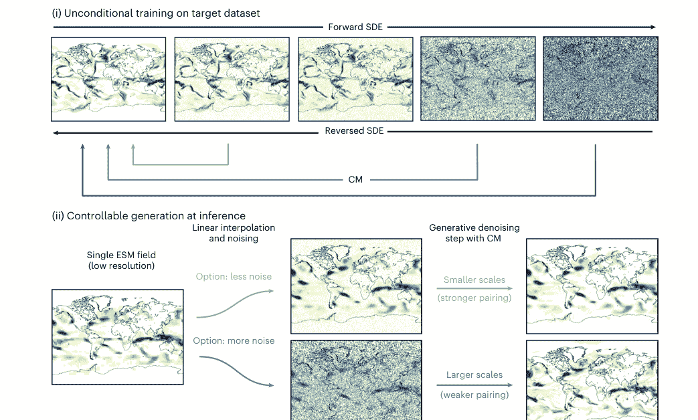

**图 1 | 用于下采样 ESM 场的一致性模型（CM）示意图。** 基于得分的扩散模型和 CM 的无条件训练学习逆转前向扩散过程（i）。尽管扩散模型的随机微分方程（SDE）需要多步迭代积分，但 CM 仅用单步即可从噪声生成全球降水场。无条件训练的 CM 被用于将低分辨率 ESM 降水场下采样（上采样）至四倍分辨率（ii）。通过在 ESM 场中加入选定方差的噪声，可以控制 ESM 中需保留的空间尺度：较小的噪声方差意味着与原始 ESM 场紧密配对，仅有微小变化；较大的方差将导致更大空间尺度的变化，并与 ESM 场较弱配对。

基于扩散的生成模型在经典图像生成任务上表现出优于 NFs 和 GANs 的性能 $^{1,2,3}$。关键在于，迭代求解逆扩散方程允许对图像采样过程进行强控制。

这使得计算机视觉和图像处理的基础模型成为可能，这些模型仅通过训练从噪声生成目标数据集样本，随后可重新用于不同的下游任务，例如修复、分类、着色或根据给定的“笔画草图”指南生成逼真图像，如 SDEdit $^{14,15,16}$。

迄今为止，此类基于扩散模型的方法在地球系统科学相关任务中仅被应用于下采样理想化的流动力学模拟 $^{17,18}$。这两项研究均使用基于随机微分方程（SDE）的扩散模型并取得了显著性能。然而，SDE 的迭代积分意味着生成网络需要评估多达 1,000 次才能下采样单个模拟场。这使得此类方法不适合处理大型模拟数据集，例如在高时间分辨率或长时段内，如气候变化预测和影响评估中所需的那样。

为了提高扩散模型的采样速度，已付出大量努力。使用常微分方程代替 SDE 可以将积分步数减少到约 10–50 步（参见文献 19,20）。蒸馏技术也可以应用于将采样速度提高至单步 $^{21,22}$。然而，这需要额外的训练成本和超参数选择。一般来说，生成步数与最终图像质量分数之间存在权衡 $^{11,13,20}$。最近，提出了一致性模型（CMs），可以直接训练为单步生成模型，而在采样可控性方面无需牺牲 $^{23}$。研究表明，CMs 在常见图像基准测试中超越了蒸馏的单步扩散模型 $^{24}$。

在本工作中，我们通过使用 CMs $^{23}$ 在单步内下采样来自三个不同 ESM 的全球降水模拟，来解决标准扩散模型的不足（图 1）。总之，我们旨在建立一个用于下采样 ESM 场的生成模型，该模型满足以下条件：

- CM 模型仅在目标数据集上进行训练，而不以 ESM 为条件。这使得该方法适用于任何 ESM，而无需计算成本高昂的重新训练。
- 训练最小化一种比先前方法 $^{25,6,29,30}$ 中对抗训练更稳定的回归损失。
- 生成式下采样在训练后的推理阶段是可控制的，允许选择一个特征空间尺度，在此尺度内无偏差的空间模式在 ESM 中得以保留。
- 该模型仅需要单次网络评估，而不是基于扩散模型的下采样方法中 $^{5,7}$ 所需的多次迭代评估。
- 该模型允许为单个 ESM 场生成大量下采样实现（即一对一多的映射），从而启用概率下采样和采样扩散度的量化。
- 该方法不需要专门制定的物理约束 $^{26}$ 来保持趋势 $^{27}$。


## 表 1 | 对比我们的 CM 方法与作为基准的 SDE 桥接方法的汇总统计

| 模型 | 相关性（池化） | 相关性（低通） | 平均误差 | %S | 95 分位误差 | 采样时间（秒） |
|---|---|---|---|---|---|---|
| SDE | 0.918 | 0.916 | 0.214 | 72.51 | 1.106 | 68.15 | 39.4 |
| CM | 0.954 | 0.941 | 0.217 | 72.08 | 1.080 | 68.92 | 0.1 |

相关性是在原生 POEM 网格（$3^{\circ} \times 3.75^{\circ}$；第二列）上通过将对降尺度场应用 $4 \times 4$ 平均池化计算的，以及在降尺度网格（第三列）上通过对高分辨率场应用与 POEM 中选定空间尺度一致的低通滤波器计算的。第四列为相对于 ERA5 的全球长期平均绝对误差，第五列为与 POEM ESM 偏差相比的相应误差减少量。第六列为 95 分位降水量的全球绝对误差，第七列为与 POEM ESM 偏差相比的误差减少量。还报告了平均采样时间的估计值（第八列）。最佳性能以粗体显示。

## 结果

我们在测试集数据上评估了基于 CM 的降尺度方法，将其与 SDE 桥接方法$^{7,8}$进行了对比。我们研究了降尺度的性能、纠正 ESM 中分布偏差的能力、给定选定空间尺度时的样本传播情况，以及在未来气候情景中趋势的保持情况。

## 降尺度空间场

为了进行定性比较，我们在图 2 中展示了单个降水场。基于 SDE 桥接（图 2e）和 CM（图 2g）的两种生成式降尺度方法都能产生高分辨率降水场，这些场在视觉上与上采样的 ERA5 数据（图 2a）无法区分。当对最先进的 GFDL-ESM4 和更轻型的 SpeedyWeather$^{1}$ 大气环流模型的降尺度模拟应用我们的方法时，以及当作为概念证明将我们的方法应用于最初上采样的 ERA5 数据时（补充图 3 和 6），也可以看到类似的性能。

当使用 $4 \times 4$ 内核平均池化上采样回原生 ESM 分辨率时，可以清楚地看出对低分辨率 ESM 模拟场的准确表示。如图 2f,g 所示，对于波茨坦地球模型（POEM）模型的情况，上采样后的校正场与原生场之间保持了 0.89（SDE 方法）和 0.95（CM 方法）的高皮尔逊相关系数。我们在表 1 中提供了整个测试集的相关性统计。除了平均池化场之外，我们还通过将截止频率设为 $k^{*} = 0.067$ 的低通滤波器应用于降尺度场，然后在计算相关性之前比较高分辨率网格上的降尺度和线性插值的 POEM 模拟。这样，我们测试了 ESM 中大尺度模式的保持情况。更具体地说，我们测量了当上采样回相同分辨率时，降尺度场与原始粗场有多相似。SDE 桥接方法在平均池化场和低通滤波场的平均相关系数分别为 0.918 和 0.916。我们的基于 CM 的方法在相应度量上实现了更高的相关值，分别为 0.954 和 0.941。基于 CM 的降尺度在处理降尺度 ERA5 时也显示了更高的相关性（补充表 2）。

我们估计在 NVIDIA V100 32 GB 图形处理单元上，使用 SDE 和 CM 方法生成单个样本所需的平均时间。平均值是对 100 个数据点取的。我们将 SDE 积分步数设为 500（参考 17），这低于典型的 1,000–2,000 步$^{12,15}$。SDE 平均耗时 39.4 秒，而 CM 样本效率更高，仅耗时 0.1 秒，且采样时间随样本数量线性扩展。

我们使用功率谱密度（PSDs）$^{8,25}$定量分析了 CM 和 SDE 桥接方法的降尺度性能。插值后的 ESM 场在小空间尺度上的变化表示不足，因为低分辨率模拟中不存在这些变化。这意味着空间间歇性的低估，即降水模式过于平滑，这对影响评估来说是一个高度具有问题性的问题。基于 SDE 和 CM 的生成式降尺度方法在提高空间分辨率方面表现非常出色，并在较小的空间尺度上极大地改善了空间间歇性（图 3c）。当将 CM 降尺度应用于 GFDL-ESM4 和 SpeedyWeather$^{1}$ 模拟时，PSD 的改进效果保持一致（补充图 4）。

我们还研究了 PSD 作为噪声方差调度时间 $t$ 的函数变化（图 3b），这与模式被校正到的空间尺度直接相关$^{1}$。对于最小噪声，即 $t^{*} = t^{\min}$，正如公式 (5) 所预期的那样，由于没有对 ESM 场进行任何更改，CM 模型重现了 ESM 的 PSD。对于具有最大方差的 $t^{*} = t^{\max}$，PSD 与 ERA5 再分析真值紧密匹配。对于任何 $t^{\min} < t^{*} < t^{\max}$，我们发现这两种极端情况之间存在权衡，在某种程度上匹配交点（图 3a，灰色虚线）上方和下方的 PSD，具体取决于 ESM 中保留的空间尺度。

为了测试降尺度场的时间一致性，我们报告了作为全局平均值计算的每个网格单元的时间自相关值（补充图 8）。我们发现，生成式和随机性的 SDE 和 CM 方法比分位数映射和双线性插值的确定性方法具有更准确的时间相关性。

## 偏差校正

我们比较了校正 ESM 中偏差的能力，使用相对频率直方图和平均降水的纬度剖面图，以研究已知偏差的减少，例如双赤道辐合带（ITCZ）$^{18}$，遵循在别处讨论的评估方法$^{9}$。

当应用于通过分位数 delta 映射（QDM）进行预处理的 ESM 模拟时，CM 校正偏差的能力自然取决于所选的空间一致性尺度（补充图 9）。选择最小的尺度会原封不动地重现 ESM，从而继承其偏差。选择尽可能大的尺度会生成统计量非常接近目标数据集的样本。然而，在如此高的噪声水平下，场会逐渐变成上采样的 ESM（图 1）。介于这两个极端之间的尺度可以根据所选的校正尺度不同程度上地校正偏差。

就相对频率直方图而言，ESM 模拟（未经 QDM 预处理）表现出分布右尾（即极端值）的强烈表示不足（图 4a,b）。对极端值的这种错误表示是现有先进 ESM 的一个关键问题，这使得未来极端事件及其影响的预测，以及相关的极端值检测和归因，高度不确定。

将 QDM 应用于 POEM 时，如预期那样，频率分布得到了显著改善。使用 SDE 对 ESM 进行降尺度进一步将全球直方图改善了一个数量级，特别是对于极端值。我们的基于 CM 的方法在全球直方图中显示出最大的整体偏差减少（图 4b）。当应用于不同的 ESM 和上采样的 ERA5 数据时，我们的方法显示出一致的偏差校正技能（补充图 5）。

我们进一步计算了局部降水直方图 95 分位数的误差，并在全球范围内汇总绝对值（表 1）。SDE 方法显示的误差为 1.106 mm day$^{-1}$，将 POEM ESM 的误差减少了 68.15%。CM 方法表现略好，误差为 1.080 mm day$^{-1}$，相对于 ESM 的相应误差减少量为 68.92%。当对最初上采样的 ERA5 数据进行降尺度时，CM 再次显示出更好的性能，误差为 0.725 mm day$^{-1}$，而 SDE 的误差为 0.868 mm day$^{-1}$（补充表 2）。

POEM 表现出强烈的双 ITCZ 偏差，这是先进 ESM 中常见的现象$^{36}$（图 4c）。正如预期的那样，QDM 可以去除大多数偏差，尽管略微低估了 ITCZ 中赤道以北的峰值。基于 SDE 桥接的降尺度方法

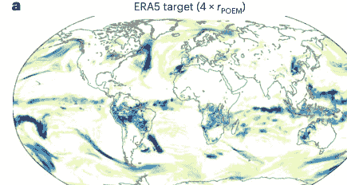
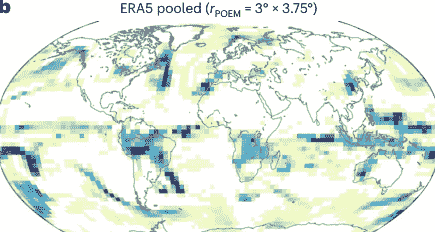
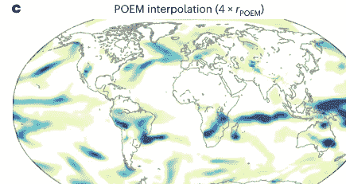
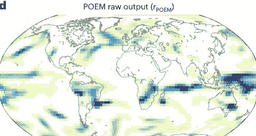
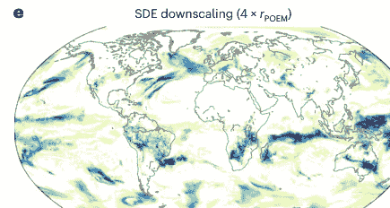
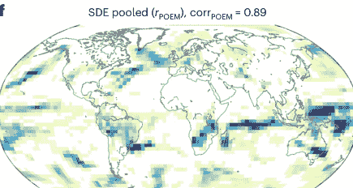
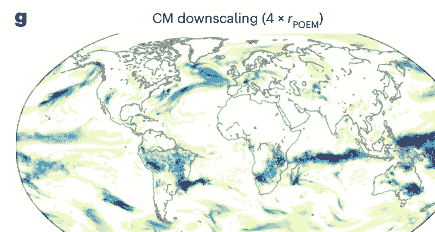
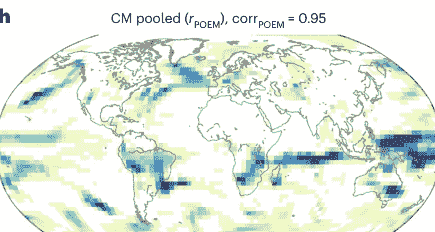
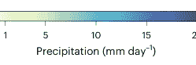

**图 2 | 单日降水场的定性比较。** a, 使用 ERA5 目标数据集的日降水量用于训练生成模型。b, 与 a 相同的数据，但分辨率低四倍以供比较。c, d, POEM ESM 历史运行中的降水场插值到目标分辨率（c）及其原生分辨率 $3^{\circ} \times 3.75^{\circ}$（d）。POEM 场与同一日期或任何其他 ERA5 场不是配对的。e, 使用 SDE 桥接方法对 POEM（d）进行降尺度得到的场（d–e）。f, 显示 f 的上采样（平均池化）表示，以便与 d 中显示的原始 POEM 场进行比较，以及两者之间的皮尔逊相关系数。g, h, 使用基于 CM 的方法对 POEM 进行降尺度（d–g），以及相应的池化场（h）。注意，CM 降尺度产生更高的相关系数，因此比 SDE 方法具有更好的大尺度特征一致性。


# 文章

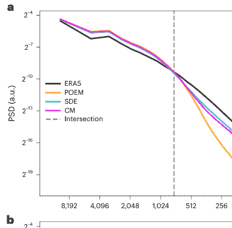

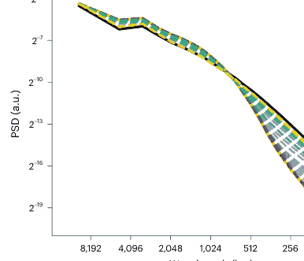

**图 3 | 全球降水场平均空间功率谱密度（PSD）。** a，目标 ERAS 再分析数据（黑色）、插值到相同高分辨率网格的 POEM 模拟（橙色）、SDE 桥（青色）和 CM 降尺度（品红色）的 PSD 比较。垂直虚线标记了 POEM 和 ERAS 的 PSD 相交的空间尺度，因此是校正截止波数 *k* 的自然选择。反过来，术语 $\langle f^{2}\rangle$ 是扩散模型中的加噪强度（方程 (11)）。b，针对不同空间尺度应用 CM 降尺度（虚线）于 PCOEM，作为全范围 $[f_{\min}, f_{\max}]$ 上加噪强度的函数。对较小尺度加噪意味着几乎重现 POEM 模拟，而对较大尺度加噪则对应于与 ESM 的较弱配对（图 1）。

和 CM 显示，对于这些纬度剖面，仅应用 SDE 时绝对误差相似（图 4c）。

我们报告了两种降尺度方法在长期平均值中网格单元格误差的绝对值，再次在全球范围内平均（表 1）。SDE 降尺度导致 0.214 mm day$^{-1}$ 的误差，将 POEM 中的误差降低了 72.51%，表现略优于我们的 CM 方法，该方法应用于 POEM 时显示出 0.217 mm day$^{-1}$ 的误差和 72.08% 的相应误差降低。在 ERAS 数据上评估时，我们发现就平均绝对误差和 RMSE 而言，CM 方法的表现略优于 SDE（补充表 2）。

## 量化采样分散度

我们的生成式基于 CM 的降尺度是随机的，将单个 ERA5 场一对一映射到许多可能的降尺度实现。因此，它自然地产生概率降尺度，适合估计相关的 uncertainty。通过选择 ESM 中由降尺度方法保留的特定空间尺度，自动选择了一个相关的自由度以在较小尺度上生成模式。鉴于我们的 CM 方法在推理方面非常高效，我们可以生成与低分辨率 ESM 输入一致的大量高分辨率场集合，并计算诸如采样分散度等统计量，这可以解释为降尺度任务内在不确定性的度量。

我们从单个 ESM 降水场计算了 $10^{4}$ 个降尺度场的集合（图 5a），并评估平均值和标准差（图 5d,e）。集合平均值与插值到相同高分辨率网格的 ESM 模拟显示出高度相似性。样本分散度显示出与平均值相似的模式，尽管幅度较小。

我们使用连续排名概率得分（CRPS）$^{39}$ 评估了由粗粒度 ESM 场组成的 100 个降尺度实现集合，对应于三种不同的噪声尺度，分别为 $t=f_{\min}$，$t^{*}=t$ 和 $t=f_{\max}$（补充图 7）。此外，CRPS 是作为相对于由 100 个随机高分辨率 ESM 场组成的基线集合的技能得分（连续排名概率技能得分）来评估的。我们发现，噪声强度使得集合分散度能够进行校准，对于小噪声尺度其很尖锐，而对于较大噪声尺度则变得越来越宽。中间噪声尺度（$t=t^{*}$）显示出最低的 CRPS，而最大噪声导致与从基线气候学中绘制随机场的连续排名概率技能得分相似。关于 CRPS 和连续排名概率技能得分的定义，见补充章节 8。

## 未来预测

我们 CM 方法的高效性质使得对长达一个世纪的气候模拟进行降尺度成为可能，例如由耦合模式比较计划第 6 阶段（CMIP6）规定的 SSP5-8.5 高排放情景。我们发现，降尺度准确地保留了 ESM 的全球降水含量，并保留了非线性趋势，正如从 Clausius--Clapeyron 关系$^{38}$ 所预期的那样。因此，网络可以泛化到全球平均降水增加的样本外预测，而无需在网络中硬编码辅助物理约束，如其他工作中所做的那样$^{34,35,37}$。然而，原则上，我们的方法可以扩展到这些约束以准确保留趋势。我们注意到，保留趋势的能力预计与用于条件降尺度的噪声方差有关，因为最大噪声对应于从学习到的历史 ESM 分布中采样，而没有噪声则以任何方式不改变 ESM 模拟。

## 讨论

我们介绍了一种生成式机器学习方法，用于对 ESM 降水场进行高效、尺度自适应和概率降尺度。我们的方法基于 CM，这是一种最近开发的方法，用于学习逆向扩散过程的自一致近似。CM 可以在单步中生成从 ERAS 再分析数据（用作基准）学习的高度逼真的全球降水场。我们的框架校正了极端事件的表征以及空间 ESM 模式，特别是在小空间尺度上，这两者对于影响评估都至关重要。此外，空间偏差也被高效地校正了。

对于此处考虑的具体任务，CM 方法比当前基于 SDE 的扩散模型快多达三个数量级$^{12,13,15,17}$，后者需要迭代求解微分方程。关键在于，CM 保持了高度的可控性，以引导采样，从而保留 ESM 中大于选定空间尺度的无偏空间模式。

类似于应用于理想化流体动力学的基于 SDE 的方法$^{17}$，我们的基于 CM 的模型只需要在给定高分辨率观测目标数据集上训练一次。由于我们在训练期间不以 ESM 输入作为条件，我们的方法可以应用于任何 ESM 而无需重新训练。结合 CM 的高效采样，我们的方法在计算上很快。

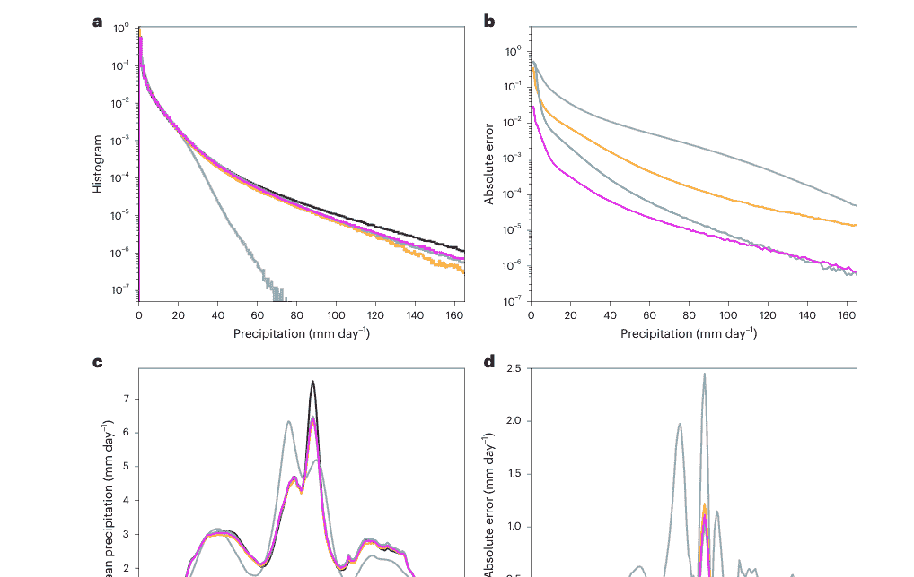

**图 4 | 全球直方图和纵向平均降水的比较。** **a**，ERA5 再分析数据（黑色）、未应用 QDM 预处理的 POEM 模拟（灰色）、应用 QDM 的 POEM 模拟（橙色）、SDE 桥（青色）和 CM（品红色）的相对降水频率全球直方图。**b**，相对于 ERA5 基准，**a** 中直方图的绝对误差。**c**，与 **a** 中相同数据在时间和经度上的平均降水，**d**。**c** 中纬度剖面的绝对误差。SDE 和 CM 降尺度方法都能进一步改善 QDM 预处理的偏差校正，特别是对于极端降水。

特别是在处理大型 ESM 集合时，且在准确性上没有明显的折衷。

我们的基于 CM 的方法可以创建高度逼真的场，这些场在与选择保留的空间尺度上维持与 ESM 的高度相关水平。与计算成本高昂得多的基于 SDE 的方法相比，我们发现结果略好或至少具有竞争力。ESM 场的高效单步生成对于处理大型数据集特别相关，例如，不确定性量化所需的大型集合，高时间分辨率模拟，或诸如古气候模拟等长期研究。使用不同噪声尺度校准集合 harness 和分散度的能力对于天气预报任务也可能有用。在将我们的方法应用于天气预报时，改变训练数据和划分可能有利，以避免因卫星数据的可用性而导致的分布偏移。从能源消耗的角度来看，提高当前深度学习模型的效率也很重要；在这方面，我们的方法为更绿色的人工智能提供了有价值的贡献$^{31}$。

当在将来非常高的排放情景下评估时，我们发现我们的生成式 CM 方法准确保留了 ESM 的趋势，即使对于温室气体排放和伴随全球变暖的极端情景也是如此。这是非凡的，因为许多基于机器学习的气候动力学应用难以应对由我们高度非平稳气候系统施加的样本外问题，当仅基于历史数据进行训练时。与先前的研究$^{34}$相反，为此目的，不需要向我们的模型添加专门制定的物理约束。因此，我们无约束的 CM 方法允许对未见过的气候状态进行更自然的泛化，固有地将 ESM 中的非平稳动力学转化为降尺度后的场。然而，由于我们的方法只是近似守恒 ESM 的全球平均值，添加如参考文献 24 中那样硬性架构约束（其满足约束直至机器精度）可能会进一步改善我们的结果。

后续场之间的网格单元格自相关估计表明，基于 CM 的随机降尺度方法捕捉了高分辨率目标数据的时间变异性，尽管没有明确使用时间信息。将该方法扩展到时间条件或预测多个时间步$^{32}$或使用相关噪声$^{33}$可能会进一步改善时间动力学。

我们的降尺度方法在本研究中将 ESM 模拟的分辨率提高了四倍。给定更高分辨率的训练目标和更多的计算资源，原则上，它也应该允许更大的降尺度比例。


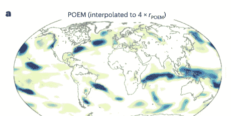
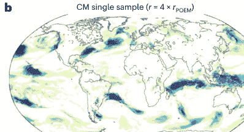
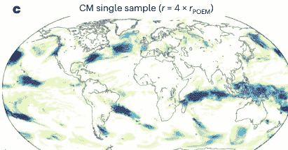
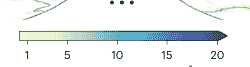
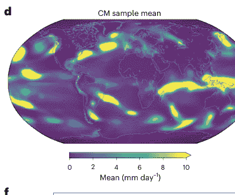
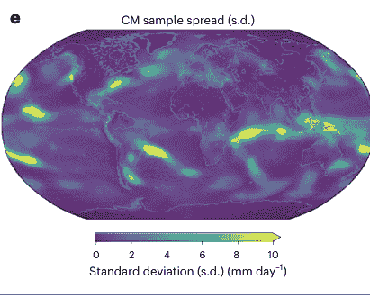
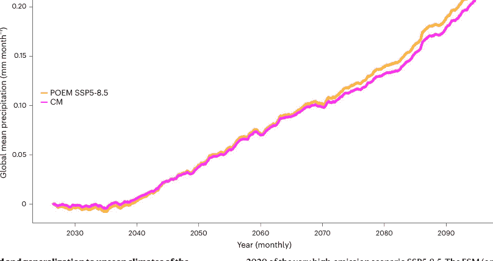

# 图 5 | 生成式概率降尺度过程中的采样分布范围及对未见气候的泛化能力。

**a,** 插值到目标分辨率的 ESM（地球系统模式）场。**b, c,** 由 CM（一致性模型）降尺度生成的两个不同示例样本，这些样本保留了大尺度模式并在小尺度上生成新图案。**d, e,** 10⁴ 个样本的集合平均（**d**）和标准差（**e**）。**f,** 归一化到 2020 年参考年的非常高高排放情景 SSP5-8.5 的三年滚动全球平均值。ESM（橙色）显示全球平均降水随排放情景增加，这与热力学克劳修斯-克拉佩龙关系 ¹² 相符。CM 降尺度（品红色）能够以高精度保留这一趋势，特别是考虑到 CM 网络未添加任何物理约束。

我们在单变量降水模拟中展示了我们的方法，因为降水被认为是建模难度最大的气候变量。扩展到多变量降尺度是我们未来研究的自然延伸。原则上，卷积 CM 网络可以以直接的方式扩展，将更多变量作为额外通道包含进来。一致性尺度将取决于变量（通道），可能需要单独处理。类似地，我们相信我们的方法可以应用于其他时间尺度（例如，每小时以及每月），使用适当调整的声音尺度。选择最优噪音尺度如本文及他处^{2}所做的通过功率谱密度（PSD）的交点，假设谱密度随波数单调递减。虽然我们确信这对大多数气候影响变量成立，但可能存在需要不同方法的例外。我们将这些探索留待未来研究。

例如高斯分布，到目标数据分布，p(x(t) = 0)=p_{T}，其中 x \in \mathbb{R}^{d} 且 d 是数据维度，用于分布^{3, 5, 33-35}或图像中像素的一般情况。基于分数的生成^{3, 33, 35}模型^{3, 29}将概率去噪扩散模型^{3, 26, 32}推广到连续时间的随机微分方程（SDE）。

在此框架中，通过逐步扰动数据的前向扩散过程可以被描述为以下 SDE 的解：

$$dx = \mu(x, t)dt + g(t)dw, \quad \mathbf{(1)}$$

其中 \mu(x, t): \mathbb{R}^{d} \rightarrow \mathbb{R}^{d} 是漂移项，w 表示维纳过程，g(t): \mathbb{R} \rightarrow \mathbb{R} 是扩散系数。用于从噪声生成图像的反向 SDE 由以下公式给出^{3}：

$$dx = [\mu(x, t) - g(t)^{2}\nabla_{x}\log p_{t}(x)]dt + g(t)dw, \quad \mathbf{(2)}$$

其中 t 表示时间反转，\nabla_{x}\log p_{t}(x) 是目标分布的分数函数。分数函数在解析上是不可处理的，但可以通过训练分数网络 s(x, t; \theta): \mathbb{R}^{d} \rightarrow \mathbb{R}^{d} 来近似分数函数 s(x, \theta) \approx \nabla_{x}\log p_{t}(x)，例如使用去噪分数匹配（见补充信息）。对于采样，我们使用欧拉-马尔可夫（Euler–Maruyama）求解器以 500 步从 T 到 t = 0 积分方程 (2) 中的反向 SDE。

## 方法

**训练数据**

作为目标数据集和基准数据集，我们使用由欧洲中期天气预报中心提供的 ERA5 再分析观测降水数据^{4}。它覆盖了从 1940 年至今的时期，我们将数据划分为 1940 年至 1998 年的训练集，1991 年至 2003 年的验证集以及 2004 年至 2018 年的测试集。我们将再分析数据双线性插值到经度方向 0.9375^{\circ} 和纬度方向 0.75^{\circ} 的分辨率（即 240 \times 384 个网格点），这比原始 ESM 模拟的 3^{\circ} \times 3.75^{\circ} 分辨率（即 60 \times 96 个网格点）高出四倍分辨率。

对于 ESM 降水场，我们使用来自三个具有不同复杂度和分辨率的 ESM 的全球模拟。完全耦合的 POEMSM，包含大气、海洋、冰盖和动态植被模型组件，作为比较过去和未来气候中两种生成式降尺度方法的主要模型。为了展示我们的基于 CM 的方法将具有较粗原生分辨率的任何 ESM 校正到训练基准的能力，我们进一步包含了来自更综合且复杂的 GFDL-ESM4（参考文献 36）的日降水模拟，其原生分辨率为 1^{\circ} \times 1^{\circ}。我们最初将 GFDL-ESM4 的分辨率上采样到与 POEMSM 数据相同的网格，以便进行直接比较。我们还包含了 SpeadyWeather，^{37} 其原生分辨率为 3.75^{\circ} \times 3.75^{\circ}，由于仅具有动态大气，因此不如完全耦合的 POEMSM 那么综合。最后，我们还将上采样到 POEM 原生分辨率的 ERA5 数据作为有配对基准可用的测试数据。因此，将我们的方法应用于后者可被视为概念验证。

对于评估，我们使用每个模拟中可用的 14 年历史数据，POEM 的时期为 2004–2018 年，GFDL-ESM4 为 2000–2014 年，SpeadyWeather 为 1956–1970 年，ERA5 为 2007–2021 年。

我们对模拟输入数据应用了几个预处理步骤。首先，我们将输入模拟插值到与基准 ERA5 数据相同的高分辨率网格上，用于降尺度目的和模型评估。然后应用低通滤波器以去除插值产生的小尺度伪影。随后以标准方式应用具有 500 个分位数的 QDM^{16}，以逐个网格单元去除 ESM 模拟中的分布偏差。如“偏差校正”部分所述，生成式降尺度仅校正与指定空间尺度相关的偏差。因此，QDM 步骤确保了单格偏差的强烈减少，而生成式降尺度则校正物理上一致的空间图案。最后，对 ESM 和 ERA5 数据进行对数变换，x = \log(x + e) \rightarrow \log[e]，其中 e = 0.0001（参考文献 5），然后进行大致在 [−1, 1] 范围内的归一化。

### 一致性模型

当前扩散模型的一个主要缺点是，数值积分微分方程需要大约 10–2,000 次网络评估，具体取决于求解器。这使得与其他生成模型（如 GANs^{4} 或 NFs^{3, 30, 32}）相比，生成过程在计算上低效且成本高昂，后者可以单次网络评估生成图像。蒸馏技术可以减少扩散模型的前向步骤数量，这通常代表计算瓶颈^{22, 25}。

CM 可以从头训练而不需蒸馏，并且只需单步即可生成新样本。已证明它们优于当前的蒸馏技术^{32}。CM 学习一致性函数，f(x(t), t) = f(x(t^{\prime}), t^{\prime})，这是自洽的，即：

$$f(x(t), t) = f(x(t^{\prime}), t^{\prime}), \quad t, t^{\prime} \in [t_{min}, t_{max}], \quad \mathbf{(3)}$$

其中时间区间设置为 t_{min} = 0.002 且 t_{max} = 80（参考文献 32）。此外，在 t = t_{min} 时施加边界条件 (x(t_{min}), t_{min})。这可以通过以下参数化实现：

$$f(x, t, \theta) = c_{skip}(t)x + c_{out}(t)F(x, t, \theta), \quad \mathbf{(4)}$$

其中 F(\cdot) 是具有参数 \theta 的 U-Net。时间信息在网络中通过正弦-余弦位置嵌入进行转换。系数 c_{skip}(t) 和 c_{out}(t) 的定义^{32}为：

$$c_{skip}(t) = \frac{\sigma^{2}_{data}}{(\sigma^{2}_{data} + \sigma^{2}(t))^{2}}, \quad c_{out}(t) = \frac{\sigma_{data} \cdot \sigma(t)}{\sqrt{\sigma^{2}(t) + \sigma^{2}_{data}}}, \quad \mathbf{(5)}$$

训练目标由以下公式给出：

$$\mathcal{L}(\theta, \theta^{\bot}) = \mathbb{E}_{x_{s_{i+1}}\sim D} \| \mu_{f}(x_{s_{i+1}} + t_{s_{i+1}}) - \theta \|, \quad \mathbf{(6)}$$

其中 \theta^{\bot} \equiv \mathbb{E}_{x_{s_{0}}\sim D, \sim (1/U(N),1\setminus N)0.5},x_{s_{0}} \| \| $ 且离散步通过以下公式确定：

$$t_{n} = \hat{t}^{(p)}_{min} + (n-1)(N-1)(\hat{t}^{(p)}_{min} - \hat{t}^{(p)}_{max})^{1/p}, \quad \mathbf{(7)}$$

其中 p = 7，离散化时间表由以下公式给出：

$$N(k) = \sqrt{k/k(s^{2}_{1} + s^{2}_{0} - s^{2}_{k} + s^{2}_{0}) + 1}. \quad \mathbf{(8)}$$


## 网络架构与训练

我们使用 Diffusers 库中的二维 U-Net$^{18,35}$ 从头开始训练评分网络和一致性网络，该网络包含四个下采样和上采样层。对于这四个层，我们使用了具有 128、128、256 和 256 个通道以及 3 $\times$ 3 卷积核的卷积、Sigmoid 线性单元（SiLU）激活函数、组归一化，并在架构瓶颈处使用了一个注意力层。该网络总共有大约 2700 万可训练参数。

我们使用 Adam 优化器$^{46}$ 对核心网络进行 200 个轮次的训练，批量大小为 1，学习率为 1 $\times$ 10$^{2}$，并对模型权重应用了衰减率为 0.999 的指数移动平均（补充信息）。

CM 模型使用 RAdam 优化器$^{47}$ 训练 150 个轮次$^{23}$，采用与评分网络相同的批量大小、学习率和指数移动平均调度（初始衰减率为 $\alpha_0=0.9$）。我们发现损失在训练过程中以稳定的方式下降（补充图 1）。在 NVIDIA G102 32 GB 图形处理单元上，CM 的 150 轮训练大约需要六天半，而 SDE 需要四天半。训练超参数的摘要见补充表 1。

## 尺度一致的下采样

正如其他工作$^{45,48}$所示，向图像（或流体动力学快照）添加具有选定方差的高斯噪声，结果是消除直至特定空间尺度的空间图案，该尺度与所加噪声量相关。经过训练的生成模型随后可以将噪声替换为从训练数据中学习到的、直至选定空间尺度的空间图案。

原则上，空间尺度可以根据给定的下采样任务进行选择，例如，与 ESM 分辨率或变量相关。因此，我们的方法在训练后提供了更大的灵活性，其中最优训练尺度可以根据任何给定的指标来定义。总体而言，ESM 场在小空间尺度上过于平滑，这是地球系统建模（总体而言）以及影响评估（特别是）的一个关键问题。更具体地说，当从空间功率谱密度（PSD）的角度比较空间降水场的频率分布时，可以看到 ESM 缺乏高频空间变异性，即空间间歇性，这是降水的一个关键特征$^{49}$。因此，保留在 ESM 场中的空间尺度的一个自然选择是来自 ESM 和真实 ERA5（参考文献 17）的 PSD 的交点（图 3），即 ESM 场变得过于平滑的尺度。

其中 $k$ 是当前训练步骤，$K$ 是从 PyTorch Lightning 库获得的估计总训练步骤数。初始离散化步骤设置为 $s_0 = 2$，最大步骤数设置为 $s_n = 150$（参考文献 23）。我们用 $\hat{\theta}$ 表示对模型参数 $\theta$ 的指数移动平均，其更新公式为 $\hat{\theta} = \text{stograd}[w(k)\hat{\theta} + (1-w(k)\theta)]$，衰减调度由下式给出：

```
w(k) = exp(s0 log($\alpha_0$) / N(k))
(9)
```

其中 $w_0 = 0.9$ 是初始衰减率$^{50}$。对于距离度量 $d(\cdot, \cdot)$，我们遵循另一项工作$^{35}$，使用学习到的感知图像块相似度$^{51}$和 $l^p$ 范数的组合：

```
$d(x, y) = \text{LPIPS}(x, y) + \|x-y\|_l$
(10)
```

因此，CMI 的训练是自监督的，并与表示学习$^{52}$密切相关，其中所谓的在线网络 $\hat{\text{f}}: \theta$ 被训练以预测与“目标网络” $\text{f}: \hat{\theta}$ 相同的图像表示（参考文献 44）。重要的是，因此 CMI 并非明确为下采样任务进行训练，这些任务纯粹在推理阶段执行。

对于高斯噪声，时间 $t$ 的方差可以通过$^{47}$与给定波数 $k$ 和网格大小 $N$ 的 PSD 相关联：

```
$\sigma^2(t) = N^{p}\text{PSD}(k)$
(11)
```

使用方程 (11)，我们选择 $k^* = 0.0667$（补充图 2），使其代表 ESM 和 ERA5 降水场 PSD 相交的波数或空间尺度。这对应于 CM 方差调度的 $t^* = 0.468$ 和 SDE 桥的 $t^* = 0.355$。

扩散桥$^{47}$从方程 (1) 中的前向 SDE 开始，初始化为来自 POEM ESM 的降水场。然后前向 SDE 被积分直至 $t = T$。然后，反向 SDE（方程 (2)）——在 $t = T$ 处初始化——再次对场去噪，从目标 ERA5 分布中添加结构。

对于 CM 方法，在推理时，我们应用“笔画引导”技术$^{48,53}$，其中我们首先采样一个噪声 ESM 场 $\mathbf{x}^{\text{ESM}} \in \mathbb{R}^{d}$，其方差对应于 $t^*$：

```
$\mathbf{x}^{\text{ESM}} \sim \mathcal{N}(\textbf{x}^{\text{ESM}}, \sigma^2(t^*)\mathbf{I})$
(12)
```

然后通过 CM 在单步内对其进行去噪：

```
$\mathbf{x} = f(\mathbf{x}^{\text{ESM}}, t^*, \theta)$
(13)
```

从而高效地生成现实样本 $\mathbf{x}$，这些样本保留了 ESM 直至尺度 $k^*$ 的无偏空间图案。

## 数据可用性

ERA5 再分析数据可在 Copernicus 气候变化服务（C3S）下载（https://cds.climate.copernicus.eu/datasets/reanalysis-era5-single-levels?tab=download）。POEM ESM 的模拟数据可通过 Zenodo 获取（https://doi.org/10.5281/zenodo.4685086）$^{30}$。

## 代码可用性

用于数据处理和分析的 PyTorch 代码，以及用于训练的 PyTorch$^{48}$ 代码$^{35}$，可通过 GitHub（https://github.com/p-los/consistency-climate-downscaling.git）和 Code Ocean（https://doi.org/10.24435/CO.2150269v1）$^{52}$ 获取。

## 参考文献

- 1. Kotz, M., Levernann, A. & Wenz, L. 降雨变化对经济生产的影响. Nature **601**, 223–227 (2022).
- 2. Schneider, T. et al. 气候目标与开启云层的未来. Nat. Clim. Change **7**, 3–5 (2017).
- 3. Dinh, L., Krueger, G. & Bengio, Y. NICE: 非线性独立成分估计. 预印本 http://arxiv.org/abs/1410.8516 (2015).
- 4. Goodfellow, I. et al. 生成对抗网络. In Advances in Neural Information Processing Systems (eds Ghahramani, Z. et al) 2672–2680 (MIT, 2014).
- 5. Groenke, B., Madau, L. & Monteleoni, C. ClimAlign: 通过归一化流对气候变量进行无监督统计降尺度. In Proc. 10th International Conference on Climate Informatics 60–66 (Association for Computing Machinery, 2020).
- 6. Pan, B. et al. 学习修正气候预测偏差. J. Adv. Model. Earth Syst. **13**, e2021MS002509 (2021).
- 7. Francois, B., Thaos, S. & Yrao, M. 使用循环一致性对抗网络调整气候模型输出的空间依赖性. Clim. Dyn. **57**, 3328–3353 (2021).
- 8. Harris, L., McRae, A. T. T., Chanhy, M., Dueben, P. D. & Palmer, T. N. 一种生成式深度学习方法来随机降尺度降水预报. J. Adv. Model. Earth Syst. **14**, e2022MS003120 (2022).
- 9. Hess, P., Dürke, M., Petri, A., Strandal, F. M. & Boers, N. 物理受限生成对抗网络用于改善地球系统模型的降水场. Nat. Mach. Intell. 4, 828–839 (2022).
- 10. Hess, P., Lange, S., Schötz, C. & Boers, N. 深度学习用于偏差校正 CMIP6 级地球系统模型. Earth’s Future 11, e2023EOF00402 (2023).
- 11. M. Arjovsky, L. & Bottou. 迈向训练生成对抗网络的原则性方法. In 5th International Conference on Learning Representations (OpenReview.net, 2017).
- 12. Dhariwal, P. & Nichol, A. 扩散模型在图像合成上击败 GAN. In Advances in Neural Information Processing Systems (eds Ranzato, M. et al.) 8780–8794 (Curran Associates, 2021).
- 13. Song, Y. et al. 通过随机微分方程进行基于评分的生成建模. In 9th International Conference on Learning Representations 8780–8794 (Curran Associates, 2021).
- 14. Clark, K. & Jaini, P. 文生图扩散模型是零样本分类器. In Advances in Neural Information Processing Systems (eds Oh, T. et al.) 58921–58937 (Curran Associates, 2023).
- 15. Sauer, A., Lorenz, D., Blattmann, A. & Rombach, R. 对抗扩散蒸馏. In Computer Vision—ECCV 2024 174–103 (Springer Nature, 2024).
- 16. Meng, G. et al. SDEdit: 使用随机微分方程进行指导图像合成和编辑. In 10th International Conference on Learning Representations (Curran Associates, 2022).
- 17. Bischoff, T. & Deck, K. 使用扩散桥对流体流动进行非配对降采样. Artif. Intell. Earth Syst. 3, e300039 (2024).
- 18. Wan, Z. Y. et al. 去偏差粗化，条件采样：统计降尺度模型优于 MIP 传输和概率扩散模型. In Advances in Neural Information Processing Systems (eds Oh, A. et al.) 47749–47763 (NeurIPS, 2023).
- 19. Karras, T., Aittala, M., Aila, T. & Laine, S. 阐明基于扩散的生成模型的设计空间. In Advances in Neural Information Processing Systems (eds Koyejo, S. et al.) 26565–26577 (NeurIPS, 2022).
- 20. Esser, P. et al. 为高分辨率图像合成扩展校正流 Transformer. In Proc. of the 41st International Conference on Machine Learning (eds Salakhutdinov, R. et al.) 12598–12633 (JMLR.org, 2024).
- 21. Luhman, E. & Luhman, T. 迭代生成模型中的知识蒸馏以提高采样速度. 预印本 http://arxiv.org/abs/2101.02388 (2021).
- 22. Zheng, H., Nie, W., Valdadt, A. & Anandkumar, A. 使用掩码 Transformer 快速训练扩散模型. In Transactions on Machine Learning Research (OpenReview.net, 2024).
- 23. Song, Y., Dhariwal, P., Chen, M. & Sutskever, I. 一致性模型. In Proc. 40th International Conference on Machine Learning (eds Krause, A. et al.) 32221–32252 (PMLR, 2023).
- 24. Harder, P. et al. 用于气候降尺度的硬约束深度学习. J. Mach. Learn. Res. 24, 1–40 (2023).
- 25. Ravuri, S. et al. 使用雷达的深度生成模型进行熟练的降水预报. Nature 597, 672–677 (2021).
- 26. Tian, B. & Dong, G. 基于年平均降水的 CMIP3、CMIP5 和 CMIP6 模型中的双 ITCZ 偏差. Geophys. Res. Lett. 47, e2019GL087232 (2020).
- 27. Cannon, A. J., Sobie, S. R. & Murdock, T. Q. 通过分位数映射对 GCM 降水进行偏差校正——这些方法在分位数和极值变化中的表现如何？J. Clim. 28, 6938–6959 (2015).
- 28. Hersbach, H. 集成预测系统中连续排序概率得分的分解. Weather Forecast. 15, 559–570 (2000).
- 29. Traxl, D., Boers, N., Rheinwalt, A. & Bookhagien, B. 气旋活动在热带温度-降雨尺度中的作用. Nat. Commun. 12, 6332 (2021).
- 30. Beucler, T. et al. 在模拟物理系统的神经网络中强制实施解析约束. Phys. Rev. Lett. 126, 98302 (2021).
- 31. Schwartz, R., Dodige, L., Smith, N. A. & Etzioni, O. Green AI. Commun. ACM 63, 54–63 (2020).
- 32. Price, I. et al. 使用机器学习的概率天气预报. Nature 637, 84–90 (2025).
- 33. Huang, X. et al. 扩散模型的蓝噪声. In ACM SIGGRAPH (eds Burbano, A. et al.) 1–11 (Association for Computing Machinery, 2024).
- 34. Hersbach, H. et al. ERA5 全球再分析. Q. J. R. Meteorol. Soc. 146, 1999–2049 (2020).
- 35. Dürke, M. et al. CM2mC-LPimL v1.0: 将基于过程的动态植被模型与管理土地耦合到一般循环模型中的生物物理耦合. Geosci. Model Dev. 14, 4117–4141 (2021).
- 36. Dunne, J. P. et al. GFDL 地球系统模型版本 4 (GFDL-ESM 4.1): 总体耦合模型描述和模拟特征. J. Adv. Model. Earth Syst. 12, e2019MS002015 (2020).
- 37. Klöwer, M. et al. SpeedyWeather.l: 重新发明大气一般循环模型以实现交互性和可扩展性. J. Open Source Softw. 9, 6323 (2024).
- 38. Song, Y. & Ermon, S. 通过估计数据分布的梯度进行生成建模. In Advances in Neural Information Processing Systems (eds Wallach, H. M. et al.) 11918–11930 (Curran Associates, 2019).
- 39. Song, J., Meng, C. & Ermon, S. 去噪扩散隐模型. In International Conference on Learning Representations 6323 (The Open Review, 2021).
- 40. Ho, J., Jain, A. & Abbeel, P. 去噪扩散概率模型. In Advances in Neural Information Processing Systems (eds Larochelle, M. et al.) 6840–6851 (NeurIPS, 2020).
- 41. Papamarkarios, G., Naishick, G., Rezende, D. J., Mohamed, S. & Lakshminarayanan, B. 用于概率建模和推理的归一化流. J. Mach. Learn. Res. 22, 2617–2680 (2021).
- 42. Zhang, R., Iosa, P., Eiros, A., Schmetzman, E. & Wang, O. 深度特征作为感知指标的不可思议的有效性. In Proc. IEEE Conference on Computer Vision and Pattern Recognition 586–595 (IEEE, 2018).
- 43. Lessig, C. et al. AtmoRep: 使用大规模表示学习的大气动力学随机模型. 预印本 http://arxiv.org/abs/2308.13280 (2023).
- 44. Grill, J. F. et al. 自举你的潜在变量——一种新的自监督学习方法. In Advances in Neural Information Processing Systems (eds Larochelle, M. et al.) 21271–21284 (Curran Associates, 2020).
- 45. Ronneberger, O., Fischer, P. & Brox, T. U-Net: 用于生物医学图像分割的卷积网络. In Medical Image Computing and Computer-Assisted Intervention—MICCAI 2015. Lecture Notes in Computer Science (eds Navab, N. et al.) 234–241 (Springer, 2015).
- 46. Kingma, D. P. & Ba, J. L. Adam: 一种随机优化方法. In 3rd International Conference on Learning Representations ICLR 2015—Conference Track Proc. 1–15 (ICLR, 2015).
- 47. Liu, L. et al. 关于自适应学习率的方差及更广阔的研究. In 8th International Conference on Learning Representations (OpenReview.net, 2020).

https://doi.org/10.1038/s42256-025-00980-5


48. Rissanen, S., Heinonen, M. & Solin, A. 基于逆热耗散的生成建模。载于第11届国际学习表征会议（OpenReview.net），2023年。
49. Drikke, M. GMD出版物gmd-2020-436的输出数据。Zenodo [https://doi.org/10.5281/zenodo.4683086](https://doi.org/10.5281/zenodo.4683086) (2021).
50. Paszke, A. et al. PyTorch：一种命令式风格的高性能深度学习库。载于《神经信息处理系统进展》32卷，1–12页 (2019).
51. Hess, P. p-hss/consistency-climate-downscaling：发表前发布。Zenodo [https://doi.org/10.5281/zenodo.14203092](https://doi.org/10.5281/zenodo.14203092) (2024).
52. Hess, P. 利用生成机器学习对地球系统模型场进行快速、尺度自适应且感知不确定性的降尺度分析。Code Ocean [https://doi.org/10.24433/CO.2150269.v1](https://doi.org/10.24433/CO.2150269.v1) (2024).

## 致谢

我们感谢 K. Deck 和 M. Klöwer 分别就用于降尺度的扩散桥以及降尺度数值模拟提供的宝贵意见。N.B. 和 P.H. 感谢大众汽车基金会（Volkswagen Foundation）以及欧洲区域发展基金（ERDF）、德国联邦教育与研究部（BMBF）和勃兰登堡州（Land Brandenburg）为在本研究提供资源以支持该项目（即在波茨坦气候影响研究所的高性能计算机系统上提供支持）所给予的资助。M.A. 感谢通过卓越战略资助计划以及通过 TUM 创新网络 EarthCare 获得的资助。这是 ClimTip 项目的第37项贡献；ClimTip 项目已从欧盟地平线研究和创新计划（Horizon）中获得了资助，资助协议编号为 101137601。B.P. 感谢中国国家重点研发计划（项目编号：2023YFC300700）的资助。

## 作者贡献

P.H. 和 N.B. 构思了本项研究，并在 M.A. 和 B.P. 的意见参与下设计了该研究方案。P.H. 执行了模型训练和数值分析。P.H.、M.A.、B.P. 和 N.B. 共同解释并讨论了研究结果。P.H. 起草了手稿，并接受了来自 M.A.、B.P. 和 N.B. 的意见。

## 资金

慕尼黑工业大学（Technical Universität München）提供的开放获取资金。

## 利益冲突

作者声明不存在利益冲突。

## 补充信息

**补充信息** 在线版本包含补充材料，可在 [https://doi.org/10.1038/s42256-025-00980-5.](https://doi.org/10.1038/s42256-025-00980-5.) 获取。

**通讯作者及材料索取请求** 请联系 Philipp Hess。

**同行评审信息** *Nature Machine Intelligence* 感谢 Tom Beucler 以及其他匿名审稿人为本研究的同行评审工作做出的贡献。

**重印及版权信息** 请访问 [www.nature.com/reprints.](www.nature.com/reprints.) 获取。

**出版商声明** Springer Nature 对出版地图或机构隶属关系中的司法管辖权声明保持中立。

**开放获取** 本文根据知识共享署名4.0国际许可协议（Creative Commons Attribution 4.0 International License）进行许可，该协议允许在任何媒介或格式中使用、分享、改编、分发和复制，但前提是必须恰当署名原始作者和来源，提供指向该知识共享许可协议的链接，并指出是否已做修改。本文中的图片或其他第三方材料包含在文章的知识共享许可协议中，除非在材料的署名行中另有说明。如果材料未包含在文章的知识共享许可协议中，且您的拟议用途未获得法定法规的许可或超出了允许的用途，则需直接联系版权持有人获取许可。如需查看该许可协议的副本，请访问 [http://creativecommons.org/licenses/by/4.0/](http://creativecommons.org/licenses/by/4.0/)。

© 作者 2025

