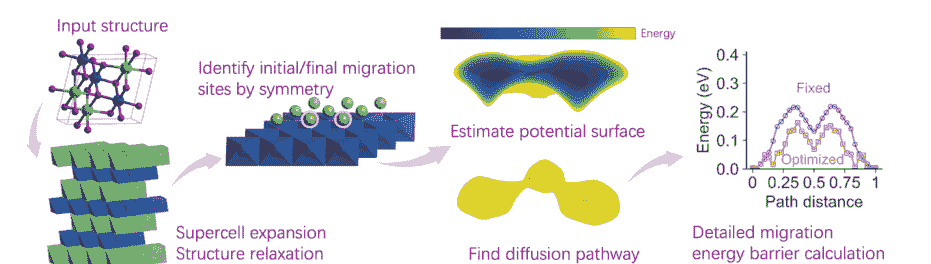
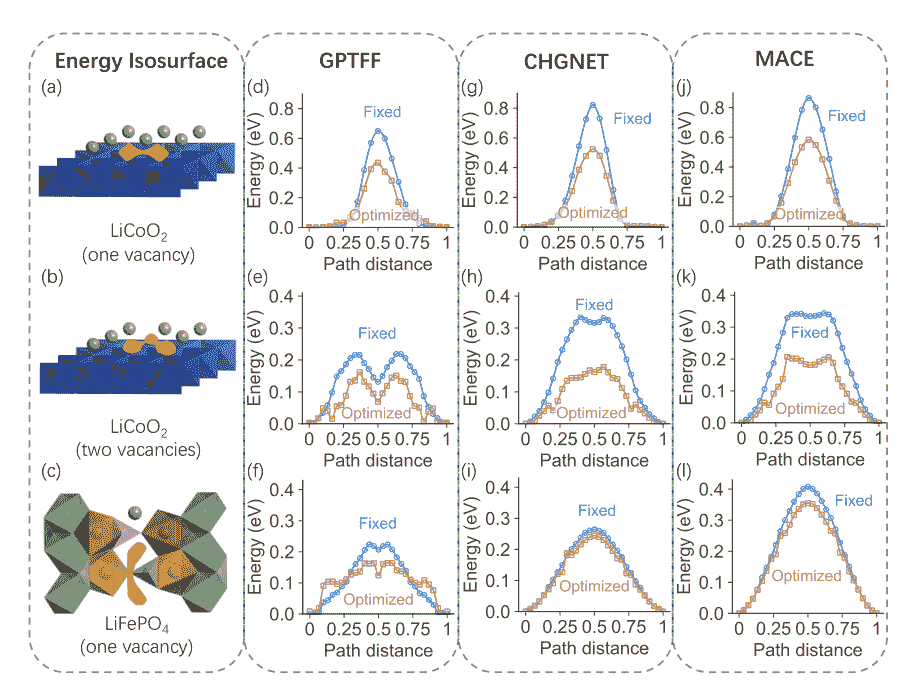
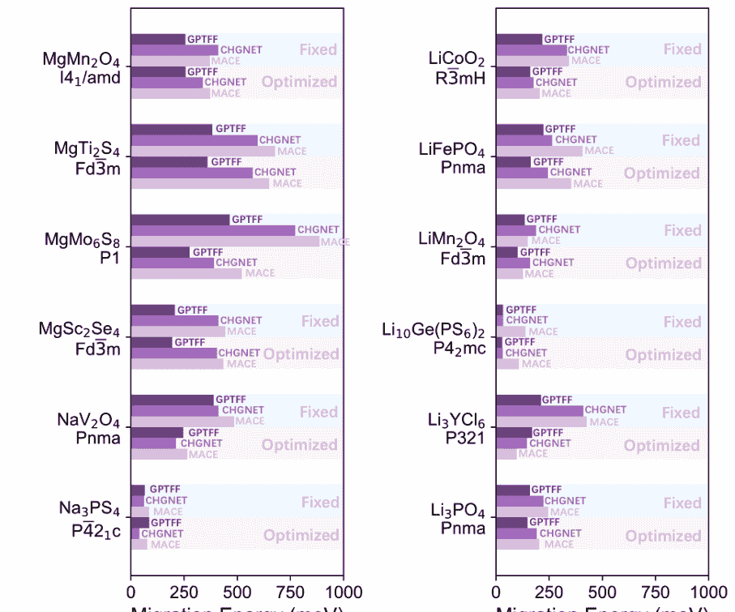
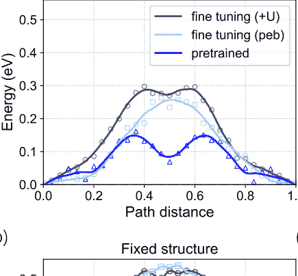
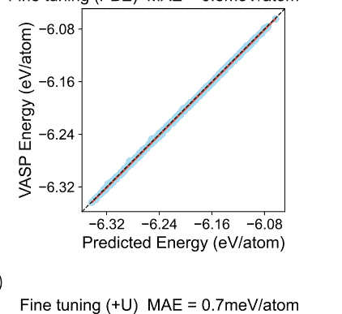
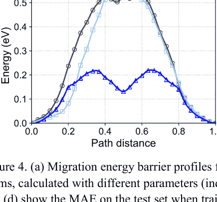
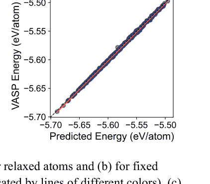

# FastTrack：利用通用机器学习原子间势快速评估固体中质量传输的方法

## ABSTRACT:

我们提出了一种快速、精确的计算晶体中原子迁移势垒的框架，该框架结合了通用机器学习力场（`MLFFs`）与三维势能面采样和插值。我们的方法通过超胞扩展抑制周期性自相互作用，从空间网格上的 `MLFF` 能量构建连续的 `PES`，并在没有预定义 `NEB` 图像的情况下提取最小能量路径。在包括 `LiCoO₂`、`LiFePO₄` 和 `LGPS` 在内的十二种基准电极和电解质材料中，我们的基于 `MLFF` 的势垒与 `DFT` 和实验结果在数十 meV 范围内，同时相比 `DFT-NEB` 实现了 ~10²× 的加速。我们对 `GPTFF`、`CHGNet` 和 `MACE` 进行了基准测试，表明在 `PBE/PBE+U` 数据上进行微调可进一步提高精度，并提供了一个用于高通量材料筛选和交互式 `PES` 可视化的开源软件包。

## Introduction:

扩散是自然界中最普遍和重要的现象之一，是大量自然和工业过程的基础 [1]。其影响涵盖众多应用，包括锂离子电池、燃料电池、催化反应和合金形成——所有这些都根本依赖于这种质量传输方式。

例如，在锂离子电池中，锂离子在负极和正极之间的扩散对充放电至关重要，直接影响电池容量和寿命 [2]。在燃料电池中，扩散强烈影响电池材料的性能和耐久性；在质子交换膜燃料电池（`PEMFCs`）中，氧气、一氧化碳和硫化氢等气体通过膜的传输决定了效率和运行稳定性 [3]。在钢铁工业中，氢在 α-Fe 中的高扩散性会导致氢脆，不利地影响钢的机械性能和寿命 [4]。在细胞生物学中，氨基酸和营养物质的扩散对细胞功能和代谢至关重要 [5]。作为质量传输的基本机制，扩散不仅塑造了科学研究，也在众多领域具有深远意义，是无数自然现象和技术进步的基础。

在原子迁移过程中，离子必须克服一个能量势垒——称为迁移势垒或活化能——它决定了离子运动的难易程度，从而决定材料的离子电导率。因此，准确评估或预测系统内的扩散至关重要。

然而，在原子尺度上对原子迁移势垒的实验测量仍然具有根本性挑战。现有的大多数实验方法，例如用于追踪特定物种的核磁共振（`NMR`）光谱 [6] 或用于探测离子电导率的电化学阻抗谱 [7]，都依赖于检测大量原子的集体行为。这些技术提供的是宏观平均值，往往无法分离单个原子的本征迁移速率。因此，实验确定的迁移速率可能与实际的微观迁移速度显著偏离——有时相差 4 到 5 个数量级 [2]——这是由于无法将原子尺度过程与真实材料中存在的复杂复合信号分离。

这一局限性凸显了计算方法（如 nudged elastic band（`NEB`）[8] 和 drag 方法）的价值，它们可以直接在微观尺度上探测原子迁移机制。此类模拟不仅可以补充实验数据，还能在实验进行前预测扩散特性，从而为新材料的理性设计和发现提供有力工具。

然而，当前估计原子迁移能量势垒的方法仍存在明显局限。例如，Nudged Elastic Band（`NEB`）方法通过优化初始和最终原子构型之间的若干中间“图像”来准确识别最小能量路径和过渡态结构，从而映射最可能的扩散路径。虽然有效，但 `NEB` 及相关方法——如 Henkelman 等人开发的 Climbing Image `NEB`（`CI-NEB`）[9]——严重依赖于密度泛函理论（`DFT`）计算，计算需求高。同样，Ab Initio 分子动力学（`AIMD`）[10] 模拟可以捕捉集体离子迁移现象，如协同扩散，但也涉及显著的计算成本。

另一方面，经验分子动力学（`MD`）和键静电相关方法，如键价方法 [11]，通常精度不足，无法提供可靠的迁移势垒，进一步限制了其实际应用。因此，迫切需要能够准确高效地估计固体中原子迁移能量势垒的改进方法。

在本文中，我们提出了一种用于快速准确计算晶体中原子扩散的新方法。通过采用通用机器学习力场（`MLFFs`），我们的方法能够在分钟尺度上估计给定晶体的原子扩散，精度可与 `DFT` 相媲美，但计算速度约为快 10² 倍。这相比传统经验力场是实质性的改进。为了支持该方法，我们还发布了一个开源软件包，即 `FastTrack`，能够识别迁移路径、可视化势能面并计算迁移势垒。我们的方法和配套程序大大提高了计算效率，非常适合下一代电极和电解质材料的高通量筛选。此外，可视化势能面的能力为理解控制离子迁移的微观机制提供了宝贵见解。

Figure 1. `FastTrack` 的操作工作流程。以层状 `LiCoO₂` 为例，`Li` 和 `Co` 原子分别以绿色和蓝色显示。该程序输出等势面的三维可视化、迁移路径（红色）以及相应的迁移能量势垒曲线。

我们软件包的操作工作流程如图 1 所示。首先，输入的晶体结构会进行合理的超胞扩展，以最小化迁移离子与其周期性映像之间的相互作用，该相互作用源于周期性边界条件。由于机器学习力场通常采用有限的截断半径——原子相互作用通常约为 6 Å——我们将超胞扩展至所有晶格矢量均超过 7 Å。这确保了迁移离子不会直接与自身相互作用。扩展后，结构使用 `MLFFs` 进行弛豫以获得稳定的初始构型。接下来，应用对称操作系统地识别与原子迁移相关的所有对称不等价的初始和最终状态。此外，程序分析局部离子环境以提供迁移路径建议；例如，它识别出层状 `LiCoO₂` 中的单空位和双空位对应于不同的迁移机制。

然后，通过移除一定数量的原子在结构内部创建空隙空间以允许扩散发生。此步骤应精确模拟真实场景，因为扩散可以被视为原子的跳跃，或者从另一个角度看是空隙空间的移动。通过创建空隙空间，如本文所示，我们就可以扫描该空间内的势能面，然后确定初始和最终迁移位点的位置，并在势能面沿线搜索扩散路径。

在此，我们假设扩散机制归因于单个原子的移动，因此在该版本方法中未考虑其他扩散图像，如协同扩散，但它们确实可以在稍复杂的版本中类似处理。在我们的代码/方法中，我们确实包含了层状结构的三个原子空位，因为已有文献发现层状 `LiCoO₂` 类结构中的单空位和双空位可表现出显著不同的扩散性，而 `LiCoO₂` 类是二次电池正极材料的常见结构，因此人们对其扩散性研究很多。

然后一旦空位创建，就采用机器学习力场（`MLFFs`）快速扫描空位的势能面，通过移动空位中的一个扩散原子计算能量变化，并以网格方式扫描整个空位。该过程产生了一组作为原子坐标（x,y,z）函数的能量。我们随后对势能面应用数学插值和平滑操作，以确保扩散路径能够被良好估计。

采用专用算法来识别通过空隙的能量有利迁移路径。我们方法的一个显著优势在于能够以高空间分辨率采样迁移路径，降低遗漏关键特征（如鞍点）的可能性。一旦扩散路径被确定，迁移能垒也可以快速获得。这与传统的 `NEB` 方法形成对比，在该方法中扩散路径大多从猜测开始，而遗漏合理的初始扩散路径可能导致不可靠的计算结果。我们的代码将能量势能面作为输出，因此可以利用输出文件绘制并可视化能量势能面。

考虑到移动原子与结构骨架之间的相互作用，以及在扩散过程中，移动原子附近的原子会感受到拖拽和排斥而略微移动。我们在扩散计算工作流程中增加了一个额外步骤，对迁移离子周围一定截断半径内的原子进行弛豫，以获得更准确的迁移能垒，更接近真实情况。我们对弛豫结构中原子的有效相互作用半径进行了测试，并在本文中将 2.8 Å 作为弛豫的截断半径，除非另有说明。两个迁移能垒之间的能量差大小也反映了结构稳定性。

图 2. (a-c) `Li` 离子迁移的计算势能面（`PES`）。黄色等值面标记出高于鞍点能量 100 meV 的区域。(d-l) 使用不同 `MLFF` 计算的迁移能垒曲线。蓝色曲线对应其他原子固定的结果，而红色曲线对应部分原子弛豫的结果。

图 2 展示了我们方法两个代表性应用，首先是层状正极材料 `LiCoO2`。图板 (a) 和 (b) 分别显示了单空位和双空位环境下 `Li` 离子迁移的计算势能面（`PES`）。在每种情况下，黄色等值面标记出高于鞍点能量 100 meV 的区域，为迁移景观提供了直观的三维可视化。在单空位构型中，`Li` 离子沿着 `O−O` 键中点的侧面路径迁移，迁移能垒约为 600 meV。相比之下，在双空位条件下，离子直接通过四面体空隙的中心移动，此时计算得到的能垒降至约 250 meV。这些数值与先前的 `NEB` 结果 [12] 非常吻合，验证了我们方法在准确性和增强采样分辨率方面的表现。

我们进一步利用 `LiFePO4` 这一众所周知的二维离子导体展示了软件的多功能性。如图板 (c) 所示，`PES` 显示出沿 [010] 方向的窄通道，迁移能垒接近 300 meV。值得注意的是，全弛豫与固定晶格计算之间的差异可以忽略不计，这源于 `PO4^3-` 多阴离子骨架的内在刚性。这种刚性不仅支撑了 `Li` 迁移过程中最小的晶格畸变，也反映了磷酸盐基电极优异的热稳定性。因此，除了对低能垒扩散路径进行高通量筛选外，我们的方法还能同时标记出兼具快速离子传输和强热稳定性的候选结构。

随后，我们对三种最先进的通用 `MLFF`——`GPTFF` [13]、`CHGNet` [14] 和 `MACE` [15] [16]——进行了基准测试，以评估它们在固体离子扩散方面的开箱即用性能。每个模型都基于不同的训练数据集和网络架构构建，但它们都具有以足够保真度再现 `DFT` 质量的力和能量。如图 3 所示，所有测试的 `MLFF` 都可以在数分钟内快速评估迁移能垒。尽管绝对能垒高度在不同 `MLFF` 之间存在细微差异——甚至在 `DFT` 计算本身之间也存在差异，取决于赝势选择 [17]、Hubbard U 校正、初始路径选择和 `NEB` 图像数量——我们的结果始终落在预期值范围内。特别是，`CHGNet` 和 `MACE` 给出了几乎相同的能垒，反映了它们使用了相似的训练数据集。

重要的是，我们发布的软件是 `MLFF` 无关的：任何兼容的力场都可以插入工作流程，使用户能够根据需求在准确性和速度之间取得平衡。此外，分散校正可以直接纳入程序 [18] [19]，这对于层状材料尤其重要，尽管这会显著降低计算速度。总之，这些基准测试证实，我们的插值方法与现代 `MLFF` 结合时，提供了一种稳健、高通量的手段，可用于预测多种晶体固体的扩散路径和活化能。

为测试跨化学体系的迁移能力，我们将每个 `MLFF` 应用于计算一组十二种典型电极和固态电解质材料的迁移能垒，涵盖多样化的阳离子和阴离子（图 3）。无需任何系统特定的再训练，三种势函数均产生了与参考 `DFT` 值高度一致的能垒估计，证明了它们适用于候选材料的快速高通量筛选。

图 3. 十二种典型电极和固态电解质材料的迁移能垒。不同深浅的紫色代表不同的 `MLFF`，而蓝色和红色背景分别表示固定原子和原子弛豫得到的结果。

为验证我们的方法，我们将结果与文献中报道的代表性材料集的平均 `Em` 值进行了比较 [17]：`LiCoO₂`（~230 meV）、`LiMnO₂` 和 `LiFePO₄`（各 ~400 meV）、`Li₁₀GeP₂S₁₂`（`LGPS`，~260 meV [20]）、`Li₃YCl₆`（~190 meV [21]）、`Li₃PO₄`（~400 meV）、`Na₃PS₄`（~60 meV）、`NaV₂O₄`（~400 meV）、`MgMn₂O₄`（~700 meV）、`MgTi₂S₄`（~670 meV）、`MgSc₂Se₄`（~370 meV）以及 `MgMo₆S₈`（~360 meV）[22]。我们程序的预测值完全落在这些范围内，仅在尖晶石化合物和 `LGPS` 上观察到轻微的低估。在不同力场之间比较时，`GPTFF` 倾向于给出略低的能垒，而 `MACE` 则略高，但三种模型均产生相互一致的结果。这种一致性表明，通用预训练 `MLFF` 提供了稳健的开箱即用准确性——能够实现可靠的高通量筛选，并在多样化晶体固体之间直接比较离子扩散性质。

图 4. (a) 弛豫原子的迁移能垒曲线和 (b) 固定原子的迁移能垒曲线，均使用不同参数计算（由不同颜色的线条表示）。(c) 和 (d) 分别显示使用 `PBE` 和 `PBE+U` 数据训练时测试集上的 `MAE`。

通用 `MLFF` 虽然高度通用，但在与训练集显著偏离的原子构型上可能表现出性能下降，这种偏差常表现为“势能面软化”[23]。任务特定的微调通过丰富模型对过渡态几何结构的表征来直接缓解这一效应，从而使预测的能量景观更加清晰。实际上，微调后的 `MLFF` 不仅提高了势能面的保真度，还为估计迁移能垒提供了传统 `NEB` 计算的替代方案。

为说明这一点，我们使用 `VASP` [27] 生成的 `LiCoO₂` 数据集对 `GPTFF` 进行了微调，该数据集采用 `PBE` [24] 和 `PBE+U` [25] [26] 泛函生成。如图 4 所示，泛函选择明显影响计算得到的能垒：`PBE` 和 `PBE+U` 精炼模型均比原始预训练力场产生均匀更高的迁移能量，反映了对高能构型的更准确采样。这些发现强调了训练数据覆盖范围和底层从头算方法在决定 `MLFF` 准确性方面的双重重要性。

展望未来，`MLFF` 架构的进步、多样化高质量训练数据集的普及以及第一性原理数据生成的持续改进将进一步增强我们工作流程中的能垒预测。随着通用力场变得越来越稳健，我们的插值方法将相应地提供更高的精度和可靠性。

## 讨论

机器学习力场（`MLFFs`）正在迅速改变我们对固体中原子过程的建模方式，为传统的密度泛函理论（`DFT`）提供了有力的补充。通过直接预测势能面，`MLFFs` 可以以极低的计算成本替代许多基于 `DFT` 的任务——从键能计算到过渡态搜索。这一范式转变与计算药物发现的发展相平行，在那里快速的计算机模拟筛选候选分子先于实验室测试。在我们的工作流程中，单次迁移能垒估计仅需约 20 分钟（使用 `GPTFF` 作为 `MLFF` 时）在单块 `NVIDIA Tesla A100 GPU` 上完成，而可比的 `DFT–NEB` 计算则需要数小时甚至数天。

传统方法各有固有的权衡。 nudged elastic band（`NEB`）技术可靠地定位最小能量路径和鞍点，但受高成本和对所选初始和末端状态敏感性的制约。从头算分子动力学（`AIMD`）能够捕捉温度效应和协同离子运动，然而受限于短时间尺度和长度尺度。动力学蒙特卡洛（`KMC`）扩展了这些尺度，但严重依赖于准确的输入速率，并且在处理复杂的多体相互作用时存在困难。经验键价方法（`BVSM/BVSE`）提供速度但牺牲了定量精度。我们基于插值的 `MLFF` 方法解决了其中许多挑战：它消除了对预定义端点的需求，保持接近 `DFT` 的精度，并在数量级更短的时间内提供结果。其当前局限在于完全捕捉协同迁移——当集体效应占主导时，这一任务更适合 `AIMD` 或高级 `KMC`。

一个持续研究的领域是电子和磁效应的处理。具有局域 d 或 f 电子的体系的 `DFT–NEB` 在图像之间可能出现能量波动，尤其是在电子转移或自旋态沿路径变化时。标准 `MLFF` 通常省略显式的电子自由度，而专注于原子受力和能量。例外是 `CHGNet`，它包含了磁矩预测，因而携带隐式的电子信息；然而，其迁移势垒预测在很大程度上与其他 `MLFF` 一致。电子敏感性是否会实质性影响磁性或电荷转移过程的势垒精度，值得进一步研究。

用于训练 `MLFF` 的泛函或数据集的选择也起着关键作用。在我们的基准测试中，由 `CHGNet` 和 `MACE` 预测的势垒——两者均在 `PBE+U` 数据上训练——几乎相同，而基于更大、更多样化数据集构建的 `GPTFF` 则倾向于给出略低的值。这反映了 `NEB` 势垒已知的泛函依赖性（例如，`LiCoO₂` 的势垒从 `GGA` 的 ~200 meV 到 `GGA+U` 的 ~519 meV [28]）。在任务特定、富含过渡态的数据上对 `MLFF` 进行微调可以纠正“势能面软化”，并使其预测与高水平 `DFT` 更为接近。

除了精度和速度之外，我们的软件还提供了势能景观的交互式可视化以及提取最小能量路径的高效算法。用户可以轻松检查鞍点区域的三维等值面并探索替代扩散路径，从而加强对离子迁移机制的微观认识。

我们还尝试通过将机器学习力场（`MLFF`）与 `NEB` 方法结合来计算迁移势垒，这同样能实现更快的计算。在撰写手稿期间，我们了解到一项正在进行的类似 `MLFF–NEB` 集成研究 [29]，而早期工作已将机器学习分子动力学（`MLMD`）应用于高通量离子扩散率筛选 [30]。相比之下，我们的工作流程直接生成实空间势能面并提供卓越的计算效率，使其成为 `NEB` 和 `MLMD` 方法的快速而稳健的替代方案。

展望未来，随着 `MLFF` 架构的演进、训练数据集的扩展以及第一性原理数据生成的进步，我们预计基于 `MLFF` 的扩散建模将在下一代电极和电解质材料的高通量设计中变得越来越精确、稳健和普遍。

## 结论

总之，我们展示了一种快速、准确且灵活的框架，用于通过将通用机器学习力场与三维势能面采样和插值相结合来预测晶体固体中的原子扩散势垒。我们的方法无需预定义的 `NEB` 图像，可在数十毫电子伏特范围内提供与 `DFT` 和实验基准相符的迁移能量估计，同时实现约两个数量级的加速。通过对 `GPTFF`、`CHGNet` 和 `MACE` 的系统基准测试——并在 `PBE` 和 `PBE+U` 数据集上进行微调——我们证明了数据覆盖范围和泛函选择对势垒精度具有关键影响。随附的开源软件便于对电极和电解质材料进行高通量筛选，包含能量景观的交互式可视化和自动路径查找。展望未来，将我们的工作流程扩展以纳入色散校正、捕捉协同迁移事件并利用下一代 `MLFF` 架构，将进一步增强其预测能力并拓宽其在先进能源材料设计中的适用性。

## 致谢

本研究得到中国国家重点研发计划（项目号 2024YFF0508500）、科技部（项目号 2021YFA1400201 和 2021YFA1400503）、国家自然科学基金（项目号 12025407 和 12450401）以及中国科学院（项目号 YSBR047）资助。计算资源由松山湖实验室数据驱动计算材料发现平台提供。

## 数据可用性

论文发表后，我们的代码将公开可用。

## 参考文献

- [1] H. Mehrer, 编者, 《扩散的历史与书目》, 收录于《固体中的扩散：基础、方法、材料、扩散控制过程》（Springer, Berlin, Heidelberg, 2007），第 1–23 页。

## 参考文献

- [2] M. Wu, B. Xu, and C. Ouyang, 锂离子电池电极材料中电子和锂离子输运的物理学, Chin. Phys. B 25, 018206 (2016)。
- [3] S. Park, J.-W. Lee, and B. N. Popov, 质子交换膜燃料电池中气体扩散层的综述：材料与设计, Int. J. Hydrog. Energy 37, 5850 (2012)。
- [4] L. Zhu, J. Luo, S. Zheng, S. Yang, J. Hu, and Z. Chen, 通过 DFT 计算理解掺杂 α-Fe 中的氢扩散机制, Int. J. Hydrog. Energy 48, 17703 (2023)。
- [5] G. Wu, 氨基酸：代谢、功能和营养, Amino Acids 37, 1 (2009)。
- [6] F. A. Bovey, P. A. Mirau, and H. S. Gutowsky, 核磁共振波谱学 (Elsevier, 1988)。
- [7] B.-Y. Chang and S.-M. Park, 电化学阻抗谱, Annu. Rev. Anal. Chem. 3, 207 (2010)。
- [8] G. Henkelman and H. Jónsson, 寻找最小能量路径和鞍点的 nudged elastic band 方法中改进的切线估计, J. Chem. Phys. 113, 9978 (2000)。
- [9] G. Henkelman, B. P. Uberuaga, and H. Jónsson, 一种用于寻找鞍点和最小能量路径的爬升图像 nudged elastic band 方法, J. Chem. Phys. 113, 9901 (2000)。
- [10] P. Johari, Y. Qi, and V. B. Shenoy, 锂离子电池中 Si 负极锂化过程中的混合机制：从头算分子动力学研究, `https://doi.org/10.1021/nl203302d`。
- [11] S. Han, X. Zhang, Q. Song, B. Zhou, and S. Fan, 通过高通量计算筛选铵离子电池电极材料, (2023)。
- [12] A. Van Der Ven, G. Ceder, M. Asta, and P. D. Tepesch, 具有非稀释载流子的离子扩散的第一性原理理论, Phys. Rev. B 64, 184307 (2001)。
- [13] F. Xie, T. Lu, S. Meng, and M. Liu, GPTFF：任意无机材料的即用型高精度通用 AI 力场, Sci. Bull. 69, 3525 (2024)。
- [14] B. Deng, P. Zhong, K. Jun, J. Riebesell, K. Han, C. J. Bartel, and G. Ceder, CHGNet 作为预训练通用神经网络势用于电荷信息原子建模, Nat. Mach. Intell. 5, 1031 (2023)。
- [15] I. Batatia, D. P. Kovács, G. N. C. Simm, C. Ortner, and G. Csányi, MACE：用于快速准确力场的更高阶等变消息传递神经网络, (n.d.)。
- [16] I. Batatia, S. Batzner, D. P. Kovács, A. Musaelian, G. N. C. Simm, R. Drautz, C. Ortner, B. Kozinsky, and G. Csányi, E(3)-等变原子中心原子间势的设计空间, Nat. Mach. Intell. 7, 56 (2025)。
- [17] R. Devi, B. Singh, P. Canepa, and G. Sai Gautam, 交换相关泛函对电池材料迁移势垒估计的影响, Npj Comput. Mater. 8, 160 (2022)。
- [18] 用长程色散校正构建的半经验 GGA 型密度泛函 - Grimme - 2006 - 计算化学期刊 - Wiley 在线图书馆, `https://onlinelibrary.wiley.com/doi/10.1002/jcc.20495`。
- [19] 面向材料发现的适用于 45 种元素任意组合的通用神经网络势 | 自然通讯, `https://www.nature.com/articles/s41467-022-30687-9`。
- [20] B. Chen, J. Ju, J. Ma, J. Zhang, R. Xiao, G. Cui, and L. Chen, 锂金属与 Li10GeP2S12 固态电解质之间本征界面性质的见解, Phys. Chem. Chem. Phys. 19, 31436 (2017)。
- [21] J. Qiu, M. Wu, W. Luo, B. Xu, G. Liu, and C. Ouyang, 新型三元卤化物固态电解质块体性质和输运机制的见解：第一性原理计算, J. Phys. Chem. C (2021)。
- [22] M. Liu, A. Jain, Z. Rong, X. Qu, P. Canepa, R. Malik, G. Ceder, and K. A. Persson, 用于多价电池正极应用的硫尖晶石化合物的评估, Energy Environ. Sci. 9, 3201 (2016)。
- [23] 通用机器学习原子间势中的系统性软化 | Npj Computational Materials, `https://www.nature.com/articles/s41524-024-01500-6`。
- [24] J. P. Perdew, K. Burke, and M. Ernzerhof, 广义梯度近似的简化, Phys. Rev. Lett. 77, 3865 (1996)。
- [25] L. Wang, T. Maxisch, and G. Ceder, GGA + U 框架下过渡金属氧化物的氧化能, Phys. Rev. B 73, 195107 (2006)。
- [26] 有效相互作用参数计算的线性响应方法 | Phys. Rev. B, `https://journals.aps.org/prb/abstract/10.1103/PhysRevB.71.035105`。
- [27] 液态金属的第一性原理分子动力学 | Phys. Rev. B, `https://journals.aps.org/prb/abstract/10.1103/PhysRevB.47.558`。
- [28] 交换关联泛函对电池材料迁移势垒估计的影响 | Npj Computational Materials, `https://www.nature.com/articles/s41524-022-00837-0`。
- [29] J. Lian, X. Fu, X. Gong, R. Xiao, and H. Li, 通过微调 CHGNet 势实现锂离子导体发现的高通量 NEB, arXiv:2507.02334。
- [30] C. Chen and S. P. Ong, 周期表的通用图深度学习原子间势, Nat. Comput. Sci. 2, 718 (2022)。
- [31] S. R. Bahn and K. W. Jacobsen, 面向对象的遗留电子结构代码脚本接口, Comput Sci Eng 4, 56 (2002)。
- [32] A. H. Larsen et al., 原子模拟环境——用于处理原子的 Python 库, J. Phys. Condens. Matter 29, 273002 (2017)。
- [33] S. P. Ong, W. D. Richards, A. Jain, G. Hautier, M. Kocher, S. Cholia, D. Gunter, V. L. Chevrier, K. A. Persson, and G. Ceder, Python 材料基因组学 (pymatgen)：用于材料分析的稳健开源 Python 库, Comput. Mater. Sci. 68, 314 (2013)。
- [34] Z. Deng, Z. Zhu, I.-H. Chu, and S. P. Ong, 用于碱性超离子导体研究和设计的基于数据的第一性原理方法, `https://doi.org/10.1021/acs.chemmater.6b02648`。
