# CompTIA CASP+ 高级安全从业者 学习指南：考试 CAS-003，第三版


## 致读者

亲爱的读者：

感谢您选择 *《CASP：CompTIA 高级安全从业者学习指南（第 2 版）》*。本书属于 Sybex 优质图书系列的一部分，所有书籍均由杰出作者编写，他们将实践经验与教学天赋完美结合。

Sybex 成立于 1976 年。30 多年后的今天，我们依然致力于持续出版卓越的图书。对于每一个书名，我们都在努力为行业树立新标准。从我们使用的纸张到合作的作者，我们的目标是为您提供最好的书籍。

希望您能在书页间看到这一点。我非常有兴趣听取您的意见，了解我们的表现如何。欢迎通过电子邮件 contactus@sybex.com 告诉我您对这本或任何其他 Sybex 书籍的看法。如果您认为在本书中发现了技术错误，请访问 `http://sybex.custhelp.com`。客户反馈对 Sybex 的工作至关重要。

此致，


Chris Webb  
副出版人  
Sybex，Wiley 旗下品牌

*献给 Christine，感谢你的爱与对我的事业始终如一的支持。我爱你。*

## 致谢

我要感谢 Sybex 和 Wiley 才华横溢的团队，感谢他们对准确性、严谨性和清晰度的不懈追求。感谢你们熟练而辛勤的付出。

我还要感谢您——读者，感谢您追求自我提升的渴望，以及您对我们的信任，相信我们能制作出值得您投入时间、金钱和精力研读的资源。我们已竭尽全力，使本书成为您成为更优秀 IT 专业人士的有力助手。致所有阅读本书的朋友们，请持续学习，不断迈出职业发展的步伐。

## 作者简介

**Michael Gregg** 是 Superior Solutions, Inc. 的创始人兼首席执行官，该公司是一家总部位于德克萨斯州休斯顿的 IT 安全咨询公司。Superior Solutions 为财富 1000 强企业提供安全评估和渗透测试服务。该公司曾为私营、公共和政府机构执行安全评估。其休斯顿团队遍布美国各地，提供评估、审计和培训服务。


## 关于作者

Michael 负责与组织合作，开发具有成本效益且创新的技术解决方案以解决安全问题，并负责评估新兴技术。他在 IT 领域拥有 20 多年的经验，持有两个副学士学位、一个学士学位和一个硕士学位。除了合著 *Security Administrator Street Smarts*（安全管理员实战指南）的第一、二、三版外，Michael 还撰写或合著了其他 14 本书，包括 *Build Your Own Security Lab: A Field Guide for Network Testing*（ISBN: 9780470179864）、*Hack the Stack: Using Snort and Ethereal to Master the 8 Layers of an Insecure Network*（ISBN: 9781597491099）、*Certified Ethical Hacker Exam Prep 2*（ISBN: 9780789735317）和 *Inside Network Security Assessment: Guarding Your IT Infrastructure*（ISBN: 9780672328091）。

Michael 曾接受 Fox News、New York Times、CBS News、CNN 以及其他印刷和电视媒体的采访，并以行业/网络安全专家的身份在美 国会作证。Michael 创建了十多门安全培训课程和培训手册，并制作和讲授了许多安全主题的视频教学，如网络安全、CISSP、CISA、Security+ 等。

在不从事咨询、教学或写作时，Michael 喜欢 1960 年代的肌肉车，并热衷于回馈社区。他是 Habitat for Humanity（仁人家园）的董事会成员。

## 关于贡献者

**Dr. John DeLalla** 在亚利桑那州立大学担任教育工作者已有十二年多；作为计算机网络管理应用科学学士学位的项目主任，John 负责教授各类网络课程。他还创办并运营一个非学分 IT 认证项目，通过大学提供社区外展服务，其中包括 Security+、CASP 和 CISSP 培训课程。加入大学之前，他在 IT 领域工作，并曾在一家成功的硅谷 dot-com 公司担任公共关系职务，协助其启动。John 还曾与华特迪士尼公司合作，并随 Goo Goo Dolls 乐队巡演，担任市场营销角色。

John 从北亚利桑那大学获得三个学位：广告学学士、成人教育学硕士和高等教育领导学博士。他拥有 20 多项信息技术认证，包括 IT 安全和无线网络。他因教学卓越荣获 2012 年优秀教职成就奖和 2013 年亚利桑那州立大学员工创新奖。工作之余，John 在亚利桑那州南部的家中建造了一条骑乘铁路，并积极参与社区事务。

## 练习目录

1.  **练习 2.1**  嗅探 VoIP 流量
2.  **练习 2.2** 使用 SMAC 欺骗 MAC 地址
3.  **练习 2.3** 使用 Wireshark 嗅探 IPv4
4.  **练习 2.4** 使用 Wireshark 捕获 Ping 数据包
5.  **练习 2.5** 使用 Wireshark 捕获 TCP 头部
6.  **练习 2.6**  使用 Men & Mice 验证 DNS 配置
7.  **练习 2.7**  尝试区域传送
8.  **练习 3.1**  哪些服务应迁移到云端？
9.  **练习 3.2**  识别云计算的风险与问题
10.  **练习 3.3**  转向云端进行存储和大文件传输
11.  **练习 3.4**  创建虚拟机
12.  **练习 3.5** 了解在线存储
13.  **练习 4.1** 审查和评估 ACL
14.  **练习 4.2** 配置 IPTables
15.  **练习 4.3** 测试您的防病毒程序
16.  **练习 4.4**  利用物理访问控制路由器
17.  **练习 4.5**  运行安全扫描器以识别漏洞
18.  **练习 4.6** 绕过命令 Shell 限制
19.  **练习 5.1**  识别组织中的测试类型
20.  **练习 5.2**  下载并运行 Kali
21.  **练习 5.3**  对您的公司或其他组织执行被动侦察
22.  **练习 5.4**  执行 TCP 和 UDP 端口扫描
23.  **练习 6.1** 跟踪软件漏洞
24.  **练习 6.2** 需审查的外包问题
25.  **练习 6.3** 计算年化损失期望值
26.  **练习 7.1** 审查安全策略
27.  **练习 7.2** 审查文档
28.  **练习 7.3**  审查员工离职流程
29.  **练习 7.4**  探索著名取证工具 Helix
30.  **练习 8.1**  使用 WinDump 嗅探流量
31.  **练习 8.2** 探索 Nagios 工具
32.  **练习 8.3** 使用 Ophcrack
33.  **练习 8.4** 安装 Cookie Cadger
34.  **练习 8.5** 识别 XSS 漏洞
35.  **练习 9.1**  审查公司的可接受使用策略
36.  **练习 10.1**  窃听网络会议
37.  **练习 10.2**  使用 Wireshark 嗅探电子邮件
38.  **练习 10.3**  使用 Cain & Abel 嗅探 VoIP

# 前言

## 认证有回报

在数字化世界中，数字素养是一项基本的生存技能。认证证明您拥有在几乎任何商业环境中解决技术或业务问题的知识和技能。CompTIA 认证是备受重视的凭证，能让您有资格获得工作、加薪和晋升。

 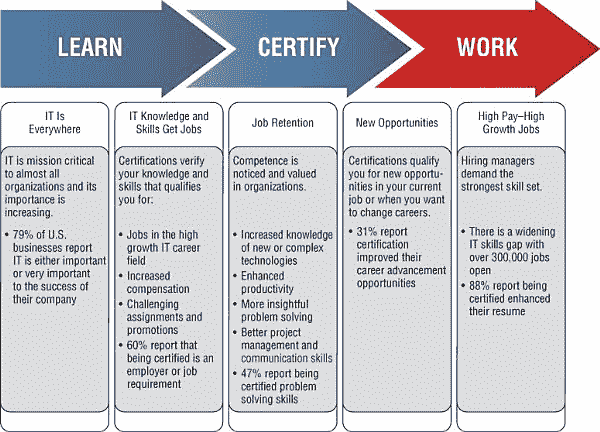

## 认证助力职业生涯

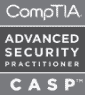 CompTIA 高级安全从业者 (CASP) 认证指定具备高级安全技能和知识的 IT 专业人员。

*   CASP 是 CompTIA 推出的首个精通级认证。它在广受认可的 CompTIA Security+ 认证路径基础上扩展而来，已有近 25 万名认证 Security+ 专业人员。
*   获得 CASP 认证证明了在企业安全、风险管理、研究与分析，以及计算、通信和业务学科整合方面的技术胜任力。
*   经美国国防部 (DoD) 批准，符合 DoD 8570.01-M 指令中 4 个信息保障职位角色的要求：IA 技术三级、IA 管理二级、IA 系统架构师与工程师 (IASAE) 一级和二级。

## 获得认证的步骤

1.  **复习考试目标** 复习认证目标，确保您了解考试涵盖的内容。访问 `http:/certification.comptia.org/examobjectives.aspx`。
2.  **练习备考** 学习完认证内容后，参加免费评估和模拟测试，了解考试可能出现的题型。访问 `http:/certification.comptia.org/samplequestions.aspx`。
3.  **购买考试券** 在 CompTIA Marketplace 购买考试券，网址为 `www.comptiastore.com`。
4.  **参加考试！** 访问 Pearson VUE 网站预约考试时间。您可以在此找到考试提供商：`http:/www.pearsonvue.com/comptia/`。


# 保持认证有效！继续教育

CASP 认证自认证之日起有效期为三年。有多种方式可以更新该认证。欲了解更多信息，请访问 `http:/certification.comptia.org/ce`。

## 如何获取更多信息

访问 CompTIA 在线网站 `http:/certification.comptia.org/home.aspx` 了解有关获取 CompTIA 认证的更多信息。

联系 CompTIA：致电 866-835-8020 并选择选项 2，或发送电子邮件至 `questions@comptia.org`。

## 社交媒体

在以下平台关注 CompTIA：

*   Facebook
*   LinkedIn
*   Twitter
*   YouTube

# 简介

CASP 认证由计算机技术行业协会开发，旨在为整个行业提供一种认证手段，以证明拥有 10 年 IT 管理经验且至少具备 5 年实践技术经验的安全专业人员的胜任能力。安全专业人员的工作是保护组织宝贵信息资产的机密性、完整性和可用性。因此，这些人员需要具备应用关键性和灾难恢复的能力。

**第 8 章：安全研究与分析**  
探讨如何使用安全评估工具来评估系统的总体强度，以及使用渗透测试工具以攻击者的视角查看您的系统。

**第 9 章：企业安全集成**  
考察行业趋势并概述对企业的潜在影响。

**第 10 章：通信与协作的安全控制**  
考察选择和区分适当安全控制的方法。本章还涵盖了保护新兴技术的技术。

**附录 A：CASP 实验手册**  
这是一系列动手实验，将帮助您理解本书中介绍的关键概念。还包括建议的实验室搭建方案。

**附录 B：复习题答案**  
您将在此找到每章末尾复习题的答案。

**附录 C：关于额外学习工具**  
您将在此找到关于下载并有效使用本书额外学习工具（闪存卡、两套 50 题的模拟考试和词汇表）的简要说明，这些工具可从 `www.sybex.com/go/casp2e` 获取。

## 考试策略

CASP 考试与其他 CompTIA 考试类似，均为计算机考试。当您到达考试中心时，需要携带两种形式的身份证明，其中一种必须包含照片。最佳做法是至少提前 15 分钟到达。签到时，您需要出示带照片的身份证明。考试中心配置完成后，您将被分配一个座位并可以开始考试。

您不得携带任何纸张或笔记进入考试中心。考试为闭卷。考试中心将提供草稿纸供书写，考试结束时必须归还。

在 165 分钟的考试时间限制内，您需要完成 80 道题。虽然您应该有足够的时间完成考试，但时间管理至关重要。


本测试比 `Network+` 或 `Security+` 等基础考试难得多。考试题型包括多项选择题、模拟题和拖放题。你应该尝试回答所有问题。猜答案总比留空好。我个人的方法是分多轮完成考试。与其他一些考试不同，你可以标记任何你不确定的问题，稍后再回来做。第一轮时，回答所有你有把握的问题。有时这甚至能帮助解答其他问题。你可能在某道题中看到一些线索，帮你回忆起另一道题所需的事实。第二轮时，解决那些较难或你不确定的问题。仔细阅读题目，因为题目中漏掉一个单词就可能产生巨大差异。再次强调，猜答案总比留空好。

在下一节中，我将讨论你将遇到的一些考题类型。

### CASP 考试应试技巧

CompTIA 在本次考试中推出了新形式——不仅包含标准题目。考试期间，你可能会遇到常规多项选择题、拖放题、场景题，甚至模拟器题。通过所需的知识涵盖多个领域和域。题目可能假设你具备从 `Network+`、`Security+`、`CISSP`、`CEH`、`CISA` 和 `CISM` 认证中获得的知识。让我们更详细地回顾每种题型。

*   多项选择题可能要求你选出一项或多项正确答案。对于有多个正确答案的问题，系统会提示你“选择所有适用项”。
*   拖放题可能会提供流程图、一系列项目，甚至网络拓扑图，要求你将项目按特定顺序排列。
*   场景题可能长达数段，向你呈现一个需要解决的具体问题或情境。
*   模拟题可能会提供命令提示符、菜单，甚至路由器界面，要求你输入一系列命令。
*   许多题目会先呈现一段冗长的情境描述，然后再提问。先阅读问题可能会有帮助，这样你就知道在冗长段落中该关注什么。
*   时间管理在此考试中至关重要。你必须以绝对可能的最快速度阅读。很容易在一道题上就花费 5–6 分钟阅读，从而导致进度落后。
*   有时两个答案看起来几乎完全相同。要寻找那个可能不同的单词。
*   如果英语是你的第二语言，请查看考试是否提供你的母语版本。阅读和理解速度是必须的。

请记住，你将参加的考试是在特定时间点创建的。你不会看到关于上周新闻中出现的僵尸网络或其他恶意软件攻击的问题。更新考试是一个艰难的过程，会导致考试版本号递增。大多数 CompTIA 考试每三年更新一次。

一些 CASP 考题的措辞可能看起来不太通顺。不要因此感到沮丧；答完题继续下一题。虽然我们没有故意添加拼写错误或其他语法错误，但本书中的题目力求在结构和外观上还原真实考题。CompTIA 在 `http://certification.comptia.org/resources/test_tips.aspx` 提供了备考技巧页面，值得浏览。本考试不给考生评分，结果仅显示通过或不通过。

最后，你有时可能会在考试中看到一些似乎不合适的问题。CompTIA 会进行考试播种。考试播种是指在考试中包含不计分题目的做法。这样做是为了收集心理测量数据，随后用于开发新版本的考试。考试前，你会被告知考试可能包含不计分题目。因此，如果你遇到的题目似乎不符合任何考试目标，或者根本不像是该考试应有的题目，那很可能就是播种题。

## 如何使用本书及配套网站

我们在书中和配套网站 (`www.sybex.com/go/casp2e`) 中包含了多项测试功能。这些工具将帮助你巩固重要考试内容，并为实际考试做准备：

1.  **评估测试** 本引言末尾附有评估测试，可用于检验你的考试准备情况。在开始阅读本书前先参加此测试；它将帮助你确定需要加强的领域。评估测试答案位于最后一道题后的单独页面上。每个答案都包含解析和备注，指出相关内容所在的章节。
2.  **章节复习题** 为测试你阅读进度中的掌握情况，每章末尾都有复习题。读完每章后，回答复习题并核对答案——正确答案见附录 B。你可以返回重读与答错题目相关的部分，确保下次测试同类内容时答对。
3.  **Sybex 测试引擎** 配套网站包含 Sybex 测试引擎。使用此定制软件，你可以预先找出薄弱环节，然后利用这些强大的测试功能制定扎实的备考策略。`ReadMe` 文件将指导你完成安装过程。
4.  **电子闪卡** Sybex 的电子闪卡包含数百道题目，旨在为 CASP 考试提供进一步挑战。结合复习题、模拟考试和闪卡，你将拥有充足的练习量。
5.  **术语表 PDF** 术语表也在配套网站上提供 PDF 格式。虽然这对某些考试可能非必需，但 CASP 考试要求你掌握许多不同的术语和缩写。

对大多数读者而言，学习、复习考试目标和完成一系列练习题的结合，足以确保你通过认证考试。然而，你必须付出努力，否则在最终通过前，你将不止一次地支付考试费。如果你认真准备，应该能取得好成绩。

### 如何联系出版商

Sybex 欢迎对其所有出版物提出反馈。访问 Sybex 网站 `www.sybex.com/go/casp2e` 获取书籍更新和更多认证信息。你还将找到可用于提交对此书或任何其他 Sybex 书籍的意见或建议的表格。

### 如何联系作者

Michael Gregg 欢迎你的提问和意见。你可以通过电子邮件 `MikeG@thesolutionfirm.com` 联系他。

## CASP (2014 版) 考试目标

本节列出 CASP (2014 版) 考试的详细目标。

### CASP 2014 考试目标对照表

下表列出了本考试衡量的域及其在考试中的占比。表格之后是考试目标的更详细细分及其在本书各章中的覆盖情况。

| 域 | 主题 | 考试占比 |
| --- | --- | --- |
| 1.0 | 企业安全 | 30% |
| 2.0 | 风险管理与事件响应 | 20% |
| 3.0 | 研究与分析 | 18% |
| 4.0 | 计算、通信与业务学科的整合 | 16% |
| 5.0 | 企业组件技术整合 研究与分析 | 16% |

#### 1.0 企业安全

| 目标 | 章节 |
| --- | --- |
| 1.1 给定场景，选择合适的加密概念和技术 | 第 1 章 |
| 技术 | 1 |
| * 密钥延伸 | 1 |
| * 哈希 | 1 |
| * 代码签名 | 1 |


##### 1.1 解释加密概念和技术

## 概念

*   伪随机数生成
*   完美前向保密
*   传输加密
*   静态数据加密
*   数字签名
*   熵
*   扩散
*   置换/混淆
*   不可抵赖性
*   机密性
*   完整性
*   信任链、信任根
*   加密应用及正确/错误的实现

## 高级 PKI 概念

*   通配符
*   OCSP 与 CRL
*   向实体颁发
    *   用户
    *   系统
    *   应用程序
*   密钥托管

## 附加概念

*   隐写术
*   加密方法和设计的影响
*   流式
*   分组
*   模式
*   已知缺陷/弱点
*   强度与性能与实施可行性与互操作性的权衡

## 实现

*   DRM
*   水印
*   GPG
*   SSL
*   SSH
*   S/MIME

---

##### 1.2 解释与企业存储相关的安全隐患

## 存储类型

*   虚拟存储
*   云存储
*   数据仓库
*   数据归档
*   NAS
*   SAN
*   vSAN

## 存储协议

*   iSCSI
*   FCoE
*   NFS、CIFS

## 安全存储管理

*   多路径
*   快照
*   去重
*   动态磁盘池
*   LUN 掩码/映射
*   HBA 分配
*   异地或多站点复制

## 加密

*   磁盘
*   块
*   文件
*   记录
*   端口

---

##### 1.3 给定场景，分析网络和安全组件、概念及架构

## 高级网络设计（有线/无线）

*   远程访问
*   VPN
*   SSH
*   RDP
*   VNC
*   SSL
*   IPv6 及相关过渡技术
*   传输加密
*   网络认证方法
    *   802.1x
*   网状网络

### 安全设备

*   UTM
*   NIPS
*   NIDS
*   INE
*   SIEM
*   HSM
*   设备部署位置
*   应用和协议感知技术
*   WAF
*   下一代防火墙
*   IPS
*   被动漏洞扫描器
*   DAM

## 虚拟网络和安全组件

*   交换机
*   防火墙
*   无线控制器
*   路由器
*   代理

## 用于数据流的复杂网络安全解决方案

*   SSL 检查
*   网络流数据

## 网络和安全组件的安全配置和基线化

*   ACL
*   变更监控
*   配置锁定
*   可用性控制

## 附加主题

*   软件定义网络
*   云托管网络
*   网络管理和监控工具
*   路由器、交换机及其他网络设备的高级配置
    *   传输安全
    *   中继安全
    *   路由保护
*   安全区域
    *   数据流强制执行
    *   DMZ
    *   关键资产隔离
*   网络准入控制
    *   隔离/修复
*   运营和消费类网络启用设备
    *   楼宇自动化系统
    *   IP 视频
    *   HVAC 控制器
    *   传感器
    *   物理访问控制系统
    *   音视频系统
    *   科学/工业设备
*   关键基础设施/监控与数据采集 (SCADA)/工业控制系统 (ICS)

---

##### 1.4 给定场景，为主机选择和排查安全控制

## 主机安全

*   可信操作系统（例如如何及何时使用）
*   端点安全软件
    *   反恶意软件
    *   杀毒软件
    *   反间谍软件
    *   垃圾邮件过滤器
    *   补丁管理
    *   HIPS/HIDS
    *   数据丢失防护防火墙
    *   基于主机的
    *   日志监控

## 主机加固

*   标准操作环境/配置基线化
*   应用程序白名单和黑名单
*   安全/组策略实施
*   命令 Shell 限制
*   补丁管理
*   配置专用接口
    *   带外管理网卡
    *   ACL
    *   管理接口
    *   数据接口
*   外设限制
    *   USB
    *   蓝牙
    *   Firewire
*   全盘加密

## 虚拟化安全

*   虚拟化服务器的安全优势和劣势
    *   Type I
    *   Type II
    *   基于容器
*   云增强安全服务
    *   哈希匹配
    *   杀毒
    *   反垃圾邮件
    *   漏洞扫描
    *   沙箱
    *   内容过滤
*   引导加载程序保护
    *   安全启动
    *   度量启动
    *   IMA - 完整性度量架构
    *   度量启动 BIOS/UEFI
*   将具有不同安全要求的主机混合部署所带来的漏洞
    *   VM 逃逸
    *   权限提升
    *   热迁移
    *   数据残留
*   虚拟桌面基础设施 (VDI)
*   终端服务/应用程序交付服务

## 硬件安全模块

*   TPM
*   VTPM
*   HSM

---

##### 1.5 区分应用程序漏洞并选择适当的安全控制

## Web 应用程序安全设计考量

*   安全：设计时安全、默认安全、部署时安全

## 特定应用程序问题

*   不安全的直接对象引用
*   XSS
*   跨站请求伪造 (CSRF)
*   点击劫持
*   会话管理
*   输入验证
*   SQL 注入
*   不当的错误和异常处理
*   权限提升
*   敏感数据存储不当
*   模糊测试/故障注入
*   安全的 Cookie 存储和传输
*   缓冲区溢出
*   内存泄漏
*   整数溢出
*   竞争条件
    *   检查时刻
    *   使用时刻
*   资源耗尽
*   地理标记
*   数据残留


#### 1.0 应用安全

| 主题 | 章节 |
| --- | --- |
| 应用沙箱 | 5 |
| 应用安全框架 | 2, 5 |
| 标准库 | 5 |
| 行业公认方法 | 5 |
| Web 服务安全 (WS-Security) | 2, 5 |
| 安全编码标准 | 5 |
| 数据库活动监控 (DAM) | 5 |
| Web 应用防火墙 (WAF) | 5 |
| 客户端处理与服务端处理 | 5 |
| JSON/REST | 5 |
| 浏览器扩展 | 5 |
| ActiveX | 5 |
| Java Applets | 5 |
| Flash | 5 |
| HTML5 | 5 |
| AJAX | 5 |
| SOAP | 5 |
| 状态管理 | 5 |
| Javascript | 5 |

#### 2.0 风险管理与事件响应

##### 2.1 解读业务和行业影响并解释相关安全风险

| 主题 | 章节 |
| --- | --- |
| 新产品、新技术和用户行为的风险管理 | 6 |
| 新的或不断变化的业务模式/策略 | 6 |
| 合作伙伴关系 | 6 |
| 外包 | 6 |
| 云 | 6 |
| 合并与分拆/剥离 | 6 |
| 整合不同行业的安全顾虑 | 6 |
| 规则 | 6 |
| 策略 | 6 |
| 法规 | 6 |
| 地理位置 | 6 |
| 确保第三方提供商具备必要的信息安全水平 | 6 |
| 内部和外部影响 | 6 |
| 竞争对手 | 6 |
| 审计员/审计发现 | 6 |
| 监管机构 | 6 |
| 内部和外部客户需求 | 6 |
| 高层管理 | 6 |
| 去边界化的影响（例如：不断变化的网络边界） | 6 |
| 远程办公 | 6 |
| 云 | 6 |
| BYOD | 5 |
| 外包 | 6 |

##### 2.2 给定场景，执行风险缓解规划、策略和控制

| 主题 | 章节 |
| --- | --- |
| 根据组织/行业将信息类型分类为 CIA 级别 | 6 |
| 将利益相关者输入纳入 CIA 决策 | 6 |
| 基于 CIA 需求和组织策略实施技术控制 | 6 |
| 确定 CIA 综合评分 | 6 |
| 极端场景规划/最坏情况场景 | 6 |
| 基于综合评分确定最低所需安全控制 | 6 |
| 进行系统特定风险分析 | 6 |
| 做出风险判定 | 6 |
| 影响程度 | 6 |
| ALE (年度预期损失) | 6 |
| SLE (单次预期损失) | 6 |
| 威胁可能性 | 6 |
| 动机 | 6 |
| 来源 | 6 |
| ARO (年度发生率) | 6 |
| 趋势分析 | 6 |
| 投资回报率 (ROI) | 6 |
| 总拥有成本 | 6 |
| 根据风险偏好推荐应采用的策略 | 6 |
| 规避 | 6 |
| 转移 | 6 |
| 缓解 | 6 |
| 接受 | 6 |
| 风险管理流程 | 6 |
| 豁免 | 6 |
| 威慑 | 6 |
| 固有风险 | 6 |
| 剩余风险 | 6 |
| 企业安全架构框架 | 6 |
| 持续改进/监控 | 6 |
| 业务连续性规划 | |
| IT 治理 | 6 |

##### 2.3 根据组织要求比较和对比安全、隐私策略和程序

| 主题 | 章节 |
| --- | --- |
| 针对新业务、技术、风险和环境变化进行策略制定和更新 | 7 |
| 针对策略、环境和业务变化进行流程/程序制定和更新 | 7 |
| 通过与人力资源、法务、管理层及其他实体合作，支持法律合规和倡导 | 7 |
| 使用通用业务文档支持安全 | 7 |
| 风险评估 (RA)/适用性声明 (SOA) | 7 |
| 业务影响分析 (BIA) | 7 |
| 互操作协议 (IA) | 7 |
| 互联安全协议 (ISA) | 7 |
| 谅解备忘录 (MOU) | 7 |
| 服务级别协议 (SLA) | 7 |
| 运营级别协议 (OLA) | 7 |
| 保密协议 (NDA) | 7 |
| 业务合作伙伴协议 (BPA) | 7 |
| 使用通用隐私原则处理敏感信息 (PII) | 7 |
| 支持制定包含以下内容的策略： | 7 |
| 职责分离 | 7 |
| 岗位轮换 | 7 |
| 强制休假 | 7 |
| 最小权限 | 7 |
| 事件响应 | 7 |
| 取证任务 | 7 |
| 入职和离职程序 | 7 |
| 持续监控 | 7 |
| 用户培训和意识 | 7 |
| 审计要求和频率 | 7 |

#### 2.4 给定场景，执行事件响应和恢复程序

| 主题 | 章节 |
| --- | --- |
| 电子取证 | 7 |
| 电子资产清单和资产控制 | 7 |
| 数据保留策略 | 7 |
| 数据恢复和存储 | 7 |
| 数据所有权 | 7 |
| 数据处理 | 7 |
| 法律保留 | 7 |
| 数据泄露 | 7 |
| 检测和收集 | 7 |
| 数据分析 | 7 |
| 缓解 | 7 |
| 最小化 | 7 |
| 隔离 | 7 |
| 恢复/重构 | 7 |
| 响应 | 7 |
| 披露 | 7 |
| 设计系统以便于事件响应 | 7 |
| 内部和外部违规 | 7 |
| 隐私策略违规 | 7 |
| 犯罪行为 | 7 |
| 内部威胁 | 7 |
| 非恶意威胁/错误配置 | 7 |
| 建立和审查系统、审计和安全日志 | 7 |
| 事件和应急响应 | 7 |
| 证据保管链 | 7 |
| 受损系统的取证分析 | 7 |
| 运营连续性计划 (COOP) | 7 |
| 易失性顺序 | 7 |

#### 3.0 研究、分析与评估

##### 3.1 应用研究方法以确定行业趋势及对企业的影响

| 主题 | 章节 |
| --- | --- |
| 执行持续研究 | 8 |
| 最佳实践 | 8 |
| 新技术 | 8 |
| 新安全系统和服务 | 8 |
| 技术演进（例如：RFC、ISO） | 8 |
| 态势感知 | 8 |
| 最新客户端攻击 | 8 |
| 当前漏洞和威胁知识 | 8 |
| 零日缓解控制和补救 | 8 |
| 新出现的威胁和问题 | 8 |
| 研究新业务工具的安全含义 | 8 |
| 社交媒体/社交网络 | 8 |
| 最终用户云存储 | 8 |
| 业务内部整合 | 8 |
| 全球 IA 行业/社区 | 8 |
| 计算机应急响应小组 (CERT) | 8 |
| 大会/会议 | 8 |
| 威胁行为体 | 8 |
| 新兴威胁来源/威胁情报 | 8 |
| 研究合同的安全要求 | 8 |
| 建议书请求 (RFP) | 8 |
| 报价请求 (RFQ) | 8 |
| 信息请求 (RFI) | 8 |
| 协议 | 8 |

##### 3.2 分析场景以保障企业安全

| 主题 | 章节 |
| --- | --- |
| 创建基准并与基线对比 | 8 |
| 原型设计和测试多种解决方案 | 8 |
| 成本效益分析 | 8 |
| ROI | 8 |
| TCO | 8 |
| 指标收集和分析 | 8 |
| 分析和解读趋势数据以预测网络防御需求 | 8 |
| 审查现有安全控制的有效性 | 8 |
| 逆向工程/拆解现有解决方案 | 8 |
| 分析安全解决方案属性以确保其满足业务需求 | 8 |


#### 3.2 给定场景，分析以下概念的安全含义

| 概念 | 章节 |
| --- | --- |
| 性能 | 8 |
| 延迟 | 8 |
| 可扩展性 | 8 |
| 能力 | 8 |
| 易用性 | 8 |
| 可维护性 | 8 |
| 可用性 | 8 |
| 可恢复性 | 8 |
| 进行经验教训/事后分析报告 | 8 |
| 运用判断力解决没有最佳解决方案的难题 | 8 |

#### 3.3 给定场景，选择适当的方法或工具以进行评估并分析结果

| 类别 | 章节 |
| --- | --- |
| 工具类型 | 5 |
| **端口扫描器** | 5 |
| **漏洞扫描器** | 5 |
| **协议分析器** | 5 |
| **网络枚举器** | 5 |
| **密码破解工具** | 5 |
| **模糊测试工具** | 5 |
| **HTTP 拦截器** | 5 |
| **利用工具/框架** | 5 |
| **被动侦察和情报收集工具** | 5 |
| **社交媒体** | 5 |
| **Whois** | 5 |
| **路由表** | 5 |
| 方法 | 5 |
| **漏洞评估** | 5 |
| **恶意软件沙箱分析** | 5 |
| **内存转储、运行时调试** | 5 |
| **渗透测试** | 5 |
| **黑盒** | 5 |
| **白盒** | 5 |
| **灰盒** | 5 |
| **侦察** | 5 |
| **指纹识别** | 5 |
| **代码审查** | 5 |
| **社会工程学** | 5 |

#### 4.0 计算、通信与业务学科的融合

### 4.1 给定场景，促进跨不同业务单元的协作以实现安全目标

| 主题 | 章节 |
| --- | --- |
| 解读安全需求和目标，以便与其他学科的利益相关者沟通 | 9 |
| **销售人员** | 9 |
| **程序员** | 9 |
| **数据库管理员** | 9 |
| **网络管理员** | 9 |
| **管理层/高级管理层** | 9 |
| **财务** | 9 |
| **人力资源** | 9 |
| **应急响应团队** | 9 |
| **设施经理** | 9 |
| **物理安全经理** | 9 |
| 就安全流程和控制向员工和高级管理层提供客观指导和公正建议 | 9 |
| 在团队内建立有效协作以实施安全解决方案 | 9 |
| IT 治理 | 9 |

#### 4.2 给定场景，选择适当的控制来保护通信和协作解决方案

| 主题 | 章节 |
| --- | --- |
| 统一协作工具的安全性 | 2, 10 |
| **Web 会议** | 10 |
| **视频会议** | 10 |
| **即时通讯** | 10 |
| **桌面共享** | 10 |
| **远程协助** | 10 |
| **在线状态** | 10 |
| **电子邮件** | 10 |
| **电话** | 2, 10 |
| **VoIP** | 2, 10 |
| **协作站点** | 10 |
| **社交媒体** | 10 |
| **基于云** | 10 |
| 远程访问 | 10 |
| 移动设备管理 | 10 |
| **BYOD** | 10 |
| 空中接口技术顾虑 | 10 |

#### 4.3 在技术生命周期中实施安全活动

| 主题 | 章节 |
| --- | --- |
| 端到端解决方案所有权 | 10 |
| **运营活动** | 10 |
| **维护** | 10 |
| **调试/退役** | 10 |
| **资产处置** | 10 |
| **资产/对象重用** | 10 |
| **通用变更管理** | 10 |
| 系统开发生命周期 | 10 |
| **安全系统开发生命周期 (SSDLC)/安全开发生命周期 (SDL)** | 10 |
| **安全需求可追溯性矩阵 (SRTM)** | 10 |
| **验收测试** | 10 |
| **敏捷、瀑布和螺旋软件开发方法论的安全含义** | 10 |
| **调整解决方案以应对新兴威胁和安全趋势** | 10 |
| 资产管理（库存控制） | 10 |
| **设备追踪技术** | 10 |
| **地理位置/GPS 定位** | 10 |
| **对象追踪和围控技术** | 10 |
| **地理标记/电子围栏** | 10 |
| **RFID** | 10 |

#### 5.0 企业组件的技术集成

### 5.1 给定场景，将主机、存储、网络和应用程序集成到安全的企业架构中

| 主题 | 章节 |
| --- | --- |
| 安全数据流以满足不断变化的业务需求 | 2, 9 |
| 标准 | 9 |
| **开放标准** | 9 |
| **遵循标准** | 9 |
| **竞争标准** | 9 |
| **缺乏标准** | 9 |
| **事实标准** | 9 |
| 互操作性问题 | 9 |
| **遗留系统/当前系统** | 9 |
| **应用程序需求** | 9 |
| **内部开发 vs. 商用 vs. 商用定制** | 9 |
| 技术部署模型（外包/内包/托管服务/合作伙伴关系） | 9 |
| **云和虚拟化考量及托管选项** | 3 |
| **公有云** | 3 |
| **私有云** | 3 |
| **混合云** | 3 |
| **社区云** | 3 |
| **多租户** | 3 |
| **单租户** | 3 |
| **单台物理服务器托管多家公司虚拟机的相关漏洞** | 3 |
| **单一平台托管多家公司虚拟机的相关漏洞** | 3 |
| **按需/弹性云计算的安全使用** | 3 |
| **数据残留** | 3 |
| **数据聚合** | 9 |
| **数据隔离** | 9 |
| **资源供应和取消供应** | 9 |
| **用户** | 9 |
| **服务器** | 9 |
| **虚拟设备** | 9 |
| **应用程序** | 9 |
| **保护虚拟环境、服务、应用程序、设备和设施** | 3 |
| **合并、收购和分拆/剥离过程中的设计考量** | 9 |
| **网络安全分段和授权** | 9 |
| 所有相关设备的逻辑部署图和相应的物理部署图 | 2, 9 |
| 安全基础设施设计（例如决定在哪里放置特定设备/应用程序） | 2, 9 |
| 存储集成（安全考量） | 2, 9 |
| 企业应用集成启用器 | 2, 9 |
| **CRM** | 9 |
| **ERP** | 9 |
| **GRC** | 9 |
| **ESB** | 2 |
| **SOA** | 2 |
| **目录服务** | 2, 9 |
| **DNS** | 2, 9 |
| **CMDB** | 9 |
| **CMS** | 9 |

#### 5.2 给定场景，集成高级认证和授权技术以支持企业目标

| 主题 | 章节 |
| --- | --- |
| 认证 | 2, 10 |
| **基于证书的认证** | 10 |
| **单点登录** | 2, 10 |
| 授权 | 10 |
| **OAUTH** | 10 |
| **XACML** | 10 |
| **SPML** | 10 |
| 证明 | 10 |
| 身份传播 | 10 |
| 联邦身份认证 | 10 |
| **SAML** | 10 |
| **OpenID** | 10 |
| **Shibboleth** | 10 |
| **WAYF** | 10 |
| 高级信任模型 | 2, 10 |
| **RADIUS 配置** | 2, 10 |
| **LDAP** | 2, 10 |
| **AD** | 2, 10 |

## 评估测试

1. 哪种编程语言特别容易受到缓冲区溢出攻击？
   - **A.** `.NET`
   - **B.** `Pascal`
   - **C.** `C`
   - **D.** `Basic`

2. 以下哪项不被视为安全三大基本原则之一？
   - **A.** `完整性`
   - **B.** `不可否认性`
   - **C.** `可用性`
   - **D.** `机密性`

3. 许多组织在入职前流程开始时进行 _______________ 调查。
   - **A.** `婚姻`
   - **B.** `背景`
   - **C.** `性取向`
   - **D.** `残疾`

4.


## 评估测试

### 1. 密码学填空
在密码学中，将明文转换为不可读内容的过程称为 _______________。

**A.** 加密  
**B.** 明文  
**C.** 数字签名  
**D.** 密码分析

### 2. 传输协议
哪种传输协议被认为是面向连接的？

**A.** IP  
**B.** TCP  
**C.** UDP  
**D.** ICMP

### 3. 云计算
以下哪项不是云计算的优势？

**A.** 降低成本  
**B.** 能够从多个位置访问数据和应用程序  
**C.** 增加成本  
**D.** 按需付费的能力

### 4. 网络设备
术语 `ACL` 与以下哪项最相关？

**A.** 集线器  
**B.** 交换机  
**C.** 网桥  
**D.** 路由器

### 5. Web 会话管理
_______________ 用于在从一个网页移动到另一个网页时维护会话或状态。

**A.** 浏览器  
**B.** Cookie  
**C.** 会话 ID  
**D.** URL

### 6. 密码学概念
在密码学研究中，_______________ 用于证明个人的身份。

**A.** 机密性  
**B.** 真实性  
**C.** 完整性  
**D.** 可用性

### 7. 安全工具
Backtrack 是什么的示例？

**A.** Linux 可启动发行版  
**B.** 会话劫持  
**C.** Windows 可启动预装程序  
**D.** VoIP 捕获工具

### 8. Web 协议
以下哪项是 Web 的基本传输协议？

**A.** HTTP  
**B.** UDP  
**C.** TFTP  
**D.** FTP

### 9. 攻击类型
哪种攻击类型不会给攻击者授予访问权限，但会阻止合法用户？

**A.** 嗅探  
**B.** 会话劫持  
**C.** 特洛伊木马  
**D.** 拒绝服务

### 10. IP 寻址
IPv4 使用多长的地址？

**A.** 8  
**B.** 16  
**C.** 32  
**D.** 64

### 11. 邮件协议
_______________ 可用作 POP3 的替代品，并为移动用户提供了相对于 POP3 的优势。

**A.** SMTP  
**B.** SNMP  
**C.** POP3  
**D.** IMAP

### 12. 默认端口
HTTP 默认使用哪个端口？

**A.** 53  
**B.** 69  
**C.** 80  
**D.** 445

### 13. 协议
哪种类型的协议要求提供商维持一定水平的支持？

**A.** MTBF  
**B.** SLA  
**C.** MTTR  
**D.** AR

### 14. VoIP 术语
_______________ 是互联网电话上垃圾邮件的名称。

**A.** SPAM  
**B.** SPIT  
**C.** SPIM  
**D.** SPLAT

### 15. 文档层级
管理层使用哪份高层文档来设定整体基调？

**A.** 程序  
**B.** 指南  
**C.** 策略  
**D.** 基线

### 16. 加密方法
哪种加密方法使用单一共享密钥？

**A.** RSA  
**B.** ECC  
**C.** DES  
**D.** MD5

### 17. 访问控制
_______________ 防止个人拥有过大的权力。

**A.** 双重控制  
**B.** 职责分离  
**C.** 强制休假  
**D.** NDA（保密协议）

### 18. 虚拟化
_______________ 是虚拟化的一个示例。

**A.** VMware  
**B.** TSWEB  
**C.** LDAP  
**D.** GoToMyPC

### 19. 工具用途
Wireshark 的用途是什么？

**A.** 嗅探器  
**B.** 会话劫持  
**C.** 特洛伊木马  
**D.** 端口扫描器

### 20. 合规标准
许多公司需要解决的策略合规领域之一是满足信用卡安全标准。

**A.** SOX  
**B.** PCI  
**C.** GLB  
**D.** HIPAA

### 21. OSI 模型
OSI 模型由多少层组成？

**A.** 3  
**B.** 5  
**C.** 7  
**D.** 8

### 22. 法规
哪套法规涵盖医疗数据和个人信息的保护？

**A.** HIPAA  
**B.** GLB  
**C.** SOX  
**D.** 安全港

### 23. 取证工具
_______________ 是一款著名的事件响应、计算机取证和电子取证工具。

**A.** PuTTY  
**B.** Hunt  
**C.** Firesheep  
**D.** Helix

### 24. 恶意软件分类
Shawn 为他的 iPhone 下载了一个宣传为游戏的程序，但实际上它会追踪他的位置和浏览器活动。这最好被描述为？

**A.** 病毒  
**B.** 蠕虫  
**C.** 特洛伊木马  
**D.** 垃圾邮件

### 25. 邮件协议 (SMTP)
_______________ 用于发送邮件并将邮件中继到其他 SMTP 邮件服务器，默认使用端口 25。

**A.** SMTP  
**B.** SNMP  
**C.** POP3  
**D.** IMAP

### 26. 法律协议
_______________ 用于防止前员工向第三方泄露机密信息？

**A.** 双重控制  
**B.** 职责分离  
**C.** 强制休假  
**D.** NDA（保密协议）

### 27. 管理控制
哪种技术允许在员工不在岗时审查其职责？

**A.** 双重控制  
**B.** 职责分离  
**C.** 强制休假  
**D.** NDA（保密协议）

---

## 评估测试答案

### 1. 缓冲区溢出
**C.** `C` 编程语言特别容易受到缓冲区溢出的影响。这是因为某些函数不执行适当的边界检查（第 5 章）。

### 2. 安全原则
**B.** 不可抵赖性不被视为安全的三大基本原则之一（第 3 章）。

### 3. 入职前流程
**B.** 许多组织以背景调查开始入职前流程。此过程旨在确保为工作雇佣合适的人员（第 7 章）。

### 4. 密码学定义
**A.** 在密码学中，将明文转换为不可读内容的过程称为加密（第 2 章）。

### 5. 面向连接的协议
**B.** TCP 被认为是面向连接的协议，而 UDP 被认为是无连接的（第 1 章）。

### 6. 云计算成本
**C.** 虽然云计算有许多好处，但增加成本不是其中之一。云计算旨在降低成本（第 3 章）。

### 7. ACL 与路由器
**D.** 术语 `ACL` 与路由器最相关。ACL 被用作一种基本形式的防火墙（第 4 章）。

### 8. Cookie
**B.** Cookie 用于在从一个网页移动到另一个网页时维护状态（第 5 章）。

### 9. 密码学真实性
**B.** 在密码学研究中，真实性用于证明个人的身份（第 1 章）。

### 10. Backtrack
**A.** Backtrack 是 Linux 可启动发行版的一个示例。它是 CASP 工具和技术列表上的项目之一（第 8 章）。

### 11. HTTP 协议
**A.** HTTP 是 Web 的基本传输协议。HTTP 使用 TCP 作为传输层（第 5 章）。

### 12. 拒绝服务
**D.** 拒绝服务攻击不会给攻击者授予访问权限，但会阻止合法用户（第 6 章）。

### 13. IPv4 地址长度
**C.** IPv4 使用 32 位地址，而 IPv6 使用 128 位地址（第 1 章）。

### 14. IMAP 与 POP3
**D.** IMAP 可用作 POP3 的替代品，并为移动用户提供了相对于 POP3 的优势（第 10 章）。

### 15. HTTP 默认端口
**C.** HTTP 默认使用端口 80（第 4 章）。

### 16. 服务级别协议
**B.** 服务级别协议 (SLA) 要求提供商维持一定水平的支持（第 6 章）。

### 17. SPIT
**B.** SPIT 是互联网电话垃圾信息的名称（第 10 章）。

### 18. 策略文档
**C.** 策略是管理层用来设定整体基调的高层文档（第 7 章）。

### 19. 对称加密
**C.** DES 使用单一共享密钥，是对称加密的一个示例（第 2 章）。

### 20. 职责分离
**B.** 职责分离防止个人拥有过大的权力（第 9 章）。

### 21. 虚拟化示例
**A.** VMware 是虚拟化的一个示例。这些工具如今非常流行，是 CASP 考试所需的知识（第 3 章）。

### 22. Wireshark
**A.** Wireshark 是一款著名的开源数据包捕获和嗅探程序（第 8 章）。虽然数据包嗅探器不是恶意工具，但它们可用于捕获明文用户名和密码。

### 23. PCI 合规
**B.** 许多公司需要解决的策略合规领域之一是满足支付卡行业 (PCI) 数据安全标准（第 7 章）。

### 24. OSI 模型层数
**C.** OSI 模型由七层组成：物理层、数据链路层、网络层、传输层、会话层、表示层和应用层（第 1 章）。


### 25. A. HIPAA 涵盖医疗数据和个人信息的保护（第 6 章）。

### 26. D. Helix 是一款知名的事件响应、计算机取证和电子取证工具。Helix 是考试必备知识（第 8 章）。

### 27. C. Shawn 为他的 iPhone 下载了一个被宣传为游戏的程序，但实际上该程序会追踪他的位置和浏览器活动。这最好被描述为特洛伊木马。特洛伊木马通常伪装成用户想要的东西，但实际上是恶意的（第 4 章）。

### 28. A. SMTP 用于发送邮件和将邮件中继到其他 SMTP 邮件服务器，默认使用端口 25。考试要求对常见端口和应用程序（如 SMTP、POP3 和 IMAP）有基本了解（第 10 章）。

### 29. D. NDA（保密协议）用于防止前员工向第三方泄露机密信息（第 9 章）。

### 30. C. 强制休假允许在员工不在岗时审查其职责（第 1 章）。

## 第 1 章：加密工具和技术

本章涵盖以下 CompTIA CASP 考试目标：

1.  **1.1 给定场景，选择合适的加密概念和技术。**

    *   技术
        *   密钥延伸
        *   哈希
        *   代码签名
        *   伪随机数生成
        *   完美前向保密
        *   传输加密
        *   静态数据加密
        *   数字签名
        *   概念
        *   熵
        *   扩散
        *   置换
        *   不可否认性
        *   机密性
        *   完整性
        *   信任链、信任根
        *   加密应用及正确/错误实现
        *   高级 PKI 概念
            *   通配符
            *   OCSP 与 CRL
            *   向实体签发
            *   用户
            *   系统
            *   应用程序
            *   密钥托管
        *   隐写术
        *   加密方法和设计的影响
            *   流式
            *   分组
            *   模式
            *   已知缺陷/弱点
            *   强度与性能与实施可行性与互操作性的权衡
        *   实现
            *   DRM
            *   水印
            *   GPG
            *   SSL
            *   SSH
            *   S/MIME

2.  **1.2 解释与企业存储相关的安全隐患**

    *   安全存储管理
        *   加密
            *   磁盘
            *   块
            *   文件
            *   记录
            *   端口

3.  **1.4 给定场景，为主机选择并排查安全控制**

    *   TPM
    *   HSM

本章讨论 `cryptography`（密码学），其可定义为通过将信息转换为不可读格式来保护信息的艺术。无论你转向何处，都能看到密码学的身影。它用于保护敏感信息、证明声明者的身份，以及验证应用程序或程序的完整性。作为公司的安全专业人员，如果你只能二选一，你会认为以下哪项更关键？

*   为组织内每位笔记本电脑用户提供防盗锁线。
*   **强制**为每台移动设备实施全盘加密。

我的选择是全盘加密。通常数据的价值会超过更换笔记本电脑的成本。如果数据丢失或泄露，你将承担额外成本，如患者通知费用和声誉损失。

作为安全专业人员，你应该对加密功能有良好的基本了解。本章首先回顾一点密码学历史。接下来，我将讨论基本加密类型，解释对称加密、非对称加密、哈希、数字签名和公钥基础设施。这些概念很重要，因为我们将继续深入更高级的主题，并开始研究加密应用。理解它们将帮助你备考 CompTIA 考试，并实施加密解决方案以更好地保护公司资产。

## 密码学历史

加密并非新概念。保守秘密的愿望与文明一样古老。加密有两种基本用途：用于静态数据和用于动态数据。静态数据可能是笔记本电脑硬盘上的信息或云存储中的数据。动态数据可能是正被 SQL 处理的数据、通过 HTTP 请求的 URL，或是在当地咖啡店通过 VPN 传输至企业网络的信息。在每种情况下，保护都必须充分。早期加密系统的一些示例包括：

1.  **斯基塔莱密码** 该系统通过将一条纸莎草纸或皮革条缠绕在直径固定的圆棒上并在其上书写信息来工作。收件人使用相同直径的圆棒缠绕纸条来阅读信息。尽管这种系统在今天看来很基础，但在斯巴达时代效果很好。即使有人截获了信息，它也只是一堆毫无意义的字母。

2.  **凯撒密码** 尤利乌斯·凯撒因一种早期加密形式——凯撒密码而闻名，该密码用于凯撒与其将领之间传递信息。该密码通过简单的替换工作。明文旋转三个字符（`ROT3`），因此在发送消息前，将其向前移动三个字符。使用凯撒密码加密单词 `cat` 将得到 `fdw`。解密需要向后移动三个字符。

3.  **其他示例** 替换密码用一个字符替换另一个字符。替换密码的最佳示例是维吉尼亚多表密码。其他历史系统包括流动密钥密码和维纳密码。

## 加密服务

作为安全专业人员，你需要了解加密服务及其应用方式。你还需要知道加密的目标和基本术语。虽然你的工作可能不要求你成为加密专家，但要通过 CASP 考试，你应该能够解释特定加密功能的工作原理。

### 加密目标

加密包括对称加密、非对称加密、哈希和数字签名等方法。每种方法提供特定的属性和解决方案。这些加密服务的目标包括：

1.  **隐私** 也称为机密性。私密（机密）的内容应保持私密，无论是静止还是传输中。

2.  **认证** 应有证据证明消息来自我们认为的那个人或实体。

3.  **完整性** 信息在生成时、传输过程中和存储期间应保持未被篡改。

4.  **不可否认性** 发送者获得交付证明，接收者确信发送者的身份。

了解这些基本目标有助于你理解加密可作为实现机密性、完整性和可用性的工具。例如，考虑加密如何保护静态或动态信息的 `privacy`（隐私）和机密性。假设你的 CEO 被要求前往远东进行贸易谈判？考虑一下 CEO 的笔记本电脑。如果丢失或被攻破，别人移除未加密数据有多难？强加密提供了一种简便的方法，在设备丢失、被盗或被未授权人员访问时保护该信息。CryptoForge 和 BitLocker 等应用程序提供加密硬盘驱动器的功能。


#### 认证

认证是密码学的另一个关键目标。首先，`authentication` 与数字签名相关联。认证提供了一种方法，确保任何消息都来自我们认为的发送者。在其基本形式中，认证用于确定身份。它也是识别和认证过程的一部分。

### 完整性

完整性是另一个密码学目标。在数据传输和存储过程中，完整性至关重要。`Integrity` 意味着信息保持未被篡改。想象一下需要下载补丁的情况。虽然补丁可在开发者的网站上获得，但你也有一份同事给你的 DVD 副本。DVD 上的版本与开发者网站上的版本相同吗？执行哈希运算的完整性验证程序（如 `MD5` 或 `SHA`）可以帮助你确定这一点。

### 不可抵赖性

`Non-repudiation` 是指通信中的实体无法否认真实性的保证。它是对主张真实性的证明。不可抵赖性意味着数据发送者收到交付证明，而接收者确信发送者的身份。任何一方事后都不应能否认曾发送或接收过该数据。这可以通过数字签名实现。数字签名提供真实性、完整性和不可抵赖性。在面对面交易的时代，不可抵赖性不难证明。如今，互联网使许多交易变得“无面孔”。我们可能永远见不到打交道的人；因此，不可抵赖性变得愈发关键。不可抵赖性通过数字签名、数字证书和消息认证码（`MACs`）来实现。

## 密码系统设计考量

实施密码系统时，必须在强度、性能、实施可行性和互操作性之间进行权衡。更强的系统通常需要更多的处理能力和更长的加密/解密时间。基本上，你必须考虑加密过程应有多强。密码系统的强度依赖于算法的强度和密钥生成过程的复杂性。加密机制的强度也取决于密钥的大小和复杂性。如果密码系统使用薄弱的密钥生成过程，则整个过程都是薄弱的。密钥大小在很大程度上决定了密码系统的强度。

密码系统的设计者还必须了解密码学方法和设计的含义。例如，凯撒可能认为他的加密系统相当强，但今天看来相对不安全。你需要足够大的密钥来抵御暴力破解和其他攻击。在密码学领域，密钥长度由二进制位数定义。因此，64 位密钥的密钥空间是 2 的 64 次方，即 18,446,744,073,709,551,616。

## 密码学术语

作为安全专业人员，你需要了解基本的密码学术语。在审查供应商的安全解决方案、与同事讨论安全控制以及实施安全解决方案时，你都会遇到这些术语。以下是一些基本的密码学术语：

1.  **明文** 可读的清晰文本。
2.  **密文** 加密后不可读的文本。
3.  **加密** 将数据转换为不可读格式。例如，使用凯撒密码加密单词 `cat` 将得到 `fdw`。此处的加密将每个字符向后移动了三位。
4.  **密码分析** 在没有密码学密钥的情况下，从密文中获取明文的行为。政府、军队、企业、白帽黑客和恶意黑客均用其来发现弱点并破解密码系统。
5.  **数字签名** 使用发送者私钥加密的哈希值。用于认证和完整性。
6.  **信任链** 从属证书颁发机构之间的关系。信任链的概念在公钥基础设施领域至关重要，因为它提供了一种将信任从一个实体传递给另一个实体的方法。它允许将证书职责委派给从属证书颁发机构。
7.  **信任根** 信任根可描述为对系统、软件或数据的信任概念。它是最常见的证明形式，并提供一组始终受操作系统信任的基本功能。`Attestation` 意味着你正在验证某事为真。信任根可以设计为基于硬件、基于软件或混合模式。可信平台模块（`TPM`）是最常见的一种。

将信任根视为被认定为可信的事物。例如，如果你被要求担任法庭案件的陪审员，律师应被视为可信。这是因为法庭信任律师持有该州的执业许可，且律师与当事人的关系已由法律制度确立，同时法庭使用定义明确的程序流程来采纳证据。虽然计算机系统不需要律师（但愿如此），但它们确实需要信任，这正是 `TPM` 扮演的角色。`TPM` 拥有由背书密钥（`EK`）对定义的信任根。它是存在于所有 `TPM` 设备中的唯一 `RSA` 密钥。

## 密码系统分类

密码系统大体可分为对称、非对称和哈希三类：

1.  **对称密码学** 此类使用单个私钥。
2.  **非对称密码学** 此类使用两个密钥：人人皆知的公钥，以及仅消息接收者使用的私钥。

    虽然这两个概念将在本章后面详细讨论，但此时重要的是要理解，对称和非对称密码学都利用密钥。密钥作为数据输入加密算法，以执行置换、替换或二进制数学等数学运算。
3.  **哈希** 哈希是一种定义明确的数学过程或函数，可将大量数据转换为固定长度的小字符串或整数。哈希的输出称为哈希值、哈希码、哈希和、校验和、指纹或消息摘要。

## 其他密码学术语

以下是你需要了解的其他术语：

1.  **算法** `algorithm` 是用于加密和解密数据的一组规则或有序步骤。算法是与密码学密钥配合使用、对明文数据进行加密的一组指令。使用不同密钥或不同算法加密的明文数据将产生不同的密文。
2.  **密文** `Cipher text` 是打乱后不可读的数据。将明文转换为密文基本上有两种方式：
    1.  **分组密码** 通过将消息分成块进行处理来工作。
    2.  **流密码** 通过将消息分成位进行处理来工作。
3.  **密码学密钥** 加密过程的强度在一定程度上依赖于密码学密钥。`cryptographic key`，或简称为 `key`，是一条控制密码学算法如何运作的信息。它可用于控制明文到密文或密文到明文的转换。攻击者若要暴力破解密码系统，需要猜测密钥。这就是为什么密钥的可能值或组合越多，攻击者访问你的加密数据所需的时间就越长。系统的安全性建立在密钥之上。如果密钥生成过程薄弱，围绕它设计的整个系统也将薄弱。有线等效保密（`WEP`）就是一个很好的例子，它使用 `RC4` 和薄弱的密钥生成，导致针对该无线保护系统的许多攻击成为可能。


弱密钥生成可能由重复值引起。在流量大的无线网络上，密钥可能在短短几小时内就会被重用。这种弱点允许攻击者收集流量并捕获弱密钥，试图推导出共享密钥，从而访问受 WEP 保护的无线网络。

### 4. 熵

虽然密钥大小很重要，但密钥的随机性也至关重要。你可能曾被要求创建一个随机密钥，却没有意识到自己在做什么。例如，许多安全产品通过让用户随机敲击键盘、随机移动鼠标或创建随机网络以太网流量，来开始生成伪随机密钥的过程。这种活动称为熵。**熵**是应用程序或操作系统收集的数据随机性的度量，用于创建加密密钥。

拥有随机密钥是一个好的开始，但密钥也必须保持秘密。这与将密码视为密钥没有什么不同。如果每个人都知道你电脑的密码，任何人都可以随时访问它。高价值数据需要强保护，这通常意味着更长的密钥和更频繁的密钥交换，以防止攻击。

加密系统也可能使用 **nonce**。**Nonce** 是一个仅使用一次的数字——即加密系统能生成的尽可能随机的数字。创建这些数字的程序称为**伪随机数生成器**。此类系统使用算法生成一系列数字，这些数字近似于随机数的属性。每次生成的伪随机数都是唯一且不同的。

表 1.1 强调了对称加密和非对称加密的一些优缺点。

**表 1.1 对称加密和非对称加密**

| 加密类型 | 优势 | 劣势 |
| --- | --- | --- |
| 对称 | 比非对称快 | 密钥分发困难且必须带外进行；对称加密仅提供机密性。 |
| 非对称 | 密钥交换容易 | 可提供机密性和认证，但比对称慢。它太慢了，通常只用于传输少量数据。 |

## 密码类型和方法

现在让我们继续讨论分组密码和流密码。

### 分组密码

分组密码广泛用于软件产品中。大多数现代加密算法都实现了某种类型的分组密码。

分组密码对数据块或固定大小的数据块进行操作；64 位块是常用的大小。分组密码的一种是**置换密码**，它以一致的方式移动明文单元，使密文构成明文的一种排列。栅栏密码就是一个例子。这种置换密码在假想栅栏的连续栏杆上以向下的模式加密消息；到达底部时再向上移动到顶部。这种模式在连续栏杆上重复。然后按行读取消息进行加密。图 1.1 展示了消息“WE ARE DISCOVERED. FLEE AT ONCE”的栅栏密码外观。

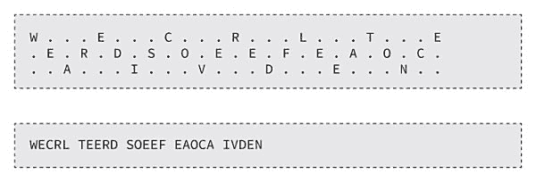

**图 1.1 栅栏密码（置换密码的一个例子）**

分组密码中使用了各种加密方法。在加密和解密过程中，消息被分成比特块。然后这些块通过替换、置换、混淆和扩散等函数。

1.  **替换** 使用此方法意味着用一事物代替另一事物，例如用一个字母代替另一个字母，或用字母代替数字等。
2.  **置换** 此方法通过以某种确定方式重新排序明文来打乱消息。
3.  **混淆** 此方法使用明文与密钥之间极其复杂的关系，使攻击者无法通过篡改明文来确定密钥。
4.  **扩散** 在此方法中，明文的一个变化会导致分散在整个密文中的多个变化。

替换盒（**S 盒**）是引入混淆的一种技术。正确实现时，S 盒旨在抵御密码分析。一个 S 盒接收 `m` 个输入位，并将它们转换为 `n` 个输出位。S 盒可以作为查找表实现，并用于数据加密标准（**DES**）和更新的三重 DES 等对称加密系统，后文将讨论这些内容。

### 流密码

流密码输入数字、位或字符，并加密数据流。一次性密码本是流密码的一个例子。一次性密码本独立处理明文消息的每个字母。流密码通过异或（**XOR**）运算将明文位与伪随机密码位流结合。流密码的运行速度比分组密码快，理论上非常适合硬件实现。

## 对称加密

对称加密使用单个共享密钥进行加密和解密。这些被称为双用途密钥，因为它们可用于锁定和解锁数据。对称加密是最古老的加密形式。历史系统如斯基塔莱密码和凯撒密码都是对称加密的类型。对称加密通过防止没有密钥的人访问消息的真实内容，为用户提供隐私。图 1.2 展示了对称加密过程。

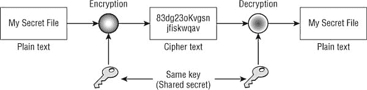

**图 1.2 对称加密**

请注意明文如何用单个共享密钥加密，然后传输给消息接收者，接收者通过相同过程解密消息。密钥的双重用途使该系统非常简单，但也引入了弱点。对称加密速度快，使用小密钥即可非常快地加密大量数据。如果密钥足够大，它也很强且难以破解。然而，对称加密也有缺点。

问题在于密钥分发。为了使对称加密有效，必须有一种安全的方法来传输密钥。在现代世界，需要某种带外传输。**带外**意味着使用不同的方式传输密钥。例如，如果 Bob 想给 Alice 发送秘密消息，但担心 Mike 监控他们的通信，该如何发送？如果密钥以明文发送，Mike 可以拦截它。Bob 可以亲自交付密钥、邮寄或派遣快递。所有这些带外方法在电子商务和电子通信世界中都极不切实际，因为它们扩展性不好。

即使解决了密钥交换问题，仍有其他顾虑。另一个问题是密钥管理。例如，如果十个人需要使用对称加密通信，所需密钥数量为 45 个。随着使用对称加密的人数增加，所需密钥数量也随之增加。确定对称加密所需密钥数量的公式如下：


简化后为：


对称加密的第三个也是最后一个缺陷是它仅提供机密性。


虽然对称加密并不完美，但它确实提供了一些很棒的特性，使其成为保护数据和提供机密性的绝佳选择。对称加密速度快，能够非常迅速地加密和解密，且被认为强度很高。如果使用大密钥，对称加密极难被破解。以下是一些著名的对称算法：

1.  **DES** `Data Encryption Standard` 曾是使用最广泛的对称算法。现已被美国国家标准与技术研究院（`NIST`）正式弃用。其短期替代品是 `3DES`。如今，所有版本的 `DES` 均已被 `Advanced Encryption Standard`（`AES`）取代。
2.  **Advanced Encryption Standard** 作为 `DES` 替代品的对称算法。它源自 `Rijndael` 算法，用于敏感和机密数据。其密钥长度为 128、192 和 256 位。
3.  **Blowfish** 一种通用对称算法，旨在替代 `DES`，具有可变分组大小和高达 448 位的密钥。
4.  **CAST** `Carlisle Adams/Stafford Tavares`（`CAST`）是一种 128 位或 256 位的分组密码，曾是 `AES` 的候选算法。
5.  **IDEA** `International Data Encryption Algorithm`（`IDEA`）是一种分组密码，使用 128 位密钥加密 64 位明文分组。`Pretty Good Privacy`（`PGP`）使用该算法。
6.  **Rijndael** 这是一种分组密码，被 `NIST` 采纳为 `AES` 以取代 `DES`。
7.  **RC4** `Rivest Cipher 4` 是一种基于流的密码。流密码将数据视为比特流处理。
8.  **RC5** `Rivest Cipher 5` 是一种快速分组密码。它与其他对称算法不同，支持可变分组大小、可变密钥大小和可变轮数。一轮（`round`）是一系列数学函数的顺序重复。允许的分组大小选择为 32、64 和 128 位。密钥最长可达 2040 位。
9.  **SAFER** `Secure and Fast Encryption Routine`（`SAFER`）是一种基于分组的密码，以 64 位和 128 位分组处理数据。
10. **Skipjack** 由美国国家安全局（`NSA`）推广，`Skipjack` 使用 80 位密钥，作用于 64 位文本分组。`Skipjack` 遭到反对，因为政府将保留重构 `Skipjack` 密钥所需部分信息，以便在法院批准后，合法机构能解密相关方之间的通信。
11. **Twofish** `Twofish` 是一种分组密码，作用于 128 位数据分组，支持高达 256 位长度的加密密钥。

现在让我们深入了解一些流行的对称加密标准。

### Data Encryption Standard

`DES` 最初由 `IBM` 开发，后由 `NIST` 修改。`NSA` 认可了修订后的标准。它于 1977 年发布，并于 1981 年由美国国家标准协会（`ANSI`）发布。

`DES` 是一种基于 64 位分组的对称加密标准，每次处理 64 位明文。`DES` 输出 64 位密文分组。`DES` 密钥长度为 56 位，有四种主要运行模式：

*   Electronic codebook（`ECB`）模式
*   Cipher block chaining（`CBC`）模式
*   Output feedback（`OFB`）模式
*   Cipher feedback（`CFB`）模式

所有四种模式均使用 56 位密钥，虽然标准将密钥列为 64 位，但 8 位用于奇偶校验，因此实际密钥长度为 56 位。奇偶校验（`Parity checking`）是一种简单的错误检测形式。每个 64 位明文分组被分成两个 32 位分组，然后由 56 位密钥处理。明文通过密钥经过 16 轮置换和替换处理。

#### Electronic Codebook Mode

电子密码本（`ECB`）模式是 `DES` 使用的默认加密模式。如果最后一个分组不足 64 位，则添加填充。`ECB` 产生最大吞吐量，但也是最容易破解的 `DES` 加密实现。如果用于大量数据，很容易被破解，因为相同明文用相同密钥加密总是产生相同密文。这就是为什么如果使用 `ECB`，应仅用于少量数据。

#### Cipher Block Chaining Mode

当 `DES` 在密文分组链接（`CBC`）模式下运行时，它与 `ECB` 有些相似，不同之处在于 `CBC` 将前一个分组生成的部分密文插入到下一个分组中。这个过程称为异或（`XORing`）。它使密文更安全，更难被破解。`CBC` 名副其实，因为一个分组的数据用在下一个分组中，分组被链接在一起。这种链接产生了依赖性，但也导致了更随机的密文。

#### Output Feedback Mode

输出反馈（`OFB`）模式作为流密码实现，使用明文反馈到密文流中。传输错误不会在整个加密过程中传播。初始化向量用于创建第一个加密分组的种子值。`DES` 将明文与种子值异或（`XORs`），以应用于后续数据。

#### Cipher Feedback Mode

密文反馈（`CFB`）模式可作为流密码实现，用于加密单个字符。`CFB` 与 `OFB` 相似，之前生成的密文被添加到后续流中。因为密文被流式传输在一起，错误和损坏可能在整个加密过程中传播。

### Triple DES

三重 `DES`（`3DES`）设计为权宜之计。`DES` 最初按五年周期认证，要求每五年重新认证一次。虽然在早期轻松通过这些重新认证，但 `DES` 在 1987 年左右的重新认证中开始遇到问题。到 1993 年，`NIST` 称 `DES` 开始超出其使用寿命。他们开始寻找替代候选者。这一新标准被称为高级加密标准（`AES`）。

`AES` 是长期替代品，但在 `AES` 准备好部署之前，需要其他东西来填补空白。因此，为了延长 `DES` 加密标准的有用性，采用了 `3DES`。根据实现方式，它可以使用两个或三个密钥加密数据。其有效密钥长度为 112 或 168 位，并执行 48 轮置换和替换。虽然安全得多，但其速度仅为 56 位 `DES` 的三分之一。

### Advanced Encryption Standard

2002 年，`NIST` 选择 `Rijndael` 取代 `DES`。其名称源自两位开发者 `Vincent Rijmen` 和 `Joan Daemen`。它是一种快速、简单、稳健的加密机制。`Rijndael` 还能抵抗各类攻击。`Rijndael` 算法使用三层变换来加密和解密消息文本分组：

*   线性混合变换
*   非线性变换
*   密钥加变换

`Rijndael` 使用四步并行轮系列。`Rijndael` 是一种迭代分组密码，支持 128、192 或 256 位的可变密钥和分组长度：

*   如果密钥和分组大小均为 128 位，则有 10 轮。
*   如果密钥和分组大小均为 192 位，则有 12 轮。
*   如果密钥和分组大小均为 256 位，则有 14 轮。

每轮执行以下每个步骤：

1.  字节替换：每个字节通过 `S-box` 替换。
2.  行移位：字节在矩形中排列并移位。
3.  列混淆：基于排列的矩形执行矩阵乘法。
4.  轮密钥加：状态的每个字节与轮密钥结合。

最后一轮跳过第四步并重复第一步。

### International Data Encryption Algorithm


## 国际数据加密算法 (IDEA)

国际数据加密算法 (IDEA) 是一种 64 位分组密码，使用 128 位密钥。它与其他算法不同，因为它避免使用 S 盒或查找表。虽然 IDEA 由一家瑞士公司申请了专利，但可免费用于非商业用途。它被认为是一种安全的加密标准，目前未发现针对它的已知攻击。它以四种不同模式运行，类似于 DES。一度曾认为 IDEA 可能取代 DES，但专利版税使其变得不切实际。

## Rivest 密码算法

RC 系列密码是 Ron Rivest 设计的一系列密码的一部分。Rivest 密码包括 `RC2`、`RC3`、`RC4`、`RC5` 和 `RC6`。`RC2` 是一种较旧的算法，支持可变密钥长度，是一种 64 位分组密码，可作为 DES 的替代品。`RC4` 作为流密码实现。40 位版本是 WEP 中最初可用的版本。最常见的是 128 位密钥版本。`RC5` 是一种分组密码，其轮数可从 0 到 255，密钥长度可从 0 位到 2,048 位。最后是 `RC6`。它具有可变密钥长度和轮数，并增加了 `RC5` 中没有的两个特性：整数乘法和 4 位工作寄存器。

对称加密确实提供了速度，但如果你正在寻找一种提供简便密钥交换的加密系统，则必须考虑非对称加密。

## 非对称加密

非对称加密，或公钥密码学，不同于对称加密。它克服了对称加密的主要障碍之一：密钥分发。非对称加密使用两个唯一的密钥，如 图 1.3 所示。一个密钥的加密操作，另一个密钥可以解密。

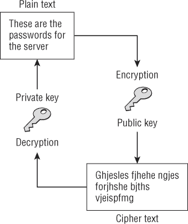

**图 1.3** 非对称加密

非对称加密的工作原理如下：假设你想给同事发送一条消息。你使用同事的公钥加密消息。同事收到消息后，使用私钥解密。

公钥密码学的实现得益于单向函数的使用。`单向函数`，或称陷门函数，是一种在一个方向上易于计算，但在另一个方向上几乎不可能计算的数学运算。根据所使用的非对称加密类型，这种困难基于离散对数问题或将大数分解为其质因数。虽然通过 CASP 考试不需要掌握加密过程背后的数学原理，但在代数中，`离散对数` 是普通对数的群论类比。例如，给定两个大质数，很容易将它们相乘。然而，如果只给出它们的乘积，用当今的处理能力很难或不可能找到这些因数。非对称系统还可能利用 `零知识证明`。这一概念允许你证明你的知识，而无需向第三方透露该事实。

如果消息是用公钥加密的，只有匹配的私钥才能解密。私钥必须保密，而公钥可以分发给任何人。如果算法设计得当，仅凭公钥应该无法轻易推导出一对密钥中的私钥。

请看下面的非对称加密示例：给定质数 397 和 823，很容易将它们相乘得到 326,731。然而，如果给定数字 326,731，要提取这两个质数 397 和 823 则相当困难。知道陷门的人可以双向执行该函数，但如果你缺少陷门，只能单向执行该函数。陷门函数可用于正向的加密和签名验证，而反向则用于解密和签名生成。

为帮助确保你在 CASP 考试中成功，表 1.2 对比了对称和非对称加密系统。

**表 1.2** 对称加密和非对称加密的属性

| 对称 | 非对称 |
| --- | --- |
| 机密性 | 机密性、完整性、认证和不可抵赖性 |
| 单个共享密钥 | 两个密钥：公钥和私钥 |
| 需要带外交换 | 适用于带内交换 |
| 不可扩展；所需密钥过多 | 可扩展，适用于电子商务 |
| 密钥长度小且速度快 | 需要较大的密钥长度且处理较慢 |
| 适用于批量加密 | 最适用于少量数据、数字签名、数字信封、数字证书 |

## Diffie–Hellman

W. Diffie 博士和 M.E. Hellman 博士于 1976 年发布了第一个公钥交换协议。他们专门为密钥交换而开发它，而非用于数据加密或数字签名。Diffie–Hellman 协议旨在允许两个用户在没有任何事先通信的情况下，通过不安全信道交换一个秘密密钥。该协议使用两个系统参数运行：`p` 和 `g`。两个参数均为公开，可供系统的所有用户使用。参数 `p` 是一个质数，参数 `g` 通常称为生成元，是一个小于 `p` 的整数，具有以下性质：对于 1 和 `p` – 1 之间（含）的每个数 `n`，都存在 `g` 的一个幂 `k`，使得 `g^k = n mod p`。Diffie–Hellman 与多种认证方法结合使用，包括 `IPSec` 的 Internet 密钥交换 (`IKE`) 组件。

Diffie–Hellman 在允许双方安全交换加密密钥方面具有开创性，但并非没有问题。它容易受到中间人攻击，因为密钥交换过程不验证参与者身份。应使用数字签名来缓解此漏洞。

## RSA

RSA 算法以其发明者命名。Ron Rivest、Adi Shamir 和 Len Adleman 于 1977 年开发了 RSA。虽然 RSA 像其他非对称算法一样，比对称加密系统慢，但它提供安全的密钥交换，并被认为非常安全。RSA 支持高达 3,072 位的密钥长度。RSA 的设计要求使用质数，其乘积必须远大于 129 位数字以保证安全；129 位十进制数可使用数域筛算法分解。RSA 公钥和私钥生成如下：

1.  选择两个长度相等的大质数 `p` 和 `q`，并计算 `p × q = n`，即公共模数。
2.  选择一个随机公钥 `e`，使 `e` 和 `(p – 1)(q – 1)` 互质。
3.  计算 `e × d = 1 mod [(p – 1)(q – 1)]`，其中 `d` 是私钥。
4.  因此，`d = e – 1 mod [(p – 1)(q – 1)]`。

根据这些计算，`(d, n)` 是私钥，`(e, n)` 是公钥。明文 `P` 加密生成密文 `C` 如下：

`C = P^e mod n`

解密恢复明文 `P` 如下：

`P = C^d mod n`

RSA 通过将明文分割成等长块来工作，每块的位数少于 `n`。每个块分别加密和解密。任何试图破解 RSA 的人都会面临艰巨挑战，因为将大整数分解为其两个因数非常困难。破解 RSA 密钥需要极大的计算机处理能力和时间。自 2000 年专利到期以来，RSA 算法已成为工业级加密的事实标准。它内置于许多协议中，如 `PGP`；软件产品；以及 Mozilla Firefox、Google Chrome 和 Microsoft Internet Explorer 等系统。

## 椭圆曲线密码学


### 椭圆曲线密码学 (ECC)

椭圆曲线密码学 (ECC) 可用于智能手机和手持设备等体积较小、算力较弱的设备中。ECC 被认为比其他一些非对称算法更安全，因为椭圆曲线系统比基于离散对数问题的系统更难破解。椭圆曲线通常定义在有限域上，例如实数和有理数，并且它们实现了离散对数问题的类比。

## ElGamal

ElGamal 于 1985 年发布，其安全性部分建立在解决离散对数问题的难度之上。它是 Diffie-Hellman 密钥交换的扩展。ElGamal 由三个离散组件组成：密钥生成器、加密算法和解密算法。它可用于数字签名、密钥交换和加密。

## 混合加密

有时将两种事物结合在一起是明智之举。你还记得那句广告语吗：“你把巧克力弄进了我的花生酱里”？虽然你可能不认为密码学像巧克力一样美味，但结合对称加密和非对称加密确实有实实在在的好处。对称加密速度快，但密钥分发是个问题。非对称加密提供了便捷的密钥分发，但不适合处理大量数据。将两者结合成混合加密，利用了各自的优势，从而构建了一个真正强大的系统。公钥密码学被用作密钥封装方案，私钥密码学被用作数据封装方案。系统工作流程如下。如果 Bob 想给 Alice 发送消息，将发生以下过程：

1.  Bob 为数据封装方案生成一个随机私钥。该会话密钥是一个对称密钥。
2.  Bob 使用步骤 1 中生成的对称密钥，通过数据封装方案加密消息。
3.  Bob 使用 Alice 的公钥加密该对称密钥。
4.  Bob 将这两项内容（加密后的消息和加密后的密钥）发送给 Alice。
5.  Alice 使用她的私钥解密对称密钥，然后使用该对称密钥解密消息。此过程如 图 1.4 所示。

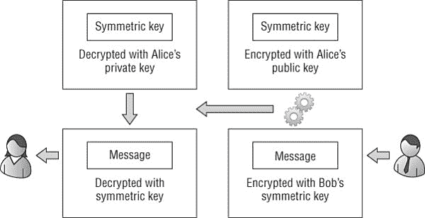

**图 1.4** 混合加密

几乎所有现代密码系统都采用混合加密。该方法之所以行之有效，是因为它同时利用了对称加密的强度和非对称加密的密钥交换能力。混合密码系统的优秀示例包括 IPSec、Secure Shell、Secure Electronic Transaction、Secure Sockets Layer、PGP 和 Transport Layer Security。使用混合系统，我们能实现完美保密吗？这取决于算法、密钥的使用方式以及密钥保护得有多好等因素。`完美前向保密` (PFS) 的概念是指确保单个密钥的泄露只允许攻击者访问受该单个密钥保护的数据。要实现 PFS，用于保护数据传输的密钥不能用于创建任何其他密钥。此外，如果用于保护数据传输的密钥源自其他密钥材料，则该材料不能用于创建任何其他密钥。

## 哈希

哈希是指一大类算法的统称，它们因能够提供完整性和认证而非常有用。完整性确保信息保持不变，且处于其真实的原始形式。认证提供了一种能力，确保消息确实来自你认为的发送者，并且消息被发送给了预期的接收者。

### 哈希与消息摘要

哈希算法通过接收可变长度的数据并将其压缩为固定长度的值（称为 `哈希值`）来运作。哈希为数据提供了一个指纹或消息摘要。设计良好的哈希算法通常不会为两个不同的输入产生相同的哈希值或输出。当这种情况发生时，称为冲突。

根据算法的实现方式，哈希可用于满足完整性和不可抵赖的目标。哈希是执行变更监控的主要手段之一。例如，你可以使用 Tripwire 等程序（一种著名的变更监控程序）来验证特定文件夹的内容在一段时间内保持不变。哈希的优势之一是其能够验证信息保持未变，但它也用于认证系统和数字签名。图 1.5 概述了哈希过程。

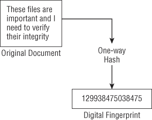

**图 1.5** 哈希过程

哈希是单向过程，不旨在用于还原数据。当消息或数据文件被哈希时，哈希算法在处理过程中会检查数据的每一位。这意味着如果两个文件接近但不完全相同，它们的哈希值将不同。例如，如果我给你一份包含 CASP 学习题的软件程序副本，而你去 Sybex 网站下载了同一软件，对这两个文件进行哈希运算应该会得到相同的值。图 1.6 展示了一个加密哈希的示例。可以在文本 "SHA" 之后看到它。

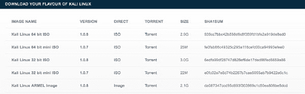

**图 1.6** 软件产品加密哈希示例

如果两个文件之间即使只有细微差别，哈希值也会不同。比较这两个文件的哈希值将表明我给你的软件已被篡改。Tripwire、MD5sum 和 Windows 系统文件检查器 (`sfc.exe`) 等程序的工作原理就是这一过程。这类程序可用于监控文件、文件夹或整个硬盘驱动器的未授权更改。你也可以在代码签名等功能中看到这一过程。`代码签名` 是对可执行文件和脚本进行数字签名以确认软件作者的过程。代码签名还通过哈希保证代码自签名以来未被篡改或损坏。以下列出了一些哈希算法示例：

* 消息摘要算法 (MD5) 系列
* 安全哈希算法 (SHA) 系列
* HAVAL
* RIPEMD
* Tiger
* MAC
* HMAC

### MD 系列

MD 算法是由 Ron Rivest 开发的一系列加密算法。随着技术的进步，这些算法多年来不断演进。第一个是 MD2，现已被认为过时。其被淘汰的原因之一是它容易发生冲突。MD4 是系列中的下一个。MD4 以 512 位块处理数据。与 MD2 一样，MD4 也被发现容易发生冲突，并可能容易受到强制冲突攻击。这些问题促成了 MD5 的开发，MD5 处理可变大小的输入并生成固定的 128 位输出。MD5 的常见实现是 MD5sum。它广泛用于验证程序或文件的完整性。请看以下示例：如果我从朋友那里收到一份 `snort.exe` 的副本，我可以对其进行哈希运算，并验证 MD5sum 是否与 Sourcefire 网站上找到的值匹配：

```
C:\temp>md5sum snort.exe
d1bd4c6f099c4f0f26ea19e70f768d7f *snort.exe
```

因此，哈希用于证明文件的完整性。与 MD4 一样，MD5 也以 512 位块处理数据。然而，MD5 也已有些失宠，因为它也被证明容易受到冲突攻击。

### SHA


#### 安全哈希算法 (SHA)

安全哈希算法 (SHA) 类似于 MD5。有人认为它是 MD5 的继任者，因为它生成的加密哈希值更大。SHA 输出 160 位消息摘要。`SHA-1` 以 512 位块处理消息，并在需要时添加填充，以使数据位数达到正确的数值。`SHA-1` 仅具有 111 位的有效性。`SHA-1` 是 SHA 算法家族的一部分，包括 `SHA-0`、`SHA-1`、`SHA-2` 和 `SHA-3`。`SHA-0` 不再被认为安全，`SHA-1` 现在也被认为容易受到攻击。目前可用的最强版本包括 `SHA-256` 和 `SHA-512`。`SHA-3` 于 2012 年发布，使用 Keccak 算法。

## HAVAL

HAVAL 是另一种类似于 MD5 的单向哈希算法。与 MD5 不同，HAVAL 不绑定固定的消息摘要值。`HAVAL-3-128` 进行三轮处理并输出 128 位指纹，而 `HAVAL-4-256` 进行四轮处理并生成 256 位长度的指纹。

## 消息认证码

消息认证码 (MAC) 类似于数字签名，不同之处在于它使用对称加密。MAC 的创建和验证使用相同的密钥（对称密钥）。作为安全专业人员，您在职业生涯中可能会遇到四种类型的 MAC：无条件安全、基于哈希函数、基于流密码和基于分组密码。

## HMAC

有时单纯的哈希处理是不够的，在这种情况下可能需要哈希消息认证码 (HMAC)。HMAC 设计用于抵御多重碰撞攻击。此功能通过包含共享密钥来实现。基本上，HMAC 通过使用哈希算法（如 `MD5` 或 `SHA-1`），然后通过添加密码来改变初始状态来工作。即使有人能够拦截并修改数据，如果该人不具备密钥，这些数据也几乎毫无用处。没有密钥，该人无法轻易重新创建哈希值。

## 数字签名

**数字签名** 是一类基于公钥密码学的算法。它们用于验证消息的真实性和完整性。要创建数字签名，消息会通过哈希算法处理。生成的哈希值随后使用发送方的私钥进行加密。接收方收到消息后，解密加密的摘要，然后使用发送方的公钥重新计算预期的消息哈希。这两个值必须匹配，才能证明消息的有效性，并验证消息确实是由预期的发送方发送的。数字签名之所以有效，是因为只有该发送方拥有私钥。让我们将此过程分步拆解，以详细说明其操作：

1. Bob 通过哈希算法处理消息生成消息摘要。
2. 然后使用 Bob 的私钥加密消息摘要。
3. 消息被转发给接收方 Alice。
4. Alice 使用 Bob 使用的相同哈希算法从消息创建消息摘要。Alice 随后使用 Bob 的公钥解密 Bob 的签名摘要。
5. 最后，Alice 对比这两个消息摘要，一个是 Bob 最初创建的，另一个是她自己创建的。如果两个值匹配，Alice 可以确信消息未被篡改。

图 1.7 说明了创建过程。它展示了哈希函数如何确保完整性，以及对哈希值签名如何提供认证和不可抵赖性。

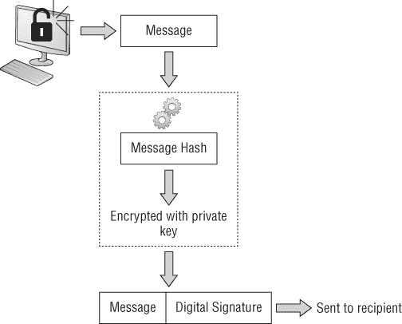

**图 1.7** 数字签名创建

为帮助您在 CASP 考试中取得成功，表 1.3 回顾了完整性验证方法。

**表 1.3** 对称加密和非对称加密的属性

| 方法 | 描述 |
| --- | --- |
| 奇偶校验 | 简单的错误检测码 |
| 哈希 | 完整性 |
| 数字签名 | 完整性、认证和不可抵赖性 |
| 哈希 MAC | 完整性和数据源认证 |
| CBC MAC | 完整性和数据源认证 |
| 校验和 | 冗余检查，弱完整性 |

## 公钥基础设施

**公钥基础设施** (PKI) 允许双方通信，即使他们之前互不相识。PKI 利用用户、系统和应用程序。它允许互不相识的用户通过互联网等不安全媒介进行通信。使用 PKI 最常见的系统是中心化证书颁发机构。使用 PKI 的应用程序通常使用 `X.509` 证书。

PKI 促进了电子商务。考虑一下与实体企业打交道与通过互联网交易有何不同。与实体企业打交道给您提供了建立信任的大量机会。毕竟，您可以看到与谁打交道，与员工交谈，并很好地了解他们的经营方式。

在现代电子商务世界中，交易的透明度要低得多。您可能看不到与谁打交道，却可能完全信任他们。PKI 解决了这些问题，为电子交易带来了信任、完整性和安全性。密钥分发的一个非技术性问题是控制对密钥的访问。任何 PKI 系统都必须经过严格控制，以确保错误的人员无法访问密钥。

从用户的角度来看，PKI 可能看起来是无缝的——但实际上，它由许多组件组成。PKI 由管理、创建、存储和分发密钥及数字证书的硬件、软件和策略组成。PKI 的基本组件如下：

* 证书颁发机构 (CA)
* 注册机构 (RA)
* 证书吊销列表 (CRL)
* 数字证书
* 证书分发系统

### 证书颁发机构

CA 就像护照办公室。护照办公室负责签发护照，是任何想要出国人员的身份识别标准。就像护照办公室一样，CA 在数字世界中为您的身份做担保。VeriSign、Thawte 和 Entrust 是一些执行 CA 服务的公司。最常用的模型是分层信任模型。示例见 图 1.8。在小型组织中，可能会使用单一信任模型。其优势是不那么复杂且开销较小。

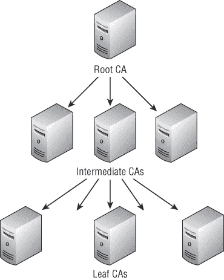

**图 1.8** 分层信任模型

虽然那些公司是外部 CA，但公司也可能决定自行承担这些责任。无论由谁执行服务，必须执行以下步骤：

1. CA 在 RA 的帮助下验证证书请求。
2. 验证个人身份。
3. CA 创建证书，验证该人与所提供的公钥匹配。

### 注册机构

如果 CA 就像护照机构，RA 就像中间人。可以把它想象成当您需要尽快办好护照时可以使用的加急服务。RA 位于客户和 CA 之间。虽然 RA 不能生成证书，但它可以接受请求、验证个人身份，并将信息传递给 CA 以生成证书。

当证书服务扩展到覆盖大面积地理区域时，RA 发挥着关键作用。一个中心私有或企业 CA 可以将其职责委托给区域 RA；例如，美国可能有一个 RA，加拿大另一个，欧洲另一个，印度另一个。

### 证书吊销列表


## 数字证书与 PKI 实现

正如护照一样，数字证书并非终身有效。证书因多种原因失效，例如人员离职、信息变更或私钥泄露。因此，必须维护*证书吊销列表*（CRL）。

CRL 由 CA 维护，CA 对列表进行签名以保证其准确性。每当数字证书出现问题被上报时，它们即被视为无效，CA 会将其序列号添加到 CRL 中。任何请求数字证书的人都可以检查 CRL 以验证证书的完整性。证书损坏的原因有很多，包括以下几点：

*   证书过期。
*   服务器的 DNS 名称或 IP 地址发生变更。
*   服务器崩溃导致证书损坏。

### 数字证书

数字证书是 PKI 流程的关键。数字证书具有双重作用：首先，它确保公钥的完整性，确保密钥保持未变更且处于有效状态；其次，它验证公钥与声明的所有者绑定，且所有关联信息真实正确。实现这些目标所需的信息会被添加到数字证书中。

数字证书遵循 X.509 标准格式。X.509 的最新版本是版本 3。版本 3 的主要发展之一是增加了扩展。此版本包含支持其他拓扑（如*桥接*和*网状*）的灵活性。它可以作为信任网运行，非常类似于 PGP。X.509 证书包含以下要素：

*   版本
*   序列号
*   算法标识符
*   签发者
*   有效期
*   生效日期（指定日期）
*   失效日期（指定日期）
*   主体
*   主体公钥信息
*   公钥算法
*   主体公钥
*   签发者唯一标识符（可选）
*   主体唯一标识符（可选）
*   扩展（可选）

图 1.9 展示了其中一些要素的示例。

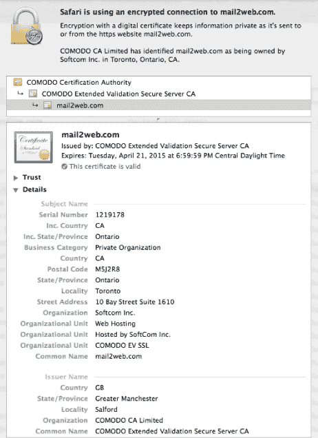

**图 1.9** X.509 证书示例

不同实体可以使用证书。*签发给实体*标识了 CA 向谁签发证书。证书可能签发给用户、系统或应用程序。CA 不仅签发证书，还为实体的真实性担保。使用外部 CA 签发证书并非强制，但广泛采用。组织也可以决定自行充当 CA。无论由第三方处理还是公司自行处理，数字证书通常包含以下关键信息：

*   标识信息，包括用户名、序列号和证书有效期。
*   证书持有者的公钥。
*   签名机构的数字签名。此部分至关重要，因为它验证整个证书包的有效性。

如果决定使用第三方签发证书，会产生费用。这些组织通常以营利为目的，会收取维护证书有效状态的费用。某些组织可能选择使用通配符证书以降低成本。*通配符证书*允许购买者在一个域名下保护无限数量的子域名证书。优势是仅需购买和维护一个证书。然而，缺点是在多个网站和私有服务器上使用同一个证书和私钥。如果其中任一服务器或网站被攻破，该通配符证书下的所有其他服务都将暴露。

如果私钥泄露或出现其他必须吊销证书的情况，PKI 通过 CRL 来处理。这些列表可通过*在线证书状态协议*（OCSP）进行检查，OCSP 是一种用于获取 X.509 数字证书吊销状态的互联网协议。此过程非常类似于维护驾驶执照。Mike 可能持有驾照，但如果被警察拦下，警官仍可能决定查验 Mike 的驾照状态；这与使用 OCSP 检查 X.509 证书状态的方式相同。

### 证书分发

证书可以通过集中式服务或公共机构进行分发。使用 CA 是集中式分发的一个示例：受信任的 CA 向另一方分发公钥。证书通过 CA 的数字签名进行签名，以证明其有效性。证书可以通过信任链在 CA 之间传递。信任链在每个实体之间提供信任关系。示例请参见图 1.10。

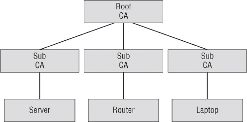

**图 1.10** 信任链示例

分发密钥的第二种方式是直接分发给第三方。这称为*信任网*。例如，如果你给我发邮件询问关于本书的问题，我的回复邮件将包含我的公钥。这是一种分发密钥的简便方式，但无法提供像 VeriSign 或 Thawte 这样的第三方 CA 所能提供的信任级别。PGP 和 GPG 是提供加密并可使用信任网证书分发的系统示例。

### 客户端在 PKI 中的角色

尽管 CA 负责大部分工作，但在 PKI 世界中，客户端也承担一定职责。客户端负责请求数字证书并维护其私钥的安全。私钥的丢失、泄露或暴露将意味着通信不再安全。保护私钥是一个重要问题，因为对于攻击者来说，攻击密钥可能比尝试暴力破解或攻破证书服务更容易。组织应关注以下八个密钥管理问题：

*   生成
*   分发
*   安装
*   存储
*   恢复
*   更换
*   控制
*   销毁

密钥恢复和控制是必须解决的重要问题。一种基本的恢复和控制方法是*m* of *n* 控制访问法。该方法旨在确保无单人拥有完全控制权；它与双人控制密切相关。如果 *n* 名管理员有权执行某个流程，则必须有 *m* 名管理员通过认证才能获得访问权。*m* of *n* 控制应要求物理到场方可访问。示例：假设典型的 *m* of *n* 控制要求四人拥有归档服务器的访问权限，且至少两人必须在场才能实现访问。此时，*m* = 2，*n* = 4。这确保了无单人能危害安全系统或获得访问权。

### 密码学解决方案的实施

本章是否让你思考密码学的各种用途及其对安全专业人员的价值？我希望如此。真正的问题是：既然你已掌握了一些具体的密码学解决方案，加密强度应当如何，以及在哪里应用密码学解决方案。

加密可应用于磁盘、块、文件、记录和端口：


## 加密技术概述

### 1. 磁盘加密
磁盘加密可以使用硬件或软件来加密整个硬盘驱动器或卷。在当今时代，此类技术至关重要。试想个人在移动设备和平板电脑上存储了多少敏感信息，而这些物品极易丢失或被盗。常见的磁盘加密产品包括 `BitLocker` 和 `AxCrypt`。

### 2. 分组加密
分组加密以固定大小的比特组来保护数据。我们之前讨论过的分组密码示例是 `DES ECB`。`DES` 以 64 位分组加密数据。

### 3. 文件加密
你不必加密整个硬盘驱动器或卷。在某些情况下，你可能只需要加密特定文件。可用于文件加密的产品示例包括 `AxCrypt` 和 `PGP`。

### 4. 记录加密
数据库是常见的攻击目标。如果你在数据库中存储敏感信息，可能需要加密整个数据库或仅加密特定记录。例如，在医疗机构中，你可能想要保护包含社会安全号码或其他个人信息的记录，仅向医院工作人员开放医疗 ID 和医疗记录。

### 5. 端口加密
某些服务比其他服务更安全。例如，`Telnet`（端口 23 TCP）以明文发送数据，而 `Secure Shell`（端口 22）使用加密。另一个例子是 `HTTP`，端口 80 为明文，而 `HTTPS` 使用端口 443。

这些示例表明，加密学是安全专业人员可用的最有价值的工具之一，但必须考虑强度、性能和可用性之间的权衡。每种加密解决方案都有其优势和局限性。组织必须执行适当的风险评估，以确定威胁等级以及每项资产所需的保护程度。该评估将在很大程度上决定所使用的技术类型。数据是否仅在未来几分钟内有用（如买卖股票的订单）？信息是否是尚未投产的下一代战斗机的绝密数据？数据存储在何处？对其他人有多大价值？它可能保持价值多长时间？

即使信息不需要加密解决方案来提供隐私，你可能仍然需要有助于保护信息的控制措施。其中一种技术是**数字版权管理**（DRM）。DRM 是一整套旨在保护数字内容的技术。例如，你可能正在平板电脑上阅读本书的副本，但这并不意味着出版商想免费提供给你一百个最亲密的朋友！这正是 DRM 的设计初衷：它有助于防止在线版权侵权，从而帮助版权持有者保持对信息的控制。

接下来，你需要考虑在何处构建保护。加密学可用于许多不同场景，以构建真正的纵深防御。如果参考 TCP/IP 模型来考虑加密学，你会发现加密解决方案可应用于从应用层一直到物理帧的各个层面。让我们从 TCP/IP 协议栈的顶层开始，逐层向下，重点介绍一些加密解决方案，然后再看看隐写术的概念。

## 应用层加密

以下应用层协议只是可用于增加机密性、完整性或不可否认性的几个示例：

### 1. Secure Shell (SSH)
`SSH` 是一种提供安全远程访问的互联网应用程序。它可替代 `FTP`、`Telnet` 和 Berkeley “r” 实用程序。`SSH` 默认使用 TCP 端口 22。

### 2. Secure Hypertext Transfer Protocol (S-HTTP)
`S-HTTP` 是 `HTTP` 的超集，旨在提供与 Web 服务器的安全通信。`S-HTTP` 是一种无连接协议，旨在安全地发送单个消息。

### 3. Pretty Good Privacy (PGP)
`PGP` 由 `Phil Zimmermann` 于 1991 年开发，旨在提供隐私和认证。随着时间的推移，它演变为开放标准，如 `OpenPGP` 和 `GnuPGP`。`PGP` 构建了一个信任网，随着用户签署和发布自己的密钥而形成。`PGP` 的目标是成为“大众的加密”。流行的程序如 `HushMail` 和 `Veridis` 基于 `PGP`。

### 4. GNU Privacy Guard
免费听起来好吗？如果你和我们大多数人一样，答案是肯定的，这就是 `GNU Privacy Guard` (`GPG`) 发挥作用的地方。它是 `PGP` 的授权免费版本。初衷是提供一个人人可用的 `PGP` 免费版本。与 `PGP` 一样，`GPG` 使用混合加密，结合了对称加密和非对称加密的优点。对称部分用于加密和解密，非对称部分用于密钥交换。

### 5. S/MIME
对于那些不想使用 `PGP` 或 `GPG` 的人来说，还有另一种电子邮件安全选项。该解决方案是 `S/MIME` (`Secure/Multipurpose Internet Mail Extensions`)。`S/MIME` 是一种用于公钥加密和 MIME 数据签名的标准。`S/MIME` 提供两项基本服务：数字签名和消息加密。`S/MIME` 是保护电子邮件的流行解决方案，内置于大多数电子邮件软件程序中，如 `Microsoft Outlook` 和 `Mozilla Thunderbird`。

### 6. 安全远程访问
各种应用程序可用于安全远程访问，如 `SSH`、`Remote Desktop Protocol` (`RDP`) 和 `Virtual Network Computing` (`VNC`)。`RDP` 是由 `Microsoft` 开发的专有协议。它为远程用户提供远程计算机的图形界面。`VNC` 类似于 `RDP`，允许对远程计算机进行图形访问。`VNC` 使用 `Remote Frame Buffer` (`RFB`) 协议远程控制另一台计算机。

## 传输层加密

TCP/IP 协议栈的传输层也可用于向数据通信添加加密解决方案。一些常见示例如下：

### 1. Secure Sockets Layer (SSL)
`Netscape` 开发 `SSL` 用于通过互联网传输私密文档。`SSL` 与应用程序无关，也与加密算法无关，因为该协议本身仅是一个用于通信证书、加密密钥和数据的框架。

### 2. Transport Layer Security (TLS)
`TLS` 加密主机和客户端之间的通信。`TLS` 由两层组成——`Record Protocol` 和 `TLS Handshake Protocol`。尽管 `TLS` 和 `SSL` 在功能上不同，但它们提供相同的服务，术语有时可互换使用。

### 3. Wireless Transport Layer Security (WTLS)
`WTLS` 加密无线主机和客户端之间的通信。`WTLS` 是一种安全协议，是 `Wireless Application Protocol` (`WAP`) 协议栈的一部分。`WTLS` 的开发旨在解决移动网络设备面临的问题。随着越来越多的人转向智能手机并将其用于在线银行等活动，这些问题在未来几年将变得越来越重要。

## 网络层控制

网络层是著名加密解决方案 `IPSec` 的所在地。`IPSec` 的开发旨在解决 `IPv4` 的缺陷。`IPSec` 是 `IPv4` 的附加组件。`IPSec` 可用于仅加密数据，或加密数据和报头。随着 `IPv4` 地址的耗尽，预计将更多地关注 `IPSec`，因为它内置于 `IPv6` 中。`IPSec` 的组件包括以下内容：

### 1. Encapsulated Secure Payload (ESP)
`ESP` 通过加密数据包提供机密性。加密的数据被隐藏，从而确保其机密性。

### 2. Authentication Header (AH)
`AH` 提供完整性和认证。`AH` 使用哈希算法和对称密钥计算消息认证码。此消息认证码称为完整性检查值 (`ICV`)。接收到 `AH` 时，将计算一个 `ICV` 并与接收到的值进行核对以验证完整性。


### 3. 安全关联 (SA)

对于 AH 和 ESP 要工作，必须交换一些信息以建立安全会话。这项工作是 SA 的责任。SA 是双方之间的单向连接。如果同时使用 AH 和 ESP，则总共需要四个连接。SA 使用对称密钥来加密通信。`Diffie–Hellman` 算法用于生成此共享密钥。

### 4. 传输模式和隧道模式

AH 和 ESP 可以在两种模式之一中工作：传输模式或隧道模式。传输模式加密对等体之间发送的数据。隧道模式封装整个数据包并添加新的 IP 头部。隧道模式广泛用于 VPN。AH 和 ESP 可以一起使用，也可以独立使用。

## 物理层控制

现在我们已经深入到 TCP/IP 协议栈的底层。正如你所了解的，有许多地方可以对数据进行加密。加密可以发生在许多不同层中的任何一层。CASP 必须询问的问题是实际加密的是什么。是仅保护数据本身，还是数据和所有头部都受到保护？一些物理层安全解决方案包括以下内容：

### 1. 全盘加密

如前所述，磁盘加密是安全专业人员的有用工具。全盘加密提供了一种简便的方法，在设备丢失、被盗或被未经授权的个人访问时保护信息。全盘加密的一些示例包括 `BitLocker` 和 `McAfee endpoint encryption`。这些程序的真正好处在于驱动器上的所有内容都被加密，包括文件、目录和交换空间。全盘加密可以结合诸如 `Trusted Platform Module (TPM)` 之类的技术使用，TPM 是一种保护功能，旨在作为微芯片添加到计算机的主板上。TPM 充当安全加密处理器，并可存储保护信息的加密密钥。

### 2. 硬件安全模块

许多组织使用硬件安全模块 (`HSM`) 来安全地存储和检索托管密钥。`Escrowed keys` 允许另一个受信任方持有密钥的副本。它们需要在与原始密钥相同的安全级别进行管理。HSM 系统可用于保护企业存储和数据，并可在检测到未经授权的访问时通过销毁密钥材料来检测和防止篡改。

### 3. 密码认证协议 (PAP)

我在此包含 PAP，但不应使用它。它充其量很弱。PAP 不安全，因为用户名和密码以明文传输。

### 4. 质询握手认证协议 (CHAP)

CHAP 比 PAP 更合适，因为它发送一个仅使用一次的随机值给客户端。客户端和服务器都知道预定义的秘密密码。客户端使用随机值、nonce 和秘密密码计算单向哈希。CHAP 的握手过程如下：

1. 用户从客户端向服务器发送登录请求。
2. 服务器向客户端发送质询。
3. 质询被加密后发送回服务器。
4. 服务器比较来自客户端的值，如果信息匹配，则授予授权。

### 5. 点对点隧道协议 (PPTP)

PPTP 由两个组件组成：维护虚拟连接的传输和确保机密性的加密。它可以在 40 位或 128 位长度下运行。

### 6. 第 2 层隧道协议 (L2TP)

L2TP 由 Cisco 和 Microsoft 创建，旨在取代第 2 层转发 (`L2F`) 和 PPTP。L2TP 将 L2F 和 PPTP 的功能合并为一个隧道协议。

## 隐写术

隐写术是隐蔽写作的科学。它与密码学相似，因为它可用于实现机密性。虽然两者都旨在保护信息，但它们实现此目标的方式不同。使用密码学时，你可以看到信息但不应能辨别其内容。例如，你可能会嗅探客户端和服务器之间的 SSL 连接，但数据会被打乱且几乎无用。然而，使用隐写术时，数据是隐藏的。这就是为什么隐写术被描述为在消息、图像或文件等容器中隐藏信息的实践。

隐写术需要两项内容：容器和要隐藏的数据。容器是你将嵌入数据的介质。选择合适的容器是一个重要的决定，因为它在很大程度上决定了隐写技术的有效性。因此，发送者可能会使用 CASP 徽标的图像文件，并通过更改每个字节数据的最低有效位来调整颜色。这种变化非常微妙，以至于不专门寻找的人不太可能注意到。使用图形是隐藏数据最流行的方法之一。一些常见的容器包括：

*   图像
*   音频文件
*   视频文件
*   Office 文档

显然，音频和视频文件提供的存储空间比大多数图像多，仅仅是因为文件大小可以大得多。800 MB 的视频文件并不罕见。查找或恢复隐写数据称为隐写分析 (`steganalysis`)。一些常见的隐写分析技术包括：

1.  **仅隐写分析**：仅可用隐写内容进行分析。
2.  **已知隐写分析**：原始内容和隐写内容均可用于审查。
3.  **已知明文分析**：隐藏消息和相应的隐写图像均已知。
4.  **禁用或主动分析**：在通信过程中，主动攻击者更改载体。

为了使事情更加困难，使用隐写术的人不仅可能隐藏数据，还可能对其进行加密。在这些情况下，数据恢复可能非常困难，因为你不仅必须找到数据，还必须破解加密程序。

## 密码学攻击

只要有秘密，就有人试图找出这些秘密是什么。对密码系统的攻击并非新鲜事。这项活动的正式名称是 `cryptanalysis`。密码分析是研究分析密码学并试图确定密码系统密钥值的学科。根据攻击者以哪个密钥为目标，成功可能意味着某人可以访问机密信息，或冒充通信中的已认证方。

攻击者可以通过多种方式以攻击为目标瞄准系统，例如暴力攻击 (`brute-force attack`)。暴力攻击尝试所有可能的解决方案。让攻击者执行暴力攻击更费时费力的一种技术是 `key stretching`。密钥拉伸是指用于使可能较弱的密码系统（如密码生成）更安全的加密技术。此技术将密码与称为盐 (`salt`) 的随机值一起进行哈希。此过程可以重复多次以生成派生密钥。通常这可能是一千次或更多迭代。这种方法使暴力攻击对攻击者来说耗时较长。然而，请记住之前关于强度、性能和可用性之间权衡的讨论？虽然它更安全，但增加的迭代次数将需要更多的 CPU 功率和时间。

许多国家寻求控制加密算法并对其使用实施控制。这些控制属于《瓦森纳安排》（`Wassenaar Arrangement`）关于常规武器和两用物品及技术出口管制的范畴。该协议的目标是促进常规武器和两用物品及技术转让的透明度，同时促进常规武器和两用物品及技术转让的更大责任。其理念是将强加密技术掌握在罪犯和恐怖分子手中之外。

## 总结


## 密码学章节总结

本章重点介绍密码学。密码学是安全专业人员手中最强大的工具之一。它通过加密为您提供保护敏感信息的能力。它还可以提供验证补丁、文件和重要数据完整性的能力。此外，密码学使电子商务成为可能。借助诸如 `PKI` 之类的加密解决方案，您可以信任第三方就是他们声称的那个实体。这些只是密码学提供的解决方案中的一小部分。

作为一名安全专业人员，您需要能够与他人就加密解决方案和服务进行沟通。您不必能够编写自己的加密算法。但您确实需要能够为实际问题提供解决方案。没有哪一周不出现新闻报道，列出包含个人信息的被盗或丢失媒体。作为一名安全专业人员，您可能会处于建议公司对所有笔记本电脑使用全盘加密的位置。您也可能有机会推广 `PGP` 作为标准，用于加密所有讨论敏感业务往来的电子邮件。您甚至可能身处一个准备推出新电子商务网站的团队中，并被要求就 `PKI` 提供意见。这些都是安全专业人员每天提供的解决方案类型。

## 考试要点

1.  **描述适当的加密解决方案。** 加密解决方案大致可分为对称加密、非对称加密、混合加密和哈希。每种方案都提供特定的解决方案，如隐私性、认证、完整性和不可抵赖性。

2.  **描述基本的 `PKI` 操作和高级概念。** `PKI` 允许两个彼此不认识的当事方通过不安全的公共网络进行通信。这种通信随后可用于安全且私密地交换数据或进行电子商务。`PKI` 系统利用公钥和私钥。密钥通过受信任的证书颁发机构进行共享。

3.  **理解 `PKI` 中的 `wildcard` 等术语。** `wildcard`（通配符）证书允许购买者在一个域名上保护无限数量的子域证书。优势在于您只需购买和维护一个证书。然而，缺点是您在多个网站和私有服务器上仅使用一个证书和私钥。

4.  **描述传输加密。** 传输加密是 `IPSec` 可以运行的两种模式之一。当使用 `IPSec` 传输加密时，仅加密每个 IP 数据包的数据部分或有效载荷。这使得 IP 头部保持不变并以明文形式发送。

5.  **描述数字签名。** 数字签名是使用发送方私钥加密的哈希值。它用于认证和完整性。

6.  **描述哈希。** 哈希是指一大类算法，它们因其提供完整性和认证的能力而非常有用。哈希算法通过接收可变数量的数据并将其压缩为称为哈希值的固定长度值来运行。

7.  **描述代码签名。** 代码签名是对可执行文件和脚本进行数字签名的过程，以确认软件作者。代码签名还通过使用哈希来保证代码自签名以来未被篡改或损坏。

8.  **解释不可抵赖性。** 不可抵赖性是验证身份证明的能力。它用于确保数据发送方获得交付证明，并确保接收方确信发送方的身份。

9.  **定义伪随机数生成。** 伪随机数生成器是生成一系列数字的算法，这些数字近似于随机数的特性。

10. **解释完美前向保密。** 完美前向保密基于这样一个概念：单个密钥的泄露将仅允许攻击者访问受该单个密钥保护的数据。

11. **了解隐写术的目的和用途。** 隐写术是一种隐蔽写作的形式。隐写术允许用户将消息隐藏在容器内。常见的容器包括图像、音乐文件、视频，甚至 Microsoft Office 文档。

12. **定义 `confusion` 和 `diffusion`。** 当明文与密钥之间的关系非常复杂，以至于攻击者无法通过篡改明文来推导出密钥时，就会发生 `confusion`（混淆）。`diffusion`（扩散）是指明文发生变化时，导致密文中多处发生变化并分散在整个密文中的过程。

## 复习题

1.  一位高级管理层成员请您解释加密的重要性并定义对称加密提供的功能。以下哪项提供了最佳解释？

    **A.** 不可抵赖性

    **B.** 机密性

    **C.** 哈希

    **D.** 隐私性和认证

2.  作为您组织的安全管理员，您必须了解所有类型的哈希算法。哪种算法由 Ron Rivest 开发并提供 128 位输出？

    **A.** `AES`

    **B.** `DES`

    **C.** `MD5`

    **D.** `RC4`

3.  一位同事担心某项声明的真实性，因为电子邮件的发送方否认发送过该邮件。该同事想要一种方法来证明电子邮件的真实性。您会推荐哪种方法？

    **A.** 哈希

    **B.** 数字签名

    **C.** 对称加密

    **D.** 非对称加密

4.  姊妹公司的一位初级管理员打电话报告 `PKI` 交易中使用的私钥可能已泄露。该管理员想知道检查丢失的密钥是否已被系统标记的最简单方法是什么。您将如何告诉该管理员？

    **A.** 哈希

    **B.** 向实体颁发

    **C.** 在线证书状态协议

    **D.** 通配符验证

5.  您发现过期的证书被反复用于获取登录权限。该证书本应被添加到哪个列表中？

    **A.** 通配符验证

    **B.** 过期密钥吊销列表

    **C.** 在线证书状态协议

    **D.** 证书吊销列表 (`CRL`)

6.  一位初级管理员在看到证书费用后惊慌失措地找到您。她想知道是否有办法获得一个证书来覆盖组织的所有域和子域。您能提供什么解决方案？

    **A.** 通配符

    **B.** 统配证书

    **C.** 分布式证书

    **D.** 不存在解决方案

7.  以下哪项不是对称加密的优势？

    **A.** 它很强大。

    **B.** 小密钥非常适合批量加密。

    **C.** 它提供机密性。

    **D.** 密钥交换很容易。

8.  大多数认证系统都使用单向加密过程。以下哪项最能提供单向加密的示例？

    **A.** 非对称加密

    **B.** 对称加密

    **C.** 哈希

    **D.** `PKI`

9.  以下哪种是早期的加密形式，也称为 `ROT3`？

    **A.** 置换密码

    **B.** 替换密码

    **C.** 斯基塔莱密码

    **D.** 凯撒密码

10. 哪种加密类型最能提供简便的密钥交换和密钥管理？

    **A.** 对称

    **B.** 非对称

    **C.** 哈希

    **D.** 数字签名

11. `SSL` 和 `TLS` 最好可归类为以下哪项？

    **A.** 对称加密系统

    **B.** 非对称加密系统

    **C.** 哈希系统

    **D.** 混合加密系统

12. 


## 密码学基础与综合安全解决方案

## 练习题

### 12. 你正在向管理层解释密码学基础知识，试图争取增加预算。以下哪项**不是**对称加密？

**A.** `DES`
**B.** `RSA`
**C.** `Blowfish`
**D.** `Twofish`

### 13. 以下哪项**不是**哈希算法？

**A.** `SHA`
**B.** `HAVAL`
**C.** `MD5`
**D.** `IDEA`

### 14. 一位移动用户从外地打来电话，告知他被要求去中国出差。他想要关于保护硬盘驱动器的建议。你建议他使用什么？

**A.** `S/MIME`
**B.** `BitLocker`
**C.** `Secure SMTP`
**D.** `PKI`

### 15. 朋友给了你一盘应用程序，但你不确定是否要在公司笔记本电脑上安装其中几个。有没有简单的方法验证这些程序是原版还是被篡改过？

**A.** 使用哈希算法进行验证。
**B.** 提交给证书颁发机构。
**C.** 使用对称加密进行扫描。
**D.** 将程序与 `CRL` 进行核对。

### 16. 当两个不同的文件经过哈希运算后产生相同的哈希输出时，正确的术语是什么？

**A.** 会话密钥
**B.** 数字签名
**C.** 摘要
**D.** 冲突

### 17. 你被要求为加密密钥的分发建议一个简单的信任系统。你的客户是一家三人公司，想要一个低成本或免费的解决方案。你会建议以下哪项？

**A.** 单一权威信任
**B.** 层级信任
**C.** 辐射/中心信任
**D.** 信任网

### 18. 以下哪项能正确描述一种使用由非对称过程分发的对称密钥的系统？

**A.** 数字签名
**B.** 混合加密
**C.** `HMAC`
**D.** 摘要

### 19. CASP 必须理解加密和密码学的重要性。这是用于保护传输中、处理中或静止状态下数据的关键概念之一。考虑到这一点，`DES ECB` 是以下哪项的示例？

**A.** 磁盘加密
**B.** 分组加密
**C.** 端口加密
**D.** 记录加密

### 20. 以下哪项可用于描述一种用于密码处理的物理安全组件，并可用于安全地存储数字密钥？

**A.** `HSM`
**B.** `TPM`
**C.** `HMAC`
**D.** `OCSP`

### 第 2 章：综合安全解决方案

本章涵盖以下 CompTIA CASP 考试目标：

1.  **1.3 给定场景，分析网络和安全组件、概念及架构**
    *   高级网络设计（有线/无线）
        *   远程访问
            *   `SSH`
            *   `SSL`
        *   `IPv6` 及相关过渡技术
        *   传输加密
        *   网络认证方法
        *   `802.1x`
        *   网状网络
    *   安全设备
        *   `SIEM`
    *   应用和协议感知技术
        *   `DAM`
    *   用于数据流的复杂网络安全解决方案
        *   `SSL` 检查
        *   网络流数据
    *   路由器、交换机及其他网络设备的高级配置
        *   传输安全
        *   中继安全
        *   路由保护
    *   关键基础设施/监控与数据采集 (`SCADA`)/工业控制系统 (`ICS`)

2.  **1.5 区分应用漏洞并选择适当的安全控制**
    *   应用安全框架
        *   Web 服务安全 (`WS-security`)

3.  **4.2 给定场景，选择适当的控制以保护通信和协作解决方案**
    *   电话
        *   `VoIP`

4.  **5.1 给定场景，将主机、存储、网络和应用程序集成到安全的企业架构中**
    *   安全数据流以满足不断变化的业务需求
    *   所有相关设备的逻辑部署图和相应的物理部署图
    *   安全基础设施设计（例如，决定在何处放置特定设备/应用程序）
    *   存储集成（安全考量）
    *   企业应用集成启用器
        *   `ESB`
        *   `SOA`
        *   目录服务
        *   `DNS`

5.  **5.2 给定场景，集成高级认证和授权技术以支持企业目标**
    *   认证
        *   单点登录
    *   高级信任模型
        *   `RADIUS` 配置
        *   `LDAP`
        *   `AD`

你有没有想过洋葱有多少层？当你剥开一层，似乎后面还有一层，再一层，又一层。综合安全解决方案的设计应当采用同样的方式——作为一系列的层。这通常被称为*纵深防御*。本章讨论综合安全解决方案。纵深防御方法不仅仅关注基本安全概念。这种方法论是用于保护关键资产和信息的方法、技术、工具、人员和控制的总和。

之所以需要综合控制，是因为连接到互联网的系统比过去多得多，以电子形式存储的敏感数据也比过去多得多。回顾过去几年 `CERT` 的统计数据显示，报告的事件和漏洞数量稳步增加。“极光行动”（详见 `www.wired.com/threatlevel/2010/01/operation-aurora/`）提供了一个更具体的例子，即针对包括 Google 在内的二十多家公司的定向入侵。西方石油天然气行业遭受了长期入侵，详见“夜龙”报告（`www.networkworld.com/news/2011/021011-night-dragon-attacks-from-china.html`）。另一个例子是“阴影鼠行动”（`www.symantec.com/connect/blogs/truth-behind-shady-rat`），这是一项为期五年的研究，涉及针对 70 多个实体（包括政府和非营利组织）的高度复杂、定向的全球入侵。该报告将全球《财富》2000 强公司分为两类：“知道自己已被攻陷的，和尚未知道自己已被攻陷的。”或许这些入侵中最复杂的是臭名昭著的 Stuxnet 蠕虫（`www.nytimes.com/2011/01/16/world/middleeast/16stuxnet.html?pagewanted=all&_r=0`），它包含内部信息、多个零日漏洞和被盗用（窃取）的数字证书。由于其复杂程度、跨多种目标技术传播的威胁数量、高级规避能力，当然还有它专门针对监控与数据采集 (`SCADA`) 系统，最终针对伊朗核设施，这种特定威胁经常被称为网络武器。黑客不仅对军事目标感兴趣。2013 年的 Target 商店数据泄露事件和 2014 年的 PF Chang 黑客攻击事件，证明了黑客和网络犯罪分子为获取数据或财务信息不择手段。

本章探讨高级网络设计，以及精心设计的网络如何降低整体风险。我们还将回顾语音 IP (`VoIP`)、轻量级目录访问协议 (`LDAP`) 和安全 DNS (`DNSSEC`) 等主题。这些都是 CompTIA 要求你为考试掌握的内容。

## 高级网络设计


### 网络认证方法

网络认证是安全专业人员的关键知识领域，因为它是**第一道防线**。它由两部分组成：标识和认证。举个例子，标识就像我说：“嗨，我是迈克尔。”虽然我提供了这些信息，但你怎么知道真的是我？你需要确定该声明的真实性。这就是认证的作用。认证类型包括 `something you know`（你所知）、`something you are`（你所是）和 `something you have`（你所有）。三种常见的网络认证方法如下：

*   **密码认证协议 (PAP)** 是一种较旧的认证系统，设计用于电话线路和拨号系统。PAP 使用双向握手进行认证，但被认为较弱，因为它以明文传输密码。你**不应**使用 PAP。CHAP 和 EAP 被视为其替代品。
*   **质询握手认证协议 (CHAP)** 通过三次握手进行验证来提供认证。客户端通过认证后，会定期收到要求，通过新的质询消息向连接方重新认证。我们将在本章后面更多地讨论 CHAP。
*   **可扩展认证协议 (EAP)** 是一种用于无线网络的认证框架。EAP 定义消息格式，然后由协议决定如何将 EAP 消息封装在该协议的消息中。有许多不同的 EAP 格式在使用，包括 `EAP-TLS`、`EAP-PSK` 和 `EAP-MD5`。EAP 的两种常见实现是 `PEAP` 和 `LEAP`。

### 802.1x

IEEE `802.1x` 是基于端口的网络访问控制 (NAC) 的 IEEE 标准。`802.1x` 广泛用于无线环境，并依赖 EAP。`802.1x` 充当应用程序代理。它很像认证过程中的**中间人**。

### 网状网络

有许多不同的网络设计，如总线型、环型、星型，甚至网状型。网状网络的一个例子是互联网。它是网络的网络，数据可以通过许多路径遍历到达给定目的地。网状网络设计配置为每个节点都可以转发数据。网状网络的一大优势是其**自愈**能力。这仅意味着如果一个节点宕机，还有其他节点可以接管。网状网络非常可靠，因为到达目的地有多条路径。蜂窝网络是网状网络的一个很好的例子。

蜂窝网络基于移动自组网 (MANET) 设计。随着智能手机和平板电脑的普及，MANET 已成为增长最快的网状网络类型之一。这对安全专业人员尤为关注，因为缺乏中心节点和动态拓扑使基础设施容易受到攻击。此类攻击可能包括窃听、干扰、干扰、流量分析、数据损坏，甚至病毒和蠕虫等恶意软件。

### 远程访问

远程访问旨在让网络外部的用户访问公司资源和数据。外部用户通常未物理连接到公司资源，可能正在使用自己的硬件。必须通过其他方式建立连接，如拨号、无线连接、通过互联网服务提供商 (ISP) 或在公共热点通过互联网连接。远程访问是一个重要话题，因为潜在攻击者一直在寻找获取访问权限的方法，在某些情况下甚至采用了巧妙的手段。

在微软的世界中，为远程访问设计的组件是远程访问服务 (RAS)。RAS 旨在通过拨号调制解调器促进远程访问连接的管理。Unix 系统也有启用远程访问的内置方法。历史上，这些系统与远程认证拨号用户服务 (RADIUS) 配合良好，RADIUS 是一种为集中式登录解决方案而开发的协议，可支持认证、授权和审计。这种远程访问方法已经存在一段时间了，也有一些更现代的方法。

思科通过其网络硬件和软件实现了多种远程访问方法。最初是终端访问控制器访问控制系统 (TACACS)。TACACS 已由思科增强并扩展了两次。最初版本的 TACACS 提供了认证和授权的组合过程。这被扩展为扩展终端访问控制器访问控制系统 (XTACACS)。XTACACS 是思科专有的，提供单独的认证、授权和审计过程。最新版本是 TACACS+。它增加了功能，并扩展了属性控制和审计过程。TACACS+ 还将认证和授权过程分离为三个独立领域。

另一个标准是 DIAMETER。该名称是个双关语，意为直径是半径的两倍。DIAMETER 由互联网工程任务组 (IETF) 指定用于替代 RADIUS 协议。虽然两者运作方式相似，但 DIAMETER 通过解决发现的弱点改进了 RADIUS。DIAMETER 相对于 RADIUS 的改进包括改进的故障切换。DIAMETER 能够支持分组的属性-值对 (AVP)，并在指定代理失效时将请求转发给另一个代理。

使用 PPP 通过点到点链路进行认证最常见的方法之一是质询握手认证协议 (CHAP)。CHAP 旨在通过质询和响应系统定期提供认证。CHAP 过程如 图 2.1 所示。

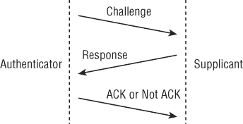

**图 2.1** CHAP 认证

真正改变远程访问的一项因素是个人与公司和客户通信方式的增加。酒店、机场、餐厅、咖啡店等现在都常规提供互联网接入。这是一种低成本的连接方式，但它是公共网络。这就是创建 `virtual private networks` (VPNs，虚拟专用网络) 的原因。VPN 是一种在互联网上提供安全、可靠传输的机制。VPN 是建立在物理网络之上的安全虚拟网络。VPN 的价值在于能够加密定义 VPN 网络的端点之间的数据。因为数据被加密，公共网络上的外部观察者能看到或访问的内容非常有限。从安全角度来看，重要的是要理解 VPN **不是**一种协议。它是一种利用协议促进安全通信的方法。自 1990 年代以来，公司一直在努力改进用于 VPN 的协议。

一个例子是微软。在 1990 年代中期，他们领导了一个网络公司联盟来扩展点对点协议 (PPP)。该项目的目标是构建一组设计用于 VPN 领域内工作的协议。这项工作的成果是点对点隧道协议 (PPTP)。PPTP 的目的是通过 VPN 实现从远程用户到服务器的数据安全传输。还有许多其他变体，如 CHAP、MS-CHAPv1 和 MS-CHAPv2。


### 虚拟网络与安全组件的部署

虽然 PPTP 很有用，但被发现存在弱点。此外，PPTP 是围绕 PPP 和 IP 网络设计的。思科认为这是一个问题，因为某些用户可能会使用其他类型的网络连接，如帧中继或 ATM；因此，设计了第二层隧道协议 (L2TP) 来应对这一挑战。PPTP 设计为在客户端设备上通过软件实现，而 L2TP 最初构想为使用路由器或专用设备的硬件实现。

随着企业与互联网的融合度加深，越来越多的关键任务服务与电子商务挂钩，安全设备的部署和设计变得日益重要。多年前，企业高度依赖集线器等设备。然而，按今天的标准，集线器被认为已过时。现代网络高度依赖交换机。

交换机被视为 OSI 第 2 层设备。与集线器不同，交换机通过检查每个数据帧的源和目的媒体访问控制 (MAC) 地址来分割流量。交换机通过将每个设备的 MAC 地址存储在随机存取存储器 (RAM) 中的查找表里来工作。该查找表称为内容可寻址存储器 (CAM)。CAM 包含将每个 MAC 地址与其连接的相应端口匹配所需的信息。CAM 通过将物理地址映射到特定端口来工作，以便当数据帧进入交换机时，它在查找表中找到目标 MAC 地址，并将其与计算机连接的交换机端口匹配。帧仅被转发到该交换机端口；因此，其他端口上的计算机永远看不到该流量。这提高了安全性并提供了更好的网络分段。这项技术并非万无一失，攻击者可以针对交换机发起地址解析协议 (ARP) 缓存投毒和 MAC 泛洪攻击。

另一个关键网络组件是路由器。路由器被视为 OSI 第 3 层组件。路由器的主要目的是通过称为路由的过程将 IP 数据包转发至其目的地。路由器主要处理两项内容：路由协议和可路由协议。可路由协议的一个典型例子是 IP。路由器检查 IP 数据包并确定其转发去向。它们采取的路径由路由协议决定。路由协议的例子包括路由信息协议 (RIP) 和开放最短路径优先 (OSPF)。路由器可以将 IP 数据包转发到具有相同或不同介质类型的网络。路由器也可能成为攻击者的目标。一些常见攻击包括路由投毒和互联网控制消息协议 (ICMP) 重定向攻击。

另一个关键项目是大多数公司必须处理的各种无线设备。现代组织必须管理多种类型的无线设备，如平板电脑和智能手机。公司必须为这些设备制定策略，并决定是否允许员工 `自带设备` (BYOD)。对此有强烈的推动，因为越来越多的员工希望在工作中使用自己的手机或平板电脑。作为 CASP，你需要理解为移动设备建立强有力控制的重要性。这始于策略。策略必须说明允许什么和不允许什么。接下来，策略必须有强有力的技术控制作为支撑。此类工具通常归类为移动设备管理。移动设备管理允许控制所有类型的移动设备，包括手机、智能手机和平板电脑。此类软件对设备的应用程序分发、数据和配置设置实施控制。

另一个用于安全的常见网络组件是代理。许多人认为代理是“代理”设备，这是一个很好的定义。CASP 应该了解两种类型的代理：`应用层` 和 `电路层`。

应用层代理检查整个数据包，然后根据检查内容时发现的情况做出决定。这种代理的缺点是虽然它很彻底，但速度非常慢。第二种代理是电路层代理。电路层代理无法提供应用层代理那样深度的安全性；然而，它不关心高层应用，因此适用于更广泛的协议。

如果没有适当的控制设计，企业可能会遭遇重大安全漏洞，导致严重损害、损失，甚至业务失败。防火墙部署设计包括包过滤、双宿主网关、屏蔽主机和屏蔽子网。

单层包过滤设计在受信网络和非受信网络（通常是互联网和企业网络）之间安装一个包过滤路由器。虽然这种设计易于实施，但随着网络规模扩大，其问题会被放大，因为包过滤器的功能有限。图 2.2 说明了这种设计。

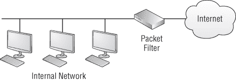

**图 2.2** 包过滤防火墙

另一种方法是 `双宿主网关`。这种防火墙设计被视为对基本包过滤路由器的改进。双宿主网关由一个具有两个网络接口的堡垒主机组成。一个重要项目是主机上禁用了 IP 转发。可以通过在双宿主主机前添加一个包过滤路由器来提供额外保护。

屏蔽主机防火墙增加了一个路由器和屏蔽主机。路由器通常配置为仅在内部网网络上看到一台主机。内部网用户必须通过这台主机连接到互联网，外部用户无法直接访问内部网上的其他计算机。图 2.3 说明了这种防火墙设计。

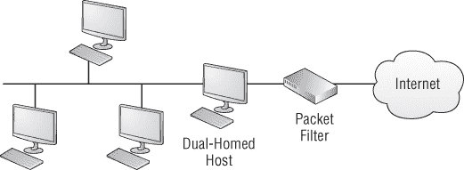

**图 2.3** 屏蔽主机防火墙

屏蔽子网建立了一种 `非军事区` (DMZ)。DMZ 通常建立用于让外部用户访问 DMZ 内的服务。基本上，面向外部的 Web 服务器、电子邮件和 DNS 等共享服务可以放置在 DMZ 内；DMZ 不提供对内部网络中服务的任何其他访问。屏蔽子网和 DMZ 是大多数现代网络设计的基础。图 2.4 说明了这种设计。

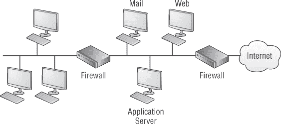

**图 2.4** DMZ 防火墙设计

防火墙技术持续进步，一些最新的设计被称为 Web 应用防火墙 (WAF)。WAF 是位于 Web 客户端和 Web 服务器之间的防火墙，分析 OSI 第 7 层流量。这些设备能够执行深度包检测，并查看 HTTP/HTTPS/SOAP/XML-RPC/Web Service 层中的请求和响应。与任何安全技术一样，WAF 并非 100% 有效；有各种方法和工具用于检测和绕过这些防火墙。自动化检测工具的两个例子是 `w3af` 和 `wafw00f`，还有更多。也有各种利用 WAF 固有漏洞的方法，这些方法因 WAF 技术而异。其中最突出的是跨站脚本 (XSS)，这正是 WAF 旨在防止的事情之一。当然，也有工具可用于协助此类渗透测试或攻击，例如 SensePost 开发的 Suru Web 应用攻击代理。这只是众多提供侦察能力、HTTP 模糊测试等功能的工具之一。


### WAF 检测方法

有些 WAF 可以检测攻击特征并尝试识别特定攻击，而另一些则寻找不符合网站正常流量模式的异常行为。图 2.5 展示了一个用于数据流的复杂网络安全解决方案示例。

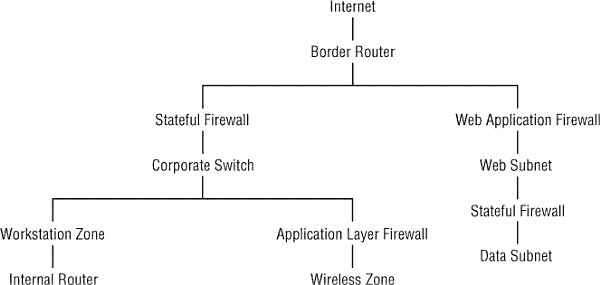

**图 2.5** 深度防御防火墙设计

### VPN 放置选项

VPN 是另一项需要考虑放置位置的技术。您可以从多种设计选项中选择 VPN 设备在网络中的放置位置。例如，您可以将 VPN 设备与网络中的防火墙并行放置。这种方法的优势在于高度可扩展——因为可以将多个 VPN 设备与防火墙并行部署。然而，这种方法未实现内容检查的集中点。

VPN 设备的另一种潜在放置位置是网络中防火墙上的 DMZ 区域。这种网络设计方法允许防火墙检查解密后的 VPN 流量，并可利用防火墙强制执行安全策略。一个缺点是，这种设计放置选项可能会施加带宽限制。

您的最后一个设计选项是网络中集成的 VPN 和防火墙设备。由于需要支持的设备相同或更少，这种方法可能更易于管理。然而，可扩展性可能是个问题，因为单个设备必须扩展以满足多项功能的性能要求。还有系统可靠性的问题。如果 VPN 失效，防火墙也会失效吗？如果您选择此模型，拥有镜像 VPN 和防火墙是确保可靠性的方法。

### SCADA

昨天的模拟控制已成为今天的数字系统。这些数字控制被称为监控与数据采集（SCADA）系统，有时也称为工业控制系统（ICS）。从安全角度来看，这些系统是一个重要考量因素，因为它们通常被公用事业行业用于监控关键基础设施系统和控制电力分配，以及许多其他形式的自动化。SCADA 系统已演变为网络化架构。图 2.6 展示了基本 SCADA 系统的设计。SCADA 系统也用于更普通的部署，如楼宇中的暖通空调（HVAC）、电梯控制等。要了解更多信息，请访问 `www.us-cert.gov/control_systems/ics-cert/`。

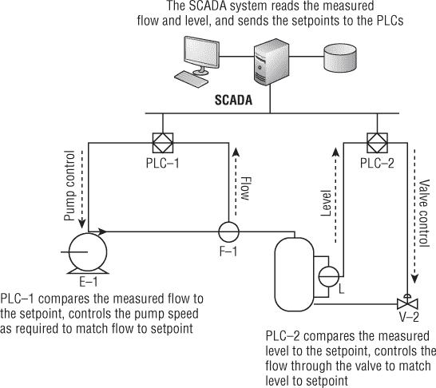

**图 2.6** 基本 SCADA 系统

SCADA 系统和网络过去是独立的，但今天它们直接与组织业务系统集成。如果集成处理不当，可能会产生安全风险。SCADA 系统最佳实践包括：

* 创建并强制执行网络保护策略。
* 进行现场勘测和物理审查。评估所有连接到 SCADA 系统的远程站点。
* 对 SCADA 网络的接入点实施强有力的逻辑和物理访问控制。
* 加固、修补并保护 SCADA 网络。移除并禁用不必要的服务。
* 审查网络拓扑并识别所有与 SCADA 网络的连接。
* 拔掉所有与 SCADA 网络不必要的连接。
* 对所有剩余的 SCADA 网络连接进行定期渗透测试和漏洞评估，以评估与这些接入点相关的安全控制。

##### VoIP

事物变化越多，越保持原样，这很有趣。例如，我记得很久以前被要求在现有语音网络上传输数据。今天，许多网络和安全工程师被要求设计系统，让语音可以在现有数据网络上运行。IP 语音（VoIP）为企业提供了许多优势。一大优势是成本。VoIP 系统仅使用 IP 技术发送带有音频的数据包，而不是像 `HTTP`、`FTP`、`POP3/IMAP` 和 `Telnet` 那样传输数据包。VoIP 使用诸如会话发起协议（SIP）、H.323、Inter-Asterisk 交换协议（IAX）和实时传输协议（RTP）等协议。图 2.7 展示了 VoIP 协议在协议栈中的位置。

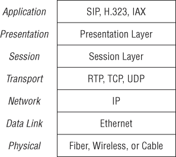

**图 2.7** 协议栈中的 VoIP

以下是 VoIP 的一些基本特征：

* 基于 SIP 的信令
* 用户代理客户端
* 用户代理服务器
* 三次握手
* 由 RTP 承载的语音流
* QoS：服务质量

与 VoIP 相关的安全问题包括：

* 嗅探
* 窃听
* 互联网电话垃圾邮件（SPIT）

VoIP 的一个漏洞是嗅探。这在练习 2.1 中有演示。

### TCP/IP

如果不看网络协议，对综合安全解决方案的回顾就不完整。这些协议构成了网络间通信的基础。我们今天所知的互联网建立在约 40 年前开发的技术基础之上。1974 年，Vinton Cerf 和 Robert Kahn 发表了一篇题为“分组网络互联协议”的论文。这成为了我们今天使用的 TCP/IP 协议套件的基础。该协议套件包括互联网协议（IP）、传输控制协议（TCP）、用户数据报协议（UDP）和互联网控制消息协议（ICMP）等。TCP/IP 被开发为一套灵活、容错的协议，足够健壮，即使一个或多个节点宕机也能避免故障。国防部（DoD）TCP/IP 四层模型如图 2.8 所示。

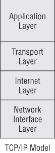

**图 2.8** TCP/IP 协议栈

因为 TCP/IP 设计用于受信环境，许多 TCP/IP 协议现在被认为是不安全的。例如，Telnet 设计为在用户屏幕上掩盖用户密码；设计者不想让旁观者窃取密码。然而，密码在线路上是以明文发送的。鲜少有人担心不受信任的一方可能访问线路并能嗅探明文密码。

CASP 理解协议如何工作、其优势是什么以及如何被攻击和保护非常重要。我将从协议栈的底部开始，逐层向上回顾。首先回顾的是网络接口层。

#### 网络接口层

在栈的底部，我们有网络接口层。TCP/IP 协议栈的这一部分控制通过帧对 IP 数据包的物理传输。最广泛使用的物理帧格式之一是以太网。

以太网帧使用 MAC 地址来识别源设备和目标设备。MAC 地址长 6 字节，且对于分配它们的网卡而言是唯一的。MAC 地址的前半部分标识供应商，后半部分是序列号。图 2.9 显示了由 Wireshark 捕获的 MAC 地址。

##### 地址解析协议 (ARP)

在讨论 MAC 地址时，现在是讨论 ARP 的好时机。`ARP` 用于将已知 IP 地址解析为未知 MAC 地址。ARP 的两步解析过程首先通过发送广播消息请求目标的物理地址来执行。如果任何接收设备识别出该地址为自己的，它会发出一个包含其 MAC 地址的 ARP 回复给原始发送者。然后将 MAC 地址放入 ARP 缓存中，并用于寻址后续帧。


计算机犯罪分子对 ARP 进程感兴趣，因为它可以被操纵以绕过交换机的功能。伪造的 ARP 响应可用于允许攻击者在交换网络上重定向流量。ARP 欺骗在各种中间人攻击、欺骗攻击和会话劫持攻击中发挥作用。ARP 随 IPv6 而消失，并将被 NDP 取代。练习 2.2 将向您展示如何欺骗 MAC 地址。

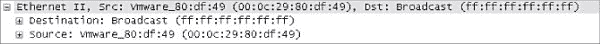

**图 2.9** MAC 地址捕获

#### 网际层

网际层包含为路由、诊断和可路由协议而设计的协议。尽管审查 UDP、TCP 和 IP 数据包的结构可能不是安全工作中最令人兴奋的部分，但基本的理解是必要的，因为许多攻击都基于对数据包的操纵。该层的两个协议包括 IP 和 ICMP。IP 是一种可路由协议，其工作是尽最大努力进行投递。CASP 应对两个版本的 IP 有基本了解：IPv4 和 IPv6。它们共同构成了互联网协议的核心。

##### IPv4

IPv4 在 RFC 791 中进行了描述。IPv4 是一种无连接协议，仅提供尽最大努力的投递。IPv4 使用以点分十进制格式排列的 32 位地址。IPv4 头部如图 2.10 所示。因为 IPv4 头部的第一个字段是版本字段，那里的值将始终是数字 4。在 IPv6 中，头部中找到的第一个值将始终是数字 6。如今，大多数网络仍然支持 IPv4，但这正在迅速改变。IPv6 正变得占主导地位，总有一天 IPv4 将成为遥远的记忆。

最初，IPv4 地址被分为两部分：地址最高有效字节中表示的网络标识符，以及使用地址其余部分的主机标识符。表 2.1 显示了 IPv4 有类地址以及可用的网络和主机数量。

虽然 IPv4 运行良好多年，但随着越来越多的设备被添加到互联网，空闲地址的数量已减少。IPv4 提供约 43 亿个地址，这似乎很多——但这些地址以不断增加的速度被用完。采用了几种方法来允许更好地分配 IPv4 地址并扩展现有地址空间的使用。其中之一是可变长子网掩码（VLSM）的概念。引入 VLSM 是为了允许灵活地细分为不同大小的网络。另一种是网络地址转换（NAT）的引入。NAT 在 RFC 1918 中有介绍，划出了三个地址范围指定为私有地址：`10.0.0.0–8`、`172.16.0.0–12` 和 `192.168.0.0–16`。NAT 的设计初衷是为了帮助解决 IPv4 地址短缺问题，提供低级别的安全性，并简化中小型企业的网络管理。练习 2.3 展示了如何使用 Wireshark 嗅探 IPv4 数据包。考试中可能会问到如何使用嗅探器、网络映射器和端口扫描器等工具来识别各种网络设备。内部设备可能正在使用 NAT 地址，而外部设备将拥有公开可用的 IPv4/IPv6 地址。

凡事皆有终，IPv4 也是如此。2011 年初，最后几块 IPv4 地址被分配。这加强了 IPv6 的重要性并加速了其部署。

##### IPv6

互联网协议版本 6（IPv6）是 IP 的最新版本，是 IPv4 的指定替代品。IPv6 为现代网络带来了许多改进。其中之一是地址空间从 32 位扩展到 128 位。这意味着 IPv6 可以支持约 340 亿亿亿（等于 10 的 36 次方）个唯一地址。IPv4 使用选项字段，但 IPv6 不使用。此外，不支持广播流量；相反，IPv6 使用链路本地作用域作为所有节点多播地址。IPv6 头部如图 2.11 所示。

IPv6 提供对 IPSec 的内置支持。这为传输中的数据提供了更强的保护，并提供端到端的数据认证和隐私。IPv6 还消除了 NAT，并提供了无状态自动配置的能力。然而，IPv6 可能仍会为攻击者提供一些可攻击的领域。

我经常问我咨询的一些公司何时会实施纯 IPv6 环境，答案通常是“总有一天”。为什么许多公司推迟采用 IPv6？在许多情况下，这归结为资金问题。即使采用了 IPv6，也可能存在安全隐患。一个真正的担忧是攻击者可能利用 IPv6 绕过为 IPv4 流量设计和配置的安全控制和过滤器。

当 IPv6 完全部署时，将不再需要的一个协议是 ARP。IPv6 不支持 ARP，而是使用 NDP。用于 IPv6 的常见路由协议包括 RIPng、OSPFv3、IS-ISv2 和 EIGRPv6。

尽管美国在全面实施 IPv6 方面进展缓慢，但其他国家已开始建设支持其的基础设施。中国和日本已立法制定 IPv6 实施时间表，以满足当前和未来的需求。IPv6 的一个主要问题是使其能在现有的 IPv4 网络上工作。IPv6 过渡技术的一个例子是站点内自动隧道寻址协议（ISATAP）。它是 IPv4 和 IPv6 之间的双栈转换机制。IPv4 和 IPv6 之间的一些关键差异如表 2.2 所示。

##### ICMP

驻留在网际层的另一个值得回顾的协议是 ICMP。ICMP 旨在提供诊断并报告逻辑错误。ICMPv4 消息遵循基本格式。ICMP 头部的第一个字节指示 ICMP 消息的类型。接下来的字节包含每种特定 ICMP 类型的代码。八种最常见的 ICMPv4 类型如表 2.3 所示。

最常见的 ICMP 类型是 ping。虽然 ping 可用于确定主机是否启动，但大多数公司现在阻止 ping 并在主机上将其禁用。虽然 ICMP 的设计者设想了一种有用且信息丰富的协议，但计算机犯罪分子过去曾利用 ICMP 进行攻击，如死亡之 Ping、Smurf 或泪滴攻击。事实上，ICMP 可用于应用扫描目的以及指纹识别服务器和工作站操作系统，因为这些系统通常根据安装的操作系统提供独特的结果。CASP 候选人应知道如何使用的一些基本命令包括：

1.  Ping（`ping IP address`）——用于识别系统是否启动并响应 ping 请求
2.  netstat（`netstat -an`）——显示正在监听来自本地或远程主机连接的活动和数字端口
3.  ipconfig（`ipconfig -all`）——显示本地 IP 地址和所有配置信息，如 Windows 系统上的 MAC 地址。Ifconfig 用于 Linux 和 Apple IOS
4.  route（`route print`）——显示内部路由表
5.  ARP（`ARP -a`）——显示活动的 MAC 到 IP 地址映射

练习 2.4 向您展示如何捕获和检查 ICMP ping 数据包。

正如 IPv4 正在更新一样，ICMP 也在更新。ICMP 的最新版本是 ICMPv6。它在 RFC 4443 中定义，是 IPv6 的组成部分。一些常见的 ICMPv6 类型和代码如表 2.4 所示。

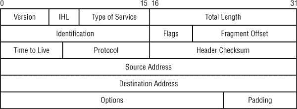

**图 2.10** IPv4 头部

**表 2.1** IPv4 有类地址范围

| 地址类别 | 范围 | 网络数量 | 主机数量 |
| --- | --- | --- | --- |
| A | 1–127 | 127 | 16,777,214 |


##### IPv4 类别地址范围

| 类别 | 网络地址范围 | 网络数量 | 每网络主机数 |
| :--- | :--- | :--- | :--- |
| A | 1–126 | 126 | 16,777,214 |
| B | 128–191 | 16,384 | 65,534 |
| C | 192–223 | 2,097,152 | 254 |
| D | 224–239 | NA | NA |
| E | 240–255 | NA | NA |

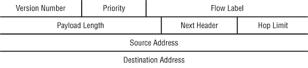

**FIGURE 2.11** IPv6 报头

**TABLE 2.2** IPv4 和 IPv6 的差异

| IPv4 | IPv6 |
| :--- | :--- |
| IPSec 是可选功能。 | IPSec 是内置的。 |
| IPv4 支持报头校验和。 | 常用的路由协议是 RIP-2 和 OSPF。 |
| IPv4 支持选项字段。 | IPv6 不支持选项字段。 |
| 支持 ARP。 | IPv6 使用邻居发现。 |
| 使用 32 位地址。 | 使用 128 位地址。 |
| 使用广播。 | 使用任播。 |
| IPv4 支持分片。 | IPv6 不支持分片。 |

**TABLE 2.3** 常见 ICMPv4 类型和代码

| 类型 | 代码 | 功能 |
| :--- | :--- | :--- |
| 0/8 | 0 | 回显响应/请求 (ping) |
| 3 | 0–15 | 目标不可达 |
| 4 | 0 | 源抑制 |
| 5 | 0–3 | 重定向 |
| 11 | 0–1 | 超时 |
| 12 | 0 | 参数错误 |
| 13/14 | 0 | 时间戳请求/响应 |
| 17/18 | 0 | 子网掩码请求/响应 |

**TABLE 2.4** 常见 ICMPv6 功能和类型

| 功能 | 代码 |
| :--- | :--- |
| 目标不可达 | 1 |
| 数据包过大 | 2 |
| TTL 超时 | 3 |
| ICMP 回显请求 | 128 |
| ICMP 回显响应 | 129 |
| 组播监听器查询 | 130 |
| 组播监听器报告 | 131 |
| 组播监听器完成 | 132 |
| 路由器请求 | 133 |
| 路由器通告 | 134 |
| 邻居请求 | 135 |
| 邻居通告 | 136 |
| 重定向消息 | 137 |

#### 传输层

传输层提供端到端的传输。两个主要协议位于主机到主机层：`TCP` 和 `UDP`。

##### 1. TCP

`TCP` 旨在实现可靠通信。其目的是允许主机建立连接并可靠地交换数据。`TCP` 具有内置的可靠性：它执行三次握手，使用序列号和确认号，并完成四次挥手以优雅地结束会话。如果出现问题，`TCP` 还可以使用复位来终止通信。启动序列如 **FIGURE 2.12** 所示。

`TCP` 可靠通信的核心是一个一字节的标志字段。标志有助于控制 `TCP` 进程。常见标志包括同步 (`SYN`)、确认 (`ACK`)、推送 (`PSH`) 和结束 (`FIN`)。`TCP` 安全问题包括 `TCP` 序列号攻击、会话劫持和 `SYN` 洪水攻击。扫描程序调整 `TCP` 标志以尝试识别活动主机或区分不同的操作系统。**Exercise 2.5** 向您展示如何使用 Wireshark 捕获 `TCP` 报头。

##### 2. UDP

**UDP** 专为速度而构建。它没有像 `TCP` 那样的启动或关闭过程。虽然这使得 **UDP** 比 `TCP` 可靠性低得多，但 **UDP** 非常适合需要快速传输且对丢包不敏感的数据。 **UDP** 被 VoIP、流媒体视频和 DNS 等服务使用。由于不使用序列号和确认号，攻击者更容易伪造 **UDP** 而非 `TCP`。**FIGURE 2.13** 显示了 **UDP** 的数据包结构。

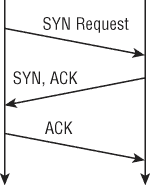

**FIGURE 2.12** TCP 启动

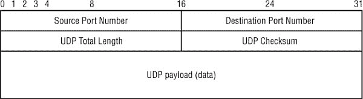

**FIGURE 2.13** UDP 报头

#### 应用层

应用层位于协议栈的顶部。应用层负责应用支持。应用程序通常不是按名称映射，而是按其对应的端口映射。端口被放置在 `TCP` 和 `UDP` 数据包中，以便将正确的应用程序传递给所需的协议。

尽管特定服务可能有分配的端口，但并未规定服务不能监听其他端口。服务拥有分配端口的主要原因是为了让客户端能轻松在远程主机上找到该服务。例如，HTTP 服务器通常监听 `TCP` 端口 80，有时也监听 `TCP` 端口 8080。正如良性应用程序使用特定端口一样，恶意应用程序也经常使用预定端口。一个臭名昭著的例子是 Back Orifice 远程访问工具 (RAT) 使用 `TCP` 端口 31337。这些木马端口当然很容易被识别，但 Back Orifice RAT 在当时是一项非常强大的技术，其继任者 BO2K 也是如此。新型恶意软件通常试图通过使用合法应用程序常用的端口来混淆其流量。一个典型的例子是 Mebroot rootkit 最初使用 HTTP 端口 80 或 SSL 端口 443。客户端应用程序如 FTP 在端口 21 上监听并在端口 20 上执行数据传输。共有 65,536 个端口；它们分为知名端口 (0–1023)、注册端口 (1024–49151) 和动态端口 (49152–65535)。

有数百个端口和对应的应用程序，但在实践中常用的不足一百个。最常见的如 **TABLE 2.5** 所示。这些是 CASP 应该了解的一些端口。

**TABLE 2.5** 常见端口和应用程序

| 端口 | 服务 | 协议 |
| :--- | :--- | :--- |
| 21 | FTP | TCP |
| 22 | SSH | TCP |
| 23 | Telnet | TCP |
| 25 | SMTP | TCP |
| 53 | DNS | TCP/UDP |
| 67/68 | DHCP | UDP |
| 69 | TFTP | UDP |
| 79 | Finger | TCP |
| 80 | HTTP | TCP |
| 88 | Kerberos | UDP |
| 110 | POP3 | TCP |
| 111 | SUNRPC | TCP/UDP |
| 135 | MS RPC | TCP/UDP |
| 139 | NB Session | TCP/UDP |
| 161 | SNMP | UDP |
| 162 | SNMP trap | UDP |
| 389 | LDAP | TCP |
| 443 | SSL | TCP |
| 445 | SMB over IP | TCP/UDP |
| 1433 | MS-SQL | TCP |

实行“拒绝所有”策略并阻止所有未明确需要的端口是端口安全的一种好方法。如果端口未被使用，应将其关闭。安全是一个永无止境的过程。端口今天关闭并不意味着明天也会关闭。您需要定期测试开放端口。并非所有应用程序都是平等的。虽然有些（如 SSH）相对安全，但其他一些（如 Telnet）则不然。以下列表讨论了一些常见应用程序的操作和安全问题：

##### 1. 文件传输协议 (FTP)

`FTP` 是一种 `TCP` 服务，在端口 20 和 21 上运行。`FTP` 是一种基本的文件传输协议。端口 20 用于数据流，在客户端和服务器之间传输数据。端口 21 是控制流，用于在客户端和 `FTP` 服务器之间传递命令。针对 `FTP` 的攻击针对错误配置的目录权限以及被泄露或嗅探到的明文密码。`FTP` 广泛成为黑客的攻击目标，强烈建议使用更安全的变体，如 FTPS、SFTP 或基于 SSH 的 `FTP`。

##### 2. Telnet

`Telnet` 是一种在端口 23 上运行的 `TCP` 服务。`Telnet` 使一个站点的客户端能够与另一个站点的主机建立会话。该程序将客户端键盘输入的信息传递给主机计算机系统。虽然 `Telnet` 可以配置为允许匿名连接，但应配置为要求用户名和密码。不幸的是，即使这样，`Telnet` 仍以明文发送用户名和密码。用户登录后，可以执行任何允许的任务。请考虑使用 Secure Shell (`SSHv2`) 等应用程序作为替代。


##### 3. 简单邮件传输协议 (SMTP)

SMTP 是一种在端口 25 上运行的 TCP 服务。它旨在用于网络系统之间的电子邮件交换。通过 SMTP 发送的消息包含两部分：地址头和消息正文。所有类型的计算机都可以使用 SMTP 交换消息。欺骗和垃圾邮件是与 SMTP 相关的两个漏洞，此外它还以明文形式传输。Mailsnarf 是 Dug Song 创建的 dsniff 包中的一个工具，可用于以自动化方式嗅探 SMTP 和 POP 流量。当然，你也可以使用任何协议分析器来完成此任务。

##### 4. 简单文件传输协议 (TFTP)

TFTP 在端口 69 上运行。TFTP 的运作方式类似 FTP，但开销更小。它不仅不提供 TCP 所具备的会话管理功能，而且不需要任何身份验证，这可能构成巨大的安全风险。它用于传输路由器配置文件，有线电视公司也用它来配置有线调制解调器。TFTP 是黑客的最爱，Nimda 蠕虫等程序曾利用它在无需输入用户名或密码的情况下移动数据。

##### 5. 超文本传输协议 (HTTP)

HTTP 是最知名的应用程序之一。HTTP 使用 TCP 端口 80。尽管 HTTP 使用 TCP，但它采用的是无状态连接。HTTP 使用请求-响应协议，即客户端发送请求，服务器发送响应。针对 HTTP 的攻击可以以服务器、浏览器或在浏览器上运行的脚本为目标。跨站脚本攻击 (XSS) 和跨站请求伪造 (XSRF 或 CSRF) 就是两个此类示例。基本上，黑客会精心构造特殊数据包，以利用 Web 服务器上存在漏洞的代码。同样，也有自动化工具可以做到这一点，开始研究这项技术的一个好去处是开放 Web 应用程序安全项目 (OWASP) 网站 `www.owasp.org/index.php/Main_Page`。Code Red 是针对 Web 服务器的代码示例，具体目标是 2001 年微软的 IIS 服务器。

##### 6. 简单网络管理协议 (SNMP)

SNMP 是一种在端口 161 和 162 上运行的 UDP 服务，用于网络管理。SNMP 允许代理收集网络统计数据等信息并报告回其管理站。大多数大型企业都实施了某种类型的 SNMP 管理。困扰 SNMP 的一些安全问题源于这样一个事实：v1 和 v2 团体字符串可以以明文形式传输，且默认团体字符串（public/private）是众所周知的。SNMP 第 3 版是最新版本；它提供加密功能以实现更强健的安全性。

## 安全通信解决方案

TCP/IP 协议套件并非为安全而构建。其主要设计考量是易用性，虽然这对早期的互联网来说是可以接受的，但如今需要安全的数据流来满足不断变化的业务需求。其中一些弱点源于协议缺陷，而另一些则是实现协议的软件缺陷。许多传输协议不提供加密。CASP 考生必须了解如何保护这些数据，以满足当前和未来的数据需求。

### 网络数据流

在本章前面的练习中，你使用了 Wireshark 工具；它是网络嗅探器的一个例子。本节的主题不是网络嗅探器；然而，如果你使用网络嗅探器查看本地网络上的流量，你可能会对所见感到惊讶。这是因为流经或遍历典型网络的大多数网络数据非常容易检查。这反过来是因为大多数协议，如 FTP、HTTP、SMTP、NTP、Telnet 和其他协议，都通过明文在网络上发送数据。这仅仅意味着流量未加密且易于查看。TCP/IP 的早期设计者以及现代互联网的缔造者并不关心加密；他们只是试图让一切正常运行。这对安全专业人员来说是一个隐患，因为攻击者可以轻松拦截和查看这些网络流量。数据保护和安全协议（如 SSH 和 SSL）的概念出现得要晚得多。

即使数据受到 SSL 和 IPSec 等技术的保护，入侵者仍可能攻破你的网络。检测当前威胁以及多源内部和外部信息的一种方法是分析网络数据流。这被称为*网络流分析*。该概念涉及使用现有的、已可用的网络基础设施。流分析为网络中的流量流动提供了不同的视角。它允许你查看事件在给定时间内发生的频率。例如，在周末午夜至凌晨 2 点之间，包含加密 zip 文件的流量离开你的网络并前往俄罗斯的频率是多少？借助流分析工具，安全专业人员可以近实时地查看此类用户活动。

提炼流经现代网络的海量数据需要允许数据聚合和关联的工具。思科系统是最早于 1990 年代凭借 NetFlow 的开发将这项技术推向市场的公司之一。现在许多其他公司也已跟进，如 Vitria、Riverbed Technology 和 Arbor Networks；它们各自提供流分析工具。

### SSL 检测

上一节帮助你认识到在流量穿越网络时对其进行加密的必要性。一种常见的解决方案是安全套接字层 (SSL)。SSL 是一种加密协议，旨在为互联网或网络上的通信提供安全性。第 1 章“加密工具和技术”中对此进行了详细描述。SSL 广泛用于保护传输中的信息。

尽管它提供了高级别的安全性，但 SSL 并非万无一失。我的意思是，每一种对抗措施（如 SSL）都存在某种漏洞。SSL 的一个此类漏洞是 SSL 检测，这仅仅意味着攻击者可能会监视流量的流向、方向和数量。这可能导致一种称为*推理攻击*的情况。每当攻击者注意到活动激增并推断出有某些待定事件时，就会发生推理攻击。防止此类攻击的一种方法是流量填充。例如，一个军事机构可能在美国和乌克兰之间建立连接。虽然俄罗斯监控方可能能看到流量在流动，但传输量保持恒定流速，从而防止攻击者实施推理攻击。

### 域名服务

域名服务 (DNS) 是互联网的主力军之一。DNS 在每一次地址转换背后运行，致力于将完全合格域名 (FQDN) 解析为数字 IP 地址。DNS 发挥着关键作用，因为如果有人瘫痪了 DNS，互联网仍将继续运行，但用户将不得不了解他们想要访问的每个站点的 IP 地址。DNS 是一种请求-响应协议。当 DNS 服务器发送请求的响应时，回复消息包含来自原始请求的事务 ID 和问题，以及它能够找到的任何答案。

多年来，计算机犯罪分子在 DNS 协议及其实现软件中发现了大量漏洞。有时攻击者甚至不直接针对 DNS，而是针对注册过程。一种方法是反复注册和删除域名，以便注册人可以在不付费的情况下暂时拥有该域名。这被称为*域名踢踏*。


## 保护 DNS 和目录服务

在任何 DNS 服务器上启用服务之前，都应对其进行安全加固。一些最流行的 DNS 服务器软件，如互联网系统联盟的 BIND，过去曾遭受大量漏洞的困扰，这些漏洞允许攻击者访问并篡改 DNS 服务器。BIND 的替代品（如 Unbound）也是可用的，如果您的基础设施允许，应考虑使用它们。DNS 是您应当保护的服务之一，因为攻击者可以通过多种方式针对 DNS 发起攻击。其中一种攻击是 DNS 缓存投毒。这种攻击向 DNS 服务器发送伪造条目，以破坏存储在那里的信息。DNS 也可能容易受到拒绝服务攻击和未授权的区域传输。DNS 使用 UDP 端口 53 进行 DNS 查询，使用 TCP 端口 53 进行区域传输。保护区域传输过程是一项重要的安全控制措施。

### 保护区域传输

DNS 数据库由一个或多个区域文件组成。每个区域都是结构化资源记录的集合。常见的记录类型包括起始授权机构 (SOA) 记录、A 记录、CNAME 记录、NS 记录、PTR 记录和 MX 记录。每个区域数据库文件中只有一条 SOA 记录。它描述区域命名空间。A 记录最常见，因为它包含特定主机的 IP 地址和名称。CNAME 记录是别名。NS 记录列出其他名称服务器的 IP 地址。PTR 记录用于反向查找。MX 记录是邮件交换记录。此记录包含应投递电子邮件的服务器的 IP 地址。

保护区域传输的第一步是确保您的 DNS 服务器未设置为允许区域传输。如果您的主机同时拥有外部和内部 DNS 服务器，则安全管理员还应关闭 TCP 端口 53。内部 DNS 服务器应配置为仅与根服务器通信。如果攻击者能够访问 DNS 信息，他们就能获得网络的虚拟地图。理解保护区域传输的重要性对于 CASP 考试以及您作为安全专业人员的工作都至关重要。练习 2.6 将向您展示如何检查 DNS 服务器的正确配置。

### 起始授权机构

起始授权机构 (SOA) 详细说明了哪台 DNS 服务器是您的主名称服务器、您的联系信息、辅助名称服务器何时获取更新，以及您的 DNS 记录的默认生存时间 (TTL) 值。SOA 定义了 DNS 区域的常规参数。对于 CASP 考试而言，TTL 设置是一个重要问题。TTL 提供了关于 DNS 缓存投毒的重要信息。TTL 越长，资源记录被读取的频率越低，被投毒的可能性也就越小。练习 2.7 向您展示如何强制进行区域传输。

### 安全 DNS

DNS 的完整性和可用性对互联网的健康运行至关重要。保护 DNS 的一种常见方法是管理两台 DNS 服务器，一台内部，一台外部。另一种方法是使用 DNS 安全扩展 (DNSSEC)。DNSSEC 是一个切实可行的考量，因为运行两台 DNS 服务器的一个主要问题是：向外部主机提供信息的外部 DNS 服务器仍然容易受到攻击。这是因为 DNS 服务器没有信任机制。DNS 客户端通常无法判断 DNS 回复是否有效。

使用 DNSSEC 时，DNS 服务器提供签名并对每个响应进行数字签名。为了使 DNSSEC 正常运行，认证密钥必须在使用前分发。否则，如果客户端没有验证认证的手段，DNSSEC 就毫无用处。DNSSEC 仅对 DNS 服务器进行认证，而不对内容进行认证。即使 DNS 服务器配置了 DNSSEC，也可能出现服务器为其冒充的域签名结果的情况。您可以在 `www.dnssec.net` 阅读更多关于 DNSSEC 的信息。

### 事务签名

动态 DNS (DDNS) 使 DNS 服务器能够在客户端的主机名或 IP 地址发生变化时，自动更新其资源记录。当您使用 DDNS 时，用于对 DDNS 更新进行认证的机制称为事务签名 (TSIG)。TSIG 在设计时融入了加密控制，并使用共享密钥和单向哈希。

当 DNS 客户端和 DNS 服务器交换一组 DNS 消息以建立安全会话时，DNS 客户端发送的更新消息包含一条用于验证 DNS 客户端的 TSIG 记录。TSIG 用于提供一种对 DDNS 数据库更新进行认证的方法。

尽管 TSIG 确实提供了一定级别的安全性，但已发现一些漏洞。例如，如果攻击者在没有正确密钥的情况下伪造响应，可能会发生缓冲区溢出。完成此任务的攻击者可能会导致服务器崩溃或获得 Shell 的 root 访问权限。

### 快速通量 DNS

与 DNS 相关的另一个安全威胁是快速通量 DNS。这是一种可以用不同复杂程度实现的技术。它通常被当今更高级的僵尸网络采用，以隐藏其命令与控制 (C&C) 服务器。快速通量 DNS 有两种类型：单通量和双通量。单通量是注册和注销 DNS A 记录的简单方法，易于检测和预防，因为它通常在单个域上工作。然而，双通量会频繁使用一台受感染的机器（通常称为 `bot` 或 `zombie`）作为代理服务器，从而使 C&C 服务器免受窥探。事实上，可能存在多层代理，这使得定位这些 C&C 服务器变得非常困难。这也使得使用常规方法封锁这些机器的 IP 地址变得困难。这些代理可能会频繁注册具有极短 TTL 值的 DNS 名称，这在域名注册的注册商处应显得可疑；然而，这种注册通常在不执行网络犯罪法律的国家进行。了解这些国家，并仔细监控日志以及自动化检测规则，对于发现此类威胁至关重要。

### 轻量级目录访问协议

最初，轻量级目录访问协议 (LDAP) 是作为访问 X.500 目录服务的轻量级替代协议而创建的。X.500 是一系列涵盖电子目录服务的计算机网络标准。X.500 的开发是为了支持 X.400 电子邮件交换和名称查找的要求。

LDAP 使用与 X.500 相同的对象数据格式，其中每个对象由属性组成，这些属性经过索引并由可分辨名称引用。每个对象都有一个唯一的名称，旨在适应全局命名空间，这有助于确定对象的关系，并允许唯一地引用该对象。

LDAP 的安全问题包括：LDAP 版本 1 和 2 中没有可用的数据加密方法。安全性在客户端和服务器开始通信的连接阶段进行协商。选项包括无认证或基本认证。这是其他协议（如 HTTP）使用的相同机制。

此过程要求客户端通过密码来标识自身，该密码可能以明文形式发送，或通过 Base64 编码发送。Base64 编码的问题在于它较弱且易于解码。解决此问题的一个方案是简单认证和安全层 (SASL)。SASL 已添加到 LDAPv3 中，以包含额外的认证机制。

### 安全目录服务


无论使用何种协议和标准进行身份验证，都真实存在对强加密控制的需求。这就是创建安全目录服务的原因。该解决方案利用了安全套接字层（SSL）。LDAP over SSL（LDAPS）通过加密的 SSL 连接，为 LDAP 服务器和客户端系统之间提供安全通信。要使用此服务，客户端和服务器上都必须存在 SSL，并能配置为使用证书。

### Active Directory

Active Directory（AD）是微软基于 IEEE 制定的 X.500 建议开发的版本。AD 保留网络中所有用户和组的访问权限信息。当用户登录系统时，AD 会向用户颁发全局唯一标识符（GUID）。支持 AD 的应用程序可使用此 GUID 提供访问控制。尽管 AD 有助于简化登录并减少管理员开销，但存在多种攻击 AD 的方式。

攻击的难点在于 AD 是内向的，这意味着内部人员比外部人员更容易以 AD 为目标。一种攻击方法是权限提升。在这种情况下，攻击者将现有用户的权限提升至管理员或域管理员。其他潜在攻击载体可能包括以密码哈希或 Kerberos 预身份验证为目标。一个著名的例子是 2011 年的“夜龙”攻击。除了使用 RAT、社会工程学、鱼叉式网络钓鱼和各种 Windows 操作系统漏洞利用外，“夜龙”还试图攻破 AD。

#### 安全信息和事件管理

另一种流行的安全解决方案是安全信息和事件管理（SIEM）。该服务结合了两个独立的报告和记录领域：安全信息管理（SIM）和安全事件管理（SEM）。SIM 技术旨在处理和管理审计及事件数据的长期存储。SEM 工具专为事件的实时报告而设计。结合这两种技术，使用户能够从许多不同的系统和来源警报、捕获、聚合、审查和存储事件数据及日志信息。使用这些系统的主要缺点是它们设置复杂且需要多个数据库。提供 SIEM 工具的供应商包括 ArcSight、e-Security、Intellitactics、netForensics 和 Network Intelligence。

### 数据库活动监控

考虑一下您如何使用入侵检测系统来警示潜在的网络攻击。同样的保护可以通过数据库活动监控（DAM）系统扩展到数据库。`DAM`旨在监控数据库并报告未经授权的活动。该技术被拥有数据库且关注安全漏洞和攻击的组织广泛使用。这包括银行、金融机构和其他高度监管的市场。DAM 的功能之一是独立于内置数据库控件，可执行应用程序活动监控、特权用户监控和网络攻击监控。

### 联合身份

您是否像我一样，有时难以记住访问多多系统所需的所有密码和凭证？这就是联合身份发挥作用的地方。`Federated ID`是将一个人的电子身份和属性链接起来的手段，这些身份和属性存储在多个不同的身份管理系统中。当然，这类系统往往和其他系统一样脆弱。一个例子是 RSA Federated Identity Manager 中的 `CVE-2010-2337`。这个特定示例可能允许远程攻击者将用户重定向到任意网站并执行网络钓鱼攻击，详见 NIST 国家漏洞数据库：`http://web.nvd.nist.gov/view/vuln/detail?vulnId=CVE-2010-2337`。

### 单点登录

管理大量密码的另一种方法是单点登录。单点登录旨在通过允许用户向单一认证机构进行一次身份验证，随后无需重新认证即可访问所有其他受保护资源，来解决此问题。最广泛使用的单点登录系统之一是 Kerberos。

### Kerberos

Kerberos 包含三部分：客户端、服务器和受信任的第三方密钥分发中心（KDC），用于在它们之间进行中介。客户端从 KDC 获取票据，并在建立连接时向服务器出示这些票据。Kerberos 票据代表客户端的凭证。Kerberos 依赖对称密钥加密，具体通过数据加密标准（DES）实现。当作为 Active Directory 一部分时，Kerberos 是 Windows 7/8/Server 2008/Server 2012 主机使用的默认认证机制。Kerberos 为 Windows 用户提供更快的连接、相互认证、委派认证、简化的信任管理和互操作性。

Kerberos 确实存在一些可能被犯罪分子利用的领域。其中之一是 Kerberos 像所有认证协议一样，都有定义的生命周期。因此，任何使用 Kerberos 协议进行认证的网络，都需要确保所有系统的时钟通过网络时间协议（NTP）等协议进行同步。还请注意，保护 NTP 同样重要。具体做法取决于您的特定配置；例如，如果您的网络从 `pool.ntp.org` 接收 NTP 信息，则与这些特定 NTP 服务器关联的 IP 地址应为仅允许通过 UDP 端口 123（默认 NTP 端口）进入您网络的 IP 地址。也可用更高级的配置。

## 安全设施解决方案

本书的大部分内容侧重于逻辑控制，但这只是完整安全解决方案的一部分。真正的安全需要逻辑控制、运营控制和物理控制。这就是安全设施解决方案的全部内容。如果有人能物理接触布线间或以清洁工身份获得访问权限，其危害性不亚于逻辑攻击。

### 建筑布局

建筑布局可能不是考虑安全时首先想到的事情，但它们是一个重要的关注点。只需考虑安全的一个方面：员工和人员的保护。在疏散或灾难期间，疏散路线需要标记清晰，应配备电池供电的备用照明，建筑出口应保持畅通且为人所知，以便人员安全撤离。

从逻辑角度来看，CASP 应审查建筑布局以确定资产的放置位置。良好的物理安全采用纵深防御的概念。这种分层方法应用于威慑和延缓入侵。关注的事项包括以下内容：

* 布线间是否安全？
* 数据中心位于何处？
* 使用何种类型的窗户？
* 门是空心芯还是实心芯？
* 关键资产是否位于设施中心区域？
* 关键区域周围的墙壁是否坚固？
* 墙壁是否延伸至屋顶，而不仅仅是吊顶？
* 是否使用了气闸？
* 锁具质量是否高？
* 是否使用了闭路电视（CCTV）？

这些只是 CASP 在审查建筑布局时应考虑的少数事项。

### 设施管理

维基百科将设施管理定义为“一个主要致力于商业或机构建筑维护和保养的跨学科领域”。从安全角度来看，CASP 应了解以下内容：

* 谁负责设施管理
* 电源、水源和断路器箱的位置
* 谁被允许进入设施，例如维护、维修、水管工或其他可能拥有设施广泛访问权限的低级别访问人员


### 安全网络基础设施设计

安全至关重要。这就是我们要锁门、关窗并使用报警系统的原因。这些例子在讨论物理安全时非常适用，而网络基础设施也不例外。安全网络基础设施设计包含日志记录。应创建日志并将其发送到远程服务器以供定期审查。安全协议是安全网络基础设施设计的另一个组成部分。路由器和其他网络基础设施设备应能够通过多种安全访问协议进行管理。不应使用 `Telnet` 和 `FTP` 等不安全协议。其他需要考虑的事项包括以下内容：

1.  **规划** 为选定的基础设施组件和多层网络数据设计进行规划
2.  **设计与部署** 维护所有相关设备的逻辑部署图和相应的物理部署图，并决定某些设备的放置位置
3.  **配置** 针对影响操作和安全的管理设置
4.  **管理** 管理运营安全以及存储集成和安全注意事项

让我们更详细地了解其中一些项目：

#### 1. 多层网络数据设计考量

大多数中大型网络都是基于多层网络数据设计进行设计的。这种方法将网络划分为三个部分：接入层、汇聚层和核心层。多层网络数据设计易于扩展，且简单易懂、易于排错。第二层和第三层交换分布在每一层中。接入层是终端用户设备所在的位置。此处的设备包括笔记本电脑、台式机、iPad、VoIP 电话和打印机。网络访问安全也在此层应用。汇聚层为线缆间交换机提供汇聚，并提供通往核心层的上行链路。该模型的顶层是核心层。它负责高速数据传输以及第三层交换和路由。

#### 2. 逻辑部署图

逻辑部署图表示系统的部署视图。它们描绘了信息系统物理基础设施中所用硬件组件之间的关系。系统工程师使用部署图来可视化系统物理组件的拓扑结构以及软件组件的部署位置。部署图的元素包括节点、制品和通信路径。

#### 3. 路由防护

路由防护主要通过 `IPSec` 维护。`IPSec` 通过使用加密和强制受信通信来保护 IP 数据包，从而保护网络。`IPSec` 是保护 IP 数据报最广泛使用的标准。由于 `IPSec` 可应用于应用层之下，因此可被任何或所有应用程序使用，且对最终用户透明。`IPSec` 可配置为在隧道模式和传输模式下通信。请在第 1 章了解更多关于 `IPSec` 的信息。

#### 4. 存储集成

开发安全网络基础设施需要为增长建立管理控制。公司会随着时间的推移而成长和变化。收购、买断、采用新技术以及淘汰过时技术都意味着基础设施将发生变化。

公司必须具备根据需要集成存储设备（如存储区域网络 `SANs`）的能力。需要定期审查以跟踪存储需求，因为公司对增加数据存储和数据备份有着永无止境的需求。`SAN` 安全是一个复杂的过程；它通常涉及公司最敏感的信息。`Sans.org` 将 `SAN` 安全分为五类：网络、实施、管理、可能的攻击，以及未来技术和挑战。您可以在此处阅读关于该主题的详细白皮书：

`www.sans.org/reading_room/whitepapers/storage/storage-area-network-secure-overview-storage-area-network-security-perspective_516`

### 路由器配置

路由器是数据通信网络的关键组件，因此必须防范攻击。不当的路由器配置可能构成安全风险。虽然物理控制很重要，但需要软件控制来防止路由器攻击：

#### 1. 传输安全

日益增加的网络安全风险和法规合规性要求推动了广域网 (`WAN`) 传输安全的需求。传输安全的示例包括 `IPSec`、`TLS` 和 `SSL`。`IPSec` 是互联网安全标准。它最初设计为 `IPv4` 的附加组件，也集成在 `IPv6` 中。`TLS` 和 `SSL` 提供相同的服务，但实现方式不同。Netscape 开发 `SSL` 用于通过互联网传输私密文档。`SSL` 仅仅是一个用于通信证书、加密密钥和数据的框架。`SSL` 最健壮的版本是 `SSLv3`，它提供相互认证和压缩功能。

#### 2. 中继安全

在讨论虚拟局域网 (`VLANs`) 时，中继安全是一个重要关注点。`VLANs` 最初作为一种安全和流量控制手段，用于隔离网络流量。`VLAN` 模型通过将用户分离到工作组（如工程、市场和销售）中来工作。如今，许多公司倾向于全园区 `VLANs`，因为 `VLANs` 必须跨越整个网络并进行中继。中继简单来说就是一条承载多个 `VLAN` 数据的两个交换机之间的链路。

从安全角度来看，这是一个隐患。如果攻击者能够访问中继连接，他们就有可能从一个 `VLAN` 跳转到另一个 `VLAN`。这被称为 `VLAN hopping`（VLAN 跳跃）。确保中继连接安全以防止恶意活动发生至关重要。Cisco 有多种方法将 `VLAN` 流量用于中继。这些技术可能包括 IEEE 的 `802.1Q` 实现或 Cisco 的交换机间链路 (`ISL`)。

### 企业服务总线

企业服务总线 (`ESB`) 提供了一种在服务之间移动消息的技术。它用于面向服务的架构。`ESB` 是一个框架，不同的 `ESB` 产品具有不同的能力。`ESBs` 作为一种中间件运行，因为它们充当服务代理。它们的共同点是一个抽象层。并非所有 `ESBs` 都提供加密。同样，这取决于特定供应商的产品。`ESB` 正迅速成为许多面向服务企业的服务骨干。面向服务的架构 (`SOA`) 指定了支持 `ESB` 等服务的整体多层和多级分布式基础设施。

虽然使用 Web 服务允许您实现基于不同平台、使用不同语言构建的应用程序之间的互操作性，但在基于使用 Web 服务构建应用程序时应用面向服务的概念和原则，可以帮助您创建健壮的、基于标准的、可互操作的 `SOA` 解决方案。

### Web 服务安全

您是否注意到，如今许多基于 Web 的攻击不再针对 Web 服务器，而是集中在 Web 应用程序上？基于 Web 的应用程序继续快速增长，保护它们是一项艰巨的任务。解决此问题的一种方法是 Web 服务安全 (`WS-Security`)。`WS-Security` 是简单对象访问协议 (`SOAP`) 的扩展，旨在为 Web 服务增加安全性。Web 服务利用 XML（可扩展标记语言）消息。XML 通常遵循 `SOAP` 标准。


## 综合安全解决方案

如今的系统比过去分布得更广泛，且对互联网的依赖程度大大增强。与此同时，也出现了向服务启用型交付模式转变的趋势。基于 Web 的应用程序的服务启用型交付包括 `SOAP`、`XML-RPC` 和 `JSON-RPC` 等服务。保障这些服务的安全是 CASP 关注的重中之重。

此外，还出现了一种创建具有更抽象架构风格的 Web 服务的趋势，即 `SOA`，它试图将分散的软件组件绑定在一起。`SOA` 可以使用临时架构、`公共对象请求代理架构 (CORBA)` 或其他分布式架构来实现。

## 概要

本章重点介绍综合安全解决方案。本章探讨的两大主题包括：

*   网络协议
*   应用程序和服务

现代网络建立在 `TCP/IP` 协议栈之上。作为 CASP，你应该很好地理解 `TCP/IP` 的工作原理，并了解主要协议（如 `IPv4`、`IPv6`、`TCP`、`UDP` 和 `ICMP`）的目的和弱点。

你还应该掌握网络流量分析。你必须理解保护路由协议的重要性，并熟悉为提高传输安全、卡车运输安全和路由保护而采取的控制措施。

应用程序和服务对 CASP 同样重要。你必须知道如何保护 `DNS`，理解保护区域传输的重要性，并知道如何配置 `LDAP`。

最后是认证，以及 `PAP`、`CHAP` 和 `EAP` 等认证协议。这一关键组件作为第一道防线，用于防止黑客入侵你的网络。联合身份、`AD` 和单点登录等系统可用于更安全地管理这一过程。

## 考试要点

1.  **能够描述高级网络设计概念。** 高级网络设计需要理解远程访问以及防火墙的部署和放置。防火墙放置设计包括包过滤、双宿主网关、屏蔽主机和屏蔽子网。

2.  **熟悉远程访问的流程。** 思科通过其网络硬件和软件实现了多种远程访问方法。最初是 `终端访问控制器访问控制系统 (TACACS)`。最新版本是 `TACACS+`。另一个较新的标准是 `DIAMETER`。虽然两者的运作方式相似，但 `DIAMETER` 通过解决发现的弱点改进了 `RADIUS`。

3.  **能够描述交换机、路由器和无线设备。** 安全专业人员必须了解各种类型的网络设备以及针对它们的攻击。交换机和路由器都可用于增强网络安全，但 MAC 泛洪和路由投毒等技术可用于绕过其安全功能。

4.  **能够描述 SCADA 系统。** `SCADA` 系统是设计用于执行开启阀门和控制开关等操作的数字控制系统。从安全角度来看，这些系统是一个重要考量因素，因为它们通常被公用事业行业用于监控关键基础设施系统、控制电力分配以及许多其他形式的自动化。

5.  **能够描述 VoIP。** `VoIP` 是通过 IP 网络发送的分组化语音流量。`VoIP` 提供了成本节约，并能利用现有数据网络发送语音流量。`VoIP` 使用的协议包括 `会话初始协议 (SIP)`、`H.323`、`Inter-Asterisk 交换协议 (IAXv2)` 和 `实时传输协议 (RTP)`。

6.  **能够描述 TCP。** `TCP` 是一种基于连接的协议，它使用启动、握手过程、流量控制、标志位和关闭来通过 `FTP`、`HTTP` 和 `SMTP` 等应用程序可靠地传输数据。`TCP` 可靠通信的核心是一个 1 字节的标志字段。标志位有助于控制 `TCP` 过程。常见标志包括同步 (`SYN`)、确认 (`ACK`)、推送 (`PSH`) 和结束 (`FIN`)。

7.  **能够描述 IPv6。** `互联网协议版本 6 (IPv6)` 是 IP 的最新版本，是 `IPv4` 的指定替代品。`IPv6` 为现代网络带来了许多改进。`IPv6` 将地址空间从 32 位扩展到 128 位，并内置了 `IPSec`。安全顾虑包括旧设备可能不兼容，或无法提供足够的保护。

8.  **了解 DNSSEC 的工作原理。** `DNSSEC` 旨在为 `DNS` 提供一层安全保护。`DNSSEC` 允许主机验证域名是否正确，且未被欺骗或投毒。

9.  **了解保护区域传输的重要性。** 保护区域传输始于确保你的 `DNS` 服务器未设置为允许区域传输。如果你的主机同时有外部 `DNS` 服务器和内部 `DNS` 服务器，安全管理员还应关闭 `TCP` 端口 53。内部 `DNS` 服务器应配置为仅与根服务器通信。

10. **能够解释 TSIG 的特征。** 当 `DNS` 客户端和 `DNS` 服务器交换一组 `DNS` 消息以建立安全会话时，`DNS` 客户端发送的更新消息包含一个用于验证 `DNS` 客户端的 `TSIG` 记录。`TSIG` 用于提供一种对动态 `DNS` 数据库更新进行认证的方法。

11. **了解 LDAP 的运作方式。** `LDAP` 的创建是为了成为访问 `X.500` 目录服务的轻量级替代协议。使用 `LDAP` 时，每个对象由属性组成，这些属性经过索引并由可分辨名称引用。每个对象都有一个唯一名称，旨在适应全局命名空间，这有助于确定对象的关系，并允许唯一引用该对象。

12. **能够描述传输安全的重要性。** 增加的网络安全风险和法规合规性要求推动了对 WAN 传输安全的需求。传输安全的示例包括 `IPSec`、`TLS` 和 `SSL`。`IPSec` 是互联网安全标准。

## 复习题

1.  **什么将认证和授权过程分离为三个操作？**
    *   **A.** `XTACACS`
    *   **B.** `TACACS+`
    *   **C.** `TACACS`
    *   **D.** `RADIUS`

2.  **以下哪项是思科专有的？**
    *   **A.** `XTACACS`
    *   **B.** `DIAMETER`
    *   **C.** `TACACS`
    *   **D.** `RADIUS`

3.  **以下哪种设计在受信网络和非受信网络之间使用一个包过滤路由器？**
    *   **A.** 屏蔽主机
    *   **B.** 屏蔽子网
    *   **C.** 双宿主网关
    *   **D.** 单层包过滤器

4.  **以下哪项正确表示了广播物理地址？**
    *   **A.** `00 00 0C 34 44 01`
    *   **B.** `01 00 00 FF FF FF`
    *   **C.** `FF FF FF FF FF FF`
    *   **D.** `01 00 0C 34 44 01`

5.  **你被要求使用 Wireshark 检查一些流量，并注意到部分流量发往 224.3.9.5。这是哪类地址？**
    *   **A.** C 类
    *   **B.** D 类
    *   **C.** B 类
    *   **D.** A 类

6.  **你一直在扫描网络，发现 TCP 53 端口开放。你可能会得出什么结论？**
    *   **A.** `DNS` 配置用于查找。
    *   **B.** 可能存在 `DNS` 区域传输。
    *   **C.** `DNSSEC` 已配置。
    *   **D.** 正在使用 `SMTP`。

7.  **你刚扫描完网络，发现 UDP 端口 123 开放。哪个服务使用此端口？**
    *   **A.** 端口映射器
    *   **B.** `NTP`
    *   **C.** Finger
    *   **D.** `LDAP`

8.  **以下哪项不是 Kerberos 为 Windows 用户提供的？**
    *   **A.** 互操作性
    *   **B.** 非委派认证
    *   **C.** 双向认证
    *   **D.** 简化的信任管理

9.  **LDAPS 通过利用 _______________ 来提供安全性。**
    *   **A.** `DES`
    *   **B.** `SSL`
    *   **C.** `SET`
    *   **D.** `PGP`

10. **DNSSEC 不防范以下哪项？**
    *   **A.** 冒充
    *   **B.** 域名欺骗
    *   **C.** 域名抢注


**D.** 签名验证

11. 哪条 DNS 记录保存区域复制 TTL 信息？

     **A.** PTR

     **B.** NS

     **C.** MX

     **D.** SOA

12. 哪个版本的 SNMP 提供内置安全性？

     **A.** Version C

     **B.** Version B

     **C.** Version 2

     **D.** Version 3

13. 使用 Wireshark 时，你捕获了 UDP 端口 69 上的流量。这可能是什么服务或应用程序？

     **A.** FTP

     **B.** Finger

     **C.** SSH

     **D.** TFTP

14. 以下哪项不是有效的 UDP 首部字段？

     **A.** 源端口

     **B.** 长度

     **C.** 校验和

     **D.** 标志

15. 在 DNS 中，别名的另一个名称是什么？

     **A.** MX

     **B.** CNAME

     **C.** SOA

     **D.** NS

16. TSIG 用于什么目的？

     **A.** 作为对动态 DNS 数据库更新进行身份验证的一种手段

     **B.** 防止 VLAN 跳跃

     **C.** 作为一种 LDAP 安全控制

     **D.** 保护 X.500

17. Cisco 有多种方法将 VLAN 流量纳入中继。这些方法包括以下哪项？

     **A.** 802.1Q

     **B.** 802.1x

     **C.** 802.11

     **D.** LDAP

18. IPv4 和 IPv6 之间的一个主要区别是地址长度。IPv6 的地址长度是多少位？

     **A.** 16

     **B.** 32

     **C.** 64

     **D.** 128

19. 以下哪项是简单对象访问协议 (SOAP) 的扩展，旨在为 Web 服务增加安全性？

     **A.** WS_Security

     **B.** ESB

     **C.** LDAP

     **D.** SSO

20. 以下哪项不是 VoIP 的组成部分？

     **A.** SIP

     **B.** H.323

     **C.** RTP

     **D.** SPIT

### 第 3 章：保护虚拟化、分布式和共享计算

本章涵盖以下 CompTIA CASP 考试目标：

1.   **1.2 解释与企业存储相关的安全隐患**

    *   存储类型
        *   虚拟存储
        *   云存储
        *   数据仓库
        *   数据归档
        *   NAS
        *   SAN
        *   vSAN
    *   存储协议
        *   iSCSI
        *   FCoE
        *   NFS、CIFS
    *   安全存储管理
        *   多路径
        *   快照
        *   去重
        *   动态磁盘池
        *   LUN 屏蔽/映射
        *   HBA 分配
        *   异地或多站点复制

2.   **1.3 给定场景，分析网络和安全组件、概念及架构**

    *   虚拟网络和安全组件
        *   交换机
        *   防火墙
        *   无线控制器
        *   路由器
        *   代理
    *   软件定义网络
    *   云托管网络
    *   路由器、交换机及其他网络设备的高级配置
        *   中继安全

3.   **1.4 给定场景，为主机选择和排查安全控制**

    *   可信操作系统（例如如何以及何时使用）
    *   虚拟化服务器的安全优势和劣势
        *   Type I（类型 1）
        *   Type II（类型 2）
        *   基于容器
    *   云增强安全服务
        *   哈希匹配
            *   反病毒
            *   反垃圾邮件
            *   漏洞扫描
        *   沙箱
        *   内容过滤
    *   与将具有不同安全要求的主机混合部署相关的漏洞
        *   VM 逃逸
        *   权限提升
        *   热虚拟机迁移
        *   数据残留
    *   虚拟桌面基础设施 (VDI)
    *   终端服务/应用程序交付服务
    *   VTPM

4.   **5.1 给定场景，将主机、存储、网络和应用程序集成到安全的企业架构中**

    *   技术部署模型（外包/内包/托管服务/合作伙伴关系）
        *   云和虚拟化考量及托管选项
            *   公有云
            *   私有云
            *   混合云
            *   社区云
            *   多租户
            *   单租户
        *   单台物理服务器托管多家公司虚拟机的相关漏洞
        *   单个平台托管多家公司虚拟机的相关漏洞
            *   按需/弹性云计算的安全使用
            *   数据残留

## 企业安全

*企业安全* 一词是指对安全的整体观。多年来，我们对 IT 安全的看法发生了变化，数据安全、IT 安全和物理安全等项目现在被视为完整安全解决方案的组成部分。企业安全是一个框架，用于应用全面的控制措施，旨在保护公司，同时将关键服务映射到所需的信息系统。企业安全的目标如下：

*   为公司增加价值
*   使 IT 目标与公司目标保持一致
*   建立问责制
*   验证是否已建立责任金字塔，从最底层的员工开始，逐级向上延伸至高层管理人员。

在过去十年中，企业安全变得更加重要。考虑到安全漏洞的数量和糟糕安全管理的报告数量，原因显而易见。

从最基本的层面来看，企业安全基于机密性、完整性和可用性。这三个概念是信息安全的核心。*机密性* 确保只有授权主体才能访问信息和数据。*完整性* 确保数据未被修改且正确可信。*可用性* 意味着拥有访问权限的人可以使用信息或服务，而其他未经授权的主体不应能使这些项目不可用。其他关键安全服务包括保护机制（如身份验证和授权）；检测服务（如监控和审计）；以及事件响应和取证。图 3.1 展示了企业安全的一些常见组件。

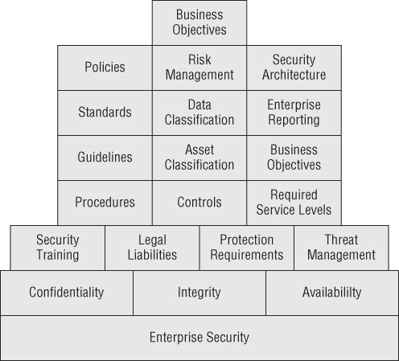

**图 3.1** 企业安全的一些组件

信息安全必须支持业务活动，才能为组织带来价值。作为公司治理的一个子集，它确保信息安全风险得到管理。请注意，我使用的是“管理”一词。信息安全管理的目的之一是教育组织了解其承担的风险，并提供对策，使业务能够接受适合其目标的风险程度。不同组织的风险承受能力各不相同。实施企业安全可实现以下目标：


### 企业安全的优势

*   体现尽职调查
*   有助于提供策略合规性保证
*   将风险降低到可接受的水平
*   有助于优化稀缺安全资源的分配
*   改善对治理体系的信任
*   可能带来更好的组织声誉
*   有助于建立问责制

企业安全需要领导力和大量投入。其成果是将信息安全活动与业务目标相协调。它还提供了一种与业务需求相一致的、具有成本效益的安全策略。通常使用以下几个框架：

*   美国国防部（DoD）架构框架（DoDAF）
*   ISO 17799：安全管理实践规范
*   SABSA 框架和方法论
*   美国联邦企业架构（FEA）
*   NIST 800-30：风险管理指南
*   NIST 风险管理框架
*   开放组架构框架（TOGAF）
*   Zachman 框架
*   信息保障企业架构框架（IAEAF）
*   面向服务建模框架（SOMF）

## 软件定义网络

**软件定义网络**（SDN）是一项新技术，允许网络专业人员虚拟化网络，使控制与硬件解耦并交给一个称为控制器的软件应用程序。在典型的网络环境中，交换机等硬件设备做出转发决策，因此当数据帧进入交换机时，交换机的逻辑（内置在内容可寻址存储器（CAM）表中）决定将数据帧转发到哪个端口。所有具有相同地址的数据包都将被转发到同一目的地。SDN 是迈向可编程和主动网络演进的一步，因为它通过将网络状态集中在控制层，使网络管理员能够灵活地动态配置、管理和优化网络资源。

软件定义网络克服了这一障碍，因为它允许网络专业人员响应现代网络的动态需求。有了 SDN，网络管理员可以从集中控制台整理流量，而无需接触单个交换机。根据需求和网络需要，网络交换机的规则可以根据需要动态更改，允许以非常精细的控制级别阻止、允许或优先处理特定类型的数据帧。这使得网络可以被视为一个逻辑或虚拟实体。

SDN 定义为三层：应用层、控制层和基础设施层。图 3.2 描绘了 SDN 架构的逻辑视图。这些层包括 SDN 应用层、控制层和网络/基础设施层。

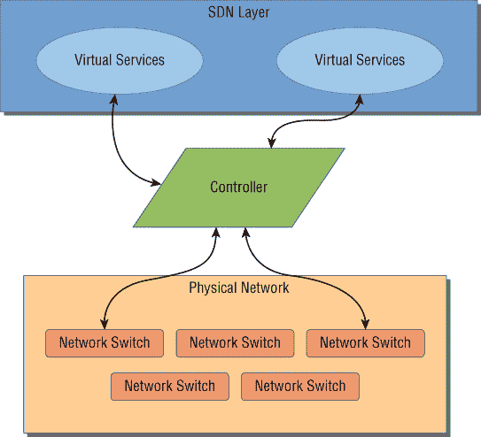

**图 3.2** 企业安全的一些组件

SDN 的核心是 OpenFlow 标准。OpenFlow 由开放网络基金会（ONF）定义。OpenFlow 在 SDN 架构的控制器和物理网络基础设施层之间提供了一个接口。这种设计有助于 SDN 实现以下目标，而这些都是标准网络的局限性：

*   管理帧/数据包转发和应用策略的能力
*   以动态方式大规模执行此操作的能力
*   可编程能力
*   通过集中控制实现可见性和可管理性

## 云计算

一个可能对企业安全产生巨大影响的领域是云计算——使用远程数据中心来管理对应用程序的访问。**云计算**可以定义为虚拟服务器、服务或通过互联网消费的任何内容。云计算的名称源自通常用于描述互联网的图示。它是一个更新的概念，旨在重新定义 IT 服务的消费和交付模型。在云计算环境中，最终用户可能不知道特定技术的位置或细节；它完全由云服务管理。云计算为用户提供了根据需要增加容量或添加服务的能力，而无需投资新的数据中心、培训新人员，甚至可能无需许可新软件。这种按需或弹性服务可以随时添加、升级和提供。

### 云计算模型

云计算架构可以包含各种模型。**公共服务**由外部提供商提供。**私有服务**以云设计在内部实施。**混合**架构提供公共和私有云服务的组合，以实现组织目标。图 3.3 显示了一些云和虚拟化考虑因素及托管选项的类型。

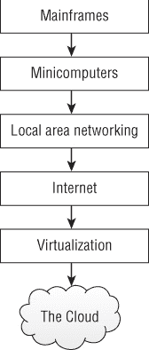

**图 3.3** 云服务的演变

云模型可以分为几种基本设计，包括通信即服务、基础设施即服务、监控即服务、软件即服务和平台即服务。每种如下所述：

1.  **基础设施即服务（IaaS）** IaaS 描述了一种购买基础设施的云解决方案。您购买虚拟算力以按需执行软件。这非常类似于在自己的设备上运行虚拟服务器，只不过您现在是在虚拟磁盘上运行虚拟服务器。该模型类似于公用事业公司模式，您只需为所用付费。该模型的一个示例是亚马逊网络服务，`http://aws.amazon.com/`。

2.  **监控即服务（MaaS）** MaaS 提供基于云的监控解决方案。这包括对网络、应用服务器、应用程序和远程系统的监控。该模型的一个示例是 AppDynamics。它们提供基于 Java 的 MaaS 解决方案。

3.  **软件即服务（SaaS）** SaaS 旨在提供完整的打包解决方案。软件租赁给用户。服务通常通过某种前端或 Web 门户提供。虽然最终用户可以随处使用该服务，但公司需支付按使用付费的费用。例如，`Salesforce.com` 提供此类服务。

4.  **平台即服务（PaaS）** PaaS 为您提供一个平台。该模型提供的服务包括软件开发生命周期（SDLC）的所有阶段，并可使用应用程序编程接口（API）、网站门户或网关软件。这些解决方案往往是专有的，如果客户离开提供商的平台，可能会导致问题。PaaS 的一个示例是 Google Apps。

### 云计算提供商和托管选项

以下是提供云计算服务的公司的部分列表：

*   Amazon
*   Citrix
*   CohesiveFT
*   FlexScale
*   Google
*   IBM
*   iCloud
*   Joyent
*   Microsoft
*   MozyHome
*   Nivanix
*   Rackspace
*   `Salesforce.com`
*   Sun
*   VMware
*   3tera

这些提供商提供一系列服务，可能包括：

1.  **公有云** 面向公众开放。一个例子是 Google Drive。
2.  **私有云** 为单个公司或实体运营。
3.  **混合云** 公有云和私有云的组合。
4.  **社区云** 在多个组织之间共享。
5.  **多租户** 用于托管单个软件应用程序，该应用程序服务于多个客户。
6.  **单租户** 托管设计为支持单个客户的单个软件应用程序。

### 云计算的优势

按需或弹性云计算改变了信息和服务的消费和提供方式。用户可以按照其特定需求设定的速率消费服务。云计算提供了几项优势，例如：


### 云计算的优势

1. **降低成本** 云技术按需付费，为组织节省资金。
2. **增加存储** 云服务商拥有更强的弹性存储能力，且成本更低。
3. **提供高度自动化** 所需员工更少，因为本地系统已被云解决方案取代。用户无需 IT 人员修补和更新已外包给云的服务器。
4. **提供灵活性** 云计算比本地解决方案提供更大的灵活性。
5. **提供更强的移动性** 主要卖点之一是用户可随时随地访问数据，而不必守在办公桌前。
6. **使公司 IT 部门能转移重心** 公司无需进行硬件更新——云服务商负责。公司可专注于创新。

根据国际数据公司（IDC）的报告：“设备激增、合规要求、系统性能提升、在线商务以及向辅助或备份站点的复制增加，导致互联网传输的信息量每年翻一番。”这意味着我们处理的数据量远超以往。在我的办公室，服务器有时因存储和访问数据的负载而紧张。应对海量数据的成本是所有公司必须面对的问题。

同时也面临保持竞争力的经济压力。公司正在寻找节约成本的措施。云计算比以往的计算模型提供更大的灵活性，但风险在于客户必须尽职调查。例如，Forrester Research Inc. 分析师 Vanessa Alvarez 指出：“客户需要开始提出尖锐问题，不能假设云中一切都会得到妥善处理，因为并不会。他们不应指望像 Amazon 这样的云服务商提供灾难恢复。”更多信息请见 `http://socialdiets.wordpress.com/2011/04/27/amazon-cloud-computing-web-services-disruption-disrupts-zynga`。

云计算的优势众多。真正的优势之一是利用他人的存储。另一优势是当需要新资源时，利用云比在本地托管实施更快。云计算采用按需付费模式。另一优势是应用的可移植性。用户可从工作场所、家中或客户现场访问数据。云计算还能释放原本被更新、安装补丁或提供应用支持占用的 IT 人员。归根结底，所有这些原因都导致资本支出降低，这是所有公司追求的目标。在练习 3.1 中，您将探讨云计算的优势。

### 按需/弹性云计算的安全性

尽管成本和易用性是云计算的两大优势，但在考虑按需/弹性云计算时，存在重大安全顾虑。

云计算改变了以往 IT 服务交付和管理的方式。优势之一是云的弹性，提供了在线无限计算能力的假象。云计算将资产置于所有者的安全边界之外。历史上，安全边界内的项目受信，外部的则不受信。云计算迫使组织将信任置于云服务商身上。云服务商必须建立足够的控制措施，提供与不使用云时同等或更高的安全级别。

作为 CASP，您必须了解迁移到基于云的服务的安全顾虑。变革压力虽大，但安全性与易用性始终存在权衡。安全专业人员在考虑基于云的解决方案时应提出以下基本问题：

1. **数据是否受监管要求约束？** 不同国家对访问有不同的要求和控制。例如，在美国、加拿大或欧盟运营的组织有许多监管要求。示例包括 `ISO 27002`、`Safe Harbor`、信息技术基础设施库（`ITIL`）以及信息及相关技术控制目标（`COBIT`）。CASP 负责确保云服务商能满足这些要求，并愿意根据需要接受认证、授权和审查。

2. **谁可以访问数据？** 深度防御建立在每个安全控制都存在漏洞的概念之上。云计算将大量控制权交到他人手中。移交给云服务商的一个关键领域是访问控制。认证和授权是现实顾虑。因为信息或服务现驻留在云中，外部人员访问的机会大增。内部人员可能构成额外风险。

    内部人员（即有访问权限者）具备发动攻击的手段和机会，仅缺乏动机。任何考虑使用云的人都需审视谁在管理其数据，以及对拥有逻辑或物理访问权限的个人施加了何种控制。

3. **云服务商是否使用数据分类系统？** CASP 应了解云服务商如何对数据分类。数据分类可从部署完善的多级分类系统，到简单区分敏感和非敏感数据的系统。云服务消费者应询问是否使用加密，以及如何将一位客户的数据与其他用户的数据隔离。加密是用于传输中数据还是仅用于静态数据？消费者还想了解使用何种加密。例如，服务商使用数据加密标准（`DES`）、三重 `DES`、高级加密标准（`AES`）还是其他？密钥如何存储？所用加密机制是否强健？一项强控制是虚拟专用存储（`Virtual Private Storage`），它提供对用户透明的加密。`Virtual Private Storage` 置于您的 DMZ 中，配置为加密和解密您网络与云之间的所有进出流量。

4. **云服务商为员工提供何种培训？** 这至关重要，因为人始终是安全中最薄弱的环节。了解服务商如何培训员工是重要的审查项。培训帮助员工知晓正确行为并理解组织的安全实践。

5. **服务级别协议（`SLA`）条款是什么？** `SLA` 作为云服务商与客户之间担保服务级别的合同。`SLA` 是提供一定保护级别的合同。收取费用后，供应商同意在约定期限内修复、更换或提供服务。`SLA` 通常基于客户指定的最低服务级别制定。

6. **是否有审计权？** 此项至关重要，云服务商应书面同意审计条款。您的数据存储在何处？如何存储？使用何种控制？您是否有权进行实地考察，或审查与访问控制或存储相关的记录？


### 云服务提供商是否具备长期生存能力？

无论将何种服务或应用程序迁移到云服务提供商，您都需要对提供商的长期生存能力充满信心。成本不仅在于配置服务，还在于当服务不再可用时的取消配置。如果他们倒闭了，您的数据会怎样？该云服务提供商经营了多长时间，其往绩记录如何？如果公司倒闭，您的数据会被退还吗？如果会，以何种格式退还？

### 如果发生安全漏洞，云服务提供商将如何响应？

基于云的服务是计算机犯罪分子极具吸引力的攻击目标。如果发生安全事件，您将从云服务提供商那里获得何种支持？为了减少这些人员可能造成的损害，云服务提供商需要制定事件响应和处理策略。这些策略应规定组织如何处理各类事件。云服务提供商必须拥有计算机安全事件响应小组（`CSIRT`），并将其纳入客户通知策略中，以便在涉及执法部门时进行通知。

### 灾难恢复和业务连续性计划（DR/BCP）是什么？

尽管您可能不知道服务的物理位置，但它们确实物理地位于某处。所有物理位置都面临火灾、风暴、自然灾害和断电等威胁。万一发生上述任何事件，`CASP` 都需要了解云服务提供商将如何响应，以及他们承诺的持续服务保障是什么。还有已退役、替换或损坏设备的问题。硬盘驱动器等物品需要妥善退役。如果敏感数据存留在废弃的硬盘驱动器上，`数据残留` 就是一个真实存在的问题。数据残留是指格式化或擦除驱动器后，仍保留在介质上的剩余数据或残余痕迹。确保不存在数据残留的唯一方法是对介质进行物理销毁。

在练习 3.2 中，您将考察云计算的一些常见风险和问题，以及它们将如何影响您自己的组织。

### 云计算漏洞

`CASP` 专业人员需要了解迁移到基于云的服务的潜在漏洞和风险。计算机犯罪分子总是紧随资金流向，随着越来越多的公司迁移到基于云的服务，犯罪分子也将随之而来。以下是云服务可能面临的一些攻击：

1.  **认证攻击** 认证系统可能无法充分保护您的数据。认证是许多系统的薄弱环节，基于云的服务也不例外。攻击认证的方式有很多，例如跨站脚本攻击（`XSS`）和跨站请求伪造（`CSRF`）。用于保护认证过程的机制和所采用的方法是攻击者的常见目标。
2.  **拒绝服务攻击** 拒绝服务攻击旨在中断服务。当云服务因忙于响应非法请求而不堪重负时，会阻止授权用户访问。例如，匿名者组织在 2010 年 12 月对万事达卡和维萨卡发动了成功的 DoS 攻击。此次攻击在一段时间内阻止了合法用户访问资源。DoS 攻击可能因勒索、所谓的黑客行动主义或其他扰乱正常运营的原因而发起。低轨道离子炮（`LOIC`）等工具很容易获取，可用于这些活动。网络犯罪分子甚至可能利用僵尸网络发动攻击。
3.  **中间人攻击** 当攻击者将自己置于两个用户之间时，就会实施这种形式的攻击。基于云的服务也容易受到此类攻击。攻击者只要能置身于通信路径中，就有可能拦截和修改通信内容。
4.  **数据聚合与数据隔离** 有时事物过多或过少都是坏事。例如，云服务提供商能否将数据用于自身目的？提供商能否将您的数据与其他客户的数据聚合，然后转售这些信息？此外，您的数据是存放在独立服务器上，还是存放在与其他人共享的虚拟系统上？在这种情况下，您的数据可能与其他公司的数据存储在一起。这引发了关于数据混杂的担忧。
5.  **数据残留** 您的数据极不可能永远被需要。这意味着数据处置和销毁是一个真实的担忧。攻击者可能会尝试访问已退役的硬盘驱动器，寻找残留数据。即使驱动器已被格式化或擦除，仍可能存在一些残留数据。剩余数据（`数据残留`）可能被搜刮以获取敏感信息。其他数据渗出技术包括入侵备份、针对拥有访问权限的云服务员工、入侵云服务员工的家庭网络，因为许多工程师都设计了后门和其他通往其工作网络的路径。

其他类型的攻击包括键盘记录器、通过网络钓鱼发送的定制恶意软件（如恶意 PDF 文件），以及在云服务提供商员工停车场投放植入木马的 USB 密钥。如果目标云服务提供商足够大，专注的攻击者甚至可能申请在该机构的工作，仅仅为了获得一定程度的物理访问权限。

我列出的攻击向量并非基于云的服务所面临的唯一攻击。所有系统都固有地存在一定风险。安全专业人员的目标是评估风险，并协助管理层做出合适的安全解决方案决策。云计算为寻求在当今经济中获得竞争优势的公司提供了真实的益处。更多提供商正进入这一领域，竞争正进一步压低价格。

极具吸引力的价格、释放员工从事其他职责的能力，以及按需付费服务的能力，将继续推动更多企业考虑云计算。在将任何服务迁移到云端之前，组织的高级管理层应评估潜在风险，并了解此类决策可能引发的任何威胁。一个担忧是云计算模糊了受保护内部网络与敌对外部网络之间的天然边界。任何基于云的服务的安全性都必须经过严格审查，以了解您的信息有哪些保护措施。还有可用性问题。这种可用性可能因拒绝服务攻击、服务提供商故障或倒闭而受到威胁。此外，如果云服务提供商经历合并会怎样？会发生什么样的政策变更？合并前会提前提供何种通知？所有这些问题都应在合同中涵盖。

### 云存储

即使您的数据在云端，它也必须物理地位于某处。您的数据是在独立服务器上，与其他组织的数据共置，还是被切片切块无数次以至于难以知晓其驻留位置？您的云存储提供商应书面同意提供满足您客户所需的安全级别。

#### 归档与数据仓库

多年来，磁带一直是大多数企业备份和归档的首选介质。这在部分归因于将备份和归档数据移至数据仓库的高昂成本。此类活动需要数十万美元的基础设施投资。如今，这种情况已开始改变，因为云服务提供商开始以极具吸引力的价格销售云存储服务。此类技术使公司能够摒弃传统的内部技术。基于云的归档和数据仓库具有以下几项关键优势：

1.  **内容管理** 云数据仓库提供商为您管理内容。


#### 地理冗余

数据存储在多个异地位置。

#### 高级搜索

数据经过索引，因此检索特定数据集变得容易得多。

在练习 3.3 中，您将使用云来存储和传输大文件。

#### 云增强安全服务

随着如此多不同的基于云的服务可用，安全服务转移到云端只是时间问题。此类解决方案称为*安全即服务*（SECaaS）。SECaaS 是一种基于云的解决方案，从云端提供安全即服务。SECaaS 无需本地硬件即可运行，从而避免了巨额资本支出。以下是一些可以从云端执行的安全服务类型示例：

1.  **反垃圾邮件** 基于云的反垃圾邮件服务可用于检测垃圾邮件。一些提供商包括 CudaMail、Microsoft Forefront Online Protection 和 McAfee。

2.  **杀毒** 基于云的杀毒应用程序提供许多好处，可用于快速扫描 PC 以查找恶意软件。此类服务的两个示例包括 Jotti 和 VirusTotal。

3.  **内容过滤** 这项云服务允许公司将内容过滤服务外包，以便基于云的提供商可以管理和监控所有出站和入站流量。

4.  **哈希匹配** 这项服务允许用户快速搜索已知恶意文件，或通过在在线存储库中搜索哈希匹配来识别已知良性文件。一个很好的示例可以在 `www.hashsets.com/nsrl/search/` 找到。该哈希集由国家软件参考库 (NSRL) 维护。执法部门、政府和行业组织可以使用这些哈希值，通过匹配数据库中的文件配置文件来审查计算机上的文件。

5.  **沙箱** 这种基于云的沙箱是一个独立环境，允许您在保持程序受控的情况下安全地查看或执行程序。此类沙箱服务的一个很好的例子是 ThreatExpert。

6.  **漏洞扫描** 许多公司没有专业知识或能力来执行所有所需的安全服务。可以外包的一项此类服务是漏洞扫描。这些基于云的解决方案将此活动卸载给第三方提供商。

## 虚拟化

现代计算机系统在处理、存储和访问信息方面已经取得了长足进步。其中一项进步是*虚拟化*，这是一种用于创建设备或资源（如服务器、存储，甚至操作系统）的虚拟版本的方法。这项技术的首批用途之一是虚拟内存的开发。虚拟内存是计算机主存储器 (RAM) 和辅助存储的组合。通过结合这两种技术，操作系统让应用程序能够像访问比实际可用更多的物理内存一样运行。虚拟化类型可以包括以下内容：

1.  **应用程序虚拟机** 为应用程序虚拟机编写的软件允许开发人员创建一个应用程序版本，以便它可以在任何虚拟机上运行，而无需为每种不同的计算机硬件平台重写。`Java Virtual Machine` 就是一个例子。

2.  **大型机虚拟机** 这项技术允许任意数量的用户共享计算机资源，并防止并发用户相互干扰。像 `IBM System/390` 这样的系统属于这一类。

3.  **并行虚拟机** 这里的概念是允许一个计算环境在许多不同的物理机器上运行。并行虚拟机允许用户将复杂任务分解为独立处理的小块。

4.  **操作系统虚拟机** 这类虚拟系统创建了一个环境，客户操作系统可以在其中运行。这得益于软件虚拟化计算机硬件和所需服务的能力。`VMware`、`Sun VirtualBox`、`XEN` 和 `Oracle VM` 都属于这一类虚拟化。

还记得哑终端和瘦客户端概念吗？这已经演变为所谓的*虚拟桌面基础设施* (VDI)。这种集中式桌面解决方案使用服务器向主机系统提供桌面操作系统。每个托管的桌面虚拟机都在运行诸如 `Windows 7` 或 `Windows Server 2012` 之类的操作系统。远程桌面通过 `Remote Desktop Protocol (RDP)`、`Citrix` 或其他架构传递给用户的端点设备。诸如 `RDP` 之类的技术非常适合远程连接，但也可能允许攻击者远程访问。因此，这些主题在 CASP 考试中很受欢迎。

该系统有很多好处，例如减少现场支持和更强的集中管理。然而，该解决方案的一个缺点是构建后端基础设施需要在硬件和软件上进行大量投资。此外，由于这项技术是新的，它变化迅速。图 3.4 显示了这项技术的一个示例。

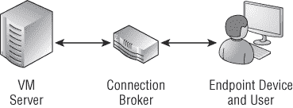

**图 3.4** VDI 基础设施

### 虚拟化服务器

虚拟化计算利用虚拟服务器，也称为虚拟机 (VM)。VM 是一种虚拟化计算机，像物理机器一样执行程序。`VMWare`、`VirtualBox`、`VirtualPC`、`XEN` 和 `Hyper-V` 是虚拟机的几个例子。

虚拟服务器使用户能够在一台物理计算机上运行第二个、第三个、第四个或更多操作系统。例如，虚拟机将允许您运行另一个 Windows 操作系统、Linux x86，或任何在 x86 处理器上运行并支持标准 BIOS 启动的其他操作系统。虚拟机是一个巨大的趋势，可用于开发、系统管理和生产，并减少所需的物理设备数量。练习 3.4 展示了如何将物理计算机转换为虚拟镜像。

虚拟服务器驻留在硬件层的虚拟仿真上。使用这种虚拟化技术，客户机无需了解主机的操作系统。虚拟化服务器利用管理程序。管理程序分为类型 1 (I) 或类型 2 (II)。类型 1 管理程序系统不需要底层操作系统。这种管理程序设计直接在硬件上运行。图 3.5 显示了一个基于类型 1 管理程序的系统示例。

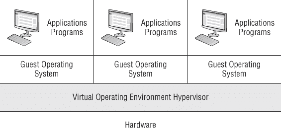

**图 3.5** 类型 1 管理程序

类型 2 管理程序运行在底层主机操作系统之上。客户操作系统随后运行在管理程序之上。图 3.6 显示了一个类型 2 管理程序的示例。

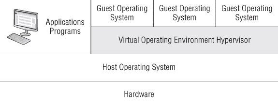

**图 3.6** 类型 2 管理程序

类型 2 管理程序允许物理系统管理员创建可能不同于基础操作系统的客户操作系统。此技术使用类型 2 管理程序来协调发送给 CPU 的指令。

管理程序验证所有客户机发出的 CPU 指令，并管理任何需要额外权限的已执行代码。`VMware` 和 `Microsoft Virtual Server` 都使用管理程序，它也称为虚拟机监视器 (VMM)。管理程序是这种虚拟化类型的基础；它完成以下工作：

*   与硬件交互
*   拦截系统调用
*   与操作系统协同工作
*   提供硬件隔离
*   实现多环境保护


### 与虚拟系统相关的技术持续演进

与虚拟系统相关的技术持续演进。在某些情况下，您可能不需要完整的虚拟系统来完成特定任务。在这种情况下，现在可以使用容器。`Containers` 允许隔离在服务器上运行的应用程序。与使用虚拟化在单个主机上运行隔离的应用程序相比，容器提供了一种成本更低的替代方案。使用容器时，操作系统内核提供进程隔离并执行资源管理。决定何时使用容器而不是虚拟化操作系统，主要取决于您需要完成的工作负载类型。

### 虚拟化服务器的安全优势

虚拟化服务器具有许多优势。其中最大的优势之一是服务器整合。虚拟化允许您在一台物理服务器上托管多台虚拟机。这减少了部署时间，并更好地利用了现有资源。虚拟化还有助于研发。虚拟化允许快速部署新系统，并提供在受控环境中测试应用程序的能力。虚拟机快照允许在进行更改前轻松备份镜像，从而提供了一种快速恢复到之前良好镜像的方法。从安全角度来看，您只需物理保护一台物理服务器，而在过去您可能不得不保护许多服务器。这对各类测试和生产场景都非常有用。

物理服务器可能会在关键时刻或最需要的时候发生故障或硬件失效。在这些情况下，虚拟化可以发挥巨大优势。虚拟系统可以被制作成镜像或复制，并非常快速地移动到另一台物理计算机上。这有助于业务连续性流程并减少停机时间。虚拟化最大限度地减少了物理空间需求，并允许用更少的机器替换物理服务器。

### 虚拟化服务器的安全劣势

凡事有利必有弊，虚拟化也不例外。虚拟化增加了另一层复杂性。市面上有许多书籍解释如何管理 Microsoft 服务器，但虚拟化可能导致您拥有一台作为宿主机的 Microsoft 服务器，上面运行着多台 Linux 和 Unix 虚拟服务器，或者在一台 Linux 机器上运行多个 Microsoft 系统。这种新的复杂性层可能会导致难以排查的问题。与单台物理服务器托管多家公司虚拟机相关的漏洞包括数据混杂。作为 CASP 候选人，您必须考虑您的云服务商采取了哪些措施来确保您的数据没有与其他公司的数据混杂。如果发生了混杂并发生数据泄露，您的数据可能会受到影响。当单个平台托管多家公司的虚拟机时，也可能存在安全问题。这些问题可能包括以下内容：

1. **物理访问** 任何拥有物理服务器直接访问权限的人，很有可能都能访问虚拟系统。
2. **职责分离** 执行网络职责的员工，是否就是处理虚拟系统安全的同一批人？如果职责分离处理不当，可能会发生安全漏洞。
3. **平台配置错误** 如果平台配置错误，可能会对驻留在该单一平台上的所有虚拟系统造成毁灭性后果。

虚拟化还需要额外的技能。虚拟化软件以及在虚拟环境中工作所用的工具，给管理员增加了额外负担，因为他们需要学习新知识。虚拟化服务器的安全劣势也体现在类型 1、类型 2 和基于容器的系统中。一个实际问题是性能下降。我曾见过一台低端服务器加载了五台需要大量资源的虚拟服务器。结果是整体性能低下。

对于类型 1 虚拟机，您直接从管理程序管理客户机。必须修补虚拟机的任何漏洞。对于类型 2 虚拟机，您还面临底层操作系统及其可能存在的任何漏洞的问题。遗漏的补丁或不安全的基础操作系统很容易使操作系统、管理程序和所有虚拟机暴露在攻击之下。类型 2 虚拟机的另一个实际问题是，此类系统通常允许共享文件夹，以及宿主机和客户机操作系统之间的信息迁移。共享数据增加了恶意代码从一台虚拟机迁移到基础系统的风险。无论使用哪种类型的虚拟机，还有其他几个顾虑，包括：

1. **权限提升** 权限提升是指垂直或水平地从一个账户移动到另一个账户的能力。例如，从销售部的用户移动到市场部的用户，是水平提权的示例。从普通用户移动到域管理员，是垂直权限提升的示例。
2. **虚拟机实时迁移** 实时迁移是指移动正在运行或处于活动状态的虚拟机的过程。在实时迁移期间，攻击者可能会尝试中间人攻击，并在数据通过网络移动时嗅探数据。
3. **数据残留** 在虚拟机被预配和取消预配的多租户环境中，之前使用的残留数据完全有可能被暴露。

最后，还存在安全劣势，因为您现在在一台物理机器上运行多个系统。如果这台机器发生故障，您将丢失多个系统。病毒、蠕虫和恶意软件也有可能从一台虚拟机迁移到另一台。这通常被称为虚拟机逃逸。`VM escape` 仅仅意味着攻击者能够在虚拟机上运行恶意软件或代码，使其中运行的操作系统能够突围并直接与管理程序交互。此术语在此处有更详细的描述：`http://archives.neohapsis.com/archives/vulnwatch/2005-q4/0074.html`。当单个平台为许多公司托管多个虚拟机，或托管不同安全级别的虚拟机时，虚拟机逃逸可能是一个严重问题。

保护虚拟服务器需要与保护物理系统相同的纵深防御重点。保护虚拟系统的一些基本检查项目包括 表 3.1 所示内容。

**表 3.1** 虚拟系统的常见安全控制

| 项目 | 说明 |
| --- | --- |
| 杀毒软件 | 宿主机和所有虚拟机上必须安装杀毒软件。 |
| 加固 | 所有虚拟机都应进行加固，以移除非必要服务。 |
| 物理控制 | 限制谁有权访问数据中心的控制措施。 |
| 认证 | 强访问控制。 |
| 资源访问 | 仅按需提供管理账户。 |
| 加密 | 对存储或传输中的敏感数据使用加密。 |
| 终端服务 | 在不需要时限制使用。当需要时，仅使用 128 位或更高强度的加密。 |

### 虚拟局域网

`Virtual LANs` (VLAN) 用于分割网络流量。VLAN 为组织提供了许多好处，因为它们允许对通过管理方式连接到交换机上定义端口的网络用户和资源进行分割。VLAN 减少网络拥塞并增加带宽。VLAN 产生更小的广播域。

VLAN 不需要孤立在单个交换机上。VLAN 可以跨越整个组织的多个交换机。扩展 VLAN 是通过中继协议完成的。`trunking protocol` 将 VLAN 的定义传播到整个局域网，而接入端口仅接受单个 VLAN 的流量。中继协议通过封装以太网帧来工作。两种常见的中继协议是 802.1q 标准和 Cisco 的专有中继协议。


#### Cisco 的交换机间链路 (ISL) 与 VLAN 安全

Cisco 的交换机间链路 (ISL) 会封装以太网帧，但它并非所有厂商通用的标准。802.1q 标准则将信息置于以太网帧内部。生成树协议 (STP) 是另一种可在 VLAN 内使用的协议。`STP` 用于防止网络环路、构建活动路径，并在活动路径或链路失效时提供备用路径。

CASP 考生应对 VLAN 有基本的了解，因为 VLAN 在将广播域安全地划分给一组交换机端口方面发挥着重要作用。这与安全拓扑直接相关，因为特定子网可被分配到不同的端口分组中，并通过路由或应用访问控制列表 (ACL) 进行隔离。例如，开发域可以与生产域分离。VLAN 还可用于隔离安全级别较低的网络部分。这种纵深防御技术可利用特定 VLAN 增加额外保护，以防范嗅探、密码攻击和劫持尝试。尽管 VLAN 隔离可能被攻破，但这会增加一层防御，足以阻挡大多数偶发攻击者。

针对 VLAN 的另一种潜在攻击是 VLAN 跳跃。`VLAN 跳跃`可定义为一种攻击，攻击者试图将数据发送给属于其他 VLAN 的主机。这通过使用不同于其所属 VLAN 的 VLAN ID 标签来标记数据来实现。VLAN 标签只是放置在以太网帧中的一个额外字段。例如，802.1Q 标签使用一个 32 位字段，置于帧头部的源 MAC 地址与 Ethertype 字段之间。这种攻击可通过两种方式发起：交换机欺骗或双重标记。

当攻击者能在交换机与攻击者之间创建一条中继链路时，就会发生交换机欺骗。这使攻击者能与该交换机上配置的所有 VLAN 中的主机通信，从而访问多个 VLAN 的流量。第二种技术双重标记，发生在攻击者为传输中的数据包预置两个 VLAN 标签时。第一个标签被剥离，第二个伪造的标签被添加。伪造的 VLAN 标签指示该数据帧目标为第二个目标 VLAN 上的主机。此技术使攻击主机能绕过用于逻辑隔离主机的第 3 层安全措施。

### 虚拟网络与安全组件

正如服务器可以虚拟化一样，其他网络活动和组件（如交换机、防火墙、无线控制器、代理和路由器）也可以虚拟化。硬件虚拟化可提供许多优势，如网卡组合、负载均衡、内容缓存以及冗余/网络故障转移保护。以下是一些最常见的网络设备组件：

1.  **集群**  
    集群是一组计算机，用于提供比冗余服务器更高的可用性。冗余服务器在需要前处于等待状态，而集群服务器则主动参与响应服务器负载。若某台集群服务器发生故障，其余服务器可接管工作。服务器场可作为计算机集群使用。此类集群可用于复杂任务，或用于过去可能需要超级计算机的场景。

2.  **网格计算**  
    此技术类似于集群，但没有中央控制。网格计算（也称分布式计算）可用于需要海量计算能力的进程。网格计算还不同于集群之处在于，网格计算机可随意加入或退出。网格计算不在集中控制之下，因此不应将其用于需要高安全性的进程。

3.  **交换机**  
    虚拟交换机的功能与物理交换机相同，但允许多个交换机存在于同一主机上。虚拟交换机相较于物理交换机具有一些真正的安全优势。假设攻击者获得了虚拟系统的 root 级访问权限。下一步可能是将网卡置于混杂模式。虚拟交换机的默认设置是拒绝混杂模式。此技术可防止攻击者嗅探流量和窥探网络。

4.  **防火墙**  
    虚拟防火墙可运行在专用的虚拟安全设备上，或运行在客户虚拟机上。它与物理防火墙相同，只是运行在虚拟化环境中。

5.  **无线控制器**  
    这些设备与其他虚拟化网络服务共存，并可利用虚拟机功能（如克隆和快照），同时降低硬件成本。

6.  **代理**  
    虚拟代理将加载带宽密集型资源的成本推迟到需要时才发生。

7.  **路由器**  
    虚拟路由器的功能与物理路由器相同。其真正优势在于为物理路由器提供备份，或能提供额外的容错层。

## 企业存储

你可能曾从同事、朋友或家人那里听到过以下问题：多少存储空间才算够？我该买多大的硬盘？这些都是好问题——对于家庭或企业用户来说，似乎永远没有足够的存储空间。企业也不例外，它们依赖快速、可靠地访问对其成功至关重要的信息。这使得企业存储成为大多数现代公司的重要组成部分。`企业存储`可定义为专为大规模、高技术环境设计的计算机存储。图 3.7 展示了现代企业存储系统中的一些要素。

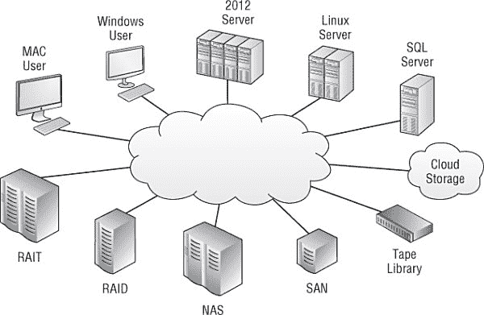

**图 3.7** 企业存储

想想大多数现代企业需要多少数据。商业世界对信息有着巨大的依赖才能生存。一些依靠大量数据蓬勃发展的组织包括政府机构、信用卡公司、航空公司、电话计费系统、全球资本市场、电子商务，甚至电子邮件归档系统。尽管所需存储量持续攀升，但企业存储市场使用的术语也存在问题。诸如 `异构`、`SAN`、`NAS`、虚拟化和云存储等术语被频繁使用。

作为 CASP 考生，你需要理解企业存储的基础知识，并掌握安全存储管理的安全隐患。在实施任何企业存储解决方案之前，应进行全面的数据评估和分类。这将包括对所有威胁、漏洞、现有控制措施的分析，以及数据丢失、泄露、篡改、中断或销毁时的潜在影响。

从安全角度来看，提高组织整体安全态势必须回答的首要问题之一是确定数据驻留在何处。技术的进步使这比过去困难得多。多年前，独立磁盘冗余阵列 (RAID) 是数据存储和冗余的标准。如今，公司已转向动态磁盘池 (DDP) 甚至云存储。DDP 将数据、奇偶校验信息和备用容量在一组驱动器中打乱分布，从而更好地保护数据并减少停机时间。DDP 的重建速度比传统 RAID 快达八倍。

企业存储基础设施可能缺乏足够的保护机制。应实施的一些基本安全控制包括：

1.  **了解你的资产。**  
    进行资产清查，了解你拥有什么数据以及数据存储在何处。

2.  **建立安全策略。**  
    企业安全策略至关重要。企业存储只是其中应涉及的一项内容。


### 3. 实施控制
网络的设计应包含一系列技术控制，例如以下各项：

*   入侵检测系统 (IDS)/入侵防御系统 (IPS)
*   防火墙
*   网络准入控制 (NAC)

### 4. 加固系统
移除不必要的服务和应用程序。

### 5. 执行适当的更新
使用补丁管理系统根据需要推出并部署补丁。

### 6. 分割基础设施
分割使用企业存储机制的网络区域。

### 7. 使用加密
评估静态数据和传输中数据的保护措施。

### 8. 实施日志记录和审计
企业存储应具备足够的控制措施，以便您了解谁尝试获取访问权限、哪些请求失败、何时进行了访问更改，或何时发生其他可疑活动。

### 9. 使用变更控制
使用变更控制和 IT 变更管理来控制所有变更。变更应按有序流程进行。

### 10. 实施汇聚安全
汇聚安全通常与 VLAN 配合使用。其概念是基于 MAC 地址阻止对第 2 层设备的访问。通过 MAC 地址阻止设备，可有效防止该设备通过任何网络交换机进行通信。这可阻止设备将恶意流量传播到任何其他网络连接设备。

既然我们已经探讨了企业存储的一些安全问题，现在让我们看看企业存储中使用的一些技术：

### 1. 虚拟存储
在过去五到十年里，虚拟存储选项有了增长。这些在线实体通常专注于存储或共享。存储服务旨在用于大文件的存储。许多公司正进入这一市场并免费提供存储，例如微软的 SkyDrive、亚马逊的 Cloud Drive 和 Google Drive。

虚拟文件共享服务是第二类虚拟存储。这些服务不适用于长期使用。它们允许用户传输大文件。这些服务的示例包括 Dropbox、MediaFire 和 Mozy。如果您试图共享非常大的文件或移动太大而无法作为附件容纳的信息，这些虚拟服务效果很好。

从积极方面来看，这些服务有许多很好的用途，例如在在线协作中保存文档的同步副本；共享文档；以及在台式机、笔记本电脑、平板电脑和智能手机之间进行同步。

这些服务的缺点包括：您现在将资产置于组织边界之外。还有控制权丧失的问题。如果这些提供商倒闭，您的数据会怎样？虽然这些服务确实填补了空白，但它们可能被个人用于非法移动数据。另一个担忧是对您的数据施加的控制类型。其中一些服务允许任何人搜索已发送的文件。示例见图 3.8。

在练习 3.5 中，您将了解在线存储涉及的安全问题。

### 网络附属存储
`Network attached storage (NAS)` 是一种包含一个或多个硬盘驱动器插槽的技术。这些硬盘驱动器用于网络存储。`NAS` 类似于直接访问存储 (`DAS`)，但 `DAS` 只是单个系统的扩展，不具备网络功能。

许多 `NAS` 设备利用 Linux 操作系统，并通过网络文件共享协议提供连接。最常用的协议之一是 `Network File System (NFS)`。`NFS` 是一种旨在通过网络共享文件和应用程序的标准。`NFS` 由 Sun Microsystems 于 20 世纪 80 年代中期开发。用于文件和应用程序共享的基于 Windows 的对应协议是 `Common Internet File System (CIFS)`；它是微软 `Server Message Block (SMB)` 协议的一个开放版本。

### 2. SAN
存储网络行业协会 (`SNIA`) 将 `SAN` 定义为：“一种数据存储系统，由各种存储元素、存储设备、计算机系统和/或设备组成，加上所有控制软件，所有这些都通过网络高效和谐地通信。” `SAN` 类似于 `NAS`。一个主要区别是 `NAS` 在客户端看来是一个文件服务器或独立系统。而 `SAN` 在客户端操作系统看来是一个本地磁盘或卷，可根据需要在本地进行格式化和使用。

### 3. 虚拟 SAN
`虚拟 SAN (VSAN)` 是一种 `SAN`，它为物理连接到同一 `SAN` 结构的设备提供隔离。`VSAN` 有时称为结构虚拟化。（`Fabric` 可定义为 `SAN` 的结构。）开发 `VSAN` 是为了支持单个交换机上的独立虚拟网络功能。`VSAN` 通过实现更高效的 `SAN` 利用率，提高了整合度并简化了管理。`VSAN` 允许任何单个 `VSAN` 上的资源被不同 `VSAN` 上的其他用户共享，而无需合并 `SAN` 的结构。

### 4. 互联网小型计算机系统接口 (iSCSI)
`iSCSI` 是一种 `SAN` 标准，用于连接数据存储设施并允许远程 `SCSI` 设备进行通信。许多人将其视为光纤通道的替代品，因为它不需要任何特殊基础设施，且可在现有的 IP LAN、MAN 或 WAN 网络上运行。`iSCSI` 的初衷是克服 `SCSI` 的局限性。`iSCSI` 获取 `SCSI` 命令并将其封装在 `TCP/IP` 数据包中。`iSCSI` 可扩展至 10 Gb，且不如以太网光纤通道 (`FCoE`) 复杂。但是，它确实需要与常规 LAN 进行某种形式的物理分段。

### 5. 以太网光纤通道 (FCoE)
`FCoE` 是另一种类似于 `iSCSI` 的传输协议。`FCoE` 可在 10 Gb/秒的速度下运行，并运行在以太网协议之上。虽然它很快，但其缺点是不可路由。因为它在协议栈的较高层运行，`iSCSI` 位于 `TCP` 和 `UDP` 协议之上。虽然 `FCoE` 相比 `iSCSI` 有许多优势，但它容易受到窃听和 DoS 攻击。

### 6. 主机总线适配器 (HBA) 分配
主机总线适配器 (`HBA`) 用于将主机系统连接到企业存储设备。`HBA` 可通过软分区或持久绑定进行分配。软分区最为宽松，而持久绑定会减少地址空间并增加网络复杂性。为避免单点故障，可使用多个 `HBA` 适配器。缺点是这会使系统更复杂，并可能需要使用多路径。微软的多路径框架是 `Multipath I/O (MPIO)`。该技术旨在通过在存储设备之间提供备用数据路径，降低 `HBA` 故障的影响。这种多路径技术允许多达 32 条备用路径，以增加冗余和容错能力。

### 7. 逻辑单元号 (LUN) 掩码
`LUN` 掩码主要在 `HBA` 级别实施。它是一种编号系统，使 `LUN` 编号对某些服务器可用，而对其他服务器不可用。在此级别实施的 `LUN` 掩码容易受到任何攻破本地适配器的攻击。如果没有 `LUN` 掩码，每台服务器都将看到磁盘子系统提供的所有硬盘。`LUN` 掩码是一项安全功能，因为它允许限制这些信息，使每台服务器只能看到它需要的内容，而不再多见。

### 8. 冗余（位置）
位置冗余是指内容应可从多个位置访问。通过复制服务可提供额外的冗余措施，以便即使主存储备份系统故障，数据仍可用。这进一步增强了公司的弹性和冗余。数据库影子、远程日志记录和电子保管库都是用于冗余的常见方法。一些组织单独使用这些技术，而另一些组织则将这些技术与其他备份方法结合使用。


## 8. 安全存储管理与复制

安全存储管理和复制系统旨在使公司能够以安全的方式管理和处理所有企业数据，重点关注信息的机密性、完整性和可用性。复制服务允许实时复制数据，从而实现额外的容错能力。

## 9. 多路径解决方案

企业存储多路径解决方案通过在服务器及其驱动器之间建立多条路径，降低了数据丢失或不可用的风险。多路径软件维护所有请求的列表，将它们通过最佳路径传递，并在某条路径失效时重新路由通信。其主要优势之一是访问速度快。

## 10. SAN 快照

SAN 快照软件通常随 SAN 解决方案一起销售，为用户提供了一种绕过典型备份操作的方法。快照软件能够暂时停止向物理磁盘写入，然后创建一个时间点备份副可将其类比为 Windows 还原点，因为它们允许你在某一时间点创建快照。快照软件通常速度很快，无论驱动器大小如何，都能快速创建副本。

## 11. 数据去重 (DDP)

数据去重是通过移除冗余数据来提高企业存储利用率的过程。冗余数据不会被复制，而是被替换为指向该数据唯一副本的指针。冗余数据的仅有一个实例保留在企业存储介质（如磁盘或磁带）上。


**图 3.8** `Files.com` 上传文件浏览

## 本章小结

本章重点关注企业安全，以及 CASP 在保护基础设施安全时必须处理的问题类型。本章的两个主要主题是：

* 虚拟化与共享计算
* 围绕企业存储的安全问题

保护存储中和传输中的数据是当今安全专业人员的两大主要关注点。对存储的日益增长的需求、虚拟化的增长以及基于云的解决方案的增长，正在改变现代企业的需求。随着新技术上线，成本和竞争因素将推动快速采用这些变革；然而，所有技术都存在潜在弱点。安全专业人员必须识别这些潜在风险，并与数据所有者合作，实施适当的控制措施以将威胁降至最低。

## 考试要点

1. **理解虚拟化服务器的优缺点。** 虚拟化服务器有许多优势。其中最大的一个是服务器整合。虚拟化允许你在一台物理服务器上托管许多虚拟机。虚拟化还有助于研发。它允许快速部署新系统，并提供在受控环境中测试应用程序的能力。

2. **能够描述 VM 逃逸。** VM 逃逸简单来说就是攻击者能够在虚拟机上运行恶意软件或代码，使其中运行的操作系统能够突破出来并直接与管理程序交互。当单个平台托管多家公司的虚拟机，或使用不同安全级别的虚拟机时，这可能会成为一个问题。

3. **能够区分虚拟化、分布式和共享计算。** 虚拟化计算利用基于物理机的虚拟资源。分布式计算可以包括数据中心或服务器场的自主计算机，它们可以共享负载，但被视为一个计算机系统。共享计算利用多个计算机系统的闲置容量。共享计算机系统可能分布在你的控制范围之外。

4. **能够描述虚拟桌面基础设施 (VDI)。** 虚拟桌面基础设施是一种集中式桌面解决方案，它使用服务器向主机系统提供桌面操作系统。

5. **能够定义 VLAN 的目的。** VLAN 用于将网络划分为较小的广播域或段。它们为组织提供了许多好处，因为它们允许对连接到交换机上定义端口的网络用户和资源进行管理式分段。VLAN 减少网络拥塞并增加带宽，并导致更小的广播域。从安全角度来看，VLAN 限制了攻击者看到的网络流量，其可见范围不如未部署 VLAN 时那么大。VLAN 易受 VLAN 跳跃攻击。这种攻击技术允许攻击者从一个 VLAN 移动到另一个 VLAN。

6. **能够解释云计算的特征。** 云计算意味着使用远程数据中心来管理对应用程序的访问。云计算可定义为虚拟服务器、服务，或你通过互联网消费的任何东西。云计算的名称源于通常用于描述互联网的图示。

7. **能够描述云计算的安全问题。** 云计算将资产置于所有者的安全边界之外。历史上，安全边界内的项目受信任，而边界外的项目不受信任。有了云计算，组织被迫将信任置于云提供商身上。云提供商必须开发足够的控制措施，以提供与不使用云时组织所拥有的相同或更高级别的安全性。

8. **了解如何保护企业存储。** 保护企业存储需要采用纵深防御方法，包括安全策略、加固、补丁管理、日志记录和审计。这些只是所需控制措施中的一部分。

## 复习题

1. 使用 VLAN 时，你可能需要将来自多个 VLAN 的流量通过一个交换机端口传递。在这种情况下，安全至关重要。以下哪种技术允许你实现此目的？

   **A.** `VTPM`
   **B.** `Sandboxing`（沙箱）
   **C.** `Trunking`（中继/干线）
   **D.** `Proxies`（代理）

2. 以下哪项不是云计算的优势？

   **A.** 更强的移动性
   **B.** 降低支出
   **C.** 提高生产力
   **D.** 增加数据隐私

3. 以下哪项不是信息安全框架的示例？

   **A.** `SABSA`
   **B.** `IAEFE`
   **C.** `SOMF`
   **D.** `RFC`

4. 以下哪种基于云的解决方案允许用户购买或租用物理基础设施？

   **A.** `MaaS`
   **B.** `IaaS`
   **C.** `SaaS`
   **D.** `PaaS`

5. 哪种类型的云攻击会导致服务因忙于响应非法请求而阻止授权用户访问？

   **A.** 中间人攻击
   **B.** 认证攻击
   **C.** `DoS`
   **D.** 数据提取

6. 以下哪项是一种集中式桌面解决方案，它使用服务器向主机系统提供桌面操作系统？

   **A.** `OND`
   **B.** `VDI`
   **C.** `LUN`
   **D.** `iSCSI`

7. 管理程序还被称为以下哪项？

   **A.** `OND`
   **B.** `VDI`
   **C.** `VMM`
   **D.** `LUN`

8. `__________` 提供了对数据的信任，确保其准确无误。

   **A.** 认证
   **B.** 标识
   **C.** 机密性
   **D.** 完整性

9. 哪种基于云的服务会处理 SDLC 过程的所有阶段？

   **A.** `MaaS`
   **B.** `IaaS`
   **C.** `SaaS`
   **D.** `PaaS`

10. 以下哪项描述了这句话：“我们保留随时审查与本协议履行相关的云提供商所有账簿和记录的权利”？

    **A.** `SLA`
    **B.** 审计权
    **C.** `DR`
    **D.** `BCP`

11.


## 考试题目

### 1. 什么类型的虚拟化技术用于协调发送给 CPU 的指令？

**A.** Type 1  
**B.** Type 2  
**C.** Type 3  
**D.** Type 4

### 12. 生成树协议 (STP) 用于什么？

**A.** 抑制组播流量  
**B.** 桥接 SAN 流量  
**C.** 实现 802.1q 标准  
**D.** 防止网络环路

### 13. _______________ 优于 FCoE，因为它可以在现有的 IP 网络上运行。

**A.** iSCSI  
**B.** HBA  
**C.** vSAN  
**D.** HBA

### 14. 以下哪种存储技术使用屏蔽过程，用于向某些主机提供可用性并限制其他主机的可用性？

**A.** HBA  
**B.** vSAN  
**C.** LUN  
**D.** NAS

### 15. 哪种存储技术利用 NFS、SMB 或 CIFS 等协议？

**A.** NAS  
**B.** DAS  
**C.** SAN  
**D.** iSCSI

### 16. 哪种存储技术在客户端操作系统中显示为本地磁盘或卷，可根据需要在本地进行格式化和使用？

**A.** NAS  
**B.** WAN  
**C.** SAN  
**D.** DAS

### 17. 讨论 VLAN 标记时，802.1q 是 _______________ 的一个示例

**A.** 虚拟服务器协议  
**B.** 无线协议  
**C.** 中继协议  
**D.** SAN 协议

### 18. 不包含底层主机操作系统的虚拟化架构称为 _______________？

**A.** Type 1  
**B.** VMM  
**C.** Type 2  
**D.** Hypervisor

### 19. 哪种基于云的解决方案旨在监控网络、应用程序、服务器和应用程序？

**A.** MaaS  
**B.** IaaS  
**C.** SaaS  
**D.** PaaS

### 20. _______________ 意味着信息或服务是可访问的，且其他未授权主体不应有访问权限。

**A.** 可用性  
**B.** 标识  
**C.** 机密性  
**D.** 完整性

## 第 4 章：主机安全

以下 CompTIA CASP 考试目标在本章中涵盖：

1.   **1.3 给定场景，分析网络和安全组件、概念及架构**

    *   安全设备
        *   UTM
        *   NIPS
        *   NIDS
        *   INE
        *   设备放置
        *   应用和协议感知技术
            *   WAF
            *   下一代防火墙
            *   IPS
    *   网络和安全组件的安全配置与基线化
        *   ACL
        *   变更监控
        *   配置锁定
        *   可用性控制
    *   网络管理和监控工具
    *   安全区域
        *   数据流执行
        *   DMZ
        *   关键资产隔离
    *   网络访问控制
        *   隔离/修复
    *   运营和消费类网络启用设备
        *   楼宇自动化系统
        *   IP 视频
        *   HVAC 控制器
        *   传感器
        *   物理访问控制系统
        *   音视频系统
        *   科学/工业设备

2.   **1.4 给定场景，为主机选择和排查安全控制**

    *   可信操作系统（例如如何及何时使用）
    *   端点安全软件
        *   反恶意软件
        *   防病毒
        *   反间谍软件
        *   垃圾邮件过滤器
        *   补丁管理
        *   HIPS/HIDS
        *   数据丢失防护
        *   基于主机的防火墙
        *   日志监控
    *   主机加固
        *   标准操作环境/配置基线化
        *   应用程序白名单和黑名单
        *   安全/组策略实施
        *   命令 Shell 限制
        *   补丁管理
        *   配置专用接口
            *   带外 NIC
            *   ACL
            *   管理接口
            *   数据接口
    *   外设限制
        *   USB
        *   蓝牙
        *   Firewire
    *   引导加载程序保护
        *   安全启动
        *   可度量启动
        *   IMA——完整性度量架构
        *   BIOS/UEFI

本章讨论主机安全，这是**纵深防御**的关键组成部分。多年前，边界安全和在计算机上安装防病毒软件可能就足够了。现在情况已不再如此。如今，每当用户打开计算机、点击链接或打开电子邮件时，都可能发生攻击。这就是为什么基于主机的解决方案（如反恶意软件、防病毒和反间谍软件）对纵深防御策略如此重要的原因。虽然这些项目是解决方案的一部分，但良好的逻辑安全就像良好的物理安全一样，需要主机加固。逻辑安全不要求你在计算机周围建起 10 英尺高的混凝土墙，但它确实要求你以一种让攻击者工作更困难的方式来加固主机。这项工作始于移除不需要的服务。它还包括实施安全策略和控制。最后，它关乎最小权限原则的建立；仅提供用户完成手头任务所需的内容，不提供更多，同时保持安全基线。

在本章中，我们将研究端点安全和主机加固。我们将探讨资产管理、入侵检测和入侵防御所扮演的角色等主题。CompTIA 要求你为考试了解这些主题。你可能会遇到场景题、模拟题，甚至拖放题，要求你正确放置所需的控制和对策。

## 防火墙和网络访问控制

防火墙可以是硬件、软件或两者的组合。防火墙通常位于受信和不受信网络元素之间的分界线上。防火墙在重要资产的隔离中起着关键作用。典型防火墙放置示例可见 Figure 4.1。

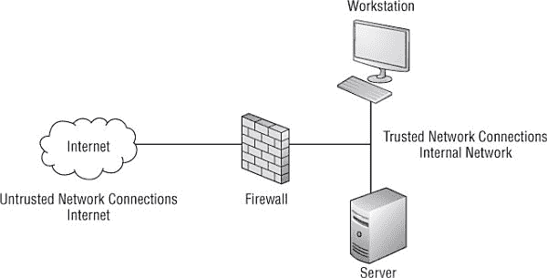

**FIGURE 4.1** Firewall placement and design

防火墙规则决定检查何种类型的流量、允许何种流量通过以及阻止何种流量。配置防火墙规则最基本的方法是通过访问控制列表（`ACL`）。`ACL` 用于数据包过滤，并用于选择要由防火墙或设备分析、转发或以某种方式影响的流量类型。`ACL` 是数据流执行的基本示例。简单的防火墙，更具体地说是 `ACL` 配置，可能会根据源地址和目标地址阻止流量。然而，更高级的配置可能会根据接口、端口、协议、阈值和各种其他标准拒绝流量。在实施 `ACL` 之前，请务必对网络和安全组件执行安全配置和基线化。放置在 `ACL` 中的规则不仅可用于允许或阻止流量。例如，规则还可用于记录活动以供日后检查或记录警报。示例规则集如 Table 4.1 所示。

**TABLE 4.1** Basic rule set

| Rule number | Action | Protocol | Port | Direction | Comment |
| --- | --- | --- | --- | --- | --- |
| Rule 20 | Allow | DNS | 53 UDP | Outbound | None |
| Rule 50 | Allow | HTTP, HTTPS | 80, 443 | Outbound | None |
| Rule 100 | Allow | SMTP | 25 | Inbound | To mail server |
| Rule 101 | Allow | SMTP | 25 | Outbound | From mail server |


### ACL 规则与防火墙技术

#### 标准 ACL 与扩展 ACL

| 规则编号 | 动作 | 协议 | 源地址 | 目的地址 | 方向 | 状态 |
| :--- | :--- | :--- | :--- | :--- | :--- | :--- |
| Rule 255 | Deny | ALL | — | — | Bidirectional | None |

对于 CASP 考试，你需要对 ACL 及其格式有基本的了解。在 Cisco IOS 环境中，标准 ACL 的命令语法格式如下：

```
access-list access-list-number {permit|deny} ↵
{host|source source-wildcard|any}
```

此外还有扩展 ACL。这些规则能够更深入地检查流量，并可检测更多项目，例如：

*   协议
*   端口号
*   区分服务代码点（DSCP）值
*   优先级值
*   同步序列号（SYN）位的状态

扩展 IP、ICMP、TCP 和 UDP ACL 的命令语法格式如下所示：

##### IP 流量

```
access-list access-list-number
     [dynamic dynamic-name [timeout minutes]]
     {deny|permit} protocol source source-wildcard
     destination destination-wildcard [precedence precedence]
     [tos tos] [log|log-input] [time-range time-range-name]
```

##### ICMP 流量

```
access-list access-list-number
     [dynamic dynamic-name [timeout minutes]]
     { deny|permit } icmp source source-wildcard
     destination destination-wildcard
     [icmp-type [icmp-code] |icmp-message]
     [precedence precedence] [tos tos] [log|log-input]
     [time-range time-range-name]
```

##### TCP 流量

```
access-list access-list-number
     [dynamic dynamic-name [timeout minutes]]
     { deny|permit } tcp source source-wildcard [operator [port]]
     destination destination-wildcard [operator [port]]
     [established] [precedence precedence] [tos tos]
     [log|log-input] [time-range time-range-name]
```

##### UDP 流量

```
access-list access-list-number
     [dynamic dynamic-name [timeout minutes]]
     { deny|permit } udp source source-wildcard [operator [port]]
     destination destination-wildcard [operator [port]]
     [precedence precedence] [tos tos] [log|log-input]
     [time-range time-range-name]
```

### 基本规则工作原理回顾

图 4.2 展示了一个基本网络配置，其中两个网段由一台路由器和一个通用的互联网连接隔开。

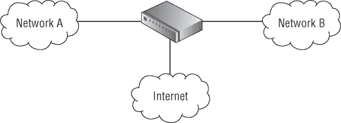

**图 4.2** 带防火墙的基本网络

在第一个示例中，假设已决定阻止所有 Telnet 流量。Telnet 通过明文发送信息，不被视为安全协议。

```
hostname R1
!
interface ethernet0
ip access-group 102 in
!
access-list 102 deny tcp any any eq 23
access-list 102 permit ip any any
```

在此配置中，所有目标端口为 23 的 TCP 流量均被防火墙阻止。所有其他流量均被允许。

在该示例中，目标端口非 TCP/23 的 Telnet 连接仍将被允许。若要阻止任意 TCP 端口上的 Telnet，则需要其他控制手段。此外需了解，标准 ACL 常用于限制对路由器等设备的 Telnet 或 SSH 访问，方法是将访问权限限制在特定 IP 地址。扩展 ACL 则用于更多任务。另请注意，前面的示例仅用于演示目的。通常认为最佳实践是仅允许所需内容并拒绝其他所有内容，即遵循最小权限原则。

练习 4.1 演示了如何查看基本 ACL。

### 基于主机的防火墙

在回顾了防火墙之后，我们将关注点转移到基于主机的防火墙。防火墙通常部署在受信与非受信网络元素的分界线上，但也可部署在主机系统上。**基于主机的防火墙**是直接运行在网络主机或设备上的设备。部署基于主机的防火墙旨在保护其所安装的设备免受攻击。基于主机的防火墙通常具有预定义规则，以针对特定攻击模式保护主机。基于主机的防火墙可与隔离和修复配合使用。某些基于主机的防火墙还能防止恶意软件攻击网络上的其他设备。增加基于主机的防火墙体现了纵深防御的概念。图 4.3 展示了该概念的示例。

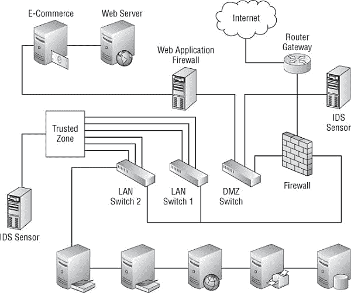

**图 4.3** 纵深防御与多层防护

基于主机的防火墙通过检查和控制入站及出站流量来工作。尽管防火墙种类繁多，但只有基于主机的防火墙设计为驻留在终端主机上并保护其免受攻击。与所有防火墙一样，基于主机的防火墙通过检查穿过接口的流量来工作。其工作方式与边境警卫和海关人员非常相似。当人员和产品跨越一国边境前往另一国时，都会接受检查。所有防火墙均通过使用预定义规则集工作。

基于主机的防火墙的一大优势是，它可以通过增加另一层控制来强化纵深防御。如果网络防火墙失效，基于主机的防火墙将充当额外的防御层。基于主机的防火墙的一个缺点是，如果主机失效，则防火墙可能被突破。另一个缺点是在多基于主机的防火墙系统中更新策略会比较困难。基于主机的防火墙产品示例包括 `Windows Firewall`、`IPTables`、`Norton Personal Firewall`、`Zone Labs ZoneAlarm`、`Sunbelt Personal Firewall` 和 `Sygate Personal Firewall`。

即使有边缘防护（部署在网络边缘的设备）和基于主机的防火墙，攻击有时仍能突破。这就是为什么公司要增加应用感知和协议感知技术，包括入侵检测、入侵防御以及下一代防火墙，它们具备检查 Web 应用程序数据的能力。下一代防火墙可协助对可疑网络流量进行隔离/修复。下一代防火墙通常部署在网络边缘，位于非军事区/外部/内部网络之间，有助于关键资产的隔离。

Web 应用程序防火墙（WAF）是一种下一代技术，有助于解决 Web 应用程序安全问题。WAF 并非传统防火墙的替代品，而是增加了另一层防护。传统防火墙仅阻断或允许流量，而 WAF 可防范跨站脚本攻击、隐藏字段篡改、Cookie 投毒甚至 SQL 注入。WAF 通过检查 TCP/IP OSI 模型的高层来工作，并与特定 Web 应用紧密集成。可以这样理解：传统防火墙可能在边界拒绝入站流量。但对于 80 或 443 端口的流量呢？对于公司或组织而言，完全停止互联网通信可能并非可行选项。这就是 WAF 发挥作用的地方。WAF 在保护组织免受社交网络及其他 Web 2.0 应用固有的新兴威胁方面具有重大意义，而传统防火墙并未设计用于防御这些威胁。开源 WAF 示例包括 `ModSecurity`。商业选项由 `Barracuda Networks`、`Fortinet` 和 `Cisco Systems` 提供。顺便提一下，`Suricata` IDS 项目中使用的解析器（HTP Library）由 `ModSecurity` 的 `Ivan Ristic` 编写；这两个项目在不久的将来值得关注。

练习 4.2 演示了如何配置 `IPTables`。

## 可信操作系统


## 可信操作系统

可信操作系统（TOS）可定义为实施了足够控制以支持多级安全的操作系统。多级安全赋予操作系统在不同安全级别处理和管理信息的能力。至少，这种粒度意味着您可以以用户或 root/管理员身份处理数据。可信操作系统必须经过测试，以证明其正确性符合特定标准。这些标准要求 TOS 经历测试和验证。测试为操作系统供应商提供了一种推广系统功能的方式；测试允许购买者验证系统，并检查操作系统是否按供应商声称的方式运行。以下文档是用于验证可信操作系统的一些指南：

### 1. 可信计算机系统评估标准（TCSEC）

最早的 TOS 测试标准之一是**可信计算机系统评估标准（TCSEC）**。TCSEC 也称为《橙皮书》，旨在评估独立系统。它现在已相当陈旧，但值得一提，因为它是最早的标准之一。其度量基础是机密性。它旨在对系统进行评级并将其归入以下四类之一：

1.  **A 级：经验证的保护** A 级系统是最高安全等级。
2.  **B 级：强制性安全** B 级系统对 TCB 具有强制性保护。
3.  **C 级：自主保护** C 级系统对 TCB 提供自主保护。
4.  **D 级：最低保护** D 级系统未能达到 A、B 或 C 级的任何标准，基本上没有安全控制。

### 2. 信息技术安全评估标准（ITSEC）

**信息技术安全评估标准（ITSEC）** 是另一个早期标准，于 20 世纪 80 年代开发以满足欧洲市场的需求。ITSEC 检查整个系统的机密性、完整性和可用性。ITSEC 的独特之处在于它是第一个统一市场、使整个欧洲遵循一套指南的标准。评估实际上分为两部分：一部分评估功能性，另一部分评估保证性。共有 10 个功能性（F）类别和 7 个保证性（E）类别。保证性类别对系统的有效性和正确性进行评级。

### 3. 通用准则

**国际标准化组织（ISO）** 制定了**通用准则（ISO 15408）**，旨在建立一个全球标准，该标准基于 TCSEC、ITSEC 等。通用准则检查 TOS 的不同领域，包括物理和逻辑控制、启动和恢复、参考监控以及特权状态。通用准则将保证性分为七个日益严格的保证级别，称为**评估保证级别（EAL）**。EAL 为被分析系统的安全功能提供了特定的置信度。八个保证级别如下：

1.  **EAL 0**：保证不足
2.  **EAL 1**：功能测试
3.  **EAL 2**：结构测试
4.  **EAL 3**：系统地检查和测试
5.  **EAL 4**：系统地设计、测试和评审
6.  **EAL 5**：半形式化设计和测试
7.  **EAL 6**：半形式化验证、设计和测试
8.  **EAL 7**：形式化验证、设计和测试

无论如何测试或使用哪套具体标准，TOS 的基本属性包括以下内容：

1.  **硬件保护** TOS 必须从头开始设计。安全硬件是基础。
2.  **长期受保护存储** TOS 必须具备提供跨电源周期和其他事件持久的受保护存储的能力。
3.  **隔离** TOS 必须能够隔离程序。TOS 必须能够防止程序 A 访问程序 B 的信息。
4.  **用户进程与管理进程分离** 用户和管理员功能必须分离。

可信操作系统超越了软件范畴，必须考虑其驻留的硬件。这就是**可信计算基（TCB）**的目的。**可信计算基（TCB）** 是计算机内所有保护机制的总和，负责强制执行安全策略。这包括硬件、软件、控制和流程。TCB 负责机密性和完整性。它是系统中唯一在高信任级别下运行的部分。该信任级别即安全内核所在之处。**安全内核** 处理所有用户和应用程序对系统资源的访问请求。一个小型安全内核易于验证、测试和确认为安全。

因此，虽然 TOS 建立在 TCB 之上，但这两个概念均基于理论。这些模型的大量工作始于 20 世纪 70 年代初。在此期间，美国政府资助了一系列专注于计算机安全的论文。这些论文构成了可信计算的基本基石。这些是**安全模型**。安全模型决定了安全如何实施、哪些主体可以访问系统以及它们将访问哪些客体。简单来说，它们是将 TOS 设计形式化的一种方式。安全模型建立在旨在强制执行完整性和机密性的控制之上。下面列出了一些较知名的安全模型。此列表绝非详尽无遗；而是重点介绍了一些早期研究人员开发的较知名模型。

### 1. Bell-LaPadula 模型

**Bell-LaPadula 模型** 强制执行机密性。该模型使用强制访问控制来实施国防部（DoD）多级安全策略。要访问信息，主体必须获得许可，并达到或超过信息的分类级别。Bell-LaPadula 模型由以下属性定义：

1.  **简单安全属性** 该属性规定：处于某一机密级别的主体不允许读取更高机密级别的信息。这有时称为“禁止向上读取”。
2.  **\* 安全属性** 该属性规定：处于某一机密级别的主体不允许将信息写入较低机密级别。这也称为“禁止向下写入”。
3.  **强 \* 安全属性** 该属性规定：主体既不能向上读取，也不能向下写入。

### 2. Biba 模型

早期的 **Biba 模型** 旨在解决完整性问题。Biba 仅针对未经授权用户的访问保护。不涉及可用性和机密性。它还假设内部威胁通过良好的编码实践得到防范，因此专注于外部威胁。Biba 模型具有以下定义属性：

1.  **简单完整性属性** 该属性规定：处于某一完整性级别的主体不允许读取较低完整性级别的客体。
2.  **\* 完整性属性** 该属性规定：处于某一完整性级别的客体不允许写入较高完整性级别的客体。
3.  **调用属性** 该属性禁止处于某一完整性级别的主体调用较高完整性级别的主体。

### 3. Clark-Wilson 模型

**Clark-Wilson 模型** 创建于 1987 年。它与 Bell-LaPadula 和 Biba 的不同之处在于，它是为商业活动开发的。它也不同于 Biba 模型，因为主体受到限制。一个访问级别的主体可以读取一组数据，而另一个访问级别的主体可以访问另一组不同的数据。Clark-Wilson 是基于能力的安全性的一个示例。


### Clark-Wilson 模型

Clark-Wilson 模型控制系统的内部一致性，其开发目的是确保数据只能以保护一致性的方式进行操作。Clark-Wilson 规定必须强制执行职责分离，主体必须通过应用程序访问数据，且需要审计。数据在被修改时不能被篡改，且数据的完整性必须保持一致。

### Brewer 和 Nash 模型

最后是 Brewer 和 Nash 模型。它在一定程度上类似于 Bell-LaPadula 模型。它的昵称是“中墙”模型。其设计初衷是作为防止利益冲突问题的一种手段。在墙这一侧工作的个人无法看到墙另一侧的数据。例如，中墙模型会阻止为一家政府承包公司提供咨询的工作人员访问属于另一家政府承包公司的数据，从而防止任何利益冲突。

## 端点安全解决方案

构建可信操作系统是整体安全的一个良好开端，但还需要做更多工作。其中一个领域是端点安全。`端点安全` 包含部署在客户端系统上的控制措施，例如 USB 和 CD/DVD 控制、防病毒、反恶意软件、反间谍软件等。部署在客户端系统上的控制措施至关重要。

作为一名 CASP，你必须能够从端点到端点审视网络中的安全性，并考虑构建安全防护区域以限制攻击者的触及范围。这从流量进入网络的地方延伸到用户最初连接网络及其资源的地方。这需要纵深防御和可用性控制。可以使用多种方法之一来构建安全区域。这些方法包括以下内容：

1.  **面向攻击向量** 这种方法侧重于用于发起攻击的常见攻击向量。示例包括禁用 USB 闪存驱动器的自动运行、禁用 USB 端口以及移除 CD/DVD 刻录机。
2.  **以信息为中心** 这种方法侧重于在数据之上分层部署控制措施。示例包括信息控制、应用程序控制、主机控制和网络控制。
3.  **受保护的飞地** 这种方法规定某些区域比其他区域更重要。控制措施可能包括 VPN、防火墙的战略性部署、VLAN 的部署以及对关键网络段的限制访问。

在考虑端点安全时，谁是更大的威胁，内部人员还是外部人员？尽管数字因你参考的报告而异，但大量攻击是由内部人员发起的。一个决定恶意行事的受信任内部人员可能会绕过控制措施，以雇主不允许的方式访问、查看、篡改、销毁或移除数据。但也不要忘记外部人员——他们也可能寻求访问、查看、篡改、销毁或移除数据或信息。顺便提一下，你必须考虑偶发的外部入侵，例如恶意软件，这可能会让外部人员获得对内部网络的访问权限。目前有报告称传统攻击具有很高的成功率。这包括简单的攻击机制，如各种类型的恶意软件、鱼叉式网络钓鱼、其他社会工程学攻击等。一旦进入内部，这些攻击的复杂程度会显著增加，因为攻击者会利用高级权限提升和特定配置漏洞来获取持久访问权限、窃取数据并规避安全机制。这也是 CASP 不能仅依赖边界安全的另一个原因。

一个基本的出发点是实施`最小权限原则`。这是指用户应仅拥有所需的访问权限——即仅允许基于用户工作必要性的最小用户特权。此概念也可应用于计算机上的进程；每个系统组件或进程应仅拥有执行其职责所需的最小权限。该概念的目标是通过消除可能导致网络攻击和计算机沦陷的不必要特权，来减少主机的攻击面。一个考试目标是：给定一个场景，CASP 应能够为主机选择和排查安全控制措施。一个起点是加固操作系统。国防信息系统局 (DISA) 和国家安全局 (NSA) 等组织提供了各种加固指南。一个很好的操作系统特定参考由 MITRE 提供：`http://nvd.nist.gov/cce/index.cfm`。其他端点和主机安全解决方案包括以下内容：

1.  **补丁管理** 补丁管理是保持应用程序和操作系统安全的关键。组织应建立完善的补丁管理测试和部署系统。补丁在分发前应在沙箱中进行安全测试。
2.  **数据渗漏** 遗憾的是，盗窃和丢失难免会发生。CASP 应验证组织是否有应对此类情况的政策和程序。数据渗漏是一个巨大的问题，公司需要政策和程序来应对它。
3.  **基于主机的防火墙** 纵深防御要求公司不仅要考虑企业级防火墙，还要考虑基于主机的防火墙。
4.  **日志监控** 日志监控是一种主要的检测控制。它可用于识别问题，并为持续存在的问题和安全顾虑找到可接受的解决方案。
5.  **变更监控** 变更必须受控并有序进行。变更控制程序应规划变更如何被批准和推出，以及如何通知最终用户。
6.  **配置锁定** 并非任何人都应有权更改设备或硬件。配置控制可用于防止未经授权的更改。
7.  **可用性控制** 可用性控制涉及公司在需要时使数据可用的能力。一些常见解决方案包括 RAID、冗余服务器和云存储。

### 端点安全的常见威胁

加固是一个好的起点，但 CASP 也应了解常见威胁。通过了解威胁，例如接下来列出的威胁，你可以开始为主机系统选择适当的安全控制。内部人员和外部人员造成的大量损害是由针对服务器和最终用户系统的恶意软件引起的。

以下是其中几种威胁类型：

1.  **病毒** `病毒` 是一种旨在感染计算机系统的软件。一些病毒破坏数据，而另一些可能显示消息或仅驻留在计算机上。病毒通常通过三种方式之一进入系统：电子邮件、网络或 CD/DVD/USB 媒介。
2.  **蠕虫** `蠕虫` 与病毒不同，无需用户交互即可复制和传播。RTM 蠕虫被称为第一个蠕虫，由罗伯特·莫里斯于 1988 年创建。
3.  **间谍软件** `间谍软件` 与病毒和蠕虫密切相关。在许多方面，间谍软件类似于特洛伊木马；大多数用户不知道间谍软件已被安装，因为代码将自身隐藏在隐蔽位置。间谍软件可能会记录击键、将用户重定向到非请求的网站、向用户发送大量弹窗或监控用户活动。DNS 重定向和备用数据流 (ADS) 的使用允许间谍软件分发者将一个文件的流掩盖在另一个文件之后。快速搜索驱动器将找不到违规可执行文件的踪迹，因为它在主文件表 (MFT) 中没有条目，而 MFT 保存着所有文件的目录列表。在过去几年中，间谍软件已演变为包含虚假杀毒软件——勒索软件——提示用户付款。


### 4. 特洛伊木马

**特洛伊木马**是伪装成有用程序但包含恶意载荷的程序。很多时候，特洛伊木马被用来远程访问和控制主机计算机。这些程序也被称为远程访问木马（RAT）。许多特洛伊木马赋予攻击者对受害者计算机的完全控制权，允许攻击者执行程序、访问注册表、开启摄像头和麦克风、控制浏览器，以及启动和停止应用程序。一些常见的早期示例包括 NetBus、Back Orifice 和 Ghost Rat。

### 5. 垃圾邮件

**垃圾邮件**是未经请求的电子邮件。它通常具有商业性质，不加选择地发送给许多邮件列表、个人或新闻组。其目的是试图诱导回复、欺骗用户访问恶意网站，或购买假冒或仿冒商品。发送到移动设备的 SMS（短消息服务）垃圾信息也是一个日益严重的问题。

### 6. 增量攻击

**增量攻击**的目标是随时间缓慢地进行更改。通过在漫长的时间内进行如此微小的更改，攻击者希望保持不被发现。以下是两种主要的增量攻击：

*   **数据篡改**，最常与数据库攻击相关，如果攻击者拥有系统访问权限并能对数据或文件进行微小的增量更改，则可能发生此攻击。
*   **沙拉米攻击**，类似于数据篡改，涉及对财务账户或记录进行微小更改。

### 7. 键盘记录器

这种类型的攻击可以基于硬件，也可以基于软件。硬件**键盘记录器**连接到计算机，用于记录所有按键。软件键盘记录器充当操作系统和用户之间的垫片（shim）以记录所有信息；它可以记录按键、用户活动、鼠标点击、打开的应用程序等。键盘记录器可以安装在每种操作系统环境中，为攻击者提供了一种简单的手段来获取账户凭据，而无需破解任何加密（这可能是不可能的）。在工作站和键盘之间简单插入一个 USB 或 PS/2 设备可能证明更加有效，这也是物理安全、策略、审计和用户意识必要性的一个例证。另一个更隐蔽的例子以可编程 HID USB 按键加密狗（PHUKD）项目的形式出现。这实质上是将键盘记录器放置在键盘内部。试想一下，有多少组织不会对那个手里拿着五个键盘走进来的相对较新的 IT 小伙子多想一下。关于 PHUKD 的更多信息请访问：`www.irongeek.com/i.php?page=security/programmable-hid-usb-keystroke-dongle`

### 8. 僵尸程序

**僵尸程序**在很大程度上取代了传统的拒绝服务（DoS）和分布式 DoS（DDoS）工具。僵尸程序可用于 DoS，也可用于各种赚钱活动，例如垃圾邮件、拉高出货股票骗局，以及旨在嗅探银行和信用卡信息的键盘记录器。僵尸程序最好被描述为一台被加载了恶意软件的受感染计算机。该恶意软件允许攻击者远程控制。用户访问错误的网站、玩游戏或运行其他软件都可能安装此恶意软件。僵尸程序的威力在于，它只是构成僵尸网络的众多受感染计算机中的一个。总共可能有成千上万甚至数百万个僵尸程序，有时因显而易见的原因被称为“僵尸”。僵尸程序由命令与控制（C&C）服务器控制，这是肇事者（称为**僵尸网络牧羊人**）用来更新僵尸程序或发送各种其他命令的工具，例如通过 DDoS 攻击哪个组织以及在什么时间攻击。C&C 与僵尸程序之间的通信通常通过各种连接类型执行，如 SSL/TLS、P2P，甚至 VoIP。僵尸程序通常会尝试联系 C&C。事实上，通常会有多个 C&C 服务器，它们会频繁更改地址并请求更新。更新可能包含新的 C&C 地址或生成这些地址的算法，以及系统上所用恶意软件和特洛伊木马软件的变更。它们还可能赋予僵尸网络主机手动访问有趣系统的能力，并通过僵尸网络包中的特洛伊木马/后门元素从内部浏览网络。僵尸网络通常使用免费 DNS 服务，如 DynDNS。快速通量 DNS 等技术为僵尸网络提供了隐藏其服务器的能力，使其隐藏在不断变化的代理之后，从而难以定位僵尸网络牧羊人。僵尸网络不断演变，其复杂程度也在不断提高，以继续传播并逃避安全社区的追踪。Zeus 和 SpyEye 是过去几年中出现的两个著名僵尸网络，对于有志成为 CASP 的人来说，它们是开始研究僵尸网络的显著切入点。

现在我们已经讨论了几种类型的恶意软件和攻击，让我们把注意力转向常见的端点安全防御。

### 反恶意软件

反恶意软件解决方案并非新事物。从计算机的早期开始，就有对反恶意软件解决方案的需求。最早的之一是 Dr. Solomon's Antivirus Toolkit。Fred Cohen 通常被认为创造了“计算机病毒”这一术语。最早的反恶意软件程序与今天可用的工具截然不同。

#### 杀毒软件

自 1988 年 Dr. Solomon's Antivirus 等早期产品问世以来，杀毒软件已经走过了漫长的道路。从那时起，杀毒软件公司开发了更有效的病毒检测方法。然而，这场竞赛仍在继续，因为病毒编写者通过开发更难检测的病毒进行了反击。一些著名的病毒和蠕虫包括表 4.2 中所示的那些。

**表 4.2** 著名病毒和蠕虫示例

| 恶意软件名称 | 类别和描述 |
| --- | --- |
| The Brain | 主引导记录感染型病毒的早期示例 |
| RTM worm | 第一个已知在互联网上发布的蠕虫 |
| Melissa | 第一个广泛传播的宏病毒 |
| I Love You | 第一个广泛传播的群发邮件蠕虫 |
| Code red | 针对运行 IIS 的 Windows 服务器的著名蠕虫 |
| Nimda | 使用多种不同感染机制的蠕虫 |
| Zeus | 旨在针对金融数据的恶意软件 |
| Conficker | 可通过电子邮件、拇指驱动器和网络连接传播的广泛蠕虫 |

杀毒程序通常使用以下几种技术之一来识别和根除病毒。这些方法包括：

1.  **基于特征码** 此技术使用特征码文件来识别病毒和其他恶意软件。它需要频繁更新。
2.  **基于启发式** 此检测技术寻找应用程序或服务正常行为的偏差。此方法对未知病毒和多态病毒很有用。

多年前，杀毒软件可能被视为一种可选的保护机制，但现在不再是这样。杀毒软件是抵御基本类型恶意软件的最佳防线。大多数检测软件都包含一个用于检测病毒的特征码库。病毒可以使用不同的技术进行感染和复制。常见技术包括：

1.  **引导记录感染器** 驻留在计算机的引导扇区中
2.  **宏病毒** 以 Microsoft Office 程序为目标，如 Word 文档和 Excel 电子表格
3.  **程序感染器** 以可执行程序为目标
4.  **多重感染器** 同时以引导记录和程序为目标

练习 4.3 展示了如何测试您的杀毒程序是否正常工作。


计算机一旦被感染，计算机病毒可以执行任意数量的操作。有些被称为快速感染者。快速感染病毒会感染其能够感染的任何文件。其他病毒则使用稀疏感染技术。稀疏感染意味着病毒会花费时间感染其他文件或传播其破坏力。此技术用于尝试避免检测。还有一些类型的恶意软件可以完全驻留在文件中并将自身加载到 RAM 中。这些病毒被称为 RAM-resident（驻留内存型）。恶意软件创建者使用的最后一种技术是将病毒设计为多态的。`Polymorphic viruses`（多态病毒）每次复制并感染新文件时都可以改变其签名。此技术使得防病毒程序更难检测到病毒。

防止病毒和蠕虫始于最终用户意识。应培训用户在打开附件或运行未知程序时保持谨慎。用户意识是一个很好的第一步，但防病毒软件至关重要。市场上有许多防病毒产品，其中包括：

*   Norton Antivirus
*   McAfee Antivirus
*   AVG Antivirus
*   avast! Antivirus
*   Kaspersky Antivirus

#### Anti-spyware（反间谍软件）

Spyware（间谍软件）是另一种类型的恶意软件。在许多方面，间谍软件类似于特洛伊木马；大多数用户不知道该程序已被安装，因为它对用户隐藏自身。间谍软件可以执行许多不同的活动，例如：

*   窃取用户信息
*   消耗带宽
*   重定向 Web 流量
*   用弹出窗口淹没受害者
*   监控并记录受害者的击键

间谍软件在 2000 年左右开始变得更加普遍。从那时起，它已增加到反间谍软件被视为另一种必需的端点安全解决方案的程度。通常，间谍软件会降低系统性能以至于无法使用，阻止网络访问，将浏览器重定向到一些可疑或不需要的网站，或者更糟，捕获击键和浏览历史记录。间谍软件最初是通常记录用户上网习惯的简单恶意软件，但今天它先进得多。如今看到的许多间谍软件可以执行键盘记录，应引起企业的高度关注。

有几种技术用于对抗间谍软件。移除间谍软件可能需要一种或多种专用软件工具。其他防御措施包括使用漏洞较少的浏览器、保持补丁管理的最新状态，以及在安装未知程序时保持谨慎。处理间谍软件的一些方法在表 4.3 中描述。

**表 4.3 反间谍软件解决方案的差异**

| Detail | Appliance（设备） | Client software（客户端软件） | Server software（服务器软件） |
| --- | --- | --- | --- |
| User training required（所需用户培训） | Little（极少） | Considerable（相当多） | Little（极少） |
| Amount of help desk support required（所需帮助台支持量） | None（无） | Some（一些） | None（无） |
| Administration required（所需管理） | Some（一些） | Considerable（相当多） | Some（一些） |
| Enforces enterprise policy（强制执行企业策略） | Yes（是） | Somewhat（某种程度上） | Yes（是） |
| Signature update（签名更新） | Vendor（供应商驱动） | End-user driven or through patch process（最终用户驱动或通过补丁流程） | Controlled by IT security team（由 IT 安全团队控制） |
| IT management level of control（IT 管理控制级别） | High（高） | Medium（中） | High（高） |

有几种部署反间谍软件解决方案的方法。这些方法接下来进行讨论。

1.  **Appliance（设备）** 放置在客户网络上的硬件设备，设备很像软件解决方案，但没有底层操作系统。
2.  **Client Software（客户端软件）** 这是一种设计为端点安全解决方案的客户端软件解决方案。有几个著名的客户端反间谍软件解决方案，包括：
    *   AD-Aware
    *   Spybot Search and Destroy
    *   Windows Defender
    *   Hijack This
3.  **Server Software（服务器软件）** 这是一种加载在服务器上的垃圾邮件拦截解决方案。

#### Spam Filters（垃圾邮件过滤器）

客户端垃圾邮件抑制是针对垃圾邮件的整体防御机制的重要组成部分。即使部署了反垃圾邮件服务器，一些垃圾邮件不可避免地会进入客户端邮箱。在我上次检查垃圾邮件过滤器时，发往我邮件服务器的邮件中有 50% 以上是垃圾邮件。垃圾邮件很难防止；垃圾邮件发送者发明新技术以绕过垃圾邮件过滤器——即使是最好的反垃圾邮件防御通常也会让一些垃圾邮件通过。

一种防御方法是消除电子邮件，但这不切实际。电子邮件允许个人通过互联网或数据通信网络高效通信。电子邮件是使用最广泛的互联网应用程序。

过滤垃圾邮件的经典方法是纵深防御。这种边缘-枢纽技术使用多层防御来处理垃圾邮件。思路是在电子邮件到达网络边缘的那一刻开始过滤。毕竟，为什么要存储和处理垃圾邮件？此过程的步骤通常包括以下项目（参见图 4.4）：

*   Bastion servers（堡垒服务器）或外包垃圾邮件过滤，在垃圾邮件进入您的网络之前捕获大部分垃圾邮件。
*   安装在邮件服务器上的垃圾邮件过滤器和防病毒软件，进一步抑制垃圾邮件。一个好的技术是在边缘服务器和枢纽服务器上运行不同的垃圾邮件过滤软件。
*   在最终用户系统上强制执行的客户端垃圾邮件过滤器。

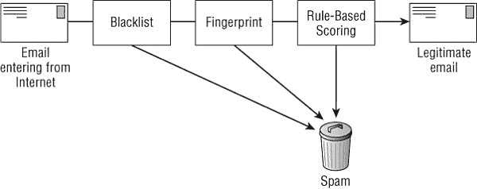

**图 4.4 Spam filter operation**

垃圾邮件过滤器可以使用多种技术来检测和过滤垃圾邮件：

1.  **Blacklists（黑名单）** 电子邮件是否来自已知的垃圾邮件发送者？
2.  **Fingerprint（指纹）** 电子邮件是否匹配垃圾邮件的指纹？
3.  **Rules Scoring（规则评分）** 电子邮件是否匹配足够高的分数，以至于它可能是垃圾邮件？

大多数垃圾邮件过滤器查找与垃圾邮件相关的常见短语或术语。其中一些包括指纹词：

| All natural（纯天然） | No cost, no fees（无费用） |
| --- | --- |
| Avoid bankruptcy（避免破产） | One time（一次性） |
| Buy direct（直接购买） | Online pharmacy（网上药店） |
| Casino（赌场） | Online marketing（网络营销） |
| Cash（现金） | Order now（立即订购） |
| Consolidate your debt（合并债务） | Save up to（节省高达） |
| Special promotion（特别促销） | Unsecured debt or credit（无担保债务或信贷） |
| Easy terms（宽松条款） | Viagra（伟哥） |
| Get paid（获得报酬） | While supplies last（售完即止） |
| Great offer（绝佳优惠） | Why pay more（为何多付） |
| Give it away（免费赠送） | Winner（获奖者） |
| Giving it away（赠送中） | Work at home（在家工作） |
| Meet singles（结识单身人士） | You've been selected（您已被选中） |

当垃圾邮件进入网络时，它可能成为一个真正的问题，因为未经请求的电子邮件也是网络钓鱼、金钱骗局和恶意软件的主要渠道。网络钓鱼通过向受害者发送一封看似来自官方网站（如银行、信用卡公司或您自己的邮件管理员）的电子邮件来实施。垃圾邮件通常包含一个链接，承诺将用户带到真实网站以更新、更改或修改其帐户。该电子邮件和链接的真实目的是窃取受害者的用户名、PIN 码、帐号或密码。

## Host Hardening（主机加固）

`Host hardening`（主机加固）可以描述为为使攻击者更难成功攻击计算机而执行的一系列步骤，旨在移除不需要的服务和功能。由于在加固过程中很容易忽略某些内容，公司应采用标准方法来加固计算机和设备。Mac、Linux 和 Windows 等不同的操作系统将需要不同的安全基线。此外，工作站的主机加固将不同于服务器。

虽然这似乎是一个简单的概念，但良好的安全实践始于物理安全。如果攻击者可以物理访问系统，控制它就变成了一项微不足道的任务。系统应进行物理加固。培训用户在不使用系统时将其关闭是一项基本控制，连同受密码保护的屏幕保护程序和自动注销的实施。主机应加固到在操作系统完全启动之前就是安全的。有几个项目可用作引导加载程序保护，包括以下内容：


### 安全启动与主机加固

### 核心安全技术

1. **Secure Boot（安全启动）**
   PC 行业成员开发的一种安全标准，旨在确保 PC 仅使用设备制造商信任的软件进行启动。

2. **Measured Launch（可度量启动）**
   此方法结合 `TPM` 和安全启动进程，以确定是否允许加载操作系统以及哪些部分可以执行。

3. **IMA（完整性度量架构）**
   由 IBM 开发，用于验证 Linux 操作系统的完整性和可信度。

4. **BIOS/UEFI（统一可扩展固件接口）**
   自 Windows 8 起成为每台计算机的强制要求。`UEFI` 是 `BIOS` 的替代品或附加组件，类似于在最终操作系统启动前运行的一个操作系统。其设计初衷是阻止 Rootkit 和其他可能控制基于 `BIOS` 系统的恶意软件。

保护网络设备和主机计算机代表了多层安全方法。在加固主机系统时，应检查以下几个主要领域。

### 主机加固关键领域

#### 1. 使用应用程序白名单与黑名单
**白名单**可定义为被授予访问权限的实体列表。**黑名单**则相反，它列出不允许访问的内容。例如，你可能会将 YouTube 加入黑名单，以防止员工访问该网站。可将白名单视为隐式“全不允许”（除非加入列表），将黑名单视为隐式“全允许”（除非加入列表）。

#### 2. 实施安全策略/组策略
Microsoft 随 Windows 2000 引入了组策略。可将组策略视为用户配置设置和计算机配置设置的分组，它们可链接到 Active Directory 中的对象，并应用于用户和计算机。组策略允许安全管理员在数百台计算机上维护一致的安全配置。在组策略中设置安全选项时，以下初始安全设置专门与“账户策略”和“本地策略”节点相关：
- **账户策略**：包含密码策略、账户锁定策略和 Kerberos 策略。
- **本地策略**：适用于审核策略、用户权利分配和安全选项。

> 练习 4.4 演示了如何控制路由器。

### 使用标准操作环境
**标准操作系统**是主机系统的标准构建版本。其理念是在整个组织中使用标准构建。优势之一是降低总拥有成本（`TCO`），但真正的优势在于配置的一致性。当需要更新或安全补丁时，这种标准化镜像在统一环境中更易于测试。

### 修复已知漏洞
建立安全基线是主机安全的良好开端，但一个主要关注点是修复已知漏洞。为掌握这一过程，应定期运行漏洞评估工具。`Nessus`、`SAINT` 和 `Retina` 等漏洞评估工具旨在每周或每月运行一次，以查找已知漏洞和问题。及时识别并修补这些问题有助于降低整体攻击风险。

> 练习 4.5 演示了如何运行安全扫描器以识别漏洞。

### 加固并移除不必要的服务
保护系统的另一个重要组成部分是系统加固过程。开始此过程最直接的方法是移除不需要的服务。可将其视为最小权限原则的一种变体。此过程包括移除不必要的应用程序、禁用不需要的服务，以及在文件上设置限制性权限。此过程可减少攻击面，旨在使系统更能抵御攻击。虽然应对所有负责的系统应用此过程，但必须针对每个操作系统独特处理，并采取不同步骤进行保护。

### 应用命令 Shell 限制
限制用户对命令提示符的访问是收紧安全性的另一种方式。用户可从命令提示符运行的许多命令会削弱安全性，或允许恶意人员在主机系统上提权。以 Windows Server 2012 的默认配置为例，`Telnet`、`TFTP` 和许多其他命令行可执行文件默认处于关闭状态。这是命令行限制的基本示例。另一个例子是，假设你在企业大厅设有一个自助服务终端，供客户了解产品、服务甚至填写求职申请。应禁用额外功能以实施最小权限原则。虽然为用户提供完成工作或任务所需的功能很重要，但禁用对非必要程序的访问是良好的安全实践。在某些情况下，这可能包括命令 Shell 限制。允许用户从命令行运行命令可能为黑客提供攻击途径。除非必要，否则应限制命令行访问。

> 练习 4.6 演示了如何绕过命令 Shell 限制。

### 使用警告横幅
**警告横幅**是简短消息，告知用户关于使用应用程序和服务的特定策略和程序。警告横幅可以是启动画面、弹出窗口或消息框，告知用户特定规则。警告横幅至关重要，因为它们告知用户可能允许或不允许的特定行为或活动。由于警告横幅声明了特定行为的后果，用户无法找借口，从而可记录违规行为。警告横幅应包含正当使用规范、隐私期望和违规处罚。

### 使用受限接口
**受限接口**是一个配置文件，规定该环境中可用的程序、菜单、应用程序、命令或功能。此技术允许安全管理员控制用户环境，并规定用户可访问的对象。之所以称为受限接口，是因为用户只能使用提供的环境与操作系统、已安装的应用程序和资源进行交互。在现代操作系统中，个人配置文件可在管理员控制下随用户移动到任何台式机或笔记本系统。

### 配置专用接口
**专用接口**是专门用于特定流量的端口。例如，许多公司将无线 LAN 放在专用接口上，并将其与其他内部网络流量隔离。

### 使用带外网卡
**带外网卡**是指配置为专用管理通道的网卡。

### 管理接口配置
**管理接口**旨在作为一种管理计算机或服务器的方式，即使该设备已关机或无响应。管理接口利用与硬件的网络连接，而非连接到操作系统或登录 Shell。管理接口通常使用带外网卡。

### 管理数据接口
**数据接口**用于数据库以生成进程模板。进程模板是活动类型的可重用集合。它们允许系统集成商和其他使用不同客户的人员操作类似类型的数据。

---

## 资产管理

**资产管理**是组织、跟踪和支持公司资产的过程。公司对技术的依赖程度远超过去。为充分利用这些技术，公司必须了解拥有什么资产以及如何最好地管理它们。此过程的第一步是组织公司的所有资产。接下来，必须跟踪这些技术。最后，必须通过 IT 变更管理来支持这些技术。


## IT 变更管理

IT 变更管理是一项旨在控制对系统和程序所做修改的正式流程。这包括硬件、软件和应用程序配置。如果没有有效的 IT 变更管理程序，可能会发生未经授权的变更，并可能危及组织的安全。不受控的变更管理流程还可能导致在未经测试或未知的状态下执行操作。变更管理流程的步骤如下：

1. 提交变更请求。
2. 批准变更请求。
3. 测试变更并记录发现。
4. 实施变更。
5. 向公司管理层报告变更。

任何拟议的变更都需要经过仔细审查，以确定该拟议修改不会对流程产生负面影响。

## 数据渗漏

**数据渗漏**是指从计算机未经授权地传输数据。许多组织对外围设备实施控制或限制，以应对数据渗漏问题。这些控制措施包括对 `USB`、`蓝牙` 和 `FireWire` 的管控。

`USB` 已占据广泛的市场份额。`USB` 克服了传统串行接口的局限性。`USB 2.0` 设备的通信速度高达 480 Mbps，而 `USB 3.0` 设备的理论速率为 4.8 Gbps。最多可将 127 个设备串联在一起。`USB` 用于闪存、相机、打印机、外置硬盘，甚至智能手机。`USB` 拥有广泛的产品支持，许多设备连接时即可被即时识别。与 `USB` 竞争的标准是 `FireWire`，即 `IEEE 1394`。这种设计常见于许多 Apple 电脑，也见于数字音频和视频设备。这些技术的问题在于攻击者可利用它们。例如，据信 `Stuxnet`（震网病毒）是通过 `USB` 优盘传送到伊朗核设施的。

`蓝牙` 技术专为移动设备和手持设备之间的短距离无线通信而设计。`蓝牙` 于 1990 年代中期至末期开始流行。`蓝牙` 技术促进了各种个人和手持电子设备的发展。尽管 `蓝牙` 确实具备一些内置安全功能，但已被证明容易受到攻击。下面列出了一些其他用于数据渗漏的方法：

1. **物理访问** 通过 `USB`、`FireWire` 或 `蓝牙` 设备将数据或信息复制到介质上。物理访问还可能意味着物理植入流氓 `AP`、窃听内部互联网电缆、安装间谍软件或逻辑炸弹等软件、连接嗅探设备，甚至仅仅是某人拍照或打印文档并带走。
2. **隐写术** 利用图像、`MP3` 文件、视频或文档中的空白空间来隐藏和提取数据。
3. **原生远程应用程序** 使用内置应用程序（如 `FTP`、`Telnet` 或 `RDP`）窃取数据。
4. **允许的协议** 使用 `TCP`、`UDP` 或 `ICMP` 将流量隧道传输出网络。

由于攻击者从网络中提取数据的可能方式太多，数据渗漏是一个大问题。私密数据可能泄露，导致收入损失、组织罚款和信任丧失。在极端情况下，渗漏可能危及政府安全。

检测和阻止数据渗漏需要使用安全事件管理解决方案，以便密切监控出站数据传输。数据丢失防护要求分析出站网络流量中的异常，并使用执行深度包检测的更好的出站防火墙控制。

#### 入侵检测与防御

**入侵检测系统 (IDS)** 从受监控的计算机或网络收集并分析信息。`IDS` 可被视为一种网络管理和监控工具。`IDS` 将检测哪类活动的关键取决于传感器的放置位置。在讨论入侵检测系统的类型之前，让我们先回顾一下检测入侵的各种方式。

入侵检测主要有三种基本方式：

1. **特征识别** 特征识别依赖于已知攻击的数据库，也称为误用检测。每种已知攻击都以特征的形式加载到 `IDS` 中。一旦加载了特征，`IDS` 就可以开始守护网络。特征通常会被分配一个编号或名称，以便在攻击发生时易于识别。例如，这些特征可能包括 `死亡之 Ping`（Ping of Death）、`SYN 洪水`（SYN floods）或 `Smurf DoS`。特征识别最大的缺点是这些系统只能触发已知且已加载的特征。多态攻击和加密流量可能无法被正确评估。尽管如此，`Snort` 或 `Suricata` 等入侵检测与防御 (`IDP`) 工具仍是安全管理员武器库中不可或缺的一部分，且根据组织环境，自定义特征将经常被使用。然而，它们应与其他措施相结合，以确保其所安装系统的完整性。
2. **异常检测** 异常检测系统根据一组特征的固定行为来检测入侵。如果攻击者能随时间缓慢改变其活动，基于异常的系统可能无法检测到攻击，并认为该活动实际上是可接受的。异常擅长发现与正常活动显著不同的行为。
3. **协议解码** 此类系统使用基于 `TCP/IP` 协议栈构建并理解其规范的模型。协议解码 `IDS` 系统具备重组数据包并查看高层活动的能力。如果 `IDS` 了解协议的正常活动，它就能识别出异常活动。协议解码入侵检测要求 `IDS` 维护状态信息。为了有效检测这些入侵，`IDS` 必须理解各种应用层协议。这在攻击者试图在受感染机器上使用自定义 `TCP` 协议栈以逃避检测的情况下非常有用。

以下是 `IDS` 的一些基本组件：

1. **传感器** 检测并向系统发送数据。
2. **中央监控系统** 处理和分析从传感器发送的数据。
3. **报告分析** 提供关于如何应对特定事件的信息。
4. **数据库和存储组件** 执行趋势分析，并存储攻击者的 `IP` 地址和相关信息。
5. **响应模块** 接收来自前面组件的信息并形成适当的响应。例如，响应模块可能决定阻止、丢弃甚至重定向网络流量。

设备（如 `IDS`）的放置位置是另一个考量因素。示例见 图 4.5。这种放置需要一些考量，因为毕竟，非军事区 (`DMZ`) 中的传感器擅长检测误用，但对网络内部的攻击者却毫无用处。即使确定了传感器的放置位置，它们仍需要特定的调整和基线建立，以学习正常流量模式。

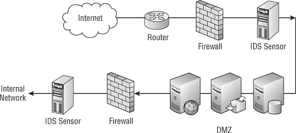

**图 4.5** 基于网络的 IDS 放置


### IDS 传感器放置与入侵检测系统

同样，IDS 传感器的放置需要一些考量。IDS 传感器可以放置在 DMZ 外部或网络内部。传感器也可以放置在特定系统上。传感器的放置将在一定程度上决定部署哪种类型的入侵检测系统。传感器也可以串联放置，其中一个 IDS 执行基于特征的扫描并允许有效流量通过到第二个 IDS，后者执行启发式或其他类型的扫描。这有助于保证不会因对单个 IDS 要求过高而造成瓶颈。请注意，相同的配置选项也适用于 IPS/IDP 设备，事实上，这些设备可能比 IDS 更频繁地以串联模式部署。入侵检测系统分为两大类：

#### 1. 网络入侵检测系统 (NIDS)

与网络嗅探器非常相似，NIDS 旨在捕获和分析网络流量。NIDS 在每个数据包经过时对其进行检查。一旦检测到可疑流量，采取的行动取决于特定的 NIDS 及其当前配置。它可能被配置为重置会话、触发警报，甚至阻止特定流量。NIDS 能够监控网络的一部分，并在防火墙和主机之间提供额外的防御层。其缺点包括攻击者可以执行插入攻击、会话拼接，甚至分片来阻止 NIDS 检测攻击。此外，如果使用了内联网络加密 (INE)，IDS 将只能看到加密流量。NIDS 还受限于它只能看到其连接所在的网络范围。这引出了一个重要事实：当说 NIDS 可能看到该范围时，我的意思是它们通常会被放置在镜像端口或所有通过网络设备的流量都被转发到的端口上。这可以是交换机上的镜像端口，甚至是路由器。在思科设备中，这些端口显而易见地被称为交换端口分析器 (SPAN) 端口。

#### 2. 主机入侵检测系统 (HIDS)

HIDS 旨在监控计算机系统而非网络。HIDS 检查主机活动并将其与可接受活动的基线进行比较。这些活动是通过使用 HIDS 应监控的系统对象数据库来确定的。HIDS 驻留在主机计算机上（参见 图 4.6），静默监控流量并尝试检测可疑活动。可疑活动范围可以从尝试修改系统文件到不安全地激活 ActiveX 命令。关于 HIDS 需要记住的事项包括：它们会消耗一些主机资源，但具有潜在分析加密流量的能力，并且可以在解密后于端点发现异常事件时触发警报。在高安全环境中，也可能使用内联介质加密器 (IME)。此类设备类似于 INE，不同之处在于它串联放置在计算机处理器和硬盘驱动器之间，以保护传输中的数据安全。阅读更多信息请访问：`www.nsa.gov/ia/programs/inline_media_encryptor/`

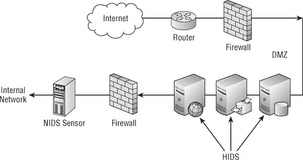

**图 4.6** HIDS 放置

虽然 NIDS 和 HIDS 都为安全专业人员提供了额外的工具，但它们通常被视为被动设备。主动 IDS 可以用简单的方式响应事件，例如修改防火墙规则。这些设备被称为入侵防御系统 (IPS)。正如 IDS 一样，IPS 可以是基于主机或基于网络的：

## 1. 网络入侵防御系统 (NIPS)

NIPS 建立在 IDS 的基础上，试图将技术更进一步。NIPS 可以自动反应并防止安全事件发生，最好无需用户干预。这种干预并阻止已知攻击的能力是 NIPS 最大的优势；然而，它遭受与 NIDS 相同类型的问题，例如无法检查加密流量以及处理高网络负载的困难。

## 2. 主机入侵防御系统 (HIPS)

HIPS 通常被认为能够识别并阻止异常。HIPS 被视为 IDS 的下一代，可以实时阻止攻击。这种进程监控类似于防病毒软件。HIPS 具有监控系统调用的能力。HIPS 的缺点是它们需要资源，并且必须处理已识别的异常。

## 网络管理、监控与安全工具

网络监控工具允许网络专业人员监控网络状态并确定其整体性能。安全专业人员关注此类技术，因为安全性并不总是内置的。一个例子是简单网络管理协议 (SNMP)。SNMP 是一种广泛使用的标准，用于远程监控和管理网络上的主机、路由器及其他节点和设备。该协议的问题是版本 1 和 2 以明文形式发送数据。SNMP 第 3 版提供数据加密和认证，尽管版本 1 仍被广泛使用。

CASP 必须考虑如何保护所有网络监控和互联网接入的安全。幸运的是，有许多此类技术可协助完成此任务。以下章节将介绍其中一些。

### 安全设备

如今，有各种安全设备可帮助安全专业人员保护关键资产。这些包括防病毒、反间谍软件、基于主机的防火墙、下一代防火墙、入侵检测和防御系统等。但如果您能将这些技术中的大部分结合到一个通用设备中，会怎样？

实际上，您可以做到，这正是 `统一威胁管理 (UTM)` 旨在实现的目标。UTM 是一种一体化安全产品，可将多种安全功能整合到单个设备中。UTM 可提供网络防火墙、网络入侵防御和网关防病毒。它们还提供网关反垃圾邮件，并通过 VPN 功能提供加密网络隧道、内容过滤以及日志/审计报告。UTM 的真正优势在于简单性和对数据流执行的一体化方法。对于较小的组织，一次采购即可满足大多数常见安全需求，且该设备可从单一管理控制台进行控制和配置。UTM 设备通常放置在网络边缘。它们提供一体化设备的便利性，但缺点是如果设备故障，将不再有任何保护。

### 运营与消费级网络启用设备

您听说过 `物联网 (IoT)` 这个术语吗？如果没有，您迟早会听到的。IoT 描述了具有网络连接的日常物体的发展，允许它们发送和接收数据。一个例子是您的 Nest 恒温器，与您的 Maytag 洗碗机和 Sears 冰箱对话。尽管此类技术提供了巨大优势，例如允许恒温器根据您是否在家来调整供暖和制冷，或者让冰箱在氟利昂不足时发送电子邮件给您，但此类设备存在安全隐患。如果您不这么认为，请考虑这样一个事实：据 Huffington Post 报道，在 2013 年 12 月 23 日至 2014 年 1 月 6 日期间，一个由超过 100,000 台联网设备组成的僵尸网络中发现了一台冰箱，该网络发送了多达 750,000 封恶意邮件。有人可能利用冰箱和微波炉构建僵尸网络，这似乎牵强附会，但完全可能。CASP 应了解的其他消费级网络启用设备包括：

#### 1. 楼宇自动化系统

旨在监控和控制建筑物的机械、安防、火灾报警、照明和暖通空调 (HVAC)。

#### 2. IP 视频

一种可以通过网络或互联网发送和接收数据的数字视频摄像机。


#### 3. HVAC 控制器
设计用于通过互联网控制家庭或商业 HVAC（供暖、通风与空调）系统的系统。一个例子是 Nest，它于 2014 年被 Google 收购。

#### 4. 传感器
各种可用于激活灯光开关、开启大门和门禁，并通过互联网提供其他家庭自动化功能的组件。医疗设备、起搏器、植入式设备以及汽车/卡车计算机/传感器/锁只是带有传感器的设备的一些例子。

#### 5. 物理访问控制系统
用于控制访问的物品，例如蓝牙锁和 RFID 锁。

#### 6. 音视频 (A/V) 系统
专为视听 (AV) 系统自动化设计的技术。这些系统可包括家用电视、家庭 AV 网络（PC 控制），以及配备投影仪和视频会议功能的企业级 AV 系统。

#### 7. 科学/工业设备
这包括发电设备、SCADA（数据采集与监视控制系统）、工业电机，甚至发电系统。

## 概要

主机安全可分为两大类：

*   减小攻击面
*   实施控制以检测和响应问题

主机加固、限制命令行能力、移除不需要的应用程序和程序、部署标准操作系统，以及使用组策略实施强安全策略，这些都是用于减小攻击面的技术。每一种技术都能移除或限制攻击者或恶意人员的能力。

本章讨论的一些控制措施具备检测或移除问题的能力。这些包括反恶意软件、反间谍软件、垃圾邮件过滤器、防火墙、HIDS（基于主机的入侵检测系统）、NIDS（基于网络的入侵检测系统）、HIPS（基于主机的入侵防御系统）和 NIPS（基于网络的入侵防御系统）。这些工具和技术有助于限制恶意代码造成的损害，甚至可以防止攻击的发生。诸如 IDS 之类的设备可放置在网络边界；而杀毒软件等其他工具则驻留在主机上。这些控制措施每一项都增加了纵深防御的概念。这种分层策略旨在使用多种不同的方法来防御系统免受任何攻击。

## 考试要点

1.  **能够描述基于主机的防火墙。** 基于主机的防火墙通常具有预定义规则，以保护主机免受基本攻击模式的侵害。某些基于主机的防火墙还可以防止恶意软件攻击网络上的其他设备。

2.  **能够描述可信操作系统。** 可信操作系统 (TOS) 可定义为实施了足够控制以支持多级安全的操作系统。可信操作系统必须经过测试，以证明其正确性证据，满足特定标准。这些标准要求 TOS 必须经过测试和验证。

3.  **了解端点安全解决方案的重要性。** 端点安全由部署在客户端系统上的控制组成，例如 USB 和 CD/DVD 控制、杀毒软件、反恶意软件和反间谍软件。

4.  **能够描述杀毒软件。** 杀毒软件通常使用几种技术之一来识别和清除病毒。这些方法包括基于特征码的检测，它使用特征码文件来识别病毒和其他恶意软件；以及基于启发式的检测，它寻找应用程序或服务正常行为的偏差。这种检测方法对未知病毒和多态病毒很有效。

5.  **能够描述反间谍软件。** 间谍软件是一个用来描述各种不良软件程序的术语，其不良行为范围从用弹出广告骚扰你，到秘密地将你的私人信息发送给他人。

6.  **能够描述垃圾邮件过滤器。** 过滤垃圾邮件的经典方法是纵深防御。这种边缘-枢纽技术使用多层防御来处理垃圾邮件。其思路是在邮件到达网络边缘的那一刻开始过滤。

7.  **能够描述主机加固。** 主机加固可描述为为了一系列步骤，旨在移除不需要的服务和功能，以使攻击者更难成功攻击计算机。

8.  **能够描述标准操作环境。** 标准操作系统是整个组织通用的主机系统标准化构建。这能降低 TCO（总拥有成本）并提供标准构建。这有助于配置管理，并使修补和升级更容易。

9.  **了解命令行 Shell 限制的特征。** 限制用户对命令提示符的访问是加强安全性的另一种方式。用户可以从命令提示符运行许多会削弱安全性或允许攻击者在主机系统上提升权限的命令。安全管理员不仅应阻止对命令行的访问，还应禁用不需要的程序，如 FTP、Telnet 和 TFTP。

10. **能够解释警告横幅。** 警告横幅是用于告知用户有关使用应用程序和服务的特定策略和程序的简短消息。警告横幅可以是启动画面、弹出窗口或消息框，用于告知用户特定规则。

11. **了解什么是受限界面。** 受限界面是一个配置文件，它规定了环境中可用的程序、菜单、应用程序、命令或功能。此技术允许安全管理员控制用户的环境，并规定他们可以访问哪些对象。这被视为受限界面，因为用户只能使用提供的环境与操作系统、已安装的应用程序和资源进行交互。

12. **能够描述数据渗漏。** 数据渗漏是指从计算机未经授权地传输数据。由于攻击者从网络中提取数据的可能方式太多，数据渗漏是一个大问题。私人数据可能会泄露，导致收入损失、组织罚款和信任丧失。

13. **能够描述 IDS 和 IPS。** 入侵检测系统 (IDS) 收集并分析来自其监控的计算机或网络的信息。检测入侵有三种基本方式：特征识别、异常检测和协议解码。NIDS 旨在捕获和分析网络流量。HIDS 旨在监控计算机系统而非网络。网络 IPS 系统能自动反应并实际防止安全事件的发生，最好无需用户干预。基于主机的入侵防御通常被认为能够识别并阻止异常。

## 复习题

1.  默认情况下，每个 ACL 的末尾是什么？
    **A.** 一个有状态检查检查点
    **B.** 一条隐式允许语句
    **C.** 一条检查 ICMP 的命令
    **D.** 一条隐式 `deny all` 语句

2.  以下哪项是扩展 ACL 无法检查的？
    **A.** 协议
    **B.** 端口号
    **C.** 响应值
    **D.** 优先级值

3.  扩展 ACL 可以处理以下所有内容，除了哪一项？
    **A.** SSL
    **B.** ICMP
    **C.** TCP
    **D.** UDP

4.  NIDS 对加密的电子邮件网络流量可以做什么？
    **A.** 无能为力
    **B.** 扫描病毒
    **C.** 如果恶意则警报
    **D.** 完整内容检查

5.  CASP 考试的一个重要项目是可信操作系统。已经开发了多个标准来衡量操作系统的可信度。其中一个标准是 TCSEC。TCSEC 强制保护可定义为？
    **A.** A 类
    **B.** B 类
    **C.** C 类
    **D.** D 类

6.  ITSEC 有多少个保证等级？
    **A.** 5
    **B.** 7
    **C.** 9
    **D.** 11

7.  EAL 3 等同于以下哪项？
    **A.** 半形式化设计和测试
    **B.** 系统地检查和测试
    **C.** 功能测试
    **D.** 系统地设计、测试和评审


## 练习题

### 8. Bell-LaPadula 模型基于以下哪一项？

**A.** 可用性  
**B.** 完整性  
**C.** 机密性  
**D.** 安全性

### 9. Biba 模型基于以下哪一项？

**A.** 可用性  
**B.** 完整性  
**C.** 机密性  
**D.** 安全性

### 10. 哪一个是首个为商业用途设计的安全模型？

**A.** Bell-LaPadula  
**B.** Brewer and Nash  
**C.** Clark-Wilson  
**D.** Biba

### 11. 哪个模型旨在防止利益冲突？

**A.** Bell-LaPadula  
**B.** Brewer and Nash  
**C.** Clark-Wilson  
**D.** Biba

### 12. 以下哪种网络安全方法可能会禁用自动运行并移除光驱？

**A.** 面向向量的安全  
**B.** 以信息为中心  
**C.** 保护区域  
**D.** 保护飞地

### 13. “用户应仅拥有所需访问权限”这一概念被称为以下哪一项？

**A.** 需知原则  
**B.** 深度防御  
**C.** 最小权限原则  
**D.** 全部拒绝

### 14. 一位移动用户在路上打电话给你，报告他的笔记本电脑表现异常。他称在下载一个天气程序之前一切正常，现在却不断收到从未访问过的网站弹出的弹窗和重定向。以下哪个术语描述了一种伪装在另一个程序中进入系统的程序？

**A.** 特洛伊木马病毒  
**B.** 多态病毒  
**C.** 蠕虫  
**D.** 间谍软件

### 15. 自从你下载了一个自以为来自同事的程序后，系统开始表现异常。经检查该程序并与供应商网站上的源文件对比，发现两者大小不同且 MD5sum 值也不同。哪种恶意软件最有可能感染了你的系统？

**A.** 病毒  
**B.** 特洛伊木马  
**C.** 蠕虫  
**D.** 间谍软件

### 16. 数据篡改最好归类为以下哪一项？

**A.** 一种病毒类型  
**B.** 键盘记录器的结果  
**C.** 垃圾邮件  
**D.** 增量攻击

### 17. 以下哪种防病毒检测技术通过查找应用程序或服务正常行为的偏差来工作？

**A.** 协议分析  
**B.** 启发式  
**C.** 特征码  
**D.** 异常

### 18. 用户报告称在打开一个设计用于在 Excel 中运行的 VBS 脚本后，她的邮箱正在自动发送邮件。最可能正在进行哪种类型的攻击？

**A.** 程序感染型病毒  
**B.** 引导记录型病毒  
**C.** 宏病毒  
**D.** 多部分病毒

### 19. 在组策略中，本地策略节点不包含以下哪一项？

**A.** 审核策略  
**B.** 密码策略  
**C.** 用户权利  
**D.** 安全选项

### 20. 警告横幅通常不包含以下哪一项？

**A.** 违规处罚  
**B.** 何为适当使用  
**C.** 何为不当使用  
**D.** 隐私期望

## 第 5 章：应用安全与渗透测试

本章涵盖以下 CompTIA CASP 考试目标：

1.  **1.3 给定场景，分析网络和安全组件、概念及架构**
    *   安全设备
        *   应用和协议感知技术
            *   被动漏洞扫描器

2.  **1.5 区分应用漏洞并选择适当的安全控制**
    *   Web 应用安全设计考量
        *   安全：设计时安全、默认安全、部署时安全
    *   具体应用问题
        *   不安全的直接对象引用
        *   XSS
        *   跨站请求伪造 (CSRF)
        *   点击劫持
        *   会话管理
        *   输入验证
        *   SQL 注入
        *   不当的错误和异常处理
        *   权限提升
        *   敏感数据存储不当
        *   模糊测试/故障注入
        *   安全的 Cookie 存储与传输
        *   缓冲区溢出
        *   内存泄漏
        *   整数溢出
        *   竞争条件
            *   检查时间
            *   使用时间
        *   资源耗尽
        *   地理标记
        *   数据残留
    *   应用沙箱
    *   应用安全框架
        *   标准库
        *   行业公认方法
        *   Web 服务安全 (WS-Security)
    *   安全编码标准
    *   数据库活动监控 (DAM)
    *   Web 应用防火墙 (WAF)
    *   客户端处理与服务端处理
        *   JSON/REST
        *   浏览器扩展
            *   ActiveX
            *   Java Applets
            *   Flash
        *   HTML5
        *   AJAX
        *   SOAP
        *   状态管理
        *   Javascript

3.  **3.3 给定场景，选择适当的方法或工具以进行评估并分析结果**
    *   工具类型
        *   端口扫描器
        *   漏洞扫描器
        *   协议分析器
        *   网络枚举器
        *   密码破解工具
        *   模糊测试器
        *   HTTP 拦截器
        *   利用工具/框架
        *   被动侦察和情报收集工具
            *   社交媒体
            *   Whois
            *   路由表
    *   方法
        *   漏洞评估
        *   恶意软件沙箱
        *   内存转储、运行时调试
        *   渗透测试
        *   黑盒测试
        *   白盒测试
        *   灰盒测试
        *   侦察
        *   指纹识别
        *   代码审计
        *   社会工程学

本章讨论应用安全与渗透测试。应用测试是 IT 安全的重要组成部分。应用不同于任何其他物品。如果你购买的汽车油门或轮胎有缺陷，供应商通常会维修或更换。但软件截然不同。如果软件有缺陷，供应商可能不再提供支持，可能提供补丁，甚至可能收费提供升级。这些只是为什么测试应用安全问题如此重要的几个原因。

本章的第二部分涵盖渗透测试。渗透测试通过测试网络来验证安全控制。渗透测试可作为外部审查、内部审查或两者兼行进行。渗透测试在组织安全中发挥关键作用，因为它提出了这样一个问题：“攻击者能看到什么，以及攻击者能利用这些知识做什么？”

对于 CASP 考试，你需要理解应用安全的重要性以及测试应用的方法。如果你有幸获得代码访问权限，可以使用代码审计。在代码不可用的情况下，黑盒测试可能更合适。虽然代码审计很重要，但良好的安全还需要网络评估。此类评估可能会用到密码破解工具、利用框架，甚至模糊测试。本章将讨论这些项目。

## 应用安全测试


## 应用安全测试

**应用安全测试** 是使用软件、硬件和程序化方法来防止应用中的安全缺陷并保护其免遭利用的过程。作为 CASP，你不需要成为专家程序员或理解 C++ 程序的内部工作原理。CASP 必须理解的是应用安全的重要性、如何在代码开发过程中与程序员协作，以及测试代码以确保适当安全控制的作用。作为 CASP，你需要了解各种测试方法。例如，当代码可用时，可能进行全面的代码审查。在无法访问代码的情况下，你可以选择黑盒应用评估技术。还有其他你应该了解的测试类型。每种测试类型都有特定的目的。一些常见的测试类型如 表 5.1 所示。这些测试类型都应将安全测试作为总体测试目标的一个组成部分。

### 表 5.1 常见应用测试类型

| 测试类型 | 说明 |
| --- | --- |
| Alpha 测试 | 应用程序的第一次、最早的测试，随后是 Beta 测试。两者都发生在软件完全发布之前。 |
| Pilot 测试 | 用作评估以验证应用程序的功能。 |
| 白盒测试 | 验证内部程序逻辑和安全功能；在大型应用程序或系统上成本过高。 |
| 黑盒测试 | 基于完整性的安全测试类型；通过查看输入和输出来查找安全缺陷。 |
| 功能测试 | 根据需求清单验证程序，其中一些需求应验证安全组件。 |
| 回归测试 | 在更改后用于验证输入和输出是否正确。 |
| 并行测试 | 通过将数据输入新系统和未更改的系统并比较结果，来验证新系统或更改后的系统。 |
| 兼容性测试 | 验证系统能否在其目标环境中运行。 |

理解代码开发的过程对安全专业人员至关重要。练习 5.1 探讨了公司可能使用的一些测试类型。

无论执行哪种类型的软件测试，你的任务都是帮助确保开发并实施了适当的控制。使用何种安全控制部分取决于项目类型。小型内部项目不会拥有主要产品发布的资金。用于测试商业应用程序的时间和金钱通常远多于 IT 项目。IT 项目产生公司内部使用的软件工具和应用程序、顾问安装在客户环境中的软件，或公司安装在内部或外部网站上的软件。商业软件应用程序由软件制造商开发，用于销售给外部客户。这些可进一步分为独立应用程序（安装在用户机器上）、客户端-服务器应用程序和 Web 应用程序，所有这些都有其自己的系统开发生命周期（SDLC）考量。

通常在发现新机会、公司想要利用新技术或使用技术解决现有问题时，会创建新应用程序。组织采用结构化方法，以便：

*   将风险降至最低。
*   将回报最大化。
*   建立控制，使安全故障的可能性降至最低。

## 特定应用问题

应用程序是用编程语言编写的。编程语言可以是低级语言（便于系统理解）或高级语言（便于人类理解，但必须为系统翻译）。所有程序的共同点是它们都是由人类编写代码开发的。

根据 2006 年《纽约时报》（`www.nytimes.com/2006/03/27/technology/27soft.html`）的一篇文章，Windows Vista 拥有 5000 万行代码。在微软发布操作系统或任何应用程序之前，必须执行安全代码审查。此类规模的项目需要大量的时间和精力来审查。所有应用程序，无论大小，都必须针对错误和潜在安全问题进行审查。程序员不仅要计划用户应该输入什么，还要计划用户不应该输入什么。

例如，我曾有一位程序员告诉我，他只需 50 行代码就能编写我需要的应用程序。但他补充说，还需要 500 行代码来处理所有可能出错的情况并防止无效输入。我的观点是编写优质代码是一项巨大的任务。如果做得不正确，可能会发生一系列应用程序问题和错误，例如缓冲区溢出和跨站脚本。通常有三种方式来解决应用程序的安全性：设计时安全、默认安全和部署时安全。

*   **设计时安全** 意味着安全措施是内置的，并且必须在开发过程的早期步骤中进行安全代码审查，以发现潜在的安全问题。过程延迟越久，修复问题的成本越高。
*   **默认安全** 意味着安全默认设置为安全或限制性设置。例如，OpenBSD 安装在最安全的设置上——即默认安全。详见 `www.openbsd.org/security.html`。
*   **部署时安全** 意味着在产品或应用程序部署时添加安全性。研究表明，审查期间移除的每个 Bug 可节省 9 小时的测试、调试和修复代码时间。因此，尽早添加比稍后添加便宜得多。审查使应用程序更健壮，更能抵御恶意攻击者。安全代码审查有助于新程序员识别常见的安全问题并确定最佳实践。

另一个问题是功能性。用户不断要求功能更强大的软件。宏就是一个例子。宏只是一组旨在使某项任务更轻松的指令。但这种相同的功能也被宏病毒利用。宏病毒利用文字处理器、电子表格或其他应用程序提供的强大功能。这种利用是产品固有的，除非用户选择禁用所有宏并放弃该功能，否则所有用户都容易受到攻击。功能需求驱动软件开发并阻碍安全，因为复杂性是安全的敌人。

### 跨站脚本

**跨站脚本**（XSS）攻击是由注入问题引起的应用程序问题。当恶意脚本被注入到其他受信任的网站中时，就会发生 XSS。然后恶意脚本被传递给最终用户的浏览器，浏览器无法知道该脚本是恶意的，因为它来自受信任的站点。一旦在最终用户的计算机上执行，恶意脚本可以访问浏览器保留的并与该站点一起使用的任何 Cookie、会话令牌或其他敏感信息。XSS 攻击允许攻击者对用户的系统获得高级别的控制，并与用户连接的站点直接通信。

当无效输入数据被包含在发送到用户 Web 浏览器进行渲染的动态内容中时，就会发生 XSS 攻击。例如：

```
index.php?name=guest<script>alert('attacked')</script>
```

或

```
index.php?name=<script>window.onload = function() {var link=document.getElements⇒ByTagName("a");link[0].href="http://not-real-xssattackexamples.com/";}</script>
```


#### XSS

XSS 可能发生在 Web 应用程序使用来自用户的输入生成输出的任何地方，且未对其进行验证或编码。攻击者可以注入恶意的 JavaScript、VBScript、ActiveX、Flash 或 HTML，以便在用户的计算机上执行。CASP 考试可能包含一个或多个模拟题，要求你识别脚本或命令；它们将在题目中显示为 `</script>`。

### 跨站请求伪造

与 XSS 密切相关的是 `cross-site request forgery`（CSRF，跨站请求伪造）攻击。CSRF 攻击会诱骗用户的浏览器发送伪造的 HTTP 请求，其中包括用户的会话 Cookie 和认证信息，发送给存在漏洞的 Web 应用程序。CSRF 允许攻击者强制用户的浏览器生成请求，使易受攻击的应用程序误以为该合法请求来自受害者。XSS 和 CSRF 缺陷都非常普遍。获取更多信息的良好来源是开放 Web 应用程序安全项目（OWASP），`www.owasp.org`。

### 不当的错误处理

安全的很大一部分在于构建良好的控制机制来检查所有输入数据、处理后的数据和输出数据。然而即使做对了这一点，你仍必须处理潜在的错误。有时应用程序开发人员就是在这里出问题，因为他们向用户提供了过多的信息。例如，如果我访问一个处理认证的网页并输入了错误的密码，应用程序是响应“密码错误”，还是仅仅响应“用户名/密码错误”，后者会让入侵者稍微难一些。以下是这类问题的几个示例。首先是 `httpd.conf` 文件。

```
<location /server-status>
SetHandler server-status
</Location>
```

此配置文件允许任何人查看服务器状态页面，其中包含有关 Web 服务器当前使用情况的详细信息。另一个示例是许多 Web 服务器上常见的 `php.ini` 文件。启用后，该文件会提供冗长的错误消息：

```
display_error = on
log_errors = on
Error_log = syslog
ignore_repeated_errors = Off
```

必须始终测试应用程序的极限，以查看返回了什么响应以及显示了什么错误消息。

### 地理标记

地理定位和基于位置的服务是 CASP 关注的另一个问题。这项技术包括为照片添加地理位置标记的能力。大多数智能手机和平板电脑用户在激活设备时会开启此功能，却从未意识到该信息会用于他们拍摄的每一张照片中。大多数人没有意识到其智能手机上的地理标记功能处于激活状态，要么是因为它默认启用且未作为选项暴露给用户，要么是因为他们被要求启用它随后就立刻忘记了。因此，个人往往会分享过多的信息，甚至精确到他们的确切位置。

安全顾虑在于黑客或其他人可能有能力追踪特定个人的位置。如果你觉得这听起来有点毛骨悚然，那确实如此！有一个名为 creepy 的应用程序（`http://ilektrojohn.github.io/creepy/`），它允许用户利用个人在网上发布的照片来追踪其行踪。Creepy 从社交网站收集地理位置相关信息，并使用 Google Maps 展示结果。

许多应用程序也利用这项技术来识别用户的确切位置。其理念是你可以通过位置来识别用户，以提供服务或获取收益。示例包括来自附近咖啡店和餐厅的优惠券。

### 点击劫持

`Clickjacking`（点击劫持），或 `UI redressing`（UI 重绘/界面伪装），被 Wikipedia 描述为“一种恶意技术，它诱骗 Web 用户在点击看似无害的网页时泄露机密信息或让攻击者控制其计算机。”此攻击通过控制用户访问网页时所看到的内容来实现。攻击者构建页面的方式使得他们能控制用户能看到哪些链接或按钮。受害者点击了一个可见的链接，但实际上却选择了另一个对他们不可见的链接。这得益于攻击者设计网页的方式。从本质上讲，攻击者构建了一个页面，用户所看到并点击的内容并不反映该点击实际执行的操作。

点击劫持针对 `state management`（状态管理）。状态管理是指对图形用户界面中一个或多个用户界面控件（如按钮、图标或选择选项）的状态进行管理。如果攻击者能遮挡受害者选择的项目，用户就无法知道按钮是否处于启用状态，或是否已做出有效选择。在许多情况下，安全专业人员可能无法控制应用程序的开发，只能想办法防御该漏洞。为了防御基于 Flash 的漏洞，请在 Flash Player 的全局隐私设置中设置“始终拒绝”选项。其他防御措施包括禁用插件和使用诸如 NoScript（`http:/noscript.net/`）之类的工具。

### 会话管理

当攻击者破坏 Web 应用程序的会话管理机制以绕过认证控制并冒充合法用户时，就会发生 `Session management`（会话管理）攻击。通常使用两种技术：

*   会话令牌预测
*   会话令牌嗅探和篡改

当令牌遵循可预测的模式或按数字递增时，会发生会话令牌预测攻击。如果攻击者可以发起大量请求，可能更容易确定 Web 应用程序使用的模式。

在某些情况下，令牌可能未加密，甚至可能使用弱编码，如十六进制编码或 Base64。攻击者还可能尝试使用 Wireshark 或 Burp Proxy 等工具直接嗅探有效令牌（参见图 5.1）。如果使用了 HTTP Cookie 但未设置安全标志，攻击者可以尝试重放 Cookie 以获得未经授权的访问。其他会话管理问题包括以下内容：

1.  **会话 ID 放在 URL 中** 某些网站对会话 ID 进行编码并将其放在页面的 URL 中。
2.  **超时利用** 如果受害者使用公共计算机且只是关闭了浏览器，网站可能不会注销用户，从而允许攻击者重新打开网站并获得完全访问权限。

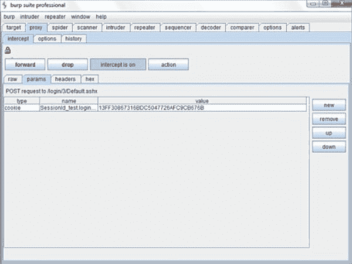

**图 5.1** Burp Proxy Cookie 捕获

### 输入验证

`Input validation`（输入验证）是验证从客户端接收数据的过程。当客户端输入在被 Web 应用程序处理前未经过验证时，就会出现此缺陷。应使用 Web 应用程序控件来检查输入是否有效。这变得很重要，因为在许多自动化系统中，一个系统的输出是另一个系统的输入。在这种情况下，应检查数据以验证来自发送和接收应用程序的信息。例如，如果你在要求输入正值的字段中输入负数量，Web 应用程序实际上会接受吗？它不应该！图 5.2 显示了一个构建不佳的应用程序输入表单示例。请注意总计为 –$2,450.99。


**图 5.2** 输入验证错误

### SQL 注入


许多数据库产品（如 Microsoft SQL Server、MySQL 和 Oracle）都允许进行复杂的访问查询。如果数据库和底层操作系统没有实施适当的安全控制，攻击者就可以针对数据库创建查询，从而泄露未经授权的信息。这种攻击通常被称为 *SQL 注入*。当攻击者使用一系列恶意 SQL 查询直接操纵 SQL 数据库时，就会发生 SQL 注入攻击。SQL 注入攻击可以从网站的地址栏、应用程序字段内部，或通过查询和搜索发起。一旦发起 SQL 注入，格式错误的输入可能导致数据库变得不稳定或泄露信息。攻击者使用诸如单引号（`'`）之类的逻辑来测试数据库的漏洞。如以下代码所示的响应会给攻击者提供所需的反馈，让他们知道数据库容易受到攻击：

```
Microsoft OLE DB Provider for ODBC Drivers error '80040e14'
[Microsoft][ODBC SQL Server Driver][SQL Server]Syntax error converting
the nvarchar value 'sa_login' to a column of data type int.
/index.asp, line 5
```

防止这类输入问题需要真正的纵深防御。这始于在流量进入网络之前对其进行过滤。一种方法是使用 Web 应用程序防火墙（WAF），这是防火墙设计的下一步进阶。WAF 分析 Web 流量，可用于过滤掉 SQL 注入攻击、恶意软件、XSS 和 CSRF。WAF 需要高度的应用感知能力，因为它们能够分析 Web 流量并查找诸如恶意 XML 结构和 SQL 注入命令之类的项目。

另一种可用于帮助防御 SQL 注入攻击的工具是数据库活动监控（DAM）。DAM 系统的出现是因为公司面临的威胁（如 SQL 注入）比过去多得多。此外，对合规性的需求也大得多，以便公司能够追踪数据库内发生的活动。HIPAA 和 PCI-DSS 等法律法规增加了这种需求。DAM 基本上监控数据库并分析正在发生的活动类型。你可以将 DAM 视为类似于安全信息和事件管理（SIEM），只不过 SIEM 系统（如 Splunk）关联并分析来自多个来源的事件，而 DAM 则专门关注数据库访问和活动。

### 应用程序沙箱

*应用程序沙箱*是指将文件写入沙箱或临时存储区，而不是其正常位置的过程。沙箱技术用于限制代码在用户计算机上执行恶意操作的能力。如果你在沙箱中启动应用程序，它将无法编辑注册表，甚至无法更改用户硬盘上的其他文件。

沙箱技术的一个应用领域是*移动代码*。移动代码是指从远程系统下载并在执行下载的计算机上运行的软件。移动代码的安全问题在于它在本地执行。很多时候，用户甚至可能不知道代码正在执行。Java 就是移动代码，它在沙箱环境中运行以提供额外的安全性。数据处理可以是客户端处理，也可以是服务器端处理。服务器端处理是指代码在服务器上处理，而客户端处理则是代码在客户端运行。PHP 是一种服务器端处理语言的示例，而 JavaScript 在客户端处理，可由浏览器执行。

### 应用程序安全框架

应用程序安全框架是一种系统开发框架，可使安全管理员更轻松地管理开发过程。它旨在根据需要内置安全控制。存在许多不同的模型和方法。有些步骤更多，但总体目标相同：控制流程并增加安全性以构建纵深防御。一种行业公认的方法是标准化的 SDLC 流程。NIST 在 NIST SP 800-34 中将 SDLC 定义为“与系统相关的活动范围，涵盖系统的启动、开发和获取、实施、运行和维护，最终是其处置，从而引发另一个系统启动。”表 5.2 简要概述了典型的 SDLC 及相关活动。

**表 5.2** 典型系统开发生命周期活动

| SDLC 步骤 | 说明 |
| --- | --- |
| 需求 | 定义项目目的以及必须满足的客户需求。将客户需求提炼为一组可测试的系统需求，包括安全控制。 |
| 可行性 | 确定是否有足够的资源可用于开发满足客户需求的软件。 |
| 设计 | 开发设计规范并验证其是否满足所有需求。 |
| 开发 | 编写代码，验证其是否符合设计规范，并对其进行测试以确认其满足所有系统需求。 |
| 实施 | 由客户安装、最终用户测试，并将软件投入运行。 |
| 实施后 | 正式评审以评估系统的充分性。可执行成本效益分析和评审，以确定项目价值并改进未来项目。 |
| 维护 | 根据用户体验进行功能增强，根据新出现的威胁发布安全补丁，并在发布前对所有软件变更进行全面回归测试。 |

标准和指南可能来源于政府或开源社区，包括 CMU 软件工程研究所（SEI）、NIST 和 OWASP。OWASP 项目为 Web 开发人员提供资源和工具。OWASP（`www.owasp.org`）维护一系列工具和文档，并将其组织为以下类别：

1.  **保护** 可用于防范安全相关的设计和实现缺陷的工具和文档
2.  **检测** 可用于发现安全相关的设计和实现缺陷的工具和文档
3.  **生命周期** 可用于将安全相关活动纳入 SDLC 的工具和文档

#### 标准库

编程语言的*标准库*是该语言的每个实现中都可用的库。根据宿主语言提供的构造，标准库可能包含子程序、宏定义、全局变量和模板等项目。标准 C++ 库可分为以下类别：

*   标准模板库
*   输入和输出
*   标准 C 头文件

问题在于，当程序员不遵循业界公认的开发健壮、安全应用程序的方法时，某些 C 标准库函数可能会被不当使用，或以可能导致安全问题的方式使用。一些可被利用的 C 函数（因为它们不检查缓冲区大小）包括 `strcat()`、`strcpy()`、`sprintf()`、`vsprintf()`、`bcopy()`、`scanf()` 和 `gets()`。

#### 安全编码标准

*安全编码*是指构建具有高安全性和质量保证的安全软件的实践。构建安全软件要求你执行以下操作：

*   了解导致安全漏洞的常见软件弱点
*   遵循安全编码标准和实践
*   执行深度代码审查


许多公司面临的问题是，程序员通常不是安全专业人员，且受不同因素驱动。很多时候，开发代码并将其推向市场的过程非常匆忙。此外，程序员通常最关心的是让应用程序正常运行。安全编码要求程序员考虑安全专业人员的关注点，解决为软件指定的所有安全需求，同时遵守规定的编码标准，并假设会有人尝试直接、间接或通过操纵软件来颠覆程序的行为。一些最佳实践包括：

*   不要依赖任何非自生成的参数。
*   尽可能避免复杂代码，保持代码简单、精简。
*   不要添加额外功能。程序员应仅实现软件规范中定义的函数。
*   最小化入口点，并尽可能减少出口点。
*   验证所有输入值。输入必须具有正确的长度、范围、格式和数据类型。
*   将相互依赖关系降至最低，以便在不需要时可以禁用任何进程模块或组件。
*   开发的模块应具有高内聚和低耦合。

编写安全代码后，需要对其进行测试。测试分为以下几类：

1.  **单元测试** 检查单个程序或模块。
2.  **接口测试** 检查硬件或软件，评估数据从一个实体传递到另一个实体的效果。
3.  **系统测试** 一系列测试，可能包括恢复测试和安全测试。
4.  **最终验收测试** 通常在实施阶段执行，在团队负责人对所有其他测试感到满意且应用程序准备好部署后进行。

### 应用程序漏洞利用

*应用程序漏洞利用* 是计算机犯罪分子用于攻击应用程序的一大类攻击向量。攻击者可以通过多种方式针对应用程序。无论采取何种路径，一旦成功，攻击者都可能对您的业务或组织造成损害。由此造成的损害可能从轻微到导致公司倒闭不等。根据应用程序的设计方式，应用程序漏洞利用可能容易发现，也可能极难发现。考虑到因素众多，需要一个切入点。因此，OWASP 列出了 2013 年十大应用程序安全风险如下：

1.  注入
2.  失效的身份认证和会话管理
3.  XSS（跨站脚本攻击）
4.  不安全的直接对象引用
5.  安全配置错误
6.  敏感数据泄露
7.  缺失功能级访问控制
8.  CSRF（跨站请求伪造）
9.  使用含已知漏洞的组件
10. 未验证的重定向和转发

### 权限提升

*权限提升* 是指攻击者将其在系统上的权限从低级用户提升至管理员或 root 的过程。当代码运行时的权限高于执行它的用户权限时，就会发生权限提升。权限提升技术包括：

1.  **垂直权限提升** 低权限用户或应用程序访问保留给高权限用户或应用程序的功能或内容。
2.  **水平权限提升** 普通用户访问保留给另一个普通用户的功能或内容。

应用程序和操作系统通过多种方式防止此类攻击。其中一种是构建保护环。保护环模型为操作系统提供了多个层级，用于执行代码或限制其访问。它提供的粒度比仅在用户模式和特权模式下运行的系统细得多。随着向模型外边界移动，特权降低；向内边界移动，特权增加。此模型的示例可见 图 5.3。

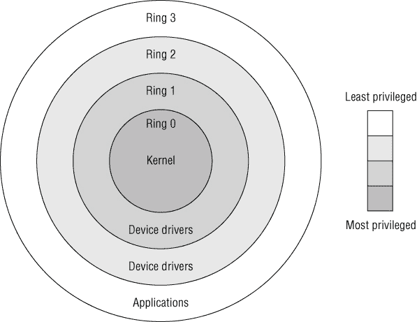

**图 5.3** 保护环

### 敏感数据存储不当

敏感数据存储不当是一个严重问题。敏感数据并不总是受到适当控制或加密解决方案的保护。在 SDLC 过程的需求阶段，必须为敏感数据定义安全控制。此时，必须提出以下问题：

*   数据是否需要加密？
*   是否存储了信用卡号、健康记录或其他敏感个人信息？
*   是否使用了强加密标准？

如果上述任何问题的答案是肯定的，则应实施控制措施以保护数据。CASP 不仅要关注敏感数据的存储，还要关注数据的访问方式。其中一个问题是允许发生直接对象引用。直接对象引用是指开发人员允许以参数的形式直接访问文件、目录或 URL 等对象。例如，假设 URL 为 `https:/fakebank/Login.asp?w=i&o=265`。如果攻击者能操纵直接对象引用（本例中为数字 265），他们可能将其改为 275，并在未设置适当访问控制检查的情况下未经授权访问其他账户。此类攻击曾于 2000 年发生在一个加拿大网站上。详情请访问 `www.abc.net.au/7.30/stories/s146760.htm`。

CASP 还必须关注数据在生命周期结束时的处理。此时数据残留成为主要关注点。数据残留是指存储介质上留下的任何残余数据。根据信息的敏感程度，擦除驱动器可能已足够，也可能需要监督销毁介质。有服务提供安全的硬盘销毁，在处理剩余碎片前将其粉碎或压碎。使用云服务时，数据残留也是一个主要问题。

### Cookie 存储与传输

*Cookie* 用于维护会话状态。由于 HTTP 是无状态协议，因此需要 Cookie。其最初目的是存储所需信息。假设 Mike 计划通过酒店网站在俄克拉荷马城预订商务旅行的酒店。当 Mike 在网站页面间跳转时，Cookie 用于维护前几页的选择。并非所有网站在传输或存储敏感信息时都能妥善保护 Cookie。如果攻击者能在传输或存储过程中访问 Cookie，可能会执行以下操作：

*   修改 Cookie 内容。
*   注入恶意内容。
*   重写会话数据。

您可能认为 Cookie 旨在安全地存储敏感信息，但并非总是如此。带有“记住我”功能的 Cookie 可能包含密码或用户名。示例如下：

```
Set-Cookie: UID= bWlrZTptaWtlc3Bhc3N3b3JkDQoNCg; expires=Fri, 16-May-2011
```

`UID` 值看似包含随机字母，但实际不止于此。若通过 Base64 解码器运行，可能得到 `Mike:CASPexam`。在 Cookie 中存储用户名和密码从来都不是好习惯，尤其是在不安全的状态下。这就是为什么必须在传输和存储过程中保护 Cookie 的原因。传输时可使用 HTTPS，确保 Cookie 在从服务器传输到客户端的过程中安全且加密。存储时，所有敏感数据应加密，且应在修改任何 Cookie 值前调用 `session_set_cookie_params()`。

### 恶意软件沙箱


### 恶意软件沙箱

**恶意软件沙箱** 是一种用于隔离恶意代码以使其在隔离环境中运行的技术。你可以将恶意软件沙箱视为一个独立的环境，它让你能够安全地查看或执行程序，同时将其限制在可控范围内。沙箱服务的两个优秀示例是 Cuckoo 和 ThreatExpert。ThreatExpert 在虚拟环境中执行文件，这非常类似于 VMware 和 Virtual PC。这个出色的工具会跟踪文件系统、注册表、内存和网络所做的更改。ThreatExpert 甚至使用 API 钩子实时拦截恶意软件的交互。

即使使用沙箱，你也不应指望恶意软件创建者会让分析过程变得简单。例如，恶意软件创建者会构建检查机制，试图阻止其恶意软件在沙箱环境中运行。恶意软件可能会检查 MAC 地址以尝试确定网卡是否被识别为虚拟网卡，或者如果没有活动的网络连接则拒绝运行。在这种情况下，你可能需要额外的工具，如 FakeNet，它模拟网络连接来欺骗恶意软件，以便分析人员可以在沙箱环境中观察恶意软件的网络活动。

#### 内存转储

**内存转储** 是另一种可用于分析程序或恶意应用程序的技术。内存转储可用于提取内存内容，以便检查恶意软件的活动。之所以使用此技术，是因为静态分析并不总是可行的。

一些恶意软件编写者会混淆代码，使其难以检查。为了对抗混淆，安全专业人员可能会在解压或解密例程完成后，通过从内存中转储未打包的程序来执行运行时调试。这可以实现更好的分析；然而，一些攻击者使用具有反转储功能的加壳器，以保护其恶意程序免遭分析。可用于内存转储的工具包括：

*   IDA Pro
*   LordPE
*   OllyDbg

#### 客户端和服务端的进程处理

在编码开始之前，开发人员必须决定将使用哪种编程语言以及进程将在何处执行。进程可以在客户端或服务端处理。本节将回顾这些问题。有许多问题和技术需要考虑。这些包括：

*   JSON/REST
*   浏览器扩展
*   异步 JavaScript 和 XML (Ajax)
*   JavaScript/小程序
*   Flash
*   HTML5
*   SOAP
*   Web 服务安全
*   缓冲区溢出
*   内存泄漏
*   整数溢出
*   竞争条件 (TOC/TOU)
*   资源耗尽

### JSON/REST

JSON (JavaScript Object Notation，JavaScript 对象表示法) 是一种轻量级的、人类可读的编程格式，天然适配 JavaScript 应用程序。它是 XML 的替代方案，主要用于在服务器和 Web 应用程序之间传输数据。一个潜在的安全问题是 JSON 可用于执行 JavaScript。REST (Representational State Transfer，表述性状态转移) 用于移动应用程序和混搭工具，作为一种简单的无状态架构，通常运行在 HTTP 之上。它被认为比其他技术（如 SOAP）更易于使用。其优势包括易于使用和修改，以及有助于组织复杂的数据集。

### 浏览器扩展

浏览器扩展是一种用于增强 Web 浏览器功能的计算机程序。浏览器扩展最初执行基本任务，现在越来越多地用于极大地扩展客户端组件的功能。浏览器扩展在浏览器内运行，跨多个客户端平台，并提供独立应用程序的能力。扩展通常针对你正在使用的特定浏览器下载，因为并非所有扩展都是通用的。此外，扩展可能会降低浏览速度或潜在地引入安全缺陷。一些扩展示例包括：

*   TinyURL 生成器，用于创建短网址
*   Print Pages to PDF，这是一个 PDF 打印机
*   Heartbleed Notifier，它会告诉你某个网站是否容易受到 Heartbleed SSL 漏洞的影响

### Ajax

Ajax 是一种用于开发 Web 应用程序的编程语言，它结合了 XHTML、CSS、基于标准的表示和 JavaScript。当用户执行操作时，Ajax 允许网页上的内容立即更新。与其他编程语言一样，Ajax 也可能存在安全问题，主要是易受注入攻击。一种设计方法是使用 Ajax 开发应用程序，使其仅响应按预期发送的请求。所有格式错误的请求都应被静默忽略，从而减少安全问题的可能性。

### JavaScript/小程序

JavaScript 是一种面向对象的脚本语言。JavaScript 是 ECMAScript 语言的一种实现，广泛用于网页和应用程序中。它对于与网页的文档对象模型 (DOM) 交互的函数很有用。

与 JavaScript 有些相关的是 Java 小程序。Java 小程序是以字节码形式交付给用户的代码片段。这些通常只有 1 或 2 字节的少量代码，允许程序员传递要执行的小型特定指令。它们的优势在于速度以及小程序可以在许多不同的平台上执行。当支持 Java 的浏览器遇到小程序时，它会获取字节码并将其传递给浏览器，由浏览器执行代码。

从安全角度来看，JavaScript 令人担忧，因为它可以在用户的浏览器中本地运行。虽然这意味着它可以快速响应用户的操作，但也意味着 JavaScript 容易受到 XSS 和 CSRF 的攻击。XSS 可能具有潜在危险。考虑这样一种情况：攻击者在受害者连接到其银行网站时发起 XSS 攻击。这可能允许攻击者以受害者的权限访问银行应用程序。结果可能是未经受害者授权泄露秘密信息或转移大量资金。CSRF 的利用方式大致相同——攻击者使用 JavaScript 诱骗受害者的浏览器采取用户无意执行的操作（例如在银行网站转账）。

### Flash

Flash 旨在创建交互式网站。其主要优势之一是它可以与许多不同的操作系统和设备配合使用。然而，一些供应商（如 Apple）并不完全支持 Flash。根据 `http:/money.cnn.com/2013/10/08/technology/security/adobe-security/`，Flash 多年来遭受了许多问题，包括：

*   2009 年，Reader 中的一个漏洞让黑客能够在人们的电脑中打开后门。
*   2010 年，攻击者创建恶意 PDF 附件入侵了包括 Adobe、Google 和 Rackspace 在内的多家公司。
*   2011 年，另一个漏洞让黑客利用 Flash Player 远程访问人们的电脑。
*   2012 年，网络黑客通过入侵 Adobe 的内部服务器，访问了 Adobe 的安全验证系统。

### HTML5

HTML5 是 HTML 编程语言的第五次修订。HTML5 设计为向后兼容。它支持新功能、新输入类型和表单验证。任何新事物的问题在于攻击者会开始寻找可利用的漏洞。在 2012 年的 Black Hat 大会上，发现了 HTML5 的十个问题；其中包括 CSRF、点击劫持、XSS 和攻击 DOM 变量。你可以在 `www.securityweek.com/top-10-security-threats-html5-black-hat` 阅读更多内容。

#### SOAP


#### 简单对象访问协议 (SOAP)

简单对象访问协议 (SOAP) 旨在在计算机网络中交换基于 XML 的信息。SOAP 提供了一种基本的消息传递格式。消息是在 SOAP 节点之间的单向传输。消息由三部分组成：一个信封、一组处理规则，以及一组过程调用和响应。SOAP 的优势在于它构建在开放技术之上，可在各种平台上运行。然而，由于 SOAP 可以通过 HTML 传递消息，因此攻击者有可能拦截这些消息并篡改或窃听其内容。

### Web 服务安全

Web 服务安全 (WS-Security, WSS) 是由 OASIS 开发的一种安全技术，旨在作为 SOAP 的扩展。SOAP 与其他应用程序一样存在的一个主要问题是输入验证不足和数据清理不当。WS-Security 旨在通过 HTTPS 等协议接收 SOAP 消息形式的输入。SOAP 可与多种格式配合使用，例如安全断言标记语言 (SAML)、Kerberos 和 X.509 证书。SOAP 可提供机密性、完整性和不可抵赖性。

##### 缓冲区溢出

当写入缓冲区的数据量超过缓冲区的限制时，就会发生缓冲区溢出。这可能允许恶意用户执行几乎任何操作。缓冲区为任何单一任务分配了有限的空间。例如，如果你分配了一个 32 字符的缓冲区，然后试图将 64 个字符塞进去，就会出现问题。

缓冲区是一个临时数据存储区。缓冲区应具有程序创建的定义长度。延续前面的例子，程序编写时应检查你是否试图将 64 个字符塞入 32 字符的缓冲区。虽然这看起来很简单，但这种错误检查并不总是会发生。图 5.4 显示了一个缓冲区溢出的示例。

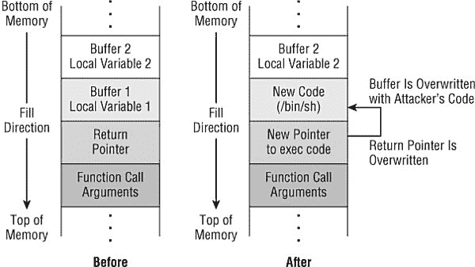

**图 5.4** 缓冲区溢出

缓冲区溢出可能导致各类安全漏洞，因为无论格式如何，应用程序都会接受这些值。大多数情况下，这可能不是问题。但它可能导致程序崩溃，或者如果攻击者精心构造，这些信息可能被解释为指令并执行。如果发生这种情况，几乎任何事情都有可能发生，包括打开 Shell 命令以执行定制代码。整数溢出会重置指针或溢出归零，而缓冲区溢出则允许攻击者在受害者的机器上运行其代码。寻求发起缓冲区溢出的攻击者通常遵循以下步骤：

1.  找到缓冲区的存在和位置。
2.  向缓冲区写入超出其处理能力的数据。
3.  覆盖函数的返回地址。
4.  将执行流程更改为攻击者的代码。

完成这些步骤的攻击者可以在与易受攻击进程相同的访问级别运行应用程序。然后攻击者可能会创建后门，或使用 `Cryptcat` 或 `Netcat` 等工具重定向输入/输出。一旦完成此操作，攻击者便可重定向 Shell 以获取命令行访问权限。

### 内存泄漏

`内存泄漏` 是应用程序未释放其已分配、已使用且不再需要的内存所导致的结果。内存泄漏是某些标准库中常见的编程错误。当应用程序无法正确释放先前分配的内存时，就会出现此问题。虽然泄漏最初可能很小，但随着时间推移，泄漏越来越多内存的程序会表现出从性能下降到内存耗尽并锁死或崩溃等症状。某些编程语言比其他语言更容易出现内存泄漏。例如，在 C 编程语言中，你使用 `malloc` 函数调用来分配一块内存，但可能会忘记调用与 `malloc` 对应的 `free` 函数来释放内存。如果此过程重复数百次，可能会丢失大量内存。

内存泄漏常见于 C/C++ 等常用编程语言中。虽然 C 语言具有动态分配和释放内存的能力，但这也意味着 C/C++ 应用程序是最常见的存在内存处理问题的应用程序之一。

### 整数溢出

当程序或应用程序尝试将一个数字存储在变量中，而该数字大于该变量类型所能处理的最大值时，就会发生 `整数溢出`。考虑这样一种情况：分配的缓冲区可容纳高达 65,535 的值。如果有人能够超过此值，并尝试将一个大于最大值的值存储在无符号整数类型中，则只会保留模数——例如，65535 + 1 = 0。因为超过了最大尺寸，该值实际上会绕回到 0。如果在计算中使用生成的值，结果可能会导致一些异常行为。图 5.5 显示了一个很好的示例。


**图 5.5** 整数溢出示例

许多经典电子游戏中都可以看到此问题的示例，例如吃豆人。吃豆人使用了 8 位计数器，因此如果玩家技术足够好，完成了 255 关，游戏就会崩溃；用于绘制每一关的计数器溢出归零。经典电子游戏与我们今天使用的复杂应用程序相去甚远，但其概念保持不变。

### 竞争条件 (TOC/TOU)

`竞争条件` 是一种通常以时机为目标的攻击形式。其目的是利用检查时间 (TOC) 和使用时间 (TOU) 之间的延迟。这些攻击有时被称为异步攻击。这是因为攻击者竞相在对象存储后但在系统使用它之前对其进行更改。

竞争条件被认为是在应用程序安全测试期间最难检测的应用程序问题之一。最好在流程早期，即代码审查期间识别竞争条件。竞争条件也可能难以利用，因为攻击者可能需要尝试多次利用竞争条件才能成功。

### 资源耗尽

`资源耗尽` 是一种拒绝服务 (DoS) 技术，当执行某项操作所需的资源被完全消耗时就会发生。这会阻止所需操作的进行。资源耗尽的影响是正常操作和通信的中断。很多时候，攻击者完成此操作比访问系统或应用程序更容易。此处列出了一些经典的 DoS 工具。请记住，列出这些是为了演示多年来这些类型工具的使用方式。如今，大多数此类攻击已不再有效，对于较新的资源耗尽攻击，通常使用负载均衡器提供集中式防御。

1.  Smurf 通过发送一个伪造的 ping 数据包来利用 Internet 控制消息协议 (ICMP)，该数据包寻址到广播地址，并将受害者的地址列为源地址。
2.  SYN 洪水 通过发送大量设置了 SYN 标志的伪造数据包来破坏传输控制协议 (TCP) 连接。这种大量的半开放 TCP 连接填满了受害者系统上的缓冲区，导致资源耗尽。
3.  死亡之 Ping 过大的数据包是非法的，但使用分片时却成为可能。当片段在另一端重组为完整数据包时，会导致旧系统上的缓冲区溢出。


### 4. Teardrop

Teardrop 发送格式错误的数据包，并篡改分片偏移值，使得接收到的数据包发生重叠。受害系统无法处理这些重叠片段，导致系统崩溃或死机，从而造成拒绝服务。

### 5. Land

Land 发送一个 TCP SYN 数据包，其源端口和目的端口及 IP 地址相同。由于系统不知如何处理此类流量，CPU 占用率飙升至 100%，所有现有资源被耗尽。

### 6. Trinoo

Trinoo 用大量垃圾流量淹没受害者。在 20 世纪 90 年代末，Trinoo 易于攻击者使用，且威力巨大，能够淹没目标系统并耗尽所有可用带宽。

## 安全评估与渗透测试

**安全评估** 是指对组织的网络、策略和安全控制进行系统性检查。安全评估用于确定安全措施的充分性、识别安全缺陷，并提供数据以预测潜在安全措施的有效性。安全评估可遵循不同的方法和技术。

### 测试方法

CASP 考试要求你了解各种安全评估测试方法，以便你能充分应对任何挑战。安全评估可分为以下几类：

1.  **安全审计**  
    安全审计是对 IT 系统进行的独立审查和检查，用于确定控制措施的充分性。安全审计还会审视现有策略及其与操作程序的映射关系。

2.  **漏洞评估**  
    漏洞评估通常使用自动化工具，如 `Nessus`、`Saint` 和 `Retina`。这些工具可检查系统、应用程序和设备，评估其控制措施并报告安全级别。漏洞评估工具通常每周或每月运行一次，以发现未加固或缺少关键补丁和软件更新的系统。

3.  **渗透测试**  
    渗透测试旨在从对抗角度审视网络。渗透测试可用于回答诸如：如果攻击者以公司为目标，他们能看到什么类型的信息，以及能利用这些信息做什么等问题。渗透测试专注于发现易于攻破的目标，并查看计算机犯罪分子在网络上能实现什么。

### 渗透测试步骤

渗透测试遵循一套标准方法论，类似于攻击者所使用的方法。主要区别在于渗透测试无恶意且获得目标公司许可。在渗透测试开始前，客户与测试团队会面讨论测试目标。测试可能旨在检查外部或内部人员、有或无访问权限的人员能访问和利用什么资源。初步会议后，团队起草合同供客户审核；双方同意条款并签署合同后，渗透测试正式开始。渗透测试通常遵循以下步骤：

1.  **信息收集**  
    此步骤旨在检查有关目标公司的哪些信息是公开可获取的。

2.  **扫描**  
    此步骤包括端口扫描和操作系统指纹识别。常用工具有 `Nmap` 和 `Zenmap`。

3.  **获取访问权限**  
    此步骤是渗透测试团队尝试获取目标网络访问权限的阶段。方法可能包括社会工程学、利用弱口令、木马和键盘记录器。

4.  **提升权限**  
    获取访问权限虽有帮助，但测试团队必须成为 `system`、`root` 或 `administrator` 才能获得完全控制。用于完成此任务的技术可能包括缓冲区溢出、`SQL` 注入或 `XSS`。

5.  **维持访问权限**  
    系统可能被修补、漏洞被发现或安全漏洞被察觉。此步骤是测试团队寻求维持其访问权限的阶段。可通过创建账户、植入后门或建立加密隧道来实现。

6.  **清除痕迹**  
    测试目标达成后，团队将移除网络上放置的任何项目、恢复系统并清除任何残留代码。

7.  **确定建议**  
    这是团队开始对发现进行最终审查的阶段。通过会议和审查，团队开始确定其建议。

8.  **编写报告并汇报发现**  
    最后一步是撰写报告。报告列出已发现的漏洞和风险，并列出关于应实施的管理、技术和物理控制的建议，以更好地保护组织的关键资产。

### 评估类型

渗透测试有不同的方法。根据具体情况及雇主或客户需求，评估可通过以下几种方式进行：

1.  **黑盒测试**  
    黑盒测试中，测试团队对目标网络或系统知之甚少或一无所知。黑盒测试模拟外部攻击，因为外部人员通常不了解他们探测的网络或系统。测试团队必须在测试前收集目标的各类信息。团队通常在尝试渗透网络并开始分析其优劣势前，先验证 IP 地址范围是否正确。在黑盒测试中，公司人员不应知晓正在接受测试。这额外提供了确定监控、检测和响应策略执行情况及有效性的优势。

2.  **白盒测试**  
    *白盒* 测试采取与黑盒测试相反的方法。白盒评估中，渗透测试团队完全了解网络、系统和基础设施。此信息使渗透测试能遵循更结构化的方法。白盒与黑盒测试的另一大区别在于：黑盒测试通常花费更多时间收集信息，而白盒测试将该时间用于探测漏洞。

3.  **灰盒测试**  
    灰盒方法意味着对设备有限的洞察，例如掌握部分代码知识。

### 漏洞评估领域

并非所有安全评估都相同；每次评估可能审查不同领域。常见评估领域包括：

1.  **拒绝服务**  
    DoS 测试考察公司抵御潜在 DoS 攻击的能力。某些组织也用此测试网络在重负载或高利用率下的运行状况。此类测试的目标通常包括评估 DoS 攻击的影响、确定网络性能、以及衡量受攻击设备的影响。

2.  **无线网络**  
    无线网络在当今网络中扮演的角色比以往任何时候都重要。毕竟，它们易于部署、易于使用且无需布线。无线评估检查组织的无线网络。它解决的问题包括：是否使用加密、使用何种类型及能否被破解。无线测试还检查 DoS 攻击、地址解析协议（`ARP`）欺骗和中间人攻击的潜在可能性。


# 无线

无线不仅仅是 WiFi 和 802.11b/g/n。无线还可以包括蓝牙，甚至更冷门的协议，如 Zigbee（例如用于无线暖通空调系统）。还有射频识别 (RFID)，它被用于从大型连锁商店服装标签到用于楼宇门禁控制的员工工牌等各个方面。

#### 1. 电话系统

测试语音系统不仅仅涉及传统电话系统。电话系统测试包括对 IP 语音 (VoIP)、传真、专用交换机 (PBX) 以及所有语音线路的检查。仍有计算机通过调制解调器连接，用于供应商访问专用系统（例如暖通空调）以及网络人员的应急远程备份访问。每个领域对公司都可能至关重要。例如，如果公司的 PBX 被黑客攻击，可能会遭受话费欺诈、收入损失，甚至机密信息泄露。

#### 2. 应用与安全代码审查

有时安全评估的重点可能不在网络、防火墙、内部人员，甚至不在外部人员身上。毕竟，代码是让应用程序和软件满足我们需求的共同组成部分。即使在部署良好且安全的网络中，薄弱的应用程序也可能将公司的关键资产暴露给攻击者。`安全代码审查` 是对应用程序的检查，旨在识别和评估对组织的威胁。

安全代码审查假设你拥有待检查应用程序的所有源代码。有时你可能拿不到代码，或者外部库、组件等项目不可访问。在没有代码的情况下，可以使用黑盒测试技术，以及 Rough Auditing Tool for Security (RATS) 和 Flawfinder 等工具。

无论何种情况，关注领域都包括用户提供的初始数据等项目。必须检查用户提供的任何值是否有效。所有输入、处理过的数据、正在存储或处理的值以及输出数据都必须进行检查。

#### 3. 社会工程学测试

`社会工程学` 是欺骗他人提供信息或访问其不应拥有的信息的行为。如果你被要求作为安全评估的一部分执行社会工程学测试，有一些常见领域需要审查。这些包括服务台、现场员工和承包商。作为一种攻击载体，社会工程学是潜在危害最大的攻击之一，因为它不直接针对技术。拥有优秀的防火墙、入侵检测系统 (IDS) 和边界安全意义不大，如果攻击者使用社会工程学技术通过 VoIP (`vishing`，语音钓鱼) 致电服务台并索要密码。社会工程学之所以危险，是因为攻击针对的是人。社会工程学可以是人与人之间的，也可以是基于计算机的。

#### 4. 物理测试

物理测试涉及对公司物理控制措施的检查。这可以包括锁、大门、围栏、保安、身份认证和物理资产控制。

## 安全评估与渗透测试工具

对于想了解更多安全评估工具的人来说，好消息是有大量工具可用，而且许多是免费的。过去并非总是如此。早在 1995 年，Dan Farmer 和 Wietse Venema 创建了最早的漏洞评估程序之一，称为网络安全管理员分析工具 (SATAN)。该程序为后续许多工具树立了标准，使得通过互联网扫描易受攻击的计算机成为可能，并在一个应用程序中提供了多种功能。你将在练习 5.2 中使用此类程序的一个当前示例。

虽然工具能让你的工作更轻松，但值得注意的是，安全专业人员使用的大多数工具也被攻击者使用。这些应用程序可用于扫描网络、探测漏洞，甚至发现和修复问题，但计算机犯罪分子可能会使用相同的工具来利用系统和网络弱点。漏洞评估工具已经存在一段时间了。

为了 CASP 考试的目的，这些工具已按逻辑顺序排列。安全评估通常遵循定义明确的方法论。此处的重点是引导你完成整个过程，并简要讨论每个步骤可用的一些工具。工具分为以下类别：

*   足迹工具
*   端口扫描工具
*   指纹识别工具
*   漏洞扫描工具
*   网络枚举工具
*   协议分析工具
*   密码破解工具
*   模糊测试与错误注入工具
*   无线工具
*   HTTP 拦截器
*   漏洞利用框架与攻击工具

让我们首先关注足迹工具。

### 足迹工具

评估的第一步是 `足迹`。足迹是确定向外部人员暴露了多少信息及其潜在危害。我喜欢把足迹想象成老派的侦探工作。它关乎拼凑你收集到的信息碎片。足迹通常分为两类：主动侦察和被动侦察。

1.  **主动侦察** 以某种主动方式与目标互动，例如致电目标公司并请求参观
2.  **被动侦察** 以被动方式与目标互动，例如查看目标公司的网站或招聘广告

开始被动侦察的好地方是目标的网站。一些公司在其网站上泄露大量信息，令人惊讶，攻击者可利用这些信息。电子邮件地址可用于网络钓鱼，员工姓名可用于社会工程学，或组织位置可用于规划物理攻击。公司必须考虑其在网站上公开信息的安全隐患，尽管这始终关乎寻找平衡。公司在招聘广告中也会发布大量信息，例如使用的技术类型。虽然安全评估团队可能不会花费数周进行足迹活动，但他们可能会花费几小时或一天。

要了解可在商业网站上找到的信息类型，请花点时间查看练习 5.3。

在足迹阶段接受检查的不仅仅是公司网站。安全评估团队很可能会使用 Google 内置的高级搜索查询功能。Google 命令如 `intitle` 指示 Google 在文档标题中搜索词条，而 `filetype` 等命令则允许个人仅在特定类型文件的文本中搜索。

Whois 记录是另一个将被检查的领域。接下来，查看 IANA、ARIN 和 RIPE 数据库。你可以手动完成此过程，或使用许多为此目的创建的网站，包括 `www.dnsstuff.com`、`http:/all-nettools.com` 和 `http:/geektools.com`。许多组织会花时间从 Whois 记录中移除员工姓名，但其他组织则留下这些信息供攻击者收集。

渗透测试团队在进行足迹时可能访问的其他一些网站包括：

1.  **招聘网站** 这些网站可用于发现组织使用的设备类型。
2.  **财务记录** 上市公司可在 Hoover's (`www.hoovers.com`)、邓白氏 (`www.dnb.com`) 和证券交易委员会 (`www.sec.gov`) 进行搜索。此类记录包括高管、董事会成员和高级管理人员的姓名和地址；财务数据；以及收购或剥离行业的信息。


#### 3. 旧网站

互联网档案馆网站托管着 Wayback Machine（`http:/wayback`.`archive`.`org`）。它是一个包含超过 400 亿个网页的目录，最早可追溯至 1996 年。

#### 4. 社交媒体

社交媒体可以包含大量技术，例如互联网论坛、网络日志、社交博客、微博客、维基、播客和社交网络。社交媒体的主要问题之一是隐私，以及可以通过这些网站收集的大量信息。在渗透测试期间，还应审查 LinkedIn、Facebook 和 Twitter 等社交网络站点。这些正是攻击者会检查的服务，以了解发布了什么样的信息。

如果你不认为社交媒体会成为问题，请考虑以下情况：

1. **Please Rob Me** 一个概念验证网站，旨在汇总来自各种社交网络站点的信息，以判断某人是否在家或外出，从而实施入室盗窃。
2. **We Know What You Are Doing** 一个旨在挖掘 Facebook 数据的网站，以查明诸如谁在吸毒、谁想被解雇等信息。
3. **Robin Sage** 一个虚假的 Facebook 个人资料，曾被用来诱骗美国众议员幕僚长、多家国防承包商的多位高管及其他人员与该虚假资料建立联系。
4. **钓鱼式诈骗** 冒充他人或在社交网络站点上建立虚假个人资料。这一行为因大学橄榄球运动员 Manti Te'o 的 Facebook “虚拟女友” 与他 “分手” 而曝光。

### 端口扫描工具

端口扫描是足迹收集后的下一个合乎逻辑的步骤。`端口扫描器` 是一种用于扫描 TCP 和 UDP 端口并报告其状态的工具。端口扫描器利用 TCP、UDP 和 ICMP 等协议。一个流行的工具是 Nmap。它可在 Linux 或 Windows 上运行，并能执行多种扫描类型。该过程包括以下内容：

1. **ICMP `ECHO_REQUEST/REPLY`** 使用互联网控制消息协议 (ICMP) ping 数据包的目的是确定目标计算机是否会响应。虽然这很有用，但许多网络不再允许 ping 数据包进入其网络。如果仍允许 ping，则可以确定网络上哪些机器处于活动状态。
2. **端口扫描** 端口扫描允许运行探测的个人确定目标计算机上运行了哪些服务。端口与 TCP 和 UDP 相关联并由两者使用。虽然应用程序可以设置为在非标准端口上运行，但既定端口号作为事实上的标准。共有 65,536 个端口，分为 `知名端口` (0–1,024)、`注册端口` (1,024–49,151) 和 `动态端口` (49,152–65,535)。常见的端口扫描技术包括以下内容：
    1. **TCP 全连接扫描** 尝试完成 TCP 三次握手的所有三个步骤。
    2. **TCP SYN 扫描** 为更隐蔽而开发的半开放扫描。如今这种扫描被检测到的可能性同样很大。开放端口回复 SYN/ACK，关闭端口响应 RST/ACK。
    3. **TCP FIN 扫描** 向目标端口发送 FIN 数据包。关闭的端口应回送 RST。
    4. **TCP NULL 扫描** 发送一个未设置任何标志的数据包。关闭的端口应返回 RST。
    5. **TCP ACK 扫描** 尝试确定规则集或识别是否正在使用无状态检测。如果返回 ICMP 目标不可达消息（类型 3 代码 13），则认为该端口被过滤。
    6. **TCP XMAS 扫描** 此扫描技术开启了 FIN、URG 和 PSH 标志。关闭的端口应返回 RST。

最著名的端口扫描工具之一是 Nmap。该应用程序适用于 Windows 和 Linux，也同时提供命令行版和基于 GUI 的应用程序。另一个流行的端口扫描工具是 SuperScan，一款由 Foundstone 开发的基于 Windows GUI 的扫描器。它将扫描 TCP 和 UDP 端口并执行 ping 扫描。另一款可用工具是 THC-Amap，它是最早采用新型端口扫描方法的端口扫描工具之一。THC-Amap 存储了一组响应，可将其发射向端口以交互方式引发响应。THC-Amap 利用此技术查明特定端口上运行的是什么服务。

练习 5.4 将为您提供基本端口扫描技术的实操体验。

### 指纹识别工具

一旦绘制了开放和关闭端口的图谱，安全评估团队就大致了解目标系统上运行的是什么，但团队可能不知道是哪个操作系统在托管这些应用程序。`操作系统指纹识别` 确定目标系统上运行的是什么操作系统。执行操作系统指纹识别有两种方式。第一种是被动指纹识别；第二种是主动指纹识别。

被动指纹识别就是数据包嗅探。通过检查数据包的某些特征来确定操作系统。以下是用于识别操作系统指纹的四个常见检查项：

1. **IP TTL 值** 不同的操作系统在出站数据包上将 TTL 设置为唯一的值。
2. **TCP 窗口大小** 操作系统供对初始窗口大小使用不同的值。
3. **IP DF 选项** 并非所有操作系统供应商以相同方式处理分片。
4. **IP TOS 选项** 服务类型 (TOS) 是一个控制特定数据包优先级的 3 位字段。同样，并非所有供应商以相同方式实现此选项。

第二种技术，主动操作系统指纹识别，向目标发送精心制作的异常数据包设置，希望引出能识别目标的响应。虽然主动指纹识别更准确，但不如被动指纹识别隐蔽。以下列出几种主动指纹识别技术的示例：

1. **初始序列号 (ISN) 采样** 这种指纹识别技术通过查找 ISN 中的模式来工作。虽然某些系统使用真正的随机数，但其他系统（如 Windows）会以一个小的固定量递增该数字。
2. **IPID 采样** 许多系统仅为发送的每个数据包递增一个 IPID 值。其他系统（如 Windows）则为每个数据包以 256 递增该数字。
3. **服务类型** 这种指纹识别类型调整 ICMP 端口不可达消息并检查 TOS 字段中的值。某些系统使用 0，其他系统返回不同的值。
4. **TCP 选项** 同样，不同供应商对 TCP 选项的支持方式不同。通过发送设置了不同选项的数据包，响应将开始揭示服务器的指纹。
5. **分片处理** 这种指纹识别技术利用了不同操作系统供应商处理分片数据包方式不同这一事实。RFC 1191 规定 MTU 通常设置在 68 到 65,535 字节之间。

为此设计的工具包括以下内容：

1. **P0f** 一款运行在 Linux 或 Windows 上的被动操作系统指纹识别工具。
2. **Xprobe2** 主动操作系统指纹识别的一个示例，Xprobe2 依赖模糊签名匹配。指纹识别结果会被汇总，并向用户呈现一个分数，指明目标机器操作系统的概率。
3. **Nmap** Nmap 既是端口扫描器，也是主动指纹识别工具。

### 主动漏洞扫描工具

主动漏洞扫描器用于扫描内部或外部计算机的漏洞。一些漏洞评估工具是开源的，而另一些是商业的，可能需要年度订阅费。这些工具可分为三大类：


#### 源代码扫描器

源代码扫描器可用于辅助代码审查。如果您在软件产品开发期间有权访问代码，这些工具能够发现常见的问题和缺陷。`RATS` 和 `Flawfinder` 就是此类工具的两个例子。源代码扫描器可以检测诸如缓冲区溢出、竞争条件、权限提升和输入污染等问题。虽然它们很有帮助，但这些工具可能会产生大量误报。这些工具擅长查找未执行适当边界检查的特定函数。如前所述，C 语言中的某些函数不会检查缓冲区大小，例如 `scanf()`、`strcpy()`、`bcopy()`、`vsprintf()` 和 `gets()`。

#### 应用程序扫描器

在某些情况下，您可能无法访问代码。例如，假设您刚购买了微软最新的 Web 服务器产品；微软极不可能给您提供其代码访问权限。这就是应用程序扫描器发挥作用的场景。应用程序扫描器可以测试已完成的应用程序，而非源代码。应用程序扫描器查找运行时可能发生的漏洞和其他问题。应用程序扫描器还可以进行输入和边界测试。

#### 系统扫描器

扫描器的最后一类是系统级扫描器。当有工具可用于探测整个网络及所有连接的系统时，为什么只检查单个应用程序？系统扫描器可以针对单个地址或一系列地址运行。系统级扫描器的主要优势在于它们可以探测整个本地或远程系统或网络的各种漏洞。`Nessus`、`SAINT` 和 `Retina` 都是系统扫描器的例子。

使用漏洞扫描器时，您需要决定哪种方法效果最好。例如，您可能会从网络外部运行工具以查看攻击者可以访问什么内容，从网络内部在没有特定系统用户名和密码的情况下运行，或在具有用户名和密码的网络内部运行。每种方法都会产生不同的结果。在网络安全边界外运行的优势在于可以像外部人一样查看网络。只需记住，这无法告知用户关于用户权限的任何信息，甚至无法告知需要修补或更新的内容。有许多漏洞扫描工具可用，此处列举几个：

1.  **Open Vulnerability Assessment System (OpenVAS)**：一个为漏洞扫描设计的漏洞评估框架，`OpenVAS` 附带每日更新的当前漏洞数据库。
2.  **Nessus**：一款成熟的漏洞扫描器，可扫描各种系统，如 Unix、Linux 和 Windows 计算机。
3.  **SAINT**：一款商业漏洞扫描和识别工具。
4.  **Shadow Security Scanner**：一款专门扫描 Web 服务器以识别安全问题和弱点的漏洞评估产品。
5.  **LANguard**：一款全功能扫描器，可报告诸如每台机器的服务包级别、缺失的安全补丁、开放共享、开放端口，以及计算机上缺失的服务包和补丁等信息。
6.  **Retina**：来自 `eEye Digital Security` 的商业产品。该应用程序跨网络平台和设备提供广泛的漏洞扫描和识别功能。

### 被动漏洞扫描器

被动漏洞扫描器非常类似于嗅探器，它们拦截网络流量并分析其内容。被动漏洞扫描器允许安全专业人员识别诸如哪些计算机系统在通信、运行什么版本的操作系统以及使用什么应用程序等问题。被动漏洞扫描的真正优势在于，它允许您在不干扰主机系统的情况下查找漏洞。它还允许您执行持续扫描。主动漏洞扫描的问题之一是某些测试例程可能导致主机系统挂起或崩溃。使用被动系统则不存在这个问题。如果您想尝试被动漏洞扫描器，`Watcher` 可在此处获取：

`http://websecuritytool.codeplex.com/releases/view/22212`

### 网络枚举工具

**网络枚举** 是渗透测试过程的下一步。它是进入网络、系统或应用程序的最后一步。枚举可以描述为从联网设备收集信息的过程。通过枚举可以获得的一些信息包括：

*   设备信息
*   活动目录信息
*   用户名
*   开放共享
*   路由器信息
*   设备状态

以下是可用于枚举的一些工具：

1.  **操作系统的命令行**：输入 `C:\>net use \\target\ipc$ “” /u:“”` 允许用户尝试利用运行 NetBIOS 的 Windows 计算机，通过连接到空会话来进行利用。
2.  **简单网络管理协议 (SNMP) 查询**：如果计算机上存在 SNMP 版本 1 或 2，可使用查询设备的工具（如 `snmpwalk`、`snmputil`，甚至 `SolarWinds IP Network Browser`）来访问用户账户、接口和正在运行的应用程序等信息。
3.  **端口扫描器**：用于识别开放端口和应用程序。`Nmap` 是最知名的端口扫描器。
4.  **操作系统指纹识别工具**：可用于确定正在运行的操作系统版本。流行的操作系统指纹识别工具包括 `Nmap`、`P0f` 和 `Xprobe2`。
5.  **内置工具**：各种工具内置于操作系统中，可用于枚举；示例包括 `ipconfig`、`traceroute`、`ping`、`netstat` 和 `nbtstat`。这些工具均可从命令行执行。

### 协议分析器工具

**协议分析器** 或嗅探器是嗅探和捕获网络流量的硬件或软件应用程序。为便于讨论，我们将范围限定为基于软件的嗅探器。嗅探器通过将主机系统的网卡置于混杂模式来工作。处于混杂模式的网卡可以接收其能看到的所有数据，而不仅仅是发给它的数据包。嗅探器在 OSI 模型的数据链路层运行。嗅探器可以捕获线路上的所有内容并将其记录下来以供后续审查。它们允许用户查看数据包中包含的所有数据，甚至包括某些人可能想要保密的信息。许多旧协议（如 FTP 和 Telnet）以明文形式发送用户名和密码。任何拥有嗅探器的人都可以拦截这些数据并轻松重用。

如果嗅探器连接到集线器，则可以执行被动嗅探。在交换网络上执行嗅探时，称为主动嗅探，因为交换机会分割流量，并知道将流量发送到哪个特定端口，同时阻止其到达所有其他端口。交换机给任何想要出于合法或非法原因嗅探流量的人都设置了障碍。

1.  **交换端口分析器 (SPAN)**：由于交换机分割流量，因此不再可能通过将混杂模式设备连接到单个端口来监控所有流量。为了绕过这一限制，交换机制造商开发了称为端口镜像、交换机镜像或——在思科交换机上——`SPAN` 的解决方案。跨越端口允许用户不仅查看目标为其特定端口的流量，还能查看交换机转发的所有流量。此功能使交换机能够配置为：当数据被转发到交换机上的任意端口时，也会被转发到 `SPAN` 端口。在使用嗅探器以及 `Snort` 等 IDS 设备时，此功能非常有用。


#### 地址解析协议 (ARP) 洪水攻击和投毒攻击

虽然端口镜像对安全专业人员效果很好，但攻击者可能会尝试在没有设备管理权限的情况下，从交换机获得同类功能。旨在获取同等控制权限的针对交换机的攻击，可以通过 ARP 洪水攻击或 ARP 投毒攻击来尝试。

在 ARP 洪水攻击中，攻击者发送数千个具有不同物理地址的伪造数据包。其思路是填满交换机的内存，迫使其表现得像一个集线器。由于大多数现代交换机都能防范此类攻击，洪水攻击不像过去那样普遍。

第二种方法是使用 ARP 投毒攻击。回顾一下，ARP 将已知的 IP 地址解析为未知的物理地址。ARP 通过在网络上广播消息来确定主机的第 2 层物理地址。目标 IP 地址处的主机发送一个包含其 MAC 地址的回复数据包。一旦初始 ARP 事务完成，发起设备就会缓存 ARP 响应，该响应用于发送到指定 IP 地址的数据包的第 2 层头部中。

ARP 投毒攻击是通过向主机发送未经请求的 ARP 回复来实施的。这种伪造的 ARP 信息允许攻击者将流量重定向到其设备，从而成为中间人；发往合法资源的任何流量都会通过攻击系统。

有许多嗅探工具可用，其中最流行的是 Wireshark（参见 图 5.6）。Wireshark 免费，可在 Linux 和 Windows 上运行，并能捕获所有类型的网络流量。如果您从未使用过嗅探器并想尝试 Wireshark，可以在 `www.wireshark.org` 找到它。

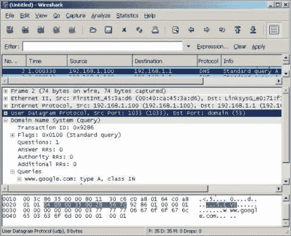

**图 5.6** Wireshark

### 密码破解工具

*密码破解* 是检索并尝试解密存储在计算机系统中或由计算机系统传输的加密密码的过程。密码破解工具可通过以下三种基本方式之一来测试密码强度：字典攻击、混合攻击和暴力破解。

#### 1. 字典密码破解

字典密码破解从字典或单词列表中提取单词，以尝试发现用户的密码。字典攻击使用预定义的字典，在加密密码和加密字典单词之间寻找匹配。很多时候，字典密码审计能在极短时间内恢复用户密码。如果密码是众所周知的基于字典的单词，字典工具会迅速破解它们。

#### 2. 混合密码破解

混合密码破解使用字典或单词列表，然后在字典单词前添加或后追加字符和数字，以尝试破解用户密码。例如，密码 `trustme` 可能会被测试为 `123trustme`、`trustm3`、`emtsurt`、`tru3tme` 等。这些不同的方法增加了成功恢复仅添加了少量变体的普通单词的几率。

#### 3. 暴力密码破解

暴力攻击使用随机数字和字符来破解用户密码。暴力密码破解可以尝试字母、数字和字符的每一种组合。对加密密码进行暴力审计可能需要几分钟、几小时、几天、几个月，甚至很多年，具体取决于密码的复杂性和长度。缩短所需时间需要更快的 CPU 或使用分布式计算。

历史上，这三种方法是破解加密密码的主要手段。有些密码被认为是安全的，因为破解它们需要太多时间。这个时间因素曾使这些密码看起来很安全。随着一种称为彩虹表的新型密码破解技术的使用，这一理论不再完全成立。彩虹表技术由 Philippe Oechslin 开发，利用了时间-内存权衡技术。它通过预先计算所有可能的密码来工作。一旦这个耗时的过程完成，密码及其对应的加密值就会存储在一个称为彩虹表的文件中。加密密码可以快速与表中存储的值进行比较，并在几秒钟内被破解。

以下列出了一些密码破解程序的示例：

1.  **John the Ripper** 一款 Windows 和 Linux 密码破解程序，John the Ripper 能破解大多数常见密码，包括 Kerberos、AFS 和 Windows LM 哈希。
2.  **L0phtcrack** 一款自 1997 年以来一直存在的 Windows 密码破解程序，L0phtcrack 可以从本地或远程计算机提取哈希，并能从本地网络嗅探密码。
3.  **Cain & Abel** Cain & Abel（或简称 "Cain"）是一款多功能密码破解工具，可执行多种任务，包括 Windows 枚举、嗅探和密码破解。Cain 使用字典、暴力破解和彩虹表方法。
4.  **Ophcrack** Ophcrack 是一款实现彩虹表的密码破解工具。它有几个可供下载的表，您也可以在网络上搜索其他表。

### 模糊测试和故障注入工具

*模糊测试* 是一种黑盒软件测试技术。它通过自动向程序输入多次特殊构造的迭代输入来工作，旨在触发表明存在漏洞的内部错误，并可能导致程序崩溃。此类程序错误和崩溃表明存在安全漏洞，随后可对其进行研究和修复。模糊测试的巨大优势在于测试设计极其简单，且不预设系统行为。一些模糊测试工具示例包括：

1.  **SPIKE** 来自 Immunity 的多种模糊测试器集合。
2.  **SPIKEFile** 来自 iDefense 的另一种文件格式模糊测试器，用于攻击 ELF (Linux) 二进制文件。
3.  **WebFuzzer** 用于 Web 应用漏洞的模糊测试器。
4.  **eFuzz** 一款通用的 TCP/IP 协议模糊测试器。
5.  **Mangle** 一款用于生成异常 HTML 标签的模糊测试器。它还会自动启动浏览器。
6.  **Tag Brute Forcer** 用于对 ActiveX 应用程序进行模糊测试。
7.  **IP 栈完整性与稳定性检查器 (ISIC)** ISIC 旨在测试 IP 栈及其组件栈（如 TCP、UDP 和 ICMP）的稳定性。ISIC 生成大量目标协议的伪随机数据包以测试其响应。

### 无线工具

802.11 无线连接是渗透测试期间常见的审查内容。由于成本低、使用方便，无线网络已变得普及。谁愿意铺设 1000 英尺（约 305 米）的电缆呢？无线网络最初受有线等效保护 (WEP) 保护。WEP 使用 RC4 加密算法加密数据。密钥长度限制为 40 位或 104 位。这提供了有限级别的加密，相对容易被破解。这些弱点导致了一个称为 WiFi Protected Access (WPA) 的短期修复方案的开发。WPA 安全得多，因为它使用临时密钥完整性协议 (TKIP)。2004 年，IEEE 批准了无线安全的下一次升级，即 WPA2。它正式称为 802.11i。该无线安全标准使用高级加密标准 (AES)。WPA2 支持高达 256 位的密钥长度。无线评估期间可使用各种工具。下面列出了一些：

1.  **Kismet** 一款基于 Linux 的 802.11 无线嗅探器，可监控和嗅探来自无线网络的原始数据包，Kismet 可检测标准和隐藏的网络名称，并能分析非信标隐藏网络。
2.  **NetStumbler** 一款基于 Windows 的 GUI 工具，使用无线扫描器，NetStumbler 通过在所有信道上发送稳定的广播数据包流来工作。
3.  **LinkFerret** 一款基于 Windows 的应用程序，旨在嗅探 802.11 网络流量。


### HTTP 拦截器

**HTTP 拦截器**是可用于评估和分析 Web 流量的程序。在客户端浏览器和 Web 应用程序之间传递的所有明文信息都可以被检查。因此，如果应用程序在没有加密的情况下以明文形式传输密码，你就能轻易看到它。拦截器通过在 Web 客户端和 Web 服务器之间代理流量来工作。它们拦截发送给应用程序的每个请求和接收到的每个响应，适用于 HTTP 和 HTTPS。当拦截代理允许普通用户“深入内部”并开始更好地理解应用程序如何传递数据时，它非常有用。例如：

* 密码是否加密？
* 输入参数是否被检查？
* 数据是否在经过验证后被客户端接受？
* 是否使用了客户端处理？
* Cookie 是否保存会话信息？
* Cookie 是 HTTP 还是 HTTPS？

这些只是拦截器可以帮你回答的问题中的一小部分。HTTP 拦截器的例子包括 Burp Suite、WebScarab 和 Paros Proxy。

### 漏洞利用框架和攻击工具

**漏洞利用框架**为渗透测试提供了巨大的进步。漏洞利用框架允许用户定位、利用并控制易受攻击的计算机。这些工具旨在用于合法的渗透测试。漏洞利用框架通过提供一键式利用，将漏洞评估工具提供的功能提升到了一个新的水平。该类别中一些最知名的工具是 Metasploit、CANVAS 和 Core Impact。

## 总结

本章重点介绍了应用程序测试的重要性。这对安全专业人员至关重要，因为应用程序是高度被瞄准的领域。多年前，Web 服务器是攻击者的主要目标之一。如今，客户端系统被广泛瞄准。部分原因是它们目标丰富。大多数客户端系统运行许多应用程序，例如 Adobe Reader、Microsoft Office、Flash 和 Java。易受攻击的应用程序为攻击者提供了访问系统的便捷途径。

虽然应用程序很重要，但这只是关注领域之一。网络也很重要。网络必须能够抵御拒绝服务攻击、后门攻击、欺骗攻击、中间人攻击、密码破解等。每一种都利用了网络技术固有的弱点。防御这些威胁和许多其他威胁的最佳方法之一是执行定期测试。这种测试可以采取安全审计、漏洞扫描和渗透测试的形式。每一种都在帮助保护关键基础设施和防御网络免受攻击方面发挥着作用。

## 考试要点

1. **了解软件漏洞利用是如何发生的。** 软件漏洞利用涉及以软件制造商未计划或未预料到的方式使用软件产品的功能或特性。在许多情况下，原始功能增强了产品的功能，但不幸的是，也造成了潜在的漏洞。

2. **能够描述具体的应用程序问题。** 一些常见的应用程序问题包括 XSS、CSRF、点击劫持、SQL 注入和糟糕的输入验证。

3. **能够描述安全开发的方法。** 可以通过遵循结构化流程（如 SDLC）和遵循系统开发框架来实现安全开发。有许多不同的模型和方法。有些步骤更多，但总体目标是一样的：控制流程并增加安全性以构建纵深防御。一些行业公认的方法包括 SDLC、OWASP 和 NIST 指南。

4. **了解漏洞扫描和渗透测试的区别。** 漏洞扫描通常使用打包程序执行，例如 SAINT、Nessus 或 Retina。这些程序可以帮助识别需要修补的易受攻击的系统和应用程序。渗透测试通常以对抗性方式执行，提出的问题包括攻击者能看到什么以及他们能利用这些知识做什么。渗透测试类似于计算机犯罪分子的非法攻击，但经系统所有者许可进行。

5. **能够描述密码破解。** 密码破解是检索和破解存储在计算机系统中或由计算机系统传输的密码的过程。密码破解工具可用于通过几种基本方式之一来测试密码的强度，包括字典攻击、混合攻击、暴力破解和彩虹表。

6. **定义渗透测试技术。** 渗透测试可以在完全了解目标网络或掌握极少信息的情况下执行。每种技术都有其优势。渗透测试也可能在所有内部人员知情或不知情的情况下进行。

7. **能够描述何时应使用代码审查或黑盒测试。** 在应用程序部署之前，必须对其进行审查和测试。测试类型将根据情况而异。例如，如果组织内部构建应用程序，代码很可能可用，可以执行完整的代码审查。在其他情况下，公司购买现成的应用程序，源代码可能不可用。在这些情况下，很可能会执行黑盒审查。

8. **能够描述为什么社会工程学攻击难以防范。** 社会工程学难以防范，因为它不针对硬件或软件；它针对人。如果没有适当的培训，员工可能不知道某些安全策略的存在，或者不知道在特定情况下如何反应。培训和意识是防御社会工程学攻击的最佳手段。

## 复习题

1. 你的公司刚刚购买了一个 Web 应用程序。你被要求评估这个商业应用程序是否存在任何潜在漏洞。哪种方法最好？

   **A.** 代码审查
   
   **B.** 黑盒评估
   
   **C.** 审计
   
   **D.** 漏洞评估

2. 洪水防护设备可以防范除以下哪种攻击之外的所有攻击？

   **A.** 认证服务器接收伪造的认证请求
   
   **B.** 对数据库服务器的 DoS 攻击
   
   **C.** 对 SIP 服务器的 Phlashing（永久性拒绝服务）攻击
   
   **D.** 应用服务器接收 SYN 攻击

3. 攻击者在受害者机器上植入了一个木马，用于监控 HTTP GET 请求。用户在工作日上午 10 点后发出的第一个请求导致一个恶意脚本执行，该脚本将请求一份支持正在开发产品的机密研究文档的当前副本。以下哪项最能描述将要发生的攻击？

   **A.** 逻辑炸弹
   
   **B.** XSRF
   
   **C.** 键盘记录器
   
   **D.** 嗅探器

4. 你刚刚运行了一个工具，该工具识别出目标操作系统为 Microsoft Windows XP。作为一名 CASP，你必须了解过期或不再受支持的操作系统和应用程序的重要性。考虑到这一点，发生了哪个步骤？

   **A.** 端口扫描
   
   **B.** 操作系统指纹识别
   
   **C.** 足迹搜集
   
   **D.** 漏洞扫描

5. 你刚刚在命令行输入了 `telnet www.thesolutionfirm.com 80`。此命令的目的是什么？

   **A.** 端口扫描
   
   **B.** Banner 抓取
   
   **C.** 足迹搜集
   
   **D.** 漏洞扫描

6. SYN Cookie 用于防御 SYN 洪水攻击。哪种设备最适合配置创建 SYN Cookie 的能力？

   **A.** Web 服务器
   
   **B.** 加固主机
   
   **C.** 负载均衡器
   
   **D.** AAA 服务器

7. 你被要求在交换机上运行嗅探器，但捕获的流量很少。可能是什么问题？


## 第 6 章：风险管理

本章涵盖以下 CompTIA CASP 考试目标：

1.  **2.1 解读业务和行业影响并解释相关安全风险**
    *   新产品、新技术和用户行为的风险管理
    *   新的或不断变化的业务模式/策略
        *   合作伙伴关系
        *   外包
        *   云
        *   合并与分拆/剥离
    *   整合不同行业的安全顾虑
        *   规则
        *   策略
        *   法规
        *   地理位置
    *   确保第三方供应商具备必要的信息安全水平
    *   内部和外部影响
        *   竞争对手
        *   审计员/审计发现
        *   监管机构
        *   内部和外部客户需求
        *   高层管理
    *   去边界化的影响（例如，不断变化的网络边界）
        *   远程办公
        *   云
        *   外包

2.  **2.2 给定场景，执行风险缓解规划、策略和控制**
    *   根据组织/行业将信息类型分类为 CIA 级别
    *   将利益相关者输入纳入 CIA 决策
    *   根据组织的 CIA 需求和策略实施技术控制
    *   确定 CIA 综合评分
    *   极端场景规划/最坏情况场景
    *   根据综合评分确定所需的最低安全控制
    *   进行特定系统的风险分析
    *   做出风险判定
        *   影响程度
            *   ALE（年化损失期望值）
            *   SLE（单次损失期望值）
        *   威胁可能性
            *   动机
            *   来源
            *   ARO（年化发生率）
            *   趋势分析
        *   投资回报率 (ROI)
        *   总拥有成本
    *   根据风险偏好推荐应采用的策略
        *   规避
        *   转移
        *   缓解
        *   接受
    *   风险管理流程
        *   豁免
        *   威慑
        *   固有
        *   残余
    *   企业安全架构框架
    *   持续改进/监控
    *   IT 治理

本章讨论风险。作为一名 CASP，你应该能够解读业务和行业影响并解释相关安全风险。从计算的角度来看，风险无处不在。无论你转向何处，都存在风险；它们从你首次打开计算机的那一刻开始，并在网卡激活的那一刻呈指数级增长。

即使从非技术角度来看，也存在风险：你允许谁进入设施？访客是否有人陪同？你是否允许员工将 iPad、手机等个人设备插入公司电脑和笔记本电脑？即使在决定采用何种电子邮件方法时也存在风险。你可能使用内部邮件服务器，或外包电子邮件并使用 Gmail 或 Hotmail 等云解决方案。在这里同样，你会发现每种选择都存在潜在风险。本章讨论所有这些项目，并包含 CompTIA 期望你为考试了解的与风险相关的所有内容。

## 风险术语

在讨论风险管理之前，确保定义一些基本术语非常重要。所有行业共享基本术语和语义。IT 安全也不例外，在风险主题中，有一些术语你会反复看到。让我们首先回顾这些术语：

1.  **资产** `asset` 是对机构有价值的项目，如数据、硬件、软件或物理财产。资产是对公司具有定量或定性价值的项目或项目集合。

2.  **风险** `Risk` 是威胁发生或实现的概率或可能性。

3.  **漏洞** `vulnerability` 可被描述为硬件、软件或组件中的弱点，可能被利用以便威胁破坏、损坏或危害资产。

---

## 练习题

**8.** 当攻击者实施以下哪种标头操纵攻击时，语音钓鱼攻击可能是其最终目的？

*   **A.** XSS
*   **B.** HTTP
*   **C.** 点击劫持
*   **D.** VoIP

**9.** 恶意链接被放置在一封冒充为为战乱地区重建学校募集资金的电子邮件中。这封邮件被群发给由负责创建邮件列表的爬虫程序收集的军事人员邮箱地址。该攻击旨在诱骗用户的浏览器发送一个伪造的 HTTP 请求，其中包含用户的会话 Cookie 和认证信息，发送给一个易受攻击的 Web 应用程序。发生了哪种攻击？

*   **A.** TOC/TOU
*   **B.** 点击劫持
*   **C.** CSRF
*   **D.** 缓冲区溢出

**10.** 哪种测试方法用于验证输入和输出是否正确？

*   **A.** 白盒测试
*   **B.** 黑盒测试
*   **C.** 回归测试
*   **D.** 并行测试

**11.** 你刚发现安全团队的一名成员在 Web 页面请求字段中输入了一个单引号。他们正在测试哪类问题？

*   **A.** XSS
*   **B.** LDAP 注入
*   **C.** SQL 注入
*   **D.** 点击劫持

**12.** 以下哪项无助于防止 XSS？

*   **A.** 审查 XSS 代码。
*   **B.** 培训用户更加小心。
*   **C.** 测试 XSS 漏洞代码。
*   **D.** 转义用户输入以防止执行。

**13.** 当低权限用户或应用程序访问为高权限用户或应用程序保留的功能或内容时，这叫什么？

*   **A.** 水平权限提升
*   **B.** 不安全存储
*   **C.** 垂直权限提升
*   **D.** 缓冲区溢出

**14.** 你刚发现一些包含 `vsprintf()` 函数的 C 代码。使用此函数可能导致以下哪种情况？

*   **A.** 缓冲区溢出
*   **B.** 点击劫持
*   **C.** XSS
*   **D.** CSRF

**15.** 当网络经受住漏洞扫描，并生成了一份发现漏洞的报告后，下一步是什么？

*   **A.** 确定攻击面。
*   **B.** 修复安全态势。
*   **C.** 安排安全意识培训。
*   **D.** 执行渗透测试。

**16.** 最终验收测试通常在何时执行？

*   **A.** 原型阶段
*   **B.** 实施阶段
*   **C.** 开发阶段
*   **D.** 创建阶段

**17.** 全面的输入验证（而非未经检查的假设）有助于消除除以下哪项之外的所有攻击？

*   **A.** XSS
*   **B.** SQL 注入
*   **C.** XML 注入
*   **D.** 射频注入

**18.** 验证系统能在其目标环境中运行时，进行的是哪种测试？

*   **A.** 黑盒测试
*   **B.** 白盒测试
*   **C.** 功能测试
*   **D.** 兼容性测试

**19.** 员工未能针对审计员关于如何应对攻击者社会工程学尝试的问题做出恰当回应。为此给这些员工安排了额外的安全意识培训。这属于哪种控制类型？

*   **A.** 管理
*   **B.** 物理
*   **C.** 技术
*   **D.** 逻辑

**20.** 哪种攻击形式通常针对时序？

*   **A.** XSS
*   **B.** XSRF
*   **C.** 缓冲区溢出
*   **D.** TOC/TOU


#### 4. 威胁

**威胁** 是指任何可能对 IT 资产或数据资产造成伤害、损失、损坏或泄露的主体、条件或环境。威胁的可能性是指事件发生的概率或几率。

#### 5. 动机

**动机** 是活动背后的驱动力。例如，黑客的动机可能多种多样。常见的原因包括声望、金钱、名声和挑战。

#### 6. 风险源

风险**源**可以是内部的，也可以是外部的。内部风险范围很广，从不满的员工到硬盘故障均属此类。外部风险包括自然灾害（如洪水）以及人为事件（如罢工和抗议）。例如，风险源可能是服务器机柜的锁损坏了，而威胁则是现在有人可以偷走服务器硬盘。

从 IT 安全的角度来看，威胁是指任何影响 IT 资产（数据、系统、软件或硬件）的机密性、完整性或可用性的情况。常见的威胁示例包括：

##### 1. 自然灾害

这些是我们无法控制的事件，例如恶劣天气（飓风、暴风雪、龙卷风）、火灾、洪水、地震和海啸。

##### 2. 恶意代码

恶意代码包括各种破坏性程序，如病毒、蠕虫、特洛伊木马、键盘记录器等。此类软件的显著特征是：它是为破坏、篡改、泄露或销毁系统或数据而开发的。例如，病毒是能够自我复制并附着于其他可执行对象从而感染它们的可执行程序。某些病毒在完成复制和感染后，还会执行破坏性或隐蔽性活动（有效载荷）。

##### 3. 物理安全漏洞

此类威胁可能源于可信的内部人员，也可能源于不可信的外部人员。入侵者、破坏者和窃贼会窃取敏感信息、销毁数据，或对硬件（如硬盘和笔记本电脑）造成物理损坏或将其移走。

##### 4. 黑客攻击

黑客攻击通常会导致数据被窃取、丢失、损坏或篡改。如果组织没有数据备份或外部归档作为其数据恢复和业务连续性计划的一部分，组织数据的丢失或损坏将构成严重威胁。此外，如果数据属于机密性质且遭到泄露，根据可能产生的潜在损害，这也可能对组织构成严重威胁。

##### 5. 分布式拒绝服务 (DDoS)

针对网络或基于 Web 系统的 DDoS 攻击旨在通过向目标发送大量无用流量，使网络瘫痪或阻止对特定设备的访问。DDoS 攻击可通过多种方式发起。一种方法是使用基础 DoS 工具，如“死亡之 Ping”和 Teardrop。攻击者也可能使用更高级的分布式 DDoS 工具，如 Tribal Flood Network、Shaft 或低轨道离子炮。目前，大多数 DDoS 攻击都是通过僵尸网络发起的。无论采用何种技术，结果都是目标系统的通信能力降低或受限。

##### 6. 网络恐怖主义

其思想是：有特定目的的黑客利用计算机、互联网通信和工具，攻击关键国家基础设施，如水、电、燃气厂；石油和汽油炼厂；核电站；废物处理厂等。

此列表绝非详尽无遗。

### 识别漏洞

安全专业人员的一项重要任务是识别漏洞。**漏洞** 是指系统设计、操作程序实施，或软件/代码开发过程中的弱点（例如 Bug、后门、代码漏洞等）。通过正确实施防护措施和安全对策，可以消除或减少漏洞。

在处理风险时，软件是安全专业人员必须高度关注的领域之一。各类软件中存在漏洞是司空见惯的。示例包括以下内容：

#### 1. 固件

通常存储在 ROM 中并在系统上电时加载的软件。由于固件是嵌入式的，它可被用来隐藏恶意代码，如固件 Rootkit。

#### 2. 操作系统

加载在工作站、服务器、笔记本电脑、平板电脑和智能手机上的操作系统软件。未打补丁的操作系统风险极大，尤其是对于服务器和连接互联网的系统。

#### 3. 配置文件

设备的配置文件和配置设置。配置文件可能被篡改以运行未经授权的程序或批处理文件。

#### 4. 应用软件

在笔记本电脑、工作站或智能手机上运行的应用程序或可执行文件。未打补丁的应用程序是当今攻击者最大的目标之一。过去几年中，Adobe Reader、Java、Flash 甚至 Microsoft Office 等应用程序一直是漏洞利用的目标。

在练习 6.1 中，您将了解如何识别和跟踪漏洞。

软件供应商清楚地知道，他们无法编写完美的代码，因此必须保护自己免受因软件漏洞被黑客利用而导致的风险和潜在法律责任。

当在代码中发现漏洞时，供应商可以通过多种方式响应。一种做法是，供应商可能会宣布该程序或应用程序不再受支持。例如，如果有人发现 Windows ME 存在问题，不要指望微软会解决它。如果供应商仍支持该产品（如 Windows 7），他们很可能会提供更新或补丁来修复发现的漏洞。他们从漏洞被发现前到补丁发布的流程通常遵循以下阶段：

1.  供应商发布带有未知漏洞的软件和代码供公众使用。
2.  发现漏洞。
3.  供应商创建对策或补丁。
4.  发布补丁并供公众获取。
5.  在受影响的系统或设备上下载并安装补丁。

从漏洞被发现到补丁被应用的这段时间称为漏洞时间（**Vt**）。其计算公式为：


这个**漏洞窗口期**是 IT 资产最脆弱的时期。这个窗口期对安全专业人员至关重要，因为它比过去大得多。基于已知漏洞创建恶意软件的周期越来越短，如图 6.1 所示。

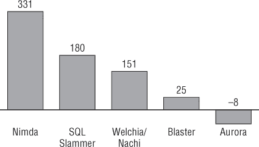

**图 6.1** 漏洞窗口期

多年前 Nimda 病毒发布时，修复该漏洞的补丁已发布约 300 天。用户有将近一整年的时间来修补易受攻击的系统。如果我们观察图 6.1 中较新的漏洞利用，会注意到修补时间在缩短。如今，漏洞可以被极快地利用。在某些情况下，漏洞利用代码可能在供应商知晓问题之前就已出现。这被称为零日漏洞利用。即使没有可用的漏洞利用代码，攻击者也可能对补丁进行逆向工程，并利用该信息尝试创建漏洞利用代码。从风险角度来看，组织必须在尽快打补丁的同时，验证补丁是否按预期工作，且不会引入额外的漏洞或问题，这至关重要。


尽管公司可能力求实现零天或零小时的漏洞窗口期，但这几乎是不可能的，因为软件供应商无法在漏洞曝光后足够快地向公众提供补丁。此外，在服务器、工作站和移动设备上部署和安装软件补丁所需的时间，会让公司面临潜在威胁。

## 运营风险

风险不仅与软件相关，也会发生在新产品、新技术和用户行为中。组织面临多种类型的风险。运营风险是指与运营相关的风险。运营风险由公司的内部和外部实践定义。此类风险可能由公司开展业务的地点引起，也可能由政府机构和监管要求等内部和外部来源界定。我们假设流程将正常运行，系统将按预期执行；然而，情况并非总是如此。在现实世界中，我们被迫应对运营风险，以及随时可能出错的事实。

### 业务模型中的风险

业务模型定义了企业向客户交付产品和服务的方式。业务模型涉及物理位置、生产能力、宗旨、新业务模式或变更中的业务模式、战略、基础设施、组织架构、贸易实务以及运营流程和政策等问题。业务模型将对运营风险产生重大影响。

企业的位置会影响其运营风险吗？我认为大多数人会同意答案是肯定的。物理位置在组织面临的风险中起着重要作用。我的办公室在休斯顿。因此，我面临的风险与位于加利福尼亚或利比亚的人不同。与业务物理位置相关的、公司可能面临的物理风险包括以下几点：

1.  **洪水** 如果业务资产位于洪泛区、土壤保水能力差的区域、排水设施未经过妥善设计或维护的区域，或大坝或其他不在公司控制范围内的防洪设施的下游区域，则洪水风险会增加。
2.  **火灾** 无论火灾是由自然原因、意外还是纵火引起的，物理场所都可以采用多种控制措施，旨在最大限度地减少损失并降低对物理安全的威胁。
3.  **龙卷风、飓风和热带风暴** 通过适当的设计标准、施工技术和设施管理政策，可以将极端大风、突发气压变化、暴雨、风暴潮和空中漂浮物造成的损害降至最低。
4.  **海啸** 如果设施必须选址在易受海啸影响的区域，可能无法对其进行加固以抵御海啸，从财务角度来看，建造一次性结构可能更划算。无论哪种情况，都应采取措施将所有数据存储在异地（或云端），确保建立有效的公共或私人预警系统，并严格执行定期演练，以最大程度地保护人员生命安全。
5.  **地震** 关键设施应远离已知断层线，地震多发区的建筑物应按适当标准进行设计和施工。然而，地震有时会发生在先前未知存在断层的区域；因此，无论位置如何，都应选择设计标准和施工技术，以最大限度地降低严重损坏和人员伤亡的可能性，并始终考虑异地或基于云的数据存储。

风险不仅源于自然事件，也可能与人有关。根据业务模型和公司开展业务的地点，许多人可能会访问设施，包括员工、承包商、客户、销售代表等。个人可能导致某种形式的事件，这种风险是真实存在的。这种风险可能源于意外情况，也可能源于蓄意行为。风险来源可能是内部人员，也可能是外部人员。尽管我们倾向于信任共事的人，但很大比例的攻击是由内部人员发起的。内部人员拥有发动攻击的手段和机会，而外部人员可能只有动机。因此，内部人员处于发动攻击的更有利位置。在评估内部和外部风险时，一些关注领域包括以下内容：

1.  **资源滥用** 这种风险可能包括任何未经策略和程序授权的资源使用，可能包含阅读未受保护的文件、侵犯版权、玩耗时费力的电脑游戏、将计算机账户用于未经授权的活动（如兼职工作）、发送连锁信，或为个人牟利或非法目的分发其他物品。
2.  **访问敏感信息** 这种风险直接关联到机密性的丧失。信息具有价值，敏感信息的丢失代价极高。
3.  **篡改设备设置或信息** 如果员工能访问系统或更改设置，访问控制可能被绕过并被篡改。
4.  **信息泄露** 这一风险类别涵盖所有涉及故意或意外泄露敏感信息的威胁。信息的隐私性受到影响，因为信息在未经授权的情况下被暴露。
5.  **贪污** 这是指从组织欺诈性挪用资金或服务的风险。应实施各类控制措施以防止此类风险。
6.  **物理破坏** 这种威胁可能来自内部人员或外部人员。物理资产的破坏可能给组织造成巨额损失。
7.  **盗窃** 公司资产被盗的后果可能从轻微恼人到极其破坏性不等。CEO 的笔记本电脑可能在机场被盗。在这种情况下，真正的损失是笔记本电脑，还是明年新产品发布的计划？
8.  **未经授权的进入** 控制谁进入设施、何时进入以及他们有权访问什么，对组织的安全至关重要。

组织赖以生存的关键业务职能，是必须仔细审查潜在风险的领域。这些关键职能可能发生在世界各地的许多地点，或在公司内部或外部执行：

1.  **驻场** 员工和承包商在公司设施内工作。
2.  **异地** 员工和承包商在远程地点工作或远程办公。
3.  **离岸** 员工和承包商在单独的地理区域工作。

#### 外包

组织应通过来源策略来确定哪些任务应由员工、承包商或第三方完成。外包是一种常见方法。`Outsourcing` 可定义为一种安排，即一家公司为另一家公司提供服务，这些服务可能原本由内部提供，也可能不是。在新兴的全球经济中，外包已成为一个大得多的问题，安全专业人员需要对此进行仔细审查。在确保第三方提供商具备必要的信息安全水平时，将始终存在顾虑。

在过去十年中，外包在 IT 领域变得更为普遍。在某些情况下，公司的整个信息管理都被外包，包括规划和业务分析，以及网络和工作站的安装、管理和维护。一些常见的外包服务包括：

*   应用程序/Web 托管
*   支票处理
*   计算机帮助台
*   信用卡处理
*   数据录入


#### 薪资与支票处理

对此决策至关重要的是确定一项任务是否属于组织的核心竞争力或专长，即定义组织身份的要素。安全性应在外包决策中发挥重要作用，因为如果由组织外部的人员执行，某些任务将承担大得多的风险。任何决策都应通过彻底的业务流程审查。在练习 6.2 中，您将了解需要审查的外包问题。

当发生外包时，与 IT 相关的问题将成为真正关注的领域。许多 IT 部门都有使命声明，在其中公开承诺他们同意向客户提供的服务级别。这可能是网络服务的正常运行时间、电子邮件的可用性、服务台呼叫的响应，甚至是服务器的正常运行时间。当这些服务中的任何一项被外包时，服务级别就成为一个真正的担忧。外包合作伙伴解决此问题的一种方式是通过服务级别协议 (SLA)。SLA 定义了硬件和软件的性能目标。SLA 有多种类型，其中包括：

#### 1. 服务台与来电者服务

服务台是常见的外包服务。外包合作伙伴衡量所提供服务的一种方式是跟踪`放弃率` (AR)。AR 简单来说就是在等待服务代表接听时挂断电话的来电者数量。我们大多数人都经历过这种情况，当你听到类似“您的来电对我们非常重要；您的预计等待时间为 1 小时 46 分钟”这样的提示时。

另一个服务台衡量指标是`首次呼叫解决率` (FCR)。FCR 是指在拨打任何额外电话或要求用户回拨寻求额外帮助之前，首次拨打服务台电话就得到积极解决的数量。

#### 2. 正常运行时间与可用性协议

另一个常见的 SLA 指标是`正常运行时间协议` (UA)。UA 规定了给定服务所需的正常运行时间量。例如，我的网络托管服务提供商保证 99.999% 的正常运行时间。UA 通常见于网络服务、数据中心和云计算领域。

最后是`服务时间因素` (TSF)。TSF 是在给定时间内得到响应的服务台或回复呼叫的百分比。因此，如果 Mike 在上午 8 点来电，问题是否在上午 9:30 前得到解决？

尽管外包还存在许多其他问题，但这些只是 IT 安全专业人员应熟悉的其中几个。无论服务是内部提供还是通过外包合同提供，您最终可能都要对这些服务负责。作为 CASP，您应仔细审查所有合同并审查任何担保服务。SLA、逻辑安全、物理安全、合作伙伴所在地，甚至合作伙伴的背景等项目，都是 CASP 必须关注的问题。

### 合作伙伴关系

合作伙伴关系在所呈现的安全风险方面与外外包有些相似。`合作伙伴关系` 可被定义为一种商业实体类型，其中两个或多个实体共享潜在利润和风险，而外包则是客户将工作分配给承包商。一旦项目或服务提供完毕，客户支付承包商费用，关系即告结束。合作伙伴关系则不同；它们更像是一段婚姻。婚姻中您可能想要一份婚前协议；在合作伙伴关系中，您需要为事情出错、合作关系终止的情况做好准备。当公司决定建立合作伙伴关系时，存在许多潜在风险。这些风险可能包括以下内容：

1.  **能力丧失** 一旦一项服务开始由一家合作伙伴提供，另一家可能会失去内部提供同类服务的能力。如果合作伙伴关系结束，公司将被迫面对无法再支持该服务的事实。更糟的是，该合作伙伴现在可能成为竞争对手。
2.  **协议破裂** 合作伙伴关系并不总是能成功。在出现问题的情况下，将服务切换回内部可能会产生成本。
3.  **服务恶化** 尽管合作伙伴可能许下美好承诺，但他们能否真正兑现？随着时间的推移，他们是否提供同等水平的服务，还是服务质量下降？必须建立指标来监控整体质量。根据任务性质、复杂程度，甚至客户数量增长等问题，合作伙伴可能无法交付承诺的产品或服务。
4.  **文化契合度差** 有些合作伙伴可能位于国内其他地区或世界其他地方。文化差异在合作伙伴关系的成败中起着重要作用。一旦建立合作伙伴关系，可能会发现提供服务和产品的激励措施不一致，或者两家公司的高层管理截然不同。
5.  **隐性成本** 有时合作伙伴关系的所有成本最初并不可见。由于复杂性、缺乏经验和其他问题，成本可能会上升。专注于有形生产的合作伙伴关系通常比涉及无形服务的合作伙伴关系更不容易受到这些中断的影响。

这并不意味着合作伙伴关系全都是坏事。您的公司可能处于内部技术专长缺乏或难以获取的境地。也许您需要有人构建特定的 Web 应用程序或为新设备编写固件代码。只需考虑一下，战略性跨国合作伙伴关系有时是由其他国家的保护主义法律、营销诀窍或特定国家或地区的专业知识所驱动的。在这些情况下，业务合作伙伴可能拥有提供此项服务的专业知识和技能。

从 IT 安全角度来看，此类合作伙伴关系的一个主要风险是知识和技术转移，无论是有意/透明的还是无意/隐蔽的。作为 IT 安全专业人员，您的角色是在交易完成前向管理层建议此类风险。您应始终牢记向业务合作伙伴提供了哪些资源、是否需要这些资源、使用了哪些控制措施，以及有哪些审计控制措施。

### 合并与收购

合并与收购比合作伙伴关系更为紧密。`合并` 可定义为两家或多家商业公司合并为单一存续实体。

从风险角度来看，有许多事情可能出错。企业通常寻求协同效应，但有些企业就是无法融合。例如，2008 年 Blockbuster 积极寻求与 Circuit City 合并。Blockbuster 视此合并为增长途径，但许多外部分析师质疑，两家拥有完全不同商业模式且均处于失败边缘的公司，如何能合并成一家制胜的企业。由于这些疑问，合并最终未能发生。

在另一个例子中，AOL 和时代华纳确实合并了，但几年后又分拆为两家独立公司。无论情况如何，问题都必须在合并前提出。合并对双方公司都是双赢吗？合并的目的是否是抽取人才和知识产权等资源，随后再分拆出一家弱得多的公司？合并的任何隐藏目的都是重大的安全风险。

通常，不同的业务无法作为一个实体共存。在其他情况下，公司在没有充分行动计划的情况下进入合并收购阶段。最后，人们不喜欢变革。一旦企业文化确立、员工固守成见，态度就很难改变。合并关乎变革，这违背了员工的预期。戴姆勒在 1998 年与克莱斯勒合并时就发现了这一点。两家公司文化差异巨大，许多人认为这导致了 2007 年合并的解体。


对于安全专业人员而言，常会被要求快速与拟议的业务合作伙伴建立连接。尽管存在连接需求，安全仍应是核心关注点。你需要了解拟议合并伙伴的安全策略及其强制执行的控制措施。最不希望发生的情况是，攻击者通过合并公司的网络进入你的网络。

在合并不同行业时，安全顾虑始终存在。前面的示例仅展示了公司在整合为单一实体时面临的部分问题。整合不同行业时，将始终存在安全顾虑。`CASP` 还应关注以下事项：

1. **规则** 每个公司允许或不允许的事项。
2. **策略** 概述公司安全目标和宗旨的高层文档。
3. **法规** 不同实体可能受不同监管机构或法规（如 `PCI` 或 `HIPAA`）管辖。
4. **地域** 关乎位置。位于法国巴黎的公司将遵循与位于美国科罗拉多州丹佛市的公司不同的标准。
5. **分拆/剥离** 企业拆分时，会面临许多同类问题。例如，每个组织现在都必须拥有自己的 IT 安全团队，并实施自己的防火墙及其他防御措施。

### 外部和内部影响中的风险

不要认为合作伙伴关系、外包和合并是繁忙安全专业人员唯一关心的事。另一个更迫切的担忧可能是内部和外部影响。如果你从事 IT 安全工作已有一段时间，你会熟悉来自管理层、工人、员工和客户的各种要求。这些要求范围广泛，从允许使用 USB 闪存驱动器，到为什么管理人员不能将个人笔记本电脑插入企业网络。

一个巨大的影响领域是合规性。`合规性` 可定义为某事物符合商定准则、规范、立法或法规的已知状态。审计员和审计发现在维护合规性方面发挥着巨大作用。审计员通常向组织最高层汇报，并依据章程运作。`Control Objectives for Information and Related Technology (COBIT)` 是审计员用于验证合规性的主要治理框架之一。美国联邦政府在监管互联网、隐私和企业治理方面发挥着积极、重要的作用。这种角色的增强，在过去 10 到 15 年通过的新法律和授权的增加中表现得最为明显。这些新法律和授权涵盖以下领域：

1. **网络法律与犯罪** 计算机和计算机技术的持续增长迫使政府制定更多法律来应对网络犯罪。
2. **隐私** 不同国家对隐私有不同看法，但大多数都制定了一些法律来保护个人可识别信息（`PII`）的机密性。
3. **企业诚信** 在美国，安然倒闭等事件推动了新法律的出台，旨在让上市公司高管对财务记录的准确性和敏感信息的控制负责。企业诚信要求已正确实施适当的信息安全架构。

以下法律和授权影响信息安全，并可能影响组织的风险概况。无论法律和授权如何，组织在企业治理方面都应采取主动。此处描述了几项法律和授权：

1. **健康保险流通与责任法案 (`HIPAA`)**
   `HIPAA` 于 1996 年签署成为法律。它包含两个领域。1996 年 `HIPAA` 的 Title I 保护工人及其家庭在更换或失去工作时的健康保险覆盖。Title II 要求美国卫生与公众服务部（`DHHS`）建立电子医疗交易的国家标准，以及提供者、健康计划和雇主的国家标识符。

   根据 `HIPAA`，美国 `DHHS` 需发布一套关于隐私的规则。隐私规则规定了组织必须实施的控制措施以保护个人信息。隐私规则定义了三大目的：
   * “通过向消费者提供其健康信息的访问权并控制该信息的不当使用，保护和增强消费者权益。”
   * “通过在消费者、医疗保健专业人员以及致力于提供护理的众多组织和个人中恢复对医疗保健系统的信任，提高美国医疗保健质量。”
   * “通过建立国家健康隐私保护框架，在各州、卫生系统、个人组织和个人努力的基础上，提高医疗保健服务的效率和有效性。”

2. **格雷姆-里奇-比利雷法案 (`GLBA`)**
   `GLBA` 于 1999 年签署成为法律，导致美国金融服务监管进行了最全面的改革。

   Title V 涉及金融机构隐私，包含两个副标题。Subtitle A 要求金融机构披露其隐私策略的特定信息，并赋予个人选择退出的权利。Subtitle B 将 `借口欺诈` 定为犯罪，该行为可描述为在虚假借口下获取个人信息。在这些情况下，某人会虚假陈述身份以收集个人信息。

   根据 `GLBA`，金融机构必须保护个人隐私信息的机密性。按 `GLBA` 规定，金融机构须制定、实施并维护一个全面的信息安全计划，包含适当的管理、技术和物理保障措施。信息安全计划中指定的控制措施必须包括：
   * 指定专人负责组织的信息安全计划
   * 定期的风险和漏洞评估及审计
   * 定期测试和监控计划
   * 制定敏感信息和 `PII` 控制的策略和程序

3. **联邦信息安全管理法案 (`FISMA`)**
   `FISMA` 于 2002 年签署成为法律。`FISMA` 旨在解决非国家安全政府机构的信息安全需求。`FISMA` 强制要求保护政府拥有和运营的 IT 基础设施及资产。`FISMA` 带来的一大变化是制定了一套清晰的信息安全指南，旨在保护联邦政府 IT 基础设施和数据资产。`FISMA` 要求规定以下职责：
   * 开发并维护包含完整 IT 安全架构和框架的信息保障（`IA`）计划。
   * 确保每年开展信息安全培训，以保持员工经过适当培训和认证。
   * 对肩负重大信息安全职责的人员实施问责。

   `FISMA` 还要求定期风险评估、风险评估策略和程序、定期（至少每年一次）测试和评估，以及对高级管理层进行适当的培训和意识教育，以便部署适当的安全意识计划。

4.


#### 萨班斯-奥克斯利法案 (SOX)

SOX 于 2002 年签署成为法律。该法案强制规定了一系列改革，旨在强化企业责任、增强财务披露，并打击企业及会计欺诈。第 302 节和第 404 节是涉及 IT 基础设施和信息安全的两个条款。

##### 第 302 节

第 302 节要求 CEO 和 CFO 亲自认证组织拥有适当的内部控制。它还强制要求 CEO 和 CFO 报告财务报告相关内部控制的有效性。

##### 第 404 节

第 404 节对管理层架构、控制目标和控制程序等领域设定了要求。遵守第 404 节要求公司建立一套基础设施，旨在归档记录和数据，并防止其被销毁、丢失、未经授权的篡改或其他滥用。它要求建立一套全面的控制措施，并让 CEO 和 CFO 负责。

### IT 治理协会框架

IT 治理协会开发了一个流程，该流程始于设定企业 IT 目标，提供初始方向，随后演变为一个持续循环。

该框架涵盖物理安全等领域。必须定义物理安全，并必须采取适当的保护措施来保护 IT 基础设施和资产。安全策略是另一项必需的控制措施。它们定义并涵盖整个组织，充当该组织整体 IT 安全架构和框架的一个要素。

### 合规与审计

为了遵守组织面临的众多规则和法规，公司通常会进行定期审计。公司要求、组织所在行业、特定法律和授权会影响审计的频率。虽然审计类型繁多，但安全专业人员通常最关注 `IT 审计`。IT 审计是对信息技术系统或网络内部控制的检查。审计的目标通常是评估适当的安全控制、程序和指南。审计员的任务是检查内部和外部客户需求，并验证是否遵循了适当的实践。

### 治理与风险责任

归根结底，董事会和高层管理人员有责任决定如何应对风险。高层管理人员由 CEO、CFO 以及公司章程中定义的其他公司高管组成。这些人员负责控制和监督组织中的所有部门。高层管理人员承担最终责任，并肩负着确定什么对公司最有利的使命。

## 数据风险

数据已成为许多组织的命脉。虽然我童年时医生办公室接待台后堆积如山的文件、文件夹和文档，如今一台计算机就能以数字格式存储相同的信息。从安全专业人员的角度来看，有两个关键领域需要考虑：`静态数据` 和 `传输中数据`。

### 静态数据

`静态数据` 可存储在硬盘驱动器、外部存储、CD、DVD 甚至拇指驱动器中。什么是静态数据？安全专家 Bruce Schneier 将静态数据描述为“一个人跨越时间与自己沟通的一种方式。”

有各种各样的产品可用于加密现有磁盘和介质驱动器产品中的数据。保护静态数据的选项包括软件加密，如加密文件系统 (`EFS`) 和 `TrueCrypt`。还有硬件加密选项。两个著名的硬件加密选项是硬件安全模块 (`HSM`) 和可信平台模块 (`TPM`)。

#### HSM

`HSM` 是一种安全加密处理器，旨在管理加密密钥。`HSM` 有两种形式：插入计算机主板外围组件互连 (`PCI`) 插槽的刀片卡，以及独立的外部设备。在这两种情况下，连接到 `HSM` 的计算机均用于生成密钥、签名对象和验证签名。

#### TPM

`TPM` 是一种可安装在计算机主板上的专用芯片，用于硬件认证。`TPM` 认证的是相关计算机，而非用户。`TPM` 利用计算机的启动序列来确定平台的可信状态。`TPM` 将加密过程置于硬件层面。如果有人取出驱动器并尝试从另一台计算机启动该硬盘，硬盘将无法启动并拒绝所有访问。这比仅用于加密硬盘上少数文件夹的软件加密选项提供了更高级别的安全性。`TPM` 的设计初衷是以低成本安全地报告启动环境并识别系统。

`HSM` 和 `TPM` 都适用于硬盘驱动器和固定存储设备，但便携设备必须防范损坏、未经授权的访问和泄露。一个好的方法是要求所有使用便携设备、USB 拇指驱动器、手持设备或任何可移动存储介质设备的员工对其保管和安全负责。这始于策略，延伸至用户培训。例如，策略可配置为要求笔记本电脑用户每周至少连接一次公司内部网，以接收最新的软件补丁和安全更新。策略还可规定在便携设备上必须使用加密。根据公司及所需安全级别的类型，安全专业人员还可能限制在工作中使用 iPod 等个人设备，并阻止这些设备插入公司设备。未能妥善保护静态数据可能导致以下攻击：

*   **Pod slurping（Pod 窃取）**：一种从计算机非法下载或复制数据的技术。通常用于数据渗漏。
*   **USB 恶意软件**：如 `USB Switchblade` 和 `Hacksaw`。
*   **恶意软件**：如病毒、蠕虫、特洛伊木马和键盘记录器。

静态数据的保护不仅针对设备在其使用寿命期间，在报废时同样需要。所有达到报废标准的设备都应妥善处置。妥善处置可包括：

*   驱动器擦除
*   归零
*   退磁
*   物理销毁

### 传输中数据

第二个关注点是数据传输过程中。任何时候数据被处理或从一个位置移动到另一个位置，都需要适当的控制。基本问题是许多协议和应用程序通过明文发送信息。电子邮件、Web 和 FTP 等服务在设计时未考虑安全性，在几乎没有安全控制和加密的情况下发送信息。不安全协议的示例包括：

1.  `FTP`：明文用户名和密码
2.  `Telnet`：明文用户名和密码
3.  `HTTP`：明文
4.  `SMTP`：用户名和密码，以及所有传输的数据均为明文

对于未受某种形式加密保护的传输中数据，存在许多危险，包括：

*   窃听
*   嗅探
*   劫持
*   数据篡改

高价值数据需要保护。一种方法是让安全专业人员将数据分类。例如，组织可能要求所有电子邮件用户使用某种形式的加密，如 `S/MIME`、`OpenPGP` 或 `GPG`。移动用户应被要求使用虚拟专用网络 (`VPN`)。与持有敏感信息的数据库和 Web 服务器通信的个人应使用 `HTTPS`、`SSL` 或 `TLS`。安全专业人员可能还想评估附件的风险，并审查当前允许的附件类型（表 6.1）。


#### 表 6.1 常见电子邮件附件的扩展名策略

| 应允许 | 不应允许 |
| --- | --- |
| .doc, .docx | `.bat` |
| `.pdf` | `.com` |
| `.txt` | `.exe` |
| .xls, .xlsx | `.hlp` |
| `.zip` | `.pif` |
| | .scr |

#### 电子数据交换

对于传输中的数据，可使用电子数据交换（EDI）。但 EDI 正逐渐失去优势，并被基于 XML 的事务处理（TPoX）所取代。EDI 专为安全设计，旨在弥合异构系统之间的差距。EDI 用于以发送方和接收方系统均能理解的格式交换数据。ANSI X12 是最常用的格式。EDI 为组织带来实实在在的效益，因为它减少了文书工作，且因所有信息均以电子方式传输，从而减少了错误。

尽管 EDI 简化了通信，但必须配合适当的安全控制来实施。幸运的是，EDI 拥有不仅解决安全问题，还解决事务丢失、重复及机密性问题的控制措施。常见的 EDI 控制包括：

*   传输控制，以验证发送方和接收方
*   操作控制，以防止对数据的未授权更改
*   授权控制，以认证通信伙伴
*   加密控制，以保护信息的机密性

由于文档以电子方式处理，EDI 给组织带来了新的关注层面。EDI 的一个主要关注点是授权。这意味着 EDI 流程应具备额外的应用控制层。

#### 网络边界的变化

安全专业人员日益关注的另一个问题是：谁掌握数据？随着云计算的兴起，网络边界变得更难界定。*网络边界*是你的控制权终止的点。云计算消除了典型的网络边界。这种去边界化和不断变化的网络边界产生了巨大影响，因为历史上，这条分界线位于物理网络的边缘，通常是防火墙所在的位置。

云计算的概念代表了思想的转变，即最终用户无需了解特定技术的细节。服务由提供商全权管理。用户可根据其特定需求以设定的速率消费服务。这种按需服务可随时提供。图 6.2 展示了基于云的服务示例。

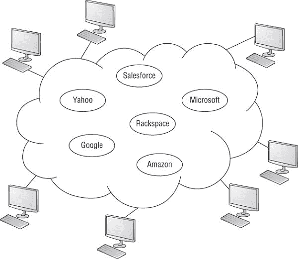

**图 6.2 基于云的服务提供商**

成本和易用性是云计算的两大优势，但在考虑将关键应用和敏感数据迁移到公共及共享云环境时，必须考虑重大的安全顾虑。为解决这些顾虑，云提供商必须开发足够的控制措施，以提供与不使用云时组织自有的安全级别相同或更高的安全性。

云计算并非网络边界变化的唯一方式。远程办公和外包也在改变网络边界。远程办公允许员工在家工作，避免通勤。据求职服务机构 FlexJobs 称，医疗保健、IT、教育、非营利组织以及销售和营销行业是最常允许远程办公的行业。随着更多公司专注于核心竞争力，外包也在过去几年中持续进行。

#### 个人设备接入企业网络的风险

时代在变。如果你走上大街询问路人是否拥有智能手机或平板电脑，答案很可能是肯定的。这些人极有可能将这些设备带到工作场所，并可能将其连接到公司基础设施。是否允许这样做由组织决定，并需要制定自带设备（BYOD）或自带技术（BYOT）策略。

这一趋势对企业影响深远，因为它们必须制定策略，规定这些设备是否以及如何在企业网络上使用或被允许接入。从某种程度上说，这对公司有利，因为它可以免去为用户提供智能手机和其他移动设备的负担。但请记住，策略及其规定的控制措施应涵盖的范围不止智能手机。

许多人拥有 USB 闪存盘；这些设备让移动信息和携带数据变得容易。但它们也导致了恶意软件感染、敏感信息泄露和未授权访问事件的增加。

风险评估和策略应成为企业环境中允许或不允许什么的驱动力。表 6.2 列出了其他最佳实践。

#### 表 6.2 企业环境中常见的设备

| 设备 | 低安全环境 | 高安全环境 |
| --- | --- | --- |
| CD/DVD 读取器 | 是 | 否 |
| 企业智能手机 | 是 | 否 |
| 核准的闪存盘 | 是 | 否 |
| 部分 USB 设备 | 是 | 否 |
| 带到工作场所的个人设备/平板电脑 | 否/也许 | 否 |
| CD/DVD 刻录机 | 否 | 否 |
| 相机/带相机的手机 | 否 | 否 |
| 便携式媒体 | 否 | 否 |
| USB 自动运行 | 否 | 否 |

组织必须实施策略，规定这些设备是否被允许，如果允许，如何处理。只有这样，组织才能开始更好地管理这些设备的使用。可能的策略包括：

*   限制可使用的个人设备种类
*   锁定 USB 端口，仅允许核准的设备
*   在安全区域禁止携带手机和相机
*   维护核准设备清单
*   控制可存储在设备上的信息
*   要求核准设备加密
*   要求核准设备设置密码和远程锁定
*   要求离职时对公司资助的设备进行安全处理和擦除

实际上，你无法禁止所有东西，但管理层和 IT 安全团队需要讨论允许什么、风险是什么以及如何控制。无论做出何种决定，都需要建立策略来执行高级管理层的意愿。这些策略应涵盖所有类型的介质控制。

## 风险评估流程

一旦公司建立了 IT 安全架构，就需要进行风险评估，以识别控制部署中的弱点和差距，并更好地确定哪些领域需要最高级别的保护。

所有公司的资金都有限，必须明智地花费。这意味着将资金投入到最需要保护的领域。风险评估的目的是从可能性和影响程度两方面评估风险，以确定应对策略，并监控降低威胁的进展。风险评估还将确定其当前信息安全水平的基准。该基准将成为该组织根据风险评估期间确定的关键性或风险敞口，来提升或加强其当前安全级别的基础。以下各节讨论流程的每个步骤，并提供风险评估流程的概述。

### 资产识别


## 风险管理流程

风险管理流程的第一步是识别并分类组织的资产。信息和系统必须具有价值，以确定其价值。资产识别是识别组织所有资产的过程。良好的库存管理系统有助于极大地识别资产。只需记住，资产既可以是有形的，也可以是无形的。这些资产通常会被检查：

*   **有形**
    *   文档
    *   数据
    *   硬件
    *   软件
*   **无形**
    *   声誉（商誉）
    *   服务

一旦识别出所有资产，评估人员必须询问的不仅仅是资产的原始成本。您还必须开始考虑任何潜在控制措施的投资回报率。其他关键考虑因素包括：

*   获取或创建该资产的成本是多少？
*   如果资产被泄露，责任成本是多少？
*   如果资产不可用，生产成本是多少？
*   该资产对竞争对手和外国政府的价值是多少？
*   该资产有多关键，其丢失将如何影响公司？

如果已建立信息分类计划，资产识别和估值会变得更容易。根据特定组织或行业，信息可根据机密性、完整性和可用性（CIA）分为不同级别。我们将在接下来探讨此主题。

### 信息分类

信息分类在许多方面增强了组织。将信息标记为机密或绝密有助于员工认识到信息的价值，并给予其更高标准的保护。信息分类还规定了员工如何处理特定信息。例如，公司政策可能规定：“员工下班时必须将所有敏感文件从桌面上移走。我们支持清洁桌面政策。”

已采用两种广泛使用的信息分类系统。每种系统都侧重于 CIA 安全三要素的不同部分。这两种方法如下：

1.  **政府分类系统** 该系统侧重于机密性。
2.  **商业分类系统** 该系统侧重于完整性。

政府信息分类系统分为非密、机密、秘密和绝密四个类别，如表 6.3 所示。

**表 6.3** 政府信息分类

| 分类 | 描述 |
| --- | --- |
| 绝密 | 其泄露将对国家安全造成严重损害。此信息需要最高级别的控制。 |
| 秘密 | 其泄露预计将对国家安全造成严重损害，并可能泄露重大的科学、技术、作战、后勤以及许多其他发展。 |
| 机密 | 其泄露可能对国家安全造成损害，应防范泄露。 |
| 非密 | 信息不敏感，无需保护，除非在分类后附加“仅供公务使用”（FOUO）。非密信息通常不会造成损害，但随着时间的推移，非密 FOUO 信息可能被汇编以推断出更高分类级别的信息。 |

商业信息分类系统不仅关注机密性，还关注信息的完整性；因此，它被分为公开、敏感、私密和机密，如表 6.4 所示。

**表 6.4** 商业信息分类

| 分类 | 描述 |
| --- | --- |
| 机密 | 这是最敏感的级别。这是使公司保持竞争力的信息。不仅仅是该信息仅供内部使用，其发布或篡改可能严重影响或损害公司。 |
| 私密 | 此类受限信息被视为个人性质，可能包括医疗记录或人力资源信息。 |
| 敏感 | 此信息需要控制以防止向未授权方发布。其机密性丧失或完整性丢失可能导致损害。 |
| 公开 | 这类似于非密信息，其泄露或发布不会对公司造成损害。 |

根据企业所在行业及其特定需求，这两种方案通常有一种会比另一种更合适。无论选择哪种分类系统，安全专业人员在对信息进行分类和帮助确定分类指南方面都发挥着关键作用。一旦组织开始分类过程，它就被迫询问：如果特定信息被发布会发生什么？其发布将如何损害或影响组织？

### 风险评估

在组织的资产被清点、估值和分类后，下一步可以开始。这一步，即风险评估，是识别潜在风险和威胁的地方。这些活动通常由风险评估团队执行，并确定威胁的可能性。该团队受高层管理委托，负责识别威胁并检查已识别威胁的影响。

此过程可以基于实际金额，也可以基于非货币价值。当使用非货币价值时，团队通常根据综合评分确定所需的最低安全控制措施。一种常见方法是结合针对资产机密性、完整性和可用性的已识别漏洞来确定综合评分。在我们探讨定性和定量风险评估之前，让我们简要回顾一下将执行此项目的团队的一些情况。

#### 风险管理团队

风险管理团队负责识别和分析风险。其成员应由来自公司各部门的经理和员工组成。

确立团队宗旨后，可指派团队负责开发和实施风险管理计划。该团队应由企业架构中职位足够高的人领导，以便轻松与高层管理沟通，并获得风险评估过程成功所需的资金。成功的结果可以用多种不同方式衡量。成功可能意味着团队能够降低保险成本、减少针对公司网站的攻击，或验证对隐私法的合规性。

团队到位且资金到位后，团队将把注意力转向收集数据和识别威胁。询问威胁的第一批人应该始终是资产所有者；他们知道企业面临什么以及威胁来自何处。IT 部门将帮助将这些业务威胁映射为 IT 相关问题。其他一些来源包括：

*   精算表和保险记录
*   审计报告
*   业务所有者和高级经理
*   设施记录
*   法律顾问
*   人力资源
*   政府记录
*   网络管理员
*   运营
*   安全管理员

现在团队已建立并开始收集数据，必须决定执行哪种类型的风险分析。这两种技术如下：

1.  **定量风险评估** 该方法处理金额。它试图为风险评估的要素以及风险分析的资产和威胁分配成本（货币价值）。
2.  **定性风险评估** 该方法按非货币价值对威胁进行排序，基于场景、直觉和经验。

#### 定量分析


到目前为止，我们已经讨论了建立一个获得高级管理层支持的风险管理团队，识别有形和无形资产，并开始识别潜在威胁。必须以某种方式衡量这些威胁的影响。一种方法是以美元计量威胁。团队只需问一个问题：这会花费多少？

威胁不一定会导致损失。要发生损失，威胁必须与漏洞相结合。漏洞可能是服务器机房空心门的可穿透性。也可能是别处缺乏加固的备份设施。甚至可能是接待区缺乏视频监控。由此产生的损失可能是以下任何一种：

* 财务损失
* 对员工、客户或顾客的危险或伤害
* 违背机密义务或违反法律
* 机密信息泄露
* 设备、硬件或软件被盗

要开始计算损失，你需要量化该过程的所有要素，包括资产价值、影响和威胁频率。以下是步骤：

1. 确定每项信息资产的资产价值（AV）。
2. 识别针对该资产的威胁。
3. 确定每项信息资产针对每种威胁的暴露因子（EF）。
4. 计算单次损失期望值（SLE）。
5. 计算年化发生率（ARO）。
6. 计算年化损失期望值（ALE）。

两种最广泛使用的定量风险评估公式是

```

```

和

```

```

定量风险评估的优势在于它分配了美元价值。美元价值易于理解。如果有人指出潜在威胁结合漏洞可能导致 100 万美元的损失，这个数值便于管理层处理和构想。定量风险评估的主要缺点是，因为它基于美元，团队必须尝试为所有要素计算美元价值。这很耗时，且必须将一些定性度量应用于定量要素。因为这是一项巨大的任务，定量评估通常借助自动化软件工具来执行。这些工具可以帮助进行趋势分析，并寻找随时间变化的模式。趋势分析检查历史损失数据，以确定损失频率或损失严重程度的模式。例如，大西洋沿岸的飓风变得更具破坏性。美国历史上损失最惨重的十次飓风中，有五次发生在 1990 年以来。

在练习 6.3 中，你将计算文件服务器的 ALE。

在现实世界中，风险计算严重依赖概率和期望值。软件产品、精算表、行业信息和以往事件的历史都能提供帮助，但有些事件难以计算。风暴或其他自然现象不易归入模式。此类事件可被视为随机事件。随机事件基于随机行为，因为单个事件的发生无法预测，但测量所有观测值的分布通常遵循可预测的模式。

定量风险管理在估算风险时面临挑战，因此你必须依赖定性方法的一些要素。

#### 定性分析

完成风险评估的第二种方法是定性手段。定性评估基于场景，不试图为风险分析的组成部分分配美元价值。该过程的一部分要求团队执行极端场景规划并审视最坏情况。例如，如果飓风袭击加尔维斯顿岛上的你的冲浪板制造工厂会怎样？后果有多严重？这就像玩“如果……会怎样？”的游戏。

定性评估按等级或等级（如低、中、高）对威胁潜力和资产敏感性进行排序。你可以在 `NIST 800-53` 中看到一个示例。该文档使用低、中、高的值分配对机密性、完整性和可用性（CIA）的潜在影响。你需要一个团队来帮助评估潜在风险，并应将利益相关者的意见纳入保护已识别资产 CIA 所需控制措施的决策中。由于低、中、高的评级是主观的，必须定义每个类别。示例如下：

1. 低：轻微不便；可在短时间内容忍，但不会导致财务损失
2. 中：可能导致组织受损，修复需花费中等数量的资金，并导致负面宣传
3. 高：将导致公司与客户或员工之间的商誉丧失；可能导致大额法律诉讼或罚款，或导致公司损失大量收入或盈利

虽然定性评估通常比定量评估所需时间少得多，但定性评估不提供美元价值。图 6.3 显示了定性审查评分结果的一个示例。一种常见方法在 `FIPS 199` 中规定。它通过首先衡量对 CIA 的影响并将风险排序为高、中或低，来定义确定聚合分数的过程。由于缺少美元价值，这种方法缺乏会计团队和管理层通常偏好的严谨性。

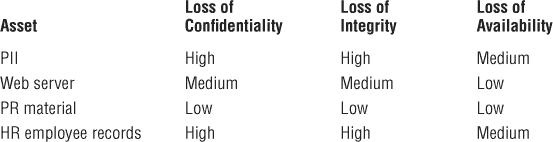

**图 6.3** 定性聚合评分发现示例

一些定性评估技术的示例如下：

1. ISAM：信息安全评估方法论（INFOSEC Assessment Methodology）为非政府组织提供完成定性评估的能力，将资产排序为关键、高、中或低，并根据 CIA 确定影响。
2. 德尔菲技术：这是一种群体评估过程，允许个人贡献匿名意见。
3. 引导式风险评估过程（FRAP）：一种主观过程，通过提出一系列问题来获得结果。它设计为在几小时内完成，使其成为一个快速执行的过程。

#### 风险分析选项

完成定量或定性风险评估后，下一步将是进行风险确定，并决定应应用哪些安全控制。CASP 考试将此阶段描述为风险缓解规划，包括其策略和控制。

第一步是检查之前计算的损失金额和总影响。风险排序是一种方法。聚合分数可用于检查机密性、完整性或可用性丧失的影响。风险排序矩阵着眼于每个后果的严重性和频率。例如，严重性可能在 1 到 4 的范围内排序，频率按分配给每个影响的发生次数排序，其中 4 为最高，1 为最低。图 6.4 显示了风险排序矩阵的一个示例以及确定风险分数的一种方法。

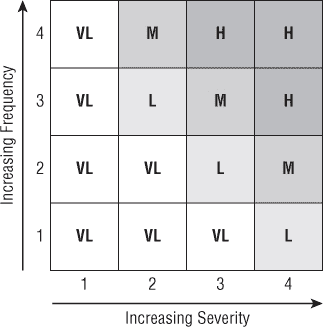

**图 6.4** 风险排序矩阵

此过程的结果是优先级排序和可用于确定如何处理风险的数据。如何处理风险将取决于组织的*风险偏好*——即公司愿意接受的风险程度。有四种可能的替代方案来处理潜在风险：

1. 规避：*规避*风险意味着消除、退出该做法或不参与其中。虽然这可能是一个可行的选择，但规避该活动也可能伴随机会成本。


### 风险处理策略

#### 2. 接受
**接受**风险意味着风险已被理解并评估。高级管理层已决定继续推进的收益大于风险。如果决策者未获得良好的风险数据，或做出了无效假设，可能会做出错误选择。这可能导致具有全球影响的灾难（如 BP 漏油事件、福岛核事故、切尔诺贝利核事故、挑战者号航天飞机事故等）。

#### 3. 转移
**转移**风险是将其转嫁给第三方。例如，购买保险。

#### 4. 缓解
**缓解**风险意味着使用控制措施来降低风险。例如，安装防火墙是缓解风险的一种方法。

请记住，你永远无法消除所有风险。总会存在一些剩余的**剩余风险**。还存在**固有风险**，定义为执行特定活动固有的风险。例如，骑摩托车的固有风险是可能被汽车撞击。

无论你做出何种决定，都应将利益相关者的意见纳入如何处理已识别风险的决策中。面对众多风险，最佳切入点是那些具有高风险评分的风险。这些项目有可能对组织造成巨大危害，应优先处理。有时存在例外，例如当涉及人员伤亡时。

### 实施控制措施

一旦决定如何处理已识别风险，便是执行风险缓解规划、策略和控制措施的时候了。用于推动该过程的文档是**风险评估报告**。该报告将包含所有发现、信息、评估和给组织的建议。最终评估报告成为管理层做出明智业务决策的依据，以决定应实施哪些控制措施。

这要求你设计某种信息分类系统。这些系统通常基于机密性或完整性。无论使用何种分类系统，你都必须根据组织/行业标准，将信息类型按 CIA（机密性、完整性、可用性）分级。例如，国防部可能更关注信息的机密性，而云服务提供商可能更关注可用性。风险团队将希望根据综合评分确定所需的最低安全控制措施。没有资产估值，就难以理解控制措施的投资回报率（ROI），或与安全对策投资相关的成本效益分析。控制措施可以是物理的、技术的或操作的。

#### 1. 物理控制
示例包括门锁、围栏、闭路电视（CCTV）、照明、大门和保安。

### 2. 技术控制
你需要根据组织的 CIA 要求和策略实施技术控制。此类控制示例包括加密、VPN、安全协议（`IPSec`、`SSL`、`TLS` 等）、VLAN、防火墙和入侵检测系统（IDS）。

#### 3. 操作控制
示例包括招聘实践、雇佣实践、离职实践、业务连续性、灾难测试和培训。

控制措施还可以服务于多种目的，如预防、威慑、纠正、缓解等。一旦设计出适当的控制措施，就必须将其部署。例如，围栏是一种物理控制，但可用于威慑甚至延缓攻击者。实施控制措施的目的是解决已识别的风险、威胁和漏洞。实施控制措施需要建立预算。尽管风险评估过程的大部分工作已由团队完成，但现在管理层需要确定优先级、制定预算，并为最终报告中提出的建议制定战术和战略计划。为确定要部署哪些控制措施，必须考虑总拥有成本（TCO）。TCO 有助于确定资产或对策的总成本，包括采购价格、维护费、更新费、保险等所有成本。风险评估团队必须努力寻找在保持最低年成本的同时提供最大风险降低的解决方案。

这些建议可能影响整个组织，可能需要数月甚至数年才能完全实施。对战术和战略建议的优先级排序将使组织能够根据风险和漏洞评估的既定目标和目的做出明智的业务决策。

控制措施实施后，仍有更多工作要做，因为员工必须接受培训。IT 安全必须与管理层合作，实施持续的安全意识和安全培训。实施组织变革需要为所有员工或组织 IT 系统、资源和数据的授权用户制定教育和安全意识培训计划。缓解风险要求组织内的所有员工和用户遵守安全意识培训。

### 持续监控

风险管理过程的最后阶段是监控。你可以将监控视为一种变更管理。任何时候对系统或运行环境进行更改，都应重新评估以查看更改如何影响潜在风险。

**持续监控**允许组织在实时或接近实时的基础上评估控制措施的运行有效性。因为持续监控发生在使用关键控制措施的事件之后立即或紧随其后，它使企业能够快速检测控制失败并迅速找到改进方法。`NIST 800-37`《将风险管理框架应用于联邦信息系统指南》将持续监控描述为一个有效的、全组织范围的计划，应包括以下内容：

*   配置管理
*   控制流程
*   安全影响分析
*   选定安全控制的评估
*   安全状态报告
*   资产所有者的积极参与

`SP 800-37` 还指出持续监控应解决以下职能：

*   报告进度。
*   解决漏洞。
*   描述信息系统所有者打算如何解决这些漏洞。

在资产的生命周期内，会发生变化。人员来来往往，设备发生变更，配置发生变化，流程被修订。这些变化将影响组织的安全态势。必须评估结果，以确定这些变化是否以负面方式改变了期望的安全状态。

### 企业安全架构框架与治理

企业安全架构（ESA）框架描述了用于规划、分配和控制信息安全资源的过程。ESA 框架用于 IT 治理，包含人员、流程和技术。以下是两个 ESA 框架示例：

1.  **企业架构（EA）**：联邦政府用于确保业务战略与 IT 投资保持一致。
2.  **Sherwood 应用业务安全架构（SABSA）**：基于架构视角的另一种战略视角。

无论使用哪种架构，目标都是衡量绩效，确保公司获得最佳的安全投资回报。ESA 通常包括战略、行动计划、监控规定以及定义的指标，例如：

*   战略一致性
*   有效的风险管理
*   价值交付
*   资源管理
*   绩效衡量
*   流程保证集成

所选的 ESA 必须平衡技术和程序解决方案，以支持业务的长期需求，并提供实质性的长期效率和有效性。

## 风险评估最佳实践


## 风险评估最佳实践

如果你被指派参与风险评估，一个关键关注点将是定义目标和目的。一个好的切入点是使命宣言。使命宣言通常定义了公司的主要目标。

在进行风险和漏洞评估时，有许多技术需要考虑。这些最佳实践或方法将根据评估范围和团队试图保护的内容而有所不同。为了妥善保护资产，需要投入大量的时间、资金和资源。只有到那时，才能妥善设计和实施适当级别的安全性。在准备和进行风险评估时，请考虑以下最佳实践或方法：

*   制定风险评估策略。
*   编制清单并维护 IT 基础设施组件和 IT 资产的数据库。
*   根据组织业务驱动因素定义风险评估目标和目的。
*   为组织确定一致的风险评估方法和途径。
*   根据组织的标准定义进行资产估值或资产关键性估值。
*   通过识别和将 IT 基础设施组件和资产分类为关键、主要和次要，限制风险评估的范围。
*   了解并评估针对这些分类的 IT 基础设施组件和资产的风险、威胁和漏洞。
*   为保护组织的关键、主要和次要 IT 基础设施定义一致的标准或衡量准则。
*   制定业务连续性计划，以帮助确保在发生灾难或紧急情况时关键流程和活动能够继续进行。
*   按照既定标准执行风险和漏洞评估。

实施这些风险评估最佳实践并非易事。它需要仔细的分析和决策，这些分析和决策因组织的业务驱动因素和优先级而异。表 6.5 显示了年度预期损失的示例摘要。

**表 6.5 DMZ 资产的年度预期损失 (ALE)**

| 资产 | 威胁 | SLE | ARO | ALE | 对策 |
| --- | --- | --- | --- | --- | --- |
| Web 服务器 | DoS | $9,800 | 1 | $9,800 | 冗余 Web 服务器 |
| 邮件服务器 | 开放中继 | $500 | .01 | $5.00 | 关闭中继 |
| DNS 服务器 | 缓存投毒 | $7,500 | .25 | $1,875 | DNSSec |
| 防火墙 | 枚举 | $0 | .2 | $0 | 加固 |
| 数据库 | SQL 注入 | $50,000 | 2 | $100,000 | Web 应用防火墙和输入验证 |

你可以看到，风险评估过程的结果是确定优先处理哪些项目。你必须记住，所有公司的资产都是有限的，并非每一个漏洞都能得到解决。最好的开始方式是确定哪些项目会造成最大的损害，或者哪些代表了对组织最大的威胁。在大多数情况下，这意味着将检查 `ALE`。例如，在表 6.5 中，SQL 注入攻击的 `ALE` 为 $100,000。首先检查这一威胁并评估对策的成本将至关重要。

最后，你要记住，风险评估过程不是一次性事件。随着项目的变化或定期进行，必须重复风险评估过程。

## 摘要

CASP 必须了解对业务的威胁、潜在风险以及缓解此类风险的方法。风险是我们在个人和商业层面每天都必须面对的事情。策略是应对风险的一种方式。在业务的人员方面，策略应规定员工可以做什么和不可以做什么。即使风险已被识别并与漏洞相关联，仍必须确定潜在成本。该成本可以通过定量或定性方法得出。每种方法都有优缺点，并有助于提供工具来确定是接受、规避、缓解还是转移威胁。如果考试要求，你需要了解基本风险公式以及如何计算 `SLE` 和 `ALE` 等项目。最后，CASP 还必须了解超出基本 IT 安全范畴的业务方面。这些项目包括合作伙伴关系、外包以及并购。

## 考试要点

1.  **能够描述各种业务模型。** 如今，比以往任何时候都更甚，企业都是全球化的，可能总部设在一个地区，而在另一个遥远的地区制造。从 IT 安全角度来看，此类合作伙伴关系的一个主要风险是知识和技术转移，无论是有意/透明的还是无意/隐蔽的。CASP 需要了解的业务模型包括合作伙伴关系、外包以及并购。
2.  **能够描述内部和外部影响。** 许多因素影响着企业。在美国和大多数工业化国家，越来越多的法规影响着公司的运营。在美国，这些包括 `HIPAA` 和 `SOX` 等授权法案。内部因素，如审计发现和高层策略，会对企业的日常运营产生重大影响。
3.  **了解网络边界的变化如何影响企业。** 云计算将改变我们今天所知的许多计算模式。这是一个重大的范式转移，因为它模糊了网络边界。1990 年代的网络很容易定义，因为企业资产位于防火墙、`IDS` 和其他防御技术之后。云计算改变了这一点，因为你的数据的确切位置可能对你未知。你可能也不完全了解云服务商已采取的保护机制。
4.  **能够描述允许个人可管理设备连接到企业环境的风险。** 从手机、智能手机、PDA、iPad 甚至 MP3 音乐播放器，每个人对基于计算机设备的访问权限都比过去大得多。这让 IT 安全专业人员非常担忧，因为这些设备中的许多最终可能会进入工作场所。如何处理这些设备、什么可以连接到企业网络、什么是不允许的，这些都是必须回答并通过策略强制执行的问题。
5.  **能够基于 CIA 的聚合分数对信息进行分类。** 机密性、完整性和可用性 (`CIA`) 的概念是现代安全原则的关键。作为 CASP 候选人，你必须理解这些概念以及如何将它们应用于风险评估过程。
6.  **能够描述特定的风险分析技术。** 可用于执行风险分析的两种基本技术：定性和定量。定性风险评估不基于美元，使用关键、高、中、低等属性。定量风险评估基于美元，为已知风险分配美元金额。
7.  **知道如何进行风险确定分析。** 风险和漏洞评估提供了关于组织 IT 基础设施及其资产当前安全级别的必要信息，以便评估人员可以为提高或增强 IT 资产的安全级别提供建议。要理解进行风险评估是困难且容易出错的。一旦识别并评估了风险，要认识到分析结果本身往往也是有问题的。


### 8. 了解如何以及何时应用安全控制

控制措施可能会被应用，也可能不会。所有公司用于实施控制的资金都是有限的，控制的成本不应超过资产的价值。执行定量或定性风险评估有助于判断是否应应用某项控制措施。

### 9. 了解应对风险的各种方式

威胁与漏洞相结合可能导致损失。为防止或应对潜在风险，可采用多种方法，包括接受、规避、缓解或转移。

## 复习题

### 1. 以下哪项最能描述合伙关系？

**A.** 通过将财产转移给一家存续公司，将两家或多家公司合并

**B.** 两个或多个人或公司以联合主体的身份，基于契约从事业务活动

**C.** 从外部供应商获取商品或服务

**D.** 企业无法履行债务义务的状况

### 2. 外包与合伙关系的区别在于：

**A.** 外包仅发生在产品来自第三国的情况下，而合伙关系发生在同一国家内。

**B.** 两者都使用内部劳动力为自己创造产品。

**C.** 一方使用内部劳动力，而另一方则从合作伙伴处承包劳动力。

**D.** 一方使用外部供应商，而另一方则将两个实体合并。

### 3. 以下哪项不是云计算需要考虑的问题？

**A.** 数据的物理位置

**B.** 数据的敏感性

**C.** 招聘实践

**D.** 灾难恢复计划

### 4. 以下哪项不是定量风险评估的优势？

**A.** 检查真实威胁

**B.** 结果快速

**C.** 真实数字

**D.** 美元价值

### 5. 以下哪项是 SLE 的计算公式？

**A.** `SLE = AV × EF`

**B.** `SLE = AV / EF`

**C.** `SLE = ARO × EF`

**D.** `SLE = ARO × AV`

### 6. 以下哪项不是定性风险评估的优势？

**A.** 速度

**B.** 使用数字美元价值

**C.** 基于 CIA

**D.** 由团队执行

### 7. 以下哪项是 ALE 的计算公式？

**A.** `ALE = AV × ARO`

**B.** `ALE = SLE × ARO`

**C.** `ALE = SLE / ARO`

**D.** `ALE = AV / ARO`

### 8. 以下哪种应对风险的方法会产生持续的持续性成本？

**A.** 接受

**B.** 规避

**C.** 缓解

**D.** 转移

### 9. 实施防火墙最符合以下哪项？

**A.** 接受

**B.** 规避

**C.** 缓解

**D.** 转移

### 10. 基于政府的信息分类模型基于以下哪项？

**A.** 机密性

**B.** 可用性

**C.** 完整性

**D.** 服务等级

### 11. 基于行业的信息分类模型基于以下哪项？

**A.** 机密性

**B.** 可用性

**C.** 完整性

**D.** 服务等级

### 12. 在政府信息分类模型中，以下哪项是最高密级？

**A.** 特级机密

**B.** 绝密

**C.** 机密

**D.** 敏感

### 13. 在公共部门信息分类模型中，以下哪项是最低密级？

**A.** 公开

**B.** 公众

**C.** 可用

**D.** 非密

### 14. 以下哪项不是 TPM 的属性？

**A.** 低成本

**B.** 专用芯片

**C.** 外置于设备

**D.** 快速

### 15. 以下哪项不是 HSM 的属性？

**A.** 保护加密算法

**B.** 以 PCI 刀片形式提供

**C.** 作为独立设备销售

**D.** 可处理大量交易

### 16. 在确定暴露因子 (EF) 后，定量风险评估过程的下一步是什么？

**A.** 确定 SLE

**B.** 确定 ARO

**C.** 确定 ALE

**D.** 确定 AV

### 17. 以下哪项不是传输中数据的关注点？

**A.** 中间人攻击

**B.** 后门攻击

**C.** 嗅探

**D.** 劫持

### 18. 以下哪项最能描述 EDI？

**A.** 它基于 X509 格式。

**B.** 它基于 ANSI X114 格式。

**C.** EDI 用于以发送方和接收方系统均能理解的格式交换数据。

**D.** EDI 用于将数据转换为发送方和接收方系统均能理解的格式。

### 19. ____________________ 可被描述为硬件、软件或组件中的弱点，可能被利用从而导致威胁破坏、损坏或危及资产。

**A.** 漏洞

**B.** 威胁

**C.** 暴露

**D.** 风险

### 20. ___________________________ 是指任何可能对 IT 资产或数据资产造成潜在伤害、损失、损坏或危害的代理、条件或环境。

**A.** 漏洞

**B.** 风险

**C.** 威胁

**D.** 暴露

## 第 7 章：策略、程序和事件响应

### 本章涵盖的 CompTIA CASP 考试目标

#### 2.3 根据组织要求比较和对比安全策略、隐私策略及程序

*   针对新业务、技术、风险和环境变化进行策略制定与更新
*   针对策略、环境和业务变化进行流程/程序制定与更新
*   通过与人力资源、法务、管理层及其他实体合作，支持法律合规与倡导
*   使用通用业务文档支持安全
    *   风险评估 (RA)/适用性声明 (SOA)
    *   业务影响分析 (BIA)
    *   互操作性协议 (IA)
    *   互连安全协议 (ISA)
    *   谅解备忘录 (MOU)
    *   服务等级协议 (SLA)
    *   运营层级协议 (OLA)
    *   保密协议 (NDA)
    *   业务合作伙伴协议 (BPA)
*   对个人可识别信息 (PII) 使用通用隐私原则
*   支持包含以下内容的策略制定：
    *   职责分离
    *   岗位轮换
    *   强制休假
    *   最小权限
    *   事件响应
    *   取证任务
    *   入职与离职程序
    *   持续监控
    *   用户培训与意识
    *   审计要求与频率

#### 2.4 给定场景，执行事件响应和恢复程序

*   电子取证
    *   电子资产清单与资产控制
    *   数据保留策略
    *   数据恢复与存储
    *   数据所有权
    *   数据处理
    *   法律保留
*   数据泄露
    *   检测与收集
        *   数据分析
    *   缓解
        *   最小化
        *   隔离
    *   恢复/重构
    *   响应
    *   披露
*   设计系统以便于事件响应
    *   内部与外部违规
        *   隐私策略违规
        *   犯罪行为
        *   内部威胁
        *   非恶意威胁/错误配置
    *   建立并审查系统、审计和安全日志
*   事件与应急响应
    *   证据保管链


*   受损系统的取证分析
*   运营连续性计划 (COOP)
*   易失性顺序

## 文档

本章讨论文档。在执行了许多安全审计和渗透测试后，我可以证明文档的重要性。在执行安全审计之前，我会要求查看组织的文档。这包括策略、程序、指南、可接受使用策略等。

让我们以事件响应策略为例。这不是事后才能创建的东西。该文档必须在事件发生前就已制定。它详细说明了团队成员、基本策略，以及排查问题、确定发生了什么、并尽快让公司恢复正常运行的方法论。

这只是需要考虑的一个文档。如果您的公司外包了任何活动，外包合作伙伴承诺提供什么级别的服务？是否有服务级别协议？合作伙伴是否有灾难恢复计划？他们将如何处理和控制您的敏感数据？所有这些问题通常都在各种文档中有明确规定。作为安全专业人员，您需要知道这些问题的答案。毕竟，您是负责实施控制以防止安全问题、检测问题并减轻潜在损害的人员。文档在该过程中起着关键作用，因为它充当脚本，指导员工遵循结构化、可重复的流程。

在本章中，我将回顾文档——诸如事件响应策略、用于支持安全的常见文档，以及基于组织要求的安全和隐私策略等项目。本章还将回顾与事件响应相关的文档和程序，以及基本的取证最佳实践。

### 文档的高层视角

安全专业人员可以通过审查战略计划并检查公司的策略和程序，了解组织的大量信息。在管理最善的公司中，策略等高层文档反映了管理层对公司的看法。在过去 10 到 15 年的安全评估工作中，我发现许多公司没有覆盖关键运营领域所需的完整或深入的策略。策略应涵盖组织控制的大多数方面，因为公司有法律和业务要求必须制定策略和程序。一个例子是《萨班斯-奥克斯利法案》(SOX)。该法令对公司实施严格控制，并要求它们制定策略和程序。对于不合规者，将面临罚款，责任人可能面临长达 20 年的监禁。策略应规定谁负责，以及必须坚持什么标准以满足最低公司治理要求。

管理层负责定义组织结构，因此必须将公司划分为控制特定职能的较小子群体。策略和程序是规定各职能领域活动如何开展的控制性文档。安全专业人员应始终查看有哪些文档到位、其更新频率如何以及涵盖哪些活动。您可能会发现公司没有制定策略。在某些情况下，可能是技术发展太快，公司尚未适应。在其他情况下，可能是公司只是看不到制定策略的必要性，或未将策略制定作为优先事项。

#### 策略制定过程

策略制定基本有两种方式。在某些组织中，策略制定始于组织的高层。这种被称为自上而下的策略制定方法，意味着策略从高级管理层向公司的下层推行。自上而下策略制定的最大优势在于，它确保策略与高级管理层的战略和愿景保持一致。此类过程的缺点是实施需要大量时间，且可能无法完全解决普通员工的运营顾虑。另一种方法是自下而上地制定策略。自下而上的策略制定方法解决普通员工的顾虑。该过程从他们的意见和顾虑开始，建立在员工和组织群体管理者已识别的已知风险之上。最大的缺点是该过程可能并不总是能很好地映射到高级管理层的战略。

无论策略如何制定，一份优秀的信息安全策略都将包含一些特定组件，如图 7.1 所示。

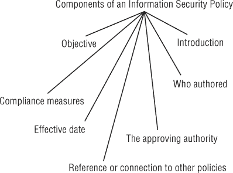

**图 7.1** 优秀信息安全策略的组成部分

在参加 CASP 考试前，您应该能够识别特定类型的策略。一些基本类型包括：

1.  **合规性** 合规性策略确保组织的标准符合地方、州和联邦法律。频繁使用这些文档的行业包括医疗保健、公用事业、炼油、教育和联邦机构。

2.  **信息性** 信息性策略不用于强制执行；它们是为了教育或帮助员工和其他人了解特定规则而创建的。信息性策略的目标是告知员工或客户。零售店的一个信息性策略示例是：如果您保留收据，在店内购买的商品享有 90 天现金退货政策。

3.  **建议性** 建议性策略旨在确保所有员工了解特定行为和行动的后果。建议性策略的一个示例是`可接受使用策略` (AUP)。该策略可能建议员工如何使用互联网，并可能禁止员工访问社交网络或色情网站。该策略可能规定，违反策略的员工可能面临纪律处分，直至并包括解雇。

#### 策略和程序

`策略` 是高层文档，由管理层制定，旨在将管理层的整体战略和理念传达给所有员工。高级管理层和流程所有者对组织负责。策略是一种模板，因为它们将指导应用于管理层的意愿。策略详细说明、定义并指明了对员工的期望，以及管理层打算如何满足客户、员工和利益相关者的需求。

CASP 应感兴趣的一种特定策略是公司的安全策略。`安全策略` 是规定管理层对信息系统的使用、操作和安全承诺的文档。您可能认为该策略仅涉及逻辑安全，但大多数安全策略也涵盖物理控制。物理安全是构建安全环境和整体安全计划的重要组成部分。安全策略规定了安全在公司中的角色。安全策略应由业务目标驱动。安全策略还必须满足所有适用的法律法规。例如，您可能想监控员工——但这并不意味着要在浴室或更衣室安装闭路电视 (CCTV)。


## 安全策略与程序文档

安全策略应作为将安全融入所有业务职能的基础，且必须保持平衡，即所有组织都在寻找在不阻碍生产力或违反法律的前提下实施充分安全的方法。同样重要的是，不要与员工建立对抗关系。成本也是一个问题，因为你不能在安全控制上的花费超过资产的价值。作为安全专业人员，你的工作是根据组织需求，在安全策略的实施中发挥关键作用。

在你作为安全专业人员的角色中，仔细审视适用于你和员工的安全策略。作为 `CASP`，你应该能够根据组织需求比较和对比安全、隐私策略及程序。如果你被指派审查安全策略，请考虑策略与实际活动的映射程度如何。此外，你是否涵盖了所有新技术？

最后，重要的是要记住策略不会永远有效。那份 1992 年规定调制解调器使用和限制的策略可能需要重新审视。随着新技术变得负担得起，旧技术（如调制解调器）会变得过时；因此，业务流程必须随之改变。有时很容易发现底层程序需要更新，但这种变化也适用于高层策略。策略只是程序控制的一个层级。接下来，我们的讨论将重点关注程序。这些文档的结构如 图 7.2 所示。

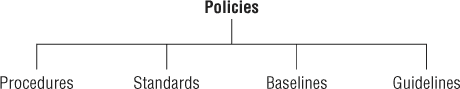

**图 7.2** 策略与子文档结构

### 程序

程序是从属于策略的文档。可将程序视为基于父策略构建的更详细文档。程序提供分步说明。例如，你的公司可能从 `Cisco` 防火墙迁移到 `Check Point` 防火墙。在这种情况下，策略不会改变——因为策略规定了允许何种类型的流量进出网络。改变的将是程序，因为 `Cisco` 和 `Check Point` 设备的设置和配置不同。

程序是详细文档；它们与特定技术和设备相关联。与策略文档相比，程序文档需要更频繁的变更，以保持与业务流程和程序的相关性。当设备变更、软件变更、策略变更，甚至销售季节变更时，程序都会随之变更。任何变更都将要求对程序进行审查。此审查流程应内置于变更管理中。

我见过一些在纸面上看起来很完美，但在现实中无法执行的程序。制定策略时，必须将其映射回现实生活活动并进行验证。尽管问题可能在审计期间被发现，但那是事后诸葛亮，可能意味着不良做法已经持续了一段时间。不对齐可能意味着程序未映射或已过时，或者员工未接受过你要求查看的操作程序的适当培训。

### 标准、基线和指南

标准比策略更具体。*标准* 可视为战术文档——它们规定了满足特定要求所需的具体步骤或流程。标准的一个好例子是公司对笔记本电脑硬盘实施的控制。正如你在第 1 章“加密工具和技术”中所见，其中一项控制是硬盘加密。

公司可能会设定一项标准，强制要求所有公司笔记本电脑使用全盘加密。此标准很可能不会指定加密如何完成，但会规定无论技术如何（`EFS`、`BitLocker` 或同等技术），加密都是一项必需活动。

另一种文档是 *基线*。它可被视为最低安全级别。只需记住，基线是系统、网络或设备必须遵守的绝对最低安全级别。例如，保安必须拒绝任何未将工牌夹在或贴在腰部以上位置，或入场时未出示工牌的人员进入。

最后要介绍的文档是 *指南*。指南指向策略或程序中的一条声明，以此确定行动方针。例如，从非技术角度来看，我有一条指南要求我十几岁的儿子晚上 10 点前回家。虽然这是指南，但曾有过一次我儿子爆胎并打电话说会晚到。在这种情况下，这是可以接受的。指南常被称为最佳实践。

### 审查和更新策略及程序

作为安全专业人员，你应该记住，策略和程序等文档是需要定期审查的“活文档”。根据策略、环境和业务变化，流程和程序可能需要更改或更新。审查的时间间隔将因公司及其所在业务领域而异。虽然许多公司至少每年审查一次策略，但间隔范围可以从六个月到每五年一次。审查期间应提出以下问题：

* 程序或流程是否已变更？
* 策略是否仍然相关？
* 法律是否已变更？
* 变更管理流程是否包含文档变更？
* 行业最佳实践是否已变更？
* 定期审计发现是否表明文档（如策略和程序）存在问题？

审查文档时，既要考虑涉及内部实践的文档，也要考虑涉及公司与外部实体、业务合作伙伴和承包商交互的文档。公司可能与供应商就一系列产品和服务签订合同。在策略、程序和文档的审查过程中，以下任何情况都可能表明存在潜在问题：

* 负面审计发现
* 缺乏文档
* 文档过时
* 不支持的硬件变更或未经授权的采购
* 员工不了解或不熟悉文档

`CASP` 应通过与 `HR`、法务、管理层和其他实体合作，支持法律合规和权益维护，确保所有利益相关者都参与其中。`CASP` 可能非常懂安全，但文档的更改或更新不能在真空环境中完成。`CASP` 需要他人的帮助。对于员工关切等事项，应让 `HR` 参与。对于合规或 `PCI`（支付卡行业）数据安全标准等事项，应让法务部门参与，因为这些人员了解公司必须遵守的要求。

最后必须解决的一个项目是 *信息生命周期管理* (`ILM`)。公司积累大量数据。策略必须规定信息如何分类、使用何种控制来保护它、保留多长时间，以及在其生命周期结束时如何销毁。保护组织资产最重要的步骤之一是识别并清点所有已知资产。许多公司维护电子清单和资产控制来跟踪资产。这些资产必须有明确的数据所有者。*数据所有者* 对数据负责，并必须协助确定适当的信息分级和访问权限。


## 数据保留策略的制定

*数据保留策略*的制定处于处置流程的前端，因为它规定了数据应保留多长时间。数据的物理销毁处于处置流程的后端。如果没有有效的数据销毁流程，攻击者只需翻找组织的垃圾，就可能找到许多类型的有用信息，或者在设备拍卖会上买下公司的一台旧电脑。策略应规定数据是归档还是销毁。磁盘清理和销毁是确保机密性所必需的。

在练习 7.1 中，你将把公司现有的安全策略与包含最佳实践的模板进行对比。

## 用于支持安全的业务文档

所有组织都必须在法律、规则和法规的框架内开展工作。该框架通常由各种文档规定，这些文档指明了数据如何被处理、处置、存储甚至销毁。作为安全专业人员，你很可能会被要求使用常见的业务文档来支持安全，并规定电子信息的处理方式。未能正确处理数据可能导致罚款、公众信心丧失、业务失败，甚至组织高管入狱。

CASP 应了解的、用于支持安全的部分文档包括以下内容：

### 1. 风险评估 (RA) / 适用性声明 (SOA)

在风险评估过程中，你需要确定需要哪些控制措施。这就是适用性声明变得重要的时刻。*适用性声明* (SOA) 规定了为特定环境选择了哪些控制措施，并论证了为什么这些控制措施是合适的。你可以将 SOA 视为风险评估与风险处理/控制之间的纽带。这是 ISO 27001 的核心关注点。控制措施可以是管理类、技术类或物理类，SOA 应引用使用了哪类控制措施，以及它们关联的具体控制文档。

### 2. 业务影响分析 (BIA)

业务影响分析是灾难恢复业务连续性流程的核心部分。BIA 包含三个组成部分：关键性优先级排序、停机时间估算和资源需求。BIA 用于识别与故障相关的成本，例如现金损失或设备更换、现金流、薪资或其他损失。BIA 的设计可以是定量的，也可以是定性的。

### 3. 互操作性协议 (IA)

*互操作性协议* (IA) 是一份详细说明组织间建立和维护数据交换要求的文档。例如，联合航空可能与汉莎航空共享航班代码，因此双方都需要访问一个通用数据集。这些通用数据集通常通过使用协议（如 `TCP/IP`）或标准（如 `XML` 或 `SQL`）来指定。

### 4. 运营连续性 (COOP)

请考虑过去几十年我们目睹的许多自然灾害和人为灾难，加上日益严格的监管要求。这些事件导致对业务连续性的需求大幅增加。运营连续性包含组织必须建立的所有流程和程序，以确保业务能够持续运行。COOP 文档之所以必要，是因为公司必须制定计划和程序，以便在发生故障或灾难时继续运营。

### 5. 互连安全协议

*互连安全协议* (ISA) 是一份安全文档，详细说明了在系统或网络之间建立、维护和运行互连的要求。该文档规定了连接系统和网络的要求，并详细说明了用于保护系统和敏感数据的安全控制措施。ISA 通常详细说明特定系统和网络的连接方式，并包含网络拓扑图。

### 6. 谅解备忘录

*谅解备忘录* (MOU) 通常记录必须共享数据和信息资源的外包合作伙伴组织的条件和适用条款。有时，MOU 可在总体框架合同或协议签署前作为一种临时安排使用。MOU 与 NDA 不同。NDA 用于维护信息的秘密性或机密性，而 MOU 的涵盖范围更广：它概述了各方的责任，以及各方应提供或执行的内容。选择合适的合作伙伴至关重要，必须审慎进行。为了具有约束力，MOU 必须由各组织拥有合法签署权的代表签字。这通常是高级管理层、法务部门或董事会成员。此类文档通常受到保护，因为它们被视为机密。要求保密是因为协议可能描述签署方不愿让他人知晓的流程、活动甚至服务。

### 7. 服务级别协议

在签署 ISA 或 MOU 时应考虑的另一个控制措施是*服务级别协议* (SLA)。如果你签署 MOU 的外包提供商将提供时效性流程，SLA 是获得合作伙伴同意提供的服务级别保证的一种方式。

SLA 应规定他们同意的正常运行时间、响应时间和最大中断时间。SLA 也可用作与硬件供应商的一种合同形式，由供应商提供一定级别的保护。供应商收取费用，同意在合同规定的时间内维修或更换设备。

### 8. 运营级别协议

*运营级别协议* (OLA) 与 SLA 配合工作，因为它们支持 SLA 流程。OLA 定义了各合作伙伴内部支持小组的责任。因此，SLA 可能承诺停机时间不超过五分钟，而 OLA 则定义了用于实现该特定目标的小组和资源。

### 9. 正常运行时间协议

*正常运行时间协议* (UA) 是最知名的 SLA 类型之一；它详细规定了约定的正常运行时间量。例如，UA 可用于网络服务（如 WAN 链路）或设备（如服务器）。常见的正常运行时间等级包括 99.999%（业界术语称为“五个 9”），相当于每年约五分钟的停机时间。如果 UA 规定为 99.9999%（“六个 9”），最大停机时间将降至每年约 30 秒。

### 10. 保密协议

*保密协议* (NDA) 旨在保护机密信息。例如，参加 CASP 考试前，你将被要求签署一份 NDA，声明不会向他人透露考题。许多公司要求员工和承包商在获取特定信息访问权限前签署 NDA。

### 11. 业务合作伙伴安全协议 (BPA)

*业务合作伙伴安全协议* (BPA) 是另一种具有法律约束力的文档示例，旨在为特定安全相关活动中的业务合作伙伴提供保障并强制要求采取特定行动。BPA 由律师在合作伙伴参与下起草，包含与安全和合作相关的标准条款。

贵公司是否要求员工、承包商或业务合作伙伴签署 NDA？NDA 是帮助为敏感信息和专有数据提供安全保护的一种方式。在练习 7.2 中，你将审查公司的 NDA，检查其应包含的领域和条款。

## 用于敏感信息的文档和控制措施


## 隐私与个人信息保护

隐私与个人信息保护是一个重要问题。作为 CASP（高级安全从业者认证），你应该能够将通用隐私原则应用于敏感信息和个人可识别信息（PII）的保护。你公司的长远生存可能取决于你保护个人和敏感信息的能力。试想一下，隐私和信任在你组织的交易中扮演着多么巨大的角色。当你准备与另一个组织开展业务时，你有多重视该组织的隐私实践？

随着大量信息以电子方式交换，安全控制比以往任何时候都更加重要，安全专业人员在保护这些敏感信息方面发挥着关键作用。这正是我们将在本节中探讨的内容。

### 为什么需要安全？

隐私和敏感信息保护以其他任何事项都无法比拟的方式影响着组织。作为安全专业人员，你可能会被要求协助建立一个有效的隐私治理计划，或与现有的计划共同工作。此类计划的管理方式不仅会影响客户对公司的看法，还会影响公司的财务状况。

在《萨班斯-奥克斯利法案》（SOX）、《健康保险流通与责任法案》（HIPAA）和《支付卡行业数据安全标准》（PCI DSS）等法规的强制要求下，如果发生隐私政策违规并导致敏感信息泄露，公司将面临大量的监管要求和资金风险。公司若未能保护特定类型的数据，遭受的不仅仅是金钱损失；还面临诉讼、负面宣传和政府调查等问题。

如今我们看到的管控敏感信息的法律比过去多得多，原因之一在于信息的存储、移动和处理方式已经改变。小时候，信用卡机是手动的。这些机械设备要求操作员刷卡并制作卡号和持卡人签名的复写件。安全性依赖于对信用卡信息的物理保护。我过去常告诉朋友们撕毁信用卡复写件，以免罪犯窃取卡号。

时代变了！如今信用卡信息以电子方式存储和处理。这些电子系统大多连接互联网，成为黑客极具吸引力的攻击目标。试想一下用信用卡支付餐费的过程。从你把信用卡交给服务员，到信用卡账单寄到你家中，数据经过了许多环节，黑客可以在其中任何一点尝试窃取信息。如果个人数据泄露给未经授权的人员，公司可能要承担法律责任。潜在损失可能是巨大的。例如，2013 年底，Target 报告了数百万客户的信用卡号和数据泄露事件。这证明了个人信息处理方式的重要性。

### 个人可识别信息控制

你的个人信息保护得如何？不幸的是，一些公司预先设定了一种观念，认为安全控制会降低业务流程的效率或速度。隐私权利清算所（`www.privacyrights.org`）报告称，2013 年 1 月 1 日至 2013 年 12 月 31 日期间，美国发生了 621 起数据泄露事件。这些事件影响了数百万美国人。这些公司没有建立足够的控制措施来保护个人可识别信息。TechTarget 将*个人可识别信息*（PII）定义为“任何可能识别特定个人的数据，例如姓名、指纹或其他生物特征数据、电子邮件地址、街道地址、电话号码或社会安全号码。”

作为安全专业人员，你的工作是与管理者合作，帮助他们认识到强有力的安全控制的重要性。良好的安全实践并非大多数管理者或用户与生俱知的；它们需要教育。这一过程的关键组成部分是安全意识和培训。教育过程的一部分是提高对敏感信息丢失所涉及成本的认识。

以下是针对 PII 的一些通用隐私原则：

*   PII 数据的收集必须公平合法。
*   PII 数据仅用于收集时规定的目的。
*   PII 数据在存储和传输过程中必须保持安全。
*   PII 数据的保留时间必须合理。

为 PII 提供适当保护的一个重要组成部分是确保有办法追踪隐私政策违规行为并衡量其影响。衡量影响的一种方法是验证公司政策是否基于*隐私影响评估*（PIA）。PIA 应确定在基于电子系统中收集、维护和分发 PII 的风险和影响。应利用 PIA 来评估隐私风险，并确保存在适当的隐私控制。应审查现有控制，以验证是否落实了问责制，并在规划上线新项目或新流程时，确保合规性内嵌其中。PII 的控制需要审查以下三个方面：

1.  **技术** 任何时候添加新系统或进行修改，都需要进行审查。
2.  **流程** 业务流程会发生变化。即使公司有良好的变更政策，变更管理系统也可能忽视个人信息隐私。
3.  **人员** 公司会更换员工和业务合作伙伴。每当业务合作伙伴、供应商或服务提供商发生变化时，都需要重新审视该变化对隐私的影响。

### 数据泄露

当今生效的大多数保护敏感信息的法律仅出台于过去 10 到 15 年。其中一项早期法案是加利福尼亚州参议院 1386 号法案（SB 1386）。该法案于 2003 年颁布，因其强制加利福尼亚州公司处理信息安全漏洞的方式，被视为里程碑式的立法。在该法案之前，许多公司不报告数据泄露。一些公司试图隐瞒此类事件，对数据泄露守口如瓶。

*数据泄露*可以被描述为一种事件，即机密、敏感、受保护或个人信息被未经授权的个人泄露、窃取、使用或查看。随着越来越多的公司转向以电子格式处理信息，数据泄露已成为一个大得多的问题。CASP 应了解处理数据泄露的三个关键领域：

#### 1. 最小化

处理数据泄露应在事件发生前就开始。我的意思是将泄露发生的可能性降至最低。通过适当的控制，可以保护敏感信息免遭未经授权的泄露，并降低数据泄露的可能性。这一过程始于实施数据保护措施和控制以保护敏感信息。这些控制包括物理、逻辑和策略保障措施。

还应使用信息分类系统等预防措施。分类有助于定义特定类型数据所需的适当保护级别。有助于将潜在泄露风险降至最低的其他项目包括：

*   管理层对控制措施的支持
*   基于业务目标的策略
*   彻底了解所需控制措施的类型
*   控制措施的成本分析和潜在泄露成本的评估
*   员工教育和意识培训


#### 2. 缓解与响应

如果确实发生了违规事件，公司必须做好响应准备。这需要付出努力，因为数据泄露是一个独特的事件。因此，存在一些特定步骤，这些步骤在违规发生前就开始，直到事后分析结束后才告终。一般来说，这些步骤包括：

##### 2.1 检测与收集

这是发现数据泄露的时刻。它是如何发生的？谁需要被通知？可以收集什么证据？哪些人员应该参与处理此事件？

##### 2.2 缓解

能否采取对策来减轻数据泄露的影响？例如，如果 PII（个人身份信息）意外放置在了公共网站上，迅速将其移除可以减少暴露。至少，您可能希望隔离服务器或受感染的系统，以便控制事件范围。

##### 2.3 评估

此流程步骤是收集证据和信息，以确定发生了什么，以及应采取什么行动来对响应进行分类和确定优先级。数据分析可用于在数据中寻找有意义的模式。例如，您发现加密的 zip 文件每周六凌晨 3 点被发送到中国的一个 IP 地址，尽管您的公司并不在那里开展业务。

##### 2.4 响应

此阶段处理为解决数据泄露并恢复受损数据或系统的完整性而采取的步骤。

##### 2.5 披露

事件的披露将取决于事件本身、涉及人员，以及是否存在监管或法律要求将事件公开。一个关键方面是安排擅长应对媒体的人员。该人员负责协调并向相关方传播有关事件的信息，包括内部和外部人员、客户，或受事件影响的任何人，包括监管机构、执法部门和公众。

#### 3. 恢复与重建

恢复与重建是指修复受损的文件和数据库，或在违规事件后将系统恢复到正常运行状态。恢复可能是一个艰难的过程。数据泄露有可能在未来许多年内对组织产生不利影响。它可能影响客户行为，可能损害公司形象，并可能导致机会成本和收入损失。恢复工作需要尽快完成，以最大限度地减少停机时间，并降低对公司造成的有形和无形损害。

## 用于管理员工的策略

到目前为止，本章花费了大量时间讨论策略的总体结构以及保护敏感信息的重要性。CASP（高级安全从业者）必须支持用于管理员工的策略的制定。大多数员工都希望做正确的事，诚实守信，并力求在工作中出类拔萃，但仍必须有一套控制结构。这种控制在员工入职前就开始，并持续到雇佣关系终止。

员工控制有助于保护组织并建立良好的安全性。请注意以下每项控制是如何使用的，以及其主要属性是什么。

### 入职前策略

在员工入职前，应对潜在员工的面试方式、收集的个人信息以及背景核查项目实施控制。

许多组织以背景调查开始入职前流程。`background check`（背景调查）用于核实员工背景清白，并在雇佣前发现任何不良记录。虽然背景调查是一个好的开始，但别忘了学历核实。`Education verification`（学历核实）是核实某人教育背景的行为。随着野鸡大学的兴起，个人伪造教育背景比以往任何时候都更容易，公司唯一能确定的方法就是核实潜在员工的资质。

NDA（保密协议）有助于防止敏感信息泄露。许多公司要求未来的员工在入职时签署 NDA。

一旦员工被录用，一系列其他策略将帮助管理他们对敏感信息的访问权限及其控制级别。这是我们接下来的主题。

### 在职策略

对于大多数新员工来说，新工作始于初始培训。这种初始培训为员工提供如何处理特定情况的信息，以及哪些类型的活动是允许的、哪些是不允许的。如果员工未被告知并接受培训，他们就不知道正确的策略和程序。此时，许多员工会被要求签署 AUP。AUP（可接受使用策略）定义了员工、承包商和第三方在组织的 IT 基础设施及其资产上被授权执行的操作。AUP 通常适用于 IT 资源、系统、应用程序、互联网、电子邮件、公司电话系统（固定电话）、公司发放或公司支付费用的手机及其他手持设备的访问。员工还会收到员工手册。员工应签署确认收悉所有这些信息，声明他们同意遵守规定的规则和条例。

手册应详细说明员工行为准则、公司资产的可接受使用以及员工对公司的责任。它应涵盖以下问题：

*   安全实践、策略和程序
*   带薪假期和休假策略
*   工作时间表和加班策略
*   兼职和外部雇佣
*   员工评估
*   灾难响应和应急程序
*   不合规的纪律处分程序

公司使用各种控制措施来限制员工的行为范围和所持有的访问级别。尽管这些做法可能并不适用于每一家企业，但它们是限制不道德员工可能造成的损害的常用技术。在许多方面，这关乎最小权限。`principle of least privilege`（最小权限原则）意味着，仅仅因为员工被授权访问特定文件、文档或物理位置，并不意味着他们就应该能够访问。员工仅获得足以让其履行正常职责的访问权限，别无其他。常见的员工控制包括以下内容：

1. **强制休假**  
   可在员工不在岗期间发现滥用行为，并给组织审计员工的时间。此控制最常见于金融公司，或应用于处理资金的职位角色。

2. **工作轮换**  
   将员工轮换到新的分配领域。这不仅有助于在员工不可用时确保有备份人员，还可以通过提供一种轮换人员的手段，防止个人对某个领域拥有过多控制权，从而减少欺诈或滥用行为。

3. **双人控制**  
   要求员工共同协作以完成关键操作，从而迫使计划违法行为的员工必须与他人串通。一个常见的例子是保险箱的组合或密码。需要两名员工才能成功打开它。与双人控制密切相关的是 M of N（N 人中需 M 人）概念。这仅意味着一项活动（如加密恢复）被分割给多个个人，以便没有任何单个人单独行动就能执行整个密钥恢复过程。

4. **职责分离**  
   限制一名员工能做的事情。例如，一名员工可能可以开具支票，但必须由另一名员工批准。

5. **最小权限**  
   将员工或访问权限限制在完成工作所需的范围内，别无其他。与最小权限概念密切相关的是“需知原则”。


### 持续培训与安全意识

即使某人已满足公司的所有雇佣要求并完成了初始培训，这并不意味着他们受过永久培训。每当组织引入新流程或新技术时，员工都应接受其正确操作方面的培训。安全培训也需要每年重复进行。意识培训的短期收益是有助于明确可接受的行为。从长远来看，培训有助于强化对黑客和网络犯罪危害的认识。提高员工意识会增加潜在攻击者的工作难度。意识培训可以包括午餐时间安排、学习计划、多日活动，甚至学位课程。常见的培训方法包括：

*   学徒计划
*   课堂培训
*   继续教育计划
*   学位课程
*   内部培训
*   在职培训
*   厂商培训

### 离职与终止程序

根据劳工统计局的数据，一个人一生平均会有七份不同的工作。对于公司而言，这意味着员工会来来去去。他们可能为了另一份工作离开，可能搬到另一个地区，甚至可能退休并搬到亚利桑那州——就像我父母做的那样！

这意味着本节的最后一个话题是终止程序。人力资源部门必须制定经批准的、有效的员工终止程序，并必须与 IT 安全部门对接，以确保在员工离职时终止其访问权限。IT 安全部门必须与人力资源、法务、管理层及其他实体合作，使这些系统正常运行并保持合规。

这些安全程序应包含自愿离职和非自愿离职的流程。人力资源部门应与安全部门合作，确保员工归还其持有的所有设备，如访问令牌、钥匙、工牌、手机、便携式电子设备、公司信用卡和笔记本电脑。如果是非自愿终止，则需要有明确的流程来妥善处理该情况。员工护送、离职面谈、保密协议（NDA）审查以及网络访问暂停等问题，必须全部在适用的政策中涵盖。

贵公司在员工离职时遵循什么程序？练习 7.3 回顾了公司制定明确程序处理离职的必要性。

### 用户培训与意识

培训的作用怎么强调都不为过。大多数员工都想做正确的事，并真心希望看到组织蓬勃发展。然而，提供培训是公司的责任。同样重要的是要记住，除非告知员工相关政策和程序，否则他们不会知晓。

仅以应急响应这样基础的事情为例。如果没有适当的培训，一些员工可能会倾向于直接停下手中的工作冲向大门；这或许可以，但什么是批准的响应方式？每位员工都知道该做什么吗？员工知道如何应对网络攻击、灾难、恶劣天气紧急情况或任何其他情况吗？培训有助于满足这一需求，并确保分配到特定任务的员工知道该怎么做。

培训确实能带来良好的回报，因为它能提高有效性和效率。当引入新的安全流程或技术时，员工应接受相关培训。培训能提升士气，帮助员工努力把工作做得更好。

### 审计要求与频率

CASP（高级安全从业者）主要关注构建和维护良好的安全实践，但也应熟悉审计和持续监控实践。审计形式多样。例如，你很有可能会被要求处理合规性审计，其中可能包括 `SOX`、`HIPAA` 或 `SAS 70`。合规性审计是对组织控制活动的深度审计。以下是你可能需要处理的其他类型的审计：

1.  **信息系统审计**  
    此类审计旨在验证信息系统及相关系统提供的保护机制。信息系统审计应检查内部控制，以确保它们保护关键系统的完整性、机密性和可用性。

2.  **运营审计**  
    此类审计旨在检查某个流程或领域的内部控制结构。例如，审计可能专门检查退货和客户账户记账等流程，或者检查服务台等特定领域。

3.  **取证审计**  
    此类审计侧重于恢复可能揭露欺诈或篡改组织财务数字犯罪的信息。从取证审计中恢复的信息通常由执法人员审查。

审计可被描述为一种有计划的、独立的、有文档记录的评估，旨在确定是否满足商定的要求和安全运营标准。审计要求和频率取决于审计类型。例如，`SAS 70` 审计通常每年执行不超过一次。无论审计类型如何，它实际上只是对运营及其活动的审查。审计员的任务是对受评估系统提供独立审查。他们通常直接向高级管理层汇报，并提供公正、平衡的分析结果。

与审计非常相似，持续监控是一项全组织范围的活动。持续监控程序定义在 `NIST 800-39` 中。可用于持续监控的技术示例包括：

1.  **日志**  
    审计员将审查的关键项目之一。日志是一种检测性控制，因为它们不能阻止活动，而是告诉我们发生了什么。审计员应验证日志审查是否按策略进行，以及该策略是否充分。

2.  **安全信息与事件管理 (SIEM)**  
    结合 `SIM` 和 `SEM` 以实现实时监控。

3.  **入侵防御系统 (IPS)**  
    `IPS` 可用作预防性控制，在事件发生前将其阻止。

## 事件响应框架

有些人似乎过着完美的生活，从未遇到任何问题，但我们大多数人没有那么幸运。青少年时期，我哥哥总是开着四个光秃秃的轮胎且没有备胎的车。他的事件响应计划是“爆胎了我再处理！”对于公司来说，这种计划行不通。事情总会出错，公司需要做好准备。`CASP` 必须能够执行事件响应和恢复程序。

计算机安全事件响应计划最重要的方面在于：它必须在事件发生前就已制定完成，且计划要有足够的前瞻性以应对各种情况。该计划应规定组织如何处理各类事件。大多数公司将参与这些活动的人员称为计算机安全事件响应小组 (`CSIRT`) 成员。

你需要能够设计便于事件响应的系统。这一概念的渊源可追溯到莫里斯蠕虫。因为这种蠕虫瘫痪了早期互联网连接系统的 10% 以上，国防高级研究计划局 (`DARPA`) 批准成立了计算机安全事件响应小组。建立 `CSIRT` 团队及其运作所需的政策，可为组织提供一种有效、高效的手段，以应对 `data breach`（数据泄露）或其他未预见情况，从而降低潜在影响。以下是事件响应计划应解决的一些常见内部和外部违规行为：

*   拒绝服务
*   硬件盗窃
*   恶意软件
*   数据泄露


### 事件响应与应急响应

#### 安全事件类型

事件响应计划需要考虑以下类型的安全事件：

*   恐怖袭击
*   未授权访问
*   未授权软件
*   物理入侵
*   适当的取证响应和调查实践
*   网站攻击
*   病毒和蠕虫攻击

事件响应计划必须能够考虑上述哪种事件发生，并设计为促进考虑违规类型的响应。

事件响应计划充当一种“食谱”角色，因为它详细列出了要执行的具体行动。通过准备好事件响应计划，公司可以维持或恢复业务连续性，防御未来的攻击，甚至在民事法院起诉攻击者或对攻击者提起刑事诉讼。事件响应的目标有很多，但减少安全事件损害的步骤是众所周知的，并遵循多种格式中的任意一种。无论使用何种方法，都必须解决以下步骤：

#### 步骤 1：规划与准备
公司必须建立政策和程序，以应对潜在的安全事件。

#### 步骤 2：识别与评估
此步骤涉及事件的检测。应使用自动化系统来确定事件是否发生。必须有方法验证事件是真实的，而不是误报。用于识别的工具包括入侵检测系统（`IDS`）、入侵防御系统（`IPS`）、防火墙、审计、日志记录和观察。如今，许多公司利用安全事件管理器（`SEM`）来发现和识别异常。`SEM` 是一种用于日志和审计事件集中存储和解释的计算机化工具。

#### 步骤 3：遏制与缓解
此步骤需要规划、培训和计划执行。事件响应计划应规定所需采取的行动。事件响应团队需要接受过适当级别的培训，以妥善处理响应。该团队还应知道如何遏制损害并确定如何继续。

#### 步骤 4：根除与恢复
除了遏制事件（防止问题恶化）外，团队必须消除问题，以便公司恢复正常业务流程。

#### 步骤 5：调查与结案
团队试图确定发生了什么、是谁干的以及他们是如何干的。调查完成后，必须准备一份正式或非正式的报告。此报告对于评估事件响应政策所需的任何更改是必要的。

#### 步骤 6：经验教训
在此最后一步中，所有相关人员回顾发生了什么以及为什么。最重要的是，他们确定必须采取什么更改以防止未来的问题。从发生的事情中学习是防止其再次发生的唯一途径。

### 事件响应团队

即使有流程到位，也需要团队中有人来执行计划。团队成员应具备多样化的技能组合。事件响应团队成员应来自组织的各个部门，他们了解自己的领域并带来独特的技能：

*   人力资源
*   信息安全
*   法务
*   网络和系统管理员
*   物理安全
*   公共关系

事件响应的最终目标是**最小化**停机时间。需要快速修复问题，以便恢复正常操作。至关重要的是，该过程必须以记录事件和保护证据的方式进行。虽然可能没人计划上法庭，但这种情况可能发生。这意味着**数据处理**至关重要。

### 事件与事故的区分

从事件发生的那一刻起，事件响应团队必须确定它是事件还是事故。*事件* 是可察觉的发生，而*事故* 意味着违反了政策或法律。事件的一个例子可能是 `IDS` 上的误报。事故的一个例子可能是你发现黑客渗透了你的网络并安装了键盘记录器。事故的结果将取决于许多因素，例如违规是内部还是外部。公司可能会追究刑事或民事责任，训斥或解雇员工，或者干脆忽略该事件。

### 计算机犯罪调查

调查计算机犯罪很复杂。可能存在内部威胁或外部威胁。很多时候，事故只是意外，可能由非恶意威胁或错误配置引起。其他事故是故意的，可以通过多种方式处理。这通常将基于管理层根据信息做出的决定：

*   刑事诉讼
*   民事诉讼
*   工作制裁
*   解雇
*   停职

失误会使证据在法庭上变得无用且不可用。这意味着团队成员必须了解适当的程序，并接受过如何保护和隔离现场以防止污染的培训。这是计算机取证的角色，也是我们的下一个主题。

---

### 事件响应与应急响应

事件响应和应急响应非常相似；它们都处理可能造成伤害或损害组织的未知事件。所有组织都应为应急事件做计划。组织应指派一支信息安全专业团队来协助该过程。团队还应包含其他技术和非技术成员。例如，来自人力资源和法务部门的员工也可能在团队中。一个好的起点是 `FEMA` 网站。`FEMA` 有一份 10 页的文档，可用于帮助企业确定应急响应计划的目标和目的。您可以在此处阅读更多内容：

`www.fema.gov/media-library/assets/documents/89518`

应急响应的主要目标是保护人员的健康和安全。在紧急情况下，响应团队实施分诊——确定应优先治疗哪位患者的过程。事件响应过程与此类似，您需要确定优先处理哪个流程或系统。还有一个事实是，无论您的网络保护得多好，最终都会发生事件或紧急情况。以下是 `CASP` 需要了解的一些问题：

1.  **电子资产清单与资产控制**
    电子资产清单与资产控制涉及资产管理的概念。资产可定义为具有价值的有形或无形项目。用于保护资产的安全控制级别由资产类型及其价值决定。

2.  **数据恢复与存储**
    数据恢复与存储与 `RAID`、数据库影子和 `SLA` 等项目密切相关。此类活动存在指导方针，但每家公司必须制定符合其特定备份、灾难恢复和合规需求的策略。

3.  **数据所有权**
    数据所有者应在信息如何受到保护方面拥有发言权。数据所有者是对单个数据元素或数据集拥有合法权利的个人。

4.  **法律保留**
    法律保留是组织在合理预期会发生诉讼时，为保存和保护所有形式的相关信息而采取的活动。

5.  **证据保管链**
    证据保管链的概念用于解决证据的可靠性和可信度问题。证据保管链关注以下问题：谁收集了证据，证据在哪里收集，证据如何存储，为什么将其从存储中移出，以及在此期间谁持有证据？证据保管链从证据被扣押开始，持续到证据被处置或归还给所有者。


#### 6. 易失性顺序

易失性顺序涉及事件或调查发生的顺序。处理计算机系统时的通用规则是始终从易失性最高的转移到易失性最低的。

#### 7. 旨在促进事件响应的系统

尽管这对某些人来说可能显得违反直觉，但系统设计时应内置事件响应能力。安全专业人员应参与 SDLC（软件开发生命周期）过程的每个步骤。每当设计或采购新系统时，都应有人询问是否已实施适当的安全控制。NIST 文档中规定的一种方法包含以下内容：实施、监控、合规、战略、政策和意识。

##### 数字取证任务

*数字取证* 一词描述了一种结构化的、分步骤的过程，以及对计算机系统上存储、处理或检索的数据以合法、批准的方式进行分析，以便任何证据可在法庭上按需使用。取证过程通常涉及以下项目：

*   识别
*   保护
*   收集
*   检查
*   分析
*   展示
*   决定

尽管执法部门已实践取证多年，但私营公司才刚刚开始认识到数字取证的价值。数字取证可细分为三大类：

1.  **计算机取证** 检查物理介质以获取用作证据的信息
2.  **软件分析** 宀查恶意软件、病毒和其他危险软件以进行分析并潜在识别作者
3.  **网络分析** 分析网络流量和日志以识别事件的源头和影响

安全专业人员应仔细审查定义如何执行取证活动的政策和程序。必须解决对受损系统、手机、智能手机、iPad、数码相机和 USB 闪存驱动器的取证分析。任何现有政策必须规定如何处理证据。*证据保管链* 通过提供证据日志（显示从收集到出庭的每一次证据访问）来帮助保护证据的完整性和可靠性。

取证使用许多不同的模型。图 7.3 概述了国土安全部使用的模型。

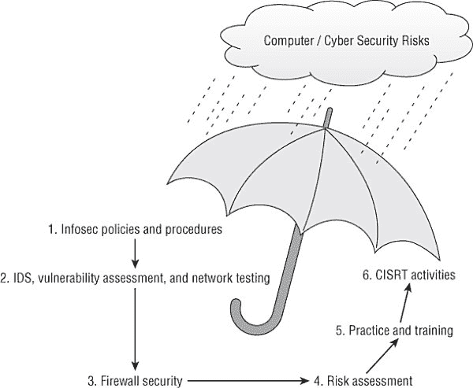

**图 7.3** 计算机取证和事件响应模型

取证专家必须知道如何通过拍照、在调查员笔记本中记录活动、询问嫌疑人和证人，以及了解收集或扣押嫌疑系统或介质的正确程序，来在现场记录证据。做正确的事是保护证据保管链和证据合法性的必要条件。取证程序必须记录证据的完整历程（从开始到结束），并能回答以下问题：

*   谁收集的证据？
*   如何以及在何处收集的？
*   谁取得了证据的占有权？
*   如何存储的？存储期间是否安全？
*   谁将其取出存储？为何取出？

此过程也称为电子取证，或 *e-discovery*，涉及为恢复证据而对电子信息进行审查。电子取证过程关乎如何查找和提取以电子格式存储的文档和数据。未来其使用趋势只会加剧。尽管大多数调查可能不会上法庭，但计算机取证专家必须收集、审查和保存结构化数据（可能来自电子记录、合同和表格）以及大量非结构化数据（如电子邮件、聊天会话，甚至电子文件片段）。在调查过程中，正式记录构成发现过程的重要组成部分，但在当今的电子世界中，这只是全貌的一半。在法庭案件和法律听证会上，要求提供选定电子邮件和其他电子通信的副本变得越来越普遍。数据保留政策应规定信息存储多长时间。例如，美国国税局 (IRS) 可在纳税年度结束后长达七年内要求提供纳税记录。因此，大多数会计师建议企业保留纳税记录七年。

表 7.1 列出了一些常见的文档保留时间。

**表 7.1** 常见文档和数据保留政策时间

| 文档 | 时间 |
| --- | --- |
| 雇佣合同和合伙协议 | 永久 |
| 契据 | 六年 |
| 商标 | 商标有效期加 25 年 |
| 版权 | 作者去世后 120 年 |
| 专利契据 | 25 年 |

由于电子信息收集是一项极其重要的关注点，国际计算机证据组织 (`www.ioce.org`) 于 1995 年成立，旨在制定与证据发现相关的程序国际原则。目标是制定可在许多国家和州被认可为合法的标准和实践。这些原则总结如下：

*   处理数字证据时，必须应用所有公认的取证和程序原则。
*   扣押数字证据时，采取的行动不应改变该数字证据。
*   当有必要访问原始数字证据时，该人员应接受过该特定目的的培训。
*   与数字证据的扣押、访问、存储或传输相关的所有活动必须完整记录、保存并可供审查。
*   个人对其持有数字证据期间采取的所有与数字证据相关的行动负责。
*   负责扣押、访问、存储或传输数字证据的任何机构，均有责任遵守这些原则。

由于电子信息极易被篡改，必须遵循严格的方法论，且不使用“原件”进行分析。处理介质的最佳实践包括以下内容：

*   原件副本被保管并保持未改变状态。
*   对原件副本进行哈希计算。
*   使用原件副本制作两份位级副本。
    *   主镜像用作库/控制副本。
    *   第二份副本用作工作镜像并进行分析。
*   两份副本创建时均进行哈希计算，以确保它们是精确副本。
*   原件副本和主副本被保管在受控区域内。

创建取证副本后，分析师将开始从易失性最高到易失性最低的信息提取过程。将检查易失性内存、RAM、系统事件日志、安全日志、文件、已删除文件和松散空间等项目。您需要建立并宀查系统、审计和安全日志。此过程必须正确执行，因为一旦证据被污染，就无法去污染；因此，拥有结构化的取证流程非常重要。取证流程的一般步骤如下：

1.  **识别和获取** 必须识别并检索信息。一旦信息处于调查员的保管之下，通常会创建一个副本。标准做法规定制作位级副本。位级副本是原始数据的精确副本。这允许调查员检查副本，同时保持原件完好无损。


##### 2. 保存与认证

保存是指将证据维持在未改变状态的行为。这一过程要求调查人员证明数据未被改动且未被篡改。认证可通过完整性检查和哈希值（如 `MD5` 和 `SHA`）来完成。

##### 3. 分析、记录与呈现

调查人员必须仔细检查数据，并确保记录在案任何活动。调查人员通常会通过检查驱动器松散空间、文件松散空间、隐藏文件、交换数据、互联网缓存以及回收站等其他位置来提取证据。有专用工具可用于此活动。调查人员的所有活动都必须被记录下来，以确保在需要时信息可在法庭上使用。

归根结底，计算机取证关乎对存储介质或内存中所存数据的科学检查与分析。此类分析的结果旨在发现发生了什么、对肇事者的潜在制裁，以及证据是否可能被用作法庭证据。

如今，越来越多的公司维护自己的计算机取证部门，或签约在需要时获取这些服务。在练习 7.4 中，您将下载并探索 Helix 可启动取证 CD。Helix 专为事件响应和取证活动而设计。

## 摘要

本书大部分内容直接聚焦于安全的技术层面，但本章侧重于许多非技术性项目。一些安全专业人员可能会忽视安全的这一领域，但它与所使用的任何防火墙、入侵检测系统或密码系统同等重要。这是因为必须有一个安全框架。该框架始于组织的最高层级，该层级受法律和道德约束，必须为关键资产提供一定级别的保护。高级管理层在此扮演重要角色——其成员是公司的最高决策层，并承担最终责任。他们是必须协助定义提供安全框架的政策和程序的个人。政策之所以重要，是因为它们作为管理层致力于保护关键资产的宣言。

用于确保特定安全控制的文件包括 `MOU`、`BPA` 和 `SLA` 等。并非所有安全文件都关注公司的物理资产。许多也是以人为本编写的，例如 `NDA`、职责分离和最小知情原则。尽管制定这些文件是一个好的第一步，但仍然需要培训。

安全意识、教育和培训是有时会被忽视的关键组成部分。没有培训，员工如何知道哪些政策很重要？大多数员工都想做正确的事，但需要培训将这种意愿映射到关于需做何事的知识上。可以执行多种类型的安全培训和意识教育，每种都有特定的任务。

最后，必须监控程序、实践和指南的部署以确保合规。即使是世界上最好的安全计划，如果不进行监控，且未建立机制以确立问责制，也几乎没有价值。许多组织不仅要对其组织负责，还要对州和联邦法律负责。

## 考试要点

1. **能够使用常见业务文档支持安全。** 支持安全的常见业务文档包括政策、程序、指南和基线。安全政策是顶层文档，常被称为*活的*文档，因为它永远未完成，且需要随着技术变化而更新。另一个示例是可接受使用政策。

2. **理解用于保护敏感信息的隐私原则的重要性。** 身份盗窃是一个巨大的问题，个人信息的丢失和泄露也是。公司必须实施强有力的控制来保护与个人相关的个人和敏感信息。这可能包括任何可能识别该个人的信息。社会安全号、姓名、地址、父母姓名、电子邮件地址和电话号码仅举几例。

3. **了解旨在管控员工的基本控制措施。** 职责分离、工作轮换、最小权限和强制休假是一些用于管控员工的基本控制措施。这一过程始于员工被雇佣之前，并持续到其被解雇之时。

4. **能够描述事件响应计划的组成部分。** 事件响应的关键在于必须在事件发生前制定计划。一个好的事件响应计划以分步方式列出了需做何事。事件响应计划的组成部分包括规划与准备、识别与评估、遏制与缓解、根除与恢复、调查与结案，以及经验教训。

5. **能够描述基本取证任务。** 基本取证任务包括识别、保存、收集、检查、分析和呈现调查结果。取证过程的关键是证据保管链。证据保管链关乎证据如何被处理、谁接触过它以及如何被控制。

6. **能够结合新业务、技术和环境变化描述政策制定。** 随着技术持续变化，政策必须是动态的。在当今始终在线、互联系统的世界中，安全专业人员必须按更加紧凑的时间表审查并修改政策。关键之一是将政策变更与变更管理挂钩，以便每次发生变更时，都有人询问：“这如何影响政策？”

7. **理解持续安全培训和意识计划的重要性。** 建立合规性的最佳方式是培训员工。员工需要接受培训以了解何为适当的安全实践，以及在特定情况下应如何行动。重要的是要记住，除非员工被告知，否则他们不知道适当的政策和程序。

## 复习题

1. 以下哪种控制要求两名员工协作完成一个动作？

   **A.** 双人流程

   **B.** 工作轮换

   **C.** 最小权限原则

   **D.** 双重控制

2. 作为组织的安全管理员，您决定仅限制有经批准需求的人员访问互联网。这描述了哪种实践？

   **A.** 双人流程

   **B.** 工作轮换

   **C.** 最小权限原则

   **D.** 双重控制

3. 您的公司开始每六个月将敏感岗位人员从一组工作任务调动到另一组。这种控制类型被称为？

   **A.** 双人流程

   **B.** 工作轮换

   **C.** 最小权限原则

   **D.** 双重控制

4. 您组织的一位经理正在面试潜在员工，并要求您查找一些背景信息。以下哪项您不应调查？

   **A.** 教育背景

   **B.** 推荐人

   **C.** 婚姻状况

   **D.** 声称的认证

5. 终止访问权限的最佳时间是什么时候？

   **A.** 解雇时

   **B.** 下班时

   **C.** 解雇一周后

   **D.** 解雇前员工上班班次开始时

6. 以下哪份文件用于支持 SLA？

   **A.** MOU

   **B.** OLA

   **C.** MBA

   **D.** NDA

7. 您的公司最近更换了防火墙，现在使用另一供应商的产品。哪份文件变动最大？

   **A.** 政策


## 第 8 章：安全研究与分析

## 涵盖的考试目标

1.  **3.1 应用研究方法以确定行业趋势及对企业的影响**
    *   执行持续研究
        *   最佳实践
        *   新技术
        *   新安全系统和服务
        *   技术演进（例如 RFC、ISO）
    *   态势感知
        *   最新的客户端攻击
        *   对当前漏洞和威胁的了解
        *   零日攻击缓解控制和补救
        *   新出现的威胁和问题
    *   研究新业务工具的安全隐患
        *   社交媒体/社交网络
        *   最终用户云存储
        *   业务内部集成
    *   全球 IA 行业/社区
        *   计算机应急响应小组
        *   大会/会议
        *   威胁行为体
        *   新出现的威胁来源/威胁情报
    *   研究合同的安全要求
        *   建议书请求
        *   报价请求
        *   信息请求
        *   协议

2.  **3.2 分析场景以保护企业安全**
    *   创建基准并与基线进行比较
    *   原型设计并测试多种解决方案
    *   成本-收益分析
        *   ROI
        *   TCO
    *   指标收集与分析
    *   分析和解读趋势数据以预测网络防御需求
    *   审查现有安全控制的有效性
    *   逆向工程/拆解现有解决方案
    *   分析安全解决方案属性以确保其满足业务需求：
        *   性能
        *   延迟
        *   可扩展性
        *   功能性
        *   易用性
        *   可维护性
        *   可用性
        *   可恢复性
    *   进行经验教训/事后分析报告
    *   运用判断力解决没有最佳解决方案的难题

## 练习题

### 7. 以下哪份文档属于高层级，并传达管理层的意愿？
**A.** 策略
**B.** 程序
**C.** 指南
**D.** 基线

### 8. 以下哪个群体最终对安全策略负责？
**A.** 员工
**B.** 管理者
**C.** CSO
**D.** 高级管理层

### 9. 就事件响应流程而言，哪个术语最能描述发现 IDS 误报触发的发生？
**A.** 触发器
**B.** 事件
**C.** 事项
**D.** 警报

### 10. 以下哪项是取证过程，最好被描述为为保护、控制和保全证据而采取的行动？
**A.** 锁定
**B.** 分析
**C.** 追踪
**D.** 保管链

### 11. 以下哪一项是事件响应流程的最后一步？
**A.** 遏制和缓解
**B.** 经验教训
**C.** 识别和评估
**D.** 根除和恢复

### 12. 你被要求加入一个负责取证分析的团队。以下哪项是最佳的分析顺序？
**A.** 内存、硬盘、DVD
**B.** 硬盘、U 盘、内存
**C.** 硬盘、CD、DVD、内存
**D.** 硬盘、内存、DVD、CD

### 13. 以下哪份文档最符合分步指南的描述？
**A.** 基线
**B.** 策略
**C.** 程序
**D.** 指南

### 14. 以下哪种审计是为了验证信息系统及相关系统提供的保护机制而执行的？
**A.** 运营审计
**B.** 信息系统审计
**C.** 安全审计
**D.** 取证审计

### 15. 以下哪项不是防范垃圾箱搜寻的防御措施？
**A.** 制定关于数据销毁的公司策略
**B.** 粉碎敏感文档
**C.** 锁定并保护垃圾容器和区域
**D.** 由授权人员清运垃圾

### 16. 组织安全策略声明不会定义以下哪一项？
**A.** 管理层的高层视角
**B.** 组织的安全目标
**C.** 如何加密数据的分步说明
**D.** 组织认为重要的 IT 安全领域

### 17. 你的公司正在考虑制定一项关于社会工程学的策略，以及员工如何避免网络钓鱼攻击。以下哪种技术你**不**推荐？
**A.** 反网络钓鱼软件
**B.** 数字证书
**C.** 策略规定员工绝不回复请求个人信息的电子邮件
**D.** 建议员工避免使用公共 WiFi 和免费互联网

### 18. 以下哪项是无法通过最终用户策略和教育进行防御的攻击的最佳示例？
**A.** 垃圾箱搜寻
**B.** 缓冲区溢出
**C.** 偷窥
**D.** 社会工程学

### 19. 以下哪项**不是**公司实施强制休假的原因？
**A.** 降低未被发现地实施欺诈的能力
**B.** 降低某领域因人员离职而严重受负面影响的可能性
**C.** 确保员工休息充分
**D.** 利用员工不在岗的时间进行审计和复查

## 章节内容

本章讨论了可能影响公司的趋势。我们所处的环境与 10 到 15 年前已大不相同。技术的进步速度快得多，攻击者也在学习快速适应。此外，当今有更多的系统连接到互联网并依赖互联网，这也是一个巨大的变化。这包括数据库、监控与数据采集系统、水分配系统和其他关键基础设施等系统。

对于 CASP 考生而言，所有这些都表明，更加了解正在发生的事情、什么连接到了网络以及系统有多关键，是多么必要。在这个行业中，每周甚至每天都会发生变化并不罕见。为应对这些变化做好准备的一部分工作是进行持续研究和态势分析。本章提供了一份网站和资源列表，可以帮助您了解当前趋势、新出现的威胁和已发布的新漏洞利用。

如果您想知道是否应该把所有这些信息发到您的 Facebook 账号上聊一聊，答案极有可能是否定的。社交网络变得更加突出，但也代表了真正的安全风险，因为可能会无意中暴露某些类型的信息。社交网络是本章探讨的主题之一，也是每家公司必须决定允许还是禁止的事项。社交网络站点既有好处也有坏处。全在于用户如何使用这项技术以及如何对其进行管理。关键在于社交网络本身并不坏；粗心的行为和过度的信息披露才是坏事。

本章讨论的另一个主题是大会和研讨会。与大多数其他 IT 安全认证一样，CompTIA 对其证书持有者提出了继续教育要求。IT 安全大会不仅是满足继续教育要求的好方法，也是了解行业动态的好途径。


本章的最后一部分是关于分析的。在实施安全控制之前，您必须确定它们是否是您环境的正确解决方案。您可能会被要求进行成本效益分析，甚至在考虑可用性指标的情况下，评估拟议解决方案的性能、延迟、可扩展性、能力、易用性和可维护性。

虽然本章不是本书中技术性最强的章节之一，但它仍然很重要，因为安全专业人员必须了解如何与管理层合作，为所需的安全控制争取资金并评估其有效性，同时还要知道如何创建建议书请求或报价请求。

## 应用研究方法以确定行业趋势及对企业的影响

IT 安全与许多其他技术领域一样，变化迅速。请稍作思考，就在不久前的 1995 年，Dan Farmer 和 Wietse Venema 创建了最早的漏洞评估工具之一。这个早期工具被称为 SATAN，并未受到 IT 安全领域所有从业者的好评。有人质疑是否需要一种用于扫描和识别漏洞的工具。尽管漏洞扫描在 1995 年是一次巨大的范式转变，但如今使用此类工具已成为常规做法。关于将工具置于公共论坛以便好人和坏人都能使用的争论至今仍在继续。作为安全专业人员，我们必须掌握行业趋势及其对企业的潜在影响。随着 IT 安全的成熟和对行业变化的适应，许多此类趋势已经发生，并将继续发生。

### 执行持续研究

作为一名安全专业人员，您必须执行持续研究，以跟上当前的威胁和行业变化。有许多资源可帮助您进行研究。此处仅列出了其中几个，仅作为可用资源的一小部分示例。我将这些资源分为趋势和工具两类。

您可能还记得您的第一台电脑，或者多年前您可能曾告诉某人，只要运行杀毒程序，他们就能免受大多数在线威胁的侵害。这是 2000 年之前的普遍认知。如今，杀毒程序只是防御数字威胁所需保护措施的一部分。

CASP 必须执行漏洞研究并掌握当前的安全趋势。此类研究有助于识别弱点，并在网络遭受攻击前提醒管理员。研究还有助于识别和纠正潜在的安全问题，防止其恶化。图 8.1 显示了 NIST 国家漏洞数据库网站，地址为 `http://nvd.nist.gov`。以下是可用于此目的的其他网站列表：

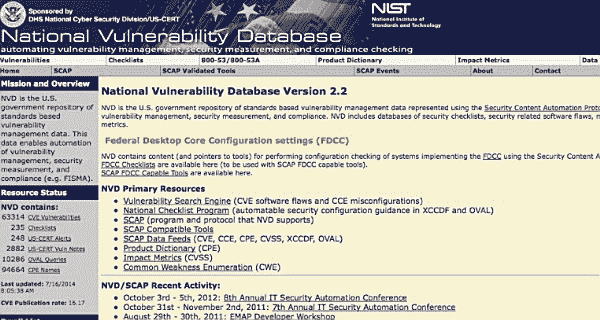

**图 8.1** 美国国家标准技术研究院国家漏洞数据库网站

`www.cert.org`

`www.securiteam.com`

`www.securitytracker.com`

`www.securityfocus.com`

`www.hackerwatch.org`

`www.hackerstorm.com`

`www.hackerjournals.com`

`http://hak5.org/`

`http://pauldotcom.com/`

`www.exploit-db.com/`

`http://packetstormsecurity.org/`

`www.offensivecomputing.net/`

作为 CASP，知道从哪里获取信息很重要，但您也必须知道从哪里获取安全工具。一个很棒的列表在 `http://sectools.org/`。SecTools 网站列出了 125 个评分最高的网络安全工具，并按类别细分。安全领域的任何人都建议浏览该列表并研究他们不熟悉的工具，因为这些工具既可以用于恶意目的，也可以用于正义目的。该列表最后更新于 2011 年，自那以后已发布了许多工具。无论能力和受欢迎程度如何，来自开放 Web 应用安全项目 (OWASP) 网站的 CAL9000 等工具集合，在列表修订之前都不会出现在此列表中。该网站是查找您不知道或未使用过的工具的好地方。以下是我访问时列出的前十二个工具：

1.  **Wireshark**：一款评价极高的数据包嗅探器和网络分析工具。
2.  **Metasploit**：一款集成的安全评估工具，提供免费版和付费版。
3.  **Nessus**：一款知名的漏洞评估工具，可扫描 Windows、Linux 和 UNIX 计算机。提供家庭免费版和商业版。
4.  **Aircrack**：专为破解 802.11 无线 WEP 和 WPA 加密而设计。
5.  **Snort**：市场上最知名的 IDS 工具之一。
6.  **Cain & Abel**：一款基于 Windows 的工具，可执行多种活动，如枚举、ARP 投毒、密码破解和无线分析。请参见图 8.2。
7.  **Kali**：一张包含多种安全工具的可启动 Live CD。它已被取代
8.  **Netcat**：一款在 Linux 和 Windows 下运行的命令行工具。它用途广泛，可用作远程监听器、端口扫描、横幅抓取，也可用于传输文件。替代品包括 socat 和 cryptcat（加密替代品）。
9.  **TCP Dump**：一款在 Linux 上运行的命令行数据包分析工具；也有称为 WinDump 的 Windows 版本。
10. **John the Ripper**：一款可在 Linux 和 Windows 计算机上运行的命令行密码破解工具。
11. **Hping**：一款数据包构造工具，可用于扫描和其他安全活动。
12. **Kismet**：一款基于 Linux 的无线安全工具，允许您捕获广播和非广播 SSID。


**图 8.2** Cain & Abel

另一个很棒的工具列表可以在 CASP 考试目标中找到。这些是在参加 CASP 考试前您需要深入了解的工具：

1.  **数据包嗅探器** 此类别包括 Wireshark 和执行数据包分析的类似工具。您可以在 `www.wireshark.org/download.html` 下载 Wireshark。

    CASP 考试将要求您不仅了解 Wireshark 等数据包嗅探器，还了解 IPv4 和 IPv6 等常见协议。请花些时间使用 Wireshark 复习这些协议。IPv4 和 IPv6 之间有许多区别。其中之一是 IPv6 内置了 IPSec，而 IPv4 仅将其作为附加组件。图 8.3 显示了 IPv4 头部示例，图 8.4 显示了 IPv6 头部示例。要深入了解此主题，请查阅 W. Richard Stevens 的《TCP/IP 详解》系列：`www.kohala.com/start/`

2.  **易受攻击的 Web 应用程序** 预构建的易受攻击 Web 应用程序，如 WebGoat、Hacme Bank 或 DVL (Damn Vulnerable Linux)，可用于深入了解常见 Web 应用程序及其漏洞。您可以从 `www.owasp.org/index.php/Category:OWASP_WebGoat_Project` 下载 WebGoat。

    您可以从 `www.mcafee.com/us/downloads/free-tools/hacme-bank.aspx` 下载 Hacme Bank。DVL 可在此处找到：`http://distrowatch.com/table.php?distribution=dvl`。

3.  **Microsoft Windows** CASP 不仅应对工具有良好的工作理解，还应对常见操作系统（如 Microsoft Windows Vista、7、8、8.1、Server 2008 和 Server 2012）有良好的工作理解。您可以从 `www.microsoft.com/windowsserver2008/en/us/trial-software.aspx` 下载 Server 2008 R2 的 180 天演示版，或从 `https://www.microsoft.com/en-us/evalcenter/try` 下载 Windows 8/8.1 开发者版本。


#### 4. Linux

Linux 系统被用于大多数大型组织。CASP 应当对这些系统以及它们如何配置和保护有良好的基本了解。获取一些技能的一种方法是查看 Fedora Linux Security Spin，网址为 `http://spins.fedoraproject.org/security/`，或 DVL（见本列表中的第一项）。

#### 5. 虚拟化工具

虚拟化已成为一种广泛接受的手段，可在无需购买更多物理硬件的情况下增加基础设施。CASP 应了解基本的虚拟化产品，如 VMware Player、QEMU 和 VirtualBox。您可以在 `www.vmware.com/products/player/` 下载 VMware Player，在 `www.qemu.org` 下载 QEMU，或在 `www.virtualbox.org/wiki/Downloads` 下载 VirtualBox。

#### 6. 漏洞评估工具

如今，许多公司使用 Nessus、Retina 和 OpenVAS 等软件进行定期漏洞评估。如果您想演示 Nessus，可在 `www.tenable.com/products/nessus` 找到它。OpenVAS 可在 `www.openvas.org/download.html` 下载。另一款非常流行的漏洞扫描器是 eEye Retina。它支持 NIST 的安全内容自动化协议 (SCAP)，这使其成为政府部门的有力竞争者。关于 Retina 作为政府解决方案的更多信息，请访问 `www.eeye.com/solutions/industry/government`。

#### 7. 端口扫描器

在众多可用的端口扫描工具中，Nmap 是最知名的之一，您应重点关注它以备考。您可以在 `http://nmap.org/download.html` 下载 Nmap。此处列出了一些基本的 Nmap 端口扫描开关：

*   TCP 连接扫描：`Nmap -sT`
*   TCP SYN 扫描：`Nmap -sS`
*   UDP 扫描：`Nmap -sU`
*   操作系统指纹识别：`Nmap -O`（具有限制扫描的选项 `-T`，或使其时序更激进的选项 `-T5`）。

#### 8. SSH 和 Telnet 实用程序

CASP 候选人应了解基本的传输技术，并知道哪些是安全的，哪些不是。例如，Telnet 不安全，而 SSH 提供加密。PuTTY 是 SSH 客户端的一个示例。您可以在 `www.chiark.greenend.org.uk/~sgtatham/putty/` 下载 PuTTY，这是一款免费的 SSHv2 客户端。

#### 9. 威胁建模工具

此类工具的一个很好的例子是微软的安全开发生命周期 (SDL) 威胁建模工具。它易于使用，并在风险管理过程中提供指导。您可以在 `www.microsoft.com/security/sdl/adopt/threatmodeling.aspx` 了解有关 SDL 威胁建模工具的更多信息。

#### 10. 计算机取证工具

Helix 是一款著名的事件响应、计算机取证和电子取证工具，CASP 考试将要求您了解它。您可以在 `www.e-fense.com/store/index.php?_a=viewProd&productId=11` 下载 Helix。还有许多其他取证工具；一些知名的商业工具包括 EnCase Forensic 和 AccessData 的 Forensic Toolkit (FTK)。


**图 8.3** Wireshark IPv4


**图 8.4** Wireshark IPv6

### 最佳实践

当公司为法律辩护实施最低安全级别时，可能需要证明他们已经做到了任何合理且审慎的组织在类似情况下所会做的事情。这一最低安全级别称为*应有注意标准*。如果未维持这一最低级别，公司可能面临法律责任。

此类标准在 IT 安全领域日益重要，因为大量公司数据存储在电子数据库中。此外，还有大量个人可识别信息 (PII) 以电子方式保存。这使得公司必须实践应有注意和尽职调查显得至关重要。后者要求组织确保已实施的控制持续提供所需的保护级别。一些公司选择实施高于最低要求的安全级别。这些努力可被视为最佳实践。*最佳实践*旨在在平衡安全性与可用性问题的同时，为信息和信息系统提供尽可能多的安全性。任何实施的控制成本不得超过其所保护资产的价值。必须保持财政责任。

实施最佳实践并非易事——不同行业必须提供不同级别的合规性。一些行业受政府机构或美国总统决策指令 (PDD) 监管，而其他行业（如医疗保健、银行、金融和石化）可能属于行业要求范畴。

CASP 的角色之一是尽可能与高级管理层合作实施良好的安全实践。当您着手实施最佳实践时，能否识别出组织中已实施卓越安全级别的其他人员或部门？请自问以下问题：

*   您的公司是否类似于最佳实践的目标组织？
*   您是否处于与目标组织相似的行业？
*   您是否拥有相似的技术？
*   你们公司是否具有相似的结构？
*   你们公司是否在相似的环境中运营？
*   另一家公司的规模是否大致相同？
*   您是否拥有相同数量的资源？

关于此主题的指导，一个很好的参考是 NIST 的一套指南和最佳实践。您可以在 `http://csrc.nist.gov/publications/PubsSPs.html` 阅读更多内容。2002 年联邦信息安全管理法案 (FISMA) 指定 NIST 负责制定供美国政府机构使用的标准和指南。

安全专业人员应审查的两项 NIST 标准是《特别出版物 800-100，信息安全手册：管理者指南》和《特别出版物 800-53，联邦信息系统和组织推荐安全控制》。《信息安全手册》(800-100) 提供了一个信息安全框架，并解决了治理、系统开发生命周期、安全评估、风险管理和事件响应等问题。

除了 NIST，其他值得审查的标准还包括 COBIT、ISO 27001/2 和 RFC 2196。RFC 2196 可在 `www.ietf.org/rfc/rfc2196.txt` 找到。

您可以在微软网站上找到一些基本的家庭用户最佳实践。虽然这些最佳实践建议不是强制性的，但它们在预防问题方面大有裨益。这些最佳实践包括：

*   使用防病毒软件
*   使用强密码
*   验证您的软件安全设置
*   更新产品安全
*   构建个人防火墙
*   早备份、勤备份
*   防止电源浪涌和断电

许多安全专业人员可能专注于技术安全控制，但策略、程序、实践和指南也很重要。未实施良好管理安全的策略，其危害性不亚于配置错误的防火墙。策略结构概览可见图 8.5。策略的一些组成部分包括：

1.  **标准**  
    *标准*是指定满足特定要求所需步骤或流程的战术文档。例如，标准可能强制要求所有电子邮件通信必须加密。因此，虽然标准规定了加密，但并未详细说明如何实现；这留给程序来规定。

2.  **指南**  
    *指南*指向策略或程序中的一条声明，您可据此确定行动方针。它是关于如何做事的建议或提议。指南旨在灵活，以便您针对个别情况进行定制。


### 3. 基线

*基线*是系统、网络或设备必须遵守的最低安全级别。基线通常映射到行业标准。基线可以通过比较其他组织的安全活动和事件来建立。基线可用作初始参考点，然后用于未来审查时的比较。


**图 8.5** 策略结构

### 新技术

虽然我清楚地记得我的第一台索尼 Walkman 卡带播放器，但该技术在今天已相当过时，并已让位于 MP3 播放器和互联网流媒体音乐。技术持续变革，安全专业人员必须紧跟当前技术。

#### 入侵检测与防御

入侵检测自 20 世纪 80 年代概念提出以来已取得长足进步。早期的入侵检测和防御系统（`IDPSs`）明确划分为两大类：网络入侵检测系统（`NIDSs`）和基于主机的入侵检测系统（`HIDSs`）。这些可根据内部引擎或检测异常的方法进一步细分。它们通常包括以下内容：

1.  **特征码** 寻求基于已知特征码进行匹配
2.  **异常** 检查流量并寻找异常活动
3.  **协议** 检查数据并将其与已知协议及其活动的数据库进行比较

IT 安全行业已发展到要求这些设备提供更多功能。这就是入侵防御系统（`IPSs`）诞生的原因。`IPS` 旨在超越 `IDSs`，并提供强制执行计算机安全策略、可接受使用策略或标准安全实践的能力。如今，这项技术已继续演变为所谓的 `IDP`。`IDPs` 可以记录与观察到的事件相关的信息、生成通知并创建报告。许多 `IDPs` 还可以通过尝试阻止威胁成功来响应检测到的威胁。它们使用多种响应技术，涉及 `IDPs` 自身停止攻击、通过更改防火墙设置来改变安全环境，或更改攻击内容。

存在许多 `IDPs`，其中一些是社区基础的，因此免费。`Snort` 是其中最流行的之一，已存在数年。社区中较新的成员是 `Suricata`。它由开放信息安全基金会（`OISF`）提供，资金来自美国国土安全部（`DHS`）、美国海军太空与作战系统司令部（`SPAWAR`）以及开放信息安全基金会（`OISF`）联盟。有关 `Suricata` 的更多信息，请访问 `www.openinfosecfoundation.org`。

练习 8.1 将演示如何使用 `WinDump` 执行基本数据包捕获，以及如何利用该技术监控和检测异常。

#### 网络访问控制

对于大大小小的企业而言，实现最佳网络安全是一项永无止境的追求。`CASP` 在保护关键系统方面发挥着重要作用。解决这些问题的一个潜在方案是网络访问控制（`NAC`）。`NAC` 为管理员提供了一种方法，在允许设备连接到网络之前验证其是否满足特定的健康标准。不符合预定义要求的笔记本电脑、台式计算机或任何设备，可被阻止加入网络，或被限制在一个受控网络中，直到设备达到所需的安全标准。有几种类型的 `NAC` 可用：

*   **基于基础设施的 NAC** 要求组织升级其硬件和操作系统。如果您的 IT 组织计划推出 Windows 8.1 或已预算升级 Cisco 基础设施，则您处于利用基础设施 `NAC` 的有利位置。
*   **基于端点的 NAC** 要求在每个网络客户端上安装软件代理。然后由集中式管理控制台管理这些设备。
*   **基于硬件的 NAC** 要求安装网络设备。该设备监控特定行为，若检测到不合规活动，可限制设备连接。

#### 安全信息和事件管理

安全信息和事件管理（`SIEM`）解决方案帮助安全专业人员根据日志文件中的数据快速识别、分析和报告威胁。`SIEM` 解决方案防止 IT 安全专业人员被审计数据和无尽的日志淹没，以便他们能够轻松评估安全事件，而不至于在安全事件数据中溺水。您可以检查几个开源工具，以了解这些工具旨在提供何种帮助，包括 `Nagios`（`www.nagios.org`）和 `Syslog-NG`（`www.balabit.com/network-security/syslog-ng/opensource-logging-system`）。对于功能齐全的开源 `SIEM` 解决方案，您可能需要查看 `OSSIM`，地址：`http://sourceforge.net/projects/os-sim/`。练习 8.2 提供了 `SIEM` 工具的演示。

#### 新安全系统和服务

新安全系统和服务的开发是一件好事。只考虑一个领域，如身份验证。虽然 20 世纪 90 年代密码提供的安全性似乎很棒，但请看看今天密码的现状。在 20 世纪 90 年代，我只有几个账户需要登录和管理。今天，我登录 Gmail 时使用一个密码，登录我的网站上传新网页时使用另一个密码，还有亚马逊作者门户的密码，甚至还有 Facebook 的密码！当你开始考虑今天必须跟踪多少密码时，密码的便利性似乎就蒸发了。幸运的是，有新技术可用于执行身份验证。

生物识别是一种此类解决方案。生物识别系统在过去十年中取得了进步。有许多不同类型的生物识别系统，包括虹膜扫描、语音识别、指纹和签名动态；然而，它们基本上都以相同方式工作：

1.  用户在系统中注册。用户允许系统采集一个或多个样本以供后续比较。
2.  用户请求身份验证。将一个样本与用户的身份验证请求进行比较。
3.  做出决定。匹配则允许访问，不匹配则拒绝访问。

生物识别设备的准确性通过其产生的第 1 类和第 2 类错误的百分比来衡量。第 1 类错误（拒真率 [`FRR`]）衡量本应获得访问权限却被拒绝的个人百分比。第 2 类错误（假接受率 [`FAR`]）衡量本不应获得访问权限却获得访问的个人百分比。当这两个值结合时，系统的准确性就确定了。`FRR` 和 `FAR` 相交的点称为交叉错误率（`CER`）。`CER` 是关键准确性因素：`CER` 越低，系统越准确。生物识别系统的另一个属性是指纹、视网膜或手掌不能借给任何人。一些常见的生物识别系统包括：

1.  **指纹扫描系统** 这些系统广泛使用，并安装在许多新笔记本电脑中。
2.  **手部几何系统** 这些系统被大多数用户接受；它们通过测量用户手指和手的独特几何形状来识别该用户。
3.  **掌纹扫描系统** 掌纹扫描系统非常类似于手部几何系统，不同之处在于它们测量手掌的皱纹和脊线以进行识别。
4.  **视网膜模式系统** 视网膜模式系统非常准确；它们检查用户的视网膜模式。
5.  **虹膜识别** 虹膜识别匹配用户眼后的血管。


#### 6. Voice Recognition
语音识别系统通过语音分析确定你的身份。

#### 7. Keyboard Dynamics
键盘动力学分析用户的打字速度和模式。

任何生物识别系统的最终考量因素是用户接受度和易用性。系统的可接受性取决于用户如何看待它。例如，虹膜扫描被认为比视网膜扫描更准确。这是因为视网膜可能会因糖尿病和怀孕等状况随时间发生变化。视网膜扫描对用户来说也更具侵入性，因此使用频率较低。用户教育很有帮助，因为许多人担心视网膜或虹膜系统会损害他们的眼睛，或者他们的信息得不到充分保护。

为确保生物识别系统可用，必须检查处理时间和环境。生物识别中一个不常被讨论的方面是生物识别数据管理和退役。生物识别数据需要进入系统数据库，即使采用专有数据库格式，存储人们的生物识别数据也存在额外风险。随着更多生物识别系统的推出，这种风险将在未来增加。生物识别系统也需要安全退役，以确保个人的生物识别信息永不泄露。

管理大量密码的另一种方法是单点登录。单点登录（SSO）旨在通过允许用户向单一认证机构进行一次认证，随后无需重新认证即可访问其他受保护资源，来解决这一问题。一种备受关注的单点登录形式是由美国商务部支持的版本，称为网络空间可信身份国家战略（NSTIC）。该提案规定了一种单点登录，每次计算机或手机开机时都会使用，采用数字令牌、智能卡或指纹阅读器等设备。有人认为此计划可能具有侵入性，而另一些人则将其视为消除当今密码诸多问题的手段。练习 8.3 演示了密码认证的弱点。

### Technology Evolution (RFCs, ISO)
你是否想过谁在管理互联网？有几个机构负责此事。首先是互联网协会（ISOC）。ISOC 负责互联网技术标准，并充当互联网信息和教育的全球交换中心。向 ISOC 汇报的实体包括互联网架构委员会（IAB）、互联网工程指导组（IESG）、互联网工程任务组（IETF）、互联网研究指导组（IRSG）、互联网研究任务组（IRTF）和征求意见稿（RFC）小组。

IAB 负责协议和标准，并管理 IETF。IETF 的职责是监督创建指导互联网如何设计、使用和管理的技术文档。这项使命的很大一部分集中在创建 RFC 上，RFC 作为互联网的“行为准则”白皮书。RFC 描述了互联网技术实践的方法、行为、研究和创新。创建 RFC 时，会分配一个永不改变的编号。发布新技术时，会先创建一个互联网草案作为新 RFC，然后将其最终确定为 RFC。此时，旧的 RFC 可能会变得过时。此流程不同于 ISO 等其他组织。一些知名的 RFC 及其标题如表 8.1 所示。

**表 8.1** 常见 RFC

| RFC | Description |
| --- | --- |
| RFC 821 | Simple Mail Transfer Protocol |
| RFC 2119 | Key Words for Use in RFCs to Indicate Requirement Levels |
| RFC 2396 | Uniform Resource Identifiers (URI): Generic Syntax |
| RFC 793 | Transmission Control Protocol |
| RFC 1123 | Requirements for Internet Hosts – Application and Support |
| RFC 1034 | Domain Names – Concepts and Facilities |
| RFC 2616 | Hypertext Transfer Protocol – HTTP/1.1 |
| RFC 2045 | Multipurpose Internet Mail Extensions (MIME) Part One: Format of Internet Message Bodies |
| RFC 1918 | Address Allocation for Private Internets |
| RFC 822 | Standard for the Format of ARPA Internet Text Messages |
| RFC 1521 | MIME (Multipurpose Internet Mail Extensions) Part One: Mechanisms for Specifying and Describing the Format of Internet Message Bodies |
| RFC 1766 | Tags for the Identification of Languages |
| RFC 2068 | Hypertext Transfer Protocol – HTTP/1.1 |
| RFC 1700 | Assigned Numbers |
| RFC 1591 | Domain Name System Structure and Delegation |
| RFC 1157 | Simple Network Management Protocol (SNMP) |
| RFC 1866 | Hypertext Markup Language – 2.0 |
| RFC 1945 | Hypertext Transfer Protocol – HTTP/1.0 |
| RFC 977 | Network News Transfer Protocol |
| RFC 791 | Internet Protocol |
| RFC 1661 | Point-to-Point Protocol (PPP) |
| RFC 959 | File Transfer Protocol |
| RFC 1035 | Domain Names – Implementation and Specification |
| RFC 2131 | Dynamic Host Configuration Protocol |
| RFC 768 | User Datagram Protocol |
| RFC 2543 | SIP: Session Initiation Protocol |
| RFC 3261 | SIP: Session Initiation Protocol |
| RFC 792 | Internet Control Message Protocol |
| RFC 2571 | An Architecture for Describing SNMP Management Frameworks |
| RFC 2573 | SNMP Applications |
| RFC 1510 | The Kerberos Network Authentication Service (V5) |
| RFC 1459 | Internet Relay Chat Protocol |

国际标准化组织（ISO）将自己描述为“由 162 个国家标准机构组成的网络，每国一名成员，中央秘书处设在瑞士日内瓦，协调连接公共和私营部门的体系”。

CASP 应了解几份 ISO 文档。其中之一是 ISO 15408。ISO 15408 经过多年的起草于 1997 年首次发布，当前为 3.1 版，更广为人知的名称是通用准则。通用准则旨在为表达产品和系统 IT 安全需求提供通用结构和语言。它是供应商描述其产品能力以及买家测试此类产品以确保其满足特定需求的一种方式。通用准则文档的一大成就是弥合了早期文档（如 ITSEC 和 TCSEC）之间的差距。通用准则保证了计算机安全产品的规范、实现和评估过程已以严格且标准的方式进行。因此，通用准则可在全球范围内使用，并对更广泛的受众具有意义。表 8.2 给出了通用准则评估保证级别（EAL）的一些示例。

**表 8.2** 通用准则

| Level | Definition |
| --- | --- |
| EAL 0 | Inadequate Assurance |
| EAL 1 | Functionality Tested |
| EAL 2 | Structurally Tested |
| EAL 3 | Methodically Checked and Tested |
| EAL 4 | Methodically Designed, Tested, and Reviewed |
| EAL 5 | Semi-formally Designed and Tested |
| EAL 6 | Semi-formally Verified, Designed, and Tested |
| EAL 7 | Formally Verified, Designed, and Tested |


另一份值得审查的 ISO 文档是 ISO 27002。该标准被视为信息安全管理的最佳实践守则。它源自 ISO 17799 和英国标准 7799。ISO 27002 被视为管理指南，而非技术文档。您可以在 `www.27000.org/iso-27002.htm` 了解更多信息。ISO 27702 为负责领导、规划、实施或维护安全的人员提供了关于信息安全管理的最佳实践建议。ISO 27702 标准包含以下 12 个部分：

1. 风险评估 如何评估组织风险
2. **安全策略** 管理方向和架构
3. **信息安全组织** 信息安全治理
4. **资产管理** 信息资产的清单与分类
5. 人力资源安全 员工入职、调动和离职的安全方面
6. 物理和环境安全 计算机设施的保护
7. 通信和运营管理 系统和网络中技术安全控制的管理
8. 访问控制 对网络、系统、应用程序、功能和数据的访问权限限制
9. 信息系统获取、开发和维护 通过系统开发生命周期（`SDLC`）和标准化流程将安全构建到应用程序中
10. 信息安全事件管理 通过开发事件响应程序和流程，预测并适当响应信息安全漏洞
11. 业务连续性管理 保护、维护和恢复关键业务流程和系统
12. 合规性 确保符合信息安全策略、标准、法律和法规

### 态势感知

态势感知要求您了解周围发生的事情，以理解如何应对特定情况。如今，安全专业人员比以往任何时候都更需要了解时事。IT 安全的定义及其涉及的内容随着技术进步而不断演变。今天，我们对网络、计算机和技术的依赖程度远超过去。这给许多人的日常生活带来了巨大进步，但也使计算机犯罪和网络攻击的威胁更加迫在眉睫。问题的规模令人震惊。根据 `www.fas.org/sgp/crs/misc/R40599.pdf` 上的国会研究服务报告，美国联邦调查局（`FBI`）估计，仅在一年内，多达 1000 万美国人将成为身份盗窃的受害者。尽管消息来源对威胁程度的看法不一，但计算机犯罪以不断增长的速度增加这一趋势是毋庸置疑的。态势感知要求 `CASP` 跟上最新的客户端攻击、攻击向量、新兴威胁和零日攻击。

#### 最新客户端攻击

Web 服务器曾是攻击者的主要目标，但这已不再成立。如今，客户端攻击更为突出。原因之一是客户端系统是一个目标丰富的环境。客户端可能正在运行 `Flash`、`Office`、`Acrobat`、`iTunes`、`Firefox`、`Java` 等。这些程序中的每一个都为攻击者提供了潜在目标。与互联网相关的交互性也强得多。这为攻击者提供了针对基于 Web 的应用程序的选项。最后一个原因是，如今可用的工具比过去多得多。如今，工具使用起来容易得多，且广泛可用。许多基于 Web 的客户端攻击在本质上是技术性的，但也利用了社会工程学。这些技术可用于诱使受害者点击链接或访问恶意网页。当受害者访问该网页时，攻击者执行恶意代码，利用应用程序中存在的漏洞。客户端攻击的示例包括以下内容：

1. Cookie 窃取或篡改

Cookie 用于维护状态，跟踪用户在网站页面间的移动，以及跨多个请求/响应周期跟踪用户。问题在于 Cookie 可能包含对黑客有吸引力的敏感信息。某些 Cookie 存放用于身份验证的用户名、密码或其他数据。如果 Cookie 存有用于识别客户端的数据，攻击者即可利用其劫持会话或冒充客户端。许多 Web 2.0 网站（如 `Reddit`、`LinkedIn` 和 `Digg`）使用 Cookie 在稍后识别用户，这样用户每次访问账户时就无需提供凭据。从态势感知的角度来看，用户需要明白，如果没有加密，他们的 Cookie 很容易被窃取。`Cookie Cadger`、`Session Thief` 和 `Firesheep` 等工具都被用来演示窃取这些 Cookie 的容易程度。图 8.6 显示了 `Firesheep` 用于捕获 `Facebook` Cookie 的 `JavaScript` 代码，练习 8.4 演示了如何进行 `Cookie Cadger` 的基本安装。

核心漏洞在于，虽然大多数网站对登录过程进行加密，但后续请求在明文 URL 中包含用户的 Cookie。该信息未加密。如果网站对整个用户会话进行加密，就不会存在此风险。那么为什么网站不加密呢？一个原因可能是加密流量会给运营网站的公司带来更大的运营负担。对于大流量网站，它们需要昂贵的硬件来加速加密过程。另一个原因可能是加密也会使合法执法机构的合法拦截请求变得复杂。使用 `Cookie Cadger` 捕获 `LinkedIn` 和其他凭据是一种简单的方法。您需要 `winzip`、`Wireshark` 和 `Java` 才能使该程序运行。

**跨站脚本攻击（`XSS`）** `XSS` 攻击是一种针对动态生成网页的注入攻击，恶意脚本被注入到原本良性且受信任的 Web 内容中。`XSS` 允许攻击者在毫无戒心的用户访问恶意网页时强制加载任何网站。这使攻击者能够窃取输入 `HTML` 表单的用户名和密码或 Cookie，或泄露屏幕上的任何机密信息。态势感知要求用户在点击电子邮件中的链接或可疑网站时保持谨慎。`CASP` 考试将要求您能够识别 `XSS` 攻击。以下是一个非持久性 `XSS` 攻击的示例：

```
index.php?name=guest<script>alert('hacked')</script>
```

**跨站请求伪造（`CSRF`）** `CSRF` 是另一种客户端攻击，当恶意网站诱骗用户在不知情的情况下从其已通过身份验证的网站加载 `URL` 时发生，从而利用其已验证的状态。练习 8.5 演示了此类攻击的严重性。

1. SQL 注入 攻击者搜索并利用易受 SQL 注入影响的数据库。`SQL 注入` 是指攻击者能够通过 `SQL 注入` 漏洞将 `SQL` 语句插入查询中。`SQL 注入` 允许攻击者利用系统上的不安全代码直接向数据库传递命令。这赋予了攻击者利用其访问权限执行各种活动的能力。许多 `SQL 注入` 攻击以信用卡信息或其他敏感信息为目标。`CASP` 应了解此威胁，并致力于确保公司网站已针对该漏洞进行加固。


##### 缓冲区溢出

当程序或进程试图在缓冲区中存储超过其设计容量的数据时，就会发生*缓冲区溢出*。可以把它想象成有一个 8 盎司的杯子，却试图倒入 12 盎司的咖啡。它装不下所有咖啡。这会迫使部分咖啡溢出并洒出杯外。当缓冲区的大小未经过验证时，就会发生缓冲区溢出；这可能导致写入已分配缓冲区之外的区域。这可能会导致段错误或错误。如果攻击者清楚自己在做什么，他们可以尝试将其数据加载到栈上，并强制返回指针加载他们的代码。在这种情况下，攻击者能够在受害者的计算机上加载他们的代码。在 C 语言中，某些函数（包括 `strcpy`、`gets`、`scanf`、`sprintf` 和 `strcat`）是脆弱的。CASP 应该理解，在使用了 C 语言的情况下，如果可能的话，应检查代码中的脆弱函数。如果您想了解更多信息，请查看 Aleph One 的“Smashing the Stack for Fun and Profit”，网址为 `http://insecure.org/stf/smashstack.html`。


**图 8.6** Firesheep 用于捕获 Cookie 的 Facebook.js

CASP 可以采取一些措施来帮助预防这些问题并降低这些风险。打补丁至关重要。始终确保计算机和应用程序已打补丁。实施出站过滤和使用 Web 应用防火墙也有帮助。这两种技术可以通过过滤传入的恶意内容，帮助防止与恶意网站的出站连接。另一个非常重要的项目是入侵检测。它关乎监控和识别可疑网络活动的能力。您还需要审查并调整端点安全控制，以确保它们能够识别恶意和可疑活动。最后，虽然不属于技术范畴，但员工教育至关重要，因为它有助于培训员工了解当前的攻击趋势，以及如果他们怀疑自己是攻击受害者时应遵循的程序。

### 当前漏洞和威胁的知识

正如本书前面所讨论的，威胁可以被描述为任何可能危及安全的行为或事件。组织面临的一些常见威胁如下：

1.  **垃圾邮件** 利用任何电子通信媒介批量发送未经请求的消息。垃圾邮件是互联网时代的一大烦恼。尽管垃圾邮件仍然是一个大问题，但执法部门和其他人正在寻找独特的方法来针对从垃圾邮件中获利的个人。CASP 需要意识到，如果攻击者能将您的公司用作垃圾邮件中继，可能会导致公司的 IP 地址被列入黑名单。结果是电子邮件可能无法投递给客户和业务合作伙伴。垃圾邮件还带来了一个问题，即其中大部分是恶意的。CASP 可能不得不花费更多时间清理计算机和重建硬盘驱动器。最好的方法是在内容到达最终用户之前对其进行过滤。一种减缓垃圾邮件提供商速度的方法是针对处理垃圾邮件提供商付款的银行。这种新颖的方法针对垃圾邮件的商业模式和参与者，它不是一种通过过滤器技术性地防止垃圾邮件的解决方案。追查支付处理商是分析整个攻击者活动链并通过整体方法发现攻击者活动弱点的一个绝佳例子。要了解有关此方法的更多信息，请查看 `www.wired.com/beyond_the_beyond/2011/06/spam-banks/`。

2.  **网络钓鱼** 这是一种犯罪性的欺诈过程，通过在电子通信中伪装成值得信任的实体，试图获取用户名、密码和信用卡详细信息等敏感信息。与之密切相关的是定向网络钓鱼，它针对特定个人或特定信息子集。通过为员工提供培训，可以减少这两种威胁。最终用户必须被教导在共享敏感信息时保持谨慎。

3.  **间谍软件** 任何秘密收集用户互联网使用情况和活动信息，然后利用这些信息发送与用户互联网使用历史性质相似的广告软件和弹出式广告的软件应用程序。间谍软件可能给公司造成巨额损失。

4.  **来电显示欺骗** 伪造来电显示的行为，使攻击者想要的任何号码都显示为来电号码。VoIP 系统和在线服务使这变得非常容易。这种威胁很难防御，但如果您对这种情况感到不安，可以随时要求几分钟后回拨给用户。这种技术可用于检测来电显示欺骗。攻击者有时会诉诸一种称为“恶意报警”的技术——利用伪造的来电显示进行虚假报警，导致警察和特警部队因虚假的人质劫持事件等而闯入目标住所。

5.  **预付费用诈骗** 这种攻击也被称为尼日利亚洗钱骗局。基本概念是你把银行账号发给他们，他们就会乐意与你分享数百万美元。当然我在开玩笑。其真实意图是获取您的银行账号并掏空账户。应教育用户了解这一威胁，并能在情况出现时识别它。

6.  **拒绝服务** 当攻击者消耗计算机上的资源用于非预期用途，从而阻止合法目的对网络资源的正常使用时，就会发生拒绝服务。这些攻击可以针对特定服务。SYN 洪水攻击用于瘫痪 Web 服务器。全面的网络饱和攻击可以阻止任何流量到达目的地。DoS 会以有形和无形的方式给公司造成损失。中断可能导致销售损失和声誉受损。

7.  **分布式拒绝服务** 与 DoS 类似，不同之处在于攻击是从多个分布式的代理 IP 设备发起的。DDoS 更难防御，因为它源自许多不同的设备，因此更难识别真正的攻击者。这类攻击可以通过僵尸网络发起，动机可能是报复、勒索，甚至是政治或黑客行动主义动机。一些公司甚至可能付费以防止成为 DDoS 的目标，正如此处报道的：`www.foxbusiness.com/technology/2014/04/07/cyber-shakedown-hackers-unleash-mafia-style-extortion-tactics/`。

8.  **会话劫持** 当劫持者接管客户端和服务器之间已建立的会话时，就会发生这种情况。这些攻击可能因弱加密或不良的会话管理而发生。态势感知要求用户注意他们远程连接的服务类型以及他们的所在位置。身处咖啡店或机场等公共场所的用户需要使用额外的保护机制。关于使用经典工具“hunt”进行会话劫持的优秀教程请见 `www.cs.binghamton.edu/˜steflik/cs455/sessionhijacking.htm`。

9.  **中间人攻击** 当攻击者拦截并可能修改两个用户之间传输的数据时，就会发生中间人攻击。这些攻击可能给公司造成损失，因为攻击可能获得专有信息、公司机密或未来的计划和项目。

10. **逻辑炸弹** 一种危险的攻击，它等待预定事件或时间来执行其有效载荷。态势感知是防御此类攻击的最佳手段。我的意思是，每当有权访问代码的程序员或其他人员被解雇或训斥时，这可能就是一个问题。需要对代码或应用程序进行审查，以标记此类攻击。这些攻击通常由内部人员或不满的员工发起；因此，应使用良好的管理控制，如职责分离和最小权限原则。


许多此类威胁已经存在一段时间了，但这并不意味着可以忽视它们。旧的漏洞利用代码不断被重新利用，攻击者会寻找方法回收利用这些漏洞利用代码，使其焕然一新。

#### 新兴威胁与问题

如果有一件事是恒定不变的，那就是攻击者一直在寻找新的攻击方法。自 2000 年以来，出现了大量新兴威胁。新兴威胁是指那些变得更加突出且过去未曾见过的威胁。这些威胁包括以下内容：

1.  **僵尸网络** 一组由黑客控制的僵尸主机；这些僵尸程序或僵尸主机可用于发送垃圾邮件、安装木马、尝试“拉高出货”式股票操纵，甚至发起 DDoS 攻击。最终用户可能通过访问恶意网站、点击错误的电子邮件附件，甚至点击社交网站中的链接而受到感染。大多数僵尸网络的共同点是它们旨在牟利。例如，2011 年 4 月，计算机犯罪分子利用 Coreflood 僵尸网络窃取受害者银行账户资金，该僵尸网络在美国法院命令下被关闭。该僵尸网络曾从毫无防备的受害者那里窃取数千美元。您可以在 `http://arstechnica.com/tech-policy/news/2011/04/fbi-vs-coreflood-botnet-round-one-goes-to-the-feds.ars` 阅读更多相关信息。僵尸网络的命令与控制结构示例如 图 8.7 所示。

2.  **恐吓软件** 这是几类通常收益有限或毫无收益的软件，某些不道德的营销手段将其推销给消费者。恐吓软件增长了几年，并已蔓延至 Mac 平台。恐吓软件旨在吓唬您购买虚假或恶意软件。

**短信钓鱼** 一种利用手机短信服务和社会工程学技术发送虚假短信的犯罪活动，旨在诱骗用户点击虚假链接。

**智能手机攻击** 手机正成为越来越多的攻击目标。智能手机比几年前强大得多，如今它们就是非常小巧、强大的计算机。尽管多年来一些人已为手机病毒、蠕虫和僵尸程序敲响警钟，但这些威胁尚未大规模显现。有几个因素导致这类恶意软件的发展比预期慢。这些因素包括缺乏带宽、市场碎片化，以及手机的生命周期比计算机短得多。

阻碍此类恶意软件传播的因素正在发生变化。更多智能手机提供商正从仅提供语音服务转向提供不断增加的数据服务。iPhone 等平台已占据智能手机市场的很大份额。重要的是要记住，许多威胁是以增量方式演变的。昨天的概念验证代码可能成为明天的主流攻击。甚至已出现苹果 App Store 和部分 Android 应用中发现恶意应用的案例。其中一些用于追踪用户，而另一些旨在记录用户活动。对于那些决定突破供应商安全边界的人，例如越狱手机的用户，存在其他风险。越狱是指移除智能手机供应商为控制操作系统和可加载程序而施加的限制的过程。

**搜索引擎投毒** 搜索引擎投毒或黑帽搜索引擎优化是一种技术，攻击者借此确保其网站在查询返回列表中排名靠前，从而将用户重定向到受感染的网站。

**犯罪工具包** 犯罪工具包是完整的攻击工具套件，包含缺乏技术专长的“脚本小子”发起网络钓鱼和恶意攻击所需的一切。这些工具包包含一个生成器，使用户能够创建能够实施 Web 注入的恶意软件。基础工具包售价约 1000 美元或更高并不罕见。您可以将基础工具包类比为购买 Windows 8.1 Starter（入门版）；如果您想要更多功能，可以升级到 Windows 8.1 Ultimate（旗舰版）。犯罪工具包的运作方式大同小异。支付额外费用，您可以购买 Explorer 或 Firefox 表单抓取器、加密插件，甚至远程键盘记录器。这些工具包附带用户手册、管理面板和用于验证工具包的序列号。

**点击劫持** 这种在线威胁日益猖獗，其原理是隐藏链接或按钮的真实目的。如果黑客诱骗您点击一个看似无害的链接，受害者实际上会执行完全不同的操作，通常导致远程执行任意代码。


**图 8.7** 僵尸网络命令与控制结构

#### 零日攻击的缓解控制与补救措施

在讨论应对零日攻击的方法之前，首先让我们明确零日攻击的定义。`零日攻击` 是指供应商尚不知情或尚未修复的攻击。零日漏洞利用代码通常在黑客地下圈子流传。即使软件公司知晓了这些漏洞，修复漏洞的补丁也可能无法立即发布。以针对 Google 的“极光”攻击为例。攻击发生后，当源代码公开时，微软花了大约一周时间才创建并发布补丁。

寻找应对零日攻击的方法是一个有趣的话题，因为根据定义，你无法预先针对未知的特定攻击进行防御。然而，你可以实施一些最佳实践和技术，通过分层安全控制来提高组织的整体安全态势。此处可找到应对零日攻击的七条经验教训：`www.informationweek.com/news/security/attacks/231601692`。以下是您应使用的其他一些技术和手段：

*   安全培训与意识教育，让用户养成安全计算习惯
*   IDS/IPS 在网络边缘和内部扫描流量
*   防火墙以默认“拒绝所有”设置过滤入站和出站流量
*   SIEM 扫描异常事件并调查其来源
*   事件响应程序和实践，以响应事件并判断其是否为应予调查的安全事件
*   实施补丁管理计划，用于保持系统打上补丁
*   物理安全实践，仅允许有需要的人访问并提供多层物理控制
*   运营安全实践，规定良好的招聘、人员管理和离职实践
*   对传输中和静态的敏感数据部署加密
*   最新的防病毒软件，可通过多种方式扫描恶意软件，如特征码扫描、启发式扫描、完整性检查和活动拦截

### 研究新业务工具的安全隐患

Web 2.0 技术等新业务工具改变了公司的运营和营销方式。尽管这些工具能助力业务增长并实现更广泛的协作，但您需要研究新技术的安全隐患。

#### 社交媒体/社交网络


##### 社交网络与安全

社交网络是人们聚集的地方，自然会吸引攻击者的注意。不止一项研究表明，与电子邮件相比，人们更有可能点击社交网站上的链接。尽管社交媒体开辟了极佳的沟通渠道，对营销人员非常有用，但它却充满了潜在的安全问题。社交网站正成为对用户安全最大的威胁之一，在可预见的未来将保持这一态势。原因之一是用户在使用这些网站时并不总是考虑安全问题。还有一个问题是，这些网站的设计初衷是连接人与人。安全并不总是首要考量。

##### 用户安全意识

社交网站的问题之一在于，这些网站的用户并不总是考虑安全。这意味着他们面临更大的风险，成为身份盗窃和欺诈的受害者。网络犯罪分子拥有一系列手段，包括虚假调查、欺诈性应用程序和毒化链接。

##### 政治活动与隐私风险

社交网络的另一个问题是，越来越多的政治活动家和异见人士正在使用这些工具来建立志同道合的社区并传播他们的信息。如果这些个人受到政府审查，社交网站会让这些个人很容易被追踪，甚至在某些国家被监禁。有关这在某些威权国家已发生的更多信息，请参阅 `www.pbs.org/wgbh/pages/frontline/revolution-in-cairo/interviews/evgeny-morozov.html#2`。此外，一些公司开始对求职候选人进行社交网络搜索。根据 `www.marketwatch.com/story/why-employers-should-careful-about-facebook` 的报道，多达 40% 的雇主曾搜索社交网站以获取潜在雇员的信息。尽管各州和不同国家的法律有所不同，但个人需要思考他们在社交网站上发布的内容以及如何分享这些信息。大多数社交网站（如 Facebook 和 Google+）要求用户使用真实姓名。在网上发布过多关于自己的真实信息，可能会让你和你所爱的人处于危险之中。

##### 案例研究：Please Rob Me

一个很好的例子是 Please Rob Me 网站。这个概念验证网站直观地说明了：仅凭人们发布在网上的信息，抢劫他们是多么容易。该网站利用来自 Foursquare 的数据流，Foursquare 是一个日益流行的基于位置的社交网络，其前提类似游戏。玩家使用智能手机或笔记本电脑签到某个位置，在地图上记录他们的位置，供使用该服务的朋友查看。Please Rob Me 利用这些信息构建用户画像，甚至可以预测用户何时不在家，以便他人进入用户的房屋。这个故事的寓意是，用户不应在 Facebook、Twitter 或其他社交网站上公布他们的旅行计划和度假细节。社交媒体让冒充其他用户、安装恶意软件、发送垃圾邮件或实施各种其他邪恶行为变得轻而易举。

### 最终用户云存储

在过去几年里，最终用户的云存储选择呈倍数增长。许多此类基于云的服务免费提供，或以普通用户能够承受的低成本提供。此处仅列举其中几项服务：

*   Microsoft OneDrive
*   Google Cloud Storage
*   Apple 的 iCloud
*   Dropbox 文件存储与传输

这些服务提供了许多好处，如免费存储空间和轻松访问云存储数据。CASP 应了解最终用户云存储，因为存在潜在的安全顾虑。员工使用此类服务，可能会通过使用基于云的服务存储和移动公司数据，使其组织面临不可预见的风险。这可能包括将客户数据、商业机密、PII 甚至客户记录存储在 Dropbox、Google Docs 或 Microsoft OneDrive 上。

### 业务内部整合

并非所有社交网络都是有害的；它为公司提供了一种与客户联系、推广即将到来的活动和事件的绝佳方式。不仅是私营公司将社交媒体作为营销工具；美国国防部及其所有下属机构也使用 Facebook 和其他社交媒体工具来帮助推广其计划。图 8.8 展示了一个企业 Facebook 点赞页面的示例。


**图 8.8** 企业 Facebook 点赞页面

如果贵公司决定允许在工作场所使用社交网络，应由一项政策进行管控，明确规定允许和不允许的行为。您还应提供一些基本培训和最佳实践，说明在这些服务方面允许和不允许的行为。这些应包括：

*   应发布或不应发布何种信息
*   应暴露多少个人信息
*   哪些话题可供讨论，哪些是禁区
*   用户应提供多少关于自己的个人信息
*   社交网络的危险性
*   最佳实践，如不点击链接和打开附件

CASP 还负责向公众推荐公司材料的最佳发布位置。这包括活动日程和营销材料等项目。通常，此类信息会在公司网站上提供。指向这些材料的链接也可通过 Twitter 和 Facebook 等社交网站提供。

### 全球 IA 行业社区

全球信息保障（IA）社区是从计算机安全的实践和程序中发展而来的。用于教授信息保障的一个模型被国家信息保障词汇表、国家安全系统委员会指令 CNSSI-4009 所采用。它将 IA 定义为：“通过确保可用性、完整性、认证、机密性和不可抵赖性，保护和防御信息及信息系统的措施。这些措施包括通过纳入保护、检测和反应能力，提供信息系统的恢复。”以下列表总结了这些措施：

1.  **可用性** 确保负责交付、存储和处理数据的系统可用且可访问，以满足获授权使用资源的个人的需求。
2.  **完整性** 被视为安全三要素之一的项目；另外两个是机密性和可用性。完整性用于验证项目的准确性和完整性。
3.  **认证** 一种识别他人的方法。认证验证访问系统及其资源的个人的身份和合法性。常见的认证方法包括密码、令牌和生物识别系统。
4.  **机密性** 数据或信息不提供给未授权人员，也不向其披露。
5.  **不可抵赖性** 为确保个人无法否认其自身行为而建立的系统或方法。


鉴于当今信息保障（IA）的重要性日益凸显，你不难理解为何对合格、受过专业训练的安全专业人员的需求与日俱增。CASP 认证的推出正是基于这一原因之一。认证的必要性甚至引起了联邦政府的关注。一个典型例子就是国防部（DoD）指令 8570。DoD 8570 要求所有从事 IA 职能的政府雇员必须接受培训、获得认证并达到相应技能等级。这些人员必须持有其特定职位分类所批准的认证。这些认证包括认证信息系统安全专家（CISSP）、认证信息系统审计师（CISA），以及来自 CompTIA 等其他厂商的认证。

#### 计算机应急响应小组（CERT）

事件响应由来已久，可追溯至 1988 年。当时，国防高级研究计划局（DARPA）组建了一个早期的应急响应小组。事件响应的目标是：

*   对事件通知进行分析
*   若分析结果表明必要，则响应事件
*   升级路径程序
*   解决、事件后跟进，并向相关人员报告
*   威慑未来的攻击

#### 惯例/会议

在信息安全领域，会议发挥着关键作用。它们让你能够与其他安全专业人员互动，了解安全社区的动态，并掌握当前的趋势与活动。IT 安全会议的一个子类别是黑客大会。许多此类活动或会议被称为“黑客大会（hacker cons）”。如果你参加过此类活动，会发现有几类人群。这些活动为电话飞客（入侵电话系统的个人）、黑客、执法人员和安全专家提供了聚会场所。

在这些会议上，可能会发布黑客工具、披露漏洞、详述新兴威胁。曾有厂商在活动前上法庭试图阻止特定演讲或讨论。因此，某些活动可能不会提供特定演讲或小组讨论的完整细节。黑客大会的常见议题包括物理安全、开锁、漏洞利用工具、独特的新型攻击、零日漏洞利用、无线攻击、企业与网络安全、《数字千年版权法案》（DMCA）、个人权利与自由。

许多此类活动提供“攻击演练”，团队间互为目标，以测试如何成功攻击对方。这些通常被称为“夺旗赛（Capture the Flag）”。它们在封闭、受控的网络中进行。然而，利用社会工程学对真实目标进行实战黑客攻击的活动正日益增多。这在 2011 年的 DefCon 19 上就曾发生。详见 `http://www.theinquirer.net/inquirer/news/2100108/oracle-loses-social-engineering-competition-defcon`。一些常见的黑客大会包括：

1.  **CanSecWest** 在加拿大不列颠哥伦比亚省温哥华举办的年度大会。
2.  **Chaos Communication Congress** 由混沌计算机俱乐部举办，历史最悠久且规模最大的欧洲黑客大会。
3.  **DefCon** 在拉斯维加斯举办，是美国最大的黑客大会，通常在 7 月或 8 月举行。图 8.9 展示了 DefCon 大会的主页。
4.  **HackCon** 挪威最大的安全大会，在奥斯陆举办，类似于芬兰举办的 T2 大会。
5.  **Hack in the Box** 亚洲最大的网络安全大会，每年在马来西亚吉隆坡举办，近期也在中东和欧洲举办。
6.  **Pwn2Own** 在加拿大温哥华举办，于 3 月底举行；它是 CanSecWest 的一部分，专注于审视网页浏览器和网页相关软件。
7.  **ShmooCon** 在华盛顿特区举办，于深冬时节举行。
8.  **ToorCon** 圣地亚哥的黑客大会，通常在 9 月底举行。


**图 8.9** DefCon 主页

#### 威胁行为体

FBI 将威胁行为体归纳为三大类：有组织犯罪、国家资助的攻击者和网络恐怖分子。在这三类群体中，FBI 指出有组织犯罪是当今我们看到的最深度卷入网络犯罪的群体。此类活动的很大一部分源自东欧和俄罗斯。过去几年中，一些针对美国消费者、银行和零售商的最臭名昭著的恶意软件源自俄罗斯或前苏联国家：例如 ZeuS、Citadel、SpyEye 和 CryptoLocker。事实上，根据 Solutionary 的一项研究，2012 年第四季度发布的“漏洞利用工具包”约有 70% 来自俄罗斯。据赛门铁克统计，据估计网络犯罪每年给全球经济造成 1130 亿美元的损失，详见 `www.symantec.com/about/news/resources/press_kits/detail.jsp?pkid=norton-report-2013`。

对于威胁行为体名称的种种混淆，同样也适用于“正派人士”。用来描述测试网络、应用程序或系统安全性的个人的一个术语是“白帽黑客（ethical hacker）”。`ethical hacker` 是指经过授权执行安全测试和其他漏洞评估活动，以帮助组织保护其基础设施的个人。有时白帽黑客被称为“白帽子黑客”。黑客通常被划分为不同类别，可能包括以下几类。

1.  **白帽** 这些人员实施道德黑客攻击，以帮助保护公司和组织。他们在法律允许的范围内，经组织许可开展工作。
2.  **黑帽** 这些人员是犯罪攻击者，可能受贪婪、报复或攻破公司的挑战性驱使。
3.  **灰帽** 这些人员通常遵守法律，但有时会涉足黑帽黑客的阴暗面。我把他们比作《星球大战》中的卢克·天行者。他们无法决定是加入原力一方，还是投奔黑暗面。

#### 新兴威胁来源/威胁情报

犯罪黑客活动多年来已发生变化，新兴威胁的来源也是如此。当今大多数黑客文化源于 1960 年代的电话飞客活动。这些人入侵电信和 PBX 系统以探索其能力并免费打电话。他们的活动包括物理窃取、窃取呼叫卡、访问电信服务以及重新编程电信设备。

让我们关注一下 CASP 面临的一些新兴威胁来源。以下列表列出了一些常见的当前和新兴威胁来源：

1.  **网络犯罪** 如今，很大一部分黑客活动是由经济利益驱动的。这些攻击者通常以银行、金融机构、公司和最终用户为目标。他们的目标通常是信用卡号、个人信息、身份盗窃或其他与窃取钱财相关的活动。
2.  **国家资助的黑客** 这些个人获得某种形式的国家或政府支持，通常专注于收集情报、窃取数据，并掌握其他国家或政府可能拥有的先进技术和知识。所谓的国家资助黑客攻击的例子包括“幽灵网”、震网病毒和“阴影鼠”。
3.  **不满的员工** 不满的员工是指对现任或前任雇主心怀不满的人。这些个人可能具备也可能不具备高超的黑客技能，但他们拥有外部人员可能不具备的目标访问权限和知识。完善的人力资源流程和良好的运营控制在预防问题方面大有裨益。


##### 3. 网络恐怖分子/网络罪犯

这是一种日益增长的威胁类别，可用于描述寻求从事招募、攻击，甚至更糟——破坏关键基础设施（如核电站、发电厂和水厂）的个人或群体。

##### 4. 黑客行动主义者

为某种事业而进行黑客攻击的个人。匿名者和 LulzSec 等组织与这一运动密切相关。图 8.10 显示了 LulzSec Twitter 页面的屏幕截图。


**图 8.10** LulzSec

这些只是最常见的新兴威胁中的一部分，并非详尽列表。

### 研究合同的安全需求

研究合同的安全需求关键在于尽职调查。这涉及在签署合同前对企业或个人及其安全实践进行调查。您应了解的合同流程相关术语和需求包括建议书请求、报价请求、信息请求和协议。

#### 1. 建议书请求

建议书请求（`RFP`）是向供应商发出的邀请，要求其就特定商品或服务提交建议书。通常通过招标流程进行。`RFP` 可能是一份复杂的文档，具体取决于项目的规模和范围，因此 `RFP` 可能从几页到上千页不等，视项目而定。`RFP` 旨在让风险和收益在前期得到明确识别。对于 CASP 考试而言，`RFP` 的一部分应被理解为：它应明确安全需求。例如，如果您的服务器是托管的怎么办？向 `RFP` 提出的一些问题包括：

* 将使用什么系统？
* 它们放置在哪里？
* 已知漏洞有哪些？
* 拟议合作伙伴多久修补或更新一次软件和硬件？
* 认证将如何处理？

#### 2. 报价请求

报价请求（`RFQ`）旨在邀请供应商就特定产品或服务进行投标。

`RFQ` 应提供关于供应商公司生存能力的信息、公司成立时长、客户群和收入增长情况，以及其他客户的推荐。这些信息有助于潜在客户评估并平衡供应商潜在解决方案的价值，以及所需的安全级别是否会被采用。

#### 3. 信息请求 (RFI)

信息请求（`RFI`）出于特定目的向供应商寻求信息。一个主要区别是公司和供应商没有义务必须回复。

#### 4. 协议

协议是两个实体之间的合同，其中一方通常提供服务，另一方接收服务。CASP 应了解的最常见协议类型之一是服务级别协议（`SLA`）。

`SLA` 是一份描述提供商在提供服务时承诺达到的最低性能标准的文档。`SLA` 还将定义补救措施，以及如果性能或服务低于合同标准将生效的任何罚则。

`SLA` 可以存在于 IT 部门及其内部客户之间。这称为客户服务级别协议（`CSLA`）。它也可以是运营部门和应用部门之间的运营级别协议（`OLA`）。`OLA` 定义了在 `CSLA` 下向客户交付项目和应用程序所需的底层运营服务。最后，第三种类型是供应商 `SLA`，它定义了运营、应用或最终用户交付产品或服务所需的服务。

CASP 应审查潜在的 `SLA`，以验证其是否包含服务定义、预期质量水平、服务如何衡量、规划产能、服务成本、各方的角色和职责，以及针对履约失败的追索流程。

### 分析场景以保护企业安全

许多 CASP 可能会被要求进行相关分析，以保护企业安全。有助于实现这一目标的常用方法包括基准测试、原型设计、分析以及审查现有控制措施的有效性。

#### 基准测试和基线设定

在信息安全领域，*基准测试* 是指在采购或签约设备/服务前进行的模拟评估，以确定这些项目购买后的表现。基线是系统、网络或设备必须遵守或维持的最低安全级别。

基准测试的另一个不断发展的领域与最佳实践、控制措施或基准要求有关，组织可以据此进行衡量。合规性的概念有时会与基准测试相比较，因为您可能需要指定一级需求，或在根据预定义要求进行衡量时提供等级。

一个例子是 2002 年联邦信息安全管理法案（`FISMA`）。该要求强制美国政府机构实施并衡量其网络安全计划的有效性。另一个是 `ISO 27001`。在该文档中，第 15 部分涉及对外部和内部要求的合规性。

#### 原型设计和测试多种解决方案

*原型设计* 是构建概念验证模型的过程，该模型可用于测试设计的各个方面并验证其可行性。原型设计在开发过程中被广泛使用，并可作为首个或初步模型来测试事物如何运作。虚拟化计算是测试多种应用解决方案的绝佳工具。多年前，您必须构建物理系统来测试多种解决方案。借助虚拟计算机和 `VMware` 等工具，用户获得了一个复杂且高度可定制的平台，可用于测试复杂的客户客户端-服务器应用程序。弹性云计算也可用于原型设计和测试多种解决方案。这种按需付费的原型设计模式使设计师能够加速解决方案并显著缩短原型阶段。

#### 成本-收益分析

成本-收益分析是一种用于确定计划行动是否可接受的技术。确定成本-收益分析的一种常用方法是计算投资回报率（`ROI`）。`ROI` 通过将净利润除以总资产来确定。对于需要未来评估的项目，可进行回收期分析。回收期分析确定累积收益超过累积和持续成本之前将经过多少时间。

成本-收益分析包含三个步骤：计算成本、计算收益、比较结果。成本-收益分析通常会提出以下类型的问题：

* 该问题的解决方案是否可行？
* 行动计划的收益是否超过成本？
* 该应用程序或项目对组织是否有益？

在成本-收益分析需要量化和成本效益时，分析包括难以量化的无形收益。评估这些项目时经常被忽视的一个领域是总拥有成本（`TCO`）。`TCO` 是资产的购买价格加上运营成本。例如，您可能花 10,000 美元购买了一台下一代防火墙。但这不是 `TCO`。您还必须考虑环境改造成本、与其他对策的兼容性、维护成本、测试成本、支持合同等。如果将所有这些项目加在一起，您就得到了 `TCO`。考试可能要求您计算一段时间内的 `TCO`。示例见 表 8.3。


##### 表 8.3 成本效益分析

| 时间 | 预估成本 | 预估收益 | 净值 |
| --- | --- | --- | --- |
| 1 月 | $10,000 | $0 | –$10,000 |
| 2 月 | $10,000 | $1,000 | –$9,000 |
| 3 月 | $10,000 | $2,000 | –$8,000 |
| 4 月 | $10,000 | $3,000 | –$7,000 |
| 5 月 | $10,000 | $4,000 | –$6,000 |
| 6 月 | $10,000 | $12,000 | $2,000 |

#### 指标收集与分析

CASP 的另一项重要任务是分析和解读趋势数据，以预判网络防御需求。幸运的是，有许多优质的信息来源可协助这一过程。其中一个例子是互联网犯罪投诉中心（IC3）报告。它由 FBI 和互联网犯罪投诉中心管理。每年，报告都会对上一年的网络犯罪进行整体回顾。

#### 分析和解读趋势数据以预判网络防御需求

帮助确定未来需求的一种方法是在多个点监控网络，例如内部、DMZ 和网关。此类监控的目的是捕获并分析攻击和趋势等项目的数据，以了解网络面临何种类型的威胁。可用于此活动的工具多种多样，例如 `Capsa network analyzer`、`RSA NetWitness`、`Snort`，甚至 `Wireshark`。以下是可用于这些活动的几款免费开源程序：

1. **Tcpdump** `Tcpdump` 是最知名的开源数据包嗅探器之一。它编写于 1987 年，是一款命令行工具，设计用于在大多数 Unix 版本下运行，包括 Linux、Solaris、AIX、Mac OS X、BSD、HP UX，以及通过 `WinDump` 运行的 Windows。`WinDump` 专为 Windows 系统设计。如今大多数开源嗅探器都是 `libpcap`（或类似库）的封装。`Libpcap` 包含一组用于数据包捕获和网络分析的系统无关函数。`Tcpdump` 提供用户界面以与 `libpcap` 通信，后者再与网络设备驱动程序对话，进而访问网络设备。

2. **Wireshark** `Wireshark` 可用于排查网络问题、进行网络流量分析、检查安全问题以及调试协议问题。您可以在 `www.wireshark.org` 下载 `Wireshark`。

#### 审查现有安全控制的有效性

如果认为我们所有的防御性安全控制都能按设计工作，那固然美好，但通常并非如此。请花一点时间考虑一下马奇诺防线。这道物理防御工事是法国在二战前设计的，由混凝土工事、坦克障碍、火炮掩体和机枪碉堡组成，旨在阻挡德军进攻。然而，马奇诺防线并未按计划发挥作用。战争伊始，德军仅绕道其后方发动攻击。

这一概念同样适用于网络安全控制。尽管我们可能认为它们具有高度有效性，但这未必属实。必须对安全控制进行测试和评估，以确保其有效性。防火墙和边缘安全设备在阻止外部攻击方面效果很好，但当攻击者位于内部、处于这些边缘控制之后时会发生什么？用于审查现有安全控制有效性的方法包括：

1. **审计** 信息安全审计通常是对公司技术、物理和管理控制的审查。审计种类繁多，目标各异；CASP 最常参与的类型涉及安全控制。审计师通常遵循以下一种或多种审计标准：

    * **信息及相关技术控制目标（COBIT）** 指南，由 ISACA（前身为信息系统审计与控制协会）开发和维护
    * **FISMA**，规定了政府系统（包括军事系统）的最低安全合规标准
    * **财务会计准则委员会（FASB）**
    * **公认会计准则（GAAP）**
    * **美国注册会计师协会（AICPA）**
    * **会计准则声明（SAS）**
    * **上市公司会计监督委员会（PCAOB）**，审计标准的发布机构

2. **漏洞评估** 漏洞评估工具和扫描器提供有关目标应用程序、系统或整个网络中漏洞的信息。漏洞通常按高、中、低三级分级。漏洞评估工具通常会就如何修复或管理其发现的安全风险提供建议。外部管理的漏洞评估服务可用，通常通过独立硬件设备或安装软件代理的方式实施。

    虽然这些工具效果良好，但并不完美，因为它们仅提供特定时间点已识别问题的快照。还存在一个问题：漏洞评估扫描器通常不修复问题。它们只识别问题，而且仅识别部分问题。最后，任何特定工具都可能产生误报或漏报，甚至可能无法识别特定问题。知名漏洞评估工具示例包括 `Wikto`、`Nessus`、`Retina`、`LANguard`、`OpenVAS` 和 `SAINT`。

3. **道德黑客** 道德黑客是以攻击者的方式审视网络的过程。道德黑客试图确定攻击者能访问和获取什么、攻击者能利用该信息做什么，以及是否有人会注意到攻击者的行为。道德黑客要求测试团队与管理层合作，评估其资产价值、什么最关键，以及有多少保护措施来保护这些资产。

#### 逆向工程或解构现有解决方案

逆向工程是通过分析设备、对象或系统的结构、功能和操作，对其进行拆解或反编译的过程。逆向工程可通过静态分析或动态分析实现。

静态分析是解构现有计算机软件的一种方式。静态分析通常通过检查源代码执行。许多时候会使用自动化工具进行此活动。此活动的目的是查找编码错误和安全问题。静态分析工具示例包括 `IDA Pro` 和 `OllyDBG`。

动态程序分析是在程序执行时对计算机软件进行的分析。它们扫描运行时发生的应用程序漏洞，并测试用户输入和边界测试等问题。这种测试方法要求使用一系列输入对程序进行测试。动态分析工具示例包括 `Avalanche`、`BoundsChecker`、`Dmalloc` 和 `IBM Rational AppScan`。

### 分析安全解决方案以确保满足业务需求

CASP 可能负责分析安全解决方案，以确保其满足业务需求。CASP 应检查性能、可维护性和可用性等领域。

#### 性能

性能是指在预设的准确性、完整性、成本和速度等已知标准下，完成既定任务的程度。衡量性能的一些常见方法如下：

1. **正常运行时间协议（UAs）** UA 是最知名的 SLA 类型之一。UA 详细规定了商定的正常运行时间量。例如，可用于广域网链路或服务器等设备等网络服务。

2. **时间服务因子（TSF）** TSF 是在给定时间内得到响应的服务台或响应呼叫的百分比。

3. **放弃率（AR）** AR 是在等待服务代表接听时挂断电话的来电者数量。


#### 4. 首次呼叫解决率 (FCR)
FCR 是指首次呼叫即解决的问题数量，这些问题不需要用户再次致电服务台进行跟进或寻求额外的解决措施。

#### 5. 延迟
**Latency**（延迟）可被描述为延迟。可以通过检查 Latency 来确定应用程序响应所需的时间，甚至是 WAN 网络中的延迟量。不同的应用程序可支持不同程度的延迟。某些程序（如 FTP）可以轻松处理延迟，而其他程序（如 VoIP）则不能很好地处理延迟。CASP 必须研究特定应用程序，以确定可接受的延迟量。

#### 6. 可扩展性
**Scalability**（可扩展性）是指程序、应用程序或网络在规模、容量或吞吐量发生变化时继续运行的能力。CASP 应检查当前的安全需求并评估未来增长，以确保所选解决方案能满足长期需求。

#### 7. 能力
**Capability**（能力）是指满足或实现特定目标的能力。

#### 8. 可用性
ISO 将 **usability**（可用性）定义为“指定用户在指定环境下使用产品实现指定目标的程度”。

#### 9. 可恢复性
**Recoverability**（可恢复性）是另一个重要特性，它定义了将系统恢复到故障发生时的确切状态的能力。

#### 10. 可维护性
**Maintainability**（可维护性）是任何拟议安全解决方案的另一个重要特性。以美国航天飞机为例，它最初的设计预期寿命为 100 次发射，或 10 年的运行寿命。航天飞机于 2011 年退役，服役了约 30 年。我的观点是，虽然您选择的解决方案可能不会持续两到三倍于原始设计寿命，但重要的是它们必须在预期使用期限内保持可维护性。

#### 11. 可用性
**Availability**（可用性）是指系统的功能状态，在网络领域通常简化为正常运行时间。您应该了解的一些术语包括平均故障间隔时间（MTBF）和平均恢复时间（MTTR）。MTBF 是总运行时间除以故障次数；MTTR 是指发生故障时恢复系统所需的时间。

---

### 进行经验教训总结/事后审查

合同签署或 SLA 建立后，组织应举行一次或多次经验教训总结或事后审查，以了解协议流程的有效性，并找出现有政策、流程和其他组织实践中必要的改进。

经验教训总结或事后审查的目的是为这些流程重复执行时提供见解和建议。这些活动可发生于许多不同类型的项目中，包括 SDLC 和事件响应。经验教训流程应在合同签署后经过足够的时间后进行。以下是经验教训流程中应审查的一些项目：

*   政策和程序
*   技术、配置或系统增强
*   人员资源，包括响应团队资源
*   沟通程序
*   培训
*   到位的安全措施
*   是否有足够的信息可正确完成协议
*   合作伙伴提供其所需服务的情况如何
*   响应计划中概述的程序是否充分并按预期工作
*   RFP 流程中是否遇到重大问题

任何相关的经验教训都应包含在修订后的协议流程中以供参考，并将更新后的文档传达给所有相关人员。

---

### 运用判断力解决疑难问题

有时您必须运用判断力来解决没有最佳解决方案的疑难问题。这就是您多年经验派上用场的地方！您是否想过为什么有些汽车修理工如此擅长发现和修复问题？这是因为他们已经掌握了运用判断力和经验解决问题的过程。没有一种正确的方法来解决问题，因为每个人都必须找到最适合自己的方法。我将向您展示一种方法。试试看是否适合您。

1.  **定义问题。** 好的，您被告知存在一个问题。获取问题的具体描述。症状是什么？
2.  **收集事实。** 当某事失败或无法正常工作时，问自己（或另一位 CASP）以下问题：
    *   它以前曾经工作过吗？
    *   发生了什么变化？
    *   是否添加了新的硬件或软件，例如防火墙或入侵检测系统？
    *   这最早是什么时候发生的？
    *   其他人是否有相同的问题？
3.  **头脑风暴。** 您现在很容易想到的第一件事就去更改。然而，最佳行动方案是思考某事无法工作或以某种方式表现的所有可能性。
4.  **实施。** 这是您制作可能性的分步测试清单的地方。测试每种可能性，看它是否能纠正问题。小心一次只更改一件事，以避免产生任何新问题。如果分步程序无法解决问题，则返回流程的开头并重新开始。
5.  **评估。** 回顾您所做的工作；记录问题的原因和解决方案。与朋友和同事分享您新获得的知识。

---

## 摘要

本章重点关注两大领域：

*   分析行业趋势并概述对企业的潜在影响
*   执行相关分析以保护企业安全

分析行业趋势并概述对企业的潜在影响，要求安全专业人员了解如何执行持续研究。虽然有些人可能认为实际操作的安全专业人员处于持续活动状态，但紧跟当前安全趋势需要研究、学习和实践。看到此类专业人员拥有专门用于研究和分析的实验室设置并不罕见。CASP 也很可能参与新设备和服务的研究与采购。这要求 CASP 了解协议、RFP、RFQ 和 SLA。审查此类文档的部分挑战在于，如何评估计划采购是否满足公司对产品或服务全生命周期的要求。

本章的第二部分重点介绍了如何执行相关分析以保护企业安全。这些活动要求 CASP 了解总拥有成本、投资回报率，以及如何审查现有安全控制的有效性。

---

## 考试要点

1.  **能够描述执行持续研究的过程。** 执行持续研究意味着 CASP 必须分析行业趋势并概述对企业的潜在影响。这要求了解最佳实践、理解新技术、知道如何评估新安全系统和服务，以及理解文档和标准，如 RFC 和 ISO。
2.  **能够描述态势感知。** 态势感知要求您了解周围发生的事情，以理解如何应对特定情况。这包括最新的客户端攻击、威胁、如何应对零日漏洞，以及对新出现问题的了解。
3.  **了解如何研究新业务工具的安全隐患。** 其中一种变化是社交网络。它为企业提供了营销和发展业务的绝佳方式，但社交网络用户与技术交互的方式也存在安全风险。


### 4. 了解全球 IA 行业/社区

CASP 需要知道如何与全球 IA 行业的其他人进行对接。其中一种方法是参加会议和活动。每年都会举办许多安全活动，例如 `DefCon`。

### 5. 能够研究合同的安全需求

重放攻击会捕获先前会话的信息，并尝试重新发送以获取未授权的访问权限。

### 6. 能够为保护企业安全的目的进行相关分析

为保护企业安全的目的进行相关分析，需要理解 `RFPs`、`RFQs` 和 `RFIs`。CASP 必须确保任何协议都满足企业的安全需求。

### 7. 能够分析安全解决方案以确保其满足业务需求

尽管有时似乎存在许多解决问题的方案，但作为 CASP，你必须确保提议的解决方案满足组织的特定需求。这意味着该解决方案满足公司所需的性能、可扩展性、能力、可用性和可维护性需求。

### 8. 知道如何进行网络流量分析

进行网络分析通常是通过将嗅探器（如 `Wireshark`）放置在网络段上并收集网络流量来执行的。

## 复习题

1. 以下哪项是知名开源 IDS 工具的示例？
   **A.** `Nessus`
   **B.** `Snort`
   **C.** `Netcat`
   **D.** `Hping`

2. `John the Ripper` 用于以下哪项？
   **A.** 远程监听器
   **B.** 无线安全
   **C.** 数据包分析
   **D.** 密码破解

3. 以下哪项通过执行 TCP 会话启动的所有三个步骤来完成扫描？
   **A.** `Nmap -sS`
   **B.** `Nmap -sT`
   **C.** `Nmap -sU`
   **D.** `Nmap -O`

4. 你被要求寻找 `Telnet` 的替代品，并希望使用安全协议进行数据交换。以下哪个应用程序是可接受的？
   **A.** `WebGoat`
   **B.** `Nessus`
   **C.** `PuTTY`
   **D.** `Helix`

5. 以下哪项被视为信息安全框架，并解决治理、系统开发生命周期、安全评估、风险管理和事件响应等问题？
   **A.** `ISO 2701`
   **B.** `RFC 2196`
   **C.** `COBIT`
   **D.** `NIST 800-100`

6. \_\_\_\_\_\_\_\_\_\_\_\_\_\_\_\_\_ 指向策略或程序中的一条声明，以此确定行动方针。
   **A.** 程序
   **B.** 指南
   **C.** 基线
   **D.** 标准

7. 哪种攻击形式发送虚假的 SMS 短信？
   **A.** `SMiShing`
   **B.** `Phishing`
   **C.** `Pharming`
   **D.** `Phreaking`

8. \_\_\_\_\_\_\_\_\_\_\_\_\_\_\_\_\_\_\_ 发生在程序或进程尝试在一个空间中存储超过其设计容量的数据时。
   **A.** `XSRF`
   **B.** `XSS`
   **C.** 缓冲区溢出
   **D.** `SQL injection`

9. \_\_\_\_\_\_\_\_\_\_\_\_\_\_\_\_\_\_\_\_ 是指定满足特定要求所需的步骤或流程的战术文档。
   **A.** 程序
   **B.** 指南
   **C.** 基线
   **D.** 标准

10. 以下哪项是知名的 Linux 和 Windows 端口扫描器？
    **A.** `Wireshark`
    **B.** `Nmap`
    **C.** `Netcat`
    **D.** `Nessus`

11. \_\_\_\_\_\_\_\_\_\_\_\_\_\_\_\_\_\_ 解决方案帮助安全专业人员实时识别、分析和报告威胁。
    **A.** `NAC`
    **B.** `IDS`
    **C.** `IPS`
    **D.** `SIEM`

12. `TCP` 在 RFC \_\_\_\_\_\_\_\_\_\_\_\_\_\_\_\_\_\_\_\_ 中进行了定义。
    **A.** 821
    **B.** 793
    **C.** 822
    **D.** 1700

13. 经过有条不紊地测试和检查等同于 \_\_\_\_\_\_\_\_\_\_\_\_\_\_\_\_？
    **A.** `EAL 0`
    **B.** `EAL 1`
    **C.** `EAL 2`
    **D.** `EAL 3`

14. `FRR` 和 `FAR` 相交的点称为 \_\_\_\_\_\_\_\_\_\_\_\_\_\_\_\_\_\_\_\_。
    **A.** 类型 2 错误
    **B.** 类型 1 错误
    **C.** `CER`
    **D.** Zepher 点

15. \_\_\_\_\_\_\_\_\_\_\_\_\_\_\_\_\_ 为管理员提供了一种方法，在允许设备连接到网络之前验证其是否满足特定的健康标准。
    **A.** `NAC`
    **B.** `IDS`
    **C.** `IPS`
    **D.** `SIEM`

16. 以下哪项不是 IDS 引擎？
    **A.** 异常
    **B.** 特征
    **C.** 协议
    **D.** 确定性

17. \_\_\_\_\_\_\_\_\_\_\_\_\_\_\_\_\_\_ 是系统、网络或设备必须遵守的最低安全级别。
    **A.** 程序
    **B.** 指南
    **C.** 基线
    **D.** 标准

18. 当你使用 `Wireshark` 捕获 `IPv4` 数据包时，IP 头部第一个字节的正常值是什么？
    **A.** 40 hex
    **B.** 45 hex
    **C.** 60 hex
    **D.** 65 hex

19. 以下哪项标准被审计师广泛使用？
    **A.** `RFC 1700`
    **B.** `COBIT`
    **C.** `Common Criteria`
    **D.** `NIST 800-53`

20. 以下哪项是 Linux 无线安全工具的示例？
    **A.** `Kismet`
    **B.** `Tcpdump`
    **C.** `Wireshark`
    **D.** `Nessus`

## 第 9 章：企业安全集成

本章涵盖以下 CompTIA CASP 考试目标：

### 4.1 给定场景，促进跨不同业务单元的协作以实现安全目标

* 解读安全需求和目标，以便与其他学科的利益相关者进行沟通
    * 销售人员
    * 程序员
    * 数据库管理员
    * 网络管理员
    * 管理层/高级管理层
    * 财务
    * 人力资源
    * 应急响应团队
    * 设施经理
    * 物理安全经理
* 就安全流程和控制向员工和高级管理层提供客观指导和公正建议
* 在团队内建立有效协作以实施安全解决方案
* IT 治理

### 5.1 给定场景，将主机、存储、网络和应用程序集成到安全的企业架构中

* 安全数据流以满足不断变化的业务需求
* 标准
    * 开放标准
    * 遵循标准
    * 竞争标准
    * 缺乏标准
    * 事实标准
* 互操作性问题
    * 遗留系统/当前系统
    * 应用程序需求
    * 内部开发 vs. 商业软件 vs. 商业定制软件
* 技术部署模型（外包/内包/托管服务/合作伙伴关系）
    * 数据聚合
    * 数据隔离
    * 资源供应与取消供应
        * 用户
        * 服务器
        * 虚拟设备
        * 应用程序
    * 合并、收购和分拆/剥离期间的设计考量
    * 网络安全分段与委派
* 所有相关设备的逻辑部署图和相应的物理部署图
* 安全基础设施设计（例如决定在哪里放置特定设备/应用程序）
* 存储集成（安全考量）
* 企业应用集成启用器
    * `CRM`
    * `ERP`
    * `GRC`
    * 目录服务
    * `CMDB`
    * `CMS`


## 整合企业学科以实现安全解决方案

本章讨论了 IT 安全并非孤军奋战。作为 CASP，您在组织的安全中扮演着重要角色，但您必须与组织的其他领域协作，以满足所需的安全要求。您还必须致力于为员工和高级管理层在安全流程和控制方面提供指导和建议。

这些任务需要组织内其他人员的帮助和投入。CASP 可能是安全专家，但可能不了解其他部门的需求。作为一个团队协作，这些人员可以共同实施安全解决方案。

对于大多数组织而言，安全几乎不是一个新问题。例如，用于认证、授权和审计的系统早已存在。发生变化的是，知识产权、商业机密、客户数据和其他敏感信息现已转换为二进制的 0 和 1。20 世纪 80 年代和 90 年代的模拟系统已完全融入数字世界。

这种向数字世界的转变意味着旧的安全方法不再足够，业务和服务日益增长的“网络化”加速了这一趋势，IT 消费化也是如此。在过去 10 到 20 年中，许多公司将 IT 安全视为附加组件。在许多公司中，安全被归入技术议程，仅获得边缘性的关注和预算考量。在当今经济环境下，许多计算机安全官（CSO）被要求在预算更紧张的情况下提供比昨天更好的安全保障。为了让公司在当今世界生存，需要一场范式转变——真正的威胁不再是潜伏在公司大门外的陌生人。在过去十年中，信息犯罪和网络攻击已成为越来越多犯罪分子的首选手段。

有效的安全要求 CASP 与组织内的其他人员协作，将公司的需求整合到整体安全解决方案中。给定一个场景，CASP 应能促进跨不同业务单元的协作，以实现相关的安全目标。全面的安全解决方案对于企业业务运营的连续性以及维护数据的机密性和完整性至关重要。整合企业学科是为了保护信息和系统免遭未经授权的访问、使用、披露、中断、修改或破坏。企业安全的总体目标是通过实施系统、策略和程序来缓解 IT 相关风险，使公司能够实现其关键任务业务目标。实现这些目标建立在被称为 CIA 的安全三要素之上。这些目标如图 9.1 所示。请记住，虽然所有要素都很重要，但其中一个可能优先于其他要素。例如，考虑一下国防部关注机密性，而亚马逊关注其云服务的可用性。


**图 9.1** 安全三要素

这三个概念构成了信息安全的核心，但 CASP 还应了解其他同样重要的项目。它们包括以下内容：

1.  **认证** 认证是关于证明声明的真实性，并确立试图获取访问权限的主体的有效性。这通常通过用户所知之物、用户所有之物或用户固有之物来完成。访问控制也可以通过组合这些方法来实现——例如，用户独有的特征（如指纹、掌纹或声纹）与用户所知之物（如密码）相结合。某些认证系统比其他系统具有更高的粒度，允许进行更精细的调整。

2.  **问责** 问责是 IT 安全的另一个关键领域，因为它确定了发生了什么与谁导致了该事件之间的关联。问责使得追踪用户成为可能，并确保用户对其行为负责。问责也起到威慑作用，因为用户明白他们会被追踪并为其行为承担责任。

3.  **不可抵赖性** 不可抵赖性是指主体无法否认某项行为（如发送消息或创建数据）的保证。不可抵赖性通常被视为向数据发送方提供交付证明和身份证明的保证。

CASP 必须与组织中的其他人员协作，以识别关键资产、定义安全需求，并协助实施有效的安全控制。这一整体流程如图 9.2 所示。这一过程是永无止境的，因为公司必须定期重新评估安全控制。


**图 9.2** 构建安全控制

### IT 治理的角色

IT 治理很重要，因为 CASP 无法独自完成安全工作。良好的安全实践和原则始于组织的高层。`企业治理` 是组织为整体控制和管理组织、流程、习俗及策略而建立的制度。IT 治理是企业治理的一个子集。为了实现有效的 IT 治理，组织的管理者、董事和其他负责人必须了解 IT 在组织中的角色。管理层必须实施规则和法规来控制 IT 基础设施，并制定高层策略，以便用户了解他们的权利和责任。当有效执行时，这应建立起一条控制链，防止单个人或部门承担全部责任的需求或机会。

IT 治理在安全中的角色不是做出关于安全的日常决策，而是设定公司的整体愿景。这是战略性的。让我们以一家典型的航空公司为例。航空公司的管理层关心航班日期、时间和时刻表是否列在网上，以便潜在乘客选择最适合他们的航班。然而，管理层不应过多关心所使用的操作系统和平台。只要技术能满足既定的业务目标并提供足够的安全性，选择 Windows、Linux 还是 Unix 应留给 IT 部门决定。高级管理层的目标是确保目标一致，而 IT 的任务是满足这些业务需求；信息安全负责服务的可用性、信息的完整性和数据机密性的保护。安全治理的过程如图 9.3 所示。


**图 9.3** 安全治理

在过去十年中，信息安全已成为一项重要得多的活动。在现代世界，攻击可能来自世界任何地方。未能妥善解决这一重要问题可能会带来严重后果。增强安全和治理的一种方法是实施安全治理计划。有效的安全治理计划的成果包括以下内容：


#### 战略对齐

第一步是将信息安全与业务战略进行战略对齐。安全始于组织的最高层，因此总体安全目标应由高级管理层定义，然后流向组织内的各个个人以便实施。如果不这样做，而是让 IT 部门或其他人尝试制定和传播未经管理层创建或不受管理层支持的安全策略，这些行动往往会失败。安全必须与公司目标保持一致，且这一过程通常始于高层。

#### 风险管理

风险管理是指对风险进行定性和定量评估，以确定威胁并制定适当的措施来降低风险，将对信息资源的潜在影响降低到可接受的水平。风险将漏洞与威胁联系起来，存在漏洞被利用的可能性，从而导致业务影响。定性评估是非数值的，而定量评估基于真实数字和金额，并使用诸如 `年损失期望值 = 单次损失期望值 × 年发生率` 之类的公式。通常会结合使用这两种方法。

#### 价值交付

价值交付在于在安全成本与资产价值之间寻找平衡。目标是在尽可能低的成本下优化安全。

#### 资源管理

资源管理涉及高效、有效地使用安全基础设施，并将浪费降至最低。

#### 绩效衡量

绩效衡量是对信息安全流程和指标进行持续监控和分析，以确保实现既定的安全目标。

### 整合

整合确保角色和职责包含安全职能，并且所有保证职能已协调一致，以实现完整的安全。

### 解读安全需求与目标，与其他学科的利益相关者沟通

在担任安全工程师的职业生涯早期，我曾获得一个包含管理职责的职位。当时的老板跟我长谈了一番，讲述与人共事和管理人与配置防火墙和 `IDS` 有多么不同。我提出这一点是因为虽然许多有志成为 CASP 的人对安全的技术层面很熟悉，但真正的安全需要更多。作为 CASP，你很可能会被要求解读安全需求和目标，并与其他学科进行沟通。虽然没有“放之四海而皆准”的方法，但各种方法已被证明是成功的。方法包括：

1.  **独立审查** 与风险相关的报告和发现分发给各部门负责人进行审查。
2.  **结构化审查** 在所有相关方出席的正式会议上审查与风险相关的报告和发现。公开讨论所有发现。
3.  **修正德尔菲法** 这种技术是在确定风险分析过程中的变量以达成共识时的另一种方法。类似于结构化审查，但与会人员必须写下他们的回复并交给组长审查。

所有这些方法都要求安全需求和目标已被记录在案。也许你会想：“嘿，没人因为写报告烂而被开除！”好吧，也许是吧，但如果你创建的文档不能清晰地传达你的发现，就别指望因你的技术发现而获得晋升或赞扬。

作为 CASP，你可能被要求为策略制定提供意见或技术数据。缺陷或不存在的策略将需要更新、创建或修改。获得其他部门支持的另一个重要部分是让人们参与进来。如果安全需求的任何方面依赖于人们遵循指示，组织必须了解事物应该如何运作，必须是自愿的参与者，且不得试图绕过已建立的控制。

总体而言，实施信息安全计划有三个组成部分：

*   人员
*   流程
*   策略

首先谈谈人员部分。人员是其活动影响目标实现的个人。针对人员实施的一些控制见 表 9.1。这些人员包括：

1.  **程序员** 程序员受一组与安全专业人员不同的需求驱动。程序员通常被要求快速开发代码。安全控制可能不是他们的首要关注点。你也必须记住，虽然并非所有安全专业人员都是专家级程序员，但许多程序员也不是安全专家。
2.  **网络工程师** 网络工程师是另一组受与安全专业人员截然不同的需求驱动的群体。网络工程师通常负责保持服务正常运行且可用，而安全专业人员关注的是阻止、中止或禁用服务。
3.  **利益相关者** 利益相关者可定义为在组织中拥有直接或间接利益的任何个人、群体或组织。实际上，利益相关者可能是业务流程所有者、用户、信息技术部门等。
4.  **IS 安全指导委员会** 这些是来自不同管理层级、代表组织各部门的个人；他们开会讨论安全问题并提出建议。

**表 9.1** 常见员工控制及其用途

| 项目 | 用途 | 说明 |
| --- | --- | --- |
| 背景调查 | 招聘实践 | 有助于为合适的工作找到合适的人选 |
| 强制休假 | 发现滥用 | 发现员工渎职 |
| 岗位轮换 | 过度控制 | 将员工调至新的分配领域 |
| 双人控制 | 限制控制 | 确保职责分离 |
| 保密协议 (NDA) | 保密性 | 有助于防止敏感信息泄露 |
| 安全培训 | 培训 | 提高绩效，为员工提供处理特定情况的信息 |

我们清单上的第三项是策略。策略影响个人，旨在影响他们的决策过程。围绕信息安全策略的框架见 表 9.2。

**表 9.2** 信息安全策略框架类型

| 标题 | 说明 |
| --- | --- |
| 策略 | 提供总体视角的顶层安全文档 |
| 标准 | 定义完成安全策略所定义目标的步骤或方法的战术文档 |
| 基线 | 定义最低安全级别 |
| 指南 | 就如何实施标准和基线提供建议 |
| 程序 | 提供分步说明 |

现在我们已经回顾了常见的策略类型，让我们把注意力转向一种特定类型的文档：可接受使用策略。练习 9.1 将要求你审查自己的策略并提供反馈。

### 为员工和高级管理层就安全流程和控制提供客观指导和公正建议

CASP 还可能被要求为员工和高级管理层就安全流程和控制提供指导和公正建议。在选择缓解风险时，可以通过实施三种不同类型的控制中的一种或多种来实现。`NIST` 将这些列为管理控制、技术控制和物理控制。


## 安全控制与协作

每种控制类型提供不同级别的保护，并且由于每个级别都可以调整以满足组织的需求，CASP 应检查这些控制，并根据需要建议调整以微调安全性。根据《GAO 联邦信息系统控制审计手册》（`www.gao.gov/special.pubs/ai12.19.6.pdf`），“控制环境决定了组织的基调，影响其人员的控制意识。它是内部控制所有其他要素的基础，提供纪律和结构。”以下每种控制类型均显示在图 9.4 中：

### 1. 管理控制
管理控制包括组织使用的政策、程序、指南和其他文档。示例包括安全意识培训、强密码策略、人力资源实践以及彻底的入职前背景调查（在某些情况下还包括安全许可调查）。

### 2. 技术控制
技术控制是 CASP 通常最熟悉的项目。逻辑控制被部署以保护 IT 基础设施。技术控制是支持组织领导层定义的管理控制的各种技术机制。技术控制的示例包括强身份认证（生物识别、双因子，甚至三因子）、加密、防火墙（DMZ）、入侵检测和主动监控。

### 3. 物理控制
物理控制在本质上是物理的。这些控制防范盗窃、丢失和未授权访问。物理控制支持管理控制，但侧重于安全的物理层面。物理控制与技术控制协同工作。物理访问控制的示例包括大门、警卫、围栏、门、人员锁、墙壁、锁、闭路电视（CCTV）、报警系统、保安人员和警犬。


**图 9.4** 基本安全控制

还有大量的功能控制类别。NIST 800-53 列出了 18 个控制类别，FIPS 200 列出了 17 个类别。重要的是要理解，这些控制类别中的每一个都应相互配合，并与控制类型协调一致。因此，例如，尽管目标可能是防止某事发生，但如果预防性控制失效，你至少希望能检测到它。这样，组织就可以迅速纠正问题。表 9.3 提供了主要类别供您参阅。您可以在此处阅读更多关于 NIST 800-53 的信息：

**表 9.3** 控制类别

| 标题 | 示例 |
| --- | --- |
| 预防性 | 安全意识培训、防火墙、围栏、加密 |
| 检测性 | 系统监控、审计、杀毒软件、IDS |
| 纠正性 | 补丁、IDP、容错、RAID 5 |
| 补偿性 | UPS、发电机、集群 |
| 恢复性 | 热站点、磁带备份、冗余 |

`http://csrc.nist.gov/publications/PubsSPs.html#800-53`

## 在团队内建立有效协作以实施安全解决方案

建立有效的沟通以获得协作需要高级管理层的支持。管理层必须被看见和听到正在支持安全。这可以通过以下方式体现：

* 高级管理层为正式的安全策略、政策和监控提供明确的支持和批准
* 高级管理层提供实施和维护安全活动所需的资源

作为 CASP，您有责任让高级管理层了解所有与安全相关的事项，以便他们能就政策的实施以及物理或技术控制的批准做出最佳决策。最终，高级管理层做出关于预算的决策，从而决定实施情况。他们可能会基于 CASP 通常不考虑的各种因素做出决策，例如财政预算、即将进行的并购等。通常，重大政策变更或昂贵控制的理由可能来自 CASP 向高级管理层提供的基于场景的演示，因为他们在决策时通常会非常重视潜在的财务损失、不符合法规合规性要求以及声誉受损。此外，如果发生灾难性事件，他们很可能想知道为什么最初没有被告知风险。作为 CASP，您应尽职尽责地行事，以确保组织保持合规。

针对特定威胁而采取的许多对策在本质上都是技术性的。此处列出了一些技术控制。CompTIA 期望 CASP 了解这些技术控制，以及如何将它们作为基础来为组织的计算环境实施更安全的解决方案。

| 缩写 | 定义 |
| --- | --- |
| 3DES | 三重数据加密标准 |
| AES | 高级加密标准 |
| AES256 | 256 位高级加密标准 |
| CCTV | 闭路电视 |
| DES | 数据加密标准 |
| DMZ | 非军事区 |
| DSA | 数字签名算法 |
| EAP | 可扩展认证协议 |
| ECC | 椭圆曲线密码学 |
| EFS | 加密文件系统 |
| HIDS | 主机入侵检测系统 |
| HIPS | 主机入侵防御系统 |
| HMAC | 基于哈希的消息认证码 |
| HSM | 硬件安全模块 |
| HTTPS | 基于 SSL 的超文本传输协议 |
| IDS | 入侵检测系统 |
| IPS | 入侵防御系统 |
| IPSec | 互联网协议安全 |
| MSS | 托管安全服务 |
| NAT | 网络地址转换 |
| NIDS | 网络入侵检测系统 |
| NIPS | 网络入侵防御系统 |
| OTP | 一次性密码 |
| PGP | 优良隐私协议 |
| RAS | 远程访问服务器 |
| RSA | Rivest、Shamir 和 Adleman 算法 |
| SHA | 安全哈希算法 |
| SIEM | 安全信息事件管理 |
| SSH | 安全外壳协议 |
| SSL | 安全套接字层 |
| SSO | 单点登录 |
| TKIP | 临时密钥完整性协议 |
| TLS | 传输层安全 |
| WIDS | 无线入侵检测系统 |
| WIPS | 无线入侵防御系统 |

尽管在大多数组织中，信息安全管理被许多人视为主要与技术相关的职能，但这并不完全正确。如前所述，安全不仅需要技术控制，还需要管理和物理控制。落实这些控制需要团队合作。虽然 CASP 可能对技术安全解决方案有很好的理解，但他们可能不了解人力资源流程，甚至不了解法务部门使用的流程。

建立有效的协作非常重要，以便安全计划能够得到正确实施，并为组织增加价值。它还有助于在组织单元之间建立合作和善意，并最终使员工更好地了解其角色和职责，从而知晓有效信息安全所需的要求。可以使用多种方法论来实施安全解决方案。一些方法包括此处列出的方法；图 9.5 显示了观察-定向-决策-行动（OODA）模型的一个示例。

* COBIT 模型：计划-执行-检查-纠正
* 软件漏洞版本：计划-加固-确认-修复
* CMU CERT 版本：准备-检测-响应-改进
* OODA 循环：观察-定向-决策-行动
* 戴明环：计划-执行-检查-处理


### CMM（能力成熟度模型）
初始级–可重复级–已定义级–优化级

### SDLC 流程
项目规划–系统分析–系统设计–实施–集成与测试–维护


**图 9.5** OODA 模型

### 学科/职能领域

组织内部必须存在明确的角色、职责和学科/职能领域划分。每个学科/职能领域（包括员工、顾问和供应商）都应遵守公司的安全策略。作为 CASP，您可能会被指派解读安全需求和目标，以便与其他学科/职能领域的利益相关者进行沟通。员工职责应通过管理层的指令、策略、程序、职位描述和培训传达给员工。必须明确分配工作职责，且员工必须知晓其问责义务。**图 9.6** 展示了典型的组织架构图。


**图 9.6** 典型组织架构图

组织中的常见角色包括以下通用职位：

1.  **用户**  
    这是我们大多数人都熟悉的角色，因为这是组织中的最终用户。用户确实有责任；他们必须遵守策略和程序中规定的要求。他们还必须尽到应有的注意义务。

2.  **销售人员**  
    销售人员也有自己的一套关注点，这些关注点可能与安全并不总是一致。销售人员与组织外部的大量人员沟通。销售人员可能经常出差，并可能在敌对环境中进行计算操作。他们是竞争对手和间谍活动的目标，因为他们通常深度参与组织的计划、路线图、新产品等。流程是第二项。您可以将流程视为对特定活动提供约束的项目。一些常见的流程是那些用于控制员工的流程。员工控制对于验证员工仅具备执行其既定工作任务所需的能力（且不超出该范围）非常重要。

3.  **程序员**  
    这些人员为组织开发代码和应用程序。他们负责在其开发的程序中实施适当的安全控制。

4.  **数据库管理员**  
    这些人员负责组织数据库的设计、实施、维护和修复。这是一个权限较大的职位，因为这些人员可以访问敏感信息，如公司财务数据、客户账户信息和信用卡数据。这通常由资深信息系统员工担任，因为他们控制定义物理数据、实施数据定义控制，以及定义和启动备份与恢复。

5.  **网络管理员**  
    网络管理员负责计算机服务器的维护，以及网络、硬件、软件、局域网和广域网的运营。这些人员通常关注于保持系统正常运行、运转和可用。

6.  **管理层/高级管理层**  
    高级管理层对组织负有高层责任，并负责策略制定。高级管理层可将日常职责委派给另一方或他人，但不能委派对组织安全的整体责任。

7.  **财务**  
    负责财务管理的人员通常负责预算编制、时间线规划、总拥有成本、规划和投资回报分析等事项。

8.  **人力资源 (HR)**  
    人力资源部门承担重要的信息安全职责，如背景审查，这应由他们执行，以确保公司为合适的工作岗位雇佣合适的人员。

9.  **应急响应团队**  
    应急响应团队是负责准备和响应事件的个人。这些事件可能是人为、自然或技术性质的。团队通常由组织的横向切面人员组成，如人力资源、法务、物理安全、网络、安全及其他管理群体。

10. **设施经理**  
    设施管理是负责商业建筑和设施养护与维护的一群人。这些人员控制清洁和管家等服务。

11. **物理安全经理**  
    物理安全经理是负责工厂或设施物理安全的人员。这些人员通常控制警卫服务、门锁、闭路电视、监控系统、防盗报警系统和读卡门禁系统。如果发生物理安全漏洞，他们也可能是联系点，并将与外部执法部门联络以协助事件调查。IT 安全与物理安全人员之间常存在脱节。这是不好的，因为物理安全人员使用的许多新系统都与网络及组织的其他方面相连，如 RFID、基于 Web 运行的门控制器、IP 摄像头等。通过紧密合作，这些团队可以创建一个安全的组织并相互增强彼此的努力。

此处列出的角色只是组织可能拥有的角色中的一小部分。组织也可能使用不同的名称来描述角色。无论某人拥有什么头衔，个人都需要培训以了解其权利和责任。至少，员工需要知道什么是可接受的行为，必须能够识别何时出现问题，并且必须熟悉向适当的安全人员报告问题以寻求解决的机制。

## 将主机、存储、网络和应用程序集成到安全的企业架构中

在可能的范围内，应自动化标准合规性，以确保组织间的变更不会降低整体安全级别。除非已实施强有力的控制，否则变更的结果通常会导致安全级别降低，系统配置降至较低的安全级别。这就是为什么将安全流程与变更管理挂钩如此重要的原因。

ISO 20000 将变更管理定义为一个必要的流程，旨在“确保所有变更都经过受控方式的评估、批准、实施和审查”。NIST 800-64 将变更管理描述为一种方法，旨在确保变更以受控方式获得批准、测试、审查和实施。无论您遵循何种指南或标准，变更管理流程都可用于控制变更，并帮助确保安全不会降级到较低状态。典型的变更管理流程包括以下内容：

1.  变更请求
2.  变更请求批准
3.  计划审查
4.  变更测试
5.  变更计划推出
6.  向受计划变更影响的人员进行沟通
7.  变更实施
8.  记录发生的所有变更
9.  变更后审查
10. 如有需要，回滚变更的方法


### 变更控制策略

无论使用何种变更控制流程，都应在变更控制策略中予以记录。此外，还应明确规定策略涵盖和不涵盖的内容。例如，某些微小变更（如杀毒程序更新）可能不包含在变更控制流程中，而对公司产生持久影响的大型机构变更则包含在内。变更控制策略还应列明紧急变更的实施方式，因为可能出现必须迅速实施变更、无法在实施前完成常规审查的情况。在此类情况下，仍应完成所有步骤，但这些步骤可能无法在紧急变更实施*之前*完成。变更管理必须能够应对可能发生的任何潜在变更，例如：

*   策略、程序和标准的变更
*   需求更新和新法规
*   网络修改、系统设置更改或修复实施
*   网络配置变更
*   新增网络设备或设备
*   因收购、合并或分拆导致的公司架构变更
*   新电脑、笔记本电脑、智能手机或平板电脑的安装
*   新应用程序或应用程序更新
*   补丁和更新的安装
*   新技术的集成

安全控制不应因有意或无意的活动而偏离策略合规性。策略合规性构成了所有问责制的基础。每当发生变更时，都会迫使某人询问：“这将如何影响安全？”同样重要的是要记住，变更可能因多种原因而发生。通常是文化、人员或流程。变更可能是由此处列出并显示在图 9.7 中的项目引起的：

*   文化
*   人员
*   流程


**图 9.7** 变更驱动因素

当发生上述任何变更时，维持合规性要求安全职责分布在整个组织中，并存在多层控制。特定的安全流程还应分配给被指派唯一角色的个人。例如，物理安全经理可能负责闭路电视（CCTV）和录像介质的定期审查。安全经理可能负责网络小组创建的安全日志的定期审查，而设施经理可能负责向清洁人员分发钥匙，并在这些员工离职时收回钥匙并交还给物理安全经理。建立此类变更控制有助于确保即使面临组织间变更也能保持合规。合规性既是监管环境所要求的，也是遵守内部策略、标准和程序所要求的。

### 安全数据流以满足不断变化的业务需求

二十年前，安全数据流、网络安全分段和授权并未像今天这样被置于同一语境下考量，因为大多数企业在封闭的处理环境中运行大型机。大型机的数据输入通过哑终端完成，计算机所在的机房仅限极少数授权员工进入。如今，我们生活在一个不同的世界中，员工极有可能使用各种设备（如笔记本电脑、平板电脑和智能手机）从多个位置访问资源。

安全数据流需要结构化的安全方法和对各种要素的审查。以下是其中一些要素：

1.  **虚拟专用网络 (VPN)** VPN 可通过为从远程位置连接的个人增加一层隐私保护，帮助保障数据流安全。VPN 为移动办公人员提供了一种安全解决方案，充当移动用户与其办公室或 VPN 内指定的任何节点之间的安全隧道。VPN 使用的技术包括第 2 层转发、点对点隧道协议、第 2 层隧道协议和 IPSec。此示例指的是远程访问 VPN，但也存在其他类型，例如站点到站点 VPN、租用线路 VPN 和 ISP 托管 VPN（如多协议标签交换 [MPLS] VPN）。在某些情况下，这些 VPN 类型可进一步细分——例如，站点到站点 VPN 可进一步细分为基于内联网或基于外联网。也存在更高级的选项，例如动态多点 VPN (DMVPN)，它为静态站点到站点配置提供了一种动态替代方案。

2.  **网络分区** 网络分区需要审查潜在的网络接入点。一旦定义了这些接入点，即可使用多种不同技术对网络进行分段。常见和新兴技术包括使用包过滤器、状态检测、应用代理防火墙、Web 应用防火墙、多层交换、分散路由、虚拟局域网 (VLAN) / 虚拟可扩展局域网 (VXLAN)。

3.  **访问控制** 访问控制被迫适应 IT 消费化的持续发展。随着员工将个人笔记本电脑、智能手机、平板电脑和其他设备带入工作场所，分段变得更加困难。分层访问控制可通过提供额外的颗粒度来应对这些变化。例如，公司策略可能允许员工访问 Facebook，但不允许他们玩 Facebook 游戏（如 TexasHoldEm Poker）。分层访问控制的示例显示在图 9.8 中。

    联合访问控制是安全分段面临的另一个挑战；联合访问控制的概念是允许用户身份和访问配置文件跨分布式企业架构运行。虽然有用，但联合访问控制必须正确实施，因为您允许用户在整个企业中重用电子身份，同时保持信任和安全。这意味着单个账户的泄露很容易导致多个联合系统的泄露。

4.  **无线安全** 在考虑网络分段时，无线安全至关重要。无线网络将网络延伸至物理场地边界之外。虽然有线连接要求攻击者插入线缆才能获得访问权限，但无线接入点为攻击者提供了远程连接的能力。配合合适的天线，攻击者可能距离四分之一英里或更远。无线安全防护机制包括 Wi-Fi Protected Access (WPA) 和 Wi-Fi Protected Access II (WPA2)。两者均为旨在保护无线计算机网络的安全协议示例。应使用 WPA2，因为 WEP 已被破解，且针对 WPA 也存在攻击。其他控制措施包括无线入侵检测系统 (WIDS) 和无线入侵防御系统 (WIPS)。WIDS 可监控射频频谱以发现未经授权的接入点，而 WIPS 可自动对滥用射频频谱的行为采取对抗措施。

5.  **平台加固** 由于终端设备为网络资源提供了便捷的访问途径，平台加固对于网络防御至关重要。平台加固的一些基本技术包括移除不需要的服务和应用程序，以及定期为系统打补丁和更新。

6.  **入侵检测/防御系统** IDS/IPS 虽不能直接协助分段，但它们是检测是否发生安全漏洞并可帮助您响应事件的有用设备。其中一些设备能够识别并阻断非法接入点。


### 7. 审计与事件管理

IDS/IPS 审计和事件管理以及安全信息和事件管理（SIEM）解决方案可以帮助您检测网络入侵并确定其来源。SIEM 解决方案以软件、设备或托管服务的形式销售，用于记录安全数据并生成报告以满足合规目的。SIEM 还支持日志的长期存储，以便关联不同时间段的数据。


**图 9.8** 分层访问控制

#### 所有相关设备的逻辑部署图与对应的物理部署图

逻辑部署图代表系统的部署视图。它们映射了信息系统物理基础设施中使用的硬件组件之间的关系。系统工程师使用部署图来可视化系统物理组件的拓扑结构以及软件组件将部署在何处。部署图的元素包括节点、制品和通信路径。

CASP 考生应了解物理部署和绘图软件及工具。您可以尝试 SmartDraw，网址为 `www.smartdraw.com/downloads/`。

#### 安全基础设施设计

安全至关重要。这就是为什么 CASP 必须理解安全基础设施设计，并能够决定在何处放置特定设备和应用程序。安全基础设施设计包括路由器、防火墙、IDS/IPS、应用服务器、数据库服务器等的放置。甚至包括日志服务器等设备的放置。应创建日志并发送到远程服务器以供定期审查。另一个重要项目是信息如何从一台设备传输到另一台设备。应考虑 `SSL` 和 `TLS` 等加密协议。路由器和其他网络基础设施设备应能够通过多种安全访问协议进行管理。如果可能，应避免使用 `TFTP`、`HTTP` 和 `FTP` 等不安全协议。其他需要考虑的项目包括：

*   规划
*   设计与放置
*   配置
*   管理

#### 标准

所有组织都必须在法律、标准和法规的框架内运作。这些标准、策略和法规规定了数据如何被处理、处置、存储和销毁。如果企业未能正确保护或处理信息，可能会面临法律罚款、公众信心丧失，甚至牢狱之灾。如果个人数据泄露给未经授权的人员，公司可能会被追究责任。

标准可以被描述为理想的度量、规范或平均水平。有时公司会因缺乏标准而受损。例如，处理个人身份盗窃缺乏标准，导致出现了一套各州各异的法律拼凑而成的补丁。有时问题在于竞争性标准。一个著名的例子是 BetaMax 对战 VHS；另一个是蓝光光盘对战 HD DVD。有时某事物会成为事实上的标准。事实标准是指通过公众接受或市场力量获得主导地位的产品或活动。例如，有人可能认为 Adobe 是 PDF 的事实标准，Microsoft Office 是文字处理的事实标准。

遵守标准是另一个重要关注点，因为违反某些标准的代价可能很高昂。例如，美国《健康保险流通与责任法案》（HIPAA）对个人信息的处理实施控制。未提供适当保护级别的实体可能面临每次违规 50,000 美元的罚款，年度最高罚款 150 万美元。

其他标准、策略和法规包括：

1.  **萨班斯-奥克斯利法案** 美国财务和会计披露及问责制
2.  **2003 年美国公平准确信用交易法案（FACTA）** 旨在减少欺诈和身份盗窃的法案
3.  **巴塞尔协议 III 标准** 银行业监管建议
4.  **美国联邦信息安全管理法案（FISMA）** 美国政府系统的安全标准
5.  **特雷德韦委员会赞助组织委员会（COSO）** 用于欺诈威慑的内部控制框架

#### 合并、收购与分拆/剥离期间的设计考量

公司一直在寻找商业优势。对某些公司而言，合并和收购提供了增加商业机会的途径。例如，2010 年美国大陆航空和联合航空的合并是一笔超过 30 亿美元的交易。想想看，两家航空公司的航班系统、预订应用程序、网站以及网络的所有其他组件是如何整合成一个实体的。即使这两家公司的运营方式相似，此类合并所需的工作量也是惊人的。

CASP 应理解技术部署模型和设计考量，如外包、内包、合作伙伴关系、合并、收购和分拆。CASP 和负责组织 IT 安全的其他人员应在合并和收购过程中发挥作用。一般来说，合并可描述为两家规模相当的公司结合，而收购则是大公司收购小公司。在这两种情况下，在整个过程中保持适当的安全控制都很重要。这可以通过应用应有的关注和尽职调查来实现。

#### 技术部署模型（外包、内包、托管服务、合作伙伴关系）

在技术部署期间，IT 安全专业人员应有机会审查外包、内包、托管服务或合作伙伴公司的安全控制和实践。如果发现违规情况，应向管理层报告，以便妥善识别费用和关注点。在合并或分离系统之前，CASP 应询问以下基本问题：

*   谁将被允许访问资源？
*   将提供哪些类型的访问权限？
*   用户将如何请求访问权限？
*   谁将授予用户访问权限？
*   将使用哪种类型的访问日志，记录什么内容，何时进行审查？
*   针对资源不当使用将采取什么程序？
*   安全事件将如何报告和记录，由谁处理？
*   谁将负责调查可疑活动？

CASP 还应关注制定基于明智商业决策的行动方案，目标是提供长期安全。以下是 CASP 应熟悉的一些技术部署模型：

1.  **外包** 外包可定义为从外部供应商获取资源或项目。例如戴尔电脑。戴尔总部可能位于德克萨斯州圆石市，但其分销中心在田纳西州孟菲斯；戴尔在马来西亚组装 PC，在印度设有客户支持。许多其他零件来自全球各地。
2.  **内包** 内包可定义为使用公司自有的人员来构建项目、资源或执行活动。
3.  **托管服务** 一些组织使用托管服务。一种常见方法是使用托管云服务。托管云托管在数月或数年等长时间内提供服务。在这种情况下，您可能会按时间片购买服务，或作为虚拟服务器上的服务购买。这意味着可能会发生数据聚合和数据隔离。


数据聚合的安全顾虑在于：您的数据可能会与其他数据合并，甚至可能被重复使用。例如，某些非营利组织的捐赠者数据库免费使用，但会将您的捐赠者数据库与其他数据库合并，然后转售。应使用数据隔离来解决数据存储方式的问题。您的数据是存储在隔离的硬盘上，还是与许多其他公司共享虚拟空间？

在技术部署前，应检查资源的供应和取消供应，以了解资源是如何处理的。例如，存放您数据的硬盘是被销毁，还是仅仅被重复用于另一个客户？用户呢？他们的记录是否被销毁，账户在终止后是否被暂停？资源供应和取消供应还可以包括：

*   服务器
*   虚拟设备
*   应用程序

当您与外包合作伙伴共享资源时，可能无法很好地了解他们的安全实践和技术。外包合作伙伴面临与客户相同的风险、威胁和漏洞；唯一的区别是这些风险可能不那么明显。公司在处理外包、内包、托管服务或合作伙伴关系时通常采用的一种方法是使用服务级别协议（SLA）。SLA 是一份描述提供商在提供服务时承诺满足的最低性能标准的文档。SLA 还将定义补救措施，以及当性能或服务低于承诺标准时生效的任何罚则。您也可以考虑运营级别协议（OLA），它是在运营和应用程序组之间形成的。这些只是 CASP 应了解的几个项目；不过，CASP 只需了解基础知识即可。在这些情况下，法律和人力资源部门将发挥重要作用，应就与 IT 安全相关的法律咨询他们。

#### 存储集成（安全考量）

公司对增加存储有着永无止境的需求。按今天的标准，我第一个 10 MB 的硬盘将被认为完全过时了。每当组织增加额外存储时，安全都应是关键考量。额外存储可以包括存储区域网络（SAN）、网络附属存储（NAS）和云存储。例如，组织应在部署 SAN 之前，通过建立一组安全域来充分定义其对 SAN 的安全要求。对于 NAS，物理安全也是一个顾虑，因为此类设备体积小、易于移动。对于基于云的存储，您需要考虑诸如以下项目：

*   是私有云还是公有云？
*   服务器是物理的还是虚拟的？
*   服务器如何供应/取消供应？
*   数据是否加密？

请记住，存储集成还包括保护提供存储的虚拟环境、服务、应用程序、设备和设备。

#### 内部开发 vs. 商业软件 vs. 商业定制软件

开发产品或应用程序有多种方式。三种常见技术是内部开发、商业软件和商业定制软件。后两种方法从第三方提供商获取产品。选择归结为一个基本问题：您是构建、购买还是租赁？租赁软件在技术上称为软件即服务（SaaS）。在这些情况下，将总体风险降低到可接受水平是目标。可以通过实施一系列测试来降低风险，以确保产品和软件符合可接受标准，如表 9.4 所示。

**表 9.4** 控制功能

| 项目 | 测试风险的方法 |
| --- | --- |
| 试点测试 | 验证应用程序的功能 |
| 白盒测试 | 验证内部程序逻辑；在大型应用程序或系统上成本过高 |
| 黑盒测试 | 基于完整性的测试；查看输入和输出 |
| 功能测试 | 根据清单或需求验证程序 |
| 回归测试 | 在变更后用于验证输入和输出是否正确 |
| 并行测试 | 通过将数据输入新系统和未变更的系统并比较结果，来验证新系统或变更后的系统 |
| 兼容性测试 | 验证系统能否在其目标环境中运行 |
| 模糊测试 | 通过将随机数据插入输入以监控软件反应来进行安全测试 |

无论您决定使用哪种开发方法，首先都必须建立一套清晰的应用程序需求。应用程序需求就是应用程序必须执行的活动。例如，是否需要安全性？是否需要为每个用户提供唯一的用户名和密码？是否需要适合云部署的应用程序？这些只是在制定提案请求（RFP）之前可能会问到的几个问题。

另一个关键顾虑是确定这个新应用程序将如何与遗留系统和当前系统协同工作。如果您有为 32 位计算机开发的应用程序，它们能在您的 Windows Server 2012 服务器上运行吗？它们会在遗留模式下运行吗？这些都是在开发任何新应用程序之前需要询问的示例。

##### 内部开发

如果您的公司正在考虑内部开发，首先应询问：

*   是否存在现成可用的产品？
*   现有产品是否具备所需的安全控制？
*   供应商能否修改产品以满足我们的安全需求？

如果公司希望外包项目，将制定详细的 RFP。RFP 将用于向供应商征求建议。应仔细检查供应商的回复，以找到最符合项目团队需求的供应商。价格将是一个重要问题，但 CASP 还应考虑供应商的声誉。例如，`www.macworld.co.uk/macsoftware/news/index.cfm?newsid=3286194` 报道于 2011 年 6 月 15 日，Adobe 不得不在九天内第二次修补其 Flash Player 中的关键漏洞，因为黑客已经在利用它。即使选择了供应商，仍必须协商合同。CASP 将希望确保足够级别的安全性被设计进产品中，并将风险降至最低。

##### 商业软件/商业定制软件

当组织决定购买商业产品而不是自行构建时，决定通常归结为时间、成本和预先设计的替代品的可用性。商用现货软件（COTS）之所以有吸引力，是因为可以从微软和 Adobe 等公司购买或授权软件，而不是内部编写。COTS 缩短了部署时间；然而，权衡的是对第三方组件供应商的依赖性增加。在某些情况下，可能有一个商业产品能满足您大部分需求但并非全部。在这种情况下，您可以与供应商签约为您的公司开发商业定制应用程序。

#### 互操作性问题

在将产品和服务集成到环境中时，CASP 需要确定存在哪种类型的互操作性问题。一个有用的工具是计算机辅助软件工程（CASE）。CASE 不仅可用于软件过程活动，还可用于重构、开发和测试。测试可以帮助发现开发过程中未发现的互操作性问题。

CASE 工具通常分为不同领域，例如：

*   逆向工程
*   需求管理
*   过程管理
*   软件设计

开发过程中未发现的互操作性问题可能在部署期间被发现。这就是部署策略如此重要的原因。部署技术包括以下内容：


## 企业安全集成

### 1. 变更切换策略

#### 1.1 硬切换
硬切换在特定日期部署新产品或服务。此时，所有用户被强制切换到新产品或服务。硬切换的优势在于能迅速完成变更。这类似于快速撕掉创可贴，过程中可能会伴随一些痛苦或不适。

#### 1.2 并行运行
并行运行时，现有系统和新系统同时运行。这提供了对比两个系统结果的机会。随着用户开始使用新系统或产品，旧系统可以关闭。该方法的主要缺点是必须在一段时间内维护两个系统，因此会产生额外成本。

#### 1.3 分阶段切换
若选择分阶段切换，新系统将逐个组件进行升级。例如，可能先向市场部推出，再向销售部推出，最后向生产部推出。此方法也有优势，但同样需要额外成本。

希望新产品和服务的用户已接受培训。培训策略各异，但通常包括课堂培训、在线培训、实操演练和用户手册。产品和服务集成完成且员工培训结束后，你可能需要评估投资回报率（ROI）或进行真实的回本分析。

### 2. 企业应用集成赋能器

随着全球经济的兴起，企业越来越多地面临在何处采购材料、商品和服务这一根本决策。此类资源往往远超产品制造地，可分布于全球各地。一些潜在解决方案包括：

#### 2.1 CRM（客户关系管理）
客户关系管理（CRM）由公司用于管理客户关系的工具、技术和软件组成。CRM 解决方案旨在跟踪和记录你了解客户所需的一切信息。这包括购买历史、预算、时间线、兴趣领域及未来计划采购等项目。CRM 解决方案产品范围广泛，从简单的现成联系人管理应用程序，到结合营销、销售和高管信息的高端交互式系统。CRM 通常涉及三大领域：销售自动化、客户服务和企业营销。

#### 2.2 ERP（企业资源规划）
另一种流程改进方法是企业资源规划（ERP）。其目标是将组织的所有流程集成到单一的综合系统中。构建一个能满足财务、人力资源、制造和仓储部门需求的统一系统有许多优势。传统上，这些部门各自拥有自己的计算机系统，这些独特系统针对各部门的特定运作方式进行了优化。ERP 将它们全部整合到一个运行在统一数据库上的单一集成软件程序中。这使各部门能更轻松地共享信息和沟通。ERP 被视为业务流程再造的替代方案。

#### 2.3 GRC（治理、风险管理与合规）
治理、风险管理和合规（GRC）是一个统称，用于审视公司在这三个领域的方法。由于过去几年安全漏洞的增加，以及美国《萨班斯-奥克斯利法案》（SOX）等监管关注，更多公司开始设计和实施合适的治理控制。

#### 2.4 目录服务
目录服务是识别和映射网络服务的手段。目录服务执行类似电话簿的功能，将地址与名称关联。

#### 2.5 CMDB（配置管理数据库）
配置管理数据库（CMDB）是包含配置项详细信息及其相互关系的数据库。一旦创建并映射到所有已知资产，CMDB 就成为理解哪些资产至关重要、它们如何连接到其他项目以及其依赖关系的手段。

#### 2.6 CMS（配置管理系统）
配置管理系统（CMS）用于详细记录和更新描述企业硬件和软件的信息。CMS 记录通常包括软件版本、已应用的补丁及资源位置等信息。位置数据可能包含逻辑位置和物理位置。

### 3. 总结

本章聚焦企业安全集成。对许多安全专业人员而言，此类标题可能立即让人联想到防火墙、入侵检测和其他硬件设备；然而，真正的安全不仅仅需要购买硬件。硬件必须部署，若缺乏他人配合，这将并不容易。这意味着你必须与组织中各团队的个人协作，以实现安全目标。

即使有他人帮助和正确的硬件，安全也不仅关乎技术。你还需要审查物理控制和操作控制。物理控制可包括锁具、警卫、围栏、大门甚至闭路电视（CCTV）。操作控制包括将员工按特定角色隔离。这些角色可能包括程序员、数据库管理员、网络管理员、安全管理员和应急响应团队。

CASP 甚至需要知道如何部署安全解决方案，使安全性不降低，并保持组织的整体防护。

### 4. 考试要点

1.  **理解集成企业学科以实现安全解决方案的必要性。** 有效的安全要求 CASP 与组织内的其他人协作，将公司需求整合为整体安全解决方案。全面的安全解决方案对于企业业务连续性运营以及维护数据的机密性和完整性至关重要。

2.  **能够描述治理在实现企业安全中的作用。** 治理关乎整体控制、组织管理、流程、习俗和政策。管理层必须实施规则和法规以控制 IT 基础设施，并制定高层策略，以便用户了解其权利和责任。

3.  **了解常见员工控制的示例。** 员工控制关乎我们如何雇佣、管理以及员工离职时如何释放。良好的人员控制示例包括最小权限、知情需要、双人控制和强制休假。

4.  **能运用判断力就安全流程和控制向员工和高级管理层提供指导和建议。** 向员工和高级管理层推荐控制措施时，可使用以下控制类型：管理控制、技术控制和物理控制。

5.  **理解组织内的各种学科。** 组织内必须有明确的角色、责任和学科划分。每个学科（包括员工、顾问和供应商）都应遵守公司的安全策略。员工职责应通过管理层的指令、策略、程序、职位描述和培训传达给员工。

6.  **能够描述跨组织变更的安全影响。** 变更的结果往往是安全级别降低，系统配置跌落到更低的安全级别。需要变更控制流程，以确保变更有序进行，且不会因组织变更导致意外后果。


### 7. 互联多个行业的安全顾虑

能够描述互联多个行业的安全顾虑。当公司或网络互联时，安全漏洞可能允许攻击者迁移到“另一家公司/系统”，从而导致风险增加。

### 8. 产品与服务集成的实施

了解产品和服务的集成如何实施。当将产品和服务集成到环境中时，CASP 需要确定将使用何种方法来控制部署。部署技术包括硬切换、并行和分阶段。

## 复习题

### 1. 安全三要素不包括以下哪一项？

**A.** 可用性  
**B.** 完整性  
**C.** 真实性  
**D.** 机密性

### 2. \_\_\_\_\_\_\_\_\_\_\_\_\_\_\_\_\_ 是关于证明声明的真实性。

**A.** 可审计性  
**B.** 认证  
**C.** 不可抵赖性  
**D.** 可访问性

### 3. 粒度与以下哪个术语联系最紧密？

**A.** 可审计性  
**B.** 认证  
**C.** 不可抵赖性  
**D.** 可访问性

### 4. 根据本章描述的构建安全控制流程，最后一步是什么？

**A.** 发现保护需求  
**B.** 设计系统安全架构  
**C.** 审计  
**D.** 实施系统安全

### 5. \_\_\_\_\_\_\_\_\_\_\_\_\_\_\_\_\_ 是组织和记录公司 IT 资产的做法，以便增强规划、管理和扩展。

**A.** 价值交付  
**B.** COBIT  
**C.** 绩效衡量  
**D.** 企业架构

### 6. 软件托管最常用于什么目的？

**A.** 异地备份  
**B.** 供应商破产  
**C.** 冗余  
**D.** 保险覆盖

### 7. 如果薪资部门的人想实施欺诈，以下哪项会迫使他们与会计部门的人串通？

**A.** 背景调查  
**B.** 双人控制  
**C.** 强制休假  
**D.** 岗位轮换

### 8. \_\_\_\_\_\_\_\_\_\_\_\_\_\_\_\_\_\_\_\_ 是一份顶级安全文档，提供安全的整体视图。

**A.** 策略  
**B.** 程序  
**C.** 基线  
**D.** 指南

### 9. 以下哪项不有助于防止欺诈？

**A.** 强制休假  
**B.** 岗位轮换  
**C.** 岗位扩大  
**D.** 职责分离

### 10. 哪种类型的文档定义了最低安全级别？

**A.** 策略  
**B.** 标准  
**C.** 基线  
**D.** 程序

### 11. 容错最好被描述为哪种类型的控制？

**A.** 恢复  
**B.** 预防  
**C.** 检测  
**D.** 纠正

### 12. 哪种测试形式验证内部逻辑？

**A.** 试点  
**B.** 黑盒  
**C.** 白盒  
**D.** 回归

### 13. 哪种测试形式用于验证程序输入和输出是否正确？

**A.** 试点  
**B.** 黑盒  
**C.** 白盒  
**D.** 回归

### 14. 安全意识培训最好被描述为一种 \_\_\_\_\_\_\_\_\_\_\_\_\_\_\_\_\_\_\_\_ 控制。

**A.** 恢复  
**B.** 预防  
**C.** 检测  
**D.** 纠正

### 15. 以下哪项是访问控制机制中动作的正确顺序？

**A.** 访问配置文件、认证、授权和标识  
**B.** 安全规则、标识、授权和认证  
**C.** 标识、认证、授权和问责  
**D.** 审计跟踪、授权、问责和标识

### 16. 以下哪种控制用于确保您有合适的人担任特定工作分配？

**A.** 背景调查  
**B.** 双人控制  
**C.** 强制休假  
**D.** 岗位轮换

### 17. \_\_\_\_\_\_\_\_\_\_\_\_\_\_\_\_\_ 被视为一种检测控制，用于发现员工渎职行为。

**A.** 背景调查  
**B.** 双人控制  
**C.** 强制休假  
**D.** 岗位轮换

### 18. 以下哪种评审方法要求参与者写下他们的回答并交给团队负责人进行审查？

**A.** 定量评审  
**B.** 改进德尔菲法  
**C.** 结构化评审  
**D.** 绩效评审

### 19. 应用变更、编目变更、计划变更、实施变更和向管理层报告变更都是哪个流程的步骤？

**A.** 变更控制  
**B.** 生命周期保证  
**C.** 运营保证  
**D.** 资源管理

### 20. 公司中谁最负责发起风险分析、指导风险分析、定义分析目标，并确保分析期间必要资源可用？

**A.** 公司的信息保障经理  
**B.** 公司的安全官  
**C.** 公司的灾难恢复部门和风险分析团队  
**D.** 高级管理层

## 第 10 章 通信与协作的安全控制

以下涵盖了 CompTIA CASP 考试目标：

### 1. 4.2 给定场景，选择适当的控制来保护通信和协作解决方案

*   统一协作工具的安全性
    *   Web 会议
    *   视频会议
    *   即时消息
    *   桌面共享
    *   远程协助
    *   在线状态
    *   电子邮件
    *   电话
        *   VoIP
    *   协作站点
        *   社交媒体
        *   基于云
*   远程访问
*   移动设备管理
    *   BYOD
*   空中接口技术顾虑

### 2. 4.3 跨技术生命周期实施安全活动

*   端到端解决方案所有权
    *   运营活动
    *   维护
    *   启用/退役
    *   资产处置
    *   资产/对象重用
    *   通用变更管理
*   系统开发生命周期
    *   安全系统开发生命周期 (SSDLC) / 安全开发生命周期 (SDL)
    *   安全需求可追溯性矩阵 (SRTM)
    *   验收测试
    *   敏捷、瀑布和螺旋软件开发方法论的安全含义
*   调整解决方案以应对新出现的威胁和安全趋势
*   资产管理（库存控制）
    *   设备跟踪技术
        *   地理位置/GPS 定位
    *   对象跟踪和容器技术
        *   地理标记/地理围栏
        *   RFID

### 3. 5.2 给定场景，集成高级认证和授权技术以支持企业目标

*   认证
    *   基于证书的认证
    *   单点登录 (SSO)
*   授权
    *   OAUTH
    *   XACML
    *   SPML
*   证明
*   身份传播
*   联邦身份
    *   SAML
    *   OpenID
    *   Shibboleth
    *   WAYF
*   高级信任模型
    *   RADIUS 配置
    *   LDAP
    *   AD


## 控制

本章讨论控制，这是安全专业人员职责的重要组成部分。网络专业人员通常致力于维持服务运行、使其可用并提供访问，而安全专业人员则试图限制可用性、限制访问并监控活动。某些职位融合了安全和网络活动。在维持服务运行的同时限制访问，这确实是一个棘手的难题。

仅以统一通信这一领域为例，CASP 必须验证 Web 会议、即时消息、桌面共享、电子邮件和电话等技术上的控制措施。每一项技术都需要将访问权限限制在具有合法业务需求的人员范围内。必须制定控制措施来限制这些技术的使用方式。最后，必须实施控制措施，以便审计谁使用了这些技术以及它们是如何被使用的。

另一个重要的控制领域是身份认证。身份认证已远远超越简单的用户名和密码。单点登录 (SSO)、多因素认证、生物识别和联合身份管理都是该领域不断发展的良好示例。

最后，必须使用控制措施来控制产品、应用程序和服务生命周期中的安全活动。这包括将安全性内置到新产品和服务中，以及执行认证、变更管理和退役等活动。这些是本章将要讨论的主题。

### 选择适当的控制以保护通信和协作解决方案

通信系统长期以来一直是攻击者的目标。多年前，在计算机和互联网出现之前，语音通信系统曾被“免费通话者”作为攻击目标。针对 AT&T 和“贝尔分拆公司”的这些攻击旨在免费拨打长途电话、探索电话网络或控制电话线路。

随着 VoIP、即时消息、电子邮件和其他电子系统的兴起，攻击者将目光转向了这些技术。

#### 统一协作的安全性

根据国际工程联盟的定义，“统一通信和协作是一个行业术语，用于描述由个人用户为商务和社交目的控制的所有形式的呼叫和多媒体/跨媒体消息管理功能。”CASP 关注这一主题，因为通信系统构成了任何公司的骨干。通信系统可以包括允许人们进行通信的任何企业流程。

##### Web 会议

Web 会议是一种低成本的方法，允许不同地点的人员通过互联网进行通信。虽然有用，但 Web 会议可能被攻击者嗅探和拦截。攻击者需要将自己注入到 Web 会议客户端之间的数据流中。这可以通过 `Ettercap` 或 `Cain & Abel` 等工具完成，然后攻击者会使用 `UCSniff` 或 `VideoSnarf` 等工具开始捕获视频流量。这些工具允许攻击者窃听视频流量。大多数这些工具出奇地易于使用：你只需捕获并加载基于 Libpcap 的 Web 会议文件（带有 `.pcap` 扩展名），然后观看和收听回放即可。练习 10.1 将向你展示如何执行基本的 Web 会议捕获。

##### 视频会议

如今，许多企业利用视频会议系统。视频会议是企业与客户、员工和潜在客户进行会议的绝佳方式。但如果视频会议系统没有得到妥善保护，敏感信息就有可能泄露。大多数笔记本电脑甚至一些台式机系统都配备了网络摄像头；有大量程序可让攻击者开启摄像头监视个人。其中一些程序是合法的，而另一些则是专门设计用于监视用户的恶意软件和特洛伊木马。一个例子是 `Ghost Rat`。这种特洛伊木马旨在开启网络摄像头、录制音频并启用内置麦克风以监视人们。你可以在此处阅读有关该恶意软件的更多信息：

`www.nytimes.com/2009/03/29/technology/29spy.html?pagewanted=all`

为防止此类问题，你应该指导用户在打开来自未知发件人的附件或安装未知软件时保持谨慎，并强调拥有最新防病毒软件的重要性。此外，所有会议通话都应要求强密码才能加入会议，且定期会议的密码应每次会议更换。

##### 即时消息

虽然即时消息 (IM) 不像以前那样流行，但它仍被广泛使用，且在许多家庭和企业环境中均可用。IM 之所以流行，是因为它不同于电子邮件。IM 允许近乎实时的双向通信。它还使商务用户能够协作、举行非正式聊天会议以及共享文件和信息。虽然一些 IM 平台为企业客户增加了加密、集中日志记录和用户访问控制，但其他平台则在没有此类控制的情况下运行。

从 CASP 的角度来看，IM 因其可能成为恶意软件的载体而令人担忧。IM 产品极易受到恶意软件的攻击，例如蠕虫病毒、后门特洛伊木马、劫持和冒充以及拒绝服务。IM 也可用于发送敏感信息。这主要归因于这些应用程序为用户提供的文件传输和点对点文件共享功能。如果你决定在组织中使用 IM，需要解决一些基本问题：

* IM 解决方案是关键业务需求吗？
* 将使用哪种 IM 产品？只用一种还是允许多种应用程序？
* 是否将使用加密？
* IM 仅供内部使用吗？
* IM 将用于外部客户吗？
* 公司是否受 IM 监管合规要求的约束？如果是，数据将如何记录和存储？
* 是否允许用户传输文件和应用程序？
* 是否将使用病毒扫描、文件扫描和内容过滤应用程序？
* 未来 24 到 36 个月内将有多少员工使用该系统？
* IM 应用程序将向所有人开放还是仅限特定用户？
* IM 解决方案将使用特定词汇过滤器来标记脏话或不当内容吗？
* 是否会有针对 IM 安全使用的用户培训？

##### 桌面共享

桌面共享软件并非新事物。一些早期的桌面共享程序实际上被归类为恶意软件。其中一个程序是 `Back Orifice (BO)`，发布于 1998 年。虽然后来创建了许多其他远程特洛伊程序，如 `NetBus` 和 `Poison Ivy`，但 BO 是最早具备远程系统管理工具功能的程序之一。它使用户能够从远程位置控制运行 Windows 操作系统的计算机。虽然一些人可能认为此功能有用，但 BO 内置的其他功能使其更具恶意。BO 能够对系统用户隐藏自身、将其屏幕图像上下翻转、捕获击键记录，甚至开启他们的网络摄像头。BO 还可以在无需用户交互的情况下安装，并作为特洛伊木马分发。图 10.1 展示了该程序的示例。


**图 10.1** Back Orifice


###### 桌面共享安全风险

桌面共享程序极其有用，但存在潜在风险。其中一个问题是，任何能够连接并使用您桌面的人都可以在您的计算机上执行或运行程序。在 Web 上搜索 `Microsoft Terminal Services (TSweb)` 会返回一个包含数百个系统的列表，如果您能猜出用户名和密码，就有可能连接到这些系统。这种搜索的示例如图 10.2 所示。


**图 10.2 TSweb 远程连接**

至少，这些端口和应用程序应被阻塞，并仅限那些需要此服务的个人使用。在 Web 上宣传此服务也不是个好主意。如果这是一个公共链接，不应被搜索引擎索引。页面上还应有一个警告横幅，声明该服务仅供授权用户使用，且所有活动均被记录。如果您回看图 10.2，会发现所示页面上没有此类横幅。

桌面共享的另一个问题是从用户角度出发的潜在风险。如果用户在视频会议期间共享桌面，会议中的其他人就能看到演示者桌面上的内容。如果有个文件夹标题为“porn”（色情）或“why I hate my boss”（为什么我讨厌我的老板），每个人都会看到。

如果桌面共享用户在会话真正终止前打开邮件或 Web 浏览器，会议中仍在线的任何人都能读取或查看已打开的内容。任何此类事件都显得极不专业，并可能搞砸一笔生意。表 10.1 列出了一些合法和恶意桌面共享程序常用的端口。

**表 10.1 合法和恶意桌面共享程序**

| 名称 | 协议 | 默认端口 |
| --- | --- | --- |
| Back Orifice | UDP | 31337 |
| Back Orifice 2000 | TCP/UDP | 54320/54321 |
| Beast | TCP | 6666 |
| Citrix ICA | TCP/UDP | 1494 |
| Donald Dick | TCP | 23476/23477 |
| Loki | ICMP | NA |
| Masters Paradise | TCP | 40421/40422/40426 |
| Remote Desktop Control | TCP/UDP | 49608/49609 |
| NetBus | TCP | 12345 |
| Netcat | TCP/UDP | 任意 |
| pcAnywhere | TCP | 5631/5632/65301 |
| Reachout | TCP | 43188 |
| Remotely Anywhere | TCP | 2000/2001 |
| Remote | TCP/UDP | 135-139 |
| Timbuktu | TCP/UDP | 407 |
| VNC | TCP/UDP | 5800/5801 |

#### 远程协助

远程协助程序可用于通过网络或 Internet 对远程计算机提供临时控制，以解决问题或进行故障排除。这些工具很有用，因为它们允许远程解决问题，并能减少技术人员的现场访问次数。

#### Presence

`Presence` 是一款 Apple 软件产品，某种程度上类似于 Windows 远程桌面。`Presence` 让用户无论身在何处都能访问其 Mac 上的文件。它还允许用户在 Mac、iPhone 和 iPad 之间共享文件和数据。

#### 电子邮件

我认为许多人会同意，电子邮件是互联网发展带来的最伟大发明之一。它是使用最广泛的互联网应用程序。看看办公室周围就知道，有多少人在使用 Blackberry、iPhone 和其他提供电子邮件服务的设备。电子邮件赋予了个人通过互联网或数据通信网络进行电子通信的能力。

尽管电子邮件具有许多优秀功能，并提供了前所未有的通信水平，但它也并非没有问题。现在，在过多指责它之前，您必须记住，电子邮件设计于一个不同的时代。几十年前，安全性并非驱动问题，易用性才是。默认情况下，电子邮件以明文发送信息，因此容易受到窃听和拦截。电子邮件很容易被伪造，因此发件人的真实身份可能被掩盖。电子邮件还是垃圾邮件、网络钓鱼和病毒的主要渠道。垃圾邮件是未经请求的批量邮件。赛门铁克等机构的研究发现，垃圾邮件比过去更具恶意性。尽管大量垃圾邮件被用于兜售假药、盗版软件和假冒名牌商品，但如今它更多地针对通过恶意 URL 植入恶意软件。

就功能而言，电子邮件通过几种底层服务运行，可能包括以下内容：

1.  **简单邮件传输协议** `SMTP` 用于发送邮件和将邮件中继到其他 `SMTP` 邮件服务器，默认使用端口 25。
2.  **邮局协议** `POP3` 是当前版本，广泛用于从邮件服务器检索邮件。`POP3` 在端口 110 上以明文执行身份验证。
3.  **Internet 消息访问协议** `IMAP` 可用作 `POP3` 的替代品，并为移动用户提供了相对于 `POP3` 的优势。`IMAP` 具有远程处理邮件的能力，使用端口 143。

基本的电子邮件操作包括使用 `SMTP` 服务将消息发送到邮件服务器。要检索邮件，客户端应用程序（如 Outlook）可以使用 `POP` 或 `IMAP`。练习 10.2 展示了如何捕获明文电子邮件以供审查，并强化了使用 `PGP`、`SSL` 或其他加密方法保护电子邮件的重要性。

`CASP` 应致力于保障电子邮件安全，并让用户意识到风险。用户应被策略禁止并经过培训，不得通过明文电子邮件发送敏感信息。如果组织有允许使用电子邮件传输敏感信息的策略，则加密应为强制性的。存在多种解决方案来满足这一需求。其中之一是 `Pretty Good Privacy (PGP)`。其他选项包括链路加密或安全电子邮件标准，如 `Secure Multipurpose Internet Mail Extension (S/MIME)` 或 `Privacy Enhanced Mail (PEM)`。

#### 电话

拥有传统 `PBX` 和传统电话系统的企业特别容易受到攻击和滥用。主要的电话威胁之一与具有默认密码的系统有关。如果 `PBX` 系统未得到保护，攻击者可以尝试拨入系统并使用默认密码进行连接。默认密码可能是诸如 1,2,3,4 或 0,0,0,0 之类的数字。能够通过默认密码访问系统的攻击者可以将语音信箱账户的提示音更改为“Yes, I will accept the charges”（是的，我接受费用）或“Yes, yes, accept charges”（是的，是的，接受费用）。电话黑客随后向被攻破的号码拨打对方付费电话。当话务员询问是否接受费用时，会听到“是”，通话随即接通。这类攻击通常直到电话账单到达或电话公司致电报告异常活动时才被发现。攻击目标往往是免费客户服务热线或其他可能在节假日或周末未注意到此类活动的公司。

`CASP` 应了解，防御此类攻击的最佳方法是更改电话系统的默认密码。员工也应被提示定期更改其语音信箱密码。当员工离职（被裁员、辞职、退休或被解雇）时，其电话应转接给其他用户，其语音信箱账户应立即删除。

##### VoIP

当我还是一名网络工程师时，曾被要求在公司现有的语音线路上传输数据。几年后，另一家公司问我如何看待在现有数据线路上传输语音。这就是 `VoIP` 的基础。`VoIP` 为企业增加了功能并降低了成本，因为它允许共享现有的数据线路。这种方法通常被称为融合——或者当包含视频时称为三重播放。


###### VoIP 安全与实施

####### VoIP 安全风险

在 VoIP 出现之前，语音通常通过电路交换的公用交换电话网络 (PSTN) 传输。这些通话随后由电话运营商捆绑，并通过专用通信路径发送。只要通话持续，就没有其他人能使用同一条固定路径。

VoIP 改变了这一点，因为 VoIP 网络本质上是分组交换网络，利用多用户可轻松访问的共享通信路径。由于该网络可被多用户访问，攻击者可尝试发起中间人 (MITM) 攻击。MITM 允许攻击者位于呼叫方和接收方之间，嗅探语音数据、篡改数据，并录制以供日后审查。嗅探是指捕获 VoIP 流量并重放以窃听通话的行为。这项活动不需要复杂的工具。像 Cain & Abel (`www.oxid.it`) 这样易于获取的工具就能实现这一点。拦截未加密的 VoIP 流量不需要昂贵的专用设备。练习 10.3 将演示如何使用 Cain & Abel 嗅探 VoIP 流量。还值得一提的是，如果网络设备可被访问，攻击者可使用交换端口分析器 (SPAN) 复制交换机上的一个端口，从而获取汇聚的 VoIP 流量。CASP 理解部署物理控制的重要性至关重要，以防攻击者接触网络设备。

尽管 VoIP 在某些情况下使用 TCP 进行呼叫建立和信令传输，但拒绝服务 (DoS) 仍是一项风险。VoIP 依赖某些 UDP 端口进行通信。UDP 比基于 TCP 的服务更容易遭受 DoS 攻击。攻击者可能试图用不必要的数据淹没通信路径，从而阻止任何数据在网络上传输。使用传统的 PSTN 语音通信模型意味着即使数据网络瘫痪，公司仍可通过语音进行通信。随着融合技术的发展，DoS 攻击有可能同时中断 IP 电话和计算机网络。

另一个近期被纳入 VoIP 漏洞的案例是在 Defcon 2011 (`www.defcon.org/images/defcon-19/dc-19-presentations/Kotler-Amit/DEFCON-19-Kotler-Amit-Sounds-Like-Botnet.pdf`) 上演示的。演示者展示了 VoIP 可被用作僵尸网络的命令与控制机制。基本上，受感染的系统可托管或拨入电话会议，以执行各种任务，例如指定哪些系统将参与分布式拒绝服务 (DDoS) 攻击、下载新恶意软件，或利用僵尸网络窃取数据。这至少引发了数据丢失防护方面的担忧。以下是一些可用于 VoIP 安全的基本最佳实践：

*   强制实施强身份认证。
*   实施限制性访问控制。
*   禁用任何所有不必要的服务和端口。
*   加密所有 VoIP 流量，以防攻击者轻松窃听通话。
*   部署防火墙和 IDS。
*   保持系统和设备打补丁并更新。

您可在 `www.voipsa.org/Resources/tools.php` 找到一份优秀的免费和付费 VoIP 安全工具列表。

####### VoIP 实施

VoIP 是过去 PSTN 的替代品。PSTN 由 AT&T、贝尔分拆公司及其他公用电路交换电话网络等公司组成。这些传统电话网络由电话线、光纤电缆、微波传输链路等组成，它们互联互通，使世界上任何一部电话都能与另一部通话。这些设备高度专用，且可能属于电信运营商的专有技术。这使得攻击难度大大增加。毕竟，传统电话仅设计用于拨打和接听电话。VoIP 软电话可以是计算机、笔记本电脑、iPad 或智能手机上的单个应用程序。VoIP 软电话驻留在一个具有多种不同用途的系统上。软电话在计算机上打开了另一个潜在漏洞，攻击者可将其作为进入网络或主机的入口点。硬件设备相较于软件 (软电话) 具有优势。基于硬件的电话是基于 VoIP 的电话，外观像普通电话，但连接到数据网络而非 PSTN。这些设备应被视为可用于其他用途的嵌入式计算机。要了解更多信息，请访问：

`www.blackhat.com/presentations/bh-usa-06/BH-US-06-Endler.pdf`

一个设计良好的 VoIP 实施要求 CASP 考虑网络设计并隔离服务。使用虚拟局域网 (VLAN) 等技术，CASP 可将数据流量与语音流量隔离；然而，融合技术使这项任务变得更加困难。正确实施 VLAN 可大幅降低并往往能消除利用自动化工具（如前文引用的工具）以及其他专门针对此类攻击的工具（无论基于硬件还是软件电话）进行的嗅探攻击的可能性。其中一款工具是配置错误的互联网电话语音 (VOMIT)，它能解密同一 VLAN 上或其可访问的任何 VLAN 上的语音流量。您可在 `http://vomit.xtdnet.nl/` 了解更多。

另一个实施顾虑是服务质量 (QoS)。虽然邮件晚到几秒钟可能无人察觉，但语音没有这种奢侈。幸运的是，通过 VLAN 进行分段有助于解决此类问题。以下是一些 QoS 示例：

*   **抖动** 是传输延迟的变化，可导致丢包和 VoIP 通话质量下降。
*   **延迟** 是数据包传输中的延迟。

在实施 VoIP 系统之前，CASP 必须探索通过限制数据网络风险蔓延到语音网络来降低风险的技术。VoIP 设备、网关和服务器倾向于使用基于 RFC 和开放协议的开放标准。这也使攻击者能更好地了解设备和技术。如果这还不够，大多数供应商在其网站上发布大量产品信息。这帮助攻击者极快地提升其知识水平。

### 远程访问与高级信任模型

**远程访问** 是指让计算机、笔记本电脑、iPad 或其他设备接入网络或远程主机的能力。多年前，拨号系统广泛用于远程访问；如今，VPN 更为常见。远程访问可定义为集中式或分散式。集中式访问控制意味着系统内由单一实体执行所有授权验证；此类系统有 RADIUS 和 Diameter 两种：

1.  **RADIUS 配置** 远程认证拨号用户服务 (RADIUM) 使用调制解调器池将用户连接到组织网络。RADIUS 服务器将包含用于验证用户的用户名、密码和其他信息。许多系统过去使用回呼系统以增加安全控制。使用时，回呼系统会拨打预定义的电话号码回呼用户。RADIUS 是一种用于认证拨号用户并授权访问的客户端-服务器协议。当配合无线网络和基于端口的 802.1x 认证使用时，RADIUS 也可用于更现代的配置中。
2.  **Diameter** Diameter 协议旨在改进 RADIUS，并更好地处理移动用户 (IP 移动性)。Diameter 提供认证、授权和计费功能。然而，RADIUS 依然非常流行。

**分散式访问控制** 可描述为系统中分布在各处的多个实体执行授权验证。此类技术的两个典型例子是域和信任。访问认证协议的示例包括以下内容：


#### 认证协议

1. **密码认证协议 (PAP)** PAP 是一种简单的协议，用于将用户认证到网络接入服务器，它以明文传输用户名和密码。

2. **质询握手认证协议 (CHAP)** CHAP 用于通过点对点协议 (PPP) 在点对点链路上提供认证。CHAP 使用质询/响应过程并利用共享密钥。它比 PAP 更安全，并提供针对回放攻击的保护。

3. **轻量级目录访问协议 (LDAP)** LDAP 是一种应用协议，用于通过 TCP/IP 网络访问目录服务。

4. **活动目录 (AD)** 活动目录 (AD) 是微软对目录服务的实现，并使用了 LDAP。

与认证相关的主要漏洞取决于用于传递数据的方法。PAP 以明文传递用户名和密码，不提供任何安全性。密码很容易被嗅探；然而，所有这些协议在过去都遭受过不同程度的利用。

#### 移动设备管理

生活关乎风险。我是该飞往达拉斯还是开车去？我现在需要备份笔记本电脑还是可以等到另一天？企业也必须应对风险。公司是否应该为用户提供移动设备？公司是否应该为销售团队提供远程连接？企业在决定允许移动设备时面临更高的风险，但也从中获得了许多好处。移动设备非常有用，可以提高生产力。移动设备也有一些显而易见的风险，CASP 需要了解这些风险。成功管理移动数据和移动设备安全性的关键在于拥有一项解决这些设备配置的企业策略。以下是一些基本问题：

* 公司将允许什么类型的设备？
* 用户可以使用自己的移动设备，还是由公司提供？
* 如果由公司提供，它是集中管理的设备（如 BlackBerry）还是用户管理的设备（如 iPhone）？
* 是否需要加密？
* 对员工如何使用这些设备是否有限制？
* 设备是否支持联网？
* 对互联网使用是否有限制？
* 员工能否将设备作为热点为其他设备提供互联网接入？
* 用户能否在移动设备上使用 VPN？
* 移动设备丢失时是否支持远程擦除？
* 个人拥有的设备与公司策略如何协调？

理解潜在风险并找到适当的平衡以匹配组织的业务和安全需求，是将移动设备集成到企业中的关键。如果这些问题没有提前解决，后果可能是对公司造成损害的数据泄露。

#### 安全外部通信

如今，非传统工作者越来越多；一些员工可能完全在家工作，而另一些人可能每周远程办公几天。许多公司拥有庞大的移动工作队伍，他们前往客户现场或拜访分布在各地的供应商。所有这些都表明对安全外部通信的需求增加。

许多 TCP/IP 协议和应用程序在设计时未考虑安全性。许多通过明文传输信息。一些安全性薄弱或极弱的协议示例包括 `SMTP`、`HTTP`、`FTP`、`Telnet` 和 `POP3`。另一个现实问题是，历史上互联网接入仅限于拨号和偶尔的酒店高速以太网连接。如今，互联网接入无处不在；咖啡店、快餐店、酒店、机场、会议中心等都提供热点。随着如此便捷的接入，为用户提供安全的外部通信非常重要。部署 VPN 是 CASP 需要考虑并向移动工作队伍解释的事项。VPN 为移动工作队伍提供安全解决方案，并在移动用户与办公室或 VPN 内指定的任何节点之间充当安全隧道。VPN 使用的技术包括：

1. **第二层转发 (L2F)** L2F 是由思科设计的早期隧道协议。它不被视为可接受的解决方案，因为它不提供加密或机密性。它已被 `L2TP` 等其他协议取代。

2. **点对点隧道协议 (PPTP)** PPTP 建立点对点虚拟连接，并使用异步和同步链路。PPTP 设计为在客户端设备上以软件形式实现，并在 IP 网络中工作（图 10.3）。

3. **第二层隧道协议 (L2TP)** L2TP 是 L2F 和 PPTP 的结合。L2TP 设计用于在所有类型的网络上工作，如 IP、ATM 和帧中继。L2TP 专为 VPN 设计，可与路由器配合工作，将 VPN 流量汇聚到更高带宽的线路上，创建分层的 VPN 流量网络。L2TP 还可以使用 IP 安全协议 (IPSec) 提供更高级别的数据安全性。

4. **IPSec** IPSec 允许两个设备在无需预先通信的情况下进行通信，并使用 `IKE/ISAKMP`。IPSec 是 IPv4 协议的一组扩展，并内置于 IPv6 中。它为在网络上传输的数据提供保护，并包含认证头和封装安全载荷；这些可以单独或一起使用。


**图 10.3 PPP 帧头结构**

协议只是 CASP 需要做出的一个选择。另一个是部署哪种类型的 VPN。VPN 可以是基于硬件或基于软件的。基于硬件和基于软件的 VPN 都提供真正的价值，并有助于保护敏感公司数据：

1. **基于硬件的 VPN** 基于硬件的 VPN 能够将计算任务从 CPU 移至硬件。硬件附加产品处理计算密集型 VPN 任务，可用于连接远程分支机构。这些解决方案效果良好，但需要购买额外硬件，这会增加网络的复杂性。

2. **基于软件的 VPN** 基于软件的 VPN 易于构建和实施。多家公司（如 `PublicVPN.com`、`StrongVPN` 和 `Anonymizer.com`）提供快速、易于安装的软件 VPN 解决方案。这些选项不需要投资额外硬件，对于 IT 人员有限的小型公司极具价值，因为它们更便于 IT 工程师设置和维护。然而，在这种情况下，公司依赖第三方 VPN 提供商。如果公司需要控制通信的各个方面（如合作伙伴业务协议），这种方法可能会有问题。

如果你怀疑部署 VPN 的必要性，只需考虑一次安全漏洞的成本。敏感信息泄露可能导致公众形象受损、客户信心丧失和巨大的财务成本。

#### 协作站点和平台的安全实施

协作平台的安全实施是 CASP 具有挑战性且重要的职责。网络已发展到可用于语音、视频和计算的程度。因此，它们现在面临更广泛的恶意行为风险。一种方法是从高层策略入手，规定可以使用哪些产品，以及员工、承包商和其他人员如何使用它们。在使用协作站点和平台时，您需要制定策略规定允许或不允许的两个关注领域包括：

* 社交媒体站点
* 基于云的协作站点


#### 社交媒体与云协作策略

对于社交媒体网站和基于云的协作网站，贵组织都应制定一项策略，明确界定员工可以发布什么内容、不可以发布什么内容。以百思买为例，其社交媒体策略规定员工应当“聪明工作、尊重他人、做真实的自己”。它还进一步指出：

> 归根结底，如果你发现自己在犹豫能否谈论在工作中学到的某些事情——就别谈。遵循百思买的策略，践行公司的价值观和理念。

您可以在 `http://forums.bestbuy.com/t5/Welcome-News/Best-Buy-Social-Media-Policy/td-p/20492` 阅读更多关于其社交媒体策略的信息。社交媒体/云协作网站策略必须确定：

* 允许哪些信息通过？
* 允许哪些通信方式？
* 哪些信息将被加密？
* 什么是可信通信渠道？
* 如何确保数据隐私？

信息是当今大多数业务的驱动力。随着信息在这些平台上自由流动，保障社交媒体/协作通信安全将是 CASP（高级安全从业者）可能面临的最具挑战性的角色之一。企业不仅需要保护其内部通信网络、通往异地和分支机构的通道，还需要保护所有经批准的社交媒体/云协作网站通信。

##### 协作网站和平台的安全认证

识别和认证通常是防止未经授权人员进入的第一道防线。这不仅适用于计算机，也适用于电子邮件、即时通讯（IM）和视频会议平台等协作系统。了解谁在使用系统至关重要；识别和认证过程能让你确信你知道用户是谁。没有识别和认证，你就无法确认是谁对系统做了什么。历史上，个人一直通过密码、令牌和生物识别来识别。然而，较新的方案也已可用，例如联合身份管理、可扩展访问控制标记语言（`XACML`）、简单对象访问协议（`SOAP`）、单点登录（`SSO`）和基于证书的认证。

在对系统或平台进行认证后，保障协作平台安全的下一道防线是授权。授权可以采取多种形式，如自主访问控制、强制访问控制或基于角色的访问控制。授权决定了用户拥有的访问级别。用户拥有对系统或服务的访问权限，并不意味着该用户拥有*完全自由*（*carte blanche*）。例如，许多用户有权访问即时通讯程序，但这并不意味着他们可以在与老友叙完旧后擦除聊天记录。

拥有审计和记录用户活动的能力是保障平台和服务安全的下一层防线。日志揭示了具体活动及发生的事件序列。日志必须包含日期和时间戳，以追踪活动的“谁、什么、何时、何地”。日志还应被移动并安全地存储在集中位置。

##### 使用 QoS 优先处理流量

**服务质量** 可定义为一种资源预留控制机制，旨在为不同的应用程序、用户或数据赋予优先级，以提供特定级别的性能。可将其类比为去机场乘机。无论您是经济舱乘客、常旅客还是头等舱乘客，您将在特定时间登机。

QoS 之所以必要，是因为并非所有数据包都同等重要。在融合网络中，可能存在多种不同类型的流量，它们有着不同的需求。最初，IP 并未内置这种级别的 QoS，因为它被设计为尽力而为协议。IP 的职责是尽力交付。然而，IP 不保证一定能实现。虽然这对数据传输可能运行良好，但其他类型的流量怎么办？语音和数据有不同的需求。请花一点时间查看表 10.2。

**表 10.2** 流量类型与优先级

| 类型 | 对时间敏感 | 可重传？ | 协议 |
| --- | --- | --- | --- |
| 数据 | 否 | 是 | TCP |
| 语音 | 是 | 否 | UDP |
| 视频 | 是 | 否 | UDP |

为满足融合网络的需求，互联网工程任务组（`IETF`）为 IP 定义了两种 QoS 架构：

* 综合业务（`IntServ`）
* 区分服务（`DiffServ`）

在实施任一架构之前，网络基础设施必须设计为高可用。网络设计应以 99.999% 或更高的正常运行时间为目标。网络为融合设计后，即可使用这两种模型之一提供差异化的网络服务等级。`IntServ` 提供应用程序可请求的三个主要服务类别：保证服务、受控负载，最后是尽力而为。

`DiffServ` 架构通过定义具有不同服务需求的流量类别来运作。数据包头部的标记定义了流量分类。当数据包穿越网络时，其他节点会检查每个数据包上的标记，以识别并分配由本地定义的服务策略指定的网络资源。

### 移动设备

当易用性与安全性发生冲突时，安全性通常会妥协。这就是当前智能手机一代所面临的局面。尽管这些设备让存储敏感信息变得简单，但查看工作邮件和银行余额使其成为攻击者极具诱惑力的目标。智能手机厂商必须更努力地保护其平台，加强抗攻击能力。如果没有更强的安全控制，智能手机将成为不断上升的攻击载体。iPhone 本身已成为可疑程序、恶意软件和漏洞利用（如 `libtiff`、`Aurora Feint`、`Ikee` 和 `Storm8`）的目标。越狱、解锁手机以适配任何运营商，或移除供应商施加的操作系统限制，会带来更多风险。

#### 笔记本电脑、IP 摄像头和其他基于 IP 的设备

笔记本电脑提供了便携性的巨大优势；然而，太多的笔记本电脑并不安全。作为一项基本实践，敏感数据应当加密。有许多可用选项，例如 `ViaCrypt PGP`、`RSA Secure PC` 和 `BitLocker`。也有硬件替代方案，如可信平台模块（`TPM`）。`TPM` 是安装在客户端计算机主板上的专用芯片，用于硬件认证。`TPM` 认证的是相关计算机而非用户。`TPM` 利用启动序列来确定平台的可信状态。它将加密过程下移到硬件层面。这比软件加密提供了更高级别的安全性。`TPM` 提供*证明*，即确认、认证或证明其真实性。`TPM` 是一个防篡改的加密模块，可提供一种将系统配置安全地报告给策略执行者的方法，以提供证明。即使有硬件加密，攻击者仍可能试图寻找访问敏感数据的方法，例如内存刮取或冷启动攻击。请访问 `www.lorentzcenter.nl/lc/web/2010/383/presentations/Heninger.pdf` 了解更多信息。

IP 摄像头和其他基于 IP 的设备也令人担忧，因为它们可能允许他人远程开启摄像头。攻击者可以使用流行的搜索引擎查询来搜索这些设备，例如 `<intitle:Axis 2400 video server>`；`intitle` 仅在 `<title></title>` 标签内搜索，即网页的实际标题。


攻击者还可以通过用恶意软件感染系统来访问 IP 设备。当用户打开受感染的电子邮件或访问受感染的网站时，就会发生这种情况，这会用后门感染他们；或者如果用户访问点对点网站并下载受感染的程序（如 `Poison Ivy`）。应培训用户始终对任何包含紧急个人财务信息请求的电子邮件保持怀疑。如果您怀疑消息可能不真实，或者您不知道发件人的用户名，还应培训用户不要使用电子邮件、即时消息或聊天中的链接来访问任何网页。

##### 自带设备 (BYOD)

如今，许多公司允许员工自带设备上班。这些智能手机、平板电脑和其他设备是公司特别关注的对象，因为它们很容易脱离公司的策略和控制范围。

安全风险始终存在，但当公司决定允许员工自带设备上班并连接公司资源时，您可以采取一些措施来降低这些风险。

保护智能手机的第一步是制定策略，解决员工自带设备和公司提供设备的问题。BYOD 需考虑的项目包括：

*   要求对访问公司资源的设备实施控制。
*   加密公司数据。
*   要求使用强 PIN 码。
*   设置锁定阈值。
*   保持在设备丢失或被盗时远程擦除设备的能力。
*   教育用户了解他们的责任和最佳实践。
*   使用移动杀毒软件。

虽然智能手机对企业来说并不新鲜，但其性能的增强使它们更像是微型计算机，而不仅仅是简单的手机。这给组织带来了更高的安全风险。也存在空中接口威胁。员工可能会下载恶意应用程序，或旨在作为恶意软件、用于设备跟踪和监视用户的应用程序。其他空中接口技术问题包括：

*   SIM 卡中可能存储的未加密数据
*   SIM 卡漏洞利用
*   未经授权的应用程序安装
*   越狱/Root
*   用于欺骗最终用户的虚假短信
*   从工作场所未经授权的位置传输照片

鉴于这些问题，CASP 需要考虑保护智能手机和平板电脑的方法。表 10.3 虽然不全面，但包含了移动设备的常见最佳实践。

**表 10.3 智能手机最佳实践**

| 应/不应 | 项目 |
| --- | --- |
| 应 | 了解智能手机不是存放个人信息的安全平台 |
| 应 | 了解只有少数高安全性智能手机（如 `Sectéra Edge`） |
| 应 | 了解许多智能手机尚未成熟到足以安全处理敏感或机密数据的程度 |
| 应 | 使用加密 |
| 不应 | 使用“已越狱”设备，并应警惕不可信的应用程序 |
| 不应 | 让设备处于不安全状态 |
| 不应 | 在没有加密或 VPN 的情况下使用公共 WiFi |
| 不应 | 与他人共享移动设备密码 |

### 集成高级认证和授权技术以支持企业目标

尽管密码多年来一直作为主要的认证手段，但它们不足以应对 CASP 今天面临的许多问题。密码存在可靠性问题；此外，如果密码过于复杂，人们往往会把它们写下来。如果由用户选择，许多人会挑选容易使用的密码。

要更好地识别用户，必须先认证，再授权。本节解释了什么是认证和授权，以及实现它们的最重要手段，包括联合身份管理、`XACML`、`SOAP`、`SSO` 和基于证书的认证。

#### 认证

认证是证明声明的真实性或真实性的过程，换句话说，就是证明你是你声称的那个人。认证用于确定用户是否为其声称的身份。多年来开发了各种认证方案。这些分为三大基本类别：

*   你知道的东西
*   你拥有的东西
*   你本身的东西（生物特征）

#### 授权

授权是确定用户是否有权访问请求资源的过程。用户登录后，他们可以访问什么，拥有什么类型的权利和特权？三种主要的访问控制类型如下：

*   自主访问控制 (DAC)
*   强制访问控制 (MAC)
*   基于角色的访问控制 (RBAC)

#### 联合与 SAML

如果您能登录一个站点（如 `www.Outlook.com`），而不必在访问其他第三方站点时重复登录过程，那该多好啊？通过联合等服务，您可以做到这一点。*联合* 类似于 `SSO`。`SSO` 允许某人登录一次即可访问任何网络资源，而联合允许您将数字身份链接到多个站点，并使用这些凭据登录由不同实体控制的多个帐户和系统。与联合密切相关的是安全断言标记语言 (SAML)。*SAML* 是一种为跨 Web 服务认证和授权而设计的新协议示例。SAML 是一种基于 XML 的标准，它提供了一种机制，用于在不同实体之间交换认证和授权数据。

随着时间的推移，SAML 有望改进新一代 Web 服务。该协议由推进结构化信息标准组织 (OASIS) 创建，这是一个非营利联盟，致力于为全球信息社会开发和采用开放标准。他们工作的成果之一是 SAML，它允许业务实体就主体的身份、属性和权利做出断言。这意味着它允许用户认证一次，然后就能访问不同公司提供的服务。SAML 的核心是定义安全数据表示的 XML 模式；这可用于在应用程序之间传递安全上下文。

为了使 SAML 在大规模上有效，需要在远程 Web 服务之间建立信任关系。SAML 规范利用成对信任圈、代理信任和社区信任。将这些解决方案扩展到内联网之外一直存在问题，并导致了不可互操作的专有技术的扩散。就协议序列而言，SAML 类似于 `OpenID`。

SAML 断言通过 Web 浏览器经由 Cookie 或 URL 字符串进行通信。这些包括：

1.  HTTP SAML 断言通过标头或 HTTP POST 请求从源网站传递到目标网站。
2.  MIME SAML 断言被打包到单个 MIME 安全包中。
3.  SOAP SAML 断言附加到 `SOAP` 文档的信封头以保护有效载荷。
4.  `ebXML`（基于可扩展标记语言的电子商务）是一种基于 MIME 的信封结构，用于将 SAML 断言绑定到有效载荷。

#### 身份传播

身份传播是另一个问题。例如，如何将已登录用户的身份传播到 Web 服务？幸运的是，有几种技术可以提供帮助。


### 认证与访问控制标准

#### OpenID

OpenID 是一种开放标准，用作认证方案。OpenID 允许用户使用相同的身份登录许多不同的网站。例如，您可以使用 Facebook 用户名和密码登录新闻网站。OpenID 由 OpenID 基金会开发。OpenID 作为一组标准工作，包括 OpenID 认证、属性交换、简单注册扩展和提供者认证策略交换。

#### Shibboleth

Shibboleth 可描述为一种分布式 Web 资源访问控制系统。Shibboleth 通过允许共享基于 Web 的资源来增强联邦认证。使用 Shibboleth 时，目标网站信任源站点对其用户进行认证并正确管理其属性。该模型的缺点是认证授权机构和属性授权机构之间没有区分。

#### WAYF

Where Are You From (WAYF) 是一种单点登录方法，允许使用单一登录访问多个基于 Web 的服务。当声明人提交请求以访问其未认证的远程网站时，远程网站将声明人的登录请求转发给 WAYF 服务，后者随后在连接机构的登录系统与外部基于 Web 的服务之间建立连接。这与 Kerberos 不同，因为它在公司基础设施内工作以提供单点登录。WAYF 可用于连接不同的系统。

#### XACML

XACML (Extensible Access Control Markup Language) 是一种基于 XML 的开放标准，用于声明 Web 服务、数字信息和企业安全应用的安全策略和权限。

XACML 的真正目的是利用 XML 创建标准化的访问控制机制。XML 是一种流行的数据编码格式，广泛用于各种应用，范围从文档格式（如 Microsoft Office）到 Web 格式。XACML 允许用户通过单次登录访问多个关联网站。因此，用户可以登录并访问航空公司网站，然后访问汽车租赁网站和酒店网站，而无需重新认证。XACML 与 SAML 配合工作。XACML 使用规则引擎和元素来比较信息并确定用户权限。三个顶层 XACML 元素包括：

1.  **Policy Set（策略集）**：这些是策略或策略子集，经过评估以确定该策略集的授权决策。
2.  **Policy（策略）**：一组产生该策略授权决策响应的相关规则。
3.  **Rule（规则）**：指示是否允许某项操作的语句。

#### SOAP

**Simple Object Access Protocol (SOAP)** 是一种协议规范，用于在计算机网络中实现 Web 服务时交换结构化信息。SOAP 指定了一种消息格式和一组数据类型规则，包括结构化类型和数组。SOAP 依赖 XML 作为其消息格式，并使用此信息在去中心化、分布式环境中对等方之间交换结构化和类型化信息。

SOAP 可以构成 Web 服务协议栈的基础层，提供一个基本消息传递框架，Web 服务可在此基础上构建。SOAP 消息的基本结构是：SOAP 消息的顶层元素作为信封元素，带有一个可选的头部元素和一个强制的主体元素作为子元素。

SOAP 通过 Web 服务协议栈运行。该栈（如 图 10.4 所示）通常使用以下四个协议：

1.  **(Service) Transport Protocol（传输协议）**：该层负责在网络应用程序之间传输消息，包括 HTTP、SMTP 和 FTP 等协议。
2.  **(XML) Messaging Protocol（消息传递协议）**：该层负责将消息编码为通用 XML 格式，以便在网络连接的任一端都能被理解。
3.  **(Service) Description Protocol（描述协议）**：该层负责描述特定 Web 服务的公共接口。
4.  **(Service) Discovery Protocol（发现协议）**：该层将服务集中到通用注册表中，以便网络 Web 服务能够发布其位置和描述，从而轻松发现网络上可用的服务。


**FIGURE 10.4** SOAP layers

#### 单点登录 (SSO)

单点登录 (SSO) 允许用户认证一次，然后访问其被授权使用的所有资源。对各个资源的认证由 SSO 以对用户透明的方式处理。SSO 有几种变体，包括 Kerberos 和 Sesame。Kerberos 是最广泛使用的。Kerberos 由三部分组成：客户端、服务器和受信任的第三方 (KDC)，后者在两者之间进行中介。KDC 由两个系统组成：

1.  **Authentication Service（认证服务）**：认证服务颁发票据授予票据 (TGT)，用于准入票据授予服务 (TGS)。网络客户端在能够获取服务票据之前，必须先从认证服务获取 TGT。
2.  **Ticket-Granting Service (TGS, 票据授予服务)**：票据授予服务向客户端颁发针对特定目标服务的票据。

使用 Kerberos 的常见方法是将其用于认证，并使用轻量级目录访问协议 (LDAP) 作为目录服务来存储认证信息。SSO 使用户只需登录一次，IT 部门无需管理多个不同的用户名和密码。通过使用一个或多个集中式服务器，安全专业人员可以在需要时允许或阻止对资源的访问。SSO 的缺点是该服务可能成为许多资源认证的单点故障，因此服务器的可用性影响依赖该服务器进行认证服务的所有资源的可用性。此外，服务器的任何妥协都意味着攻击者可以访问许多资源。

另一个关注点是相互认证；如果 SSO 不用于同时认证客户端和服务器，则容易受到中间人攻击。即使实施了 SSO，也只有认证过程是安全的。如果认证后使用不安全协议（如 FTP），密码和其他信息可能被嗅探，或通过键盘记录或其他方式捕获。

#### 服务提供标记语言 (SPML)

服务提供标记语言 (SPML) 是由 OASIS 设计的一种提供机制，旨在简化和简化身份管理，更具体地说是简化这些身份的提供。在人员必须访问一系列系统的大型环境中，SPML 可以提供一种自动化手段来提供该访问权限。例如，假设公司 A 雇佣了一名新的“road warrior”（销售顾问）。现在 HR 创建员工档案，通过使用 SPML 的应用程序，该用户的所有访问权限都会自动转发给 IT 人员。这可以针对不同分类级别的多个系统、目录访问、应用程序访问、VPN 等。在该特定场景中，也许公司的“road warriors”还需要访问合作伙伴公司 B 和公司 C 的基于 Web 的销售门户。这些访问请求也可以自动化。此外，SPML 简化了员工离职时的访问权限移除，同时使审计用户访问级别变得更容易，因为针对特定工作角色的人员有基准。SPML 还可用于公司电话或笔记本电脑等可能已发放给新员工的硬件的发放请求或退还请求。事实上，在 SPML 下，发放请求和退还请求都可以实现自动化。


SPML 版本 1 的详细解释可在 `www.ibm.com/developerworks/xml/library/x-secspml1/` 获取。SPML 目前处于版本 2，称为 SPML2。存在一个名为 OpenSPML 的 SPML 开源版本，并且有多种工具包可用，允许客户端与 SPML 服务器通过非传统方法实现互操作——例如，使用 Java 类进行客户端-服务器请求和响应。

#### OAUTH

开放授权 (OAUTH) 是许多网站使用的授权标准。其目的是允许用户或服务访问资源。它允许用户授权第三方资源访问，而无需向其提供您的凭据。例如，您可能允许 Facebook 应用程序访问您的 Facebook 账户。在这种情况下，在 Facebook 账户持有者批准下，OAUTH 将允许授权服务器生成并向第三方应用程序颁发访问令牌。

#### 证明

证明是证实某事真实且正确的行为。证明是可信计算环境的关键组成部分，提供了可信度的基本证明。证明用于认证过程，也是 TPM 等服务的一部分。

#### 基于证书的认证

基于证书的认证是使用 SSL 和证书来认证和加密流量。证书的主体通常是个人，但也可能是网络设备，如路由器、Web 服务器或公司。基于证书的认证使用公钥交换 (PKI) 框架来管理、创建、存储和分发密钥和数字证书。VeriSign 和 Thawte 等公司是充当证书颁发机构的组织示例。X.509 标准是数字证书的公认格式。图 10.5 显示了 X.509 数字证书的示例。


**图 10.5** X.509 数字证书

X.509 数字证书包含以下字段：

1.  **版本号** 指定创建证书时遵循的 X.509 标准版本；X.509 版本 3 是当前版本。
2.  **主体** 指定证书的所有者。
3.  **公钥** 标识与认证主体对应的公钥；公钥还指定了用于创建私钥/公钥对的算法。
4.  **颁发者** 命名生成并对证书进行数字签名的证书颁发机构 (CA)。
5.  **序列号** 分配一个数字，用于标识特定 CA 颁发的特定证书。
6.  **有效期** 分配证书可用于使用的日期范围。
7.  **证书用途** 分配证书的批准用途，这决定了该公钥的预期用途。
8.  **签名算法** 详述用于对证书进行数字签名的哈希和数字签名算法。
9.  **扩展** 列出要放入证书以扩展其功能的任何附加数据。组织可以通过使用这些扩展来自定义其环境中证书的用途。X.509 版本 3 增加了扩展的可能性。

PKI 框架的其他组件包括：

*   CA
*   证书吊销列表 (CRL)
*   注册机构 (RA)
*   证书服务器

### 跨技术生命周期实施安全活动

跨技术生命周期执行安全活动要求实施特定控制。这些控制和安全检查点从设计和开发开始，直到退役才结束。一些示例控制包括预防性控制、检测性控制、纠正性控制、威慑性控制和应用控制。

#### 端到端解决方案所有权

根据公司、产品或服务以及情况的不同，可能会使用不同的方法论来开发端到端解决方案。CASP 面临的第一个挑战是选择使用哪种方法论。选择方法论并不简单，因为没有一种方法论永远是最好的。一些流行的软件模型包括螺旋模型、增量构建模型、原型法和快速应用开发 (RAD)。这些模型有一个共同要素，即它们都具有预测性生命周期。这意味着当项目规划完成时，成本已计算且进度已定义。第二种方法，端到端开发，可以定义为敏捷软件开发。采用敏捷软件开发模型时，程序员团队和业务专家紧密合作。项目需求采用迭代方法进行开发，因为项目是任务驱动且基于组件的。在这种情况下，项目经理更多地扮演促进者的角色。流行的敏捷开发模型包括极限编程和 Scrum 编程。

#### 预先理解解决方案的结果

规划是成功的关键，CASP 应预先了解解决方案的结果。您可能没有水晶球，但一旦提出解决方案，您就可以开始规划如果提议成为现实所需的活动。这很像考虑买车。当然，您必须每月支付车款，但您还需要执行运营活动，如购买燃料和保持保险有效。还有维护要考虑。如果您决定不再想要您的车，您可能决定出售或捐赠给慈善机构，但无论您的选择如何，都需要对其进行退役。

##### 运营活动

CASP 需要了解与计算机运营相关的威胁和漏洞，并知道如何在产品或软件的运营期间为关键活动实施安全控制。一些关键运营活动包括：

*   漏洞评估
*   安全策略管理
*   安全审计和审查
*   安全影响分析、隐私影响分析、配置管理和补丁管理
*   安全意识和培训；指导文档

##### 维护

当您负责网络或 IT 基础设施的安全时，需要对硬件和软件进行定期维护。维护可以包括验证防病毒软件已安装且为最新版本；确保备份已完成、轮换和加密；以及执行补丁管理。维护应由策略驱动。策略应指定活动执行的时间和事件发生的频率。策略应尽可能紧密地与供应商提供的建议保持一致。维护计划应记录以下内容：

*   维护计划表
*   执行维护的人员
*   维护成本
*   维护历史，包括计划内与计划外以及已执行与例外情况

##### 启用/退役


有些产品可以拥有很长的使用寿命。以 Windows XP 为例，它于 2005 年发布，并一直更新维护到 2014 年。无论产品是什么，在某个时刻你都必须考虑资产对象的重用。资产对象重用之所以重要，是因为硬盘或任何其他类型的介质上可能残留信息。即使数据已被清理，仍可能残留一些信息。这被称为数据残留。`Data remanence` 是指数据被擦除后残留的剩余数据。任何可能被重用的资产对象，在被擦除后，其介质上都会残留一定量的信息。最佳实践是使用至少七遍覆盖或随机的 0 和 1 来擦除驱动器。对于这种方式还不够的情况，可以采用介质的物理销毁。

当此类信息被认为过于敏感时，可能会决定不重用这些对象，而是处置资产。资产处置必须按批准的方式进行。例如，用于存储敏感或机密信息的介质应进行物理销毁。在退役或处置任何系统或数据之前，你必须了解任何现有的与记录保留相关的法律要求。归档信息时，要考虑检索信息的方法。

#### 通用变更管理

变更管理是一个为控制对系统和程序的修改而实施的正式化流程。变更管理为变更提供了一个受控流程，通常由变更评审委员会处理。它还在变更实施前为利益相关者提供了表达关切的机会。在进行变更之前，变更管理请求应列出有关请求变更的具体项目。需记录的项目包括：变更编号、变更类型和描述、变更请求者姓名及时间/日期、变更来源、变更的问题或原因、拟议变更的日期。变更管理计划（如 ITIL，`www.itil-officialsite.com`）可能包含以下程序：

*   定义变更管理流程和实践。
*   接收变更请求。
*   规划并记录变更的实施。
*   实施并监控变更。制定在必要时回退拟议变更的方法。
*   评估并报告已实施的变更。
*   培训用户了解所有变更。

#### 系统开发生命周期

关于系统开发生命周期 (SDLC) 的一个很好的信息来源是 NIST 800-64。虽然 SDLC 有许多模型，但 NIST 800-64《信息系统开发生命周期中的安全考虑》将该模型分为五个阶段。这些阶段包括以下内容，并如 图 10.6 所示（源自 NIST 800-64）：

1.  **阶段 1：启动** 启动阶段的目的是表达系统的需求和目的。执行系统规划和可行性研究。
2.  **阶段 2：开发/获取** 在此阶段，系统被设计、采购、编程、开发或以其他方式创建。此阶段通常包含其他定义的步骤，如系统开发周期或获取周期。
3.  **阶段 3：实施** 经过验收和验证测试后，系统被安装或发布。
4.  **阶段 4：运行/维护** 在此阶段，系统执行其既定和设计的工作。系统几乎总是会通过添加硬件和软件以及打补丁等众多其他事件而被修改。
5.  **阶段 5：处置** 一旦完成向新系统的过渡，计算机系统即被处置或退役。


**图 10.6** SDLC 流程 ¶ 来源: `http://programa.gobiernoenlinea.gov.co/apc-aa-files/5854534aee4eee4102f0bd5ca294791f/nist_sp800_64_1.pdf`

##### 安全系统开发生命周期/安全开发生命周期

虽然 NIST 800-64 的目的是协助将必要的信息技术安全步骤集成到既定的 SDLC 流程中（图 10.6），但安全系统开发生命周期 (SSDLC) 旨在在开发过程早期识别安全需求，并将其贯穿整个过程。其理念是将安全构建到所有 SDLC 活动中，并将其融入 SDLC 的每个步骤。这一过程的一个很好的例子是安全开发生命周期。

2002 年，微软开发了安全开发生命周期 (SDL)，以提高软件安全性，并降低软件和代码中问题的影响严重程度。SDL 旨在将软件中与安全相关的设计和编码缺陷降至最低。采用微软 SDL 的组织应设立一个中央安全实体或团队来执行安全职能。部分目标包括：

*   该团队必须制定安全最佳实践。
*   该团队必须由安全专家组成，并能充当组织的安全专业知识来源。
*   该团队负责在软件发布前完成最终审查。
*   该团队必须在整个开发过程中根据需要与开发人员和其他人员进行交互。

##### 安全需求可追溯性矩阵

安全需求可追溯性矩阵 (SRTM) 是一个网格，允许轻松查看需求以及支持特定活动的文档。SRTM 的一个示例如 图 10.7 所示。SRTM 是一个电子表格文档，通常包含以下项目：

*   需求编号
*   描述
*   来源
*   目标
*   验证


**图 10.7** 安全需求可追溯性矩阵 ¶ 来源: `https://en.wikipedia.org/wiki/Traceability_matrix`

##### 验证和验收测试

产品发布前，通常必须经过某种类型的验证和验收测试。其目的是进行测试，以验证产品或应用程序是否满足规格文档中规定的需求。验收测试可能是黑盒测试或白盒测试。黑盒测试假设内部逻辑不可访问，因此你必须检查输入和输出。白盒测试用于已知应用程序代码或内部工作原理的情况。

对于某些实体，也会执行验证。美国联邦政府将此过程规定为认证和认可。联邦机构依法要求其 IT 系统和基础设施必须经过认证和认可。认证是验证已实施的系统是否按预期配置和运行的过程。如果管理层同意认证结果，报告将被正式批准。比较产品时，所有产品必须通过相同的测试进行验证。对认证的正式批准即为认可过程，并授权在特定环境中运行。

#### 调整解决方案以应对新兴威胁和安全趋势


##### 新兴威胁与安全趋势

公司必须了解当前和新兴的威胁及安全趋势，以便能够快速适应。一个例子是高级持续性威胁的兴起。请考虑一下，有多少破坏力最强的攻击是通过电子邮件或附件以客户端系统为目标的。这些威胁试图诱骗内部人员打开附件或访问恶意网站。这就是为什么提醒用户不要点击未知或可疑链接如此重要的原因，即使这些链接看起来来自他们在社交网站上信任的人。

如果没有采取适当的控制措施来防御新兴威胁，代价可能是毁灭性的。Ponemon Institute 对一组中大型公司进行了调查，以确定与安全漏洞相关的成本。根据 2013 年的报告（`www.ponemon.org/news-2/23`），安全漏洞导致公司流失约 3.7% 的客户。这就是 CASP 发挥如此重要作用的原因。如果没有资深安全专业人员的指导，一些公司可能会忽视这个问题，直到遭受攻击或发生安全漏洞。这是因为公司有时认为这些事件不会发生在自己身上！尽管网络攻击近期有所增加，但许多公司仍未做好应对攻击的准备，并倾向于低估数据泄露相关的财务成本。

很大一部分新兴威胁是由谋取经济利益的人、黑客活动家和国家支持的黑客驱动的。有人认为，在这三类中，国家支持的黑客对企业和政府构成的威胁最为严重。为了应对新兴威胁，公司应制定计划，明确在检测到漏洞时需立即部署的关键步骤和资源。

尽管许多公司将财务问题列为阻碍其在处理安全问题上实施更好控制措施的因素之一，但真正的问题是公司希望何时花费这笔资金。前面提到的 Ponemon Institute 同一项研究还发现，平均每起数据泄露给公司造成的损失为 450 万美元。在安全漏洞发生后引入团队来修复问题并查明发生了什么，成本可能非常高昂。在事件发生前实施预防性控制更具成本效益。

还有一个问题是，金钱并不总是解决方案。应对新兴威胁的解决方案中很大一部分是培训和教育。需要制定 IT 安全策略，并必须教育员工了解公司资产的价值以及如何保护它们。至少，安全意识和培训计划应记录在企业级策略中，并应包含以下内容：

*   安全角色和职责的定义
*   计划策略和计划的制定
*   计划的实施
*   安全意识和培训计划的维护

#### 资产管理（库存控制）

技术的进步现在使得设备跟踪技术能够比以往任何时候都更大程度地监控资产和管理库存。随着互联网的发展，企业允许客户访问诸如跟踪订单和随时查找物品位置等数据。客户服务期望也有所提高，因为消费者希望实时跟踪包裹。资产管理不仅仅是跟踪包裹——它还涉及零售产品销售、医院患者跟踪以及仓储和配送系统中的产品。此处列出了该技术的一些关注点。

1.  **地理位置/GPS 定位** 地理位置技术使个人能够跟踪物品的真实世界位置。这项技术包括为照片添加地理标签的功能，但移动应用程序也可利用它来识别用户的确切位置。其理念是您可以通过用户的位置来识别他们，以提供服务或获取收入。示例包括附近咖啡店和餐厅的优惠券。然而，安全顾虑在于黑客或其他人可能具备跟踪特定个人位置的能力。

2.  **地理标记/地理围栏** 地理标记是向媒体、消息、数据甚至照片添加地理信息的过程。例如，大多数智能手机相机会自动将此信息添加到您拍摄的任何照片中。地理围栏可用于在某个区域或位置周围建立电子围栏。例如，化工厂可能会在某个区域设置地理围栏，以便携带手机进入关键区域的任何未知人员被标记。或者地理围栏可用于在孩子离开指定区域时提醒家长。地理围栏甚至可用于指定可用无线连接的批准区域与未批准区域。

3.  **RFID** RFID 标签是物理访问控制领域的另一新兴趋势。RFID 标签是由微芯片和天线组成的极小电子设备。RFID 标签有各种尺寸制造，小至尘埃颗粒大小，因此其放置可能性是无限的。美国食品药品监督管理局 (FDA) 已批准一种 RFID 标签，将用于防止错误部位手术、错误手术程序和错误患者手术的可能性。RFID 和地理跟踪均广泛用于设备跟踪技术和围控技术中。

#### 验证系统设计

*验证*是检查或证明陈述的价值或真实性。想想看汽车广告，注意到该汽车的高速公路行驶油耗标称值为 32 英里/加仑；该陈述经过验证了吗？实际上已经验证了；该过程由环境保护局管理。当您购买计算机网络设备、设备或应用程序时，可能会发生同样的验证过程。这方面的一些政府标准包括以下内容：

*   `NIST Special Publication 800-37`，《联邦信息系统安全认证和认可指南》
*   `NIST Special Publication 800-53A》，《联邦信息系统中安全控制有效性验证技术和程序》
*   `FIPS Publication 199》，《联邦信息和信息系统安全分类标准》

毕竟，汽车制造商和计算机供应商都会对其产品的额定值或功能提出主张。作为卖方，他们需要能够衡量这些主张，正如我们买方需要能够证明这些主张的真实性一样。为此目的设计的早期 IT 标准的一个例子是美国国防部的 `可信计算机系统评估标准 (TCSEC)`；该文档也称为橙皮书，为指定安全需求提供了基础，并提供了一个衡量标准，用以评估可以在计算机系统中置入多少信任度。表 10.4 显示了 `TCSEC` 标准中定义的保护级别。

**表 10.4** TCSEC 等级

| 级别 | 保护级别 | 评级 |
| --- | --- | --- |
| A | 验证保护 | 最高安全性 |
| B | 强制保护 | |
| C | 自主保护 | |
| D | 最低保护 | 最低安全性 |

`TCSEC` 于 1985 年开发，不再被视为当前标准。一个更新的标准是 `通用准则 (CC)`。正如第 4 章关于可信操作系统 (`TOS`) 标准的讨论中所介绍的，`CC` 是一项国际标准 (`ISO/IEC 15408`)，用于验证和计算机安全认证。


##### CC 使用保护配置文件和安全目标

CC 使用保护配置文件和安全目标，并保证计算机安全产品的规范、实现和评估过程已以严格且标准的方式进行。保护配置文件维护安全需求，其中应包括评估保证级别（EAL）。表 10.5 显示了通用准则中定义的 EAL。

**表 10.5 通用准则评估保证级别**

| EAL | 级别 |
| --- | --- |
| EAL 0 | 不充分的保证 |
| EAL 1 | 功能测试 |
| EAL 2 | 结构测试 |
| EAL 3 | 系统地检查和测试 |
| EAL 4 | 系统地设计、测试和评审 |
| EAL 5 | 半形式化设计和测试 |
| EAL 6 | 半形式化验证、设计和测试 |
| EAL 7 | 形式化验证、设计和测试 |

#### 敏捷、瀑布和螺旋软件开发方法论的安全启示

作为 CASP，您应了解一些软件开发方法论。这些包括以下内容：

##### 敏捷模型

敏捷软件开发允许程序员团队和业务专家紧密协作。根据 `http://agilemanifesto.org/` 上的敏捷宣言，该模型建立在以下基础之上：

* 个体和交互胜过流程和工具
* 可工作的软件胜过详尽的文档
* 客户协作胜过合同谈判
* 响应变化胜过遵循计划

敏捷项目需求采用迭代方法开发，项目以任务为驱动且基于组件。

##### 瀑布模型

瀑布模型由 Winston Royce 于 1970 年开发，顾名思义。原始模型阻止开发人员在阶段完成后返回；因此，流程合乎逻辑地从一个阶段流向下一个阶段。该模型的修改版本增加了反馈回路，使流程可以双向移动。瀑布方法的优点是提供了一种秩序感且易于记录。主要缺点是它不适用于大型复杂项目，因为它不允许进行大量修订。

##### 螺旋设计模型

螺旋设计模型由 Barry Boehm 于 1988 年开发。螺旋模型的每个阶段都以设计目标开始，以客户评审结束。客户可以是内部或外部的，负责评审进度。分析和工程工作应用于项目的每个阶段。项目的每个阶段都包含其自身的风险评估。每次执行风险评估时，都会审查进度和预估完成成本，并决定继续或取消项目。螺旋设计模型适用于大型项目。该方法的缺点是速度较慢，完成时间较长。

## 摘要

本章重点介绍了 CASP 关于通信和协作的适当安全控制的职责和责任。通信是大多数现代组织的命脉，这些系统的故障可能是灾难性的。然而，这些系统也必须受到控制。电子邮件是大多数组织依赖的现代通信系统的一个例子。然而，电子邮件是明文的，很容易被嗅探，因此需要足够的安全控制。对于电子邮件，还有内容问题。用户允许或不允许通过电子邮件传输什么？这只是必须针对任何通信系统提出的问题之一。

本章还考察了高级认证系统，如联合身份管理、`XACML`、`SOAP`、`SSO` 和基于证书的认证。认证在安全中发挥着重要作用，因为它充当第一道防线。

最后，本章讨论了用于保护技术生命周期中各项活动的控制。从产品、应用程序或服务构思的那一刻起，直到退役，都必须考虑安全性。

## 考试要点

1. **能够描述统一通信安全。** 统一通信是一个行业术语，用于描述由个人用户控制的用于商业和社交目的的所有形式的呼叫和多媒体/跨媒体消息管理功能。

2. **能够描述 VoIP 安全的重要性。** VoIP 安全之所以重要，是因为技术和语音数据在数据网络上的融合。由于网络可被多个用户访问，攻击者可以尝试发起中间人攻击、嗅探语音数据、修改它并记录下来以供日后审查。VoIP 必须足够快，以克服加密产生的开销。

3. **了解与远程访问相关的担忧和最佳实践。** 远程访问是指让计算机、笔记本电脑、iPad 或其他设备访问网络或远程主机的能力。远程访问的一个担忧是远程连接的建立方式。是使用 VPN 还是在没有加密控制的情况下传递信息？某些认证方法通过明文传递用户名和密码，不提供任何安全性。

4. **能够描述保护移动设备的最佳实践。** 了解潜在风险并找到匹配组织业务和安全需求的正确平衡，对于将移动设备集成到企业中至关重要。公司必须准备好回答诸如允许哪种设备、设备是集中管理还是用户管理、是否需要加密以及对员工施加何种限制等问题。

5. **能够描述流量优先级和 QoS。** 因为并非所有数据包都同等重要，所以需要 QoS。在融合网络中，可能有多种类型的流量。根据流量类型，其需求不同。最初，IP 没有内置这种级别的 QoS，因为它被设计为尽力而为协议。

6. **能够解释高级认证工具、技术和概念。** 熟悉高级认证技术和概念，如联合身份管理、`XACML` 和 `SOAP`。

7. **理解 SSO。** 单点登录（`SSO`）允许用户认证一次，然后访问其被授权使用的所有资源。对各个资源的认证由 `SSO` 以对用户透明的方式处理。

8. **理解 SSDLC 流程。** 安全系统开发生命周期（`SSDLC`）旨在在开发过程早期识别安全需求，并将其贯穿整个过程。

9. **知道如何验证系统设计。** 验证是检查或证明陈述的价值或真实性。`CC` 是一项国际标准（`ISO/IEC 15408`），用于验证和计算机安全认证。`CC` 的一大成就是弥合了早期文档（如 `ITSEC` 和 `TCSEC`）之间的差距。`CC` 是一项自愿标准，用于描述 IT 产品或产品类别及系统的安全属性。

## 复习题

1. 通过 IM 发送垃圾邮件称为？

   **A.** Spimming（即时消息垃圾邮件）

   **B.** Phishing（网络钓鱼）

   **C.** Pharming（域名劫持/钓鱼农场）

   **D.** Escalating（提权）

2. 你刚刚完成了一次端口扫描，发现 TCP 端口 31337 是开放的。远程系统上*可能*运行着什么应用程序？

   **A.** pcAnywhere

   **B.** Timbuktu

   **C.** Back Orifice

   **D.** NetBus

3. 以下哪项类似于 RDP，但专为 Apple 产品设计？

   **A.** Citrix

   **B.** pcAnywhere

   **C.** Back Orifice

   **D.** Presence

4. 你正在检查邮件服务，发现 TCP 端口 110 是开放的。什么服务...


## 练习题

### 4. 您正在检查邮件服务，发现 TCP 端口 110 是开放的。哪种服务最有可能处于活动状态？

**A.** POP

**B.** SNMP

**C.** SMTP

**D.** IMAP

### 5. VoIP 电话比传统电话系统更容易受到 ________ 的影响。

**A.** 断电

**B.** 成本增加

**C.** 合法拦截

**D.** Slamming 和 Cramming（擅自转网和乱收费）

### 6. ________ 被定义为可能导致数据包丢失和 VoIP 通话质量下降的传输延迟变化。

**A.** 抖动

**B.** 延迟

**C.** 抖动

**D.** 噪声

### 7. 以下哪项是一种早期的隧道协议示例，它*不*提供身份验证或机密性？

**A.** L2F

**B.** IPSec

**C.** PPTP

**D.** L2TP

### 8. ________ 提供了一种基于 MIME 的信封结构，用于将 SAML 断言绑定到有效载荷。

**A.** ebXML

**B.** SOAP

**C.** MIME

**D.** HTTP

### 9. ________ 是在计算机网络中实现 Web 服务以交换结构化信息的协议规范。

**A.** ebXML

**B.** SOAP

**C.** MIME

**D.** HTTP

### 10. ________ 的目的是创建一种基于 XML 的标准化访问控制机制。

**A.** XACML

**B.** SOAP

**C.** MIME

**D.** SAML

### 11. ________ 是一种基于 XML 的开放标准，旨在用于安全域之间的身份验证和授权。

**A.** XACML

**B.** SOAP

**C.** MIME

**D.** SAML

### 12. 以下哪项不是 QoS 集成服务的三个主要类别之一？

**A.** Best（尽力而为）

**B.** Averaged（平均）

**C.** Controlled（受控负载）

**D.** Guaranteed（保证服务）

### 13. 哪种远程访问协议具有更好地管理移动用户的优势？

**A.** Sesame

**B.** RADIUS

**C.** Kerberos

**D.** Diameter

### 14. 通过 VoIP 发送垃圾邮件称为？

**A.** SPIT

**B.** Phishing（网络钓鱼）

**C.** Split

**D.** Escalating

### 15. 您正在检查邮件服务，发现 TCP 端口 25 是开放的。哪种服务最有可能处于活动状态？

**A.** POP

**B.** SNMP

**C.** SMTP

**D.** IMAP

### 16. Jerry 在电话账单上发现了一些小额的未知费用。最有可能发生了什么？

**A.** Slamming（擅自转网）

**B.** Phreaking（电话破解）

**C.** Cramming（乱收费）

**D.** Pharming（域名劫持）

### 17. Phreaking（电话破解）最常与以下哪项相关联？

**A.** 即时通讯

**B.** 数据网络

**C.** 电话系统

**D.** 视频会议

### 18. 以下哪种邮件服务针对移动用户进行了优化？

**A.** POP

**B.** SNMP

**C.** SMTP

**D.** IMAP

### 19. 地理位置数据最有可能存在于以下哪项中？

**A.** Word 文档

**B.** 照片

**C.** PDF

**D.** 电子表格

### 20. 以下哪项是硬盘驱动器的适当资产处置技术？

**A.** 删除所有文件。

**B.** 擦除驱动器。

**C.** 执行七遍驱动器擦除。

**D.** 格式化驱动器。

## 附录 A CASP 实验手册

欢迎使用配套的 CASP 考试实验手册。本实验手册提供了一种实践方法，用于理解本书介绍的关键技术概念。

这些练习的设计旨在让您能够从单台 PC 执行所有实验。只需几个简短的练习，您就将实践本书中阅读过的许多相同概念。您将有机会尝试各种安全和取证工具，并使用仿真软件执行路由和交换任务，该软件允许您在 PC 上运行 Cisco 模拟器。您还有机会使用虚拟化创建一个由多个 Linux 发行版组成的功能齐全的网络。

创建这些实验室是为了帮助您准备通过 CASP 考试，包括其基于性能的问题。这些练习将帮助您初步熟悉考试要求您掌握的一些软件和硬件。请继续通过使用这些工具和互联网来探索，以扩展您的学习。

作为一名 CompTIA 高级安全从业者 (CASP)，您应该了解各个安全领域及其相互关系，并具备实践经验。本实验手册不旨在成为 CASP 考试模拟题的详尽列表。进一步的探索可能是您成功的关键。考试目标中引用的任何内容都可能以模拟题或多项选择题的形式出现在考试中。

## 所需准备

为了完成这些练习，您需要一些东西。这些项目在以下列表中广泛引用，并在使用它们的具体章节中更具体地引用：

1.  **硬件** 执行这些练习绝对必要的唯一硬件是一台能够运行 VMware Player 的 PC，您将在实验 A16–20 中安装并使用它。配备 4 GB 内存的四核系统将是理想的。Windows 7 是大多数不使用 NETinVM 的实验（实验 A1–15）的推荐操作系统。路由器、交换机和实际服务器等其他物品对于这些练习并非必需。CompTIA 在官方 CAS-002 考试目标中推荐熟悉这些项目及其他更多内容。我建议您尽可能获得实际硬件的经验。

2.  **软件** 您将在多个操作系统环境中工作。用于这些实验室的 PC 技术上可以运行任何支持 VMware Player 的操作系统；但是，我建议虚拟机托管在当前的 Windows 操作系统中。Windows 7 和 Vista 已经过测试，但 Windows 8 也应该可以正常工作。您需要快速的互联网连接以下载需要安装的软话。话虽这么说，这是您的实验环境，请随意自定义。只需知道各种配置可能会给您带来不同的挑战。

本附录中的实验室如下：

1.  **实验 A1：验证基线安全配置** 在本实验中，您将使用 Microsoft Baseline Security Analyzer 确定您的主机 Windows 系统在 Microsoft 安全建议方面的状况。本实验对应企业安全目标 1.4 以及研究、分析和评估目标 3.2。

2.  **实验 A2：协议分析器简介** 本实验介绍 Wireshark 协议分析器，并允许您采样一些有针对性的网络流量。本实验对应研究、分析和评估目标 3.3。

3.  **实验 A3：执行无线站点勘测** 您将下载并安装一个名为 InSSIDer 的流量分析工具。您将使用此工具配合您的无线网卡找到您附近流量最少的无线信道。然后您将重新配置您的无线路由器以获得最大带宽。

4.  **实验 A4：使用 Windows 远程访问** 您将学习如何接管并控制另一位置的 Windows 计算机。本实验对应企业安全目标 1.3。

5.  **实验 A5：配置 VPN 客户端** 在本实验中，您将学习将 Windows 主机配置为 VPN 客户端，以帮助您理解 VPN 加密和身份验证。本实验对应企业安全目标 1.3。

6.  **实验 A6：使用 Windows 命令行界面 (CLI)** 在本实验中，您将学习如何使用命令行界面来评估系统或网络。本实验对应企业安全目标 1.4。


## 附录 A 实验列表

### 7. Lab A7: Cisco IOS Command-Line Basics
在本实验中，您将学习如何使用命令行界面配置 Cisco 路由器或交换机。您也可以继续进行一些外部实验，以了解更多关于使用 Cisco 硬件和互联网络操作系统（IOS）的知识。本实验对应企业安全目标 1.3。

### 8. Lab A8: Shopping for Wi-Fi Antennas
在本实验中，您将了解可用于扩展或控制无线网络的当前天线系统。

### 9. Lab A9: Cloud Provisioning
在本实验中，您将了解通过互联网选购租赁服务的相关知识。云配置涉及签订正确的服务合同并将其设置为正常运行。本实验对应企业安全目标 1.4。

### 10. Lab A10: Introduction to Windows Command-Line Forensic Tools
在本实验中，您将使用一些现成的 Microsoft Sysinternals 工具，介绍与 Windows 进程、动态链接库等相关的取证概念。您将探索几款用于查看 Windows 计算机“内部运作”的免费工具。本实验对应风险管理和事件响应目标 2.3。

### 11. Lab A11: Introduction to Hashing Using a GUI
在本实验中，您将学习如何进行手动哈希检查以验证文件完整性。本实验对应企业安全目标 1.1。

### 12. Lab A12: Hashing from the Command Line
在本实验中，您将下载并安装 Microsoft 哈希实用程序，并执行一些哈希检查以验证下载文件的完整性。本实验对应企业安全目标 1.1。

### 13. Lab A13: Cracking Encrypted Passwords
在本实验中，您将学习如何破解 Windows 系统上的强弱本地密码，从而帮助您防止此类情况发生在您管理的系统上。本实验对应研究、分析和评估目标 3.3。

### 14. Lab A14: Threat Modeling
本实验介绍通过 Microsoft 的 SDL Threat Modeling Tool 实现安全代码，该工具赋予安全专家和非安全人员执行威胁建模的能力。本实验对应企业组件技术集成目标 5.1。

### 15. Lab A15: Social Engineering
本实验介绍 Social-Engineer Toolkit (SET)，这是一个框架，会让您在下次看到对话框时，点击“取消”或“确定”前三思而后行。本实验对应研究、分析和评估目标 3.3。

### 16. Lab A16: Downloading, Verifying, and Installing a Virtual Environment
在本实验中，您将下载 VMware Player 虚拟化软件包、NETinVM 虚拟机以及其他一些关键工具。您将通过其 MD5 校验和验证这些下载的完整性并安装您的虚拟环境。本实验对应企业组件技术集成目标 5.1。

### 17. Lab A17: Exploring Your Virtual Network
您将探索刚刚安装的 NETinVM 实验环境的拓扑结构，学习操作预装的 Debian 和 OpenSUSE 机器，同时使用一些简单的 Linux 工具测试它们之间 enclaves 的边界。本实验对应企业组件技术集成目标 5.1。

### 18. Lab A18: Port Scanning
在本实验中，您将介绍 Nmap 并在虚拟化网络中执行端口扫描，主要关注目标 Apache Web 服务器。本实验对应研究、分析和评估目标 3.3。

### 19. Lab A19: Introduction to the Metasploit Framework
本实验介绍 Metasploit Project，您将使用此渗透测试框架通过专门的暴力攻击利用虚拟化的易受攻击的 Apache 服务器。本实验对应研究、分析和评估目标 3.3。

### 20. Lab A20: Sniffing NETinVM traffic with Wireshark
Wireshark 可配置为捕获虚拟网络的流量。本实验将指导您完成配置。本实验对应研究、分析和评估目标 3.3。

### 21. Further Exploration
您可以在此处找到用于自学进一步探索的链接和建议。

---

## Lab A1: Verifying a Baseline Security Configuration

在本练习中，您将下载 Microsoft Baseline Security Analyzer (MBSA) 2.3 版并对主机操作系统执行基线安全评估。本练习旨在提供对系统安全基线概念的见解，以及对可协助自动化此过程的现成工具的了解。

要获取必要的软件，请访问 Microsoft MBSA 下载页面：

`www.microsoft.com/en-us/download/details.aspx?id=7558`

1. 从提供的 URL 下载 MBSA 的 32 位或 64 位英文 (EN) 版本。
2. 使用默认设置安装 MBSA。
3. 选择 **Start → Programs → Microsoft Baseline Security Analyzer**。
4. 单击 **Scan A Computer**，保持生成屏幕上的默认设置，然后选择 **Start Scan** 以扫描本地计算机。
   
   将下载最新的定义更新，并扫描您的主机系统，将其与 Microsoft 目前认为的安全基线进行比较。
5. 观察结果。
6. 考虑发现的每个潜在漏洞，并尝试指定的 **How To Correct This** 步骤以修复您发现的任何漏洞。
   
7. 单击 **OK** 关闭 PC 上的报告。
   
8. 关闭安全分析器，或尝试扫描您有权管理的某些远程计算机。

---

## Lab A2: Introduction to a Protocol Analyzer

在本练习中，您将了解流行的嗅探器/协议分析器 Wireshark 及其一些功能和特性。这是您将在本附录中使用的几种灰帽破解工具中的第一种。与本书前面的类似练习一样，此演示的目的是让您作为安全专业人员（并可能让您组织的管理层）了解这些工具的用户所具备的能力，以便更好地理解网络。您将即时捕获各种类型的网络流量，并学习使用捕获文件。

您将下载并安装 Wireshark，熟悉 Wireshark GUI，捕获实时流量，并了解捕获过滤器和显示过滤器。

要下载必要的 Wireshark 软件，请访问：

`www.wireshark.org`

1. 在主机上下载并安装 Wireshark。选择适用于您的硬件和操作系统的 Wireshark 版本。
2. 阅读并接受许可协议，并确保选中安装所有组件。然后单击 **Next**。
3. 在安装过程中选择所有默认设置。
4. 安装的正常部分包括第二个实用程序。WinPcap 用于将 NIC 置于混杂模式以允许数据包捕获。使用默认设置安装 Wireshark 中包含的版本，包括 **Auto-start On Boot**。
5. 对安装的其余部分使用默认选择；然后单击 **Finish**。
6. 在开始使用 Wireshark 之前，您应该搜索并观看来自 Wireshark 网站或 YouTube 的 Wireshark 介绍视频。
7. 启动 Wireshark；用户指南可从右侧窗格获取。您可能想查看 **What Is Wireshark** 以了解其概念。
8. 在捕获实时流量之前，请查看 Wireshark 网站上的示例捕获。保存捕获的流量并在稍后过滤掉无用或不感兴趣的部分进行分析是常见做法。过滤可让您更好地集中精力。
9. 单击 **Sample Captures**；有数百种选择供您浏览。
10. 选择 **HyperText Transport Protocol (HTTP)** 并双击第一个捕获文件 `http.cap`，使用 Wireshark 打开它。
11. 


拖动以向下展开顶部窗格，你应该会看到如下所示的屏幕：


第一列对数据包进行编号。每个数据包都有源和目的 IPv4 地址。列出了协议（TCP、UDP 等），随后是一些信息。

显示的信息（第一列除外）位于每个数据包的头部中。这就是你在顶部窗格中查看的内容。

发送方客户端 PC 的源 IP 是 `145.254.160.237`，Web 服务器是 `65.208.228.223`。

你可能还记得，面向会话的 TCP 通信始于两个主机之间的三次握手。在前三行的 Info 栏中，你将看到这一过程正在发生：

```
[SYN]
[SYN, ACK]
[ACK]
```

当服务器响应时，其地址是数据包的源地址。

HTTP `GET` 命令是从服务器下载网页第一部分的请求。实际传输可能需要数百个有序数据包。

12. 要仅查看 HTTP 数据包，请在过滤框中输入 `http` 并点击 Apply（应用）。此处仅捕获了四个 HTTP 数据包。过滤用于隐藏无关流量，以便你专注于感兴趣的流量。点击 Clear（清除）以移除过滤器。

13. 点击 Protocol（协议）列顶部，按协议按字母顺序对捕获的数据包进行排序。

14. 点击 No（编号）可按编号对数据包进行排序（默认设置）。

15. 点击任意一行，即可在底部两个框架（窗口）中查看该数据包头部和数据的详细信息。

这让你快速了解了该工具，你应当熟悉它。调取更多样本进行检查并观看一些视频。

16. 通过使用你的 NIC 捕获数据包进一步探索。

## 实验 A3：执行无线站点勘测

InSSIDer 是一款用于 2.4 和 5 GHz Wi-Fi 的无线电频谱分析仪，由 Metageeks 创建。免费家庭版可从 `www.majorgeeks.com` 下载。除无线网络适配器外，无需特殊硬件。Metageeks 还为商业用途提供硬件/软件站点勘测解决方案。无线 LAN 站点勘测由管理员执行，旨在确定射频干扰区域和射频覆盖范围（信号强度）。

要执行无线站点勘测，请在此处下载并安装 InSSIDer 免费家庭版：

`www.majorgeeks.com/files/details/inssider.html`

课程和用户指南解释了为什么即使对于家庭网络，站点勘测也很重要。要提高网络性能，你需要避免干扰。如果你使用的是较旧的 2.4 GHz IEEE 802.11g 标准，这一点尤其重要。如果你的适配器支持 IEEE 802.11n，InSSIDer 还可以帮助你查看有关 5 GHz 无线电带宽的信息。该工具帮助你了解如何减少无线网络环境中的干扰。

1. 启动 InSSIDer Home。

2. 选择顶部的 Network（网络）选项卡。你将看到附近无线发射器的列表，以及信号强度和信道信息。你还将能够看到未广播 SSID 的网络。

底部的图表显示有关最繁忙信道的信息。

3. 阅读无线路由器的手册，将你的信道更改为当前流量最小的信道，以提高传输速度和可靠性。

4. InSSIDer 提供多种过滤器，允许你仅选择特定流量进行查看。选择 Learn（学习）选项卡以查看用户指南和关于如何使用此工具的课程。

## 实验 A4：使用 Windows 远程访问

Windows 原生支持两种远程协议。配置在一台 Windows 计算机上完成，以允许来自另一台远程主机的连接。两者都允许通过 Windows GUI 进行访问。本实验重点介绍远程桌面连接，它在 Windows Server 产品中以前称为终端服务。

远程桌面连接是一项技术，允许你坐在一台计算机（客户端）前，通过网络或 Internet 连接到位于不同位置的远程计算机（主机）。一旦在本实验中启用远程桌面，远程主机上无需任何人交互即可操作。例如，如果防火墙限制允许，管理员可以从家庭 PC 访问公司网络上的计算机，反之亦然。一旦通过身份验证，你将能够访问所有程序、文件和网络资源，就像你坐在办公室的计算机前一样。当你连接时，远程计算机屏幕对远程位置的任何旁观者来说将显示为空白。

最终用户可以使用远程协助远程提供或接收帮助。例如，朋友或技术支持人员可以访问你的计算机，帮助你解决计算机问题或演示如何操作。你也可以以同样的交互方式帮助他人。无论哪种情况，你们双方都能看到相同的计算机屏幕并共享聊天消息。如果你决定与帮助者共享计算机控制权，你们都将能够控制鼠标指针。在本地计算机上创建邀请并与远程系统共享，以允许其访问。

在本实验中，你将学习在两台 Windows 7 计算机上启用远程桌面以供使用，从而允许访问第二个系统的资源。

首先，要在你想要连接的 Windows 7 计算机上配置防火墙规则并启用远程桌面，请遵循以下过程：

1. 以管理员身份登录本地计算机。为此，点击“开始”按钮，右键点击“计算机”，然后点击“属性”以打开“系统属性”。

2. 点击“系统”屏幕左侧菜单上的“远程设置”。如果提示输入管理员密码或确认，请输入密码或提供确认。

“系统属性”对话框中的“远程”选项卡应处于选中状态。

3. 在“远程桌面”下，选择“允许运行任意版本远程桌面的计算机连接”。这是一个安全性较低但向后兼容的设置，支持旧版本的远程桌面协议 (RDP)。如需更多信息，请选择“帮我选择”。

4. 点击“选择用户”按钮，添加可以远程访问桌面的用户。默认情况下，只有管理员可以远程访问桌面。输入远程计算机的名称，后跟一个反斜杠 (`\\`) 和该 PC 上的管理员名称。使用“添加”按钮添加其他被允许远程连接的人员的用户名。命令提示符下的 `hostname` 命令将给出该系统的名称。用户名显示在命令提示符处。


### 连接到远程桌面 PC

在目标计算机上启用远程桌面后，你可以使用远程桌面连接应用程序从另一台 Windows 客户端或服务器连接到它。如果你要连接到 LAN 之外的另一个系统，任何传入的防火墙 ACL 规则必须允许端口 3389。连接到你 LAN 中的另一台主机是最简单的。

1. 从 Windows 7 或 Vista 桌面，点击“开始”按钮开始远程桌面连接。在搜索框中输入 `Remote Desktop Connection`，然后在结果列表中点击“远程桌面连接”。

2. 在“计算机”框中，输入你要连接的计算机名称，然后点击“连接”。（你也可以输入 IP 地址代替计算机名称。）

3. 点击“选项”下拉箭头，查看自定义显示的选项；配置对本地资源的访问；限制访问，从而仅允许连接时执行特定程序；以及配置连接内的体验，例如基于连接速度的图形丰富度。

4. 在“常规”选项卡上，输入你希望用于连接的授权远程用户名，然后点击“连接”。

5. 当提示输入凭据时，输入第 4 步中输入的用户名的密码。


如果看到提示 *The Certificate Cannot Be Verified*，请勿惊慌。这表示服务器正在使用自签名证书。如果您确定可以信任该服务器，请单击 Yes 进行连接。

Windows 远程桌面程序 (RDC) 可以通过计算机“开始”菜单上的快捷方式启动，也可以从命令行启动。如果您更习惯使用命令行，或者只是想更熟悉命令行的使用，了解如何执行此操作将是一项值得学习的宝贵技能。Microsoft Terminal Services Client (`MSTSC`) 可用于创建到远程桌面会话主机的连接，或编辑现有的远程桌面连接配置文件（使用 `.rdp` 扩展名）。

1. 打开命令提示符。单击 Start，在 Run 窗口中输入 `CMD`，然后按 Enter。

2. 要从命令提示符访问 RDC，您将启动 `MSTSC.EXE`。决定要使用哪些选项启动 RDC 程序。

   可用选项如下：

   ```
   MSTSC.EXE /v: /f /w: /h:
   ```

   其中 `MSTSC.EXE` 是程序名称，`/v:` 是用于指定远程计算机名称的命令，`/f` 以全屏模式启动 RDC，`/w:` 和 `/h:` 选项指定窗口大小（如果您选择不使用全屏模式）。

3. 在命令提示符中输入 `mstsc.exe` 及所需的开关以启动 RDC 客户端。选择您要连接的计算机和授权的远程用户。例如，如果您想以全屏模式连接到计算机 `192.168.1.101`，请输入 `MSTSC.EXE /v:192.168.1.101 /f`；但如果您想以 1024 x 768 的屏幕尺寸连接到计算机 `example.rdp.client.com`，请输入 `MSTSC.EXE /v:example.rdp.client.com /w:1024 /h:768`。

阅读更多内容请访问：

`www.ehow.com/how_6027094_launch-rdp-command-line.html#ixzz2sC53IlAc` `http://social.technet.microsoft.com/wiki/contents/articles/4487.access-remote-desktop-via-commandline.aspx`

## 实验 A5：配置 VPN 客户端

在本实验中，您将为 Windows 7 客户端 PC 配置使用 IPSec/第 2 层隧道协议 (L2TP) 的远程访问 VPN。本实验针对 Windows 7 编写，但步骤在 Windows Server 2008 R2 中非常相似。

1. 从 Control Panel 打开 Network and Sharing Center。

2. 选择 Set Up A New Connection Or Network。

3. 在下一个屏幕上，选择 Connect To A Workplace，然后单击 Next。

4. 如果出现提示，选择 No. Create A New Connection，然后单击 Next。

5. 选择 Use My Internet Connection (VPN) 选项。

6. 输入 IPv4 Internet 地址 `22.22.22.22`。

7. 输入目标名称 `CASP Fake`。

8. 选中 “Don't connect now; just set it up so I can connect later [Next]” 复选框。

9. 在 User Name 栏输入您自己的姓名。

10. 在 Password 栏输入 `CASP`。单击 Create 完成客户端设置。

11. 选择 Close。您现在已配置了一个默认 VPN 客户端。

12. 回到 Network and Sharing Center，选择 Connect To A Network。

13. 右键单击 CASP FakeVPN 并选择 Properties。您将看到如下所示的屏幕：

     

     检查五个可用选项卡：

     * **General** 选项卡显示客户端将尝试用于身份验证的 IP 地址。
     * **Options** 选项卡包含使用拨号连接时的连接和重新连接设置。
     * **Security** 选项卡显示考试要求熟悉的功能（这是我们的重点）。
     * **Networking** 选项卡允许您配置用于 VPN 连接的 NIC。
     * **Sharing** 选项卡允许您与其他用户共享此 VPN 网关连接并配置 Microsoft Internet Connection Sharing (ICS)。

14. 选择 Security 选项卡以了解重要的 VPN 客户端配置选项。

     VPN 的配置通常必须在客户端和服务器上匹配，连接才能建立。默认的 Type Of VPN 连接类型 Automatic 将尝试在端点之间协商安全连接。隧道建立后，将进行安全身份验证。

15. 选择下拉箭头以查看 Type Of VPN 下可用的其他选项：

     * **Point to Point Tunneling Protocol (PPTP)** 是一种传统的 Microsoft 连接类型，提供隧道创建和加密（封装）功能。
     * **Layer 2 Tunneling Protocol With IPSec (L2TP/IPSec)** 是最常见的 VPN 技术。L2TP 在两个端点之间建立隧道，IPSec 在传输模式下处理 OSI 模型第 3 层的加密服务。
     * **Secure Socket Tunneling Protocol (SSTP)** 是一种隧道协议，它通过 TCP 端口 443 使用 HTTPS 协议传输流量，以穿透可能阻止 PPTP 和 L2TP/IPSec 所需端口的防火墙和 Web 代理。
     * **Internet Key Exchange (IKEv2)** 是一种增强的 IPSec 技术，可在无需干预的情况下自动恢复丢失的 VPN 连接。此选项适用于 Wi-Fi 或蜂窝连接。

16. 选择 Layer 2 Tunneling Protocol With IPSec (L2TP/IPSec) 作为 VPN 类型。

     检查 Security 选项卡上前面显示的选项中的下一部分 Data Encryption。加密是 VPN 技术的目的，且始终是一项要求（除非您正在测试或使用拨号连接）。最佳可用（最大强度）加密通常在客户端-服务器握手或安全关联中协商。对称加密使用在 IKE 或 RSA 协商过程中生成和共享的加密密钥来保护端点之间发送的数据。除非仍允许旧版 (XP) 客户端连接，否则服务器通常配置为仅支持最大强度加密 (AES 128/256)。

17. 保持 Require Encryption 作为您的加密选择。

     系统可以支持多个 VPN 连接。安全要求各异，因此每个 VPN 都有其自己的 Properties 对话框。

     默认的 Windows VPN 身份验证协议 MSCHAP V2 仅支持使用安全（哈希）密码进行身份验证。为了提供更强的身份验证，计算机可以使用数字证书进行相互身份验证。您可以通过在 Type Of VPN 下选择 Advanced Settings 来配置此项。通常会设置 Public Key Infrastructure (PKI) 以允许系统使用仅在域内有效的凭据进行身份验证。

     另一种安全性较低的相互身份验证方法是在客户端和服务器上配置预共享密钥（密码），类似于 Wi-Fi 或 RADIUS 使用的方式。同样，您可以通过在 Type Of VPN 下选择 Advanced Settings 来实现。

     强身份验证对任何网络都很重要。在设置 VPN 时尤为重要，因为攻击者很容易利用这个进入企业 LAN 的后门获得未经授权的访问。您需要将 VPN 访问权限仅限于有合法业务需求的用户。

     为了保护您的业务，您应该要求远程用户使用双因素身份验证。您可以通过使用 Extensible Authentication Protocol (EAP) 来实现，或者如果您的域有 PKI，则设置 Protected Extensible Authentication Protocol (PEAP)。

18. 要启用多因素身份验证，请单击 Use Extensible Authentication Protocol (EAP) 单选按钮。下拉菜单随后将提供 EAP、PEAP 或其他身份验证方法（如 Smart Cards）。这些 EAP 选项中的每一个都需要在 Properties 对话框中进行配置。

19. 通过选择 Allow These Protocols 来禁用 EAP，并验证 MS-CHAP v2 已启用。

您已成功配置 VPN 的客户端并了解了配置选项。如果您希望为与远程主机的安全通信配置服务器，Windows 7 也支持此功能。这要求您选择允许传入连接，并正确配置硬件和软件防火墙以允许流量通过。


## 实验 A6：使用 Windows 命令行界面 (CLI)

命令提示符是 Windows 的一项功能，它提供了一个非图形界面（Shell），用于输入 MS-DOS 和其他底层计算机命令。要打开命令提示符界面，请单击“开始”按钮，在“运行”字段中输入 `cmd`，然后按 Enter 键。

命令行工具可用于执行各种任务，开关则提供功能增强。要查看常用命令列表，请在命令提示符下输入 `help`，然后按 Enter 键。要查看有关这些命令中每个命令的更多信息，请输入 `help <command name>`，其中 `<command name>` 是你想要了解详细信息的命令的名称。访问 `technet.microsoft.com/en-us/library/cc754340.aspx` 查看命令行参考。至少，CASP 考生应熟悉以下命令：

1. **DIR** 显示目录的文件和子目录列表。如果不使用参数，`dir` 将显示磁盘的卷标和序列号，随后列出磁盘上的目录和文件（包括它们的名称以及每个文件最后修改的日期和时间）。对于文件，`dir` 显示名称扩展名和以字节为单位的大小。

2. **IPCONFIG** 显示系统上每个活动 NIC 的所有当前 TCP/IP 网络配置值。开关允许刷新动态主机配置协议 (DHCP) 和域名系统 (DNS) 设置。如果不使用参数，`ipconfig` 将显示所有适配器的 Internet 协议版本 4 (IPv4) 和 IPv6 地址、子网掩码和默认网关。有几个可用的开关；其中最重要的有：

    1. `/all` 显示所有适配器的完整 TCP/IP 配置。适配器可以代表物理接口（如已安装的网络适配器）或逻辑接口（如拨号连接）。

    2. `/release` 向 DHCP 服务器发送 DHCPRELEASE 消息，以释放当前的 DHCP 配置，并丢弃所有适配器（如果未指定适配器）或特定适配器（如果包含 Adapter 参数）的 IP 地址配置。

    3. `/renew` 为所有适配器（如果未指定适配器）或特定适配器（如果包含 Adapter 参数）续订 DHCP 配置。此参数仅适用于配置为自动获取 IP 地址的适配器的计算机上。

    4. `/flushdns` 刷新并重置 DNS 客户端解析器缓存的内容。在 DNS 故障排除期间，可以使用此过程丢弃缓存中的否定缓存条目以及动态添加的任何其他条目。

3. **NETSH** 一种命令行脚本实用程序，允许管理员在本地或远程显示或修改当前正在运行的计算机的网络配置。

4. **NETSTAT** 如果不使用参数，`netstat` 显示活动的 TCP 连接。使用支持的开关，`netstat` 可报告各种网络统计信息，包括侦听端口、以太网统计信息、IP 路由表、IPv4 统计信息和 IPv6 统计信息。

5. **PING** 通过发送 Internet 控制消息协议 (ICMP) 回显请求消息，验证与另一台 TCP/IP 计算机的 IP 级连接。收到的相应回显应答消息将被显示，并附带往返时间。`ping` 是用于排查连接性、可达性和名称解析的主要 TCP/IP 命令。如果不使用参数，`ping` 显示帮助。你可以使用 `ping` 来测试计算机名和计算机的 IP 地址。如果 Ping IP 地址成功但 Ping 计算机名失败，则可能存在名称解析问题。

6. **TRACERT** 通过向目标发送 ICMP 回显请求或 ICMPv6 消息，并以逐渐增加的生存时间 (TTL) 字段值，确定到达目的地所采取的路径。显示的路径是源主机和目标主机之间路径上各路由器的近端/侧向路由器接口列表。近端/侧向接口是指在该路径中最靠近发送主机的路由器接口。如果不使用参数，`tracert` 显示帮助。

7. **MSTSC** 创建到 Windows 远程桌面会话主机（远程计算机）的 GUI 连接，并允许你编辑现有的远程桌面连接配置文件。

## 实验 A7：Cisco IOS 命令行基础

在本实验中，你将通过模拟器探索 Cisco IOS 的基础知识。首先下载并安装 Boson NetSim 9 模拟器。你需要在 `Boson.com` 注册一个免费账户。你可能想在 YouTube 上观看他们的第一个模拟器教程，其中涵盖了模拟器界面。

1. 在 `www.boson.com` 上从“Try Demo Labs”列表中选择“Configuration Demo 1”。

2. 下方面板（黑色背景）显示了路由器 A 上打开的命令行界面。按 Enter 键显示命令提示符。

3. 输入 `help` 并阅读基本帮助屏幕。

4. 输入 `?` 查看可用路由器命令的部分列表，并滚动到列表末尾。最后一项是什么？

5. 使用下拉菜单切换到交换机 A 的命令提示符。

6. 按 Enter 键获取命令提示符。输入 `?` 查看可用交换机命令列表。最后一项是什么？Cisco IOS 同时用于交换机和路由器。可用命令因安装操作系统的硬件而异。

    交换机和路由器也都有不同的模式，且具有不同的命令。你刚才查看的最基本的用户模式命令允许任何人收集信息，但不能进行更改。

7. 在交换机和路由器上都输入 `enable`。注意命令提示符变为 `#`。你现在处于特权 EXEC 模式，该模式提供不同的命令并允许访问全局配置模式。通过输入 `?` 查看路由器和交换机上的可用命令。向上滚动查看之前的可用命令列表。你将看到不同模式提供不同的命令。特权模式和下一级的全局配置模式通常受密码保护，但在该模拟器中尚未设置。

8. 要显示交换机上 IOS 命令的可用选项或参数，请输入命令的第一部分，后跟一个空格和一个问号——例如 `show ?`。

9. `show` 命令本身不够具体。在路由器 A 上，输入 `show ?`。你将看到有几个命令选项，有些还有进一步的选择。我们将在路由器 A 和交换机 A 上只探索其中一个。

10. 输入 `show ip ?`。你将看到更多选择；添加字母 `int` 并按 Tab 键。Cisco IOS 能够补全单词 `interface`，因为这是该层级中唯一以 `int` 开头的命令。再次输入 `?`，然后输入 `br` 并按 Enter 键。即使不输入完整的 `brief`，你也能得到我们想要的命令结果：

    ```
    show ip interface brief
    ```

    你应该会看到该路由器有两个快速以太网端口和两个串行端口。

11. 选择交换机 A，输入 `show ip interface brief`，然后按 Enter 键。你将看到它有 12 个快速以太网端口。即使不知道你登录的是什么硬件设备，该命令也能根据端口告诉你哪台主机是路由器，哪台是交换机。

12. 另一个可用于判断设备是路由器还是交换机的命令是 `show running-config`。此命令提供的细节比 `brief` 命令多，但在测试模拟中可能是唯一可用的命令。

13. 在交换机 A 上，输入 `show run` 并按 Tab 键。Cisco IOS 将为你补全命令。按 Enter 键执行。按空格键前进到结果末尾。向上滚动查看你的多个快速以太网端口，以验证这是一台交换机。


### 14. 切换到路由器 A

输入 `show run` 并按回车键。即使你没有输入完整的命令，只要该命令是唯一的，Cisco IOS 仍可执行它。按空格键可向前翻页查看结果末尾。向上翻页可看到两个快速以太网端口和两个串口，以验证这是一台路由器。

### 15. 切换到实验指导

切换顶部屏幕上的“实验指导”，浏览四个可用的免费实验，以熟悉 Cisco 路由器和交换机的配置。如果这是你第一次接触，请至少完成两遍 Boson 演示实验。你可能想先观看 Boson 的第二个 YouTube 视频，该视频讲解了他们的第一个实验，可通过关键词 `Boson NetSim 9` 搜索找到。

## 实验 A8：选购 Wi-Fi 天线

正确的放置位置和天线类型对于为 Wi-Fi 客户端获得最佳性能和安全性至关重要。在接入点上安装更好的天线可以极大地增加范围和速度。接入点配备固定天线、可拆卸天线或内置天线。如果天线可拆卸，安装人员可以将其替换为提供不同增益或传输模式的天线。带有内置天线的无线路由器不允许你更换不同的天线以获得更强的信号。对于这些系统，可以安装有源信号中继器来扩大范围。在对无线网络做出明智决策时，管理员必须了解可用的技术。虽然有专门的无线认证，但 CASP 必须熟悉天线类型和分贝。你的重点在于：根据无线现场勘测确定的需求，用更好的天线替换接入点的可拆卸天线。

全向天线常见于小型办公室/家庭办公室 (SOHO) 无线路由器或企业级接入点。无线电信号向各个方向（360°）辐射。其形状顶部和底部被压扁，左右两侧信号更强。这更像一个甜甜圈而不是一个球。天线被视为类似一根棍子，有时被称为 `rubber ducks`（橡皮鸭），因为它们具有一定的柔韧性且包裹着橡胶。出厂安装的全向天线通常能将信号增强约 3 分贝 (dB)。在 2.4 GHz 频段下，范围约为 100 米。同一天线通常也用于 5 GHz 频段的传输。你可以将其比作带灯罩的台灯发出的光。全向天线通常用于点对多点连接。

天线增益（增加量）以分贝为单位测量。分贝刻度是一种对数刻度，用于表示一个功率值与另一个功率值的比率。分贝值越大，信号输出越强。

方向性是传输模式的形状。天线的一个好比喻是手电筒中的反射器。反射器将光束聚集并增强到特定方向，这类似于 Yagi 天线或抛物面天线对 Wi-Fi 射频信号的作用。

定向天线有不同的样式和形状。天线不放大或增强信号；它只是将从发射机接收到的能量重新导向。定向天线可将更多能量集中在一个方向，而减少其他所有方向的能量。随着定向天线信号增益的增加，信号传输的角度会减小。定向天线提供更大的范围，但覆盖角度会减小。这就像带反射器的台灯发出的锥形光束。

定向 Wi-Fi 天线主要有三种基本类型：

*   **贴片天线或平板天线** 通常向单一方向广播，面向多用户。
*   **Yagi 天线（八木天线）** 通常用于建筑物之间的远距离点对点连接。
*   **抛物面天线**（如卫星天线）或格栅天线具有非常窄的射频能量路径，必须仔细对准接收天线。它们将窄波束聚焦得几乎像激光一样，用于室外建筑物之间的远距离点对点连接。

### 开始选购天线：

1.  将浏览器指向 `www.amazon.com` 并搜索 `WiFi Antennas`。
2.  通过在左侧选择“计算机网络天线”来缩小搜索范围。
3.  通过选择 2.4 GHz 和三星或更高评级，继续缩小筛选范围。
4.  通过在右上角的下拉菜单中选择“价格：低到高”来对天线进行排序。
5.  在 10 美元以下，你会看到几款橡皮鸭全向天线。它们通常不使用电缆（因为信号损耗高），而是直接连接到无线路由器或 AP。
6.  向下滚动查看一些价格较高的天线。你会看到一些平板型和抛物面定向天线。你还会看到一些成套的三根天线，用于支持 IEEE 802.11n 标准下多输入多输出 (MIMO) 的较新无线路由器。借助 MIMO，无线路由器将拥有多个发射机和接收机以增加带宽和范围。增益通常列在 10 dB 以下，并且在所有方向上提供通常为出厂天线两到四倍的信号强度。
7.  在 20 美元左右，你将开始看到贴片或平板式天线，它们看起来像一本带有电缆的塑料书。这些定向天线的增益将增加到 10 dBi 以上。你可以将平板天线比作安装在墙上的室外灯，用于照亮你前门的区域。信号仅向一个方向移动，通常是远离墙壁，覆盖一个相当宽的区域。平板天线通常用于点对多点连接。
8.  Yagi 天线通常呈方形管状，上面有一系列辐射单元并连接一根导线。增益约为 18 dB，提供的范围和功率是出厂全向天线的 10 倍以上。Yagi 天线更像安装在墙上的聚光灯。它产生强信号，但覆盖区域非常有限。Yagi 天线通常用于建筑物之间的点对点连接。用于接收的 Yagi 天线就像无线电波的望远镜，能收集并增强甚至非常微弱的入射信号，但仅限于一个很小的区域。许多 Yagi 天线和平板天线具有防风雨功能，专为安装在杆子或墙上的室外使用而设计。

## 实验 A9：云资源供给

在租用硬件上运行的虚拟服务器，提供了一种极好的方式，可利用云服务提供商在 Web 上测试或快速部署资源。这是一个快速变化的领域，因此你可能需要寻找一个不同于此处指定的站点。

Google Compute Engine 是一项在 Google 基础设施（池化的服务器和存储）上运行虚拟机的服务。你可以在此处找到一个展示如何设置功能性 Web 服务器的视频：

[`developers.google.com/compute/docs/quickstart`](https://developers.google.com/compute/docs/quickstart)

目前一些顶级的云提供商包括 Amazon、Google、HP、IBM、Microsoft、Red Hat 和 VMware。熟悉它们提供的服务是个好主意。大多数系统都会提供一种方式让你注册其服务的“免费”试用。很可能需要有效的电子邮件账户和信用卡信息。货比三家；看看这周谁提供最好的自助服务交易？

美国国家标准与技术研究院 (NIST) 制定了许多重要的 IT 标准。请在 `http://csrc.nist.gov/publications/PubsSPs.html` 上研究云计算等当前主题。

NIST 关于云的最新信息指出：“云计算是一种模型，用于实现便捷的、按需的网络访问，进入可配置的计算资源共享池（例如网络、服务器、存储、应用程序和服务），这些资源能够以最少的管理工作或服务提供商交互迅速供给和释放。”

这种云模型促进了可用性，并包含五个基本特征：

*   按需自助服务


### 云计算的基本特征

*   广泛的网络访问
*   资源池化
*   快速弹性伸缩
*   可度量（计量）的服务

### 云服务模型

云计算的三种服务模型：

*   **云软件即服务 (SaaS)**
*   **云平台即服务 (PaaS)**，一种云应用平台，可在弹性云环境中自动完成应用栈的托管、配置、部署和管理
*   **云基础设施即服务 (IaaS)**

### 云部署模型

云计算的四种常见部署模型：

*   私有云
*   社区云
*   公有云
*   混合云

### 云计算关键使能技术

*   快速广域网
*   功能强大、价格低廉的服务器计算机
*   面向通用硬件的高性能虚拟化技术

---

## 实验 A10：Windows 命令行取证工具简介

数字取证被认为是将科学应用于数据的识别、收集、检查和分析，同时保持信息的完整性并维护严格的保管链。取证是一门不断发展的技艺。在本实验中，您将下载各种实用程序，以便仔细查看各种文件、服务、进程等。本实验介绍了一些常见的 Windows 取证工具。

随着威胁形势的不断重组，取证专家必须不断适应。有多种类型的取证和工具可用。我将在此介绍一些主流的基于 Windows 的工具，并演示这些工具的一些功能。网上有引用这些工具的在线教程，请花些时间熟悉其理论和实际应用。

### 下载必要软件

请访问以下地址下载：

`technet.microsoft.com/en-us/sysinternals/default`

### 环境搭建步骤

1.  创建目录 `C:\Tools`。
2.  从下载页面下载 Microsoft Sysinternals Suite。该套件包含多种命令行工具；我们将只探索其中的一小部分。
3.  右键单击下载的 Microsoft Sysinternals Suite，将其解压到目录 `C:\Tools`。

    > 根据您的防病毒软件，某些工具可能被视为恶意软件并被隔离。

    

    这些 SysInternals 工具将在我们的实验中从命令提示符运行。您可能想研究如何将它们安装到可启动的 USB 磁盘上。微软还有一个网站（`http://technet.microsoft.com/en-us/sysinternals/bb8842062.aspx`），您可以在不复制工具的情况下访问它们。

4.  单击“开始”并输入 `cmd` 以打开类 DOS 的命令提示符。
5.  您需要切换到工具文件夹以运行这些命令。输入 `cd c:\tools`（替换为您的文件夹名称）。

### 工具一：Autoruns

套件中的第一个工具称为 **Autoruns**。它显示当系统启动且您登录时，配置为自动启动的程序。

1.  在命令提示符下输入 `autoruns`。
2.  同意许可条款以继续。
3.  将打开一个窗口，显示系统启动期间运行的应用程序和进程。观察可用的各种选项卡。每个选项卡都会筛选结果。文件位置和注册表位置也会显示。
4.  从下拉菜单查看帮助系统，了解该应用程序的相关信息。**Process Explorer** 常用于发现计算机上运行的恶意软件。
5.  选择 **Explorer** 选项卡以查看启动进程。
6.  观察列：**Autorun Entry**、**Description**、**Publisher** 和 **Image Path**。无论您查看哪个选项卡，都可以访问这些列。
7.  从菜单栏选择 **Options**。注意已选中的 **Hide Windows Entries** 选项。我们当前仅查看非 Windows 进程。
8.  选择 **Services** 选项卡。注意正在运行的各种服务，包括即使 VMware 当前未加载也在运行的某些 VMware 服务。
9.  选择 **Drivers** 选项卡。
10. 驱动程序通常通过称为数字签名的加密哈希进行验证。右键单击其中一个驱动程序。查找名为 **Digital Signature** 的选项卡。如果没有看到该选项卡，请尝试另一个驱动程序，直到找到带有该选项卡的驱动程序并选择它。单击签名者的名称，然后单击 **Details** 按钮。
11. 我们可以在其他选项卡上执行此操作。选择 **Services** 选项卡。
12. 右键单击正在运行的服务。查看属性并检查是否有有效的数字签名。

### 工具二：Process Explorer

接下来要检查的命令行工具是 **Process Explorer**。您可以从命令行运行它，或在 **Autoruns** 中右键单击文件并选择 **Process Explorer**。


1.  要从命令行启动，请输入 `procexp`。
2.  同意许可条款以继续。
3.  观察关于 Windows 进程的详细信息。
4.  从菜单打开 **Help** 或按 `F1` 键，了解该应用程序的相关信息。提供的信息包括：哪些文件、注册表项和其他对象有进程打开，加载了哪些 DLL 等。

    

5.  打开 **Nessus Server Manager**，然后在 **Process Explorer** 中监控进程的同时启动和停止 **Nessus Server**。您将分别看到它们短暂地以绿色和红色高亮显示。
6.  打开 Web 浏览器，然后在 **Process Explorer** 中双击其进程。您应默认进入 **Image** 选项卡。
7.  选择 **Performance** 选项卡。注意除了默认通过任务管理器可用的 CPU 和内存信息外，您还可以访问 I/O 数据和句柄。
8.  选择 **Threads** 选项卡。观察可用的 CPU 线程信息。除了 CPU 利用率等，您还可以访问线程 ID、开始时间。
9.  双击其中一个线程。
10. 注意您现在正在查看该特定线程 ID (TID) 的堆栈。
11. 单击 **OK**。
12. 单击 **Permissions**。您现在可以查看并可能更改特定线程的权限和继承。
13. 浏览其余选项卡，注意随时可用的大量信息。

### 工具三：Sigcheck

让我们看看 Sysinternals 套件中的第三个工具 **Sigcheck**，它可以从命令行验证数字签名：

1.  在 `tools` 目录的命令行下，输入 `sigcheck`。

    该工具没有图形界面。通过在没有必需开关的情况下输入程序名称，您将获得必需和可选开关的列表。

    像 `sigcheck` 这样的命令行工具通常作为脚本的一部分批量运行。学习脚本编写对管理员很重要，但在这里我们将仅手动使用该工具。

2.  要验证 Windows 文件的签名，在命令提示符下输入：

    ```
    sigcheck -u -e c:\windows\system32
    ```

3.  查看帮助屏幕。`-u` 和 `-e` 开关告诉程序做什么？
4.  按 Enter 运行此命令行实用程序。
5.  等待几分钟让它运行完成。然后，使用 **Autoruns** 和 **Process Explorer** 调查任何未签名和潜在的不需要的文件。

### 工具四：Process Monitor

套件中我们将要查看的下一个实用程序称为 **Process Monitor**。它允许您实时监控文件系统、注册表以及进程、线程和 DLL 活动。

1.  在 `tools` 文件夹的命令提示符下输入 `procmon`，然后按 Enter 打开 **Process Monitor**。
2.  同意许可条款以继续。
3.  要打开 Microsoft Paint，请选择“开始”并输入 **Paint**。我们不会编辑图形，但该程序给我们提供了一个在本实验中关注的焦点。
4.  在 **Process Monitor** 中找到 Paint；它将在 **Process Name** 列下标记为 `mspaint.exe`。
5.  右键单击该进程并选择 **Highlight ⇨ Process Name**。这使得使用 paint 可执行文件的进程易于识别。
6.  如果让该程序运行一段时间，它将生成一段时间内的活动日志。


#### 进程监视器调用栈和进程树

7. 进程监视器还会显示导致文件系统和注册表访问的线程的调用栈。右键单击一个画图进程并选择**堆栈**。

8. 注意**事件**和**进程**选项卡。由于该进程已被高亮显示，您可以勾选**下一个高亮**复选框并单击向下箭头。

9. 多次单击向下箭头，观察加载画图应用程序时发生的进程。请注意，您可以查看从地址空间到正在被调用的 SYS、EXE 和 DLL 模块的所有内容。

10. 在事件属性中单击**关闭**。

11. 选择**工具** ⇨ **进程树**。

12. 向下滚动到 `mspaint.exe` 并双击它。请注意，初始的 `mspaint.exe` 进程现在在主进程监视器窗口中已被高亮显示。

13. 单击**关闭**。

14. 浏览位于 `tools` 下的其余摘要选项。

### ListDLLs 工具

我们接下来要查看的工具是 ListDLLs。该工具可以帮助演示各种进程和 DLL 之间的任何关系。

使用此工具，您可以查看加载到特定进程中的 DLL，以及搜索加载了特定 DLL 的任何进程。

1. 在 `tools` 文件夹的命令行中，输入 `Listdlls /?`。

2. 这将显示所需的开关。符号 `/?` 是为许多 Windows 命令行实用程序调出帮助的常用方式。只需在程序名称后键入它即可。

3. 在 `tools` 文件夹的命令行中，输入 `Listdlls`。

   结果很丰富，不是吗？Windows 使用了大量的 DLL。

   接下来我们将只查找未签名的库。我们不知道是谁创建了那些文件，也不知道它们是否被修改过。

4. 在 `tools` 文件夹的命令行中，输入 `Listdlls -u` 以列出当前加载的所有未签名 DLL。检查所有那些签名并验证文件完整性需要几分钟时间。

   您可能想在您喜欢的搜索引擎中搜索任何未签名的 DLL 文件，以查看是否有可疑活动被报告。

5. 完成后，关闭所有 Sysinternals 工具。

## 实验 A11：使用 GUI 进行哈希简介

在本实验中，您将下载一个 Windows 工具，帮助您理解如何使用哈希验证文件完整性。考试将要求您理解哈希，并知道如何从图形工具和命令行进行哈希检查。

执行以下实验设置步骤：

1. 访问 `www.2brightsparks.com`。

2. 单击**OnClick Utilities**，然后阅读关于**HashOnClick**的内容。

3. 在您的 Windows 系统上下载并安装免费版。通常需要重新启动。

4. 浏览到您的示例图片文件夹。

5. 右键单击一张图片。您现在有一个新的菜单选项来计算哈希值。Windows 不包含哈希实用程序，但 HashOnClick 易于安装和使用。从菜单中生成一个 MD5 哈希。将该值复制到剪贴板。打开 Word、WordPad 或记事本并粘贴该值。

   您已经为您的图片创建了一个称为*哈希*或*消息摘要*的唯一标识符。此值可以与未来的值进行比较，以验证文件内容完全相同。MD5 是一个不错的程序，但太老了，不再被认为是安全的。MD5 哈希的文件长度始终为 128 位，通常以十六进制显示。

6. 右键单击同一张图片并生成一个 SHA-1 哈希。将其复制到剪贴板并粘贴在之前的 MD5 值下方。这个 160 位的唯一标识符看起来只长了一点点。然而，每增加一个十六进制字符，就会使该哈希比 MD5 哈希强 16 倍。称为 SHA-2 的新一代要强得多。

7. 右键单击图片并选择**复制**。转到桌面并粘贴图片。这是同一张图片吗？您如何验证？右键单击复制的图像，生成一个新哈希，并将其与之前的进行比较。如果它们匹配，您就知道这是同一张图片。世界上任何拥有这张图片的人，如果使用相同的算法，都会得到与您相同的哈希。

   

8. 仍在桌面上时，右键单击复制的图片并将其重命名为 `SHA`。这是同一张图片吗？通过哈希验证。嗯。如果您更改元数据（即关于数据的数据），而不是图片本身，您会得到相同的哈希值。

9. 如果文件被更改会发生什么？右键单击桌面上的 SHA 图片，并用画图打开它。您现在默认有一支黑色铅笔。在图像中肉眼不可见的地方放一个黑点。保存图像并计算一个新哈希。哈希检查显示了修改，但不指示更改了什么。哈希检查只能告诉您，您得到的值与之前不同，这意味着文件完整性已受损。

10. 将两个新值都复制并粘贴到您的哈希文档中。您将在下一个实验中进行另一次比较。将此文件保存为 `hashes`。

11. 花些时间玩转这个新的图形工具，以了解更多关于哈希的知识。它主要是一种验证文件完整性的检查。它不涉及加密，因为您无法解密已哈希的内容。它有时被称为*单向加密*。哈希也用于保护通过网络传输的密码。

12. 除了 MD5 和 SHA1，HashOnClick 当前版本还提供另一个值。要查看它是什么，请生成一个 CRC-32 值。将其长度与您的其他哈希进行比较。

    对 CRC-32 进行快速网络搜索。 大多数跨网络传输的文件，在接收端的网卡上，都会对每个数据包的内容进行循环冗余检查（哈希）检查。如果哈希不匹配，则丢弃该文件。

    您已经有机会看到了手动哈希检查。哈希通常在后台完成，该过程对用户透明。如果文件缺乏完整性，通常会在无需任何用户交互的情况下请求并发送替换文件。

13. 返回 `www.2brightsparks.com`。该网站是否为您提供了一种查看哈希值并验证其程序下载的方法？运行哈希检查以验证您正在使用该软件的一个良好且有效的版本。

## 实验 A12：从命令行进行哈希

在本实验中，Windows 用户将有机会使用命令提示符进行哈希操作，以验证下载文件的完整性。Linux 用户在其操作系统中内置了类似的工具。Windows 用户可以从微软下载一个名为文件校验和完整性验证器 (FCIV) 的旧实用程序，这是一个命令提示符实用程序，用于计算和验证文件的加密哈希值。FCIV 可以计算 MD5 或 SHA-1 加密哈希值。我们将在实验 A16 中再次使用此实用程序。

阅读说明，然后在此处下载并安装该实用程序：

`http://support.microsoft.com/kb/841290`

### 从命令行验证文件完整性

执行以下步骤开始验证文件完整性：

1. 下载 FCIV 安装程序。

2. 在 C 盘根目录下创建一个名为 `FCIV` 的文件夹。

3. 将程序安装到 `c:\FCIV` 文件夹。

   为了简化此实用程序的操作，下载的程序将被移动到此同一文件夹以验证文件完整性。

4. 将上一个练习中的 SHA 图片移动到 `fciv` 文件夹。

5. 打开命令提示符。通过输入 `cd \fciv` 切换到 `fciv` 文件夹。

6. 通过输入 `dir` 运行目录命令以查看文件夹中的文件。您现在应该看到三个文件。花点时间查看自述文件。

7. 输入 `fciv`，您将看到一个帮助屏幕，显示正确的语法是 `fciv.exe [Commands] <Options>`。

8. 但是，如果您对默认的 MD5 哈希感到满意，则只需输入 `fciv` 和文件名。让我们使用那个。首先通过输入以下内容生成 SHA 图片的哈希：

   ```
   fciv.exe sha.jpg
   ```

9. 将此值与您在上一个练习中创建的哈希文档中保存的 MD5 进行比较。它应该匹配。


#### 10. 生成 MD5 校验和

接下来，通过输入以下命令对 readme 文档生成 MD5 校验和：

```
fciv.ex readme.txt
```

#### 11. 验证哈希值

发布时我的值以 `07ac` 结尾。请记下你的最后四个字符（如果不同）。Microsoft 不太可能更新此文档，但你可以尝试进行更改，然后通过新的哈希检查来验证文档是否被修改。

#### 12. 修改文件

返回 Windows。打开 readme 文件，进行微小更改并覆盖保存原文件。关闭文档。

#### 13. 重新生成校验和

再次对 readme 文档生成 MD5 校验和：

```
fciv.ex readme.txt
```

这是同一个文档吗？如果你撤销了之前的更改，它会拥有相同的原始 MD5 哈希值吗？

#### 14. 使用 SHA-1 重复练习

如果需要，可使用生成的 SHA-1 值重复此练习。你会发现其工作方式相同。

### 验证下载文件的完整性

当你从互联网下载内容时，如何确保没有不需要的修改？一种方法是使用数字签名，这是另一种结合了非对称加密和哈希的哈希检查类型。但如果创建者没有对文件进行数字签名怎么办？常见的解决方案是发布者在其端生成并发布哈希值。下载文件后，你生成自己的哈希值。如果你的哈希值与发布的哈希值匹配，就知道你的机器上有一份未经修改的原始文件副本。这是一种涉及用户理解哈希和哈希工具的手动哈希检查。

网上有许多下载文件的站点。可以通过浏览器或使用 FTP 实用程序完成。一些站点明确发布哈希值；其他的则不发布。因为 Windows 中没有原生的哈希检查实用程序，Unix 发行版下载站点往往会更明显地显示哈希值。Linux 通常从称为镜像站点的 FTP 服务器下载。美国的一个镜像站点是 `http:/ftp.us.debian.org/debian/dists/`。在那里你会找到数百个文件及其哈希值。对于本实验，我选择了一些 Windows 实用程序来验证完整性，但请勿在练习中安装或使用它们。

1.  浏览 `www.febooti.com` 并查看实用程序及其发布的哈希值。
2.  转到下载页面。下载十六进制编辑器和 CRC 程序用于本练习。将两个文件都放在 `c:\fciv` 文件夹中。随意下载并尝试他们的其他任何程序。FileTweak 很有趣，因为它允许你修改文件的元数据。停留在下载页面；我们将返回这里查看当前哈希值。
3.  打开命令提示符，通过输入 `cd c:\fciv` 更改到 `fciv` 文件夹。然后运行 `dir` 查看两个新的可执行文件。
4.  通过输入 `fciv.exe ftweak-hex.exe` 为 `ftweak-hex.exe` 生成哈希值。

   

5.  转到下载页面查看计算出的哈希值位置。将你计算的 MD5 值与 `fciv` MD5 值进行比较。如果匹配，则表示你已成功下载且未损坏。
6.  为他们的另一个实用程序 `ftweak-hash` 计算并比较值。他们还计算了哪些其他类型的哈希值？
7.  要使用不同的 GUI 哈希实用程序，请下载并安装他们的哈希选项。这些会向 Windows“属性”添加一个额外的选项卡，并可显示多种类型的哈希值。

   如果你想要一个更新的命令行哈希实用程序，可以从 `md5deep.sourceforge.net` 下载 `md5deep`。

## Lab A13: 破解加密密码

破解基本密码对攻击者来说很容易。了解攻击者使用的工具有助于你作为 CASP 制定适当的预防措施和网络防御，以及保护网络的响应措施。此外，密码破解可以作为向企业高级管理人员演示的案例，支持增加网络防御资金。向最终用户演示暴力破解、彩虹表或其他密码破解工具，也能突出安全密码选择的重要性。在本实验中，你将下载并安装 L0phtCrack 工具，然后用它破解 Windows NTLM 密码。你将使用 L0phtCrack 试用版在 Windows 主机上执行简单的字典攻击。本实验旨在演示自动化密码破解实用程序的简易性。

1.  下载 L0phtCrack 并使用哈希检查进行验证。
2.  如果被重定向到 `http://download.cnet.com`，请避免点击广告，并确保选择“Select Download Now”，而不是任何标有“Free Download”的内容。
3.  在 Windows 主机计算机上安装 L0phtCrack。
4.  我们将首先使用字典攻击破解弱密码。通过单击控制面板中的“用户”图标创建一个名为 Test 的新 Windows 用户账户，并设置密码为 `Password`。
5.  通过选择“开始”⇨“程序”⇨“L0phtCrack 6”⇨“L0phtCrack 6”启动 L0phtCrack。
6.  单击“确认”确认这是试用版。
7.  关闭向导。
8.  单击“会话选项”。阅读强大的选项。
9.  在“字典攻击”下勾选“破解 NTLM 密码”。
10. 单击“确定”。
11. 单击“导入哈希”（安全密码以哈希形式存储）。
12. 在“导入”对话框的“导入来源”下选择“本地计算机”（即你正在使用的计算机）。

    

13. 单击“确定”。
14. 哈希导入后，单击“开始”。
15. 如果提示注册以获取暴力破解功能，请单击“取消”，除非你想购买 L0phtCrack 副本。
16. 你现在已破解字典值的 Windows NTLM 密码。你可以在新建的 Test 账户的“密码”列下方查看破解出的密码；希望没有破解出更多密码。
17. 将密码更改为字典中找到的其他几个单词。每次更改后，你需要重新导入修改后的密码哈希。
18. 字典攻击速度极快，但能破解的常见办公环境密码不到一半。尝试一些更难的，如字典单词中的常见字母替换。耐心等待半小时左右。这种更长时间的攻击能在短时间内破解大多数办公密码。通过在末尾添加字母和数字，你能破解更多。

    你们办公室创建强密码的规则是什么？

19. 删除你创建的不安全用户账户。

## Lab A14: 威胁建模

在本实验中，你将熟悉 Microsoft 的安全开发生命周期（SDL）流程。你将简要浏览 SDL 流程、培训以及为各种 SDL 验证测试提供的工具。

开始练习，请访问：

*   Microsoft SDL 网站：`www.microsoft.com/security/sdl/default.aspx`
*   Microsoft SDL 白皮书：`www.microsoft.com`，在搜索框中输入 *SDL whitepaper* 以下载最新的免费资源
*   Microsoft SDL 视频库：`www.microsoft.com/security/sdl/video`

1.  通过第一个提供的 URL 访问 Microsoft SDL 网站。
2.  在“什么是安全开发生命周期？”下选择“培训”。
3.  观看“SDL 流程概述”视频；链接位于页面右上角。
4.  在“按 SDL 阶段划分的培训资源”下，查看“Microsoft 安全开发生命周期 (SDL) 简介”幻灯片。
5.  单击“需求阶段”链接。
6.  熟悉需求阶段，重点关注可用的资源和工具。
7.  浏览其余阶段；你将找到从网络研讨会到可用于威胁建模、模糊测试、代码分析和其他任务的各种工具资源。

## Lab A15: 社会工程学


### 社会工程学工具包 (SET) 实验

诈骗犯和扒手已经偷窃了数千年。在 IT 资源领域，通过撒谎来获取想要的东西，其当前流行的名称是**社会工程学**。这种威胁的危害巨大。欺诈永远不会终结。最好的保护是教育用户，让他们时刻意识到这一重大威胁。

社会工程学工具包 (SET) 专为攻击者设计，下载量超过两百万次，旨在利用先进的技术攻击在社会工程学类型的环境中实施攻击。查看 SET 搜索的结果，可以让你作为 CASP 进行调整，以保护自己和网络。在本实验中，Windows 用户将创建一个包含 SET 和其他攻击者工具的可启动 Kali Linux DVD。

1.  访问 `www.trustedsec.com/downloads/social-engineer-toolkit`，查看至少三个感兴趣的视频。

2.  如果你是 Linux 用户，或希望将工具包下载并安装到现有系统或 NETinVM（实验 A16）中，请按照下载页面上的说明操作。

3.  如果你不是 Linux 用户，访问此工具及数百种其他工具的最佳途径是当前的 Linux 安全发行版 Kali（以前称为 BackTrack）。Windows 用户可以采用双启动配置安装它，或从 DVD 启动，以避免在 PC 上安装 Linux。请查看 `http://docs.kali.org/installation/dual-boot-kali-with-windows` 的文档。

4.  下载 ISO 并将其刻录到 DVD。这至少需要一小时，因此在下载期间可观看 `www.kali.org/downloads` 上的更多 Kali 视频。

5.  将计算机设置为从 DVD 启动。为此，从 Kali DVD 启动系统，选择第一个选项 **Live (Boot From DVD Don't Install To Hard Drive)**，观察渗透测试 Linux 发行版从 DVD 启动。

6.  你已将 PC 变成一个拥有 100 多个强大工具（包括 `NMap`）的 Linux 黑客系统。你以管理员身份登录，但应知晓 Linux 中的管理员称为 `root`，Kali 配置的默认密码是 `toor`（root 拼写反转）。了解攻击者可能使用的工具，有助于你准备防御针对网络的攻击。

7.  现在你将使用 SET 创建一个示例网站的本地副本。你将看到 SET 如何通过将用户指向虚假网站来窃取用户凭证。这种攻击被称为**网页劫持**。选择你的个人网站或你有书面授权保护的网站来制作此副本。

8.  点击屏幕左上角的 **Applications**，依次选择 **Kali Linux ⇨ Exploitation Tools ⇨ Social Engineering Toolkit ⇨ setoolkit**。一个新的终端窗口随即打开。如果提示，启用前沿仓库。选择 **Y** 同意服务条款。你将看到一个用于访问工具包中工具的菜单。阅读每个屏幕，然后指定以下内容：
    *   输入 **1** 选择 Social Engineering Attack
    *   输入 **2** 选择 Website Attack Vectors
    *   输入 **5** 选择 Web Jacking Attack Method
    

9.  点击桌面左上角的 **Applications**。选择 **Internet** 并打开 **IceWeasel** Web 浏览器，以验证你在 Kali 环境中是否有 Internet 连接。

10. 浏览到你的网站或另一个你有书面授权复制的网站。

11. 返回终端窗口中的 SET，输入 **2** 选择 Site Cloner。这个强大的工具允许你制作任何网站的精确副本。如果你能通过网络钓鱼攻击诱使用户登录到你的网站，这个虚假网站就能窃取密码。要检测和防止网站被克隆很难，但有一系列可行的步骤可降低发生的可能性。网络搜索将显示一些当前可用的技术解决方案，因为这种威胁在不断演变。

12. 克隆过程需要提供你的 IP 地址。程序会为你设置一个 Web 服务器，允许用户登录到虚假网站。要查找 IP，打开命令提示符（Applications 右侧的 `>_`），输入 `ifconfig`。IP 地址在 Linux 中显示为 `inet addr:`。

13. 在浏览器中输入你的网站 URL 或你有书面授权克隆的网站 URL。

14. 按 Enter 键，等待网站克隆完成。

15. 输入 **Y** 启动 Apache Web 服务器，按 Return 键继续。

16. 返回 IceWeasel Web 浏览器，输入 `http://` 后跟 `ifconfig` 显示的 IP 地址。你将看到一个带有链接的重定向页面。

17. 点击该链接，你将被转发到之前选择的 Web 地址。它看起来像你的示例网站，但实际上是一个克隆（虚假）副本，可用于窃取凭证。你的最终用户会不会轻易被骗，在这样的网站上输入登录凭证？你该如何防止这种情况发生？

18. 如果该网站允许输入凭证登录，请输入一些虚假凭证并点击 **Log In** 按钮。

19. 要退出 Kali 并返回 Windows 环境，点击窗口右上角的 **root**，选择 **Shut Down**。

---

## 实验 A16：下载、验证和安装虚拟环境

我们正准备建立一个虚拟化网络，将在后续实验中使用。在本练习中，你将下载 Microsoft 文件校验和完整性验证器 (`FCIV`)、`VMware Player` 和 `NETinVM` 虚拟机。如有必要，还将下载 `7-Zip` 文件归档工具。

你将验证 `VMware Player` 和 `NETinVM` 的 MD5 校验和，并安装虚拟环境。本实验旨在演示文件完整性和虚拟化，同时为你提供一个可执行更高级虚拟环境实验的环境。

以下是下载必要软件的地址：

*   Microsoft FCIV：`http://support.microsoft.com/kb/841290`
*   VMware Player：`www.vmware.com/try-vmware/`
*   NETinVM：`www.netinvm.org`
*   7-Zip：`www.7-zip.org/`

1.  下载 NETinVM 2013-1-28 版本（约 3.3 GB，即使在高速连接下也可能需要五个多小时下载）以及适合你 PC 的 `VMware Player` 版本。使用 `7-Zip` 文件归档工具（或你喜欢的任何归档工具）解压 NETinVM 压缩包的内容。记下其官网引用的 MD5 校验和。

2.  使用前面列出的 Microsoft 知识库 (KB) 文章中的说明下载并安装 `FCIV` 实用程序。此步骤仅适用于基于 Windows 的机器。

3.  验证 `VMware Player` 和 `NETinVM` 的校验和完整性。首先，打开 Windows 命令行外壳并运行 `FCIV` 工具，使用以下语法：
    ```
    fciv.exe filename
    ```
    你必须在 `FCIV` 工具所在的目录中发出此命令，或者将该工具添加到系统路径中，如果你希望从任何目录发出 `FCIV` 命令。

4.  确保文件校验和与其官网上针对你特定下载文件引用的校验和匹配。如果匹配，你就可以开始安装了。如果不匹配，请停止并重新下载这些文件，包括 `FCIV`。验证下载无误后继续。

5.  通过双击下载的文件并按照说明安装 `VMware Player`。如果遇到任何问题，请访问 VMware 常见问题解答页面。常见问题的答案、文档参考和用户论坛可在此处找到：
    `www.vmware.com/products/player/faqs.html`

6.  打开 `VMware Player` 并点击 **Open A Virtual Machine**。


## 实验 A17：探索您的虚拟网络

在本实验中，您将熟悉在上一课中安装的 NETinVM 网络环境的固有设计。本练习不需要额外的软件。

您将加载 NETinVM 虚拟环境，包括网络拓扑的用户界面、各个系统、网络接口，以及该环境中使用的 IP 寻址方案。

### 设置与初始配置

1.  启动 VMware Player 并加载 NETinVM。
    

2.  您现在看到的是基础系统的 KDE 界面，这将是您的主要工作环境。这是 `base.example.net` OpenSUSE Linux 系统。点击桌面上的 **Run All（全部运行）**，以启动 `exta`、`dmza`、`dmzb`、`fw` 和 `inta` 系统。
    

3.  在 VMware Player 中右键点击网络适配器图标（上图中红色 X 上方的图标），然后点击 **Disconnect（断开连接）**。每次启动 VMware Player 时都应执行此操作，因为您仅在从互联网下载软件包时才需要此连接。
    

4.  一切加载完成后，从任务栏选择 **Window List（窗口列表）**（根据 Linux 发行版的不同，通常称为图标栏或菜单栏），熟悉各个系统，并记下它们所在的桌面。

5.  选择 **inta – Terminal 1**，并以系统管理员身份登录此终端（用户名：`root`，口令：`You should change this passphrase`）。

6.  输入 `ifconfig`。请注意，系统正在使用 `eth0` 接口进行网络连接，并已配置 IP 地址 `10.5.2.10`。

7.  现在让我们看看网络的其余部分，从 `base.example.net` 开始。输入 `ping base.example.net`。您现在正从内部网络向内部网络中的另一台机器（IP 地址为 `10.5.0.1` 的 OpenSUSE 系统）发送 ping 命令。按 `Ctrl+C` 停止 ping 序列。

8.  现在分别 ping DMZ 中的 Web 和 FTP 服务器，即 `www.example.net` 和 `ftp.example.net`。请注意，您从内部 LAN 可以连接到 DMZ 中的这两台服务器。记下它们的 IP 地址。

9.  现在 ping `10.5.0.10`；这是外部网络中的 `exta` 系统。您已确认能够从内部 LAN 访问所有系统。

10. 在 Window list（窗口列表）旁边是您的虚拟桌面。选择 **Desktop 1（桌面 1）**。这将带您回到 OpenSUSE `base.example.net` 系统。

11. 通过点击任务栏中的终端图标打开 KDE Konsole 终端。

12. 输入 `su` 并按回车键登录此系统，然后输入您在 Debian 机器上使用的相同口令。

13. 输入 `ifconfig`，记下 `eth0`、`tap0`、`tap1` 和 `tap2` 接口。
    

14. 输入两次 `exit`。

15. 从任务栏选择 Window list（窗口列表），然后选择 **exta Terminal 1**。

16. 使用用户 `root` 登录，并在提示时输入 root 口令。

17. 输入 `man nmap`。使用空格键翻页，按 `Q` 退出。请注意，您的外部机器上已经安装了功能齐全的 Nmap 端口扫描器。

18. 通过输入 `nmap -sS base.example.net` 执行基本的 TCP SYN 扫描。请注意，Nmap 足够智能，能够注意到所有三个 tap 接口，并默认使用 `tap0` 进行扫描，因为它位于同一子网中。
    

19. 返回 `exta` 系统，输入 `nmap -sL 10.5.0.0/24 | less`，密切关注结果。按空格键向下滚动。

20. 在您的 DMZ 上执行之前的列表扫描：`nmap -sL 10.5.1.0/24`，以及在您的内部 LAN 上执行：`nmap -sL 10.5.2.0/24`。

## 实验 A18：端口扫描

在本实验中，您将使用 Nmap 安全扫描器深入探究端口扫描。本实验演示了使用 Nmap 等工具，您可以确定关于网络的大量信息中的一小部分。

本实验不需要额外的软件，因为 Nmap 已安装在您的基础 OpenSUSE 系统以及各个 Debian 系统上。

### 步骤

1.  打开 VMware Player，加载 NETinVM，并 **Run All（全部运行）** 虚拟机。

2.  连接 VMware 网络适配器。这将为您提供临时的互联网访问权限。

3.  从基础系统打开 Firefox 网页浏览器；图标位于桌面上。

4.  在地址栏中输入以下 URL：
    ```
    nmap.org/data/nmap.usage.txt
    ```

5.  选择 **File ⇨ Save Page As（文件 ⇨ 另存为）**，并确保您将其保存为文本文件。

6.  将文件命名为 `nmapUse.txt` 并保存到桌面。
    

7.  您现在在桌面上拥有一个参考指南，位于您的 `password.txt` 文件旁边。打开 `nmapUse.txt`。

8.  断开 VMware Player 网络适配器的连接。

9.  从您的基础机器打开一个 `dmza` 终端；图标在任务栏中。使用您在早期实验中使用的相同凭据登录。

10. 从您的基础机器对外部网络执行列表扫描。输入 `nmap -sL 10.5.0.0/24`。您将看到 `10.5.0.1`、`10.5.0.10-15` 和 `10.5.0.254`。
    

11. 您可以执行相同的列表扫描，但排除您不想列出的机器。通过输入 `nmap -sL 10.5.0.0/24 --exclude 10.5.0.1` 排除基础机器。

12. 您也可以仅列出您希望的机器。为此，输入 `nmap -sL 10.5.0.10-15`。

13. Nmap 配备了强大的脚本功能，使用各种 Lua 脚本。让我们看看在主机上运行默认脚本扫描会发生什么。输入 `nmap -sC 10.5.0.10` 并观察输出。您可能会感到惊讶。

14. 现在让我们运行另一个扫描，它将提供相同的 SSH 信息，外加一些操作系统指纹识别。输入 `nmap -A -T4 exta.example.net`。

15. 选择 Window list（窗口列表）并登录 **exta Terminal 1**。

16. 您知道这是一台 Debian 机器，但让我们看看 Nmap 确定版本信息的准确性如何。从 shell 中输入 `cat /etc/debian_version`。正如您所见，Nmap 正确识别出了 Debian 6.0.5。

17. 让我们也看看哪些端口正在监听。输入 `netstat -l` 并查看结果。正如您所见，SSH 绝对正在运行。

18. 现在让我们看看那台 FTP 服务器。尝试 `nmap -sS --traceroute ftp.example.net` 并观察结果。您将看到这确实是一台 FTP 服务器，ftp-data 端口 20 已关闭，而 FTP 端口 21 已打开。另请注意，正如您附加的 traceroute 所确定的那样，您必须通过防火墙才能访问此服务器。

19. 现在看看这台 Debian 机器在被扫描时发生了什么。您将使用 `tcpdump` 应用程序来实现这一点。输入 `tcpdump -nnvvS -c15`。它将默认使用 `eth0` 接口，因为它是该特定系统上唯一的非回环接口。


## 实验 A19：Metasploit 框架简介

在本实验中，您将在 NETinVM 实验环境中下载并安装 Metasploit 框架，并对您的 Debian 机器执行简单的利用。您将在 NETinVM 环境中对您的 Debian 5 Apache 服务器执行扫描和轻度利用，同时学习 Metasploit 框架控制台的语法。了解 Apache 服务器如何被利用将有助于您保护服务器免受攻击。

要下载必要的软件，请访问：

`www.metasploit.com/download/`

1. 运行 VMware Player 并加载 NETinVM 环境。
2. 在 NETinVM 中点击**全部运行**。
3. 从 OpenSUSE 机器打开 Firefox 网页浏览器。
4. 访问 Metasploit 网站并下载完整的 32 位 Linux 二进制文件。
5. 从 OpenSUSE 机器打开一个终端。
6. 输入 `su`，并输入口令。
7. 导航到下载目录；输入 `cd Downloads`。
8. 输入 `chmod +x framework-4.0.0-linux-full.run`。您可能需要根据您下载的框架版本修改此命令。
9. 输入 `./framework-4.0.0-linux-full.run`。
10. 您将看到 Metasploit 安装程序；除自动更新外，请使用默认设置。
11. 输入 `msfupdate` 以手动更新 Metasploit。
12. 从 OpenSUSE root shell 输入 `msfconsole` 以进入 Metasploit 框架控制台。
13. 请注意，您拥有一个功能齐全的控制台会话。输入 `ifconfig` 以查看系统网络接口。
14. 输入 `ping -c 2 10.5.0.10` 向 exta Debian 5 机器发送两个数据包进行 ping 测试。
15. 在 MSF 控制台中输入 `help`。
16. 在 Metasploit 框架控制台中，输入 `db_database postgresql`。
17. 输入 `db_nmap 10.5.1.10` 从 Metasploit 框架控制台内扫描 Debian 5 Apache Web 服务器。请注意 Nmap 现已集成到 Metasploit 中。
18. 观察结果；注意 Apache Web 服务器确实在端口 80 上监听。
19. 输入以下内容：

```
use auxiliary/scanner/http/mod_negotiation_scanner
```

20. 输入 `set rhosts 10.5.1.0/24`。
21. 输入 `run`。

现在您已经找到一个启用了 `mod_negotiation` 的 Web 服务器，尝试通过暴力攻击利用该功能。输入以下内容：

```
use auxiliary/scanner/http/mod_negotiation_brute
```

22. 输入 `set rhosts 10.5.1.10/32`。
23. 输入 `run`。

这个简单而有效的方法允许您查看启用了 `mod_negotiation` 的 Apache Web 服务器上位于的所有文件。在本场景中只有 `index.html` 文件；然而，在真实场景中，此信息可能导致进一步的利用和潜在敏感数据的渗出。此类工具用于指纹识别服务器并利用已知漏洞。

Metasploit 框架有许多资源，包括 Metasploit Unleashed 网站。`Metasploit.com` 网站和 `exploit-db.com` 网站都提供信息和额外漏洞利用代码的下载，可协助定制您的渗透测试：

- `www.metasploit.com/modules/`
- `www.exploit-db.com/`
- `www.offensive-security.com/metasploit-unleashed/Metasploit_Unleashed_Information_Security_Training`
- `www.amazon.com/Metasploit-The-Penetration-Testers-Guide/dp/159327288X`

## 实验 A20：使用 Wireshark 嗅探 NETinVM 流量

您早在实验 A2 中就在宿主系统上安装了 Wireshark。要从虚拟网络捕获流量，您需要在宿主机器上安装 Microsoft 回环适配器。

在 Windows Vista 和 7 中，此功能可在控制面板中启用。请执行以下步骤，使用“添加硬件向导”在 Windows 7 或 Vista 中启用回环网络适配器：

1. 点击开始，输入 `hdwwiz`，然后点击下一步。
2. 从出现的列表中选择**手动安装硬件**，然后点击下一步。
3. 选择**网络适配器**并点击下一步。
4. 选择 **Microsoft** 和 **Microsoft 回环适配器**，点击两次下一步，然后选择完成。

请注意，在通过 Windows 防火墙执行需要宿主和客户机系统间通信的练习时，需要启用网络发现和文件共享。在 Windows Vista 和 7 下执行此操作的说明位于此处：

- `http://windows.microsoft.com/en-US/windows-vista/Enable-or-disable-network-discovery`
- `http://windows.microsoft.com/en-US/windows7/Enable-or-disable-network-discovery`

现在您已准备好尝试使用 Wireshark 嗅探虚拟网络流量：

1. 打开 VMware Player，加载 NETinVM，然后点击**全部运行**。
2. 从基础系统打开一个终端。
3. 输入 `su`，输入口令，并输入 `ifconfig`。观察 `eth0` 接口未分配 IP 地址。(`su` 指 SuperUser，即 Unix 管理员。)
4. 在宿主 Windows 操作系统的网络和共享下启用网络发现和文件共享。
5. 连接到 VMware Player 网络适配器。
6. 从基础系统再次执行 `ifconfig`，注意 `eth0` 现在有了 IP 地址。记下分配给 `eth0` 的 IP 地址。
7. 从 Windows 宿主打开一个终端并输入 `ipconfig /all`。记下与您的基础系统 `eth0` 接口位于同一子网内的 VMNet 接口。在我的实验中，这是 `VMnet8`，分配的 IP 地址为 `192.168.184.1`。基础系统的 `eth0` 接口被分配了 IP 地址 `192.168.184.128`。
8. 验证两者之间的连通性；从您的 Windows 宿主输入 `ping 192.168.184.128`。
9. 测试从您的 Windows 宿主到基础系统的路径。输入 `tracert 192.168.184.128`。观察您现在拥有直接连接。这就像一个虚拟交换机一样运作。
10. 从基础系统验证到 Windows 宿主的连通性；输入 `ping 192.168.184.1`。
11. 既然您已验证连通性，就可以捕获一些实时流量。在 Windows 宿主上打开 Wireshark。
12. 选择适当的 VMware 适配器（可能是列表中的最后一个），然后点击**捕获**。
13. 从您的基础系统输入 `ping 192.168.184.1` 以生成一些 ICMP 流量；然后用 `Ctrl+C` 停止 ping。
14. 通过点击主工具栏上的**停止正在运行的实时捕获**图标来停止捕获，并简要浏览结果。
15. 在数据包列表窗格中，高亮显示第一个 ICMP ping 请求。
16. 在数据包详情窗格中，展开所有内容。
17. 双击**响应帧：**。您现在正在查看对初始请求的回显应答。
18. 在数据包详情窗格的标题校验和下，选择源 IP 地址。
19. 在 NETinVM 的基础系统下启动 Wireshark。
20. 在 `tap0` 接口上捕获流量；回想这是外部网络。
21. 以 root 身份登录 exta 并尝试使用 netcat 通过端口 31337 与基础系统建立连接。输入 `nc 10.5.0.1 31337`。此连接将被拒绝。
22. 返回基础系统并停止实时捕获。
23. 观察结果。
24. 现在您将尝试一些简单的 Wireshark 显示过滤器。我还提供了 Wireshark 捕获过滤器的 URL，我们稍后将讨论。
25. - `http://wiki.wireshark.org/DisplayFilters`
    - `http://wiki.wireshark.org/CaptureFilters`
26. 在过滤器工具栏中输入 `http` 并点击**应用**。这是 Wireshark 也许是最强大功能的一个基本示例。它因过滤能力而闻名。
27. 点击**清除**。


## 附录 B

## 复习题答案

### 第 1 章：加密工具与技术

1.  **B.** 对称加密提供隐私保护功能，但存在密钥分发和密钥管理方面的问题。

2.  **C.** MD 算法是由罗恩·里维斯特开发的一系列加密算法。`MD5` 处理可变长度的输入并生成固定的 128 位输出。

3.  **B.** 数字签名是使用发送方私钥加密的哈希值。它用于认证和完整性校验。

4.  **C.** 检查丢失的密钥是否已被系统标记的最简单方法是使用 `Online Certificate Status Protocol`（在线证书状态协议）来检查证书并验证其是否有效。

5.  **D.** `CRL`（证书吊销列表）列出了已吊销的证书。

6.  **A.** 通配符证书允许购买者在一个域名下保护无限数量的子域名证书。

7.  **D.** 对称加密不提供简便的密钥交换机制。

8.  **C.** 大多数认证系统都利用一种称为哈希的单向加密过程。哈希的优势之一在于它不易被逆向还原。

9.  **D.** 凯撒密码被称为 `ROT3` 密码，因为加密时向前移动三个字符，解密时向后移动三个字符。

10. **B.** 非对称加密提供简便的密钥交换和密钥管理。然而，它需要更大的密钥长度才能达到与对称加密相同的强度。

11. **D.** `SSL` 和 `TLS` 都是混合加密的示例。这些服务同时使用对称和非对称算法。

12. **B.** 虽然 `DES`、`Blowfish` 和 `Twofish` 都是对称加密的示例，但 `RSA` 不是。

13. **D.** `IDEA` 是一种类似于 `DES` 的对称加密标准，发明于瑞士。

14. **B.** `BitLocker` 是可提供全盘加密的应用程序示例。

15. **A.** 将程序的哈希值与开发者网站上的哈希值进行比较，是验证应用程序完整性的简便方法。

16. **D.** 当两条不同的消息产生相同的输出时，称为碰撞。输出较短哈希（如 128 位）的哈希程序可能会遇到碰撞问题。这就是为什么许多依赖哈希的程序使用 256 位或 512 位输出的原因。更长的哈希不太可能遭受碰撞攻击。

17. **D.** 信任网易于建立，成本极低或为零。用户可以通过将密钥附加在电子邮件底部直接分发密钥。

18. **B.** 混合加密结合了对称加密和非对称加密。该过程通过使用非对称过程来交换对称密钥来工作。

19. **B.** 密码学解决方案有多种应用方式。`DES ECB` 是分组加密的一个示例。`DES` 处理 64 位数据块。

20. **A.** `Hardware Security Modules (HSMs)`（硬件安全模块）是用于安全存储加密密钥的物理设备，广泛用于高安全系统和硬件设备（如 ATM 机）中。

### 第 2 章：综合安全解决方案

1.  **B.** `TACACS+` 增加了功能，并扩展了属性控制和计费流程。`TACACS+` 还将认证和授权过程分离为三个独立的过程。

2.  **A.** `XTACACS` 是思科专有的。

3.  **D.** 单层包过滤器设计在受信网络和非受信网络之间安装一个包过滤路由器。

4.  **C.** 广播 MAC 地址显示为 `FF FF FF FF FF FF`。

5.  **B.** 地址 `224.3.9.5` 属于 D 类，即组播流量。

6.  **B.** `DNS` 使用 `UDP` 端口 53 进行 DNS 查询，使用 `TCP` 端口 53 进行区域传送。

7.  **B.** 端口 123 由 `NTP` 使用。

8.  **B.** `Kerberos` 为 Windows 用户提供更快的连接、双向认证、委派认证、简化的信任管理和互操作性。

9.  **B.** `LDAPS` 通过使用 `SSL` 提供安全性。

10. **C.** `DNSSEC` 无法防范域名抢注（domain kiting）。

11. **D.** `SOA` 记录保存区域复制的 `TTL` 信息。

12. **D.** 版本 3 比之前的 `SNMP` 版本更安全，并提供加密功能。

13. **D.** `TFTP` 默认使用端口 69。

14. **D.** `UDP` 由四个字段组成：源端口、目的端口、长度和校验和。

15. **B.** `CNAME` 记录是别名记录。

16. **A.** `TSIG` 用作对动态 `DNS` 数据库更新进行认证的一种手段。

17. **A.** 思科有多种方式将 `VLAN` 流量纳入中继，例如 IEEE 的 `802.1Q` 实现和思科的 `ISL`。

18. **D.** `IPv6` 相较于 `IPv4` 有许多改进；其中之一是地址空间从 32 位扩展到 128 位。

19. **A.** `WS_Security` 是 `SOAP` 的扩展，旨在提供额外的安全性。

20. **D.** `SPIT` 是“互联网电话垃圾信息”，不被视为 `VoIP` 的组成部分。

### 第 3 章：保护虚拟化、分布式和共享计算

1.  **C.** 中继端口是设计用于共享来自多个 `VLAN` 流量的端口。

2.  **D.** 尽管云计算提供了许多优势，但隐私保护并不在其中。

## 安全主题深入探索建议

最后这一部分为深入探索提供了一些方向。这些实验的设计理念有两方面。首先，这些实验旨在介绍学习指南中涉及的各种概念。同时，它们旨在提供一个基于家庭的实验环境，帮助你实现获得 CASP 认证的目标，同时提升你在薄弱领域的技术能力。这一点尤为重要，因为安全领域本身非常广泛，当专业人员既需要牢固掌握理论，又需要掌握实际应用时，难度更是成倍增加。

现在，你应该已经拥有了一个强大的基础，可以利用多个虚拟环境进行进一步学习。你拥有包含 `OpenSUSE` 和多台 `Debian 5` 机器的 `NETinVM` 环境，可用于深入学习 Linux 网络。你拥有可引导的 `Kali DVD`，其中包含数百种很棒的黑客工具供探索。你拥有 `VMware`，可以在其中创建和使用无限数量的虚拟机。安全是一个移动的靶子——持续学习，保持安全。

### 推荐的深入探索链接：

*   SANS 结合 `NETinVM` 使用 `OSSEC HIDS`：`www.sans.org/reading_room/whitepapers/detection/ossec-netinvm_33473`
*   FreeNAS 网络附加存储操作指南：`www.howtoforge.com/network_attached_storage_with_freenas`
*   `AsteriskNOW` 通信服务器：`www.asterisk.org`
*   Project Artillery – 带 `IPS` 的高级蜜罐：`www.trustedsec.com/downloads/artillery/`
*   `Kali Linux` – 渗透测试工具包：`www.kali.org/`
*   IronGeek 的 `Wireshark` 入门视频：`www.irongeek.com/i.php?page=videos/wireshark-sniffer-1`
*   `VMware` 虚拟设备（预打包应用程序）：`http://solutionexchange.vmware.com/store/category_groups/19`
*   `VM` 中的 `Squid` 代理服务器：`www.thedailyadmin.com/2009/04/how-to-install-virtual-machine-with.html`
*   `Nexpose Community Edition` 漏洞管理：`www.rapid7.com/products/nexpose-community-edition.jsp`
*   `OWASP WebGoat`（易受攻击的测试 Web 服务器）：`www.owasp.org/index.php/Category:OWASP_WebGoat_Project`
*   `McAfee` 工具包含 `Hacme Bank v2.0`：`www.mcafee.com/us/downloads/free-tools/index.aspx`
*   `Hacme Bank` 文档：`http://www.mcafee.com/us/resources/white-papers/foundstone/wp-hacme-bank-v2-user-guide.pdf`
*   `Suricata IDS/IPS`，类似于 `Snort`：`www.openinfosecfoundation.org/`
*   社会工程学资源：`www.social-engineer.org/`

## 实验练习

### 实验 28

在过滤器工具栏中输入 `http.request.uri matches “ethereal ”`。观察结果，重点关注为何除了单个 `GET` 请求外，所有流量都被过滤掉了。

### 实验 29

花些时间尝试各种示例捕获文件和 `Wireshark` 显示过滤器，重点关注你不熟悉的协议，当然也包括考试大纲中特别提到的那些协议。


## 第 3 章：云安全

3. **D.** 征求意见稿（`RFC`）是由互联网工程任务组（`IETF`）发布的备忘录。

4. **B.** `IaaS` 描述了一种云解决方案，即你购买基础设施。你按需购买虚拟算力来执行你的软件。

5. **C.** 拒绝服务攻击旨在中断服务。当你的云服务因忙于响应非法请求而不堪重负时，会导致授权用户无法访问。

6. **B.** 虚拟桌面基础设施（`VDI`）是一种集中式桌面解决方案，它使用服务器向主机系统提供桌面操作系统。

7. **C.** 管理程序也称为虚拟机监视器（`VMM`）。

8. **D.** 完整性被视为安全的基本原则之一。

9. **D.** `PaaS` 为你提供一个平台。该模型提供的服务包括系统开发生命周期（`SDLC`）的所有阶段，并可使用应用程序编程接口（`APIs`）、网站门户或网关软件。

10. **D.** 云服务合同的审计权条款包括全权访问与云提供商运营相关的记录，涉及数据保护和灾难恢复等项目。

11. **A.** 类型 1 管理程序用于协调发送给 `CPU` 的指令。

12. **D.** `STP` 用于防止网络环路并构建活动路径，且在活动路径或链路故障时提供备用路径。

13. **A.** `iSCSI` 是一种 `SAN` 标准，用于连接数据存储设施并允许远程 `SCSI` 设备通信。许多人视其为光纤通道的替代品，因为它不需要任何特殊基础设施，且可在现有的 `IP LAN`、`MAN` 或 `WAN` 网络上运行。

14. **C.** `LUN` 掩码是一种授权过程，使 `LUN` 对某些主机可用，而对其他主机不可用。

15. **A.** `NAS` 通过网络文件共享协议（如 `NFS`、`SMB` 或 `CIFS`）提供连接。

16. **C.** 对客户端 `OS` 而言，`SAN` 表现为一个本地磁盘或卷，可根据需要在本地进行格式化和使用。

17. **C.** 干线协议的一个著名示例是 `802.1q` 标准。

18. **A.** 类型 1 管理程序系统不需要底层 `OS`。

19. **A.** `MaaS` 提供基于云的监控解决方案。这包括对网络、服务器、应用程序和远程系统的管理监控。

20. **A.** 可用性意味着信息或服务可供授权主体访问，且未授权主体不应能使这些项目不可用。

## 第 4 章：主机安全

1. **D.** 默认情况下，每个 `ACL` 末尾都有一条隐式的 `deny all` 子句。

2. **C.** 扩展 `ACL` 可检查协议、端口号、差分服务代码点（`DSCP`）值、优先级值以及同步序列号（`SYN`）位的状态。

3. **A.** 扩展 `ACL` 可处理 `IP`、`ICMP`、`TCP` 和 `UDP`。

4. **A.** `NIDS` 无法扫描加密邮件的内容。

5. **B.** B 类属于强制保护。

6. **B.** `ITSEC` 有七个保证等级。

7. **B.** `EAL 3` 等同于系统地检查和测试。

8. **C.** Bell-LaPadula 模型基于机密性。

9. **B.** Biba 模型基于完整性。

10. **C.** Clark-Wilson 模型是首个为商业用途设计的模型。

11. **B.** Brewer 和 Nash 模型旨在防止利益冲突。

12. **A.** 面向向量的安全侧重于发起攻击所用的常见向量。这些措施包括禁用 `USB` 驱动器上的 `Autorun`、禁用 `USB` 端口以及移除 `CD/DVD` 刻录机。

13. **C.** 最小权限原则基于这样一个概念：用户应仅拥有所需的访问权限，别无其他。

14. **D.** 间谍软件可能会记录击键、将用户重定向到非请求的网站、向用户大量弹出窗口，或监视其活动。

15. **B.** 特洛伊木马是伪装成有用程序实则包含恶意载荷的程序。

16. **D.** 数据篡改最好被归类为增量攻击。

17. **B.** 启发式防病毒检测技术通过查找应用程序或服务正常行为的偏差来工作。

18. **C.** 宏病毒以 Microsoft Office 程序为目标，如 Word 文档和 Excel 电子表格。

19. **B.** 本地策略节点不包含密码策略。密码策略包含在账户策略节点下。

20. **C.** 警告横幅应包含被视为适当的使用规范、隐私期望以及违规处罚。

## 第 5 章：应用安全与渗透测试

1. **B.** 在商业应用及代码不可用的场景中，黑盒评估是最佳方法。

2. **C.** 泛洪防护无法保护你的 `SIP` 服务器免受刷机攻击。

3. **B.** 这是一个 `XSRF` 示例，因为跨站请求会被伪造为受害者发起的请求。

4. **B.** `OS` 指纹识别用于识别特定操作系统。

5. **B.** `telnet` 命令用于横幅抓取。

6. **C.** `SYN` Cookie 可用于帮助抵御资源耗尽攻击，并免除服务器在握手初始阶段分配资源的需求。负载均衡器是提供此类防御的最佳位置。

7. **B.** 端口镜像用于克服交换机的功能限制，允许你看到所有流量，而不仅仅是发往你特定端口的流量。

8. **D.** 语音钓鱼攻击涉及通过电话对受害者实施社会工程学攻击。

9. **C.** `CSRF` 或 `XSRF` 发生在攻击者诱骗用户的浏览器向易受攻击的 Web 应用程序发送伪造的 `HTTP` 请求（包含用户的会话 Cookie 和认证信息）时。

10. **C.** 回归测试用于验证输入和输出是否正确。

11. **C.** 单引号用于测试 `SQL` 注入错误。

12. **B.** 培训用户更加小心是此处最无帮助的步骤。防止 `XSS` 始于代码开发阶段。

13. **C.** 垂直权限提升发生在低权限用户或应用程序访问了保留给高权限用户或应用程序的功能或内容时。

14. **A.** 某些 `C` 函数可被缓冲区溢出利用，包括 `strcat()`、`sprintf()`、`vsprintf()`、`bcopy()`、`scanf()` 和 `gets()`。

15. **B.** 发现漏洞后，下一步是考虑适当的补救措施。

16. **B.** 最终验收测试通常在实施阶段执行，前提是团队负责人对所有其他测试均满意且应用程序已准备好部署。

17. **D.** `RF` 注入涉及无线攻击，不解决输入验证问题。

18. **D.** 兼容性测试在目标环境中评估新程序，以验证其能否与其他应用程序协同运行。

19. **A.** 社会工程学培训是一种管理控制。

20. **D.** 竞争条件是一种通常针对时序的攻击形式。其目的是利用检查时间（`TOC`）和使用时间（`TOU`）之间的延迟。

## 第 6 章：风险管理

1. **B.** 合伙关系是指两个或两个以上的人员或公司以联合主体的身份，通过契约关联在一起经营业务。

2. **D.** 一方使用外部供应商，而另一方将两个实体合并。外包是从外部供应商获取商品或服务，而合伙关系是指两个或两个以上的人员或公司以联合主体的身份，通过契约关联在一起经营业务。

3. **C.** 虽然你会关心云计算合作伙伴的物理位置、存储数据的敏感性及其灾难恢复计划，但他们的招聘实践没那么重要。

4. **B.** 定量风险评估考察真实威胁、使用真实数字，并产出易于向高层管理人员汇报的美元金额；然而，它比定性风险评估慢得多。


## 第 7 章：策略、程序和事件响应

1. **D.** 双人控制要求两名员工共同协作完成一项任务。

2. **C.** 最小权限原则是指将访问权限限制在员工或承包商完成其工作所需的最低级别。

3. **B.** 工作轮换是指将员工从一个岗位调动到另一个岗位的做法。它提供了交叉培训，同时也使得员工更难隐瞒其行为。此外，如果有人离职，它还能降低公司某个领域受到严重负面影响的可能性。

4. **C.** 虽然某些询问是可以接受的，但其他询问（如种族、婚姻状况和宗教信仰）则是不可接受的。

5. **A.** 关于解雇员工的最佳星期几和时间有很多理论，但无论何时进行，都需要在解雇时限制其访问权限。

6. **B.** OLA（运营级别协议）与 SLA（服务级别协议）配合工作，因为它们支持 SLA 流程。OLA 定义了各合作伙伴内部支持小组的职责。因此，虽然 SLA 可能承诺停机时间不超过五分钟，但 OLA 定义了用于满足特定目标的小组和资源。

7. **B.** 如果公司从一种防火墙更换为另一种防火墙，变化最大的文档将是程序。程序提供分步说明。

8. **A.** 策略是高层级的，传达管理层的意愿。

9. **D.** 高级管理层承担最终责任。在疏忽的情况下，这些个人可能面临刑事或民事指控。

10. **C.** 事件被描述为一种可观察到的发生，而事故则是对法律、策略或标准的违反。

11. **D.** 必须遵循证据保管链，证据才能在法庭上具有法律效力。该短语描述了对证据的查获、保管、控制、移交、分析和处置的文档记录。

12. **B.** 事件响应流程的最后一步是经验教训。没有人希望糟糕的事件重演，因此应应用事件的经验教训，尝试防止事件再次发生。

13. **A.** 在取证调查过程中，流程应始终从最易失性到最不易失性进行。因此，正确的顺序应是内存、硬盘和 DVD。

14. **C.** 程序最好被描述为分步指南。

15. **B.** 信息安全审计是为了验证信息系统及相关系统提供的保护机制。

16. **D.** 虽然由授权人员清运垃圾是个好主意，但仅凭这一点并不能提供有效的抗辩。

17. **C.** 组织的安全策略声明提供了目标的广泛概述，并不涉及用于加密数据的技术等低层级主题。

18. **D.** 虽然建议员工在使用免费无线网络时保持谨慎可能被视为良好的策略，但这对防范网络钓鱼攻击作用甚微。

19. **B.** 缓冲区溢出无法通过最终用户策略和教育来防御。

20. **C.** 安全专业人员希望员工休假的原因有很多，但最不重要的原因是确保员工休息充分。

## 第 8 章：安全研究与分析

1. **B.** Snort 是一款知名的开源 IDS 工具示例。

2. **D.** John the Ripper 是一款密码破解工具示例。

3. **B.** Nmap 全连接扫描通过输入 `Nmap –sT` 完成。

4. **C.** PuTTY 是 FTP 或其他不安全协议的替代品。

5. **D.** NIST 80-100 被视为信息安全框架，涉及治理、系统开发生命周期、安全评估、风险管理和事件响应等问题。

6. **B.** 当标准或程序不可用时，通常使用指南。指南指向策略或程序中的某条声明，以此确定行动方针。

7. **A.** SMishing（短信钓鱼）是一种使用虚假 SMS 短信的攻击。

8. **C.** 当程序或进程试图在缓冲区中存储超过其设计容量的数据时，就会发生缓冲区溢出。缓冲区溢出可以是基于堆的，也可以是基于栈的。

9. **D.** 标准是战术文档，规定了满足特定质量或成就水平所需的具体步骤或流程。

10. **B.** Nmap 是最知名的端口扫描工具之一，适用于 Windows 和 Linux。

11. **D.** SIEM 解决方案帮助安全专业人员实时识别、分析和报告威胁。

12. **B.** TCP 在 RFC 793 中定义。RFC 详细说明了协议和应用程序的功能。

13. **D.** 有条不紊地检查和测试等同于 EAL 3。测试可能很昂贵，因此系统可能只会测试到特定级别。

14. **C.** 拒真率和误认率相交的点称为 CER（交叉错误率）。

15. **A.** 网络准入控制允许你在允许设备连接到网络之前，验证其是否满足特定的健康标准。

16. **D.** IDS 引擎类型包括特征匹配、异常检测和协议分析。


## 第 9 章：企业安全集成

1.  **C.** 安全三要素包含机密性、可用性和完整性。

2.  **B.** 认证的目的是证明声明的真实性。

3.  **B.** 粒度与术语 `authentication` 关系最为密切。

4.  **D.** 根据本章描述的构建安全控制的过程，最后一步是实施系统安全。

5.  **D.** 企业架构是组织和记录公司 IT 资产的实践，以便增强规划、管理和扩展能力。

6.  **B.** 软件托管最常用于供应商破产的情况。

7.  **B.** 双人控制会强制薪资人员与会计人员串通才能实施欺诈。

8.  **A.** 策略是一份顶层文档，提供安全的整体视图。

9.  **C.** 职责分离、轮岗和强制休假是有助于防止欺诈的管理控制。职位扩大不能防止欺诈，因为它不是一种控制措施，其目的是扩大员工的工作范围。

10. **C.** 基线定义了最低安全级别。

11. **D.** 容错最好被描述为一种纠正控制。

12. **C.** 白盒测试验证内部逻辑。

13. **D.** 回归测试用于变更后，以验证输入和输出是否正确。

14. **B.** 安全意识培训最好被描述为一种预防控制。

15. **C.** 标识在认证之前，授权在认证之后。审计在最后，是记录用户行为的阶段。

16. **A.** 背景调查有助于为合适的岗位提供合适的人选。

17. **C.** 强制休假被视为一种检测控制，因为可以在员工休假期间进行审计。

18. **B.** 改进德尔菲评审法通过让参与者写下他们的回答并交给组长审查来工作。

19. **A.** 变更控制是以有组织的方式进行变更的过程。

20. **D.** 启动此过程是高级经理的责任。

## 第 10 章：通信与协作的安全控制

1.  **A.** Spimming 是通过即时通讯（IM）发送垃圾信息。

2.  **C.** Back Orifice 使用端口 31337。

3.  **D.** Presence 类似于 RDP，但设计用于 Apple 产品。

4.  **A.** POP 默认使用 TCP 端口 110。

5.  **A.** VoIP 电话提供许多优势。一个劣势是停电可能导致 VoIP 系统瘫痪。

6.  **A.** 可能导致丢包和 VoIP 通话质量下降的传输延迟变化称为抖动。

7.  **A.** 第 2 层转发（L2F）是一种早期的隧道协议示例，它不提供认证或机密性。

8.  **A.** 基于可扩展标记语言的电子商务（ebXML）提供了一种基于 MIME 的信封结构，用于将 SAML 断言绑定到有效载荷。

9.  **B.** 简单对象访问协议（SOAP）是一种协议规范，用于在计算机网络中实现 Web 服务时交换结构化信息。

10. **A.** 可扩展访问控制标记语言（XACML）的目的是利用 XML 创建标准化的访问控制机制。

11. **D.** 安全断言标记语言（SAML）是一种基于 XML 的开放标准，旨在用于安全域之间的认证和授权。

12. **B.** IntServ 提供应用程序可以请求的三种主要服务类别：保证服务、控制负载和尽力而为。

13. **D.** 与其他协议相比，Diameter 具有更好地管理移动用户的优势。

14. **A.** 互联网电话垃圾信息（SPIT）是针对 VoIP 垃圾信息的称呼。

15. **C.** 简单邮件传输协议（SMTP）默认使用 TCP 端口 25。

16. **C.** 乱收费是指在用户电话账单上添加小额、未知费用的过程。

17. **C.** 电话破解早于计算机出现，与电话黑客攻击相关。

18. **D.** 互联网消息访问协议（IMAP）针对移动用户进行了优化。

19. **B.** 现代智能手机在拍照时通常会保存地理位置数据。

20. **C.** 报废设备上存储的信息必须经过清理。七遍硬盘擦除是一种合适的技术。

## 附录 C：关于附加学习工具

## 本附录内容：

1.   附加学习工具
2.   系统要求
3.   使用学习工具
4.   故障排除

## 附加学习工具

以下部分按类别排列，总结了您将从配套网站找到的软件和其他赠品。如果您在安装项目时需要帮助，请参阅本附录“使用学习工具”部分中的安装说明。

### Sybex 测试引擎

这些文件包含 Sybex 测试引擎，其中包括两套额外的模拟考试，以及评估测试和章节复习题，这些也包含在本书中。

### 电子闪卡

这些方便的电子闪卡正如其名。一面包含问题，另一面显示答案。

### 术语表 PDF

我们提供了术语表的电子版，格式为 `.pdf`。您可以使用 Adobe Reader 查看术语表的电子版。

### Adobe Reader

我们还附赠了一份 Adobe Reader，以便您查看随书内容附带的 PDF 文件。有关 Adobe Reader 的更多信息或检查更新版本，请访问 Adobe 网站 `www.adobe.com/products/reader/`。

## 系统要求

请确保您的计算机满足以下列表中显示的最低系统要求。如果您的计算机不符合大部分要求，您可能在使用软件和文件时遇到问题。如需最新信息，请参阅下载文件中位于 ReadMe 文件。

*   运行 Microsoft Windows 98、Windows 2000、Windows NT4（SP4 或更高版本）、Windows Me、Windows XP、Windows Vista 或 Windows 7 的 PC
*   互联网连接

## 使用学习工具

要安装这些项目，请执行以下步骤：

1.  将 `.ZIP` 文件下载到硬盘，并解压到合适的位置。关于在哪里下载此文件的说明请见此处：`www.sybex.com/go/casp2e`。
2.  单击 `Start.EXE` 文件以打开学习工具文件。
3.  阅读许可协议，如果您想使用学习工具，请单击“接受”按钮。

主界面随即出现。该界面允许您只需一两次点击即可访问内容。

## 故障排除

Wiley 尝试提供在满足最低系统要求的大多数计算机上运行的程序。然而，您的计算机可能有所不同，某些程序可能由于某些原因无法正常工作。

最可能出现的两个问题是：您没有足够的内存（RAM）来运行想要使用的程序，或者您有其他正在运行的程序影响了安装或程序的运行。如果您收到“内存不足”或“安装程序无法继续”等错误消息，请尝试以下一个或多个建议，然后再次尝试使用该软件：

1.  关闭计算机上运行的任何防病毒软件。安装程序有时会模仿病毒活动，可能会导致您的计算机错误地认为它正在被病毒感染。


### 2. 关闭所有正在运行的程序

您运行的程序越多，可供其他程序使用的内存就越少。安装程序通常会更新文件和程序；因此，如果您让其他程序保持运行状态，安装可能无法正常进行。

### 3. 让您当地的电脑店为您的电脑增加内存

坦白说，这是一个激进且颇具成本的步骤。然而，增加内存确实可以提高电脑的运行速度，并允许同时运行更多程序。

## 客户服务

如果您在使用本书的配套学习工具时遇到问题，请拨打 Wiley 产品技术支持电话 (800) 762-2974，或发送邮件至 `http:/sybex.custhelp.com/`。


## WILEY 最终用户许可协议

访问 `www.wiley.com/go/eula` 以查看 Wiley 的电子书最终用户许可协议。

