## 联邦学习：理论与实践


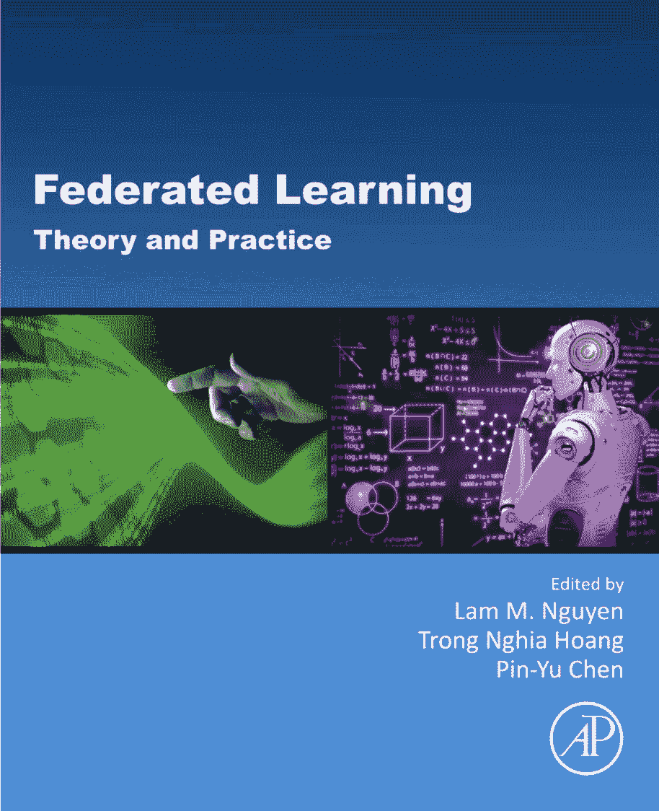


# 第 11 章：用于平滑性的扰动局部嵌入

## 11.4. 用于平滑性的扰动局部嵌入

## 11.5. 数值测试

## 参考文献

# 第 12 章：联邦学习中的超参数调优——系统与实践

## 摘要

## 12.1. 简介

## 12.2. 系统资源

## 12.3. 跨设备联邦学习超参数

## 12.4. 联邦学习超参数优化中的系统挑战

## 12.5. 现状

## 12.6. 结论

## 参考文献

# 第 13 章：联邦学习中的超参数优化

## 摘要

## 13.1. 简介

## 13.2. 最先进的联邦学习超参数优化方法

## 13.3. FLoRA：一种单次运行的联邦学习超参数优化方法

## 13.4. 实证评估

## 13.5. 结论

## 参考文献

# 第 14 章：联邦序贯决策：贝叶斯优化、强化学习及其他

## 摘要

## 致谢

## 14.1. 简介

## 14.2. 联邦贝叶斯优化

## 14.3. 联邦强化学习

## 14.4. 相关工作

## 14.5. 开放问题与未来方向

## 参考文献

# 第 15 章：联邦学习中的数据估值

## 摘要

## 致谢

## 15.1. 简介

## 15.2. 数据估值：动机与激励

## 15.3. 简单估值方法

## 15.4. 相关工作：传统数据估值

## 15.5. 扩展到联邦设置：行得通吗？

## 15.6. 纵向数据估值：特征估值

## 15.7. 横向数据估值：梯度估值

## 15.8. 基于学习的估值

## 15.9. 结论与未来工作

## 参考文献

# 第 3 部分：应用与伦理考量

# 第 16 章：联邦学习中的激励机制

## 摘要

## 致谢

## 16.1. 概述与动机

## 16.2. 问题设定

## 16.3. 激励

## 16.4. 贡献评估

## 16.5. 客户端选择

## 16.6. 奖励分配

## 16.7. 其他激励

## 16.8. 货币奖励

## 16.9. 非货币奖励

## 16.10. 结论与未来工作

## 参考文献

# 第 17 章：量子联邦机器学习导论

## 摘要

## 17.1. 简介

## 17.2. 量子联邦学习

## 17.3. 变分量子电路

## 17.4. 演示

## 17.5. 高级设置

## 17.6. 讨论

## 17.7. 结论

## 参考文献

# 第 18 章：用于量子联邦学习的联邦量子自然梯度下降

## 摘要

## 18.1. 简介

## 18.2. 变分量子电路

## 18.3. 量子自然梯度下降

## 18.4. 面向变分量子电路的量子自然梯度下降

## 18.5. 联邦量子自然梯度下降

## 18.6. 实验结果

## 18.7. 结论与讨论

## 参考文献

# 第 19 章：联邦学习移动计算框架

## 摘要

## 19.1. 移动平台上的联邦学习

## 19.2. 基于移动端的联邦学习挑战

## 19.3. Helios：面向移动平台的自协调联邦学习框架

## 19.4. 性能评估

## 19.5. 结论与未来方向

## 参考文献

# 第 20 章：用于隐私保护语音识别的联邦学习

## 摘要

## 20.1. 从语音保护到联邦助手

## 20.2. 基于合成数据的联邦语音识别

## 20.3. 结论

## 参考文献

# 第 21 章：与联邦学习相关的伦理考量与法律问题

## 摘要

## 致谢

## 21.1. 简介


# 贡献者

Lucas Agussurja — 新加坡国立大学，新加坡，新加坡

Omid Aramoon — 马里兰大学帕克分校，帕克学院，马里兰州，美国

Sanjeev Arora — 普林斯顿大学，普林斯顿，新泽西州，美国

Nathalie Baracaldo — IBM 研究院，约克敦海茨，纽约州，美国

Arjun Bhagoji — 计算机科学系，芝加哥大学，芝加哥，伊利诺伊州，美国

Supriyo Chakraborty — 分布式 AI，IBM 研究院，约克敦海茨，纽约州，美国

Pin-Yu Chen — IBM 研究院，约克敦海茨，纽约州，美国

Samuel Yen-Chi Chen — 布鲁克海文国家实验室，厄普顿，纽约州，美国

Tianyi Chen — 伦斯勒理工学院，特洛伊，纽约州，美国

Xiang Chen — 乔治梅森大学，电子与计算机工程系，费尔法克斯，弗吉尼亚州，美国

Xiangyi Chen — 明尼苏达大学，明尼阿波利斯，明尼苏达州，美国

Warren Chik — 新加坡管理大学，新加坡，新加坡

Zhongxiang Dai — 新加坡国立大学，新加坡，新加坡

Canh T. Dinh — 悉尼大学，达灵顿，新南威尔士州，澳大利亚

Flint Xiaofeng Fan — 新加坡国立大学，新加坡，新加坡

Chuan-Sheng Foo — 新加坡国立大学，新加坡，新加坡；新加坡科技研究局，新加坡，新加坡

Florian Gamper — 新加坡管理大学，新加坡，新加坡

Samyak Gupta — 普林斯顿大学，普林斯顿，新泽西州，美国

Trong Nghia Hoang — 华盛顿州立大学，普尔曼，华盛顿州，美国

Mingyi Hong — 明尼苏达大学，明尼阿波利斯，明尼苏达州，美国

Min-Hsiu Hsieh — 鸿海（富士康）量子计算研究中心，台北，台湾

Yangsibo Huang — 电子与计算机工程系，普林斯顿大学，普林斯顿，新泽西州，美国

Patrick Jaillet — 麻省理工学院，剑桥，马萨诸塞州，美国

Xiao Jin — 伦斯勒理工学院，特洛伊，纽约州，美国

Prashant Khanduri — 明尼苏达大学，明尼阿波利斯，明尼苏达州，美国

Kai Li — 普林斯顿大学，普林斯顿，新泽西州，美国

Xiaoqiang Lin — 新加坡国立大学，新加坡，新加坡

Bryan Kian Hsiang Low — 新加坡国立大学，新加坡，新加坡

Songtao Lu — IBM Thomas J. Watson 研究中心，约克敦海茨，纽约州，美国

Heiko Ludwig — IBM 研究院，约克敦海茨，纽约州，美国

See-Kiong Ng — 新加坡国立大学，新加坡，新加坡

Phuong Ha Nguyen — eBay Inc.，圣何塞，加利福尼亚州，美国

Jun Qi — 复旦大学，上海，中国

Gang Qu — 马里兰大学帕克分校，帕克学院，马里兰州，美国

Parikshit Ram — IBM 研究院，约克敦海茨，纽约州，美国

Theodoros Salonidis — IBM 研究院，约克敦海茨，纽约州，美国

Horst Samulowitz — IBM 研究院，约克敦海茨，纽约州，美国

Yao Shu — 新加坡国立大学，新加坡，新加坡

Rachael Hwee Ling Sim — 新加坡国立大学，新加坡，新加坡

Sabato Marco Siniscalchi — 埃纳大学，埃纳，意大利；挪威科技大学，特隆赫姆，挪威

Bingqing Song — 明尼苏达大学，明尼阿波利斯，明尼苏达州，美国

Zhao Song — Adobe Research，圣何塞，加利福尼亚州，美国

Yuejiao Sun — 加州大学洛杉矶分校，洛杉矶，加利福尼亚州，美国

Cheston Tan — 信息通信研究院，A*STAR，新加坡，新加坡

Sebastian Shenghong Tay — 新加坡国立大学，新加坡，新加坡

Yuan Tian — 弗吉尼亚大学，夏洛茨维尔，弗吉尼亚州，美国

Nguyen H. Tran — 悉尼大学，达灵顿，新南威尔士州，澳大利亚

Quoc Tran-Dinh — 统计与运筹学系，北卡罗来纳大学教堂山分校，教堂山，北卡罗来纳州，美国

Marten van Dijk — CWI，阿姆斯特丹，荷兰；阿姆斯特丹自由大学，阿姆斯特丹，荷兰

Tung T. Vu — 贝尔法斯特女王大学，贝尔法斯特，英国

Xiaoyang Wang — 伊利诺伊大学厄巴纳-香槟分校，厄巴纳，伊利诺伊州，美国

Zhaoxuan Wu — 新加坡国立大学，新加坡，新加坡

Chulin Xie — 伊利诺伊大学厄巴纳-香槟分校，厄巴纳，伊利诺伊州，美国

Pengwei Xing — 南洋理工大学，新加坡，新加坡

Xinyi Xu — 新加坡国立大学，新加坡，新加坡

Zirui Xu — CVS Health，里士满，弗吉尼亚州，美国

Feng Yan — 休斯顿大学，休斯顿，德克萨斯州，美国

Chao-Han Huck Yang — Nvidia Research，台北，台湾

Wotao Yin — 阿里巴巴集团，贝尔维尤，华盛顿州，美国

Shinjae Yoo — 布鲁克海文国家实验室，厄普顿，纽约州，美国

Fuxun Yu — 微软，西雅图，华盛顿州，美国

Han Yu — 南洋理工大学，新加坡，新加坡


# 前言

在大数据时代和人工智能飞速发展的背景下，创新与进步往往由海量数据的力量驱动。然而，隐私顾虑和数据保护法规给传统的中心化机器学习方法设置了限制：虽然数据丰富，但往往以小而孤立的孤岛形式存在。因此，对协作式且保护隐私的机器学习方法的需求从未像现在这样迫切。

在此背景下，联邦学习已成为分布式机器学习的事实标准框架，能够保护数据隐私，特别是在移动和边缘设备普及、其存储和计算能力不断增强的情况下。为了充分利用存储在这些设备上、地理分布广泛、多样化且私有的海量数据，联邦学习提供了一个平台，使本地设备能够构建自己的本地模型，并通过共享差分参数更新来同步其训练过程。这在不暴露其私有训练数据的情况下完成，有助于降低隐私泄露风险，这在《通用数据保护条例》（GDPR）等近期政策出台的背景下尤为重要。联邦学习的这种潜在用途此后引发了机器学习社区的爆发式关注，产生了大量且不断增长的理论和实证文献，推动联邦学习向作为民主化数据分析服务的新机器学习标准迈进。

有趣的是，随着联邦学习越来越接近在现实场景中部署，它也暴露出一系列日益增长的挑战，涉及可信度、公平性、可扩展性、鲁棒性、安全性、隐私保护、去中心化和个性化，这些在我们数字化社会的许多相互关联的方面变得越来越重要。这些挑战在缺乏拥有大数据的大型科技公司、而是由掌握宝贵数据的政府机构和机构或数据和资金有限的中小企业及初创公司驱动的经济环境中尤为重要。

要开发一个拥抱上述挑战的实用联邦学习系统，需要多个不同学科的知识，范围涵盖分布式、去中心化优化、密码学和安全性的传统研究，到机器学习中隐私保护、公平性、鲁棒性和个性化等更前沿的主题，其中许多领域相对较新，且广泛分散在海量且不断增长的研究论文中。这可能会给需要熟悉所有这些相关文献并对领域发展有宏观了解的研究生或新入行研究人员带来挑战。为了缓解这一困扰，我们寻求了该领域专家同事的帮助，共同编写一份全面的入门材料，在提供基础知识及细节的同时，介绍一套具有代表性的前沿尖端研究，以及广泛的实际应用。

本书的构想源于我们最近在 NeurIPS-21 会议上举办的“联邦学习新前沿”研讨会，这帮助我们与该领域的其他同行建立了联系。他们中的许多人为本书的发展提供了宝贵的贡献和反馈。本书包含一系列技术论述，面向各层次的研究生以及对联邦学习领域感兴趣的研究人员。主要内容分为三部分。第 1 部分详细阐述了优化基础（特别是见第 1 章）和安全联邦学习的核心挑战，跨越众多安全问题及其算法解决方案。第 2 部分讨论了源于联邦学习作为未来公共机器学习服务的许多社会驱动关切而产生的新兴挑战。最后，为了弥合该主题学术研究与工业研究之间的差距，第 3 部分探讨了联邦学习的广泛工业应用及伦理考量，展示了其在推动创新的同时保护敏感数据的巨大潜力。

我们希望本书能为那些寻求高效途径以掌握联邦学习基础知识的人们提供宝贵的资源。本书旨在深入阐述该领域最前沿的一组具有代表性的严谨成果，而非深究整个领域的超严谨详尽索引。我们的初衷是让本书成为初学者探索该领域征途上的良好入门读物。

# 第 1 部分：安全联邦学习的优化基础

## 大纲

- 第 1 章. 梯度下降类方法
- 第 2 章. 使用差分隐私训练模型的理论考量
- 第 3 章. 隐私保护联邦学习：算法与保证
- 第 4 章. 评估漏洞与保障联邦学习安全
- 第 5 章. 联邦学习中的对抗鲁棒性
- 第 6 章. 评估梯度反演攻击与防御

# 第 1 章：梯度下降类方法

## 背景与简单统一收敛分析

**Quoc Tran-Dinh**^a；**Marten van Dijk**^b，c

^a 统计与运筹学系，北卡罗来纳大学教堂山分校，教堂山，北卡罗来纳州，美国

^b CWI，阿姆斯特丹，荷兰

^c 阿姆斯特丹自由大学，阿姆斯特丹，荷兰

## 摘要

在本书章节中，我们简要描述了构成梯度下降法及其加速和随机变体的主要组成部分。我们旨在从数学角度解释这些组成部分，涵盖理论和实践方面，但保持在基础水平。我们将重点关注梯度下降法的基本变体，然后将视野扩展到近期的变体，特别是方差缩减随机梯度方案（SGD）。我们的方法依赖于揭示问题内部呈现的结构以及施加在目标函数上的假设。我们的收敛分析统一了几个已知结果，并依赖于一个通用但基础的递归表达式。我们在几个常见方案上展示了这一分析。

### 关键词

梯度下降法；随机梯度法；凸与非凸优化；收敛保证；复杂度估计

## 致谢

Q. Tran-Dinh 的工作部分得到了海军研究办公室 [资助编号 ONR-N00014-20-1-2088] (2020–2023) 和 [资助编号 ONR-N00014-23-1-2588 (2023-2026)]，以及国家科学基金会 (NSF) [资助编号 NSF DMS-2134107] (2022-2027) 的支持。

## 1.1 介绍


# 核心优化问题

信号与图像处理、工程、运筹学、统计学和机器学习等许多优化应用中的核心问题，均是以下优化问题（参见文献 [1], [2], [7], [27], [28], [49], [60]）：

$$
\min_{w \in \mathbb{R}^{p}} F(w), \tag{1.1}
$$

其中 $F: \mathbb{R}^{p} \to \mathbb{R} \cup \{+\infty\}$ 是给定的目标函数或损失函数，$w$ 是决策变量向量（也称为模型参数）。根据 $F$ 的形式或结构，可得到不同类别的优化问题。实践中常见的结构如下：

## 非光滑凸优化

若 $F$ 为 $M$-Lipschitz 连续（即存在 $M > 0$ 使得对所有 $w, w' \in \mathbb{R}^{p}$ 有 $|F(w) - F(w')| \le M \|w - w'\|$）且为凸函数，但通常非光滑，则 (1.1) 称为非光滑凸最小化。注意，$M$-Lipschitz 连续性常被施加于非光滑函数（如任意范数下的 $F(w) := \|w\|$），或特定光滑函数（如逻辑回归的目标函数 $F(w) := \sum_{i=1}^{n} \log(1 + \exp(y_i X_i^{\top} w))$，其中 $(X_i, y_i)$ 为 $i=1,\dots,n$ 的给定数据）。显然，若将 $F$ 视为给定紧集 $\mathcal{W}$ 上的连续函数，Lipschitz 连续性也成立。

## 光滑凸优化

若 $F$ 为 $L$-光滑（即存在 $L \ge 0$ 使得对所有 $w, w' \in \mathbb{R}^{p}$ 有 $\|\nabla F(w) - \nabla F(w')\| \le L \|w - w'\|$）且为凸函数，则 (1.1) 称为光滑凸最小化。$L$-光滑凸函数的例子非常多。例如，给定数据矩阵 $X$ 和输出向量 $y$ 时，最小二乘函数 $F(w) := \frac{1}{2}\|X^{\top}w - y\|²$ 是 $L$-光滑的，其中 $L := \|X X^{\top}\|$。上述逻辑回归函数也是凸且 $L$-光滑的，其 $L := \frac{1}{4}\|X X^{\top}\|$。然而，指数函数 $F(w) := \sum_{i=1}^{n} \exp(X_i^{\top} w)$ 或对数函数 $F(w) := -\sum_{i=1}^{n} \log(X_i^{\top} w)$ 虽然为凸函数，但在其定义域上并非 $L$-光滑，除非将其定义域限制在给定的紧集上（参见文献 [64]）。

## 光滑非凸优化

若 $F$ 为 $L$-光滑且非凸，则 (1.1) 称为光滑非凸最小化。$L$-光滑性是非凸优化中大多数基于梯度方法所需的关键条件。同样，若假设 $F$ 连续可微并将其定义域限制在紧集上，该假设显然成立。但也存在定义在整个空间 $\mathbb{R}^{p}$ 上的 $L$-光滑函数。例如，给定对称矩阵 $Q$ 和 $q \in \mathbb{R}^{p}$ 时，$F(w) := \frac{1}{2}w^{\top}Qw + q^{\top}w$ 为 $L$-光滑（$L := \|Q\|$），但不一定为凸。

## 复合优化

若 $F(w) := f(w) + g(w)$，其中 $f$ 通常为 $L$-光滑且凸/非凸，$g$ 为凸且可能非光滑，则 (1.1) 称为（加性）复合最小化。该模型在机器学习和统计学习中无处不在：$f$ 表示损失函数或数据保真项，而 $g$ 为正则化项或惩罚项，用于促进解的结构或处理约束。相关示例可见文献 [10], [52]。若 $g(w)$ 为凸集 $\mathcal{W}$ 的指示函数，即 $w \in \mathcal{W}$ 时 $g(w)=0$，否则 $g(w)=+\infty$，则 (1.1) 涵盖了约束问题 $\min_{w \in \mathcal{W}} f(w)$。

## 有限和优化

若 $F(w) := \frac{1}{n}\sum_{i=1}^{n} F_i(w)$（$n \ge 1$），则 (1.1) 称为有限和最小化、经验风险最小化或分布式优化（视上下文而定）。此结构见于大多数监督学习任务、网络与分布式优化及联邦学习中。最有趣的情况是 $n \gg 1$ 时。

## 随机优化

若 $F(w) := \mathbb{E}[\mathbf{F}(w, \xi)]$，即随机函数 $\mathbf{F}: \mathbb{R}^{p} \times \Omega \to \mathbb{R}$ 的期望，其中 $(\Omega, \Sigma, \mathbb{P})$ 为给定概率空间，则 (1.1) 称为随机规划（参见文献 [34], [43], [59]）。令 $\Omega := \{1,\dots,n\}$ 且 $\mathbb{P}(\xi = i) = \frac{1}{n}$，此设定也将有限和作为特例涵盖在内。

除上述单独设定外，它们之间的许多其他组合也是可能的；此处不一一列举。例如，复合结构与有限和的组合非常常见。


## 解的存在性

我们首先假设 $F^\star := \inf_w F(w)$ 有一个下界，即 $F^\star > -\infty$，以保证 (1.1) 的良定性。许多机器学习应用自动满足此条件，因为底层损失函数通常是非负的。一个显而易见的例子是最小二乘问题。

我们接下来的问题是：*是否*存在 (1.1) *的最优解？* 为了讨论这一方面，我们使用非线性分析中的强制性概念 [\[18\]](#Chp001_3-28_B9780443190377000089_split_002.xhtml#br0090)。我们称 $F$ 为强制函数，如果 $\lim_{\|w\| \to \infty} F(w) = +\infty$。一个常见的强制函数是 $F(w) := \mathcal{L}(w) + \frac{\lambda}{2}\| w\|²$，其中 $\mathcal{L}$ 是 $M$-Lipschitz 连续的（但不一定是凸的）且 $\lambda > 0$。如果 $F$ 是连续且强制的，那么根据著名的魏尔斯特拉斯定理，(1.1) 存在全局最优解 $w^\star$。在这种情况下，我们用 $F^\star := F(w^\star)$ 表示其最优值。如果 $F$ 是非凸且可微的，那么我们用 $w^\star$ 表示其驻点，即 $\nabla F(w^\star) = 0$。如果 $F$ 不可微，则需要驻点的推广 [\[40\]](#Chp001_3-28_B9780443190377000089_split_002.xhtml#br0200)。为保持简单，我们假设本章中 $F$ 始终是连续可微的。

如果 $F$ 是强凸的，那么它是连续且强制的，并且 (1.1) 有一个唯一的全局最优解。对于凸问题，我们的目标是按某种意义找到 $w^\star$ 的近似全局解 $\hat{w}^\star$（见第 1.2.7 节）。对于非凸问题，我们只期望计算一个近似驻点 $\hat{w}^\star$，它可以是局部极小值点的候选者。然而，我们在本章中不尝试检查它是否为近似局部极小值点。

## 贡献

我们的贡献可总结如下。我们为梯度下降法及其变体（包括随机方案）的主要组成部分提供了全面的讨论。我们还提出了一种统一且简单的方法来分析这些算法的收敛速率，并通过具体方案加以演示。这种方法或许可以扩展到分析本章未涵盖的其他算法。我们还讨论了基础算法的一些增强实现方面。

## 大纲

本章其余部分组织如下。第 1.2 节回顾梯度法的基本组成部分。第 1.3 节侧重于随机梯度法，而第 1.4 节作出一些总结性评论并提出几个可能的研究方向。

## 1.2 GD 型方法的基本组成部分

梯度下降（GD）法是一种旨在寻找 (1.1) 近似解的迭代方法。这可以追溯到 19 世纪柯西的工作，并在数值分析中（包括优化）被深入研究了几十年。在过去二十年里，由于在信号和图像处理、现代统计学以及机器学习中的应用，一阶方法，特别是梯度型算法，出现了巨大的增长。在本章中，我们不试图回顾 GD 型方法的文献，而仅侧重于总结其基本组成部分。

形式上，梯度下降算法从给定的初始点 $w⁰ \in \mathbb{R}^{(p)}$ 开始，在每次迭代 $t \ge 0$ 时，它进行更新

$$w^{(t+1)} := \mathcal{P}(w^{(t)} + \eta_t d^{(t)}), \tag{1.2}$$

其中 $w^{(t)}$ 是当前迭代点，$\eta_t > 0$ 称为步长或学习率，$d^{(t)}$ 称为搜索方向，$\mathcal{P}$ 是用于处理约束或正则化项的算子；如果不需要此项，可以设置 $\mathcal{P} = \mathbb{I}$，即单位算子。该方法仅利用 $F$ 的一阶信息（例如函数值、近端算子或[次]梯度）生成一系列迭代向量 $\{w^{(t)}\}$。在此，我们添加了一个算子 $\mathcal{P}$，它也可用于处理约束、正则化项、惩罚项或 Bregman 距离（例如原始空间与对偶空间之间的映射）。让我们讨论方案 (1.2) 的每个组成部分。

### 1.2.1 搜索方向

(1.2) 中最重要的组成部分是搜索方向 $d^{(t)}$，它决定了算法的类型，如一阶、二阶、拟牛顿型或随机方法。让我们考虑以下可能性：

*   **下降方向。** 假设 $F$ 连续可微，如果 $\langle \nabla F(w^{(t)}), d^{(t)} \rangle < 0$，则搜索方向 $d^{(t)}$ 在迭代点 $w^{(t)}$ 处被称为下降方向。我们甚至可以施加一个更强的条件，称为严格下降方向，即 $\langle \nabla F(w^{(t)}), d^{(t)} \rangle \le -c \|\nabla F(w^{(t)})\|²$，其中 $c > 0$。“下降”这个名称源于这样一个事实：如果我们从 $w^{(t)}$ 沿着方向 $d^{(t)}$ 以适当的步长 $\eta_t$ 移动，则会得到下降，即 $F(w^{(t+1)}) < F(w^{(t)})$。如果 $\mathcal{P} = \mathbb{I}$（单位算子），则 (1.2) 简化为 $w^{(t+1)} := w^{(t)} + \eta_t d^{(t)}$。由 $F$ 的泰勒展开，我们有

$$F(w^{(t+1)}) = F(w^{(t)}) + \eta_t \langle \nabla F(w^{(t)}), d^{(t)} \rangle + o(\eta_t² \|d^{(t)}\|²) < F(w^{(t)}).$$


### 1.2.1 搜索方向

*   对于足够小的 `η[t] > 0`，这是由于 `⟨∇F(w^(t)), d^(t)⟩ < 0`。

*   **最速下降方向。** 如果我们取 `d^(t) := −∇F(w^(t))`，则 (1.2) 变为

```
w^(t+1) := w^(t) − η[t]∇F(w^(t)),
```
(1.3)

且有 `⟨∇F(w^(t)), d^(t)⟩ = −‖∇F(w^(t))‖² < 0`，前提是 `w^(t)` 不是 `F` 的驻点。通过这种 `d^(t)` 的选择，我们得到梯度下降法或所谓的最速下降法。它实际上实现了 `F` 在 `w^(t)` 处的最大下降，因为对于任何满足 `‖d^(t)‖ = 1` 的 `d^(t)`，都有 `⟨∇F(w^(t)), d^(t)⟩ ≥ −‖∇F(w^(t))‖`。

*   **随机梯度方向。** 如果我们选择 `d^(t)` 为 `∇F(w^(t))` 的随机估计量，则得到随机近似（也称为随机梯度下降）法。随机梯度方向通常不是下降方向，即 `⟨∇F(w^(t)), d^(t)⟩ ≮ 0`。随机估计量的例子包括标准无偏估计量 `v^(t) := ∇F(w^(t), ξ[t])` 及其小批量版本 `v^t := (1/|S_t|) ∑_{ξ ∈ S_t} ∇F(w^t, ξ)`（针对小批量 `S[t]`），以及各种方差缩减估计量，参见例如 [[13]](#Chp001_3-28_B9780443190377000089_split_002.xhtml#br0065)、[[29]](#Chp001_3-28_B9780443190377000089_split_002.xhtml#br0145)、[[48]](#Chp001_3-28_B9780443190377000089_split_002.xhtml#br0240)、[[58]](#Chp001_3-28_B9780443190377000089_split_002.xhtml#br0290)、[[66]](#Chp001_3-28_B9780443190377000089_split_002.xhtml#br0330)。

*   **牛顿和拟牛顿方向。** 我们可以通过引入二阶信息，即 `F` 的曲率，超越基于梯度的方法，令 `d^(t) := −B[t]^(−1)∇F(w^(t))`，其中 `B[t]` 是给定的对称可逆矩阵。例如，如果 `B[t] := ∇²F(w^(t))`，则得到牛顿法；而如果 `B[t]` 是 `∇²F(w^(t))` 的近似，则得到拟牛顿法。

*   **不精确下降方向。** 如果我们不精确计算梯度 `∇F(w^(t))`，而是允许存在误差，如 `d^(t) = −(∇F(w^(t)) + δ[t])`（其中 `δ[t]` 为高斯噪声），则得到不精确或带噪梯度法 [[24]](#Chp001_3-28_B9780443190377000089_split_002.xhtml#br0120)。另一个例子称为符号梯度法，它使用 `d^(t) = −sign(∇F(w^(t)))`，即梯度的符号，参见例如 [[41]](#Chp001_3-28_B9780443190377000089_split_002.xhtml#br0205)。不精确牛顿型方法通过近似求解 `B[t]d^(t) = −∇F(w^(t))` 来计算 `d^(t)`，使得 `‖B[t]d^(t) + ∇F(w^(t))‖ ≤ c‖d^(t)‖`（其中 `c > 0`）。

除上述示例外，其他方法如[分块]坐标法、增量梯度法、Frank-Wolfe 法或条件梯度法、近端点法、近端线性化法、Gauss-Newton 法、外推梯度法、乐观梯度法以及算子分裂技术，也可以通过构造适当的搜索方向 `d^(t)` 写成 (1.2) 的形式。例如，近端点法可以视为应用于其 Moreau 包络的梯度法，参见例如 [[56]](#Chp001_3-28_B9780443190377000089_split_002.xhtml#br0280)。

### 1.2.2 步长

(1.2) 的第二个重要组成部分是步长 `η[t]`。在机器学习领域，该量称为*学习率*。选择合适的 `η[t]` 是影响算法性能的关键步骤。经典优化技术提出了几种策略，称为全局化策略，包括 (i) 线搜索及其变体、(ii) 信任域，以及 (iii) 滤波器法 [[11]](#Chp001_3-28_B9780443190377000089_split_002.xhtml#br0055)、[[23]](#Chp001_3-28_B9780443190377000089_split_002.xhtml#br0115)、[[49]](#Chp001_3-28_B9780443190377000089_split_002.xhtml#br0245)。线搜索和信任域策略已广泛用于数值优化，参见 [[11]](#Chp001_3-28_B9780443190377000089_split_002.xhtml#br0055)、[[49]](#Chp001_3-28_B9780443190377000089_split_002.xhtml#br0245)。在近期的优化算法和机器学习训练任务中，我们常观察到以下技术：

*   **固定学习率。** 固定学习率通常用于推导收敛速率或复杂度界，因其简洁性。如果问题“简单”，例如强凸且 *L*-光滑，算法在固定学习率下通常表现良好；但如果 `F` 的地貌复杂（如深度神经网络），则表现不佳。通常，理论分析给出一个选择固定学习率的范围（即标准梯度法中的区间 `(0, 2/L)` 等）。然而，由于使用全局参数，该范围很容易被低估，且无法捕捉最优解的期望区域。在实践中，尽管如此，我们仍需使用网格搜索或二分法等不同策略来调整该学习率。


#### 学习率选择策略

*   **递减学习率。** 递减学习率通常用于次梯度或随机梯度方法。一种常见的递减学习率是 $\eta_{t} := \frac{C}{{(t + \beta)}^{\nu}}$，其中 $C$ 为正常数，$\beta$ 为偏移因子，$\nu > 0$ 为阶数。根据 $F$ 的结构假设，我们可以选择合适的阶数 $\nu$，例如 $\nu := \frac{1}{2}$ 或 $\nu := \frac{1}{3}$。另一种可能是选择 $\eta_{t} := \frac{C}{{(\lceil t/s \rceil + \beta)}^{\nu}}$，引入额外的整数 $s$ 以在每 $s$ 次迭代中保持固定的学习率。在随机梯度方法中，如果 $d^{(t)}$ 的方差非递减（即 $d^{(t)}$ 不是由 $\nabla F$ 的方差缩减估计器计算得出），则通常需要递减学习率。递减学习率也决定了底层算法的收敛速率。

*   **调度学习率。** 在实践中，我们通常使用调度来调整合适的学习率以获得最佳性能。已提出了不同的思路，例如使用指数衰减率、余弦退火，甚至变化的小批量大小，参见文献 [37, 62]。

*   **自适应学习率。** 上述学习率选择策略未考虑目标函数的局部几何结构，在“困难”问题上可能表现不佳。这促使人们使用自适应学习率，利用目标函数的局部地形或曲率。第一种常见策略是线搜索，它[近似地]求解 $\min_{\eta > 0} F(w^{(t)} + \eta d^{(t)})$ 以找到 $\eta[t]$。如果 $F$ 是二次函数，则可以通过求解这一单变量最小化问题精确计算 $\eta[t]$。然而，大多数算法使用不精确线搜索，如二分法或黄金分割搜索。另一种策略是使用 Barzilai–Borwein 步长，例如 $\eta[t] := \|w^{(t)} - w^{(t-1)}\| / \|\nabla F(w^{(t)}) - \nabla F(w^{(t-1)})\|$，这给出了 $\frac{1}{L}$ 的估计（此处 $L$ 为 $\nabla F$ 的 Lipschitz 常数）。

*   最近提出了几种自适应方法，参见文献 [12, 17, 32]。底层学习率通常由 $\eta_{t} := C / \sqrt{\sum_{j=0}^{t} \|g_{j}\|^{2} + \epsilon}$ 给出，其中 $g[j]$ 是第 $j$ 次迭代的某个梯度估计器，$C > 0$ 为给定常数，$\epsilon \ge 0$ 为避免除零并提供数值稳定性的小常数。

在上述选择学习率的策略和技巧中，针对特定问题也可以用不同方式计算学习率，甚至采用“试错法”或上述技术的组合。主要目标是为该问题调整出一个良好的学习率，同时仍保证底层算法的收敛性。

### 1.2.3 邻近算子

许多由公式 (1.1) 涵盖的问题包含约束或非光滑目标项。例如，我们可能有 $F(w) = f(w) + g(w)$，其中 $g$ 为非光滑函数。此时无法使用 $F$ 的全梯度。处理非光滑项 $g$ 的一种方法是使用邻近算子，特别是当我们有简单约束时使用投影算子。数学上，真、下半连续、凸（或更一般地，prox-正则）函数 $g$ 的邻近算子定义为：

```
prox_{\gamma g}(w) := \arg\min_{z \in \mathbb{R}^{p}} \left\{ \gamma g(z) + \frac{1}{2}\|z - w\|^{2} \right\}, \quad \gamma > 0.
```
(1.4)

注意，在适当选择 $\gamma$ 下，公式 (1.4) 中的最小化问题是强凸的，因此有唯一解，从而保证了 $prox[\gamma g]$ 的良定性。若 $g = \delta_{\mathcal{W}}$ 为闭凸集 $\mathcal{W}$ 的指示函数，即 $w \in \mathcal{W}$ 时 $\delta_{\mathcal{W}}(w) = 0$，否则 $\delta_{\mathcal{W}}(w) = +\infty$，则 $prox[\gamma g]$ 退化为向 $\mathcal{W}$ 的投影，即 $proj_{\mathcal{W}}(w) := \arg\min_{z \in \mathcal{W}} \frac{1}{2}\|z - w\|^{2}$。从计算角度看，求值 $prox[\gamma g]$ 通常与求解一个[强]凸问题一样困难。求值 $prox\gamma g$ 至少有三种途径：

*   **可分函数。** 最明显的情况是 $g$ 逐分量可分，即 $g(w) := \sum_{j=1}^{p} g_{j}(w_{j})$（例如 $g(w) := \|w\|_{1}$），此时求值 $prox[\gamma g]$ 需要求解 $p$ 个单变量强凸最小化问题，可得到闭式解。此思路可推广到分块可分函数，例如 $g(w) := \sum_{i=1}^{n} \|w_{[i]}\|_{2}$，其中 $\{w_{[i]}\}_{i=1}^{n}$ 为子向量。

*   **对偶方法。** Moreau 恒等式 $prox_{\gamma g}(w) = w - \gamma \cdot prox_{g^{*}/\gamma}(w/\gamma)$ 表明我们可以通过其 Fenchel 共轭 $g^{*}$ 计算 $prox[\gamma g]$。由于许多凸函数（如范数，例如 $g(w) = \|w\|_{2}$）或 Lipschitz 连续函数具有简单的共轭，此方法更易处理。


### 1.2.3 最优性方法

如果 `g` 可微，则我们可以直接使用其最优性条件 `∇g(z) + γ^(-1)(z - w) = 0`，并将其作为关于 `z` 的非线性方程求解。示例包括 `-log det(X)` 和 `∑_{i=1}^n log(1 + exp(y_i X_i^⊤ w))`。

请注意，第二种和第三种技术仅用于凸函数，而第一种可用于非凸函数。能够高效计算 `prox_γg(·)` 的凸函数 `g` 数量庞大；更多示例和计算技巧请参见，例如，[1]、[51]。

### 1.2.4 动量

解释动量作用的一种方法是使用源自牛顿第二定律的动力学系统形式 `ẅ(τ) + ψ(τ)ẇ(τ) + ∇F(w(τ)) = 0`，其中 `ψ(τ)ẇ(τ)` 代表摩擦力或阻尼因子。如果我们使用 `ẅ(τ) ≈ (w^{t+1} - 2w^t + w^{t-1})/h_t²` 和 `ẇ(τ) ≈ (w^t - w^{t-1})/h_t` 离散化该微分方程，则得到 `(w[t+1] - 2w[t] + w[t-1])/h[t]² + ψt/h[t] + ∇F(w[t]) = 0`，从而得出 `w^(t+1) := w^(t) - h[t]²∇F(w^(t)) + (1 - h[t]ψ[t])(w^(t) - w^(t-1))`，参见，例如，[61]。因此，当 `P = I`（单位算子）时，我们可以按如下方式指定 (1.2) 的动量变体：

```
w^(t+1) := w^(t) + η[t]d^(t) + βt - w^(t-1))
```
(1.5)

其中 `β[t] > 0` 是动量步长。搜索方向 `d^(t)` 可以在 `w^(t)` 处评估，从而得到所谓的重球法 [54]。或者，如果 `d^(t)` 在中间点处评估，例如 `z^(t) := w^(t) + βt - w^(t-1))`，则在凸情况下得到 Nesterov 加速方案 [44]。该方案可写为两步形式：

```
z^(t) := w^(t) + βt - w^(t-1)) and w^(k+1) := z^(t) + η[t]d(z^(t))
```
(1.6)

其中 `d(z^(t))` 表示在 `z^(t)` 而非 `w^(t)` 处评估的方向 `d^(t)`。请注意，动量项在 (1.2) 的基础上并未显著增加计算成本。然而，它们可以在凸情况下加速算法 [44, 46]（另见第 1.2.8 节），并可能在某些非凸设置中加速，参见，例如，[35, 63]。

### 1.2.5 对偶平均变体

方案 (1.2) 可视为前向更新，但在凸优化中，对偶平均方案也与 (1.2) 密切相关。与 (1.2) 不同，对偶平均方案按如下方式工作。从 `w⁰ ∈ ℝ^(p)` 开始，对于 `t ≥ 0`，我们更新

```
w^{t+1} := argmin_w { ∑_{j=0}^t γ_j ⟨g^j, w⟩ + 1/(2η_t) ||w - w⁰||² }
```
(1.7)

其中 `g^(j)` 为给定的对偶方向（例如，`g^(j) := ∇F(w^(j))`），`γ[j]` 为 `g^(j)` 的权重，`η[t]` 为给定的对偶步长。在一般设置中，我们可以用广义 Bregman 距离 `D(w, w⁰)` 替换 `1/2 ||w - w⁰||²`。如果范数为欧几里得范数，则有 `w^{t+1} := w⁰ - η_t ∑_{j=0}^t γ_j g^j`。如果 `η[t] = η > 0` 固定且我们选择 `g^(j) := ∇F(w^(j))`，则有 `w^{t+1} = w⁰ - η∑_{j=0}^t γ_j g^j = w⁰ - η∑_{j=0}^{t-1} γ_j g^j - ηγ_t g^t = w^t - ηγ_t g^t`，这正是 (1.2) 所涵盖的情况。因此，对于欧几里得范数 `1/2 ||w - w⁰||²`，对偶平均方案 (1.7) 与梯度下降方案 `w^(t+1) = w^(t) - ηγ[t]g^(t)` 完全相同。然而，在非欧几里得范数或 Bregman 距离下，这些方法彼此不同。

### 1.2.6 结构假设

设计基于梯度的算法时，一项主要的理论任务是确立其收敛性。从计算角度来看，估计收敛速率以及复杂度也至关重要。然而，为了确立这些，我们要求 `F` 满足一组假设。以下结构常用于优化建模和算法中：

*   **Lipschitz 连续性。** 如果 (1.1) 中的函数 `F` 满足
    ```
    |F(w) - F(w')| ≤ M ||w - w'||, ∀w, w' ∈ ℝ^(p).
    ```
    (1.8)
    则称其为 `M`-Lipschitz 连续。


#### Lipschitz 连续性

Lipschitz 连续函数的例子包括范数、范数的平滑近似（例如，对于较小的 $\epsilon$，$F(w): = \sum_{i = 1}^{p}{(w_{j}^{2} + \epsilon^{2})}^{1/2}$），或具有有界域的连续函数。请注意，当 $F$ 为凸函数时，$M$-Lipschitz 连续性等价于 $M$-有界[次]梯度，即对于所有 $w \in \mathbb{R}^{(p)}$，有 $\|\nabla F(w)\| \le M$。此假设通常用于次梯度类或随机梯度类方法中。

#### L-光滑性

如果函数 $F$ 的梯度 $\nabla F$ 满足

$$
\|\nabla F(w) - \nabla F(w')\| \le L\|w - w'\|, \quad \forall w, w' \in \mathbb{R}^{(p)}. \tag{1.9}
$$

则称函数 $F$ 为 $L$-光滑。如果 $w, w' \in \mathcal{W}$，其中 $\mathcal{W}$ 为紧致域，且 $F$ 连续可微，则 $F$ 在 $\mathcal{W}$ 上是 $L$-光滑的。这一概念可推广至有限和或随机设置下的 $L$-平均光滑性。例如，若 $F(w): = \frac{1}{n}\sum_{i = 1}^{n}F_{i}(w)$，则可将 (1.9) 修改为对于所有 $w, w' \in \mathbb{R}^{(p)}$ 有 $\frac{1}{n}\sum_{i = 1}^{n}{\|\nabla F_{i}(w) - \nabla F_{i}(w')\|}^{2} \leqslant L^{2}{\| w - w'\|}^{2}$。或者，若 $F(w) := \mathbb{E}[F(w, \xi)]$，则可对所有 $w, w' \in \mathbb{R}^{(p)}$ 使用 $\mathbb{E}[\|\nabla F(w) - \nabla F(w')\|²|w, w'] \le L²\|w - w'\|²$。这些假设通常用于方差缩减 SGD 方法中，参见例如 [52, 66]。请注意，其他推广也是可能的，参见例如 [34]。验证 $L$-光滑性通常并不直接。然而，若 $F(w): = \frac{1}{n}\sum_{i = 1}^{n}\ell_{i}(X_{i}^{\top}w - y_{i})$，例如在广义线性模型中，则可通过验证每个一元函数 $\ell_{i}$ 的 $L$-光滑性来验证 $F$ 的 $L$-光滑性。此模型在机器学习中无处不在。

(1.9) 的一个关键性质是以下界：

$$
|F(w') - F(w) - \langle\nabla F(w), w' - w\rangle| \le \frac{L}{2}{\| w' - w\|}^{2}, \tag{1.10}
$$

这表明 $F$ 可以被凸二次函数全局上界约束，并被凹二次函数全局下界约束。如果此外 $F$ 为凸函数，则可获得更强的界以及 $\nabla F$ 的协强制性，参见例如 [45]。也可以将 $F$ 的 $L$-光滑性推广为 Hölder 光滑性，即 $\|\nabla F(w) - \nabla F(w')\| \le L\|w - w'\|^{(\nu)}$，其中 $0 \le \nu \le 1$。这一概念统一了 $L$-光滑性（$\nu = 1$）和有界梯度（$\nu = 0$）条件。它已被用于确定性和随机方法的通用一阶方法中，例如 [47]。

#### 凸性

如果函数 $F$ 满足

$$
F(\widehat{w}) \ge F(w) + \langle\nabla F(w), \widehat{w} - w\rangle + \frac{\mu}{2}{\|\widehat{w} - w\|}^{2}, \quad \forall w, \widehat{w} \in \mathbb{R}^{p}. \tag{1.11}
$$

则称 $F$ 为 $\mu$-[强]凸。此处，$\nabla F(w)$ 可以是 $F$ 在 $w$ 处的梯度或次梯度。该不等式表明 $F$ 可以被线性（$\mu = 0$）或二次（$\mu \ne 0$）近似下界约束。若 $\mu = 0$，则 $F$ 仅为凸或仅仅是凸。若 $\mu > 0$，则 $F$ 为强凸，$\mu$ 称为强凸参数。若 $\mu < 0$，则 $F$ 称为弱凸。凸性和强凸性是凸分析、优化及相关领域的关键概念，参见例如 [7, 57]，此处不再进一步讨论。

以上是分析 (1.2) 及其变体收敛性的三个关键且基础的假设。尽管如此，也可利用其他假设。例如，以下条件常用于不同方法中：

#### 梯度占优性与 PL 条件

若对于所有 $w \in \mathbb{R}^{(p)}$ 和 $F$ 的极小化点 $w^\star$，有 $F(w) - F(w^\star) \le \sigma\|\nabla F(w)\|²$，则称函数 $F$ 为 $\sigma$-梯度占优。显然，若 $F$ 为强凸，则它是梯度占优的。然而，存在非凸函数也满足梯度占优性。请注意，可通过将 $w$ 限制在 $w^\star$ 的邻域内来考虑局部梯度占优性。我们也可将此概念推广至不同变体。梯度占优性条件使我们即使在非凸设置下也能获得目标残差 $F(\hat{w}) - F(w^\star)$ 的收敛保证。请注意，此条件也称为 Polyak–Łojasiewicz (PL) 条件。这些条件可用于建立线性收敛或类线性收敛速率（即线性收敛至最优解的一个小邻域）[30, 52]。


##### 一致凸性与星形凸性

若函数 `F` 满足 $F(w^{\prime}) \geqslant F(w) + \langle\nabla F(w),w^{\prime} - w\rangle + \frac{\mu}{\nu}{\| w^{\prime} - w\|}^{\nu}$，对所有 `w`, `w'` ∈ `ℝ^(p)` 均成立，则称 `F` 为 `μ`-Hölder 一致凸，阶数为 `ν ≥ 1`，参见例如 [68]。显然，若 `ν = 2`，则得到强凸性。若 `ν = 2` 且 `w = w^⋆`（`F` 的一个极小化点），则称 `F` 为 `μ`-星形强凸。这些条件常用于梯度类方法中以建立线性收敛速率 [42]。

##### 锐度、二次增长与误差界条件

假设存在 `γ > 0` 和 `ν ≥ 1`，使得 $F(w) - F(w^{\star}) \geqslant \frac{\gamma}{\nu}{\| w - w^{\star}\|}^{\nu}$ 对所有 `w` ∈ `ℝ^(p)` 和 `F` 的一个极小化点 `w^⋆` 均成立。若 `ν = 1`，则称 `F` 在 `w^⋆` 处是锐的。若 `ν = 2`，则称 `F` 具有二次增长性质。显然，若 `F` 是强凸的，则它具有二次增长性质。然而，非凸函数仍可能具有二次增长性质。该性质可推广为文献 [14] 中的 `ω`-凸性。另一个相关概念是误差界 [39]，其定义为 `γ`∥∇`F`(`w`)∥ ≥ ∥`w` − `w^⋆`∥，其中 `γ > 0` 且对所有 `w` ∈ `ℝ^(p)` 均成立。二次增长和误差界条件均可用于建立梯度类方法的[局部]线性收敛，参见例如 [16]。

其他性质可用于分析梯度法的收敛性，如本质强凸性、弱强凸性、限制割线不等式 [30, 42]、Kurdyka–Łojasiewicz (KL) 条件 [4] 以及 Aubin 性质 [56]。

### 1.2.7 最优性认证

寻找 [(1.1)] 的精确解是不切实际的。我们的目标是在某种意义上近似该问题的解。让我们讨论在凸和非凸问题中，我们可以为 [(1.1)] 近似什么。

假设 `w^⋆` 是 [(1.1)] 的全局最优解，最优值为 `F^⋆ = F(w^⋆)`，`ŵ` 是算法产生的一个近似解。认证最优性的一个显而易见的条件是计算目标残差 `F(ŵ) − F(w^⋆)`。我们通常期望找到 `ŵ` 使得对于给定的容差 `ϵ > 0`，有 `F(ŵ) − F(w^⋆) ≤ ϵ`。此条件通常用于凸优化或特殊类别的非凸问题，例如在梯度占优条件下。`ŵ` 的构造通常依赖于两种可能的方式。第一种是简单地取最后一次迭代 `w[T]` 作为 `ŵ := w^(T)`，其中 `w^(T)` 是算法的最终迭代点。第二种选择是形成一个平均或加权平均向量，即

```
ŵ := (1 / (T + 1)) * Σ_{t=0}^{T} w^t,  or  ŵ := (1 / S_T) * Σ_{t=0}^{T} γ_t w^t,
```

(1.12)

其中 `γ[t] > 0` 为给定权重（通常与步长 `η[t]` 相关，但也可能不同），且 `S_T := Σ_{t=0}^{T} γ_t`。一般来说，平均向量具有更好的理论收敛速率保证，但与最后一次迭代 `w^(T)` 相比，它们可能会破坏解的期望性质，如稀疏性或低秩性等。在凸优化中，我们经常利用 Jensen 不等式得到 $F(ŵ) - F(w^⋆) \leqslant (1 / S_T) * Σ_{t=0}^{T} γ_t [F(w^t) - F(w^⋆)]$ 来建立收敛速率界，因为我们可以为右侧得到收敛速率界。


第二个标准是使用 `F` 的梯度范数，例如 `∥∇F(ŵ)∥` 或其平方范数。注意 `∇F(w⋆) = 0` 仅提供驻点，在非凸设置中，这些是局部极小值点的候选者。因此，对于给定容差 `ϵ > 0`，满足 `∥∇F(ŵ)∥ ≤ ϵ` 的任何向量 `ŵ` 仅提供 (1.1) 的一个近似驻点 `ŵ`。为保证近似局部解，我们可以添加二阶条件，例如对于某个 `ϵ̂ > 0`，有 `λ_min(∇²F(ŵ)) ≥ −ϵ̂`，其中 `λ_min(∇²F(ŵ))` 是 `∇²F(ŵ)` 的最小特征值。在非凸情况下，`ŵ` 的构造通常依赖于从 `{w⁰, …, w^(T)}` 中选取的最佳迭代点，其意义在于 `∥∇F(ŵ)∥ = min_{0 ≤ t ≤ T} ∥∇F(w^(t))∥`。对于非光滑优化，其中 `F := f + g`，我们可以使用梯度映射 `G_β(ŵ) := β^(−1)(ŵ − prox_βg(ŵ − β∇f(ŵ)))` 的范数 `∥G_β(ŵ)∥`，其中 `β > 0`。对于随机优化，需要使用期望 `𝔼[∥∇F(ŵ)∥²]`、`𝔼[F(ŵ) − F⋆]`，或高概率 `ℙ[∥∇F(ŵ)∥ ≤ ϵ] ≥ 1 − δ` 或 `ℙ[F(ŵ) − F⋆ ≤ ϵ] ≥ 1 − δ` 来刻画最优性条件，其中 `δ ∈ (0, 1)` 很小。

### 1.2.8 统一收敛分析

**(a) 一般方法。** 形式如 (1.2) 的一阶方法的大多数收敛分析依赖于以下递归不等式，该不等式通常由两个或三个连续迭代生成：

`D[t + 1] + Δ[t] ≤ ω[t] ⋅ D[t] + E[t],`

其中 `D[t]`、`Δ[t]` 和 `E[t]` 是非负量，且 `ω[t] ∈ (0, 1]` 是收缩因子。这些量通常依赖于两个连续迭代 `w^(t)` 和 `w^(t + 1)`，但有时也依赖于 `w^(t − 1)`。误差项 `E[t]` 通常满足 `∑_{t=0}^{∞} E_t < +∞`。此外，对于次线性速率，我们通常有 `ω[t] = 1` 或 `ω[t] → 1`；对于线性速率，则有固定的 `ω[t] = ω ∈ (0, 1)`。量 `D[t]` 可被称为势函数或 Lyapunov 函数。不存在构造 `D[t]` 的通用通用方法，但对于梯度型方法，它通常是 `∥w^(t) − w⋆∥²`、`∥w^(t) − w^(t − 1)∥²`、`F(w^(t)) − F⋆`、`∥∇F(w^(t))∥²`（在欧几里得或加权范数中），或这些项的组合。显然，如果 `E[t] = 0`，则 `{D[t]}` 是非增的，显示了 `D[t]` 的下降性质。然而，如果 `E[t] > 0`，则不再具有 `D[t]` 的下降性质，这通常发生在 SGD 或次梯度方法中。存在两种情况：

*   **情况 1。** 如果 `D[t]` 包含最优性度量，例如 `S[t][F(w^(t)) − F⋆]`，则我们可以证明对于最后一个迭代 `w^(t)`，有 `F(w^t) - F⋆ ≤ C / S_t`，其中 `C` 是依赖于 `w⁰` 并可能依赖于 `w⋆` 或 `F⋆` 的常数。

*   **情况 2。** 如果 `Δ[t]` 包含最优性度量，例如 `γ[t]∥∇F(w^(t))∥²`，则我们可以证明对于某个常数 `C` 和 `S_T := ∑_{t=0}^{T} γ_t`，有 `(1 / S_T) ∑_{t=0}^{T} γ_t ∥∇F(w^t)∥² ≤ C / S_T`。

递归估计 (1.13) 可用于证明不同梯度型方法的收敛性，包括标准和加速算法。让我们举例说明如何为一些常见方案获得 (1.13)。

**(b) 次梯度法。** 让我们考虑经典的 [次]梯度法来最小化 `F(w)`，即 `w^(t + 1) = w^(t) − η[t]∇F(w^(t))`，这是 (1.2) 的一个特例，其中 `∇F(w^(t))` 是 `F` 在 `w^(t)` 处的一个 [次]梯度。那么，对于任意 `w ∈ ℝ^(p)`，我们有

```
η_t ⟨∇F(w^t), w^t - w⟩ = 1/2 ∥w^t - w∥² - 1/2 ∥w^(t + 1) - w∥² + η_t²/2 ∥∇F(w^t)∥².
```

如果 `F` 是凸的，则 `⟨∇F(w^(t)), w^(t) − w⟩ ≥ F(w^(t)) − F(w)`。将此不等式与 (1.14) 结合，我们得到


$$
\underset{D_{t + 1}}{\underset{\text{︸}}{\frac{1}{2}{\| w^{t + 1} - w\|}^{2}}} + \underset{\Delta_{t}}{\underset{\text{︸}}{\eta_{t}[ F(w^{t}) - F(w)]}} \leqslant \underset{D_{t}}{\underset{\text{︸}}{\frac{1}{2}{\| w^{t} - w\|}^{2}}} + \underset{E_{t}}{\underset{\text{︸}}{\frac{\eta_{t}^{2}}{2}{\|\nabla F(w^{t})\|}^{2}}}.
$$

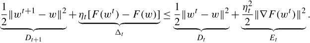 (1.15)

该不等式完全符合 (1.13) 的形式，其中 `ω[t] = 1`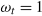。为保证收敛，我们需要取 `w = w^⋆`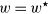 作为 (1.1) 的一个解，并假设 `∥∇F(w^(t))∥ ≤ M`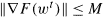。然后，(1.15) 蕴含 `Δ[t] ≤ D[t] − D[t + 1] + E[t]`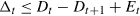。通过数学归纳法，我们得到 $\sum_{t = 0}^{T}\Delta_{t} \leqslant D_{0} - D_{T + 1} + \sum_{t = 0}^{T}E_{t} \leqslant D_{0} + \sum_{t = 0}^{T}E_{t}$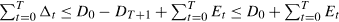。因此，我们得到

$$
F(\widehat{w}) - F(w^{\star}) \leqslant \frac{1}{S_{T}}\sum\limits_{t = 0}^{T}\eta_{t}[ F(w^{t}) - F(w^{\star})] \leqslant \frac{1}{2S_{T}}{\| w^{0} - w^{\star}\|}^{2} + \frac{M^{2}}{2S_{T}}\sum\limits_{t = 0}^{T}\eta_{t}^{2},
$$

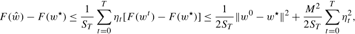

其中 $S_{T}: = \sum_{t = 0}^{T}\eta_{t}$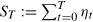 和 $\widehat{w}: = \frac{1}{S_{T}}\sum_{t = 0}^{T}\eta_{t}w^{t}$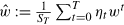，正如 (1.12) 所计算的那样。为获得收敛速率界，我们要求 $\sum_{t = 0}^{\infty}\eta_{t}^{2} < + \infty$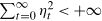 且 $S_{T}\rightarrow S_{\infty} = \sum_{t = 0}^{\infty}\eta_{t} = \infty$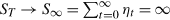。这些正是保证[次]梯度法收敛的条件，参见例如 [[8]](#Chp001_3-28_B9780443190377000089_split_002.xhtml#br0040)。

#### (c) 非凸问题的梯度下降法

如果我们假设 `F` 仅为 `L`-光滑且不一定是凸的，则使用 (1.10)（令 `w := w^(t)`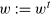 和 `w' := w^(t + 1) = w^(t) − η[t]∇F(w^(t))`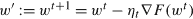），我们有

$$
F(w^{t + 1}) \leqslant F(w^{t}) + \langle\nabla F(w^{t}),w^{t + 1} - w^{t}\rangle + \frac{L}{2}{\| w^{t + 1} - w^{t}\|}^{2} = F(w^{t}) - \eta_{t}\left( 1 - \frac{L\eta_{t}}{2} \right){\|\nabla F(w^{t})\|}^{2}.
$$

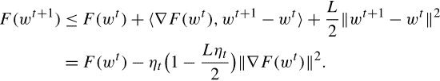 (1.16)

通过在两边加上 `− F^⋆`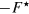，其中 `F^⋆ := inf[w]F(w) > − ∞`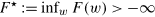（我们的假设），并重新排列结果，不等式 (1.16) 导出

$$
\begin{array}{lcl}
{\underset{D_{t + 1}}{\underset{\text{︸}}{F(w^{t + 1}) - F^{\star}}} + \underset{\Delta_{t}}{\underset{\text{︸}}{\eta_{t}\left( 1 - \frac{L\eta_{t}}{2} \right){\|\nabla F(w^{t})\|}^{2}}}} & {\leqslant} & {\underset{D_{t}}{\underset{\text{︸}}{F(w^{t}) - F^{\star}}}.}
\end{array}
$$

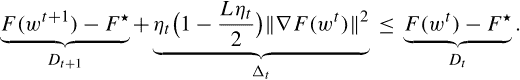

这完全符合 (1.13) 的形式，其中 `ω[t] = 1` 和 `E[t] = 0`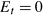。无需进一步假设，我们有 `Δ[t] ≤ D[t] − D[t + 1]`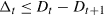，通过数学归纳法，得到 $\sum_{t = 0}^{T}\Delta_{t} \leqslant D_{0} - D_{T + 1} \leqslant D_{0}$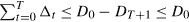，从而得出

$$
\min\limits_{0 \leqslant t \leqslant T}{\|\nabla F(w^{t})\|}^{2} \leqslant \frac{1}{S_{T}}\sum\limits_{t = 0}^{T}\gamma_{t}{\|\nabla F(w^{t})\|}^{2} \leqslant \frac{F(w^{0}) - F^{\star}}{S_{T}},
$$

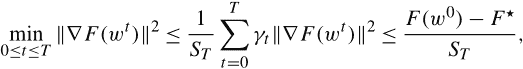

其中 $\gamma_{t} = \eta_{t}(1 - \frac{L\eta_{t}}{2})$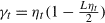 和 $S_{T} = \sum_{t = 0}^{T}\gamma_{t}$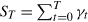，前提是 $0 < \eta_{t} < \frac{2}{L}$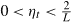。该结果使我们能够证明算法对 (1.1) 的驻点的最佳迭代收敛速率。

#### (d) 光滑凸问题的梯度下降法

假设 `F` 是凸且 `L`-光滑的。让我们在 (1.2) 中选择 $\eta_{t}: = \frac{1}{L}$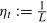 以得到 $w^{t + 1}: = w^{t} - \frac{1}{L}\nabla F(w^{t})$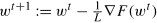。然后，从 (1.14) 和 (1.16)，以及 `F` 的凸性，我们有

$$
\left\{ \begin{array}{l}
{\frac{L}{2}{\| w^{t + 1} - w^{\star}\|}^{2} + \langle\nabla F(w^{t}),w^{t} - w^{\star}\rangle = \frac{L}{2}{\| w^{t} - w^{\star}\|}^{2} + \frac{1}{2L}{\|\nabla F(w^{t})\|}^{2},} \\
{(t + 1)[ F(w^{t + 1}) - F(w^{\star})] + \frac{(t + 1)}{2L}{\|\nabla F(w^{t})\|}^{2} \leqslant (t + 1)[ F(w^{t}) - F(w^{\star})],} \\
{F(w^{t}) - F(w^{\star}) \leqslant \langle\nabla F(w^{t}),w^{t} - w^{\star}\rangle.}
\end{array} \right.
$$

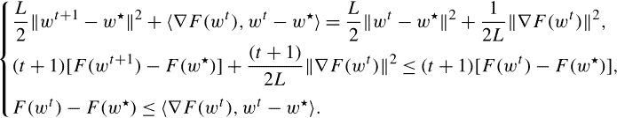

通过将这三个不等式相加并抵消项，我们得到

$$
\frac{L}{2}{\| w^{t + 1} - w^{\star}\|}^{2} + (t + 1)[ F(w^{t + 1}) - F(w^{\star})] + \frac{t}{2L}{\|\nabla F(w^{t})\|}^{2}\quad \leqslant \frac{L}{2}{\| w^{t} - w^{\star}\|}^{2} + t[ F(w^{t}) - F(w^{\star})].
$$

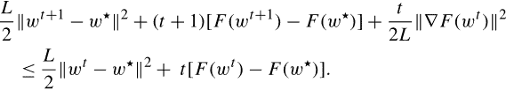

这完全符合 (1.13) 的形式，其中 $D_{t}: = \frac{L}{2}{\| w^{t} - w^{\star}\|}^{2} + t[ F(w^{t}) - F(w^{\star})]$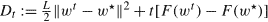，$\Delta_{t}: = \frac{t}{2L}{\|\nabla F(w^{t})\|}^{2}$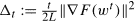，`E[t] = 0`，和 `ω[t] = 1`。这个递归估计蕴含 `D[t + 1] ≤ D[0]`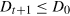，因此，使用 `D[t + 1]`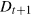 的定义并去掉 $\frac{L}{2}{\| w^{t + 1} - w^{\star}\|}^{2}$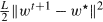，我们得到

$$
F(w^{t + 1}) - F(w^{\star}) \leqslant \frac{D_{0}}{t + 1} = \frac{L{\| w^{0} - w^{\star}\|}^{2}}{2(t + 1)},
$$

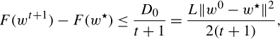


这显示了 $w^{(t)}$ 上 $\mathcal{O}(1/t)$ 的最后迭代收敛速率。这也意味着 $\sum_{t = 0}^{T}t\|\nabla F(w^{t})\|^{2} \leqslant L^{2}\| w^{0} - w^{\star}\|^{2}$（通过使用 $\sum_{t = 0}^{T}\Delta_{t} \leqslant D_{0}$）以及对于所有 $t \ge 0$ 有 $\|w^{(t)} - w^{\star}\| \le \|w^{0} - w^{\star}\|$（通过使用 $D[t] \le D[0]$）。

**(e) 光滑凸问题的加速梯度法。** 我们的最后一个示例遵循 Nesterov 的加速梯度方案：

```
z^{t} := w^{t} + \beta_{t}(w^{t} - w^{t - 1}) \quad \text{and} \quad w^{t + 1} := z^{t} - \frac{1}{L}\nabla F(z^{t}),
```
(1.17)

其中 $\beta_{t} = \frac{\theta_{t - 1} - 1}{\theta_{t}}$，$\theta[t] \ge 1$ 使得 $\thetat \le \theta[t - 1]^{2}$ 且 $\theta[0] := 1$。这是带有动量 $\betat} - w^{(t - 1)})$ 的 (1.2) 的加速变体。众所周知 [[44]](#Chp001_3-28_B9780443190377000089_split_002.xhtml#br0220)，经过一些基本变换后，(1.17) 可以写为

```
z^{t} := (1 - \frac{1}{\theta_{t}})w^{t} + \frac{1}{\theta_{t}}u^{t}, \quad w^{t + 1} := z^{t} - \frac{1}{L}\nabla F(z^{t}), \quad \text{and} \quad u^{t + 1} = u^{t} - \frac{\theta_{t}}{L}\nabla F(z^{t}).
```

令 $v^{t} := (1 - \frac{1}{\theta_{t}})w^{t} + \frac{1}{\theta_{t}}w^{\star}$。则 $z^{t} - v^{t} = \frac{1}{\theta_{t}}(u^{t} - w^{\star})$。此外，由 $F$ 的凸性，我们有 $F(z^{t}) \leqslant F(v^{t}) + \langle\nabla F(z^{t}),z^{t} - v^{t}\rangle \leqslant (1 - \frac{1}{\theta_{t}})F(w^{t}) + \frac{1}{\theta_{t}}F(w^{\star}) + \frac{1}{\theta_{t}}\langle\nabla F(z^{t}),u^{t} - w^{\star}\rangle$。因此，两边同乘 $\theta[t]^{2}$，我们得到

```
\begin{array}{lcl} {\theta_{t}^{2}[ F(z^{t}) - F(w^{\star})]\ } & {\leqslant \ } & {\theta_{t}(\theta_{t} - 1)[ F(w^{t}) - F(w^{\star})] + \theta_{t}\langle\nabla F(z^{t}),u^{t} - w^{\star}\rangle.} \\ \end{array}
```

分别类似于 (1.14) 和 (1.16) 的证明，我们有

```
\left\{ \begin{array}{l} {\frac{L}{2}\| u^{t + 1} - w^{\star}\|^{2} + \theta_{t}\langle\nabla F(z^{t}),u^{t} - w^{\star}\rangle = \frac{L}{2}\| u^{t} - w^{\star}\|^{2} + \frac{\theta_{t}^{2}}{2L}\|\nabla F(z^{t})\|^{2},} \\ {\theta_{t}^{2}[ F(w^{t + 1}) - F(w^{\star})] + \frac{\theta_{t}^{2}}{2L}\|\nabla F(z^{t})\|^{2} \leqslant \theta_{t}^{2}[ F(z^{t}) - F(w^{\star})].} \\ \end{array} \right.
```

将最后三个不等式相加，我们得到

```
\underset{D_{t + 1}}{\underset{\text{︸}}{\theta_{t}^{2}[ F(w^{t + 1}) - F(w^{\star})] + \frac{L}{2}\| u^{t + 1} - w^{\star}\|^{2}}} + \underset{\Delta_{t}}{\underset{\text{︸}}{(\theta_{t - 1}^{2} - \theta_{t}(\theta_{t} - 1))[ F(w^{t}) - F(w^{\star})]}} \quad \leqslant \underset{D_{t}}{\underset{\text{︸}}{\theta_{t - 1}^{2}[ F(w^{t}) - F(w^{\star})] + \frac{L}{2}\| u^{t} - w^{\star}\|^{2}}},
```
(1.18)

这正是 (1.13)（其中 $E[t] = 0$ 且 $\omega[t] = 1$），前提是 $\theta[t - 1]^{2} - \thetat \ge 0$（注意 $\theta[0] = 1$ 和 $\theta_{- 1} = \frac{1}{2}$ 满足此条件）。递归估计 (1.18) 意味着 $D[t] \le D[0]$，从而得到

```
F(w^{t}) - F(w^{\star}) \leqslant \frac{D_{0}}{\theta_{t - 1}^{2}} = \frac{L}{2\theta_{t - 1}^{2}}\| w^{0} - w^{\star}\|^{2}.
```

特别地，如果我们选择 $\theta_{t - 1} := \frac{t + 1}{2}$，则 $\theta_{t - 1}^{2} = \frac{(t + 1)^{2}}{4} \geqslant \theta_{t}(\theta_{t} - 1) = \frac{t(t + 1)}{4}$，从而得到最后迭代收敛保证 $F(w^{t}) - F(w^{\star}) \leqslant \frac{2L\| w^{0} - w^{\star}\|^{2}}{(t + 1)^{2}}$。

我们已经展示了如何利用统一的递归表达式 (1.13) 来分析四种不同的确定性梯度型算法。与文献中的经典技术相比，它提供了一种简单的方法，只需几行即可推导出收敛速率分析。我们相信这种方法可以扩展到分析此处未列出的其他方法。

### 1.2.9 收敛速率与复杂度分析

经典优化文献通常刻画基础算法的渐近收敛或线性收敛速率，而次线性速率或预言机复杂度在很大程度上难以捉摸，参见例如 [[3]](#Chp001_3-28_B9780443190377000089_split_002.xhtml#br0015)、[[21]](#Chp001_3-28_B9780443190377000089_split_002.xhtml#br0105)、[[22]](#Chp001_3-28_B9780443190377000089_split_002.xhtml#br0110)、[[31]](#Chp001_3-28_B9780443190377000089_split_002.xhtml#br0155)、[[38]](#Chp001_3-28_B9780443190377000089_split_002.xhtml#br0190)、[[53]](#Chp001_3-28_B9780443190377000089_split_002.xhtml#br0265)。次线性收敛速率已在凸优化方法中被广泛研究，参见例如 [[45]](#Chp001_3-28_B9780443190377000089_split_002.xhtml#br0225)，而预言机复杂度分析则在 [[43]](#Chp001_3-28_B9780443190377000089_split_002.xhtml#br0215) 中得到正式研究。最近，由于在现代信号和图像处理、机器学习以及统计学习中的大规模问题应用 [[9]](#Chp001_3-28_B9780443190377000089_split_002.xhtml#br0045)、[[28]](#Chp001_3-28_B9780443190377000089_split_002.xhtml#br0140)、[[67]](#Chp001_3-28_B9780443190377000089_split_002.xhtml#br0335)，这些主题变得越来越流行。让我们在此详细讨论这些概念。


#### (a) 收敛速率

收敛速率刻画了最优性度量（例如，目标残差 `F(ŵ^(t)) − F^⋆`、到解的距离平方 `∥ŵ^(t) − w^⋆∥²` 或梯度范数平方 `∥∇F(ŵ^(t))∥²`）相对于迭代次数 `t` 的进展，其中 `ŵ^(t)` 是近似解。例如，在光滑凸问题的梯度法中，我们有 `F(w^(t + 1)) - F^⋆ ≤ (L∥w⁰ - w^⋆∥²) / (2(t + 1))`，表明目标残差 `F(w^(t)) − F^⋆` 至少以 `1/t` 的速度下降，记作 `F(w^(t)) − F^⋆ = 𝒪(1/t)`。我们也可以写成 `F(w^(t + 1)) - F^⋆ = 𝒪(R₀²L / (t + 1))`（其中 `R₀ := ∥w⁰ − w^⋆∥`），以展示速率对 `L` 和 `R₀` 的依赖关系。

请注意，我们通常试图建立一个上界速率，但也可以证明在某些假设下，对于某些类算法，该上界与下界速率匹配（在常数因子范围内），见例如 [45]。对于梯度型方法，仅在凸性和 `L`-光滑性假设下，最优收敛速率为 `𝒪(1/t²)`，这由 Nesterov 的最优方法保证。对于非凸问题，梯度型方法在 `L`-光滑性假设下，仅能在 `∥∇F(ŵ^(t))∥²` 上达到 `𝒪(1/t)` 的速率。在强凸性、误差界、二次增长或 PL 条件等额外假设下，可以达到线性收敛速率。然而，本章不再进一步讨论这些变体。

#### (b) 复杂度

复杂度的概念源于理论计算机科学，但在计算数学中广泛应用，特别是在优化领域。复杂度的形式化定义可见于例如 [43, 45]。我们区分梯度型方法的两种复杂度：迭代复杂度（或解析复杂度）和计算复杂度（有时称为算术复杂度或工作量复杂度）[45]。在梯度型方法中，总体计算复杂度通常由预言机复杂度主导，后者刻画了寻找近似解所需的函数和/或梯度评估总数。我们注意到，我们这里对 `oracle`（预言机）概念的使用有所扩展，其正式定义可见于例如 [45]。在数学上，算法 `T` 次迭代的预言机复杂度（在我们的语境下）定义如下：

```
预言机复杂度 := ∑_{t=0}^{T} 第 t 次迭代的单次迭代复杂度。
```
(1.19)

**单次迭代复杂度**刻画了每次迭代的工作量（例如梯度评估的次数）。在每次迭代中，我们通常计算最占主导地位的计算步骤，如梯度评估、函数评估、近端操作、投影、矩阵-向量乘法或 Hessian-向量乘法。如果单次迭代复杂度是固定的，则

```
预言机复杂度 = 迭代次数 × 单次迭代复杂度。
```

例如，对于光滑凸问题的标准梯度下降法，单次迭代复杂度为 `𝒪(1)`，即需要一次梯度评估，从而得到预言机复杂度 `𝒪(1/ϵ)`，以获得满足 `F(w^(t)) − F^⋆ ≤ ϵ` 的 `w^(t)`。确实，从收敛界 `F(w^t) - F^⋆ ≤ (L∥w⁰ - w^⋆∥²) / (2t)` 可知，`F(w^(t)) − F^⋆ ≤ ϵ` 由 `(L∥w⁰ - w^⋆∥²) / (2t) ≤ ϵ` 蕴含，从而得到 `t ≥ ⌈(L∥w⁰ - w^⋆∥²) / (2ϵ)⌉`。因此，我们最多需要 `t_max := ⌈(L∥w⁰ - w^⋆∥²) / (2ϵ)⌉ = 𝒪(1/ϵ)` 次迭代，进而需要 `𝒪(1/ϵ)` 次梯度评估。

### 1.2.10 初始点、热启动与重启

对于凸算法，其可以从任意初始点 `w⁰` 出发收敛到全局最小化点 `w^⋆`，`w⁰` 的选择将影响迭代次数，因为对于任意解 `w^⋆`，项 `∥w⁰ − w^⋆∥²` 出现在收敛保证的界中，例如 `F(w^T) - F^⋆ ≤ 𝒪(L∥w⁰ - w^⋆∥² / T^ν)`（其中 `ν = 1` 或 `ν = 2`）。显然，如果 `w⁰` 接近 `w^⋆`，则迭代次数 `T` 很小。

对于非凸算法，初始化起着关键作用，因为不同的初始点 `w⁰` 可能使算法收敛到不同的近似驻点 `w^⋆`，且它们的质量各异。驻点是局部最小化点的候选者，但其中一些可能给出极大化点或鞍点。即使我们确实得到了一个局部最小化点，它可能仍是一个糟糕的局部最小化点，即远离任意全局最小化点，或者在机器学习中给出较差的预测误差。

热启动策略使用上一次运行或上一次迭代的输出，来初始化当前阶段或迭代的算法。其基于这样的思想：上一次运行已经给出了期望解的一个良好近似。从这一点初始化可能有望快速收敛到目标最优解。热启动广泛应用于顺序迭代（如顺序二次规划）或在线学习方法中。


重启策略常用于算法取得不良进展并需要重新开始的情况。这一思想已被用于加速梯度法中，其中目标函数在显著下降后会上升，导致振荡行为 [\[26\]](#Chp001_3-28_B9780443190377000089_split_002.xhtml#br0130), [\[50\]](#Chp001_3-28_B9780443190377000089_split_002.xhtml#br0250)。重启通常与热启动和适当条件相结合以获得良好性能。关于重启策略的理论分析可参见 [\[20\]](#Chp001_3-28_B9780443190377000089_split_002.xhtml#br0100), [\[26\]](#Chp001_3-28_B9780443190377000089_split_002.xhtml#br0130), [\[50\]](#Chp001_3-28_B9780443190377000089_split_002.xhtml#br0250), [\[61\]](#Chp001_3-28_B9780443190377000089_split_002.xhtml#br0305)。

## 1.3 随机梯度下降法

让我们进一步将讨论从确定性方法扩展到求解 (1.1) 的随机方法，其中 *F* 是有限和或期望函数。随机逼近（SA）方法最初由 Robbins 和 Monro 于 1950 年代提出 [\[55\]](#Chp001_3-28_B9780443190377000089_split_002.xhtml#br0275)。在过去几十年中，它变得极其流行，因为它已被广泛用于机器学习和数据科学，参见 [\[5\]](#Chp001_3-28_B9780443190377000089_split_002.xhtml#br0025), [\[6\]](#Chp001_3-28_B9780443190377000089_split_002.xhtml#br0030), [\[60\]](#Chp001_3-28_B9780443190377000089_split_002.xhtml#br0300)。

### 1.3.1 算法模板

在本节中，我们仅关注标准随机优化，并讨论两类方法：经典 SGD 和方差缩减 SGD。更具体地说，我们关注 (1.1) 中的 $F(w) := \mathbb{E}[\mathbf{F}(w,\xi)]$，其可写为

$$
\min_{w \in \mathbb{R}^{p}}\left\{ F(w): = \mathbb{E}[\mathbf{F}(w,\xi)] \right\},
$$

(1.20)

其中 $\xi$ 是定义在给定概率空间 $(\Omega, \Sigma, \mathbb{P})$ 上的随机向量。

许多用于求解 (1.20) 的基于随机梯度的方法可按 算法 1 所述描述。此处，算法 1 仅展示了一种带有可能的方差缩减步骤的纯随机梯度方案，但不包含动量或加速步骤。算子 $\mathcal{P}$ 表示用于处理约束（如需要）或添加压缩的投影。然而，若未指定，则假定 $\mathcal{P}(z) = z$（恒等算子）。注意 算法 1 是一种双循环算法，其中内循环执行 SGD 更新，而外循环执行阶段式更新，可按轮次方式或作为重启机制表示。

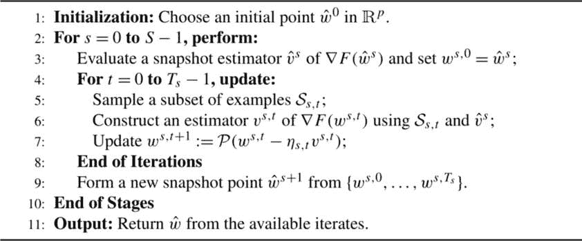

**算法 1** 统一随机梯度（SGD）法。

若 $S = 0$，则 算法 1 退化为单循环法。若 $S > 1$，则我们也可利用“IF”语句和迭代计数器 $k := \sum_{i = 0}^{s - 1}T_{i} + t$ 将 算法 1 转化为单循环。若 $T[s] := T$ 固定，则 $k := (s - 1)T + t$。这种转换允许我们为“IF”语句注入伯努利规则而非确定性规则。此类修改已在 Loopless-SVRG 和 Loopless-SARAH 方案中实现，参见 [\[33\]](#Chp001_3-28_B9780443190377000089_split_002.xhtml#br0165), [\[36\]](#Chp001_3-28_B9780443190377000089_split_002.xhtml#br0180)。

### 1.3.2 SGD 估计器

算法 1 的主要组件是 $\nabla F(w^{(t)})$ 的估计器 $v^{(t)}$。让我们回顾一些在优化及相关领域广泛使用的重要估计器。

**(a) 经典 SGD 和小批量估计器。** 显然，若 $S = 0$，则我们可直接在 算法 1 中省略上标 $s$，并将主更新写为

$$
w^{(t+1)} := w^{(t)} - \eta_t v^{(t)},
$$

(1.21)

其形式为 (1.2)，其中 $d^{(t)} := -v^{(t)}$ 为 $\nabla F(w^{(t)})$ 的随机估计器。

在经典 SGD 中，我们常生成 $v^{(t)}$ 作为 $\nabla F(w^{(t)})$ 的无偏估计器且具有有界方差，即

$$
\mathbb{E}[v^{(t)}|\mathcal{F}[t]] = \nabla F(w^{(t)}) \quad \text{and} \quad \mathbb{E}[\|v^{(t)}\|²|\mathcal{F}[t]] \le M²,
$$

(1.22)

对于给定的 $M \ge 0$，其中 $\mathcal{F}[t]$ 为由 $\{\mathcal{S}[0], \dots, \mathcal{S}[t]\}$ 生成的最小 $\sigma$-代数，$\mathbb{E}[\cdot|\mathcal{F}[t]]$ 为条件期望。

**(b) 方差缩减 SGD 估计器。** 存在许多基于 $\nabla F(w)$ 不同估计器的方差缩减方法。我们仅关注其中一些。为简化起见，我们省略阶段上标“s”。

第一种是 SVRG [\[29\]](#Chp001_3-28_B9780443190377000089_split_002.xhtml#br0145)，其生成 $v^{(t)}$ 为

$$
v^{(t)} := \hat{v}^{(s)} + [\nabla\mathbf{F}(w^{(t)}, \mathcal{S}_t) - \nabla\mathbf{F}(\hat{w}^{(s)}, \mathcal{S}_t)],
$$

(1.23)

其中 $\hat{v}^{(s)}$ 为 $\nabla F$ 在 $\hat{w}^{(s)}$ 处的全梯度或超大批量无偏估计器，$\nabla\mathbf{F}(w^{t},\mathcal{S}_{t}) := \frac{1}{b_{t}}\sum_{\xi_{t} \in \mathcal{S}_{t}}\nabla\mathbf{F}(w^{t},\xi_{t})$ 且 $b[t] := |\mathcal{S}[t]|$。随后可证明

$$
\mathbb{E}_{\mathcal{S}[t]}[v^{(t)}] = \nabla F(w^{(t)}) \quad \text{and} \quad \mathbb{E}_{\mathcal{S}[t]}[\|v^{(t)} - \nabla F(w^{(t)})\|²] \le \sigma[t]²,
$$

其中 $\sigma[t]² := L²\|w^{(t)} - w^\star\|²$（若 $F$ 为 $L$-平均光滑），且 $\sigma[t]² := 4L[F(w^{(t)}) - F(w^\star) + F(\hat{w}^{(s)}) - F(w^\star)]$（若 $F$ 为凸且 $L$-平均光滑）。

第二种估计器为 SARAH [\[48\]](#Chp001_3-28_B9780443190377000089_split_002.xhtml#br0240)，其表达式如下：


#### 随机递归梯度估计器

$$v^{(t)} := v^{(t-1)} + \left[\nabla \mathbf{F}(w^{(t)}, \mathcal{S}_t) - \nabla \mathbf{F}(w^{(t-1)}, \mathcal{S}_t)\right] \tag{1.24}$$

这被称为**随机递归梯度估计器**。不幸的是，该估计是有偏的，即 $\mathbb{E}_{\mathcal{S}_t}[v^{(t)}] \neq \nabla F(w^{(t)})$。然而，可以证明：

$$\mathbb{E}_{\mathcal{S}_t}[v^{(t)}] = \nabla F(w^{(t)}) + e_t \quad \text{and} \quad \mathbb{E}_{\mathcal{S}_t}[\|v^{(t)} - \nabla F(w^{(t)})\|²] \leq \sigma_t²,$$

其中 $e_t := v^{(t-1)} - \nabla F(w^{(t-1)})$ 是误差项，且若 $\mathbf{F}$ 为 $L$-平均光滑，则有 $\sigma_t² \leqslant \sigma_{t-1}² + \frac{L²}{b_t}\| w^t - w^{t-1} \|²$（参见 [52]）。

另一个有趣的估计器是文献 [66] 中提出的混合方差缩减估计器，其形式为：

$$v^{(t)} := (1 - \beta_t)\left[v^{(t-1)} + \left(\nabla \mathbf{F}(w^{(t)}, \mathcal{S}_t) - \nabla \mathbf{F}(w^{(t-1)}, \mathcal{S}_t)\right)\right] + \beta_t u^{(t)}, \tag{1.25}$$

其中 $\beta_t \in [0, 1]$，且 $u^{(t)}$ 是 $\nabla F(w^{(t)})$ 的无偏估计器，方差为 $\hat{\sigma}_t²$，即 $\mathbb{E}[\|u^{(t)} - \nabla F(w^{(t)})\|² | \mathcal{F}_t] \leq \hat{\sigma}_t²$。同样，如文献 [66] 所证，这是 $\nabla F(w^{(t)})$ 的有偏估计器。若 $\mathbf{F}$ 为 $L$-平均光滑，则 $v^{(t)}$ 满足 $\mathbb{E}[\|v^{(t)} - \nabla F(w^{(t)})\|²] \leq \sigma_t²$，其中

$$\sigma_t² \leqslant (1 - \beta_t)² \sigma_{t-1}² + \frac{2(1 - \beta_t)² L²}{b_t}\| w^t - w^{t-1} \|² + 2\beta_t² \hat{\sigma}_t².$$

$u^{(t)}$ 的一个简单选择是 $u^{(t)} := \nabla \mathbf{F}(w^{(t)}, \mathcal{S}_t)$。此时，$\hat{\sigma}_t² = \frac{\sigma²}{b_t}$。

### 1.3.3 统一收敛分析

#### (a) 通用方法

让我们确定 算法 1 收敛分析中的关键步骤。最重要的步骤之一是建立关于内层迭代 $t$ 的递归估计，形式如 (1.13) 所示，但在条件期望下：

$$\mathbb{E}[D_{t+1} | \mathcal{F}_t] + \Delta_t \leq \omega_t \cdot D_t + E_t, \tag{1.26}$$

其中相关量的定义类似于 (1.13)。若对 [(1.26)] 两边取全期望，并假设 $\omega_t = \frac{\xi_t}{\xi_{t+1}}$（其中 $\xi_t > 0$）且 $\mathbb{E}[E_t] \leq \theta_t² M²$（其中 $M \geq 0, \theta_t > 0$），则有：

$$\xi_{t+1}\mathbb{E}[D_{t+1}] + \xi_{t+1}\mathbb{E}[\Delta_t] \leq \xi_t \cdot \mathbb{E}[D_t] + \xi_{t+1}\theta_t² M².$$

通过数学归纳法，可得：

$$\xi_{T+1}\mathbb{E}[D_{T+1}] + \sum_{t=0}^{T} \xi_{t+1}\mathbb{E}[\Delta_t] \leq \xi_0 \mathbb{E}[D_0] + M² \sum_{t=0}^{T} \xi_{t+1}\theta_t². \tag{1.27}$$

令 $S_T := \sum_{t=0}^{T} \gamma_t$，给定权重 $\gamma_t > 0$（通常依赖于 $\xi_t$ 和/或 $\theta_t$）。将 [(1.27)] 两边同除以 $S_T$，得到：

$$\frac{1}{S_T}\sum_{t=0}^{T} \xi_{t+1}\mathbb{E}[\Delta_t] \leq \frac{\xi_0 \mathbb{E}[D_0]}{S_T} + \frac{M²}{S_T}\sum_{t=0}^{T} \xi_{t+1}\theta_t². \tag{1.28}$$

估计式 [(1.27)] 和 [(1.28)] 均可用于估计基础算法的收敛速率。下面我们应用此方法证明 算法 1 某些变体的收敛性。

#### (b) 非光滑凸问题的 SGD

分析 SGD 方案 (1.21) 的收敛性。利用更新式 [(1.21)]，有：

$$\|w^{(t+1)} - w^\star\|² = \|w^{(t)} - w^\star\|² - 2\eta_t \langle v^{(t)}, w^{(t)} - w^\star \rangle + \eta_t² \|v^{(t)}\|².$$

对该估计取条件期望 $\mathbb{E}[\cdot | \mathcal{F}_t]$，并注意到 $\mathbb{E}[v^{(t)} | \mathcal{F}_t] = \nabla F(w^{(t)})$，可得：

$$\eta_t \langle \nabla F(w^t), w^t - w^\star \rangle = \frac{1}{2}\|w^t - w^\star\|² - \frac{1}{2}\mathbb{E}[\|w^{t+1} - w^\star\|² | \mathcal{F}_t] + \frac{\eta_t²}{2}\mathbb{E}[\|v^t\|² | \mathcal{F}_t].$$

若 $F$ 为凸函数，则 $F(w^{(t)}) - F(w^\star) \leq \langle \nabla F(w^{(t)}), w^{(t)} - w^\star \rangle$。此外，亦有 $\mathbb{E}[\|v^{(t)}\|² | \mathcal{F}_t] \leq M²$。结合上述两式及最后一个不等式，得：

$$\underbrace{\frac{1}{2}\mathbb{E}[\|w^{t+1} - w^\star\|² | \mathcal{F}_t]}_{\mathbb{E}[D_{t+1} | \mathcal{F}_t]} + \underbrace{\eta_t [F(w^t) - F(w^\star)]}_{\Delta_t} \leq \underbrace{\frac{1}{2}\|w^t - w^\star\|²}_{D_t} + \underbrace{\frac{\eta_t²}{2}M²}_{E_t}.$$

这正是递归估计 [(1.26)]。利用 [(1.28)] 可表明……


### SGD 收敛性分析

$$
\mathbb{E}\lbrack F(\widehat{w}) - F(w^{\star})\rbrack \leqslant \frac{1}{S_{T}}\sum\limits_{t = 0}^{T}\eta_{t}\mathbb{E}\lbrack F(w^{t}) - F(w^{\star})\rbrack \leqslant \frac{1}{2S_{T}}{\| w^{0} - w^{\star}\|}^{2} + \frac{M^{2}}{2S_{T}}\sum\limits_{t = 0}^{T}\eta_{t}^{2},
$$

其中 $S_{T}: = \sum_{t = 0}^{T}\eta_{t}$ 且 $\widehat{w}: = \frac{1}{S_{T}}\sum_{t = 0}^{T}\eta_{t}w^{t}$。

若我们选择 $\eta_{t}: = \frac{C}{\sqrt{T + 1}}$ 且 $C > 0$，则 $S_{T} = C\sqrt{T + 1}$ 且 $\sum_{t = 0}^{T}\eta_{t}^{2} = C^{2}$。在这种情况下，(1.29) 变为

$$
\mathbb{E}\lbrack F(\widehat{w}) - F(w^{\star})\rbrack \leqslant \frac{{\| w^{0} - w^{\star}\|}^{2}}{2C\sqrt{T + 1}} + \frac{M^{2}C}{2\sqrt{T + 1}}.
$$

若我们选择 $\eta_{t}: = \frac{C}{\sqrt{t + 1}}$ 且 $C > 0$，则

$$
S_{T}: = C\sum\limits_{t = 0}^{T}\frac{1}{\sqrt{t + 1}} \geqslant 2C\int_{1}^{T + 1}\frac{1}{2\sqrt{t}}dt = 2C(\sqrt{T + 1} - 1)
$$

且 $\sum_{t = 0}^{T}\eta_{t}^{2} = C^{2}\sum_{t = 0}^{T}\frac{1}{t + 1} \leqslant C^{2}(1 + \ln(T + 1))$。在这种情况下，(1.29) 变为

$$
\mathbb{E}\lbrack F(\widehat{w}) - F(w^{\star})\rbrack \leqslant \frac{{\| w^{0} - w^{\star}\|}^{2}}{4C(\sqrt{T + 1} - 1)} + \frac{M^{2}C(1 + \ln(T + 1))}{4(\sqrt{T + 1} - 1)}.
$$

#### (c) 针对光滑非凸问题的 SGD

我们考虑 $F$ 为 $L$-光滑的情况。此外，我们假设随机估计器 $v^{(t)}$ 是无偏的，即 $\mathbb{E}[v^{(t)}|\mathcal{F}[t]] = \nabla F(w^{(t)})$ 且具有有界方差 $\mathbb{E}[\|v^{(t)} - \nabla F(w^{(t)})\|^{2}|\mathcal{F}[t]] \le \sigma^{2}$。在这种情况下，我们有 $\mathbb{E}[\|v^{(t)}\|^{2}|\mathcal{F}[t]] \le \|\nabla F(w^{(t)})\|^{2} + \sigma^{2}$。利用该不等式、$\mathbb{E}[v^{(t)}|\mathcal{F}[t]] = \nabla F(w^{(t)})$ 以及 $F$ 的 $L$-光滑性，我们可以推导出

$$
\mathbb{E}\lbrack F(w^{t + 1})|\mathcal{F}_{t}\rbrack \leqslant F(w^{t}) - \eta_{t}\mathbb{E}\lbrack\langle\nabla F(w^{t}),v^{t}\rangle|\mathcal{F}_{t}\rbrack + \frac{L\eta_{t}^{2}}{2}\mathbb{E}\lbrack{\| v^{t}\|}^{2}|\mathcal{F}_{t}\rbrack \leqslant F(w^{t}) - \eta_{t}{\|\nabla F(w^{t})\|}^{2} + \frac{L\eta_{t}^{2}}{2}{\|\nabla F(w^{t})\|}^{2} + \frac{L\eta_{t}^{2}\sigma^{2}}{2} = F(w^{t}) - \eta_{t}\left( 1 - \frac{L\eta_{t}}{2} \right){\|\nabla F(w^{t})\|}^{2} + \frac{L\eta_{t}^{2}\sigma^{2}}{2}.
$$

该不等式导致

$$
\begin{array}{l}
\mathbb{E}\lbrack\underset{D_{t + 1}}{\underset{\text{︸}}{F(w^{t + 1}) - F^{\star}}}|\mathcal{F}_{t}\rbrack + \underset{\Delta_{t}}{\underset{\text{︸}}{\eta_{t}\left( 1 - \frac{L\eta_{t}}{2} \right){\|\nabla F(w^{t})\|}^{2}}} \leqslant \underset{D_{t}}{\underset{\text{︸}}{F(w^{t}) - F^{\star}}} + \underset{E_{t}}{\underset{\text{︸}}{\frac{L\eta_{t}^{2}\sigma^{2}}{2}}},
\end{array}
$$

这正是 (1.26)（其中 $\omega[t] = 1$），前提是 $0 < \eta_{t} < \frac{2}{L}$。通过使用该估计，我们可以推导出 $\frac{1}{S_{T}}\sum_{t = 0}^{T}\gamma_{t}\mathbb{E}\lbrack{\|\nabla F(w^{t})\|}^{2}\rbrack$ 的收敛速率，其中 $\gamma_{t}: = \eta_{t}\left( 1 - \frac{L\eta_{t}}{2} \right)$ 且 $S_{T}: = \sum_{t = 0}^{T}\gamma_{t}$，具体方法见文献 [25]。此处省略细节。

#### (d) 针对光滑非凸问题的混合方差缩减 SGD

我们分析算法 1 的一种方差缩减变体，其中内循环更新为 $w^{(t + 1)} := w^{(t)} - \eta_{t}v^{(t)}$，且 $v^{(t)}$ 由 (1.25) 给出（$b[t] = 1$），详见 [66]。此外，我们不需要外循环，从而得到一个**单循环**算法。

让我们分析其收敛速率。首先，由 $F$ 的 $L$-光滑性和关系式 $-2\langle a, b\rangle = \|a - b\|^{2} - \|a\|^{2} - \|b\|^{2}$，我们可以推导出

$$
\mathbb{E}\lbrack F(w^{t + 1})|\mathcal{F}_{t}\rbrack \leqslant F(w^{t}) - \eta_{t}\mathbb{E}\lbrack\langle\nabla F(w^{t}),v^{t}\rangle|\mathcal{F}_{t}\rbrack + \frac{L\eta_{t}^{2}}{2}\mathbb{E}\lbrack{\| v^{t}\|}^{2}|\mathcal{F}_{t}\rbrack = F(w^{t}) - \frac{\eta_{t}}{2}{\|\nabla F(w^{t})\|}^{2} + \frac{\eta_{t}}{2}\mathbb{E}\lbrack{\| v^{t} - \nabla F(w^{t})\|}^{2}|\mathcal{F}_{t}\rbrack - \frac{\eta_{t}}{2}(1 - L\eta_{t})\mathbb{E}\lbrack{\| v^{t}\|}^{2}|\mathcal{F}_{t}\rbrack.
$$

由于 $\mathbb{E}[\|v^{(t)} - \nabla F(w^{(t)})\|^{2}|\mathcal{F}[t]] \le \sigma_{t}^{2}$ 且 $0 < \eta_{t} \le \frac{1}{L}$，该不等式简化为

$$
\mathbb{E}\lbrack F(w^{t + 1}) - F^{\star} + \frac{\eta_{t}(1 - L\eta_{t})}{2}{\| v^{t}\|}^{2}|\mathcal{F}_{t}\rbrack \leqslant F(w^{t}) - F^{\star} - \frac{\eta_{t}}{2}{\|\nabla F(w^{t})\|}^{2} + \frac{\eta_{t}\sigma_{t}^{2}}{2}.
$$

由于 $\sigma_{t}^{2} \le (1 - \beta_{t})^{2}\sigma_{t-1}^{2} + 2(1 - \beta_{t})^{2}L^{2}\|w^{(t)} - w^{(t-1)}\|^{2} + 2\beta_{t}^{2}\hat{\sigma}^{2}$ 且 $w^{(t)} - w^{(t-1)} = -\eta_{t-1}v^{(t-1)}$，我们有

$$
\sigma_{t}^{2} \le (1 - \beta_{t})^{2}\sigma_{t-1}^{2} + 2L^{2}(1 - \beta_{t})^{2}\eta_{t-1}^{2}\|v^{(t-1)}\|^{2} + 2\beta_{t}^{2}\hat{\sigma}^{2}.
$$

将该不等式乘以 $\frac{c_{t}}{2} > 0$ 并加到上一个估计式中，我们得到

$$
\mathbb{E}\lbrack F(w^{t + 1}) - F^{\star} + \frac{\eta_{t}(1 - L\eta_{t})}{2}{\| v^{t}\|}^{2}|\mathcal{F}_{t}\rbrack + \frac{(c_{t} - \eta_{t})}{2}\sigma_{t}^{2} + \frac{\eta_{t}}{2}{\|\nabla F(w^{t})\|}^{2} \leqslant F(w^{t}) - F^{\star} + L^{2}c_{t}{(1 - \beta_{t})}^{2}\eta_{t - 1}^{2}{\| v^{t - 1}\|}^{2} + \frac{c_{t}{(1 - \beta_{t})}^{2}}{2}\sigma_{t - 1}^{2} + c_{t}\beta_{t}^{2}{\hat{\sigma}}^{2}.
$$


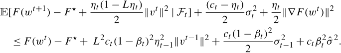

为简单起见，我们选择所有参数均为常数。令 $D\_{t}: = F(w^{t}) - F^{\\star} + \\frac{\\eta(1 - L\\eta)}{2}{\\| v^{t - 1}\\|}^{2} + \\frac{(c - \\eta)}{2}\\sigma\_{t - 1}^{2}$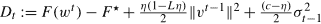，并施加以下条件：

2*L*²*η*²*c*(1 − *β*)² ≤ *η*(1 − *L**η*) and *c*(1 − *β*)² ≤ *c* − *η*.

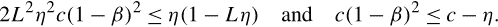(1.30)

然后，最后的估计得出

$\\mathbb{E}\\lbrack D\_{t + 1}|\\mathcal{F}\_{t}\\rbrack + \\underset{\\Delta\_{t}}{\\underset{︸}{\\frac{\\eta}{2}{\\|\\nabla F(w^{t})\\|}^{2}}} \\leqslant D\_{t} + \\underset{E\_{t}}{\\underset{︸}{c\\beta^{2}{\\widehat{\\sigma}}^{2}}},$

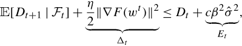

这正是 (1.26) 式，其中 *ω*[*t*] = 1。

假设我们选择 $\\eta \\in (0,\\frac{1}{L})$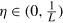 和 *c* > 0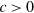 使得 2*L*²*η*²(*c* − *η*) = *η*(1 − *L**η*)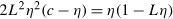，从而得到 $c: = \\frac{1 - L\\eta}{2L^{2}\\eta} + \\eta = \\frac{1 - L\\eta + 2L^{2}\\eta^{2}}{2L^{2}\\eta}$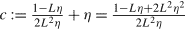。此外，${(1 - \\beta)}^{2} \\leqslant 1 - \\frac{2L^{2}\\eta^{2}}{1 - L\\eta + 2L^{2}\\eta^{2}}$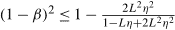。那么，(1.30) 式的两个条件均以等式成立。在这种情况下，我们得到 $\\mathbb{E}\\lbrack D\_{t + 1}|\\mathcal{F}\_{t}\\rbrack + \\frac{\\eta}{2}{\\|\\nabla F(w^{t})\\|}^{2} \\leqslant D\_{t} + \\frac{(1 - L\\eta + 2L^{2}\\eta^{2})\\beta^{2}}{2L^{2}\\eta}{\\widehat{\\sigma}}^{2}$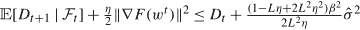。这个不等式意味着

$\\frac{1}{T + 1}\\sum\\limits\_{t = 0}^{T}\\mathbb{E}\\lbrack{\\|\\nabla F(w^{t})\\|}^{2}\\rbrack \\leqslant \\frac{2}{\\eta(T + 1)}D\_{0} + \\frac{(1 - L\\eta + 2L^{2}\\eta^{2})\\beta^{2}}{L^{2}\\eta^{2}}{\\widehat{\\sigma}}^{2} \\leqslant \\frac{2\\lbrack F(w^{0}) - F^{\\star}\\rbrack}{\\eta(T + 1)} + \\frac{{\\| v^{0}\\|}^{2}}{(T + 1)} + \\frac{\\sigma\_{- 1}^{2}}{2L^{2}\\eta^{2}(T + 1)} + \\frac{\\beta^{2}{\\widehat{\\sigma}}^{2}}{L^{2}\\eta^{2}}.$

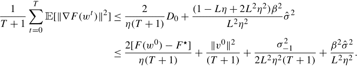

最后，我们选择 $\\eta: = \\frac{1}{L{(T + 1)}^{1/3}} \\leqslant \\frac{1}{L}$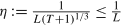，$\\sigma\_{- 1}: = \\frac{1}{{(T + 1)}^{1/3}}$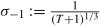，和 $\\beta: = \\mathcal{O}\\left( \\frac{1}{{(T + 1)}^{2/3}} \\right)$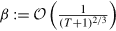 使得 ${(1 - \\beta)}^{2} \\leqslant 1 - \\frac{2L^{2}\\eta^{2}}{1 - L\\eta + 2L^{2}\\eta^{2}}$（这样的 *β* 总是存在的）。此外，最后的估计表明

$\\frac{1}{T + 1}\\sum\\limits\_{t = 0}^{T}\\mathbb{E}\\lbrack{\\|\\nabla F(w^{t})\\|}^{2}\\rbrack = \\mathcal{O}\\left( \\frac{1}{{(T + 1)}^{2/3}} \\right),$


正如文献 [\[66\]](#Chp001_3-28_B9780443190377000089_split_002.xhtml#br0330) 所证明的。

我们通过使用递归估计 (1.26) 来分析三种 SGD 方案（包括方差缩减方法）的收敛性，展示了我们的方法。我们相信这种方法可用于分析其他变体，包括 SVRG 和 SARAH。

## 1.4 结束语

我们回顾了构成梯度下降法及其变体的几个主要组成部分，包括确定性和随机性方法，范围涵盖从凸问题到非凸问题。我们提供了一个简单且统一的收敛分析框架，该框架依赖于在文献中常用的最基本结构假设下的基本递归估计。虽然这种方法可应用于分析多种方法，但我们仅在几个著名方案上进行了演示。请注意，我们并未提出任何新算法，而是利用简单的递归估计统一了收敛分析。然而，我们相信这种方法可以延伸至本章所做工作之外。以下研究课题引起了我们的兴趣。首先，是否仍可将我们的分析应用于加速方差缩减随机梯度类方法？也许可以借鉴近期工作 [\[15\]](#Chp001_3-28_B9780443190377000089_split_002.xhtml#br0075) 的思想来实现。其次，如何将我们的框架扩展以研究分布式系统和联邦学习中的其他优化方法？我们强调，这些领域中的许多算法可视为随机[区块-]坐标方法。因此，向坐标方法和洗牌方法的扩展前景广阔且仍是开放问题。第三，是否可能将我们的分析扩展并适应于异步基于梯度的算法？我们认为，只要延迟有界，这种扩展就是可能的。然而，需要修改递归表达式以捕捉延迟更新，从而在递归不等式中产生额外的误差项。最后，我们的方法可用于分析极小极大和变分不等式问题算法的收敛性，这些问题最近获得了极大的关注 \[19,[65\]](#Chp001_3-28_B9780443190377000089_split_002.xhtml#br0325)。

## 参考文献

*   \[1\] H.H. Bauschke, P. Combettes, *Convex Analysis and Monotone Operators Theory in Hilbert Spaces*. 2nd edition Springer; 2017.

*   [\[2\]](#Chp001_3-28_B9780443190377000089_split_000.xhtml#cs0010_2) A. Ben-Tal, A. Nemirovski, *Lectures on Modern Convex Optimization: Analysis, Algorithms, and Engineering Applications, vol. 3*. SIAM; 2001.

*   [\[3\]](#Chp001_3-28_B9780443190377000089_split_001.xhtml#cs0085_1) D.P. Bertsekas, *Nonlinear Programming*. 2nd edition Athena Scientific; 1999.

*   [\[4\]](#Chp001_3-28_B9780443190377000089_split_001.xhtml#cf0290) J. Bolte, A. Daniilidis, A. Lewis, The Łojasiewicz inequality for nonsmooth subanalytic functions with applications to subgradient dynamical systems, *SIAM J. Optim.* 2007;17(4):1205–1223.

*   

*   [\[5\]](#Chp001_3-28_B9780443190377000089_split_001.xhtml#cs0110_1) L. Bottou, F.E. Curtis, J. Nocedal, Optimization methods for large-scale machine learning, *SIAM Rev.* 2018;60(2):223–311.

*   [\[6\]](#Chp001_3-28_B9780443190377000089_split_001.xhtml#cs0110_2) Léon Bottou, Online learning and stochastic approximations, David Saad, ed. *Online Learning in Neural Networks*. New York, NY, USA: Cambridge University Press; 1998:9–42.

*   \[7\] S. Boyd, L. Vandenberghe, *Convex Optimization*. Cambridge: University Press; 2004.

*   [\[8\]](#Chp001_3-28_B9780443190377000089_split_001.xhtml#cf0365) S. Boyd, L. Xiao, A. Mutapcic, *Subgradient methods*. \[Tech. Report. EE392o\] Stanford University; 2003.

*   [\[9\]](#Chp001_3-28_B9780443190377000089_split_000.xhtml#cs0015_1) Sébastien Bubeck, Theory of convex optimization for machine learning, *Lecture Notes*. Princeton University; 2014.

*   [\[10\]](#Chp001_3-28_B9780443190377000089_split_000.xhtml#cs0015_1) P. Combettes, J.-C. Pesquet, Signal recovery by proximal forward-backward splitting, *Fixed-Point Algorithms for Inverse Problems in Science and Engineering*. Springer; 2011:185–212.

*   \[11\] A.R. Conn, N. Gould, P.L. Toint, *Trust-Region Methods*. MPS/SIAM Series on Optimization. Philadelphia, USA: SIAM; 2000.

*   [\[12\]](#Chp001_3-28_B9780443190377000089_split_000.xhtml#cs0045_1) A. Cutkosky, F. Orabona, Momentum-based variance reduction in non-convex SGD, *Advances in Neural Information Processing Systems*. 2019:15210–15219.


## 参考文献

*   **[13]** A. Defazio, F. Bach, S. Lacoste-Julien, SAGA: 一种支持非强凸复合目标的快速增量梯度法，*神经信息处理系统进展 (NIPS)*。2014:1646–1654。

*   **[14]** M. Van Dijk, L.M. Nguyen, P.H. Nguyen, D.T. Phan, 凸目标函数的刻画及 SGD 的最优期望收敛率，2019，第 6392–6400 页。

*   **[15]** D. Driggs, M.J. Ehrhardt, C.-B. Schönlieb, 加速方差缩减随机梯度法，*数学规划*。2022:1–45。

*   **[16]** D. Drusvyatskiy, A. Lewis, 误差界、二次增长与近端方法的线性收敛，*运筹学数学*。2018;43(3):919–948。

*   **[17]** J. Duchi, E. Hazan, Y. Singer, 适用于在线学习和随机优化的自适应次梯度法，*机器学习研究期刊*。2011;12:2121–2159。

*   **[18]** I. Ekeland, T. Turnbull, *无限维优化与凸性*。芝加哥大学出版社；1983。

*   **[19]** F. Facchinei, J.-S. Pang, *有限维变分不等式与互补问题，第 1–2 卷*。Springer；2003。

*   **[20]** O. Fercoq, Z. Qu, 基于粗略强凸性估计的加速梯度法重启，预印本 [arXiv:1609.07358](http://www.arxiv.org/abs/1609.07358)；2016 第 1–23 页。

*   **[21]** A.V. Fiacco, G.P. McCormick, *非线性规划：序列无约束极小化技术*。工业与应用数学学会；1987。

*   **[22]** R. Fletcher, *优化实用方法*。第 2 版 切切斯特：Wiley；1987。

*   **[23]** R. Fletcher, S. Leyffer, 无惩罚函数的非线性规划，*数学规划*。2002;91:239–269。

*   **[24]** R. Ge, F. Huang, C. Jin, Y. Yuan, 逃离鞍点——用于张量分解的在线随机梯度，*学习理论会议*。2015:797–842。

*   **[25]** S. Ghadimi, G. Lan, 非凸随机规划的随机一阶和零阶方法，*SIAM J. Optim.* 2013;23(4):2341–2368。

*   **[26]** P. Giselsson, S. Boyd, 快速梯度法中的单调性与重启，*IEEE 决策与控制会议*。*美国洛杉矶*。2014 年 12 月:5058–5063。

*   **[27]** I. Goodfellow, Y. Bengio, A. Courville, *深度学习，第 1 卷*。剑桥：MIT Press；2016。

*   **[28]** Trevor Hastie, Robert Tibshirani, Jerome Friedman, *统计学习基础：数据挖掘、推断与预测*。第 2 版 Springer 统计学系列。2009。

*   **[29]** R. Johnson, T. Zhang, 利用预测方差缩减加速随机梯度下降，*神经信息处理系统进展 (NIPS)*。2013:315–323。

*   **[30]** H. Karimi, J. Nutini, M. Schmidt, Polyak–Łojasiewicz 条件下梯度法和近端梯度法的线性收敛，P. Frasconi, N. Landwehr, G. Manco, J. Vreeken 编。*数据库中的机器学习与知识发现*。Cham: Springer；2016:795–811。

*   **[31]** C.T. Kelley, *优化迭代法，第 18 卷*。美国费城：SIAM；1999。

*   **[32]** D.P. Kingma, J. Ba ADAM，一种随机优化方法，*第 3 届国际学习表征会议论文集 (ICLR)*。2014 abs/1412.6980。

*   **[33]** D. Kovalev, S. Horvath, P. Richtarik, 别再钻圈子套了，去掉那些循环：没有外层循环的 SVRG 和 Katyusha 更好，*算法学习理论*。PMLR；2020:451–467。

*   **[34]** G. Lan, *面向机器学习的一阶与随机优化方法*。Springer；2020。

*   **[35]** S. Lee, D. Kim, 适用于光滑结构非凸-非凹极大极小问题的快速额外梯度法，*第三十五届神经信息处理系统会议 (NeurIPs2021)*。2021。

*   **[36]** B. Li, M. Ma, G.B. Giannakis, 关于 SARAH 及其后续方法的收敛性，技术报告，ArXiv 预印本 [arXiv:1906.02351](http://www.arxiv.org/abs/1906.02351)；2019。

*   **[37]** I. Loshchilov, F. Hutter, SGDR：带热重启的随机梯度下降，*国际学习表征会议*。2016。

*   **[38]** D.G. Luenberger, Y. Ye, *线性与非线性规划*。Springer；2007。

*   **[39]** Z.-Q. Luo, P. Tseng, 误差界与可行下降法收敛分析：一种通用方法，*运筹学年刊*。1993;46(1):157–178。

*   **[40]** B.S. Mordukhovich, *变分分析与广义微分：第 I 和 II 卷*。第 330 卷 Springer；2006。

*   **[41]** E. Moulay, V. Léchappé, F. Plestan, 符号梯度下降算法的性质，*信息科学*。2019;492:29–39。

*   **[42]** I. Necoara, Y. Nesterov, F. Glineur, 非强凸优化一阶方法的线性收敛，*数学规划*。2016:1–39。

*   **[43]** A. Nemirovskii, D. Yudin, *优化中的问题复杂性与方法效率*。Wiley；1983。

*   **[44]** Y. Nesterov, 一种收敛速率为 𝒪(1/*k*²) 的无约束凸极小化问题求解方法，*苏联科学院报告* 1983;269:543–547 译为苏联数学报告。

*   **[45]** Y. Nesterov, *凸优化入门讲座：基础课程*。应用优化。Kluwer Academic Publishers；2004；第 87 卷。

*   **[46]** Y. Nesterov, 非光滑函数的光滑极小化，*数学规划*。2005;103(1):127–152。

*   **[47]** Y. Nesterov, 凸优化问题的通用梯度法，*数学规划*。2015;152(1-2):381–404。

*   **[48]** L.M. Nguyen, J. Liu, K. Scheinberg, M. Takáč, SARAH：一种利用随机递归梯度解决机器学习问题的新方法，*第 34 届国际机器学习会议论文集*。2017:2613–2621。

*   **[49]** J. Nocedal, S.J. Wright, *数值优化*。第 2 版 Springer 运筹学与金融工程系列。Springer；2006。

*   **[50]** B. O'Donoghue, E. Candes, 加速梯度方案的自适应重启，*计算数学基础*。2015;15:715–732。

*   **[51]** N. Parikh, S. Boyd, 近端算法，*优化趋势基础*。2013;1(3):123–231。

*   **[52]** H.N. Pham, M.L. Nguyen, T.D. Phan, Q. Tran-Dinh, ProxSARAH：随机合成非凸优化的高效算法框架，*机器学习研究期刊*。2020;21:1–48。


*   [\[53\]](#Chp001_3-28_B9780443190377000089_split_001.xhtml#cs0085_6) E. Polak, *Computational Methods in Optimization: A Unified Approach*. New York: Academic Press; 1971.
*   [\[54\]](#Chp001_3-28_B9780443190377000089_split_000.xhtml#cf0185) Boris T. Polyak, Some methods of speeding up the convergence of iteration methods, *USSR Comput. Math. Math. Phys.* 1964;4(5):1–17.
*   [\[55\]](#Chp001_3-28_B9780443190377000089_split_001.xhtml#cf0485) H. Robbins, S. Monro, A stochastic approximation method, *Ann. Math. Stat.* 1951;22(3):400–407.
*   \[56\] R. Rockafellar, R. Wets, *Variational Analysis, vol. 317*. Springer; 2004.
*   [\[57\]](#Chp001_3-28_B9780443190377000089_split_001.xhtml#cs0070_2) R.T. Rockafellar, *Convex Analysis*. Princeton Mathematics Series. Princeton University Press; 1970;vol. 28.
*   [\[58\]](#Chp001_3-28_B9780443190377000089_split_000.xhtml#cs0025_4) M. Schmidt, N. Le Roux, F. Bach, Minimizing finite sums with the stochastic average gradient, *Math. Program.* 2017;162(1–2):83–112.
*   [\[59\]](#Chp001_3-28_B9780443190377000089_split_000.xhtml#cs0020_3) A. Shapiro, D. Dentcheva, A. Ruszczynski, *Lectures on Stochastic Programming: Modelling and Theory*. SIAM; 2009.
*   \[60\] Suvrit Sra, Optimization for Machine Learning (MIT Course 6.881).
*   \[61\] W. Su, S. Boyd, E. Candes, A differential equation for modeling Nesterov's accelerated gradient method: theory and insights, *Advances in Neural Information Processing Systems (NIPS)*. 2014:2510–2518.
*   [\[62\]](#Chp001_3-28_B9780443190377000089_split_000.xhtml#cs0040_2) T.H. Tran, L.M. Nguyen, Q. Tran-Dinh, SMG: A shuffling gradient-based method with momentum, *International Conference on Machine Learning*. PMLR; 2021:10379–10389.
*   [\[63\]](#Chp001_3-28_B9780443190377000089_split_000.xhtml#cs0060_2) Q. Tran-Dinh, From Halpern's fixed-point iterations to Nesterov's accelerated interpretations for root-finding problems, *Comput. Optim. Appl.* 2023:1–38 [10.1007/s10589-023-00518-8](http://dx.doi.org/10.1007/s10589-023-00518-8).
*   [\[64\]](#Chp001_3-28_B9780443190377000089_split_000.xhtml#cf0035) Q. Tran-Dinh, A. Kyrillidis, V. Cevher, Composite self-concordant minimization, *J. Mach. Learn. Res.* 2015;15:374–416.
*   [\[65\]](#Chp001_3-28_B9780443190377000089_split_002.xhtml#cs0120_2) Q. Tran-Dinh, D. Liu, L.M. Nguyen, Hybrid variance-reduced SGD algorithms for nonconvex–concave minimax problems, *The 34th Conference on Neural Information Processing Systems (NeurIPs 2020)*. 2020.
*   \[66\] Q. Tran-Dinh, N.H. Pham, D.T. Phan, L.M. Nguyen, A hybrid stochastic optimization framework for stochastic composite nonconvex optimization, *Math. Program.* 2022;191:1005–1071.
*   [\[67\]](#Chp001_3-28_B9780443190377000089_split_001.xhtml#cs0090_3) S.J. Wright, R.D. Nowak, M.A.T. Figueiredo, Sparse reconstruction by separable approximation, *IEEE Trans. Signal Process.* 2009;57(7):2479–2493.
*   [\[68\]](#Chp001_3-28_B9780443190377000089_split_001.xhtml#cf0265) C. Zálinescu, On uniformly convex functions, *J. Math. Anal. Appl.* 1983;95(2):344–374.

# 第 2 章：关于带差分隐私的模型训练理论的考量

Marten van Dijk^(a,b)；Phuong Ha Nguyen^(c)

^a CWI, 阿姆斯特丹, 荷兰

^b VU 阿姆斯特丹大学, 阿姆斯特丹, 荷兰

^c eBay Inc., 圣何塞, CA, 美国

## 摘要

在联邦学习中，协作学习由一组客户端进行，每个客户端都希望保持对其本地训练数据使用方式的控制，特别是每个客户端的本地训练数据如何保持私密。差分隐私是限制隐私泄露的一种方法。我们提供了其框架和可证明属性的总体概述，采用了基于假设的较新定义，称为高斯 DP 或`f`-DP，并讨论了差分隐私随机梯度下降（DP-SGD）。我们停留在元层面，尝试提供直观的解释和见解。

### 关键词

随机梯度下降 (SGD)；DP-SGD；差分隐私 (DP)；高斯 DP

## 2.1 简介

隐私泄露是大数据时代的一个主要问题。基于大数据解决学习任务本质上意味着，只有通过协作努力才能获得足够的数据，以训练出具有足够纯净准确性（效用）的全局模型。联邦学习是一个框架，其中学习任务由一组松散联合的参与设备/客户端解决，这些设备/客户端由中央服务器协调 [[3]](#Chp002_29-55_B9780443190377000090_split_001.xhtml#br0015)，[[7]](#Chp002_29-55_B9780443190377000090_split_001.xhtml#br0035)，[[8]](#Chp002_29-55_B9780443190377000090_split_001.xhtml#br0040)，[[10]](#Chp002_29-55_B9780443190377000090_split_001.xhtml#br0050)，[[27]](#Chp002_29-55_B9780443190377000090_split_001.xhtml#br0135)，[[28]](#Chp002_29-55_B9780443190377000090_split_001.xhtml#br0140)，[[31]](#Chp002_29-55_B9780443190377000090_split_001.xhtml#br0155)，[[33]](#Chp002_29-55_B9780443190377000090_split_001.xhtml#br0165)–[[35]](#Chp002_29-55_B9780443190377000090_split_001.xhtml#br0175)，[[37]](#Chp002_29-55_B9780443190377000090_split_001.xhtml#br0185)，[[38]](#Chp002_29-55_B9780443190377000090_split_001.xhtml#br0190)，[[40]](#Chp002_29-55_B9780443190377000090_split_001.xhtml#br0200)，[[55]](#Chp002_29-55_B9780443190377000090_split_001.xhtml#br0275)，[[57]](#Chp002_29-55_B9780443190377000090_split_001.xhtml#br0285)。客户端使用自己的本地数据参与学习任务，通过训练全局模型，希望对其本地专有数据获得隐私保证。为此，引入了 DP-SGD [[1]](#Chp002_29-55_B9780443190377000090_split_001.xhtml#br0005)，因为它将分布式随机梯度下降 (SGD) [[54]](#Chp002_29-55_B9780443190377000090_split_001.xhtml#br0270) 与差分隐私 (DP) [[13]](#Chp002_29-55_B9780443190377000090_split_001.xhtml#br0065)–[[15]](#Chp002_29-55_B9780443190377000090_split_001.xhtml#br0075)，[[17]](#Chp002_29-55_B9780443190377000090_split_001.xhtml#br0085) 相结合。

使用包含 `m` 个样本的训练集 `{ξ[i]}_{i=1}^m` 训练许多机器学习 (ML) 模型的优化问题可以表述为如下的有限和最小化问题：

```
\min_{w \in \mathbb{R}^{d}}\left\{ F(w) = \frac{1}{m}\sum_{i = 1}^{m}f(w;\xi_{i}) \right\}.
```

(2.1)

目标是针对模型参数 `w` 最小化损失函数。该问题称为经验风险最小化，它涵盖了来自机器学习领域的广泛凸和非凸问题，包括但不限于逻辑回归、多核学习、条件随机场和神经网络。

我们希望在分布式环境中求解 (2.1)，其中许多客户端拥有自己的本地数据集，有限和最小化问题针对所有本地数据集的集合。一种广泛接受的方法是反复使用 SGD [[44]](#Chp002_29-55_B9780443190377000090_split_001.xhtml#br0220)，[[45]](#Chp002_29-55_B9780443190377000090_split_001.xhtml#br0225)，[[48]](#Chp002_29-55_B9780443190377000090_split_001.xhtml#br0240) 递归公式：

```
w[t + 1] = w[t] - η[t]∇f(w[t]; ξ),
```

(2.2)


其中 `w[t]` 表示第 `t` 次迭代后的模型；`w[t]` 用于计算 `f(w[t]; ξ)` 的梯度，其中 `ξ` 是从数据集 `{ξ[i]}_{i=1}^m` 中随机选择的一个数据样本，该数据集包含所有本地数据集的并集。

这种方法允许每个客户端对属于该客户端本地训练数据集的数据样本 `ξ` 执行本地 SGD 递归。SGD 递归 (2.2) 产生的更新被发送到一个中心服务器，该服务器聚合所有接收到的更新并维护一个全局模型。服务器定期广播其最新的全局模型，以便客户端能在其本地 SGD 计算中使用。这使得每个客户端能够利用从其他客户端的本地数据集中学到的知识。这有助于提高最终全局模型的准确性。

每个客户端对一批本地数据执行 SGD 递归。这些递归共同代表一轮本地训练，在本地轮结束时，一个本地模型更新（以该轮计算出的梯度聚合形式）被传输到服务器。服务器反过来将接收到的本地更新添加到其全局模型中——一旦服务器从（绝大多数）所有客户端接收到新更新，全局模型就会被广播给每个客户端。在考虑隐私时，我们关心的是这些本地更新在多大程度上泄露了所用本地数据集的信息。每个客户端都希望其本地数据集相对于观察轮次通信的外部世界（外部世界包括所有其他客户端）尽可能保持私密。

与其减少轮次通信量以减少敏感信息泄露，差分隐私 [13–15,17] 提供了一种方案，即通过噪声对每次客户端到服务器的通信进行混淆。如果添加的噪声幅度不太大，则仍可获得良好的全局模型准确性，代价是收敛所需的总体 SGD 迭代次数增加。另一方面，只有当添加的噪声幅度足够大时，才能提供良好的差分隐私保证。这导致了期望的差分隐私与期望的效用/准确性之间的摩擦。

第 2.2 节开始讨论 DP-SGD [1]，它实现了差分隐私小批量 SGD。第 2.3 节解释了基于各种（基于散度的）度量和属性的差分隐私。第 2.4 节继续详述最先进的基于假设检验的差分隐私，称为 `f`-DP [11]，并将其应用于 DP-SGD。我们在第 2.5 节以开放问题作为结语。

## 2.2 差分隐私 SGD (DP-SGD)

我们在一个包含多个客户端和一个中心聚合服务器的分布式设置中，分析 [1] 中基于高斯的差分隐私方法，称为 DP-SGD。DP-SGD 的一个稍微泛化的描述如 算法 1 所示。DP-SGD 的主要目标是隐藏传输的轮次更新集合 `\overline{U}` 是对应于数据集 `d` 还是相邻数据集 `d'`；如果集合 `d` 和 `d'` 仅在一个元素上不同，则称它们为邻居。为了实现这一目标，DP-SGD 引入了噪声，正如我们将看到的，噪声有两种形式：*裁剪噪声* 和 *高斯噪声*。


算法 1 差分隐私 SGD。

### 2.2.1 裁剪

DP-SGD 不直接使用梯度 `a[h] = ∇f(w, ξ[h])` 本身，而是使用其裁剪版本 `[∇f(w, ξ[h])]_C`，其中

```
[x]_C = x / max {1, ||x|| / C}.
```

我们称之为*个体裁剪*方法，因为每个计算出的梯度都被单独裁剪。裁剪是必要的，因为通常我们不能假设梯度有一个界 `C`（例如，有界梯度假设与强凸性相冲突 [44]），然而更新 `U` 中添加的梯度需要被某个常数 `C` 所限制，以便 [1] 的 DP 分析能够成立。原因在于裁剪引入了一个界，限制了如果 `d` 和 `d'` 之间的区分样本被用于计算，`U = ∑_{h=1}^m [a_h]_C` 会受到多大影响。裁剪强制了不使用区分样本的更新 `U` 与计算相同梯度但其中一个梯度计算使用区分样本的更新 `U'` 之间的距离很小。这意味着如果分别向 `U` 和 `U'` 添加高斯噪声，则 `U` 和 `U'` 之间的距离越小，就越难判断实际观察到的带噪更新源自 `d` 还是 `d'`。这从而提供了差分隐私保证。

假设 `a[h]` 影响另一个梯度计算，例如 `a[h+1]`。那么，如果区分样本被用于 `a[h]` 的计算，这不仅影响 `a[h]`，还影响 `a[h+1]`。即使 `a[h]` 和 `a[h+1]` 都会被裁剪，这也会增加 `U` 和 `U'` 之间的距离，从而削弱差分隐私。因此，`U` 中不同的梯度计算 `a[h]` 应该相互独立。特别是，我们不希望实现经典 SGD，其中 `a[h]` 的计算会更新本地模型 `w`，而该模型又被用于下一个梯度计算 `a[h+1]`。这就是实现小批量 SGD 的原因，其中每个梯度 `a[h]` 都是针对同一个 `w` 计算的。


#### 裁剪噪声与偏差

裁剪引入了裁剪噪声，其定义为裁剪后的梯度 `[a[h]]_C` 与原始梯度 `a[h]` 之间的差值。这会影响收敛速度并导致裁剪偏差。如果收敛的是向 (2.1) 的（局部）最小值 `w*`，那么 DP-SGD 将不会越来越接近 `w*`，而是会收敛到 `w*` 周围某个半径范围内的某个模型，该半径由裁剪偏差和因添加高斯噪声以实现预期 DP 保证而产生的偏差组成，并且该半径至少与最后使用的步长成正比。我们注意到，裁剪噪声可能不会从一轮到下一轮减小：尽管 `E[ξ][∇[w]f(w*; ξ)]` 趋于零（因为我们收敛到局部最小值），但梯度的期望范数 `c(w*) = E[ξ][∥∇[w]f(w*; ξ)∥]` 通常不会收敛到零。因此，裁剪常数 `C` 必须适当设置（不能太小）。例如，通过使用另一个先前相关学习任务的 `C`，或者在执行 DP-SGD 时使用公共数据集来估计 `c(w*)`。

### 2.2.2 小批量 SGD

DP-SGD 受限于小批量 SGD 方法，即在第 `e` 个轮次的第 `b` 个本地轮次开始前，从大小为 `|d| = N` 的本地数据集 `d` 中选取一个随机小批量 `S[b]`，其样本大小为 `|S[b]| = m`。在 算法 1 的描述中，采样是在轮次 `e` 开始前通过采样过程 `Sample[m]` 为所有轮次一次性完成的。DP-SGD 实现了*子采样*，即从 `d` 中均匀随机选择一个大小为 `m` 的子集 `S[b] ⊆ d`。

内层循环计算 `m` 个梯度 `a[h] = ∇[w]f(w; ξ[h])`。由于一个轮次内有 `N/m` 个轮次，因此每个轮次的总梯度复杂度确实为 `N = |d|`。我们注意到，每个梯度的计算都基于 `w`，即通过中断服务程序从服务器接收到的最后一个全局模型。在原始 DP-SGD 中，客户端在轮次开始时等待，直到接收到包含所有客户端所有前序轮次聚合更新的全局模型。算法 1 中的表述允许异步行为，包括来自服务器的消息丢失（或重新排序），这可能导致客户端错过接收全局模型版本。更重要的是，服务器可能决定以低于客户端计算和通信其加噪轮次更新的速率来广播全局模型。这允许具有不同计算速度/资源的客户端参与。此外，计算轮次更新的速率不受服务器向客户端广播消息吞吐量的限制（当然，它仍受限于客户端通过聚合节点到服务器的网络吞吐量）。这意味着参数 `m` 可以从整个范围 `{1, …, N}` 中选择，包括非常小的 `m`（导致每个轮次有许多轮次更新）或较大的 `m`（导致每个轮次只有少数几轮更新）。我们稍后将讨论 `m` 对收敛、准确性和 DP 保证的影响。

我们注意到，过多的异步行为会损害小批量 SGD 方法的收敛性，并可能导致最终全局模型的准确性变差。因此，在开始一轮之前，客户端可以检查最近接收到的全局模型与本地保留的模型偏离的程度。如果偏离太远，或者上一次接收全局模型已经是很多轮次之前的事了，那么客户端将希望等待，直到接收到新的全局模型并触发中断服务程序。这实现了针对收敛性和准确性所需的同步行为。

### 2.2.3 高斯噪声

裁剪后的梯度 `[a[h]]_C` 在轮次更新 `U` 中被求和。在每个本地轮次结束时，通过向 `U` 的每个向量条目添加高斯噪声

```
𝒩(0, (2Cσ)²)
```

来对轮次更新 `U` 进行混淆。将生成的加噪轮次更新 `Ū` 除以小批量大小 `m` 后传输给服务器。

对于相邻数据集 `d` 和 `d'`，我们有：以基于 `d` 的 `U` 和基于 `d'` 的 `U'` 之间的欧几里得距离衡量的*敏感度*（另见第 2.2.1 节）至多为 `2C`。试图区分观测到的更新来自 `d` 还是 `d'` 的对手，需要弄清楚该观测是来自

```
U + 𝒩(0, (2Cσ)²I)  还是  U' + 𝒩(0, (2Cσ)²I)。
```

由于 `∥U − U'∥ ≤ 2C`，这在对手最有利的情况下等价于 `𝒩(0, (2Cσ)²)` 与 `𝒩(2C, (2Cσ)²)` 的假设检验。除以 `2C` 后，这等价于假设检验

```
𝒩(0, σ²)  对比  𝒩(1, σ²)。  (2.3)
```

我们看到，轮次更新的任何差分隐私保证均由 `σ` 表征。

上述论证不依赖于函数 `f` 的性质。事实上，我们可以自由决定如何计算 算法 1 第 14 行中的 `a[h]`。只要每次计算 `a[h]` 都从 `w` 开始，这些计算本身就可以依赖多个样本。例如，`a[h]` 可以计算来自本地 SGD 方法（联邦学习中使用）的更新，可以按小批量 SGD 风格计算，或按某种其他基于动量的方法计算。


细心的读者可能会注意到，原始 DP-SGD 添加的噪声是 $\mathcal{N}(0, (C\sigma)² I)$，少了一个因子 2。这是因为其 DP 分析和证明假设了一种略有不同的子采样方法。在原始 DP-SGD 中，每一轮选择一个恰好包含 $m$ 个样本的随机小批量；这导致因子 2 的出现，因为 $U$ 和 $U'$ 将在一个梯度上不同，因此 $U - U'$ 会抵消除 $U$ 中的一个梯度和 $U'$ 中的一个梯度外的所有梯度，两者对范数 $\|U - U'\|$ 的贡献均至多为 $C$，因此产生了因子 2。

然而，软件包 Opacus [[46]](#Chp002_29-55_B9780443190377000090_split_001.xhtml#br0230) 以不同方式实现了 DP-SGD 的采样：小批量没有固定大小，而是具有概率大小。对于每个样本 $\xi \in d$，我们抛一枚硬币，以概率 $m/N$ 将 $\xi$ 加入小批量。这意味着小批量的*期望*大小等于 $m$。因此，文献 [[1]](#Chp002_29-55_B9780443190377000090_split_001.xhtml#br0005) 的 DP 分析成立，因子 2 可以被消除。原因在于现在（在 DP 分析中）$U'$ 拥有 $U$ 的所有梯度，外加基于 $d$ 和 $d'$ 之间单个不同分样本的一个额外梯度。这意味着 $U - U'$ 中的所有梯度相互抵消，只剩下基于该不同分样本的梯度，因此 $\|U - U'\| \le C$。

在上述论证中，我们*假设*对手不知道实际使用的小批量大小，否则我们将再次需要因子 2（另见第 2.4.5 节）。观察到的缩放噪声更新 $\overline{U}/m$ 在期望意义上按单个计算梯度的期望范数乘以使用的小批量大小除以期望小批量大小 $m$ 进行缩放。这展示了 $\overline{U}/m$ 如何依赖于使用的小批量大小，对于较大的 $m$ 和 $N$，假设对手无法从 $\overline{U}/m$ 中获得关于使用的小批量大小的显著知识似乎是合理的。我们得出结论，概率小批量大小是一种提供因子 2 增益的 DP 技术。本章总结了针对固定小批量大小采样解释的 $f$-DP 框架，这会导致额外的因子 2（概率方法可以作为一种互补技术添加）。

### 2.2.4 服务端聚合

服务端维护一个全局模型，记为 $\hat{w}$。服务端在将接收到的缩放噪声轮次更新 $\overline{U}/m$ 乘以轮次步长

$$
\eta_{(e - 1)\frac{N}{m} + b}
$$

后加到 $\hat{w}$ 上（这与客户端对 $w$ 的局部模型更新相同）。这允许步长递减。

每个客户端将选择自己的 DP 策略，包含各自选定的参数 $m$、$C$、$\sigma$，以及各自大小为 $N$ 的数据集 $d$。服务端在连续的时间窗口内收集来自不同客户端的噪声轮次更新，并在每个窗口结束时广播更新后的全局模型，这是合理的。服务端不会将时间窗口内收到的所有 $\overline{U}$ 直接加到全局模型 $\hat{w}$ 上（在乘以适当的客户端特定步长并除以适当的客户端特定小批量大小之后），而是会添加各种局部更新的混合。混合权重根据某个权重向量确定，给予服务端判断拥有更“优质”训练数据集的客户端更高的权重。在联邦学习中，服务端会要求每个时间窗口随机选择一部分客户端参与训练。在上述背景下，让步长递减是合理的。

### 2.2.5 中断服务例程

中断服务例程将本地保存的模型 $w$ 替换为接收到的全局模型 $\hat{w}$。这可能发生在一轮的中间。我们注意到 $\hat{w}$ 依赖于该客户端和其他客户端之前传输的噪声轮次更新。我们将讨论这些之前传输的噪声轮次更新各自如何拥有 DP 保证。根据所谓的后处理引理，这些之前传输的噪声轮次更新可以通过其对全局模型 $\hat{w}$ 的依赖（通过 $U$ 中的梯度）参与当前轮次更新 $U$ 的计算，而不会削弱 $\overline{U}$（其在 $U$ 之上添加了高斯噪声）的 DP 保证。

类似地，客户端在轮次结束时使用 $\overline{U}$ 在本地更新模型 $w$。在后续轮次中，这意味着 $w$ 仍然仅依赖于该客户端和其他客户端之前传输的噪声轮次更新，同样根据后处理引理，未来噪声轮次更新的 DP 保证不会降级。一旦中断服务例程接收到新的全局模型 $\hat{w}$，它将覆盖 $w$，即丢弃当前的局部模型。这是合理的，因为新接收的全局模型包含了该客户端自己之前传达的噪声更新 $\overline{U}$（假设相应消息未被丢弃且未遭受过大延迟），因此其自身局部更新的信息已融入新接收的 $\hat{w}$ 中。

### 2.2.6 DP 原理与效用

最终 DP 保证的强度取决于我们愿意牺牲多少效用。差分隐私保证在第 2.4 节中讨论。使用高斯噪声的原则为每一轮*引导* DP，见公式 (2.3)；以大小为 $m$ 的随机小批量形式进行子采样的原则*放大* DP（因为只有以概率 $m/N$ 一轮才会使用那个不同分样本并可能泄露隐私）；以及多个 epoch 中每一轮 DP 保证的*组合*原则产生了总体的 DP 保证。


效用以最终全局模型的（测试）准确性来衡量，次要指标包括收敛速率、轮复杂度（`(N/m) ⋅ E`），计算为每个客户端的总轮数（通信成本高昂）、总梯度复杂度（`E ⋅ N`），计算为每个客户端计算的总梯度数、信息分散度，由从本地数据集学习到的内容的延迟或潜伏期表征，计算为连续两轮向服务器通信之间的梯度计算次数 `m`，以及客户端的内存使用量。

最终准确度取决于裁剪噪声和高斯噪声的大小：一旦开始收敛，如果裁剪常数选择得当（至少比 `c(w^*)` 大一个因子，见第 2.2.1 节），裁剪噪声将变得很小并接近于零。然而，每一轮更新 `U` 都会添加从 `𝒩(0, (2Cσ)²I)` 采样的噪声。如果该噪声相对于 `U` 的范数较小，则如果神经网络模型对噪声具有足够的鲁棒性（事实证明深层神经网络相当敏感），我们预期准确性不会遭受太大损失。当收敛进展且裁剪常数足够大时，`U/m` 的表现类似于未裁剪梯度的平均值，这是 `E[ξ][∇[w]f(w^*; ξ)]` 的估计值，趋向于零。这意味着高斯噪声相对于 `U` 的范数变得更大，这限制了可达到的准确性/效用上限。

由于差分隐私保证取决于 `σ` 而不取决于 `C`，而添加的高斯噪声随 `C ⋅ σ` 缩放，我们将希望实现一种（差分隐私）自适应裁剪形式（我们注意到 DP-SGD 的 DP 分析对每轮变化的裁剪常数 `C` 依然成立）。需要通过实验来微调参数 `m`、（自适应）`C` 和 `σ`。尽管经过微调，我们指出，为了差分隐私而添加的裁剪噪声和高斯噪声会导致收敛到一个最终全局模型，其（测试）准确性比没有 DP 时所能达到的要低。

以下思想实验展示了批量大小 `m` 如何影响效用和差分隐私。假设我们将 `m` 增加到 `am`，即大 `a` 倍。那么更新 `U` 的范数将变大 `a` 倍。结果，就收敛到最终全局模型而言，我们应该能够承受大 `a` 倍的高斯噪声。也就是说，通过保持噪声相对于 `U` 范数的相对量不变，对应于批量大小 `am` 的新更新可以用以下噪声进行扰动：

```
a ⋅ 𝒩(0, (2Cσ)²I) = 𝒩(0, (2Cσ ⋅ a)²I)
```

实际上，通信的平均带噪轮更新 `Ū/(am)` 具有噪声：

```
a ⋅ 𝒩(0, (2Cσ)²I) / (am) = 𝒩(0, (2Cσ/m)²I)
```

这与原始通信的平均带噪轮更新（思想实验前）相同。这表明我们可以使用因子 `a` 来增加 (1) 裁剪常数 `C`（这会减少裁剪噪声，裁剪噪声在 DP-SGD 开始时最为普遍，从而使收敛更容易启动）和/或增加 (2) 标准差 `σ`（这会改善 DP 保证）；由此产生的新裁剪常数 `C'` 和标准差 `σ'` 满足 `2C'σ' = 2Cσ ⋅ a`。

然而，将批量大小增加 `a` 倍的缺点是梯度计算量乘以因子 `a` 增加，因为总体上我们仍然需要相同数量的轮次来收敛，或者等价地说，需要相同数量的 SGD 更新步骤来接近局部最小值 `w^*`。这意味着轮数（一个 epoch 衡量 `N` 次梯度计算，因此，如果 `m` 增加到 `ma`，每个 epoch 的轮数会减少 `a` 倍）增加 `a` 倍。但这直接影响 DP 保证。正如我们将在第 2.4.5 节中看到的（讨论高斯 DP 时），思想实验前我们拥有 `G[μ]`-DP 保证，其中 `μ` 与 `√(Em/(Nσ²))` 成正比，适用于“大 `N` 和 `E`”。思想实验将 `m` 增加 `a` 倍，并将 `E` 增加 `a` 倍。因此，对于相同的 `σ`，我们现在将拥有显著更差的 `≈ G[μ ⋅ a]`-DP 保证。如果因子 `a` 完全用于将 `σ` 增加 `a` 倍，那么对于“大 `N` 和 `E`”，高斯 DP 参数 `μ ⋅ a` 会减回 `μ`，整体 DP 保证保持不变。请注意，梯度计算总数从 `E` 增加到 `aE`，而效用与差分隐私之间的平衡似乎保持不变^()

超参数搜索取决于所使用的数据集。要么我们采用另一个类似学习任务的超参数设置，要么我们基于客户端数据集搜索超参数。在实践中，为了找到好的参数 `m`、`C` 和 `σ`，我们基本上通过网格搜索来进行：（1）固定一些来自类似学习任务的样本量 `m` 的标准设置，例如 16、32、64、128 和 256 等；（2）固定一些来自类似学习任务的裁剪常数 `C` 的标准设置，例如 0.001、0.01、0.1 等；然后（3）基于客户端数据集尝试一些合理的 `σ` 设置。如果网格搜索确实使用了客户端数据集，那么我们需要确保由于搜索导致的额外隐私泄露很小。这在文献 [[1]](#Chp002_29-55_B9780443190377000090_split_001.xhtml#br0005) 的附录 D 中进行了讨论，另见 [[25]](#Chp002_29-55_B9780443190377000090_split_001.xhtml#br0125)。

### 2.2.7 归一化

在实践中，我们也希望将数据归一化 [[51]](#Chp002_29-55_B9780443190377000090_split_001.xhtml#br0255) 作为预处理步骤。这需要计算来自 `d` 的所有数据样本的均值和方差。这使得归一化后的数据样本依赖于 `d` 中的所有样本。因此，我们需要差分隐私数据归一化。也就是说，差分隐私的噪声均值和噪声方差会被预先公开。这会导致一些隐私泄露。优势在于我们现在可以将 `𝒜` 重写为一个算法，其输入为 `w`、原始数据样本 `{ξ[h]}[h ∈ S[b]]` 以及公开的噪声均值和噪声方差。该 `𝒜` 首先对每个数据样本进行归一化，随后开始计算梯度等。在 `f`-DP 框架中，隐私泄露现在被表征为差分隐私数据归一化预处理的权衡函数与 DP-SGD 的 DP 分析对应的权衡函数（该分析不考虑数据归一化）的复合。


我们注意到，批量归一化与 DP-SGD 的差分隐私分析不兼容，后者对每个梯度进行单独裁剪（因为这会在 `U` 中的裁剪梯度之间引入依赖关系，且灵敏度 `2*C` 的上界不再成立）。另一方面，层归一化以及组归一化和实例归一化是兼容的（因为这些仅涉及单个梯度计算）。我们注意到，如果 `a[h]` 本身是通过局部小批量 SGD 方法计算的，那么所用小批量的批量归一化可以集成在其计算中。

作为最后的说明，我们的讨论假设我们已经知道如何通过提取特征来表示数据样本。我们可以使用主成分分析（PCA）进行降维，即学习一组我们想要用来表示数据样本的特征。PCA 可以实现差分隐私 [[6]](#Chp002_29-55_B9780443190377000090_split_001.xhtml#br0030)，因为由此产生的特征提取方法（特征变换）相对于用于计算变换的数据样本具有 DP 保证。DP-SGD 可以被视为 PCA 后的后处理，用于表示 DP-SGD 为其提供 DP 保证的本地训练数据样本。在实践中，我们通常已经知道如何为我们的学习任务表示数据，并且已经知道使用哪个函数 `f(w; ξ)`，即使用哪种神经网络拓扑和损失函数（得益于迁移学习的成功，我们可以从其他学习任务中采用数据表示和 `f`）。

## 2.3 差分隐私

为了防止机器学习中的推理攻击导致数据泄露 [[36]](#Chp002_29-55_B9780443190377000090_split_001.xhtml#br0180)，例如深度梯度泄露攻击 [21, 59, [60]](#Chp002_29-55_B9780443190377000090_split_001.xhtml#br0300) 或成员推理攻击 [43, 49, [50]](#Chp002_29-55_B9780443190377000090_split_001.xhtml#br0250)，已经提出了一系列保护隐私的方法。联邦学习的隐私保护解决方案包括本地差分隐私（LDP）解决方案 [1, 2, 12, 26, 42, 5[2]](#Chp002_29-55_B9780443190377000090_split_001.xhtml#br0010) 和中心差分隐私（CDP）解决方案 [23, 39, 42, 47, [58]](#Chp002_29-55_B9780443190377000090_split_001.xhtml#br0290)。在 LDP 中，为实现差分隐私而添加的噪声在每个客户端本地计算，并在发送到服务器之前添加到更新中——在本章中，我们仅考虑 LDP。在 CDP 中，*可信服务器*（也称为可信第三方）将接收到的客户端更新聚合为全局模型；为了实现差分隐私，服务器在向客户端传达全局模型之前向其添加噪声。

差分隐私 [[13–15, 17]]，参见 [[16]](#Chp002_29-55_B9780443190377000090_split_001.xhtml#br0080) 以获取一本优秀的教材，为数据库上的算法定义了隐私保证，在我们的案例中，指客户端在其训练数据集上的一系列小批量梯度计算。该保证量化了客户端的输出（发送给服务器的更新集合）可在多大程度上用于区分两个相邻的训练数据集 `d` 和 `d'`（即其中一个集合比另一个集合多一个元素）。

### 2.3.1 差分隐私度量的特性

在 DP-SGD 中，客户端希望尽可能保护其本地训练数据集的隐私。每个加噪的轮次更新 `\overline{U}` 都会泄露隐私。让我们将轮次机制 `M[b]` 定义为输出第 `b` 轮 `\overline{U}` 的轮次计算。`M[b]` 的输入是数据集 `d` 连同更新后的本地模型 `w`。我们有以下递归关系：

```
\overline{U}_b \leftarrow \mathcal{M}_b(w_b; d),
```

其中 `w[b]` 是接收到的全局模型更新的函数，而这些全局模型更新又依赖于其他客户端的轮次更新与自身先前传输的轮次更新 `\overline{U}_1, ..., \overline{U}_{b - 1}` 的组合。为了表达这种依赖关系，我们使用以下符号：

```
w_b \leftarrow \mathsf{W}(\overline{U}_1, ..., \overline{U}_{b - 1}),
```

其中 `W` 接收服务器的全局模型（本质上反映了中断服务例程）。我们将整体机制 `M` 定义为所有轮次机制 `M[b]` 的（自适应）组合，即：

```
{\overline{U}_b} \leftarrow \mathcal{M}(d) \text{~with~} \overline{U}_b \leftarrow \mathcal{M}_b(\mathtt{W}(\overline{U}_1, ..., \overline{U}_{b - 1}); d).
```

在定义 DP 度量时，我们希望能够*组合*不同轮次机制 `M[b]` 的 DP 保证：如果我们能证明对于*所有* aux（可由 `W(...)` 输出），`Mb` 具有特定的 DP 保证，记为 `DP[b]`，那么所有轮次机制 `M[b]` 的组合 `M` 应具有组合后的 DP 保证：

```
DP[1] ⊗ DP[2] ⊗ … ⊗ DP[(N/m) ⋅ E]
```

其中 ⊗ 为 DP 度量上的某种组合张量。

一旦证明了机制 `M` 的 DP 保证，我们不希望它因 `M` 的输出经过*后处理*而减弱。特别是，中心服务器使用 `M` 的输出来跟踪并计算当前学习任务的最终全局模型。该最终模型应仍具有相同（或更强）的差分隐私态势。让我们用过程 `P` 表示后处理。如果 `M` 具有 DP 保证 DP，那么我们希望 `P ∘ M` 也具有 DP 保证 DP（这称为后处理引理），


### 2.3.2 (*ϵ*, *δ*)-差分隐私

如果一个随机机制 ℳ : *D* → *R* 满足：对于 *D* 中任意相邻的 *d* 和 *d*^′ 以及输出的任意子集 *S* ⊆ *R*，都有：

```
Pr[ℳ(d) ∈ S] ≤ e^(ϵ) ⋅ Pr[ℳ(d′) ∈ S] + δ
```

则称该机制为 (*ϵ*, *δ*)-DP（差分隐私）[\[14\]](#Chp002_29-55_B9780443190377000090_split_001.xhtml#br0070)。其中概率取自机制 ℳ 的随机抛硬币过程。

历史上，差分隐私在文献 [\[14\]](#Chp002_29-55_B9780443190377000090_split_001.xhtml#br0070) 中被引入，并首次在文献 [\[15\]](#Chp002_29-55_B9780443190377000090_split_001.xhtml#br0075) 中定义为 *ϵ*-DP，即 *δ* = 0 时的 (*ϵ*, *δ*)-DP。为了实现 *ϵ*-DP，即使是一个不太可能的输出集合 *S* 也需要满足公式 (2.4) 中 *δ* = 0 的条件。这意味着 `Pr[ℳ(d) ∈ S]` 和 `Pr[ℳ(d′) ∈ S]` 的尾部分布不能相差超过 *e*^(*ϵ*) 倍。这是一个过强的 DP 要求，因为观察到对应不可能尾部事件的输出的概率本来就非常小。因此引入了 *δ*，使得概率 ⩽ *δ* 的尾部分布不需要在 *e*^(*ϵ*) 倍因子内接近。这使得可以达到更宽松的 (*ϵ*, *δ*)-DP 保证，而在无法证明 *ϵ*-DP 保证的情况下适用。

观察输出 *o* 所导致的隐私损失由下式给出：

```
L_{M(d)||M(d')}^o = ln( Pr[M(d) = o] / Pr[M(d') = o] )
```

如文献 [\[17\]](#Chp002_29-55_B9780443190377000090_split_001.xhtml#br0085) 所述，(*ϵ*, *δ*)-DP 确保对于所有相邻的 *d* 和 *d*^′，隐私损失的绝对值至少以 1 − *δ* 的概率被 *ϵ* 界定（以至多 *δ* 的概率，观察 *o* 属于尾部）；(*ϵ*, *δ*)-DP 允许 *δ* 概率的“灾难性隐私失效”，从密码学角度我们希望这可以忽略不计。然而，在机器学习中使用差分隐私时，我们通常使用 *δ* = 1/*N* （或 1/(10*N*)）与数据集大小 *N* 成反比（这似乎符合直觉：当局部更新由于计算中使用的特定批次局部数据样本的性质导致不可能/尾部观察时）。关于参数 *ϵ*，*ϵ* 越大，攻击者对于 *o* 是由 *d* 还是 *d*^′ 导出的就越确定。


与 `(*ϵ*, 0)`\-DP 相比，`*δ*` 的放宽允许对多个差分隐私机制组合所产生的累积隐私损失进行改进且渐近紧致的分析；文献 [[18]](#Chp002_29-55_B9780443190377000090_split_001.xhtml#br0090) 陈述了一个高级组合定理（比文献 [[19]](#Chp002_29-55_B9780443190377000090_split_001.xhtml#br0095) 改进了二分之一因子）：对于所有 `*ϵ*, *δ*, *δ*^′ ≥ 0`，`(*ϵ*, *δ*^′)`\-DP 机制类在 `*k*`\-fold 自适应组合下满足

```
(\sqrt{2k\ln(1/\delta)} \cdot \epsilon + k\epsilon(e^{\epsilon} - 1)/2,k\delta^{\prime} + \delta)\text{-DP}
```

这意味着仅当 `*k* ≤ (1 − *δ*)/*δ*^′` 时，隐私失效概率才保持有界，且小于 1。

对于群体隐私，文献表明群体大小为 `*g*` 时满足 `(*g**ϵ*, *g**e*^(*g* − 1)*δ*)`\-DP。此处，由于隐私失效概率中的 `*g**e*^(*g* − 1)` 项，我们看到了对 `*g*` 的指数依赖。这意味着仅当 `*δ*` 非常小的时候，失效概率才保持有界且小于 1。

我们得出结论，`*k*`\-fold 组合和群体大小为 `*g*` 的群体隐私仅对相对较小的 `*k*` 和 `*g*` 产生有用的界。如果我们将自己限制在机制的一个子类中，那么我们可能能够为大得多且实用的 `*k*` 和 `*g*` 证明实用的 DP 界。我们将通过对隐私损失施加性质来定义此类子类。

### 2.3.3 基于散度的 DP 度量

为了获得更好的组合和群体隐私权衡，我们希望以这样的方式权衡不可能观测值的尾部分布：允许更不可能的观测值泄露更多的隐私。因此，我们不再将所有不可能的观测值视为等可能（这会导致隐私失效概率 `*δ*`），而是希望更加谨慎。这将允许获得改进的组合和群体隐私 DP 界。

第一个想法是将损失函数 (2.5) 视为随机变量 `*Z*`，并注意到在 `*k*`\-fold 组合中，我们观测到随机变量 `*Z*` 的 `*k*` 次抽取。由于大数定律，这些抽取的平均值将集中在损失函数的均值附近。这引出了集中差分隐私（CDP）的概念，该概念最早由文献 [[18]](#Chp002_29-55_B9780443190377000090_split_001.xhtml#br0090) 提出，其将损失函数在减去均值后构建为亚高斯随机变量。文献 [[5]](#Chp002_29-55_B9780443190377000090_split_001.xhtml#br0025) 利用雷尼熵对其重新解释并放宽，其作者随后在文献 [[5]](#Chp002_29-55_B9780443190377000090_split_001.xhtml#br0025) 中提出了零-CDP (zCDP) 的概念：如果对于所有 `*α* > 1`，雷尼散度

```
\mathtt{D}_{\alpha}(\mathcal{M}(d)\|\mathcal{M}(d^{\prime})) = \frac{\ln(\mathbb{E}_{o \sim \mathcal{M}(d)}[ e^{(1 - \alpha)Z}])}{1 - \alpha}\text{~with~}Z = L_{\mathcal{M}(d)\|\mathcal{M}(d^{\prime})}^{o}
```

满足

`D`*α*∥`ℳ`(*d*^′)) ≤ `*ρ**α*`。

(2.6)

则机制 `ℳ` 为 `*ρ*`\-zCDP。

这种 DP 保证要求 `*Z*` 的尾部为亚高斯分布，即对于所有 `*t*` ≥ 0，有 `Pr` [`*Z*` > `*t*` + `*ρ*`\] < `*e*^( − *t*²/(4*ρ*))`（尾部表现得像 `*Z*` ∼ 𝒩(`*ρ*`, 2`*ρ*`））。如果损失函数对一组 `*k*` 个机制满足此性质（每个机制均为 `*ρ*`\-zCDP），则它们的 `*k*`\-fold 自适应组合为 `*kρ*`\-zCDP。如果机制对个体隐私满足 `*ρ*`\-zCDP，则对大小为 `*g*` 的群体满足 `*g*²*ρ*`\-zCDP。这表明，如果我们能证明我们的 DP 原则导致损失函数 `*Z*` 具有亚高斯尾部，那么即使对于较大的 `*k*` 和 `*g*`，我们也能获得可解释的 DP 保证。

在 `*ρ*`\-zCDP 提出之后，雷尼 DP (RDP) 由文献 [[41]](#Chp002_29-55_B9780443190377000090_split_001.xhtml#br0205) 引入；`(*ω*, *τ*)`\-RDP 要求

`D`*α*∥`ℳ`(*d*^′)) ≤ `*τ*` 对于所有 `*α*` ∈ (1, `*ω*`)。

此处，`*α*` = 1 限制 `*e*^(*Z*)` 的几何平均值，`*α*` = 2 限制 `*e*^(*Z*)` 的算术平均值，`*α*` = 3 限制 `*e*^(*Z*)` 的二次平均值，以此类推，而 `*α*` = ∞ 限制 `*e*^(*Z*)` 的最大值，这等价于 `(*τ*, 0)`\-DP。RDP 同样导致简单的可计算组合和群体隐私。zCDP 相对于 RDP 的优势在于它一次性涵盖了所有 `*α*`：较大的 `*α*` 赋予 `*Z*` 尾部更大的权重，均值也会变大。这意味着 RDP 定义中的 `*τ*` 应随 `*α*` 增加，而 zCDP 通过对所有 `*α*` ∈ (1, ∞) 设定 `*τ*` = `*ρ**α*` 实现了这一点。

上述讨论自然地引出了 `(*ρ*, *ω*)`\-tCDP 的定义 [[4]](#Chp002_29-55_B9780443190377000090_split_001.xhtml#br0020)：如果机制仅对 `*α*` ∈ (1, `*ω*`) 满足 (2.6)，则称其为 `*ω*`\-截断 `*ρ*`\-CDP。tCDP 要求 `*Z*` 在原点附近为亚高斯分布（类似 zCDP），即对于所有 0 ≤ `*t*` ≤ 2`*ρ*`(`*ω*` − 1)，有 `Pr` [`*Z*` > `*t*` + `*ρ*`\] < `*e*^( − *t*²/(4*ρ*))`，但在 `*Z*` 的尾部仅为亚指数分布，即我们得到较弱的亚指数尾部界 `Pr` [`*Z*` > `*t*` + `*ρ*`\] ≤ `*e*^((*ω* − 1)²*ρ`)`*e*^( − (*ω* − 1)*t`)`。这在保持组合、群体隐私以及子采样的可解释 DP 保证的同时放宽了 zCDP。


每种基于散度的 DP 度量的主要关注点在于，缺乏关于攻击者如何最好地区分假设 `o ∼ ℳ(d)` 和 `o ∼ ℳ(d')` 的透明度。下一节介绍 `f`-DP 框架，该框架提供了一种基于假设检验的方法。它引入了权衡函数，这些函数捕捉了充分表征隐私泄露所需的所有信息；权衡函数可用于推导出上述任何基于散度的 DP 保证（但反之则不行），详见文献 [11] 的附录 B。我们将保留权衡函数本身，而不是从 DP-SGD 的权衡函数中提取基于散度的 DP 保证，因为它具有易于理解的透明解释。

## 2.4 高斯差分隐私

Dong 等人 [11] 引入了基于假设检验的最先进 DP 定式化。从攻击者的角度来看，根据 DP 机制 `ℳ` 的输出来区分两个相邻数据集 `d` 和 `d'`，自然地可以将其表述为一个假设检验问题：

`H₀ : 底层数据集为 d` 对比 `H₁ : 底层数据集为 d'`。

此处，“相邻”意味着 `|d ∖ d'| = 1` 或 `|d' ∖ d| = 1`。更精确地说，在机制 `ℳ` 的语境下，`ℳ(d)` 和 `ℳ(d')` 接受数据集 `d` 和 `d'` 的表示 `r` 和 `r'` 作为输入，这些表示是“相邻的”。这些表示是从索引集到数据样本的映射，具有这样的性质：如果 `r(i) ∈ d ∩ d'` 或 `r'(i) ∈ d ∩ d'`，则 `r(i) = r'(i)`。这意味着 `d ∩ d'` 中从索引到数据样本的映射对于 `d` 的表示和 `d'` 的表示是相同的。换句话说，`d` 和 `d'` 从索引到数据样本的映射仅在对应于 `(d ∖ d') ∪ (d' ∖ d)` 中区分数据样本的索引处不同。在这个意义上，这两个映射（数据集表示）是相邻的。

我们按如下方式定义第一类错误和第二类错误：

`α[ϕ] = 𝔼[o ∼ ℳ(d)][ϕ(o)]` 和 `β[ϕ] = 1 − 𝔼[o ∼ ℳ(d')][ϕ(o)]`，

其中 `ϕ ∈ [0, 1]` 表示拒绝规则，它以 DP 机制的输出作为输入。我们抛一枚硬币，并以概率 `ϕ` 拒绝原假设。第一类错误和第二类错误之间的最优权衡由权衡函数给出：

```
T(ℳ(d), ℳ(d'))(α) = inf_ϕ {β_ϕ : α_ϕ ≤ α},
```

其中 `α ∈ [0, 1]`，下确界取自所有可测拒绝规则 `ϕ`。如果两个假设完全无法区分，则会得到权衡函数 `1 − α`。我们称函数 `f ∈ [0, 1] → [0, 1]` 为权衡函数，当且仅当它是凸的、连续的、非增的，且对于 `x ∈ [0, 1]` 满足 `0 ≤ f(x) ≤ 1 − x`。

如果 `f` 是权衡函数，且对于所有相邻的 `d` 和 `d'` 满足

`T(ℳ(d), ℳ(d')) ≥ f`，

则我们定义机制 `ℳ` 为 `f`-DP。文献 [11] 中的命题 2.5 是文献 [56] 中一项结果的改编，它指出：机制是 `(ϵ, δ)`-DP 当且仅当该机制是 `f[ϵ, δ]`-DP，其中

`fϵ, δ = max {0, 1 − δ − e^(ϵ)α, (1 − δ − α)e^(−ϵ)}`。

我们可以看到，`f`-DP 将 `(ϵ, δ)`-DP 定式化作为一种特殊情况。事实证明，原始 DP-SGD 算法可以通过使用 `f`-DP 进行严格分析。

### 2.4.1 高斯 DP

为了继续推进，[11] 首先将高斯 DP 定义为 `f`-DP 的另一种特殊情况，具体如下：我们定义权衡函数

`Gμ = T(𝒩(0, 1), 𝒩(μ, 1))(α) = Φ(Φ^(−1)(1 − α) − μ)`，

其中 `Φ` 是 `𝒩(0, 1)` 的标准正态累积分布。如果机制是 `G[μ]`-DP，则我们定义该机制为 `μ`-高斯 DP。文献 [11] 中的推论 2.13 表明：机制是 `μ`-高斯 DP 当且仅当对于所有 `ϵ ≥ 0`，它都是 `(ϵ, δ(ϵ))`-DP，其中

```
δ(ϵ) = Φ(−ϵ/μ + μ/2) − e^ϵ Φ(−ϵ/μ − μ/2).
```
(2.7)

假设机制 `ℳ(d)` 计算某个函数 `u(d) ∈ ℝⁿ` 并添加高斯噪声 `𝒩(0, (cσ)²I)`，即机制输出 `o ∼ u(d) + 𝒩(0, (cσ)²I)`。假设 `c` 表示函数 `u(·)` 的敏感度，即

```
∥u(d) − u(d')∥ ≤ c
```


对于相邻的 `d` 和 `d'`；算法 1 中一轮更新所对应的机制具有*灵敏度* `c = 2C`。将观测值 `o` 投影到连接 `u(d)` 和 `u(d')` 的直线上，并通过除以 `c` 进行归一化后，我们可以得到：在对抗者的最佳情况下（即 `‖u(d) − u(d')‖ = c`），区分 `o` 对应于 `d` 还是 `d'` 等价于区分接收到的输出来自 `𝒩(0, σ²)` 还是 `𝒩(1, σ²)`；等价地，来自 `𝒩(0, 1)` 或 `𝒩(1/σ, 1)`。这就是高斯权衡函数 `G[σ^(−1)]` 发挥作用的方式。

### 2.4.2 子采样

除了实现高斯噪声，DP-SGD 还使用子采样：对于包含 `N` 个样本的数据集 `d`，`Samplem` 从 `d` 中均匀随机选择大小为 `m` 的子集。我们定义凸组合

`fp = p f(α) + (1 − p)(1 − α)`

及其对应的 `p`-采样算子

`Cp = min {f[p], f[p]^(−1)}^(**)`

其中函数 `h` 的共轭 `h^(*)` 定义为

```
h^*(y) = sup_x { yx - h(x) }
```

而权衡函数 `h` 的逆 `h^(−1)` 定义为

`h^(−1)(α) = inf {t ∈ [0, 1] | h(t) ≤ α}` (2.8)

它本身也是一个权衡函数（例如，我们注意到 `G[μ] = G[μ]^(−1)`，并称 `G[μ]` 为对称的）。文献 [[11]](#Chp002_29-55_B9780443190377000090_split_001.xhtml#br0055) 中的定理 4.2 表明，如果作用于大小为 `N` 的数据集上的机制 `M` 是 `f`-DP 的，那么子采样机制 `M ∘ Sample[m]` 就是 `Cm/N`-DP 的。

算子 `C[p]` 背后的直觉如下。首先，`Samplem` 以概率 `p` 采样到 `d` 和 `d'` 之间的区分元素。在这种情况下，计算 `M ∘ Samplem` 和 `M ∘ Samplem` 是不同的，假设检验可以通过权衡函数 `f(α)` 进行。以概率 `1 − p`，无法进行假设检验，此时权衡函数为 `1 − α`。这导出了凸组合 `f[p]`。

其次，我们注意到如果 `h = T(M(d), M(d'))`，则 `h^(−1) = T(M(d'), M(d))`。因此，如果 `M` 是 `f`-DP 的（这对所有相邻数据集对都成立，特别是对 `(d, d')` 和 `(d', d)` 这两对），那么 `h ≥ f` 和 `h^(−1) ≥ f` 同时成立，我们得到一个对称的上界 `min {h, h^(−1)} ≥ f`。由于 `f` 是权衡函数，`f` 是凸的，我们可以计算一个更紧的上界：`f` 至多等于 `≤ min {h, h^(−1)}` 的最大凸函数，这等于双共轭 `min {h, h^(−1)}^(**)。由此我们得到了算子 `C[p]` 的定义。

### 2.4.3 组合

对于权衡函数 `f = T(P, Q)` 和 `h = T(P', Q')`，张量积 `f ⊗ h` 由下式明确定义：

`f ⊗ h = T(P × P', Q × Q')`。

令 `y[i] ← Mi` 且 `aux = (y[1], …, y[i−1])`。文献 [[11]](#Chp002_29-55_B9780443190377000090_split_001.xhtml#br0055) 中的定理 3.2 表明，如果对于所有 `aux`，`Mi` 都是 `f[i]`-DP 的，那么按顺序从 `i = 1` 到 `i = T` 应用 `M[i]` 的组合机制 `M` 是 `(f[1] ⊗ … ⊗ f[T])`-DP 的。张量积满足交换律。

作为一个特例，文献 [[11]](#Chp002_29-55_B9780443190377000090_split_001.xhtml#br0055) 中的推论 3.3 指出，多个高斯算子 `G[μ[i]]` 的组合结果为 `G[μ]`，其中

```
μ = √(∑_i μ_i²).
```

### 2.4.4 DP-SGD 的紧致分析

我们现在能够给出原始 DP-SGD 的差分隐私保证，因为它是子采样高斯 DP 机制的组合。文献 [[11]](#Chp002_29-55_B9780443190377000090_split_001.xhtml#br0055) 中的定理 5.1 表明，文献 [[1]](#Chp002_29-55_B9780443190377000090_split_001.xhtml#br0005) 中引入的 DP-SGD 是

`Cm/N])^(⊗ T)`-DP，

其中 `T = (N/m) ⋅ E` 是局部轮数的总数。由于上述引用的文献 [[11]](#Chp002_29-55_B9780443190377000090_split_001.xhtml#br0055) 中的每个定理和结果都是精确的，我们得到了一个紧致分析。这在文献 [[61]](#Chp002_29-55_B9780443190377000090_split_001.xhtml#br0305) 中引出了一个（紧致的）差分隐私核算器。

### 2.4.5 强对抗模型


我们假设对手知道区分样本在 `d ∖ d'` 和 `d' ∖ d` 中，但在机制 `M` 执行之前（先验地），可能只知道（除了 `d ∩ d'` 的 99% 特征描述外）`d` 和 `d'` 交集中样本数量的估计值，即对手知道 `|d ∩ d'| + noise`，其中噪声足够大，能产生关于所用数据集大小（`d` 或 `d'`）的“足够强”的 DP 保证。由于 `M` 不直接揭示所用数据集的大小，我们假设（如先前文献所述）`N = |d| ≠ N' = |d'|` 的影响最多只贡献极少量的隐私泄露，小到足以在我们的 DP 分析中忽略，即我们在 DP 分析中可以假设 `N = N'`。

这意味着 DP-SGD 的紧致 `f`-DP 分析成立，即使我们使用的邻近数据集定义声明 `|d ∖ d'| = 1` 或 `|d' ∖ d| = 1`；原始的 `f`-DP 分析考虑的是 `|d ∖ d'| = |d' ∖ d| = 1` 的情况，这需要 Algorithm 1 中 `2Cσ` 这个因子。如果我们假设不知道确切的数据集大小（如上所述）并假设概率采样（见第 2.4.5 节），那么我们可能只使用 `Cσ`，节省因子 2（这有助于收敛到更高的精度）。

在 `N = N'` 的设定下，先前工作中的 DP 分析考虑了一个对手 `A_dv`，它可以模仿机制 `M ∘ Sample[m]`，因为它可以在很大程度上重放 `Sample[m]` 如何采样所用数据集（`d` 或 `d'`）：我们说某一轮有 `k` 个区分数据样本，如果 `Sample[m]` 采样的索引子集恰好包含来自 `(d ∖ d') ∪ (d' ∖ d)` 的 `k` 个区分数据样本的索引。对手知道 `Sample[m]` 如何操作，并可以推导出在定义计算更新的 epoch 序列中的一系列轮次内，每轮区分数据样本数量的联合概率分布 `P`。

对手 `A_dv` 不知道从 `P` 中抽取的确切实例，但在 DP 证明中，被赋予了为每一轮实现权衡函数 `f_k(α)` 的能力，该函数对应于 `M ∘ Samplem` 和 `M ∘ Samplem` 之间的假设检验，如果 `Sample[m]` 在该轮中选择了 `k` 个区分样本。在刻画 `f_k(α)` 的 DP 分析中，对手 `A_dv` 被赋予了关于 `d` 或 `d'` 中索引到值的映射的知识。这里（如前所述），`d ∩ d'` 中索引到值的映射对于 `d` 中的索引到值的映射和 `d'` 中的索引到值的映射是相同的。此外，对手可以重放 `Sample[m]` 如何从中采样 `m` 个索引的子集。

在 DP 分析中，对手 `A_dv` 在分析单轮时被赋予了关于区分样本数量 `k` 的知识。也就是说，它被给予了 `P` 在单轮上的投影实例。我们注意到，在期望下，对手 `A_dv` 观察到的邻近数据集单轮灵敏度（见第 2.4.1 节）等于 `(1 − p) ⋅ 0 + p ⋅ 2C = (m/N) ⋅ 2C`，这产生了一个“期望的”权衡函数 `G[1/(σN/m)]`。`c²(N/m)²` 轮的组合给出 `G[c/σ]`。这使我们相信 `Cm/N])^(⊗ T)` 收敛到 `G[c ⋅ h(σ)]`，其中 `T = c²(N/m)² → ∞`（或等价地，`√T ⋅ m/N = c`，其中 `T → ∞` 且 `N → ∞`），`h(σ)` 是仅依赖于 `σ` 的某个函数（见下文）。这一直觉得到了文献 [11] 中 Corollary 5.4 的确认，也间接得到了文献 [53] 的确认，后者表明 DP-SGD 对于 `σ = √(2(ϵ + ln(1/δ))/ϵ)` 是 `(ϵ, δ)`-DP，适用于广泛的参数设置 `N`、`m`、`T`，其中 `T` 至多 `≈ ϵ(N/m)²/2`，并且这与文献 [11] 中的 Corollary 5.4 相匹配，即 `T` 的上限最多只能大一个常数因子 ≈4（否则将违反该推论）。

通过使用 `T = (N/m) ⋅ E`，我们得到收敛到 `G[c ⋅ h(σ)]`，其中 `c = √(mE/N)`，`E → ∞` 且 `N → ∞`。通过使用泰勒级数展开，我们有


$h(\sigma) = \sqrt{2(e^{\sigma^{- 2}}\Phi(\frac{3\sigma^{- 1}}{2}) + 3\Phi( - \frac{\sigma^{- 1}}{2}) - 2)} = \sigma^{- 1} \cdot \sqrt{1 + \frac{15}{8}\frac{\sigma^{- 1}}{\sqrt{2\pi}} + O(\sigma^{- 2})}.$


这表明，对于“大型 *N* 和 *E*”，DP-SGD 大约是 *G*[$\mu$]\-DP，其中 $\mu = \sqrt{mE/(N\sigma^{2})}$。请注意，*σ* 不能太小，否则 *h*(*σ*) 的表现将类似于 $\sqrt{2} \cdot e^{1/(2\sigma^{2})}$，这会导致非常弱的 DP 保证。

显然，与 $\mathcal{A}_{adv}$ 相比，一个能力较弱（对 Sample[$m$] 和 $\mathcal{M}$ 所用随机性的了解较少）的对手，能实现更接近理想 $1-\alpha$ 的权衡函数 $\ge C_{m/N}(G[\sigma^{-1}])^{\otimes T}$。如何刻画能导致更大（权衡函数的下界）权衡函数的现实较弱对手，仍是一个开放问题。

### 2.4.6 组隐私

文献 [\[11\]](#Chp002_29-55_B9780443190377000090_split_001.xhtml#br0055) 中的定理 2.14 分析了如果 *d* 和 *d*′ 不仅在一个样本上不同，而是在 *g* 个样本上不同，隐私将如何降级。如果一个机制是 *f*\-DP，那么对于大小为 *g* 的组，它是

$$[1 - (1 - f)^{\circ g}]\text{-DP}$$


（其中 $\circ g$ 表示函数 $1-f$ 的 *g* 阶迭代复合，其中 1 表示常数整数值 1 而非恒等函数，即 $(1-f)(\alpha) = 1-f(\alpha)$）。这是一个紧致的陈述，因为*存在 f* 使得大小为 *g* 的组的权衡函数无法得到更好的界。特别地，对于 $f = G[\mu]$，我们有 $G[g\mu]$\-DP 适用于大小为 *g* 的组。

$[1 - (1 - f)^{\circ g}]$\-DP 结果背后的直觉是，对手可以创建一系列数据集 $d_0 = d, d_1, \dots, d_{g-1}, d_g = d'$，使得每两个连续数据集 $d_i$ 和 $d_{i+1}$ 都是相邻的。我们知道 $T(\mathcal{M}(d_i), \mathcal{M}(d_{i+1})) \ge f$。对于每个拒绝规则，我们可以绘制一个点（以 *x* 和 *y* 坐标表示）

$(\mathbb{E}_{o \sim \mathcal{M}(d_i)}[\phi(o)], \mathbb{E}_{o \sim \mathcal{M}(d_{i+1})}[\phi(o)])$。


由于 $f(\alpha)$ 是第一类错误与第二类错误曲线的下界，因此生成的点集被曲线 $1-f(\alpha)$ 上界限制。我们有 $\alpha = \mathbb{E}_{o \sim \mathcal{M}(d_i)}[\phi(o)]$ 被映射到

$\mathbb{E}_{o \sim \mathcal{M}(d_{i+1})}[\phi(o)] \le 1-f(\alpha) = (1-f)(\alpha)$。


由于传递性，我们有 $\alpha = \mathbb{E}_{o \sim \mathcal{M}(d=d_0)}[\phi(o)]$ 被映射到

$\mathbb{E}_{o \sim \mathcal{M}(d'=d_g)}[\phi(o)] \le (1-f)^{\circ g}(\alpha)$。


这给出了第一类错误与第二类错误曲线的下界

$T(\mathcal{M}(d), \mathcal{M}(d')) \ge 1 - (1-f)^{\circ g}$


令 $\phi[\alpha]$ 表示一个拒绝规则，它实现从

$\alpha = \mathbb{E}_{o \sim \mathcal{M}(d_i)}\phi[\alpha]$ 到 $(1-f)(\alpha) = \mathbb{E}_{o \sim \mathcal{M}(d_{i+1})}\phi[\alpha]$ 的映射。


那么从 $(1-f)^{\circ i}(\alpha) = \mathbb{E}_{o \sim \mathcal{M}(d_i)}[\phi(o)]$ 到 $(1-f)^{\circ (i+1)}(\alpha) = \mathbb{E}_{o \sim \mathcal{M}(d_{i+1})}[\phi(o)]$ 的映射由 $\phi = \phi[(1-f)^{\circ i}(\alpha)]$ 实现。这表明，只有当我们能选择所有 $\phi[(1-f)^{\circ i}(\alpha)]$ 彼此相等时，下界 $1 - (1-f)^{\circ g}$ 才是紧致的。一般来说，对于 DP-SGD 可能并非如此，未来的工作或许能为 DP-SGD 产出改进的分析。

### 2.4.7 DP-SGD 的权衡函数

我们提醒读者，我们可以直接从 (2.7) 推断 $(\epsilon, \delta)$\-DP 保证；函数 $\delta(\epsilon)$ 最终仅依赖于 $\mu \approx \sqrt{mE/(N\sigma^{2})}$，见第 2.4.5 节。这导致了对数据集大小 *N* 的依赖，正如第 2.3.2 节所述，通过设置 $\delta(\epsilon) = 1/N$ 可有利地偏向较小的数据集。

文献 [\[11\]](#Chp002_29-55_B9780443190377000090_split_001.xhtml#br0055) 的附录 B 展示了如何推断基于散度的 DP 保证。特别地，$G[\mu]$\-DP 意味着对于任意 $\omega > 1$，有 $(\omega, \frac{1}{2\mu^{2}} \cdot \omega)$\-RDP（雷尼差分隐私），因此我们有

$$\frac{1}{2\mu^{2}}\text{-zCDP}.$$


对于 $g \ge 1$ 的组隐私，我们有 $G[\mu \cdot g]$\-DP，而 RDP 和 zCDP 还会按另一个因子 $g²$ 缩放。

## 2.5 未来工作

我们仍处于将 DP-SGD 落地实践的过程中，我们希望在最终全局模型上实现良好的收敛性和准确性，并拥有强有力的 DP 保证（权衡函数应接近 $1-\alpha$，这代表了在两个假设之间的随机猜测）。为了在效用和隐私之间找到良好的平衡，我们在接下来的小节中讨论几个未来方向。

### 2.5.1 使用合成数据

一个主要问题是本地数据被用于为各种学习任务训练模型。每次应用 DP-SGD 都会泄露隐私，因为本地数据集被重复使用。控制并掌握隐私泄露量的一种方法是让本地客户端数据中的数据样本根据某个过期日期（按样本）过期。这在当前的数据经济中是有问题的，因为数据是一项宝贵的资产，我们不希望赋予其有限的生命周期。


为了应对这个问题，客户端可以决定在每个 DP-SGD 实例化中不使用自己的本地数据集。相反，可以使用差分隐私 GAN [\[24\]](#Chp002_29-55_B9780443190377000090_split_001.xhtml#br0120) 建模，基于本地数据集学习一个分布模型，生成具有相似分布的合成数据。由于后处理引理，我们可以在任何优化算法和 FL 方法中自由使用合成数据。这避免了多次使用 DP-SGD，但需要设计能产生“高”质量合成数据的差分隐私 GAN。这是一个开放问题：GAN 建模本身就是一个学习任务，可以对判别器使用 DP-SGD 方法（判别器对噪声非常敏感）。在这里，我们只使用一次 DP-SGD，一旦学习了 GAN 模型，就可以发布并传输给中央服务器，服务器使用所有客户端的 GAN 模型生成合成样本，在其上训练一个用于其选择的学习任务的全局模型。当然，作为一个警告，使用合成数据可能无法在真实数据上得到具有良好测试准确率的全局模型。请注意，通过使用合成数据，我们完全避免了 FL 范式，因为分布在客户端上的大量数据现在被压缩成了（相对较短的可传输）编码 GAN 模型的表示。

沿着同一思路，如果差分隐私 GAN 模型不能产生高质量的合成数据，那么我们将希望研究其他预处理本地数据的通用方法，这些方法过滤或隐藏被认为隐私敏感的特征。这使我们回到了成员资格或推理攻击实际是如何实现的基础上，以了解应该过滤掉什么类型的信息，使得某些类型私有数据的重构变得困难或不可靠。

### 2.5.2 自适应策略

我们需要微调参数，这可以在 DP-SGD 执行期间完成：连续的多轮段可以使用它们自己的 `m`、`σ` 和 `C`。自适应方法在多大程度上有效？即利用当前全局模型的当前收敛速率和测试准确率（最好基于服务器上的公共数据，以免泄露额外隐私）来确定下一段的 (`m`, `σ`, `C`)。

在第 2.2.6 节中，我们讨论了自适应减小裁剪常数 `C` 的好处（基于先前的轮次，或基于在一轮内使用 DP 方法收集影响该轮所用 `C` 选择的信息）。类似地，由于较小的 `σ` 直接减少了添加到全局模型的噪声量，从而提高最终准确率，因此一旦达到收敛，减小 `σ` 是合理的。减小 `σ` 后，可能会开始收敛到一个改进的全局模型。问题在于较低的 `σ` 会导致更多的隐私泄露。因此，我们只希望在最后一个 epoch 将 `σ` 降低到较小的 `σ̂`。

我们也可以修改噪声分布：DP-SGD 从高斯分布中选择噪声 `N`。在将 `N` 添加到轮次更新之前，我们可以用 `a` ⋅ `arsinh`(`a`^(−1) ⋅ `N`) 替换 `N`，其中 `arsinh`(`x`) = `ln`(`x` + `sqrt`(`x`² + 1))，正如 tCDP [\[4\]](#Chp002_29-55_B9780443190377000090_split_001.xhtml#br0020) 所建议的。结果类似于相同的高斯分布，但具有指数级更快的尾部衰减，这可能有助于改善对最终全局模型的收敛和准确率。在这里，我们注意到出于相同的尾部衰减更快的原因，DP-SGD 选择使用高斯噪声而非拉普拉斯噪声。

最后，DP-SGD 可以被置于一个具有 DP 保证的更大算法框架中，用于更通用的裁剪策略（包括裁剪一批梯度），这允许更通用的优化算法（超越小批量 SGD）和更通用的采样策略（特别是基于“洗牌”的采样策略）。

揭示可能在更通用的算法框架中最优平衡效用和差分隐私的自适应策略，仍然是一个开放问题。在这里，我们倾向于发现基于改变的参数设置主动提供 DP 保证的自适应策略，即我们不希望仅基于效用改变参数，稍后（通过使用差分隐私会计师）发现这违反或即将违反我们的隐私预算。

### 2.5.3 DP 证明：较弱的对抗模型

第 2.4.5 节解释了 DP 分析中使用的强对抗模型，在该模型下推导出的 DP 保证是紧致的。在实践中，这太强了。通常，我们可以假设一个较弱的对手，其在 `Sample`[`m`] 和 `M` 使用的随机性知识方面能力较弱。通过结合对数据集本身的假设，显式说明较弱对手的知识，我们可能能够推导出一个 `f`-DP 保证，其 `f`(`α`) 更接近 1 − `α`。利用这一思路仍然是一个开放问题。

### 2.5.4 对抗能力较弱的计算环境

为了限制对抗能力，我们可能能够使用机密计算技术，如安全处理器技术 [\[9\]](#Chp002_29-55_B9780443190377000090_split_001.xhtml#br0045)、带有秘密共享的同态计算和/或安全多方计算 (MPC) [\[30\]](#Chp002_29-55_B9780443190377000090_split_001.xhtml#br0150)，甚至可能包括硬件加速的全同态加密 [\[20\]](#Chp002_29-55_B9780443190377000090_split_001.xhtml#br0100), [\[22\]](#Chp002_29-55_B9780443190377000090_split_001.xhtml#br0110)；综述见 [\[29\]](#Chp002_29-55_B9780443190377000090_split_001.xhtml#br0145), [\[32\]](#Chp002_29-55_B9780443190377000090_split_001.xhtml#br0160)。这些技术以加密形式隐藏轮次更新。因此，只有最终全局模型本身（如果发布）或查询最终全局模型（如果保持私有）才能泄露关于本地数据集如何塑造最终模型的信息。这意味着仍然需要 CDP，见第 2.3 节。正如本章讨论的，CDP 在隐私和效用之间具有比 LDP 更好的权衡。然而，机密计算不是免费的：要么我们需要假设一个更大的可信计算基 (TCB)，形式为客户端、中间聚合器和服务器上的可信硬件模块或处理器，要么我们需要一个可信第三方 (TTP)。例如，在 [\[30\]](#Chp002_29-55_B9780443190377000090_split_001.xhtml#br0150) 的安全 MPC 解决方案中，Beaver 三元组的生成被外包给 TTP，否则客户端和服务器之间需要不切实际的额外通信（用于 MPC 中的不经意传输阶段）。我们仍在研究包括使用差分隐私在内的平衡且实用的机密计算技术组合。

## 参考文献

*   [1] Martin Abadi, Andy Chu, Ian Goodfellow, H. Brendan McMahan, Ilya Mironov, Kunal Talwar, Li Zhang, Deep learning with differential privacy, *Proceedings of the 2016 ACM SIGSAC Conference on Computer and Communications Security*. ACM; 2016:308–318.


## 参考文献

*   [[2]](#Chp002_29-55_B9780443190377000090_split_000.xhtml#cs0040_5) Abhishek Bhowmick, John Duchi, Julien Freudiger, Gaurav Kapoor, Ryan Rogers, 防御重构攻击及其在私有联邦学习中的应用, 2019.

*   [[3]](#Chp002_29-55_B9780443190377000090_split_000.xhtml#cs0010_1) Keith Bonawitz, Hubert Eichner, Wolfgang Grieskamp, Dzmitry Huba, Alex Ingerman, Vladimir Ivanov, Chloe Kiddon, Jakub Konecny, Stefano Mazzocchi, H. Brendan McMahan, 等人, 迈向大规模联邦学习：系统设计, [arXiv:1902.01046](http://www.arxiv.org/abs/1902.01046); 2019.

*   [4] Mark Bun, Cynthia Dwork, Guy N. Rothblum, Thomas Steinke, 通过截断 CDP 实现可组合且通用的隐私保护, Ilias Diakonikolas, David Kempe, Monika Henzinger 编. *STOC*. ACM; 2018.

*   [5] Mark Bun, Thomas Steinke, 集中式差分隐私：简化、扩展与下界, Martin Hirt, Adam D. Smith 编. *TCC*. 2016;vol. 9985:635–658.

*   [[6]](#Chp002_29-55_B9780443190377000090_split_000.xhtml#cf0195) Kamalika Chaudhuri, Anand D. Sarwate, Kaushik Sinha, 一种用于差分隐私主成分分析的近似最优算法, *Journal of Machine Learning Research* 2013;14.

*   [[7]](#Chp002_29-55_B9780443190377000090_split_000.xhtml#cs0010_2) Jianmin Chen, Rajat Monga, Samy Bengio, and Rafal Jozefowicz. 重新审视分布式同步 SGD, ICLR Workshop Track, 2016.

*   [[8]](#Chp002_29-55_B9780443190377000090_split_000.xhtml#cs0010_3) Yang Chen, Xiaoyan Sun, Yaochu Jin, 基于异步模型更新和时间加权聚合的通信高效联邦深度学习, [arXiv:1903.07424](http://www.arxiv.org/abs/1903.07424); 2019.

*   [[9]](#Chp002_29-55_B9780443190377000090_split_001.xhtml#cf0455) Victor Costan, Srinivas Devadas, Intel SGX 详解. IACR Cryptol, ePrint Arch., 2016, p. 86.

*   [[10]](#Chp002_29-55_B9780443190377000090_split_000.xhtml#cs0010_4) Christopher M. De Sa, Ce Zhang, Kunle Olukotun, Christopher Ré, 驯服野性：HOGWILD! 风格算法的统一分析, *NIPS*. 2015:2674–2682.

*   [11] Jinshuo Dong, Aaron Roth, Weijie Su, 高斯差分隐私, *Journal of the Royal Statistical Society* 2021.

*   [[12]](#Chp002_29-55_B9780443190377000090_split_000.xhtml#cs0040_2) John C. Duchi, Michael I. Jordan, Martin J. Wainwright, 本地隐私、数据处理不等式与统计极小极大速率, 2014.

*   [13] Cynthia Dwork, 为私有数据分析奠定坚实基础, *Communications of the ACM* 2011;54(1):86–95.

*   [14] Cynthia Dwork, Krishnaram Kenthapadi, Frank McSherry, Ilya Mironov, Moni Naor, 我们的数据，我们自己：通过分布式噪声生成实现隐私保护, *Annual International Conference on the Theory and Applications of Cryptographic Techniques*. Springer; 2006:486–503.

*   [15] Cynthia Dwork, Frank McSherry, Kobbi Nissim, Adam Smith, 校准私有数据分析中噪声与敏感度的关系, *Theory of Cryptography Conference*. Springer; 2006:265–284.

*   [[16]](#Chp002_29-55_B9780443190377000090_split_000.xhtml#cf0205) Cynthia Dwork, Aaron Roth, 差分隐私的算法基础, *Foundations and Trends in Theoretical Computer Science* 2014;9(3–4):211–407.

*   [17] Cynthia Dwork, Aaron Roth, 等人, 差分隐私的算法基础, *Foundations and Trends in Theoretical Computer Science* 2014;9(3–4):211–407.

*   [18] Cynthia Dwork, Guy N. Rothblum, 集中式差分隐私, [arXiv:1603.01887](http://www.arxiv.org/abs/1603.01887); 2016.

*   [[19]](#Chp002_29-55_B9780443190377000090_split_000.xhtml#cf0240) Cynthia Dwork, Guy N. Rothblum, Salil P. Vadhan, 提升算法与差分隐私, *51st Annual IEEE Symposium on Foundations of Computer Science*. *FOCS 2010, October 23–26, 2010, Las Vegas, Nevada, USA*. IEEE Computer Society; 2010:51–60.

*   [[20]](#Chp002_29-55_B9780443190377000090_split_001.xhtml#cs0055_1) Axel Feldmann, Nikola Samardzic, Aleksandar Krastev, Srini Devadas, Ron Dreslinski, Karim Eldefrawy, Nicholas Genise, Chris Peikert, Daniel Sanchez, F1：一种快速且可编程的全同态加密加速器（扩展版）, [arXiv:2109.05371](http://www.arxiv.org/abs/2109.05371); 2021.

*   [[21]](#Chp002_29-55_B9780443190377000090_split_000.xhtml#cs0030_1) Jonas Geiping, Hartmut Bauermeister, Hannah Dröge, Michael Moeller, 反演梯度——在联邦学习中打破隐私有多容易？ *NIPS*. 2020.

*   [[22]](#Chp002_29-55_B9780443190377000090_split_001.xhtml#cs0055_2) Craig Gentry, 基于理想格的全同态加密, *STOC*. 2009.

*   [[23]](#Chp002_29-55_B9780443190377000090_split_000.xhtml#cs0045_1) Robin C. Geyer, Tassilo Klein, Moin Nabi, 差分隐私联邦学习：客户端视角, 2018.

*   [[24]](#Chp002_29-55_B9780443190377000090_split_001.xhtml#cf0435) Ian Goodfellow, Jean Pouget-Abadie, Mehdi Mirza, Bing Xu, David Warde-Farley, Sherjil Ozair, Aaron Courville, Yoshua Bengio, 生成对抗网络, *Communications of the ACM* 2020;63(11):139–144.

*   [[25]](#Chp002_29-55_B9780443190377000090_split_000.xhtml#cf0185) Anupam Gupta, Katrina Ligett, Frank McSherry, Aaron Roth, Kunal Talwar, 差分隐私近似算法, CoRR [arXiv:0903.4510 [abs]](http://www.arxiv.org/abs/0903.4510); 2009.

*   [[26]](#Chp002_29-55_B9780443190377000090_split_000.xhtml#cs0040_3) Meng Hao, Hongwei Li, Xizhao Luo, Guowen Xu, Haomiao Yang, Sen Liu, 面向工业人工智能的高效且隐私增强的联邦学习, *IEEE Transactions on Industrial Informatics* 2020;16(10):6532–6542.

*   [[27]](#Chp002_29-55_B9780443190377000090_split_000.xhtml#cs0010_5) Kevin Hsieh, Aaron Harlap, Nandita Vijaykumar, Dimitris Konomis, Gregory R. Ganger, Phillip B. Gibbons, Onur Mutlu, Gaia：逼近局域网速度的地理分布式机器学习, *14th USENIX Symposium on Networked Systems Design and Implementation (NSDI 17)*. 2017.

*   [[28]](#Chp002_29-55_B9780443190377000090_split_000.xhtml#cs0010_6) Fei Wang, Jie Xu, Wei Zhang, 带差分隐私的异步去中心化并行随机梯度下降, [arXiv:2008.09246](http://www.arxiv.org/abs/2008.09246); 2020.

*   [[29]](#Chp002_29-55_B9780443190377000090_split_001.xhtml#cs0060_1) Peter Kairouz, H. Brendan McMahan, Brendan Avent, Aurélien Bellet, Mehdi Bennis, Arjun Nitin Bhagoji, Kallista Bonawitz, Zachary Charles, Graham Cormode, Rachel Cummings, 等人, 联邦学习的进展与开放问题, *Foundations and Trends in Machine Learning* 2021;14(1–2):1–210.

*   [30] Brian Knott, Shobha Venkataraman, Awni Hannun, Shubho Sengupta, Mark Ibrahim, Laurens van der Maaten, Crypten：安全多方计算遇上机器学习, *Advances in Neural Information Processing Systems* 2021;34:4961–4973.

*   [[31]](#Chp002_29-55_B9780443190377000090_split_000.xhtml#cs0010_7) Jakub Konečnỳ, H. Brendan McMahan, Daniel Ramage, Peter Richtárik, 联邦优化：面向设备端智能的分布式机器学习, [arXiv:1610.02527](http://www.arxiv.org/abs/1610.02527); 2016.

*   [[32]](#Chp002_29-55_B9780443190377000090_split_001.xhtml#cs0060_2) Li Tian, Anit Kumar Sahu, Ameet Talwalkar, Virginia Smith, 联邦学习：挑战、方法与未来方向, *IEEE Signal Processing Magazine* 2020;37(3):50–60.

*   [[33]](#Chp002_29-55_B9780443190377000090_split_000.xhtml#cs0010_8) Li Tian, Anit Kumar Sahu, Manzil Zaheer, Maziar Sanjabi, Ameet Talwalkar, Virginia Smith, 面向异构网络的联邦优化, [arXiv:1812.06127](http://www.arxiv.org/abs/1812.06127); 2019.

*   [34] Xiangru Lian, Yijun Huang, Yuncheng Li, Ji Liu, 用于非凸优化的异步并行随机梯度, *Advances in Neural Information Processing Systems*. 2015:2737–2745.


*   [\[35\]](#Chp002_29-55_B9780443190377000090_split_000.xhtml#cs0010_9) Xiangru Lian, Wei Zhang, Ce Zhang, Ji Liu, 异步去中心化并行随机梯度下降, [arXiv:1710.06952](http://www.arxiv.org/abs/1710.06952); 2017.
*   [\[36\]](#Chp002_29-55_B9780443190377000090_split_000.xhtml#cf0200) Lingjuan Lyu, Han Yu, Qiang Yang, 联邦学习面临的威胁：综述, 2020.
*   [\[37\]](#Chp002_29-55_B9780443190377000090_split_000.xhtml#cs0010_10) Horia Mania, Xinghao Pan, Dimitris Papailiopoulos, Benjamin Recht, Kannan Ramchandran, Michael I. Jordan, 针对异步随机优化的扰动迭代分析, *SIAM Journal on Optimization* 2015:2202–2229.
*   [\[38\]](#Chp002_29-55_B9780443190377000090_split_000.xhtml#cs0045_2) Brendan McMahan, Daniel Ramage, 联邦学习：无需集中训练数据的协作式机器学习, [`blog.research.google/2017/04/federated-learning-collaborative.html`](https://blog.research.google/2017/04/federated-learning-collaborative.html); 2017.
*   [\[39\]](#Chp002_29-55_B9780443190377000090_split_000.xhtml#cs0045_2) Brendan McMahan, Daniel Ramage, Kunal Talwar, Li Zhang, 学习差分隐私循环语言模型, *International Conference on Learning Representations (ICLR)*. 2018.
*   [\[40\]](#Chp002_29-55_B9780443190377000090_split_000.xhtml#cs0010_12) H. Brendan McMahan, Eider Moore, Daniel Ramage, Blaise Agüera y Arcas, 利用模型平均进行深度网络的联邦学习, *ICLR Workshop Track*. 2016.
*   [\[41\]](#Chp002_29-55_B9780443190377000090_split_001.xhtml#cf0265) Ilya Mironov, 雷尼差分隐私, *2017 IEEE 30th Computer Security Foundations Symposium (CSF)*. IEEE; 2017:263–275.
*   [\[42\]](#Chp002_29-55_B9780443190377000090_split_000.xhtml#cs0035_1) Mohammad Naseri, Jamie Hayes, Emiliano De Cristofaro, 迈向联邦学习的鲁棒性与隐私：针对本地与中心差分隐私的实验, 2021.
*   [\[43\]](#Chp002_29-55_B9780443190377000090_split_000.xhtml#cs0035_1) M. Nasr, R. Shokri, A. Houmansadr, 深度学习的全面隐私分析：针对中心化与联邦学习的被动与主动白盒推理攻击, *2019 IEEE Symposium on Security and Privacy (SP)*. 2019:739–753.
*   [\[44\]](#Chp002_29-55_B9780443190377000090_split_000.xhtml#cs0020_2) Lam Nguyen, Phuong Ha Nguyen, Marten Dijk, Peter Richtárik, Katya Scheinberg, Martin Takác, SGD 和 Hogwild! 无需有界梯度假设的收敛性, *International Conference on Machine Learning*. PMLR; 2018:3750–3758.
*   [\[45\]](#Chp002_29-55_B9780443190377000090_split_000.xhtml#cs0020_2) Lam M. Nguyen, Phuong Ha Nguyen, Peter Richtárik, Katya Scheinberg, Martin Takáč, Marten van Dijk, 随机梯度算法收敛性的新视角, *Journal of Machine Learning Research* 2019;20(176):1–49.
*   [\[46\]](#Chp002_29-55_B9780443190377000090_split_000.xhtml#cf0120) Opacus PyTorch 库. 可从 opacus.ai 获取.
*   [\[47\]](#Chp002_29-55_B9780443190377000090_split_000.xhtml#cs0045_4) Nicolas Papernot, Shuang Song, Ilya Mironov, Ananth Raghunathan, Kunal Talwar, Úlfar Erlingsson, 基于 PATE 的可扩展私有学习, *International Conference on Learning Representations*. 2018.
*   [\[48\]](#Chp002_29-55_B9780443190377000090_split_000.xhtml#cs0020_3) Herbert Robbins, Sutton Monro, 一种随机近似方法, *The Annals of Mathematical Statistics* 1951;22(3):400–407.
*   [\[49\]](#Chp002_29-55_B9780443190377000090_split_000.xhtml#cs0035_2) Reza Shokri, Marco Stronati, Congzheng Song, Vitaly Shmatikov, 针对机器学习模型的成员推理攻击, *2017 IEEE Symposium on Security and Privacy (SP)*. IEEE; 2017:3–18.
*   [\[50\]](#Chp002_29-55_B9780443190377000090_split_000.xhtml#cs0035_3) L. Song, R. Shokri, P. Mittal, 针对对抗鲁棒深度学习模型的成员推理攻击, *2019 IEEE Security and Privacy Workshops (SPW)*. 2019:50–56.
*   [\[51\]](#Chp002_29-55_B9780443190377000090_split_000.xhtml#cf0190) Valery V. Starovoitov, Yu.I. Golub, 机器学习中的数据归一化, Informatics, 2021.
*   [\[52\]](#Chp002_29-55_B9780443190377000090_split_000.xhtml#cs0035_3) Stacey Truex, Nathalie Baracaldo, Ali Anwar, Thomas Steinke, Heiko Ludwig, Rui Zhang, Yi Zhou, 一种隐私保护联邦学习的混合方法, *Proceedings of the 12th ACM Workshop on Artificial Intelligence and Security*. 2019:1–11.
*   [\[53\]](#Chp002_29-55_B9780443190377000090_split_001.xhtml#cf0400) Marten van Dijk, Nhuong V. Nguyen, Toan N. Nguyen, Lam M. Nguyen, Phuong Ha Nguyen, 主动 DP：面向 DP-SGD 的多目标优化框架, CoRR [arXiv:2102.09030v9 \[abs\]](http://www.arxiv.org/abs/2102.09030v9); 2023.
*   [\[54\]](#Chp002_29-55_B9780443190377000090_split_000.xhtml#cf0030) Marten van Dijk, Nhuong V. Nguyen Toan, N. Nguyen, Lam M. Nguyen, Quoc Tran-Dinh, Phuong Ha Nguyen, Hogwild! 面向线性增长小批量大小的分布式本地数据集, [arXiv:2010.14763](http://www.arxiv.org/abs/2010.14763); 2020.
*   [\[55\]](#Chp002_29-55_B9780443190377000090_split_000.xhtml#cs0010_13) Luping Wang, Wei Wang, Bo Li, CMFL：减轻联邦学习的通信开销, *IEEE International Conference on Distributed Computing Systems*. 2019.
*   [\[56\]](#Chp002_29-55_B9780443190377000090_split_001.xhtml#cf0295) Larry Wasserman, Shuheng Zhou, 差分隐私的统计框架, *Journal of the American Statistical Association* 2010;105(489):375–389.
*   [\[57\]](#Chp002_29-55_B9780443190377000090_split_000.xhtml#cs0010_14) Cong Xie, Sanmi Koyejo, Indranil Gupta, 异步联邦优化, [arXiv:1903.03934](http://www.arxiv.org/abs/1903.03934); 2019.
*   [\[58\]](#Chp002_29-55_B9780443190377000090_split_000.xhtml#cs0045_5) Lei Yu, Ling Liu, Calton Pu, Mehmet Emre Gursoy, Stacey Truex, 面向深度学习的差分隐私模型发布, *2019 IEEE Symposium on Security and Privacy (SP)*. 2019 年 5 月.
*   [\[59\]](#Chp002_29-55_B9780443190377000090_split_000.xhtml#cs0030_2) Bo Zhao, Konda Reddy Mopuri, Hakan Bilen, iDLG：梯度的改进深度泄露, [arXiv:2001.02610](http://www.arxiv.org/abs/2001.02610); 2020.
*   [\[60\]](#Chp002_29-55_B9780443190377000090_split_000.xhtml#cs0030_3) Ligeng Zhu, Zhijian Liu, Song Han, 梯度深度泄露, *Neurips* 2019.
*   [\[61\]](#Chp002_29-55_B9780443190377000090_split_001.xhtml#cf0345) Yuqing Zhu, Jinshuo Dong, Yu-Xiang Wang, 通过特征函数实现差分隐私的最优核算, [arXiv:2106.08567](http://www.arxiv.org/abs/2106.08567); 2021.

---

# 第 3 章：隐私保护联邦学习：算法与保证

Xinwei Zhang; Xiangyi Chen; Bingqing Song; Prashant Khanduri; Mingyi Hong  
明尼苏达大学, 明尼阿波利斯, 明尼苏达州, 美国

## 摘要


## 带有差分隐私的联邦学习

在联邦学习（FL）中，多个客户端协同利用本地持有的私有数据训练一个全局模型。客户端的私有数据可能包含需要在 FL 训练过程中受到保护的敏感用户信息。差分隐私（DP）是一种在训练机器学习（ML）模型时提供可量化隐私保证的有用机制。在本章中，我们将讨论 FL 背景下常见的两种流行且实用的 DP 概念：样本级 DP 和客户端级 DP，前者为每个数据样本提供隐私保护，后者保护每个客户端的身份。我们进一步讨论了差分隐私 FL 算法及其在不同设置下的性能保证。开发用于 FL 的差分隐私算法的两种常见操作是：（1）添加扰动和（2）在传输前裁剪梯度/模型。大多数研究集中于分析不同扰动分布对 DP 算法性能的影响。然而，裁剪对 FL 算法性能的影响尚未被充分理解。在本章的第二部分中，我们将（从实证和理论上）讨论裁剪对 FL 算法性能的影响。具体而言，我们展示了裁剪偏差对 FL 算法效用/隐私权衡的影响。最后，我们提出了一些开放问题和未来研究的各种方向。

### 关键词

联邦学习（FL）；差分隐私（DP）；样本级与客户端级差分隐私；效用-隐私权衡；模型裁剪

## 3.1 引言

联邦学习（FL）已成为在拥有多个数据源和/或计算节点的分布式系统中构建机器学习（ML）模型不可或缺的手段。FL 是一种分布式学习范式，其中多个智能体（每个智能体都有权访问一个（可能私有的）本地数据集）在服务器的编排下协同求解一个联合问题。一个包含 `n` 个智能体的标准 FL 问题由下式给出：

```
\min_{\mathbf{w} \in \mathbb{R}^{d}}\left\{ g(\mathbf{w}) ≔ \frac{1}{n}\sum_{m = 1}^{n}g_{m}(\mathbf{w}) ≔ \frac{1}{n}\sum_{m = 1}^{n}\mathbb{E}_{\mathcal{D}_{m}}\left\lbrack \ell_{m}(\mathbf{w};\mathbf{x}_{m},c_{m}) \right\rbrack \right\}
```
(3.1)

其中 `g : ℝ^d → ℝ` 为损失函数；`w` 为待优化的模型；`g_m : ℝ^d → ℝ` 为第 `m` 个智能体的局部损失，定义为 `g_m(w) ≔ 𝔼[D_m][ℓ_m(w; x_m, c_m)]`，其中 `D_m` 是第 `m` 个智能体处数据特征和标签对 `(x_m, c_m) ∼ D_m` 的分布。FL 系统的目标是为问题 (3.1) 找到高质量的解，以确保智能体的数据隐私，同时降低通信和计算开销。

自 2016 年开创性论文 [15] 发表以来，已开发出许多算法来求解问题 (3.1) 及其众多变体。在这些算法中，联邦平均（`FedAvg`）算法 [21] 可以说是最知名和最流行的。`FedAvg` 的思路很简单：智能体负责仅使用本地数据更新模型，而服务器将反复收集智能体的局部模型，并将平均后的模型广播回智能体。`FedAvg` 通过以下方式提高了 FL 的通信效率：（i）*客户端采样*，即每轮通信中仅有一小部分智能体参与训练；（ii）*间歇性模型共享*，即要求每个智能体在模型平均之前多次更新各自的模型。然而，`FedAvg` 是否真正保护了智能体的数据隐私尚不清楚。重要的是要注意，尽管 `FedAvg` 中的智能体不直接在彼此间共享数据（即它们仅共享模型，有时共享梯度），但一些近期工作表明，FL 算法仍可能遭受隐私泄露，即对手可以推断出关于智能体和/或训练数据的一些敏感信息 [20, 24, 26, 36, 41, 42]。因此，有必要开发具有可证明隐私保证的 FL 算法，同时在问题 (3.1) 上实现理想的学习性能。

差分隐私（DP）为 ML 从业者提供了一种机制，可为训练 ML 模型提供可量化的隐私保证 [6]。最初为集中式算法开发的 DP 称为*样本级* DP。它确保通过观察算法的输出，对手无法推断特定数据样本是否被包含在训练中。然而，在*大量*智能体参与训练的 FL 设置中（即所谓的*跨设备*设置），保护每个智能体的身份至关重要。为了解决这个问题，一种更新且更严格的 DP 概念——*客户端级 DP* 最近被提出 [8, 22]。在本章中，我们将更详细地讨论这些 DP 概念，并综述针对这两种概念的近期工作。本章的重点是让读者理解 FL 背景下的 DP，讨论开发用于 FL 的 DP 算法所面临的主要挑战，并为未来研究提出各种开放问题。

## 3.2 背景与预备知识

在本节中，我们提供关于 FL 算法的一些基础知识，并讨论 FL 训练中使用的不同 DP 概念。

### 3.2.1 FedAvg 算法


正如之前所讨论的，联邦学习（FL）算法的目标是在确保通信和计算效率以及数据隐私的前提下，求解问题(3.1)。近年来，FL 研究呈指数级增长，许多算法针对不同问题类别实现了最先进的性能[13,14,19,[40]](#Chp003_57-74_B9780443190377000119.xhtml#br0200)。然而，最流行的 FL 算法仍然是标准的 FedAvg，如算法 1 所述。更具体地说，在每个通信轮次 `t` 中，会采样一部分客户端 `C[t]`。然后，采样的客户端利用上一轮聚合的参数，采用 SGD 作为本地优化器来更新其本地模型。经过 `τ[m]` 次本地更新后，采样的客户端向服务器共享总更新差值 `Δw[m]^(t)`。服务器随后聚合收集到的模型差值以更新全局模型。请注意，算法 1 中呈现的 FedAvg 采用了*双边*学习率，即*同时*由本地代理和服务器使用经过良好校准的学习率来分别更新本地和全局模型[[37]](#Chp003_57-74_B9780443190377000119.xhtml#br0185)。这涵盖了 FedAvg 的原始版本作为一种特殊情况，即服务器的学习率设置为 `η[g] = 1`[[21]](#Chp003_57-74_B9780443190377000119.xhtml#br0105)。

![算法 1 联邦平均算法 [FedAvg].](OEBPS/images/B9780443190377000119/gr001_u2.jpg)

算法 1 联邦平均算法 [FedAvg]。

### 3.2.2 差分隐私

差分隐私（DP）是利用相邻数据集的概念定义的，该概念可以以特定应用的方式进行表征。大多数机器学习从业者使用 DP 的 `(ε, δ)` 定义[[5]](#Chp003_57-74_B9780443190377000119.xhtml#br0025)，这是[[6]](#Chp003_57-74_B9780443190377000119.xhtml#br0030)中给出的 DP 原始定义的一个轻微变体。`(ε, δ)`-DP 定义如下。

**定义 3.1**

如果对于任意两个相邻数据集 `D` 和 `D'` 以及算法 `A` 的任意输出子集 `S`，都有

`P(A(D) ∈ S) ≤ e^(ε) ⋅ P(A(D') ∈ S) + δ`，

则称随机算法 `A` 对某些 `ε > 0` 和 `δ > 0` 满足 `(ε, δ)`-DP。

(3.2)

上述定义表明，为了使算法达到 `(ε, δ)`-DP，该算法在两个相邻数据集上的输出应具有相似的分布。这意味着任何拥有 `A(D)` 和 `A(D')` 访问权限的对手都将无法区分这两个数据集，从而确保了这两个数据集的隐私。如前所述，相邻数据集可以以特定应用的方式定义。这在 FL 中引出了样本级和客户端级的 DP 概念，我们将在下文中定义。

**定义 3.2**

样本级差分隐私（DP）

考虑数据集 `D = ⋃_{m=1}^n D_m`，其中 `m` 是问题(3.1)中定义的单个代理。如果(3.2)成立，其中相邻数据集 `D` 和 `D'` 在代理 `m ∈ [n]` 处最多相差单个样本 `(x[m], c[m])`，则称算法实现了 `(ε, δ)` 样本级 DP。

样本级 DP 旨在用于单个数据样本可能泄露敏感信息的场景。例如，医学诊断中的训练数据可能包含患者的私人信息，需要受到保护。在 FL 中，样本级 DP 常用于*跨孤岛*设置，其中单个代理通常是组织（例如医学诊断示例中的医院），且代理数量较少。

另一方面，也存在需要保护单个代理身份的情况。例如，在典型的*跨设备* FL 设置中，大量移动设备参与联合训练会话，客户端可能不愿透露其身份。一个例子是 Google Keyboard 应用[[9]](#Chp003_57-74_B9780443190377000119.xhtml#br0045)，其中每个代理是一个应用用户，为了保护用户的个人信息，保护用户身份是必要的。对于此类情况，需要一种称为*客户端级 DP*的更强 DP 概念。

**定义 3.3**

客户端级差分隐私（DP）

考虑数据集 `D = {D[m]}_{m=1}^n`，其中 `m ∈ [n]` 是问题(3.1)中定义的单个代理。如果(3.2)成立，其中相邻数据集 `D` 和 `D'` 在代理 `m ∈ [n]` 处最多相差一个完整数据集 `D[m]`，则称算法实现了 `(ε, δ)` 客户端级 DP。

请注意，与样本级 DP 相比，客户端级 DP 是一种相对更强的 DP 概念，因为它掩盖的是完整数据集的身份，而不仅仅是单个样本。DP 有一些有用的特性，使其特别适合 FL 应用：

1.  **后处理**，即如果一种机制满足 DP，则对手无法通过进一步处理提取关于数据库的任何额外信息。形式上，它指出

**定理 3.1**

后处理[[6]](#Chp003_57-74_B9780443190377000119.xhtml#br0030)

设 `A : X → R` 为 `(ε, δ)`-DP，`f : R → R` 为任意函数，则 `f ∘ A : X → R` 也是 `(ε, δ)`-DP。

1.  请注意，定理 3.1 对 `f` 的计算能力不做任何假设，即无论对手多么强大，都无法影响 DP 机制 `A` 的隐私保证。


## 2. 群体隐私

群体隐私意味着差分隐私（DP）会随着群体规模的增大而优雅地衰减。

### 定理 3.2：群体隐私 [[6]](#Chp003_57-74_B9780443190377000119.xhtml#br0030)

设 `𝒜 : 𝒳 → ℝ` 为 `(ϵ, δ)`-DP，则对于大小为 k 的群体，`𝒜` 也是 `(kϵ, k e^((k−1)ϵ) δ)`-DP。

## 3. 组合性

组合性意味着多个 DP 机制可以组合起来构建更高级的 DP 机制。

### 定理 3.3：组合性 [[6]](#Chp003_57-74_B9780443190377000119.xhtml#br0030)

设 `i ∈ [k]` 的 `𝒜[i]` 为 `(ϵ[i], δ[i])`-DP 机制，则所有 `𝒜[i]` 的组合 `𝒜` 定义为 `𝒜(x) = (𝒜1, …, 𝒜k)`，是 `(∑_{i=1}^k ϵ_i, ∑_{i=1}^k δ_i)`-DP。

定理 3.3 表明，如果我们有 `k` 个机制，每个保证 `(ϵ/k, δ/k)`-DP，那么整体机制将保证 `(ϵ, δ)`-DP。我们注意到，该组合结果可以从 `O(ϵ/k)` 改进为 `O(ϵ/√k)`，以实现对 `k` 更好的依赖关系 [[7]](#Chp003_57-74_B9780443190377000119.xhtml#br0035)。

这些 DP 属性对于开发和分析更高级的 DP 机制（包括为联邦学习提供 DP 保证的算法）至关重要。在下一节中，我们将讨论样本级和客户端级 DP 的算法及其相关的性能保证。

## 3.3 DP 保证算法

在本节中，我们将讨论 FedAvg 和其他用于获得某种形式 DP 的 FL 算法。首先，我们将讨论在中心化设置下为标准 SGD 算法获取 DP 的标准流程。本章后续将利用类似的思想来开发用于 FL 的 DP 算法。

赋予任何算法 DP 保证的常用机制是：首先对算法的输出（如参数和梯度）采用裁剪操作，然后添加经过精心校准的扰动。可以通过向梯度添加裁剪和扰动来定制中心化 SGD 以提供 DP 保证。此外，中心化设置中的相邻数据集被定义为仅相差单个样本的两个数据集（见定义 3.2 中的样本级 DP），从而确保每个样本的隐私。带有梯度裁剪的差分隐私 SGD（称为 DP-SGD）及其严格的 DP 保证在文献 [[1]](#Chp003_57-74_B9780443190377000119.xhtml#br0005) 中提出；详细步骤见算法 2。具体而言，在第 `t` 次迭代中，算法采样大小为 `B` 的随机样本 `ℬ^(t)` 并计算每个 `i ∈ ℬ^(t)` 的随机梯度 `g̃^(t,i)`。然后使用梯度裁剪操作 (3.3) 对每个样本的梯度进行裁剪。

![算法 2 差分隐私 SGD [DP-SGD]。](OEBPS/images/B9780443190377000119/gr002.jpg)

算法 2 差分隐私 SGD [DP-SGD]。

### 梯度裁剪 [[1]](#Chp003_57-74_B9780443190377000119.xhtml#br0005)

（单样本）梯度 `g̃[m]^(t,i)` 在每一步都会被裁剪（见算法 2，第 5 行），公式为

```
clip(g̃^(t,i), C) = g̃^(t,i) / max(1, ||g̃^(t,i)||_2 / C)
```

(3.3)

其中 `C > 0` 为常数。这种单样本裁剪确保当 `||g̃^(t,i)||_2 ≤ C` 时，保持 `g̃^(t,i)` 不变；否则将梯度缩放使得 `||g̃^(t,i)||_2 = C`。裁剪操作是确保在更改训练样本时输出具有有界敏感度的关键步骤，从而允许获得可证明的 DP 保证，这里的敏感度是指更改单个数据点时输出大小的最大变化。在裁剪操作之后，我们在第 6 行向单个随机梯度添加经过精心校准的噪声，并在第 7 行对结果量求平均以更新模型。下一个结果陈述了 DP-SGD（算法 2）的确切 DP 保证。

### 定理 3.4：DP-SGD [[1]](#Chp003_57-74_B9780443190377000119.xhtml#br0005)

存在常数 `c[1]` 和 `c[2]`，使得给定采样概率 `q = B/|𝒟|` 和步数 `τ`，对于任意 `ε < c[1] ⋅ q² ⋅ τ`，若选择

```
σ ≥ c_2 (C ⋅ q √(τ ⋅ log(1/δ))) / ε
```

则算法 2 对任意 `δ > 0` 均为 `(ε, δ)`-差分隐私，其中 `|D|` 为样本总数。

定理 3.4 的证明遵循标准方法：通过有界范数随机梯度的序贯组合来近似算法的最终输出，并设计噪声方差以保证 DP。事实上，[[1]](#Chp003_57-74_B9780443190377000119.xhtml#br0005) 通过利用注入噪声分布的信息，相比简单应用组合定理（定理 3.3）提供了更严格的 DP 保证。具体而言，[[1]](#Chp003_57-74_B9780443190377000119.xhtml#br0005) 中的证明利用了矩账户技术，在算法执行过程中跟踪隐私损失随机变量矩的界。然后利用这些矩界来寻找差分隐私随机变量的尾部界，从而保证 DP。

接下来，我们将讨论如何将 DP-SGD 扩展到 FL 模型。

### 3.3.1 样本级 DP


联邦学习中的样本级 DP 遵循与中心化 DP [[1]](#Chp003_57-74_B9780443190377000119.xhtml#br0005) 相同的概念，旨在保护所有数据集并集 $\mathcal{D} = \bigcup_{m = 1}^{n}\mathcal{D}_{m}$ 中的每个样本（参见定义 3.2）。如前所述，这种 DP 概念适用于*跨孤岛*联邦学习问题。与 DP-SGD 类似，为 FedAvg 确保样本级 DP 的一种自然方法是在算法 1 步骤 7 的本地更新过程中引入梯度裁剪和噪声注入。下面，我们将讨论具有样本级 DP 保证的 FedAvg。

#### 3.3.1.1 算法与讨论

在算法 3 中，我们陈述了样本级 DP FedAvg。请注意，算法 3 通过为每次本地更新时评估的随机梯度添加裁剪和噪声注入过程，来确保样本级 DP 保证。样本级 DP 在[[30]](#Chp003_57-74_B9780443190377000119.xhtml#br0150)中被提出，采用了一种更通用的形式，部署了安全多方加密协议以实现模型参数的安全聚合。尽管[[30]](#Chp003_57-74_B9780443190377000119.xhtml#br0150)未为所提方法提供收敛性或 DP 保证，但已通过数值实验证明了其有效性。在[[12]](#Chp003_57-74_B9780443190377000119.xhtml#br0060)中，已为算法 3 建立了收敛性保证，适用于各个客户端使用单步梯度下降进行本地更新、每样本梯度范数有界、不使用梯度裁剪以及所有客户端均参与训练的情况。具体而言，[[12]](#Chp003_57-74_B9780443190377000119.xhtml#br0060)给出了以下结果。

**定理 3.5**

**样本级 DP-FedAvg [[12]](#Chp003_57-74_B9780443190377000119.xhtml#br0060)**

*对于 $\epsilon, \delta > 0$，若损失 $\ellm$ 是 G-利普希茨的，则当我们选择*

$$\sigma \geqslant c\frac{G \cdot \sqrt{\tau \cdot \log(1/\delta)}}{|\mathcal{D}| \cdot \epsilon},$$

*时，算法 3 满足$(\epsilon, \delta)$-DP，其中 $c > 0$ 为某个常数，$|\mathcal{D}|$ 为样本总数。*

请注意，上述保证类似于定理 3.4 中的保证，但与定理 3.4 相比不存在隐私放大，因为本地节点利用全梯度进行本地更新。[[12]](#Chp003_57-74_B9780443190377000119.xhtml#br0060)的作者还为目标函数 $g(\mathbf{w})$（见问题(3.1)）为强凸或满足 Polyak–Lojasiewicz 条件的情况提供了优化保证。随后，[[17]](#Chp003_57-74_B9780443190377000119.xhtml#br0085)将[[12]](#Chp003_57-74_B9780443190377000119.xhtml#br0060)中开发的样本级 DP-FedAvg 扩展到了随机本地更新和部分客户端参与的场景。不同于算法 3，[[17]](#Chp003_57-74_B9780443190377000119.xhtml#br0085)的作者仅在所有本地更新结束后注入噪声，此外由于假设每样本梯度范数有界，因此未使用裁剪操作。具体而言，[[17]](#Chp003_57-74_B9780443190377000119.xhtml#br0085)表明，为在每个通信轮次实现$(\epsilon, \delta)$-隐私保证，我们需要

$$\sigma \geqslant \sup_{m \in [n]}\left\{ c\frac{G \cdot \tau_{m}^{2} \cdot q_{m} \cdot \sqrt{\log(1.25q/\delta)}}{\epsilon} \right\}$$

(3.4)

*其中 $c > 0$ 为某常数，且 $q[m] = B[m]/|\mathcal{D}[m]|$，$B[m]$为批量大小，$|\mathcal{D}[m]|$为智能体$m$处的数据集大小。上述公式(3.4)意味着，若选择更大的批量大小$B[m]$和更多的本地更新轮数$\tau[m]$，将需要更高的噪声水平以实现 DP 保护。相反，对于 FedAvg，观测到更大的批量大小和更多的本地更新轮数可能有助于加速收敛[[27]](#Chp003_57-74_B9780443190377000119.xhtml#br0135)。这意味着 DP 保证与算法收敛速度之间存在权衡。[[17]](#Chp003_57-74_B9780443190377000119.xhtml#br0085)的作者进一步分析了样本级 DP FedAvg 的优化性能，以理解这种权衡。*


**算法 3** 样本级差分隐私 FedAvg。

接下来，我们将讨论一些在联邦学习背景下解决样本级 DP 的其他工作。在[[11]](#Chp003_57-74_B9780443190377000119.xhtml#br0055)中，提出了基于交替方向乘子法（ADMM）的 DP 算法 DP-ADMM。类似地，[[18]](#Chp003_57-74_B9780443190377000119.xhtml#br0090)开发了一种用于带差分隐私联邦学习的随机原始-对偶算法。[[3]](#Chp003_57-74_B9780443190377000119.xhtml#br0015)的作者提出了一种结合 DP 框架的坐标下降算法。在[[4]](#Chp003_57-74_B9780443190377000119.xhtml#br0020)中，为了在减少通信开销的同时保持信息私密，传输了归一化和量化后的梯度。[[23]](#Chp003_57-74_B9780443190377000119.xhtml#br0115)的工作研究了资源受限联邦学习系统下通信成本与训练方差之间的权衡。

在下一小节中，我们将详细讨论联邦学习中的客户端级 DP。

### 3.3.2 客户端级 DP

在本小节中，我们将讨论客户端级 DP 的算法，其目标是保护客户端的身份，而非单个样本（参见定义 3.3），使得攻击者无法通过传输的信息识别出哪个客户端参与了训练。与样本级 DP 类似，裁剪和噪声注入是确保客户端级 DP 的两种机制。然而，与样本级 DP 在*每次*本地更新前裁剪随机梯度不同，在客户端级 DP 中，实现裁剪操作有多种方式。下面我们将讨论保护联邦学习算法客户端级 DP 的主要裁剪策略。

#### 3.3.2.1 客户端级 DP 的裁剪策略


通常采用三种不同的裁剪策略来保证客户端级差分隐私（DP）：**梯度**裁剪、**本地模型**裁剪和**本地更新差值**裁剪。在梯度裁剪中（见第 3.3 节），我们在每次本地更新前裁剪本地随机梯度 [[22]](#Chp003_57-74_B9780443190377000119.xhtml#br0110)，而在模型裁剪和模型差值裁剪中，我们每通信轮仅执行一次裁剪操作。由于算法访问的样本总数远大于总通信轮数，梯度裁剪开销过大，因此在联邦学习（FL）算法中很少使用。下面我们介绍**本地模型**裁剪和**本地更新差值**裁剪策略：

**模型裁剪** [[35]](#Chp003_57-74_B9780443190377000119.xhtml#br0175)。客户端直接裁剪发送给服务器的模型。对于 FedAvg 算法，这意味着执行 `clip(w[m]^(t,τ[m]), C)`。这种方法看似简单直接，但直接裁剪模型会导致相对较大的裁剪阈值，因此需要添加更大的扰动。

**差值裁剪** [[8]](#Chp003_57-74_B9780443190377000119.xhtml#br0040)。客户端裁剪初始模型与输出模型 `Δw[m]^(t)` 之间的本地更新差值。在此方法中，客户端需要记录初始模型。更新差值的幅度通常小于模型本身，因此裁剪阈值和扰动可以比模型裁剪更小。值得注意的是，当 `τ[m] = 1`（即仅一步本地更新）且随机梯度评估的批量大小为 1 时，差值裁剪等同于 DP-SGD 中使用的梯度裁剪，但在 `τ[m] > 1` 的一般情况下，它们的行为截然不同。

为了更好地比较模型裁剪和差值裁剪策略的性能，我们有以下两个结果 [[39, Claims 2.1, 2.2]](#Chp003_57-74_B9780443190377000119.xhtml#br0195)：

1.  对于任意常数裁剪阈值 `C`，存在一个凸二次问题，使得带有模型裁剪的 FedAvg **不** 收敛到全局最优解，无论固定的 `τ[m] ≥ 1` 和 `η[ℓ] > 0` 取何值。这可以通过构造一个问题来证明，使其最优解 `w^⋆` 的幅度大于裁剪阈值 `C`。

2.  对于任意具有固定裁剪阈值 `C` 的线性回归问题，存在 `η[ℓ]` 和本地更新步数 `τ[m] ≥ 1`，使得带有差值裁剪的 FedAvg 收敛到全局最优解。此外，存在一个线性回归问题，使得在相同的 `C`、`η[ℓ]` 和 `τ[m]` 下，带有差值裁剪的 FedAvg 收敛到损失更小的更好解，优于原始 FedAvg。

这两个结果表明，从收敛保证的角度来看，差值裁剪应优于模型裁剪。因此，在后续章节中，我们将重点理解一种使用差值裁剪的特定 FL 算法。

#### 3.3.2.2 算法与讨论

首先，让我们介绍启用裁剪的 DP-FedAvg，其描述见算法 4。算法 1 中的 FedAvg 与算法 4 中的 DP-FedAvg 的区别在于第 11 行，客户端首先对本地更新差值 `Δw[m]^(t)` 应用裁剪操作，然后添加服从高斯分布 `𝒩(0, σ²)` 的隐私噪声 `z[m]^(t)`。在通信步骤中，我们假设对手只能观察聚合更新 `∑[m ∈ C[t]] Δ̃w[m]^(t)`，例如通过使用安全聚合 [[2]](#Chp003_57-74_B9780443190377000119.xhtml#br0010) 可以保证这一点。

![算法 4 客户端级差分隐私 FedAvg [DP-FedAvg]。](OEBPS/images/B9780443190377000119/gr004.jpg)

算法 4 客户端级差分隐私 FedAvg [DP-FedAvg]。

DP-FedAvg 保护客户端级 DP 的关键直觉在于：我们期望客户端的数据集规模足够大，以便在执行多步本地更新后，生成的客户端模型具有相对较好的性能。这样做可以大幅减少通信轮数 `τ`，从而减少每轮通信添加的相应隐私噪声。值得注意的是，在以下问题设定下，DP-SGD 是 DP-FedAvg 的特例：1) 客户端数量 `n` 与数据集大小相同；2) 本地数据集大小变为 1；3) 本地更新步数设为 `τ[m] = 1`。

**相关工作。** 客户端级 DP 方案最早由 [[8]](#Chp003_57-74_B9780443190377000119.xhtml#br0040) 和 [[22]](#Chp003_57-74_B9780443190377000119.xhtml#br0110) 提出，它们考虑一种两阶段方案：*1)* 选择一部分客户端更新本地模型；*2)* 通过裁剪操作扭曲所有本地更新的总和，然后向全局模型更新注入噪声。后续有许多工作致力于保证客户端级 DP。[[31]](#Chp003_57-74_B9780443190377000119.xhtml#br0155) 在模型参数有上下界假设下，直接对本地模型进行扰动；[[34]](#Chp003_57-74_B9780443190377000119.xhtml#br0170)、[[35]](#Chp003_57-74_B9780443190377000119.xhtml#br0175) 提出了一种裁剪本地模型参数的方法；[[29]](#Chp003_57-74_B9780443190377000119.xhtml#br0145) 将贝叶斯隐私核算方法应用于联邦学习设置。还有一些工作侧重于在保持所需隐私水平的同时降低通信成本，例如 [[33]](#Chp003_57-74_B9780443190377000119.xhtml#br0165) 提出了一种在 FL 中利用离散高斯机制的方法。这些工作中的大多数仅为所提算法提供 DP 保证 [[8]](#Chp003_57-74_B9780443190377000119.xhtml#br0040)、[[29]](#Chp003_57-74_B9780443190377000119.xhtml#br0145)–[[31]](#Chp003_57-74_B9780443190377000119.xhtml#br0155)，这或多或少是直接的。然而，只有极少数工作 [[33]](#Chp003_57-74_B9780443190377000119.xhtml#br0165)–[[35]](#Chp003_57-74_B9780443190377000119.xhtml#br0175) 提供了收敛性分析，但这些分析受限于一些限制性假设（例如，在 [[34]](#Chp003_57-74_B9780443190377000119.xhtml#br0170)、[[35]](#Chp003_57-74_B9780443190377000119.xhtml#br0175) 中假设问题为凸且满足 Polyak–Lojasiewicz 条件）。受篇幅限制，我们不再详细讨论这些工作。相反，在下一节中，我们将提供一个最新结果，该结果可*同时*刻画带有差值裁剪的 DP-SGD 的收敛性和隐私保证。

## 3.4 启用裁剪的 DP-FedAvg 性能


在上一节中，我们讨论了用于确保客户端级差分隐私（DP）的各种裁剪策略，并观察到模型差异裁剪应成为联邦学习（FL）应用的首选策略。我们引入了 DP-FedAvg（算法 4），该算法利用模型差异裁剪并在裁剪后添加扰动以确保 DP。在本节中，我们将对算法 4 进行彻底的理论和实证研究，旨在理解与该算法相关的隐私和收敛保证。

### 3.4.1 主要结果

带有 DP 的 FL 算法的主要理论结果包含两部分：一是收敛保证，说明训练模型的性能如何；二是隐私保证，描述算法在训练过程中保护隐私的能力。在大多数情况下，隐私保护以牺牲模型性能为代价，因此我们需要在模型性能和隐私保证之间进行权衡。

为了继续，让我们首先陈述假设：

**假设 3.1**

问题的目标满足

`g(w) ≥ g^⋆ > −∞, for some constant g^⋆, ∀ w.`

(3.5)

**假设 3.2**

**Lipschitz 梯度**

客户端函数的梯度满足

`∥∇gm − ∇gm∥ ≤ L∥w − w′∥, ∀ m, w, w′,`


其中 `L` 是梯度的 Lipschitz 常数。

**假设 3.3**

**有界方差**

客户端函数的随机梯度是无偏的，即 `𝔼[g̃[m]] = ∇gm`，且其方差满足

`𝔼∥g̃[m] − ∇gm∥² ≤ σ[ℓ]², ∀ m, w,`


对于某个常数 `σ[ℓ]²`。

除了这些标准假设外，在 DP-FedAvg 的分析中还需要以下额外假设。

**假设 3.4**

**有界梯度异质性（BGD）**

局部问题与全局问题之间的梯度间方差由某个常数 `σ[g]²` 界定，即

`∥∇g(w) − ∇gm∥² ≤ σ[g]², ∀ m, w.`


**假设 3.5**

**有界梯度**

每个客户端函数的梯度由某个常数 `G` 上界定，即

`∥∇gm∥² ≤ G, ∀ m, w.`


BGD 假设已被用于许多 FL 证明中（参见 \[13,[40\]](#Chp003_57-74_B9780443190377000119.xhtml#br0200)），以表征客户端数据分布的非独立同分布（non-i.i.d.）性质。有界梯度是替代 BGD 假设的更严格假设，已用于早期的 FL 算法工作（参见 [\[16\]](#Chp003_57-74_B9780443190377000119.xhtml#br0080)）和 DP 算法的分析中（参见 \[23,32,[33\]](#Chp003_57-74_B9780443190377000119.xhtml#br0165)）。有了上述假设，我们准备好展示 DP-FedAvg（算法 4）的理论结果。

#### 3.4.1.1 收敛定理

**定理 3.6**

**DP-FedAvg 的收敛性，[\[39, Theorem 3.1\]](#Chp003_57-74_B9780443190377000119.xhtml#br0195)**

*在* 假设 3.1–假设 3.5 *下，令* `η_g η_ℓ ≤ min{n_t / (96 τ_m²), n_t / (6 τ_m · L(n_t − 1))}` *和* `η_ℓ ≤ 1 / (√60 τ_m · L)` *，对于* 算法 4 *，我们有*

```
(1/τ) ∑_{t=0}^{τ-1} 𝔼[ᾱ^t ∥∇g(w^t)∥²] ≤ FedAvg Term
+ (caused by clipping) G² (4/τ) ∑_{t=0}^{τ-1} 𝔼[ (1/n) ∑_{m=1}^n (|α_m^t − α̃_m^t| + |α̃_m^t − ᾱ^t|) ]
+ (caused by clipping) η_g · η_ℓ · L · τ_m G² (6/τ) ∑_{t=0}^{τ-1} 𝔼[ (1/n_t) ∑_{m=1}^n (|α_m^t − α̃_m^t|² + |α̃_m^t − ᾱ^t|²) ]
+ (caused by privacy noise) (2 η_g · L · d · σ²) / (η_ℓ · τ_m · n_t)
```


*其中* `α_m^t := C / max(C, ∥Δw_m^t∥)`*、* `α̃_m^t := C / max(C, ∥𝔼[Δw_m^t]∥)`*、* `ᾱ^t := (1/n) ∑_{m=1}^m α̃_m^t`*；`d` 是 `w` 的维度，* `γ_1(τ) = (1/τ) ∑_{t=0}^{τ-1} 𝔼[ᾱ^t] ≤ 1`*、* `γ_2(τ) = (1/τ) ∑_{t=0}^{τ-1} 𝔼[(ᾱ^t)²] ≤ 1`*，且*

```
FedAvg Term := 4(g(w⁰) − g^⋆) / (η_g · η_ℓ · τ · τ_m)
+ (25/2) η_ℓ² · L · τ_m (σ_ℓ² + 6 τ_m · σ_g²) γ_1(τ)
+ 6 η_g · η_ℓ · L · σ_ℓ² / n_t γ_2(τ).
```


在定理 3.6 的界中，`FedAvg Term` 继承自具有双边学习率的标准 FedAvg，当设置 `η_g = √(n_t · τ_m)` 和 `η_ℓ = 1 / (√τ τ_m · L)` 时，可产生 `O(1/√(n_t · τ · τ_m) + 1/τ)` 的收敛率。当裁剪操作和 DP 噪声不出现时，它恢复了 FedAvg 的标准收敛界（参见 [\[38, Theorem 1\]](#Chp003_57-74_B9780443190377000119.xhtml#br0190)）。除了 `FedAvg Term` 之外，还有两个由隐私噪声 `z[m]^(t)` 和裁剪操作分别引起的额外项。由隐私噪声引起的误差项是隐私保护的代价，可以在 DP-SGD 算法的分析中找到（参见 \[11,32,[35\]](#Chp003_57-74_B9780443190377000119.xhtml#br0175)）。


让我们关注由裁剪操作引起的项，它们取决于`|α[m]^(t) − α̃[m]^(t)|`和`|α̃[m]^(t) − ᾱ^(t)|`。

该项

$$
\left| \alpha_{m}^{t} - {\widetilde{\alpha}}_{m}^{t} \right| = \left| \frac{C}{\max(C,\|\Delta\mathbf{w}_{m}^{t}\|)} - \frac{C}{\max(C,\|\mathbb{E}[\Delta\mathbf{w}_{m}^{t}]\|)} \right|
$$

刻画了随机局部更新差异`∥Δw[m]^(t)∥`与其期望`∥𝔼[Δw[m]^(t)]∥`之间的差异。随着随机梯度方差`σ[ℓ]² → 0`，该项变为零。另一项`|α̃[m]^(t) − ᾱ^(t)|`取决于跨客户端更新差异幅度的方差。具体而言，让我们将更新差异幅度的归一化方差定义为集中度（DoC），即`DoC := Var(∥Δw[m]^(t)∥) / (∥Δw[m]^(t)∥̄)⁴`。当裁剪被激活时，即`α[m]^(t) = C / ∥Δw[m]^(t)∥`，通过一阶泰勒展开，我们可以用以下方式近似该项：

$$
\left| {\widetilde{\alpha}}_{m}^{t} - {\bar{\alpha}}^{t} \right| \approx C \cdot \sqrt{Var(\left\| \Delta\mathbf{w}_{m}^{t} \right\|)/{\bar{\left\| \Delta\mathbf{w}_{m}^{t} \right\|}}^{4}} = C \cdot \sqrt{DoC}.
$$

该项受梯度异质性`σ[g]²`影响，因为较大的梯度异质性可能导致跨客户端截然不同的更新差异分布。

#### 3.4.1.2 DP 保证

DP-FedAvg 的隐私保证可以用高斯机制的标准隐私定理（定理 3.4）来刻画。我们可以通过将定理 3.4 中的`σ²`代入定理 3.6 来分析 DP-FedAvg 的隐私-效用权衡。为了更深入地了解`τ`、`η[g]`、`η[ℓ]`和`ϵ`等参数如何影响 DP-FedAvg，让我们通过代入`C ≥ η[ℓ] ⋅ τ[m] ⋅ G`和`σ²`，将定理 3.6 简化为推论 3.1。

**推论 3.1**

带隐私保证的收敛性，[\[39, 推论 3.2.1\]](#Chp003_57-74_B9780443190377000119.xhtml#br0195)

*在*假设 3.1–3.5*下，对于任意裁剪阈值* `C = η[ℓ]τ[m]C′` *且* `C′ ≥ G`*，并按*定理 3.4*设定* `σ²`*，对于满足*定理 3.4*中约束条件的任意* `(ϵ, δ)`*，我们有*

$$
\frac{1}{\tau}\sum\limits_{t = 0}^{\tau - 1}\mathbb{E}[\|\nabla g(\mathbf{w}^{t})\|^{2}] \leqslant \underbrace{O\left( \frac{1}{\eta_{g} \cdot \eta_{\ell} \cdot \tau \cdot \tau_{m}} + \eta_{\ell}^{2} \cdot \tau_{m}^{2} + \frac{\eta_{g} \cdot \eta_{\ell}}{n_{t}} \right)}_{\text{FedAvg 的标准项}} \quad + \underbrace{O\left( \frac{\eta_{g} \cdot \eta_{\ell} \cdot \tau \cdot \tau_{m} \cdot d\ln(\frac{1}{\delta})}{n^{2} \cdot \epsilon^{2}} \right)}_{\text{由隐私噪声引起}},
$$

*并且通过优化* `η[g]`、`η[ℓ]`、`τ` *和* `τ[m]` *可以从上述界限获得的最佳速率是* `Õ(√d / (n ⋅ ϵ))` *。*

推论 3.1 的一个直接含义是，DP-FedAvg 的大 O 收敛速率在`d`、`ϵ`和`n`（DP-SGD 中的样本数量）方面与 DP-SGD 相同。该速率是在裁剪被停用且`C ≥ η[ℓ] ⋅ τ[m] ⋅ G`的设置下获得的。如果推论 3.1 中`C′ < G`，则将从定理 3.6 的界限中继承额外的偏差项。

到目前为止，我们已经为 DP-FedAvg 算法提供了理论分析，包括带误差分解的收敛性分析和隐私保证。接下来，我们将展示数值结果，作为误差分解的验证，并观察不同超参数选择如何影响算法性能。

### 3.4.2 实验评估

在实验中，我们在 EMNIST 和 Cifar-10 数据集上比较了 FedAvg（无裁剪，无 DP 噪声）、启用裁剪的 FedAvg（无 DP 噪声）和 DP-FedAvg 的性能。我们设置客户端数量`n = 1920`，每轮参与的客户端数量`n[t] = 80, ∀ t`，局部迭代次数`τ[m] = 32`，以及小批量大小 64。启用裁剪的 FedAvg 和 DP-SGD 的裁剪阈值设置为 FedAvg 中记录的局部更新幅度平均值（跨客户端和迭代平均）的 50%。对于 DP-FedAvg，隐私预算为`ϵ = 1.5`，`δ = 10^(−5)`（若未特别说明），并遵循定理 3.4 获取需添加的噪声方差。这些超参数是为 DP-FedAvg 优化的。

**误差分解。** 为了理解裁剪和 DP 噪声如何影响算法性能，我们首先使用 EMNIST 数据集的数字部分，该部分包含 240 K 个训练样本和 40 K 个测试样本。每个客户端拥有来自 10 个类别的 125 个样本，其中 109 个样本属于其中 2 个类别，其余 16 个样本属于剩余的 8 个类别。我们在双层 MLP（含一个隐藏层）、AlexNet、ModelNetV2 [\[25\]](#Chp003_57-74_B9780443190377000119.xhtml#br0125)和 ResNet-18 上进行实验。结果列在表 3.1 中。

表 3.1

非 IID EMNIST 数据集上(a) FedAvg 与启用裁剪的 FedAvg 以及(b) 启用裁剪的 FedAvg 与 DP-FedAvg 之间的准确率差异。ResNet-18 的隐私预算为`ϵ = 5`。


#### 实验结果

| Model | *d* | Acc. (%) | Clipping (diff.) (%) | DP (diff.) (%) |
| --- | --- | --- | --- | --- |
| MLP | 159 K | 94.0 | 93.1 (−1.84) | 92.8 (−0.29) |
| AlexNet | 3.3M | 96.4 | 94.9 (−1.47) | 94.7 (−**0.16**) |
| MobileNetV2 | 2.3M | 97.8 | 97.4 (−0.35) | 95.8 (−1.62) |
| ResNet-18 | 11.1M | 95.2 | 95.3 (+**0.15**) | 91.5 (−3.76) |


第二个使用的数据集是 Cifar-10 数据集，它包含 50 K 个训练样本和 10 K 个测试样本。每个客户端有 500 个样本，这些样本可能与其他客户端的样本重叠，并且每个客户端上的样本在 10 个类别中均匀分布。我们在一个单隐藏层的 2 层 `MLP`、`AlexNet` 和 `ResNet-18` 上进行实验。结果列在 表 3.2 中。

表 3.2 IID Cifar-10 数据集上 (a) `FedAvg` 和 `CE-FedAvg` 以及 (b) `CE-FedAvg` 和 `DP-FedAvg` 之间的准确率差异。

| Model | *d* | Acc. (%) | Clipping (diff.) (%) | DP (diff.) (%) |
| --- | --- | --- | --- | --- |
| MLP | 616 K | 51.90 | 44.51 (−7.39) | 43.60 (−0.90) |
| AlexNet | 3.3M | 66.01 | 61.18 (−4.83) | 61.36 (+**0.18**) |
| ResNet-18 | 11.1M | 76.36 | 75.83 (−**0.53**) | 70.68 (−5.15) |


##### 集中度与裁剪误差

在 图 3.1 中，我们在 IID 和 Non-IID Cifar-10 数据集上比较了 2 层 `MLP`、`AlexNet`、`ResNet-18` 和 `GoogLeNet` [[28]](#Chp003_57-74_B9780443190377000119.xhtml#br0140)，并绘制了所有迭代平均的裁剪导致的准确率下降与 DoC 的关系。在 Non-IID 情况下，每个客户端有 50 个样本，这些样本可能与其他客户端的样本重叠，并且每个客户端的样本在 10 个类别中均匀分布。线条的浅色一侧表示 IID 数据的结果，深色一侧表示 Non-IID 数据的结果。我们可以看到，当 DoC 较小（即更新差异的幅度更集中）时，裁剪导致的准确率下降也较小，反之亦然。从实验中，我们有以下观察：

1.  当底层机器学习模型是**结构化的**（例如，多层、具有卷积层、跳跃连接等）时，`FedAvg` 的更新差异变得**集中**，从而产生更好的裁剪性能（正如 定理 3.6 中与裁剪相关的项所建议的）。

2.  当模型参数过多时，它们对隐私噪声敏感。这是合理的，因为 定理 3.6 中由隐私噪声引起的误差项线性依赖于模型大小 `d` 和李普希茨常数 `L` 的平方（注意，`η[ℓ] ∝ 1/L`）。从 [[10, Corollary 3.3]](#Chp003_57-74_B9780443190377000119.xhtml#br0050) 可知，`L` 随层数呈指数增长。因此，更大更深的模型对隐私噪声可能更敏感。

3.  我们推测，为了确保 `DP-FedAvg` 的良好性能，我们需要选择一个足够结构化的神经网络，同时不能拥有过多的变量和过多的层。


图 3.1 IID（浅色端）和 Non-IID（深色端）Cifar-10 数据集上更新差异的平均集中度与裁剪准确率下降之间的关系。

## 3.5 结论与未来工作

在本章中，我们首先讨论了样本级和客户端级 DP，然后回顾了 `DP-FedAvg` 以及对裁剪和噪声影响的分析。带有 DP 的 FL 仍然是一个活跃的研究领域，仍有大量开放问题。对裁剪效应和噪声效应的表征开启了许多未来的研究机会。一个未来的方向是更严格地表征网络架构对更新分布的影响，为设计更友好裁剪或更抗噪声的网络架构提供指导。另一个机会是提出新的损失函数/模型组件/裁剪方法/训练算法，以提高模型性能，应对裁剪、噪声和本地更新的影响。

## 参考文献

*   [1] Martin Abadi, Andy Chu, Ian Goodfellow, H. Brendan McMahan, Ilya Mironov, Kunal Talwar, Li Zhang, Deep learning with differential privacy, *Proceedings of the 2016 ACM SIGSAC Conference on Computer and Communications Security*. 2016:308–318.

*   [2] Keith Bonawitz, Vladimir Ivanov, Ben Kreuter, Antonio Marcedone, H. Brendan McMahan, Sarvar Patel, Daniel Ramage, Aaron Segal, Karn Seth, Practical secure aggregation for privacy-preserving machine learning, *Proceedings of the 2017 ACM SIGSAC Conference on Computer and Communications Security*. 2017:1175–1191.

*   [3] Georgios Damaskinos, Celestine Mendler-Dünner, Rachid Guerraoui, Nikolaos Papandreou, Thomas Parnell, Differentially private stochastic coordinate descent, *Proceedings of the AAAI Conference on Artificial Intelligence*. 2021;vol. 35:7176–7184.

*   [4] Rudrajit Das, Abolfazl Hashemi, Sujay Sanghavi, Inderjit S. Dhillon, Dp-normfedavg: normalizing client updates for privacy-preserving federated learning, [arXiv:2106.07094](http://www.arxiv.org/abs/2106.07094); 2021.

*   [5] Cynthia Dwork, Krishnaram Kenthapadi, Frank McSherry, Ilya Mironov, Moni Naor, Our data, ourselves: privacy via distributed noise generation, *Annual International Conference on the Theory and Applications of Cryptographic Techniques*. Springer; 2006:486–503.

*   [6] Cynthia Dwork, Aaron Roth, et al., The algorithmic foundations of differential privacy, *Foundations and Trends in Theoretical Computer Science* 2014;9(3–4):211–407.

*   [7] Cynthia Dwork, Guy N. Rothblum, Salil Vadhan, Boosting and differential privacy, *2010 IEEE 51st Annual Symposium on Foundations of Computer Science*. IEEE; 2010:51–60.

*   [8] Robin C. Geyer, Tassilo Klein, Moin Nabi, Differentially private federated learning: a client level perspective, [arXiv:1712.07557](http://www.arxiv.org/abs/1712.07557); 2017.

*   [9] Andrew Hard, Kanishka Rao, Rajiv Mathews, Swaroop Ramaswamy, Françoise Beaufays, Sean Augenstein, Hubert Eichner, Chloé Kiddon, Daniel Ramage, Federated learning for mobile keyboard prediction, [arXiv:1811.03604](http://www.arxiv.org/abs/1811.03604); 2018.

*   [10] Calypso Herrera, Florian Krach, Josef Teichmann, Estimating full Lipschitz constants of deep neural networks, [arXiv:2004.13135](http://www.arxiv.org/abs/2004.13135); 2020.

*   [11] Zonghao Huang, Rui Hu, Yuanxiong Guo, Eric Chan-Tin, Yanmin Gong, DP-ADMM: ADMM-based distributed learning with differential privacy, *IEEE Transactions on Information Forensics and Security* 2019;15:1002–1012.

*   [12] Yilin Kang, Yong Liu, Ben Niu, Weiping Wang, Weighted distributed differential privacy erm: convex and non-convex, *Computers & Security* 2021;106, 102275.


*   [13] Sai Praneeth Karimireddy, Satyen Kale, Mehryar Mohri, Sashank Reddi, Sebastian Stich, Ananda Theertha Suresh, SCAFFOLD: 用于联邦学习的随机受控平均算法，*International Conference on Machine Learning*（国际机器学习会议）。PMLR；2020：5132–5143。

*   [[14]](#Chp003_57-74_B9780443190377000119.xhtml#cs0020_2) Prashant Khanduri, Pranay Sharma, Haibo Yang, Mingyi Hong, Jia Liu, Ketan Rajawat, Pramod Varshney, STEM: 一种随机双侧动量算法，实现了联邦学习近乎最优的样本和通信复杂度，*Advances in Neural Information Processing Systems*（神经信息处理系统进展）2021；34：6050–6061。

*   [[15]](#Chp003_57-74_B9780443190377000119.xhtml#cf0015) Jakub Konečnỳ, H. Brendan McMahan, Daniel Ramage, Peter Richtárik, 联邦优化：面向设备端智能的分布式机器学习，[arXiv:1610.02527](http://www.arxiv.org/abs/1610.02527)；2016。

*   [[16]](#Chp003_57-74_B9780443190377000119.xhtml#cf0425) Xiang Li, Kaixuan Huang, Wenhao Yang, Shusen Wang, Zhihua Zhang, 关于 FedAvg 在非独立同分布数据上的收敛性，[arXiv:1907.02189](http://www.arxiv.org/abs/1907.02189)；2019。

*   [17] Yiwei Li, Tsung-Hui Chang, Chong-Yung Chi, 带差分隐私的安全联邦平均算法，*2020 IEEE 30th International Workshop on Machine Learning for Signal Processing (MLSP)*（2020 年 IEEE 第 30 届信号处理机器学习国际研讨会）。IEEE；2020：1–6。

*   [[18]](#Chp003_57-74_B9780443190377000119.xhtml#cf0320) Yiwei Li, Shuai Wang, Tsung-Hui Chang, Chong-Yung Chi, 带差分隐私的联邦随机原始-对偶学习，[arXiv:2204.12284](http://www.arxiv.org/abs/2204.12284)；2022。

*   [[19]](#Chp003_57-74_B9780443190377000119.xhtml#cs0020_3) Xianfeng Liang, Shuheng Shen, Jingchang Liu, Zhen Pan, Enhong Chen, Yifei Cheng, 具有更低通信复杂度的方差缩减局部 SGD，[arXiv:1912.12844](http://www.arxiv.org/abs/1912.12844)；2019。

*   [[20]](#Chp003_57-74_B9780443190377000119.xhtml#cs0010_1) Lingjuan Lyu, Han Yu, Qiang Yang, 联邦学习面临的威胁：综述，[arXiv:2003.02133](http://www.arxiv.org/abs/2003.02133)；2020。

*   [21] Brendan McMahan, Eider Moore, Daniel Ramage, Seth Hampson, Blaise Aguera y Arcas, 从去中心化数据中高效学习深度网络，*Artificial Intelligence and Statistics*（人工智能与统计学）。PMLR；2017：1273–1282。

*   [22] H. Brendan McMahan, Daniel Ramage, Kunal Talwar, Li Zhang, 学习差分隐私循环语言模型，[arXiv:1710.06963](http://www.arxiv.org/abs/1710.06963)；2017。

*   [23] Nima Mohammadi, Jianan Bai, Qiang Fan, Yifei Song, Yang Yi, Lingjia Liu, 差分隐私在通信约束下遇上联邦学习，*IEEE Internet of Things Journal*（IEEE 物联网期刊）2021。

*   [[24]](#Chp003_57-74_B9780443190377000119.xhtml#cs0010_2) Hanchi Ren, Jingjing Deng, Xianghua Xie, GRNN：生成式回归神经网络——联邦学习的一种数据泄露攻击，*ACM Transactions on Intelligent Systems and Technology (TIST)*（ACM 智能系统与技术汇刊）2022；13(4)：1–24。

*   [[25]](#Chp003_57-74_B9780443190377000119.xhtml#cf0515) Mark Sandler, Andrew Howard, Menglong Zhu, Andrey Zhmoginov, Liang-Chieh Chen, MobileNetV2：倒残差结构与线性瓶颈，*Proceedings of the IEEE Conference on Computer Vision and Pattern Recognition*（IEEE 计算机视觉与模式识别会议论文集）。2018：4510–4520。

*   [[26]](#Chp003_57-74_B9780443190377000119.xhtml#cs0010_3) Reza Shokri, Marco Stronati, Congzheng Song, Vitaly Shmatikov, 针对机器学习模型的成员推理攻击，*2017 IEEE Symposium on Security and Privacy (SP)*（2017 年 IEEE 安全与隐私研讨会）。IEEE；2017：3–18。

*   [[27]](#Chp003_57-74_B9780443190377000119.xhtml#cf0305) Sebastian U. Stich, Jean-Baptiste Cordonnier, Martin Jaggi, 带记忆的稀疏化 SGD，*Advances in Neural Information Processing Systems*（神经信息处理系统进展）2018；31。

*   [[28]](#Chp003_57-74_B9780443190377000119.xhtml#cf0535) Christian Szegedy, Wei Liu, Yangqing Jia, Pierre Sermanet, Scott Reed, Dragomir Anguelov, Dumitru Erhan, Vincent Vanhoucke, Andrew Rabinovich, 卷积走深层，*Proceedings of the IEEE Conference on Computer Vision and Pattern Recognition*（IEEE 计算机视觉与模式识别会议论文集）。2015：1–9。

*   [29] Aleksei Triastcyn, Boi Faltings, 带贝叶斯差分隐私的联邦学习，*2019 IEEE International Conference on Big Data (Big Data)*（2019 年 IEEE 国际大数据会议）。IEEE；2019：2587–2596。

*   [30] Stacey Truex, Nathalie Baracaldo, Ali Anwar, Thomas Steinke, Heiko Ludwig, Rui Zhang, Yi Zhou, 一种保护隐私的联邦学习混合方法，*Proceedings of the 12th ACM Workshop on Artificial Intelligence and Security*（第 12 届 ACM 人工智能与安全研讨会论文集）。2019：1–11。

*   [31] Stacey Truex, Ling Liu, Ka-Ho Chow, Mehmet Emre Gursoy, Wenqi Wei, LDP-Fed：带本地差分隐私的联邦学习，*Proceedings of the Third ACM International Workshop on Edge Systems, Analytics and Networking*（第三届 ACM 国际边缘系统、分析与网络研讨会论文集）。2020：61–66。

*   [32] Di Wang, Changyou Chen, Jinhui Xu, 非凸损失函数下的差分隐私经验风险最小化，*International Conference on Machine Learning*（国际机器学习会议）。PMLR；2019：6526–6535。

*   [33] Lun Wang, Ruoxi Jia, Dawn Song, D2P-Fed：通信高效的差分隐私联邦学习，[arXiv:2006.13039](http://www.arxiv.org/abs/2006.13039)；2020。

*   [34] Kang Wei, J.G. Li, Ming Ding, Chuan Ma, Hang Su, Bo Zhang, H. Vincent Poor, 隐私保护联邦学习中的性能分析与优化，[arXiv:2003.00229](http://www.arxiv.org/abs/2003.00229)；2020。

*   [35] Kang Wei, Jun Li, Ming Ding, Chuan Ma, Howard H. Yang, Farhad Farokhi, Shi Jin, Tony Q.S. Quek, H. Vincent Poor, 带差分隐私的联邦学习：算法与性能分析，*IEEE Transactions on Information Forensics and Security*（IEEE 信息取证与安全汇刊）2020；15：3454–3469。

*   [[36]](#Chp003_57-74_B9780443190377000119.xhtml#cs0010_4) Wenqi Wei, Ling Liu, Margaret Loper, Ka-Ho Chow, Mehmet Emre Gursoy, Stacey Truex, Yanzhao Wu, 一个用于评估联邦学习中梯度泄露攻击的框架，[arXiv:2004.10397](http://www.arxiv.org/abs/2004.10397)；2020。

*   [[37]](#Chp003_57-74_B9780443190377000119.xhtml#cf0055) Haibo Yang, Minghong Fang, Jia Liu, 在非独立同分布联邦学习中通过部分工作节点参与实现线性加速，*International Conference on Learning Representations*（国际学习表征会议）。2020。

*   [[38]](#Chp003_57-74_B9780443190377000119.xhtml#cf0450) Haibo Yang, Minghong Fang, Jia Liu, 在非独立同分布联邦学习中通过部分工作节点参与实现线性加速，[arXiv:2101.11203](http://www.arxiv.org/abs/2101.11203)；2021。

*   [39] Xinwei Zhang, Xiangyi Chen, Mingyi Hong, Steven Wu, Jinfeng Yi, 理解联邦学习中的裁剪：收敛性与客户端级差分隐私，*International Conference on Machine Learning*（国际机器学习会议）。PMLR；2022：26048–26067。

*   [40] Xinwei Zhang, Mingyi Hong, Sairaj Dhople, Wotao Yin, Yang Liu, FedPD：一种能适应非独立同分布数据的联邦学习框架，*IEEE Transactions on Signal Processing*（IEEE 信号处理汇刊）2021；69：6055–6070。

*   [[41]](#Chp003_57-74_B9780443190377000119.xhtml#cs0010_5) Bo Zhao, Konda Reddy Mopuri, Hakan Bilen, iDLG：改进的梯度深度泄露，[arXiv:2001.02610](http://www.arxiv.org/abs/2001.02610)；2020。

*   [[42]](#Chp003_57-74_B9780443190377000119.xhtml#cs0010_6) Ligeng Zhu, Zhijian Liu, Song Han, 梯度深度泄露，*Advances in Neural Information Processing Systems*（神经信息处理系统进展）2019；32。

# 第 4 章：评估漏洞与保障联邦学习安全

Supriyo Chakraborty^(a)；Arjun Bhagoji^(b) ^a 分布式 AI，IBM Research，Yorktown Heights，NY，United States

^bDepartment of Computer Science, University of Chicago, Chicago, IL, United States

## 摘要


联邦学习的广泛适用性和采用源于其对模型进行私有且高效的去中心化训练的承诺。为实现去中心化训练，联邦学习依赖于对参与客户端模型更新的迭代聚合。服务器与客户端之间的这种重复交互引入了独特的漏洞，恶意客户端可利用这些漏洞发动攻击。这些攻击可以是训练时的（如模型或数据投毒），也可以是测试时的（使用对抗样本）。在本章中，我们首先详细阐述联邦学习中的漏洞以及成功利用这些漏洞的攻击。随后，我们概述了为缓解这些攻击而提出的防御措施，并对其适用性和局限性进行了比较研究。最后，我们讨论了从业者保障其联邦学习系统安全的最佳实践。

### 关键词

训练时攻击；推理时攻击；后门触发器；拜占庭鲁棒聚合；梯度稀疏化；事后防御

## 4.1 简介

联邦学习（FL）极大地促进了不同用户（*跨设备*）和组织（*跨孤岛*）之间的分布式计算，即使它们具有截然不同的本地数据分布 [\[19\]](#Chp004_75-90_B9780443190377000120.xhtml#br0095)。在本章中，我们将关注点放在 FL 的设计目标——隐私保护和分布式模型训练——如何也导致了安全漏洞。我们概述了现有工作，表明这些漏洞既存在于联邦模型的训练阶段（*投毒攻击*），也存在于部署阶段（*推理攻击*），具体取决于攻击者的目的和能力。

考虑到 FL 在企业以及医疗、银行等安全关键领域的广泛采用，这些攻击易于实施这一事实令人担忧。鉴于此，已经提出了各种各样的防御措施来保障 FL 系统的安全。这些防御措施的运行可行性取决于它们引入的效用与计算权衡，我们将简要讨论这一点。最后，我们将讨论针对生产规模系统发动攻击的可行性及其对未来 FL 系统设计的影响。

## 4.2 背景与漏洞分析

在本节中，我们首先定义 FL 系统的一个抽象版本，然后列出本章其余部分使用的符号。我们描述了联邦学习执行的不同模式及其更新聚合策略。有了这些 FL 系统运作的背景知识，我们随后重点介绍导致漏洞的 FL 独特属性，这些漏洞在中心化学习系统中不存在。具体而言，我们分析了每个客户端直接更新模型参数的能力（通常以不透明的方式），以及它们在模型训练期间与模型参数的反复交互，这些都使它们能够在训练期间发动强大的攻击。

### 4.2.1 定义与符号

在典型的 FL 设置中，有 `n` 个客户端，每个客户端持有一部分训练数据集 `𝒟[k]`，其中 `k` 表示第 `k` 个客户端。我们用 `𝒟 = ⋃_{k=1}^{n} 𝒟_k` 表示整个数据集。在第 `t` 轮中，部分或所有客户端（选定的子集 `S[t]`）从服务器接收全局模型的当前状态，并使用其数据计算更新。它们可能训练一个周期或多个周期。然后服务器使用某些聚合规则 `𝒜`，在每个通信轮 `t` 聚合来自 `S[t]` 中每个客户端的模型更新。由于隐私顾虑，客户端不与彼此或服务器共享数据。此外，每个客户端的更新仅由服务器看到，而不被其他客户端看到。恶意客户端用 `m` 表示。它拥有训练数据子集 `𝒟[m]` 以及辅助数据集 `𝒟[aux, m] = {(x[i], y[i])}[i=1]^(r)`，该数据集与训练和测试数据来自同一分布，且 `𝒟[m] ∩ 𝒟[aux, m] = ∅`。恶意客户端集合用 `[M]` 表示。在后门攻击（稍后描述）中，对手的目标是确保将辅助数据定向错误分类为期望的目标标签 `{τ[i]}[i=1]^(r)`。测试数据集用 `𝒟[test]` 表示。

数据在客户端间划分主要有两种方式：记录级和特征级 [\[19\]](#Chp004_75-90_B9780443190377000120.xhtml#br0095)，[\[46\]](#Chp004_75-90_B9780443190377000120.xhtml#br0230)。在记录级划分（横向联邦学习）中，客户端控制*具有相同特征的不相交数据点子集*。相反，对于特征级划分（纵向联邦学习）

#### 4.2.1.1 横向联邦学习

在记录划分的 FL 中，时间 `t` 的全局模型 `w^((t))` 更新如下：

```
w^((t)) = w^((t−1)) + 𝒜({w[k]^((t)) − w^((t−1))}[k ∈ S[t]])
```

(4.1)

其中 `δ[k]^((t)) = w[k]^((t)) − w^((t−1))` 为客户端 `k` 的更新。

```
w^(t) = w^(t - 1) + ∑_{k ∈ S_t} (|𝒟_k| / |𝒟|) δ_k^(t),
```

(4.2)

其中 `|𝒟|` 为记录总数。

#### 4.2.1.2 纵向联邦学习

在纵向或特征划分的 FL 中，每个客户端 `k` 持有所有 `S` 个样本的不同特征部分 [\[10\]](#Chp004_75-90_B9780443190377000120.xhtml#br0050)，[\[24\]](#Chp004_75-90_B9780443190377000120.xhtml#br0120)。因此，对于 `i ∈ [S]`，客户端 `k` 持有 `x[i, k]`，满足 `x[i] = ⋃[k ∈ [n]] x[i, k]`。每个客户端学习一个由 `w[k]` 参数化的局部嵌入 `h[k]`，即 `h[k] = g(w[k], {x[i, k]}[k ∈ [n]])`，通常将高维输入映射到低维空间。每个样本的标签 `y[i]` 通常由服务器或第三方持有，以保护隐私。服务器求解的优化问题为

```
min_{w_0} L(w_0, w_1, ..., w_n) = (1/S) ∑_{i=1}^{S} ℓ(ŷ_i, y_i) + ∑_{k=1}^{n} r(w_k),
```

(4.3)


其中 `ŷ[i] = f[w[0]](h[i,1],…,h[i,n])`，`r(⋅)` 是局部模型参数上的正则化项。现有工作采用迭代的、基于查询的过程来求解此优化问题。

### 4.2.2 脆弱性分析

从上述联邦学习算法概述来看，显然它们在隐私和计算方面比集中式算法具有明显优势。客户端的数据保持私有，甚至它们的模型更新也仅与服务器共享。此外，每个客户端在向服务器返回更新之前可以训练多个轮次，从而降低了计算和通信复杂度。然而，这些相同的特性导致了严重的安全漏洞，为联邦学习引入了隐私与安全之间有趣的权衡。我们在描述联邦学习漏洞时主要关注训练期间可实施的攻击，因为这是与集中式训练的关键区别所在。一旦模型经过训练并部署，它将面临与集中式训练模型相同的攻击。

#### 4.2.2.1 客户端更新

客户端更新有两个关键属性，使得恶意客户端易于在模型中植入不需要的行为，甚至完全破坏训练。这些属性是更新的*不透明性*和*高维性*。

**更新的不透明性。** 在集中式学习中，当实施训练时投毒攻击 [[5]](#Chp004_75-90_B9780443190377000120.xhtml#br0025)[[31]](#Chp004_75-90_B9780443190377000120.xhtml#br0155) 时，被投毒的数据可直接供模型训练者检查。这限制了用于投毒数据的后门模式和扰动的可见性。然而，在联邦学习中，任何客户端都可以投毒其数据，导致产生被投毒的更新。当传回服务器时，被投毒的更新可能导致全局模型中嵌入不需要的行为。然而，与集中式设置不同，服务器无法访问被投毒的训练数据，必须直接分析更新以判断其是否基于被投毒的数据计算得出。虽然 [[4]](#Chp004_75-90_B9780443190377000120.xhtml#br0020) 表明数据投毒在联邦学习中可能不如在集中式设置中有效，但更隐蔽的*模型投毒*威胁仅存在于联邦设置中。

在模型投毒中，恶意客户端可以直接修改其发送给服务器的模型更新。这是联邦学习特有的漏洞，因为在集中式设置中，唯一能修改模型参数的实体是模型训练者。隐私措施（如安全聚合 [[7]](#Chp004_75-90_B9780443190377000120.xhtml#br0035)）可能会进一步加剧此漏洞，在安全聚合中，模型更新被加密以确保服务器无法以明文形式看到任何单个客户端的更新。在此设置下，隔离导致不良行为的客户端极具挑战性。

**更新的高维性。** 即使不使用安全聚合等机制，模型更新的维度也极高，尤其是在训练深度神经网络时。这与集中式设置形成鲜明对比，在集中式设置中，提供的数据维度相对低于模型参数，且若怀疑有恶意行为，可由人工介入分析。直接分析可能具有数百万维度的模型更新以发现恶意行为，对人工介入而言极具挑战性，甚至不可能。因此，需要开发自动化防御技术。然而，由于通常只需修改少量模型参数即可植入不良行为，且缺乏对恶意客户端目标的透明度，这问题如大海捞针。

#### 4.2.2.2 重复交互

在针对集中式学习的数据投毒攻击中，攻击者仅有一次机会与模型训练过程交互：即向模型训练者提供数据时。这给模型训练者提供了充足机会通过改变数据顺序、对数据进行子采样等方式破坏后门嵌入。尽管存在这些可能性，但防御数据投毒仍具挑战性 [[20]](#Chp004_75-90_B9780443190377000120.xhtml#br0100)。

在联邦设置中，由于恶意客户端可与全局模型重复交互，此漏洞被放大。事实上，取决于系统中恶意客户端的比例，每个通信轮次中可能都存在恶意客户端，使其能高效嵌入不良行为 [[2]](#Chp004_75-90_B9780443190377000120.xhtml#br0010)[[4]](#Chp004_75-90_B9780443190377000120.xhtml#br0020)。此外，恶意客户端可跨迭代学习修改模型中哪些参数能最有效地插入不良行为 [[48]](#Chp004_75-90_B9780443190377000120.xhtml#br0240)。

## 4.3 联邦学习攻击

联邦学习实现了训练的民主化，这意味着具有恶意目标的不受信客户端也可能被纳入训练过程。在多轮训练期间，这些客户端共享在本地生成的高维模型更新，而服务器对生成这些更新的过程没有任何控制权或可见性。此外，重复交互的可能性为影响训练过程提供了更多机会。这些漏洞已被利用以演示一系列针对联邦学习系统的有效攻击。根据发起时间，这些攻击大致可分为*训练时*攻击和*推理时*攻击。在本节其余部分，我们将提出文献中提出的攻击的分类法及简要概述。

### 4.3.1 训练时攻击

这些攻击旨在操纵模型的训练阶段，导致在测试时的一系列指标上性能下降，测试目标可以是针对性样本，也可以是无差别的。训练阶段可分解为*训练数据收集*和*学习*。训练时攻击通常通过投毒（即对抗性操纵）原始训练数据样本或其标签来针对数据收集步骤——称为*数据投毒攻击* [[15]](#Chp004_75-90_B9780443190377000120.xhtml#br0075)。然而，在联邦学习设置中，数据从不共享，取而代之的是，恶意客户端可以直接投毒作为更新与服务器共享的模型参数。这是由联邦训练的独特约束产生的新攻击向量，称为*模型投毒* [[4]](#Chp004_75-90_B9780443190377000120.xhtml#br0020)。事实上，实证证据表明模型投毒攻击严格强于数据投毒攻击 [[2]](#Chp004_75-90_B9780443190377000120.xhtml#br0010)[[4]](#Chp004_75-90_B9780443190377000120.xhtml#br0020)。根据训练时攻击的目标，我们可进一步将其分为*拜占庭*攻击和*后门*攻击。

#### 4.3.1.1 拜占庭攻击


这些攻击旨在通过阻止训练过程（更具体地说，是服务器端的聚合算法）收敛到一个 `good` 极小值，从而使模型无法使用。原则上，拜占庭客户端可以发送一个与其本应发送的更新任意偏离的更新。然而，为了避免在服务器端被检测到，对抗性更新会根据对系统的（`full` 或 `partial`）了解进行适当修改——包括聚合规则、对其他客户端更新的估计等 \[5,[6\]](#Chp004_75-90_B9780443190377000120.xhtml#br0030)。为了应对拜占庭攻击的威胁，提出了许多具有不同属性和适用性的防御措施（参见第 4.4.1.1 节）。在一场新兴的军备竞赛中，提出了经过修改的拜占庭攻击 \[3,23,[43\]](#Chp004_75-90_B9780443190377000120.xhtml#br0215) 以绕过拜占庭鲁棒聚合规则，至少在实际设置中如此。其中一种攻击是局部模型投毒 [\[15\]](#Chp004_75-90_B9780443190377000120.xhtml#br0075)。在这种攻击中，被攻陷的客户端在 FL 的每次迭代中发送精心设计的更新。这些更新经过优化，旨在将全局模型参数推向与无攻击情况下全局模型参数变化方向相反的方向。已证明这种攻击对拜占庭鲁棒聚合机制具有极高的成功率。

#### 4.3.1.2 后门攻击

这些攻击旨在通过注入 `triggers` 来操纵一部分训练样本，使得在投毒数据集上训练的机器学习模型会对嵌入相同触发器的测试样本做出错误预测 \[2,[42\]](#Chp004_75-90_B9780443190377000120.xhtml#br0210)。与拜占庭攻击不同，后门攻击并非旨在降低模型的整体性能或导致测试样本上的无差别错误。相反，后门攻击的目标是在模型中植入一个 `stealthy` 或不可检测的后门，使其对嵌入攻击者选定触发器的任何输入数据预测目标标签 `τ`。此外，后门攻击显式地优化其目标，以允许训练收敛并在大多数测试样本上保持高模型性能（就所选指标如准确率而言）（即同时拟合后门任务和主任务）。根据全局触发器注入模型的方式，我们可以进一步将提出的攻击分为 `centralized` 和 `distributed` 后门攻击。在集中式设置中，所有恶意客户端在其更新中嵌入相同的触发器，即共享全局触发器。在去中心化设置中，全局触发器被分解为局部模式，这些较小的触发器模式随后被分享给恶意客户端。

**集中式基于样本的触发器。** 最早的基于集中式模型投毒的后门攻击之一是在 [\[4\]](#Chp004_75-90_B9780443190377000120.xhtml#br0020) 中提出的。他们分析了单个恶意客户端发起成功后门攻击的可行性，以及在概率选择下 `M` 个共享相同辅助数据集的串通恶意客户端（即 `m = 1, …, M` 时 `𝒟[aux, m] = 𝒟[aux]`）发起攻击的可行性。在这种攻击中，辅助数据集中的每个数据样本都是一个带有目标标签 `τ[i]` 的触发器。换句话说，对于给定的分类器 `f`，对抗目标是最大化 `𝒟[aux]` 中每个样本的目标误分类（或等价地，最小化损失），如下所示：

```
L_attack(𝒟_m ∪ 𝒟_aux, w̃^(t)) = max_{w̃^(t)} ∑_{i=1}^r 1[f(x_i; w̃^(t)) = τ_i],
```
(4.4)

其中 `1[·]` 是指示函数，当条件满足时输出 1，否则输出 0。注意，在公式 (4.4) 中，`w̃^(t) = w^(t-1) + α_m δ_m^(t)` 被用作时间步 `t` 全局模型的估计。这是因为恶意代理在实践中预计对其他（良性）客户端共享的更新可见性有限或不可见。

作者还定义了第二个准确率目标，以确保恶意更新在测试数据集（记为 `𝒟[test]`）上的性能接近全局模型的性能（该全局模型使用除恶意客户端外所有客户端的数据进行更新）。形式上，

```
∑_{(x_j, y_j) ∈ 𝒟_test} 1[f(x_j; w_{S_t \ m}^(t)) = y_j] - 1[f(x_j; w̃^(t)) = y_j] < γ_t,
```
(4.5)

其中 `γ_t` 是服务器可能用来拒绝更新的阈值。`γ_t` 的较小值意味着恶意更新应与良性更新非常相似，因此具有高度隐蔽性。

采用 `alternating minimization strategy` 来同时优化公式 (4.4) 和 (4.5)。在一定步数内，使用 `𝒟[aux]` 中的样本优化公式 (4.4) 中的恶意目标以生成一个更新。然后使用该更新在 `𝒟[m]` 上优化准确率目标。这两个步骤交替重复，直到成功生成一个隐蔽且恶意的更新。

**集中式基于语义的触发器。** 这种攻击是在 [\[2\]](#Chp004_75-90_B9780443190377000120.xhtml#br0010) 中构想并针对共享相同辅助数据集 `𝒟[aux]` 的 `M` 个串通恶意客户端进行评估的。触发器是基于数据的语义属性定义的。例如，一个被植入语义后门的图像分类模型会将所有 `purple cars`（紫色汽车）误分类为 `birds`（鸟类）。在这种情况下，`𝒟[aux]` 将包含标签为 `purple car` 的图像，并且整个类别的目标标签将被设置为 `bird`。恶意客户端可以自由选择数据样本中自然发生的特征，或没有其参与就无法出现的特征（例如，只有恶意客户端拥有的特殊帽子或眼镜的图像）。

恶意客户端执行 `model replacement` 以植入后门。其思路是用模型 `w̃` 替换全局模型，其中

```
w̃ = w^(t-1) + (η/n) ∑_{k ∈ S_t} δ_k^(t),
```
(4.6)


其中 `n` 为客户端数量，`η` 为全局学习率，`δ[k]^(t) = w[k]^(t) − w^(t−1)`。注意，当 `|D_k| = |D|/n` 且 `η = 1` 时，这与公式 (4.2) 相同。为了使模型替换有效，攻击应在模型接近收敛时执行。这是因为在联邦训练的初始轮次中，局部模型可能远离全局模型；然而，随着训练进展和模型收敛，局部模型相对于全局模型的偏差开始相互抵消。换句话说，`δ[k]^(t) ≈ 0`。

因此，在接近收敛时，恶意客户端可以计算其应为模型替换而共享的更新，如下所示：

```
w_m^(t) = (n/η)w̃ − (n/η − 1)w^(t−1) − Σ_{k ∈ S_t \ m} δ_k^(t) ≈ (n/η)(w̃ − w^(t−1)) + w^(t−1).
```

(4.7)

攻击将更新按 `n/η` 的因子放大，以确保后门在平均过程中存活，从而使全局模型被 `w̃` 替换。

##### 分布式触发器

上述攻击均为*脏标签*攻击，即仅将辅助数据集中样本的标签更改为目标标签。数据样本本身未被扰动，其整体构成了触发器。考虑到数据扰动，第 `t` 轮对抗目标的更一般公式可表述为 [[42]](#Chp004_75-90_B9780443190377000120.xhtml#br0210)：

```
argmax_{w_m^(t)} ( Σ_{x_j ∈ D_aux,m} Pr[f(R(x_j, φ); w_m^(t)) = τ] + Σ_{x_j ∈ D_m} Pr[f(x_j; w_m^(t)) = y_j] ),
```

(4.8)

其中 `Pr` 表示事件发生的概率。函数 `R` 通过使用一组参数 `φ` 嵌入攻击者选定的触发器模式，来转换辅助数据集中的干净数据。例如，对于图像数据，`φ` 可分解为触发器位置 `TL` 和触发器大小 `TS` 等参数。

在基于分布式触发器的攻击中，全局触发器（在集中式攻击和公式 (4.8) 中作为一个整体嵌入）被几何分解为局部触发器，随后分发给多个恶意客户端。恶意客户端串通起来，将各自的局部触发器嵌入模型中。在测试时，带有完整全局触发器的样本会被植入后门的模型错误分类。针对所有 `m ∈ [M]` 个恶意客户端，公式 (4.8) 的分布式重述如下：

```
argmax_{w_m^(t)} ( Σ_{x_j ∈ D_aux,m} Pr[f(R(x_j, φ_m^*); w_m^(t)) = τ] + Σ_{x_j ∈ D_m} Pr[f(x_j; w_m^(t)) = y_j] ),
```

(4.9)

其中 `φ[m]^*` 是基于全局触发器 `φ` 的针对特定代理的几何分解策略。这种攻击不仅利用了联邦训练的分布式框架，有趣的是，恶意客户端无需与服务器同步其更新，即可将全局触发器嵌入模型 [[42]](#Chp004_75-90_B9780443190377000120.xhtml#br0210)。

##### 攻击垂直联邦学习

前述所有攻击均针对水平或记录分区联邦学习设计。Liu 等人 [[26]](#Chp004_75-90_B9780443190377000120.xhtml#br0130) 提出了一种针对垂直联邦学习的攻击，关键区别在于攻击者在实施攻击时无法访问给定样本的所有特征，但可以访问所有样本。另一个挑战是，每个样本的标签通常仅由单个客户端或服务器持有。根据攻击者可用的访问级别，文献 [[26]](#Chp004_75-90_B9780443190377000120.xhtml#br0130) 的作者提出了一系列攻击，其核心直觉是：为使攻击成功，攻击者只需将其控制下的特征集的激活值映射从真实标签改为目标标签。在攻击者无法推断数据样本标签这一最具挑战性的情况下，他们假设攻击者至少能访问一个与目标类别标签相同的样本。此时，攻击将针对该样本接收到的梯度作为相关特征的任何中毒样本的毒化梯度（结合文献 [[4]](#Chp004_75-90_B9780443190377000120.xhtml#br0020) 中攻击的缩放技术）。然而，当服务器使用植入后门的梯度进行训练时，它使用的是真实标签，从而在后门与真实标签之间引入了依赖关系。通过在训练期间使用随机向量，仅在测试时使用毒化梯度，即可打破这种依赖关系。

上述呈现的各种攻击是其各自类别中具有代表性的流行攻击。我们的初衷从未是对提出的众多拜占庭攻击和后门攻击变体进行详尽综述，而是旨在让读者能够开始根据上述分类对现有攻击进行归类。我们相信，这种对现有攻击的系统化梳理将有助于更好地理解漏洞，并促进开发鲁棒联邦学习算法的研究。

### 4.3.2 推理时攻击

一旦模型通过联邦学习训练完成并部署用于推理，它便会像在传统集中式环境下训练的模型一样，容易受到对抗样本的攻击。对抗样本是在推理时输入机器学习模型的、经过难以察觉的操纵的输入，能以高置信度导致目标误分类。由于生成对抗样本的技术并非联邦学习特有，我们在此不予介绍。建议读者参考 [18, 22, [39]](#Chp004_75-90_B9780443190377000120.xhtml#br0195) 了解对抗样本的入门知识。

## 4.4 防御措施

鉴于针对联邦学习的大量攻击（无论是在训练期间还是部署期间），开发防御措施引起了极大的关注。训练时防御大致分为两类：训练期间部署的防御，以及训练后用于检测和移除后门及其他不良行为的防御。测试时防御采用与集中式训练中相同的理念，并通过算法修改来适应训练的联邦化特性。

### 4.4.1 防御训练时攻击


#### 就地防御

为了防范试图完全阻止模型收敛的拜占庭攻击，模型训练者必须在*训练期间*采用防御措施。通常，这些措施会修改聚合机制 $\mathcal{A}$，以防止旨在破坏收敛的对抗性更新产生过大的影响。我们将此类防御称为*就地*防御，它也可用于防止基于后门的恶意行为植入。此外，针对基于后门的攻击，模型训练者还可以尝试在训练完成后检测并移除恶意行为。我们将此类防御称为*事后*防御。

## 4.4.1.1 就地防御

我们根据*就地*防御旨在防范的攻击类型（拜占庭攻击或后门攻击）来划分讨论。这两种攻击类型的不同性质往往导致针对一种攻击的防御策略无法迁移到另一种攻击。

##### 防范拜占庭攻击

正如第 4.3.1.1 节所述，拜占庭攻击者发送任意更新以阻止收敛。针对拜占庭攻击的防御旨在*确保收敛，同时容忍任意修改的更新占一定比例* [1, 6, 13, 30, 47]。这些防御通常提出对标准的基于平均的聚合机制进行修改，以确保收敛到性能良好的模型。收敛保证各不相同，但通常至少适用于凸、Lipschitz 学习问题。我们现在详述一些使用不同聚合规则的重要防御，并简要解释其背后的直觉。

1.  **Krum** [6]。Krum 背后的直觉是：拜占庭更新往往远离正常客户端更新，因此找到与其他更新成对距离最近的更新，很有可能恢复真实梯度。对于每个客户端 $k$，服务器计算一个分数，定义为 $s[k] = \sum_{j \in C[k]} \|\delta[k] - \delta[j]\|_2²$，其中 $C[k]$ 是距离 $\delta[k]$ 最近的 $n - f - 2$ 个更新的集合。这里 $f$ 大致是预期在真实更新中出现的拜占庭更新数量。然后服务器仅使用分数最低的更新，即 $\mathcal{A}_{\text{Krum}} = \delta[m^{(\ast)}]$，其中 $k^{(\ast)} = \arg\min_k s[k]$。

2.  **坐标级中位数** 和 **修剪均值** [47]。这些聚合机制利用了中位数是一种抗异常值统计量的事实，以及通过丢弃一部分异常值可以使均值具有鲁棒性的事实。这两种聚合机制都在坐标级别工作，以避免计算瓶颈，特别是在高维空间中寻找中位数方面。坐标级中位数为 $\mathcal{A}_{\text{coomed}} = \delta$，其中 $\delta[i] = \text{median}\{\delta[k][i]\}$。类似地，对于修剪均值，$\mathcal{A}_{\text{trmean}} = \delta$，其中 $\delta[i] = \frac{1}{(1 - 2\beta)n} \sum_{\delta \in U_i} \delta$，这里 $U_i$ 是集合 $\{\delta[1][i], \dots, \delta[n][i]\}$ 的一个子集，移除了其中最小和最大的 $\beta$ 比例元素。

3.  **Sever** [13]。该聚合机制通过迭代过程确定一个“诚实”客户端集合，然后返回该集合上的平均更新。确定诚实客户端的过程如下：
    i) 创建一个中心化更新矩阵。
    ii) 找到该矩阵的第一右奇异向量。
    iii) 更新诚实集合，仅包含在第一右奇异向量上投影较小的更新。
    该过程背后的直觉是：异常更新不太可能与第一奇异向量有良好的相关性。此过程重复进行，直到没有更多更新可移除。

然而，正如第 4.3.1.1 节所讨论的，已经提出了许多攻击，它们通过利用维度 [30] 和精心调整恶意参数 [3, 15] 来绕过拜占庭鲁棒聚合机制。已证明，在防御所做假设无效的设置中，这是可能的。作为回应，提出了其他聚合机制，如使用递归客户端选择的 Bulyan [30] 和使用信任引导的 FLTrust [8]，导致了攻防军备竞赛。

##### 防范后门攻击

由于两种攻击类型优化目标的差异，针对拜占庭攻击的防御不直接适用于后门攻击。特别是，后门攻击不旨在阻止模型收敛，而只是在特定条件下（如触发器的存在，见第 4.3.1.2 节）注入恶意行为。这意味着即使存在拜占庭鲁棒聚合机制，后门仍可能被成功植入 [2, 4]。此外，拜占庭防御的典型假设要求数据为独立同分布，这在联邦学习中被违背。鉴于拜占庭防御在防范后门攻击方面的这些局限性，已提出几种专门针对后门攻击的防御：

1.  **裁剪与加噪** [38, 44]。这些防御受差分隐私算法 [14] 特性的启发，其中裁剪和加噪的使用降低了算法输出对数据集中单个点的依赖性，以及数据投毒场景中的类似防御 [27]。Sun 等人 [38] 提出按如下方式裁剪每个客户端 $k$ 的更新：

```
\delta_k = \frac{\delta_k}{\max(1, \|\delta_k\|/C)},
```
(4.10)


###### 4.4.1.1 训练期间的防御

1.  **梯度裁剪与噪声添加**。其中 `C` 是预先确定的裁剪阈值，用于防止某些客户端利用提升（第 4.3.1.2 节）产生过大的影响。裁剪后，根据 `𝒩(0, σ²I)` 添加噪声。Xie 等人 [[44]](#Chp004_75-90_B9780443190377000120.xhtml#br0220) 表明，训练期间的裁剪和噪声添加，连同测试时的参数平滑，能为针对参数扰动幅度受限的攻击者提供经认证的鲁棒性。

2.  **鲁棒学习率** [[32]](#Chp004_75-90_B9780443190377000120.xhtml#br0160)。该防御背后的直觉是：恶意客户端的更新很可能会使模型朝着与良性代理不同的方向移动。因此，该防御按如下方式调整更新中每个坐标 `i` 的学习率：

```
η_θ,i = { η  if |∑_{k ∈ S_t} sign(δ_k[i])| ≥ θ,
        { -η otherwise,
```

其中，*学习阈值 θ* 是服务器端的一个超参数。这确保了在足够数量的客户端达成一致的维度上，按常规进行更新。否则，将最大化关于这些参数的损失，从而可能使模型远离对抗方向。

3.  **更新稀疏化** [[33]](#Chp004_75-90_B9780443190377000120.xhtml#br0165)。同样，基于恶意客户端提供的更新指向与良性客户端不同的方向以植入后门这一直觉，服务器在裁剪后仅更新聚合更新中幅度最大的前 `l` 个元素。他们证明了这给攻击者带来了一个具有挑战性的约束：增加关键坐标的幅度对于被选入前 `l` 个是必要的，但裁剪确保了来自单个客户端的单个坐标的幅度无法压倒其他客户端。

###### 4.4.1.2 *事后* 防御

到目前为止，我们讨论的防御旨在防止恶意行为在联邦模型训练期间被植入。在后门攻击的特定情况下，也有大量工作致力于*检测已训练模型中的后门* [16, 21, 25, 40, 45]。然而，由于其中大部分工作并非针对 FL 场景，我们建议感兴趣的读者参考一些关于后门防御的优秀综述文章 [11, 35]。

**寻找后门的瓶颈。** 近期工作 [[17]](#Chp004_75-90_B9780443190377000120.xhtml#br0085) 指出，存在一些学习设置，在这些设置中可以将“不可检测”的后门植入模型。他们表明，没有任何高效算法能够区分包含后门的模型和不包含后门的模型。事实上，通过从 3-SAT 归约，已证明在模型中检测后门是 NP-hard 问题 [[41]](#Chp004_75-90_B9780443190377000120.xhtml#br0205)。这一结果对上述后门检测防御的影响是未来工作一个引人入胜的研究方向。

### 4.4.2 防御推理时攻击

正如第 4.3.2 节所述，使用 FL 训练的模型在推理时容易受到精心设计的对抗样本攻击。针对对抗样本的防御存在大量研究，特别是针对中心化训练的模型 [12, 28, 34]，而开发联邦推理时防御的工作主要集中在将这些技术应用于 FL。

在各种提出的防御中，对抗训练（AT）被表述为鞍点问题的优化 [[28]](#Chp004_75-90_B9780443190377000120.xhtml#br0140)，已成为中心化训练鲁棒模型的首选方法。然而，当天真地应用于 FL 时，AT 结合代理端的非独立同分布（non-iid）本地数据会导致显著的*模型漂移*。

Zizzo 等人 [[49]](#Chp004_75-90_B9780443190377000120.xhtml#br0245) 还研究了拜占庭鲁棒聚合策略与 AT 的兼容性。兼容性将确保模型同时对训练时的拜占庭攻击和推理时的对抗攻击具有鲁棒性。他们的实验表明，Trimmed Mean 和 Krum 的对抗准确率均显著下降，只有 Bulyan 提供了任何有意义的对抗性能。因此，开发能够联合优化训练时和推理时鲁棒性的联邦训练技术是一个开放问题。将针对对抗样本的经认证防御 [12, 34] 应用于 FL 的早期工作见于 [[9]](#Chp004_75-90_B9780443190377000120.xhtml#br0045)。

## 4.5 要点与未来工作

由于可能有不受信任的客户端参与模型训练，FL 固有地容易受到攻击。后门攻击的必然性也已在 [[41]](#Chp004_75-90_B9780443190377000120.xhtml#br0205) 中得到严格确立，文中指出：“如果模型容易受到输入扰动形式的推理时攻击（即对抗样本）影响，那么它将容易受到训练时的后门攻击。此外，如果存在对抗样本，则模型扰动后门的范数上界为一个（实例相关的）常数乘以对抗样本的扰动范数。” 反之，可以证明对后门攻击的鲁棒性意味着对对抗样本的韧性，而这本身就是一个开放问题 [[41]](#Chp004_75-90_B9780443190377000120.xhtml#br0205)。


然而，上述关于后门攻击不可避免性的理论发现，以及第 4.4.1 节中提到的检测后门的其他瓶颈的含义，仍需结合生产规模的联邦学习（FL）系统进行批判性分析。换句话说，所提攻击中假设的威胁模型需要针对真实部署进行验证，以得出准确的威胁评估。为了更直观地理解问题，以 Google Keyboard 为例，其拥有约 10 亿的安装用户基数，采用 FL 进行下一词预测。假设该场景下 10% 的客户端受到攻击，将意味着有 1000 万恶意客户端——这在受感染用户数量上可能是一个不切实际的假设。为此，一些初步结果表明，在现实威胁模型下（例如，恶意客户端比例从 0.1% 变化至最高 1%），现有的非目标投毒攻击（及其改进变体）应用于生产系统时，会导致全局模型在基准图像数据集上的准确率出现可忽略不计的下降（<1%）[[37]](#Chp004_75-90_B9780443190377000120.xhtml#br0185)。这些结果与在非生产系统上攻击时的一些观察结果相冲突[[38]](#Chp004_75-90_B9780443190377000120.xhtml#br0190)。但可以确定的是，仍存在开发更强攻击的空间，这些攻击将在部署系统的严格约束下运行。同样，更强的攻击应进一步推动对鲁棒聚合方案的研究，这些方案能在抵御攻击的同时保持模型准确性。

## 参考文献

*   [[1]](#Chp004_75-90_B9780443190377000120.xhtml#cs0055_1) D. Alistarh, Z. Allen-Zhu, J. Li, Byzantine stochastic gradient descent, *Advances in Neural Information Processing Systems* 2018;31.

*   [[2]](#Chp004_75-90_B9780443190377000120.xhtml#cs0055_2) E. Bagdasaryan, A. Veit, Y. Hua, D. Estrin, V. Shmatikov, How to backdoor federated learning, *International Conference on Artificial Intelligence and Statistics*. PMLR; 2020:2938–2948.

*   [[3]](#Chp004_75-90_B9780443190377000120.xhtml#cs0055_3) G. Baruch, M. Baruch, Y. Goldberg, A little is enough: circumventing defenses for distributed learning, *Advances in Neural Information Processing Systems* 2019;32.

*   [[4]](#Chp004_75-90_B9780443190377000120.xhtml#cs0055_4) A.N. Bhagoji, S. Chakraborty, P. Mittal, S. Calo, Analyzing federated learning through an adversarial lens, *International Conference on Machine Learning*. PMLR; 2019:634–643.

*   [[5]](#Chp004_75-90_B9780443190377000120.xhtml#cs0055_5) B. Biggio, B. Nelson, P. Laskov, Poisoning attacks against support vector machines, *Proceedings of the 29th International Conference on International Conference on Machine Learning, ICML'12*. 2012:1467–1474.

*   [[6]](#Chp004_75-90_B9780443190377000120.xhtml#cs0055_6) P. Blanchard, E.M. El Mhamdi, R. Guerraoui, J. Stainer, Machine learning with adversaries: Byzantine tolerant gradient descent, *Proceedings of the 31st International Conference on Neural Information Processing Systems*. 2017:118–128.

*   [[7]](#Chp004_75-90_B9780443190377000120.xhtml#cf0045) K. Bonawitz, V. Ivanov, B. Kreuter, A. Marcedone, H.B. McMahan, S. Patel, D. Ramage, A. Segal, K. Seth, Practical secure aggregation for privacy-preserving machine learning, *Proceedings of the 2017 ACM SIGSAC Conference on Computer and Communications Security*. 2017:1175–1191.

*   [[8]](#Chp004_75-90_B9780443190377000120.xhtml#cf0205) X. Cao, M. Fang, J. Liu, N.Z. Gong, FLTrust: Byzantine-robust federated learning via trust bootstrapping, [arXiv:2012.13995](http://www.arxiv.org/abs/2012.13995); 2020.

*   [[9]](#Chp004_75-90_B9780443190377000120.xhtml#cf0290) C. Chen, B. Kailkhura, R.A. Goldhahn, Y. Zhou, Certifiably-robust federated adversarial learning via randomized smoothing, [arXiv:2103.16031](http://www.arxiv.org/abs/2103.16031); 2021.

*   [[10]](#Chp004_75-90_B9780443190377000120.xhtml#cs0015_1) T. Chen, X. Jin, Y. Sun, W. Yin, VAFL: A method of vertical asynchronous federated learning, *FL-ICML*. 2020.

*   [[11]](#Chp004_75-90_B9780443190377000120.xhtml#cs0080_1) A.E. Cinà, K. Grosse, A. Demontis, B. Biggio, F. Roli, M. Pelillo, Machine learning security against data poisoning: are we there yet? [arXiv:2204.05986](http://www.arxiv.org/abs/2204.05986); 2022.

*   [[12]](#Chp004_75-90_B9780443190377000120.xhtml#cs0055_12) J. Cohen, E. Rosenfeld, Z. Kolter, Certified adversarial robustness via randomized smoothing, K. Chaudhuri, R. Salakhutdinov, eds. *Proceedings of the 36th International Conference on Machine Learning*. *Proceedings of Machine Learning Research*. 2019;vol. 97:1310–1320.

*   [[13]](#Chp004_75-90_B9780443190377000120.xhtml#cs0055_13) I. Diakonikolas, G. Kamath, D. Kane, J. Li, J. Steinhardt, A. Stewart Sever, A robust meta-algorithm for stochastic optimization, *International Conference on Machine Learning*. PMLR; 2019:1596–1606.

*   [[14]](#Chp004_75-90_B9780443190377000120.xhtml#cf0215) C. Dwork, F. McSherry, K. Nissim, A. Smith, Calibrating noise to sensitivity in private data analysis, *Theory of Cryptography Conference*. Springer; 2006:265–284.

*   [[15]](#Chp004_75-90_B9780443190377000120.xhtml#cs0055_15) M. Fang, X. Cao, J. Jia, N. Gong, Local model poisoning attacks to Byzantine-robust federated learning, *29th USENIX Security Symposium (USENIX Security 20)*. 2020:1605–1622.

*   [[16]](#Chp004_75-90_B9780443190377000120.xhtml#cs0075_1) Y. Gao, C. Xu, D. Wang, S. Chen, D.C. Ranasinghe, S. Nepal, STRIP: A defence against trojan attacks on deep neural networks, *Proceedings of the 35th Annual Computer Security Applications Conference*. 2019:113–125.

*   [[17]](#Chp004_75-90_B9780443190377000120.xhtml#cf0250) S. Goldwasser, M.P. Kim, V. Vaikuntanathan, O. Zamir, Planting undetectable backdoors in machine learning models, [arXiv:2204.06974](http://www.arxiv.org/abs/2204.06974); 2022.

*   [[18]](#Chp004_75-90_B9780443190377000120.xhtml#cs0050_1) I. Goodfellow, J. Shlens, C. Szegedy, Explaining and harnessing adversarial examples, *International Conference on Learning Representations*. 2015.

*   [[19]](#Chp004_75-90_B9780443190377000120.xhtml#cs0055_19) P. Kairouz, H.B. McMahan, B. Avent, A. Bellet, M. Bennis, A.N. Bhagoji, K. Bonawitz, Z. Charles, G. Cormode, R. Cummings, et al., Advances and open problems in federated learning, *Foundations and Trends in Machine Learning* 2021;14(1–2):1–210.

*   [[20]](#Chp004_75-90_B9780443190377000120.xhtml#cf0050) P.W. Koh, J. Steinhardt, P. Liang, Stronger data poisoning attacks break data sanitization defenses, *Machine Learning* 2022;111(1):1–47.

*   [[21]](#Chp004_75-90_B9780443190377000120.xhtml#cs0075_2) S. Kolouri, A. Saha, H. Pirsiavash, H. Hoffmann, Universal litmus patterns: revealing backdoor attacks in CNNs, *Proceedings of the IEEE/CVF Conference on Computer Vision and Pattern Recognition*. 2020:301–310.

*   [[22]](#Chp004_75-90_B9780443190377000120.xhtml#cs0050_2) A. Kurakin, I. Goodfellow, S. Bengio, Adversarial examples in the physical world, in: ICLR Workshop, 2017.

*   [[23]](#Chp004_75-90_B9780443190377000120.xhtml#cs0040_2) B. Li, Y. Wang, A. Singh, Y. Vorobeychik, Data poisoning attacks on factorization-based collaborative filtering, *Proceedings of the 30th International Conference on Neural Information Processing Systems*. 2016:1893–1901.

*   [[24]](#Chp004_75-90_B9780443190377000120.xhtml#cs0015_2) Y. Liu, Y. Kang, X. Zhang, L. Li, Y. Cheng, T. Chen, M. Hong, Q. Yang, A communication efficient collaborative learning framework for distributed features, *FL-NeurIPS*. 2019.

*   [[25]](#Chp004_75-90_B9780443190377000120.xhtml#cs0075_3) Y. Liu, W.-C. Lee, G. Tao, S. Ma, Y. Aafer, X. Zhang, Abs: Scanning neural networks for back-doors by artificial brain stimulation, *Proceedings of the 2019 ACM SIGSAC Conference on Computer and Communications Security*. 2019:1265–1282.

*   [[26]](#Chp004_75-90_B9780443190377000120.xhtml#cs0055_26) Y. Liu, Z. Yi, T. Chen, Backdoor attacks and defenses in feature-partitioned collaborative learning, *FL-ICML*. 2020.


# 第 5 章：联邦学习中的对抗鲁棒性

Chulin Xie; Xiaoyang Wang  
伊利诺伊大学香槟分校，香槟，伊利诺伊州，美国

## 摘要

虽然联邦学习（FL）支持在来自不同客户端的分散且私有的数据上训练共享机器学习模型，但其分布式特性增加了脆弱性，因为客户端可能不可信。本章总结并提供了联邦学习中常见攻击与防御的分类法。攻击部分包括通过数据投毒和模型投毒破坏局部模型的方法。防御部分相应总结，包括基于鲁棒统计的方法和基于平滑的方法，并讨论了它们对多种攻击的有效性。此外，我们强调了数据异质性和隐私顾虑如何给保障 FL 系统安全带来新的挑战。

### 关键词

联邦学习；鲁棒性；攻击；防御

## 5.1 简介

针对日益广泛部署的机器学习模型的对抗性攻击引发了诸多担忧。例如，在欺诈检测等广泛的异常检测任务中，对手可能希望降低机器学习模型的准确性，或误导其对给定数据样本集的预测。在联邦学习系统中，服务器无法知晓客户端的训练过程，这使其更容易受到对抗性攻击，并给抵御此类攻击带来了挑战。

## 参考文献

*   [[27]](#Chp004_75-90_B9780443190377000120.xhtml#cf0220) Y. Ma, X. Zhu, J. Hsu, Data poisoning against differentially-private learners: attacks and defenses, *Proceedings of the 28th International Joint Conference on Artificial Intelligence*. 2019:4732–4738.

*   [28] A. Madry, A. Makelov, L. Schmidt, D. Tsipras, A. Vladu, Towards deep learning models resistant to adversarial attacks, *6th International Conference on Learning Representations, ICLR*. 2018.

*   [[29]](#Chp004_75-90_B9780443190377000120.xhtml#cf0035) B. McMahan, E. Moore, D. Ramage, S. Hampson, B. Aguera y Arcas, Communication-efficient learning of deep networks from decentralized data, *Proceedings of the 20th AISTATS, PMLR*. 2017;vol. 54:1273–1282.

*   [30] E.M.E. Mhamdi, R. Guerraoui, S. Rouault, et al., The hidden vulnerability of distributed learning in Byzantium, *International Conference on Machine Learning*. PMLR; 2018:3521–3530.

*   [[31]](#Chp004_75-90_B9780443190377000120.xhtml#cs0020_2) L. Muñoz-González, B. Biggio, A. Demontis, A. Paudice, V. Wongrassamee, E.C. Lupu, F. Roli, Towards poisoning of deep learning algorithms with back-gradient optimization, *Proceedings of the 10th ACM Workshop on Artificial Intelligence and Security*. 2017:27–38.

*   [[32]](#Chp004_75-90_B9780443190377000120.xhtml#cf0240) M.S. Ozdayi, M. Kantarcioglu, Y.R. Gel, Defending against backdoors in federated learning with robust learning rate, *Proceedings of the AAAI Conference on Artificial Intelligence* 2021;35:9268–9276.

*   [[33]](#Chp004_75-90_B9780443190377000120.xhtml#cf0245) A. Panda, S. Mahloujifar, A.N. Bhagoji, S. Chakraborty, P. Mittal Sparsefed, Mitigating model poisoning attacks in federated learning with sparsification, *International Conference on Artificial Intelligence and Statistics*. PMLR; 2022:7587–7624.

*   [34] A. Raghunathan, J. Steinhardt, P. Liang, Certified defenses against adversarial examples, *6th International Conference on Learning Representations, ICLR*. 2018.

*   [[35]](#Chp004_75-90_B9780443190377000120.xhtml#cs0080_2) A. Schwarzschild, M. Goldblum, A. Gupta, J.P. Dickerson, T. Goldstein, Just how toxic is data poisoning? A unified benchmark for backdoor and data poisoning attacks, *International Conference on Machine Learning*. PMLR; 2021:9389–9398.

*   [[36]](#Chp004_75-90_B9780443190377000120.xhtml#cf0275) D. Shah, P. Dube, S. Chakraborty, A. Verma, Adversarial training in communication constrained federated learning, [arXiv:2103.01319](http://www.arxiv.org/abs/2103.01319); 2021.

*   [[37]](#Chp004_75-90_B9780443190377000120.xhtml#cf0310) V. Shejwalkar, A. Houmansadr, P. Kairouz, D. Ramage, Back to the drawing board: a critical evaluation of poisoning attacks on production federated learning, *2022 IEEE Symposium on Security and Privacy (SP)*. 2022:1354–1371.

*   [38] Z. Sun, P. Kairouz, A.T. Suresh, H.B. McMahan, Can you really backdoor federated learning? [arXiv:1911.07963](http://www.arxiv.org/abs/1911.07963); 2019.

*   [[39]](#Chp004_75-90_B9780443190377000120.xhtml#cs0050_3) C. Szegedy, W. Zaremba, I. Sutskever, J. Bruna, D. Erhan, I. Goodfellow, R. Fergus, Intriguing properties of neural networks, *International Conference on Learning Representations*. 2014.

*   [[40]](#Chp004_75-90_B9780443190377000120.xhtml#cs0075_4) B. Wang, Y. Yao, S. Shan, H. Li, B. Viswanath, H. Zheng, B.Y. Zhao, Neural cleanse: identifying and mitigating backdoor attacks in neural networks, *2019 IEEE Symposium on Security and Privacy (SP)*. IEEE; 2019:707–723.

*   [41] H. Wang, K. Sreenivasan, S. Rajput, H. Vishwakarma, S. Agarwal, J.-y. Sohn, K. Lee, D. Papailiopoulos, Attack of the tails: yes, you really can backdoor federated learning, H. Larochelle, M. Ranzato, R. Hadsell, M. Balcan, H. Lin, eds. *Advances in Neural Information Processing Systems*. Curran Associates, Inc.; 2020;vol. 33:16070–16084.

*   [42] C. Xie, K. Huang, P.-Y. Chen, B. Li, DBA: Distributed backdoor attacks against federated learning, *International Conference on Learning Representations*. 2020.

*   [[43]](#Chp004_75-90_B9780443190377000120.xhtml#cs0040_3) C. Xie, O. Koyejo, I. Gupta, Fall of empires: Breaking Byzantine-tolerant SGD by inner product manipulation, *Uncertainty in Artificial Intelligence*. PMLR; 2020:261–270.

*   [44] C. Xie, M. Chen, P.-Y. Chen, B. Li, CRFL: Certifiably robust federated learning against backdoor attacks, *International Conference on Machine Learning*. PMLR; 2021:11372–11382.

*   [[45]](#Chp004_75-90_B9780443190377000120.xhtml#cs0075_5) X. Xu, Q. Wang, H. Li, N. Borisov, C.A. Gunter, B. Li, Detecting AI trojans using meta neural analysis, *2021 IEEE Symposium on Security and Privacy (SP)*. IEEE; 2021:103–120.

*   [[46]](#Chp004_75-90_B9780443190377000120.xhtml#cs0010_2) Q. Yang, Y. Liu, T. Chen, Y. Tong, Federated machine learning: concept and applications, *ACM Transactions on Intelligent Systems and Technology (TIST)* 2019;10(2):1–19.

*   [47] D. Yin, Y. Chen, R. Kannan, P. Bartlett, Byzantine-robust distributed learning: towards optimal statistical rates, *International Conference on Machine Learning*. PMLR; 2018:5650–5659.

*   [[48]](#Chp004_75-90_B9780443190377000120.xhtml#cf0055) Z. Zhang, A. Panda, L. Song, Y. Yang, M. Mahoney, P. Mittal, R. Kannan, J. Gonzalez, Neurotoxin: Durable backdoors in federated learning, *International Conference on Machine Learning*. PMLR; 2022:26429–26446.

*   [49] G. Zizzo, A. Rawat, M. Sinn, B. Buesser, FAT: Federated adversarial training, [arXiv:2012.01791](http://www.arxiv.org/abs/2012.01791); 2020.


# FL 的分布式特性导致了由潜在恶意代理引起的新威胁

FL 的分布式特性导致了由潜在恶意代理引起的新威胁，其中 `training data collection`（训练数据收集）和 `learning process`（学习过程）完全由代理自身控制。例如，研究表明，恶意代理可以通过在其训练数据集中插入毒化样本实施 `data poisoning`（数据投毒）攻击，例如标签翻转攻击和后门攻击，这些是旨在将特定测试样本错误分类为目标类别的定向攻击。此外，攻击者可以通过直接操纵学习过程来创建恶意模型更新或梯度，从而实施 `model poisoning`（模型投毒）攻击，这些是旨在阻碍模型收敛并使任意测试样本错误分类的非定向攻击。因此，我们将 FL 中的对抗攻击总结为两类：定向数据投毒攻击和非定向模型投毒攻击，并讨论现有工作的局限性。

另一条研究路线 [5,11,[22]](#Chp005_91-104_B9780443190377000132.xhtml#br0110) 在联邦学习出现之前，研究了针对各种投毒和后门攻击的防御方法。常见方法分为向量级防御、维度级防御、认证、个性化和差分隐私。尽管个性化和差分隐私方法并非作为防御方法开发，但它们分别适用于防御投毒和后门攻击。由于大多数向量级和维度级防御方法直接采用自节点间数据分布为 i.i.d.（独立同分布）的分布式学习场景 [5,[11]](#Chp005_91-104_B9780443190377000132.xhtml#br0055)，我们讨论了向量级和维度级防御方法为何可能在联邦学习设置中针对一种新型攻击失效 [[19]](#Chp005_91-104_B9780443190377000132.xhtml#br0095)。其中包含了一种针对向量级和维度级防御方法的相应修复方案，称为分桶 [[19]](#Chp005_91-104_B9780443190377000132.xhtml#br0095)。最后，我们讨论现有防御面临的开放问题。

## 5.2 联邦学习中的攻击

说到分布式学习，拜占庭攻击 [5,9,10,18,[36]](#Chp005_91-104_B9780443190377000132.xhtml#br0180) 已被广泛研究，其中拜占庭代理可以发送任意梯度更新，以阻止分布式 SGD 算法训练的模型收敛，导致模型亚最优或完全无效 [[18]](#Chp005_91-104_B9780443190377000132.xhtml#br0090)。

在联邦学习中，这是一种比传统分布式学习更细微的设置，对抗目标可以是多样的，包括定向攻击和非定向攻击。在 `targeted`（定向）攻击（例如数据投毒）中，恶意代理将毒化样本插入本地训练数据集以得出恶意本地更新，使得聚合后的全局模型将特定样本错误分类，同时在干净测试数据上仍保持有效。另一方面，在 `untargeted`（非定向）攻击（例如模型投毒）中，恶意代理创建恶意本地更新以阻碍全局模型收敛。

值得注意的是，上述 `training-time attacks`（训练时攻击）是 FL 特别感兴趣的研究课题，此外还有 `test-time attacks`（测试时攻击）（例如对抗样本 [[16]](#Chp005_91-104_B9780443190377000132.xhtml#br0080)），后者在标准集中式 ML 中已被广泛研究。这是因为 FL 中的恶意代理 `m` 可以完全控制 `local training data collection`（本地训练数据收集）和 `local learning process`（本地学习过程），例如注入毒化数据、更新本地训练超参数（包括本地迭代次数 `τ[m]` 和本地学习率 `η[m]`），甚至直接修改本地更新。尽管如此，攻击者无法影响中央服务器的特权，例如更改聚合规则或篡改其他参与方的训练过程和模型更新。

接下来，我们将根据攻击目标是否为定向，介绍两类对抗攻击：`targeted data poisoning attacks`（定向数据投毒攻击）和 `untargeted model poisoning attacks`（非定向模型投毒攻击）。

### 5.2.1 定向数据投毒攻击

在本节中，我们讨论 FL 中两种主要类型的数据投毒攻击：标签翻转和后门。前者翻转 `training samples from certain classes`（特定类别的训练样本）的标签，而后者翻转 `training samples with a specific "backdoor pattern,"`（带有特定“后门模式”的训练样本）的标签，例如特定的像素模式或词序列。

#### 5.2.1.1 标签翻转

标签翻转攻击旨在将特定类别的训练标签切换为期望的目标类别 $\overline{c}$，这会导致特定测试样本被针对性地错误分类。

在 FL 中，Bhagoji 等人 [[4]](#Chp005_91-104_B9780443190377000132.xhtml#br0020) 考虑了一个恶意代理 `m`，它在每轮 `t` 注入标签翻转的训练样本以得出毒化的本地模型 `w[m]^(t+1)'`，并试图通过恶意模型更新来毒化全局模型 `w^(t+1)`，即：

```
Δ'[m]^(t) ← w[m]^(t+1)' − w^(t)
```

具体而言，恶意代理 `m` 通过最小化以下目标在每轮更新其本地模型：

```
min_{w_m} ( Σ_{j ∈ D_m^poi} ℓ_m(w_m; x_m^j, \overline{c}) + Σ_{j ∈ D_m^cln} ℓ_m(w_m; x_m^j, c_m^j) )
```

此处，毒化数据集 `D[m]^(poi)` 和干净数据集 `D[m]^(cln)` 满足 `D[m]^(poi) ∩ D[m]^(cln) = ∅` 和 `D[m]^(poi) ∪ D[m]^(cln) = D[m]`。

然而，在服务器聚合过程中，其他代理的良性更新会削弱恶意更新，因此这种朴素的数据投毒攻击在实践中并不有效。为了克服 FL 聚合的净化效应，恶意代理会增强恶意本地更新，例如乘以因子 `λ`，即：

```
Δ'[m]^(t) ← λ Δ'[m]^(t)
```

这种额外的增强过程被视为“模型投毒” [[4]](#Chp005_91-104_B9780443190377000132.xhtml#br0020)。


后续工作 [6,14,[26]](#Chp005_91-104_B9780443190377000132.xhtml#br0130) 在 *Sybils* 设置下研究标签翻转，即一组串通的代理共同发起攻击。例如，Cao 等人 [[6]](#Chp005_91-104_B9780443190377000132.xhtml#br0030) 通过实证研究了串通代理/投毒训练样本的数量与攻击有效性（不使用增强）之间的关系，并表明数量越多会导致攻击越有效。Tolpegin 等人 [[26]](#Chp005_91-104_B9780443190377000132.xhtml#br0130) 也研究了最多包含 50% 串通代理的类似设置，并发现攻击对被翻转标签的那部分类别有更大的负面影响，但对剩余类别几乎没有影响，这作为一种为避免检测而进行的目标攻击，是期望的现象。他们还表明，在训练过程后期注入的毒样本比早期注入的更有效。

#### 5.2.1.2 后门

后门攻击 [[17]](#Chp005_91-104_B9780443190377000132.xhtml#br0085) 旨在操纵一部分训练数据及其标签，使得在被篡改数据集上训练的机器学习模型，对于任何带有攻击者选定模式（例如语义模式或人工触发器模式）的输入数据，都会预测目标标签 $\overline{c}$。与保持数据实例不变的标签翻转攻击相比，后门攻击可以向数据中引入人工模式。

在联邦学习（FL）中，后门攻击最近已被研究 [2,3,27,[31]](#Chp005_91-104_B9780443190377000132.xhtml#br0155)，其意图是操纵局部模型并同时拟合主任务和后门任务，使得被投毒的局部模型以及最终的全局模型在未篡改的数据样本上表现正常（即攻击者的模型不会“脱颖而出”），同时在后门数据样本上达到很高的攻击成功率。我们将 FL 中的后门攻击分为两类：基于触发器的后门和语义后门。

##### 5.2.1.2.1 基于触发器的后门

FL 中的后门攻击 [2,[3]](#Chp005_91-104_B9780443190377000132.xhtml#br0015) 考虑的是像素模式后门，这要求攻击者在 *训练时和测试时* 以特殊方式修改数字图像的像素或文本的词汇，以使 FL 模型对修改后的图像/文本进行错误分类。形式上，对抗代理 *m* 通过最小化以下目标来训练其局部模型：

```
\min_{w_{m}}\left( \sum_{j \in D_{m}^{poi}}\ell_{m}(\mathbf{w}_{\mathbf{m}};\mathtt{Trans}(\mathbf{x}_{\mathbf{m}}^{\mathbf{j}};\mathbf{\phi}),\overline{c}) + \sum_{j \in D_{m}^{cln}}\ell_{m}(\mathbf{w}_{\mathbf{m}};\mathbf{x}_{\mathbf{m}}^{\mathbf{j}},c_{m}^{j}) \right).
```

(5.4)

函数 `Trans` 使用一组参数 *ϕ* 将任意类别的干净数据转换为带有攻击者选定触发器模式的后门数据。例如，对于图像数据，*ϕ* 可分解为触发器位置 `TL`、触发器大小 `TS` 和触发器间隙 `TG`（*ϕ* = {*TS*, *TG*, *TL*}）。例如，图 5.1(a) 中的攻击者用四种颜色高亮显示的选定模式嵌入训练数据，这些模式共同构成一个完整的模式作为后门触发器。攻击者可以设计自己的触发器模式并选择最优的投毒数据比率 *r*，以获得更好的模型参数 *w*[*m*]^((*t* + 1)')，利用该参数，*w*^((*t* + 1)) 既能为后门数据 `Trans`(**x**[**m**]^(**j**); **ϕ**) 分配最高概率给目标标签 $\overline{c}$，也能为良性数据 **x**[**m**]^(*j*') 分配最高概率给真实标签 *c*[*m*]^(*j*')。类似于增强过程 [[4]](#Chp005_91-104_B9780443190377000132.xhtml#br0020)，Bagdasaryan 等人 [[2]](#Chp005_91-104_B9780443190377000132.xhtml#br0010) 将恶意更新按因子 *γ* 放大，以确保后门在服务器聚合的平均过程中存活下来，并使全局模型被投毒的局部模型替换。这种缩放方法也称为“模型替换”。


**图 5.1** (a) 后门攻击和 (b) 分布式后门攻击在 FL 上的概览。第 *t* + 1 轮的聚合器结合上一轮 *t* 中来自本地参与方（良性和对抗性）的信息，并更新共享模型 *w*^((*t*+1))。实施后门攻击时，后门攻击者使用全局触发器，而分布式后门攻击者使用局部触发器，后者是全局触发器的一部分。

然而，此类标准后门攻击 [2,[3]](#Chp005_91-104_B9780443190377000132.xhtml#br0015) 并未充分利用 FL 的分布式学习方法论，因为它们会在所有对抗代理中嵌入 *相同的* 全局触发器模式。利用 FL 从本地参与方聚合分散信息以训练共享模型的能力，Xie 等人 [[31]](#Chp005_91-104_B9780443190377000132.xhtml#br0155) 提出了针对 FL 的 *分布式* 后门攻击（DBA）。给定与标准后门攻击相同的触发器模式，DBA 将其分解为局部模式，并分别嵌入不同的对抗代理中。在 DBA 中，所有攻击者仅使用完整触发器（即全局触发器）的部分来投毒其局部模型，而最终的对抗目标与标准攻击相同——使用完整触发器攻击 FL 全局模型。例如，在 图 5.1(b) 中，带有橙色标记的攻击者 *仅* 使用位于橙色区域的触发器模式来投毒其部分训练数据。类似的攻击方法适用于绿色、黄色和蓝色标记。每个 DBA 攻击者的触发器被定义为 *局部触发器*，组合后的完整触发器被定义为 *全局触发器*。为了公平比较，标准后门攻击和 DBA 中保持相似总量的修改像素。


在标准后门攻击中，攻击者试图在没有任何协调和分布式处理的情况下求解公式 (5.4) 中的优化问题。相比之下，DBA 充分利用了联邦学习中的分布式学习和本地数据不透明性。考虑 DBA 中的 *N*′ 个攻击者，他们拥有 *N*′ 个小型本地触发器。每个 DBA 攻击者 *m* 独立地在其本地模型上执行后门攻击。该机制将公式 (5.5) 中的标准攻击公式分解为 *N*′ 个分布式子攻击问题，旨在最小化以下目标：

```
\min\limits_{w_{m}}\left( \sum\limits_{j \in D_{m}^{poi}}\ell_{m}(\mathbf{w}_{\mathbf{m}};\mathtt{Trans}(\mathbf{x}_{\mathbf{m}}^{\mathbf{j}};\mathbf{\phi}_{\mathbf{m}}^{\ast}),\overline{c}) + \sum\limits_{j \in D_{m}^{cln}}\ell_{m}(\mathbf{w}_{\mathbf{m}};\mathbf{x}_{\mathbf{m}}^{\mathbf{j}},c_{m}^{j}) \right),\quad\forall m \in \lbrack N^{\prime}\rbrack,
```

其中 *ϕ*[*m*]^(\*) = {*ϕ*, *O*(*m*)} 是攻击者 *m* 的本地触发器模式的几何分解策略，*O*(*m*) 基于全局触发器 *ϕ* 蕴含了针对 *m* 的触发器分解规则。除了利用缩放因子 *γ* 在提交给聚合器前操纵其更新（如文献 [\[2\]](#Chp005_91-104_B9780443190377000132.xhtml#br0010) 所述）外，DBA 攻击者还可以通过投毒轮次间隔 *I* 进行投毒，*I* 是两次投毒步骤之间的联邦学习轮次间隔。例如，*I* = 0 意味着所有本地触发器都嵌入在一轮中（即所有 DBA 攻击者都执行攻击），而 *I* = 1 意味着本地触发器嵌入在连续的轮次中。

Xie 等人 [\[31\]](#Chp005_91-104_B9780443190377000132.xhtml#br0155) 发现，尽管在 DBA 下没有任何对抗代理曾被全局触发器投毒，但实证结果表明，在使用全局触发器评估时，DBA 显著优于标准后门攻击。他们还证明了 DBA 更具隐蔽性，因为每个 DBA 攻击者仅拥有全局触发器的一个子集，并能成功规避两种鲁棒联邦学习方法 [\[14\]](#Chp005_91-104_B9780443190377000132.xhtml#br0070)、[\[21\]](#Chp005_91-104_B9780443190377000132.xhtml#br0105)。

尽管如此，基于触发器的后门攻击的共同问题是它们会引入外观怪异的伪影，这可能被预期受害者察觉。接下来，我们将讨论不需要添加触发器模式的语义后门。

##### 5.2.1.2.2 语义后门

语义后门攻击与基于触发器的后门攻击具有相同的目标，但后门样本应自然具有特定属性，例如语义像素模式或词序列 [\[2\]](#Chp005_91-104_B9780443190377000132.xhtml#br0010)、[\[27\]](#Chp005_91-104_B9780443190377000132.xhtml#br0135)。例如，在 图 5.2 中，“背景墙上有垂直条纹的汽车图像”可用作图像分类任务上的语义后门，而以攻击者选定的目标词结尾的句子可用作下一词预测任务上的语义后门 [\[2\]](#Chp005_91-104_B9780443190377000132.xhtml#br0010)。


图 5.2 语义后门示例：(a) 图像分类上的语义后门（具有特定属性的汽车被分类为鸟类）；(b) 词预测上的语义后门（触发句子以攻击者选定的目标词结尾）。

Bagdasaryan 等人 [\[2\]](#Chp005_91-104_B9780443190377000132.xhtml#br0010) 利用恶意更新缩放执行语义后门攻击，并表明该攻击可在 CIFAR 和 Reddit 数据集上成功。此外，为了规避最先进的联邦学习防御方法，Wang 等人 [\[27\]](#Chp005_91-104_B9780443190377000132.xhtml#br0135) 引入了边缘情况后门样本，强制模型对输入分布尾部的输入进行误分类，这些输入不太可能成为训练或测试数据的一部分。边缘情况攻击本质上通过选择罕见图像作为后门模式来执行一种特殊的语义攻击。Wang 等人验证了边缘情况后门可以跨一系列任务绕过联邦学习防御机制，包括图像分类、OCR、文本预测和情感分析。

### 5.2.2 非目标模型投毒攻击

模型投毒是联邦学习特有的投毒策略；与数据投毒不同，恶意代理直接操纵其学习过程以创建对抗性本地模型更新或梯度，而无需修改数据或标签 [\[4\]](#Chp005_91-104_B9780443190377000132.xhtml#br0020)、[\[13\]](#Chp005_91-104_B9780443190377000132.xhtml#br0065)、[\[23\]](#Chp005_91-104_B9780443190377000132.xhtml#br0115)。此外，非目标模型投毒攻击旨在阻碍全局模型收敛并误分类*任意*测试输入，即它们是无差别的。

现有工作主要使用基于优化的方法，根据服务器的聚合规则直接操纵被投毒的本地模型参数，使得通过聚合获得的全局模型朝着干净全局模型参数变化方向的反方向移动。Fang 等人 [\[13\]](#Chp005_91-104_B9780443190377000132.xhtml#br0065) 研究了恶意代理知晓聚合规则的情况，并表明鲁棒聚合规则（如 Krum [\[5\]](#Chp005_91-104_B9780443190377000132.xhtml#br0025) 和 Trimmed Mean [\[34\]](#Chp005_91-104_B9780443190377000132.xhtml#br0170)）可能被本地模型投毒攻击攻破。他们还研究了聚合规则未知的情况，攻击者基于某个假设的聚合规则构造被投毒的本地模型，实证结果表明攻击在不同聚合规则之间具有不同程度的*可迁移性*。同样，Shejwalkar 等人 [\[23\]](#Chp005_91-104_B9780443190377000132.xhtml#br0115) 通过以下方式构造攻击者的恶意梯度来研究本地模型投毒：1) 从良性代理计算良性参考聚合 *Δ*^(*b*)（需要额外知识），2) 计算扰动向量 *Δ*^(*p*) 作为恶意移动方向，可以是 *Δ*^(*b*) 的反方向，3) 使用缩放因子 *γ* 增强攻击。形式上，

```
Δ′[m] ← Δ^(b) + γΔ^(p),
```

其中缩放因子 *γ* 根据攻击目标进行优化。他们还研究了针对聚合规则定制和聚合规则不可知两种情况下的本地模型投毒攻击，并表明这些攻击可以在图像和表格数据集上成功攻破拜占庭容错聚合规则。

## 5.3 联邦学习中的防御


大多数现有的防御方法考虑两类对手。一类对手执行通用的、无差别的攻击，旨在降低全局模型的准确性 [\[24\]](#Chp005_91-104_B9780443190377000132.xhtml#br0120)。在此，无目标数据投毒攻击（如标签翻转）和模型投毒攻击属于同一类别，因为投毒数据等同于投毒梯度（命题 2.1 [\[28\]](#Chp005_91-104_B9780443190377000132.xhtml#br0140)）。另一类对手采用特定的、有针对性的攻击，误导全局模型在一组数据样本上的表现（如后门攻击）。

针对通用和无差别攻击，联邦学习中防御方法的目标是移除来自对抗客户端的恶意更新，或限制恶意更新的影响。此处，恶意更新 `∇g[i]′(w)` 因故意损坏而不同于真实的 `∇gi`。常用方法旨在在存在恶意更新的情况下最小化全局训练损失 `g(w)`。对于特定和有针对性的攻击（如后门攻击），除了最小化全局训练损失 `g(w)` 外，还需要最小化在一组后门样本上的准确率。

为逼近优化目标或单步目标，先前的工作探索了几个原则：识别并过滤掉恶意更新、移除更新各维度上的异常值等。以下章节将详细介绍每种方法。我们还将讨论每种防御方法针对通用攻击和特定攻击的有效性。

### 5.3.1 向量级防御

向量级防御旨在识别潜在的恶意更新。服务器将整体丢弃恶意更新。具体而言，某些方法（如 Krum [\[5\]](#Chp005_91-104_B9780443190377000132.xhtml#br0025)）认为远离其他更新的更新是恶意的。除了像 Krum 那样过滤梯度向量外，RFA [\[21\]](#Chp005_91-104_B9780443190377000132.xhtml#br0105) 构建了一个对恶意更新不那么敏感的几何中位数聚合器。Zeno [\[35\]](#Chp005_91-104_B9780443190377000132.xhtml#br0175) 和 FLTrust [\[7\]](#Chp005_91-104_B9780443190377000132.xhtml#br0035) 利用引导数据集来估计参考更新。然后，服务器通过将上报的更新与参考更新进行比较，为每个客户端计算一个可疑度分数。各方法的详细信息如下。

#### Krum

为排除潜在恶意且远离其他更新的更新，Krum 首先计算每个更新与其最近邻之间的成对距离之和，作为每个客户端的分数。假设存在 `N′` 个恶意客户端。每个客户端的最近邻集合包含 `N − N′ − 2` 个成对距离最小的更新。形式上，第 `i` 个客户端的分数 `s[i]` 定义如下：

```
s_i = ∑_{i→j} ‖∇g_i(w) - ∇g_j(w)‖²,
```

(5.7)

其中 `i→j` 表示 `g[j]` 属于最接近 `g[i]` 的 `N − N′ − 2` 个更新。然后，服务器可以移除给定数量的高分更新。作为开创性工作，Krum 论文证明了全局模型可以通过 Krum 防御方法收敛。

#### RFA

除了识别和移除恶意更新外，构建服务端稳健聚合规则以估计“稳健中心”也可作为一种防御方法。一个可行的选择是在 FedAvg 算法中用几何中位数（对异常值不那么敏感）替代平均值。加权向量集的几何中位数见定义 5.1。

**定义 5.1**

给定一组向量 `v[1], …, v[N]` 及其权重 `α[1], …, α[N]`，几何中位数 `v` 为以下公式的最小化者：

```
v := argmin_v ∑_{i=1}^N α_i · ‖v - v_i‖.
```

(5.8)

要将几何中位数操纵或破坏到任意一点，对手需要至少控制一半的客户端（按总权重计）[\[21\]](#Chp005_91-104_B9780443190377000132.xhtml#br0105)。RFA 论文进一步表明，采用几何中位数聚合规则的收敛速度接近线性 `O(T / 2^T)`，其中 `T` 为训练总轮数。

不幸的是，直接计算几何中位数可能因计算成本过高而不可行。作者随后提出了迭代平滑 Weiszfeld 算法（算法 1）以缓解此问题。迭代平滑 Weiszfeld 算法是 Weiszfeld 经典算法 [\[29\]](#Chp005_91-104_B9780443190377000132.xhtml#br0145) 的变体。注意，容差超参数 `ν` 的作用是防止除零并提高数值稳定性。


算法 1 平滑 Weiszfeld 算法。

实验结果表明，迭代平滑 Weiszfeld 算法仅需一次迭代即可生成高质量的几何中位数估计。

#### Zeno

如果对手能在联邦学习系统中控制大多数客户端，Krum 和 RFA 可能会失效。为容忍任意数量的对手，Zeno [\[35\]](#Chp005_91-104_B9780443190377000132.xhtml#br0175) 利用服务端的未训练根数据集 `D[b]`。对于每个上报的更新，Zeno 利用其在根数据集上的准确率提升和更新范数来估计更新质量。此处，考虑更新范数有助于防御某些范数缩放攻击。具体而言，Zeno 为每个更新分配一个分数 `s`：

```
s[i] = g_b(w) - g_b(w + ∇gi) - ρ · ‖∇gi‖.
```

(5.9)

然后，服务器选择一组高分更新进行聚合。根数据集的样本复杂度在 [\[33\]](#Chp005_91-104_B9780443190377000132.xhtml#br0165) 中进一步讨论。

#### FLTrust

FLTrust 引入了根数据集估计更新与客户端更新之间的余弦相似度。此外，FLTrust 将每个更新的范数与根数据集的估计更新对齐。假设 `‖∇g0‖` 为根数据集的估计更新，FLTrust 为每个更新分配权重并计算加权平均值，


$\nabla g(\mathbf{w}) = \frac{1}{\sum_{i = 1}^{N}s_{i}} \cdot \sum\limits_{i = 1}^{N}s_{i} \cdot \frac{\|\nabla g_{0}(\mathbf{w})\|}{\|\nabla g_{i}(\mathbf{w})\|} \cdot \nabla g_{i}(\mathbf{w}),$

(5.10)

其中 $s_{i} = \max(0,\frac{\langle\nabla g_{0}(\mathbf{w}),\nabla g_{i}(\mathbf{w})\rangle}{\|\nabla g_{0}(\mathbf{w})\| \cdot \|\nabla g_{i}(\mathbf{w})\|})$。Zeno 与 FLTrust 之间的实证对比会很有意义。

### 5.3.2 逐维防御

与向量级防御不同，逐维防御会单独针对每个维度移除潜在的恶意值。示例包括中位数 [[36]](#Chp005_91-104_B9780443190377000132.xhtml#br0180) 和修剪均值 [[34]](#Chp005_91-104_B9780443190377000132.xhtml#br0170)。

**中位数。** 与 RFA 中的几何中位数类似，逐维中位数也能防御对抗性攻击。该算法非常直接。我们首先对每个维度的 *N* 个更新值进行排序，并取中位数作为聚合结果。

**修剪均值。** 取中位数可能过于保守，并可能移除来自良性客户端的有用值。修剪均值通过指定需要移除的值的数量来改进中位数。修剪均值的排序步骤与中位数相同。然后，为了计算修剪均值，我们从每个维度中移除最大和最小的 *α* × *N* 个值，并使用剩余值计算均值。

### 5.3.3 认证

经验性防御或鲁棒聚合方法可能容易被设计用于逃避防御的自适应攻击所破解 [13,[31]](#Chp005_91-104_B9780443190377000132.xhtml#br0155)，因此需要可认证鲁棒的算法，以理论保证的方式确保学习到的联邦学习模型不被攻击。

**集成联邦学习** [[8]](#Chp005_91-104_B9780443190377000132.xhtml#br0040) 被提出用于针对恶意客户端的可证明安全的联邦学习，其侧重于客户端级别的认证。具体而言，它训练数百个联邦学习全局模型，其中每个全局模型都是使用随机选择的客户端子集学习得到的。在测试阶段，它采用全局模型之间的多数投票进行预测。当大多数客户端是良性时，大多数全局模型都是由良性客户端训练的，因此多数投票对有限数量的恶意客户端具有鲁棒性。然而，训练这种集成的计算成本很大。

**CRFL** [[30]](#Chp005_91-104_B9780443190377000132.xhtml#br0150) 引入了一个训练与测试框架，通过模型裁剪和平滑实现联邦学习模型针对后门攻击的认证鲁棒性。CRFL 中联邦学习可认证鲁棒性的目标是，对于每个测试点，返回一个预测结果以及一个证明，即即使某些*客户端*的某些本地训练*数据*中的某些*特征*被修改，该预测也不会改变。因此，认证分为三个层面：特征、样本和客户端。CRFL 通过改变实例级投毒比率、攻击者数量和训练迭代次数等因素，实证展示了认证结果。然而，鲁棒性认证需要凸性和 Lipschitz 梯度假设，因此实证结果仅限于 MNIST、EMNIST 和表格数据集等简单数据集。

### 5.3.4 个性化

个性化方法源于解决非独立同分布问题，即单一全局模型不适合所有客户端。近期工作表明，个性化方法也能防御通用攻击。其思路是：良性客户端的本地数据样本和训练过程保持未被污染。因此，在未被污染的客户端上进行额外训练可以提高模型的准确性，而该准确性已被对手破坏。该方向的开创性工作是 [[20]](#Chp005_91-104_B9780443190377000132.xhtml#br0100)。

Ditto [[20]](#Chp005_91-104_B9780443190377000132.xhtml#br0100) 不仅展示了鲁棒性的提升，还讨论并改进了联邦学习中的公平性，公平性通过模型在各客户端上的准确性一致性来衡量。由于很难区分恶意客户端和数据分布异常的客户端，之前的向量级和逐维防御可能会错误地移除良性但异常的客户端。Ditto 将模型适配到每个客户端，有助于解决鲁棒性与公平性之间的冲突。

Ditto 将全局模型的训练与本地模型的训练解耦。对于全局模型，训练过程在原始损失函数中添加了一个正则化项 $\|\mathbf{w}[i]^{(t + 1)} - \mathbf{w}[i]^{(t)}\|$，限制客户端训练期间的参数偏差。在第 *i* 个客户端上，模型参数为 $\mathbf{v}[i]$，Ditto 使用以下训练过程：

$\mathbf{v}[i]^{(t + 1)} = \mathbf{v}[i]^{(t)} - \eta \cdot \nabla g[i}) + \lambda \cdot (\mathbf{v}[i]^{(t + 1)} - \mathbf{w}[i]^{(t)})],$

(5.11)

其中 *η* 是学习率，*λ* 是超参数。

### 5.3.5 差分隐私

与个性化方法类似，差分隐私 SGD [[15]](#Chp005_91-104_B9780443190377000132.xhtml#br0075) 旨在提供隐私保证，但也适用于防御后门攻击 [[25]](#Chp005_91-104_B9780443190377000132.xhtml#br0125)。差分隐私 [[12]](#Chp005_91-104_B9780443190377000132.xhtml#br0060) 方法（如差分隐私 SGD [[1]](#Chp005_91-104_B9780443190377000132.xhtml#br0005)）可应用于联邦学习，以防止更新或全局模型携带任何客户端侧信息。如果客户端被攻破以执行后门攻击，该客户端将持有后门触发器及其对应标签的信息。通过在服务端侧使用差分隐私 SGD，包括后门触发器在内的极少客户端特定信息会在服务端侧泄露。

**差分隐私联邦平均。** Sun 等人 [[25]](#Chp005_91-104_B9780443190377000132.xhtml#br0125) 利用两个步骤实现差分隐私联邦学习：1) 范数裁剪，使用预定义的范数阈值裁剪更新；2) 服务端向每个上报的更新添加噪声（如高斯噪声）。然而，他们并未为这种裁剪和噪声扰动机制提供正式的隐私保证（例如 (*ϵ*, *δ*)-差分隐私 [[12]](#Chp005_91-104_B9780443190377000132.xhtml#br0060)）。形式上，Xie 等人 [[32]](#Chp005_91-104_B9780443190377000132.xhtml#br0160) 证明了满足用户级或实例级 (*ϵ*, *δ*)-差分隐私的差分隐私联邦学习算法，可以针对有限数量的对抗性用户或实例拥有认证鲁棒性。

### 5.3.6 分布式训练与联邦学习之间的差距


#### 分桶

给定 `N` 个更新，`s` 分桶会将这些更新随机划分为 $\frac{n}{s}$ 个桶。然后，对每个桶内的更新进行平均，以构建一组分桶后的输入，随后将其输入聚合器。此处，聚合器可以是任何适用于一组更新的聚合器（例如 `FedAvg`、`Krum`、`Median`）。

### 5.3.7 开放问题与进一步工作

首先，直接将分布式学习中的拜占庭鲁棒聚合方法（如基于向量和基于维度的防御）采用到联邦学习中是无效的。这是因为这些方法是为代理间数据分布为 i.i.d.（独立同分布）的场景设计的。然而，在联邦学习中，其数据异质性本质意味着不同客户端拥有非 i.i.d. 的数据分布，因此良性客户端可能提交多样化的本地更新。因此，攻击者的恶意更新可以隐藏在这些良性本地更新之中，并逃避鲁棒 FL 聚合方法的检测。如何在数据异质性设定下设计有效的鲁棒聚合算法仍是一个开放问题。

其次，防御对抗攻击的另一个挑战是防御配置。联邦学习系统中恶意客户端的数量可能是未知的。未知的恶意客户端数量要求大多数现有方法进行威胁分析，并指定可容忍的最大恶意客户端数量。这种静态配置可能是次优的。如果最大恶意客户端数量大于实际数量，防御方法可能会损害良性客户端；反之，防御方法可能会败给对手。因此，有必要动态调整防御配置，而不是手动设置静态配置。

第三，尽管差分隐私已被证明能有效缓解后门等投毒攻击 [25, 32]，但它会无差别地扰动所有客户端的本地更新，这可能会严重损害全局模型的效用。因此，如何刻画鲁棒性与隐私之间的关系，以及如何设计在不造成过多效用下降的情况下更高效的机制，是极具前景的研究方向。

## 5.4 结论

在本章中，我们回顾了联邦学习中的对抗攻击与防御，并提供了相应的分类学。具体而言，我们将 FL 中的对抗攻击分为两大类，即有针对性的数据投毒攻击和无针对性的模型投毒攻击，并讨论了这些方法的原理及其局限性。此外，我们总结了防御方法，包括基于向量和基于维度的防御、认证、个性化以及差分隐私。最后，我们强调了保障 FL 系统安全面临的开放挑战。

## 参考文献

*   [[1]](#Chp005_91-104_B9780443190377000132.xhtml#cf0245) Martin Abadi, Andy Chu, Ian Goodfellow, H. Brendan McMahan, Ilya Mironov, Kunal Talwar, Li Zhang, Deep learning with differential privacy, *Proceedings of the 2016 ACM SIGSAC Conference on Computer and Communications Security*. 2016:308–318.
*   [2] Eugene Bagdasaryan, Andreas Veit, Yiqing Hua, Deborah Estrin, Vitaly Shmatikov, How to backdoor federated learning, *International Conference on Artificial Intelligence and Statistics*. PMLR; 2020:2938–2948.
*   [3] Gilad Baruch, Moran Baruch, Yoav Goldberg, A little is enough: circumventing defenses for distributed learning, *Advances in Neural Information Processing Systems* 2019;32.
*   [4] Arjun Nitin Bhagoji, Supriyo Chakraborty, Prateek Mittal, Seraphin Calo, Analyzing federated learning through an adversarial lens, *International Conference on Machine Learning*. 2019:634–643.
*   [5] Peva Blanchard, El Mahdi El Mhamdi, Rachid Guerraoui, Julien Stainer, Machine learning with adversaries: Byzantine tolerant gradient descent, *NIPS*. 2017.
*   [6] Di Cao, Shan Chang, Zhijian Lin, Guohua Liu, Donghong Sun, Understanding distributed poisoning attack in federated learning, *2019 IEEE 25th International Conference on Parallel and Distributed Systems (ICPADS)*. IEEE; 2019:233–239.
*   [[7]](#Chp005_91-104_B9780443190377000132.xhtml#cf0165) Xiaoyu Cao, Minghong Fang, Jia Liu, Neil Zhenqiang Gong, FLTrust: Byzantine-robust federated learning via trust bootstrapping, [arXiv:2012.13995](http://www.arxiv.org/abs/2012.13995); 2021.
*   [[8]](#Chp005_91-104_B9780443190377000132.xhtml#cf0210) Xiaoyu Cao, Jinyuan Jia, Neil Zhenqiang Gong, Provably secure federated learning against malicious clients, *Proceedings of the AAAI Conference on Artificial Intelligence* 2021;35:6885–6893.
*   [[9]](#Chp005_91-104_B9780443190377000132.xhtml#cs0020_2) Lingjiao Chen, Hongyi Wang, Zachary Charles, Dimitris Papailiopoulos, DRACO: Byzantine-resilient distributed training via redundant gradients, *International Conference on Machine Learning*. PMLR; 2018:903–912.
*   [[10]](#Chp005_91-104_B9780443190377000132.xhtml#cs0020_3) Yudong Chen, Lili Su, Jiaming Xu, Distributed statistical machine learning in adversarial settings: Byzantine gradient descent, *Proceedings of the ACM on Measurement and Analysis of Computing Systems* 2017;1(2):1–25.
*   [11] Georgios Damaskinos, El Mahdi El Mhamdi, Rachid Guerraoui, Rhicheek Patra, Mahsa Taziki, Asynchronous Byzantine machine learning (the case of SGD), *ICML*. 2018.
*   [12] Cynthia Dwork, Aaron Roth, et al., The algorithmic foundations of differential privacy, *Foundations and Trends in Theoretical Computer Science* 2014;9(3–4):211–407.
*   [13] Minghong Fang, Xiaoyu Cao, Jinyuan Jia, Neil Gong, Local model poisoning attacks to Byzantine-robust federated learning, *29th USENIX Security Symposium (USENIX Security 20)*. 2020:1605–1622.
*   [14] Clement Fung, Chris J.M. Yoon, Ivan Beschastnikh, The limitations of federated learning in sybil settings, 2020, pp. 301–316.
*   [[15]](#Chp005_91-104_B9780443190377000132.xhtml#cf0230) Robin Geyer, Tassilo Klein, Moin Nabi, Differentially private federated learning: a client level perspective, [arXiv:1712.07557](http://www.arxiv.org/abs/1712.07557); 2017.
*   [[16]](#Chp005_91-104_B9780443190377000132.xhtml#cf0025) Ian J. Goodfellow, Jonathon Shlens, Christian Szegedy, Explaining and harnessing adversarial examples, [arXiv:1412.6572](http://www.arxiv.org/abs/1412.6572); 2014.
*   [[17]](#Chp005_91-104_B9780443190377000132.xhtml#cf0050) Tianyu Gu, Kang Liu, Brendan Dolan-Gavitt, Siddharth Garg, BadNets: Evaluating backdooring attacks on deep neural networks, *IEEE Access* 2019;7:47230–47244.
*   [18] Rachid Guerraoui, Sébastien Rouault, et al., The hidden vulnerability of distributed learning in Byzantium, *International Conference on Machine Learning*. 2018:3518–3527.


## 参考文献

*   [19] Sai Praneeth Karimireddy, Lie He, Martin Jaggi, Byzantine-robust learning on heterogeneous datasets via bucketing, *International Conference on Learning Representations*. 2022.
*   [20] Li Tian, Shengyuan Hu, Ahmad Beirami, Virginia Smith, Ditto: fair and robust federated learning through personalization, *ICML*. 2021.
*   [21] Krishna Pillutla, Sham M. Kakade, Zaïd Harchaoui, Robust aggregation for federated learning, *IEEE Transactions on Signal Processing* 2022;70:1142–1154.
*   [22] Ximing Qiao, Yukun Yang, Hai Helen Li, Defending neural backdoors via generative distribution modeling, *NeurIPS*. 2019.
*   [23] Virat Shejwalkar, Amir Houmansadr, Manipulating the Byzantine: optimizing model poisoning attacks and defenses for federated learning, *NDSS*. 2021.
*   [24] Virat Shejwalkar, Amir Houmansadr, Peter Kairouz, Daniel Ramage, Back to the drawing board: a critical evaluation of poisoning attacks on production federated learning, *IEEE Symposium on Security and Privacy*. 2022.
*   [25] Ziteng Sun, Peter Kairouz, Ananda Theertha Suresh, H.B. McMahan, Can you really backdoor federated learning? [arXiv:1911.07963](http://www.arxiv.org/abs/1911.07963); 2019.
*   [26] Vale Tolpegin, Stacey Truex, Mehmet Emre Gursoy, Ling Liu, Data poisoning attacks against federated learning systems, *European Symposium on Research in Computer Security*. Springer; 2020:480–501.
*   [27] Hongyi Wang, Kartik Sreenivasan, Shashank Rajput, Harit Vishwakarma, Saurabh Agarwal, Jy-yong Sohn, Kangwook Lee, Dimitris Papailiopoulos, Attack of the tails: yes, you really can backdoor federated learning, *Advances in Neural Information Processing Systems* 2020;33:16070–16084.
*   [28] Yunjuan Wang, Poorya Mianjy, R. Arora, Robust learning for data poisoning attacks, *ICML*. 2021.
*   [29] E. Weiszfeld, Sur le point pour lequel la somme des distances de *n* points donnés est minimum, *Tohoku Mathematical Journal, First Series* 1937;43:355–386.
*   [30] Chulin Xie, Minghao Chen, Pin-Yu Chen, Bo Li, CRFL: certifiably robust federated learning against backdoor attacks, *International Conference on Machine Learning*. PMLR; 2021:11372–11382.
*   [31] Chulin Xie, Keli Huang, Pin-Yu Chen, Bo Li, DBA: distributed backdoor attacks against federated learning, *International Conference on Learning Representations*. 2019.
*   [32] Chulin Xie, Yunhui Long, Pin-Yu Chen, Krishnaram Kenthapadi, Bo Li, Certified robustness for free in differentially private federated learning, *NeurIPS 2021 New Frontiers in Federated Learning Workshop*. 2021.
*   [33] Cong Xie, *Toward communication-efficient and secure distributed machine learning*. [PhD thesis] University of Illinois at Urbana-Champaign; 2021.
*   [34] Cong Xie, Oluwasanmi Koyejo, Indranil Gupta, SLSGD: secure and efficient distributed on-device machine learning, *ECML/PKDD*. 2019.
*   [35] Cong Xie, Oluwasanmi Koyejo, Indranil Gupta, Zeno: distributed stochastic gradient descent with suspicion-based fault-tolerance, *ICML*. 2019.
*   [36] Dong Yin, Yudong Chen, Ramchandran Kannan, Peter Bartlett, Byzantine-robust distributed learning: towards optimal statistical rates, Jennifer Dy, Andreas Krause, eds. *Proceedings of the 35th International Conference on Machine Learning*. *Proceedings of Machine Learning Research*. PMLR; 2018.

# 第 6 章：评估梯度反演攻击与防御

Yangsibo Huang^[a]；Samyak Gupta^[b]；Zhao Song^[c]；Sanjeev Arora^[b]；Kai Li^[b]

^[a] 电子与计算机工程系，普林斯顿大学，新泽西州普林斯顿，美国
^[b] 普林斯顿大学，新泽西州普林斯顿，美国
^[c] Adobe Research，加利福尼亚州圣何塞，美国

## 摘要

梯度反演攻击（或从梯度中恢复输入）是联邦学习安全与隐私保护面临的一项新兴威胁，恶意窃听者或协议参与者可借此部分恢复客户端的私有数据。本章总结了联邦学习中现有的攻击手段，并探讨了其潜在局限性。随后，本章对多种针对梯度反演攻击的防御机制的优势进行了评估，以展示其在隐私泄露与数据效用之间的权衡。最后，本章提出了若干供进一步研究的开放问题。

### 关键词

联邦学习；隐私；重构攻击

## 6.1 简介

联邦学习[27，34]是一种框架，它允许分布式环境中的多个客户端协同训练中央服务器上的神经网络模型，同时将训练数据保留在各客户端的本地机器上。在每个训练步骤中，每个客户端使用全局模型的最新副本在其本地数据上计算模型更新（即梯度），然后将梯度发送至中央服务器。服务器聚合这些更新（通常通过平均）以构建全局模型，随后将新的模型参数发送给所有客户端。通过允许客户端在不直接共享数据的情况下参与训练，此类协议更好地符合了《健康保险流通与责任法案》（HIPAA）[2]、《通用数据保护条例》（GDPR）[10]和《加州消费者隐私法案》（CCPA）[31]等数据隐私法规。

虽然共享梯度最初被认为泄露的客户端私有数据信息很少，但近期的论文[18，45，49，51]开发出了一种“梯度反演攻击”，拥有传输梯度和模型参数访问权限的攻击者可借此重构客户端的私有训练数据。此场景下的攻击者可能是联邦学习方案中的恶意参与者——包括想要重构客户端私有数据的诚实但好奇的服务器，或想要重构其他客户端私有数据的诚实但好奇的客户端。该攻击的发现引发了对联邦学习所能确保的隐私水平的广泛关注。本章将概述评估和最小化梯度反演攻击风险的方法。


针对梯度反演攻击，已提出多种防御措施。这些措施包括扰动梯度[[43]](#Chp006_105-122_B9780443190377000144.xhtml#br0215)、[[51]](#Chp006_105-122_B9780443190377000144.xhtml#br0255)以及使用客户端可即时应用的训练数据变换[[23]](#Chp006_105-122_B9780443190377000144.xhtml#br0115)、[[46]](#Chp006_105-122_B9780443190377000144.xhtml#br0230)。针对梯度，更传统的加密思想包括安全聚合[[7]](#Chp006_105-122_B9780443190377000144.xhtml#br0035)或同态加密[[38]](#Chp006_105-122_B9780443190377000144.xhtml#br0190)，也可被使用，且推测能完全阻止任何窃听攻击。由于它们特殊的设置和开销，本文不予研究。

首先，我们关注当前梯度反演攻击[[18]](#Chp006_105-122_B9780443190377000144.xhtml#br0090)隐含的两个强假设。我们表明，通过消除这些假设，攻击性能显著下降，且仅能针对低分辨率图像生效。相关发现将在第 6.3 节探讨，并已暗示联邦学习中一些更安全的配置（第 6.6 节）。

其次，我们总结各类防御措施（第 6.4 节），并系统性评估（第 6.5 节）部分防御措施抵御最先进梯度反演攻击的性能，展示其数据效用与隐私泄露的权衡。我们估算在各评估防御下端到端恢复单张图像的计算成本。我们还通过实验证明组合防御的可行性和有效性。我们的发现总结为进一步提升联邦学习抵御梯度反演攻击安全性的策略（第 6.6 节）。最后，我们讨论梯度反演攻击的新兴主题和未来方向（第 6.7 节）。

## 6.2 梯度反演攻击

先前研究已证明，对于图像分类任务，从梯度恢复输入（即梯度反演）是可行的，方法是将其表述为一个优化问题：给定一个参数为`θ`的神经网络，以及使用私有数据批次`(x^(*), y^(*)) ∈ ℝ^(b×d) × ℝ^b`（其中`b`、`d`分别为批次大小和图像尺寸）计算出的梯度`∇[θ]ℒθ, y^(*))`，攻击者试图恢复`x ∈ ℝ^(b×d)`，即`x^(*)`的一个近似值，公式如下：

```
\arg\min\limits_{x}\mathcal{L}_{grad}(x;\theta,\nabla_{\theta}\mathcal{L}_{\theta}(x^{*},y^{*})) + \alpha\mathcal{R}_{aux}(x).
```

(6.1)

优化目标包含两部分：项`ℒgrad, y^(*)))`强制恢复批次`x`的梯度与提供的梯度`ℒθ, y^(*))`匹配，而项`ℛaux`则通过使用已知图像先验来正则化损失，进一步改善重建效果。值得注意的是，随着私有批次`x`维度的增加，攻击难度加大，即当`x`是大训练批次，或`x`由高维输入（如高分辨率图像）组成时。此外，模型架构和规模进一步影响重建质量。

Phong 等人[[37]](#Chp006_105-122_B9780443190377000144.xhtml#br0185)通过证明单层神经网络即可实现此类重建，为该任务提供了理论见解。Zhu 等人[[51]](#Chp006_105-122_B9780443190377000144.xhtml#br0255)首次展示了对于最大批次大小为 8 的情况，使用`ℓ[2]`-距离作为`ℒgrad`且不包含正则化项`ℛaux`，精确的像素级重建是切实可行的。该方法在具有 Sigmoid 激活函数的简单神经网络上，对低分辨率 CIFAR 数据集[[29]](#Chp006_105-122_B9780443190377000144.xhtml#br0145)有效，但无法扩展到高分辨率图像，或具有 ReLU 激活函数的更大模型。后续工作[[49]](#Chp006_105-122_B9780443190377000144.xhtml#br0245)提出了一种简单方法，可从梯度中部分提取真实标签，通过在梯度反演期间放宽重建标签`y^(*)`的需求，进一步增强了攻击（详见第 6.3.2 节）。更新的方法通过调整`ℒ[grad]`的选择并添加正则化项`ℛaux`来改进恢复效果。Geiping 等人[[18]](#Chp006_105-122_B9780443190377000144.xhtml#br0090)大幅改进了攻击，通过为`ℒ[grad]`选择余弦距离，为`ℛaux`选择全变分，实现了从最大批次大小为 100 的梯度中恢复低分辨率图像（下一节将详细描述）。此外，该方法还能从 ImageNet[[11]](#Chp006_105-122_B9780443190377000144.xhtml#br0055)中重建单张高分辨率图像。Wei 等人[[43]](#Chp006_105-122_B9780443190377000144.xhtml#br0215)分析了训练中不同配置如何影响 Geiping 等人的攻击。

一项更新的工作[[45]](#Chp006_105-122_B9780443190377000144.xhtml#br0225)通过基于批量归一化[[25]](#Chp006_105-122_B9780443190377000144.xhtml#br0125)统计量添加额外正则化项，并引入一个强制多次攻击试验间一致性的正则化项，进一步改进了针对高分辨率图像的攻击。

另一正交研究方向[[50]](#Chp006_105-122_B9780443190377000144.xhtml#br0250)提议将梯度反演攻击表述为闭式递归过程，而非优化问题。然而，该方法仅能在训练批次大小为 1 时恢复低分辨率图像。

## 6.3 SOTA 攻击做出的强假设

### 6.3.1 最先进的攻击

前文提到的 Geiping 等人[[18]](#Chp006_105-122_B9780443190377000144.xhtml#br0090)和 Yin 等人[[45]](#Chp006_105-122_B9780443190377000144.xhtml#br0225)的两种方法代表了梯度反演攻击的最先进水平。本节我们分析 Geiping 等人使用的方法，并考虑该攻击做出的一些不切实际的假设，这些假设削弱了其在更实际场景下的威力。

Geiping 等人[[18]](#Chp006_105-122_B9780443190377000144.xhtml#br0090)优化以下目标函数：


$$\\arg\\min\\limits\_{x} 1 - \\frac{\\left\\langle \\nabla\_{\\theta}\\mathcal{L}\_{\\theta}(x,y),\\nabla\_{\\theta}\\mathcal{L}\_{\\theta}\\left( x^{\\ast},y^{\\ast} \\right) \\right\\rangle}{\\left\\| \\nabla\_{\\theta}\\mathcal{L}\_{\\theta}(x,y)\\right\\| \\left\\| \\nabla\_{\\theta}\\mathcal{L}\_{\\theta}\\left( x^{\\ast},y^{\\ast} \\right) \\right\\|} + \\alpha\_{TV}\\mathcal{R}\_{TV}(x)$$

其中 $\\langle\\cdot,\\cdot\\rangle$ 表示向量间的内积，而 $\\mathcal{R}\_{TV}(\\cdot)$ 表示图像的全变分。

我们注意到 Geiping 等人做出了两个强假设（第 6.3.2 节）。更改设置以使这些假设失效将大幅削弱攻击效果（第 6.3.3 节）。我们还在 表 6.1 中总结了其他攻击是否做出了类似的假设。

### 表 6.1：梯度反演攻击的假设

| 假设 | Zhu 等人 [[51]](#Chp006_105-122_B9780443190377000144.xhtml#br0255) | Zhao 等人 [[49]](#Chp006_105-122_B9780443190377000144.xhtml#br0245) | Geiping 等人 [[18]](#Chp006_105-122_B9780443190377000144.xhtml#br0090) | Yin 等人 [[45]](#Chp006_105-122_B9780443190377000144.xhtml#br0225) |
| :--- | :---: | :---: | :---: | :---: |
| 知晓 BN 统计量 | N/A | N/A | 是 | 是 |
| 知晓私有标签 | 否 | 否 | 是 | 否 |

### 6.3.2 强假设

我们现在描述之前攻击所做的两个不同假设，这些假设可能会在更现实的场景中削弱其攻击强度。请注意，文献 [[18]](#Chp006_105-122_B9780443190377000144.xhtml#br0090) 中的攻击同时做出了这两个强假设。

#### 假设 1：知晓 BatchNorm 统计量

批归一化 [[25]](#Chp006_105-122_B9780443190377000144.xhtml#br0125) 是一种用于训练神经网络的技术，它对每个小批量的层输入进行归一化。值得注意的是，批归一化在训练和评估期间的行为不同。假设模型有 $L$ 个批归一化层。给定 $x^{(\\ast)}$，即一批输入图像，我们用 $x^{[l]}_{(\\ast)}$ 表示第 $l$ 个 BatchNorm 层的输入特征，其中 $l \\in [L]$。在训练期间，第 $l$ 个 BatchNorm 层基于该批次的均值 $\\text{mean}(x^{[l]}_{(\\ast)})$ 和方差 $\\text{var}(x^{[l]}_{(\\ast)})$ 对 $x^{[l]}_{(\\ast)}$ 进行归一化，并保持所有训练数据点的均值和方差的运行估计，分别记为 $\\mu^{[l]}$ 和 $\\sigma^{[l]2}$。在推理期间，使用 $\\{\\mu^{[l]}\\}\_{l=1}^{L}$ 和 $\\{\\sigma^{[l]2}\\}\_{l=1}^{L}$ 对测试图像进行归一化。为简洁起见，在以下章节中，我们用 $\\mu, \\sigma²$ 表示 $\\{\\mu^{[l]}\\}\_{l=1}^{L}$、$\\{\\sigma^{[l]2}\\}\_{l=1}^{L}$，用 $\\text{mean}(x^{(\\ast)})$、$\\text{var}(x^{(\\ast)})$ 表示 $\\{\\text{mean}(x^{[l]}_{(\\ast)})\\}\_{l=1}^{L}$、$\\{\\text{var}(x^{[l]}_{(\\ast)})\\}\_{l=1}^{L}$。

我们注意到 Geiping 等人 [[18]](#Chp006_105-122_B9780443190377000144.xhtml#br0090) 的实现假设攻击者可以访问私有批次的确切 BatchNorm 统计量（即 $\\text{mean}(x^{(\\ast)})$ 和 $\\text{var}(x^{(\\ast)})$）。这是一个强假设，因为在标准联邦学习框架中（例如 [[33]](#Chp006_105-122_B9780443190377000144.xhtml#br0165)），客户端在本地保存均值和方差的运行估计，仅共享梯度。聚合统计量 $\\mu, \\sigma²$ 通常仅在训练结束时发布，而非按批次发布。

请注意，在某些场景下该假设可能仍然成立，例如：1) 神经网络较浅，因此不需要使用 BatchNorm 层；或 2) 神经网络较深，但采用使用固定均值和方差归一化批次输入的方法（作为 BatchNorm 的替代），例如 fixup 初始化 [[47]](#Chp006_105-122_B9780443190377000144.xhtml#br0235)。

#### 假设 2：知晓或能够推断私有标签

私有标签在联邦学习中本不打算共享，但知晓它们将改进攻击效果。Zhao 等人 [[49]](#Chp006_105-122_B9780443190377000144.xhtml#br0245) 发现，单张私有图像的标签信息可以从梯度中推断出来（详见第 6.3.3 节）。基于此，文献 [[18]](#Chp006_105-122_B9780443190377000144.xhtml#br0090) 的作者假设攻击者知晓私有标签（见其论文第 4 节末尾的备注）。然而，正如我们将在下一节所示，当一个批次中的多张图像共享相同标签时，该假设可能不再成立。

### 6.3.3 放宽假设下的重新评估

我们在上述两个假设被放宽的设置下重新评估梯度反演攻击的性能。针对每种放宽情况，我们根据攻击者拥有的知识重新设计攻击（如有必要）。

#### 放宽 1：不知晓 BatchNorm 统计量

我们将之前的威胁模型称为 $\\text{BN}\_{\\text{exact}}$，即攻击者知晓私有批次的确切 BatchNorm 统计量。我们考虑一个这些统计量不被暴露的现实威胁模型，并基于此重新设计攻击。

**威胁模型。** 在每个训练步骤中，客户端使用该批次的均值 $\\text{mean}(x^{(\\ast)})$ 和方差 $\\text{var}(x^{(\\ast)})$ 对其私有批次 $x^{(\\ast)}$ 进行归一化，按照 [[33]](#Chp006_105-122_B9780443190377000144.xhtml#br0165) 的方式在本地保存均值和方差的运行估计，并共享梯度。客户端仅在训练结束时发布所有训练数据点的最终聚合均值 $\\mu$ 和聚合方差 $\\sigma²$。与之前相同，攻击者在训练期间可以访问模型和梯度。

**重新设计 A：** $\\text{BN}\_{\\text{proxy}}$，攻击者朴素地使用 $\\mu$ 和 $\\sigma²$。一个简单的想法是攻击者使用 $(\\mu,\\sigma²)$ 作为 $(\\text{mean}(x^{(\\ast)}),\\text{var}(x^{(\\ast)}))$ 的代理，并用它们来归一化 $x$（即他对私有批次的猜测）。梯度反演攻击的其他操作保持不变。然而，图 6.1.d 和 6.1.h 显示该重新设计的重建质量较差。


## 图 6.1

使用不同的 BatchNorm 统计量知识，攻击来自 CIFAR-10 的一批 16 张低分辨率图像 (a)–(d) 以及来自 ImageNet 的单张高分辨率图像 (e)–(h)。当 BatchNorm 统计量不可用时，攻击会减弱：(c)–(d) 对比 (b)，以及 (g)–(h) 对比 (f)。

#### 重新设计 B

`BN[infer]`，攻击者基于 `(μ, σ²)` 推断 `(mean(x*), var(x*))`。一个更合理的攻击者会尝试在更新 `x`（他对私有批次的猜测）的同时推断 `(mean(x*), var(x*))`，并使用 `(mean(x), var(x))` 来归一化该批次。在这种情况下，`(μ, σ²)` 可作为 BatchNorm 统计量的先验来正则化恢复过程，正如文献 [[45]](#Chp006_105-122_B9780443190377000144.xhtml#br0225) 所建议的：

```
argmin_x 1 - ⟨∇_θ L_θ(x,y), ∇_θ L_θ(x*,y*)⟩ / (‖∇_θ L_θ(x,y)‖ ‖∇_θ L_θ(x*,y*)‖) + α_TV R_TV(x) + α_BN R_BN(x),
```
(6.3)

其中 `R_BN(x) = Σ_l ‖mean(x[l]) − μ[l]‖_2 + Σ_l ‖var(x[l]) − σ[l]²‖_2`。

如图所示，对于一批低分辨率图像，`BN[infer]` 的重建结果比 `BN[proxy]` 好得多，但与 `BN[exact]` 相比，仍无法恢复私有批次的一些细节。对于单张高分辨率图像，结果更差：攻击者使用 `BN[infer]` 无法返回可识别的重建结果。这表明，无法访问私有批次的 BatchNorm 统计量已削弱了最先进的梯度反演攻击。

#### 放宽条件 2：不知道私有标签

Zhao 等人 [[49]](#Chp006_105-122_B9780443190377000144.xhtml#br0245) 指出，*单张* 私有图像的标签信息可以从紧邻输出层的那一层的梯度中解析计算得出。Yin 等人 [[45]](#Chp006_105-122_B9780443190377000144.xhtml#br0225) 进一步扩展了该方法，以支持对一批图像的标签进行恢复。然而，如果私有批次中的多张图像属于同一标签，这两种方法都无法判断有多少张图像属于该标签，更不用说哪一部分图像属于该标签了。图 6.2a 表明，对于 CIFAR-10，在各种批次大小下，批次中许多训练样本可能具有相同的标签，且标签分布不均匀——因此，推断标签变得更难，攻击也会减弱。在 图 6.2b 中，我们通过对比已知私有标签和未知私有标签情况下的恢复效果，评估了攻击者在该设定下的最坏情况。

### 图 6.2

当私有标签不可用时攻击会减弱：面板 (a) 显示，对于 CIFAR-10，当批次大小较大时，批次中许多图像属于同一类别，这本质上削弱了标签恢复 [45,[49]](#Chp006_105-122_B9780443190377000144.xhtml#br0245)；面板 (b) 可视化了已知和未知私有标签情况下一批 16 张图像的重建效果。在不知道私有标签的情况下，重建质量下降。

## 6.4 针对梯度反演攻击的防御

已经提出了几种防御思路来缓解梯度反演的风险。本章考虑三种防御方法。

### 6.4.1 加密梯度

基于密码学的方法对梯度进行加密以防止梯度反演。Bonawitz 等人 [[7]](#Chp006_105-122_B9780443190377000144.xhtml#br0035) 基于秘密共享 [[41]](#Chp006_105-122_B9780443190377000144.xhtml#br0205) 提出了一种联邦学习的安全聚合协议，通过计算梯度向量的和来实现。Phong 等人 [[38]](#Chp006_105-122_B9780443190377000144.xhtml#br0190) 提出在发送前使用同态加密来加密梯度。这些方法需要特殊的设置，且实施成本可能很高。

此外，使用安全聚合协议时，诚实但好奇的服务器仍可对求和后的梯度向量发起梯度反演攻击。同样，诚实但好奇的客户端也可对服务器返回的模型发起梯度反演攻击，以重建其他客户端的私有数据，即使使用了同态加密。

作为替代方案，已提出另外两类防御机制来缓解针对*明文*梯度攻击的风险。

### 6.4.2 扰动梯度

#### 梯度剪枝

在提出首个实用的梯度反演攻击时，Zhu 等人 [[51]](#Chp006_105-122_B9780443190377000144.xhtml#br0255) 也建议了一种防御方法，即将幅度较小的梯度设为零（即梯度剪枝）。基于他们的攻击，他们证明剪枝超过 70% 的梯度会使恢复的图像在视觉上不再可识别。然而，建议的剪枝比例是基于较弱的攻击确定的，可能无法在最先进的攻击下保持安全。

#### 给梯度添加噪声

受 DPSGD [[1]](#Chp006_105-122_B9780443190377000144.xhtml#br0005) 启发，DPSGD 通过给梯度添加噪声来实现差分隐私 [15,[16]](#Chp006_105-122_B9780443190377000144.xhtml#br0080)，近期工作 [43,[51]](#Chp006_105-122_B9780443190377000144.xhtml#br0255) 也建议通过向梯度添加高斯或拉普拉斯噪声来进行防御。他们表明，成功的防御需要添加高水平的噪声，导致在 CIFAR-10 任务上准确率下降超过 30%。近期的实证研究 [36,[42]](#Chp006_105-122_B9780443190377000144.xhtml#br0210) 建议使用更好的预训练技术和更大的批次大小（例如 4096）来实现更好的 DPSGD 训练精度。

由于大多数用于自然图像分类任务的 DPSGD 实现 [1,36,[42]](#Chp006_105-122_B9780443190377000144.xhtml#br0210) 都采用预训练和微调流程，因此很难与其他可以在从头训练模型时直接应用的防御方法进行公平比较。因此，我们将与 DPSGD 的比较留待未来工作。


### 6.4.3 输入的弱加密（输入编码）

**MixUp。** MixUp 数据增强 [\[46\]](#Chp006_105-122_B9780443190377000144.xhtml#br0230) 通过图像对的线性组合创建复合图像来训练神经网络。研究表明，它能提高神经网络的泛化能力并稳定训练过程。近期工作还表明，MixUp 增强了模型对抗性样本的鲁棒性 [\[30\]](#Chp006_105-122_B9780443190377000144.xhtml#br0150)，[\[35\]](#Chp006_105-122_B9780443190377000144.xhtml#br0175)。

**InstaHide。** 受 MixUp 启发，Huang 等人 [\[23\]](#Chp006_105-122_B9780443190377000144.xhtml#br0115) 提出了 InstaHide，作为一种用于私有分布式学习的轻量级实例编码方案。为了对来自私有数据集的图像 $x \in \mathbb{R}^{(d)}$ 进行编码，InstaHide 首先从该私有数据集或一个大型公共数据集中选取 $k-1$ 张其他图像 $s_2, s_3, \dots, s_k$，以及 $k$ 个和为 1 的随机非负系数 $\{\lambda_i\}_{i=1}^k$，并创建一张复合图像 $\lambda_1 x + \sum_{i=2}^k \lambda_i s_i$（$k$ 通常较小，例如 4）。复合标签也使用同一组系数创建。

近期，Carlini 等人 [\[8\]](#Chp006_105-122_B9780443190377000144.xhtml#br0040) 提出了一种攻击，当 InstaHide 编码被泄露给攻击者时（非联邦学习设置），可恢复小数据集的私有图像。他们的第一步是在公共数据集上训练一个用于相似性标注的神经网络，以推断一对 InstaHide 编码是否包含同一张私有图像。利用所有编码对的推断相似性，攻击者随后运行一个组合算法（在私有数据集大小上为立方时间），根据原始私有图像对所有编码进行聚类，最后借助复合标签使用回归算法恢复私有图像。

Huang 等人 [\[23\]](#Chp006_105-122_B9780443190377000144.xhtml#br0115) 和 Carlini 等人 [\[8\]](#Chp006_105-122_B9780443190377000144.xhtml#br0040) 均未在联邦学习设置下评估其防御或攻击，在该设置下攻击者观察到的是编码图像的梯度而非原始编码图像。这使得我们在下一节中进行系统性评估成为必要。

## 6.5 评估

我们实验的主要目标是理解数据效用（准确率）与安全防御最先进梯度反演攻击之间的权衡，即使在其最强设置下，且*不*放宽其隐含假设。具体而言，我们授予攻击者以下知识：1) 私有批次的 BatchNorm 统计量，以及 2) 私有批次的标签。

我们改变每种防御的关键参数，并从测试准确率、计算开销和隐私风险（第 6.5.2 节）方面评估其性能。随后我们探讨组合防御的可行性（第 6.5.3 节）。我们还估算在评估防御下端到端恢复单张图像的计算成本（第 6.5.4 节）。

由于当最先进攻击 [\[18\]](#Chp006_105-122_B9780443190377000144.xhtml#br0090) 的隐含假设不再成立时，其对高分辨率图像批次的可行性仍然难以捉摸（见 图 6.1），我们专注于低分辨率下的评估，以了解当前攻击是否可被缓解。

### 6.5.1 实验设置

**防御的关键参数。** 我们在 CIFAR-10 数据集 [\[29\]](#Chp006_105-122_B9780443190377000144.xhtml#br0145) 上使用 ResNet-18 架构 [\[22\]](#Chp006_105-122_B9780443190377000144.xhtml#br0110) 评估以下防御措施。

*   **GradPrune** 梯度剪枝将小幅度的梯度设为零。我们在 {0.5, 0.7, 0.9, 0.95, 0.99, 0.999} 中变化剪枝率 $p$。
*   **MixUp** 通过将私有图像与训练集中的 $k-1$ 张其他图像线性组合来对其进行编码。遵循 [\[23\]](#Chp006_105-122_B9780443190377000144.xhtml#br0115)，我们在 {4, 6} 中变化 $k$，并将单个系数的上限设为 0.65（系数之和为 1）。
*   **Intra-InstaHide**。InstaHide [\[23\]](#Chp006_105-122_B9780443190377000144.xhtml#br0115) 提出了两个版本，即 Inter-InstaHide 和 Intra-InstaHide。唯一区别在于混合步骤中，Inter-InstaHide 将图像与公共数据集的图像混合，而 Intra-InstaHide 仅与私有图像混合。两个版本均在每张混合图像上应用随机符号翻转模式。我们在实验中评估 Intra-InstaHide，这是 InstaHide 的一个较弱版本。类似于 MixUp 的评估，我们在 {4, 6} 中变化 $k$，并将单个系数的上限设为 0.65。注意 InstaHide 翻转图像中像素的符号，这破坏了全变分先验。然而，相邻像素的绝对值仍应接近。因此，针对 InstaHide 防御，我们在 $|x|$ 上应用全变分正则化项，即取重建中每个像素的绝对值。

我们使用不同的防御训练 ResNet-18 架构在 CIFAR-10 上，并发起攻击。

**攻击。** 我们使用 50 张 CIFAR-10 图像的子集来评估攻击性能。注意，攻击 MixUp 和 InstaHide 涉及从编码图像解码私有图像的额外步骤。我们在此将 Carlini 等人的攻击 [\[8\]](#Chp006_105-122_B9780443190377000144.xhtml#br0040) 作为解码步骤，其中攻击者需要窃听 $T$ 个训练轮次，而非单个训练步骤。我们在评估中设置 $T=20$。我们还为解码步骤授予攻击者最强权力，以评估隐私泄露的上界。给定一张编码了 $k$ 张私有图像的 MixUp 或 Intra-InstaHide 图像，我们假设攻击者知道：

1.  私有数据集中 $k$ 张图像的索引。在现实场景中，[\[8\]](#Chp006_105-122_B9780443190377000144.xhtml#br0040) 的攻击者需要训练一个神经网络来检测编码的相似性，并运行组合算法来求解*此映射的一个近似*。
2.  每张 $k$ 张私有图像的混合系数。在真实的联邦学习中，该信息*不可用*。


#### 攻击的超参数

攻击最小化公式 (6.3) 中给出的目标函数。我们在 {0, 0.001, 0.005, 0.01, 0.05, 0.1, 0.5} 中搜索所有防御的 `α[TV]`，并为每种防御应用最佳选择：GradPrune 为 0.05，MixUp 为 0.1，Intra-InstaHide 为 0.01。在 {0, 0.0005, 0.001, 0.01, 0.05, 0.01} 中搜索后，我们对所有防御应用 `α[BN] = 0.001`。我们使用 Adam [[28]](#Chp006_105-122_B9780443190377000144.xhtml#br0140) 优化攻击 10,000 次迭代，初始学习率为 0.1。我们在优化的 3/8、5/8、7/8 处将学习率按 0.1 的因子衰减。

#### 攻击的批量大小

近期工作 [[18]](#Chp006_105-122_B9780443190377000144.xhtml#br0090)、[[51]](#Chp006_105-122_B9780443190377000144.xhtml#br0255) 表明，小批量大小对攻击的成功至关重要。我们有意使用三种小批量大小评估攻击，以测试隐私泄露的上界，包括最小（且不切实际）的批量大小 1，以及两种小但切合实际的批量大小 16 和 32。

#### 重建质量的指标

我们可视化不同防御下获得的重建结果。遵循 [[45]](#Chp006_105-122_B9780443190377000144.xhtml#br0225)，我们还使用学习感知图像块相似度（LPIPS）得分 [[48]](#Chp006_105-122_B9780443190377000144.xhtml#br0240) 来衡量重建图像与原始图像之间的不匹配程度：较高的值表明不匹配程度更大（隐私泄露更少）。

### 6.5.2 防御方法的性能

我们在 表 6.2 中总结了每种防御的性能，并在 图 6.3 中可视化了重建图像。我们报告重建质量指标的平均结果和最佳结果，作为平均情况和最坏情况隐私泄露的代理指标。

**表 6.2：不同防御的效用-安全权衡。** 我们在完整的 CIFAR-10 数据集上训练 ResNet-18 模型，并报告 5 次独立运行的平均测试准确率和运行时间。我们在 50 张 CIFAR-10 图像的子集上评估攻击，并报告 LPIPS 得分（↓：较低值表明隐私泄露更多）。我们用**粗体**标记该指标下泄露最少的防御。

| | 无 | GradPrune (*p*) | | | | | | MixUp (*k*) | | InstaHide (*k*) | | GradPrune (*p* = 0.9) + MixUp | | GradPrune (*p* = 0.9) + InstaHide |
|---|---|---|---|---|---|---|---|---|---|---|---|---|---|---|
| **参数** | — | 0.5 | 0.7 | 0.9 | 0.95 | 0.99 | 0.999 | 4 | 6 | 4 | 6 | *k* = 4 | *k* = 4 | *k* = 4 |
| **测试准确率** | 93.37 | 93.19 | 93.01 | 90.57 | 89.92 | 88.61 | 83.58 | 92.31 | 90.41 | 90.04 | 88.20 | 91.37 | 86.10 | |
| **时间 (训练)** | 1× | 1.04× | 1.06× | 1.06× | 1.10× | | | | | | | | | |
| **攻击批量大小 = 1** | | | | | | | | | | | | | | |
| **平均 LPIPS** ↓ | 0.19 | 0.19 | 0.22 | 0.35 | 0.42 | 0.52 | 0.52 | 0.34 | 0.46 | 0.58 | **0.61** | 0.41 | **0.60** | |
| **最佳 LPIPS** ↓ | 0.02 | 0.02 | 0.05 | 0.14 | 0.22 | 0.32 | 0.36 | 0.12 | 0.25 | 0.41 | 0.42 | 0.21 | **0.43** | |
| **(LPIPS 标准差)** | 0.16 | 0.17 | 0.16 | 0.13 | 0.11 | 0.08 | 0.06 | 0.08 | 0.07 | 0.06 | 0.09 | 0.07 | 0.09 | |
| **攻击批量大小 = 16** | | | | | | | | | | | | | | |
| **平均 LPIPS** ↓ | 0.45 | 0.46 | 0.47 | 0.51 | 0.55 | 0.58 | 0.61 | 0.34 | 0.31 | 0.62 | 0.63 | 0.46 | **0.68** | |
| **最佳 LPIPS** ↓ | 0.18 | 0.19 | 0.19 | 0.31 | 0.43 | 0.47 | 0.51 | 0.11 | 0.13 | 0.41 | 0.44 | 0.22 | **0.54** | |
| **(LPIPS 标准差)** | 0.12 | 0.12 | 0.11 | 0.07 | 0.05 | 0.04 | 0.03 | 0.09 | 0.09 | 0.08 | 0.08 | 0.10 | 0.07 | |
| **攻击批量大小 = 32** | | | | | | | | | | | | | | |
| **平均 LPIPS** ↓ | 0.45 | 0.46 | 0.48 | 0.52 | 0.54 | 0.58 | 0.63 | 0.50 | 0.49 | 0.69 | 0.69 | 0.62 | **0.73** | |
| **最佳 LPIPS** ↓ | 0.18 | 0.18 | 0.22 | 0.31 | 0.43 | 0.48 | 0.54 | 0.31 | 0.28 | 0.56 | 0.56 | 0.37 | **0.65** | |
| **(LPIPS 标准差)** | 0.11 | 0.11 | 0.09 | 0.07 | 0.05 | 0.04 | 0.04 | 0.10 | 0.10 | 0.06 | 0.07 | 0.10 | 0.05 | |


**无防御。** 在没有任何防御的情况下，当批量大小为 1 时，攻击可以从梯度中很好地恢复图像。增加批量大小会使恢复变得困难，但恢复的图像在视觉上仍与原始图像相似（见 图 6.3）。

**梯度剪枝。** 图 6.3 显示，随着剪枝比率 `p` 的增加，重建结果中出现更多伪影。然而，即使剪枝比率 `p = 0.9` 时，重建结果仍可辨认，因此 [[51]](#Chp006_105-122_B9780443190377000144.xhtml#br0255) 之前建议的使用 `p = 0.7` 已不再能抵御最先进的攻击。我们的结果表明，对于 CIFAR-10，使用梯度剪枝防御最强攻击可能需要剪枝比率 `p ≥ 0.999`。作为权衡，如此高的剪枝比率会带来约 10% 的准确率损失（见 表 6.2）。

**MixUp** 给训练带来少量计算开销。确实，`k = 4` 的 MixUp 对测试准确率仅有微小影响（~2%），但不足以防御梯度反演攻击（见 图 6.3）。将 `k` 从 4 增加到 6 略微减少了泄露，然而重建结果仍高度可辨认。这表明单独使用 MixUp 可能无法作为抵御最先进梯度反演攻击的实用防御。

**Intra-InstaHide** 在 `k = 4` 时比 MixUp 多带来约 2% 的准确率损失，但实现了更好的防御性能：当批量大小为 32 时，重建结果中存在明显的伪影和颜色偏移（见 图 6.3）。然而，在批量大小为 32 时，单独使用 Intra-InstaHide 也无法防御最先进的梯度反演攻击，因为私有图像的结构在重建结果中仍隐约可辨。

### 6.5.3 组合防御的性能

我们注意到两类防御（即扰动梯度和编码输入）相互补充，这促使我们评估将梯度剪枝与 MixUp 或 Intra-InstaHide 相结合。


如图 6.3 所示，当批量大小为 32 时，将 Intra-InstaHide（`k`=4）与梯度剪枝（`p`=0.9）相结合，会使重构结果几乎无法辨认。与使用 `p`=0.999 的梯度剪枝相比，组合防御产生了更高的 LPIPS 分数，但引入的精度损失更小（与无防御流水线相比约为 7%）。

### 6.5.4 端到端恢复单张图像的时间估计

表 6.3 显示了在采用 GradPrune 或 InstaHide 防御的联邦学习设置中，端到端恢复单张图像的时间估计。我们未对 MixUp 进行估计，因为已有证明表明它是一种较弱的防御（参见第 6.5.2 节）。

**表 6.3** 使用最先进的梯度反演攻击 [[18]](#Chp006_105-122_B9780443190377000144.xhtml#br0090) 从客户端数据集恢复*单张图像*的时间估计（NVIDIA GeForce RTX 2080 Ti GPU 小时）。我们假设客户端数据的图像分辨率为 32×32×3。

| 客户端数据集大小 (*N*) | 无防御 | GradPrune | InstaHide |
| :--- | :---: | :---: | :---: |
| 5000 | 0.25 | 0.25 | 934.48 |
| 50,000 | 46,579.01 (≈ 5.5 GPU 年) | | |
| 500,000 | 4,215,524.32 (≈ 493.4 GPU 年) | | |

我们的时间估计考虑了三个相当小的数据集大小。我们估计中的最大规模仅占 ImageNet 规模数据集的一小部分。我们考虑这样一个客户端：其持有包含 *N* 张私有图像的数据集并参与联邦学习，该学习过程使用批量大小 `b`=128 训练 ResNet-18 模型。假设客户端数据的分辨率为 32×32×3。如果攻击者使用单张 NVIDIA GeForce RTX 2080 Ti GPU 作为计算资源，并运行包含 10,000 次优化迭代的梯度反演，则 `t`，即攻击单个批次的运行时间，约为 0.25 GPU 小时（批量大小 `b` 对攻击运行时间影响甚微，但较大的 `b` 会降低攻击效果）。

**无防御与梯度剪枝。** 在无防御流水线（或仅应用梯度剪枝作为防御的流水线）中恢复单张图像，只需攻击者反演单个训练步骤的梯度，耗时 `t`。

**InstaHide。** 当应用 InstaHide 时，当前的攻击 [[8]](#Chp006_105-122_B9780443190377000144.xhtml#br0040) 表明，恢复单张图像将涉及先恢复整个数据集。正如第 6.4 节所讨论的，Carlini 等人的攻击包含两个步骤：

1.  从 `T` 个 epoch 的梯度中恢复 InstaHide 图像——这将耗时 (`N`×`T`/`b`)×`t` GPU 小时。
2.  在 InstaHide 图像上运行解码攻击 [[8]](#Chp006_105-122_B9780443190377000144.xhtml#br0040) 以恢复私有数据集，这涉及：
    1.  **2a** 训练一个神经网络以检测恢复的 InstaHide 图像中的相似性。假设训练该网络至少需要 `n` 张恢复的 InstaHide 图像，则通过运行梯度反演收集这些图像将耗时 (`n`/`b`)×`t` GPU 小时。根据 [[8]](#Chp006_105-122_B9780443190377000144.xhtml#br0040)，训练需要 10 GPU 小时，因此训练相似性网络总共需要 (`n`/`b`)×`t` + 10 GPU 小时。
    2.  **2b** 运行组合算法以恢复原始图像。已证明该步骤的运行时间至少与 `m`（InstaHide 编码的数量）的平方成正比 [[9]](#Chp006_105-122_B9780443190377000144.xhtml#br0045)。当 `m`=5×10³ 时，此步骤耗时 1/6 GPU 小时。因此，对于 `m`=`N`×`T`，运行时间至少为 $1/6 \\times {(\\frac{NT}{5 \\times 10^{3}})}^{2}$ GPU 小时。

总共而言，在这种现实场景下对 InstaHide 的攻击将耗时 $(NT/b) \\times t + (n/b) \\times t + 10 + 1/6 \\times {(\\frac{NT}{5 \\times 10^{3}})}^{2}$ GPU 小时。我们采用 `T`=50（[[8]](#Chp006_105-122_B9780443190377000144.xhtml#br0040) 中使用的值）、`n`=10,000，并在表 6.3 中给出估计值。如表所示，当 InstaHide 应用于小型数据集（`N`=5,000）时，单张图像的端到端恢复时间比无防御流水线或 GradPrune 流水线长 3,000 倍以上；当 InstaHide 应用于较大数据集（`N`=500,000）时，端到端恢复的计算成本巨大。

## 6.6 结论

本章首先指出，一些近期的梯度反演攻击对已知 BatchNorm 统计量和私有标签做出了强假设。放宽此类假设会显著削弱这些攻击。

随后，我们报告了一组针对梯度反演攻击的提议防御措施的性能，并估计了在不同数据集规模下端到端恢复单张图像的计算成本。我们的评估表明，不与公共数据集混合的 InstaHide 结合梯度剪枝，可以抵御最先进的攻击，并且在中等规模的客户端数据集（例如 500,000 张图像）中恢复单张图像的估计时间是巨大的。

基于我们对 [[18]](#Chp006_105-122_B9780443190377000144.xhtml#br0090) 的攻击及多种针对*明文*梯度的防御措施的评估，我们有以下几点观察。

首先，*在深度网络中使用 BatchNorm 层但在联邦学习期间不共享私有批次的 BatchNorm 统计量会削弱攻击*。我们在第 6.3 节中已证明，向攻击者暴露 BatchNorm 统计量会显著提高梯度反演的质量。因此，联邦学习的一种更安全配置是使用 BatchNorm 层，但在训练中不共享 BatchNorm 统计量，这已被证明在 [[3]](#Chp006_105-122_B9780443190377000144.xhtml#br0015)、[[33]](#Chp006_105-122_B9780443190377000144.xhtml#br0165) 中是可行的。

其次，*使用大批量大小会削弱攻击；小于 32 的批量大小是不安全的*。我们已证明，较大的批量大小通过增加猜测私有标签的难度（第 6.3 节）以及即使在拥有正确私有标签的情况下恢复私有图像的难度（第 6.5 节）来阻碍攻击。我们的实验表明，即使应用了一些弱防御，小于 32 的批量大小也无法抵御最强的梯度反演攻击。


第三，结合多种防御措施可能实现更好的效用-隐私权衡。在我们的实验中，对于批次大小 32 的情况，将 InstaHide（`k` = 4）与梯度剪枝（`p` = 0.9）相结合，实现了最佳的效用-隐私权衡，使得重构结果几乎无法辨认，代价仅为约 7% 的准确率损失（使用 InstaHide 也使得单张图像的端到端恢复在计算上更加昂贵）。不同深度学习任务的最佳参数会有所不同，但我们强烈建议联邦学习参与者探索结合多种防御机制的可能性，而不仅仅只使用其中一种。

## 6.7 未来方向

我们想讨论梯度反演攻击与防御领域中的几个新兴话题和未来方向。

### 6.7.1 文本数据的梯度反演攻击

联邦学习已被用于涉及文本数据的隐私敏感型应用，如虚拟移动键盘和医院电子健康记录分析 [32]，这也促使了对联邦学习中文本数据隐私泄露的研究。

最早尝试研究从梯度泄露文本的是 Zhu 等人 [51]，他们简要展示了掩码语言建模 [13] 中的泄露结果。他们的攻击旨在将目标梯度与连续表示进行匹配，并将其映射回嵌入矩阵中最近的词。Deng 等人 [12] 通过增加一个正则化项改进了 Zhu 等人 [51] 的方法，该正则化项优先匹配更靠近输入数据的层的梯度。然而，这两项工作仅展示了批次大小为 1 的结果，在较大批次大小下效果不佳。

除了上述基于连续表示的优化方法外，Dimitrov 等人 [14] 提出通过离散文本变换来重构私有句子，该变换同时最小化梯度匹配损失和由辅助语言模型计算的先验文本概率。他们利用 BERT [13] 模型恢复了包含 4 个句子的小批次，任务为二分类。最近，Gupta 等人 [20] 采取了一种截然不同的方法，首先从梯度中识别出一组词，然后基于束搜索和基于先验的重排序策略直接重构句子；该攻击能够针对 GPT-2 模型 [39] 从高达 128 个句子的大批次中恢复文本。

### 6.7.2 联邦学习变体中的梯度反演攻击

**纵向联邦学习中的反演攻击。** 纵向联邦学习（VFL）专为多个数据拥有者共享相同数据身份但其数据在特征空间上不同的应用场景而设计。例如，在医疗行业，不同机构间同一患者的数据可能需要聚合以进行诊断。尽管 VFL 应用广泛 [4, 21, 40, 44]，据我们所知，Jin 等人的论文 [26] 是唯一一项将梯度反演攻击扩展并改进至 VFL 设置的工作，其中攻击者利用 VFL 中的数据索引和内部表示对齐来重构私有图像。

**恶意且主动的服务器。** 除了前几节演示的诚实但好奇的攻击者外，近期工作 [6, 17] 表明，位于联邦学习中心服务器上的恶意攻击者可以通过对抗性地操纵模型权重，显著放大梯度泄露中的私有数据泄露。这些攻击进一步表明，基于对中心服务器有限信任的联邦学习系统可能使客户端面临更严重的隐私风险。然而，这种威胁模型下的攻击者是否现实仍不清楚，因为他们对梯度的对抗性操纵很容易被检测到 [17]。

### 6.7.3 具有可证明保证的防御

正如第 6.4 节所述，联邦学习中针对梯度泄露攻击的防御可简要分为三类：（1）梯度加密，（2）梯度扰动，和（3）输入加密。尽管端到端加密协议（第 1 类）如安全多方计算提供可证明的保证，但它们通常需要特殊设置，且在生产环境中实施成本高昂。然而，第 2 类和第 3 类防御通常不提供针对梯度最坏情况泄露的可证明保证：梯度剪枝 [51] 作为一种经验性防御被提出，并被证明与隐私保护仅有微弱关联 [24]；DPSGD [1] 确保每次梯度更新和训练出的模型具有差分隐私，但如何解释差分隐私对重构攻击者的保证 [5, 19] 仍不清楚，特别是在联邦学习设置下；InstaHide [23] 为单次加密提供平均情况保证。针对该方法在本地设置下的自适应攻击 [8] 已被提出。在联邦学习设置下，特别是当其与其他防御方法（如本章所述的梯度剪枝方法）结合时，是否存在有效攻击，仍是一个有待解答的问题。

我们主张未来研究针对重构攻击者具有可证明保证的新型防御方法（或对先前提出的防御进行改进），以保护用户训练数据的隐私。

## 参考文献

*   [1] Martin Abadi, Andy Chu, Ian Goodfellow, H. Brendan McMahan, Ilya Mironov, Kunal Talwar, Li Zhang, Deep learning with differential privacy, *Proceedings of the 2016 ACM SIGSAC Conference on Computer and Communications Security*. 2016:308–318.

*   [2] Accountability Act, Health insurance portability and accountability act of 1996, *Public Law* 1996;104:191.

*   [3] Mathieu Andreux, Jean Ogier du Terrail, Constance Beguier, Eric W. Tramel, Siloed federated learning for multi-centric histopathology datasets, *Domain Adaptation and Representation Transfer, and Distributed and Collaborative Learning*. Springer; 2020:129–139.


## 参考文献

*   [[4]](#Chp006_105-122_B9780443190377000144.xhtml#cs0075_1) Nick Angelou, Ayoub Benaissa, Bogdan Cebere, William Clark, Adam James Hall, Michael A. Hoeh, Daniel Liu, Pavlos Papadopoulos, Robin Roehm, Robert Sandmann, et al., Asymmetric private set intersection with applications to contact tracing and private vertical federated machine learning, [arXiv:2011.09350](http://www.arxiv.org/abs/2011.09350); 2020.

*   [[5]](#Chp006_105-122_B9780443190377000144.xhtml#cs0085_1) Borja Balle, Giovanni Cherubin, Jamie Hayes, Reconstructing training data with informed adversaries, [arXiv:2201.04845](http://www.arxiv.org/abs/2201.04845); 2022.

*   [[6]](#Chp006_105-122_B9780443190377000144.xhtml#cs0080_1) Franziska Boenisch, Adam Dziedzic, Roei Schuster, Ali Shahin Shamsabadi, Ilia Shumailov, Nicolas Papernot, When the curious abandon honesty: federated learning is not private, [arXiv:2112.02918](http://www.arxiv.org/abs/2112.02918); 2021.

*   [[7]](#Chp006_105-122_B9780443190377000144.xhtml#cs0080_1) K.A. Bonawitz, Vladimir Ivanov, Ben Kreuter, Antonio Marcedone, H. Brendan McMahan, Sarvar Patel, Daniel Ramage, Aaron Segal, Karn Seth, Practical secure aggregation for federated learning on user-held data, *NIPS Workshop on Private Multi-Party Machine Learning*. 2016.

*   [[8]](#Chp006_105-122_B9780443190377000144.xhtml#cs0080_1) Nicholas Carlini, Samuel Deng, Sanjam Garg, Somesh Jha, Saeed Mahloujifar, Mohammad Mahmoody, Shuang Song, Abhradeep Thakurta, Florian Tramer, An attack on InstaHide: is private learning possible with instance encoding? *IEEE Symposium on Security and Privacy*. 2020.

*   [[9]](#Chp006_105-122_B9780443190377000144.xhtml#cf0535) Sitan Chen, Xiaoxiao Li, Zhao Song, Danyang Zhuo, On InstaHide, phase retrieval, and sparse matrix factorization, *ICLR*. 2021.

*   [[10]](#Chp006_105-122_B9780443190377000144.xhtml#cf0095) European Commission, 2018 reform of EU data protection rules, [`gdpr-info.eu/`](https://gdpr-info.eu/); 2018.

*   [[11]](#Chp006_105-122_B9780443190377000144.xhtml#cf0180) Jia Deng, Wei Dong, Richard Socher, Li-Jia Li, Kai Li, Fei-Fei Li, ImageNet: a large-scale hierarchical image database, *CVPR*. 2009.

*   [[12]](#Chp006_105-122_B9780443190377000144.xhtml#cf0585) Jieren Deng, Yijue Wang, Ji Li, Chenghong Wang, Chao Shang, Hang Liu, Sanguthevar Rajasekaran, Caiwen Ding, TAG: gradient attack on transformer-based language models, *Findings of the Association for Computational Linguistics: EMNLP 2021*. 2021:3600–3610.

*   [[13]](#Chp006_105-122_B9780443190377000144.xhtml#cf0585) Jacob Devlin, Ming-Wei Chang, Kenton Lee, Kristina Toutanova, BERT: pre-training of deep bidirectional transformers for language understanding, *North American Chapter of the Association for Computational Linguistics (NAACL)*. 2019.

*   [[14]](#Chp006_105-122_B9780443190377000144.xhtml#cf0595) Dimitar I. Dimitrov, Mislav Balunović, Nikola Jovanović, Martin Vechev, Lamp: extracting text from gradients with language model priors, [arXiv:2202.08827](http://www.arxiv.org/abs/2202.08827); 2022.

*   [[15]](#Chp006_105-122_B9780443190377000144.xhtml#cs0040_1) Cynthia Dwork, The differential privacy frontier, *Theory of Cryptography Conference (TCC)*. 2009:496–502.

*   [[16]](#Chp006_105-122_B9780443190377000144.xhtml#cs0040_2) Cynthia Dwork, Aaron Roth, The algorithmic foundations of differential privacy, *Foundations and Trends in Theoretical Computer Science* 2014;9(3–4):211–407.

*   [[17]](#Chp006_105-122_B9780443190377000144.xhtml#cs0040_2) Liam Fowl, Jonas Geiping, Steven Reich, Yuxin Wen, Wojtek Czaja, Micah Goldblum, Tom Goldstein, Decepticons: corrupted transformers breach privacy in federated learning for language models, [arXiv:2201.12675](http://www.arxiv.org/abs/2201.12675); 2022.

*   [[18]](#Chp006_105-122_B9780443190377000144.xhtml#cs0040_2) Jonas Geiping, Hartmut Bauermeister, Hannah Dröge, Michael Moeller, Inverting gradients–how easy is it to break privacy in federated learning? *NeurIPS*. 2020.

*   [[19]](#Chp006_105-122_B9780443190377000144.xhtml#cs0085_2) Chuan Guo, Brian Karrer, Kamalika Chaudhuri, Laurens van der Maaten, Bounding training data reconstruction in private (deep) learning, [arXiv:2201.12383](http://www.arxiv.org/abs/2201.12383); 2022.

*   [[20]](#Chp006_105-122_B9780443190377000144.xhtml#cf0605) Samyak Gupta, Yangsibo Huang, Zexuan Zhong, Tianyu Gao, Kai Li, Danqi Chen, Recovering private text in federated learning of language models, [arXiv:2205.08514](http://www.arxiv.org/abs/2205.08514); 2022.

*   [[21]](#Chp006_105-122_B9780443190377000144.xhtml#cs0075_2) Stephen Hardy, Wilko Henecka, Hamish Ivey-Law, Richard Nock, Giorgio Patrini, Guillaume Smith, Brian Thorne, Private federated learning on vertically partitioned data via entity resolution and additively homomorphic encryption, [arXiv:1711.10677](http://www.arxiv.org/abs/1711.10677); 2017.

*   [[22]](#Chp006_105-122_B9780443190377000144.xhtml#cf0415) Kaiming He, Xiangyu Zhang, Shaoqing Ren, Jian Sun, Deep residual learning for image recognition, *CVPR*. 2016.

*   [[23]](#Chp006_105-122_B9780443190377000144.xhtml#cf0415) Yangsibo Huang, Zhao Song, Kai Li, Sanjeev Arora, InstaHide: instance-hiding schemes for private distributed learning, *ICML*. 2020.

*   [[24]](#Chp006_105-122_B9780443190377000144.xhtml#cf0635) Yangsibo Huang, Yushan Su, Sachin Ravi, Zhao Song, Sanjeev Arora, Kai Li, Privacy-preserving learning via deep net pruning, [arXiv:2003.01876](http://www.arxiv.org/abs/2003.01876); 2020.

*   [[25]](#Chp006_105-122_B9780443190377000144.xhtml#cf0635) Sergey Ioffe, Christian Szegedy, Batch normalization: accelerating deep network training by reducing internal covariate shift, *ICML*. 2015.

*   [[26]](#Chp006_105-122_B9780443190377000144.xhtml#cf0615) Xiao Jin, Pin-Yu Chen, Chia-Yi Hsu, Chia-Mu Yu, Tianyi Chen, CAFE: catastrophic data leakage in vertical federated learning, *Advances in Neural Information Processing Systems* 2021;34:994–1006.

*   [[27]](#Chp006_105-122_B9780443190377000144.xhtml#cs0015_1) Peter Kairouz, H. Brendan McMahan, Brendan Avent, Aurélien Bellet, Mehdi Bennis, Arjun Nitin Bhagoji, Keith Bonawitz, Zachary Charles, Graham Cormode, Rachel Cummings, et al., Advances and open problems in federated learning, *Foundations and Trends in Machine Learning* 2021;14(1–2):1–210.

*   [[28]](#Chp006_105-122_B9780443190377000144.xhtml#cf0445) Diederik P. Kingma, Jimmy Ba, Adam: a method for stochastic optimization, *ICLR*. 2015.

*   [[29]](#Chp006_105-122_B9780443190377000144.xhtml#cf0445) Alex Krizhevsky, et al., Learning multiple layers of features from tiny images, 2009.

*   [[30]](#Chp006_105-122_B9780443190377000144.xhtml#cs0060_1) Alex Lamb, Vikas Verma, Juho Kannala, Yoshua Bengio, Interpolated adversarial training: achieving robust neural networks without sacrificing too much accuracy, *Proceedings of the 12th ACM Workshop on Artificial Intelligence and Security*. 2019:95–103.

*   [[31]](#Chp006_105-122_B9780443190377000144.xhtml#cf0100) California State Legislature, California consumer privacy act, [`oag.ca.gov/privacy/ccpa`](https://oag.ca.gov/privacy/ccpa); 2018.

*   [[32]](#Chp006_105-122_B9780443190377000144.xhtml#cf0570) Li Tian, Anit Kumar Sahu, Ameet Talwalkar, Virginia Smith, Federated learning: challenges, methods, and future directions, *IEEE Signal Processing Magazine* 2020;37(3):50–60.

*   [[33]](#Chp006_105-122_B9780443190377000144.xhtml#cf0570) Xiaoxiao Li, Meirui Jiang, Xiaofei Zhang, Michael Kamp, Qi Dou, FedBN: Federated learning on non-iid features via local batch normalization, *ICLR*. 2021.

*   [[34]](#Chp006_105-122_B9780443190377000144.xhtml#cs0015_2) H. Brendan McMahan, Eider Moore, Daniel Ramage, Seth Hampson, et al., Communication-efficient learning of deep networks from decentralized data, *Artificial Intelligence and Statistics (AISTATS)*. 2016:1273–1282.

*   [[35]](#Chp006_105-122_B9780443190377000144.xhtml#cs0060_2) Tianyu Pang, Kun Xu, Jun Zhu, Mixup inference: better exploiting mixup to defend adversarial attacks, *ICLR*. 2020.

*   [[36]](#Chp006_105-122_B9780443190377000144.xhtml#cs0060_2) Nicolas Papernot, Steve Chien, Shuang Song, Abhradeep Thakurta, Ulfar Erlingsson. Making the shoe fit: Architectures, initializations, and tuning for learning with privacy, 2020.


*   [\[37\]](#Chp006_105-122_B9780443190377000144.xhtml#cf0150) Le Trieu Phong, Yoshinori Aono, Takuya Hayashi, Lihua Wang, Shiho Moriai, Privacy-preserving deep learning: revisited and enhanced, *ICATIS*. 2017:100–110.

*   \[38\] Le Trieu Phong, Yoshinori Aono, Takuya Hayashi, Lihua Wang, Shiho Moriai, Privacy-preserving deep learning via additively homomorphic encryption, *IEEE Transactions on Information Forensics and Security* 2018.

*   [\[39\]](#Chp006_105-122_B9780443190377000144.xhtml#cf0610) Alec Radford, Jeffrey Wu, Rewon Child, David Luan, Dario Amodei, Ilya Sutskever, et al., Language models are unsupervised multitask learners, *OpenAI blog* 2019;1(8):9.

*   [\[40\]](#Chp006_105-122_B9780443190377000144.xhtml#cs0075_3) Daniele Romanini, Adam James Hall, Pavlos Papadopoulos, Tom Titcombe, Abbas Ismail, Tudor Cebere, Robert Sandmann, Robin Roehm, Michael A. Hoeh, PyVertical: a vertical federated learning framework for multi-headed splitNN, [arXiv:2104.00489](http://www.arxiv.org/abs/2104.00489); 2021.

*   [\[41\]](#Chp006_105-122_B9780443190377000144.xhtml#cf0330) Adi Shamir, How to share a secret, *Communications of the ACM* 1979;22(11):612–613.

*   \[42\] Florian Tramèr, Dan Boneh, Differentially private learning needs better features (or much more data), *ICLR*. 2021.

*   \[43\] Wenqi Wei, Ling Liu, Margaret Loper, Ka-Ho Chow, Mehmet Emre Gursoy, Stacey Truex, Yanzhao Wu, A framework for evaluating gradient leakage attacks in federated learning, [arXiv:2004.10397](http://www.arxiv.org/abs/2004.10397); 2020.

*   [\[44\]](#Chp006_105-122_B9780443190377000144.xhtml#cs0075_4) Qiang Yang, Yang Liu, Tianjian Chen, Yongxin Tong, Federated machine learning: concept and applications, *ACM Transactions on Intelligent Systems and Technology (TIST)* 2019;10(2):1–19.

*   \[45\] Hongxu Yin, Arun Mallya, Arash Vahdat, Jose M. Alvarez, Jan Kautz, Pavlo Molchanov, See through gradients: image batch recovery via GradInversion, [arXiv:2104.07586](http://www.arxiv.org/abs/2104.07586); 2021.

*   \[46\] Hongyi Zhang, Moustapha Cisse, Yann N. Dauphin, David Lopez-Paz, mixup: beyond empirical risk minimization, *ICLR*. 2018.

*   [\[47\]](#Chp006_105-122_B9780443190377000144.xhtml#cf0270) Hongyi Zhang, Yann N. Dauphin, Tengyu Ma, Fixup initialization: residual learning without normalization, *ICLR*. 2019.

*   [\[48\]](#Chp006_105-122_B9780443190377000144.xhtml#cf0455) Richard Zhang, Phillip Isola, Alexei A. Efros, Eli Shechtman, Oliver Wang, The unreasonable effectiveness of deep features as a perceptual metric, *CVPR*. 2018.

*   \[49\] Bo Zhao, Konda Reddy Mopuri, Hakan Bilen, iDLG: improved deep leakage from gradients, [arXiv:2001.02610](http://www.arxiv.org/abs/2001.02610); 2020.

*   [\[50\]](#Chp006_105-122_B9780443190377000144.xhtml#cf0200) Junyi Zhu, Matthew Blaschko, R-GAP: recursive gradient attack on privacy, *ICLR*. 2021.

*   \[51\] Ligeng Zhu, Zhijian Liu, Song Han, Deep leakage from gradients, *NeurIPS*. 2019.

***

# 第 2 部分：新兴主题

## 大纲

*   第 7 章. 个性化联邦学习：理论与开放问题
*   第 8 章. 联邦学习中的公平性
*   第 9 章. 元联邦学习
*   第 10 章. 图感知联邦学习
*   第 11 章. 垂直异步联邦学习：算法与理论保证
*   第 12 章. 联邦学习超参数调优——系统与实践
*   第 13 章. 联邦学习中的超参数优化
*   第 14 章. 联邦序贯决策：贝叶斯优化、强化学习及其他
*   第 15 章. 联邦学习中的数据估值

# 第 7 章：个性化联邦学习：理论与开放问题

Canh T. Dinh^a; Tung T. Vu^b; Nguyen H. Tran^a ^a 悉尼大学，达灵顿，新南威尔士州，澳大利亚 ^b 贝尔法斯特女王大学，贝尔法斯特，英国

## 摘要

联邦学习（`FL`）是一种分布式且保护隐私的机器学习技术，其中一组客户端与服务器协作，在不共享客户端数据的情况下学习一个全局模型。`FL` 面临的一个挑战是客户端间的统计多样性，这限制了全局模型在每个客户端任务上提供良好性能。解决这一挑战的常见方法是找到一个针对每个客户端数据量身定制的“个性化模型”。本章介绍并回顾了几种当前的个性化联邦学习（`pFL`）方法以应对这一挑战。为提供更深入的见解，随后将讨论并对比最先进的 `pFL` 算法，并附带详细实验。最后，重点强调了供未来潜在工作参考的开放问题。

### 关键词

个性化联邦学习

## 7.1 引言

如今海量手持设备产生的大量数据刺激了联邦学习（`FL`）的发展 [\[28\]](#Chp007_125-141_B9780443190377000107.xhtml#br0140)。`FL` 的设定是一个连接到服务器的客户端网络，其目标是以保护隐私和通信高效的方式从客户端数据构建全局模型。试图实现这一目标的当前技术主要遵循三个主要步骤：(i) 在每次通信迭代中，服务器将当前全局模型发送给客户端；(ii) 客户端使用其本地数据更新本地模型；(iii) 服务器从一部分采样客户端收集最新的本地模型以更新新的全局模型，重复此过程直到收敛 [\[20\]](#Chp007_125-141_B9780443190377000107.xhtml#br0100)，[\[28\]](#Chp007_125-141_B9780443190377000107.xhtml#br0140)，[\[29\]](#Chp007_125-141_B9780443190377000107.xhtml#br0145)，[\[31\]](#Chp007_125-141_B9780443190377000107.xhtml#br0155)。

尽管 `FL` 具有数据隐私保护和通信量减少的优势，但其面临的主要挑战影响了性能和收敛速度：统计多样性，即客户端间的数据分布各异（即非独立同分布 non-i.i.d.）。在非独立同分布数据上学习时，`FedAvg` [\[28\]](#Chp007_125-141_B9780443190377000107.xhtml#br0140) 的准确率大幅下降。这种性能下降是由客户端漂移现象 [\[20\]](#Chp007_125-141_B9780443190377000107.xhtml#br0100) 导致的，即平均全局模型远离全局最优解。因此，全局模型难以在每个客户端的数据上实现良好的泛化。随着统计多样性的增加，全局模型在客户端本地数据上的泛化误差也显著增加 [\[7\]](#Chp007_125-141_B9780443190377000107.xhtml#br0035)，[\[24\]](#Chp007_125-141_B9780443190377000107.xhtml#br0120)。另一方面，没有 `FL` 的单独学习（即无客户端协作）也会因数据不足而产生较大的泛化误差。这一问题引出了一个疑问：*我们如何利用 `FL` 中的全局模型，找到一个针对每个客户端数据量身定制的“个性化模型”？* 受个性化模型在医疗、金融和 AI 服务等多个商业应用中的关键作用驱动 [\[24\]](#Chp007_125-141_B9780443190377000107.xhtml#br0120)，本章将研究 `pFL` 的不同方法，以在 `FL` 设定下处理统计异质性。


已经提出了多种方法来实现联邦学习中的个性化，包括`模型混合`、`元学习`、`多任务学习`、`权重共享`和`客户端聚类`。一种早期的方法是通过`混合`全局模型和局部模型来寻找个性化模型。Hanzely 和 Richtárik [[16]](#Chp007_125-141_B9780443190377000107.xhtml#br0080) 通过提出一种称为无循环局部梯度下降算法的通信高效 SGD 变体，结合了局部模型和全局模型的优化。Mansour 等人 [[27]](#Chp007_125-141_B9780443190377000107.xhtml#br0135) 引入了三种个性化方法，包括客户端聚类、数据插值和模型插值。虽然数据插值需要来自所有客户端的元特征（由于隐私顾虑，这在 FL 中不可行），但自适应个性化联邦学习算法提出了一种将客户端的局部模型与全局模型进行混合的方法。我们还可以将个性化的概念与`元学习`联系起来。受模型无关元学习 (MAML) [[14]](#Chp007_125-141_B9780443190377000107.xhtml#br0070) 的影响，Per-FedAvg [[13]](#Chp007_125-141_B9780443190377000107.xhtml#br0065) 构建了一个初始元模型，以便在再进行一步梯度下降后有效地更新局部模型。然而，在元优化过程中，MAML 理论上需要计算海森项，这在计算上是难以承受的。因此，包括 [[12]](#Chp007_125-141_B9780443190377000107.xhtml#br0060)、[[14]](#Chp007_125-141_B9780443190377000107.xhtml#br0070)、[[30]](#Chp007_125-141_B9780443190377000107.xhtml#br0150) 在内的多项工作尝试近似海森矩阵。Khodak 等人 [[21]](#Chp007_125-141_B9780443190377000107.xhtml#br0105) 基于在线凸优化和元学习构建了其框架 ARUBA，以集成到 FL 中来改进个性化。Jiang 等人 [[19]](#Chp007_125-141_B9780443190377000107.xhtml#br0095) 发现 FedAvg 可以解释为元学习，并提出将 FedAvg 与 Reptile [[30]](#Chp007_125-141_B9780443190377000107.xhtml#br0150) 结合用于 pFL。Dinh 等人 [[9]](#Chp007_125-141_B9780443190377000107.xhtml#br0045) 提出了 pFedMe，使用 `L2` 范数正则化将个性化模型优化从双层问题中的全局模型学习中解耦。在`多任务学习`的意义上，[[35]](#Chp007_125-141_B9780443190377000107.xhtml#br0175) 首先引入了联邦多任务学习 (FMTL)，并提出了一个系统感知的优化框架 MOCHA，用于处理 FL 设置中的掉队者和容错问题。Dinh 等人 [[9]](#Chp007_125-141_B9780443190377000107.xhtml#br0045) 使用拉普拉斯正则化构建了 FMTL 问题，以显式地利用客户端模型之间的关系进行多任务学习。Li 等人 [[25]](#Chp007_125-141_B9780443190377000107.xhtml#br0125) 引入了一种 FMTL 算法，以解决 FL 中的准确性、公平性和鲁棒性问题。利用深度神经网络中`权重共享`的个性化方法有 [[2]](#Chp007_125-141_B9780443190377000107.xhtml#br0010)、[[6]](#Chp007_125-141_B9780443190377000107.xhtml#br0030)、[[26]](#Chp007_125-141_B9780443190377000107.xhtml#br0130)，其中网络被划分为基础层和个性化层。虽然只有基础层被发送到服务器并进行聚合，但这两类层都将由客户端训练以创建个性化模型。[[27]](#Chp007_125-141_B9780443190377000107.xhtml#br0135) 的`客户端聚类`方法已在 [[4]](#Chp007_125-141_B9780443190377000107.xhtml#br0020)、[[10]](#Chp007_125-141_B9780443190377000107.xhtml#br0050)、[[15]](#Chp007_125-141_B9780443190377000107.xhtml#br0075)、[[34]](#Chp007_125-141_B9780443190377000107.xhtml#br0170) 中得到研究。其中 [[34]](#Chp007_125-141_B9780443190377000107.xhtml#br0170) 基于来自客户端的梯度更新的余弦相似度对客户端进行聚类，[[4]](#Chp007_125-141_B9780443190377000107.xhtml#br0020) 在每个客户端使用全局模型作为凝聚层次聚类算法的输入以生成多个聚类。Ghosh 等人 [[15]](#Chp007_125-141_B9780443190377000107.xhtml#br0075) 提出了迭代联邦聚类算法 (IFCA) 来构建 `K` 个全局模型，并将每个客户端分配给 `K` 个聚类之一，以在客户端数据上获得最低损失值。FedGroup [[10]](#Chp007_125-141_B9780443190377000107.xhtml#br0050) 基于分解余弦相似度的欧氏距离 (EDC)，使用 KMeans++ 算法 [[10]](#Chp007_125-141_B9780443190377000107.xhtml#br0050) 对局部客户端更新执行聚类。

## 7.2 pFL 的问题建模

在传统的 FL 网络中，有 `n` 个客户端，位于不同的站点并与服务器通信，以学习单个全局模型 `w*`，它是以下问题的解：

```
(7.1)
```

其中函数 `g[m] : R^d -> R`，`m = 1, ..., n`，表示第 `m` 个客户端数据分布上的期望损失。每个客户端 `m` 都有一个局部数据集 `D[m]`，包含 `|D[m]|` 个样本 `(x[m]^(i), c[m]^(i))[i=1]^(D[m])` 的集合，其中 `x[m]^(i) in R^d` 是一个输入样本，`c[m]^(i) in R` 可以是目标响应（或标签）。那么客户端 `m` 的局部损失函数是其数据点上损失的平均值，如下所示：

```
g_m(w) = (1/|D_m|) * sum_{i=1}^{|D_m|} l_m(w; (x_m^(i), c_m^(i)))。
```

函数 `l[m]` 的示例包括线性回归 `l_m(w; (x_m^(i), c_m^(i))) = 1/2 * (<x_m^(i), w> - c_m^(i))²` 和逻辑回归 `l_m(w; (x_m^(i), c_m^(i))) = log(1 + exp(-c_m^(i) * <x_m^(i), w>))`，`c_m^(i) in {-1, 1}`，其中 `<x, w>` 表示向量 `x` 和 `w` 的内积。

虽然传统目标旨在为公式 (7.1) 寻找单一最优解，但文献中大多数 pFL 模型是通过最小化特定结构的优化问题来训练的，这些问题不同于公式 (7.1)，旨在不仅找到单一全局模型，还要为每个客户端找到个性化模型。Hanzely 等人 [[17]](#Chp007_125-141_B9780443190377000107.xhtml#br0085) 为大多数当前的 pFL 方法提供了一个通用建模：

```
(7.2)
```


其中 `w` 为共享全局参数，`θ = (θ[1], …, θ[n])` 为个性化模型，`g_m(w, θ_m) = (1/|D_m|) ∑_{i=1}^{|D_m|} ℓ_m((w, θ_m); (x_m^(i), c_m^(i)))` 为第 *m* 个客户端的局部损失函数，且 `0 ≤ d[w]`，`d[θ] ≤ d`。通过精心构造局部损失 `g_m(w, θ_m)` [[17]](#Chp007_125-141_B9780443190377000107.xhtml#br0085)，公式 (7.2) 涵盖了大多数现有的凸和非凸 pFL 方法，以及当 `d[θ] = 0` 和 `d[w] = d` 时的传统 FL 目标 (7.1)。因此，训练不同的 pFL 模型等价于求解问题 (7.2) 的特定实例，并能将广泛的新型 pFL 公式作为特例获得。在线性回归、逻辑回归或 SVM 的情况下，通用 pFL 问题 (7.2) 是一个凸问题。在深度神经网络（DNN）、卷积神经网络（CNN）或循环神经网络（RNN）的背景下会出现更复杂的情况，此时使用的是非线性映射而非线性映射 `x^(T)w`。DNN、CNN 或 RNN 通过一组层，利用 tanh、ReLu、Softmax 等非线性激活函数，以特征向量 `x` 的非凸函数进行预测。此时，方程 (7.2) 为非凸。

## 7.3 个性化 FL 方法综述

本节将系统综述现有的 pFL 方法。

### 7.3.1 模型混合

模型混合背景下的通用思路是为每个客户端学习一个个性化模型，该模型为最优局部模型与最优全局模型的最优混合。采用混合技术的常见工作有 APFL [[7]](#Chp007_125-141_B9780443190377000107.xhtml#br0035)、L2GD [[16]](#Chp007_125-141_B9780443190377000107.xhtml#br0080) 和模型插值 [[27]](#Chp007_125-141_B9780443190377000107.xhtml#br0135)。在 APFL 算法中，每个客户端 *m* 的混合参数 `α[m]` 在 pFL 训练过程中自适应学习，以控制全局模型与局部模型之间的混合权重。APFL 的公式如下：

```
(7.3)
```

其中 `w^(*) = arg min_{w ∈ ℝ^(d)} g(w)` 为问题 (7.1) 的解，`α[1], …, α[m] ∈ (0, 1)` 为控制每个客户端个性化程度的自适应权重。在每个全局通信轮次 *t* 中，每个客户端维护三个不同的模型：全局模型的局部版本 `w[m]^((t))`、其自身的局部模型 `θ[m]^((t))`，以及混合个性化模型 `\overline{θ}_m^(t) = α_m θ_m^(t) + (1 - α_m) w_m^(t)`。权重因子 `α[m]` 可通过求解 `α[m]^(*) = arg min_{α[m] ∈ [0, 1]} g_m(α[m] θ + (1 - α[m])) w` 获得。若局部与全局数据分布接近，`α[m]` 的值预期较小，反之亦然。文献 [[27]](#Chp007_125-141_B9780443190377000107.xhtml#br0135) 也提出了与 APFL 类似的混合局部与全局模型的方法。

在 L2GD 算法 [[16]](#Chp007_125-141_B9780443190377000107.xhtml#br0080) 中，另一种利用全局与局部模型混合来学习个性化模型、以平衡泛化与个性化的公式为：

```
(7.4)
```

其中 `\overline{w} = (1/n) ∑_{m=1}^n θ_m`。对于给定的 `λ` 值，若问题 (7.4) 存在唯一解，则客户端 *m* 学习一个个体局部模型 `θm`。惩罚参数 `λ ∈ (0, ∞)` 用于防止局部模型与平均模型过于不同。当 `λ` 设为零时，发生纯局部模型学习。随着 `λ` 增大，发生混合模型学习，局部模型之间变得越来越相似。当 `λ` 趋近无穷大时，该设置近似于全局模型学习，即强制所有局部模型相同。通过这种方式，可控制个性化程度。作者还提供了一个通信高效的框架，执行更多局部 GD 步骤将减少通信轮次。

### 7.3.2 基于模型的方法：元学习

元学习被称为“学会学习”的方法，能快速有效地学习新的异构任务 [14, [30]](#Chp007_125-141_B9780443190377000107.xhtml#br0150)。MAML [[14]](#Chp007_125-141_B9780443190377000107.xhtml#br0070) 和 Reptile [[30]](#Chp007_125-141_B9780443190377000107.xhtml#br0150) 是两种著名的元学习算法，因其能快速适应新的异构任务而被广泛使用。通用的元学习过程包含元训练和元测试步骤。MAML 中的元训练步骤可映射到 FL 的全局模型训练过程，而元测试步骤可映射到 FL 的个性化过程。受将元学习应用于寻找元全局模型（可快速适应客户端数据，从而提升 FL 在非独立同分布数据上的性能）这一思想的启发，文献 [[13]](#Chp007_125-141_B9780443190377000107.xhtml#br0065) 和 [[9]](#Chp007_125-141_B9780443190377000107.xhtml#br0045) 的作者分别提出了用于 pFL 的 Per-FedAvg 和 pFedMe 算法。具体而言，文献 [[13]](#Chp007_125-141_B9780443190377000107.xhtml#br0065) 中的 Per-FedAvg 旨在寻找一个全局模型 `w`，客户端 *m* 可将其作为*初始化*，针对自身损失函数再执行一步梯度更新，以获得其个性化模型 `θm`。Per-FedAvg 的公式如下：

```
(7.5)
```


其中 `α` 为步长，`gm)` 是与客户端 `m` 相关的元函数。为了求解 (7.5)，需要计算二阶梯度，这在计算方面代价高昂。作者提供了两种方法，包括 `FO-MAML` [[14]](#Chp007_125-141_B9780443190377000107.xhtml#br0070) 和 `HF-MAML` [[12]](#Chp007_125-141_B9780443190377000107.xhtml#br0060) 来近似海森矩阵，从而降低计算成本。

基于寻找一个全局模型作为个性化模型的良好初始化点这一相似思路，[[9]](#Chp007_125-141_B9780443190377000107.xhtml#br0045) 提出了新的问题公式化：

(7.6)

其中

```
g_m(w) = min_{θ_m ∈ ℝ^d} { ℓ_m(θ_m) + λ/2 ||θ_m - w||² }
```

(7.7)

是著名的 Moreau 包络，它引入了 `L2` 范数正则化以控制个性化与泛化性能之间的平衡。模型 `θ[m]` 表示客户端 `m` 的个性化模型，`λ` 是一个正则化参数，控制全局模型 `w` 对个性化模型的约束强度。较大的 `λ` 可使拥有不可靠数据的客户端从丰富的数据聚合中受益，而较小的 `λ` 则有助于拥有充足有用数据的客户端优先考虑个性化。注意 `λ ∈ (0, ∞)`，以避免 `λ = 0`（即无联邦学习）或 `λ = ∞`（即无个性化联邦学习）等极端情况。总体思路是允许客户端朝不同方向追求各自的模型，但不能偏离“参考点” `w` 太远，每个客户端都为此参考点做出贡献。虽然 `w` 通过在外层利用多个客户端的数据聚合来寻找，但 `θ[m]` 是针对客户端 `m` 的数据分布进行优化，并在内层保持与 `w` 的有界距离。与问题 (7.5) 相比，问题 (7.6) 中 `w` 作为“元模型”具有相似的含义，但 `pFedMe` 不是将 `w` 用作初始化，而是通过求解一个双层问题，并行追求个性化模型和全局模型，这具有几个优势。首先，虽然 `Per-FedAvg` 为其个性化模型优化了单步梯度更新，但 `pFedMe` 与内层优化器无关，这意味着 (7.7) 可以使用任何支持多步更新的迭代方法求解。其次，通过重写 `Per-FedAvg` 的个性化模型更新为

```
θ_m(w) = w - α∇g_m(w) = arg min_{θ_m ∈ ℝ^d} { ⟨∇g_m(w), θ_m - w⟩ + 1/(2α) ||θ_m - w||² }
```


我们可以看到，除了相似的正则化项外，`Per-FedAvg` 仅优化 `g[m]` 的一阶近似，而 `pFedMe` 直接在 (7.7) 中最小化 `g[m]`。第三，`Per-FedAvg`（或通常基于 MAML 的几种方法）需要计算或估计海森矩阵，而 `pFedMe` 仅需使用一阶方法进行梯度计算。

### 7.3.3 多任务学习

多任务方法的主要目标是利用任务间的共性和差异，使多个相关任务能够同时学习。在联邦学习设置中，`MOCHA` [[35]](#Chp007_125-141_B9780443190377000107.xhtml#br0175) 和 `FedU` [[9]](#Chp007_125-141_B9780443190377000107.xhtml#br0045) 将每个客户端视为单个任务，然后基于客户端数据捕获客户端间的关系，并学习多个个性化模型，而不是单一全局模型，以处理非独立同分布数据。`FMTL` 的通用公式化如下：

(7.8)

其中矩阵 `Θ = [θ[1], …, θ[n]] ∈ ℝ^(d × n)` 包含集体个性化模型向量，`R(Θ)` 包含正则化函数。我们注意到，当 `θ[1] = θ[2] = … = θ[n]` 时，(7.8) 与传统联邦学习问题 (7.1) 相关。`MOCHA` 和 `FedU` 采用不同的 `R(Θ)` 定义，以鼓励相邻客户端的模型彼此接近。`MOCHA` 的公式化写为：

(7.9)

其中 `Ω ∈ ℝ^(n × n)` 表示任务间的模型关系，可独立通过数据获得，或在同时学习任务模型时估计得出。`FedU` 的问题公式化定义为：

(7.10)

其中 `N[k] = N ∖ {k}`，`a[mk] := [A][mk]`，且 `A ∈ ℝ^n` 为对称加权邻接矩阵。客户端 `m` 和 `k` 之间的关系由 `a[mk]` 表示。此处，`a[kℓ] = 0` 意味着客户端 `m` 和 `k` 的模型之间无关系。`a[mk] > 0` 的值表明客户端 `m` 是客户端 `k` 的邻居，并决定了这两个客户端模型间关系的强度。

### 7.3.4 权重共享

权重共享（WS）旨在通过将局部私有层与全局联邦学习模型参数解耦来实现个性化联邦学习。客户端在本地训练自己的私有层，不与联邦学习服务器共享。这使得能够学习特定任务的表示以增强个性化。在深度神经网络的 WS 中，通常使用两种配置。第一种是使用全局表示并个性化最后几层，由 `FedPer` [[2]](#Chp007_125-141_B9780443190377000107.xhtml#br0010) 和 `FedRep` [[6]](#Chp007_125-141_B9780443190377000107.xhtml#br0030) 提出。在此设置中，客户端保留个性化层进行本地训练，并与其他客户端共享全局表示。第二种设计见 [[26]](#Chp007_125-141_B9780443190377000107.xhtml#br0130)，它为每个客户端考虑个性化特征表示，而所有客户端共享公共的最后一层。


#### WS 设置中的参数分离

在 WS 设置中，参数 `w` 和 `θ` 对应同一神经网络的不同层，但分别用于全局参数和个性化参数。例如，在文献 [26] 中，`θ[1], …, θ[m]` 可能是神经网络前几层的权重，而 `w` 是剩余层的权重。或者，在文献 [2, 6] 中，每个 `θ[1], …, θ[m]` 对应最后几层的权重，而其余权重包含在全局参数 `w` 中。总体而言，WS 的问题公式化可写为：

```
(7.11)
```

其中 `d = d[w] + d[θ]` 是特征维度。将神经网络解耦为全局层和个性化层，降低了共享全局权重的维度，在通信和计算方面均带来了收益。

### 7.3.5 客户端聚类

在联邦学习中，当参与客户端数量显著较大时，具有相似特征（如位置、时间、年龄、性别）的客户端很可能表现出相似的行为。因此，为每组具有紧密关系的同质客户端训练多个 FL 模型变得更为合适。多项工作 [4, 10, 15] 专注于将聚类技术应用于 pFL，假设存在客户端群组，其中客户端具有相关的数据分布。每个客户端群组或簇训练一个单一的个性化模型。

文献 [4] 使用一种名为层次聚类的无监督算法，基于客户端模型将客户端聚类为群组。首先，全局模型训练 `τ` 个通信轮次。随后，每个客户端使用其私有数据微调全局模型。为生成多个客户端簇，所有 `n` 个客户端的微调模型 `w[1], …, w[n]` 成为层次聚类算法的输入，以将 `n` 个客户端分离为 `C` 个簇。随后，传统的 FL 训练过程在每个簇上执行，以产生每个簇的个性化模型。然而，当客户端数量庞大时，计算所有客户端之间参数的成对距离在计算上非常密集。其他聚类方法 [10, 15] 要求在 FL 训练开始时选择固定数量的簇。Ghosh 等人 [15] 提出了一种简单的一次性聚类算法 IFCA，该算法不需要中心化聚类算法，从而降低了服务器端的计算成本。WS 方法被应用于学习共享表示层，而单独的最终层则为每个单独的簇进行个性化。然而，IFCA 的通信开销比 FedAvg 高 `K` 倍，因为服务器需要在每个通信轮次向所有客户端广播 `K` 个簇模型。文献 [10] 提出的 FL 聚类框架 FedGroup，实现了静态客户端聚类策略和新来客户端冷启动机制。FedGroup 使用 KMeans++ 算法 [3] 基于每个客户端梯度更新方向的相似性对客户端模型更新进行聚类。

## 7.4 个性化 FL 算法

本节通过讨论两种最先进的 pFL 算法（包括基于模型方法的 pFedMe 和 FMTL 方法的 FedU）提供更多见解。

### 7.4.1 pFedMe

pFedMe 不求解传统的 FL 问题 (7.1)，而是采用不同的方法，为每个客户端使用带有 `L[2]`-范数的正则化损失函数，并求解问题 (7.6)。pFedMe 算法见 算法 1。在第 `t` 个通信轮次，服务器向所有客户端广播最新的全局模型 `w^((t))`。所有客户端执行 `τ[m]` 次本地更新后，服务器将从均匀采样的客户端子集 `𝒮^((t))` 接收最新的本地模型以执行模型平均。注意，pFedMe 使用额外参数 `β` 进行全局模型更新以加快收敛速度，当 `β = 1` 时包含 FedAvg 的模型平均，尽管服务器端的类似参数也用于文献 [20, 33]。具体而言，pFedMe 旨在求解双层问题，与 FedAvg 相比有两个关键区别。首先，在内层，每个客户端 `m` 求解 (7.12) 以获得其个性化模型 `θ̂_m(w_m,r^((t)))`，其中 `w[m, r]^((t))` 表示客户端 `m` 在全局轮次 `t` 和本地轮次 `r` 的 `local model`：

```
(7.12)
```

与 FedAvg 类似，本地模型的目的是在减少客户端与服务器之间通信轮次的情况下，为构建全局模型做出贡献。其次，在外层，客户端 `m` 使用梯度下降进行的本地更新是针对 `g[m]`（而非 `l[m]`）的，如下所示：

```
w[m, r + 1]^((t)) = w[m, r]^((t)) − η∇gm))
```

其中 `η` 是学习率，且 `∇g_m(w_m,r^((t))) = λ(w_m,r^((t)) - θ̂_m(w_m,r^((t))))`。

```
Algorithm 1 pFedMe.
```

算法 1 pFedMe。


对于实际算法，pFedMe 使用 ${\\widehat{\\mathbf{\\theta}}}\_{m}(\\mathbf{w}\_{m,r}^{(t)})$ 的 *δ*\-近似，记为 ${\\widetilde{\\mathbf{\\theta}}}\_{m}(\\mathbf{w}\_{m,r}^{(t)})$，满足 $\\mathbb{E}\\left\\lbrack \\|{\\widetilde{\\mathbf{\\theta}}}\_{m}(\\mathbf{w}\_{m,r}^{(t)}) - {\\widehat{\\mathbf{\\theta}}}\_{m}(\\mathbf{w}\_{m,r}^{(t)})\\| \\right\\rbrack \\leqslant \\delta$，并相应地使用 $\\lambda(\\mathbf{w}\_{m,r}^{(t)} - {\\widetilde{\\mathbf{\\theta}}}\_{m}(\\mathbf{w}\_{m,r}^{(t)}))$ 来近似 ∇*g**m*))（参见第 8 行）。使用 *δ*\-近似 ${\\widetilde{\\mathbf{\\theta}}}\_{m}(\\mathbf{w}\_{m,r}^{(t)})$ 的原因有两点。首先，根据 (7.7) 获取 ${\\widehat{\\mathbf{\\theta}}}\_{m}(\\mathbf{w}\_{m,r}^{(t)})$ 通常需要梯度 ∇*l**m*，然而这需要随机样本 *ξ*[*m*]^((*i*)) = (**x**[*m*]^((*i*)), *c*[*m*]^((*i*))) 的分布。在实践中，pFedMe 通过采样一个小批量数据 *B*[*m*] 使用以下 ∇*l**m* 的无偏估计：

```
(7.12)
```

使得 𝔼\∇*l̃*[*m*\] = ∇*l**m*。其次，通常情况下，不容易以闭式获得 ${\\widehat{\\mathbf{\\theta}}}\_{m}(\\mathbf{w}\_{m,r}^{(t)})$。相反，pFedMe 使用迭代的一阶方法来获得高精度的近似 ${\\widetilde{\\mathbf{\\theta}}}\_{m}(\\mathbf{w}\_{m,r}^{(t)})$。定义

```
(7.13)
```

我们假设选择 *λ* 使得 *h̃**m*), *B*[*m*]) 是强凸的，条件数为 *κ*（这量化了优化 (7.13) 的难度），那么可以使用梯度下降（或 Nesterov 加速梯度下降）来获得 ${\\widetilde{\\mathbf{\\theta}}}\_{m}(\\mathbf{w}\_{m,r}^{(t)})$，使得

${\\|\\nabla{\\widetilde{h}}\_{m}({\\widetilde{\\mathbf{\\theta}}}\_{m};\\mathbf{w}\_{m,r}^{(t)},B\_{m})\\|}^{2} \\leqslant \\nu,$

```
(7.14)
```

所需的 ∇*h̃*[*m*] 计算次数为 [\[5\]](#Chp007_125-141_B9780443190377000107.xhtml#br0025)，其中 *d* 是搜索空间的直径，*ν* 是精度水平，𝒪( ⋅ ) 隐藏常数。pFedMe 中每个客户端的计算复杂度是 FedAvg 的 *K* 倍。详细证明见 [\[8\]](#Chp007_125-141_B9780443190377000107.xhtml#br0040)。

### 7.4.2 FedU

用于在通信中心化方式下求解公式化的 FL 问题 (7.10) 的 FedU 算法见 Algorithm 2。首先，在每个通信轮次 *t* 中，服务器均匀采样一部分客户端 𝒮^((*t*)) 并将本地模型 **θ**[*m*]^((*t*)) 的最新更新发送给每个客户端 *m*，∀*m* ∈ 𝒮^((*t*))。然后，执行 *τ*[*m*] 步本地更新后，服务器接收采样客户端的最新本地更新，对每个本地模型执行模型正则化。


Algorithm 2 FedU。

与传统 FL 算法（如 FedAvg [\[28\]](#Chp007_125-141_B9780443190377000107.xhtml#br0140)）和 pFL 算法（如 pFedMe [\[8\]](#Chp007_125-141_B9780443190377000107.xhtml#br0040)、Per-FedAvg [\[13\]](#Chp007_125-141_B9780443190377000107.xhtml#br0065)）相比，FedU 有一个关键区别。FedU 不仅仅是在客户端使用来自服务器的全局模型更新个性化模型，而是直接在客户端和服务器两侧更新每个本地模型，而不构建全局模型。具体来说，在每个通信轮次中，每个客户端 *m* ∈ 𝒮^((*t*)) 复制其从服务器接收到的当前本地模型，**θ**[*m*, 0]^((*t*)) = **θ**[*m*]^((*t*))，并执行 *τ*[*m*] 步形式如下的本地更新：

**θ**[*m*, *r* + 1]^((*t*)) ← **θ**[*m*, *r*]^((*t*)) − *η*∇*g̃**m*)),

```
(7.15)
```

其中 *μ* 是本地步长。然后服务器从采样客户端 *m* ∈ 𝒮^((*t*)) 接收 {**θ**[*m*, *τ*[*m*]]^((*t*))}，并更新

**θ**[*m*, *τ*[*m*]]^((*t*)) ← **θ**[*m*]^((*t*)),

```
(7.16)
```

对于任何未采样的客户端 *m* ∉ 𝒮^((*t*))。最后，服务器对任何采样客户端 *m* ∈ 𝒮^((*t*)) 执行其正则化更新：

**θ**[*m*]^((*t* + 1)) ← **θ**[*m*, *τ*[*m*]]^((*t*)) − *μ̃**λ*∑[*k* ∈ 𝒩[*m*] ∩ 𝒮^((*t*))]*a**m**k*) − **θ**[*k*, *τ*[*m*]]^((*t*))),

```
(7.17)
```

以及对于任何未采样客户端 *m* ∉ 𝒮^((*t*))：

**θ**[*m*]^((*t* + 1)) ← **θ**[*m*]^((*t*)),

```
(7.18)
```

其中 *μ̃* = *μ**τ*[*m*] 是全局步长。此步骤完成一轮通信。

## 7.5 实验

在本节中，我们评估包括 FedU、MOCHA、pFedMe、Per-FedAvg、APFL、FedRep 和原版 FedAvg 在内的重要 pFL 工作的性能，当数据异构且非独立同分布（non-i.i.d.）时，在强凸和非凸设置下均进行评估。

### 7.5.1 实验设置

我们考虑使用在联邦设置下生成的四个真实数据集的分类问题，包括人类活动识别（HAR）、车辆传感器、MNIST 和 CIFAR-10。

*   **HAR.** 数据来自 30 个人的手机加速度计和陀螺仪，他们执行六种不同的活动，包括躺下、站立、行走、坐着、上楼梯和下楼梯 [\[1\]](#Chp007_125-141_B9780443190377000107.xhtml#br0005)。每个客户端对 6 种不同的活动进行分类。


#### 数据集描述

*   **车辆传感器。** 数据从 23 个分布式无线传感器收集，包括声学（麦克风）、地震（检波器）和红外（偏振 IR 传感器）[\[11\]](#Chp007_125-141_B9780443190377000107.xhtml#br0055)。我们将每个传感器视为一个客户端，执行二分类任务，预测两种车辆类型：两栖突击车（AAV）和龙车（DW）。
*   **MNIST.** 一个手写数字数据集 [\[23\]](#Chp007_125-141_B9780443190377000107.xhtml#br0115)，包含 10 个标签和 70,000 个实例。整个数据集分发给 *n* = 100 个客户端。每个客户端拥有不同的本地数据量，且包含 10 个标签中的 2 个。
*   **CIFAR-10.** 一个目标识别数据集 [\[22\]](#Chp007_125-141_B9780443190377000107.xhtml#br0110)，包含属于 10 个类别的 60,000 张彩色图像。我们将数据集划分给 *n* = 20 个客户端，每个客户端 3 个标签。

所有数据集的详细统计信息汇总见 表 7.1。在实际联邦学习网络中，部分客户端的数据量显著受限，需要与其他客户端协作学习。针对每个数据集，我们考虑两种不同场景：**down-sample**（80% 的数据属于一半客户端）和 **full-sample**（见 表 7.1），以观察所有算法的表现。所有数据集随机按 75% 和 25% 的比例划分为训练集和测试集。

#### 表 7.1 实验中使用的 full-sample 场景下所有数据集的统计信息

| Dataset | *n* | Total samples | Number of labels / client | Samples / client |
| :--- | :---: | :---: | :---: | :---: |
| | | | | Mean | Std |
| HAR | 30 | 10,299 | 6 | 343 | 35.1 |
| Vehicle Sensor | 23 | 48,303 | 2 | 2100 | 380.5 |
| MNIST | 100 | 61,866 | 2 | 619 | 343.8 |
| CIFAR-10 | 20 | 54,572 | 3 | 2729 | 851.4 |

我们对 HAR、Vehicle Sensor 和 MNIST 使用带有交叉熵损失函数和 *L*<sub>2</sub> 正则化项的多项式逻辑回归（MLR）作为强凸模型。对于非凸设置，我们对 HAR 和 Vehicle Sensor 使用一个简单的 DNN，包含一个隐藏层、ReLU 激活函数，以及网络末端的 softmax 层。HAR 的隐藏层大小为 100，Vehicle Sensor 为 20。对于 MNIST，我们使用具有 2 个隐藏层的 DNN，两层大小均为 100。对于 CIFAR-10，我们遵循文献 [\[28\]](#Chp007_125-141_B9780443190377000107.xhtml#br0140) 的 CNN 结构。实验遵循文献 [\[9\]](#Chp007_125-141_B9780443190377000107.xhtml#br0045) 的设置和实现。

### 7.5.2 对比实验

对比结果见 表 7.2。我们固定客户端子集 *S* = 0.1*n*，并在两种不同的数据收集场景下对所有真实数据集执行对比。

#### 表 7.2 性能对比（*τ*[*m*] = 5，*S* = 0.1*n*，*B* = 20，*τ* = 200）。CIFAR-10 无凸模型，故仅报告非凸情况。

| Dataset | Algorithm | Test Accuracy |
| :--- | :--- | :--- |
| | | Down-sample | Full-sample |
| | | Convex | Nonconvex | Convex | Nonconvex |
| CIFAR-10 | FedU | | | | **75.41** ± 0.29 | | **79.40** ± 0.25 |
| | pFedMe | | | 74.10 ± 0.89 | | 78.70 ± 0.15 |
| | Per-FedAvg | | | 64.70 ± 1.91 | | 67.61 ± 0.03 |
| | FedAvg | | | 34.48 ± 5.34 | | 36.32 ± 5.57 |
| | APFL | | | 73.72 ± 1.56 | | 80.04 ± 1.28 |
| | FedRep | | | 71.66 ± 0.63 | | 78.55 ± 0.84 |
| MNIST | FedU | **96.95** ± 0.11 | 97.81 ± 0.01 | 97.82 ± 0.02 | 98.44 ± 0.02 |
| | MOCHA | 96.18 ± 0.09 | | 97.80 ± 0.02 | |
| | pFedMe | 93.73 ± 0.40 | **98.64** ± 0.17 | 95.38 ± 0.09 | 99.04 ± 0.02 |
| | Per-FedAvg | 90.33 ± 0.84 | 96.38 ± 0.40 | 91.77 ± 0.23 | 97.59 ± 0.30 |
| | FedAvg | 87.75 ± 1.31 | 91.48 ± 1.05 | 90.14 ± 0.61 | 90.74 ± 1.62 |
| | APFL | 90.61 ± 1.26 | 95.89 ± 1.03 | 96.67 ± 0.15 | 98.95 ± 0.52 |
| | FedRep | 94.01 ± 1.12 | 98.40 ± 0.31 | **98.08** ± 0.45 | **99.33** ± 0.16 |
| Vehicle Sensor | FedU | **88.47** ± 0.21 | **91.79** ± 0.31 | **89.84** ± 0.06 | **94.18** ± 0.08 |
| | MOCHA | 87.31 ± 0.23 | | 89.73 ± 0.89 | |
| | pFedMe | 81.38 ± 0.41 | 90.62 ± 0.41 | 85.87 ± 0.02 | 92.23 ± 0.17 |
| | Per-FedAvg | 81.07 ± 0.71 | 86.92 ± 1.30 | 82.21 ± 0.01 | 87.50 ± 1.21 |
| | FedAvg | 79.84 ± 0.91 | 84.04 ± 2.69 | 81.54 ± 0.03 | 85.61 ± 0.07 |
| | APFL | 82.62 ± 0.56 | 86.02 ± 0.47 | 89.27 ± 0.31 | 94.02 ± 0.22 |
| | FedRep | 82.66 ± 0.25 | 85.80 ± 0.58 | 88.51 ± 0.40 | 92.08 ± 0.27 |
| HAR | FedU | **95.76** ± 0.46 | 95.86 ± 0.36 | 97.75 ± 0.21 | 97.85 ± 0.39 |
| | MOCHA | 92.33 ± 0.67 | | 97.69 ± 0.03 | |
| | pFedMe | 95.41 ± 0.38 | 95.72 ± 0.32 | 97.52 ± 0.09 | 97.60 ± 0.09 |
| | Per-FedAvg | 94.78 ± 0.37 | 94.80 ± 0.60 | 96.04 ± 0.36 | 96.21 ± 0.33 |
| | FedAvg | 93.41 ± 0.95 | 93.74 ± 1.01 | 95.58 ± 0.05 | 94.84 ± 0.07 |
| | APFL | 95.68 ± 0.15 | **96.27** ± 0.41 | **98.29** ± 0.23 | 98.45 ± 0.51 |
| | FedRep | 82.02 ± 0.53 | 88.01 ± 0.24 | 97.44 ± 0.33 | **99.03** ± 0.21 |

## 7.6 开放问题

本节简要介绍了个性化联邦学习的两个极具前景的未来研究方向：迁移学习和知识蒸馏。

### 7.6.1 迁移学习

迁移学习（TL）旨在将知识从源域迁移到目标域 [\[32\]](#Chp007_125-141_B9780443190377000107.xhtml#br0160)。其核心思想是模型无需从头构建，因为源域的知识是一个预训练模型。该思想可应用于联邦学习中的模型个性化。预训练全局模型的参数（即提取的知识）被用作各客户端重新学习过程的初始化 [\[38\]](#Chp007_125-141_B9780443190377000107.xhtml#br0190)。在此重新学习过程中，每个客户端仅需在其本地数据上微调全局模型。对于深度神经网络，应迁移全局模型的底层，并将其作为局部模型中的低层通用特征，以减少开销。基于 TL 的 pFL 的挑战在于减小预训练全局模型与局部模型之间的域差异，以提升个性化效果。为克服这一挑战，一种解决方案是在 softmax 层前添加一个对齐层——即相关性对齐（CORAL）层 [\[36\]](#Chp007_125-141_B9780443190377000107.xhtml#br0180)，以适配源域和目标域的二阶统计量。

### 7.6.2 知识蒸馏


知识蒸馏（KD）由文献[\[18\]](#Chp007_125-141_B9780443190377000107.xhtml#br0090)提出，旨在通过让学生网络模仿教师网络，将大型教师网络的知识蒸馏到轻量级学生网络中。KD 最初旨在降低学习系统的通信和计算资源需求。然而，它在联邦学习（FL）中对模型个性化有多方面的用处[\[37\]](#Chp007_125-141_B9780443190377000107.xhtml#br0185)。局部模型的知识有助于形成更好的个性化模型，而全局模型的知识有助于提升每个客户端的个性化性能。知识蒸馏可以在客户端和服务器端以双向方式进行。基于 KD 的 pFL 面临的挑战是克服因本地数据规模较小导致的每个客户端的过拟合问题。Yu 等人[\[39\]](#Chp007_125-141_B9780443190377000107.xhtml#br0195)提出了一种解决方案来应对这一挑战，其中全局模型扮演教师角色，而个性化模型扮演学生角色。

## 7.7 结论

本章系统综述了现有的个性化联邦学习方法，以应对联邦学习中客户端间的统计异质性。本章还通过真实数据实验讨论并比较了这些方法的最先进算法，以获得更深入的见解。最后，介绍了个性化联邦学习的未来研究方向。

## 参考文献

*   [\[1\]](#Chp007_125-141_B9780443190377000107.xhtml#cf0405) Davide Anguita, Alessandro Ghio, Luca Oneto, Xavier Parra, Jorge L. Reyes-Ortiz, A public domain dataset for human activity recognition using smartphones, *Computational Intelligence* 2013:6.

*   

*   \[2\] Manoj Ghuhan Arivazhagan, Vinay Aggarwal, Aaditya Kumar Singh, Sunav Choudhary, Federated learning with personalization layers, [arXiv:1912.00818](http://www.arxiv.org/abs/1912.00818); Dec. 2019.

*   [\[3\]](#Chp007_125-141_B9780443190377000107.xhtml#cf0335) David Arthur, Sergei Vassilvitskii, K-means++: the advantages of careful seeding, *Proceedings of the 18th Annual ACM-SIAM Symposium on Discrete Algorithms*. 2007.

*   \[4\] Christopher Briggs, Zhong Fan, Peter Andras, Federated learning with hierarchical clustering of local updates to improve training on non-i.i.d. data, 2020.

*   [\[5\]](#Chp007_125-141_B9780443190377000107.xhtml#cf0370) Sébastien Bubeck, Convex optimization: algorithms and complexity, [arXiv:1405.4980](http://www.arxiv.org/abs/1405.4980); Nov. 2015.

*   \[6\] Liam Collins, Hamed Hassani, Aryan Mokhtari, Sanjay Shakkottai, Exploiting shared representations for personalized federated learning, Marina Meila, Tong Zhang, eds. *Proceedings of the 38th International Conference on Machine Learning*. *PMLR, 18–24 July 2021*. *Proceedings of Machine Learning Research*. 2021;vol. 139:2089–2099.

*   \[7\] Yuyang Deng, Mohammad Mahdi Kamani, M. Mahdavi, Adaptive personalized federated learning, [arXiv:2003.13461](http://www.arxiv.org/abs/2003.13461); 2020.

*   \[8\] Canh T. Dinh, Nguyen H. Tran, Tuan Dung Nguyen, Personalized federated learning with Moreau envelopes, *Proceedings of the International Conference on Neural Information Processing Systems*. 2020.

*   \[9\] Canh T. Dinh, Tung T. Vu, Nguyen H. Tran, Minh N. Dao, Hongyu Zhang, A new look and convergence rate of federated multi-task learning with Laplacian regularization, [arXiv:2102.07148](http://www.arxiv.org/abs/2102.07148); 2021.

*   \[10\] M. Duan, D. Liu, X. Ji, R. Liu, L. Liang, X. Chen, Y. Tan, *Fedgroup: Efficient Federated Learning via Decomposed Similarity-Based Clustering*. Los Alamitos, CA, USA: IEEE Computer Society; Oct. 2021:228–237.

*   [\[11\]](#Chp007_125-141_B9780443190377000107.xhtml#cf0410) Marco F. Duarte, Yu Hen Hu, Vehicle classification in distributed sensor networks, *Journal of Parallel and Distributed Computing* July 2004;64(7):826–838.

*   \[12\] Alireza Fallah, Aryan Mokhtari, Asuman Ozdaglar, On the convergence theory of gradient-based model-agnostic meta-learning algorithms, [arXiv:1908.10400](http://www.arxiv.org/abs/1908.10400); March 2020.

*   \[13\] Alireza Fallah, Aryan Mokhtari, Asuman Ozdaglar, Personalized federated learning with theoretical guarantees: a model-agnostic meta-learning approach, *Advances in Neural Information Processing Systems*. 2020.

*   \[14\] Chelsea Finn, Pieter Abbeel, Sergey Levine, Model-agnostic meta-learning for fast adaptation of deep networks, *Proceedings of the International Conference on Machine Learning*. 2017.

*   \[15\] Avishek Ghosh, Jichan Chung, Dong Yin, Kannan Ramchandran, An efficient framework for clustered federated learning, *Proceedings of the 34th International Conference on Neural Information Processing Systems, NIPS'20*. *Red Hook, NY, USA, December 2020*. Curran Associates, Inc.; 2020:19586–19597.

*   \[16\] Filip Hanzely, Peter Richtárik, Federated learning of a mixture of global and local models, [arXiv:2002.05516](http://www.arxiv.org/abs/2002.05516); Feb. 2020.

*   \[17\] Filip Hanzely, Boxin Zhao, Mladen Kolar, Personalized federated learning: a unified framework and universal optimization techniques, [arXiv:2102.09743](http://www.arxiv.org/abs/2102.09743); May 2023.

*   [\[18\]](#Chp007_125-141_B9780443190377000107.xhtml#cf0465) Geoffrey Hinton, Oriol Vinyals, Jeff Dean, Distilling the knowledge in a neural network, [arXiv:1503.02531](http://www.arxiv.org/abs/1503.02531); March 2015.

*   [\[19\]](#Chp007_125-141_B9780443190377000107.xhtml#cf0070) Yihan Jiang, Jakub Konečný, Keith Rush, Sreeram Kannan, Improving federated learning personalization via model agnostic meta learning, [arXiv:1909.12488](http://www.arxiv.org/abs/1909.12488); Sep. 2019.

*   

*   \[20\] Sai Praneeth Karimireddy, Satyen Kale, Mehryar Mohri, Sashank Reddi, Sebastian Stich, Ananda Theertha Suresh, SCAFFOLD: stochastic controlled averaging for federated learning, *Proceedings of the International Conference on Machine Learning*. 2020;vol. 119.

*   [\[21\]](#Chp007_125-141_B9780443190377000107.xhtml#cf0065) Mikhail Khodak, Maria-Florina Balcan, Ameet Talwalkar, Adaptive gradient-based meta-learning methods, [arXiv:1906.02717](http://www.arxiv.org/abs/1906.02717); Dec. 2019.

*   [\[22\]](#Chp007_125-141_B9780443190377000107.xhtml#cf0420) Alex Krizhevsky, Learning multiple layers of features from tiny images, [`www.cs.toronto.edu/~kriz/learning-features-2009-TR.pdf`](https://www.cs.toronto.edu/~kriz/learning-features-2009-TR.pdf); 2009.

*   [\[23\]](#Chp007_125-141_B9780443190377000107.xhtml#cf0415) Y. Lecun, L. Bottou, Y. Bengio, P. Haffner, Gradient-based learning applied to document recognition, *Proceedings of the IEEE* 1998;86(11):2278–2324.

*   \[24\] Daliang Li, J. Wang, FedMD: Heterogenous federated learning via model distillation, [arXiv:1910.03581](http://www.arxiv.org/abs/1910.03581); 2019.

*   [\[25\]](#Chp007_125-141_B9780443190377000107.xhtml#cf0095) Li Tian, Shengyuan Hu, Ahmad Beirami, Virginia Smith, Ditto: fair and robust federated learning through personalization, *Proceedings of the 38th International Conference on Machine Learning*. July 2021.

*   \[26\] Paul Pu Liang, Terrance Liu, Liu Ziyin, Nicholas B. Allen, Randy P. Auerbach, David Brent, Ruslan Salakhutdinov, Louis-Philippe Morency, Think locally, act globally: federated learning with local and global representations, [arXiv:2001.01523](http://www.arxiv.org/abs/2001.01523); Jun. 2020.

*   \[27\] Yishay Mansour, Mehryar Mohri, Jae Ro, Ananda Theertha Suresh, Three approaches for personalization with applications to federated learning, [arXiv:2002.10619](http://www.arxiv.org/abs/2002.10619); Feb. 2020.


*   [28] Brendan McMahan, Eider Moore, Daniel Ramage, Seth Hampson, Blaise Aguera y Arcas, Communication-efficient learning of deep networks from decentralized data, *Proceedings of the International Conference on Artificial Intelligence and Statistics*. 2017 年 4 月。

*   [29] Mehryar Mohri, Gary Sivek, Ananda Theertha Suresh, Agnostic federated learning, [arXiv:1902.00146](http://www.arxiv.org/abs/1902.00146); 2019 年 1 月。

*   [30] Alex Nichol, Joshua Achiam, John Schulman, On first-order meta-learning algorithms, [arXiv:1803.02999](http://www.arxiv.org/abs/1803.02999); 2018 年 10 月。

*   [31] Krishna Pillutla, Sham M. Kakade, Zaid Harchaoui, Robust aggregation for federated learning, [arXiv:1912.13445](http://www.arxiv.org/abs/1912.13445); 2019 年 12 月。

*   [32] L.Y. Pratt, Discriminability-based transfer between neural networks, S. Hanson, J. Cowan, C. Giles, eds. *Advances in Neural Information Processing Systems*. 1992;vol. 5:204–211。

*   [33] Sashank Reddi, Zachary Charles, Manzil Zaheer, Zachary Garrett, Keith Rush, Jakub Konečný, Sanjiv Kumar, H. Brendan McMahan, Adaptive federated optimization, [arXiv:2003.00295](http://www.arxiv.org/abs/2003.00295); 2020 年 2 月。

*   [34] Felix Sattler, Klaus-Robert Müller, Wojciech Samek, Clustered federated learning: model-agnostic distributed multitask optimization under privacy constraints, *IEEE Transactions on Neural Networks and Learning Systems* 2021;32(8):3710–3722。

*   [35] Virginia Smith, Chao-Kai Chiang, Maziar Sanjabi, Ameet Talwalkar, Federated multi-task learning, *Proceedings of the International Conference on Neural Information Processing Systems*. 2017。

*   [36] Baochen Sun, Jiashi Feng, Kate Saenko, Return of frustratingly easy domain adaptation, *Proceedings of the Thirtieth AAAI Conference on Artificial Intelligence*. 2016:2058–2065。

*   [37] Alysa Ziying Tan, Han Yu, Lizhen Cui, Qiang Yang, Towards personalized federated learning, *IEEE Transactions on Neural Networks and Learning Systems* 2022:1–17。

*   [38] Kangkang Wang, Rajiv Mathews, Chloé Kiddon, Hubert Eichner, Franccoise Beaufays, Daniel Ramage, Federated evaluation of on-device personalization, [arXiv:1910.10252](http://www.arxiv.org/abs/1910.10252); 2019。

*   [39] Tao Yu, Eugene Bagdasaryan, Vitaly Shmatikov, Salvaging federated learning by local adaptation, [arXiv:2002.04758](http://www.arxiv.org/abs/2002.04758); 2020。

---

# 第 8 章：联邦学习中的公平性

Xiaoqiang Lin^a; Xinyi Xu^a; Zhaoxuan Wu^a; Rachael Hwee Ling Sim^a; See-Kiong Ng^a; Chuan-Sheng Foo^a; Patrick Jaillet^b; Trong Nghia Hoang^c; Bryan Kian Hsiang Low^a

^a 新加坡国立大学，新加坡，新加坡

^b 麻省理工学院，马萨诸塞州剑桥，美国

^c 华盛顿州立大学，华盛顿州普尔曼，美国

## 摘要

联邦学习（FL）实现了一种多客户端协作形式，使它们能够在不集中其本地数据集的情况下联合学习机器学习（ML）模型。就像任何协作一样，必须保证*公平性*，以便客户端愿意参与。例如，如果某个客户端比其他客户端获益显著更多，或者某个客户端相对于其在协作中的贡献获益不成比例，这就是不公平的。此外，如果 ML 模型对某些客户端群体做出有偏见的预测，这也是不公平的。本章通过强调来自现实世界用例的动机，探讨三种具体的公平性概念，分别考察每种概念的几个具体定义，最后描述实现每种公平性概念的相应算法。最后，本章还将总结当前研究工作中发现的差距，并将其归纳为开放问题。

### 关键词

公平性；联邦学习

## 致谢

本研究/项目由新加坡国家研究基金会和 DSO 国家实验室在 AI 新加坡计划（AISG 奖励编号：AISG2-RP-2020-018）下提供支持。

## 8.1 引言

联邦学习（FL）[[15]](#Chp008_143-160_B9780443190377000168.xhtml#br0075)允许多个客户端协作训练模型，以获得比协作前更好的性能，且无需集中其本地数据集[5,[30]](#Chp008_143-160_B9780443190377000168.xhtml#br0150)。然而，大多数现有的 FL 系统[5,15,27,30,[31]](#Chp008_143-160_B9780443190377000168.xhtml#br0155)并未显式考虑参与意愿，而只是简单假设所有客户端都愿意协作[[15]](#Chp008_143-160_B9780443190377000168.xhtml#br0075)。当客户端是自利的且没有义务参与时，这一假设可能会有问题。例如，如果客户端受到 FL 系统的*不公平*对待（例如，在贡献资源的同时却未获得或获得较少奖励），它们可能不会参与。因此，必须保证*公平性*以鼓励 FL 中的此类协作。本章讨论三种公平性概念——*均等公平性*、*协作公平性*和*算法公平性*——通过（1）在第 8.1 节中阐述其动机；（2）在第 8.2 节中给出形式化定义；（3）在第 8.3 节中描述实现它们的相应算法；以及（4）在第 8.4 节中揭示一些开放问题。

FL 系统可被视为一种成本分摊或资源分配协作。客户端通过利用其他客户端本地数据集的信息来训练`全局模型`（即在服务器上训练的模型），从而分摊数据收集的成本。全局模型可被视为分配给客户端的某些资源的“媒介”。每个客户端接收相同的全局模型，以在其本地数据集上进行预测。


然而，由于其本地数据集的差异，单个全局模型的预测性能（或损失/目标函数）在各客户端之间有所不同。从本质上讲，预测性能是通过全局模型这一媒介进行分配的资源。由于客户端不一定具有相同的目标（即具有异质性[[13]](#Chp008_143-160_B9780443190377000168.xhtml#br0065)），联邦学习中的训练对这些不同目标（即各自本地数据集的训练损失）保持*公平*至关重要。具体而言，将所有资源分配给单个客户端（即训练全局模型以专门优化该客户端本地数据集上的性能）是不公平的，因为这可能导致在其他客户端的本地数据集上性能不佳。相反，全局模型资源应在所有客户端目标之间公平分配，使得模型在所有本地数据集上的性能差异较小，这被形式化为*均等公平*。

在其他一些实际场景中，客户端之间存在竞争关系（例如提供类似服务/产品的公司）[27,[31]](#Chp008_143-160_B9780443190377000168.xhtml#br0155)。这些客户端是*利己的*，即它们专注于最大化自身的效用（例如，训练模型在其本地数据集上的性能）。与上述场景相反，这些利己客户端只有在这样做（严格）改善自身效用时，才愿意做出贡献以帮助他人。此外，如果贡献更多的客户端 *i* 获得的奖励低于贡献较少的客户端 *j*，这可能显得具有剥削性，并会阻碍协作。因此，这激励了一种不同的公平概念。形式上，客户端的*贡献*表征了客户端与其他客户端共享（直接或通过在其本地数据集上训练间接共享）的程度[22,[25]](#Chp008_143-160_B9780443190377000168.xhtml#br0125)，而客户端的*奖励*则指定了客户端从协作中获得的收益[21,[29]](#Chp008_143-160_B9780443190377000168.xhtml#br0145)。所谓的*协作公平*[[14]](#Chp008_143-160_B9780443190377000168.xhtml#br0070)规定奖励应与贡献相称，以便贡献越多的客户端获得越多奖励，反之亦然。

最后，处理机器学习（ML）中的数据偏差是一个已知挑战[16,[33]](#Chp008_143-160_B9780443190377000168.xhtml#br0165)，联邦学习的多客户端设置可能会加剧这一问题。请注意，这一视角与前两种设置不同，因为它显式地考虑了训练好的全局模型*如何*对某些数据进行预测。从每个客户端的角度来看，消除偏差的目标是确保训练好的模型不歧视某些受保护群体（例如，敏感特征如性别、种族具有特定值的数据）[2]。在实践中，由于本地数据集不同，客户端不一定拥有对齐的目标[1]。因此，试图为某一客户端消除/减少群体间的歧视可能会恶化另一客户端的歧视情况。因此，理想情况下，训练好的模型不应针对任何客户端的本地数据集存在偏差，这被称为*算法公平*。换句话说，假设一个数据点属于受保护群体（例如一个人的记录），那么无论该数据点属于哪个本地数据集，都*不应*受到歧视。

## 8.2 公平概念

不同公平概念及其对应算法的总结见表 8.1。实现不同公平概念的相关工作总结见表 8.2。我们将在本节中相应地讨论不同的公平概念。

### 表 8.1

本章分析的用于实现不同公平概念的算法。

| 类别 | 公平概念 | 算法 |
| --- | --- | --- |
| 均等公平 | 定义 8.1 | 算法 1 |
| | 定义 8.2 | 算法 2 |
| | 定义 8.3 | FAFL [[2]](#Chp008_143-160_B9780443190377000168.xhtml#br0010) |
| 协作公平 | 定义 8.4 | FGFL [[29]](#Chp008_143-160_B9780443190377000168.xhtml#br0145) |
| | | GoG [[18]](#Chp008_143-160_B9780443190377000168.xhtml#br0090) |
| | 定义 8.5 | FGFL [[29]](#Chp008_143-160_B9780443190377000168.xhtml#br0145) |
| | | GoG [[18]](#Chp008_143-160_B9780443190377000168.xhtml#br0090) |
| | 定义 8.6 | FLI [[32]](#Chp008_143-160_B9780443190377000168.xhtml#br0160) |
| 算法公平 | 定义 8.7 | FAFL [[2]](#Chp008_143-160_B9780443190377000168.xhtml#br0010) |
| | 定义 8.8 | FAFL [[2]](#Chp008_143-160_B9780443190377000168.xhtml#br0010) |

### 表 8.2

联邦学习中公平性研究的现有工作总结。

| | 算法公平 | 均等公平 | 协作公平 |
| --- | --- | --- | --- |
| FairFL [[34]](#Chp008_143-160_B9780443190377000168.xhtml#br0170) | ✓ | | |
| FairFed [[4]](#Chp008_143-160_B9780443190377000168.xhtml#br0020) | ✓ | | |
| FCFL [[1]](#Chp008_143-160_B9780443190377000168.xhtml#br0005) | ✓ | ✓ | |
| FAFL [[2]](#Chp008_143-160_B9780443190377000168.xhtml#br0010) | ✓ | ✓ | |
| AFL [[17]](#Chp008_143-160_B9780443190377000168.xhtml#br0085) | | ✓ | |
| q-FFL [[12]](#Chp008_143-160_B9780443190377000168.xhtml#br0060) | | ✓ | |
| Ditto [[11]](#Chp008_143-160_B9780443190377000168.xhtml#br0055) | | ✓ | |
| CFFL [[14]](#Chp008_143-160_B9780443190377000168.xhtml#br0070) | | | ✓ |
| RFFL [[28]](#Chp008_143-160_B9780443190377000168.xhtml#br0140) | | | ✓ |
| FGFL [[29]](#Chp008_143-160_B9780443190377000168.xhtml#br0145) | | | ✓ |
| FLI [[32]](#Chp008_143-160_B9780443190377000168.xhtml#br0160) | | | ✓ |

### 8.2.1 均等公平

均等公平旨在使全局模型在所有客户端上的性能趋于一致。由于根据应用场景的不同，强制执行严格的平等并不总是可取的[[1]](#Chp008_143-160_B9780443190377000168.xhtml#br0005)，因此定义了三种类型的均等公平：善意均等公平[[17]](#Chp008_143-160_B9780443190377000168.xhtml#br0085)、性能均等公平[[12]](#Chp008_143-160_B9780443190377000168.xhtml#br0060)和帕累托最优均等公平[[1]](#Chp008_143-160_B9780443190377000168.xhtml#br0005)。


# 联邦学习中的公平性

在联邦学习中，客户端通常具有异构的本地数据分布和本地目标。然而，FedAvg 算法[[15]](#Chp008_143-160_B9780443190377000168.xhtml#br0075)的目标是最小化加权平均损失，$g(\mathbf{w}) = (1/\sum_{i = 1}^{n}|D_{i}|)\sum_{m = 1}^{n}|D_{m}|g_{m}(\mathbf{w})$，这无法保证最终模型在所有客户端上的损失是公平的。注意 $g_{m}(\mathbf{w})$ 是模型 $\mathbf{w}$ 在客户端 $m$ 的本地数据集上的损失。例如，数据点比其他客户端少的客户端 $m$ 将拥有较低的权重 $|D_{m}|/\sum_{i = 1}^{n}|D_{i}|$，这意味着在训练期间分配给客户端 $m$ 的“优化资源”较少。因此，相对于训练好的模型 $\mathbf{w}$，该客户端可能会遭受比其他客户端更大的损失。此外，如果客户端 $m$ 的本地数据分布与其他客户端显著不同，即存在异质性，那么在训练好的模型下，它可能在其本地数据分布上表现不佳。直观上，由于异质性，其他客户端的数据对改善模型在客户端 $m$ 数据上的性能帮助不大。因此，客户端 $m$ 可能比其他客户端具有更高的损失。

因此，如果系统没有额外的公平性保证，数据点较少或数据分布异质性更强的客户端将不会参与协作，因为训练模型在其本地数据集上的性能较低。在这种情况下，系统的包容性将下降。例如，可能存在一个垄断市场，其中一家客户端（即公司）拥有大部分数据，而其余客户端各自只有很少的数据。数据较少的客户端可能在其本地数据集上遭受不公平待遇且性能低下，进而退出协作，导致出现不理想的单参与者协作。此外，由于协作中的数据减少，协作的效用将降低（即训练模型在共同商定的测试数据集上的性能）。基于这一直觉，引入了一种旨在最大化表现最差客户端性能的公平性概念：

## 定义 8.1：善意公平性 [[17]](#Chp008_143-160_B9780443190377000168.xhtml#br0085)

对于训练好的模型 $\mathbf{w}$ 和 $\widetilde{\mathbf{w}}$，如果满足

$$\max_{m \in \{ 1,\ldots,n\}}g_{m}(\mathbf{w}) < \max_{m \in \{ 1,\ldots,n\}}g_{m}(\widetilde{\mathbf{w}})，$$

则模型 $\mathbf{w}$ 比 $\widetilde{\mathbf{w}}$ 实现了更好的善意公平性。

善意公平性指出，如果联邦学习训练得到的模型在所有客户端中的最大损失较低，则该模型更公平。因此，公平模型不会对特定的本地数据集欠拟合（即在某个客户端上损失极高，而在其他客户端上损失很低），并能更好地泛化到所有本地数据集。在这种情况下，数据较少或数据分布异质性更强的客户端可以获得更好的性能，从而导致所有客户端之间的性能差异降低。善意公平性并不强制要求所有客户端具有严格的公平性能，因为它仅优化表现最差客户端的性能而不考虑其他客户端，因此仍可能观察到较高的性能差异。相比之下，另一种公平性概念通过性能变化的正式平等度量，直接考虑所有客户端之间的公平性能。所有客户端本地数据集上模型性能的标准差被用来表征性能之间的差异程度。这引出了

## 定义 8.2：性能公平性 [[12]](#Chp008_143-160_B9780443190377000168.xhtml#br0060)

对于模型集合 $\mathbf{W} = \{\mathbf{w}' : |g(\mathbf{w}') - \min_{\mathbf{w}}g(\mathbf{w})| \le \epsilon\}$，如果满足 $\text{std}((a_{m}(\mathbf{w}_1))_{m=1}^{n}) < \text{std}((a_{m}(\mathbf{w}_2))_{m=1}^{n})$，则模型 $\mathbf{w}_1 \in \mathbf{W}$ 比模型 $\mathbf{w}_2 \in \mathbf{W}$ 实现了更好的 $\epsilon$ 性能公平性，其中 $\epsilon$ 是性能退化的容忍度，$a_{m}(\mathbf{w})$ 是模型 $\mathbf{w}$ 在客户端 $m$ 的本地数据集上的预测准确率，$\text{std}((a_{m}(\mathbf{w}))_{m=1}^{n})$ 是 $(a_{m}(\mathbf{w}))_{m=1}^{n}$ 的标准差。

性能公平性旨在寻找一个模型，该模型在所有具有相同（即 $\epsilon = 0$）或相似 FedAvg 目标性能的模型中，拥有最公平的性能（由标准差量化）。解释来说，实现性能公平性的模型在最多 $\epsilon$ 的容忍度下，不会在整体模型性能上牺牲太多。性能公平性类似于平等主义视角，后者也倾向于平等对待（即在本例中性能平等）。

在某些情况下，定义 8.2 可能是不公平的。例如，客户端 $m$ 的数据集可能天然比客户端 $m'$ 具有更高的*不可约误差* [[7]](#Chp008_143-160_B9780443190377000168.xhtml#br0035)。强制客户端 $m'$ 的损失与客户端 $m$ 相同将对客户端 $m'$ 不公平，因为模型可能在不增加客户端 $m$ 损失的情况下，在客户端 $m'$ 上实现更低的损失。因此，最好拥有一个更好的整体性能，而不以牺牲其他客户端的性能为代价。帕累托最优结果是指协作中的任何人在不使他人变得更糟的情况下都无法变得更好。基于善意公平性，引入了一个额外考虑帕累托最优性的概念：

## 定义 8.3：帕累托最优公平性 [[1]](#Chp008_143-160_B9780443190377000168.xhtml#br0005)

在模型集合 $\mathbf{W} = \{\mathbf{w}^{(*)} : \mathbf{w}^{(*)} = \text{arg min}_{\mathbf{w}} \max_{m \in N} g_{m}(\mathbf{w})\}$ 中，如果满足

$$\nexists \mathbf{w} \in \mathbf{W} \text{ 使得 } \forall m \in N : g_{m}(\mathbf{w}) \le g_{m}(\mathbf{w}^{(p)}) \text{ 且 } \exists m' \in N : g_{m'}(\mathbf{w}) < g_{m'}(\mathbf{w}^{(p)})，$$

则模型 $\mathbf{w}^{(p)} \in \mathbf{W}$ 实现了帕累托最优公平性。


帕累托最优公平性不仅考虑如定义 8.1 所示最差表现客户端的性能提升，还考虑其他客户端的性能提升。具体而言，如果存在多个模型能够达到极大极小损失（即 `|W| > 1`），帕累托最优公平性倾向于选择这样一个模型：它在客户端上实现了最大性能，使得这些客户端中的任何一个的性能都无法在不降低其他客户端性能的情况下得到改进。

达到帕累托最优公平性的模型也能达到善意公平性，但反之不成立。然而，帕累托最优公平性有时会与性能公平性发生冲突。例如，假设存在一个模型，其在每个客户端本地数据集上的本地损失等于相应客户端数据集的不可约误差。此外，假设不可约误差在客户端之间是不同的。因此，在所有能在最差表现客户端上达到最低损失的模型中（即 定义 8.3 中的 `W`），存在一个模型能在不损害其他客户端性能的情况下，在某些客户端上实现更好的性能。在这种情况下，允许这些高性能客户端保持优于最差表现客户端的性能（即帕累托最优公平性），而不是完全消除超额性能（即性能公平性），是公平的。

总之，善意公平性和性能公平性的概念旨在实现不同客户端间模型性能的均等，这更适用于客户端具有相似数据分布的应用场景。相反，当客户端具有高度异构的本地数据分布时（即来自不同地理人群用户数据的公司），提升最差表现客户端的性能或强制其他客户端具有与最差表现客户端相似的性能，会导致某些客户端在其本地数据分布上的模型性能大幅下降。在这种情况下，帕累托最优公平性会更好，因为它允许在不损害其他客户端的情况下提升某些客户端的模型性能。

### 8.2.2 协作公平性

在自利客户端（例如相互竞争的公司）的情况下，让数据量/质量较高的客户端（即高贡献客户端）在联邦学习系统中获得与数据量/质量较低的客户端（即低贡献客户端）相同的模型/奖励是不公平的。否则，高贡献客户端可能会失去竞争优势，从而不再愿意参与协作。因此，为了鼓励拥有高质量数据的客户端加入协作，给予所有客户端的奖励应与其贡献相称。Pearson 协作公平性作为一种设计与客户端贡献相称奖励的通用思路被提出 [[28]](#Chp008_143-160_B9780443190377000168.xhtml#br0140)。Shapley 公平性 [21,[29]](#Chp008_143-160_B9780443190377000168.xhtml#br0145) 引入了合作博弈论中的 Shapley 值，提供了一些理想的性质。最后，定义了最小化遗憾协作公平性 [[32]](#Chp008_143-160_B9780443190377000168.xhtml#br0160) 的概念，以额外考虑客户端的资源成本。

要定义协作公平性，需要一种贡献估计方法和一种基于贡献估计的奖励机制。贡献估计是分配给每个客户端的值，用以表示其在训练全局模型中的贡献。例如，客户端的一个直观贡献估计可以定义为：全局模型的性能（例如在测试数据集上的测试准确率）有多少归因于该客户端的参与。感兴趣的读者可参考后续关于联邦学习中数据估值的章节，了解更多基于数据质量定义的贡献估计的详细讨论。其他一些工作考虑更具体的贡献。Kang 等人 [[8]](#Chp008_143-160_B9780443190377000168.xhtml#br0040) 提出基于客户端的声誉及其在计算/通信从数据中获得的梯度上花费的资源量来评估贡献。Toyoda 和 Zhang [[24]](#Chp008_143-160_B9780443190377000168.xhtml#br0120) 提出通过投票机制评估贡献，并基于投票结果设计奖励。Yu 等人 [[32]](#Chp008_143-160_B9780443190377000168.xhtml#br0160) 考虑长期利润分享设置，在设计奖励时将奖励的等待时间纳入考量。奖励可分为货币奖励 [[19]](#Chp008_143-160_B9780443190377000168.xhtml#br0095) 和非货币奖励 [18,28,[29]](#Chp008_143-160_B9780443190377000168.xhtml#br0145)。当货币奖励不可用时，通常考虑非货币奖励 [[21]](#Chp008_143-160_B9780443190377000168.xhtml#br0105)。非货币奖励的一个例子是模型奖励，即根据客户端的贡献给予不同性能的模型。感兴趣的读者可在后续关于联邦学习激励的章节中找到关于模型奖励的更详细讨论。一般来说，每个客户端的奖励应与其贡献相称。

Pearson 相关系数可用于定量评估奖励与贡献之间的相称关系。将所有客户端的奖励记为 `(r[m])[m ∈ N]`，所有客户端的贡献记为 `(c[m])[m ∈ N]`。由此得出以下定义：

**定义 8.4**

**Pearson 协作公平性** [[28]](#Chp008_143-160_B9780443190377000168.xhtml#br0140)

如果 `ρ((c[m])[m ∈ N], (r[m])[m ∈ N]) > 0`，则联邦学习 (FL) 系统达到 Pearson 协作公平性，其中 `ρ((c[m])[m ∈ N], (r[m])[m ∈ N])` 表示 `(c[m])[m ∈ N]` 和 `(r[m])[m ∈ N]` 之间的 Pearson 相关系数。

Pearson 协作公平性提供了一种简单的方法，用于认证 FL 系统是否实现了协作公平性的核心思想（即高贡献客户端获得更高奖励）。它不指定客户端贡献应如何定义，也不指定应给予客户端哪种形式的奖励。Pearson 协作公平性仅要求奖励 `r[m]` 与贡献 `c[m]` 正相关。


然而，在某些情况下，这还不够，需要根据贡献更仔细、更详细地设计奖励。例如，假设我们有一个涉及 4 个客户端的协作，其贡献估计为 `{0, 1, 1.1, 3}`，对应的奖励值为 `{1, 2, 2.1, 4}`。这将导致皮尔逊相关系数为 1，但由于零贡献客户端的奖励非零，这可能会吸引搭便车者。此外，再举一个例子，对应的奖励值设为 `{0, 1.1, 1, 3}`，相对于贡献 `{0, 1, 1.1, 3}`，这也导致了很高的皮尔逊相关系数（即 0.998）。在这种情况下，第二个客户端的贡献少于第三个客户端，但获得了更好的奖励。尽管奖励总体上与贡献呈正相关，但这对第三个客户端是不公平的。因此，需要更详细的奖励机制设计。为了正确定义它，应考虑更详细的贡献估计。

现有文献[[18]](#Chp008_143-160_B9780443190377000168.xhtml#br0090)[[22]](#Chp008_143-160_B9780443190377000168.xhtml#br0110)[[23]](#Chp008_143-160_B9780443190377000168.xhtml#br0115)[[29]](#Chp008_143-160_B9780443190377000168.xhtml#br0145)通常采用沙普利值[[20]](#Chp008_143-160_B9780443190377000168.xhtml#br0100)来定义联邦学习中客户端的贡献。为了确定一个客户端的贡献，沙普利值计算该客户端对其所有可能的前序联盟的平均边际贡献。因此，沙普利值与参与顺序无关，这在联邦学习中是有利的，因为在联邦学习的固定迭代中，客户端的选择不强制特定的顺序[[5]](#Chp008_143-160_B9780443190377000168.xhtml#br0025)[[15]](#Chp008_143-160_B9780443190377000168.xhtml#br0075)[[27]](#Chp008_143-160_B9780443190377000168.xhtml#br0135)。此外，沙普利值唯一地满足若干理想属性（如线性、对称性、虚拟玩家等）[[20]](#Chp008_143-160_B9780443190377000168.xhtml#br0100)，这些对于设计奖励是可取的。记 `N = {1, …, n}` 为由所有客户端形成的大联盟，任意 `C ⊆ N` 为客户端联盟，并假设 `ν(C)` 是计算模型效用的效用函数（例如，测试准确率或测试数据集上的负对数似然），该模型在数据集 `{D[m]}_{m∈C}` 上训练。客户端 `m ∈ N` 的沙普利值[[20]](#Chp008_143-160_B9780443190377000168.xhtml#br0100)为：

```
ϕ_m(ν) = 1/N ∑_{C ∈ N \ {m}} 1 / (N-1 choose |C|) [ν(C ∪ {m}) - ν(C)] .
```

基于沙普利值的贡献估计定义，定义了另一种协作公平性概念：

### 定义 8.5：沙普利协作公平性 [[21]](#Chp008_143-160_B9780443190377000168.xhtml#br0105)[[22]](#Chp008_143-160_B9780443190377000168.xhtml#br0110)

给定一个效用函数 `ν`，如果 `r[m] = f(ϕm)`，`m ∈ N`，其中 `f(·)` 是严格递增函数且 `f(0) = 0`，则联邦学习系统实现沙普利协作公平性。所定义的奖励具有以下属性：

*   **无用性。** 如果客户端 `m` 对所有联盟的边际贡献为零，则 `r[m] = 0`。
*   **对称性。** 如果客户端 `m` 对所有联盟的边际贡献与另一个客户端 `m'` 相同，则 `r[m] = r[m']`。
*   **严格可取性。** 如果客户端 `m` 对特定联盟的边际贡献严格优于客户端 `m'`，且对任何其他联盟的边际贡献与 `m'` 相同，则 `r[m] > r[m']`。
*   **严格单调性。** 在其他条件不变的情况下，如果客户端 `m` 对特定联盟的贡献严格更好，它将获得严格更好的奖励。

与皮尔逊协作公平性相比，沙普利协作公平性提供了奖励值应如何决定的具体细节。此外，它从沙普利值继承了若干理想属性（即无用性、对称性、严格可取性）。具体而言，沙普利协作公平性明确地奖励边际贡献较高的客户端多于边际贡献较低的客户端（即严格可取性）。对于具有完全相同边际贡献的两个客户端，它分配相同的奖励（即对称性）。它还阻止搭便车者参与联邦学习系统，因为他们将获得零奖励（即无用性），但必须承担自己的通信/计算成本。除了这些属性外，沙普利协作公平性还提供了严格单调性这一额外属性。它确保如果一个客户端贡献更多，*ceteris paribus*（其他条件不变），该客户端将获得更好的奖励。因此，它激励有潜力贡献更多的客户端（例如，有能力收集更多数据的客户端）这样做并获得更好的奖励。一些现有工作采用了这种沙普利协作公平性。例如，在 `ρ`-沙普利公平性[[21]](#Chp008_143-160_B9780443190377000168.xhtml#br0105)中，`r[m] = k * ϕ[m]^(ρ)`，其中 `k` 和 `ρ` 是可调参数；在 FGFL[[29]](#Chp008_143-160_B9780443190377000168.xhtml#br0145)中，`r[m] ∝ ⌊tanh(β * ϕ[m]) / max_{i∈N} tanh(β * ϕ[i])⌋`，其中 `β` 是可调参数，函数 `tanh(·)` 可以替换为另一个单调函数，同时保留理论属性。


上述定义的协作公平性未考虑各客户端内部的资源成本（例如数据收集成本或计算资源成本）。然而，成本也可以成为客户端决定是否参与的重要衡量标准，特别是当客户端是基于净利润（即奖励减去成本）做决策的组织时。如果客户端获得的奖励低于提供相应资源的成本，它将因净利润为负而后悔参与协作，并不会在下一次参与。因此，最小化客户端的总体遗憾是可取的。将客户端的资源成本记为 `s[m]` (`m ∈ N`)，客户端的遗憾记为 `k[m] = max((s[m] − r[m]), 0)` (`m ∈ N`)，由此引出以下公平性概念，这是文献 [32] 的简化版本：

#### 定义 8.6：最小化遗憾的协作公平性

如果联邦学习（FL）系统满足 `{(r_m^*)}_{m ∈ N} = arg min_{(r_m)}_{m ∈ N} ∑_{m=1}^n (k_m)² − α ∑_{m=1}^n r_m c_m` 且 `∑_{m=1}^n r_m ≤ b`，其中 `b` 是总奖励预算，`α` 是可调参数，则该系统实现了最小化遗憾的协作公平性。

在**定义 8.6** 的优化问题目标中，项 `∑_{m=1}^n (k_m)²` 是客户端遗憾的平方和。因此，最小化该项将减少总体遗憾。二次表达式 `k[m]²` 自然地避少数客户端具有极高遗憾而其他客户端遗憾为零的情况。如果高贡献 `c[m]` 的客户端获得的奖励 `r[m]` 很高，项 `∑_{m=1}^n r_m c_m` 将会很大。因此，最小化遗憾的协作公平性试图将总预算 `b` 分配为奖励，以在最小化总体遗憾的同时，确保贡献较大的客户端获得更高的奖励。可调参数 `α > 0` 平衡这两个目标的重要性。

### 8.2.3 算法公平性

非正式地说，如果机器学习（ML）中的模型不歧视特定群体（即具有特定敏感属性值的数据），则称该模型实现了算法公平性（具体为群体公平性）。换而言之，训练好的模型在不同群体间应具有相似的性能，即群体间的性能差异较低 [16]。联邦学习中的算法公平性与机器学习中的密切相关，因此引入了全局算法公平性的概念作为机器学习中该概念的延伸。另一个概念——多客户端算法公平性——则是专门针对联邦学习场景提出的。

在不失一般性的前提下，考虑二分类情况，标签 `y ∈ {0, 1}`，并假设存在一个全局敏感属性（例如性别）`s ∈ {0, 1}`。将训练好的联邦模型表示为由学习参数 `w` 参数化的预测函数 `f(w, ·)`，并将输入 `x` 的预测标签表示为 `ŷ[w] = f(w, x)`。记 `D[m]^(ij) = {(x, y, s) : (x, y, s) ∈ D[m], ŷ[w] = i, s = j}` 和 `D[m]^(·j) = {(x, y, s) : (x, y, s) ∈ D[m], ŷ[w] ∈ {0, 1}, s = j}`。存在多种使用不同度量来量化所有群体间模型性能差异的定义（例如人口统计学平等 [3]、机会均等 [6] 和相等几率 [6]）。我们聚焦于人口统计学平等来描述以下定义，这些定义可轻松扩展到其他差异度量。基于该度量的算法公平性定义如下：

### 定义 8.7：全局算法公平性 [2, 4]

在联邦学习（FL）系统中，如果模型 `f(w, ·)` 满足

```
ΔDP_g(w) = | (∑_{m=1}^n |D_m¹¹|) / (∑_{m=1}^n |D_m^(·1)|) − (∑_{m=1}^n |D_m¹⁰|) / (∑_{m=1}^n |D_m^(·0)|) | ≤ ϵ。
```

则该模型实现了 `ϵ` 全局算法公平性。

此处，`∑_{m=1}^n |D_m¹¹| / ∑_{m=1}^n |D_m^(·1)|` 是敏感属性 `s = 1` 的群体被预测为正类的概率，`∑_{m=1}^n |D_m¹⁰| / ∑_{m=1}^n |D_m^(·0)|` 是敏感属性 `s = 0` 的群体被预测为正类的概率。因此，`ΔDP_g(w)` 是聚合数据集 `{D[m]}_{m ∈ N}` 上，两个群体使用模型 `w` 被预测为正类的概率之差的绝对值。如果两个群体被预测为正类的概率之差小于 `ϵ`，则模型实现了全局算法公平性。尽管全局算法公平性概念直观，但强制执行它有时效用有限，特别是在客户端存在异构本地数据分布的情况下。此时，联邦模型可能在特定客户端上实现了算法公平性，但在其他客户端上却未实现。


例如，在收入水平预测任务中（即 Adult 数据集[[9]](#Chp008_143-160_B9780443190377000168.xhtml#br0045)），模型基于 14 个刻画个人信息的特征（如年龄、性别、教育、职业等）进行训练，以预测某人是高收入还是低收入（即二分类）。我们将 30 至 50 岁定义为高收入年龄段，因为大多数高收入人群都处于此年龄区间内。假设性别是需要保护的敏感属性。此外，假设在客户端 `m` 中，男性和女性处于高收入年龄段的人口比例相似，而在客户端 `m'` 中，男性处于高收入年龄段的人口比例高于女性。一个仅基于年龄属性进行预测的简单模型很可能在客户端 `m` 实现公平（即以相同概率对男性群体和女性群体预测为 1）。然而，该模型很难在客户端 `m'` 实现公平，因为由于其较高的高收入年龄段人口比例，它将以更高的概率对男性群体预测为 1。另一个问题是受保护属性可能因客户端而异。例如，客户端 `m` 数据集中的敏感属性是性别，而客户端 `m'` 的则是种族。在这些场景下，针对某些统一的敏感属性强制执行全局公平如何能对每个客户端有用并不明确。因此，需要一种更细致的算法公平性概念，其性能差异是针对每个客户端定义的。为每个客户端 `m` 定义一个唯一的敏感属性：`c[m] ∈ {0, 1}`，不同客户端之间可以相同。记 `D[m]^((ij)) = {(x, y, c[m]) : (x, y, c[m]) ∈ D[m], ŷ[w] = i, c[m] = j}` 和 `D[m]^((·j)) = {(x, y, c[m]) : (x, y, c[m]) ∈ D[m], ŷ[w] ∈ {0, 1}, c[m] = j}`。这引出了

## 定义 8.8

### 多客户端算法公平性 [[1]](#Chp008_143-160_B9780443190377000168.xhtml#br0005)

在联邦学习（FL）系统中，若模型 `f(w, ·)` 满足

```
ΔDP_m(w) = | |D_m¹¹| / |D_m^(·1)| - |D_m¹⁰| / |D_m^(·0)| | ≤ ε_m  ∀ m ∈ { 1,…,n } .
```

则称其实现了 `{ε[m], m ∈ {1, …, n}}` 多客户端算法公平性。

此处 `ΔDPm` 是模型 `w` 在客户端 `m` 的本地数据集上，两个群体中样本被预测为正类的概率之绝对差值。

多客户端算法公平性要求针对每个客户端 `m` 的性能差异较低，其中每个客户端可能拥有唯一的敏感属性 `c[m]` 以及各自的性能差异预算 `ε[m]`。正如收入水平预测示例所示，在不同客户端的本地数据集上实现公平有时相互冲突。因此，即使 `∑_{m = 1}^{n} ε_m = ε`，实现多客户端算法公平性也比实现全局算法公平性更具挑战性。

## 8.3 在 FL 中实现公平性的算法

### 8.3.1 实现公平性的算法

我们将重点讨论 AFL [[17]](#Chp008_143-160_B9780443190377000168.xhtml#br0085) 和 q-FFL [[12]](#Chp008_143-160_B9780443190377000168.xhtml#br0060) 算法的细节，它们分别用于实现善意公平性和性能公平性，并建议读者参考 [[2]](#Chp008_143-160_B9780443190377000168.xhtml#br0010) 以深入了解实现帕累托最优公平性的算法。

实现公平性的常见方法是修改训练的全局目标，以在客户端的本地数据上获得相似的模型性能。AFL [[17]](#Chp008_143-160_B9780443190377000168.xhtml#br0085) 提出了一种极大极小目标。定义 `Δ^(n)` 为 `(n − 1)` 维概率单纯形并考虑 `λ ∈ Δ^(n)`，目标函数定义为 `g(w, λ) = ∑_{m = 1}^{n} λ_m g_m(w)`，其中 `g_m(w)` 是参数为 `w ∈ W` 的模型在客户端 `m` 上的本地训练损失。AFL 的目标定义为

```
min_{w ∈ W} max_{λ ∈ Δ^n} g(w, λ) .
```


公式 (8.3) 中的目标可视为一个双人博弈，其中玩家 *A* 想要找到 *λ* 以使加权损失最大化，而玩家 *B* 想要找到参数 **w** 以使加权损失最小化。由于 *g*(**w**, *λ*) 关于 *λ* 是线性的，最优 *λ* 将位于 {*λ* : ∃*m* ∈ *N* : *λ*[*m*] = 1, ∀*m*′ ∈ *N* ∖ {*m*} : *λ*[*m*′] = 0} 中。因此，公式 (8.3) 的解 **w**^* 也是 min[**w** ∈ 𝒲] max[*m* ∈ {1, …, *n*}] *g**m* 的解。因此，求解公式 (8.3) 将得到一个根据定义实现善意公平的模型。为了求解公式 (8.3) 中的优化问题，可以使用 ∇[*λ*]*g*(**w**, *λ*) 和 ∇[**w**]*g*(**w**, *λ*) 的梯度估计器。相应地将梯度估计器记为 *δ*[*λ*]*g*(**w**, *λ*) 和 *δ*[**w**]*g*(**w**, *λ*)。用 [*n*] 表示 {1, …, *n*} 上的均匀分布。在 AFL 中，*δ*[*λ*]*g*(**w**, *λ*) 的计算如下：采样 *m* ∼ [*n*]，然后采样 *i* ∼ [*|D*[*m*]|]。接着设置 [*δ*[*λ*]*g*(**w**, *λ*)][*m*] = *n*ℓ(**w**; *x*[*m*, *i*], *y*[*m*, *i*]) 以及 [*δ*[*λ*]*g*(**w**, *λ*)][*k*] = 0, ∀*k* ∈ *N* ∖ {*m*}，其中 ℓ(**w**; *x*[*m*, *i*], *y*[*m*, *i*]) 是模型 **w** 在客户端 *m* 的第 *i* 个数据点上的损失函数。类似地，计算 *δ*[**w**]*g*(**w**, *λ*) 时，首先按均匀分布采样 *i*[*m*] ∼ [*|D*[*m*]|], ∀*m* ∈ *N*，然后 $\delta_{\mathbf{w}}g(\mathbf{w},\lambda) = \sum_{m = 1}^{n}\lambda_{m}\nabla_{\mathbf{w}}\ell(\mathbf{w};x_{m,i_{m}},y_{m,i_{m}})$。求解 AFL 目标的算法 STOCHASTIC-AFL 的伪代码见 算法 1。算法 1 中的 $\text{PROJECT}(\widetilde{\mathbf{w}},\mathcal{W})$ 是投影函数，用于寻找 $\mathbf{w}_{p} = {\arg\min}_{w \in \mathcal{W}} {\|\mathbf{w} - \widetilde{\mathbf{w}}\|}^{2}$，可在近线性时间内高效求解 [\[26\]](#Chp008_143-160_B9780443190377000168.xhtml#br0130)。其收敛保证已在 [\[17\]](#Chp008_143-160_B9780443190377000168.xhtml#br0085) 中确立。


**算法 1 STOCHASTIC-AFL.**

为了实现性能均衡公平，提出了 q-FFL [\[12\]](#Chp008_143-160_B9780443190377000168.xhtml#br0060)。直观上，如果某个局部目标具有更高的权重，全局目标就会优先最小化该局部目标。因此，q-FFL 提议为损失值较高的局部目标分配更高的权重，从而使损失在客户端间均衡分布。由于难以 *a priori* 完成，重加权过程在训练期间动态进行。q-FFL 的目标是

$$\min_{\mathbf{w}}f_{q}(\mathbf{w}) = \sum_{m = 1}^{n}\frac{p_{m}}{q + 1}g_{m}^{q + 1}(\mathbf{w}),$$

(8.4)

其中 $p_{m} = |D_{m}|/\sum_{m = 1}^{n}|D_{m}|$，*q* 为可调参数。借用 *α*-公平 [\[10\]](#Chp008_143-160_B9780443190377000168.xhtml#br0050) 的思想，q-FFL 可通过调整 *q* 以满足客户端性能不同层级的均等性。较大的 *q* 意味着目标强调表现较差客户端的损失，从而在所有客户端间强制实现更好的性能均等性。相反，较小的 *q* 使目标更接近 FedAvg 的目标（后者不考虑均等性），特别地，*q* = 0 即恢复 FedAvg 目标。求解 q-FFL 目标的算法 q-FedSGD 的伪代码见 算法 2。为使算法收敛，梯度更新的步长根据不同的 *q* 值进行选择。q-FedSGD 提议使用 *h**k* 来控制步长，从而无需针对不同的 *q* 手动调整步长即可保证收敛。


**算法 2 q-FedSGD.**

STOCHASTIC-AFL 和 q-FedSGD 均通过修改训练目标来实现其各自针对的公平性概念。此外，在特定假设下，这两种算法均被证明能够收敛 [\[12\], [17\]](#Chp008_143-160_B9780443190377000168.xhtml#br0060)。由于公式 (8.4) 中存在可调参数 *q*，q-FedSGD 比 STOCHASTIC-AFL 提供了更灵活的控制，以权衡公平性与效用。令人惊讶的是，尽管 q-FedSGD 并未显式致力于获得在表现最差客户端上的更好性能，但它在多个数据集上实现的善意均衡公平优于 STOCHASTIC-AFL [\[12\]](#Chp008_143-160_B9780443190377000168.xhtml#br0060)，同时也实现了更好的性能均衡公平。从 表 8.3 可知，STOCHASTIC-AFL 在通信和运行时间方面均比 q-FedSGD 代价更高。两者的通信开销均高于 FedAvg。

**表 8.3**

不同算法公平机制的通信开销与运行时间：*n*[*g*] 为模型梯度的维数，*r* 为每轮选中的客户端比例，*M* 为 GoG 中的蒙特卡洛模拟次数，|*D*[*v*]| 为 GoG 验证数据集的数据点数量。

| 算法 | 通信开销 | 运行时间 |
| :--- | :--- | :--- |
| FedAvg | 2*n*[*g*]*rτn* | – |
| STOCHASTIC-AFL | 2*n*[*g*]*rτn* + *rτn*² | *O*((*n*[*g*]log *n*[*g*]) + *n*log *n*)*τ*) |
| q-FedSGD | 2*n*[*g*]*rτn* + *rτn* | *O*(*n*[*g*]*τ*) |
| FGFL | 2*n*[*g*]*τn* | *O*(*n*[*g*]*nτ*) |
| GoG | 2*n*[*g*]*rτn* | *O*(*rMnn*[*g*]|*D*[*v*]|*τ*) |
| FAFL | 2*n*[*g*]*rτn* | – |

### 8.3.2 实现协作公平的算法


针对不同的协作公平性概念，FGFL [[29]](#Chp008_143-160_B9780443190377000168.xhtml#br0145) 和 GoG [[18]](#Chp008_143-160_B9780443190377000168.xhtml#br0090) 分别被提出用于实现 Pearson 协作公平性和 Shapley 协作公平性，而 FLI [[32]](#Chp008_143-160_B9780443190377000168.xhtml#br0160) 则被提出用于实现最小化遗憾协作公平性。鉴于篇幅限制，我们将详细阐述 FGFL 和 GoG 算法，关于 FLI 请参考 [[32]](#Chp008_143-160_B9780443190377000168.xhtml#br0160)。由于贡献估计和基于贡献估计的激励机制是设计实现协作公平性算法的两个关键组件，我们将重点讨论 FGFL 和 GoG 在设计这两个组件方面的差异。

#### 贡献估计计算

**FGFL** 利用每个客户端的梯度信息，计算其与聚合梯度的相似度，以此估计其对训练的贡献。直观上，聚合梯度代表全局损失下降的方向。如果某客户端的梯度（向量）在方向上与聚合梯度（向量）相似/对齐，意味着该客户端的梯度能有效降低全局损失，因此对训练贡献较高。基于梯度向量间向量对齐的这一直觉，定义了基于余弦相似度的 Shapley 值贡献（即余弦相似度作为 `ν`）。

**GoG** 使用额外的验证数据集 `D[v]` 通过 Shapley 值计算每个客户端的贡献估计。解释而言，客户端的模型更新在验证数据集上提升模型性能越多，该客户端的贡献估计越高 [[18]](#Chp008_143-160_B9780443190377000168.xhtml#br0090)[[22]](#Chp008_143-160_B9780443190377000168.xhtml#br0110)。

#### 激励机制

**FGFL** 根据贡献估计，向客户端分发不同性能的模型。为区分性能，FGFL 向客户端提供不同比例被零掩码的梯度更新。直观上，掩码值比例越高，提供给客户端的梯度更新信息越少，导致模型性能越低。梯度计算公式如下：

```
r_m^(t) = floor(D_w * tanh(β * c_m^(t)) / max_{i ∈ N} tanh(β * c_i^(t)))  and  v_m^(t) = mask(u_N^(t), r_m^(t))
```
(8.5)

其中 `c_m^(t)` 和 `r_m^(t)` 分别是客户端 `m` 截至迭代 `t` 的贡献与奖励；`u_N^(t)` 是迭代 `t` 的聚合梯度；`D_w` 是模型 `w` 的参数维度；函数 `mask(u_N^(t), r_m^(t))` 保留聚合梯度 `u_N^(t)` 中幅度最大的 `max(r_m^(t), 0)` 个值，其余置零。稀疏梯度 `v_m^(t)` 作为奖励分发给客户端 `m`。因此，高贡献客户端获得稀疏度较低的梯度更新，从而获得更好模型性能。参数 `β` 用于控制利他程度。当 `β → ∞` 时，框架退化为标准联邦学习（即所有客户端接收相同的未掩码/未稀疏梯度 `u_N^(t)`）。

**GoG** 根据贡献估计赋予不同客户端不同的选择概率，使其有机会同步最新的全局模型，从而实现差异化模型性能。具体而言，迭代 `t` 时仅选择 `k < n` 个客户端进行更新，客户端被选中的概率与其截至迭代 `t` 的贡献估计 `c_m^(t)` 成正比。因此，低贡献客户端被选中概率低，其本地模型将长时间停滞，导致性能相对较低，反之亦然。

#### 对比总结

FGFL 和 GoG 均采用 Shapley 值计算贡献估计，并使用模型奖励（非货币奖励），因此两者均实现了 Shapley 协作公平性和 Pearson 协作公平性。

GoG 需要共同商定的验证数据集来计算贡献估计，但该数据集在某些场景下可能不可用。此外，对不同联盟训练的模型在验证集上进行额外性能评估，也带来了更高的计算复杂度。相比之下，FGFL 省去了验证数据集，利用梯度相似度作为代理计算联盟效用，降低了计算复杂度。根据 表 8.3，GoG 的运行时间复杂度始终比 FGFL 高 `O(rM|D[v]|)` 倍，但因允许部分客户端选择，通信成本低于 FGFL。然而，FGFL 和 GoG 均缺乏模型收敛保证 [[18]](#Chp008_143-160_B9780443190377000168.xhtml#br0090)[[29]](#Chp008_143-160_B9780443190377000168.xhtml#br0145)。

### 8.3.3 实现算法公平性的算法

针对算法公平性，我们将重点讨论 FAFL [[2]](#Chp008_143-160_B9780443190377000168.xhtml#br0010) 算法。通过微小修改，FAFL 可分别实现全局算法公平性和多客户端算法公平性。


直观上，我们可以将优化问题表述为寻找实现全局算法公平性的模型，即 `min[w ∈ W] g(w)` 使得 `h(w) ≤ ϵ`，其中 `h(w) = ΔDPg`（定义见定义 8.7）。类似地，对于多客户端公平性，优化问题通过将约束改为 `hk ≤ ϵ[k]`，`∀ k ∈ {1, …, n}` 来定义，其中 `hk = ΔDPk`（定义见定义 8.8）。这两个优化问题都在差异度量不超过其各自预算的约束下最小化平均损失。然而，差异度量关于模型参数 `w` 是不可微的。为了解决这个问题，FAFL [[2]](#Chp008_143-160_B9780443190377000168.xhtml#br0010) 提出了一种关于 `w` 可微的替代约束。直观上，如果不同群体中数据点到决策边界的距离相似，则模型在这些群体上的性能也可以相似。遵循这一直觉，约束可以替换为：

```
h'(w) = 1/n ∑_{m=1}^{n} ∑_{i=1}^{|D_m|} (s_m^{(i)} - s̄) d(w, x_m^{(i)}) ≤ ϵ'
```

其中 `s_m^{(i)}` 是客户端 `m` 的第 `i` 个数据点的属性值。这里，`d(w, x_m^{(i)})` 是数据点 `x_m^{(i)}` 到由模型参数 `w` 定义的决策边界的距离。在线性模型（例如逻辑回归模型）的情况下，这是可处理的；`s̄` 是平均属性值，定义为 `s̄ = ∑_{m=1}^{n} ∑_{i=1}^{|D_m|} s_m^{(i)} / ∑_{m=1}^{n} |D_m|`。因此，FAFL 使用以下目标函数：

```
J(w) = 1/n ∑_{m=1}^{n} g_m(w) + λ ( 1/n ∑_{m=1}^{n} ∑_{i=1}^{|D_m|} (s_m^{(i)} - s̄) d(w, x_m^{(i)}) )²,
```
(8.6)

其中 `λ` 平衡公平性约束与效用（即模型性能）的重要性。通过简单地将公式 (8.6) 中的目标函数替换为多客户端情况，FAFL 可以实现多客户端算法公平性。从表 8.3 可知，与 FedAvg 相比，FAFL 没有额外的通信开销，公平性机制也没有额外的运行时间。然而，由于计算数据点到决策边界的距离，它仅适用于线性模型。

还有其他算法可以实现全局算法公平性。FairFed [[4]](#Chp008_143-160_B9780443190377000168.xhtml#br0020) 提出在训练期间动态重新加权联邦学习的目标，以实现全局算法公平性。FairFL [[34]](#Chp008_143-160_B9780443190377000168.xhtml#br0170) 提出应用多智能体强化学习来实现全局算法公平性。更多细节请读者参考 [[4]](#Chp008_143-160_B9780443190377000168.xhtml#br0020)、[[34]](#Chp008_143-160_B9780443190377000168.xhtml#br0170)。

## 8.4 开放问题与结论

除了此处讨论的概念和算法外，联邦学习公平性领域仍存在未解决的开放问题。对于协作公平性，贡献估计仍是一个具有挑战性的问题（例如，在联邦学习中执行贡献估计耗时较长，表 8.3 中已演示）。此外，关于评估贡献估计质量的工作相对较少（即，联邦学习中的这些贡献估计在多大程度上反映了客户端的真实贡献）。

对于奖励机制，开发在保证模型收敛的同时实现公平模型奖励的算法值得探索，因为大多数当前工作（如 GoG 和 FGFL）未提供收敛保证，而这对于使机制适用于实际应用可能至关重要。对于算法公平性和公平公正性，所讨论的算法提供了收敛保证，且与 FedAvg 相比不会显著增加通信开销/运行时间。因此，当单独考虑时，这些概念已得到相对充分的研究。然而，对于需要同时满足多种公平性概念的系统，仍存在一些开放挑战。例如，为了增加联邦学习系统的包容性，我们可能希望在公平公正性保证下激励低贡献客户端参与（如数据较少的客户端），同时在协作公平性保证下激励高贡献客户端参与。如何设计算法同时实现公平公正性和协作公平性目前尚不清楚。

总之，创建公平环境是一个新兴且重要的研究领域，特别是对于联邦学习的实际应用。在本章中，我们总结了由不同应用场景驱动的联邦学习中现有的公平性概念。我们还针对假设、目标应用、通信开销和运行时间复杂度，对实现各种公平性概念的算法进行了比较分析。我们讨论了改进某些公平性算法的一些开放问题，并指出了在可能需要同时满足多种公平性概念的应用场景中仍存在的一些研究空白。

## 参考文献

*   [[1]](#Chp008_143-160_B9780443190377000168.xhtml#cf0410) Sen Cui, Weishen Pan, Jian Liang, Changshui Zhang, Fei Wang, Addressing algorithmic disparity and performance inconsistency in federated learning, *Proc. NeurIPS* 2021;34.
*   [[2]](#Chp008_143-160_B9780443190377000168.xhtml#br0010) Du Wei, Depeng Xu, Xintao Wu, Hanghang Tong, Fairness-aware agnostic federated learning, *Proc. SDM*. SIAM; 2021:181–189.
*   [[3]](#Chp008_143-160_B9780443190377000168.xhtml#cf0410) Cynthia Dwork, Moritz Hardt, Toniann Pitassi, Omer Reingold, Richard Zemel, Fairness through awareness, *Proc. ITCS*. 2012:214–226.
*   [[4]](#Chp008_143-160_B9780443190377000168.xhtml#br0020) Yahya H. Ezzeldin, Shen Yan, Chaoyang He, Emilio Ferrara, Salman Avestimehr, Fairfed: enabling group fairness in federated learning, [arXiv:2110.00857](http://www.arxiv.org/abs/2110.00857); 2021.
*   [[5]](#Chp008_143-160_B9780443190377000168.xhtml#cf0310) Andrew Hard, Kanishka Rao, Rajiv Mathews, Swaroop Ramaswamy, Françoise Beaufays, Sean Augenstein, Hubert Eichner, Chloé Kiddon, Daniel Ramage, Federated learning for mobile keyboard prediction, 2018.
*   [[6]](#Chp008_143-160_B9780443190377000168.xhtml#cf0340) Moritz Hardt, Eric Price, Nati Srebro, Equality of opportunity in supervised learning, *Proc. NeurIPS* 2016;29.
*   [[7]](#Chp008_143-160_B9780443190377000168.xhtml#cf0310) Gareth James, Trevor Hastie, *Generalizations of the Bias/Variance Decomposition for Prediction Error*. Tech. Rep. Stanford, CA: Dept. Statistics, Stanford Univ.; 1997.
*   [[8]](#Chp008_143-160_B9780443190377000168.xhtml#cf0340) Jiawen Kang, Zehui Xiong, Dusit Niyato, Shengli Xie, Junshan Zhang, Incentive mechanism for reliable federated learning: a joint optimization approach to combining reputation and contract theory, *IEEE Internet of Things Journal* 2019;6(6):10700–10714.


*   [\[9\]](#Chp008_143-160_B9780443190377000168.xhtml#cf0425) Ron Kohavi 等，《朴素贝叶斯分类器准确度的扩展：一种决策树混合方法》，《KDD 会议录》。1996；第 96 卷：202–207。

*   [\[10\]](#Chp008_143-160_B9780443190377000168.xhtml#cf0500) Tian Lan, David Kao, Mung Chiang, Ashutosh Sabharwal，《网络资源分配公平性的公理理论》，《IEEE INFOCOM 会议录》。2010：1–9。

*   [\[11\]](#Chp008_143-160_B9780443190377000168.xhtml#cf0130) Li Tian, Shengyuan Hu, Ahmad Beirami, Virginia Smith，《Ditto：通过个性化实现公平且鲁棒的联邦学习》，《ICML 会议录》。PMLR；2021：6357–6368。

*   \[12\] Li Tian, Maziar Sanjabi, Ahmad Beirami, Virginia Smith，《联邦学习中的公平资源分配》，《ICLR 会议录》。2019。

*   [\[13\]](#Chp008_143-160_B9780443190377000168.xhtml#cf0240) Xiang Li, Kaixuan Huang, Wenhao Yang, Shusen Wang, Zhihua Zhang，《非 IID 数据上 FedAvg 收敛性分析》，《ICLR 会议录》。2020。

*   \[14\] Lingjuan Lyu, Xinyi Xu, Qian Wang, Han Yu，《联邦学习中的协作公平性》，《联邦学习》。Springer；2020：189–204。

*   \[15\] H. Brendan McMahan, Eider Moore, Daniel Ramage, Seth Hampson, Blaise Agüera y Arcas，《从去中心化数据中高效学习深度网络》，《AISTATS 会议录》。2017。

*   \[16\] Ninareh Mehrabi, Fred Morstatter, Nripsuta Saxena, Kristina Lerman, Aram Galstyan，《机器学习中偏见与公平性综述》，《ACM 计算机调查(CSUR)》2021；54(6)：1–35。

*   \[17\] Mehryar Mohri, Gary Sivek, Ananda Theertha Suresh，《不可知联邦学习》，《ICML 会议录》。2019；第 97 卷：4615–4625。

*   \[18\] Lokesh Nagalapatti, Ramasuri Narayanam，《梯度博弈：缓解联邦学习中的无关客户端》，《AAAI 会议录》。2021；第 35 卷：9046–9054。

*   [\[19\]](#Chp008_143-160_B9780443190377000168.xhtml#cf0355) Olga Ohrimenko, Shruti Tople, Sebastian Tschiatschek，《具有数据复制鲁棒支付的协作机器学习市场》，[arXiv:1911.09052](http://www.arxiv.org/abs/1911.09052)；2019。

*   \[20\] L.S. Shapley，《n 人博弈的一个值》，《博弈论贡献(AM-28)，第二卷》。普林斯顿：普林斯顿大学出版社；1953：307–318。

*   \[21\] Rachael Hwee Ling Sim, Yehong Zhang, Mun Choon Chan, Bryan Kian Hsiang Low，《基于激励感知模型奖励的协作机器学习》，《ICML 会议录》。2020：8927–8936。

*   \[22\] Tianshu Song, Yongxin Tong, Shuyue Wei，《联邦学习的利润分配》，《IEEE Big Data 会议录》。2019：2577–2586。

*   [\[23\]](#Chp008_143-160_B9780443190377000168.xhtml#cs0050_3) Sebastian Shenghong Tay, Xinyi Xu, Chuan Sheng Foo, Bryan Kian Hsiang Low，《通过合成数据奖励激励机器学习协作》，《AAAI 会议录》。2022。

*   [\[24\]](#Chp008_143-160_B9780443190377000168.xhtml#cf0345) Kentaroh Toyoda, Allan N. Zhang，《面向激励感知区块链赋能联邦学习平台的机制设计》，《IEEE Big Data 会议录》。2019：395–403。

*   [\[25\]](#Chp008_143-160_B9780443190377000168.xhtml#cs0025_2) Tianhao Wang, Johannes Rausch, Ce Zhang, Ruoxi Jia, Dawn Song，《联邦学习数据估值的原则性方法》，《联邦学习》。Springer；2020：153–167。

*   [\[26\]](#Chp008_143-160_B9780443190377000168.xhtml#cf0485) Weiran Wang, Miguel A. Carreira-Perpinán，《投影到概率单纯形：一种高效算法及其简单证明与应用》，[arXiv:1309.1541](http://www.arxiv.org/abs/1309.1541)；2013。

*   \[27\] Jie Xu, Benjamin S. Glicksberg, Chang Su, Peter Walker, Jiang Bian, Fei Wang，《面向医疗健康信息学的联邦学习》，《医疗健康信息学研究杂志》2021；5(1)：1–19。

*   \[28\] Xinyi Xu, Lingjuan Lyu，《声誉机制就是你所需要的一切：联邦学习中的协作公平性与对抗鲁棒性》，《ICML 2021 联合用户隐私与数据保密联邦学习国际研讨会(FL-ICML'21)》。2021。

*   \[29\] Xinyi Xu, Lingjuan Lyu, Xingjun Ma, Chenglin Miao, Chuan Sheng Foo, Bryan Kian Hsiang Low，《梯度驱动奖励以保证协作机器学习中的公平性》，《NeurIPS 会议录》2021；34。

*   \[30\] Qiang Yang, Yang Liu, Tianjian Chen, Yongxin Tong，《联邦机器学习：概念与应用》，《ACM 智能系统与技术汇刊(TIST)》2019；10(2)：1–19。

*   \[31\] Wensi Yang, Yuhang Zhang, Kejiang Ye, Li Li, Cheng-Zhong Xu，《FFD：一种基于联邦学习的信用卡欺诈检测方法》，《大数据国际会议》。2019：18–32。

*   \[32\] Han Yu, Zelei Liu, Yang Liu, Tianjian Chen, Mingshu Cong, Xi Weng, Dusit Niyato, Qiang Yang，《联邦学习的一种公平性感知激励方案》，《AIES 会议录》。2020：393–399。

*   [\[33\]](#Chp008_143-160_B9780443190377000168.xhtml#cs0035_2) Muhammad Bilal Zafar, Isabel Valera, Manuel Gomez Rodriguez, Krishna P. Gummadi，《超越区别对待与不同影响的公平性：学习分类而无区别误对待》，《WWW 会议录》。2017：1171–1180。

*   \[34\] Daniel Yue Zhang, Ziyi Kou, Dong Wang，《FairFL：一种公平联邦学习方法，用于减少隐私敏感分类模型中的人口统计偏见》，《IEEE Big Data 会议录》。2020：1051–1060。

# 第 9 章：元联邦学习

Omid Aramoon^(a)；Pin-Yu Chen^(b)；Gang Qu^(a)；Yuan Tian^(c)

^a 马里兰大学帕克分校，帕克，马里兰州，美国

^bIBM 研究院，约克敦海茨，纽约州，美国

^c 弗吉尼亚大学，夏洛茨维尔，弗吉尼亚州，美国

## 摘要

由于其分布式方法论及隐私保护特性，联邦学习（FL）易受训练时对抗攻击。本研究聚焦于后门攻击，此类攻击中攻击者旨在导致嵌入对抗触发器的输入发生目标误分类，同时在主要学习任务上保持可接受的性能。联邦学习中针对后门攻击的现有防御需要直接访问每个客户端的更新，而在部署了`安全聚合`的最新 FL 设置中，这并不可行。本研究旨在回答以下问题：“*在安全聚合到位的情况下，是否可能防御后门攻击？*”，这是先前工作未曾解决的问题。为此，我们提出了`元联邦学习`（Meta-FL），一种新型联邦学习变体，它不仅兼容安全聚合协议，还便于防御后门攻击。我们在两个分类数据集 SVHN[\[20\]](#Chp009_161-179_B978044319037700017X.xhtml#br0100)和 GTSRB[\[25\]](#Chp009_161-179_B978044319037700017X.xhtml#br0125)上对 Meta-FL 进行了系统评估。结果表明，Meta-FL 不仅比经典 FL 实现了更好的效用，还增强了现有防御在对抗攻击方面的鲁棒性性能。

### 关键词

后门攻击；联邦学习；对抗机器学习

## 9.1 介绍


# 联邦学习与元联邦学习

联邦学习（FL）是一种分布式学习框架，它使数百万客户端（例如移动设备和边缘设备）能够在编排服务器的监督下联合训练深度学习模型 [\[16\]](#Chp009_161-179_B978044319037700017X.xhtml#br0080)、[\[24\]](#Chp009_161-179_B978044319037700017X.xhtml#br0120)、[\[31\]](#Chp009_161-179_B978044319037700017X.xhtml#br0155)。利用分布在客户端群体中的训练数据，使联邦学习能够训练出一个高度准确的共享全局模型。联邦学习引起了业界的极大关注，包括 Google 和 Apple 在内的许多科技公司都在部署该框架以改进其服务，例如移动设备上消息传递的下一个词预测和数字助手的语音识别 [\[11\]](#Chp009_161-179_B978044319037700017X.xhtml#br0055)。

在联邦学习的每一轮中，中央服务器随机选择一组参与者，让他们在各自的私有数据上本地训练联合全局模型，并向服务器提交更新，服务器将这些更新聚合为新的全局模型。联邦学习通过收集重点模型更新，将模型训练与访问参与者训练数据的需求解耦；这些更新包含足够的信息供服务器改进全局模型，而不会泄露过多关于客户端私有数据的信息 [\[11\]](#Chp009_161-179_B978044319037700017X.xhtml#br0055)。

虽然收集模型更新而非集中原始训练数据显著降低了参与客户端的隐私担忧，但它并不提供任何正式的隐私保证。近期研究表明，模型更新仍可能泄露关于客户端数据的敏感信息 [\[17\]](#Chp009_161-179_B978044319037700017X.xhtml#br0085)、[\[19\]](#Chp009_161-179_B978044319037700017X.xhtml#br0095)，这证明保护客户端隐私在联邦学习中仅是一个承诺，绝非现实。

为了系统性地解决此类隐私担忧，近期的 FL 设置部署了安全聚合（SecAgg）[\[5\]](#Chp009_161-179_B978044319037700017X.xhtml#br0025)，这是一种加密协议，它使服务器能够在始终保持每个单独更新不可检查的情况下，计算更新的聚合并训练全局模型。从服务器的角度来看，安全聚合可能是一把“双刃剑”。一方面，它可以系统性地降低参与者的隐私风险，这将使联邦学习对客户端更具吸引力，并最终导致更高的客户端参与率。另一方面，它会通过掩盖参与者的贡献而助长训练时的对抗性攻击。

训练时对抗性攻击可能具有针对性 [\[6\]](#Chp009_161-179_B978044319037700017X.xhtml#br0030)、[\[10\]](#Chp009_161-179_B978044319037700017X.xhtml#br0050)、[\[13\]](#Chp009_161-179_B978044319037700017X.xhtml#br0065) 或非针对性对抗目标 [\[3\]](#Chp009_161-179_B978044319037700017X.xhtml#br0015)、[\[18\]](#Chp009_161-179_B978044319037700017X.xhtml#br0090)。在非针对性攻击中，攻击者旨在破坏学习到的模型，使其在当前学习任务上表现不佳。然而，在针对性攻击中，攻击者的目标是迫使模型在主要学习任务之外，还学习某些对抗性子任务。与非针对性攻击相比，针对性攻击更难被检测，因为攻击者的目标是未知的。针对性攻击或许最普遍的例子是后门攻击，该攻击在集中式学习设置中已被广泛探索 [\[10\]](#Chp009_161-179_B978044319037700017X.xhtml#br0050)、[\[12\]](#Chp009_161-179_B978044319037700017X.xhtml#br0060)、[\[29\]](#Chp009_161-179_B978044319037700017X.xhtml#br0145)。在后门攻击中，攻击者对学习模型的目标是错误分类包含特定触发器的输入，而正确分类不包含触发器的输入。

在集中式设置中缓解后门攻击的已知技术不适用于联邦学习。成功的防御措施（如数据清洗 [\[7\]](#Chp009_161-179_B978044319037700017X.xhtml#br0035) 和网络剪枝 [\[14\]](#Chp009_161-179_B978044319037700017X.xhtml#br0070)）需要仔细检查客户端的训练数据，或访问与全局数据集分布相似的代理数据集。在联邦学习中，这些要求均不成立。

此外，针对 FL 中后门攻击的当代防御措施需要检查参与者的模型更新，这与安全聚合不兼容。即使不存在安全聚合，由于隐私担忧和法规，检查客户端的更新也是不可接受的。

本研究旨在回答以下问题：“*当安全聚合到位时，是否有可能抵御后门攻击？*”，这是先前研究未曾探讨的问题。为此，我们提出了元联邦学习，一种新颖的联邦学习框架，它不仅保护参与者的隐私，还便于抵御后门攻击。

在我们的框架中，我们充分利用参与者的丰富性，在每一轮让多个训练队列参与模型训练。为了保护参与者的隐私，Meta-FL 引导 `SecAgg` 协议聚合来自每个训练队列的更新。在 Meta-FL 中，服务器获得的是一组队列聚合结果，而非单个模型更新，这些聚合结果进一步被聚合以生成新的全局模型。图 9.1(a) 展示了 Meta-FL 中模型训练的概览。


图 9.1 基线与元联邦学习中模型训练的概览。

Meta-FL 将防御执行点从更新级别移至聚合级别，这通过提供以下优势便于缓解后门攻击：(i) 服务器可以在不违反参与者隐私的情况下监控队列聚合结果。因此，攻击者被迫注意其提交内容，并在聚合层面保持隐蔽，因为与其他聚合结果在统计上不同的聚合结果很可能会被标记并丢弃；(ii) 与单个客户端更新相比，队列聚合结果表现出的变化较小，这使得服务器更容易检测异常；(iii) 攻击者面临来自良性客户端的竞争，以争夺对队列聚合值的控制权，这阻碍了他们执行复杂的防御规避技术。

我们的主要贡献可总结如下：

*   我们提出了元联邦学习，一种新颖的联邦学习框架，它在保护参与者隐私的同时，便于抵御后门攻击。
*   我们表明，将防御执行点从单个更新级别移至聚合级别，能在不损害隐私的情况下有效缓解后门攻击。
*   我们在标准联邦学习和 Meta-FL 中，对针对后门攻击的当代防御措施进行了系统评估。在两个分类数据集 SVHN [\[20\]](#Chp009_161-179_B978044319037700017X.xhtml#br0100) 和 GTSRB [\[25\]](#Chp009_161-179_B978044319037700017X.xhtml#br0125) 上的结果表明，Meta-FL 在对抗攻击的鲁棒性和效用方面提升了当代防御的性能。

## 9.2 背景

### 9.2.1 联邦学习


# 联邦学习

联邦学习是一种机器学习设置，它使数百万个客户端（移动或边缘设备）能够利用其私有数据联合训练深度学习模型，而不会损害其隐私。联邦学习中的训练过程由中央服务器编排，该服务器负责向参与者提供共享全局模型，并聚合其提交的模型更新以生成新的全局模型。联邦学习的主要吸引力在于它不需要集中化参与用户的训练数据，这使其成为隐私敏感型任务的理想选择。

#### 标准 FL 设置

标准 FL 设置由 `P` 个参与客户端组成。每个客户端 `i` 持有一个训练数据分片 `D[i]`，该分片对客户端私有，且永不与编排服务器共享。在联邦学习的每一轮 `t` 中，中央服务器随机选择一组 `c` 个客户端 `ζ^(t)`，并向它们广播当前的全局模型 `G^(t)`。选定的客户端集合 `ζ[t]` 称为第 `t` 轮的*训练队列*。训练队列中的每个客户端 `i` 在其本地训练数据 `D[i]` 上使用随机梯度下降（SGD）优化算法对联合模型 `G^(t)` 进行 `E` 个 epoch 的本地独立训练，以获得新的本地模型 `L[i]^(t+1)`，并将差值 `L[i]^(t+1) − G^(t)` 作为其模型更新提交给中央服务器。接下来，中央服务器对训练队列中客户端提交的模型更新进行平均，并使用其学习率 `η` 更新共享全局模型，以获得新的全局模型 `G^(t+1)`，如下所示：

```
G^(t + 1) = G^(t) + (η/n) * Σ(i=1 to n) (L_i^(t + 1) - G^(t))
```

模型训练将持续进行，直到全局模型收敛至可接受的性能，或完成特定的训练轮数。

### 9.2.2 安全聚合

安全聚合 [[5]](#Chp009_161-179_B978044319037700017X.xhtml#br0025) 是一种安全多方计算协议，它可以向服务器（或聚合器）揭示提交的模型更新之和，同时始终保持每个单独的更新不可检查。安全聚合包含三个阶段：*准备*、*承诺* 和 *最终确定* [[4]](#Chp009_161-179_B978044319037700017X.xhtml#br0020)。在准备阶段，在中央服务器和参与客户端之间建立共享密钥。在准备阶段退出的客户端的模型更新将不包含在聚合中。接下来，在承诺阶段，每个设备向服务器上传一个经过加密掩码的模型更新，服务器计算提交的掩码更新之和。只有成功提交其掩码模型更新的客户端才会对最终聚合做出贡献。最后，在最终确定阶段，已承诺的客户端揭示足够的加密密钥，以允许服务器解除聚合模型更新的掩码。

### 9.2.3 鲁棒聚合规则与防御

大量研究提出了鲁棒聚合规则 [3, 21, [30]](#Chp009_161-179_B978044319037700017X.xhtml#br0150)，以确保在存在对抗性参与者的情况下分布式学习算法的收敛性。这一研究方向的大多数研究假设采用拜占庭威胁模型，其中对抗者可以导致本地学习过程提交任意更新，以确保学习算法收敛到一个无效模型。除了鲁棒聚合规则外，一些工作还针对联邦学习中的后门攻击和投毒攻击提出了新颖的防御措施 [9, [26]](#Chp009_161-179_B978044319037700017X.xhtml#br0130)。下文中，我们将回顾几种我们在第 9.5 节中进行实验的技术。

#### Krum

Krum 算法由 [[3]](#Chp009_161-179_B978044319037700017X.xhtml#br0015) 提出，是一种鲁棒聚合规则，可在任意训练轮中选出的 `n` 个参与者中容忍 `f` 个拜占庭攻击者。若条件 `n ≥ 2f + 3` 成立，Krum 对收敛性具有理论保证。在任意训练轮中，对于每个模型更新 `δ[i]`，Krum 执行以下步骤：(a) 计算与 `δ[i]` 最近的 `n − f − 2` 个更新的成对欧几里得距离，(b) 计算更新 `δ[i]` 与其最近的 `n − f − 2` 个更新之间的平方距离之和。然后，Krum 选择平方距离之和最小的模型更新来更新联合全局模型的参数。

#### 坐标级中位数

在坐标级中位数（CWM）聚合规则 [[30]](#Chp009_161-179_B978044319037700017X.xhtml#br0150) 中，对于每个第 `j` 个模型参数，对接收到的模型更新的第 `j` 个坐标进行排序，并使用其中位数来更新全局模型的相应参数。

#### 修剪均值

修剪均值（TM）是一种坐标级聚合规则 [[30]](#Chp009_161-179_B978044319037700017X.xhtml#br0150)。对于 `β ∈ [0, 1/2)`，修剪均值按如下方式计算 `n` 个模型更新聚合的第 `j` 个坐标：(a) 对 `n` 个更新的第 `j` 个坐标进行排序，(b) 丢弃排序后更新中最大和最小的 `β` 比例，(c) 取剩余 `n(1 − 2β)` 个更新的平均值作为第 `j` 个坐标的聚合值。

#### RFA

RFA [[21]](#Chp009_161-179_B978044319037700017X.xhtml#br0105) 是一种鲁棒的隐私保护聚合器，它需要一个安全平均预言机。RFA 通过使用平滑 Weiszfeld 算法 [[27]](#Chp009_161-179_B978044319037700017X.xhtml#br0135) 的变体计算本地模型参数几何中位数的近似值来聚合本地模型。RFA 似乎能容忍数据投毒攻击，但无法提供拜占庭容错，因为它仍然要求客户端根据协议计算聚合权重。在没有适当手段证明客户端侧计算正确性的情况下，依赖客户端遵循防御协议，这让人对 RFA 的实用性产生怀疑。据我们所知，RFA 是唯一现有的与安全聚合兼容的防御措施。

#### 范数约束

范数约束（NB）是由 [[26]](#Chp009_161-179_B978044319037700017X.xhtml#br0130) 提出的一种聚合规则，它似乎能抵御错误标签后门攻击。在该聚合规则中，为客户端提交的模型更新设定一个范数约束 `M`，以规范化任何单个参与者的贡献。范数约束按如下方式聚合模型更新：(a) 范数大于设定阈值 `M` 的模型更新被投影到大小为 `M` 的 `l[2]` 球内，然后 (b) 对所有模型更新进行平均以更新联合全局模型。


# 差分隐私

差分隐私（DP）最初旨在为聚合数据库上的算法建立强隐私保证，但也可为抵御投毒攻击提供防御 [\[8\]](#Chp009_161-179_B978044319037700017X.xhtml#br0040)、[\[15\]](#Chp009_161-179_B978044319037700017X.xhtml#br0075)。将 DP 扩展到联邦学习可确保任何参与者的贡献受到限制，因此联合全局模型不会过拟合到任何单个更新。DP 在 FL 中的应用方式如下 [\[11\]](#Chp009_161-179_B978044319037700017X.xhtml#br0055)：(a) 服务器按范数 `M` 裁剪客户端的模型更新，(b) 聚合裁剪后的更新，然后 (c) 向生成的聚合结果添加高斯噪声。最近的一项研究 [\[26\]](#Chp009_161-179_B978044319037700017X.xhtml#br0130) 探索了 DP，并表明其能成功抵御虚假标签后门攻击。

## 9.3 问题定义与威胁模型

本节介绍先前研究中常用的后门攻击者的目标、能力和方案。换句话说，我们提出的 Meta-FL 框架不做任何额外假设。

### 攻击者目标

与 [\[1\]](#Chp009_161-179_B978044319037700017X.xhtml#br0005)、[\[28\]](#Chp009_161-179_B978044319037700017X.xhtml#br0140) 等先前工作类似，我们考虑这样一个对手：其目标是导致嵌入攻击者选定触发器的输入被错误分类为目标标签 `T`。这与拜占庭攻击 [\[3\]](#Chp009_161-179_B978044319037700017X.xhtml#br0015) 形成对比，后者旨在使学习算法收敛到次优或完全无效的模型；而在后门攻击中，对手的目标是确保联合全局模型在后门子任务和当前的主要学习任务上均达到高准确率。

### 攻击者能力

我们对攻击者能力做出以下假设：

*   (a) 我们假设攻击者控制一定数量的参与者，在分布式学习文献中称为 `sybils`（女巫节点/虚假身份）。Sybils 要么是被注入联邦学习系统的恶意客户端，要么是其 FL 训练软件被对手攻破的良性客户端。
*   (b) 遵循 Kerckhoffs 原则 [\[23\]](#Chp009_161-179_B978044319037700017X.xhtml#br0115)，我们假设一个强攻击者，其完全控制所有 sybils 的本地数据和训练过程。攻击者可修改训练过程的超参数，并能在向中央服务器提交前修改模型更新。
*   (c) 对手无法攻破中央服务器或影响其他良性客户端，且重要的是，无法访问良性客户端的本地模型、训练数据和提交的更新。

### 攻击方案

在评估中，我们考虑文献 [\[1\]](#Chp009_161-179_B978044319037700017X.xhtml#br0005) 中所谓的“朴素”和“模型替换”两种后门攻击方案。在两种方案中，对手均使用混合了干净数据和后门数据的数据集训练其本地模型，模型更新计算为后门本地模型参数与共享全局模型参数的差值。在朴素方法中，对手直接提交计算出的模型更新；而在模型替换攻击中，模型更新通过缩放因子进行缩放，以抵消其他良性客户端的贡献，并增大对抗性更新对联合全局模型的影响。精心选择的对抗性更新缩放因子可保证用对手的后门本地模型替换联合全局模型。

## 9.4 元联邦学习

本节首先讨论在联邦学习中缓解后门攻击面临的挑战。然后，我们提出元联邦学习，并解释其如何在保护参与客户端隐私的同时提高对后门攻击的鲁棒性。

联邦学习中防御后门攻击的挑战有两方面：

### 挑战 1

无论是否使用安全聚合，检查模型更新都是被禁止的。近期研究表明，模型更新可用于部分重构客户端的训练数据 [\[10\]](#Chp009_161-179_B978044319037700017X.xhtml#br0050)、[\[12\]](#Chp009_161-179_B978044319037700017X.xhtml#br0060)、[\[29\]](#Chp009_161-179_B978044319037700017X.xhtml#br0145)；因此，任何需要检查提交更新的防御方法都会威胁参与者的隐私，并违背联邦学习的隐私承诺。此外，在增强了 SecAgg（安全聚合）的系统中，检查模型更新根本不可行。联邦学习的隐私承诺禁止服务器审计客户端的提交内容，这赋予了对手提交任意值而不被标记为异常的特权。我们将这种特权称为 `submission with no consequences`（无后果提交）。

### 挑战 2

即使没有上述限制，防御后门攻击也非易事。客户端提交的模型更新表现出高度变异性，这使得中央服务器极难判断某个更新是否在为对抗目标服务。模型更新中观察到的零散性源于原始数据集在参与者间的非独立同分布（non-i.i.d.）分布，以及每个更新都是随机梯度下降（一种非确定性算法，其输出不仅仅是其输入数据的函数）的产物这一事实。

为了应对上述挑战，我们提出 Meta-FL，这是一种新颖的联邦学习设置，不仅保护参与者隐私，还协助服务器防御后门攻击。算法 1 总结了我们框架中模型训练的各个步骤，下文将详细介绍。


算法 1 Meta-FL 框架。

在 Meta-FL 的每一训练轮次 `t` 中，中央服务器随机选择 `π` 个队列 `{ζ[1]^(t), ζ[2]^(t), …, ζ[π]^(t)}`，每个队列包含 `c` 个唯一客户端（第 3 行）。训练队列可按顺序或独立采样。前一种情况下，每个队列依次采样，因此没有客户端会成为多个队列的成员（`ζ[i]^(t) ∩ ζ[j]^(t) = ∅`）。在后一种情况下，队列选择间无相互依赖，因此队列间可有共同客户端；此场景更适用于（`P ≤ πc`）的情况。接着，服务器向每个队列中的客户端广播全局模型 `G^(t)`（第 5 行），每个客户端 `i` 在其本地训练数据上独立地本地训练模型 `G^(t)` 以获得新的本地模型 `L[i]^(t+1)`，并计算其模型更新 `δ[i]` 为 `L[i]^(t+1) − G^(t)`（第 7 行）。然后，服务器建立 `π` 个独立的 SecAgg 协议实例，以并发计算每个队列客户端提交更新的聚合值（第 9 行）。最后，在 Meta-FL 训练的最后阶段，中央服务器使用聚合规则 `Γ` 聚合“队列更新”，并利用其学习率 `η` 更新联合模型，以获得下一个共享全局模型 `G^(t+1)`，如 算法 1 第 11 行所示。


在我们的框架中，纯模型更新永远不会离开客户端。所有参与者都必须遵循 `SecAgg` 协议并提交加密掩码后的更新。`SecAgg` 保证服务器能够聚合掩码提交以更新全局模型，但无法获取每个单独更新的值。虽然每个队列的聚合仍可能泄露关于队列成员集体训练数据的信息，但推断出的信息无法与任何单个客户端关联；因此，`Meta-FL` 中参与者的隐私得以保留。

在 `Meta-FL` 中，由于中央服务器只能看到训练队列的聚合，防御机制被迫在聚合层面而非更新层面进行。这一特性为服务器在缓解后门攻击方面提供了几个优势，我们将在本节其余部分介绍。然而，在继续之前，我们需要定义几个对于理解后续内容至关重要的概念。

在本章其余部分中，当且仅当其成员中至少存在一个恶意客户端时，我们将训练队列称为**对抗性**队列。自然地，如果没有成员是恶意的，则该队列被称为**良性**队列。此外，我们分别将良性队列和对抗性队列的更新聚合称为**良性聚合**和**对抗性聚合**。

将防御执行点从更新层面移至聚合层面，通过提供以下优势，有助于缓解后门攻击：

**优势 1.** 服务器被允许检查和监控队列聚合。这一特性迫使对手在聚合层面保持隐蔽，因为与良性聚合在统计上不同的对抗性聚合很可能被服务器检测并丢弃。因此，`Meta-FL` 撤销了对手无后果提交的特权。

**优势 2.** 与单个客户端更新相比，队列聚合的波动性较小，这有助于服务器检测异常。这一优势解决了上述的*挑战 2*。通过类比统计学中的*简单随机采样* [[22]](#Chp009_161-179_B978044319037700017X.xhtml#br0110)，我们证明了队列聚合在每个坐标上的变异比单个更新小。

为便于分析，我们假设训练队列是独立采样的，即每个队列中的客户端选择没有相互依赖性。在这种情况下，在第 *t* 轮，任何包含 *c* 个客户端的队列提交的更新，本质上是从模型更新总体中不放回收集的大小为 *c* 的随机样本。假设更新按公式 (9.1) 进行平均，队列聚合实际上是模型更新总体的**样本均值**。由于队列组成是一个随机过程，队列聚合因此是随机变量，其分布由模型更新的分布决定，如下所示（证明请参阅 [[22]](#Chp009_161-179_B978044319037700017X.xhtml#br0110)）：

```
Var(Δ_j) = σ_j² / c * ((P - c) / (P - 1)),  E[Δ_j] = E[μ_j].
```
(9.2)

此处，*σ*[*j*]² 和 *μ*[*j*] 分别表示模型更新总体在第 *j* 个坐标上的方差和均值，*Δ*[*j*] 表示队列聚合 Δ 的第 *j* 个坐标。假设每个队列包含不止一个客户端 (1 < *c*)，很容易证明 `(P - c) / (c(P - 1)) < 1`。因此，我们可以证明队列聚合在第 *j* 个坐标上的方差受该坐标上模型更新总体方差的上界约束，如下所示：

```
Var(Δ_j) = σ_j² * ((P - c) / (c(P - 1))) < σ_j².
```
(9.3)

仔细观察公式 (9.3) 可知，服务器可以通过增加训练队列的规模来进一步降低队列聚合的方差，这会使 `(P - c) / (c(P - 1))` 变得更小并接近零。队列聚合的较低变异使得基于异常值检测的防御更容易推断良性观测的模式，并有效检测恶意实例。

**优势 3.** 由于对抗性更新与其他更新聚合，Sybil 攻击者面临来自良性客户端的竞争，以控制队列聚合的值。这一特性使得对手更难精心安排对抗性聚合的值以规避部署的防御。

我们在第 9.5 节中的实证评估将证明，上述优势实际上有助于当代防御在 `Meta-FL` 中比基线联邦学习更好地抵御后门攻击。

## 9.5 实验评估与讨论

### 9.5.1 数据集与实验设置

我们在两个分类数据集上研究 `Meta-FL`，即 `SVHN` [[20]](#Chp009_161-179_B978044319037700017X.xhtml#br0100) 和 `GTSRB` [[25]](#Chp009_161-179_B978044319037700017X.xhtml#br0125)，且数据分布为非独立同分布。`GTSRB` 是一个交通标志数据集，包含 39,209 个训练样本和 12,630 个测试样本，每个样本标记为 43 个可能类别之一；`SVHN` 是一个包含超过 100k 张从门牌号和街道号图像中裁剪出的数字图像的数据集。表 9.1 报告了用于 `GTSRB` 和 `SVHN` 数据集的基准模型架构和超参数。

**表 9.1** `SVHN` 和 `GTSRB` 数据集的模型架构。

| GTSRB | | SVHN | |
| --- | --- | --- | --- |
| 层类型 | 滤波器/单元 | 层类型 | 滤波器/单元 |
| Conv + ReLU | 3×3×32 | Conv + ReLU | 3×3×32 |
| Conv + ReLU | 3×3×32 | Conv + ReLU | 3×3×32 |
| Conv + ReLU | 3×3×64 | Conv + ReLU | 3×3×64 |
| Conv + ReLU | 3×3×64 | Conv + ReLU | 3×3×64 |
| Conv + ReLU | 3×3×128 | Conv + ReLU | 3×3×128 |
| Conv + ReLU | 3×3×128 | Conv + ReLU | 3×3×128 |
| FC + ReLU | 43 | FC + ReLU | 512 |
| Softmax | 43 | FC + ReLU | 10 |
| | | Softmax | 10 |

我们使用参数 *α* = 0.9 的狄利克雷分布将 `GTSRB` 和 `SVHN` 数据集划分为不相交的非独立同分布分片，并分别分发给 150 和 300 个客户端。遵循与先前工作类似的设置，每个参与客户端使用 `SGD` 训练其本地模型 5 个周期，批量大小为 64，学习率为 0.1。`Meta-FL` 和基线 `FL` 均恢复训练过程，直到完成一定数量的训练轮次。在整个实验中，`GTSRB` 和 `SVHN` 模型分别训练 75 和 50 轮。


在所有实验中，均执行像素模式后门攻击，攻击者旨在诱导模型在出现攻击者选定的模式（触发器）时，将来自基础标签的输入错误分类为目标标签。我们将对抗触发器设置为位于图像左上角的一个白色方块，大致覆盖整个图像的 9%。在 GTSRB 和 SVHN 数据集中，后门攻击的目标是在出现白框触发器时，将“时速 80 英里限速”标志图像错误预测为“时速 50 英里限速”，将“数字 6”图像错误预测为“数字 1”。

在本章其余部分中，我们用两个参数 `MFL-i-j` 表示每个 Meta-FL 框架，其中 `i` 和 `j` 分别表示训练队列的数量和大小。我们还使用类似的表示法 `FL-k` 来描述基准 FL 系统，其中 `k` 表示训练队列的大小。

与文献 [\[26\]](#Chp009_161-179_B978044319037700017X.xhtml#br0130) 中的分析类似，我们考虑固定频率攻击模型以探索广泛的攻击场景。在基准 FL 中，`Attack-f-k` 描述了一种场景，即 `k` 个女巫节点每隔 `f` 个训练轮次出现一次以发动攻击。对于 Meta-FL 设置，`Attack-f-k` 描述了在每隔 `f` 个训练轮次，有 `k` 个训练队列包含对抗客户端的情况。

### 9.5.2 Meta-FL 的效用

在本节中，我们从模型准确性的角度比较 Meta-FL 与基准设置的效用。在该实验中，我们跨各种 FL 配置和聚合规则评估基准和 Meta-FL 框架的效用。注意，为确保公平比较，我们保证每轮模型训练中参与的客户端数量在两种框架中均相等。图 9.2 报告了在部署不同防御和聚合规则的 Meta-FL 和基准设置中训练的模型的测试准确率。正如所反映的，采用 Meta-FL 进行联邦训练产生的模型比基准设置更准确。所有防御和聚合规则在我们的框架中都提供了更好的效用。即使是 Krum 聚合规则——众所周知会导致基准 FL 中学习模型性能大幅下降 [\[1\]](#Chp009_161-179_B978044319037700017X.xhtml#br0005),[\[2\]](#Chp009_161-179_B978044319037700017X.xhtml#br0010)——在 Meta-FL 中也能训练出性能相当的模型。


图 9.2 从模型准确性角度比较 Meta-FL 与基准 FL 的效用。

### 9.5.3 Meta-FL 的鲁棒性

在本节中，我们系统地比较了当代防御在基准和元联邦学习中抵御后门攻击的能力。本节的实证评估表明，所有防御均受益于第 9.4 节讨论的优势，并在 Meta-FL 中提供了更好的鲁棒性。

图 9.3 和 9.4 分别报告了当代防御在 GTSRB 和 SVHN 基准上抵御后门攻击的性能。我们针对每个数据集，将实验扩展到了 Meta-FL (`MFL-15-5`) 和基准 FL (`FL-5`) 两种框架。在评估中，我们考虑了 Krum、坐标-wise 中位数 (CWM)、修剪均值 (TM)、范数约束 (NB)、差分隐私 (DP) 和 RFA 等防御。这些技术的超参数和实现细节如下：

1.  对于 Krum，为满足收敛条件 `n ≥ 2f + 3`，我们设置 `f = 6`。
2.  对于修剪均值，参数 `β` 设置为 0.20。
3.  对于 RFA，Weiszfeld 算法的最大迭代次数和平滑因子分别设置为 10 和 `10^(−6)`。
4.  在范数约束防御中，由于原始工作 [\[26\]](#Chp009_161-179_B978044319037700017X.xhtml#br0130) 未提供确定范数阈值 `M` 的方法，我们开发了自己的方法来确定 `M`。在实验中，每轮我们将范数阈值 `M` 设置为最小聚合项的范数，以确保所有聚合项在聚合前具有相等的 `l2` 范数。在联邦学习中，随着全局模型收敛，模型更新（从而队列聚合）开始衰减并具有更小的范数，因此为所有训练轮次设置一个恒定的范数阈值将不会有效，这也是我们采用动态方法决定 `M` 的原因。
5.  对于差分隐私，超参数 `M` 的设置类似于范数约束，然后在更新全局模型前，向更新的聚合（或队列聚合）添加高斯噪声 `𝒩(0.0, 0.001²)`。


图 9.3 评估当代防御在 GTSRB 模型上抵御朴素和模型替换后门攻击的性能。


图 9.4 评估当代防御在 SVHN 模型上抵御朴素和模型替换后门攻击的性能。

我们尝试多种攻击场景，以系统地评估每种防御在面对拥有广泛资源的对手时的性能。正如图 9.3 和 9.4 图表横轴所示攻击场景的推进，对手变得越来越强大，并在每轮中以更多的女巫节点更频繁地出现。

为了在 Meta-FL 和基准 FL 之间公平评估当代防御，我们确保防御者在两种框架中面临相似的挑战。在本节的所有实验中，我们将 Meta-FL 中的训练队列数量设置为等于基准 FL 中选定的客户端数量，以确保服务器在两种情况下看到的聚合项数量（基准 FL 中的客户端更新和 Meta-FL 中的队列聚合）相同。此外，我们的攻击场景定义方式确保了两种框架中对抗性聚合项的数量相同。

在 Meta-FL 和基准 FL 两种框架中，模型替换攻击的缩放因子均设置为等于训练队列的大小，以确保来自对抗客户端的提交能够通过平均过程并压制其对应队列的聚合。对于同一轮出现多个女巫节点的攻击场景，我们假设它们进行协调并将缩放因子均匀分配给各自。

图 9.3 和 9.4 表明，*Meta-FL 使所有防御在缓解后门攻击方面均占据优势。* 当两种框架采用相同防御时，Meta-FL（实线）中朴素和模型替换两种方法的攻击成功率均低于基准 FL（虚线）。因此，我们的实证评估表明，与基准 FL 相比，现有防御在 Meta-FL 中对后门攻击更具鲁棒性。


虽然 Meta-FL 增强了所有 6 种方法的鲁棒性，但我们观察到 `Krum` 从我们的框架中获益最大。我们认为，队列聚合结果上较低的方差有助于 `Krum` 有效区分良性更新和恶意更新。我们注意到，正如第 9.4 节所讨论的，服务器可以通过增加训练队列的规模，进一步降低每个坐标上队列聚合结果的方差，并提高 `Krum` 聚合规则的鲁棒性。

此外，其他基于异常检测的防御方法，如坐标级中位数和修剪均值，也能从队列聚合结果较低的变化中受益。也许在检测异常值时最重要的原则是定义普通观测值的分布，如果观测值表现出低变化，这会更容易。图 9.5 展示了实验结果，其中我们评估了 `Krum`、`CWM` 和 `TM` 在具有越来越大的训练队列的 Meta-FL 框架中的性能。在此实验中，我们将队列数量设为 15，并将队列大小在 5、10 和 15 之间变化。正如图 9.5 所反映的，增加训练队列的大小提高了这些技术在所有场景下的鲁棒性，特别是在对手更频繁地出现且拥有更多女巫节点的场景中。


图 9.5 训练队列大小对 CWM、Krum 和 TM 抵御后门攻击功效的影响。

尽管 `RFA`、差分隐私和范数限制等防御措施似乎能抵御投毒攻击 \[21,[26\]](#Chp009_161-179_B978044319037700017X.xhtml#br0130)，但我们的实证评估表明，它们对后门攻击，特别是模型替换攻击并不有效。在投毒攻击中，对抗性子任务（即对未修改数据样本的错误分类，例如将某些数字 1 的图像分类为数字 7）与主要学习任务直接矛盾。因此，投毒更新（或聚合结果）面临来自良性客户端提交的直接对抗，这使得对手更难成功。然而，在后门攻击的情况下，对手对模型的目标是学习攻击者选定触发器的存在与特定模型输出之间的因果关系，这不要求模型学习任何与主要学习任务相矛盾的知识。因此，后门攻击往往比投毒攻击更隐蔽，那些对投毒攻击表现出韧性的防御措施可能在后门攻击面前失效。

## 9.6 结论

在本研究中，我们表明在不违反参与客户端隐私的前提下，实际上是可以防御后门攻击的。我们提出了 `Meta-FL`，一种新的联邦学习框架，它不仅通过安全聚合协议保护参与者的隐私，还便于防御后门攻击。我们的实证评估表明，与基线 FL 相比，最先进的防御措施在 `Meta-FL` 中往往对后门攻击更有效，同时提供相同或更好的效用。我们的结果表明，`Meta-FL` 不仅保护了参与者的隐私，而且比基线设置更好地优化了鲁棒性-效用权衡。

## 参考文献

*   \[1\] Eugene Bagdasaryan, Andreas Veit, Yiqing Hua, Deborah Estrin, Vitaly Shmatikov, How to backdoor federated learning, *International Conference on Artificial Intelligence and Statistics*. PMLR; 2020:2938–2948.

*   

*   [\[2\]](#Chp009_161-179_B978044319037700017X.xhtml#cs0060_2) Arjun Nitin Bhagoji, Supriyo Chakraborty, Prateek Mittal, Seraphin Calo, Analyzing federated learning through an adversarial lens, *International Conference on Machine Learning*. PMLR; 2019:634–643.

*   \[3\] Peva Blanchard, Rachid Guerraoui, Julien Stainer, et al., Machine learning with adversaries: Byzantine tolerant gradient descent, *Advances in Neural Information Processing Systems*. 2017:119–129.

*   [\[4\]](#Chp009_161-179_B978044319037700017X.xhtml#cf0085) Keith Bonawitz, Hubert Eichner, Wolfgang Grieskamp, Dzmitry Huba, Alex Ingerman, Vladimir Ivanov, Chloe Kiddon, Jakub Konečnỳ, Stefano Mazzocchi, H. Brendan McMahan, et al., Towards federated learning at scale: system design, [arXiv:1902.01046](http://www.arxiv.org/abs/1902.01046); 2019.

*   \[5\] Keith Bonawitz, Vladimir Ivanov, Ben Kreuter, Antonio Marcedone, H. Brendan McMahan, Sarvar Patel, Daniel Ramage, Aaron Segal, Karn Seth, Practical secure aggregation for privacy-preserving machine learning, *Proceedings of the 2017 ACM SIGSAC Conference on Computer and Communications Security*. 2017:1175–1191.

*   [\[6\]](#Chp009_161-179_B978044319037700017X.xhtml#cs0020_1) Xinyun Chen, Chang Liu, Bo Li, Kimberly Lu, Dawn Song, Targeted backdoor attacks on deep learning systems using data poisoning, [arXiv:1712.05526](http://www.arxiv.org/abs/1712.05526); 2017.

*   [\[7\]](#Chp009_161-179_B978044319037700017X.xhtml#cf0055) Gabriela F. Cretu, Angelos Stavrou, Michael E. Locasto, Salvatore J. Stolfo, Angelos D. Keromytis, Casting out demons: sanitizing training data for anomaly sensors, *2008 IEEE Symposium on Security and Privacy (sp 2008)*. IEEE; 2008:81–95.

*   [\[8\]](#Chp009_161-179_B978044319037700017X.xhtml#cs0040_1) Cynthia Dwork, Frank McSherry, Kobbi Nissim, Adam Smith, Calibrating noise to sensitivity in private data analysis, *Theory of Cryptography Conference*. Springer; 2006:265–284.

*   [\[9\]](#Chp009_161-179_B978044319037700017X.xhtml#cs0045_1) Clement Fung, Chris J.M. Yoon, Ivan Beschastnikh, Mitigating sybils in federated learning poisoning, [arXiv:1808.04866](http://www.arxiv.org/abs/1808.04866); 2018.

*   \[10\] Tianyu Gu, Kang Liu, Brendan Dolan-Gavitt, Siddharth Garg, BadNets: evaluating backdooring attacks on deep neural networks, *IEEE Access* 2019;7:47230–47244.

*   

*   \[11\] Peter Kairouz, H. Brendan McMahan, Brendan Avent, Aurélien Bellet, Mehdi Bennis, Arjun Nitin Bhagoji, Keith Bonawitz, Zachary Charles, Graham Cormode, Rachel Cummings, et al., Advances and open, problems in federated learning [arXiv:1912.04977](http://www.arxiv.org/abs/1912.04977); 2019.

*   \[12\] Shaofeng Li, Minhui Xue, Benjamin Zi Hao Zhao, Haojin Zhu, Xinpeng Zhang, Invisible backdoor attacks on deep neural networks via steganography and regularization, [arXiv:1909.02742](http://www.arxiv.org/abs/1909.02742); 2019.

*   [\[13\]](#Chp009_161-179_B978044319037700017X.xhtml#cs0020_3) Cong Liao, Haoti Zhong, Anna Squicciarini, Sencun Zhu, David Miller, Backdoor embedding in convolutional neural network models via invisible perturbation, [arXiv:1808.10307](http://www.arxiv.org/abs/1808.10307); 2018.

*   [\[14\]](#Chp009_161-179_B978044319037700017X.xhtml#cf0060) Kang Liu, Brendan Dolan-Gavitt, Siddharth Garg, Fine-pruning: Defending against backdooring attacks on deep neural networks, *International Symposium on Research in Attacks, Intrusions, and Defenses*. Springer; 2018:273–294.

*   [\[15\]](#Chp009_161-179_B978044319037700017X.xhtml#cs0045_2) Yuzhe Ma, Xiaojin Zhu, Justin Hsu, Data poisoning against differentially-private learners: attacks and defenses, [arXiv:1903.09860](http://www.arxiv.org/abs/1903.09860); 2019.

*   [\[16\]](#Chp009_161-179_B978044319037700017X.xhtml#cs0010_1) Brendan McMahan, Eider Moore, Daniel Ramage, Seth Hampson, Blaise Aguera y Arcas, Communication-efficient learning of deep networks from decentralized data, *Artificial Intelligence and Statistics*. PMLR; 2017:1273–1282.


## 参考文献

*   [\[17\]](#Chp009_161-179_B978044319037700017X.xhtml#cs0015_1) Luca Melis, Congzheng Song, Emiliano De Cristofaro, Vitaly Shmatikov, Exploiting unintended feature leakage in collaborative learning, *2019 IEEE Symposium on Security and Privacy (SP)*. IEEE; 2019:691–706.

*   [\[18\]](#Chp009_161-179_B978044319037700017X.xhtml#cs0025_2) El Mahdi El Mhamdi, Rachid Guerraoui, Sébastien Rouault, The hidden vulnerability of distributed learning in Byzantium, [arXiv:1802.07927](http://www.arxiv.org/abs/1802.07927); 2018.

*   [\[19\]](#Chp009_161-179_B978044319037700017X.xhtml#cs0015_2) Milad Nasr, Reza Shokri, Amir Houmansadr, Comprehensive privacy analysis of deep learning: stand-alone and federated learning under passive and active white-box inference attacks, [arXiv:1812.00910](http://www.arxiv.org/abs/1812.00910); 2018.

*   \[20\] Yuval Netzer, Tao Wang, Adam Coates, Alessandro Bissacco, Bo Wu, Andrew Y. Ng, Reading digits in natural images with unsupervised feature learning, *NIPS Workshop on Deep Learning and Unsupervised Feature Learning*. 2011.

*   \[21\] Krishna Pillutla, Sham M. Kakade, Zaid Harchaoui, Robust aggregation for federated learning, [arXiv:1912.13445](http://www.arxiv.org/abs/1912.13445); 2019.

*   \[22\] John A. Rice, *Mathematical Statistics and Data Analysis*. 第三版 Belmont, CA: Duxbury Press; 2006.

*   [\[23\]](#Chp009_161-179_B978044319037700017X.xhtml#cf0140) Claude E. Shannon, Communication theory of secrecy systems, *The Bell System Technical Journal* 1949;28(4):656–715.

*   [\[24\]](#Chp009_161-179_B978044319037700017X.xhtml#cs0010_2) Virginia Smith, Chao-Kai Chiang, Maziar Sanjabi, Ameet S. Talwalkar, Federated multi-task learning, *Advances in Neural Information Processing Systems*. 2017:4424–4434.

*   \[25\] J. Stallkamp, M. Schlipsing, J. Salmen, C. Igel, Man vs. computer: benchmarking machine learning algorithms for traffic sign recognition, *Neural Networks* 2012;32:323–332.

*   \[26\] Ziteng Sun, Peter Kairouz, Ananda Theertha Suresh, H. Brendan McMahan, Can you really backdoor federated learning? [arXiv:1911.07963](http://www.arxiv.org/abs/1911.07963); 2019.

*   [\[27\]](#Chp009_161-179_B978044319037700017X.xhtml#cf0115) Endre Weiszfeld, Sur le point pour lequel la somme des distances de *n* points donnés est minimum, *Tohoku Mathematical Journal, First Series* 1937;43:355–386.

*   [\[28\]](#Chp009_161-179_B978044319037700017X.xhtml#cs0050_2) Chulin Xie, Keli Huang, Pin-Yu Chen, Bo Li, Dba: Distributed backdoor attacks against federated learning, *International Conference on Learning Representations*. 2020.

*   \[29\] Yuanshun Yao, Huiying Li, Haitao Zheng, Y. Ben Zhao, Latent backdoor attacks on deep neural networks, *Proceedings of the 2019 ACM SIGSAC Conference on Computer and Communications Security*. 2019:2041–2055.

*   \[30\] Dong Yin, Yudong Chen, Kannan Ramchandran, Peter Bartlett, Byzantine-robust distributed learning: towards optimal statistical rates, [arXiv:1803.01498](http://www.arxiv.org/abs/1803.01498); 2018.

*   [\[31\]](#Chp009_161-179_B978044319037700017X.xhtml#cs0010_3) Yue Zhao, Meng Li, Liangzhen Lai, Naveen Suda, Damon Civin, Vikas Chandra, Federated learning with non-iid data, [arXiv:1806.00582](http://www.arxiv.org/abs/1806.00582); 2018.

# 第 10 章：图感知联邦学习

Songtao Lu^(a)；Pengwei Xing^(b)；Han Yu^(b) ^aIBM Thomas J. Watson Research Center, Yorktown Heights, NY, United States

^bNanyang Technological University, Singapore, Singapore

## 摘要

由于数据所有者在本地分布式采样数据，联邦学习（FL）通常需要处理数据异质性。在本章中，我们研究本地数据集分布为非独立同分布（non-i.i.d.）的 FL 场景。现有的图感知联邦学习（GFL）方法可分为：1）基于去中心化优化的 FL，2）多中心 FL，以及 3）图辅助 FL。本章通过数学问题建模介绍这些 GFL 范式，随后展示求解这些问题的相应算法，以及这些模型和算法的理论与数值验证。本章旨在研究这些模型及相应算法的独特特性，同时凸显这些技术之间的联系。

### 关键词

图感知联邦学习（GFL）；去中心化联邦学习（DFL）；联邦随机期望最大化（FeSEM）；双层优化增强的图辅助联邦学习（BiG-FL）

## 10.1 引言

尽管现有的联邦学习（FL）框架已被证明能成功平衡通信与计算复杂度，但服务器-从属式的学习结构仍然放弃了分布式采样数据的拓扑特征和/或信息，以进一步提高通信效率和/或泛化性能。在本章中，我们研究更先进的图感知联邦学习（GFL）模型和算法，并给出理论验证和数值性能。本章主要包含构建 GFL 系统不同目标的关键 FL 技术。

去中心化联邦学习（DFL）是进一步提升经典 FL 系统计算和通信效率最直接的方式之一，其中`n`个设备通过图连接，共同学习一个共同关注的机器学习模型。与经典的`FedAvg` [\[18\]](#Chp010_181-197_B9780443190377000181.xhtml#br0090)不同，DFL 对节点间消息传递的故障和传输数据包的陈旧性具有更强的鲁棒性。此外，DFL 天然具有通信开销低、在数据传输阶段保持数据机密性的特点，因为不存在向所有设备请求模型参数的中心服务器。例如，在医疗健康系统中，患者的数据和信息是私密的，因此不可在医院或医生之间共享。然而，请注意，仍然需要机器学习模型能够通过足够大的数据集提取关键的潜在空间结构以剔除异常值。研究表明，DFL 是通过跨多个数据资源聚合电子健康记录来提高通信效率和模型性能的最有前景的策略之一 [\[17\]](#Chp010_181-197_B9780443190377000181.xhtml#br0085)。


在实践中，全局模型可能不是唯一的，因为可能存在多个全局模型，每个模型可能包含数据的不同特征，这是由于数据分布的异质性导致的。为每个全局模型选择正确的本地模型成员身份并非易事，这会导致一个组合问题。最直接的方法之一是尝试用不同的全局模型拟合本地数据，并在每次迭代中选择最佳模型，这被称为迭代联邦聚类算法，并在文献[\[6\]](#Chp010_181-197_B9780443190377000181.xhtml#br0030)中提出。然而，这种方法耗时较长，因为它需要所有全局模型遍历所有本地数据集。由于数据分布具有聚类结构，基于节点间相似性对本地模型进行聚类的 `K`-means 类型算法是合适的。在文献[\[24\]](#Chp010_181-197_B9780443190377000181.xhtml#br0120)中，基于测量两个模型参数之间的距离（其中一个是本地模型参数，另一个是由 `EM` 算法选出的邻居模型参数的加权均值），提出了联邦随机期望最大化算法（`FeSEM`）。结果表明，`FeSEM` 可以交替地学习本地模型的成员身份并优化本地损失值，并取得了最先进的结果。

受层次学习策略的启发，最近提出了一种基于双层优化的 `FL` 模型，该模型将成员身份选择（或更一般的特征表示）和本地数据适应视为优化问题的两个层级。通过这种方式，上层（`UL`）模型可以将领域知识融入 `FL` 模型，而下层（`LL`）模型则可以利用这些信息对本地数据进行个性化适应。例如，关于节点间相似性的图知识将与数据特征的异质性成正比，这可用于增强 `FL` 模型的泛化性能。尽管一系列与图学习相关的工作主要集中在聚合图神经网络（`GNNs`）上[\[10\]](#Chp010_181-197_B9780443190377000181.xhtml#br0050)，但这些研究中的图信息仅出现在各自的本地模型中，而未融入任何全局图结构信息。据我们所知，将 `FL` 客户端组织进图嵌入的场景鲜有研究。在此设定下，我们将介绍基于双层优化增强的图辅助联邦学习，该方法应用图嵌入技术来捕捉 `FL` 客户端拓扑结构上的固有信息。

在本章中，我们将解决 `FL` 系统的异质性问题，并引入 `GFL` 模型及相应算法，以及它们的理论和数值验证。

## 10.2 去中心化联邦学习

当客户端通过图连接时，通信仅发生在两个相邻节点之间。在此设定下，我们考虑一个通信图，记为 `𝒢 ≜ {𝒱, ℰ}`，其中 `𝒱` 表示该图中的顶点集合，`ℰ` 代表边集合。我们用 `n` 表示该图中节点的总数，即 `|𝒱|`，随后用 `i ∈ [n]` 作为每个节点的索引。分布式学习系统的优化问题可以数学表述如下：

```
(ℙ1) min_{θ_i ∈ ℝ^d, ∀i} (1/n) ∑_{i=1}^n E_{ξ_i ~ D_i} F_i(θ_i; ξ_i) such that θ_i = θ_j, j ∈ N_i, ∀i,
```
(10.1)

其中 `N[i]` 表示节点 `i` 的邻居集合，`Fi` 表示第 `i` 个节点处的（可能非凸）损失函数，`ξ[i]` 是在节点 `i` 收集的、遵循特定分布 `D[i]` 的数据样本。公式 (10.1) 中模型的目标是学习一个全局模型 `θ ∈ ℝ^(d)`，使得基于在图 `𝒢` 上采样的数据集 `{D[i], ∀i}`，总损失函数 `{Fi, ∀i}` 之和最小化。

有许多现有算法可以用分布式方式解决此问题，包括分布式随机梯度下降[\[2\]](#Chp010_181-197_B9780443190377000181.xhtml#br0010)、原始-对偶算法[\[12\]](#Chp010_181-197_B9780443190377000181.xhtml#br0060)、[\[13\]](#Chp010_181-197_B9780443190377000181.xhtml#br0065)、（方差缩减）梯度跟踪[\[16\]](#Chp010_181-197_B9780443190377000181.xhtml#br0080)、[\[20\]](#Chp010_181-197_B9780443190377000181.xhtml#br0100) 等。主要思想是通过聚合其邻居模型的参数来更新每个局部优化变量，随后进行一步随机梯度下降类型的更新。这里的问题是每一轮模型聚合都会导致大量参数通过网络发送，这可能不可行或导致模型更新出现严重延迟。因此，提出了通信高效的传输方案，旨在减少每轮传递模型参数的开销[\[11\]](#Chp010_181-197_B9780443190377000181.xhtml#br0055)。

为了介绍 `DFL` 算法，我们首先定义混合矩阵 `W` 来表示节点的连通性，定义如下：1) 若 `(i, j) ∈ ℰ` 则 `w[ij] > 0`，否则为 0；2) `W` 是双随机矩阵，即 `1^(T)W = 1^(T)` 且 `W1 = 1`，其中 `w[ij]` 表示矩阵 `W` 的第 `(i, j)` 个元素，`1` 代表全一向量。满足这两个性质的典型规则包括拉普拉斯、Metropolis–Hasting 和最大度权重[\[23\]](#Chp010_181-197_B9780443190377000181.xhtml#br0115)。设点 `θ` 处损失函数的梯度估计定义为

```
∇̂f_i(θ) ≜ m^(-1) ∑_{k=1}^m ∇F_i(θ; ξ_ik),
```
(10.2)

其中 `ξ[ik]` 表示节点 `i` 处的第 `k` 个数据样本，`m` 是小批量大小。则模型参数的局部更新为

```
θ_i^(t+1) = θ_i^t - α^t ∇̂f_i(θ_i^t),
```
(10.3)


其中 `t` 表示迭代索引，`α^(t)` 为步长。与经典 FL 方案类似，每 `τ` 次迭代，我们基于局部更新额外执行一轮通信，即：

```
θ_i^(t + 1) = ∑_{j ∈ N_i} W_ij θ_j^t - α^t ∇̂f_i(θ_i^t)  if mod(t,τ) = 0,
```

(10.4)

其中步骤 `∑_{j ∈ N_i} W_ij θ_j^t` 指模型聚合，`1/τ` 指通信频率。根据公式 (10.3) 进行模型更新，随后每 `τ` 步执行一次公式 (10.4)，这是从经典分布式随机梯度下降 (DSGD) 到基于 SGD 的 DFL 的直接扩展。我们称该算法为 **DFL-SGD**。不难看出，DFL-SGD 试图在迭代收敛与通信效率之间取得平衡。直观上，局部更新在不共享数据样本的情况下优化各个模型，而模型聚合步骤则在分布式模型参数间强制达成共识，使得学习到的模型能够利用网络化数据来降低局部随机梯度估计的方差。

当网络是同构时，DFL-SGD 算法表现良好。当数据分布 `{D_i, ∀i}` 的异质性增加时，众所周知，分布式 SGD (DSGD) 算法的性能会下降，因为数据分布的差异项会出现在 DSGD 收敛率的分母中 [21]。由于 DFL-SGD 继承自 DSGD，该问题依然存在。一种更先进的技术——随机梯度跟踪，被提出用于在本地近似全局梯度估计，并提升 DSGD 在异构网络中部署的数值性能 [16]。考虑到通信效率时，模型的局部更新如下：

```
θ_i^(t + 1) = θ_i^t - α^t ϑ_i^t,
```

(10.5a)

```
ϑ_i^(t + 1) = ϑ_i^t + ∇̂f_i(θ_i^(t + 1)) - ∇̂f_i(θ_i^t),
```

(10.5b)

其中 `ϑ_i^t` 称为梯度跟踪器，初始化为向量 `0`。可以看出，基于梯度跟踪的局部更新公式 (10.5a) 类似于公式 (10.3)，区别仅在于梯度估计。在公式 (10.3) 中，直接使用局部随机梯度估计进行模型更新，而在公式 (10.5a) 中则采用了一个辅助变量。从理论角度来看，`ϑ_i^t` 可通过更新规则公式 (10.5b) 持续跟踪网络总随机梯度 `n^{-1} ∑_{i=1}^n ∇̂f_i(θ_i^t)`。与 DFL-SGD 类似，基于梯度跟踪的 DFL (DFL-GT) 也在每 `τ` 步局部更新后进行模型聚合，如下所示：

```
θ_i^(t + 1) = ∑_{j ∈ N_i} W_ij θ_j^t - α^t ϑ_i^t  if mod(t,τ) = 0,
```

(10.6a)

```
ϑ_i^(t + 1) = ∑_{j ∈ N_i} W_ij ϑ_j^t + ∇̂f_i(θ_i^(t + 1)) - ∇̂f_i(θ_i^t)  if mod(t,τ) = 0.
```

(10.6b)

该 DFL 算法已在文献 [17] 中被研究用于电子健康记录的去中心化学习。在损失函数梯度利普希茨连续性的温和假设下，文献 [14] 已确立：DFL-GT 算法能以 `O(1/√(nT))` 的收敛率找到一阶平稳点 (FOSPs)，这意味着一阶平稳性（以共识空间中损失函数梯度大小衡量），即 `E{|| n^{-1} ∑_{i=1}^n ∇f_i(θ̄^t) ||}²`，以及共识违背度，即 `E[ n^{-1} ∑_{i=1}^n ||θ_i^t - θ̄^t||² ]`，均以 `O(1/√(nT))` 的速度收缩，其中 `f_i(θ_i) ≜ E[ξ_i ∼ D_i] F_i(θ_i; ξ_i)`，`θ̄ = n^{-1} ∑_{i=1}^n θ_i`，且期望同时针对数据样本的随机性和迭代索引的随机性。此外，文献 [14] 还证明了 `τ` 可选取高达 `O(T^(1/4))`（即 DFL-GT 的通信效率为 `O(T^(3/4))`，而非经典 DSGD 所需的 `O(T)`），且这类算法也可扩展至求解时变有向图中的问题。

包含 DFL-SGD 和 DFL-GT 算法的通用 DFL 框架总结在 **算法 1** 中。


**算法 1** 去中心化联邦学习框架 (DFL)。

我们建立了一个包含五个节点的简单拓扑，使用相同的真实权重，然后分别乘以属于不同均匀分布区间（包括 `[-30, 30]`、`[40, 100]`、`[-50, -55]`、`[-1, 1]`、`[-0.1, 0.1]`）的输入，并配合五种不同的非线性函数（tanh、sigmoid、ReLu、正弦和余弦）生成不同的异构数据。


比较 `FedAvg`、`DFL-SGD` 和 `DFL-GT` 的数值结果如 图 10.1 所示，其中我们使用三层非线性多层感知器来回归这些数据，并对 `DFL-SGD` 和 `DFL-GT` 使用相同的步长调度规则（即 $15/\\sqrt{t}$）。可以看出，`FedAvg` 收敛最快，因为它在每一轮都完全聚合模型。`DFL-GT` 比 `DFL-SGD` 收敛更快，因为随着迭代进行，图上的梯度跟踪器可以近似全梯度。


图 10.1 合成数据集上的损失值与通信轮数关系（测试损失）。

## 10.3 多中心联邦学习

除了为异构 FL 网络设计的先进算法外，聚类结构模型也被考虑用于解决分布式网络上非独立同分布（non-i.i.d.）数据分布的问题。其基本假设是存在 *K* 个全局模型，而分散的局部模型仅属于这些全局模型之一。在 `FeSEM` [\[24\]](#Chp010_181-197_B9780443190377000181.xhtml#br0120) 中，采用多中心模型聚合模型进行 FL，其中所有局部模型被划分为 *K* 个簇，记为 {𝒞[*k*], *k* ∈ \[*K*\]} 。除了最小化一致性误差和回归损失函数外，将每个模型分配给其最近的簇也包含在学习过程中。具体而言，整体问题表述如下：

$(\\mathbb{P}2)\\min\\limits\_{\\mathbf{\\theta}\_{i},{\\overline{\\mathbf{\\theta}}}\_{k},r\_{ik},\\forall i,k}\\frac{1}{n}\\sum\\limits\_{i = 1}^{n}\\mathbb{E}\_{\\xi \\sim \\mathcal{D}\_{i}}F\_{i}(\\mathbf{\\theta}\_{i};\\xi) + \\frac{\\lambda}{n}\\sum\\limits\_{k = 1}^{K}\\sum\\limits\_{i = 1}^{n}r\_{ik}{dist}(\\mathbf{\\theta}\_{i},{\\overline{\\mathbf{\\theta}}}\_{k}),$

(10.7)

其中 *λ* 控制监督损失与基于多中心的模型差异之间的权衡，`dist`(⋅, ⋅ ) 表示两个模型参数空间之间的距离，${\\overline{\\mathbf{\\theta}}}\_{k}$ 代表簇 𝒞[*k*] 的第 *k* 个中心，而 *r*[*i**k*] 是指示第 *i* 个模型是否被分类到第 *k* 个簇的二元分配变量。正则化项度量每个局部模型到其最近全局模型的距离。

对于多中心 FL 模型，期望最大化（EM）方法是求解聚类相关问题的最标准技术之一。结合局部监督学习更新，[\[24\]](#Chp010_181-197_B9780443190377000181.xhtml#br0120) 为 FL 场景提出了一种随机分块坐标下降类型的算法，称为联邦随机 EM（`FeSEM`）。`FeSEM` 的主要思想是在固定局部模型参数 {**θ**[*i*], ∀*i*} 的情况下，利用 EM 算法搜索多个中心 ${\\overline{\\mathbf{\\theta}}}\_{k}$，然后执行 **θ**[*i*] 的 *τ* 步局部更新以最小化局部损失函数值，同时保持从上一步学到的每个模型到各簇的分配不变。`FeSEM` 的更详细流程见 算法 2，说明如下：

![算法 2 FeSEM – 联邦随机 EM [24]。](OEBPS/images/B9780443190377000181/gr003_u4.jpg)

算法 2 FeSEM – 联邦随机 EM [\[24\]](#Chp010_181-197_B9780443190377000181.xhtml#br0120)。

**E 步**。每个模型的第一步是基于局部模型参数 **θ**[*i*]^(*t*) 与现有中心 $\\{{\\overline{\\mathbf{\\theta}}}\_{j}^{t},j \\in \\lbrack K\\rbrack\\}$ 之间的距离寻找最近的簇，并通过以下方式获得分配变量：

$r\_{ik}^{t} = \\left\\{ \\begin{array}{l} {1,\\quad\\text{if}\\ k = \\arg\\min\_{j}{dist}(\\mathbf{\\theta}\_{i}^{t},{\\overline{\\mathbf{\\theta}}}\_{j}^{t}),} \\\\ {0,\\quad\\text{otherwise}.} \\\\ \\end{array} \\right.$

(10.8)

**M 步**。然后，通过以下方式计算每个簇的中心：

${\\overline{\\mathbf{\\theta}}}\_{k}^{t} = \\frac{1}{\\sum\_{i = 1}^{n}r\_{ik}}\\sum\\limits\_{i = 1}^{n}r\_{ik}^{t}\\mathbf{\\theta}\_{i}^{t}$

(10.9)

同时固定模型参数和当前中心分配。

**局部模型**。给定多中心，每个局部设备将通过最小化回归损失函数以及局部与分配的全局模型参数之间的差异，针对个体数据分布微调模型，这意味着每个 **θ**[*i*] 需要求解以下问题：

$\\min\\limits\_{\\theta\_{i}}\\mathbb{E}\_{\\xi \\sim \\mathcal{D}\_{i}}F\_{i}(\\mathbf{\\theta}\_{i};\\xi) + \\lambda\\sum\\limits\_{k = 1}^{K}r\_{ik}{dist}(\\mathbf{\\theta}\_{i},{\\overline{\\mathbf{\\theta}}}\_{k}).$

(10.10)

此处，公式 (10.10) 是一个无约束优化问题。模型参数可以通过 `SGD` 的多步高效更新，这对应于标准 FL 场景中的局部 SGD 更新。最后，迭代上述三个步骤即得到用于求解多中心 FL 问题的 `FeSEM` 算法。


算法 3 **Local_Update**。

## 10.4 基于图知识的联邦学习

尽管多中心 FL 考虑了簇结构，`FeSEM` 仍假设全局模型之间没有重叠，这在实际异构网络中可能不成立或过于受限。实际上，`FeSEM` 可视为两层优化问题的一个特例，其中一层是最小化公式 (10.7) 中的正则化项以搜索簇结构，另一层是最小化监督损失以进行数据特征提取。从数学上讲，多任务学习问题类可表述为如下的双层优化 [\[12\]](#Chp010_181-197_B9780443190377000181.xhtml#br0060)：

$\\min\\limits\_{\\mathbf{\\varphi}}\\ \\ell(\\mathbf{\\varphi}) \\triangleq f\\left( \\mathbf{\\varphi},\\{\\mathbf{\\theta}\_{i}^{\\ast}(\\mathbf{\\varphi})\\} \\right)$

(10.11a)

$\\text{such\\ that}\\ \\mathbf{\\theta}\_{i}^{\\ast}(\\mathbf{\\varphi}) \\in \\arg\\min\\limits\_{\\mathbf{\\theta}\_{i}}\\mathbb{E}\_{\\xi \\in \\mathcal{D}\_{i}}G\_{i}(\\mathbf{\\varphi},\\mathbf{\\theta}\_{i};\\xi),\\ \\forall i \\in \\lbrack n\\rbrack,$

(10.11b)


其中 `φ` 是 UL 决策变量，`{θ[i], ∀i}` 表示 LL 模型参数，`f(⋅, ⋅)` 和 `Gi` 分别代表 UL 和 LL 损失函数，而 `{θ[i]^(*)(φ), ∀i ∈ [n]}` 代表 LL 优化变量的最优解。该模型可涵盖广泛的分层联邦学习问题，例如联邦声学语音识别 [[3]](#Chp010_181-197_B9780443190377000181.xhtml#br0015)、个性化元学习 [[4]](#Chp010_181-197_B9780443190377000181.xhtml#br0020)、强化学习中的多智能体 Actor-Critic 方案 [[15]](#Chp010_181-197_B9780443190377000181.xhtml#br0075) 等。

请注意，结构化图知识与所有本地模型相关，因此 LL 优化变量将会耦合。一个例子是公式 (10.10) 所示的多中心联邦学习情况，其中参与 LL 问题的第 `k` 个中心是基于所有 `θ[i]` 计算得出的。因此，[[25]](#Chp010_181-197_B9780443190377000181.xhtml#br0125) 提出了一种更广义的双层优化增强 GAFL，简称 BiG-FL，通过将 LL 优化问题表述为一个竞争博弈，如下所示：

```
(ℙ3)  min_φ  ℓ(φ) = f( φ, {θ_i^*(φ)} )
```
(10.12a)

```
such that  θ_i^*(φ) = argmin_θ_i 𝔼_ξ∈D_i G_i( φ, θ_i, θ_{-i}^*(φ); ξ ), ∀i ∈ [n],
```
(10.12b)

其中 `θ[−i]^*(φ)` 表示 `{θ[−i]^*(φ) | θ[j]^*(φ), j ≠ i, ∀j ∈ N[i]}`。从该模型可以看出，UL 优化问题旨在最小化全局可共享参数 `φ`，而 LL 问题用于整合 UL 知识并适应本地数据分布。下文我们将提供一种将 BiG-FL 应用于嵌入 GNN 的联邦学习系统的方法。

### 10.4.1 BiG-FL 的应用

受用于链路预测的图嵌入学习 [[7]](#Chp010_181-197_B9780443190377000181.xhtml#br0035) 启发，BiG-FL 可将 FL 客户端/设备的连通性（即全局图结构中的边信息）作为 UL 优化过程中的指导，并将该拓扑信息映射为加权邻近客户端模型的相似度。

令 `θ^*(φ) ∈ ℝ^(n×d)` 表示所有 LL 最优解的拼接。通过 GNN 中的线性消息传递构建嵌入矩阵 `H` 可得：

```
H = L θ^*(φ) φ,
```
(10.13)

其中 `L ∈ ℝ^(n×n)` 是拉普拉斯矩阵（例如 `L ≜ D̃^(-1/2) Ã D̃^(-1/2)`，其中 `Ã = A + I` 且 `D̃_ii = Σ_j Ã_ij`，这些常用于图卷积网络 (GCN) [[8]](#Chp010_181-197_B9780443190377000181.xhtml#br0040)），`θ^*(φ)` 从本地模型中学习得到，而 `φ ∈ ℝ^(d×d)` 表示作为 GNN 中权重的 UL 参数，形状为 `d×d`。

**UL 损失函数**。利用这种基于图的表示，我们可以使用余弦嵌入损失来表述 UL 目标函数，如下所示：

```
f(φ, θ^*(φ)) ≜ (1/n) Σ_{i=1}^n Σ_{j∈N_i} (1 - cos(H_i, H_j)) + (1/n) Σ_{i=1}^n 𝔼_{j∼P_i} max(0, cos(H_i, H_j)) + (λ/2) ||φ - I||²,
```
(10.14)

其中 `i` 和 `j` 是节点的索引（即 FL 客户端/设备），

```
cos(H_i, H_j) ≜ (H_i^T H_j) / (||H_i|| ||H_j||),
```
(10.15)

且 `P[i]` 表示客户端 `i` 处的负采样分布 [[7]](#Chp010_181-197_B9780443190377000181.xhtml#br0035)。

公式 (10.14) 中 BiG-Fed 的 UL 目标函数利用余弦嵌入损失来计算所有链接客户端的客户端对嵌入相似度以及负样本的客户端对嵌入非相似度。由于嵌入源自本地模型权重，公式 (10.14) 将本地学习任务与服务器端的图链路预测任务相耦合。

值得注意的是，链路预测模型学习的是本地模型之间的相对关系。此外，我们期望优化后的 UL 模型能保持整体权重分布的质心，因此我们用单位矩阵 `I` 初始化 `φ`，并在 UL 损失函数中添加了一个以单位矩阵 `I` 为基准的正则项。

**LL 损失函数**。BiG-FL 在每个设备上的本地 LL 学习任务是寻找以下问题的纳什均衡：

```
θ_i^*(φ) = argmin_θ_i g_i( φ, θ_i, θ_{-i}^*(φ) ), ∀i ∈ [n],
```
(10.16)

其中 `g_i(φ, θ_i, θ_{-i}^*(φ)) ≜ 𝔼[ξ∼D_i] G_i(φ, θ_i, θ_{-i}^*(φ); ξ)`。在这种情况下，UL 权重 `φ` 被引入 LL 学习任务，以惩罚邻近权重聚合与本地权重之间的距离，因为我们假设邻近客户端共享相似的潜在空间。因此，对于每个客户端，损失函数 `g_i(⋅)` 同时包含监督学习误差和本地模型参数与从 UL 图知识学习到的质心之间的距离：


### 10.4.2 BiG-FL 的算法设计

精确求解公式 (10.17) 以获得最优解是不切实际的。相反，遵循 FL 算法，我们应用 SGD 进行若干步迭代，从而获得 LL 问题的近似解。具体而言，LL 优化变量按如下方式更新：

```
\mathbf{\theta}_{i}^{k + 1} = \mathbf{\theta}_{i}^{k} - \frac{\beta^{t}}{m}\sum\limits_{j = 1}^{m}\nabla_{\mathbf{\theta}_{i}}G_{i}(\mathbf{\varphi}^{t},\mathbf{\theta}_{i}^{k},\mathbf{\theta}_{- i}^{k};\xi_{j}),\quad\forall i \in \lbrack n\rbrack,
```

(10.19)

其中 `k` 表示内层循环的索引，初始化为 `\mathbf{\theta}_{i}^{0} = \mathbf{\theta}_{i}^{(t)}`，`\beta^{(t)}` 为 LL 步长，`\nabla G_{i}(\mathbf{\varphi}^{(t)},\mathbf{\theta}_{i}^{(k)},\mathbf{\theta}_{- i}^{(k)};\xi_{j})` 表示第 `i` 个 BiG-FL LL 经验损失函数在点 `(\mathbf{\varphi}^{(t)},\mathbf{\theta}_{i}^{(k)},\mathbf{\theta}_{- i}^{(k)})` 处利用第 `j` 个数据样本（即 `\xi_{j} \triangleq (X_{j}, Y_{j}) \sim \mathcal{D}_{j}`）计算的梯度。经过连续 `\tau` 步内层循环更新后，我们令 `\mathbf{\theta}_{i}^{(t + 1)} = \mathbf{\theta}_{i}^{(\tau)}`。

类似地，LL 变量通过计算超梯度 [[5]](#Chp010_181-197_B9780443190377000181.xhtml#br0025) 利用 SGD 进行更新，具体如下：

```
\mathbf{\varphi}^{t + 1} = \mathbf{\varphi}^{t} - \frac{\alpha^{t}}{m}\sum\limits_{j = 1}^{m}\left( \nabla_{\mathbf{\varphi}}F_{j}^{t} - \nabla_{\mathbf{\varphi}\mathbf{\theta}}^{2}\mathbf{G}_{j}^{t}\left( \nabla_{\mathbf{\theta}\mathbf{\theta}}^{2}\mathbf{G}_{j}^{t} \right)^{- 1}\nabla_{\mathbf{\theta}}F_{j}^{t} \right),
```

(10.20)

其中 `\alpha^{(t)}` 表示 UL 步长，`\nabla_{\varphi}F_{j}^{(t)}`（`\nabla_{\mathbf{\varphi}}F(\mathbf{\varphi}^{(t)},\{\mathbf{\theta}_{i}^{(t)}\};\xi_{j})` 的缩写）是 UL 经验损失函数在点 `(\mathbf{\varphi}^{(t)},\{\mathbf{\theta}_{i}^{(t)}\})` 处利用头节点 `i` 的第 `j` 个负样本尾节点（即 `j \sim \mathcal{P}_{i}`）计算的梯度，`\nabla_{\mathbf{\varphi}\mathbf{\theta}}^{2}\mathbf{G}_{j}^{(t)}` 和 `(\nabla_{\mathbf{\theta}\mathbf{\theta}}^{2}\mathbf{G}_{j}^{(t)})^{-1}` 分别代表 LL 损失函数关于 `\varphi` 和 `\{\mathbf{\theta}_{i}\}` 的雅可比矩阵的随机近似以及 LL 损失函数海森矩阵的逆矩阵。此处，我们假设 LL 损失函数是强凸的（例如，如果 `\kappa` 足够大），这意味着 `\nabla_{\mathbf{\theta}\mathbf{\theta}}^{2}\mathbf{G}_{j}^{(t)}` 可逆。BiG-FL 的完整实现如 算法 4 所示，其中 `\theta` 是 `\{\mathbf{\theta}_{i}, \forall i\}` 的拼接。


**算法 4** 基于双层优化增强的 GFL (BiG-FL)。


双层优化算法的收敛保证已在近期的工作[\[5\]](#Chp010_181-197_B9780443190377000181.xhtml#br0025)、[\[12\]](#Chp010_181-197_B9780443190377000181.xhtml#br0060)中进行了研究。对于 BiG-FL 问题，文献[\[25\]](#Chp010_181-197_B9780443190377000181.xhtml#br0125)表明，当上层（UL）和下层（LL）步长`α^(t)`和`β^(t)`按`1/√T`的量级选取时，在 UL 损失函数及其雅可比矩阵和海森矩阵满足利普希茨连续性，加上 LL 损失函数强凸的条件下，算法 4 需要`O(1/ε⁴)`次迭代才能达到公式(10.12)的 FOSPs，其意义在于：UL 优化变量`φ`的一阶平稳性，即`E[∥∇ℓ(φ^(t))∥²]`，以及`θ[i]^(t)`与其最优对应值之间的距离，即`E[∥θ[i]^(t) − θ[i]^(*)(φ^(t))∥²]`，`∀i`，均为`O(ε)`，其中期望同时取自数据样本的随机性和迭代索引的随机性。

## 10.5 GFL 模型的数值评估

在本节中，我们提供了数值实验，用于测试这些 GFL 模型和算法的性能，并与基准 FedAvg[\[18\]](#Chp010_181-197_B9780443190377000181.xhtml#br0090)在合成数据和真实数据上进行比较，部分结果已在文献[\[25\]](#Chp010_181-197_B9780443190377000181.xhtml#br0125)中展示。

### 10.5.1 合成数据上的结果

为了生成一个关于局部模型参数的异构网络，基于预定义图生成基于拓扑的真值权重（嵌入），其中输入`{X[i]}`随机生成，输出`{Y[i]}`通过遵循公式(10.13)中的模型获得，这在图 10.2 中进一步说明。为了评估模型的泛化性能，我们需要生成两个同源图，使得训练和测试中采用的图共享相同的分布。具体而言，我们生成两个遵循同源分布的图。每个图包含 50 个节点，并由相同的三个标准正态分布混合组成。这些分布中心的范围为`[-0.5, 0.5]`，所有分布的标准差均为 0.5。我们使用四个最近的邻居节点来构建图。生成样本的维度为 64，作为每个客户端模型的真值权重（重塑为`8×8`）。对于数据合成，训练集和测试集均为 50 个 LL 学习任务独立生成，输入为在`[-60, 60]`范围内均匀分布的样本（`100×8`）。输出通过输入与真值权重的矩阵乘法获得。合成数据实验中使用的参数见表 10.1。


图 10.2 同源图生成与数据合成。

表 10.1

合成实验设置。

| 通用混合分布 | | 分布类型 | 高斯 |
| --- | --- | --- | --- |
| | | 中心数量 | 3 |
| | | 中心范围 | `[-0.5, 0.5]` |
| | | 标准差 | 0.5 |
| | | 维度 | 64 |
| 同源图生成 | | 邻居连接数 | 4 |
| | | 节点维度 | 64 |
| | | 训练图节点数 | 50 |
| | | 测试图节点数 | 50 |
| 节点数据合成 | | 真值权重形状 | `8×8` |
| | | 输入形状 | `100×8` |
| | | 输入分布范围 | `[-60, 60]` |
| | | 输入形状 | `8×100` |
| 节点（下层）模型 | | 层数 | 3 |
| | | 激活函数 | Sigmoid |
| | | 层形状 | `[8×16, 16×16, 16×8]` |
| 上层模型 | | GNN 权重形状 | `512×512` |

LL 学习模型使用了后接 sigmoid 激活函数的多层感知机，`θ[i]`的总层数为 3，形状分别为`8×16`、`16×16`和`16×8`。UL 任务是基于负采样的链路预测。对于每个头节点，我们从所有负边中随机采样 10 个尾节点，并使用带有 GCN 层[\[22\]](#Chp010_181-197_B9780443190377000181.xhtml#br0110)的 DGL 包来生成图嵌入，以学习边的相似度。UL 任务中使用了 GCN 层，其中维度为`512×512`的`φ`作为 GCN 层的图卷积核。每个上传的 LL 权重`θ[i]`充当节点输入代表，被展平为`1×512`的形状，并在消息传递后送入余弦嵌入损失函数。由于 FeSEM 需要关于聚类中心数量的先验知识，我们设置`K=3`以反映三个混合高斯分布的设置。

数值结果如图 10.3 所示。可以观察到，基于共识的模型表现最差，相比之下聚类或基于图嵌入的模型表现更好，因为图上存在三个混合高斯数据样本。FeSEM 改进了经典 FedAvg 和 DFL 的性能，因为 EM 算法能够找到这三个中心并调整模型以适应不同类型的数据分布。在这种情况下，BiG-FL 在所有模型中表现最好，这证明了 UL 学习任务通过图信息提取嵌入并将这种相似性迁移到测试阶段的强大能力。


图 10.3 性能比较（局部测试损失）。

### 10.5.2 NLP 真实数据上的结果

一个与语料库词汇量相关的大型查找权重表在自然语言处理（NLP）任务中起着核心作用。该表的每一行对应当前任务涉及的一个词（即词嵌入）。这些词嵌入是可训练权重，且是非独立同分布（non-i.i.d.）的，这是由于文本词数据源自不同领域，并且由于语料库词汇的差异，具有不同的维度和交织的权重空间。


我们采用来自文献[\[9\]](#Chp010_181-197_B9780443190377000181.xhtml#br0045)的数据集，该数据集包含 16 个不同领域的评论数据。如表 10.2 所示，这些数据集在评论类别、评论句子的平均长度以及唯一词汇数量方面存在差异。该任务的目标是训练一个多领域下一词预测模型。在此，我们使用`GloVe`嵌入向量[\[19\]](#Chp010_181-197_B9780443190377000181.xhtml#br0095)，这些向量通常用于嵌入初始化，充当全局表示。我们将来自多个领域的非独立同分布嵌入进行分组，并将它们投影到这个全局向量空间中。对于 LL 模型，我们使用经典的神经概率语言模型[\[1\]](#Chp010_181-197_B9780443190377000181.xhtml#br0005)进行词嵌入，其中嵌入层（即一个大型查找表）的维度为`63144 × 100`，全连接隐藏层的维度为`100 × 200`，后接一个`tanh`函数，解码器层的大小为`200 × 63144`。下一词预测任务的滑动窗口长度为`35`，批量大小为`100`。UL 模型与合成数据情况相同。我们还将每个客户端嵌入层的维度设置为总词元数量的大小，以实现对齐。如果当前客户端包含某个词，我们将嵌入层查找表矩阵的对应行设置为可训练，没有对应词的行则设置为`0`。每个客户端可训练行的总数显示在表 10.2 的最后一列中。

### 表 10.2：多领域数据集统计信息

| 数据集 | 句子数 | 平均长度 | 唯一词/总词数 |
| :--- | :---: | :---: | :---: |
| Books | 2000 | 159 | 19,013/63,144 |
| Electronics | 1998 | 101 | 8,799/63,144 |
| DVD | 2000 | 173 | 20,308/63,144 |
| Kitchen | 2000 | 89 | 9,188/63,144 |
| Apparel | 2000 | 57 | 6,655/63,144 |
| Camera | 1997 | 130 | 7,657/63,144 |
| Health | 2000 | 81 | 8,721/63,144 |
| Music | 2000 | 136 | 16,459/63,144 |
| Toys | 2000 | 90 | 8,341/63,144 |
| Video | 2000 | 156 | 18,437/63,144 |
| Baby | 1900 | 104 | 8,424/63,144 |
| Magazine | 1970 | 117 | 11,552/63,144 |
| Software | 1915 | 129 | 5,788/63,144 |
| Sports | 2000 | 94 | 9,816/63,144 |
| IMDN | 2000 | 269 | 25,195/63,144 |
| MR | 2000 | 21 | 7,315/63,144 |

结果如图 10.4 所示。可以观察到，测试损失与合成数据集情况一致。尽管`BiG-FL`的测试曲线在收敛早期阶段有一些波动，但最终实现了最低损失。原因可能是 LL 学习模型之间的竞争，这影响了 UL 问题中的嵌入搜索进程，一旦图结构被学习，`BiG-FL`将展现出稳定的收敛行为。该示例验证了在多任务联邦学习问题中利用词嵌入间相似性的重要性，以及`BiG-FL`求解此类问题的优越性。


**图 10.4 真实数据实验结果（测试损失）。**

## 10.6 小结

在本章中，我们介绍了`GFL`框架的三大主要类别，包括去中心化联邦学习、多中心联邦学习和双层优化增强联邦学习。每种 FL 模型主要适用于不同的实际 FL 场景，其中`DFL`专为以去中心化方式在图上收集的数据样本设计，多中心 FL 用于聚类数据结构，而`BiG-FL`在整合通用拓扑信息并适应本地学习任务方面表现优越。鉴于这些`GFL`模型的独特特性，我们进一步研究了基于梯度的高效算法，以联邦学习的方式求解相应的优化问题。结论是，面向图结构的 FL 系统在学习效率和泛化性能方面均可改进经典的`FedAvg` FL。

## 参考文献

*   [\[1\]](#Chp010_181-197_B9780443190377000181.xhtml#cf0300) Yoshua Bengio, Réjean Ducharme, Pascal Vincent, A neural probabilistic language model, *Advances in Neural Information Processing Systems* 2000;13.
*   [\[2\]](#Chp010_181-197_B9780443190377000181.xhtml#cf0060) Tsung-Hui Chang, Mingyi Hong, Hoi-To Wai, Xinwei Zhang, Songtao Lu, Distributed learning in the nonconvex world: from batch data to streaming and beyond, *IEEE Signal Processing Magazine* 2020;37(3):26–38.
*   [\[3\]](#Chp010_181-197_B9780443190377000181.xhtml#cf0175) Xiaodong Cui, Songtao Lu, Brian Kingsbury, Federated acoustic modeling for automatic speech recognition, *Proceedings of IEEE International Conference on Acoustics, Speech and Signal Processing (ICASSP)*. 2021:6748–6752.
*   [\[4\]](#Chp010_181-197_B9780443190377000181.xhtml#cf0180) Alireza Fallah, Aryan Mokhtari, Asuman Ozdaglar, Personalized federated learning with theoretical guarantees: a model-agnostic meta-learning approach, *Proceedings of Advances in Neural Information Processing Systems (NeurIPS)*. 2020.
*   \[5\] Saeed Ghadimi, Mengdi Wang, Approximation methods for bilevel programming, [arXiv:1802.02246](http://www.arxiv.org/abs/1802.02246); 2018.
*   [\[6\]](#Chp010_181-197_B9780443190377000181.xhtml#cf0040) Avishek Ghosh, Jichan Chung, Dong Yin, Kannan Ramchandran, An efficient framework for clustered federated learning, *Proceedings of Advances in Neural Information Processing Systems (NeurIPS)*. 2020:19586–19597.
*   \[7\] Will Hamilton, Zhitao Ying, Jure Leskovec, Inductive representation learning on large graphs, *Proceedings of Advances in Neural Information Processing Systems (NeurIPS)*. 2017.
*   [\[8\]](#Chp010_181-197_B9780443190377000181.xhtml#cf0205) Thomas N. Kipf, Max Welling, Semi-supervised classification with graph convolutional networks, [arXiv:1609.02907](http://www.arxiv.org/abs/1609.02907); 2016.
*   [\[9\]](#Chp010_181-197_B9780443190377000181.xhtml#cf0285) Pengfei Liu, Xipeng Qiu, Xuanjing Huang, Adversarial multi-task learning for text classification, [arXiv:1704.05742](http://www.arxiv.org/abs/1704.05742); 2017.
*   [\[10\]](#Chp010_181-197_B9780443190377000181.xhtml#cf0050) Rui Liu, Han Yu, Federated graph neural networks: overview, techniques and challenges, [arXiv:2202.07256](http://www.arxiv.org/abs/2202.07256); 2022.
*   [\[11\]](#Chp010_181-197_B9780443190377000181.xhtml#cf0065) Wei Liu, Li Chen, Wenyi Zhang, Decentralized federated learning: balancing communication and computing costs, *IEEE Transactions on Signal and Information Processing over Networks* 2022;8:131–143.
*   [\[12\]](#Chp010_181-197_B9780443190377000181.xhtml#cs0010_2) Songtao Lu, Xiaodong Cui, Mark S. Squillante, Brian Kingsbury, Lior Horesh, Decentralized bilevel optimization for personalized client learning, *Proceedings of IEEE International Conference on Acoustics, Speech and Signal Processing (ICASSP)*. 2022:5543–5547.
*   [\[13\]](#Chp010_181-197_B9780443190377000181.xhtml#cs0010_2) Songtao Lu, Jason D. Lee, Meisam Razaviyayn, Mingyi Hong, Linearized ADMM converges to second-order stationary points for non-convex problems, *IEEE Transactions on Signal Processing* 2021;69:4859–4874.
*   \[14\] Songtao Lu, Chai Wah Wu, Decentralized stochastic non-convex optimization over weakly connected time-varying digraphs, *Proceedings of IEEE International Conference on Acoustics, Speech and Signal Processing (ICASSP)*. 2020:5770–5774.


*   [\[15\]](#Chp010_181-197_B9780443190377000181.xhtml#cf0185) Songtao Lu, Siliang Zeng, Xiaodong Cui, Mark S. Squillante, Lior Horesh, Brian Kingsbury, Jia Liu, Mingyi Hong, A stochastic linearized augmented Lagrangian method for decentralized bilevel optimization, *Proceedings of Advances in Neural Information Processing Systems (NeurIPS)*. 2022.

*   \[16\] Songtao Lu, Xinwei Zhang, Haoran Sun, Mingyi Hong, GNSD: A gradient-tracking based nonconvex stochastic algorithm for decentralized optimization, *Proceedings of IEEE Data Science Workshop (DSW)*. 2019:315–321.

*   \[17\] Songtao Lu, Yawen Zhang, Yunlong Wang, Decentralized federated learning for electronic health records, *Proceedings of the 54th Annual Conference on Information Sciences and Systems (CISS)*. 2020.

*   \[18\] Brendan McMahan, Eider Moore, Daniel Ramage, Seth Hampson, Blaise Aguera y Arcas, Communication-efficient learning of deep networks from decentralized data, *Proceedings of International Conference on Artificial Intelligence and Statistics (AISTATS)*. 2017:1273–1282.

*   [\[19\]](#Chp010_181-197_B9780443190377000181.xhtml#cf0295) Jeffrey Pennington, Richard Socher, Christopher D. Manning, GloVe: global vectors for word representation, *Proceedings of Empirical Methods in Natural Language Processing (EMNLP)*. 2014:1532–1543.

*   [\[20\]](#Chp010_181-197_B9780443190377000181.xhtml#cs0015_2) Haoran Sun, Songtao Lu, Mingyi Hong, Improving the sample and communication complexity for decentralized non-convex optimization: joint gradient estimation and tracking, *Proceedings of International Conference on Machine Learning*. 2020:9217–9228.

*   [\[21\]](#Chp010_181-197_B9780443190377000181.xhtml#cf0085) Hanlin Tang, Xiangru Lian, Ming Yan, Ce Zhang, Ji Liu, D²: decentralized training over decentralized data, *Proceedings of International Conference on Machine Learning (ICML)*. 2018:4848–4856.

*   [\[22\]](#Chp010_181-197_B9780443190377000181.xhtml#cf0275) Minjie Wang, Da Zheng, Zihao Ye, Quan Gan, Mufei Li, Xiang Song, Jinjing Zhou, Chao Ma, Lingfan Yu, Yu Gai, Tianjun Xiao, Tong He, George Karypis, Jinyang Li, Zheng Zhang, Deep graph library: a graph-centric, highly-performant package for graph neural networks, [arXiv:1909.01315](http://www.arxiv.org/abs/1909.01315); 2019.

*   [\[23\]](#Chp010_181-197_B9780443190377000181.xhtml#cf0070) Lin Xiao, Stephen Boyd, Sanjay Lall, A scheme for robust distributed sensor fusion based on average consensus, *Proceedings of the Fourth International Symposium on Information Processing in Sensor Networks*. 2005:63–70.

*   \[24\] Ming Xie, Guodong Long, Tao Shen, Tianyi Zhou, Xianzhi Wang, Jing Jiang, Multi-center federated learning, [arXiv:2005.01026](http://www.arxiv.org/abs/2005.01026); 2020.

*   \[25\] Pengwei Xing, Songtao Lu, Lingfei Wu, Han Yu, BiG-Fed: Bilevel optimization enhanced graph-aided federated learning, *IEEE Transactions on Big Data* 2022.

# 第 11 章：纵向异步联邦学习：算法与理论保证

Tianyi Chen^(a)；Xiao Jin^(a)；Yuejiao Sun^(b)；Wotao Yin^(c) ^a 伦斯勒理工学院，特洛伊，纽约，美国

^b 加州大学洛杉矶分校，洛杉矶，加利福尼亚，美国

^c 阿里巴巴集团，贝尔维尤，华盛顿，美国

## 摘要

联邦学习（FL）支持利用多客户端数据进行模型训练，适用于因隐私顾虑和协调挑战而无法使用传统机器学习方法的场景。具体而言，横向联邦学习处理共享相同特征集的多客户端数据，而纵向联邦学习处理同一组主体的数据，但不同客户端持有其不同的特征。本章将纵向联邦学习建模为一个优化问题，并开发了一种*简单且实用*的联邦学习方法。该新方法允许每个客户端运行随机梯度算法，而无需与其他客户端协调，因此适用于间歇性甚至不可控的客户端。理论上，我们分别给出了强凸、非凸甚至非光滑目标函数下该方法的收敛速率。实证上，我们将该方法应用于各种图像和医疗数据集上的联邦逻辑回归和深度学习。

### 关键词

纵向联邦学习；异步分布式优化；差分隐私

## 致谢

本工作得到美国国家科学基金会 CAREER 奖项 2047177 的支持，以及伦斯勒-IBM 人工智能研究合作（[`airc.rpi.edu`](http://airc.rpi.edu)），该合作是 IBM AI Horizons Network（[`ibm.biz/AIHorizons`](http://ibm.biz/AIHorizons)）的一部分。

## 11.1 引言

大多数现有的联邦学习（FL）方法考虑的场景是：每个客户端拥有不同主体集合的数据，但它们的数据共享许多公共特征。因此，它们可以协作学习一个从特征空间到标签空间的联合映射。这种设置也被称为数据分区或横向联邦学习 [\[20\]](#Chp011_199-217_B978044319037700020X.xhtml#br0100),[\[25\]](#Chp011_199-217_B978044319037700020X.xhtml#br0125)。与数据分区设置不同，在许多学习场景中，多个客户端处理关于同一组主体的数据，但每个客户端拥有独特的特征集。这种情况出现在电子商务、金融和医疗应用中 [\[15\]](#Chp011_199-217_B978044319037700020X.xhtml#br0075)。例如，一家电子商务公司可能希望利用客户在多家金融机构的历史交易来预测其信用；一家医疗公司希望利用患者来自不同医院的临床数据来评估其健康状况 [\[35\]](#Chp011_199-217_B978044319037700020X.xhtml#br0175)。在这些示例中，数据所有者（如金融机构和医院）在其共同的用户群中拥有这些用户的不同记录。通过组合它们的特征，可以建立更准确的模型。我们将这种设置称为特征分区或纵向联邦学习 [\[43\]](#Chp011_199-217_B978044319037700020X.xhtml#br0215)。

与研究相对充分的横向联邦学习设置相比，纵向联邦学习设置具有其独特的特征和挑战。在横向联邦学习中，服务器上的全局模型更新是各客户端使用其数据更新的局部模型的加性聚合。相反，纵向联邦学习中的全局模型是局部模型的拼接，这些局部模型通过损失函数耦合，因此更新一个客户端的局部模型需要其他客户端模型的信息。纵向设置中更强的模型依赖性给隐私保护和通信效率带来了挑战。

### 11.1.1 本章

本章提出了一种用于纵向联邦学习的优化方法，包含三个主要组成部分：

1.  **1.** 纵向联邦学习的*通用优化公式化*，由一个全局模型和每个客户端的一个局部嵌入模型组成。局部嵌入模型可以是线性或非线性的，甚至是非光滑的。它将原始数据映射为紧凑特征，从而减少需要与全局模型通信的参数数量。

2.  **2.** 灵活的*联邦学习算法*，允许间歇性甚至策略性的客户端参与、无协调的训练数据选择，以及基于差分隐私的数据保护方法（针对特定损失函数，也可改用多方安全计算协议）。

3.  **3.** *严格的收敛分析*，确立了性能下界和隐私水平。


从优化的角度来看，据我们所知，我们的方法是首个允许多个客户端使用未协调的 SGD 样本上传其本地模型的方法。该方法还以异步、分块坐标梯度的方式聚合本地模型更新。我们还在联邦逻辑回归和深度学习上对垂直联邦学习算法及其分析进行了数值验证。在图像和医疗数据集上的测试表明，与集中式和同步联邦学习算法相比，我们的算法具有竞争力。

### 11.1.2 相关工作

自开创性工作 [\[19\]](#Chp011_199-217_B978044319037700020X.xhtml#br0095), [\[25\]](#Chp011_199-217_B978044319037700020X.xhtml#br0125) 以来，已有大量研究涵盖了联邦学习的多种设置；另见最近的综述 [\[21\]](#Chp011_199-217_B978044319037700020X.xhtml#br0105)。最常见的联邦学习设置是水平设置，即大量数据被划分给共享相同特征空间的客户端 [\[20\]](#Chp011_199-217_B978044319037700020X.xhtml#br0100)。为了实现个性化，多任务联邦学习已在 [\[32\]](#Chp011_199-217_B978044319037700020X.xhtml#br0160) 中被研究，它在利用客户端间相似性的同时保留了每个客户端的特性。带有本地表征学习的水平联邦学习已在 [\[24\]](#Chp011_199-217_B978044319037700020X.xhtml#br0120) 中进行了实证研究。通信效率一直是联邦学习中的重要问题。流行的方法旨在：(c1) 减少每轮通信的比特数，包括 [\[2\]](#Chp011_199-217_B978044319037700020X.xhtml#br0010), [\[3\]](#Chp011_199-217_B978044319037700020X.xhtml#br0015), [\[31\]](#Chp011_199-217_B978044319037700020X.xhtml#br0155), [\[33\]](#Chp011_199-217_B978044319037700020X.xhtml#br0165), [\[34\]](#Chp011_199-217_B978044319037700020X.xhtml#br0170) 等；以及 (c2) 节省通信轮数 [\[8\]](#Chp011_199-217_B978044319037700020X.xhtml#br0040), [\[22\]](#Chp011_199-217_B978044319037700020X.xhtml#br0110), [\[38\]](#Chp011_199-217_B978044319037700020X.xhtml#br0190), [\[46\]](#Chp011_199-217_B978044319037700020X.xhtml#br0230)。

近年来，特征划分的垂直联邦学习在金融和医疗应用中越来越受欢迎 [\[15\]](#Chp011_199-217_B978044319037700020X.xhtml#br0075), [\[18\]](#Chp011_199-217_B978044319037700020X.xhtml#br0090), [\[27\]](#Chp011_199-217_B978044319037700020X.xhtml#br0135), [\[43\]](#Chp011_199-217_B978044319037700020X.xhtml#br0215)。与水平情况下的聚合梯度不同，垂直联邦学习中的本地梯度可能涉及其他客户端拥有的那些特征的原始数据，这引发了额外的隐私担忧。数据隐私自几十年前就是一个重要话题 [\[37\]](#Chp011_199-217_B978044319037700020X.xhtml#br0185), [\[44\]](#Chp011_199-217_B978044319037700020X.xhtml#br0220)。但早期方法在应用于联邦学习设置时，通常需要昂贵的通信和信令开销。最近，差分隐私的概念变得流行，因为 (i) 它是隐私的可量化度量 [\[1\]](#Chp011_199-217_B978044319037700020X.xhtml#br0005), [\[11\]](#Chp011_199-217_B978044319037700020X.xhtml#br0055), [\[13\]](#Chp011_199-217_B978044319037700020X.xhtml#br0065)，以及 (ii) 许多现有学习算法可以通过简单的修改实现差分隐私。在从多个客户端学习的背景下，这已在 [\[5\]](#Chp011_199-217_B978044319037700020X.xhtml#br0025), [\[14\]](#Chp011_199-217_B978044319037700020X.xhtml#br0070) 中被研究。但所有这些方法都不是为垂直联邦学习模型和灵活的客户端更新协议设计的。

由于联邦学习是分布式的，通信昂贵且可能导致延迟，因此通常应用异步和并行优化方法。对于本章中的特征划分垂直联邦学习设置，它特别与分块坐标下降 (BCD) 方法 [\[29\]](#Chp011_199-217_B978044319037700020X.xhtml#br0145), [\[41\]](#Chp011_199-217_B978044319037700020X.xhtml#br0205), [\[45\]](#Chp011_199-217_B978044319037700020X.xhtml#br0225) 相关。异步 BCD 及其随机变体已在有界延迟条件下在 [\[7\]](#Chp011_199-217_B978044319037700020X.xhtml#br0035), [\[23\]](#Chp011_199-217_B978044319037700020X.xhtml#br0115), [\[28\]](#Chp011_199-217_B978044319037700020X.xhtml#br0140) 中得到发展。该方向的最新进展旨在在对延迟的较弱假设下建立收敛性 [\[36\]](#Chp011_199-217_B978044319037700020X.xhtml#br0180), [\[39\]](#Chp011_199-217_B978044319037700020X.xhtml#br0195)。VAFL 使用了来自 [\[36\]](#Chp011_199-217_B978044319037700020X.xhtml#br0180), [\[39\]](#Chp011_199-217_B978044319037700020X.xhtml#br0195) 的一些证明技术，但也在以下方面与它们有显著不同：

1.  **(C1)** VAFL 使用分布式数据集和随机梯度。然而，[\[36\]](#Chp011_199-217_B978044319037700020X.xhtml#br0180), [\[39\]](#Chp011_199-217_B978044319037700020X.xhtml#br0195) 使用共享内存和确定性梯度。

2.  **(C2)** VAFL 改进了数据隐私，因为它让工作节点保留其数据，但具有可证明的差分隐私保证。然而，[\[36\]](#Chp011_199-217_B978044319037700020X.xhtml#br0180), [\[39\]](#Chp011_199-217_B978044319037700020X.xhtml#br0195) 使用集中式数据集且不讨论数据隐私。

3.  **(C3)** 虽然 [\[36\]](#Chp011_199-217_B978044319037700020X.xhtml#br0180), [\[39\]](#Chp011_199-217_B978044319037700020X.xhtml#br0195) 直接要求目标函数光滑，但我们使用方法来保证其光滑，并为神经网络提供光滑性估计。

VAFL 是首个可证明允许不同代理未协调且使用其自身 i.i.d. 小批量的分布式算法，这是联邦学习的一项重要特性。

## 11.2 垂直联邦学习

在本节中，我们介绍垂直联邦学习的公式化，并提出我们的私有异步算法。

### 11.2.1 问题陈述

考虑一组 *M* 个客户端，$\mathcal{M} := \{1, \dots, M\}$。一个包含 *N* 个样本的数据集，$\{\mathbf{x}[n], y[n]\}_{n=1}^N$，由 *M* 个本地客户端维护，其中每个客户端 $m$ 维护 $\mathbf{x}[n, m] \in \mathbb{R}^{p_m}$，对于 $n = 1, \dots, N$。向量 $\mathbf{x}[n, m]$ 也是样本向量 $\mathbf{x}[n] := [\mathbf{x}[n, 1]^\top, \dots, \mathbf{x}[n, M]^\top]^\top$ 在客户端 $m$ 处的第 $m$ 个块。假设第 $n$ 个标签 $y[n]$ 存储在服务器上。

为了保护数据隐私，客户端数据 $\mathbf{x}[n, m] \in \mathbb{R}^{p_m}$ 不与其他客户端以及服务器共享。相反，每个客户端 $m$ 学习一个本地（线性或非线性，可能非光滑）嵌入 $h_m$，由 $\theta_m$ 参数化，将高维向量 $\mathbf{x}[n, m] \in \mathbb{R}^{p_m}$ 映射到低维向量 $h_{n,m} := h_m(\theta_m; \mathbf{x}_{n,m}) \in \mathbb{R}^{\underline{p}_m}$，其中 $\underline{p}_m \ll p_m$。理想情况下，客户端和服务器希望协作解决以下问题：


$F(\theta_{0},\mathbf{\theta}): = \frac{1}{N}\sum\limits_{n = 1}^{N}\ell\left( \theta_{0},h_{n,1},\ldots,h_{n,M};y_{n} \right) + \sum\limits_{m = 1}^{M}r(\theta_{m}),\text{with}\quad h_{n,m}: = h_{m}(\theta_{m};x_{n,m}),\quad m = 1,\ldots,M,$

 (11.1)

其中 $\theta_{0}$ 是由服务器保存和学习的全局模型参数，而 $\mathbf{\theta} := [\theta_{1}^{\top},\ldots,\theta_{M}^{\top}]^{\top}$ 连接了由本地客户端保存和学习的本地模型，$\ell$ 是捕捉全局模型参数 $\theta_{0},\theta_{1},\ldots,\theta_{M}$ 准确性的损失函数，$r$ 是逐客户端正则化项，用于限制复杂度或编码关于本地模型参数的先验知识。

对于问题 (11.1)，客户端 $m$ 的本地信息完全包含在嵌入向量 $h[n,m]$ 中，$\forall n = 1,\ldots,N$。因此，服务器与客户端之间交换的量是 $\{h[n,m]\}$ 以及 $\ell(\theta_{0},h[n,1],\ldots,h[n,M];y[n])$ 关于 $\{h[n,m]\}$ 的梯度。VAFL 实现的示意图见 图 11.1。求解 (11.1) 的一种标准优化方法是（同步）分块随机梯度法 [[42]](#Chp011_199-217_B978044319037700020X.xhtml#br0210)。具体而言，在第 $k$ 次迭代中，服务器执行

$$
\theta_{0}^{k + 1} = \theta_{0}^{k} - \frac{\eta_{0}^{k}}{N_{k}}\sum\limits_{n \in \mathcal{N}_{k}}\nabla_{\theta_{0}}\ell\left( \theta_{0}^{k},h_{n,1}^{k},\ldots,h_{n,M}^{k};y_{n} \right),
$$

 (11.2)

其中 $h[n,m]^{(k)} := h_{m}(\theta_{m}^{(k)}; x[n,m])$，$\mathcal{N}[k]$ 是第 $k$ 次迭代时随机选取的小批量数据，样本量为 $N_{k} = |\mathcal{N}[k]|$，$\eta_{0}^{(k)}$ 是第 $k$ 次迭代的步长。使用*相同*的小批量数据 $\mathcal{N}[k]$，每个本地客户端 $m$ 的模型更新为

$$
\theta_{m}^{k + 1} = \theta_{m}^{k} - \frac{\eta_{m}^{k}}{N_{k}}\sum\limits_{n \in \mathcal{N}_{k}}\nabla_{\theta_{m}}h_{n,m}^{k}\nabla_{h_{n,m}}\ell\left( \theta_{0}^{k},h_{n,1}^{k},\ldots,h_{n,M}^{k};y_{n} \right) - \eta_{m}^{k}\nabla r\left( \theta_{m}^{k} \right),
$$

 (11.3)

其中 $\eta_{m}^{(k)}$ 是第 $k$ 次迭代的步长。当 $r$ 为非光滑且存在近端映射时，我们可以用一个额外的近端步骤来替换 $-\eta_{m}^{(k)}\nabla r(\theta_{m}^{(k)})$。实现更新 (11.2) 和 (11.3) 要求所有客户端使用相同的小批量数据同时更新其本地模型。然而，在联邦学习中，客户端（例如设备）仅在可用时（插电、唤醒和/或连接到非计费 WiFi）才参与学习过程，因此很难在任何时候获取所有客户端的最新信息。此外，服务器与客户端之间交换的本地嵌入向量和本地梯度仍存在隐私泄露风险。


图 11.1 VAFL 实现示意图。

### 11.2.2 异步客户端更新

针对联邦学习，我们考虑在客户端之间无需协调的情况下求解 (11.1)。异步优化方法已被用于求解此类问题。然而，最先进的方法无法保证 (i) 当映射 $h[n,m]$ 为非线性时（因此损失函数为非光滑）的收敛性，以及 (ii) 更新的隐私性，而后者是联邦学习范式的核心。从高层次来看，我们将纵向异步联邦学习（VAFL）算法描述如下。在学习过程中，从服务器端来看，它会等待直到接收到来自活跃客户端 $m$ 的消息，该消息要么是 (i) **一次查询**，请求损失函数关于嵌入向量 $h[n,m]$ 的梯度；要么是 (ii) **一个新的嵌入向量** $h[n,m]$，该向量使用更新后的本地模型参数 $\theta_{m}$ 计算得出。

为了响应查询 (i)，服务器使用其当前的 $\{h[n,m]\}$ 计算客户端 $m$ 的梯度，并将其发送给客户端；而在接收到 (ii) 时，服务器利用其当前从其他客户端处拥有的嵌入向量，计算关于 $\theta_{0}$ 的新梯度并更新其模型 $\theta_{0}$。在每次与服务器的交互中，每个*活跃*客户端 $m$ 随机选择一个数据 $x[n,m]$，向服务器查询相应的关于 $h[n,m]$ 的梯度，然后安全上传更新后的嵌入向量 $h[n,m]$，并更新本地模型 $\theta_{m}$。确保安全上传的机制将在第 11.4 节中描述。在不引入繁琐的迭代、客户端和样本索引的情况下，我们在 算法 1 中总结了异步客户端更新。


算法 1 纵向异步联邦学习。

具体而言，由于客户端在无外部协调的情况下更新模型，此后我们使用 $k$ 表示全局计数器（或迭代次数），每当发生以下情况时，该计数器加一：i) 服务器从客户端接收新的嵌入向量 $h[n,m]$，计算梯度，并更新服务器模型 $\theta_{0}$；以及 ii) 相应的客户端 $m$ 获取关于 $h[n,m]$ 的梯度，并更新本地模型 $\theta_{m}$。相应地，我们令 $m[k]$ 表示第 $k$ 次迭代上传的客户端索引，$n[k]$ 表示第 $k$ 次迭代使用的样本索引。


为简化符号表示，我们在后续算法中对每次非协调更新使用单个数据 `n[k]`，但该算法及其分析可轻松推广至数据小批量 `N[k]`。令 `ĝ[0]^(k)` 表示第 `n[k]` 个样本的损失函数关于服务器模型 `θ[0]` 的随机梯度，定义如下：

```
ĝ[0]^(k) = ∇[θ[0]]ℓ(θ[0]^(k), h[n[k],1]^(k−τ[n[k],1]^(k)), …, h[n[k],M]^(k−τ[n[k],M]^(k)); y[n[k]])
```
(11.4a)

以及关于局部模型 `θ[m]` 的梯度：

```
ĝ[m]^(k) = ∇[θ[m]]ℓ(θ[0]^(k), h[n[k],1]^(k−τ[n[k],1]^(k)), …, h[n[k],M]^(k−τ[n[k],M]^(k)); y[n[k]])
       = ∇[θ[m]]h[n[k],m]^(k) ∇[h[n[k],m]]ℓ(θ[0]^(k), h[n[k],1]^(k−τ[n[k],1]^(k)), …, h[n[k],M]^(k−τ[n[k],M]^(k)); y[n[k]])。
```
(11.4b)

客户端 `m` 和样本 `n` 的延迟将按以下方式增加：

```
τ_{n,m}^{k+1} = { 1,                  if m = m_k, n = n_k
                { τ_{n,m}^k + 1,      otherwise
```
(11.5)

采用上述简写符号，在第 `k` 次迭代中，**服务器端** 更新为：

```
θ[0]^(k+1) = θ[0]^(k) − η[0]^(k) ĝ[0]^(k)。
```
(11.6)

对于第 `k` 次迭代中的 **活跃本地客户端** `m[k]`，其更新为：

```
θ[m[k]]^(k+1) = θ[m[k]]^(k) − η[m[k]]^(k) ĝ[m[k]]^(k) − η[m[k]]^(k) ∇r(θ[m[k]]^(k))，
```
(11.7a)

而对于 **其他客户端** `m ≠ m[k]`，更新为：

```
θ[m]^(k+1) = θ[m]^(k)，
```
(11.7b)

其中 `η[m]^(k)` 为步长，`m[k]` 为第 `k` 次更新对应的客户端索引。

### 11.2.3 灵活更新规则的类型

如式 (11.4) 所示，随机梯度是利用来自每个客户端 `m` 的延迟局部嵌入信息 `h[m]^(k−τ[n[k],m]^(k))` 计算的，其中 `τ[n[k],m]^(k)` 由异步通信和随机采样共同导致。意外的延迟可能导致算法发散。为保证收敛，我们考虑以下几种灵活的更新协议：

1.  **一致有界延迟**。在训练过程中，每当 `τ[n[k],m]^(k)` 的延迟超过 `D` (> 0) 时，服务器必须在继续服务器更新过程前，从客户端 `m` 查询最新的 `h[n,m]`。

2.  **随机无界延迟**。在这种情况下，每个客户端的激活是一个随机过程。延迟由随机过程的首次到达时间决定。例如，如果所有客户端的激活遵循独立的泊松过程，则延迟将服从几何分布。

3.  **t-同步更新**，`t > 0`。虽然全异步更新最为灵活，但 `t`-同步更新也被广泛采用。在这种情况下，服务器计算关于 `θ[0]` 的梯度，直到从 `t` 个不同客户端接收到 `{h[n,m]}`，然后利用新计算的梯度更新服务器模型。经验表明，`t`-同步更新具有更稳定的性能，详见算法 2。


算法 2 纵向 `t`-同步联邦学习。

1.

在本章中，我们不考虑不诚实和恶意的客户端及服务器，但根据近期工作 [4, 10]，有可能将鲁棒学习技术融入我们的纵向 FL 算法中。

## 11.3 收敛性分析

我们给出了纵向异步联邦学习 (VAFL) 方法在非凸和强凸情况下，以及不同更新规则下的收敛结果。受篇幅限制，本节主要给出 VAFL 全异步版本 (算法 1) 的收敛速率。`t`-同步版本 (算法 2) 的证明及收敛结果也可在在线版本 [9] 中找到。

为分析算法 1 的性能，我们首先对采样和平滑性做出以下假设。

**假设 11.1**

*样本索引* `{n[k]}` *从* `{1, …, N}` *中独立同分布采样，且* `ℙ(n[k] = n) = 1/N`。*梯度的方差满足*

```
𝔼[∥g[m]^(k) − ∇[θ[m]]F(θ[0]^(k), θ^(k))∥²] ≤ σ[m]²,  m = 0, …, M,
```
(11.8)

*其中* `g[m]^(k)` *为无延迟的随机梯度* `ĝ[m]^(k)`*，例如：*

```
g[m]^(k) = ∇[θ[m]]ℓ(θ[0]^(k), h[n[k],1]^(k), …, h[n[k],M]^(k); y[n[k]])。
```
(11.8 续)

**假设 11.2**

*最优损失有下界*，`F^(*) > −∞`。*梯度* `∇F` *为 L-利普希茨连续，且* `∇[θ[m]]F` *为* `L[m]`*-利普希茨连续。*

假设 11.1 在分析 SGD [6] 时很常见。通常，在我们采用神经网络等*非光滑*局部嵌入函数的通用纵向 FL 形式下，假设 11.2 无法满足。不过，我们将在第 11.4 节介绍强制平滑的技术。为处理异步性，我们需要异步 BCD 分析中的以下标准假设。

**假设 11.3**

*上传客户端索引* `m[k]` *为随机变量，独立于* `m[0], …, m[k−1]`*，且满足*

```
ℙ(m[k] = m) = q[m] > 0。
```
(11.9)


一个满足这些假设的简单场景是所有客户端的激活遵循独立的泊松过程。也就是说，如果客户端 *m* 两次连续激活之间的时间差遵循参数为 *λ*[*m*] 的指数分布，那么客户端 *m* 的激活就是一个泊松过程，其概率为 $q\_{m} = \\lambda\_{m}^{- 1}/\\sum\_{j = 1}^{M}\\lambda\_{j}^{- 1}$。我们首先展示有界 *τ*[*n*[*k*], *m*]^(*k*) 的收敛结果。

### 11.3.1 有界延迟下的收敛性

我们仅针对本小节做出以下假设。

**假设 11.4** 均匀有界延迟

*对于每个客户端 m 和每个样本 n，第 k 次迭代时的延迟* *τ*[*n*, *m*]^(*k*) *由常数 D 界定，即* *τ*[*n*, *m*]^(*k*) ≤ *D*。*

为了处理延迟信息，我们利用以下 Lyapunov 函数来分析 VAFL：

```
V^{k} = F( \theta\_{0}^{k},\mathbf{\theta}^{k} ) + \sum\limits\_{d = 1}^{D}\gamma\_{d}\left\| \mathbf{\theta}^{k - d + 1} - \mathbf{\theta}^{k - d} \right\|^{2},
```

(11.10)

其中 {*γ*[*d*]} 是一组稍后确定的常数。

**引理 11.1**

*在* 假设 11.1–11.4 *下，若* $\eta\_{0}^{k} \leqslant \frac{1}{4L}$、*$\eta\_{m}^{k} \leqslant \frac{1}{4(L + 2\gamma\_{1})}$*，则有（令* $\gamma\_{D + 1} = 0$*）*

```
\mathbb{E}V^{k + 1} - \mathbb{E}V^{k} \leqslant - \left( \frac{\eta\_{0}^{k}}{2} - L{(\eta\_{0}^{k})}^{2} \right)\mathbb{E}\left\lbrack \left\| \nabla\_{\theta\_{0}}F\left( \theta\_{0}^{k},\mathbf{\theta}^{k} \right) \right\|^{2} \right\rbrack - \sum\limits\_{m = 1}^{M}q\_{m}\left( \frac{\eta\_{m}^{k}}{2} - L{(\eta\_{m}^{k})}^{2} - 2\gamma\_{1}{(\eta\_{m}^{k})}^{2} \right)\mathbb{E}\left\lbrack \left\| \nabla\_{\theta\_{m}}F\left( \theta\_{0}^{k},\mathbf{\theta}^{k} \right) \right\|^{2} \right\rbrack + \sum\limits\_{d = 1}^{D}\left( Dc^{k} + D\gamma\_{1}\max\limits\_{m}2\left( \eta\_{m}^{k} \right)^{2}L\_{m}^{2} + \gamma\_{d + 1} - \gamma\_{d} \right)\mathbb{E}\left\lbrack \left\| \mathbf{\theta}^{k + 1 - d} - \mathbf{\theta}^{k - d} \right\|^{2} \right\rbrack + L\left( \eta\_{0}^{k} \right)^{2}\sigma\_{0}^{2} + \sum\limits\_{m = 1}^{M}q\_{m}\left( L + 2\gamma\_{1} \right)\left( \eta\_{m}^{k} \right)^{2}\sigma\_{m}^{2}.
```

(11.11)

如果 {*γ*[*d*]} 按照补充材料中的规定妥善选择，则式 (11.11) 右侧的前三项为负。通过精心选择 {*η*[0]^(*k*), *η*[*m*]^(*k*)}，我们可以保证 算法 1 的收敛性。我们首先展示非凸情况下的收敛性。

**定理 11.1**

*在* 引理 11.1 *的假设下，若* $\eta\_{0}^{k} = \eta\_{m}^{k} = \min\{\frac{1}{4(1 + D)L},\frac{c\_{\eta}}{\sqrt{K}}\}$ *且* *c*[*η*] > 0*，则有*

```
\frac{1}{K}\sum\limits\_{k = 0}^{K - 1}\mathbb{E}\left\lbrack {\|\nabla F\left( \theta\_{0}^{k},\mathbf{\theta}^{k} \right)\|}^{2} \right\rbrack = \mathcal{O}\left( 1/\sqrt{K} \right).
```

(11.12)

在额外的强凸假设下，收敛速率得到改进。

**定理 11.2**

*假设 F 是 μ-强凸的。在* 引理 11.1 *的相同假设下，若* $\eta^{k} = \frac{4}{\mu\min\limits\_{m}\sqrt{q\_{m}}(k + K\_{0})}$ *且* $K\_{0} = \frac{4(4(D + 1)L + \mu\min\limits\_{m}\sqrt{q\_{m}}D)}{\mu\min\limits\_{m}\sqrt{q\_{m}}}$*，则有*

```
\mathbb{E}F(\theta\_{0}^{K},\mathbf{\theta}^{K}) - F^{\ast} = \mathcal{O}(1/K).
```

(11.13)

值得注意的是，在有界延迟假设下，即使不协调客户端的梯度样本和局部模型更新，我们的算法在非凸和强凸情况下均能达到与分块 SGD 相同阶的收敛速率 [\[42\]](#Chp011_199-217_B978044319037700020X.xhtml#br0210)。此外，定理 11.1 和 11.2 中的收敛速率通过最大延迟 *D* 依赖于工作节点数 *M*，通常 *D* = 𝒪(*M*)。具体而言，定理 11.1 中的步长条件依赖于 *D*，而定理 11.2 中的步长条件通过 *K*[0] 依赖于 *D*。因此，随着 *D* 的增加，步长需要减小，否则误差将随 *D* 的增加而增加。

### 11.3.2 随机无界延迟下的收敛性

接下来我们展示 *τ*[*n*[*k*], *m*]^(*k*) 无界但具有随机性情况下的收敛结果。我们仅针对本小节做出以下假设。

**假设 11.5** 随机无界延迟

*对于每个客户端 m，延迟* *τ*[*n*[*k*], *m*]^(*k*) *是一个具有无界支撑集的随机变量。存在* ${\overline{p}}\_{m},\rho > 0$ *使得*

```
\mathbb{P}\left( \tau\_{n\_{k},m}^{k} = d \right) \leqslant {\overline{p}}\_{m}\rho^{d}.
```

(11.14)

在 假设 11.5 下，我们获得了与有界延迟情况相同阶的收敛速率。

**定理 11.3**

*在* 假设 11.1–11.3 和 11.5 *下，若* $\eta\_{0}^{k} = \eta\_{m}^{k} = \min\left\{ \frac{1}{4(1 + \min\_{m}\sqrt{c\_{m}})L},\frac{c\_{\eta}}{\sqrt{K}} \right\}$*，则有*

```
\frac{1}{K}\sum\limits\_{k = 0}^{K - 1}\mathbb{E}\left\lbrack \left\| \nabla F\left( \theta\_{0}^{k},\mathbf{\theta}^{k} \right) \right\|^{2} \right\rbrack = \mathcal{O}\left( 1/\sqrt{K} \right).
```

(11.15)

此外，假设强凸性，收敛速率得到改进。

**定理 11.4**


假设 *F* 在 (*θ*[0], **θ**) 中是 *μ*-强凸的。那么在假设 11.1–11.3 和 11.5 下，如果 $\eta_{0}^{k} = \eta_{m}^{k} = \frac{2}{\nu(k + K_{0})}$ 其中 $K_{0} = \frac{4(1 + \max_{m}\sqrt{c_{m}})L}{\nu}$ 且 *ν* 是依赖于 *μ*、 *L*、 ${\overline{p}}_{m}$、 *ρ* 的正常数，则可得

𝔼*F*(*θ*[0]^(*K*), **θ**^(*K*)) − *F*^(\*) = 𝒪(1/*K*)。

## 11.4 用于平滑性的扰动局部嵌入

在本节中，我们介绍一种由每个客户端应用的局部扰动技术，用于平滑原本非平滑的局部嵌入映射，以便可应用第 11.3 节中的收敛分析。

### 11.4.1 局部扰动

回顾 *h*[*m*] 表示客户端 *m* 的局部嵌入函数，其参数为 *θ*[*m*]，将局部数据 *x*[*n*, *m*] 的信息嵌入到其输出 *h*[*n*, *m*] := *h**m* 中。当 *h*[*m*] 为线性嵌入时，它简单地表示为 *h**m* = *x*[*n*, *m*]^⊤*θ*[*m*]。为了进一步考虑神经网络等非线性嵌入，我们将 *h*[*n*, *m*] 表示为以下形式：

*u*[0] = *x*[*n*, *m*],

(11.17a)

*u*[*l*] = *σ**l*, *l* = 1, …, *L*,

(11.17b)

*h*[*n*, *m*] = *u*[*L*],

(11.17c)

其中 *σ*[*l*] 为线性或非线性函数，而 *w*[*l*], *b*[*l*] 对应 *h*[*m*] 的参数 *θ*[*m*]，例如 *θ*[*m*] := [*w*[1], …, *w*[*L*], *b*[1], …, *b*[*L*]]^⊤。此处我们假设 *σ*[*l*] 是 *L*[*σ*[*l*]]⁰-Lipschitz 连续的。特别地，当 *h*[*m*] 为线性时，复合嵌入 (11.17) 对应于 *L* = 1, *σ*1 = *z*。

我们通过在每一层 *l* 添加一个输出为 *Z*[*l*] 的随机神经元来扰动局部嵌入函数 *h**m*)：

*u*[*l*] = *σ**l*, *l* = 1, …, *L*,

(11.18)

其中 *Z*[1], …, *Z*[*L*] 为独立随机变量。通过适当选择 *Z*[*l*] 的分布，*l* = 1, …, *L*，我们将在下文证明 *h*[*m*] 是平滑的并能实现差分隐私。虽然这不排除其他选项，但我们对扰动分布的选择是：

*Z*[*L*] ∼ 𝒩(0, *c*²),

(11.19a)

$Z_{l} \sim \mathcal{U}[ - \sqrt{3}c_{l},\sqrt{3}c_{l}],\ l = 1,\ldots,L - 1,$

(11.19b)

其中 𝒩(0, *c*²) 表示均值为零、方差为 *c*² 的高斯分布，$\mathcal{U}[ - \sqrt{3}c_{l},\sqrt{3}c_{l}]$ 表示在 $[ - \sqrt{3}c_{l},\sqrt{3}c_{l}]$ 上的均匀分布。

### 11.4.2 强制平滑性

我们现在将扰动局部嵌入技术与第 11.3 节中的收敛理论联系起来。

第 11.3 节中的收敛结果在 假设 11.2 下成立，该假设要求整体损失函数的平滑性。受随机平滑技术 [12, [26]](#Chp011_199-217_B978044319037700020X.xhtml#br0130) 启发，我们通过对随机神经元求期望来平滑目标函数。直观上，这遵循这样一个事实：通过与适当的分布卷积，可以增加函数的平滑性。通过添加随机神经元 *Z*[*l*]，*σ*[*l*] 的地形将在关于 *Z*[*l*] 的期望下被平滑。并通过数学归纳法，我们可以证明局部嵌入向量 *h*[*m*] 的平滑性。那么只要损失函数 *ℓ* 关于局部嵌入向量 *h*[*m*] 是平滑的，全局目标 *F* 通过对所有随机神经元求期望就是平滑的。

我们在以下定理中正式确立这一结果。

**定理 11.5**

*对于每个嵌入函数* *h*[*m*]，*若激活函数满足* *σ*[*l*] = *σ*, ∀*l*，*且随机神经元的方差遵循* (11.19)，*并假设* ∥*w*[*l*]∥ *有界，则令* **Z** = [*Z*[1]^⊤, …, *Z*[*L*]^⊤]^⊤，*扰动损失满足* 假设 11.2，*由下式给出*

*F**c* = 𝔼[**Z**][*F*(*θ*[0], **θ**; **Z**)].

(11.20)

*从* *L*[*b*[*L*]]^(*h*) = *L*[*σ*]⁰*d*/*c* *开始，局部模型* *θ*[*m*] *的平滑常数记为* *L*[*θ*[*m*]]^(*F*[*c*]) *满足以下递推关系* (*l* = 1, …, *L* − 1)：


$$
\left. L_{b_{l}}^{h} = L_{b_{l + 1}}^{h} \right\|\left. w_{l + 1} \right\|\left. \left( L_{\sigma}^{0} \right)^{2} + L_{\sigma}^{0} \right\|\left. w_{L} \right\|\left. \cdots L_{\sigma}^{0} \right\|\left. w_{l + 1} \right\| L_{\overline{\sigma}}(c_{l}), L_{w_{l}}^{h} = \mathbb{E}{[\|}\left. u_{l - 1} \right\|] L_{b_{l}}^{h}, L_{\theta_{m}}^{F_{c}} = L_{h_{m}}^{\ell}\left( L_{h_{m}}^{0} \right)^{2} + L_{\ell}^{0}\sum\limits_{l = 1}^{L}\left( L_{w_{l}}^{h} + L_{b_{l}}^{h} \right) + L_{\theta_{m}}^{r},
$$

(11.21)

其中，$L_{\theta_{m}}^{(r)}$ 是正则化项关于 $\theta_{m}$ 的光滑常数；$L_{b_{l}}^{(h)}$ 和 $L_{w_{l}}^{(h)}$ 分别是扰动局部嵌入 $h$ 关于偏置 $b_{l}$ 和权重 $w_{l}$ 的光滑常数；而 $L_{\overline{\sigma}}(c_{l}) = 2\sqrt{d}L_{\sigma}^{0}/c_{l}$ 是第 $l$ 层神经元在均匀扰动下的光滑常数。

定理 11.5 意味着扰动损失关于局部模型 $\theta_{m}$ 是光滑的，且较大的扰动（较大的 $c_{l}$ 或 $c$）会导致较小的光滑常数。

## 11.5 数值测试

为了评估我们提出的 VAFL 方法的性能，我们在多个数据集上对联邦逻辑回归和神经网络模型进行了数值测试。我们将 算法 1 中 VAFL 的完全异步版本（**async**）和 算法 2 中的 $t$-同步版本（**t-sync**）与同步分块 SGD（**sync**）进行基准测试，后者要求在每次迭代中客户端之间进行同步和样本索引协调。为了模拟客户端异步性，我们使用多线程作为本地客户端，并向每个客户端添加随机延迟。

### 11.5.1 联邦逻辑回归的 VAFL

**数据分配。** 我们选择的数据集包括 CIFAR-10、帕金森病、MNIST 和 Fashion MNIST。批量大小选取为整个训练数据集的约 0.01 份额。数据在 CIFAR-10 上均匀分布在 $M = 8$ 个客户端上，帕金森病数据集上为 $M = 3$，MNIST 和 Fashion MNIST 上均为 $M = 7$。

步长对于帕金森病数据集为 $\eta = 1 \times 10^{-2}$，对于 CIFAR-10 为 $\eta = 2 \times 10^{-4}$，对于 MNIST 和 Fashion MNIST 均为 $\eta = 1 \times 10^{-4}$。

**参数。** 随机延迟遵循具有客户端特定参数的泊松分布，以反映异质性。每个工作节点 $m$ 上的延迟遵循参数为 $2m$ 并按 $1/2M$ 缩放的泊松分布，其中 $M$ 是工作节点数量，$m$ 是工作节点索引。最大工作节点延迟的期望为一秒。

添加到每个本地客户端输出的噪声对于 CIFAR-10、MNIST 和 Fashion MNIST 遵循高斯分布 $\mathcal{N}(0, 0.01)$，对于帕金森病数据集遵循 $\mathcal{N}(0, 1)$。对于每个任务，我们运行算法足够多的轮次并记录训练损失。测试准确率和时钟时间在每轮结束时记录。

我们首先在 MNIST、Fashion-MNIST、CIFAR10 和帕金森病 [[30]](#Chp011_199-217_B978044319037700020X.xhtml#br0150) 数据集上进行逻辑回归。$l_{2}$-正则化系数设为 0.001。我们为 MNIST 和 MNIST 选择 $M = 7$，为 CIFAR10 选择 $M = 8$，为 PD 数据集选择 $M = 3$。训练损失和测试准确率随墙钟时间变化的曲线见图 11.2 和 11.3。虚线水平线代表在中心化（非联邦）模型上训练的结果，虚线曲线代表方差 $c = 0.1$ 时所考虑算法的私有变体。在所有情况下，VAFL 算法学习到的联邦模型精度与需要收集所有原始数据的中心化模型相当。且在大多数情况下，async 和 $t$-sync VAFL 算法实现了 2 倍加速。


图 11.2 MNIST（左两图）和 Fashion-MNIST（右两图）数据集上的训练损失和测试准确率随时钟时间（秒）的变化。


图 11.3 CIFAR10（左两图）和帕金森病（右两图）数据集上的训练损失和测试准确率随时钟时间（秒）的变化。

### 11.5.2 联邦深度学习的 VAFL

#### 11.5.2.1 在 ModelNet40 数据集上训练

我们训练一个基于卷积神经网络的模型，该模型由两部分组成：局部嵌入模型和服务器模型。每个局部模型是一个 7 层卷积神经网络。服务器部分是一个中心化的 3 层全连接神经网络。我们选择的数据是 ModelNet40，并将数据集中物体从 12 个角度拍摄的图像垂直分割，分配给每个本地客户端。每个客户端通过其局部卷积网络处理分配的数据，并生成一个维度为 512 的向量作为局部输出。


##### 参数

随机延迟遵循指数分布，并带有客户端特定的参数以反映异质性。对于每个工作节点 `m`，延迟遵循参数为 `m` 的指数分布。我们使用 `ReLU` 作为局部嵌入激活函数。我们在每个局部嵌入卷积层的输出上添加随机噪声。噪声遵循以下分布：`𝒰(−0.1, 0.1)`（前两层），`𝒰(−0.01, 0.01)`（除最后一层外的其他卷积层），以及 `𝒩(0, 1)`（最后一层卷积层）。服务器随后将这 12 个向量组合起来，并将它们传入三层全连接神经网络，分类为 40 个类别。每层的节点数分别为 256、100 和 40。局部更新步长 `η[m]` 为 `10^(−3)`，服务器步长 `η₀ = ηₘ/M`，其中 `M` 为工作节点数量。

我们首先使用 12 视图数据 [[40]](#Chp011_199-217_B978044319037700020X.xhtml#br0200) 训练一个基于 `MVCNN` 修改的神经网络。我们使用 `M = 4` 个客户端，每个客户端拥有每个物体的 3 个视图，并使用 7 层 `CNN` 作为局部嵌入函数，服务器使用全连接网络聚合局部嵌入向量。结果绘制在图 11.4 和 11.5 中。在这种多视图学习情况下，集中式模型与同步模型一致，因此省略。同样，异步和 `t`-sync 相较于同步具有显著的加速效果，而私有异步（`c = 1` 时）在准确性上没有太大牺牲。


**图 11.4** 具有非线性局部嵌入的 VAFL 在 *ModelNet40* 数据集上的训练损失。


**图 11.5** 具有局部嵌入的 VAFL 在 *ModelNet40* 数据集上的测试准确率。

#### 11.5.2.2 在 MIMIC-III 数据集上训练

我们进一步在 `MIMIC-III` 上测试我们的 `VAFL` 算法——这是一个包含去标识化健康数据的开放数据集 [[17]](#Chp011_199-217_B978044319037700020X.xhtml#br0085)。数据被分配给 4 个具有不同特征维度的工作节点。局部嵌入部分是一个两层 `LSTM` 模型，服务器部分是一个全连接层。第一层是双向 `LSTM`，单元数为 16。第二层是普通 `LSTM` 层，单元数也是 16。随机延迟遵循具有客户端特定参数的指数分布以反映异质性。服从高斯分布 `𝒩(0, 10^(−4))` 的随机噪声也被添加到每个局部嵌入层的输出中。我们按照 [[16]](#Chp011_199-217_B978044319037700020X.xhtml#br0080) 的方法，在 `M = 4` 个客户端中进行院内死亡率预测。每个客户端使用 `LSTM` 作为嵌入函数。在图 11.6 和 11.7 中，我们仍然可以观察到异步和 `t`-sync `VAFL` 学习到的联邦模型准确率与集中式模型相当，且所需时间相较于同步联邦学习算法更少。我们进行了一项消融研究，以展示收敛速率如何受不同客户端数量的影响。由于在垂直联邦学习场景中，客户端通常是金融机构和医疗公司，其数量通常不大，因此在图 11.8 和 11.9 中，我们报告了客户端数量 `M = 6, 8, 10` 时 `VAFL` 的训练损失和测试 AUC。从这两个图中，我们可以观察到，当客户端数量增加时，达到给定训练损失和测试 AUC 所需的实际运行时间并不会减少。这是因为在垂直联邦学习中增加客户端不会增加批量大小或降低有效方差，反而会引入额外的异步性，甚至可能阻碍学习过程。这与水平联邦学习设置中的*线性加速*不同。


**图 11.6** 具有局部 LSTM 嵌入的 VAFL 在 *MIMIC-III* 数据集上的训练损失。


**图 11.7** 具有局部 LSTM 嵌入的 VAFL 在 *MIMIC-III* 数据集上的 AUC 曲线。


**图 11.8** 具有局部 LSTM 嵌入的 VAFL 在不同客户端数量下的 *MIMIC-III* 重症监护数据集上的训练损失。


**图 11.9** 具有局部 LSTM 嵌入的 VAFL 在不同客户端数量下的 *MIMIC-III* 临床护理数据集上的 AUC 曲线。

## 参考文献

*   [[1]](#Chp011_199-217_B978044319037700020X.xhtml#cs0040_1) Martin Abadi, Andy Chu, Ian Goodfellow, H. Brendan McMahan, Ilya Mironov, Kunal Talwar, Li Zhang, Deep learning with differential privacy, *Proc. ACM SIGSAC Conf. Computer and Communications Security*. *Vienna, Austria*. October 2016:308–318.

*   [[2]](#Chp011_199-217_B978044319037700020X.xhtml#cs0020_1) Alham Fikri Aji, Kenneth Heafield, Sparse communication for distributed gradient descent, *Proc. Conf. Empirical Methods Natural Language Process.*. *Copenhagen, Denmark*. Sep. 2017:440–445.

*   [[3]](#Chp011_199-217_B978044319037700020X.xhtml#cs0020_2) Dan Alistarh, Demjan Grubic, Jerry Li, Ryota Tomioka, Milan Vojnovic, QSGD: communication-efficient SGD via gradient quantization and encoding, *Proc. Advances in Neural Info. Process. Syst.*. *Long Beach, CA*. Dec. 2017:1709–1720.

*   [[4]](#Chp011_199-217_B978044319037700020X.xhtml#cs0090_1) Arjun Nitin Bhagoji, Supriyo Chakraborty, Prateek Mittal, Seraphin Calo, Analyzing federated learning through an adversarial lens, *Proc. Intl. Conf. Machine Learn.*. *Long Beach, CA*. Jun. 2019:634–643.

*   [[5]](#Chp011_199-217_B978044319037700020X.xhtml#cs0045_1) Keith Bonawitz, Vladimir Ivanov, Ben Kreuter, Antonio Marcedone, H. Brendan McMahan, Sarvar Patel, Daniel Ramage, Aaron Segal, Karn Seth, Practical secure aggregation for privacy-preserving machine learning, *Proc. ACM Conf. on Comp. and Comm. Security*. *Dallas, TX*. Oct. 2017:1175–1191.


## 参考文献

*   [[6]](#Chp011_199-217_B978044319037700020X.xhtml#cf0140) Léon Bottou, Frank E. Curtis, Jorge Nocedal, 面向大规模机器学习的优化方法, [arXiv:1606.04838](http://www.arxiv.org/abs/1606.04838); 2016 年 6 月。

*   [[7]](#Chp011_199-217_B978044319037700020X.xhtml#cs0055_1) Loris Cannelli, Francisco Facchinei, Vyacheslav Kungurtsev, Gesualdo Scutari, 面向非凸大数据优化的异步并行算法：模型与收敛性, [arXiv:1607.04818](http://www.arxiv.org/abs/1607.04818); 2016 年 7 月。

*   [[8]](#Chp011_199-217_B978044319037700020X.xhtml#cs0025_1) Tianyi Chen, Georgios Giannakis, Tao Sun, Wotao Yin, LAG：用于通信高效分布式学习的延迟聚合梯度, *神经信息处理系统进展会议论文集*. *加拿大蒙特利尔*. 2018 年 12 月:5050–5060。

*   [[9]](#Chp011_199-217_B978044319037700020X.xhtml#cf0125) Tianyi Chen, Xiao Jin, Yuejiao Sun, Wotao Yin, VAFL：一种垂直异步联邦学习方法, [arXiv:2007.06081](http://www.arxiv.org/abs/2007.06081); 2020 年 6 月。

*   [[10]](#Chp011_199-217_B978044319037700020X.xhtml#cs0090_2) Yudong Chen, Lili Su, Jiaming Xu, 对抗环境下的分布式统计机器学习：拜占庭梯度下降, *ACM 测量与计算系统分析会议论文集*. *美国纽约州纽约*. 2017:1–25。

*   [[11]](#Chp011_199-217_B978044319037700020X.xhtml#cs0040_2) Jinshuo Dong, Aaron Roth, Weijie J. Su, 高斯差分隐私, [arXiv:1905.02383](http://www.arxiv.org/abs/1905.02383); 2019 年 5 月。

*   [[12]](#Chp011_199-217_B978044319037700020X.xhtml#cs0115_1) John C. Duchi, Peter L. Bartlett, Martin J. Wainwright, 用于随机优化的随机平滑, *SIAM 优化杂志* 2012;22(2):674–701。

*   [[13]](#Chp011_199-217_B978044319037700020X.xhtml#cs0040_3) Cynthia Dwork, Aaron Roth, 等, 差分隐私的算法基础, *理论计算机科学基础与趋势* 2014;9(3–4):211–407。

*   [[14]](#Chp011_199-217_B978044319037700020X.xhtml#cs0045_2) Jihun Hamm, Yingjun Cao, Mikhail Belkin, 从多方数据中私密学习, *国际机器学习会议论文集*. *美国纽约州纽约*. 2016 年 6 月:555–563。

*   [[15]](#Chp011_199-217_B978044319037700020X.xhtml#cf0265) Stephen Hardy, Wilko Henecka, Hamish Ivey-Law, Richard Nock, Giorgio Patrini, Guillaume Smith, Brian Thorne, 基于实体解析和加法同态加密的垂直分区数据私有联邦学习, [arXiv:1711.10677](http://www.arxiv.org/abs/1711.10677); 2017 年 11 月。

*   [[16]](#Chp011_199-217_B978044319037700020X.xhtml#cf0265) Hrayr Harutyunyan, Hrant Khachatrian, David C. Kale, Greg Ver Steeg, Aram Galstyan, 利用临床时间序列数据进行多任务学习与基准测试, *科学数据* 2019;6(1):96。

*   [[17]](#Chp011_199-217_B978044319037700020X.xhtml#cf0260) Alistair E.W. Johnson, Tom J. Pollard, Lu Shen, H. Lehman Li-wei, Mengling Feng, Mohammad Ghassemi, Benjamin Moody, Peter Szolovits, Leo Anthony Celi, Roger G. Mark, MIMIC-III，一个免费可访问的重症监护数据库, *科学数据* 2016;3(160035)。

*   [[18]](#Chp011_199-217_B978044319037700020X.xhtml#cs0030_2) Peter Kairouz, H. Brendan McMahan, Brendan Avent, Aurélien Bellet, Mehdi Bennis, Arjun Nitin Bhagoji, Keith Bonawitz, Zachary Charles, Graham Cormode, Rachel Cummings, 等, 联邦学习的进展与开放问题, [arXiv:1912.04977](http://www.arxiv.org/abs/1912.04977); 2019 年 12 月。

*   [[19]](#Chp011_199-217_B978044319037700020X.xhtml#cs0015_1) Jakub Konečnỳ, H. Brendan McMahan, Daniel Ramage, Peter Richtárik, 联邦优化：面向设备端智能的分布式机器学习, [arXiv:1610.02527](http://www.arxiv.org/abs/1610.02527); 2016 年 10 月。

*   [[20]](#Chp011_199-217_B978044319037700020X.xhtml#cs0015_1) Jakub Konečnỳ, H. Brendan McMahan, Felix X. Yu, Peter Richtárik, Ananda Theertha Suresh, Dave Bacon, 联邦学习：提升通信效率的策略, [arXiv:1610.05492](http://www.arxiv.org/abs/1610.05492); 2016 年 10 月。

*   [[21]](#Chp011_199-217_B978044319037700020X.xhtml#cf0045) Li Tian, Anit Kumar Sahu, Ameet Talwalkar, Virginia Smith, 联邦学习：挑战、方法与未来方向, *IEEE 信号处理杂志* 2020 年 5 月;37(3):50–60。

*   [[22]](#Chp011_199-217_B978044319037700020X.xhtml#cs0025_2) Weiyu Li, Yaohua Liu, Zhi Tian, Qing Ling, 用于去中心化一致性优化的通信审查线性化 ADMM, *IEEE 信息处理网络事务* 2019 年 12 月;6:18–34。

*   [[23]](#Chp011_199-217_B978044319037700020X.xhtml#cs0055_2) Xiangru Lian, Ce Zhang, Huan Zhang, Cho-Jui Hsieh, Wei Zhang, Ji Liu, 去中心化算法能否优于中心化算法？去中心化并行随机梯度下降的案例研究, *神经信息处理系统进展会议论文集*. *美国加利福尼亚州长滩*. 2017 年 12 月:5330–5340。

*   [[24]](#Chp011_199-217_B978044319037700020X.xhtml#cf0060) Paul Pu Liang, Terrance Liu, Liu Ziyin, Ruslan Salakhutdinov, Louis-Philippe Morency, 局部思考，全局行动：具有局部和全局表示的联邦学习, [arXiv:2001.01523](http://www.arxiv.org/abs/2001.01523); 2020 年 1 月。

*   [[25]](#Chp011_199-217_B978044319037700020X.xhtml#cs0015_1) Brendan McMahan, Eider Moore, Daniel Ramage, Seth Hampson, Blaise Aguera y Arcas, 从去中心化数据中高效通信学习深度网络, *国际人工智能与统计会议论文集*. *美国佛罗里达州劳德代尔堡*. 2017 年 4 月:1273–1282。

*   [[26]](#Chp011_199-217_B978044319037700020X.xhtml#cs0115_2) Yurii Nesterov, Vladimir Spokoiny, 凸函数的随机无梯度最小化, *计算数学基础* 2017;17(2):527–566。

*   [[27]](#Chp011_199-217_B978044319037700020X.xhtml#cs0030_3) Chaoyue Niu, Fan Wu, Shaojie Tang, Lifeng Hua, Rongfei Jia, Chengfei Lv, Zhihua Wu, Guihai Chen, 安全联邦子模型学习, [arXiv:1911.02254](http://www.arxiv.org/abs/1911.02254); 2019 年 11 月。

*   [[28]](#Chp011_199-217_B978044319037700020X.xhtml#cs0055_3) Zhimin Peng, Yangyang Xu, Ming Yan, Wotao Yin, ARock：异步并行坐标更新的算法框架, *SIAM 科学计算杂志* 2016 年 9 月;38(5):2851–2879。

*   [[29]](#Chp011_199-217_B978044319037700020X.xhtml#cs0050_1) Meisam Razaviyayn, Mingyi Hong, Zhi-Quan Luo, 用于非光滑优化的分块逐次最小化方法的统一收敛分析, *SIAM 优化杂志* 2013 年 6 月;23(2):1126–1153。

*   [[30]](#Chp011_199-217_B978044319037700020X.xhtml#cf0250) C. Okan Sakar, Gorkem Serbes, Aysegul Gunduz, Hunkar C. Tunc, Hatice Nizam, Betul Erdogdu Sakar, Melih Tutuncu, Tarkan Aydin, M. Erdem Isenkul, Hulya Apaydin, 用于帕金森病分类的语音信号处理算法比较分析及可调 *q*\-因子小波变换的应用, *应用软计算* 2019;74:255–263。

*   [[31]](#Chp011_199-217_B978044319037700020X.xhtml#cs0020_3) Frank Seide, Hao Fu, Jasha Droppo, Gang Li, Dong Yu, 1-bit 随机梯度下降及其在语音 DNN 数据并行分布式训练中的应用, *国际语音通信协会会议论文集*. *新加坡*. 2014 年 9 月。

*   [[32]](#Chp011_199-217_B978044319037700020X.xhtml#cf0055) Virginia Smith, Chao-Kai Chiang, Maziar Sanjabi, Ameet S. Talwalkar, 联邦多任务学习, *神经信息处理系统进展会议论文集*. *美国加利福尼亚州长滩*. 2017 年 12 月:4427–4437。

*   [[33]](#Chp011_199-217_B978044319037700020X.xhtml#cs0020_4) Sebastian U. Stich, Jean-Baptiste Cordonnier, Martin Jaggi, 带记忆的稀疏化 SGD, *神经信息处理系统进展会议论文集*. *加拿大蒙特利尔*. 2018 年 12 月:4447–4458。

*   [[34]](#Chp011_199-217_B978044319037700020X.xhtml#cs0020_5) Nikko Strom, 利用商品 GPU 云计算进行可扩展的分布式 DNN 训练, *国际语音通信协会会议论文集*. *德国德累斯顿*. 2015 年 9 月。


## 参考文献

*   [[35]](#Chp011_199-217_B978044319037700020X.xhtml#cf0035) Chang Sun, Lianne Ippel, Johan van Soest, Birgit Wouters, Alexander Malic, Onaopepo Adekunle, Bob van den Berg, Ole Mussmann, Annemarie Koster, Carla van der Kallen, 等, 用于垂直分区场景下分析个人健康数据的隐私保护基础设施, *Studies in Health Technology and Informatics* 2019;264:373–377.

*   [[36]](#Chp011_199-217_B978044319037700020X.xhtml#cf0036) Tao Sun, Robert Hannah, Wotao Yin, 在更现实假设下的异步坐标下降法, *Proc. Advances in Neural Info. Process. Syst.*. *Long Beach, CA*. 2017 年 12 月:6183–6191.

*   [[37]](#Chp011_199-217_B978044319037700020X.xhtml#cs0035_1) Latanya Sweeney, *k*-匿名性: 一种隐私保护模型, *International Journal of Uncertainty, Fuzziness and Knowledge-Based Systems* 2002;10(05):557–570.

*   [[38]](#Chp011_199-217_B978044319037700020X.xhtml#cs0025_3) Jianyu Wang, Gauri Joshi, 协作式 SGD: 用于设计和分析通信高效 SGD 算法的统一框架, [arXiv:1808.07576](http://www.arxiv.org/abs/1808.07576); 2018 年 8 月.

*   [[39]](#Chp011_199-217_B978044319037700020X.xhtml#cf0254) Tianyu Wu, Kun Yuan, Qing Ling, Wotao Yin, Ali H. Sayed, 具有异步性和延迟的去中心化共识优化, *IEEE Transactions on Signal and Information Processing over Networks* 2017 年 4 月;4(2):293–307.

*   [[40]](#Chp011_199-217_B978044319037700020X.xhtml#cf0255) Zhirong Wu, Shuran Song, Aditya Khosla, Fisher Yu, Linguang Zhang, Xiaoou Tang, Jianxiong Xiao, 3D ShapeNets: 体积形状的深度表征, *Proceedings of the IEEE Conference on Computer Vision and Pattern Recognition*. 2015:1912–1920.

*   [[41]](#Chp011_199-217_B978044319037700020X.xhtml#cs0050_2) Yangyang Xu, Wotao Yin, 一种用于正则化多凸优化的分块坐标下降法, 并应用于非负张量分解与补全, *SIAM Journal on Imaging Sciences* 2013;6(3):1758–1789.

*   [[42]](#Chp011_199-217_B978044319037700020X.xhtml#cf0256) Yangyang Xu, Wotao Yin, 用于凸与非凸优化的分块随机梯度迭代, *SIAM Journal on Optimization* 2015;25(3):1686–1716.

*   [[43]](#Chp011_199-217_B978044319037700020X.xhtml#cf0257) Qiang Yang, Yang Liu, Tianjian Chen, Yongxin Tong, 联邦机器学习: 概念与应用, *ACM Transactions on Intelligent Systems and Technology* 2019 年 1 月;10(2).

*   [[44]](#Chp011_199-217_B978044319037700020X.xhtml#cs0035_2) Andrew C. Yao, 安全计算协议, *Annual Symposium on Foundations of Computer Science*. *Chicago, Illinois*. 1982:160–164.

*   [[45]](#Chp011_199-217_B978044319037700020X.xhtml#cs0050_3) Bicheng Ying, Kun Yuan, Ali H. Sayed, 分布式特征下的监督学习, *IEEE Transactions on Signal Processing* 2018 年 11 月;67(4):977–992.

*   [[46]](#Chp011_199-217_B978044319037700020X.xhtml#cs0025_4) Hao Yu, Sen Yang, Shenghuo Zhu, 并行重启 SGD: 更快的收敛与更少的通信: 揭秘模型平均为何在深度学习中有效, *Proc. AAAI Conf. Artificial Intell.*. 2019;vol. 33:5693–5700.

# 第 12 章：联邦学习中的超参数调优——系统与实践

Syed Zawad^a; Feng Yan^b

^a^ 内华达大学雷诺分校, 内华达州雷诺, 美国

^b^ 休斯顿大学, 德克萨斯州休斯顿, 美国

## 摘要

超参数调优是一项耗时且消耗资源的任务。与传统的集中式训练相比, 联邦学习面临着几个独特的挑战。首先, 在联邦学习中(尤其是跨设备范式), 训练通常在不可靠(例如, 客户端在训练期间经常掉线)且资源受限的设备上进行。此外, 联邦学习通常会引入额外的超参数, 例如本地轮数, 这需要更多的调优时间和资源。再者, 数据和资源异质性带来了额外的挑战, 因为在平衡的集中式学习中获得的经验法则可能不再奏效。在本章中, 我们将讨论上述挑战, 并从系统设计和优化的角度介绍为应对这些挑战所做的最新努力。我们首先列出 FL 训练过程中涉及的相关可量化资源。然后讨论客户端和服务器端的单独超参数, 并简要解释所有这些超参数如何单独影响整体训练效率和资源消耗。接着, 我们将广泛讨论跨设备 FL 的系统特性, 这为超参数调优带来了独特的挑战及其对系统资源的影响。随后, 我们将讨论最先进的超参数调优方法如何尝试克服这些挑战, 它们对资源效率的影响及其局限性。这引出了未来的研究机会, 最后我们通过讨论开放问题来结束本章。

### 关键词

联邦学习; 超参数调优; 跨设备

## 12.1 简介

机器学习模型有两类直接影响模型性能的参数。第一类参数直接集成在模型本身中(例如神经网络中神经元的权重和偏置), 并通过称为拟合模型参数的数据学习过程进行初始化和更新。另一类参数称为超参数, 无法通过学习直接更新。这些超参数主要用于配置模型以进行训练。在深度学习设置中最常讨论的是 `batch size`、`optimizer` 和 `learning rate` 参数, 但也存在其他参数, 如 `momentum` 和 `dropout ratios`。构建有效机器学习模型的主要挑战之一是调整超参数以获得最佳的模型参数。超参数的值在不同模型和数据集间差异巨大, 它们之间极少有可迁移的直觉, 这使得超参数调优(或超参数优化, 简称 HPO)成为一个主要基于试错的耗时过程。

对于传统的集中式模型训练, 超参数的调优旨在实现单一目标——尽可能高的模型性能。虽然资源消耗和收敛时间仍是关注点, 但它们是次要目标, 因为人们预期硬件能力会随时间提升, 且 ML 工程师对它们拥有完全控制权 [[25]](#Chp012_219-235_B9780443190377000211.xhtml#br0125), [[35]](#Chp012_219-235_B9780443190377000211.xhtml#br0175)。因此, 文献中有大量工作专注于提供调优指南 [[17]](#Chp012_219-235_B9780443190377000211.xhtml#br0085), [[23]](#Chp012_219-235_B9780443190377000211.xhtml#br0115), [[31]](#Chp012_219-235_B9780443190377000211.xhtml#br0155), [[36]](#Chp012_219-235_B9780443190377000211.xhtml#br0180), 另一个大的研究领域是调优过程的自动化 [[35]](#Chp012_219-235_B9780443190377000211.xhtml#br0175)。这两个领域都在超参数调优的范围内取得了重大进展。


# 跨设备联邦学习（FL）范式

跨设备联邦学习（FL）范式的引入，旨在以保护隐私且通信高效的方式，利用大量用户数据进行训练。它通过一种分布式学习范式来实现这一目标，该范式在解决隐私担忧的同时，支持不同数据所有者（也称为客户端）之间的协作学习 [16,32]。

在联邦学习中，共享的全局模型由中央服务器管理，不同的客户端设备利用设备上的数据执行本地学习。随后，客户端将本地学习的模型参数发送至中心化服务器进行聚合（也称为聚合器）。最后，全局模型参数被发送回客户端设备。在此过程中，由于用户数据无需从移动设备迁移至客户端设备，因此数据隐私得以保留。

尽管联邦学习在隐私和安全方面提供了支持，但这也带来了若干新的实际挑战 [19]。就本章范围而言，我们重点关注三个特定属性。

首先，由于训练过程被卸载到实际的客户端硬件上，我们失去了对训练资源的大量控制权。客户端设备的训练能力可能存在显著差异（这一问题被称为 `resource heterogeneity` [资源异构性]），导致消耗量和训练时间各不相同。

其次，设备也可能具有极其有限的硬件能力。例如，物联网设备（如传感器阵列 [14]）的本地内存可能无法容纳批量大小超过 1 的数据；由于能量有限以及移动电话等漫游客户端的可用性不确定，也存在诸多限制。因此，传统的超参数设置可能不适用于这种高度受限的训练环境。

最后，跨设备 FL 系统 [24] 引入了额外的超参数，如本地轮数、每轮选择的客户端数量、设备超时时间等，这些参数需要进一步调优，并直接影响收敛率、时间和资源消耗。

这些 FL 系统的额外属性在设计高效训练系统时需要特别考虑。事实上，可以认为训练效率对 FL 系统比对传统系统更为重要，因为在更受限的环境下，我们拥有的控制权少得多。例如，在移动设备上训练深度神经网络，必须确保不干扰用户体验，同时还要在有限的能量和计算能力下尽可能多地进行训练。除了模型大小外，超参数本身是资源消耗的最大决定因素，因此必须特别小心地为跨设备 FL 框架设计它们。

本章从系统角度出发，重点探讨跨设备联邦学习中超参数调优的细微差别。具体而言，我们首先列出设计高效跨设备 FL 系统时必须考虑的各类资源类型。我们简要讨论它们受影响的方式及其重要性，尤其是在 FL 场景下。随后，我们将深入探讨最先进的 FL 系统 [2,24] 训练过程中涉及的不同超参数，将它们分为两组：服务器端超参数（FL 独有）和客户端超参数。我们讨论每组如何影响学习过程及资源成本，并解释它们之间往往存在的权衡关系。然后，我们讨论为超参数调优设计高效 FL 训练系统所面临的系统挑战。我们将详细阐述每个挑战，解释它们为何与 FL 超参数调优息息相关，以及它们如何影响资源成本。最后，我们将讨论一些试图解决这些问题的最相关的最佳实践和最先进工作。我们将探讨它们如何影响整体资源效率及其不足之处。通过这一过程，我们将凸显它们均未考虑资源视角，从而为该领域仍存在的开放问题留下了探索空间。

## 12.2 系统资源

本节提供了在设计 [16,24] 中提出的最佳实践 FL 框架时需要考虑的系统资源列表。我们简要概述这些资源的含义及其在跨设备 FL 场景中的重要性。在本章其余部分，我们将在适当的语境中使用以下指标，并讨论超参数值选择对这些资源的影响：

*   **计算** – 这是硬件为训练提供的基本资源类型，由设备的处理单元执行训练过程所需的基本算术运算。计算资源有多种变体，如 `CPU`、`GPU`、`TPU` 等，每种内部又有太多细分变体无法一一列举。这些差异导致相同计算量消耗的时间和能量不同，且由于跨设备 FL 系统中可能存在大量此类变体，因此难以管理和高效利用。衡量计算消耗的最简单指标是使用的浮点运算次数（`FLOPS`）。

*   **内存** – 内存衡量在任一时刻可保持多少操作以供计算使用。它是一个直接限制：无法放入内存的、超过特定大小的机器学习模型将无法进行训练。内存类型也多种多样，如 `L1` 和 `L2` 缓存、`RAM`、`ROM` 等。我们必须尽量限制内存消耗，因为在跨设备 FL 系统中，内存在每个设备上由许多不同应用程序共享，因此训练消耗的内存量决定了我们能否在不干扰设备正常功能的前提下训练模型。单位为字节。

*   **能量** – 它是所有计算系统的基础资源：能耗越低，系统效率越高。就跨设备 FL 而言，设备可能由电池供电，因此运行时间有限。因此，设计降低能耗的系统可延长训练时长并降低成本。单位为瓦特和焦耳。

*   **带宽** – 单位时间内可传输的数据量定义为设备的带宽。在边缘设备中，由于缺乏高性能硬件以及可用性的间歇性，带宽受到严重限制。它还直接影响训练过程中的时间和能耗，因此也必须高效利用。单位为比特每秒（`b/s`）或总传输比特数。

## 12.3 跨设备 FL 超参数


接下来，我们提供了默认情况下所有基线跨设备联邦学习（FL）框架均可用的超参数列表，该列表基于文献 [\[16\]](#Chp012_219-235_B9780443190377000211.xhtml#br0080) 和 [\[24\]](#Chp012_219-235_B9780443190377000211.xhtml#br0120) 中提出的系统。我们将超参数分为两部分：1) **客户端侧** —— 用于本地设备端训练；2) **服务端侧** —— 用于控制完整的训练系统。完整的系统图及其对应的超参数如 图 12.1 所示。


图 12.1 **跨设备联邦学习系统图**，展示了跨设备 FL 系统中的训练步骤以及需在服务端和客户端侧调优的超参数。

### 12.3.1 客户端侧超参数

客户端侧（设备）超参数直接影响本地训练过程。本地训练过程决定了所使用的计算量、内存和能量，因此必须谨慎调优。

#### 12.3.1.1 批量大小

这是一次训练传递所使用的数据点总数，它决定了训练时间的很大一部分。较大的批量大小会使用更多的内存，因此存在上限。同时，某些计算设备在批量大小较大时，每个数据点的训练时间会减少，从而减少总体训练时间，有时也能减少能耗。然而，这并不适用于所有计算设备，对于那些确实从批处理中受益的设备，也存在边际效应递减的情况。此外，已有研究表明较大的批量大小可能有利于训练 [\[30\]](#Chp012_219-235_B9780443190377000211.xhtml#br0150)，因此我们最好使用较大的批量大小。然而，对于低功耗边缘设备（这构成了跨设备 FL 系统大多数用例），这可能是不可能的，或者可能存在一个临界点，超过该点后优势变得代价过高。对于 `FedSGD` [\[24\]](#Chp012_219-235_B9780443190377000211.xhtml#br0120) 等 FL 系统，它还决定了消耗的带宽量。因此，必须非常谨慎地选择本地训练批量大小。

#### 12.3.1.2 学习率

学习率是模型在寻找最优解时沿某方向迈出的步长大小。虽然这不直接影响资源，但它是决定模型收敛到最优解速度的最重要因素之一，进而决定了训练需要多长时间，以及消耗的总资源量。过于激进的调优会导致模型性能欠佳但收敛时间较短，反之亦然。除了优化器之外，学习率调度机制对模型的高效训练极具影响力，因此必须谨慎调优。

#### 12.3.1.3 本地轮数

这是本地模型在完整本地数据集上训练的总次数。它决定了单次 FL 训练轮次所需的总时间和资源，以及与服务端的通信频率，因为较高的本地轮数意味着本地设备每轮进行更多训练，且发送模型到服务端之间的时间间隔更长。更多的本地轮数能带来更好的本地训练效果和更快的收敛，但过多可能导致在本地数据上过拟合，整体模型性能变差，并消耗更多本地资源。因此，在调优此超参数时必须权衡取舍。

### 12.3.2 服务端侧超参数

服务端侧超参数控制整体训练流程，例如训练多少客户端以及训练多长时间，这些也是决定整体训练资源消耗的关键因素。

#### 12.3.2.1 每轮客户端数量

跨设备 FL 系统通常拥有大量充当数据孤岛的客户端/设备。此超参数决定每轮训练选择多少客户端。选择更多客户端可能带来更好的收敛速率和模型性能，具体取决于底层数据分布。然而，每轮更多客户端也意味着消耗更多的总体本地资源进行训练。此外，在某些情况下，增加每轮客户端数量并不会带来显著的性能提升，因此更多并不总是更好。选择更多客户端也意味着更高概率选中那些可能在训练中途退出的设备，从而造成资源和时间的浪费。

#### 12.3.2.2 客户端超时 / 客户端参与率

在跨设备 FL 中，预期客户端具有间歇性可用性，甚至可能在被选中训练后最终不参与 [\[2\]](#Chp012_219-235_B9780443190377000211.xhtml#br0010)。客户端超时决定了在判定客户端已退出本轮训练前，等待其响应的时长；而客户端参与率意味着在进入下一轮前，等待一定百分比的客户端响应（两者执行相同的基本功能，即设定客户端参与的截止限制）。较长的截止时间/比率意味着由于需要等待更久，每轮训练时间增加；而过短的超时会导致资源浪费，因为较慢的客户端因未达限制而丢弃其本地模型。

#### 12.3.2.3 轮数

这是完整 FL 过程中用于训练的总轮数。较高的轮数可能产生性能更好的最终模型，但也可能导致更大的总资源消耗和更长的训练时间。

#### 12.3.2.4 陈旧度

对于异步 FL 系统，服务端不会等待设备返回其本地模型后再聚合生成新的全局模型并进入新一轮。因此，来自训练流程早期太远的客户端的陈旧更新可能会恶化整体模型性能，或导致更长的收敛时间 [\[7\]](#Chp012_219-235_B9780443190377000211.xhtml#br0035)。陈旧度超参数决定了用于更新新模型的本地模型可以有多旧。过高的陈旧度会导致模型变差，而过低的值会导致本地资源浪费。

虽然存在其他超参数，但它们不直接影响 FL 资源，因此超出了本章范围。此外，近期工作提出了更复杂的聚合方法，引入了额外的超参数，需要进一步讨论，我们将在本章末尾简要介绍。

## 12.4 FL HPO 中的系统挑战

在本节中，我们讨论跨设备 FL 环境下调优超参数的系统挑战，并指出一些执行超参数调优的最重要工作。虽然存在更多此类工作，但我们将范围限定在已见于最佳实践应用的论文、作为开创性工作并激发该领域进一步研究的论文，以及为超参数选择的影响提供独特见解的论文。我们从超参数调优对系统资源的影响角度提供讨论。

### 12.4.1 数据隐私


联邦学习（FL）受欢迎的主要原因之一是其数据隐私特性。理想情况下，我们用于训练全局模型的用户数据不应被观察到。虽然这对隐私和安全是个好消息，但它使得超参数调优变得更具挑战性，因为机器学习工程师无法控制甚至观察他们用于训练模型的数据。因此，调优方法必须“盲目”进行，这可能导致模型性能不佳。

此类问题可以通过在每个设备上进行自定义调优和/或创建一套统一的超参数来解决，但这样做将要求在设备端进行调优，因为数据无法移动到聚合器。这对资源使用有严重影响，因为我们无法在高性能服务器系统上进行调优，而不得不依赖我们几乎无法控制其系统的边缘设备。这可能导致资源消耗水平极不稳定且不可预测。

### 12.4.2 数据异质性

数据异质性是跨设备联邦学习的一个属性，指不同设备之间的数据分布可能截然不同。这也是一个难以解决的问题，因为必须维护隐私意味着我们无法直接确定数据分布的变化。因此，一套对某个客户端效果良好的训练超参数，对另一个客户端可能并不适用。一个常见的例子是在有偏数据上过拟合的情况[2,10,20,33,[39]](#Chp012_219-235_B9780443190377000211.xhtml#br0195)。在这里，超参数调优是在包含特定类型数据的单个设备上进行的，这就是为什么客户端侧的超参数可以被调优以在该客户端的本地测试集上获得良好性能。然而，由于我们不了解其他本地数据集，我们无意中最终得到的一套统一超参数在不同本地数据集上的有效性各不相同。诸如[10,[26]](#Chp012_219-235_B9780443190377000211.xhtml#br0130)等论文表明，这种单一的调优方法也可能导致模型产生偏差。

这种数据多样性意味着也需要一套多样化的超参数。然而，由于我们无法直接观察这种多样性，我们不得不分别在每个单独的客户端上进行调优，以找到最适合特定数据分布的超参数。在没有显著数据异质性的最佳情况下，我们可以为所有设备使用一套统一的超参数。在每个设备都有完全不同数据分布的最坏情况下，我们需要单独调优所有设备。然而，在某些隐私约束定义[[37]](#Chp012_219-235_B9780443190377000211.xhtml#br0185)中，即使了解底层数据分布也可能构成违规，在这种情况下，我们可能不得不假设最坏情况并简单地在每个设备上进行调优。这导致了一个显而易见的问题：与仅在单个设备上调优相比，必须消耗多得多的总体资源，因此减少边缘设备资源使用变得极具挑战性。

### 12.4.3 资源限制

跨设备联邦学习的大多数用例涉及在边缘设备[[2]](#Chp012_219-235_B9780443190377000211.xhtml#br0010)上进行训练，这些设备通常资源有限。在第 12.2 节指出的资源类型中，计算和带宽会导致更长的本地训练时间，而能量和内存则对训练能力施加了硬性限制。某些边缘设备资源极其有限，在相对较小的深度神经网络上进行单次前向/反向传递可能需要几秒钟[[21]](#Chp012_219-235_B9780443190377000211.xhtml#br0105)。对于拥有更好硬件资源的设备（如现代手机），仍必须施加资源限制，因为硬件由其他租户应用程序共享，不得干扰这些应用，以免影响用户体验。

即使是针对中心式深度学习系统的最先进自动化超参数调优技术[1,12,[13]](#Chp012_219-235_B9780443190377000211.xhtml#br0065)也需要一个初始的试错过程（有时称为*探索*阶段），以便获取超参数可能范围的一些先验知识。这个试错过程涉及使用不同超参数集进行多次训练运行。如上所述，即使是单次训练传递对边缘设备来说也可能代价高昂，因此在某些情况下进行多次传递变得不可行。因此，我们需要高效利用资源，或在不进行设备端调优的情况下，尽可能将计算卸载到服务器。然而，正如上所述，由于隐私顾虑，数据无法传输到服务器，因此开发一种能在不违反隐私的前提下将调优的资源消耗从设备转移到服务器的系统，是一个巨大的技术挑战。

### 12.4.4 可扩展性

对每个单独设备进行调优的需求也引发了一个问题：超参数必须在何种规模下进行调优。在传统的中心式训练系统中，数据是同质且可控的，且驻留在服务器上。这允许为单个模型使用一套统一的超参数。此外，由于服务器硬件预期比边缘设备更强大，机器学习工程师对资源拥有更多控制权，这使得可预测且高效的资源使用成为可能。虽然超参数调优的大部分重点在于减小搜索空间[13,18,[35]](#Chp012_219-235_B9780443190377000211.xhtml#br0175)，以减少探索的时间和成本，但它们拥有一个显著优势：通常只需要为单个模型找到一套超参数，可扩展性以需要调优的超参数数量来定义。对于联邦学习系统，由于每个单独客户端都可以拥有自己的自定义本地超参数集，因此存在多套超参数的可能性。这意味着调优后的超参数必须随设备数量以及超参数值的范围进行扩展。因此，在最坏情况下，需要生成的超参数集数量可能与参与联邦学习过程的客户端数量成正比。考虑到这个数量可能达到数千，超参数调优的资源消耗可能迅速变成一个极其昂贵的过程。开发能够良好扩展的技术（如可迁移超参数集的方法、减少探索阶段、将计算卸载到服务器等）是一个挑战，因为这需要对资源和数据信息有一定程度的控制，而在联邦学习系统中这些是受限的。

### 12.4.5 资源异质性

资源异质性是指不同设备拥有用于本地训练的不同硬件配置。这导致相同模型在不同设备上的训练时间和资源使用不同，从而导致系统的不可预测性，使得设计资源高效的框架变得困难。服务器端超参数尤其受到这一特性的影响。


在 FL 系统中，客户端设备的训练延迟可能相差数个数量级[[2]](#Chp012_219-235_B9780443190377000211.xhtml#br0010)[[3]](#Chp012_219-235_B9780443190377000211.xhtml#br0015)[[5]](#Chp012_219-235_B9780443190377000211.xhtml#br0025)，单次训练轮次的时间会因每轮选定的客户端数量和超时超参数而显著变化。每轮客户端数量越多，选中慢速客户端的概率越高。由于每轮耗时由该轮中最慢的客户端决定，平均每轮耗时将增加，导致相同轮数下的总训练周期变长。这会引发几个实际问题：

1. 导致客户端和服务器资源在等待较慢客户端响应时保持空闲。
2. 在时间窗口内等待可能导致错过客户端可用性。具体而言，FL 系统中的客户端并不总是可用于训练，因为它们必须满足特定标准才有资格参与训练，例如电池电量充足、处于睡眠模式等[[2]](#Chp012_219-235_B9780443190377000211.xhtml#br0010)。因此，间歇性可训练的客户端通常会被机会主义地选中，以充分利用每个客户端的数据。但过长的等待时间可能会阻碍这一点，因为服务器可能会错过一段时间内的可用客户端。
3. 更长的训练周期也意味着随时间消耗更多资源。

一种简单的解决方案是将每轮客户端数量保持在最低限度。然而，这也带来了几个问题。最显著的问题是较少的客户端可能导致收敛速度变慢，即需要更多训练轮次才能达到良好的模型性能。这意味着需要更多训练时间和资源。此外，每轮较少的客户端也意味着间歇性可用的客户端可能在整个训练过程中因选择概率过低而未被选中。每轮较少的客户端还可能意味着选中的参与客户端不足以覆盖所有可用的本地数据，导致训练效果不佳。因此，调整此超参数迅速变成了在资源与模型性能之间权衡的平衡术，且高度依赖于特定系统的底层可用资源。在考虑所有这些权衡的同时进行相应调整极具挑战性。

另一个重要的服务端超参数是客户端超时或参与率。该值作为一轮时间上限的硬性截止，假设超过截止周期或比率的客户端将不再参与，系统随即进入下一轮。在高度异构的系统中，该值可显著缩短总训练时间，从而减少总资源消耗。较高的值意味着服务器在每轮之间等待更长时间，具有与每轮客户端数量过高相同的问题。然而，值过低意味着某些较慢客户端将永远无法参与，导致训练效果不佳。这也意味着大比例被选中的客户端最终会在本地完成训练，却因响应时间过长而被服务器丢弃，造成本已受限资源的浪费。

避免上述问题的一种方法是设计异步 FL 系统，如文献[[4]](#Chp012_219-235_B9780443190377000211.xhtml#br0020)[[7]](#Chp012_219-235_B9780443190377000211.xhtml#br0035)所示。但这会引入陈旧度超参数来替代其他参数，且同样面临上述问题。陈旧度值过高会因旧的本地模型导致训练过程变得嘈杂，从而降低收敛速度，导致消耗更多时间和资源。较低的陈旧度值会因丢弃旧模型而造成资源浪费。因此，所有服务端超参数必须结合整体资源异构性进行极其具体的调整。考虑到异构性的多种可能性，在不妥协资源使用与浪费之间平衡的前提下调整这些超参数变得非常困难。

### 12.4.6 动态数据

FL 系统的另一个独特属性是底层客户端数据随时间变化。跨设备 FL 依赖用户生成的数据，随着应用使用时间增长，同一设备上会生成越来越多数据。因此，由于数据分布不断变化，FL 训练过程在一定程度上是动态的。因此，既然客户端超参数需要基于本地数据调整，问题随之而来：*我们应该多久调整一次超参数？* 在中心化系统中，数据是静态的，因此一组超参数足以长期使用。然而，FL 并非如此，可能需要随时间调整以适应不断变化的数据分布。如前所述，FL 中的超参数调整已经相当具有挑战性。为同一全局模型多次调整进一步加剧了这些问题，使其成为一个更难解决的挑战。此外，总轮次这一服务端超参数直接关联此问题，因为快速变化的本地数据集需要更多训练轮次才能收敛，同时消耗更多资源。因此，确定超参数调整频率以在节约有限资源的同时获得良好模型性能，是一个极具挑战性的问题。

### 12.4.7 参与公平性与客户端退出

最后，设计优秀 FL 框架的另一大障碍是客户端参与的不可预测性。如前所述，客户端可能在训练轮次中退出，或在服务器发起新一轮时不可用。这导致客户端参与度倾斜，即某些客户端的数据点根本未被选中训练，可能导致全局模型出现偏差和公平性问题[[26]](#Chp012_219-235_B9780443190377000211.xhtml#br0130)。此外，还可能导致不公平的资源使用。由于训练在客户端硬件上进行，受超时、参与率和每轮客户端数量等超参数影响，服务器可能会比其他客户端更频繁地使用某些客户端的硬件。因此，某些设备将承担更多资源消耗，而其他设备消耗较少（有时甚至为零），却仍能享受训练良好的全局模型带来的收益。资源成本倾向于某些客户端，而其他客户端付出更多。资源高效的系统还应考虑资源使用的公平分配，但这极具挑战性，因为我们对设备参与率几乎没有控制力。

## 12.5 当前研究现状

在讨论了跨设备 FL 超参数调整的整体系统挑战后，我们接下来概述该领域的当前文献。我们指出了专注于 FL 领域超参数调整的最新相关工作，并讨论了它们对实际 FL 场景的启示。这使我们能够凸显当前框架的诸多不足，为未来研究机会留出空间。


### HANF

**HANF** [\[29\]](#Chp012_219-235_B9780443190377000211.xhtml#br0145)。联邦学习中的超参数与神经架构搜索（HANF）是旨在同时解决跨设备联邦学习领域中神经架构搜索 [\[9\]](#Chp012_219-235_B9780443190377000211.xhtml#br0045) 和超参数调优的最新工作。它分两步进行——搜索和评估。

在搜索阶段，它交替执行超参数优化和神经架构搜索。它通过利用多臂老虎机博弈来实现这一点，其中初始神经架构及其初始化的模型权重反映了用于推导奖励的环境，而超参数被定义为智能体可选择的一组离散动作。选择一组超参数后，对初始模型进行训练，并利用训练步骤前后网络验证损失的增加来计算损失。

在评估阶段，通过保留前一搜索阶段找到的最佳超参数集，执行标准的可微分、基于单元的神经架构搜索（正如 DARTs [\[22\]](#Chp012_219-235_B9780443190377000211.xhtml#br0110) 中首次提出的那样）。所有这些探索都在客户端硬件上进行，作者将探索范围仅限于客户端侧超参数。客户端完成搜索和探索阶段后，每个客户端将其各自训练好的可微分架构发送至服务器进行聚合，以生成新的全局可微分架构。

本文的主要重点是使超参数调优和 NAS 能够在跨设备联邦学习系统中同时进行。这有助于为每个单独设备生成合适的模型和超参数，确保聚合后整体全局模型性能更好。他们的结果表明，他们明显优于其他方法。

然而，很明显，他们的方法对边缘设备的成本极高。虽然可微分架构搜索可以做成一次性的，从而将评估阶段的成本降低到相当于单轮训练的程度，但搜索阶段增加了显著的额外计算开销，因为它必须选择一组超参数、训练几步、生成奖励，并回溯以探索其他超参数。这需要大量的额外计算，以及更长的每轮训练时间，从而导致更高的能耗。可微分架构的体积也比单一模型大，意味着它们在每轮中占用更多的设备内存和带宽。由于每轮训练时间更长，间歇性可用率高的边缘设备可能会在训练中途退出，从而浪费资源。此外，可扩展性也是一个问题，因为搜索阶段必须在大部分可用客户端上进行。该框架在执行 NAS 和超参数调优方面是有效的，但仅适用于拥有充足资源和时间的跨设备系统。作者几乎未讨论资源效率部分，我们在此指出，这方面还有很大的探索空间。

### FLoRA

**FLoRA** [\[40\]](#Chp012_219-235_B9780443190377000211.xhtml#br0200)。FLoRA 执行一次性、客户端侧、设备端的超参数调优，为联邦学习训练过程生成单一组超参数。一旦找到，联邦学习训练便按正常方式进行。

作者基于这样一个假设：如果同一组超参数在大部分客户端的本地数据集上针对单一任务表现良好，那么它就是整体联邦学习训练的有力候选者。对于他们的方法，他们首先让每个客户端使用任何自适应方案在本地执行超参数调优。客户端异步执行此操作，每个客户端生成探索过的超参数组合及其对应的损失值，发送给服务器聚合器。然后利用这些集合生成聚合损失面，在其上训练回归器方法（如高斯过程回归器 [\[28\]](#Chp012_219-235_B9780443190377000211.xhtml#br0140)），以一次性预测出最适合该任务的单一组超参数。

从系统角度来看，该方法有一些优势。首先，它为每个客户端异步执行超参数探索，意味着由于较慢的客户端而导致的瓶颈极少或没有。其次，它仅将超参数集及其对应的损失值发送给服务器，与传输完整模型相比，消耗的带宽可忽略不计。最后，由于最终输出是单一组超参数，该方法可用于客户端子集，而非每个客户端。这可能导致调优效果不佳，但对于资源极度受限的系统，仍是一种可行的方法。

虽然该框架的某些方面在一定程度上节约了资源，但它仍然需要客户端侧承担大量的计算开销。该工作提议使用自适应优化方法，如贝叶斯优化，这些是昂贵的基于探索/利用的搜索算法。虽然比网格搜索等朴素方法成本低，但它们仍然相当昂贵且耗时，因为初始步骤是随机的试错过程。事实上，取决于探索的超参数范围，调优阶段的成本可能最终远超实际训练时间本身。该方法所需带宽极少，但以显著的计算开销、时间和能耗为代价。

### FedTune

**FedTune** [\[38\]](#Chp012_219-235_B9780443190377000211.xhtml#br0190)。论文“FedTune：从系统视角自动调优联邦学习超参数”是当前文献中唯一直接致力于开发资源高效型超参数调优的工作。它专注于调优两个超参数：每轮客户端数和本地轮数。

该论文首先将资源使用定义为 4 个指标：
1. 计算负载
2. 计算时间
3. 通信负载
4. 通信时间

作者首先进行实证研究，证明这两个超参数的选择显著影响整体资源消耗，因此给出了必须对其进行调优以尽可能最小化开销的理由。他们首先假设已知多组良好的客户端侧超参数。他们首先尝试其中一组超参数，并根据上述 4 个指标衡量成本，同时尝试预测使用当前客户端侧超参数收敛需要多长时间。

他们建立了一个方程，为上述 4 个资源指标中的每一个提供一个静态系数，以确定其相对于其他 3 个指标的重要性。这样，用户可以选择优先最小化哪个指标。他们求解该方程，以获得给定特定每轮客户端数和本地轮数值下的预测资源使用量，并选择使这 4 种资源最小化的值。这在实际训练过程中在线完成。


该框架在作者运行其设置的受控环境中，很好地减少了上述资源。他们还通过不需要客户端进行超参数探索、不需要额外的超参数调优阶段，很好地解决了可扩展性挑战，从而显著降低了资源成本。然而，他们做出了一些在实际场景中不成立的假设。例如，他们要求资源同质性以获得可预测的结果，这对现实世界的用例是一个强限制。他们完全忽略了超时和参与率，并假设在训练阶段中途不会有客户端退出。他们还假设数据分布在整个训练过程中保持不变，并且所有客户端始终可用。这项工作证明了为跨设备联邦学习创建资源感知的超参数调优是可能的，是朝这个方向迈出的很好的第一步。然而，他们要求的标准在现实场景中很难满足，因此在能够适用于约束较少的框架方面仍有探索空间。

### **FedEx** [\[15\]](#Chp012_219-235_B9780443190377000211.xhtml#br0075)

该论文是联邦学习中解决超参数调优挑战的首批工作之一。其重点是通过并行化搜索阶段，减少探索客户端超参数所花费的时间。他们从一组想要探索的超参数集开始，将不同的集合发送给选定进行一轮训练的不同客户端。客户端按常规进行本地训练，并将其权重和损失返回给服务器。在服务器端，利用本地模型权重与基线模型之间的差异计算梯度，并结合服务器端学习率使用这些梯度来更新全局模型权重。通过这种方式，可以在训练过程中尝试多个超参数。目的不是寻找好的超参数，而是在不同客户端上使用多个超参数进行良好训练。

虽然该论文并未直接执行超参数调优，且未考虑资源使用，但它与我们的情况仍然相关，因为它展示了为每个客户端使用不同超参数也能取得良好结果。它还在训练期间对超参数搜索空间进行优化，无需额外资源。然而，这一过程是资源无感知的。例如，将高批量大小值和本地步数分配给较慢的客户端可能会造成负担，且未考虑对整体资源消耗影响极大的服务器端超参数。此外，在训练期间执行优化是否会增加收敛所需的总轮数尚不清楚。

### **其他工作。**

虽然这些工作是跨设备联邦学习环境下超参数调优领域最新且最相关的，但也存在其他相关工作，我们简要回顾一下。其中一项工作是论文“*On Large-Cohort Training for Federated Learning*” [\[6\]](#Chp012_219-235_B9780443190377000211.xhtml#br0030)，作者探讨了每轮采样的客户端数量如何影响联邦学习训练，但完全略过了资源效率部分。论文“*Federated Learning with Hyperparameter-based Clustering for Electrical Load Forecasting*” [\[11\]](#Chp012_219-235_B9780443190377000211.xhtml#br0055) 尝试预测电力负载，但未讨论资源异质性的挑战。论文“*Robust Federated Learning through Representation Matching and Adaptive Hyperparameters*” [\[27\]](#Chp012_219-235_B9780443190377000211.xhtml#br0135) 使用 `REINFORCE` 算法 [\[34\]](#Chp012_219-235_B9780443190377000211.xhtml#br0170) 进行在线超参数调优，其探索/利用阶段代价高昂；而论文“*Federated Bayesian Optimization via Thompson Sampling*” [\[8\]](#Chp012_219-235_B9780443190377000211.xhtml#br0040) 在设备上使用贝叶斯优化，代价也很高。总之，虽然联邦学习中的超参数优化已有一些工作，但鲜有作者深入探讨资源成本对联邦学习的影响。

## 12.6 结论

在本章中，我们从系统角度讨论了跨设备联邦学习中超参数优化的问题。我们首先列出并解释了需考虑的相关可量化资源。随后枚举了客户端和服务器端的超参数，并解释了它们对训练和资源消耗的影响。我们讨论了联邦学习中的挑战及其在资源成本方面的影响，并指出了当前相关文献中最相关的工作。对这些工作的讨论表明，在为跨设备联邦学习设计资源高效的超参数优化技术方面，仍有大量工作有待完成。

## 参考文献

*   [\[1\]](#Chp012_219-235_B9780443190377000211.xhtml#cs0050_1) Takuya Akiba, Shotaro Sano, Toshihiko Yanase, Takeru Ohta, Masanori Koyama, Optuna: a next-generation hyperparameter optimization framework, *Proceedings of the 25th ACM SIGKDD International Conference on Knowledge Discovery & Data Mining*. 2019:2623–2631.

*   \[2\] Keith Bonawitz, Hubert Eichner, Wolfgang Grieskamp, Dzmitry Huba, Alex Ingerman, Vladimir Ivanov, Chloe Kiddon, Jakub Konečnỳ, Stefano Mazzocchi, Brendan McMahan, et al., Towards federated learning at scale: system design, *Proceedings of Machine Learning and Systems*. 2019;vol. 1:374–388.

*   

*   [\[3\]](#Chp012_219-235_B9780443190377000211.xhtml#cs0060_2) Zheng Chai, Ahsan Ali, Syed Zawad, Stacey Truex, Ali Anwar, Nathalie Baracaldo, Yi Zhou, Heiko Ludwig, Feng Yan, Yue Cheng, TiFL: a tier-based federated learning system, *Proceedings of the 29th International Symposium on High-Performance Parallel and Distributed Computing*. 2020:125–136.

*   [\[4\]](#Chp012_219-235_B9780443190377000211.xhtml#cs0065_1) Zheng Chai, Yujing Chen, Ali Anwar, Liang Zhao, Yue Cheng, Huzefa Rangwala, FedAT: a high-performance and communication-efficient federated learning system with asynchronous tiers, *Proceedings of the International Conference for High Performance Computing, Networking, Storage and Analysis*. 2021:1–16.

*   [\[5\]](#Chp012_219-235_B9780443190377000211.xhtml#cs0060_3) Zheng Chai, Hannan Fayyaz, Zeshan Fayyaz, Ali Anwar, Yi Zhou, Nathalie Baracaldo, Heiko Ludwig, Yue Cheng, Towards taming the resource and data heterogeneity in federated learning, *2019 USENIX Conference on Operational Machine Learning (OpML 19)*. 2019:19–21.

*   [\[6\]](#Chp012_219-235_B9780443190377000211.xhtml#cf0130) Zachary Charles, Zachary Garrett, Zhouyuan Huo, Sergei Shmulyian, Virginia Smith, On large-cohort training for federated learning, *Advances in Neural Information Processing Systems* 2021;34:20461–20475.

*   \[7\] Yujing Chen, Yue Ning, Martin Slawski, Huzefa Rangwala, Asynchronous online federated learning for edge devices with non-iid data, *2020 IEEE International Conference on Big Data (Big Data)*. IEEE; 2020:15–24.

*   [\[8\]](#Chp012_219-235_B9780443190377000211.xhtml#cf0150) Zhongxiang Dai, Bryan Kian Hsiang Low, Patrick Jaillet, Federated Bayesian optimization via Thompson sampling, *Advances in Neural Information Processing Systems* 2020;33.

*   [\[9\]](#Chp012_219-235_B9780443190377000211.xhtml#cf0100) Thomas Elsken, Jan Hendrik Metzen, Frank Hutter, Neural architecture search: a survey, *Journal of Machine Learning Research* 2019;20(1):1997–2017.

*   \[10\] Alireza Fallah, Aryan Mokhtari, Asuman Ozdaglar, Personalized federated learning: a meta-learning approach, [arXiv:2002.07948](http://www.arxiv.org/abs/2002.07948); 2020.


*   [\[11\]](#Chp012_219-235_B9780443190377000211.xhtml#cf0135) Nastaran Gholizadeh, Petr Musilek, 基于超参数聚类的联邦学习用于电力负荷预测，*Internet of Things* 2022;17, 100470。
*   [\[12\]](#Chp012_219-235_B9780443190377000211.xhtml#cs0050_2) Lars Hertel, Julian Collado, Peter Sadowski, Jordan Ott, Pierre Baldi Sherpa, 面向机器学习的鲁棒超参数优化，*SoftwareX* 2020;12, 100591。
*   \[13\] Ali HeydariGorji, Siavash Rezaei, Mahdi Torabzadehkashi, Hossein Bobarshad, Vladimir Alves, Pai H. Chou, HyperTune：用于在异构系统上高效分发 DNN 训练的动态超参数调优，*2020 IEEE/ACM International Conference on Computer Aided Design (ICCAD)*。IEEE；2020:1–8。
*   [\[14\]](#Chp012_219-235_B9780443190377000211.xhtml#cf0030) Ji Chu Jiang, Burak Kantarci, Sema Oktug, Tolga Soyata, 智能城市感知中的联邦学习：挑战与机遇，*Sensors* 2020;20(21):6230。
*   [\[15\]](#Chp012_219-235_B9780443190377000211.xhtml#cf0125) Mikhail Khodak, Tian Li, Liam Li, M. Balcan, Virginia Smith, Ameet Talwalkar, 联邦学习中用于超参数优化的权重共享，*Int. Workshop on Federated Learning for User Privacy and Data Confidentiality in Conjunction with ICML 2020*。2020。
*   \[16\] Jakub Konečnỳ, H. Brendan McMahan, Felix X. Yu, Peter Richtárik, Ananda Theertha Suresh, Dave Bacon, 联邦学习：提高通信效率的策略，[arXiv:1610.05492](http://www.arxiv.org/abs/1610.05492)；2016。
*   [\[17\]](#Chp012_219-235_B9780443190377000211.xhtml#cs0015_1) Aitor Lewkowycz, Yasaman Bahri, Ethan Dyer, Jascha Sohl-Dickstein, Guy Gur-Ari, 深度学习的大学习率阶段：弹射机制，[arXiv:2003.02218](http://www.arxiv.org/abs/2003.02218)；2020。
*   [\[18\]](#Chp012_219-235_B9780443190377000211.xhtml#cs0055_2) Lisha Li, Kevin Jamieson, Giulia DeSalvo, Afshin Rostamizadeh, Ameet Talwalkar, Hyperband：一种基于老虎机的新型超参数优化方法，*Journal of Machine Learning Research* 2017;18(1):6765–6816。
*   [\[19\]](#Chp012_219-235_B9780443190377000211.xhtml#cf0025) Li Tian, Anit Kumar Sahu, Ameet Talwalkar, Virginia Smith, 联邦学习：挑战、方法与未来方向，*IEEE Signal Processing Magazine* 2020;37(3):50–60。
*   [\[20\]](#Chp012_219-235_B9780443190377000211.xhtml#cs0040_3) Li Tian, Anit Kumar Sahu, Manzil Zaheer, Maziar Sanjabi, Ameet Talwalkar, Virginia Smith, 异构网络中的联邦优化，[arXiv:1812.06127](http://www.arxiv.org/abs/1812.06127)；2018。
*   [\[21\]](#Chp012_219-235_B9780443190377000211.xhtml#cf0080) Wei Yang Bryan Lim, Nguyen Cong Luong, Dinh Thai Hoang, Yutao Jiao, Ying-Chang Liang, Qiang Yang, Dusit Niyato, Chunyan Miao, 移动边缘网络中的联邦学习：综述，*IEEE Communications Surveys and Tutorials* 2020;22(3):2031–2063。
*   [\[22\]](#Chp012_219-235_B9780443190377000211.xhtml#cs0010_1) Hanxiao Liu, Karen Simonyan, Yiming Yang, DARTS：可微架构搜索，*International Conference on Learning Representations*。2018。
*   [\[23\]](#Chp012_219-235_B9780443190377000211.xhtml#cs0015_2) Liyuan Liu, Haoming Jiang, Pengcheng He, Weizhu Chen, Xiaodong Liu, Jianfeng Gao, Jiawei Han, 关于自适应学习率的方差及其他，*International Conference on Learning Representations*。2019。
*   \[24\] Brendan McMahan, Eider Moore, Daniel Ramage, Seth Hampson, Blaise Aguera y Arcas, 从去中心化数据中高效学习深度网络，*Artificial Intelligence and Statistics*。PMLR；2017:1273–1282。
*   [\[25\]](#Chp012_219-235_B9780443190377000211.xhtml#cs0010_1) Rasmiranjan Mohakud, Rajashree Dash, 基于自然启发算法的深度卷积神经网络超参数优化综述，*Intelligent and Cloud Computing*。Springer；2021:737–744。
*   \[26\] Mehryar Mohri, Gary Sivek, Ananda Theertha Suresh, 不可知联邦学习，*International Conference on Machine Learning*。PMLR；2019:4615–4625。
*   [\[27\]](#Chp012_219-235_B9780443190377000211.xhtml#cf0140) Hesham Mostafa, 通过表征匹配和自适应超参数实现鲁棒联邦学习，[arXiv:1912.13075](http://www.arxiv.org/abs/1912.13075)；2019。
*   [\[28\]](#Chp012_219-235_B9780443190377000211.xhtml#cf0115) Eric Schulz, Maarten Speekenbrink, Andreas Krause, 高斯过程回归教程：建模、探索与利用函数，*Journal of Mathematical Psychology* 2018;85:1–16。
*   [\[29\]](#Chp012_219-235_B9780443190377000211.xhtml#cf0095) Jonas Seng, Pooja Prasad, Devendra Singh Dhami, Kristian Kersting, HANF：联邦学习中的超参数与神经架构搜索，[arXiv:2206.12342](http://www.arxiv.org/abs/2206.12342)；2022。
*   [\[30\]](#Chp012_219-235_B9780443190377000211.xhtml#cf0045) Samuel L. Smith, Pieter-Jan Kindermans, Chris Ying, Quoc V. Le, 不要衰减学习率，要增加批量大小，[arXiv:1711.00489](http://www.arxiv.org/abs/1711.00489)；2017。
*   [\[31\]](#Chp012_219-235_B9780443190377000211.xhtml#cs0015_3) Samuel L. Smith, Pieter-Jan Kindermans, Chris Ying, Quoc V. Le, 不要衰减学习率，要增加批量大小，*ICLR (Poster)*。2018。
*   [\[32\]](#Chp012_219-235_B9780443190377000211.xhtml#cs0020_2) Virginia Smith, Chao-Kai Chiang, Maziar Sanjabi, Ameet Talwalkar, 联邦多任务学习，[arXiv:1705.10467](http://www.arxiv.org/abs/1705.10467)；2017。
*   [\[33\]](#Chp012_219-235_B9780443190377000211.xhtml#cs0040_4) Hao Wang, Zakhary Kaplan, Di Niu, Baochun Li, 基于强化学习优化非 IID 数据上的联邦学习，*IEEE INFOCOM 2020-IEEE Conference on Computer Communications*。IEEE；2020:1698–1707。
*   [\[34\]](#Chp012_219-235_B9780443190377000211.xhtml#cf0145) Ronald J. Williams, 用于连接主义强化学习的简单统计梯度跟随算法，*Machine Learning* 1992;8(3):229–256。
*   \[35\] Li Yang, Abdallah Shami, 机器学习算法超参数优化：理论与实践，*Neurocomputing* 2020;415:295–316。
*   [\[36\]](#Chp012_219-235_B9780443190377000211.xhtml#cs0015_4) Kaichao You, Mingsheng Long, Jianmin Wang, Michael I. Jordan, 学习率衰减如何帮助现代神经网络？[arXiv:1908.01878](http://www.arxiv.org/abs/1908.01878)；2019。
*   [\[37\]](#Chp012_219-235_B9780443190377000211.xhtml#cf0065) Syed Zawad, Ahsan Ali, Pin-Yu Chen, Ali Anwar, Yi Zhou, Nathalie Baracaldo, Yuan Tian, Feng Yan, 诅咒还是救赎？数据异质性如何影响联邦学习的鲁棒性，[arXiv:2102.00655](http://www.arxiv.org/abs/2102.00655)；2021。
*   [\[38\]](#Chp012_219-235_B9780443190377000211.xhtml#cf0120) Huanle Zhang, Mi Zhang, Xin Liu, Prasant Mohapatra, Michael DeLucia FedTune，从系统视角自动调优联邦学习超参数，[arXiv:2110.03061](http://www.arxiv.org/abs/2110.03061)；2021。
*   [\[39\]](#Chp012_219-235_B9780443190377000211.xhtml#cs0040_5) Yue Zhao, Meng Li, Liangzhen Lai, Naveen Suda, Damon Civin, Vikas Chandra, 非 IID 数据上的联邦学习，[arXiv:1806.00582](http://www.arxiv.org/abs/1806.00582)；2018。
*   [\[40\]](#Chp012_219-235_B9780443190377000211.xhtml#cf0110) Yi Zhou, Parikshit Ram, Theodoros Salonidis, Nathalie Baracaldo, Horst Samulowitz, Heiko Ludwig, FLoRA：联邦学习的单次超参数优化，[arXiv:2112.08524](http://www.arxiv.org/abs/2112.08524)；2021。

# 第 13 章：联邦学习中的超参数优化

Yi Zhou；Parikshit Ram；Theodoros Salonidis；Nathalie Baracaldo；Horst Samulowitz；Heiko Ludwig  
IBM Research, Yorktown Heights, NY, United States

## 摘要


在本章中，我们研究了联邦学习（FL）超参数优化（HPO）这一相对未被探索的问题（FL-HPO）。我们清晰地定义了 FL-HPO 问题，将其与传统的集中式 HPO 进行了对比，并强调了联邦设置中各种潜在的新挑战。通过全面梳理联邦学习领域的 HPO 文献，我们讨论了现有 FL-HPO 方法应对 FL-HPO 挑战的效果。特别地，我们引入了**联邦损失曲面聚合**（**F**ederated **Lo**ss Su**R**face **A**ggregation，FLoRA），这是一个通用的 FL-HPO 解决方案框架，可处理表格数据及任意机器学习（ML）模型的用例，包括梯度提升训练算法、SVM、神经网络等，从而进一步扩展了 FL-HPO 的适用范围。FLoRA 实现了单次 FL-HPO：识别出一组良好的超参数，随后在*单次*FL 训练中使用。因此，与不进行 HPO 的 FL 训练相比，它能以最小的额外通信开销实现 FL-HPO 解决方案。此外，我们简要介绍了 FLoRA 及其他最先进 FL-HPO 解决方案的最优性保证。FLoRA 在多种 ML 算法上的实证评估显示，与所考虑的基线相比，模型准确度显著提升，且对参与 FL-HPO 训练的客户端数量增加表现出鲁棒性。

### 关键词

超参数优化；损失曲面；单次 HPO

## 13.1 引言

尽管联邦学习（FL）带来了独特的优势，但 FL 领域仍存在许多开放性问题[[18]](#Chp013_237-255_B9780443190377000223.xhtml#br0090)，[[20]](#Chp013_237-255_B9780443190377000223.xhtml#br0100)，其中之一便是 FL 的超参数优化。现有的 FL 系统要求用户（或所有参与客户端）预先设定（达成一致）多个超参数（HPs）：（i）针对所训练的模型（如神经网络的层数和批量大小，或树集成中的树深度和树的数量），以及（ii）针对聚合器（若此类超参数存在）。FL 的超参数优化（HPO）至关重要，因为 HP 的选择会对性能产生显著影响[[26]](#Chp013_237-255_B9780443190377000223.xhtml#br0130)。虽然 HPO 在集中式 ML 设置中已被广泛研究，但在 FL 设置中却面临独特的挑战。在本章中，我们将深入探讨 FL-HPO 问题，即在 FL 设置中执行 HPO 的问题。在描述 FL-HPO 产生的各种挑战之前，我们将首先详细描述 FL-HPO 问题。

### 13.1.1 FL-HPO 问题定义

在集中式机器学习设置中，我们会考虑一个模型类$\mathcal{M}$及其对应的学习算法$\mathcal{A}$，二者共同由超参数（HP）配置$\boldsymbol{\theta} \in \boldsymbol{\Theta}$参数化，给定一个训练集$D$，我们可以学习得到单个模型$\mathcal{A}(\mathcal{M}, \boldsymbol{\theta}, D) \to \boldsymbol{w} \in \mathcal{M}$。HP 配置可包含（i）模型特定的超参数，如神经网络的层数和每层的神经元数量，以及（ii）学习算法特定的超参数，如学习率或权重衰减。在此，我们将这两类超参数统一考虑。

给定任意已学习模型$\boldsymbol{w} \in \mathcal{M}$在某保留数据集$D'$上的预测损失$\mathcal{L}(\boldsymbol{w}, D')$，集中式超参数优化或 HPO 问题可表述为

$$
\min_{\boldsymbol{\theta} \in \boldsymbol{\Theta}} \mathcal{L}(\mathcal{A}(\mathcal{M}, \boldsymbol{\theta}, D); D').
$$

(13.1)

在最通用的联邦学习或 FL 设置中，我们有$n$个客户端$P_1, \dots, P_n$，每个客户端拥有其私有的本地训练数据集$D_m, m \in [n]$，其中$[n]$表示索引集$\{1, 2, \dots, n\}$。令$D \coloneqq \bigcup_{m=1}^n D_m$表示聚合训练数据集，$\bar{D} \coloneqq \{D_m\}_{m \in [n]}$表示每个客户端数据集的集合。每个模型类（及其对应的学习算法）由所有客户端共享的全局 HPs $\boldsymbol{\theta}_G \in \boldsymbol{\Theta}_G$和每个客户端的本地 HPs $\boldsymbol{\theta}_L^{(m)} \in \boldsymbol{\Theta}_L, m \in [n]$参数化，且$\boldsymbol{\Theta} \coloneqq \boldsymbol{\Theta}_G \times \boldsymbol{\Theta}_L$。FL 系统通常包含一个聚合器，拥有其自身的 HP 集合$\boldsymbol{\phi} \in \boldsymbol{\Phi}$。我们对超参数类型进行这种区分，是为了突出 FL-HPO 问题的新颖之处。我们用$\boldsymbol{\theta} \in \boldsymbol{\Theta}$表示同时存在于集中式和 FL 设置中的学习相关 HPs，而用$\boldsymbol{\phi} \in \boldsymbol{\Phi}$表示仅在 FL 设置中出现的 HPs。

**示例 13.1**

以神经网络模型为例，诸如神经网络层数、激活函数或学习率等 HPs 属于我们视为$\boldsymbol{\theta}$一部分的 HPs，而采样客户端数量或梯度压缩率等仅出现在 FL 设置中的 HPs，我们用$\boldsymbol{\phi}$表示。对于$\boldsymbol{\theta} \in \boldsymbol{\Theta}$，我们进一步区分所有客户端共享的全局 HPs $\boldsymbol{\theta}_G$（如网络架构 HPs：深度、宽度、激活函数），以及可在客户端间不同的每客户端本地 HPs $\boldsymbol{\theta}_L^{(m)}, m \in [n]$（如学习率或批量大小）。

**示例 13.2**

这种区分也存在于其他机器学习模型中，如 XGBoost[[5]](#Chp013_237-255_B9780443190377000223.xhtml#br0025)等梯度提升树集成。集成规模、树深度和离散化级别等 HPs 甚至存在于集中式设置中，因此我们将它们表示为$\boldsymbol{\theta} \in \boldsymbol{\Theta}$。直方图合并策略[[29]](#Chp013_237-255_B9780443190377000223.xhtml#br0145)等 HPs 是 XGBoost 在 FL 设置下独有的，对应$\boldsymbol{\phi}$。集成 HPs 如树的数量和树深度构成$\boldsymbol{\theta}_G$，而离散化级别可构成每客户端本地 HP $\boldsymbol{\theta}_L^{(m)}, m \in [n]$，使模型能够考虑每客户端数据分布潜在的异质性。

最后，我们有一个 FL 算法$\mathcal{F}$，它以模型类、学习算法、HPs 和每客户端数据集为输入，输出一个模型$\boldsymbol{w}$：

$$
\mathcal{F}(\mathcal{M}, \boldsymbol{\phi}, \boldsymbol{\theta}_G, \{\boldsymbol{\theta}_L^{(i)}\}_{i \in [n]}, \mathcal{A}, \bar{D}) \to \boldsymbol{w} \in \mathcal{M}.
$$

(13.2)


在这种情况下，根据期望的目标，FL-HPO 问题可以用以下两种方式陈述：

(i) 对于全局留出数据集 `D'`（也称为验证集，可能来自与聚合数据集 `D` 相同的分布），目标问题是

```
\min\limits_{\substack{\mathbf{\phi} \in \mathbf{\Phi},\mathbf{\theta}_{G} \in \mathbf{\Theta}_{G}, \\ \mathbf{\theta}_{L}^{(m)} \in \mathbf{\Theta}_{L},m \in \lbrack n\rbrack}}\mathcal{L}\left( \mathcal{F}\left( \mathcal{M},\mathbf{\phi},\mathbf{\theta}_{G},\left\{ \mathbf{\theta}_{L}^{(m)} \right\}_{m \in \lbrack n\rbrack},\mathcal{A},\bar{D} \right);D^{\prime} \right).
```

(13.3)

(ii) 另一种 FL-HPO 问题将涉及每个客户端的留出数据集 `D[m]'`，`m ∈ [n]`，如下所示：

```
\min\limits_{\substack{\mathbf{\phi} \in \mathbf{\Phi},\mathbf{\theta}_{G} \in \mathbf{\Theta}_{G}, \\ \mathbf{\theta}_{L}^{(m)} \in \mathbf{\Theta}_{L},m \in \lbrack n\rbrack}}\mathsf{Agg}\left\{ \mathcal{L}\left( \mathcal{F}\left( \mathcal{M},\mathbf{\phi},\mathbf{\theta}_{G},\left\{ \mathbf{\theta}_{L}^{(m)} \right\}_{m \in \lbrack n\rbrack},\mathcal{A},\bar{D} \right);D_{m}^{\prime} \right) \right\}_{m \in \lbrack n\rbrack},
```

(13.4)

其中 `Agg : ℝ^(n) → ℝ` 是某种聚合函数（如加权平均或最大值），用于将 `n` 个每客户端预测损失标量化。

将问题 (13.1) 与问题 (13.3) 和 (13.4) 进行对比，我们可以看到 FL-HPO 比集中式 HPO 问题要复杂得多。在后续的阐述中，我们侧重于问题 (13.3)，尽管其中大部分也适用于问题 (13.4)。问题 (13.3) 和 (13.4) 在于它们希望优化的目标不同——一个针对全局数据分布上的性能进行优化，而另一个针对每客户端分布性能的聚合进行优化。

### 13.1.2 挑战与目标

集中式设置下的 HPO 已被广泛研究 [[32]](#Chp013_237-255_B9780443190377000223.xhtml#br0160)，探索其在 FL 设置中的直接适用性似乎很直观。然而，存在一些基本的技术问题，使其不可行。

*   用于解决问题 (13.1) 的现有集中式训练 HPO 技术通常会利用整个数据集（不仅是集中式训练数据集，还有集中式验证数据集），而在 FL 中这些数据集是不可用的。
*   集中式 HPO 方案为大量的超参数配置训练各种各样的模型，在 FL 设置中，这在通信和训练时间方面将是成本高得令人望而却步的。
*   模型个性化在 FL 中已受到广泛关注 [8,18,[22]](#Chp013_237-255_B9780443190377000223.xhtml#br0110)。然而，模型个性化以及超参数个性化为整个 FL-HPO 问题 (13.3) 增加了另一层复杂性；是否个性化本身可以成为每个客户端的一个超参数！
*   现有的集中式 HPO 方案如何处理 FL-HPO 问题 (13.3) 中不存在于集中式 HPO 问题 (13.1) 中的不同种类的超参数，目前尚不清楚。

FL 文献中尚未充分探索的另一个重要挑战是对表格数据的支持，表格数据在企业环境中被广泛使用 [23,[24]](#Chp013_237-255_B9780443190377000223.xhtml#br0120)。该设置下最好的模型之一基于梯度提升树算法 [[11]](#Chp013_237-255_B9780443190377000223.xhtml#br0055)，这与用于神经网络的随机梯度下降算法不同。最近，已提出了一些 FL-HPO 方法，然而，它们侧重于使用个性化技术 [[20]](#Chp013_237-255_B9780443190377000223.xhtml#br0100) 和神经网络 [[19]](#Chp013_237-255_B9780443190377000223.xhtml#br0095) 来处理 HPO，我们将在第 13.2 节中详细回顾这些方法。据我们所知，目前不存在用于 FL 系统训练非神经网络模型（如 `XGBoost` [[5]](#Chp013_237-255_B9780443190377000223.xhtml#br0025)）的 HPO 方法，而这在企业环境中尤为常见。在本章中，我们首先提供 FL-HPO 文献的概览，并讨论这些不同的现有方案在解决问题 (13.3) 时如何应对上述技术挑战。然后，我们考虑 FL-HPO 问题 (13.3) 的一个版本，并在第 13.3 节中介绍 `FLoRA` 算法 [41,[42]](#Chp013_237-255_B9780443190377000223.xhtml#br0210)。该算法具有以下我们将详细讨论的独特属性：

*   **(C1)** 它可应用于任何机器学习模型，如树集成、核方法、神经网络以及线性模型。
*   **(C2)** 它可以**执行“单次” FL-HPO**，因此在资源*有限*（以计算和通信开销的形式）的情况下非常有用，仅需要通过联邦学习获得一个模型（即单个超参数配置）。
*   **(C3)** 它**不假设客户端拥有独立同分布 (IID) 的数据分布**，因此能够处理每客户端数据分布之间的异质性。

## 13.2 最先进的 FL-HPO 方法

在本节中，我们提供近期 FL-HPO 方法进展的总体概览。

FL 的主要挑战之一是在实现高准确性的同时保持低通信开销。`FedAvg` [[25]](#Chp013_237-255_B9780443190377000223.xhtml#br0125) 是 FL 中用于训练的主要算法，几种优化方案均构建于此基础之上。它在多个全局轮次中执行。在每一轮中，客户端根据其局部目标函数对其参数执行随机梯度下降 (`SGD`) 更新。随后，它们将更新发送给服务器，服务器对其进行平均并将均值传回客户端。已经设计出多种方法来优化 FL 系统的通信性能。最初，通信优化包括在客户端执行多次 `SGD` 局部迭代，并随机选择一小部分客户端来计算并发送更新给服务器 [[25]](#Chp013_237-255_B9780443190377000223.xhtml#br0125)。随后，采用压缩技术来最小化发送给服务器的模型更新大小。已有研究表明，这些技术的准确性和通信性能高度依赖于其超参数 [[25]](#Chp013_237-255_B9780443190377000223.xhtml#br0125)。


最近的优化方法会调整超参数（HP），例如每个客户端的局部学习率 [21, 27, 31] 以及局部 SGD 迭代次数（这会影响服务器更新的频率）[36]。在文献 [6, 7] 中，Dai 等人探讨了联邦贝叶斯优化。尽管考虑了涉及多个超参数的 HPO 问题，但其问题设定与联邦学习截然不同：他们专注于单个客户端利用其他客户端的信息来加速自身的贝叶斯优化，而非为所有客户端构建模型。联邦神经架构搜索（FNAS）方法通过在本地运行 NAS 算法，然后使用 `FedAvg` 聚合 NAS 架构权重和模型权重 [12, 15, 39]，来搜索深度学习 CNN 模型的架构超参数。这些方法已显示出经验上的增益，但缺乏理论保证。受 NAS 权重共享技术的启发，文献 [19, 20] 提出了 `FedEx`，这是一个 FL-HPO 框架，用于加速通用的 HPO 过程，即逐次减半算法（SHA）[17]，适用于许多基于 SGD 的 FL 算法。`FedEx` 专注于通过调整客户端的局部超参数来为客户端构建个性化模型。结合 SHA，`FedEx` 还可以调整全局超参数，例如全局学习率和客户端选择比例等。它们为在凸在线学习设定中调整单个超参数（局部学习率）这一特殊情况提供了理论保证。为了优化全局超参数，`FedEx` 需要多轮通信，因此并非单次 FL-HPO [19, 20]。请注意，上述技术均为多次方法，利用权重共享和多保真 HPO 的思想来提高 FL-HPO 的通信效率。`FedHPO-B` 基准 [40] 主要关注神经网络和多保真 FL-HPO，可用于跨各种问题评估上述方案。

由于大多数现有的 FL-HPO 方法专注于基于 SGD 的算法和神经网络，它们共同的一个主要局限性是不支持基于树的模型，例如梯度提升树 [11]，后者是企业环境中流行的模型。这些模型为预测提供了可解释性，这是金融和医疗联邦学习用例所要求的。正如经济合作与发展组织（OECD）的一份政策文件所述，成员国的众多法规管辖着分析和数据的使用 [28]：例如，GDPR 要求金融服务和保险业的决策模型具有可解释性，这主要通过决策树变体等传统模型来实现 [14]。在消费金融之外，治理规则要求投资组合和风险管理具有可解释性，以满足审计目的 [13]。同样，从当前的监管角度来看，深度神经网络并不令人满意，因此金融服务和保险行业依赖更具可解释性的模型（基于树的模型），联邦学习场景亦是如此。

最近，文献 [41, 42] 提出的联邦损失面聚合（FLoRA）是一种单次 FL-HPO 方法，它允许聚合器通过基于收集到的各客户端本地 HPO 结果构建统一损失面来优化超参数。此外，它与模型类型和数据模态无关。在接下来的几节中，我们将介绍 FLoRA 的概览。

## 13.3 FLoRA：一种单次 FL-HPO 方法

在本节中，我们将正式介绍文献 [41, 42] 中开发的 FLoRA。在详细讲解该方法之前，我们将首先回顾 FLoRA 所解决的具体 FL-HPO 问题。

我们通过以下方式简化 FL-HPO 问题：(i) 假设不存在个性化，因此不存在每个客户端的局部超参数 `θ[L]^(m), m ∈ [n]`；(ii) 仅关注模型类超参数 `θ[G]`，将聚合器超参数 `ϕ` 的 HPO 推迟到未来工作中；(iii) 假设存在一个全局留出/验证集 `D'`，它仅用于评估最终全局模型的性能，但在 HPO 过程中*无法访问*。因此，对于固定的聚合器超参数 `ϕ`，我们将研究的问题陈述如下：

```
min_{θ_G ∈ Θ_G} L( F( M, ϕ, θ_G, A, D̄ ); D' ).
```

(13.5)

这个问题看起来类似于集中式 HPO 问题 (13.1)。然而，请注意 (13.5) 中的主要挑战在于：(i) 每组超参数 `θ[G]` 都需要进行联邦训练；(ii) 每个 `θ[G]` 都需要在全局验证集 `D'` 上评估训练好的模型（这在常规 FL-HPO 设定中是不可用的）。因此，从通信开销和功能角度来看，将现有的现成 HPO 方案应用于问题 (13.5) 并不切实际。在后续讨论中，为简化起见，我们将使用 `θ` 表示全局超参数，省略 "G" 下标。

### 13.3.1 主算法：利用本地 HPO

虽然应用现成的 HPO 求解器（如贝叶斯优化 (BO) [32]、Hyperopt [3]、SMAC [16] 等）并不切实际，但 FLoRA 利用了每个客户端的本地异步 HPO。FLoRA 的设计遵循一个简单但直观的假设，该假设是各种用于 HPO 的元学习方案的基础 [33, 38]：*如果一个超参数配置 `θ` 在所有客户端上独立运行均表现良好，那么 `θ` 就是联邦训练的有力候选者*。


基于此假设，我们在算法 1 中提出了**FLoRA**。FLoRA 允许每个客户端 `P[m]` 使用其本地训练集 `D[m]` 和验证集 `D[m]'`，通过某种自适应 HPO 方案（如 BO）在本地异步地执行 HPO（第 3 行）。然后，在每个客户端 `m ∈ [n]` 处，我们收集所有尝试过的 `T` 个超参数 `θ[t]^(m), t ∈ [T] = {1, 2, …, T}` 及其对应的预测损失 `ℒ[t]^(m)` 到一个集合 `E^(m)` 中（第 3 行，公式 (13.6)）。接着，聚合器收集这些每个客户端的（超参数，损失）对集合 `E^(m)`（第 5 行）。该操作的通信开销至多为 `O(nT)`（注意超参数的数量通常远小于每个客户端数据集的列数或行数）。这些包含客户端（超参数，损失）对的集合被用来生成一个聚合损失曲面 `ℓ̂: Θ → ℝ`（第 6 行），随后用于为联邦训练做出最终的单次超参数推荐 `θ̂* ∈ Θ`（第 7 行），以创建最终模型 `m ∈ ℳ`（第 8 行）。


**算法 1** 基于联邦损失曲面聚合的单次 FL-HPO (FLoRA)。

我们将在第 13.3.2 节 中详细讨论聚合损失曲面的生成。在此之前，我们简要讨论 FLoRA 中某些选择背后的动机。

#### 13.3.1.1 为什么使用自适应 HPO？

HPO（集中式）方案可分为两类：(i) 自适应方案，如贝叶斯优化 [[32]](#Chp013_237-255_B9780443190377000223.xhtml#br0160)，其中 HPO 过程中先前评估过的超参数的预测性能驱动未来超参数的选择；(ii) 非自适应方案，如随机搜索 [[2]](#Chp013_237-255_B9780443190377000223.xhtml#br0010) 和网格搜索，其中先前评估过的超参数的性能对未来超参数的选择没有影响。FLoRA 使用自适应 HPO 方案，而非随机搜索或网格搜索等非自适应方案。这是因为自适应 HPO 方案允许 FLoRA 在超参数空间中局部性能有利的区域，更准确（且更确定）地高效近似局部损失曲面，而不是试图在整个超参数空间上都良好地近似损失曲面。这在计算效率和损失曲面近似方面均具有优势。

#### 13.3.1.2 为什么使用异步 HPO？

在 FLoRA 中，每个客户端异步执行 HPO，无需与其他客户端的 HPO 结果或聚合器进行协调。这符合 FLoRA 最小化通信开销的目标，并依赖于一个隐含假设：超参数配置的性能在各客户端之间不会有根本性的差异。尽管可能存在涉及客户端间协调的策略，但它们可能涉及多轮通信。我们稍后将在第 13.4 节 中看到，实验结果表明，对于我们评估的数据集，异步 HPO 是有效的。

构建聚合损失曲面的另一种方式是通过涉及所有客户端的协调同步 HPO——聚合器将执行 `T` 轮 HPO，通过 (i) 向所有客户端推荐一个超参数 `θ[t]`，(ii) 然后接收该超参数对应的每个客户端的损失 `ℒ[t]^(m), m ∈ [n]`（每个客户端分别使用其本地训练集 `D[m]` 和验证集 `D[m]'` 训练并评分其本地模型），以及 (iii) 聚合/标量化每个客户端的损失，以允许 HPO 方案提出下一个超参数 `θ[t + 1]` 并返回步骤 (i)。虽然总通信开销仍为 `O(nT)`（与 FLoRA 相同），但这将涉及 `T` **轮通信**，而不是 **FLoRA** 所涉及的 **单轮通信**。这种增加的通信轮次可能会加剧落后者（stragglers）问题，并隐含地依赖于所有参与客户端都能在大致相同的时间内训练并评分其本地模型这一条件。然而，同步 HPO 可能生成能更好地近似真实损失函数的损失曲面。

### 13.3.2 损失曲面聚合

给定聚合器处的（超参数，损失）对集合 `E^(m) = (θ[t]^(m), ℒ[t]^(m)), m ∈ [n], t ∈ [T]`，FLoRA 构建一个损失曲面 `ℓ̂: Θ → ℝ`，该曲面最好地模拟在 `D̄` 上训练模型时所观察到的（相对）性能损失 `ℓ̂(θ)`。基于上述假设，如果 `θ` 同时对所有客户端都有较低的损失，则损失曲面将具有相对较低的 `ℓ̂(θ)`。然而，由于本地 HPO 的异步和自适应性质，对于任意超参数 `θ ∈ Θ`，算法都不会拥有来自所有客户端的对应损失。因此，FLoRA 使用回归器来建模损失曲面，尝试将任意超参数映射到其对应的损失。在下文中，我们展示了 [[41]](#Chp013_237-255_B9780443190377000223.xhtml#br0205) 中构建此类损失曲面的四种方法：


#### 单一全局模型 (SGM)

在 SGM 中，将所有集合合并 $E = \bigcup_{m \in [n]} E^{(m)}$ 并将其用作回归器 $f: \mathbf{\Theta} \to \mathbb{R}$ 的训练集，该回归器将超参数 $\mathbf{\theta} \in \mathbf{\Theta}$ 视为协变量，将相应的损失视为因变量。例如，可以在此训练集 $E$ 上训练随机森林回归器 [[4]](#Chp013_237-255_B9780443190377000223.xhtml#br0020)，然后定义损失面 $\widehat{\ell}(\mathbf{\theta}) := f(\mathbf{\theta})$。虽然该损失面易于获取，但可能无法很好地处理非 IID 客户端数据分布：它实际上过于乐观——假设每个客户端在本地 HPO 期间生成唯一的超参数，则该单一全局损失面会为在任一客户端上具有低损失的任何超参数 $\mathbf{\theta}$ 分配低损失。这意味着该损失面最终会推荐仅在某一个客户端上具有低损失，但不一定在所有客户端上都具有低损失的超参数。

#### 带不确定性的单一全局模型 (SGM+U)

给定合并集 $E = \bigcup_{m \in [n]} E^{(m)}$，可以训练一个提供预测不确定性量化的回归器（如高斯过程回归器 [[37]](#Chp013_237-255_B9780443190377000223.xhtml#br0185)），记为 $f: \mathbf{\Theta} \to \mathbb{R}$，$u: \mathbf{\Theta} \to \mathbb{R}_+$，其中 $f(\mathbf{\theta})$ 是模型在 $\mathbf{\theta} \in \mathbf{\Theta}$ 处的平均预测，而 $u(\mathbf{\theta})$ 量化了围绕此预测 $f(\mathbf{\theta})$ 的不确定性。SGM+U 将损失面定义为 $\widehat{\ell}(\mathbf{\theta}) := f(\mathbf{\theta}) + \alpha \cdot u(\mathbf{\theta})$，其中 $\alpha > 0$。该损失面确实倾向于选择即使仅在某一个客户端上具有低损失的超参数，但如果模型估计该超参数周围存在高不确定性，则会对其进行惩罚。通常，超参数周围的高不确定性可能是因为训练集 $E$ 在该超参数周围没有许多样本（暗示许多客户端不认为包含该超参数的区域具有低损失），或者因为该区域周围有多个样本但客户端并不一致认为这是超参数的有前景区域。因此，这使得 SGM+U 比 SGM 更可取，给出了一个损失面，该损失面为同时被多个客户端认为有前景的超参数估计低损失。

#### 逐客户端局部模型的最大值 (MPLM)

除了在合并集 $E$ 上训练单一全局模型外，还可以使用各自的客户端集 $E^{(m)}$ 分别训练回归器 $f^{(m)}: \mathbf{\Theta} \to \mathbb{R}$，$m \in [n]$。鉴于此，可以构建损失面 $\widehat{\ell}(\mathbf{\theta}) := \max_{m \in [n]} f^{(m)}(\mathbf{\theta})$。这可以被视为一个更悲观但也更稳健的损失面，仅当超参数在所有客户端上都具有低损失估计时，才为其分配低损失，使其对非 IID 客户端数据分布的敏感度降低。

#### 逐客户端局部模型的平均值 (APLM)

MPLM 的一个不那么悲观的版本是将损失面构建为各客户端回归器 $f^{(m)}$，$m \in [n]$ 的平均值，而非最大值，定义为 $\widehat{\ell}(\mathbf{\theta}) := \frac{1}{n} \sum_{m=1}^{n} f^{(m)}(\mathbf{\theta})$。这也比 SGM 更不乐观，因为它仅当超参数在所有客户端回归器中的平均值较低时，才为其分配低损失，这意味着所有客户端都观察到该超参数周围具有相对较低的损失。

直观上，我们认为 SGM+U 或 APLM 等损失面最有前景，而极度乐观的 SGM 和极度悲观的 MPLM 相对前景较小，其中 MPLM 因其对非 IID 客户端分布的稳健性而优于 SGM。

在下一节中，我们将介绍文献 [[42]](#Chp013_237-255_B9780443190377000223.xhtml#br0210) 中建立的次优间隙，该间隙从理论上量化了 SGM、MPLM 和 APLM 的性能保证。

### 13.3.3 FLoRA 的最优性保证

考虑公式 (13.5) 中的目标，包含聚合训练集 $\bar{D}$，以及从分布 $\mathcal{D}(\mathbf{x}, c)$ 中采样的全局验证集 $D'$，作为真实损失的估计 $\widetilde{\ell}(\mathbf{\theta}, \mathcal{D})$（该真实损失通过使用聚合训练集 $\bar{D}$ 和超参数 $\mathbf{\theta}$ 进行联邦训练获得），真实损失定义如下：

$$
\ell(\mathbf{\theta}, \mathcal{D}) := \mathbb{E}_{D' \sim \mathcal{D}} \mathcal{L}(\mathcal{F}(\mathcal{M}, \mathbf{\phi}, \mathbf{\theta}_G, \mathcal{A}, \bar{D}); D').
$$

(13.6)

定义该估计损失的最优超参数 $\mathbf{\theta}^\star$ 为：

$$
\mathbf{\theta}^{\star} \in \arg\min_{\mathbf{\theta} \in \mathbf{\Theta}} \widetilde{\ell}(\mathbf{\theta}, \mathcal{D}).
$$

(13.7)

我们关注为以下*最优间隙*提供界限：

$$
\widetilde{\ell}({\widehat{\mathbf{\theta}}}^{\star}, \mathcal{D}) - \widetilde{\ell}(\mathbf{\theta}^{\star}, \mathcal{D}),
$$

(13.8)

其中 ${\widehat{\mathbf{\theta}}}^{\star}$ 表示 FLoRA 选择的超参数集合（见公式 (13.7)）。我们在**定理 13.1**中陈述主要结果。非正式地说，**定理 13.1** 展示了如何通过选择“最坏情况”的超参数设置来限制最优间隙，该设置最大化了客户端数据分布 $\mathcal{D}_m(\mathbf{x}, c)$ 的 1-Wasserstein 距离 [[35]](#Chp013_237-255_B9780443190377000223.xhtml#br0175) 与跨客户端本地 HPO 近似实际质量的组合。

**定理 13.1**

[[42, Theorem 4.5]](#Chp013_237-255_B9780443190377000223.xhtml#br0210)


考虑(13.10)中定义的最优性差距，其中`${\\widehat{\\mathbf{\\theta}}}^{\\ast}$`由 FLoRA 选择，每个客户端`m` ∈ `[n]`收集`T`个(HP, loss)对`{(**θ**[*t*]^((*m*)),ℒ[*t*]^((*m*))),*t*∈`[T]`}`，在每个客户端的本地 HPO 期间。对于目标数据分布`$\\mathcal{D} = \\sum\_{m = 1}^{n}w\_{m}\\mathcal{D}\_{m}(\\mathbf{x},c)$`，其中`{𝒟*m*,*m*∈`[n]`}`是每个客户端的本地数据分布，且`*w*[*m*] ∈ [0, 1]`，`∀*m* ∈ `[n]`，我们有

```
$\\widetilde{\\ell}({\\widehat{\\mathbf{\\theta}}}^{\\star},\\mathcal{D}) - \\widetilde{\\ell}(\\mathbf{\\theta}^{\\star},\\mathcal{D})\\ \\leq 2\\max\\limits\_{\\mathbf{\\theta} \\in \\mathbf{\\Theta}}\\sum\\limits\_{m \\in \\lbrack n\\rbrack}\\alpha\_{m}(\\mathbf{\\theta})\\left\\{ \\widetilde{\\beta}\\sum\\limits\_{j \\neq m \\in \\lbrack n\\rbrack}w\_{j}\\mathcal{W}\_{1}(j,m) + \\left( {\\widetilde{L}}\_{m} + {\\widehat{L}}\_{m} \\right)\\Delta\_{m}(\\mathbf{\\theta}) + \\delta\_{m} \\right\\},$
```

(13.9)

其中：
(i) `𝒲1`是第`j`个客户端分布`𝒟*j*`和第`m`个客户端分布`𝒟*m*`之间的 1-Wasserstein 距离；
(ii) `*Δ**m* :  = min[*t* ∈ `[T]`]*d*(**θ**, **θ**[*t*]^((*m*)))`是`***θ***`到客户端`m`尝试的最近 HP 的距离，对于距离度量`*d* : **Θ** × **Θ** → ℝ[+]`；
(iii) `*δ*[*m*]`是本地损失曲面`*f*^((*m*))`的每样本最大训练误差，即`*δ*[*m*] :  = max[*t* ∈ `[T]`]|ℒ[*t*]^((*m*)) − *f*^((*m*))(**θ**[*t*]^((*m*)))|`；
(iv) `*β̃*`和`*L̃*[*m*]`分别是`$\\widetilde{\\ell}$`关于`***θ***`和`𝒟`的 Lipschitz 常数；
(v) `*L̂*[*m*]`是本地损失曲面`*f*^((*m*))`关于`***θ****`的 Lipshitz 常数；
(vi) `*α**m*`是聚合损失曲面中的每个客户端权重。

特别地，当所有客户端具有 IID 本地数据分布时，(13.11)简化为

```
$\\widetilde{\\ell}({\\widehat{\\mathbf{\\theta}}}^{\\star},\\mathcal{D}) - \\widetilde{\\ell}(\\mathbf{\\theta}^{\\star},\\mathcal{D}) \\leq 2\\max\\limits\_{\\mathbf{\\theta} \\in \\mathbf{\\Theta}}\\sum\\limits\_{m = 1}^{n}\\alpha\_{m}(\\mathbf{\\theta})\\left\\{ \\left( {\\widetilde{L}}\_{m} + {\\widehat{L}}\_{m} \\right)\\Delta\_{m}(\\mathbf{\\theta}) + \\delta\_{m} \\right\\}. $
```

请注意，上述次优性在损失估计的温和 Lipschitz 平滑性假设下成立，即损失估计`$\\widetilde{\\ell}$`和统一损失曲面`$\\widehat{\\ell}$`是 Lipschitz 连续的（参见[\[42\]](#Chp013_237-255_B9780443190377000223.xhtml#br0210)），无论损失函数的凸性和客户端（可能异构的）本地数据分布如何。此外，如果我们定义全局损失曲面`$\\widehat{\\ell}:\\mathbf{\\Theta}\\rightarrow\\mathbb{R}$`为

```
$\\widehat{\\ell}(\\mathbf{\\theta}) = \\sum\\limits\_{m = 1}^{n}\\alpha\_{m}(\\mathbf{\\theta}) \\cdot f^{(m)}(\\mathbf{\\theta}),\\quad\\alpha\_{m}(\\mathbf{\\theta}) \\in \\lbrack 0,1\\rbrack,\\quad\\sum\\limits\_{m = 1}^{n}\\alpha\_{m}(\\mathbf{\\theta}) = 1,$
```

(13.10)

则：

1.  i) 如果`$\\alpha\_{m}(\\mathbf{\\theta}) = \\frac{1}{n}$`，`∀*m* ∈ `[n]`，`**θ** ∈ **Θ`，则`$\\widehat{\\ell}$`简化为 APLM 损失曲面。
2.  ii) 如果`*α**m* = 𝕀(*f*^((*m*))(**θ**)=max[*m*^′ ∈ `[n]`]*f*^((*m*^′))(**θ**))`，则`$\\widehat{\\ell}$`简化为 MPLM 损失曲面（假设所有`*f*^((*m*))(**θ**)`值唯一）。
3.  iii) 如果`*α**m* = 𝕀(*f*^((*m*))(**θ**)=min[*m*^′ ∈ `[n]`]*f*^((*m*^′))(**θ**))`，则`$\\widehat{\\ell}$`简化为 SGM 损失曲面（假设所有`*f*^((*m*))(**θ**)`值唯一且所有`**θ**[*t*]^((*m*))`唯一，`∀*m* ∈ `[n]`，`*t* ∈ `[T]`）。

我们现在对定理 13.1 进行一些详细观察。首先，我们界限中的第一项表征了客户端本地数据分布差异带来的误差，即 FL 系统中非 IID 程度的大小。特别是，我们可以看到它在 IID 设置下消失。其次，最后两项衡量本地损失曲面`*f*^((*m*))`的质量，如果选择了良好的损失曲面，则可以减小。第三，`*Δ**m* :  = min[*t* ∈ `[T]`]*d*(**θ**, **θ**[*t*]^((*m*)))`表明最优性差距仅取决于最接近最优 HP 设置的 HP 试验`**θ**[*t*]^((*m*))`。最后，如果我们假设每个客户端的训练数据集`*D*[*m*]`大小为`|*D*[*m*]|`，按`*D*[*m*] ∼ 𝒟*m*`采样，我们可以视`$w\_{m} = \\frac{|D\_{m}|}{\\sum\_{m^{\\prime} \\in \\lbrack n\\rbrack}|D\_{m}^{\\prime}|}$`，即以概率`*w*[*m*]`所需数据分布`𝒟`从`𝒟*m*`采样。


#### FLoRA 改进

事实上，FLoRA 在多个方面改进了现有方法：

1.  **它更加通用**，因为它可以调整多个超参数，并适用于非 SGD 训练场景，如梯度提升树。这是通过将联邦学习超参数优化（FL-HPO）视为黑盒 HPO 问题来实现的，该问题在集中式 HPO 文献中已通过网格搜索、随机搜索 [\[2\]](#Chp013_237-255_B9780443190377000223.xhtml#br0010) 和贝叶斯优化方法 [\[32\]](#Chp013_237-255_B9780443190377000223.xhtml#br0160) 得到解决。关键挑战在于需要对大量 HPO 配置执行计算密集型评估，每次评估都涉及训练模型并在（全局）验证数据集上对其进行评分。在分布式联邦学习设置中，这个问题更加严峻，因为验证集位于客户端本地（通常没有可用的全局验证集），且每次联邦学习训练和评分评估都涉及大量通信。因此，在外层循环中选择超参数并继续进行联邦学习训练评估的集中式黑盒 HPO 方法的暴力应用是不可行的。

2.  **它产生最小的 HPO 通信开销。** 这是通过从客户端的本地异步 HPO 构建损失面来实现的，该损失面产生单个优化的超参数配置，用于通过单次联邦学习训练来训练全局模型。

3.  **它是首个在 FL-HPO 设置中从理论上刻画最优性差距的方法**，针对本节重点关注的情况（通过调整多个全局超参数来创建全局模型）。

## 13.4 实证评估

在本节中，我们使用不同的损失面，在各种机器学习模型上评估 FLoRA 在 FL-HPO 中的表现——基于直方图的梯度提升（HGB）决策树 [\[11\]](#Chp013_237-255_B9780443190377000223.xhtml#br0055)、带有 RBF 核的支持向量机（SVM）以及多层感知机（MLP）（使用其各自的 scikit-learn 实现 [\[30\]](#Chp013_237-255_B9780443190377000223.xhtml#br0150)）在 OpenML [\[34\]](#Chp013_237-255_B9780443190377000223.xhtml#br0170) 分类问题上。首先，我们固定客户端数量 *n* = 3，并在 7 个数据集上将 FLoRA 与基线进行比较。然后，我们在 3 个数据集上研究将客户端数量从 *n* = 3 增加到 *n* = 100 对我们提出的方案性能的影响。数据随机分布在各客户端上。我们还评估了 FLoRA 在不同参数选择下的表现，特别是本地 HPO 轮数 *T* 以及聚合每个客户端（超参数，损失）对时的通信开销。最后，我们在真实的联邦学习测试平台 IBM FL [\[24\]](#Chp013_237-255_B9780443190377000223.xhtml#br0120) 中评估 FLoRA，以其默认超参数设置作为基线。更多实验细节和结果见 [\[42\]](#Chp013_237-255_B9780443190377000223.xhtml#br0210)。

### 单次基线

为了适当评估这种单次 FL-HPO 方案，我们需要选择一个有意义的单次基线。为此，我们选择 scikit-learn 的默认超参数配置作为单次基线，主要有两个原因：

*   (i) scikit-learn 中的默认超参数配置是基于专家先验知识和大量实证评估手动设定的，并且
*   (ii) 这些配置也被用作 Auto-Sklearn 包 [\[9\]](#Chp013_237-255_B9780443190377000223.xhtml#br0045)、[\[10\]](#Chp013_237-255_B9780443190377000223.xhtml#br0050) 的默认值，后者是领先的开源 AutoML Python 包之一，维护着一个经过精心挑选的默认配置组合。

### 数据集选择

对于单次 HPO 的评估，我们考虑了来自 OpenML [\[34\]](#Chp013_237-255_B9780443190377000223.xhtml#br0170) 的 7 个不同大小和特征的二分类数据集，确保与单次基线性能相比至少有显著的提升空间。我们考虑的数据集对于 HGB 至少有 > 3% 的平衡准确率潜在提升空间。请注意，这仅确保了 HGB 有提升空间，而正如我们在结果中所见，凸显了 SVM 和 MLP 没有提升空间的情况。

### 实现

我们为实证评估考虑了两种实现方式。在前三组实验中，我们使用汇聚数据进行集中式训练来模拟最终的联邦学习（算法 1，第 8 行）。我们选择这种实现方式是因为我们希望以统计上稳健的方式评估任何超参数配置（基线或 FLoRA 推荐的）的最终性能，采用多次训练/验证划分（例如通过 10 折交叉验证），而不是在单次训练/验证上评估性能。这种形式的评估在真实的联邦学习系统中执行成本极高且通常不可行，但它允许我们评估 FLoRA 的单次超参数推荐性能与通过全规模集中式 HPO 找到的最佳超参数相比如何。

### 评估指标

在所有数据集中，我们将平衡准确率视为希望最大化的指标。对于本地每客户端 HPO（以及我们执行的用于计算遗憾的集中式 HPO），我们最大化 10 折交叉验证的平衡准确率。在表 13.1、13.2 中，我们报告*相对遗憾*，计算公式为 $\frac{(a^{\star} - a)}{(a^{\star} - b)}$，其中 $a^{\star}$ 是通过集中式 HPO 获得的最佳指标，$b$ 是基线的结果，$a$ 是 FLoRA 推荐的超参数的结果。基线的相对遗憾为 1，值越小表示性能越好。大于 1 的值意味着推荐的超参数表现比基线差。

### 表 13.1

FLoRA 不同损失面（最右侧 4 列）相对于基线在单次 3 客户端 FL-HPO 中的比较，以*相对遗憾*衡量（越低越好）。

#### (a) 遗憾四分位数间距

| ML 方法 | SGM | SGM+U | MPLM | APLM |
| :--- | :--- | :--- | :--- | :--- |
| HGB | [0.30, 0.47, 0.68] | [0.27, 0.54, 0.64] | [0.25, 0.43, 0.67] | [0.25, 0.50, 0.65] |
| SVM | [0.04, 0.38, 1.11] | [0.04, 0.48, 1.07] | [0.38, 0.91, 2.41] | [0.23, 0.54, 0.76] |
| MLP | [0.36, 0.80, 0.97] | [0.48, 0.99, 1.01] | [0.47, 0.89, 1.00] | [0.46, 0.79, 0.95] |
| **总体** | [**0.22**, **0.53**, 0.97] | [0.32, 0.55, 1.01] | [0.36, 0.61, 0.99] | [0.36, 0.57, **0.79**] |

#### (b) FLoRA 胜/平/负

| ML 方法 | SGM | SGM+U | MPLM | APLM |
| :--- | :--- | :--- | :--- | :--- |
| HGB | 6/0/1 | 6/0/1 | 7/0/0 | 7/0/0 |
| SVM | 4/0/2 | 4/0/2 | 3/0/3 | 5/0/1 |
| MLP | 6/0/1 | 4/1/2 | 5/1/1 | 6/0/1 |
| **总体** | 16/0/4 | 14/1/5 | 15/1/4 | **18/0/2** |

#### (c) Wilcoxon 符号秩检验 单侧（统计量，p 值）

| ML 方法 | SGM | SGM+U | MPLM | APLM |
| :--- | :--- | :--- | :--- | :--- |
| HGB | (26, 0.02126) | (27, 0.01400) | (28, 0.00898) | (28, 0.00898) |
| SVM | (18, 0.05793) | (17, 0.08648) | (9, 0.62342) | (15, 0.17272) |
| MLP | (21, 0.11836) | (15, 0.17272) | (18, 0.05793) | (24, 0.04548) |
| **总体** | (174, 0.00499) | (164, 0.00272) | (141, 0.03206) | **(183.5, 0.00169)** |

### 表 13.2


### 增加客户端数量对具有不同损失曲面的 FLoRA 在 HGB 上的影响

| 数据 | | *n* | *γ*[*n*] | SGM | SGM+U | MPLM | APLM |
| --- | --- | --- | --- | --- | --- | --- | --- |
| EEG 眼部状态 | | 3 | 1.01 | 0.14 | 0.12 | 0.11 | 0.12 |
| 14980 样本 | | 6 | 1.01 | 0.07 | 0.00 | 0.07 | 0.09 |
| | | 10 | 1.03 | 0.08 | 0.00 | 0.16 | 0.01 |
| | | 25 | 1.08 | 0.35 | 0.92 | 0.17 | 0.04 |
| | | 50 | 1.20 | 0.20 | 0.23 | 0.67 | 0.12 |
| 电力 | | 3 | 1.01 | 0.17 | 0.14 | 0.09 | 0.12 |
| 45312 样本 | | 6 | 1.01 | 0.25 | 0.21 | 0.18 | 0.13 |
| | | 10 | 1.02 | 0.03 | 0.06 | 0.32 | 0.14 |
| | | 25 | 1.04 | 0.40 | 0.42 | 1.42 | 0.89 |
| | | 50 | 1.07 | 1.57 | 1.57 | 0.89 | 1.13 |
| | | 100 | 1.14 | 1.45 | 1.47 | 0.48 | 1.11 |
| 花粉 | | 3 | 1.02 | 0.43 | 0.54 | 0.43 | 0.69 |
| 3848 样本 | | 6 | 1.10 | 1.02 | 0.91 | 0.54 | 0.56 |
| | | 10 | 1.16 | 1.05 | 0.73 | 0.75 | 1.12 |


### 与单次运行基线的比较

在针对 3 客户端 FL-HPO（*n* = 3）的第一组实验中，我们跨不同数据集、机器学习模型和 FLoRA 损失曲面，将提出的方案与基线进行了比较。聚合结果见 表 13.1。对于这三种方法中的每一种，我们都报告了其在所有考虑的数据集上的聚合性能，指标包括：(i) 四分位距，(ii) FLoRA 相对于单次运行基线的胜/平/负次数，以及 (iii) 单侧 Wilcoxon 符号秩检验的统计显著性，其零假设为单次运行基线与 FLoRA 之间差值的中位数为正，备择假设为差值为负（意味着 FLoRA 优于基线）。最后，我们还报告了跨所有 ML 模型进一步聚合的“总体”性能。

所有 FLoRA 损失曲面相对于单次运行基线均表现出强劲性能，胜场显著多于负场，且第三四分位数相对遗憾值小于 1（表明优于基线）。所有 FLoRA 损失曲面的 *p* 值均小于 0.05，表明我们可以拒绝零假设。总体而言，APLM 在所有损失曲面中表现最佳，无论是在相对于基线的胜/平/负次数方面，还是在 Wilcoxon 符号秩检验方面（具有最高的统计量且 *p* 值接近 10^(−3)）。与所有其他损失曲面相比，APLM 的第三四分位数也显著更低。MPLM 似乎表现最差，但这很大程度上归因于 SVM 的几个非常困难的案例（详见 [\[42\]](#Chp013_237-255_B9780443190377000223.xhtml#br0210)[附录 B] 的详细讨论）。除此之外，MPLM 在采用 HGB 和 MLP 的 FL-HPO 中均表现为第二好。

### 增加客户端数量的影响

在第二组实验中，我们研究了在 3 个数据集和 HGB 上，增加 FL-HPO 问题中的客户端数量的影响。对于每个数据集，我们增加客户端数量 *n*，直到每个客户端至少拥有 100 个训练样本。我们在 表 13.2 中展示了相对遗憾值。该表还显示了 $\gamma_{n}: = \frac{\left( 1 - \min_{m \in \lbrack n\rbrack}\mathcal{L}_{\star}^{(m)} \right)}{\left( 1 - \max_{m \in \lbrack n\rbrack}\mathcal{L}_{\star}^{(m)} \right)}$，其中 $\mathcal{L}_{\star}^{(m)} = \min[t \in [T]]\mathcal{L}[t]^{(m)}$ 是客户端 *i* 在本地异步 HPO 期间观察到的最小损失。该比率 *γ*[*n*] 始终大于 1，并凸显了各客户端观测性能之间的差异。比率越接近 1，表明所有客户端在其各自的训练数据上具有相对相似的性能；而比率远高于 1 则表明各客户端性能存在显著差异，隐含地指示了各客户端数据分布的差异。

我们注意到，对于 Electricity 数据集，*γ*[*n*] 随客户端数量增加而无显著变化，直到 *n* = 100；但对于 Pollen 数据集，*γ*[*n*] 更早显著增加（使问题更难）。对于 EEG 眼部状态，*γ*[*n*] 随 *n* 增加呈中等幅度增长，直到 *n* = 50。结果表明，当 *γ*[*n*] 增加幅度较低或中等（EEG 眼部状态、中等 *n* 下的 Electricity）时，提出的方案能够实现低相对遗憾——客户端数量的增加并不直接意味着性能下降。然而，当 *γ*[*n*] 显著增加时（Pollen、*n* = 50, 100 时的 Electricity 以及 *n* = 50 时的 EEG 眼部状态），我们观察到相对遗憾显著增加（在少数情况下最终超过 1）。在这种极具挑战性的情况下，MPLM（最悲观的损失函数）与其余损失曲面相比，在相对遗憾方面表现出最平缓的性能下降。

### FLoRA 不同选择的影响

在这组实验中，我们考虑采用 APLM 损失曲面的 FLoRA，并在两个数据集上（分别用于 SVM 和 MLP）消融研究 FLoRA 中不同选择的影响。首先，我们研究每个客户端本地 HPO 彻底程度的影响，用 HPO 轮数 *T* 量化，见 图 13.1a。结果表明，对于非常小的 *T* (<20)，FLoRA 的相对遗憾可能非常高。然而，超过该点后，相对遗憾收敛到其最佳可能值。


**图 13.1** 不同选择对采用 APLM 损失曲面的 FLoRA 在不同方法和数据集上的影响。

我们还研究了在固定本地 HPO 彻底程度下，FLoRA 通信开销的影响。假设每个客户端执行 *T* = 100 轮本地异步 HPO。然而，我们不发送所有 *T* 个 (HP, loss) 对，而是考虑发送 *T*′ < *T* 个“最佳” (HP, loss) 对——即损失最低的 *T*′ 个 (HP, loss) 对。改变 *T*′ 的值权衡了 FLoRA 步骤中聚合器收集各客户端损失对的通信开销（算法 1，第 5 行）。该研究的结果见 图 13.1b，结果表明，对于非常小的 *T*′，相对遗憾可能非常高。然而，对于适度高的 *T*′ < *T* 值，FLoRA 收敛到其最佳可能性能。


### 联邦学习测试床评估

我们现在在一个 FL 测试床中对直方图提升树模型进行实验，利用 IBM FL 库 [\[24\]](#Chp013_237-255_B9780443190377000223.xhtml#br0120), [\[29\]](#Chp013_237-255_B9780443190377000223.xhtml#br0145)。更具体地说，我们保留了 40%的油溢出和电力数据集以及 20%的 EEG 眼状态数据集作为全局保留集，仅用于评估最终 FL 模型的性能。每个客户端从原始数据集的其余部分随机采样以获得其各自的训练数据集。我们报告在单次训练/测试划分上任意 HP（基线或 FLoRA 推荐）的平衡准确率。给定平衡准确率作为评估指标，我们在算法 1 中使用`(1 – 平衡准确率)`作为损失 `ℒ[t]^(m)`。每个客户端将运行 HPO 以生成 `T = 500` 个（HP, 损失）对，并根据第 13.3.2 节所述的不同聚合过程，协作或自行利用这些对来生成损失曲面。一旦生成损失曲面，聚合器使用 Hyperopt [\[3\]](#Chp013_237-255_B9780443190377000223.xhtml#br0015) 选择最佳 HP 候选，并通过 IBM FL 库使用选定的 HPs 训练联邦 XGBoost 模型。表 13.3 总结了 3 个数据集的实验结果，表明 FLoRA 在 IBM FL 测试床中相较于基线有显著提升。

### 表 13.3

FLoRA 结合 IBM-FL 系统在保留测试集上的*平衡准确率*性能（越高越好）。基线仍为 scikit-learn 中`HistGradientBoostingClassifier`的默认 HP 配置。

| 数据 | *n* | \|*D*[*m*]\| ∀ *m* ∈ [*n*] | 基线 | SGM | SGM+U | MPLM | APLM |
| :--- | :---: | :---: | :---: | :---: | :---: | :---: | :---: |
| 油溢出 | 3 | 200 | 0.59 | **0.74** | 0.59 | 0.71 | 0.73 |
| EEG 眼状态 | 3 | 3,000 | 0.89 | 0.92 | 0.92 | **0.93** | 0.92 |
| 电力 | 6 | 4,000 | 0.85 | 0.86 | **0.86** | 0.86 | 0.86 |

## 13.5 结论

如何在 FL 设置中有效选择超参数是一个极具挑战性的问题。在本章中，我们给出了 FL-HPO 问题的一般定义，并讨论了这一新领域中的几种 FL-HPO 方法。此外，我们提出了 FLoRA，一种单次 FL-HPO 算法，可应用于多种 ML 模型，并提供了理论分析，其中包括 FLoRA 超参数选择所导致的最优性差距界。初步实验评估表明，FLoRA 能够有效产生仅需单次运行即可超越基线的超参数配置。

本章讨论的 FL-HPO 解决方案各有其局限性。其中一些仅限于基于 SGD 的 FL 算法（如 FedAvg），一些只能调整神经网络架构。FLoRA 的一个局限性是它无法处理在任何局部 HPO 期间均不活跃的 HPs。这些包括聚合器特定和某些 FL 训练特定的 HPs。在没有任何额外信息或结构的情况下，单次 FL-HPO 不太可能处理此类 HPs。因此，FL-HPO 当前的挑战之一是探索如何将单次方法扩展为“少样本”FL-HPO 以处理此类 HPs，并结合某种形式的多保真度 HP 评估。

除了 FL-HPO 之外，还需要有效解决 FL 联合算法选择与超参数优化（CASH）问题，即联合优化训练算法及其 HPs。由于搜索空间维度的增加以及每个训练算法拥有不同的 HP 集合，FL-CASH 给 FL-HPO 带来了额外挑战。我们最近在[\[1\]](#Chp013_237-255_B9780443190377000223.xhtml#br0005)中为解决 FL-CASH 问题迈出了初步步伐。

## 参考文献

*   [\[1\]](#Chp013_237-255_B9780443190377000223.xhtml#cf0390) Md Alam, Koushik Kar, Theodoros Salonidis, Horst Samulowitz, DASH: decentralized CASH for federated learning, *International Workshop on Federated Learning: Recent Advances and New Challenges (FL-NeurIPS'22) in Conjunction with NeurIPS*. 2022.
*   [\[2\]](#Chp013_237-255_B9780443190377000223.xhtml#br0010) James Bergstra, Yoshua Bengio, Random search for hyper-parameter optimization, *Journal of Machine Learning Research* Feb 2012;13:281–305.
*   [\[3\]](#Chp013_237-255_B9780443190377000223.xhtml#br0015) James S. Bergstra, Rémi Bardenet, Yoshua Bengio, Balázs Kégl, Algorithms for hyper-parameter optimization, *Advances in Neural Information Processing Systems*. 2011:2546–2554.
*   [\[4\]](#Chp013_237-255_B9780443190377000223.xhtml#cf0235) Leo Breiman, Random forests, *Machine Learning* 2001;45(1):5–32.
*   [\[5\]](#Chp013_237-255_B9780443190377000223.xhtml#br0025) Tianqi Chen, Carlos Guestrin, XGBoost: A scalable tree boosting system, *Proceedings of the 22nd ACM SIGKDD International Conference on Knowledge Discovery and Data Mining, KDD'16*. New York, NY, USA: ACM; 2016:785–794.
*   [\[6\]](#Chp013_237-255_B9780443190377000223.xhtml#cs0035_1) Z. Dai, B.K.H. Low, P. Jaillet, Federated Bayesian optimization via Thompson sampling, *Advances in Neural Information Processing Systems* 2020;33.
*   [\[7\]](#Chp013_237-255_B9780443190377000223.xhtml#cs0035_2) Z. Dai, B.K.H. Low, P. Jaillet, Differentially private federated Bayesian optimization with distributed exploration, *Advances in Neural Information Processing Systems* 2021;34.
*   [\[8\]](#Chp013_237-255_B9780443190377000223.xhtml#cs0015_1) Alireza Fallah, Aryan Mokhtari, Asuman Ozdaglar, Personalized federated learning with theoretical guarantees: a model-agnostic meta-learning approach, *Advances in Neural Information Processing Systems* 2020;33:3557–3568.
*   [\[9\]](#Chp013_237-255_B9780443190377000223.xhtml#cs0070_1) Matthias Feurer, Katharina Eggensperger, Stefan Falkner, Marius Lindauer, Frank Hutter, Auto-sklearn 2.0: the next generation, [arXiv:2007.04074 \[cs.LG\]](http://www.arxiv.org/abs/2007.04074); 2020.
*   [\[10\]](#Chp013_237-255_B9780443190377000223.xhtml#cs0070_2) Matthias Feurer, Aaron Klein, Katharina Eggensperger, Jost Springenberg, Manuel Blum, Frank Hutter, Efficient and robust automated machine learning, *Advances in Neural Information Processing Systems*. 2015:2962–2970.
*   [\[11\]](#Chp013_237-255_B9780443190377000223.xhtml#br0045) Jerome H. Friedman, Greedy function approximation: a gradient boosting machine, *The Annals of Statistics* 2001:1189–1232.
*   [\[12\]](#Chp013_237-255_B9780443190377000223.xhtml#cs0040_1) Anubhav Garg, Amit Kumar Saha, Debo Dutta, Direct federated neural architecture search, [arXiv:2010.06223](http://www.arxiv.org/abs/2010.06223); 2020.
*   [\[13\]](#Chp013_237-255_B9780443190377000223.xhtml#cf0170) Gary Gensler, Lily Bailey, Deep learning and financial stability, 2020, Available at SSRN 3723132.
*   [\[14\]](#Chp013_237-255_B9780443190377000223.xhtml#cf0165) Bryce Goodman, Seth Flaxman, European Union regulations on algorithmic decision-making and a “right to explanation”, *AI Magazine* 2017;38(3):50–57.
*   [\[15\]](#Chp013_237-255_B9780443190377000223.xhtml#cs0040_2) Chaoyang He, Murali Annavaram, Salman Avestimehr, Towards non-i.i.d. and invisible data with FedNAS: federated deep learning via neural architecture search, [arXiv:2004.08546](http://www.arxiv.org/abs/2004.08546); 2020.
*   [\[16\]](#Chp013_237-255_B9780443190377000223.xhtml#cf0200) Frank Hutter, Holger H. Hoos, Kevin Leyton-Brown, Sequential model-based optimization for general algorithm configuration, *International Conference on Learning and Intelligent Optimization*. Springer; 2011:507–523.


*   [\[17\]](#Chp013_237-255_B9780443190377000223.xhtml#cf0145) Kevin Jamieson, Ameet Talwalkar, Non-stochastic best arm identification and hyperparameter optimization, *Artificial Intelligence and Statistics*. 2016:240–248.

*   \[18\] Peter Kairouz, H. Brendan McMahan, Brendan Avent, Aurélien Bellet, Mehdi Bennis, Arjun Nitin Bhagoji, Kallista Bonawitz, Zachary Charles, Graham Cormode, Rachel Cummings, et al., Advances and open, problems in federated learning [arXiv:1912.04977](http://www.arxiv.org/abs/1912.04977); 2019.

*   \[19\] Mikhail Khodak, Tian Li, Liam Li, M. Balcan, Virginia Smith, Ameet Talwalkar, Weight sharing for hyperparameter optimization in federated learning, *Int. Workshop on Federated Learning for User Privacy and Data Confidentiality in Conjunction with ICML 2020*. 2020.

*   \[20\] Mikhail Khodak, Renbo Tu, Tian Li, Liam Li, Maria-Florina Balcan, Virginia Smith, Ameet Talwalkar, Federated hyperparameter tuning: challenges, baselines, and connections to weight-sharing, [arXiv:2106.04502](http://www.arxiv.org/abs/2106.04502); 2021.

*   [\[21\]](#Chp013_237-255_B9780443190377000223.xhtml#cs0030_1) A. Koskela, A. Honkela, Learning rate adaptation for federated and differentially private learning, [arXiv:1809.03832](http://www.arxiv.org/abs/1809.03832); 2019.

*   [\[22\]](#Chp013_237-255_B9780443190377000223.xhtml#cs0015_3) Li Tian, Shengyuan Hu, Ahmad Beirami, Virginia Smith, Ditto: fair and robust federated learning through personalization, *International Conference on Machine Learning*. PMLR; 2021:6357–6368.

*   [\[23\]](#Chp013_237-255_B9780443190377000223.xhtml#cs0020_1) Yang Liu, Tao Fan, Tianjian Chen, Qian Xu, Qiang Yang, FATE: an industrial grade platform for collaborative learning with data protection, *Journal of Machine Learning Research* 2021;22(226):1–6.

*   \[24\] Heiko Ludwig, Nathalie Baracaldo, Gegi Thomas, Yi Zhou, Ali Anwar, Shashank Rajamoni, Yuya Ong, Jayaram Radhakrishnan, Ashish Verma, Mathieu Sinn, et al., IBM federated learning: an enterprise framework white paper v0. 1, [arXiv:2007.10987](http://www.arxiv.org/abs/2007.10987); 2020.

*   \[25\] B. McMahan, E. Moore, D. Ramage, S. Hampson, B.A. Arcas, Communication-efficient learning of deep networks from decentralized data, *Proc. International Conference on Artificial Intelligence and Statistics*. *Ft. Lauderdale, FL*. 20–22 Apr. 2017:1273–1282.

*   [\[26\]](#Chp013_237-255_B9780443190377000223.xhtml#cf0010) Brendan McMahan, Eider Moore, Daniel Ramage, Seth Hampson, Blaise Aguera y Arcas, Communication-efficient learning of deep networks from decentralized data, *Artificial Intelligence and Statistics*. PMLR; 2017:1273–1282.

*   [\[27\]](#Chp013_237-255_B9780443190377000223.xhtml#cs0030_2) H. Mostafa, Robust federated learning through representation matching and adaptive hyper-parameters, [arXiv:1912.13075](http://www.arxiv.org/abs/1912.13075); 2019.

*   [\[28\]](#Chp013_237-255_B9780443190377000223.xhtml#cf0160) OECD, Artificial intelligence, machine learning and big data in finance: Opportunities, challenges, and implications for policy makers, 2021.

*   \[29\] Yuya Jeremy Ong, Yi Zhou, Nathalie Baracaldo, Heiko Ludwig, Adaptive histogram-based gradient boosted trees for federated learning, [arXiv:2012.06670](http://www.arxiv.org/abs/2012.06670); 2020.

*   [\[30\]](#Chp013_237-255_B9780443190377000223.xhtml#cf0310) F. Pedregosa, G. Varoquaux, A. Gramfort, V. Michel, B. Thirion, O. Grisel, M. Blondel, P. Prettenhofer, R. Weiss, V. Dubourg, J. Vanderplas, A. Passos, D. Cournapeau, M. Brucher, M. Perrot, E. Duchesnay, Scikit-learn: machine learning in Python, *Journal of Machine Learning Research* 2011;12:2825–2830.

*   [\[31\]](#Chp013_237-255_B9780443190377000223.xhtml#cs0030_3) S.J. Reddi, Z. Charles, M. Zaheer, Z. Garrett, K. Rush, J. Konecny, S. Kumar, H.B. McMahan, Adaptive federated optimization, *International Conference on Learning Representations*. 2020.

*   \[32\] Bobak Shahriari, Kevin Swersky, Ziyu Wang, Ryan P. Adams, Nando De Freitas, Taking the human out of the loop: a review of Bayesian optimization, *Proceedings of the IEEE* 2015;104(1):148–175.

*   [\[33\]](#Chp013_237-255_B9780443190377000223.xhtml#cs0065_1) Joaquin Vanschoren, Meta-learning: a survey, [arXiv:1810.03548](http://www.arxiv.org/abs/1810.03548); 2018.

*   \[34\] Joaquin Vanschoren, Jan N. van Rijn, Bernd Bischl, Luis Torgo, OpenML: networked science in machine learning, *SIGKDD Explorations* 2013;15(2):49–60.

*   [\[35\]](#Chp013_237-255_B9780443190377000223.xhtml#cf0265) Cedric Villani, Topics in optimal transportation, (books) *OR/MS Today* 2003;30(3):66–67.

*   [\[36\]](#Chp013_237-255_B9780443190377000223.xhtml#cf0140) Shiqiang Wang, Tiffany Tuor, Theodoros Salonidis, Kin Leung, Christian Makaya, Ting He, Kevin Chan, Adaptive federated learning in resource constrained edge computing systems, *IEEE Journal on Selected Areas in Communications* 2019.

*   [\[37\]](#Chp013_237-255_B9780443190377000223.xhtml#cf0240) Christopher K. Williams, Carl Edward Rasmussen, *Gaussian Processes for Machine Learning, vol. 2*. Cambridge, MA: MIT Press; 2006.

*   [\[38\]](#Chp013_237-255_B9780443190377000223.xhtml#cs0065_2) Martin Wistuba, Nicolas Schilling, Lars Schmidt-Thieme, Scalable Gaussian process-based transfer surrogates for hyperparameter optimization, *Machine Learning* 2018;107(1):43–78.

*   [\[39\]](#Chp013_237-255_B9780443190377000223.xhtml#cs0040_3) Mengwei Xu, Yuxin Zhao, Kaigui Bian, Gang Huang, Qiaozhu Mei, Xuanzhe Liu, Federated neural architecture search, [arXiv:2002.06352](http://www.arxiv.org/abs/2002.06352); 2020.

*   [\[40\]](#Chp013_237-255_B9780443190377000223.xhtml#cf0150) Wang Zhen, Weirui Kuang, Ce Zhang, Bolin Ding, Yaliang Li, FedHPO-B: a benchmark suite for federated hyperparameter optimization, 2022.

*   \[41\] Yi Zhou, Parikshit Ram, Theodoros Salonidis, Nathalie Baracaldo, Horst Samulowitz, Heiko Ludwig, FLoRA: single-shot hyper-parameter optimization for federated learning, *1st Workshop on New Frontiers in Federated Learning: Privacy, Fairness, Robustness, Personalization and Data Ownership at NeurIPS'21*. 2021.

*   \[42\] Yi Zhou, Parikshit Ram, Theodoros Salonidis, Nathalie Baracaldo, Horst Samulowitz, Heiko Ludwig, Single-shot general hyper-parameter optimization for federated learning, *International Conference on Learning Representations*. 2023.

# 第 14 章：联邦序贯决策：贝叶斯优化、强化学习及其他

Zhongxiang Dai^(a)；Flint Xiaofeng Fan^(a)；Cheston Tan^(c)；Trong Nghia Hoang^(d)；Bryan Kian Hsiang Low^(a)；Patrick Jaillet^(b)

^a 新加坡国立大学，新加坡，新加坡

^b 麻省理工学院，剑桥，马萨诸塞州，美国

^c 信息通信研究院，A\*STAR，新加坡，新加坡

^d 华盛顿州立大学，普尔曼，华盛顿州，美国

## 摘要


## 联邦序贯决策

经典形式的联邦学习（FL）涉及多个智能体/客户端协同训练监督学习模型（如神经网络）。然而，除了监督学习之外，许多本质上属于*序贯决策*问题的其他机器学习任务，例如*贝叶斯优化*（BO）和*强化学习*（RL），在联邦设置中也有重要应用。例如，联邦设置下神经网络超参数调优这一关键问题，需要*联邦贝叶斯优化*算法；多家医院间的协同临床治疗推荐则是*联邦强化学习*的自然应用场景。然而，将这些经典序贯决策算法扩展到联邦设置中面临着巨大的挑战。首先，这些算法（如 BO 和 RL）必须进行调整以满足 FL 的核心原则。例如，符合 FL 的要求，每个智能体的原始数据（如 BO 中的观测历史和 RL 中的轨迹）绝不能与其他智能体共享。接下来，在利用多智能体联邦协作持续提升其经验性能的同时，保留这些经典序贯决策算法严格的理论保证（如经典 BO 算法的次线性累积遗憾上界和经典 RL 策略梯度算法的样本复杂度）颇具挑战性。在这方面，近期已有多项工作应对了这些挑战，从而推出了经典序贯决策算法的联邦版本（如联邦 BO 和联邦 RL 算法），它们满足 FL 的核心原则，且兼具理论依据和实践有效性。鉴于这些最新进展，本章将重点讨论联邦序贯决策问题，聚焦于联邦 BO 和联邦 RL 的近期代表性工作，并阐述这些领域的开放问题及潜在未来方向。

### 关键词

联邦序贯决策；联邦贝叶斯优化；联邦强化学习；联邦多臂老虎机；联邦超参数调优

## 致谢

本研究属于 DesCartes 计划的一部分，由新加坡国家研究基金会、总理办公室资助，在其卓越研究与技术企业园区（CREATE）计划下开展。

## 14.1 引言

经典联邦学习（FL）旨在用于监督学习，即多个智能体/客户端协作训练监督学习模型，如神经网络（NN）[\[54\]](#Chp014_257-279_B9780443190377000235.xhtml#br0270) 或基于决策树的模型 [\[44\]](#Chp014_257-279_B9780443190377000235.xhtml#br0220)、[\[45\]](#Chp014_257-279_B9780443190377000235.xhtml#br0225)。然而，除了监督学习之外，许多本质上属于*序贯决策*问题的其他机器学习方法，如著名的*贝叶斯优化*（BO）[\[28\]](#Chp014_257-279_B9780443190377000235.xhtml#br0140) 和*强化学习*（RL）[\[71\]](#Chp014_257-279_B9780443190377000235.xhtml#br0355)，在联邦设置中也有重要应用。例如，BO 是调优机器学习模型超参数的最流行方法，因此联邦设置下 ML 模型的超参数调优自然需要*联邦贝叶斯优化*（FBO）算法；RL 已被广泛用于临床决策支持，因此多家医院间的协同临床治疗推荐是*联邦强化学习*（FRL）的一个自然且重要的应用。因此，将这些经典序贯决策算法（如 BO 和 RL）扩展到联邦设置中，极有希望推动 FL 实现更广泛的应用。

然而，将这些经典算法扩展到联邦设置中并非易事，面临着重大挑战。首先，这些经典序贯决策算法需要修改以满足 FL 的核心原则。一个典型的例子是，FL 中的一项重要原则是智能体的原始数据永远不能被传输 [\[35\]](#Chp014_257-279_B9780443190377000235.xhtml#br0175)。同样，在联邦序贯决策过程中，智能体的原始数据，如 BO 中的观测历史和 RL 中的原始轨迹，也必须由智能体保留，因此绝不能与他人共享。这一要求，以及源自 FL 核心原则的其他要求，可能需要非平凡的、依赖于具体问题的算法设计。此外，在为联邦设置修改这些序贯决策算法时，在利用多智能体联邦协作持续提升其经验性能的同时，保留其严格的理论保证（如经典 BO 算法的次线性累积遗憾上界和经典 RL 策略梯度算法的样本复杂度）极具挑战性。近年来，已有多项工作应对了这些挑战，从而推出了经典序贯决策算法的联邦版本，如 FBO [\[14\]](#Chp014_257-279_B9780443190377000235.xhtml#br0070)、[\[15\]](#Chp014_257-279_B9780443190377000235.xhtml#br0075) 和 FRL [\[26\]](#Chp014_257-279_B9780443190377000235.xhtml#br0130) 算法。


文献[\[15\]](#Chp014_257-279_B9780443190377000235.xhtml#br0075)和[\[14\]](#Chp014_257-279_B9780443190377000235.xhtml#br0070)提出了 FBO 算法。文献[\[15\]](#Chp014_257-279_B9780443190377000235.xhtml#br0075)引入了首个 FBO 算法，名为`federated Thompson sampling`（FTS，联邦汤普森采样），该算法解决了 FBO 中的若干重要挑战。具体而言，FTS 算法免除了传输 BO 观测值的要求，仅需交换少量参数，且尽管存在智能体异质性，理论上仍保证无懊悔[\[15\]](#Chp014_257-279_B9780443190377000235.xhtml#br0075)。文献[\[14\]](#Chp014_257-279_B9780443190377000235.xhtml#br0070)的最新工作将文献[\[15\]](#Chp014_257-279_B9780443190377000235.xhtml#br0075)的 FTS 算法进行了扩展，纳入了严格的隐私保障，并通过分布式探索方法进一步提升了其实际性能。关于 FRL，文献[\[26\]](#Chp014_257-279_B9780443190377000235.xhtml#br0130)的最新工作引入了首个具有理论收敛保证的 FRL 框架。具体而言，该工作基于经典的策略梯度算法，仅要求智能体交换其策略梯度而非原始轨迹，并通过利用方差缩减优化技术实现了低样本复杂度。此外，文献[\[26\]](#Chp014_257-279_B9780443190377000235.xhtml#br0130)还实现了对拜占庭智能体（即由随机故障或对抗性攻击引起）的理论鲁棒性保证，这是 FL 中另一个重要的考量因素。这些关于 FBO[\[14\]](#Chp014_257-279_B9780443190377000235.xhtml#br0070)、[\[15\]](#Chp014_257-279_B9780443190377000235.xhtml#br0075)和 FRL[\[26\]](#Chp014_257-279_B9780443190377000235.xhtml#br0130)的最新工作已被证明在理论上扎实且在实践中有效，我们将分别在第 14.2 节和第 14.3 节中详细讨论它们。除了 FBO 和 FRL，另一条研究路线将`multi-armed bandits`（多臂老虎机）[\[40\]](#Chp014_257-279_B9780443190377000235.xhtml#br0200)（另一个经典的序贯决策问题）扩展到了联邦设定，从而引入了联邦老虎机[\[16\]](#Chp014_257-279_B9780443190377000235.xhtml#br0080)、[\[22\]](#Chp014_257-279_B9780443190377000235.xhtml#br0110)、[\[66\]](#Chp014_257-279_B9780443190377000235.xhtml#br0330)。这些关于联邦老虎机的最新工作主要关注理论视角，我们将在第 14.4.3 节中讨论它们。

在本章的其余部分，我们将分别讨论 FBO（第 14.2 节）和 FRL（第 14.3 节），包括它们的背景、代表性现有工作、算法/框架，以及理论和实证结果。随后，在第 14.4 节中，我们将简要回顾其他关于 FBO（第 14.4.1 节）、FRL（第 14.4.2 节）和联邦老虎机（第 14.4.3 节）的最新相关工作。最后，我们将讨论联邦序贯决策领域的开放问题和潜在未来方向（第 14.5 节）。

## 14.2 联邦贝叶斯优化

在本节中，我们首先介绍 BO（第 14.2.1 节）和 FBO（第 14.2.2 节）的一些技术背景。接下来，我们概述 FBO 的代表性现有工作[\[14\]](#Chp014_257-279_B9780443190377000235.xhtml#br0070)、[\[15\]](#Chp014_257-279_B9780443190377000235.xhtml#br0075)（第 14.2.3 节），然后讨论它们的算法（第 14.2.4 节）以及理论和实证结果（第 14.2.5 节）。

### 14.2.1 贝叶斯优化背景

`Bayesian optimization`（BO，贝叶斯优化）旨在利用序贯查询来最大化目标函数`f : X → R`，即寻找`x* ∈ arg max[x ∈ X] f(x)`，其中`X ⊂ R^d`是`d`维域的一个离散子集。

GP `GP(μ(·), k(·, ·))`由其均值函数`μ`和核函数`k`表征。我们假设在不失一般性的情况下`μ(x) = 0`且`k(x, x') ≤ 1, ∀x, x' ∈ X`，且主要关注此处广泛使用的`squared exponential`（SE，平方指数）核[\[14\]](#Chp014_257-279_B9780443190377000235.xhtml#br0070)、[\[15\]](#Chp014_257-279_B9780443190377000235.xhtml#br0075)。在 BO 的第`t + 1`次迭代中，给定前`t`个观测到的输入-输出对，GP 后验由`GP(μ_t(·), σ_t²(·, ·))`给出，其中

```
μ_t(x) := k_t(x)^⊤(K_t + λI)^(−1)y_t,
σ_t²(x, x') := k(x, x') − k_t(x)^⊤(K_t + λI)^(−1)k_t(x')
```

(14.1)


其中 `k_t(x) := (k(x, x_τ))_{τ=1,…,t}^⊤` 是一个 `t` 维列向量，`y_t := (y_τ)_{τ=1,…,t}^⊤` 也是一个 `t` 维列向量，`K_t := (k(x_τ, x_τ'))_{τ,τ'=1,…,t}` 是一个 `t × t` 维矩阵，且 `λ > 0` 是正则化参数 [10]。在第 `t + 1` 次迭代中，GP 后验分布 (14.1) 被用于计算一个*采集函数*，随后通过最大化该函数来选择下一个查询点 `x_{t+1}`。例如，经典的*汤普森采样*（TS）[10] 算法首先利用 GP 后验分布 (14.1) 采样一个函数 `f_{t+1}`，然后将其作为采集函数来选择 `x_{t+1} = arg max_{x ∈ X} f_{t+1}(x)`。BO 算法通常从*遗憾* [70] 的角度进行分析。表现良好的 BO 算法的一个标志是渐近*无遗憾*，这要求*累积遗憾* `R_T := ∑_{t=1}^T (f(x^*) - f(x_t))` 呈亚线性增长，从而使得单步遗憾 `S_T := min_{t=1,…,T} (f(x^*) - f(x_t)) ≤ R_T / T` 渐近趋于 0。

为了降低 GP 后验推断 (14.1) 的计算成本，通常采用*随机傅里叶特征*（RFFs）[59] 利用 `M` 维随机特征 `ϕ` 来近似核函数 `k`：`k(x, x') ≈ ϕ(x)^⊤ ϕ(x')`。RFFs 为近似质量提供了高概率保证，即 `sup_{x, x' ∈ X} |k(x, x') - ϕ(x)^⊤ ϕ(x')| ≤ ε`，其中 `ε = O(M^{-1/2})` [59]。值得注意的是，RFFs 使得从 GP 后验分布 (14.1) 中近似采样函数变得特别方便。具体而言，定义 `Φ_t := (ϕ(x_τ))_{τ ∈ [t]}^⊤`（即一个 `t × M` 维矩阵），`Σ_t := Φ_t^⊤ Φ_t + λ I`，以及 `ν_t := Σ_t^{-1} Φ_t^⊤ y_t`。要从具有近似核 `k̃(x, x') ≈ ϕ(x)^⊤ ϕ(x')` 的 GP 后验分布中采样函数 `f̃`，我们只需采样一个 `M` 维向量

```
ω ∼ N(ν_t, λ Σ_t^{-1})
```

(14.2)

然后令 `f̃(x) = ϕ(x)^⊤ ω`，`∀ x ∈ X`。关于 RFF 对 GP 的近似的更多细节，请参阅 [15]。

### 14.2.2 联邦贝叶斯优化背景

这里我们介绍*联邦 BO*（FBO）的问题设定，其遵循文献 [14] 和 [15] 的工作。FBO 涉及一个中央服务器和 `N` 个智能体/客户端 `A_1, …, A_N`。每个智能体 `A_n` 试图最大化其自身的目标函数 `f^{(n)} : X → R`，即寻找 `x_*^{(n)} ∈ arg max_{x ∈ X} f^{(n)}(x)`，方法是在每一轮 `t = 1, …, T` 中查询 `x_t^{(n)}` 并观测 `y_t^{(n)}`。作为一个典型的激励示例，`N` 个手机用户（智能体）在智能键盘应用中使用 DNN 进行下一个词预测，他们可能希望协同调整其 DNN 的超参数。在该应用中，智能体（手机用户）`A_n` 顺序查询超参数配置 `x_t^{(n)} ∈ X`，`∀ t = 1, …, T`，以最大化其验证准确率，该准确率由函数 `f^{(n)} : X → R` 表示。作为另一个例子，医院可以使用 BO 来选择患者进行医学检测以评估再入院的可能性 [81]，多家医院可能希望合作以实现更好的患者选择策略。在这种情况下，医院 `A_n` 在第 `t` 次迭代中选择的输入查询 `x_t^{(n)} ∈ X` 对应于代表所选患者的特征，而目标函数 `f^{(n)}(x_t^{(n)})` 的相应值代表所选患者 `x_t^{(n)}` 的检测分数。


作为不同代理协作的共同基础，我们假设所有参与代理共享同一组随机特征`ϕ(x)`，∀`x ∈ 𝒳`。与上文讨论的 BO 类似，在 FBO 中，每个代理 `𝒜[n]` 旨在最小化其自身的累积遗憾，`R_T^n ≜ Σ_{t=1}^T (f^n(x_*^n) - f^n(x_t^n))`。在展示第 14.2.5 节的理论结果时，不失一般性，我们关注代理 `𝒜[1]` 的视角。即，我们推导代理 `𝒜[1]` 累积遗憾的上界，记为 `R[T]¹`。我们通过 `d[n] := max_{x ∈ 𝒳} |f¹(x) - f^(n)(x)|` 来刻画代理 `𝒜[1]` 和 `𝒜[n]` 之间的相似性，使得 `d[1] = 0`，且较小的 `d[n]` 表示 `𝒜[1]` 和 `𝒜[n]` 之间具有更大的相似度（或等价地，更小的异质性）。在理论分析中，我们假设所有代理的目标函数具有由与核 `k` 相关联的 **再生核希尔伯特空间** (RKHS) 诱导的有界范数，即 `||f^n||_k ≤ B`，∀`n ∈ [N]`。这本质上假设目标函数是平滑的，这是 BO 算法分析中的常见假设 [[10]](#Chp014_257-279_B9780443190377000235.xhtml#br0050)。

**FBO 的核心原则与挑战。** 由于 FBO 需要遵循 FL 的核心原则，它也继承了联邦设置中的许多重要挑战。首先，每个代理的原始数据（例如，BO 过程中查询的超参数配置历史和观测到的验证准确率）永远不能与其他代理共享。其次，不同代理之间的异质性是 FBO 的另一个关键挑战。例如，由于不同手机用户可能有截然不同的打字习惯，他们用于下一个词预测的 DNN 的最优超参数可能会有显著差异。此外，与 FL 相同，FBO 中还有其他重要挑战，如通信效率（即交换参数的总数）、代理的严格隐私保证、去中心化通信、不同代理间的公平性等。正如我们将在第 14.2.3 节详细讨论的那样，文献 [[14]](#Chp014_257-279_B9780443190377000235.xhtml#br0070)、[[15]](#Chp014_257-279_B9780443190377000235.xhtml#br0075) 的工作已经解决了其中许多挑战（例如保留原始数据、代理异质性、通信效率和严格隐私保证），而其他挑战仍然是 FBO 的重要开放问题。

### 14.2.3 FBO 代表性现有工作综述

文献 [[15]](#Chp014_257-279_B9780443190377000235.xhtml#br0075) 的工作引入了 `联邦汤普森采样` (FTS) 算法，这是首个用于 FBO 的算法。FTS 算法 [[15]](#Chp014_257-279_B9780443190377000235.xhtml#br0075) 主要解决了 FBO 面临的三大挑战（第 14.2.2 节）。

第一个挑战源于保留（因此不传输）原始数据的要求，这是 FBO 独有的挑战，而非 FL。具体而言，BO 任务的信息包含在其 GP 代理模型中（第 14.2.1 节）。然而，与标准 FL 中用于监督学习的 DNN 不同，GP 是 `非参数化` 的 [[60]](#Chp014_257-279_B9780443190377000235.xhtml#br0300)。因此，BO 任务没有参数（除了 BO 的原始数据）可以代表 GP 代理模型从而在代理间交换，而 BO 的原始数据永远不应传输 [[39]](#Chp014_257-279_B9780443190377000235.xhtml#br0195)。为克服这一挑战，文献 [[15]](#Chp014_257-279_B9780443190377000235.xhtml#br0075) 利用 RFF（第 14.2.1 节）来近似 GP，这自然产生了包含近似 GP 代理模型信息的参数，因此可以在代理间通信而无需交换原始数据。第二个挑战涉及通信效率，针对这一点，[[15]](#Chp014_257-279_B9780443190377000235.xhtml#br0075) 采用 TS 作为获取函数（第 14.2.1 节），在保持竞争性性能的同时减少了交换参数的数量。第三个挑战源于不同代理间潜在的异质性，这是 FL 中一个重要的实际考量，因为不同代理可能具有高度不同的属性 [[48]](#Chp014_257-279_B9780443190377000235.xhtml#br0240)。在 FBO 中，异质性源于不同代理可能拥有不同的目标函数。为应对这一挑战，[[15]](#Chp014_257-279_B9780443190377000235.xhtml#br0075) 推导了理论收敛保证，确保其 FTS 算法即使在所有代理具有高度不同的目标函数时也是渐近无遗憾的。

最近，文献 [[14]](#Chp014_257-279_B9780443190377000235.xhtml#br0070) 的工作通过经典的 `差分隐私` (DP) 方法 [[24]](#Chp014_257-279_B9780443190377000235.xhtml#br0120)，在解决严格隐私保证挑战（第 14.2.2 节）的基础上，扩展了 FTS 算法 [[15]](#Chp014_257-279_B9780443190377000235.xhtml#br0075)。具体而言，[[14]](#Chp014_257-279_B9780443190377000235.xhtml#br0070) 将 DP-SGD [[1]](#Chp014_257-279_B9780443190377000235.xhtml#br0005) 和 DP-FedAvg [[55]](#Chp014_257-279_B9780443190377000235.xhtml#br0275) 算法采用的通用 DP 框架融入（修改版的）FTS 算法 [[15]](#Chp014_257-279_B9780443190377000235.xhtml#br0075) 中，以保护 FBO 中代理的 `用户级隐私`。通过实现用户级隐私保证，[[14]](#Chp014_257-279_B9780443190377000235.xhtml#br0070) 保证了即使拥有任意侧信息的对手也无法推断某代理是否参与了 FBO，从而确保每个代理的参与不会泄露其敏感信息。此外，为了弥补隐私保护带来的性能损失，[[14]](#Chp014_257-279_B9780443190377000235.xhtml#br0070) 提出了 `分布式探索` (DE) 技术，以进一步提高其算法的实际性能（即效用）。直观上，DE 技术基于 GP 中 `局部建模` 的思想 [[25]](#Chp014_257-279_B9780443190377000235.xhtml#br0125)，并得益于框架对多参数向量建模的灵活性 [[53]](#Chp014_257-279_B9780443190377000235.xhtml#br0265)，无缝融入通用 DP 框架中。


由于文献[\[14\]](#Chp014_257-279_B9780443190377000235.xhtml#br0070)提出的方法（名为`DP-FTS-DE`）是 FBO 的最先进算法，我们将在下一节（第 14.2.4 节）介绍`DP-FTS-DE`算法的细节，然后在第 14.2.5 节讨论其理论保证和实证性能。

### 14.2.4 FBO 的算法

为了便于理解，在本节中，我们将首先介绍不包含`DE`技术的`DP-FTS`算法，然后描述如何修改`DP-FTS`以融入`DE`从而推导出`DP-FTS-DE`算法。

**DP-FTS 算法。** 图 14.1(a)展示了`DP-FTS`算法。`DP-FTS`的每次迭代*t*包含以下步骤：


图 14.1 (a) 不带分布式探索的 DP-FTS 算法；(b)–(c) 用(b)和(c)中的步骤替换(a)中的步骤(3)和(5)以推导出 DP-FTS-DE 算法（*P* = 2 个子区域）。

**智能体执行的步骤** **和** **。** 每个智能体`𝒜[n]`利用其自身当前的*t*个输入-输出对历史记录，遵循公式(14.2)采样一个向量`ω[n, t]`（步骤），然后将`ω[n, t]`发送给中央服务器——步骤。

**中央服务器执行的步骤** **和** **。** 接下来，中央服务器使用子采样高斯机制处理接收到的*N*个向量`{ω[n, t]}[n=1,…,N]`——步骤——该机制包含四个步骤：

1.  **A.**  以概率*q*选择每个智能体，从而选取智能体的随机子集`𝒮[t] ⊂ {1, …, N}`；
2.  **B.**  裁剪每个被选中智能体的向量`ω[n, t]`，使其*L*[2]范数的上界为*S*，；
3.  **C.**  利用`{φ[n]}[n=1,…,N]`⁻¹ Σ_{n ∈ 𝒮_t} φ_n ω̂_{n,t}`；以及
4.  **D.**  向`ω[t]`添加噪声`ϵ ∼ 𝒩(0, (z S φ_max / q)²)`，其中`φ_max = max[n=1,…,N] φ[n]`，*z*是控制隐私-效用权衡的参数。最终向量`ω[t]`随后广播给所有智能体——步骤。

**智能体执行的步骤** **。** 智能体`𝒜[n]`从中央服务器接收向量`ω[t]`后，可以选择其下一个查询`x[t + 1]^(n)`（步骤）。选择`δ ∈ (0, 1)`并定义`β_t := B + σ√(2(γ_{t-1} + 1 + log(4/δ))`，其中*B*是目标函数`f^(n)`的 RKHS 范数上界（第 14.2.2 节），*σ*是噪声标准差（第 14.2.1 节），`γ[t-1]`是关于`f^(n)`从任意`t-1`个查询集合中获得的最大信息增益[\[70\]](#Chp014_257-279_B9780443190377000235.xhtml#br0350)。

然后，以`p[t + 1] ∈ (0, 1]`的概率，`𝒜[n]`通过从其后验分布`𝒢𝒫(μ[t]^(n)(·), β[t + 1]² σ[t]^(n)(·, ·)²)` (14.1)中采样函数`f[t + 1]^(n)`，再选择`x[t + 1]^(n) = arg max[x ∈ 𝒳] f[t + 1]^(n)(x)`，利用标准 TS 选择`x[t + 1]^(n)`。否则，以`1 - p[t + 1]`的概率，`𝒜[n]`利用从服务器接收到的`ω[t]`选择`x[t + 1]^(n)`，即`x[t + 1]^(n) = arg max[x ∈ 𝒳] ϕ(x)^⊤ ω[t]`。序列`(p[t])[t ∈ ℤ⁺]`被选为单调递增序列，使得`p[t] ∈ (0, 1]`，`∀t`且当`t → ∞`时`p[t] → 1`。这确保了当`1 - p[t]`较大时，智能体可以利用来自其他智能体的信息（通过`ω[t]`）来通过加速探索来改善其收敛性。

在选择`x[t + 1]^(n)`并观测到`y[t + 1]^(n)`后，智能体`𝒜[n]`将`(x[t + 1]^(n), y[t + 1]^(n))`添加到其观测历史中，然后采样一个新向量`ω[n, t + 1]`——步骤。接着，`𝒜[n]`将`ω[n, t + 1]`发送给中央服务器——步骤——算法重复执行。

**DP-FTS-DE 算法。** `DP-FTS-DE`算法是通过将`DE`技术融入上述`DP-FTS`而获得的。


具体而言，DE 将整个域 `𝒳` 划分为 `P ≥ 1` 个不相交的子区域 `𝒳[1], …, 𝒳[P]`，而 DE 的引入要求对 DP-FTS 进行三项主要修改。首先，在初始化阶段，每个智能体仅探索局部子区域 `𝒳[i]`，而非整个域 `𝒳`。

接下来，中央服务器不再生成并广播单个向量 `ω[t]`，而是生成并广播 `P` 个向量 `{ω[t]^(i)}[i=1,…,P]`，每个向量对应不同的子区域 `𝒳[i]`，并使用不同的一组权重 `{φ[n]^(i)}[n=1,…,N]`。有趣的是，中央服务器为生成 `P` 个向量而执行的不同隐私保护变换，可以被解释为单个子采样高斯机制生成单个联合向量 `ω[t]^(joint) ≜ (ω[t]^(i))[i ∈ [P]]`（图 14.1(b)）。

然后，如果智能体 `𝒜[n]` 使用从中央服务器接收到的向量 `ω[t]^(joint) = (ω[t]^(i))[i ∈ [P]]` 来选择下一个查询 `x[t+1]^(n)`（概率为 `1 − p[t+1]`），它将通过最大化所有子区域的重构函数来选择 `x[t+1]^(n)`，如图 14.1(c)所示。关于 DP-FTS-DE 算法的更完整描述，请参阅文献 `[[14]](#Chp014_257-279_B9780443190377000235.xhtml#br0070)` 的工作。

### 14.2.5 FBO 的理论与实证结果

文献 `[[14]](#Chp014_257-279_B9780443190377000235.xhtml#br0070)` 的工作为 DP-FTS-DE 的隐私性和效用性均提供了理论保证。隐私保证由下述命题给出：

**命题 14.1**

*存在常数 `c[1]` 和 `c[2]`，使得对于固定的 q 和 T 以及任意 `ϵ < c[1]q²T`、`δ > 0`，若 `z ≥ c₂q√(T log(1/δ))/ϵ`，则 DP-FTS-DE 满足 `(ϵ, δ)`-DP。*

以下定理给出了 DP-FTS-DE 效用/性能的保证，以 `R[T]¹` 的上界形式表示（第 14.2.2 节），其中所有符号均已在第 14.2.1、14.2.2 和 14.2.4 节中定义：

**定理 14.1**

**非正式表述**

*以高概率，*

```
R_T¹ = \widetilde{\mathcal{O}}\left( \left( B + 1/p_1 \right)\gamma_T\sqrt{T}\ + \ \sum_{t = 1}^{T}\psi_t\ + \ B\sum_{t = 1}^{T}\vartheta_t \right),
```

*其中 `\psi_t := \widetilde{\mathcal{O}}((1 - p_t)P\varphi_{\max}q^{-1}(\Delta_t + zS\sqrt{M}))`，且 `\Delta_t := \sum_{n = 1}^{N}\widetilde{\mathcal{O}}(\varepsilon Bt² + B + \sqrt{M} + d_n + \sqrt{\gamma_t})`。`\vartheta_t := (1 - p_t)\sum_{i = 1}^{P}\sum_{n \in \mathcal{C}_t}\varphi_n^{(i)}`，`\mathcal{C}_t := \{ n \in [N] \mid ||\mathbf{\omega}_{n,t}||_2 > S/\sqrt{P} \}`。*

从定理 14.1 获得的第一个有趣见解是，即使所有其他智能体都是异构的（即所有其他智能体具有与 `𝒜[1]` 显著不同的目标函数），智能体 `𝒜[1]` 在渐近意义上也是*无懊悔*的。这确保了 DP-FTS-DE 对智能体异构性的鲁棒性，而这是 FBO 中的一项重大挑战（第 14.2.2 节）。

此外，结合命题 14.1 来解读定理 14.1，还揭示了关于**隐私-效用权衡**的一些有趣理论见解。首先，较大的 `z`（即添加的高斯噪声方差较大，第 14.2.4 节）能改善隐私保证（命题 14.1），但会导致效用变差，因为它会导致更差的懊悔上界（通过 `\psi_t`）。其次，较大的 `q`（即每次迭代中选中的智能体更多，第 14.2.4 节）能改善效用，因为它收紧了懊悔上界（通过降低 `\psi_t` 的值），但这是以牺牲隐私保证为代价的（命题 14.1）。裁剪阈值 `S` 的值通过两种相互冲突的效应影响懊悔上界（从而影响效用）：较小的 `S`（1）降低 `\psi_t` 的值（从而降低懊悔界），但也可能扩大集合 `C[t]` 的基数，从而增加 `\vartheta_t` 的值，进而增加懊悔界（定理 14.1）。关于 DP-FTS-DE 理论保证及相关见解的更详细讨论，请参阅文献 `[[14]](#Chp014_257-279_B9780443190377000235.xhtml#br0070)` 的第 4 节。


#### 经验结果

[[14]](#Chp014_257-279_B9780443190377000235.xhtml#br0070)的工作还通过三个真实世界实验——地雷探测、人类活动识别和 EMNIST 图像分类——证明了`DP-FTS-DE`的实际有效性。部分实验结果展示在图 14.2 中，结果显示`FTS`（来自[[15]](#Chp014_257-279_B9780443190377000235.xhtml#br0075)的工作）始终优于标准（非联邦）`TS`，而`FTS-DE`（采用`DE`技术）进一步提升了`FTS`的性能。此外，图 14.2 表明，在较小的隐私损失（个位数范围[[1]](#Chp014_257-279_B9780443190377000235.xhtml#br0005)）下，`DP-FTS-DE`能达到具有竞争力的性能（效用），并在所有设置中显著优于标准`TS`。此外，该图还揭示了清晰的隐私-效用权衡，即较小的隐私损失（更靠左）通常会导致较差的效用（较大的纵坐标值）。关于实验设置的更多细节，以及更多实验结果和讨论，请参阅[[14]](#Chp014_257-279_B9780443190377000235.xhtml#br0070)的工作第 5 节。


**图 14.2** 散点图显示了经过 60 次迭代后隐私损失与性能之间的权衡，针对(a)地雷探测、(b)人类活动识别和(c)EMNIST 实验。在上述图表中，更倾向于`left`（`bottom`）的绘制点分别对应偏向隐私（效用）的权衡。

## 14.3 联邦强化学习

在本节中，我们将首先介绍`RL`（第 14.3.1 节）和`FRL`（第 14.3.2 节）的一些技术背景。接下来，我们将简要概述`FRL`的代表性现有工作（第 14.3.3 节）并讨论其框架（第 14.3.4 节），以及相应的理论和经验结果（第 14.3.5 节）。

### 14.3.1 强化学习背景

`强化学习`（`RL`）考虑的是离散时间马尔可夫决策过程（`MDP`）[[71]](#Chp014_257-279_B9780443190377000235.xhtml#br0355)，`M ≜ {𝒮, 𝒰, 𝒫, ℛ, γ, ρ}`，其中`𝒮`和`𝒰`分别代表状态空间和动作空间，`𝒫(s′|s, a)`定义了采取动作`a`后从状态`s`转移到状态`s′`的转移概率，`ℛ(s, a) : 𝒮 × 𝒰 → ℝ`是每个状态-动作对`(s, a)`的奖励函数，`γ ∈ (0, 1)`是折扣因子，`ρ`是初始状态分布。智能体的行为由策略`π`控制，其中`π(a|s)`定义了智能体在状态`s`下选择动作`a`的概率。我们考虑轨迹时限为`H`的情节式`MDP`。轨迹`τ ≜ {s[0], a[0], s[1], a[1], …, s[H−1], a[H−1]}`是遵循任意平稳策略的智能体遍历的状态-动作对序列，其中`s[0] ∼ ρ`；`ℛ(τ) ≜ ∑_{t=0}^{H-1} γ^t ℛ(s_t, a_t)`给出了沿`τ`的折扣累积奖励。

`策略梯度`（`PG`）方法在无模型`RL`[[63]](#Chp014_257-279_B9780443190377000235.xhtml#br0315)、[[64]](#Chp014_257-279_B9780443190377000235.xhtml#br0320)等方面取得了令人印象深刻的成功。与基于确定性价值函数的方法（如`Q-learning`[[56]](#Chp014_257-279_B9780443190377000235.xhtml#br0280)）相比，`PG`方法在高维问题上通常更有效，并享有随机性的灵活性。在`PG`中，我们用`π[θ]`表示由`θ ∈ ℝ^(d)`参数化的策略（例如神经网络），用`p(τ|π[θ])`表示策略`π[θ]`诱导的轨迹分布。为简洁起见，我们用`θ`表示对应的策略`π[θ]`。策略`θ`的性能可用`J(θ) ≜ 𝔼[τ ∼ p(·|θ)][ℛ(τ)|M]`衡量。对`J(θ)`关于`θ`求梯度可得

```
∇[θ]J(θ) = ∫[τ]ℛ(τ)∇[θ]p(τ|θ)dθ = 𝔼[τ ∼ p(·|θ)][∇[θ]log p(τ|θ)ℛ(τ)|M]。
```
(14.3)

然后，可使用梯度上升法优化策略`θ`。由于直接计算(14.3)通常代价过高，因此通常采用随机梯度上升法。在每次迭代中，我们使用当前策略`θ`采样一批轨迹`{τ[i]}_{i=1}^{(B)}`，并通过`θ ← θ + η ∇̂_B J(θ)`更新策略，其中`η`是步长，`∇̂_B J(θ)`是利用采样轨迹`{τ[i]}_{i=1}^{(B)}`对(14.3)的估计，`∇̂_B J(θ) = (1/B) ∑_{i=1}^{B} ∇_θ log p(τ_i|θ) ℛ(τ_i)`。常用的策略梯度估计器，即`GPOMDP`[[6]](#Chp014_257-279_B9780443190377000235.xhtml#br0030)，可表示为

```
∇̂_B J(θ) = (1/B) ∑_{i=1}^{B} g(τ_i|θ), g(τ_i|θ) = ∑_{h=0}^{H-1} [ ∑_{t=0}^{h} ∇_θ log π_θ(a_t|s_t) ] ( γ^h r(s_h, a_h) - C_{b_h} )，
```
(14.4)


其中 `τ[i] = {s[0]^(i), a[0]^(i), s[1]^(i), a[1]^(i), …, s[H−1]^(i), a[H−1]^(i)}`，且 `g(τ[i]|θ)` 是 `∇[θ]log p(τ[i]|θ)R(τ[i])` 的*无偏*估计 [[58]](#Chp014_257-279_B9780443190377000235.xhtml#br0290)，[[77]](#Chp014_257-279_B9780443190377000235.xhtml#br0385)。

为提高公式 (14.4) 估计的样本效率，*随机方差缩减梯度*（SVRG）[[4]](#Chp014_257-279_B9780443190377000235.xhtml#br0020)，[[34]](#Chp014_257-279_B9780443190377000235.xhtml#br0170)，[[61]](#Chp014_257-279_B9780443190377000235.xhtml#br0305)，[[75]](#Chp014_257-279_B9780443190377000235.xhtml#br0375) 近期被采用以减小策略梯度估计器的方差。文献 [[58]](#Chp014_257-279_B9780443190377000235.xhtml#br0290) 将 SVRG 的理论分析改编至 PG，提出了*随机方差缩减策略梯度*（SVRPG）算法。最近，文献 [[77]](#Chp014_257-279_B9780443190377000235.xhtml#br0385) 细化了对 SVRPG [[58]](#Chp014_257-279_B9780443190377000235.xhtml#br0290) 的分析，并表明 SVRPG 享有 `O(1/ϵ^(5/3))` 的样本复杂度。

### 14.3.2 联邦强化学习背景

众所周知，RL 系统在实际应用中存在样本效率低下的问题 [[23]](#Chp014_257-279_B9780443190377000235.xhtml#br0115)，[[42]](#Chp014_257-279_B9780443190377000235.xhtml#br0210)，这促使了*联邦 RL*（FRL）[[86]](#Chp014_257-279_B9780443190377000235.xhtml#br0430) 的发展。在此，我们遵循文献 [[26]](#Chp014_257-279_B9780443190377000235.xhtml#br0130) 的工作陈述 FRL 的问题定义。在 FRL 中，`K` 个分布式智能体/计算节点 `A^((1)), …, A^((K))` 在同一底层 MDP 的独立副本中运行，并具有随机初始状态分布 `ρ^((k))`。每个智能体通过与其环境交互，独立运行一种 RL 算法。与 FBO 类似，FRL 涉及一个被假定为可信并管理联邦过程的中央服务器。智能体参与联邦的目标/激励是获得一个表现良好的策略 `θ^(*)`，且所需的智能体-环境交互次数比其自行独立学习时*更少*。作为一个典型的激励性示例，`K` 家医院各自仅拥有有限的入院记录，它们应用 RL 算法提供临床决策支持，可能希望协作发现针对同一疾病的更好治疗方案。为提高该应用的样本效率，在每次迭代中，每个智能体（医院）`A^((k))` 遵循参数化策略（临床试验方案）`θ^((k))` 与其环境交互，随后与可信服务器（如政府）共享部分信息，服务器汇总所有接收到的信息并广播回所有智能体，以改进其后续决策。

FRL 假设所有参与的 RL 智能体共享相同的状态集 `S` 和动作集 `U` 作为协作的共同基础。此外，FRL 系统仅关注单一任务（例如单一疾病的治疗），因此底层 MDP `M`（即转移概率 `P` 和奖励函数 `R`）被假定对所有智能体相同。与上述 RL 类似，FRL 中的每个智能体 `A^((k))` 旨在最大化目标函数 `J^((k)) ≜ E[τ ∼ p(·|θ^((k)))] [R(τ)|M]`，且与独立学习相比，所需的环境交互次数*更少*。也就是说，为了达到特定的性能阈值，智能体 `A^((k))` 所需的智能体-环境交互轨迹总数 `|τ^((k))|` 应小于其自行独立学习所需的数量。换句话说，智能体旨在通过加入联邦来提高其样本效率。为确保 FRL 随智能体数量增加而带来样本效率的加速，文献 [[26]](#Chp014_257-279_B9780443190377000235.xhtml#br0130) 为其提出的联邦策略梯度框架提供了收敛保证，并推导了每个智能体使策略达到 `ϵ`-平稳性能点所需的平均轨迹数的上界（第 14.3.5 节）。在其理论分析中，目标函数 `J(θ)` 被假定为 `L`-光滑，这是非凸优化 [[4]](#Chp014_257-279_B9780443190377000235.xhtml#br0020)，[[61]](#Chp014_257-279_B9780443190377000235.xhtml#br0305) 以及近期策略梯度收敛结果 [[58]](#Chp014_257-279_B9780443190377000235.xhtml#br0290)，[[77]](#Chp014_257-279_B9780443190377000235.xhtml#br0385) 中常采用的假设。此外，智能体的初始状态被假定为均匀分布，即 `ρ^((k))` 为均匀分布。


### FRL 的核心原则与挑战

除了保留原始数据（即智能体-环境交互轨迹 `τ^((k))` 绝不共享）这一根本挑战外，FRL 还面临其他几个关键挑战。

首先，当 `N` 个智能体独立地与各自的环境副本进行交互时，FRL 在理论上是否保证收敛，并因联邦机制而获得成比例的采样效率提升？与 FL 可以离线收集训练数据不同，FRL 要求每个智能体通过与环境交互在线采样轨迹，这可能缓慢且昂贵。因此，关于收敛性和采样效率加速的理论保证，为实际应用提供了保障和激励。

其次，FRL 系统需要考虑容错性，这在实际决策应用中是一个关键挑战，因为分布式系统可能会周期性地发生故障。具备容错能力使得 FRL 系统在一个或多个智能体发生故障时，能够继续正常运行而不中断。

此外，不同智能体之间的异质性（例如其初始状态分布、计算预算等的差异）是 FRL 面临的另一个关键挑战。例如，由于不同医院可能接收来自不同地理位置的患者，它们的初始状态分布可能存在显著差异。同样，医院可能拥有不同的计算预算，因此可以采用不同的策略参数化方案和优化方法。

而且，FRL 还面临困扰 FL 的其他普遍挑战，如严格的隐私保证、去中心化通信、公平性等。我们将在第 14.3.3 节讨论的代表性工作 [[26]](#Chp014_257-279_B9780443190377000235.xhtml#br0130) 已解决了其中若干挑战（如保留原始数据、保证收敛与成比例的采样效率加速、以及容错性），而其他挑战仍是 FRL 待解决的重要开放问题。

### 14.3.3 FRL 现有代表性工作概述

FRL 由 [[86]](#Chp014_257-279_B9780443190377000235.xhtml#br0430) 首次提出，已被应用于多个实际应用 [50, 51, 57 等]。FRL 的首个通用框架是由 [[26]](#Chp014_257-279_B9780443190377000235.xhtml#br0130) 提出的*具有拜占庭鲁棒性的联邦策略梯度*（FedPG-BR）框架。FedPG-BR 框架 [[26]](#Chp014_257-279_B9780443190377000235.xhtml#br0130) 主要解决了 FRL 面临的上述三个挑战（第 14.3.2 节）。为简洁起见，我们将 FedPG-BR 算法的细节推迟至第 14.3.4 节，随后在第 14.3.5 节讨论其理论保证和实证性能。

文献 [[26]](#Chp014_257-279_B9780443190377000235.xhtml#br0130) 解决的第一个挑战是关于收敛性和采样效率提升的理论保证。为此，[[26]](#Chp014_257-279_B9780443190377000235.xhtml#br0130) 在联邦策略梯度框架中采用了*随机控制随机梯度*（SCSG）算法 [[41]](#Chp014_257-279_B9780443190377000235.xhtml#br0205)（即 SVRG 的一种变体，见第 14.3.1 节），从而对梯度估计的方差提供了更精细的控制。他们的理论分析表明，所提框架保证收敛，并相对于智能体数量享有成比例的采样效率加速。

第二个挑战源于分布式系统容易受到来自分布式智能体的随机故障或对抗性攻击，这可能会减缓甚至完全破坏 FRL 系统的收敛。这些随机故障和对抗性攻击被建模为*拜占庭故障*，这是分布式计算中最严格的故障形式 [7, [52]](#Chp014_257-279_B9780443190377000235.xhtml#br0260)。拜占庭故障考虑的是一个分布式计算系统，其中多达一半的计算节点可能是随机故障或对抗性攻击者。当服务器无法访问智能体的原始数据时，它们难以被检测到，这使其成为 FL 中一个相当大的实际挑战 [[79]](#Chp014_257-279_B9780443190377000235.xhtml#br0395)。为应对这一挑战，[[26]](#Chp014_257-279_B9780443190377000235.xhtml#br0130) 在其提出的联邦策略梯度框架之上设计了一个基于梯度的拜占庭过滤器，以高概率移除那些可能由拜占庭智能体发送的梯度。这使得 [[26]](#Chp014_257-279_B9780443190377000235.xhtml#br0130) 的算法在不到一半智能体为拜占庭智能体时，能够容忍拜占庭故障。

### 14.3.4 FRL 的框架与算法

本节将描述 FedPG-BR 框架 [[26]](#Chp014_257-279_B9780443190377000235.xhtml#br0130) 的细节，该框架由*联邦策略梯度*（FedPG）算法和*拜占庭鲁棒性*（BR）过滤器组成。

#### FedPG 算法

图 14.3(a) 展示了 FedPG 算法。FedPG 的每次迭代 `t` 包含以下步骤：


**中央服务器步骤。** FedPG 从服务器上随机初始化的参数 `θ̃_0` 开始。在第 `t` 次迭代开始时，服务器保留其上一轮迭代参数的快照（即 `θ_0^t ← θ̃_{t-1}`）并将该参数广播给所有智能体。


##### 步骤 1 和 2

每个智能体 $\mathcal{A}^{(k)}$ 使用策略 $\boldsymbol{\theta}_0^{(t)}$ 采样 $B[t]$ 条轨迹 $\{\tau[t, i]^{(k)}\}_{i=1}^{B[t]}$，按照公式 (14.4) 计算梯度估计 $\mu_t^{(k)} \triangleq 1/B_t \sum_{i=1}^{B_t} g(\tau_{t,i}^{(k)} | \boldsymbol{\theta}_0^t)$ —— 步骤 3 —— 并将 $\mu_t^{(k)}$ 发送回服务器 —— 步骤 4。

##### 步骤 5 和 6

服务器通过平均接收到的梯度估计来计算批量梯度 $\mu_t$ —— 步骤 7 —— 并根据 SCSG 优化 [\[41\]](#Chp014_257-279_B9780443190377000235.xhtml#br0205) 通过以下半随机梯度更新策略参数 $\boldsymbol{\theta}_0^{(t)}$ —— 步骤 8：

$$v_n^t \triangleq \frac{1}{b_t} \sum_{j=1}^{b_t} \left[ g(\tau_{n,j}^t | \boldsymbol{\theta}_n^t) - g(\tau_{n,j}^t | \boldsymbol{\theta}_0^t) \right] + \mu_t$$

其中 $b_t$ 条轨迹由服务器在 MDP $M$ 的一个单独副本上*独立*采样，优化步骤数 $N_t$ 从参数为 $\frac{B_t}{B_t + b_t}$ 的几何分布中采样。然后服务器存储更新后的参数的新快照，并重复该算法。

##### BR 滤波器

图 14.3(b) 演示了完整的 FedPG-BR 框架，该框架是通过将拜占庭鲁棒性滤波器（图 14.3(c)）纳入上述 FedPG 算法而获得的。在接收到所有梯度后，服务器应用 BR 滤波器（步骤 7），该滤波器基于以下假设设计：首先，在任何给定的迭代 $t$ 中，拜占庭智能体少于 $K/2$ 个；其次，良性（非拜占庭）智能体发送的梯度估计应集中在一个包含公式 (14.3) 中定义的真实解析梯度的区域内。具体而言，文献 [\[26\]](#Chp014_257-279_B9780443190377000235.xhtml#br0130) 假设存在一个常数 $\sigma$，使得对于任何 $\tau \sim p(\cdot | \boldsymbol{\theta})$ 和任何策略 $\pi_{\boldsymbol{\theta}}$，都有 $\|g(\tau | \boldsymbol{\theta}) - \nabla J(\boldsymbol{\theta})\| \le \sigma$，这意味着在欧几里得空间中任意两个梯度估计之间的差异至多为 $2\sigma$。因此，BR 滤波器计算所有梯度的成对欧几里得距离。

### 14.3.5 FRL 的理论与实证结果

文献 [\[26\]](#Chp014_257-279_B9780443190377000235.xhtml#br0130) 为 FedPG-BR 的收敛性提供了理论保证：

**定理 14.2（非正式）**

*FedPG-BR 的输出*，$\widetilde{\boldsymbol{\theta}}$，*满足*

$$\mathbb{E}\left[ \|\nabla J(\widetilde{\boldsymbol{\theta}}_a)\|² \right] \le \frac{2\Psi\left[ J(\widetilde{\boldsymbol{\theta}}^*) - J(\widetilde{\boldsymbol{\theta}}_0) \right]}{T B^{1/3}} + \frac{8\sigma²}{(1 - \alpha)² K B} + \frac{96\alpha² \sigma² V}{(1 - \alpha)² B}$$

*其中 $\alpha$ 表示拜占庭智能体的比例，满足 $0 \le \alpha < 0.5$，$\widetilde{\boldsymbol{\theta}}^*$ 是 $J$ 的全局最大化点；$\Psi$ 是一个平滑常数，$V$ 是另一个用于细化 BR 滤波器集中界的常数。为简洁起见，$\Psi$ 和 $V$ 的详细定义请参阅文献 [\[26\]](#Chp014_257-279_B9780443190377000235.xhtml#br0130)。*

该定理带来了许多有趣的见解，例如达到 $\epsilon$-平稳点的样本复杂度（FedPG-BR 中每个智能体的），汇总见表 14.1。该表揭示了在单智能体设置下，FedPG-BR 的样本复杂度与文献 [\[77\]](#Chp014_257-279_B9780443190377000235.xhtml#br0385) 推导的 SVRPG 相匹配。此外，当 $K > 1$，$\alpha = 0$ 时，表 14.1 表明每个智能体所需的轨迹总数上界为 $O(1/(\epsilon^{5/3} K^{2/3}))$。这一结果为我们鼓励更多智能体参与联邦提供了理论依据，因为每个智能体需要采样的轨迹数量以 $O(1/K^{2/3})$ 的速率衰减。此外，对于更现实的系统，即有 $\alpha$ 比例（$\alpha > 0$）的智能体是拜占庭智能体，表 14.1 中的结果向我们保证，每个智能体所需的轨迹总数将*仅增加一个 $O(\alpha^{4/3} / \epsilon^{5/3})$ 的加性项*，当 $\alpha \to 0$ 时，其影响消失。

**表 14.1** 相关工作为达到 $\mathbb{E}\|\nabla J(\boldsymbol{\theta})\|² \le \epsilon$ 所需的样本复杂度。

| 设置 | 方法 | 复杂度 |
| :--- | :--- | :--- |
| $K = 1$ | REINFORCE [\[74\]](#Chp014_257-279_B9780443190377000235.xhtml#br0370) | $O(1/\epsilon²)$ |
| | GPOMDP [\[6\]](#Chp014_257-279_B9780443190377000235.xhtml#br0030) | $O(1/\epsilon²)$ |
| | SVRPG [\[58\]](#Chp014_257-279_B9780443190377000235.xhtml#br0290) | $O(1/\epsilon²)$ |
| | SVRPG [\[77\]](#Chp014_257-279_B9780443190377000235.xhtml#br0385) | $O(1/\epsilon^{5/3})$ |
| | **FedPG-BR** | $O(1/\epsilon^{5/3})$ |
| $K > 1, \alpha = 0$ | **FedPG-BR** | $O(\frac{1}{\epsilon^{5/3} K^{2/3}})$ |
| $K > 1, \alpha > 0$ | **FedPG-BR** | $O(\frac{1}{\epsilon^{5/3} K^{2/3}} + \frac{\alpha^{4/3}}{\epsilon^{5/3}})$ |


**实证结果。** [[26]](#Chp014_257-279_B9780443190377000235.xhtml#br0130) 的工作也利用标准 RL 基准（包括 `CartPole` 平衡 [[5]](#Chp014_257-279_B9780443190377000235.xhtml#br0025)、`LunarLander` 以及 `HalfCheetah` 的 3D 连续运动控制任务 [[21]](#Chp014_257-279_B9780443190377000235.xhtml#br0105)）证明了 `FedPG-BR` 的实际有效性。图 14.4 所示的实验结果表明，`FedPG-BR` 的性能在单智能体训练设置（*K* = 1）下与 `SVRPG` 相当，并且在 *K* = 3 和 *K* = 10 个智能体的联邦设置下显著提升。这佐证了我们的理论洞见，即 `FedPG-BR` 的样本效率保证随智能体数量 *K* 成比例提高。此外，图 14.5 展示了另一项在 *K* = 10 个智能体下的 `HalfCheetah` 任务实验，其中有 3 个是拜占庭智能体。


图 14.4 三个任务在理想系统中 *α* = 0 时 `FedPG-BR` 的性能。


图 14.5 `HalfCheetah` 在实际系统中 *α* > 0 时 `FedPG-BR` 的性能。每个子图对应 3 个拜占庭智能体施加的不同类型的拜占庭故障。

拜占庭智能体通过以下三种方案进行模拟：(a) *随机噪声 (RN)*：每个拜占庭智能体向服务器发送一个随机向量；(b) *随机动作 (RA)*：每个拜占庭智能体忽略来自服务器的策略并随机采取动作，用于模拟随机系统故障（如硬件故障）；(c) *符号翻转 (SF)*：每个拜占庭智能体计算正确的梯度但发送缩放后的负梯度，用于模拟旨在操纵服务器处策略更新方向的对抗攻击。这三个子图表明，仅存在 3 个拜占庭智能体就导致联邦策略梯度系统（`GPOMDP` 和 `SVRPG`）的性能比单智能体设置更差。相比之下，我们的 `FedPG-BR` 对所有三种类型的拜占庭故障都具有鲁棒性。也就是说，包含 3 个拜占庭智能体的 `FedPG-BR` (*K* = 10, *B* = 3) 仍显著优于单智能体设置，更重要的是，*其表现与拥有 10 个良性智能体的 `FedPG-BR` (**K* = 10**) 相当*（如 图 14.4 最右侧子图所示）。这些结果表明，即使在存在随机故障或对抗攻击的实际系统中，`FedPG-BR` 仍能提供卓越的性能，为该框架的可靠性提供了保障，以促进其实际部署，并显著提高了 FRL 的实用性。

## 14.4 相关工作

### 14.4.1 联邦贝叶斯优化

据我们所知，[[14]](#Chp014_257-279_B9780443190377000235.xhtml#br0070)、[[15]](#Chp014_257-279_B9780443190377000235.xhtml#br0075) （第 14.2.3 节）的工作是迄今为止唯一关于 `FBO` 的研究。然而，许多先前关于 `BO` 的工作考虑了与 `FBO` 设置相似的场景，我们在此进行综述。

[[68]](#Chp014_257-279_B9780443190377000235.xhtml#br0340) 的工作也考虑了涉及多智能体的协作 `BO`。然而，由于他们的方法并非为 `FBO` 设置设计，他们并未解决 `FBO` 面临的重要挑战（例如，他们假设所有智能体共享相同的目标函数，因此未考虑异构性问题），而是专注于智能体间的公平性问题 [[68]](#Chp014_257-279_B9780443190377000235.xhtml#br0340)。此外，诸如 [[13]](#Chp014_257-279_B9780443190377000235.xhtml#br0065)、[[65]](#Chp014_257-279_B9780443190377000235.xhtml#br0325) 等许多工作从*博弈论*的角度研究了多智能体设置下的 `BO`。`FBO` 也与*批量/并行 BO* 存在相似之处，后者近年来涌现了大量工作 [[12]](#Chp014_257-279_B9780443190377000235.xhtml#br0060)、[[18]](#Chp014_257-279_B9780443190377000235.xhtml#br0090)、[[20]](#Chp014_257-279_B9780443190377000235.xhtml#br0100)、[[27]](#Chp014_257-279_B9780443190377000235.xhtml#br0135)、[[30]](#Chp014_257-279_B9780443190377000235.xhtml#br0150)、[[37]](#Chp014_257-279_B9780443190377000235.xhtml#br0185)、[[72]](#Chp014_257-279_B9780443190377000235.xhtml#br0360)。然而，批量 `BO` 与 `FBO` 存在许多重要差异。例如，批量 `BO` 旨在最大化单一目标函数，而 `FBO` 允许不同智能体拥有不同的目标函数，且批量 `BO` 中不禁止共享原始观测数据。另一条与 `FBO` 相关的流行 `BO` 研究路线是*多保真度 BO* [[17]](#Chp014_257-279_B9780443190377000235.xhtml#br0085)、[[36]](#Chp014_257-279_B9780443190377000235.xhtml#br0180)、[[83]](#Chp014_257-279_B9780443190377000235.xhtml#br0415)、[[84]](#Chp014_257-279_B9780443190377000235.xhtml#br0420)。这是因为，从 `FBO` 中某个智能体的角度来看，来自其他智能体的信息（通过中央服务器接收）可被视为低保真度信息。

### 14.4.2 联邦强化学习

`FRL` 最初由 [[86]](#Chp014_257-279_B9780443190377000235.xhtml#br0430) 提出，该工作研究了当两个智能体中的一个未从 MDP 接收奖励时，如何协作学习两个 Q 网络。此后，`FRL` 已应用于许多实际应用，如自动驾驶 [[50]](#Chp014_257-279_B9780443190377000235.xhtml#br0250)、[[62]](#Chp014_257-279_B9780443190377000235.xhtml#br0310)、快速个性化 [[57]](#Chp014_257-279_B9780443190377000235.xhtml#br0285)、机器人导航 [[51]](#Chp014_257-279_B9780443190377000235.xhtml#br0255)、交通信号控制 [[80]](#Chp014_257-279_B9780443190377000235.xhtml#br0400) 以及网络中的资源管理 [[82]](#Chp014_257-279_B9780443190377000235.xhtml#br0410)。尽管这些应用前景广阔，但这些工作缺乏理论保证，因此未能为我们在第 14.3.2 节讨论的 `FRL` 面临的重要挑战提供理论理解。


文献[\[26\]](#Chp014_257-279_B9780443190377000235.xhtml#br0130)的工作提出了联邦强化学习（FRL）设置下首个联邦策略梯度框架，该框架保证了相对于智能体数量成比例的样本效率提升，并实现了对故障（拜占庭）智能体的鲁棒性，从而解决了理论保证和容错性的挑战（第 14.3.2 节）。关于不同智能体间异质性的挑战，文献[\[76\]](#Chp014_257-279_B9780443190377000235.xhtml#br0380)将 FRL 中的异质性定义为由不同智能体间初始状态分布和环境动力学差异导致的数据异质性。因此，[\[76\]](#Chp014_257-279_B9780443190377000235.xhtml#br0380)提出了一个 FRL 框架，通过惩罚局部策略与全局策略之间的 Kullback-Leibler（KL）散度（即鼓励相似性）来解决 FRL 中的此类异质性。

FRL 还与分布式和并行 RL[\[2\]](#Chp014_257-279_B9780443190377000235.xhtml#br0010)、[\[8\]](#Chp014_257-279_B9780443190377000235.xhtml#br0040)、[\[31\]](#Chp014_257-279_B9780443190377000235.xhtml#br0155)、[\[38\]](#Chp014_257-279_B9780443190377000235.xhtml#br0040)这条研究路线有着密切相似性，因为 FRL 面临的一些挑战（第 14.3.2 节），如理论保证和容错性，也是这些工作的重要考量因素。然而，这些设置与 FRL 之间也存在实质性差异，因为 FRL 还带来了一些独特的挑战，例如保留原始数据的要求。分布式和并行 RL 中的一个代表性工作是[\[9\]](#Chp014_257-279_B9780443190377000235.xhtml#br0045)，该工作为在线和离线分布式 RL 提出了拜占庭鲁棒均值估计技术。

### 14.4.3 联邦多臂老虎机

`Multi-armed bandits`是另一个流行的序贯决策问题[\[40\]](#Chp014_257-279_B9780443190377000235.xhtml#br0200)，具有推荐系统等重要应用。越来越多的近期工作引入了经典多臂老虎机算法的联邦版本。

一些工作专注于联邦`K`臂老虎机，其中臂的数量`K`是有限的，且臂不与特征向量关联。文献[\[46\]](#Chp014_257-279_B9780443190377000235.xhtml#br0230)和[\[47\]](#Chp014_257-279_B9780443190377000235.xhtml#br0235)的工作专注于具有严格隐私保证的联邦`K`臂老虎机，并考虑了中心化和去中心化通信。文献[\[66\]](#Chp014_257-279_B9780443190377000235.xhtml#br0330)提出了一种联邦`K`臂老虎机设置，其目标是最小化全局老虎机模型的遗憾，该模型拥有与智能体相同的臂集合。全局老虎机模型中每个臂的奖励是所有智能体对应臂奖励的平均值。最近的文献[\[67\]](#Chp014_257-279_B9780443190377000235.xhtml#br0335)将[\[66\]](#Chp014_257-279_B9780443190377000235.xhtml#br0330)扩展以纳入个性化，使得每个智能体试图最大化全局奖励与其局部奖励的加权组合。此后，后续工作专注于联邦`K`臂老虎机的其他方面，例如通过 Gossip 算法进行去中心化通信[\[85\]](#Chp014_257-279_B9780443190377000235.xhtml#br0425)、通过密码学技术保障联邦`K`臂老虎机的安全性[\[11\]](#Chp014_257-279_B9780443190377000235.xhtml#br0055)、无协调探索[\[78\]](#Chp014_257-279_B9780443190377000235.xhtml#br0390)以及针对拜占庭攻击的鲁棒性[\[19\]](#Chp014_257-279_B9780443190377000235.xhtml#br0095)。

此外，一些工作考虑了联邦线性情境老虎机问题。文献[\[73\]](#Chp014_257-279_B9780443190377000235.xhtml#br0365)提出了一种分布式线性情境老虎机算法，允许每个智能体利用其他智能体的观测值，而无需共享其原始数据。随后，文献[\[22\]](#Chp014_257-279_B9780443190377000235.xhtml#br0110)将[\[73\]](#Chp014_257-279_B9780443190377000235.xhtml#br0365)的方法扩展以纳入差分隐私和去中心化通信。文献[\[32\]](#Chp014_257-279_B9780443190377000235.xhtml#br0160)考虑了一种联邦线性情境老虎机设置，其中每个智能体关联一个唯一的情境向量。文献[\[29\]](#Chp014_257-279_B9780443190377000235.xhtml#br0145)、[\[43\]](#Chp014_257-279_B9780443190377000235.xhtml#br0215)均专注于扩展[\[73\]](#Chp014_257-279_B9780443190377000235.xhtml#br0365)的方法，以允许异步通信。文献[\[33\]](#Chp014_257-279_B9780443190377000235.xhtml#br0165)专注于联邦线性情境老虎机针对拜占庭攻击的鲁棒性。一些近期工作放宽了线性情境老虎机采用的线性奖励函数假设，转而考虑非线性奖励函数。文献[\[16\]](#Chp014_257-279_B9780443190377000235.xhtml#br0080)引入了首个`federated neural bandit`算法，该算法能够利用神经网络学习奖励函数。此外，文献[\[49\]](#Chp014_257-279_B9780443190377000235.xhtml#br0245)和[\[69\]](#Chp014_257-279_B9780443190377000235.xhtml#br0345)分别将`χ`-armed bandits 和组合老虎机扩展到了联邦设置。

## 14.5 开放问题与未来方向

正如本章所讨论的，将经典序贯决策算法（如 BO 和 RL）扩展到联邦设置蕴藏着巨大潜力，但也面临巨大挑战。其中一些挑战已被近期工作解决，例如文献[\[14\]](#Chp014_257-279_B9780443190377000235.xhtml#br0070)、[\[15\]](#Chp014_257-279_B9780443190377000235.xhtml#br0075)针对 FBO（第 14.2.3 节）的工作，以及文献[\[26\]](#Chp014_257-279_B9780443190377000235.xhtml#br0130)针对 FRL（第 14.3.3 节）的工作。然而，其他一些挑战仍待解决，因此仍是重要的开放问题。

对于 FBO，请注意文献[\[14\]](#Chp014_257-279_B9780443190377000235.xhtml#br0070)、[\[15\]](#Chp014_257-279_B9780443190377000235.xhtml#br0075)的理论分析侧重于针对智能体异质性的鲁棒性。因此，从理论上证明当智能体实际上是同质的（或异质性程度较低）时联邦的益处，即证明更多智能体能带来更好的遗憾上界，仍是一个开放问题。此外，扩展 FBO 算法以适应联邦设置的其他重要考量，也是使 FBO 算法更具实用性的重要未来方向。例如，在 FBO 中允许去中心化和异步通信是一个重要挑战和有意义的扩展，因为它允许 FBO 在更灵活的通信协议下工作。确保 FBO 中不同智能体间的公平性是另一个重要的开放问题，因为公平性等社会问题已受到越来越多关注，因此是 FBO 算法实际部署的关键考量。为此，文献[\[68\]](#Chp014_257-279_B9780443190377000235.xhtml#br0340)的方法（该方法研究了多智能体协同 BO 中的公平性）可能提供有趣的启发。


### FRL 的未来发展方向

对于 FRL 而言，尽管文献 [\[26\]](#Chp014_257-279_B9780443190377000235.xhtml#br0130) 的工作成功避免了智能体原始数据（即 RL 轨迹）的传输，但它们并未提供严格的隐私保证。因此，为 FRL 系统配备严格的隐私保证（例如通过差分隐私），以 principled（有原则的/规范的）方式保护参与智能体的隐私，是一个引人入胜的未来研究方向。此外，文献 [\[26\]](#Chp014_257-279_B9780443190377000235.xhtml#br0130) 的理论分析侧重于提高同质智能体的样本效率。因此，一个自然的未来扩展方向是：在智能体实际上是异质的情况下推导理论保证，并研究在异质性存在的情况下，能够保证联邦收益的情形。此外，设计去中心化的 FRL 系统以及实现不同 FRL 智能体之间的公平性，也代表了 FRL 充满希望的未来发展方向。

## 参考文献

*   \[1\] Martin Abadi, Andy Chu, Ian Goodfellow, H. Brendan McMahan, Ilya Mironov, Kunal Talwar, Li Zhang, Deep learning with differential privacy, *Proceedings of the 2016 ACM SIGSAC Conference on Computer and Communications Security*. 2016:308–318.

*   [\[2\]](#Chp014_257-279_B9780443190377000235.xhtml#cs0110_1) Mridul Agarwal, Bhargav Ganguly, Vaneet Aggarwal, Communication efficient parallel reinforcement learning, *Uncertainty in Artificial Intelligence*. PMLR; 2021:247–256.

*   [\[3\]](#Chp014_257-279_B9780443190377000235.xhtml#cf0805) Samuel Albanie, *Euclidean distance matrix trick*. \[Technical report\] 2019.

*   \[4\] Zeyuan Allen-Zhu, Elad Hazan, Variance reduction for faster non-convex optimization, *International Conference on Machine Learning*. 2016:699–707.

*   [\[5\]](#Chp014_257-279_B9780443190377000235.xhtml#cf0850) Andrew G. Barto, Richard S. Sutton, Charles W. Anderson, Neuronlike adaptive elements that can solve difficult learning control problems, *IEEE Transactions on Systems, Man and Cybernetics* 1983;5:834–846.

*   \[6\] Jonathan Baxter, Peter L. Bartlett, Infinite-horizon policy-gradient estimation, *Journal of Artificial Intelligence Research* 2001;15:319–350.

*   [\[7\]](#Chp014_257-279_B9780443190377000235.xhtml#cs0080_1) Miguel Castro, Barbara Liskov, Practical Byzantine fault tolerance, *OSDI*. 1999;vol. 99:173–186.

*   [\[8\]](#Chp014_257-279_B9780443190377000235.xhtml#cs0110_3) Tianyi Chen, Kaiqing Zhang, Georgios B. Giannakis, Tamer Başar, Communication-efficient policy gradient methods for distributed reinforcement learning, *IEEE Transactions on Control of Network Systems* 2021;9(2):917–929.

*   [\[9\]](#Chp014_257-279_B9780443190377000235.xhtml#cf0945) Yiding Chen, Xuezhou Zhang, Kaiqing Zhang, Mengdi Wang, Xiaojin Zhu, Byzantine-robust online and offline distributed reinforcement learning, [arXiv:2206.00165](http://www.arxiv.org/abs/2206.00165); 2022.

*   \[10\] Sayak Ray Chowdhury, Aditya Gopalan, On kernelized multi-armed bandits, *Proc. ICML*. 2017:844–853.

*   [\[11\]](#Chp014_257-279_B9780443190377000235.xhtml#cf0985) Radu Ciucanu, Pascal Lafourcade, Gael Marcadet, Marta Soare, SAMBA: a generic framework for secure federated multi-armed bandits, *Journal of Artificial Intelligence Research* 2022.

*   [\[12\]](#Chp014_257-279_B9780443190377000235.xhtml#cs0095_1) Emile Contal, David Buffoni, Alexandre Robicquet, Nicolas Vayatis, Parallel Gaussian process optimization with upper confidence bound and pure exploration, *Proc. ECML/PKDD*. 2013:225–240.

*   [\[13\]](#Chp014_257-279_B9780443190377000235.xhtml#cs0090_1) Zhongxiang Dai, Yizhou Chen, Bryan Kian Hsiang Low, Patrick Jaillet, Teck-Hua Ho, R2–B2: recursive reasoning-based Bayesian optimization for no-regret learning in games, *Proc. ICML*. 2020.

*   \[14\] Zhongxiang Dai, Bryan Kian Hsiang Low, Patrick Jaillet, Differentially private federated Bayesian optimization with distributed exploration, *Proc. NeurIPS*. 2021;vol. 34.

*   \[15\] Zhongxiang Dai, Kian Hsiang Low, Patrick Jaillet, Federated Bayesian optimization via Thompson sampling, *Proc. NeurIPS*. 2020.

*   \[16\] Zhongxiang Dai, Yao Shu, Arun Verma, Flint Xiaofeng Fan, Bryan Kian Hsiang Low, Patrick Jaillet, Federated neural bandits, *Proc. ICLR*. 2023.

*   [\[17\]](#Chp014_257-279_B9780443190377000235.xhtml#cs0100_1) Zhongxiang Dai, Haibin Yu, Bryan Kian Hsiang Low, Patrick Jaillet, Bayesian optimization meets Bayesian optimal stopping, *Proc. ICML*. 2019:1496–1506.

*   [\[18\]](#Chp014_257-279_B9780443190377000235.xhtml#cs0095_2) Erik A. Daxberger, Bryan Kian Hsiang Low, Distributed batch Gaussian process optimization, *Proc. ICML*. 2017:951–960.

*   [\[19\]](#Chp014_257-279_B9780443190377000235.xhtml#cf0995) Ilker Demirel, Yigit Yildirim, Cem Tekin, Federated multi-armed bandits under byzantine attacks, [arXiv:2205.04134](http://www.arxiv.org/abs/2205.04134); 2022.

*   [\[20\]](#Chp014_257-279_B9780443190377000235.xhtml#cs0095_3) Thomas Desautels, Andreas Krause, Joel W. Burdick, Parallelizing exploration–exploitation tradeoffs in Gaussian process bandit optimization, *Journal of Machine Learning Research* 2014;15:3873–3923.

*   [\[21\]](#Chp014_257-279_B9780443190377000235.xhtml#cf0855) Yan Duan, Xi Chen, Rein Houthooft, John Schulman, Pieter Abbeel, Benchmarking deep reinforcement learning for continuous control, *International Conference on Machine Learning*. 2016:1329–1338.

*   \[22\] Abhimanyu Dubey, AlexSandy' Pentland, Differentially-private federated linear bandits, *Proc. NeurIPS*. 2020;vol. 33:6003–6014.

*   [\[23\]](#Chp014_257-279_B9780443190377000235.xhtml#cs0060_1) Gabriel Dulac-Arnold, Daniel Mankowitz, Todd Hester, Challenges of real-world reinforcement learning, [arXiv:1904.12901](http://www.arxiv.org/abs/1904.12901); 2019.

*   [\[24\]](#Chp014_257-279_B9780443190377000235.xhtml#cf0385) Cynthia Dwork, Aaron Roth, et al., The algorithmic foundations of differential privacy, *Foundations and Trends in Theoretical Computer Science* 2014;9(3–4):211–407.

*   [\[25\]](#Chp014_257-279_B9780443190377000235.xhtml#cf0420) David Eriksson, Michael Pearce, Jacob Gardner, Ryan D. Turner, Matthias Poloczek, Scalable global optimization via local Bayesian optimization, *Proc. NeurIPS*. 2019.

*   \[26\] Flint Xiaofeng Fan, Yining Ma, Zhongxiang Dai Wei Jing, Cheston Tan, Bryan Kian Hsiang Low, Fault-tolerant federated reinforcement learning with theoretical guarantee, *Proc. NeurIPS*. 2021.

*   [\[27\]](#Chp014_257-279_B9780443190377000235.xhtml#cs0095_4) Javier Garcia-Barcos, Ruben Martinez-Cantin, Fully distributed Bayesian optimization with stochastic policies, *Proc. IJCAI*. 2019.

*   [\[28\]](#Chp014_257-279_B9780443190377000235.xhtml#cf0065) Roman Garnett, *Bayesian Optimization*. Cambridge University Press; 2022.

*   [\[29\]](#Chp014_257-279_B9780443190377000235.xhtml#cs0115_1) Jiafan He, Tianhao Wang, Yifei Min, Quanquan Gu, A simple and provably efficient algorithm for asynchronous federated contextual linear bandits, [arXiv:2207.03106](http://www.arxiv.org/abs/2207.03106); 2022.

*   [\[30\]](#Chp014_257-279_B9780443190377000235.xhtml#cs0095_5) José Miguel Hernández-Lobato, James Requeima, Edward O. Pyzer-Knapp, Alán Aspuru-Guzik, Parallel and distributed Thompson sampling for large-scale accelerated exploration of chemical space, *Proc. ICML*. 2017.

*   [\[31\]](#Chp014_257-279_B9780443190377000235.xhtml#cs0110_2) Dan Horgan, John Quan, David Budden, Gabriel Barth-Maron, Matteo Hessel, Hado Van Hasselt, David Silver, Distributed prioritized experience replay, [arXiv:1803.00933](http://www.arxiv.org/abs/1803.00933); 2018.

*   [\[32\]](#Chp014_257-279_B9780443190377000235.xhtml#cf1015) Ruiquan Huang, Weiqiang Wu, Jing Yang, Cong Shen, Federated linear contextual bandits, *Proc. NeurIPS*. 2021;vol. 34.


## 参考文献

*   [[33]](#Chp014_257-279_B9780443190377000235.xhtml#cf1025) Ali Jadbabaie, Haochuan Li, Jian Qian, Yi Tian, Byzantine-robust federated linear bandits, [arXiv:2204.01155](http://www.arxiv.org/abs/2204.01155); 2022.

*   [[34]](#Chp014_257-279_B9780443190377000235.xhtml#cs0055_2) Rie Johnson, Tong Zhang, Accelerating stochastic gradient descent using predictive variance reduction, *Advances in Neural Information Processing Systems*. 2013:315–323.

*   [[35]](#Chp014_257-279_B9780443190377000235.xhtml#cf0075) Peter Kairouz, H. Brendan McMahan, Brendan Avent, Aurélien Bellet Mehdi Bennis, Arjun Nitin Bhagoji, Keith Bonawitz, Zachary Charles, Graham Cormode, Rachel Cummings, et al., Advances and open problems in federated learning, [arXiv:1912.04977](http://www.arxiv.org/abs/1912.04977); 2019.

*   [[36]](#Chp014_257-279_B9780443190377000235.xhtml#cs0100_2) Kirthevasan Kandasamy, Gautam Dasarathy, Junier B. Oliva, Jeff Schneider, Barnabás Póczos, Gaussian process bandit optimisation with multi-fidelity evaluations, *Proc. NeurIPS*. 2016:992–1000.

*   [[37]](#Chp014_257-279_B9780443190377000235.xhtml#cs0095_6) Kirthevasan Kandasamy, Akshay Krishnamurthy, Jeff Schneider, Barnabás Póczos, Parallelised Bayesian optimisation via Thompson sampling, *Proc. AISTATS*. 2018:133–142.

*   [38] R. Matthew Kretchmar, Parallel reinforcement learning, *The 6th World Conference on Systemics, Cybernetics, and Informatics*. Citeseer; 2002.

*   [[39]](#Chp014_257-279_B9780443190377000235.xhtml#cf0335) Matt Kusner, Jacob Gardner, Roman Garnett, Kilian Weinberger, Differentially private Bayesian optimization, *Proc. ICML*. 2015:918–927.

*   [40] Tor Lattimore, Csaba Szepesvári, *Bandit Algorithms*. Cambridge University Press; 2020.

*   [41] Lihua Lei, Cheng Ju, Jianbo Chen, Michael I. Jordan, Non-convex finite-sum optimization via SCSG methods, *Advances in Neural Information Processing Systems*. 2017:2348–2358.

*   [[42]](#Chp014_257-279_B9780443190377000235.xhtml#cs0060_2) Sergey Levine, Aviral Kumar, George Tucker, Justin Fu, Offline reinforcement learning: tutorial, review, and perspectives on open problems, [arXiv:2005.01643](http://www.arxiv.org/abs/2005.01643); 2020.

*   [[43]](#Chp014_257-279_B9780443190377000235.xhtml#cs0115_2) Chuanhao Li, Hongning Wang, Asynchronous upper confidence bound algorithms for federated linear bandits, *Proc. AISTATS*. 2022.

*   [[44]](#Chp014_257-279_B9780443190377000235.xhtml#cs0010_1) Qinbin Li, Zeyi Wen, Bingsheng He, Practical federated gradient boosting decision trees, *Proc. AAAI*. 2020:4642–4649.

*   [[45]](#Chp014_257-279_B9780443190377000235.xhtml#cs0010_2) Qinbin Li, Zhaomin Wu, Zeyi Wen, Bingsheng He, Privacy-preserving gradient boosting decision trees, *Proc. AAAI*. 2020:784–791.

*   [[46]](#Chp014_257-279_B9780443190377000235.xhtml#cf0955) Tan Li, Linqi Song, Privacy-preserving communication-efficient federated multi-armed bandits, *IEEE Journal on Selected Areas in Communications* 2022.

*   [[47]](#Chp014_257-279_B9780443190377000235.xhtml#cf0960) Tan Li, Linqi Song, Christina Fragouli, Federated recommendation system via differential privacy, *2020 IEEE International Symposium on Information Theory (ISIT)*. IEEE; 2020:2592–2597.

*   [[48]](#Chp014_257-279_B9780443190377000235.xhtml#cf0360) Li Tian, Anit Kumar Sahu, Ameet Talwalkar, Virginia Smith, Federated learning: challenges, methods, and future directions, [arXiv:1908.07873](http://www.arxiv.org/abs/1908.07873); 2019.

*   [[49]](#Chp014_257-279_B9780443190377000235.xhtml#cf1035) Wenjie Li, Qifan Song, Jean Honorio, Guang Lin, Federated 𝒳-armed bandit, [arXiv:2205.15268](http://www.arxiv.org/abs/2205.15268); 2022.

*   [50] Xinle Liang, Yang Liu, Tianjian Chen, Ming Liu, Qiang Yang, Federated transfer reinforcement learning for autonomous driving, [arXiv:1910.06001](http://www.arxiv.org/abs/1910.06001); 2019.

*   [51] Boyi Liu, Lujia Wang, Ming Liu, Lifelong federated reinforcement learning: a learning architecture for navigation in cloud robotic systems, *IEEE Robotics and Automation Letters* 2019;4(4):4555–4562.

*   [[52]](#Chp014_257-279_B9780443190377000235.xhtml#cs0080_2) Nancy A. Lynch, *Distributed Algorithms*. San Francisco, CA, USA: Morgan Kaufmann Publishers Inc.; 1996.

*   [[53]](#Chp014_257-279_B9780443190377000235.xhtml#cf0425) H. Brendan McMahan, Galen Andrew, Ulfar Erlingsson, Steve Chien, Ilya Mironov, Nicolas Papernot, Peter Kairouz, A general approach to adding differential privacy to iterative training procedures, *Proc. NeurIPS Workshop on Privacy Preserving Machine Learning*. 2018.

*   [[54]](#Chp014_257-279_B9780443190377000235.xhtml#cf0060) H. Brendan McMahan, Eider Moore, Daniel Ramage, Seth Hampson, et al., Communication-efficient learning of deep networks from decentralized data, *Proc. AISTATS*. 2017.

*   [[55]](#Chp014_257-279_B9780443190377000235.xhtml#cf0400) H. Brendan McMahan, Daniel Ramage, Kunal Talwar, Li Zhang, Learning differentially private recurrent language models, *Proc. ICLR*. 2018.

*   [[56]](#Chp014_257-279_B9780443190377000235.xhtml#cf0625) Volodymyr Mnih, Koray Kavukcuoglu, David Silver, Alex Graves, Ioannis Antonoglou, Daan Wierstra, Martin Riedmiller, Playing Atari with deep reinforcement learning, [arXiv:1312.5602](http://www.arxiv.org/abs/1312.5602); 2013.

*   [57] Chetan Nadiger, Anil Kumar, Sherine Abdelhak, Federated reinforcement learning for fast personalization, *2019 IEEE Second International Conference on Artificial Intelligence and Knowledge Engineering (AIKE)*. IEEE; 2019:123–127.

*   [58] Matteo Papini, Damiano Binaghi, Giuseppe Canonaco, Matteo Pirotta, Marcello Restelli, Stochastic variance-reduced policy gradient, *Proceedings of ICML*. *PMLR, 10–15 Jul 2018*. *Proceedings of Machine Learning Research*. 2008;vol. 80:4026–4035.

*   [59] Ali Rahimi, Benjamin Recht, Random features for large-scale kernel machines, *Proc. NeurIPS*. 2008:1177–1184.

*   [60] C.E. Rasmussen, C.K.I. Williams, *Gaussian Processes for Machine Learning*. MIT Press; 2006.

*   [61] Sashank J. Reddi, Ahmed Hefny, Suvrit Sra, Barnabas Poczos, Alex Smola, Stochastic variance reduction for nonconvex optimization, *International Conference on Machine Learning*. 2016:314–323.

*   [[62]](#Chp014_257-279_B9780443190377000235.xhtml#cs0105_2) Thomas Rudolf, Tobias Schürmann, Matteo Skull, Stefan Schwab, Sören Hohmann, Data-driven automotive development: federated reinforcement learning for calibration and control, *22. Internationales Stuttgarter Symposium*. Springer; 2022:369–384.

*   [[63]](#Chp014_257-279_B9780443190377000235.xhtml#cs0045_1) John Schulman, Sergey Levine, Pieter Abbeel, Michael Jordan, Philipp Moritz, Trust region policy optimization, *International Conference on Machine Learning*. 2015:1889–1897.

*   [[64]](#Chp014_257-279_B9780443190377000235.xhtml#cs0045_2) John Schulman, Filip Wolski, Prafulla Dhariwal, Alec Radford, Oleg Klimov, Proximal policy optimization algorithms, [arXiv:1707.06347](http://www.arxiv.org/abs/1707.06347); 2017.

*   [[65]](#Chp014_257-279_B9780443190377000235.xhtml#cs0090_2) Pier Giuseppe Sessa, Ilija Bogunovic, Maryam Kamgarpour, Andreas Krause, No-regret learning in unknown games with correlated payoffs, *Proc. NeurIPS*. 2019.

*   [66] Chengshuai Shi, Cong Shen, Federated multi-armed bandits, *Proc. AAAI*. 2021.

*   [[67]](#Chp014_257-279_B9780443190377000235.xhtml#cf0970) Chengshuai Shi, Cong Shen, Jing Yang, Federated multi-armed bandits with personalization, *Proc. AISTATS*. PMLR; 2021:2917–2925.

*   [68] Rachael Hwee Ling Sim, Yehong Zhang, Bryan Kian Hsiang Low, Patrick Jaillet, Collaborative Bayesian optimization with fair regret, *Proc. ICML*. PMLR; 2021:9691–9701.


*   [\[69\]](#Chp014_257-279_B9780443190377000235.xhtml#cf1040) Sambhav Solanki, Samhita Kanaparthy, Sankarshan Damle, Sujit Gujar, 带约束的差分隐私联邦组合老虎机, [arXiv:2206.13192](http://www.arxiv.org/abs/2206.13192); 2022.
*   \[70\] Niranjan Srinivas, Andreas Krause, Sham M. Kakade, Matthias Seeger, 老虎机设置下的高斯过程优化：无懊悔与实验设计, *Proc. ICML*. 2010:1015–1022.
*   \[71\] Richard S. Sutton, Andrew G. Barto, *强化学习导论*. MIT Press; 2018.
*   [\[72\]](#Chp014_257-279_B9780443190377000235.xhtml#cs0095_7) Arun Verma, Zhongxiang Dai, Bryan Kian Hsiang Low, 随机延迟反馈下的贝叶斯优化, *Proc. ICML*. PMLR; 2022:22145–22167.
*   \[73\] Yuanhao Wang, Jiachen Hu, Xiaoyu Chen, Liwei Wang, 分布式老虎机学习：具有高效通信的近似最优懊悔, *Proc. ICLR*. 2020.
*   [\[74\]](#Chp014_257-279_B9780443190377000235.xhtml#cf0010) Ronald J. Williams, 用于连接主义强化学习的简单统计梯度跟随算法, *Machine Learning* 1992;8(3–4):229–256.
*   [\[75\]](#Chp014_257-279_B9780443190377000235.xhtml#cs0055_4) Lin Xiao, Tong Zhang, 一种具有渐进方差缩减的近端随机梯度方法, *SIAM Journal on Optimization* 2014;24(4):2057–2075.
*   \[76\] Zhijie Xie, S.H. Song, FedKL：通过惩罚 KL 散度解决联邦强化学习中的数据异质性, [arXiv:2204.08125](http://www.arxiv.org/abs/2204.08125); 2022.
*   \[77\] Pan Xu, Felicia Gao, Quanquan Gu, 随机方差缩减策略梯度的改进收敛分析, *Uncertainty in Artificial Intelligence*. PMLR; 2020:541–551.
*   [\[78\]](#Chp014_257-279_B9780443190377000235.xhtml#cf0990) Zirui Yan, Quan Xiao, Tianyi Chen, Ali Tajer, 通过非协调探索实现的联邦多臂老虎机, *ICASSP 2022-2022 IEEE International Conference on Acoustics, Speech and Signal Processing (ICASSP)*. IEEE; 2022:5248–5252.
*   [\[79\]](#Chp014_257-279_B9780443190377000235.xhtml#cf0745) Qiang Yang, Yang Liu, Yong Cheng, Yan Kang, Tianjian Chen, Han Yu, 联邦学习, *Synthesis Lectures on Artificial Intelligence and Machine Learning* 2019;13(3):1–207.
*   [\[80\]](#Chp014_257-279_B9780443190377000235.xhtml#cf0905) Yutong Ye, Wupan Zhao, Tongquan Wei, Shiyan Hu, Mingsong Chen, FedLight：用于自主多路口交通信号控制的联邦强化学习, *2021 58th ACM/IEEE Design Automation Conference (DAC)*. IEEE; 2021:847–852.
*   [\[81\]](#Chp014_257-279_B9780443190377000235.xhtml#cf0290) Shipeng Yu, Faisal Farooq, Alexander Van Esbroeck, Glenn Fung, Vikram Anand, Balaji Krishnapuram, 利用机构特定预测模型预测再入院风险, *Artificial Intelligence in Medicine* 2015;65(2):89–96.
*   [\[82\]](#Chp014_257-279_B9780443190377000247.xhtml#cf0910) Shuai Yu, Xu Chen, Zhi Zhou, Xiaowen Gong, Di Wu, 当深度强化学习遇上联邦学习：面向 5G 超密集网络中多接入边缘计算的智能多时间尺度资源管理, *IEEE Internet of Things Journal* 2020.
*   [\[83\]](#Chp014_257-279_B9780443190377000235.xhtml#cs0100_3) Yehong Zhang, Zhongxiang Dai, Bryan Kian Hsiang Low, 带二元辅助信息的贝叶斯优化, *Proc. UAI*. 2020:1222–1232.
*   [\[84\]](#Chp014_257-279_B9780443190377000235.xhtml#cs0100_4) Yehong Zhang, Trong Nghia Hoang, Bryan Kian Hsiang Low, Mohan Kankanhalli, 基于信息的多保真贝叶斯优化, *Proc. NeurIPS Workshop on Bayesian Optimization*. 2017.
*   [\[85\]](#Chp014_257-279_B9780443190377000235.xhtml#cf0980) Zhaowei Zhu, Jingxuan Zhu, Ji Liu, Yang Liu, 联邦老虎机：一种 Gossip 方法, *Abstract Proceedings of the 2021 ACM SIGMETRICS/International Conference on Measurement and Modeling of Computer Systems*. 2021:3–4.
*   \[86\] Hankz Hankui Zhuo, Wenfeng Feng, Qian Xu, Qiang Yang, Yufeng Lin, 联邦强化学习, [arXiv:1901.08277](http://www.arxiv.org/abs/1901.08277); 2019.

---

# 第 15 章：联邦学习中的数据估值

Zhaoxuan Wu^(a)；Xinyi Xu^(a)；Rachael Hwee Ling Sim^(a)；Yao Shu^(a)；Xiaoqiang Lin^(a)；Lucas Agussurja^(a)；Zhongxiang Dai^(a)；See-Kiong Ng^(a)；Chuan-Sheng Foo^(b)；Patrick Jaillet^(c)；Trong Nghia Hoang^(d)；Bryan Kian Hsiang Low^(a)

^a 新加坡国立大学，新加坡，新加坡

^b 新加坡科技研究局，新加坡，新加坡

^c 麻省理工学院，剑桥，马萨诸塞州，美国

^d 华盛顿州立大学，普尔曼，华盛顿州，美国

## 摘要

联邦学习（FL）已成为一种日益流行的解决方案范式，用于实现协作机器学习（CML），在该范式中，多个客户端可以协同训练一个通用模型，而无需与他人共享其私有训练数据。然而，FL 在实践中的广泛采用仍受限，因为除非客户端的贡献得到准确认可和公平补偿，否则他们往往不愿参与此类联邦工作。因此，数据估值被广泛需要，以衡量客户端间的相对贡献。在本章中，我们回顾了传统监督式 CML 设置下的数据估值方法，随后介绍了向 FL 范式的扩展。为了更好地应对本地客户端的私有数据无法提供给服务器的挑战，我们进一步详细讨论了为横向和纵向 FL 开发的许多专用数据估值方法。总体而言，本章旨在提供一套全面的数据估值工具，以助力 FL 从业者应对各种实际场景。

### 关键词

数据估值；激励；公平性；隐私；贡献分析；特征归因；梯度归因

## 致谢

本研究/项目由新加坡国家研究基金会和 DSO 国家实验室在 AI 新加坡计划（AISG 奖励编号：AISG2-RP-2020-018）下提供支持。

## 15.1 引言

近年来，在许多现实世界的机器学习应用中，评估数据价值的兴趣日益浓厚。广义上讲，在协作机器学习（CML）中，数据估值（DV）提供了一种可信的方式，用于在参与客户端间分配奖励，并识别学习过程中潜在的恶意客户端。联邦学习（FL）是最广泛实践的 CML 框架之一，但其与规范机器学习框架在数据通信、融合和学习特性上的区别，要求量身定制的设计，以有效评估各参与客户端贡献的数据。例如，服务器无法访问原始数据，且学习以迭代的轮次方式进行。这些特性给开发有效且高效的方法带来了挑战。


# 更有趣的是，基于数据划分类型的不同联邦学习变体遵循截然不同的学习流程，因此需要不同的数据估值方法。

联邦学习通常可分为横向和纵向两类变体。

### 横向联邦学习 (HFL)

在横向联邦学习 (HFL) 中，多个客户端贡献的数据样本共享一个公共特征空间。例如，它可能涉及复杂网络下大量分布式移动设备。

### 纵向联邦学习 (VFL)

另一方面，在纵向联邦学习 (VFL) 中，客户端针对同一组数据样本贡献不同的特征。VFL 常用于金融机构和电商平台之间，以针对共同的客户群体学习模型。

本章概述了联邦学习的数据估值方法，首先在第 15.3 节和第 15.4 节介绍非联邦协作机器学习中的几种代表性数据估值方法。随后，我们在第 15.5 节讨论将这些成熟方法扩展到联邦场景的可能性。专门为 VFL 和 HFL 设计的具体数据估值方法分别在第 15.6 节和第 15.7 节详细讨论。最后，我们在第 15.8 节简要介绍一种与其他方法截然不同的基于学习的估值方法，并在第 15.9 节以潜在的未来方向作为本章的总结。

## 15.2 数据估值：动机与激励

联邦学习的本质在于聚合来自多个分布式客户端的数据资源，以协作学习一个性能更好的机器学习模型。例如，征信公司可能会与电商平台和移动服务提供商合作，获取相关数据（如购物习惯和话费账单）以改进其征信评分模型。然而，客户端可能是出于自身利益考虑，除非其贡献得到准确认可和公平补偿，否则不愿参与联邦协作。在这种情况下，数据估值可用于执行贡献评估，甚至指导客户端选择，这与联邦学习中的激励机制相关，稍后在本书中也将讨论。因此，数据估值方法对于促进客户端间的协作至关重要，使大量参与客户端的数据能以 principled（有原则的/规范的）、高效和公平的方式共同使用。

数据估值为机器学习模型和决策提供了可解释性。它将模型预测归因于最相关的训练样本或特征。它还量化了数据集（即联邦学习中的客户端）在实现最终全局模型中的重要性。更实际的是，估值可用于为每个客户端的参与定价，从而决定是否值得引入特定客户端。

数据估值的其他应用包括数据摘要、噪声检测、域适应等。当资源约束在实践中构成主要挑战时，我们可以利用数据估值选择最有价值的数据样本，以在有限预算下实现最佳模型性能 [20,[23]](#Chp015_281-296_B9780443190377000247.xhtml#br0115)。同样，数据估值可指导更高效的模型学习，即优先在最有价值的数据集上训练。反之，估值方法检测到的低价值表明存在低质量样本，移除它们可能会提升模型性能 [7,[21]](#Chp015_281-296_B9780443190377000247.xhtml#br0105)。最后，数据估值通过在目标验证数据的背景下对训练数据进行估值，促进了域适应，而目标验证数据的分布可能与训练数据显著不同 [4,[25]](#Chp015_281-296_B9780443190377000247.xhtml#br0125)。

## 15.3 简单估值方法

*“一个数据集有多大价值？”*

虽然本章旨在在联邦学习背景下解决这个困难问题，但我们可以从一个更直观的角度开始审视这个问题：

*“我们能否识别出刻画有价值数据集的属性？”*

为了回答这个问题，我们首先介绍几个不依赖于模型或验证数据集的直观估值概念。

### 数据量

数量可以是衡量数据价值最直观的指标之一。粗略地说，我们预期较大的数据集相对具有比较小数据集更高的价值。以 LibriSpeech [[13]](#Chp015_281-296_B9780443190377000247.xhtml#br0065) 语料库数据为例，包含 360 小时语音的数据子集很可能比仅包含 100 小时语音的子集价值更高。更正式地，我们定义以下效用函数，根据数据集大小量化其价值：

$$\nu(D[m]) = |D[m]|,$$

其中 $|D[m]|$ 是客户端 $m$ 的数据规模。然而，该效用函数往往不足以量化数据的贡献价值，因为它忽略了协作中其他客户端数据的存在。例如，将客户端 $m$ 的数据集添加到数据有限的现有协作中将产生显著影响，但将其添加到已拥有大量数据的协作中可能只会产生边际影响。因此，为了创建一个更具信息量的量化指标，我们可以将*效用*函数与一个简单的*估值*函数配对，以考虑此类相对效应 (RE)，

$$\phi_{m}^{\text{RE}} = \frac{\nu(D_{m})}{\sum_{i = 1}^{n}\nu(D_{i})},$$

其中 $n$ 是客户端总数。可以想象，在所有 $n$ 个客户端的数据样本独立同分布 (i.i.d.) 的场景中，该估值指标是可靠的。我们可以将此指标视为隐式的*性能驱动*型，因为现代机器学习中普遍认为：更大的数据集通常能带来性能更好的模型。

### 数据多样性

数量有时可能无法揭示全貌。一个极端的例子是，可以将单个数据样本复制无限次以创建一个无限大的数据集，但生成数据集的价值不应随之无限缩放。更广泛地说，缺乏数据多样性的大数据集往往包含大量冗余信息，其价值可能不如规模较小但多样性更高的其他数据集。因此，数据估值还需考虑数据的多样性（即 diversity），通常体现为对总体输入和目标的覆盖程度。例如，输入特征的取值范围（如仅包含 0-10 岁而非全年龄段人口统计）和目标类别的数量（如仅包含数字 0 的示例图像而非 MNIST 数据集中 0-9 的全套数字）都反映了数据多样性。更具体地，设 $\text{variety}(m)$ 为客户端 $m$ 所拥有数据集的多样性，则 $D[m]$ 的相对价值表示为

$$\nu(D_{m}) = \frac{\text{variety}(m)}{\sum_{i = 1}^{n}\text{variety}(i)} \quad \text{and} \quad \phi_{m}^{\text{RE}} = \frac{\nu(D_{m})}{\sum_{i = 1}^{n}\nu(D_{i})},$$


(15.3)

其中，数据多样性的确切度量需要更深入的研究。例如，相对数据多样性通常与分布的相似性度量相关。如果我们假设目标参考分布具有足够的多样性（即可能覆盖整个总体），则分布更接近参考分布的数据集更加多样，因此也更有价值。更多细节将在本章后续部分进行研究。

**通信开销。** 该属性与数据量相关，且是联邦学习（FL）特有的。客户端 `m` 参与的通信轮数 `τ[m]` 可以作为贡献指标。参与度越高，可能意味着数据量越大，且在联邦学习的各个阶段贡献越多。因此，`D[m]` 的相对值也可以表示为

```
ν(D_m) = τ_m / Σ_{i=1}^n τ_i  and  φ_m^RE = ν(D_m) / Σ_{i=1}^n ν(D_i).
```

(15.4)

总体而言，本节介绍的三个估值指标乍看之下可能很简单，但它们可以作为更复杂的数据估值方法设计中的重要指导原则。在本章剩余部分，我们将频繁回顾这些原则。

## 15.4 相关工作：传统数据估值

数据估值反映了每个客户端对最终全局模型性能的贡献程度。我们首先介绍在没有联邦客户端的标准监督学习设置下的数据估值方法。在此设置下，多个客户端贡献其数据集 `D[m]` 以共同学习一个预测模型 `f`。我们将联盟定义为客户端的一个子集 `𝒞 ⊆ 𝒜 ≜ {1, …, n}`。我们用 `D[𝒜] = {D[m]}_{m=1}^n` 表示来自所有 `n` 个客户端的聚合数据集，其中 `D[m]` 是客户端 `m` 的本地训练数据集。我们复用该符号，令 `D[𝒞] = {D[m]}_{m∈𝒞}`。

按照此惯例，数据估值需要一个效用函数 `ν : 𝒫(D[𝒜]) → ℝ` 和一个估值函数 `ϕ(D[m], D[𝒜], ν)`，其中 `𝒫(D[𝒜])` 表示 `D[𝒜]` 的幂集。效用函数和估值函数的不同设计会产生具有不同属性的数据估值。效用函数 `ν` 旨在产生一个数据效用，该效用将被估值函数 `ϕ` 用于根据联邦学习中其他客户端数据的存在情况输出最终价值。在深入细节之前，为了提供一个概览，我们将本章后续将讨论的方法在表 15.1 中进行分类。

表 15.1

本章讨论的数据估值方法列表。黑色字体的是适用于联邦学习的传统数据估值方法。蓝色字体（印刷版为中灰色）的是在联邦学习背景下开发的方法。

|  |

| --- |

### 15.4.1 效用函数

效用函数 `ν` 为参与客户端形成的任意联盟 `𝒞` 分配一个实值效用。直观上，效用衡量联盟的“实用性”，用于估值函数（见第 15.4.2 节）评估数据。下面我们介绍几个具有代表性的效用函数。

#### 15.4.1.1 性能驱动

性能驱动的效用函数奖励实现高模型性能的数据联盟。

**验证性能（VP）。** VP 是模型实用性最直接的替代指标，被数据夏普利值 [[7]](#Chp015_281-296_B9780443190377000247.xhtml#br0035) 采用。通常在预定义的、感兴趣的验证集 `D[val]` 上测量（或由服务器和客户端共同商定），我们定义

`ν(D[m]) = −ℓ(w[m]; D[val])`，

(15.5)

其中 `w[m]` 是在 `D[m]` 上训练的模型，`ℓ` 表示损失函数。有时，验证准确率被用作公式 (15.5) 中取反验证损失的替代方案。该效用函数与第 15.3 节介绍的性能驱动 `数据量` 相关。正如所讨论的，较大的数据集通常会导致性能更好的模型，这意味着更低的验证损失和更高的价值。然而，对联盟进行的每一次 VP 评估都需要计算成本高昂的模型训练，对于深度神经网络模型来说，这可能慢得难以接受。这限制了受实际约束可考虑的模型复杂度。

**初始化时的数据估值（DAVINZ）。** 受到在复杂深度神经网络（DNN）应用中对数据进行估值且完全避免模型训练的启发，Wu 等人 [[21]](#Chp015_281-296_B9780443190377000247.xhtml#br0105) 从理论上推导出一个领域感知的泛化界，以在无需模型训练的情况下估计 DNN 的泛化性能。具体而言，效用函数同时考虑了由神经网络初始化时的神经切线核（NTK）矩阵 `Θ[0]` 表征的域内 DNN 泛化误差，以及由训练-验证领域分歧 `d_ℋ(D[m], D[val])` 引起的泛化误差。我们有

```
ν(D_m) = -κ√(ŷ Θ_0^{-1} ŷ / |D_m|) - d_ℋ(D_m, D_val),
```

(15.6)

其中 `ŷ` 中的每个元素被定义为初始化网络上的残差 `ŷ = y − f(x, w⁰)`，`ℋ` 是用于评估领域分歧的合适函数空间，`κ` 被视为一个平衡超参数。直观上，第一个域内项可以解释为 `D[m]` 的复杂度度量，而第二项则处理领域偏移。作者在实践中采用最大均值差异（MMD）作为领域差异度量。总体而言，DAVINZ 通过准确的估计解决了效用评估的计算效率问题。实际局限性在于超参数 `κ` 的确定，该参数用于平衡域内和域外误差的权重。

#### 15.4.1.2 多样性驱动

多样性驱动的效用函数将联盟中数据的多样性或丰富度作为效用的替代指标进行考察。


**鲁棒体积（RV）。** Xu 等人[\[23\]](#Chp015_281-296_B9780443190377000247.xhtml#br0115)提出了一种新视角，该视角将数据价值归因于数据集自身的内在特征，而与任务或模型无关。为了量化数据集在机器学习任务中的效用，作者提议使用体积来度量其中数据样本的多样性，并建立了高多样性数据集与良好学习性能之间的理论联系。因此，该公式遵循*数据多样性*原则，并从理论上与*性能驱动*方法中考虑的模型性能相关联。设`p[m]`为`D[m]`中的数据样本数量，`d`为特征维度。数据矩阵`D[m] ∈ ℝ^(p[m] × d)`的体积定义为

```
ν(D_m) = √(det(D_m^⊤ D_m)),
```

其中`det(·)`表示矩阵的行列式。文献[\[23\]](#Chp015_281-296_B9780443190377000247.xhtml#br0115)中还提出了 RV，即公式(15.7)中体积的一种鲁棒变体，以解决估值中的数据复制问题。总体而言，RV 为 VP 驱动的数据估值技术提供了一种可行的替代方案，将估值与验证解耦，并规避了选择合适验证集相关的挑战。该方法计算效率高，因为它是免训练的（即不需要训练）。然而，其缺点是理论性能保证仅适用于回归任务。

#### 15.4.1.3 相似性驱动

不同于性能驱动方法，相似性驱动方法通过将数据集与一个具有代表性且可信的参考进行对比来确定价值。简单来说，与聚合数据或参考目标分布更相似的数据集会被赋予更高的价值。

**MMD。** Tay 等人[\[17\]](#Chp015_281-296_B9780443190377000247.xhtml#br0085)提议使用`D[𝒜] ∪ G[𝒜]`作为参考集，其中`G[𝒜]`代表使用`D[𝒜]`训练的生成模型（如变分自编码器、生成对抗网络等）生成的合成数据集。利用 MMD 高效度量两个采样数据集之间的分布相似性。具体而言，我们表示为

```
ν(D[m]) = −MMD[u]²(D[m], D[𝒜] ∪ G[𝒜]),
```

其中`MMD[u]`是无偏 MMD 估计。该工作还讨论了 MMD 的核选择及通过合成数据奖励激励 CML 的扩展，这将在后续关于联邦学习激励的章节中进一步讨论。

**DAVINZ。** 相关地，我们在公式(15.6)中早前介绍的 DAVINZ 框架，在域外项中包含相似性驱动度量的要素。考虑域偏移在 CML 和 FL 中尤为重要，因为客户端通常拥有异构的本地数据分布，这些分布可能与测试时的目标分布不完全相同。

#### 15.4.1.4 信息驱动

信息论通过与模型相关的不确定性，为量化模型的“有用性”提供了一种替代方案。该度量独立于验证数据集，从而避免了为数据估值选择合适验证数据集及其相关偏差的需求。

**信息增益。** Sim 等人[\[15\]](#Chp015_281-296_B9780443190377000247.xhtml#br0075)提议通过在`D[m]`上训练后，训练模型参数`w[m]`不确定性减少的量度来衡量数据集`D[m]`的质量。遵循信息论概念，随机变量的熵反映了与该变量结果相关的“信息”量或“不确定性”量。因此，利用先验熵`H(w[m])`和后验熵`H(w[m] | D[m])`分别表示训练前后与`w[m]`相关的不确定性，基于信息增益（IG）的数据价值可表示为

```
ν(D[m]) = H(w[m]) − H(w[m] | D[m])。
```

解释而言，更有价值的数据集会导致模型训练过程中更大的不确定性减少。有趣的是，IG 与性能驱动方法相关，因为它可以被视为一种具有未知验证集的预测性能代理[\[9\]](#Chp015_281-296_B9780443190377000247.xhtml#br0045)，[\[10\]](#Chp015_281-296_B9780443190377000247.xhtml#br0050)。然而，该估值方法要求对`w[m]`（和`D[m]`）进行贝叶斯处理，且对于某些模型（如多层贝叶斯神经网络），IG 的计算可能代价高昂。

### 15.4.2 估值函数

估值函数作用于在包含数据集`D[𝒞] ⊆ D[𝒜]`的多个联盟`𝒞`上由效用函数计算出的效用值。虽然我们通常考虑`𝒞`中客户端的联盟，但请注意，在相同公式下，每个单个数据样本的价值也是定义明确的。在本节中，我们将讨论适用于任意效用函数`ν`的估值函数。

#### 15.4.2.1 留一法（LOO）

留一法贡献测试源于鲁棒统计学，Cook[\[3\]](#Chp015_281-296_B9780443190377000247.xhtml#br0015)曾用它来研究线性回归中单个数据点的影响。直观上，它计算在完整数据上拟合的模型与删除第`m`个点或客户端后的数据上拟合的模型之间的距离。在数据估值的背景下，我们采用

```
ϕ[m]^(LOO) = ν(D[𝒜]) − ν(D[𝒜 ∖ {m}]),
```

其中`ν`是任意效用函数（示例见第 15.4.1 节）。LOO 仅考虑数据对大联盟（不含其自身）的边际效用改进。

#### 15.4.2.2 Shapley 值（SV）

几个博弈论解概念已被证明在数据估值中很有用，包括 Shapley 值（SV）[\[7\]](#Chp015_281-296_B9780443190377000247.xhtml#br0035)、Banzhaf 值[\[19\]](#Chp015_281-296_B9780443190377000247.xhtml#br0095)和最小核[\[24\]](#Chp015_281-296_B9780443190377000247.xhtml#br0120)。我们在此重点关注 SV，因为它是满足`效率`、`对称性`、`线性性`和`虚拟玩家`性质[\[5\]](#Chp015_281-296_B9780443190377000247.xhtml#br0025)的唯一解。

客户端`m`的 SV 定义为`m`对所有联盟`𝒞 ⊆ 𝒜 ∖ {m}`的平均边际贡献，


$$\\phi\_{m} = \\frac{1}{|\\mathcal{A}|}\\sum\\limits\_{\\mathcal{C} \\subseteq \\mathcal{A} \\smallsetminus \\{ m\\}}\\frac{1}{\\begin{pmatrix} {|\\mathcal{A}| - 1} \\\\ {|\\mathcal{C}|} \\\\ \\end{pmatrix}}\\left\\lbrack \\nu(D\_{\\mathcal{C} \\cup \\{ m\\}}) - \\nu(D\_{\\mathcal{C}}) \\right\\rbrack\\ .$$

 (15.11)

SV 比 LOO 更全面，因为它考虑了对每个可能联盟的边际贡献。SV 是与 `VP`、`RV`、`DAVINZ`、`MMD`、`IG` 等效用函数搭配使用的最流行的估值函数选择。

## 15.5 扩展到联邦设置：行得通吗？

上述标准监督学习设置中的数据估值需要 (1) 完全访问原始数据和 (2) 一台中央服务器。这在 FL 中执行 DV 时带来了潜在挑战。

**HFL。** 我们首先回顾 HFL 的流程：(1) 服务器向所有客户端广播最新的全局模型 `w^((t))`；(2) 客户端使用各自的本地数据集执行本地更新；(3) 服务器选择客户端并聚合其梯度（或更新后的本地模型）以更新全局模型。这三个步骤重复进行直到收敛。不幸的是，将传统 DV 方法扩展到 HFL 并非易事，因为原始数据从未共享。相反，服务器仅接收梯度信息或本地更新后的模型。第 15.4.1 节中的效用函数无法配合聚合梯度工作。因此，我们需要为 HFL 开发专门的 DV 方法（请参阅第 15.7 节）。

**VFL。** 我们回顾 VFL 的一般流程。总体而言，如 图 15.1 所示，模型被划分为多个客户端拥有的底部模型和一个服务器拥有的顶部模型。底部模型生成的中间表示随后作为输入传递给顶部模型用于预测或推理。我们在下面列出关键步骤：(1) 学习之前，一组具有公共标识符的数据样本在参与客户端之间对齐；(2) 每个客户端使用各自的底部模型传输数据的中间表示；(3) 顶部和底部模型通过前向和反向传播进行更新。步骤 2 和 3 随后重复直到收敛。VFL 的一个独特属性是每个客户端单独拥有全局模型的一部分。此外，基于本地模型的中间数据表示会与服务器共享，服务器在 VFL 中通常是标签拥有者。因此，VFL 中的 DV 可以被视为以中间表示的形式对数据贡献进行估值。具体而言，我们在 图 15.1 中展示了一个包含 3 个客户端的示例。数据集 `D[𝒞]` 其中 `𝒞 = {1, 2}` 是来自所有 3 个本地模型的中间特征的拼接，其中客户端 1 和 2 使用原始本地原始输入数据输出中间特征，而客户端 3 使用填补的中位数输入数据（或其他合理的填补方法）输出特征。解释来说，`D[𝒞]` 仅包含来自联盟 `𝒞` 中客户端的有意义数据。通过这种修改后的数据表示，第 15.4 节介绍的所有效用函数和估值函数都可以在 VFL 中使用。


图 15.1 具有 3 个客户端的 VFL 中间表示估值。

总体而言，取决于服务器接收到的信息，FL 中的数据估值涉及特征估值和梯度估值。通过对数据表示进行轻微修改，传统数据估值方法仍适用于 VFL。然而，HFL 中的梯度评估需要新的方法。在下一节中，我们将分别描述专门为 VFL 和 HFL 开发的数据估值方法。

## 15.6 纵向数据估值：特征估值

正如第 15.5 节所讨论的，VFL 中的数据估值可以视为分组特征归因，因为每个客户端持有贡献部分中间特征表示的联邦模型的一部分。我们将 VFL 中的数据估值称为*纵向数据估值*，接下来在 VFL 背景下讨论特征评估方法。

### 15.6.1 特征重要性与归因

Shapley 加性解释（SHAP）是一种流行的可解释人工智能（XAI）工具，它将实例 `x` 的模型预测归因于 `x` 的每个特征 [[12]](#Chp015_281-296_B9780443190377000247.xhtml#br0060)。有趣的是，我们可以通过将输入实例的最终模型输出作为效用函数、将 SV 作为估值函数，将 SHAP 改编到我们的数据估值公式中。请注意，SHAP 在其原始形式中考虑的是单实例多特征解释。因此，第 15.5 节和 图 15.1 为我们提供了一种更适合且灵活的方法，用于对输入数据集合进行纵向数据估值。Wang 等人 [[18]](#Chp015_281-296_B9780443190377000247.xhtml#br0090) 提出了一种用于纵向数据估值的类似方法。

### 15.6.2 信息驱动估值

Han 等人 [[8]](#Chp015_281-296_B9780443190377000247.xhtml#br0040) 提出使用条件互信息（CMI）——一种常用的特征选择指标 [[1]](#Chp015_281-296_B9780443190377000247.xhtml#br0005)——作为数据估值指标。CMI 与第 15.4.1.4 节介绍的信息增益（IG）指标非常相似，不同之处在于 CMI 由 VFL 中的标签拥有者以额外的任务数据集 `D[task]` 为条件。任务数据集是 FL 设置特有的，标签拥有者持有相应的任务标签 `Y`。因此，[[8]](#Chp015_281-296_B9780443190377000247.xhtml#br0040) 提出了基于输入集 `D[m]` 与标签 `Y` 在给定任务数据集 `D[task]` 条件下的互信息的 DV 指标。具体而言，

`ν(D[m]) = I(D[m]; Y | D[task])`。

 (15.12)

上述 CMI 的计算需要进一步的*联邦计算*，因为 `D[m]` 和 `D[task]` 通常分别私密存储，这超出了此处 DV 讨论的范围。值得注意的是，不同于 SHAP 等依赖模型的方法，这种信息驱动的指标可以在没有预定模型的情况下评估联邦数据。

## 15.7 横向数据估值：梯度估值

在 HFL 中，共享给中央服务器的是梯度而非原始数据。然而，传统数据估值技术需要完全访问原始数据。直观上，如果能评估每个梯度对全局模型的贡献，将间接反映客户端的贡献。

### 15.7.1 梯度贡献


针对 HFL 的一种简单直接的数据估值方法利用了 FL 训练过程中现成的梯度信息。Wei 等人 [\[16\]](#Chp015_281-296_B9780443190377000247.xhtml#br0080) 提出了*单轮贡献*（ORC），通过聚合训练过程中的局部梯度来重建训练好的模型。该方法有效地为每个 𝒞 ⊆ 𝒜 跟踪 *O*(2^(*n*)) 个模型（或等价地，客户端上传的梯度信息），这些信息稍后用于评估使用 𝒞 中数据训练的全局模型的 VP。具体而言，对于每个联盟 𝒞，我们使用来自该联盟 𝒞 的客户端的聚合梯度来更新相应的模型。请注意，尽管我们关注的是子集模型，但我们仍然仅使用全局模型在每一轮中计算梯度。VP 被用作数据估值中的效用函数 *v*。

然而，即使我们关注的是仅使用联盟 𝒞 中客户端数据训练的子集模型，每一轮仍然使用全局模型上的梯度。因此，子集模型可能与实际模型不同，并影响梯度值的有效性。为解决此问题，我们可以依赖 Shapley 值的线性性质，将每个训练轮视为一个合作博弈。总体 SV 就是所有训练轮 SV 之和。

因此，提出了*联邦 SV*（FedSV）[\[20\]](#Chp015_281-296_B9780443190377000247.xhtml#br0100)，用于对 FL 中的去中心化和序列化数据进行估值。基于现有全局模型的更新模型性能被用作效用函数。具体而言，*ν*(𝒞; **w**^((*t*))) 被定义为在现有全局模型 **w**^((*t*)) 基础上，额外使用 𝒞 的聚合梯度训练后的更新全局模型的 VP。遵循 Shapley 公式，第 *t* 轮的联邦 SV 定义为

```
\phi_{m}^{(t)} = \begin{cases} {\frac{1}{|I_{t}|}\sum_{\mathcal{C} \subseteq I_{t} \smallsetminus \{ m\}}\frac{1}{\begin{pmatrix} {|I_{t}| - 1} \\ {|\mathcal{C}|} \\ \end{pmatrix}}[\nu(\mathcal{C} \cup \{ m\}; \mathbf{w}^{(t)}) - \nu(\mathcal{C}; \mathbf{w}^{(t)})]} & {\text{if~}m \in I_{t},} \\ { 0} & \text{otherwise,} \\ \end{cases}
```

其中 *I*[*t*] 是第 *t* 轮选中的客户端集合。然后，总体联邦 SV 是所有训练轮之和，

```
\phi_{m} = \sum\limits_{t = 1}^{\tau}\phi_{m}^{(t)}.
```

这需要 *τ* 轮 SV 计算来得出最终的 FedSV。上述公式可以通过两种方式进行推广。

首先，并非所有联盟的权重都必须相等。我们可以将公式 (15.13) 中的系数 $\frac{1}{|I_{t}|}$ 替换为取决于 𝒞 具体构成的通用因子 *α*[𝒞]。例如，*Beta Shapley* [\[11\]](#Chp015_281-296_B9780443190377000247.xhtml#br0055) 使用 Beta 分布根据联盟的基数对其进行加权，从而减少效用评估中噪声的影响。请注意，Beta Shapley 将 SV 简化为不满足*效率*公理的半值。

其次，我们可以改变不同学习轮的重要性。ORC 和 FedSV 的一个显著缺点是它们同等对待来自所有训练轮的梯度。将不同训练轮的梯度混合在一起进行梯度估值可能会掩盖学习过程中的关键梯度。因此，公式 (15.14) 可以被推广并归一化为

```
\phi_{m} = \sum\limits_{t = 1}^{\tau}\beta^{(t)}\left[ \frac{\phi_{m}^{(t)}}{\sum_{i = 1}^{n}\phi_{i}^{(t)}} \right].
```

在此，我们可以引入一个衰减因子 *λ* ∈ (0, 1) 来解释梯度的边际效应递减，使得 *β*^((*t*)) = *λ*^(*t*)。我们降低后期训练迭代的重要性，因为它们通常采取较小的梯度步长，并对预测产生较小的影响 [\[16\]](#Chp015_281-296_B9780443190377000247.xhtml#br0080)。此外，我们可以提高那些带来更高性能（即准确率）的轮次的权重。这源于这样一个观察：在高准确率模型上的改进比在随机初始化模型上要难得多。为此，我们可以设定 *β*^((*t*)) = *λ*^(*t*) ⋅ Perf(**w**^((*t*)))，其中 Perf(**w**^((*t*))) 表示第 *t* 轮全局模型的验证性能。

#### 15.7.1.1 改进 FedSV

公式 (15.13) 存在一个固有问题：在特定训练轮中未被选中的客户端获得*零*效用，无论其数据集如何。这引发了潜在的不公平性，因为例如，两个拥有相同数据的客户端可能因采样过程而获得不同的 FedSV。Fan 等人 [\[6\]](#Chp015_281-296_B9780443190377000247.xhtml#br0030) 通过实验表明，在 10 轮中随机选择 10 个客户端中的 3 个，有 65% 的时间会导致超过 50% 的相对 FedSV 差异。

Fan 等人 [\[6\]](#Chp015_281-296_B9780443190377000247.xhtml#br0030) 提出了*完整联邦 SV*（ComFedSV），通过填补中间 FedSV 的缺失项来提高公平性。ComFedSV 将所有可能联盟的逐轮 Shapley 值收集到一个具有 *τ* 行的效用矩阵 **U** 中。然后，它通过低秩矩阵补全 [\[2\]](#Chp015_281-296_B9780443190377000247.xhtml#br0010) 来填补缺失值。直观上，此方法之所以有效，是因为 **U** 应该近似为低秩。一方面，跨客户端共享的相似数据可能导致相似的效用，从而使 **U** 的列相似。另一方面，同一联盟的效用在连续轮次之间应当相似。此外，ComFedSV 还为公平的数据估值提供了理论保证，并展示了令人信服的实证性能。

### 15.7.2 基于相似度的梯度估值

当 HFL 中关注的对象从数据转变为梯度时，基于相似度的效用函数仍然足够通用以适用。由于客户端通常发送梯度给服务器以供后续聚合，因此提出了更适合梯度比较的相似度度量。


Xu 等人 [\[22\]](#Chp015_281-296_B9780443190377000247.xhtml#br0110) 提出利用梯度向量对齐来捕捉客户端上传梯度的贡献。直观上，梯度与所有客户端聚合梯度越接近，其贡献就越大。聚合梯度是全局模型损失值下降最快的方向。从这个角度来看，（方向上）相似的梯度在降低损失方面会更有效。具体而言，令第 `t` 次迭代中客户端 `m` 的参数更新为 `Δw[m, t] ≜ −η[t]∇gm)`，其中 `η[t]` 是第 `t` 次迭代的学习率，`gm)` 是第 `m` 个客户端关于 `w[m]^(t)` 的局部训练损失。服务器对梯度进行归一化和聚合：`u[m, t] ≜ ΓΔw[m, t]/||Δw[m, t]||`，`u[C, t] ≜ ∑[m ∈ C] r[m] u[m, t]`，其中 `Γ` 是用于防止梯度爆炸的归一化系数，`r[m]` 是可选的重要性权重因子。在这种公式化下，梯度对齐可通过*余弦相似度*来度量，效用函数定义如下：

```
ν(D_m) = cos(u_{m,t}, u_{A,t}) = ⟨u_{m,t}, u_{A,t}⟩ / (||u_{m,t}|| ⋅ ||u_{A,t}||)
```

(15.16)

注意，上述效用函数可应用于客户端联盟 `C` 的数据 `D[C]`。我们将 (15.16) 与 (15.13) 和 (15.14) 结合使用，以获得数据的相应 Shapley 值。该方法称为余弦梯度 Shapley 值 (CGSV)。它使我们能够在无需任何辅助数据集的情况下，对贡献的梯度进行数据估值。值得注意的是，Shi 等人 [\[14\]](#Chp015_281-296_B9780443190377000247.xhtml#br0070) 持有相同观点，并提出了一种名为 FedFAIM 的类似梯度贡献评估公式化。在 (15.16) 的余弦相似度基础上，他们额外考虑了低质量局部梯度的质量检测与过滤。

## 15.8 基于学习的估值

在本节中，我们偏离了博弈论解概念，尽管已有近似努力，但当客户端数量庞大时，这些概念可能效率低下。*我们能否利用深度学习和强化学习的进展，直接对数据价值或评分函数进行建模？*

Yoon 等人 [\[25\]](#Chp015_281-296_B9780443190377000247.xhtml#br0125) 首先提出了利用强化学习进行数据估值的想法 (DVRL)。它将数据估值与目标预测模型的训练过程相结合，并利用强化信号来训练一个用于数据估值的网络。更具体地说，评估器 `g[ψ] : (x, c) → ω` 将训练样本映射为选择概率 `ω`，该概率代表在训练迭代中使用该样本的概率。目标预测模型记为 `f[θ]`。在一次训练迭代中，评估器首先估计大小为 `B[s]` 的一批训练样本 `{(x^(i), c^(i))}[i=1]^(B[s])` 的选择概率 `ω`。随后基于 `ω` 进行随机样本选择，得到选择向量 `S = [s[1], …, s[B[s]]]`，其中 `s[i] ∈ {0, 1}`。此处，0 和 1 分别代表丢弃或包含该样本。选中的样本继续训练预测器 `f[θ]`，其验证损失与之前损失的移动平均值 `δ` 相比较，所得结果作为奖励信号，通过强化学习训练评估器。评估器网络收敛后，选择概率在此学习任务中作为相对贡献（即数据价值）的替代指标。

上述思路已被 Zhao 等人 [\[26\]](#Chp015_281-296_B9780443190377000247.xhtml#br0130) 应用于联邦学习 (FL)。我们不再考虑数据样本，而是考虑客户端粒度的贡献或价值。联邦 REINFORCE 客户端贡献评估 (F-RCCE) 修改了评估器，使其以梯度（或等价地，通信轮结束时的局部模型）作为输入，即 `g[ϕ] : w[m]^(t) → ω`。与 DVRL 类似，`S^(t) ∈ {0, 1}^(n)`，奖励函数定义为

```
r(S^(t)) = (1/n_val) ∑_{k=1}^{n_val} ℓ(w^(t); x_val,k, c_val,k) - δ
```

(15.17)

其中 `ℓ` 是全局模型在验证集 `{(x[val, k], c[val, k])}[k=1]^(n[val])` 上的损失，`δ` 是之前损失的移动平均值。评估器的模型参数 `ψ` 以学习率 `α` 更新，

```
ψ^(t+1) ← ψ^(t) - α r(S^(t)) ∇[ψ] log p(S^(t)|ψ)|[ψ^(t)]
```

(15.18)

注意，在该框架中，评估器和全局目标模型首先被完全训练，然后固定评估器，在另一轮全新的目标模型重新训练中测量贡献。在 FL 这种情况下，迭代 `t` 的选择概率被解释为客户端在通信轮 `t` 中的相对贡献。总体而言，类似于 (15.14)，客户端 `m` 的数据价值是其在所有轮次中的选择概率之和。

DVRL 和 F-RCCE 相对高效，因为它们只需要对估值网络（即评估器）进行一次完整的训练。然而，该方法现在衡量的是某个数据或客户端被用于训练预测模型的可能性，这无法直接与学习中的相对贡献划等号。因此，上述论文 [\[25\]](#Chp015_281-296_B9780443190377000247.xhtml#br0125)、[\[26\]](#Chp015_281-296_B9780443190377000247.xhtml#br0130) 仅基于排名而非相对数据价值进行实验。值得注意的是，Shapley 值所实现的公平数据估值的理想性质和公理，并不由 DVRL 或 F-RCCE 保证。

## 15.9 结论与未来工作


# 第 15 章：联邦学习中的数据估值

受机器学习应用中评估数据价值的兴趣日益增长的驱动，本章概述了协作机器学习中的数据估值方法，重点关注联邦学习。数据估值为协作学习场景中的数据集提供了一种可解释的贡献归因方法。然而，必须注意现有方法的局限性以及未来研究的开放问题。

首先，当前的垂直数据估值方法并未针对 `FL` 的迭代学习过程量身定制。我们是应该对最终模型进行特征估值，还是像水平数据估值那样考虑按轮次估值，这尚有争议。其次，基于学习的估值仅应用于 `HFL`。探讨基于学习的估值在 `VFL` 上的适用性将很有趣。第三，通信带宽、算力、客户端的诚实度和可用性等属性是客户端对 `FL` 贡献的额外维度，这些有可能构成一个更完整的客户端估值框架。开放问题清单当然并不详尽，我们邀请感兴趣的读者对这一具有实际意义的新兴领域开展进一步研究。

总之，我们讨论了将传统数据估值方法扩展到联邦设置中的情况，并描述了专门为 `FL` 开发的水平和垂直数据估值方法。本章为一套多功能工具箱提供了指南，使 `FL` 从业者能够在各种场景中应用数据估值。

## 参考文献

*   [[1]](#Chp015_281-296_B9780443190377000247.xhtml#cf0255) Gavin Brown, Adam Pocock, Ming-Jie Zhao, Mikel Luján, Conditional likelihood maximisation: a unifying framework for information theoretic feature selection, *Journal of Machine Learning Research* 2012;13(1):27–66.
*   [[2]](#Chp015_281-296_B9780443190377000247.xhtml#cf0315) Wei-Sheng Chin, Bo-Wen Yuan, Meng-Yuan Yang, Yong Zhuang, Yu-Chin Juan, Chih-Jen Lin, LIBMF: a library for parallel matrix factorization in shared-memory systems, *Journal of Machine Learning Research* 2016;17(86):1–5.
*   [[3]](#Chp015_281-296_B9780443190377000247.xhtml#cf0170) R. Dennis Cook, Detection of influential observation in linear regression, *Technometrics* 1977;19(1):15–18.
*   [[4]](#Chp015_281-296_B9780443190377000247.xhtml#cs0020_1) Soumi Das, Manasvi Sagarkar, Suparna Bhattacharya, Sourangshu Bhattacharya, CheckSel: Efficient and accurate data-valuation through online checkpoint selection, 2022.
*   [[5]](#Chp015_281-296_B9780443190377000247.xhtml#cf0195) P. Dubey, On the uniqueness of the Shapley value, *International Journal of Game Theory* 1975;4(3):131–139.
*   [6] Zhenan Fan, Huang Fang, Zirui Zhou, Jian Pei, Michael P. Friedlander, Changxin Liu, Yong Zhang, Improving fairness for data valuation in horizontal federated learning, *Proc. ICDE*. 2022:2440–2453.
*   [7] Amirata Ghorbani, James Zou, Data Shapley: equitable valuation of data for machine learning, *Proc. ICML*. 2019:2242–2251.
*   [8] Xiao Han, Leye Wang, Junjie Wu, Data valuation for vertical federated learning: an information-theoretic approach, [arXiv:2112.08364](http://www.arxiv.org/abs/2112.08364); 2021.
*   [[9]](#Chp015_281-296_B9780443190377000247.xhtml#cs0025_1) Andreas Krause, Carlos Guestrin, Nonmyopic active learning of Gaussian processes: an exploration-exploitation approach, *Proc. ICML*. 2007:449–456.
*   [[10]](#Chp015_281-296_B9780443190377000247.xhtml#cs0025_2) John K. Kruschke, Bayesian approaches to associative learning: from passive to active learning, *Learning & Behavior* 2008;36(3):210–226.
*   [[11]](#Chp015_281-296_B9780443190377000247.xhtml#cf0285) Yongchan Kwon, James Zou, Beta Shapley: a unified and noise-reduced data valuation framework for machine learning, *Proc. AISTATS*. 2022.
*   [[12]](#Chp015_281-296_B9780443190377000247.xhtml#cf0230) Scott M. Lundberg, Su-In Lee, A unified approach to interpreting model predictions, *Proc. NeurIPS*. 2017:4768–4777.
*   [[13]](#Chp015_281-296_B9780443190377000247.xhtml#cf0105) Vassil Panayotov, Guoguo Chen, Daniel Povey, Sanjeev Khudanpur, LibriSpeech: an ASR corpus based on public domain audio books, *Proc. ICASSP*. 2015:5206–5210.
*   [[14]](#Chp015_281-296_B9780443190377000247.xhtml#cf0340) Zhuan Shi, Lan Zhang, Zhenyu Yao, Lingjuan Lyu, Cen Chen, Li Wang, Junhao Wang, Xiang-Yang Li, FedFAIM: a model performance-based fair incentive mechanism for federated learning, *IEEE Transactions on Big Data* 2022:1–13.
*   [[15]](#Chp015_281-296_B9780443190377000247.xhtml#cf0165) Rachael Hwee Ling Sim, Yehong Zhang, Mun Choon Chan, Bryan Kian Hsiang Low, Collaborative machine learning with incentive-aware model rewards, *Proc. ICML*. 2020:8927–8936.
*   [16] Tianshu Song, Yongxin Tong, Shuyue Wei, Profit allocation for federated learning, *Proc. IEEE Big Data*. 2019:2577–2586.
*   [[17]](#Chp015_281-296_B9780443190377000247.xhtml#cf0155) Sebastian Shenghong Tay, Xinyi Xu, Chuan Sheng Foo, Bryan Kian Hsiang Low, Incentivizing collaboration in machine learning via synthetic data rewards, *Proc. AAAI*. 2022.
*   [[18]](#Chp015_281-296_B9780443190377000247.xhtml#cf0245) Guan Wang, Charlie Xiaoqian Dang, Ziye Zhou, Measure contribution of participants in federated learning, *Proc. IEEE Big Data*. 2019:2597–2604.
*   [[19]](#Chp015_281-296_B9780443190377000247.xhtml#cf0185) Jiacheng Wang, Ruoxi Jia, Data Banzhaf: a data valuation framework with maximal robustness to learning stochasticity, *Proc. AISTATS*. 2023.
*   [20] Tianhao Wang, Johannes Rausch, Ce Zhang, Ruoxi Jia, Dawn Song, A principled approach to data valuation for federated learning, *Federated Learning*. Springer; 2020:153–167.
*   [21] Zhaoxuan Wu, Yao Shu, Bryan Kian Hsiang Low, DAVINZ: data valuation using deep neural networks at initialization, *Proc. ICML*. 2022.
*   [[22]](#Chp015_281-296_B9780443190377000247.xhtml#cf0320) Xinyi Xu, Lingjuan Lyu, Xingjun Ma, Chenglin Miao, Chuan Sheng Foo, Bryan Kian Hsiang Low, Gradient driven rewards to guarantee fairness in collaborative machine learning, *Proc. NeurIPS*. 2021:16104–16117.
*   [23] Xinyi Xu, Zhaoxuan Wu, Chuan Sheng Foo, Bryan Kian Hsiang Low, Validation free and replication robust volume-based data valuation, *Proc. NeurIPS*. 2021:10837–10848.
*   [[24]](#Chp015_281-296_B9780443190377000247.xhtml#cf0190) Tom Yan, Ariel D. Procaccia, If you like Shapley then you'll love the core, *Proc. AAAI*. 2021:5751–5759.
*   [25] Jinsung Yoon, Sercan O. Arik, Tomas Pfister, Data valuation using reinforcement learning, *Proc. ICML*. 2020:10842–10851.
*   [26] Jie Zhao, Xinghua Zhu, Jianzong Wang, Jing Xiao, Efficient client contribution evaluation for horizontal federated learning, *Proc. ICASSP*. 2021:3060–3064.

# 第 3 部分：应用与伦理考量

## 大纲

*   第 16 章 联邦学习中的激励机制
*   第 17 章 量子联邦机器学习导论
*   第 18 章 面向量子联邦学习的联邦量子自然梯度下降
*   第 19 章 面向联邦学习的移动计算框架
*   第 20 章 面向隐私保护语音识别的联邦学习
*   第 21 章 与联邦学习相关的伦理考量与法律问题

# 第 16 章：联邦学习中的激励机制


Rachael Hwee Ling Sim^[a]; Sebastian Shenghong Tay^[a]; Xinyi Xu^[a]; Yehong Zhang^[b]; Zhaoxuan Wu^[a]; Xiaoqiang Lin^[a]; See-Kiong Ng^[a]; Chuan-Sheng Foo^[c]; Patrick Jaillet^[d]; Trong Nghia Hoang^[e]; Bryan Kian Hsiang Low^[a]

^a 新加坡国立大学，新加坡，新加坡

^b 鹏城实验室，深圳，中华人民共和国

^c 新加坡科技研究局，新加坡，新加坡

^d 麻省理工学院，剑桥，马萨诸塞州，美国

^e 华盛顿州立大学，普尔曼，华盛顿州，美国

## 摘要

本章探讨鼓励客户端参与联邦学习（FL）并贡献更有价值数据的*激励*方案。此类方案对于在竞争环境中实现协作至关重要，在这些环境中，客户端需要合理的激励来参与并利用以巨大成本和资源获取的信息（如收集和处理数据、计算和通信模型更新、通过共享模型更新冒着数据隐私风险）造福他人。激励机制通过三个关键组件解决这些问题：(1) 对每个客户端数据的*公平贡献评估*，(2) 为最大化全局模型效用而进行的*客户端选择*，以及 (3) 向客户端进行的*奖励分配*。直观上，客户端渴望获得更高价值的奖励，且该奖励至少应超过其成本。这些及其他要求将被正式描述为激励机制。本章还将讨论在各种设置下实现这些激励的一些最新解决方案和开放问题，这些设置包括贡献评估被声明或测量、而奖励可以是货币型或模型型的场景。

### 关键词

激励；公平性；理性；奖励；福利

## 致谢

本研究/项目由新加坡国家研究基金会和 DSO 国家实验室在 AI 新加坡计划（AISG 奖励编号：AISG2-RP-2020-018）下提供支持。

## 16.1 概述与动机

联邦学习要求客户端贡献数据和资源，并寻求协作训练一个具有更高效用（如验证准确率）的全局模型。在本章中，我们将讨论鼓励更多客户端参与、增加其贡献并解决全局服务器（或模型所有者）顾虑所需的*激励*。

首先，在实践中采用联邦学习的一个关键顾虑在于，考虑到收集数据、计算模型更新以及在与他人共享信息时面临数据隐私泄露风险所产生的巨大资源和成本，客户端可能不愿参与。例如，银行可能会谨慎对待与其他组织的合作，因为这可能泄露其客户和业务的敏感信息。此外，在大多数情况下，银行需要有保证的利润才能有意义地参与贡献：收益必须超过所发生的成本和资源。另一方面，全局服务器（或模型所有者）寻求最大化全局模型效用，但可能受限于用于补偿客户端的有限预算。这些顾虑和诉求将在第 16.3 节中正式描述为激励机制。

激励机制通过三个主要组件解决这些问题：(1) *贡献评估*，评估每个客户端的（潜在）贡献价值；(2) *客户端选择*，选择一部分潜在客户端；(3) 向客户端进行*奖励分配*，决定奖励的目标价值，并通过发放不同的货币支付、协作训练的模型或输出（如预测和生成数据集）来实现目标价值。重要的是，上述非货币奖励是*可自由复制的*：像数字商品一样，它们可以以零边际成本为更多客户端复制。

这些主要组件将在第 16.4–16.6 节中讨论。随后，我们将讨论在货币奖励设置（第 16.8 节）和可自由复制的非货币奖励设置（第 16.9 节）中如何实现激励。

## 16.2 问题设定

在本章中，我们考虑一个全局服务器（模型所有者）`S` 和 `n` 个客户端。正如上一章关于数据估值所述，任何联盟（或其协作训练模型）的效用均使用相同的效用函数 `ν` 进行衡量。每个客户端 `m` 可能贡献资源 `C[m]`。资源 `C[m]` 在非 FL 设置中可以是客户端 `m` 的数据集 `D[m]`；在 FL 设置中可以是相应的权重/梯度更新或使用的计算资源；在*联邦预测*设置中可以是查询数据集上的预测。同时，每个客户端 `m` 期望获得至少最低奖励或成本 `χm` 作为回报。客户端 `m` 的最低奖励可以是使用 `C[m]` 训练的模型的效用，即 `ν(w^(m))`，而成本 `χm` 可能是客户端 `m` 收集数据或计算权重更新的总成本。每个客户端可能拥有不同的成本函数 `χ[m]` 和成本类型 `γ[m]`（可定义为每单位 `C[m]` 的成本）。激励的主要目标是让每个客户端 `m` 贡献 `C[m]` 并增加其贡献，例如，基于更大的本地数据集计算梯度、去除噪声以及参与更多迭代。


为了实现第 16.3 节中概述的激励机制，我们需要 3 个主要组件。在*贡献评估*阶段，我们将为每个客户端 *m* 的贡献 `C[m]` 分配一个值 `ϕ(C[m])`，该值可能取决于效用函数 `ν`。在*奖励分配*阶段，每个被选中客户端的值 `ϕ(C[m])` 用于确定其奖励值 `r[m]`。有时，我们需要一个中间步骤*客户端选择*，以选择 *n* 个客户端的子集 `𝒮`，从而最大化全局模型 `w^𝒮` 的效用 `ν(w^𝒮)`，并确保全局服务器的总预算 `B(·)` 能够覆盖所选客户端的总奖励 `∑[m∈𝒮]r[m]`。预算 `B(·)` 可能是固定的，也可能取决于每个客户端 `m ∈ 𝒮` 的聚合贡献 `C[m]`。

## 16.3 激励机制

在本节中，我们将描述全局服务器（模型所有者）和客户端直观渴望的形式化属性。具体而言，全局服务器要求：

**可行性 (F)。** 分配给每个客户端 *m* 的奖励 `r[m]` 受限于可用的最大奖励，例如服务器的固定预算 `B(·)`。

**真实性 (T)。** 每个客户端 *m* 应如实报告其成本 `χm` 和贡献 `C[m]` 的信息。例如，如果任何客户端 *m* 夸报其数据量或提交虚假数据以增加其奖励 `r[m]` 并减少他人的奖励，这是不可取的。

每个客户端 *m* 要求：

**隐私性 (P)。** 每个客户端 *m* 可能担心全局服务器或其他客户端通过其贡献 `C[m]` 访问并推断其敏感数据。此外，如果全局服务器不可信或可能因预算有限而排除客户端，每个客户端 *m* 都面临着在没有获得奖励的情况下，让他人从其贡献和昂贵努力（如收集数据和计算模型权重更新）中获益的风险。在此风险下，任何客户端 *m*（如银行）可能不愿在获得奖励前，提交其客户数据或其他 `C[m]` 以改善其他银行的信用评级或贷款预测。

**协作公平性 (CF)。** 如果客户端 *m* 的贡献 `C[m]` 比客户端 *j* 的 `C[j]` 更有价值（例如 *m* 共享来自更大、更有信息量数据集的梯度更新），则客户端 *m* 应*公平地*获得比客户端 *j* 更高的 `ϕ(C[m])`。特别是，贡献值为零的“搭便车者”不应获得奖励。

**个体理性 (IR)。** 每个客户端 *m* 必须拥有非负利润：客户端的收益必须至少抵消其成本，即 `r[m] ≥ χm`。

此外，为了最大程度地激励客户端和服务器，我们应考虑：

**群体福利 (GW)。** 奖励方案应最大化服务器和所有客户端的总福利（即利润）。例如，如果选择了一个客户端并提交其贡献 `C[m]`，其利润将是获得的奖励减去其成本 `r[m] − χm`。再如，随着协作训练的全局模型效用 `ν(w^𝒮)` 增加，服务器从协作中获得的收益和利润也随之增加。

概括而言，*隐私性*和*真实性*在*贡献评估*期间解决。*公平性*在*贡献评估*期间解决，但在*奖励分配*期间需要特别注意以维持它。为了同时确保*可行性*、*个体理性*并最大化*群体福利*，我们控制每个客户端 *m* 的奖励值 `r[m]` 并考虑选择客户端子集 `𝒮`。激励机制将作为每个组件的一部分进一步阐述。此外，其他不太常见的激励机制将在第 16.7 节中讨论。

## 16.4 贡献评估

在本节中，我们将讨论如何为每个客户端 *m* 的贡献 `C[m]` 分配一个值 `ϕ(C[m])`，以解决隐私性、公平性和真实性激励。

对于**协作公平性 (CF)**，如果客户端 *m* 的贡献 `C[m]` 比客户端 *j* 的 `C[j]` 更有价值，则客户端 *m* 应*公平地*获得比客户端 *j* 更高的值 `ϕ(C[m])`。类似地，当客户端 *m* 的新贡献 `C[m']` 比 `C[m]` 更有价值时，其新值 `ϕ(C[m'])` 应增加（*严格单调性*）。有关现有工作如何通过效用函数 `ν` 正式定义和评估更“有价值”的详细讨论，请参见联邦学习数据估值的前一章。该定义可以简单到数据量，也可以取决于 FL 模型（例如监督式与生成式）和验证集。

对于**隐私性 (P)**，每个客户端 *m* 可以通过使用*差分隐私*来保护其贡献，从而限制全局服务器和其他客户端对其数据集 `D[m]` 的推断程度。文献 [\[5\]](#Chp016_299-309_B9780443190377000260.xhtml#br0025) 考虑了这样一种设置：每个客户端 *m* 自行决定其隐私预算，并在向服务器发送 `C[m]` 之前，通过添加随机噪声来扰动和保护其贡献 `C[m]`。


此外，为了解决客户端可能不愿在收到奖励前分享其贡献的问题，服务器可以要求每个客户端改为声明 `ϕ(C[m])` 的值，例如在拍卖期间 [[2]](#Chp016_299-309_B9780443190377000260.xhtml#br0010)，或根据早期轮次的贡献来估算第 `t` 轮的 `ϕ(C[m])` [[3]](#Chp016_299-309_B9780443190377000260.xhtml#br0015)。然而，无法访问客户端 `m` 的贡献 `C[m]` 限制了 `ϕ(C[m])` 的选择。例如，如果无法计算包含多个客户端的联盟的模型效用 `ν`（如验证准确率），我们就不能使用 `Shapley value`（沙普利值）来定义 `ϕ(C[m])`。

**真实性 (T)** 激励与 **激励相容性 (IC)** 相关。当一个机制（如用于决定奖励价值的拍卖）使得所有客户端真实申报其成本 `χm`（或成本类型 `γ[m]`）和贡献价值 `ϕ(C[m])` 是最优的（个体利润最大化）时，该机制即为 IC。此外，为了激励客户端提交真实且高质量的信息而非虚假和对抗性的信息，服务器可以根据客户端在早期轮次中的声誉和价值为其分配并考虑声誉 [[10]](#Chp016_299-309_B9780443190377000260.xhtml#br0050)，或利用客户端预测 [[8]](#Chp016_299-309_B9780443190377000260.xhtml#br0040) 或模型更新 [[9]](#Chp016_299-309_B9780443190377000260.xhtml#br0045) 中的相关性来定义 `ϕ(C[m])`。

## 16.5 客户端选择

在本节中，我们将讨论如何从所有 `n` 个客户端中选择一部分客户端 `𝒮`，以解决理性、群体福利和真实性激励问题。当服务器预算 `B(·)` 有限，且因 **可行性 (F)** 约束而无法承担所有客户端的总成本 `∑[m]χm` 时，客户端选择显得尤为重要。

对于 **个体理性 (IR)**，任何利润为负的客户端（即 `r[o] < χo`）应被排除，不参与协作。对于任何未被选中的客户端 `o`，其成本和奖励（因此利润）均为零，即 `r[o] = χo = 0`。

为了最大化 **群体福利 (GW)**，全局服务器应选择那些能以较低的总成本 `∑[m∈𝒮]χm` 提高全局模型效用 `ν(w^𝒮)` 的客户端。如果忽略成本，全局服务器可以根据每个客户端 `m` 的贡献价值 `ϕ(C[m])` 对其进行排序，该价值使用上一章联邦学习数据估值中的效用函数定义。还有更具体的策略来增加群体福利。例如，文献 [[15]](#Chp016_299-309_B9780443190377000260.xhtml#br0075) 利用深度强化学习智能地选择每轮 FL 中参与的客户端，以抵消非 IID 数据引入的偏差，并在更少的通信轮数下提高全局模型的效用。

为了同时鼓励 **真实性 (T) / 激励相容性**，文献 [[10]](#Chp016_299-309_B9780443190377000260.xhtml#br0050) 的作者提出，全局服务器根据过去的验证集性能为每个客户端分配 `reputation score`（声誉分数），并在每轮中选择声誉最高的客户端。

## 16.6 奖励分配

本节进一步讨论如何利用贡献价值 `(ϕ(C[m]))[m∈𝒮]` 来设定奖励值 `(r[m])[m∈𝒮]`，以保持公平性并最大化群体福利。此外，我们还将讨论值 `r[m]` 如何对应货币奖励或非货币奖励。这两种设置下的激励条件可能略有不同。

对于货币奖励，每个被选中的客户端 `m` 从全局服务器的预算 `B(·)` 中获得货币支付 `r[m]`，并可选择获得相同的全局模型 `w^𝒮`。负的 `r[m]` 意味着客户端 `m` 应向全局服务器付款。使用货币奖励进行激励实现起来很方便：在决定向每个客户端的支付金额后，很容易落实并向每个客户端支付确切金额。然而，全局服务器和客户端必须就贡献价值 `ϕ(C[m])` 或效用函数 `ν` 的单位变化所对应的货币价值达成一致。全局服务器的利润是模型的货币价值减去总货币支付，即 `ν(w^𝒮) − ∑[m∈𝒮]r[m]`。对于每个被选中的客户端 `m`，其利润是收到的支付减去成本，即 `r[m] − χm`。货币奖励必须同时满足的激励条件为：

**可行性 (F)。** 奖励方案必须确保 **预算平衡**：总货币奖励不得超过预算，即 `∑[m∈𝒮]r[m] ≤ B(·)`。

**个体理性 (IR)。** 每个客户端 `m` 获得的奖励 `r[m]` 至少应等于其成本 `χm`，即 `r[m] ≥ χm`。

**群体福利 (GW)。** 要最大化的服务器和客户端的总福利/利润为 `ν(w^𝒮) − ∑[m∈𝒮]χm`。

此外，为了最大化仅客户端的福利并激励其参与，服务器应充分利用预算，即 `B(·) = ∑[m∈𝒮]r[m]`（**效率**）。


对于非货币奖励，每个被选中的客户端 `m` 将不会收到任何货币支付，但可能会收到不同的模型 `w^(m,r)` 或额外数据 `D[m]^(r)`。当没有可用预算来补偿客户端时（例如由于法律限制或财务约束），非货币奖励可能更可取。此外，我们关注的是*自由可复制*的非货币奖励：像数字商品一样，我们可以以零边际成本为更多客户端复制模型、其输出或数据。这增加了所有客户端的利润，因此优于货币奖励设置——在预算完全利用的情况下，增加客户端 `m` 的奖励 `r[m]`（和利润）需要减少另一个客户端 `j` 的奖励 `r[j]`。然而，非货币奖励的实施可能不太方便：

> **对于每个客户端 m，我们如何高效地生成价值为任意值 `r[m]` 的奖励模型或数据，并确保更高的奖励值 `r[m]` 会对应由 `ν` 测量的更高效用？**

全局服务器的利润仅仅是全局模型的价值 `ν(w^S)`。对于每个被选中的客户端 `m`，利润是奖励值减去最小预期奖励（即成本）`r[m] − χm`。如果奖励值 `r[m]` 定义为奖励模型的效用 `ν(w^(m,r))`，如果“成本”同样使用效用来定义，那将更合适。必须同时满足的非货币奖励激励条件如下：

**可行性 (F)。** 没有客户端 `m` 能获得比使用 `S` 中客户端聚合贡献衍生出的最有价值模型或数据集更多的东西。形式上，如果用 `ν` 测量的效用在添加客户端时不减少，我们要求 `r[m] ≤ ν(w^S)`。

**个体理性 (IR)。** 每个客户端 `m` 可能期望其奖励模型的效用 `r[m]` 至少是他不参与联邦学习（FL）所能构建的模型的效用，即 `χm = ν(w^(m))`。

**群体福利 (GW)。** 要最大化的服务器和客户端的总福利/利润为 `ν(w^S) + ∑[m∈S] r[m] − ∑[m∈S] χm`。由于奖励是*自由可复制*的，增加 `r[m]` 不会给全局服务器带来成本，并将改善群体福利。当所有客户端都获得最有价值的模型（例如 `w^S`）时，群体福利最大化。然而，这将不存在公平性。一个弱化的理想条件是**弱效率**——最有价值的客户端 `k` 应充分利用贡献，即 `r[k] = ν(w^S)`。

为保持**协作公平 (CF)** 激励，更高的贡献值 `ϕ(C[m])` 应转化为更高的奖励值 `r[m]`。这通过奖励每个客户端 `m` 其贡献值的朴素解来实现，即 `r[m] = ϕ(C[m])`。然而，**IR** 和**效率/弱效率**条件可能无法满足。当每个客户端的奖励由某个单调递增函数 `r : ϕ(C[m]) ↦ r[m] ∈ R` 决定时，它们可以得到满足。如果客户端 `m` 的贡献评估高于客户端 `k`，则客户端 `m` 应获得更高的奖励。形式上，如果 `ϕ(C[m]) > ϕ(C[k])`，则 `r[m] > r[k]`。为抑制搭便车者，贡献值为零的客户端 `m`（即 `ϕ(C[m]) = 0`）应获得零奖励 `r[i] = 0`，因此我们要求 `r(0) = 0`。`r` 的一个有效函数是 `r(x) = (ax)^(ρ)`，其中 `a, ρ > 0, x ≥ 0`。稍后，我们将讨论这些激励如何针对货币奖励（第 16.8 节）和非货币奖励（第 16.9 节）得到满足。

## 16.7 其他激励

根据现有调查 [[14], [17]]，客户端选择和奖励分配可能还有其他要求：

**纳什均衡 [[11]]。** 任何客户端 `m` 和服务器 `S` 都不能通过单方面改变其决策（例如在 `C[m]` 和 `B(·)` 上）来单方面增加其利润（分别为 `r[m] − χm` 和 `ν(w^S) − ∑[m∈S] r[m]`），前提是其他人的决策固定。纳什均衡提供了结果的稳定性和可预测性，因为无论是任何客户端还是服务器都没有改变其决策的动机。

**计算效率。** 对于资源受限场景（例如移动设备上的 FL），可能不适合使用计算成本高昂的方法进行贡献评估（例如无近似的 Shapley 值）、客户端选择以及奖励决策和实现。

**对抗性贡献者的鲁棒性。** 模型所有者应过滤掉或打折对抗性更新。

**复制鲁棒性。** 客户端 `m` 不能通过复制自己并作为更多客户端（如 `m'`）参与来增加其总利润或奖励。Han 等人 [[4]] 分析了现有的合作博弈论解概念，并提出了一种复制鲁棒的奖励分配。


## $\mathcal{S}$ 的稳定性

如果客户可以自由组建替代联盟，且可获得的奖励取决于 $m \in \mathcal{S}$ 的聚合贡献 $C[m]$，那么一个额外的激励因素是联盟 $\mathcal{S}$ 是稳定的。必须存在某个客户 $m \in \mathcal{S}$，其没有动力组建另一个联盟，即所有联盟都不会增加客户 $m$ 的利润。Sim 等人 [12] 讨论了针对可自由复制模型奖励的大联盟的稳定性。

## 16.8 货币奖励

在基本设定中，任何客户 $m$ 都不产生成本，也不期望获得最低奖励即可参与，即 $\chim = 0$，我们可以根据其贡献价值 $\phi(C[m])$ 占比，从全局服务器预算 $B(\cdot)$ 中奖励每个被选中的客户一份份额。为了**效率**和**协作公平**，每个客户 $m$ 的奖励应为 $\frac{\phi(C_{m})}{\sum_{j \in \mathcal{S}}\phi(C_{j})} \times B( \cdot )$。在更复杂的设定中，每个客户期望获得某些最低奖励才参与，适合使用经济理论解决方案来决定每个潜在客户 $m$ 的货币奖励 $r[m]$ 并实现激励。

当服务器和客户拥有完全信息但无法达成具有约束力的协议时（例如，客户 $m$ 总是可以更改 $C[m]$），*非合作博弈论* 是合适的。每个参与者在预判其他利润最大化参与者行动的同时，优化其个人利润。在非合作设定中，例如囚徒困境博弈，最终解将是一个**纳什均衡**，其群体福利可能低于合作结果。我们可以考虑同时博弈或斯塔克尔伯格博弈，其中领导者（例如模型所有者）先行动，并利用逆向归纳法预测追随者（例如客户，如文献 [5, 18] 所述）的行动后，宣布其决策 $\Phi$。

当具有约束力的协议成为可能时（例如，法律合同规定强制执行奖励函数），每个客户 $m$ 可能愿意在获得奖励前提交其贡献 $C[m]$。我们可以应用*合作博弈论* (CGT) [1] 以实现更高的群体福利。合作博弈最基础且研究最多的形式是*特征函数博弈* (CFG)，它由客户集合和一个特征函数 $\nu$ 定义，该函数将联盟（或其贡献）映射为一个值。注意，CFG 设定了最低预期奖励 $\chim = \nu(\{m\})$，且不支持任意定义成本 $\chim$。CFG 的解是将客户划分为联盟结构和一个奖励向量，后者将每个联盟的价值分配给其成员。由于 CFG 隐含假设所有客户都参与，且总可用奖励 $B(\cdot)$ 与 $\nu(\cdot)$ 成正比，因此当预算是有限常数时，需要进一步的**客户选择**步骤以确保**预算平衡**。解概念，如夏普利值和核，可以确保**公平性**和**稳定性**。然而，夏普利值并不总能为所有博弈/客户确保**个体理性**，且核可能为空（即不存在可行解）。此外，未考虑**诚实性**。这些激励问题必须通过奖励映射函数和未来解决方案等额外步骤来解决。

*拍卖理论*和*合同理论*是激励客户向全局服务器（模型所有者）真实共享其数据质量和成本类型等私有信息的有用工具。它们显式地将**激励相容性**、**个体理性**作为约束条件，支持任意定义的成本和**客户选择**。然而，这两种工具都可能无法强制执行*公平性*——贡献相同但申报成本不同的客户可能获得不同的奖励。在反向拍卖中，多个竞标者（客户）希望出售其贡献 $C[m]$，并向拥有预算 $B(\cdot)$ 的买方（服务器）申报其价值 $\phi(C[m])$ 和成本类型 $\gamma[m]$。拍卖设计涉及显式设定选择中标竞标者（客户）$\mathcal{S}$ 的规则，并决定货币支付 $(r[m])_{m \in \mathcal{S}}$，以在满足 IC/IR 和**预算平衡**约束的同时优化*群体福利*。例如，*维克瑞拍卖/机制*通过将客户 $m$ 的奖励 $r[m]$ 仅基于*他人*的估值/总利润设定，且独立于客户 $m$ 的申报值，激励每个客户 $m$ 向服务器真实共享其私有且真实的成本/数据质量。文献 [2, 3, 6] 的作者利用拍卖来激励客户。或者，服务器可以为不同成本类型的客户设计特定合同（指定贡献的支付，即从 $\phi(C[m]) \mapsto r[m]$ 的映射），以最大化服务器的利润。每个客户 $m$ 将选择并签署提供的合同中的无/一份，以确保其利润非负且最大化。如果客户不贡献 $C[m]$，服务器可以扣留付款。关于联邦学习示例中的合同理论，请参见 [7]。

## 16.9 非货币奖励

对于可自由复制的非货币奖励，如模型和数据衍生品，现有的 CGT 文献在很大程度上不适用，因为 CGT 假设奖励有限这一约束。没有这一约束，人们可能天真地决定向所有客户分配最大可能奖励以最大化**群体福利 (GW)**。然而，这违反了**协作公平 (CF)**，后者要求贡献价值 $\phi(C[m])$ 较高的客户 $m$ 获得严格更有价值的奖励。这引出了以下两个问题：

*   首先，我们应如何决定奖励价值，以在保持**协作公平 (CF)** 等其他期望激励的同时，进一步增加**群体福利 (GW)**？是否存在一个参数可以控制*利他性*以及**GW** 和 **CF** 之间的权衡，同时确保**弱效率**？


### 16.9.1 非联邦学习设置

现有工作已考虑根据数据或模型的不同信息量奖励客户端以实现公平。因此，客户端 `m` 的奖励值自然设定为使用 `ν` 测量的非货币奖励的效用，即 `r[m] = ν(·)`。然而，与奖励客户端 `m` 以 `r[m] = ϕ(C[m])` 相比，使用替代方案（如 **ρ-夏普利值** [[12]](#Chp016_299-309_B9780443190377000260.xhtml#br0060)，其设定 `r[m]* ≜ (ϕ(C[m])/max[j] ϕ(C[j]))^ρ × ν(w^S), ρ ∈ (0, 1]`，其中 `ϕ` 为夏普利值）可以进一步增加奖励，且具有 **保持公平性** 和 *弱效率*。通过选择较小的 `ρ`，我们可以增加利他性、**群体福利**，并给予较弱贡献者更高的奖励值。设定 `ρ = 0` 将最佳可能奖励 `ν(w^S)` 分配给所有客户端。虽然这最大化了 **群体福利**，但 **公平性** 丧失了。

下一个挑战是如何高效地实现目标奖励值 `(r[m]*)[m ∈ S]`，以下讨论了一些解决方案：

**模型奖励，向数据添加噪声。** 在 [[12]](#Chp016_299-309_B9780443190377000260.xhtml#br0060) 中，每个客户端 `m` 将获得一个不同的奖励模型 `w[m]^(r)`，该模型在向训练标签 `y` 注入额外噪声的数据上训练而成。例如，在贝叶斯回归模型中，可以添加并优化不同方差 `σ[m]²` 的高斯噪声（通过求根法）。较高的方差 `σ²` 会减少对模型参数和验证集对数似然的信息增益。一种更通用的方法可以向其他量添加噪声，例如 FL 梯度。

**合成数据奖励，控制数据样本数量。** 在 [[13]](#Chp016_299-309_B9780443190377000260.xhtml#br0065) 中，每个客户端 `m` 参与生成模型的协作训练，并获得从该生成模型中抽取的合成数据集作为奖励，该数据集增强了其原始数据集。贡献较大的贡献者将获得一个增强数据集，其与参考数据分布的最大均值差异（MMD）较低。该参考分布通过所有客户端的数据及大量合成数据池共同近似。Tay 等人 [[13]](#Chp016_299-309_B9780443190377000260.xhtml#br0065) 使用 [[12]](#Chp016_299-309_B9780443190377000260.xhtml#br0060) 中修改版的 `ρ`-夏普利值来计算奖励，以实现公平性等类似激励。该问题的结构允许通过线性优化找到一组最大化群体福利的参数。合成奖励数据集通过从生成模型的数据分布 `G` 中贪婪地采样合成数据点来生成，直到达到目标奖励值。合成数据点 `x` 的采样概率使用 softmax 函数设定，并与 `exp[βΔ̄_x^m]` 成正比，其中 `Δ̄_x^m` 是因 `x` 而导致的客户端 `m` 在 `ν` 上的缩放边际改进。较大的 `β` 将采样边际改进较高的点，导致与 `G` 的相似度较高，但合成数据集较小。当达到目标奖励值时，该采样算法停止。

### 16.9.2 联邦学习设置

在传统 FL 中，全局服务器将当前模型权重与每个选定客户端共享，并请求客户端计算权重更新。因此，如果我们将训练好的模型视为实现激励的奖励，传统 FL 不公平地给予每个选定客户端相同的奖励，即每次迭代中的最新 `ν(w^S)`，以维持联邦学习。因此，[[16]](#Chp016_299-309_B9780443190377000260.xhtml#br0080) 的作者通过不同的训练时梯度/权重更新来奖励客户端。较弱的贡献者将获得一个更稀疏的梯度向量作为奖励，其中更多分量被置零。然而，这导致客户端随后向服务器报告来自权重空间中不同位置的权重更新以进行聚合。

此外，如果奖励值 `r[m]` 正是使用 `ν` 测量的非货币奖励的效用，可能难以或低效地求解权重更新以达到期望的 `ν`，例如每次迭代的验证准确率。一种更简单的方法让 `r[m]` 代表一个与较高效用相关的量，例如未稀疏化梯度分量的数量。形式上，聚合梯度贡献价值为 `ϕ(C[m])` 的客户端 `m` 将获得一个梯度分量作为奖励，该分量保留幅度最大的前 `r[m] = tanh(β ϕ(C[m]))/max[j] tanh(β ϕ(C[j]))` 比例的分量。较大的 `β` 稀疏化的分量较少，导致公平性降低但群体福利较高；`β` 对应利他因子。这导致客户端收敛的模型参数和预测性能与全局服务器的偏离更大。

## 16.10 结论与未来工作

本章概述了 FL 中的激励机制、其主要组成部分（贡献评估、客户端选择和奖励分配）以及一些致力于使用货币和非货币奖励实现这些激励的现有工作。接下来，我们简要描述未来工作中待解决的开放问题。

首先，如何在贡献评估期间更好地实现 **诚实性** 激励，并识别客户端是否提供真实、高质量的数据或贡献 `C[m]`？其次，在客户端选择期间，除了维护单个选定客户端联盟 `S` 外，能否将客户端划分为多个联盟以提高群体福利？最后，在奖励分配期间，我们还有哪些其他方式来控制 FL 中的非货币奖励（如模型）价值？可能的考虑因素包括非迭代和非梯度奖励，例如参与的轮数或接收到的更新数量。

## 参考文献

*   [[1]](#Chp016_299-309_B9780443190377000260.xhtml#cf0165) G. Chalkiadakis, E. Elkind, M. Wooldridge, 合作博弈论的计算方面, *人工智能与机器学习综合讲座*. 2011.
*   [[2]](#Chp016_299-309_B9780443190377000260.xhtml#cf0165) 丛明书, 于涵, 翁熙, 瞿佳宝, 刘扬, 姚少明, 一种基于 VCG 的联邦学习公平激励机制, [arXiv:2008.06680](http://www.arxiv.org/abs/2008.06680); 2020.
*   [[3]](#Chp016_299-309_B9780443190377000260.xhtml#cf0165) 邓永恒, 吕峰, 任菊, 陈一超, 杨鹏, 周跃志, 张耀学, FAIR: 具有精确用户激励和模型聚合的质量感知联邦学习, *IEEE INFOCOM 会议录*. IEEE; 2021:1–10.


*   [\[4\]](#Chp016_299-309_B9780443190377000260.xhtml#cf0155) Dongge Han, Michael Wooldridge, Alex Rogers, Olga Ohrimenko, Sebastian Tschiatschek, Replication robust payoff allocation in submodular cooperative games, *IEEE Transactions on Artificial Intelligence* 2022.

*   \[5\] Rui Hu, Yanmin Gong, Trading data for learning: incentive mechanism for on-device federated learning, *Pric. IEEE GLOBECOM*. IEEE; 2020:1–6.

*   [\[6\]](#Chp016_299-309_B9780443190377000260.xhtml#cs0020_3) Yutao Jiao, Ping Wang, Dusit Niyato, Bin Lin, Dong In Kim, Toward an automated auction framework for wireless federated learning services market, *IEEE Transactions on Mobile Computing* 2020;20(10):3034–3048.

*   [\[7\]](#Chp016_299-309_B9780443190377000260.xhtml#cf0170) Jiawen Kang, Zehui Xiong, Dusit Niyato, Han Yu, Ying-Chang Liang, Dong In Kim, Incentive design for efficient federated learning in mobile networks: a contract theory approach, *Proc. APWCS*. 2019:1–5.

*   [\[8\]](#Chp016_299-309_B9780443190377000260.xhtml#cf0120) Yang Liu, Jiaheng Wei, Incentives for federated learning: a hypothesis elicitation approach, [arXiv:2007.10596](http://www.arxiv.org/abs/2007.10596); 2020.

*   [\[9\]](#Chp016_299-309_B9780443190377000260.xhtml#cf0125) Hongtao Lv, Zhenzhe Zheng, Tie Luo, Fan Wu, Shaojie Tang, Lifeng Hua, Rongfei Jia, Chengfei Lv, Data-free evaluation of user contributions in federated learning, *Proc. WiOpt*. IEEE; 2021:1–8.

*   \[10\] Lingjuan Lyu, Yitong Li, Karthik Nandakumar, Jiangshan Yu, Xingjun Ma, How to democratise and protect ai: fair and differentially private decentralised deep learning, *IEEE Transactions on Dependable and Secure Computing* 2020.

*   [\[11\]](#Chp016_299-309_B9780443190377000260.xhtml#cf0150) John Nash, Non-cooperative games, *Annals of Mathematics* 1951;54(2):286–295.

*   \[12\] Rachael Hwee Ling Sim, Yehong Zhang, Mun Choon Chan, Bryan Kian Hsiang Low, Collaborative machine learning with incentive-aware model rewards, *Proc. ICML*. 2020:8927–8936.

*   \[13\] Sebastian Shenghong Tay, Xinyi Xu, Chuan Sheng Foo, Bryan Kian Hsiang Low, Incentivizing collaboration in machine learning via synthetic data rewards, *Proc. AAAI*. 2022.

*   [\[14\]](#Chp016_299-309_B9780443190377000260.xhtml#cs0010_1) Xuezhen Tu, Kun Zhu, Nguyen Cong Luong, Dusit Niyato, Yang Zhang, Juan Li, Incentive mechanisms for federated learning: from economic and game theoretic perspective, *IEEE Transactions on Cognitive Communications and Networking* 2022.

*   [\[15\]](#Chp016_299-309_B9780443190377000260.xhtml#cf0130) Hao Wang, Zakhary Kaplan, Di Niu, Baochun Li, Optimizing federated learning on non-iid data with reinforcement learning, *Proc. IEEE INFOCOM*. IEEE; 2020:1698–1707.

*   [\[16\]](#Chp016_299-309_B9780443190377000260.xhtml#cf0200) Xinyi Xu, Lingjuan Lyu, Xingjun Ma, Chenglin Miao, Chuan Sheng Foo, Bryan Kian Hsiang Low, Gradient driven rewards to guarantee fairness in collaborative machine learning, *Proc. NeurIPS*. 2021;vol. 34.

*   [\[17\]](#Chp016_299-309_B9780443190377000260.xhtml#cs0010_2) Rongfei Zeng, Chao Zeng, Xingwei Wang, Bo Li, Xiaowen Chu, A comprehensive survey of incentive mechanism for federated learning, [arXiv:2106.15406](http://www.arxiv.org/abs/2106.15406); 2021.

*   [\[18\]](#Chp016_299-309_B9780443190377000260.xhtml#cs0015_2) Yufeng Zhan, Peng Li, Zhihao Qu, Deze Zeng, Song Guo, A learning-based incentive mechanism for federated learning, *IEEE Internet of Things Journal* 2020;7(7):6360–6368.

# 第 17 章：量子联邦机器学习导论

Samuel Yen-Chi Chen; Shinjae Yoo  
布鲁克海文国家实验室，纽约州阿普顿，美国

## 摘要

`量子计算`和`机器学习`的最新进展引起了人们对结合这两项迷人技术的极大关注。`量子机器学习`（QML）领域包含开发在量子计算机上运行的机器学习算法。经典机器学习关注的问题，如隐私保护特性和分布式训练，在量子世界中依然重要。例如，如何在确保数据安全并保持模型性能（如分类准确率）与非分布式训练相当的前提下，跨多台量子计算机分发训练？本章将介绍现代 QML 架构，即变分量子算法及其变体，并回顾联邦或分布式 QML 的最新提案。最后，将讨论 QML 的弱点与优势，并提供未来展望。

### 关键词

联邦学习；量子机器学习；量子神经网络；隐私保护机器学习

## 17.1 导论

量子计算（QC）有望以二次或指数级的速度优势，解决经典计算机难以处理的某些计算任务，例如非结构化数据库搜索[\[36\]](#Chp017_311-328_B9780443190377000272.xhtml#br0180)或大数分解[\[74\]](#Chp017_311-328_B9780443190377000272.xhtml#br0370)\[37,[61\]](#Chp017_311-328_B9780443190377000272.xhtml#br0305)。此外，某些量子算法已显示出在组合优化[\[31\]](#Chp017_311-328_B9780443190377000272.xhtml#br0155)等问题上相对于经典算法的优势。最近，包括 Google[\[4\]](#Chp017_311-328_B9780443190377000272.xhtml#br0020)、IBM[\[23\]](#Chp017_311-328_B9780443190377000272.xhtml#br0115)和 IonQ[\[26\]](#Chp017_311-328_B9780443190377000272.xhtml#br0130)在内的大型科技公司和初创企业对量子硬件的开发，为这些先进算法的部署和更多潜在应用的探索带来了曙光。

与此同时，经典机器学习的发展在几乎所有方面都取得了巨大成功，包括计算机视觉\[39,45,48,76,[83\]](#Chp017_311-328_B9780443190377000272.xhtml#br0415)、自然语言处理\[21,[82\]](#Chp017_311-328_B9780443190377000272.xhtml#br0410)、语音识别\[34,35,66,[67\]](#Chp017_311-328_B9780443190377000272.xhtml#br0335)、医学诊断[\[25\]](#Chp017_311-328_B9780443190377000272.xhtml#br0125)、推荐系统[\[91\]](#Chp017_311-328_B9780443190377000272.xhtml#br0455)以及复杂序列决策（例如玩电子游戏[\[58\]](#Chp017_311-328_B9780443190377000272.xhtml#br0290)或围棋等棋类游戏[\[75\]](#Chp017_311-328_B9780443190377000272.xhtml#br0375)）。

鉴于经典机器学习取得的实质性进展和量子计算的最新发展，将两者结合，即`量子机器学习`（QML），是顺理成章的。自变分量子算法（VQA）\[9,[11\]](#Chp017_311-328_B9780443190377000272.xhtml#br0055)和量子电路学习[\[57\]](#Chp017_311-328_B9780443190377000272.xhtml#br0285)问世以来，QML 领域已显著增长。这些框架为构建可训练或可优化的参数化量子电路[\[7\]](#Chp017_311-328_B9780443190377000272.xhtml#br0035)架构提供了可能性，从而使 QML 成为可能。


## 17.2 量子联邦学习

联邦学习 [\[56\]](#Chp017_311-328_B9780443190377000272.xhtml#br0280) 是一个新兴的研究领域，其出现源于人们对使用大规模数据集和基于云的深度学习 [\[72\]](#Chp017_311-328_B9780443190377000272.xhtml#br0360) 产生了更多担忧。联邦学习的高层思想包含一个 `central node`（中心节点）和若干个 `client nodes`（客户端节点），如 图 17.1 所示。`central node`（中心节点）的任务是从客户端节点（可能是手机或物联网设备等）收集训练好的本地模型，然后执行 `aggregation`（聚合）过程以生成 `global model`（全局模型）。生成的全局模型随后会共享给所有客户端节点。客户端节点将使用其自身的 `local`（本地）数据进一步训练接收到的模型。通常情况下，每个客户端节点拥有的数据量仅占整个数据集的一小部分。

![Figure 17.1 Quantum Federated Learning. In quantum FL, there is a central node and several client nodes. The central node's mission is to collect trained model parameters from the client nodes and perform a specific aggregation process to generate the new global model, which is shared with all of the client nodes. The client nodes usually initial their own model parameters randomly and train the model with their own private data. After the client nodes receive the aggregated global model from the central node, they will further train the model with their dataset and upload the model to the central node. This figure is prepared based on the work in [19].](OEBPS/images/B9780443190377000272/gr001_u14.jpg)

图 17.1 量子联邦学习。在量子联邦学习中，存在一个 `central node`（中心节点）和若干个 `client nodes`（客户端节点）。中心节点的任务是从客户端节点收集训练好的模型参数，并执行特定的 `aggregation`（聚合）过程以生成新的 `global model`（全局模型），该模型将共享给所有客户端节点。客户端节点通常随机初始化其自身的模型参数，并使用其私有数据训练模型。在客户端节点从中心节点接收到聚合后的全局模型后，它们将利用自己的数据集进一步训练模型，并将模型上传至中心节点。本图基于文献 [\[19\]](#Chp017_311-328_B9780443190377000272.xhtml#br0095) 的工作绘制。

了解了经典联邦学习之后，将这一思想推广到量子领域是值得考虑的。设想位于不同客户端站点的一组量子计算机。这些设备可能具有不同的计算能力。然而，对于这个提议的场景，假设它们共享相同的规格，例如量子比特数量。存在一个商定的共同任务需要完成，这可能类似于医学图像分类或金融数据建模。这些任务很可能严重依赖专有数据。每个客户端都拥有不应共享的特定敏感或私有数据，但由于数据量相对较小，单个客户端均无法成功训练此类模型。在不共享数据的情况下协同训练量子机器学习模型，正是联邦量子机器学习能够提供帮助的地方。此处的需求是共享训练好的量子模型。因为量子模型实际上是带有一些参数的参数化量子电路，我们需要共享的就是那些电路参数，它们只是可以利用现有通信基础设施轻松传输的“经典”数值。

在近期，可用的量子计算机可能拥有有限数量的量子比特，这意味着大维度的输入数据可能无法直接编码进量子态。因此，有必要采用一种方法来压缩我们想要处理的数据。一种可能的方法是使用经典神经网络执行 `dimensional reduction`（降维）。例如，在图像分类任务中，我们可以采用强大的预训练卷积神经网络（CNN） [\[76\]](#Chp017_311-328_B9780443190377000272.xhtml#br0380) 从感兴趣的数据中提取有价值的特征 [\[64\]](#Chp017_311-328_B9780443190377000272.xhtml#br0320)。这种方法可以被视为一种从经典到量子的 `transfer learning`（迁移学习），最早由文献 [\[53\]](#Chp017_311-328_B9780443190377000272.xhtml#br0265) 引入该领域。图 17.2 展示了此类混合量子-经典迁移学习的通用架构。

![Figure 17.2 Hybrid Quantum-Classical Transfer Learning. This diagram shows the generic structure of hybrid quantum-classical transfer learning first introduced in [53]. This setting features a dataset consisting of classical data entries with large dimensions that cannot be processed by a near-term quantum computer directly. Such entries need to be compressed or dimensionality reduced first before they can be loaded into a quantum circuit. There are various ways to achieve this goal. For example, using a classical neural network to compress the data or more traditional ways such as down-sampling or principal component analysis (PCA). A more efficient way is to use large pre-trained models, such as pre-trained CNNs, to extract important features. For example, in [19], the authors use pre-trained VGG16 [76] to compress the large dimensional images into 4 dimensional vectors, which are suitable for quantum simulation.](OEBPS/images/B9780443190377000272/gr002_u10.jpg)

图 17.2 混合量子-经典迁移学习。该图展示了混合量子-经典迁移学习的通用结构，最早由文献 [\[53\]](#Chp017_311-328_B9780443190377000272.xhtml#br0265) 引入。此设置包含一个由大维度经典数据条目组成的数据集，这些条目无法被近期量子计算机直接处理。此类条目在加载进量子电路前，首先需要进行压缩或降维。实现这一目标的方法有很多。例如，使用经典神经网络压缩数据，或采用更传统的方式，如下采样或主成分分析（PCA）。一种更高效的方法是使用大型预训练模型（如预训练 CNN）来提取重要特征。例如，在文献 [\[19\]](#Chp017_311-328_B9780443190377000272.xhtml#br0095) 中，作者使用预训练的 VGG16 [\[76\]](#Chp017_311-328_B9780443190377000272.xhtml#br0380) 将大维度图像压缩为 4 维向量，使其适合量子模拟。


最近，世界各地的许多团队一直在致力于联邦 QML（量子机器学习）的研究，以推进隐私保护能力[12,19,27,40,46,47,49,88–90,92]，且大多数共享一些共同特征，例如底层电路。下一节将介绍变分量子电路（VQC），它是 QML 的构建模块。

## 17.3 变分量子电路

量子联邦学习应基于现有的 QML 方法。在短期内，量子计算机拥有的量子比特数量有限，只能执行浅层电路。这意味着在现有的量子设备上纯粹执行复杂的机器学习算法是不切实际的。取而代之的是，设计了一种*混合量子-经典计算范式*，以利用当今的含噪中等规模量子（NISQ）设备（图 17.3）。此类范式背后的主要概念是将计算任务分为两部分。一部分可以从使用量子计算机中受益，将部署在量子设备上；而另一部分更适合用经典方式求解，将在经典计算机上运行。作为起点，图 17.4 描绘了最简单的参数化量子电路。这个初始化于 `|0〉` 态的单量子比特系统随后通过 `编码门`，该门由参数 `θ` 参数化。参数 `θ` 取决于用户想要编码的内容（例如图像中的像素值）。然后，量子态将通过 `参数化门`——也称为 `变分门`——该门由 `ϕ` 参数化。`ϕ` 参数是待训练或学习的元素。在通过 `Ry` 和 `Rz` 门后，量子态现在应呈现以下形式

$$
\begin{aligned} 
& {\begin{bmatrix} {e^{- i\phi/2}\quad} & 0 \\ {0\quad} & e^{i\phi/2} \\ \end{bmatrix}\left\lbrack \begin{array}{lc} {\cos(\phi/2)\quad} & {- \sin(\phi/2)} \\ {\sin(\phi/2)\quad} & {\cos(\phi/2)} \\ \end{array} \right\rbrack\begin{bmatrix} 1 \\ 0 \\ \end{bmatrix}} \\ 
& {= \begin{bmatrix} {e^{- i\phi/2}\cos(\theta/2)} \\ {e^{i\phi/2}\sin(\theta/2)} \\ \end{bmatrix} = e^{- i\phi/2}\cos(\theta/2)|0\rangle + e^{i\phi/2}\sin(\theta/2)|1\rangle,} \\ 
\end{aligned}
$$

(17.1)

其中 $R_{y}(\phi) = e^{- i\phi\sigma_{y}/2} = \begin{bmatrix} {\cos(\phi/2)\quad} & {- \sin(\phi/2)} \\ {\sin(\phi/2)\quad} & {\cos(\phi/2)} \\ \end{bmatrix}$ 和 $R_{z}(\phi) = e^{- i\phi\sigma_{z}/2} = \begin{bmatrix} {e^{- i\phi/2}\quad} & 0 \\ {0\quad} & e^{i\phi/2} \\ \end{bmatrix}$。

![Figure 17.3 Hybrid Quantum-Classical Computing. This diagram introduces the hybrid quantum-classical paradigm, which is suitable for currently available NISQ devices [63]. The idea is certain parts of the calculations are performed on the quantum computer, while the optimization procedure is carried out on a classical computer. With this method, people can easily apply the optimization methods developed by the classical machine learning community.](OEBPS/images/B9780443190377000272/gr003_u7.jpg)

图 17.3 混合量子-经典计算。该图介绍了混合量子-经典范式，该范式适用于当前可用的 NISQ 设备[[63]](#Chp017_311-328_B9780443190377000272.xhtml#br0315)。其思路是计算的某些部分在量子计算机上执行，而优化过程在经典计算机上进行。通过这种方法，人们可以轻松应用经典机器学习社区开发的优化方法。

![Figure 17.4 Simplest Parameterized Quantum Circuit Example. This simple example of a parameterized (variational) quantum circuit model includes important basic components such as encoding gate, parameterized (variational) gate, and measurement. The quantum system is initialized as the |0〉 state, and the state will go through the encoding and variational gates, which are controlled by the parameter θ and ϕ, respectively. The parameter θ is based on the input data and is not subject to training, while the ϕ is the one that will be optimized. The final measurement operation will retrieve the information from the quantum circuit as classical values that can be further processed.](img/gr004_u5.jpg)

图 17.4 最简单的参数化量子电路示例。这个参数化（变分）量子电路模型的简单示例包含重要的基本组件，如 `编码门`、`参数化（变分）门` 和 `测量`。量子系统初始化为 `|0〉` 态，该态将依次通过编码门和变分门，分别由参数 `θ` 和 `ϕ` 控制。参数 `θ` 基于输入数据，不参与`训练`，而 `ϕ` 是将被优化的参数。最终的测量操作将从量子电路中检索信息作为经典值，以便进一步处理。


如果通过计算基进行测量，则有概率得到状态 |0〉，其概率为 *P*(state = |0⟩) = ∥*e*^(−*i**ϕ*/2)cos(*θ*/2)∥²，以及状态 |1〉，其概率为 *P*(state = |1⟩) = ∥*e*^(*i**ϕ*/2)sin(*θ*/2)∥²。然而，每次测量只会给出 |0〉 或 |1〉 之一。为了获得该概率分布的知识，必须多次准备并测量量子电路。这种重复被称为 *shots*（测量次数）。给定足够的 shots，|0〉 和 |1〉 的数量可以非常接近此处所示的理论预测 *P*(state = |0⟩) 和 *P*(state = |1⟩)。因此，该量子比特的 *expectation value*（期望值）可推导为 *P*(state = |1⟩) = ∥*e*^(*i**ϕ*/2)sin(*θ*/2)∥²。期望值是量子模型的实际输出，可用作学习任务中的 *prediction*（预测）。例如，该输出可以是时间序列的预测或函数近似。然而，量子模型需要进行 *trained*（训练），类似于经典机器学习中通常所做的那样。必须将量子模型的输出与某些目标值进行比较，并对电路参数进行更新。如 Fig. 17.5 所示，迭代过程类似于经典机器学习。唯一的区别在于，这次更新的是量子电路参数，而不是神经网络权重。Fig. 17.6 展示了 VQC 的一般形式。通常，VQC 包括一个 *encoding circuit*（编码电路）以将数据加载到系统中；*variational circuit*（变分电路），即实际被训练的部分；以及最终的 *measurement*（测量）以从量子系统中检索信息。


Figure 17.5 Concept of Updating a Parameterized Quantum Circuit.


Figure 17.6 Generic Architecture for Variational Quantum Circuits. Here *U*(**x**) is the quantum circuit block for encoding the (classical) input data **x** into a quantum state, and *V*(***θ***) is the variational circuit block with tunable or learnable parameters ***θ*** that will be optimized via gradient-based or gradient-free methods. A quantum measurement over some or all of the qubits follows. The measured results are classical values and can be further processed via quantum or classical components.

在 QML 领域，VQC 在标准机器学习任务中的应用取得了不同程度的成功。值得注意的例子包括函数近似 \[20,[57\]](#Chp017_311-328_B9780443190377000272.xhtml#br0285)、分类 \[2,7,15–17,29,32,38,41,50,53,55,57,68,70,79,81,86\]、生成建模 \[24,59,77,80,[94\]](#Chp017_311-328_B9780443190377000272.xhtml#br0470)、深度强化学习 \[13,14,18,42,43,52,78,[87\]](#Chp017_311-328_B9780443190377000272.xhtml#br0435)、序列建模 \[6,20,[84\]](#Chp017_311-328_B9780443190377000272.xhtml#br0420)、语音识别 [\[88\]](#Chp017_311-328_B9780443190377000272.xhtml#br0440)、度量与嵌入学习 \[51,[60\]](#Chp017_311-328_B9780443190377000272.xhtml#br0300)、迁移学习 [\[53\]](#Chp017_311-328_B9780443190377000272.xhtml#br0265) 以及 FL \[12,19,[88\]](#Chp017_311-328_B9780443190377000272.xhtml#br0440)。以下详述 VQC 中的常见操作。

### 17.3.1 Quantum encoder（量子编码器）

量子门仅作用于量子态。要使量子电路作用于经典数据集，关键的第一步是定义 *encoding*（编码）方法，即将经典向量或值数组转换为量子态。编码方案很重要，因为它与硬件实现的效率和潜在的量子优势相关。在 NISQ 时代，量子比特数量和电路深度受到限制。因此，经典值必须用少量量子比特编码，同时不能有太多量子操作或明显的电路深度。关于 QML 中使用的各种编码方法的更深入介绍，请参阅 [\[71\]](#Chp017_311-328_B9780443190377000272.xhtml#br0355)。一个通用的 *N*\-qubit 量子态可以表示为

```
${|\psi\rangle} = \sum\limits_{(q_{1},q_{2},\ldots,q_{N}) \in \{ 0,1\}^{N}}c_{q_{1},\ldots,q_{N}}{|q_{1}\rangle} \otimes {|q_{2}\rangle} \otimes {|q_{3}\rangle} \otimes \ldots \otimes {|q_{N}\rangle},$
```

(17.2)

其中 *c*[*q*[1], …, *q*[*N*]] ∈ ℂ 是每个量子态的 *amplitude*（振幅），*q*[*i*] ∈ {0, 1}。振幅 *c*[*q*[1], …, *q*[*N*]] 的平方是测量后处于 |*q*[1]⟩ ⊗ |*q*[2]⟩ ⊗ |*q*[3]⟩ ⊗ … ⊗ |*q*[*N*]⟩ 态的 *probability*（概率），且总概率之和应为 1，即

```
$\sum\limits_{(q_{1},q_{2},\ldots,q_{N}) \in \{ 0,1\}^{N}}||c_{q_{1},\ldots,q_{N}}||^{2} = 1.$
```

(17.3)


例如，在[\[19\]](#Chp017_311-328_B9780443190377000272.xhtml#br0095)中，作者使用*变分编码*方案将经典值（如像素值或压缩表示）编码进量子态。该编码方案的基本思想是将输入值或其变换作为量子旋转门的旋转角度。如图 17.7 所示，编码部分由单量子比特旋转门`R[y]`和`R[z]`组成，并使用`arctan(x[i])`和`arctan(x[i]²)`作为相应的变换。

![Figure 17.7 Variational Quantum Circuit. The VQC includes three components: encoder, variational layer, and quantum measurement. Here, the VQC shown is used in the work from [19]. The encoder consists of several single-qubit gates R_y(arctan(x_i)) and R_z(arctan(x_i²)), which represent rotations along the y- and z-axis by the given angle arctan(x_i) and arctan(x_i²), respectively. These rotation angles are derived from the input values xi and are not subject to iterative optimization. The variational or parameterized layer consists of CNOT gates between each pair of neighboring qubits, which are used to entangle quantum states from each qubit and general single-qubit unitary gates R(α,β,γ) with three parameters α, β, γ. Parameters labeled αi, βi, and γi denote the iterative optimization. The quantum measurement component will output the Pauli-Z expectation values of designated qubits. The variational layer demonstrated here is not the only possible configuration. For example, the R gate can be changed to any other rotation gate such as Rx, Ry, Rz, or any combination thereof. The CNOT configuration (e.g., entangling more distant qubits) also can be changed. The number of qubits and of measurements can be adjusted to fit the problem of interest. In [19], the authors use the VQC as the final classifier layer. Therefore, the number of qubits equals the latent vector size, which is 4, and only the measurements on the first two qubits are considered for binary classification. The grouped box in the VQC may repeat several times to increase the number of parameters (subject to the capacity and capability of the available quantum computers or simulation software used for the experiments). In [19], the grouped box repeats 2 times.](OEBPS/images/B9780443190377000272/gr007_u2.jpg)

图 17.7 变分量子电路。VQC 包含三个组件：`encoder`（编码器）、`variational layer`（变分层）和 `quantum measurement`（量子测量）。此处所示的 VQC 用于文献[\[19\]](#Chp017_311-328_B9780443190377000272.xhtml#br0095)的工作中。编码器由若干单量子比特门`Ry)`和`Rz)`组成，分别表示绕`y`轴和`z`轴旋转给定角度`arctan(x[i])`和`arctan(x[i]²)`。这些旋转角度源自输入值`x[i]`，不参与迭代优化。变分层或参数化层由每对相邻量子比特之间的`CNOT`门组成，用于纠缠来自每个量子比特的量子态，以及具有三个参数`α`、`β`、`γ`的通用单量子比特酉门`R(α,β,γ)`。标记为`α[i]`、`β[i]`和`γ[i]`的参数表示迭代优化。量子测量组件将输出指定量子比特的 Pauli-`Z` 期望值。此处演示的变分层并非唯一可能的配置。例如，`R`门可更改为任何其他旋转门，如`R[x]`、`R[y]`、`R[z]`或其任意组合。`CNOT`配置（例如纠缠更远的量子比特）也可更改。量子比特数量和测量数量可调整以适应感兴趣的问题。在[\[19\]](#Chp017_311-328_B9780443190377000272.xhtml#br0095)中，作者将 VQC 用作最终分类器层。因此，量子比特数量等于潜在向量大小（即 4），仅考虑前两个量子比特的测量结果用于二分类。VQC 中的分组框可重复多次以增加参数数量（受限于实验所用可用量子计算机或仿真软件的容量和能力）。在[\[19\]](#Chp017_311-328_B9780443190377000272.xhtml#br0095)中，分组框重复 2 次。

### 17.3.2 量子梯度

混合量子-经典模型可遵循训练经典深度神经网络常用的反向传播方法，以端到端的方式进行训练。采用`Parameter-shift`（参数平移）方法计算量子函数的梯度。文献[\[8\]](#Chp017_311-328_B9780443190377000272.xhtml#br0040)、[\[69\]](#Chp017_311-328_B9780443190377000272.xhtml#br0345)所述方法可用于推导量子电路的解析梯度。参数平移规则背后的思想是：给定计算特定可观测量子函数期望值的知识，量子梯度可在不使用有限差分法的情况下计算得出。例如，给定关于如何计算可观测量`P̂`在量子函数上的期望值的知识，

`f(x;θ[i]) = ⟨0|U[0]^†(x)U[i]^†(θ[i])P̂UiU0|0⟩ = ⟨x|U[i]^†(θ[i])P̂Ui|x⟩`

(17.4)

其中`x`为输入值（如像素值或其他加载进量子电路的经典输入）；`U0`为将`x`变换或编码为量子态的态制备例程；`i`为待求梯度的电路参数索引；`Ui`表示由泡利算符`X`、`Y`、`Z`生成的单量子比特旋转。文献[\[57\]](#Chp017_311-328_B9780443190377000272.xhtml#br0285)表明，该量子函数`f`关于参数`θ[i]`的梯度为

```
∇_θ_i f(x;θ_i) = 1/2 [ f(x;θ_i + π/2) - f(x;θ_i - π/2) ]
```

(17.5)

获得量子函数的梯度后，下一步是更新实际参数。最简单的方法是执行经典梯度下降更新，可写为

`θ ← θ − η∇[θ]L(x; θ)`

(17.6)


其中 `θ` 是模型参数，`L` 是损失函数，`η` 是学习率。这种简单的梯度下降形式有时效果不佳。例如，模型可能会陷入局部最优 [\[65\]](#Chp017_311-328_B9780443190377000272.xhtml#br0325)。已经提出了各种基于梯度的优化方法，并被证明非常成功 [\[44\]](#Chp017_311-328_B9780443190377000272.xhtml#br0220),[\[85\]](#Chp017_311-328_B9780443190377000272.xhtml#br0425)。尽管基于梯度的方法最近被证明更受欢迎，但必须强调的是，无梯度方法（如进化优化）也可用于优化量子电路参数，如 [\[14\]](#Chp017_311-328_B9780443190377000272.xhtml#br0070) 所示。

## 17.4 演示

利用经典预训练 CNN 可以提取图像的重要特征，然后将其输入量子电路进行分类这一知识，所有组件可以整合在一起。此处描述的实验来自 [\[19\]](#Chp017_311-328_B9780443190377000272.xhtml#br0095) 的工作，设置如下：

*   中心节点 `C` 接收来自每台本地机器 `N[i]` 的上传电路参数 `θ[i]`，将它们聚合为全局参数 `Θ`，并分发给所有本地机器。
*   训练点均匀分布到本地机器，测试点位于中心节点以评估聚合的全局模型。
*   各个本地机器 `N[i]` 各自拥有不同部分的训练数据，并将使用批量大小 `B` 在本地执行 `E` 个 epoch 的训练。

[\[19\]](#Chp017_311-328_B9780443190377000272.xhtml#br0095) 的作者在经典的猫狗大战数据集 [\[30\]](#Chp017_311-328_B9780443190377000272.xhtml#br0150) 上执行二分类。该数据集中每张图像的尺寸略有不同。预处理程序使所有训练和测试样本的维度均为 224 × 224。数据集中的一些示例显示在 图 17.8 中。总共有 23,000 个训练数据和 2000 个测试数据样本。测试数据位于中心节点，将用于在每轮训练后评估聚合模型（全局模型）。训练数据均匀分布到 100 台本地机器 `N[i]`，其中 `i ∈ {1, …, 100}`。因此，每台本地机器有 230 个训练点。在每轮训练中，将随机选择 5 台本地机器，每台将使用其自身的训练点执行 1、2 或 4 个 epoch 的训练。批量大小为 `S = 32`。然后将训练好的模型发送到中心节点进行聚合。本实验使用的聚合方法是收集模型平均。然后，聚合模型（全局模型）将共享给所有本地机器。本实验使用的混合模型由一个预训练的 VGG16 模型和一个 4 量子比特 VQC 组成，如 图 17.7 所示。VGG16 模型中的原始分类器层被替换为 表 17.1 中所示的层，以适应 VQC 层的输入维度。量子电路中的虚线框重复两次，包含 4 × 3 × 2 = 24 个量子电路参数。VQC 从预训练的 VGG 模型接收四维压缩向量以执行分类任务。非联邦训练使用与联邦训练相同的混合 VGG-VQC 架构。作者执行了 100 轮训练，结果呈现在 图 17.9 中。作者还使用相同的混合量子-经典架构和数据集比较了联邦学习（FL）与非联邦学习（non-FL）的性能。图 17.9 左侧三个子图显示了通过具有不同本地训练 epoch 数的联邦设置训练混合量子模型的结果。由于训练数据分布在不同客户端上，因此仅考虑聚合全局模型的测试准确率。在猫狗大战数据集中，可以观察到测试准确率和测试损失均达到与非联邦训练相当的水平。还很明显的是，与非联邦训练相比，训练损失（来自客户端的平均值）出现波动（如 表 17.2 所示）。根本原因可能在于每轮训练中选择的客户端不同。因此，用于评估训练损失的训练数据也不同。然而，训练损失在 100 轮训练后仍然收敛。此外，无论本地训练 epoch 数如何，测试损失和准确率均收敛到与非联邦训练相当的水平。值得注意的是，可以观察到本地训练中的单个 epoch 足以训练出一个性能良好的模型。在联邦训练的每一轮中，模型更新基于 5 个客户端各进行 1 个本地训练 epoch 的采样。使用的计算资源与 230 × 5 × 1 = 1150 成线性关系。而在非联邦设置下的一个完整训练 epoch，使用的计算资源与 23,000 成线性关系。这些结果暗示了利用分布式方案对 QML 模型进行更高效训练的潜力。这在使用高性能仿真平台或小型 NISQ 设备阵列训练量子模型时尤为有益，因为此时通信开销是适度的。

![Figure 17.8 Cats vs. Dogs Dataset. The dataset from [30] is used in [19].](OEBPS/images/B9780443190377000272/gr008_u2.jpg)

图 17.8 猫狗大战数据集。[\[30\]](#Chp017_311-328_B9780443190377000272.xhtml#br0150) 中的数据集用于 [\[19\]](#Chp017_311-328_B9780443190377000272.xhtml#br0095)。

表 17.1

[\[19\]](#Chp017_311-328_B9780443190377000272.xhtml#br0095) 中使用的修改版 VGG 模型中的可训练层。

| | Linear | ReLU | Dropout(`p` = 0.5) | Linear | ReLU | Dropout(`p` = 0.5) | Linear |
| --- | --- | --- | --- | --- | --- | --- | --- |
| Input | 25088 | | 4096 | | 4096 | | |
| Output | 4096 | 4096 | 4 | | | | |


![Figure 17.9 Results: Cats vs. Dogs. The federated training versus non-FL results from the work in [19].](OEBPS/images/B9780443190377000272/gr009_u1.jpg)

图 17.9 结果：猫狗大战。来自 [\[19\]](#Chp017_311-328_B9780443190377000272.xhtml#br0095) 工作的联邦训练与非联邦学习结果对比。

表 17.2

猫狗大战数据集上不同训练方案的性能比较。

| | 训练损失 | 测试损失 | 测试准确率 |
| --- | --- | --- | --- |
| 联邦训练（1 个本地 epoch） | 0.3506 | 0.3519 | 98.7% |
| 联邦训练（2 个本地 epoch） | 0.3405 | 0.3408 | 98.6% |


| 联邦训练（4 个本地轮次） | | 0.3304 | 0.3413 | 98.6% |
| 非联邦训练 | | 0.3360 | 0.3369 | 98.75% |


## 17.5 高级设置

本章所述实验中的数据均为经典数据。一个值得探讨的有趣问题是，实际量子数据能否输入到此类联邦学习（FL）设置中。在此背景下，存在多个问题。首先，可以使用哪种量子数据？迄今为止，与硬盘相比，几乎不可能在量子硬件上存储实际量子信息并维持合理长的时间。另一个问题是如何在不同客户端节点之间进行通信。在文献 [\[12\]](#Chp017_311-328_B9780443190377000272.xhtml#br0060) 中，作者提出了一个量子联邦学习框架来解决第一个问题——量子数据。尽管直接存储和传输量子数据或量子态并不切实际，但存储用于生成量子态的 `quantum circuit parameters`（量子电路参数）或量子电路本身的描述是可行的。作者演示了使用文献 [\[22\]](#Chp017_311-328_B9780443190377000272.xhtml#br0110) 中描述的量子卷积神经网络（QCNN）模型进行量子联邦学习的有效性。此外，作者还通过数值模拟表明，其提出的框架可以处理独立同分布（IID）和非独立同分布（non-IID）数据。然而，在该文献中，通信信道仍然是经典的，例如经典无线通信信道。另一项工作 [\[40\]](#Chp017_311-328_B9780443190377000272.xhtml#br0200) 也提出使用量子数据，并利用量子张量网络分类器展示了量子优势。

联邦或分布式量子机器学习（QML）也可以在另一种设置下考虑。例如，在文献 [\[49\]](#Chp017_311-328_B9780443190377000272.xhtml#br0245) 中，作者考虑使用 `blind quantum computing`（盲量子计算）协议来执行 QML。`Blind quantum computing` [\[10\]](#Chp017_311-328_B9780443190377000272.xhtml#br0050) 是一种量子计算协议，允许客户端“爱丽丝”将其计算任务委托给一个（不受信的）量子服务器“鲍勃”，而无需向鲍勃透露其任务的细节，如输入、输出和计算过程。在文献 [\[10\]](#Chp017_311-328_B9780443190377000272.xhtml#br0050) 中，作者提出了一个框架，该框架由多个持有私有敏感数据的客户端和一个执行学习任务的中心量子服务器组成。在此框架内，`N` 个客户端协同工作，在量子服务器上训练一个共享的 VQC。该框架的优势在于客户端无需托管复杂的量子设备。这对于收集和维护敏感数据的许多机构（如医院和银行）来说是一个理想的特性。

在现实世界中，由于环境动态（如时变通信信道条件和能量约束 [\[54\]](#Chp017_311-328_B9780443190377000272.xhtml#br0270)），FL 中各参与者之间的通信可能并不理想。为克服此类挑战，文献 [\[90\]](#Chp017_311-328_B9780443190377000272.xhtml#br0450) 的作者提出了一个 `slimmable quantum FL`（可裁剪量子联邦学习）框架，其灵感来源于文献 [\[5\]](#Chp017_311-328_B9780443190377000272.xhtml#br0025) 中描述的经典可裁剪神经网络（SNN）架构。可裁剪神经网络的核心思想在于：不仅可以训练整个模型参数，还可以单独训练并使用一部分参数 [\[90\]](#Chp017_311-328_B9780443190377000272.xhtml#br0450)。在量子联邦学习中，主流模型基于 QNN，其概念上类似于经典神经网络。因此，这些量子电路参数可以被分离成不同的块。在文献 [\[90\]](#Chp017_311-328_B9780443190377000272.xhtml#br0450) 中，作者提出了以下量子参数分离方案：VQC(PQC) [`parameterized quantum circuit`（参数化量子电路）] 的角度参数和测量基的极点参数。在该框架中，本地训练包含以下两部分：用于训练极点参数的 `pole training`（极点训练）和用于训练角度参数的 `angle training`（角度训练）。通信信道条件决定是传输全部还是部分参数。通过数值模拟，作者表明其提出的框架比传统量子联邦学习设置能提供高出 11.7% 的准确率。

关于各种量子联邦学习提案的更多对比，请参阅文献 [\[46\]](#Chp017_311-328_B9780443190377000272.xhtml#br0230)、[\[47\]](#Chp017_311-328_B9780443190377000272.xhtml#br0235)。关于这些分布式或联邦 QML 收敛速率的理论研究，请参阅文献 [\[27\]](#Chp017_311-328_B9780443190377000272.xhtml#br0135)。

## 17.6 讨论

### 17.6.1 与其他隐私保护机制的集成

本章仅考虑联邦学习，即训练好的模型在参与者之间共享。然而，各方之间的通信信道可能被攻破，导致对手获取模型。此外，无法排除恶意用户加入网络的可能性，这将使其无需攻击交换信道即可直接访问聚合后的全局模型。先前的研究表明，模型参数可用于推断该模型的训练数据 [\[28\]](#Chp017_311-328_B9780443190377000272.xhtml#br0140)。此外，研究还表明，训练好的机器学习模型可用于恢复训练数据集 [\[33\]](#Chp017_311-328_B9780443190377000272.xhtml#br0165)。再者，对手还可能发现特定条目是否被用于训练过程 [\[73\]](#Chp017_311-328_B9780443190377000272.xhtml#br0365)。这些可能性引发了在私密和敏感数据背景下应用 QML 模型的严重担忧。一个潜在的解决方案是使用 `differential privacy`（差分隐私，DP）[\[1\]](#Chp017_311-328_B9780443190377000272.xhtml#br0005) 进行模型训练。借助 DP，可以在共享训练模型的同时保持训练数据信息的私密性。

确实，某些联邦 QML 方法在其构建中包含了 DP 特性。例如，文献 [\[49\]](#Chp017_311-328_B9780443190377000272.xhtml#br0245) 所述工作中，作者表明通过引入 DP，其框架可以抵抗梯度攻击 [\[93\]](#Chp017_311-328_B9780443190377000272.xhtml#br0465)。防止针对训练量子电路模型参数攻击的另一种方法是文献 [\[92\]](#Chp017_311-328_B9780443190377000272.xhtml#br0460) 中描述的 `quantum secure aggregation`（量子安全聚合，QSA）。该方案利用量子比特表示模型参数，可防止私有模型参数泄露给未授权方。一旦有任何窃听私有模型的尝试，将立即被检测到。

### 17.6.2 各种聚合方法

虽然平均客户端模型可以提供良好的训练结果，但必须考虑更现实的情况，例如客户端上传损坏的模型参数，或通信信道受噪声干扰，导致全局模型受损。近期有几项工作提出了先进的聚合方案来解决此问题 [\[3\]](#Chp017_311-328_B9780443190377000272.xhtml#br0015)、[\[62\]](#Chp017_311-328_B9780443190377000272.xhtml#br0310)。将这些先进协议与 QML 相结合实现，为未来工作提供了一个有趣的方向。

## 17.7 结论


## 量子联邦机器学习：总结

本章介绍了量子联邦机器学习的基本概念。首先，它解释了现代 QML 如何基于 `VQC`，这是一种特殊的量子电路，配备了由经典优化算法训练的参数。它还描述了在 NISQ 时代，如果数据维度超过了可用量子计算机的能力，可以使用经过经典预训练的 `CNNs` 来提取重要特征并压缩图像。此类混合量子-经典机器学习模型可以通过联邦方式进行训练，并达到与非联邦模型相当的准确率。最后，介绍了更近期的量子 FL 发展，例如直接从量子数据学习，或在有限通信信道下共享模型参数。还分享了其他量子 FL 形式，如垂直 FL 或盲量子计算，这些可能进一步增强隐私保护特性。量子 FL 的发展仍处于起步阶段，还有许多问题有待解答，包括与其他隐私机制的高效结合、参与者间的安全通信、量子通信信道背景下的量子 FL，以及其他几个待探索的领域。

## 参考文献

*   [[1]](#Chp017_311-328_B9780443190377000272.xhtml#cf0345) Martin Abadi, Andy Chu, Ian Goodfellow, H. Brendan McMahan, Ilya Mironov, Kunal Talwar, Li Zhang, Deep learning with differential privacy, *Proceedings of the 2016 ACM SIGSAC Conference on Computer and Communications Security*. 2016:308–318.

*   [[2]](#Chp017_311-328_B9780443190377000272.xhtml#cs0045_1) Zainab Abohashima, Mohamed Elhosen, Essam H. Houssein, Waleed M. Mohamed, Classification with quantum machine learning: a survey, [arXiv:2006.12270](http://www.arxiv.org/abs/2006.12270); 2020.

*   [[3]](#Chp017_311-328_B9780443190377000272.xhtml#cs0090_1) Fan Ang, Li Chen, Nan Zhao, Yunfei Chen, Weidong Wang, F. Richard Yu, Robust federated learning with noisy communication, *IEEE Transactions on Communications* 2020;68(6):3452–3464.

*   [[4]](#Chp017_311-328_B9780443190377000272.xhtml#cf0085) Frank Arute, Kunal Arya, Ryan Babbush, Dave Bacon, Joseph C. Bardin, Rami Barends, Rupak Biswas, Sergio Boixo, Fernando G.S.L. Brandao, David A. Buell, et al., Quantum supremacy using a programmable superconducting processor, *Nature* 2019;574(7779):505–510.

*   [[5]](#Chp017_311-328_B9780443190377000272.xhtml#cf0310) Hankyul Baek, Won Joon Yun, Yunseok Kwak, Soyi Jung, Mingyue Ji Mehdi Bennis, Jihong Park, Joongheon Kim, Joint superposition coding and training for federated learning over multi-width neural networks, *IEEE INFOCOM 2022-IEEE Conference on Computer Communications*. IEEE; 2022:1729–1738.

*   [[6]](#Chp017_311-328_B9780443190377000272.xhtml#cs0060_1) Johannes Bausch, Recurrent quantum neural networks, *Advances in Neural Information Processing Systems* 2020;33:1368–1379.

*   [7] Marcello Benedetti, Erika Lloyd, Stefan Sack, Mattia Fiorentini, Parameterized quantum circuits as machine learning models, *Quantum Science and Technology* 2019;4(4), 043001.

*   [[8]](#Chp017_311-328_B9780443190377000272.xhtml#cs0075_1) Ville Bergholm, Josh Izaac, Maria Schuld, Christian Gogolin Carsten Blank, Keri McKiernan, Nathan Killoran, PennyLane: automatic differentiation of hybrid quantum-classical computations, [arXiv:1811.04968](http://www.arxiv.org/abs/1811.04968); 2018.

*   [[9]](#Chp017_311-328_B9780443190377000272.xhtml#cs0030_1) Kishor Bharti, Alba Cervera-Lierta, Thi Ha Kyaw, Tobias Haug, Sumner Alperin-Lea, Abhinav Anand, Matthias Degroote, Hermanni Heimonen, Jakob S. Kottmann, Tim Menke, et al., Noisy intermediate-scale quantum algorithms, *Reviews of Modern Physics* 2022;94(1), 015004.

*   [10] Anne Broadbent, Joseph Fitzsimons, Elham Kashefi, Universal blind quantum computation, *2009 50th Annual IEEE Symposium on Foundations of Computer Science*. IEEE; 2009:517–526.

*   [[11]](#Chp017_311-328_B9780443190377000272.xhtml#cs0030_2) Marco Cerezo, Andrew Arrasmith, Ryan Babbush, Simon C. Benjamin, Suguru Endo, Keisuke Fujii, Jarrod R. McClean, Kosuke Mitarai, Xiao Yuan, Lukasz Cincio, et al., Variational quantum algorithms, *Nature Reviews Physics* 2021;3(9):625–644.

*   [12] Chehimi Mahdi, Walid Saad, Quantum federated learning with quantum data, *ICASSP 2022-2022 IEEE International Conference on Acoustics, Speech and Signal Processing (ICASSP)*. IEEE; 2022:8617–8621.

*   [[13]](#Chp017_311-328_B9780443190377000272.xhtml#cs0055_1) Chih-Chieh Chen, Koudai Shiba, Masaru Sogabe, Katsuyoshi Sakamoto, Tomah Sogabe, Hybrid quantum-classical Ulam–von Neumann linear solver-based quantum dynamic programming algorithm, *Proceedings of the Annual Conference of JSAI*. 2020;vol. JSAI2020:2K6ES203.

*   [14] Samuel Yen-Chi Chen, Chih-Min Huang, Chia-Wei Hsing, Hsi-Sheng Goan, Ying-Jer Kao, Variational quantum reinforcement learning via evolutionary optimization, *Machine Learning: Science and Technology* 2022;3(1), 015025.

*   [[15]](#Chp017_311-328_B9780443190377000272.xhtml#cs0045_3) Samuel Yen-Chi Chen, Chih-Min Huang, Chia-Wei Hsing, Ying-Jer Kao, Hybrid quantum-classical classifier based on tensor network and variational quantum circuit, [arXiv:2011.14651](http://www.arxiv.org/abs/2011.14651); 2020.

*   [16] Samuel Yen-Chi Chen, Tzu-Chieh Wei, Chao Zhang, Haiwang Yu, Shinjae Yoo, Hybrid quantum-classical graph convolutional network, [arXiv:2101.06189](http://www.arxiv.org/abs/2101.06189); 2021.

*   [[17]](#Chp017_311-328_B9780443190377000272.xhtml#cs0045_4) Samuel Yen-Chi Chen, Tzu-Chieh Wei, Chao Zhang, Haiwang Yu, Shinjae Yoo, Quantum convolutional neural networks for high energy physics data analysis, *Physical Review Research* 2022;4(1), 013231.

*   [[18]](#Chp017_311-328_B9780443190377000272.xhtml#cs0055_3) Samuel Yen-Chi Chen, Chao-Han Huck Yang, Jun Qi, Pin-Yu Chen, Xiaoli Ma, Hsi-Sheng Goan, Variational quantum circuits for deep reinforcement learning, *IEEE Access* 2020;8:141007–141024.

*   [19] Samuel Yen-Chi Chen, Shinjae Yoo, Federated quantum machine learning, *Entropy* 2021;23(4):460.

*   [20] Samuel Yen-Chi Chen, Shinjae Yoo, Yao-Lung L. Fang, Quantum long short-term memory, *ICASSP 2022-2022 IEEE International Conference on Acoustics, Speech and Signal Processing (ICASSP)*. IEEE; 2022:8622–8626.

*   [[21]](#Chp017_311-328_B9780443190377000272.xhtml#cs0020_1) Kyunghyun Cho, Bart Van Merriënboer, Caglar Gulcehre, Dzmitry Bahdanau, Fethi Bougares, Holger Schwenk, Yoshua Bengio, Learning phrase representations using RNN encoder-decoder for statistical machine translation, [arXiv:1406.1078](http://www.arxiv.org/abs/1406.1078); 2014.

*   [[22]](#Chp017_311-328_B9780443190377000272.xhtml#cf0275) Iris Cong, Soonwon Choi, Mikhail D. Lukin, Quantum convolutional neural networks, *Nature Physics* 2019;15(12):1273–1278.

*   [[23]](#Chp017_311-328_B9780443190377000272.xhtml#cf0090) Andrew Cross, The IBM Q experience and QISKit open-source quantum computing software, *APS March Meeting Abstracts*. 2018;vol. 2018:L58-003.

*   [[24]](#Chp017_311-328_B9780443190377000272.xhtml#cs0050_1) Pierre-Luc Dallaire-Demers, Nathan Killoran, Quantum generative adversarial networks, *Physical Review A* 2018;98(1), 012324.

*   [[25]](#Chp017_311-328_B9780443190377000272.xhtml#cf0100) Jeffrey De Fauw, Joseph R. Ledsam, Bernardino Romera-Paredes, Stanislav Nikolov, Nenad Tomasev, Sam Blackwell, Harry Askham, Xavier Glorot, Brendan O'Donoghue, Daniel Visentin, et al., Clinically applicable deep learning for diagnosis and referral in retinal disease, *Nature Medicine* 2018;24(9):1342–1350.

*   [[26]](#Chp017_311-328_B9780443190377000272.xhtml#cf0095) Shantanu Debnath, Norbert M. Linke, Caroline Figgatt, Kevin A. Landsman, Kevin Wright, Christopher Monroe, Demonstration of a small programmable quantum computer with atomic qubits, *Nature* 2016;536(7614):63–66.


## 参考文献

*   [27] Yuxuan Du, Yang Qian, Xingyao Wu, Dacheng Tao, 面向变分量子算法的分布式学习方案, *IEEE Transactions on Quantum Engineering* 2022;3:1–16.

*   [28] Cynthia Dwork, Aaron Roth, 等, 差分隐私的算法基础, *Foundations and Trends in Theoretical Computer Science* 2014;9(3–4):211–407.

*   [29] Philip Easom-McCaldin, Ahmed Bouridane, Ammar Belatreche, Richard Jiang, 迈向利用量子机器学习技术构建人脸识别系统, [arXiv:2008.12616](http://www.arxiv.org/abs/2008.12616); 2020.

*   [30] Jeremy Elson, John Douceur, Jon Howell, Jared Saul Asirra, 一种利用兴趣一致的手动图像分类的 CAPTCHA, *第 14 届 ACM 计算机与通信安全会议论文集 (CCS)*. Association for Computing Machinery, Inc.; 2007 年 10 月.

*   [31] Edward Farhi, Jeffrey Goldstone, Sam Gutmann, 一种量子近似优化算法, [arXiv:1411.4028](http://www.arxiv.org/abs/1411.4028); 2014.

*   [32] Edward Farhi, Hartmut Neven, 在近期处理器上利用量子神经网络进行分类, [arXiv:1802.06002](http://www.arxiv.org/abs/1802.06002); 2018.

*   [33] Matt Fredrikson, Somesh Jha, Thomas Ristenpart, 利用置信度信息及基本对策的模型反演攻击, *第 22 届 ACM SIGSAC 计算机与通信安全会议论文集*. 2015:1322–1333.

*   [34] Alex Graves, Navdeep Jaitly, 迈向基于循环神经网络的端到端语音识别, *国际机器学习会议*. PMLR; 2014:1764–1772.

*   [35] Alex Graves, Abdel-rahman Mohamed, Geoffrey Hinton, 基于深度循环神经网络的语音识别, *2013 IEEE 国际声学、语音与信号处理会议*. IEEE; 2013:6645–6649.

*   [36] Lov K. Grover, 一种用于数据库搜索的快速量子力学算法, *第二十八届 ACM 计算理论年会论文集*. 1996:212–219.

*   [37] Aram W. Harrow, Ashley Montanaro, 量子计算霸权, *Nature* 2017;549(7671):203–209.

*   [38] Vojtěch Havlíček, Antonio D. Córcoles, Kristan Temme, Aram W. Harrow, Abhinav Kandala, Jerry M. Chow, Jay M. Gambetta, 利用量子增强特征空间进行监督学习, *Nature* 2019;567(7747):209–212.

*   [39] Kaiming He, Xiangyu Zhang, Shaoqing Ren, Jian Sun, 用于图像识别的深度残差学习, *IEEE 计算机视觉与模式识别会议论文集*. 2016:770–778.

*   [40] Rui Huang, Xiaoqing Tan, Qingshan Xu, 基于去中心化数据的量子联邦学习, *IEEE Journal of Selected Topics in Quantum Electronics* 2022;28(4):1–10.

*   [41] Ben Jaderberg, Lewis W. Anderson, Weidi Xie, Samuel Albanie, Martin Kiffner, Dieter Jaksch, 量子自监督学习, [arXiv:2103.14653](http://www.arxiv.org/abs/2103.14653); 2021.

*   [42] Sofiene Jerbi, Casper Gyurik, Simon Marshall, Hans J. Briegel, Vedran Dunjko, 强化学习的变分量子策略, [arXiv:2103.05577](http://www.arxiv.org/abs/2103.05577); 2021.

*   [43] Sofiene Jerbi, Lea M. Trenkwalder, Hendrik Poulsen Nautrup, Hans J. Briegel, Vedran Dunjko, 大空间中深度强化学习的量子增强, *PRX Quantum* 2021;2(1), 010328.

*   [44] Diederik P. Kingma, Jimmy Ba, Adam: 一种随机优化方法, [arXiv:1412.6980](http://www.arxiv.org/abs/1412.6980); 2014.

*   [45] Alex Krizhevsky, Ilya Sutskever, Geoffrey E. Hinton, 基于深度卷积神经网络的 ImageNet 分类, *神经信息处理系统进展*. 2012:1097–1105.

*   [46] Yunseok Kwak, Won Joon Yun, Jae Pyoung Kim, Hyunhee Cho, Minseok Choi, Soyi Jung, Joongheon Kim, 量子异构分布式深度学习架构：模型、讨论与应用, [arXiv:2202.11200](http://www.arxiv.org/abs/2202.11200); 2022.

*   [47] Harashta Tatimma Larasati, Muhammad Firdaus, Howon Kim, 量子联邦学习：评述与挑战, *2022 IEEE 第 9 届网络安全与云计算国际会议 (CSCloud)/2022 IEEE 第 8 届边缘计算与可扩展云国际会议 (EdgeCom)*. IEEE; 2022:1–5.

*   [48] Yann LeCun, Léon Bottou, Yoshua Bengio, Patrick Haffner, 应用于文档识别的基于梯度的学习, *Proceedings of the IEEE* 1998;86(11):2278–2324.

*   [49] Weikang Li, Sirui Lu, Dong-Ling Deng, 基于盲量子计算的量子联邦学习, *Science China Physics, Mechanics & Astronomy* 2021;64(10):1–8.

*   [50] Weikang Li, Zhide Lu, Dong-Ling Deng, 量子神经网络分类器：教程, [arXiv:2206.02806](http://www.arxiv.org/abs/2206.02806); 2022.

*   [51] Seth Lloyd, Maria Schuld, Aroosa Ijaz, Josh Izaac, Nathan Killoran, 面向机器学习的量子嵌入, [arXiv:2001.03622](http://www.arxiv.org/abs/2001.03622); 2020.

*   [52] Owen Lockwood, Mei Si, 基于量子变分电路的强化学习, *AAAI 人工智能与交互式数字娱乐会议论文集*. 2020;第 16 卷:245–251.

*   [53] Andrea Mari, Thomas R. Bromley, Josh Izaac, Maria Schuld, Nathan Killoran, 混合经典-量子神经网络中的迁移学习, *Quantum* 2020;4:340.

*   [54] Yoshitomo Matsubara, Davide Callegaro, Sameer Singh, Marco Levorato, Francesco Restuccia, Bottlefit: 为有效高效的分割计算学习深度神经网络中的压缩表示, [arXiv:2201.02693](http://www.arxiv.org/abs/2201.02693); 2022.

*   [55] Denny Mattern, Darya Martyniuk, Henri Willems, Fabian Bergmann, Adrian Paschke, 具有增强图像编码的变分量子卷积神经网络, [arXiv:2106.07327](http://www.arxiv.org/abs/2106.07327); 2021.

*   [56] Brendan McMahan, Eider Moore, Daniel Ramage, Seth Hampson, Blaise Aguera y Arcas, 从去中心化数据中高效通信学习深度网络, *人工智能与统计*. PMLR; 2017:1273–1282.

*   [57] Kosuke Mitarai, Makoto Negoro, Masahiro Kitagawa, Keisuke Fujii, 量子线路学习, *Physical Review A* 2018;98(3), 032309.

*   [58] Volodymyr Mnih, Koray Kavukcuoglu, David Silver, Andrei A. Rusu, Joel Veness, Marc G. Bellemare, Alex Graves, Martin Riedmiller, Andreas K. Fidjeland, Georg Ostrovski, Stig Petersen, Charles Beattie, Amir Sadik, Ioannis Antonoglou, Helen King, Dharshan Kumaran, Daan Wierstra, Shane Legg, Demis Hassabis, 通过深度强化学习实现人类水平的控制, *Nature* 2015;518(7540):529–533.


## 参考文献

*   [[59]](#Chp017_311-328_B9780443190377000272.xhtml#cs0050_2) Kouhei Nakaji, Naoki Yamamoto, 用于增强数据分类的量子半监督生成对抗网络, [arXiv:2010.13727](http://www.arxiv.org/abs/2010.13727); 2020.

*   [[60]](#Chp017_311-328_B9780443190377000272.xhtml#cs0065_2) Nhat A. Nghiem, Samuel Yen-Chi Chen, Tzu-Chieh Wei, 量子分类的统一框架, *Physical Review Research* 2021;3(3), 033056.

*   [[61]](#Chp017_311-328_B9780443190377000272.xhtml#cs0010_2) Michael A. Nielsen, Isaac Chuang, *量子计算与量子信息*, 2002.

*   [[62]](#Chp017_311-328_B9780443190377000272.xhtml#cs0090_2) Krishna Pillutla, Sham M. Kakade, Zaid Harchaoui, 联邦学习的鲁棒聚合, [arXiv:1912.13445](http://www.arxiv.org/abs/1912.13445); 2019.

*   [[63]](#Chp017_311-328_B9780443190377000272.xhtml#cf0030) John Preskill, NISQ 时代及未来的量子计算, *Quantum* 2018;2:79.

*   [[64]](#Chp017_311-328_B9780443190377000272.xhtml#cf0150) Ricardo Ribani, Mauricio Marengoni, 卷积神经网络迁移学习综述, *2019 年第 32 届 SIBGRAPI 图形、模式与图像教程会议(SIBGRAPI-T)* . IEEE; 2019:47–57.

*   [[65]](#Chp017_311-328_B9780443190377000272.xhtml#cf0215) Sebastian Ruder, 梯度下降优化算法综述, [arXiv:1609.04747](http://www.arxiv.org/abs/1609.04747); 2016.

*   [[66]](#Chp017_311-328_B9780443190377000272.xhtml#cs0025_3) Haşim Sak, Andrew Senior, Françoise Beaufays, 基于长短期记忆的循环神经网络架构用于大词汇量语音识别, [arXiv:1402.1128](http://www.arxiv.org/abs/1402.1128); 2014.

*   [[67]](#Chp017_311-328_B9780443190377000272.xhtml#cs0025_4) Haşim Sak, Andrew Senior, Kanishka Rao, Françoise Beaufays, 用于语音识别的快速且准确的循环神经网络声学模型, [arXiv:1507.06947](http://www.arxiv.org/abs/1507.06947); 2015.

*   [[68]](#Chp017_311-328_B9780443190377000272.xhtml#cs0045_13) Abhijat Sarma, Rupak Chatterjee, Kaitlin Gili, Ting Yu, 超导处理器上的量子无监督与有监督学习, [arXiv:1909.04226](http://www.arxiv.org/abs/1909.04226); 2019.

*   [[69]](#Chp017_311-328_B9780443190377000272.xhtml#cs0075_2) Maria Schuld, Ville Bergholm, Christian Gogolin, Josh Izaac, Nathan Killoran, 在量子硬件上评估解析梯度, *Physical Review A* 2019;99(3), 032331.

*   [[70]](#Chp017_311-328_B9780443190377000272.xhtml#cs0045_14) Maria Schuld, Alex Bocharov, Krysta Svore, Nathan Wiebe, 以量子线路为中心的量子分类器, [arXiv:1804.00633](http://www.arxiv.org/abs/1804.00633); 2018.

*   [[71]](#Chp017_311-328_B9780443190377000272.xhtml#cf0195) Maria Schuld, Francesco Petruccione, 信息编码, *使用量子计算机进行监督学习*. Cham: Springer International Publishing; 2018:139–171.

*   [[72]](#Chp017_311-328_B9780443190377000272.xhtml#cf0135) Reza Shokri, Vitaly Shmatikov, 隐私保护深度学习, *第 22 届 ACM SIGSAC 计算机与通信安全会议论文集*. 2015:1310–1321.

*   [[73]](#Chp017_311-328_B9780443190377000272.xhtml#cf0340) Reza Shokri, Marco Stronati, Congzheng Song, Vitaly Shmatikov, 针对机器学习模型的成员推理攻击, *2017 IEEE 安全与隐私研讨会(SP)*. IEEE; 2017:3–18.

*   [[74]](#Chp017_311-328_B9780443190377000272.xhtml#cf0075) Peter W. Shor, 量子计算算法：离散对数与因式分解, *第 35 届计算机科学基础年度研讨会论文集*. IEEE; 1994:124–134.

*   [[75]](#Chp017_311-328_B9780443190377000272.xhtml#cf0115) David Silver, Aja Huang, Chris J. Maddison, Arthur Guez, Laurent Sifre, George Van Den Driessche, Julian Schrittwieser, Ioannis Antonoglou, Veda Panneershelvam, Marc Lanctot, 等, 结合深度神经网络与树搜索掌握围棋游戏, *Nature* 2016;529(7587):484–489.

*   [[76]](#Chp017_311-328_B9780443190377000272.xhtml#cs0050_3) Karen Simonyan, Andrew Zisserman, 用于大规模图像识别的极深卷积网络, [arXiv:1409.1556](http://www.arxiv.org/abs/1409.1556); 2014.

*   [[77]](#Chp017_311-328_B9780443190377000272.xhtml#cs0050_3) Haozhen Situ, Zhimin He, Lvzhou Li, Shenggen Zheng, 用于生成离散数据的量子生成对抗网络, [arXiv:1807.01235](http://www.arxiv.org/abs/1807.01235); 2018.

*   [[78]](#Chp017_311-328_B9780443190377000272.xhtml#cs0055_7) Andrea Skolik, Sofiene Jerbi, Vedran Dunjko, Gym 中的量子智能体：一种用于深度 Q 学习的变分量子算法, *Quantum* 2022;6:720.

*   [[79]](#Chp017_311-328_B9780443190377000272.xhtml#cs0045_15) Samuel A. Stein, Betis Baheri, Ray Marie Tischio, Yiwen Chen, Ying Mao, Qiang Guan, Ang Li, Bo Fang, 一种用于在量子态中学习经典数据的混合系统, [arXiv:2012.00256](http://www.arxiv.org/abs/2012.00256); 2020.

*   [[80]](#Chp017_311-328_B9780443190377000272.xhtml#cs0050_4) Samuel A. Stein, Betis Baheri, Ray Marie Tischio, Ying Mao, Qiang Guan, Ang Li, Bo Fang, Shuai Xu, QuGAN：一种通过量子态实现的生成对抗网络, [arXiv:2010.09036](http://www.arxiv.org/abs/2010.09036); 2020.

*   [[81]](#Chp017_311-328_B9780443190377000272.xhtml#cs0045_16) Samuel A. Stein, Ying Mao, Betis Baheri, Qiang Guan, Ang Li, Daniel Chen, Shuai Xu, Caiwen Ding, QuClassi：一种基于量子态保真度的混合深度神经网络架构, [arXiv:2103.11307](http://www.arxiv.org/abs/2103.11307); 2021.

*   [[82]](#Chp017_311-328_B9780443190377000272.xhtml#cs0020_2) Ilya Sutskever, Oriol Vinyals, Quoc V. Le, 利用神经网络进行序列到序列学习, *神经信息处理系统进展* 2014;27.

*   [[83]](#Chp017_311-328_B9780443190377000272.xhtml#cs0015_5) Christian Szegedy, Wei Liu, Yangqing Jia, Pierre Sermanet, Scott Reed, Dragomir Anguelov, Dumitru Erhan, Vincent Vanhoucke, Andrew Rabinovich, 通过卷积走得更深, *IEEE 计算机视觉与模式识别会议论文集*. 2015:1–9.

*   [[84]](#Chp017_311-328_B9780443190377000272.xhtml#cs0060_3) Yuto Takaki, Kosuke Mitarai, Makoto Negoro, Keisuke Fujii, Masahiro Kitagawa, 利用变分量子循环神经网络学习时序数据, *Physical Review A* 2021;103(5), 052414.

*   [[85]](#Chp017_311-328_B9780443190377000272.xhtml#cs0080_2) T. Tieleman, G. Hinton, *第 6.5 讲 – RmsProp：用其近期幅度的移动平均值除以梯度*. COURSERA：机器学习神经网络; 2012.

*   [[86]](#Chp017_311-328_B9780443190377000272.xhtml#cs0045_17) Jindi Wu, Zeyi Tao, Qun Li, 用于分类的可扩展量子神经网络, [arXiv:2208.07719](http://www.arxiv.org/abs/2208.07719); 2022.

*   [[87]](#Chp017_311-328_B9780443190377000272.xhtml#cs0055_8) Shaojun Wu, Shan Jin, Dingding Wen, Xiaoting Wang, 连续动作空间中的量子强化学习, [arXiv:2012.10711](http://www.arxiv.org/abs/2012.10711); 2020.

*   [[88]](#Chp017_311-328_B9780443190377000272.xhtml#cs0055_8) Chao-Han Huck Yang, Jun Qi, Samuel Yen-Chi Chen, Pin-Yu Chen, Sabato Marco Siniscalchi, Xiaoli Ma, Chin-Hui Lee, 利用量子卷积神经网络去中心化特征提取以实现自动语音识别, *ICASSP 2021–2021 IEEE 国际声学、语音与信号处理会议(ICASSP)*. IEEE; 2021:6523–6527.

*   [[89]](#Chp017_311-328_B9780443190377000272.xhtml#cs0055_8) Chao-Han Huck Yang, Jun Qi, Samuel Yen-Chi Chen, Yu Tsao, Pin-Yu Chen, 当 BERT 遇见异构计算中的量子时序卷积学习以进行文本分类, *ICASSP 2022–2022 IEEE 国际声学、语音与信号处理会议(ICASSP)*. IEEE; 2022:8602–8606.

*   [[90]](#Chp017_311-328_B9780443190377000272.xhtml#cs0055_8) Won Joon Yun, Jae Pyoung Kim, Soyi Jung, Jihong Park, Mehdi Bennis, Joongheon Kim, 可裁剪量子联邦学习, [arXiv:2207.10221](http://www.arxiv.org/abs/2207.10221); 2022.


*   [\[91\]](#Chp017_311-328_B9780443190377000272.xhtml#cf0105) 张帅, 姚琳娜, 孙爱新, Tay Yi, 基于深度学习的推荐系统：综述与新视角, *ACM Computing Surveys (CSUR)* 2019;52(1):1–38.
*   \[92\] 张一驰, 张超, 张才, 范立新, 曾蓓, 杨强, 具有量子安全聚合的联邦学习, [arXiv:2207.07444](http://www.arxiv.org/abs/2207.07444); 2022.
*   [\[93\]](#Chp017_311-328_B9780443190377000272.xhtml#cf0355) 朱立耕, 刘志坚, 韩松, 从梯度中深度泄露, *Advances in Neural Information Processing Systems* 2019;32.
*   [\[94\]](#Chp017_311-328_B9780443190377000272.xhtml#cs0050_5) Christa Zoufal, Aurélien Lucchi, Stefan Woerner, 用于学习和加载随机分布的量子生成对抗网络, *npj Quantum Information* 2019;5(1):1–9.

# 第 18 章：面向量子联邦学习的联邦量子自然梯度下降

Jun Qi^(a)；Min-Hsiu Hsieh^(b) ^a 复旦大学，中国上海 ^b 鸿海（富士康）量子计算研究中心，中国台湾台北

## 摘要

量子联邦学习（`QFL`）的核心在于跨多个本地量子设备的分布式学习架构，人们期望一种更高效的`QFL`训练算法，以最小化不同量子参与者之间的通信开销。在本章中，我们介绍了一种高效的学习算法，即联邦量子自然梯度下降（`FQNGD`），应用于由变分量子线路（`VQC`）量子神经网络（`QNN`）组成的`QFL`框架中。`FQNGD`算法使`QFL`模型收敛所需的训练迭代次数大幅减少，并能显著降低本地量子设备间的总通信成本。在手写数字分类数据集上的相关实验凸显了`FQNGD`算法相较于经典优化方法的优势。

### 关键词

量子计算；变分量子线路；量子联邦学习；联邦量子自然梯度下降

## 18.1 绪论

深度学习（`DL`）技术已成功应用于语音识别（`ASR`）[\[17\]](#Chp018_329-341_B9780443190377000284.xhtml#br0085)、自然语言处理（`NLP`）[\[14\]](#Chp018_329-341_B9780443190377000284.xhtml#br0070)和计算机视觉[\[34\]](#Chp018_329-341_B9780443190377000284.xhtml#br0170)等众多机器学习任务中。`DL`应用的基石高度依赖于图形处理单元（`GPU`）的硬件突破以及大量训练数据的可用性[\[25\]](#Chp018_329-341_B9780443190377000284.xhtml#br0125)，[\[26\]](#Chp018_329-341_B9780443190377000284.xhtml#br0130)。然而，大规模`DL`模型（如`GPT-3`[\[3\]](#Chp018_329-341_B9780443190377000284.xhtml#br0015)和`BERT`[\[10\]](#Chp018_329-341_B9780443190377000284.xhtml#br0050)）的优势，实实在在地归功于强大的计算能力，而这种能力仅掌握在拥有大量昂贵工业级`GPU`的大公司手中。随着嘈杂中等规模量子（`NISQ`）设备的快速发展[\[12\]](#Chp018_329-341_B9780443190377000284.xhtml#br0060)，[\[13\]](#Chp018_329-341_B9780443190377000284.xhtml#br0065)，[\[24\]](#Chp018_329-341_B9780443190377000284.xhtml#br0120)，量子计算硬件有望通过创造新颖的量子机器学习（`QML`）方法（如量子神经网络（`QNN`）[\[4\]](#Chp018_329-341_B9780443190377000284.xhtml#br0020)，[\[11\]](#Chp018_329-341_B9780443190377000284.xhtml#br0055)，[\[15\]](#Chp018_329-341_B9780443190377000284.xhtml#br0075)，[\[16\]](#Chp018_329-341_B9780443190377000284.xhtml#br0080)和量子核学习（`QKL`）[\[16\]](#Chp018_329-341_B9780443190377000284.xhtml#br0080)）来加速经典`DL`算法。基于`VQC`的`QNN`旨在通过一组可调模型参数对分布进行参数化，而`QKL`方法则利用量子计算机定义特征映射，将经典数据投影到量子希尔伯特空间中。这两种`QML`方法在处理不同机器学习任务时各有优劣，无法简单断言哪种是最合适的选择。然而，两大障碍阻碍了`NISQ`设备在实践中应用于`QML`。第一个挑战是，如果不将经典`DL`模型转换为量子张量格式[\[5\]](#Chp018_329-341_B9780443190377000284.xhtml#br0025)，[\[28\]](#Chp018_329-341_B9780443190377000284.xhtml#br0140)，就无法将其部署在`NISQ`设备上。第二个挑战是，`NISQ`设备仅拥有少量物理量子比特，以至于无法分出足够的量子比特用于量子纠错[\[2\]](#Chp018_329-341_B9780443190377000284.xhtml#br0010)，[\[12\]](#Chp018_329-341_B9780443190377000284.xhtml#br0060)，[\[13\]](#Chp018_329-341_B9780443190377000284.xhtml#br0065)。更为重要的是，`QML`的表达能力受限于当前可用的少量量子比特[\[29\]](#Chp018_329-341_B9780443190377000284.xhtml#br0145)，而增加量子比特可能导致荒原高原问题[\[22\]](#Chp018_329-341_B9780443190377000284.xhtml#br0110)。

为应对第一个挑战，本章介绍了一种变分量子算法，即变分量子线路（`VQC`），以使`QNN`能在当前可用的`NISQ`设备上进行模拟。基于`VQC`的`QNN`在语音识别[\[27\]](#Chp018_329-341_B9780443190377000284.xhtml#br0135)，[\[36\]](#Chp018_329-341_B9780443190377000284.xhtml#br0180)、自然语言处理[\[37\]](#Chp018_329-341_B9780443190377000284.xhtml#br0185)和强化学习[\[6\]](#Chp018_329-341_B9780443190377000284.xhtml#br0030)等专有任务上，甚至相较于`DL`对应方法取得了指数级优势。针对第二个挑战，可以建立由本地量子机器组成的分布式`QML`系统，以增强量子计算能力。一种特定的分布式`QML`架构称为量子联邦学习（`QFL`），其目标是构建一个源自经典`FL`的去中心化计算模型。

Konečnỳ等人[\[19\]](#Chp018_329-341_B9780443190377000284.xhtml#br0095)首次提出了`FL`策略以提高分布式计算系统的通信效率，McMahan 等人[\[23\]](#Chp018_329-341_B9780443190377000284.xhtml#br0115)则在关注大数据使用和大规模基于云的`DL`[\[31\]](#Chp018_329-341_B9780443190377000284.xhtml#br0155)的背景下建立了`FL`系统。`FL`框架依赖于硬件进步的发展，使微小的`DL`系统切实变得强大。例如，云端的`ASR`系统可将全局声学模型传输至用户的手机，再将更新信息发回云端，而无需在中心化计算服务器上收集用户的私密数据。如图 18.1 所示，`QFL`系统类似于经典`FL`系统，并通过以下几方面区别于分布式学习：(a) `QFL`框架中的数据集不一定是平衡的；(b) `QFL`中的数据不假设源自独立同分布（`i.i.d.`）分布。


图 18.1 量子联邦学习示意图。全局 VQC 参数 $\overline{\mathbf{\theta}}$ 首先被传输到本地 VQC $\boldsymbol{\theta}[k]$。然后，基于参与者本地数据的更新梯度 $\nabla\mathcal{L}(\boldsymbol{\theta}[k])$ 被发送回中心服务器并进行聚合，以更新全局 VQC 的参数。

Chen 等人 [[7]](#Chp018_329-341_B9780443190377000284.xhtml#br0035) 展示了建立在经典 FL 范式之上的 QFL 架构，其中中心节点持有一个全局 VQC 并接收来自参与者本地量子设备的训练 VQC 参数。因此，继承了 FL 框架优势的 QFL 模型，可以将微小的本地量子设备联合起来生成一个强大的全局模型。这种方法有助于构建一个保护隐私的 QML 系统，并利用量子计算进一步提升经典 FL 的计算能力。如图 18.1 所示，我们提出的 QFL 和 FL 在联邦学习系统所采用的模型上有所不同，QFL 采用 VQC 模型代替 FL 的经典 DL 对应模型。更具体地说，QFL 包含一个部署在云端的全局 VQC 模型，以及 $M$ 个分配给用户设备的本地 VQC 模型。QFL 的训练过程涉及三个关键步骤：(1) 全局 VQC 模型参数 $\overline{\mathbf{\theta}}$ 被传输到 $K$ 个本地参与者设备；(2) 每个本地 VQC 首先基于本地用户数据自适应地训练其自身模型，然后分别将模型梯度 $\nabla\mathcal{L}(\boldsymbol{\theta}[k])$ 发送回中心平台；(3) 来自本地参与者的上传梯度被平均聚合以创建一个全局梯度，从而进一步更新全局模型参数 $\overline{\mathbf{\theta}}$。

尽管 QFL 在实践中具有优势，但 QFL 固有的瓶颈在于不同 VQC 模型之间的通信开销，这限制了 QFL 的性能。为了降低通信开销的成本，我们期望一种更高效的训练算法来加快收敛速度，从而达到更少的全局模型更新次数。基于上述分析，在本章中，我们提出了一种联邦量子学习算法，即联邦量子自然梯度下降 (FQNGD)，用于 QFL 的训练。FQNGD 算法源自量子自然梯度下降 (QNGD) 算法，为单个 VQC 提供了更高效的训练过程 [[32]](#Chp018_329-341_B9780443190377000284.xhtml#br0160)。特别是，Stokes 等人 [[32]](#Chp018_329-341_B9780443190377000284.xhtml#br0160) 首先主张 Fubini-Study 度量张量可用于 QNGD。此外，与文献 [[7]](#Chp018_329-341_B9780443190377000284.xhtml#br0035) 相比，VQC 的梯度被上传到全局模型，而不是本地设备的 VQC 参数，因此更新后的梯度可以在不访问 VQC 参数的情况下被收集，这与文献 [[7]](#Chp018_329-341_B9780443190377000284.xhtml#br0035) 中所示不同。

## 18.2 变分量子电路

VQC 的示意图如图 18.2 所示，VQC 模型由三个组件组成：(a) 张量积编码 (TPE)；(b) 参数化量子电路 (PQC)；(c) 测量。TPE 从经典输入 $x[1], x[2], \dots, x[U]$ 初始化输入量子态 $|x[1]\rangle, |x[2]\rangle, \dots, |x[U]\rangle$，PQC 算子将量子态 $|x[1]\rangle, |x[2]\rangle, \dots, |x[U]\rangle$ 变换为输出量子态 $|z[1]\rangle, |z[2]\rangle, \dots, |z[U]\rangle$。输出对应于由 Pauli-Z 算子测量产生的期望观测值 $\langle z[1]\rangle, \langle z[2]\rangle, \dots, \langle z[U]\rangle$。我们接下来详细介绍这三个组件。


图 18.2 VQC 由三个组件组成：(a) TPE；(b) PQC；(c) 测量。TPE 利用一系列 $R_{Y}(\frac{\pi}{2}x_{i})$ 将经典输入转换为量子态。PQC 由 CNOT 门和具有可训练参数 $\alpha$、$\beta$ 和 $\gamma$ 的单量子比特旋转门 $R[X]$、$R[Y]$、$R[Z]$ 组成。CNOT 门是非参数化的，并在量子比特间施加量子纠缠特性，而 $R[X]$、$R[Y]$ 和 $R[Z]$ 是参数化门，可在训练阶段调整。绿色虚线框（印刷版为深灰色）中的 PQC 模型被反复复制以构建深度模型。测量将量子态 $|z[1]\rangle, |z[2]\rangle, \dots, |z[U]\rangle$ 转换为相应的期望值 $\langle z[1]\rangle, \langle z[2]\rangle, \dots, \langle z[U]\rangle$。输出 $\langle z[1]\rangle, \langle z[2]\rangle, \dots, \langle z[U]\rangle$ 连接到损失函数，梯度下降算法可用于更新 VQC 模型参数。此外，CNOT 门和 $R[X]$、$R[Y]$、$R[Z]$ 均对应于 VQC 框架下方所示的酉矩阵。

TPE 模型最早由文献 [[33]](#Chp018_329-341_B9780443190377000284.xhtml#br0165) 提出。其旨在通过建立一对一映射将经典向量 $\mathbf{x}$ 转换为量子态 $|\mathbf{x}\rangle$，公式如下：

$$|\mathbf{x}\rangle{= \left( \otimes_{i = 1}^{U}R_{Y}(\frac{\pi}{2}x_{i}) \right)|0\rangle}^{\otimes U} = \begin{bmatrix} {\cos(\frac{\pi}{2}x_{1})} \\ {\sin(\frac{\pi}{2}x_{1})} \\ \end{bmatrix} \otimes \begin{bmatrix} {\cos(\frac{\pi}{2}x_{2})} \\ {\sin(\frac{\pi}{2}x_{2})} \\ \end{bmatrix} \otimes \cdots \otimes \begin{bmatrix} {\cos(\frac{\pi}{2}x_{U})} \\ {\sin(\frac{\pi}{2}x_{U})} \\ \end{bmatrix},$$

(18.1)

其中 $RY$ 指代绕 $Y$ 轴旋转的单量子比特量子门，且每个 $x[i]$ 约束在 $[0, 1]$ 域内，从而实现 $\mathbf{x}$ 和 $|\mathbf{x}\rangle$ 之间可逆的一对一转换。


此外，PQC 配备了用于量子纠缠的 CNOT 门和可学习量子门，即 `RX`、`RY` 和 `RZ`，其中量子比特角度 `α[i]`、`β[i]` 和 `γ[i]` 在训练过程中进行调整。绿色虚线方框中的 PQC 框架（印刷版为深灰色）被重复复制以构建深度模型，PQC 框架的数量称为 VQC 的深度。测量操作从量子输出态中输出经典期望观测值 `|z[1]⟩, |z[2]⟩, …, |z[U]⟩`。期望结果用于计算损失值和梯度下降 [[30]](#Chp018_329-341_B9780443190377000284.xhtml#br0150)，这些值用于基于随机梯度下降（SGD）优化器应用反向传播算法 [[35]](#Chp018_329-341_B9780443190377000284.xhtml#br0175) 来更新 VQC 模型参数。

## 18.3 量子自然梯度下降

如公式 (18.2) 所示，在第 `t` 步，标准梯度下降在欧几里得空间中关于参数 `θ` 最小化损失函数 `ℒ(θ)`，

```
θ[t + 1] = θ[t] − η∇ℒ(θ[t]),
```

(18.2)

其中 `η` 为学习率。

标准梯度下降算法在参数空间的欧几里得几何中执行每一步优化。然而，由于参数化的形式并不唯一，不同的参数化组合可能会扭曲优化景观内的距离几何。一种更好的替代方法是在分布空间中执行梯度下降，即自然梯度下降 [[1]](#Chp018_329-341_B9780443190377000284.xhtml#br0005)，它与维度无关，且对不同的参数化形式保持不变。自然梯度下降的每一步优化都为参数 `θ[t]` 的更新选择最优步长，而与参数化的选择无关。数学上，标准梯度下降被修改为

```
θ[t + 1] = θ[t] − ηF^(−1)∇ℒ(θ[t]),
```

(18.3)

其中 `F` 表示费舍信息矩阵，它充当度量张量，将欧几里得参数空间中的最速梯度下降转换为分布空间中的最速下降。

由于标准欧几里得几何对于优化量子变分算法并非最优，其量子类比具有以下形式：

```
θ[t + 1] = θ[t] − ηg^+(θ[t])∇ℒ(θ[t]),
```

(18.4)

其中 `g^+(θ[t])` 指代伪逆，并与量子电路的特定架构相关。系数 `g^+(θ[t])` 可通过富比尼-施图迪度量张量计算，在经典极限下它归约为费舍信息矩阵 [[21]](#Chp018_329-341_B9780443190377000284.xhtml#br0105)。

富比尼-施图迪度量是量子力学几何化的自然度量，量子力学的许多奇特行为（包括量子纠缠）均可归因于富比尼-施图迪度量的特殊性。

在本章中，富比尼-施图迪度量张量通常以量子力学混合态的符号定义。为将该符号显式等同于齐次坐标，设

```
|ψ⟩ = ∑_{k = 0}^{K} Z_k |e_k⟩ = [Z_0:Z_1:…:Z_K],
```

(18.5)

其中 `{|e_k⟩}` 是希尔伯特空间的一组标准正交基矢，`Z_k` 为复数；`Z_α = [Z_0 : Z_1 : … : Z_K]` 是投影空间中齐次坐标点的标准符号。然后，给定空间中的两个点 `|ψ⟩ = Z_α` 和 `|ϕ⟩ = W_α`，`|ψ⟩` 和 `|ϕ⟩` 之间的距离为

```
γ = arccos√(⟨ψ|ϕ⟩⟨ϕ|ψ⟩ / ⟨ψ|ψ⟩⟨ϕ|ϕ⟩).
```

(18.6)

## 18.4 面向 VQC 的量子自然梯度下降

在将 QFNGD 用于量子联邦学习系统之前，我们专注于 QNGD 在单个 VQC 中的应用。为简化起见，我们利用富比尼-施图迪度量张量的分块对角近似，将 QNGD 组合到 NISQ 量子硬件上的 VQC 训练中。

我们设定初始量子态 `|ψ[0]⟩` 和具有 `L` 层的 PQC。对于 `l ∈ [L]`，我们分别用 `W[l]` 和 `Vl` 表示与非参数化量子门和参数化量子门相关的酉矩阵。（参见 图 18.3。）

![Figure 18.3 An illustration of unitary matrices associated with the non-parametric and parametric gates. For all l ∈ [L], the matrices W_l correspond to the non-parametric gates, the matrices V_l(θ_l) are associated with the parametric ones, and |ψ0〉 refers to the initial quantum state that is derived from the operation of the TPE.](OEBPS/images/B9780443190377000284/gr003_u8.jpg)

图 18.3 非参数化门和参数化门相关酉矩阵的示意图。对于所有 `l ∈ [L]`，矩阵 `W[l]` 对应非参数化门，矩阵 `Vl` 与参数化门相关，`|ψ[0]〉` 指代源自 TPE 操作的初始量子态。

考虑一个由下式给出的变分量子电路：

```
U(θ)|ψ[0]⟩ = VLW[L] ··· VlW[l] ··· V1W[1]|ψ[0]⟩.
```

(18.7)


此外，任何酉量子参数化门都可以重写为 `Vl = exp(iθ[l]H[l])`，其中 `H[l]` 指代门 `V[L]` 的厄米生成元。对 Fubini–Study 度量张量的近似表明，对于变分量子电路中的每个参数化层 `l`，Fubini–Study 度量张量 `g[l, i, j]^+` 的 `n[l] × n[l]` 分块对角子矩阵由以下公式计算：

```
g[l, i, j]^+ = ⟨ψ[l]|HlHl|ψ[l]⟩ − ⟨ψ[l]|Hl|ψ[l]⟩⟨ψ[l]|Hl|ψ[l]⟩,
```
(18.8)

其中

```
|ψ[l]⟩ = VlW[l] ··· V1W[1]|ψ[0]⟩.
```
(18.9)

注意，公式 (18.9) 中的 `|ψ[l]⟩` 表示在应用参数化层 `l` 之前的量子态。图 18.4 示出了 VQC 的简化版本，其中 `W[1]` 和 `W[2]` 与非参数化门相关，而 `V1` 和 `V2` 分别对应于具有可调参数的参数化门。由于存在两层，每层拥有两个自由参数，因此分块对角近似由两个 `2 × 2` 矩阵 `g[1]^+` 和 `g[2]^+` 组成，它们可以分别表示为

```
g_1^+ = [[⟨z_0²⟩ − ⟨z_0⟩², ⟨z_0 z_1⟩ − ⟨z_0⟩⟨z_1⟩],
         [⟨z_0 z_1⟩ − ⟨z_0⟩⟨z_1⟩, ⟨z_1²⟩ − ⟨z_1⟩²]]
```
(18.10)

和

```
g_2^+ = [[⟨y_1²⟩ − ⟨y_1⟩², ⟨y_1 x_2⟩ − ⟨y_1⟩⟨x_2⟩],
         [⟨y_1 x_2⟩ − ⟨y_1⟩⟨x_2⟩, ⟨x_2²⟩ − ⟨x_2⟩²]].
```
(18.11)

**图 18.4** 基于 Fubini–Study 度量张量的 VQC 近似方法演示：(a) 基于 Fubini–Study 度量张量的 VQC 分块对角近似；(b) 对 `|ψ[0]〉` 进行 `z[0]`、`z[1]` 的测量；(c) 对 `|ψ[1]〉` 进行 `y[1]`、`x[2]` 的测量。

`g[1]^+` 和 `g[2]^+` 的元素组成 `g^+(θ)`，如下所示：

```
g^+(θ) = [[g_1^+, 0],
          [0, g_2^+]].
```
(18.12)

然后，我们利用公式 (18.4) 来更新 VQC 参数 `θ`。

## 18.5 联邦量子自然梯度下降

**算法 1** 迭代近似。

可以通过以 FL 方式建立 VQC 模型来构建 QFL 系统，给定由子集 `S[1], S[2], …, S[K]` 组成的数据集 `S`，QFL 的目标可以表述为

```
min_θ Σ_{k=1}^K w_k g_k^+(θ) L(θ; S_k),
```
(18.13)

其中 `w[k]` 指代分配给第 `k` 个梯度参与者的系数，每个 `w[k]` 可以估计为

```
w_k = |S_k| / |S| = |S_k| / Σ_{k=1}^K |S_k|.
```
(18.14)

QNGD 算法被应用于每个 VQC，所有 VQC 的上传梯度被聚合以更新全局 VQC 的模型参数。FQNGD 可以在数学上总结为

```
θ̄_{t+1} = θ̄_t − η Σ_{k=1}^K (|S_k| / |S|) g_k^+(θ_t^(k)) ∇L(θ_t^(k); S_k),
```
(18.15)

其中 `θ̄_t` 和 `θ_t^(k)` 分别对应于全局 VQC 的模型参数和第 `k` 个 VQC 模型在第 `t` 个周期的参数，`N[k]` 表示存储在参与者 `k` 中的训练数据量，`K` 个参与者的数据之和等价于 `N`。

与用于 QFL 的 SGD 对应算法相比，FQNGD 算法为梯度提供了自适应学习率，因此根据 VQC 模型状态，收敛速度可以得到加速。

## 18.6 实验结果

为了演示用于 QFL 的 FQNGD 算法，我们在标准 MNIST 数据集 [9] 上执行二分类和三分类任务，二分类任务使用数字 `{2, 5}`，三分类任务使用 `{1, 3, 7}`。二分类任务有 11379 条训练数据和 1924 条测试数据，三分类任务分配了 19138 条训练数据和 3173 条测试数据。至于我们实验中 QFL 的设置，QFL 系统由 6 个相同的本地 VQC 参与者组成，每个参与者拥有相同数量的训练数据。测试数据存储在全局部分，用于评估分类性能。

我们将提出的 FQNGD 算法与其他三种优化器进行比较：朴素 SGD 优化器、AdaGrad 优化器 [20] 和 Adam 优化器 [18]。AdaGrad 优化器是一种在每个维度上具有依赖过去梯度的学习率的梯度下降优化器。Adam 优化器指的是一种具有自适应学习率以及自适应一阶和二阶矩的梯度下降方法。（见表 18.1 和表 18.2。）

**表 18.1** 二分类仿真结果的准确率。


## 18.7 结论与讨论

本工作专注于 `FQNGD` 算法的设计，该算法用于应用多个局部 `VQC` 模型的 `QFL` 系统。`FQNGD` 算法源自基于 `QNGD` 的单个 `VQC` 训练，后者依赖于 `VQC` 架构的 Fubini-Study 度量张量的分块对角近似。我们提出 `FQNGD` 方法来训练 `QFL` 系统。与其他 `SGD` 方法（如 `AdaGrad` 和 `Adam` 优化器）相比，我们在 `MNIST` 数据集上的分类任务实验表明，`FQNGD` 方法取得了优于其他 `SGD` 方法的实证结果，同时 `FQNGD` 表现出比其他方法更快的收敛速率，这意味着我们的 `FQNGD` 方法能够降低通信成本并保持基线实证结果。

尽管本章专注于 `QFL` 系统的优化方法，但高性能 `QFL` 系统的去中心化部署以适应大规模数据集仍留待我们未来的研究。特别是，必须考虑如何防御对手的恶意攻击，并增强局部参与者之间共享信息的鲁棒性和完整性。此外，部署其他量子神经网络（如量子卷积神经网络（`QCNN`）[[8]](#Chp018_329-341_B9780443190377000284.xhtml#br0040)）值得进一步尝试，以构建 `QFL` 系统并缓解荒原高原问题。

### 仿真结果：二分类准确率

| 方法 | SGD | AdaGrad | Adam | FQNGD |
| :--- | :---: | :---: | :---: | :---: |
| 准确率 | 98.48 | 98.81 | 98.87 | 99.32 |


表 18.2 以准确率衡量的三分类仿真结果。

### 仿真结果：三分类准确率

| 方法 | SGD | AdaGrad | Adam | FQNGD |
| :--- | :---: | :---: | :---: | :---: |
| 准确率 | 97.86 | 98.63 | 98.71 | 99.12 |


如图 18.5 所示，我们的仿真结果表明，与其他优化方法相比，我们提出的 `FQNGD` 方法可以实现最快的收敛速率。这意味着 `FQNGD` 算法可以降低通信成本，同时保持 `MNIST` 数据集上二分类和三分类的基线性能。此外，我们从分类准确率的角度评估了 `QFL` 性能。`FQNGD` 方法以最高的准确率值优于其他对应方法。特别是，`FQNGD` 专为 `VQC` 模型设计，能够获得比具有自适应学习率的 `Adam` 和 `AdaGrad` 方法更好的实证性能。


图 18.5 MNIST 数据库训练集上二分类和三分类的仿真结果：(a) 二分类各优化方法的学习曲线；(b) 三分类各优化方法的学习曲线。

## 参考文献

*   [[1]](#Chp018_329-341_B9780443190377000284.xhtml#cf0145) Shun-Ichi Amari, Natural gradient works efficiently in learning, *Neural Computation* 1998;10(2):251–276.
*   [[2]](#Chp018_329-341_B9780443190377000284.xhtml#cs0030_1) Philip Ball, Real-time error correction for quantum computing, *Physics* 2021;14:184.
*   [[3]](#Chp018_329-341_B9780443190377000284.xhtml#cf0035) Tom Brown, et al., Language models are few-shot learners, *Proc. Advances in Neural Information Processing Systems*. 2020;vol. 33:1877–1901.
*   [[4]](#Chp018_329-341_B9780443190377000284.xhtml#cs0020_1) Marco Cerezo, et al., Variational quantum algorithms, *Nature Reviews Physics* 2021;3(9):625–644.
*   [[5]](#Chp018_329-341_B9780443190377000284.xhtml#cs0025_1) Samuel Yen-Chi Chen, Chih-Min Huang, Chia-Wei Hsing, Ying-Jer Kao, An end-to-end trainable hybrid classical-quantum classifier, *Machine Learning: Science and Technology* 2021;2(4), 045021.
*   [[6]](#Chp018_329-341_B9780443190377000284.xhtml#cf0065) Samuel Yen-Chi Chen, Chao-Han Huck Yang, Jun Qi, Pin-Yu Chen, Xiaoli Ma, Hsi-Sheng Goan, Variational quantum circuits for deep reinforcement learning, *IEEE Access* 2020;8:141007–141024.
*   [[7]](#Chp018_329-341_B9780443190377000284.xhtml#br0040) Samuel Yen-Chi Chen, Shinjae Yoo, Federated quantum machine learning, *Entropy* 2021;23(4):460.
*   [[8]](#Chp018_329-341_B9780443190377000284.xhtml#cf0195) Iris Cong, Soonwon Choi, Mikhail D. Lukin, Quantum convolutional neural networks, *Nature Physics* 2019;15(12):1273–1278.
*   [[9]](#Chp018_329-341_B9780443190377000284.xhtml#cf0175) Li Deng, The MNIST database of handwritten digit images for machine learning research, *IEEE Signal Processing Magazine* 2012;29(6):141–142.
*   [[10]](#Chp018_329-341_B9780443190377000284.xhtml#cf0040) Jacob Devlin, Ming-Wei Chang, Kenton Lee, Kristina Toutanova, BERT: pre-training of deep bidirectional transformers for language understanding, [arXiv:1810.04805](http://www.arxiv.org/abs/1810.04805); 2018.
*   [[11]](#Chp018_329-341_B9780443190377000284.xhtml#cs0020_2) Yuxuan Du, Min-Hsiu Hsieh, Tongliang Liu, Shan You, Dacheng Tao, Learnability of quantum neural networks, *PRX Quantum* 2021;2(4), 040337.
*   [[12]](#Chp018_329-341_B9780443190377000284.xhtml#br0040) Laird Egan, et al., Fault-tolerant control of an error-corrected qubit, *Nature* 2021;598(7880):281–286.
*   [[13]](#Chp018_329-341_B9780443190377000284.xhtml#br0040) Qihao Guo, Yuan-Yuan Zhao, Markus Grassl, Xinfang Nie, Guo-Yong Xiang, Tao Xin, Zhang-Qi Yin, Bei Zeng, Testing a quantum error-correcting code on various platforms, *Science Bulletin* 2021;66(1):29–35.
*   [[14]](#Chp018_329-341_B9780443190377000284.xhtml#cf0025) Julia Hirschberg, Christopher D. Manning, Advances in natural language processing, *Science* 2015;349(6245):261–266.
*   [[15]](#Chp018_329-341_B9780443190377000284.xhtml#cs0020_3) Hsin-Yuan Huang, Michael Broughton, Masoud Mohseni, Ryan Babbush, Sergio Boixo, Hartmut Neven, Jarrod R. McClean, Power of data in quantum machine learning, *Nature Communications* 2021;12(1):1–9.
*   [[16]](#Chp018_329-341_B9780443190377000284.xhtml#br0040) Hsin-Yuan Huang, et al., Quantum advantage in learning from experiments, *Science* 2022;376(6598):1182–1186.
*   [[17]](#Chp018_329-341_B9780443190377000284.xhtml#cf0020) Xuedong Huang, James Baker, Raj Reddy, A historical perspective of speech recognition, *Communications of the ACM* 2014;57(1):94–103.
*   [[18]](#Chp018_329-341_B9780443190377000284.xhtml#cf0185) Diederik P. Kingma, Jimmy Ba, Adam: a method for stochastic optimization, *Proc. International Conference on Representation Learning*. 2015.
*   [[19]](#Chp018_329-341_B9780443190377000284.xhtml#cf0070) Jakub Konečnỳ, H. Brendan McMahan, Felix X. Yu, Peter Richtárik, Ananda Theertha Suresh, Dave Bacon, Federated learning: strategies for improving communication efficiency, [arXiv:1610.05492](http://www.arxiv.org/abs/1610.05492); 2016.
*   [[20]](#Chp018_329-341_B9780443190377000284.xhtml#cf0180) Agnes Lydia, Sagayaraj Francis, AdaGrad – an optimizer for stochastic gradient descent, *International Journal of Information and Computing Science* 2019;6(5):566–568.
*   [[21]](#Chp018_329-341_B9780443190377000284.xhtml#cf0150) Sam McArdle, Tyson Jones, Suguru Endo, Ying Li, Simon C. Benjamin, Xiao Yuan, Variational ansatz-based quantum simulation of imaginary time evolution, *NPJ Quantum Information* 2019;5(1):1–6.


*   [\[22\]](#Chp018_329-341_B9780443190377000284.xhtml#cf0055) Jarrod R. McClean, Sergio Boixo, Vadim N. Smelyanskiy, Ryan Babbush, Hartmut Neven, 量子神经网络训练景观中的荒原高原, *Nature Communications* 2018;9(1):4812.

*   [\[23\]](#Chp018_329-341_B9780443190377000284.xhtml#cf0075) Brendan McMahan, Eider Moore, Daniel Ramage, Seth Hampson, Blaise Aguera y Arcas, 来自去中心化数据的深度网络通信高效学习, *Proc. Artificial Intelligence and Statistics*. 2017:1273–1282.

*   [\[24\]](#Chp018_329-341_B9780443190377000284.xhtml#cs0015_3) John Preskill, NISQ 时代及未来的量子计算, *Quantum* Aug. 2018;2:79.

*   [\[25\]](#Chp018_329-341_B9780443190377000284.xhtml#cs0010_1) Jun Qi, Jun Du, Sabato Marco Siniscalchi, Chin-Hui Lee, 基于深度神经网络的向量到向量回归理论及其在语音增强中表达能力的阐释, *IEEE/ACM Transactions on Audio, Speech and Language Processing* 2019;27(12):1932–1943.

*   [\[26\]](#Chp018_329-341_B9780443190377000284.xhtml#cs0010_2) Jun Qi, Jun Du, Sabato Marco Siniscalchi, Xiaoli Ma, Chin-Hui Lee, 基于深度神经网络的向量到向量回归平均绝对误差上界分析, *IEEE Transactions on Signal Processing* 2020;68:3411–3422.

*   [\[27\]](#Chp018_329-341_B9780443190377000284.xhtml#cs0035_1) Jun Qi, Javier Tejedor, 基于量子神经网络的经典到量子迁移学习在语音指令识别中的应用, *Proc. IEEE International Conference on Acoustics, Speech and Signal Processing*. 2021.

*   [\[28\]](#Chp018_329-341_B9780443190377000284.xhtml#cs0025_2) Jun Qi, Chao-Han Huck Yang, Pin-Yu Chen, QTN-VQC: 面向量子神经网络的端到端学习框架, *Physica Scripta* 2024;99(1), 015111.

*   [\[29\]](#Chp018_329-341_B9780443190377000284.xhtml#cf0050) Jun Qi, Chao-Han Huck Yang, Pin-Yu Chen, Min-Hsiu Hsieh, 基于变分量子电路函数回归的理论误差性能分析, *NPJ Quantum Information* 2023;9(1):4.

*   [\[30\]](#Chp018_329-341_B9780443190377000284.xhtml#cf0130) Sebastian Ruder, 梯度下降优化算法综述, [arXiv:1609.04747](http://www.arxiv.org/abs/1609.04747); 2016.

*   [\[31\]](#Chp018_329-341_B9780443190377000284.xhtml#cf0080) Reza Shokri, Vitaly Shmatikov, 隐私保护深度学习, *Proc. ACM SIGSAC Conference on Computer and Communications Security*. 2015:1310–1321.

*   [\[32\]](#Chp018_329-341_B9780443190377000284.xhtml#br0090) James Stokes, Josh Izaac, Nathan Killoran, Giuseppe Carleo, 量子自然梯度, *Quantum* 2020;4:269.

*   [\[33\]](#Chp018_329-341_B9780443190377000284.xhtml#cf0125) Edwin Stoudenmire, David J. Schwab, 基于张量网络的监督学习, *Proc. Advances in Neural Information Processing Systems*. 2016;vol. 29.

*   [\[34\]](#Chp018_329-341_B9780443190377000284.xhtml#cf0030) Athanasios Voulodimos, Nikolaos Doulamis, Anastasios Doulamis, Eftychios Protopapadakis, 计算机视觉深度学习：简要综述, *Computational Intelligence and Neuroscience* 2018:2018.

*   [\[35\]](#Chp018_329-341_B9780443190377000284.xhtml#cf0135) Paul J. Werbos, 通过时间的反向传播：它做什么以及如何做？ *Proceedings of the IEEE* 1990;78(10):1550–1560.

*   [\[36\]](#Chp018_329-341_B9780443190377000284.xhtml#cs0035_2) Chao-Han Huck Yang, Jun Qi, Samuel Yen-Chi Chen, Pin-Yu Chen, Sabato Marco Siniscalchi, Xiaoli Ma, Chin-Hui Lee, 基于量子卷积神经网络的特征提取去中心化用于自动语音识别, *Proc. IEEE International Conference on Acoustics, Speech and Signal Processing*. 2021:6523–6527.

*   [\[37\]](#Chp018_329-341_B9780443190377000284.xhtml#cf0060) Chao-Han Huck Yang, Jun Qi, Samuel Yen-Chi Chen, Yu Tsao, Pin-Yu Chen, 当 BERT 遇上异构计算中的量子时序卷积学习进行文本分类, *Proc. IEEE International Conference on Acoustics, Speech and Signal Processing*. 2022:8602–8606.

# 第 19 章：联邦学习的移动计算框架

Xiang Chen^a; Fuxun Yu^b; Zirui Xu^c ^aGeorge Mason University, ECE, Fairfax, VA, United States

^bMicrosoft, Seattle, WA, United States

^cCVS Health, Richmond, VA, United States

## 摘要

受智能对话式 AI、自动场景理解、AI 增强的照片风格化与增强、人脸和指纹识别等海量移动 AI 应用的驱动，过去几十年里移动 AI 市场呈指数级增长。传统上，此类移动 AI 训练任务高度依赖于集中式学习范式，即所有数据托管在中心化云端并在那里进行训练。然而，随着用户和终端设备生成的数据量激增，数据收集变得更加困难，并面临日益严重的隐私担忧。因此，随着移动设备算力的指数级扩展，边缘训练范式变得越来越有吸引力。其中，联邦学习 (FL) 是最流行的边缘学习框架。然而，在移动端高效开展联邦学习仍需要专门的移动计算解决方案，因为当前移动设备在承载联邦学习时面临一系列挑战，如有限的计算资源、不稳定的无线连接、以及未融合的开发与部署生态系统。在本章中，我们将回顾现有的面向联邦学习的移动计算软硬件支持，并展望下一代移动计算框架的未来趋势。

### 关键词

分布式训练；移动联邦学习；资源异构性

## 19.1 移动平台上的联邦学习

随着智能移动硬件单元（如智能手机、可穿戴设备和汽车）数量从 2019 年的 6.1 亿增加到 2024 年的 15.6 亿，市场价值达 19.8 亿美元，移动 AI 软件市场规模也将从 2020 年的 5.9 亿美元增长到 2026 年的 18.4 亿美元。普适移动 AI 系统的宏伟愿景已大力推广——未来的 AI 应用将提供无处不在的 AI 推理服务，同时从各个角度描绘用户或场景的特征与偏好。在该愿景中，基于移动端的深度学习框架成为关键技术。

传统的基于移动端的深度学习框架通常在所有数据预先本地收集后，再汇聚/训练于中心服务器，即集中式训练 [\[8\]](#Chp019_343-352_B9780443190377000296.xhtml#br0040)。然而，随着终端用户生成的数据越来越多（如用户手机中的个人照片，即“数据孤岛”），由于通信开销、隐私问题等诸多原因，集中式训练对于日常应用变得极不可行。因此，人们将大量关注投向数据生成之处的“边缘训练”。

作为最受认可的边缘训练技术之一，联邦学习 (FL) 旨在联合多个资源受限的移动设备，利用其本地数据集协同训练同一神经网络模型，且无需上传数据 [\[17\]](#Chp019_343-352_B9780443190377000296.xhtml#br0085)。通过聚合每个设备的参数更新，可高效且安全地协同训练出一个全局模型 [\[11\]](#Chp019_343-352_B9780443190377000296.xhtml#br0055)。

## 19.2 基于移动端的联邦学习面临的挑战


尽管越来越多的移动平台开始支持联邦学习，但在实际学习过程中出现了显著的异构性问题，需要专门的协调解决方案。以数据异构性为例：不同用户的本地数据在语义和数量上可能截然不同（例如用户照片）。因此，本地训练的模型在训练收敛和训练速度上都可能相互偏离。另一个例子是设备和资源的异构性。在联邦学习中，每个移动设备训练相同的模型结构和相同的工作负载，但它们可能拥有截然不同的计算资源（例如内存容量/带宽、CPU/GPU 算力强度等）。

正如“木桶效应”中的最短木板，计算能力极弱的设备进行本地训练将花费更长的时间。在联邦学习中，这些设备被称为**落后者**，并给联邦学习中的设备协调带来挑战。图 19.1 演示了一个例子：在同步 FL 聚合设置下，更强的协作节点（`Jetson Nano` 和 `Rasberry Pi`）必须在每个周期保持空闲状态以等待落后者（`DeepLens`），导致训练周期从 2.3 小时延长至 7.7 小时。这一例子说明了当前 FL 框架中协调的困难。


图 19.1 原始 FL 中的落后者问题。

近期有许多基于移动端的联邦学习框架旨在提高深度学习训练的有效性和效率。根据协调特性，这些方法可分为两大类：

*   **同步方法。** 这些工作利用本地训练优化方法来加速落后者的训练周期，以实现同步聚合 [6,7]。Jiang 等人利用模型剪枝将原始模型压缩为满足给定约束的更小模型 [7]。Jeong 等人基于知识蒸馏减小了边缘节点的模型规模 [6]。然而，由于永久性的模型结构损失，落后者的信息容量将下降，并可能面临收敛性能退化。如 [15] 所示，引入结构各异的模型时，全局模型准确率最高可下降 10%。

*   **异步方法。** 这些工作仅在落后者的参数可用时，在特定周期聚合其参数，而非强制同步 [2,3,10,12]。Nishio 等人提出了一种优化的 FL 协议（即 `FedeCS`），将落后设备从学习协作中剔除 [10]。Wang 等人引入了一种专门的协作方法，以减少异步落后者带来的训练损失 [12]。

直观上看，将同步 FL 聚合改为异步方式，可以直接将落后者从大多数聚合周期中剔除，从而加速训练周期 [3,4,9,13,14]。然而，在大多数本地数据集非独立同分布（non-IID）的 FL 设置中，落后者可能学习到独特且关键的信息。剧烈的异步协作可能损害局部和全局的收敛性能 [5,16]。因此，为了应对协调挑战，必须在保留落后者所学信息的同时消除其延迟。

## 19.3 Helios：面向移动平台的自协调联邦学习框架

为解决 FL 落后者问题，我们提出了 `Helios`，一种异构感知的 FL 框架。`Helios` 根据协作训练节奏识别落后者，并指定预期的神经网络模型训练量。针对落后设备，提出了一种“软训练”方法，通过轮换神经元训练方法，将原始相同的训练模型动态压缩为预期的训练量。通过广泛的算法分析和优化方案，落后者可以在保持本地训练和联邦协作收敛性的同时实现加速。

### 19.3.1 框架概览

所提 `Helios` 的整体概念如 图 19.2 所示。为了加速落后者，该框架旨在优化落后者上的模型训练。


图 19.2 `Helios` 框架概览。

**初始化落后者识别。** 由于落后者问题源于设备的异构资源，我们针对各种 FL 部署场景提出了两种落后者识别方法，以提高框架灵活性，稍后将详细讨论。

**优化目标确定。** 进一步确定初始化落后者的优化目标（即预期模型量），这可以降低模型的训练开销并实现加速。

**软训练。** 在预期模型结构量的指导下，引入了“软训练”方法。在每个训练周期中，该方法让模型参数的不同部分（如神经元）轮流参与训练，从而为协作维护完整的模型参数更新。如 图 19.2 所示，在第 *i* 个训练周期中，红叉标记的神经元（印刷版为深灰色）被跳过以实现训练加速。然而，在第 (*i* + 1) 个训练周期中，另一组神经元（黄色方块，印刷版为浅灰色）被跳过。这种训练方法能保证落后者上的每个模型参数都有机会为协作做出贡献。

**软训练的优化。** 我们进一步提出了几种专门的优化方案，基于广泛的算法分析和证明，可提升整体收敛性能和协作扩展性。

### 19.3.2 异构协作中的落后者识别

由于落后者的训练时间成本远高于正常设备（图 19.1 中为 35 倍），仅在 FL 过程后识别它将引入高昂的时间开销。因此，需要通过比较各设备的计算资源来初步检测潜在的落后者。


在大多数实际场景中，无法获取部分/所有设备的硬件配置。因此，我们利用提出的基于时间的近似方法来快速识别慢节点。在这种情况下，我们的方法将为每个设备分配一个轻量级测试基准（仅训练几次迭代），并快速记录其训练时间开销。然后，该方法将根据训练时间开销值对所有设备进行排序，并获得一个近似索引 `T = {T[1], T[2], …, T[N]}`（其中 `T[1]` 代表最长的时间开销）。根据联邦学习（FL）的要求，索引中排名前 `k` 的设备被识别为潜在慢节点。

### 19.3.3 优化目标确定

在找到潜在慢节点后，识别优化目标非常重要，即每个训练周期中慢节点的预期模型体量，以实现加速。预期模型体量可以选择预定义的体量，也可以根据资源约束调整为特定值。

对于前者，我们可以预先定义多个模型体量级别，并根据训练时间开销索引 `T` 为每个慢节点分配一个模型体量级别。模型体量将在联邦学习过程的前几个训练周期中动态调整至最优点。

### 19.3.4 慢节点移动设备上的软训练

通过初始化识别出的潜在慢节点及其对应的模型体量，我们提出了一种“软训练”方案，以将优化后的模型适配至特定资源约束，同时保证收敛有效性。图 19.3 展示了完整的“软训练”流程，我们以神经元作为最小模型参数结构。该算法可分为三个步骤：


图 19.3 软训练方案流程。

**步骤 1. 慢节点模型收缩。** 为了实现加速，我们仅从慢节点的模型中选择一组神经元参与训练周期，从而满足优化目标（预期模型体量）。如前所述，第 19.3 节中的方法仅能近似识别慢节点及其预期模型体量。因此，`Helios` 需要前几个训练周期，通过动态调整模型体量以适应正常设备的训练时间开销，来最终确定慢节点和模型体量。

在部分训练期间，选择两类神经元以实现优化的收敛性能：对协作收敛贡献较大的神经元（主要收敛保障）和其他一些随机神经元（进一步收敛优化）。然后，我们利用文献 [[1]](#Chp019_343-352_B9780443190377000296.xhtml#br0005) 中的假设来定义贡献度量，即权重参数变化值较大的神经元将对全局模型产生更大影响。我们假设第 `i` 层第 `j` 个神经元在训练轮次 `S[k]` 后的权重参数为 `θ[s, r, n]^(ij)(S[k])`，则该神经元的协作贡献 `U^(ij)(S[k])` 将通过求和当前训练周期中的变化来计算，公式如下：

```
U^(ij)(S[k]) = θ[s, r, n]^(ij)(S[k]) − θ[s, r, n]^(ij)(S[k − 1]),
```
(19.1)

其中较大的 `U^(ij)` 代表目标神经元，表明其具有较高的协作贡献。我们将在步骤 2 和 3 中详细展示如何在每个训练周期中选择这两类神经元。

**步骤 2. 神经元轮换以保持模型完整性。** 通过步骤 1 中的部分训练，慢节点上的模型训练消耗可适配特定设备资源约束。一些先前的方法利用固定模型剪枝来实现部分训练 [6, [7]](#Chp019_343-352_B9780443190377000296.xhtml#br0035)。然而，如果没有经过优化的训练算法来保持相对完整的模型结构，被剪枝的模型参数将永久失去其对协作的贡献，从而不可避免地损害收敛精度和速度。

因此，在我们的“软训练”中，我们通过让模型参数的不同部分（即神经元）轮流参与训练周期，解决了优化目标与模型完整性之间的冲突。如图 19.3 所示，在第 `i` 个训练周期中，我们首先选择 `P[s]` 比例的神经元：

```
Θ(S[k]) − Θ(S[k − 1]) = TopK(U^(ij)) ∪ Rand(U^(ij)), where K = P[s] * P[i] * n[i],
```
(19.2)

其中 `Θ(S[k])` 代表慢节点的模型参数，`Rand` 操作是随机选择 `(1 − P[s]) * P[i] * n[i]` 个神经元的 `U^(ij)`。接下来，在第 `(i + 1)` 个训练周期中，由于贡献最高的神经元不会改变，我们仍然选择它们参与训练以提供主要收敛保障。相反，将选择一组不同的、贡献较低的神经元。通过轮流参与每个训练周期，慢节点上的每个神经元都有机会保持模型完整性，以服务于全局模型收敛。

**步骤 3. 聚合与本地模型更新。** 完成一个本地训练周期后，每个本地移动设备将在聚合周期期间上传所选神经元的梯度至全局设备。同时，全局设备将对上传的模型参数进行平均以更新全局模型。关于全局平均收敛证明的讨论可参见我们完整论文的第 VI.B 节。一旦获得新的全局模型参数，它们将被发送至每个本地设备进行本地模型更新，随后本地移动设备可以开始下一个训练周期。

通过上述三个步骤，慢节点上的模型适配了优化目标，同时仍保持了相对完整的模型结构和平衡的贡献，从而保证了全局模型的收敛性能。


#### 利用神经元旋转调节进行优化

所提软训练中的一个重要条件要求是神经元不应长期处于失活状态，这可能会引入 `0 * p[i]` 和陈旧参数问题。为满足这一要求，我们会及时将长期被跳过的神经元拉回训练周期。具体而言，在聚合过程中，每个落后者将发送其部分更新的梯度索引至全局设备。全局设备将记录所有当前被跳过的神经元并更新其跳过周期值 `C[s]`。在每个聚合周期中，`Helios` 将查询 `C[s]`。一旦某个神经元的 `C[s]` 超过预定义阈值（我们将其设为 $1 + \frac{m}{\sum p_i n_i}$），全局设备将通知相应的落后者，目标神经元将重新加入训练。

## 19.4 性能评估

我们从收敛精度和速度两方面评估 `Helios`。具体而言，我们首先剖析多个移动设备的资源配置。然后，通过调整 CPU/GPU 带宽和内存可用性的配置，我们可以在多块 Nvidia Jetson Nano 开发板上模拟这些移动设备的训练性能，并使它们作为具有不同资源能力的落后者。运行 `AlexNet` 于 `CIFAR-10` 时这些落后者设置的详细信息见 表 19.1。三种 CNN 模型被用作测试目标，分别为 `LeNet`、`AlexNet` 和 `ResNet-18`。上述三种 CNN 模型分别在 `MNIST`、`CIFAR-10` 和 `CIFAR-100` 上进行训练。

## 表 19.1

4 个具有异构资源的落后者。

| 约束条件 | Nano (CPU) | Raspberry | DeepLens (GPU) | DeepLens (CPU) |
| --- | --- | --- | --- | --- |
| 计算工作量 (GFLOPS) | 7 | 6 | 5.5 | 4.5 |
| 内存使用量 (MB) | 252 | 150 | 100 | 110 |
| 时间成本 (min) | 20.6 | 23.8 | 27.2 | 34 |

为展示 `Helios` 的优势，我们重新实现了其他五种 FL 方案以作比较：

1.  **同步 FL (Syn. FL)**：所有设备（包括落后者）同步更新其参数。
2.  **异步 FL (Asyn. FL)**：正常移动设备在本地训练后立即更新其参数，无需等待落后者。
3.  **Random** [[2]](#Chp019_343-352_B9780443190377000296.xhtml#br0010)：在每次训练中，落后者随机选择一个具有预期模型结构体量的部分模型。
4.  **AFO** [[14]](#Chp019_343-352_B9780443190377000296.xhtml#br0070)：一种旨在减少落后者陈旧性问题的优化异步方法。

### 19.4.1 Helios 通用性能评估

如 表 19.1 所示，涉及两种落后者设置：

1.  四个设备参与 FL，包含两个强力设备和两个落后设备，分别为 Strag. 1 和 Strag. 2。
2.  六个设备参与 FL，包含三个强力设备和三个落后设备，分别为 Strag. 1、Strag. 2 和 Strag. 3。

#### 精度评估

图 19.4 展示了收敛精度的实验结果。`x` 轴代表强力移动设备的聚合周期。我们可以发现，`Asyn. FL` 因信息退化而始终达到最低精度。至于 `Syn. FL`，由于其训练周期由落后者决定，其聚合速度比其他方法慢得多，导致精度较低。`Helios` 相比所有基线方法始终展现出最佳精度。具体而言，对于 `MNIST` 上的 `LeNet`，`Helios` 在两种落后者设置下均实现了高达 0.24% 的精度提升。对于 `CIFAR-10` 上的 `AlexNet`，`Helios` 最高有 4.64% 的精度提升。对于 `CIFAR-100` 上的 `ResNet18`，`Helios` 最高提升精度 2.11%。


图 19.4 软训练有效性评估。

#### 收敛速度评估

显而易见，`Asyn. FL` 收敛速度最差，甚至因陈旧参数和信息丢失而无法收敛。尽管 `AFO` 优化了异步更新，但其收敛仍受落后者陈旧参数的影响。相反，`Helios` 展现出最快的收敛速度，尤其是在落后者较多的 FL 中。对于 `MNIST`、`CIFAR-10` 和 `CIFAR-100` 上的 6 节点实验，`Helios` 分别在 4、12 和 40 个聚合周期后接近收敛，而其他方法至少需要 10、18 和 50 个聚合周期。

### 19.4.2 模型聚合优化评估

在本部分中，模型聚合优化方案的有效性也在相同设置下（落后者从 1 增加到 4）进行评估。我们将无聚合优化的软训练作为基线，表示为 `S.T. Only`。图 19.5 展示了 `Helios` 与 `S.T. Only` 的对比结果。我们可以看到，`Helios` 最高实现了 17.37% 的精度提升，并减少了部分模型聚合导致的精度方差，而 `S.T. Only` 的精度曲线仍有明显波动。


图 19.5 模型聚合优化评估。

## 19.5 结论与未来方向

在本章中，我们证明了由于不同移动设备间的资源异构性，训练协调将成为基于移动设备的联邦学习的主要挑战。文中进一步介绍了一种资源感知的联邦学习框架，以提供潜在解决方案。考虑到普适移动 AI 系统规模和多样性的持续增长，协调问题将对未来的基于移动设备的联邦学习变得更为关键。因此，应用高效训练方法（如蒸馏）和开发新的联邦学习聚合拓扑（如分层 FL）将是极具吸引力的解决方案。

## 参考文献

*   [[1]](#Chp019_343-352_B9780443190377000296.xhtml#cf0095) Dan Alistarh, Torsten Hoefler, Mikael Johansson, Nikola Konstantinov, Sarit Khirirat, Cédric Renggli, The convergence of sparsified gradient methods, *Advances in Neural Information Processing Systems*. 2018:5973–5983.
*   [[2]](#Chp019_343-352_B9780443190377000296.xhtml#br0010) Sebastian Caldas, et al., Expanding the reach of federated learning by reducing client resource requirements, [arXiv:1812.07210](http://www.arxiv.org/abs/1812.07210); 2018.
*   [[3]](#Chp019_343-352_B9780443190377000296.xhtml#br0015) Y. Chen, et al., Asynchronous online federated learning for edge devices, [arXiv:1911.02134](http://www.arxiv.org/abs/1911.02134).
*   [[4]](#Chp019_343-352_B9780443190377000296.xhtml#cs0020_4) Yang Chen, Xiaoyan Sun, Yaochu Jin, Communication-efficient federated deep learning with asynchronous model update and temporally weighted aggregation, [arXiv:1903.07424](http://www.arxiv.org/abs/1903.07424); 2019.
*   [[5]](#Chp019_343-352_B9780443190377000296.xhtml#cs0025_1) Ido Hakimi, Saar Barkai, Moshe Gabel, Assaf Schuster, Taming momentum in a distributed asynchronous environment, [arXiv:1907.11612](http://www.arxiv.org/abs/1907.11612); 2019.


*   [6] Eunjeong Jeong, Seungeun Oh, Hyesung Kim, Jihong Park, Mehdi Bennis, Seong-Lyun Kim, Communication-efficient on-device machine learning: federated distillation and augmentation under non-iid private data, [arXiv:1811.11479](http://www.arxiv.org/abs/1811.11479); 2018.
*   [7] Yuang Jiang, Shiqiang Wang, Bong Jun Ko, Wei-Han Lee, Leandros Tassiulas, Model pruning enables efficient federated learning on edge devices, [arXiv:1909.12326](http://www.arxiv.org/abs/1909.12326); 2019.
*   [[8]](#Chp019_343-352_B9780443190377000296.xhtml#cf0025) Mu Li, Li Zhou, Zichao Yang, Aaron Li, Fei Xia, David G. Andersen, Alexander Smola, Parameter server for distributed machine learning, *Big Learning NIPS Workshop*. 2013;vol. 6.
*   [[9]](#Chp019_343-352_B9780443190377000296.xhtml#cs0020_2) Umair Mohammad, Sameh Sorour, Adaptive task allocation for asynchronous federated mobile edge learning, [arXiv:1905.01656](http://www.arxiv.org/abs/1905.01656); 2019.
*   [10] T. Nishio, et al., Client selection for federated learning with heterogeneous resources in mobile edge, *ICC'19*. 2019.
*   [[11]](#Chp019_343-352_B9780443190377000296.xhtml#cf0035) V. Smith, et al., Federated multi-task learning, *NIPS'17*. 2017.
*   [12] S. Wang, et al., Adaptive Federated Learning in Resource Constrained Edge Computing Systems, *IEEE Journal on Selected Areas in Communications* 2019.
*   [[13]](#Chp019_343-352_B9780443190377000296.xhtml#cs0020_3) W. Wu, et al., SAFA: a semi-asynchronous protocol for fast federated learning with low overhead, [arXiv:1910.01355](http://www.arxiv.org/abs/1910.01355).
*   [[14]](#Chp019_343-352_B9780443190377000296.xhtml#cf0125) Cong Xie, Sanmi Koyejo, Indranil Gupta, Asynchronous federated optimization, [arXiv:1903.03934](http://www.arxiv.org/abs/1903.03934); 2019.
*   [[15]](#Chp019_343-352_B9780443190377000296.xhtml#cf0055) Binhang Yuan, et al., Distributed learning of deep neural networks using independent subnet training, [arXiv:1910.02120](http://www.arxiv.org/abs/1910.02120); 2019.
*   [[16]](#Chp019_343-352_B9780443190377000296.xhtml#cs0025_2) Wei Zhang, Suyog Gupta, Xiangru Lian, Ji Liu, Staleness-aware Async-SGD for distributed deep learning, [arXiv:1511.05950](http://www.arxiv.org/abs/1511.05950); 2015.
*   [[17]](#Chp019_343-352_B9780443190377000296.xhtml#cf0030) Y. Zhao, et al., Federated learning with non-IID data, [arXiv:1806.00582](http://www.arxiv.org/abs/1806.00582).

---

# 第 20 章：面向隐私保护语音识别的联邦学习

Chao-Han Huck Yang^a; Sabato Marco Siniscalchi^b,^c

^a Nvidia Research, Taipei, Taiwan

^b University of Enna, Enna, Italy

^c Norwegian University of Science and Technology, Trondheim, Norway

## 摘要

语音信号包含丰富的信息，涵盖性别、口音、讲话环境及其他讲话人特征。同时，部署高性能语音应用通常需要大量训练语音数据，这些数据往往从最终用户处收集。因此，当语音数据被用于部署商业语音应用时，保护数据隐私成为一个日益受到关注的问题。这激发了为语音助手和移动应用设计“联邦学习”的浓厚兴趣。本章将介绍联邦学习基础算法在语音识别及通用声学处理中的最新进展及应用。此外，还将介绍基于联邦学习的语音处理技术（如平均梯度法和师生学习）如何与一些关键的数据保护指南和公共法规相联系，例如欧盟的《通用数据保护条例》（GDPR）和《加州消费者隐私法案》（CCPA）。

### 关键词

语音与音频处理；联邦助手；差分隐私

## 20.1 从语音保护到联邦助手

人类语音数据包含一组丰富的信息 [[49]](#Chp020_353-368_B9780443190377000302.xhtml#br0245)，这些信息代表性别、口音和讲话环境，并进一步赋能面向人类生活的虚拟助手（如 Alexa、Siri 和 Google Assistant）的泛在计算。随着对声学数据隐私问题的关注日益增加 [[38]](#Chp020_353-368_B9780443190377000302.xhtml#br0190)，了解虚拟助手架构是否满足新的隐私保护法规（如 GDPR [[61]](#Chp020_353-368_B9780443190377000302.xhtml#br0305)）的要求变得尤为重要。联邦学习（FL） [[70]](#Chp020_353-368_B9780443190377000302.xhtml#br0350) 是一种通过分散端到端深度学习框架、将特征提取与虚拟助手推理引擎分离来实现数据保护的潜在策略。同时，部署高性能语音应用 [[2]](#Chp020_353-368_B9780443190377000302.xhtml#br0010)、[[37]](#Chp020_353-368_B9780443190377000302.xhtml#br0185)、[[51]](#Chp020_353-368_B9780443190377000302.xhtml#br0255) 通常需要大量训练语音数据，这些数据往往从最终用户处收集。当语音数据被用于通过部署联邦架构来部署商业语音应用时，**保护数据隐私确实是一个日益受到关注的问题**。我们将简要回顾一些与联邦学习语音处理设计高度相关的最新法规。

### 20.1.1 自动语音识别简介

自动语音识别（ASR） [[51]](#Chp020_353-368_B9780443190377000302.xhtml#br0255)、[[52]](#Chp020_353-368_B9780443190377000302.xhtml#br0260)、[[72]](#Chp020_353-368_B9780443190377000302.xhtml#br0360) 正成为人类社会口语处理应用中广泛使用的一项技术，包括智能设备控制 [[40]](#Chp020_353-368_B9780443190377000302.xhtml#br0200)、语音转录 [[56]](#Chp020_353-368_B9780443190377000302.xhtml#br0280)、智能人机对话 [[36]](#Chp020_353-368_B9780443190377000302.xhtml#br0180)、[[59]](#Chp020_353-368_B9780443190377000302.xhtml#br0295) 以及口语理解 [[2]](#Chp020_353-368_B9780443190377000302.xhtml#br0010)。构建 ASR 系统通常需要大量用户语音 [[45]](#Chp020_353-368_B9780443190377000302.xhtml#br0225) 来训练高性能声学模型。保护信息隐私（例如特定用户的数据是否被用于模型训练）正成为服务提供商的一个关键问题。针对联邦学习增强 ASR 系统的最新研究工作可分为两类：(i) 系统层面，如分布式训练 [[38]](#Chp020_353-368_B9780443190377000302.xhtml#br0190)、数据隔离 [[24]](#Chp020_353-368_B9780443190377000302.xhtml#br0120)、[[68]](#Chp020_353-368_B9780443190377000302.xhtml#br0340)；(ii) 算法层面，主要是差分隐私联邦学习 [[1]](#Chp020_353-368_B9780443190377000302.xhtml#br0005)、[[11]](#Chp020_353-368_B9780443190377000302.xhtml#br0055)。联邦架构 [[17]](#Chp020_353-368_B9780443190377000302.xhtml#br0085)、[[38]](#Chp020_353-368_B9780443190377000302.xhtml#br0190)、[[68]](#Chp020_353-368_B9780443190377000302.xhtml#br0340) 在语音处理社区已被研究，以增强隐私保护。例如，平均梯度法 [[17]](#Chp020_353-368_B9780443190377000302.xhtml#br0085) 被用于更新去中心化训练 [[50]](#Chp020_353-368_B9780443190377000302.xhtml#br0250) 的学习模型。接下来，我们将回顾数据保护法规如何与联邦语音处理相关联。

### 20.1.2 新数据法规与联邦语音处理


近年来，公共法规，如欧盟的《通用数据保护条例》（GDPR）\[26,[61\]](#Chp020_353-368_B9780443190377000302.xhtml#br0305)和《加州消费者隐私法案》（CCPA）[\[57\]](#Chp020_353-368_B9780443190377000302.xhtml#br0285)，已被提出以建立与最终用户应用中数据隐私度量和身份保护相关的新准则。

不同于语音处理中现有的语音编码\[21,[33\]](#Chp020_353-368_B9780443190377000302.xhtml#br0165)和加密[\[58\]](#Chp020_353-368_B9780443190377000302.xhtml#br0290)工作，这些数据法规在从用户数据部署大规模预测模型或系统时，进一步为隐私度量和数据保护提供了具体的细化要求。我们在下文中说明相关的数据监管要求：

**隐私度量**：*“个人数据的控制者和处理者必须采取适当的技术和组织**措施**，以实施数据保护原则。”*（见[\[61\]](#Chp020_353-368_B9780443190377000302.xhtml#br0305)第 4 条）

**数据使用的有限访问**：*“数据主体有权从控制者那里获得确认，以了解是否正在处理其相关个人数据，如果是这种情况，则有权**访问该个人数据**以及以下信息……”*（见[\[61\]](#Chp020_353-368_B9780443190377000302.xhtml#br0305)第 15 条）

隐私保护失败的案例已被报道，并伴随着巨额财务处罚，其中包括谷歌在 2019 年被罚款 5000 万欧元[\[22\]](#Chp020_353-368_B9780443190377000302.xhtml#br0110)以及亚马逊在 2021 年被罚款 7.46 亿欧元[\[41\]](#Chp020_353-368_B9780443190377000302.xhtml#br0205)，原因是其部署的广告模型和**联邦语音识别**系统在数据保护和隐私度量方面不足，违反了 GDPR。此外，近期关于模型反演攻击的研究\[7,[23\]](#Chp020_353-368_B9780443190377000302.xhtml#br0115)凸显了数据隐私的重要性，因为原始数据轮廓（如面部图像）可能通过无查询优化技术从机器学习模型中恢复。同时，也存在成功案例，即在商业服务中研究先进的隐私保护机制，利用高性能机器学习算法保护用户信息，例如苹果用于语言建模的差分隐私预算和**谷歌的联邦键盘建模系统**[\[71\]](#Chp020_353-368_B9780443190377000302.xhtml#br0355)。

鉴于上述语音应用中用户隐私和模型参数保护的担忧，设计**联邦机器学习模型**以防止模型参数带来的隐私干扰并满足特定的隐私度量约束，正成为一个新兴研究课题。本章重点研究一种通用的算法方法来度量和保护数据隐私，并提供一些可连接联邦架构以用于大规模工业系统的系统方法。

### 20.1.3 分布式训练与联邦方法

联邦架构\[17,38,[68\]](#Chp020_353-368_B9780443190377000302.xhtml#br0340)已在语音处理领域被研究，以增强隐私保护。例如，平均梯度法[\[17\]](#Chp020_353-368_B9780443190377000302.xhtml#br0085)被用于更新去中心化训练[\[50\]](#Chp020_353-368_B9780443190377000302.xhtml#br0250)的学习模型。异构计算架构\[12,[68\]](#Chp020_353-368_B9780443190377000302.xhtml#br0340)在垂直联邦学习的声学特征提取方面显示出优势。也有一些算法层面的工作，致力于通过使用加密\[5,[24\]](#Chp020_353-368_B9780443190377000302.xhtml#br0120)和计算协议[\[48\]](#Chp020_353-368_B9780443190377000302.xhtml#br0240)来研究隐私保护语音处理。然而，这些加密算法和协议几乎无法覆盖训练样本级别的隐私保护，而这在部署大规模机器学习模型中起着主要作用。近期关于联邦关键词检测[\[38\]](#Chp020_353-368_B9780443190377000302.xhtml#br0190)和联邦 n-gram 语言[\[11\]](#Chp020_353-368_B9780443190377000302.xhtml#br0055)的工作，标志着在声学和语言数据保护要求下，隐私保护学习的重要性。

#### 20.1.3.1 面向语音的垂直与水平联邦学习

我们首先讨论联邦语音处理的两种基本设置：垂直联邦学习（VFL）和水平联邦学习（HFL）。如图 20.1 所示，一种主要的垂直联邦声学建模（AM）方案基于去中心化特征提取和量子编码卷积神经网络（QCNN）[\[29\]](#Chp020_353-368_B9780443190377000302.xhtml#br0145)，通过结合变分量子电路（VQC）学习范式[\[43\]](#Chp020_353-368_B9780443190377000302.xhtml#br0215)和深度神经网络[\[31\]](#Chp020_353-368_B9780443190377000302.xhtml#br0155)（DNN）。VQC 指一种具有灵活设计可访问性的量子算法，具有抗噪能力\[28,[43\]](#Chp020_353-368_B9780443190377000302.xhtml#br0215)，且适应 NISQ 硬件，对量子纠错要求轻微或无要求。基于 VQC 在 VFL 下的优势，可以利用更少的纠缠编码量子比特\[3,[4\]](#Chp020_353-368_B9780443190377000302.xhtml#br0020)实现量子增强数据处理方案，以保证模型参数保护，并降低计算复杂度。如表 20.1 所示，VFL 在结合量子电路与 DNN 并构建用于 ASR 的新型 QCNN[\[29\]](#Chp020_353-368_B9780443190377000302.xhtml#br0145)的**首个**工作中发挥了重要作用。为了提供安全的数据管道和可靠的量子计算，我们引入了用于去中心化 ASR 任务的 VFL 架构[\[67\]](#Chp020_353-368_B9780443190377000302.xhtml#br0335)，其中远程 NISQ 云服务器用于生成基于量子的特征，而 ASR 解码则在本地模型上执行。经验上，在 Google Speech Commands 数据集上评估，并考虑来自量子计算机的机器噪声，基于联邦的去中心化量子 ASR 框架[\[68\]](#Chp020_353-368_B9780443190377000302.xhtml#br0340)在孤立词识别上达到了 95.12%的有竞争力的准确率。对于水平联邦学习，Google[\[11\]](#Chp020_353-368_B9780443190377000302.xhtml#br0055)和 IBM[\[14\]](#Chp020_353-368_B9780443190377000302.xhtml#br0070)探索了用于联邦训练并行随机梯度的不同解决方案。一个主要优势是直接连接到设备端语音助手服务器，如图 20.2 所示，可通过大规模去中心化加速学习进程。


# 图 20.1

![Figure 20.1 A vertical federated learning based acoustic modeling (AM) architecture [68] in with competitive performance including (a) a quantum convolution layer on Noisy Intermediate-Scale Quantum (NISQ) servers or cloud API; and (b) a local model (e.g., second-pass model [11,67]) for speech recognition tasks.](OEBPS/images/B9780443190377000302/gr001_u17.jpg)

**图 20.1** 一种基于垂直联邦学习的声学建模（AM）架构[[68]](#Chp020_353-368_B9780443190377000302.xhtml#br0340)，具有竞争力的性能，包括（a）嘈杂中等规模量子（NISQ）服务器或云 API 上的量子卷积层；以及（b）用于语音识别任务的本地模型（例如，二遍模型[11,[67]](#Chp020_353-368_B9780443190377000302.xhtml#br0335)）。

# 表 20.1

**表 20.1** 垂直联邦学习[[70]](#Chp020_353-368_B9780443190377000302.xhtml#br0350)（VFL）机器学习如何赋能基于量子机器学习的语音处理的概述。CQ 代表本文中使用的混合经典-量子（CQ）[[4]](#Chp020_353-368_B9780443190377000302.xhtml#br0020)模型。QA 代表量子优势[[28]](#Chp020_353-368_B9780443190377000302.xhtml#br0140)，与计算内存和参数保护有关。VQC 表示变分量子电路。DNN 代表深度神经网络。

| 方法 | 输入 | 学习模型 | 输出 | 特性 |
| --- | --- | --- | --- | --- |
| 经典 | 比特 | DNN 等 | 比特 | 易于实现 |
| 量子 | 量子比特 | VQC 等 | 量子比特 | 有 QA 但资源有限 |
| 混合 CQ | 比特 | VQC + DNN | 比特 | 可通过 VFL 访问 QA |


# 图 20.2

![Figure 20.2 A horizontal federated learning based acoustic modeling (AM) architecture, which has been used in the federated keyboard [11] for Google assistant. The central idea is to use an average gradient to update the model information and avoid accessing data directly.](OEBPS/images/B9780443190377000302/gr002_u13.jpg)

**图 20.2** 一种基于水平联邦学习的声学建模（AM）架构，该架构已用于 Google 助手的联邦键盘[[11]](#Chp020_353-368_B9780443190377000302.xhtml#br0055)。核心思想是使用平均梯度来更新模型信息，并避免直接访问数据。

### 20.1.4 差分隐私与联邦语音助手

在理解了联邦语音模型设计的基础后，我们将把重点转移到保护隐私的联邦语音建模上，该建模可结合新的数据法规要求，通过可靠的联邦系统提供可度量的隐私损失。更具体地说，我们关注差分隐私[1,[18]](#Chp020_353-368_B9780443190377000302.xhtml#br0090)（DP）保护的联邦学习框架，其中带有 DP 的联邦学习旨在提供定量的隐私度量。由于 DP 在保护数据隐私（如用户身份）和模型参数（如权重和梯度信息）方面的优势，它满足了 GDPR 指南中规定的部分要求。DP 算法[1,[20]](#Chp020_353-368_B9780443190377000302.xhtml#br0100)旨在提供定量保证，并进一步防止身份（如口音）推断。我们在下文中定义差分隐私的数学形式，并探讨其对语音处理的潜在影响，其中差分隐私机制[[18]](#Chp020_353-368_B9780443190377000302.xhtml#br0090)已被公认为部署具有目标隐私保证算法的既定标准。

我们将介绍一些关于从局部差分隐私的定义出发，扩展和发展 Rényi 散度[42,[62]](#Chp020_353-368_B9780443190377000302.xhtml#br0310)度量至语音处理领域的最新进展，并为结合集成学习框架进行 DP 保护的语音处理的一些优势提供理论依据。

我们首先详细阐述用于监督语音识别的 `ε`-DP，其中 `ε` 表示由部署在训练语音数据集上的随机噪声机制形成的隐私预算。较小的 `ε` 表示在具有 `ℓ[p]`-范数有界（`p` ≥ 1）距离[[64]](#Chp020_353-368_B9780443190377000302.xhtml#br0320）的空间中存在较大的噪声失真。我们在下文中定义差分隐私的数学形式，并探讨其对语音处理的潜在影响，其中差分隐私机制[[18]](#Chp020_353-368_B9780443190377000302.xhtml#br0090)已被公认为部署具有目标隐私保证算法的既定标准。

#### 定义 20.1

定义域为 `𝒟`、值域为 `ℛ` 的随机算法 `ℳ` 是（`ε`，`δ`）-差分隐私的，如果对于任意两个相邻输入（如语音数据）`d`，`d'` ∈ `𝒟` 以及任意输出预测子集（如标签）`S` ⊆ `ℛ`，以下成立：

`Pr[ℳ(d) ∈ S] ≤ e^(ε)Pr [ℳ(d')∈S] + δ`。

(20.1)

上述定义产生了一种隐私概念，可解释为通过乘法因子 `e^(ε)` 和加法量 `δ` 来衡量特定结果的概率差异。带有后处理[[1]](#Chp020_353-368_B9780443190377000302.xhtml#br0005)（如批次训练）的 `DP` 机制处于一般 Rényi 散度[[42]](#Chp020_353-368_B9780443190377000302.xhtml#br0210)度量下，阶为 `α` ∈ (1, ∞)，称为 `RDP[α]`，对于所有相邻数据集 `d`，`d'`：

```
RDP_α(M(d)||M(d')) = 1/(α - 1) log S_θ ~ M(d')[(p_M(d)(θ)/p_M(d')(θ))^α] ≤ ε.
```

(20.2).


当 *α* → ∞ 时，RDP[*α*] 收敛于标准的 (*ε*, 0)-DP。*ε* 和 *δ* 都应为正数或等于零。考虑到 *δ* → 0 仅带来微小的放宽，较小的 *ε* 值意味着更强的 (*ε*, 0)-差分隐私保证。换句话说，来自相邻输入 *d* 和 *d*′ 的概率在 (20.1) 中几乎相等，这使得数据身份更难推断。此外，基于语音数据的后处理特征学习（例如梅尔频谱 [6, [16]](#Chp020_353-368_B9780443190377000302.xhtml#br0080)）也可以是差分隐私的，这已由 [1, [18]](#Chp020_353-368_B9780443190377000302.xhtml#br0090) 中给出的定理证明。我们旨在进一步研究本提案中加性 DP 噪声与基于神经网络模型鲁棒性之间的性能权衡，这仍然是一个开放性问题，即如何设计高性能的 DP 保护语音模型并理解其极限。作为一种流行的基于深度神经网络的 DP 保护基线，我们回顾了差分隐私随机梯度下降（DPSGD） [[65]](#Chp020_353-368_B9780443190377000302.xhtml#br0325)。DPSGD 基于随机梯度下降（SGD） [[30]](#Chp020_353-368_B9780443190377000302.xhtml#br0150)，后者是一种用于求解凸优化问题的迭代优化方法。SGD 从起始点 *w*[0] 开始，在第 *t* 步按如下方式更新迭代值：

*w*[*t* + 1] = *w*[*t*] − *η**t*),

(20.3)

其中 *η*[*t*] 表示学习率，(子)梯度 ∇ℓ(*w*[*t*], *x*[*t*], *y*[*t*]) 基于单个输入 *x*[*t*] 和标签 *y*[*t*] 计算得出。为了引入 DP 噪声，DPSGD 更新定义为：

*w*[*t* + 1] = *w*[*t*] − *η**t* + *Z*[*t*]),

(20.4)

其中每个 *Z*[*t*] 是一个在 *R*^(*d*) 中的随机噪声向量，独立地从密度 *ρ*(*z*) ∝ *e*^(−(*α*/2)∥*z*∥) 中抽取。DPSGD 最近 [[15]](#Chp020_353-368_B9780443190377000302.xhtml#br0075) 被引入大规模优化机学习主干网络，以取代 SGD 来在 DP 度量下训练模型。然而，直接的数据库级 DP 扰动和 DPSGD 都会在很大程度上降低模型性能。当 ASR 和语音助手生产仍然是性能驱动的任务时，我们将介绍一些近期的联邦训练方法来提升 ASR 性能。

### 20.1.5 用于联邦 ASR 的师生学习

如何减少隐私预算并部署性能驱动的 ASR 系统是一个极具挑战性的课题。为了降低标准数据无关界限上的隐私成本，Papernot 等人 [[46]](#Chp020_353-368_B9780443190377000302.xhtml#br0230) 通过深度神经网络的**集成学习**，提供了一个通用的数据相关上界的理论分析，这需要更少的预测损失成本来达到目标 DP 隐私预算 (*ε*)。我们可以在 *ε*-DP 下扩展随机隐私保护算法 ℳ（在 (20.1) 中引入），其中 *ε* 等于 2*γ*^()

$$
\alpha\left( l;d,d^{\prime} \right) \leqslant \log\left( (1 - \tau)\left( \frac{1 - \tau}{1 - e^{2\gamma}\tau} \right)^{l} + \tau e^{(2\gamma l)} \right).
$$

(20.5)

界限 (20.5) 建立在基于 *ε*-DP 的聚合方法的组合定理 [[19]](#Chp020_353-368_B9780443190377000302.xhtml#br0095) 基础之上。更多细节请参阅 [[46]](#Chp020_353-368_B9780443190377000302.xhtml#br0230) 中的定理 1 和定理 3。

我们现在描述基于教师集成的私有聚合（PATE） [46, [47]](#Chp020_353-368_B9780443190377000302.xhtml#br0235) 声学建模，以在联邦设置中实现 *ε*-DP。首先，通过将训练数据集划分为 *I* 个不相交的子集 𝒟[1], …, 𝒟[*I*] 来构建教师模型集成。接下来，利用这些子集独立训练 *I* 个教师模型 𝒯[1], …, 𝒯[*I*]。它们被用来生成声学模型得分 [[8]](#Chp020_353-368_B9780443190377000302.xhtml#br0040)，通过加权平均来自 ASR 模型的上下文相关状态后验概率，作为一种有效的师生学习方式来聚合教师的帧级预测。对于每一帧音频 *x*，最终聚合的教师模型生成一个关于上下文相关状态 *s* 的后验概率向量 𝒯*ens*，计算如下：

$$
\mathcal{T}_{ens}(s|x) = \sum\limits_{i = 1}^{I}w_{i}\mathcal{T}_{i}(s|x),
$$

(20.6)

其中 𝒯*i* 是第 *i* 个模型的后验概率，*w*[*i*] 是其加权系数。在输出对齐之前（例如，考虑对齐前的特殊静音字符），来自各个教师模型的对应状态具有相同的维度 *J*。

为了在 PATE 方法下确保 *ε*-DP，向各个教师的预测 (𝒯[*i*]) 中引入了随机扰动。我们修订 (20.6) 以获得来自带噪教师的最终集成：

$$
\mathcal{T}_{PATE}(x,\lambda) = \sum\limits_{i = 1}^{I}w_{i}\left( \mathcal{T}_{i}(x) + Y_{j}(\lambda) \right),
$$

(20.7)

其中 *Y*[1], …, *Y*[*m*] 是位置为 0、尺度为 *λ*^(−1) 的独立同分布拉普拉斯或高斯随机变量，其中 *λ* 是指影响 (*ϵ*, *δ*)-DP 保证的隐私参数，并且在适用于模型聚合的组合定理下已证明了其界限 [46, [47]](#Chp020_353-368_B9780443190377000302.xhtml#br0235)。


如图 20.3 所示，PATE 的下一步是知识迁移过程，其中嘈杂的集成输出被用来重新标记一个非敏感数据集，其总样本数等于`K`，进而被部署来训练一个学生模型`𝒮`。预测输出和训练好的学生模型的内部参数都不受查询请求的影响，这使得唯一的隐私成本仅与获取学生模型的训练数据有关。研究人员评估了两种嘈杂聚合过程，即高斯噪声最大值（`GNMax`）和拉普拉斯噪声最大值（`LNMax`），它们在先前的研究[46, 47]中提出。在此设置下，学生模型基于[46, 47]中分析的`λ`，提供了`(ε, 10^−3)`-DP 保证。根据公式(20.7)，较大的`λ`意味着较小的`ε`，**提供更强的隐私保证**，但会降低 PATE 函数嘈杂最大值预测输出标签的准确性。


图 20.3 利用私有聚合教师集成（PATE）通过`ε`差分隐私训练端到端**联邦 ASR**，其中教师模型集成可在分布式环境中训练。教师-学生学习过程可在不同的计算实例中完成，用于具有数据隔离的垂直联邦学习。

## 20.2 使用合成数据的联邦语音识别

前述的 PATE 隐私保护联邦训练方法及其改进版本[47]已被证明在嘈杂集成的投票过程中有助于减少模型准确率下降。尽管如此，教师-学生学习过程高度依赖于一个假设[32, 46, 47]，即存在足够量的公开（非敏感）数据来训练模型。`PATE-GAN`[32]试图通过引入一个与 PATE 模块联合训练的生成模块来克服这一问题；目标是提供足够的合成数据以有效训练深度模型。正如近期研究[9, 27]所示，`PATE-GAN`在高维数据合成（如图像）方面效果不佳。此外，正如近期关于神经声码器的研究[44, 54]所示，生成语音样本是一项具有挑战性的任务。我们将基于对抗自编码器[39]（`AAE`）的模型引入 PATE，以改进用于隐私保护语音分类的生成过程。`PATE-AAE`首先调整自编码器以最小化重构损失，在敏感数据上进行训练。如图 20.4(a)所示，生成模型产生合成数据作为非敏感样本。同时，训练数据被划分为`I`个隔离子集以训练单独的教师分类器。例如，在图 20.4(b)中，`I`等于 3。教师分类器随后经历输出聚合过程以生成嘈杂标签，从而确保`ε`-差分隐私保护。最后，学生分类器使用标记的合成样本（非敏感数据）进行模型训练。所提出的`PATE-AAE`框架在 Google 语音命令数据集版本 II[63]上进行了评估。我们的实验证据表明，在合成样本质量和分类准确率方面取得了有竞争力的结果，并具有强有力的`ε`-DP 保证（`ε < 1`），这参考了已建立的隐私保护学习（`PPL`）工作[32, 66]。据作者所知，这是**首次**尝试将带有生成模型的 PATE 架构引入语音分类任务。此外，所提出的解决方案受益于对抗自编码器模块，相较于现有的`GAN`解决方案[23, 32]，具有更好的测试似然估计优势。所提出的方法由带有特征编码器[13]的`AAE`和`PATE`模型组成。我们专注于 PATE 在语音处理中的应用，该领域通常缺乏非敏感人声数据，情况比原始 PATE[46]更为严重。值得注意的是，`PATE-GAN`在合成低维数据（如短序列 EEG）方面已取得成功，但在处理高维数据（如图像）时失败。这可能是由于在标准`GAN`[25]训练中，难以使用随机噪声生成器来匹配来自`sample`判别器的`input data`分布。


图 20.4 私有教师集成聚合（PATE）学习：（a）从敏感数据训练的教师预测模型；（b）联合生成模型（如本研究中的用于音频合成的对抗自编码器）；（c）从非敏感数据训练的学生预测模型。

### 20.2.0.1 使用对抗自编码器（AAE）的垂直训练


#### AAE 训练

我们按如下方式介绍 AAE 训练。不同于 GAN 中训练带噪生成器，AAE 利用基于自编码器的回归模型来最小化输入数据（`x`）与解码输出（`x'`）之间的重构损失。瓶颈向量（潜在空间 `z`）被建模为变分自编码器 [34]，但使用判别器使 `z` 更接近从固定高斯分布中采样的真实向量（`η`），如图 20.5(a) 所示。这种判别式训练在合成样本上产生了更好的测试似然 [13, 39]。

设 `x` 和 `z` 分别为编码器-解码器模型的输入和瓶颈潜在向量。引入的通用近似器后验 `q(z)` [34] 为

```
q(z|x) = ∫[η] q(z|x, η) pη dη
```
(20.8)

```
⇒ q(z) = ∫[x]∫[η] q(z|x, η) pd pη dη dx,
```
(20.9)

其中 `q(z)` 中的随机性来源于数据分布 `x` 和编码器输入端具有固定高斯分布的随机噪声 `η`。对抗训练过程可通过编码器网络直接反向传播，使 `q(z)` 与 `p(z)` 匹配。编码器利用 [34] 中使用的变分推断，将输入数据 `x` 编码为潜在向量 `z'[i] ~ N(μi, σi)`。因此，通过最小化 `x` 的负对数似然的以下上界，计算重构输入 `x` 的训练目标：

```
E[x][E[q(z|x)][-log(p(x|z))]] + E[x][KL(q(z|x) || p(z))].
```
(20.10)

![图 20.5 PATE-AAE [69] 垂直训练框架无需足够的非敏感数据即可训练 DP 保护语音模型，其中其 AAE 模块已被认定为一种无需文本标签和语音数据的生成建模过程。](OEBPS/images/B9780443190377000302/gr005_u8.jpg)

**图 20.5** PATE-AAE [69] 垂直训练框架无需足够的非敏感数据即可训练 DP 保护语音模型，其中其 AAE 模块已被认定为一种无需文本标签和语音数据的生成建模过程。

Makhzani 等人 [39] 进一步将判别式更新引入公式 (20.10) 的第二项，使 `q(z)` 与 `p(z)` 的分布匹配以训练 AAE。潜在向量 `z'`（记作标签为 0 的假样本）与采样噪声 `η` 之间的判别式训练目标通过 BCE 损失计算，并将反向传播的梯度传回输入数据（`x`）以更新编码器的参数（图 20.5(a)）。

#### 教师模型训练

接下来，对于教师模型训练，我们将敏感数据集划分为 `n` 个子集，`D[1], …, D[I]`，其中 `|D_i| = |D|/I` 对 `∀q` 成立。每个教师模型（`T[i]`）使用判别器损失进行训练：

```
L_Ti = - ( Σ_{q ∈ D} log T_i(q(z)) + Σ_{j=1}^{I} log(1 - T_i(q(z'_j))) ).
```
(20.11)

#### 学生模型训练

为生成用于训练学生模型的合成样本，我们采集高斯分布的 `I` 个样本，`η[1], …, η[I]`，利用训练好的 AAE 解码器网络（`G`）为每个类合成样本 `û_j = G(η_j)`。遵循 PATE 机制进行知识迁移，公式 (20.11) 中教师模型的聚合噪声输出为合成数据打标签，以训练差分隐私学生模型，其中噪声标签指来自公式 (20.7) 的 `r_j = PATE(û_j, λ)`。最后，我们训练学生模型以在此教师标记的数据上最大化标准交叉熵损失：

```
L_S = Σ_{j=1}^{I} r_j log S(û_j) + (1 - r_j) log(1 - S(û_j)).
```
(20.12)


我们迭代地训练 `G`、`T[1]`、…、`T[I]` 和 `S`，其中 `G` 的每次迭代包含首先对所有教师模型执行梯度更新，然后对学生模型执行梯度更新。所提 PATE-AAE 与 PATE-GAN [[32]](#Chp020_353-368_B9780443190377000302.xhtml#br0160) 的主要区别在于生成过程。所提 AAE 方法使用回归自编码器架构来重构输入样本，并使用一个随机变量作为细化后的潜在空间，将其作为解码器（生成器）的输入以生成新的合成样本。相反，PATE-GAN 直接在样本生成器上采用判别器，以细化从随机噪声到合成数据的学习过程，根据与 GAN 收敛性质 [[35]](#Chp020_353-368_B9780443190377000302.xhtml#br0175) 相关的先前研究 [[9]](#Chp020_353-368_B9780443190377000302.xhtml#br0045)、[[10]](#Chp020_353-368_B9780443190377000302.xhtml#br0050)，这会在高维数据上产生更差的测试似然。为了构建隐私保护语音处理框架，在没有任何可用非敏感音频数据集的条件下，我们在研究中选择 PATE-GAN [[32]](#Chp020_353-368_B9780443190377000302.xhtml#br0160) 和 DP-GAN [[66]](#Chp020_353-368_B9780443190377000302.xhtml#br0330) 作为基线。先前的工作 [[69]](#Chp020_353-368_B9780443190377000302.xhtml#br0345) 仔细地基于文献 [[13]](#Chp020_353-368_B9780443190377000302.xhtml#br0065)、[[55]](#Chp020_353-368_B9780443190377000302.xhtml#br0275)、[[60]](#Chp020_353-368_B9780443190377000302.xhtml#br0300) 中提出的基于 WaveNet 的自编码器构建了我们的编码器-解码器，该自编码器在语音合成任务上表现出了有竞争力的性能，如 (20.6) 所示。PATE-AAE 解码器从判别器的输出应用了一个随机 Dropout 层，该输出是从潜在向量 (`z`) 或随机向量 (`η`) 中选择的。先前的工作 [[69]](#Chp020_353-368_B9780443190377000302.xhtml#br0345) 遵循 `μ`-law 压缩变换 [[44]](#Chp020_353-368_B9780443190377000302.xhtml#br0220)、[[53]](#Chp020_353-368_B9780443190377000302.xhtml#br0265)，使用 256 个量化电平来生成原始 16k Hz 音频。对于语音指令分类任务，使用分类准确率来评估学生模型。

![Figure 20.6 A privacy-preserving joint voice synthesis architecture introduced in [69].](OEBPS/images/B9780443190377000302/gr006_u5.jpg)

图 20.6 文献 [[69]](#Chp020_353-368_B9780443190377000302.xhtml#br0345) 中介绍的一种隐私保护联合语音合成架构。

## 20.3 结论

在本章中，我们讨论了在部署必须遵守关键数据保护指南和公共法规（如欧盟的《通用数据保护条例》（GDPR）和《加州消费者隐私法案》（CCPA））的语音识别系统时，应采用的一些设计策略。事实上，语音信号中包含的性别、口音、说话环境和其他说话人特征等丰富信息，可能会被复杂的机器学习技术（如模型反演攻击）恢复。因此，需要特定的机制来保护嵌入在语音数据中的关键信息。

本文介绍了用于语音识别和通用声学处理中数据保护的水平和垂直联邦学习策略。特别地，我们描述了主要的垂直联邦声学建模 (AM) 方案之一，该方案基于去中心化特征提取模块和量子编码卷积神经网络。在 Google Speech Commands 数据集上报告的实验结果（包含来自量子计算机的机器噪声）有助于证明，基于联邦的去中心化量子 ASR 框架能够达到 95.12% 的有竞争力的准确率。另一方面，水平联邦学习的一大优势是可以直接连接到设备端语音助手服务器，通过大规模去中心化加快学习进程。

接下来，受近期数据保护需求回顾的驱动，我们还回顾了*差分隐私* (DP) 的基本要素，以及联邦学习结合 DP 如何提供定量的隐私度量。最后，我们提出了 (i) 一种新颖的私有聚合教师集成 (PATE)，用于通过差分隐私训练端到端联邦 ASR，以及 (ii) 一种利用对抗自编码器获得的合成数据的联邦语音识别系统。

## 参考文献

*   [[1]](#Chp020_353-368_B9780443190377000302.xhtml#cs0080_1) Martin Abadi, Andy Chu, Ian Goodfellow, H. Brendan McMahan, Ilya Mironov, Kunal Talwar, Li Zhang, Deep learning with differential privacy, *Proceedings of the 2016 ACM SIGSAC Conference on Computer and Communications Security*. 2016:308–318.

*   [[2]](#Chp020_353-368_B9780443190377000302.xhtml#cs0070_1) Janet M. Baker, Li Deng, James Glass, Sanjeev Khudanpur, Chin-Hui Lee, Nelson Morgan, Douglas O'Shaughnessy, Developments and directions in speech recognition and understanding, part 1 [dsp education], *IEEE Signal Processing Magazine* 2009;26(3):75–80.

*   [[3]](#Chp020_353-368_B9780443190377000302.xhtml#cs0080_1) Ville Bergholm, Josh Izaac, Maria Schuld, Christian Gogolin, Carsten Blank, Keri McKiernan, Nathan Killoran, PennyLane: automatic differentiation of hybrid quantum-classical computations, [arXiv:1811.04968](http://www.arxiv.org/abs/1811.04968); 2018.

*   [[4]](#Chp020_353-368_B9780443190377000302.xhtml#cs0100_1) Jacob Biamonte, Peter Wittek, Nicola Pancotti, Patrick Rebentrost, Nathan Wiebe, Seth Lloyd, Quantum machine learning, *Nature* 2017;549(7671):195–202.

*   [[5]](#Chp020_353-368_B9780443190377000302.xhtml#cs0055_1) Ferdinand Brasser, Tommaso Frassetto, Korbinian Riedhammer, Ahmad-Reza Sadeghi, Thomas Schneider, Christian Weinert, VoiceGuard: secure and private speech processing, *Interspeech*. 2018;vol. 18:1303–1307.

*   [[6]](#Chp020_353-368_B9780443190377000302.xhtml#cs0160_2) John S. Bridle, Michael D. Brown, An experimental automatic word recognition system, *JSRU Report* 1974;1003(5):33.

*   [[7]](#Chp020_353-368_B9780443190377000302.xhtml#cf0310) Nicholas Carlini, Florian Tramer, Eric Wallace, Matthew Jagielski, Ariel Herbert-Voss, Katherine Lee, Adam Roberts, Tom Brown, Dawn Song, Ulfar Erlingsson, Alina Oprea, Colin Raffel, Extracting training data from large language models, *USENIX Security Symposium*. 2021.

*   [[8]](#Chp020_353-368_B9780443190377000302.xhtml#cs0065_1) Yevgen Chebotar, Austin Waters, Distilling knowledge from ensembles of neural networks for speech recognition, *Interspeech*. 2016:3439–3443.

*   [[9]](#Chp020_353-368_B9780443190377000302.xhtml#cs0160_2) Dingfan Chen, Tribhuvanesh Orekondy, Mario Fritz, GS-WGAN: a gradient-sanitized approach for learning differentially private generators, *Neural Information Processing Systems (NeurIPS)* 2020.

*   [[10]](#Chp020_353-368_B9780443190377000302.xhtml#cs0065_1) Dingfan Chen, Ning Yu, Yang Zhang, Mario Fritz, GAN-Leaks: a taxonomy of membership inference attacks against generative models, *Proceedings of the 2020 ACM SIGSAC Conference on Computer and Communications Security*. 2020:343–362.

*   [[11]](#Chp020_353-368_B9780443190377000302.xhtml#cs0065_1) Mingqing Chen, Ananda Theertha Suresh, Rajiv Mathews, Adeline Wong, Cyril Allauzen, Françoise Beaufays, Michael Riley, Federated learning of n-gram language models, [arXiv:1910.03432](http://www.arxiv.org/abs/1910.03432); 2019.

*   [[12]](#Chp020_353-368_B9780443190377000302.xhtml#cs0065_1) Samuel Yen-Chi Chen, Shinjae Yoo, Federated quantum machine learning, *Entropy* 2021;23(4):460.

*   [[13]](#Chp020_353-368_B9780443190377000302.xhtml#cs0065_1) Jan Chorowski, Ron J. Weiss, Samy Bengio, Aäron van den Oord, Unsupervised speech representation learning using wavenet autoencoders, *IEEE/ACM Transactions on Audio, Speech and Language Processing* 2019;27(12):2041–2053.


## 参考文献

*   [[14]](#Chp020_353-368_B9780443190377000302.xhtml#cf0220) Xiaodong Cui, Songtao Lu, Brian Kingsbury, 用于自动语音识别的联邦声学建模, [arXiv:2102.04429](http://www.arxiv.org/abs/2102.04429); 2021.

*   [[15]](#Chp020_353-368_B9780443190377000302.xhtml#cf0270) Testuggine Davide, Mironov Ilya, Opacus, 2020 年 9 月.

*   [[16]](#Chp020_353-368_B9780443190377000302.xhtml#cs0100_2) Steven Davis, Paul Mermelstein, 连续语句中单音节词识别的参数表示比较, *IEEE Transactions on Acoustics, Speech, and Signal Processing* 1980;28(4):357–366.

*   [[17]](#Chp020_353-368_B9780443190377000302.xhtml#cs0100_2) Dimitrios Dimitriadis, Kenichi Kumatani, Robert Gmyr, Yashesh Gaur, Sefik Emre Eskimez, 声学模型训练的联邦方法, *Proc. Interspeech*. 2020.

*   [[18]](#Chp020_353-368_B9780443190377000302.xhtml#cs0100_2) Cynthia Dwork, 差分隐私：结果综述, *International Conference on Theory and Applications of Models of Computation*. Springer; 2008:1–19.

*   [[19]](#Chp020_353-368_B9780443190377000302.xhtml#cf0300) Cynthia Dwork, Aaron Roth, et al., 差分隐私的算法基础, *Foundations and Trends in Theoretical Computer Science* 2014;9(3–4):211–407.

*   [[20]](#Chp020_353-368_B9780443190377000302.xhtml#cs0090_2) Cynthia Dwork, Guy N. Rothblum, Salil Vadhan, 提升算法与差分隐私, *2010 IEEE 51st Annual Symposium on Foundations of Computer Science*. IEEE; 2010:51–60.

*   [[21]](#Chp020_353-368_B9780443190377000302.xhtml#cs0050_1) D. Esteban, C. Galand, 正交镜像滤波器在分带语音编码方案中的应用, *ICASSP'77, IEEE International Conference on Acoustics, Speech, and Signal Processing, vol. 2*. IEEE; 1977:191–195.

*   [[22]](#Chp020_353-368_B9780443190377000302.xhtml#cf0135) Chris Fox, 谷歌因 GDPR 被罚款 5700 万美元, BBC News, 2019.

*   [[23]](#Chp020_353-368_B9780443190377000302.xhtml#cs0100_2) Matt Fredrikson, Somesh Jha, Thomas Ristenpart, 利用置信信息的模型反演攻击及基本对抗措施, *Proceedings of the 22nd ACM SIGSAC Conference on Computer and Communications Security*. 2015:1322–1333.

*   [[24]](#Chp020_353-368_B9780443190377000302.xhtml#cs0100_2) Cornelius Glackin, Gerard Chollet, Nazim Dugan, Nigel Cannings, Julie Wall, Shahzaib Tahir, Indranil Ghosh Ray, Muttukrishnan Rajarajan, 语音数据的隐私保护加密语音搜索, *International Conference on Acoustics, Speech and Signal Processing (ICASSP)*. IEEE; 2017:6414–6418.

*   [[25]](#Chp020_353-368_B9780443190377000302.xhtml#cf0370) Ian J. Goodfellow, Jean Pouget-Abadie, Mehdi Mirza, Bing Xu, David Warde-Farley, Sherjil Ozair, Aaron C. Courville, Yoshua Bengio, 生成对抗网络, *NIPS*. 2014.

*   [[26]](#Chp020_353-368_B9780443190377000302.xhtml#cs0045_1) Nils Gruschka, Vasileios Mavroeidis, Kamer Vishi, Meiko Jensen, 大数据中的隐私问题与数据保护：基于 GDPR 的案例研究分析, *2018 IEEE International Conference on Big Data (Big Data)*. IEEE; 2018:5027–5033.

*   [[27]](#Chp020_353-368_B9780443190377000302.xhtml#cs0135_2) Kazi Nazmul Haque, Rajib Rana, Björn W. Schuller, 基于引导对抗自编码器的高保真音频生成与表征学习, *IEEE Access* 2020;8:223509–223528.

*   [[28]](#Chp020_353-368_B9780443190377000302.xhtml#cs0100_2) Vojtěch Havlíček, Antonio D. Córcoles, Kristan Temme, Aram W. Harrow, Abhinav Kandala, Jerry M. Chow, Jay M. Gambetta, 利用量子增强特征空间的监督学习, *Nature* 2019;567(7747):209–212.

*   [[29]](#Chp020_353-368_B9780443190377000302.xhtml#cs0100_2) Maxwell Henderson, Samriddhi Shakya, Shashindra Pradhan, Tristan Cook, 量子卷积神经网络：利用量子电路赋能图像识别, *Quantum Machine Intelligence* 2020;2(1):1–9.

*   [[30]](#Chp020_353-368_B9780443190377000302.xhtml#cf0265) Geoffrey Hinton, Li Deng, Dong Yu, George E. Dahl, Abdel-rahman Mohamed, Navdeep Jaitly, Andrew Senior, Vincent Vanhoucke, Patrick Nguyen, Tara N. Sainath, et al., 用于语音识别声学建模的深度神经网络：四个研究组的共同观点, *IEEE Signal Processing Magazine* 2012;29(6):82–97.

*   [[31]](#Chp020_353-368_B9780443190377000302.xhtml#cf0190) Sepp Hochreiter, Jürgen Schmidhuber, 长短期记忆, *Neural Computation* 1997;9(8):1735–1780.

*   [[32]](#Chp020_353-368_B9780443190377000302.xhtml#cs0100_2) James Jordon, Jinsung Yoon, Mihaela Van Der Schaar, PATE-GAN：生成具有差分隐私保证的合成数据, *International Conference on Learning Representations*. 2019.

*   [[33]](#Chp020_353-368_B9780443190377000302.xhtml#cs0050_2) Biing-Hwang Juang, D. Wong, A. Gray, LPC 语音编码中矢量量化的失真性能, *IEEE Transactions on Acoustics, Speech, and Signal Processing* 1982;30(2):294–304.

*   [[34]](#Chp020_353-368_B9780443190377000302.xhtml#cs0100_2) Max Welling Kingma, P. Diederik, 自编码变分贝叶斯, *The International Conference on Learning Representations (ICLR)*. 2014.

*   [[35]](#Chp020_353-368_B9780443190377000302.xhtml#cf0425) Naveen Kodali, Jacob Abernethy, James Hays, Zsolt Kira, 关于 GANs 的收敛性与稳定性, 2017.

*   [[36]](#Chp020_353-368_B9780443190377000302.xhtml#cs0025_1) H.-K.J. Kuo, Chin-Hui Lee, 自然语言呼叫路由的判别式训练, *IEEE Transactions on Speech and Audio Processing* 2003;11(1):24–35.

*   [[37]](#Chp020_353-368_B9780443190377000302.xhtml#cs0015_2) Chin-Hui Lee, Qiang Huo, 关于自动语音识别的自适应决策规则与决策参数适应, *Proceedings of the IEEE* 2000;88(8):1241–1269.

*   [[38]](#Chp020_353-368_B9780443190377000302.xhtml#cs0100_2) David Leroy, Alice Coucke, Thibaut Lavril, Thibault Gisselbrecht, Joseph Dureau, 用于关键词检测的联邦学习, *ICASSP 2019-2019 IEEE International Conference on Acoustics, Speech and Signal Processing (ICASSP)*. IEEE; 2019:6341–6345.

*   [[39]](#Chp020_353-368_B9780443190377000302.xhtml#cs0100_2) Alireza Makhzani, Jonathon Shlens, Navdeep Jaitly, Ian Goodfellow, Brendan Frey, 对抗自编码器, [arXiv:1511.05644](http://www.arxiv.org/abs/1511.05644); 2015.

*   [[40]](#Chp020_353-368_B9780443190377000302.xhtml#cf0080) Ian McGraw, Rohit Prabhavalkar, Raziel Alvarez, Montse Gonzalez Arenas, Kanishka Rao, David Rybach, Ouais Alsharif, Haşim Sak, Alexander Gruenstein, Françoise Beaufays, et al., 移动设备上的个性化语音识别, *2016 IEEE International Conference on Acoustics, Speech and Signal Processing (ICASSP)*. IEEE; 2016:5955–5959.

*   [[41]](#Chp020_353-368_B9780443190377000302.xhtml#cf0140) Chavi Mehta, 欧盟因数据滥用对亚马逊处以创纪录的 8.87 亿美元 GDPR 罚款, *Reuters* 2021.

*   [[42]](#Chp020_353-368_B9780443190377000302.xhtml#cs0100_2) Ilya Mironov, 雷尼差分隐私, *2017 IEEE 30th Computer Security Foundations Symposium (CSF)*. IEEE; 2017:263–275.

*   [[43]](#Chp020_353-368_B9780443190377000302.xhtml#cs0100_2) Kosuke Mitarai, Makoto Negoro, Masahiro Kitagawa, Keisuke Fujii, 量子电路学习, *Physical Review A* 2018;98(3), 032309.

*   [[44]](#Chp020_353-368_B9780443190377000302.xhtml#cs0100_2) Aaron van den Oord, Sander Dieleman, Heiga Zen, Karen Simonyan, Oriol Vinyals, Alex Graves, Nal Kalchbrenner, Andrew Senior, Koray Kavukcuoglu, WaveNet：一种原始音频的生成模型, [arXiv:1609.03499](http://www.arxiv.org/abs/1609.03499); 2016.

*   [[45]](#Chp020_353-368_B9780443190377000302.xhtml#cf0095) Vassil Panayotov, Guoguo Chen, Daniel Povey, Sanjeev Khudanpur, LibriSpeech：基于公共领域有声读物的 ASR 语料库, *Proc. IEEE ICASSP*. IEEE; 2015:5206–5210.

*   [[46]](#Chp020_353-368_B9780443190377000302.xhtml#cs0100_2) Nicolas Papernot, Martín Abadi, Ulfar Erlingsson, Ian Goodfellow, Kunal Talwar, 用于从私有训练数据进行深度学习的半监督知识迁移, *ICLR*. 2017.

*   [[47]](#Chp020_353-368_B9780443190377000302.xhtml#cs0100_2) Nicolas Papernot, Shuang Song, Ilya Mironov, Ananth Raghunathan, Kunal Talwar, Ulfar Erlingsson, 利用 PATE 的可扩展私有学习, *International Conference on Learning Representations*. 2018.

*   [[48]](#Chp020_353-368_B9780443190377000302.xhtml#cf0160) Manas A. Pathak, Bhiksha Raj, 使用高斯混合模型的隐私保护说话人验证与识别, *IEEE Transactions on Audio, Speech, and Language Processing* 2012;21(2):397–406.


*   [\[49\]](#Chp020_353-368_B9780443190377000302.xhtml#cf0060) Manas A. Pathak, Bhiksha Raj, Shantanu D. Rane, Paris Smaragdis, Privacy-preserving speech processing: cryptographic and string-matching frameworks show promise, *IEEE Signal Processing Magazine* 2013;30(2):62–74.

*   \[50\] Jun Qi, Chao-Han Huck Yang, Javier Tejedor, Submodular rank aggregation on score-based permutations for distributed automatic speech recognition, *ICASSP 2020-2020 IEEE International Conference on Acoustics, Speech and Signal Processing (ICASSP)*. IEEE; 2020:3517–3521.

*   \[51\] Lawrence R. Rabiner, Ronald W. Schafer, *Introduction to Digital Speech Processing, vol. 1*. Now Publishers Inc.; 2007.

*   [\[52\]](#Chp020_353-368_B9780443190377000302.xhtml#cs0020_2) L.R. Rabiner, B-H. Juang, C-H. Lee, An overview of automatic speech recognition, *Automatic Speech and Speaker Recognition* 1996:1–30.

*   [\[53\]](#Chp020_353-368_B9780443190377000302.xhtml#cs0170_2) CCITT Recommendation, Pulse code modulation (PCM) of voice frequencies, *ITU*. 1988.

*   [\[54\]](#Chp020_353-368_B9780443190377000302.xhtml#cs0140_2) Dario Rethage, Jordi Pons, Xavier Serra, A wavenet for speech denoising, *2018 IEEE International Conference on Acoustics, Speech and Signal Processing (ICASSP)*. IEEE; 2018:5069–5073.

*   [\[55\]](#Chp020_353-368_B9780443190377000302.xhtml#cs0165_2) Olaf Ronneberger, Philipp Fischer, Thomas Brox, U-Net: convolutional networks for biomedical image segmentation, *International Conference on Medical Image Computing and Computer-Assisted Intervention*. Springer; 2015:234–241.

*   [\[56\]](#Chp020_353-368_B9780443190377000302.xhtml#cf0085) Frank Seide, Gang Li, Dong Yu, Conversational speech transcription using context-dependent deep neural networks, *Twelfth Annual Conference of the International Speech Communication Association*. 2011.

*   [\[57\]](#Chp020_353-368_B9780443190377000302.xhtml#cf0115) Sanford Shatz, Susan E. Chylik, The California consumer privacy act of 2018: a sea change in the protection of California consumers, *The Business Lawyer* 2020;75.

*   [\[58\]](#Chp020_353-368_B9780443190377000302.xhtml#cf0120) S. Sridharan, E. Dawson, B. Goldburg, Fast Fourier transform based speech encryption system, *IEE Proceedings I-Communications, Speech and Vision*. 1991;vol. 138(3):215–223.

*   [\[59\]](#Chp020_353-368_B9780443190377000302.xhtml#cs0025_2) Andreas Stolcke, Klaus Ries, Noah Coccaro, Elizabeth Shriberg, Rebecca Bates, Daniel Jurafsky, Paul Taylor, Rachel Martin, Carol Van Ess-Dykema, Marie Meteer, Dialogue act modeling for automatic tagging and recognition of conversational speech, *Computational Linguistics* 2000;26(3):339–373。

*   [\[60\]](#Chp020_353-368_B9780443190377000302.xhtml#cs0165_3) Ashish Vaswani, Noam Shazeer, Niki Parmar, Jakob Uszkoreit, Llion Jones, Aidan N. Gomez, Lukasz Kaiser, Illia Polosukhin, Attention is all you need, *NIPS*. 2017。

*   \[61\] Paul Voigt, Axel Von dem Bussche, *The EU General Data Protection Regulation (GDPR). A Practical Guide, vol. 10*. 1st ed Cham: Springer International Publishing; 2017:3152676。

*   [\[62\]](#Chp020_353-368_B9780443190377000302.xhtml#cs0095_2) Yu-Xiang Wang, Borja Balle, Shiva Prasad Kasiviswanathan, Subsampled Rényi differential privacy and analytical moments accountant, *The 22nd International Conference on Artificial Intelligence and Statistics*. PMLR; 2019:1226–1235。

*   [\[63\]](#Chp020_353-368_B9780443190377000302.xhtml#cf0355) Pete Warden, Speech commands: a dataset for limited-vocabulary speech recognition, [arXiv:1804.03209](http://www.arxiv.org/abs/1804.03209); 2018。

*   [\[64\]](#Chp020_353-368_B9780443190377000302.xhtml#cf0235) G.R. Wood, B.P. Zhang, Estimation of the Lipschitz constant of a function, *Journal of Global Optimization* 1996;8(1):91–103。

*   [\[65\]](#Chp020_353-368_B9780443190377000302.xhtml#cf0260) Xi Wu, Arun Kumar, Kamalika Chaudhuri, Somesh Jha, Jeffrey F. Naughton, Differentially private stochastic gradient descent for in-RDBMS analytics, CoRR [arXiv:1606.04722 \[abs\]](http://www.arxiv.org/abs/1606.04722); 2016。

*   \[66\] Liyang Xie, Kaixiang Lin, Shu Wang, Fei Wang, Jiayu Zhou, Differentially private generative adversarial network, [arXiv:1802.06739](http://www.arxiv.org/abs/1802.06739); 2018。

*   \[67\] Chao-Han Huck Yang, Linda Liu, Ankur Gandhe, Yile Gu, Anirudh Raju, Denis Filimonov, Ivan Bulyko, Multi-task language modeling for improving speech recognition of rare words, [arXiv:2011.11715](http://www.arxiv.org/abs/2011.11715); 2020。

*   \[68\] Chao-Han Huck Yang, Jun Qi, Samuel Yen-Chi Chen, Pin-Yu Chen, Sabato Marco Siniscalchi, Xiaoli Ma, Chin-Hui Lee, Decentralizing feature extraction with quantum convolutional neural network for automatic speech recognition, *ICASSP 2021–2021 IEEE International Conference on Acoustics, Speech and Signal Processing (ICASSP)*. IEEE; 2021:6523–6527。

*   \[69\] Chao-Han Huck Yang, Sabato Marco Siniscalchi, Chin-Hui Lee, PATE-AAE: incorporating adversarial autoencoder into private aggregation of teacher ensembles for spoken command classification, *Proc. Interspeech 2021*. 2021:881–885。

*   \[70\] Qiang Yang, Yang Liu, Tianjian Chen, Yongxin Tong, Federated machine learning: concept and applications, *ACM Transactions on Intelligent Systems and Technology (TIST)* 2019;10(2):1–19。

*   [\[71\]](#Chp020_353-368_B9780443190377000302.xhtml#cf0145) Timothy Yang, Galen Andrew, Hubert Eichner, Haicheng Sun, Wei Li, Nicholas Kong, Daniel Ramage, Françoise Beaufays, Applied federated learning: improving Google keyboard query suggestions, [arXiv:1812.02903](http://www.arxiv.org/abs/1812.02903); 2018。

*   [\[72\]](#Chp020_353-368_B9780443190377000302.xhtml#cs0020_3) Victor W. Zue, The use of speech knowledge in automatic speech recognition, *Proceedings of the IEEE* 1985;73(11):1602–1615。

---

# 第 21 章：联邦学习相关的伦理考量与法律问题

Warren Chik; Florian Gamper  
新加坡管理大学，新加坡，新加坡

## 摘要

在本章中，我们将探讨与联邦学习系统伦理相关的全球趋势和一般原则。我们还将审视与联邦学习相关的主要法律问题，特别是涉及 AI 系统透明度与公平性、隐私与个人数据保护、知识产权、系统与输出的法律所有权及权利以及治理关切等领域。

### 关键词

联邦学习；人工智能；法律与伦理；数据保护；知识产权

## 致谢

本研究得到新加坡国家研究基金会和新加坡 DSO 国立实验室在 AI Singapore 计划下的支持（AISG 奖励编号：AISG2-RP-2020-018）。

## 21.1 引言

组织开发 AI 以提高生产力、获取新见解并创造新产品或服务，从而为充满活力的数字经济驱动新的商业模式或收入来源，其基础在于数据资产的可信使用。企业和组织意识到，汇聚数据或获取外部数据源可以产生更大的价值。然而，在数据资产提供方之间建立信任可能很复杂，涉及业务、法律和技术等多方面相互关联的考量。联邦学习（`FL`）已成为一种有前景的新方法，可促进不同企业和组织之间的数据共享。


## 21.2 可信 AI 的全球趋势与伦理准则及通用基本原则

联邦学习是一种训练机器学习模型的方式，而训练机器学习模型涉及数据收集。因此，两套伦理原则与联邦学习尤为相关：伦理数据共享原则和伦理 AI/ML 原则。

### 21.2.1 伦理数据共享原则

数据具有特殊特性，会引发一系列独特的问题。一方面，数据使用的弊端可能不会由决定数据如何使用的人来承担，而是由数据主体承担。换句话说，用经济学术语来说，存在外部性。例如，医疗服务提供者可能将病历访问权出售给保险公司，保险公司可能利用这些信息向患者收取更高的保费。在此，披露病历的决定是由医疗服务提供者做出的，但弊端却由患者承担（以更高保费的形式）。数据的另一个独特特性是它是“非竞争性的”，

> *\[公共部门数据的访问和共享有助于产生价值占国内生产总值（GDP）0.1% 至 1.5% 的社会和经济效益，而若加上私营部门数据，这一比例为 GDP 的 1% 至 2.5%（少数研究显示高达 4%）。*”

然而，仅仅因为数据共享能带来巨大的经济和社会收益，并不能解释为何应对其适用特殊的伦理考量，也不能解释为何需要政府主导举措来促进数据共享。如果一个人的数据使用不减损另一个人的数据使用，人们可能会认为自由市场会为数据共享提供足够的激励，从而不需要政府干预。然而，存在各种障碍阻碍有效的数据共享。

另一个问题是企业不知道如何以合法合规的方式共享数据，或者如何建立数据共享机制。确实，该领域许多政府主导的举措专门旨在提供数据共享教育。例如，在新加坡，资讯通信媒体发展局（`IMDA`）发布了《可信数据共享框架》，专门提供此类指导。

数据的这两个特殊属性（即外部性和非竞争性）导致了两种相互制衡的监管倾向。一方面，有数据保护立法限制数据使用。例如欧盟的《通用数据保护条例》（`GDPR`）和新加坡的《个人数据保护法》（`PDPA`）对个人数据的使用设定了限制；美国的《健康保险流通与责任法案》（`HIPAA`）对医疗记录的使用设定了限制。另一方面，由于数据共享可带来巨大的经济效益，许多政府正在制定指南和监管框架，以促进组织间的数据共享。

### 21.2.2 伦理 AI/ML 原则

许多区域组织和国家已制定 AI 监管法规。其中大多基于一般性指南和一般性监管，而非法律机制和强制要求；尽管也有一些，如欧盟，已着手制定并提议更具体的立法来监管 AI，即拟议中的《人工智能法案》（`AIA`）。

尽管世界各地的不同指南在 AI 伦理方面强调不同侧面，但仍可识别出一些共同主题。共同主题是 AI 应以人为本、公平且透明。

就个人数据处理而言，`GDPR` 要求处理过程*合法、公平且透明*。

公平性和透明度要求给联邦学习带来了特殊问题，因为在联邦学习系统中，对底层数据集的访问受到严格限制，甚至完全不可能。

> *此外，联邦学习防止服务提供商访问原始训练数据集的本质，以及无法检查个人本地训练的机器学习模型\[……\]，加剧了联邦学习系统中缺乏透明度和公平性的问题。结果，联邦学习系统难以透明地执行训练操作，也难以确保系统做出的任何自动化决策都是公正执行的。因此，这给任何联邦学习系统带来了不切实际的困境，并导致无法完全遵守 `GDPR` 关于公平性和透明度的要求。*


这一问题因联邦学习可能遭受*投毒攻击*而更加复杂，此类攻击旨在*通过向协调服务器输入被投毒的本地模型更新来操纵训练过程*。^()

有人可能会说这不算大问题，因为要确立最终模型的准确性，无需检查本地数据集，只需检查最终模型本身的准确性即可。然而，尽管最终模型的准确性当然至关重要，但这并不意味着底层数据的质量不重要。最终模型可以通过验证集进行测试；但归根结底，重要的是模型在*现实世界*中的表现如何。^()

如何在联邦学习中保证数据质量以及如何防范投毒攻击，目前是计算机科学领域一个非常活跃的研究方向。^()

总之，重要的是要认识到联邦学习具有巨大潜力，能够克服数据共享带来的挑战。然而，联邦学习在 AI 伦理方面存在劣势。这两种相互竞争的考量之间的权衡，或许可以通过改进技术和完善治理结构来缩小，但不太可能完全消除。

尽管各国政府在很大程度上鼓励根据普遍的伦理原则开发和使用 AI，以消除信任顾虑并保持此类创新的“以人为本”特质，但我们开始看到更具体的 AI 规则和法规正在出现。这可能预示着加强 AI 监管趋势的开端。例如，如前所述，2021 年 4 月 21 日，欧盟发布了《人工智能法案》（AIA）提案，根据 AI 带来的风险程度，制定了一套更严格的 AI 开发和使用规则——从监管到禁止。如果该法规生效，将主要要求组织在内部流程中遵守规则，如数据治理、记录保存、透明度、用户获取信息、人工监督，以及维护稳健、准确和安全的数据库。

高风险 AI 在投放市场或使用前必须满足合规要求，并设有上市后监测系统以检测问题并加以缓解。这很可能是未来几年 AI 监管（及监管形式）日益增多的开端。此外，还有一项新的《机械法规》，要求使用具备 AI 能力的机械进行合格性评定。不到一年后，即 2022 年 2 月 23 日，欧盟委员会还针对在欧盟产生的经济领域数据的访问和使用提出了新规则，以维持公平竞争。其他区域集团或国家很可能会纷纷效仿，以预防 AI 使用中的问题并确保其可行性，因此任何联邦学习项目都应留意可能成为强制要求的立法规定，以避免因不合规而导致的后果和责任。

## 21.3 隐私、个人数据权利与国际数据保护制度

联邦学学习旨在提供的一项关键优势，是使数据共享能够遵守隐私和数据保护法规。^()

### 21.3.1 联邦学习是否涉及数据处理？

GDPR 的核心条款之一是，只有满足第 6 条第 1 款规定的条件之一（或多个）时，才允许处理个人数据（例如，数据主体同意^()

当然，如果有一种方法能在流程的任何阶段都不涉及个人数据来进行研究（例如差分隐私），那就能彻底消除这个问题。某事物是否构成个人数据的问题，可能比想象中更复杂。例如，使用匿名数据可能无法豁免数据控制者的法律责任（及义务），这取决于匿名化的时间点、是否存在去匿名化或重新识别的工具，以及是否能获取其他数据，这些数据结合匿名数据可能重新识别出特定自然人。一旦使用了个人数据，下一个问题是：是否仍有办法减轻数据收集、使用或披露的行政负担和障碍。尽管数据保护法律对个人数据的保护力度各不相同，但都有某种形式的法律义务豁免，承认存在利益冲突和其他公共政策考量，需要对严格遵守这些规则给予某些豁免。

回到 GDPR，即使联邦学习被视为处理，GDPR 也规定*为统计目的而进行的处理\[……\]不应\[……\]被视为与初始目的不相容*。^()

在数据保护制度下，寻求同意以收集、使用和披露个人数据的义务可能繁重且成本高昂。许多数据保护法律基于公共政策理由设有豁免条款。在欧盟和新加坡等一些国家，存在基于*合法利益*的豁免。GDPR 第 47 条序言规定：

> *控制者的合法利益，包括可能获披露个人数据的控制者的合法利益，或第三方的合法利益，在考虑到数据主体基于其与控制者的关系所合理期待的情况下，若数据主体的利益或基本权利和自由不凌驾于前述利益之上，则可作为处理的法律依据。*

这要求在数据控制者的合法利益（及相关处理的重要性）与数据主体的基本权利和自由（包括可能的有害影响）之间进行权衡。就研究作为依据而言，对控制者有价值、特别是对整个社会有价值的研究，在该评估中将具有更高的权重。

就 GDPR 而言，“合理期待”或个人数据处理的公平性和可预见性是该豁免的关键，与基于其他理由或考量（如合法利益仅仅超过对个人的不利影响）的合法利益相比，该豁免范围相当狭窄。^()

一些国家的数据保护立法针对为研究目的处理个人数据，有更具体的同意义务豁免条款。值得注意的是，新加坡《个人数据保护法》（PDPA）就提供了此类豁免，但仅涉及使用和披露（不包括收集）。^()

### 21.3.2 与 GDPR 相关的其他问题

人们认为联邦学习在跨境场景中特别有用，因为它促进了在不同司法管辖区持有的数据集上训练模型。这是一个重要问题，因为 GDPR 第 5 章对向 EU/EEA 以外传输个人数据施加了特殊要求。新加坡 PDPA 也建立了类似制度，对将数据传出新加坡施加特殊限制。^()

另一个重要问题是，模型或算法是否可被视为 GDPR 意义上的个人数据。如果模型本身可以是个人数据，那么 GDPR 不仅适用于本地数据集，还适用于联邦学习过程创建的模型。这意味着，例如，聚合器在进一步使用模型时将需要遵守 GDPR。根据 GDPR，如果数据涉及*可识别的自然人*，则属于个人数据。^()


上述分析可能会给人一种印象，即联邦学习（FL）在涉及《通用数据保护条例》（GDPR）时仅有有限的益处。然而，与标准机器学习（ML）相比，FL 在 GDPR 方面具有许多重要优势。GDPR 第 25 条要求**设计时数据保护**，规定数据控制者应**实施适当的技术和组织措施，例如假名化，旨在有效落实数据保护原则（如数据最小化），并整合必要的保障措施**。

## 21.4 与联邦学习系统相关的知识产权

许多与 FL 相关的知识产权（IP）问题与标准 ML 相关的问题相似。然而，一些特殊考量适用于 FL，将在下文重点介绍。

### 21.4.1 如何保护联邦学习创建的模型

一个重要问题是最终模型是否存在任何知识产权，以及谁可以主张这些权利。与 ML 模型最相关的常见知识产权包括专利、版权和商业秘密。如果算法涉及——使用欧洲术语——**技术手段的使用 \[…\] 或 \[…\] 其主题具有技术性质**，则有可能获得算法专利。

专利的一种替代方案是版权。版权保护思想的表达，涵盖文学、音乐或绘画等作品。

*无监督学习算法和模型不太可能被视为作者自己的智力创作，因为开发者在算法运行中扮演的角色很小。\[…\] 监督学习算法同样难以满足\[版权要求\]，因为它们通常是开源的，因此不具独创性，且表达形式主要具有技术性。*

并非所有评论者都同意这一结论。

其中一个问题是谁是**为创作作品而进行必要安排的人**？

FL 的另一个问题是，可能有许多当事方有权享有版权（以及其他知识产权）。版权不同于专利，是自动获得的。

保护算法的另一种方式是通过商业秘密。例如，Google、Facebook 和 Yahoo 使用商业秘密来保护其算法。

### 21.4.2 避免知识产权侵权

FL 项目需要确保不侵犯任何知识产权。如果在本地数据上开展 FL 项目侵犯了本地数据中的知识产权，就会发生这种情况。知识产权侵权也是标准 ML 面临的问题，但对于 FL 来说，这更成问题，因为聚合者无法直接控制数据，必须依赖控制者提供的数据集。解决此问题的一种方式是通过合同约定。所有参与方可以签订协议，每位控制者声明开展 FL 项目不侵犯其本地数据集相关的任何知识产权。如果在参与方数据集上运行 FL 操作被认定侵犯了版权，每位控制者提供赔偿以使其他方免受可能遭受的任何损失，这可以进一步加强保障。

此外，参与方可能能够利用**合理使用**原则。在缺乏针对受版权保护材料计算用途的法定例外情况下，通过 FL 流程创建模型可能具有足够的**转换性**，从而在为此类允许用途提供免责保护的司法管辖区构成合理使用。在美国，开放式的合理使用原则起源于此，有一系列强有力的判例认定文本和数据挖掘实践以及为该材料创建数据库构成合理使用，特别是基于**转换性使用**原则。

或者，某些版权立法下存在针对文本和数据挖掘（**TDM**）的特定豁免。版权法中的 TDM 豁免正在英国、美国、欧盟和澳大利亚等许多司法管辖区取得进展。

尽管 TDM 例外确实有助于协作研究或学习（特别是为了共享目的）和数据分析，但其用处不应被高估。该例外仅适用于对已复制作品进行分析的情况，且仅是针对版权侵权的例外，而非保护数据的所有其他法律。因此，如果涉及个人数据，数据保护法律仍将适用（但请注意可能适用的法定例外）。此外，用户首先必须合法获取作品（例如，通过付费订阅基于订阅的数据库），且该作品不得由版权持有者在公共领域免费提供。权利持有者还可以实施合理措施以维护其计算机系统和网络的安全性和稳定性，该例外不赋予用户未经许可黑客攻击或以其他方式规避这些系统的权利（这在许多国家的计算机犯罪法中属于犯罪行为）。

## 21.5 治理结构

前几节强调了 FL 开发者需要解决的一些法律、文化和社会问题。相比之下，本节重点介绍可用于解决其中一些问题的法律工具。本节将概述成功的治理结构如何帮助应对 FL 面临的一些关键挑战。重要的是要注意，创建成功的治理结构首要的不是法律问题，而是需要商业和技术考量。分析 FL 治理的一个问题是 FL 结构高度多样。聚合者拥有实质议价权、而许多控制者几乎没有议价权的 FL 项目，所需的治理结构与仅有少数参与方且均拥有实质议价权的结构不同。此外，如果 FL 项目跨多家公司开展，所需的治理结构将不同于在单一公司内部开展的情况。受篇幅限制，本节仅分析数据集由不同公司持有、所有参与方均有一定议价权、且参与方数量足够少以进行实质性谈判的情况。

正如引言中所述，数据共享的关键方面之一是信任。就 FL 而言，这意味着需要一种治理结构在参与方之间建立信任，最重要的是控制者必须信任聚合者，聚合者也必须信任控制者。虽然参与方之间存在信任是可取的，但这不那么重要，因为参与方之间不直接交互。聚合者的角色需要信任，原因有几点。在某些 FL 项目中，控制者可能按其贡献数据的质量比例获得收益，聚合者需要确定数据质量。聚合者的另一个重要角色是向控制者分发初始模型以及模型更新。控制者需要信任这些模型不会造成任何损害，且仅**提取**约定的特定信息。聚合者需要信任控制者，即本地数据集符合特定参数，且模型更新未被**投毒**。

在相关的计算机科学文献中，有时假设聚合者是可信的。

### 21.5.1 通用合同制联邦学习项目


#### FL 协议要求

FL 协议需要规定每个参与者的权利和义务。这将包括一条条款，规定聚合器将向控制者发送初始模型和模型更新，并且控制者将允许模型在其本地数据集上进行训练。起草该条款时必须谨慎。如果条款起草得过于宽泛，赋予聚合器对本地数据集的广泛访问权，则存在风险：这可能被视为根据 GDPR 第五节，为聚合器提供出于特定目的访问本地数据集的权限，同时也被视为 GDPR 第 4 条第 1 款所指的数据处理。如果条款起草得非常狭窄（例如，详细规定聚合器可以传输什么模型），那么模型的任何微小变化都可能意味着聚合器违反了 FL 协议。FL 协议还必须规定模型被允许在本地数据集上训练多长时间，以及控制者是否有权退出 FL 项目。其他条款将包括聚合器聚合从控制者处接收的本地模型的义务，以及向控制者给予约定奖励的义务。如果奖励是最终模型，且控制者接收到的模型质量取决于本地数据集的质量，则需要有一条条款规定如何确定这一点。

#### 监控与执行

然而，只有当合同可被执行时才有意义，而执行取决于发现违约的可能性。因此，FL 协议创建条款以启用违约监控至关重要。应规定每个参与者有义务保存与本地数据集相关的准确完整记录，以实现有效监控。例如，这些记录应说明数据是如何收集的、采取了哪些步骤确保数据准确、数据是如何更新的等。此外，需要有一项允许检查这些记录的条款。视情况而定，还可以进一步规定数据审计义务。此类数据审计将由独立第三方检查记录（如果可能，甚至包括本地数据集本身），并证明其正确性。审计可以在特定间隔进行（例如，每年一次），或在怀疑本地数据集不符合要求标准时根据请求进行。数据审计的缺点是成本高昂且耗时。因此，它们并不适用于所有类型的 FL 项目。重要的是要指出，记录保存和审计并不能保证数据具有陈述的质量，因为显然记录可以被伪造，甚至诚实的记录也无法保证数据准确。然而，记录保存和审计提供了一层`extra layer`的保障。同样重要的是要指出，在许多情况下，控制者天然有动力在规定参数范围内贡献数据。当控制者以最终模型作为奖励时，这种情况尤为明显，此时改进最终模型可能符合控制者的利益。

记录保存和检查这些记录的可能性也应适用于聚合器，然而，对于聚合器存在额外的复杂性。聚合器的义务是持续性的，这使得监控更加困难。此外，当控制者违反其义务时，现实情况下，只有最终模型会受到影响。然而，当聚合器违反其义务时，本地数据集的完整性可能会受到威胁。解决此问题的一种方法是聘请独立第三方担任聚合器。目前市场上有许多商业企业提供聚合器服务。

#### 争议解决

参与者应在 FL 协议中规定投诉和争议处理程序，这是另一个重要方面。否则，参与者可能不得不依赖法院来解决争议。当然，即使 FL 协议中包含投诉程序，执行最终仍取决于法院。然而，合同投诉程序提供了一种在寻求法院协助之前解决冲突的途径。依赖法院（或法庭）的问题在于它可能昂贵、缓慢且对抗性强。通常，一方起诉对方当事人将终止双方的关系。此外，包含投诉处理程序允许当事人设计自己的补救措施。投诉程序将规定如果一方不履行其在 FL 协议下的义务应如何处理。例如，该程序可规定如果控制者无法提供本地数据集，或聚合器无法发送模型时应如何处理。该程序还应提供一项机制，允许参与者退出 FL 项目，并可能规定在特定情况下将参与者排除在 FL 项目之外。重要的是，FL 协议应规定聚合器的决定是否为最终决定，或者是否可以上诉，如果可以，如何上诉。

#### 本地数据集检查

最后，参与者应考虑是否包含一项条款，允许在特定情况下由另一参与者检查本地数据集。如上所述，可能有必要检查本地数据集以反驳模型具有歧视性的指控。因此，参与者可能希望考虑插入一条规定：如果参与者因模型在善意诉讼中被起诉，并需要访问其他参与者的本地数据集以进行抗辩，则应授予对本地数据集的访问权。拥有此机制有助于使 FL 项目更加透明且潜在更安全。然而，此类条款的缺点是会削弱本地数据集的保密性。解决这些顾虑的一种方法是确保仅在满足某些要求时才授予对本地数据集的访问权，这些要求旨在最大程度地保护保密性。

## 21.6 结论

FL 是一项令人振奋的新发展，有可能解决与数据共享相关的许多法律、文化和社会问题。FL 也存在一些缺点。受篇幅限制，本章只能重点强调其中一些问题。要给出全面的回答，需要进一步分析。关于本文讨论的缺点，首先，由于本地数据集不可访问，通过 FL 项目创建的最终模型透明度较低。这种缺乏透明度可能与创建以人为本、公平且透明的 AI 的目标相冲突。其次，在 FL 实际实施方面存在不确定性领域。目前尚不清楚 GDPR 和 PDPA 在多大程度上适用于 FL，以及通过 FL 创建的本地模型和最终模型在多大程度上享有版权。另一个挑战是如何建立对聚合器的信任。制定 FL 协议在一定程度上有助于解决此问题，但不太可能完全解决。其他选择包括指定独立第三方或政府机构。为了制定 FL 协议，本章重点介绍了人们预期在该类合同中会发现的一些关键条款及其基本原理。尽管存在与 FL 相关的不确定性和缺陷，但重要的是要强调 FL 具有巨大潜力，并解决了 ML 引发的许多问题。

## 参考文献


## 参考文献

1.  澳大利亚，隐私保护数据共享框架——人员、项目、数据与输出，可在 <https://www.acs.org.au/insightsandpublications/reports-publications/privacy-preserving-data-sharing-frameworks.html> 获取。

2.  新加坡，可信数据共享框架，可在 <https://www.imda.gov.sg/-/media/Imda/Files/Programme/AI-Data-Innovation/Trusted-Data-Sharing-Framework.pdf> 获取。

3.  Apheris，Apheris 平台，<https://www.apheris.com/platform>。

4.  新加坡资讯通信媒体发展局及个人数据保护委员会，人工智能治理框架模型，第二版，可在 <https://www.pdpc.gov.sg/-/media/Files/PDPC/PDF-Files/Resource-for-Organisation/AI/SGModelAIGovFramework2.pdf> 获取；2021 年 1 月 21 日。

5.  欧洲数据保护委员会。关于 GDPR 第 3 条的适用与第五章关于国际传输规定之间相互关系的指南 05/2021，2021 年 11 月，于 18 日通过，可在 <https://edpb.europa.eu/system/files/2021-11/edpb_guidelinesinterplaychapterv_article3_adopted_en.pdf> 获取。

6.  Simon Chesterman，《*我们，机器人？：监管人工智能与法律的界限，第 110 卷(9)*》。剑桥大学出版社；2021 年 第 7 章。

7.  欧盟委员会，关于人工智能的白皮书：欧洲卓越与信任之路，可在 <https://ec.europa.eu/info/publications/white-paper-artificial-intelligence-european-approach-excellence-and-trust_en> 获取；2021 年 2 月 19 日。

8.  欧盟理事会，GDPR (EU)：法规 (EU) 2016/679（通用数据保护条例），<https://gdpr-info.eu/>；2016 年。

9.  Katarina Foss-Solbrekk，依据知识产权法保护 AI 系统及其算法的三条路径：好、坏与丑，《*知识产权法律与实践期刊*》 2021；16(3)：247–258。

10. Christophe Geiger, Giancarlo Frosio, Oleksandr Bulayenko，拟议版权改革中的文本与数据挖掘：让欧盟为大数据时代做好准备？*49 Int'l Rev. Intell. Prop. & Competition, L.* 2018；814：815–820。

11. Andres Guadamuz，人工智能与版权，WIPO 杂志，可在 <https://www.wipo.int/wipo_magazine/en/2017/05/article_0003.html> 获取；2017 年 10 月。

12. Philipp Hacker，AI 训练数据的法律框架——从第一性原理到《人工智能法案》，《*创新与技术*》 2021：12–15。可在 SSRN <https://papers.ssrn.com/sol3/papers.cfm?abstract_id=3556598> 获取。

13. Intellegens，Ichnite：一个联邦学习平台，有助于聚合在完全独立且私密的数据源上训练的模型，<https://intellegens.com/products-services/ichnite/>。

14. Charles I. Jones, Christopher Tonetti，非竞争性与数据经济学，《*美国经济评论*》 2020；110(9)：2819–2858。

15. Felt Labs，Felt Token，<https://www.apheris.com/platform>。

16. 新加坡立法机关，PDPA (SG)：《2012 年个人数据保护法案》（新加坡），<https://sso.agc.gov.sg/Act/PDPA2012>；2012 年。

17. Leiser, F. Dechesne，治理机器学习模型：挑战个人数据推定，《*国际数据隐私法*》 2020；10：187–200。

18. OECD，加强数据获取与共享——协调跨社会数据再利用的风险与收益，第 3 章 数据获取与共享的经济与社会效益，<https://www.oecd-ilibrary.org/sites/90ebc73den/index.html?itemId=/content/component/90ebc73d-en>；2019 年。

19. 欧盟理事会，AIA (EU)：关于欧洲议会和理事会制定协调一致的人工智能规则（人工智能法案）并修订某些联盟立法行为的法规提案 COM/2021/206 final，<https://eur-lex.europa.eu/legal-content/EN/TXT/?uri=CELEX%3A52021PC0206>；2021 年。

20. 欧盟法院 (CJEU)，《*Patrick Breyer 诉德意志联邦共和国*》。2016 年 10 月 19 日 案件 C-582/14。

21. 新加坡知识产权局，知识产权与人工智能信息说明（已移除重点内容），可在 <https://www.ipos.gov.sg/docs/default-source/default-document-library/ip-and-ai-info-note.pdf> 获取。

22. 新加坡立法机关，A(SG)：《2021 年版权法案》（新加坡），<https://sso.agc.gov.sg/Acts-Supp/22-2021/Published/>；2021 年。

23. 欧洲专利局，审查指南，第二章，第 3.3 部分，数学方法。可在 <https://www.epo.org/law-practice/legal-texts/html/guidelines/e/g_ii_3_3.htm> 获取。

24. 欧洲专利局，审查指南，第二章，第 3.3.1 部分，人工智能与机器学习，可在 <https://www.epo.org/law-practice/legal-texts/html/guidelines/e/g_ii_3_3_1.htm> 获取。

25. 欧盟委员会设立的高级别人工智能专家组，可信 AI 伦理准则，<https://digital-strategy.ec.europa.eu/en/library/ethics-guidelines-trustworthy-ai>；2019 年 4 月 8 日。


*   [\[26\]](#Chp021_369-391_B9780443190377000326.xhtml#cf0385) 世界知识产权组织，知识产权与人工智能信息说明，可在 <https://www.wipo.int/copyright/en/> 获取。

*   [\[27\]](#Chp021_369-391_B9780443190377000326.xhtml#cf0415) Begona Gonzales Otero，版权显微镜下的机器学习模型：欧盟版权法是否适用？ *GRUR International* 2021;70(11):1043–1055。

*   [\[28\]](#Chp021_369-391_B9780443190377000326.xhtml#cs0010_4) Owkin，人工智能生物技术公司，<https://owkin.com/collaborate>。

*   [\[29\]](#Chp021_369-391_B9780443190377000326.xhtml#cf0485) 欧洲议会，欧洲议会和理事会关于数字单一市场版权及相关权利的指令 (EU) 2019/790 并修改 96/9/EC 和 2001/29/EC 指令，2019 PE–CONS 51/19 <https://eur-lex.europa.eu/eli/dir/2019/790/oj>；2019。

*   [\[30\]](#Chp021_369-391_B9780443190377000326.xhtml#cf0425) 英国议会，英国版权、设计和专利法 (CDPA-UK)，<https://www.legislation.gov.uk/ukpga/1988/48/contents>；1988。

*   [\[31\]](#Chp021_369-391_B9780443190377000326.xhtml#cf0235) 新加坡个人数据保护委员会，关于个人数据保护法关键概念的咨询指南，2013 年 9 月 23 日发布，2021 年 10 月 1 日修订，2013/2021 <https://www.pdpc.gov.sg/-/media/Files/PDPC/PDF-Files/Advisory-Guidelines/AG-on-Key-Concepts/Advisory-Guidelines-on-Key-Concepts-in-the-PDPA-1-Oct-2021.pdf?la=en>。

*   [\[32\]](#Chp021_369-391_B9780443190377000326.xhtml#cf0265) Paul Quinn，GDPR 下的研究——公共和私营部门研究的公平竞争环境？ *Life Sciences, Society and Policy* 2021;17(4) [10.1186/s40504-021-00111-z](http://dx.doi.org/10.1186/s40504-021-00111-z)。

*   [\[33\]](#Chp021_369-391_B9780443190377000326.xhtml#cf0180) Rossello, Morales, Muñoz-González，人工智能中的隐私保护设计？联邦学习案例， *Computerrecht* 2021;116。

*   [\[34\]](#Chp021_369-391_B9780443190377000326.xhtml#cf0470) Matthew Sag，文本挖掘和机器学习的新法律格局， *66 J. Copyright Soc'y USA* 2019;291。

*   [\[35\]](#Chp021_369-391_B9780443190377000326.xhtml#cf0475) Matthew Sag，版权法对美国和欧盟机器学习的影响， *14 FIU L. Rev.* 2020;293。

*   [\[36\]](#Chp021_369-391_B9780443190377000326.xhtml#cf0535) AI Singapore，AI Singapore 迈入联邦学习世界的历程，可在 <https://epoch.aisingapore.org/2020/10/ai-singapores-journey-into-the-world-of-federated-learning/> 获取。

*   [\[37\]](#Chp021_369-391_B9780443190377000326.xhtml#cf0505) David Tan, Thomas Lee，版权法中的复制权：合理使用、计算数据分析和个人数据保护法， *SAcLJ* 2021;33:1032。

*   [\[38\]](#Chp021_369-391_B9780443190377000326.xhtml#cf0520) Sebastian Shenghong Tay, Xinyi Xu, Chuan Sheng Foo, Bryan Kian Hsiang Low，通过合成数据奖励激励机器学习中的协作， *Proceedings of the AAAI Conference on Artificial Intelligence* 2022;36(9):9448–9456 [10.1609/aaai.v36i9.21177](http://dx.doi.org/10.1609/aaai.v36i9.21177)。

*   [\[39\]](#Chp021_369-391_B9780443190377000326.xhtml#cf0175) Nguyen Truong, Kai Sun, Siyao Wang, Florian Guitton, YiKe Guo，联邦学习中的隐私保护：从 GDPR 视角的深度综述， *Computers & Security* 2021;110。

*   [\[40\]](#Chp021_369-391_B9780443190377000326.xhtml#cf0205) 美国国会，HIPAA (美国)）：《1996 年健康保险流通与责任法案》 (H.R.3103) <https://www.congress.gov/bill/104th-congress/house-bill/3103/text>；1996。

*   [\[41\]](#Chp021_369-391_B9780443190377000326.xhtml#cf0300) M. Veale, R. Binns, L. Edwards，会记忆的算法：模型反演攻击与数据保护法， *Philosophical Transactions of the Royal Society. A* 2018;376:1–15。

*   [\[42\]](#Chp021_369-391_B9780443190377000326.xhtml#cf0460) 世界知识产权组织 (WIPO)，商业秘密——什么是商业秘密？ 可在 <https://www.wipo.int/tradesecrets/en/> 获取。

---

# 索引

## 符号

*   `(*ϵ*, *δ*)`\-差分隐私，40

*   `*ρ*\-Shapley value`，307

## A

*   丰富数据聚合，129

*   加速梯度
    *   下降法，134
    *   方法，15，18

*   可接受性能，164

*   准确性，112
    *   对抗准确性，86
    *   分类准确性，112，361，363
    *   收敛准确性，348
    *   准确率曲线，351
    *   准确率下降，70，71，360
    *   准确性评估，350
    *   准确率提升，99，350，351
    *   准确度水平，134
    *   准确率损失，112，114，116，118
    *   模型准确性，87
    *   方差准确性，351

*   声学
    *   数据隐私问题，353
    *   模型，353

*   声学建模 (AM) 方案，355，364

*   采集函数，259

*   主动
    *   客户端，204
    *   服务器，119

*   自适应
    *   攻击，100，119
    *   裁剪，36
    *   学习率，8，337
    *   策略，50，51


## 索引

*   **自适应个性化联邦学习 (APFL)**，128，135
    *   算法，126，128

*   **可调模型参数**，329

*   **Adult 数据集**，152

*   **高级**
    *   聚合方案，322
    *   设置，321

*   **对抗性**
    *   准确率，86
    *   攻击者，165
    *   智能体，94，95
    *   聚合体，168，169
    *   攻击，91，92，99，102，162，163，258，268，271
    *   能力，51
    *   客户端，97，170，175
    *   队列，168
    *   贡献者，305
    *   方向，85
    *   示例，83，86，87，92，111
    *   目标，76，92，167
    *   本地模型更新，96
    *   模型，51
    *   目的，80，81
    *   触发器，170
    *   更新，79，83，166，169
    *   用户，101

*   **对抗性自编码器 (AAE)**，362
    *   方法，363
    *   训练，362

*   **对抗训练 (AT)**，86，362

*   **聚合后的**
    *   数据，286
    *   数据集，151，238，284
    *   梯度，155，156，200，288，291，292，308
    *   损失，243，246
    *   模型更新，164
    *   更新，32
    *   方差，109

*   **聚合**
    *   本地梯度，291
    *   服务器，30

*   **聚合**，34
    *   算法，102
    *   周期，345，348，350，351
    *   联邦学习，93，352
    *   函数，239
    *   方法，319，322
    *   模型，183，351
    *   节点，33
    *   私有，359
    *   过程，312
    *   结果，100
    *   规则，76，79，84，92，96–98，165，171
    *   安全，62，65，78，161，162，164，165，167
    *   服务器，94，308
    *   速度，350

*   **聚合器**，370
    *   超参数，241
    *   服务器，230

*   **算法设计**，190

*   **算法**
    *   公平性，143，144，151，152，157


## A

*   公平性概念，152
*   模板，19

*   交替最小化策略，81
*   角度训练，321
*   匿名化数据，377
*   BiG-FL 的应用，188
*   人工智能法案（AIA），372
*   人工智能（AI），369
*   突击两栖车（AAV），136
*   异步
    *   行为，32，33
    *   客户端更新，203，204
    *   通信，205
    *   缓慢节点，345
*   攻击，78
    *   有效，78
    *   有效性，93
    *   目标，92
    *   在联邦学习中，92
    *   目的，97
    *   性能，113
    *   场景，170，171，175
    *   方案，166
    *   成功率，93，175
    *   试验，107
    *   类型，83
*   攻击者
    *   优势，40
    *   能力，166
    *   恶意，119
    *   目的，166
*   奖励归因，281
*   归因，290
*   拍卖理论，306
*   增强数据集，307
*   自动化防御技术，78
*   自动语音识别（ASR），329，353，356，358
*   客户端本地模型平均（APLM），245
    *   损失曲面，246，250

## B

*   后门，93
    *   攻击者，166
    *   攻击，76，79，80，82，84–87，91，93–97，101，162，166，167，170
    *   防御，86
*   植入后门的
    *   数据，94，166
    *   数据样本，93
    *   梯度，82
    *   本地，166
*   背景知识，75
*   平衡准确率，251
*   基准联邦学习，170–172，175，177
    *   框架，171，175
    *   系统，170
*   批次
    *   梯度，269
    *   归一化，38，107，108
    *   私有，106，108，109，112
    *   大小，36，37，63，106，107，113，114，170，194，210，214，219，220，222，223，238，319
*   批次/并行 BO，272
*   贝叶斯优化（BO），242，257，259
    *   算法，258，259
*   BCE 损失，362
*   基准
    *   图像数据集，87
    *   模型超参数，170
*   良性


## 索引

### B

*   **客户端**，100，102，166，169，175
*   **数据**，94
*   **更新**，80，93

*   **Beta Shapley**，291

*   **有偏**
    *   **数据**，225
    *   **模型**，225

*   **盲量子计算**，321

*   **块坐标下降法 (BCD)**，201，206

*   **自助数据集**，98

*   **瓶颈**，86

*   **有界延迟**，206

*   **Bregman 距离**，6，10

*   **分桶**，102

*   **预算平衡**，303，306

*   **拜占庭**
    *   **节点**，92，258，268，270，271
    *   **攻击者**，83，165
    *   **攻击**，79，83，166，274
    *   **客户端**，79
    *   **防御**，85
    *   **故障**，268
    *   **更新**，84

*   **拜占庭弹性 (BR) 过滤器**，269，270

### C

*   **加州消费者隐私法案 (CCPA)**，105，354，364

*   **灾难性隐私失效**，41

*   **分类对抗攻击**，102

*   **中心**
    *   **节点**，312
    *   **服务器**，29，39，50，92，105，119，161，164，166，167，219，260，262，263，288，290，343，370，380

*   **中心化差分隐私 (CDP)**，38

*   **中心化**
    *   **攻击**，82
    *   **数据集**，201
    *   **模型**，80
    *   **量子服务器**，321
    *   **基于样本的触发器**，80
    *   **基于语义的触发器**，81
    *   **服务器**，30，220
    *   **设置**，61，77，78，80，162，238，239
    *   **训练**，77，83，86，239，248，343

*   **认证**，100

*   **特征函数博弈 (CFG)**，305

*   **CIFAR-10**，136

*   **分类**
    *   **准确率**，112，361，363
    *   **数据集**，163，169
    *   **性能**，337

*   **干净**
    *   **数据集**，93
    *   **测试数据**，92

*   **客户端**
    *   **对抗性**，97，170，175
    *   **聚合梯度**，291
    *   **异步性**，210
    *   **可用性**，227
    *   **良性**，100，102，166，169，175
    *   **聚类**，125，126，131
    *   **聚类策略**，132
    *   **协作**，125


*   **数据**，201，228
    *   **分布**，67
    *   **点**，153，157
    *   **集合**，37，152
*   **设备**，219，220，227
*   **脱落**，228
*   **联邦**，284
*   **FL**，182，188，189
*   **组**，132
*   **硬件**，228
*   **索引**，204
*   **本地**，201–203，210，211
    *   **数据集**，145，146，152
    *   **信息**，202
    *   **损失函数**，127
*   **恶意**，76–82，98，100，102，166，168，205
*   **模型**，65，126，131，148，322
*   **节点**，312，321
*   **参与**，63，200，224
*   **参与率**，224
*   **个性化模型**，129
*   **隐私**，161
*   **私有数据**，105
*   **奖励值**，307
*   **采样**，57
*   **选择**，169，241，299，300，302，305，306，308
*   **超时**，224，227
*   **更新**，38
*   **估值**，295
*   **客户端级 DP**，64
*   **客户端超参数**，222
*   **临床数据**，199
*   **裁剪后的**
    *   **梯度**，32，33，38
    *   **更新**，166
*   **裁剪**，31
    *   **自适应**，36
    *   **偏差**，32
    *   **常数**，32，36，37，50
    *   **差异**，64–66
    *   **效果**，71
    *   **误差**，70
    *   **梯度**，61，62，64
    *   **本地模型**，64
    *   **方法**，72
    *   **模型**，64，65，100
    *   **噪声**，30，32，36，37
    *   **操作**，61，63–65，68
    *   **策略**，51，64，66
    *   **阈值**，64，65，69，70，264
*   **聚类数据结构**，196
*   **队列聚合**，162，168，169，171，172，175
    *   **方差**，169，175
*   **队列更新**，167
*   **协作**
    *   **客户端**，125
    *   **贡献**，347
    *   **收敛**，347
    *   **联邦**，345


*   异构，346
*   可扩展性，346

*   协作公平性 (CF)，143，144，148–150，155，157，158，301，304–307
    *   保证，158
    *   Shapley，149，150，155，156

*   协作学习，136

*   协作机器学习 (CML)，281，287

*   集体个性化模型向量，130

*   串通恶意客户端，80，81

*   常见合同联邦学习项目，386

*   通信
    *   异步，205
    *   信道，321–323
    *   成本，64，65，155–158
    *   数据，281
    *   效率，57，181，183，184，199，200，241，261，330
    *   开销/工作量，284
    *   频率，183
    *   图，182
    *   基础设施，313
    *   密集型，247
    *   迭代，125
    *   负载，231
    *   开销，64，132，181，240，242，243，247，251，320，331
    *   性能，240
    *   降低/减少，125
    *   轮次，57，58，63–65，76，78，128，132–135，200，294
    *   安全，323
    *   单轮，243
    *   步骤，65
    *   时间，231

*   完整
    *   数据，288
    *   数据集，60
    *   训练，294
    *   训练系统，222

*   完成的联邦 SV (ComFedSV)，292

*   复杂性，17
    *   分析，17
    *   甲骨文/预言机，17

*   复合优化，4

*   组合，45，60

*   计算
    *   复杂性，134
    *   步骤，18

*   计算
    *   复杂性，17
    *   成本，9，129，132
    *   困难问题，40
    *   数学，17
    *   视角，10
    *   资源，40
    *   安全，40
    *   技术，9

*   集中差分隐私 (CDP)，42

*   条件梯度，7

*   条件互信息 (CMI)，290

*   机密计算，51

*   常数学习率，7

*   当代防御，162，163，171，172

*   契约理论，306

*   贡献梯度，293

*   贡献评估，299–301

*   控制器，370

*   传统数据估值，284，289，290，295


# 索引

## C

*   **收敛模型参数**，308

*   **收敛**
    *   精度，348
    *   分析，13、21、25、66、69、205、208
    *   行为，194
    *   界限，68
    *   协作，347
    *   条件，171
    *   退化，344
    *   保证，11、18、62、65、66、83、153、156、158、191、261、267
    *   性能，347、349
    *   速率，5、7、10、12–14、16、17、21、23、36、50、68、69、125、132、184、205、207、208、213、220、223、224、331、337
    *   结果，205、206、208、209、267
    *   定理，67
    *   理论，209

*   **凸**
    *   算法，18
    *   分析，11
    *   情况，9
    *   组合，45
    *   函数，3、9、45
    *   最小化，3、9
    *   在线学习，241
    *   优化，9、12、126
        *   方法，17
        *   非光滑，3
        *   光滑，3
    *   问题，5、8、15、17、18、127
    *   二次函数，11
    *   集合，4、8

*   **凸性**，11、15、16

*   **卷积神经网络 (CNN)**，127、136、313、323

*   **合作博弈论 (CGT)**，305

*   **坐标维中位数 (CWM)**，84、165、171

*   **版权保护**，381、382

*   **余弦梯度 Shapley 值 (CGSV)**，293

*   **跨设备**
    *   FL 超参数，222
    *   FL 系统，223

*   **跨孤岛**，75

*   **繁琐迭代**，204

*   **累积懊悔**，259

*   **客户数据**，371

## D

*   **数据**
    *   聚合，286
    *   聚合，129
    *   分配，210
    *   分析，384
    *   资产提供者，369
    *   审计，386
    *   投毒/后门，94、166


*   客户端，201，228
*   收集，79，377
*   通信，281
*   完成，288
*   机密，181
*   控制器，377，378，380
*   衍生，384
*   分布，101，102，128，129，147，169，181，184，193，225，228，231，245–247，307，362
*   虚假，300
*   联邦，290
*   保真项，4
*   收集，370
*   治理，374
*   异质性，225
*   异构，185
*   插值，126
*   泄露，311
*   学习过程，219
*   本地，49，105，125，138，153，166，181，208，223，225，228，312，344，383
*   矩阵，3
*   挖掘实践，384
*   归一化，37，38
*   所有者，199，219
*   分区，281
*   流水线，356
*   点，127，144–146，157，288
*   投毒，77
*   投毒，77，78，85，92，96
*   投毒攻击，78，79，91，92，165
*   隐私，57，58，125，200，201，220，225，354，357
*   隐私属性，225
*   私有，38，50，105，132，161，164，313，330
*   处理，376，386
*   保护，200，353，354，369，380
    *   法律，377，384
    *   立法，372
    *   制度，378
    *   法规，354，372，376，380
    *   要求，364
*   质量，148，306，374，375
*   数量，283，300，302


*   **原始**，200，211，257，261，267，268，273–275，281，288，290

*   **复现问题**，286

*   **表示**，289

*   **样本**，30，37，38，43，47，58，80–82，91，97，100，183，184，190，191，193，281–283，286，287，289，307

*   **清洗**，162

*   **集合**，30，32，35，37，39–41，43–49，51，60，249，357，360，370，373，374，379，382，383

*   **共享**，369，371，372，375，376，380，385，388

*   **孤岛**，223

*   **子集**，283

*   **合成**，49，50，192，194，307，360，361，363

*   **传输**，181

*   **效用**，106，112，284

*   **验证**，282

*   **多样性**，283，286

*   **垂直**，290，295

*   **量**，313

*   **初始化时的数据估值 (DAVINZ)**，285–287

*   **数据估值 (DV)**，281，282，288，290，292，294，295，300，301，372

    *   **方法**，281，284

*   **基于强化学习的数据估值 (DVRL)**，293，294

*   **数据库**，60，165，384

*   **数据点**，222，228

*   **数据集**

    *   **聚合**，151，238，284

    *   **中心化**，201

    *   **客户端**，152

    *   **客户端本地**，145，146，152

    *   **完整**，60

    *   **投毒**，79，93

    *   **私有**，111–113，116

    *   **选择**，248

    *   **规模**，63，65，116，117

    *   **合成**，194，286，307


*   **验证**，156，239，247，283，287

*   **去中心化**
    *   **学习**，184
    *   **设置**，80

*   **去中心化联邦学习 (DFL)**，181，182
    *   **算法**，183，184
    *   **框架**，185

*   **深度学习 (DL)**，200，293，312，344
    *   **CNN 模型**，240
    *   **框架**，353
    *   **模型**，161，164
    *   **设置**，219
    *   **系统**，226
    *   **技术**，329

*   **深度神经网络 (DNN)**，7，78，127，131，138，226，241，259，285，318，355，358

*   **防御**，83
    *   **针对**
        *   **对抗样本**，86
        *   **对手**，171
        *   **后门攻击**，162，163，177
        *   **拜占庭攻击**，83，84
        *   **梯度反演攻击**，105，117
        *   **梯度泄露攻击**，119
        *   **投毒攻击**，166
    *   **后门**，86
    *   **拜占庭**，85
    *   **配置**，102
    *   **执行**，162，163，168
    *   **机制**，96，168
    *   **方法**，91，97，98，102，110，111，119
    *   **性能**，114
    *   **策略**，83

*   **性能下降**，79

*   **延迟更新**，25

*   **衍生数据**，384

*   **下降方向**，6

*   **差分**
    *   **裁剪**，64–66
    *   **裁剪策略**，65
    *   **分布**，69

*   **差分隐私 (DP)**，29，30，32，36–40，47，49，51，58–60，64，91，101，102，111，119，165，171，175，200，209，261，274，275，302，322，357，364，377
    *   **核算器**，46，51
    *   **分析**，34，40，46，47，51
    *   **预算**，354


# 索引

## D

*   **保证**，30，32，33，35–40，42，43，46，48，49，51，61–63，65，69，201
    *   **保证算法**，61
    *   **局部**，38，357
    *   **度量特征**，39
    *   **机制**，43
    *   **方法**，91
    *   **原则**，35，42
    *   **证明**，47，51
    *   **保护**，63
    *   **随机变量**，62
    *   **结果**，36

*   **差分隐私**
    *   **数据归一化**，37
    *   **联邦平均**，101
    *   **联邦学习**，353

*   **差分隐私 SGD (DP-SGD)**，30

*   **差分隐私**
    *   **联邦学习算法**，101
    *   **GAN 模型**，50
    *   **机制**，41
    *   **小批量 SGD**，30

*   **差分隐私随机梯度下降 (DPSGD)**，61，358

*   **区分**
    *   **数据样本**，43
    *   **样本**，31，32，34，36，47

*   **维度级防御**，99

*   **降维**，313

*   **递减学习率**，7

*   **脏标签攻击**，81

*   **泄露数据**，371

*   **折扣对抗更新**，305

*   **折扣累积奖励**，266

*   **区分攻击**，97

*   **判别式训练**，362

*   **判别器损失**，362

*   **不相交子集**，76

*   **消解性攻击**，97

*   **分布式**
    *   **模型训练**，75
    *   **训练**，101，355
    *   **触发器**，81

*   **分布式后门攻击 (DBA)**，95
    *   **攻击者**，95

*   **分布式探索 (DE)**，262

*   **分布式随机梯度下降 (DSGD)**，183

*   **基于散度的 DP 度量**，42，43，47

*   **领域知识**，182

*   **下采样**，136

*   **DP-FTS 算法**，262

*   **DP-FTS-DE 算法**，263

*   **DP-SGD 权衡函数**，49

*   **Dragon Wagon (DW)**，136

*   **对偶**
    *   **方法**，9
    *   **平均变体**，9

*   **动态数据**，228

## E

*   **E 步**，186

*   **效率**，305

*   **效率/弱效率**，304

*   **电力数据集**，250

*   **EMNIST**，69，100
    *   **数据集**，70

*   **实证结果**，271

*   **实证**
    *   **评估**，247
    *   **结果**，264

*   **集成 FL**，100

*   **编码器**，317

*   **编码**
    *   **电路**，316
    *   **门**，314，315
    *   **输入**，111
    *   **方法**，316

*   **加密梯度**，110

*   **端到端恢复**，116

*   **能量约束**，321

*   **增强个性化**，131

*   **集成学习**，358
    *   **框架**，357
    *   **模型**，358

*   **确保**


## E

*   公平性，274
*   隐私，59，61

*   公平公正性，143，144，146，147，153，158
    *   保证，158
    *   性能，145–147，153

*   公平性能，146

*   误差
    *   界，12，17
    *   界条件，12
    *   分解，70

*   伦理数据共享，370

*   分解余弦相似度的欧氏距离（EDC），126

*   欧洲数据保护委员会（EDPB），379

*   评估，112

*   评估指标，248

*   超额性能，147

*   期望值，315

*   实验设置，169

*   实验
    *   评估，69，169
    *   结果，337
    *   设置，135
    *   设置，112

*   专家先验知识，248

*   额外梯度法，7

## F

*   促进协作，282

*   合理使用原则，383

*   公平性
    *   约束，157
    *   联邦学习公平性，100，157
    *   机制，157
    *   概念，143，146，154，158
    *   Shapley 公平性，148

*   保持公平性，307

*   虚假数据，300

*   Fashion MNIST，210

*   可行性（F）约束，302

*   特征
    *   重要性，290
    *   估值，290

*   FedAvg
    *   算法，58，64，98
    *   目标，147，154
    *   性能，69
    *   标准，58，68
    *   项，68

*   联邦
    *   方法，355
    *   助手，353
    *   老虎机，273
    *   客户端，284
    *   协作，345
    *   数据，290
    *   深度学习，211
    *   逻辑回归，210
    *   机器学习，323
    *   机器学习模型，354
    *   模型，75
    *   神经老虎机算法，274
    *   预测设置，300
    *   设置，65，77，78，257，258，261，274，288，295
    *   语音
        *   助手，357
        *   处理，354
        *   识别，360
        *   识别系统，354
    *   训练，79，81，82，171，242，243，245，319，320，356，358

*   联邦贝叶斯优化（FBO），257，259，260，272


# 联邦学习 (FL)

*   **聚合**，93，352
*   **协议**，385–388
*   **算法**，58，61，64，67，77，82，190，200
*   **客户端**，182，188，189
*   **防御**，96
*   **公平性**，157
*   **框架**，162，163，177，181，228，344，357
*   **梯度**，307
*   **超参数调优**，220
*   **方法**，199
*   **模型**，100，182
*   **模型性能**，251
*   **范式**，219
*   **参与者**，118
*   **个性化**，129
*   **个性化的**，132，137，138
*   **个性化方法**，128
*   **隐私承诺**，167
*   **过程**，224，226，345–347，370，378，379，383
*   **处理**，377
*   **项目**，370，376–379，383，385，386，388
*   **方案**，105
*   **服务器**，131
*   **设置**，58，91，112，116，119，125，126，130，151，161，164，186，200，220，237，238，290，300，307，308，321，322，345，382
*   **系统**，57，75，78，99，119，143，148，149，166，182，196，220，223，226，238–240，247，330，331，374，377，381


# 索引

## F

*   **测试床评估**，251
*   **训练**，58，132，146，149，166，220，230，232，247
    *   **过程**，291
    *   **流程**，220，228，230
    *   **轮次**，223
*   **垂直**，76，199–201，205，213，281，323

*   **联邦损失曲面聚合 (FLoRA)**，241–243，245，247，248，250
    *   **算法**，240
    *   **通信开销**，250
    *   **损失**，248，249
    *   **模型**，244
    *   **性能**，248
    *   **步骤**，251

*   **联邦多任务学习 (FMTL)**，126，130
    *   **算法**，126
    *   **问题**，126

*   **联邦神经架构搜索 (FNAS)**，240

*   **联邦策略梯度 (FedPG)**
    *   **算法**，269
    *   **框架**，267，268，273
    *   **性能**，271

*   **具有拜占庭鲁棒性的联邦策略梯度 (FedPG-BR) 框架**，268

*   **联邦量子自然梯度下降 (FQNGD)**，331，335

*   **联邦强化学习 (FRL)**，257，265，266，273

*   **联邦 SV (FedSV)**，291

*   **联邦汤普森采样 (FTS)**，258
    *   **算法**，261

*   **FedGroup**，132

*   **FedU**，131，134，135
    *   **算法**，134

*   **过滤防御**，101

*   **有限和优化**，4

*   **灵活更新规则**，205

*   **FLTrust**，99

*   **框架**
    *   **FL**，228，344
    *   **概览**，345

*   **自由可复制奖励**，304

*   **全样本**，136

## G

*   **博弈论**，272

*   **高斯**
    *   **差分隐私**，37，43，44
    *   **噪声**，6，30–33，35，36，44，47

*   **高斯过程 (GP)**，259

*   **通用**
    *   **方法**，21
    *   **Helios 性能评估**，350
    *   **优化公式化**，200

*   **通用数据保护条例 (GDPR)**，241，354，357，364，372，376–380，386

*   **泛化**
    *   **误差**，125
    *   **性能**，129，181，192，196，285

*   **生成模型**，361

*   **通用攻击**，100

*   **全局**
    *   **算法公平性**，151
    *   **模型**，143，312
    *   **服务器**，300–302
        *   **预算**，303
        *   **利润**，303，304
    *   **触发器**，95

*   **治理结构**，385

*   **梯度**
    *   **算法**，258


*   对齐，293
*   上升/攀升，266
*   提升树，241
*   提升树集成，238
*   提升/Boosting，239
*   提升树，247
*   计算，130
*   裁剪，61，62，64
*   裁剪操作，61
*   比较，292
*   计算，31，32，36–38
*   贡献，291，293
*   不相似性，69
*   支配/优势，11
*   支配条件，11，12
*   估计值，183，184，269，270
*   估计，268
*   估计量，8，20，153
*   评估，18，289
*   信息，288，291，357
*   反演/逆向，106，110，114，116，117
*   反演攻击/逆向攻击，105–107，109–111，114，117，118
*   方法，5，7，12，14，17
*   范数，62
*   参与方，336
*   扰动，119
*   步骤，292
*   更新，92，119，126，129，132，154，156
*   估值，290
*   值，291
*   方差，206
*   向量，98，110，111，155，292

*   梯度下降（GD），6，62，133，134，333
    *   算法，5
    *   方法，5，14，15，18，25，337
    *   优化器，337
    *   方案，10
    *   步长，126

*   梯度剪枝（GradPrune），111，113，114，116–119

*   图卷积网络（GCN），189

*   图神经网络（GNN），182

*   图感知联邦学习（GFL）模型，182，192，196

*   图形处理单元（GPU），329

*   网格搜索，7，37

*   组
    *   公平性，151
    *   隐私，40，48，49，60

*   群体福利（GW），301–304，306，307

## H

*   异构
    *   协作，346
    *   数据，185
    *   数据分布，146
    *   本地数据分布，145，287
    *   任务，129

*   分层/层级
    *   联邦学习问题，188
    *   学习策略，182


## H

*   高维性，77，78
*   基于直方图的梯度提升（HGB）决策树，247
*   横向数据估值，290
*   横向联邦学习（HFL），76，288，355
*   人类
    *   以人为本，373
    *   语音数据，353
*   人类活动识别（HAR），135
*   混合
    *   量子-经典计算范式，314
    *   方差缩减 SGD，23
*   超参数（HP），37，113，166，219，220，222，224–226，228–231，237，257，260
    *   设置，37
    *   调优，219，220，224–226，228–231，257，259
*   超参数优化（HPO），237
*   假设检验，30，33，43，45，47

## I

*   可识别的自然人，379
*   巨大挑战，274
*   实现，248
*   激励相容性（IC），302，306
*   激励，300
*   增量梯度，7
*   独立同分布（IID）数据分布，240
*   无差别攻击，97
*   个体裁剪方法，31
*   个体理性（IR），301–304，306
*   不精确下降方向，6
*   推理攻击，75
*   推理时攻击，78，83，86
*   信息通信媒体发展局（IMDA），371
*   信息
    *   损失，351
    *   私密，64，322
    *   理论，287
*   信息增益（IG），287，290
*   信息驱动，287
    *   估值，290
*   初始点，18
*   初始化慢节点识别，345
*   内层循环更新，23
*   输入数据分布，362
*   InstaHide 防御，113，116
*   知识产权（IP），370
    *   权利，381
*   间歇性模型共享，57
*   间歇性
    *   可用客户端，227
    *   可训练客户端，227
*   国际数据保护制度，376
*   物联网（IoT）设备，312
*   中断服务程序，32，33，35，39
*   反演攻击，106，109，112，114，118
    *   梯度，105–107，109–111，114，117，118
*   迭代
    *   通信，125
    *   计数器，19
*   迭代联邦聚类算法（IFCA），126，132

## K

*   知识蒸馏（KD），137，138
*   Krum，98
    *   聚合规则，171，175
    *   算法，165
    *   防御方法，98
    *   性能，175

## L

*   `L`-光滑性，10
*   标签翻转，92


*   攻击，91–93
*   语言数据保护，355
*   保护数据的法律，384
*   层卷积神经网络，211
*   学习感知图像块相似度（LPIPS），114
*   学习
    *   算法，200，237，238
    *   特征，281
    *   去中心化，184
    *   效率，196
    *   工作量，281，293
    *   联邦，4，25，29，33，57，75，76，78，91，105，106，108，125，143，148，161，188，220，237，240，257，281，287，299，301，302，311，343，353，369，376
    *   模型，128，192，194，282，354，355
    *   范式，219，355
    *   性能，58
    *   流水线，281
    *   过程，91，96，186，190，203，214，220，292，343，363
    *   进度，356，364
    *   速率，5，7，58，68，81，85，101，113，133，170，219，223，237，238，241，259，294，318，333，358
    *   轮次，291
    *   结构，181
    *   系统，138
    *   任务，29，32，35，37，38，162，166，175，189，192，193，315，321
    *   任务模型，130
    *   技术，205
    *   阈值，85
*   基于学习的估值，293
*   留一法（LOO），288
*   合法利益，378
*   利用本地 HPOs，242
*   线性
    *   收敛，11，12
    *   模型，157，240
    *   加速，214
*   利普希茨
    *   连续性，10
    *   梯度，100
*   本地
    *   代理，58
    *   植入后门，166
    *   客户端更新，126
    *   客户端，201–203，210，211


*   **数据**，49, 105, 125, 138, 153, 166, 181, 208, 223, 225, 228, 312, 344, 383

    *   **适应**，182
    *   **分布**，75, 145–148, 152, 188, 246
    *   **不透明度**，95
    *   **样本**，41

*   **数据集**，57, 65, 127, 143, 144, 146, 225, 228, 230, 288, 300, 343, 345

*   **嵌入**，77, 208, 213

    *   **激活函数**，212
    *   **卷积层**，212
    *   **函数**，208, 209, 212
    *   **信息**，205
    *   **层**，213
    *   **模型**，200, 211
    *   **向量**，203, 209, 212

*   **轮数**，223, 230, 231

*   **几何**，8

*   **梯度**，200, 203

*   **梯度占优**，11

*   **HPO**，244

*   **HPO 近似**，245

*   **超参数集**，226

*   **迭代**，70, 92

*   **地貌**，8

*   **学习**

    *   **模型参数**，220
    *   **过程**，92
    *   **率**，240, 241
    *   **任务**，196

*   **损失**，57, 127, 147, 182, 247

    *   **函数**，127, 186
    *   **曲面**，243, 246

*   **机器**，318, 319

*   **内存**，220

*   **极小化点**，5, 13, 18

*   **极小值**，32, 37

*   **模型**，132

    *   **裁剪**，64
    *   **参数**，77, 186, 192, 202
    *   **投毒**，79, 97
    *   **投毒攻击**，97
    *   **更新**，30, 34, 200, 207
    *   **更新中**，348, 349

*   **目标**，153

*   **优化**，183

*   **优化器**，58

*   **最优值**，318

*   **输出**，211

*   **参与者**，339

*   **模式**，80, 95

*   **性能**，243

*   **扰动**，208

*   **被投毒**，92, 94

*   **私有**，131, 238

*   **表征学习**，200


## 索引

### L

*   **奖励**，273
*   **轮次**，33
*   **SGD 方法**，33
*   **SGD 计算**，30
*   **随机梯度**，64
*   **随机梯度估计**，184
*   **监督学习**，186
*   **训练**，153，226，227，242，293，320，344，349
*   **触发**，82，95
*   **更新**，30，35，41，58，62–64，92，102，135，183，184，212
*   **更新差值裁剪**，64
*   **更新差值裁剪策略**，64
*   **更新步骤**，64，65，135，184
*   **版本**，128

*   **本地差分隐私 (LDP)**，38，357
*   **逻辑回归**，3，29，127
*   **无循环本地梯度下降 (L2GD) 算法**，126

*   **损失**
    *   **准确率**，112，114，116，118
    *   **聚合**，243，246
    *   **估计**，246
    *   **FLoRA**，248，249
    *   **函数**，3，4，29，38，42，57，72，101，129，153，183，184，186–188，191，199，200，204，209，244，246，250，285，318
    *   **局部函数**，127
    *   **局部**，57，127，147，182，247
    *   **性能**，262
    *   **隐私**，41，62，265，357
    *   **曲面**，241，243–247
    *   **曲面聚合**，244
    *   **验证**，285，293
    *   **值**，230，292

*   **下层 (LL)**
    *   **损失函数**，189
    *   **模型**，182

### M

*   **M 步骤**，186
*   **机器学习 (ML)**，3–5，11，17–19，57，144，281，283，294，315，358，369
    *   **算法**，314，354
    *   **应用**，4，281，294
    *   **经典**，311
    *   **发展**，311
    *   **联邦**，323
    *   **框架**，281
    *   **方法**，257，311


*   **模型**，29，71，79，83，91，93，181，219，221，238，240，248，282，311，322，323，354，355，381

*   **设置**，237

*   **任务**，286，316，329

*   **技术**，364

*   **训练任务**，7

*   **恶意**

    *   **攻击者**，119

    *   **客户端**，76–82，98，100，102，166，168，205

    *   **本地更新**，93

    *   **模型更新**，91

    *   **更新**，80，81，93，94，96–98，175

*   **马尔可夫决策过程 (MDP)**，265

*   **掩码模型更新**，164

*   **最大均值差异 (MMD)**，286，307

*   **每个客户端本地模型的最大值 (MPLM)**，245，246

*   **中位数**，99

*   **元联邦学习**，167，171

*   **元学习**，126，129

*   **小批量**

    *   **估计器**，20

    *   **SGD**，32

*   **最小奖励**，300，305

*   **缓解**

    *   **后门攻击**，162，163，168

    *   **投毒攻击**，102

*   **混合模型**，128

*   **MixUp 数据增强**，111

*   **MNIST**，100，135，136，210，211，349–351

    *   **数据集**，283，337，339

*   **移动平台**，343

*   **基于移动的联邦学习**，343

*   **MOCHA**，130，135

*   **模型**

    *   **准确率**，87

    *   **聚合**，183，351

    *   **聚合优化评估**，351

    *   **裁剪**，64，65，100

    *   **深度学习**，164

    *   **漂移**，86

    *   **联邦训练**，85

    *   **学习**，128，282

    *   **参数**，3，62，65，75，78，105，131，181–183，186–188，219，307，321–323，336，337，346，348，349，354，357

    *   **参数保护**，356

    *   **性能**，67，147，153，156，157，219，285，286，358

    *   **个性化**，239


## 索引

### 关键词

*   **个性化** 125–130, 132, 135, 138
*   **投毒** 77, 79
*   **投毒攻击** 91
*   **私有** 322
*   **替换** 81
*   **奖励** 148, 305, 307
*   **服务器** 204, 211
*   **已训练** 66, 85, 119, 144–146, 151, 242, 291, 319, 322, 344
*   **训练者** 77, 78, 83
*   **训练** 86, 167, 171, 219, 285, 287, 348, 353
*   **更新** 76, 78, 92, 105, 132, 161, 162, 164–167, 169, 171, 183, 184, 203, 240, 302, 385, 386

### N

*   **模型无关元学习 (MAML)** 126, 129
*   **动量** 9
*   **货币奖励** 148, 300, 303, 305
*   **莫罗恒等式** 9
*   **多臂老虎机** 258, 273
*   **多中心联邦学习** 186
*   **多保真度 BO** 272
*   **多层感知机 (MLP)** 247
*   **多方计算 (MPC)** 51
*   **多任务学习** 126, 130
*   **多项逻辑回归 (MLR)** 136

*   **朴素数据投毒攻击** 93
*   **纳什均衡** 305
*   **自然语言处理 (NLP)** 193, 329
*   **负梯度** 271
*   **邻近**
    *   **客户端** 130
    *   **数据集** 30, 33, 40, 45–47
*   **网络化数据** 184
*   **神经网络 (NN)** 257
    *   **架构** 252
    *   **初始化** 285
    *   **模型** 36, 105, 210, 238, 343
    *   **模型训练量** 345
    *   **拓扑** 38
    *   **权重** 315
*   **神经切线核 (NTK) 矩阵** 285
*   **新数据法规** 354
*   **无懊悔** 259, 264
*   **噪声**
    *   **添加** 85, 111
    *   **方差** 62, 70
*   **加噪轮次更新** 32, 35
*   **嘈杂中等规模量子 (NISQ) 设备** 314
*   **噪声方差** 37, 38
*   **非拜占庭代理** 270
*   **非合作博弈论** 305
*   **保密协议 (NDA)** 383
*   **非联邦学习设置** 307
*   **非货币奖励** 306
*   **非凸**
    *   **算法** 18


## N

*   **非光滑凸**
    *   最小化，3
    *   优化，3
    *   问题，21

*   **非光滑局部嵌入函数**，206

*   **范数约束 (NB)**，165，171

*   **归一化**，37

*   **数值**
    *   评估，192
    *   性能，181
    *   测试，210

## O

*   **单轮贡献 (ORC)**，291

*   **不透明度**，77

*   **最优**
    *   超参数，261
    *   解，4，5，7，11，12，18，125，127

*   **最优性**
    *   方法，9
    *   认证，12
    *   间隙，245
    *   保证，245
    *   度量，13，17

*   **优化目标确定**，347

*   **预言机复杂度**，17

*   **编排服务器**，161，164

*   **异常更新**，84

## P

*   **参数平移法**，318

*   **参数化门**，315

*   **参数化量子电路 (PQC)**，321

*   **参数化（变分）门**，314

*   **参数量子电路 (PQC)**，331

*   **帕累托高效数据共享**，371

*   **部分模型聚合**，351

*   **参与者**，370
    *   联邦学习，118
    *   本地，339
    *   隐私，162，163，167，168，177

*   **参与客户端**，131，164，281，282，284，289
    *   隐私，167，177

*   **参与公平性**，228

*   **过往验证集性能**，303

*   **皮尔逊协作公平性**，148–150，155，156

*   **每迭代复杂度**，18

*   **性能**
    *   攻击，113
    *   分类，337
    *   裁剪启用的 DP-FedAvg，66
    *   组合防御，116
    *   通信，240
    *   收敛，347，349
    *   防御，114
    *   差异，144，152
    *   公平性，145–147，153
    *   评估，156，349，350
    *   FedAvg，69
    *   FLoRA，248
    *   保证，60，245
    *   Krum，175
    *   学习，58
    *   本地，243
    *   损失，244，262


*   **模型**, 67, 147, 153, 156, 157, 219, 285, 286, 358

    *   **个性化**, 138

    *   **QFL**, 339

    *   **权衡**, 227

    *   **验证**, 285, 292

*   **性能驱动效用函数**, 285

*   **个人数据**, 372, 373, 376–379

    *   **处理**, 378

    *   **集合**, 380

*   **个人数据保护法案 (PDPA)**, 372

*   **个性化**, 100

    *   **联邦学习**, 129

    *   **方法**, 100, 101, 126

    *   **模型**, 239

    *   **技术**, 239

*   **个性化**

    *   **联邦学习**, 137, 138

    *   **联邦学习算法**, 132

    *   **联邦学习方法**, 128, 138

    *   **模型**, 125–130, 132, 135, 138

    *   **模型优化**, 126

    *   **性能**, 138

*   **个性化联邦学习 (pFL)**, 125, 126

    *   **模型**, 127

    *   **问题建模**, 126

    *   **训练过程**, 128

*   **扰动**

    *   **局部嵌入**, 208–210

    *   **损失**, 209

*   **扰动梯度**, 111, 116

*   **PFedMe**, 130, 132, 133, 135

    *   **算法**, 129, 132

*   **明文梯度**, 111, 117

*   **投毒**

    *   **攻击**, 374

    *   **数据比率**, 94

    *   **梯度**, 82

*   **被投毒**

    *   **数据**, 77

    *   **数据集**, 79, 93

    *   **梯度**, 82

    *   **局部**, 92, 94

    *   **局部模型参数**, 96

    *   **局部模型**, 93

    *   **训练数据**, 77

    *   **训练样本**, 93

*   **投毒**

    *   **攻击**, 75, 77, 79, 91, 96, 97, 102, 165, 175, 177

    *   **数据**, 77, 78, 85, 92, 96

    *   **数据注入**, 92

    *   **局部模型**, 79, 97

    *   **更新**, 175

*   **杆上训练**, 321

*   **策略梯度 (PG)**, 266

*   **花粉数据集**, 250

*   **Polyak–Łojasiewicz (PL) 条件**, 11, 17

*   **汇总数据**, 248

*   **后处理**, 39, 60

*   **潜在**

    *   **客户端**, 299, 305

    *   **落后者**, 346, 347

*   **预测损失**, 358

*   **预测性**

    *   **损失**, 243

    *   **性能**, 143, 243, 287, 308

*   **主成分分析 (PCA)**, 38, 313

*   **隐私**

    *   **核算方法**, 65

    *   **放大**, 63


*   **预算**, 51, 70, 302, 357, 358

*   **客户端**, 161

*   **关注点**, 76, 161, 162, 219, 226

*   **约束定义**, 225

*   **成本**, 358–360

*   **数据**, 57, 58, 125, 200, 201, 220, 225, 354, 357

*   **保证**, 29, 38, 60, 66, 67, 69, 101, 161, 165, 258, 264, 273, 275, 357, 360

*   **泄露**, 29, 37, 38, 40, 43, 46, 49, 58, 113, 114, 118, 203

*   **立法**, 369

*   **级别**, 200

*   **损失**, 41, 62, 265, 357

*   **测量**, 354

*   **措施**, 78

*   **噪声**, 65, 68, 71

*   **参数**, 360

*   **保留**, 262

*   **保护**, 66, 68, 199, 354, 355

*   **原因**, 77

*   **隐私-效用权衡**, 264

*   **隐私保护学习 (PPL)**, 361

*   **隐私保护机制**, 322

*   **私有**

    *   **聚合**, 359

    *   **批次**, 106, 108, 109, 112

    *   **数据**, 38, 50, 105, 132, 161, 164, 313, 330

    *   **数据批次**, 106

    *   **数据集**, 111–113, 116

    *   **分布式学习**, 111

    *   **GAN**, 50

    *   **图像**, 112, 113, 116, 117, 119

    *   **信息**, 40, 59

    *   **标签**, 108, 117

    *   **本地**, 131, 238

    *   **模型**, 322

    *   **模型参数**, 322

    *   **带噪**, 37

*   **私有聚合教师集成 (PATE)**, 364

*   **问题**

    *   **定义**, 166

    *   **设定**, 300

    *   **陈述**, 201

*   **专有数据**, 313

*   **受保护群体**, 144

*   **保护**

    *   **数据**, 200, 353, 354, 369, 380

    *   **DP**, 63

    *   **立法**, 378


## 索引

### P

*   **隐私**  
    66, 68, 199, 354, 355

*   **可证明**  
    *   DP 保证：61
    *   隐私保证：58
    *   抵御恶意客户端的安全联邦学习：100

*   **近端算子**：6, 8

*   **代理数据集**：162

*   **公共数据集**：111–113

### Q

*   **二次增长**：12

*   **可量化隐私保证**：58

*   **定量隐私度量**：357, 364

*   **量子**  
    *   电路：311, 313–316, 318, 319, 321, 323, 329, 331, 333, 335, 356
    *   电路模型参数：322
    *   电路参数：321
    *   通信信道：323
    *   编码器：316
    *   梯度：317
    *   测量：317
    *   模型：313, 320

*   **量子计算 (QC)**：311

*   **量子卷积神经网络 (QCNN)**：321, 339

*   **量子编码卷积神经网络 (QCNN)**：355

*   **量子联邦学习 (QFL)**：312, 330  
    *   性能：339
    *   系统：330, 335, 337, 339

*   **量子核学习 (QKL)**：329

*   **量子机器学习 (QML)**：311, 329  
    *   模型：320

*   **量子自然梯度下降 (QNGD)**：331, 333, 334

*   **量子神经网络 (QNN)**：329

*   **量子安全聚合 (QSA)**：322

*   **拟牛顿方向**：6

*   **查询数据集**：300

### R

*   **随机动作 (RA)**：271

*   **随机傅里叶特征 (RFF)**：260

*   **随机噪声 (RN)**：271

*   **原始**  
    *   数据：200, 211, 257, 261, 267, 268, 273–275, 281, 288, 290
    *   输入数据：289
    *   训练数据样本：79

*   **重新评估**：109

*   **真实世界数据**：193

*   **重构**  
    *   损失：362
    *   质量：114

*   **循环神经网络 (RNN)**：127

*   **遗憾值**：259

*   **正则化损失函数**：132

*   **监管框架**：372

*   **强化学习 (RL)**：188, 257, 265, 293, 316

*   **拒绝规则**：43, 48, 49

*   **相对数据**  
    *   值：294
    *   多样性：284

*   **相对效应 (RE)**：283

*   **相对遗憾值**：248, 249

*   **放宽假设**：109

*   **重复交互**：78

*   **替换攻击**：166, 175

*   **再生核希尔伯特空间 (RKHS)**：260

*   **信誉分数**：302

*   **资源**  
    *   异构性：227
    *   限制：225

*   **重启**：18

*   **奖励**


## 索引

### A

*   **分配**，299，301，303，304，308
*   **分配阶段**，300
*   **决策**，305
*   **函数**，265，267，274，305
*   **机制**，148，156，158
*   **机制设计**，149
*   **方案**，301，303
*   **值**，149，150，301–304，307
*   **向量**，306

*   **严格收敛分析**，200

*   **鲁棒**
    *   **聚合规则**，165
    *   **学习率**，85

*   **鲁棒体积 (RV)**，286

*   **元联邦学习的鲁棒性**，171

### S

*   **样本**
    *   **判别器**，362
    *   **均值**，169

*   **样本级 DP**，62

*   **可扩展性**，226

*   **调度学习率**，7

*   **搜索方向**，6

*   **安全**
    *   **通信**，323
    *   **数据库**，375
    *   **联邦学习系统**，75

*   **安全聚合**，62，65，78，161，162，164，165，167，177

*   **安全参数**，40

*   **敏感度**，33

*   **可分离函数**，8

*   **序贯决策问题**，257

*   **服务器**，34
    *   **聚合**，94，308
    *   **聚合过程**，93
    *   **聚合器**，230
    *   **广播**，132，167，288
    *   **预算**，305
    *   **中心化**，30
    *   **联邦学习**，131
    *   **硬件**，226
    *   **模型**，204，211
    *   **部分**，211，213
    *   **资源**，227
    *   **侧**，99，101，132，189，203，220，231
    *   **侧超参数**，228
    *   **步长**，212
    *   **更新**，240
    *   **更新过程**，205

*   **服务器侧超参数**，223

*   **Shapley**
    *   **协作公平性**，149，150，155，156
    *   **公平性**，148

*   **Shapley 值 (SV)**，148–150，156，288，291，294，302，305–307

*   **锐度**，12

*   **符号翻转 (SF)**，271

*   **相似度驱动**
    *   **梯度估值**，292
    *   **方法**，286

*   **简单**
    *   **随机采样**，168
    *   **估值方法**，282

*   **单一全局模型 (SGM)**，244
    *   **损失曲面**，246

*   **带不确定性的单一全局模型 (SGM+U)**，244

*   **单张私有图像**，108，109

*   **单循环算法**，23

*   **单次基线**，248

*   **单次联邦学习超参数优化方法**，241

*   **倾斜的客户端参与**，228

*   **可瘦身神经网络 (SNN) 架构**，321


*   可裁剪量子联邦学习框架，321
*   软训练，347
*   Softmax 层，136，138
*   SOTA 攻击，107
*   稀疏化梯度，156
*   语音数据，353，357，358，364
*   平方指数（SE）核，259
*   稳定性，306
*   陈旧性，224
*   标准
    *   攻击公式化，95
    *   FedAvg，58，68
    *   梯度下降算法，333
    *   梯度方法，7
    *   设置，37
*   星凸性，12
*   最先进/最新技术，229
    *   攻击，107
    *   FL-HPO 方法，240
*   平稳点，5，13，18
*   最速
    *   下降方向，6
    *   梯度下降，333
*   步长，7，32，34，35，129，154，183，190，191，203，205，207，266，333
    *   调度规则，185
    *   服务器，212
*   随机
    *   梯度，61，62，64，67，68，184，201，204，205，356
        *   上升，266
        *   方向，6
        *   评估，64
        *   方法，5，7，203
        *   方案，19
        *   跟踪，184
    *   本地更新，63，68
    *   优化，4，13，19
    *   无界延迟，205，208
*   随机近似（SA），19
*   随机梯度下降（SGD），29，164，167，183，239，240，333，358
    *   估计器，20
    *   本地迭代，240
    *   方法，6，19，183
    *   递推，30
    *   更新，19
*   随机方差缩减梯度（SVRG），266
*   随机控制随机梯度（SCSG）算法，268
*   斯特拉格勒/拖后腿者
    *   异步，345
    *   识别，346
*   拖后腿的移动设备，347
*   严格单调性，301
*   强对抗模型，46
*   结构假设，10
*   子梯度，7，11
    *   方法，13，14
*   次线性
    *   收敛速率，17
    *   速率，13，17
*   子采样，32，43，44
    *   方法，34
*   逐次减半算法（SHA），241


# S

*   **监督学习**，257，261
    *   **误差**，190
    *   **局部**，186
    *   **模型**，257
    *   **设置**，284，288

*   **监督损失**，186，188

*   **支持向量机 (SVM)**，247，381

*   **SVHN 数据集**，170

*   **同步**
    *   **聚合**，344
    *   **FL 聚合**，344

*   **合成**
    *   **数据**，49，50，192，194，307，360，361，363
    *   **数据点**，307
    *   **数据奖励**，287，307
    *   **数据集**，194，286，307
    *   **奖励数据集**，307

*   **系统**
    *   **挑战**，224
    *   **资源**，221

# T

*   ***t*-同步更新**，205

*   **表格**
    *   **数据**，239
    *   **数据集**，97，100

*   **尾部分布**，41

*   **被篡改数据集**，93

*   **目标数据分布**，246

*   **定向**
    *   **攻击**，91–93，162，375
    *   **数据投毒攻击**，91，92，102

*   **师生学习**，358

*   **张量积编码 (TPE)**，331

*   **文本和数据挖掘 (TDM)**，384

*   **汤普森采样 (TS)**，259

*   **威胁模型**，166

*   **超时超参数**，227

*   **总福利**，303

*   **可训练**
    *   **行**，194
    *   **权重**，194

*   **已训练**
    *   **AAE 解码器网络**，362
    *   **可微架构**，229
    *   **模型**，66，85，119，144–146，151，242，291，319，322，344
    *   **模型参数**，287
    *   **学生模型**，360
    *   **VQC 参数**，331

*   **训练**
    *   **角度**，321
    *   **队列**，164
    *   **数据收集**，79
    *   **分布式**，101
    *   **极点**，321
    *   **方差**，64

*   **训练时攻击**，78，79，83

*   **迁移学习 (TL)**，137，313

*   **转换性使用原则**，384

*   **触发器**，79

*   **截尾均值 (TM)**，84，86，97，99，100，165，171，175

*   **真实损失**，245

*   **可信计算基 (TCB)**，51

*   **可信服务器**，38

*   **可信第三方 (TTP)**，51

*   **受信服务器**，267

*   **诚实性 (T)**，302，306，308

*   **调优超参数**，226

# U

*   **最终对抗目标**，95

*   **未裁剪梯度**，36

*   **无约束优化问题**，187

*   **统一收敛分析**，13，21

*   **一致凸性**，12

*   **一致有界延迟**，205

*   **未修改数据样本**，175


## U

*   不可靠数据，129
*   未篡改数据样本，93
*   非定向
    *   对抗目标，162
    *   攻击，91，92，162
    *   数据投毒攻击，97
    *   模型投毒攻击，96
    *   模型投毒攻击，92
    *   投毒攻击，87
*   更新
    *   对抗性，79，83，166，169
    *   聚合，32
    *   良性，80，93
    *   拜占庭，84
    *   裁剪，166
    *   本地，30，35，41，58，62–64，92，102，135，183，184，212
    *   本地模型，30，34，200，207
    *   恶意，80，81，93，94，96–98，175
    *   模型，76，78，92，105，132，161，162，164–167，169，171，183，184，203，240，302，385，386
    *   投毒，175
    *   服务器，240
    *   稀疏化，85
*   上传梯度，331，336
*   上传客户端索引，206
*   上层 (UL)
    *   图知识，190
    *   知识，188
    *   损失函数，189，191
    *   模型，182
*   用户
    *   数据，219，220，225
    *   隐私，354
*   用户级隐私，262
*   效用
    *   函数，284
    *   元联邦学习，171

## V

*   验证
    *   数据，282
    *   数据集，156，239，247，283，287
    *   损失，285，293
*   验证性能 (VP)，285，292
*   估值函数，287
*   方差
    *   准确率，351
    *   梯度，206
*   方差缩减 SGD 估计器，20
*   变分
    *   电路，316
    *   编码方案，317
    *   门，315
    *   层，317
*   变分量子算法 (VQA)，311
*   变分量子电路 (VQC)，314，329，331，355
    *   模型，331，335
    *   模型参数，333
    *   训练，334
*   多样性驱动效用函数，286
*   向量级防御，98
*   车辆传感器，135，136
*   纵向
    *   数据，290，295
    *   数据估值，290
    *   训练，362


# 索引

## V

*   **纵向异步联邦学习 (VAFL)**，201，203，205，210，211，213
    *   算法，211，213
    *   实现，202

*   **纵向联邦学习 (VFL)**，76，77，118，199–201，205，213，281，288，323，355
    *   算法，200
    *   公式化/建模，206
    *   模型，201
    *   设置，199

*   **维克里拍卖/机制**，306

*   **语音保护**，353

*   **漏洞分析**，75，77

## W

*   **热启动**，18

*   **浪费的本地资源**，224

*   **弱**
    *   效率，304，307
    *   加密，111
    *   强凸性，12

*   **弱有效**，307

*   **权重共享 (WS)**，125，126，131

*   **无线通信信道**，321

## Z

*   **Zeno**，99

*   **零效用**，292

*   **零-CDP (zCDP)**，42，49

