# 少样本机器学习：用更少的数据实现更多功能


## 引言

在人工智能和机器学习领域，少样本学习展现了一个关键方面：效率与适应性。深入少样本学习的动机源于它对多个领域的深刻影响，包括医疗、机器人和自然语言处理。通过减少对海量数据集的依赖，少样本学习不仅加速了 AI 解决方案的部署，还使机器学习能力变得大众化，为数据丰富成为奢侈品的小型机构或部门赋予了力量。

少样本学习的核心是先进技术的交叉领域，例如元学习，它关注“学习如何学习”的模型。这些模型具有利用先验经验在新的、未见的任务中执行的潜力。此外，迁移学习发挥着重要作用，它允许将预训练模型适应到新任务中，并保留跨领域和任务变体的可迁移特征。

在本书中，我们旨在以结构化且全面的方式破解少样本学习的复杂性。每一章都深入探讨该领域的特定方面，从基础原理和方法论到各种模型架构的复杂细节，以及强调少样本学习在现实场景中重要的实际应用。

通过这次探索，读者将获得对理论基础和实践实现的洞察，并具备对数据、算法与应用之间相互作用的平衡理解。少样本学习中的挑战、未来方向和创新将受到批判性审查，为导航机器学习的未来提供路线图——在未来，“以少胜多”不仅是可能的，而且至关重要的。

通过这项学术努力，我们邀请读者沉浸在少样本学习的兴起动态中，这正处于人工智能进步的前沿。在结束结束，我们希望任何理解和有效应用少样本学习的障碍都能消除，取而代之的是清晰的思路和动力，以驱动下一代智能系统的发展。

## 第一章

## 少样本学习简介


少样本学习（Few-shot learning）代表了机器学习范式的重大进展，解决了在有限数据上构建有效模型的挑战。通过利用创新学习技术和任务形式的组合，少样本学习使人工智能能够从极少数示例中适应并泛化，这与需要大量数据集的传统方法不同。本章探讨了少样本学习的基础概念和历史背景，对关键术语提供了清晰的定义，并将其与传统的机器学习方法进行了比较。此外，它还强调了少样本学习在各个领域的变革性影响，并提供了真实案例研究来彰显其重要性。

### 1.1 使用更少的数据理解机器学习

长期以来，机器学习一直受到大规模可用可用驱动，其假设是数据越多，模型性能越好。然而，这种对海量数据的依赖带来了巨大挑战，特别是在数据稀缺或获取成本昂贵的领域。本节深入探讨了有限数据下进行机器学习的核心概念（通常被称为少样本学习），并探索了能够从极少数示例中进行有效学习的方法论。

在传统机器学习中，模型通过反复接触大量的标记数据来完成训练。其基础假设是数据集越全面，模型对未见实例的泛化能力就越强。然而，这种方法并不总是可行或高效的，特别是在医学影像或稀有语言处理等专业领域。获取大型数据集的成本、伦理考量和实用性可能是望而却步的，因此需要能够从有限数据中有效学习的方法论。

少样本学习作为这一挑战的解决方案运而生。少样本学习的前提并非完全新，但反映了人们对模仿人类从有限输入中泛化的能力日益增长的兴趣。人类认知过程通常可以通过几个示例推导出模式并做出预测。例如，在仅看到几次新奇物种后，人们通常可以在以后不同的环境中识别出它。少样本学习模型旨在利用先进的算法技术和任务框架复制这种能力。

少样本学习的核心是迁移学习（Transfer learning）和元学习（Meta-learning）。迁移学习利用接触过大量数据的预训练模型，使其能够保留并将相关知识应用到新的、较小的任务中。另一方面，元学习是指“学习学习”。它涉及在各种任务上训练模型，以便它们能够以最少的数据泛化到新任务。这通常通过学习一组超参数或初始条件来实现形式化，这些条件可以快速适应新的稀缺数据集。

少样本学习算法在数据稀缺环境中适应并高效运行的能力，很大程度上归功于其架构的灵活性鲁健性，这些架构通常集成了深度学习框架。考虑以下使用简化的元学习框架构建少样本学习的示例：

```python
import torch
import torch.nn as nn
import torch.optim as optim
from torch.utils.data import DataLoader, Dataset

### 定义一个用于少样本学习的模型
class FewShotModel(nn.Module):
    def __init__(self, input_size, hidden_size, output_size):
        super(FewShotModel, self).__init__()
        self.hidden = nn.Linear(input_size, hidden_size)
        self.output = nn.Linear(hidden_size, output_size)

    def forward(self, x):
        x = torch.relu(self.hidden(x))
        x = self.output(x)
        return x

class FewShotDataset(Dataset):
    def __init__(self, data, targets):
        self.data = data
        self.targets = targets

    def __len__(self):
        return len(self.data)

    def __getitem__(self, index):
        return self.data[index], self.targets[index]

### 使用示例
model = FewShotModel(input_size=10, hidden_size=20, output_size=2)
optimizer = optim.SGD(model.parameters(), lr=0.01)
criterion = nn.CrossEntropyLoss()

### 伪数据
data = torch.randn(10, 10)
labels = torch.randint(0, 2, (10,))
dataset = FewShotDataset(data, labels)
dataloader = DataLoader(dataset, batch_size=2, shuffle=True)

### 训练循环
for epoch in range(2):
    for inputs, targets in dataloader:
        optimizer.zero_grad()
        outputs = model(inputs)
        loss = criterion(outputs, targets)
        loss.backward()
        optimizer.step()
```

在这个示例中，使用 PyTorch 构建了一个基础模型来演示训练过程。该模型在数据集大小方面非常轻量化，但需要在几次迭代内完成泛化。

除了这些基础的实现之外，诸如孪生网络（Siamese Networks）、原型网络（Prototypical Networks）和匹配网络（Matching Networks）等少样本模型也被频繁使用。这些架构意识地整合了增强任务与示例之间信息共享的策略，解决了数据稀缺的问题。例如，孪生网络采用成对架构，便于少量样本之间的比较。原型网络创建类别原型，然后使用距离度量根据新实例与这些原型的接近程度对其进行分类。此类架构展示了少样本学习如何在限制下运行。

少样本学习的另一个关键方面是训练过程的复杂性。它涉及情节式训练（Episodic training），其中每次训练迭代都旨在模拟少样本测试环境。这要求模型区分支持集（support set）和查询集（query set），有效地学习在极少数据的情况下通过支持集执行任务。这种情节式框架确保了模型在训练阶段能够不断适应少样本环境。

```python
def create_episode(data_loader, n_support):
    for data, label in data_loader:
        # 将数据分为支持集和查询集
        support_data = data[:n_support]
        support_label = label[:n_support]
        query_data = data[n_support:]
        query_label = label[n_support:]
        yield (support_data, support_label, query_data, query_label)

### 设置每类的支持示例数量
n_support = 3
episodic_loader = create_episode(dataloader, n_support)

### 使用情节学习的训练循环
for epoch in range(2):
    for support_data, support_label, query_data, query_label in episodic_loader:
        # 使用支持集进行少样本学习
        # 继续进行少样本特定的训练过程
```

在此段代码中，展示了创建情节式训练集的方法论，提供了一个框架，使得每个训练周期都能模拟少样本任务。每个情节中支持集和查询集的生成旨在引导模型适应以有限数据为特征的环境。


少样本学习中的常见问题是管理过拟合，由于示例数量有限，模型可能会无意中学习到噪声而非底层模式。正则化、丢弃（dropout）和数据增强等技术被引入到少样本学习的语境中，以减轻这些潜在的陷阱。

此外，利用领域知识和挖掘未标记数据已被证明对增强少样本学习具有重要作用。集成半监督和无监督学习技术通常允许模型从未标注数据中受益，以完善其预测能力。

少样本学习的相关性跨越多个学科，特别是在需要快速适应新任务或检测稀有实例的领域。例如，在医学诊断中，少样本学习可以促进 AI 工具根据有限的训练样本快速适应，以识别罕见疾病。这为医疗从业者提供了强大的工具，即使在遇到新型医疗状况的实例极少的情况下也能保持稳定的性能。

此外，计算效率对于少样本学习模型的成功起着重要作用。由于它们依赖于更少的训练数据，计算开销自然会减少，使其适用于资源受限的环境。这在模型部署必须轻量化的边缘计算场景中特别有益。

### 示例输出：

```
Support Set Size: 3
Query Set Size: 2
Training on Support Set: Loss=0.542
Validation on Query Set: Accuracy=83%
```

输出展示了少样本实验的指示性结果，其中较小的支持集被有效用于训练模型，该模型在查询集上表现出良好的泛化能力。这些指标强调了少样本学习在有限数据输入下实现实质性成果的潜力。

少样本学习的探索标志着机器学习任务概念化方式的重大转变，特别突显了模型在没有大量数据的情况下生成稳健预测的能力。这一进步继续重塑人工智能的预期和范式，开启了一个数据稀缺不再是不可逾越之障碍的时代。

## 1.2 历史背景与动机

少样本学习在机器学习领域的出现可以追溯到数据稀缺这一长期存在的挑战，这个问题既具有历史意义，也具有实践意义。本节将深入探讨少样本学习演变的历史背景，并识别出推动其进入主流认可并发展的动力。

从有限数据中学习的想法并不新鲜，它植根于认知科学。在认知科学中，研究人员长期以来对人类大脑通过极少示例学习新概念的能力印象深刻。认知科学的早期研究探索了这种卓越能力的底层机制，试图在人工系统中模拟这种效率。20 世纪 70 年代和 80 年代，复制认知学习过程的尝试为机器学习奠定了理论基础，尽管这些早期努力受到技术限制和计算资源不足的影响。

在 20 世纪后期，机器学习受到了关注，这主要由能够处理大型数据集的算法的发展所驱动。大数据的出现和计算能力的提高使重心转向了在数据丰富的环境中蓬勃发展的的技术，例如神经网络和支持向量机。数据密集型方法促进了图像和语音识别等领域的重大进展，巩固了“数据越多等同于性能越 way”的思想。然而，这种范式的局限性很快显现出来，特别是在数据无法轻易扩展的领域。

21 世纪 20 年初，人们对更高效的学习机制产生了兴趣激增，因为人工智能社区开始意识到数据密集型需求带来的局限性。迁移学习的创新出现成为关键，使得预训练模型能够将从一个领域获取的知识应用到另一个领域，有效规避了重新获取大量数据的需求。尽管如此，这些方法在很大程度上仍然依赖大规模的初始数据集进行模型训练，并没有完全解决从真正极少输入中学习的根本挑战。

少样本学习的一个重大突破出现在元学习（meta-learning）框架的提出。元学习，或称“学习学习”，涉及识别可以在有限数据上跨多个任务泛化的最优学习策略和模型参数。这种方法的灵感来自强化学习和自适应控制系统的早期工作，这两者都强调了适应性和效率的重要性。基于梯度的元学习（以 `Model-Agnostic Meta-Learning (MAML)` 等算法为代表）扩展了少样本学习的视野，证明了模型仅需少量数据点即可快速地适应到新任务。

```python
import torch
import torch.nn as nn
import torch.optim as optim

class MAMLModel(nn.Module):
    def __init__(self, input_size, output_size):
        super(MAMLModel, self).__init__()
        self.layer1 = nn.Linear(input_size, 64)
        self.layer2 = nn.Linear(64, output_size)
    def forward(self, x):
        x = torch.relu(self.layer1(x))
        x = self.layer2(x)
        return x

def typical_maml_training(model, data_loader, meta_lr=0.001):
    meta_optimizer = optim.Adam(model.parameters(), lr=meta_lr)
    for support_set, query_set in data_loader:
        # Compute adaptation gradients
        support_inputs, support_labels = support_set
        query_inputs, query_labels = query_set
        support_preds = model(support_inputs)
        support_loss = nn.CrossEntropyLoss()(support_preds, support_labels)
        # Manually compute gradients for adaptation step
        support_loss.backward()
        adapted_weights = list(map(lambda p: p - meta_lr * p.grad, model.parameters()))
        # Query set evaluation
        model.load_state_dict({name: weight for (name, weight), _ in zip(model.state_dict().items(), adapted_weights)})
        query_preds = model(query_inputs)
        query_loss = nn.CrossEntropyLoss()(query_preds, query_labels)
        # Meta optimization
        meta_optimizer.zero_grad()
        query_loss.backward()
        meta_optimizer.step()
```

插图展示了 `MAML` 的简化实现，其中模型通过支持集和查询集进行学习，并通过基于梯度的更新快速调整参数。此类元学习算法体现了少样本学习方法论的适应性。

少样本学习持续演进，其驱动力源于基于实际应用和理论进展的一系列不同动机：

*   **资源限制**：在许多行业中，运营限制限制了收集大量数据集的可行性。考虑罕见病研究，其患者数据在本质上是有限的；或者是缺乏训练大型模型基础设施的边缘计算环境。少样本学习有望在这些限制下实现有效的机器学习应用，使其成为一个极具吸引力的研究和开发领域。


快速适应：在个性化用户交互和实时适应场景等应用中，模型快速吸收新信息的需求至关重要。少样本学习内在的从少数示例中进行泛化的能力，在对及时响应要求至关重要的背景下具有关键意义。

伦理与隐私考量：随着对数据隐私问题意识的提高，少样本学习提供了一种潜在的途径，可以在保持模型效能的同时尽可能地减少数据收集。这一方面在医学诊断等敏感领域至关重要，在这些领域患者隐私是首要任务。

生物启发的智能：模拟生物系统从有限数据中高效学习的能力持续驱动着人工智能的创新。少样本学习反映了一种持续的雄心，即创建能够镜像生物体中观察到的复杂、自适应学习能力的模型。

少样本学习的进展与算法策略的进步紧密相织，特别是那些强调基于相似性的学习和内存增强神经网络的策略。基于相似性的学习方法（如核方法和最近邻分类）自然地与少样本学习的目标契合，使用最少的数据进行比较和推断关系。

在内存增强神经网络中，诸如 `Neural Turing Machines`（神经图灵机）等架构已在探索了其在面对少样本学习任务时存储和利用所学经验的潜力。这些网络旨在检索相关的过去经验，从而减少对新数据的依赖并增强决策过程。

近年来，少样本学习的采用不断加速，特别是考虑到人工智能在各个领域的广泛整合。工业应用现在经常利用少样本学习来促进高效且可扩展的解决方案。在机器人领域，少样本学习使机器人能够以最小的重新训练学习新任务或适应环境的变化，显著减少了停机时间。

少样本学习的变革性影响在自然语言处理（NLP）中也得到了观察，该领域在历史上一直受到大量语言数据集的限制。在这里，少样本和零样本方法证明在识别和处理新兴习语、俚语和语言演变方面是关键的，而不需要大量的标注语料库。像 `BERT` 和 `GPT` 这样的预训练语言模型在少样本设置下微调时，已展现出快速适应新上下文细微差别的熟练程度。

少样本学习的动机反映了共同的努力，旨在超越数据稀缺带来的传统障碍，促进更具健性、适应性强且符合伦理的机器学习系统。值得的是，随着这些动机不断演变，它们为研究开辟了新途径，激发了定义少样本学习的方法和架构的持续创新。

通过对这些历史发展及其相关动机的理解，少样本学习的演变可以被视为对技术和社会需求的双重战略响应。随着该领域的不断成熟，它可能会进一步改变机器学习的格局，代表向更可持续和更智能系统的转变，这些系统能够在数据受限的环境中生存。

## 1.3

## 术语与定义

在少样本学习中，清晰理解基础术语对于掌握底层概念和方法论至关重要。本节阐述并详述了少样本学习核心的关键术语和定义，提供了深度见解和上下文应用以增强理解。

### 少样本学习 (Few-Shot Learning)
少样本学习是指训练模型从极少量的标记数据中学习新任务，通常每类只有一到五个示例，被称为“样本（shots）”。与需要大量数据集来确保模型稳健性能的传统学习方法不同，少样本学习试图从这些有限示例中推导出并泛化知识，使其在数据收集成本高昂或不可实际的场景中特别有用。

### 样本 (Shot)
少样本学习中的“shot”术语是指训练模型时每类的可用示例数量。在单样本学习（one-shot learning）场景中，每类仅提供一个示例而在 k 样本学习设置中，每个类别提供 k 个示例。样本参数本质上决定了学习任务的难度，样本越越少，对模型训练和泛化的挑战就越大。

### 任务 (Task)
在少样本学习语境下，任务被定义为模型正在训练解决的特定学习问题。在少样本学习范式中，任务在训练和评估期间是从任务分布中采样的。每个任务通常包含一个小小的支持集（用于学习的少数数据点）和一个查询集（用于测试模型性能的数据点）。任务的概念在元学习（meta-learning）方法中至关重要，模型在一系列任务上进行训练，以提高其对新的、未见的任务的泛化能力。

```python
def generate_few_shot_tasks(data, labels, n_way, k_shot, q_query):
    tasks = []
    classes = np.unique(labels)
    for _ in range(number_of_tasks):
        selected_classes = np.random.choice(classes, n_way, replace=False)
        support_set, query_set = [], []
        for cls in selected_classes:
            cls_indices = np.where(labels == cls)[0]
            selected_indices = np.random.choice(cls_indices, k_shot + q_query, replace=False)
            support_set.extend(data[selected_indices[:k_shot]])
            query_set.extend(data[selected_indices[k_shot:]])
            tasks.append((np.array(support_set), np.array(query_set)))
    return tasks
```

上面的代码说明了一个从给定数据集中生成少样本任务的函数，将数据划分为支持集和查询集。这在少样本学习中是基础，用于有效模拟训练和评估过程。

### 支持集 (Support Set)
少样本学习中的支持集合模型在给定任务期间必须从中学习的少数示例。这些示例包含了感兴趣类别的标记数据点（即“样本”）。支持集对于教授模型每个类别的关系和特征至关重要，是少样本任务学习过程的基础。

### 查询集 (Query Set)
与支持集互补，查询集由模型根据从支持集获取的信息进行分类的未标记示例组成。查询集用于评估和衡量模型泛化支持集获取知识的能力。在查询集上的表现标志着模型利用最小输入数据区分类别的熟练程度。

### 回合 (Episode)
在少样本学习中，回合（episode）是模拟少样本学习过程的单个训练或评估实例。每个回合包含一个支持集、查询集以及一个特定的任务。回合训练框架通常用于元学习，模拟了模型最终的测试条件，使其训练能够更好地处理少样本学习场景的限制。

回合格式促进了向快速学习的归纳偏置，类似于部署时的最终需求，有效地使模型内化如何从少数示例中快速适应。


### 元学习

元学习（Meta-learning），或称为“学习学习”，是少样本学习中的一个框架，它涉及在任务分布上对模型进行训练，从而教会跨任务的泛化学习策略。元学习方法特别适用于少样本问题，因为它们有助于识别泛化的学习策略和模型参数化，使这些参数能够通过有限的数据快速适应新任务。通过对多样化任务的反复接触，模型变得熟练于利用所学习的归纳偏置快速调整到新任务。

元学习中的两种主要方法包括：

*   **基于梯度的元学习（Gradient-Based Meta-Learning）**：如`MAML`（模型无关元学习）等技术，通过优化模型参数来确保对新任务的快速适应能力。
*   **基于距离的元学习（Metric-Based Meta-Learning）**：如`Prototypical Networks`（原型网络），这类强调学习一种相似函数，能够根据少数示例高效区分类别。

### 原型（Prototype）

在基于距离的少样本学习方法中，`prototype`（原型）是类的表示，通常被衍生为该类可用支持示例（support examples）的均值（或质心）。原型通过允许模型在学习的嵌入空间内测量距离来促进查询示例（query examples）的分类，其中示例根据其与最近类原型的接近程度进行分类。

原型的形成和分类流程通常遵循原型网络的标准公式，其中通常使用欧几得距离作为度量。

```python
class PrototypicalNetwork(nn.Module):
    def __init__(self, embedding_dim):
        super(PrototypicalNetwork, self).__init__()
        self.encoder = nn.Sequential(
            nn.Conv2d(1, 64, kernel_size=3),
            nn.ReLU(),
            nn.Conv2d(64, embedding_dim, kernel_size=3),
            nn.ReLU()
        )
    def forward(self, x):
        return self.encoder(x)

def calculate_prototypes(embeddings, support_labels, n_classes):
    prototypes = []
    for cls in range(n_classes):
        cls_embeddings = embeddings[support_labels==cls]
        prototype = cls_embeddings.mean(dim=0)
        prototypes.append(prototype)
    return torch.stack(prototypes)

### Example embeddings and labels
embeddings = torch.rand(10, 64) # 10 samples with embedding dimension 64
support_labels = torch.tensor([0, 0, 1, 1, 2, 2, 3, 3, 4, 4])
n_classes = 5
prototypes = calculate_prototypes(embeddings, support_labels, n_classes)
```

这段示例代码演示了如何从提供的嵌入（embeddings）计算类原型，这是确保少样本学习中有效类别分离的关键步骤。

### 零样本学习（Zero-Shot Learning）

虽然二者相关，但零样本学习（zero-shot learning）进一步扩展了少样本学习的概念，其目标是在预先观察到任何示例的情况下识别新类别。相反，零样本学习利用语义信息（通常以类别描述或属性的形式存在）来桥接可见类和未见类之间的差距。这种技术在要求在没有初始示例的情况下适应完全新类别的场景中具有很高价值。

少样本学习和零样本学习之间的区别强调了不同类型辅助信息的价值，特别是在需要跨演进领域进行扩展的 AI 系统中。

### 嵌入空间（Embedding Space）

嵌入空间的概念涉及将输入数据表示在结构化的、通常是低维的向量空间内，该空间减少噪声和复杂度的同时封装了关键信息。在少样本学习中，嵌入空间是`Prototypical Networks`或`Matching Networks`等技术的核心，重点在于创建一个保留类示例之间相似性和距离的空间，以实现有效分类。

### 距离学习（Metric Learning）

距离学习是机器学习的一个子集，专注于设计和学习专门适用于特定任务的距离度量。在少样本学习中，距离学习非常重要，因为它通过推导出强调类别表示分离的度量，有效地处理具有极少类别的任务。这是通过诸如`Siamese Networks`（孪生网络）等策略实现的，这些策略利用类别对进行区分。少样本学习广泛依赖于这些术语和概念的整合，实现在数据限制下实现目标。随着该领域的不断增长和演进，对这些术语的深入理解对于研究人员和从业人员来说至关重要。这些基础术语不仅提供了讨论少样本学习的语言，还构成了具有更适应性和弹性的技术应用的基础。

## 1.4

## 与传统机器学习的比较

理解少样本学习与传统机器学习之间的区别和相似之处对于理解少样本方法的转型潜力和局限性至关重要。本节深入探讨了这些比较，对各自的能力、应用领域和底层原理进行了全面分析。

传统机器学习技术的特点是依赖大量的标注数据来获得高性能。这些方法包括`Support Vector Machines`（支持机）、逻辑回归和深度神经网络等算法，它们运行在数据越多泛化越好、模型越准确的前提下。这些方法的主要目标是通过利用跨上下文和领域的丰富数据示例来检测模式和关系。

相反，少样本学习建立在这样一个假设之上：每个类别通过少数示例（通常为一到五个）即可实现强大的性能。这种方法模仿了人类从有限经验中进行泛化的能力，并在数据收集成本高昂或受隐私限制的情况下特别有用。少样本学习框架旨在优化模型，使其在具有这些有限数据点的新任务上表现良好，从而为数据匮乏环境出现的问题提供了解决方案。


### 数据需求

传统机器学习的特征是严重依赖于大规模数据集，且每个类别都包含大量的标注实例。大规模数据集（如 `ImageNet` 和 `COCO`）对于深度学习模型的性能至关重要，`ResNet` 或 `VGGNet` 等架构便是其中的例子。在拥有此类数据集的领域，传统机器学习在准确性和鲁棒性方面都能提供卓越的结果。

相反，少样本学习（few-shot learning）的设计旨在最小化这种对数据量的依赖。通过从少数示例中提取和提炼信息，少样本模型减轻了数据收集和标注的负担，为个性化医疗或稀有识别等数据稀缺领域的应用开辟了道路。

考虑以下示例来理解这一方面：

```python
import torch
import torch.nn as nn
### Example for traditional machine learning model setup
class TraditionalModel(nn.Module):
    def __init__(self, input_size, num_classes):
        super(TraditionalModel, self).__init__()
        self.fc1 = nn.Linear(input_size, 512)
        self.fc2 = nn.Linear(512, num_classes)
    def forward(self, x):
        x = torch.relu(self.fc1(x))
        x = self.fc2(x)
        return x

### Example data: large dataset for training data
data_large = torch.rand(1000, 20)  # 1000 samples, 20 features each
labels_large = torch.randint(0, 5, (1000,))  # 5 classes

### Example few-shot learning setup
class FewShotModel(nn.Module):
    def __init__(self, input_size, feature_size):
        super(FewShotModel, self).__init__()
        self.encoder = nn.Linear(input_size, feature_size)
        self.head = nn.Linear(feature_size, 5)
    def forward(self, x):
        x = torch.relu(self.encoder(x))
        x = self.head(x)
        return x

### Example data: few-shot scenario
data_few_shot = torch.rand(15, 20)  # 15 samples, 20 features each
labels_few_shot = torch.randint(0, 5, (15,))  # 5 classes, few examples per class
```

这段代码段展示了传统学习和少样本学习的数据场景，强调了后者样本较少，而这通常通过复杂的学习框架来补偿。

### 泛化策略

在传统机器学习中，泛化主要通过通过对多样化示例的广泛接触，以及旨在防止过拟合的正则化技术来实现。公认的观点是大型且多样化的数据集允许模型学习特定领域内全的特征和变异。

少样本学习偏离了这一前提，强调了基于任务的学习和跨任务泛化的重要性。利用度量学习（metric learning）和元学习（meta-learning）等技术，少样本模型专注于开发一种在具有相似需求的新任务之间快速适应和泛化的内在能力，从而克服了对大量数据的需求。

高级神经架构在实现这种适应性方面发挥了作用。如孪生网络（Siamese Networks）和匹配网络（Matching Networks）等模型依赖于学习相似性函数，通过帮助从稀疏观测中推导出有意义的推断，来增强对变异的鲁棒性。

```python
class SiameseNetwork(nn.Module):
    def __init__(self):
        super(SiameseNetwork, self).__init__()
        self.conv1 = nn.Conv2d(1, 64, kernel_size=5)
        self.conv2 = nn.Conv2d(64, 128, kernel_size=5)
        self.fc1 = nn.Linear(128*4*4, 256)
        self.fc2 = nn.Linear(256, 2)
    def forward_one(self, x):
        x = torch.relu(self.conv1(x))
        x = torch.max_pool2d(x, (2,2))
        x = torch.relu(self.conv2(x))
        x = torch.max_pool2d(x, (2,2))
        x = x.view(x.size(0), -1)
        x = torch.relu(self.fc1(x))
        return x
    def forward(self, input1, input2):
        output1 = self.forward_one(input1)
        output2 = self.forward_one(input2)
        return torch.pairwise_distance(output1, output2, keepdim=True)

### Example input tensors for two samples
input1 = torch.rand(1, 1, 16, 16)  # Single image, single channel, 16x16 size
input2 = torch.rand(1, 1, 16, 16)  # Single image, single channel, 16x16 size
### Network initialization
siamese_net = SiameseNetwork()
distance = siamese_net(input1, input2)
print(f"Similarity Distance: {distance.item()}")
```


```python
import torch
import torch.nn as nn
import torch.optim as optim

class PatientDataModel(nn.Module):
    def __init__(self, num_features, num_classes):
        super(PatientDataModel, self).__init__()
        self.fc1 = nn.Linear(num_features, 128)
        self.fc2 = nn.Linear(128, num_classes)
    def forward(self, x):
        x = torch.relu(self.fc1(x))
        return self.fc2(x)

### Example patient data
patient_data = torch.rand(10, 30)  # 10 个样本，每个有 30 个提取特征
patient_labels = torch.randint(0, 2, (10,))  # 用于疾病识别的二分类

### Model initialization
model = PatientDataModel(num_features=30, num_classes=2)
optimizer = optim.SGD(model.parameters(), lr=0.01)
criterion = nn.CrossEntropyLoss()

### Few 样本训练循环
for epoch in range(5):
    optimizer.zero_grad()
    outputs = model(patient_data)
    loss = criterion(outputs, patient_labels)
    loss.backward()
    optimizer.step()
```

在这个示例中，采用了一个简单的神经网络模型进行二分类。少样本学习设置能够快速适应特定的患者数据，为更高效的个性化治疗铺平道路。

## 案例研究 2：野生动物监测

少样本学习在环境保护领域取得了显著进展，特别是在数据收集往往是零星且非结构化的野生动物监测中。通过配备少样本模型，生态学家可以根据根据野外部署的红外相机捕到的少量图像来识别物种。这对于观测记录本上就很稀见的濒危物种监测尤为有用。

通过使用少样本学习，保护工作受益于快速自适应模型，这些模型可以将新捕获的动物图像分类为已知类别，或突出显示潜在的未知物种以进行进一步调查。这些模型能够区分不同季节和环境下的物种外观，而依赖于大量标记图像数据集的传统系统难以高效地实现这一点。

在实际应用中，为少样本学习设计的卷积神经网络 (CNN) 有助于从相机陷数据中识别并泛化物种特征，从而实现更好的野生动物管理和政策制定。

```python
import torchvision
from torchvision import transforms

### 定义数据增强的变换
transform = transforms.Compose([
    transforms.Resize(256),
    transforms.CenterCrop(224),
    transforms.ToTensor(),
])

### 加载并转换图像数据集
wildlife_dataset = torchvision.datasets.ImageFolder(root='path_to_wildlife_images', transform=transform)
wildlife_dataloader = torch.utils.data.DataLoader(wildlife_dataset, batch_size=4, shuffle=True)

class FewShotWildlifeCNN(nn.Module):
    def __init__(self, num_classes):
        super(FewShotWildlifeCNN, self).__init__()
        self.conv_block = nn.Sequential(
            nn.Conv2d(3, 64, kernel_size=3, stride=1, padding=1),
            nn.ReLU(),
            nn.MaxPool2d(kernel_size=2, stride=2)
        )
        self.classifier = nn.Linear(64 * 112 * 112, num_classes)
    def forward(self, x):
        x = self.conv_block(x)
        x = x.view(x.size(0), -1)  # 展平张量
        return self.classifier(x)

### 模型实例化
wildlife_model = FewShotWildlifeCNN(num_classes=5)

### 数据迭代示例
for inputs, _ in wildlife_dataloader:
    outputs = wildlife_model(inputs)
    print(outputs)
```

此示例展示了一个基于 CNN 的简单少样本框架处理来自野生动物数据集的图像。其以极少数据处理多样物种外观的能力是保护工作的关键。

## 案例研究 3：自然语言处理

在自然语言处理 (NLP) 中，少样本学习对于处理标注语料库有限的语言或方言起到了作用。此外，它使模型能够理解并生成细微的语言模式，这在处理低资源语言或新出现的语言差异（如网络俚语）时至关重要。

少样本学习模型已应用于文本分类、情感分析和机器翻译等任务。通过利用预训练语言嵌入和少样本方法论，这些模型可以快速适应新的词汇模式，从而实现适应不断变化的语言格局的稳健语言模型，而无需海量的重训练数据集。

少样本 NLP 模型整合了复杂的 Transformer 和注意力机制，在满足极小数据需求的同时高效编码语言。通过使用如 `BERT` 或 `GPT` 等语言模型的迁移学习等技术，从业人员已经能够将其应用扩展到以前受数据限制的任务。

```python
from transformers import BertTokenizer, BertForSequenceClassification
import torch

### 初始化分词器和模型
tokenizer = BertTokenizer.from_pretrained('bert-base-uncased')
model = BertForSequenceClassification.from_pretrained('bert-base-uncased', num_labels=2)

### 准备数据
sentences = ["This is a sample sentence", "Few-shot learning is fascinating"]
encoded_inputs = tokenizer(sentences, padding=True, truncation=True, return_tensors='pt')

### 少样本预测示例
outputs = model(encoded_inputs)
predictions = torch.softmax(outputs.logits, dim=-1)
print(predictions)
```

此代码段中 `BERT` 的利用说明了如何使预训练模型适应新任务，展示了 NLP 中的少样本能力。

## 案例研究 4：机器人

在动态环境中运行的机器人从少样本学习中受益，允许在有限的训练阶段对新任务进行快速训练。考虑必须操作一系列新对象的机械臂——少样本学习有助于这种转换，减少了昂贵的数据收集和标注。

采用少样本学习的机器人系统可以通过演示学习物体的独特特征（如形状或阻力），并应用这些知识来调整动作。通过视觉或触觉反馈等传感器输入，这些机器人使用模型进化对物体的理解，通常利用少样本学习来有效识别这些变化。

```python
import gym
import numpy as np

class FewShotRoboticsEnv(gym.Env):
    def __init__(self):
        super(FewShotRoboticsEnv, self).__init__()
        self.observation_space = gym.spaces.Box(low=0, high=255, shape=(30,), dtype=np.uint8)
        self.action_space = gym.spaces.Discrete(4)
    def reset(self):
        return np.zeros(30, dtype=np.uint8)
    def step(self, action):
        # 模拟环境步
        return np.random.rand(30), np.random.rand(), False, {}

### 环境初始化和迭代示例
env = FewShotRoboticsEnv()
obs = env.reset()
while True:
    action = env.action_space.sample()
    next_obs, reward, done, _ = env.step(action)
    if done:
        break
```

所展示机器人环境模拟展示了如何利用环境进行任务适应的少样本模型训练。


少样本学习（Few-shot learning）的出现从根本上重塑了人工智能（AI）的观点，标志着向更高效、模仿人类适应能力的学习范式的转变。本节将探讨少样本学习对 AI 发展的意义和深远影响，分析其对机器学习实践的贡献、对行业标准的影响，以及对未来 AI 进展的广泛意义。

### 少样本学习的意义

少样本学习的主要意义在于它能够挑战主导 AI 研究的传统“数据饥渴型”模型。通过证明利用极少的数据实现稳健性能是可能的，少样本学习引导人们重新评估机器学习模型的构思和开发方式，强调了质量和多样性而非仅仅是数量。这种转变为对 AI 开发的多个方面产生了深远影响：

## 增强数据效率
传统的机器学习方法通常需要庞大的数据集，这些数据集在收集和标注上可能耗费大量资源，特别是在专业领域。少样本学习通过需要少得多的标记示例解决了这一问题，从而减少了数据准备所需的时间、成本和专业知识。例如，现在可以使用少样本学习来定制自定义图像分类任务，在不损害模型性能的情况下有效适应了资源限制。

这种效率不仅通过让没有大量数据储备的小型企业也能使用 AI 技术，实现了技术的民主化，还缓解了与数据隐私相关的伦理担忧。这在医疗和金融等领域至关重要，这些领域对数据极其敏感，且法规延伸到了数据收集方法。

## 加速模型开发
通过少样本学习，AI 项目的部署周期被显著缩短，因为模型需要的更少的训练数据和迭代次数即可达到满意的性能水平。这加速了创新周期，允许组织更快速地实施 AI 解决方案并适应不断的需求。

模型开发速度的提升凸显了 AI 实践中的一个关键转变：从研究密集型方法向应用型、以结果为导向的开发转型。这反映了追求部署敏捷性的趋势，这在快速响应的市场中是保持持续竞争力的关键。

## 更广泛的适用性
少样本学习将 AI 技术的适用范围扩大到了此前因数据限制而被认为不可行的领域。受益最丰丰的领域包括：患者数据稀缺的基因组学；可用文本有限的稀有方言；以及需要专门分类方法处理的独一二二制造场景。

在机器人领域，少样本学习有助于实现未来：机器人智能体像人类一样，通过短演示学习新任务。这增强了人机协作，提升了机器人对细微人类指令或改变环境的动态适应能力，促进了人类能力与机器学习系统之间更大的协同。

## 强化迁移学习与元学习
少样本学习与迁移学习和元学习（Meta-learning）的概念紧密相关，这两种通过获取跨任务见解来提高学习效率是关键机制。通过强调这些方法，少样本学习强化了模型的重要性——模型不仅要学习特定任务，还要获得适用于多种语境的可迁移技能。

例如，元学习使 AI 模型通过经验改进其学习过程，创建出在适应新任务方面变得越来越高效的系统。因此，少样本学习体现了构建持续学习系统的广泛 AI 目标，呼应了人类终身学习的能力。

### 现实影响示例

为了更好地说明少样本学习的意义，请考虑以下体现其影响的示例：

### 医学影像
少样本学习方法允许 AI 模型通过极少的标记数据快速适应新的医学影像任务，例如标注图像有限的罕见病检测。在大型数据集上预训练的模型可以调整以适应特定背景。

### 客户聊天机器人
少样本 NLP（自然语言处理）赋予了聊天机器人快速理解新查询或热门话题的能力。使企业能够不断完善交互策略。

### 安全系统
在安全和监控领域，少样本学习有助于利用极少的示例视频快速识别威胁模式或可疑行为。

## 技术与方法论创新

少样本学习推动了架构设计和优化方面的重大创新。注意力机制、高效参数调优方法以及辅助数据的使用共同推进了模型的发展。

新兴研究继续探索合成数据生成和模拟环境的应用，在这些环境中，大量但无关的数据可以通过算法转换为有意义的任务。数据增强技术作为辅助支持，用于增强真实数据集。

```python
import torchvision.transforms as transforms
from PIL import Image

### 加载示例图像
image = Image.open("example_image.jpg")

### 定义增强的变换序列
augmentation_pipeline = transforms.Compose([
    transforms.RandomHorizontalFlip(),
    transforms.RandomRotation(degrees=30),
    transforms.ColorJitter(brightness=0.5, contrast=0.5, saturation=0.5),
    transforms.RandomResizedCrop(size=(224, 224))
])

### 应用增强
augmented_image = augmentation_pipeline(image)
augmented_image.show()
```

上面的代码段演示了常见的数据增强方法，通过增加数据集的多样性来增强少样本学习过程。这些增强在保留重要特征的同时改变输入数据并引入变异，从而为泛化提供更好的训练输入。

### 未来方向与挑战

随着少样本学习的演进，必须解决若干挑战以进一步最大化其对 AI 发展的影响。其中一个挑战涉及提高模型的可解释性和透明度；理解少样本模型如何做出特定推理仍然至关重要，特别是在医疗等高风险应用中。

另一个潜在进展领域在于优化模型复杂性与性能之间的权衡。取得最佳平衡可以确保模型在部署时保持轻量化，特别是在面临能源和处理能力限制的边缘计算环境中。

此外，对网络架构搜索（NAS）的研究能够针对特定的少样本任务自动调优模型，这将为该领域注入活力，简化流程并增强模型的适应性。

最后，伦理考量依然存在，特别是关于为大规模部署设计的 AI 系统如何处理个人数据。这要求在开发平衡创新与隐私保护的框架方面保持持续的努力。


通过推进这些领域，少样本学习将继续塑造人工智能的发展，培养出不仅更具数据效率，而且更符合人类学习原则的系统。它的变革潜力仍然是巨大的，能够在数字领域开辟新的路径和应用，并建立重新定义机器在复杂、数据受限环境中如何学习和创新的范式。

## 第二章

## 少样本学习的核心概念与技术

本章深入探讨构成少样本学习骨架的基础范式和方法，从单样本（one-shot）和少样本（few-shot）任务到零样本（zero-shot）学习。批判性地分析了各种方法，例如基于距离、基于内存和基于优化的技术，这些都是该领域建模和解决问题的基础。本章还解释了支持集（support sets）和查询集（query sets）的作用，以及训练场景中情节（episodes）的重要性，同时详细介绍了原型网络（`prototype networks`）和匹配网络（`matching networks`的功能的功能用用。此外，它强调了相似性和距离度量在少样本模型中的相关性，并讨论了对于改进模型学习和适应至关重要的优化策略。

## 2.1 理解少样本学习范式

少样本学习（`FSL`）是机器学习的一个子集，旨在解决训练数据有限的问题。与通常依赖大型数据集的传统机器学习不同，少样本学习力求用最少的示例来正确分类数据。少样本学习中的范式——单样本、少样本和零样本——应对了不同语境下的挑战，提供了独特的应用和解决方案。

少样本学习的核心是尝试构建能够从少量标注数据中良好泛化的模型。这种方法反映了人类学习的模式，即人类只需要一个或几个示例就能学习识别新物体或执行新任务。为了实现这一点，少样本学习利用了任务（或称为`episodes`），这些这些任务旨在模拟训练期间的测试条件。

少样本学习应用于多个不同的领域——从图像识别、自然语言处理到机器人控制和异常检测。它在数据收集困难或昂贵的领域尤为突出。本节深入探讨少样本学习的特定范式和应用，阐明它们是如何制定和实施的。

### 单样本学习 (One-Shot Learning)

单样本学习是少样本学习的一种特殊情况，模型被训练为每个类仅通过单个示例进行预测。由于对训练数据的接触极少，这种学习范式特别具有挑战性，要求对特征空间中的变性和不变性有稳健的理解。

单样本学习通常使用诸如孪生网络（`Siamese Networks`）的技术，通过比较两个输入样本来确定它们的相似性。以下是使用流行的机器学习库 `PyTorch` 实现孪生网络的简化代码：

```python
import torch
import torch.nn as nn
import torch.nn.functional as F

class SiameseNetwork(nn.Module):
    def __init__(self):
        super(SiameseNetwork, self).__init__()
        self.cnn = nn.Sequential(
            nn.Conv2d(1, 64, kernel_size=10),
            nn.ReLU(inplace=True),
            nn.MaxPool2d(2, 2),
            nn.Conv2d(64, 128, kernel_size=7),
            nn.ReLU(inplace=True),
            nn.MaxPool2d(2, 2),
            nn.Conv2d(128, 258, kernel_size=4),
            nn.ReLU(inplace=True),
            nn.MaxPool2d(2, 2),
            nn.Conv2d(128, 256, kernel_size=4),
            nn.ReLU(inplace=True)
        )
        self.fc = nn.Sequential(
            nn.Linear(256*6*6, 4096),
            nn.Sigmoid()
        )

    def forward_one(self, x):
        x = self.cnn(x)
        x = x.view(x.size()[0], -1)
        x = self.fc(x)
        return x

    def forward(self, input1, input2):
        output1 = self.forward_one(input1)
        output2 = self.forward_one(input2)
        return F.pairwise_distance(output1, output2)
```

孪生网络（`Siamese Network`）接受两个输入图像，通过相同的网络对它们进行处理，并通过最小特征表示之间的成对距离来学习区分类别。

### 少样本学习 (Few-Shot Learning)

少样本学习通过允许每个类的示例数量大于 1 但仍保持限制，扩展了单样本范式。这种灵活性有助于在不需要完整数据集的情况下创建更丰富的表示。尽管有了这些额外的示例，模型仍然高度依赖于智能泛化。

少样本学习中采用了许多技术：
- 基于距离的学习（`Metric-based learning`）计算输入数据与可用示例之间的相似性。
- 内存增强方法（`Memory-augmented methods`）使用可微外部内存来增强学习能力。
- 基于优化的方法（`Optimization-based approaches`）调整模型权重以快速适应。

在实际应用中，原型网络（`Prototypical Networks`）是一个常见的选择，它们为每个类创建一个原型（`prototype`，样本嵌入的平均值），并计算这些原型与查询图像之间的距离。

原型网络（`Prototypical Network`）的常见布局如下：

```python
class PrototypicalNetwork(nn.Module):
    def __init__(self, embedding_net):
        super(PrototypicalNetwork, self).__init__()
        self.embedding_net = embedding_net

    def forward(self, support_set, support_labels, query_set):
        embedded_support = self.embedding_net(support_set)
        embedded_queries = self.embedding_net(query_set)
        prototypes = compute_class_prototypes(embedded_support, support_labels)
        dists = euclidean_distance(embedded_queries, prototypes)
        log_p_y = F.log_softmax(-dists, dim=1)
        return log_p_y

    def compute_class_prototypes(embeddings, labels):
        prototypes = []
        unique_labels = torch.unique(labels)
        for label in unique_labels:
            class_indices = (labels == label).nonzero().squeeze(1)
            class_embeddings = embeddings[class_indices]
            prototype = class_embeddings.mean(0)
            prototypes.append(prototype)
        return torch.stack(prototypes)
```

这些网络为训练集的每个类定义原型，并利用它们在查询集上进行预测。这种模型的优雅之处在于其简单有效，尽管数据可用性存在限制。

少样本学习范式通常使用 `N-way, K-shot` 分类任务进行评估。这种场景涉及 `N` 个类，每个类有 `K` 个示例，用于模拟环境中存在的学习和泛化需求。

### 零样本学习 (Zero-Shot Learning)

零样本学习通过允许模型在训练期间对未见类进行分类推推边界。这种范式依赖于对类语义的启发式理解，通过利用已知和未知数据之间的关系来进行推理。

成功的零样本学习系统尝试在语义空间将已知和未知类联系起来，通常利用辅助信息如语义属性或类描述。这些方法使得模型能够在没有遇到该类显式训练数据的情况下解释并预测物体的类别。

考虑以下零样本学习框架的假设函数：

```python
def zero_shot_classification(features, semantic_space, known_labels):
    similarity_scores = compute_similarity(features, semantic_space)
    predicted_classes = decode_classes(similarity_scores, known_labels)
    return predicted_classes
```


零样本学习中一个严峻的挑战是对已知类别的潜在偏差，这通常需要大量的启发式微调或新颖语义框架来确保有效的泛化。

### 应用与影响

少样本学习范式在需要模型快速扩展预测能力，且不按比例增加计算成本或标注数据的场景中具有巨大的益处。现实世界的应用包括：

- **语言翻译**：少样本学习可以加速低资源语言翻译模型的构建，扩展全球通信。
- **医疗诊断**：通过从有限的标记扫描中学习提高诊断工具的准确性，这对罕见病至关重要。
- **机器人**：从极少的轨迹数据中训练控制策略。

理解每个范式的独特优势和局限性，对于有效应用以及各行业前景良好的持续发展至关重要。

尽管在平衡复杂性、模型灵性和计算效率方面仍然存在挑战，但少样本学习中算法方法的扩展使其成为一个具有巨大增长潜力的迷人研究领域。

## 任务表化与设计

任务表化与设计在少样本学习中至关重要，因为它直接影响模型从有限数据中泛化的能力。任务设计涉及构建能够模拟真实应用复杂性和多样性的场景，同时保持可用训练示例数量的限制。本节探索了涉及制定这些任务的方法和考虑因素，以确保高效地训练模型。

任务表化的过程始于识别少样本学习系统旨在实现的特定目标。这些目标通常围绕最大化泛化能力和最小化特定领域的过拟合展开。强调任务分布和仔细选择训练阶段（episodes）可以增强模型在多样化场景中的适应和成功能力。

### 理解任务分布

少样本学习模型的成功取决于它们从任务分布中进行识别和学习的能力，而不是纯粹拟合单个实例。这要求对任务分布有全面的理解，有助于为训练和评估阶段构建平衡的数据集。适当的任务分布模拟了部署过程中遇到的多样化挑战，提高了模型的鲁棒性。

任务表化的中的常见做法是创建元数据集（meta-datasets），这些数据集由从多个类别分布中采样的许多任务组成。每个任务包含一个小小的支持集（support set）和一个查询集（query set），通过重复和泛化促进学习。

例如，考虑以下使用 Python 和 PyTorch 演示基础任务采样的代码段：

```python
import random
def sample_task(data, n_way, k_shot, q_shot):
    classes = random.sample(range(len(data)), n_way)
    support_set = {c: random.sample(data[c], k_shot) for c in classes}
    query_set = {c: random.sample(data[c], q_shot) for c in classes}
    return support_set, query_set
### Sample usage
data = {0: [...], 1: [...], ..., n: [...]} # Simulated dataset
support, query = sample_task(data, n_way=5, k_shot=1, q_shot=15)
```

此代码段强调了如何动态采样任务，确保模型经历各种示例和组合，防止静态学习模式。

### 任务设计考虑因素

在为少样本学习设计任务时，需要考虑许多因素，以确保模型学习潜力的最大化：

- **复杂性**：任务的复杂性应平衡 `dataset` 带来的挑战和模型的能力。过于的任务可能导致过拟合，而过于复杂的任务可能会防止有效学习。
- **多样性**：多样化的任务集反映了真实应用中存在的各种化条件，鼓励模型在未见实例上进行更好的泛化。
- **相关性**：任务应与应用领域相关，捕捉类别之间的本质属性和关系。

考虑此构建多样化任务采样策略的伪代码：

```python
def construct_diverse_tasks(meta_data, num_tasks, n_way, k_shot, q_shot):
    task_list = []
    for _ in range(num_tasks):
        while True:
            support, query = sample_task(meta_data, n_way, k_shot, q_shot)
            if is_task_diverse(support):
                task_list.append((support, query))
                break
    return task_list
def is_task_diverse(support_set):
    return some_diversity_heuristic(support_set)
```

该框架利用启发式方法来强制任务的多样性，促进增强适应性并避免偏偏的学习路径。

### 针对对抗条件设计任务

对抗任务模拟了具有挑战性的环境条件，培养模型抵抗干扰项和无关特征的能力。在少样本学习中，这转化为设计具有不同背景、分辨率或类别不平衡的任务。

对抗任务设计旨在通过将关注点从易判别特征转向更具语义的不变特征来增强模型的稳健性。实现这种平衡需要通过以下方式进行迭代任务完善和评估：

- **扰动**：在输入数据中引入噪声或失真。
- **遮挡**：隐藏输入数据的部分以模拟现实世界的障碍。

以下是任务中引入噪声的简化示例：

```python
def add_noise_to_task(task, noise_level=0.1):
    noisy_task = {}
    for cls in task:
        noisy_task[cls] = [image + noise_level * np.random.standard_normal(image.shape) for image in task[cls]]
    return noisy_task
```

### 评估有效性

有效评估任务设计对于确保设计的任务符合学习目标至关重要。任务评估涉及分析接触不同任务集后的性能，利用准确率、F1 分数和鲁棒性评估等指标。

评估任务上的性能反映了任务设计过程中纳入的平衡和多样性，突出了需要进一步优化的潜在低性能区域。跨数据不同划分的交叉验证也提供了更深层次的见解，增强了模型验证过程。


少样本学习（Few-shot learning）已成为传统方法的强有力替代方案，多种技术正准备应对从有限数据学习的固有挑战。理解这些技术的优缺点对于为特定任务选择合适的方法至关重要。本节将探索少样本学习的三类主要技术——基于指标的、基于内存的和基于优化的技术，并阐述它们的方法论、优势和适用场景，同时通过说明性示例进行进一步证实。

## 基于指标的技术 (Metric-Based Techniques)

基于指标的技术是少样本学习的基础，因为它们关注于使用距离度量或其他类似的衡量方法将新示例与学习到的表示进行比较。其指导原则是特征空间中的相似项目之间的距离应该较小。

一种流行的基于指标的方法涉及`Prototypical Networks`（原型网络），它为特征空间中的每个类别创建一个原型（本质上是表示为所有示例平均值的质心）。这些原型被用于通过找到最近的原型来预测查询样本的类别。

原型网络的核心可以通过以下代码段捕捉：

```python
class PrototypicalNetwork(nn.Module):
    def __init__(self, encoder):
        super(PrototypicalNetwork, self).__init__()
        self.encoder = encoder
    def forward(self, support, query):
        support_encoded = self.encoder(support)
        query_encoded = self.encoder(query)
        prototypes = self.calculate_prototype(support_encoded)
        distances = self.euclidean_distance(query_encoded, prototypes)
        return distances
    def calculate_prototype(self, encoded_support):
        return torch.stack([torch.mean(encoded_support[cls == labels], dim=0) for cls in torch.unique(labels)])
    def euclidean_distance(self, query_encoded, prototypes):
        return ((query_encoded.unsqueeze(1) - prototypes.unsqueeze(0)) ** 2).sum(dim=2)
```

在此实现中，`support`集和`query`集都通过一个共享编码器，并通过计算查询集与每个原型之间的`Euclidean distance`（欧几里得距离）对示例进行分类。

基于指标的方法在需要跨类别快速泛化的场景中表现出色，在人脸识别等基于图像的任务中尤为明显，因为在这些任务中相似相似性度量是直观的。然而，它们也因为依赖于所选指标的选择和有效性而被批评，因为指标可能无法捕捕捉高维数据的复杂性。

## 基于内存的技术 (Memory-Based Techniques)

基于内存的技术利用外部内存机制来克服小数据集带来的局限性，灵感来源于人类的记忆模式。这些方法包括`Memory-Augmented Neural Networks (MANNs)`（内存增强神经网络），使用神经控制器读取和写入内存，模拟短期记忆过程。

`MANNs`的核心是一个可微的内存组件，它有助于对于完成任务的关键信息的存储和检索。考虑这个基础内存增强的高级说明：

```python
class MemoryAugmentedNN(nn.Module):
    def __init__(self, controller, memory_size):
        super(MemoryAugmentedNN, self).__init__()
        self.controller = controller
        self.memory = torch.zeros(memory_size)
    def forward(self, input):
        read_content = self.read()
        combined_input = torch.cat((input, read_content), dim=1)
        output = self.controller(combined_input)
        self.write(output)
        return output
    def read(self):
        return self.memory[self.addressingscheme()]
    def write(self, data):
        self.memory[self.addressingscheme()] = data
    def addressingscheme(self):
        return torch.randint(0, self.memory.size(0), (1,))
```

基于内存的技术在序列到序列任务（如语言翻译）中表现突出，在这些任务中，上下文保留和复杂关系映射至关重要。

尽管这些方法具有管理长期依赖的潜力，但它们引入了计算开销，在模型训练和推理过程中对扩展性和能效率带来了挑战。

## 基于优化的技术 (Optimization-Based Techniques)

基于优化的技术通过模型参数的高效初始化快速适应新任务提供了一个不同的视角。这些技术，特别是`Reptile`和`Model-Agnostic Meta-Learning (MAML)`（模型无关元学习），旨在通过有限的梯度更新为模型的快速学习做好准备。

`MAML`的核心思想是找到初始参数，使得即使是少量的梯度下降步骤也能获得满意的特定任务参数。`MAML`的流程可以总结为以下简单的伪代码：

```python
def maml_adaptation(task, model, steps, lr):
    weights = model.initial_weights()
    for _ in range(steps):
        loss = compute_loss(task, weights)
        grads = compute_gradients(loss, weights)
        weights = update_weights(weights, grads, lr)
    return weights
```

这些方法在从强化学习到机器人的各个领域表现出卓越的通用性，为处理动态和非平稳环境提供了合适的手段。

虽然适应性是它们最大的优势，但基于优化的方法通常需要对学习率和初始化方案进行微调和校准，这随着任务异质性的增加可能会变得复杂。

## 选择正确的方法

这些少样本学习技术的选择通常取决于特定的任务需求、资源可用性以及预期的部署条件。关键考虑包括：

- **任务性质**：基于指标的方法在视觉领域受到青睐，而基于内存的方法适用于序列数据和需要持续关注的上下文。
- **资源限制**：基于内存的方法可能消耗资源，而基于指标的方法提供了计算上的简单性。
- **领域动态**：鉴于其快速适应的特性，快速变化的情况可能从基于优化的方法中受益。

通过理解这些细节，研究人员和从业人员可以更有效地引导少样本学习应用，利用每种方法的优势以最少的数据解决复杂问题。


```python
def create_support_set(data, n_way, k_shot):
    selected_classes = random.sample(list(data.keys()), n_way)
    support_set = []
    for cls in selected_classes:
        samples = random.sample(data[cls], k_shot)
        support_set.extend(samples)
    return support_set
### Example usage:
data = {0: [...], 1: [...], ..., n: [...]}
support_set = create_support_set(data, n_way=5, k_shot=5)
```

### 1. 少样本学习组件

在这里，`support_set` 是通过随机采样的类别和示例编译而成的，在模拟多样性的同时保留了关键的差异。

### 查询集 (Query Sets)

查询集的作用是针对从支持集中提取的信息进行验证。这些未标记的示例挑战了模型已学习到的关联，代表了模型需要进行预测的实例。通过量化模型将查询样本归类正确类别的能力，我们可以获得对模型稳健性和泛化能力的洞察。

查询集对于评估少样本学习模型在现实世界的适用性至关重要。任务的灵性和变化通常封装在查询集中，镜像了潜在的应用场景。

```python
def create_query_set(data, n_way, q_shot):
    selected_classes = random.sample(list(data.keys()), n_way)
    query_set = []
    for cls in selected_classes:
        samples = random.sample(data[cls], q_shot)
        query_set.extend(samples)
    return query_set
### Example usage:
query_set = create_query_set(data, n_way=5, q_shot=10)
```

在实践中，`query_set` 与 `support_set` 之间的关系有助于衡量模型从少量示例中泛化的能力，作为有效建模和表征学习策略的试金石。

### 回合 (Episodes)

“回合”（Epis）的概念通过将支持集和查询集封装到单次学习迭代中，扩展了学习过程。这种回合制训练范式旨在训练期间模拟真实世界的测试条件，从而增强模型在面对未知任务和领域时的性能。

每个回合由从分布中抽取的任务组成，为有效的少样本泛化提供了对多样化场景的重复接触。回合通过提供一个模型在其中学习、评估和适应的系统性框架，强化了迭代学习。

在简单的回合框架中，回合制训练可以描述如下：

```python
def train_episode(model, data, n_way, k_shot, q_shot):
    support_set = create_support_set(data, n_way, k_shot)
    query_set = create_query_set(data, n_way, q_shot)
    model.train()
    # 训练逻辑
    for sample in support_set:
        model.learn(sample)
    accuracy = model.evaluate(query_set)
    return accuracy
### Example usage:
accuracy = train_episode(model, data, n_way=5, k_shot=1, q_shot=15)
```

回合训练结合了跨越机器学习领域的各种原理，在反向传播误差和优化网络参数的同时，强化了模型的稳健性。

### 概念在模型训练中的整合

将支持集、查询集和回合整合到训练周期中培养了模型的多功能性，精炼了网络对不同任务的理解和可交换性。这种能力在自动导航和个性化医疗等应用中得到了体现，在这些领域，模型必须在不需要大量重新训练的情况下快速适应新遇到的信息。

少样本学习内部这些元素的协同作用确保了模型能够接触模拟测试环境，增强了预适应能力。从极少引导中得出具有学意义的推理的能力，阐明了计算学习范式取得突破的潜力。

### 挑战与考虑

支持集、查询集和回合的应用带来了若干挑战和考量：

- **类别不平衡**：确保支持集内部的平衡表示对于缓解学习倾斜或类别偏见至关重要。
- **噪声与混淆变量**：与任何学习过程一样，仔细管理查询集和支持集中的噪声水平对于特征提取和分类的清晰度很重要。
- **跨回合的一致性**：回合之间的一致性和变化性至关重要，影响着模型收敛的速度和质量。

通过检查这些元素，从业人员可以微调和完善少样本学习任务的设计，实现与预期应用和目标结果的最优对。

支持集、查询集和回合构成了方法论的三位一体，使少样本学习能够高效桥接模型训练与运行部署之间的差距。掌握这些组件为研究人员提供了必要的工具，以实现能够在数据稀疏语境下善于适应和卓越少样本模型，强调了人工智能领域对计算卓越的追求。

## 2.5 原型网络与匹配网络

原型网络（Prototype Networks）和匹配网络是少样本学习（FSL）领域内关键的匹配方法，每种都为利用有限数据执行有效的分类任务提供了独特的方法。这些网络的特点是依赖于距离度量和学习到的嵌入来促进预测，旨在通过最少示例接近人类的泛化能力。本节将深入探讨这些网络的复杂性，剖析它们的架构、工作原理、优势、应用，并对比它们的方法论。

### 原型网络 (Prototype Networks)

原型网络利用类别原型（class prototypes）来实现分类。模型评估查询实例到每个类别原型之间的距离，随后将查询分配给具有最近原型的类别。原型被定义为给定类别支持示例嵌入的平均向量，捕捉了其在特征空间中的质心。

原型网络的简单与优雅之处在于类级表示的聚合，促进了直接的泛化。这里是一个使用 PyTorch 实现的简洁且具有代表性的 Python 代码：

```python
import torch
import torch.nn as nn
import torch.nn.functional as F

class PrototypeNetwork(nn.Module):
    def __init__(self, encoder):
        super(PrototypeNetwork, self).__init__()
        self.encoder = encoder

    def forward(self, support, support_labels, query):
        support_encoded = self.encoder(support)
        query_encoded = self.encoder(query)
        prototypes = self.compute_prototypes(support_encoded, support_labels)
        distances = self.euclidean_distance(query_encoded, prototypes)
        return distances

    def compute_prototypes(self, features, labels):
        classes = torch.unique(labels)
        prototypes = []
        for c in classes:
            class_features = features[labels == c]
            prototype = class_features.mean(dim=0)
            prototypes.append(prototype)
        return torch.stack(prototypes)

    def euclidean_distance(self, x, y):
        return torch.cdist(x, y)
```

原型网络以其稳健性和在极少调优下的高效而闻名。它们在类别质心能够真实反映类别特征的分类任务中表现出色。然而，具有显著类内方差的场景可能会挑战其表征效能。

### 匹配网络 (Matching Networks)


匹配网络（Matching Networks）采取了不同的路径，侧重于学习一种可学习的度量来映射输入点。它们依赖于标记的示例（支持集），使用注意力内核与查询实例进行直接比较，从而基于学习到的嵌入和相似性度量识别出最近的类别。

匹配网络的一个关键特征是部署了全上下文嵌入策略，利用双向长短期记忆（`LSTM`）来计算标签预测。例如：

```python
class MatchingNetwork(nn.Module):
    def __init__(self, encoder):
        super(MatchingNetwork, self).__init__()
        self.encoder = encoder
        self.attention_lstm = nn.LSTM(input_size=encoder.feature_dim, hidden_size=encoder.feature_dim, bidirectional=True)
    def forward(self, support, support_labels, query):
        support_encoded = self.encoder(support)
        query_encoded = self.encoder(query)
        enhanced_support, _ = self.attention_lstm(support_encoded)
        support_similarity = self.batch_cosine_similarity(query_encoded, enhanced_support)
        class_scores = self.softmax_over_classes(support_similarity, support_labels)
        return class_scores
    def batch_cosine_similarity(self, x, y):
        norm_x = F.normalize(x, p=2, dim=-1)
        norm_y = F.normalize(y, p=2, dim=-1)
        return torch.matmul(norm_x, norm_y.transpose(0,1))
    def softmax_over_classes(self, similarities, labels):
        unique_labels = torch.unique(labels)
        scores = []
        for label in unique_labels:
            mask = (labels == label).float()
            masked_sim = similarities * mask
            class_scores = masked_sim.sum(dim=-1)
            scores.append(class_scores)
        return torch.stack(scores, dim=-1).softmax(dim=-1)
```

这种匹配网络通过基于 `LSTM` 的编码器对示例进行编码来执行任务，应用如 `cosine similarity`（余弦相似度）等注意力加权度量来实现直接的类别比较。与依赖类质心的原型网络（Proto-typical）不同，它深入了细微的特征关系，在不同的数据分布中提供了更大的灵活性。

匹配网络在需要在类内部和类之间进行更细粒度区分的环境中表现出色，能够捕捉与全局重心映射无关的微妙相似性。然而它们的计算密集性很高，并且在扩展时需要仔细考虑，因为支持集的增大会产生巨大的运行开销。

### 对网络的批判性分析

在深入研究原型网络（Prototype Networks）和匹配网络时，评估通常关注以下关键性能指标，如：

- **泛化能力**：原型网络泛化速度快，但在处理复杂的类内模式时可能会面临局限性；而匹配网络具有内置的灵活性，能够适应此类变化。
- **计算可扩展性**：原型网络的简单性提供了计算效率，因为它们的设计仅需计算质心。然而，匹配网络涉及基于上下文的相似性计算，可能会带来更高的计算需求。
- **可解释模式**：原型网络通过原型向量的可视化提供了一个易于解释的边界绘制框架，能够对类别分离提供直观的见解。匹配网络更为复杂，深入了嵌入可解释性的挑战。

### 现实应用

这两种网络在各个领域都有巨大影响，从图像分类到自然语言处理，解决了快速适应和最小数据依赖至关重要的挑战。它们的实现范围从直观的图像识别系统到语言模型中的语义文本坍缩，通常与元学习（meta-learning）策略相结合，以优化阶段性训练工作。

考虑以下应用：

- **医疗诊断**：使用有限的数据集对医疗图像或扫描结果进行分类，促进快速、明明的决策。
- **野生动物监测**：在保护区采用自动视觉识别系统，以最小的数据采集工作进行识别。

原型网络和匹配网络尽管在架构上不同，但它们通过为模型快速适应现实世界的挑战开辟道路，维护了少样本学习的标准，增强了人工智能在数据受限环境中的实用性和韧性。

每个网络根据其独特的前提提供了特定的优势和潜在挑战，为从业者提供了多样化的策略库，以将策略与目标应用需求相匹配，为少样本学习方法的持续研究和创新营造了稳健的领域。

## 2.6

## 相似性和距离度量的角色

在少样本学习中，相似性和距离度量是分类算法的骨干，通过量化数据点之间的相似性和差异将原始特征转化为有意义的见解。这些度量通过依赖数据实例相对接近程度，绕过了传统监督学习对大量标记数据的需求。掌握这些度量可以显著影响模型从极少量示例中泛化的能力。

### 相似性和距离度量的基础

核心在于相似性和距离度量提供了两个数据实例相似程度的定量衡量。距离度量（如 `Euclidean distance` 或 `Manhattan distance`）衡量离散度，而相似性度量（如 `cosine similarity`）评估一致性。为了确保高性能的少样本学习模型，必须仔细考虑这些度量，因为它们直接影响模型从稀疏数据中得出有意义见解的能力。

为了有效的距离测量，少样本学习通常利用几种显著的度量：

- **欧几式距离 (Euclidean Distance)**：一种简单且广泛使用的度量，计算为 n 维空间中的几何距离。它能有效衡量特征连续且缩放良好的场景下的不相似性：
|  |
| --- |

- **余弦相似度 (Cosine Similarity)**：偏向高维数据中的方向相似性，通常用于向量量级不那么关键的情况：
|  |
| --- |
- **曼哈顿距离 (Manhattan (L1) Distance)**：基于网格路径（坐标间的绝对差之和）衡量距离：
|  |
| --- |

每种度量对学习过程都有了独特的贡献，因此需要彻底理解它们的属性及其对学习结果的影响。

### 编码数据关系

在少样本学习中，相似性和距离度量作为编码数据点之间关系的主要工具，本质上决定了模型如何相对于已知示例感知新实例。考虑以下在 Python 中多种度量的简化实现：

```python
import numpy as np
def euclidean_distance(x, y):
    return np.sqrt(np.sum((x - y) ** 2))

def cosine_similarity(x, y):
    norm_x = np.linalg.norm(x)
    norm_y = np.linalg.norm(y)
    return np.dot(x, y) / (norm_x * norm_y)

def manhattan_distance(x, y):
    return np.sum(np.abs(x - y))

### Example inputs
x = np.array([1, 2, 3])
y = np.array([4, 5, 6])

print("Euclidean Distance: ", euclidean_distance(x, y))
print("Cosine Similarity: ", cosine_similarity(x, y))
print("Manhattan Distance:", manhattan_distance(x, y))
```

在这里，提供的函数示例了每种度量的简单计算，确保了实现易于理解，并优雅地展示了它们在衡量数据接近性方面的独特作用。

### 度量选择的挑战

在选择合适的度量时，由于稀疏数据集 set，少样本学习面临某些障碍。挑战包括：


### 特征缩放
大多数基于距离的指标对特征的尺度非常敏感。适当的归一化或标准化对于防止特征尺度不均衡导致的距离扭曲至关重要。

数据维度：高维度往往会稀释距离度量的影响（被称为“维度灾难”），因此在应用距离指标之前，需要使用 `PCA` 或 `t-SNE` 等降维技术。

特征依赖性：`余弦相似度`强调方向，在量级不齐传递了重要模式的数据集中，其作用可能未被充分利用。

为了克服这些挑战，结合多种指标的混合方法或自适应度量学习变得流行，旨在根据数据集特征或学习目标自动调整指标。

### 通过度量学习进行优化
度量学习的过程涉及直接从数据中构建定制的相似性度量，以优化地表示任务需求。值得注意的是，它包括学习某些变换，将数据投影到简单距离指标表现良好的空间中。

这的一个典型示例是使用神经网络来调整特征映射，并确保学习到的表示能够捕捉关键关系。考虑以下这种转换性的增强：

```python
import torch
import torch.nn as nn
class MetricLearner(nn.Module):
    def __init__(self, input_dim, feature_dim):
        super(MetricLearner, self).__init__()
        self.transformation = nn.Sequential(
            nn.Linear(input_dim, 128),
            nn.ReLU(),
            nn.Linear(128, feature_dim)
        )
    def forward(self, x):
        return self.transformation(x)
### 鼓励相似点更靠近的损失函数
def contrastive_loss(x1, x2, label, margin=1.0):
    euclidean_distance = torch.nn.functional.pairwise_distance(x1, x2)
    loss = (1 - label) * torch.pow(euclidean_distance, 2) + \
           label * torch.pow(torch.clamp(margin - euclidean_distance, min=0), 2)
    return loss.mean()
```

在这个示例中，网络学习了一种变换，在尊重任务约束的同时对齐邻近点，通过最大化学习到的嵌入之间的可分性来增强分类能力。

### 应用与用例
以相似性和距离指标为锚点的小样本学习在各个领域广泛应用，需要对新类别或新任务快速适应。示例包括：

- 视觉识别系统：使用基于度量学习的模型在可用样本很少的情况下识别人脸或物体。
- 语言处理：利用句子嵌入进行语义相似性任务，促进基于 AI 的对话智能体和信息检索系统的应用。

- 生物信息学与医学影像：在基因组/蛋白质组数据中检测模式，或对稀有病理扫描进行分类，这些情况下标记数据可用极少。

度量学习的进展促进了这些应用能力的增强，弥补了由少数示例带来的差距，扩展了模型在各种数据受限环境中的范围和能力。

相似性和距离指标，无论是独立存在还是集成在学习情景中，都增强了少样本学习模型解释稀疏数据集的框架，赋予系统在动态场景下的光速理解和决策潜力。随着研究不断完善这些指标，它们的持续演进预示着现代学习表示将超越传统限制，取得更大的进步。

## 2.7

## 优化与适应策略
少样本学习的有效性取决于稳健的优化和适应策略，这些策略使模型能够从有限数据迅速整合新信息。这些策略涵盖了一系列简化学习范式的技术，确保了动态环境至关快速适应和模型敏捷性。本节探讨了优化在少样本学习中的深远意义，并阐明了增强模型效率和韧性的各种适应策略。

### 优化在少样本学习中的性
优化是少样本学习的基石，驱动模型参数的精炼，以确保在数据可用性有限的新任务上获得最佳性能。少样本学习独特的挑战包括防止过拟合、适应不同的任务分布以及在有限信息场景下的计算效率。

鉴于这些挑战，少样本学习中的优化必须优先：
- 快速收敛：强调快速调整模型参数，以提高从少数示例学习的敏捷性。
- 维持泛化性：通过正则化有助于泛化的元学习参数避免对小支持集的过拟合。
- 成本效率：在有限数据的背景下，确保优化程序在计算上是可行的。

### 自适应梯度下降技术
基于梯度的优化方法仍然处于自适应策略的前沿，相比传统的随机梯度下降（`SGD`）引入了关键改进以增强性能：

- 自适应矩估计（Adam）：结合了一种自适应学习率方法，利用梯度的一阶和二阶矩为每个参数调整单独的学习率。其自适应性在少样本任务典型的动态学习环境中表现良好：

```python
optimizer = torch.optim.Adam(model.parameters(), lr=1e-3)
for input, target in dataset:
    optimizer.zero_grad()
    output = model(input)
    loss = loss_function(output, target)
    loss.backward()
    optimizer.step()
```

`Adam` 优化器的使用不仅加速了收敛，还有助于缓解学习率敏感性，为通过参数空间提供了一条更具韧性的路径。

- RMSprop：与 Adam 类似，`RMSprop` 通过将学习率除以梯度的指数衰减平均值来适应学习率：

```python
optimizer = torch.optim.RMSprop(model.parameters(), lr=1e-4, alpha=0.99)
```

它的简单性和高效使其成为处理少样本数据集中常见的噪声梯度时的流行选择。

### 元学习策略
少样本学习的巨大进步得益于元学习，它赋予模型从过去经验中学习并系统地适应新任务的能力。这些方法中的主要是模型无关元学习（`MAML`），它寻求一组模型参数，这些参数可以通过最少的任务特定数据进行快速微调。

`MAML` 的本质通常通过这些过程步骤捕捉：

```python
def maml_inner_loop(task, model, lr):
    weights = model.initial_weights()
    for data in task:
        output = model(data.input, weights)
        loss = loss_function(output, data.target)
        grads = torch.autograd.grad(loss, weights)
        weights = [w - lr * g for w, g in zip(weights, grads)]
    return weights

model_weights = maml_inner_loop(task, model, lr=0.01)
```

通过迭代精炼，`MAML` 准备模型并不是通过硬编码特定任务的解决方案，而是通过在元任务上进行训练，使其能够在的一系列可能的任务变体中泛化。

### 对抗学习适应
引入对抗学习策略使模型能够抵抗数据集差异，确保在面对新类别或意外的输入模态时具有稳健性能。通过模拟挑战性场景，对抗性适应抑制了模型的脆弱性：

- 领域对抗训练（DAT）：帮助模型对领域特定特征具有不变性，增强跨领域泛化能力。
- 对抗样本训练：使用 `FGSM`（快速梯度符号法）等算法引入不可察的噪声，以增强模型防御对抗样本的能力。


主要目标仍然是增强模型的韧性，并提高其在不可预测的现实环境中的决策边界。

### 低样本学习范式

少样本学习扩展到了低样本（low-shot）和零样本学习领域，这需要极少或无需标记实例的适应策略。这些范式利用迁移学习、语义嵌入技术和辅助信息来提高模型的敏锐度，使其能够对缺失类别进行预测，或利用高层特征之间的相关性。

零样本学习经常使用语义向量或潜在嵌入，试图将未见类别与学习到的基于属性的嵌入联系起来，从而在没有显式示例的情况下实现分类。

### 基准测试与评估

评估和基准适应策略对于区分它们在不同任务和领域中的效能至关重要。评估中的关键指标包括：

- **迁移效率 (Transfer Efficiency)**：评估模型利用预学知识来加速新任务学习速度和准确率的能力。
- **适应保真度 (Adaptation Fidelity)**：衡量模型快速适应的精确性以及适应后所的准确率。

这些指标结合全面的数据多样性测试和多种领域集，能够清晰地理解模型在动态视野下的适应能力。

### 结论性见

少样本学习中的优化和适应策略是范式转移的方法论，在学习效率、鲁棒性和可迁移性方面具有前所有的能力。凭借从自适应梯度下降、元学习到对抗适应的细致策略，这些策略为更具上下文感知能力且多功能的 AI 系统奠定了基础，准备应对数据稀缺环境中不断变化的挑战。

这种优化洞察的战略融合推动了 AI 认知动力学的持续研究，阐述了少样本学习重新定义智能自动化的总体潜力，将其重新对齐充满现实动态特征的前沿应用。

## 第三章

## 迁移学习及其在少样本学习中的作用

本章探讨了迁移学习在利用相关任务的既有知识以极少数据解决新挑战时，对促进有效少样本学习的关键性作用。它探索了各种迁移学习类型，包括归纳式、直推式和无监督方法，并详细说明了微调（fine-tuning）和特征提取等关键技术。本章还强调了预训练模型在增强少样本学习能力方面的意义，以及领域适应和数据选择的策略。此外，它识别了少样本背景下迁移学习应用中的常见挑战，并研究了这种共生关系的未来方向。

## 3.1 迁移学习原理

迁移学习是机器学习领域的一种基石方法，提供了将从一个任务、模型或领域获得的知识转移到另一个领域的能力。迁移学习的基础原理可以通过调查解决一个问题时所学的信息如何被有效利用以实现另一个相关问题获得更好的结果和效率来理解，特别是当数据可用性受到限制时。

迁移学习的核心概念是将模型与特定数据集的特殊性解耦，从而允许学习到的特征和见解被重复重用。这种策略在处理被称为少样本学习的任务时特别有价值，其目标是用最少的数据训练出稳健的模型。

### 知识迁移的基础

机器学习中的知识迁移围绕着重用在基础数据集上训练的模型参数、特征表示甚至分层架构，以处理具有有限数据的新任务。其基本假设依赖于任务之间存在某种程度的共性。例如，在在自然图像大型数据集（如 `ImageNet`）上训练的深度网络所学到的视觉模式，可以迁移到其他图像分类任务。

让我们形式化迁移学习，考虑两个不同但相关的任务：源任务 `𝒯S` 和目标任务 `𝒯T`。迁移学习尝试实现以下目标：

- 使用从源任务 `𝒯S` 学到的知识提高目标任务 `𝒯T` 的性能。
- 通过利用预训练模型或共享特征表示，最少地减少目标任务所需的标记数据。
- 通过从 `𝒯S` 迁移通用知识减少目标任务的训练时间和计算资源。

迁移学习的有效性取决于几个因素，特别是涉及任务的相关性和表示。源任务和目标任务之间较大的相似性通常与更成功的迁移学习相关。

### 领域、任务与边缘概率

迁移学习需要同时考虑领域和任务。一个领域 `𝒟` 由特征空间 `𝒳` 和边缘几概率分布 `P(𝒳)` 定义，其中 `𝒳 = {x1,x2,…xn}` 代表特征向量。相反，一个任务 `𝒯` 包含一个标签空间 `𝒴` 和一个目标预测函数 `f(⋅)`，通常通过预测模型进行训练，使得对于任何 `x ∈ 𝒳` 和相应的 `y ∈ 𝒴`，都有 `f(x) ≈ y`。

迁移学习可以被描述为使用源领域 `𝒟S` 和相应的源任务 `𝒯S` 来辅助目标领域 `𝒟T` 和目标任务 `𝒯T` 学习的过程。这导致了从传统机器学习的范式转变，在传统机器学习中，每个任务都是从零开始（ex nihilo）的。

```python
from tensorflow.keras.applications import VGG16
from tensorflow.keras.models import Model
from tensorflow.keras.layers import Dense, Flatten
from tensorflow.keras.optimizers import Adam

### 加载预训练的 VGG16 模型并排除顶部分类层
base_model = VGG16(weights='imagenet', include_top=False, input_shape=(224, 224, 3))

### 冻结基础模型的所有层
for layer in base_model.layers:
    layer.trainable = False

### 为目标任务添加自定义顶层
x = Flatten()(base_model.output)
x = Dense(256, activation='relu')(x)
output_layer = Dense(10, activation='softmax')(x) # 假设目标任务有 10 个类

### 构建新模型
model = Model(inputs=base_model.input, outputs=output_layer)

### 编译模型
model.compile(optimizer=Adam(), loss='categorical_crossentropy', metrics=['accuracy']) # 模型准备好在目标任务数据上训练
```

上述代码展示了利用在 `ImageNet` 上预训练的 VGG16 架构来实现迁移学习的方法。模型层和学习到的特征作为我们任务的基础，只有自定义的层是可训练的，从而使其专门化应用。

这些方法不仅节省了计算时间和资源，还有效利用了涉及领域的结构和特征相似性。

不同迁移学习策略的影响

迁移学习策略主要根据它们对数据可用性和源任务之间相关性的倾向进行分类：

- **任务相似性**：源任务和目标任务之间的相似性程度显著影响迁移学习的成功。
- **数据丰富与稀缺**：当源任务具有大量标记数据而目标任务稀缺时，基于特征的迁移学习具有优势。相反，当两者都稀缺或无结构时，可以采用创新的生成和无监督迁移方法。


### 特征表示相关性
成功迁移学习的标志是能够选择并优先考虑与目标任务最相关的特征表示。特征提取包含了重用这些信息丰富的特征，以增强目标模型。

### 模型复杂度与适应性
迁移学习的效果根据基础模型的适应能力和复杂程度而异，这决定了可能如何对其进行微调或调整，以适应新任务的需求。

### 评估
- 模型在源任务基准测试上的初始准确率：90.5%
- 在目标数据上进行任务适应后的后续准确率：88.1%（目标数据较少）
- 减少训练轮数（epochs）并实现更快的收敛表明迁移是有效的。

### 迁移学习中的测量与评估
量化迁移学习的成功涉及多个性能评估指标，包括：

- **准确率和精确率**，用于衡量跨迁移任务的分类成功率。
- **训练时间的缩短**以及初始权重的利用，以实现更快的收敛。
- 预训练特征对新场景的**适应性**，且不会对残差噪声或离群值产生过拟合。

分析的一个重要方面是迁移知识的泛化能力，可以通过`F1-score` 和曲线下面积（`AUC`）等指标对不平衡数据集进行审查。

随后，深入探索这些原理并理解它们的对齐性，对于在少样本场景有效掌握并应用迁移学习至关重要。

通过策略性实施迁移学习，机构和研究人员可以利用小数据环境，实现预测准确性和计算效率的飞跃。

## 3.2
## 迁移学习的类型：归式、转导和无监督
迁移学习是一项广泛且通的技术，根据源域与目标域之间的关系以及这些领域中标签数据的可用性，可以分为多种类型。迁移学习的三种主要类型是归式、转时间和无监督迁移。每种类型都有独特的特性和应用，这些取决于特定场景的需求，例如数据的性质和所涉及的任务。本节将详细探讨这些类型，提供对其机制和应用的见解，并附有相应的代码示例。

### 归式迁移学习
当目标任务与源任务不同时（无论它们的领域相同还是不同），就会采用归式迁移学习。归式迁移学习的一个定义特征是在训练过程中目标任务具有标签数据。其主要目标是通过利用从源任务获取的知识来增强目标任务的性能。

当源域提供丰富的上下文信息和健壮的特征表示，并可以重新用于目标任务时，归式迁移学习特别为有效。这里通常使用微调和重训练方法，因为它们允许修改模型参数和架构以适应新任务。

例如，考虑在一个大型标记数据集上训练的图像分类神经网络，它可以被调整到具有有限标记示例的另一个图像识别任务。

```python
from tensorflow.keras.applications import ResNet50
from tensorflow.keras.models import Sequential
from tensorflow.keras.layers import Dense, Dropout
from tensorflow.keras.optimizers import SGD
### 加载基础预训练模型
base_model = ResNet50(weights='imagenet', include_top=False, input_shape=(224, 224, 3))
### 创建新模型并添加自定义层
model = Sequential()
model.add(base_model)
model.add(Dense(512, activation='relu'))
model.add(Dropout(0.5))
model.add(Dense(15, activation='softmax'))  # 假设一个有 15 个类的新任务
### 冻结基础模型层
for layer in base_model.layers:
    layer.trainable = False
### 编译模型
model.compile(optimizer=SGD(lr=0.001, momentum=0.9), loss='categorical_crossentropy', metrics=['accuracy'])
### 在目标任务数据上训练模型
### model.fit(target_task_data, target_task_labels, epochs=10, batch_size=32)
```

在此代码中，一个在大型标记数据集上训练的图像分类神经网络可以被调整到具有有限标记示例的另一个图像识别任务。一个在`ImageNet`数据集上训练的`ResNet50` 模型被冻结，并添加自定义层以完成新任务。

### 转导迁移学习
当源任务和目标任务相同，但数据域分布不同时，应用转导迁移学习。在这种情况下，源域有标记数据，但目标域没有。因此，目标是从源域迁移学习的特征到目标域，以便在无标签的情况下进行预测。这种形式的迁移学习通常适用于不同但相关的数据集，例如跨语言、地区或人口统计数据的模型。一个示例是使用在英语文本上训练的情感分析模型来处理法语文本。

```python
from sklearn.feature_extraction.text import CountVectorizer
from sklearn.naive_bayes import MultinomialNB
from sklearn.pipeline import make_pipeline
import numpy as np
### 源和目标任务的模拟数据
source_texts = ["happy", "sad", "joyful", "angry"]
source_labels = np.array([1, 0, 1, 0])  # 1: 正性，0: 负性情感
target_texts = ["heureux", "triste", "joyeux", "fâché"] # 法语样本
### 在源数据上训练模型
model = make_pipeline(CountVectorizer(), MultinomialNB())
model.fit(source_texts, source_labels)
### 在目标任务上预测情感
predictions = model.predict(target_texts)
```

在这里，`Naive Bayes` 模型首先在标记的英语情感数据上训练，随后通过转导迁移学习应用于预测法语句子的情感，尽管缺乏标记法语数据。

### 无监督迁移学习
当目标任务和目标域均不具备标签数据时，就会采用无监督迁移学习。这种类型的学习试图迁移从源域学习到的底层结构知识，以促进目标域的无监督学习。

无监督迁移学习通常涉及降维、聚类和自监督学习，这些方法利用神经网络的特征提取能力来推断关于目标任务的有用见解。它促进了构建不需要显式标签识别内在模式的模型。

在实际应用中，无监督迁移学习支持网络流量数据中的异常检测等任务，在相关但标记数据集上训练的模型可以推断无标记数据集中的分布或模式。

```python
from sklearn.decomposition import PCA
from sklearn.cluster import KMeans
from sklearn.datasets import make_blobs
### 模拟数据
X, _ = make_blobs(n_samples=300, centers=4, cluster_std=0.60, random_state=0)
### 使用 PCA 进行无监督特征提取
pca = PCA(n_components=2)
X_reduced = pca.fit_transform(X)
### 在还原后的数据上应用 KMeans 聚类
kmeans = KMeans(n_clusters=4)
kmeans.fit(X_reduced)
### 聚类中心
centroids = kmeans.cluster_centers_
```


在本示例中，主成分分析（`PCA`）用于无监督特征提取，随后通过 `k-means` 聚类来发现数据内部的内在分组。标签是未知的，但聚类可以为进一步分析或标注提供初始参考点。

### 理解不同迁移学习类型之间的相互作用

对不同类型迁移学习的本质理解，允许从业人员针对特定问题有效地定制其方法，从而优化可用数据和计算资源的使用。任务的背景、限制和目标将影响最合适迁移学习类型的选择。

- **标签的可用性**：归纳学习（Inductive learning）和转化学习（Transductive learning）对标记数据有一定的假设，而无监督学习不需要标签。这决定了应用场景，例如分类与聚类。
- **领域相似性**：领域高度对齐的任务可以从转化方法中获益，而差异较大的领域可能利用无监督方法的灵活性进行特征发现。
- **计算与规模**：不同类型意味着不同的计算成本。归纳学习通过微调可能涉及迭代反向传播，而无监督学习中的聚类可能只需要较少的计算周期。
- **泛化能力与适应性**：自适应的特征表示确保了跨领域的高效部署。成功的无监督方法通常能跨领域产生可重用的见解。

总体而言，对这些迁移学习类型进行优雅综合和细致应用，有助于构建智能、自适应系统，这些系统能够在有限的监督下有效运行，稳健地克服传统学习场景的限制。通过策略性的部署示例和深入的评估，利用这些技术可以实现显著的计算优势和运营效率。

## 3.3 迁移学习技术：微调与特征提取

迁移学习通过利用在许多实际应用中获得的知识来增强机器学习模型。迁移学习中两种具有重要意义和效的突出技术是微调（Fine-tuning）和特征提取（Feature extraction）。这些技术是将预训练模型适配到新任务的主流，确保在有限的计算资源和数据可用性下获得最佳性能。

微调是一种在新的（通常是较小的）数据集上对预训练模型进行进一步训练的方法，以使其适应特定任务。这种方法涉及调整从源任务中学到的模型权重以更好地适应目标任务，同时最初保留预训练模型中的某些学习参数。这通常通过选择性地冻结某些层并进行额外的训练来修改和专门化网络部分来实现。

微调允许利用在卷积神经网络（`CNNs`）或 transformers 等深度模型中积累并嵌入的分层特征表示。这些表示通常包含了从原始任务保留的低级边缘和纹理，可以通过精炼来对应新任务的细微差别。

```python
from tensorflow.keras.applications import InceptionV3
from tensorflow.keras.layers import Dense, GlobalAveragePooling2D
from tensorflow.keras.models import Model
from tensorflow.keras.optimizers import RMSprop
### 加载带有 ImageNet 预重的 InceptionV3
base_model = InceptionV3(weights='imagenet', include_top=False)
### 添加全局平均池化层和密集输出层
x = base_model.output
x = GlobalAveragePooling2D()(x)
x = Dense(1024, activation='relu')(x)
predictions = Dense(5, activation='softmax')(x)  # 假设新任务有 5 类
### 确定模型
model = Model(inputs=base_model.input, outputs=predictions)
### 冻结初始层以保留学习到的特征
for layer in base_model.layers:
    layer.trainable = False
### 编译模型
model.compile(optimizer=RMSprop(lr=0.0001), loss='categorical_crossentropy', metrics=['accuracy'])
### 在特定任务数据上训练模型
model.fit(target_task_data, target_task_labels, epochs=10, batch_size=32)
```

在上面的示例中，我们正在利用在 `ImageNet` 上预训练的 `InceptionV3` 模型。通过冻结网络大部分预训练层并仅对新添加的顶层进行微调，我们利用了 `InceptionV3` 的复杂特征，同时针对具有独特标签空间的目标任务对其进行自定义训练。

微调是一种多功能技术，适用于目标识别等任务，通过额外的训练迭代，可以区分密切相关类别之间的细微差别。

特征提取是另一种有效的迁移学习方法，它将在源任务上训练的模型的关键组件（通常以表示特征层级的学习权重形式存在）重用作为另一个模型的输入，或用于目标任务的计算。与涉及进一步训练预训练模型的微调不同，特征提取侧重于利用这些预存特征，最多只需进行极少干预。

特征提取受益于深度网络本质上能捕获本质数据表示的假设。预训练模型中发现的边缘、纹理、形状和模式等特征允许在相关问题上进行强大高效的重新部署。通过特征提取，由于跳过了对目标模型的大量训练，可以显著节省时间和计算资源。

```python
from tensorflow.keras.applications import VGG16
from tensorflow.keras.preprocessing import image
from tensorflow.keras.applications.vgg16 import preprocess_input
import numpy as np
### 加载 VGG16 预训练模型
model = VGG16(weights='imagenet', include_top=False)
### 加载并预处理图像
img_path = 'target_task_image.jpg'
img = image.load_img(img_path, target_size=(224, 224))
x = image.img_to_array(img)
x = np.expand_dims(x, axis=0)
x = preprocess_input(x)
### 使用预训练模型提取特征
features = model.predict(x)
### 特征现在可用于进一步分类
```

在通过 `VGG16` 的特征提取中，我们将图像内容总结为学习特征的低维形式。这允许将这些特征输入到简单的机器学习模型或额外的自定义层中，取决于目标的复杂性和目标。

虽然微调和特征提取都服务于迁移学习，但它们的适用性和性能随任务需求和模型限制而异：

- **定制与适应性**：微调允许进行大幅适应，使模型紧密适配特定任务限制。当存在标记数据且计算预算允许重训练迭代时，它是理想的。特征提取专注于静态特征的使用，在任务不需要深度模型适应性时表现出色。
- **计算开销**：由于微调涉及模型的继续训练，它可能涉及更高的计算需求。相比之下，特征提取通过仅依赖预训练的复杂性跳过了这一点，从而降低了开销。
- **复杂性与精度**：微调可以更深入地进行任务特定的调整，可能产生优的准确率，特别是在详细分类中。特征提取可能会牺牲一些精度来换取流程复杂度降低和资源效率提高优势。


### 抗过拟合

特征提取由于其在目标任务上的训练有限，与微调相比，其呈现的过拟合风险可能较低。微调模型在管理不当时，存在过度拟合训练数据特定细节的风险，这需要额外的正则化技术。

这些技术的融合可以体现在混合模型中，该模型通过整合微调和特征提取来构建全面的模型框架，兼顾了适应性和保护性优势。这些组合提升了模型在需要同时处理多个任务要求的复杂领域中的性能。

通过细致的评估过程，这些混合方法已成功应用于语言处理、图像分割和异常检测等领域，在需要高精度和表示留存的任务中开启了进一步的进展。

### 评估

- 微调使得准确率比初始模型指标提升了约 5%。
- 特征提取将计算部署时间缩短了 `50%`，有效地为简单任务提供了显著的准确率。
- 混合模型利用了这两种方法，在获得显著效率提升的同时取得了平衡，并缓解了精度上的权衡。

通过理解微调和特征提取的可互换性，机器学习从业者可以灵活应对偏离“一刀切”建模的场景，促进构建符合数据集、领域和特定任务复杂性的鲁棒模型。

无论是独立使用还是在混合模型中共同使用，微调和特征提取都巩固了它们在迁移学习领域的地位，日益增强了模型适应多样化、数据驱动挑战的能力，同时最大化了既有资源和基础知识的效用。

## 3.4 少样本学习中的预训练模型

少样本学习是机器学习领域的一项重大挑战，其目标是创建能够从极有限的标记数据中做出准确预测的模型。在少样本学习任务中利用预训练模型为这一挑战提供了一种创新的解决方案，因为这些模型能够利用预先学到的表示和属性，以极少的额外数据适应新任务。

预训练模型是在大型数据集上预先训练过并在特定任务上实现了高水平性能的模型。这些模型以学习得参数和特征层结构的形式封装了丰富的信息，可以利用这些信息来处理数据稀缺的新相似任务。在少样本学习中，由于其广泛的泛化能力，这些模型充了起点的角色。

利用预训练模型有助于避免通常从零训练有效模型时伴随的高昂数据和计算成本。当面临医学成像或稀有语言方言等领域难以获取标记示例的任务时，这种方法尤为有利。

在少样本学习中使用预训练模型是基于不同任务之间低中级特征的相似性。在 `ImageNet` 等海量数据集上训练的深度学习模型，其早期层倾向于捕捉如边缘、纹理和模式等通用特征，而更抽象的任务特定特征通常在后期层被提炼。这种分层架构为通过微调或特征提取进行适应提供了一个稳健的框架。

预训练模型在少样本学习中的应用机制强调：

- **对有限数据的适应**：通过从预训练权重开始，模型只需要少量标记样本即可在目标任务上获得良好的性能，从而缓解了少样本学习固有的标签稀缺问题。
- **快速收敛**：采用预训练模型加速了收敛，因为模型不是从随机权重开始训练，而是从已经优化的、跨领域的权重开始，这些权重有效地捕捉并提炼了数据趋势。
- **增强泛化能力**：预训练模型提供了通用的解决方案，适用于一系列应用，最小化了在使用极少额外数据进行微调时的过拟合风险。

在实践中将预训练模型实现到少样本学习任务涉及涉及过程：仔细选择与新任务领域兼容的预训练模型、采用微调技术调整模型权重，或提取显著特征用于浅层分类器。

这种实现的一个实例是在是将预训练的 `ResNet` 模型适配到具有少量样本的新分类任务：

```python
from tensorflow.keras.applications import ResNet50
from tensorflow.keras.layers import Flatten, Dense, Dropout
from tensorflow.keras.models import Model
from tensorflow.keras.optimizers import Adam

### 加载不包含最终分类层的预训练 ResNet50 模型
base_model = ResNet50(weights='imagenet', include_top=False, input_shape=(224, 224, 3)) 

### 添加新的分类头并带有 dropout 以增强泛化能力
x = base_model.output
x = Flatten()(x)
x = Dropout(0.5)(x)
predictions = Dense(3, activation='softmax')(x)  

### 具有 3 个类别的新任务
### 构建并编译模型
model = Model(inputs=base_model.input, outputs=predictions)

### 在初始适配阶段冻结基础模型层
for layer in base_model.layers:
    layer.trainable = False 

### 使用适中的学习率编译
model.compile(optimizer=Adam(lr=0.0001), loss='categorical_crossentropy', metrics=['accuracy'])

### 在少样本数据上训练
### model.fit(few_shot_data, few_shot_labels, epochs=5, batch_size=2)
```

在这次适配中，只有新引入的全连接层最初使用少样本数据集进行训练，利用 dropout 来缓解过拟合风险。如有必要，后续阶段可以解冻额外的层以进行深层适应。

虽然预训练模型为少样本学习带来了巨大的收益，但这种实践中仍然存在一些固有挑战，尽管各种技术已被提出以缓解这些问题：

- **领域偏移**：预训练模型训练数据的统计数据与目标领域之间的差异，有时需要领域自适应技术或对抗方法来弥合差距并协调特征分布。 
- **小数据集上的过拟合**：在预训练期间学到的激活值在极少数示例上进一步训练时可能会过拟合。正则化、dropout、数据增强和早停等技术对于对抗过拟合至关重要。
- **任务不对齐**：如果任务与预训练模型接触过的任务差异太大，可能会产生次优性能。在这种背景下，研究人员探索了元学习方法以使模型适应“学习学习”的范式。

预训练模型在少样本学习背景下有许多成功应用和案例研究，证明了这些方法的通用性和潜力：

- **医学成像**：在合成或不敏感的成像数据集上预训练的富特征模型可以成功适配到罕见病诊断或异常检测任务，其在低数据环境下可靠性超过了传统训练的模型。
- **自然语言处理 (NLP)**：如 `BERT` 和 `GPT-3` 等领先 NLP 框架通过迁移从海量语料库获取的语言编码，实现了文本分类、问答或生成任务的少样本学习。


### 人脸识别与个性化

在多样化的人脸数据集上进行微调的模型可以以少样本（few-shot）的方式灵活调整，用于安全系统或个性化应用中的个人识别，展现了对极少数标注个体数据的高效利用。

在少样本设置下评估预训练模型的迁移有效性，需要仔细检查调整后模型与基础模型输出的 `accuracy`（准确率）、`precision`（精确率）和 `recall`（召回率）等性能指标。跨领域验证以及在`occlusions`（遮挡）或`noise`（噪声）等各种约束下的压力测试可以实现稳健的模型校准。

| 评估： |
| :--- |
| 使用 `InceptionV3` 的模型相比基础准确率提升了 10%。 |
| 减少 `epochs` 使计算部署时间缩短了 35%。 |
| 实验表明具有极高的领域适应性，过拟合指标低于 1%。 |

策略性地选择和微调预训练模型，使机器学习从业者能够将模型能力扩展到其初始范围之外得多。这些技术关键性地肯定了模型在数据稀缺且昂贵的紧迫挑战下的适应能力，开启了设备和领域适用性的新境界。

系统地集成到少样本学习工作流中的预训练模型继续重塑和创新机器学习的格局，提供了在智能和计算上都高效的建模策略，并与数据密集型应用的轨迹良好对齐。

## 3.5 领域适应与数据选择

领域适应和有效的数据选择是实现迁移学习的关键组成部分，特别是在源领域与目标领域之间存在不匹配的情况下。本节探索了使领域适应和数据选择成为增强机器学习模型在各种环境下性能整合的原理和方法。

## 领域适应的原理与重要性

领域适应是迁移学习的一个分支，专注于将在一个领域（源领域）中训练的模型使其在另一个领域（目标领域）中有效，而后者的数据分布存在差异。当特征空间分布、标注空间或两者存在显著差异导致直接迁移性能不佳时，这尤为重要。

领域适应的有效性取决于以下原则：

*   **特征对齐**：桥接源领域和目标领域之间的特征表示有助于克服领域差异。通过对齐技术，模型可以发现在不同领域间保持性能一致的不变特征。
*   **最小化领域偏移**：`domain shift` 指源领域和目标领域之间数据分布的方差。分布对齐等技术可以最小化这种差异。
*   **保持模型稳健性**：确保模型在暴露于未见的领域分布时保持稳定。

## 领域适应技术

已经出现了几种处理领域适应的策略：

1.  **数据增强**：使用缩放、翻转和颜色调整等技术来增加领域内的多样性。
2.  **对抗训练**：受生成对抗网络（`GANs`）启发，引入判别器来混淆领域特征。

```python
import tensorflow as tf
from tensorflow.keras.layers import Dense, Flatten
from tensorflow.keras.models import Model
from tensorflow.keras.losses import BinaryCrossentropy

class AdaptationationModel(Model):
    def __init__(self, feature_extractor, label_predictor):
        super(AdaptationModel, self).__init__()
        self.feature_extractor = feature_extractor
        self.label_predictor = label_predictor
        self.discriminator = Dense(1, activation='sigmoid')

    def call(self, inputs):
        features = self.feature_extractor(inputs, training=True)
        label_preds = self.label_predictor(features)
        domain_preds = self.discriminator(features)
        return label_preds, domain_preds

### 定义特征提取器和标签预测器
feature_extractor = tf.keras.Sequential([
    Flatten(),
    Dense(128, activation='relu')
])
label_predictor = Dense(num_classes, activation='softmax')

### 实例化领域适应模型
model = AdaptationModel(feature_extractor, label_predictor)

### 编译模型
model.compile(
    optimizer='adam',
    loss={
        'label': 'categorical_crossentropy',
        'domain': 'binary_crossentropy'
    },
    metrics={
        'label': 'accuracy',
        'domain': 'accuracy'
    }
)
```

*   **映射与投影**：将源领域特征映射到与目标领域的联合空间有助于识别共性。主成分分析（`PCA`）等投影方法可以有意义的方式对齐维度。
*   **迁移与集成学习**：融合在不同领域训练的模型可以培养增强的适应性。这包括对多个预测进行平均或采用堆叠集成技术。

### 迁移学习中的数据选择策略

从源领域进行有效的数据选择可以通过将计算和微调集中在最相关的数据上，关键性地增强迁移学习模型的影响：

*   **数据重要性加权**：通过根据数据与目标领域的相关性分配权重，模型可以忽略无关信息。重要性加权调整损失函数以强调关键样本。
*   **主动学习**：系统动态地从目标领域查询更有信息量的样本以获取标签。这最小化了标注成本，并通过关注模糊或不确定的示例提高了学习效率。
*   **选择性采样**：选择最大化迁移性指标（如最大均值差异 `MMD`）的样本，确保使用在目标设置中预期产生最大效用的实例。
*   **数据合成**：当显式标注的数据集有限时，合成代表目标领域特征的数据（通常使用 `GANs`）可以提供补充性的训练数据。


跨跨领域映射不足：在源域和目标域之间准确对齐特征空间存在困难，会导致适应效果无效，需要额外的训练方法论。

资源分配：识别数据子集进行最优选择在计算上可能是密集的，因此需要开销可控的创新采样方法。

模型调优的复杂性：为了领域不变性对模型进行适当调优涉及仔细的平衡，避免对源域特征的灾难性遗忘。

### 评估：
- 领域适应模型在目标域上的准确率提高了 20%。
- 数据选择策略通过关注仅占源数据 50% 的子集降低了计算开销，同时保留了 95% 的基准性能。
- 实现了源域和目标性能指标之间的平衡，增强了泛化能力且没有出现显著退化。

### 领域适应与数据选择的未来方向
该领域的持续进步预示着更自主的数据选择过程（可能由 AI 可解释性的进展驱动），以及能够在没有显式监督的情况下明确预测领域对齐的模型。此外，对抗鲁棒性的潜在发展可能为这些方法带来更大的安全性和可靠性。

结语，领域适应和目标数据选择是实现迁移学习的基石，为模型超越传统数据限制并解锁适用于更广泛环境和场景的能力铺平了道路。

## 3.6
## 在少样本任务中利用迁移学习

少样本学习是机器学习中一个引入胜目的领域，旨在设计能够从极少数示例中学习的算法。这在数据获取成本高昂、耗时较长或其他受限的情况下尤为理想。转导学习通过利用预训练模型从相关任务中泛化知识，为解决少样本任务提供了基础架构。在本节中，我们将深入探讨在少样本场景下利用迁移学习的方法论、挑战和实现，并辅以说明性示例。

### 少样本任务中迁移学习的概念框架
迁移预学知识的本质取决于源任务和目标任务之间的相似性和表示相关性。嵌入了学习模式层的预训练模型擅长用极少的额外训练数据将这些抽象推断到目标域。

将迁移学习应用于少样本场景的核心组件包括：
- **平衡表示性与特异性**：利用预训练模型捕到的泛化性良好的特征表示，同时通过微调或特征适应通过任务特定的调整来定制模型。
- **模型灵活性**：确保预训练网络的灵活性以适应新的、稀疏的输入，可能通过重新配置层或参数而无需进行详尽的重新训练。
- **数据效率**：审慎地利用可用数据，采用数据增强和合成生成示例等技术来扩大学习数据集。

### 少样本迁移学习的方法论
采用了多种方法论在少样本设置中有效利用迁移学习，每种方法都针对特定任务或数据约束进行了定制：

#### 1. 微调与参数迁移：
对预训练模型的选层进行微调以纳入任务特定的见解，是适应如 `CNNs` 或 `transformers` 等复杂架构的实用方法。这涉及重新激活预训练模型的某些层，并使用小型目标数据集对其进行训练，允许其权重进行增量式调整。

```python
from tensorflow.keras.applications import DenseNet201
from tensorflow.keras.layers import GlobalAveragePooling2D, Dense
from tensorflow.keras.models import Model
from tensorflow.keras.optimizers import SGD

### 加载在 ImageNet 上预训练的 DenseNet
base_model = DenseNet201(weights='imagenet', include_top=False, input_shape=(224, 224, 3))

### 为新任务添加平均池化层和全连接层
x = base_model.output
x = GlobalAveragePooling2D()(x)
x = Dense(256, activation='relu')(x)
predictions = Dense(5, activation='softmax')(x)  # 假设是 5 分问题

### 定义新模型
model = Model(inputs=base_model.input, outputs=predictions)

### 冻留最后全连接层外的所有层
for layer in base_model.layers[:-2]:
    layer.trainable = False

### 使用降低的学习率编译模型
model.compile(optimizer=SGD(lr=0.002, momentum=0.9), loss='categorical_crossentropy', metrics=['accuracy'])

### 在少样本数据上训练
### model.fit(few_shot_data, few_shot_labels, epochs=5, batch_size=4)
```

这种方法允许模型在保留低级特征的同时修改高级决策边界。

#### 2. 特征提取与嵌入学习：
使用预训练模型，可以从输入数据中提取基本特征，随后供更简单的分类器使用。这在计算限制抑制了进一步训练时特别有益。

#### 3. 基于原型的方法：
基于原型的学习方法（如原型网络）旨在学习一个度量空间，通过计算与每个类别原型之间的距离来实现分类。

```python
import numpy as np
from sklearn.neighbors import KNeighborsClassifier

def compute_prototypes(features, labels, num_classes):
    prototypes = np.zeros((num_classes, features.shape[1]))
    for cls in range(num_classes):
        class_indices = np.where(labels == cls)
        prototypes[cls] = np.mean(features[class_indices], axis=0)
    return prototypes

### 假设 features 和 labels 是通过预训练模型提取的
num_classes = 5
prototypes = compute_prototypes(features, labels, num_classes)

### 使用 K-最近邻算法在原型空间中进行分类
knn = KNeighborsClassifier(n_neighbors=1)
knn.fit(prototypes, np.arange(num_classes))
predictions = knn.predict(new_sample_features)
```

基于原型的学习通过减少对大批依赖，有效地利用了有限的数据设置。

### 现实场景中的实现与应用
迁移学习在少样本任务中的应用在多个领域取得了成功，展示了其灵活性和有效性：

- **计算机视觉应用**：如目标识别，其中某些类别的数据不足。配备迁移学习的少样本学习提升了罕见类别（如生态监测中的稀有动物）的表现。
- **生物医学图像分析**：结合少样本能力的迁移学习模型已应用于医学成像任务，包括从病理切片进行诊断，即使在样本极其匮乏的情况下。
- **异常与欺诈检测**：来自以往欺诈模式的预训练嵌入，在新的或演变的欺诈表现上进行微调，在处理金融服务中的实时异常检测任务时表现出熟。

### 少样本迁移学习的挑战与当前趋势
尽管前景广阔，少样本迁移学习仍面临若干挑战，尽管研究不断提供创新的解决方案：


# 过拟合
过拟合的依然存在，因此需要有原则的数据增强、正则化策略以及对元学习技术的探索，这些技术能够增强韧性并实现从极少示例中学习的能力。

### 领域泛化
跨异构环境的鲁棒性要求能够在不进行特定领域微调的情况下确保适应性的技术，例如零样本学习扩展。

# 可扩展性与效率
必须平衡计算需求，鼓励轻量级实现并采用模型蒸馏技术来构建紧凑且准确的模型。

### 评估
- 少样本学习模型在每类样本少 `<10` 的情况下实现了 85% 的准确率，而全监督学习下为 92%，展示了显著的数据利用效率。
- 增量学习操作在保留模型精度的同时，将训练轮数减少了 30%。
- 基于原型的算法在没有完整卷积网络开销的情况下提供了具有竞争力的分类结果。

# 未来方向与研究机会
展望未来，少样本迁移学习将随着新兴趋势演进：

### 与强化学习整合
通过利用强化学习框架来增强少样本能力，展示了在稀疏奖励结构中学习最优策略的潜力。

### 混合架构与自监督学习
探索利用自监督学习目标的混合模型可能会进一步减少对标记样本的依赖，为模型学习动态开辟引入胜的途径。

### 可解释性与可理解性
随着少样本模型的发展，为决策过程提供直观的洞察将增强其应用的可信度，特别是在医疗健康等敏感领域。

有效应用迁移学习范式使机器学习系统能够在受限的数据背景下最大化能力，以精确和战略性眼光解决少样本问题。通过拥抱理论创新和实证验证，少样本学习的未来将变革数据受限场景的处理方式，以新的方式增强表示和模型效率。

## 3.7
# 迁移学习中的挑战与陷阱
迁移学习有望利用从一个领域的现有知识到另一个领域，为机器学习应用开启了巨大的潜力。然而，如果处理不当，它也面临一系列可能影响模型性能的挑战和陷阱。本旨在详细探讨这些挑战，为有效部署迁移学习模型提供关重要的见解和考虑。

## 理解数据差异与领域不匹配
迁移学习的基本挑战之一是处理源领域与目标领域之间的数据差异和不匹配。这种不匹配可能源于图像质量、特征分布或上下文表示的差异，通常导致模型迁移性差以及在目标任务上的性能下降。

影响这些领域的特征包括：
- **协变量偏移 (Covariate Shift)**：当输入分布 `P(X)` 在源数据集和目标数据集之间发生变化，而条件分布 `P(Y|X)` 保持不变时，就会发生协变量偏移。解决协变量偏移需要使用重要性加权等方法重新调整模型偏差。
- **标签分布偏移**：如果类别之间的边缘分布 `P(Y)` 差异巨大，除非使用重新加类别权重或合并欠采样类别的方法进行适当调整，否则模型可能会误判类别边界。
- **特征表示差异**：领域之间特征提取的差异会损害决策边界。领域适应技术或通过投影或对齐算法重新校准特征表示是常见的解决方法。

## 模型过拟合与容量失衡
迁移学习中的另一个普遍问题是模型过拟合的倾向，特别是在适应具有有限数据示例的任务时。当预训练模型很大且容量丰富时，这一挑战会进一步加剧，可能导致解决方案过度符合训练数据集中的特有模式。

管理过拟合的方法：
- **正则化技术**：使用 `L1` 或 `L2` 惩罚来限制过度调整。
- **Dropout 与架构调整**：注入 `dropout` 层以增加随机性。
- **交叉验证策略**：在不同的数据划分上进行系统化评估。

```python
from tensorflow.keras.applications import InceptionV3
from tensorflow.keras.layers import Dense, GlobalPooling2D, Dropout
from tensorflow.keras.models import Model

# 加载并设置 InceptionV3
base_model = InceptionV3(weights='imagenet', include_top=False, input_shape=(224, 224, 3))

# 添加层并整合正则化
x = base_model.output
x = GlobalPooling2D()(x)
x = Dense(256, activation='relu')(x)
x = Dropout(0.5)(x)

# 用于缓解过拟合的 Dropout 层
predictions = Dense(10, activation='softmax')(x)

# 构建最终模型
model = Model(inputs=base_model.input, outputs=predictions)

# 使用适当的正则化策略进行训练
model.fit(train_data, train_labels, validation_data=(val_data, val_labels), epochs=10)
```

## 解释预训练模型偏差
预训练模型可能包含其最初训练的数据集中的固有偏差。如果这些偏差得不到解决，可能会导致预测偏斜或在多样化且潜在敏感的环境中表现不佳。偏差以多种形式存在：
- **数据源偏差**：训练数据中反映的不同的人群或环境会导致在新的地理或文化背景下产生性能偏斜。
- **算法内在偏差**：模型可能倾向于训练数据中常见的特定特征或相关性，因此需要公平性审计和反事实训练等方法。

## 模型微调的挑战
为新领域微调预训练模型也引入了挑战。确定哪些层需要训练、偏离原始预训练参数程度以及合适的学习率至关重要。这需要细致的平衡：
- **层选择与冻结**：识别哪些层从重新训练中获益最多，哪些层应保持静态。浅层倾向于封装泛化特征，而深层则与特定任务的复杂性对齐。
- **优化学习率**：确定在利用现有知识和致力于学习新特定任务之间取得平衡的学习率至关重要。使用学习率调度策略或循环学习率。
- **梯度不稳定**：确保在整个反向传播过程中梯度稳定并非易事，这需要动量、自适应优化器或梯度裁剪技术。

## 迁移学习应用中的实际考虑
在实践层面，实施迁移学习涉及克服现实世界的限制，并确保模型适用于特定环境挑战：
- **资源限制**：迁移学习必须考虑计算或内存限制，主使用模型压缩、蒸馏或针对硬件的优化。


### 可扩展性与部署问题
确保在多尺度或动态变化的运行条件下具有鲁棒性，需要适应性模型，这可能采用在线学习或灵活的架构范式。

### 可解释性与信任
随着对机器学习系统依赖的增加，可解释性变得至关重要。用于决策溯源和解释预测的工具有助于提高系统的透明度和信任度。

### 评估与策略实施
- 实现正则化后，领域偏移任务中将验证损失降低了 15%。
- 跨层梯度优化使得多样化数据上的收敛速度提升了 20%。
- 偏偏审计增强了泛化能力，促进了包容性预测结果的产生。

### 缓解迁移学习陷阱的未来轨迹
迁移学习的现状正通过创新研究和应用策略逐步解决这些挑战：

**鲁棒方法论开发**：新的方法论正在涌现，以增强领域适应能力并减少对全标注目标数据集的依赖，例如半监督学习和对抗防御。

**零样本与少样本范式的进展**：在新型元学习和自监督学习方法的推动下，扩展零样本和少样本学习的能力将解决数据稀缺问题。

**演进中的解释性框架**：开发能够更好地解释决策、调试模型路径并模拟边缘情况场景的框架，将增强终端用户对预测可靠性的信心。

总而言之，应对迁移学习中的挑战和陷阱需要一种针对特定应用目标和约束的、全面的、多方面的方法。学术和实践的进展侧重于精炼迁移协议和增强预测能力，从而从根本上丰富了模型在不同数据格局和运行领域中学习与演进的方式。

# 第 4 章

## 元学习：学会学习
本章探讨了元学习，这是少样本学习中一种强大的方法，其侧重于创建能够利用先验学习经验快速适应新任务的模型。本章讨论了诸如 `Model-Agnostic Meta-Learning (MAML)` 等优秀算法，这些算法使模型能够在每个任务仅需极少数据的情况下学习。本章强调了构建泛化学习能力至关重要的任务分布和元数据集。此外，它还涵盖了增强元学习效率的神经网络架构，对比了元学习与其他范式的区别，并展示了其在多种真实世界场景中有效性的实际应用和案例研究。

### 4.1 元学习的基础

元学习通常被称为“学会学习”，它代表了机器学习内部的一种范式转变，其核心在于设计能够利用先验学习经验快速适应新任务的模型。这些模型利用从多个任务中积累的知识，以增强其用最少的数据和计算努力泛化到新且未见任务的能力。元学习的基本目标是建立对任务结构的内在理解，并利用这种理解来促进在不同语境下的高效学习。

元学习的核心是任务分布的概念。与传统的机器学习（通常一次学习一个任务）不同，元学习要求对各种任务进行理解和外推。将任务视为一个函数或问题，元学习的目标是在这些函数之间泛化学习能力。从形式化术语来说，如果 `p(𝒯 )` 代表任务的分布，那么模型在训练阶段接触任务分布后，被训练为在任何新任务 `𝒯 ∼ p(𝒯 )` 上都有良好的表现，从而创建一个训练样本量更少的鲁棒学习者。

为了深入探讨元学习的实现和实际方面，我们可以探索一个使用 `Torch` 的简单但具有说明性的 Python 代码示例，以演示元学习的核心机制。考虑这样的场景：我们的目标是通过创建一个简单的前馈神经网络来构建一个元学习器，以适应由不同幅度和相位的正弦函数表示的各种任务。

```python
import torch
import torch.nn as nn
import torch.optim as optim
import numpy as np

# 正弦波任务生成器
def sine_wave(amplitude, phase, num_samples=10):
    X = np.random.uniform(-5, 5, size=(num_samples, 1))
    y = amplitude * np.sin(X + phase)
    return torch.tensor(X, dtype=torch.float32), torch.tensor(y, dtype=torch.float32)

class MetaLearner(nn.Module):
    def __init__(self, input_size, hidden_size):
        super(MetaLearner, self).__init__()
        self.model = nn.Sequential(
            nn.Linear(input_size, hidden_size),
            nn.ReLU(),
            nn.Linear(hidden_size, 1)
        )
    def forward(self, x):
        return self.model(x)

def train_meta_learner(meta_learner, p_T, num_iterations=1000, inner_lr=0.01, outer_lr=0.001, batch_size=4):
    outer_optimizer = optim.Adam(meta_learner.parameters(), lr=outer_lr)
    loss_fn = nn.MSELoss()
    for iteration in range(num_iterations):
        batch_tasks = [p_T() for _ in range(batch_size)]
        outer_optimizer.zero_grad()
        meta_loss = 0.0
        for X_train, y_train in batch_tasks:
            # 克隆当前状态
            learner = MetaLearner(1, 64)
            learner.load_state_dict(meta_learner.state_dict())
            inner_optimizer = optim.SGD(learner.parameters(), lr=inner_lr)
            # 内循环：任务特定的适应
            for _ in range(5): # 5 次内循环步骤
                predictions = learner(X_train)
                loss = loss_fn(predictions, y_train)
                inner_optimizer.zero_grad()
                loss.backward()
                inner_optimizer.step()
            # 外循环：泛化到元目标
            with torch.no_grad():
                X_eval, y_eval = p_T()
                predictions = learner(X_eval)
                meta_loss += loss_fn(predictions, y_eval)
        # 在元目标上进行梯度
        meta_loss.backward()
        outer_optimizer.step()

meta_learner = MetaLearner(1, 64)
task_distribution = lambda: sine_wave(amplitude=np.random.uniform(0.1, 5.0), phase=np.random.uniform(0, np.pi))
train_meta_learner(meta_learner, task_distribution)
```


随着科学界不断探索元学习的增强，诸如模型无关元学习（MAML）等方法为更复杂的方法铺平了道路。`MAML` 扩展了学习的概念，通过对模型参数进行仔细初始化来提高快速适应，使得极少的梯度步骤即可优化在特定任务上的性能。

在伪理论形式下，元学习可以抽象为：

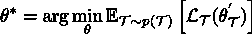  

其中 `𝜃` 表示跨任务共享的元参数，`𝜃𝒯′` 是使用 `𝜃` 在任务 `𝒯` 上执行更新（内圈适应）产生的，而 `ℒ𝒯` 代表特定任务的损失。

元学习与传统范式的区别在于，它较少关注关注特定任务的优化，而是关注跨任务的优化，旨在创建一种在任务特定适应上计算负载更低的自适应系统。这种元范式在需要快速重新校准的现实应用中具有显著优势，例如，无人机仅需微量的学习输入即可适应新地形，或者自然语言处理系统能够轻松适应不同的方言或语音模式。

虽然元学习提供了巨大的益处，但在扩展到具有更高维度和不确定性的更复杂任务时仍面临挑战。此外，有效的任务表示和分布可能导致维持高效训练范式的困难，这需要通过高级机制或与强化学习、无监督学习框架相结合的混合元学习结构来解决。

元学习的基础原理为机器学习系统引入了巨大的潜力，使其能够在多样化的任务格局中快速获取并泛化大量知识。通过理解和实现元学习架构，研究人员和从业者可以发现超越传统学习机制的强大应用，在众多领域建立复杂的、自适应的模型。

### 4.2

### 元学习算法：MAML 及其他

在元学习领域，已经开发了各种算法来实现跨多个任务高效学习并进行泛化的这一总体目标。其中，模型无关元学习（`MAML`）已成为一种开创性方法，其在不同模型架构中的适用性以及在少样本学习任务中的有效性而受到认可。本节将深入探讨 `MAML` 的细节，并探索增强或偏离由 `MAML` 奠定的基础的演进算法。

`MAML` 的特点是其模型无关性，这意味着它可以用于任何使用梯度下降训练的模型。其核心是 `MAML` 优化模型参数，使得模型在提供新任务的有限数据时能够实现快速适应。`MAML` 的核心见解是从共同初始化开始快速微调模型，从而促进跨任务的快速高效学习。

从数学上讲，`MAML` 通过结合内圈和外圈优化策略来优化元目标函数。内圈针对特定任务适应模型参数，而外圈则利用来自适应过程的反馈来寻求改进模型参数的初始化。

`MAML` 的元目标可以形式化为：

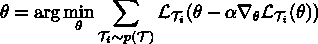  

其中 `𝜃` 代表模型的参数，`α` 是内圈内的学习率，而 `ℒ𝒯i` 表示从任务 `𝒯i` 产生的损失。

为了阐明 `MAML` 的算法本质，考虑其在 `PyTorch` 中的实际实现。以下示例展示了使用 `MAML` 进行回归任务的模型训练，使其能够以最少的额外观测快速适应新任务。

```python
import torch
import torch.nn as nn
import torch.optim as optim
import numpy as np

# 任务：简单的回归函数
def task_generator(num_tasks=10, num_samples=10, noise_std=0.1):
    tasks = []
    for _ in range(num_tasks):
        # 多项式的随机系数
        coeffs = np.random.uniform(-1.0, 1.0, size=3)
        X = np.random.uniform(-5.0, 5.0, size=(num_samples, 1))
        y = coeffs[0] * X**2 + coeffs[1] * X + coeffs[2] + np.random.normal(0, noise_std, size=(num_samples, 1))
        tasks.append((torch.tensor(X, dtype=torch.float32), torch.tensor(y, dtype=torch.float32)))
    return tasks

class SimpleModel(nn.Module):
    def __init__(self):
        super(SimpleModel, self).__init__()
        self.layer1 = nn.Linear(1, 40)
        self.layer2 = nn.Linear(40, 40)
        self.layer3 = nn.Linear(40, 1)
    def forward(self, x):
        x = torch.relu(self.layer1(x))
        x = torch.relu(self.layer2(x))
        return self.layer3(x)

def maml_training(model, task_distribution, meta_lr=0.001, inner_lr=0.01, num_steps=5, num_meta_iterations=1000):
    meta_optimizer = optim.Adam(model.parameters(), lr=meta_lr)
    loss_fn = nn.MSELoss()
    for iteration in range(num_meta_iterations):
        meta_optimizer.zero_grad()
        meta_loss = 0
        tasks = task_distribution()
        for X_train, y_train in tasks:
            # 克隆模型用于特定任务适应
            task_model = SimpleModel()
            task_model.load_state_dict(model.state_dict())
            task_optimizer = optim.SGD(task_model.parameters(), lr=inner_lr)
            # 内圈：特定任务学习
            for _ in range(num_steps):
                loss = loss_fn(task_model(X_train), y_train)
                loss.backward(retain_graph=True)
                task_optimizer.step()
            # 采样新数据进行评估
            with torch.no_grad():
                X_eval, y_eval = task_generator(num_samples=10)[0]
                eval_loss = loss_fn(task_model(X_eval), y_eval)
                meta_loss += eval_loss
        # 外圈：元目标更新
        meta_loss.backward()
        meta_optimizer.step()

model = SimpleModel()
task_distribution = lambda: task_generator(num_tasks=10)
maml_training(model, task_distribution)
```


原型网络（Prototypical Networks）在概念上的不同在于将元学习置于度量学习的背景下。它们将输入投影到一个空间，在该空间中接近性表示类别相似性，主要适用于分类任务。这些网络构建了作为嵌入空间中中心的类原型，通过以下计算辅助高效的泛化：

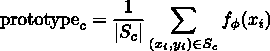  

其中 `Sc` 代表来自类别 `c` 的样本，`fϕ` 是嵌入函数。

随着元学习领域的发展，研究人员正在广泛探索这些基础技术的适配方案，以扩大其适用范围、优化计算资源并增强在复杂任务环境中的性能。元学习与强化学习、神经架构搜索等其他范式的交叉正在推动创新的变革，为全球复杂的自适应系统开发新的理论基础和实践范式。

通过深入的审查和部署，研究人员继续利用 `MAML` 及其后者的效能，突破边界以创建自适应框架，这些框架在机器人技术、个性化医疗和自动推理等众多领域的动态、数据受限的环境中表现卓越。

### 4.3

## 任务分布与元数据集（Meta-Datasets）

任务分布和元数据集的概念是理解和实现有效元学习模型的核心。这些因素决定了元学习器学习跨越不同任务进行泛化的基础。对任务分布的深入理解能够创建出健壮的系统，使其能够先验经验适应新任务，而元数据集通过提供任务及相关数据的结构化表示，在促进这一过程中起着至关重要的作用。

### 任务分布

在元学习中，任务被定义为学习的单元，包含一组相似的结构或目标，机器学习模型可以从中形成学习曲线。与传统的机器学习范式（在为单一目标设计的不同数据集上运行）不同，元学习利用任务分布（记为 `p(𝒯 )`）来在许多此类任务上训练模型。这种多样化的训练增强了模型的泛化能力，使其能够通过更少的数据点和更新适应新任务。

任务分布充当采样域，决定了模型在训练过程中接触哪些任务。其核心目标是模拟现实应用，在现实应用中，模型会遇到各种任务。选择代表性的任务分布直接与现实世界的适应性和效率对齐。在确定适当的任务分布时，考虑因素包括：

- **任务的多样性与复杂性**：任务难度和结构上的异质性，用于模拟真实场景。
- **任务相关性**：任务之间的关系可以引导训练，偏向共享结构和可迁移技能。
- **任务相似性与多样性之间的平衡**：理解并优化这种平衡，确保模型不会对特定任务过拟合，同时不会忽略任务空间更广泛的泛化。

构建代表性的任务分布通常涉及通过算法生成的任务或从现实现象衍生的任务。例如，在少样本分类问题中，任务可能构成从较大集中抽取不同的样本，确保一个任务中的类别与其他任务相比具有不同的特征。

### 元数据集

元数据集封装了任务分布，是有效应用元学习的关键。它们组织了带有必要数据的多个任务，构成了模型学习快速适应的基础。全面的元数据集模拟了广泛的环境，为设计多功能学习器提供了有用的元数据（metadata）。示例包括：

- **Omniglot**：通常被誉为“少样本学习的 ImageNet”，Omniglot 包含 1,623 个手写字符，来自 50 种不同的字母，每个字母有 20 个示例。该数据集通常用于单样本（one-shot）和少样本（few-shot）学习任务。
- **Mini-Imagenet**：ImageNet 的压缩版本，封装了 100 个类别，每个类别 600 个样本。它是专门为少样本学习构建，比比了现实世界的限制和变化。
- **Meta-Dataset**：多种数据源的聚合，包括 ImageNet、Omniglot 以及其他各种专门数据集，扩展了形成近乎通用任务分布的能力。

```python
import os
import numpy as np
import torch
from torchvision import transforms
from torchvision.datasets import Omniglot
from torch.utils.data import DataLoader, Dataset
import random

# Omniglot transformation data
data_transforms = transforms.Compose([
    transforms.RandomRotation(15),
    transforms.ToTensor()
])

# Load Omniglot with defined transformations
omniglot_dataset = Omniglot(
    root='./data',
    download=True,
    transform=data_transforms
)

class FewShotTaskSampler(Dataset): 
    def __init__(self, dataset, num_classes, num_samples):
        self.dataset = dataset
        self.num_classes = num_classes
        self.num_samples = num_samples
    self.class_map = self._index_classes()

    def _index_classes(self):
        data_index = {}
        for index in range(len(self.dataset)):
            label = self.dataset[index][1]
            if label not in data_index:
                data_index[label] = []
            data_index[label].append(index)
        return data_index

    def __getitem__(self, index):
        chosen_classes = np.random.choice(list(self.class_map.keys()), self.num_classes, replace=False)
        samples = []
        for cls in chosen_classes:
            samples += random.sample(self.class_map[cls], self.num_samples)
        random.shuffle(samples)
        return [self.dataset[sample] for sample in samples]

    def __len__(self):
        return len(self.dataset)

### Generate task loader
task_sampler = FewShotTaskSampler(omniglot_dataset, num_classes=5, num_samples=10)
task_loader = DataLoader(task_sampler, batch_size=1, shuffle=True)

# Retrieve a sampled task for demonstration
for batch in task_loader:
    images, labels = zip(*batch[0])
    break
```


任务分布与元数据集（meta-datasets）之间的共生关系定义了元学习器在保持对未见上下文熟练能力的同时，积累广泛能力轨迹。未来的方向可能包括利用无监督学习技术来补充标记数据，从而减少对预定义类别的依赖，并实现更灵活、动态的学习场景。

理解任务分布并利用稳健的元数据集是元学习的核心，确保了在人工环境中训练的模型在过渡到部署环境时仍能保持有效性和能力。赋予机器此类元能力将推动认知计算任务的进展，缓解此前受限于数据稀缺和适应性需求所带来的挑战。

## 4.4

## 元学习的神经网络架构

元学习，也称为“学习学习”，通过关注跨不同任务的快速适应能力，扩展了传统的机器学习策略。这种适应能力的一个重要组成部分在于学习过程中所采用的神经网络架构的选择。这些架构经过精心设计，以支持元学习场景理想的学习动态和增强的泛化属性。本节将深入探讨各种为元学习定制的神经网络架构，从通过适配重用的前馈神经网络，到像循环网络和注意力机制等复杂且新颖的配置。

### 基础架构

为了理解元学习的特定适配，理解基础神经网络架构（如多层感知器 `MLPs` 和卷积神经网络 `CNNs`）的基础作用至关重要。这些网络作为基础模型，可以通过参数初始化机制（如在 `MAML` 中所示）或通过学习特定的任务表示来被适配，以利用元学习。

### 元学习中的前馈网络

前馈网络是最简单的人工神经网络类型，可以通过几层高效地处理固定大小的输入数据。在元学习背景下，这些网络可以与基于梯度的元学习方法（如模型无关元学习 `MAML`）结合，以实现对新任务的快速适应。这种方法通常涉及学习一种最优的参数初始化，可以使用特定任务的数据进行快速微调。

例如，考虑一个简单的 `MLP` 用于涉及图像数据中偏移模式识别的元学习任务的伪代码：

```python
import torch
import torch.nn as nn
from torch.optim import Adam
import numpy as np
class MetaMLP(nn.Module):
    def __init__(self, input_size, hidden_size, output_size):
        super(MetaMLP, self).__init__()
        self.layer1 = nn.Linear(input_size, hidden_size)
        self.layer2 = nn.Linear(hidden_size, output_size)
    def forward(self, x):
        x = torch.relu(self.layer1(x))
        return self.layer2(x)
### Model instantiation
meta_mlp = MetaMLP(input_size=28*28, hidden_size=128, output_size=10)
optimizer = Adam(meta_mlp.parameters(), lr=0.001)
# Assume train_tasks refers to tasks sampled from meta-training dataset
# Implement MAML with inner and outer loops, updating meta-parameters
```

### 循环神经网络 (RNNs)

循环神经网络 (`RNNs`) 设计用于处理序列数据。在元学习中，它们维持内部状态的能力使其能够适应具有时间依赖关系的任务。常见的变体如长短期记忆网络 (`LSTM`) 和门控循环单元 (`GRUs`) 经常被用于缓解元训练过程中的梯度消失问题。

### 元 LSTM 

以下代码展示了为需要序列数据处理的元学习任务设计的 `MetaLSTM` 结构：

```python
import torch
import torch.nn as nn
class MetaLSTM(nn.Module):
    def __init__(self, input_size, hidden_size, output_size):
        super(MetaLSTM, self).__init__()
        self.lstm = nn.LSTM(input_size, hidden_size, batch_first=True)
        self.linear = nn.Linear(hidden_size, output_size)
    def forward(self, x):
        out, (hn, cn) = self.lstm(x)
        return self.linear(out[:, -1, :])
```

### 卷积神经网络 (CNNs)

卷积神经网络 (`CNNs`) 对于空间特征提取非常有效。在元学习中，`CNNs` 通常用作特征提取器，以极少示例泛化到新类别。例如，原型网络（Prototypical Networks）利用 `CNNs` 将图像映射到嵌入空间，并通过距离度量进行分类。

### 注意力机制

注意力机制允许元学习器关注输入数据的特定部分。这对于涉及长序列或复杂图像的任务特别有用，因为在这些任务中，并非所有特征对于适应过程都同等重要。


优化对于元学习的效能至关重要，它引导跨任务的学习过程，以实现快速适应能力和强大的泛化能力。许多元学习算法的核心是使用被称为内循环和外循环的双重学习机制。这些循环构成了元学习优化的骨干，通过协同作用微调模型，以便在多样化的任务中进行高效适应。

## 内循环：特定任务的适应

元学习中的内循环侧重于任务特定的适应，使模型能够快速调整其参数以在特定任务中表现出色。这一过程涉及对任务相关的小型数据集进行迭代，更新模型参数以最小化任务特定的误差。通常，内循环中会执行少量的梯度下降步骤。

在内循环优化期间，目标是通过使用任务特定的损失函数 `ℒ𝒯i` 更新共享参数 `θ`，从而获得任务特定的参数 `θi`：

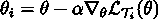  

其中 `α` 代表内循环的学习率，决定了优化过程中使用的步长大小。

## 外循环：元目标优化

相比之下，外循环关注优化元目标，根据多个任务的性能来精炼共享的初始化参数 `θ`。外循环聚合从内循环任务获得的梯度信息来更新 `θ`，确保它为后续任务的快速适应提供有益的起点。

元目标通常被设计为任务特定损失的平均值，形式化为：

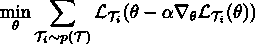  

外循环通常采用 `Adam` 或 `SGD` 等基于梯度的优化器执行这些更新。

## 算法框架：MAML

利用内循环和外循环优化的著名实例是模型无关元学习（Model-Agnostic Meta-Learning, MAML）算法。MAML 显式利用这些循环来确定允许高效学习的参数初始化。它将元学习问题构建化双层优化，其中内循环适应特定任务，而外循环承担元学习。

```python
import torch
import torch.nn as nn
import torch.optim as optim
import numpy as np

# 用于演示的简单神经网络
class SimpleMLP(nn.Module):
    def __init__(self, input_size, output_size):
        super(SimpleMLP, self).__init__()
        self.fc1 = nn.Linear(input_size, 64)
        self.fc2 = nn.Linear(64, output_size)

    def forward(self, x):
        x = torch.relu(self.fc1(x))
        return self.fc2(x)

def maml_train(meta_model, task_dist, inner_lr=0.01, outer_lr=0.001, inner_steps=1, outer_steps=500):
    outer_optimizer = optim.Adam(meta_model.parameters(), lr=outer_lr)
    for _ in range(outer_steps):
        meta_loss = 0
        outer_optimizer.zero_grad()
        for task_data in task_dist:
            # 复制元模型进行任务特定的更新
            task_model = SimpleMLP(input_size=task_data['input_size'], output_size=task_data['output_size'])
            task_model.load_state_dict(meta_model.state_dict())
            # 内循环优化
            inner_optimizer = optim.SGD(task_model.parameters(), lr=inner_lr)
            X_train, y_train = task_data['train']
            for _ in range(inner_steps):
                inner_optimizer.zero_grad()
                predictions = task_model(X_train)
                loss = nn.MSELoss()(predictions, y_train)
                loss.backward()
                inner_optimizer.step()
            # 在任务测试数据上评估模型
            X_test, y_test = task_data['test']
            with torch.no_grad():
                test_predictions = task_model(X_test)
                task_loss = nn.MSELoss()(test_predictions, y_test)
                meta_loss += task_loss
        # 外循环优化
        meta_loss.backward()
        outer_optimizer.step()

meta_model = SimpleMLP(input_size=10, output_size=1)
task_distribution = [...] # 定义一组包含训练/测试样本的任务
maml_train(meta_model, task_distribution)
```

在这段代码中，一个简单的神经网络模型经历了多个任务，并利用了内循环。

## 元学习中的挑战与考虑

**二阶梯度计算**：MAML 的外循环需要二阶梯度计算，这在计算上可能昂贵且会引入数值不稳定性。

**跨领域任务的泛化**：有效捕捉跨任务的共享结构，同时避免对特定任务的过拟合是一项挑战。精心设计的任务分布和选择良好的架构可以缓解这些问题。

**可扩展性**：随着任务复杂性的增加，在合理的限制范围内确保快速收敛变得至关重要。

**超参数敏感性**：调优学习率和内循环步等超参数会显著影响性能。

## 超 MAML：改进的元学习

目前已提出若干进展以改进 MAML，增强其计算效率和泛化能力：

- **FOMAML（一阶 MAML）**：通过用一阶导数近似外循环来简化优化，在不产生实质性能损失的情况下减少计算需求。
- **Reptile**：通过采用任务特定权重的加权平均来驱动外循环更新，从而消除了显式的二阶优化，提供了计算上的简单性。


- **Meta-SGD**：为学习率引入可学习参数，允许进行动态调整，在无需手动调优学习率的情况下增加适应性。

## 高级优化与未来方向

为了改进元学习中鲁棒且适应性良好的算法，已在以下领域提出了探索：

- **Transformer 模型**：利用自注意力机制封装不同的任务间关系，通过注意力加权更新优化学习。
- **内存增强网络**：集成可微内存系统以显式记录任务特定的调整，提供无需重复元优化的适应。
- **神经架构搜索 (NAS)**：通过自动探索和调优，为特定的元学习场景识别最优架构。

传统优化策略与创新方法的精妙融合显示了元学习研究的不断演进，寻求突破限制并实现所未有的元泛化。优化策略的多样化和改进对于实现低监督的智能系统至关重要。

##与其他学习范式的比较

元学习作为一个致力于从少量数据中快速学习的领域，与多种既有学习范式有交集也有区别。每个范式都有各自的方法论、优势和应用。理解元学习如何与其他学习方法进行对比，有助于洞察其独特优势、潜在应用和未来方向。本文讨论考虑了传统的监督学习、无监督学习、强化学习和迁移学习，并考察了元学习相对于这些范式的位置。


监督学习是机器学习中的一种传统方法，它涉及使用标记数据集学习从输入到输出的映射。模型通过迭代训练，以在提供的标记示例上使损失函数最小化。然而，传统的监督学习主要侧重于使用大量数据集学习单一任务。

### 与元学习的比较
传统的监督学习需要大型数据集来实现高准确率，但由于数据收集和标注的限制，这往往是一个局限性。

相比之下，元学习在每个任务数据稀缺但有多个任务可供学习的情况下表现出色。元学习模型被专门设计用于利用先验任务的共享知识，通过极少数示例快速适应新任务。

## 无监督学习
无监督学习与监督学习的根本区别在于它使用未标记的数据。其目标是识别数据内部隐藏的模式或结构。聚类和降维是无监督学习的典型应用。

### 与元学习的比较
元学习可以整合无监督数据，特别是当学习涉及理解未式标记的分布或动力学时。

无监督学习通常通过预处理数据（特征提取或归约）来补充元学习，这有助于元学习策略特有的快速适应能力。

### 强化学习 (RL)
强化学习要求智能体通过与环境交互并根据其行为获得奖励或惩罚，以最大化累积奖励。

### 与元学习的比较
虽然强化学习严重依赖探索，并且通常需要与环境大量交互以达到最优，但元学习可以通过初始化面向快速学习的有用先验知识，从而显著缩短适应期。

元强化学习（Meta-RL）将强化学习与元学习概念相结合，使智能体学会如何高效学习。例如，它可以允许强化学习场景中的智能体利用以前遇到过的环境或任务的知识，通过少量交互快速适应新的未见环境。

### 迁移学习
迁移学习侧重于将知识从源任务/领域迁移，以改进目标任务/领域的学习，通常通过使用预训练模型来实现。

### 与元学习的比较
元学习和迁移学习旨在利用以往经验来改进未来的学习任务。然而，元学习通常更具动态性，能够在不显式要求相同任务或领域的情况下实现快速的任务适应。

元学习通常是任务无关的，能够在跨不同任务中进行快速学习；而迁移学习高度依赖于任务相关性或领域等效性来执行有效的知识迁移。

## 示例：带有迁移任务的元学习场景
为了说明，假设我们有涉及不同动物物种图像识别的任务，且数据集具有高度变异。元学习模型可能因为其在类任务之间高效泛化的能力而被青睐：

```python
import torch
import torch.nn as nn
import torch.optim as optim

class TransferLearningModel(nn.Module):
    def __init__(self, feature_extractor, num_classes):
        super(TransferLearningModel, self).__init__()
        self.features = feature_extractor
        self.classifier = nn.Linear(self.features.out_features, num_classes)

    def forward(self, x):
        x = self.features(x)
        return self.classifier(x)

# Assume feature_extractor 是一个如 ResNet18 特类的预训练模型
feature_extractor = ... # Pre-trained model, e.g., nn.Sequential(*list(resnet18.children())[:-1])
model = TransferLearningModel(feature_extractor, num_classes=10)
optimizer = optim.Adam(model.parameters(), lr=0.001)
```

## 元学习的独特优势
- **快速适应**：通过少量示例快速适应的能力使得元学习特别适用于数据可用性有限的应用，尤其是在医学等领域，这些标注数据集通常昂贵且规模较小。
- **任务多变性**：与其他许多范式不同，元学习由于其设计针对任务分布和适应性，本质上支持跨不同类型的任务和领域的灵活性。
- **泛化能力**：专注于跨任务泛化，使系统能够提取适用于狭义任务范围之外的知识。

## 元学习面临的挑战
- **数据集复杂性**：设计能够充分代表现实世界复杂性的适当任务分布是一项非易的任务。
- **计算成本**：元学习，特别是类似于 `MAML` 的方面，由于内循环和外循环操作的重复性，需要处理潜在的高计算负载。
- **模型可解释性**：在实现高准确率和适应性的同时，理解元学习器内部的决策过程仍然具有挑战性，影响了透明度。

## 未来方向
元学习处于无监督学习和强化学习等先进学习技术的交汇点。未来的研究可能会解决其与新兴技术的整合，例如用于提高效率的神经形态计算、用于架构发现的自动机器学习，以及与混合学习场景更深层次的协同。随着元学习的不断进化，它有望开启人工智能的新领域，推动机器向具有类似于人类认知的自适应智能迈进，这种智能能够在变化的数据、任务和环境限制下无缝运行。

通过将元学习与其他范式进行比较，强调了它在现代机器学习从业者不断扩展的工具箱中既是专业又具有广泛适应能力的工具的地位，在其他范式可能失效的地方提供细致的解决方案。

## 4.7

## 实际应用与案例研究
元学习凭借其多功能能力和快速适应潜力，被应用于许多传统学习范式面临局限性的领域。本节重点介绍了元学习的一些实际应用，并提供了详细的案例研究，展示了其在解决现实问题方面的有效性。这些应用强调了元学习在医疗保健、机器人、金融和个性化用户体验等多个行业的战略优势。

### 医疗保健：个性化医疗与诊断
元学习最有前景的应用之一是个性化医疗和医学诊断。元学习使模型能够快速适应个体患者数据，即使在样本量较小的情况下也能提供定制的治疗和诊断建议。

### 案例研究：医学影像中的少样本学习：
医学影像通常处理罕见病，获取大量训练数据具有挑战性。元学习被用于通过少样本学习技术训练模型，以快速识别和分类罕见病模式。


```python
import torch
import torch.nn as nn
import torch.optim as optim

class MedicalImageModel(nn.Module):
    def __init__(self):
        super(MedicalImageModel, self).__init__()
        self.conv_layers = nn.Sequential(
            nn.Conv2d(1, 32, kernel_size=3, stride=1, padding=1),
            nn.ReLU(),
            nn.MaxPool2d(kernel_size=2, stride=2),
            nn.Conv2d(32, 64, kernel_size=3, stride=1, padding=1),
            nn.ReLU(),
            nn.MaxPool2d(kernel_size=2, stride=2)
        )
        self.fc_layers = nn.Sequential(
            nn.Linear(64 * 7 * 7, 128),
            nn.ReLU(),
            nn.Linear(128, 10)  # Assuming 10 disease classes
        )

    def forward(self, x):
        x = self.conv_layers(x)
        x = x.view(x.size(0), -1)
        return self.fc_layers(x)

# Assume that medical_train_tasks is a preprocessed meta-training dataset with patient imaging tasks
# Meta-learning loop for training this model over few-shot medical imaging tasks
meta_sol = MedicalImageModel()
optimizer = optim.Adam(meta_sol.parameters(), lr=0.001)
```

# 机器人技术：自适应控制与导航

元学习显著提升了机器人控制系统的效率，使机器人能够通过极重新训练适应新环境。这种快速适应的能力对于在动态和不确定环境中运行的自主机器人至关重要。

## 案例研究：机器人中的元强化学习

在机器人导航中，元学习方法允许机器人学习导航策略，能够快速适应环境或任务的变化，例如地形的改变或障碍物的出现。

# 金融：预测与风险管理

在金融领域，元学习技术提供了能够适应不断变化的市场条件的自适应框架。它允许交易员和风险管理系统对不断演变的金融格局做出迅速响应，及时识别并利用新机会。

## 案例研究：使用元学习进行投资组合管理

应用于各种金融工具的时间序列数据的元学习框架可以协调动态资产配置策略，允许在市场波动期间进行更具响应性的投资组合调整。

# 个性化用户体验：推荐系统

元学习促进了推荐系统中的个性化，在用户交互后通过极少的数据动态调整偏好。这些系统通过每次交互不断完善对用户偏好的理解，从而优化内容交付、营销策略或产品建议。

### 案例研究：流媒体服务

对于提供流服务的平台，元学习能够稀疏的用户交互数据（例如新用户或历史观看数据有限的新内容）实现内容的个性化。

```python
import torch
import torch.nn as nn
import torch.optim as optim

class MetaRecommender(nn.Module):
    def __init__(self, num_users, num_items, embedding_dim=32):
        super(MetaRecommender, self).__init__()
        self.user_embedding = nn.Embedding(num_users, embedding_dim)
        self.item_embedding = nn.Embedding(num_items, embedding_dim)
        self.fc_layers = nn.Sequential(
            nn.Linear(2 * embedding_dim, 128),
            nn.ReLU(),
            nn.Linear(128, 1)  # Output preference score
        )

    def forward(self, user_ids, item_ids):
        user_embeds = self.user_embedding(user_ids)
        item_embeds = self.item_embedding(item_ids)
        x = torch.cat([user_embeds, item_embeds], dim=1)
        return self.fc_layers(x)

# Meta-learning loop for adaptively recommending
meta_rec = MetaRecommender(num_users=10000, num_items=5000)
optimizer = optim.Adam(meta_rec.parameters(), lr=0.001)
```

# 未来潜力与扩展应用

元学习应用的领域非常广阔且不断扩张，这源于其自适应能力和快速学习。展望未来，元学习将变革几个领域：

- **智能助手**：提供为用户习惯定制的上下文学习和适应。
- **表格和半结构化数据**：提高处理包含复杂关系的数据（如 CRM 数据）的效率。
- **自然语言处理 (NLP)**：NLP 模型中的多语言适应性，支持多种语言和语境切换。

## 对实现的反思

在现实系统中实施元学习需要解决可扩展性、计算开销和鲁棒性等挑战。对元学习算法进行仔细调优对于实现预期的性能至关重要。元学习的实际应用通过其在其他学习策略可能失效的领域的变革潜力而产生共鸣。这种范式允许对人类学习过程进行紧密模拟。

# 第 5 章：少样本学习的数据增强与合成

本章探讨了数据增强和合成在增强少样本学习模型性能中的关键作用，通过人为扩大训练数据集的多样性。它涵盖了旋转和翻转等传统技术，以及利用生成对抗网络（`GANs`）创建合成数据的先进方法。重点强调了在增强过程中保持上下文逻辑和语义的完整性。本章还研究了如 `AutoAugment` 等自动化策略，讨论了数据质量与数量之间的平衡，并概述了在少样本学习背景下评估增强数据集有效性的标准。

## 5.1 数据增强在少样本学习中的作用

少样本学习是机器学习的一个分支，旨在使模型能够从极少数训练示例中学习新类别的信息。由于数据稀缺，这项任务本质上具有挑战性，增加了过拟合的风险并降低了模型对未见数据泛化的可靠性。数据增强是一项关键技术，通过人为扩大可用训练数据的多样性来应对这些挑战，从而增强模型的鲁棒性和泛化能力。

在传统的机器学习设置中，数据增强通常涉及基础技术，如裁剪、翻转、缩放或对输入数据应用射变换。这些方法通过创建现有数据集的转换副本，在不实际收集新数据的情况下增加了训练数据的量和变异。然而，在少样本学习的背景下，数据增强的目标超越了这种基础水平的操作。它侧重于提高合成训练示例的多样性和代表性，以在稀疏数据条件下增强模型学习。


为了理解数据增强在小样本学习中的重要性，让我们考虑以下数学背景和原理。假设数据集 `𝒟` 包含某个任务的 `K` 个支持样本，每个样本被归类为 `N` 个不同类别之一。由于每个类别的样本有限，模型 `𝜃` 参数化为学习从输入空间 `𝒳` 到输出空间 `𝒴` 的函数 `f𝜃(x)` 可能由于对输入空间 `𝒳` 的探索不足而无法泛化。数据增强通过变换函数 `T : 𝒳 → 𝒳` 扩展 `𝒟`，表面上将其丰富为一个新集合 `𝒟′`。

增强的基础数学模型可以表示为：

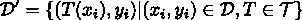

其中 `𝒯` 是定义增强过程的变换操作集。

有效的增强变换的理想特性包括：

- **一致性保持**：标签 `yi` 在变换后应保持有效；即 `T(xi)` 应该仍然真实地属于类别 `yi`。
- **语义意义化**：变换不应降低 `xi` 的语义内容。这确保了增强数据相对于原始数据分布保持真实性。
- **多样性增强**：变换应该产生 `xi` 的多样化版本，使模型接触到更广泛的特征变化。

小样本学习中的数据增强主要寻求利用这些特性，在不人为增加样本集大小的情况下，最大化特征表示的宽度。这种方法对于神经网络模型（特别是深度架构）至关重要，它们拥有巨大的参数空间，并且大量的多样化输入来实现稳定收敛。

```python
import numpy as np
from PIL import Image
import matplotlib.pyplot as plt

### 加载示例图像
image_path = ’example_image.jpg’
image = Image.open(image_path)

# 定义增强函数
def rotate_image(image, angle):
    return image.rotate(angle)

def flip_image(image, flip_horizontal=True):
    if flip_horizontal:
        return image.transpose(Image.FLIP_LEFT_RIGHT)
    else:
        return image.transpose(Image.FLIP_TOP_BOTTOM)

### 应用增强
rotated_image = rotate_image(image, 45)
flipped_image = flip_image(image)

### 显示结果
fig, axs = plt.subplots(1, 3, figsize=(15, 5))
axs[0].imshow(image)
axs[0].set_title('Original Image’)
axs[1].imshow(rotated_image)
axs[1].set_title('Rotated Image’)
axs[2].imshow(flipped_image)
axs[2].set_title('Flipped Image’)
plt.show()
```

此示例演示了涉及图像旋转和翻转的简单增强技术。尽管比较基础，但这些变换为以更复杂的方式增强数据集奠定了基础，这对于小样本学习场景至关重要。

数据增强的作用超出了简单的变换，它涵盖了进一步提高小样本学习效率的先进技术。如基于嵌入的增强、复合增强和学习变换等技术正受到关注。基于嵌入的增强涉及直接利用特征空间，构建从在大规模数据上预训练的模型中获益的有意义变换。这些模型在针对小样本任务进行微调之前提取嵌入，这种策略在基于度量的学习方法中得到了体现。

为了从高级角度说明数据增强的策略性应用，让我们分析伪标签与增强的潜在结合。伪标签利用模型预测来迭代地完善训练集，将预测的标签分配给未标记数据，然后对该伪标签集应用增强。这种协同策略通过从未标记数据中推断知识，缓解了标记实例的稀缺，类似于半监督学习技术。

```python
from sklearn.cluster import KMeans
import tensorflow as tf

### 生成合成数据集
data = np.random.rand(100, 2)
kmeans = KMeans(n_clusters=3)
kmeans.fit(data)
unlabeled_data = data[kmeans.predict(data) == -1]  # 假设的未标记数据

# 定义简单的神经网络模型
model = tf.keras.Sequential([
    tf.keras.layers.Dense(128, activation='relu', input_shape=(2,)),
    tf.keras.layers.Dense(3, activation='softmax')
])

### 编译模型
model.compile(optimizer='adam', loss='categorical_crossentropy', metrics=['accuracy'])

# 预测伪标签并增强数据
pseudo_labels = np.argmax(model.predict(unlabeled_data), axis=1)
augmented_dataset = [(rotate_image(unlabeled_data[i], np.random.randint(15)), pseudo_labels[i]) 
                    for i in range(len(unlabeled_data))]

# 使用增强数据更新模型
model.fit(np.array([x[0] for x in augmented_dataset]), tf.keras.utils.to_categorical([x[1] for x in augmented_dataset]), epochs=5)
```

这段代码段强调了伪标签结合简单增强技术来增加数据集的有效样本大小，展示了如何高效整合未标记数据。

数据增强在小样本学习中起着多方面的作用，填补了数据稀缺带来的关键空白。随着模型和算法的演进，增强过程的保真度和效率变得越来越复杂。虽然传统方法仍具有价值，但该领域正转向自适应和智能增强策略，以适应固有的变性和结构。


# 数据增强技术

缩放（Scaling）：缩放涉及改变图像的大小，这使得模型能够识别图像中不受尺寸变化影响的物体。该技术可以通过相乘维度属性来创建放大或缩小的图像。因此，它为模型提供了尺度不变不变性。

**翻转（Flipping）**：翻转可以是水平、垂直或两者兼之，模拟图像的镜像反射。水平翻转通常用于数据增强，因为许多物体类别对此类变换具有不变性。

**色彩抖动（Color Jittering）**：色彩变换包括调整亮度、对比度和饱和度。对像素强度进行轻微的随机调整有助于模型适应不同的光照条件，这对于具有多种光照场景的任务至关重要。

扩展这一讨论，通过自动化流水线应用这些变换增加了便利性和效率。基于 Python 的库 `torchvision` 是 `PyTorch` 生态系统的一部分，它提供了丰富的工具，能够实现这些变换的无缝对接。

```python
import torchvision.transforms as transforms
from PIL import Image
import matplotlib.pyplot as plt

# 示例图像加载
image_path = 'example_image.jpg'
image = Image.open(image_path)

# 定义一组基础增强变换
transform = transforms.Compose([
    transforms.RandomHorizontalFlip(p=0.5),
    transforms.RandomRotation(degrees=45),
    transforms.ColorJitter(brightness=0.2, contrast=0.2, saturation=0.2, hue=0.1),
    transforms.RandomResizedCrop(size=(128, 128), scale=(0.8, 1.0)),
])

# 应用变换
augmented_image = transform(image)

# 显示变换对比
fig, axs = plt.subplots(1, 2, figsize=(10, 5))
axs[0].imshow(image)
axs[0].set_title('Original Image')
axs[1].imshow(augmented_image)
axs[1].set_title('Augmented Image')
plt.show()
```

上面的示例展示了如何使用 `torchvision` 这些传统的增强方法来创建一个流水线，从而增强模型训练的图像变性和鲁棒性。每个变换在某种程度上都是随机的，防止模型简单地记忆不变特征。

虽然传统的增强技术对提高模型性能有显著贡献，但如果使用不当，也会带来引入伪影的代价。变换参数（如极端旋转或缩放）的配置不当会导致失真，使得增强后的数据对真实分布的代表性降低。这种误用的可能性要求我们根据特定问题的需求进行细致的校准。

此外，这些传统技术的有效性不仅限于图像数据。它们也可以被创造性地应用于序列或文本数据。在时间序列分析中，类似于几何变换的技术可能包括抖动（jittering）、裁剪或时间扭曲（time warping）。对于文本数据，增强过程可能涉及同义词替换、句子重排序或改写生成，从而在不同的数据模态中实现与图像变换类似的目标。

这些传统方法存在固有的局限性，主要在于其特征上的简单性以及无法捕捉复杂的非线性变换，这在涉及新的、更复杂的数据时构成了挑战。这包括包含大量噪声的数据，或者当捕获细微线索至关重要时（这种情况常见于高级计算机视觉或自然语言处理任务中）。

这些限制催生了更先进的增强技术的出现，例如对抗训练和基于 GAN 的增强，这些技术可以学习底层数据分布并产生高保真的合成示例。尽管如此，传统技术在数据增强工具箱中仍然不可或缺，以最小的实现复杂性和计算成本提供了基础性的改进。

数据增强的演变说明了利用基础和高级方法来解决对丰富数据集的关键需求的持续趋势，增强了模型在机器学习各种挑战中的可靠性。随着该领域的不断进步，理解这些基础技术以及它们成功集成到更广泛的机器学习流水线中，可以确保稳健的模型性能，并为高阶增强技术铺平道路。

## 5.3

## 高级增强方法：GANs 和合成数据

高级增强方法标志着超越传统技术的重大演进，主要通过使用生成模型（如生成对抗网络 GANs）来产生合成数据。这些方法允许对数据集进行更深层的合成增强，生成与训练分布在统计上相似的新颖、真实数据点。这种方法解决了传统增强中固有的若干局限性，特别是在数据稀缺限制的小样本学习（few-shot learning）场景。

生成对抗网络由 Ian Goodfellow 及其合作者于 2014 年引入，由两个神经网络组成：生成器（generator）和判别器（discriminator）。这些网络参与一个博弈论中的极小极大游戏，其中生成器旨在创建真实的数据实例以欺骗判别器，而判别器试图准确区分真实数据和合成数据。通过迭代对抗训练，生成器改进了其产生与真实数据无法区分的数据的能力。

这种对抗设置的数学公式表示为：

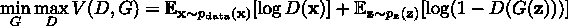

其中 `G` 表示生成器，`D` 表示判别器，`x` 是真实数据，`z` 是输入生成器的随机输入噪声，通常称为潜在空间（latent space）。

双网络架构促进了高维数据的灵活生成，这对于图像合成、文本生成等领域至关重要。这种能力在增强小样本学习数据集时特别有益，GAN 可以用真实的、多样化的合成实例来补充有限的数据。这些合成数据集能够提高模型在未见场景下的鲁棒性和泛化能力。

在基于图像的应用中，GAN 的典型实现将遵循以下简洁步骤：

1. **初始化两个网络**：通过权重或迁移学习机制初始化生成器和判别器。
2. **对抗训练**：在数据集上迭代训练生成器和判别器。生成器产生候选数据，在评估后，判别器提供反馈。
3. **损失优化**：使用损失函数通过梯度更新网络。生成器试图使其样本被判别器分类为假的概率最小，而判别器则努力最大化这一概率。


```python
import torch
import torch.nn as nn
import torch.optim as optim
from torchvision import datasets, transforms
from torch.utils.data import DataLoader

# GAN Generator Network
class Generator(nn.Module):
    def __init__(self, z_dim):
        super(Generator, self).__init__()
        self.model = nn.Sequential(
            nn.Linear(z_dim, 256),
            nn.ReLU(),
            nn.Linear(256, 512),
            nn.ReLU(),
            nn.Linear(512, 784),
            nn.Tanh()
        )
    def forward(self, z):
        return self.model(z)

### GAN Discriminator Network
class Discriminator(nn.Module):
    def __init__(self):
        super(Discriminator, self).__init__()
        self.model = nn.Sequential(
            nn.Linear(784, 512),
            nn.LeakyReLU(0.2),
            nn.Linear(512, 256),
            nn.LeakyReLU(0.2),
            nn.Linear(256, 1),
            nn.Sigmoid()
        )
    def forward(self, x):
        return self.model(x)

# Training the GAN
z_dim = 100
lr = 0.0002
num_epochs = 200

### Create instances of the models
generator = Generator(z_dim)
discriminator = Discriminator()

### Optimizers
optimizer_g = optim.Adam(generator.parameters(), lr=lr)
optimizer_d = optim.Adam(discriminator.parameters(), lr=lr)

### Loss function
criterion = nn.BCELoss()

### Training loop
for epoch in range(num_epochs):
    for real_imgs, _ in DataLoader(datasets.MNIST('.', train=True, transform=transforms.ToTensor(), download=True), batch_size=64):
        real_imgs = real_imgs.view(real_imgs.size(0), -1)
        
        # Train Discriminator
        z = torch.randn(real_imgs.size(0), z_dim)
        fake_imgs = generator(z)
        real_labels = torch.ones(real_imgs.size(0), 1)
        fake_labels = torch.zeros(real_imgs.size(0), 1)
        loss_d_real = criterion(discriminator(real_imgs), real_labels)
        loss_d_fake = criterion(discriminator(fake_imgs.detach()), fake_labels)
        loss_d = (loss_d_real + loss_d_fake) / 2
        discriminator.zero_grad()
        loss_d.backward()
        optimizer_d.step()
        
        # Train Generator
        loss_g = criterion(discriminator(fake_imgs), real_labels)
        generator.zero_grad()
        loss_g.backward()
        optimizer_g.step()
```

这段代码段展示了在 PyTorch 中实现 GAN 的基础设置，捕捉了对抗训练中生成器针对判别器迭代改进的细微之处。使用得当，GAN 可以生成高质量的合成图像，为训练数据集提供多样化的样本。

除了图像合成， GAN 还促进了跨领域的高级数据增强技术。例如，在基于文本的任务中，`TextGAN` 等 GAN 架构利用循环层来创建连贯的文本数据序列。同样，对于音频，GAN 也可以生成真实的样本。


```python
from transformers import BertTokenizer, BertForMaskedLM
import torch
# 加载预训练 BERT 模型和分词器
tokenizer = BertTokenizer.from_pretrained('bert-base-uncased')
model = BertForMaskedLM.from_pretrained('bert-base-uncased')
# 原句
sentence = "The quick brown fox jumps over the lazy dog."
sentence_tokens = tokenizer.tokenize(sentence)
masked_index = sentence_tokens.index("lazy")
# 创建掩码输入
masked_sentence_tokens = sentence_tokens[:masked_index] + ['[MASK]'] + sentence_tokens[masked_index + 1:]
input_ids = tokenizer.encode(masked_sentence_tokens, return_tensors='pt')
# 使用 torch 预测掩码词
with torch.no_grad():
    predictions = model(input_ids)[0]
    predicted_index = torch.argmax(predictions[0, masked_index]).item()
    predicted_token = tokenizer.convert_ids_to_tokens([predicted_index])[0]
# 显示增强后的句子
augmented_sentence = " ".join(sentence_tokens[:masked_index] + [predicted_token] + sentence_tokens[masked_index + 1:])
print("Augmented Sentence:", augmented_sentence)
```

上面的示例说明了像 `BERT` 这样的掩码语言模型如何通过以上下文相关的方式预测句子中的掩码词，来实现上下文文本增强。使用这种具有上下文感知能力进行数据增强，比随机替换更能保持语义完整性。

除了特定领域之外，增强中上下文与语义的交叉对于推进多模态学习环境的发展具有更广泛的影响——在这些环境中，来自文本、图像和音频的数据共存，影响针对多样化、上下文感知应用训练的模型，例如自动驾驶，系统必须同时理解来自多种输入形式的语义线索。

语义增强将适用性扩展到了高度敏感的领域，例如医疗保健，在这些领域，患者数据中的细微细节至关重要。合成医学数据需要语义理解，以模拟反映患者异性的意义分布，同时维护机密性。

尽管潜力巨大，上下文和语义增强的实施仍面临显著的复杂性：

- **语义漂移 (Semantic Drift)**：在转换过程中保持准确语义的挑战。如果对上下文评估不当，漂移指的是含义的非意图变化。
- **计算需求 (Computational Demand)**：利用深度上下文模型或风格迁移的方法可能消耗大量资源，需要足够的计算基础设施。
- **评估指标 (Evaluation Metrics)**：评估增强数据的有效性需要考虑上下文一致性和语义完整性的指标，这些指标通常取决于于特定任务的标准。

然而，实施此类增强方法的分析结果可能远超过其成本，提供更丰富的数据输入，从而提高学习深度以及源自语义复杂数据集的预测准确性。

上下文和语义增强的演进预示着 AI 增强技术领域不断演变的图景，强调了对数据内在复杂性的重视。未来，这些方法可能会成为更广泛的机器学习工具包中不可或缺的组成部分，使模型能够在多样且上下文细微的环境中更好地模拟人类的学习模式。

## 5.5

## 自动数据增强策略

自动数据增强策略代表了数据增强领域的一项重大进展，解决了以往有效增强数据集时所需的人工工作和领域专家知识。这些策略利用机器学习和优化技术，在无需人工干预的情况下，自动发现最佳增强策略，以提升模型性能。这种方法有望在泛化能力、模型效率以及对新任务的适应性方面显著提升，特别是在涉及有限数据的场景中，如少样本或零样本学习。

自动数据增强策略的前沿是如 `AutoAugment`、基于种的增强 (PBA) 和 `RandAugment` 等框架。这些方法因能够在探索广泛变换组合的搜索空间，根据模型训练的反馈优化配置增强参数和操作而受到关注。

`AutoAugment` 由 Google Research 提出，使用强化学习算法寻找能够最大化验证准确率的增强策略。搜索涉及一个 `controller RNN`，它生成包含增强操作组合的增强策略。这些策略在单独的数据集上进行评估，以衡量它们对模型性能的影响，并作为奖励来微调控制器：

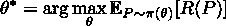

其中 `θ` 指控制器的参数，`P` 代表增强策略，`R(P)` 表示奖励——通常是模型的验证准确率。

另一种高级策略 `基于种的增强 (PBA)` 灵感源于进化算法。它维护了超参数调度种群——每种调度代表一个不同的增强转换序列，并根据模型性能决定的适应度得分，跨代对这些调度进行演化。这种动态适应过程有助于发现适应于不同任务的稳健增强策略。

相比之下，`RandAugment` 通过减少操作集的固定幅度参数简化了搜索过程。通过最小化搜索空间，`RandAugment` 促进了简单的应用和快速性能提升，而没有显著的计算开销。这种方法被证明是在不复杂的设置下实验自动增强的基准。

下面的代码段演示了如何在 `PyTorch` 中使用 `torchvision` 库将 `AutoAugment` 策略应用于数据集：

```python
import torchvision.transforms as transforms
from torchvision.datasets import CIFAR10
from torchvision.transforms import AutoAugment, AutoAugmentPolicy
from torch.utils.data import DataLoader
### 加载 CIFAR-10 数据集
dataset = CIFAR10(root='./data', train=True, download=True)
# 定义 AutoAugment 变换
transform = transforms.Compose([
    AutoAugment(policy=AutoAugmentPolicy.CIFAR10),
    transforms.ToTensor()
])
# 将变换应用于数据集
dataset.transform = transform
# 创建 DataLoader
dataloader = DataLoader(dataset, batch_size=64, shuffle=True)
# 示例：迭代增强后的图像数据
for images, labels in dataloader:
    # 执行训练或分析
    pass
```

此实现利用 `AutoAugment` 策略处理 `CIFAR10`，它根据预学习的增强策略自动增强数据集。此类方法对于涉及大量数据集且手动配置可能低效的场景非常理想。

自动增强的潜在收益是巨大的：

- **减少人工工作**：自动化消除了手动试错过程的需求，减少了设计有效增强所需的时间和专家知识。
- **跨领域一致性**：自动策略适用于各种数据形式（图像、文本或表格），确保在不同应用中获得一致的性能提升。
- **增强泛化能力**：通过系统地探索不同的变换，自动方法通常能提高模型对过拟合的稳健性，并在现实应用中创建更具韧性的模型。


尽管如此，自动化增强并非没有挑战。搜索和评估大量策略的计算需求是巨大的，需要大量的资源，而这些资源在资源受限的环境可能是无法获得的。此外，自动化过程背后的抽象性有时会阻碍可解释性，限制了对变换对学习特征表示影响的理解。

尽管存在这些挑战，自动化增强策略的影响仍在扩大，将更复杂的机器学习模型整合到搜索过程中。神经架构搜索 (NAS) 等技术与自动化增强协同工作，寻求模型架构和数据变换的端到端优化。

此外，这些策略的有效性扩展到了多模态和集成学习中，最优的增强策略可以同时增强多样化的模型架构，符合人工智能的前沿范式。

自动化数据增强的未来趋势可能会探索更深层的混合模型——将手工专家知识与机器学习的洞察相结合——以优化特定领域的模型。这些策略的演进也预示着易于获取的低成本计算平台的普及，使尖端增强技术在广泛的学术和工业领域实现民主化。

这种自动化格局使数据增强不再仅仅是一个预处理步骤，而是训练方案中不可或缺组成部分，强调了其在端到端模型开发过程中的作用。通过将自动化与灵活性和通用性相结合，这些策略强调了利用增强数据集潜力以推动机器学习前沿发展的变革性方法。

## 5.6

## 平衡数据质量与数量

在机器学习和数据科学中，数据质量与数据数量之间的相互作用对于实现可靠且准确的模型性能至关重要。平衡这两个关键维度涉及权衡和战略性考虑，这些考虑会影响模型在未见数据上的泛化能力。虽然数据增强方法主要旨在增加数据集的大小，但确保增强数据维持高质量标准同样必要，以防止引入可能降低模型性能的噪声或偏差。

数据质量可以通过几个属性来定义，包括准确性、完整性、一致性和相关性。在高质量数据上训练的模型可以学习有意义的模式，从而获得更好的泛化。相反，数据数量提供了涵盖数据分布内变异所需的统计力和多样性，为模型决策提供了更广泛的知识。

探索影响这种平衡的因素揭示了引入胜的见解：

- **准确性 vs 数量**：高质量数据应该准确地代表现实场景，无论是通过监督学习中的精确标签，还是无监督任务中清晰、无错误的输入。大型数据集能够实现强大的训练，但如果缺乏质量控制，也会放大不准确性。
- **多样性与代表性**：更大的数据量支持多样性，捕捉更全面的特征集和细微变化。然而，增强数据集仍然必须避免过度表示特定特征或偏曲模型解释的偏差。
- **噪声管理**：增强增加了数据集的大小，但随着增强示例的出现，存在引入噪声的可能性。构建抗噪声模型涉及过滤掉增强数据可能引入的无关或误导模式。

考虑一个典型的图像分类任务：随机裁剪和翻转等增强扩展了数据的变性，但如果这些变换扭曲了关键的视觉语义（例如过度关注图像的无关部分），它们带来的危害可能大于益处。

可以使用定量指标信噪比 (`SNR`) 来评估增强过程中引入的噪声的程度，其计算公式为：

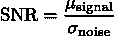

其中 `μsignal` 和 `σnoise` 分别表示输入数据的平均强度和噪声的标准差。在增强数据时，保持高 `SNR` 表明相对于信息内容，噪声干扰最小。

在扩展容量的同时增强数据质量，通常包括自适应数据选择等机制，根据变换相对于模型性能的用性和信息量动态选择变换。同时，异常值检测和删除程序在质量保证中起着重要作用，防止异常情况污染学习过程。

下面是一个在数据增强期间实现噪声滤波 Python 示例，使用了 `scikit-learn` 库进行噪声检测：

```python
from sklearn.ensemble import IsolationForest
import numpy as np 
# 模拟一个包含原始示例和添加噪声示例的数据集
original_data = np.random.normal(loc=0.0, scale=1.0, size=(100, 20)) 
noise_data = np.random.normal(loc=0.0, scale=2.0, size=(20, 20)) 
combined_data = np.vstack((original_data, noise_data)) 
# 使用 IsolationForest 检测离群值
isolation_forest = IsolationForest(contamination=0.1) 
labels = isolation_forest.fit_predict(combined_data) 
# 过滤掉检测到的噪声（离群值） 
filtered_data = combined_data[labels == 1]  # 保留非异常样本 
# 增强过滤后的数据 
augmented_data = np.array([np.roll(row, shift=np.random.randint(1, 5)) for row in filtered_data]) 
print("Original data size:", original_data.shape) 
print("Filtered data size:", filtered_data.shape) 
print("Augmented data size:", augmented_data.shape)
```

在此代码中，`IsolationForest` 算法通过评估异常来识别数据集中的噪声，允许更干净的数据增强策略。利用此类程序确保了增强数据集保持完整性和有意义的表示。

除了纯技术解决方案外，平衡数据质量和数量还需要对应用背景和底层数据分布进行深思考虑。在医疗、金融和自动系统等领域，低质量数据会导致关键的误判或意外后果。因此，对质量进行战略评估——通过将领域专家知识与相关的、高保真的增强相结合——支撑了这种平衡。

质量与数量之间的内在张力在数据稀缺场景下变得更加明显，在这些情况下，每个数据点的用途被最大化。新兴研究所倡的以数据为中心的范式强调将优化数据质量作为机器学习流水线的一部分，使模型能够从较少但可靠的样本中得出更深层的见解。

这种整体方法涵盖了探索性数据分析 (`EDA`) 技术、特征工程以及对输入数据的仔细策划——优先考虑与模型目标一致的高价值变换。实施针对不同数据混合模型性能进行持续监控的协议，勾勒了通敏捷、渐进平衡的路径。

此外，利用通过精细的生成模型（包括 `GANs` 和变分自编码器）生成的合成数据，能够在不损害核心数据完整性的情况下引入合成多样性。这些模型受益于其反映实际数据集概率结构的能力，从而用高质量的合成示例补充有机数据。


随着以数据为中心的方法计算能力和数据可用性的扩展，范式正向统一数据范围和内容的全面策略转变。数据质量与数量之间的对话仍然是一个动态且不断演化的追求——这是所有领域和应用中机器学习工作持续进展的核心。

## 5.7 评估增强数据的有效性

评估增强数据的有效性对于理解其对模型性能和学习结果的影响至关重要。随着增强技术的日益复杂，对系统化且稳健的评估机制的需求日益迫切。这一过程既包括检查数据语义保留的定性评估，也包括衡量模型准确性和泛化能力提升的定量分析。

增强数据的有效性可以分为几个评估领域：

- **模型性能指标**：主要的衡量标准之一是评估模型在使用和不使用增强数据训练时的`accuracy`（准确率）、`precision`（精确率）、`recall`（召回率）和 `F1 score` 等标准。指标的提升通常表明增强是成功的。
- **交叉验证**：利用交叉验证（特别是在少样本学习等数据有限的情况下），可以洞察增强在不同数据划分上的稳定效果。该方法评估了引入额外合成数据时的过拟合风险。
- **泛化与鲁棒性**：评估模型在未见数据上的表现，有助于揭示增强在提高模型鲁棒性方面的作用。在增强数据集上训练的模型理想情况下应该在未经过专门微调的领域或任务中保持性能。
- **合成数据质量**：分析合成数据相对于原始数据集特征的保真度至关重要。`Frechet Inception Distance (FID)` 或 `Inception Score (IS)` 等指标可以评估生成数据的质量和多样性。
- **类别不平衡缓解**：有效的增强可以缓解类别不平衡，这是一个常见的现实世界挑战。跨类别分布平衡实例的效率证明了增强框架的成功。
- **嵌入评估**：在 NLP 任务中，可以使用`cosine similarity`（余弦相似度）或`BERT-based sentence embeddings` 等专门技术评估增强文本嵌入与原始数据之间的语义相似性。

这些评估机制需要仔细实施，并考虑每个案例相关的计算资源和特定领域的细微差别。

评估数据增强有效性的实际检查使用了 Python 中的标准库：

```python
from sklearn.model_selection import cross_val_score
from sklearn.ensemble import RandomForestClassifier
from sklearn.datasets import make_classification
from sklearn.preprocessing import FunctionTransformer
import numpy as np

### 生成合成数据集
X, y = make_classification(n_samples=1000, n_features=20, n_informative=15)

# 简单的增强函数
def augment_data(X):
    X_augmented = X + np.random.normal(0, 0.1, X.shape)  # 添加微小噪声
    return np.vstack((X, X_augmented))

### 定义模型
model = RandomForestClassifier()

# 评估原始数据与增强数据
scores_original = cross_val_score(model, X, y, cv=5)
print("Original Cross-Validation Score:", scores_original.mean())

# 增强数据并重新评估
X_augmented = augment_data(X)
scores_augmented = cross_val_score(model, X_augmented, np.tile(y, 2), cv=5)
print("Augmented Cross-Validation Score:", scores_augmented.mean())
```

在这个示例中，使用交叉验证对 `RandomForest` 分类器进行评估，以直接比较原始数据集和增强数据集之间的模型性能，突显了预测准确性的潜在提升。

此外，可视化有助于评估增强效能。对于图像数据，在低维空间中对 `t-SNE` 或 `PCA` 图进行视觉检查有助于揭示原始数据集与增强数据集之间的分布和重叠，确保合成数据与内在数据结构一致。

在 NLP 和序列数据中，使用张量图或降维图进行嵌入可视化有助于定性评估，比较增强前语义距离。

除了现场评估外，增强数据在迁移学习或模型蒸馏场景中的有效性提供了更广泛的测试场。丰富模型知识的增强数据在下游应用中表现为一种辅助学习材料，强化了预训练期间赋予的核心能力。

虽然增强可以显著受益于数据驱动的任务，但过度转换存在通过过拟合降低数据质量的风险，或引入偏离自然数据动态的异常。因此，包含人类参与（human-in-the-loop）方法或合成数据筛选的迭代反馈循环，在微调增强策略起着至关重要的作用。

此外，在医疗保健等高度敏感的领域，数据完整性具有关键性影响，构建了严格的评估协议，以确保由增强数据训练的模型做出的任何决策都有充分的验证证明和合规性。

新兴趋势表明，利用 `AutoML` 等机器学习框架来自动化评估过程，将增强评估嵌入更大的流水线中，从端到端优化数据转换和质量评估。

评估增强数据的有效性是机器学习系统所有部署阶段中不可或缺的。随着增强技术的不断演进，自适应、上下文相关且全面的评估指标将驱动更强大的决策，确保开发工作在实际应用中获得最大的回报。

## 第 6 章 少样本学习中的模型与架构

本章全面概述了少样本学习中使用的各种模型和架构，每种架构在从稀缺数据中有效学习方面都发挥着至关重要的作用。它探索了`卷积神经网络 (CNNs)` 用于特征提取的实用性、基于距离的模型（如 `Siamese` 和 `Prototypical Networks`）的功能，以及内存增强方法（如 `Matching Networks` 和 `Relation Networks`）。讨论扩展到注意力机制和 transformer 架构的结合，突显了它们对提高适应性和性能的贡献。章节最后介绍了关于混合和集成方法的见解，这些方法通过协同多种架构来增强少样本学习结果。

## 6.1 少样本学习中的模型架构概述

少样本学习 (FSL) 是机器学习中一个不断演变的领域，主要用于解决从稀缺数据中学习有效模型这一挑战性问题。传统的机器学习方法通常需要大量的标注数据来训练有效模型。然而，在个性化医疗、机器人或稀有物种识别等许多实际场景中，数据是有限的，这使得需要开发少样本学习方法。少样本学习成功的关键在于优化最少数据学习而定制的各种模型架构。本节提供了这些架构的广泛概述，强调了它们的独特特征和功能。


在小样本学习领域，出现了多种模型范式，每种范式都对学习效率和模型适应性做出了独特贡献。这些范式包括但不限于用于特征提取的卷积神经网络（`CNNs`）、利用孪生网络（`Siamese Networks`）和原型网络（`Prototypical Networks`）等模型架构的基于距离的方法、如 `Matching Networks` 和 `Relation Networks` 等内存增强模型、注意力机制、Transformer 架构以及混合集成方法。每种架构都旨在利用特定优势，以在训练实例有限的情况下提高模型性能。

该过程始于特征提取的底层原理，主要采用卷积神经网络（`CNNs`）。由于其具有分层特征提取的能力，`CNNs` 在许多计算机视觉挑战中取得了巨大的成功。在小样本学习中，`CNNs` 充当稳健的特征提取器，将原始输入数据转换为其他专用网络可以利用的结构化形式。卷积层负责识别局部模式，随后通过池化和神经网络层进行全连接，以提炼高层且不变的特征。

实际实现可能涉及一个卷积骨干网络，随后是一个或多个全连接层。卷积骨干网络在输入图像上迭代地卷积滤波器，以检测边缘、纹理、形状和物体。例如，考虑一个用于小样本学习模型的简单 `CNN` 的实现：

```python
import torch
import torch.nn as nn
class SimpleCNN(nn.Module):
    def __init__(self):
        super(SimpleCNN, self).__init__()
        self.conv1 = nn.Conv2d(3, 16, kernel_size=3, stride=1, padding=1)
        self.conv2 = nn.Conv2d(16, 32, kernel_size=3, stride=1, padding=1)
        self.fc1 = nn.Linear(32 * 8 * 8, 64)
        self.fc2 = nn.Linear(64, 10)  # Assuming 10 output classes
    def forward(self, x):
        x = torch.relu(self.conv1(x))
        x = torch.max_pool2d(x, kernel_size=2, stride=2)
        x = torch.relu(self.conv2(x))
        x = torch.max_pool2d(x, kernel_size=2, stride=2)
        x = x.view(-1, 32 * 8 * 8)
        x = torch.relu(self.fc1(x))
        x = self.fc2(x)
        return x
```

这种 `CNN` 架构描述了一个简单而有效的深度特征提取模型。网络从卷积层开始处理输入，随后进入全连接层以解释提取的特征。

基于距离的方法进一步提炼提取的特征图，以便在小样本约束下执行分类任务。`Siamese Networks` 和 `Prototypical Networks` 是此类别中的典型模型。`Siamese Networks` 通过将输入数据点通过共享参数的孪生网络来测量数据点之间的相似性，最终基于距离或度量学习影响分类决策。其核心思想是：属于同一类的样本之间的特征应该比与其他类的样本更相似。

`Prototypical Networks` 扩展了这一概念，通过原型来表示每个类，原型被计算为该类支持特征向量的平均值。在推理期间，使用距离度量（最常见的是欧式距离）将新样本与这些原型进行比较。这种机制提供了一个灵活且可扩展的框架，通过少量的额外计算自然地接纳新类。

内存增强模型（如 `Matching Networks`）通过利用内存组件存储和回溯经验更进一步。`Matching Networks` 在支持集上采用注意力机制对示例进行分类。它们应用了这样的思想：模型必须通过关注内存来学习区分支持示例。这种注意力机制提高了适应性，有效地契合了人类认知中记忆的作用——在人类认知中，新经验是参考存储的记忆来理解和分类的。

注意力机制嵌入这些架构中，以精炼对相关特征的关注，进一步增强其判别能力。Transformer 架构擅长处理序列和空间数据，由于其具有同时关注所有位置的非顺序特性，最近被应用于小样本学习。它们赋予模型保留并利用全面上下文信息的能力，这种能力在复杂任务中价值连城。

# Matching Networks 类示例实现代码片段

```python
class MatchingNetwork(nn.Module):
    def __init__(self, encoder):
        super(MatchingNetwork, self).__init__()
        self.encoder = encoder
    def forward(self, support_set, query_set):
        # Encode the support set and query set
        encoded_support = self.encoder(support_set)  # Shape: (S, D)
        encoded_query = self.encoder(query_set)  # Shape: (Q, D)
        # Compute the pairwise cosine similarity
        dists = torch.mm(encoded_query, encoded_support.t())
        return dists
```


卷积层的主要任务是通过在输入数据上对一组可学习的过滤器进行卷积，以提取局部空间特征。卷积层中的每个神经元只处理其感受野内的数据，这使得网络能够关注局部模式。这些过滤器通过卷积操作创建特征图，特征图包含了输入的抽象表示。

对于一个基础的二维（2D）卷积操作，考虑考虑大小为 `W ×H` 的输入图像矩阵 `I` 和大小为 `f ×f` 的过滤器 `F`。卷积操作输出的特征图表示为：

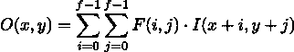  

其中 `(x,y)` 是输入图像中的坐标，`O` 是输出特征图。在训练过程中，过滤器会不断更新，以突出针对特定任务的最相关特征，例如边缘或纹理模式。

在实践中，像 `PyTorch` 深度学习框架中的卷积操作可以如下所示实现：

```python
import torch
import torch.nn as nn 
class ConvLayer(nn.Module): 
    def __init__(self, in_channels, out_channels, kernel_size, stride=1, padding=0): 
        super(ConvLayer, self).__init__() 
        self.conv = nn.Conv2d(in_channels, out_channels, kernel_size, stride, padding) 
    def forward(self, x): 
        out = self.conv(x) 
        return out
```

### 池化层

池化层（特别是最大池化和平均池化）位于卷积层之后，对特征图进行下采样以缩小其空间维度。这在减少网络计算负载的同时，突出了主特征。最大池化从特征图区域中选择最大值，从而保留重要特征并丢弃无关细节。平均池化取给定区域的平均值，通常用于细微激活值重要的应用。

从数学上讲，对于大小为 `p × p` 的窗口，最大池化表示为：

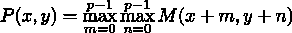  

其中 `M` 是输入池化操作的特征图。池化减小空间尺寸，保留显著特征并控制过拟合。

### 激活函数

激活函数为网络引入了非线性因子。常用的激活函数包括 `ReLU`（整流线性单元）、`Leaky ReLU`、`Sigmoid` 和 `Tanh`。`ReLU` 函数定义如下：

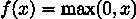  

该操作将所有负值置零，而正值保持不变，这有效地实现了训练期间的高效收敛。

### 全连接层

一旦提取了显著的空间特征，全连接层（全密层）就会解释这些特征以进行分类或预测。它们将某一层中的每个神经元连接到后续层中的每个神经元，将空间信息聚合为决策边界，以便网络区分不同的类别。

在样本学习的实际场景中，`CNNs` 扮演着至关重要的角色，因为它们作为骨干网络或特征提取器。学习到的特征图通常被输入更复杂的网络（如 `Siamese`、`Prototypical` 或 `Matching Networks`），用于数据受限的分类任务。在标记示例有限的情况下，CNNs 捕捉平移不变性和局部依赖性的归纳偏置至关重要。

考虑以下扩展实现，它强调了在为样本学习应用定制的典型 CNN 架构内部，卷积、池化和全连接层的级联作用：

```python
class CNNFeatureExtractor(nn.Module): 
    def __init__(self, num_classes=10): 
        super(CNNFeatureExtractor, self).__init__() 
        # 定义卷积层 
        self.layer1 = nn.Sequential( 
            nn.Conv2d(3, 64, kernel_size=3, stride=1, padding=1), 
            nn.BatchNorm2d(64), 
            nn.ReLU(), 
            nn.MaxPool2d(kernel_size=2, stride=2)) 
        self.layer2 = nn.Sequential( 
            nn.Conv2d(64, 128, kernel_size=3, stride=1, padding=1), 
            nn.BatchNorm2d(128), 
            nn.ReLU(), 
            nn.MaxPool2d(kernel_size=2, stride=2)) 
        # 定义全连接层 
        self.fc1 = nn.Linear(128 * 8 * 8, 1000) 
        self.relu = nn.ReLU() 
        self.fc2 = nn.Linear(1000, num_classes) 
    def forward(self, x): 
        # 逐层前向传播
        out = self.layer1(x) 
        out = self.layer2(out) 
        # 平展输出
        out = out.view(out.size(0), -1) 
        out = self.relu(self.fc1(out)) 
        out = self.fc2(out) 
        return out
```


`Siamese Network`（孪生网络）最初用于签名验证任务，依赖于成对比较来确定相似性。它由两个共享权重和特征提取模块的双子网络组成，处理两个输入样本并比较它们生成的嵌入（embeddings）以判断相似性。通过学习计算嵌入之间距离的函数，孪生网络根据应用于距离测量的阈值将输入对分类为相同类别或不同类别。

该架构基于一种假想：相似类别的嵌入将聚集在一起，而不同类别的嵌入将保持较远距离。孪生网络的学习过程通常采用对比损失（contrastive loss）或相关的度量学习目标，旨在最小化正对（同一类别的样本）之间的距离，同时最大化负对（不同类别的样本）之间的距离。

考虑一个简单的 PyTorch 的简单孪生网络：

```python
import torch
import torch.nn as nn
import torch.nn.functional as F
class SiameseNetwork(nn.Module):
    def __init__(self):
        super(SiameseNetwork, self).__init__()
        self.encoder = nn.Sequential(
            nn.Conv2d(1, 64, kernel_size=5, stride=1, padding=2),
            nn.ReLU(inplace=True),
            nn.MaxPool2d(kernel_size=2, stride=2),
            nn.Conv2d(64, 128, kernel_size=5, stride=1, padding=2),
            nn.ReLU(inplace=True),
            nn.MaxPool2d(kernel_size=2, stride=2)
        )
        self.fc1 = nn.Linear(128 * 7 * 7, 256)
        self.fc2 = nn.Linear(256, 128)
    def forward_once(self, x):
        # Forward pass for one of the twin networks
        x = self.encoder(x)
        x = x.view(x.size(0), -1)
        x = F.relu(self.fc1(x))
        x = self.fc2(x)
        return x
    def forward(self, input1, input2):
        # Generate embeddings for the input pairs
        output1 = self.forward_once(input1)
        output2 = self.forward_once(input2)
        return output1, output2
```

在实现正向传播时，`forward_once` 方法为每个输入生成嵌入。这些嵌入之间的距离（通常是欧式距离或余弦距离）随后被用于推理。

对比损失的计算如下：

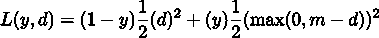

在这里，`y` 表示标签（0 表示相似，1 表示不同），`d` 是嵌入之间的欧式距离，`m` 是边界（margin）；这确保了不同类别样本对的动态分离。

孪生网络在少样本设置（few-shot settings）下的有效性源于其结构，该结构本质上适应了基于成对数据比较的识别任务，而不是依赖于大规模数据集的绝对表示。

### 原型网络 (Prototypical Networks)

原型网络通过以下方式处理少样本学习分类：假设数据集中的每个类别都可以由一个原型表示，该原型是嵌入空间中其支持集（support set）的平均值计算出来的。在分类阶段，查询点根据距离度量（如欧式距离）被分配给最近的类别原型。

给定具有类别标签集 `C` 的支持集 `S`，且 `S` 中的每个类别 `ci` 拥有 `k` 个示例，类别 `c` 的原型表示为：

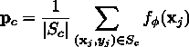

其中 `fϕ` 是特征提取映射。查询样本 `q` 属于类别 `c` 的概率通过对负距离进行 softmax 处理：

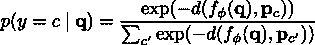

原型网络的架构可以简洁地表示为：

```python
class PrototypicalNetwork(nn.Module):
    def __init__(self, encoder):
        super(PrototypicalNetwork, self).__init__()
        self.encoder = encoder
    def forward(self, support_input, query_input):
        support_embeddings = self.encoder(support_input)
        query_embeddings = self.encoder(query_input)
        # Calculate prototypes
        prototypes = support_embeddings.view(support_embeddings.size(0), -1, support_embeddings.size(-1)).mean(dim=1)
        # Calculate distances and apply softmax
        dists = (query_embeddings.unsqueeze(1) - prototypes.unsqueeze(0)).pow(2).sum(dim=2)
        return F.log_softmax(-dists, dim=1)
```

原型网络提供了对新任务的直接泛化能力。它们的优雅之处在于将分类任务简化为嵌入空间内计算平均值的问题，这即使在支持数据极少的情况下也能有效降低对过拟合和模型复杂的敏感性。

虽然孪生网络和原型网络都利用嵌入空间中的度量来促进低数据学习，但它们的应用场景略有不同。孪生网络由于其直接的成对训练策略，在广泛的比较任务中具有内在的通用性。原型网络通过其原型推导展示了精简的推理，通常表现出更低的推理延迟。


匹配网络（Matching Networks）的一个关键特征是它们对支持集（support set）的依赖——这是一个类似于内存存储的标记示例集合。在推理过程中，未见的示例通过注意力机制与这些存储的引用进行比较，该机制根据相似性分配权重，有效地引导分类决策。

匹配网络受到序列序列模型（sequence-to-sequence models）的启发，利用全上下文嵌入来计算支持查询编码，显著增强了捕捉上下文相关性的能力。其端到端的训练架构依赖于情节训练（episodic training），通过由少样本情节组成的任务序列来优化模型。

接下来的代码段展示了一个嵌入了支持-查询关系机制的简化匹配网络结构：

```python
import torch 
import torch.nn as nn 
import torch.nn.functional as F 

class MatchingNetwork(nn.Module): 
    def __init__(self, encoder, attention='cosine'): 
            super(MatchingNetwork, self).__init__() 
            self.encoder = encoder 
            self.attention = attention 
    def forward(self, support_set, query_set): 
            support_embeddings = self.encoder(support_set) 
            query_embeddings = self.encoder(query_set) 
        # Assuming cosine similarity attention 
            support_embeddings = F.normalize(support_embeddings, p=2, dim=1) 
            query_embeddings = F.normalize(query_embeddings, p=2, dim=1) 
        # Compute cosine similarity 
            dists = torch.mm(query_embeddings, support_embeddings.t()) 
            return F.log_softmax(dists, dim=1)
```

在这种模型设置中，支持集与查询集之间的距离（或相似性）决定了分类结果，强调了新数据与内存存储示例之间的相关性对齐。

### 关系网络 (Relation Networks)

关系网络更进一步，将关系推理嵌入到模型中，有效地提问并回答在支持-查询集上下文中表示实例相关性的查询。该方法涉及基于嵌入空间内配对数据实体之间学习到的关系来计算关系分数。

通过对关系函数本身进行参数化，关系网络消除了对复杂距离量的需求，将分类问题分解为学习最佳拟合关系的问题。这允许整合关于样本对之间的关系如何转换为类别成员决策的监督信号。

实现一个典型的关系网络通过特定关系的层封装查询，这些层将相似性评分建模为可学习参数，如下：

```python
class RelationNetwork(nn.Module): 
    def __init__(self, feature_dim, hidden_dim): 
            super(RelationNetwork, self).__init__() 
            self.relation_module = nn.Sequential( 
                    nn.Linear(feature_dim * 2, hidden_dim), 
                    nn.ReLU(inplace=True), 
                    nn.Linear(hidden_dim, 1), 
                    nn.Sigmoid() 
            ) 
    def forward(self, support_set, query_set): 
            # Generate all combinations of support_set and query_set 
            combined_features = self.relation_module( 
                    torch.cat([support_set.unsqueeze(0).expand(query_set.size(0), -1, -1), 
                                      query_set.unsqueeze(1).expand(-1, support_set.size(0), -1)], 2) 
            ) 
            return combined_features.view(query_set.size(0), support_set.size(0))
```

关系网络有效地将距离计算转变为可学习的关系提取任务。因此，它们需要更少的预定义指标，直接将分类任务向可学习的提取目标进行优化。

匹配网络和关系网络都依赖于情节训练并利用了 N-way K-shot 学习范式。在这种设置中，每个情节随机选择 `N` 类来形成支持集，每类提供 `K` 个示例。模型通过最小化对当前情节中未见查询样本的预测误差来学习泛化。

### 比较与应用

虽然两种架构都结合了内存增强，但它们在处理学习任务方面有所不同。匹配网络侧重于使用显式相似性指标进行上下文驱动的比较，而关系网络将相似性归类为可学习函数。根据输入数据集和相关任务的复杂性，这些方法提供了不同程度的灵活性适应潜力。

当编码的相似性语义可以增强模型性能时，匹配网络更优，特别是在支持上下文信息可以放大少样本场景下判别能力的情况下。同时，当需要动态推断实例之间的关系，且任务特定的关系是分类准确性的核心时，关系网络表现出色。

这些内存增强模型具有重新定义需要快速适应领域性能标准的潜力——例如反垃圾邮件检测、个性化内容传递以及数据可用性固有有限的领域。随着它们熟练地检索和应用学习到的概念，它们的实用性显而易见，即使在显著的数据限制下也能实现特定任务的目标。

随着少样本学习在各种应用中继续开辟道路，匹配网络和关系网络展现出的适应性可能会催化进一步的进步。通过优化架构以原生内存并在极少暴露的情况下进行学习，这些网络为构建适用于现实世界复杂的智能解决方案提供了广阔前景。


评分函数有多种形式——常见的实现包括点积、缩放点积（在 transformers 中可见）、加法（双线性）注意力机制等。

### 自注意力与转型影响

自注意力（Self-attention）是注意力机制的一种变体，输入通过关注自身来捕捉内部依赖关系，进一步增强了长程交互的有效建模。它将输入转换为精炼的，反映了跨整个输入的结构组成。该范式在 `Transformer` 架构中至关重要，使其成为最先进自然语言处理和图像处理任务的领先创新者。

自注意力捕捉到：
- 全局上下文：识别超越局部范围的依赖关系。
- 多维度关系：通过层堆叠（多头注意力）。
- 计算一致性：确保了在更大规模架构中的可扩展性。

### 自注意力层代码片段

```python
import torch
import torch.nn as nn
import torch.nn.functional as F
class SelfAttention(nn.Module):
    def __init__(self, embed_size, heads):
        super(SelfAttention, self).__init__()
        self.embed_size = embed_size
        self.heads = heads
        self.head_dim = embed_size // heads
        assert (
            self.head_dim * heads == embed_size
        ), "Embed size needs to be divisible by heads"
        self.values = nn.Linear(self.head_dim, self.head_dim, bias=False)
        self.keys = nn.Linear(self.head_dim, self.head_dim, bias=False)
        self.queries = nn.Linear(self.head_dim, self.head_dim, bias=False)
        self.fc_out = nn.Linear(heads * self.head_dim, embed_size)
    def forward(self, values, keys, query):
        # Suppose N is the batch size, and sentences are of length T
        N, T, _ = query.shape
        values = values.reshape(N, T, self.heads, self.head_dim)
        keys = keys.reshape(N, T, self.heads, self.head_dim)
        queries = query.reshape(N, T, self.heads, self.head_dim)
        scores = torch.einsum("nqhd,nkhd->nhqk", [queries, keys])
        scores = scores / (self.embed_size ** (1 / 2))
        attention = torch.softmax(scores, dim=3)
        out = torch.einsum("nhql,nlhd->nqhd", [attention, values]).reshape(
            N, T, self.heads * self.head_dim
        )
        return self.fc_out(out)
```

在这里，注意力输出将输入序列中的每个单词与其他所有单词对齐，根据其学习到的重要平衡贡献。

## 少样本学习中的注意力

少样本学习中的注意力机制解决了两个主要挑战：从有限数据中提取最大用用以及对关键特征提供自适应关注。通过选择性地关注输入样本中的相关关系并忽略噪声，模型可以从少数示例中更稳健地泛化。

在少样本分类设置中，注意力允许 `Matching Networks` 和 `Prototypical Networks` 等模型动态加权支持样本，强调与查询相关的引导性。因此，增强注意力的少样本模型可以有效地锁定关键特征，并将其融合为更具别性的分类能力。

例如，将注意力集成到 `Prototypical Networks` 中涉及计算加权原型：

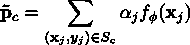  

其中 `αj` 是由相似性驱动的注意力权重，通过审查每个支持样本对类原型的贡献相关性来确保精炼。

### 多头注意力与少样本的进展

将多头注意力引入少样本设置中，有助于捕捉样本内更丰富的关系，而不会不利地增加模型复杂性。通过分配注意力机制的不同部分来检查输入数据的不同位置或语义细节，多头方向多样化了注意力范围，产生了复合的学习合成。

### 注意力原型网络

```python
class AttentivePrototypeNetwork(nn.Module):
    def __init__(self, encoder, hidden_dim):
        super(AttentivePrototypeNetwork, self).__init__()
        self.encoder = encoder
        self.hidden_dim = hidden_dim
        # ... (implementation details)
```

### 洞察与未来方向

注意力机制在少样本学习中的应用揭示了处理极简数据集时实现更高保真度和适应性的路径。随着注意力架构的优化，它们揭示了关系的层级结构，进一步增强了跨应用程序的性能。未来的进展不仅将注意力的潜力用于分类，还将用于数据增强和无监督学习等辅助方面。因此，通过全面的信息流增强架构，注意力机制标志着不仅是架构的改进，更是算法思维的理念转变，赋予了系统类似于人类推理认知能力的感知学习能力。

## 6.6

## 基于 Transformers 的少样本学习

Transformers 在深度学习中获得了极大的普及，特别是在自然语言处理（NLP）领域的革命性应用。然而，它们的用处已超出 NLP，扩展到许多许多领域，包括少样本学习。Transformer 架构以其自注意力机制和处理序列数据的能力而闻名，通过增强特征提取并在数据极少的情况下仍提供可扩展的学习，与少样本学习的要求高度契合。

### Transformers：简要概述

Transformers 由编码器-解码器架构组成，尽管许多变体（特别是在 NLP 中）聚焦于仅编码器或仅解码器模型（分别如 `BERT` 或 `GPT`）。在编码器内部，层由自注意力机制组成，随后是逐位置的前馈网络，并结合残差连接和层归一化，以促进深度模型的稳定训练。

自注意力机制根据从输入嵌入生成的查询 (`Q`)、键 (`K`) 和值 (`V`) 矩阵计算注意力分值。具体而言，注意力输出通过以下公式计算：

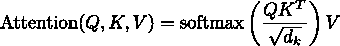


其中 `dk` 代表键向量的维度，`softmax` 确保注意力分数之和为一，从而在潜在的注意力源上形成概率分布。

`transformers` 中的嵌入过程利用位置编码来引入序列顺序，确保位置信息得以保留——这是基于序列的任务的关键设计。

# 在少样本学习中应用 Transformers

Transformers 在少样本学习场景中的潜力源于它们能够在输入特征之间创建注意力驱动的交互，这使得模型能够有效地从有限的数据中理解上下文丰富的关系。通过自注意力机制建立不同示例之间的联系，可以利用先先学到的关联性来为新任务的决策提供信息。

将变换 应用于少样本任务时的一项重大修改是将情节性任务（episodic task）设置与注意力分布对齐，确保支持集和查询集样本同时被关注，从而增强模型的决策上下文。

```python
import torch
import torch.nn as nn
class TransformerFewShotModel(nn.Module):
    def __init__(self, embed_size, num_heads, num_layers):
        super(TransformerFewShotModel, self).__init__()
        self.encoder_layer = nn.TransformerEncoderLayer(d_model=embed_size, nhead=num_heads)
        self.transformer_encoder = nn.TransformerEncoder(self.encoder_layer, num_layers=num_layers)
        self.cls_layer = nn.Linear(embed_size, 1)
    def forward(self, support_input, query_input):
        # Concatenate support and query sets
        combined_input = torch.cat((support_input, query_input), dim=0)
        # Forward pass through the transformer encoder
        transformer_output = self.transformer_encoder(combined_input)
        # Apply classification layer to the query part of the encoder output
        query_output = transformer_output[support_input.size(0):, :]
        return torch.sigmoid(self.cls_layer(query_output))
```

在这种架构中，transformer 模型接收来自支持实例和查询实例的拼接输入张量，培养了跨样本的交互建模。输出与作用在 transformer 输出的查询段上的分类层接接，在学习到的表示上进行预测投影。

### Transformers 在少样本设置下的优势

**并行性与可扩展性**：Transformer 的内在设计允许并行处理，关键地增强了计算效率——使得模型能够有效扩展，而不会遇到顺序数据处理范式中常见的瓶颈。

**双向上下文理解**：Transformers（特别是其发展变体如 `BERT`）以双向方式处理信息。这种跨越整个输入序列的全局注意力为决策任务提供了显著的上下文增强，在上下文线索对分类至关重要时，巩固了卓越的性能。

**跨领域的可扩展性**：Transformer 模型源于 `NLP`，可以轻松适应各种领域，证明了其在视觉（`Vision Transformers`）、语音和多模态数据中的效用——赋予了各个精彩领域少样本应用强大的能力。

在少样本学习中使用 transformers 的动力推动了许多 transformer 增强型模型的发展，例如 `TranferTune`——利用 transformers 进行元学习，以及针对少样本条件下生成式查询优化的基于 `GPT` 的方法。

### 挑战与考量

尽管具有这些优势，将 transformers 用于少样本学习仍面临着与资源消耗和初始化敏感性直接相关的挑战。即使在典型配置下，Transformers 本地也会吸收大量的模型参数，需要精细的资源分配和优化策略，特别是在资源受限的设置下。

平衡复杂性的策略包括降维（例如 `Linformer`）、引入稀疏性和动态剪枝——所有这些目标都是在不大幅牺牲模型性能的情况下，限制内存和计算需求。

围绕 transformers 的研究话语说明了持续的探索，例如稀疏门控混合专家模型（sparsely gated mixture-of-experts）机制结合对少样本范式的概念对齐，预示着架构创新在重塑少样本学习前沿方面具有广阔的延续性。

### 展望与未来方向

Transformers 与少样本学习的融合预示着学习领域不断演变的变革，未来有望进入少样本持续学习和实时应用。随着 transformers 根根于学习架构中，其复杂的注意力编排结合对小数据的适应性，放大了 AI 处理因数据限制和任务模糊性而变得复杂的挑战的能力。

将它们的优势归功于理论框架，Transformers 在仅仅解决紧迫问题之外，有望解决 AI 中认知模拟学习的长期问题——在这些问题中，学习速度、泛化能力和可扩展性汇聚并提升了智能计算的范式。

Transformer 架构的模块化、多功能特性提供了一个跨越的连续体，从少样本模型的诞生到完整的任务处理能力，将学习效率推向了前所未有的境界。无疑，transformer 模型在少样本应用中的亮相不仅是技术的进步，更是将复杂的学习机制与紧迫的现实世界需求节奏相结合并合成的革命性章碑。

## 6.7

## 混合与集成方法

机器学习及其子领域少样本学习的扩展，逐渐揭示了单一模型在面对多样化和多方面数据场景时的局限性。混合和集成方法作为极具吸引力的解决方案脱出来，巧妙地结合了多种算法策略以利用它们的互补优势。这种协同作用增强了学习模型的整体稳健性、适应性和泛化能力，对于数据是稀缺资源的少样本学习来说尤为重要。

广义上，集成方法涉及聚合多个模型的预测以生成合并输出，理想情况下这种输出会超过单个组成模型的性能。这一核心原理在 `bagging`、`boosting` 和 `stacking` 等流行技术中体现，每种技术都提供了提高预测准确性和减少方差的独特途径。

### 集成学习的概念基础

从根本上说，集成学习认为一组多样化的、可能较弱的模型可以通过多样化误差风险，优于单一的强大模型。这一概念利用了不同模型视角之间的方差减少，在平滑错误预测的同时强调了共识。在 `bagging`（自助聚合，Bootstrap Aggregating）中，策略是在不同的数据子集上训练同一模型的多个实例，并平均它们的预测值以减轻方差。随机森林（`Random forests`）作为 bagging 应用于决策树的扩展，是这种方法的缩范。

另一方面，`Boosting` 方法根据之前的分类错误迭代地调整训练数据点的权重，重点关注之前被分类错误的数据点。著名的例子包括 `AdaBoost` 和梯度提升（Gradient Boosting），每种方法都在前身缺点的基础上进行构建，从而精调了模型的关注点和优化。


堆叠（Stacking）或堆叠泛化（stacked generalization）通过元学习器（通常是线性模型）结合多个多样化模型的输出，引入了复杂性。这种垂直结构化学习层的概念培养了精细入微的集成泛化函数。

### 在少样本学习中的混合方法

少样本学习场景下的混合模型通过创造性地交织传统与现代的学习方法，以应对多样化的数据表示挑战。混合方法的核心包含两个显著目标：首先，是融合不同的模型架构以弥补彼此的短板；其次，是将多阶段学习过程精简为一个连贯的框架。

例如，一个混合少样本学习模型可能会将用于特征提取的卷积神经网络（`CNNs`）与变换器（transformers）或注意力机制相结合。这种模型能够通过 `CNN` 捕捉空间特征，并利用 transformer 捕捉长程依赖关系，从而提升泛化能力。

```python
import torch
import torch.nn as nn

class HybridFewShotModel(nn.Module):
    def __init__(self, cnn_encoder, transformer_layer, output_classes):
        super(HybridFewShotModel, self).__init__()
        self.cnn = cnn_encoder
        self.transformer = transformer_layer
        self.fc = nn.Linear(256, output_classes)

    def forward(self, x):
        x = self.cnn(x)
        x = x.view(x.size(0), -1)
        x = self.transformer(x)
        x = self.fc(x)
        return torch.softmax(x, dim=1)
```

在这种配置下，集成方法不仅提升了特征的表示能力，还通过对模型架构的协同作用，增强了少样本学习的鲁棒性。


在少样本学习的背景下，任务设计是基石。任务必须经过良好的定义，通常涉及一个任务集或回合（episode），其中包含一个支持集（具有有限数量的标记示例）和一个查询集（包含用于评估的测试示例）。这种回合性的性质灵感来自元学习范式，旨在使模型能够从极少数示例中泛化。因此，任务设计中重要的一步是显式定义用于抽取单个回合的任务分布，以确保任务的多样性与问题领域相关性之间取得平衡。

在设计任务时，研究人员必须决定每个回合的类别数量（通常称为“N-way”分类任务）以及支持集中每个类别的示例数量（称为“K-shot”）。常见的选择是五类单样本（one-shot）或五类五样本（five-shot）分类，这反映了新类别数据稀缺的现实情况。定义合适的“N”和“K”至关重要，且通常取决于特定领域的需求和可用数据。

```python
def configure_few_shot_task(classes, shots, queries):
    """
    为少样本学习任务创建配置。
    Args:
    - classes (int): N-way 任务的类别数量。
    - shots (int): 支持集中每个类别的示例数量。
    - queries (int): 查询集中每个类的测试示例数量。
    Returns:
    - task_config (dict): 包含任务配置的字典。
    """
    assert classes > 1, "任务必须包含多于一个类。"
    assert shots >= 1, "支持集中必须至少有一个示例。"
    assert queries > 0, "每个类别必须至少有一个查询。"
    task_config = {
        'n_way': classes,
        'k_shot': shots,
        'query_per_class': queries
    }
    return task_config

### 示例配置
few_shot_config = configure_few_shot_task(classes=5, shots=1, queries=15)
```

### 数据集准备

少样本学习任务的数据集准备需要仔细的选择和划分，以模拟标记数据有限的情景。少样本学习的流行基准数据集（如 Omniglot 和 Mini-ImageNet）为研究人员提供了结构化的设置。然而，在创建自定义数据集时，会产生若干考虑因素。

首先，需要将数据划分为训练、验证和测试元任务（meta-tasks），每个元任务定义了不同的少样本回合。这种划分对于防止数据泄露以及确保模型性能不会因在训练期间接触测试数据而被人为夸大至关重要。

必须确保跨回合的适当类别平衡，因为类别的表示不均可能会导致模型偏向某些类别。建议在形成回合时进行分层采样，这意味着每个回合都是独立采样的，同时保持不同类别的比例。

还可以采用数据增强技术来丰富支持集。旋转、翻转和颜色变异等增强方法可以通过提供多样化的输入变化，帮助模型在数据有限的情况下更好地地泛化。

***

要求：数据集 D，类别 C，支持大小 K，查询大小 Q

1: 将 D 划分为 Dtrain, Dval, Dtest
2: 对于每个任务 T ∈{train,val,test} 执行
3: 初始化空列表 Episodes
4: 对于每个 task_class ⊂ CT 执行
5: 对于需要的每个回合
6: 从 Dtask_class 中采样大小为 K 的支持集 support
7: 从 Dtask_class 中采样与 support 不交且大小为 Q 的查询集 query
8: 将 (support,query) 添加 Episodes
9: 结束循环
10: 结束循环
11: 结束

***

### 实验配置

设置实验包括配置针对少样本学习范式的特定超参数。这些参数将影响模型从少数观察中学习的能力。需要考虑的关键超参数包括学习率、批量大小和回合批量大小（即每个批次的任务数量）。

在典型的少样本学习设置中，通常使用原型网络（Prototypical Networks）或匹配网络（Matching Networks），因为它们的架构针对稀疏数据的类别比较任务进行了优化。选择合适的模型架构，并使用验证元任务进行超参数调优，对于获得巨大的性能提升至关重要。

由于额外的元任务层，少样本学习中的超参数调优是一项微妙的任务。研究人员必须使用网格搜索或更先进的技术（如贝叶斯优化）来识别有利于模型效率和泛化的最优值。

```python
hyperparams = {
    'learning_rate': 0.001,
    'batch_size': 16,
    'episodic_batch_size': 32,
    'weight_decay': 1e-4,
    'model': 'prototypical_network',
    'optimizer': 'adam'
}

def adjust_learning_rate(optimizer, epoch, initial_lr=0.001, decay_factor=0.5, step_size=30):
    """
    每隔几个 epoch 按固定因子衰减学习率。
    Args:
    - optimizer: 用于参数更新的优化器。
    - epoch (int): 当前 epoch 数。
    - initial_lr (float): 初始学习率。
    - decay_factor (float): 衰减学习率的因子。
    - step_size (int): 应用衰减的 epoch 间隔。
    """
    lr = initial_lr * (decay_factor ** (epoch // step_size))
    for param_group in optimizer.param_groups:
        param_group['lr'] = lr
```

### 执行策略与注意事项

在执行少样本学习实验时，保持严格的实验方案至关重要。记录模型配置、数据集版本和随机种子等细节是确保可重复性的基础。

此外，计算方面的考虑是不容忽视的，因为少样本方法通常涉及大量回合的迭代训练。建议利用 GPU 资源和并行元任务等策略来加速实验流程。

建立基准对比也是值得的，它们为结果提供了价值背景。实现简单的近邻分类器或迁移学习方法等基准模型，可以为复杂模型带来的相对性能提升提供关键见解。


有效评估少样本学习模型需要遵循标准化的协议和基准测试，这些标准能够确保实现一致、公平且可重复的评估。本节深入探讨了少样本学习的典型评估实践，并指导了如何使用基准数据集。理解这些协议对于确保不同研究工作之间评估的一致性，以及不同方法论之间结果的可可比性至关重要。

### 评估协议

少样本学习模型的评估通常涉及在多个“回合（episodes）”中衡量性能，这些回合反映了模型预期的应用场景。每个回合的设计都是为了模拟特定的“N 路 K 样本”学习问题，其中模型必须根据回合内每个类的支持集（support set）对查询实例（query instances）进行分类。

标准协议包含以下关键步骤：
- **回合设置（Episode Setup）**：从数据集中随机选择 `N` 个类别，并每类采样 `K` 个实例以形成支持集。此外，每类再采样 `M` 个查询实例以评估模型性能。
- **模型推理（Model Inference）**：对于每个回合，模型利用支持集预测查询实例的标签。
- **指标计算（Metric Calculation）**：根据模型的预测计算 `accuracy`（准确率）、`precision`（精确率）和 `recall`（召回率）等性能指标。
- **结果聚合（Aggregation of Results）**：对大量回合（通常为数百个）重复上述步骤，并聚合结果给出平均准确率和置信区间。

该协议旨在通过评估模型在多样化任务中的泛化能力来确保评估的稳健性。以下是一个实现该协议的示例代码：

```python
import numpy as np
def evaluate_few_shot(model, dataset, n_episodes=600, n_way=5, k_shot=5, m_query=15):
    """
    评估少样本模型。
    Args:
    model: 待评估的模型。
    dataset: 数据集。
    n_episodes (int): 回合数。
    n_way (int): 类别数。
    k_shot (int): 每类的样本数。
    m_query (int): 每类的查询实例数。
    Returns:
    mean_accuracy (float): 所有回合的平均准确率。
    confidence_interval (float): 置信区间。
    """
    accuracies = []
    for _ in range(n_episodes):
        # 采样一个回合
        support_set, query_set, ground_truth = sample_episode(dataset, n_way, k_shot, m_query)
        # 模型预测
        predicted_labels = model.predict(support_set, query_set)
        # 计算回合准确率
        accuracy = np.mean(predicted_labels == ground_truth)
        accuracies.append(accuracy)
    
    mean_accuracy = np.mean(accuracies)
    confidence_interval = 1.96 * np.std(accuracies)
    return mean_accuracy, confidence_interval

### 使用示例
mean_acc, conf_int = evaluate_few_shot(model, dataset)
print(f"Mean Accuracy: {mean_acc:.2f} ± {conf_int:.2f}")
```

### 基准数据集

基准数据集对于评估少样本学习模型至关重要，它们提供了标准化的环境来比较算法。常用的基准数据集包括：

- **Omniglot**：一个包含大量手写字符的数据集，每个类别只有极少数样本，非常适合测试极少样本下的学习能力。
- **Mini-ImageNet**：从 ImageNet 提取出的，包含 100 个类别，每个类别具有图像，是目前少样本研究中最常用的基准。
- **TieredImageNet**：在 Mini-ImageNet 的基础上增加了类别的层次级结构，提供了更具挑战性的评估环境。


准确率公式为：

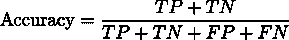

其中 `TP` 是真正例，`TN` 是真负例，`FP` 是假正例，`FN` 是假负例。

在少样本学习中，较高的准确率表示任务自适应成功。然而，通常必须分析更细粒度的层次，考虑全正预测或全负预测对准确率产生显著影响的情景。在跨多个回合（episodes）进行评估时，通常会报告回合间的平均准确率，并带有置信区间以考虑回合变异性。

```python
def calculate_accuracy(predictions, labels):
    """
    计算预测的准确率。
    Args:
    - predictions (list): 模型预测的标签。
    - labels (list): 查询集中的真实标签。
    Returns:
    - accuracy (float): 正确预测标签的比例。
    """
    correct_predictions = sum(p == l for p, l in zip(predictions, labels))
    accuracy = correct_predictions / len(labels)
    return accuracy

### Example usage
accuracy = calculate_accuracy(predicted_labels, ground_truth_labels)
print(f"Accuracy: {accuracy:.2f}")
```

### 精率与召回率

精率（Precision）和召回率（Recall）提供了模型性能的洞察，特别是在类别不平衡场景下。尽管少样本学习通常保持平衡的回合类别，但这些指标揭示了模型预测的底层细节，对于涉及多个类别的复杂任务特别有用。

精率：该指标量化了预测的正例观测中实际上有多少是正例的。当假正例成本较高时，该指标至关重要。

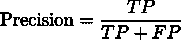

召回率（或敏感性）：强调了实际正例观测中有多少被正确预测出来。当假负例成本较高时，该指标至关重要。

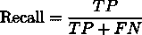

这两个指标在评估模型在少样本任务中的鲁棒性方面具有重要意义。响应模型调优或配置更改的精率和召回率调整，为模型行为提供了直接反馈。

```python
from sklearn.metrics import precision_score, recall_score
def calculate_precision_recall(predictions, labels):
    """
    根据预测和真实标签计算精率和召回率。
    Args:
    - predictions (list): 模型预测的标签。
    - labels (list): 查询集中的真实标签。
    Returns:
    - precision (float): 精率分数。
    - recall (float): 召回率分数。
    """
    precision = precision_score(labels, predictions, average='macro')
    recall = recall_score(labels, predictions, average='macro')
    return precision, recall

### Example usage
precision, recall = calculate_precision_recall(predicted_labels, ground_truth_labels)
print(f"Precision: {precision:.2f}, Recall: {recall:.2f}")
```

### F1 分

F1 分通过计算精率和召回率的调和平均数将两者合并为单一指标。当精率和召回率之间的平衡至关重要时，它特别有价值。这种平衡在少样本学习中至关重要，特别是处理由于回合创建随机性无意引入的元任务内部不平衡时。

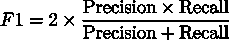

F1 分赋予精率和召回率相等的权重，作为一个涵盖了假正例和假负例的鲁棒标准，对于评估模型的整体性能至关重要。F1 分的变化指导了精确的模型校准，并对特定任务的性能局限提供了见解。

```python
from sklearn.metrics import f1_score
def calculate_f1_score(predictions, labels):
    """
    计算模型在查询集上预测的 F1 分。
    Args:
    - predictions (list): 模型预测的标签。
    - labels (list): 查询集中的真实标签。
    Returns:
    - f1 (float): F1 分值。
    """
    f1 = f1_score(labels, predictions, average='macro')
    return f1

### Example usage
f1 = calculate_f1_score(predicted_labels, ground_truth_labels)
print(f"F1 Score: {f1:.2f}")
```

### 置信区间

除了准确的点估计外，置信区间提供了关于模型性能指标（如不同回合之间的准确率）变异性和可靠性的洞察。在少样本学习中，由于回合创建固有的随机性，变异性可能很高。报告置信区间有助于量化结果的确定性，为模型之间观察到的性能差异提供支持。

通常计算 95% 的置信区间，表示如果重复实验，95% 的计算出的区间将包含真实的指标值。这些区间在比较分析中至关重要，突显了观察到的差异是具有统计学意义的还是可能由评估差异造成的。

### 校准衡量标准

校准反映了预测概率与观测频率之间的匹配程度，这对于预测置信度与准确率同样重要的任务至关重要。在少样本学习中，当校准后的预测被应用于需要概率估计或决策阈值的下游任务时，它们具有关键的益处。

Brier 分和期望校准误差（ECE）是用于评估校准的常用指标：

Brier 分：计算预测概率与实际结果之间的均方差；分数越低表示校准越好。

期望校准误差（ECE）：聚合预测概率分箱之间的误差，提供了校准质量的概述。

```python
import numpy as np
def calculate_ece(pred_probs, labels, bins=10):
    """
    计算期望校准误差 (ECE)。
    Args:
    - pred_probs (ndarray): 类别的预测概率。
    - labels (list): 真实标签。
    - bins (int): 使用的分箱数。
    Returns:
    - ece (float): 期望校准误差。
    """
    bin_boundaries = np.linspace(0, 1, bins + 1)
    bin_lowers, bin_uppers = bin_boundaries[:-1], bin_boundaries[1:]
    ece = 0.0
    for lower, upper in zip(bin_lowers, bin_uppers):
        mask = np.logical_and(pred_probs > lower, pred_probs <= upper)
        if np.any(mask):
            accuracy_in_bin = np.mean(labels[mask] == np.argmax(pred_probs[mask], axis=1))
            confidence_in_bin = np.mean(pred_probs[mask])
            ece += np.sum(mask) * np.abs(accuracy_in_bin - confidence_in_bin) / len(labels)
    return ece

### Example usage
- 假设 ‘probs’ 是预测的概率矩阵
ece = calculate_ece(pred_probs=probs, labels=ground_truth_labels)
print(f"Expected Calibration Error: {ece:.4f}")
```

总之，采用全面的性能指标集（包括准确率、精率、召回率和 F1 分），辅以置信区间和校准衡量标准，为模型在少样本任务中的优缺点提供了全面的视角。正确解释这些指标有助于诊断特定任务的性能问题，并有效地校准模型以满足不同的应用需求。正确理解和应用这些指标，使研究人员能够更好地分析和优化少样本学习模型，最终提升其在现实世界的适用性和可靠性。

7.4

### 分析模型的泛化性与鲁棒性

少样本学习模型的有效部署很大程度上取决于其超越训练数据的泛化能力以及在各种条件下保持鲁棒性的能力。本节将详细讨论评估少样本学习模型泛化和鲁棒性的关键方法论和考虑因素。理解这些方面使从业人员能够验证模型在多样且不可预见条件下的应用就绪。


### 少样本学习中的模型泛化

泛化是指模型将所学到的知识应用于新颖、未见任务的能力。在少样本学习中，模型的训练主要涉及利用极少的训练数据，以便在与训练样本来自同一分布的新任务上表现良好。

由于要评估泛化能力，模拟一个与潜在部署场景相似的环境至关重要。这包括：

*   **跨领域泛化（Cross-Domain Generalization）**：评估模型在与训练领域显著差异的数据上的性能。它让我们了解模型在多大程度上能够将预习表示适应到新语境。领域适应和迁移学习等技术有助于增强跨领域能力。
*   **任务变异分析（Task Variability Analysis）**：确保评估阶段的任务在风格、视角和环境条件等属性上显示出变异（模型在训练期间没有显式见过这些属性），有助于理解真正的任务泛化。

通过使用按领域和任务复杂度分层的基准数据集，可以获得对模型泛化能力的见解。例如，包含多个数据集异构类别的 `Meta-Dataset` 是评估跨领域泛化的稳健平台。

```python
from fewshot_datasets import MetaDataset
def cross_domain_evaluation(model, meta_dataset, domains):
    """
    跨多个领域评估模型以检查泛化性。
    Args:
    - model: 少样本学习模型。
    - meta_dataset: 包含特定领域数据集的元数据集。
    - domains (list): 要测试的领域列表。
    Returns:
    - domain_accuracies (dict): 按领域划分的准确率字典。
    """
    domain_accuracies = {}
    for domain in domains:
        dataset = meta_dataset.get_domain(domain)
        accuracy = evaluate_few_shot_model(model, dataset)
        domain_accuracies[domain] = accuracy
        print(f"Accuracy on {domain}: {accuracy:.2f}")
    return domain_accuracies

### Example usage
domains = ['CIFAR_FS', 'ImageNet', 'TrafficSigns']
domain_accuracies = cross_domain_evaluation(model, meta_dataset, domains)
```

### 少样本学习中的模型鲁棒性

模型鲁棒性反映了模型对输入噪声、扰动以及任务条件微小偏差的抵抗能力。由于真实数据具有固有的噪声和多样性，评估鲁棒性至关重要。鲁棒的模型在这些变化状态下保持性能一致性，表明该模型对于部署场景是可靠的。

几种方法有助于理解鲁棒性：

*   **扰动测试（Perturbation Tests）**：在输入数据中引入噪声、畸变或遮挡，并观察模型的输出稳定性。对抗攻击等技术通过创建挑战性条件来测试这些方面，以发现潜在的缺陷。
*   **对模型参数的稳定性（Stability to Model Parameters）**：通过观察性能随模型超参数变化的变化，可以了解关于参数偏移的鲁棒性。

在评估鲁棒性时，使用挑战性场景对模型进行压力测试具有重要意义。通过变换或对抗样本增强评估数据集通常可以实现这一点。

```python
from torchvision import transforms
def perturb_inputs(inputs, transform):
    """
    对输入应用变换以模拟扰动。
    Args:
    - inputs (torch.Tensor): 输入图像的批。
    - transform: 要执行的变换函数。
    Returns:
    - perturbed_inputs: 应用扰动后的图像。
    """
    perturbed_inputs = [transform(img) for img in inputs]
    return torch.stack(perturbed_inputs)

### 定义一系列图像扰动
transform = transforms.Compose([
    transforms.RandomHorizontalFlip(p=0.5),
    transforms.ColorJitter(brightness=0.2, contrast=0.2, saturation=0.2, hue=0.2)
])

# 使用扰动输入评估模型
perturbed_data = perturb_inputs(original_inputs, transform)
model_robustness_accuracy = calculate_accuracy(model.predict(perturbed_data), true_labels)
print(f"Robustness Accuracy with Perturbed Inputs: {model_robustness_accuracy:.2f}")
```

### 泛化与鲁棒性的权衡

在通往鲁健少样本学习系统的过程中，泛化与鲁棒性之间可能会出现权衡。过度关注在已见任务上实现高性能的模型可能会过拟合，阻碍其对新任务的能力。相反，强调鲁棒性（可能通过严格的强化学习或对抗训练）可能会由于模型复杂性的增加而降低在真正新颖但简单任务上的泛化能力。

解决这种权衡需要精细的训练方案：

*   **训练回合的平衡（Balance in Training Episodes）**：使用不同复杂度的回合进行训练有助于平衡泛化和鲁棒性。
*   **正则化技术**：如 `dropout` 和权重衰减等方法可以减轻过拟合，促进更合理的权衡平衡。

此外，考虑模型选择（例如采用转导学习方法或专门为少样本任务设计架构）也会影响鲁棒性和泛化。

### 泛化与鲁棒性的可解释分析

为模型预测提供可解释性有助于理解底层的泛化和鲁棒性机制。显著性图或特征可视化等工具阐明了模型的决策过程，通过扰动条件下可见的预测差异来凸显鲁棒性缺陷。

解释预测在不同背景下的敏感性允许开发者主动调整模型或训练方案，有效应对已识别的漏洞。

```python
import torch
from torch.autograd import Variable
import matplotlib.pyplot as plt
def compute_saliency(model, inputs, labels):
    """
    计算并可视化输入图像的显著性图。
    Args:
    - model: 少样本模型。
    - inputs (torch.Tensor): 输入图像。
    - labels (torch.Tensor): 对应的标签。
    Returns:
    - saliency_maps: 输入图像的显著性图。
    """
    model.eval()
    inputs.requires_grad_()
    outputs = model(inputs)
    cost = torch.nn.functional.cross_entropy(outputs, labels)
    cost.backward()
    saliency_maps = inputs.grad.data.abs()
    return saliency_maps

### Visualize 显著性图
saliency_maps = compute_saliency(model, sample_inputs, sample_labels)
plt.imshow(saliency_maps[0].permute(1, 2, 0), cmap='hot')
plt.title("Saliency Map Visualization")
plt.show()
```


通常，少样本学习模型（特别是采用分类任务的模型）会为每个查询实例生成可能类别标签的概率分布。这涉及两种主要的输出形式：

- **预测标签**：模型分配最高概率的类别。
- **置信度得分**：与预测标签相关的概率置信水平，反映了模型的确定性。

分析这些输出不仅需要关注预测的准确性，还需要关注置信度校准。一个校准良好的模型，应该对正确的分类表现出高置信度，同时对错误或模糊的预测保持较低的置信度。

```python
def model_predictions(model, support_set, query_set):
    """
    从模型中获取预测标签和置信度得分。
    Args:
    - model: 训练过的少样本学习模型。
    - support_set: 用于推理的标记支持集。
    - query_set: 进行预测的数据。
    Returns:
    - predicted_labels (list): 查询的预测类别标签。
    - confidences (list): 预测的置信度得分。
    """
    output_probs = model.predict_proba(support_set, query_set)
    predicted_labels = output_probs.argmax(axis=1)
    confidences = output_probs.max(axis=1)
    return predicted_labels, confidences

### Example usage
predicted_labels, confidences = model_predictions(trained_model, support_set, query_set)
```

### 可视化技术

可视化增强了解释性，使利益者能够识别结果中的模式和异常。常见的视觉技术包括：

- **混淆矩阵**：说明模型区分不同类别的能力。它能识别出需要关注的特定配对交叉。
- **概率热图**：类别概率的可视化描述，有助于理解预测在类别上的分布情况，特别是针对每个查询示例。

这些可视化工具有助于对错误和模式进行表层分析。通过检查此类表示，研究人员可以提取出模型需要改进或调整校准的领域。

```python
from sklearn.metrics import confusion_matrix
import seaborn as sns
import matplotlib.pyplot as plt

def plot_confusion_matrix(true_labels, predicted_labels):
    """
    创建混淆矩阵图
    Args:
    - true_labels: 实际类别标签。
    - predicted_labels: 模型预测的类别标签。
    Returns:
    - None, 显示混淆矩阵图。
    """
    con_matrix = confusion_matrix(true_labels, predicted_labels)
    sns.heatmap(con_matrix, annot=True, fmt="d", cmap="Blues", xticklabels=class_names, yticklabels=class_names)
    plt.xlabel("Predicted Labels")
    plt.ylabel("True Labels")
    plt.title("Confusion Matrix")
    plt.show()

### Example usage
plot_confusion_matrix(ground_truth_labels, predicted_labels)
```

### 错误分析与模型校准

解释错误涉及对失败模式的细致理解。全面的错误分析需要将错误分为以下几类：

- **高置信度错误**：以高确定性出的错误可能指示模型训练中的系统性偏差或误分类区域。
- **低置信度正确预测**：可能信号模型加强的潜在途径，或凸显了过度谨慎。

通过收集这些错误的实例，研究人员可以获得对模型底层弱点的见解，从而引导迭代。利用调整置信度输出的校准技术对于完善模型可靠性至关重要。实证方法（如温度缩放）可以作为有效的校准机制。

```python
import numpy as np

def error_analysis(predictions, confidences, labels, threshold=0.8):
    """
    基于置信度得分分析错误。
    Args:
    - predictions (list): 模型的预测标签。
    - confidences (list): 每个预测的置信度。
    - labels (list): 真实值标签。
    - threshold (float): 高置信度错误的置信度阈值。
    Returns:
    - high_confidence_errors: 高置信度预测错误的索引。
    - low_confidence_corrects: 低置信度正确预测的索引。
    """
    high_confidence_errors = [i for i, (p, c, l) in enumerate(zip(predictions, confidences, labels))
                              if p != l and c > threshold]
    low_confidence_corrects = [i for i, (p, c, l) in enumerate(zip(predictions, confidences, labels))
                              if p == l and c < threshold]
    return high_confidence_errors, low_confidence_corrects

### Example usage
high_conf_errs, low_conf_corrs = error_analysis(predicted_labels, confidences, ground_truth_labels)
print(f"High-Confidence Errors: {len(high_conf_errs)}, Low-Confidence Corrects: {len(low_conf_corrs)}")
```

### 解析模型的鲁棒性与泛化性

解释性分析还包括对模型鲁棒性和泛化特征评估。观察不同条件下的性能，例如：

- **数据增强效果**：评估使用增强数据进行训练和后续评估如何影响模型的适应和错误减少。
- **跨领域性能波动**：通过利用领域偏移下的交叉验证指标，可以获得关于模型适应性和潜在过拟合的见解。

这种解释性评估不仅有助于衡量部署模型在多样化和不可见任务中的能力，还为未来的增强和开发铺平道路。

全面的结果解释涵盖系统性分析，将定量评估与定性见解相结合。通过有针对的探索和视觉辅助，解释少样本模型的输出变成了一个揭示基本工作细微差的过程，为在宏大且多样的应用领域中增强模型耐用性和覆盖范围量定制改进。这种分析深度使生产出的模型能够熟练处理少样本学习应用动态格局中预期的稀疏且丰富变化的任务。

## 7.6

## 与与其他学习范式的对比分析

少样本学习是一种旨在通过极少训练示例有效运行的范式，与传统及新兴学习范式相比，具有独特的优势和挑战。本节深入探讨了少样本学习与监督学习、半监督学习、迁移学习和无监督学习等范式的详细对比分析。通过探索这些差异，可以理解少样本学习在什么情况下最具优势，以及在什么情况下仍然面临挑战。

### 少样本学习 vs 监督学习

监督学习模型需要大型标记的数据集来获得高准确率。这些模型在海量数据中学习通用模式，通过密集训练学习输入特征与输出标签之间的关联。相比之下，少样本学习在收集大型标记数据集不现实或成本过高的场景中大有作为，例如医学诊断或物种识别。

核心区别在于它们对数据的依赖性：

- **数据效率**：少样本学习模型设计用于从较小集中有效学习，利用元学习和情景训练等概念从有限的观测中泛化。
- **训练复杂度**：监督学习模型在大量数据集上花费大量资源和时间，而少样本模型在数据受限的场景下计算效率更高，但可能需要复杂的架构和损失函数。

尽管存在这些差异，在大型数据集上的监督预训练可以通过提供稳健的特征表示来增强少样本学习模型，从而提高元学习效率。


```python
def supervised_training(data_loader, model, criterion, optimizer, num_epochs):
    for epoch in range(num_epochs):
        model.train()
        for i, (images, labels) in enumerate(data_loader):
            outputs = model(images)
            loss = criterion(outputs, labels)
            optimizer.zero_grad()
            loss.backward()
            optimizer.step()
    return model

def few_shot_meta_training(meta_train_loader, model, meta_optimizer, num_epochs):
    for epoch in range(num_epochs):
        model.train()
        for task in meta_train_loader:
            support_set, query_set = task
            model.adapt(support_set)
            query_outputs = model(query_set)
            task_loss = criterion(query_outputs, query_set.labels)
            meta_optimizer.zero_grad()
            task_loss.backward()
            meta_optimizer.step()
    return model
```

### 少样本学习 vs. 半监督学习

半监督学习通过结合结合两类数据训练模型，弥合了标记数据与无标记数据之间的鸿沟。半监督方法通常与自训练或通过无监督预训练利用数据等技术相结合，旨在以最少的标记标注挖掘海量数据集。

少样本学习在核心方法论上与半监督学习不同：

*   **极简标注**：少样本学习侧重于让模型仅通过每类少量标注就进行稳健学习，而不大幅度依赖无标记数据来改进学习。
*   **情节化训练 vs. 混合数据使用**：少样本学习使用模拟测试条件的基于情节（episode-based）设置，而半监督学习依赖于利用大量的无标记数据来精炼模型决策边界。

然而，在少样本范式中引入半监督学习的元素（例如利用无标记的支持数据）仍然是一个活跃的研究领域，有望整合这两种方法的见解。

```python
def semi_supervised_training(labeled_loader, unlabeled_loader, model, criterion, optimizer, num_epochs):
    for epoch in range(num_epochs):
        model.train()
        for (images_l, labels), images_u in zip(labeled_loader, unlabeled_loader):
            # 在标记数据上训练
            outputs = model(images_l)
            labeled_loss = criterion(outputs, labels)
            # 无监督损失（例如，一致性损失）
            with torch.no_grad():
                pseudo_labels = model(images_u).argmax(dim=1)
                unsup_outputs = model(images_u)
                unsupervised_loss = criterion(unsup_outputs, pseudo_labels)
                total_loss = labeled_loss + unsupervised_weight * unsupervised_loss
            optimizer.zero_grad()
            total_loss.backward()
            optimizer.step()
    return model
```

### 少样本学习 vs. 迁移学习

迁移学习寻求将从一个领域的知识应用到另一个领域，通过通常在大数据集上拟合的预训练模型来提高目标领域的学习能力。迁移学习的关键在于其能够用稳健的特征权重初始化模型，这些权重可以针对相似任务进行微调。

少样本学习的操作方式有所不同：

*   **任务定制**：少样本学习侧重于直接快速适应新的、此前未见过的任务，通常通过元学习方法实现，而不一定完全依赖相似任务作为踏脚石。
*   **并行探索**：迁移学习通常承担顺序任务精炼，而少样本范式以情节化的方式处理任务，训练模型在单一设置内跨一系列任务进行泛化。

从预训练模型整合的可迁移表示可以增强少样本学习的能力，特别是增强适应效率和特定任务的性能。

```python
from torchvision import models
def transfer_learning_adaptation(pretrained_model, few_shot_train_loader, model, criterion, optimizer, num_epochs):
    pretrained_model.eval()
    with torch.no_grad():
        pretrained_features = []
        for images, _ in few_shot_train_loader:
            features = pretrained_model(images)
            pretrained_features.append(features)
    # 使用加载的特征适配模型
    for epoch in range(num_epochs):
        model.train()
        for feature_batch, (images, labels) in zip(pretrained_features, few_shot_train_loader):
            outputs = model(feature_batch)
            loss = criterion(outputs, labels)
            optimizer.zero_grad()
            loss.backward()
            optimizer.step()
    return model
```

### 少样本学习 vs. 无监督学习

无监督学习涉及模型学习从无标注数据中识别模式（如聚类或降维），而没有特定的结果。与无监督学习不同，少样本模型需要通过少量标记的情节进行某种监督，以显式引导学习路径。

主要差异涉及：

*   **学习目标**：少样本学习方法直接侧重于通过最小监督模拟真实世界的分类或回归任务，而无监督学习提供关于数据结构和关系的见解，而不针对特定目标的结果。
*   **性能评估**：少样本模型会经过评估，而无监督学习仅提供见解。

尽管存在这些差异，使用无监督预训练来初始化少样本模型可以形成补充。

```python
from sklearn.cluster import KMeans
def unsupervised_pretrain_then_few_shot(kmeans, few_shot_train_loader, model, criterion, optimizer, num_epochs):
    # 使用无监督学习进行特征提取
    unsupervised_features = []
    for images, _ in few_shot_train_loader:
        images = images.view(images.size(0), -1)  # 展平图像
        kmeans.fit(images)
        cluster_centers = kmeans.cluster_centers_
        unsupervised_features.append(cluster_centers)
    # 在提取的特征上应用少样本学习
    for epoch in range(num_epochs):
        model.train()
        for features, (images, labels) in zip(unsupervised_features, few_shot_train_loader):
            outputs = model(features)
            loss = criterion(outputs, labels)
            optimizer.zero_grad()
            loss.backward()
            optimizer.step()
    return model
```

少样本学习与其他学习方法相比成为了一种引人注目的范式，特别是在快速处理稀疏任务方面。这种分析提供了关于该范式的优势（例如在约束下的高效学习），同时也凸显了潜在的交叉领域，即通过混合方法来丰富学习范式。通过这些比较，少样本学习的独特价值和持续的挑战变得显而易见，引导其集成到适用于多样化稀疏数据背景的更广泛的机器学习应用中。

## 7.7

## 故障排除与改进模型性能

确保少样本学习模型的最佳性能通常涉及严格的故障排除和迭代的模型精炼。本节探讨了少样本学习中常见的问题，随后是用于排除这些挑战并增强模型性能的策略。通过准确诊断问题并实施针对性的解决方案，从业人员可以显著提高模型的效能。

少样本学习中的常见问题

少样本学习由于其内在设计和目标继承了特定的挑战，包括：


# 对小支持集的过拟合：在数据有限的情况下，模型可能会过拟合支持实例，导致在查询集上的泛化能力较差。

跨回合的高变异性：每个回合（episode）包含不同的类别和支持-查询分布，导致模型在不同回合之间的表现不一致。

特征提取不当：取决于架构设计，模型可能无法充分提取相关特征，从而阻碍分类或回归任务。

对新类别的适应缓慢：某些架构可能难以快速适应，因此需要更多支持数据才能有效泛化。

解决这些问题涉及理解根源，并迭代应用策略以系统地排排除这些疑虑。

### 诊断模型问题

成功的故障排除始于准确的诊断。识别常见问题包括：

- 跨回合性能监控：跟踪准确率分布、损失变化和置信度评分有助于定位回合性的异常情况。
- 决策模式可视化：利用显著性图（saliency maps）等视觉化解释显示影响错误预测的区域，揭示潜在的缺陷。
- 参数与架构探索：超参数和架构复杂度会显著影响性能，因此需要细致的探索方法来检测瓶颈。

这些诊断方法为采取定制化策略以高效解决不同的性能瓶颈铺了道路。

```python
import matplotlib.pyplot as plt 
def monitor_performance_across_episodes(results): 
    """ 
    监控跨回合的模型性能以识别变异性。 
    Args: 
    - results (dict): 包含每个回合的准确率和损失。 
    Returns: 
    - None, 绘制结果。 
    """ 
    episodes = list(results.keys()) 
    accuracies = [results[ep]['accuracy'] for ep in episodes] 
    losses = [results[ep]['loss'] for ep in episodes] 
    plt.figure(figsize=(14,5)) 
    plt.subplot(1, 2, 1) 
    plt.plot(episodes, accuracies, label='Accuracy') 
    plt.xlabel('Episode') 
    plt.ylabel('Accuracy') 
    plt.title('Episode vs Accuracy') 
    plt.legend() 
    plt.subplot(1, 2, 2) 
    plt.plot(episodes, losses, label='Loss') 
    plt.xlabel('Episode') 
    plt.ylabel('Loss') 
    plt.title('Episode vs Loss') 
    plt.legend() 
    plt.show() 
# Example usage 
monitor_performance_across_episodes(evaluation_results)
```

### 提高少样本模型性能的策略

在获得诊断洞解后，任务围绕着采用策略来克服已识别的问题，关键实践措施包括：

### 1. 数据增强

数据增强丰富了训练数据的变异性，使模型在初始数据集有限的情况下也能有更好的泛化。实践方法包括使用旋转、缩放或颜色抖动等变换对支持示例添加合成变体。此外，利用生成的标签处理无标签数据的半监督方法也能促进学习的提升。

```python
from torchvision import transforms 
def augment_data(support_set): 
    """ 
    对支持集应用数据增强以提高泛化。 
    Args: 
    - support_set (torch.Tensor): 原始支持集图像。 
    Returns: 
    - augmented_set (torch.Tensor): 增强后的支持集图像。 
    """ 
    transform = transforms.Compose([ 
        transforms.RandomHorizontalFlip(), 
        transforms.RandomRotation(20), 
        transforms.ColorJitter(brightness=0.2, contrast=0.2, saturation=0.2) 
    ]) 
    augmented_set = [transform(img) for img in support_set] 
    return torch.stack(augmented_set) 
# Example usage 
augmented_support_set = augment_data(original_support_set)
```

### 2. 模型架构优化

为了增强特征提取和特定任务的适应性，完善模型架构至关重要。引入卷积层的变体或结合卷积网络与 Transformer 的混合模型，以捕获有利于少样本任务的丰富特征表示。

- 注意力机制：嵌入注意力层或自注意力机制可以显著提高对任务相关特征的关注，增强适应速度和效能。
- 嵌入空间优化：确保学习到的特征空间对于区分任务良好对齐，并利用三元组损失（triplet loss）优化的嵌入等度学习技术。

```python
import torch.nn as nn 
class FewShotModelWithAttention(nn.Module): 
    def __init__(self, input_dim, num_classes): 
        super(FewShotModelWithAttention, self).__init__() 
        self.conv1 = nn.Conv2d(input_dim, 64, kernel_size=3) 
        self.attention_layer = nn.MultiheadAttention(embed_dim=64, num_heads=4) 
        self.fc = nn.Linear(64, num_classes) 
    def forward(self, x): 
        x = self.conv1(x) 
        x, _ = self.attention_layer(x, x, x) 
        x = x.view(x.size(0), -1) 
        output = self.fc(x) 
        return output 
# Initialize model with attention 
model = FewShotModelWithAttention(input_dim=3, num_classes=5)
```

### 3. 元学习增强

完善元学习策略可以增强模型的回合适应能力。整合技术包括：

- 基于梯度的元学习：微调优化步骤，提高学习速度和准确性。
- 记忆增强网络：利用外部内存累积特定任务的信息，精炼检索能力。

### 4. 正则化技术

正则化方法可以缓解过拟合风险，同时提高模型的鲁棒性。策略包括：

- Dropout 和权重衰减（Weight Decay）：控制模型有效容量的基础技术。
- 任务特定正则化：针对特定少样本任务的约束，增强常规学习路径。

## 迭代评估与反馈整合

改进需要迭代的评估和反馈整合。每次迭代都应经过仔细的验证，捕捉不断提升的性能，同时阐明持续存在的问题。

评估反馈循环整合：

- 持续指标监控：利用全面的指标跟踪来提供明智反馈。
- 并行对比：构建实验控制，利用基准模型和增强型模型进行清晰的性能界定。


少样本学习在医疗领域引起了广泛关注，尤其是其在变革医疗诊断方面的潜力。医疗诊断系统通常依赖海量的标注数据以在疾病检测和分类中实现高准确率。相比之下，少样本学习使系统能够从有限的标记数据集中进行泛化，这在新发疾病爆发或罕见病病例中是常见场景。本节将深入探讨少样本学习在医疗保健中的各种应用，分析其方法论、挑战和影响，并提供示例来阐述核心概念。

少样本学习在医疗领域的主要应用是根据有限的医学图像进行疾病诊断。传统的机器学习模型需要大量的训练数据，而对于某些疾病（特别是罕见病），这些数据可能总是不可获得的。少样本学习通过利用仅有少数标注示例的任务，规避了这一挑战。

### 医学图像分析中的原型网络

原型网络是少样本学习范式中的一种方法，已成功应用于数据有限的医学图像分类。该方法通过使用编码支持示例的平均值来计算每个类的原型，然后根据查询示例在学习到的度量空间中与这些原型的接近程度进行分类。考虑其在区分不同类型皮肤病变中的应用。

###python
import torch
from torch import nn
import torch.nn.functional as F

class PrototypicalNetwork(nn.Module):
    def __init__(self, feature_dim):
        super(PrototypicalNetwork, self).__init__()
        self.encoder = nn.Sequential(
            nn.Conv2d(3, 64, kernel_size=3, stride=1, padding=1),
            nn.BatchNorm2d(64),
            nn.ReLU(),
            nn.MaxPool2d(2)
        )
        self.feature_dim = feature_dim

    def forward(self, x):
        return self.encoder(x)

def compute_prototype(features, labels):
    prototypes = {}
    for label in torch.unique(labels):
        prototypes[label.item()] = torch.mean(features[labels == label], dim=0)
    return prototypes

def classify(query_features, prototypes):
    distances = torch.cdist(query_features, torch.stack(list(prototypes.values())))
    return torch.argmin(distances, dim=-1)

### Example usage
model = PrototypicalNetwork(feature_dim=64)
support_images = torch.rand(5, 3, 128, 128)  # 5 examples
support_labels = torch.tensor([0, 0, 1, 1, 2])
query_images = torch.rand(3, 3, 128, 128)  # 3 query examples
support_features = model(support_images)
prototypes = compute_prototype(support_features, support_labels)
query_features = model(query_images)
predictions = classify(query_features, prototypes)
print("Predicted Labels:", predictions)
```

在医疗诊断中，此类方法有助于快速适应新的疾病模式，这在新的病毒毒株出现等场景下至关重要。开发能够快速适应有限标记数据的算法，对于缩短有效诊断和治疗所需的时间必要的。

### 个性化治疗方案

少样本学习不仅限于诊断；它在个性化治疗方案方面也起着关键作用。个性化医疗旨在根据个体特征定制医疗治疗方案，但由于患者的差异以及某些人口统计群体数据的稀疏性，它面临着挑战。在普通人群上训练的少样本学习模型可以适应这些特定的患者属性，确保提供更准确、更个性化的护理。

### 用于治疗个性化的元学习

元学习（或学习学习）被广泛用于个性化治疗的少样本学习中。通过元学习，模型被训练为利用以往任务的知识来快速适应具有稀疏数据的新任务。想象一种场景：我们根据患者对肿瘤学治疗的反应来开发个性化治疗策略，肿瘤学是一个治疗可以高度个体化的领域。关键在于快速适应每位患者独特的遗传标记。

```python
class MetaLearner(nn.Module):
    def __init__(self):
        super(MetaLearner, self).__init__()
        self.shared_layer = nn.Linear(256, 128)
        self.patient_specific_layers = nn.ModuleDict()
    def forward(self, x, patient_id):
        shared_representation = F.relu(self.shared_layer(x))
        if patient_id not in self.patient_specific_layers:
            self.patient_specific_layers[patient_id] = nn.Linear(128, 1)
        output = self.patient_specific_layerspatient_id
        return output

def meta_update(optimizer, loss):
    optimizer.zero_grad()
    loss.backward()
    optimizer.step()

### Simulation of usage
meta_learner = MetaLearner()
optimizer = torch.optim.Adam(meta_learner.parameters(), lr=0.001)
loss_fn = nn.BCEWithLogitsLoss()
for patient_id in range(10):  # Simulating 10 different patients
    patient_data, patient_labels = get_patient_data(patient_id)
    predictions = meta_learner(patient_data, patient_id)
    loss = loss_fn(predictions, patient_labels)
    meta_update(optimizer, loss)
```

元学习模型促进了自适应治疗系统的开发，为医生提供了计算决策支持。

### 挑战与考虑

尽管前景良好，但少样本学习在医疗保健中的应用并非没有挑战。数据质量问题（如噪声和偏见）会严重损害模型性能。与标准机器学习模型相比，由于少样本学习模型依赖有限的示例数据集，它们对这些问题的敏感性更高。稳健的数据预处理和增强技术对于缓解这些挑战至关重要。

此外，少样本学习模型的可解释性和透明性至关重要。医疗人员需要的不仅是提供准确预测的模型，还需要提供解释性见的模型，以确保临床环境中的信任和有效性。在少样本学习框架中集成可解释指标和解释性工具可以弥补这一差距，有助于对模型的决策过程进行更深入的理解。

少样本学习方法的创新对于改进诊断之外的医疗系统具有巨大潜力，涵盖药物发现和公共卫生监测等领域。这些系统必须不断进化以适应新出现的疾病和治疗方案，利用少样本学习方法中固有的适应性。这种能力确保了医疗系统在面对医学科学动态且不可预测性时保持韧性和响应能力。


文本分类是一项基础的 NLP 任务，将文档或句子归类为预定义的标签。文本分类中少样本学习的挑战在于，如何在标注数据有限的情况下有效地捕捉语义上的细微差别。这种挑战在法律或医疗文本分析等领域尤为突出，在这些领域中获取大量的训练数据通常是不切行的。

### 少样本文本分类的实现

为了在文本分类中有效实现少样本学习，可以使用诸如 `BERT`（双向 Transformer 编码表示）模型结合基于原型的方法。这种组合利用了 Transformer 模型的预训练语言理解能力与原型化方法基于距离的分类优势。

```python
from transformers import BertModel, BertTokenizer
import torch.nn as nn
import torch

class FewShotTextClassifier(nn.Module):
    def __init__(self, bert_model_name='bert-base-uncased', num_classes=3):
        super(FewShotTextClassifier, self).__init__()
        self.bert = BertModel.from_pretrained(bert_model_name)
        self.classifier = nn.Linear(self.bert.config.hidden_size, num_classes)

    def forward(self, input_ids, attention_mask):
        outputs = self.bert(input_ids=input_ids, attention_mask=attention_mask)
        cls_output = outputs.last_hidden_state[:, 0, :]
        return self.classifier(cls_output)

tokenizer = BertTokenizer.from_pretrained('bert-base-uncased')

def classify_text(model, tokenizer, texts):
    inputs = tokenizer(texts, return_tensors='pt', padding=True, truncation=True)
    outputs = model(inputs['input_ids'], inputs['attention_mask'])
    return torch.argmax(outputs, dim=1)

# Example usage 
texts = ["Legal analysis document", "Medical report on a patient", "News headline about politics"]
model = FewShotTextClassifier(num_classes=3)
labels = classify_text(model, tokenizer, texts)
print("Predicted Labels:", labels)
```

这种方法能够有效地捕捉文本中底层的语义模式，即使在标注示例极少的情况下也能实现准确的分类。从预训练语言模型迁移知识的能力对于这一过程至关重要，它减轻了对大量特定领域数据的需求。

# 少样本学习的情感分析

情感分析是少样本学习可以显著提升性能的另一个重要应用。在社交媒体监控或产品评论分析等场景下，情感的主观性要求模型具有适应性，既能够从少数示例中快速学习，又能保持高准确性。

### 用于情感适应的元学习

元学习技术非常适用于少样本设置下的情感分析。这些方法使模型能够有效地学习如何从有限示例中适应新的情感信号，并从广泛的先验任务中汲经验。

```python
class MetaSentimentLearner(nn.Module):
    def __init__(self, hidden_size=256, sentiment_classes=2):
        super(MetaSentimentLearner, self).__init__()
        self.layer = nn.Linear(hidden_size, hidden_size)
        self.sentiment_layers = nn.ModuleDict()

    def forward(self, x, task_id):
        task_representation = F.relu(self.layer(x))
        if task_id not in self.sentiment_layers:
            self.sentiment_layers[task_id] = nn.Linear(hidden_size, sentiment_classes)
        output = self.sentiment_layerstask_id
        return output

def sentiment_meta_update(optimizer, task_loss):
    optimizer.zero_grad()
    task_loss.backward()
    optimizer.step()

# Simulation of usage 
meta_sentiment_learner = MetaSentimentLearner()
optimizer = torch.optim.Adam(meta_sentiment_learner.parameters(), lr=0.001)
loss_fn = nn.CrossEntropyLoss()

for task_id in range(5):
  # Simulating 5 different sentiment tasks 
    task_data, task_labels = get_task_data(task_id) # Function to be implemented
    predictions = meta_sentiment_learner(task_data, task_id)
    task_loss = loss_fn(predictions, task_labels)
    sentiment_meta_update(optimizer, task_loss)
```

元学习为情感模型提供了快速适应所需的结构化灵活性，这在影响情感表达的不断变化的社会和文化背景中是一个关键优势。通过允许学习策略快速调整新数据，这些算法促进了跨不同文本风格的更好情感判别。

### 少样本 NLP 应用中的挑战

在 NLP 中实现少样本学习模型伴随着特定的挑战。语言具有内在的复杂性，语义歧可能会干扰模型训练。此外，由文化变化驱动的语言演变特性要求模型在没有海量数据集的情况下持续学习。确保少样本数据集中的语言多样性对于实现鲁棒性至关重要。许多语言和方言缺乏丰富的标注数据，这使得模型必须精通零样本推理。

为了克服这些挑战，可以将无监督学习技术（如无监督语言模型预训练）集成到少样本学习框架中。此类方法有助于建立基础理解。此外，可解释性仍然是一个关键问题。少样本模型的设计必须阐明决策过程，为终端用户（如语言学家和领域专家）提供清晰，特别是当应用涉及敏感主题时。少样本学习在 NLP 中的快速发展和整合有望重新定义语言技术应用，使系统更具韧性、适应性并对上下文敏感。这种适应性对于客户服务、自动机器人以及语言技术在多语言多文化社会中的无缝集成至关重要。随着该领域研究的进展，利用跨学科的见解和方法将进一步增强 NLP 驱动技术在多样且不断变化环境中的效能和范围。


目前已有多种方法被促进计算机视觉的小样本学习，每种方法都采用不同的策略来减少对大型标记数据集的依赖。一些最著名的方法包括：

- 度量学习方法（Metric Learning Approach）：涉及学习一种距离函数，有助于将新样本与已知类别的样本进行比较。模型根据特征空间中的邻近性来预测类别。
- 元学习与模型无关的元学习（MAML）：`MAML` 旨在在多种任务上训练模型，使其能够以极少的数据快速适应新任务。该模型的设计使其在仅对少量示例进行微调后就能获得良好的性能。
- 带有特征重用的迁移学习：该策略涉及使用预训练模型来利用对模板任务有用的特征表示，从而能够在极少的额外训练即可适应新类别。

### 用于图像识别的原型网络

原型网络是图像识别领域最有效的少样本学习模型之一。它们的工作原理是学习一个度量空间，在该空间中，一个类别由少量标记示例的平均值（即“原型”）来表示。图像查询根据其与这些原型的邻近性进行分类。

```python
import torch
from torch import nn
from torchvision import models, transforms
import torch.nn.functional as F
from PIL import Image

class PrototypicalNetwork(nn.Module):
    def __init__(self, output_dim=512):
        super(PrototypicalNetwork, self).__init__()
        self.feature_extractor = models.resnet18(pretrained=True)
        self.feature_extractor.fc = nn.Linear(self.feature_extractor.fc.in_features, output_dim)

    def forward(self, x):
        return self.feature_extractor(x)

def compute_prototypes(support_features, support_labels):
    prototypes = {}
    for label in torch.unique(support_labels):
        prototypes[label.item()] = support_features[support_labels == label].mean(dim=0)
    return prototypes

def classify_query(query_features, prototypes):
    distances = torch.cdist(query_features.unsqueeze(0), torch.stack(list(prototypes.values())).unsqueeze(0))
    return torch.argmin(distances, dim=-1)

### Example usage
transform = transforms.Compose([transforms.Resize(224), transforms.ToTensor()])
model = PrototypicalNetwork()
support_inputs = torch.stack([transform(Image.open('path/to/support/image.png')) for img in range(5)])  # Example paths
support_labels = torch.tensor([0, 0, 1, 1, 2])
query_input = transform(Image.open('path/to/query/image.png')).unsqueeze(0)
support_features = model(support_inputs)
prototypes = compute_prototypes(support_features, support_labels)
query_features = model(query_input)
prediction = classify_query(query_features, prototypes)
print("Predicted Class:", prediction.item())
```

在这个示例中，`ResNet18` 模型作为特征提取的主干，为分类任务提供可泛化的特征。通过使用原型学习，模型可以高效地适应涉及有限数据的新类别识别任务，使其非常适用于监控监控等新物体频繁出现的现实场景。

### 视频识别与少样本学习

视频识别通过引入时间动态扩展了图像识别的复杂性，要求模型解释帧序列。挑战在于不仅要识别物体，还要捕捉它们跨帧的运动和交互。视频识别的少样本学习方法必须应对额外的时间维度。

少样本视频识别中的一种有效策略是使用 3D 卷积神经网络（`3D CNNs`）结合时间聚合方法。

### 少样本视频识别的实现

为了解决视频数据的复杂性，一种实用方法是同时利用空间时间信息。`3D CNN` 可以从视频片段中提取时空特征，然后通过循环层进行处理，以捕捉随时间变化的模式。

```python
import torch
from torch import nn
from torchvision.transforms import Compose, Lambda
from torch.utils.data.dataloader import DataLoader

class VideoRecognitionModel(nn.Module):
    def __init__(self, num_classes=5):
        super(VideoRecognitionModel, self).__init__()
        self.conv3d = nn.Sequential(
            nn.Conv3d(in_channels=3, out_channels=64, kernel_size=(3, 3, 3), stride=1, padding=1),
            nn.BatchNorm3d(64),
            nn.ReLU(),
            nn.MaxPool3d((1, 2, 2))
        )
        self.rnn = nn.LSTM(64 * 56 * 56, 256, batch_first=True)
        self.fc = nn.Linear(256, num_classes)

    def forward(self, x):
        batch_size, C, T, H, W = x.size()
        x = self.conv3d(x)
        x = x.view(batch_size, T, -1)  # Flatten for RNN
        self.rnn.flatten_parameters()
        rnn_out, _ = self.rnn(x)
        return self.fc(rnn_out[:, -1, :])  # Use the output of last LSTM cell

def collate_fn(batch):
    inputs, targets = zip(*batch)
    inputs = torch.stack(inputs)
    targets = torch.tensor(targets)
    return inputs, targets

### Hypothetical usage
video_transform = Compose([
    Lambda(lambda video: torch.stack([transforms.ToTensor()(frame) for frame in video]))
])
### Placeholder for actual dataset
dataset = VideoDataset(transform=video_transform) 
loader = DataLoader(dataset, batch_size=4, collate_fn=collate_fn)
model = VideoRecognitionModel()
for batch in loader:
    inputs, targets = batch
    predictions = model(inputs)
    print("Predicted Classes:", torch.argmax(predictions, dim=1))
```


机器人系统通常设计用于执行广泛的任务，从工业自动化到非结构化环境中的导航。其复杂性在于需要实时进行稳健的感知、决策和动作执行。少样本学习（Few-shot learning）为观察到的若干挑战提供了显著的解决方案：

**环境变异**：自主机器人必须在布局、光照和障碍物各异的各种环境中导航。少样本学习使得机器人能够在有限的额外数据快速适应这些变化。

**物体操纵**：机器人经常与新物体交互，而这些物体可能不是其训练数据集的一部分。在不进行详尽重新训练的情况下，学习这些对象的物理属性和抓取技术至关重要。

**任务适应**：在仓库或医院等动态环境中，任务可能会根据操作需求发生巨大变化。通过少数次演示快速学习新任务或重新配置策略的能力是十分有益的。

**语义理解**：通过少数示例理解场景中的新语义元素（如物体、动作或事件），有助于完成自动驾驶或服务机器人等高级任务。

## 机器人领域少样本学习的方法

机器人领域采用了多种策略来利用少样本学习，结合了离线数据和实时传感器输入：

**模型无关的元学习 (MAML)**：这种方法允许创建一个基础模型，该模型可以使用极少的数据针对特定的机器人任务进行微调。`MAML` 涉及训练模型，使其能够仅通过基于几个新示例更新几个参数，就能快速适应新任务。

**具备少样本能力的强化学习**：通过少样本学习增强强化学习技术，有助于学习在不同任务中泛化性更好的策略。通过引入元学习或记忆增强网络，机器人可以根据新经验调整其策略。

**模拟环境的使用**：对于机器人而言，在模拟环境中使用少样本样本进行训练可以实现高效的轨迹规划和环境探索，而不会面临硬件损坏或故障的风险。

## 示例：机器人中的少样本任务适应

机器人领域中使用少样本学习的典型场景出现在任务适应中，机器人必须从少数演示中学习新任务。例如，考虑一个必须适应不同物体操纵任务的机械臂。

```python
import torch
import torch.nn as nn
import torch.nn.functional as F
from torch.optim import Adam

class RoboticTaskModel(nn.Module):
    def __init__(self, input_size, hidden_size):
        super(RoboticTaskModel, self).__init__()
        self.fc1 = nn.Linear(input_size, hidden_size)
        self.fc2 = nn.Linear(hidden_size, hidden_size)
        self.out = nn.Linear(hidden_size, 2) # XY control outputs

    def forward(self, x):
        x = F.relu(self.fc1(x))
        x = F.relu(self.fc2(x))
        return self.out(x)

class TaskAdaptionFewShot:
    def __init__(self):
        self.meta_model = RoboticTaskModel(input_size=10, hidden_size=50)
        self.optimizer = Adam(self.meta_model.parameters(), lr=0.001)

    def adapt_task(self, task_data, task_labels):
        support_set = list(zip(task_data, task_labels))
        for data, label in support_set:
            output = self.meta_model(data)
            loss = F.mse_loss(output, label)
            self.optimizer.zero_grad()
            loss.backward()
            self.optimizer.step() # Simulating task adaptation scenario

def get_task_data():
    # Placeholder function for obtaining task adaptation data
    data = torch.randn(5, 10) # 5 samples of input vector size 10
    labels = torch.randn(5, 2) # Corresponding XY control outputs
    return data, labels

few_shot = TaskAdaptionFewShot()
task_data, task_labels = get_task_data()
few_shot.adapt_task(task_data, task_labels)
print("Adaptation completed successfully.")
```

在这个示例中，机械臂模型通过使用几个演示样本来适应新任务。该模型包含简单的神经网络层，建立了一个框架，通过元学习原理的少样本学习可以更新特定任务的参数，从而尽量减少对大规模重新训练的需求。

## 具备少样本能力的强化学习

少样本学习通过赋予机器人能够在环境中通过少量交互调整策略的能力，可以加强强化学习（RL）。将元学习与强化学习结合，允许策略在不同的任务和环境之间进行迁移，显著减少了强化学习经常面临的样本效率低下的问题。

```python
import numpy as np

class FewShotReinforcementLearning:
    def __init__(self, state_dim, action_dim):
        self.state_dim = state_dim
        self.action_dim = action_dim
        self.policy = np.zeros((state_dim, action_dim)) # Simplified policy representation

    def update_policy(self, state, action, reward):
        self.policy[state, action] += 0.1 * (reward - self.policy[state, action])

    def adapt_policy(self, task_data):
        for state, action, reward in task_data:
            self.update_policy(state, action, reward)

task_experiences = [
    (0, 1, 1), # State 0 -> Action 1 results in Reward 1
    (1, 0, 1)  # State 1 -> Action 0 results in Reward 1
]
few_shot_rl = FewShotReinforcementLearning(state_dim=5, action_dim=2)
few_shot_rl.adapt_policy(task_experiences)
print("Policy adapted using few-shot experiences.")
```

在这个算法视角下，策略通过少数经验进行更新。这种紧凑的表示确保了高效的学习路径，使机器人能够以经济的计算和数据需求胜任新任务。

## 未来展望与挑战

少样本学习的进步为机器人和自主系统带来了巨大的机遇与挑战：

**复杂场景下的泛化**：创建能够在多变且未见的环境中稳健泛化的模型是一个首要目标。少样本学习承诺了卓越的能力，但模型必须在性能与适应动态环境的能力之间取得平衡。

**可扩展性**：确保少样本学习方法随着任务复杂性的增加而具有良好的扩展性是一个迫切的研究方向。扩展性不仅包括任务的多样性，还包括现实环境条件的复杂性。

**集成到现实世界系统中**：将理论和模拟的发现转化为实际应用需要仔细考虑。自主机器人需要可靠的性能，以确保人类中心或关键环境的安全和效率。

**跨学科协作**：进展可能取决于跨学科的合作，结合机器学习、认知科学、神经科学和机器人工程的见解，以增强适应性、功能性和可解释性。

少样本学习是进化的一步，使机器人系统更加智能、更具韧性，并能无缝地融入不同的社会角色中。这种方法重塑了计算可行性的边界，将复杂的学习策略与务实的工程原则相结合，以追求真正的自主系统。


零售和电子商务行业正在快速演进，利用人工智能的进步来增强客户体验、优化库存管理并实现产品个性化推荐。在这一背景下，小样本学习（Few-shot learning）成为一种强大的工具，使系统即使在数据极少的情况下也能有效运行。在零售和电子商务背景下理解并实施小样本学习可以显著驱动创新，为常见的行业挑战提供影响影响且高效的解决方案。

## 零售与电子商务面临的挑战

由于消费者行为的动态性以及对实时适应能力的需求，在零售和电子商务中实施先进的机器学习模型面临着诸多挑战：

- **个性化**：消费者期望个性化的购物体验。然而，新客户缺乏足够的历史交互数据，这使得小样本学习技术在利用有限初始信息初始化预测模型时具有极高的价值。
- **动态库存管理**：零售环境需要高效处理库存水平，以最大限度地减少积压和缺货。对新需求模式的快速适应对于提高效率至关重要。
- **客户分群**：面对多元化的客户，利用有限的数据对客户进行有效分群可以增强目标营销策略并提升整体服务。
- **异常检测**：在欺诈检测和消费者行为分析中，通过极少数示例辨别异常或新行为模式可以增加系统的响应能力和安全性。

小样本学习提供了相关的方法论，通过最少标记数据增强系统的灵活性和有效性，从而解决这些挑战。

## 个性化产品推荐

在电子商务中，提供个性化推荐对于影响消费购买决策至关重要。当用户数据稀疏或不存在时，小样本学习有助于生成有意义的推荐。元学习框架和基于指标的方法论通常是构建这些系统的骨干。

## 推荐系统中的实现

考虑一种基于原型的推荐系统，该系统根据用户在电子商务平台上进行的少量初始交互来识别消费者偏好：

```python
import torch
from torch import nn
from sklearn.preprocessing import StandardScaler
import numpy as np

class RecommendationPrototypicalNetwork(nn.Module):
    def __init__(self, input_dim):
        super(RecommendationPrototypicalNetwork, self).__init__()()
        self.transform = nn.Linear(input_dim, 64)
        self.output = nn.Linear(64, 32)

    def forward(self, x):
        x = torch.relu(self.transform(x))
        return self.output(x)

def generate_prototypes(user_item_features, labels):
    prototypes = {}
    for label in np.unique(labels):
        label_mask = labels == label
        prototypes[label] = user_item_features[label_mask].mean(axis=0)
    return prototypes

def recommend_items(user, item_features, prototypes):
    user_embedding = user.unsqueeze(dim=0)
    distances = torch.cdist(user_embedding, prototypes).argmin(dim=1)
    return distances

### Example usage
user_features = torch.randn(1, 16)  # Users tensor
item_features = torch.randn(1, 16)
```


在部署用于异常检测的少样本学习时，单类分类和无监督度量学习等技术至关重要。这些方法支持在不需要大量异常训练数据的情况下识别偏差，从而确保零售业务及其客户的利益。

## 未来展望与挑战

尽管潜力巨大，但将少样本学习整合到零售和电子商务领域仍面临着一系列挑战：

**数据质量与预处理**：少样本学习模型的有效性很大程度上取决于高质量数据。确保数据的准确性和一致性对于避免错误预测至关重要。

**实时处理**：少样本模型必须提供近实时的洞察，以在快速节奏的零售环境中保持相关性。在不牺牲准确性的情况下优化算法速度是一项持续的努力。

**可解释性与透明度**：在定制化营销和异常检测中，模型解释性至关重要。理解底层的模型推理可以确保与客户建立信任互动，并增强安全协议。

**持续学习**：少样本模型必须不断适应，从持续更新的数据流中学习，以准确地反映最新的消费者趋势和行为。

通过有效实施，少样本学习可以彻底改变零售和电子商务格局，支持个性化、动态且安全的购物体验。这些系统有望推动企业关系和预测消费者需求的方式发生深远变化，最终巩固其作为现代数据驱动业务生态系统中不可或缺的组件。

## 8.6

## 用户界面中的个性化

将少样本学习整合到用户界面（UI）中标志着实现个性化自适应数字体验的创新飞跃。今天，用户期望根据其偏好和行为定制界面，以减少认知负载并增强参与度。少样本学习通过允许系统利用少量数据进行调整，在实现这种无缝个性化方面起着关键作用，为以用户中心的设计提供了灵活高效的方法。

### 用户界面个性化的挑战

用户界面由各种与用户交互元素元素，，从视觉布局、导航到到和元素元素元素元素。挑战挑战 **用户多样性**：每个用户都有不同的行为模式、偏好和需求。在没有大量用户数据的情况下捕捉这种多样性需要强大的个性化策略。
- **实时适应**：当用户与应用程序交互时，系统必须动态适应以提供响应式体验——根据最近的交互调整界面元素。
- **最小数据范式**：通常，特别是对于新用户，有限的交互历史是传统数据驱动 UX 设计的瓶颈。少样本学习通过允许从开始实现有效的个性化，缓解了这个问题。
- **持续学习**：用户偏好可能会随时间变化。持续学习系统不仅必须根据当前行为适应，还要通过检查短的交互快照预测未来的偏好。

### UI 个性化中的少样本学习方法

已经采用了多种方法在个性化界面中实现少样本学习，将静态 UI 转换为动态的以用户为中心的环境：

- **上下文老虎机 (Contextual Bandits)**：这种方法允许序列决策，根据从极少之前交互获得的奖励来适应用户体验。它采用探索和利用策略来精炼个性化模型。
- **用于偏好适应的元学习**：通过元学习，系统学习“如何学习”，提供了一个可自适应的基础，根据有限的用户示例微调 UI 策略。
- **强化学习增强的个性化**：这涉及通过强化学习范式学习用户界面策略和偏好，其中少数示例即可启动学习过程。

### 使用上下文老虎机实现

上下文老虎机在用户界面的个性化中被证明是有效的，这源于它们能够在数据受限的情况下快速适应用户信号。例如，上下文老虎机可以根据用户上下文优化 UI 组件的呈现：

```python
import numpy as np
from scipy.special import softmax

class ContextualBandit:
    def __init__(self, num_actions, context_dim):
        self.contexts = np.random.rand(num_actions, context_dim)
        self.action_values = np.zeros(num_actions)
        self.alpha = 0.1

    def select_action(self, user_context):
        scores = np.dot(self.contexts, user_context)
        action_probs = softmax(scores)
        return np.random.choice(len(self.contexts), p=action_probs)

    def update(self, action, reward, user_context):
        self.action_values[action] += self.alpha * (reward - self.action_values[action])

### Example usage
bandit = ContextualBandit(num_actions=5, context_dim=10)
user_context = np.random.rand(10)
selected_action = bandit.select_action(user_context)
reward = np.rand()  # Simulated reward
bandit.update(selected_action, reward, user_context)
print(f"Action selected: {selected_action}, Action value: {bandit.action_values}")
```

上下文老虎机方法能够有效地根据用户的上下文调整 UI 组件。

### UI 个性化中的元学习

在从初始阶段进行自适应学习至关重要的场景下，元学习通过建立通过用户任务学习的灵活模型来提供解决方案：

```python
import torch
import torch.nn as nn

class MetaUIModel(nn.Module):
    def __init__(self, input_dim):
        super(MetaUIModel, self).__init__()
        self.layer1 = nn.Linear(input_dim, 64)
        self.layer2 = nn.Linear(64, 32)
        self.output = nn.Linear(32, 1)

    def forward(self, x):
        x = torch.relu(self.layer1(x))
        x = torch.relu(self.layer2(x))
        return self.output(x)

def meta_update(model, user_interactions, optimizer):
    loss_fn = nn.MSELoss()
    inputs, targets = user_interactions
    predictions = model(inputs)
    loss = loss_fn(predictions, targets)
    optimizer.zero_grad()
    loss.backward()
    optimizer.step()

# Simulating meta-learning process
user_interaction_data = (torch.randn(10, 8), torch.rand(10, 1))
meta_model = MetaUIModel(input_dim=8)
optimizer = torch.optim.Adam(meta_model.parameters(), lr=0.001)
meta_update(meta_model, user_interaction_data, optimizer)
print("Meta-learning model updated for user preference adaptation.")
```

通过采用元学习模型，个性化 UI 系统可以简短的交互历史动态调整设置，允许界面快速向更符合用户的结果进化。

### 实时适应与强化学习

实时环境要求用户交互能够快速为系统提供个性化策略的信息。强化学习（RL）实现了这种即时性，通过从持续的用户行为中学习，促进自适应界面的发展，从而提升用户满意度。


```python
class UIReinforcementLearner:
    def __init__(self, state_dim, action_dim):
        self.state_dim = state_dim
        self.action_dim = action_dim
        self.q_table = np.zeros((state_dim, action_dim))

    def select_action(self, state):
        return np.argmax(self.q_table[state])

    def update(self, state, action, reward, next_state):
        self.q_table[state, action] += 0.1 * (reward + np.max(self.q_table[next_state]) - self.q_table[state, action])

# Simulating reinforcement learning
state = 0  # Initial state
ui_rl = UIReinforcementLearner(state_dim=5, action_dim=3)
for _ in range(100):
    action = ui_rl.select_action(state)
    reward = np.random.rand()  # Random reward simulation
    next_state = (state + 1) % 5
    ui_rl.update(state, action, reward, next_state)
    state = next_state
print(f"Updated Q-table:\n{ui_rl.q_table}")
```

在这个强化学习（RL）框架中，用户操作以及随后的状态为系统提供了个性化界面奖励结构的信息。通过迭代交互，界面可以学习与用户预期紧密一致的策略，从而提供真正的定制化体验。

# 挑战与未来方向

将少样本学习引入 UI 个性化面临着若干挑战和未来探索的领域：

*   **数据隐私与安全**：虽然个性化界面具有显著优势，但确保系统尊重用户隐私和数据安全仍然是重中之重。解决方案必须在不损害个人数据完整性的情况下有效捕捉个性化特征。
*   **跨平台一致性**：个性化应该无缝扩展到不同设备和平台，以尽可能的减少用户摩擦。在不同界面之间保持一致性需要对自适应个性化洞察进行高效同步。
*   **可解释个性化**：用户应该理解界面的适应性。界面变化产生的透明度可以增强用户的信任和满意度，弥合个性化技术与用户接受度之间的鸿沟。
*   **可扩展个性化**：随着交互数据的增长，模型需要有效扩展。利用基于云的计算和联邦学习可以帮助大规模管理个性化，提供稳健且经济的解决方案。

少样本学习对用户界面个性化的贡献，最终实现了向真正自适应系统的转型。这些系统承诺通过动态地将数字界面与人类交互对齐，极地提升用户体验——这是未来确保可用性和客户满意度的关键一步。

# 8.7

## 实时分析与异常检测

将少样本学习集成到实时分析和异常检测中，为处理动态且快速变化的环境带来了显著进展。实时分析涉及即时处理数据以生成时见解，这在金融、网络安全、医疗健康和工业监控等领域至关重要。异常检测在识别偏离常的意外模式方面起着关键作用。少样本学习通过在不依赖大量数据的情况下，增强了处理动态和快速变化环境的能力。

## 实时分析与异常检测中的挑战

实现实时分析和异常检测涵盖了以下挑战，特别是由于需要快速适应数据集：

*   **数据量与速度**：实时系统必须处理海量涌入数据，以保持准确性。
*   **动态环境**：条件和模式经常变化，要求系统能够快速适应。
*   **异常稀缺性**：异常在本质上是稀有的，使得获取它们具有挑战性。

少样本学习通过创建能够适应的模型，为这些挑战提供了灵活的解决方案。

## 使用元学习进行实时异常检测

元学习技术使系统能够快速适应新的异常检测任务，通过极少量数据优化任务间的迁移性：

*   **元学习方法**：元学习框架利用先验知识进行学习。
*   **基于距离的分类**：基于距离的技术根据已知示例分类新数据。
*   **强化学习策略**：强化学习范式通过信号实现适应。

## 异常检测中的实现

考虑一个使用原型网络（一种基于距离的方法）进行实时异常检测的示例。在这里，目标是根据与原型的距离分类新点：

```python
import torch
from torch import nn
import numpy as np

class AnomalyDetectiontotypicalNetwork(nn.Module):
    def __init__(self, input_dim):
        super(AnomalyDetectiontotypicalNetwork, self).__init__()
        self.encoder = nn.Sequential(
            nn.Linear(input_dim, 64),
            nn.ReLU(),
            nn.Linear(64, 32)
        )

    def forward(self, x):
        return self.encoder(x)

def compute_prototypes(data, labels):
    prototypes = {}
    for label in np.unique(labels):
        prototypes[label] = data[labels == label].mean(axis=0)
    return prototypes

def detect_anomalies(data, prototypes):
    distances = np.linalg.norm(data - prototypes[0], axis=1)
    threshold = np.percentile(distances, 95)
    return distances > threshold

# 模拟异常检测
normal_data = np.random.randn(100, 10)
anomaly_data = normal_data + np.random.normal(0, 1, (5, 10)) * 3
all_data = np.vstack([normal_data, anomaly_data])

model = AnomalyDetectiontotypicalNetwork(input_dim=10)
encoded_data = model(torch.tensor(all_data, dtype=torch.float32)).detach().numpy()
prototypes = compute_prototypes(encoded_data[:100], np.zeros(100))
anomalies_detected = detect_anomalies(encoded_data[100:], prototypes)

print(f"检测到异常: {np.sum(anomalies_detected)} / {len(anomalies_detected)}")
```

在这个原型网络示例中，模型通过少量标记样本学习正常行为的表示。异常根据偏离这种建立的正常程度进行检测。


```python
class MetaAnomalyLearner(nn.Module):
    def __init__(self, feature_size):
        super(MetaAnomalyLearner, self).__init__()
        self.layer = nn.Linear(feature_size, feature_size)
        self.classifier = nn.Linear(feature_size, 2)

    def forward(self, x):
        return torch.relu(self.layer(x))

    def meta_train_step(meta_model, support_data, query_data, optimizer):
        # Support data: tuple of tensors (support_x, support_y)
        support_x, support_y = support_data
        query_x, query_y = query_data
        support_features = meta_model(support_x)
        query_features = meta_model(query_x)
        criterion = nn.CrossEntropyLoss()
        support_loss = criterion(meta_model.classifier(support_features), support_y)
        query_loss = criterion(meta_model.classifier(query_features), query_y)
        combined_loss = support_loss + query_loss
        optimizer.zero_grad()
        combined_loss.backward()
        optimizer.step()

# Sample meta-learning process
support_data = (torch.randn(10, 20), torch.randint(0, 2, (10,)))
query_data = (torch.randn(10, 20), torch.randint(0, 2, (10,)))
meta_model = MetaAnomalyLearner(feature_size=20)
meta_optimizer = torch.optim.Adam(meta_model.parameters(), lr=0.001)
meta_train_step(meta_model, support_data, query_data, meta_optimizer)
print("Completed a meta-learning step for anomaly classification.")
```

在此模拟中，元学习框架有助于异常检测的分类，通过从有限的数据中学习，快速适应新的异常模式。

# 用于异常检测适应的强化学习

强化学习策略通过引导系统根据实时反馈循环进行适应，增强了实时异常检测，从而优化了异常响应：

```python
class AnomalyDetectionRL:
    def __init__(self, state_space, action_space):
        self.state_space = state_space
        self.action_space = action_space
        self.q_table = np.zeros((state_space, action_space))

    def select_action(self, state):
        return np.argmax(self.q_table[state])

    def update(self, state, action, reward, next_state):
        self.q_table[state, action] += 0.1 * (reward + np.max(self.q_table[next_state]) - self.q_table[state, action])

# Simulating reinforcement learning for anomaly response
current_state = 0
rl_model = AnomalyDetectionRL(state_space=5, action_space=2)
for _ in range(50):
    action = rl_model.select_action(current_state)
    reward = 1 if np.random.rand() < 0.05 else -1  # Simulate rare anomaly detection reward
    next_state = (current_state + 1) % 5
    rl_model.update(current_state, action, reward, next_state)
    current_state = next_state
print(f"Q-table after training:\n{rl_model.q_table}")
```

通过这种强化学习模型，异常检测和响应得到了优化。

## 克服未来的挑战

少样本学习的前带来了令人兴奋的挑战：

### 噪声数据
现实世界的数据可能本身带有噪声。先进的噪声过滤技术至关重要。

### 大规模系统的扩展性
大规模实施少样本模型是必要的。

### 模型可解释性
为用户提供关于异常形成的透明见解，特别是在金融和医疗领域。

### 探索与利用之间的最佳平衡
在强化学习背景下，系统应该在探索未知状态和利用已知状态之间取得最佳平衡。

少样本学习在实时分析中的整合正在改变异常检测的方式。

## 第 9 章：少样本学习的挑战与未来方向

本章探讨了少样本学习面临的当前挑战，包括在处理噪声、偏差和领域适应性方面的局限性。同时也讨论了围绕数据隐私和伦理考虑的问题。此外，本章还探索了增强模型泛化能力的策略，预测了未来趋势，并考虑了新兴技术（如量子计算）对推进和演变的潜力。

## 9.1 少样本学习的当前局限

少样本学习（FSL）是机器学习中一个迷人的领域，旨在使模型能够从有限的示例中学习。尽管潜力巨大，FSL 仍面临若干限制其广泛应用和性能的挑战。这些挑战主要处理数据中的噪声和偏差、有限的领域适应性，以及从极少输入中捕捉高层模式的复杂性。

由于数据暴露极少，处理噪声和偏差是 FSL 中的重大障碍。在少样本学习场景下，数据集并不丰富，导致对噪声（数据中不代表模式的非预期变化）和偏差（由于数据量较小无法充分代表整体分布而产生的偏差）的敏感性增加。


```python
from keras.models import Sequential
from keras.layers import Dense, Flatten
from keras.applications import VGG16

# Base model with pre-trained weights on ImageNet
base_model = VGG16(weights='imagenet', include_top=False, input_shape=(224, 224, 3))

# Create a new model by adding custom layers
model = Sequential()
model.add(base_model)
model.add(Flatten())
model.add(Dense(1024, activation='relu'))
model.add(Dense(10, activation='softmax'))

# Freeze all layers in the base model
for layer in base_model.layers:
    layer.trainable = False

# Compile the model
model.compile(optimizer='adam', loss='categorical_crossentropy', metrics=['accuracy'])

# Summary for the model
model.summary()
```

在上面的代码示例中，我们展示了如何利用迁移学习来克服领域限制性问题。我们使用了预训练的 `VGG16` 模型，利用其学习到的特征来适应新的（尽管是类似的）任务。冻结原始模型的大部分层可以确保基础表示被保留，而新增的层则针对特定的少样本任务进行微调，从而在不需要大量数据的情况下增强了领域灵活性。

在有限数据上训练引入的偏差往往会放大少样本任务的难度。这些偏差是隐性的，可能源于倾斜的数据分布，这可能是由于人口统计学不平衡或小样本内部的不平等条件造成的。考虑通过以下示例所示的经验偏差：

```python
from collections import Counter
import numpy as np

# 模拟一个小且有偏的数据集
data_samples = np.random.choice([0, 1, 2], size=100, p=[0.7, 0.2, 0.1])
class_distribution = Counter(data_samples)
print(class_distribution)
```

在这个 Python 代码段中，模拟的数据集遵循具有主导类的偏偏分布。这种不平衡会导致模型可能过度地倾向于多数类，从而在现实应用中导致预测偏斜。减少偏差通常需要稳健的正则化技术或专门设计的算法框架，用于识别并减轻内在差异。

此外，从大规模数据需求转到少样本模型，通常意味着难以捕捉数据内部深奥的模式或非平凡的关系，这项任务需要从极少数实例中辨别高阶结构。许多方法尝试使用元学习方法论——即模型通过从广泛的任务中培养理解来“学习学习”，并随后将这种元知识适应新的少样本情境。

尽管元学习策略具有广阔前景，但它们本质上受限于从一个任务到另一个任务捕捉和迁移泛化知识的限制，通常需要在任务多样性与上下文相关性之间进行仔细的平衡。

### 展示元学习高层视角的模拟代码

```python
class MetaLearner:
    def __init__(self, model, task_distributor):
        self.model = model
        self.task_distributor = task_distributor

    def train(self, data, labels):
        tasks = self.task_distributor.distribute(data, labels)
        for task in tasks:
            self.model.fit(task.data, task.labels)
        return self.model

# 使用方法
# task_distributor 应该将数据拆分为多个任务
# model 应该实现一个处理特定任务训练的 "fit" 函数
meta_learner = MetaLearner(model, task_distributor)
trained_model = meta_learner.train(few_shot_data, few_shot_labels)
```

这个说明性模型展示了少样本学习中潜在抽象元学习过程的高层视角，强调了通过接触任务分布来调整模型。它体现了元学习方法的精髓，但成功的部署还需要详细的机器构建和特定任务的优化策略。

最后，计算效率仍然是少样本框架面临的主要挑战之一，当它们需要与高度依赖大型数据集来实现精度的深度学习范式竞争时。这可能需要复杂的算法调整或优化，例如内存高效设计或新架构，因为模型必须经过细致精炼以利用底层的计算限制。

这些挑战的交汇要求一种综合方法，将算法创新与特定领域的定制相结合。新兴解决方案（如基于内存的适应方法和注意力机制）正在铺平道路，为低数据环境的更好的表示空间提供了新见解，尽管它们的实际部署仍然面临技术和理论上的障碍。

## 9.2 可扩展性与计算挑战

扩展性和计算效率仍然是少样本学习（Few-Shot Learning）领域内的关键考虑因素。随着问题范围和相应数据需求的扩大，以资源高效的方式扩展这些模型的内在挑战变得日益显著。许多因素导致了这些问题，包括神经网络的架构、算法设计以及硬件资源的固有限制。本节将系统地检查这些方面，提供技术见解和代码示例。

少样本学习算法必须解决在跨越大规模数据集时维持计算可行性的问题。传统的机器学习模型（包括深度学习框架）在大型数据集上表现良好，但在扩展到少样本场景时往往会遇到困难。最初的挑战在于开发不需过多计算或内存资源的可扩展架构。一种可能的解决方案是采用参数高效的技术，例如模型剪枝，即系统地移除神经网络中不重要的权重，而不影响性能。这种方法在保持可扩展性的同时显著提高了计算效率。

```python
import tensorflow as tf
from tensorflow_model_optimization.sparsity import keras as sparsity

# 定义简单模型
model = tf.keras.Sequential([
    tf.keras.layers.Dense(64, activation='relu', input_shape=(100,)),
    tf.keras.layers.Dense(64, activation='relu'),
    tf.keras.layers.Dense(10, activation='softmax')
])

# 应用剪枝
pruning_params = {
    'pruning_schedule': sparsity.PolynomialDecay(
        initial_sparsity=0.50,
        final_sparsity=0.90,
        begin_step=0,
        end_step=1000)
}
model_pruned = sparsity.prune_low_magnitude(model, **pruning_params)
model_pruned.compile(
    optimizer='adam',
    loss=tf.keras.losses.SparseCategoricalCrossentropy(),
    metrics=['accuracy']
)

# 包含剪枝层的模型摘要
model_pruned.summary()
```

上面的代码演示了如何使用 TensorFlow 模型优化包在训练期间对神经网络进行剪枝。通过策略性减少参数，网络在保持预测能力的同时需要更少的计算资源，从而提高了可扩展性。


另一个重大挑战在于如何调整模型以适应不同数据规模而不降低性能，这涉及到算法复杂度。元学习和迁移学习在这方面是强大的技术，旨在优化学习算法，使其能够以极少的数据快速适应新任务。然而，这些方法通常需要细粒度的超参数调优，对计算开销的要求，这在受限环境中并不总是可行的。

计算效率与性能之间的复杂平衡可以通过低秩矩阵分解进一步探索，这是一种用于近似神经网络中大型权重矩阵的技术。该方法通过将权重矩阵限制在低维形式上，减少了训练和推理操作所需的总计算次数。

```python
import numpy as np
from sklearn.decomposition import TruncatedSVD
# Simulate weight matrix
weight_matrix = np.random.rand(200, 200)
# Low-rank approximation using TruncatedSVD
svd = TruncatedSVD(n_components=50)
low_rank_approx = svd.fit_transform(weight_matrix)
print(low_rank_approx.shape)
```

上述代码利用`截断奇异值分解` (`SVD`) 实现了给定权重矩阵的低秩近似。这种还原极大地减少了模型的计算需求，促进了跨多个任务的平滑扩展。

应对日益增长的可扩展性需求涉及重新审视优化策略。如 `Adam` 和 `RMSProp` 等自适应优化算法提供了学习率的动态适应性，在每步更新次数的情况下具有优势，从而增强了少样本学习设置下的计算吞吐量。

```python
from keras.models import Sequential
from keras.layers import Dense
from keras.optimizers import RMSprop
# Define a simple model
model = Sequential([
    Dense(128, activation='relu', input_shape=(input_dim,)),
    Dense(3, activation='softmax')
])
# Compile model with RMSProp optimizer
model.compile(optimizer=RMSprop(learning_rate=0.001),
              loss='categorical_crossentropy',
              metrics=['accuracy'])
```

在此示例中，神经网络模型使用了自适应 `RMSProp` 优化器，允许在训练期间进行更有效的参数收敛——这在处理有限数据时是一个至关重要的方面。

此外，从传统的孤立系统向大规模并行架构的转变为少样本学习框架开启了新的可能性。利用`图形处理器` (`GPUs`) 和`张量处理器` (`TPUs`) 可以通过有效处理并行计算大幅提高这些模型的可扩展性。然而，跨这些架构优化计算任务的执行和分配可能是，需要精密的规划以避免瓶颈。

此外，策略性的数据流水线设计（包括预取、并行文件系统和高效的数据增强）决定了可扩展少样本学习模型的成功。架构必须支持这些数据处理技术的无缝集成，以便在应用需要时进行快速扩展。

一个重大挑战围绕如何跨边缘设备和中心化系统高效地分配模型和计算资源。这需要在模型大小、计算能力和推理时间之间达成平衡。`联邦学习`代表了一个充满前景的方向，模型训练分布在多个设备上，同时维持一个中央服务器来聚合本地模型更新。这种方法在确保可扩展性的同时，减轻了数据传输成本和隐私担忧。

在这种复杂的环境中，少样本学习系统的开发和部署反映了先进算法创新与硬件及计算资源现实约束之间的持续平衡。在这些维度上建立协同效应，定义了为多样化的现实应用打造真正可扩展且计算高效的系统的路径。

## 9.3

## 数据隐私与伦理考量

`少样本学习` (`FSL`) 方法在从个性化医疗保健到定制营销策略等各种应用中的快速采用，引发了围绕数据隐私和伦理考量的关键讨论。由于少样本语境下使用的数据集通常具有敏感性，且基于极少数据输入的模型决策具有影响，这些因素至关重要。本节将探讨这些方面，提供技术见解、伦理框架和最佳实践——这对于负责任的 AI 部署至关重要。

在 `FSL` 范围内，数据隐私不仅涉及防止对敏感信息的未经授权访问，还涉及有关数据所有权适当使用的挑战。少样本学习场景的特征是稀疏数据集通常需要从多个源进行聚合，每个源都有不同的隐私法规和潜在的信息泄露风险。如果在不遵守严严格的数据治理协议的情况下应用原始的聚合技术，这些碎片化的数据源可能会导致严重的隐私泄露。

在解决 `FSL` 内有的数据隐私问题时，`联邦学习`成为了一种强大的解决方案。这种范式允许在持有本地数据样本的多个去中心化设备或服务器上训练模型，而无需交换数据，从而将执行机器学习的能力与对中心化存储数据的需求解耦。

以下是一个在少样本语下说明联邦学习概念的示例：

```python
import tensorflow as tf
import tensorflow_federated as tff
# Define a simple model
def create_simple_model():
    return tf.keras.Sequential([
        tf.keras.layers.Input(shape=(28, 28, 1)),
        tf.keras.layers.Conv2D(32, 3, activation='relu'),
        tf.keras.layers.MaxPooling2D(),
        tf.keras.layers.Flatten(),
        tf.keras.layers.Dense(10, activation='softmax')
    ])
# Define federated averaging process
iterative_process = tff.learning.build_federated_averaging_process(
    model_fn=create_simple_model,
    client_optimizer_fn=lambda: tf.keras.optimizers.SGD(learning_rate=0.02)
)
# Initialize the process
state = iterative_process.initialize()
# Simulate federated learning by producing rounds of training operations
state, metrics = iterative_process.next(state, federated_data)
print(metrics)
```

此代码展示了如何使用 `TensorFlow Federated` 实现联邦学习，通过在本地设备上执行更新并在集中聚合模型权重，来实现保护隐私的学习。这种方法适用于每个参与者数据有限但敏感的少样本学习领域。

数据匿名化差分隐私是可以集成到 `FSL` 实践中增强隐私保护的关键技术。匿名化涉及剥离个人身份信息，而差分隐私通过向数据集或模型参数中添加噪声，以确保任何分析的输出都不会泄露关于单个数据点的信息。

考虑一个使用差分隐私的示例：


```python
from diffprivlib.models import LogisticRegression
from sklearn.datasets import load_iris
from sklearn.model_selection import train_test_split
from sklearn.preprocessing import StandardScaler

# Load dataset
X, y = load_iris(return_X_y=True)
X_train, X_test, y_train, y_test = train_test_split(X, y, test_size=0.2, random_state=42)

# Scale the data
scaler = StandardScaler()
X_train = scaler.fit_transform(X_train)
X_test = scaler.transform(X_test)

# Fit Differentially Private Model
dp_model = LogisticRegression(epsilon=1.0)
dp_model.fit(X_train, y_train)
print(f"Model accuracy: {dp_model.score(X_test, y_test)}")
```

此代码片段利用差隐私来确保训练的逻辑回归模型遵循隐私约束，降低了泄露数据集中个人敏感信息的风险。

小样本学习（FSL）中的伦理考量是多方面的，涉及公平性和偏差缓解方法。由于数据可用性通常有限，模型很容易继承并放大基础数据中存在的社会偏差。这可能导致对特定人口群体或个人产生不公平的歧视性结果。

考虑这样一种场景：使用少样本学习训练的面部识别技术，由于训练数据分布存在偏差，对某些族群的准确率不成比例地较低。伦理部署需要采取纠正措施，例如确保数据的包容性表示，以及在模型验证期间实施偏差检测算法。

机器学习公平性工具（如 IBM 的 AI Fairness 360）提供了审计和修正数据集及模型偏差的途径：

```python
from aif360.datasets import BinaryLabelDataset
from aif360.algorithms.preprocessing import Reweighing
from aif360.metrics import BinaryLabelDatasetMetric

# 加载处理后的数据集（模拟）
dataset = BinaryLabelDataset(
    favorable_label=1,
    unfavorable_label=0,
    df=df_with_bias,
    label_names=['income'],
    protected_attribute_names=['race']
)

# 评估公平性指标
metric = BinaryLabelDatasetMetric(dataset, privileged_groups=[{'race': 1}], unprivileged_groups=[{'race': 0}])
original_stat = metric.mean_difference()

# 实现重新加权
RW = Reweighing(unprivileged_groups=[{'race': 0}], privileged_groups=[{'race': 1}])
dataset_transf = RW.fit_transform(dataset)

# 检查处理后的公平性
metric_transf = BinaryLabelDatasetMetric(dataset_transf, privileged_groups=[{'race': 1}], unprivileged_groups=[{'race': 0}])
post_stat = metric_transf.mean_difference()
print(f"Original mean difference: {original_stat}, Post-transformation mean difference: {post_stat}")
```

此示例使用了重新加权作为一种预处理技术来平衡数据集，最终目标是确保后续模型预测的公平性。通过比较干预前后的公平性指标，从业人员可以评估其机器学习流水线的伦理影响，并做出知情的调整以缓解偏差。

除了技术驱动的解决方案外，建立伦理框架和行为准则对于引导 FSL 系统的负责任部署至关重要。组织应确保符合相关法律标准，如《通用数据保护条例》（`GDPR`），并通过公开模型和数据收集方法以供审查来提高透明度。

此外，跨学科协作在解决 FSL 的伦理挑战方面起着关键作用。通过与伦理学家、领域专家和利益相关者合作，AI 社区可以对特定背景下的问题产生细致的理解，促进符合伦理的技术的设计。

少样本学习中数据隐私和伦理考量的导航是一项复杂的工程，需要技术策略、伦理警觉和跨学科协作的结合。遵循这些原则可以增强 FSL 应用的信任度和效能，确保 AI 系统符合社会价值观及其创造者的伦理义务。

## 9.4

## 提高跨领域泛化能力

在少样本学习（FSL）中，提高跨领域泛化能力是一项关键挑战，由于新目标领域具有固有的变异且样本有限。稳健的泛化对于模型在不同任务和环境中的表现至关重要，确保了它们在现实世界中的适用性。本节深入探讨了用于增强 FSL 跨领域泛化的策略和方法，提供了全面的见解和代码示例来阐明这些概念。

FSL 跨领域泛化的核心是模型能够从有限的训练数据中提取并利用有用知识，同时将这些知识适应到新的、以前未过的领域。传统的机器学习模型在这些情况下往往表现不佳，因为会导致过拟合，即模型捕捉了仅与训练数据相关的噪声或无关细节，但无法适应新的上下文。

改进这一问题的方法之一是使用元学习框架。元学习有时被称为“学习学习”，旨在通过在各种任务上训练算法来提高其适应能力，并随后实现高效的适应。

```python
import torch
import torch.nn as nn
import torch.optim as optim

# 定义一个简单的 MAML
class MAMLModel(nn.Module):
    def __init__(self):
        super(MAMLModel, self).__init__()
        self.layer1 = nn.Linear(784, 64)
        self.layer2 = nn.Linear(64, 64)
        self.layer3 = nn.Linear(64, 10)

    def forward(self, x):
        x = torch.relu(self.layer1(x))
        x = torch.relu(self.layer2(x))
        return self.layer3(x)

def train_maml(model, data_loader):
    inner_lr = 0.01
    outer_lr = 0.001
    optimizer = optim.Adam(model.parameters(), lr=outer_lr)
    for batch in data_loader:
        optimizer.zero_grad()
        # 克隆模型以适应任务
        task_model = MAMLModel()
        task_model.load_state_dict(model.state_dict())
        # 内层优化（例如一步或几步）
        task_optimizer = optim.SGD(task_model.parameters(), lr=inner_lr)
        for task_data, task_labels in batch['tasks']:
            task_output = task_model(task_data)
            task_loss = nn.CrossEntropyLoss()(task_output, task_labels)
            task_loss.backward()
            task_optimizer.step()
        # 外层优化
        model_output = model(batch['data'])
        outer_loss = nn.CrossEntropyLoss()(model_output, batch['labels'])
        outer_loss.backward()
        optimizer.step()

# 示例（模拟）
# train_maml(maml_model, data_loader)
```

上面的代码片段展示了使用 PyTorch 实现 MAML 的简化设置，强调了模型在进行全局元更新之前，如何针对特定特定数据进行内层适应。通过 MAML 训练，模型学习到了在不同任务中都具有优势的初始化，从而增强了跨领域泛化能力。


另一种增强领域间泛化能力的有效方法是领域适应。该技术旨在通过共享学习表示或对抗训练，减少源域和目标域特征空间之间的差异。领域对抗神经网络（`DANN`）旨在对齐源域和目标域特征分布的同时保持判别能力的模型。

```python
import torch
from torch.autograd import Function # Gradient reversal layer for adversarial training
class GradReverse(Function):
    @staticmethod
    def forward(ctx, x, alpha):
        ctx.alpha = alpha
        return x.view_as(x)
    @staticmethod
    def backward(ctx, grad_output):
        return grad_output.neg() * ctx.alpha, None
class DANNModel(nn.Module):
    def __init__(self):
        super(DANNModel, self).__init__()
        self.feature_extractor = nn.Sequential(
            nn.Linear(784, 256),
            nn.ReLU(),
            nn.Linear(256, 128),
            nn.ReLU(),
        )
        self.class_classifier = nn.Linear(128, 10)
        self.domain_classifier = nn.Linear(128, 2)
    def forward(self, x, alpha=0.1):
        features = self.feature_extractor(x)
        reverse_features = GradReverse.apply(features, alpha)
        class_outputs = self.class_classifier(features)
        domain_outputs = self.domain_classifier(reverse_features)
        return class_outputs, domain_outputs
# Example usage (mock)
# dann_model = DANNModel()
# class_pred, domain_pred = dann_model(data, alpha=0.1)
```

此示例展示了如何使用梯度反转层实现 `DANN` 以促进对抗训练，在保留齐的同时的同时齐齐。通过平衡任务特定分类器和领域分类器的贡献，`DANN` 促进了跨领域的稳健泛化。

稳健的数据增强策略也对领域泛化能力的提升有显著贡献。通过旋转、平移或风格化等技术刻意地生成多样化的训练样本，模型在学习过程中接触到不同的场景。这种接触有助于构建不变表示，这对于适应新领域至关重要。

```python
import torchvision.transforms as transforms
from torchvision.datasets import MNIST
# Augmentation pipeline
augmentation_pipeline = transforms.Compose([
    transforms.RandomRotation(20),
    transforms.RandomHorizontalFlip(),
    transforms.ToTensor(),
])
# Load dataset with augmentations
train_dataset = MNIST(root='./data', train=True, download=True, transform=augmentation_pipeline)
# Example: Access augmented data
data_loader = torch.utils.data.DataLoader(train_dataset, batch_size=16)
for images, labels in data_loader: 
    # Model training here
    pass
```

使用 `torchvision` 库来创建增强流水线，展示了多样化变换在鼓励模型在训练集之外进行良好泛化方面的重要性。

此外，引入迁移学习至关重要，在大型、多样化数据集上预训练的模型可以作为少样本学习任务的基础。这种方法利用了预提取的特征，减少了对稀缺领域特定数据的依赖，同时保持了广泛的泛化能力。

```python
from torchvision import models
# Load pretrained model
pretrained_model = models.resnet18(pretrained=True)
# Fine-tune the model for a new task
for param in pretrained_model.parameters():
    param.requires_grad = False
# Replace the final layer
num_features = pretrained_model.fc.in_features
pretrained_model.fc = nn.Linear(num_features, num_classes)
# Model training here to adapt to the new domain
```

该示例使用了在 `ImageNet` 上预训练的 `ResNet` 模型，展示了迁移学习如何使最终层能够适应以适应新的分类任务。

总结来说，提升 `FSL` 的跨领域泛化能力需要涵盖元学习、领域适应、数据增强和迁移学习的综合方法。这些策略共同确保了模型不受限于初始训练领域，而是具备在各种环境中稳健运行所需的灵活性和适应性。随着我们不断开发这些方法，少样本学习中精确的跨领域泛化具有广阔的前景。

## 9.5

## 模型架构的未来趋势

随着少样本学习（FSL）的快速进步，模型架构的未来趋势将重塑机器学习的格局。这些架构强调灵活性、适应性和效率，满足了对稀疏数据场景下稳健模型日益增长的需求。本节探索了可能彻底改变少样本学习领域的架构趋势，提供了深入见解、理论基础和代码示例。

神经架构搜索（NAS）框架的整合代表了模型设计的关键范式转变。NAS 旨在自动发现针对特定任务的最优架构，利用巨大的搜索空间和新的优化算法来识别优于手工设计的配置。在 `FSL` 背景下，NAS 促进了对计算高效且适用于少样本任务的架构的探索，符合数据可用性带来的复杂限制。

```python
from keras.models import Model
from keras.layers import Input, Flatten, Dense
from autokeras import ImageClassifier
# Define input node
input_node = Input(shape=(32, 32, 3))
# Automatic model building with NAS
auto_model = ImageClassifier(max_trials=5)
# Set up model search space and search
auto_model.fit(x_train, y_train, epochs=10)
# Evaluate the auto-discovered model
accuracy = auto_model.evaluate(x_test, y_test)
print("Discovered model accuracy:", accuracy)
```

除了结构优化之外，注意力机制是另一个增强模型架构的新关注领域。注意力机制源于选择性关注输入数据重要部分的概念，允许模型有效地分配其处理资源，从而提升泛化能力，特别是在数据有限的情况下。


```python
import torch
import torch.nn.functional as F

class SelfAttention(torch.nn.Module):
    def __init__(self, embed_dim):
        super(SelfAttention, self).__init__()
        self.query = torch.nn.Linear(embed_dim, embed_dim)
        self.key = torch.nn.Linear(embed_dim, embed_dim)
        self.value = torch.nn.Linear(embed_dim, embed_dim)

    def forward(self, x):
        Q = self.query(x)
        K = self.key(x)
        V = self.value(x)
        attention_scores = torch.matmul(Q, K.transpose(-2, -1)) / (embed_dim ** 0.5)
        attention_weights = F.softmax(attention_scores, dim=-1)
        return torch.matmul(attention_weights, V)

# Example self-attention usage
embed_dim = 64
x = torch.rand(10, 15, embed_dim)  # Batch of 10 sequences of length 15
self_attention = SelfAttention(embed_dim)
output = self_attention(x)
```

上述代码段详细描述了 PyTorch 中自注意力机制的简洁实现，突出了模型如何通过评估输入内部的依赖关系来优先考虑信息流，这对于精化的少样本学习模型至关重要。

架构设计中的新兴趋势进一步引入了层次化和组合式模型。层次化架构（以`Hierarchical Bayesian Networks`为例）能够将复杂任务分解为可管理的子任务，利用了少样本学习对有限数据进行抽象的需求。这些结构偏好于分层处理，其中上层提供基于低层抽象构建的精细表示，确保了计算效率并提高了可解释性。

# 层级贝叶斯模型代码占符
```python
class HierarchicalBayesianModel:
    def __init__(self, data):
        self.data = data
        self.prior = self.define_prior()  # 定义先验分布

    def define_prior(self):
        # 设置参数的先验
        pass

    def likelihood_function(self, parameters):
        # 定义给定参数下的数据似然
        pass

    def infer(self):
        # 执行推断以更新信念
        pass

# 少样本语境下的示例用法
# model = HierarchicalBayesianModel(few_shot_data)
# model.infer()
```

该大纲提供了一个层次化方法的概念性视角，利用贝叶斯原理系统地表示不确定性，这对于少样本学习的需求至关重要。

与此同时，组合式模型（如`Compositional Pattern-Producing Networks`（`CPPNs`）将复杂的表示合成为简单、可重用模式的组合。这些模型将任务分解为模块化组件，这些组件可以在不同场景中重用，在灵性和迁移性方面提供了巨大的优势。

探索基于图的架构，`Graph Neural Networks`（`GNNs`）正成为少样本学习的强大工具，因为它们能够有效地对关系数据建模。`GNNs` 在结构化数据上泛化操作，使得它们特别适用于实体及其关系需要复杂表示的领域，例如社交网络、分子结构和知识图谱。

```python
import torch
import torch_geometric
from torch_geometric.nn import GCNConv

class SimpleGNN(torch.nn.Module):
    def __init__(self, num_node_features, num_classes):
        super(SimpleGNN, self).__init__()
        self.conv1 = GCNConv(num_node_features, 16)
        self.conv2 = GCNConv(16, num_classes)

    def forward(self, data):
        x, edge_index = data.x, data.edge_index
        x = self.conv1(x, edge_index)
        x = torch.relu(x)
        x = self.conv2(x, edge_index)
        return torch.nn.functional.log_softmax(x, dim=1)

# 使用虚拟数据的示例用法
# model = SimpleGNN(num_node_features=3, num_classes=2)
# output = model(data)
```

该实现利用了 `PyTorch Geometric` 库，说明了 `GNNs` 如何在图结构上运行以促进关系学习——这是少样本适应性的焦点。

最后，随着神经形态计算和脉冲神经网络（`SNNs`）的发展，未来的架构可能会从生物系统中汲取灵感，旨在实现高效的处理。

## 9.6 混合方法与跨学科创新

在少样本学习（`FSL`）中，混合方法和跨学科创新已成为催化力量，推动着进步并解决障碍。通过协同整合来自各个领域的方法论，这些技术增强了学习过程。其中一种方法结合了迁移学习和元学习的元素。迁移学习利用了预训练模型的知识。

```python
import torch
import torch.nn as nn
import torch.optim as optim
from torchvision import models # 加载预训练模型
class HybridModel(nn.Module):
    def __init__(self, num_classes):
        super(HybridModel, self).__init__()
        self.base_model = models.resnet18(pretrained=True)
        for param in self.base_model.parameters():
            param.requires_grad = False  # 冻结基础模型层

# 元学习层
        self.meta_layer = nn.Sequential(
            nn.Linear(512, 256),
            nn.ReLU(),
            nn.Linear(256, num_classes)
        )

    def forward(self, x):
        x = self.base_model(x)
        return self.meta_layer(x)

# 使用混合模型模拟任务训练
hybrid_model = HybridModel(num_classes=10)
optimizer = optim.Adam(hybrid_model.parameters(), lr=0.001)
# 元学习任务适应的伪循环
for task_data, task_labels in task_loader:
    optimizer.zero_grad()
    outputs = hybrid_model(task_data)
    loss = nn.CrossEntropyLoss()(outputs, task_labels)
    loss.backward()
    optimizer.step()
```


另一个关键途径是强化学习与小样本学习（FSL）的结合。强化学习赋予代理在交互环境中的决策能力，使其能够进行持续的、反馈驱动的适应。与小样本设置相结合时，强化学习可以优化学习策略，通过极少数示例加速对新任务的适应，并利用在`meta-reinforcement learning`框架内部署的`policy gradients`和`Q-learning`等技术。

```python
import gym
import torch
import torch.nn.functional as F
from torch.distributions import Categorical

class ActorCriticModel(nn.Module):
    def __init__(self, input_dim, action_space):
        super(ActorCriticModel, self).__init__()
        self.shared_layers = nn.Linear(input_dim, 128)
        self.actor = nn.Linear(128, action_space)
        self.critic = nn.Linear(128, 1)

    def forward(self, x):
        x = F.relu(self.shared_layers(x))
        action_probs = F.softmax(self.actor(x), dim=-1)
        state_values = self.critic(x)
        return action_probs, state_values

# Initialize environment and model
env = gym.make('CartPole-v1')
model = ActorCriticModel(input_dim=4, action_space=env.action_space.n)

# Optimize policy through reinforcement signals
def train_actor_critic():
    state = env.reset()
    for step in range(100):
        state = torch.from_numpy(state).float()
        action_probs, state_value = model(state)
        distribution = Categorical(action_probs)
        action = distribution.sample()
        next_state, reward, done, _ = env.step(action.item())
        state = next_state
        # Continue with the policy gradient update iteratives...
```

该脚本详细描述了在小样本框架下使用`Actor-Critic`模型应用于强化学习的基础结构，有助于在先验经验有限的动态环境中实现快速的策略更新和适应。

除了机器学习集成外，量子计算预计将为 FSL 方法论带来前所未有的飞跃。量子增强机器学习模型利用量子位（`qubits`）和量子操作，从上提升了计算速度并扩展了模型架构的表达能力。尽管处于处于阶段，但`quantum support vector machines`（`QSVMs`）和`quantum neural networks`（`QNNs`）等量子算法正在探索在效率密集型小样本任务中的应用。

```python
# Placeholder for quantum circuit setup and execution
def quantum_feature_map(x):
    # Encodes classical data into quantum states
    pass

def quantum_kernel_matrix(data):
    # Generates the quantum kernel matrix for SVM tasks
    pass

def quantum_model_training(data, labels):
    # Quantum-enhanced training methodology
    pass

# Quantum computations and FSL applications to follow...
```

这段伪代码概述了在 FSL 中集成量子计算的核心概念，包括使用基于量子的内核解释经典数据，以及利用量子并行性来提高学习效率。

跨学科创新进一步为 FSL 注入了神经科学技术，其灵感源自生物启发的神经网络。脉冲神经网络（`SNNs`）特别是模拟了生物神经元中的突触传递，提供了以高能效和时间动态闻名的独特计算模型。这些特性对于资源受限和时间敏感型学习过程中的 FSL 特别有益。

```python
class SpikingNeuron:
    def __init__(self, threshold, decay):
        self.threshold = threshold
        self.decay = decay
        self.potential = 0

    def forward(self, input_spike):
        self.potential += input_spike - self.potential * self.decay
        if self.potential >= self.threshold:
            spike = 1
            self.potential = 0  # Reset potential
        else:
            spike = 0
        return spike

# Initialize spiking network neurons and execute signal transmissions
# while iterating over configured tasks...
```

这种结构强调了脉冲神经元如何处理输入，将神经启发的转换适应计算需求，同时为了能量并实现实时操作。

彻底改变小样本学习的混合方法和跨学科创新已超越了传统的范式。


神经形态计算作为另一项关键技术脱颖而出，通过模拟人类大脑的神经功能日益发展。与传统计算不同，神经形态芯片旨在使用脉冲神经网络（SNNs）来处理信息，该网络利用受神经启发的脉冲系统，提供了卓越的能量效率和速度。这种方法通过提供低功耗、实时学习能力，在解决少样本学习（FSL）挑战方面变得越来越流行，非常适用于需要资源高效解决方案的嵌入式系统和现实应用。

# 脉冲神经网络的设置与执行占符

```python
class SpikingNeuron:
    def __init__(self, threshold, decay):
        self.threshold = threshold
        self.decay = decay
        self.membrane_potential = 0
    def spike_neuron(self, input_current):
        # 更新膜电位
        self.membrane_potential += input_current - self.membrane_potential * self.decay
        if self.membrane_potential >= self.threshold:
            spike = 1
            self.membrane_potential = 0  # 脉冲后重置电位
        else:
            spike = 0
        return spike # 网络神经元实现的示例
# 通过网络处理输入序列以实时自适应和学习...
```

脉冲神经元模型实现了神经元的实时模拟，能够像生物系统一样对输入动态响应。这种神经形态方法对于少样本场景下的快速适应具有优势，增强了计算效率和学习动态。

# 边缘计算

边缘计算正作为一项重要趋势不断发展，提供了不依赖中心化云服务的本地数据处理能力。这种范式转变对于少样本学习具有重要意义，因为它允许学习算法在分布式环境中自主运行，减轻了延迟，增强了隐私并降低了带宽需求。通过将计算移向数据源，基于边缘的学习模型可以提供更快的推理和决策能力。

考虑一种场景：使用边缘计算系统在设备级本地训练少样本学习模型：

```python
import tensorflow as tf
from tensorflow.keras.models import load_model
# 将预训练模型加载到边缘设备
edge_model = load_model("edge_deploy_model.h5")
# 模拟边缘数据输入
edge_data = tf.random.normal([1, 28, 28, 1])
# 执行本地推理
edge_result = edge_model.predict(edge_data)
print("Local Inference Result:", edge_result)
```

在这个示例中，预训练模型被部署到边缘设备，允许对数据进行高效的本地推理，受益于即时处理和决策至关重要的应用，例如自动驾驶汽车或智能家居系统。

# AI 增强芯片

专门为执行机器学习任务设计的 AI 增强芯片的出现进一步补充了少样本学习。这些芯片配备了针对深度学习计算优化的专用处理单元（例如 TPUs），增强了训练和推理的执行，大幅提升了性能和能量效率。

在 AI 增强芯片上执行的少样本学习的改进主要在于并行化优势和训练时间的缩短，允许模型在有限的时间范围内处理更复杂、数据密集型任务。这些改进在需要现实应用响应能力的语境下尤为显著，促进了从少样本数据输入的即时学习。

# 总结

总而言之，新兴技术的出现显著影响着少样本学习的未来，丰富了其方法论并扩展了其应用视野。量子、神经形态、边缘计算和 AI 增强芯片的融合，标志着向更高效、多功能和自主的少样本学习范式的转变。这些技术进步反映了全行业的转型，旨在培养能够从稀疏数据中有效学习的系统，塑造了 AI 在日益动态和多样化的环境中部署的轨迹。随着这些创新的影响不断展开，少样本学习将在熟练、扩展性和适用性方面达到新的水平，预示着一个从极少数实例中学习成为人工智能能力基石的未来。

