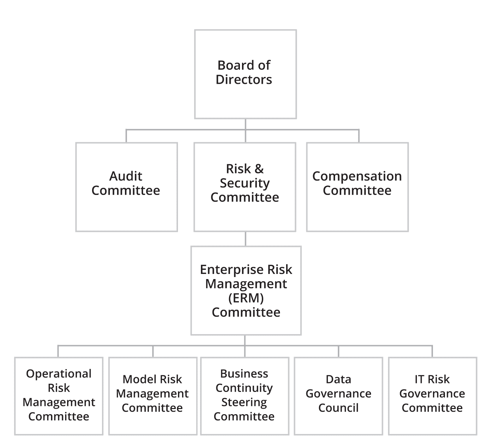

# 以火攻火：当今领导者的主动网络安全策略

## 关于作者

Renee Tarun 是 Fortinet 的副首席安全官（CISO）。她在美国情报界、国防、执法部门以及全球私营实体拥有二十多年的信息技术和网络安全经验。

Renee 在 Fortinet 专注于企业安全、合规治理以及产品安全。在加入 Fortinet 之前，她曾担任国家安全局（NSA）网络事务主任特别助理以及 NSA 网络任务组主管，在此期间她制定了机构战略以及白宫的网络安全政策。

此外，Renee 曾在国家安全局、国防和美国特勤局担任过多个角色，专注于开发与工程、网络战略、运营、资源配置和关系管理。

Renee 是乔治·梅森大学 Volgenau 工程学院的董事会成员，并且旨在保护儿童网络安全的书籍《网络安全》（*Cyber Safe*）的合著者。

## 致谢

本书是一项协作工作，涉及来自政府和私营部门的许多多元网络领导者和专家。如果没有他们的见解贡献和思想领导力，这一切是不可能的。他们的投入和精力不断突破边界，使我们的网络世界更加安全、更加可靠。

我要感谢 Fortinet 整个团队在本书创作过程中提供的支持，并为我提供了分享帮助全球技术领导者的见解和知识的机会。

## 贡献者

- **Sonia E. Arista**
- **Marianne Bailey**
- **Fatima Boolani**
- **Beth-Anne Bygum**
- **Laura Deaner**
- **Lisa Donnan**
- **Suzanne Hartin**
- **Susan Koski**
- **Jenny Menna**
- **Mel T. Migriño**
- **Sanju Misra**
- **Terry Roberts**
- **Maria S. Thompson**
- **Anne Marie Zettlemoyer**

## 引言

***RENEE TARUN***

数字化转型和不断变化的威胁格局显著改变了首席信息安全官（CISO）和安全决策者的角色。

传统的 CISO 职责（如补丁管理和事件响应）比以往任何时候都关键，但当今的 CISO 还必须关注供应链风险、无数隐私法规以及 5G 技术。在应对传统和新兴威胁的同时，CISO 还面临着人才短缺的压力：没有足够的人手工作。

这些与网络安全交织在一起的挑战正迫使 CISO 采取更全面的方法，来平衡风险、安全和战略性业务支持。

技术并不是解决我们所面临的安全困境的唯一方法。安全领导者必须处理人员、流程和技术，通过综合运用创造出既能管理风险，又能以当今经济的速度推进业务目标的安全解决方案。

作为首席信息安全官（CISO），我们必须精通业务语言。我们必须影响他人改变他们的思维、习惯和对待技术的方法，并以维护安全的方式行为。我们需要一种文化转变，让每个人都能采用有效的、持续的流程来确保我们组织的安全。安全必须嵌入到供应商选择、员工入职和产品开发中。安全意识培训必须是持续的，以匹配我们所面临的威胁节奏。

我们需要既理解最新技术价值的安全领导者，更重要的是，他们要具备建立能够凝聚人心的技能，以及创建可重复流程的纪律性。

### 如何成为一名高效的 CISO？

当今的安全领导者面临着巨大的压力。CISO 职位的流失率很高，平均任期仅为二十六个月。我们需要根本性的改变来赋予我们有效领导的能力、获得更好的工作与生活平衡，并管理工作中不可避免的压力。答案不是工作更长时间；95% 的 CISO 每周工作时间比合同规定的多出十小时。

我们需要通过成功的捷径，例如从导师和同事那里学习。当然，挑战在于如何为这些学习找到时间。这就是为什么我和我的同事写了这本书：为了分享我们的知识，更重要的是分享我们的经验，这些你在教科书或认证考试中找不到的内容。我们汇聚在一起，分享来自不同行业和部门的安全领导者的观点，提供我们最佳的思考，并分享重要的教训。利用这些见解并运用书中的策略，可以帮助领导者和组织改进他们的文化和安全态势。

### 本书适合谁读

随着安全挑战的不断演变和文化转变的迫切需求，本书确定了我们作为领导者需要考虑的步骤。这本书适用于任何在网络安全和 IT 领导领域工作的人员，他们希望更好地理解不断变化的安全威胁本质，并对解决这些问题的有效方法感兴趣。

我们还希望这本书能激励更多多元化的人考虑网络安全领导职业。正如我们在`第 5 章`中讨论的，网络安全领域既存在技能差距，也存在多样性差距需要填补。

当你读完这本书时，你将进化为新一代 CISO。你将更好地理解如何采纳最佳实践和流程，鼓励你的员工有效、安全地使用技术。你将知道如何担任业务战略家，帮助你的组织将安全重新定义为业务赋能者。你还将学习如何全天候（24/7）改进安全，贯穿整个供应链，从边缘到云端，从一线员工到董事会。最后，你将获得吸引和培养下一代多元化人才的策略。

让我们开始吧。

### 注意

1. [`nominetcyber.com/nominet-ciso-stress-report-one-year-on/`](https://nominetcyber.com/nominet-ciso-stress-report-one-year-on/)

# 第一部分：人

网络安全不再仅仅是 IT 和安全团队的领域。从装卸平台到高管层，每个人都必须具备安全意识。

在你的组织内部，训练良好的员工可以是你最好的网络防线。但人也可能是你最糟糕的敌人。你可以购买最顶尖的安全技术并实施最佳实践，但如果你的员工不遵守良好的安全实践和政策，或不正确使用这些技术，你的组织仍然处于风险之中。你还必须获得董事会的支持，以营造安全文化。

## CISO 角色是如何演变的

成为 CISO 最重要的技能组合是什么？对最新威胁的现有知识？对网络安全技术的深度理解以缓解安全风险？还是对最新工具、战术、程序和活动的熟悉？

技术知识不是 CISO 最重要的特征。如今 CISO 需要将人们聚集在一起的能力。越来越多，CISO 被提升到高管层并成为受信赖的业务顾问。这需要软技能，以及用每个人都能理解的语言进行沟通的能力。CISO 必须是业务赋能者，用业务术语解释风险。`第 1 章`讨论了这一关键角色的演变，以便你成为一名强大的安全领导者。

## 让董事会参与

企业董事会比过去更关注网络安全。董事会成员开始理解，安全威胁不仅是安全团队的问题，而是整个业务的风险。

网络安全不足会导致员工和客户数据暴露，并面临违反隐私法规的风险。脆弱的安全还会暴露专利信息。在工厂，薄弱的安全可能导致受伤甚至死亡。糟糕的网络安全会导致收入损失、声誉受损、诉讼和罚款。当组织发生数据泄露时，影响将波及收入、运营、股东和整个业务。

越来越多，CISO 被要求向董事会汇报并回答有关网络安全的问题。如果足够幸运，网络安全甚至有助于推动董事会级别的决策。

在向董事会汇报时，CISO 必须学会从技术性语言转向业务战略和风险，从解决战术问题转向关注大局。你的团队必须为董事会提供做出网络安全决策所需的信息。关于向董事会汇报你应该知道什么？`第 2 章`涵盖了这一重要主题。

## 安全文化

安全不是业务的一个部门。正如我们将看到的，安全必须被考虑到并纳入每一个过程中。人类往往是网络防御中最薄弱的环节。他们通常想做正确的事，但他们需要充分理解自己在网络安全方面的责任。

整个业务需要全方位的安全方法，将安全融入组织的 DNA 中。它从董事会开始，但也应结合跨业务部门的关键大使来营造安全文化。这些大使为适用于每个业务领域的文化带来了具体性，为遵循良好实践和政策提供了榜样。

尽管安全是一个严肃的问题，但安全培训不必是枯燥的。尝试利用有趣且互动性的活动来参与员工：例如游戏化。与其每年进行一次安全培训，安全意识应该贯穿全年。

随着越来越多的人远程办公，对针对多种工作环境的网络安全培训日益增长。员工需要安全意识培训，以应对在传统办公室和家里可能出现的许多问题。

建立强大的安全文化对你的组织产生持久影响。但你的安全文化不能停止于内部流程；它应该渗透到你与客户和业务伙伴的往来中。它应该构建在你提供给别人的产品和服务解决方案之中。

你如何促进一种网络安全成为每个人的责任的文化？`第 3 章`提供了构建安全文化的策略，这种文化将通过第二部分的流程和第三部分的技术得到加强。

# 应对今日威胁

今天的威胁已经发生了巨大的演变，攻击者的性质也随之发生了变化。单独黑客、受雇黑客和小型集体仍然存在，而且随着在线材料让几乎任何人都能成为黑客，他们的数量正在不断增加。漏洞在暗网上像商品一样被买卖，任何这些攻击者都能轻易获得。然而，在今天，这些攻击者还加入了来自全球有组织犯罪集团的资金充足的对手，以及来自特定国家、受政府支持的黑客小组。

你的安全态势必须足够强大，以防止各种外部人员访问你的私人和专有数据、流程和机器。

遗憾的是，并非所有的恶意对手都位于你的企业之外。不幸的是，某些威胁者拥有对你系统的内部访问权限，包括不满或不符合道德的现任及前员工，他们滥用权限和数据获取个人利益，或仅仅是为了制造麻烦。其他潜在的内部威胁包括供应商、合作伙伴、董事会成员以及其他能够访问你系统和数据的任何人。

还有其他的内部威胁。我们称他们为“意外内部人员”。你可能称他们为“人”。意外内部人员会无意中使组织暴露风险，因为他们没有经过培训、工作过载或缺乏动力。当这些人在响应钓鱼尝试、使用弱密码或默认密码、共享密码、离开设备未打补丁或未锁定，以及在不安全的 Wi-Fi 网络上工作时，他们就成了威胁。

你的组织面临着资金充足的对手，还面临着那些可能只是按错了键的人。你将在`第 4 章`中了解今日不断演变的威胁背后的众多参与者。

## 解决技能和多样性差距

我们拥有的网络安全人员数量与需求数量之间的差距正在扩大。根据 `(ISC)² Cybersecurity Workforce Study`，截至 2021 年，全球范围内需要超过 300 万名网络安全人员。

解决这一差距需要多管齐下的方法。安全知识需要在内部更广泛地传播。安全与 IT 应该整合，并在 IT 和安全人员之间进行交叉培训。IT 也不应是安全团队的唯一招聘领域：要跨业务部门寻找，识别具有各种类型经验（从风险、财务到客户服务）的潜在候选人，以构建安全人才队伍。

为了弥补技能差距，我们需要创造一种人们愿意从事安全业务的文化。为了让这个领域更具吸引力（从一线安全人员到领导者），我们需要增加 `CISO` 的可见度和影响力。他们需要被视为高管理层不可或缺的一部分，是业务成功的核心，而不是一个负责清理问题的“网络清洁工”，或在发生泄露时替背锅的人。

尽管技术技能仍然重要，但领导力、沟通、计划、风险管理和战略等软技能同样至关重要。对于担任 `CISO` 职位、领导安全团队并与董事会沟通的人来说，这些技能尤为关键。

我们还需要通过招聘更多女性以及各种背景的人员（包括种族、民族、取向和残障状况）使该领域更加多样化。此外，我们需要扩大招聘工作招募退伍军人，他们的背景使他们成为受重视且投入的员工。

女性终于在网络安全领域取得了一些进展。2013 年，女性占网络安全工作的比例为 11%；现在女性占了网络安全劳动力的 24%。虽然这一改进是一个好消息，但仍需取得更多进展，特别是女性占了整个劳动队伍的一半。

弥补多样性差距不仅仅是一项让人开心的措施。弥补多样性差距能推动业务成功和变革。为了降低网络风险，我们需要降低群体思维的水平。具有不同背景和经验的团队可以为问题发现新的、创造性的解决方案。女性为领导力、问题解决和安全带来了独特的特质。例如，女性 `CISO` 在关键软技能方面的得分高于他们的男性同类，其中在领导力方面高出 46%，在分析能力方面高出 150%。

最后，我们需要通过创建有效促进安全领域的计划来在该领域内激发热情，包括导师指导、实习以及与从大学到 K–12（基础教育）学校的互动。

`CISO` 如果没有知识渊博员工就无法领导。`第 5 章`概述了技能和多样性差距的程度。它为你提供了吸引所需资源的策略，包括提升你组织中人员技能的方法，毕竟他们已经了解了你的业务。

由于这是书中关于“人”的章节，让我们从你开始，为你提供有关在面对今日威胁时成为一名 `CISO` 意味着什么的背景。

## 注释

1. [`www.isc2.org/Research/Workforce-Study`](https://www.isc2.org/Research/Workforce-Study)
2. [`www.fortinet.com/resources-campaign/ciso/the-ciso-ascends-from-technologist-to-strategic-business-enabler-2`](https://www.fortinet.com/resources-campaign/ciso/the-ciso-ascends-from-technologist-to-strategic-business-enabler-2)
3. [`www.fortinet.com/resources-campaign/ciso/the-ciso-ascends-from-technologist-to-strategic-business-enabler-2`](https://www.fortinet.com/resources-campaign/ciso/the-ciso-ascends-from-technologist-to-strategic-business-enabler-2)


# 从技术专家到战略家

**SANJU MISRA**

如果你问百位信息安全和风险领导者是如何进入这个领域的，我确定你将听到很多的故事。

我以前没有考虑过信息安全职业。我当时是一个生物学专业的学生，对计算机在该领域能做什么感兴趣，但对编程并不感兴趣。我通过打论文和期末报告来帮助同学，用的是一台可靠的 Smith-Corona 打字机。

大学毕业后，我在各种 IT 岗位工作了十年——包括管理数据库、提供终端用户服务、拉网线、升级和重装 PC 以及编写简单的脚本——之后，我才开始了我的第一份信息安全工作。

当一家大型医疗保险公司寻求建立其消费者互联网业务平台时，我发现了安全工程师这个职位。一位朋友建议我应该去见见 `CISO` 并提交申请。

八年后，我离开了那家公司，在一家财富世界 100 强企业中全球最大的企业财资部门担任安全负责人。

又过了八年（你发现我的任职期有什么规律吗？），来自一家大型工业气体公司的招聘人员在公司内部提升了该职位后，正在寻找他们的第一位 `CISO`。在与另一家大型工业气体公司合并之前，我已经在该公司工作了六年。

好了，关于我的职业道路就说得够——我们来谈谈 CISO 是做什么的。

近四分之一的 CISO 来自 IT 背景，其中 56% 拥有科学学士学位。在获得研究生学位的人中，18% 学习过 `MBA`。受访的顶尖 CISO 都认为，最关键的两项技能是信息安全和领导力。这 65 位（仅占 13%！）女性 CISO 的背景。

## CISO 的职责

虽然许多人从 IT 进入信息安全领域，但也有人来自审计、法律、风险、工程或业务职能。每个领域都为风险图景带来了宝贵的视角。无论你来自这些领域的哪一个，只要你不是完全根据自己的经验做决策，你就能对优先考虑事项提供更全面的视角。按照刻板印象，审计背景的人侧重于先前的审计发现和合规性，而业务职能部门可能从业务推动者或成本规避的角度来看待安全性。在制定安全风险计划时，所有这些观点都值得考虑。

人们预期 CISO 及其领导团队拥有广泛的 IT 经验，以便理解并与 IT 员工交流术语，并做出明智决策。仅拥有深厚的信息安全知识不足以成为一名 `CISO`。强有力的领导能力和沟通能力更具价值。你必须理解组织的愿景和战略，并创建一个与业务战略对齐的安全风险计划。你被要求采取适当措施，根据系统数据的类型和暴露程度，确保信息资产和技术得到适当保护。在创建安全计划时，韧性至关重要，因为事件不可避免会发生并影响业务。成功的领导者帮助其业务在有限的业务影响下恢复。

## CISO 类型

几天前我正在和几位 CISO 同事发短信，我们开始了一个视频通话，这种场景在 2020 年疫情期间再熟悉不过了。我们在谈论事实：尽管我们领域有很多不同性格的人，但他们都能取得成功。

根据 [SecurityRoundtable.org](http://securityroundtable.org)，CISO 倾向于分为三类或原型：

*   技术专家转型的高管
*   关注企业安全风险的思考者
*   “连接点”型领导者

那么哪一种才是“正确”的类型呢？实际上，你是一个技术专家、关注风险的思考者，还是一个对政治和威胁敏锐的“连接点”型领导者，这并不重要。特定类型与组织的契合程度决定了公司、安全组织以及延伸出来的 `CISO` 是否成功。每种类型都有其自己的优势和方法。

技术专家转型的高管倾向于与 `CIO` 合作或为其工作，正如今天超过一半的 CISO 都是如此。技术专家的优势在于能够理解技术以及技术如何最好地帮助降低风险。技术专家转型的高管在与业务负责人合作阐述风险时，需要拓宽方法并看向技术之外。

第二种类型是关注风险的思考者，他们将信息安全与业务战略相结合。这种领导者理解大局、业务及其风险。由于对业务和风险的关注，这些领导者越来越多地向首席风险官 (`CRO`) 汇报。根据咨询公司 Korn Ferry 的说法，由于监管要求的增加，这种转变在金融服务业常见。

最后一种类型通常来自政府背景，由于他们的经验和人脉，他们对威胁有非常广泛的见解。金融服务和医疗保健机构正在聘用此类 CISO；他们精通监管问题。

让类型匹配如此具有挑战性的原因是公司往往不知道他们想要 CISO 什么，而 CISO 并不总是清楚想成为什么样的领导。由于 CISO 的职责在公司和行业之间并不相同，通常由 CISO 来帮助定义角色。

网络安全高管与组织之间的不兼容会导致职业倦怠并导致 CISO 流失率高昂。根据 Enterprise Strategy Group 的研究，平均 `CISO` 任期二到四年。

当业务不确定需要什么时，他们可能会发现当前的或招募的 `CISO` 与文化不合。这种情况在你们审查 CISO 职位描述时变得非常清晰。此类职位描述通常包括如 `创建防火墙规则` 等技术职责、如 `创建和维护 KPI` 等治理元素，以及两者之间的所有内容。CISO 的职位描述在不同行业以及不同规模和成熟度的组织之间差异。

根据 `CSO Online` 的说法，在寻找新职位时，要注意一些重要的警示信号。

例如，在担任公司首位 `CISO` 职位之前要深思熟虑。很多新手 CISO 只坚持了一年，因为管理层的期望过高且要求过快，无论该组织（及其基础设施）存在了多久。

同时，作为新的 `CISO`，你可能预期会有充足的预算来工作，但管理层可能还没有准备投入你认为他们所需的资金来解决预存在的问题。预见可能的冲突（参见[第 6 章](#c06.xhtml）了解更多如何相对于组织的风险偏好来确定和设定问题）。

从积极的一方面来看，成为公司的首位 `CISO` 可以让你能够采取主动，并在获得适当支持的情况下为组织制定并影响安全风险计划。这可能是你职业生涯中担任过的最好的职位！

汇报结构是另一个问题。今天大多数 CISO 向 `CIO` 汇报，但并不是每个 `CIO` 都是强有力的领导者。如果 `CISO` 向不是强有力的领导者的 `CIO` 汇报，该 `CIO` 可能会寻找替换 `CISO` 的理由。如果你看到这种动态，可能是时候寻找另一份工作了，或者至少考虑逐步加强与 `CIO` 的伙伴关系。

要留意那些主要将 CISO（首席信息安全官）作为门面工程的机构。这些公司希望 CISO 能向董事会和客户保证其数据和合规性一切无忧。事实上，他们并不愿意做出必要的改变。这些公司无法留住 CISO，因此你会发现这些机构有大量的职位空缺。他们的 CISO 是出于纯粹的挫败感而离开的。他们经常觉得自己只是在为合规性要求“走形式”，而他们对强化网络安全计划的想法总是因为预算或资源无法到位而停滞不前。在这样的职位上，你永远无法运行一个健全的网络安全计划。

接替明星级 CISO 的工作是一项艰难的任务，因为组织真的想留住现有的 CISO。要做好与前任 CISO 比较的心理准备。这可能会非常令人沮丧，因为每个 CISO 都有独特的品牌和身份——但由于与前任 CISO 的不断比较，他们的身份可能永远无法被认可。

如果你决定承担此类职位，请保留前任 CISO 的方案。随着时间的推移，你可以通过将自己的个性和安全哲学引入企业，缓慢地修改和改变网络安全计划。

## CISO 角色的演变

如所述，大多数 CISO 向 CIO（首席信息官）汇报。无论你是 CIO 的下属，还是 IT 部门之外的风险、法律或审计小组成员，与 CIO 建立强有力且协作性的关系都是关键。我会大胆地说，如果你无法影响 IT 职能，你就不会获得成功。如果 CIO 和 CISO 之间缺乏真诚的尊重和一致，组织可能会演变成技术领土争夺，从而为成功制造障碍。

随着对将安全嵌入所有数字化转型过程的需求日益增加，以及向更具去中心化的结构和业务部门自主权的转变，信息安全职能正在演变以适应业务环境的变化。

CISO 的角色不再仅仅是保护企业，而是演变为能够推动业务环境发生根本性变化。这意味着重点已经转向让安全官成为一个“业务赋能者”。CISO 部门不再是“否决部门”，而是“知晓部门”。

COVID-19 疫情迫使 CISO 应对紧迫的业务需求，并重新构想使业务持续运行的方法。许多员工开始居家办公，这意味着安全风险模型需要进行调整。

这特别具有挑战性。现有工具如何安全地处理增加的带宽、个人设备以及家庭与公司网络的共享？更重要的是，安全人员需要理解各个团队和业务员工在 2020 年为了完成工作（在公司和家里）做什么。

如果我们不为业务提供一种简单安全的方法来完成任务，人们每次都会绕过控制措施，这引入了更多风险。我们作为安全社区的一员，需要继续构建让员工安全工作的解决方案和战术。成为业务赋能者是实现这一点的途径。

考虑这种情况：公司限制对文件共享网站的访问。尽管有这些限制，许多员工仍需要向这些网站向监管、客户、供应商合作伙伴或公司部门上传文档。因此，如果你是“否决部门”的代表，并且不解释为什么要制定该政策，员工就会在离开公司 VPN 后、在家庭网络上或通过家庭电脑上传这些公司文件。更好的做法是赋予员工完成工作的能力，让他们无需绕过你设立的控制措施。

必须意识到，让你成为技术主管或领域专家的特长，并不能让你在业务领导者和董事会的桌上有一席之地。CISO 并不是房间里技术水平最高的资源。

相反，你需要更多地被视为网络安全领域的 CFO（首席财务官）。像 CFO 一样，你需要软技能以及有效影响和沟通的能力。停止使用技术术语。用业务领导者的语言说话。董事会成员和主席办公室习惯于听取风险和财务影响报告，你必须以同样的方式来界定网络安全风险。

留心安全运营术语或指标。每个指标后面应该紧跟一个“那又怎样？”。如果你无法以非技术的方式回答这个问题，就删除该指标或对其进行调整。考虑老式的业务风险计算：事件发生的概率乘以该事件的影响？风险的定义不会改变，即使对于网络安全世界也是如此。

## 技术优势对比安全官优势

我们中的许多人进入自己的职业生涯时，都是特定技术领域的领域专家。如果你和我们一样，你就是那个领域的“首选”。你与他人建立了信任，他们会在遇到棘手技术问题的解决方案时寻求你的帮助。你可能已经习惯了面对多个听众。

如果你拥有这些技术优势，从今天开始为担任 CISO 角色做准备。承担那些没人愿意承担的任务或挑战……你知道那是哪一个。就是那个被认为太大、太难，或者在过去有多人失败的任务。增加你在业务领导者面前的曝光率。确保他们对你的感知是极正面的，因为感知即现实。展示你在完成工作方面的影响力。这在 CISO 角色中至关重要，因为你通常对为了成功而改变的各个领域没有直接职责。你需要那些影响技巧。

建立跨组织的关系非常重要，包括与法律、人力资源、隐私、数字和风险部门的关系。所有这些领域对公司的风险态势都有投入，当你成为 CISO 时，你将与他们更多合作。

当你有机会向高级业务领导者或董事会进行演示时，请记住你是网络安全的领域专家。利用有限的时间教育他们，并提供一个与其他业务风险一致的风险视角。准备好捍卫你的立场。使用非技术术语。谈论风险。这要求你了解业务驱动因素、风险偏好以及公司追踪的顶级风险。许多董事成员还在其他公司担任董事，因此他们对该主题可能非常熟悉。如果他们看到其他公司以某种方式处理风险，要准备好回答你是否做得足够，或者为什么采取了另一种方法的问题。

网络安全风险类似于购买保险。你投资是为了帮助业务对冲网络犯罪的毁灭性影响。虽然会购买外部网络安全保险，但前提是假设 CISO 已经识别了风险并实施了控制措施。如果发生事件，要快速检测和响应。在业务影响方面具有韧性。

在向董事会汇报之前，准备好回答以下问题：公司的网络风险水平是多少？公司的顶级风险是什么？公司的风险态势趋势如何？风险是在上升还是下降？公司的网络安全支出水平对于公司是否合适？在需要时请求支持和资金。申请资金时要采取务实直接的方法，而不是危言耸听或假设无法获得资金。

# 处理指标时

在查看你的指标时，尽量避开那些安全运营类或“震慑型”指标。你懂那种类型：比如声称公司每天拦截了数百封邮件、在外部边界上阻止了 500 多次入侵尝试，或者 90% 的系统都安装了最新的反恶意软件保护。

同样，在这些陈述的结尾问一句：“那又怎样？”这多吗？还是少呢？我们应该拦截更多还是更少？上个月或上个季度的情况如何？指标趋势如何？我们为什么要关心？我们做得够吗？其他公司在这一领域看到了或在做什么？在制定指标时，请思考这些问题，并考虑指标的可持续性。你是否能够在不花费数周时间收集信息的情况下，定期提供这些指标？

尽管许多机构的机会在增加，但我们仍然需要对公司和自己施加压力。许多公司将 `CISO` 角色视为一种“IT 事务”或功能。我乐观认为，随着时间的推移，我们将看到金融服务行业以外的更多公司，`CISO` 角色的地位得到提升，类似于其他高管职位，如首席营销官、首席数字官、首席风险官和首席隐私官。随着网络安全被视为企业正常运行要素，这种情况将会发生。无论幸运还是不幸（取决于你的观点），当前的威胁形势正在增加人们对 `CISO` 办公室的尊重。

## 注释

1.  [`blogvaronis2.wpengine.com/ciso-skills/`](https://blogvaronis2.wpengine.com/ciso-skills/)
2.  [`www.varonis.com/blog/female-cybersecurity-leaders/`](https://www.varonis.com/blog/female-cybersecurity-leaders/)
3.  [`www.securityroundtable.org/ciso-archetypes/`](https://www.securityroundtable.org/ciso-archetypes/)
4.  [`www.kornferry.com/content/dam/kornferry/docs/article-migration/The_Rise_of_the_Chief_Information_Security_Officer.pdf`](https://www.kornferry.com/content/dam/kornferry/docs/article-migration/The_Rise_of_the_Chief_Information_Security_Officer.pdf)
5.  [`searchsecurity.techtarget.com/feature/Which-type-of-CISO-are-you-Company-fit-matters`](https://searchsecurity.techtarget.com/feature/Which-type-of-CISO-are-you-Company-fit-matters)
6.  [`searchsecurity.techtarget.com/feature/CISO-position-burnout-causes-high-churn-rate`](https://searchsecurity.techtarget.com/feature/CISO-position-burnout-causes-high-churn-rate)
7.  [`www.csoonline.com/article/3166061/a-cisos-guide-to-avoiding-certain-ciso-jobs.html`](https://www.csoonline.com/article/3166061/a-cisos-guide-to-avoiding-certain-ciso-jobs.html)
8.  [`www.cshub.com/executive-decisions/articles/the-department-of-no-becomes-the-department-of-know`](https://www.cshub.com/executive-decisions/articles/the-department-of-no-becomes-the-department-of-know)
9.  [`garfinkleexecutivecoaching.com/books/getting-ahead`](https://garfinkleexecutivecoaching.com/books/getting-ahead)
10. [`blog.nacdonline.org/posts/getting-the-right-cybersecurity-metrics-and-reports-for-your-board`](https://blog.nacdonline.org/posts/getting-the-right-cybersecurity-metrics-and-reports-for-your-board)

# 2 与董事会沟通

**MARIANNE BAILEY**

实现有效的沟通可能是最困难的任务之一。由于人们在日常生活中经常面临这一挑战，因为双方在交流时往往不在一个频道，因为一方假设另一方具有相同的背景、偏好和利益。在与董事会沟通时，这个问题并不同。

为了弥补这种沟通鸿沟，理解董事会的使命、学会他们的语言并清晰地阐述他们关心的原因至关重要。

## 董事会

董事会的功能（对许多公司都是如此）是评估组织的战略。董事会通常由董事主席、首席执行官、首席财务官、总法律顾问和外部专家组成。讨论的话题涵盖从组织的财务、投资、文化，到人员问题、多样性数据以及法律问题。向董事会的汇报必须以清晰、简洁且易于理解的形式呈现。

## 使用他们的语言

第一个重大挑战是使用相同的语言。技术人员（包括网络安全人员）有自己独特的语言。他们很难在董事会理解的高度上讨论他们的计划。

作为许多技术组织的领导者，从我的第一个领导职位直到担任 `NSA` 的网络安全主管以及五角大楼的网络安全副 `CIO`，我一直面临这一挑战。无论是技术人员还是领导者向我汇报，还是我准备人员向五角大楼、国会或白宫的高层董事会和委员会汇报，我都会需要花费大量时间从几十页的简报中提取相关信息。我很少看到清晰明了演示文稿。人们包含了过多的信息，而没有明确他们的核心信息。我会问他们：“你们想向我或你们的高级听众表达什么？你们想从我或他们那里得到什么？”理解你的听众并根据他们的职责调整你的信息非常重要。

## 准备董事会议

做好功课。要能够回答以下问题：

*   董事成员是谁？他们的背景如何？是否有董事成员会成为我计划的盟友？在董事会之前有机会与他们分享信息吗？如果有，请抓住每一次机会与他们一对一交流，解释你的计划和面临的问题。你会发现，即使只有一两个成为支持者的董事成员，也会非常有价值。
*   公司的大型战略重点是什么？
*   我的立场与我的领导层一致吗？你永远不想在董事会上反对你的领导层。要理解领导者有许多问题需要处理，而你的问题可能不是目前的首要任务。损害信任关系是不值得的。
*   我的程序对公司的文化、声誉和成本有何影响？他们为什么要关注这些？他们能如何提供帮助？
*   是否存在优缺点？我能否以一种能让董事会产生共鸣的方式列出它们？
*   我的信息是否清晰简洁？

## 保持直接、干练和简单

这又不是格底斯堡演说，也不是研究生水平的课程。我最喜欢的引言之一来自马克·吐温：“我没有时间写一封短信，所以我只好写了一封长信。”你与董事会相处的时间通常非常短。编写清晰且干练的信息至关重要。我见过许多为高级别董事会准备的五十页简报。书面报告之所以要有执行摘要是有原因的；那是大多数高层人员只会读那部分！你的董事会简报就应该是那个执行摘要。

立即说明你简报的目的。不要让他们猜。“如果我们不提高公司的安全态势，声誉将面临风险。我们的竞争对手已经投入了先进的安全设备。我们的客户非常脆弱。如果他们的数据被泄露，我们可能承担法律责任。今天数据泄露的平均成本是 $$$。我们修复计划的成本是 $$。这些是我们的步骤；这是我们的时间表。”给他们高层次、有影响力且数据驱动的信息，他们现在可以用这些信息做出风险决策。

不要假设他们了解你的领域，也不要试图教他们不需要知道的细节。你会在过程中让他们失去兴趣，而他们也会错失你的信息。我永远记得我必须准备的最具挑战性的提案之一。

我当时在五角大楼担任网络安全职位。我们有机会为一个想要启动的计划获得资金。`CIO` 叫我进他的办公室。我穿过走廊，他坐在会议桌对面面对着我。他解释说，我们有机会获得国防部长的支持。“你有一段话的时间来解释这个计划、他为什么要关注，以及费用是多少，而且你不能使用任何一个技术术语，”他说。他让我口述，由他来记录。如果我用技术性的方式解释任何内容——比如像“企业级”、“互操作性”、“自动化”、“高级分析”之类的词汇——他就会用口头警告我。这确实是一个挑战，我今天想起来还会笑。我们成功了，但那并不是一个简单的段落，我收到口头警告的频率比我象中要高。

我发现类比是极其有用的。最近，董事会成员问我，为什么公司缓解所有关键漏洞对他们很重要。为什么 `80%` 不够好呢？我用了一个非常简单的房屋窗户和门的类比。如果你在所有的窗户和门上安装了最先进的锁和监控设备，唯独留下了后门且完全没有任何保护，那么你对保护你的房子并没有做什么。再加上，坏人在到达之前可以扫描你的房屋，确定你所有的窗户和门上都有哪些保护。你这只是给那个坏人提供了一张不被察觉进入你家的路线图。董事会成员立刻就明白了。我不需要解释如果他们不升级特定的 `OS` 或修补特定的漏洞，坏人会做什么。这并不重要。重要的是坏人可以进来，而 `80%` 的缓解是不够的。

## 直接向董事会汇报：终极案例研究

在 9/11 之后，我被要求建立第一个国防部/情报界（IC）联合组织——统一跨域管理办公室（`UCDMO`）。`UCDMO` 的建立是为了解决整个国防部（包括我们海外的部队和情报部门）之间的跨域信息共享问题。当时既没有整体战略，也没有人领导。我使用了“儿童足球”的类比，每个人都向球跑（是的，我向董事会用了这个类比）。这引起了非常好的共鸣，因为我可以提供一个又一个重复、缺乏战略以及机构未履行职责的例子。

`UCDMO` 是一个直接向董事会汇报的“自愿”组织。董事会由国家情报局 `CIO` 和国防部 `CIO` 共同主持。每个机构和军种都有一位三星将军担任董事成员。我不仅需要不断说服董事成员为我的组织提供人员，还需要不断提供成功的证据，以确保组织的持续资金。董事会每季度举行一次为期两小时的状态报告会议，每年举行一次评估并决定办公室的延续。我知道不能依靠这些会议来传达我们正在做的工作以及我们需要的支持。

## 一对一会议的力量

为了取得成功，我每周或每两周与每位董事成员进行一对一会议。我特意了解他们，理解他们的角色和特定的兴趣。我在不到一年内将这个组织从两个人扩大到五十人，并大幅增加了我们的预算。当出现棘手问题时——我们有很多这类问题——我知道该游说谁，谁会提供建议以确保我彻底研究该问题，以及谁会在董事会期间支持我。虽然这些人通常随问题改变而改变，但我无法过度强调一位董事成员能在多大程度上影响董事会的立场，甚至缓解其他董事成员的担忧。我很少对任何成员的立场感到惊讶，这让我能够提前为该立场做好准备。

在一对一会议期间，有时我的三十分钟时段会被缩减到五分钟。有时这只是走过走廊参加他们的下一场会议。我很快学会了，我的电梯演讲需要包含整个故事。

# 3 构建安全文化

**SONIA E. ARISTA**

在企业中构建安全文化意味着什么？很多时候，安全组织往往被视为“不”之口的代名词。鉴于数字经济的发展速度以及企业为了获得竞争优势而采取主动策略，安全必须成为所有解决方案的嵌入部分。安全组织不应只会说“不”，而应该能够在说“是”的同时，详细说明这一“是”的运行条件。如果安全被视为“不”的反对者，那么严重的安全风险可能无法被识别，从而使业务和公司面临更大的风险。安全组织必须演变为业务部门的信赖顾问。

成就的顶峰是，安全部门不再被刻意回避，而是被主动寻求建议。当安全文化根深蒂固时，企业就达到了这一巅峰：当提出新的或变化的倡议时，安全会贯穿于设计、构建和实施的全过程中。缺乏这种嵌入的安全文化，解决方案将在缺乏适当控制的情况下交付，这可能导致数据泄露以及客户和股东的不满。`CISO` 的工作——以及每个人的工作——是让业务能够以他们所需的速度驾驶汽车，同时配备刹车、安全气囊和安全带等适当的安全措施，以达到接受的安全水平。

根据安全组织相对于成熟度的不同阶段，这看起来可能是艰巨的。如果通过关系管理、沟通和意识培养来处理，这可以是一段有趣的旅程，公司里的每一个人（而不只是安全部门的人）都将安全视为自己的工作。安全部门必须建立信任并交付赋能业务的能力。这些能力既可以是战术性的——维持运营——也可以是在你的安全部门内部创造能力，以便在业务领导者的战略桌上占有一席之地。

作为一名 `CISO`，这是一个赢得支持者心智的绝佳机会，让他们成为安全的倡导者。最终的成功是你的手机响，邮箱里满了业务部门的请求。始终接听这些电话，回答这些邮件并倾听。一旦你获得了听众，确保你维护并留住这些客户，因为赢回他们比赢得他们要困难得多。

这并不容易，但一旦实现，安全将在决策桌上拥有稳定的席位，并被视为有价值的业务顾问。现在，让我们开始旅程吧！

## 旅程的构建模块

文化变革必须与安全计划成熟度的增长同步进行。这很重要，因为随着安全计划成熟度的提高，组织意识也应该随之建立。当实现了成熟性的基础要素后，安全可以从对齐演变为风险容忍，再演变为咨询模式。要演变为咨询模式，必须提供成熟的服务，以便在咨询期间，能够提供与业务目标风险相匹配的风险意识建议。

通往一个拥有业务部门信任、尊重和重视的高性能安全组织，其构建模块是什么？`图 3-1` 展示了从建立基础到成为信赖顾问的演变。本章的其余部分描述了安全计划的构建阶段及其与构建安全意识文化的对齐关系。

安全的文化元素包括：

*   领导力与组织支持
*   沟通
*   衡量有效性
*   衡量参与度
*   关系管理

在 `图 3-1` 中，这些文化元素以*斜体文本*呈现。

`图 3-1`。*安全意识文化的演变*

## 计划与文化基础

为安全计划建立基础至关重要。即使已经有了计划，也要重新审视这些基础领域，以确保基础坚实并包含实现更广泛文化意识所需的元素。

### 领导力支持

执行管理层的支持是获得与企业风险容忍一致的成果并实现目标成熟度的前提。组织会追随领导者，因此这种支持对于激发提供资金以实现所需变化的意愿至关重要。组织的意愿与理解安全组织的感知基调和格调以及它为公司交付的内容密切相关。

### 沟通与意识计划

沟通计划必须与意识计划相结合。安全部门必须传达其当前的态势和计划，并向业务部门寻求意见。该计划应包括在何处、何时以及如何沟通安全计划。不仅要考虑安全组织如何向业务提供意识，还要考虑该小组如何获取业务意识，以及参与其中的哪些论坛。

### 净推荐值

净推荐值通常用于衡量客户忠诚度。需要理解业务收入产生和非收入产生部门对安全的感知，以建立改变安全团队和整个业务部门意识的基准。安全领导者往往被认为缺乏业务洞察力或同理心。衡量安全组织的感知是构建安全意识文化的第一步之一。

为了建立获取净推荐值的方法，安全团队应该与市场营销、沟通和人力资源部门接触。这些部门可以作为安全基层支持的起点，并成为安全团队的延伸。确保安全部门倾听并采纳这些团队的建议，以便从支持者和反对者那里学习。

### 资金审批

对关键人员的资金支持展示了领导力的支持，以构建计划达到所需的成熟度。通常，技术人员并非最好的顾问，因此在招聘过程中必须审慎考虑，寻找沟通能力强的领域专家。这些领导者必须能够理解业务需求、可用解决方案以及所需的解决方案。安全领导者必须擅长用业务语言讲故事。

### 差距评估

评估功能和人员方面的安全能力差距至关重要，因为需要正确的能力并持续交付这些能力。如果计划的构建要素可用，安全团队将无法为业务提供服务。

首先，统计现有的安全能力，并对照行业框架进行衡量。缺少哪些能力？这些能力对支持业务至关重要吗？这些是正确的能力吗？是否有机会通过简化解决方案来实现跨越式的成熟？与其使用多个互不整合的“最佳实践”解决方案，如何迁移到能够无缝协作以交付能力的平台级集成技术栈？制定一个实现这些能力的计划，并在优先级排序时，不仅要考虑风险的降低，还要考虑业务部门所交付和感知到的价值。

### 定义目标成熟度

根据差距评估，获得领导层对风险和公司可接受安全成熟度的共识。一旦达成一致，确保安全计划有办法以对业务有意义的方式传达成果。

### 与风险框架对齐

每家公司都有各种衡量风险的方法，通常符合企业风险管理框架。确保安全计划的控制措施与该框架对齐，并在业务单元层面进行衡量。此外，与风险管理部门的人员建立工作会议。他们可以成为极佳的倡导者，并帮助推广安全计划。

## 计划构建与文化参与

下一阶段涉及构建你的安全计划的同时推动文化参与。

### 与业务对齐（关系）

贯穿始终都需要关系管理，因为文化变革无法自上而下或自下而上实现——它必须编织到组织的各个层面。在此阶段，确定你是否可以将专职人员分配到业务和技术团队。如果有专人，安排关键领导者与这些团队进行炉边谈话。准备好描述安全使命和愿景的材料，同时仔细倾听业务问题以及安全如何能帮助解决这些问题。通过这些知识，安全团队还将获得关于如何衡量业务成果和关键结果的洞察，以进一步讲述安全故事。随着计划的构建，寻求建立业务安全冠军——这些人员可以作为你的大使，将安全信息传递给业务部门。

### 持续沟通与意识计划

为了有效推动计划的成熟，安全团队必须在适当的论坛（如业务指导委员会、顾问小组和委员会）传递信息。聘请非技术背景的适当人员，帮助以具有业务意义的方式制定信息，并用清晰的示例传达安全为组织带来的价值等信息。除了业务论坛外，还要与风险部门的同事合作，识别风险论坛，以分享安全计划的信息并寻求建议。作为这些论坛的一部分，建立一个关于安全团队受邀参与的咨询的指标。随着计划的成熟，他们应该从战术性请求转向计划的战略性请求。

教育员工其责任是你计划构建中最重要的部分之一。这些计划可以采用“胡萝卜”或“大棒”的方法，也可能两者兼顾。从让计划个性化开始——提供用于家庭计算机的技巧，以增强员工儿童甚至其年迈父母的在线安全。

人们想要做正确的事。从基础开始，在三个到五个领域对人员进行教育，然后衡量他们的成功。鼓励报告此类的积极行为——通过公司的奖励计划庆祝这些成功，并在内网上发表文章，介绍那些做了正确事的个人。这些个人会告诉另外十到二十个人他们做了什么来获得表扬，继续传播安全意识。在整个计划构建过程中，衡量向安全团队报告问题的情况。如果操作得当，你应该看到报告量随着时间的推移而增加。

花时间与一线人员进行炉边谈话——那些帮助台或客户中心的人。对于不对劲的事情提供见解。对这些团队的报告采取行动，因为这些报告通常可能是潜在问题的第一个迹象。表扬这些人的工作；确保他们的经理知道并通过贵公司的奖励计划奖励报告安全问题的积极行为。

对于所有员工，玩玩游戏！是的，我是说要玩玩游戏。选择那些鼓励玩家学习安全常识的游戏。做完字游戏并玩知识问答游戏；然后用奖品奖励人们。记住：获得奖励的人会告诉别人，他们又会告诉别人，以此类推。例如，设置十个关于安全的问题，并在 10 月（国家安全意识月）期间提供提示。给第一个正确回答所有常识问题的人发放奖励。另一个例子是举办一次会议，由安全小组演示能力并提供安全建议。给卡片上盖最多安全展章的人发放奖励，就像许多会议所做的那样。

当然，建立安全文化不能全是玩乐。对于某些行为，需要与人力资源部门对齐的后果模型。例如，如果员工拥有系统的特权访问但滥用了该特权，鉴于滥用信任的严重性，后果是什么？你如何区分蓄意滥用与员工在忙中跳过安全步骤时产生的问题？

最后，不要忘记客户——与你的业务部门合作，了解客户的净推荐值（NPS），并找出客户在安全方面关心什么。你可以将这些发现与安全计划联系起来，这些措施的原理将在满意度方面产生共鸣。这一指标将你的安全计划与客户信任挂钩，随着计划的成熟，客户信任分将增加。

### 初始净推荐值

在计划构建阶段，对组织所有层级的安全计划得分进行初始衡量。以此作为输入，来定制关于计划成功的信息，并作为与员工互动以提高安全意识的最佳方式的洞察。留出讨论开放式问题的空间，关于哪些方面做得好，在哪里有增长机会。分享这一分数，并如之前讨论的，将其与参与计划指标联系。

### 目标成熟度衡量

一旦你选择了一个衡量成熟度的框架，就将计划报告纳入风险和业务论坛。在这些关系的基础上，寻求如何将成熟度的提高转化为业务价值说明的建议。这是建立重要指标的开始——即对描述风险以及向董事会和业务沟通具有意义的指标。指标和报告需要根据受众进行定制，并且对每个受众应有所不同。解释这些指标为什么以及如何对于实现业务至关重要。

### 人才招聘

根据可用资金，确保为最重要的职能配备人员，并在招聘时寻求传统和非传统背景的人才。针对技能以及公司文化匹配度进行面试，并寻找能够说业务语言的人员。

### 开始计划执行

制定计划执行的核心准则并向必要的组成部分报告。准备好关键信息以及组织的使命和愿景，以便与风险委员会、论坛和业务会议分享。找到将信息融入公司文化的方法，并传达计划如何提高员工和客户的安全意识。

### 向风险框架汇报

完全透明地报告计划的整体状况。展示计划如何提高安全的有效性。衡量可能主要是定性的。

## 目标成熟度与文化启蒙

在计划的这一阶段，组织达到了目标成熟度，并能够提供成熟的服务。需要持续努力，使安全文化渗透到整个组织中。

### 业务关系已到位（安全被接受）

在这个阶段，业务部门应主要向安全部门寻求有关关键项目和倡议的建议。继续维护好人际关系并举行“炉边谈话”，利用获得的信息将目标成熟度与业务价值挂钩。教导你的直属下属在自己的水平上建立同伴关系。让你的领导者在炉边谈话中采取类似的方法，并听取反馈。确保这种叙述能够解释用户体验与安全性之间的权衡，以及如何维持并理解适当的平衡。最后，展示安全意识指标及其与客户净推荐值（NPS）的联系。

### 持续的沟通与意识计划

在这一阶段继续努力沟通工作。升级你的内部材料，展示已达成的成熟度水平，以及该水平如何为业务和客户提供产出结果和关键结果（OKRs）。确保这些信息传达到组织的各个层面。重点表扬报告了安全问题的个人，并展示他们的行为如何为客户和公司带来了更好的结果。提供行业案例，说明哪些行为未能达到预期结果，并展示贵公司的安全计划将如何改变这些负面结果。

### 提升净推荐值

净推荐值应该从初始评分持续提升。在此时，应该定期收集、计算并利用净推荐值，以确定计划中是否存在差距，或者在哪些方面可以向业务部门提供额外信息，以展示如何解决这些感知到的差距。

### 达成目标成熟度并提供成熟化服务

实现目标成熟度意味着你已经拥有了成熟的安全服务，能够为解决业务需求的挑战性问题提供支持。

### 减少审计或合规问题

随着目标成熟度的提高，占用更多战略能力开发时间的安全风险问题将会减少。这最棒的一点是，找回的时间可以投入到更高的效率和创新中——我称之为“效能创新”。

### 纳入全面的风险框架

治理和风险管理已整合到风险论坛中，以讨论并确定正确的风险决策——安全意识现在已织入组织的肌理之中。

## 顾问式安全意识

[费曼学习法]的灵感源于诺贝尔物理奖获得者**理查德·费曼**。

1.  运用费曼技巧，你只需花上 `20 min` 就能深入理解知识点，而且记忆深刻，*难以遗忘*。

```
if (condVar > someVal) {console.log("xxx")}
```

# 4 理解威胁格局

**TERRY ROBERTS**

为了尝试将威胁行为者与其 TTP（战术、技术和程序）关联起来并进行归属认定，安全公司制定了自己的标识符。这些有时听起来很愚蠢的专利名称集合让人眼花缭乱。只需查询一下 Fancy Bear 组，就能得到这段维基百科的描述：“Fancy Bear：...”

你不需要记住这些好笑的名字，因为这些细节对于大多数从事网络安全工作的人来说并不重要。

重要得多的是，你花时间去了解你的组织拥有或做了哪些可能引起各种类型威胁行为者感兴趣的事情，以及你如何帮助你的组织向更安全的方向发展。

## 国家支持的攻击

主权资金充足、技术先进，并受到政治、经济和国家安全军事原因的驱动。

各国利用网络空间进行间谍活动并不令人意外。毕竟，世界已经转向在线，因此在今天，戴上伪装并用秘密相机拍摄文件已经没有意义了。现代国家拥有网络情报收集计划。以色列和美国拥有一些顶级的计划——对手 `俄罗斯`、`中国`、`伊朗` 和朝鲜也是如此。

不意外的是，攻击者会寻找内部人员进行招募。2015 年，一个国家级行为者入侵了 `人事管理局`（Office of Personnel Management）。

最近的 `SolarWinds` 事件也凸显了针对较小供应商的攻击。虽然像 `Microsoft` 或 `Amazon` 这样的大公司可能有资源自卫，但即使这些公司可能也难以抵御来自国家的针对性攻击。值得考虑的是，组织永远不会被期望防御物理攻击，但由于某种原因被期望抵御国家级的网络攻击。

国家还利用网络能力削弱其对手在冲突中的反应能力——无论是破坏电力设施，还是破坏核离心机等其他能力。当然，国家也利用网络空间进行间谍活动；他们只是在随时代更新间谍活动和战斗技术。

但国家级攻击的目标已经扩展到传统的国家安全情报和反间谍收集目的，甚至是为了冲突时期的环境准备。我们还看到个人报复的案例，例如伊朗政府在 2014 年对 `Sands Casino` 发起的破坏性恶意软件攻击。

国家还利用复杂的在线心理战术来推动其国家安全目标，俄罗斯在社交媒体上干预选举就证明了这一点。

各国利用网络攻击进行权力的不对称投影，以向其他国家展示非军事的“比例反应”。有时反应的目标是私营公司。例如，`伊朗` 为了报复 2012 年美国政府的制裁，对美国金融机构发起了分布式拒绝服务（`DDoS`）攻击。

国家还利用网络攻击获取经济优势。`中国` 窃取了价值数十亿的美国贸易秘密，以帮助其经济飞跃发展，并让自己的企业在谈判和研发中处于优势。既然可以直接从美国公司偷一个公式，为什么要花几年时间研究新公式呢？既然你的政府可以获得竞争对手的提案，为什么要在一无所有的情况下进行合同谈判？前国家安全局（`NSA`）局长退休将军 `Keith Alexander` 将其描述为“历史上最伟大的财富转移”。

虽然美国政府确实出于国家安全原因做了相当大量的间谍工作，但它并不是为了支持美国企业进行间谍活动。国土安全部（`DHS`）多年来一直警告行业关注中国的知识产权窃取，最近又警告了中国产品中的后门。

在一份 `DHS` 新闻稿中，代理局长 `Chad Wolfe` 指出，电视制造商 `TCL` 接受来自 `中国共产党` 的支持以在全球电子市场上进行竞争。`Wolfe` 注意到，“TCL 在其所有电视机中植入了后门，使使用户面临网络漏洞和数据泄露的风险。”

这并不新鲜；`中国` 使用这些技术已经多年了，并继续不断进化和扩大其 TTP。

其他国家寻求财务利益来资助其计划。像 `朝鲜` 这样受到严重制裁的国家已将其军队黑客转向网络犯罪，以充实政权库。`朝鲜` 利用了对加密货币和金融机构的攻击。

## 网络犯罪分子

网络犯罪并不是关于那种典型的、住在父母地下室里的家伙；它是一个复杂的行业。在世界上一些引渡潜力有限且法治不健全的国家，犯罪分子可以肆无忌惮地进行黑客活动，建立了像大型商业公司一样的组织，拥有帮助热线、培训、`R&D` 部门和退款保证。在缺乏机会的地方，黑客提供了经济机会。像任何成功的业务一样，做法和技术随着市场格局而演变。

当被盗的信用卡号和个人信息涌入暗网并导致价格下降（供需关系）时，网络犯罪分子开始尝试 `恶意软件即服务`、`业务邮件欺骗`、复杂的人工操控勒索软件，以及最近的勒索 `DDoS`。

有时威胁行为者会冒充其他已知的犯罪集团。从 2020 年年中开始，金融机构开始收到由冒充 `Fancy Bear` 或拉扎鲁斯小组（Lazarus Group）的行为者发送的针对多个组织的信件。

有时国家与犯罪分子之间的界限会变得模糊。2020 年底，据报道 `Maze`、`Egregor` 和 `Evil Corp` 背后的威胁行为者与俄罗斯政府有关。一些报告声称 `Maze`、`Egregor` 和 `Evil Corp` 都是由俄罗斯情报部门内部人员运营的同一个小组。美国财政部制裁了这些组织。

政府员工也可能为网络犯罪组织工作以补充收入。归根结底，指导这些攻击的组织对企业来说并不如影响那样重要：勒索软件攻击在 2020 年给企业带来了 200 亿美元的损失。

随着网络犯罪分子不断进化策略，他们也扩大了网络犯罪分子群体。通过销售带有培训模块的 `恶意软件即服务`，他们降低了成为网络犯罪分子的门槛。

随着犯罪分子赚到更多钱，他们投入了更先进的技术，利用 `AI/ML`（人工智能/机器学习）并创建交付平台。

## 黑客主义者

黑客主义是指出于政治或社会动机的黑客行为。这些行为者可能试图破坏服务、篡改网站或泄露信息以引起对其事业的关注。虽然他们的技术复杂性各异，但他们的动机使他们与其他威胁行为者区分开来。

## 关键技术

现在我们已经介绍了攻击背后的“谁”和“为什么”，我们将讨论一下攻击者是如何成功的。

### 钓鱼

社会工程学仍然是最常见的攻击媒介。钓鱼是指通过伪装成信誉良好的公司的电子邮件试图获取个人个人信息的欺诈行为。钓鱼仍然占据统治地位，从 `业务邮件欺骗` 到 `凭据收集`。

当钓鱼邮件未成功时，攻击者会发送短信让员工点击链接或打开文件以启用恶意软件，或者在近年来经常是为了获取访问组织系统和数据的凭据。

钓鱼者发送的消息范围广泛。从“您的电子邮件超过了大小限制”到“您的银行账户已被冻结”，再到“您有一个无法交付的包裹”。在 2020 年假日购物季前夕，`Dridex` 背后的操作人员进行了一场大规模钓鱼诈骗，承诺收件者获得 100 美元的亚马逊礼品卡。

网络钓鱼邮件可能变得复杂得多。钓鱼者根据目标在组织中的角色来锁定对象，利用 `LinkedIn` 和其他来源找到切入个人兴趣的突破口，并针对那些最有可能访问钓鱼者想要的数据和系统的人。他们还会针对高管，这种做法被称为“大鲸鱼钓鱼”，考虑到高管所能接触的信息类型，以及他们在技术水平上可能相对较低。

业务电子邮件欺骗（`BEC`）是一种特定的钓鱼攻击，它鼓励员工向装成高管或合作伙伴的犯罪分子发送资金或数据。这种伪装变体包括：`CEO` 要求 `Finance` 部门立即向供应商汇款、`CEO` 向 `HR` 索要公司所有的 `W2s`、一家公司要求另一家公司更改电汇信息，或者产权公司要求房产买家发送首付款。在某些情况下，威胁行为者实际上入侵了发送者的邮箱，但在许多其他情况下，他们通过对邮箱地址进行难以察觉的修改（例如将数字 `1` 替换为小写字母 `l`）或声称邮件来自个人账户来伪造邮件。

# 勒索软件

在过去的几年里，勒索软件一直主导网络攻击格局。针对医院和急救人员的攻击特别具有恶意，具有影响患者健康和安全的风险。根据 `Emsisoft` 最新的 `State of Ransomware` 报告，在 2020 年针对教育、医疗和公共部门的 2300 多次勒索软件攻击中，有 560 次针对医疗行业。

犯罪分子不再向规模较小、技术简单的受害者索要小额赎金。现在，他们从知名品牌和各大城市获取巨额资金。赎金金额从数百到数千不等，最终已达到数百万。

根据 `Identity Theft Resource Center`（`ITRC`）的说法，“平均勒索软件支付金额……”

威胁行为者——无论是犯罪分子还是国家级——不仅加密他们勒索的数据以使受害者无法使用，还威胁公开被盗数据，作为索要资金的另一种手段。这种“点名羞辱”的策略已无处不在。

这只是勒索攻击者试图改变市场动态的一种方式。他们意识到，如果人们相信支付赎金可以获得解脱，他们就更容易拿到钱。

被泄露的公司现在有时会通过发送信件提醒客户，告诉他们不要担心，赎金已经支付，他们的数据是安全的！这是一个重大的变化。甚至 `FBI` 在处理赎金支付方面也变得稍微灵活了一些。

勒索软件大多数时候利用的是已知漏洞。虽然我们长期以来一直在讨论高级持续性威胁（APT），但“足够的持续性威胁”仍在发挥作用，因为大多数攻击仍然利用已知的、可修复的漏洞。但同时，随着威胁行为者赚取的钱越来越多，他们变得越来越复杂，模仿国家级攻击者的技术。

结果，人工操控的勒索软件攻击更像高级持续性威胁。一旦勒索软件进入连接到网络的系统，它就会潜伏，横向扩散到其他系统并提升权限，同时犯罪分子识别受害者的“皇冠明珠”，即他们最珍贵的信息资源。许多攻击者寻找受害者的网络保险单，以便根据免赔额和覆盖范围设定赎金价格。由于勒索软件已遍布整个网络，且攻击者已经完成了侦察，当他们准备出手时，会迅速加密网络。

## 内部威胁

除了长长的外部行为者名单外，我们必须警惕 `内部威胁`。但这到底意味着什么呢？

意外内部人员是指那些无意中造成伤害的人；许多人不知道如何正确配置他们。意外内部人员的一种类型是那些正合法地尝试工作，但粗心大意点击了恶意链接的员工。

当然，还有恶意内部人员：存有蓄意窃取信息或造成破坏的员工。通常，这些内部人员寻求财务利益，但他们也可能是心怀不满的员工。其他恶意内部人员可能对自己的工作、同事、薪水、老板或公司方向不满意。他们可以独立行动，也可以作为另一个实体的代理。如果该员工的道德更低或忠诚度更低，他很容易导致重大泄露。

在某些情况下，医院和医疗系统一直是安装 `Ryuk` 勒索软件的恶意内部人员的受害者。

### 防内部威胁

是什么让内部威胁如此难以应对？嗯，这很复杂。

建立一个强大的内部威胁计划需要与员工、工会、人力资源和法律顾问之间寻求一种微妙的平衡。你面对的是那些他人认为很熟悉的人，而且他们被赋予了完成工作所需的级别访问权限。

有时，辨别好行为和坏行为是困难的，因此需要复杂的行为分析。安全团队往往缺乏业务背景，无法理解预期的行为，这使得此类分析变得困难。当然，从 IT 或安全部门内部检测内部人员有时更为困难——他们知道别人在侦查什么，以及如何规避监控。这就是为什么定期审查特权用户的行为至关重要。工具、人员、政策和流程的缺乏使得有效管理内部威胁变得极具挑战性。

### 最佳实践

简单的最佳实践确实可以帮助防止麻烦。限制访问权限；仅为人员提供工作所需的系统和数据访问，这也称为“最小权限原则”。根据他们的工作，这意味着他们*当前*的工作，而不是他们五年前的工作。定期审查访问权限。创建职责分离机制以提供制衡，并对敏感活动（无论是发送大额电汇转账还是维护加密密钥）要求双重授权。

### 监控内容

你的内部威胁计划应该寻找什么？安全团队应该关注以下行为，无论是有蓄意的恶意，还是仅仅导致公司面临风险的严重违规行为：

*   未经授权使用 IT 资源和应用程序
*   员工使用未经授权的云账户存储公司信息
*   违规使用影子 IT
*   访问、共享或分发个人身份信息（PII）
*   安装未经批准和许可的软件
*   未经授权使用受限应用程序，包括网络嗅探和远程桌面工具
*   未经授权传输数据或使用可移动媒体存储或移动数据
*   未经授权将业务关键数据复制到云或网络服务
*   向异常目的地发送或接收文件
*   使用即时通讯或社交媒体应用程序移动文件
*   误用、滥用和恶意行为
*   滥用文件系统管理员权限
*   禁用或覆盖端点安全产品
*   使用 `John the Ripper` 和 `Hashcat` 等密码破解工具
*   访问暗网或与工作无关网站

### 缓解与意识

你可以做什么来尽量减少无意的内部威胁，并帮助所有员工成为解决方案的一部分？创建一个稳健且持续的安全意识培训计划，包括教育和培训，不仅针对新员工或每年一次，而是持续进行。每个人都必须是团队的一部分。

钓鱼测试是此类计划的价值部分，其难度应随着季节和员工角色的变化而增加和调整。例如，在二月，使用“秘密恋人”邮件测试员工，或者发送关于看似来自 `HR` 的新福利包信息。针对特定部门的业务背景定制钓鱼测试信息。例如，你可能会向总法律顾问员工发送有关免费持续法律教育课程的信息，或根据最新的真实世界攻击邮件，向财务部门发送虚构的业务电子邮件诈骗（BEC）诱饵。

员工应该知道如何报告看似异常的情况，并知道应该向谁报告。某个员工可能非常敏锐并发现钓鱼邮件；另一位员工可能很匆忙或正在使用移动设备而错过。应该始终鼓励报告，并可能通过勋章或感谢邮件进行强化。在与开发者合作时，解释为什么安全如此重要，即使这会产生摩擦。通过与开发团队建立安全冠军计划来获得支持并为共同责任建立知识。从一开始就开始构建安全，总是比事后补救更好，也更便宜。

### 组织文化

同样，创建这些信息需要谨慎。`HR`、法律和企业传播部门在定义如何处理内部威胁方面起着作用。安全团队必须确保不要创造一种让员工感到不受信任的文化，因为在大多数情况下，员工是有好意的。

要求业务负责人提供背景信息，这样你就可以在不用安全术语的情况下讲述相关的、引人入胜的故事。如果机密性、完整性或可用性受到网络攻击，你的客户和业务会发生什么？人们可能会对网络事件的新闻报道变得麻木；让他们感到风险是真实的很重要。人们希望感觉自己是团队的一部分并受到重视。他们希望被视为有价值的贡献者，并且通常对客户和公司使命感到联系。

人们是你的第一道防线吗，还是他们应该是你的最后一道防线？我们应该期待技术阻止一切吗？虽然最新的安全工具和平台让我们更接近端到端安全（正如[第 14 章](#c14.xhtml）所示），但员工也应该感到自己是安全团队的一部分。对手聪明且不断进化，我们需要全员警戒。我们需要训练员工，在感觉奇怪或看起来不太对劲时保持怀疑，强化“见事说事”的格言。这可能是来自 CEO 个人账户要求财务转账的邮件、IT 索要密码信息的电话、要求凭据的奇怪窗口，或在办公室徘徊的陌生人。鼓励人们提问，而不是害怕减慢流程或显得于事无补或偏执。

员工经常能发现复杂系统未能捕获的钓鱼邮件。员工会注意到异常的系统行为或收到的不常见查询。他们比中心化的网络安全团队更了解自己的工作、流程和应用程序，应该让他们参与到威胁格局以及恶意攻击者在他们独特的工作环境中可能利用的讨论中。

员工还可以帮助你理解对手可能感兴趣的“核心资产”。我在 `CIA` 的一个朋友曾说：“如果你对中国感兴趣，中国也对你感兴趣。”如果与业务部门没有伙伴关系，安全团队如何知道有关进入合资企业或投标与中国相关合同的计划呢？考虑建立业务信息安全官（BISO）计划以加强这种联系，并确保安全被构建到新的系统和过程中，并建立安全方面的联系以帮助业务理解新兴威胁和不断演变的风险。

## 结论

当本书出版时，网络威胁格局无疑会发生变化和进化。会有新的恶意软件变体、新的计划和诈骗，以及针对攻击者小组更有响亮的名字。地缘政治将导致国家之间随着利益的变化而相互针对。

但什么是没变的？坏人将继续利用我们的新工具和技术来获取他们需要的东西并实现目标。网络攻击的回报将促使我们在推进防御的同时不断改进战术、技术和程序（TTP）。与此同时，大多数入侵源于我们的员工落入钓鱼圈套，以及对补丁的忽视。

我们根本没有强迫人们拿出最高水平。如果像俄罗斯这样的国家真的想要访问你特定的公司网络，即使拥有最好的、最贵的商业网络安全计划，你可能也无法阻止。但你可以让自己成为一个更有挑战性的目标，而不是成为最新攻击者“爆发”行动的牺牲品。

紧跟形势，与你的业务伙伴和员工持续讨论风险，并进行必要的投资，确保你不会成为书中下一版本被引用的反面教材。

## 注释

1.  [Fancy Bear](https://en.wikipedia.org/wiki/Fancy_Bear)
2.  [Mandiant](https://en.wikipedia.org/wiki/Mandiant)
3.  [卡巴斯基实验室](https://en.wikipedia.org/wiki/Kaspersky_Lab)
4.  [FireEye](https://en.wikipedia.org/wiki/FireEye)
5.  [微软](https://en.wikipedia.org/wiki/Microsoft)
6.  [俄罗斯](https://en.wikipedia.org/wiki/Russia)
7.  [网络间谍](https://en.wikipedia.org/wiki/Cyber_spying)
8.  [`fas.org/sgp/crs/natsec/R44111.pdf`](https://fas.org/sgp/crs/natsec/R44111.pdf)
9.  [`cyber.dhs.gov/ed/21-01/`](https://cyber.dhs.gov/ed/21-01/)
10. [伊朗黑客瘫痪美国赌场帝国](https://thehill.com/policy/cybersecurity/226915-iranian-hackers-downed-us-casino-empire)
11. [新证据显示俄罗斯的选举干预如何加剧](https://www.brennancenter.org/our-work/analysis-opinion/new-evidence-shows-how-russias-election-interference-has-gotten-more)
12. [七名在伊朗革命卫队附属机构工作的伊朗人被起诉](https://www.justice.gov/opa/pr/seven-iranians-working-islamic-revolutionary-guard-corps-affiliated-entities-charged)
13. [中国窃取知识产权：历史上规模最大的财富转移](https://www.foxbusiness.com/politics/chinese-theft-of-us-intellectual-property-greatest-transfer-of-wealth-in-history)
14. [代理部长查德·沃尔关于中国国土安全的言论](https://www.dhs.gov/news/2020/12/21/acting-secretary-chad-wolf-remarks-homeland-security-china)
15. [数据安全业务公告](https://www.dhs.gov/publication/data-security-advisory)
16. [朝鲜网络活动](https://www.reuters.com/article/us-northkorea-cyber-un-idUSCN1UVZX)
17. [网络犯罪与网络战争：识别这些组织的指南](https://www.zdnet.com/article/cybercrime-and-cyberwar-a-spotters-guide-to-the-groups-are-to-you/)
18. [全球勒索软件活动更新](https://www.radware.com/security/ddos-threats-attacks/threat-advisories-reports/global-ransomware-campaign-update/)
19. [新闻稿](https://www.treasury.gov/news/press-releases/sm845)
20. [勒索](https://threatpost.com/ransomware-2020-extortion/16239/)
21. [黑客主义](https://corporatefinanceinstitute.com/resources/other/hacktivism/)
22. [亚马逊礼品卡诈骗在本季带来 Dridex 病毒](https://www.darkreading.com/threat-intelligence/amazon-gift-card-scam-delivers-dridex-this-holiday-season/d-id/133980)
23. [2020 年美国勒索软件状况与统计](https://blog.emsisoft.com/en/37314/the-state-of-ransomware-in-the-us-report-and-statistics-2020/)
24. [犯罪分子更青睐勒索软件 BEC](https://www.infosecurity-magazine.com/news/criminals-favor-ransomware-bec/)
25. [勒索软件事实表](https://www.ic3.gov/Content/PDF/Ransomware_Fact_Sheet.pdf)
26. [勒索软件组织加密网络的速度加快，这将使其更难停止](https://www.zdnet.com/article/ransomware-gangs-are-getting-faster-at-encrypting-networks-that-will-make-them-harder-to-stop/)
27. [IMDb](https://www.imdb.com/title/tt015104/)
28. [2019 年事实](https://www.capitalone.com/digital/facts2019/)
29. [错误的存储桶导致泄露](https://www.infosecurity-magazine.com/news/misconfigured-bucket-exposes/)
30. [CISA 警告](https://us-cert.cisa.gov/ncas/alerts/aa20-302a)
31. [医院警惕内部威胁](https://www.korchek.com/blog/beware-of-insider-threats-ama-warns-hospitals/)

# 5 弥合网络安全的多样性与技能差距

**LYNN MARTIN**

网络安全领域女性领导者的匮乏加剧了性别差距，因为女性榜样（如果她们存在的话）既能激励女性进入该领域，又能帮助她们向前发展。

根据 `(ISC)²` 的《包容性创新》，少数族裔（美国人口调查局定义为黑人、美洲印第安人、亚洲人、太平洋岛民、西班牙裔或两个或多个种族）正在取得进展，但结果参差不齐。

### 坏消息是：

*   少数族裔担任网络安全领导职位的可能性较低。只有 23% 的少数族裔网络安全专业人士担任总监及以上职位，而高加索人同伴的比例为 30%。
*   少数族裔收入较低：为 `$115,000`，而美国网络安全从业人员的平均水平为 `$122,000`。网络安全领域的有色人种男性收入比白人男性少 `$3,000`。
*   有色人种女性的情况最糟糕；她们的收入平均比白人男性少 `$10,000`，比白人女性少 `$6,000`。
*   与其他种族和民族相比，高加索工人更有可能在过去一年内获得过加薪。
*   近三分之一（32%）的少数族裔网络安全专业人士报告说他们在工作中经历过歧视。

## 多元化团队的力量

招聘和促进多样化不仅是正确的事；多元化团队还能推动业务成功。例如，种族多样性的增加与创新型银行财务表现的提升明显相关（《科学美国人》）。

### 关注性别差距的全球调查

仅解决网络安全领域的性别差距对美国经济就会产生重大影响。缩小网络安全的性别差距将为美国经济带来 `$30 billion` 的增长，如果女性收入能与其男性同事相当，还将额外增加 `$12.7 billion`（福布斯科技委员会）。

财务表现的提升是合情合理的，因为网络安全人才多样性的增加意味着解决问题方式的多样化。根据 `Fortinet` 的分析，女性 `CISOs` 在领导力（46%）和分析能力（150%）方面的得分均高于其男性同事。

多元化团队能够激发创新和创造力。不同背景的人不仅带来了新的信息和观点，而且在组织中拥有多元化团队本身就能迫使其他员工做好更好的准备，对其他观点保持开放，并更加努力达成共识。

当然，相关性并不等于因果关系；根据 `McKinsey`（前文引用），企业领导层多样性的提高并不会自动转化为利润。但这种相关性确实表明，当公司致力于多元化领导层时，它们会变得更加成功。

## 弥合技能差距与多样性差距

积极致力于缩小多样性差距也有助于弥合技能差距，因为通过这样做，你的组织为之前可能没有考虑过的额外网络安全人员——女性和代表性不足的有色人士——打开了大门。`CISOs` 和网络安全领域的招聘人员不要仅仅根据文化匹配度进行招聘，而应该面对那些与他们外表不同、具有不同经验和背景、且处于他们朋友同事圈之外的候选人。

说到打开门，开放日和招聘活动是吸引各种优秀人才进入你组织的有效方法。在筛选候选人时，调整你的简历评估算法，允许考虑那些并不一定符合你资格列表上每一项要求的申请者。这些多元化候选人带来的额外价值和贡献可以弥补技能的缺失。然后，你的组织可以支持这些新员工获得所需的证书和培训，以弥补他们的个人技能差距。

建立未来五到十五年的人才储备库也同样重要。鼓励你的公司赞助黑客松、编程比赛、学校访问以及针对初中和高中学生的计划（特别是针对女孩和代表性不足的有色人士），以培养学生的兴趣。

对于高中和大学生，你的组织可以赞助影子计划机会、学徒制和实习，在未来五年内吸引你的网络安全团队成员，可能在十年后吸引你的 `CISO`。

## 给网络安全职业初学者的建议

如今的职业生涯要求我们进行多次重塑自我。你可以在职业生涯的任何阶段开始从事网络安全工作。跳出思维框架；在网络安全领域工作并不需要一个计算机科学的四年制学位。无论你的背景是什么——英语、历史或其他人文科学——都有一份适合你的安全职业。唯一的问题是从哪里开始。潜在的职位包括安全分析师和渗透测试员，以及风险与合规、隐私、销售、营销、产品开发和质量保证等角色。

如果你不知道自己对哪个特定领域感兴趣，可以从更广泛的视角开始寻找。正如之前讨论的，考虑邻接和横向移动。无论你目前处于什么职位或领域，都从处理其中的网络安全方面开始。然后，考虑获取额外的技能，并深入进入你最感兴趣的网络安全领域。

证书通常是通往安全职业的途径。在参与 Fortinet 安全关于人才短缺调查的受访者中，超过 80% 持有证书。

有些课程非常廉价，有些甚至是免费的。例如，`Udacity.com` 提供了一门免费的网络安全课程。

## 想要晋升，请跳出思维

雇主正在寻找在领导力、沟通、规划、风险管理和运营能力方面具有软技能的 `CISO` 候选人。他们寻找在合规、事件及响应管理、数据保护，以及如何快速减少泄露影响并迅速修复问题方面具有硬技能的人。如前所述，女性在领导力和分析能力方面具有内在优势，但当担心自己不完全合格时，往往不愿尝试。当你申请工作时，要清楚你能带来什么价值。

对于那些愿意迈出一步并询问的女性和其他多元化候选人来说，机会绝对存在，即使你尚未完全胜任。为了实现团队多样化，面临安全挑战的公司可能愿意给不具备所有所需技能的候选人一个机会。与此同时，传统的候选人可能不想给遇到问题的公司机会，这为代表性不足群体的成员打开了另一扇门。增长中的行业也更有可能给代表性不足的候选人机会。重要的是，即使你在纸面上并不完全合格，也应该愿意去追求。

如前文提到的，教育是晋升的关键之一。当你向 `CISO` 职位迈进时，获得专注于网络安全的信息技术硕士或学士学位是获得领导力和 IT 技能的途径之一。如果你渴望担任 `CISO` 角色，另一种途径是获得 `MBA`，这样你就能更好地与业务负责人和董事会沟通。你可以在附录中找到更多资源。

如果你渴望通过 `CISO` 职位在你的公司或其他公司升到更高的位置，行业内的演变正在开启这些大门。随着 `CISO` 角色的可见性提高，现在更多的 `CISOs` 直接向公司法律总顾问、董事会或直接向 `CEO` 汇报。随着 `CISOs` 获得更广泛认可且该角色变得日益重要，高表现者有望向更高的职位移动。这些职位的关键技能组合是财务和运营指标。

## 结论

我们在解决多样性差距的同时，可以在填补技能缺口方面取得进展。女性和其他代表性不足的多元化群体构成了满足网络安全需求的巨大开发潜力。我们需要对他们带来的价值持开放态度，并愿意投入资金和培养教育以增加新技能。为了吸引所有群体的高技能人才，我们需要建立留才和包容的文化，建立以成功为中心的团队，让人们感到获得支持并拥有完成工作的资源。缩小多样性差距还将从根本上改变我们对所有规模（公有和私有）组织安全的处理方法。

虽然本章建议的行动让我们朝着正确的方向努力，但必须说，这些行动并没有解决美国教育系统中一个根本性问题，即女性工程学生的短缺。为了鼓励更多女性进入这一领域，我们必须在更早的阶段重新思考我们的教育系统。网络安全技能和多样性差距在一个通过教育开启工程大门的世界中得到最好的解决。目前并非如此，如果没有刻意的努力，我们很难从长期缩小性别差距。

我们都必须努力建立一种鼓励男女参与编程营和机器人竞赛的包容文化。企业合作、赞助、员工志愿者计划和导师计划是我们能够鼓励解决技能和多样性关键缺口的方法。

## 注释

1.  (ISC)² 研究
2.  科学美国人文章
3.  福布斯科技委员会报告
4.  Fortinet 分析
5.  McKinsey 报告
6.  Fortinet 人才短缺调查
7.  Udacity 课程
8.  行业演变趋势
9.  教育系统分析
10. 企业合作案例
11. 导师计划效果
12. 编程营数据
13. 机器人竞赛统计
14. [`www.forbes.com/sites/forbestechcouncil/2020/05/20/closing-cybersecuritys-gender-gap-can-aid-the-skills-shortage-and-the-economy/?sh=21fefde3495a`](https://www.forbes.com/sites/forbestechcouncil/2020/05/20/closing-cybersecuritys-gender-gap-can-aid-the-skills-shortage-and-the-economy/?sh=21fefde3495a)
15. [`www.fortinet.com/resources-campaign/ciso/the-ciso-ascends-from-technologist-to-strategic-business-enabler-2`](https://www.fortinet.com/resources-campaign/ciso/the-ciso-ascends-from-technologist-to-strategic-business-enabler-2)
16. [`media.nominet.uk/wp-content/uploads/2019/02/12130924/Nominet-Cyber_CISO-report_FINAL-130219.pdf`](https://media.nominet.uk/wp-content/uploads/2019/02/12130924/Nominet-Cyber_CISO-report_FINAL-130219.pdf)
17. [`www.devo.com/resources/ponemon-soc-effectiveness-report-2019/`](https://www.devo.com/resources/ponemon-soc-effectiveness-report-2019/)
18. [`www.globenewswire.com/news-release/2019/05/09/1821287/0/en/Cybersecurity-Skills-Shortage-Worsening-for-Third-Year-In-A-Row-Sounding-the-Alarm-for-Business-Leaders.html`](https://www.globenewswire.com/news-release/2019/05/09/1821287/0/en/Cybersecurity-Skills-Shortage-Worsening-for-Third-Year-In-A-Row-Sounding-the-Alarm-for-Business-Leaders.html)
19. [`corpgov.law.harvard.edu/2018/03/13/sec-guidance-on-public-company-cybersecurity-disclosures/`](https://corpgov.law.harvard.edu/2018/03/13/sec-guidance-on-public-company-cybersecurity-disclosures/)
20. [`https://www.ibm.com/security/data-breach`](https://www.ibm.com/security/data-breach)
21. [`https://www.opm.gov/policy-data-oversight/pay-leave/reference-materials/handbooks/compensation-flexibilities-to-retain-cybersecurity-professionals`](https://www.opm.gov/policy-data-oversight/pay-leave/reference-materials/handbooks/compensation-flexibilities-to-retain-cybersecurity-professionals)
22. [`https://www.fortinet.com/content/dam/maindam/PUBLIC/02_MARKETING/08_Report/report-skills-shortage`](https://www.fortinet.com/content/dam/maindam/PUBLIC/02_MARKETING/08_Report/report-skills-shortage)
23. [`https://www.udacity.com/course/network-security--199`](https://www.udacity.com/course/network-security--199)
24. [`https://www.meetup.com/`](https://www.meetup.com/)

# 第二部分 流程

网络安全不再仅仅是你的 `IT` 和安全团队的领域。从装卸平台到高管层，每个人都必须具备安全意识。你的人员与你投入的安全技术之间的联系被封装在流程之中。

## 流程连接了人员如何使用技术

健全的流程在你的人员和技术之间架起了一座桥梁。通过正确的流程并在清晰的政策中明确规定，人们就能预先知道他们应该做什么和不该做什么。健全的流程和政策限制员工仅访问其工作所需的数据，而正确的流程可以确保员工保护并妥善使用他们所需的数据。

为了达到成熟，流程需要被清晰定义、具备敏捷性且易于执行。流程应该是清晰、易于遵循、可衡量且可重复的。维护安全是一项持续的工作，需要定期审查政策和流程以确定它们是否需要修改。

本节涵盖了 CISO 关注的流程领域，包括风险管理、`NOC` 与 `SOC` 的融合、安全开发以及供应链风险。

# 风险管理

风险管理意味着从安全角度评估所有风险，并决定如何衡量和沟通这些风险。风险管理对于业务领导来说是一个熟悉的领域，但它需要额外的知识和理解。安全领导者意识到风险无法降为零；安全事件是不可避免的。

必须在业务战略和目标的背景下评估风险。每个组织都必须定义其风险承受能力。在数据隐私和风险等领域参与委员会和工作组是 CISO 展示作用的机会。应该开发相关指标以确保风险在规定的容忍范围内。

总而言，你希望在预算限制范围内尽可能降低风险的技术组合。由于无法消除所有风险，必须对潜在风险保持透明。安全团队应确保其他团队承认并接受与新软件和技术相关的风险。

第六章描述了你在风险管理中的战略角色。

## NOC 与 SOC 的融合

传统上，网络运营中心和安全运营中心（SOC）是孤立运行的，NOC 处理硬件故障和网络错误，而 SOC 则抵御黑客。这种方法在今天的环境下是不可行的。

由于今天攻击的方式，你不确定问题是由硬盘故障引起的还是攻击者的攻击引起的。当事件发生时，你唯一的救星就是响应速度。目标是通过让网络安全响应达到网络速度来提升你的威胁情报。通过融合 `NOC` 和 `SOC` 操作，我们可以更好地实现这一目标。

虽然融合 `NOC` 和 `SOC` 的具体方法因组织而异，但在所有情况下，负责这些领域的人员都需要清晰的流程和清单，并有共同练习这些流程的机会。

第七章涵盖了与 `NOC` 和 `SOC` 操作相关的实际问题。

## 安全开发

安全不应成为事后考虑，特别是在编写代码时。然而，许多组织难以将安全作为代码质量的指标。

安全开发意味着主动作为，培训开发人员安全编码实践，并授权他们成为安全冠军。为了实现这一目标，你需要建立流程以确保开发团队接受定期培训。此外，安全开发和安全意识培训应该是入职培训的一部分，在入职开发者接触键盘之前完成。

组织流程需要改变，以将安全开发作为优先事项。整体开发和发布计划必须包含确保安全的任务，并为补丁、修复和代码审查留出时间。客户期望代码的安全，而你需要建立相应的流程，使其成为产品管理的不可或缺的一部分。

第 8 章 提供了创建有效的安全开发计划的策略。

## 合规

从合规性的角度来看，组织必须应对不断变化的隐私和安全法规及标准构成的“字母汤”。欧盟的 `GDPR` 和加利福尼亚州的 `CCPA` 等法规将隐私问题推向了前沿。任何组织面临的各种法规在很大程度上取决于行业，其中某些行业受到高度监管。例如，医疗保健机构受 `HIPAA` 的制约，而任何处理信用卡或银行卡交易的组织必须实施 `PCI-DSS`。

在安全方面，组织可以选择采用来自 `NIST`、`ISO` 或其他的框架。最终，你需要一个框架来衡量并加强你组织的安全态势。框架为基准测试你的安全控制提供了路线图。

第 9 章 涵盖了合规流程的细节，以及在这个关键领域如何与组织的其他部分协作。

## 供应链风险

除了你自己的组织和员工之外，你还需要从端到端保护你整个企业的流程，这包括你的供应链。毕竟，一个人承担的风险就是所有人共同承担的风险。组织往往受到其供应链多个层级行动的影响。

过去，组织为某种服务或产品选择供应商——无论是新软件、营销工具、暖通空调（HVAC）系统还是保洁服务。然后，他们只是简单地将产品或服务引入他们的网络，而且往往没有分析潜在的风险。从安全的角度来看，这种方法是不可行的。如果你使用 `SaaS`，它是由另一公司运行的。如果该软件没有得到妥善的安全保护，你就让你的组织面临风险。如果第三方软件、服务或产品存在漏洞，你只是为自己的网络增加了一个不可预见的（且更难定位的）漏洞。例如，2013 年的 Target 黑客攻击。

供应链中任何一点的泄露都可能损害你的安全。安全领导者必须做出反映这一现实的审慎决策。对潜在供应商和供应链伙伴进行安全缺陷和其他问题的审查至关重要。你还必须意识到供应链沿单点故障的风险。底线是：你需要理解并适当审查你的整个供应链。

第 10 章 涵盖了供应链风险。

安全不是绝对的，因为没有人拥有无限的资金或资源来进行投资。鉴于你无法将风险降为零，建立有效流程的最佳指导需要衡量你组织的风险容忍度，如下文所述。

## 备注

1.  [`krebsonsecurity.com/2014/02/target-hackers-broke-in-via-hvac-company/`](https://krebsonsecurity.com/2014/02/target-hackers-broke-in-via-hvac-company/)

# 6 有效的网络风险管理需要广泛协作

**SUZANNE HARTIN AND MARIA S. THOMPSON**

为什么网络风险管理值得广泛协作？为什么网络风险管理值得在书中占据一章？

## 理解你组织的风险偏好

我们都知道，我们无法用任何确定的答案回答“我们是否安全？”这个问题，因为即使我们在此时此刻这一刻实际上是安全的，考虑到我们的业务环境、硬件、软件以及虚拟墙之外的世界发生的所有变化，在下一个一小时内我们可能不再安全了。但组织必须不断确定它们是否足够安全。

理解安全性是否充分的关键组成部分包括：组织是否检测了它们应该检测的内容、防止了它们应该防止的内容、是否足够快速修复问题，以及是否跟上了所有影响我们安全的不断变化的因素。

为信息安全计划制定一套指标（或关键风险指标，即 `KRIs`）以应对这些领域中的每一个领域，对于理解实际性能与风险偏好目标之间的差异至关重要。每个 `KRI` 都需要一个与组织风险偏好相一致的阈值。

将 `KRIs` 置于逻辑框架中将更清晰地沟通状态，并突出任何运行超出风险偏好范围并因此需要额外管理关注的领域。例如，如果我们正试图判断对事件的响应是否良好，我们的 `KRIs` 可以包括平均响应时间、平均遏制时间和平均修复时间，可能还会对每项进行趋势分析。如果组织的风险偏好是“低”，那么这些 `KRIs` 中的每一个都需要“低”的阈值，以及“中”和“高”的阈值。如果这是你组织的既定偏好，那么性能应该处于“低”范围。暂时处于“中”可能在风险容忍范围内，但需要采取行动处理流程和控制，以便在短期内回到“低”水平。

通过预防、检测和响应类别的 `KRIs`，我们拥有理解我们是否运行在风险偏好范围内的主要要素。为了确保我们当前的安全态势是可持续的，我们还需要围绕“我们是否能跟上不断变化的环境——技能组合、威胁格局、监管要求等”的 `KRIs`。

从更详细的信息聚合而成的摘要级安全仪表板提供了一种沟通这些 `KRIs` 及其状态的简明方式，并用熟悉的红、黄、绿（想象交通信号灯）进行颜色编码。

通过这种方式展示围绕检测、预防、响应和意识的 `KRIs`，并添加一个包含几个项目符号列表的执行摘要，你就可以突出领导层关注的关键项，并将注意力引向需要立即关注的领域。

仪表板的全部意义在于能够一眼讲述一个完整且引人入胜的故事，以确保投资投入到了正确的地方，并实施了能力和流程来保护组织及其客户。一个直观的仪表板是获得足够关注和资金以确保做好准备的有力工具。当然，这种准备工作必须辅以所需的资源，以便能够快速响应和修复任何事件。

一旦你有了关于性能是否在风险偏好范围内的答案——以及如果不在范围之内，则有将其带回理想阈值的修复计划——接下来呢？这些信息在何时以及如何被使用？

## 如何参与网络风险的治理与监督

任何将网络安全风险视为关键风险的组织，其 CISO 都应该积极参与公司的治理结构。该结构可能包括内部企业风险管理委员会的下属委员会，该委员会向董事会或董事会下属委员会报告。整体结构可能像图 6-1 所示。

为了让 CISO 参与到正确的岗位，他或她应该考虑参加哪些公司级或企业委员会是合适的。如果有一个整体的企业风险管理委员会，那么 CISO 成为表决成员是至关重要的。这种程度的参与让 CISO 能够洞察并影响相关及集成风险（如业务连续性和韧性、第三方风险、声誉风险等）的管理。

尽管名称可能不同，但企业风险管理委员会通常批准组织的整体风险偏好声明以及对其任何修订。该委员会还负责理解相对于各种阈值的执行情况。



图 6-1 风险管理组织图

如果风险性能超出风险偏好，或者更糟，超出了风险容忍范围，企业风险管理委员会或其等效机构应该是 CISO 寻求方向和支持的地方。除了 `ERM Committee` 之外，CISO 还应该是其他关键委员会的成员，例如业务连续性指导委员会和 IT 风险治理委员会。CISO 应该参与这些委员会，以支持公司的安全态势。

一个需要特别指出的领域：如果组织设有隐私委员会或隐私办公室，CISO 参与其中或保持紧密的工作关系将非常有益。随着大量近期隐私法规，结合技术变化和攻击者的进步，相对于事件响应和数据保护的考虑因素已经扩大：

*   现在安全事件很可能也是需要满足法律要求的隐私事件。
*   如果怀疑发生事件，请立即联系隐私和法律部门，并讨论在律师客户特权下进行工作和沟通的适当性。同时确保所有工作都能支持满足法律要求。
*   正如过去一样，可能会存在限制，无论是共享数据、何时共享还是出于什么目的共享。

如何处理这些事件对公司的声誉影响巨大，因此再次，如果 CISO 参与了业务连续性指导委员会并对实体的应急计划及其结构有全面的了解，他或她将知道如何利用这一流程以获得最大的成功。

参与治理委员会的其他益处还让 CISO 能够：

*   向客户、监管机构和其他关键利益相关者使用集成风险语言
*   引导公司将网络风险视为首要风险
*   理解可能对安全态势产生影响的其他新兴风险
*   向外部利益相关者展示对信息安全计划和网络风险的有效监管

数字化转型、所有产品嵌入电子接口、虚拟化以及其他趋势将继续加速并变得无处不在。因此，CISO 积极参与公司战略制定、治理结构、风险偏好声明以及集成风险态势将变得更加重要。

理解了首席信息安全官（CISO）应当介入的环节，以及整体网络风险计划如何进行衡量、监督和治理后，现在的问题是：“是否已经将正确的网络风险提交，以指导治理和监督过程？”利用风险管理生命周期来识别、评估、管理、修复和报告风险，将能够对您的网络安全态势进行全面的理解。

## 对潜在风险进行战略性思考

当 CISO 与其团队合作，理解哪些风险需要管理和报告时，使用宽广视角并进行战略性思考至关重要。

从历史上来看，识别出的风险包括与信息安全计划非常具体的项目，例如漏洞、网络攻击和内部威胁。这些类型的风险仍然需要进行衡量和监控。

但正如之前提到的，CISO 的角色已变得广泛得多，因此 CISO 对组织潜在贡献的领域也随之扩大。

因此，从网络角度来看，组织的风险还应包括策略性考量，例如：

*   在安全专业人员极度匮乏的情况下，维持人员配置完整的安全计划的风险
*   安全人员技能组合未能随组织不断变化的技术和优先级同步更新的风险
*   在完全全新的环境中运营时灵活性不足的风险，例如由于 COVID-19 导致的快速且大规模的居家办公，或进入完全全新的业务领域
*   在面对快速演变的威胁时，组织的信息安全计划无法跟上并保持有效性的风险

为了确保信息安全领域持续、强有力且全面的风险管理，CISO 应考虑在其组织内部建立一个风险管理小组，以协助系统地管理此类风险。一个有效的风险管理计划应涵盖：

*   经验丰富的风险经理
*   用于识别、评估、缓解和报告风险的适当工具和流程
*   一个特定的新兴/战略风险组件
*   强有力的治理，包括适当的政策和程序以及监督结构，以确保不仅符合合规性，还能满足所有风险和业务需求

在识别和评估风险时，需要确定风险在贵组织中发生的概率和潜在影响，以便制定修复计划。概率和潜在影响越高，该风险在您的优先级列表中的重要性就越高。

在您考虑各种风险时，不要忽视这样一个事实：要具有战略性，就必须具备敏捷性。并不是所有风险在任何时候都是已知的，这就是为什么您的风险管理计划应该包含一个新兴/战略组件。正如美国海军陆战队成员常说的那样，“适应并克服”。网络是不断演变的，为了在“战争迷雾”中生存，您需要构建支持业务需求的灵活的风险缓解策略。

例如，考虑到全球范围内培训的网络安全人员的短缺，大多数组织将认为保持人员配置完全的概率较低，而不这样做的影响很高。这显然是一个应该解决的风险。

在创建要与企业风险管理委员会和其他利益相关者共享的修复计划时，请考虑采用多管齐下的方法解决问题。这应该包括通过与当地学校建立外部合作伙伴关系（包括 STEM 项目和实习）来“自培养人才”。

当然，这还包括利用内部资源。这些内部资源可能包括 IT 和其他风险部门的员工，这些人员拥有可迁移技能，并可能对转到信息安全领域感兴趣。另一个可以考虑的选项是“去部门化”。

## 通过共享信息降低风险

信息共享无疑是降低风险最重要的方面之一。为了最好应对当今不断演变的风险和威胁，我们必须与他人快速、开放地共享。美国国土安全部已将十六个行业归类为“关键基础设施”部门。

大多数部门都有信息共享与分析中心（`ISACs`）或信息共享与分析组织（`ISAOs`）。这些小组的存在完全是为了同类组织之间的相互支持。如果您的组织不是成员，请强烈考虑加入一个。此外，强烈建议您与所在地区的其他实体建立伙伴关系，包括州和地方政府。

另一个需要考虑的点是如何共享数据。如今许多组织对共享与事件相关的数据犹豫不决，担心一旦发布，可能会影响其声誉。这是一个可以理解且合理的担忧。信息共享框架必须允许在要求时对提交者进行匿名化处理。此外，应仅共享相关数据，例如入侵指标（`IOCs`）。

与外部实体建立协作关系有时具有挑战性。通常，为了建立和维护一种关系，首先必须有信任。不幸的是，信任通常需要时间，而在当今世界，时间并不总是充裕。在存在建立信任阻力的情况下，有两种主要选择：通过立法或强制命令推行变革，或者使用“胡萝卜政策”或其他援助提议来实现变革。这些选项应该根据具体情况进行考虑。并不总是建议使用指令和立法来达到预期效果。

例如，在北卡罗莱纳州，该州已建立相关计划，支持地方政府和学校应对网络安全事件。这只是众多现有支持机制中的一个。该州的“大局”是对居民数据进行全面保护。这些数据不仅存储在州机构的系统中，还存储于当地县、市和学校中。此外，支持该州的大部分关键基础设施位于地方政府层面。这些系统提供如 `911`、水务、电力等关键服务，但通常只获得有限的资源和资金支持。通过建立全州范围内的方法，北卡罗莱纳州能够采取团队合作模式，并建立信任和互助的关系与伙伴关系。

你如何在你的组织中应用这一概念？第一步是了解你所拥有的状况和资源。北卡罗莱纳州 IT 部门通过首先进行优势、劣势、机会和威胁（`SWOT`）分析实现了这一点。他们识别了关键利益相关者，例如地方政府的信息技术和网络安全专业人员，他们可以召集起来，支持州政府结构内的任何受影响的方。随着时间的推移，建立了一个坚实的信任基础，这进一步促进了信息共享。`IOCs`、最佳实践和其他相关信息可以迅速在全州范围内传播，以确保所有潜在目标得到保护。任何人都可以通过建立人脉和关系，在需要时寻求帮助，来利用这种方法，从而加强整个生态系统。

信息共享是缓解当今威胁的重要策略；有关此主题的更多信息，请参阅第 4 章。

## 通过网络保险降低风险

网络保险作为一种风险降低策略是否有合理性？如果仍然缺乏购买和实施解决方案以支持所需的安全控制的资源，那么购买网络保险可能没有太大意义。但网络保险确实有其发挥的作用。

正如本章其他部分所阐明的那样，我们不建议你仅依赖网络保险。这样做是轻率的，也是一种糟糕的风险管理方法。事实上，拥有网络保险并不会转移风险的任何所有权和责任，风险仍然完全由购买保险的组织承担。相反，应该将网络保险视为组织风险工具箱中的另一个工具。网络保险为客户和公司提供了一种减少网络泄露成本影响的方法，通过支付与泄露相关的第一方成本（例如取证、受害者通知和信用卡监控）。

购买网络保险的另一个潜在理由是获得外部确认，证明组织已利用标准方法来实现安全计划。许多声誉良好的网络保险销售商要求客户在出售保单之前至少要符合网络安全最佳实践。这些最佳实践与 `NIST 网络安全框架` 等行业框架对齐。

如果你有一家小型企业，网络保险可能非常值得。据统计，超过 60% 的受网络安全事件影响的小型企业未能恢复。

## 结语

如今的 `CISO` 角色需要一个强大的战略思考者，他们不仅可以成为业务的协作伙伴，还可以成为其他风险组织的战略伙伴。在整个组织以及与关键外部联盟建立稳固的关系，可以使整个企业拥有更强的风险态势。嵌入到风险监督和治理过程中，配备丰富的 `KRIs` 信息，并从广阔的角度对所有潜在影响的风险进行全面的理解，使得 `CISO` 能够确保组织目标成功的领导。

## 注释

1.  [`www.cisa.gov/critical-infrastructure-sectors`](https://www.cisa.gov/critical-infrastructure-sectors)
2.  [`us-cert.cisa.gov/resources/sltt`](https://us-cert.cisa.gov/resources/sltt)
3.  [`www.infragard.org/`](https://www.infragard.org/)
4.  [`www.nist.gov/cyberframework`](https://www.nist.gov/cyberframework)
5.  [`www.vox.com/sponsored/11196054/why-every-small-business-should-care-about-cyber-attacks-in-5-charts`](https://www.vox.com/sponsored/11196054/why-every-small-business-should-care-about-cyber-attacks-in-5-charts)

# 7 融合 NOC 和 SOC

**MEL T. MIGRIÑO**

当你的安全团队面临破坏性事件时，时间是至关重要的。在识别、响应和缓解问题方面的任何延迟都会增加风险并导致更多的中断。在网络运营中心（`NOC`）和安全运营中心（`SOC`）完全分离且对彼此世界的可见性有限的实体中，这些昂贵的延迟更有可能发生。当团队保持孤立状态时，效率低下和错误会减慢有效的事件响应，并阻碍整体网络和安全运营。

随着网络威胁的数量和严重程度持续增加，孤立的 `NOC` 和 `SOC` 团队是你的组织负担不起的奢侈。但正如我们将看到的，解决方案并不一定是两个团队的快速、完全融合或合并。未能考虑融合的所有细节或急于完成过程可能会产生额外问题，而不一定能解决当前的问题。需要一个更细致的答案。

## 愿景

正如消防员和急救医疗技术员共同应对火灾，并协作灭火和治疗受害者一样，集成的 `SOC` 和 `NOC` 响应团队可以共同工作排除事件故障，并保持网络既安全又可靠。融合 `NOC` 和 `SOC` 的主要优势包括：

*   更快地解决事件：与其在事件发生后独立工作，并有时对根源得出冲突的结论，不如融合后的团队可以快速识别问题、追踪原因，并彻底缓解和解决问题。
*   减少系统停机时间：通过团队有效且快速地协同工作，安全事件不太可能演变为长时间的网络中断。
*   减少事件影响：通过使用预先定义并练习的剧本进行整体且协作的事件处理，融合的 `NOC` 和 `SOC` 能更快地终止事件，从而减轻其破坏性。
*   改进流程：团队的共同办公或融合使得启动集成事件调查变得容易。
*   增加信息共享：相互认识的团队成员更有可能以正式和非正式的方式共享信息。这种信息共享可以带来日常运营和长期业务成功。
*   与其他相关团队的更好协调：融合团队（特别是当有一个单一联系人时）可以更容易根据需要与额外的小组进行协调。
*   更有效地利用新兴技术、自动化和工具。通过更深对齐，更多的工作可以自动化。自动化对于对齐的团队最有帮助。如果 NOC（网络运营中心）和 SOC（安全运营中心）处于孤立状态，则很难自动化最佳实践或使用 AI 来识别威胁。可以进行联合调优以产生最佳结果，例如产生准确的警报而非误报或告警不足。随着更多工作实现自动化，工作过载的分析师可以专注于更高价值的任务。
*   更少的仪表板。生成的仪表板包含与两个团队都相关的指标。
*   更频繁、更有凝聚力的培训和桌面演练。这些演练可以建立响应专业知识和团队整合。

## 表面融合或过快融合的危险

融合 NOC 和 SOC 的益处显而易见。但细节决定成败。50-50 的合并是难以保证的。在合并过程中，一种文化往往会胜过另一种。如果 NOC 的观点胜出，你的组织将获得一个高可用但不安全的网络。如果 SOC 的心态占据主导，你的网络将非常安全，但访问限制会更多。

如果过渡过于仓促、执行不力，和/或者一个团队在没有适当规划的情况下承担另一个团队的职责，可能会发生以下问题：

*   NOC 对安全事件的分析错误，且事件未得到完全解决。
*   SOC 对 `debug logs` 的分析持续且不完整，原生网络相关事件未得到适当评估和解决。
*   变更管理流程和审批的执行不一致，导致混乱。
*   在缺乏知识和不熟悉的情况下执行安全和/或网络活动，导致对终端用户的支持延迟。

## NOC 和 SOC 关注的问题不同

要理解如何避免错误并成功地将 NOC 和 SOC 的能力结合在一起，我们必须理解每个团队心态之间的差异。

在日常运营和突发事件期间，NOC 和 SOC 必然会关注不同的问题。当问题发生时，双方都会部署自己的响应团队——通常会使用重复的工具，并从两个不同的视角查看同一组数据。并不意外的是，网络团队从网络可用性的角度处理事件，而安全团队则从恶意意图或安全漏洞的角度来看待相同的问题。看起来是网络问题实际上可能是攻击或其他网络问题；而看起来像网络事件或威胁的实际上可能是网络问题。某些问题同时属于这两个范畴。

NOC 和 SOC 在防火墙处汇合，这对两个团队都非常重要。然而，每个团队都有不同的技能、不同的关注点，甚至关注防火墙的原因也不同。

NOC 专注于网络设备的可用性、可靠性和管理，包括交换机、路由器、有线和无线线路、笔记本电脑、平板电脑、负载均衡器和防火墙。一个主要重点是定义防火墙策略。NOC 端还监控所有网络流量、网络上设备的可用性和容量阈值。一旦发生问题，NOC 团队会仔细查看 `debug logs` 并专注于网络设备故障。团队成员研究 `debug logs` 以确定交换机、防火墙或其他网络设备的具体问题。

与此同时，SOC 团队整体上更关注监控可疑或恶意活动以及 IP 地址。需要的不是所有的 `debug logs`，而是对应特定 IP、日期和时间戳的标准化日志。SOC 需要的不是防火墙策略，而是想知道其下一代（NG）防火墙如何实时响应潜在攻击：发出了警报，还是威胁被拦截在 NG 防火墙中？SOC 事件调查始于根因分析，然后进行数字取证，专注于威胁行为分析/恶意软件分析。SOC 调查小组还涵盖端到端的损害恢复和修复。

至于大局，SOC 团队被授权审查通用网络策略，制定管理网络连接和集成的安全策略，并批准特定的网络连接。网络架构的任何更改和对网络安全策略的偏离都必须通过 SOC 风险评估，并推荐管理风险的替代控制。

在突发事件之后，两个团队可能会得出不同的结论并向管理层发送冲突的建议。结果是：触发问题的解决时间太长，团队感到沮丧，领导层（你预算的来源！）也感到沮丧。将这种挫败感乘以数百次安全事件，结果就是两个团队之间存在全面的脱节，为攻击者提供了更多机会，组织领导层的支持减少。在保持他们不同观点的同时，努力提高团队之间的合作与协作是成功的关键。

## 融合 NOC 和 SOC 的方法

在 NOC 和 SOC 孤立的公司中，必须解决围绕这种合并的人员和变更管理问题。每个小组都有自己喜欢的工具和流程；将它们融合不会在一夜之间完成，如果可以的话。每个中心也有自己的预算、领导者和组织结构。理想情况下，NOC 和 SOC 的融合将提高网络和安全运营。

组织采取不同的方法来实现加强协作和融合。

有些组织创建了单一实体，例如网络融合中心或集成运营中心。联合中心通常包括云运营团队。根据组织的威胁格局和风险偏好，在 CISO 领导下对 NOC 和 SOC 进行完全融合可能是一个有利的方法。

高度具有风险意识的组织倾向于在 CISO 组织下设立独立团队，以便在变更管理和审批上实现统一流程，并在注入安全和可用性的同时对齐策略和标准。然而，如果从 NOC 到 CISO 组织的完全过渡没有经过良好的结构以确保职责分离，SOC 监控和阻止可疑或恶意流量的使命可能无法占据主导，因为（大多是由于） NOC 和 SOC 之间新兴的信任文化可能会导致问题。例如，NOC 将具备调整网络带宽以实现网络目标的能力，而 SOC 可能由于团队之间发展的情谊而跳过对任何可疑流量的监控。

一种简单的方法是团队留在 CIO 和 CISO 不同的领导组织下，但近距离工作以实现凝聚性的协作和更快的响应。

其他组织可能保持传统的组织运营，但将团队安置在一起，不一定在同一个房间，而在同一设施内；称之为“近距离管理”。

## 打破孤立以建立团队

打破不同的心态和处理问题可能是困难的。对于许多具有技术技能的人来说，协作并不是第一反应。当他们看到问题时，他们的第一反应是尝试解决它并独立解决。鼓励协作优先的心态是一个挑战。

但一旦建立，协作就能减少团队之间的互相指责。融合或协作团队现在不再担心是谁的问题并试图将任务交给另一个团队，而是共同解决眼前的问题。这把重点放在了它所在的地方：快速解决事件并减少其影响。

你建立的文化同样重要（这一主题在第 3 章中有更详细介绍）。系统会过度告警，但人员很少这样做。通常，一级分析师可能因为担心打扰领导层而不想提出特定问题。鼓励员工尽早提出问题，以便你进行评估，而不是在报告之前先去确认问题本身。

特别是如果团队之间仍保持某种分离状态，请在你的 NOC（网络运营中心）和 SOC（安全运营中心）团队之间建立清晰、正式的通信通道。同时也要创造两个团队之间能够非正式共享信息和见解的环境，也许是一个共享厨房或饮水机。

## 与执行管理层合作

总法律顾问、首席风险官、CEO 和 CIO 非常关注风险；处理不当事件可能会导致法律诉讼。法律和风险团队会提供处理事件的指导，以便组织尽可能避免进入法庭，或者在事件导致法律诉讼时做好充分准备。

在主动方面，首席信息安全官（CISO）应该咨询这些群体，以确保政策和程序符合法律框架。有关与董事会沟通的更多信息，请参阅第 2 章。

## 集成 NOC 和 SOC 的流程

变更管理是融合 NOC 和 SOC 的重要部分，但与任何倡议一样，你选择的指标至关重要。成熟的组织不再关注基于数量的安全指标，而是专注于基于影响的指标以及与特定类型攻击、安全漏洞和配置不当的控件相关的趋势。

开发最佳实践将帮助你融合 NOC 和 SOC，创建更好的安全防御。除了最佳实践外，还要创建清晰详细的剧本，让团队在威胁事件期间知道遵循何种行动计划。确保你针对每种类型的事件都定制了剧本，因为步骤取决于你正在处理的事件类型。

然后，用单页文档或速查表补充你的剧本，以便团队成员可以快速参考。这些速查表应包含此类信息，例如哪些报警是重要的、如何进行初步响应，以及何时向谁升级问题。

分配责任是另一个关键流程。例如，NOC 可以主导一级监控，但调查事件的技能和责任最好由 SOC 团队承担。同时，网络监控是 SOC 团队成员可以学习的内容，但 NOC 应领导网络故障排除，因为那是他们的专业领域。

然而，请记住，并没有一种加强 NOC 和 SOC 之间协作与合作的“圣杯”结构。新兴的结构在每个组织中都将是不同的。

### 桌面演练

组织在事先做好准备和排练后，能够更好地应对攻击和其他网络安全事件。桌面演练是训练分析师、排练对威胁事件的响应以及促进 NOC 和 SOC 团队成员之间凝聚力的关键方式。

此类活动应包括各种利益相关者；你可能需要来自法律、人力资源和企业传播部门的人员，以及业务负责人来提供系统或场景背景。争取每年举行一次或两次全天的大型桌面演练，如果可能，每季度举行一次较短的、针对性的活动。

### 事件回顾

剧本、速查表、桌面演练和持续培训都是重要的，但没有什么可以取代事后的事件回顾。在这次回顾中，团队寻求回答诸等问题：此威胁产生报警了吗？如果没有，为什么？如果有了，我们为什么没有响应？

组织可以在其事件响应计划中使用这些信息，以更好地培训分析师，让他们理解事件发生的原因。威胁事件不应该是团队成员第一次看到响应协议。根据发现的结果，可以更新材料和系统，以便在威胁周期中更早地提醒分析师。

### 与同行共享威胁信息

应对事件的唯一方法是预判。这需要保持对最新威胁的关注。正如攻击者之间共享恶意软件和利用程序一样，CISO 也需要参与并与其所在行业的同行共享威胁信息。

通过询问以下问题来了解当前的威胁情况：

*   当前的威胁趋势是什么？
*   你们部门的勒索软件是否正在增加？
*   如果是，是什么种类的勒索软件？
*   该勒索软件是否表现出你可以追踪的某些行为？

这种与其他组织同行之间的共享将帮助你了解哪些攻击正在冲击你的行业，以及攻击者是谁。通过成为社区的一部分，你可以确保拥有正确的控件来应对可能变成噩梦的活动。

### 突出关键问题

现有安全工具产生过多的报警。某些解决方案提供了一种跨系统关联报警并减少报警的方法。如果我们把 NOC 和 SOC 想象成一线消防员和急救人员，那么报警应该指示紧急情况，至少是烟雾报警器。

目前，在许多组织中，大量的误报导致发现真实问题变得困难。即使系统对真实问题发出报警，分析师的任务是在问题中寻找答案。这甚至不像在海里捞针，而像是在一堆针中寻找一根脏针。特别是随着所谓的低速攻击变得越来越流行，长期的入侵可能无法触发报警，或者表现为易于忽略的报警。

## 改进事件响应的技术

组织淹没在数据和报警中，部分原因是使用的安全工具数量过多。通常，每个工具的设计都是独立运行，产生自己的日志和报警，使得跨工具关联信息变得困难。

一级分析师没有多年的经验，可能不知道应该参考哪个剧本甚至速查表。而且在试图证明自己时，他们可能不会寻求帮助（此类错误参考大多数灾难电影）。

当需要自定义工具来弥补这些差距时，在整个开发过程中咨询安全分析师。通常，安全分析师向工程团队提供应用程序的需求，然后工程团队根据判断忽略了某些需求。导致的结果产品是无效的，而且没有部署，而是落入了坏玩具之地，这对大家来说都是浪费。

新兴的商业解决方案可以帮助解决 NOC 和 SOC 的某些需求。

最近一种对 NOC 和 SOC 很重要的工具类别被称为安全编排自动化与响应（`SOAR`）。`SOAR` 与许多现代安全工具一样，利用人工智能和机器学习筛选海量数据，识别异常模式并调取上下文信息。`SOAR` 获取报警，对其进行排序，并结合相关的剧本元素对其进行上下文化，以便在报警时提供关键后续步骤的信息。`SOAR` 系统通过这种方式为分析师提供具体且相关的信息，以便分析师能够有效响应事件。

这是许多例子之一，即让机器做它们擅长的（处理海量数据），让人们做他们擅长的（调查和处理信息）。经验丰富的人员有助于调优此类系统，为运行集成 NOC 和 SOC 的分析师带来更好的结果。

## 平稳但缓慢的过渡

如果领导层和团队能够执行合理的职责划分、采用良好的技术并建立健全的策略，NOC 和 SOC 就能良好地合作。但请记住：匆忙会导致风险和遗憾。无论采用何种过渡模型，都必须为知识传递和培训留足够的时间。通常六到十二个月就足够了，可以根据结果进行延长。

通常在培训之后，NOC 可以承担 SOC 1 级支持和监控。然而，取证是一项专业技能，仍然属于 SOC 领域。同样，SOC 团队可以承担网络监控和初始分检，但对 `debug logs` 的深度分析可能需要大量时间。请制定为期一年的过渡计划。

某种程度的融合，或者至少是协作，是行业的发展方向。但最好的方法就像在弯曲的山路上行驶：要极度谨慎地行进。协作、合作并缓慢融合。在移动太快之前，先测试道路并保持远瞻。与其面对失败的合并，不如承受一点紧张的压力。

如果你时刻记住潜在的危险、细节和差异，你就可以缓慢但成功地融合这两个团队，或者建立一个加强协作与合作的新常态。

# 8 设计安全：向左移文化的策略

**ANNE MARIE ZETTLEMOYER**

黑客夏令营是每年八月在拉斯维加斯酷热天气中进行的为期一周的活动，超过 1 万名安全专业人士和爱好者聚集在此交流意见、分享想法，并在一系列安全会议（主要是 `BsidesLV`、`DEF CON` 和 `Black Hat`）上重新建立联系。这像是一种家族聚会，记忆在这里产生（并被遗忘），想法在这里形成、争论、开发和成熟。

几年前在这次活动上，我进行了多次关于设计安全的对话——对某些人来说是 `DevSecOps`（安全应该包含在定义中！），对另一些人绝对不是 `DevSecOps`（DevOps 必须保持纯洁！），以及所有人都在努力“左移”，将安全带到开发过程的开始，而不是在后期补救。这是一种高尚的努力，将“安全”包含在质量定义中，将“可靠”包含在就绪定义中，并在整个产品生命周期内高效有效地做到这一点。无论你是 DevOps 纯主义者还是 DevSecOps 倡导者，尽管对标签有许多争论，但我们都能同意：我们创造的东西应该是安全的，并且在使用期间一直保持安全。

显而易见……对吧？

如果你涉足应用安全或设计安全领域，你会发现，提前对某物进行安全处理的想法往往换来许多人的点头（哦是的，这是一个极好的好主意！），但当开发速度超过了合规性或安全的优先事项时，又会导致更多的摇头（哦等一下，你的意思是现在开始吗？）。

你可能听过一系列引起共鸣且可以理解的抱怨，例如：

*   “所有这些规则拖慢了我们的速度。”
*   “我们只是想迭代到 MVP 来证明价值。”
*   “但我们已经通过审计了。我们会以后处理那个。”
*   “你们这些安全人员只是在散布恐惧、不确定性和怀疑。没关系的！”

还有我最喜欢的一句：

*   “它只要能运行就行！”

到此，我看到安全专业人士经历了种种反应——包括不信、沮丧和怀疑。

## 什么是安全开发？它包含什么？

在深入策略之前，让我们先定义一下术语。安全开发包括安全编码和安全实践。正如前面提到的，仅仅关注编写代码是不够的；我们需要将“安全”包含在质量定义中，并在整个产品生命周期内高效有效地做到这一点。

## 提前跳到流程和技术——等等，什么？

我首先要说明，并非所有内容都适用于你开发的所有东西。你如何加固产品以及如何设计安全必须符合你的产品威胁格局和业务的风险承受能力。本章中的策略旨在提供如何处理某些更棘手问题的思路，但并没有一种通用的方法论。

### 适用性与规模

并不是每个产品都需要相同频率或水平的审查，而且“适用用途和规模”的定义会随着时间推移和业务的变化而改变。

### 人员发现

尽管如此，有一些测试和工具的关键组件可以使设计安全对许多人来说更容易更成功。让我们聊聊其中一些组件。

#### 设计评审和威胁建模

通常由安全工程师（理想情况下嵌入在产品或开发团队中）完成，这一组件帮助团队思考事情可能如何出错。技术有哪些可能的误用方式？通过开发或连接，业务生态系统中引入了哪些弱点？当定期在跨业务部门执行时，这一过程也有助于安全组织制定需要哪些能力和功能的策略。

#### 渗透测试和漏洞赏金计划

这些测试通过模拟攻击者可能如何交互并破坏应用程序、基础设施或系统来发现漏洞。渗透测试应该在生产前进行，并且通常是各种合规标准和法规的要求。漏洞赏金计划是结构化的协议，规定如何处理和奖励对生产后测试产品的研究人员的负责任漏洞披露。

#### 嵌入式 IDE 扫描器、SAST、DAST 和 IAST

嵌入在集成开发环境（IDE）中的扫描器可以帮助在流程早期发现错误，理想情况下能为开发者就薄弱的编码实践提供及时反馈。静态应用安全测试（`SAST`）工具关注代码行，可以帮助验证源代码和第三方库，并定期扫描两者的不安全实践和已知漏洞。动态应用安全测试（`DAST`）工具在应用程序运行时（通常是 Web 应用程序和服务）寻找漏洞，而集成应用安全测试（`IAST`）旨在从更现代的基础设施中结合两者的目标。所有这些工具都需要应用本身和工具本身具备良好的维护才能发挥作用。

## 过程至关重要

成功的实施不仅为开发者提供及时反馈，还很大程度上取决于工具本身的定期调优和质量检查，以防止大量的虚假报告以及由此产生的冷漠。如果不投入精力验证这些扫描的质量，可能会导致投资浪费，并产生更多未被处理的“噪音”，导致潜在的严重问题被忽视并让风险积累。

## 预定义价值

定义使用这些工具的目标也有帮助。每种工具都有局限性，不应仅作为“即点即扫”的解决方案。许多公司发现很难从这些工具中获得价值，因为他们未能投入时间定义每种工具的目标，并配置工具以实现这些目标。`SAST` 工具因发现结果过多（虚假报告）而闻名；`DAST` 工具可能存在覆盖问题，或无法管理应用的复杂性并导致“发现不足”。不应期望任何单一技术都能发现所有重要的内容而不发现任何不重要的内容。

如果目标是以比人类更快、更广泛的速度发现某些问题区域，或者帮助将某些测试能力转移给经过培训和支持的工程团队，这些工具通过实现测试的规模和速度将非常有用。对于资源非常有限的组织，工具可以在原本没有覆盖的地方提供保障。

许多赏金报告发现了可以通过更自动化流程发现的常见弱点。跨站脚本和注入漏洞仍然位列 OWASP 前 10 名单是有原因的。

在产品生命周期早期使用工具可以发现此类已知漏洞，并向开发者提供反馈，以帮助随着时间的推移减少重复错误。这些模式应该被监控和衡量，并作为反馈循环的一部分，以沟通计划和工具的有效性——稍后会详细介绍。

## 底线

在拥有稳健流程和技能团队的情况下，工具在“设计安全”的进程中具有不可或缺的地位。你仍然需要富有知识的人才来调优工具、解释发现的结果，当然还有修复它们。

## 人

说到富有知识的人，一切都始于人。有一个例外……

### 这并不完全关乎你

实际上，这大部分并不关乎你。它关乎业务以及他们试图实现的目标，关乎客户他们期望和应得的安全。作为安全专业人员，我们在这里是为了让业务安全地实现他们的目标。如果业务是一辆赛车，那么我们就是刹车；在需要时，我们是维修队——负责修复、诊断问题，并向驾驶员无线通知，让他们知道何时可以安全踩油门，并告知他们潜在的威胁和风险。当发生严重故障时，我们是应急响应小组。

现在，在你对刹车类比感到肉麻之前，刹车是让汽车能够安全快速行驶的工具。如果你不信任刹车，你就不敢开快。如果你没有刹车，就会撞车。我们的工作是确保刹车完美运行，以便业务能够以全速行驶。

这看起来似乎简单，但安全团队在这一方面经常失败。我们把问题复杂化，并只会引用规则，而不是教授原则、衡量指标并对性能提供反馈。我们止步于解释“为什么”，未能对发现的结果进行语境化处理，也未能用易于理解的术语解释威胁模型。我们部署的工具产生过量的数据或太多的假阳性，让无人能理解或行动，导致了告警疲劳和冷漠。我们对工程团队谈论“如果……怎么办”，而他们习惯用二元逻辑工作——代码要么运行，要么不运行；灯要么亮，要么不亮。对于“如果……会怎样”，他们得到的只会回以白眼。现实是，双方都需要采取不同的做法才能获得不同的结果。

我们需要成为真正优秀的老师、故事讲述者和教练。最新的行业比例显示，开发人员与安全工程师的比例约为 100:1——这还是针对那些在流程上投入资金的公司。

底线是：安全工程师永远不会够用。我们不可能顾及一切。我们需要在开发者群体中倍增技能组合和思维，以扩展安全知识和努力的规模。这意味着要意识到，大多数在职的开发者在核心课程中并没有学习过安全原则或安全编码实践。这也意味着，许多人在涉及安全问题时并没有意识到或没有接受过关于“可能性艺术”的教育。

我们经常忘记，虽然我们中的许多人以此为生，但大多数其他人并非如此。事件的影响在发生之前通常不是首要考虑的，产生的兴趣会随着时间的推移而减弱。随着工程课程的演变，这种情况开始发生变化；然而，现在坐在岗位上的人可能需要帮助来确定该做什么。而且不，这并不意味着要依靠每年的三十分钟安全合规培训。我们对此都会报以白眼。

## 安全代码培训——前置及后续

我曾工作过八个行业，并以内部员工或顾问的身份与二十多家机构合作过。在所有这些场景中，我记得最深——即使是几十年前的经历——是入职培训和入职流程。它为业务奠定了基调，设定了工作预期，并与我同一天入职的人建立了紧密的关系。我们对第一天的共同经历，如果所谓的“某届同学”，帮助建立了即使在多年后依然持续的关系。

在我过去的职业生涯中，我曾在政府工作过——既是联邦雇员，也是高安全机构的承包商。最初几天的安全简报非常有冲击力。即使在十年后，我依然记得。我记得它们设定的预期、它们强调的威胁、如果发生产生的影响，以及我在支持安全任务中所扮演的角色，以及我可能如何成为目标。从第一天起，这就是带有个人色彩的。

然而，并非所有公司都在入职培训中将安全放在首位。由于显而易见的原因，这种信息的缺失对我来说很容易，但对于安全领域之外的人来说，这很少被忽略。这只是不是他们首要的问题。

入职培训是一个独特的机会，可以传达对业务重要以及对员工重要记住的事情。这是在他们接触代码*之前*，培训开发者如何编写安全代码、安全标准是什么等内容的理想时机。

一个安全编码强化训练营（无论是持续几天还是一周），或者一个包含互动式指导和真实世界案例的计划，都将在未来产生丰厚的回报。开发者已经在岗位上了吗？让他们也去吧。许多公司对员工的持续学习有预算和预期。有些公司甚至要求每年参加若干小时的培训作为绩效考核的一部分。在技能提升的一年里，你可能为现有员工小组安排参加安全工程训练营的课程。你甚至可以将此整合到“安全冠军”计划中，由管理层提名开发者参加——而且最重要的是，分配给他们专门的时间来完成任务。这种提名做法，结合人力资源部门的一些支持，可以将开发者的反应从“我必须做这个”转变为“我可以做这个”，让开发者将被授予安全冠军的称号视为一种荣誉而非负担。

## 赢得构建的认同

即使人们知道该做什么以及为什么要做，你仍然会遇到“那又怎样”的回应。每个团队都必须竞争时间和资源以实现他们的新想法——构建一种“设计即安全”的能力也不无例外。作为一名安全领导者，你将不得不推销你的安全开发计划的优点，并证明为什么它值得获得立即且持续的认同、时间和预算。这正是故事讲述的艺术结合所有关系建立大显身手的地方。

## 让其易于理解，使其重要，并用数据支持

你可能会惊讶于，有多少决策者是从主流媒体和出版物的标题中获取安全新闻的。你可能也会惊讶，有多少人认为他们的应用程序或实践不会成为目标。“我们的应用没有任何个人身份信息（PII），也没有资金流。风险在哪里？”他们说。如果它触及其他系统，它就可能成为攻击者利用的极高价值的软目标，以进入更大的目标。

“这种情况会发生在我们身上吗？”以及“我们身上会发生什么？”是你希望准备好并乐意回答的问题。在这种意义上，故事讲述的艺术涉及将“如果……怎么办”和他人的经历转化为某些与你的环境产生共鸣的内容。

安全对话正在扩大。过去它们几乎完全关注数据泄露，而现在它们已扩展到涵盖更具破坏性的活动问题，包括勒索软件或破坏性攻击。随着名人级的黑客攻击以及诸如 NotPetya 破坏性攻击（2017 年）、SolarWinds 间谍活动（2020 年）以及 Colonial Pipeline 勒索软件事件（2021 年），机构正越来越意识到，他们开发的内容和使用的技术如何被攻击者武器化，不仅损害其公司资产，还会影响其客户和公众。

例如 NotPetya 案例，来自一家小公司广泛使用的税务软件的可信更新被劫持，用于对特定目标进行破坏性攻击。问题是该更新扩散到了所有用户，导致对意外目标造成了超过 100 亿美元的附带损害，使占全球航运能力 20% 以上的航运巨头马士基停摆了几天。

利用标题中的案例来讲述对自身组织潜在影响的故事，并将这些案例与公司开发产品的方式联系起来，只是故事过程的一部分。你将希望向这些故事注入数据，以告知“设计即安全”能力可以带来的价值，以及如何衡量其成功。我们已经讨论过在开发过程早期发现漏洞与之后发现的成本效益。通常，公司在生产环境中发现和修复漏洞花费的时间和资金比在开发环境中要多。根据 IBM 系统科学研究院的数据，在生产环境中发现漏洞的成本是开发环境的六倍，而在生产环境中修复的成本是开发环境修复的十五倍。NIST 估计，组织在生产环境漏洞上的花费可能是开发环境的二十五倍。

通过一些研究和内部数据收集，为您的组织转化行业趋势。数据很可能分布在不同的地方，因此利用这些人际关系将有助于确定从何开始。与安全一样，用于实现性能衡量的数据可能被视为事后考虑的问题，而且找到正确的数据可能是困难的。以下是一些更容易找到的指标，可以帮助在转化行业趋势时提供影响规模的参考：

*   去年发现了多少软件缺陷和安全漏洞？
*   有多少个缺陷是重复发现的？
*   是否任何缺陷导致了安全事件、停机或泄露？

一旦你有了这些数字，就可以帮助描绘通过实施“安全设计”计划来实现“左移”的潜在收益图景。接下来，你希望包含计划的指标，以衡量计划性能与预期目标的匹配情况。需要注意的是，创建和解释指标本身就是一门学科，需要专业知识。聘请数据科学家来帮助构建你的故事，并用数据支持它，以便你所衡量的内容能够支持你寻求的决策和结果。虽然许多人对“数据驱动决策”这一术语着迷，但在涉及人类的情况下，数据很少单独驱动决策。数据会影响决策；我们的经验和背景起着同样重要的作用。

数据科学家将帮助你确定数据可以和不能用在哪里，并帮助对基线、频率和预期改进的合理性设定预期。例如，如果你试图通过衡量重复缺陷的减少来展示计划随时间变化的价值，那么你的结果取决于开发周期。换句话说，在每个开发周期之后你只会获得一个数据点，因此报告频率与何时以及有多少数据可用于趋势和分析相对应。如果你有两周一次的冲刺，并并在集成 `SAST` 工具后衡量每个冲刺的重复缺陷，你需要让足够的冲刺通过，以获得统计上充分的数据来显示随时间推移的影响。你还需要时间让一批人员完成培训周期，以展示培训在整体解决方案中的优势。

## 结论

安全设计涉及跨组织的根本性变革，并要求文化转变，在这种文化中，安全成为质量和就绪定义的不可或缺的一部分。这是对人员、流程和技术的投资，可以产生强大的竞争优势。我们作为安全领导者，如何沟通并制定价值和实施战略，是实现“左移”文化的关键组成部分。与利益相关者合作以了解观点、分享并扩展技能，以及共同创造解决方案，是成功的基础。

## 备注

1.  OWASP 前十名 Web 应用程序安全漏洞列表 ([`owasp.org/www-project-top-ten/`](https://owasp.org/www-project-top-ten/)) 已经存在多年。许多相同的漏洞年年地出现。
2.  上市公司向美国证券交易委员会提交的公开报告，可在 [SEC.gov](https://www.sec.gov/) 获取。

# 第 9 章 从执行者到战略伙伴：治理、风险与合规角色的演变

**Beth Anne Bygum**

坐在西南航空航班的靠窗座位上，我开始了我往返于菲尼克斯和伯尔班克之间熟悉的周末路线。打开手机，继续阅读《五角大楼的大脑》。

这个主题在 Netflix 原创纪录片《社交困境》中再次出现。

当前对数字化转型和用户体验的强调并不新鲜。数字体验固然重要，但必须以安全为核心开发这些能力，以确保服务的韧性和可持续性，同时维护用户和客户赋予的信任。没有了这一基本原则，组织无法履行确保信息、系统和数据机密性和完整性的职责。作为领导者，除非我们使用能够从核心处强制设计和配置安全的方法，否则我们就会延续这个问题。我们可以说，这是由数字化转型、先进计算平台、系统间连接性增强，以及准确定位弱点的能力不断下降（这可能导致供应链攻击、基础设施受损或重大数据泄露）共同交织而成的“完美风暴”。更糟糕的是，风险格局正以激进的速度变化；合规高管还必须准确解释损害数据机密性和完整性的担忧。

合规专业人员和首席信息安全官（CISO）都面临着源于这些直接和间接驱动因素的转变。它正在重塑我们定义治理模型、评估风险、实施合适的合规要求以及向领导层汇报剩余风险的方法。

我们如何在不过度使用“坏人风险”叙事的情况下提供更多价值？本章提供的建议可能帮助您将组织中的治理和合规角色从执行者转变为战略性赋能者。

## 信息治理委员会：有效的监督

合规管理机构通常声誉不佳。他们的工作被视为开销，是延误项目时间线的流程，并创建了需要大量审批的任务。在许多情况下，产生的指导是冗余的，更糟糕的是部门之间可能冲突。

我们可以改变这种范式。

当组织采用先进的数字化解决方案并利用下一代计算提供的竞争优势时，良好的治理模型可以加速创新、加快新解决方案的采用，并简化审批流程。

时间线的延误和多次审批的必要性源于使用部门视角创建的碎片化合规任务，而不是基于集成风险审查过程视角。历史上，每个合规或风险团队都从自己的角度单独评估数据的使用、监管要求、安全担忧以及技术影响。

建立信息治理委员会为技术和数据的新用途提供了一种简化审批和指导的方法。这种方法试图将所有相关的决策者聚集到一个小组，并跨部门代表。

委员会成员的广泛共识确保了组织的数据合规和信息战略直接有助于公司战略。根据您的组织和行业，这些领域的命名规范可能会有所不同。

合规领导者应该是信息治理委员会的成员。他们的职称可能是合规主管、首席治理官（`CGO`）或首席风险官（`CRO`）。

委员会自然包含了代表法律、隐私、信息安全、信息系统和技术产品团队的员工。它还应该包括采购和供应部门的代表，以了解投资路线图，并在购买前和整个合同管理过程中最小化风险。增加此类小组能够尽早发现许可数据、系统或信息使用的变化。

您的委员会章程应设计为：

*   简化对数据或合规状况风险的评估，从各个利益相关者那里提供整体且集成的指导。
*   提高对要求解释的清晰度。
*   根据组织整合的政策、标准和实践加速审批。这创造了效率。

为了确保有效，信息治理委员会的决策方式必须平衡利益相关者的担忧。

一种方法是有意识地采用决策模型。针对组织的模型主要分为两类：理性决策（例如，`DECIDE`）。

# 自动化合规

政策制定和合规实践通常无法跟上技术的变化。除了技术格局的不断变化，法规的变更也加剧了对理解预期并将其转化为系统架构师、开发人员和工程师的需求。公司采用云计算、数字技术和人工智能等先进能力的速度，远超过了我们适应或演进政策的节奏。

现在是时候加速我们实践中的关键环节，并意识到：通过自动化对控制措施进行技术性解释是通往未来的最佳路径。

实现自动化将需要一些政策上的调整。除了近期数据隐私法规的更新外，合规领域的大多数领域都需要进行刷新，以确保需求可以在代码中实现，或在数字化和自动化解决方案中配置。

我们需要通过使用我们被赋予治理任务的尖端技术来发挥领导。

定义政策、监控合规以及审计遵循情况的传统方法正面临压力。目前的方法过于僵化，且不易于自动化。

在该领域的成功要求我们抵制默认方法：在现有政策中增加需求。政策像系统一样，当引入新的数据用途或新技术时，需要架构和设计审查。一条基本原则是避免复杂性，并调整合规规模以满足监管预期。这确保系统按预期运行以保护数据。

我们必须重新审视编写政策的方法，并记住以下点：

*   理解影响。在编写政策之前，我们必须理解当前和下一代技术、安全和审计能力。我们编写政策的方式可能会增加系统和开发团队的难度，因为他们通常需要将政策需求转化为代码。今天，我们使用执行政策和标准的软件来进行防守和治理。风险或合规计划可以独立于“理解系统或应用程序如何解释和执行控制意图”的时代已经过去。
*   对政策和技术标准进行全面审查。优先考虑安全软件开发、解决方案交付、供应商管理和缺陷管理实践的审查。在尝试对政策引入技术相关的变更之前，评估意识水平。更新与展示控制性能相关的需求，以便此类任务的自动化可以在合规评估或审计中验证性能。
*   调整定期审查和抽样流程，以评估自动化规则背后的代码的有效性和完整性。这些代码是你在审计期间提供的证明；它提供了适当水平的保证。
*   更新信息治理委员会的章程和年度计划，确保决策和政策调整在组织采用解决方案之前，为引入下一代技术和数据使用做好准备。这将最大限度地减少与延迟或误解合规需求相关的实施成本。

使治理、风险和合规（GRC）与技术相关可以简化决策过程，并在某些情况下，当架构、代码或数据共享引入转型性变化时，可以减少讨论的激烈程度。

## 培训与技术简报

正如我们在上一节中讨论的，我们正在维护与代码相关的合规实践。如果我们不理解执行要求的代码和软件，又如何确保组织维护机密性、完整性和保证（`CIA`）基础的能力呢？

如果你加入了一个组织或近期被任命领导治理计划，请评估信息治理委员会成员的技术意识水平。可能需要一系列技术简报和培训课程，以帮助委员会成员在重要领域与接轨。让支持 `CISO` 和企业风险团队的合规专业人员跟上自动化合规的技术，并反过来帮助教育所有人是至关重要的。

这对合规专业人员意味着什么？通过持续投入精力学习，来弥补技术知识差距。例如：

*   由你的内部工程和开发团队提供每月一次的培训。
*   参加会议，参与者在会上分享如何使用解决方案执行安全、合规和审计功能。与其他合规专业人员一起参加，或与其他组织合作开发案例研究或撰写白皮书。

在信息系统或技术团队的技术简报中，要求他们强调如何配置控制措施的自动化以确保机密性、完整性和韧性。

如果我们不转变信息治理从业者的技能，将会遇到意外之外的遗留风险。例如，我们可能无法发现软件中、代码中自动化或合同条款中概述的安全和合规风险。我们可能没有注意到未遵循政策的情况，因为我们无法检测软件中的差距。

领导者有责任提升并为保证、风险和合规团队做好准备。

## 成为目标驱动型

治理的所有方面都应该是以目标为驱动并以技术为依据的。

一个目标驱动的信息治理委员会在其章程中解决了传统组织或政治边界的局限性。除了之前列出的主题外，以下是你可能想要整合到委员会章程中的其他元素：

*   支持增加自动化和开源代码采用率的定义方法
*   对于商业应用和内部开发的应用程序中使用“安全设计”实践处理数据具有明确预期
*   纳入与你行业相关的最新技术趋势的方法，以确保结果保持所需的合规态势

## 采购与合同模板

采购和合同模板是治理的上游类别，在传统的合规治理模型可能会被忽视。

在合同模板中插入明确定义的条款和要求是良好合同管理实践的基本部分。这种做法最大限度地减少了困惑，并定义了与数据处理、数据处理以及转移给供应商或战略合作伙伴相关的合规预期。

“合理且适当的安全控制”等标准合同条款已不再适用。此类语言未能传达合同中保护信息和数据的特定技术预期。考虑到技术变化与威胁格局的对比，此类语言可能会使公司处于风险之中。

通过自动发送更新的协议确保政策保持更新并有效。以下是一些可以考虑的合同条款：

*   主动定义应在供应商系统或实践中自动化的合规要求。
*   如果无法实现完全自动化，则要求补偿性措施。
*   如果无法实现自动化，则对连接的第三方或战略伙伴的关键控制措施进行审计。
*   考虑合同模板应更新的频率，以跟上技术变化带来的日益增加的风险。
*   为可能没有资源保持趋势领先的小型战略合作伙伴提供技术和合规简报。

在本章的开头，我承认我们的领域并不一直能跟上技术快速发展、先进计算以及不断扩张的威胁格局的步伐。随着我们看到攻击增加——威胁攻击者利用低质代码、配置错误或在补丁、变更控制或定期审查期间未识别的漏洞——保持与时同步变得更加重要。信息治理委员会和治理负责人与架构及网络防御负责人的合作，在解决这些问题方面正发挥着更为重要的作用。数据表明，修订后的主动性、技术驱动型政策可以简化合规实践、填补差距并加速快速采用。

## 在不断变化的环境中交付价值

全球数据隐私法规不断调整，这在一定程度上反映了威胁格局的变化。它也反映了对源于基础不合规行为的错误或错误的容忍度降低。近期加州通过的法规就是一个例子，就在《加州消费者隐私法案》通过十个月后。

新规加上长期疫情带来的经济压力，为任何组织的治理、风险和合规（GRC）领导提供了调整策略和交付更多价值的独特机会。

在这样的时期，管理层需要修订后的政策和明确的指令，在确保合规的同时允许持续创新。策略的细微调整也能创造额外价值。

以下是几个具体的例子：

*   增加并启用自动化。建立行业框架（如本章后文所述），使自动化能够被易于采纳；结果将更容易识别跨组织和系统的政策差距。
*   增加补偿性控制，例如基于分析的检测工具，这些工具可在流程或系统偏离策略时发出警报。
*   通过使用与您的信息系统、信息技术和产品团队相同的术语来传达明确预期，加速政策的采用。将政策要求的解释权留给他人会导致采纳和实施该实践的延迟。
*   扩展指标和衡量标准，突出可以通过技术投资解决的合规挑战。

### 量化成本——不，换个说法——量化价值

安全和合规专业人员知道如何计算运营合规和保证职能的全成本。然而，我们不应止于此。将技术与合规指标以及报告仪表板策略相结合，提供了一个从业务价值和贡献来传递传统保证实践的机会。合规相关的指标展示了对要求和法规的遵守，涵盖了多个领域。例如与以下内容相关的指标：

*   对政策和要求的遵循情况
*   显示组织何时偏离合规的指标和指示
*   与潜在罚款相关的成本

向领导层展示价值的绩效衡量标准包括您的服务对降低企业风险的贡献。通过将运营成本（例如处理各种类型评估和保证审计的费用）整合到技术路线图、当前合规态势和风险降低指标中，为领导者建立可见性。

以下是几个具体的例子：

*   开发一个仪表板，跟踪系统生命周期升级或退役项目与遗留合规风险（如安全暴露、监管罚款和合规相关发现）减少之间的关系。
*   计算当连接的战略供应商和合作伙伴承担网络责任保险时，风险转移的增加。

运营指标是合规负责人转型绩效和展示价值的另一个领域。以下是供您的组织审查的几个问题：

*   一项评估是否需要两名或三名安全和合规专业人员完成？例如，是否需要一名高级安全工程师完成评估的技术部分，而 GRC 专业人员完成政策审查？
*   您的组织是如何结构的？您是否有一个过度设计的服务模型，导致任务在多次往返？
*   您的团队处理多少项或多少类型的评估？
*   您是否正在利用培训来增加跨团队技能？
*   您的组织每年处理多少项评估？
*   您是否衡量单次评估的成本？

根据我与独立审计/证明解决方案公司的合作经验，前者的成本在 `$5K` 到 `$15K` 之间，后者在 `$150K` 到 `$350K+` 之间。内部合规部门完成一项评估的平均成本在 `$450` 到 `$1,000` 之间，取决于复杂性。专业人员的平均时薪和完成评估所需的小时增加了运营成本。将这些数字纳入您团队的价值中。

传统的任务分段方法——完成安全评估、第三方风险评估、合同审查和安全保证审查的审查——需要具有相似技能的资源。完成任务的增加增加了运营成本。

我从经验中分享这些想法。曾几何时，我审查预算并注意到评估风险所需的资源数量。我问自己，为什么我们两名或三名资源来确定风险？如果我们在代码层面进行防御，我们也应该在相同的层面上进行风险评估。就在那个时候，我意识到如果整个组织的技术技能能够平衡，我就可以运营一个更有效、更具效益的团队。结果是信息治理委员会运营中的重复减少，创造了价值并节省了成本。

这是一个流程改进的示例，可以识别运营效率的提高以及为组织增加价值的潜在领域。

对无缝技术的依赖增加，以及通过数字解决方案确保合规的方法，意味着架构、工程、IT 和合规负责人必须将他们的路线图与这些合规指标对齐。

这种对齐有助于在组织变得不合规之前更早地发现问题。这些行动增加了价值，并减少了与企业合规风险相关的总成本。

# 10 不要让网络供应链安全成为你的薄弱环节

### TERRY ROBERTS

在数字时代，由于大量使用信息和运营技术供应商及服务承包商，供应链风险极大地扩大了所有企业和组织的威胁格局，使得保护其声誉和收入变得复杂得多。今天，我们称之为网络供应链风险管理，或 C-SCRM——这是一门迫切需要的学科、实践和知识体系，在我们互联的世界中正受到日益增长关注和重视。即使对于顶尖的安全和风险经理来说，C-SCRM 也具有挑战性，更不用说执行团队和董事会了。

## C-SCRM 包含什么？

在探索 C-SCRM 时，让我们从 NIST 的定义开始：

> “网络供应链风险管理（C-SCRM）是指识别、评估和缓解与 IT/OT 产品及服务供应链的分布式和互联互通特性相关的风险的过程。它涵盖了系统的整个生命周期（包括设计、开发、分发、部署、采购、维护和销毁），因为供应链威胁和漏洞可能会有意或无意地在任何阶段损害 IT/OT 产品或服务。”

这是一个非常详尽的定义。让我们逐条进行拆解。

“网络供应链风险管理”意味着什么？在这种语境下，“网络”意味着一切互联的事物；即所有信息技术和运营技术（IT/OT）硬件、软件和服务，包括平台、设备、架构、应用程序、在线服务、通信和数据集。虽然 C-SCRM 不包括传统供应链的元素（如食品的原料或衣物的面料），但它确实涵盖了这些供应链中的“智能”元素，例如用于库存管理和跟踪托盘或昂贵单体物品的智能标签。

什么是网络供应链管理？它是“识别、评估和缓解与 IT/OT 产品及服务供应链的分布式和互联互通特性相关的风险的过程。”这个定义的这部分涵盖了大多数 IT 系统，无论是本地的、云端的还是移动端的，以及任何带有嵌入软件的设备，例如车队或医疗设备。

网络供应链风险管理“涵盖了系统的整个生命周期（包括设计、开发、分发、部署、采购、维护和销毁）”。仅从定义的这部分就可以看出，C-SCRM 活动跨越了部门和职能，打破了组织孤岛。

NIST 定义的最后一部分解释了为什么这种综合方法非常重要，因为“供应链威胁和漏洞可能会有意或无意地在任何阶段损害 IT/OT 产品或服务”。由于我们对 IT/OT 系统的高度依赖，这种风险是无处不在的并跨越了业务和任务操作。

尽管这个定义很广泛，但它使我们专注于当今供应链中一个快速演变且复杂性不断增加的领域。

我们的网络供应链对我们来说现在像食物链一样关键。它是我们整体环境不可或缺的一部分，通过工作、社会和经济的相互作用与依赖关系影响着我们的整个生态系统。

## 终极的移动目标

如果你喜欢使用创新的框架、技术和分析来解决高影响的复杂问题，那么 C-SCRM 是一个非常好的职业领域。

比起识别、优先排序和缓解数字时代风险对你的公司、组织或客户的影响，还有什么更重要的？技术进步以及软件工具和应用程序开发的无情步伐、快速全球化的供应链中持续的变化和脆弱性，以及全球性且不断演变的威胁，都增加了复杂性和影响。

建立风险基准并持续跟上所涉及的广泛范围——你拥有什么、谁构建了它、它连接到什么、它是如何使用的、它如何可能被破坏、以及必须如何进行保护、防御和响应——是基础性的。这是一项艰巨的任务，需要执行层的关注、实地管理和问责制。C-SCRM 还需要可重复的框架和可扩展的流程、对生态系统的了解以及技术和商业的敏锐度。

当然，由于这个生态系统以技术速度移动，随着供应商的解决方案和服务基础、运行环境以及威胁者和攻击向量的变化，知识库必须不断进行审查、更新和完善。

## 软件功能性的扩展

软件、软件、软件：它是数字时代的基石。软件还改变了跨数字设备、网络、架构和系统的风险动态。软件驱动的功能的剧烈增长与业务和任务直接相关。

软件在所有平台、设备嵌入功能中的百分比已呈指数级增长。这一趋势使得动态的产品创新和比以往任何时候都更快的功能交付成为可能。

软件供应链本身就带来了巨大且复杂的风险，正如大西洋委员会的一份报告所详述。根据卡内基梅隆大学最早的计算机响应小组创始人 Rich Pethia 的说法，高达 90% 的 IT 漏洞源于软件缺陷。

今天，从手表到汽车到飞机的一切都运行着软件，任何具有软件功能的设备都可以被破解。

### 硬件供应链风险

虽然软件推动了创新并缩短了上市时间，但它仍然运行在并不频繁变化的硬件上，涉及不同的组件、供应商和供应链。正如 2017 年国防科学委员会网络供应链任务组报告所述，“微电子元件的供应链非常复杂，涉及多个行业部门。每个部门都向其他所有部门销售。”

# 第三部分 技术

**SONIA E. ARISTA**

当 COVID-19 疫情袭来时，我们的工作场所突然转移到了家中。展望未来，随着居家办公成为许多人的新常态，工作场所与个人空间将融合。在安全性较低的家庭网络上的员工正通过视频参加会议，使用协作平台与团队互动，并在云端管理公司数据。从安全的角度来看，这种工作与生活的加速融合——作为领导者，我们早已经关注到了这一点——但现在变得更加令人担忧。

为了解决你面临的所有问题，目前可提供的安全解决方案比以往任何时候都多。但这是一把双刃剑，因为产品的激增和安全解决方案市场迭代的速度对首席信息安全官（CISO）来说也是一项挑战。

如你所知，简单地将最新的安全技术叠加到你的企业上并不能让你达到目标。你能够从一开始就构建安全性并以涵盖整个企业吗？你应该考虑采用哪些新兴的安全解决方案？应该考虑哪些新领域？什么可以指导这些决策？你需要一种更具全局的方法。

你需要在整个网络中部署正确的技术。你的安全技术必须与强大的架构保持一致，以确保没有漏洞。你的安全平台在需要时应该容纳点解决方案，但也要能够轻松集成并跨越你的所有系统。

为了跟上不断演变和快速移动的威胁，你的安全技术必须自动化。正确的技术还必须是成熟的、供应商支持良好的，并且能够帮助你实现安全目标。为了随企业增长，你的安全必须具有可扩展性。最后，你的安全必须能够开箱即用——否则你的员工会找到绕过或忽略它的方法。

在本书的这一部分，我们涵盖了今天 CISO 特别关注的关键领域，包括云安全、IoT 和边缘安全以及安全驱动网络。本节的最后一章将介绍你最具战略性的目标：实现端到端安全。

## 云安全

虽然从多个业务角度来看，迁移到云的决策显而易见，但在云端工作需要在安全方面投入努力并规划。迁移到云由于选择采用何种云（公有、私有还是混合）而变得更加复杂。这需要对所涉及云的安全特性有理解。

每个云都有变量，特别是在安全和合规性方面。你如何处理云端监控？你还需要确定由谁来维护系统：是你还是托管服务安全提供商？每种方法的优缺点是什么？当安全的最终责任完全落在你肩上时，你如何使用云供应商提出的责任共担模型？第 11 章涵盖了云安全这一重要领域。

## IoT 和边缘安全

物理世界与网络世界之间的边界已经消失。无论是网络还是物理，无论是你的数据、你的销售点系统还是边缘的传感器，整个企业中的一切都是互连的。其中某些技术（特别是 IoT 和边缘技术）在构建时并未考虑安全性，并可能包含较旧的网络接口，这些接口在没有评估连接风险的情况下就会被激活。你必须查看你所有的技术——从边缘传感器到数据中心，从咖啡壶到你的 HVAC 系统——确保你没有为网络留下一扇开启的门，甚至是一扇裂开的窗户。

网络与物理世界之间的连接也能帮助你作为防御者。现在你的门、锁和安全摄像头已连接到网络领域，这些连接可以从网络安全的角度为你提供帮助。这种网络与物理的整合让你更清楚地看到你场所和网络内部发生的情况。例如，如果你发现异常的网络活动，并将该活动与安全摄像头显示有人进入你的数据中心的信息关联起来，你就可以判断出你面临的不仅仅是网络问题：你还面临外部入侵者或非工作时间在场的内部人员。我们在第 12 章 中涵盖了融合的网络与物理世界中的安全。

# 安全驱动的网络

鉴于网络对业务每个层面的至关重要性，安全与网络之间的区别是一个虚假的二元对立。安全策略必须应用于动态网络，包括 SD-WAN。安全驱动网络的基础思想是将安全与网络无缝地结合在一起。

安全必须构建在网络中。你还必须不断适应变化的环境。在一个零信任正成为标准安全实践的世界里，网络设计必须包含分段信息和过程的方法，指定如何定义用户，并描述你如何处理网络访问控制。从容器到 API 再到远程访问和 5G，安全策略必须一致地应用于你的整个网络，包括动态边缘。由定义的安全策略治理的安全远程访问应在你的用户所在的任何地方可用。安全驱动网络将在第 13 章 中涵盖。

## 实现端到端安全

端到端安全的核心原则是速度、敏捷性、互操作性和持续监控。实现端到端安全需要整合跨越你的整个网络、物理场所以及云端的解决方案。当你有效利用自动化并管理复杂性的平台时，你必须时刻记住端到端安全的目标。你还需要解决符合不断演变的安全法规、标准和合规性问题。

最后，当你认为已经实现了端到端安全时，你的工作尚未结束。当你整合新的人员、新的流程和新技术时，你必须将安全放在首位。端到端安全要求从一开始就构建安全性，并确保以实现这一目标的方式整合新技术。第 14 章 涵盖了端到端安全。

# 11 云安全

**FATIMA BOOLANI**

向云端迁移是不可阻挡的，且没有回头路。

远离运行 IT 栈和自建企业软件的“无差异化负担”不仅催生了一大批原生数字创业企业，还促使各种规模的公司对云计算产生狂热的采用。这些计划体现在基于云的前端应用现代化、后端基础设施转型以及软件驱动的业务流程自动化中，满足了现代企业对敏捷、效率和创新日益增长的需求。

这种全面的外包，以及跨越公共云（`Amazon AWS`、`Microsoft Azure`、`Google GCP`）、私有云（`VMware`、`IBM`、`Red Hat`）、混合云（物理数据中心）和云协作应用的趋势，被远程办公的进一步加速。结果是网络攻击面的扩散，放大了组织的风险、复杂性以及随之而来的漏洞。

## 复杂性遭遇脆弱性

这种去中心化的控制范围，结合对 IT 敏捷性的日益增长的需求，导致了云驱动型组织面临网络安全的“两难困境”：更高的灵活性伴随着更多的网络安全盲点。此外，现代云应用和基础设施的新颖性也促使了具有政治、财务和犯罪动机的攻击者，他们利用新的攻击向量和技术针对这一范式进行武器化攻击。

用户追求效率、IT 服务的即时满足，以及对所有云能力的民主化访问，以增强业务生产力。与此同时，是 IT 部门而非云服务提供商，承担了监管和保护这些需求所释放的所有数据、配置、应用程序和工作负载的负担，同时还要努力在更大规模和更多样化的网络攻击向量中确保组织安全。

面对这些不受限制的选择（包括 `APIs`、`微服务`、`容器`、`无服务器基础设施`、`代码仓库`以及 `云应用`），这些用户在识别和确定网络安全态势优先级时，往往缺乏足够的知识或细节关注。用户驱动的配置错误、糟糕的密码协议、松散的权限设置、低策略意识以及缺乏严格的组织监督都说明了这一点。考虑到人手不足、工作过载且技能低下的 IT 人员正在使用手动的、易于出错且过旧的方法，这些方法并不适用于监控和修复此类行为。

这些动态在迄今一些最大的云数据泄露事件中显而易见——`Capital One`、`Facebook`、`GoDaddy`、`Verizon`、`Docker Hub`、`WWE`、`Adobe`、`Best Western` 以及特定的联邦机构。这些案例中数亿记录和 PB 级的数据暴露直接是因为服务器和数据库部署错误以及访问防护疏散，这表明云安全及相关泄露事件的主要原因仍然是用户的疏忽和糟糕的网络治理。

## 更多（供应商与连接性）但并非越多越好

另一个阻碍云网络安全“极乐世界”进展的方面，是与众多供应商合作时固有的陡峭的保护与防御学习曲线。例如，仅某一项云服务的典型培训和实施文档可能就有数百页长，需要特殊的配置以确保网络安全策略具有可重复性，并与现有的投资和环境保持协调。

企业 IT 和运营技术网络中激增的设备和用户类型，这进一步加剧了这一局面。运行独特操作系统的易受连接设备和瞬态用户正同步增加地跨越不同的本地和云架构。这带来了许多未知的“未知因素”，挑战着 IT 部门去保护那些不断激增的瞬态资源、资产和身份。

在这种背景下，对于寻求防止知识产权被这些新型、倍数增长的攻击向量外泄的组织来说，胜算显然是不乐观的。一个精疲力竭、培训不足且匮乏的网络安全劳动力必须再次应对对演进中的云安全和策略的认知不足，以及在所有这些领域可见性的下降。云端与传统 IT 之间的代际专业差距进一步加剧了这些问题。

## 风险增加，预算不变

尽管云端的采用带来了更复杂的威胁格局和增加的风险，但云安全支出仍然保持较低水平。作为参考，根据 `Gartner` 和上市公司的披露，2020 年商业网络安全工具和技术的支出超过 600 亿美元，其中少于 10% 是以云为中心的。如果忽略交付方式（通过云安全或 `security SaaS`），当仅考虑专门用于保护云环境中数据和资产的解决方案（云安全）时，这一比例缩小到 5% 以下。在公共云支出预计从现在的 2700 亿美元飙增到未来几年的 4000 亿美元的背景下，这种浅层次的安全投资显得尤为刺眼。

这种差异可能归于由于市场尚处于婴儿阶段，对可用解决方案的成熟度和效能存在保留。此外，涉及将熟悉的本地技术重新调整用于云端并由翻新的传统网络安全类别提供资金的防御策略也可能发挥了作用。但这些修订后的技术和解决方案无法跟上云服务提供商产品快速创新的速度，无法应对这些领域惊人的数据生成和扩散。它们也不擅长阻止新型和新兴的漏洞及威胁。

这些新挑战和更高的复杂性反过来促成了云工作负载保护平台 (`CWPP`)、云安全态势管理 (`CSPM`) 和云工作负载分段的产生。虽然这些系统是先进的，但我们预计它们将增强传统的、易理解的漏洞管理、微隔离、经典终端保护和系统管理功能。这种统一有望实现自动化且持续的环境可见性、跨组织多样化 IT 足迹的漏洞和配置错误的迭代或运行时扫描，最重要的是，对现有防御技能组的稳步扩展。

其他云安全挑战还包括：

*   云资源的短生命周期，使得数据收集和事件调查变得困难。例如，当资源被终止或工作负载被弃用时，取证就会丢失。
*   多云使用和云资源的可移植性，将组织的控制权分散到各个专业团队和供应商之间。
*   手动流程对于弹性攻击面来说是无效且不兼容的。
*   改造的静态技术由于依赖重启、扫描风暴和侵入式签名更新，给工作流和云系统增加了性能拖累。

最终，彻底改革基础网络安全架构和设计带有固有的操作中断和技术效能风险，很少有组织敢于面对这些。文化层面（风险规避、变更管理障碍）和经验层面（在网络安全专业人员已紧张的人才市场中技能短缺）仍然是根源。同时，组织必须针对新现实制定自适应云网络安全计划，以确保在复杂、多样化的 IT 系统中“边做边学”产生的微小操作失误不会对整体网络安全态势造成灾难性影响。

所谓的云提供商推崇的“责任共担”网络安全范式，将保护关键网络、访问、应用程序和数据资源的责任转嫁给了入驻机构。虽然云供应商能够为其提供的核心计算、存储和基础设施解决方案快速生产定制化和嵌入式安全服务，但其在云安全事件和数据泄露事件中所扮演的任何角色在很大程度上是免责的。因此，依赖这些如今已成为业务关键能力的采购机构，必须自行识别并管理涉及的各种可用性、传输、配置管理和数据泄露风险。

展望未来，云提供商和云使用机构可以更公平地分担风险。云提供商应当提高其对托管资产的防御基准，并牵头推动将很大程度上相互孤立的流量检测、数据治理和访问合规方法进行跨供应商集成。尽管这在历史上是前无未例的，但消费机构也应该要求获得网络安全违约保险，甚至是类似于其他服务型行业典型的保修类承诺，特别是在供应商的市场力量和份额日益集中的情况下。

值得关注还有如 `云安全联盟`（Cloud Security Alliance）这样的组织，它们正在为确保安全的云计算环境定义不同的框架、最佳实践和基于标准的指南。自 2009 年以来，这个非营利联盟一直致力于提供中立的厂商主题研究、教育和认证，以便不同方能够在论坛内运行，将构建和维护可信的云生态系统作为其共同目标。

加强监管力度可能也有助于确保更广泛地合规更高水平的网络安全卫生标准。几十年前引入的 `HIPAA` 和 `PCI-DSS` 等信息保护强制，是此类干预措施如何积极影响合规性并建立问责动能的显著案例。

通过共同努力，供应商、客户以及如 `云安全联盟` 这样的联合体似乎处于最佳位置，以防御那些利用正在推动经济发展的科技成果的活跃网络攻击者。

# 12 网络与物理的融合

## 物联网与边缘安全
**SONIA E. ARISTA**

作为首席信息安全官（CISO），你的挑战一直集中在保护你的企业网络、网络上的设备、网络边界以及工作站。

在这些领域中，用于与边缘节点通信的软件如果没有经过适当的审查、更新和保护，就会产生安全风险的隐患，特别是当数据和指令通过开放的互联网通道传输时。为了促进系统集成，工程化 API 面临着快速上市的压力，这往往会减少安全审查的力度，而且从网络角度来看，适当的尽职调查被忽视了。随后，攻击者将有机会通过代码注入等技术操纵这些软件，从而损害安全、盗取个人和财务信息，或造成其他伤害和混乱。

### 设备特定方法会导致风险增加

随着越来越多的制造商进入市场，他们正在创建并定义自己的边缘处理芯片和半导体，而不是使用通用组件。例如，Apple 在 2020 年 11 月发布了其 `M1` 芯片，该公司正朝着将多个计算功能整合到一个组件中发展。其目标是创建一个针对设备本身特定处理进行优化的芯片。数据不需要传输到数据中心或云端以获取计算能力，也不需要依赖第三方的操作系统来启用软件功能。你的手机就是一个完美的例子。

尽管这种策略支持了设备功能的运行优化，但这种自包含的、设备特定的方法会导致处理组件之间的变异，从而增加了复杂性、风险和漏洞。从安全管理的角度来看，企业中所有计算设备的这种程度的变异将加剧两个传统的信息安全挑战领域：补丁和供应链漏洞。在高度专有或封闭的系统中，测试和打补丁严重依赖于制造商的发布和修复计划（例如 `Microsoft`）。组件之间增加的变异也导致了对这些个性化子组件的可视性和维护带来了挑战，从而在供应链中带来了更多的网络安全风险。

在边缘侧，由于漏洞利用的近距离触发，识别和修复的时间线变得几乎为零。随着处理点更靠近边缘，这些特定操作系统特定处理器中的各种标准使得网络安全专业人员更难识别入侵指示（IoC）。在许多情况下，除非发生业务中断或其他指标事件，否则潜伏着数据窃取或数据完整性破坏的网络事件可能永远不会被用户或企业识别。

### 迈向解决方案：盘点

另一个挑战是了解并理解企业中运行的所有技术。不仅许多公司正经历员工人数的巨大有机增长，而且过去几年的并购活动也在扩大，因为传统业务模式正试图为其服务组合和产品增加高科技赋能。

公司需要迭代地盘点，了解企业中部署了哪些边缘设备、软件、应用和代码，包括员工自行采用的。最重要的是，这些信息安全计划必须能够扩展并适应日益增加的监管控制。目前的国际和国内法律以及行业指南严重落后于技术创新和应用。

最后，对服务提供商和合作伙伴（即使是那些被间接使用的合作伙伴）有充分的理解对于帮助你的业务运营至关重要。例如，在 `SolarWinds` 破解事件之后，当时热门的问题是：你正在使用 `SolarWinds` 吗？什么版本？或者哪些模块？许多安全领导者并不知道，首先必须检查——不仅是他们的环境，还包括他们的核心服务合作伙伴。这种初始知识的缺乏延迟了修复，并构成了更大的风险。

### 定义你拥有的东西

许多企业最根本的差距之一是，他们并没有花时间来归类什么构成了自己的知识产权——行业内许多人将其称为保护你的“皇冠明珠”。为了在市场竞争中抢占先机超过了对数据完整性控制和保证的管理。例如，在软件开发领域，快速上市的压力意味着团队正在拼命编写代码以发布新软件和升级以满足客户需求。在此过程中，他们采取了安全捷径，未能对他们创建的内容进行分类，或者继续在不稳定的平台和旧基础设施上构建，积累了巨大的技术债。

无论业务类型或行业垂直领域如何，许多组织随着时间的推移积累了大量的非结构化数据，包括从第三方获得的数据——这就是非结构化数据困境。

尽管你认为大型数据池更有可能产生代表性的洞察，但算法偏差是一个真实的问题，数据集缺失的可能性也是如此，或者结果在开发功能时使用了错误的逻辑。

特别是现在公司将客户数据集作为收入模式的一部分进行销售，这种对高度敏感或未标识数据的挖掘可能会引发大问题并偏离结果。将正确的数据集提供给软件架构师和工程师——并确保这些工程师拥有相应的权限——对于确保 `AI` 和 `ML` 的结果准确至关重要。

如果没有正确的访问和安全协议，随着时间迭代下载和上传的数据可能会变得劣化、受污染且脆弱。随着大量数据稀释了任何微小污染的可视性，这种危险变得更加激烈。在这种环境下，数据治理比以往任何时候都重要。

此外，如前所述，你的员工正在使用自己的边缘设备——手机、平板电脑、笔记本电脑——以及通常在企业中使用他们自己的应用和软件。在分布式工作力的场景下，一旦员工在边缘启动或引入了新软件或新设备，企业数据泄露、丢失和污染的风险是巨大的。

*你无法保护你不知道拥有的东西*。

不那么直观的是识别那些随时间有机增长的知识产权。例如，研究数据、`source code`、`client databases` 以及 `edge devices` 中的数据。这些 `metadata` 的指数级增长对管理、`retention`、访问和分发带来了挑战。但在过去几年中，所有市场细分领域相关并购活动的增加，引发了更严峻的挑战，例如所有权的归属，或者更直接的——安全问题。对于组织而言，要追踪其受委托保护的所有数据是极其困难的。

## 建立正常功能与行为基准

长期以来，安全行业一直在从基于特征的类型检测和修复策略，转向与边缘端相关的更具应用性的分析和行为分析。正在受到关注并能够大规模应用的技术，侧重于对对象正常功能状态建立基准，并使用应用分析来确定人员、设备或操作系统的正常行为模式。然后，这些技术会寻找异常或超出范围的行为，并视其为网络犯罪视角下的受损指标。理想的安全技术能够检查行为和上下文的细微差别，以发现即使是微小的异常，向企业发出活动警报，并优化地应用隔离或其他修复策略。

## AI 和 ML 可以跟踪边缘安全趋势

老练的威胁者和网络犯罪分子正积极使用 `AI` 和 `machine learning`。好消息是：这些技术也为防御者提供了新的优势。来自 `machine learning` 和 `AI` 的关于新兴且令人担忧的安全趋势的信息以及洞察，可以通过直接同步到现代 IT 基础设施来加以利用。许多组织专注于行业特定的趋势——即识别在某些市场中具有高被利用概率的威胁。利用 `machine-learned insight` 来驱动自动修复，是确保低级威胁被阻败的基础，使团队能够专注于更复杂（且对业务有害的）事件的修复。投资于由 `AI-` 和 `ML-` 驱动的信息服务吧，这些服务将为您的企业及其边缘节点提供这种涵盖广泛关注和行业特定安全情报的价值聚合。

## 识别可接受与不可接受的风险

正如建议对数据和设备进行分类一样，各个企业必须定义它们如何对风险进行分类。作为安全负责人，你必须确定哪些漏洞是可以接受的，而哪些风险是绝对不可接受的。

成熟的信息安全计划对什么是明智风险（业务为了实现战略或结果而在短期或长期内选择接受的风险）与可以被机会主义利用、且仅仅源于糟糕的流程、政策或治理的风险具有极高的敏感性。后者应被定义为不可接受风险，并具备所需的治理结构以支持减少这些风险，或者更好，是消除它们。

`CISOs` 必须超越定义的技术风险；在业务或运营影响的背景下对风险进行分类是关键的。例如，作为医院的 `CISO`，你可能接受服务器无法 24/7 100% 覆盖 `antivirus protection` 的风险，但你深知自己无法容忍任何与即将进入手术室并植入患者体内的 `edge device` 相关的风险。在这种背景下，投资、优先级以及安全风险评估的深度是不言而喻的。

## 确定安全责任与法律责任

确保供应链上下边缘设备的数据、软件和代码安全是一个关键问题。近期高知名度事件证明，供应链中某一个环节的漏洞可能对整个供应链造成破坏性影响。作为 `CISO`，请确保您的...

# 13 安全驱动的网络

**SONIA E. ARISTA**

最终，安全应该深层次地构建在更智能、更快的网络中。但这在短期内不会发生。在此期间，网络安全专业必须承担起推进安全驱动网络实现的责任。为了向前发展，我们必须确定网络应该如何变得更智能，以及这种智能应该如何分布在更安全网络的不同部分。

在本章中，我们将解释云如何改变了安全网络，讨论为什么上一代解决方案将不再奏效，并概述首席信息安全官（CISO）必须采取的必要步骤，以应对如今的网络安全挑战并构建真正的安全驱动网络。

## 云改变了安全的所有切方面

在过去的二十年里，企业已经从尝试单一云转向采用多云，再到将大多数工作负载迁移到云端。与此同时，各种职业的人员越来越多地进行远程工作。即使人们身处办公场所，他们也会使用个人设备或代替公司设备进行业务。

这种不断演变的工作环境催生了许多“未知的未知”。CISO 无法立即得知人们在个人设备上使用什么操作系统或防病毒防护，以及这些防护是否已更新。CISO 无法立即得知员工是否在咖啡馆的公共 Wi-Fi 上工作。CISO 无法立即得知员工是否误用数据，甚至访问了他们无权查看的信息。

随着威胁变得越来越尖端，CISO 必须与所有技术团队合作，将安全构建到目标状态中，并立即知道是谁以及什么（包括 `apis`、服务账户和机器人）正在访问他们负责保护的数据。通常，当外部服务器与企业服务器通信时，该外部服务器可能默认拥有访问企业服务器的特权访问。机会主义的威胁攻击者可能会发现该特权服务账户，访问该账户，并在服务器上造成重大破坏。

在组织之外，威胁格局变得更加无处不在，出现了动机强烈、严肃的威胁攻击者。恶意国家、复杂的犯罪组织和其他机会主义者正在发动破坏性攻击，并使用勒索软件、针对性钓鱼攻击以及日益增加的其他技术。

不同云服务数量的激增也从许多方面增加了安全复杂性。我们不只有一个云。我们有 `IaaS`（基础设施即服务）云，如 `Amazon Web Services`、`Google Cloud Platform` 和 `Microsoft Azure`；用于 `PaaS`（平台即服务）云，如这三个云上的各种编程服务；用于 `SaaS`（软件即服务）云，如 `Salesforce` 和数千种其他 `SaaS` 应用；还有数据中心，它实际上已经变成了用户可能想要去或必须到达的目的地，并且可以使用与这些其他云数据中心相同的范式进行保护。

在这每种情况下，挑战不仅在于连接到这些不同类型的云，还在于确保这些云被正确使用。例如，允许所有人安全地连接到 `OneDrive` 或 `Google Drive` 是一个问题，但防止因不当共享这些驱动器中的文件导致的数据泄露则是另一个安全关注点。这只是这种云安全能力的一个例子，这种能力是新的，遗留技术无法处理，并且必须由内置机制支持。

## 上一代安全解决方案不再充分

在这个快速演变的网络安全世界中，许多个人和组织正在转向云端，基于边界的“护城河与城堡”式安全方法已无法保护你的组织。网络安全、终端安全和应用安全——所有功能独立运行且互不通信——正无法保护依赖这些解决方案的企业。

工作环境、该环境中使用的工具以及该环境位置的变化都在发生快速变化。曾经作为网络安全基础的边界？消失了。居家办公（`WFH`）的激增使旧问题暴露出来，并创造了新的挑战。

想象一个用户坐在星巴克，尝试访问他们的工作服务。他们使用单点登录（`SSO`）访问 `Microsoft 365`，但像 `Salesforce` 或 `Workday` 等未集成相同 `SSO` 的 `SaaS` 应用需要一套独立的凭据——这让我们质疑最初是否真的应该将此称为单点登录。更复杂的问题是，用户可能会访问他们的 `Gmail` 或 `Dropbox` 等个人账户。如果用户急切需要发送一份工作文档但无法正常登录，他们可能会绕过安全限制，转而使用这些服务来完成工作。很容易看出这如何导致数据泄露。

`WFH` 趋势只是安全格局变得极其复杂的一种方式。使用遗留方法，要么是提供的安全不足，要么是安全可用但操作太困难。以下是这种做法如何变成问题的来源：

*   某些组织试图通过“发回链路”来增强安全性。流量从用户位置通过私有网络返回到数据中心，然后返回互联网，以保留防护。但发回链路会导致性能问题，使网络架构复杂化，并且无法解决诸如从远程位置访问的安全问题。
*   在边界内部，某些组织仍在授予用户无限制访问。一旦这些用户在遗留范式下获得访问，他们不仅可以访问用于特定目的的应用程序，还可以访问防火墙保护的整个网络。这种做法导致了巨大的安全漏洞。
*   `VPNs` 可以作为发回链路解决方案的一部分为远程工作者提供额外的安全。但 `VPNs` 要求用户进行更多网络连接操作，单个用户可能需要多个 `VPN`。此外，正如我们接下来将讨论的，`VPNs` 的服务水平协议设计用于处理因远程工作者增加而产生的大流量。

在疫情推动的远程工作激增期间，大多数网络发现它们无法处理增加的负载。`VPNs` 多次崩溃。人们由于无法进入网络而无法工作，因此工作人员（有时甚至是安全负责人）想出了并不安全的权宜之计。

例如，为了减轻远程工作基础设施的负载，某些组织发现自己对安全策略授予了例外，有时是特定的（相对较长的）时长，例如 100 天。补丁管理必须修改为特定的低负载时段。互联网网关技术必须快速更新以进行本地路由，减少流量。

协作软件曾主要在防火墙边界内使用，现在必须更新，以便在没有 `VPN` 但启用安全策略的情况下临时使用。密码同步也成为了核心问题，因为终端用户无法进入物理办公室登录他们的遗留环境。

终端用户支持团队必须快速思考并反应，以应对大量发送笔记本电脑以及批量同步更新密码的规模。新技术必须添加到遗留技术中，以正确保护“核心资产”。

家庭环境也必须作为办公室的延伸进行更新。对于处理敏感话题的人员来说，出于安全考虑，智能音箱已被移出家庭办公室。家庭路由器现在由终端用户计算小组进行管理，而在办公环境中，这些小组本仅负责公司拥有的技术。这需要向所有一线团队广泛传播有关信息安全实践的知识。

## 安全产品应如何适应

与此同时，你的员工正渴望获得更多的技术和应用程序，以便他们在自己的岗位上表现得更高效。但许多供应商并没有将安全性嵌入到他们的产品中——将安全问题留给客户自行解决。例如，你如何将 `Box` 或 `Microsoft 365` 集成到软件定义广域网（SD-WAN）中？在很多情况下，对速度和便利的追求被置于安全性之上。

为了使用旧工具保护其环境，首席信息安全官（CISO）必须对他们想到的每一层应用控制措施：物理层、数据链路层、传输层、会话层和网络层。这种方法耗费大量时间，缺乏灵活性，不利于人员在云环境中自由移动，不利于人员使用临时虚拟环境，并且抑制了创新。如果你忽略或跳过哪怕一层或一个步骤，攻击者都能找到渗透并获取他们想要的数据的方法。

一个明确的解决方案是最小权限原则，该原则不仅适用于人类，也适用于服务账户和 API。谨慎分配特权账户，仅赋予用户、服务账户和 API 访问完成工作或执行所需服务所需的权限。

同样，当你允许用户进入你的网络边界内部时，仅允许这些用户访问你的 `VLAN`，不再多开放。

此外，当前的网络架构并没有很好地为我们服务：

*   与其让人们通过路由往返互联网流量的私有网络进行连接，更好的架构是在全球范围内分布接入点。通过这种架构，无论人们在何处，都可以连接到这些接入点，识别自己的身份，然后通过尽可能靠近这些接入点的技术接收他们所需的安全服务。整个网络架构必须变为分布式形式。
*   与其使用基于边界的系统（数据在城堡内部易于可见且不受保护），当今的安全模型对这些数据进行加密，并将其保护在独立的、通常是基于应用程序的仓库中。与其想象城堡和护城河，不如想象城堡内部锁闭房间里有副武装的骑士。
*   与其连接到某个网络或区域，员工为了特定目的连接到特定的应用程序——即网络或区域的一个分段。必要的网络在连接时被创建。该网络理解每个人是谁、他们想做什么、他们拥有什么访问权限和许可，然后创建一条通往那里的路径。

事实上，你可能在每个会话中都会创建多条路径。例如，如果用户连接到一个同样带有安全服务的接入点，如果用户正在访问其个人 `Gmail` 账户，可能会有一个通过公共互联网的连接，而该连接与安全性的关联可能很小。另一个连接可能是到任务关键型应用程序，因此将路由到一个具有更高 `SLA`（服务水平协议）、更强加密以及各种相关安全服务（如数据泄露防护和用户行为分析）的网络上。另一个连接可能是到第三方 `SaaS` 应用程序，在该应用程序中对 `CASB`（云访问安全网关）的使用会受到监控。`SD-WAN`。

## 应对未来：CISO 应如何适应

你并不知道下一个将会是什么，但请遵循以下原则：

*   与其让人们通过路由往返互联网流量的私有网络进行连接，更好的架构是在全球范围内分布接入点。通过这种架构，无论人们在何处，都可以连接到这些接入点，识别自己的身份，然后通过尽可能靠近这些接入点的技术接收他们所需的安全服务。整个网络架构必须变为分布式形式。
*   与其使用基于边界的系统（数据在城堡内部易于可见且不受保护），当今的安全模型对这些数据进行加密，并将其保护在独立的、通常是基于应用程序的仓库中。与其想象城堡和护城河，不如想象城堡内部锁闭房间里有副武装的骑士。
*   与其连接到某个网络或区域，员工为了特定目的连接到特定的应用程序——即网络或区域的一个分段。必要的网络在连接时被创建。该网络理解每个人是谁、他们想做什么、他们拥有什么访问权限和许可，然后创建一条通往那里的路径。

事实上，你可能在每个会话中都会创建多条路径。例如，如果用户连接到一个同样带有安全服务的接入点，如果用户正在访问其个人 `Gmail` 账户，可能会有一个通过公共互联网的连接，而该连接与安全性的关联可能很小。另一个连接可能是到任务关键型应用程序，因此将路由到一个具有更高 `SLA`（服务水平协议）、更强加密以及各种相关安全服务（如数据泄露防护和用户行为分析）的网络上。另一个连接可能是到第三方 `SaaS` 应用程序，在该应用程序中对 `CASB`（云访问安全网关）的使用会受到监控。`SD-WAN`。

## 保护数据：什么、何地以及如何

消除“未知的未知”是至关重要的。为了成功防御数据，要假设威胁已经在网络内部。

保护数据至关重要。但首先，CISO 必须知道他们拥有什么数据。

并不是所有数据都需要同等的保护。CISO 必须采用当今的技术和手段来保护数据。

采取以下步骤保护你的数据——无论其位于何处——并建立安全感知路由：

*   首先根据数据所需的安全程度对数据进行识别和标记：公开的、非公开的、知识产权或受隐私法规监管的。识别有价值资产。
*   识别数据存储在哪里：云端、多云和/或本地服务器。
*   限制访问数据级别；例如，只有人力资源部门需要知道私人数据。
*   对行为设定边界；例如，通过限制在公共 Wi-Fi 下对非公开组织数据的访问，或通过定义可接受的行为。限制不规范的行为。

现在你已经对数据进行了识别、标记并建立了适当的路由，请对其进行端到端加密。恭喜：从现在起，你的数据不再是“未知的未知”。

## 转向安全驱动的网络的步骤

当你开始转向安全驱动的网络时，通过生成显示安全事件及其根因、以及已规避的安全事件的指标，获得公司决策者的支持。

根据你想要实现的安全级别，有以下步骤：

### 基础

*   清点你拥有的资产。
*   尽管基于边界的系统不再有效，你仍然必须定义并理解你的边界。
*   定义你组织的数据存储在哪里以及数据流向何处。
*   根据数据所需的安全程度对数据进行分类和标记。
*   识别所有的云环境、每个环境中存储了哪些数据、谁可以访问每个云以及出于什么目的。
*   实施针对钓鱼和恶意软件的特定策略。
*   为所有数据建立一个核心检查点。
*   为网络投资建立预算。

### 良好

*   为你的核心检查点增加更多的上下文和层次。
*   引入更多的监控。
*   采用最小权限原则。
*   添加集成安全事件管理的智能技术。
*   建立入侵防护。
*   开始监控特权账户，并增加相关技术，当用户访问其不需要的数据或行为偏离常态时发出警报。
*   确定您的网络风险承受能力，并建立对第三方风险的监督机制。
*   评估您的整体 IT 支出，包括对分散和旧系统及流程的升级。

### 最佳实践

*   通过将身份归入特定类别来构建零信任。
*   禁用旧版 VPN 技术，然后根据数字环境中有效的方案对 VPN 技术进行整合/标准化。
*   启用更多的 SD-WAN 技术。
*   用统一防火墙替换出站防火墙。
*   添加单点登录（SSO）、代理服务器和数据泄露防护（DLP）。
*   创建事件响应剧本。
*   开始定期的桌面安全演练和渗透测试。
*   购买网络保险。
*   与同行相比，基准测试组织的网络安全成熟度。
*   创建一个能让首席安全官（CISO）通过仪表板中的“单一视图”查看所有动态的环境。

## 最佳的安全驱动型网络是什么样子的？

最佳的安全驱动型网络并非一切，也不是你可以从供应商处购买并部署的软件包。您的安全驱动型网络将是针对您的环境量身定制的，提供一种基于风险的方法，比您目前的状态更进一步。在这个环境中，您将消除了风险并排除了“已知未知”，要么通过让它们已知，要么通过让它们无关紧要。

一旦您创建了安全驱动型网络，您的工作并没有结束。这不是一项“设置好就可以不用管”的任务。随着您添加新的应用程序、产品、流程和人员，您必须确保您和您的团队继续整合安全控制。

您可能已经创建了一个员工可以安全使用公共互联网的环境。他们是否能在星巴克工作取决于您的决定。

# 14 实现端到端安全

**RENEE TARUN**

数字化创新带来了更多机会——也增加了风险。随着安全边界的扩大，数以十亿计的安全边缘应运而生；过去无法访问的许多设备现在已连接，为新一波复杂的威胁打开了大门。即使是中等规模的公司，其生态系统的复杂性也变得难以管理，而多年的网络安全技能人才缺口进一步加剧了这一点。在 2020 年疫情爆发之前，已有 65% 的组织表示他们缺乏足够的资源。此外，数据和流程还受到全球、国家、地区、当地和行业实体的标准及合规法规的约束。

实现端到端安全比以往任何时候都具有挑战性，因为今天的边界已不再易于定义。随着远程办公的爆发、云端的普及以及比以往任何时候更多的连接设备，网络边界已经扩展到了传统数据中心之外。这一切的结果是产生了数以十亿计需要保护的边缘。（我们在第 12 章中讨论过边缘安全）。

同时，检查网络流量以检测恶意内容已变得几乎不可能。根据 Google 的数据，现在超过 80% 的流量在传输过程中是加密的。产生这些恶意流量的对手不断寻找机会利用我们基础设施中任何潜在的弱点。同时，攻击正变得越来越复杂和昂贵。如今的组织面临的挑战不仅是处理相当了解的高级威胁，还要应对日益复杂的未知威胁。

网络威胁攻击者利用更广泛的数字威胁攻击面，发起创新的新威胁以及传统但有效的攻击。数据泄露和勒索软件事件持续增加。根据 Ponemon 研究所的数据，2019 年数据泄露的平均成本为 390 万美元，没有任何迹象表明攻击正在放缓——恰恰相反。

坏分子利用 AI 开发漏洞，并以比以往任何时候都快的速度创建全新的零日攻击。网络犯罪组织已投资构建可扩展的平台，使他们能够通过选择恶意软件、漏洞、僵尸网络和垃圾邮件选项来发起威胁活动，并自动完成攻击的交付。

## 昨天的解决方案无法解决今天的问题

许多企业通过增加更多过去有效的方案来应对日益增长的安全威胁：即针对单一问题的安全解决方案。上一代解决方案在今天的环境中已不再有效。这些点解决方案已成为复杂网络安全格局的“阿喀琉斯之踵”。根据 Ponemon 研究所的数据，平均企业部署了 47 种不同的安全解决方案。这些解决方案许多独立运行，创建了多个需要操作和维护的孤岛。孤岛系统使得难以关联事件并制定协调的响应。此类系统还创建了潜在的安全漏洞。多个点解决方案成本高昂，且管理和维护面临挑战。

这些解决方案每一个都会产生告警，监控和优先排序这些告警简直是场噩梦，更不用说协调了。导致的企业生态系统因为供应商过多、告警过多，以及没有足够的技能人才来实时响应网络威胁而变得日益复杂。寻找能够操作和维护无数工具的专业人士也是一种挑战；当这些专业人才离开组织时，就会产生缺口。

为了组合一套解决方案，许多企业从点解决方案转向了比单一解决方案功能更多的套件。套件在理论上向集成迈了一步，但在实践中，它们通常包含一个非常好的解决方案，而其他的平平。因此，此类套件无法提供真正的端到端安全。套件和点解决方案并没有解决安全问题，反而增加了人工监控、引入新技术的难度，并创建了许多潜在的故障点。它们还为已经人手不足且工作过载的安全和网络团队增加了成本、维护和运营负担。总之，缺乏集成会导致实施延迟、投资回报缓慢以及总拥有成本增加。

由于犯罪企业正使用可扩展的平台发动攻击，组织必须以火力制火。随着企业追求速度和规模，网络安全领导者将寻求超越网络安全点解决方案和套件，投资于精心设计的完全集成的安全平台。这才是端到端安全的真正含义，是一种有希望应对上述挑战的策略和实施方法。

虽然每个组织都需要定义一个全面且适应的安全态势来满足其需求，但端到端安全有一些每个组织都应考虑的基础能力。

端到端安全涵盖三个驱动因素：

*   对整个威胁向量的广泛视角
*   自动化
*   跨网络安全解决方案的全集成

本章其余部分将探讨关键能力，包括在演进平台时应寻找的关键特征。

## 统一威胁情报

统一威胁情报对于应对今天的威胁至关重要，因为要成功，威胁情报必须超出您的组织，到达整个行业领域之外。您需要在攻击者针对您的企业之前了解他们面临的威胁性质。威胁情报必须是实时的、准确且可操作的。实现端到端安全需要在每个组件中纳入威胁情报，并跨平台进行统一和集成。

通过整合有关新兴威胁的全球数据、新的缓解策略和最佳实践的高级解决方案，您更有机会领先于威胁对手。统一的威胁情报是基础，并且必须指导本章中描述的所有端到端安全能力。

## 集成安全平台赋能并保护数字创新

本章的一个核心主题是集成的需求。只有当每个组件都依赖于安全织网时，利用统一的威胁情报以及本文描述的任何其他关键能力才能发挥作用。如果每个组件都必须提供自己的威胁情报或与另一个系统集成，那么端到端的安全将是不可能实现的。相反，威胁情报等关键能力必须是集成的，而不是事后补上去的。

完全集成的安全平台在一个软件包中提供了关键能力，包括更快的入侵检测速度、更低的所有权成本以及更高的投资回报率——这使公司能够节省人力和维护成本。

开放平台被设计为完全集成的，但也可以整合现有解决方案，以便企业无需进行拆除和重换。

端到端安全平台的构建模块包括安全驱动网络、零信任访问、动态云保护以及 AI 驱动的安全运营的技术解决方案。这些功能受威胁情报的指导，由 AI/自动化驱动，并通过单一窗格进行管理。

### 安全驱动网络

传统的网络架构和设计倾向于先构建网络访问，然后堆叠安全层——本质上将它们视为两个独立的领域。当今的动态工作环境要求网络能够让任何人使用任何设备从任何位置访问任何资源。此外，竞争异常激烈的市场激励组织为客户和员工提供优化的用户体验，同时提供充分的安全保障。

正如我们在第 13 章中更深入讨论的那样，安全驱动网络将网络与安全融合。当安全织入网络核心时，网络就可以演进和扩展以满足数字需求，同时降低风险。这种方法提供了一个高度灵活且适应的环境，可以支持创新并利用超大规模计算、多云环境和 5G 等技术趋势。

传统的（WAN）架构在访问云服务时经常面临延迟和性能缓慢等问题。此外，组织继续为提供用户体验的 WAN 传输支付昂贵的 MPLS 成本。

软件定义广域网（`SD-WAN`）解决方案越来越流行。此类解决方案简化了 WAN 的管理和操作，降低了成本，并允许远程分支机构直接访问云，从而消除了流量回传（将所有分支机构流量通过数据中心路由）。`SD-WAN` 通过优先考虑业务关键流量和实时服务提高了性能。

大多数 `SD-WAN` 解决方案提供基础防火墙和虚拟专用网络（`VPN`）功能。然而，这些功能通常不足，迫使 IT 团队增加额外的安全层，增加了复杂性、增加了故障点并提高了成本。相反，组织应该寻找提供广泛集成安全特性的 `SD-WAN` 解决方案，例如下一代防火墙、入侵防御、加密、防病毒和沙箱功能。当您采用结合这些方法时，您将获得更好的性能、加速的网络安全收敛、一致的网络和安全策略以及运营效率。

过去，组织要求位于办公室外的员工直接连接回核心网络以访问云应用程序和数据。如今的企业正努力采用融合的安全和网络策略，以应对以下主导趋势，包括：

*   多云环境的普及。
*   更远程、更分布式的劳动力通过云应用程序工作并访问内部数据，这可能导致安全和网络策略及执行机制的不一致。
*   对用户体验改进和工作流优化的需求，因为 70% 的用户倾向于远程工作，但仍报告网络性能问题。

这些趋势驱动了对安全访问服务边缘（`SASE`）的需求——一种通过云原生架构在云边缘交付的安全和网络解决方案包。根据 Gartner 的定义，`SASE` 融合了网络和安全技术，并允许用户在任何地方（无论是在网络内外）进行灵活消费。

`SASE` 解决方案可以提供：

*   网络边缘的一致保护
*   无论用户位置如何都应用防火墙和安全策略
*   能够从资本支出（CapEx）模式转到运营支出（OpEx）模式以降低成本并减少复杂性

### 零信任访问

许多组织今天面临安全挑战，是因为他们并不完全清楚网络上到底是谁是什么；他们缺乏可见性和控制。如果你看不见，就无法保护它。在当今世界，员工和客户需要随时、随地通过任何设备进行访问。无论他们在何地工作、何时工作或使用什么工具工作，您的员工队伍都需要持续的监控和保护。

传统上，企业对来自外部的网络攻击的担忧多于内部人员带来的恶意或无意威胁。越来越多的攻击和泄露涉及已经在网络内部的人员和设备。

不再有网络边界，没有内外之分。监控必须扩展到两个以前不是重点关注的领域：网络内部（曾被认为是安全的）以及边缘泛滥的终端（以前并不存在）。

组织现在面临更多连接到网络的 `IoT` 和 `OT` 设备，例如读卡器、自动贩卖机和通风系统。由于这些“无头”设备在设计时没有考虑安全性，且通常在安全和 IT 部门不知情的情况下连接，这使组织面临更多威胁。

领导者必须转变思维，将每个用户和设备视为本质上不可信的，无论他们在何处。用户和设备对资源的访问请求只有在用户或设备经过验证后才会授予。这种方法被称为零信任模型（`ZTA`）。

实施零信任访问方法侧重于对连接到网络是谁是什么具有可见性和控制力。它要求实施控制措施来识别、验证和监控用户及设备，无论他们是在网络内还是网络外。你必须在用户访问企业应用程序和数据时持续验证。你还必须能够识别、分类并对网络上的每个设备进行画像描述。同样，根据最小权限原则，人和设备应仅具有绝对所需的访问权限。这涉及分段、职责分离和“按需知”的访问。

在涉及为用户实施 `ZTA` 时，组织必须验证每个尝试获取访问权限的用户以及他们在组织中扮演的角色——他们是员工、承包商、访客、合作伙伴等。单点登录认证有助于防止用户产生密码疲劳。

由于用户名和密码通常是攻击者的首要目标且经常发生泄露，组织需要考虑额外的身份验证层，例如多因素认证。一旦用户通过身份验证，基于角色的访问控制（`RBAC`）将根据用户在组织内的特定角色授予访问权限和服务。

组织连接到其环境的设备比以往任何时候都多，包括大量涌入的业务型 IoT 设备，以及采用自带设备办公（`BYOD`）策略的组织。安全团队需要对所有这些设备具有可见性，以查看其类型、功能以及接入网络的目的。网络访问控制（`NAC`）技术可以通过允许安全团队发现并分类设备、建立适当的访问控制，并在威胁扩散到网络其他部分之前提供持续的监控和修复，从而帮助实施 `ZTA`。

零信任模型也适用于应用程序。零信任网络访问（`ZTNA`）为用户创建了应用的代理访问。这是一种无论用户或应用程序位于何处都能控制其访问的方法。应用程序可以位于数据中心或云端，而用户可以在办公室或远程工作。

传统的远程访问由 `VPNs` 处理，它基于一旦用户或设备通过了网络边界控制，就会被视为受信任的假设，提供对网络的无限制访问。相反，`ZTNA` 采取的方法是，在用户或设备证明自己值得信任之前，无法访问任何内容。因此，组织应该将其远程访问从 `VPNs` 演变为 `ZTNA` 解决方案。此类解决方案可以提供更好的用户体验，并提供更细粒的安全保护。

如今日益增长的威胁要求零信任访问不仅仅是一个术语；它必须成为你安全架构中不可或缺的组成部分。由于网络很少是一个可行的方案，你必须平衡安全性和可用性才能获得成功。零信任访问让首席安全官（CISO）更容易发现所有访问网络的用户和设备，并管理与其相关的安全风险。

## AI 驱动的安全运营

人类，即使是最优秀的安全分析师，也没有时间或能力去筛选、理解海量的数据格局并执行手动检测关联。海量未聚合的安全数据使得很难观察发生了什么以及如何优先考虑威胁。

平均每个 `SOC` 每天接收到超过 10,000 条警报，大型企业每天接收的超过 150,000 条警报。与此同时，IT 团队面临人手不足或培训不足（由于网络安全技能缺口），无法跟上警报的速度。然而，这些团队忽略或忽视警报将带来危险的后果：单条警报可能就是检测并阻止重大事件与完全遗漏事件之间的区别。此外，证明符合安全和隐私标准及法律的需求消耗了大量的时间，这些时间本可以用于威胁的识别和响应。

由人工智能和机器学习驱动的平台可以帮助实时识别并响应威胁。AI 和自动化工具简化了这些环境中的网络管理，向安全团队警报即将临的威胁，并处理自动的威胁响应。AI 可以持续筛选从设备中收集的海量数据以识别威胁。它还可以自动调查传统上需要安全团队手动输入的大量警报，使团队更加高效。由 AI 驱动的平台让安全团队能够花费更多时间精炼策略、研究高级威胁并培养网络安全意识。

当安全团队面临不断扩张的威胁格局和日益复杂的环境时，仅仅增加人力来解决问题是不可扩展的。因此，组织需要采用关键的 AI 驱动和自动化能力，以促进快速有效的安全运营。这些技术包括端点安全、高级威胁防护（如沙箱）以及安全运营平台（如 `SOAR`）、端点防护和扩展检测与响应（`XDR`）。

### 端点安全解决方案

端点在许多方面都是最后的防线。它是你的笔记本电脑、手机以及下载更新的智能设备。在企业规模下，端点包括所有此类设备，无论是公司发放的还是用于工作的个人设备。

端点检测与响应（`EDR`）解决方案可以识别网络中的威胁并进行响应。`EDR` 解决方案可以分析威胁，并向你的 IT 团队提供有关威胁的信息。`EDR` 解决方案针对那些绕过主要防御进入环境的高级威胁。`EDR` 解决方案通过隔离威胁并防止其扩散进一步保护你的网络。

当然，在威胁到达那么远之前阻止它们更好。端点防护平台 (`EPP`) 在威胁进入你的网络时对其目标进行关闭。然而，`EPP` 几乎无法提供 100% 的保护并阻止所有威胁渗透系统。你必须能够进行修复。因此，有效的端点安全策略通常包含 `EDR` 和 `EPP`。

### 沙箱

沙箱通过建立一个测试区域或“沙箱”来判断特定代码是否安全，从而保护你的网络和企业。它将恶意软件和恶意代码限制在与网络其余部分隔离的区域。恶意沙箱将应用程序限制在这个隔离环境中。在这个安全区域内，沙箱分析对象的行为。如果发生了糟糕的事情，只会影响沙箱而不会影响网络上的其他计算机和设备。与此同时，任何恶意代码都被隔离在沙箱中，使其不会扩散到企业的其他部分。

### 安全编排、自动化与响应 (SOAR)

在基础阶段，安全运营侧重于查看各种日志、报告和分析，通常来自多个窗口。随着组织的成熟，他们需要一种安全架构能够统一收集和分析来自多种信息源和其他供应商工具的数据，包括日志、性能指标、安全警报和配置更改。对于大多数组织来说，这需要安全信息事件管理（`SIEM`）能力来收集分析数据，结合分布式事件关联引擎来实现复杂的事件模式检测。下一阶段是通过 `SOAR` 技术实现自动响应，它允许单独的安全组件之间进行通信和互操作。

`SOAR` 解决方案提供了更快的事件响应速度，并能标准化和扩展流程，以提高安全性并降低业务风险和成本。有效的 `SOAR` 解决方案可以解决告警泛滥的问题，减少重复的人工流程，并在资源有限的情况下通过填充空白来增强任务。团队可以创建自动化剧本，而不是必须手动编写脚本。他们可以实时对事件进行分级，并为企业执行修复。

有效的 `SOAR` 系统通过整合对各种事件的自动化响应，可以成为缓解 IT 和安全团队压力的有力工具。安全团队可以定制 `SOAR` 系统以适应其组织的需求。

## 扩展检测与响应 (XDR)

检测和事件响应领域的一个新兴趋势是扩展检测与响应 (`XDR`)。`XDR` 解决方案收集并关联来自多个安全层的数据，包括端点、电子邮件、服务器、云工作负载和网络本身。它是传统检测和事件响应程序的替代方案。`XDR` 解决方案整合了跨多个环境的检测与响应，并提供了更全面的威胁视图。

在许多情况下，精心设计的威胁很难被检测，因为它们隐藏在安全孤岛之间。事件传播得更快，并避开 `SOC` 的雷达——最终造成更大的损害。

`XDR` 解决方案能够隔离并剖析这些威胁。它将每个威胁与各个安全层关联起来。随着组织寻求减少其环境的复杂性，有效的 `XDR` 解决方案能够从更广泛源收集、规范化并关联数据。它允许安全团队在威胁检测和响应方面更快速、更有效。

## 自适应云安全

随着组织采用多云策略和远程办公政策，网络变得更加分布式，员工对云应用程序和环境的依赖也日益增加。组织通常将业务关键数据和服务分散在各个云和数据中心。在许多情况下，安全解决方案未能跟上云创新的步伐。组织往往拥有一套异构的技术组合，在各种云环境中拥有不相同的云安全控制措施。

更复杂的是，某些组织在不经意间发现自己处于所谓的“共责任模型”中，这使得云提供商负责安全性的某些方面，而云用户负责其他方面。因此，理解与提供商之间的服务水平协议（SLA）至关重要，这样你才知道谁负责什么，而不要做任何假设。例如，对于 `SaaS` 部署，提供商负责应用程序的可用性和安全访问。另一方面，客户负责平台配置、安全事件跟踪和数据。

随着组织寻求将其更多的本地服务迁移到云端，他们仍然需要在这些环境中拥有可见性和控制力。云访问安全代理（`CASB`）坐于云用户和云应用程序之间。它通过监控活动和确保策略合规性增加了一层安全防护。

`CASBs` 提供了对用户、用户行为以及存储在主要 `SaaS` 中的数据的洞察。它们还提供数据安全、数据泄露防护和威胁检测能力。

云为组织提供了敏捷、高效和成本效益的巨大业务机会。但如果没有正确的安全基础设施支撑，云可能会带来严峻的安全挑战。

许多组织采用多云策略来降低风险（即，不要把所有的鸡蛋放在一个篮子里）。合并和收购可能迫使采用多云策略，采用仅在某个云平台上提供的某些应用程序或服务也是如此。

多云增加了安全团队的复杂性，因为每个云提供商都拥有不同的安全工具、方法和配置能力。

为了克服这些挑战，企业需要与所有主要云提供商集成的解决方案，覆盖整个攻击面，并提供集中的安全管理。

## 结论

端到端安全需要一个提供集成功能和开放 `APIs` 的平台，以整合来自现有工具和威胁情报的信息与能力。有效利用安全平台将整合你的运营和威胁情报，帮助你管理复杂性，并提供自动化以实现速度和一致性。为了应对今天和未来的挑战，并有机会领先于日益复杂和自动化的对手，你需要对整个数字攻击面具有广泛的可见性。通过这样的端到端安全平台，可以更好地管理风险，减少支持多个点产品的复杂性，并实现自动化工作流以提高操作和响应速度。

# 术语表

*   `AI/ML`: 人工智能/机器学习。
*   `API`: 应用程序编程接口。
*   `APT`: 高级持续威胁。
*   `AWS`: 亚马逊云服务。
*   `Backdoor`: 后门。用户能够绕过正常安全措施并获得系统高级访问的方法。
*   `CapEx`: 资本支出。云采用通常将资本支出（用于购买、维护和运行硬件和软件）转移到运营支出（订阅和/或每月使用费）。
*   `CASB`: 云访问安全代理。
*   `CERT`: 计算机应急响应小组。
*   `CFO`: 首席财务官。
*   `CGO`: 首席治理官。
*   `CIO`: 首席信息官。
*   `CISO`: 首席安全官。
*   `CISSP`: 注册信息系统安全专家；由国际信息系统安全认证联盟 (`ISC`)² 提供的认证。
*   `CPRA`: 加州隐私权利法。
*   `CRO`: 首席风险官。
*   `CSA`: 云安全联盟。
*   `C-SCRM`: 网络供应链风险管理（请参见 第 10 章）。
*   `CCPA`: 加州消费者隐私法。
*   `CSP`: 云服务提供商。
*   `CSPM`: 云安全态势管理。
*   `C-suite`: 指公司内的执行级经理。常见的 C 级高管包括首席执行官 (`CEO`)、首席财务官 (`CFO`)、首席运营官 (`COO`) 和首席信息官 (`CIO`)。
*   `CWPP`: 云工作负载保护平台。
*   `Dark web`: 暗网。未被任何搜索引擎索引且无法通过标准浏览器查看的网页。
*   `DARPA`: 美国国防高级计划署。创建互联网前身 `ARPAnet` 的机构。
*   `DDoS`: 分布式拒绝服务。
*   `DevOps`: 开发团队与运营团队紧密合作的实践。
*   `DHS`: 美国安全部。
*   `Digital transformation`: 使用数字技术转型业务流程、用户体验和产品。
*   `DLP`: 数据泄露防护。
*   `DoD/IC`: 国防部/情报社区。
*   `Doxing`: 公开披露他人隐私信息（如电话号码或地址）的行为。
*   `EDR`: 端点检测与响应。
*   `Effovation`: Susan Koski 创造的术语，用于描述效率与创新的结合（请参见 第 3 章）。
*   `Endpoint security`: 保护终端设备（如桌面、笔记本电脑和移动设备）免受恶意攻击者和攻击利用的安全实践。
*   `EPP`: 端点防护平台。
*   `FCI`: 联邦合同信息。
*   `GRC`: 治理、风险与合规。
*   `Hacktivist`: 具有政治或社会议程的攻击者。
*   `Hairpinning`: 回环。进入并离开同一接口的流量。
*   `HR`: 人力资源。
*   `IaaS`: 基础设施即服务。
*   `IGC`: 信息治理委员会。
*   `Internet of Things (物联网)`: 物理对象与发送和接收数据的传感器的互连。
*   `IOC`: 入侵指标；一种法证术语，指设备上可能指示安全泄露的证据。
*   `IP`: 网络协议。
*   `ISAC`: 信息共享与分析中心。
*   `ISAO`: 信息共享与分析组织。
*   `ISO`: 一个独立的、非政府的国际组织，由 165 个国家标准机构组成成员。
*   `IT/OT`: 信息技术/运营技术。
*   `ITaaS`: IT 即服务；一种技术交付方法，将信息技术视为商品，根据约定的月费为企业提供所需的硬件、软件和支持。
*   `KPI`: 关键绩效指标。
*   `KRI`: 关键风险指标。
*   `Legacy (遗留系统)`: 仍在使用的旧计算机或软件。
*   `Machine learning (机器学习)`: 一种允许计算机系统通过算法和统计模型分析数据中的模式并从中得出推断来学习的技术。
*   `Malware (恶意软件)`: 旨在干扰计算机正常运行的软件。
*   `MCP`: 指标控制计划。
*   `ML`: 机器学习。
*   `MPLS`: 多协议标签交换。
*   `MTA`: 邮件传输代理。
*   `NAC`: 网络访问控制。
*   `Net promoter score (净推荐值)`: 一个范围从 −100 到 100 的指数，用于衡量客户向他人推荐公司产品或服务的意愿。
*   `Network sniffer (网络嗅探器)`: 实时检查跨网络数据的软件。
*   `NIST`: 美国国立标准与技术研究院。
*   `NOC`: 网络运营中心。
*   `NSA`: 美国国家安全局。
*   `OKR`: 目标与关键结果。
*   `OpEx`: 运营支出。采用云服务通常将资本支出（购买、安置和运行硬件）转变为运营支出（订阅和/或每月使用费）。
*   `OWASP`: 开源 Web 应用安全项目。参阅第 8 章。
*   `PaaS`: 平台即服务。
*   `PCI-DSS`: 支付卡行业数据安全标准。
*   `Pen-test (渗透测试)`: 渗透测试；通过执行模拟网络攻击来发现组织安全中的漏洞。
*   `Phishing (网络钓鱼)`: 一种欺骗性行为，通过发送假冒来自信誉公司的链接，引导个人泄露个人信息或下载恶意软件。
*   `PII`: 个人身份信息。
*   `Ransomware (勒索软件)`: 一种恶意软件，要求受害者支付赎金以访问攻击者加密的文件。
*   `Risk appetite (风险胃口)`: 组织准备追求、保留或承担的风险数量和类型。
*   `SaaS`: 软件即服务；一种软件分发模型，由第三方供应商托管应用程序并通过互联网向客户提供服务。
*   `SASE`: 安全访问服务边缘。
*   `Script kiddie (脚本小子)`: 使用现有的脚本或代码黑入计算机的人，缺乏编写自己代码的专业知识。
*   `SD-WAN`: 软件定义广域网。
*   `SEG`: 安全电子邮件网关。
*   `Shared responsibility model (责任共担模型)`: 一个划分云提供商和个人之间责任的框架。
*   `SIEM`: 安全信息和事件管理。
*   `SLA`: 服务水平协议。
*   `SOAR`: 安全编排与自动化响应。
*   `SOC`: 安全运营中心。
*   `SSO`: 单点登录。
*   `STEM`: 一种基于以跨学科方法让学生接受特定学科（科学、技术和数学）教育理念的课程。
*   `SWG`: 安全 Web 网关。
*   `SWOT (优劣势分析)`: 优势、劣势、机会和威胁。SWOT 分析是一种评估给定问题或情况的这四个方面的技术。
*   `Threat actors (威胁行为者)`: 负责影响或可能影响另一个实体安全的事件的个人或实体。
*   `TLS`: 传输层安全。
*   `TTP`: 战术、技术和程序。攻击者在威胁狩猎中使用的模式。
*   `Unknown unknowns (未知未知)`: 意料之外或理解不足的现象。
*   `VLAN`: 虚拟局域网。
*   `VPN`: 虚拟专用网络。
*   `WFH`: 居家办公。
*   `XDR`: 扩展检测与响应。
*   `XSS (跨站脚本)`: 对 Web 应用程序的常见攻击。
*   `Zero trust (零信任)`: 一种安全概念，要求所有用户（即使是内部）在获得访问权限之前必须验证。
*   `ZTA`: 零信任访问。

## 我们依赖的资源

## 针对 CISO 的相关网站
*   **ISC²**: https://www.isc2.org/
*   **CISA (网络与基础设施安全局)**: https://www.cisa.gov/
*   **CyberEdBoard**, 面向安全领导者的专属社区：https://ismg.io/brands/cyberedboard/
*   **Cybersecurity Collaborative**, 为 CISO 提供资源：[链接]
*   **FBI (联邦调查局)**: https://www.fbi.gov/
*   **Global Cyber Alliance (全球网络联盟)**: https://www.globalcyberalliance.org/
*   **IEEE**: https://www.ieee.org/
*   **InfraGard**: https://www.infragard.org
*   **乔治·梅森大学国家安全学院**: https://nationalsecurity.gmu.edu/
*   **NSA (国家安全局)**: https://www.nsa.gov/what-we-do/cybersecurity/
*   **SANS**: https://www.sans.org/
*   **US Chamber of Commerce (美国商会)**: https://www.uschamber.com/national-and-cybersecurity

## 了解最新威胁

### 博客与期刊
*   **Bleeping Computer**: https://www.bleepingcomputer.com/
*   **CIO**: https://www.cio.com/
*   **CRN**: http://crn.com
*   **CSO**: https://www.csoonline.com/
*   **Cybercrime Magazine**: https://cybersecurityventures.com/
*   **Dark Reading**: https://www.darkreading.com/
*   **HackerNews**: https://news.ycombinator.com/
*   **Krebs on Security Blog**: https://krebsonsecurity.com/
*   **Motherboard**: https://www.vice.com/en/section/tech
*   **Network World**: https://www.networkworld.com/
*   **Schneier on Security**: https://www.schneier.com/
*   **Security Week**: https://www.securityweek.com/
*   **ZDNet**: https://www.zdnet.com/topic/security/

### 在 Twitter 上关注
*   **Marcus J. Carey**: https://twitter.com/marcusjcarey
*   **Cyberleaders**: https://twitter.com/cyberleaders
*   **FBI**: https://twitter.com/FBI
*   **Katie Moussouris**: https://twitter.com/k8em0
*   **NSA**: https://twitter.com/NSAGov
*   **SANS**: https://twitter.com/SANSInstitute
*   **Dino Dai Zovi**: https://twitter.com/dinodaizovi

### 播客
*   Daily Stormcast: https://isc.sans.edu/podcast.html
*   Hacker Valley Studios: https://hackervalleystudio.podbean.com/
*   Risky.biz: https://risky.biz/
*   Security Conversations: https://securityconversations.fireside.fm/
*   Microsoft 的 Security Unlocked 播客: https://securityunlockedpodcast.com/

### 书籍
*   George Finney, 《Well Aware: Master The Nine Cybersecurity Habits To Protect Your Future》（深知安全：掌握保护未来的九大网络安全习惯）, https://wellawaresecurity.com/bookstore-2/
*   Brian Krebs, 《Spam Nation: The Inside Story of Organized Cybercrime-From Global Epidemic to Your Front Door》（垃圾邮件国家：组织化网络犯罪的故事——从全球流行到你的家门口）, https://bookshop.org/books/spam-nation-the-inside-story-of-organized-cybercrime-from-global-epidemic-to-your-front-door/9781492603238
*   Kevin Mitnick, 《The Art of Deception: Controlling the Human Element of Security》（欺骗术：控制安全中的人为因素）, https://www.mitnicksecurity.com/the-art-of-deception
*   Bruce Schneier, 《Click Here to Kill Everybody: Security and Survival in a Hyper-connected World》（点击此处杀死所有人：超连接世界中的安全与生存）, https://www.schneier.com/books/click-here/
*   Adam Shostack, 《Threat Modeling: Designing for Security》（威胁建模：为安全设计）, https://shostack.org/books/threat-modeling-book

### 网络相关书籍列表
*   《网络安全经典》（Cybersecurity Canon），由俄亥俄州立大学网络安全与数字信任研究所策定的书籍列表, https://icdt.osu.edu/cybercanon

## 与业务有效沟通

### 书籍
*   Joel Garfinkle, 《Getting Ahead》（领先一步）, https://garfinkleexecutivecoaching.com/books/getting-ahead
*   Dan Heath, 《Upstream: The Quest to Solve Problems Before They Happen》（上游：在问题发生前解决问题）, https://heathbrothers.com/books/upstream/
*   Douglas Hubbard 和 Richard Seiersend, 《How to Measure Anything in Cybersecurity Risk》（如何衡量网络安全风险中的一切）, https://www.howtomeasureanything.com/cybersecurity/
*   Jerry Z. Muller, 《The Tyranny of Metrics》（指标的暴政）, https://press.princeton.edu/books/hardcover/9780691174952/the-tyranny-of-metrics
*   Alexander Osterwalder 和 Yves Pigneur, 《Business Model Generation: A Handbook for Visionaries, Game Changers, and Challengers》（业务模式创新：愿景者、游戏改变者和挑战者的手册）, https://bookshop.org/books/business-model-generation-a-handbook-for-visionaries-game-changers-and-challengers/9780470876411
*   Kerry Patterson, Joseph Grenny, Ron McMillan, 和 Al Switzler, 《Crucial Conversations: Tools for Talking When Stakes Are High》（关键对话：高风险情况下的沟通工具）, https://bookshop.org/books/crucial-conversations-tools-for-talking-when-stakes-are-high-second-edition-9780071771320/9780071771320
*   Jack J. Phillips 和 Lynn Schmidt, 《The Leadership Scorecard》（领导力计分卡）, https://www.routledge.com/The-Leadership-Scorecard/Phillips-Schmidt/p/book/9780750677646

### 在线资源
*   BoardTalk 博客, https://blog.nacdonline.org/
*   《Cyber Risk Oversight Handbook》（网络风险监督手册）, https://isalliance.org/isa-publications/cyber-risk-oversight-handbook/

## 分享泄露与威胁报告数据
*   来自埃森哲的数据, https://www.accenture.com/us-security
*   来自 CrowdStrike 的数据, https://www.crowdstrike.com/reports
*   来自 Verizon 的数据, https://verizon.com/business/resources/
*   来自 Security Conversations 的数据, https://securityconversations.fireside.fm/
*   来自 Microsoft Security Unlocked 播客的数据, https://securityunlockedpodcast.com/
*   来自 World Forum 的数据, https://www.worldforum.com/reports/
*   来自 SANS 的数据, https://isc.sans.edu/podcast.html
*   来自 CMMC 的数据, https://www.nist.gov/cmc/
*   来自 NIST 的数据, https://www.nist.gov/cyber-framework
*   来自 MITRE ATT&CK 的数据, https://www.mitre.org/attack
*   来自 FIRST 的数据, https://www.first.org/data-breach-reports/

## 培训与认证
*   Open Security Training, https://www.opensecuritytraining.info/Training.html
*   佐治亚理工学院网络安全课程, https://www.udacity.com/course/network-security--ud199

## 提升安全意识
*   国家网络安全联盟（National Cybersecurity Alliance），提供免费工具和信息支持员工安全意识计划, https://staysafeonline.org/
*   国家网络安全月, https://www.cisa.gov/national-cyber-security-awareness-month

## 云安全
*   云安全联盟（Cloud Security Alliance）, https://cloudsecurityalliance.org/

## 安全开发
*   卡内基梅隆大学（CMU）软件工程研究所网络安全工程, https://www.sei.cmu.edu/our-work/cybersecurity-engineering/
*   OWASP（开放 Web 应用安全项目）, https://owasp.org/

### 工具
*   Burp Suite, https://portswigger.net/burp
*   ZAP (Zed Attack Proxy), https://www.zaproxy.org/

### 黑客大会
*   Bsides, http://securitybsides.com
*   Shmoocon, https://www.shmoocon.org/
*   GrrCon, https://grrcon.com/
*   SummerCon, https://www.summercon.org/
*   DefCon, http://defcon.org
*   Black Hat（黑帽大会）, https://www.blackhat.com/

## IoT 安全
*   IoT 安全 101, https://github.com/V33RU/IoTSecurity101#Books-For-IoT-Pentesting
*   工业控制系统安全, https://www.sans.org/industrial-control-systems-security/

## 行业特定资源
*   许多工业的 ISAC（信息共享与分析中心）, https://www.nationalisacs.org/member-isacs-3
*   金融服务信息共享与分析中心（FSISAC）, https://www.fsisac.com/

### 医疗保健
*   医疗信息安全执行人员协会（AEHIS）, https://aehis.org/
*   CHIME（医疗保健信息管理执行官学院）, https://chimecentral.org/
*   HIMSS（医疗信息和管理系统协会）, https://www.himss.org/
*   马萨诸塞州健康数据财团, https://www.mahealthdata.org/page-1861560

## 培养未来人才储备
*   FBI 网络训练营（Cybercamp）, https://www.infragardnational.org/programs/cyber-camp-in-a-box/
*   NICE - 国家网络安全教育倡议, https://www.nist.gov/itl/applied-cybersecurity/nice
*   代码的女孩（Girls Who Code）, https://girlswhocode.com/
*   网络人才倡议（Cyber Talent Initiative），获得带有 7 万美元学生贷款援助的工作, https://cybertalentinitiative.org/
*   CyberStart America，针对高中生的学生的计划, https://www.cyberstartamerica.org/

# 索引

### A
*   可接受风险，175–176
*   无意内部人员，6, 50
*   自适应云安全，203–204
*   Adobe 破解泄露，162
*   高级持续性威胁，49
*   告警，SOC 平均接收量，200
*   亚历山大，凯基斯（Alexander, Keith），46
*   Amazon AWS，161, 182
*   匿名者（黑客主义），47
*   Apple，M1 芯片，172
*   人工智能 (AI)
    *   AI 驱动的安全作为端到端安全的区块，200–203
    *   利用漏洞创建零日攻击，194
    *   用于跟踪边缘趋势，175
    *   使用基于 AI 的风险分析，150
*   大西洋理事会，关于 IT 软件漏洞的报告，139
*   审计与合规，147
*   自动化，92, 19–123, 124, 130, 141, 147–148, 157, 158, 161, 171, 195, 196。参见安全编排、自动化与响应 (SOAR)

### B
*   基线（basining），175
*   Best Western 泄露，162
*   与董事会沟通，21–26
*   边界决策，119
*   漏洞赏金计划，106, 107
*   业务连续性委员会，79, 80
*   业务邮件入侵 (BEC)，48

### C
*   加利福尼亚州
    *   加州消费者隐私法 (CCPA)，72, 123
    *   加州隐私权利法案 (CPRA)，123–124
*   Capital One 泄露，50, 162
*   互联网安全中心 (CIS) 关键安全控制 (CSC)，127, 146
*   证书，作为安全职业路径，65
*   认证云安全专业人员 (CCSP)，65
*   认证信息安全经理 (CISM)，65
*   认证信息系统专业人员 (CISSP)，65
*   认证信息系统审计师 (CISA)，65
*   变更管理，151
*   陈尼，迪克（Cheney, Dick），171
*   首席治理官 (CGO)，119
*   首席风险官 (CRO)，119
*   中国，战术，46
*   CISO（首席安全官）
    *   在治理中的积极参与，78–81
    *   原型，11–13
    *   职业路径，9–10
    *   演变的角色，4, 13–15, 81
    *   未来保障，186
    *   资源，215
    *   职责，10–11
    *   流动率，63
*   “CISO 从技术人员转型为战略业务赋能者”（Fortinet），7
*   云，改变了安全的一切，181–182
*   云访问安全代理 (CASBs)，174, 186, 203
*   云泄露，162
*   云网络安全支出，163
*   云配置错误，50–51
*   云生产力应用，161
*   云安全，157, 161–166, 203–204
*   云工作负载保护平台 (CWPP), 163
*   云工作负载分段分类, 164
*   CMMC *参见网络安全成熟模型认证*
*   CNCI 11 工作组 2，生命周期流程与标准， 143
*   Colonial Pipeline 勒索软件事件, 112
*   通信 
    *   与董事会的沟通, 21–26
    *   作为安全的文化元素, 30
    *   针对的资源, 217–218
*   合规 
    *   自动化, 119–123
    *   角色的变化, 72–73, 117–131
    *   合规文化, 130–131
    *   指标, 124–125, 128
    *   关于的资源, 218–219
*   国家网络网络安全倡议 (CNCI), 143
*   机密性、完整性和保证性 (CIA), 121
*   COVID-19 疫情 
    *   影响, 14, 52, 81, 129, 156
    *   CISO 获得的教训, 186–187
*   危机管理计划, 80
*   跨站脚本和注入漏洞, 107
*   文化变革, 30–31
*   文化 
    *   建立安全文化, 29–39
    *   设计安全型文化, 105
*   网络 
    *   与物理世界的融合, 158, 169–176
*   网络保险, 85
*   网络研发，优先考虑的性, 148
*   网络风险管理, 71, 75–85
*   网络供应链风险管理 (C-SCRM), 135-151
*   网络攻击, 44–50
*   网络犯罪分子, 46–47
*   网络安全 
    *   针对初入该领域者的建议, 64–65
    *   永恒演变, 82
    *   陷入两难困境, 162
    *   性别差距, 7–8, 60–61, 62–64
    *   领域及其缩写, 145
    *   就业, 7
    *   良好的计划如何节约资金, 64
    *   职业生涯晋升, 65–66
    *   需要增加员工薪资, 64
    *   多元化团队的力量力, 61–62
    *   开发者与安全工程师的比例, 110
    *   责任共担模型, 165, 203
    *   培训人员短缺, 59, 63, 65, 164, 193, 194, 200
    *   技能差距, 7–8, 59–60, 62–64, 164, 193, 194, 200
    *   最终谁负责? 164–165
*   网络安全成熟度模型 (CMMC), 142, 143–146
*   数据
    *   加密, 129, 186, 187, 197
    *   选择合适的软件架构师和工程师, 173
    *   识别和标记, 187
    *   开放数据, 149
    *   降级、污染和漏洞, 174
    *   保护, 187
    *   共享, 83, 218
    *   非结构化数据困境, 173
    *   数据泄露平均成本, 194. 另见泄露
*   数据治理, 79
*   数据保护 (DLP), 174
*   决策制定, 119, 121
*   国土安全部 (DHS), 网络攻击警告, 46
*   设备特定方法的风险, 172
*   DevOps, 103
*   DevSecOps, 103
*   分布拒绝服务 (DDoS) 攻击, 45
*   多元化 
    *   力量, 61–62
    *   增加的资源, 219–220
    *   性别差距, 7–8, 60–64
*   Docker Hub 泄露, 162
*   Dropbox, 183
*   尽职调查, 176
*   动态应用安全测试 (DAST), 106, 107
*   E
*   边缘设备, 170–174, 176
*   边缘节点, 169, 171, 175, 176
*   边缘安全, 157–158, 169
*   有效性测量, 作为安全的文化元素, 30
*   SEC 8-K 表格, 108
*   加密, 129, 186, 187, 197
*   端点检测与响应 (EDR), 201
*   端点保护, 200
*   端点防护 (EPP), 201
*   端点安全, 200
*   端到端安全, 158, 159
*   参与度, 作为安全的文化元素, 30
*   企业风险管理 (ERM) 委员会, 78, 82
*   高层领导, CISO 需要配合, 96
*   扩展检测与响应 (XDR), 200, 202
*   外部威胁, 44–47
*   F
*   Facebook 泄露, 162
*   FAIR 风险框架, 127
*   误报, 98, 106, 107
*   FAR 52.204-21, 146
*   FDA 因起搏器可能被攻击而召回, 171
*   联邦信息处理标准 (FIPS) 发布 200, 146
*   佛罗里达, 未授权用户试图更改供水公式, 171
*   福布斯技术委员会, 关于缩小网络安全性别差距的处, 61
*   框架, 127, 128–130, 141. 另见 ISO 框架；NIST 网络安全框架
*   G
*   Gartner, 关于 SASE, 197
*   GCP (谷歌云平台), 161, 182
*   性别差距, 在网络安全中, 60, 61
*   术语表, 205–214
*   Gmail, 183, 186
*   Docker Hub 泄露, 162
*   Google，关于传输中数据的加密，193
*   Google Drive，182
*   治理
    *   角色的变化，117–131
    *   网络安全治理不力的问题，162
*   治理、风险与合规 (GRC)，117-131

### H
*   黑客行动主义者，47
*   回环流量 (hairpinning)，183
*   Hathaway, Melissa,143
*   “无头”设备，198
*   医疗健康保险流通性与责任法案 (HIPAA)，73, 128, 165, 174
*   Hoffman, Laura,52
*   家庭环境，作为办公室的延伸更新网络安全，184
*   混合云，161
*   卫生衡量指标，128–129

### I
*   身份盗用资源中心 (ITRC)，关于勒索软件攻击，49
*   事件响应的改进，98–99
*   事件回顾的使用，97
*   损害指标 (IOCs)，83, 85
*   信息治理委员会，118–119, 121–122, 128, 129–130
*   信息共享，83–85, 97–98
*   信息共享与分析中心 (ISACs)，83
*   信息共享与分析组织 (ISAOs)，83
*   InfraGard，83
*   基础设施即服务 (IaaS)，182
*   内部人员威胁，50–55
*   集成式应用安全测试 (IAST)，106
*   集成
    *   用于无缝集成的 API，149, 150
    *   缺乏集成的后果，194–195
    *   跨厂商集成，165
    *   网络与物理集成，158, 169–176
    *   作为促进和保护数字创新，196
    *   的需求，196
    *   关于相关的政策，94
    *   团队集成，92
*   知识产权，173, 174
*   国际标准组织 (ISO)。*参见* ISO
*   物联网 (IoT)
    *   警示，157–158, 198
    *   扩张导致风险扩大，170–172
*   ISO 20243，142
*   ISO 27000 系列，128
*   ISO 27001，127
*   ISO 27001:2013，146
*   ISO 27005，127
*   ISO 28000，142
*   ISO 31000，风险偏好，75–76
*   ISO 框架，73
*   ISSA/ESG，员工调查，63
*   IT 风险委员会，79

### K
*   关键风险指标 (KRIs)，77–78
*   Kim, Frank,127

### L
*   语言
    *   合同中的“合理且适当的控制”，123
    *   语言审查与构建，141
    *   与董事会相同的语言，22
*   领导力与组织支持，作为安全要素，30, 32

### M
*   机器学习 (ML)，47, 99, 130, 147, 149, 150, 173, 175, 200
*   恶意内部人员，43, 51–52
*   恶意外部人员，43–44
*   成熟度框架，128–130
*   成熟度衡量指标，128–129
*   McConnell, Mike,143
*   麦肯锡，关于网络安全多样性，61, 62
*   有效性衡量，作为安全要素，30
*   参与度衡量，作为安全要素，30
*   元数据的泛增，174
*   衡量指标，124–125, 128–130
*   Microsoft 365，183
*   Microsoft Azure，161, 182
*   网络安全中的少数群体，60–61
*   配置错误问题，50–51, 96, 123, 162, 164
*   模型风险管理委员会，79

### N
*   “点名羞辱”策略，49
*   美国标准与技术研究院 (NIST)。*参见* NIST
*   国家级攻击，45–46
*   网络架构
    *   传统 (WAN) 架构的问题，197
    *   需要改变，185
    *   网络中心 (NOC) 与安全中心 (SOC) 的融合，71–100
    *   网络边界，158, 193, 198
    *   内建网络安全，181
    *   网络连接到分段，186
    *   NIST 的 CRMS 定义，135
    *   NIST 800-30，127
    *   NIST 800-37，127
    *   NIST 800-39，127
    *   NIST 800-53，127, 128, 146
    *   NIST 800-171，142, 146
    *   NIST 网络安全框架，73, 85, 127, 128, 146
*   非联邦组织 (NFO) 控制，146
*   北卡罗莱纳州，支持当地政府和学校响应事件的项目，84
*   NotPetya 攻击，112, 139

### O
*   人事管理局遭受的网络攻击，44
*   OneDrive，182
*   运营风险管理委员会，79
*   入职培训与入职流程，110–111
*   OWASP 前十安全风险，10, 107

### P
*   支付行业数据安全标准 (PCI DSS)，73, 128, 165, 174
*   渗透测试，106
*   基于边界的系统被个人的通常基于应用程序的存储库取代，185
*   个人身份信息 (PII)，51
*   Pethia, Rich,139
*   钓鱼攻击，48, 53–54
*   平台即服务 (PaaS)，182

### R
*   解决方案，从单点方案到产品集的迁移，194
*   策略
    *   编写注意事项，120–121
    *   采用指南，124
    *   保持更新与生效，123
*   潘蒙研究所 (Ponemon Institute)
    *   关于数据泄露平均成本，194
    *   关于平均企业部署的不同安全解决方案数量，194
    *   关于网络安全从业人员的报告，63
*   最小权限原则，185
*   隐私委员会/隐私办公室，80
*   私有云，161
*   流程
    *   网络运营中心 (NOC) 与安全运营中心 (SOC) 的融合，71–72, 91–100
    *   作为人们如何使用技术的桥梁，70
    *   合规性，72–73
    *   网络风险管理，71, 75–85
    *   安全应用开发，72, 103–113
    *   设计安全理念，103–114
    *   供应链风险，73
*   公有云，161

### S
*   赎金支付，49
*   勒索软件，49–50, 52, 98, 112
*   理性决策，119
*   监管控制，严重落后于技术创新与使用，173
*   关系管理，作为安全的文化元素，30
*   远程办公人员，普华永道 (PwC) 调查，169
*   国防科学委员会工作小组关于网络供应链的报告，139
*   风险承受能力，75–78
*   风险管理
    *   网络风险管理，71, 75–85
    *   企业风险管理 (ERM) 委员会，78–79, 82
    *   模型风险管理委员会，79
    *   运营风险管理委员会，79
    *   组织图，79
    *   供应链风险管理 (C-SCRM)，135–151
*   风险管理小组的建立，81–82
*   风险
    *   角色的变化，117–131
    *   针对设备的方法导致风险增加，172
    *   物联网 (IoT) 的扩张导致风险扩大，170–172
    *   如何参与网络风险的治理与监督，78–81
    *   识别可接受与不可接受的风险，175–176
    *   关于……的见解，149
    *   通过共享信息减少风险，83–85
    *   通过网络保险减少风险，85
    *   关于……的资源，218
    *   云提供商与云组织的共享，165
    *   供应链风险，73, 138
    *   供应链风险管理 (C-SCRM)，135–151
*   (SOAR)，99, 200, 201
*   安全产品
    *   它们应该如何适应，185–186
    *   从单点方案到产品集的迁移，194
*   安全捷径，173
*   安全驱动的网络，158, 180–189, 196–198
*   服务级协议 (SLA)，186
*   责任共担模型，203
*   共同责任网络安全范式，165
*   左移文化 (shift-left culture) 策略，103–114
*   孤立系统
    *   破除，95–96, 151
    *   局限性，71, 91, 92, 94, 194, 202
*   单点登录 (SSO)，183
*   技能差距
    *   弥补，62–64
    *   网络安全领域的缺口，7–8, 59–60, 193, 194, 200

### T
*   软件即服务 (SaaS) ，150–151, 176, 182, 203
*   基于软件的功能，扩展，138–139
*   软件定义广域网 (SD-WAN)，185, 186, 197
*   SolarWinds 攻击，45, 112, 140, 173
*   索尼 (Sony)，网络攻击，45
*   静态应用安全测试 (SAST)，106, 107
*   优势、劣势、机会和威胁 (SWOT) 分析，84–85
*   供应链风险，73, 138–140
*   叙利亚电子军（黑客组织），47
*   IBM 系统科学研究所 (IBM)，关于在产后而非产前发现缺陷的对比，112–113

### U
*   [Udacity](https://www.udacity.com) 免费安全课程，65
*   乌克兰，电网遭受攻击，171
*   不可接受的风险，175–176
*   统一域管理办公室 (UCDMO)，24
*   统一威胁情报，195, 196
*   通用医疗服务 (Universal Services)，勒索软件攻击，52
*   未知因素，消除，187
*   无限访问，警告，184
*   非结构化数据困境，173
*   美国国防部网络安全成熟模型认证 (CMMC)，142
*   美国财政部关于网络犯罪分子的报告，47
*   用户体验，目前的重点，117
*   用户疏忽，问题，162

### V
*   在变化环境中的价值交付，123–126
*   威瑞森 (Verizon)，数据泄露，162
*   VMware，161
*   VPN，警告，184

### W
*   沃尔夫 (Wolfe)，46
*   女性，网络安全领域，60, 61, 65
*   Workday，183
*   居家办公 (WFH) 增长的影响，183
*   雷 (Wray)，139
*   WWE，数据泄露，162

### Y
*   雅库贝茨 (Yakubets)，47

### Z
*   零信任访问 (ZTA)，198–200
*   零信任网络访问 (ZTNA)，199

# WILEY 用户许可协议

访问 `www.wiley.com/go/eula` 以获取 Wiley 的电子书 EULA。
