# 网络钓鱼防范指南：应对社会工程学和网络钓鱼的一切措施

此书献给我的妻子特里西亚。我们结婚将近 25 年了。她仍然是我最好的朋友，也是我每天都想在一起的人。自从遇见她那天起，我就一直努力做一个更好的人。


## 引言

社会工程学自人类诞生之初就已存在，而网络钓鱼至少自联网计算机诞生之初就已存在。我记得自己 1987 年第一次通过计算机接触社会工程学。那是在大多数人甚至没有听说过互联网这种东西，并且大多数人没有个人电脑之前。我们很多早期采用者都在一个名为 FIDONet 的互联网前身上。在那个年代，你会使用 300 或 1200 BAUD 或 BPS（每秒比特数）拨号调制解调器来呼叫你当地的 BBS（公告板系统）。该系统使用一种粗糙的“存储转发”技术，大约在一天之内在全球范围内传输和接收消息和文件。我们觉得这一切都非常先进。

在某个 BBS 上，我发现了一个名为“如何免费获得 HST 调制解调器”的可下载文本文件。由 US Robotics 制造的 HST 调制解调器是当时可用的最快、最好的调制解调器。它们以难以置信的 9600 BPS 运行。它们足够昂贵，以至于只有少数幸运、有钱的人才拥有它们。它们主要只被财富 500 强公司和资金充足的大学使用。该文件承诺告诉任何阅读它的人如何免费获得一个。它太有诱惑力，无法拒绝。

我打开文件，里面只包含一段文本，上面写着：“偷一个！”“嗯，这太令人失望了！”我想。然后我按下的下一个键盘键格式化了（即永久擦除）我的硬盘，使我的计算机无法使用。哎呀，至少在我重新安装操作系统并重新做一切之前是这样。我丢失了所有文件。

结果该文件是一种名为“ANSI 炸弹”的东西。它是一个恶意文件，利用了名为 ansi.sys 的合法操作系统文件的一个功能。ansi.sys 是当时我们大多数人运行的微软 DOS 操作系统的一部分。ansi.sys 是一个可选文件，允许用户为其屏幕和键盘提供扩展的“酷炫”功能，例如在屏幕上显示特殊图形和字符。它还允许精通技术的用户将命令序列映射到键盘上的一个键。它旨在让人们创建“宏”——一个自动快捷方式，触发更长的一系列按键。你可以按一两个键，自动化原本需要按很多其他键才能完成的操作。某个恶意的混蛋创建了一个恶意文件，指示 ansi.sys 将用户键盘上的所有键映射为：在按下下一个键时格式化用户的硬盘。

这是一个吸取的教训。

世界上有些恶意的人，只因为能够就想要伤害其他无辜的人。世界上并非每个人都友好和乐于助人，尤其是对陌生人。

如今，在我职业生涯中，社会工程学和网络钓鱼对网络犯罪的影响已被成千上万次地印证。今天，几乎每个人都明白，社会工程学和网络钓鱼造成的网络犯罪多于任何其他单一的初始根本原因方法。没有其他黑客攻击的根本原因甚至能接近。但就在十年前，尽管那时这是事实，但并非所有网络安全防御者都广泛知道。我想每个人都知道社会工程学和网络钓鱼是个问题，但很少有人知道问题究竟有多大。很少有防御者知道它远远是头号问题。即使我也不知道。

我从 2007 年到 2018 年，在微软公司担任首席安全架构师，时长近 11 年。在其中大部分时间里，我为客户进行安全评审，并安装公钥基础设施（PKI）和高级安全防御系统。我获得了晋升，通常很受客户喜爱，并且总是按时按预算安装系统，这在计算机行业并不常见。几年来，我感觉自己在极大地帮助保护客户。

然后我意识到，*我每一个*客户，无论我们安装了什么防御，都仍然成为黑客和恶意软件的牺牲品。尽管我们安装了尽可能最好的计算机安全防御系统。为什么？几乎总是由于社会工程学（其次是未打补丁的软件）。尽管我的所有客户都花费几十万到数百万美元，使用行业所能想象和提供的最先进系统来保护自己，击垮他们的，自计算机诞生以来最常击垮公司的那些东西——社会工程学。而且通常是网络钓鱼。

这种认识发生在我大约 2016 年。这让我沮丧。我没有把自己看作解决方案的一部分，反而意识到我并没有真正帮助我的客户避免黑客和恶意软件。我所做的更像是虚有其表。我在浪费他们的时间和金钱。但并非只有我一个人这样。大多数计算机安全公司和顾问都像我一样做事，专注于除了击败社会工程学和网络钓鱼之外的一切，尽管它们显然远远是最大的问题。不过，这仍然让我非常困扰。

我最终于 2018 年写了一本关于我这一认识的书的第一版，*《数据驱动的防御：改善任何计算机防御的方法》* (www.amazon.com/Data-Driven-Computer-Defense-Should-Using/dp/B0BR9KS3ZF)。该书售出超过 50,000 册（超过三个版本），其前提——社会工程学是大多数公司最大的网络安全威胁——促使我为目前的雇主 KnowBe4 工作。KnowBe4 的首席执行官 Stu Sjouwerman 是最早阅读我书的人之一，他理解其价值，不仅在于认识到打击网络钓鱼和社会工程学的重要性，还在于利用数据创建有效的网络安全防御。2018 年 4 月，Stu 向我提供了一份工作，我接受了。我非常高兴。我不仅即将开始为一家安全意识培训领域的领先公司工作，这是打击社会工程学和网络钓鱼的最佳方式之一，而且我还能将帮助客户对抗其网络安全防御中最大弱点作为我的主要工作。我当时非常兴奋，直到今天依然如此。

在过去五年多里，作为 KnowBe4 的数据驱动防御布道师，我教授了数百场线下演示和在线网络研讨会。您可以在这里观看我的许多网络研讨会：www.knowbe4.com/webinar-library。您可以在这里下载和阅读我的许多白皮书：www.knowbe4.com/security-awareness-whitepapers。您还可以在这里请求我为贵公司做演示：www.knowbe4.com/security-awareness-training-advocates。您可以在 YouTube 上免费观看我数十场演示。我讲的主题远不止社会工程学，还包括多因素身份验证、量子、勒索软件、密码、密码管理器、国家级黑客攻击和加密货币，但我的大多数演示都包含关于打击社会工程学和网络钓鱼的内容，即使这不是主题。我从不放过任何机会，教育听众关注预防社会工程学和网络钓鱼的重要性。

对大多数组织来说，减少社会工程学和网络钓鱼威胁，是降低现有网络安全风险的最佳途径，别无他法。这本书是当今世界为您提供对抗社会工程学和


网络钓鱼。我不知道还有其他来源能提供更全面的覆盖和建议。不客气地说，我认为我能最好地教任何人如何降低其社交工程和社交工程风险。我将许多必要的关键教训和流程分解为你在任何地方都能看到的最简单的建议和图表。我涵盖了你应该采取的每一项政策、技术防御和最佳实践教育，以最有效地阻止社交工程和网络钓鱼。

你想知道如何最有效地降低来自社交工程和网络钓鱼的网络安全风险吗？读这本书。

## Who This Book Is For

这本书适合任何对打击社交工程和网络钓鱼攻击感兴趣的人——从整个组织到单个个人，从专职反网络钓鱼员工到 IT 经理，以及任何 IT 安全从业人员。因为本书包含大量专门针对政策和正式安全意识培训计划的独立章节，可以说它更适合关注组织，规模从小企业到财富 500 强不等。但任何规模的个人和组织都将从学习本书中包含的建议和最佳实践中受益。本书中的许多经验教训应该与朋友和家人分享，其中许多是普遍适用的。这是我初入行时希望读到的书。

## What Is Covered in This Book

_Fighting Phishing: Everything You Need to Know to Fight Social Engineering and Phishing_ 包含 17 个章节，分为 4 个部分。

- 第一部分：“社交工程安全简介。”

第一部分将首先介绍与社交工程和网络钓鱼相关的所有数据和术语。有几十个不同的定义将帮助你更好地理解和讨论社交工程和网络钓鱼。第一部分以关于任何计算机安全防御所需的三个必要组件的讨论结束，包括一个用于打击社交工程和网络钓鱼的组件。

- 第 1 章：“社交工程和网络钓鱼简介。”第 1 章讨论了围绕社交工程和网络钓鱼的数据和事实，以及为什么如果你想击败黑客和恶意软件，击败社交工程和网络钓鱼如此重要。如果你需要向管理层证明在组织中打击社交工程和网络钓鱼的重要性，本章将帮助你阐述这一论点。

- 第 2 章：“网络钓鱼术语和示例。”第 2 章描述了与社交工程和网络钓鱼相关的几十个定义。社交工程和网络钓鱼有许多不同类型，理解差异将帮助你更好地理解威胁以及如何最好地对抗它。不同类型的社交工程和网络钓鱼需要不同类型的防御。将展示许多不同的网络钓鱼攻击示例。

- 第 3 章：“3x3 网络安全控制支柱。”所有安全防御都需要最佳风险管理、纵深防御以及政策、技术防御和教育的组合，以最好地对抗网络威胁。第 3 章涵盖合规性、风险管理、纵深防御，以及所有防御人员必须了解和部署的三个防御支柱，用于对抗黑客和恶意软件，不仅针对社交工程，也针对任何网络威胁。

- 第二部分：政策。“第二部分讨论了任何组织都应该创建和部署的所有一般性和特定政策，以帮助打击社交工程和网络钓鱼。”

- 第 4 章：“可接受使用和一般网络安全政策。”第 4 章涵盖每个组织都应该创建和部署的一般可接受使用政策和一般网络安全政策，以最大限度地降低网络安全风险。作为网络安全政策部分的一部分，将涵盖许多一般最佳实践安全建议。网络安全教育始于良好的政策，本章开始了这一教育过程。

- 第 5 章：“反网络钓鱼政策。”第 5 章涵盖每个组织需要创建和部署的所有特定政策，以最大限度地减少社交工程和网络钓鱼。

- 第 6 章：“创建企业 SAT 政策。”第 6 章适用于需要正式安全意识培训计划政策的大型组织。它涵盖安全意识培训政策应包含的所有组成部分，并以读者可用于创建自身政策的示例政策结束。

- 第三部分：“技术防御。”第三部分涵盖任何人可以利用的所有软件和硬件工具，以最大限度地减少社交工程和网络钓鱼攻击。

- 第 7 章：“DMARC、SPF 和 DKIM。”第 7 章涵盖基于域的消息身份验证、报告和一致性（DMARC）、发送方策略框架（SPF）和域密钥识别邮件（DKIM）反网络钓鱼标准，以及如何在您的环境中部署它们。

- 第 8 章：“网络和服务器防御。”第 8 章涵盖用于对抗社交工程和恶意软件威胁的最常见的网络部署和服务器级网络防御。它包括内容过滤防火墙和网关、反网络钓鱼过滤器以及网络连接映射。

- 第 9 章：“终端防御。”第 9 章涵盖用于对抗社交工程和恶意软件的最常见的终端部署网络防御。它包括反恶意软件扫描仪、终端检测与响应软件、内容过滤器、浏览器防御和电子邮件保护。

- 第 10 章：“高级防御。”第 10 章涵盖高级防御，例如使用独立的“红/绿”系统、虚拟化硬件强制隔离系统、DNS 防御和复杂的恶意软件检测防御。

- 第四部分：“创建出色的安全意识培训计划。”打击社交工程和网络钓鱼中最被忽视的部分之一是创建一个出色的安全意识培训计划。本书的最后一部分致力于告诉任何人如何创建一个出色的安全意识培训计划。如果你遵循本部分包含的内容，你可以帮助显著降低组织中的网络安全风险。

- 第 11 章：“安全意识培训概述。”第 11 章广泛概述了如何创建复杂的安全意识培训计划，包括它应该包含什么、谁应该参与以及应该使用什么工具和方法。如果你想知道如何建立出色的安全培训计划，请从这里开始。

- 第 12 章：“如何正确进行培训。”出色的培训不是自然而然发生的。它需要规划、准备、后勤和合作。由约翰·贾斯特博士（Dr. John Just）撰写，第 12 章涵盖所有出色的安全意识培训计划应该具备的培训类型和质量，包括测验、后续步骤和高质量反馈循环。

- 第 13 章：“识别恶意 URL。”你可以给任何人最好的技能之一就是如何识别网络钓鱼 URL。第 13 章详细介绍了任何人如何区分合法 URL 和恶意 URL。它包括几十个恶意 URL 示例以及任何人如何检测欺诈性方面。

- 第 14 章：“对抗定向网络钓鱼。”定向网络钓鱼导致的成功数据泄露比任何其他单一威胁都多，并且需要特定的培训来击败。第 14 章讨论了你需要如何修改你的“常规”安全意识培训计划以应对定向网络钓鱼的非常现实的风险。

- 第 15 章：“取证检查电子邮件。”第 15 章涵盖如何取证检查任何电子邮件，以更好地确定你所查看的是否是网络钓鱼电子邮件。它涵盖几十种方法，包括 DMARC、反向 DNS 查找、域名调查、黑名单和物理地址定位。如果你曾经对你所查看的电子邮件是否是网络钓鱼电子邮件感到困惑，本章适合你。

- 第 16 章：“各种提示和技巧。”第 16 章涵盖不适合其他章节的建议和提示，例如严格的反网络钓鱼政策、纯文本电子邮件、SAT 咨询等。

- 第 17 章：“改善你的安全文化。”计算机安全防御社区中的圣杯是创建持久的普遍网络安全文化，使组织中的每个人都实践出色的网络卫生，从而显著降低组织网络安全风险。第 17 章将定义安全文化的组成部分，并讨论如何让你的组织达到这一目标。


总而言之，这 17 章及其中包含的教训和最佳实践建议，应能让任何人制定出应对社会工程学和网络钓鱼的最佳、最高效计划。我已尽力将应对社会工程学和网络钓鱼的最佳防御措施和最佳实践建议写入本书。这应能为你提供技术和工具，让你的安全性比以往任何时候都更强。请记住这一点，继续打好这场战斗！

## 如何联系 Wiley 或作者

Wiley 致力于为你提供工作所需的最新工具和信息。请访问 www.wiley.com/go/anti-phishing，如有需要，我会在那里发布补充本书的额外内容和更新。如果您有任何问题、建议或更正，欢迎随时发送电子邮件至 roger@banneretcs.com。

# 第一部分

## 社会工程学安全性简介

第一部分包含三章，旨在建立对社会工程学和网络钓鱼威胁的基本理解，并以构建优秀纵深防御所需内容的开篇作为结尾。第 1 章讨论社会工程学和网络钓鱼，以及为何若想构建成功的防御，就必须击败它们。第 2 章介绍网络钓鱼术语及诸多真实案例。第 3 章讨论 3x3 网络安全控制支柱，以及每个安全防御都必须具备政策、技术组件和教育才能取得成功。

# 第 1 章

## 社会工程学与网络钓鱼简介

第 1 章将讨论应对社会工程学和网络钓鱼的重要性。如果你需要说服老板或同事，说明为何应对这些威胁至关重要，那么本章就是为你而写。

### 什么是社会工程学和网络钓鱼？

我想每个人都知道什么是网络钓鱼。几乎难以度过一天而不以某种方式接触到它。它无处不在！一看到就知道。我们大多数人每天或近乎每天都会接触到它，通常通过欺诈电子邮件、短信或打到我们手机上的电话。图 1-1 展示了一个典型的网络钓鱼电子邮件示例。

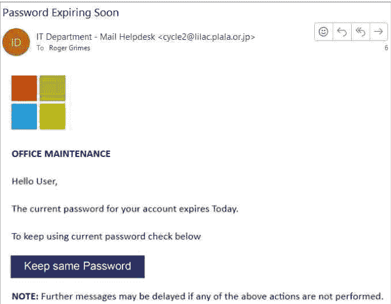

### 图 1-1 常见的网络钓鱼电子邮件类型。

图 1-1 是一种非常常见的网络钓鱼电子邮件示例，很可能也是最常见的一种，其中网络钓鱼者试图使其看起来像是来自 Microsoft 要求提供账户密码的官方电子邮件。如果受害者点击“保留相同密码”按钮，他们将被引导至一个伪造的、看起来相似的网站，该网站要求受害者输入真实的账户密码。这封电子邮件具有许多网络钓鱼邮件的经典特征，我们将在后续章节中详细讨论，但最明显的是，发件电子邮件地址来自日本的某个随机电子邮件地址（由 .jp 域名后缀指示），而不是真正来自 Microsoft 的电子邮件所使用的 microsoft.com。

有些人可能会好奇社会工程学和网络钓鱼之间有什么区别，以及我为何将它们分开提出。社会工程学是一种恶意欺诈骗局，其中施骗者通常冒充他人、某个群体或潜在受害者可能会更加隐式信任（胜过陌生人）的品牌，试图诱使受害者执行与其自身利益相悖的行为。施骗者不一定总是陌生人。骗子可能是受害者认识甚至非常熟悉的人（如最好的朋友或家人）。但在当今的数字世界中，大多数在线数字诈骗都是由我们不认识的人实施的。

社会工程学与人类历史一样悠久。有许多古老的早期文字记载，人们在其中抱怨遭受骗局和被利用。你可以在 www.investopedia.com/articles/financial-theory/09/history-of-fraud.asp 上找到一个可追溯至公元前 300 年的早期金融诈骗案例。

社会工程学就是利用一个人对另一个人固有的信任。我们天生就倾向于默认信任彼此。一般而言，这种默认信任对我们大有裨益。我们每天做的大多数事情之所以可行，仅仅是因为我们的默认假设和对他人固有的信任大多数时候不会损害我们的利益。我们的文明大部分得以运作，也正是因为这种信任在大多数时候通常是有充分依据的。但骗子会利用这种默认信任。

通常，诈骗是为了金钱利益，但也可能出于许多其他原因，例如恋爱、报复、嫉妒、身体伤害，实际上是对任何情绪的回应，甚至包括幸福。人们常常会对朋友和亲人进行社会工程学操纵，使其进入对所有人都有利的情境（例如，惊喜生日派对或为期望行为提供奖励）。然而，在本书的语境下，我们讨论的是涉及一方故意伤害另一方的恶意社会工程学诈骗。

有人被社会工程学操纵并遭到诈骗的方式有很多种。基本上，双方之间的任何通信方式都可以用于诈骗，包括当面交流、实体邮件、电话、短信、电子邮件、网站、即时通讯、协作应用程序和社交媒体。想骗人总有办法。我一点也不会惊讶地得知，历史上不同文化曾使用信鸽、旗语、烽火或其他通信方式互相诈骗。

*网络钓鱼*是一种涉及在线数字媒体的犯罪社会工程学类型。最常见的网络钓鱼形式是使用电子邮件，但它可以通过任何电子通信渠道进行，包括网站、即时通讯、手机短信甚至语音通话。我将在第 2 章“网络钓鱼术语与示例”中更详细地介绍不同类型的网络钓鱼。你会听到有些人把所有形式的社会工程学都称为网络钓鱼，这也没关系，因为在整个语境下我们都能理解对方想要表达的内容。没必要纠结于模拟电话是否算网络钓鱼的争论。这一切都是不好的。但你应该明白，无论你如何定义这两个术语，社会工程学的范围都比网络钓鱼广。本书旨在帮助人们避免所有恶意社会工程学，但鉴于当今的在线数字世界，它自然更侧重于网络钓鱼。

社会工程学和网络钓鱼活动猖獗。每年有数百万人和数千家公司因诈骗者损失数十亿美元。网络钓鱼因为是数字化的，很容易规模化。它成本低、风险低（绝大多数网络钓鱼诈骗者至少在几年内都能逍遥法外），并且单个施骗者每天可以对数千万潜在受害者实施。所有*网络钓鱼者*（即发起或传播网络钓鱼信息的人）需要的只是对自己和潜在受害者的有效电子邮件地址、账户名、网站地址或电话号码。通常，他们一次可以轻松获取数百万的潜在受害者联系地址。

进行当面诈骗的骗子通常一次只能实施一起诈骗，并且因为身体在场，面临被识别、拘留或逮捕的风险要大得多。网络钓鱼者被闪电击中的可能性，几乎都大于因网络钓鱼他人而被识别或入狱。终身被闪电击中的概率约为 1/15,300（www.britannica.com/question/What-are-the-chances-of-being-struck-by-lightning）。

但长期从事网络钓鱼并造成重大损失的网络钓鱼者，通常会引起防御者或执法部门的注意。他们最终要么被捕，要么放弃他们正在实施的网络钓鱼诈骗（以避免被识别和抓获）。大多数网络钓鱼者仍然记得早期成功所带来的所有金钱，会继续下去直到运气耗尽（有点像银行抢劫犯）。但并非所有网络钓鱼者都会这样做。有些人带着所有赃物从网络钓鱼诈骗中退休，并且从未遭受过负面后果。但这些人是少数。大多数人会继续下去，直到遭受负面后果。这一点很难记住，尤其是当他们看起来高枕无忧时，而且许多人公开炫耀自己不义之财并展示他们的财富。

问题在于，大多数网络钓鱼者在结束参与（无论是自愿还是被迫）之前，会实施数千万到数亿次网络钓鱼诈骗。即使他们停止了，也总有源源不断的其他骗子愿意取而代之。据估计，在任何给定时刻，都有数万名网络钓鱼诈骗者在互联网上推送数亿次网络钓鱼诈骗。而且这种趋势短期内不会放缓。

之所以会有如此多的网络钓鱼诈骗和愿意冒入狱风险的施骗者，原因很简单：可赚取的钱太多了（实际上是偷来的）。诈骗者每年能赚取数十亿。不仅商业企业的员工正在成为目标，还


骗子可以获取从企业中盗取的巨额资金，但普通人自己也在将越来越多的钱放在网上。如今，大多数人的银行、信用卡、投资和退休账户都在网上。不幸的是，只要诈骗有利可图、成本低且风险低，它们就会继续猖獗。

## 社会工程学和网络钓鱼有多普遍？

个人、设备或网络都有多种被攻击的方式。社会工程学和网络钓鱼有多普遍？首先，你必须了解社会工程学和网络钓鱼正在与哪些其他类型的黑客攻击竞争。这些方法包括以下几项：

- 编程缺陷（是否有补丁可用）
- 身份验证攻击
- 恶意指令/脚本
- 数据畸形
- 人为错误/配置错误
- 窃听/MitM
- 侧信道/信息泄露
- 暴力破解/计算攻击
- 网络流量畸形
- 内部攻击
- 第三方依赖问题（供应链/供应商/合作伙伴等）
- 物理攻击

据我所知，加上社会工程学，这是黑客和恶意软件用来攻破人员和设备的攻击方法的完整列表。我所了解的每一次被攻破和利用都始于属于这些类别之一的攻击方法。

大多数人不知道的是，每种攻击类型（也称为*初始根访问漏洞利用*）相对于彼此的发生频率有多高。有来源会跟踪和研究每种攻击方法的相对发生情况。结果表明，社会工程学是最流行的攻击方法，遥遥领先。利用未打补丁的软件和固件是第二常见的攻击类型，而这两种攻击方法（即社会工程学和利用未打补丁的软件和固件）共同占网络攻击的90%到99%。所有其他攻击类型加在一起也不超过攻击的10%。单独来看，社会工程学涉及40%到90%的所有成功攻击，具体比例取决于你阅读和相信的来源。

## 社会工程学统计数据

**我的研究** 我跟踪社会工程学和网络钓鱼作为初始根访问原因与其他12种攻击类型相比的普遍程度已有20多年。我的数据基于多年的研究，我对比了隐私权清算机构数据库（https://privacyrights.org）中列出的数千起泄露事件，并将它们与其初始根本原因联系起来。我主要关心的是：“受害者为什么会被攻击？”

作为非营利组织的隐私权清算机构于2005年开始跟踪泄露事件。如今，其数据库包含超过20,000起不同泄露事件的信息。它是此类最大的公共跟踪数据库。它曾经可以免费下载，但目前收费250美元。考虑到它包含的汇总信息，这并不算贵。

即使以数据库为起点，由于各种原因，确定初始根本原因也不总是容易。首先，并非所有泄露事件都在数据库或相关公开报告中包含了根本原因。仅在大约三分之一到二分之一的公开报告案例中，公开来源才列出了黑客攻击的根本原因。大多数时候，我需要进行更深入的挖掘。在这些情况下，我首先尝试运用我最好的Google和Bing搜索技巧，寻找讨论根本原因的官方文件或访谈。这使我能够找到另外三分之一案例的初始根本原因。最后，我尝试发邮件或致电案件相关人员以获取根本原因。

有时，根本原因在数据库或相关公开来源中被错误描述。例如，许多泄露事件被错误地关联到黑客攻击或勒索软件。黑客攻击不能告诉我发生了什么。一切都是黑客攻击。而且勒索软件是初始根本原因的潜在结果，而非根本原因本身。我不得不问人们：“黑客或勒索软件是如何进入你的公司的？”有时他们知道，有时他们不知道。但在我能够确定初始根本原因漏洞利用的案例中，社会工程学至少涉及70%的案例。

几十年来，我跟踪发现未打补丁的软件和固件涉及20%到40%的案例，具体取决于年份。最近，在2023年，计算机安全公司Mandiant表示，未打补丁的软件和固件涉及33%的成功泄露事件，因此这些比例似乎保持稳定。

此外，在我的职业生涯中，我获得了多家公司的巨大专有数据库的访问权限，这些公司参与了数百起乃至数千起或更多客户数据泄露事件的调查。这些数据库也证实了社会工程学在大多数攻击中的高普遍性。因此，我关于70%的说法并非轻率之言。这不仅仅是一种直觉。

## 其他社会工程学研究

社会工程学远远是头号根本漏洞利用原因的地位，几乎所有供应商报告的研究都支持这一点。我的KnowBe4同事兼朋友Javvad Malik，从AlienVault的开放威胁交换（otx.alienvault.com）检索了来自43家不同供应商的100家供应商报告，进行了一项元分析研究（https://info.knowbe4.com/threat-intelligence-to-build-your-data-driven-defense）。归因于社会工程学的攻击比例因报告和供应商而异，但在几乎每份报告中，社会工程学都是首要威胁。我见过一些报告暂时将其他黑客根本原因（例如远程访问、密码破解等）列为头号根本原因，但通常这些其他类别只是暂时成为头号得票者。通常，社会工程学或网络钓鱼会在下一份报告中重新出现为头号黑客攻击原因，并长期如此。

但大多数跟踪初始根本原因的报告都将社会工程学或网络钓鱼列为其持续的头号原因。10年前也是如此，在当今我阅读的几乎每一份汇总讨论黑客攻击根本原因的供应商报告中仍然如此。大多数报告对归因于社会工程学或网络钓鱼的黑客攻击百分比不一致，但他们都同意社会工程学或网络钓鱼是头号根本黑客攻击方法。近年来有一些值得注意的例子。

2023年8月，Comcast报告称，89.46%的针对其客户的攻击始于网络钓鱼（https://blog.knowbe4.com/customer-network-breaches-phishing）。您可以在此处阅读完整报告：https://business.comcast.com/community/docs/default-source/default-document-library/ccb_threatreport_071723_v2.pdf。

IBM的2023年X-Force威胁情报指数报告（www.ibm.com/downloads/cas/DB4GL8YM）中，网络钓鱼所占百分比较低，但仍是头号原因，报告称：“网络钓鱼仍然是主要的感染向量，在41%的事件中被识别，其次是利用面向公众的应用程序，占26%。”他们的2022年报告（https://securityintelligence.com/posts/expanding-ot-threat-landscape-2022）表达了大致相同的观点，但百分比要高得多：“网络钓鱼继续是被识别出的最普遍的初始访问向量……”以及“……网络钓鱼在X-Force迄今在2022年应对的这些行业的78%的事件中充当了初始感染向量。”

社会工程学和网络钓鱼是全球性问题。英国官方政府统计网络安全泄露调查2022（www.gov.uk/government/statistics/cyber-security-breaches-survey-2022/cyber-security-breaches-survey-2022）指出：“……最常见的威胁向量是网络钓鱼尝试（83%）。”

2022年，Kroll网络情报报告（www.kroll.com/en/insights/publications/cyber/threat-intelligence-reports/q1-2022-threat-landscape-threat-actors-target-email-access-extortion）称，网络钓鱼涉及所有攻击的60%。

InfoBlox的2022年全球安全状态报告（https://files.scmagazine.com/wp-content/uploads/2022/05/Infoblox-Main-Report.pdf）称：“最成功的攻击方式是网络钓鱼（58%）。”

2023年5月，Barracuda Networks报告（www.barracuda.com/reports/spear-phishing-trends-2023）称，虽然鱼叉式网络钓鱼仅占所有基于电子邮件攻击的0.1%，但它占成功妥协事件的66%。对于单一根本原因来说，这非常巨大！


所以，正如 Javvad Malik 的元研究所揭示的，供应商可能对确切的百分比不一致，但他们一致认为网络钓鱼是头号网络威胁，而且是个大问题。

## 为什么社会工程学统计数据差异这么大？

不同供应商报告不同社会工程学统计数据的主要原因是涉及的客户和调查范围。有些供应商仅包括与其有直接业务往来的客户。有些供应商主要与中小企业合作，另一些则与大型企业合作。有些供应商专注于特定行业，而另一些（如英国报告）仅调查其本国的组织。

另一个重要原因是，遗憾的是，尚未就初始根本原因访问类别达成一套标准。很多时候，供应商将某种特定类型的攻击归类为根本访问方法，而实际上它是根本访问方法的结果。例如，许多供应商都有一个名为勒索软件、远程访问或凭据盗窃的类别。所有这些都是其他根本访问方法的结果。例如，如果涉及凭据盗窃，那么凭据是如何被盗的呢？我可以告诉你——可能是通过社会工程学（当然也可能是其他方式）。

隐私权清算所数据库有一个名为 HACK 的类别，将其定义为“被外部方入侵或感染恶意软件”。这几乎无法告诉你该特定入侵是如何发生的。是由于社会工程学、未打补丁的软件，还是其他原因？许多供应商都有一个名为“恶意软件”或“勒索软件”的类别。同样，该勒索软件或恶意软件实际上是如何利用该系统并进入的呢？如果所有供应商都同意使用相同的类别描述，那么他们的社会工程学类别百分比很可能会比他们今天报告的更高。

### 很可能更大，大得多！

有可能，已经报告的社会工程学统计数据，尽管数字已经很大，但却大大低估了社会工程学诈骗的真实范围。主要原因之一是，大多数供应商报告仅针对企业或行业客户。大多数报告并未调查在家中使用个人电脑和手机的人。如果调查了，他们很可能会发现，大多数人都曾成为社会工程学攻击尝试的目标，通常通过电子邮件，但也通过短信。我们中有谁没有在家中通过电子邮件、短信甚至语音电话遭受过网络钓鱼呢？有些天我的大部分短信都是诈骗。我接到的大部分电话也是诈骗。最近有人被要求延长汽车保修吗？我们中有多少人的父母和祖父母曾被成功诈骗？

美国联邦贸易委员会（FTC）表示，仅2022年，美国消费者就损失了3.3亿美元（www.ftc.gov/news-events/news/press-releases/2023/06/new-ftc-data-analysis-shows-bank-impersonation-most-reported-text-message-scam）。FTC的统计数据低估了损失的真实规模，因为大多数人不会向执法机构或FTC报告损失。

如果你认识的几乎每个人都曾通过电子邮件和电话接到过诈骗尝试，那么社会工程学统计数据应该有多大？社交媒体（例如 Facebook、Instagram 等）上的大多数人都会定期在这些服务上接到诈骗。我几乎每天都在 LinkedIn 上收到诈骗尝试。你曾经在 Craigslist 上试过出售或购买东西吗？你可能收到的第一个联系人就是诈骗者。我有很多朋友在试图租公寓或度假住宿时，要么被成功诈骗，要么差点被诈骗。

那恋爱诈骗呢？FTC 报告（www.ftc.gov/news-events/data-visualizations/data-spotlight/2023/02/romance-scammers-favorite-lies-exposed）称，仅2022年，就有超过70,000人因恋爱诈骗损失超过13亿美元。而这些只是向 FTC 报告的人，这只占受害者总数的一小部分。

我认为，如果任何单一来源汇总了个人和行业层面的所有类型的初始根本黑客攻击方法，那么经历过社会工程学和网络钓鱼尝试的人数总百分比将达到90多。当我们中近100%的人每年都可能成为诈骗尝试的受害者时，还能有什么其他结果呢？

社会工程学诈骗给受害者造成的损失比其他类型的黑客攻击更高。根据 IBM 第18届年度《2023年数据泄露成本》报告（www.ibm.com/reports/data-breach），所有原因导致的平均数据泄露成本为445万美元，但社会工程学造成的成本为476万美元。只有恶意内部人员攻击更高，为490万美元。同一份报告指出，平均需要234天来发现泄露，80天来遏制它。

### 勒索软件和 BEC

在最近几年中，勒索软件和商业电子邮件妥协（BEC）诈骗一直是大多数组织的头号威胁。勒索软件是一种攻击，攻击者加密受害者的电脑或数据，并要求支付赎金以解密。勒索软件犯罪集团还经常窃取登录凭据（企业、员工和客户的）、外泄数据，并公开羞辱受害者（这种组合在媒体上被称为双重勒索）。

至少自2018年以来，勒索软件一直是（或常常是）商业专业人士的头号担忧。企业确实有理由担心勒索软件。许多不同的报告显示，超过60%的企业每年都遭受勒索软件攻击。勒索软件通常会导致重大的运营中断和高额的财务损失。Coveware 表示，2023年第一季度的平均赎金支付额为740,144美元（中位数为190,424美元）（www.coveware.com/blog/2023/7/21/ransom-monetization-rates-fall-to-record-low-despite-jump-in-average-ransom-payments）。即使是较低的中位数金额也是一大笔钱。Sophos 将平均勒索软件支付额定为150万美元，平均修复成本为140万美元（https://assets.sophos.com/X24WTUEQ/at/4zpw59pnkpxxnhfhgj9bxgj9/sophos-state-of-ransomware-2022-wp.pdf）。大多数报告声称，修复成本通常超过赎金成本。Sophos 表示，勒索软件导致的平均停机时间为一个月，但大多数勒索软件受害者报告称，即使在勒索软件攻击后6个月到一年，仍面临持续的运营问题。一些受害者永久停业。

Adrian Sanabria 维护着一个由网络攻击导致停业的企业非正式列表，其中包含许多勒索软件事件。参见 https://docs.google.com/spreadsheets/d/15CTPcgZQenWKDLdTQ2ibveUM4i7Of_n20TzdTi23xcg/edit#gid=0，但由于这是个人电子表格，请自行承担风险打开。

很明显，勒索软件是一种严重的风险，可能导致重大的货币损失和运营停机。你可能不会惊讶地发现，大多数勒索软件攻击都始于社会工程学。2021年7月，我查找了能找到的所有勒索软件报告，这些报告列出了勒索软件利用受害者的初始根本访问方法。我找到了超过100份报告，但不幸的是，只有六份报告（如图1-2所示）讨论了根本访问方法。我创建了一份名为《勒索软件的根本原因》的白皮书（https://info.knowbe4.com/wp-root-causes-ransomware）。图1-2来自该白皮书。

如您所见，社会工程学是勒索软件犯罪集团使用的头号初始根本访问方法，且领先很大。只有 Coveware 报告曾将社会工程学列为第2位，但那只是当时的情况。如今，Coveware 将社会工程学列为勒索软件的头号根本原因（www.coveware.com/blog/2023/7/21/ransom-monetization-rates-fall-to-record-low-despite-jump-in-average-ransom-payments）。

| 报告名称 | 社会工程学 | RDP | 未打补丁的软件 | 密码猜测 | 凭据盗窃 | 远程服务器攻击 | 第三方 | USB | 其他 |
|---|---|---|---|---|---|---|---|---|---|
| Coveware 报告 | 30% | 45% | 18% | - | - | - | - | - | 5% |
| Statista | 54% | 20% | - | - | 10% | - | - | - | - |
| 福布斯杂志文章 | 第1名 | 第3名 | 第2名 | - | - | - | - | - | - |
| Datto 报告 | 54% | 20% | - | 21% | 10% | - | - | - | - |
| Hiscox 网络就绪 | 65% | - | 28% | 19% | 39% | - | 34% | - | - |
| Sophos 报告 | 45% | 9% | - | - | - | 21% | 9% | 7% | 9% |
| 平均值 | 50% | 24% | 23% | 20% | 20% | 21% | 22% | 7% | 7% |

图 1-2 来自 KnowBe4《勒索软件的根本原因》白皮书的勒索软件根本原因列表。

勒索软件之后，BEC 诈骗是第二种最具破坏性的网络攻击类型。BEC 诈骗是指恶意社会工程学实施者试图诱骗某人或企业进行本不该进行的付款。它还有几个其他名称，例如 CEO 欺诈和资金转移欺诈。常见的 BEC 诈骗类型是，诈骗者向负责应付账款的人发送一张假发票，并声称已逾期需要立即支付。或者，诈骗者说服某人向一个新的（未经授权的）银行账户进行原本合法的付款。网络钓鱼者通常会入侵企业的电子邮件账户，找到应付账款发票，然后利用新获得的信息诱骗付款人将应付金额汇入新的未经授权的银行账户。


BEC 诈骗是一种非常常见的网络钓鱼诈骗类型。Great Horn 在其 2021 年商业电子邮件妥协报告 (https://info.greathorn.com/hubfs/Reports/2021-Business-Email-Compromise-Report-GreatHorn.pdf) 中报告称，20% 的所有网络钓鱼尝试都是 BEC 诈骗。Abnormal Security 的 H1 2023 电子邮件威胁报告 (https://abnormalsecurity.com/resources/h1-2023-report-employee-open-rates) 指出，28% 的 BEC 电子邮件被员工打开，15% 获得员工回复。更糟糕的是，只有 2.1% 的攻击被员工报告。

一份 2022 年 SecureWorks 报告 (https://blog.knowbe4.com/business-email-compromise-phishing-attacks-increase) 报告称，他们参与的事件响应案例数量在 2021 年至 2022 年间翻了一番，主要是因为 BEC 诈骗，其中 85% 的诈骗源于社交工程。FBI 表示，2022 年 BEC 诈骗中被盗金额达 24 亿美元 (www.fbi.gov/file-repository/fy-2022-fbi-congressional-report-business-email-compromise-and-real-estate-wire-fraud-111422.pdf/view)，BEC 违规的平均成本为 501 万美元 (www.linkedin.com/pulse/business-email-compromise-bec-26-billion-scam-criadvantage)。

BEC 诈骗可以骗过任何人，包括那些你认为更精通技术的人。Facebook 和 Google 曾因一名 BEC 诈骗者损失 1.21 亿美元 (www.bnnbloomberg.ca/facebook-google-scammer-pleads-guilty-in-us-121m-theft-1.1232217)。另一起 BEC 诈骗使受害者损失 1.3 亿美元 (www.friedfrank.com/uploads/siteFiles/Publications/FriedFrankM%26AQuarterlyApril2022.pdf)，并导致一项重大合并取消。

通过制定政策，要求员工使用备用、独立、可信的方式确认任何意外付款请求或更新付款指示的请求，可以预防许多 BEC 诈骗。

如需了解有关 BEC 诈骗及其预防方法的更多信息，请参见：https://info.knowbe4.com/ceo-fraud-prevention-manual 或 www.fbi.gov/how-we-can-help-you/safety-resources/scams-and-safety/common-scams-and-crimes/business-email-compromise。

很明显，社交工程和网络钓鱼是任何个人或组织将面临的最大网络安全威胁。情况长期如此，短期内似乎没有什么可能改变这一现状。每个人和每家企业都应尽力预防社交工程和网络钓鱼。

## The Solution

第 3 章至第 17 章讲述了你和你的组织如何更好地防范社交工程和网络钓鱼威胁。这将涉及你最佳的纵深防御组合计划，包括政策、技术防御和安全意识培训。这正是本书的主旨。

但如果我现在要透露一个最佳实践秘诀，你能做的最重要的一件事就是教会你自己、同事、家人和朋友如何检测、处理和报告社交工程及网络钓鱼诈骗。教育是击败这些威胁的关键要素。

网络钓鱼消息通常是接收者未预期的全新消息——不总是如此，但通常如此。教导每个人，当他们收到一条新的、意外的消息，要求其执行可能对自身或其组织造成伤害的操作时，应在执行所请求的操作之前，先以更可信的方式对其进行调查。这些操作在图 1-3 中有总结。

新消息，无论其如何抵达
（电子邮件、网页、短信、聊天、社交媒体、语音通话、当面）

请求是否出乎意料？
↓
来自发件人的新请求？
↓ 是
如果请求具有恶意，可能会损害接收者的利益吗？
↓ 是
在执行前进一步调查请求

**图 1-3** 三项检查以帮助防止社交工程和网络钓鱼。

你需要对任何新的、意外的、要求执行操作的请求保持健康的怀疑态度，如果该请求具有恶意可能会造成伤害，无论其如何抵达（例如，当面、电话、短信、电子邮件、网页、社交媒体、即时通讯等）。如果消息包含这些因素，收件人应在执行所请求的操作之前进一步调查（例如，拨打已知的正确电话号码联系该人员，访问真实网站等）。你不能完全信任陌生人、电话、电子邮件、短信或网络。骗子实在太多了。

所以，如果我只能给出一条建议，那便是这个。幸运的是，我有一整本书的建议要给出，我知道这些建议将显著降低你和你的组织被骗的可能性。

## Summary

第 1 章介绍了社交工程和网络钓鱼，并解释了为何缓解它们如此重要。它们是最流行的网络攻击类型，占所有成功黑客和恶意软件攻击的 70% 到 90%。没有其他网络攻击方法能与之相比。所有其他网络攻击方法（例如，未修补的软件、窃听等）加在一起，也无法与社交工程和网络钓鱼的风险相提并论。第 2 章将在此章基础上展开，讨论相关术语并展示许多示例。

# CHAPTER 2

## Phishing Terminology and Examples

第 2 章将定义讨论网络钓鱼相关事件时使用的数十个术语。它将包含多种不同类型网络钓鱼的示例。我的希望是，无论新手还是老手，每个人都能对社交工程和网络钓鱼可能涉及的内容有更深入的基础理解。

### Social Engineering

让我们重温第 1 章“社交工程和网络钓鱼简介”中关于社交工程的定义。在本书中，社交工程是一种恶意诈骗，其中施骗者通常会冒充他人、某个群体或某个品牌，而潜在受害者可能会比信任陌生人更隐含地信任这些身份，试图诱使受害者执行与自身利益相悖的操作。

### Phish

如在第 1 章中讨论，*网络钓鱼* 是一种涉及在线数字媒体的犯罪社交工程类型。网络钓鱼可以以多种不同方式发生，包括电子邮件（最常用的方法）、语音通话、当面、网站、短信、即时通讯、协作应用和社交媒体。图 2-1 是常见网络钓鱼邮件的一个示例。

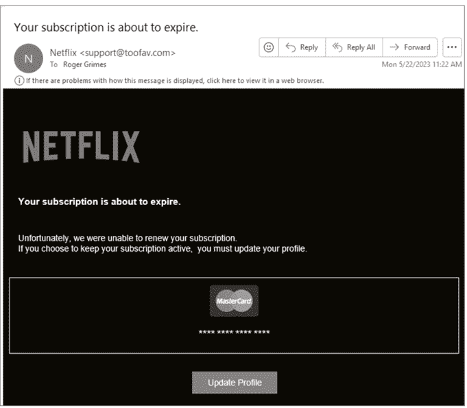

**图 2-1** 常见网络钓鱼邮件示例。

在此示例中，一封伪造的 Netflix 电子邮件试图获取潜在受害者的 Netflix 登录凭据或信用卡号码。你可以看到，发件人电子邮件地址并非来自 netflix.com，而如果电子邮件是合法的，地址应该来自 netflix.com。如果受害者点击“更新个人资料”按钮，他们将被带到一个伪造的 Netflix 网站，在那里将被要求输入密码，可能还包括信用卡信息。

## Well-Known Brands

网络钓鱼消息通常会欺诈性地伪装成来自某个知名品牌（例如，Microsoft、Facebook、Netflix、DocuSign、Amazon、DHL、USPS 等）。通常，电子邮件地址的某个部分会包含品牌名称，尽管网络钓鱼电子邮件很少真正来自该品牌或其互联网域。我们将在后面章节中介绍如何区分，尤其是在第 7 章“DMARC、SPF 和 DKIM”中介绍 DMARC 时，以及在第 13 章“识别恶意 URL”中。

网络钓鱼电子邮件通常会包含品牌可识别的商标徽标，并可能包含来自或指向品牌真实网站的文本、对象和其他链接。网络钓鱼电子邮件包含所有有效的品牌链接、措辞和对象并不罕见，唯一完全欺诈性的项目是网络钓鱼消息试图诱使潜在受害者点击的那个按钮或链接。网络钓鱼电子邮件经常包含声称该电子邮件合法或无病毒的声明。添加这些声明对诈骗者来说不成本。

许多不同的反网络钓鱼公司会发布月度或季度报告，详细说明最受欢迎的模拟品牌。以下是一份示例报告：https://blog.checkpoint.com/security/dhl-replaces-microsoft-as-most-imitated-brand-in-phishing-attempts-in-q4-2021。


## 顶级网络钓鱼主题

网络钓鱼消息必须包含一个主题，一个 *诱饵*，诱使潜在受害者在不加谨慎的情况下查看或打开它）。以下是一些常见的压力陈述示例：

- * 您的密码即将过期，如果您不立即响应，将永久失去对帐户的访问权限。
- * 您的帐户已被黑客攻击。
- * 如果您不执行请求的操作，将会损失金钱。
- * 您正在被收取一笔意外付款。
- * 需要法律文件签名。
- * 如果您不立即响应，一些机密信息或尴尬事实将被发布。

图 2-2 提供了一个来自 2023 年网络钓鱼攻击的复杂网络钓鱼压力陈述的良好示例。

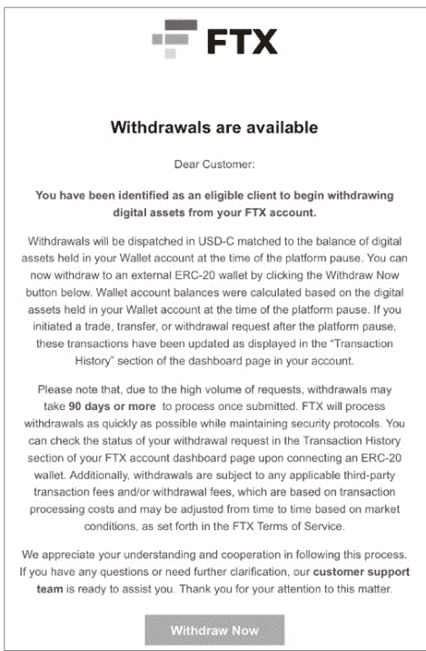

图 2-2 带有复杂压力陈述的网络钓鱼电子邮件示例。

该网络钓鱼电子邮件与一个涉及 Kroll 和 FTX（https://krebsonsecurity.com/2023/08/kroll-employee-sim-swapped-for-crypto-investor-data）的高级网络钓鱼方案有关。Kroll 是一家大型网络安全供应商，他们正在处理 FTX 客户的加密货币账户，FTX 是有史以来最大的加密货币公司之一，已经破产，其高管正面临联邦起诉。FTX 的客户很可能损失了数十亿美元。Kroll 被选中在所有法律和财务问题解决期间暂时持有 FTX 的客户信息。其设想是 FTX 的客户将来能拿回一些钱，Kroll 至少会部分参与确保追回的适当金额资金发送给每位客户。

一名黑客（或黑客团体）能够控制至少一个 Kroll 员工帐户（使用所谓的 SIM 卡交换攻击），并访问了 FTX 的客户信息，包括电子邮件地址。黑客随后向 FTX 的客户发送了图 2-2 中所示的网络钓鱼电子邮件。一些受害者表示他们多次收到该网络钓鱼电子邮件，多达 15 次。压力陈述的暗示是，任何仍在等待拿回钱的人都可以点击“立即提现”按钮。因此，所有认为自己存放在 FTX 的全部或部分资金已经损失的 FTX 客户，都可能突然且惊讶地拿回所有资金。这对 FTX 的客户来说是一个巨大的动机。但是，当受害者遵循建议的操作时，他们只是进一步损失了加密货币或金钱。任何带有压力陈述的电子邮件到达后都应立即受到怀疑，直到被证明否则。

大多数网络钓鱼邮件都包含它们希望潜在受害者点击的链接。受害者可能会看到链接，或者链接可能嵌入在他们必须选择或点击的按钮中。如今，大约一半的所有网络钓鱼消息都是试图获取受害者的登录凭据。

## 恶意下载

目前，大约四分之一的网络钓鱼消息包含恶意下载（或指向恶意下载的链接），骗子希望诱使用户执行或打开它。恶意文件可以采用一百多种不同的文件格式。根据 VirusTotal，以下是他们关于这些恶意文件类型的一些调查结果（https://assets.virustotal.com/reports/2023emerging.pdf）：

- * 通常，骗子试图让用户运行包含恶意指令的 Java-Script 文件。
- * 约 20% 的恶意文件是压缩文件（例如 .zip、.arc 等）。
- * 约 45% 的恶意文件附件是 .html 文件。
- * 约 10% 的恶意下载是带有有害嵌入指令或链接的 PDF 文件。
- * 由于几年前 Microsoft 自动阻止了宏执行，Microsoft Word 和 Excel 文件的受欢迎程度正在下降。
- * 2023 年，ISO 和 Microsoft OneNote 文件格式在黑客中越来越受欢迎。

许多恶意文件通常受密码保护或被锁定，以便反恶意软件检测器无法打开它们。在这些情况下，通常，密码或解锁代码是网络钓鱼消息文本的一部分，以便文件能够绕过恶意软件检查员，但仍能被潜在受害者打开。无论是否锁定，不幸的是，很大比例的恶意下载未被任何防病毒扫描器检测为恶意，如果打开，很容易利用最终用户。

链接和文件通常以编程方式链接在一起，这样当用户打开第一个时，就会得到第二个，第二个打开第三个，第三个打开第四个，以此类推。这是恶意代码被反恶意软件检查员遗漏的一种巧妙方法。链中的链接越多，反恶意软件检查员就越可能遗漏恶意性。

## 恶意软件

恶意软件（Malicious Software 的缩写）是任何恶意程序或一组指令。传统恶意软件被分类为三种类型之一：计算机病毒、计算机蠕虫或木马程序。病毒是通过感染其他“主机”程序、数据、宏或磁盘引导区域来复制和传播的恶意软件。蠕虫是一种自我复制的恶意软件，使用其自身代码传播，尽管它通常依赖于利用服务/守护进程。木马程序是假装成合法程序以诱骗最终用户传播和打开的恶意软件，但包含如果用户知道就不会执行的流氓代码。

如今，计算机病毒占恶意软件的少数。计算机蠕虫并不十分流行，但一旦传播，就是传播速度最快的恶意软件之一（例如，MS-Blaster、Code Red、SQL Slammer 蠕虫、Melissa 等）。如今，大多数恶意软件要么是木马程序，要么是结合两种或多种恶意软件类别特征的混合体。不同恶意软件类别之间的差异对大多数人来说不再那么重要，直接使用恶意软件一词来指代任何类型的恶意程序非常流行。

## 机器人

机器人是一种恶意软件程序，旨在充当网络中称为僵尸网络的更大机器人集合中的节点。机器人


被编程以执行特定的一组动作和指令，并且通常可以更新。

大量网络钓鱼消息旨在传播机器人，希望将受害者的网络或设备转变为僵尸网络节点。僵尸网络的规模可以从几百个机器人到单个僵尸网络中的数十万个机器人不等。僵尸网络的所有者经常将其出租给其他黑客，用于各种目的，包括恶意软件分发、发送网络钓鱼邮件、分布式拒绝服务（DDoS）攻击、登录凭据窃取，以及黑客或僵尸网络所有者所能想到的任何事情。全世界有数百万人没有意识到，此刻他们的计算机或网络设备可能已成为僵尸网络的一部分，能够截取其机密信息或被用来攻击其他计算机和网络。

## 下载器

_下载器_程序是一种旨在获得对受害者设备的初始访问权限，可能收集一些基本信息（如主机名、主机 IP 地址、网络名称、登录凭据窃取等），然后“回拨”到其控制的命令与控制（C&C 或 C2）服务器，以发送收集的信息并接收更多指令的恶意软件。它也被称为投放器。通常，指令包括下载其他恶意软件，并为黑客启用对受害者计算机的远程后门访问。入侵受害者的初始程序随时间被一个或多个其他恶意软件程序更新和替换是非常常见的。

## 账户接管

_账户接管_ 是指黑客控制用户在线数字账户的行为，通常是通过窃取合法用户的登录凭据实现的，但也可以通过其他方式完成。账户接管（ATO）最常见的形式是电子邮件账户泄露，即用户的电子邮件账户受到黑客控制。这是一种非常常见的攻击类型，通常通过网络钓鱼完成，黑客每天这样做数百万次以窃取合法用户的电子邮件登录凭据。

ATO 也可以是指用户的社交媒体账户（例如 Instagram、Facebook、Twitter、LinkedIn 等）被接管。同样，这通常是通过钓鱼获取合法用户的登录凭据来完成的。遗憾的是，所有主要的社交媒体服务都非常糟糕地帮助合法的 ATO 受害者重新控制其账户。通常，一旦被黑客接管，合法用户将永远无法再次访问其被盗账户。

一个教训是要意识到社交媒体账户不属于用户，如果丢失，用户可能永远无法重新获得控制权。如果你只有一份社交媒体账户中的内容副本，并且如果它丢失会让你不安或受到伤害，请在本地进行备份。另外，使用防钓鱼的多因素身份验证（MFA）来保护你的账户登录。这是保护自己免受 ATO 攻击的最佳方法之一。

## 垃圾邮件

垃圾邮件是一种不需要的消息，通常试图向你推销东西。它也被称为未请求的批量电子邮件或垃圾邮件（当适用于纸质邮件时）。有些人和团体将网络钓鱼视为一种垃圾邮件，而另一些人则将其区分开来，因为网络钓鱼更多时候是试图窃取钱财或诱使潜在受害者执行未经授权的操作——而不仅仅是试图推销东西。如果一封电子邮件试图向你推销色情内容或伟哥，并会拿走你的钱并给你寄送产品，那它是垃圾邮件。如果它试图获取你的银行账户详细信息或安装恶意软件，那它是网络钓鱼。网络钓鱼者通常不会向受害者发送任何东西，只会带来压力和心痛。

像垃圾邮件一样，大多数网络钓鱼都是大批量发送的，即成千上万甚至数百万条钓鱼消息被发送给各种收件人，而钓鱼者并不认识任何预期目标。许多钓鱼者会在一次 *网络钓鱼活动* 中发送数千万条钓鱼消息。钓鱼者的意图是发送如此多的钓鱼消息，以至于即使只有极小比例的潜在受害者响应（比如说 0.1% 到 2%），对钓鱼者来说仍然是有利可图的。在网络钓鱼行话中，如果受害者响应了网络钓鱼活动，这被称为 *转化*。受害者响应或最终被攻击的百分比被称为 *转化率*。转化率良好的网络钓鱼活动会被重复。

## 鱼叉式网络钓鱼

*鱼叉式网络钓鱼* 是指有针对性的网络钓鱼试图利用特定的人、职位、团队、组织或群体。例如，也许钓鱼者正试图攻陷某家银行的员工。或者他们试图对某家公司的特定应付账务文员进行社交工程攻击。进行鱼叉式网络钓鱼的钓鱼者通常会研究其预期目标，并试图使用他们在公开可用的网站和社交媒体上找到的信息，或使用他们从其他攻击中之前了解到的私人或机密信息。普通网络钓鱼很少掌握预期受害者的机密信息，而鱼叉式网络钓鱼通常会掌握。

一个很好的例子是向应付账务员工发送一封鱼叉式网络钓鱼邮件，其中包含一个发送给特定客户的真实存在的采购订单（PO）编号。鱼叉式网络钓鱼邮件要求应付账务员工将款项支付到新银行，因为请求中包含有效的 PO 编号，因此比不包含有效 PO 编号的请求更有可能被执行。

鱼叉式网络钓鱼邮件可能会提及员工正在参与的某个特定项目，并声称包含一份他们需要阅读的相关项目文档（该文档埋设了恶意软件）。出于这个原因，许多防御者教育人们要意识到，出现在他们的个人网站或社交媒体账户上的任何内容都可能被用来对付他们。

如第 1 章所述，2023 年 5 月，Barracuda Networks 报告称，尽管鱼叉式网络钓鱼仅占所有基于电子邮件的攻击的 0.1% 以下，但实际上占成功攻陷的 **66%**（www.barracuda.com/reports/spear-phishing-trends-2023）。如果社会工程和网络钓鱼占所有成功攻陷的 70% 到 90%，而电子邮件攻击占其中大部分，这意味着基于电子邮件的鱼叉式网络钓鱼导致了 46% 到 60% 的所有攻陷。这是归因于仅一种攻击类型的网络攻击中巨大的百分比。这就是为什么我们将在单独的第 14 章“应对鱼叉式网络钓鱼”中介绍如何专门防御鱼叉式网络钓鱼攻击。

## 猎鲸攻击

*猎鲸攻击* 是针对特定群体或组织中一名或少数几位高层人士的鱼叉式网络钓鱼。它可能针对公司的某位高管，或者高级管理团队中的任何人。其理念是，如果钓鱼者成功，他们产生的影响比通常的钓鱼目标更大。通过猎鲸攻击，较少的实际钓鱼行为可能会产生更有利可图的结果。

## 页面劫持

*页面劫持* 是指合法网站上的一个或多个页面被恶意修改，以包含恶意指令。

通常，被恶意修改的网页会迅速将预期受害者重定向到全新的（恶意）网站，网络钓鱼诈骗可以在那里继续。受害者认为自己在合法网站上，不知道它已被恶意修改。但是，通过重定向（第 13 章将更详细介绍），新的（恶意）网站位置将显示在浏览器的链接位置中。潜在受害者只需重新确认其网站链接位置即可。

有时，合法网站上的一个或几个较小的组件会被修改，但用户仍然在真实的合法网站上（而没有被重定向到新的恶意网站）。例如，被恶意篡改的零售网站经常被修改，以便当用户输入信用卡信息进行购买时，其信用卡信息的副本也会发送给黑客。使用这种类型的页面劫持，浏览器中显示的链接位置仍将指向合法网站，受害者了解恶意活动的可能性非常小。

黑客可能会随机将合法网站页面替换为重定向，以便合法网站不会突然奇怪所有买家/访问者去了哪里。或者，黑客会确保在网站所有者或维护者连接到网站时只显示合法网站（而不重定向）。一些黑客会保存所有主要网络安全供应商及其员工的 IP 地址列表，并将其放入一个恶意的“阻止列表”中，以确保防御者连接时只看到合法、未修改的网页。这样一来，当有人最终开始检查时，防御者诊断问题所需的时间会更长。

## SEO 药房攻击

SEO 代表搜索引擎优化。Google 和 Bing 等浏览器搜索引擎通常会根据什么


词汇和术语位于网站上（至少作为其搜索算法的一部分）。例如，一个网站上多次出现“dalmatian”一词，更有可能包含与达尔马提亚犬相关的内容。因此，当用户在浏览器搜索框中输入“dalmatian”时，包含大量“dalmatian”实例的网站比没有“dalmatian”的网站更有可能作为推荐链接出现。

作为回应，一种名为 SEO 的整个咨询行业应运而生，它向网站所有者承诺，可以在其网站中植入特定的术语和功能，以保证当用户搜索特定术语时，搜索引擎会向其发送更多流量。如今，网站开发人员必须了解 SEO 以及如何在其搭建的网站上实施 SEO。

不幸的是，黑客和网络钓鱼者会恶意利用 SEO。网络钓鱼者会在其恶意网站中植入热门搜索术语。一个例子是常见的操作系统错误。我正在编造这个具体示例，但假设我在使用 Microsoft Windows 时收到一条“致命”错误消息，内容为：“Windows 无法继续，因为缺少索引文件。”遇到此错误的用户可能会将其输入搜索引擎，试图查明原因以及如何修复。网络钓鱼者会创建数十到数百个网站，将该确切错误消息重复数十到数千次。因此，网络钓鱼者（或称 pharmers）会欺骗合法搜索引擎，将潜在受害者引导至恶意网站。潜在受害者因为是通过搜索引擎被推荐到该网站，往往会过度信任该网站。随后，该网站通常会诱骗用户下载（恶意）修复程序或带有陷阱的文档文件。这是一种非常流行的网络钓鱼诈骗类型，用户必须注意不要从此类网站下载程序或文档。查找错误消息的解决方案时，应始终前往合法供应商的官方网站。如果您不确定如何判断网站是否合法，第 13 章将教您如何做。

## 日历网络钓鱼

使用在线日历并相互发送日历邀请非常普遍。*日历网络钓鱼* 是指向潜在受害者发送恶意日历邀请，希望其打开或将其保存到日历中。通常，网络钓鱼邀请以非描述性主题行出现在某人的电子邮件中。潜在受害者要么认为这是他们忘记的会议，要么认为这与其他合法的新业务有关。我们都非常忙碌，很容易搞混哪些会议已确认、哪些会议仍需接受。图 2-3 展示了一个正在创建的模拟日历网络钓鱼邀请示例。

请注意，正常的 Zoom 会议链接通常类似于 `https://company.zoom.us/99400013310?pwd=Nzd2TmlhWW9Xd2NXSXVkcyMaVpmUT09`，但其中包含 `evil.com` 域名。在真实的日历网络钓鱼中，这个虚假的 `evil.com` 示例会被替换为网络钓鱼者预定的恶意域名。当接收者在手机上收到日历网络钓鱼邀请时，这种攻击往往更容易成功。与在普通计算机上显示相比，用户在移动设备上看到的邀请内容通常较少，或者用户常在忙于其他事情，从而在没有完全检查的情况下接受邀请。

凯文·米特尼克是 20 世纪 80 年代和 90 年代初臭名昭著的黑客，也是在他不幸于 2023 年 6 月去世前多年担任 KnowBe4 首席黑客官。他过去常向即将采访他的记者发送日历网络钓鱼邮件。记者会打电话给凯文并与他交谈，经常询问通过网络钓鱼欺骗他人是否容易。凯文会回答说：“你明天跟老板的会议，知道吧？”他们会回答：“知道，”好奇凯文怎么知道他们跟老板有个会议。然后凯文会透露，这只是他发送的一封日历网络钓鱼邮件。记者们都感到惊讶，并且总是比原本打算的更深入地撰写关于网络钓鱼风险的文章。

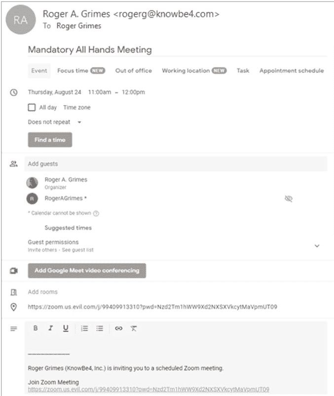

图 2-3 模拟创建日历网络钓鱼邀请的示例。

某些日历网络钓鱼诈骗旨在诱骗受害者参加不必要的会议，网络钓鱼者在会议上试图对潜在受害者进行社会工程攻击。其他诈骗包含恶意下载，受害者被告知需要在会议前阅读；还有一些包含诱骗用户执行恶意内容的方法。请始终检查任何意外的日历邀请，确保其来自您认识并信任的人，且涉及已知的主题。

## 社交媒体网络钓鱼

社交媒体服务（例如 Twitter、Facebook、Instagram、LinkedIn、Twitter 等）是网络钓鱼攻击非常流行的场所。黑客接管某人合法社交媒体账户，然后向该人的所有朋友和联系人发送网络钓鱼消息，这种情况非常普遍。网络钓鱼消息可能会声称受害者需要钱，或者知道一个“绝佳”的免费资金计划。

我边缘参与过的最令人难过的社交媒体案例之一，是一名美国朝鲜战争士兵中队的领导人在 Twitter 上被盗。他深受中队成员尊敬和爱戴。骗子向他中队的追随者发送了“你好”消息。当他们回复时，骗子会说自己“过得很好”，因为他最近通过一个新的退伍军人计划获得了 10 万美元的免费资金。如果士兵们进一步询问（许多人都询问了），骗子会将他们引导至一个恶意电话号码，该号码会窃取他们的身份和银行信息。许多士兵损失了数万美元。其中一名士兵的女儿联系了我，因为她的父亲已经损失了数万美元，却无法相信该计划是诈骗，仍在试图再汇送数万美元以“敲定交易”。他无法相信他领导人的账户受骗子控制。她最终不得不剥夺父亲管理自己资金的法律能力，以阻止他损失更多资金（在照顾卷入网络钓鱼诈骗的老年人时，这并非罕见的手段）。

## 爱情诈骗

社交媒体和约会网站上的另一种常见诈骗是爱情诈骗。在爱情诈骗中，骗子冒充他人，试图让受害者爱上他们，从而实施金融欺诈。骗子通常非常成功，成千上万的爱情诈骗受害者损失了全部积蓄，甚至本身实施了欺诈和犯罪，以汇款给他们的网络“情人”。

多年来，我写过几篇关于爱情诈骗及如何帮助受害者的文章，因此经常收到亲友的邮件，他们试图帮助受害者摆脱爱情骗子的控制。有时，受害者本人会写信给我，怀疑自己的网络亲人可能并非其自称之人，并请求我帮助确认怀疑。如果您在给陌生人写信以确认你们的“爱情连接”，您可能应该重新评估这份感情的深度，并暂停汇款。

曾经有一位女士向我声称，著名音乐家雅尼爱上了她，但他需要她汇款给他，因为他的妻子、女演员琳达·伊万斯（他即将与之离婚）据称控制着他的资金。但如果受害者给他汇款，雅尼似乎就能以此脱身、与琳达·伊万斯离婚，然后娶受害者。当我向她透露雅尼虽然几十年前与琳达·伊万斯交往了九年，但从未与她结婚，因此无法像骗子声称的那样与其离婚时，这仍不足以说服受害者不要再汇款。

联系我的平均受害者在联系我时已经损失了超过 20 万美元。但我了解到，即使我向受害者展示他们所接触的人并非其声称的那个人（即他们正在对话的账户中的姓名或照片），也*从未*导致受害者中断联系或停止向骗子汇款。爱是一种强大的动力。我遇到过受害者从家人那里偷钱汇给骗子。我遇到过受害者在房屋上申请二次抵押贷款以支付给骗子。我遇到过受害者卖掉他们寄宿亲属的贵重艺术品以筹钱汇给爱情骗子。我甚至遇到过一位受害者让她的女儿因虚假罪行被捕，以便拦阻她汇款的女儿被长期拘留并忙于证明清白，而她（受害者）就能自由地汇更多款项。

我认识的一位女性曾前往外国并与她的爱情骗子会面（非常危险）。当她见到他时，他长相不同、名字也不同，且并未从事他声称的那些成功工作。尽管如此，她仍然爱着他。几天之内，他拿走了她的钱，挥霍一空，并对她不好。——甚至还殴打她。她最终不得不在他醉倒昏睡的半夜偷偷溜走，以逃离他。

爱情骗子在 LinkedIn 等商业网站上联系受害者的情况越来越普遍。图 2-4 展示了我最近在 LinkedIn 上收到的一起爱情诈骗尝试的开端。

目前，我每天通过 LinkedIn 收到近一次爱情诈骗尝试。这种情况猖獗。她们全都是拥有美国式姓名的年轻女性（但通常不使用良好的

语言和言谈模式，你可能会期望来自接受美国学校教育且从事相应职业的人会有的口吻，而且经常盗用其他真实人物的生平。他们总是以过于亲昵的问候开头，这是我平时的专业联系人绝不会用的。当我无聊时，我有时会跟骗子互动，看看从他们的第一个hello到他们声称对我的永恒之爱，中间要过多久。平均大约三天，但我遇到过几个小时就跟我说爱我的。在图 2-4 中，你可以看到这个示例中我用来开启对话一方的刻薄回复。我自己的回复总能让我忍俊不容。

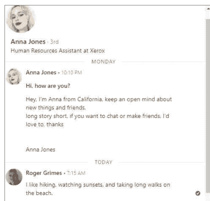

### 图 2-4 LinkedIn 爱情诈骗尝试示例。

在加密货币时代，一种名为“杀猪盘”的特殊爱情诈骗最近发展起来。爱情诈骗的开端是一样的，骗子努力让潜在受害者爱上他们。一旦赢得爱或信任，骗子就会声称通过投资加密货币发了财，并邀请受害者与他们一起投资致富。通常，骗子会给受害者发送一个恶意加密货币应用，该应用用于尽可能多地将资金从受害者那里转移。FTC表示，美国人在2022年因爱情诈骗损失了13亿美元（www.bleepingcomputer.com/news/security/ftc-13-billion-lost-by-70-000-americans-to-romance-scams-last-year）。

许多企业不担心爱情诈骗，因为它们是个人诈骗，而不是商业诈骗。但如果你的员工正在处理爱情诈骗的后果，那意味着他们成为了一名效率较低的员工。教育员工了解爱情诈骗是一个明智的商业决策。

## 语音钓鱼（Vishing）

通过语音电话进行的社会工程攻击，现在称为*语音钓鱼*，自从有了电话以来，一直是诈骗受害者的常见手段。如果是自动化且重复的，我们称之为*自动语音电话*。骗子可以就成千上万个不同的话题致电，但以下是我听到和读到的一些常见语音钓鱼诈骗：

- 延长汽车保修
- 技术支持诈骗（“我们来自微软，我们在您的电脑上检测到病毒！”）
- 冒充警察、国税局或其他执法机构索要钱款
- 冒充当地电力公司，声称您上次账单支付未成功，并要求使用礼品卡进行另一笔付款
- 声称您所爱的人遭遇了严重事故，需要钱
- 声称您的孙子或孙女被捕，需要保释金
- 帮助偿还大学贷款

图 2-5 显示了 Nextdoor 网站上一条用户抱怨被假冒当地电力公司账单电话欺骗的帖子。


### 图 2-5 假冒本地电力账单电话示例。

在我的地区，至少在Nextdoor网站上，关于假冒电力账单电话诈骗付款的投诉非常频繁。各种各样的人都被同样的诈骗所骗，包括医生、律师、牙医和警察。

这里有个重要观点：智力与你是否可能被骗无关。任何人都可能被骗。那些告诉我他们不可能被骗、向我挑战的人，我*总是*能在短时间内骗得他们。我们都会在特定时刻易受“合适”的诈骗影响。也许是因为我们从未听说过该诈骗。也许是因为我们太忙而犯了错误。但请相信我，任何人都可能被骗。一位诺贝尔物理学奖得主曾被骗走100万美元，他的孩子不得不剥夺他自己花钱的能力，以防止他损失200万美元。

## 预设情境（Pretexting）

预设情境是指骗子向潜在受害者展示一个经过精心策划的虚假场景（称为*诱饵*或*预设*），以使他们更可能配合相关诈骗。例如，骗子可能会打电话给人力资源部门的潜在受害者，谎称自己为其外部薪资处理公司工作，称他们在获取特定所需薪资文件方面有所延迟，并表示尽管是他们的错误，但想知道是否可以现在获取。

预设情境甚至可以是多媒体且多阶段的，例如先用电话设置诈骗，随后发送一封作为主体诈骗的电子邮件。例如，骗子冒充某公司的应收账务文员，致电另一家持有其需要支付的发票的公司。他们欺诈性地联系第二家公司的应付账务文员，声称他们有了新老板，老板让他们切换到新系统和新银行……因此请预期银行详细信息即将变更。骗子抱怨新老板以及必须学习和使用新系统，这听起来足够真实。我们都经历过。然后，骗子等几天，向应付账务文员发送一封包含新应付账务指示的电子邮件。因为应付账务文员正在等待此变更，他们没有觉得可疑。他们更新银行详细信息，并将款项汇入新的（未授权）银行账户。

预设情境攻击常用于获取私人信息，然后在后续攻击中使用这些信息。例如，黑客给公司的帮助台打电话，假装是一个刚入职但尚未开始工作的新员工，并被告知要联系公司 IT 安全团队负责人，以便被添加到 HR 和薪资系统中。诈骗来电者装作一无所知，成功地通过社会工程学套出了薪资系统的名称以及 IT 安全团队负责人的姓名和电子邮件地址。他们感谢帮助台技术人员，然后利用新获取的信息发起电子邮件诈骗，以获取薪资系统的访问权限。预设情境是一种高级社会工程攻击形式，已被用于世界上最具破坏性的许多网络钓鱼攻击中。

## 开源情报（OSINT）

或者，骗子通常会对目标进行尽可能多的在线调查，在打电话或发送电子邮件之前了解尽可能多的信息。黑客了解的关于目标的信息越多，其诈骗成功的可能性就越大。黑客当然会使用不同的搜索引擎（例如 Google、Bing 等）来搜索信息，并使用公共信息库，但他们也可以在数百种开源情报（OSINT）工具中进行选择。

OSINT工具要么通常是基于云的，要么可以安装在黑客的本地计算机上。每个OSINT工具专注于不同类型的搜索（例如，搜索有效的电子邮件地址、揭示电话号码，或识别连接到互联网的设备上缺少的补丁）。大多数骗子和黑客都有自己喜欢的OSINT工具，用于发现潜在目标的信息。如果你感兴趣，这个Github网站有超过100个OSINT工具：https://github.com/jivoi/awesome-osint。

要了解更多关于 OSINT 的信息，请参阅这个出色的网络研讨会：https://info.knowbe4.com/osint-odw.

## 回拨网络钓鱼（Callback Phishing）

回拨网络钓鱼是指骗子向受害者发送网络钓鱼信息，并要求潜在受害者回拨。通常，钓鱼信息中没有链接，只有信息、一些看起来官方的品牌标识（也许）以及一个电话号码。图 2-6 展示了一个回拨网络钓鱼示例。

您的摘要_View
Derrick <charrisntha7846@gmail.com> 致：Roger Grimes
~PayPal~

亲爱的客户，
我们已收到您的 ViprTech 游戏电脑产品。希望您享受与我们的在线购物！
您的订单金额 $520.45 已成功处理，您将在电子账单对账单上看到名为“TCP Secure Charge”的费用
在线交易代码 - 2001fd31f4551
产品名称：ViprTech Gaming PC 桌面电脑 6GB 内存
商品费用 $495.45
运费：$25.00
总金额：$520.45
您的货物将按照您的指示通过标准配送于 2022 年 2 月 1 日之前送达。
取消订单或配送说明，
联系我们：+1 888 559 3105

感谢您的惠顾，
支持团队。

### 图 2-6 回拨网络钓鱼示例。

回拨网络钓鱼通常能绕过反网络钓鱼过滤器，因为其中没有可扫描以确定合法性的恶意链接或下载。只有文本和一个电话号码。在这个示例中，钓鱼信息显示，潜在受害者将被收取 $520.45 的某种未订购的 PC 内存费用。受害者相信这是真实的信息，被吓到而致电，以免自己的信用卡被错误地收取 $520.45。当他们致电时，接听电话的人通常听起来像繁忙呼叫中心里的一位繁忙支持人员（通常确实如此）。他们诱骗受害者提供信用卡或银行信息，然后尽可能多地从受害者那里骗取钱款。


通常，受害者会损失数千美元，而罪犯现在知道受害者的信用卡或银行信息，以便转卖给其他骗子。

## 短信钓鱼

短信钓鱼是通过 SMS 短信进行的钓鱼。SMS 是短消息服务（short messaging service）的缩写。它不是你在手机上可以获得的唯一短信服务类型，但它是最流行的。对许多人来说，SMS 就是短信，反之亦然。网络钓鱼者非常常用 SMS 来发送社会工程学消息。图 2-7 展示了一个常见的短信钓鱼示例。

短信钓鱼消息通常包含外观奇怪的 URL 链接。从积极的一面来看，你在 SMS 消息中看到的链接就是该链接本身。你不需要将鼠标悬停在 URL 链接上才能查看该链接实际上指向哪里（就像你在电子邮件和网页上所做的那样）。但从消极的一面来看，短信钓鱼者经常使用“缩短”的 URL。这些 URL 将以缩短服务的主域名开头（例如 bit.ly、g.co、t.co 等），后跟由生成缩短链接的人选择的一些随机生成的字符串或一些文本。在图 2-7 中，网络钓鱼者生成了一个包含“verification”和“Venmo”一词的缩短链接，以使其欺诈性的 Venmo 短信钓鱼看起来更真实。当用户点击或打开缩短的 URL 链接时，它会将用户带到缩短链接所代表的原始、完整的 URL。

SMS 消息可以源自电话号码（对攻击者来说，获取或伪造这些号码并不太困难），或使用所谓的短码。短码是由公共短码管理局（CSCA）发行的 4 到 6 位数字。图 2-8 展示了一个使用短码的短信钓鱼消息示例。

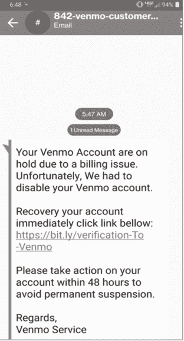

图 2-7 一个常见的短信钓鱼消息示例。

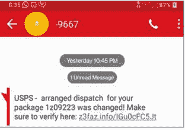

图 2-8 一个使用短码的常见短信钓鱼示例。

电话和 SMS 行业正试图将合法参与者从短码转移到用于 SMS 消息的 10 位数字，即十位长代码（10DLC）。10DLC 代码看起来像电话号码，也可以是一个电话号码。该行业计划更严格地监管 10DLC 代码及其使用公司，并淘汰较旧、更易被滥用的短码。

几乎我们所有人，如果不是所有人的话，都习惯于收到短信钓鱼消息。有些天似乎我在 SMS 上收到的全是诈骗消息。你可能认为没有人会成为短信钓鱼消息的受害者，但 FTC 表示，仅在 2022 年，美国消费者就损失了超过 3.3 亿美元（www.ftc.gov/news-events/data-visualizations/data-spotlight/2023/06/iykyk-top-text-scams-2022），而且这个数字高于往年。这意味着骗子们正在进行更多的短信钓鱼诈骗，和/或消费者似乎并没有在识别它们方面变得更好。

参与 SMS 的合法供应商了解短信钓鱼是多大的问题。他们正试图将当前的 SMS 标准演变为更好的东西。10DLC 代码是其中的一部分。此外，许多手机和 SMS 应用支持一种名为丰富通信套件（RCS）的新标准，该标准应该让骗子更难使用 SMS。许多厌倦了 SMS 诈骗的用户已转向其他消息传递标准，例如 iMessage、WhatsApp、Facebook Messenger、Signal 等，但大多数这些服务也已成为发生短信诈骗的地方（尽管频率较低）。教训是：只要两个人可以进行通信的地方，骗子就会试图入侵和利用。

## 商务电子邮件妥协

如第 1 章所讨论的，BEC 诈骗是指恶意社会工程学实施者试图诱骗某人或某企业进行本不该进行的付款。

BEC 钓鱼诈骗非常常见，仅次于勒索软件攻击，造成第二大累计损失。常见的 BEC 消息主题包括以下内容：

- 更新待付款的付款说明。
- 发票已逾期。
- 员工要求更改其薪资信息。
- 需要紧急购买礼品。
- 索取 W2 或薪资信息。

一种特定类型的 BEC 诈骗，*房地产电汇欺诈*，涉及骗子诱骗房地产买家将大额款项汇入非法银行账户。通常，这些骗子会入侵参与收取房地产购买款项的房地产经纪人、抵押贷款代理人、贷款代理人、产权代理人或某些受托代理人的账户，找到待处理的房地产交易，然后向相关付款人发送欺诈性付款详情。

黑客们可能相当狡猾，他们会监控待处理的交易，并等到最后一天才向买家发送 BEC 诈骗电子邮件。BEC 诈骗电子邮件中的所有内容都是合法的（例如，相关代理人的姓名、金额、其他付款详情等），除了银行电汇账户号码。只要骗子的电子邮件在真正代理人的电子邮件之前到达付款人手中（而且 BEC 诈骗者通常会在合法代理人意识不到的情况下删除真实电子邮件），款项就会被汇到假银行。等到所有相关人员意识到发生了盗窃时，要逆转损失可能会很困难。

全美房地产经纪人协会（www.nar.realtor/wire-fraud）表示，2020 年有超过 13,000 人成为房地产电汇欺诈的受害者，损失超过 2.13 亿美元。房地产电汇欺诈屡见不鲜，其受害者遭受了如此巨大的损失，以至于有必要在本章中单独提出来。如果你曾经涉及通过电汇支付大额房地产交易，请确保所有相关人员采取措施防止诈骗。通常，仅在发送电汇前致电代理人确认付款说明，或要求付款信息仅通过电话发送（避免使用电子邮件），就是避免被骗的最佳方式。

## 性敲诈

性敲诈是指骗子利用威胁，向受害者的家人和朋友揭露其秘密录制的性行为（通常是裸照或自慰视频），从而勒索受害者支付金钱或提供更多裸照。虽然这些骗子通常并没有任何关于受害者的暴露信息，但他们往往确实有。这取决于具体的诈骗。

无论哪种情况，许多受害者都会因这种情况而极度紧张，性敲诈每年导致许多受害者自杀。当这些自杀是由完全欺诈性的诈骗引起时尤其令人心碎，此时网络钓鱼者并没有任何关于受害者性癖好的真实证据。受害者需要明白，即使骗子确实拥有真实证据并确实执行其揭露威胁，那也并非世界末日。无论当时看起来多么羞耻，尴尬都会随着时间推移而过去，成为一个早已被遗忘（或至少不那么重要）的记忆。

有许多资源可供受害者和家长用于应对性敲诈诈骗，包括 FBI 提供的这个资源：www.fbi.gov/how-we-can-help-you/safety-resources/scams-and-safety/common-scams-and-crimes/sextortion。

## 浏览器攻击

许多钓鱼诈骗始于用户的设备之前已被恶意软件入侵（通常是因为钓鱼或未打补丁的软件），并且其浏览器控制权被一个*浏览器劫持者*程序接管。这些程序会监控用户在浏览器搜索栏中输入的内容，并经常将用户带到浏览器劫持者想去的地方。浏览器劫持者还可以窃取登录信息、银行信息和其他网站详细信息。

*浏览器通知钓鱼*是一种特定类型的钓鱼，源自用户的操作系统或浏览器通知功能。当今最流行的大多数操作系统和浏览器都内置了行业标准的消息通知功能，允许网站和应用程序请求发送消息的权限（参见图 2-9）。我们可能都被提示至少批准过几次通知。

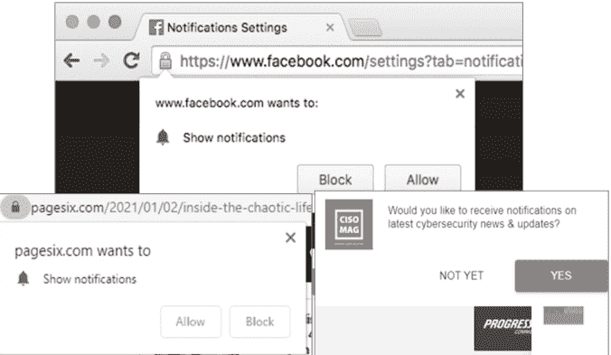

图 2-9 各种网站请求发送通知消息权限的示例。

如果授予通知权限（无论是给浏览器还是操作系统），涉及的请求网站现在可以发送

随时向用户发送通知消息，甚至在网站或浏览器之外。

至少，许多网站会向用户发送大量不需要的消息。有时，涉及发送通知的网站要么明知要么不知情地被诱骗，通过通知功能允许垃圾邮件或网络钓鱼。而可以发送的内容包括恶意链接和文件。图 2-10 显示了一个恶意网站试图诱骗用户批准通知，以便恶意软件可以安装在受害者的计算机上。

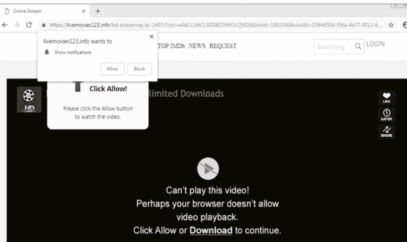

图 2-10 一个恶意网站请求通知权限以便在受害者计算机上安装恶意软件的示例。

在图 2-10 所示的示例中，潜在受害者被社会工程化诱骗访问恶意软件网站，因为先前链接的网站承诺提供免费电影和音乐。一旦用户进入这个新网站，该网站谎称需要权限来播放用户想要的视频。但是，如果受害者点击允许，恶意软件网站将能够向受害者发送恶意链接和文件。

如果您想了解更多关于浏览器通知网络钓鱼的信息，请参阅：

- https://info.knowbe4.com/malicious-browser-notifications
- https://krebsonsecurity.com/2020/11/be-very-sparing-in-allowing-site-notifications
- www.indelible.global/post/pushbug-uncovering-widespread-push-notification-rfc-8030-abuse-in-the-wild

## 诱饵

诱饵是一种社会工程策略，利用人类的好奇心和对快速满足的渴望。它可以应用于任何社会工程和网络钓鱼场景，但主要应用于物理类型的社会工程。一个常见的例子是，黑客在公司停车场留下一个经过恶意修改的 USB 驱动器，等待员工插入驱动器查看里面的内容。有一次在渗透测试中，我在公司停车场散放了外部标记为“待解雇”的 USB 驱动器。员工们在我还没回到办公室之前就已经插入了驱动器。

## 二维码钓鱼

快速响应（QR）代码可用于社会工程和网络钓鱼方案。图 2-11 显示了一个二维码。
二维码是一种类似条形码的图像，可用于对文本、数字和符号进行编码，但最常用于对 URL 进行编码。社会工程师喜欢将它们放置在物理和虚拟位置，看能骗多少人访问它们所代表的恶意 URL。一种常见的复杂骗局是在欺诈性二维码覆盖在合法二维码之上的场景中实施，这样做有很高的机会欺骗用户。


图 2-11 一个合法二维码的示例。

例如，我听说过一个欺诈性二维码被贴在企业街边橱窗上的合法企业二维码之上。该企业的真实二维码只是一个指向企业合法 URL 的链接。但欺诈性二维码将潜在受害者引导至一个假冒的仿冒网站，提示他们提供信用卡信息，以声称获得大幅折扣的交易。另一种常见的二维码诈骗是，网络钓鱼者将他们的二维码放置在城市公共停车计费器上的城市二维码之上。假二维码诱骗受害者使用信用卡向假网站支付停车计费器费用。

任何扫描二维码的人唯一真正的防御措施是查看最终的目标 URL，以确定它是否合法。我们将在第 13 章“识别恶意 URL”中详细介绍这一点。

## 网络钓鱼工具和工具包

大多数网络钓鱼犯罪分子每天发送数万到数百万条网络钓鱼消息。他们只需要一批电子邮件地址、电话号码或网站地址，通常可以以极少的金额购买这些信息。然后，网络钓鱼者使用众多专门用于发送网络钓鱼消息的免费或商业工具之一。

你可能认为这些网络钓鱼工具违法并且隐藏在常规互联网之外，有些确实如此。但是，实际上有成百上千个看起来专业的网络钓鱼工具和服务，任何网络钓鱼者都可以使用它们来发送他们的网络钓鱼活动。通常，这些网络钓鱼攻击需要大量欺诈性网站来完成诈骗。网络钓鱼者可以利用数百个免费网站托管服务中的任何一个，或者购买一个*抗封杀*服务。抗封杀服务为黑客和网络钓鱼者提供服务和网站空间来运行他们的非法诈骗。抗封杀主机承诺保护诈骗者免受法律*下架*通知的影响，并尽可能长时间地保持诈骗者的服务在线。抗封杀托管服务通常位于网络安全法规较宽松的国家，例如俄罗斯或北非公司。

许多黑客提供*网络钓鱼工具包*，允许知识较少的网络钓鱼者在无需自己进行任何编程的情况下构建和发送复杂的网络钓鱼活动。相反，网络钓鱼工具包拥有网络钓鱼者可能想要的所有所需功能。以下是一些关于抗封杀主机和网络钓鱼工具的示例故事：

- https://krebsonsecurity.com/2019/07/meet-the-worlds-biggest-bulletproof-hoster
- https://krebsonsecurity.com/2019/08/the-rise-of-bulletproof-residential-networks
- https://krebsonsecurity.com/2021/09/fudco-spam-empire-tied-to-pakistani-software-firm
- https://krebsonsecurity.com/2021/02/arrest-raids-tied-to-u-admin-phishing-kit

在当今的现代世界，高端网络钓鱼工具被称为网络钓鱼即服务，网络钓鱼者可能想要的一切都由基于云的在线服务提供。网络钓鱼即服务是完全自动化的，不仅发送网络钓鱼消息，还为全球网络钓鱼活动提供本地语言定制、易于使用的界面、抗封杀托管、定制品牌登录页面、信息窃取木马等。使用网络钓鱼即服务的犯罪分子通常按月付费或根据其与受害者的财务成功情况支付一定比例。

对于网络钓鱼即服务的故事示例，请参阅：

- https://krebsonsecurity.com/2023/08/karma-catches-up-to-global-phishing-service-16shop
- https://blog.knowbe4.com/a-new-phishing-as-a-service-kit
- https://blog.knowbe4.com/new-greatness-phishing-as-a-service-tool
- https://blog.knowbe4.com/phishing-as-a-service-platform-robin-banks-helps-cybercriminals-target-customers-of-financial-institutions

好了，我们暂时学习了许多新的网络钓鱼术语。实际上还有数十种其他常见的社会工程和网络钓鱼诈骗类型（例如租房诈骗、Craigslist 诈骗等），但我不会在此再介绍更多内容。我已提供了大量示例，让你了解网络钓鱼诈骗的运作方式。我将在后续章节向你介绍其他术语，但第 2 章是你总体了解社会工程和网络钓鱼的良好起点。

## 总结

第 2 章定义了数十个与网络钓鱼相关的术语，并提供了许多常见网络钓鱼攻击的示例。社会工程和网络钓鱼诈骗有很多发生方式。实际上，互联网上任何发生多方通信的地方都是诈骗的潜在渠道。本书其余部分将介绍如何为你自己、你的家人、朋友和同事降低社会工程和网络钓鱼诈骗的风险。

第 3 章“3x3 网络安全控制支柱”讨论了每个计算机安全防御计划必须具备的三个组成部分，以全面降低网络安全风险。

# 第 3 章

## 3x3 网络安全控制支柱

第 3 章将讨论合规性、风险管理、纵深防御规划以及 3x3 网络安全控制支柱的概念。如果你一想到合规性和风险管理就感到无聊，本章很短，读起来很快。但我保证你会学到一些能够改善你未来网络安全职业生涯的内容。所以，不要跳过它。

### 网络安全的挑战

网络安全是世界上最困难的工作之一。有数万个威胁试图攻破任何连接到互联网的人员、设备或网络。而且传播网络威胁甚至不需要互联网。


世界上早期的计算机病毒，如 Elk Cloner、Stoned、Pakistani Brain 和 Jerusalem 病毒，在互联网还未成为如今的互联网的时代，在全球传播并造成混乱。防御方在防守上必须做到几乎完美。攻击者只需找到一个弱点即可入侵。实际上有数千万个新的恶意软件程序试图突破系统，以及数万到数十万名恶意的人类黑客，都在试图利用无辜的人和组织。防御工作如此艰难，以至于没有哪个单个人或组织似乎能做好。一个开玩笑的常识是，要让电脑完全安全，必须将其封在混凝土中并锁在壁橱里。即便如此，你还得确保其网络已关闭。防御很难。

## 合规

这并非缺乏建议和推荐。我们的世界充斥着优秀的网络安全框架和指南。有几十种，包括以下内容：

- NIST 网络安全框架（NIST CSF）
- ISO/IEC 27001 框架
- 互联网安全控制中心（CIS）
- 1996 年《健康保险可移植性和责任法案》（HIPAA）
- 联邦能源监管委员会（FERC）/北美电力可靠性公司（NERC）
- 2002 年《萨班斯-奥克斯利法案》（SOX）
- 《通用数据保护条例》（GDPR）
- 支付卡行业数据安全标准（PCI-DSS）

网络安全法规和标准如此之多，以至于许多组织必须遵循多项要求，而这些要求有时会相互冲突。大多数网络安全文件都有几十到几百条建议/要求/控制措施，遵循这些文件的人必须遵守。

合规是试图遵循规定指南或要求的总体行为和具体行动。

当合规文件陈述或涵盖特定威胁（例如网络钓鱼）时，通常会列出一个或多个控制措施，合规遵循者应/必须实施这些措施以降低风险。例如，PCI-DSS 合规文件（https://docs-prv.pcisecuritystandards.org/PCI%20DSS/Standard/PCI-DSS-v4_0.pdf）列出了任何遵循者必须建立、测试、审计并证明已启用且正在遵循的网络安全控制措施。任何处理或存储成员卡组织（例如 VISA、Mastercard、Discover 等）及其客户信用卡数据的实体都必须遵循 PCI-DSS。

就本书而言，控制是指内部控制或账户控制。它由组织实施的方法和程序组成，以帮助确保组织遵循要求的有效性和准确性。合规要求通常会关联一个或多个控制措施。优秀的组织会定期审计其控制措施，以确保它们被持续遵循。如果控制措施充分支持该要求，并且经过审计以确保它们被持续遵循，那么可以认为该要求已得到满足（除非后来的事件证明否则）。

PCI-DSS 4.0 文件包含十二项主要要求，有数百项支持性子要求，超过 356 页。例如，要求 12“通过组织政策和计划支持信息安全”（第 259 页）包含第 12.6 节“安全意识教育是一项持续活动”，旨在缓解社会工程和网络钓鱼。其中一项子要求 12.6.3“人员应按以下方式接受安全意识培训”如图 3-1 所示。

| 定义方法要求 |
| --- |
| 12.6.3 人员应按以下方式接受安全意识培训： |
| • 受雇时，并且之后至少每 12 个月一次。 |
| • 使用多种沟通方式。 |
| • 人员至少每 12 个月确认一次，声明已阅读并理解信息安全政策和程序。 |

图 3-1 部分 PCI-DSS 要求，旨在缓解社会工程和网络钓鱼的影响。

人员应在受雇时以及之后至少每 12 个月接受一次安全意识培训。我喜欢每个人都接受安全意识培训的想法，尽管每 12 个月一次绝对不够。

即便如此，至少有培训要求也是件好事。PCI-DSS 的早期版本（以及所有其他早期安全控制文件）根本没有安全意识培训要求。因此，这是一些进展。进展虽然缓慢，但仍是进展。

遵循 PCI-DSS 的组织需要实施一项或多项安全策略和控制措施，以确保遵循 12.6.3。这是件好事。问题是，PCI-DSS 有超过 250 项单独的（定义方法）要求，大多数包含多个要点。这转化成数百项程序和数百项控制措施，必须由某人有效实施才能被视为“符合合规”。不可能以同等的精力和有效性实施数百项控制措施。这意味着有些控制措施会被忽视，而有些则会被过度关注。

在需要实施的数百项控制措施中，你如何专注于正确的控制措施，以建立能够降低最大风险的有效网络安全防御？答案是风险管理。

## 风险管理

关于应关注哪些控制措施的问题及其答案是一个非常关键的两难困境，而大多数组织都处理得不对。很容易过分关注错误的事情，而对最有效的控制措施关注不足。许多时候，这是我们合规文件的副作用。

再考虑一下 PCI-DSS。第一个主要要求是 *要求 1：安装和维护网络安全控制*。它与安装和维护防火墙以及其他网络级安全隔离有很大关系。它包含十九条子建议、数千个单词和超过二十页。这很棒。拥有良好的网络边界隔离很重要。

问题是，提供良好的安全意识培训（如图 3-1 所示，仅为单一要求），仅有四十二个单词。很容易论证，如果社会工程和网络钓鱼涉及 70% 到 90% 的成功攻击，那么可能没有比良好的安全意识培训更好的控制措施可供实施了。当今最大的威胁（例如，网络钓鱼者和未打补丁的软件）几乎不受网络安全隔离的影响。当今几乎每个组织和个人都已启用一个或多个防火墙，并且已持续数十年，但这并未阻止恶意软件或黑客。大多数威胁都是 *基于用户* 的威胁，其中用户无意中执行或被诱导执行导致成功入侵的操作，而防火墙和网络隔离无济于事。威胁已经位于最终用户的工作站上，已越过网络防御。

这是一个众所周知的事实。事实上，防火墙和网络隔离作为良好安全防御的无效性已被如此彻底地否定，以至于全世界现在都在努力达到所谓的 *零信任网络*，其中假设攻击者很可能已越过所有网络隔离边界。大多数攻击也确实如此。在 2022 年 1 月 26 日发布的 OMB 备忘录 M-22-09（www.whitehouse.gov/wp-content/uploads/2022/01/M-22-09.pdf）中，美国总统要求所有政府机构在 2024 财政年度结束前实施零信任架构。零信任网络是对防火墙和网络安全隔离有效性的否定。

这并非说防火墙和网络隔离不起作用。在我见过的每一份安全控制文件中，它们仍然是必需部分。许多文件，如 PCI-DSS，都以防火墙和网络安全隔离要求开头。大多数零信任网络都会将防火墙和网络安全隔离作为解决方案的一部分。只是社会工程和网络钓鱼能够绕过所有这些，包括零信任网络。

然而，在 PCI-DSS 中，防火墙和网络安全隔离占二十页十九项要求，而安全意识培训只有一个（薄弱的）要求，仅有四十二个单词。如果你是一个需要遵循 PCI-DSS 的合规团队，你的团队会花更多时间去遵循二十页十九条子建议，还是去遵循一份四十二个单词的一条子建议？我认为我知道大多数组织的答案。在效果较差的控制措施上花费额外的合规时间，就是未用于满足并超越更重要要求的时间和资源。这会创建无效的网络安全防御。

那么，我们如何解决这个问题？

答案是 *风险管理*。


当今大多数合规文档都讨论了每个合规组织在应用适当控制措施之前确定其风险的重要性。几年前，几乎没有文档讨论风险管理，而如今大多数文档都讨论。有些文档有数十页关于风险管理的内容。如果你还不知道这一点，网络安全本质上就是关于风险管理。哪些威胁是你首先且最优先缓解的？这基本上是网络安全中每个人的工作。你不想关注永远不会发生的事情，也不想不关注很可能发生的事情。

## 评估风险概率

风险可以被视为一个公式：风险 = 概率 × 严重性。换一种说法，风险 = 威胁发生的可能性 × 威胁发生时的估计损害。风险管理是确保你关注那些更可能发生或如果发生更可能造成重大损害的关键威胁（即使罕见）。许多风险经理在思考风险时会将其可视化为类似于图 3-2 的“热图”。

风险管理和网络安全防御旨在找出哪些威胁发生概率高，以及如果发生会造成重大损害。这些是你应该首先使用控制措施来缓解的风险。

每个组织都应自行进行威胁风险评估，不仅包括网络安全风险，还应包括物理风险，例如火灾、洪水和龙卷风。一旦该组织确定了应缓解的首要威胁，就应开始实施控制措施来缓解它们，至少应优先且做到最好地实施。

如果你已经进行过正式的网络安全风险威胁评估，我可以告诉你，对于大多数组织，缓解社交工程和网络钓鱼是头号威胁，其次是确保你的软件和固件已打补丁。其他所有威胁加起来也远远排在第三位。赶紧行动吧！

我的补丁建议写在这里：www.linkedin.com/pulse/patch-like-cisa-pro-roger-grimes。

| | 灾难性: 4 | 严重: 3 | 中度: 2 | 边缘: 1 |
|---|---|---|---|---|
| 频繁: 5 | 高 - 20 | 高 - 15 | 高 - 10 | 中 - 5 |
| 可能: 4 | 高 - 16 | 高 - 12 | 严重 - 8 | 中 - 4 |
| 偶尔: 3 | 高 - 12 | 严重 - 9 | 中 - 6 | 低 - 3 |
| 罕见: 2 | 严重 - 8 | 中 - 6 | 中 - 4 | 低 - 2 |
| 不太可能: 1 | 中 - 4 | 低 - 3 | 低 - 2 | 低 - 1 |

图 3-2 风险管理“热图”。

## 防御纵深

防御纵深是一种安全概念，即针对重大威胁应设置重叠的控制措施，以便如果一个防御漏掉了威胁，希望另一个缓解控制能捕捉到它。这就像你的汽车配备防撞系统和防抱死制动系统，你仍然系安全带一样。有多个重叠的控制措施帮助你，以防万一，这绝无坏处。

不幸的是，许多网络防御者将这一概念发挥到极致，拥有如此多的重叠控制措施，以至于纯粹是浪费金钱，并常常导致其他关键领域缺乏控制。你希望制定一个良好的防御纵深计划，合理分布重叠的控制措施，但不要遗漏任何重要控制或产生不必要的浪费。大多数网络安全防御者在部署控制措施时凭直觉处理防御纵深。我不相信直觉。

首先识别你的威胁。针对你组织的可能威胁有哪些？对它们进行排序并记录下来。然后，记录你拥有哪些控制措施和系统，能够对这些威胁以及新出现的威胁提供良好的威胁情报。然后，记录你拥有哪些控制措施和系统，能够检测那些针对你环境或存在于你环境中的威胁。接下来，记录你已实施哪些控制措施和系统来缓解首要威胁。然后，执行差距分析，以确定在哪些方面对威胁的系统和控制措施拥有良好的重叠覆盖，以及在哪些方面存在差距和过剩。然后，相应地更新你的系统和控制措施。这就是如何制定“数据驱动”的网络防御计划。该过程在图 3-3 中以图形表示。

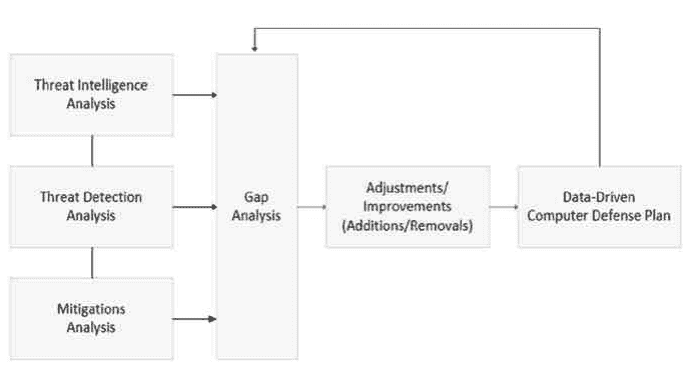

图 3-3 如何进行防御纵深差距分析的图形表示。

一旦你定义了首要威胁，就需要确保实施正确的政策、技术防御和教育，以支持你的控制措施来缓解这些威胁。

## 3x3 网络安全控制支柱

你有三个主要的防御目标：预防、检测和恢复。你希望首先防止坏事发生。为此，你使用*预防性控制*。你希望快速检测任何绕过预防性控制的恶意行为，使用*侦测控制*。一旦在环境中检测到恶意行为（例如恶意软件），你希望快速进行事件响应，以尽量减少损害和停机时间。你使用*恢复控制*来实现这一点。

每个控制都需要政策、程序和指南。你必须记录控制期望，以避免歧义。每个人都需要了解最大且最可能的威胁是什么以及如何缓解它们。你需要提供期望，如果有人没有做得正确，这有助于问责。或者也许每个人都做得正确，但当坏事仍然发生时，这意味着你漏掉了一些东西，必须更新控制措施。无论哪种情况，有文档且经过沟通的控制措施都能帮助每个人了解期望并齐心协力。

政策是关于某人应如何处理特定事件的书面和沟通文档。例如，“离开座位时始终锁定计算机屏幕”，“切勿以回复电子邮件的方式输入密码”，或“切勿向任何人提供密码。我们绝不会向你索要密码。”政策是安全意识流程的起始部分，但不仅仅是教育。政策还规范和强制执行预期行为。我们将在第 II 部分“政策”中详细介绍政策。

技术控制是你可以使用软件或硬件实施的所有缓解措施，以强制执行特定输入、操作或输出。技术控制包括反恶意软件、内容过滤、安全配置、防火墙以及端点检测和响应软件等。

尽可能实施技术控制来缓解你最大的威胁。它们有助于自动应对大部分风险。最好的威胁是永远不会到达最终用户或进入你环境的威胁。

总会有一些恶意行为绕过你的政策和技术控制。不管你实施什么；仅靠政策和技术控制并不完美，黑客和恶意软件会找到绕过它们的方法。因此，你需要教育你的员工和工人，如何识别绕过现有技术控制的恶意行为，以及发生时该怎么做（希望是检测、报告和缓解）。

每个关键威胁和缓解控制都应该围绕政策、技术防御和教育构建。这在图 3-4 中以图形表示，称为“3x3 网络安全控制支柱”。

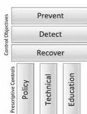

图 3-4 3x3 网络安全控制支柱。

其理念是，你需要围绕用于对抗最关键威胁的预防性、侦测性和恢复性控制，创建政策、技术防御和教育。更确切地说，要确保拥有最佳的、防御纵深的政策、技术防御和教育组合，以预防、检测和恢复。每次创建控制时，问问自己是否有合适的政策来支持该控制。你是否有合适的技术防御来支持该控制？你是否有合适的教育来支持该控制？你是否在正确的位置有正确数量的控制措施来做正确的事情？这就是如何制定卓越的防御纵深防御计划。

## 摘要

第 3 章涵盖了合规性、风险管理、防御纵深规划以及 3x3 网络安全控制支柱的概念。控制措施有三种类型：预防性（试图防止环境中发生不良事件）、侦测性（试图快速检测环境中发生的不良事件）和恢复性（试图通过快速移除不良事件、修复损害并使组织恢复正常运营状态来尽量减少不良事件造成的损害）。每个网络防御控制都应具有一个或多个政策、技术防御和教育组件，以最好地实施防御纵深威胁缓解。

第 II 部分涵盖了你应具备的所有政策，以缓解网络安全威胁，包括一般政策以及缓解社交工程和网络钓鱼威胁的特定政策。

第 4 章“可接受使用和一般网络安全政策”将首先介绍你应具备的一般计算机安全政策，包括可接受使用政策以及缓解网络安全攻击的一般网络安全政策。


# 第二部分

Policies

组织政策是任何网络防御的起点。第二部分涵盖四大主要政策：可接受使用政策（第 4 章）、一般网络安全政策（第 4 章）、特定反网络钓鱼政策（第 5 章）和企业 SAT 政策（第 6 章）。每个组织都应采用所有这些政策，以最佳方式防止社会工程和网络钓鱼。

## Acceptable Use and General Cybersecurity Policies

Chapter 4 will cover acceptable use and general cybersecurity policies. It is the first of three chapters dedicated to the policies every organization should have as part of their cybersecurity defense. Many general best practice security recommendations will be covered.

> Any additions/deletions/changes to any policies need to be reviewed by your management and legal teams before implementing them.

### Acceptable Use Policy (AUP)

Every organization should have an acceptable use policy (AUP) that should be reviewed, acknowledged, and signed by every employee when they are hired and annually thereafter. An AUP is a general IT policy document that educates users and other third parties (e.g., contractors, vendors, etc.), who may use the organization’s IT resources or handle its protected data, about what is and is not allowed regarding the organization’s IT devices, networks, services, and data, including personal responsibilities. It restricts the allowed actions that can be performed on the organization’s devices and networks and defines many disallowed actions.

For example, an AUP will usually explain that the organization’s electronic resources, including its computers, phones, and network, are provided for business purposes. An AUP may state that some personal use of work assets is allowed but should be minimal. An AUP often states that the assets cannot be used to personally enrich the covered person beyond the scope of their employment contract and that any new content created on the company’s assets automatically becomes the property of the company.

Many companies get every employee to review and sign an AUP but most forget to include contractors, vendors, and other stakeholders who have access to their systems or data.

AUPs often state that offensive, obscene, and pornographic documents and images are not allowed on company assets. It may prohibit off-color jokes or jokes that cause anxiety in others. It will often prevent the selling of personal items, inappropriate contact, and racist or sexist content. An AUP may state that the company reserves the right to monitor any electronic content without further notice, including communications of a personal nature conducted across the network. It will usually state that the use of electronic assets and networks is a privilege and not a right.

An AUP can be used as a legal document, so it’s important that what it contains is thorough, reviewed, and approved by the legal department. Problematic employees fired for doing malicious things with their work computers have successfully argued in court that because their AUP didn’t specifically forbid the behavior they were fired for, they did not know they couldn’t do the malicious activity, and they have successfully regained their job and even won damages.

An AUP should include language that dissuades social engineering, phishing, and spam. It’s needed to make sure employees know both that they should not initiate those actions on company resources and that the company doesn’t want these threats on their computers or networks from internal or external sources. Language against social engineering and phishing should be included in every AUP because it may be the only cybersecurity document an employee reviews and signs before they have access to an organization’s systems.

But an AUP covers far more than anti-social engineering policies. It should cover overall general IT “do’s and don’ts” in a holistic manner. An AUP often includes a scope, a statement of general overarching governance philosophy, a code of conduct, examples of what is allowed, what explicitly isn’t allowed, and consequences of failing to meet acceptable use policies. As examples, common general policies included in most AUPs include “Don’t give your password to others” and “Lock your desktop when you are away from your desk.”

AUPs vary greatly depending on the organization being covered, the business conducted, and the participant’s relationship and appropriate expectations. For example, AUPs for educational facilities tend to focus on students and teachers, whereas most organizational AUPs focus on employees and vendors.

An AUP should state what the possible consequences are for a stakeholder violating the agreement, such as being formally written up, penalties, and separation of employment. Most AUPs end with blanket notices and disclaimers such as a statement that the AUP is in compliance with state and national laws, telecommunication rules and regulations, privacy laws, and Fair Use Laws.

But what you include in your AUP is up to you. They vary greatly across organizations and industries.

There are many AUP examples on the Internet, including these:

- https://catalog.upenn.edu/pennbook/policy-acceptable-use-electronic-resources
- www.earthlink.net/acceptable-use-policy
- https://frsecure.com/acceptable-use-policy-template
- www.business.com/articles/acceptable-use-policy

Figure 4-1 shows a partial excerpt from the University of Pennsylvania's Acceptable Use Policy.

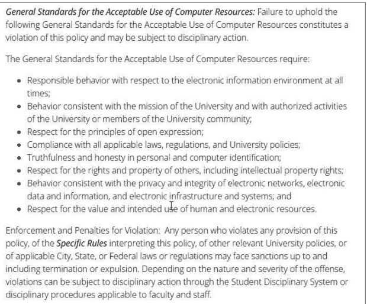

FIGURE 4-1 A partial excerpt from the University of Pennsylvania's Acceptable Use Policy located at https://catalog.upenn.edu/pennbook/policy-acceptable-use-electronic-resources.

Every organization should have an AUP that is reviewed and signed by every stakeholder when hired and annually thereafter. If not, create one and have it reviewed and signed by all stakeholders.

### General Cybersecurity Policy

Every organization should have a cybersecurity policy, also known by many other similar names such as information security policy, InfoSec policy, or IT security policy. An organization's cybersecurity policy is a written and communicated document detailing how an organization will protect its information and systems from cybersecurity threats. It contains procedures, processes, and requirements to protect the organization's information system assets from physical and logical threats. Every employee should be required to review the organization's cybersecurity policies when hired and at least annually thereafter. It should be reviewed and signed again when significant changes are made. The policy should protect the confidentiality, integrity, and availability (known as the CIA triad) of information and systems. It defines the expectations of stakeholders and the consequences of not following the requirements. Figure 4-2 shows a partial excerpt of the University of Pennsylvania's Security Policy (www.isc.upenn.edu/ITPC/security-policy).

### Recommended Best Security Practices

Cybersecurity policies often include the organization's required security practices. These can vary greatly across organizations and industries. The rest of this chapter will cover many common security policy best practices, although it is not an inclusive list and may not be appropriate for all organizations.

I include them here just to highlight many common recommended best security practices to consider when making your organization’s cybersecurity policy.

| Section | |
| --- | --- |
| Custodian: Penn Office of Information Security | |
| 1. INTRODUCTION | + |
| 2. PURPOSE | + |
| 3. DEFINITIONS | + |
| 4. SCOPE | + |
| 5. RISKS TO NON-COMPLIANCE | - |
| 5.1 Non-compliance with this policy poses a great risk to Penn and to individuals whose data Penn maintains... | |
| 5.2 Non-compliance with incident response policy may delay corrective action... | |
| 6. REQUIREMENTS | + |
| IT SECURITY STANDARDS | + |

FIGURE 4-2 A partial excerpt from the University of Pennsylvania’s Security Policy.

### Physical Protections

- Code-approved fire suppression systems must be deployed to protect computer rooms.
- In multi-floor buildings, computer rooms should not be located below the second floor.
- Computer rooms should not be located in areas directly exposed to external-facing windows or doors.
- Do not leave company devices in unmonitored locations without securing them against unauthorized use or theft.


- 不要将公司设备留在车辆内部，以免从车外轻易看到。
- 员工必须立即报告任何丢失或被盗的 IT 资产。
- 任何可访问公司网络或数据的设备都必须要求身份验证登录才能访问。
- 任何可访问公司网络或数据的设备都必须启用磁盘加密，采用业界公认的密码学和密钥长度。
- 未被主动查看或控制时，打印的机密信息应妥善保管。
- 所有可访问公司网络或信息的设备都必须启用锁定屏幕超时，不活跃时间不得超过三分钟。
- 用户离开设备时必须锁定屏幕。

## 采购
- 所有公司 IT 资产必须列入公司批准的 IT 资产清单，或在采购前由 IT 或 IT 安全部门批准，然后通过公司指定的采购流程从批准的供应商处采购。
- 采购的设备必须由公司贴上标签、分配清单编号，并在使用前计入公司清单系统。
- 设备在使用前必须由 IT/IT 安全部门配置并批准。
- 设备在报废、丢失、被盗或不再使用时，必须从清单系统中移除。

## 密码学
- 所有密码学（例如，加密、数字签名、哈希等）都必须采用业界公认的密码学和密钥长度。
- 所有机密数据都必须受访问控制，并在静止和传输过程中加密。
- 所有由密码学保护的信息都必须在密码学清单中进行登记，详细说明有效密码学、密码学协议、当前密钥长度和最大可能密钥长度。
- 由过时密码学保护的数据必须重新采用业界公认的密码学进行保护，或从公司设备和网络中移除，或销毁。

## 账户管理
- 所有设备、用户和网络账户都必须使用公司命名格式和审批流程。
- 用户账户将从公司的人力资源系统进行登记和创建。
- 超过六周未主动使用的账户将被设为禁用状态，除非之前已因预批准原因（例如，产假/陪产假、家庭医疗假、休假、陪审团义务等）获得批准。
- IT 安全部门将至少每月主动查找一次禁用账户。
- 离职员工的账户将在离职时或更早被禁用。

## 身份验证
- 所有用户账户都将受安全密码、防网络钓鱼多因素身份验证 (MFA) 或两者兼用的保护。
- 尽可能使用防网络钓鱼多因素身份验证 (MFA) 来保护公司的机密信息。
- 密码长度必须至少为十二个字符，且完美随机生成（类似密码管理器生成的密码），或者如果由最终用户创建，长度必须二十个字符或更长。
- 尽可能使用公司批准的密码管理器来生成、存储和使用密码（当无法使用 MFA 时）。
- 任何账户在五分钟内错误输入超过五次时，应被锁定（禁用），直至经过管理审查。
- 密码至少每年更换一次。
- 密码不应在不相关的网站和服务之间共享。
- 密码绝不应提供给他人。
- 公司员工（包括公司 IT 员工、管理层或帮助台）绝不应索取他人的密码。
- 绝不应响应电子邮件、语音呼叫或短信而提供密码。
- 服务账户应遵循上述相同的密码规则。
- 本地管理员密码应对每台计算机唯一。
- 用户应接受有关针对密码和 MFA 解决方案的常见攻击类型的教育，学习如何识别、如何报告以及如何缓解这些攻击。

## 访问控制
- 账户将仅获得其执行任务和职责所需资源、组、权限和特权的访问权（即最小权限原则），这些任务和职责是其工作的官方要求。
- 执行管理角色的用户将同时获得管理账户和非管理账户。管理任务仅在管理员使用批准的管理工作站登录管理账户时执行。所有通用任务（例如，电子邮件、互联网浏览、文件下载、研究等）都只能从非管理账户执行。
- 不得存在共享账户。
- 用户对受保护资源的访问权将至少每三个月进行一次清单登记、文档记录，并由其团队领导批准访问。如果未批准访问，则用户对受保护资源的访问将被阻止。

## 备份和恢复
- 所有关键数据和系统必须至少每天备份一次。
- 公司将保留至少两个来自连续两天的备份。一个备份将离线存储，访问时需要执行物理操作。
- 所有备份都应加密。
- 对备份和恢复流程的访问必须受防网络钓鱼多因素身份验证 (MFA) 保护。
- 应每六个月测试一次多个完整备份的恢复，并证明能够在可接受的时间内完成。

## 补丁管理
- 尽可能在所有系统和软件上启用自动补丁。
- 补丁包括软件和固件。
- 缺失补丁的扫描应至少每周进行一次。
- 所有关键补丁应在发布后两周内应用，并尽可能更早。
- CISA 已知被利用漏洞目录 (www.cisa.gov/known-exploited-vulnerabilities-catalog) 中列出的所有漏洞应在一周内修补。

## 漏洞扫描
- 漏洞扫描应每周进行一次。
- 关键漏洞应在两周内解决。
- CISA 已知被利用漏洞目录 (www.cisa.gov/known-exploited-vulnerabilities-catalog) 上的漏洞必须在一周内解决。如果漏洞无法在一周内解决，则涉及的资产必须从网络中移除，除非高级管理层作出例外并接受风险。

## 内部控制/审计
- 所有安全策略都应通过适当、有文档记录且已沟通的控制措施来执行。
- 控制措施应每六个月审计一次。
- 控制措施应根据其缓解的威胁进行风险排序。
- 缺失或薄弱的关键控制措施必须在两周内解决。

## 事件日志管理
- 每个系统和应用程序（如适用）都必须启用安全日志。
- 所有带有安全日志的系统的系统时间和日期应准确，并以 UTC 时间报告。
- 日志文件中的关键安全事件必须复制到集中式事件日志收集系统，并审查关键事件。关键安全事件应自动向相应的事件响应团队成员发送警报。
- 安全日志绝不应由用户或管理员主动擦除，但日志可以按需覆盖较旧事件（先进先出基础），以满足运营需求。

## 终端保护
- 所有终端都应安装并运行最新的反恶意软件。
- 所有能够接收通信（例如，电子邮件、短信、Slack 等）的终端都应安装反网络钓鱼和反垃圾邮件内容过滤。
- 当可用时，所有终端都应启用主机防火墙并采用适当的行业推荐规则。
- 所有终端都应启用入侵检测软件。
- 所有终端都应启用身份验证登录屏幕和访问控制。
- 具有用户登录功能的所有终端都应为不活跃超过三分钟的情况设置锁定屏幕保护程序。

## 防火墙/网络隔离
- 网络应启用一个或多个防火墙，并采用行业推荐规则。
- 防火墙绝不应启用 ANY-ANY 规则，除非在故障排除时短期需要。任何时候启用 ANY-ANY 规则时，必须在实施前获得 IT 管理层批准，并在测试完成后立即主动删除。
- 远程连接网络需要使用 VPN。VPN 应受防网络钓鱼多因素身份验证 (MFA) 保护。

## 安全编码（SDL 内容和签名脚本）
- 所有公司程序员和承包商都必须接受安全开发生命周期 (SDL) 技术培训。
- 所有程序员必须使用类型安全的语言和工具。
- 所有程序员必须在批准的编程专用工作站上开发。
- 除非该代码已通过安全审查，否则程序员不得使用非公司网站上找到的代码。


- 程序员在将代码上传到代码仓库时，绝不应在代码中留下身份验证凭据或密码信息。
- 程序员绝不应在非生产系统上运行的程序中使用生产凭据或客户数据。
- 所有程序在部署到生产环境之前，都必须接受安全审查，包括代码审查、静态审查、动态审查和渗透测试。
- 所有脚本在运行之前都必须获得批准并进行数字签名。只有经过签名和批准的脚本才能在公司设备和网络上运行。

## 杂项

- 用户和承包商如果发现潜在的系统漏洞或恶意行为（例如，入侵、恶意软件、黑客工具等），必须向 IT/IT 安全部门报告。

这些最佳实践建议只是触及了构建安全环境所需的所有必要安全要求的表面，但有助于为额外的生产要求产生更多想法。

## 总结

第 4 章讨论了可接受使用策略和一般网络安全策略，以及安全最佳实践建议的示例。可接受使用策略定义了组织网络资产上允许和不允许的内容。一般网络安全策略定义了所有用户在使用组织 IT 资产时必须遵循的具体要求，以帮助缓解网络安全威胁。

第 5 章，“网络钓鱼政策”，涵盖了您应采取的所有政策，以防范社会工程和网络钓鱼。

# 第 5 章

## 网络钓鱼政策

第 5 章涵盖了您需要与同事、家人和朋友共享的许多政策，以防范社会工程和网络钓鱼。

### 网络钓鱼政策的重要性

缓解恶意社会工程和网络钓鱼威胁的很大一部分是教育。在组织中，这种教育始于制定、文档化和传达防范社会工程和网络钓鱼的政策。本章将涵盖其中许多政策。所有员工应在受聘时以及此后每年审阅网络钓鱼政策，并签署确认书。

显而易见，所有组织都需要一项特定的网络钓鱼政策。甚至可以轻松论证，缺乏特定的网络钓鱼政策会导致更大的成功被攻破风险。如前面在第 1 章“社会工程和网络钓鱼简介”中所述，社会工程和网络钓鱼很可能涉及 70% 到 90% 的成功黑客攻击。因此，大多数组织没有针对最流行的黑客攻击类型（即排名第一的类型）制定特定政策，这有点奇怪。

想象一下，如果您的房子经常被盗，而且几乎总是由从窗户进入的小偷所为。小偷可以通过许多其他途径（例如，门、车库、墙壁、地板、屋顶、烟囱、阁楼、地下室等）闯入房屋，但您注意到，在过去三十多年里，他们几乎总是倾向于通过窗户闯入。在我们的想象世界中，几乎每栋房子都是这样。然而，尽管如此，房主不仅不专注于更好地保护窗户，而且执法部门和大多数家庭安全指南也未提及这一点。这个寓言描述了大多数组织网络安全政策的现状。很少有组织有着极大侧重于防范社会工程和网络钓鱼的政策。但借助本书，我们将为您和您的组织改变这一现状。

### 应包含的内容

本章剩余部分将介绍在您的网络钓鱼政策文档中至少应包含的内容。

### 简介

任何网络钓鱼政策文档都应包含对社会工程和网络钓鱼问题的介绍和概述。介绍应定义总体问题，传达问题的严重性（即，它占所有成功网络攻击的 70% 到 90%），以及成功攻击可能造成的损害。读者必须理解，一次未能检测到社会工程或网络钓鱼攻击可能导致毁灭性的后果，包括毁灭性的业务中断以及客户对组织的好感和信任度下降。读者需要了解防止成功黑客攻击的重要性。一份好的介绍可能以 CEO 的友好信函开头，表明其及整个组织对网络钓鱼政策的支持。

### 定义

请务必定义社会工程、网络钓鱼、勒索软件、鱼叉式网络钓鱼、SMS、短信钓鱼、语音钓鱼和打补丁。如果您使用 Slack、Microsoft Teams 或 Jabber 等即时通讯应用，也请对其进行定义。永远不要假设读者理解任何技术术语。举例来说，我在所做的演示中经常强调用户修补软件和固件的重要性。大约在四分之一的面对面演示中，演示结束后会有人走过来悄悄问我所说的“打补丁”是什么意思。您可以看出，他们知道这是自己应该了解却不了解的事情，感到很尴尬。

第一次有人问我什么是打补丁时（那人是一名 FBI 资深成员），我轻声笑了出来，因为我以为他在开玩笑。后来我意识到不是这样。从那以后，各个年龄和职位的人都曾问过我打补丁或更新是什么意思。有时您不会意识到，并非所有人都知道您因为身处或接触 IT 行业而熟悉的那些非常简单的术语。

顺便说一句，如果您未曾尝试向非 IT 行业人士解释什么是打补丁，如果没有提前思考，向非 IT 人员定义它可能会很困难。我回复时想出的说法是这样的：“这类似于某人修改他们写的内容中的拼写错误。就像他们已经将文档在线发布，发现其中有拼写错误，然后更新文档，使拼写错误不再存在。如果您的电脑提示您查找或应用更新，并且您确定是合法程序或操作系统在请求，请确保允许其查找和应用更新。但一般来说，如果您在浏览器中上网，浏览器要求您应用更新，请不要应用更新。这可能是社会工程或网络钓鱼攻击。如果发生这种情况，请退出浏览器并重启电脑。如果是有效的打补丁请求，重启电脑时应该会打补丁，或者在您进入浏览器之前再次询问您。”我不确定这是否是打补丁的最佳解释，但这就是我告诉他们的。对技术术语存疑时，请为您的受众进行定义。

KnowBe4 拥有一个可用于定义的大型词汇表：www.knowbe4.com/knowbe4-glossary。

### 培训

向受众说明您将如何对他们进行培训以帮助缓解社会工程和网络钓鱼威胁非常重要。对于大多数组织，我建议至少每月进行一次安全意识培训和模拟网络钓鱼活动。解释培训的正常频率和开展方式。是仅通过电子邮件进行吗？您只发送视频吗？有测验吗？有游戏吗？多久进行一次？会进行模拟网络钓鱼吗？如果会，多久一次？您不希望让用户知道模拟网络钓鱼演练的确切日期，但您希望传达您会进行这些演练以及频率（例如，每周、每月等）。如果您有内部人员负责培训或协助内部安全意识培训计划，也请传达这一点。如果您使用外部安全意识培训供应商，请传达这一点，包括其名称以及供应商如何与他们沟通。

清楚地定义培训的开展方式、频率、是否涉及外部供应商，以及如果涉及，他们将如何沟通非常重要。这有所帮助，特别是当网络钓鱼电子邮件试图冒充用户的外部安全意识公司来钓鱼用户时。图 5-1 展示了一个网络钓鱼者冒充 KnowBe4 向 KnowBe4 客户发起的现实世界网络钓鱼尝试示例。

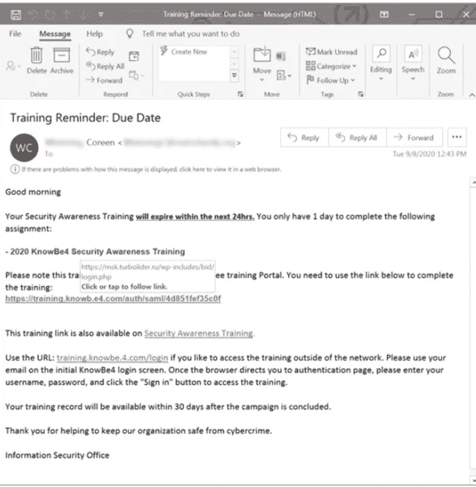

图 5-1 伪装成来自 KnowBe4 的真实世界网络钓鱼电子邮件。


图 5-1 摘自：https://blog.knowbe4.com/theyre-back-bad-guys-spoof-knowbe4-again。这封钓鱼邮件发送给一位 KnowBe4 客户，伪装成培训提醒通知，但包含一个欺诈链接。我们的系统可以配置为提醒用户培训截止日期，因此这是一封精心制作的钓鱼邮件。我们尤其惊讶于，欺诈链接是 knowbe4.com 的“双胞胎”版本，但实际却是 knowbe4.com，这会使其指向的域名为 .com，而非 knowbe4.com。非常狡猾！但将鼠标悬停在链接上方后发现，它实际上指向俄罗斯的一个 URL（turboilder.ru）。我们在俄罗斯没有任何办事处或客户。

冒充来自 KnowBe4 的钓鱼邮件发送给 KnowBe4 客户的情况并不罕见。大多数客户不会收到此类邮件，但收到的客户足够多，以至于所有反钓鱼政策都应对此发出警告。使用外部安全意识培训项目的客户可能希望包含涉及这些服务的合法外观邮件的示例，并警示可能的恶意社会工程攻击。

## 识别社会工程攻击的常见迹象

你绝对有必要向每个人普及社会工程攻击和钓鱼攻击的常见迹象。我会从图 5-2 中展示的基本逻辑开始（你可能还记得第一章中的内容）。

同样，建立一种遵循此逻辑的强大文化，对于拥有一个成功的安全意识计划至关重要。将此逻辑反复灌输到你自己以及朋友、家人和同事的脑海中，直到几乎不可能忘记。并非每次钓鱼攻击都以这种方式开始，但 99% 的攻击（我编造了这个数字，因为对此没有真实数据，但实际数字应该接近）确实如此。重要的是要强调，社会工程攻击和钓鱼攻击可以通过多种不同的方式开始，包括面对面、电子邮件、网站、短信、即时通讯和社交媒体。

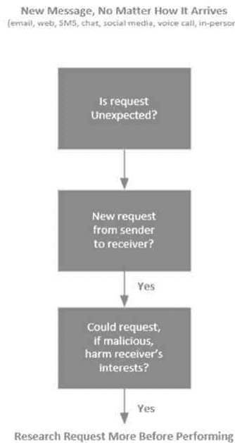

图 5-2 识别钓鱼攻击和社会工程攻击的基本逻辑。

## 社会工程攻击和钓鱼攻击的迹象

社会工程攻击和钓鱼攻击还有几十种其他常见迹象，包括：

- 奇怪的发件人 From 电子邮件地址
- 发件人的 From 电子邮件地址名称与电子邮件地址不匹配（例如，Patty O'Brien，roberttaylor2384@gmail.com）
- 奇怪且意外的请求
- 奇怪且意外的主题
- 紧迫感增强的消息（即压力陈述）
- 奇怪且意外的文件附件
- 文件附件不匹配（例如，文件声称是 PDF，但实际上是 .html 文档）
- 来自你认识的人的电子邮件，但来自一个你从未见过的新电子邮件地址
- 电子邮件的主题行与邮件正文不一致时
- 发件人的 From 电子邮件地址与回复至电子邮件地址不匹配时
- 消息中包含奇怪的 URL，或不是相关品牌或组织的合法 URL 的 URL
- 在奇怪的深夜发送的消息
- 消息正文中存在大量拼写错误和语言问题
- 来电显示上或提供给你的电话号码未显示为属于其声称所属的品牌或组织
- 声称或优惠看起来好得令人难以置信
- 短信消息中的短链接
- 与短信消息相关的短代码或电话号码未注册到消息中声称的品牌或组织
- 发件人声称在接下来的几小时到几天内将无法联系（例如，旅行中、高层商务会议中等），因此你无法联系他们提出问题或寻求澄清的电子邮件
- 要求将初始通信服务转移到另一个监管较少的服务（例如，有人在 LinkedIn 或 Craigslist 上联系你，但他们想转到 WhatsApp）
- 浪漫伴侣要求借钱
- 有人要求支付收件人此前不知情的滞后账单或发票
- 指向视频或内容的消息，随后要求你安装新的软件程序或更新
- 指向内容的消息，随后声称你需要批准通知提示才能查看内容
- 发件人或发布者希望你购买礼品卡、提供工资单信息或更改付款说明
- 买家或卖家试图将你从最初的销售平台转移到更私密、监管较少的方式
- 买家或卖家提出支付全价加运费，但强迫你使用他们的托管公司或承运人
- 买家向你寄送一张超过商定售价的支票，并告诉你无论如何都要兑现它
- 无法与你当面会面的本地交易卖家（例如，度假屋租赁、出售房屋、船舶、摩托车等）。经常声称自己是执行任务的军人。经常声称是为已故的配偶、家人或朋友出售物品
- 卖家希望你使用在线电子支付服务的“个人模式”（例如，PayPal Personal、Venmo Personal 等），但在发生欺诈的情况下不提供受保护的退款
- 卖家以远低于市场价的价格出售物品
- 声称“无病毒”的电子邮件

合法请求和电子邮件中也可能出现上述任何迹象，但它们经常出现在社会工程攻击和钓鱼消息中。你能提供的关于疑似社会工程攻击和钓鱼行为的示例越多越好。

此处的许多政策建议将在后续章节中重复。这是为了确立政策文件是培训的一部分，并且在两个地方重复培训内容是可以接受的。

### 个人故事

包含针对组织实际发生过的钓鱼攻击示例会更好。它能让信息更深入人心，并使其更具相关性。当我在微软工作时，某一年的年度必修安全意识培训包含了一段来自微软最聪明的人之一的预录视频。没有人无所不知，微软有很多聪明人。但这位先生在大多数科技行业人士眼中，不仅是微软最聪明的人之一，也是整个行业最聪明的人之一。他非常有名，我不写出他的名字只是因为我没有获得许可。

但他遭遇了成功的钓鱼攻击并分享了他的经历。他最近因向世界带来一篇突破性新闻而登上头条。几周来他接受采访并被人撰文报道。在媒体热潮即将结束之际，当他观看超级碗时，他收到一封看似来自同事个人电子邮件账户的邮件，附带一份发件人声称与近期新闻相关的文档。他未加思索就打开了文档，奇怪的是，发现文档中不包含任何与他正在从事的项目相关的信息。他只是觉得奇怪，便删除了邮件。几个小时后，他开始在意为什么同事会发送如此奇怪的消息，附带一份与他的项目无关的文档。于是他开始怀疑自己是否遭到了钓鱼攻击。这个想法又困扰了他几个小时。因此，在经过许多个小时后，这名员工才最终将可能的钓鱼攻击尝试报告给 IT 安全部门。

当 IT 安全部门检查该电子邮件时，确认这是一次真实世界的钓鱼攻击尝试，而打开的文档确实启动了一次成功的攻击，攻陷了受害者的笔记本电脑。幸运的是，该钓鱼攻击被及时报告和调查，攻击者尚未利用其成功的攻击进行进一步行动。这纯属运气。这位微软员工表示，自己因遭遇成功钓鱼攻击而感到尴尬，在考虑是否报告时，此类想法萦绕在他脑海中。他曾想过：“微软号称最聪明的人之一被成功钓鱼，会让人怎么看？” 虚荣心在我们的思考和行为中扮演的角色，比大多数人愿意承认的要大得多。

这段内部视频取得了巨大成功！它表明微软的任何人，即使是其中最聪明的人之一，也可能遭遇钓鱼攻击，并且不确定自己是否被钓鱼。它表明，如果你对某事是否为钓鱼行为有疑问，即使几个小时后，也要报告。直到今天，我认为这是有史以来展示过的最成功的安全意识宣传活动之一，不仅限于微软，任何组织都是如此。微软中提出这个想法的人，以及那位放下可能尴尬、参与其中的人，都值得双重赞扬。

我经常建议，如果组织中发生过类似故事（即成功的钓鱼攻击事件），他们应该与其他员工分享。这表明任何人都可能遭遇钓鱼攻击，并且向 IT 安全部门报告甚至是疑似钓鱼攻击的重要性。

## 社会工程攻击警示标识海报

KnowBe4 长期提供一页的“社会工程攻击警示标识”PDF 海报（www.knowbe4.com/hubfs/Social-Engineering-


Red-Flags .pdf)，任何人都可以下载、打印和重新分享。如图 5-3 所示，它包含电子邮件可能是恶意社会工程攻击的二十二个迹象和症状。这是一份与同事、朋友和家人分享的绝佳内容。关于此的更多文章可在此处找到：https://blog.knowbe4.com/share-the-red-flags-of-social-engineering-infographic-with-your-employees。即使你不选择使用或分享 KnowBe4 的版本，分享其他公司的版本或自行制作也没有坏处。

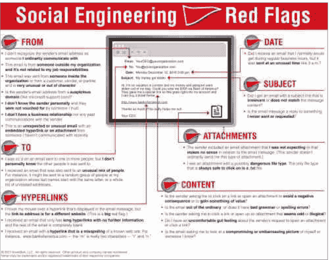

图 5-3 KnowBe4 的“社会工程危险信号”PDF 海报。

## 识别恶意 URL

同样地，对抗社会工程和网络钓鱼的最佳方法之一，是帮助潜在受害者识别欺诈性的恶意 URL。大多数（但并非全部）网络钓鱼消息包含恶意 URL。许多 URL 被制作得与它们所冒充的合法品牌或组织的 URL 相似。每项反网络钓鱼政策都应包括：在点击前（如果可能）将鼠标悬停并检查所有 URL。应向所有员工提供如何识别恶意 URL 的培训。

KnowBe4 提供了一张名为“恶意 URL 的危险信号”的单页 PDF 海报（见图 5-4）。它包含了网络钓鱼者伪造 URL 的十二种最常见方式。

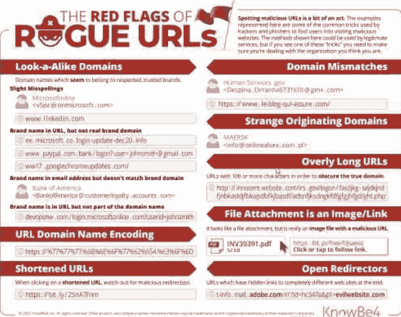

图 5-4 KnowBe4 的“恶意 URL 的危险信号”PDF 海报。

任何人都可以下载、分享和打印此 PDF 海报。你可以在此处下载单页海报：www.knowbe4.com/hubfs/Red%20Flags%20of%20Rogue%20URLs%20(3).pdf。你可以在此处阅读描述每种恶意 URL 技术的文章：https://blog.knowbe4.com/top-12-most-common-rogue-url-tricks。你还可以在此处观看或分享关于如何识别恶意 URL 的一小时网络研讨会：https://info.knowbe4.com/rogue-urls。

## 报告

反网络钓鱼政策必须包含一项要求：必须报告社会工程和网络钓鱼攻击尝试，并说明如何报告以及向谁报告。不要让缺失的政策导致某人不报告恶意内容。我曾在一家大型财富 5 强公司担任顾问。这家公司有数千名合同员工帮助维护其 IT 环境。在查看他们的一台服务器时，我发现了一个恶意黑客工具（Pwdump，一种密码转储工具）。负责该服务器的承包商告诉我，他几个月前就见过这个工具，但没有报告，因为查找和报告恶意软件不在其合同职责范围内。绝不能给任何人不报告恶意行为的机会。

你必须要求每个人不仅要报告可疑的社会工程和网络钓鱼，还要教他们如何报告。这个过程越简单、越一致越好。人们远更有可能去做简单且一致的事情，而不是难以做到或不一致的事情。

> 强调报告可疑网络钓鱼事件永远不会惹上麻烦（无论报告得多晚）是很好的。你希望鼓励人们报告可能的网络钓鱼行为，而不要通过向人们施加负面后果的威胁来阻碍报告的准确性。

**网络钓鱼警报按钮** 在 KnowBe4，我们非常推崇我们的网络钓鱼警报按钮（PAB，参见 www.knowbe4.com/free-phish-alert-1）。

PAB 是一个可下载安装的功能，支持 Google Gmail 和 Microsoft Outlook（包括移动版），为用户提供了一种非常简便的方式来报告可疑的网络钓鱼电子邮件。它会在你的电子邮件客户端中放置一个 *网络钓鱼钩子* 图标（如图 5-5 所示）。当邮件阅读者怀疑自己正在阅读一封可能的网络钓鱼邮件时，他们可以点击这个钩子，系统会将副本转发到预设的电子邮件收件箱（例如 IT 安全部门、帮助台等），并从用户的收件箱中删除该邮件。

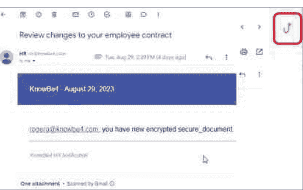

图 5-5 KnowBe4 报告网络钓鱼邮件的简便方式。

当网络钓鱼邮件被报告后，它可以被转发到一个特殊的电子邮件收件箱，由管理员手动检查，也可以由自动化网络钓鱼检测系统进行检查（在第 8 章“网络和服务器防御”中详细讨论）。我唯一的抱怨是，没有适用于短信和其他可能发生社会工程和网络钓鱼场所的 PAB。如果有人当面试图骗你，你只需点击 PAB，向警方报告，让他们消失，那该多好啊！

员工必须知道需要报告所有可疑的社会工程行为。有些人看到明显的网络钓鱼消息，认为公司的反网络钓鱼团队肯定已经知道了。但有时，公司可能正遭受大规模网络钓鱼活动攻击，但由于无人报告，IT 安全部门并不知情，也不会介入遏制。我曾在一家财富 50 强公司担任顾问时，该公司突然遭遇了一次来自俄罗斯对手的精准网络钓鱼攻击，对方试图获取高管的密码。直到收到精准网络钓鱼攻击的第 110 个人最终报告后，IT 安全部门才知道正在进行一场网络钓鱼攻击。当他们检查其他用户的电子邮件收件箱，查找与精准网络钓鱼攻击相关的邮件时，发现超过 1,500 人遭到了该精准网络钓鱼活动的攻击，并且超过 100 人回复时将其企业密码发送给了俄罗斯人。如果不是那个人最终报告了此事，该公司很可能会遭受更严重的破坏。

## 遭遇成功网络钓鱼时应采取的措施

你需要定义并传达当有人被成功网络钓鱼时会发生什么。这既包括被成功网络钓鱼可能带来的后果，也包括对此事件的响应。当我提及后果时，不仅是指负面后果。虽然一些组织确实为单次和重复的成功网络钓鱼事件定义了负面后果，但一般来说，仅靠负面后果可能会对反网络钓鱼计划的成功产生负面影响。你不希望让某人不太可能报告自己被成功网络钓鱼了。你希望鼓励那些意识到自己已被成功网络钓鱼的人报告该网络钓鱼事件。

每个组织都应定义当用户被成功网络钓鱼或多次成为网络钓鱼受害者时会发生什么。网络钓鱼事件可以定义为现实世界中的网络钓鱼事件（恶意骗子试图做坏事）或模拟网络钓鱼事件。每个组织都应定义当用户被成功网络钓鱼一次或多次时会发生什么。

在 KnowBe4，我们是模拟网络钓鱼的积极使用者。许多用户每周会被模拟网络钓鱼好几次（至少一次）。我们的员工一年内可能会遭受几十到几百次模拟网络钓鱼攻击。员工出现一次或多次模拟网络钓鱼失败并不罕见。我们将点击模拟网络钓鱼链接算作一次失败，输入密码算作另一次失败，尝试下载并运行文件算作又一次失败，依此类推。因此，一封模拟网络钓鱼邮件可能会导致多次失败。我们有许多原本很优秀的员工，他们从未在真实网络钓鱼事件中失败，但一年内却因模拟网络钓鱼活动而累积多次失败。员工在五到十年内出现十次或更多模拟网络钓鱼失败事件也并非未闻，尽管这是在数百次模拟网络钓鱼事件中发生的。我们不会解雇这些员工，也不认为他们是“坏”员工。我们会进行大量复杂的网络钓鱼模拟，只要他们没有在真实网络钓鱼事件中失败，我们就将这些失败视为其教育的一部分。尽管如此，我们的目标是零失败，无论是否为模拟网络钓鱼。我们的官方网络钓鱼失败后果图表如表 5.1 所示。

表 5.1 网络钓鱼失败后果

| 365 天内的失败次数 | 后果 |
| --- | --- |
| 1 次模拟网络钓鱼失败 | 立即进行为期 5 分钟的在线教育 |
| 2 次模拟网络钓鱼失败 | 立即进行为期 10 分钟的在线教育 |

（续）


| 在365天内的失败次数 | 后果 |
| :--- | :--- |
| 3次模拟网络钓鱼失败 | 立即教育，与主管讨论 |
| 4次模拟网络钓鱼失败 | 立即教育，与辅导员讨论 |
| 5次模拟网络钓鱼失败 | 更长时间的教育，辅导员，课堂 |
| 6次或更多失败 | 培训，辅导员，人力资源介入 |

书面政策明确传达，任何失败都可能导致人力资源处理，其程度可达解除雇佣关系。但我从未听说过有人因模拟网络钓鱼测试失败而被解雇。我也不知道有人在真实网络钓鱼事件中失败过，尽管我们时刻都在意识到这些事件。关键在于，你希望帮助员工弄清楚如何更好地识别真实和模拟的网络钓鱼事件。我们的目标，以及你的目标，不应该是因为某人被成功网络钓鱼就将其解雇。任何人……任何人都可能被成功网络钓鱼。

例如，我曾自认为是个很难被网络钓鱼的人。我在入职的第一天或第二天就被KnowBe4成功网络钓鱼了。我的自尊心随之破灭。之后我好几年都没有被成功网络钓鱼，重新树起了自尊心。然后，在KnowBe4任职四年时，大约一个半月内连续四次模拟网络钓鱼测试失败。我不得不与我们内部的一名反网络钓鱼“辅导员”会面。

我很尴尬。但我还是和他见了面，他问我当时生活中发生了什么，是什么导致我突然几次网络钓鱼测试都失败。我意识到自己正处于出售、购买和搬家之间，而我失败的所有模拟网络钓鱼邮件都有一个共同主题。它们看起来都像是来自人力资源部门，且与COVID-19疫苗有关。这些邮件虚假声称COVID疫苗已可用（实际尚未可用），并提出可以让我看其他失败COVID-19病毒测试的同事。我不确定为什么，但这些伪造的COVID-19网络钓鱼邮件在我的心理中触发了某种反应，当辅导员帮助我意识到这些共同点后，我不再失败任何网络钓鱼测试了。嗯，至少在接下来的两年里没有。我最近又失败了一次模拟网络钓鱼测试。姑且这么说吧，我对网络钓鱼测试的自尊心有科学和数据作支撑——我是可被网络钓鱼的。奇怪的是，仅仅认识到这一点本身，就希望能让我在现实世界中不那么容易被网络钓鱼。

不少比例的组织会对未在模拟网络钓鱼测试中失败的员工发布正面后果。几家组织将个人的模拟和网络钓鱼事件结果（例如成功或失败）与官方绩效评估挂钩。许多组织在特定时间段内为特定团队中未失败测试的每个人提供现金、奖品和披萨派对等活动。永远不要低估打印证书的力量。

我知道一个组织，对每个未上当受骗于模拟网络钓鱼并报告每一次真实网络钓鱼事件的员工，年底发放1000美元奖金。在所有员工中累加起来，这是一笔非常昂贵的奖金。我问CEO如何负担得起，他说：“这远不如一次勒索软件事件那么昂贵！”我喜欢他的回答。

## 事件响应

同样重要的是，如果有人在网络钓鱼事件中失败，需要发生哪些流程。在KnowBe4，如果有人在模拟网络钓鱼测试中失败并输入了密码，我们会强制用户更改其KnowBe4密码，其理论是：如果他们成为假网络钓鱼测试的受害者并输入了密码，他们也可能在真实世界的网络钓鱼挑战中这样做。因此，他们必须更改KnowBe4密码，并且我们基于相同的假设，建议他们更改所有其他密码（个人及其他）。

如果用户被诱骗下载并执行虚假内容，我们将立即进行恶意软件深度扫描，基于同样的理论：如果他们在模拟网络钓鱼邮件中这样做，他们也可能在真实世界的骗局中这样做。

如果用户在真实世界网络钓鱼事件中点击了链接或运行了内容，我们会对其计算机进行取证检查。如果发现任何可疑修改，在让用户更改所有密码后，我们会从头重建计算机。你希望在需要使用之前就将网络钓鱼响应政策以书面形式制定并沟通。你不想要意外，如果涉及负面后果，人们会觉得它们更可以接受。

## 反BEC政策

如前所述，商业电子邮件妥协（BEC）诈骗造成数百万美元的损失。BEC诈骗难以检测和自动阻止。人类在检测和阻止它们方面表现不佳。它们不会被反恶意软件自动检测和删除。事实上，击败BEC诈骗的最佳方式是通过教育和政策。

例如，制定一项政策，规定除非直接通过已知良好的电话号码联系请求者，否则任何人不得更新支付指示或购买礼品卡。制定一项政策，规定任何人不得支付意外发票，除非该发票经过正常支付程序并确认应予支付。如果遵循，这几项政策要求可以制止大多数BEC诈骗。

重要的是要认识到，政策是件好事，不仅作为教育，而且在定义允许的行为方面也是如此。通过在书面政策中声明，除非先通过已知良好的电话号码与真正的请求者交谈，否则不能更新支付指示，这样任何遵循该政策的员工都可以“保护”自己，如果他们的老板试图因为他们没有立即按照公司政策完成紧急付款请求而对他们大喊大叫。政策提供必要的保护，使员工不会被迫进入仓促的情况，那可能是合法的，也可能是伪装的网络钓鱼压力事件。

## 员工监控

在一些国家，例如美国和德国，组织可能需要包含一些法律语言，说明模拟网络钓鱼如何进行，其成功和失败可能被视为员工监控。许多国家和州要求在员工可能被监控及其情况下告知员工。模拟网络钓鱼测试可能属于员工监控。请与法务部门讨论。

反网络钓鱼政策章节到此结束。你在反网络钓鱼政策中包含或不包含的内容，由你在管理和法律层面决定。希望本章为你提供了一些不错的包含内容的想法。在你打击社会工程学和网络钓鱼的过程中，尽可能多地沟通至关重要。这份反网络钓鱼政策可能是用户在被允许开始使用组织IT资产或电话之前阅读的唯一内容。你希望你的同事了解有哪些类型的社会工程学诈骗，如何识别它们，如何处理它们，以及如何报告它们。

## 总结

第5章介绍了反网络钓鱼政策，并提供了几十个示例政策。这些政策不仅是教育用户的开始，而且如果遵循，它们能显著降低网络安全风险。反网络钓鱼政策可以教授的最重要概念之一是：告诉用户如何识别社会工程学和网络钓鱼攻击，在看到它们时该做什么，以及如何适当地报告它们。为用户提供一种简单的方式来报告网络钓鱼攻击，例如KnowBe4的Phish Alert Button，使用户更有可能报告攻击。一些社会工程学攻击，例如BEC诈骗，只能主要通过教育和政策来缓解，因为技术防御在检测和防止它们方面表现不佳。由于社会工程学和网络钓鱼攻击占总体网络攻击的很大比例，所有组织都应确保拥有一份特定的反网络钓鱼政策文件，强制用户在入职时以及之后至少每年一次审查并确认。

第6章，“创建企业SAT政策”，讨论了如何为较大的组织创建正式的安全意识培训政策。它是关于政策的书中的最后一章。


# 第 6 章

## 创建企业 SAT 政策

第 6 章将详细介绍如何创建企业安全意识培训（SAT）政策，并以示例文档结束。如果您不需要创建企业 SAT 政策，可以考虑跳过本章。不过，即使您不需要正式的政策，本章也包含值得考虑的概念和理念。大多数参与 SAT 计划的人都会从阅读本章中受益。

本章中的大部分信息之前曾收录在作者撰写的 KnowBe4 白皮书中：www.knowbe4.com/typ-wp-example-sat-policy-guide。

### SAT 政策入门

应对任何网络安全威胁都意味着制定详细的、分层的纵深防御缓解措施集，包括政策、技术防御和培训。迄今为止，尽管拥有超过三十年的最佳技术防御，社会工程学和网络钓鱼攻击仍然持续触达终端用户。必须教导终端用户如何识别社会工程学和网络钓鱼威胁，以及如何处理和适当报告这些威胁。因此，安全意识培训（SAT）是任何组织可以采取的最高价值缓解措施之一，可显著降低网络安全风险。

所有安全缓解措施都应有政策来指导其应用和使用。所有 SAT 计划都应以 SAT 政策文件为起点或由其驱动。本章开头部分介绍了任何 SAT 政策都应涵盖的各个组成部分。本章末尾提供了一个通用的 SAT 政策示例，如需可将其作为贵组织 SAT 政策的基础。您可以使用此示例来制定贵组织的首份 SAT 政策文件，也可用于更新或修改现有文档。

> 对任何政策或文档的增删改都需在实施之前由管理部门和法律部门进行审查。

#### SAT 政策所需组件

创建有效的 SAT 计划需要提出并回答许多问题，同时确保您的政策涵盖所有所需组件。

#### 政策标题信息

每个政策都以标题部分开始，其中包含以下信息等：

- 政策标题
- 范围
- 当前文档所有者/赞助人/角色所有者
- 按日期和版本划分的文档历史记录
- 当前政策版本号
- 当前政策版本的位置

您的政策文档可能包含更多、更少或不同的信息。请遵循贵组织的政策标准和准则。

#### 目标

您的 SAT 计划政策应包含预期目标以及贵组织实施这些目标的原因。目标可能类似于：“通过安全意识培训和教育，显著降低组织在面临社会工程威胁时因参与者行为和决策而产生的网络安全风险。参与者应能够更好地识别网络安全风险，了解如何报告风险和威胁，以及在哪里寻求帮助。”

#### 控制映射

许多安全控制源自计算机安全法律、要求、建议或最佳实践指南。将您的 SAT 计划与一个或多个合规性文档关联，很可能有助于您获得批准并证明该计划持续支出的合理性。

例如，美国国家标准与技术研究院（NIST）将 SAT 计划作为其“特别出版物 800-53，信息系统和组织的安全与隐私控制”（https://nvlpubs.nist.gov/nistpubs/SpecialPublications/NIST.SP.800-53r5.pdf）的一部分来要求。特别是，第 60 页第 3.2 节“意识与培训”的子项 (1) 和 (3) 列出了图 6-1 所示的信息。

控制增强：

(1) 识字培训与意识 | 实践练习

在识字培训中提供模拟事件和事故的实践练习。

讨论：实践练习包括无预警的社会工程学尝试，旨在收集信息、获得未经授权的访问权限，或模拟打开恶意电子邮件附件，或通过定向网络钓鱼攻击邀请恶意 Web 链接所造成的不利影响。

相关控制：CA-2; CA-7; CP-4; IR-3。

以及

(3) 识字培训与意识 | 社会工程学与数据挖掘

提供关于识别和报告潜在和实际社会工程学及数据挖掘实例的识字培训。

讨论：社会工程学是指诱使个人透露信息或采取可用于违反、破坏或以其他方式不利影响系统的行动。社会工程学包括网络钓鱼、借口诈骗、冒充、诱饵、以物易物、话题劫持、社交媒体利用和跟踪进入。数据挖掘是指收集可能用于支持未来攻击的组织信息。识字培训包括关于如何通过基于既定政策和程序的组织渠道，就潜在和实际的社会工程学及数据挖掘实例传达员工和管理层的关切的信息。

图 6-1 NIST 文档摘录，要求实施 SAT 计划。

参阅相关文章：https://blog.knowbe4.com/nist-updates-you-should-be-aware-about。

图 6-2 显示来自支付卡行业数据安全标准（PCI-DSS）的另一个示例要求。

PCI DSS 要求 12.6：实施正式的信息安全意识计划，告知所有员工持卡人数据安全的重要性。

全面的信息安全意识计划对于确保所有员工完全了解保护持卡人数据的义务至关重要。该意识计划还有助于在公司内营造安全意识，使员工开始将信息安全视为最高优先事项。

图 6-2 PCI DSS 要求设立 SAT 计划，数据摘自 www.pcidssguide.com/pci-dss-requirements。

图 6-3 显示来自《健康保险可移植性与责任法案》（HIPAA）的示例，安全规则 45 C.F.R. § 164.308(a)(5)(i)。

> 为所有劳动力成员（包括管理层）实施安全意识和培训计划。（45 CFR 164.308(a)(5)）。

图 6-3 摘自要求实施 SAT 计划的 HIPAA 文档。

许多计算机安全法规文档和建议都要求进行安全意识培训。大多数组织受一项或多项要求安全意识培训的法规约束，但无论如何，所有组织都应实施安全意识培训计划。如果您确实受一项或多项要求安全意识培训的法规约束，将文档中的特定控制作为政策的一部分进行“映射”（即链接）绝无坏处。此有用页面显示了一些常用的安全意识培训要求映射：www.knowbe4.com/resources/security-awareness-compliance-requirements。

#### 获得高级管理层批准和赞助

与任何安全缓解措施一样，高级管理层应被说服相信其必要性，并支持其实施。高级管理层必须推动组织的安全文化。成功的安全意识计划将使整体业务的其他部分得以繁荣，应将此观点有效地传达给高级管理层，以获得他们的认可和支持。此外，高级管理层充当计划布道者和倡导者的能力，将在整个业务范围内为其采用和参与带来持久的益处。每个 SAT 计划都应获得高级管理层的支持，并有正式的高级管理层赞助人。

这里还有一个页面，提供提示和 ROI 工具，以帮助获得批准：www.knowbe4.com/resources/getting-approval。

#### 确定 SAT 计划的发起部门

不同的 SAT 计划（例如，用于支持、责任、预算等）源自企业内的不同部门。许多 SAT 计划源自 IT 或 IT 安全部门。其他计划可能被分配给集中培训部门或人力资源部门。无论 SAT 计划源自何处，鉴于其对组织的重要性，都需要提供强有力的支持。

#### 范围

所有政策都应指明政策适用的范围。这包括参与者和角色的类型、地点、业务单元，甚至如果组织在不同语言的地理区域拥有参与者，SAT 计划应/必须涵盖哪些语言。是否要求承包商、合作伙伴和其他类型的第三方也必须参加 SAT 计划？最常见的范围描述为“所有参与者”，但必须考虑要求任何拥有您网络或数据访问权限的实体使用该计划。黑客经常针对受信任的第三方和供应商，利用其被攻破来访问其他目标。因此，SAT 政策范围可能包含类似以下内容：“所有参与者、供应商、承包商以及可访问我们机密数据的第三方。”

#### 定义

应描述所有技术术语，例如网络钓鱼、定向网络钓鱼、短信钓鱼、语音钓鱼、URL 等，以确保所有读者都


对它们有一个共同的理解。永远不要假设任何人或所有人都理解所有术语。定义可以放在策略文档的开头或结尾，具体取决于您组织的策略格式。

> 建议使用第 2 章“网络钓鱼术语和示例”，或 KnowBe4 的在线词汇表作为您的定义来源：www.knowbe4.com/knowbe4-glossary.

## 主要使用内部或外部 SAT 资源

您的 SAT 计划是仅/主要使用内部资源，还是使用外部资源和服务？任何组织仅使用内部资源都难以开发和维护一个出色的 SAT 计划。但是，即使使用了外部供应商，您也会有一个或多个负责 SAT 计划的内部参与者。

### 专职 SAT 员工

您需要决定您的 SAT 计划是由一个或多个完全专职的参与者全职负责，由一个或多个参与者兼职负责，还是外包给代表您的组织管理 SAT 计划的供应商。当然，能够专注于您 SAT 计划的专职参与者或外包供应商比兼职资源更好，尽管组织的规模和资源可能会限制专职资源的配置。许多小型公司将其 SAT 计划外包给其他供应商，许多 SAT 公司（例如 KnowBe4, Inc.）也提供为您管理计划的服务，作为另一种选择。无论您选择内部或外部资源，还是专职或共享的兼职资源，管理您 SAT 计划的资源都应了解您组织的特定文化、需求和目标。

## 培训具体内容

您的 SAT 计划策略应涵盖培训类型和培训内容、培训计划、培训频率以及执行方式。例如，SAT 策略应说明培训是通过面对面教学、远程教学、预录制视频、印刷或电子海报和通讯、正式演示、非正式“午餐学习会”、游戏、测试等方式进行的。还应记录是否将模拟网络钓鱼作为培训的一部分，或是否不在范围内。标准 SAT 培训的频率和时间也应记录在案。例如，是否在每位参与者受聘时进行较长的计算机安全培训，之后每月进行较短的培训，并进行较长的年度续订？此处应记录负责监督安全意识培训计划的职位或人员。如果某些培训需要评分测验和/或通过/不通过的能力检查，也应在此处注明。

## 模拟网络钓鱼活动

所有组织都应将模拟网络钓鱼活动作为其 SAT 培训流程的关键部分。模拟网络钓鱼使组织能够衡量其培训计划的成功程度、衡量安全文化，并能够识别需要更多培训的人员。模拟网络钓鱼还可以将报告可疑网络钓鱼尝试的过程“游戏化”，参与者会主动留意模拟网络钓鱼邮件并进行报告。模拟网络钓鱼有助于参与者更准确地报告真实的网络钓鱼尝试。

您的组织需要决定是否使用模拟网络钓鱼。没有模拟网络钓鱼活动的 SAT 计划，很少能像包含模拟网络钓鱼练习的计划那样成功地真正降低人为风险。

### 为什么？

如果使用模拟网络钓鱼，它将用于什么目的？一般来说，模拟网络钓鱼用于 SAT 计划的培训和教育之中。它还用于收集关于谁具体需要或不需要更多培训的统计数据。

如果您收集有关个人模拟网络钓鱼测试的信息，可能需要更新员工监控策略以包含此类数据收集。在某些州和国家，收集模拟网络钓鱼测试的结果可能被视为个人数据收集。请咨询您的隐私顾问、律师或当地员工委员会。

### 谁？

谁将接受模拟网络钓鱼练习？所有已知的安全指南都建议所有员工（包括高层管理人员、IT 和 IT 安全人员）都应接受“无通知”网络钓鱼练习。任何被排除的群体都会增加真实世界网络钓鱼攻击成功的风险。不要让真实世界的网络钓鱼成为特定员工群体接受的唯一测试。但是，每个人都必须理解“无通知”模拟网络钓鱼练习的重要性。他们应该理解此类练习为什么是必要且重要的。“无通知”网络钓鱼练习绝对不应作为“惊喜”强加给管理层、最终用户或任何其他人。为了澄清，每个人都应接受“无通知”模拟网络钓鱼测试，但贵组织确实会（即，执行“无通知”模拟网络钓鱼活动）这一事实不应让任何人感到意外。

### 频率

如果使用模拟网络钓鱼，计划应仅注明频率（例如，每月一次、每周一次等），而不注明具体日期。策略声明应类似于：“模拟网络钓鱼活动是我们 SAT 计划的一部分，参与者可以预期至少每月会收到一次模拟网络钓鱼尝试。”

参与者不应被告知模拟网络钓鱼将在哪些具体日期、时间或时期发生。这违背了培训的目的。在 NIST 特刊 800-53《信息系统和组织的安全与隐私控制》（https://nvlpubs.nist.gov/nistpubs/SpecialPublications/SP.800-53r5.pdf）中，特别是第 3.2 节“意识与培训”的第 (1) 款，规定了“无通知”网络钓鱼练习。某些组织可能需要通知 IT 员工或经理即将进行的特定网络钓鱼活动，但即使如此也不建议这样做。向特定员工发出“预先通知”会降低他们从模拟网络钓鱼测试中获得充分价值的可能性，因为他们更容易识别出网络钓鱼测试，更不太可能失败这些测试，且他们处理真实世界网络钓鱼活动的真实能力也被预测得不够准确。您希望模拟网络钓鱼活动能够确定谁需要更多培训，谁不需要。

### 平台类型

您应注明进行的是哪种类型的模拟网络钓鱼。仅是模拟网络钓鱼电子邮件，还是模拟网络钓鱼在其他平台上进行：短信、语音电话、社交媒体网站等？

### 内容类型

组织的公开信息是否允许使用？非公开信息（例如项目或组织通讯中的信息）是否允许使用（即，模拟鱼叉式网络钓鱼攻击）？员工的个人或公开信息是否允许使用？是否允许使用其他公司的品牌？许多真实世界的网络钓鱼诈骗会假装来自知名品牌。模拟网络钓鱼将涵盖通用主题，还是专门针对组织所在行业或组织本身（即，鱼叉式网络钓鱼），或是通用和鱼叉式网络钓鱼主题的混合？它是否会根据参与者的角色、季节、新闻事件以及社会工程和网络钓鱼趋势及时变化？关于模拟网络钓鱼活动的所有允许和不允许的决定都应予以涵盖。

最好不要将争议性主题（例如惊喜奖金计划或加薪）用作模拟网络钓鱼主题，因为过去此类测试曾导致参与者产生严重的负面反应。参与者不喜欢因增加薪酬而被欺骗。许多其他组织明确禁止使用涉及政治、性别、种族、宗教或其他涉及高度敏感性和情感问题的主题。如果真实网络钓鱼尝试使用这些“触发性”主题来引诱更多潜在受害者，这可能会棘手。模拟网络钓鱼测试不应导致士气下降，即使一个人通过了测试。当相关主题可能被视为敏感或有争议时，务必让相关人员批准。不要仅为了创建一个“出色”的模拟网络钓鱼活动而冒着损害声誉或计划整体意图的风险。

### 您是否会建立冠军计划？

许多 SAT 计划从拥有愿意积极主动、亲自协助降低网络安全风险的内部参与者中受益。通常，这些人点击模拟和真实网络钓鱼活动的比率较低，乐于参与计划，并且能够有效地向他人传达计划的教育和目标。对于这种更个人化的“一对一” SAT 举措，有许多不同的名称，但许多组织


将其称为其“冠军”。冠军计划可以是降低网络安全风险的非常有效的方式，如果存在或使用此类计划，应在 SAT 策略信息中加以涵盖。

冠军计划根据使用它们的组织不同有很多名称，包括摇滚之星、联络人、大使、官员、文化载体等。

## 预期参与者行为

SAT 策略应涵盖适用于 SAT 计划的预期最终用户行为。例如，应说明参与者应及时完成所有必需培训，并将真实和模拟网络钓鱼活动报告给 IT 安全部门。它应对培训和对模拟网络钓鱼测试的响应设定预期。

虽然这不一定是描述 SAT 计划的一部分，但策略也可能包括其他预期的最终用户行为，例如要求员工将鼠标悬停在 URL 链接上并检查它们，绝不向来自电子邮件、短信或语音呼叫的请求透露密码，并使用组织推荐的方法报告所有可疑的网络钓鱼尝试（例如，使用 KnowBe4 Phish Alert Button 工具）。这类信息应在其他计算机安全策略中涵盖，但也可以在此处包含，以求重复性和完整性。

应告知员工，他们应主动向帮助台或 IT 安全部门报告其与任何模拟或真实网络钓鱼活动的交互，并且迟报（在被他人发现之前）不会受到处罚。您希望营造一种文化，即始终鼓励报告可疑的网络钓鱼事件，即使报告迟了。您可能希望传达，如果任何员工甚至在模拟网络钓鱼测试中输入了其登录凭据，该员工将被要求立即更改密码，基于保守的结论，即如果员工向模拟网络钓鱼活动输入了其凭据，他们可能也向真实的网络钓鱼活动做了同样的事情。因此，为确保安全，如果员工将其登录凭据输入到模拟或真实的网络钓鱼活动中，应始终要求其更改登录凭据。

## 奖励与后果

参与者接受或回避教育和模拟网络钓鱼活动的后果应在策略中记录。大多数 SAT 专家建议，在可能的情况下，采用更多正向强化而非仅使用负面后果来实现这一目标。但是，所有组织可能都需要记录，如果参与者未能及时完成必需培训、未能通过教育测验，或未能通过一次或多次模拟网络钓鱼模拟，会有什么预期结果。

首先，定义员工及时完成所有必需测试并成功报告真实和模拟网络钓鱼活动时将获得的正向强化。例如，声明每次成功报告真实或模拟网络钓鱼事件都将导致向参与者发送积极通知。另一个例子是，如果某业务单元的所有员工作为一个团队按时完成所有必需测试，他们将获得一次“披萨派对”。一些组织甚至会就有益的 SAT 计划结果向个人和业务单元提供个人和部门奖金，或将结果纳入每位员工的年度评审中。

如前一章所述，每个 SAT 计划都应明确传达，对于未能及时接受必需教育、未能通过教育测验（如果涉及）以及未能通过一次或多次模拟（或真实）网络钓鱼活动的员工，将采取哪些措施。例如，如果员工在必需测试上落后不到两周，可能会与其主管和人力资源部门进行会议，并且如果在两个月内仍未接受必需教育，可能会面临解雇。还应明确传达因一次或多次连续模拟（或真实）网络钓鱼失败而将发生什么的预期。

任何 SAT 计划成功的关键在于，让员工理解这些措施并非旨在个人惩罚，而是旨在帮助员工了解对组织的风险，并帮助他们改善自身的网络安全风险态势。如果您的 SAT 策略仅涵盖负面后果，那么它可能需要重新思考并重新传达，以更多地体现正向强化。

SAT 计划管理员应意识到，重复失败可能是由于 SAT 计划的设计或设计不当造成的。管理员在审查时应始终考虑这一点，并询问某人为何会出现重复失败。即使 SAT 计划本身确实是可靠的，尝试一些合理不同的方法来帮助那些真正学习并更频繁采取更好行动的人取得成功，对组织可能更有好处。

一名优秀的 SAT 计划管理员应询问出现重复失败的用户，他们认为错过了什么，或者 SAT 计划是否可以做些什么来帮助用户取得更多成功。有时，可以学到一些有价值的信息片段或新提示，以改进计划及其成功率。一个好的 SAT 计划包括一个稳固的反馈循环和自我检查，以帮助组织以最快的速度最大程度地降低风险，而无需在证据与之相矛盾时不必要地坚持“正确的方法”。

> 这并不意味着 SAT 计划应使模拟网络钓鱼测试变得如此简单，以至于任何人都能以零失败识别它们。一个好的计划会创建模仿现实世界网络钓鱼攻击的模拟网络钓鱼尝试，如果将其恰当地用作教育工具，则会通过让参与者不太可能被类似的现实世界网络钓鱼攻击所欺骗，从而降低组织的风险。使模拟网络钓鱼尝试变得太容易或太困难，可能会对组织降低网络安全风险产生负面影响。

## 事件响应

前一章也已涵盖此内容。如果参与者“失败”于模拟或真实的社交工程或网络钓鱼活动，哪些类型的行动需要官方事件响应？例如，一次失败的模拟网络钓鱼事件可能要求 IT 重置涉及参与者的密码，因此必须在 24 小时内更改。多次失败的模拟网络钓鱼事件可能导致参与者的设备在一段时间内被“锁定”。一次失败的真实网络钓鱼事件可能导致正式的取证响应。仅仅打开一封真实的网络钓鱼电子邮件是否会导致官方事件响应，还是参与者必须点击了 URL、下载了文件或提供了登录凭据？官方事件响应是否只需对涉及设备进行简单的“清理”，还是需要对大部分设备进行格式化或更换，同时重置用户的登录凭据？所有这些决定都需要提前做出并明确传达。

## 使用哪些指标

您的 SAT 计划策略应定义用于衡量计划成功的指标。大多数组织应在 SAT 计划开始前以及之后定期进行模拟网络钓鱼演练，为计划提供一个基线以衡量其整体效果。一个有效的 SAT 计划将导致组织网络安全风险显著降低。

将使用的指标应在此定义。让我们来看一些示例指标。

### 参与者指标：

- SAT 计划涵盖的参与者总数
- SAT 计划开始时和/或后续基线测试期间参与者的整体基线

### 必需培训指标：

- 必需培训的总数和类型
- 个人培训和测试结果
- 按时完成所有培训和/或特定必需培训的参与者总数/百分比和/或个人姓名
- 未按时完成所有培训和/或特定必需培训的参与者总数/百分比和/或个人姓名

### 单次模拟网络钓鱼活动指标：

- 接收特定网络钓鱼活动的参与者总数/百分比和/或个人姓名
- 特定模拟网络钓鱼活动“通过”或“失败”的个人总数/百分比和/或姓名


- 报告模拟网络钓鱼攻击（使用适当的方法/工具，例如“Phish Alert”按钮等）的参与者总数/百分比
- 在特定模拟网络钓鱼活动中输入其登录凭据的个人总数/百分比和/或姓名
- 在特定模拟网络钓鱼活动中“点击 URL”的个人总数/百分比和/或姓名
- 在特定模拟网络钓鱼活动中下载模拟恶意负载的个人总数/百分比和/或姓名
- 在特定模拟网络钓鱼活动中运行模拟恶意负载的个人总数/百分比和/或姓名
- 完成特定模拟网络钓鱼活动所请求信息的个人总数/百分比和/或姓名
- 参与者在一个、多个或所有模拟网络钓鱼活动中执行的操作总数或百分比

在确定所有要采集和报告的指标时，应事先界定哪些指标决定 SAT 计划的整体成功或失败。确定是否会定期生成并分发报告给管理该计划的人员，以帮助提高 SAT 计划的有效性。例如，是否应始终向管理者通报参与者的失败？是否应向管理者提供其团队随时间变化的绩效统计数据，或针对特定参与者采取的纠正措施？应向管理者通报什么内容以及通报频率是多少，以便他们能够评估 SAT 计划的有效性？

## SAT 政策组件总结

现在您已很好地了解在创建正式 SAT 计划政策之前需要决定的问题和答案类型。每个组织都会根据其文化和政策要求拥有不同的需求和要求。请使用本章迄今讨论的信息作为指南，协助创建您的自定义政策。本章余下部分将提供一个基于先前材料的 SAT 计划政策示例，如有需要，您可使用它来帮助制定政策。

## 安全意识培训企业政策示例

这是安全意识培训企业政策的示例，如有需要可以复制和调整。在更新或添加任何政策之前，请先咨询高级管理层和法务部门。

### Acme 安全意识培训政策：版本 2.1

| 高级管理层赞助人 | 职务/角色 |
| --- | --- |
| Kathy Wattman | 首席信息官 |
| 政策所有者 | 职务/角色 |
| Anna Collard | 首席信息安全官 |

### 范围

本政策的范围涵盖全球所有处理 Acme 机密信息的员工、承包商、合作伙伴和第三方。

### 文档版本历史

| 版本 | 日期 | 负责人 | 描述 |
| --- | --- | --- | --- |
| 1.0 | 2022 年 1 月 1 日 | Jacqueline Jayne | 初始版本 |
| 1.5 | 2022 年 12 月 20 日 | Erich Kron | 范围扩大，添加了章节 |
| 2.0 | 2023 年 4 月 21 日 | James McQuiggan | 添加了模拟网络钓鱼章节 |
| 2.01 | 2023 年 4 月 22 日 | Jelle Wieringa, Dr. Martin Kraemer | 创建了外语版本 |
| 2.1 | 2023 年 6 月 1 日 | Javvad Malik | 添加了指标章节 |

注意：本文档的最新版本可在 `\\internalnetwork example\policies\satpolicy` 上找到。

### 政策目标

本政策的目标是，通过安全意识培训和教育，显著降低 Acme 面对社会工程威胁时，因参与者行为和决策而导致的网络安全风险。参与者应能更好地识别网络安全风险并了解如何处理。

### 控制映射

美国国家标准与技术研究院 (NIST) 要求将安全意识培训 (SAT) 计划作为 NIST 特刊 800-53 第 5 版《信息系统和组织的安全与隐私控制》(https://nvlpubs.nist.gov/nistpubs/SpecialPublications/NIST.SP.800-53r5.pdf) 的一部分。特别是，第 3.2 节“意识与培训”中的子条款 (1) 和 (3) 规定如下：

> “在识字培训中提供模拟事件和事故的实践练习……实践练习包括无预告的社会工程尝试，旨在收集信息、获得未经授权的访问、模拟打开恶意电子邮件附件或通过鱼叉式网络钓鱼攻击调用恶意网络链接所带来的不利影响。”

以及

> “提供关于识别和报告潜在及实际社会工程及数据挖掘实例的识字培训。”

### 定义

本节定义了可能出现在政策或 SAT 相关计划文档中的各种相关定义。

- **BEC** BEC 是商业电子邮件妥协的缩写，也称为 CEO 欺诈。恶意社会工程诈骗，施诈者试图诱使某人或某企业进行本不应进行的付款。
- **Cybercrime** 网络犯罪（或计算机犯罪）涵盖一系列潜在的非法活动。在我们的语境下，它是指针对计算机网络、设备、操作系统、应用程序及其用户的犯罪。
- **Endpoint** 组织中最终用户使用的工作站的另一种称呼。指网络连接末端的计算机或设备。
- **Exploit** 漏洞利用（法语意为“成就”）通常是（恶意的）软件，利用其他代码中的错误、故障或漏洞，导致发生意外或未预料的行为，并获取计算机系统的控制权。
- **Gamification** 游戏化是将游戏功能或原则添加到通常不具有游戏元素的事物中——在我们的例子中，是安全意识培训和电子学习内容。研究表明，通过增加人们内在的竞争、实现或掌握野心，游戏化可以提高用户参与度。研究显示，当人们出于内在动机完成任务时，学习效果更好且能保留更多信息。
- **Hacker** 最初：具有高级计算机技能、充满热情且技巧娴熟的人，无论其意图如何。定义已发生变化，可能指从事网络犯罪或参与不道德网络活动的人。
- **Information Security** 信息安全是保护信息和信息系统免受未经授权的访问、使用、披露、中断、修改、浏览、检查、记录或破坏。
- **Malware** 恶意软件是“恶意软件”一词的缩写。这是一个统称，用于指代黑客可用于损坏、窃取或控制终端和服务器的广泛病毒、蠕虫、特洛伊木马及其他程序。大多数恶意软件在未经感染者意识的情况下被安装。
- **Patch or Update** 旨在添加功能或修复产品在发布供一般使用后发现的漏洞的软件更新。
- **Phishing** 网络钓鱼是网络犯罪分子使用虚假身份试图诱使潜在受害者泄露敏感信息或采取潜在危险行动（例如点击链接或下载恶意文件附件）的过程。通常通过电子邮件、网站、即时通讯、短信、语音通话或当面进行。这是一种犯罪性欺诈性社会工程形式。另请参见鱼叉式网络钓鱼。
- **PII** 个人身份信息 (PII) 被定义为任何可用于唯一识别特定个人的个人信息实例。大多数法律法规要求持有他人 PII 的人必须保护其免受未经授权的访问。
- **Ransomware** 勒索软件是一种在支付赎金前通过加密方式拒绝访问设备或文件的恶意软件。当今最危险的恶意软件形式之一。
- **SAT** 安全意识培训。旨在让参与者了解如何识别特定类型或威胁迹象并采取适当行动的教育。
- **Security Policy** 书面文件，说明组织计划如何保护其物理资产和信息。
- **Security Vulnerability** 编程或结构弱点，允许攻击者获得未经授权的访问或中断网络、设备、操作系统或应用程序的正常运行。
- **Smishing** 通过短信服务 (SMS)（一种基于电话的文本消息服务）进行的网络钓鱼。短信钓鱼


文本，例如，试图诱骗受害者透露个人信息。

### 社会工程学
社会工程学是指操纵他人采取行动或泄露机密信息的行为。虽然与信任诈骗或简单欺诈相似，但该术语通常适用于为信息收集、欺诈或计算机系统访问而进行的欺骗或诡计；在大多数情况下，攻击者从未与受害者面对面。

### 垃圾邮件
未经请求的、不想要的电子邮件或消息。

### 鱼叉式网络钓鱼
鱼叉式网络钓鱼是针对特定个人或组织的小规模、集中、有针对性的电子邮件攻击，旨在渗透其防御。鱼叉式网络钓鱼攻击在对目标进行调查后实施，并包含特定的个性化组件，旨在诱使目标采取违背自身利益的行动。

### 木马
木马程序（简称木马）是一种非常常见的非自复制恶意软件，它声称要为用户执行所需功能，但实际上却便利未经授权的操作。该术语源自希腊神话中的木马故事。

### 语音钓鱼
通过电话语音呼叫进行的网络钓鱼攻击。

### 鲸捕式网络钓鱼
针对大型组织高层管理人员或其他高度知名的公众人物的网络钓鱼攻击。

## 安全意识培训计划摘要

政策的这一部分总结了Acme的SAT计划，该计划涉及培训、测试和模拟网络钓鱼活动。

所有新聘员工以及其他有权访问Acme网络或数据的人员，都必须接受30至45分钟的SAT培训，形式为预录视频或由现场培训师进行的培训。首次受聘或被联系时需要接受此SAT培训，此后至少每年一次，但Acme保留要求任何需要额外培训的个人更频繁地参加培训的权利。

所有参与者都必须通过参加测验来证明其已成功理解材料。要求通过率为70%。测验不及格的参与者将被要求重新观看材料、复习新材料或接受培训，直至达到所需的通过率。不及格的参与者不得访问Acme网络、系统或数据。

至少每月一次，参与者将能够访问所需的、额外的、较短（每个一至五分钟）的SAT内容。所有必需的培训都将通过电子邮件发送给每个人。无法随时访问电子邮件的人员应被指示查看公司的IT安全公告板（https://acme.it/bb）以获取信息和更新。额外内容可能要求或不要求参加测验。

除非明确标记为可选，否则所有培训均为必修，并且必须在分配后两周内完成，除非是预先批准的休假或紧急情况。如果参与者因预先批准的休假或紧急情况缺勤，他们必须在返回工作后两周内完成。

所有培训和教育均由Acme的安全意识团队管理，该团队隶属于信息安全业务部门，并由CISO和CIO赞助。SAT计划的成果每季度向CEO报告，并且至少每年向董事会报告。Acme为大多数SAT培训目的使用KnowBe4, Inc.的平台和培训内容。SAT培训内容包括预录视频、测验、海报、游戏和模拟网络钓鱼练习。Acme保留根据SAT计划管理员和赞助商的需求，进行更频繁且类型不同的培训的权利。

## 模拟网络钓鱼活动

Acme使用模拟网络钓鱼练习来衡量员工对培训的理解程度以及其应对特定类型高风险威胁的能力。每周将向参与者发送一至两次未预先通知的模拟网络钓鱼练习。模拟网络钓鱼练习将包含“通过/不通过”组成部分。任何在模拟网络钓鱼练习中点击链接、下载附件文档或遵循说明的参与者，均被视为练习不通过。任何仅打开网络钓鱼电子邮件或消息或收听消息的参与者，均不被视为练习不通过。任何向IT安全团队或帮助台报告疑似网络钓鱼练习且未点击任何链接、下载任何文件或提供任何凭据的参与者，将被视为“通过”了练习。任何仅删除疑似模拟网络钓鱼但不予报告的参与者，将不被报告为通过测试，但将被报告为“软不通过”。两次或两次以上的软不通过算作一次完整的常规不通过评级。

点击模拟网络钓鱼内容中的链接、下载文档或提供登录凭据，可能会导致最终用户立即得知其模拟网络钓鱼练习失败。此后，他们将看到“社会工程学红旗”，其中详细说明了他们本应识破模拟网络钓鱼练习的欺骗行为。正确报告模拟网络钓鱼事件的参与者将收到一条即时屏幕消息，指示其成功。报告疑似现实世界网络钓鱼的用户应在24小时内收到确认，告知疑似网络钓鱼是否为真正的网络钓鱼。如果是真正的网络钓鱼，用户将收到一封电子邮件，祝贺他们帮助保护我们的环境。如果不是现实世界中的网络钓鱼，参与者应收到一封电子邮件，通知其审查结果，并将提交的网络钓鱼内容放回其收件箱。

存疑时，参与者应审慎行事，并报告他们怀疑可能是潜在网络钓鱼事件的任何内容。

在模拟网络钓鱼过程中点击链接、下载文档或提供信息的参与者，每个可能产生负面后果的操作都将被指定为单独的失败。因此，根据网络钓鱼练习的不同，点击链接、提供登录凭据和打开文档可能会被归类为一次练习中的两到三次失败。认为自己不公平地未通过测试的个人，可以通过联系ACME SAT计划成员或点击失败通知消息中发送的申诉链接来对调查结果提出质疑。

Acme SAT计划管理员保留在模拟网络钓鱼练习中使用有关Acme、其人员、项目和新闻的任何公开可获取信息的权利。SAT计划管理员还可以使用参与者公开可访问的社交媒体个人资料中公开可见的信息。Acme的SAT计划永远不会使用涉及奖金、加薪以及政治、性、种族或宗教背景的模拟网络钓鱼内容。SAT模拟网络钓鱼练习可以通过电子邮件、SMS、语音呼叫，或通过在Acme企业场所周围放置便携式媒体设备/存储（即USB密钥）的方式送达。测试永远不会当面进行，也不会通过使用内部网站进行，除非本政策将来得到更新，或者该测试属于其他政策或测试计划的范围。

模拟网络钓鱼练习被视为培训和教育的一部分，用于衡量计划的整体效果和个别员工的安全意识。模拟网络钓鱼练习（或真实网络钓鱼尝试）不通过的员工将被跟踪并分配更多培训，可能还会分配其他操作。每位员工都可以跟踪其个人培训进度以及模拟网络钓鱼练习的成功或失败情况。高级管理人员、SAT计划管理员以及公司层级中的相关角色也可能了解个人的成功或失败率。

## 参与者要求

参与者应在返回工作的第一天起两周内完成必修培训。参与者应使用培训中教授的工具和程序报告所有疑似网络钓鱼事件。可使用图6-4所示的KnowBe4 Phish Alert Button (PAB)报告疑似网络钓鱼电子邮件。

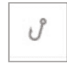

图 6-4 KnowBe4 Phish Alert Button (PAB)。

应报告任何潜在的疑似网络钓鱼事件。存疑时，参与者应使用PAB（如果是电子邮件）进行报告，或致电IT帮助台 xxx-xxx-xxxx 或发送电子邮件至 phishreport@acme.int。参与者必须参加与SAT计划相关的所有必需会议。


## Acme 冠军计划

Acme 使用“冠军计划”来协助 SAT 教育。Acme 的冠军计划名为“Acme We Are Aware”。冠军由其经理推荐，也可以自愿报名。职责包括推广 Acme 的一般网络安全防御计划，主动参加必修和额外培训，在 SAT 测验中得分 85% 或以上，并将他们所知所学与其业务单位的参与者分享。Acme 的 We Are Aware 计划由 IT 安全部门赞助，并每月举行会议。参与者将为自己和分享获得 T 恤和其他“周边”。参与者将被正式认可为已为改进 Acme 做出贡献，并且每年成功完成并保持良好成员身份，这一净积极特质将被列入其年度评估。冠军可能会偶尔获得奖品（包括礼品卡、门票或小额奖金）以感谢他们的参与；尽管参与者受邀加入仅仅是出于与同事分享信息的乐趣。冠军可由计划领导人自行决定无故解雇。退出计划或放弃计划绝不会在任何时候对参与者产生负面影响。

## 奖励与后果

成功报告真实和模拟钓鱼事件将有奖励，未能报告或与真实和模拟钓鱼事件互动将有后果。任何员工如果成功报告其所接触的所有模拟钓鱼演习和真实钓鱼事件，且没有任何一次失败，将获得额外 500 美元的年度报酬，超出 SAT 计划之外原计划的部分。Acme We Are Aware 计划的成员，如果在给定年份中完成至少八个月，且没有失败，有权在其他 500 美元基础上再获得额外 500 美元，每年总共获得 1,000 美元的额外奖金。高级管理层可以随时不经通知地暂停整个计划的额外奖金。

任何成功报告模拟钓鱼演习或真实钓鱼事件的员工都将收到一封“表扬”电子邮件。报告真实钓鱼事件的员工将在年度评估中收到此类报告记录，以被视为积极贡献。但是，在同一 12 个月时间范围内的任何失败都可能抹除参与者年度记录中的积极成功结果。如果某个业务单位的所有参与者在一个季度内没有任何一次失败事件，该业务单位将获得一次免费披萨派对。任何拥有超过 10 名参与者且整年没有一次失败的业务单位，将获得“电影之夜”或免费门票观看其选择的电影。在小组及其经理多数同意的情况下，电影活动可以替换为成本相同的其他经批准的娱乐活动。

在任何滚动的 12 个月期间，每位员工的后果如下：

- 零次失败，年度薪酬中增加 500 至 1,000 美元的额外奖金
- 一次失败，额外 SAT 培训，时长较短至中等（3 到 5 分钟）
- 两次失败，额外 SAT 培训，时长较长（5 到 10 分钟）
- 三次失败，额外 SAT 培训，时长较长（10 到 15 分钟），并与主管会面
- 四次或更多失败，额外 SAT 培训，时长较长（30 分钟），并与 SAT 专家和/或人力资源会面
- 五次或更多失败，额外 SAT 培训，时长较长（30 到 60 分钟），可能暂停服务，采取严肃纪律处分，包括解除雇佣关系

参与者的经理、人力资源部门或高级管理层可以随时无需事先通知地更新此奖励与后果政策部分，并且不受此处所述奖励和后果信息的限制。

在 12 个月期间内未能通过三次或更多模拟或真实钓鱼事件的参与者，应由 SAT 计划管理员（当面或通过调查工具）进行访谈，以了解该人员认为自己多次未能通过钓鱼测试或事件的原因。目标是找出 SAT 计划是否有任何措施可以帮助该人员更成功地识别真实或模拟的钓鱼事件（在合理范围内）。多个个人的重复失败在任何 SAT 计划中都是可以预期的，但也可能表明需要针对这些个人或整个计划改变策略。

## 事件响应

如果参与者“失败”了模拟或真实的社交工程或钓鱼活动，一次失败的模拟钓鱼事件将要求 IT 安全部门重置涉及参与者的密码，以便在 24 小时内更改。如果发生四次或更多失败的模拟钓鱼事件，参与者的设备将被“锁定”至少三个月。在 12 个月期间内的每次额外失败将导致由其经理和 IT 安全部门确定的额外锁定期。

真实钓鱼事件失败可能会导致正式的取证响应。如果参与者点击 URL、下载文件或提供登录凭据，其设备应立即从网络断开并关机，直到 IT 安全部门检查为止。登录凭据需要立即更改。设备将进行取证审查，并由 IT 安全部门决定将“清理过”的设备归还给参与者，或使用新设备或翻新设备作为替换。

## 报告指标

将使用以下指标来管理和运营该计划。

针对参与者：

- SAT 计划覆盖的参与者总数
- SAT 计划开始时和/或后续基线测试期间参与者的总体基线

针对必修培训：

- 必修培训的总数和类型
- 个人培训和测试结果
- 按时完成所有培训和/或特定必修培训的参与者总数/百分比和/或个人姓名
- 未按时完成所有培训和/或特定必修培训的参与者总数/百分比和/或个人姓名

针对单独的模拟钓鱼活动：

- 发送特定钓鱼活动的参与者总数/百分比和/或个人姓名
- 发送特定钓鱼活动并使用推荐方法/工具（例如，Phish Alert 按钮等）报告该活动的参与者总数/百分比和/或个人姓名
- 通过或未通过特定模拟钓鱼活动的个人总数/百分比和/或姓名
- 在特定模拟钓鱼活动中输入其登录凭据的个人总数/百分比和/或姓名
- 在特定模拟钓鱼活动中“点击了 URL”的个人总数/百分比和/或姓名
- 在特定模拟钓鱼活动中下载了模拟恶意载荷的个人总数/百分比和/或姓名
- 在特定模拟钓鱼活动中运行了模拟恶意载荷的个人总数/百分比和/或姓名
- 完成特定模拟钓鱼活动所请求信息的个人总数/百分比和/或姓名
- 参与者在一次、多次或全部模拟钓鱼活动中执行操作的总数或百分比

## 总结

SAT 计划及其奖励和后果的目标是显著降低网络安全风险，为此，所有计划部分都可以根据需要通过更新政策随时调整。第 6 章介绍了应该


包含在企业SAT策略中，并展示了读者可用于或修改以供自己用途的示例SAT策略。第三部分将介绍用于抗钓鱼的技术防御、软件、硬件和固件。它从第7章开始，该章涵盖DMARC、SPF和DKIM。

# 第三部分

## 技术防御

第7至10章侧重于技术防御。技术防御包括你可以在网络防御中部署以对抗威胁的任何软件、硬件或固件。最好的防御是一种防止威胁到达最终用户，从而使用户不受黑客及其手段侵害的防御。技术防御在自动化方面也很出色，并且可以大规模、快速地执行其防御策略。第7章研究了三项全球反钓鱼标准：DMARC、SPF和DKIM。第8章讨论了网络和服务器防御，第9章探讨了针对社会工程学和钓鱼的终端防御。第10章介绍了前三章未介绍的高级和杂项防御。其理念是，你将接触到广泛的可能技术防御，并可能会带回一些你以前未曾考虑用于防御社会工程学和钓鱼的新方法。

# 第 7 章

## DMARC、SPF和DKIM

第7章详细介绍了DMARC、SPF和DKIM。任何参与反钓鱼活动的人都应该了解这三项反钓鱼电子邮件标准的优势。每个组织都应为发送和接收电子邮件实施所有三项标准。

本章是本书中较长的章节之一，但对于不熟悉DMARC且参与打击钓鱼活动的任何人来说，都应该是必读章节。

### 核心概念

基于域的消息身份验证、报告和一致性（DMARC）、发送方策略框架（SPF）和域密钥识别邮件（DKIM）是相关的全球反钓鱼标准，允许电子邮件接收方验证声称来自特定发送域的电子邮件是否真正来自其声称的域。简而言之，它有助于防止电子邮件域欺骗。DMARC依赖于SPF和DKIM。即使未启用SPF和/或DKIM，DMARC也能提供主动保护（尽管你希望两者都启用以获得最全面的保护）。

> 缩写DMARC可以仅指DMARC标准本身，也可以指所有三个相关标准的集合。大多数情况下，你可以根据整体上下文判断其用法，尽管你可能需要对此加以澄清。在本书的大多数地方（特定DMARC章节除外），当我使用DMARC时，通常是指涵盖所有三个标准的总称。

电子邮件发送方可以使用DMARC保护其电子邮件域免受垃圾邮件发送者和网络钓鱼者的欺骗。电子邮件接收方可以使用DMARC验证接收到的电子邮件是否真正来自声称的域。每个发送或接收电子邮件的组织都应启用DMARC。使用DMARC时，电子邮件发送方会在DNS中配置并发布其DMARC、SPF和DKIM记录。电子邮件接收方（例如，电子邮件服务器、电子邮件客户端、邮件用户代理、邮件传输代理、邮件投递代理等）可以访问这些记录，并使用它们来验证声称由相关域发送的电子邮件。

> 在电子邮件标准中，电子邮件客户端被称为邮件用户代理，而电子邮件服务器和网关被称为邮件传输代理。本章中我将称它们为代理。

DMARC的创建目的是，例如，如果一封电子邮件声称来自microsoft.com，你实际上可以验证它是否确实来自microsoft.com。DMARC旨在减少，如果不能消除，恶意域欺骗。而且在大多数情况下，它奏效了！在DMARC出现之前，钓鱼电子邮件谎称其来源域非常普遍。而现在，由于DMARC，大多数钓鱼电子邮件不再试图声称来自高价值的品牌域（如`microsoft.com`）。它们仍然有很多小把戏，可以完全欺骗大量受害者，让他们以为邮件来自那些有价值的品牌域，但只要稍加检查，潜在受害者就可以验证电子邮件是否或不是来自声称的域。在这一点上，DMARC取得了巨大成功！

今天，DMARC通常为接收电子邮件的系统默认启用，但对于发送电子邮件域通常需要手动启用。我将告诉你如何两种方式都进行验证。但是，如果你不确定你的组织是否已为发送和接收启用DMARC，请验证它。如果未启用，请启用它。启用DMARC（如果配置正确）没有任何危害，并且它可以是打击钓鱼的重要工具。

从负面来看，DMARC在其所做的事情上非常成功，以至于钓鱼者经常使用它。事实上，启用和使用DMARC的钓鱼者比例超过合法域使用率（至少目前是这样）。这显著改变了我们最初设想使用DMARC来检测和缓解钓鱼的方式，但DMARC在我们打击钓鱼的斗争中仍然是一个绝佳的工具。如果不了解DMARC是什么、它如何工作以及如何利用它造福于你，你就不能成为一名严肃的反钓鱼专业人员。

### 美国和全球标准

DMARC在全世界使用，并且很可能成为美国少数几个强制性互联网安全标准之一。要了解DMARC的重要性，你必须意识到，要批准并全球强制执行一个新的互联网安全标准非常困难，甚至不可能。几十年来，我一直在阅读关于新的、伟大的、提议的互联网安全标准（例如，IPSEC、DNSSEC、TLS等），尽管它们可能被大多数互联网安全专家提议并接受为一件好事，但它们很少被制定为强制性标准。

然而，DMARC似乎很可能在不久的将来成为一项强制性的美国标准。在2021年《国防授权法案》中，规定国土安全部（DHS）必须在美国范围内实施DMARC。嗯，法定语言中实际规定的是“……国土安全部应制定并提交给国会一项策略……以在所有基于美国的电子邮件提供商中实施[DMARC]……”（参见图7-1）。

第9006条。保护电子邮件战略。

（a）一般规定。——不迟于2021年12月31日，国土安全部长应制定并提交给国会一项策略，包括建议，以在所有基于美国的电子邮件提供商中大规模实施基于域的消息身份验证、报告和一致性标准。

（b）要素。——小节(a)要求的策略应包括以下内容：

- (1) 针对基于美国的电子邮件提供商适用基于域的消息身份验证、报告和一致性标准的最小规模阈值的建议。
- (2) 大规模实施基于域的消息身份验证、报告和一致性标准的安全性和隐私权益的描述，包括在适当时关于国家安全豁免的建议，以及此类实施的负担和识别此类负担最可能落在谁身上。
- (3) 识别与此类实施相关的关键美国和国际利益相关方。
- (4) 识别此类实施的任何障碍，包括在可行时的成本效益分析。
- (5) 对联邦政府和私营部门实施实体此类实施的总成本的初步估算，包括在适当时关于抵消此类成本的建议。

（c）磋商。——在制定小节(a)项下的策略和建议时，国土安全部长可以在适当时咨询信息技术部门的代表。

图7-1 2021年《国防授权法案》摘录，讨论了DMARC可能的未来美国强制执行情况。

《国防授权法案》本质上是在告诉DHS评估在美国范围内实施DMARC，但这是强制使用之前的第一步。预算影响甚至也被要求考虑。将

DMARC 最终是否会被强制执行，以及如果会，在美国电子邮件服务提供商中以何种最小范围执行？我不确定，但我从未见过另一个全球互联网标准被美国政府考虑强制执行。即使 PKI 和 HTTPS 也不是美国强制执行的标准。

每年，越来越多的电子邮件发送者和接收者自愿启用它，因此法定强制执行可能并非必需。尽管如此，如果能以某种方式在全球范围内强制执行 DMARC（而不仅仅是在美国），那将是件好事，这有助于让落后者也加入进来。

> PCI DSS 正在“为未来设定日期”使用 DMARC、SPF 和 DKIM。请参见：https://easydmarc.com/blog/dmarc-mandatory-for-pci-dss-compliance.

好了，关于 DMARC 背景的介绍就到这里，让我们学习如何启用和使用它。

## 电子邮件地址

要理解 DMARC，你必须了解电子邮件地址。所有电子邮件在不同位置都附带多个发件人电子邮件地址（或类型）。有些容易看到，有些则不。在大多数人的电子邮件中，所有电子邮件地址都相同。但营销邮件、自动回复、垃圾邮件和网络钓鱼邮件通常在电子邮件的不同位置列出不同的电子邮件地址。你必须了解各种电子邮件地址及其含义，才能最好地理解 DMARC。让我们从一个合法电子邮件的示例开始（请参见图 7-2）。

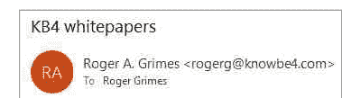

图 7-2 显示发件人电子邮件地址的电子邮件摘录。

## 友好发件人名称

在图 7-2 中，我从我的 KnowBe4 企业电子邮件帐户（即 `rogerg@knowbe4.com`）向我的个人电子邮件地址发送了一封电子邮件。出于 DMARC 目的，我们可以忽略接收者的电子邮件地址。DMARC 全部关于发件人声称的电子邮件地址。在图 7-2 中，您在尖括号中看到的电子邮件地址称为 `5322.From` 电子邮件地址，我们稍后将介绍。5322.From 电子邮件地址之前的文本（代表我的全名 Roger A. Grimes）称为 _友好发件人名称_、_友好-发件人_、_友好名称_ 或 _显示名称_。

友好发件人名称可以是几乎任何文本。当有人第一次在其电子邮件客户端（例如 Google Gmail、Microsoft Outlook、Apple Mail、Mozilla Thunderbird 等）中创建电子邮件帐户时，通常会创建它。您可以随时更新它，它不会影响您的真实电子邮件地址。人们经常根据需要（例如结婚、离婚、姓名更改、修正拼写错误等）更新它。您的真实电子邮件地址需要在互联网上是唯一的（以便使用它在互联网上发送和接收电子邮件），但您的友好发件人名称在任何时候都可以是几乎任何内容。您可以随意更改。它所说的内容除了在电子邮件中的显示方式外，不会影响您的电子邮件投递。

了解这一点很重要，原因有二。首先，它与发送和接收电子邮件的机制无关。它只是我们可以添加的内容，以更好地识别电子邮件的发件人。其次，它可能是完全的谎言，而不会影响电子邮件。我可以在友好发件人字段中说我是比尔·盖茨，我的电子邮件将像那里填的是 Roger A. Grimes 一样发送和接收。这也意味着您绝对不能依赖友好发件人名称中的内容。黑客和网络钓鱼者喜欢这一事实，并经常利用它来欺骗毫无戒心的受害者。

## 5322.From 名称

另一方面，5322.From 电子邮件地址虽然在我们的电子邮件客户端中以与友好发件人名称相同的方式输入，但它很重要。它必须在互联网上是唯一的，以便有人可以回复您发送的电子邮件。之所以称为 5322.From 电子邮件地址，是因为它最初在一份名为 5322 RFC（www.rfc-editor.org/rfc/rfc5322）的早期电子邮件请求评论（RFC）的第 4.3 节中定义。您也可能看到此电子邮件地址被称为 Display From、5322.Display From、From 地址 或 P2 发件人。DMARC 使用 5322.From 地址中指定的域。它是每封电子邮件的两个“真实”电子邮件地址之一，虽然在此情况下，您在打开电子邮件时可以看到它。我们稍后将讨论的第二个地址在您首次打开或预览电子邮件时不那么容易看到。

图 7-3 和 7-4 显示了两个真实世界网络钓鱼电子邮件的示例，每个示例都包含欺诈性的友好发件人名称及其 5322.From 地址。

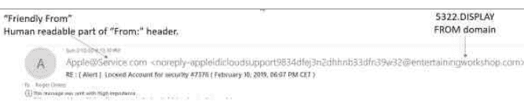

图 7-3 标注了友好发件人名称和 5322.From 电子邮件地址的真实世界网络钓鱼电子邮件示例。

在图 7-3 中，网络钓鱼者的“真实”电子邮件地址以域 entertainingworkshop.com 结尾，而友好发件人名称声称来自 Apple@Service.com。这封网络钓鱼电子邮件声称来自 Apple，因此网络钓鱼者伪造了 Apple@Service.com 电子邮件地址。许多潜在受害者会看到 Apple@Service.com 并认为这封电子邮件一定来自 Apple。但实际上并非如此。此外，网络钓鱼者的 5322 电子邮件地址包含单词“apple”和“icloudsupport”。所有这些对“apple”和“icloud”的提及，可能让许多潜在受害者相信这封电子邮件确实来自 Apple，而实际并非如此。来自 Apple 的真实电子邮件应来自 apple.com。让我们来看另一个网络钓鱼示例。

图 7-4 展示了发件人声称的友好发件人名称（Ryan Campbell）与 5322.From 电子邮件地址（Don.Payanall@mobilebank247.org）之间鲜明的差异。

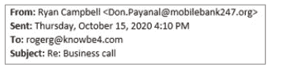

图 7-4 显示了友好发件人名称与 5322.From 电子邮件地址之间鲜明差异的网络钓鱼电子邮件示例。

友好发件人名称声称这封电子邮件来自 Ryan Campbell，但 5322 电子邮件地址声称它来自一个名为 Don Payanal 的人。嗯？这是一个非常明显的差异，许多具有这种不一致电子邮件地址的电子邮件都是欺诈性的。但并非全部。

我不确定为什么网络钓鱼者在发送图 7-4 中的网络钓鱼电子邮件之前没有将友好发件人名称更改为 Don Payanal，以使其看起来更真实，但这一定与他们的网络钓鱼自动化工具状态有关。大多数网络钓鱼者一次发送数百万到数千万封网络钓鱼电子邮件，速度快其计算机所能发送。他们向网络钓鱼自动化工具输入数百万个电子邮件地址，该工具发送数百万封网络钓鱼电子邮件。你可能会认为，网络钓鱼者的电子邮件自动化工具足够智能，能够将 5322 电子邮件地址与显示的友好发件人名称“绑定”。但遗憾的是，大多数时候并非如此。

当显示名称和两种类型的电子邮件地址（我们稍后将介绍第二种类型）匹配时，我们说它们是 _对齐_。DMARC 只关心两个真实电子邮件地址是否匹配（5322 和 5321，稍后介绍）。它不关心友好发件人名称。在 DMARC 中，当两个真实电子邮件地址来自同一域时，它们被视为对齐。唯一关心友好发件人名称的实体是人类，并且我们知道友好发件人显示名称不可信。

不一致的电子邮件地址在垃圾邮件和网络钓鱼（以及合法营销）领域非常常见，但在大多数个人的电子邮件中并不常见。大多数人的友好发件人名称是他们的姓名（或相近内容），而他们的 5322.From 地址与其友好发件人名称具有一定相似之处（例如，Roger A. Grimes 和 rogerg@knowbe4）。但是，垃圾邮件和网络钓鱼电子邮件通常具有截然不同的友好发件人名称和 5322.From 电子邮件地址。它们看起来确实不属于彼此。当我看到一封声称来自某人的电子邮件，并且它具有截然不同的友好发件人名称和 5322 电子邮件地址时，我开始怀疑它是恶意电子邮件。

但是，需要注意的是，许多合法营销电子邮件也具有不一致的电子邮件地址，尤其是当他们不希望你使用他们用来给你发送电子邮件的地址来回复时。图 7-5 显示了一个合法营销电子邮件的不一致电子邮件地址示例。

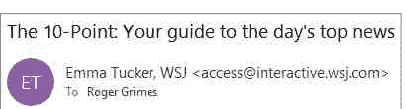

图 7-5 具有不一致电子邮件地址的合法营销电子邮件示例。


图 7-5 是我每天早上收到的来自《华尔街日报》的一封合法电子邮件。它来自一位名叫 Emma Tucker 的记者，但发送邮件地址为 access@interactive.wsj.com。如果我回复这封邮件，它不太可能直接发送给 Emma Tucker。这之所以如此，是出于目的并且可以接受（大多数时候）。这就是大规模营销电子邮件的工作方式。

关键点在于，网络钓鱼电子邮件通常具有截然不同、无法解释且不一致的电子邮件地址（如图 7-6 所示），这样做是为了故意对潜在受害者进行欺骗。不一致的电子邮件地址并不绝对总是意味着发件人有恶意意图，但不一致的电子邮件地址结合其他可能的恶意迹象和症状，则值得关注。

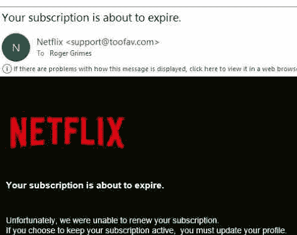

图 7-6 声称来自 Netflix 的真实世界网络钓鱼电子邮件，但其 5322.From 电子邮件地址为 support@toofav.com。

通常，网络钓鱼电子邮件中涉及的域名是由网络钓鱼者使用动态 DNS 服务或“借用”（即恶意使用）其他无辜域名而即时创造的数百万个。图 7-6 中显示的 `toofav.com` 域名是一个合法域名，也是一个销售商品的合法网站，其运作方式类似亚马逊。多年前，当这封网络钓鱼电子邮件被发送时，它被一个网络钓鱼者暂时接管并用于其网络钓鱼活动，但最终被合法所有者收回。合法域名被窃取并被网络钓鱼者用于诈骗活动的过程每天发生成千上万次，甚至数万次。

目前，只需知道 DMARC 关心 5322.From 域地址，而完全不关心 Friendly From 显示名称。

## 5321.MailFrom 电子邮件地址

每封电子邮件中另一个重要的“真实”电子邮件地址是 5321.MailFrom 电子邮件地址（也称为 MAIL FROM、smtp.mailfrom、P1 Sender、Return-Path 和 Envelope Sender）。大多数用户在电子邮件客户端中无法轻易看到此电子邮件地址，除非他们选择回复收到的电子邮件。然后，自动填充回复邮件的电子邮件地址就是 5321.MailFrom 电子邮件地址。

在许多情况下，尤其是在普通的个人用户电子邮件中，5321.MailFrom 电子邮件地址与 5322.From 电子邮件地址匹配。它们是对齐的。不幸的是，在网络钓鱼和恶意电子邮件中也是如此，但它们可以不同（如图 7-6 所示）。

SPF 仅关心 5321.MailFrom 电子邮件地址的域。当 5321 电子邮件地址域与 5322 电子邮件地址域匹配时，我们认为真实电子邮件地址已对齐。同样，与 5322 电子邮件地址一样，许多合法的大规模营销电子邮件具有不同的 5321.MailFrom 和 5322.From 电子邮件地址。例如，在图 7-7 中，5321.MailFrom 电子邮件地址是 10point@wsj.com，而 5322.From 电子邮件地址是 access@interactive.wsj.com。

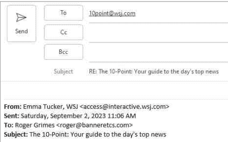

图 7-7 合法的大规模营销电子邮件显示对齐的 5321 和 5322 电子邮件地址，因为它们共享相同的域。

关键在于，5321 和 5322 电子邮件地址虽然不同，但来自同一个合法域（即 wsj.com）。它们是对齐的。这是 DMARC 关心的事情。

总结一下，SPF 专注于验证 5321.MailFrom 域地址。DKIM（我们将在稍后介绍）关注的是确保消息是由 DKIM 签名中指定的域（通常是 5322 域）发送的，并且在源和目标之间未被更改。DMARC 希望 5322.From 域地址与用于签署电子邮件的 DKIM 域匹配。DMARC 关心 SPF 和/或 DKIM 是否通过并对齐。换句话说，为了使 DMARC 成功并被标记为通过，必须验证 SPF 和/或 DKIM，并且经过身份验证的域必须与可见的 5322.From 地址中的域匹配（即对齐）。这部分对某些人来说可能令人困惑。只需知道 DMARC 希望 5321 和 5322 电子邮件域匹配。整个电子邮件地址不必匹配，只需域部分匹配。

当然，在恶意电子邮件的世界中，所有包含的电子邮件地址和域名都可以完全伪造。有时网络钓鱼者并不在乎它们是否不真实或未对齐。他们不在乎是否未通过 DMARC。他们使用伪造的电子邮件地址将网络钓鱼消息发送给潜在受害者，然后希望潜在受害者点击嵌入的链接或下载附件文件。但是 DMARC 允许你确定所声称的发送域是否真的是发送域。不多不少。

## HELO 电子邮件域

当两个电子邮件服务器（或客户端、代理等）连接时，它们通常会发送名为 HELO（或 EHLO）的 SMTP 命令。这是两个“邮件传输代理”（如 SMTP RFC 中所称）相互问候和连接的方式。通常，发送电子邮件代理会说 HELO 后跟其有效域名。接收代理会在其安全日志中记录发件人的域，如果它是接收来自该发送服务器电子邮件的电子邮件服务器，则通常会将发送服务器的域放入来自该域的每封电子邮件的标头中。因此，电子邮件标头中通常会至少列出三个电子邮件域：5321、5322 和 HELO 域。在对电子邮件进行取证调查时，每个域都可以使用。

## 发送者策略框架 (SPF)

当 SPF 已启用并强制执行时，接收电子邮件服务器或客户端可以使用它来验证所声称的 5321.MailFrom 电子邮件地址域。例如，如果我从 rogerg@knowbe4.com 向你发送电子邮件并声称这是我的 5321.MailFrom 电子邮件地址，则可以使用 SPF 验证该电子邮件是否确实来自 knowbe4.com 域授权的电子邮件服务器。

SPF 必须首先在电子邮件发送方使用名为“TXT 记录”的 DNS 记录上启用。SPF 的 TXT 记录格式类似于：

```
domainname IN TXT "v=spf1 ip4:publicIPAddressofemailserver -all"
```

例如，如果你正在尝试保护的发送电子邮件域名为 knowbe4.com，则你的 SPF 记录可能如下所示：

```
knowbe4.com. IN TXT "v=spf1 ip4:18.160.60.106 -all"
```

在这种情况下，18.160.60.106 将是代表 knowbe4.com 域发送电子邮件的授权电子邮件服务器/服务的公共 IP 地址。

DNS 中每个受保护的域名都必须有单独的 TXT 记录。如果你想使用 IPv6 地址而不是 IPv4 地址，也可以指定 ip6:。IP 地址也可以是多个 IP 地址、IP 地址范围，以及类似 192.168.1.0/24 的 CIDR IP 地址范围，如果你想覆盖大型连续 IP 地址范围的话。你还可以根据需要包含其他域名，这些域名官方允许代表你的域发送电子邮件，这在使用非常大的电子邮件供应商（如 Microsoft 和 Google）或营销公司的合法企业中很常见。如果是这种情况，你可以配置 SPF 以使用具有“include”语句的以下语法来允许从“第三方”域发送：

```
v=spf1[ip4/6:] [publicIPAddressesofemailservers]
[include:[3rdpartydomainnames]] -all
```

SPF DNS 记录可能相当长。以下是 KnowBe4 SPF 记录的部分摘录：

```
Knowbe4.com IN TXT "v=spf1 include:mailsenders.netsuite.com include:_spf.google.com include:mail.zendesk.com include:stspg-customer.com mx:spf.intercom.io ip4:23.21.109.212 ip4:23.21.109.197 ip4:52.49.201.246"
```

> 本书无法详细介绍 SPF DNS 记录的所有复杂性，但你应该知道存在许多变体。但是，如果你是 SPF 新手，这些示例是很好的具有代表性的示例，可作为起点。

KnowBe4 的 SPF 记录大约是最复杂、最冗长的记录之一。SPF 发送方列出所有被允许代表受保护域发送电子邮件的第三方发送者是至关重要的。KnowBe4 的 SPF 记录包括 Oracle Netsuite、Google（我们是企业 Gmail 用户）、Zendesk（我们的帮助台软件）以及许多其他“允许的发送者”（由域名或公共 IP 地址标识）。我们有很多“第三方”发送者可以代表我们发送邮件。发送者由涉及的电子邮件服务器/服务的公共 IP 地址和域名标识。

你可以通过运行 [EasyDMARC 的 SPF 检查工具](https://easydmarc.com/tools/spf-lookup?domain=knowbe4.com) 来查看 KnowBe4 SPF 记录的图形化展开视图。你会看到我们有十几个被允许代表 KnowBe4 发送电子邮件的发送者。如果你有兴趣了解你所在组织的 SPF 记录可能是什么样子，并且你还没有 SPF DNS 记录，则可以运行一个图形化 SPF 工具来生成 SPF DNS 条目，例如 [EasyDMARC 的 SPF 生成工具](https://easydmarc.com/tools/spf-record-generator)。


SPF 验证的工作原理如下。任何人（实际上是其接收邮件客户端、服务器/服务，或其代表的、启用了 SPF 验证的代理）收到声称来自特定 5321 域的邮件时，都可以验证该邮件声称的 5321 域。接收代理从发件人的 DNS 服务器检索发送邮件服务器的 SPF 记录，并将提供的 SPF 记录中的信息与邮件声称的 5321 域信息进行比较。再次说明，SPF 记录规定了哪些邮件服务器（按 IP 地址或域名）有权代表该特定域发送邮件。如果比较信息匹配，则 SPF 检查为“PASS”；如果不匹配，则 SPF 检查为“FAIL。”

大多数人的邮件服务器或客户端今天已经在执行 SPF 检查了，无论他们是否知道。要验证这一点，用户只需打开任何已收到的邮件，查看邮件头，并查找显示“SPF=.”的文本。它可能会显示“PASS”、“FAIL”、“NONE”或类似内容。出现任何 SPF 验证消息都意味着客户端代理（或接收路径中的其他某个代理）已启用 SPF 验证检查。

图 7-8 显示了一封 SPF 检查通过的邮件示例。

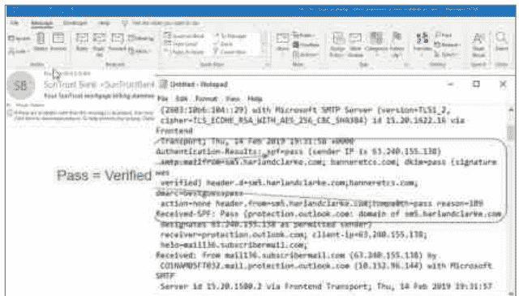

### 图 7-8 SPF 检查通过的示例。

SPF 检查通过并不意味着邮件不是恶意的。许多恶意邮件可以通过 SPF 检查。这只是表示邮件声称来自某个特定的 5321 电子邮件地址域，且 SPF 已验证其是否由该域授权的邮件服务器/服务发送。

图 7-9 显示了针对真实钓鱼邮件的 SPF 检查失败示例。

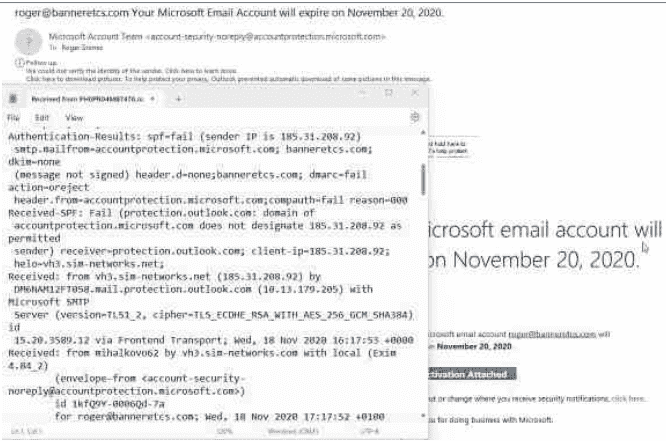

### 图 7-9 真实钓鱼邮件上的 SPF 检查失败。

在图 7-9 中，你可以在标头摘要的第一行看到“spf=fail”。该钓鱼邮件试图声称其 5321 邮件域为 accountprotection.microsoft.com，但实际上并非如此。此外，邮件头显示该邮件实际上是从 sim-networks.net 域发送的。

SPF 失败并不总是恶意的。也可能是因为发件人未正确配置其 SPF DNS 记录。事实上，这相当普遍。尽管如此，如果你出于其他原因怀疑某封邮件是钓鱼邮件，SPF 检查失败也是对其不利的另一个因素。但要明确的是，SPF 检查通过并不意味着邮件是或不是恶意邮件。遗憾的是，今天，大多数钓鱼邮件都能通过 SPF（及其他 DMARC 检查）。这仅表示声称的 5321 域是否就是实际涉及的域。详情见下文。

图 7-10 显示了针对真实钓鱼邮件的 SPF 检查通过示例。

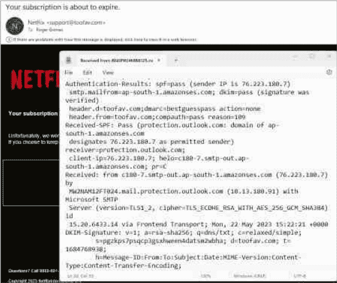

### 图 7-10 真实钓鱼邮件上的 SPF 检查通过。

如图 7-10 所示，许多钓鱼尝试声称来自某个特定域，且确实来自该声称的域。SPF 不是钓鱼检测服务。它只是检查邮件声称的 5321 电子邮件地址域是否真的是邮件的发送来源。邮件是否通过或未通过 SPF 检查，只是你用来判断邮件是否为恶意邮件的另一条信息。

> SPF 检查还可以显示 spf=none，这意味着发送域未启用 SPF。将“none”值视为通过还是失败，由发件人或接收者决定。

## 域密钥识别邮件（DKIM）

启用并使用 DKIM 的邮件服务器使用非对称密钥（即私钥/公钥对）对发出的邮件进行数字签名。带有 DKIM 的邮件附带数字签名，这允许参与的邮件接收者验证发送域是否与参与邮件的 DKIM 数字签名中声明的域相匹配。该邮件是否确实来自其声称的来源？它还允许接收者验证邮件在发送邮件服务器上数字签名后，以及被接收者软件打开并验证之前，未被修改。此外，当涉及 DMARC 时，DMARC 要求 DKIM 邮件域与（即与）5322 邮件域匹配（对齐）。

> DKIM 与数字签名有关，不执行任何加密。

> DKIM 不要求用于创建 DKIM 签名的非对称密钥必须由（受信任的）证书颁发机构颁发，且密钥不属于 PKI x.509 标准的一部分。

DKIM 是三个相关标准（即 DMARC、SPF 和 DKIM）中设置和使用最难的一种。它是三个标准中唯一运行时需要除 DNS 记录之外的其他内容的标准。DKIM 管理员/服务必须在参与的发送邮件服务器/服务上创建和/或安装非对称密钥对。使用私钥，启用 DKIM 的邮件服务器/服务会为每封发送的邮件创建一个数字签名。接收者可以从发件人的 DNS 服务（另一个 TXT 记录）下载相关的 DKIM 公钥，并使用它来验证邮件的 DKIM 数字签名。图 7-11 显示了 DNS 中 DKIM 公钥记录的示例。

```
v=DKIM1; k=rsa;
p=MIGfMA0GCSqGSIb3DQEBAQUAA4GNADCBiQKBgQCT9R
LS66TdbkmlnZWSXGH5Ci6O/+Co+C15GwX8XPx360PbcCqY
M/lah1STOKrZ7mFoLdlVLT0XeZk3Br33CJPBNxVpFj3R2zdRX
9jYQUfnJZ+AdjfLzcf5KsLozoqsB2OHxXa9Sth+9DgZyQw6GL
8V/0OjYH258gYq4adSVlBjrQPQIDAQAB
```

### 图 7-11 显示 DKIM 公钥的 DKIM DNS 记录示例。

p= 变量后面的字符串是 DKIM 公钥。单个域可以有多个 DKIM 密钥。这在谷歌和微软等大型域，以及拥有多个邮件服务器的域中非常常见。当旧密钥即将到期（或已过期）而另一个密钥现在用于签署当前邮件时，也可能存在多个 DKIM 密钥。

图 7-11 显示了从 DNS 下载的 KnowBe4 的 DKIM 记录。k= 变量指示正在使用的数字签名算法，p= 变量以 base64 二进制格式显示公钥。接收来自 KnowBe4 的带 DKIM 签名邮件的邮件代理可以下载 KnowBe4 的 DKIM 公钥，并使用它来验证 KnowBe4 发送的任何邮件的 DKIM 签名。邮件的 DKIM 签名附加到邮件中，并成为其标头的一部分。你可以通过查看邮件头来查看任何带 DKIM 签名邮件的 DKIM 数字签名。图 7-12 显示了两个 DKIM 数字签名示例。b= 变量后面的字符是邮件 DKIM 数字签名。它有两个 DKIM 签名，因为参与发送邮件的两个 MTA 都启用了 DKIM。

```
DomainKey-Signature: q=dns; a=rsa-sha1; c=nofws;
s=dkim2014q3; d=sms.harlandclarke.com;
h=DKIM-Signature:MIME-Version:Message-ID:X-SM-Email-Key:Content-Type:X-
mid:X-ppid:Subject:Reply-To:To:From:X-addpr:List-Unsubscribe:Date:X-dit...
b=rm7jFajafueINvhwXvSuhKANPxMI1Tfr/I1lmlMaI407fxLOrIGpRstCCG6v2uXf
oFpuIpO2O3DvnRhHVs6Bv6btTT9U1D6vyN3+zrMmOwZtw/Tu35df0o0ctwwm/Ofxq
ksQqXuhGI6n6bZ3V6T7Jc6cJbdUR9ftgaTED/WLaTYFNQ=
DKIM-Signature: v=1; a=rsa-sha1; d=sms.harlandclarke.com; s=dkim2014q3;
c=relaxed/simple;
q=dns/txt; i=@sms.harlandclarke.com; t=1550172717;|
h=From:Subject:Date;
bh=xcDeDJuUmqtqYwVuNLH/MIi6s53k=;
b=XSvBd3jPpRpjoEKKTEv0cEWqpcDFyngIKgJTAD1jpJm9Rfpj3TD7NjY4zogcizwxwNv
H4r+L.daJFHNvufJjmbbzbU8UaRHo7pm7C2MPRBt8BSkFE1/OOkkR78U5aUBJU1aTf
2Wmv0mZTBsEeVKC3khL6b2or7LXVqYs0Q3kfwVxxbkok=;
```

### 图 7-12 DKIM 数字签名示例。

d= 变量是执行 DKIM 签名的参与发送域。它可能是你认为邮件来自的域，也可能不是。如果发件人使用另一个第三方发送邮件，并且该第三方执行 DKIM 签名，则 d= 变量将是第三方的域名，而不一定是你看到的邮件头中的域名或 SPF 5321 或 5322 电子邮件地址中引用的域名。

图 7-12 显示了合法邮件中到达的两个有效 DKIM 数字签名。可以在任何带 DKIM 签名的邮件头中看到此 DKIM 信息。如果邮件使用多个启用 DKIM 的邮件服务器/服务发送（如本示例所示），则可能存在两个或多个有效 DKIM 数字签名。这是因为第一个发送已签名邮件到第二个邮件服务器/服务的邮件服务器/服务已启用 DKIM，从而创建了第一个 DKIM 数字签名。然后，将邮件发送到最终收件人的第二个邮件服务器/服务也已启用 DKIM，从而创建了第二个 DKIM 签名。


DKIM 允许发送者授权其他可信的第三方代表其执行 DKIM 签名。发送者通常会对电子邮件进行 DKIM 签名，然后将其发送到其他也代表原始发送者或其自身执行 DKIM 签名的第三方，因此在电子邮件中看到两个或多个 DKIM 签名非常常见。

逐封电子邮件地确认 DKIM 通过和失败，方法是检查其标头并查找任何“dkim=”语句。图 7-13 显示了电子邮件标头摘录，指示该电子邮件的 DKIM 签名有效。

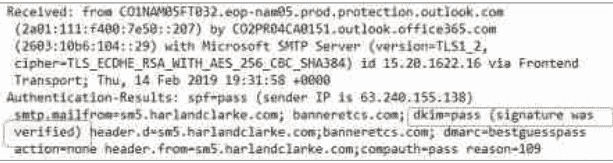

图 7-13 显示经过验证的 DKIM 签名的电子邮件标头摘录（即，dkim=pass）。

下图 7-14 显示了 DKIM 签名失败（即，dkim=fail）。

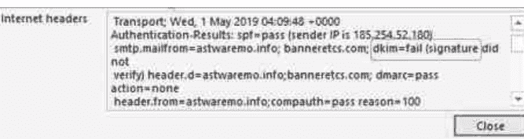

图 7-14 显示 DKIM 失败的电子邮件标头摘录（即，dkim=fail）。

与 SPF 类似，DKIM 通过或失败并不表明电子邮件是否是网络钓鱼邮件。网络钓鱼邮件通常可以通过 DKIM（尽管不如 SPF 那么频繁，因为它需要带有数字证书的非对称密钥，且设置更加困难）。反之，合法电子邮件也常常失败。DKIM 告诉你的全部内容是，电子邮件所声称的 5322.From 电子邮件地址域是否已通过 DKIM 签名过程得到确认。不过，你仍可将该信息作为判断电子邮件是否为网络钓鱼邮件的依据之一。

## 基于域的消息身份验证、报告和一致性 (DMARC)

DMARC 帮助发送者向接收者指示，接收者应如何处理声称来自发送者域但未通过 SPF 和/或 DKIM 验证的电子邮件（即，无、拒绝或隔离）。DMARC 还允许发送者向接收者指示是否希望接收 DMARC 报告，以及如果希望，希望以多详细的程度接收。DMARC 由电子邮件发送者通过在 DNS 中创建另一条 TXT 记录来配置和启用。电子邮件接收者可以下载 DMARC DNS 记录并将其用于 DMARC 验证。

### DMARC 失败电子邮件处理

DMARC 允许发送者做的最重要的事情是，指示接收者如何处理声称来自发送者受保护域但未通过 SPF 和/或 DKIM 验证检查的电子邮件。DMARC 失败可能源于 SPF 失败、DKIM 失败或两者兼有。在某些 DMARC 场景中，未启用 SPF 或 DKIM 的电子邮件域可能被视为失败。DMARC 发送域可以指示接收者采用以下三种策略之一来处理失败的电子邮件：

- 无
- 隔离
- 拒绝

DMARC 发送域可以指示接收者将失败的电子邮件视同任何其他电子邮件予以接受，而不考虑失败情况（这来自标记为 *无* 的 DMARC 策略指令）。*无* 大多数情况下不是一个好的 DMARC 策略指令，因为它违背了使用 DMARC、SPF 和 DKIM 的主要目的。然而，它可在初始设置期间、用于排查 DMARC 问题，以及允许发送者接收 DMARC 报告而不阻止任何失败的电子邮件时使用。

最常见的 DMARC 策略指令是 *隔离*。这指示接收者将失败的电子邮件放置在用户的垃圾邮件、隔离、废件邮件或其他类似文件夹中，在那里它可以被搁置，直到被删除或接受进一步检查。接收的电子邮件服务器/服务甚至可以将其放置在管理文件夹中，以在服务器级别接受自动或手动检查。隔离策略选项的概念是，失败的电子邮件将接受进一步检查或被标记为可疑，以便用户或管理员可以进一步检查它。

最安全的 DMARC 策略指令是 *拒绝*。这指示电子邮件接收者（例如电子邮件服务器/服务、电子邮件网关、邮件传输代理等）删除失败的电子邮件，并确保它不会进入用户的电子邮件客户端收件箱。在理论上，这是所有 DMARC 发送者希望其策略设置的位置。但是，合法电子邮件可能会因各种原因而无法通过 DMARC、SPF 和 DKIM 检查（例如，配置错误、数字证书过期、域名更改、DMARC 策略中未考虑新域等），并且大多数公司认为 *隔离* 策略指令是更安全的风险回报选择。这样一来，任何未能通过 DMARC 检查的合法电子邮件，如果用户查看其隔离文件夹，仍有可能被查看和恢复。但在理论上，每个 DMARC 发送者最终都希望在准备充分且足够成熟时，在实践中将其 DMARC 策略设置为 *拒绝*。

DMARC 记录也可能未配置，或处于无法定位或遵循的错误状态。当适用时，DMARC 记录在电子邮件标头中可以被标记为缺失、未找到或出错（例如，permerror 或 temperror）。

可以使用 DNS 查询或在线 DMARC 检查器（例如：[在线 DMARC 检查器](https://easydmarc.com/tools/dmarc-lookup)）来检查组织的 DMARC 策略。图 7-15 显示了 KnowBe4 的 DNS DMARC 记录。

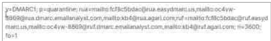

图 7-15 在线 DMARC 查找工具显示的 KnowBe4 DMARC DNS 记录。

如图 7-15 所示，KnowBe4 的 DMARC 策略设置为隔离。这是因为我们用于发送电子邮件的域名和 IP 地址集合变化非常快（包括模拟网络钓鱼测试）。我们的发送电子邮件域非常容易与已发布的 DMARC 策略不同步，因此我们选择隔离作为默认的 DMARC 策略指令。

您可能会看到的另一种 DMARC 策略设置是 BestGuessPass，这意味着发送域未设置 DMARC 策略，但涉及的验证接收域服务认为发送域可能是合法的。不要依赖此声明，将所有具有 BestGuessPass 结果的电子邮件视为无或无效。许多网络钓鱼电子邮件具有 BestGuessPass DMARC 结果。

可以通过打开任何电子邮件的标头并查找 dmarc= 语句来查看其 DMARC 验证状态。图 7-16 显示了来自真实网络钓鱼电子邮件的 DMARC 验证结果示例。

图 7-16 显示了一个试图看起来像来自 DHL 的合法电子邮件的真实世界网络钓鱼邮件。您可以在电子邮件标头摘录中看到，它未能通过 DMARC 检查。

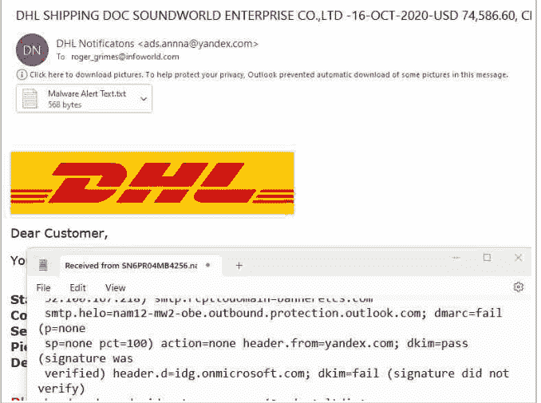

图 7-16 显示未能通过 DMARC 验证检查的真实世界网络钓鱼电子邮件。

## DMARC 报告

DMARC 允许的第二件重要事情是，DMARC 发送者可以接收来自参与接收者（即选择向发送者发送 DMARC 报告的接收者）关于从发送者处接收的电子邮件的处理和状态的报告。发送者可以选择获取 *汇总* 报告，这类报告简单地告诉发送者，在特定接收域接收到的声称来自该发送者的电子邮件中，有多少封通过了 DMARC 检查，有多少封失败了；或者 *详细* 报告，这类报告会提供每封失败电子邮件的更多细节。汇总报告允许发送者跟踪有多少封电子邮件未能通过 DMARC 检查（即，SPF 和/或 DKIM）。发送者可以了解趋势并调查异常。详细报告将帮助发送者了解一封或多封电子邮件未能通过 DMARC 检查的原因。是因为遭遇了网络钓鱼攻击、错误还是配置错误？

DMARC 报告选项有很多。我喜欢 EasyDMARC 对它们的总结，如图 7-17 所示。

| 标记 | 标记描述 |
| :--- | :--- |
| v (必需) | 版本标记。唯一允许的值是 "DMARC1"。如果值不正确或标记缺失，DMARC 记录将被忽略。 |
| p (必需) | DMARC 策略。允许的值为 "none"、"quarantine" 或 "reject"。默认值为 "none"，即对未经身份验证的电子邮件不采取任何操作。它仅有助于收集 DMARC 报告并深入了解当前的电子邮件流及其身份验证状态。"quarantine" 将失败的电子邮件标记为可疑，而 "reject" 则会阻止它们。 |
| rua | 汇总报告发送目标。它是 ESPs 用于发送失败报告的 "mailto:" URI。该标记为可选，但如果跳过，则不会收到报告。 |
| ruf | 取证（失败）报告发送目标。它是 ESPs 用于发送失败报告的 "mailto:" URI。该标记为可选，但如果跳过，则不会收到报告。 |
| sp | 子域策略。除非在此处专门定义，否则子域将继承上述域策略标记 (p=)。与域策略一样，允许的值为 "none"、"quarantine" 或 "reject"。此选项当前不广泛使用。 |
| adkim | DKIM 签名对齐。该标记遵循 DKIM 域与父级 Header From 域之间的对齐。允许的值为 "r"（宽松）或 "s"（严格）。"r" 是默认值并允许部分匹配，而 "s" 标记要求域相同。 |
| aspf | SPF 对齐。该标记遵循 SPF 域（发送者）与 Header From 域之间的对齐。允许的值为 "r"（宽松）或 "s"（严格）。"r" 是默认值，允许部分匹配，而 "s" 标记要求域完全相同。 |
| fo | 取证报告选项。允许的值为 "0"、"1"、"d" 和 "s"。"0" 是默认值，当 SPF 和 DKIM 均未能生成对齐通过时生成取证报告。如果任何协议结果不是 pass，请使用 "1"。"d" 在 DKIM 无效时生成报告，而 "s" 对 SPF 也执行相同操作。定义 ruf 标记以接收取证报告。 |
| rf | 失败报告的报告格式。允许的值为 "afrf" 和 "iodef"。 |
| pct | 百分比标记。该标记仅适用于策略为 "quarantine" 或 "reject" 的域。它标记应用策略的失败电子邮件百分比。其余部分适用较低级别的策略。例如，如果在策略为 "quarantine" 的域上设置 "pct=70"，则该策略仅适用 70% 的时间。剩余的 30% 适用 "p=none"。同样，如果 "p=reject" 且 "pct=70"，则 "reject" 适用于 70% 的失败电子邮件，30% 进入 "quarantine"。 |
| ri | 报告间隔。以秒为单位标记接收到的 XML 报告的频率。默认值为 86400（每天一次）。无论设置的间隔如何，在大多数情况下，ISP 会以不同的间隔发送报告（通常每天一次）。 |

图 7-17 EasyDMARC 对 DMARC 选项（包括报告选项）的总结。


## 配置 DMARC、SPF 和 DKIM

创建 DNS 记录、启用和配置 DMARC、SPF 和 DKIM 超出了本书的范围。要涵盖配置选项需要再增加几十页。每种协议都有几十种不同的配置选项，而且很容易出错。启用每种协议的方式因涉及的电子邮件和 DNS 服务而异。但如果你在互联网上稍微搜索一下 DMARC、SPF 和 DKIM，你会找到数百页关于这些协议以及如何配置和启用它们的内容。

有许多与 DMARC、SPF 和 DKIM 相关的开源工具。大多数与 DMARC 数据收集和报告有关，以图形方式显示 DMARC 报告数据。你也可以委托任何商业公司来为你处理 DMARC、SPF 和 DKIM。许多组织发现让其他人来处理要容易得多。有许多很好的商业服务，包括以下这些：

- EasyDMARC
- Dmarcian
- Agari
- Validity
- Dmarcly

KnowBe4 是 EasyDMARC 的投资者。

总的来说，如果你使用商业服务，你会获得更好的 DMARC 体验和效果。

如果你有兴趣了解更多关于 DMARC、SPF 和 DKIM 以及如何启用和配置它们的信息，请考虑观看我相关的一小时网络研讨会：https://info.knowbe4.com/implementing-dmarc。

## 把所有内容整合在一起

DMARC、SPF 和 DKIM 相互协同工作。当发件方全部启用时，接收方可以验证多个信息片段。SPF 将验证发件方的 5321 电子邮件地址域。DKIM 将允许接收方验证发件方 DKIM 签名中指示的域（即 d= 变量），以及电子邮件从发送到接收期间未被篡改。DMARC 将验证 DKIM 签名与 5322 电子邮件地址域的对齐情况。这些服务中的每一个都会有其自身的 PASS 或 FAIL（或其他指定）。任何一个的 FAIL 都将应用 DMARC 的策略指令（在 p= 变量中指示），说明接收方应如何处理失败的电子邮件（即 None、Quarantine 或 Reject）。

从路径流程的角度来看，当一封 DMARC 启用的电子邮件到达接收方的电子邮件服务器/服务时，该电子邮件服务器/服务将首先应用其所有常规网络安全检查（例如，反钓鱼、反垃圾邮件、反恶意软件、内容过滤等），然后开始应用 DMARC 检查（如果已启用）。如果确定已启用 DMARC（如电子邮件头中所示），接收电子邮件服务器/服务将连接到发件方的 DNS 服务器并下载 DMARC、SPF 和 DKIM DNS 记录。然后它将使用这些 DNS 记录进行相关验证，并根据验证结果更新电子邮件头。基于 DMARC、SPF 和 DKIM 检查，电子邮件可能会或不会被发送到收件方的电子邮件收件箱或隔离文件夹。电子邮件也可能在电子邮件服务器/服务中被拒绝，永远无法到达最终收件方的电子邮件客户端。此过程在图 7-18 中以图形方式总结。

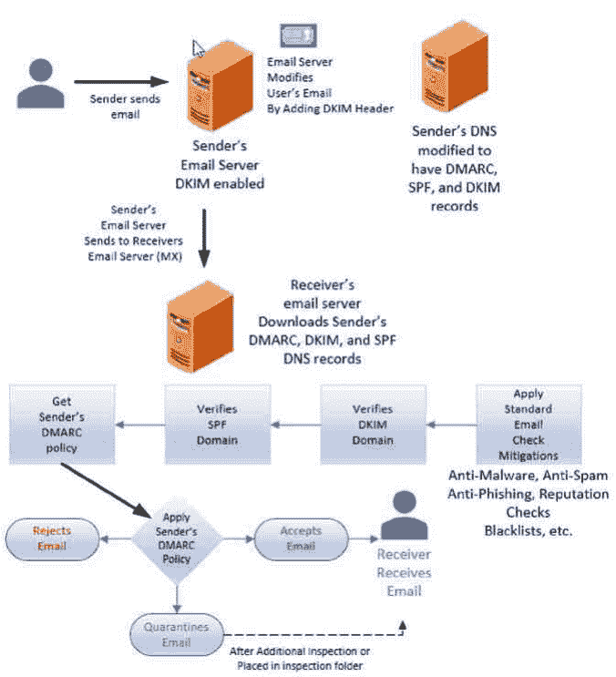

图 7-18 DMARC、SPF 和 DKIM 验证检查流程。

## DMARC 配置检查

你可以检查你组织自己的域以及其他实体的域的 DMARC、SPF 和 DKIM 配置。互联网上到处都是检查工具。这里有一个由 Dmarcian 提供的工具，Dmarcian 是由 DMARC 的主要联合创始人之一创建的 DMARC 公司：https://dmarcian.com/dmarc-tools。

图 7-19 显示了针对 knowbe4.com 运行 Dmarcian DMARC 检查工具的结果。

| DMARC | SPF | DKIM |
| --- | --- | --- |
| ! DMARC 您的域具有一个有效的 DMARC 记录，且已设置为 p=quarantine。要充分利用 DMARC，策略应设置为 p=reject。+ 详情 | ✓ SPF 您的域具有一个有效的 SPF 记录，且策略足够严格。- 详情 v=spf1 include.mailersend.net4life.com include_spf.google.com include.mail.zendesk.com include.stagpcustomer.com ms-spf.intercom.net ip4:23.210.109.197 ip4:52.49.201.246 ip4:52.49.235.189 ip4:54.172.84.960 ip4:147.160.167.70/24 ip4:169.235.256.71 ip4:168.235.226.72 ip4:168.235.226.73 ip4:168.235.226.74 ip4:198.235.233.211 ip4:168.235.233.212 ip4:168.235.233.213 ip4:192.254.121.246 ip4:167.89.63.53 mx=a:wtxa.net include:_netblocks.salesforce.com -all | ✓ DKIM 您的 DKIM 记录有效。+ 详情 |

图 7-19 针对 knowbe4.com 运行 DMARC 检查工具的结果。

根据你运行的 DMARC 检查工具不同，你可能会收到警告或错误配置的提示，即使该组织实际上不需要担心什么。例如，图 7-19 显示 KnowBe4 的 DMARC 记录带有警告，但这仅仅是因为我们的 DMARC 记录设置为 quarantine 而不是 reject，而这是 KnowBe4 希望的。

## 如何验证 DMARC 检查

验证 DMARC（即 DMARC、SPF 和 DKIM）检查主要有两种方法。一种方法是让邮件代理自行完成工作。当发送和接收代理上启用了 DMARC 时，代理将验证各种启用的 DMARC 检查并相应处理。大多数用户不需要做任何事情。这已为他们处理好了。

第二种方法，而且我认为更有趣的方法，是在需要或想要时手动调查单个电子邮件。你可以在电子邮件头中搜索 dmarc=、spf= 和 dkim= 来查看各种 DMARC 状态结果。如何访问电子邮件头取决于你使用的电子邮件客户端。例如，在 Microsoft Outlook 中，打开单个电子邮件，然后选择“文件”、“属性”，并查看“Internet 标头”字段。你可以滚动查看那里显示的标头信息，尽管我更喜欢将所有标头信息（使用 Ctrl-A 然后 Ctrl-C）复制到 Microsoft 记事本中（使用 Ctrl-V），以便更容易地看到和查找信息。在 Gmail 中，你可以打开一封电子邮件，点击三个“更多”点，然后选择“显示原件”。如图 7-20 所示，Gmail 很好地向你显示了 DMARC 结果状态，而无需浏览整个电子邮件头（虽然整个头也显示在摘要下方）。

| 原始消息 |
| --- |
| 消息 ID | <181a17390d6213 (b7af2150-b971-49d4-e705-5cabba9c01b0)@outlook.com> |
| 创建时间 | Fri, Sep 8, 2023 at 6:25 AM (Delivered after 2 seconds) |
| 发件人： | Stu Sjouwerman <sjouwerman@knowbe4.com> |
| 收件人： | rogerg@knowbe4.com |
| 主题： | Hacking Your Digital Identity: How Cybercriminals Can and Will Get Around Your Authentication Methods |
| SPF： | PASS with IP 54.174.60.48 Learn more |
| DKIM： | 'PASS' with domain knowbe4.com Learn more |
| DMARC： | 'PASS' Learn more |

图 7-20 Gmail 显示的 DMARC 结果示例。

互联网上有很多电子邮件头分析器，可以为你分析和拆解电子邮件头，这些头可能非常“杂乱”。只需在任何互联网搜索引擎中输入“电子邮件头分析器”，尽管我最喜欢的一个是：https://mha.azurewebsites.net。你需要将电子邮件头复制到它们中，当然，向任何第三方提供此类信息都会带来潜在的隐私风险。

当我处于重度取证故障排除模式时，我更喜欢查看整个头（我们将在第 15 章“取证检查电子邮件”中更详细地介绍），因为它包含大量其他有用信息。但 Gmail 显示的版本更易读、更快速，对于初学者 DMARC 调查人员来说通常也更准确。就我个人而言，我经常使用 https://mha.azurewebsites.net 进行快速检查，因为它适用于任何电子邮件客户端，并且我使用多个电子邮件客户端。

## 如何使用 DMARC

重要的是要认识到，DMARC 成功或失败并不意味着某封电子邮件是或不是恶意电子邮件。DMARC 向你（或你的代理人）告知 SPF 和 DKIM 身份验证机制是否成功通过，并与相关电子邮件域（SPF 的 5321 MailFrom 与 5322.From 地址域匹配，DKIM 的 d= 域与 5322.From 地址域匹配）对齐。仅此而已，不多不少。不过，这些是可用于帮助判断电子邮件是否恶意的重要信息。

许多甚至大多数网络钓鱼电子邮件都会通过所有 DMARC 检查。这是因为垃圾邮件发送者和网络钓鱼者意识到，如果他们不启用和使用 DMARC，他们的电子邮件大多数时间可能会进入隔离文件夹，从而极大地削弱他们的转化率和受害者数量。因此，网络钓鱼者积极采用了 DMARC，大多数网络钓鱼电子邮件都会通过所有 DMARC 检查。虽然，大多数时候，网络钓鱼者将他们的 DMARC 策略设置为 None，因此即使失败也不会被隔离或拒绝。


看到最恶意的电子邮件通过所有 DMARC 验证检查，在心里有点令人失望，但这并不意味着 DMARC 总体上是一次失败。不，DMARC 迫使网络钓鱼者停止域名伪造的频率几乎和过去一样低。他们不再能轻易伪装成来自 microsoft.com、google.com、paypal.com 等域名。是的，他们现在所做的就是编造一些（合法的）近似仿冒域名，例如 accountingmicrosoftcom.com 或 paypalpayables.com，并在其上启用 DMARC。遗憾的是，绝大多数用户根本不会关注声称的域名，也注意不到其中的差异。

但如果你关注域名，无论电子邮件是通过还是未通过 DMARC 检查，都会验证声称的电子邮件域名是否真的是邮件的来源。因此，如果一封邮件声称来自 paypalpayables.com，且 DMARC 检查证实了这一事实，那么我知道这封邮件确实来自 paypalpayables.com，而不是来自 paypal.com（合法的 PayPal 邮件应从 paypal.com 发送）。DMARC 是一项成功，可以帮助你判断一封邮件是否是网络钓鱼邮件。你只需了解 DMARC 告诉你什么、不告诉你什么即可。

### DMARC 不会做的事情

DMARC 不会告诉你一封邮件是否具有恶意。除了使用相似域名之外，网络钓鱼者还可以滥用许多其他方式（尽管这是主要方式），而 DMARC 对这些方式一无所知。部分问题源于 DMARC 协议及其工作方式的弱点。例如，所有转发的电子邮件都会丢失其先前的电子邮件头信息（会被清空），导致转发的消息无法通过 DMARC 身份验证。

以下是其他一些 DMARC 问题：

- DMARC 配置错误的情况很常见，导致合法电子邮件出现失败状态。
- 许多合法组织将 DMARC 设置为 None，这基本上违背了 DMARC 的初衷。
- 有时，电子邮件客户端/服务不会按照指示或预期处理 DMARC 失败。
- 许多网络钓鱼邮件是通过大型公共电子邮件提供商（例如 Google、Microsoft、Sendgrid 等）发送的，即使被网络钓鱼者滥用，通常也会显示 DMARC 通过。
- DMARC 是域验证，而不是特定电子邮件地址验证。
- 网络钓鱼者可以使用被攻陷的合法域来发送电子邮件。

要说明的是，DMARC 虽然不错，但并非完美。但在对可疑网络钓鱼邮件进行取证检查时，你可以将其作为另一种工具使用。

### 其他 DMARC 资源

你可以探索以下其他 DMARC 资源：

- **DMARC 概述:** https://easydmarc.com/blog/what-is-dmarc-overview
- **DMARC 的历史:** https://easydmarc.com/blog/what-is-dmarc-a-bit-of-history
- **了解 DMARC 报告:** https://easydmarc.com/blog/understanding-dmarc-reports
- **RUA 和 RUF 标记:** https://easydmarc.com/blog/what-are-rua-and-ruf-in-dmarc
- **电子邮件安全与 DMARC:** https://easydmarc.com/blog/category/blog/email-security/dmarc
- **更好地了解 DMARC:** www.linkedin.com/pulse/understanding-dmarc-better-roger-grimes
- **用通俗英语解释 DMARC:** www.youtube.com/watch?v=UAWurm5ANQg
- **DMARC 解释:** www.youtube.com/watch?v=auOyF4HIEJM

### 总结

DMARC、SPF 和 DKIM 是全球反网络钓鱼标准，可用于防止电子邮件中的域名伪造。DMARC 可能会在不久的将来成为美国的国家或监管要求。SPF 通过验证 5321.MailFrom 电子邮件地址来工作，而 DKIM 通过验证 5322.From 电子邮件地址来工作。SPF 通过使用专用 DNS 记录来实现这一点。DKIM 使用 DNS 以及对发送的电子邮件进行数字签名。DMARC 允许发送者选择对声称来自其域名的电子邮件的处理方式（例如，接受、拒绝或隔离），并选择报告模式。DMARC、SPF 和 DKIM 在阻止大多数电子邮件域名伪造方面取得了成功。然而，网络钓鱼者大多已采用 DMARC、SPF 和 DKIM，因此大多数网络钓鱼邮件都能通过检查。尽管如此，当使用 DMARC、SPF 和 DKIM 时，网络钓鱼者不再能轻易使用或伪造知名品牌和域名的域名。反网络钓鱼防御者应使用 DMARC、SPF 和 DKIM 来帮助对抗网络钓鱼邮件。所有防御者都应确保 DMARC、SPF 和 DKIM 已针对发送和接收电子邮件启用。

第 8 章“网络和服务器防御”将介绍可在网络和服务器级别部署的额外工具和服务，以对抗社会工程学和网络钓鱼。

# 第 8 章

## 网络和服务器防御

第 8 章将介绍大多数组织可或应在网络级别或服务器级别部署的技术反网络钓鱼防御（软件、硬件和服务）。创建一个安全、可信的通信区域，让用户及其设备能够开展工作，是良好网络安全的要求。第 8 章将介绍保护网络免受社会工程学（在可能的情况下）、网络钓鱼和所有网络攻击所需的许多防御措施。其中许多防御措施还应部署在服务器级和/或单个终端级（第 9 章“终端防御”将介绍），以构建健康的防御纵深网络防御计划。本章将介绍非常常见的网络和服务器防御，以及远不常见的防御。

### 定义网络

对于本章和本书，什么是网络？网络是任何一组通信节点的集合。网络最简单的示例是两台或多台计算机使用共同通信介质（例如，有线或无线）相互连接。网络可以非常大，例如 Internet 或其他全球范围的网络。网络可以覆盖一个或多个城市（即，都市网络）。网络也可以很小，例如你家或车内的网络。

本章讨论的大部分内容适用于组织范围内的网络（例如，局域网、广域网等），或者在较小程度上也适用于家庭网络。本章不适用于极短距离的网络，例如个人区域网络、近场通信（NFC）、射频识别（RFID）和蓝牙，尽管已有研究项目显示了对这些网络类型的潜在网络钓鱼攻击。至少在今天，这些攻击大多只是理论，在现实世界中并未被广泛攻击。网络甚至可以是虚拟的，连接多个虚拟机或使用虚拟网络路由。虚拟网络甚至可以使用不同的协议创建，例如 HTTPS、TLS、IPSEC 等。不同的应用层技术，例如 DNS 和 Microsoft Active Directory，可以创建虚拟网络。软件定义网络（SDN）是大型组织中一种流行的网络虚拟化类型。

如果网络节点将一个网络的入站流量汇聚到另一个网络，我们可以称其为入口节点。如果网络节点在网络之间汇聚出站流量，我们可以称其为出口节点。就对抗网络钓鱼而言，本章主要关注保护组织 IT 资产。通常，这意味着在入口节点上部署网络级保护，以防止恶意项目到达受保护的节点。

一些防御者可能还希望在出口节点上部署网络保护，以防止恶意行为者（即黑客或恶意软件）使用一个网络攻击另一个网络。

### 网络隔离

按定义，通过某种入口过滤器、节点、设备或服务，可以在物理或逻辑上隔离网络之间的网络流量，从而将一个网络与另一个网络隔离。传统上，网络隔离是使用网络路由器或防火墙来实现的。路由器或防火墙可以拥有一个或多个可通过同一路由器或防火墙访问的网络段。相比之下，网桥、集线器或交换机连接同一网络上的网络节点。

传统观念认为，每个组织都应根据用户和设备履行其官方职责所需访问的内容，创建一个或多个隔离网络。应阻止那些不需要访问另一网络上的设备和服务的人员和设备连接到这些网络和资产。其理念是，如果某种恶意事物利用某个网络，这种隔离可以防止或减缓恶意事物传播到其他网络上的更多节点。理论上，有时在实践中，这行得通。如果黑客或恶意软件无法访问另一个网络，那么它们很可能被阻止造成危害（尽管拒绝服务攻击仍然是一种选择）。

### 网络级别网络钓鱼攻击

虽然本章主要是关于网络和服务器级防御，但这里是警告网络级别网络钓鱼攻击的好地方。已存在一些网络级别网络钓鱼攻击，这些


能够同时尝试在单个网络上诱骗一个或多个节点。虽然并不十分常见，但有多个操作系统级或网络级消息平台的实例，允许骗子向同一网络上的所有人同时发送“系统范围”的网络钓鱼消息。

我记得在两到三十年前读到过，通过Novell Networks的内置消息工具发送网络范围网络钓鱼消息，微软Windows也是如此，但多年以后我记不起（也找不到）这些内置工具的名称了。但我记得这些网络级网络钓鱼诈骗成功制造了一些受害者，因为人们在收到他们认为来自“内部网络”的消息时，更可能相信诈骗消息来自某个合法来源。这些较老的网络级网络钓鱼攻击要求攻击者能够访问相关的网络节点。

如今，出于同样的原因，诸如Microsoft Teams和Slack之类的网络级协作消息平台同样受到攻击者的针对。Microsoft Teams已被许多不同的网络钓鱼攻击滥用。以下是一些Microsoft Teams网络钓鱼活动示例：

- www.bleepingcomputer.com/news/security/microsoft-teams-bug-allows-malware-delivery-from-external-accounts
- https://abnormalsecurity.com/blog/microsoft-teams-impersonation
- www.bleepingcomputer.com/news/security/convincing-office-365-phishing-uses-fake-microsoft-teams-alerts
- https://venturebeat.com/security/microsoft-teams-is-the-new-frontier-for-phishing-attacks

与较老的网络级攻击类似，大多数Teams网络钓鱼攻击始于攻击者获得受信任网络内授权网络节点的访问权限。他们会接管某人的计算机并用其发送Teams消息。但攻击者也找到了方法，利用属于其他组织的外部用户账户，向他们尚未入侵的其他组织发送网络钓鱼消息，原因是协作应用能够与其他网络和节点进行交互。

Microsoft Teams最大的消息协作竞争对手是一款名为Slack的应用。它同样可以用于网络钓鱼攻击，尽管目前的大多数攻击更多是理论攻击而非实际攻击。但这是可行的。以下是一些与Slack相关的网络钓鱼链接：

- https://decrypt.co/25765/slack-users-could-fall-victim-to-mass-phishing-attacks
- www.techradar.com/news/slack-users-targeted-for-phishing-attacks-heres-how-to-stay-protected

这些网络钓鱼攻击通常试图诱骗潜在受害者下载并安装恶意软件。如果您的组织使用Microsoft Teams或Slack，您需要教育用户了解潜在的网络钓鱼威胁，并遵循供应商的反网络钓鱼建议。以下是Microsoft针对Teams的最佳实践反网络钓鱼建议：https://learn.microsoft.com/en-us/microsoftteams/teams-security-best-practices-for-safer-messaging。以下是关于Slack网络钓鱼攻击及如何避免的链接：www.techradar.com/news/slack-users-targeted-for-phishing-attacks-heres-how-to-stay-protected。

在网络章节中，还需要注意，当前网络防御的一大趋势是一种名为零信任安全（zero trust security）的范式，其核心假设是对手和恶意软件已经或有能力绕过任何网络隔离。在传统网络中，网络边界内的人员、设备和资源会被边界内的其他人更信任。零信任防御将所有人员和设备视为未受信任，直到经过验证，此后会持续进行验证，即使它们位于网络边界内部。如今，世界上的许多地方都在强力推广零信任防御，它甚至是2020年和2021年多项美国总统行政命令的要求。有关零信任安全的更多信息，请参见以下内容：

- https://en.wikipedia.org/wiki/Zero_trust_security_model
- www.cisa.gov/zero_trust-maturity-model

## 网络和服务器级防御

本章节将介绍网络和服务器级防御，以对抗社会工程学和网络钓鱼。

## 防火墙

防火墙与防止网络钓鱼有什么关系？嗯，如上所述，防火墙通常分隔网络并提供网络隔离。如果攻击者无法从一个网络进入另一个网络，他们就无法传播其网络钓鱼消息。网络隔离还可以防止某些网络级消息攻击在多网络环境中超出最初受损的网络进行传播。此外，如今，大多数防火墙可以执行应用程序级内容过滤，可在应用程序级别检测并防止多种类型的攻击。如果在应用程序级别发生特定类型的网络钓鱼，例如在Microsoft Teams或Slack中，应用程序级防火墙可能是防止相关网络钓鱼攻击到达任何用户的一种方式。

例如，先前列出的Teams网络钓鱼漏洞之一涉及一种技巧，即允许外部发件人向另一个组织发送Teams消息（www.bleepingcomputer.com/news/security/microsoft-teams-bug-allows-malware-delivery-from-external-accounts）。默认情况下，Teams通常会阻止这种情况，但有人发现了一种绕过阻止的技巧。启用了正确过滤器的应用程序级防火墙可能可以防止此类场景。例如，应用程序级防火墙可以限制任何源自防火墙外部的入站Teams或Slack连接尝试。

或者，应用程序级防火墙可以阻止带有接收组织发件人电子邮件地址的外部电子邮件到达组织的电子邮件服务器/服务（例如，一封声称来自knowbe4.com的电子邮件到达knowbe4.com的电子邮件服务器，但源自KnowBe4网络之外）。每个电子邮件服务器默认都应该配置此类过滤器，但许多没有。

KnowBe4有一个名为Domain Spoof Test的免费工具（www.knowbe4.com/domain-spoof-test），可用于测试您的电子邮件服务器是否会允许带有您内部域电子邮件地址的外部电子邮件成功送达。

## 使用抗网络钓鱼 MFA

今天，大约一半的网络钓鱼攻击试图窃取登录凭据。所有用户都应使用抗网络钓鱼多因素身份验证（MFA）来登录保护有价值数据和系统的设备和应用程序。而且可以肯定的是，对所有网络设备和服务器的所有访问都应受到抗网络钓鱼MFA的保护。如果您仍然允许使用普通登录和密码登录到网络设备或服务器，那么您就没有做好计算机安全工作。如果您的网络设备或服务器不允许您使用抗网络钓鱼MFA，您需要其他网络设备和服务器。

您需要使用MFA，具体来说是抗网络钓鱼MFA。抗网络钓鱼MFA意味着相关的MFA解决方案不容易被常见的社会工程学或网络钓鱼攻击黑客攻击或绕过。不幸的是，当今大多数MFA解决方案很容易被社会工程学或网络钓鱼攻击黑客攻击或绕过。因此，请确保您使用的是抗网络钓鱼MFA解决方案之一。

### MFA如何被网络钓鱼？

各种MFA解决方案可能被网络钓鱼的方式有很多种，这取决于MFA解决方案的类型。涉及向用户发送必须在网站或应用中输入的代码（称为一次性密码）的MFA解决方案，可能会被社会工程学黑客或网络钓鱼电子邮件截获或获知。MFA被攻破的最常见方式是通过网络钓鱼电子邮件。在本类攻击中，最终用户被诱骗点击网络钓鱼电子邮件中的恶意URL，该URL将其重定向到中间人（MitM）代理服务，然后连接到用户原本以为要访问的合法服务器/服务。接着，它会捕获用户输入到他们认为是合法网站的所有内容（包括其登录名和任何MFA登录代码）。图8-1以图形方式演示了此类攻击。

您可以在www.youtube.com/watch?v=xaOX8DS-Cto找到此演示的最佳视频演示。

> 此演示由Kevin Mitnick创建，他是KnowBe4的前首席黑客官，也是许多人的朋友。他于2023年7月16日因癌症去世。他及其在互联网和YouTube上的众多黑客演示将臭名昭著。

互联网上最流行的MFA形式可能是基于短信的，即您尝试登录的网站或服务


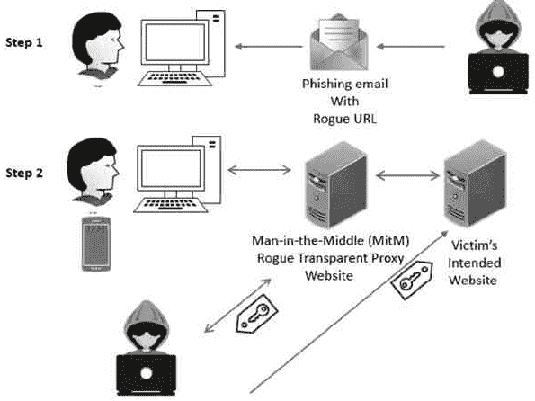

- 1. 攻击者向受害者发送带有恶意URL的网络钓鱼电子邮件。
- 2. 受害者被诱骗点击恶意URL，被带到中间人（MitM）钓鱼网站。
- 3. MitM网站随后连接到受害者预访问的合法真实网站。
- 4. MitM网站收集受害者与真实网站之间发送的所有信息/数据；反之亦然。
- 5. 攻击者可以窃取受害者的登录凭据、MFA、访问控制令牌cookie等。
- 6. 攻击者使用受害者的访问控制令牌cookie进行登录。

图 8-1 中间人（MitM）MFA网络钓鱼攻击的图形表示。

向您的手机发送包含代码的短信。就像上一个示例攻击一样，这个代码通常可以通过社交工程从用户那里骗取。此外，任何与个人电话号码绑定的身份验证类型都面临风险，因为攻击者可以轻易将任何人的电话号码重定向到自己的手机（即所谓的SIM卡更换攻击）。因此，如果您作为登录或事务验证的一部分通过短信收到身份验证代码，攻击者可以将该代码重定向到其持有的手机上。如果您想了解更多有关短信攻击的信息，请参见 https://krebsonsecurity.com/2021/03/can-we-stop-pretending-sms-is-secure-now。

另一种常被网络钓鱼的MFA类型是推送式MFA。推送式MFA是一种MFA类型，用户在登录受推送式MFA保护的登录时，会收到一条消息以确认或拒绝。该消息可以发送到用户的手机（包括使用短信）、通过浏览器发送，或发送到专为此目的创建的应用程序。推送式通知消息通常包含与登录相关的一些信息，例如涉及的登录ID、设备类型、浏览器、时间、物理登录位置，以及“允许”或“拒绝”登录尝试的按钮（尽管它们通常有不同的措辞）。图 8-2 展示了一个推送式登录提示的示例。

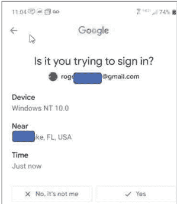

图 8-2 推送式登录提示的示例。

其理念是，如果用户发起了登录，则应允许登录；如果用户未发起登录，则应阻止它，并将黑客攻击行为报告给其IT安全团队。乍一看，推送式MFA登录似乎非常可靠。还有什么比这更简单呢？不幸的是，不小比例的用户会批准他们未发起的登录。以至于攻击者和渗透测试团队喜欢使用推送式MFA的组织，因为他们每次尝试几乎都能保证获得访问权限。以下是这种攻击的现实示例：https://blog.knowbe4.com/uber-security-breach-looks-bad-caused-by-social-engineering。

上述总结的这三个MFA攻击示例，是黑客攻击最常见MFA形式有多容易的流行代表性示例。用户应尽可能避免使用容易被网络钓鱼的MFA形式。这不仅是我个人的说法。早在2021年，在美国总统行政命令中，美国政府表示：“机构系统必须停止支持[强调部分已添加]无法抵御网络钓鱼的身份验证方法，例如用于注册电话号码以进行短信或语音呼叫、提供一次性代码或接收推送通知的协议”(https://zerotrust.cyber.gov/federal-zero-trust-strategy/#identity)。

这就引发了一个问题：哪些类型的MFA解决方案不易被网络钓鱼？许多形式的MFA都具有抗网络钓鱼能力，包括FIDO令牌和智能卡。我在此列出我所知的所有抗网络钓鱼形式的MFA：www.linkedin.com/pulse/my-list-good-strong-mfa-roger-grimes。所有用户、管理员和普通终端用户都应使用抗网络钓鱼的MFA登录到保护宝贵数据和系统的任何设备或应用程序。这包括任何网络设备和服务器。

**其他MFA资源** 作者撰写的其他一些MFA资源如下。

- 不要使用容易被网络钓鱼的MFA，而这正是大多数MFA！(www.linkedin.com/pulse/that’s-use-easily-phishable-mfa-that’s-most-roger-grimes)
- 为什么我们的大多数MFA如此容易被网络钓鱼？(www.linkedin.com/pulse/why-majority-our-mfa-so-phishable-roger-grimes)
- 美国政府表示应使用抗网络钓鱼MFA。(https://blog.knowbe4.com/u.s.-government-says-to-use-phishing-resistant-mfa)
- 抗网络钓鱼MFA不代表不可被网络钓鱼。(www.linkedin.com/pulse/phishing-resistant-mfa-does-mean-un-phishable-roger-grimes)
- 破解多因素身份验证（Wiley）。(www.amazon.com/Hacking-Multifactor-Authentication-Roger-Grimes/dp/1119650798)。本书讨论了超过五十种破解各种MFA解决方案的方法。

## HTTPS

根据 Google (https://blog.chromium.org/2023/08/towards-https-by-default.html) 的说法，约 90% 的互联网连接是通过 HTTPS 连接建立的，且该比例随时间增长。当按预期启用和强制使用 HTTPS 时，它确保用户可以确认其正在连接的 URL 就是其显示的样子。这也意味着涉及的节点之间传输的数据在源和目标之间是加密的。当 HTTPS 连接中涉及的数字证书有效且受信任时，此情况成立。如果涉及的数字证书是欺诈性的或由不受信任的证书颁发机构（CA）颁发，那么涉及的服务器网站或应用程序可能是欺诈性的。

在浏览互联网（甚至是本地网络）时，每个人都应努力确保使用可信证书通过受信任的 HTTPS 连接进行连接。这可以降低网络钓鱼攻击来自其他原本受信任的 URL（例如 Facebook、Microsoft、Twitter 等）的风险。当未强制使用 HTTPS（即使用不受保护的 HTTP）时，欺诈网站更容易声称自己并非其所称的身份，或另一个恶意节点更容易进行中间人攻击或窃听机密数据。

需要牢记的一大注意事项是，涉及网络钓鱼的恶意网站中，很大比例也拥有有效且合法的 HTTPS 数字证书和连接。根据反网络钓鱼工作组 2021 年第二季度网络钓鱼活动趋势报告 (https://docs.apwg.org/reports/apwg_trends_report_q2_2021.pdf)，82% 的网络钓鱼网站拥有有效的 HTTPS 数字证书（如图 8-3 所示）。

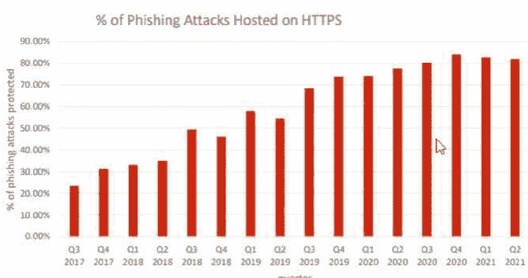

图 8-3 根据反网络钓鱼工作组 2021 年第二季度网络钓鱼活动趋势报告，托管在有效 HTTPS 启用网站上的网络钓鱼攻击百分比。

这与第 7 章，“DMARC、SPF 和 DKIM” 中讨论的情况类似。在那里我们讨论了大多数网络钓鱼域受 DMARC 保护，并且 DMARC 状态为 “pass”。我们更希望网络钓鱼网站未能通过 DMARC 检查，但相反，网络钓鱼者采用 DMARC 的比例甚至高于非网络钓鱼网站。HTTPS 的情况也相同。大多数网络钓鱼域已启用 HTTPS 数字证书的使用，因此乍一看，有人可能会认为 HTTPS 连接是 “合法的”。

但是，HTTPS（和 DMARC）从来不是为了确定特定域是否恶意而设计的。不，它们是为了允许用户确定其看到的宣传域是否确实是真实域。显示的域名真的就是域名吗？通过 HTTPS 和 DMARC，可以回答这个问题。并且，这就是它们（DMARC 和 HTTPS）需要被看待和使用的方式。这是一件非常好的事情。

如果您拥有有效的 HTTPS 连接（例如，使用来自受信任证书颁发机构的有效 HTTPS 数字证书），那么您看到显示为 URL 链接的内容确实就是 URL 链接。因此，例如，如果您看到一个声称是 microsoft.com 的 HTTPS 启用的 URL 链接，那它确实是 microsoft.com。您可以依赖这一点。大多数网络钓鱼网站，即使拥有有效的 HTTPS 连接，其 URL 链接也会指向仿冒网站（冒充合法品牌）、随机选取的域名，或从其他原本无辜的组织窃取的合法域名。但关键是，如果它是带有有效连接的 HTTPS 启用，您可以信任您看到的 URL 就是 URL 真正的样子。并且，这与 DMARC 一样，将帮助您确定涉及的网络钓鱼消息来自您应该信任的合法品牌，还是其他人。

## Content-Filtering

在任何可以放置内容过滤保护的地方（例如，网络、服务器、终端等），都应该放置。内容过滤器将阻止网络钓鱼消息，以及其他类型的不需要内容（例如，色情、仇恨内容、暴力、垃圾邮件等）。内容过滤器筛选内容以确定允许或阻止的站点和内容。内容过滤器可以在网络入口节点、路由器，


防火墙、服务器、电子邮件系统、端点、移动设备和其他位置。你绝对希望在多个重叠的层级中启用内容过滤。内容过滤器绝对无法拦截 *所有* 钓鱼消息，但它们会捕获并拦截其中一些。

## 钓鱼过滤器

钓鱼过滤器专门用于查找和阻止钓鱼攻击。你应在可安装的位置部署多个重叠的钓鱼过滤器（例如，网络入口节点、路由器、防火墙、服务器、电子邮件系统、端点、移动设备和其他位置）。一些钓鱼过滤器通过识别先前报告并确认的钓鱼攻击来工作，而其他过滤器则使用启发式方法。*启发式* 扫描器通过寻找某事可能是恶意的迹象来工作。最佳内容扫描器使用已报告的钓鱼消息和启发式方法的组合。一些钓鱼过滤器使用机器学习或人工智能（AI）来查找和检测钓鱼消息。

例如，KnowBe4 有一个名为 PhishER Plus (www.knowbe4.com/products/phisher-plus) 的产品。用户可以使用它报告可疑的钓鱼电子邮件。该产品还使用针对钓鱼电子邮件训练的 AI 模型。此外，它使用由 KnowBe4 威胁研究实验室输入的人工策划人类情报。因此，人类和 AI 都用于识别钓鱼消息。当发现钓鱼威胁时，可以将其删除，并主动从可能也出现该消息的其他用户收件箱中移除。此外，相关的钓鱼 URL（如果有）可以添加到块列表中（下文将介绍）。

## 反恶意软件

如今，大约三分之一的钓鱼电子邮件包含某种形式的附加恶意软件程序或会检索恶意软件的 URL 链接。反恶意软件（例如，防病毒软件、端点检测与响应等）可以检测这些恶意文件和链接，然后阻止访问、删除或隔离内容。每个组织都应部署多个重叠的反恶意软件和/或服务层。

需要牢记的一个巨大注意事项是，反恶意软件产品在检查恶意文件时臭名昭著地无法检测恶意软件（即，假阴性）。存在数亿种恶意软件程序，似乎没有哪款反恶意软件产品能以高精度检测其中的大部分。你会看到大多数反恶意软件供应商宣称 100% 的检测率。这些检测率不可信，无论供应商怎么说。尽管如此，反恶意软件产品确实能检测和防止一定比例的恶意软件，仅凭这一点，人人都需要一款。

## 电子邮件网关

大多数组织应配备电子邮件服务或网关，它可以是电子邮件服务器/服务的一部分，也可以位于其上游，提供内容过滤、钓鱼防护服务和反恶意软件服务等防护服务。如果你有本地电子邮件服务器，则需要在其前面部署电子邮件网关。如果你使用电子邮件提供商，但不确定他们是否使用带有上述防护服务的电子邮件网关，请进行询问以予以确认。许多大型电子邮件提供商（例如，Google、Microsoft 等）在电子邮件网关服务方面投入巨大，并默认提供防护服务（尽管你通常可以购买更多）。

## 电子邮件服务器/服务

不言而喻，你的电子邮件服务器/服务应默认启用钓鱼防护服务。并非所有都这样做，因此请检查并验证。

## 电子邮件搜索与销毁

由于电子邮件是最常见的钓鱼攻击载体，你应配备能够搜索钓鱼电子邮件并从用户收件箱中移除它们的服务。几十年前，我曾使用一个名为 Exmerge 的 Microsoft 实用工具来执行电子邮件搜索与销毁任务。大多数电子邮件服务器和服务都提供类似的实用工具。它们对于追踪恶意电子邮件并在用户接触之前将其移除至关重要。

KnowBe4 在 PhishER 中提供一项名为 PhishRIP 的类似服务。图 8-4 显示了 PhishRIP 中一个消息搜索查询示例。在此示例中，钓鱼电子邮件具有常见的主题和正文，但看似来自不同的发件人，并发送给未知数量的收件人。PhishER 管理员创建了该查询以查找并消除匹配的电子邮件。

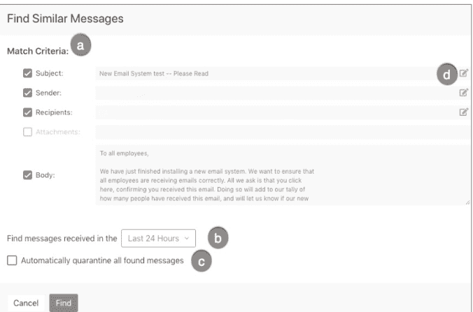

图 8-4 KnowBe4 PhishRIP 钓鱼搜索查询示例。

### 阻止潜在的恶意文件附件

你应阻止潜在的恶意文件附件。你不希望最终用户在电子邮件中接收可执行文件并自行决定运行它们。大多数主要电子邮件客户端和服务已经阻止了数十种潜在的恶意文件附件。如果你的电子邮件客户端没有，它应该这样做。

二十年来，我一直在追踪网络钓鱼者和黑客用于发起恶意操作的文件类型。当我在20世纪90年代初开始时，我记录了十几种潜在的恶意文件类型。到21世纪初，我记录了上百种可能被恶意使用的不同文件类型。我最终放弃了，因为几乎任何文件似乎都可能被恶意使用。正如我在本书开头分享的，即使是文本文件（带有 ANSI 炸弹）也曾被恶意使用。但电子邮件客户端使用的大多数文件类型阻止列表默认只包含几十种被阻止的文件类型（例如，.exe、.dll、.com、.scr 等）。你通常可以修改文件阻止列表以满足你的需求。

### 爆破沙箱

许多反恶意软件保护软件/服务提供所谓的爆破沙箱或沙箱技术。爆破沙箱是可以安全打开和检查 Internet 链接和文件的虚拟化区域。早期的沙箱，如基于 Linux 的“chroot jail”，是手动创建的存储和内存区域，可在此处检查和执行潜在的危险内容。随着时间的推移，各种应用程序和操作系统开始采用类似沙箱的保护措施。在 Windows XP 时代，我使用过名为 Sandboxie (https://sandboxie-plus.com/sandboxie) 的沙箱应用程序。它允许我在沙箱模式下运行 Microsoft Internet Explorer，以便如果恶意软件在我的浏览器会话期间进行恶意修改，Sandboxie 会拦截该更改并允许我将其撤销，仿佛它从未发生过。如今，无论你是否知道，大多数防病毒扫描程序都会在安全沙箱中“爆破”可疑恶意软件，以查看执行的程序是否会做一项或多项恶意操作。

最终，Microsoft 甚至尝试将部分沙箱技术实现在 Microsoft Windows（从 Windows Vista 开始）中，作为其用户帐户控制功能的一部分。Google 试图在其首款浏览器 Google Chrome 中提供沙箱技术，成功程度不一。Microsoft Edge 也试图做到同样的事情。

甚至还有整个操作系统专门致力于在操作系统中尽可能强制实施沙箱技术。QubesOS (www.qubes-os.org) 是一种硬件强制的虚拟机监控程序系统，它使不同的应用程序不会相互混杂，尽管所有应用程序都出现在一个共同的桌面上（以免使最终用户的使用变得复杂）。它可能是地球上最支持沙箱的操作系统。如果你想要普通公众可用的最安全操作系统（且免费），你需要 QubesOS。Microsoft、Apple 和 Google 各自在其操作系统中拥有越来越多的沙箱功能，并努力接近 QubesOS 已经提供的功能。

在过去十年左右，涌现出大量使用沙箱技术来保护用户的防御性解决方案。大多数解决方案通过拦截最终用户的电子邮件或浏览器下载，并暂时阻止或阻止它们在用户当前的安全上下文中执行，从而使其无法造成危害。然后，这些解决方案在各种虚拟环境中打开下载内容，这些环境试图逼真模拟设备现有环境的核心组件，否则被阻止的内容本会在那里执行或打开。被执行内容及其在替代的安全

位置（即“沙箱”）随后会被分析，以帮助确定安全性与合法性，区分潜在的恶意结果。如果内容被认为是安全的，则将被允许在用户设备上以原始、预期的方式执行。

许多厂商提供强大、复杂的解决方案。通常，用户注意到的只是轻微延迟，或许只有一两秒钟，然后内容才会被允许按用户希望的方式执行。其他解决方案会重写URL路径，用更安全的替代方案取代它们，如果用户留意，就会注意到这一点。

许多安全专家，包括本书作者，都批评URL重写，因为修改后的路径重命名使得知识渊博的用户很难甚至无法利用自身专业知识来分析恶意性，就像他们使用原始、未被篡改的URL时所能做到的那样。

爆破沙箱已获得广泛使用，但仍不如其他更常见的防御类型（如防病毒软件、防火墙和内容过滤器）那样普及。尽管它们宣称功能强大，但有时仍会无法识别和拦截恶意内容，尽管其准确性通常高于防病毒软件。图8-5显示Microsoft O365正在使用沙箱技术。

我是沙箱的拥护者，但不赞成它们重写URL，使用户更难检查目标URL。

## 防域名欺骗

你应该在网络上部署多个、相互重叠的防域名欺骗功能，首先是在网络入口节点上部署一个（同时也应在电子邮件服务、内容过滤器、电子邮件客户端、端点保护等上部署）。你可以先启用DMARC、SPF和DKIM，如第7章所述。

任何其他验证域来源的安全功能都是值得拥有的好功能。

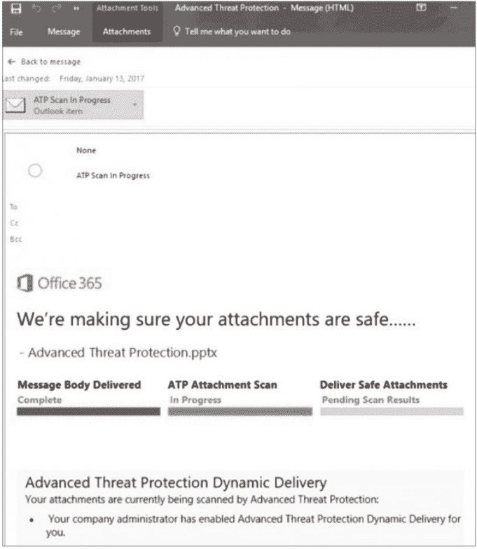

图8-5 Microsoft O365正在执行沙箱技术的示例。

## 阻断列表

许多服务（无论是免费的还是商业的）都会发布阻断列表（也称为黑名单）。阻断列表是以前被识别为发送或涉及恶意内容或活动的URL列表。二十多年前我记得看到的第一个阻断列表是Spamhaus（www.spamhaus.org），它至今仍在使用。它维护着任何人都可以下载和使用的多个列表，这些列表包含已知涉及发送垃圾邮件和恶意软件的URL。

如今，有数百个类似的阻断列表。阻断列表的一个良好商业网站是Blacklist Master（www.blacklistmaster.com/blacklists）。它包含数十个其他阻断列表，其中一些单独包含超过700,000个单独的IP地址，他们认为这些地址涉及恶意行为。

在大多数情况下，可以将阻断列表配置为由服务器和服务（通常是电子邮件服务器、网关或DNS服务器）自动下载，并在服务器或服务允许其与最终用户交互之前，对其进行查询，用于检查涉及的检查URL是否在引用的阻断列表上。

阻断列表的缺点（过去比现在更严重，但这仍然是一个问题）是它们经常错误地包含无辜的IP地址和域名，这些地址和域名被错误地识别为涉及恶意活动，或以前涉及恶意活动但现在不再涉及（但仍留在列表上）。良好的阻断列表力求尽可能准确，并允许潜在受害者申请从任何阻断列表中删除其IP地址或域名。删除过程可能缓慢且不完美。不过，维护良好的阻断列表是一种好的工具，应该被能够利用它们的服务器和服务使用。

阻断列表的对立面是允许列表（或白名单），它列出了应被允许在网络之间通信的域名或IP地址。通常，使用允许列表的网络入口点会阻止允许列表上未明确列出的每个连接。在大多数场景中，允许列表更难以使用，因为合法连接多于恶意连接。

## 灰名单

_灰名单_是一种使用频率远低于其他工具的工具，介于阻断列表和允许列表之间。在典型的灰名单应用中，来自全新连接地址的每个新入站连接/电子邮件都会被自动拒绝，至少暂时拒绝。该连接可能会被放置在灰名单上，起初其功能如同阻断列表。之后，经过进一步调查或判断，如果连接被定义为合法，则允许该连接，并将源节点的地址放置在允许列表上。或者，灰名单应用程序可以简单地始终拒绝第一次连接尝试，且不保留灰名单。

灰名单最常见的应用是在电子邮件中。当用户收到来自以前从未收到过邮件的人的电子邮件时，电子邮件会被暂时阻止，预期的接收用户会收到通知，告知有新的电子邮件（地址）正在尝试与他们连接。接收者可以批准连接尝试，如果获得批准，电子邮件地址将被添加到允许列表中，电子邮件将被发送到接收者。下次，来自同一电子邮件地址的电子邮件将不受延迟地到达接收者。

涉及电子邮件的另一种灰名单应用处理方式是：接收电子邮件服务器自动拒绝来自新电子邮件地址的所有电子邮件，并指示发送电子邮件服务器/服务必须重新发送电子邮件，才能成功送达。或者，接收者的电子邮件服务器IP地址（在其DNS MX记录中指示）包含两条记录，第一条是虚假的，第二条是真实的。这样做基于一种理论：网络钓鱼者使用的大多数不成熟的电子邮件工具从不重新发送电子邮件，而自动重新发送先前被拒绝的电子邮件通常是由常规电子邮件服务器完成的。网络钓鱼电子邮件工具只发送一次电子邮件，因此最初的拒绝阻止了网络钓鱼诈骗，而常规电子邮件最终会送达。

各种不理想的可用性问题导致灰名单技术未被大众采用。首先，灰名单会延迟所有（全新）电子邮件，最终用户不喜欢这一点。我们喜欢电子邮件是即时的。其次，可能更令人恼火的是，许多合法的电子邮件最终从未被送达，因为其电子邮件服务器/服务没有按预期自动重新发送被拒绝的电子邮件。

有关灰名单的更多信息，请参见 https://en.wikipedia.org/wiki/Greylisting_(email)。

## 信誉服务

信誉服务比阻断列表更进一步。在大多数阻断列表中，有人投诉恶意域名或IP地址，然后将其列入阻断列表。信誉服务通常会不遗余力地确认可疑的恶意地址是否真正涉及恶意活动。它们可能会在地址首次报告或检测到后对其进行监控。它们可能会查找并检测诈骗消息、恶意软件或仅仅是恶意活动。

许多厂商在其产品中内置信誉服务或将其作为附加服务提供。例如，Microsoft在Microsoft Windows（参见图8-6）、Microsoft Edge、Microsoft O365、Microsoft Exchange及其他产品中内置了信誉服务。

总的来说，信誉服务是不错的使用选择，但它们并不完美。我看到大量现实世界中的网络钓鱼诈骗被不同的信誉服务标记为“安全”。网络钓鱼诈骗者通常通过反复尝试，了解哪些方法有效、哪些无法绕过信誉服务，从而最终制作出看起来完美且不会被标记的诈骗。

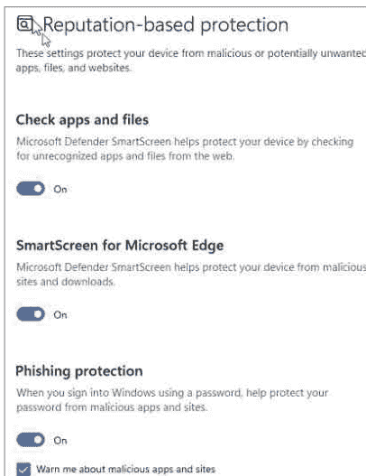

图8-6 Microsoft Windows中可配置的基于信誉的服务选项示例。

## DNS查询

DNS有可能对网络钓鱼诈骗造成重大打击，尽管大多数防御者不这样使用，或者无法这样使用。

## 域名创建日期

大多数网络钓鱼域名在创建后几分钟到几天内就被用于网络钓鱼诈骗。对于普通非网络钓鱼域名来说，只有

几分钟到几天（自初次创建后）。合法服务在开始使用时，其域名通常会注册数月至数年。并非总是如此，但通常是这样。因此，生命周期极短的大多数域名可能是钓鱼域名。您使用的任何可以对域执行 WHOIS 查询的入站服务（如图 8-7 所示），都可以找到“创建日期”并确定域首次注册的时间。

| 名称 | 值 |
| --- | --- |
| 域名 | knowbe4.com |
| 注册表域 ID | 1612400067_DOMAIN_COM-VRSN |
| 注册商 WHOIS 服务器 | whois.registrar.amazon.com |
| 注册商 URL | https://registrar.amazon.com |
| 更新日期 | 2023-07-20T00:29:11Z |
| 创建日期 | 2010-08-23T16:24:14Z |

图 8-7 显示域 WHOIS 查询示例，其中包含域的创建日期。

图 8-7 显示了使用 mxtoolbox.com 对 KnowBe4 域名 knowbe4.com 进行的 WHOIS 查询示例。您可以看到它是在 2010 年创建的。如果您一无所知，仅其年龄就能告诉您它不太可能是恶意钓鱼域名。

## 动态 DNS 检查

一些反钓鱼服务还会检查入站域名是否由动态 DNS 注册商注册。动态 DNS 注册商最初的目的是让 IP 地址经常变动的人能够注册其 DNS 域名，并在需要时在 DNS 记录中更新 IP 地址。例如，大多数家庭互联网用户的 IP 地址会经常更新，或者至少更新频繁到注册永久 IP 地址会带来问题。但是，多年来，许多动态 DNS 注册商已成为恶意行为者（包括需要频繁移动其注册 IP 地址的钓鱼者，例如每隔几小时到每天一次）的安全避风港，他们不断移动以逃避被防御者或执法部门“清除”。

关于动态 DNS 服务及钓鱼者如何使用它们的好文章请参阅：https://umbrella.cisco.com/blog/on-the-trail-of-malicious-dynamic-dns-domains。

反钓鱼 DNS 服务通常会检查入站域名是否在动态 DNS 注册商处注册，如果是，则会阻止入站流量或对其做标记，以便反钓鱼和/或反恶意软件服务能够更好地检查它。不幸的是，大多数 DNS 服务（例如 Microsoft DNS 或 BIND）并非原生具备此功能，而使用此功能的服务必须要么创建自己的自定义查询，要么购买商业服务。

**DNSSEC** DNS 于 1985 年创建，很可能是允许互联网成为互联网的基本翻译服务（域名到 IP 地址）。没有它（或类似的东西），我们都必须记住并键入 IP 地址才能访问自己喜欢的网站。不幸的是，它在创建时并未考虑安全性，并且几十年来一直是黑客和骗子的频繁攻击目标。

所有组织网络都应启用 DNSSEC（域名系统安全扩展）以防止恶意域名欺骗。DNSSEC 已存在二十年。它使用非对称密钥和数字签名来对来自“权威”DNS 服务器的 DNS 响应进行签名和身份验证。DNSSEC 使骗子更难进行域名欺骗或“中毒”。如果没有针对 DNS 欺骗或中毒的防护，潜在受害者可能会点击看起来像是有效且知名域名的 URL，最终进入欺诈网站。DNSSEC 是一种防止此类 DNS 诈骗的开放标准方式。

不幸的是，DNSSEC 在设置 DNS 服务器的管理员中并不十分流行，学习和设置起来也不太容易。因此，大多数 DNS 服务器/服务未启用 DNSSEC。但每个组织都应该启用。

## 网络流量

在大多数组织的网络中，大多数最终用户工作站不会连接到其他最终用户工作站。大多数最终用户工作站不会连接到网络中的每台服务器。大多数服务器不会连接到其他服务器。大多数服务器不会连接到每台最终用户工作站。Netflow（即网络流量）分析是了解环境中“正常”网络流量的做法，然后在检测到异常连接时发出警报。

例如，大多数在俄罗斯没有客户的公司不应看到其服务器向俄罗斯的服务器发出出站连接。如果注意到意外的服务器到俄罗斯的连接，可能应进行调查，以确保没有发生诸如勒索软件之类的恶意活动。如果最终用户工作站在没有正当理由的情况下连接到其他最终用户工作站，也应进行调查。

查找异常网络流量是获得早期警告的最佳方法之一，可表明恶意入侵已成功利用您网络中的服务器或工作站。不幸的是，大多数网络管理员不太了解正常、非恶意的网络连接是什么样子，因此他们可能无法注意到并发出关于异常情况的警报。有一些 Netflow 工具可以帮助管理员弄清楚什么是正常的，什么是异常的。有些工具是开源的，有些是商业的。许多大型网络供应商通常都有 Netflow 分析工具，并且这些工具通常内置在他们的路由器和网络管理工具中。如果您想要一个在其他工具都无法帮助时也能帮助您检测黑客和恶意软件的工具，Netflow 工具就是答案。

这篇维基百科文章列出了供应商及其名称和用于 Netflow 分析的协议：https://en.wikipedia.org/wiki/NetFlow。

## 国家封锁

一些组织会封锁来自整个国家（如俄罗斯或中国）的所有网络通信。这通常需要通过顶级域（TLD）国家代码名称（例如俄罗斯的 .ru 或中国的 .ch）或通过边界网关协议（BGP）自治系统编号（www.thousandeyes.com/learning/glossary/as-autonomous-system）来完成。以下是 TLD 国家代码列表：https://en.wikipedia.org/wiki/Country_code_top-level_domain。

一般而言，按国家阻止发出的互联网流量是防止黑客攻击、钓鱼和恶意软件的一种粗糙方法。被封锁的国家很容易绕过，而您只是为了阻止恶意流量，就阻止了来自整个国家的所有合法且可能需要的流量。然而，许多组织确实按国家阻止互联网流量，无论是否粗糙，并因此取得了巨大成功。所以，我凭什么反对对某个特定组织有效的方法呢？

## 图片徽章

这是一项防止现场面对面社会工程攻击的建议。许多组织要么不要求员工佩戴徽章，要么不要求徽章上有员工的照片。这两者都是重大错误，并会增加现场社会工程攻击的风险。

每位员工都应佩戴官方的、带有公司品牌的、覆膜的身份徽章，上面贴有员工当前的照片，并且佩戴位置应便于他人轻松查看和审核。尽管这不能绝对防止所有现场社会工程诈骗，但会使这些诈骗更难实施，并且事后可能有助于识别肇事者。

十多年前，我曾在为中国的一家客户提供咨询，该公司另一家竞争对手公司的两名员工进入其大楼，试图窃取知识产权秘密。这些入侵者通过从受攻击公司的徽章打印系统获取官方员工徽章来实施此行为。但是，即使在这样做时，这些入侵者也拍摄并使用了自己的真实照片放置在未经授权的徽章上。后来，当入侵被发现时，这些骗子最终通过留在徽章系统上的照片被识别出来，随后被相关执法机构拘留和逮捕。

## 摘要

第 8 章讨论了组织可以部署的网络级和服务器级技术防御，以减轻社会工程和钓鱼攻击。其中许多防御（例如反恶意软件、内容过滤或反钓鱼过滤器）已在大多数组织中广泛部署。其他防御，如灰名单和网络流量，则并未


正如广为人知或部署的那样。希望读者已经了解了一种或多种可在其网络或服务器上部署的技术防御，以帮助缓解社会工程学和钓鱼攻击。

第 9 章将介绍可以或应该在终端或客户端级别部署的反钓鱼防御。

# CHAPTER 9 终端防御

第 9 章将介绍可以部署在客户端终端计算机和设备上的防御，以对抗社会工程学和钓鱼攻击。

### 关注终端

终端是连接到网络的节点。它们可以是几乎任何东西，但通常用于指代最终用户设备和计算机。我们试图保护的大部分数据要么位于终端上，要么通过终端访问。我们在任何其他位置部署的所有其他防御，都是为了保护位于终端上的数据以及使用终端的用户。

本章的大部分内容将重复之前章节中提出的网络安全防御建议（尤其是第 8 章“网络和服务器防御”），因为一个出色的防御纵深、多层网络安全防御会在多个位置（即网络和终端）部署类似的良好防御。但是，本章将讨论许多只能在终端上部署的建议。本章的目的是提醒读者所有可能用于对抗社会工程学和钓鱼的终端防御，并且，如果幸运的话，可能会提醒你一些你同意但之前遗漏的事项。

## 反垃圾邮件和反钓鱼过滤器

每个能够接收钓鱼消息的终端都应安装反垃圾邮件和反钓鱼过滤器。大多数情况下，这意味着电子邮件和浏览器上的内容过滤器，但应将其扩展到你拥有的任何可能接收到钓鱼消息的应用程序（例如，SMS、Microsoft Teams、Slack、协作应用等）。

## 反恶意软件

每个终端都应安装反恶意软件。通常，这意味着防病毒软件，但也可以指安装和使用终端检测和响应软件。大多数终端应同时安装两者。每种软件都会捕获并阻止另一种可能遗漏的内容。当然，这两类软件程序都应保持最新。

## 补丁管理

网络安全妥协的第二常见原因是黑客或恶意软件利用未修补的软件或固件。所有终端应在供应商发布关键补丁后一至两周内应用所有关键补丁。如果某个终端存在列在 CISA 已知被利用漏洞目录（www.cisa.gov/known-exploited-vulnerabilities-catalog）中的漏洞，则务必尽快修补！CISA 仅列出黑客和恶意软件正在积极针对现实世界组织利用的漏洞。

## 浏览器设置

大多数 Internet 浏览器设置都有相当强大的默认安全设置。如果这些设置没有被削弱，它们通常足以防止社会工程学和钓鱼对浏览器的大多数恶意操纵。但情况并非总是如此，我将在第 13 章“识别恶意 URL”中介绍一些有趣的黑客浏览器技巧。但请确保你没有意外将浏览器安全设置削弱到低于其初始默认值。

## 浏览器中的浏览器

我想在此介绍的两个有趣的黑客恶意浏览器技巧之一被称为“浏览器中的浏览器”。它不一定能通过浏览器安全设置来阻止。更确切地说，必须由最终用户去查找并注意到它，以防止它。浏览器中的浏览器攻击是指黑客向用户展示一个看起来像完全不同浏览器窗口的东西（代表某个特定 URL），但它并不是一个新的浏览器窗口。它只是一些被制作成看起来像新浏览器窗口的 HTML 代码和内容，但完全包含在同一个原始浏览器窗口中。

我们都习惯了访问某些网站，出于某种原因，它们会为我们打开额外的浏览器窗口供我们交互。很多时候，这是因为我们去登录某个特定网站或点击了某个特定的登录选项（例如“使用 Facebook 登录”），然后原始网站会打开一个新的浏览器窗口，指向另一个网站上的其他登录页面。图 9-1 展示了这种特定的、非恶意的情况的合法示例：

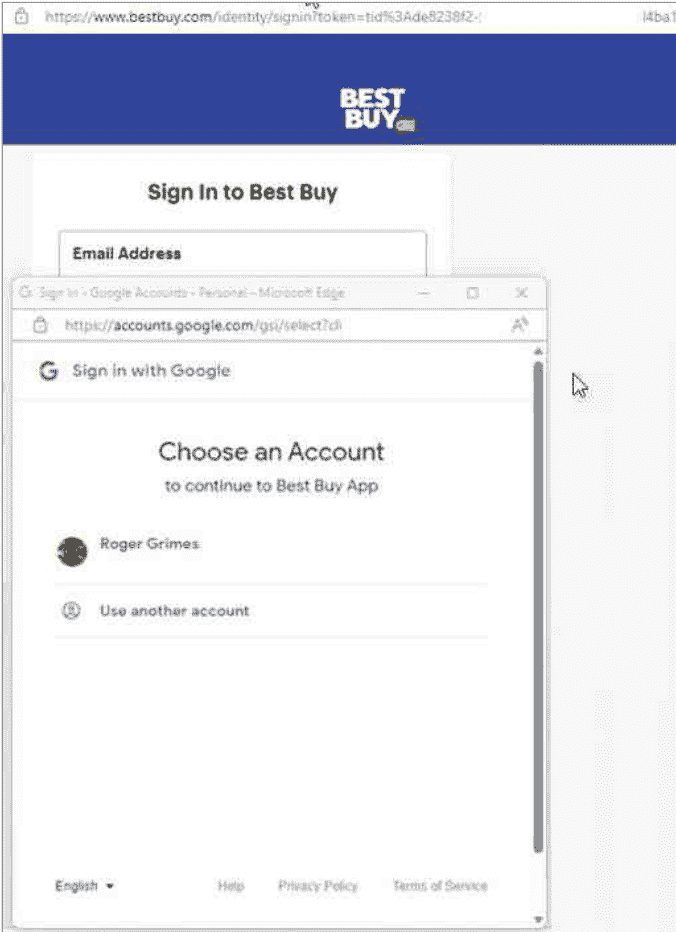

图 9-1 一个网站上的浏览器窗口打开另一个网站上的另一个浏览器窗口的示例。

图 9-1 展示了网站打开另一个网站上的浏览器窗口的非恶意示例。在该示例中，我访问了 www.bestbuy.com，开始登录我的 BestBuy 账户，然后选择了提供的备选登录选项“使用 Google 登录”。当我点击该登录选项时，BestBuy 网站打开了一个指向 google.com 的新浏览器窗口，以便我可以使用我的 Google 账户凭据登录。这是正常且合法的。网站打开另一个浏览器窗口是正常的。如果我输入我的 Google 账户凭据，在此示例中，这些凭据将由 google.com 捕获并处理，而不是由第一个网站处理。这种 URL 分离对于登录安全性非常重要。你不希望第一个网站（可能与 google.com 毫无关系）获得你的 Google 账户登录凭据。相反，第一个网站将用户发送到 google.com，身份验证在那里进行，然后原始网站被告知 google.com 上的身份验证事件成功，信任它，并允许用户进入其网站。

但整个过程可以被模拟。相反，恶意的浏览器中的浏览器攻击会伪造整个体验，而不是打开指向第二个网站的第二个浏览器窗口，诱骗用户将其二级登录凭据提供给第一个恶意（或已被攻破）的网站。恶意钓鱼网站会修改用户当前正在查看的现有网页，使其看起来像是在打开一个链接到第二个网站的第二个浏览器窗口，但实际上只是显示一个看起来像第二个浏览器窗口的东西。这只是为了招摇撞骗，最重要的是，它仍然链接到第一个恶意网站。因此，如果最终用户被诱骗输入其 Google 账户凭据，在此示例中，这些 Google 凭据将被输入到第一个网站并被其窃取。

有关浏览器中的浏览器攻击的更多信息和示例，请参见以下内容：

- www.techrepublic.com/article/browser-in-the-browser-attacks-arise
- https://mrd0x.com/browser-in-the-browser-phishing-attack

防御浏览器中的浏览器攻击的方法是意识到它们的存在，并且始终确保如果你看到一个看起来像二级浏览器窗口的东西，它确实是一个真实的二级浏览器窗口，而不是一个欺诈性的仿冒窗口。此外，使用 MFA、通行密钥和密码管理器，在其中你不需要手动输入登录凭据，可以提供帮助。

## 全屏模式

恶意黑客和钓鱼者在恶意网站上使用的另一种常见技术是强制用户的浏览器进入“全屏模式”，这将带有边框和标题的正常浏览器窗口转换为没有边框或标题的全屏演示。这通常与关于（欺诈性）恶意软件感染的极度激进警告或声称来自 FBI 或执法部门的欺诈性警告（称为吓唬软件）结合使用。图 9-2 显示了一个全屏吓唬软件警告的示例。

有时，涉及的网站包含可以使光标消失或键盘变得无响应的代码，使全屏显示看起来像是锁定了计算机。

请查看此链接，在浏览器中查看该问题的测试示例：https://webdbg.com/test/fullscreen。

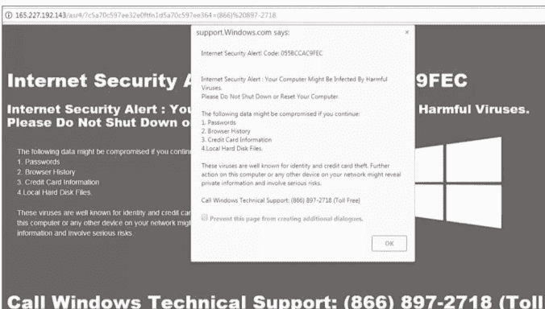

图 9-2 全屏吓唬软件警告示例。

精通计算机的人通常已经见过这种技巧足够多，不会惊慌。他们会按 Escape 键（Esc）以重新获得控制权，甚至可能需要结束浏览器实例或重启计算机。但他们知道计算机并非处于某种“无法轻松重新获得控制的完全控制模式”。知识较少的用户没有同样的理解，经常会上当并遵循屏幕上的指令。请确保你的安全意识培训涵盖这种容易击败但有时令人沮丧的骗局。

## 浏览器通知

如前所述在第 2 章“钓鱼术语和示例”中，浏览器通知钓鱼是一种特定类型的钓鱼，源于用户的操作系统或浏览器通知功能。当今最流行的大多数操作系统和浏览器都内置了行业标准消息通知功能，允许网站和应用程序请求发送消息的权限（请参见图 9-3 的示例）。


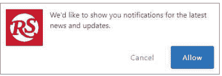

图 9-3 浏览器通知实例请求发送浏览器通知权限的示例。

每个希望向用户发送通知消息的站点或应用程序，都必须先请求权限，这就是所谓的通知请求消息（如图 9-3 所示）。如果用户点击“允许”，该站点或应用程序可以随时向用户（在站点或应用程序外部）发送通知消息。如果用户改为点击“取消”，该站点或应用程序将无法发送通知消息，也无法再次请求。如果用户只是按下 Esc 键且/或者未做出选择，该站点或应用程序可以在用户下次访问时再次请求。

获批后，浏览器和操作系统通知消息可能会被恶意用于发送钓鱼消息。每个用户应尽可能阻止浏览器和操作系统通知消息（除非您希望查看它们，并且能够分辨哪些是合法的、哪些可能是钓鱼攻击）。支持通知标准的浏览器和操作系统允许用户（和管理员）默认阻止或允许所有通知消息，或者允许或阻止来自特定站点和应用程序的通知消息。图 9-4 显示了 Microsoft Edge 中通知设置的示例。

支持通知消息的每个浏览器和操作系统的设置位置各不相同，但在 Microsoft Edge 中，它们位于“设置”的“Cookie 和站点权限”下。如图 9-4 所示，某些特定站点已被故意阻止，而一个应用程序（Facebook Messenger）被特别允许。用户和管理员可以手动选择设置，或使用自动化（例如脚本或 Active Directory 组策略）将其应用于多个用户。总的来说，阻止通知消息可降低钓鱼风险。

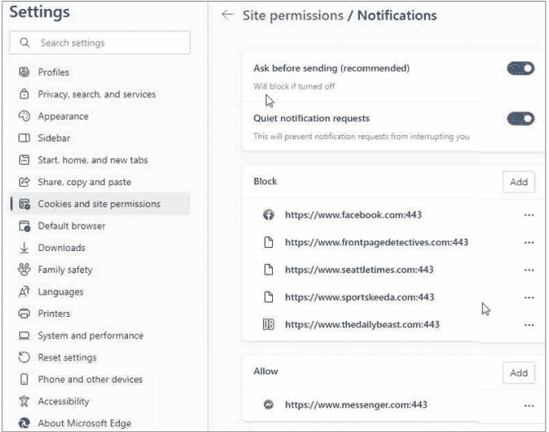

图 9-4 Microsoft Edge 中允许或阻止浏览器通知的设置区域。

观看我关于恶意通知消息的一小时网络研讨会，请参阅：https://info.knowbe4.com/malicious-browser-notifications。

## 电子邮件客户端设置

与浏览器一样，大多数电子邮件客户端都有适当的默认安全设置，用于防止某些常见的社会工程学和网络钓鱼形式。大多数用户应确保不要将默认设置削弱到使社会工程学和网络钓鱼攻击更容易得手的程度。如果不确定电子邮件客户端的安全设置是否已被过度削弱，大多数电子邮件客户端都有一个“重置”设置选项，可让您快速将电子邮件客户端重置为默认行为。

最常被误解的电子邮件安全设置之一，涉及电子邮件客户端在电子邮件到达时如何处理图片和其他内容。默认情况下，大多数电子邮件客户端不会允许活动内容（例如图片、脚本和对象）在首次接收电子邮件时自动下载和激活。这是一个极好的安全保护！请勿更改。

大多数网络钓鱼者和恶意软件传播者希望用户打开他们的电子邮件并激活其中的内容。即使是一张简单的、本身并非恶意的图片，也可能被恶意用于追踪收件人并确认其电子邮件地址（称为 _网络信标_）。允许所有内容自动下载和执行是一种超高风险的活动。因此，所有用户（和管理员）需要确保其电子邮件客户端不会自动下载并运行接收到的电子邮件中包含的非文本内容。此设置的位置因电子邮件客户端而异，但图 9-5 显示了 Microsoft Outlook 中相关电子邮件安全设置的示例。

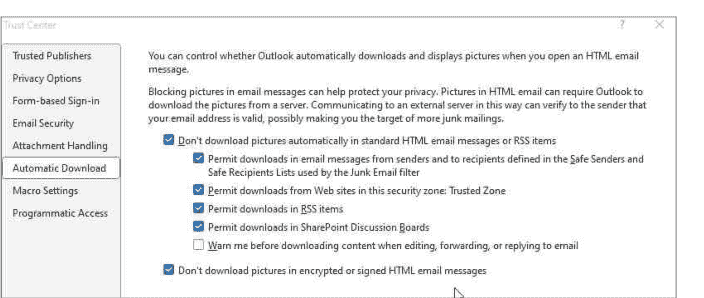

图 9-5 Microsoft Outlook 中电子邮件安全设置的示例。

Outlook 默认会阻止来自不受信任发件人和站点的活动内容，但如果发件人位于“安全发件人”或“安全收件人”列表中，或者源域位于“可信站点”中，则会允许自动下载。

在用户编辑、转发或回复电子邮件时，电子邮件客户端在下载内容前发出警告，这绝非坏事（如图 9-5 中未选中的安全设置所示）。大多数电子邮件客户端会在用户回复或转发电子邮件时自动下载内容。其假设是，如果用户正在进行这些活动，则表示他们信任该电子邮件及其包含的内容。但情况并非总是如此。例如，我经常将可疑电子邮件转发到我在取证虚拟机上设置的特殊电子邮件帐户，以便在更安全、更隔离的环境中检查它。如果我在转发电子邮件时未禁用内容，仅仅将电子邮件转发到那里就会下载内容，这不是我希望做的。因此，我希望故意启用“编辑、转发或回复电子邮件前下载内容时警告我”安全选项。

## 防火墙

虽然防火墙无法阻止当今大多数威胁，但它们可以阻止少数威胁和某些基于网络的社会工程学，仅此一点，它们就应在网络和端点上默认启用。基于主机的防火墙应在所有客户端端点上启用，并采用默认拒绝规则。

## 防钓鱼多因素身份验证

如第 8 章所述，所有用户应尽可能启用防钓鱼多因素身份验证（MFA）来保护敏感数据和系统。大约一半的社会工程学和网络钓鱼诈骗涉及诱骗潜在受害者泄露其登录名和密码。如果用户改用 MFA，所有这些以密码为中心的诈骗都将失败。不幸的是，当今许多诈骗涉及诱骗潜在受害者绕过（或规避）其易受钓鱼的 MFA，而且大多数用户使用的 MFA 都易受钓鱼。因此，用户应使用防钓鱼 MFA 来保护其端点。

如第 8 章所述，并在此重新分享，以下是作者相关文章的链接，提供有关使用和选择防钓鱼 MFA 的更多信息：

- 不要使用易受钓鱼的 MFA，而那正是大多数 MFA！（www.linkedin.com/pulse/dont-use-easily-phishable-mfa-thats-most-roger-grimes）
- 我推荐的优秀强大的 MFA 列表（www.linkedin.com/pulse/my-list-good-strong-mfa-roger-grimes）
- 为什么我们的大多数 MFA 如此易受钓鱼？以及美国政府表示应使用防钓鱼 MFA（www.linkedin.com/pulse/why-majority-our-mfa-so-phishable-roger-grimes）

## 密码管理器

不幸的是，即使将所有非基于密码的身份验证方法（包括防钓鱼 MFA）加起来并使用，它们在世界上的站点和服务中的可用性也不会超过 2%。密码仍在大多数站点和服务中使用。因此，用户将不得不使用密码。如果密码由程序完美随机生成，强密码应为十二个字符或更长；如果由人类创建，则应为二十个字符或更长，以尽可能安全。这是因为密码猜测和密码哈希破解程序能够成功破解较弱的密码。

要了解有关密码攻击以及为何您的密码需要长且随机的所有内容，请阅读作者关于密码的白皮书：www.knowbe4.com/hubfs/Password-Policy-Should-Be-EBook-WP_EN-US.pdf。

用户应使用可信的密码管理器程序来创建、存储和使用长且完美随机的密码。有几十种不同的密码管理器程序可供选择，几乎全部都能相当好地生成、存储和使用强密码，尽管有些比其他的更好。您应该使用密码管理器。鼓励或要求其他用户为其所有可能的密码使用密码管理器程序。

图 9-6 显示了我推荐的身份验证/密码策略。

有关密码管理器的更多信息，请参阅作者的以下文章：

- https://blog.knowbe4.com/what-about-password-manager-risks
- www.linkedin.com/pulse/password-managers-can-hacked-lots-ways-yes-you-should-roger-grimes
- www.linkedin.com/pulse/browser-based-vs-os-based-standalone-password-managers-roger-grimes
- www.linkedin.com/pulse/hackers-really-cracking-20-character-passwords-roger-grimes
- www.linkedin.com/pulse/another-reason-like-password-managers-use-different-logon-grimes
- www.linkedin.com/pulse/malware-more-often-targeting-password-managers-roger-grimes


## 密码策略实际实施

尽可能使用 MFA。在可能的地方使用多因素身份验证来保护贵重事物

尽可能使用防钓鱼 MFA https://blog.knowbe4.com/u.s.-government-says-to-use-phishing-resistant-mfa

使用 MFA 和/或长密码/密码短语登录您的设备

所有密码应至少每年更换一次

关于密码

如果可以，使用密码管理器。使用 MFA 和/或长密码/密码短语保护密码管理器

12 位完全随机密码可防御所有已知猜测/破解攻击

完全随机密码示例 R#'vV&ZcA0rjX Elv!2MlbA>cR?c?ru a|f#=dH)vlvtkJhlu

如果必须创建密码，为所有网站和服务创建唯一、不同的长密码/密码短语

人工创建的密码 8 个字符 – 弱 12 个字符 – 更好 20 个字符 – 强

良好密码短语示例 我今天早些时候去了 7-11。rogerjumpedoverthepurplefox 2belivingtherockandrollifeforever *黑客常规破解 18 个字符的人工创建的 Windows 密码，如果他们获得哈希值*

理想情况下：MFA + 密码管理器 + 在需要的地方使用强密码

了解更多详情：https://info.knowbe4.com/wp-password-policy-should-be

图 9-6 作者推荐的身份验证/密码策略摘要。

## VPN

如今，每个网络安全指南都推荐或要求使用虚拟专用网络 (VPN) 让工作站连接到网络，尤其是远程连接时。VPN 与防火墙的理念类似（即，它们确实会降低一些风险，但对阻止当今大多数攻击效果不佳）。VPN（尤其是与防钓鱼 MFA 配合使用时）可以降低某些类型网络攻击的风险。但是，如果您确实使用 VPN，请确保服务器端和客户端两边都及时打补丁。许多防御人员实施了 VPN，结果却是未打补丁的 VPN 组件导致黑客获得初始访问权限。

### 防止未经授权的外部域协作

越来越多的钓鱼攻击来自使用组织内部协作应用（例如 Microsoft Teams、Slack、Skype 等）的外部域。确保内部终端被阻止接受来自未经授权的外部域的消息。此配置因应用程序而异。

### DMARC

如第 7 章“DMARC、SPF 和 DKIM”中所述，每个组织都应该在发送和接收端都启用 DMARC、SPF 和 DKIM。它可以防止电子邮件发送者轻易伪造发送电子邮件域。确保所有带有电子邮件客户端的终端在接收路径的某处（即电子邮件服务器、网关、客户端等）启用了 DMARC（以及 SPF 和 DKIM），以便所有传入电子邮件都经过 DMARC 验证。

您可以通过打开接收路径上的任何已收电子邮件（在接收路径上的电子邮件客户端中），查看电子邮件标头，并查找“dmarc=”、“spf=”和“dkim=”语句来检查接收路径上是否启用了 DMARC（图 9-7 显示了示例）。

这些 DMARC 结果输出中的任何一个出现都表明 DMARC 在电子邮件接收路径的某处已启用。确保每个电子邮件客户端在接收路径的某处启用了 DMARC、SPF 和 DKIM 验证检查。如果未启用，启用方式取决于涉及的电子邮件服务器/服务。

```
Received: from MW2NAM12FT093.eop-Authentication-Results:
spf=pass (sender IP is 148.105.15.108)
smtp.mailfrom=mail108.sea91.rsgsv.net; dkim=pass
(signature was verified)
header.d=thecyberwire.com; dmarc=pass action=none
header.from=thecyberwire.com;compauth=pass reason=109
Received-SPF: Pass (protection.outlook.com: domain of
mail108.sea91.rsgsv.net
designates 148.105.15.108 as permitted sender)
receiver=protection.outlook.com; client-
ip=148.105.15.108;
helo=mail108.sea91.rsgsv.net; pr=C
```

**图 9-7** 示例电子邮件标头中的 DMARC 结果摘录。

### 最终用户不应以管理员身份登录

执行常规最终用户操作（例如电子邮件、Internet 浏览、电子表格、文字处理等）时，最终用户不应使用提升的帐户（例如管理员、根、Administrators 组成员等）登录。执行这些职责时使用提升的帐户登录风险不必要地增加，并增加了社会工程学或钓鱼攻击成功的几率。未使用提升的帐户登录并不意味着社会工程学或钓鱼诈骗不会成功，但在许多攻击场景中，它确实会使成功变得更加困难。例如，如果诈骗试图诱使用户安装恶意补丁，那么安装恶意补丁可能要求最终用户具有提升的权限才能成功。如果他们没有安装补丁所需的权限，那种钓鱼诈骗将会失败。

### 更改和配置管理

必须在终端上启用更改管理和配置管理，以便强制执行安全设置，并且未经事先批准不得进行未经审核的更改。

### 移动设备管理

如果移动设备（例如手机、iPad 设备等）由公司管理并可访问公司系统和机密数据，则应部署移动设备管理 (MDM) 解决方案以降低风险。应使用 MDM 确保用户必须登录其移动设备（即，不能只是打开设备就立即使用）、启用加密、要求使用安全身份验证形式、确保及时打补丁、安装终端保护软件（例如防病毒软件等），并在设备丢失或被盗时允许远程擦除公司数据和应用程序。

### 摘要

第 9 章介绍了终端应部署的防御措施，以帮助减轻社会工程学和钓鱼攻击的风险。防御措施包括反恶意软件、内容过滤、补丁管理、安全配置、防钓鱼 MFA、密码管理器和 DMARC。

第 10 章“高级防御”将介绍一些组织可能希望考虑的高级防御。

# 第 10 章 高级防御

第 10 章将通过讨论高级防御来完善第三部分“技术防御”，涵盖从更复杂的防御到难以部署或很少使用的良好防御的各个方面。但请不要误解，如果实施，这些技术防御可能会显著降低与应对社会工程学和钓鱼攻击相关的网络安全风险。

### 基于 AI 的内容过滤器

前几章介绍了在网络和终端级别部署防钓鱼内容过滤器的重要性。任何可以防止恶意消息到达最终用户的技术防御都是有价值的。有几十种基于人工智能 (AI) 和其他类型的免费及商业系统可以检测钓鱼消息。

唯一的缺点是，大多数防钓鱼内容过滤工具只针对电子邮件，可能还包括基于浏览器的攻击。难以甚至不可能在基于短信的消息、基于语音的呼叫、生产力应用（如 Microsoft Teams、Slack 等）以及当然是面对面诈骗上达到同样的内容过滤水平。我们能想象的最佳未来状态是，无论消息以何种方式到达，都会涉及某种形式的内容过滤工具。

AI 的一种定义是对人类智能的预期模拟，包括计算机系统能够产生超出其最初直接指令范围的全新内容、思想、选择和方向。如今，由于长语言模型 (LLM) 对互联网搜索和应用程序结果的变革性影响，AI 频繁登上新闻头条。基于 LLM 的 AI 在“训练”于大量相关数据集后，可以识别和生成类人的文本和其他内容。请不要误解，基于 AI 和 LLM 的系统正在显著改变世界。

基于 AI 的系统已存在数十年，主要用于实验系统，但也已在现实世界的网络安全防御中使用了近十年。KnowBe4（我的雇主）已有超过五年的 AI 功能历史。不幸的是，坏人可以使用基于 AI 的系统来实现自己的需求和目标。使用 AI，未经培训的恶意开发者更容易编写恶意软件。使用 AI，未经培训的社会工程师更容易编写恶意钓鱼消息。基于 AI 的系统无疑会让所有社会工程师和恶意软件编写者更加成功。而这正是当今许多新闻所讨论的内容（即，坏人如何利用 AI 做坏事）。

但同样重要的是要认识到，好人发明了 AI，并且使用基于 AI 的系统的时间比坏人长得多。不只是坏人会使用 AI。非常重要的是，您应实施基于 AI 的内容过滤工具，如果


在尽可能的情况下。基于AI的网络安全防御工具在抵御网络攻击方面，将比非AI赋能的系统更强大、更精准。

## 单点登录

单点登录（SSO）系统允许用户只需登录一次，然后由SSO处理用户对其他网站、服务和应用程序的其余登录。流行的SSO供应商是Okta和OneLogon。使用SSO门户可降低社会工程学和网络钓鱼的风险，因为用户习惯于从SSO门户访问其全部（或部分）应用程序。因此，如果出现一封网络钓鱼邮件，要求用户通过电子邮件或Web（未使用SSO门户）登录其某个应用程序，则用户可能会产生怀疑而不使用备用登录方式。

> 还存在黑客可能访问SSO管理门户，并利用该访问权限攻陷受害者整个环境，甚至利用组织的SSO门户访问其他组织的风险。SSO是单点故障风险。即便如此，平均使用SSO的组织面临的网络安全风险仍低于未使用时。

## 应用程序控制程序

应用程序控制程序（例如Microsoft的Windows Defender Application Control）允许管理员指定用户在受控环境中可运行的应用程序的允许列表和阻止列表。应用程序控制程序可以防止未经授权的软件安装和执行，包括恶意软件的安装和执行。以仅允许模式启用应用程序控制程序需要大量工作和规划，但可以显著降低网络攻击成功的可能性。

### 红/绿防御

红/绿防御系统是一种网络安全概念，其中有两种不同的系统供用户使用。其中一种是红色系统，仅用于业务目的。它仅包含业务应用程序，且只能连接到业务网络。红色系统上不得执行任何非业务或个人任务。另一种是绿色系统，可在其中执行非业务和个人任务。其理念是：企业明白用户喜欢使用工作系统出于个人和非业务原因，但这些非业务系统和任务会使组织面临过大风险。因此，雇主不允许用户在同一工作系统上同时执行业务和个人任务，而是提供两套系统：一套用于工作，另一套用于个人应用程序和任务。

红/绿系统可以沿物理到虚拟的连续体以多种方式提供。最初，所有红/绿系统始终是两套完全不同的计算机系统。通常，它们并排放置，并以某种方式标记，以便最终用户能够轻松识别并提醒哪个系统是哪个。这种类型的红/绿系统实现绝对可以降低网络安全风险（虽然不能消除所有网络安全风险）。问题是，为每个用户提供两套系统会使支持成本翻倍。您需要购买、运行和维护两套不同的物理系统所产生的成本。您需要双倍（或至少增加）的支持成本（例如，两个防病毒程序、两个操作系统、两个资产管理客户端程序等）。它需要双倍的电力、空间和环境调节系统来支持。

某些红/绿环境使用同一台计算机设备，但为红色和绿色使用不同的存储驱动器（即硬盘），且任一时间只能使用一种。用户需要为要计算的环境选择、安装并启动硬盘，当需要切换到另一个环境时，必须停止计算并更换存储设备为另一个版本。IT仍需维护两套不同的系统（例如软件等）。

独立的物理红/绿系统仍在某些超高安全环境中使用，但基本上已让位于某种虚拟化解决方案。在高端，用户可能会获得不同的虚拟化工作站，例如由行业领导者Citrix（www.citrix.com）提供。Citrix及类似解决方案可以提供从虚拟化桌面到虚拟化应用程序的各种内容。用户首先登录到其真实的物理计算机，然后登录到一个或多个虚拟化桌面或应用程序体验，这些都托管在中央服务器上。这些服务器的管理员高度控制用户可以使用和执行的操作。他们通常防止未经授权修改虚拟化环境，防止安装恶意软件。

用户还可以直接从其物理桌面运行一个或多个虚拟机（VM）。存在数十种VM软件程序。VMware（www.vmware.com）是最流行的VM选项，但还有许多其他选择，包括Microsoft Hyper-V、Amazon Workspaces和Oracle Xen。在这些情况下，红色和绿色实例可以是独立的VM，也可以其中一个作为物理主机，而仅另一个作为VM运行。在后一种场景中，最安全的做法是红色环境作为物理主机，而绿色环境作为虚拟机运行。

在所有这些虚拟化环境中，VM“来宾”与底层VM主机之间存在“逃逸”风险。存在可在主机到来宾、来宾到主机以及来宾到来宾之间传播的攻击。这些攻击尚未变得非常流行，但确实会发生。您可以使用采用虚拟机监视器的VM解决方案来降低逃逸风险。虚拟机监视器是基于软件或硬件的系统，有助于更严格地隔离VM。基于硬件的虚拟机监视器最好，因为它使用某种物理硬件机制（例如，独立的CPU部分、独立的内存区域等）来提供更强的隔离。如果您运行任何类型的VM，应尽可能努力启用和使用基于硬件的虚拟机监视器。可以在BIOS级别、操作系统级别或应用程序级别启用虚拟机监视器。虚拟机监视器技术的名称因设备、操作系统和应用程序而异。图10-1显示了如何在计算机平台BIOS上启用名为Intel(R) Virtualization Technology的虚拟机监视器技术的示例。

一种相当先进的利用虚拟化和虚拟机监视器技术的解决方案是，选择并使用一个将所有应用程序和网络通信虚拟化为不同虚拟机监视器强制执行的虚拟化容器的操作系统。专门用于此任务的操作系统之一是Qubes（www.qubes-os.org）。Qubes允许将不同的应用程序安装在不同的硬件保护、虚拟机监视器隔离的软件容器中（称为qubes）。Qubes可以彼此完全隔离或共享资源（例如网络路径）。每个qube都可以使用颜色编码，以帮助用户更快速地识别。例如，颜色红色通常用于指示不受信任、不安全的应用程序。绿色可用于“安全”应用程序。其他颜色可用于指示哪些容器共享资源。例如，所有橙色Qubes共享相同的内存、存储和网络资源。然后，用户可以选择并使用任何喜欢的已安装应用程序，这些应用程序出现在单个共同桌面上，应用程序周围有特定颜色的框架以指示其qube。总体而言，Qubes OS是一个出色、成熟的示例，展示了虚拟机监视器强制执行的虚拟化如何用于为用户提供红/绿系统。

| 项目 | 值 | 帮助 |
|---|---|---|
| CPU不匹配检测: | [Enabled] | 启用后，VMM |
| 核心多处理: | [Enabled] | （虚拟机 |
| 处理器电源管理: | [Disabled] | 监视器）可利用 |
| Intel(R) 虚拟化技术 | [Enabled] | 附加硬件 |
| 执行禁用位: | [Enabled] | 功能由 |
| | | Vanderpool |
| | | Technology。 |
| 相邻缓存行预取: | [Disabled] | |
| 硬件预取: | [Disabled] | 如果此选项被 |
| 直接缓存访问 | [Disabled] | 更改，将执行上电 |
| | | 循环序列，并将在 |
| | | 下次启动时 |
| | | 应用。 |
| 设置最大扩展CPUID = 3 | [Disabled] | 应用于下次 |
| | | 启动。 |

图10-1 计算机设备BIOS设置中启用虚拟机监视器技术的示例。

> 许多关注获得最佳隐私和安全防护的安全专家使用Qubes OS。


## 电子邮件服务器检查

如果贵组织拥有本地电子邮件服务器，应确保其安全配置以防止网络钓鱼攻击。我在计算机安全领域拥有三十五年经验。我深信每台电子邮件服务器都应当经过恰当且安全的配置。但根据对成千上万使用 KnowBe4 的 Mailserver Security Assessment 工具（www.knowbe4.com/mailserver-security-assessment）的潜在客户测试结果的回顾，现实是，大量电子邮件服务器至少存在一个不安全的设置，这使得网络钓鱼攻击比本应成功得多。

如果您拥有本地电子邮件服务器，应定期（至少一年一次）测试您的电子邮件服务器，以确保其安全配置。我们使用 KnowBe4 测试工具看到的最常见配置错误是：电子邮件服务器允许接收入站电子邮件，即使该邮件声称来自内部托管的电子邮件域。例如，KnowBe4 的电子邮件服务器不应允许入站电子邮件携带包含 knowbe4.com 的电子邮件原始地址（请记住第 7 章“DMARC、SPF 和 DKIM”中的 RFC 5321 和 RFC 5322 电子邮件地址）。KnowBe4 不会将仅供内部使用的电子邮件发送到互联网上，再在其电子邮件服务器上接收入站邮件。事实上，这样做非常可疑。一种非常常见的网络钓鱼伎俩是：电子邮件声称来自首席执行官或其他重要人物，并使用该首席执行官或其他高管的真实内部电子邮件地址。这种（即，电子邮件原始域伪造）行为在不安全的电子邮件服务器上常被允许，但今天任何电子邮件服务器或服务都绝不应允许。定期运行测试不安全配置的工具有助于确认电子邮件服务器配置得当（至少就所执行的测试而言）。

## 主动查找替身域名

一种非常常见的网络钓鱼策略是：网络钓鱼者使用与被冒充品牌相似的欺诈性域名。例如，试图冒充微软的网络钓鱼者可能会创建包含“microsoft”一词或其他类似术语的新欺诈域名。例如，这些欺诈域名可能是：micr0soft.com、microsoftlogonaccount.com 或 therealmicrosoftcom.com。

知名品牌常常会面临数十个甚至数千个这些被用于一次或多次网络钓鱼活动的欺诈性相似域名。一种常见的高级策略是：合法品牌搜索这些欺诈性相似网络钓鱼域名，并在发现时联系相应的域名注册商将其关闭。

有许多开源和商业工具可帮助管理员查找并发现这些“邪恶双胞胎”域名（例如，https://github.com/vpav/doppelganger）。KnowBe4 的免费 Domain Doppelgänger（www.knowbe4.com/domain-doppelganger）工具可供任何管理员用来查找并发现这些相似域名。图 10-2 展示了针对 knowbe4.com 运行 KnowBe4 Domain Doppelgänger 工具的示例。

如图 10-2 所示，发现的部分“邪恶双胞胎”域名包括：knoweb4.com、knawbe4.com 和 knoweb4.com。总共，Domain Doppelgänger 工具发现了 79 个域名。除了我们唯一的合法域名外，还有 78 个欺诈域名。我们每月在 KnowBe4 的自有域名上运行此工具。有些月份我们发现了超过 100 个欺诈性相似域名。每个担心其品牌被网络钓鱼者用来欺骗原本毫无戒心的受害者的组织，都应当查找并缓解欺诈性相似域名。

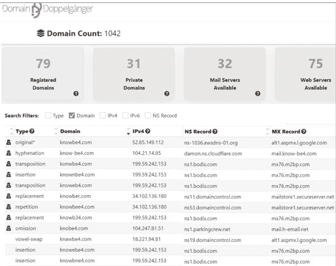

图 10-2 针对 knowbe4.com 运行 KnowBe4 Domain Doppelgänger 工具的示例。

## 蜜罐与金丝雀

在网络安全领域，蜜罐是一种非生产计算机设备或应用程序，其唯一目的是作为潜在的黑客或恶意软件攻击目标。其意图是供黑客或恶意软件访问和利用。它是非生产资产，因此一旦经过精调，生产环境中的任何合法系统都不应连接或使用它。蜜罐可以作为出色的早期预警系统，帮助防御者意识到那些可能迄今为止逃避了检测和缓解的威胁。常见的蜜罐包括工作站、服务器和网络路由器。

金丝雀是一种计算机或数据项，其唯一目的是检测恶意活动。常见的金丝雀可能是一个或多个假电子邮件或登录账户，合法的生产系统绝不应访问或使用它们。但如果发现它们被使用或以某种方式泄露，可能表明存在恶意活动。例如，KnowBe4 可能会创建一个名为 `fred_flintstone@knowbe4.com` 的假电子邮件账户。这是一个假账户，除了被创建之外，KnowBe4 内部任何人都从未使用或发布过它。但如果 KnowBe4 IT 检测到垃圾邮件或网络钓鱼邮件突然被发送到 `fred_flintstone@knowbe4.com`，那么推测外部攻击者以某种方式访问了内部电子邮件地址列表可能是正确的。蜜罐和金丝雀都属于被称为 *欺骗技术* 的一部分。

每个中型或更大规模的组织都应利用并部署欺骗技术。欺骗技术成本相对较低。您可以拿一台旧计算机或设备，将其简单重新部署为早期预警欺骗技术。有数十种开源软件工具和商业选项可供选择。一些较知名的商业供应商包括 Attivo Networks, Inc.；Cymmetria；Illusive Networks；Thinkst；以及 Trapx Security。

常见的蜜罐场景是在网络中部署一个靠近其他真实生产数据库服务器的假数据库服务器。假蜜罐数据库服务器应与真实服务器命名相似，甚至可能包含真实数据。它的唯一目的就是闲置等待，直至出现异常连接并触发警报。在当今嘈杂的网络中，所有计算机和设备每天都会收到数十到数百次不需要的但合法的连接尝试。这种情况时常发生，有时一天数千次。这就是当今网络的运作方式。它们非常“嘈杂”，服务器和工作站不断发出不需要的连接尝试。这些不需要但合法的连接尝试需要被过滤掉，以免触发警报。但是，一旦过滤掉所有合法的连接尝试，任何新的意外连接尝试都应触发警报，并调查到底（即，必须调查和缓解的恶意连接，或者必须添加到合法过滤列表中的原本无害的连接尝试）。

大型组织应在整个组织中部署多种类型的蜜罐、金丝雀记录和数据项。您希望欺骗技术成为防御纵深网络安全计划中常规且正常的一部分。欺骗技术成本低且价值高。它往往是仅有的能够在所有其他防御被绕过后检测到违规行为的网络防御。

## 突出显示新电子邮件地址

这是一个我尚未在任何电子邮件客户端中看到完整实现的功能，但我在此提及，因为我认为其广泛实施可以防止许多成功的网络钓鱼攻击。这是我非常聪明的朋友 Loren Kohnfelder（PKI 创始人，也是《Designing Secure Software: A Guide for Developers》的作者）向我建议的功能（https://designingsecuresoftware.com）。您可以在 https://en.wikipedia.org/wiki/Loren_Kohnfelder 找到他的维基百科页面。

Loren 建议为每个电子邮件客户端提供一个功能，用于跟踪所有收到的和使用过的电子邮件地址，并在用户第一次看到/使用全新电子邮件地址时发出警告。其理念是，许多网络钓鱼电子邮件源自全新的相似电子邮件地址，这些地址与真实人物的电子邮件地址非常相似，但并非该人真实的电子邮件地址。用户常常被骗到回复这些新电子邮件地址，却没有注意到所使用的电子邮件地址是全新的（至少对他们而言）。Loren 建议每个本地电子邮件客户端跟踪每个先前使用过的电子邮件地址，并在用户回复或使用


第一次使用新的电子邮件地址。也许，彩色横幅会框住用户正在输入或回复的电子邮件。多年来，我在各种电子邮件客户端中见过类似的、部分实现的功能。然而，没有一个功能被完全实现，并能跟踪电子邮件用户收到或发送的所有电子邮件地址。

虽然我非常喜欢这个想法，但我完全清楚，仅凭它本身并不是一个 100% 可靠的解决方案。网络钓鱼者经常攻破用户的电子邮件账户，并使用受害者真实的电子邮件地址。由于对任何特定电子邮件用户来说，有太多电子邮件地址是新的，大量用户会习惯看到有关使用新电子邮件地址的横幅警告，并且在最需要警告时很可能会错过该警告。尽管如此，对于那些注意并使用此功能的用户来说，它可以帮助避免许多原本会成功的网络钓鱼事件。我只希望有一天某个电子邮件客户端能够完全实现它，或者有人创建一个作为插件添加到一个或多个电子邮件客户端的软件包。

## 防范 USB 攻击

通用串行总线（USB）设备经常被社会工程师用来获得恶意访问权限或将恶意软件注入新环境。一种常见的场景是社会工程师将恶意修改的 USB 密钥“散落”在组织的停车场中。组织的一名或多名员工捡起这些 USB 存储驱动器并将其插入电脑。随后，他们被诱骗运行可执行文件或打开文档，从而启动恶意内容。另一种常见场景是，某组织的员工成为社会工程师的攻击目标，并通过邮寄方式收到一个看起来像来自合法供应商的 USB 密钥。例如，也许看起来像是微软正在向潜在受害者发送一个免费的品牌 USB 密钥，以庆祝一个热门的微软会议。受害者认为这是来自可信供应商的免费礼物。同样，潜在受害者也被诱骗执行恶意内容。

还有一种场景是，不满的员工故意将恶意软件放入其组织中。这可能是内部攻击的一部分，其中用户不是受害者而是攻击者。或者，员工因获得报酬（或未来报酬的承诺）而使用 USB 密钥在组织内部为外部攻击者放置恶意软件。

所有组织都应意识到外部存储设备（尤其是 USB 密钥）带来的威胁，并对员工进行适当培训。所有员工都应了解未经验证的 USB 设备（实际上是指任何可用于启动恶意内容的设备）的威胁以及常见的社会工程攻击。大多数组织需要实施技术防御措施，限制 USB 密钥（和其他设备）在组织设备和网络上的使用方式。

许多防御者会使用在组织停车场或公共区域投放的 USB 驱动器进行模拟网络钓鱼测试。任何足够有能力的组织都应定期这样做，并将其作为教育过程的一部分。KnowBe4 有一个功能和工具（www.knowbe4.com/usb-security-test），可创建这类模拟 USB 密钥，并跟踪哪些员工打开了它们、运行了活动内容，并响应它们提供了登录凭据。大多数使用过我们 USB 密钥测试功能的客户报告称，有员工成为模拟社会工程攻击的受害者。不要让现实世界的黑客成为唯一测试员工对随机发现的 USB 驱动器反应的人。

## 基于电话的测试

许多社会工程诈骗来自电话。定期进行模拟的基于电话的社会工程测试应是任何网络安全防御计划的一部分。在现实世界中，大部分此类语音网络钓鱼诈骗涉及尝试获得对机密系统的登录访问权限，但也可能涉及试图访问机密信息（例如，W-2 信息、合同详细信息等）。与其他形式的社会工程一样，员工应接受此类攻击的教育，并学习如何识别、缓解和报告这些攻击。

## 物理渗透测试

最后，许多社会工程攻击是由个人物理进入组织的实体建筑而发生的。对于现实世界中的攻击者，未经授权的访问可能出于各种原因实现，包括访问组织的计算机资产、访问机密信息、造成物理损坏、伤害人员或窃取设备。

所有组织都应拥有物理和逻辑安全控制，以防止未经授权的物理访问，并定期测试这些控制。许多组织会聘请外部专业渗透测试团队，看看他们是否能够成功获得访问权限。然而，如果要执行物理渗透测试，请务必定义渗透测试团队被允许和不允许做什么。已经出现过一些渗透测试团队似乎超出了约定的目标范围，并涉及执法机构的案例。请务必始终详细说明物理渗透测试的目标范围包含和不包含什么。

## 总结

第 10 章总结了组织可以实施以击败社会工程和网络钓鱼的一些高级且罕见的防御措施。它包括基于 AI 的内容过滤器、红绿防御、电子邮件服务器安全检查、双胞胎域检查、蜜罐和金丝雀，重点介绍了全新的电子邮件地址、防止 USB 攻击、基于电话的测试和物理渗透测试。

第四部分“创建出色的安全意识计划”是本书中最重要的部分之一，教导每个人如何建立一个出色的安全意识培训计划。第 11 章“安全意识培训概述”首先给出了大多数组织的安全意识培训计划应有的概要概述。

# 第四部分

## 创建出色的安全意识计划

因为至少有一定比例的社会工程和网络钓鱼攻击会绕过您的政策和技术防御，触达最终用户，所以最后一道防线是教育。第 11 章至第 17 章涵盖安全意识培训。第 11 章概述了一个出色的安全意识培训计划。第 12 章讲解如何正确进行培训。培训不会自然而然发生。第 13 章解释如何区分合法 URL 和恶意 URL，并包括黑客用来欺骗最终用户的高级技巧示例。第 14 章专门致力于防范精准网络钓鱼，它对当今绝大多数成功的数据泄露事件负责。第 15 章展示了任何人如何对可疑的网络钓鱼电子邮件进行取证检查，以确定它是否是恶意电子邮件。第 16 章涵盖了各种可以帮助您防范社会工程和网络钓鱼的提示和技巧。第 17 章通过展示如何将网络安全变成组织文化中默认且健康的一部分来结束本书。

# 第 11 章

## 安全意识培训概述

无论您的政策和技术防御多么出色，总有一定量的社会工程和网络钓鱼会触达最终用户，他们需要做出决策。出于这个原因，必须教导最终用户如何识别恶意迹象以及如何应对。第 11 章讨论了每个组织都应建立的出色安全意识培训计划，以显著降低网络安全风险。

### 什么是安全意识培训？

每个组织都应拥有一个正式的安全意识培训（SAT）计划。但是，为什么它被称为安全意识培训？计算机安全培训或计算机安全教育不是更好的描述吗？

首先，SAT 关注计算机安全（包括物理安全和逻辑安全），而不是跨所有学科的综合员工培训。它不涵盖非网络安全培训主题，例如骚扰、腐败和 OSHA 工作场所法律。这些属于通常称为合规培训的广泛主题。它确实涵盖物理安全，因为物理安全旨在保护网络资产。SAT 培训可能不会涵盖一个人应该做什么来防止汽车被盗，但它可能涵盖如何防止笔记本电脑从汽车中被盗。它当然包括如何防止未经授权的人员物理访问组织的工作边界和网络资产。SAT 是关于保护和保障网络资产及其包含的机密数据。

SAT 的一个核心组成部分是意识。根据 Google 的定义，意识是“对情况或事实的知识或感知”。SAT 使用户了解各种类型的网络安全威胁以及如何识别它们。仅靠传统的计算机安全培训，我可以简单地告诉您遵循特定的网络安全威胁缓解措施，例如，“在未先悬停并检查的情况下，不要点击意外电子邮件中的 URL 链接。”这是好建议，但它没有解释重要的“为什么”。SAT 涵盖了建议或要求安全政策的原因。有关在点击 URL 链接之前检查它们的政策是有原因的。许多网络钓鱼电子邮件包含指向欺诈性网站的 URL 链接，这些网站假装来自潜在受害者可能信任的特定品牌。这些网站试图诱导用户执行违背自身利益的操作。点击恶意 URL 链接可能会危及用户及其组织。了解为什么应该遵循特定政策的用户，比那些仅仅被告知要遵循而没有理由的用户更有可能记住并遵循相关政策。


此外，SAT 通常会提供大量现实世界的示例（或模拟），这些示例帮助用户记住威胁和建议。一句流行的说法是：“故事是我们学习任何东西的唯一方式。” 无论这是否完全正确，故事和示例确实有助于更好地传授经验。

一个类似的（非计算机）示例，就是告诉新手司机在进入路口前务必左右张望，即使他们拥有进入和通行的优先通行权。总是有助于通过告诉新手司机，之所以需要左右张望，是因为来自垂直方向的车辆可能不会停车，如果发生这种情况，可能会撞上拥有优先通行权的司机车辆的车侧，从而导致严重的高速碰撞。向他们展示相关高速碰撞及其后果的视频效果更好。故事和插图在解释动机方面大有裨益，这有助于学习者记住并重复期望的行为。

在防范社会工程学和网络钓鱼攻击时，最大的问题之一是哪些人格特质会让人更容易或更不容易成为受害者。长期以来，业内外人士一直认为智力起着重大作用。理论认为，聪明人比不那么聪明的人更不容易成为受害者。但这并未得到证实。医生、律师和博士成为社会工程学攻击受害者的可能性，与从未高中毕业的人一样大。

另一个错误的观点是，有些人天生就比其他人更容易轻信，也更容易上当受骗。但这也被证明并非事实。事实证明，某人是否会成为特定社会工程学骗局的受害者，最关键的相关特质是，潜在受害者是否知道该特定场景常用于骗局。让潜在受害者了解骗局中使用的特定属性，会降低其成为确认受害者的可能性。让人“了解”骗局是降低骗局成功率的最重要措施之一。例如，如果你知道你的电力公司绝不会联系你并要求你使用礼品卡支付电费，那么你就不太可能上这种当。了解各种骗局及其特征是任何 SAT 计划可以带来的降低风险的最重要事项之一。

总而言之，SAT 最重要的作用之一是向用户提供大量常见且流行的网络安全攻击的故事和示例。SAT 让用户了解各种威胁类型、如何识别它们以及如何应对它们。

## SAT 的目标

SAT 的最终目标是更好地保护个人（以及其所属组织，如果适用）免受网络安全攻击。它通过使用网络安全威胁的故事和示例，帮助用户更好地识别攻击企图，并教导用户如何缓解和报告这些攻击。SAT 旨在降低成功被攻破的可能性。

SAT 的主要目标是帮助用户更好地识别网络攻击企图的迹象和症状。例如，网络钓鱼邮件的常见迹象是什么？它们可能包括来自此前未知电子邮件地址的邮件、包含接收者从未收到过的异常请求的邮件，或者包含指向不可信网站的可疑 URL 链接。

优秀的 SAT 计划会提供数十个常见网络钓鱼攻击的示例，例如声称来自 USPS（参见图 11-1）或某大型美国信用合作社（参见图 11-2）的 smishing 攻击。本书特意收录了数十个社会工程学和网络钓鱼的真实世界示例，因为真实世界示例是了解攻击技术和记住缓解措施的好方法。

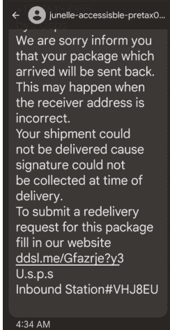

图 11-1 一个冒充来自美国邮政的 smishing 消息的真实世界示例。

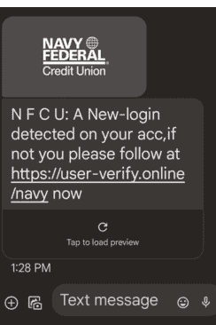

图 11-2 一个冒充来自某大型美国信用合作社的 smishing 消息的真实世界示例。

每个 SAT 计划都希望尽可能分享更多真实世界攻击的示例，因为它们可以告知参会者如何检测（即，迹象是什么？）、缓解和报告这些攻击。

必须指导 SAT 参会者如何应对社会工程学和网络钓鱼攻击。不要假设每个人都确切知道该怎么做。在家庭场景中，答案可能是简单地删除或忽略攻击。但如果用户被诱骗输入了登录信息或将信用卡信息提供给攻击者怎么办？那该怎么办？在第一种情况下，用户需要尽快登录合法的相关服务并更改登录信息。在第二种情况下，他们应该订阅信用监控服务并警惕欺诈交易。受害者可能希望主动拨打相关合法服务的电话，报告成功的网络钓鱼尝试，以使供应商了解涉及的恶意行为者。这样一来，供应商可能能够更主动地识别欺诈行为，或为受害者签发新的账户和信用卡。

在组织场景中，指导最终用户如何适当报告社会工程学和网络钓鱼攻击尤其重要。许多针对单个组织内众多用户的大规模网络钓鱼活动，持续的时间比必要时间更长，因为单个收件人未能将其报告给 IT/IT 安全部门，因此 IT/IT 安全部门无法主动响应并制止攻击。收件人需要接到指导，报告可疑的社会工程学和网络钓鱼攻击，并了解如何最佳地报告。不同的通信渠道可能需要不同的报告机制。例如，组织可能在电子邮件中使用网络钓鱼警报按钮（PAB），但可能没有类似的语音邮件和短信报告工具。在组织中，必须指导用户报告所有可疑的社会工程学和网络钓鱼攻击，无论攻击以何种方式到达。他们还需要关于如何报告此类攻击的明确指示。

还有一句非常相关的名言出自我的朋友兼同事 Perry Carpenter 的书 *Transformational Security Awareness: What Neuroscientists, Storytellers, and Marketers Can Teach Us About Driving Secure Behaviors*（www.amazon.com/Transformational-Security-Awareness-Neuro-scientists-Storytellers/dp/1119566347），书中写道：“人们可能意识到了，但仍然不在意。”这意味着普遍的意识是不够的。优秀的 SAT 计划必须给人们足够的信息，让他们了解某个特定问题如何在 *个人* 层面影响他们，从而让他们关心缓解该问题。

例如，SAT 计划不仅应该教授勒索软件是什么，还应该分享它如何在个人层面影响人们。勒索软件不仅会在数周或数月内对企业运营产生负面影响，还会影响生产、使客户和利益相关者不满，并可能导致裁员甚至可能关闭受影响的公司。如果员工认为勒索软件可能影响他们个人的工作，他们更有可能关心防止勒索软件。

优秀的 SAT 计划应该以一种方式教授期望的行为，使它们成为本能（对最终用户来说，无需思考，即“自然而然”）。当父母教我们的幼儿如何安全地过马路时，我们会牵着他们的手，始终强调在路边停下、左右张望，然后再看一次右边（或任何有意义的方向），确保可以安全通过，然后才过马路。我们教他们不要盲目地奔入车道去追球，等等。所有父母都会花几年时间教年幼的孩子如何安全地过马路，直到左右张望的习惯成为他们无需思考就能做到的事情。优秀的 SAT 计划也是如此。我们想要教授安全的计算机政策，直到它们成为自然而然的安全习惯。

如果 SAT 计划做得好，所有个人都会对任何可能损害其自身利益的新的、意外的请求保持健康的初始怀疑态度。他们将


了解如何识别社会工程学和网络钓鱼攻击的迹象，如何缓解这些攻击，以及如何适当地报告它们。

总而言之，SAT 计划的目标是教用户如何执行以下操作：

- 识别诈骗。
- 缓解诈骗。
- 适当地报告诈骗。

## 高层管理赞助

所有 SAT 计划都应由高层管理拥有和赞助。最好的 SAT 计划得到 CEO 的支持，CEO 会公开表示支持该计划的重要性。每个 SAT 计划都需要预算、人员承诺和明确定义的报告结构。大多数 SAT 计划隶属于 IT/IT 安全部门，但许多隶属于 CEO 或人力资源办公室。无论如何，预算、人员配备和报告结构都应被记录并广为人知。

## 绝对要使用模拟网络钓鱼测试

曾几何时，IT 和高层管理曾质疑模拟网络钓鱼测试是否是 SAT 计划的必要组成部分。事实上，在 SAT 计划的早期，管理员因进行模拟网络钓鱼测试而受到惩罚甚至被解雇。如今，每个组织都应该至少每月进行一次模拟网络钓鱼测试。数据显示，模拟网络钓鱼测试是培训员工识别真实网络钓鱼消息的最佳方式之一。根据 KnowBe4 从超过 65,000 家客户组织和超过 6.5 亿次模拟网络钓鱼测试中收集的数据，没有其他教育方法能比模拟网络钓鱼测试更有效地降低网络安全风险。以下是相关白皮书的链接：www.knowbe4.com/press/knowbe4-analysis-finds-security-awareness-training-and-simulated-phishing-effective-in-reducing-cybersecurity-risk。

您的 SAT 计划应包含模拟网络钓鱼测试，所有人都应参与。不要让高层管理或 IT 部门找借口避免进行模拟网络钓鱼测试。它们在 SAT 教育中至关重要。不要让真正的网络钓鱼者成为唯一测试您员工的人。

## 不同类型的培训

当然，所有 SAT 计划的核心都是培训、培训、再培训。不同的人以不同的方式学习。一个出色的 SAT 计划包含各种不同、有趣且多样的培训内容。你不想要一个只用一种方式、一种风格传递所有内容的 SAT 计划。你希望混合使用不同类型的内容，来自不同的叙述者，使用不同的风格，并涵盖不同的主题。

## 视频

大多数 SAT 计划包括预录的培训视频。这些视频可以由不为展示它们的相关组织工作的外部人员讲解，也可以由观众个人认识的团队成员创建和制作。在 KnowBe4，我们目前有超过 65,000 家客户组织，可以从超过 530 个不同的视频中选择。大多数视频由人讲解，但我们也有虚拟视频、卡通片，以及几乎您能想象到的每种视频培训内容。

我们最受欢迎的培训视频莫过于 Kevin Mitnick 制作的任何内容（见图 11-3 中 Kevin 在其培训视频中的照片），他是 KnowBe4 已故的首席黑客官（他于 2023 年 7 月去世）。每年，Kevin 都会制作一个新的 10 到 20 分钟的视频，展示当年的最流行的社会工程学黑客攻击类型。

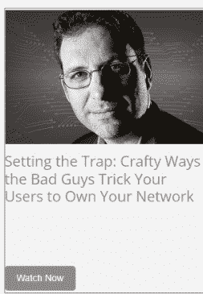

图 11-3 Kevin Mitnick 的培训视频示例。
来源：Kevin David Mitnick / www.knowbe4.com/products/who-is-kevin-mitnick / 最后访问时间：2023 年 11 月 11 日。

Kevin (www.knowbe4.com/products/who-is-kevin-mitnick) 是世界上最臭名昭著的黑客之一。作为 1980 年代的青少年和 1990 年代初的年轻成年人，Kevin 是一名臭名昭著的黑客。尽管他会使用任何已知的漏洞来实现目标，但他以社会工程学而闻名。Kevin 最终被捕并坐过牢。出狱后，Kevin 改弦易辙，从事合法的专业渗透测试和计算机安全咨询，并且是 KnowBe4 的共同所有者。他还为 Wiley 撰写了几本畅销书 (www.wiley.com/en-us/The+Art+of+Deception%3A+Controlling+the+Human+Element+of+Security-p-9780471237129)。Kevin 的半明星身份、臭名昭著以及出色的黑客演示确保他的视频比任何其他视频主持人（包括本人）都更受欢迎。

无论您是否可以观看 Kevin Mitnick 的视频（YouTube 上有几十个免费视频）或想要使用它们，您的培训内容都应包括该领域受人尊敬、经验丰富的专家。他们不必是世界知名的网络安全领导者，但观众应该尊重内容教师。我不想要一个刚开始学习修车的人来教我修车。我需要该领域的专家。

这里有几十个免费的 KnowBe4 网络研讨会视频可供下载和观看：www.knowbe4.com/webinar-library。作者有十几个一小时的网络研讨会可供使用。

与其使用其他人或公司的视频，不如每个组织创建自己的定制视频。这些视频可以是绝佳的教学工具，尤其是当它们使用知名且受人喜爱的员工，并涵盖直接威胁组织的现实世界主题时。如果定制视频制作精良、专业，并涵盖相关的现实世界主题，可以产生重大影响。

如果您使用大量视频，请确保使用不同类型和风格的视频。您希望变化内容、教学方法和制作方式。您希望它们都很有趣。有些可以是一名讲解员教授不同的社会工程学方法。有些可以是严肃的，而另一些则更幽默。有些可以是虚拟内容，另一些则是卡通片。我们最受欢迎的 KnowBe4 视频之一是我们受超级英雄启发的“安全觉悟队长”（“Captain Awareness”）(https://blog.knowbe4.com/new-knowbe4-offers-no-cost-childrens-interactive-cybersecurity-activity-kit) 视频。其他客户更喜欢我们 Netflix 风格的“内线人员”（“The Inside Man”）(https://blog.knowbe4.com/knowbe4-season-5-the-inside-man-less-than-one-month-away) 培训视频。关键是要多样化。不同的人偏好并更擅长通过不同类型的内容学习。

## 确保内容保持最新

确保内容保持最新且相关。黑客攻击和社会工程学技术会随时间变化。某一年非常流行的东西，在另一年可能会被遗忘和很少使用。例如，从 2000 年代初开始，假杀毒程序是一种非常、非常常见的诈骗。针对这类恐吓软件诈骗，正在上网冲浪的用户会看到假杀毒警告，声称他们的电脑感染了多种不同的恶意软件。受害者会被诱骗下载假杀毒程序（这时它已成为他们电脑上唯一的恶意软件），并提供信用卡信息进行假购买。黑客将远程访问受害者的电脑，同时也获得受害者的信用卡信息。假杀毒软件诈骗今天仍然会发生，但比过去少得多。我没有这方面的数据，但我最好的猜测是，也许 10%-15% 的员工今天可能会接触到它们，而在过去，这个数字可能是 90%-100%。即便如此，即使只有 10%-15%，我仍然希望教育每个人了解它们，即使它们不像过去那么重要。

在 KnowBe4，我们关注最新的社会工程学趋势。我们在每月的信息图表 (https://blog.knowbe4.com/q2-2023-top-clicked-phishing) 和“本周诈骗”示例 (https://blog.knowbe4.com/scam-of-the-week-netflix-phishing-attack) 中跟踪最流行的网络钓鱼主题。许多计算机安全供应商提供类似的社会工程学摘要，例如：https://intelligence.abnormalsecurity.com/blog/credential-phishing-trends-2023。这些供应商通常免费分享这些信息，即使您不使用他们的服务和产品，也可以使用他们的数据来帮助确定 SAT 计划涵盖的内容。无论如何，无论您怎么做，您的 SAT 计划都不应该停滞不前。

订阅 KnowBe4 的博客 (https://blog.knowbe4.com) 没有坏处。我们每天发布关于社会工程学的时事信息。

## 海报和通讯

每个 SAT 计划都应包括弹出屏幕、海报和通讯。您希望以尽可能多的方式将网络安全内容展示在用户眼前。在工作场所以及公共区域和用餐区域张贴海报。KnowBe4 拥有超过 250 种不同的海报，客户可以下载和使用。许多海报，例如此处 (www.knowbe4.com/hubfs/Social-Engineering-Red-Flags.pdf) 和此处 (www.knowbe4.com/hubfs/Red%20Flags%20of%20Rogue%20URLs%20(3).pdf)，任何人都可以免费下载和使用。互联网上还有数百个其他示例，任何人都可以下载。在任何互联网搜索引擎中输入“security awareness posters images”，即可看到数十到数百个海报示例。

大多数 SAT 计划应每月或每季度向员工发送通讯，涵盖最相关的网络防御主题。这些通讯可以打印出来手动分发，或通过电子邮件（或任何沟通渠道）发送给员工。通讯应涵盖直接威胁组织的现实世界热门主题。KnowBe4 的内容包含超过 250 个通讯。

我发现通讯中一个常见的错误是，创作者包含的内容非常有趣且可怕，但不太


这与其所分发的组织相关。许多网络安全通讯似乎更多是模仿耸人听闻的全国性新闻杂志（如《全国询问报》），其中包括具有新闻价值但极罕见的黑客攻击示例。它们很有趣、很耸人听闻，但与通讯所分发的组织无关。你希望你的通讯只关注涉及组织可能面临的最流行、最可能发生的攻击。

大多数网络安全通讯应从对最流行的社会工程攻击的意识开始，因为这是任何组织的员工可能面临的。许多通讯会在某个月报道一个社会工程故事，然后在接下来的几期中不再报道，认为如果一个月内已经报道过社会工程，就需要让这个话题“休息”几期，以免显得枯燥乏味和重复冗余。我同意枯燥的部分。通讯不应该枯燥。但是，通讯，就像所有SAT内容一样，需要一遍又一遍地涵盖最可能发生的黑客攻击，即使话题看起来重复冗余。SAT通讯需要涵盖最流行的黑客攻击，直到那些特定的流行黑客攻击不再流行，并被下一个当前最流行的黑客攻击取代，直到它们在流行度中下降。

## Games

如果可能，SAT计划应包含游戏。KnowBe4的SAT内容目前包含二十七个或更多游戏。我并不真的喜欢玩在线游戏。这根本不在我的基因里。虽然我有一个一直喜欢它们并且每天玩好几个小时的双胞胎兄弟。各有所好。无论如何，当培训“游戏化”时，大部分用户喜欢并学得最好。他们喜欢被挑战和评分的刺激感。他们想要赚取积分和徽章并赢得挑战。

模拟网络钓鱼测试，即向用户发送网络钓鱼测试并要求他们报告，是一种游戏。许多用户期待接受测试，以查看他们能否识别出所有模拟网络钓鱼测试，或者尽可能少地失败。

## Quizzes

SAT计划应包含测验，既可以作为相关培训模块的一部分，也可以作为独立测试。测验应测试相关内容，相当简单，且不要求所有问题和答案100%正确才能获得及格分数。测验用于记录用户对材料的理解，但也作为加强材料的一种方式。你在培训中向用户提供内容，然后在测验问题中再次提供，然后在答案中再次提供。

某些培训内容允许用户“免考”，这意味着用户可以参加关于相关内容的测验，如果通过，就不需要观看相关培训。关于免考的有效性存在褒贬不一的看法，但由每个组织自行决定是否降低风险。但总的来说，让所有人查看培训内容，无论是否包含测验，都比所有人都不查看内容更能降低网络安全风险。

## Mobile Apps

当今世界是移动世界。大多数互联网内容是通过手机查看的。您的SAT计划应该有使用移动设备查看和培训的方式。

## Immediate Lessons upon Failure

在SAT领域，最佳学习发生在模拟网络钓鱼测试失败后立即（参见图11-4）。

## Oops! You clicked on a phishing email

请花一分钟查看您收到的电子邮件中发现的社会工程指标。将鼠标悬停在红色警示标志上以查看详细信息：

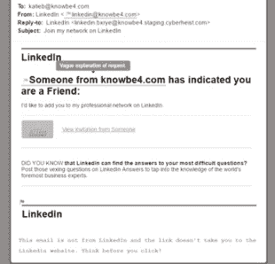

图11-4 模拟网络钓鱼测试失败后即时自动反馈的示例。

进行模拟网络钓鱼测试的KnowBe4客户可以允许系统立即告知失败模拟网络钓鱼测试的用户他们失败的原因以及他们本应识别出的迹象，以表明该测试是一条（模拟）网络钓鱼消息。这种即时教育帮助用户记住相关信息，远比稍后再进行培训效果好。因此，如果可能，当用户失败模拟网络钓鱼测试时，给予即时培训。

## Educate about the Signs of Social Engineering

每个SAT计划都应该教育用户如何识别社会工程和网络钓鱼的迹象。如前所述，这些迹象和症状的一部分是任何意外到达的消息，要求收件人执行可能损害其自身利益的操作。传统上，其他迹象包括：

- 奇怪、意外的主题
- 奇怪、意外的发件地址
- 主题摘要和消息文本不一致
- 拼写错误和语言问题
- 与消息品牌无关的奇怪URL链接
- 可能恶意的文件附件
- 假期或周末半夜到达的时间
- 压力陈述

人工智能（AI）赋能的恶意网络钓鱼工具将消除许多这些传统的社会工程迹象（例如拼写错误和语言问题），因此不能长期依赖它们来指示恶意性。尽管如此，你仍然需要教授这些常见的社会工程和网络钓鱼迹象和症状。这应该是您SAT计划的主要课程。

> 第15章，“取证检查电子邮件”，将更详细地介绍社会工程和网络钓鱼的迹象和症状。

## Teach How to Recognize Rogue URLs

大多数（但不是所有）网络钓鱼尝试都会包含一个恶意URL链接，可能会诱使潜在受害者点击。所有SAT计划都应该教导用户的主要课程之一是他们如何识别恶意URL链接。这意味着教导用户合法URL和域名长什么样，以及恶意URL的迹象是什么。

> 第13章，“识别恶意URL”，将详细介绍如何识别合法和恶意的URL链接。

## USB Key Attacks

所有SAT计划都应包含关于恶意USB密钥威胁的课程。员工应了解物理USB密钥攻击的存在、这些USB密钥如何送达（例如，通过邮寄或留在公共区域）以及可能的攻击类型。出色的SAT计划将包含使用USB密钥的模拟网络钓鱼测试。您可以自行制作USB测试，或使用免费工具（如KnowBe4的 www.knowbe4.com/usb-security-test）来进行。

## Voice-Based Social Engineering

所有SAT计划都应包含关于通过语音电话进行的社会工程威胁的课程。计划应包含大量现实世界的常见示例并分享缓解措施。应实施组织政策以降低基于语音的社会工程威胁。最好的SAT计划将在可能的情况下包含基于语音的模拟网络钓鱼测试。

## SMS-Based Phishing

所有SAT计划都应包含关于基于短信的网络钓鱼攻击的课程。最好的SAT计划将在可能的情况下包含基于短信的模拟网络钓鱼测试。

## Communication Tools

通信工具，例如Microsoft Teams、Slack、WhatsApp等，经常被社会工程师使用。

员工应了解通过任何通信渠道进行的社会工程和网络钓鱼的风险，如何识别此类攻击，以及如何缓解和报告。最好的SAT计划将包含针对组织使用的相关通信工具的模拟网络钓鱼测试。

## In-Person Attacks

当Kevin Mitnick年轻时从事黑客活动（以及年纪大后作为合法的渗透测试员），他尤其以出色的面对面社会工程师而闻名。他会装扮成快递员，拿着品牌快递箱，被“放行”通过安全转闸。他会装扮成电话公司员工，拿着品牌电话设备箱，被带到内部电话间。Kevin会假装成有意向的租客，以进入摩天大楼区域，然后从那里进入特定公司总部。Kevin会给人力资源部门和应收账款部门打电话，了解公司的信息，然后在进行面对面社会工程攻击时使用这些信息。每个SAT计划都应包含面对面攻击的培训，提供常见示例，并告诉员工如何识别、缓解和报告潜在攻击。

## Champion Programs

最好的SAT计划包括“冠军计划”，其中各种值得信赖、知识渊博的员工被用来向其他员工传授网络防御课程。冠军计划凭借直接的实操经验，还可以用于将相关所需信息传递给SAT计划，也许有助于指导SAT计划进入新的、所需的内容。


## BEC 诈骗

在勒索软件之后，商业电子邮件妥协（BEC）诈骗是对大多数组织最具财务破坏性的网络攻击。每个 SAT 计划都应包含关于 BEC 诈骗的教育。

## 鱼叉式网络钓鱼

每个 SAT 计划都应定义鱼叉式网络钓鱼，提供大量相关示例，并告诉员工如何缓解和报告它。第 14 章“打击鱼叉式网络钓鱼”将更详细地介绍此内容。

## 随时间提升复杂度和成熟度

与其他任何学习计划一样，教育应随时间变得更加复杂和成熟。全新的 SAT 计划应从非常明显、常见的社会工程和网络钓鱼攻击示例开始，然后随时间过渡到不那么明显的示例。在 KnowBe4 的系统中，我们的模拟网络钓鱼模板按 1 到 5 级排名，表示普通用户将其识别为网络钓鱼邮件的难度。起初，应向整个组织发送非常明显的网络钓鱼邮件。然后，随着员工成功通过每个先前的网络钓鱼成熟度级别，应向单个员工发送越来越成熟的模拟网络钓鱼测试。总体目标是随时间推移，使整个组织转向尽可能成熟和复杂的网络钓鱼测试。

## 如营销般培训

您是否注意到，您最喜欢（或最讨厌）的广告在电视上不断播放？它们不会只播放一两次就退役。不，它们会一遍又一遍地播放。甚至可能连续播放两次。它们可能播放得太多，以至于即使是广告的最初爱好者最终也可能讨厌它。如果您想知道为什么广告会一遍又一遍地播放，那是因为这有效。数十年的营销表明，反复播放广告更有可能获得更多付费客户。

SAT 计划也是如此。您展示某项培训的频率越高，观众记住教训的可能性就越大。但是，我不建议您反复展示完全相同的内容。相反，应反复展示类似类型的内容。例如，如果您想帮助同事不易受 BEC 诈骗侵害，请展示多个 BEC 诈骗视频，制作包含反 BEC 诈骗内容的通讯，并在公共区域张贴反 BEC 诈骗海报。您展示内容的频率越高，观众记住它的可能性就越大。

有一种营销范式认为，潜在客户必须看到产品名称十几次甚至二十多次，才能“了解”该产品。在此之前，潜在客户可能根本没有听到或看到产品名称，或者他们可能看到了，但不记得它。成功的营销活动一遍又一遍地展示产品名称，以便潜在客户开始记住并思考它。

大多数营销广告也很有趣。它们不仅仅提供枯燥的事实，并希望潜在客户记住它们。相反，当今的营销广告可能将几乎所有时间都花在尝试幽默和有趣上，甚至可能几乎不涉及供应商或产品名称之外的任何“事实”。当今最成功的广告大多很有趣。我想我们大多数人都可以轻松记住 Geico 的“原始人”广告、Mutual Liberty 的鸵鸟广告，以及 BudLight 的青蛙或克莱斯代尔马广告。内容越有趣，就越有可能被观看、观看更久并被记住。

SAT 计划应像主流营销人员一样进行培训：频繁、冗余且有趣。

## 合规性

每个组织都有每年都必须覆盖的自身合规教育要求。示例包括《反海外腐败法》、反性骚扰、多样性、数据收集隐私等。大多数 SAT 计划将合规性培训与常规计算机安全教育相结合。

## 本地化

许多组织在多个国家开展业务。SAT 意识计划应包含针对其提供的每种不同语言和文化进行本地化的内容。或者至少，它们应尽可能涵盖多种不同的语言。世界上最好的商业 SAT 计划，如 KnowBe4 的计划，涵盖超过 35 种不同的语言和方言。

本地化不仅仅是逐字再翻译。本地化意味着理解为了使 SAT 内容在每种不同语言和文化中得到最佳理解所需的语言变化。一种文化中合理的事情在另一种文化中可能完全不合理。

## SAT 的业务节奏

每个组织都需要决定部署 SAT 内容的组织“业务节奏”。如果您的组织尚未决定适当的节奏或正在尝试改进它，常见的业务节奏如下：

- 所有新员工（以及承包商和顾问）在受聘时以及随后每年都会接受更长的 SAT 培训（例如，15 到 45 分钟）。
- 更短的 SAT 培训会话（例如，1 到 5 分钟）至少每月举行一次。
- 模拟网络钓鱼测试至少每月执行一次。
- 根据先前的成功和失败情况，开展更多培训和模拟网络钓鱼。

培训和模拟网络钓鱼应至少每月进行一次。降低风险最多的 SAT 计划每周进行培训和模拟网络钓鱼。

SAT 计划应随时间变换消息传递和内容类型。图 11-5 显示了一个 SAT 计划示例。

在图 11-5 的 SAT 计划示例中，模拟网络钓鱼测试始终执行（每周或每月），但几乎其他所有内容都会随时间切换和更改。SAT 计划从高层管理支持开始，以设定计划的重要性。之后，可以使用其他高管或中层管理人员来强化计划的重要性。至少每年一次，组织会举办一次全员安全宣讲会，提供食物、饮料、奖品和礼物。

培训内容随时间变化，第二次培训附带考试（但其他培训不附带）。图 11-5 的第三个时间段列中显示了更复杂的 Netflix 风格培训视频，第四个时间段列则是卡通风格培训视频。培训内容和风格随时间变化。培训内容通过通讯、游戏和竞赛得到补充。冠军计划有助于强化培训教训。最后，合规性培训会更改每个列时间段，频率足够高，以确保每年涵盖所有必需的合规科目。

| | 第 1 列 | 第 2 列 | 第 3 列 | 第 4 列 |
|---|---|---|---|---|
| 标题 | 教育与模拟网络钓鱼活动 | | | |
| 第 1 行 | 高管消息传递 | 经理消息传递 | 高管视频 | 安全宣讲会 |
| 第 2 行 | 培训视频 | 带考试的培训 | Netflix 风格培训视频 | 卡通风格培训视频 |
| 第 3 行 | 模拟网络钓鱼活动 | 模拟网络钓鱼活动 | 模拟网络钓鱼活动 | 模拟网络钓鱼活动 |
| 第 4 行 | 通讯 | 冠军活动 | 游戏 | 有趣竞赛奖项 |
| 第 5 行 | 数据处理培训 | HR 合规性测试 | 行业合规性测试 | 隐私合规性培训 |
| 页脚 | 持续评估/根据需要调整 | | | |
| 底部 | 定期节奏/时间 | | | |

**图 11-5** SAT 计划组件随时间的变化示例。

您的 SAT 计划应包含所有这些组件，并采用获批的业务节奏。一些组织决定每月进行培训，其他组织则每周或每季度进行。找出最适合您的业务节奏，并根据结果和反馈随时间按需要对其进行修改。

## 报告/结果

最后，决定您的 SAT 计划应提供和实现哪些报告和结果很重要。需要预先定义期望的结果，包括哪些表示成功，哪些表示失败。例如，报告可能包括员工的易受钓鱼百分比（即，员工未能通过模拟网络钓鱼测试的频率）。期望的结果可能是易受钓鱼百分比随时间下降，目标是降至 5% 以下。其他收集的统计数据可能包括参加必修 SAT 培训的员工百分比和报告模拟网络钓鱼测试的员工百分比。无论这些统计数据是什么，每个 SAT 计划都应预先决定它们，并指定表示成功和失败的级别。

## 检查表

表 11-1 提供了一个方便的检查表，您可以使用它来确保您的出色 SAT 计划包含所有期望的组件。

表 11-1 SAT 计划组件

- 高层管理赞助
- 模拟网络钓鱼测试
- 培训 – 视频内容
- 培训 – 海报和通讯
- 培训 – 游戏
- 培训 – 测验
- 培训 – 移动应用
- 培训 – 失败后立即课程
- 培训 – 社会工程和网络钓鱼迹象
- 培训 – 如何识别恶意 URL
- 培训 – USB 密钥攻击
- 培训 – 基于语音的攻击
- 培训 – 基于 SMS 的攻击


- 培训 – 通信工具攻击
- 培训 – 面对面攻击
- 培训 – 冠军计划
- 培训 – BEC 诈骗
- 培训 – 鱼叉式网络钓鱼
- 培训 – 合规性
- 培训 – 本地化
- 培训 – 报告/结果

## 摘要

第 11 章介绍了优秀安全意识培训计划应包含的许多组成部分。总体目标是通过使计划参与者对网络安全攻击（尤其是社会工程学和网络钓鱼）不那么容易受害，从而显著降低网络安全风险。这可以通过使用模拟网络钓鱼测试和培训来实现。第 11 章介绍了优秀安全意识培训计划应包含的所有不同类型的培训。它以安全意识培训计划及其随时间变化的组件示例结束。

第 12 章，“如何正确开展培训”，将介绍如何制作出色的培训内容。

# 第 12 章

## 如何正确开展培训

第 12 章将介绍任何人如何创建有效的培训计划和内容。

本章主要由 KnowBe4, Inc. 首席学习官 Dr. John N. Just, Ed.D. 撰写，他领导着来自世界各地的团队，这些团队始终因行业内最佳在线培训而获得奖项和行业荣誉。他通过在线学习向全球数百万学习者传授合规性和安全主题知识。他获得宾夕法尼亚州立大学学士学位、南佛罗里达大学教学技术硕士学位以及新东南大学教学技术和远程教育博士学位。John 通过在线培训帮助数千万人提升网络钓鱼防御能力，这是他的专业领域。

在本章中，我们将讨论构建安全意识培训计划的三个部分：

- 设计有效的安全意识培训计划
- 构建/选择并审查内容
- 部署和维护该内容

### 设计有效的安全意识培训计划

设计和维护任何培训计划（包括安全意识培训计划）都涉及七个主要概念：

- 制定计划目标。
- 获得领导支持。
- 成立指导委员会。
- 确定培训频率（即节奏）和分配给培训的时间。
- 进行受众分析。
- 确保具备可访问性。
- 定期重新评估培训计划和内容。

这是一个持续的过程，作为安全和合规性培训整体规划的一部分，应每 12 到 18 个月重复和改进一次。

### 制定计划目标

你必须首先确定你的安全意识培训计划将是什么样子，以及它将如何符合合规性和网络安全的更广泛背景，然后再构建和/或选择供应商创建的内容。新计划管理员通常会颠倒这两个步骤。虽然“内容为王”这一老话是正确的，但在选择或创建内容之前确定计划范围是一项重要的先决条件。出色的内容可以在吸引用户并使学习对他们具有相关性方面发挥作用，但花时间确定计划的目标和指南将指导选择，并使安全意识培训计划更加成功。幸运的是，有多种格式的高质量内容可供选择，还有构建自身内容以补充任何内容库的出色工具。但是，如果你首先从内容入手，这种选择的多样性可能会让人不知所措。因此，从整体培训计划设计开始是最佳实践，并将大大缩小内容选择范围。

你为什么要启动或运行反网络钓鱼计划？你希望完成什么？你必须首先记录这些目标，并让所有相关人员同意这些目标。目标必须明确且可衡量。不幸的是，有些计划可能只是因为监管或合规要求而设定创建安全意识培训计划作为目标。最好的计划有一个包括“通过教育显著降低网络安全风险”或类似内容的目标。另一个常见的目标是减少员工与网络钓鱼电子邮件的负面交互（即“失败”）数量，或增加向 IT 报告的网络钓鱼尝试的百分比。另一个可能是“使用共同交付方式提供所需的年度合规教育。”创建或运营反网络钓鱼计划有许多原因。你的原因是什么？首先记录它们，获得相关各方的同意，然后确保你在计划中所做的任何事情都支持这些目标。

### 获得领导支持

每个安全意识培训计划都必须有领导支持。它不仅允许相关资源参与计划，还提供合法性和预算，并向组织传达计划的重要性。在 KnowBe4 的 Perry Carpenter 和 Kai Roer 进行的安全文化研究中（www.amazon.com/Security-Culture-Playbook-Executive-Developing/dp/1119875234），并在第 17 章“改善你的安全文化”中更详细地介绍，他们确定领导支持是改变组织行为和安全文化的关键因素，这正是我们通过反网络钓鱼培训所要做的。没有领导支持的反网络钓鱼计划注定会导致低效和无效的结果，如果不是彻底失败的话。如果你没有强有力的领导支持，必须在开始计划之前解决这个问题。

相关地说，许多组织的高管领导是完成培训和失败模拟网络钓鱼测试方面表现最差的群体。通常，这两件事同时成立：高管在安全意识培训方面表现不佳，并且他们不（强烈）支持计划。获得高级领导支持通常有助于培训领导团队，反之亦然。

反之亦然。领导可以非常支持，但即使这样也有一些需要担心的陷阱。你的高级管理层赞助人可能如此个人支持，以至于你可能会自然地认为他们将教育其余领导团队，并成为计划持续、有力的倡导者。虽然这是一个远比缺乏高管支持更好的位置，但你不想假设高管将是你最好的长期倡导者或拥有所有正确答案。你想拥有并成为你计划的领导者。你想确保你正在教育高级领导并提供正确的信息和答案。如果你有强大的高级管理层支持，利用这种关系在高管领导团队会议上争取时间，展示你在流程中的进度，并不断讲述组织为何踏上这段旅程的故事。

有些组织文化允许高管和其他有影响力的领导者在沟通和培训方面像普通员工一样对待，但许多组织不允许。在许多情况下，在为组织其余部分制定计划之前，首先为高管团队制定单独计划是一个关键步骤。作为计算机安全专业人员，我们有一种往往必须克服的自然偏见——我们知道安全意识培训很重要，并且通常会假设其他人也知道它有多重要。但不假设所有领导都会自动支持，或者甚至应该支持，是更明智的。你可能需要先制定单独的培训计划来教育领导层，然后再向他们展示公司其余部分的计划。

**“为什么”的重要性** 如前所述，同事 Perry Carpenter 在他的书《变革式安全意识》（www.amazon.com/Transformational-Security-Awareness-Neuroscientists-Storytellers-ebook/dp/B07RDM1C2M）中指出，“人们可能有意识，但仍然不在意。”你必须让人们（包括高级管理层和其他所有人）明白做某事对他们个人和组织有益。尽管所有用户都需要理解实施安全意识培训计划的原因，但对于高级领导来说更为重要，因为他们的支持将是成功或失败的主要驱动力。


“原因”可以包括以下内容：

- 大幅降低网络安全风险
- 降低勒索软件风险
- 降低业务中断的风险和成本
- 降低客户好感度流失的风险
- 降低来自利益相关者的法律风险
- 降低“你”会被当作那个被骗让公司瘫痪的人的风险
- 遵守必需的法规或法律（仅这一点往往就能激励高层管理）

## 赢得领导层支持

请记住，领导团队往往同时处理多个紧急问题，并且很快就会转向下一批问题，因此重新阐述问题是让安全意识培训计划成功的关键步骤。在与高管领导团队的最初几次会议中，争取将自己列入议程，至少10分钟。如果只有10分钟，那么应该包括5分钟解释为什么要这样做，一些支持数据，以及培训计划目前的进展。面对业务领导者可能令人紧张，但要清晰简洁地沟通，并留出5分钟进行反馈和讨论，而不是单方面讲话。

这里有个好建议：分享迄今为止的模拟网络钓鱼测试结果以及组织的趋势（高管喜欢数据和图表）。接着分享一两个好故事——组织内部和/或行业内最近的事件和/或惊险时刻。最后说明培训计划制定的进度。

有时我们会感到压力，必须在这些大型会议上“准备好所有答案”并草拟计划，但更好的做法是讨论流程，传达我们深思熟虑的态度，并征求领导团队的反馈和支持，而不是推行特定议程。列出选项并请求高层管理参与，这是首次会议的一个好建议。尽量避免利用这段时间做任何决定，而是将其作为招募更多计划支持者的工具。

有时第一次领导会议不会如你所愿。你可能会有更多批评者和反对者，而非支持者。但即便如此，通过这次最初的十分钟会议了解自己在领导层中的位置，也比在不了解可能面临的挑战的情况下启动计划要好。

你可以将其视为对高管领导团队现状的基线评估。然后你可以制定计划，与高管们个别合作。其中一些人可能不需要太多帮助，但其他人可能需要被说服，认为他们及其业务单位确实需要帮助。然后你可以与他们个别会面15到20分钟，不是要用PPT幻灯片让他们不知所措，而是要真正与他们互动，向他们展示你为更广泛组织制定的计划。

高管培训计划可以与其余用户的安全意识培训计划同步开展，但应在上述会议后立即开始，并且频率应至少为季度一次（如果不更频繁的话）。高管领导层通常比你发送给组织其他人员的培训内容更倾向于更短的内容。

## 成立指导委员会

下一步应该是成立指导委员会。根据国际项目经理协会（IAPM）的定义，指导委员会是一群为计划提供指导、监督和战略方向的个人。一些定义将“高级”列为个人的描述，但更重要的是，指导委员会应涵盖组织内不同层级的更具代表性的人员。委员会成员也不全是完全“明白”的人，因此招募超出那些已经高度参与的人群加入指导委员会可能是关键。一些最成功的案例发生在：人们对模拟测试提出不满，随后被邀请讨论这些测试的重要性，最后被要求加入指导委员会。你可以把敌人变成友好的支持者，并以此了解计划中的薄弱环节。

指导委员会会议应是简洁的会议，用于展示选项和收集意见，而不是公开议程，去征求所有可能做的所有事情的所有可能反馈。会议中可以而且应该有一个开放的环节用于提出想法，但我见过太多此类会议像焦点小组一样进行，甚至演变成群体思维。我喜欢焦点小组，但应努力构建指导委员会会议，以便充分利用与会者的时间，并从中获得最大收益，从而使计划受益。具体做法将根据你与领导的第一次会议、网络钓鱼测试表现以及其他因素而有所不同。但要为你和你的团队安排几次工作会议（如果你是一个人作战，可以找同事或老板来审核想法），最终拿出一套明确的议程、具体示例和资源，供委员会选择。

这个时候适合分享和审查网络钓鱼统计数据、调查结果和其他评估结果。重要的是绝不指责和羞辱任何人，而要确保以更具同情心的方式呈现结果。例如，如果销售和运营等部门的报告比例较低、评估分数也较低，可以指出这是因为其工作性质所致，这是我们需要考虑的因素。

你希望营造一个协作环境，以帮助制定培训计划。

## 培训频率与时间分配

另一个早期决策点是培训频率和分配给培训的时间。时间就是金钱，如果你希望每年每个员工都花大量时间离开其正常的生产岗位，领导层不会高兴。你应该与高层管理和指导委员会就培训频率和时间分配达成共识。你希望培训计划有足够的时间和频率来发挥作用，但也不想浪费时间，或者仅仅因为可以就增加培训课程。

为达到最佳效果，培训应每月进行，模拟网络钓鱼测试也应每月或更频繁地进行。可惜，大多数组织目前并非如此。一项在2021年用户会议上针对模拟网络钓鱼和安全意识培训软件的最近调查显示，34%的参与者每月培训，32%每季度培训，19%每年培训，其余的人尚未开始培训工作或仅进行模拟网络钓鱼。

培训和模拟网络钓鱼测试之间的间隔越长，效果越差。这是任何培训的常识，但对于反网络钓鱼培训尤其如此，因为黑客的技术和伎俩在不断变化。研究表明，如果员工每3到4个月至少不接受一次网络钓鱼培训，那么培训几乎就无效。例如，一项来自德国的研究发现，“……在方案部署后立即和四个月后，正确识别网络钓鱼邮件和合法邮件的表现显著提高。不幸的是，六个月后情况不再令人满意……”（www.usenix.org/system/files/soups2020-reinheimer_0.pdf）。

对KnowBe4客户的回顾显示，客户进行培训和模拟网络钓鱼的频率越高，客户员工识别模拟网络钓鱼测试（以及 presumably 真实网络钓鱼邮件）的能力就越强。你可以在此处阅读白皮书：www.knowbe4.com/press/knowbe4-analysis-finds-security-awareness-training-and-simulated-phishing-effective-in-reducing-cybersecurity-risk。

面对频率和时间挑战的计划管理员经常表示：“我们一年培训一次都已经困难重重，怎么能更频繁地进行培训呢？”不过，当你转向更频繁、因此更简短的培训时，会发生一件有趣的事情。让人们完成培训会变得更容易。你开始在组织中建立肌肉记忆，人们不再问自己“我去年在哪里登录过，我需要做什么？”，他们开始习惯于完成每月或每季度的培训。简短的内容也更容易消化。年初（第一季度）你可能有一个10到15分钟的模块，之后每个季度是一个5到10分钟的模块。许多组织甚至采用了每月一次的更短内容。

如果你要从一场更长的年度培训转为更多培训课程，只要总的时间投入没有变化（或变化不大），这将是一个有用的策略。然后你可以与指导委员会和领导团队交谈，将此定位为“这与每年进行一次的总培训时间相同，只是分散得更多”。这更有效，也不是一次性吞下的“大丸子”。你还希望与新入职培训负责人合作，帮助他们为新入职培训挑选培训模块，并计划如何将全年入职的人员纳入


培训计划。内容的整体计划应覆盖 12 到 18 个月的时间跨度，包含多种不同类型的媒体和主题，这些主题直接基于已完成的评估，包括网络钓鱼测试、知识评估和调查。

无论做出何种决定，都要记录约定的培训频率和时间投入，并让所有人同意这些约定。你可以向员工说明培训和模拟网络钓鱼测试的频率，但不想告诉任何人进行模拟网络钓鱼测试的确切日期或时间。

## 受众分析

你必须准确了解受众是谁、谁将接受培训，以及他们的优势和劣势是什么。你可能需要为不同类型的员工提供不同的培训。例如，你可能会为白领办公室员工提供与野外钻井平台工程师不同的培训和方法。作为受众分析的一部分，你首先应该与指导委员会商讨的决定之一是：所有群体的培训是否都相同，或者你是否需要为不同的员工或组织部分区分培训计划。

一个现实世界的例子是，一家医疗保健组织推出了带有交互元素和结尾测验的多媒体培训（视频和音频）。该计划在大部分业务中大多成功，许多最终用户非常喜欢所选的在线课程。他们没有考虑到的是，他们有一大群员工的电脑上没有扬声器或没有耳机。计划领导者认真考虑过发放带有该计划品牌的耳机，或者将培训计划更改为下一季度培训中不那么侧重多媒体的内容。明智的是，他们首先与相关员工进行了一次小型焦点小组讨论，讨论选项并提出更多开放式问题。他们发现，耳机想法会过于干扰且难以实施，因为这些护士（以及可能是任何此类员工群体）经常共用工作站，并且日程安排或培训非常不规律。因此，该组织决定为护士采用完全不同的计划——更短的培训模块，频率更高，且完全不涉及多媒体。他们还从学习提供商处部署了一个移动应用程序，以便这些内容可以在不需要通过普通计算工作站访问的情况下消费。

培训计划中一个常见的错误是，组织将员工视为比实际更具凝聚力、更相似的群体。这方面的一个现实世界例子涉及一家大型跨国银行。他们通常会向所有员工推出非常严肃、刻板的培训。严肃、正式的培训似乎很合理，因为他们是一家专业的金融组织，正在处理他人的钱。他们是银行家。人们期望他们严肃和正式。但银行里并不是每个人都是银行家。在所有业务单元中，他们还有营销人员、销售人员、维护人员和呼叫中心员工。严肃的视频在非银行业务单元中并不那么受欢迎。因此，作为一项实验，该银行的指导委员会决定为其非银行专业业务线挑选一段更轻松、更有趣的培训视频。这种新型培训效果非常好，以至于指导委员会最终将其推广到整个公司，同样取得了成功。了解你的受众，并了解是否需要为不同类型的群体提供不同的培训。

也可能有些人，例如，能识别大多数网络钓鱼邮件，但不了解适当报告它们以帮助他人的重要性。我们讨论过了解各种工作环境下合适的媒体类型并进行区分，但更重要的是要根据技能水平以及当前的态度和行为进行区分。这并不意味着每个人都应该像高管那样拥有独特的培训计划和内容，但你可以使用正式评估和网络钓鱼数据，帮助将他们分成多个群体（2 到 4 个），这些群体最能推动他们在网络钓鱼知识之旅上取得进展，同时既不会让一些人感到无聊，也不会让其他人感到不知所措。

当然，一年中的一些内容对每个人都有关联，但我们通常希望挑战我们最先进的网络钓鱼学习者。他们是拥有现代工具的人，这些工具最有可能先提醒我们，同时也能提高最可能成为网络钓鱼诈骗受害者的群体的水平。别忘了中间群体的那些人。他们需要提醒和强化，以保持在正确的轨道上。你需要为他们混合不同类型的内容，并让他们保持参与。

## 无障碍访问

另一个重要的考虑因素是无障碍访问。在线学习中的无障碍访问是指以一种确保所有个人（无论其能力或残疾如何）都能访问并有效参与材料的方式设计和交付在线教育内容和资源。它涉及创建包容性学习环境，以容纳广泛的学习者——示例包括视力障碍用户使用屏幕阅读器、听力障碍用户的字幕、适当的颜色对比度，以及加速、重播或放慢演示文稿的功能等（仅举几例）。

遵守法律法规的考量也很重要，例如在美国，《美国残疾人法案》（ADA）使这成为你将要推送给这些残疾学习者的培训的法律要求。将其作为培训的一部分来适应他们，以便残疾用户能获得尽可能接近平等的体验。我与一家公司交谈过，该公司为其所有安全意识培训内容与最大的安全意识内容提供商合作。该公司有几千名用户，并进行了几年的培训。他们决定委托外部开发团队制作一个自定义模块，作为持续培训的一部分来解决其特定公司系统的问题。他们没有传达内容需要无障碍访问的需求，当他们发布时，来自辅助技术用户的投诉比他们预想的要多得多。在一次会议演示中，信息安全总监表示，这是他从创建这个培训中得到的最大收获：“确保你的内容具有无障碍访问性，并对其进行测试。”

## 评估

你的反网络钓鱼计划应经常重新评估。它是否达到了目标？它是否正在有效降低网络安全风险？一些组织陷入将安全意识培训视为合规性“填表”式练习的窠臼，这对整体计划可能非常不利。或者，不幸的是，许多组织年复一年地给员工提供相同的培训模块（或只有细微变化），不出所料，他们并未看到成功网络钓鱼的持续减少。大多数合规官员和人力资源领导者知道“填表”式培训根本无法有效改变行为，并且在许多方面都对此事实感到无奈。

在反网络钓鱼培训中，有可测量的统计数据可供查看：模拟网络钓鱼测试的点击/失败百分比、报告网络钓鱼模拟的员工百分比，以及在野外接收到的真实世界网络钓鱼率。将安全意识培训计划与这些指标挂钩，其明确目的是推动报告的（真实世界和模拟）网络钓鱼率上升和点击失败率下降，这应该是任何安全意识培训计划的主要目标之一。

我最近交谈的一个组织采取了我喜欢称之为“大爆炸”的方法，因为他们最近发生了一起相当严重的真实世界网络钓鱼事件，因此获得了领导层的支持。他们推出了一大批培训，开始每月进行网络钓鱼模拟，甚至还发布了一条 CEO 录制的消息，表达安全意识培训对所有员工有多么重要。

事后他们联系我表示，尽管头几个月取得了不错的效果，但这些效果很快就减弱了，现在他们面临点击失败率上升和报告参与度下降的问题。他们从这段经验中学到的是，改变行为很难，人们在职业和个人生活中有太多事情要处理，所以我们只能获得一小部分时间来教他们关于网络钓鱼的知识。我们不能把网络钓鱼当作季度性问题来处理了事。它是组织面临的一种持续且不断演变的威胁，因此需要一个持续且不断演变的培训计划来应对。

如何衡量培训成功？嗯，有明显的指标，如知识评估、调查和模拟网络钓鱼测试的改进。但学习者参与度的领先指标是在培训事件结束后立即进行的调查。使用 KnowBe4 的在线学习培训内容时，所有学习者都被要求对内容进行评分，评分范围从 1（效果最差）到 5


（效果最佳），在培训结束后立即。
始终有一个开放的评论框，以便学习者可以输入他们的反馈。

培训内容总体评分为4.2分与4.6分之间存在巨大差异。你可能最初会认为，因为两者都是5星中的4星，所以质量大致在同一水平。但如果你查看评论数据并进行详细分析（顺便说一句，你每次都应该这么做），你会看到明显差异。一个好的培训项目通常会获得4.5星或更高的评分。4分以下的项目并不那么出色，需要改进。以下是数千个组织的培训调查结果的现实世界示例：https://blog.knowbe4.com/good-survey-rating-for-security-compliance-training.

调查评论分析至关重要。一个组织告诉我，他们围绕深入查看每个培训周期的所有评论来构建自己的项目，并回应每一条负面评论。他们分享的是，许多人赞赏有人阅读他们的评论并做出回应。有时我们倾向于把这些培训项目当成自己的宝宝而变得情绪化，但重要的是要像科学家一样思考它们，而不是做出本能反应。

是的，评论中可能会有相当数量的“只是对生活愤怒”的人，你需要逐一筛选。相信我，当你读够了其中一些后，你可能会开始感到有点沮丧，但即使在那些评论中也有可用数据的小金块。我亲自主持的一次培训课程中有很多评论称，“这在浪费我的时间，因为成为网络钓鱼攻击的目标绝不会发生在我身上，我不够重要”或者类似的话。当我们下次重做那节课时，我们在前面加入了一条消息，说明这种情况发生的频率远比你想象的要高，因为人们不谈论此事。毕竟，这很尴尬，有时还涉及机密。

我们还注意到，无论级别如何，组织中的每个人都可能发生这种情况。我们将此作为视频的一部分，但我们也让他们使用交互元素进行猜测。

我们稍后将讨论交互元素的威力，但通过用这些信息吸引他们，总体评分提高了，发表此类评论的最终用户大幅减少。调查和评论允许与最终用户进行一种对话，而这是你无法从更正式的调查或评估中获得的。它们使你能够在实施培训计划期间通过更频繁的接触点了解项目的脉搏，并且在过程中常常会导致一些可以对培训项目整体成功产生影响的课程纠正。

## 构建/选择和审查培训内容

在选择或构建内容时，你应该经历以下流程。

## 选择内容

为你的组织选择合适的内容可能是一项挑战。在为全年做计划时，混合内容类型并包含游戏和视频等媒体也很重要，这些媒体应与自定进度交互式eLearning一起使用，正如前面所述，它应该是项目的核心。确保在活动中使用指导委员会审查所有可能的内容选择也是一项最佳实践。有时你可能会选择一些大胆的内容或使用幽默来表达观点。能够说你已经获得了所有指导委员会成员的支持，以防你收到一些投诉，这始终是个好主意。HR通常会想知道为什么选择某个内容以及审查该内容的流程是什么。让HR的某人加入委员会或至少提供某种审查反馈通常也是个好主意。

别忘了委员会的多样性也很重要。如果你看看桌子周围，你的整个指导委员会都有着相同的种族背景和/或性别，那就开始招募其他人来帮助你从不同角度进行审查。确保明确表示你希望他们就其他人可能觉得冒犯或无效的内容提供反馈，即使他们自己不这么认为，这样你就可以把重点放在学习网络钓鱼内容上，而不是其他干扰事项上。

## 创建还是购买？

说到决定是构建还是购买培训内容，答案往往不是非此即彼。大多数有效的培训项目都两者都有。你可以购买的内容通常具有高制作价值和经过验证的有效性。你可以自己创建的内容可以高度定制，提及你的公司并涉及每个员工都认识的人。

如果你在进行每月培训，每年的每月培训课程中应有两节课程侧重于你的环境，并为你的组织提供非常具体的教育。进一步获得领导支持的一个好主意是，让组织中的一位领导者录制一段视频，谈论报告网络钓鱼攻击和不成为受害者对于组织使命有多么重要。

大多数攻击在许多行业和组织中都大同小异，因此利用任何安全意识培训内容提供商创建的高制作价值内容如今是显而易见的选择。成本只有你自己组织创建这些内容所需成本的一小部分。网上也有一些免费的反网络钓鱼内容，但一般来说，你付出多少就得到多少。

## 指导委员会审查

涉及你的指导委员会的下一步之一是让他们审查你构建或选择的某些培训内容。因此，指导委员会的第二次会议应侧重于提供反馈，并在会议之间留出一些时间来查看选项。通常，我们可以使用流行的eLearning创作工具在内部培训中创建一个（或两个）短期概念验证。这些工具的示例包括Articulate Storyline、Adobe Captivate，或你的学习管理系统（LMS）中内置的用于构建交互课程或模块的工具。

> 学习管理系统（LMS）是一个用于交付、跟踪、管理、文档化和报告教育课程及培训项目的软件自动化平台。许多组织都有LMS。

## 交互性

交互是任何良好学习活动的基石。当我们学习任何需要在工作或个人生活中应用的东西时，我们通常不会仅仅阅读关于它的内容或观看关于它的视频，而是包含与示例或关于场景的问题进行交互的组件，这不仅帮助我们了解相关性，还允许我们应用正在学习的信息，从而使其在我们的记忆中更持久。在我们开始并在整个疫情期间，许多人一直在录制他们平时会亲自进行的教育项目，并将其上传供员工观看。

在TikTok和Instagram Reels的时代，很难让人们的注意力持续超过5分钟，更不用说45分钟的网络研讨会录像了。但是，eLearning创作工具允许你将较长的内容分成可能只有1或2分钟的更小的演示块，然后在这些每个块之后进行我们所谓的知识检查。

在前面关于无法访问多媒体的护士的示例中，这可能是一两分钟的阅读、复查和信息图表，或探索（通过交互）课程中的材料。这些知识检查就是我们所说的*形成性评估*。之所以这样称呼，是因为它们有助于知识的形成，并且是教学工具，而不是用于评估学习者是否理解了材料。因此，即使学习者没有理解书面/听力材料，它们也应该引导学习者；更具交互性的形成性评估可以帮助他们理解实际内容。这种指导方法有助于建立对材料的知识和信心，而不是让用户感到沮丧。

在许多课程结束时，通常会有一个更具总结性的评估。总结性评估更像是测试、小测验或考试，用于评估你试图教给学习者的能力。你应该在课程开始时告知学习者即将进行总结性评估，这将帮助他们在学习时集中注意力。贯穿始终的互动和知识检查具有真正的学习目的，而不应该仅仅为了互动而互动——就像无用地回忆他们在前一个视频中刚学到的术语一样。相反，考虑添加一个问题，询问他们在给定场景下的某些情境中会如何反应。

更好的做是，给他们一个模拟网络钓鱼电子邮件的示例，让他们探索并识别你刚刚教过的红色警示信号。如果你确实需要包含一个多项选择题，请考虑添加干扰项（不正确但合理的答案选项），避免有多个正确答案（以及所有的

上面)，并确保你的正确答案不是最长的选项。编写问题和交互式知识检查往往比乍看之下更难，但你能从真实案例中汲取的越多来帮助这一点，它们就越强大。

## 学习目标

一旦你有了工具和想要构建或选择的概念，下一步就是查看学习目标。学习目标为教育工作者、培训师和教学设计师提供指南，以确保所提供的内容和活动与期望的教育目标保持一致。

学习目标通常遵循“SMART”标准，这意味着它们是：

- 具体的
- 可衡量的
- 可实现的
- 相关的
- 有时限的

针对反网络钓鱼培训，我们希望确保每节课都有针对培训时长可实现的目标，并且考虑到最终用户当前的状况。一个学习目标可能是通过简短培训让人们了解报告的重要性，并知道如何使用已部署的网络钓鱼报告按钮。要使这些目标符合 SMART 原则，我们可以说如下：

- **具体：** 到培训结束时，参与者将了解报告网络钓鱼尝试的重要性。
- **可衡量：** 参与者将在模块结束时的测验中正确识别并解释至少三个报告网络钓鱼至关重要的原因。
- **可实现：** 关于报告重要性的信息将在培训中清晰呈现，并提供示例和交互来展示如何报告。
- **相关：** 解释报告网络钓鱼的重要性与我们组织的安全和风险管理目标一致。
- **有时限：** 我们将为模块的完成留出 30 天的时间。

## 审查内容

审查内容时，最好对比培训发布前 30 天和所有人完成培训后 30 天的网络钓鱼报告百分比。与其一次性堆砌一大堆概念（例如，报告、红旗、URL、附件、勒索软件等），不如将课程制作成普通最终用户能够相当快地理解和掌握的、易于消化的小块。然后再将其进一步拆分成更小、更易消化的片段供他们培训。这与我之前提到的“大爆炸”方法相反，但从长远来看会产生更大的影响，因为没有一个最终用户会在安全专业人员看来轻而易举的各种概念中迷失而被落下。

一旦你写下目标并制定了培训的基本大纲，最好向一位同事和你的上司征求意见。在花太多时间创建之前，这是对你所承担的模块或课程范围的思考进行坚实检查的好时机。我们称之为课程/模块章程，很像项目管理学科中的项目章程。它包括标题、简要描述、学习目标、受众和高层次大纲等内容。制作这样的课程通常需要很多小时，因此在这个阶段征求反馈可能会有所帮助，而课程章程文档是一个很好的机制。

松懈情绪可能会产生。试着抵消它。焦点小组和个人会议在这里非常有帮助。我喜欢请人们吃午饭，在非常早期就让他们放下戒心，然后问，“告诉我你真正的想法？” 有时候当他们说出你知道不真实的事情时，你会忍不住和他们争论。但要真正开展焦点小组，你必须再次扮演科学家的角色。他们的感知就是他们的现实，因此这一切都会影响该培训。如果你能让他们告诉你他们的想法，并让他们对你正在培训的主题贡献意见和想法，你就能更好地了解你的受众。有时你需要提出后续问题才能了解他们真正的意思。将此作为计划流程的一部分，至少每年进行一次，是收集定性数据的好方法，这些数据可以帮助你解读在数字中所见的内容（包括调查和网络钓鱼评估）。

## 传达 SAT 计划

一旦你选择和/或创建了内容，就该传达你的计划了。我建议在执行团队议程中再安排 10 分钟，审查指导委员会帮助你制定的内容，然后阐述计划。这更多应该是对流程和计划的演示，只留一两分钟用于提问或反馈。之后，发送一封友好的全组织介绍性电子邮件，简要说明组织开展安全意识培训的原因，以及他们在未来 3 到 6 个月内在内容和节奏方面可以期待什么。根据你对计划的信心程度，你可以传达前进的方向。我不建议向全公司传达整个 12 到 18 个月的计划，因为你希望能够根据需要进行课程修正。你要确保传达这是一个持续且不断发展的问题，因此你有一个持续且不断发展的培训计划。你想要跟踪并向领导团队和指导委员会传达完成率。

## 部署提示

如果你有一个全新的安全意识培训计划，要让最初的几次培训课程获得广泛参与可能是一个挑战。以下是我与多个在安全培训中实现 100% 参与率和完成率的组织交流后学到的一些建议。只要有可能，就将此安全与合规培训设为正式组织政策中的要求。我交谈过的一家制造公司有这样的政策：如果你在完成网络钓鱼培训（或任何安全意识培训）方面滞后 30 天，你的电子邮件账户将被禁用，直到你能够完成培训为止。一个地方市政府设有积分系统，会有递进的后果，此外，如果在模拟网络钓鱼测试中上当，还需要参加他们图书馆中的额外培训课程（超出任何要求和/或补救培训），以消除这些记录。

许多组织使用游戏化来鼓励参与。例如，最先按时完成培训的前三名将获得一套咖啡或午餐礼品卡！让领导者分成各自区域的团队负责人，并相互竞争，看哪个团队按时完成培训的人数最多，这是另一种常见策略。你的指导委员会可以帮助你集思广益，找出在你组织文化中行之有效的方法，以激励大众完成培训。定期与指导委员会审查完成数据并征求他们的意见，也是参与率高的组织采用的另一项出色最佳实践。

## 持续评估与维护

最后但同样重要的是，内容库的持续评估与维护流程开始了。添加新内容和对计划进行调整应基于调查结果、评论分析、指导委员会反馈、焦点小组反馈（根据需要）以及模拟和真实网络钓鱼攻击的结果——点击率和报告率。如前所述，这通常是一个持续的过程，并根据需要进行调整。不要一遍又一遍地对同一群人使用相同的培训。变换培训类型。某类培训去年有效，并不意味着它今年对每个人都有效。请记住，网络钓鱼是组织面临的一种持续且不断演变的威胁，因此需要一个持续且不断演变的培训计划来应对它。

## 其他参考资料

有关培训的更多信息，请参阅这些资源：

- www.iapm-cert.net/weblearn/cpm-en/06--steering_committee_and_core_team-part-3.html
- www.cpomagazine.com/cyber-security/phishing-awareness-training-is-far-from-permanent-new-study-shows-the-effects-last-only-a-few-months


- https://blog.knowbe4.com/striving-for-100-completion-rates-getting-compliance-on-your-compliance-training
- https://blog.knowbe4.com/how-to-run-a-successful-security-awareness-training-program

## 摘要

第 12 章介绍了创建有效培训计划需要深思熟虑的投入、高级领导层的参与、指导委员会和最终用户，以及根据需要进行更改的能力。使用本章列出的步骤和组件可以帮助您拥有更成功的计划。

第 13 章将介绍您可以教给最终用户的最重要技能之一，即如何区分恶意 URL 和合法 URL。

# 第 13 章

## 识别恶意 URL

大多数网络钓鱼尝试都包含一个恶意 URL，如果潜在受害者点击它，将试图诱使受害者采取违背其自身利益的行动。该链接可能会将潜在受害者带到恶意网站，尝试启动恶意内容，或向受害者索要机密信息。教会用户如何区分合法 URL 和恶意 URL 是可以学习的最佳技能之一。第 13 章将介绍任何用户如何区分恶意 URL 链接和合法 URL 链接。

### 如何读取 URL

URL 代表 *统一资源定位符*（URL），这是表示网络上数字对象位置的格式标准。简单来说，URL 是 Internet 上对象的地址。人们最常在电子邮件和 Internet 浏览器的地址栏中看到 URL。URL 通常代表万维网 (WWW) 上的对象和位置，但也可以使用其他协议（例如，文件传输协议 (FTP)、Telnet 和 3270 终端）指向对象。图 13-1 显示了一个常见 URL 及其组件的示例。

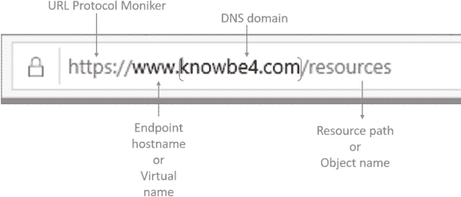

图 13-1 URL 及其组件示例。

### 协议标识符

URL 的开头可能包含一个 *标识符*，表示用于检索 URL 所指向对象的协议。大多数人习惯于看到 https（安全超文本传输协议）或 http（超文本传输协议），但它可以包含许多其他文本字符串，由相关工具或操作系统识别。典型的 Microsoft Windows 计算机有数十个预定义的协议标识符，包括 http、https、ftp、telnet、data、file、mailto、ssh、tel 和 tn3270。还可以定义其他自定义协议标识符。

当指示协议标识符时，它指示浏览器（或任何相关工具）使用特定协议和“周知”网络 TCP/UDP 端口号连接到对象。例如，http 使用端口 80，https 使用端口 443，ftp 使用端口 21，telnet 使用端口 23。根据协议标识符，Internet 浏览器可能能够使用该协议和端口工作，或者浏览器可能会启动与该特定协议关联的另一个应用程序。

以下是周知端口号列表：https://en.wikipedia.org/wiki/List_of_TCP_and_UDP_port_numbers.

如果在给定的 URL 中缺少协议标识符，浏览器或其他工具可能会自动添加 http 或 https 作为默认标识符。URL 协议标识符始终以冒号 (:) 结尾。冒号后面通常跟随两个或多个正斜杠 (//)。大多数 URL 会有两个正斜杠，但某些 URL 根据涉及的标识符和协议，拥有更多斜杠也是正常的。

可以指示支持 URL 的工具通过在 URL 末尾的冒号后放置端口号来使用不同于周知端口号的端口号。这是一个示例：https://www.example.com:10446。

此 URL 将指示工具通过非标准端口 10446 而不是 443（https 的默认周知端口）进行连接。端口号范围可以从 0 到 65,535，其中该范围内有十几个数字不允许使用，因为它们出于不同原因被保留。您会不时看到带有这些非默认端口的 URL，但它们并不十分常见。我看到非默认端口被使用的最常见位置是计算机管理工具。

在 URL 中，您通常只会在这两种情况下看到冒号：跟在 URL 标识符之后，以及在 URL 末尾以指示非默认端口。第一种是强制性的，而第二种是可选的且不常见。

### 主机名

在两个正斜杠和冒号之后，通常跟随的是 URL 中引用的对象所在位置的主机计算机名称。例如，如果您看到 www，这意味着托管网站的计算机的主机名是 www。主机名可以缺失（在这种情况下，相关工具在使用 URL 后可能会猜测它）。主机名可以是计算机逻辑上标记的“真实”主机名，也可以是 Web 服务器软件宣传和发布的虚拟主机名。例如，www 是许多 URL 中的主机名，但 URL 中引用的计算机的主机名通常并不真正是 www。www 通常只是由运行在主机上的 Web 服务器软件发布和宣传的“虚拟名称”。如果有主机名，它后面将跟随一个句点。

### DNS 域名

域名服务 (DNS) 域名跟在主机名和句点之后（如果有主机名和句点）。这是由域名服务 (DNS) 定义的 Internet 上的逻辑位置。DNS 域名将以句点和“顶级”域 (TLD) 名称结尾，例如 .com、.pub 或 .gov.，后面跟另一个句点。图 13-2 显示了两个 URL 示例，DNS 域名在括号之间高亮显示。DNS 域名可以简单地是一个“父”域名，例如 example.com，或包含“子”域，例如 child.example.com，它们位于其父域下。

TLD 名称由互联网号码分配机构 (IANA) 正式控制和批准。多年前，当 Internet 刚刚起步时，只有寥寥数十个 TLD。但今天有数百个 TLD（www.iana.org/domains/root/db）。其中有几十个是“国家代码”（例如，ch 代表中国，ru 代表俄罗斯，us 代表美国，等等）。使用国家代码的网站应经过验证，确认为物理上位于该国。许多 TLD 是“虚荣型”TLD，例如 biz 代表商业，aaa 代表美国汽车协会。DNS 域名（包括相关 TLD）在 Internet 上必须是唯一的。没有两个不同的无关服务器或对象可以拥有相同的域名。例如，knowbe4.com 在 Internet 的 DNS 基础设施中只能存在一次。

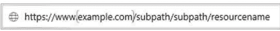


**图 13-2** DNS 域部分在括号之间高亮显示的两个 URL 示例。

某些 TLD 被认为比其他 TLD 更具风险。较新的 TLD 往往比较旧的 TLD（.com 除外）更容易受到黑客和网络钓鱼者的滥用。大多数知名品牌名称（例如，Microsoft、Google、Apple 等）位于 .com TLD 上。除 .com 之外，在其他 TLD 上看到知名品牌名称通常会引发合理的怀疑。

域名（和 TLD）后面将跟随一个单正斜杠。URL 中的第一个单正斜杠（从左到右阅读）将指示 DNS 域名的结束。这是一个需要记住的重要事实。

当 DNS 域名键入浏览器时，浏览器或客户端操作系统将使用 DNS 服务将域名解析为 IP 地址。最终，Internet 上的所有设备仅使用 IP 地址相互连接。

DNS 域名只是人类识别和重新输入 URL 的简便方式，而无需记住和输入 IP 地址。

### 资源名称或路径

域名后面的静态信息将指示对象名称、指向对象名称的路径，或两者兼而有之。这些信息也可能缺失，如果缺失，一些 Internet 工具可能会用默认资源名称和/或路径填充它。图 13-3 显示了一个带有资源路径（后跟资源名称）的 URL 示例。

### 资源路径名

- 在第一个单正斜杠之后开始
- 在最后一个斜杠处结束

```
https://www.example.com/subpath/subpath/resourcename
```

图 13-3 带有资源路径（后跟资源名称）的 URL 示例。

资源路径可以指向主机计算机上的实际文件和文件夹目录结构，或由相关 Web 服务器软件发布和宣传的虚拟化或逻辑结构。资源路径可以是单个静态路径，也可以在“父”路径下包含多个“子”路径。如果存在子路径和父路径，它们将由单个正斜杠或句点分隔。

资源名称（如果存在）将跟随资源路径并可能结束 URL。资源名称可以指向网页（例如，htm、html 等），也可以指向实际对象（例如，resourcename.doc、resourcename.xml、resourcename.xls、resourcename.gif 等）。图 13-4 显示了一个资源名称示例。


图 13-4 以资源名称结尾的 URL 示例。

这完成了“标准 URL”。它以 URL 别名开头，后跟冒号和两个正斜杠。如果使用主机名，则其后跟一个句点。接下来是 DNS 域名，它可以包含多个部分（子域和父域）。它将以第一个单个正斜杠结束。接下来可能会显示资源的路径。该路径可能包含或不包含由单个正斜杠分隔的多个部分（子路径和父路径），并可能以单个正斜杠结尾。URL 指向的资源名称将结束 URL 语句（如果存在）。

这是另一个 URL 示例：www.knowbe4.com/hubfs/Social-Engineering-Red-Flags.pdf。

在此示例中，https 是 URL 别名。www 是托管网站的服务器/服务的虚拟化主机名。knowbe4.com 是 DNS 域。hubfs 是对象所在的资源路径。Social-Engineering-Red-Flags.pdf 是有人单击或输入 URL 时要下载的对象。

## 变量

URL 可以包含变量，这些变量会从客户端传回给托管 Web 服务器。有关 URL 变量的简单示例格式，请参见图 13-5。变量始终紧跟在问号后面。

- 第一个 ? 之后的所有内容都是传回主机以供评估的变量
- 通常用于跟踪用户


图 13-5 URL 变量的示例格式。

问号后面的变量名/标签可以是几乎任何文本字符串，但无论是什么，它都是变量的名称。随后会是一个等号（=），后跟变量的值。变量可以是几乎任何内容，网站会出于各种目的使用它们。最常见的原因之一是指示用户单击的 URL 所在的位置。组织喜欢跟踪用户是如何遇到某个特定 URL 的（即，是什么媒体来源），以用于营销目的。请考虑 KnowBe4 发送给我的以下 URL：

```
https://info.knowbe4.com/12-way-to-hack-two-factor-authentication?hsCtaTracking=512ec4b3
```

变量 hsCtaTracking 的值为 512ec4b3。这对 Web 服务器及其营销跟踪软件具有特定含义。hsCtaTracking 变量是在特定营销软件中创建和跟踪的。对于同一营销活动发送给任何人的每封电子邮件，它可能都是相同的。值 512ec4b3 很可能是唯一的（对我来说），并且可能会追溯到与我的特定电子邮件地址相关联的非常特定的某份营销材料和/或电子邮件。当我单击该 URL 并将该变量一起发送回服务器时，它可能会告诉附加到 Web 服务器的营销软件哪个受访者（即我，可能通过电子邮件地址跟踪）单击了该特定 URL 链接，并且他们可能知道该 URL 链接是如何到达我的（即，哪些营销活动）。

但变量可以用于 Web 服务器管理员希望的任何用途。有些变量用于帮助识别和跟踪用户在网站上移动时的行为。有些变量用于指示用户在网站上移动时所做的不同选择。变量几乎可以用于任何用途，仅受想象力限制。

可以在同一个 URL 中定义多个变量，如果存在多个变量，它们将由 & 分隔。图 13-6 显示了一个多变量 URL 的示例。


图 13-6 包含由 & 分隔的多个变量的 URL 示例。

变量可以包含多种不同类型的信息。一旦您了解 URL 变量，就可以开始更多地关注它们、分析它们并弄清楚它们的含义。大多数情况下，它们用于营销目的，但也可以出于许多不同的原因使用它们。您甚至可以更改并手动操作 URL 中的变量，以查看是否会影响 Web 服务器的响应。大多数情况下不会。有时会。许多专业渗透测试人员经常操作变量，以查看是否可以绕过身份验证或查看未经授权的数据。通常操作变量不会产生任何效果，但偶尔您可以发现 Web 服务器的弱点或漏洞。

## URL 中最重要的信息

在上述所有内容中，判断 URL 是合法还是恶意的最重要信息是 DNS 域（参见图 13-7）。URL 是否指向与所传达的相应消息相关的合法域？


图 13-7 带有括号内突出显示的 DNS 域的 URL 示例。

DNS 域是输入或单击 URL 将带您去的位置。如果它指向合法域，那么您很可能（大多数情况下）可以信任该 URL。如果它指向一个您无法立即识别的域名，则必须保持谨慎。例如，如果您收到一封可能是钓鱼邮件但您不确定的电子邮件，请检查包含 URL 中的 DNS 域名。如果它显示 microsoft.com、facebook.com、instagram.com、paypal.com、knowbe4.com 或其他合法的 DNS 域，而该域是电子邮件声称来自的品牌的正常合法域名，那么您很可能可以信任该电子邮件。如果 DNS 域看起来奇怪或不寻常（例如，microwsoft.com、facebook.biz、know.be.4.com 等），那么该电子邮件很可能是恶意的。

任何计算机用户可以拥有的最佳技能之一，就是判断指示的 DNS 域名是否合法。这并不总是容易的，尤其是考虑到所有父域和子域以及 URL 的不同部分。请参见图 13-8。


图 13-8 看起来相似但完全不同的域示例。

假设我告诉您 example.com 是唯一合法的域。在查看图 13-8 中的三个不同 URL 时，您能看出哪个 URL 包含合法域 example.com 吗？这可能会令人困惑。

合法域 example.com 位于第二个（中间）示例中。请记住，DNS 域始终以第一个单个正斜杠结束。第二个示例中第一个单个正斜杠后面的 `domain.com` 只是一个虚构的资源路径或名称。在第一个示例中，`example.com` 是父域 `domain.com` 下的子域。`domain.com` 是该示例中的 DNS 域。在最后一个（底部）示例中，显示的 DNS 域是 `example.com.domain`，这甚至不是一个有效的结束 TLD 域（尽管 `.domains` 是）。

图 13-9 给出了另一个现实世界的 URL 示例：


图 13-9 现实世界的 URL 示例。

图 13-9 中 URL 的 DNS 域是什么？它是 `bankofamerica.com`，这是 Bank of America 的合法域。secure 标签既可能是托管 Bank of America 网站的计算机的主机名，也可能是一个子域。您并不总能分辨出是哪一个。但我可以确定 DNS 域是 `bankofamerica.com`，而该域是 Bank of America 的合法域，因此可以信任此 URL 链接。

您可以学习的最佳技能之一是如何区分合法 URL 和恶意 URL。做到这一点的最佳方法是：在单击或输入任何 URL 之前先检查它，识别它所代表的有效 DNS 域，然后问自己，“这就是所声称品牌的有效域吗？”如果您能相当准确地做到这一点，您就会成为检测恶意钓鱼攻击的绝地大师。

## 恶意 URL 手段

当然，钓鱼者会竭尽全力试图欺骗您。下一节将介绍各种


社会工程攻击会操纵 URL，试图诱骗用户。通过理解和识别这些手段，你可以成为那些永远不会被愚弄的防御者之一。

## 仿冒域名

钓鱼 URL 最常见的手段之一是网络钓鱼者创建看似真实但并非真实的域名，并且包含合法品牌的名称或 URL。接下来的图片给出了多个欺诈性仿冒域名示例。图 13-10 中的示例展示了一个常见手段。


图 13-10 假冒美国银行的钓鱼 URL 的真实示例。

图 13-10 中的 URL 被创建得看起来像美国银行（即 bankofamerica.com）的合法 URL，但 bankofamerica 只是 DNS 域 doc.com 下的子域。美国银行不拥有或管理 doc.com。网络钓鱼者能够创建看起来像 bankofamerica.com 的子域，但实际上它并不是 bankofamerica.com。


图 13-11 假冒 PayPal 的真实钓鱼 URL。

在图 13-11 中，网络钓鱼者希望潜在受害者看到 URL 中的 paypal.com 部分，并认为它是 PayPal 的合法 URL paypal.com。但实际上，paypal.com 仅仅是 .bank 顶级域下的一个（恶意）子域。处理 .bank 顶级域的域名注册商被骗，在其 .bank 顶级域下签发了 paypal.com 域名，直到利用该域名的钓鱼攻击被举报，恶意域名才被下线。

图 13-12 展示了一个恶意域名的真实示例，该域名试图看起来像微软的合法域名 microsoft.com。但实际上，microsoft.co（甚至不是 .com）是父域 login-update-dec20.info 下的子域。


图 13-12 一个恶意微软仿冒域名示例。

PayPal 的合法 URL 是 paypal.com。图 13-13 中的钓鱼示例显示了一个恶意 URL security-paypal-centers.com。它包含单词 paypal，这足以让许多潜在受害者认为它确实来自 PayPal。但 security-paypal-centers.com 并不是 paypal.com。


图 13-13 声称属于 PayPal 的钓鱼 URL 的真实示例。

图 13-14 展示了一个假装与 Google 有关联的真实钓鱼 URL。我收到一封声称来自 Google 的钓鱼邮件。它包含一个文件附件和消息，称我必须为 Google Chrome 执行一个“紧急补丁”。我知道 Google Chrome 已经在我的电脑上运行自己的自动更新服务，我从未需要运行单独的文件来更新 Google Chrome。这封钓鱼邮件还包含一个恶意 URL，其 DNS 域为 googlechromeupdates.com。我有兴趣了解 Google 是否实际上拥有该域。因此，我对该域进行了 Whois 查询，并发现，不出所料，Google 并不拥有该域。

ww17.googlechromeupdates.com/

图 13-14 假冒 Google 的钓鱼 URL 示例。

图 13-15 展示了一个假装与 PayPal 有关的钓鱼网站的真实示例。该钓鱼 URL 的 DNS 域是 x-paypal.com，而不是 paypal.com。


图 13-15 假冒 PayPal 的钓鱼网站示例。

图 13-16 展示了在社交媒体网站上显示的钓鱼消息的真实示例。它创建了一个引人入胜的叙述，自然让人们想要提供帮助并查看相关视频。黑客让视频链接看起来像是位于 CNN 上，但 URL 的 DNS 域实际上是 wixsite.com，这是一个任何人都可以创建新（免费）网站的网站。网络钓鱼者所做的就是在 wixsite.com 下创建一个名为 cnnnewsalert133 的新子域（或主机名）。许多潜在受害者会看到 URL 中的“cnnnewsalert”部分，并认为它指向真实的 cnn.com 网站。

在图 13-17 中，一个钓鱼 URL 假装来自微软。但 DNS 域是 deveopsnw.com（且未向微软注册）。microsoftonline.com 是用来愚弄那些不了解 DNS 域与资源路径或对象名称之间区别的用户的。DNS 域始终位于第一个正斜杠之前。

> 请！这是一个公开恳求，因为我们需要帮助：
> 已上传一段视频，显示昨天在我们当地一家加油站撞倒我一位亲戚的嫌疑人，视频中嫌疑人与店内一群人发生争执，在他们被看到离开商店后试图撞倒他们。我的表亲错了时间、错了地点，在嫌疑人被看到用卡车冲向人群时当场丧生。该人被看到驾驶一辆无牌车辆逃逸，已悬赏 35,000 美元以识别此人。如果你认识此人，请立即联系当地警方！视频时长 1:31 分钟 - https://cnnnewsalert133.wixsite.com/alert/?aa19

图 13-16 假装与 CNN 视频相关联的钓鱼消息的真实示例。


图 13-17 假冒微软的真实钓鱼 URL 示例。

所有这些示例的共同点是，URL 中包含关键品牌词汇，但这些词汇并非相关品牌使用的官方 DNS 域。用户必须始终警惕仿冒 DNS 域。

## 奇怪的源域

预计主要品牌（例如 Microsoft、Google、AT&T、McDonald's 等）在发送电子邮件和营销内容时会使用自己的合法域名。主要品牌通常不会使用第三方域名来发送营销电子邮件。图 13-18 展示了与一家主要公司相关的奇怪域名示例。


图 13-18 真实钓鱼电子邮件地址示例。

在图 13-18 中，该邮件假装来自世界最大的航运和集装箱公司马士基。但该邮件的发件地址来自 DNS 域 onlinealxes.com.pl。如果这封邮件真的是来自马士基，它应该来自 maersk.com。

主要品牌有可能发送看起来来自其他域名的营销内容，但大多数主要品牌都会特意包含其合法的 DNS 域，以便接收者更信任它，而不认为这是钓鱼电子邮件。

## 悬停、诱饵与切换

对所有人来说，在点击 URL 链接之前将光标“悬停”在其上以进行检查，这是一个稳妥、坚定的建议。如果显示的内容与点击 URL 后到达的位置不同，你应该对该链接保持警惕。大多数时候，当你悬停在链接上然后点击时，你会到达悬停时显示的同一个 URL。但这并不能保证。有几种编程“技巧”允许你悬停时看到的 URL 与点击后到达的位置不同。

一种方法是程序员使用 <onclick> HTML 指令。Onclick 告诉浏览器如果用户使用鼠标指针点击链接，应该将用户带到哪里。以下是普通 URL 链接代码的样子：

```
<a href="https://www.google.com">Link to Google</a>
```

如果你悬停在显示“Link to Google”的该 URL 上，悬停将显示 www.google.com 作为底层 URL。如果你点击该 URL，你将被带到 www.google.com。这就是悬停应有的工作方式。

但如果使用了 Onclick 指令，你可能会被带到悬停所显示位置以外的其他地方。以下是一个 Onclick 重定向链接：

```
<a onclick="this.href='https://knowbe4.com/';" href="https://www.google.com">Link to Google</a>
```

在这个代码示例中，页面上将显示“Link to Google”，悬停会显示 www.google.com，但点击链接将带你前往 https://knowbe4.com。

一般来说，与悬停揭示的位置不同、将你带到其他地方的 URL 应比那些带你到悬停揭示位置的 URL 更受怀疑。此网页更详细地介绍了此问题：www.michaelhorowitz.com/HoverOverLink.php。

## 缩短的 URL

任何 URL 都可以转换为“缩短的 URL”。互联网上有几十种服务（例如 goo.gl、t.co、bit.ly 等），允许任何人提交任何 URL，然后会创建一个指向缩短服务的新渲染 URL。最初，缩短服务的出现是因为 Twitter（现为 X）最初只允许 Twitter 帖子中有 140 个字符（包括任何发布的 URL），而 URL 本身可能包含超过 140 个字符，或者占用帖子的大部分。缩短服务的发明是为了将长 URL 减少到 5 到 15 个字符长的 URL，从而在 Twitter 帖子中节省更多书写空间。


缩短的URL可以是随机生成的字符串（几乎总是更短），或者一些缩短服务允许请求者创建包含所需单词和字母的自定义URL。网络钓鱼者经常使用这两种缩短URL，但后一种方法允许黑客在全新的自定义、仿冒URL中包含品牌名称。

当用户点击缩短的URL时，它会将用户的浏览器带到缩短服务，然后重定向到与其相关的更长的URL。例如，缩短的URL https://tinyurl.com/5n92dk34会将您带到www.knowbe4.com/qr-code-phishing-security-test。

基于SMS的网络钓鱼通常包含缩短的URL（参见图13-19）。

在图13-19中，网络钓鱼者使用了bit.ly缩短服务，并请求了包含“Venmo”的自定义URL。如果您不了解从缩短服务获取自定义URL有多么容易，您可能会被欺骗，认为这个URL是合法的Venmo URL。

短URL会使URL检查变得复杂，因为缩短的URL不会提供任何上下文来确定它将您带到的目标URL是否合法。您能做的最好的事情是访问相关的URL缩短服务，输入缩短的URL，并让服务告诉您它转换成的更长的URL（在实际被带到更长的目标URL之前）。大多数人，如果不想先使用URL缩短服务进行中间检查，就只能选择不点击缩短的URL，或者点击它，然后检查他们最终到达的作为最终目的地的URL。

您还可以将缩短的URL提交给“展开”服务，例如www.expandurl.net/expand，在那里您输入缩短的URL，服务会揭示相关的更长的URL是什么，而无需将您带到那里。


图13-19 伪装成来自Venmo的短信钓鱼的实际示例。

## URL 编码

大多数URL包含字母、数字和字符，这些字符代表当前支持和使用的任何语言。但是，URL可以以多种不同的方式进行“编码”，网络钓鱼者经常使用这些编码方法使网络钓鱼消息更难以调查。

## IP 地址编码

最简单的编码方法是网络钓鱼者直接使用网站的IP地址而不是URL。例如，每当您输入或点击www.google.com时，它会被DNS转换为http://172.217.2.196。网络钓鱼者可以直接使用IP地址版本，即http://172.217.2.196。当用户点击它时，他们会被带到与该IP地址相关的Web服务器。

IP地址可以用于一种网络钓鱼技巧，即使用IP地址。让我们以https://192.168.1.100为例，后跟包含品牌名称的资源路径语句：https://192.168.1.100/microsoft.com/logon。查看该URL的许多人可能会认为它指向microsoft.com，但实际上不是。

## URL 百分号编码

英文字母、数字、字符和控制字符可以通过编码其美国信息交换标准代码（ASCII）十六进制表示来表示。图13-20显示了ASCII字符及其十六进制表示的部分打印输出。

ASCII字符可以通过在ASCII十六进制代码后放置%来在URL中使用。例如，小写w可以使用77%表示。您可以看到77是小写w的十六进制代码。整个URL（协议标识符、斜杠和句点除外）都可以这样表示。例如，https://%77%77%77.%6B%6E%6F%77%62%65%64.%63%6F%6D会被翻译为www.knowbe4.com。

网络钓鱼者可以使用百分号编码对整个URL进行编码，或者混合使用普通字母和百分号编码，以获得看起来最好的URL。例如，他们可能会做诸如https://%77%77%77.%62%61%62%75%72%6c.%63%6F%6D/amazon.com之类的事情，它会被翻译为https://badurl.com/amazon.com。潜在受害者可能会看到文本“amazon.com”并认为该URL确实指向真正的amazon.com。

| 十六进制 | 字符 | 十六进制 | 字符 | 十六进制 | 字符 |
|---|---|---|---|---|---|
| 20 | 空格 | 40 | @ | 60 | ` |
| 21 | ! | 41 | A | 61 | a |
| 22 | " | 42 | B | 62 | b |
| 23 | # | 43 | C | 63 | c |
| 24 | $ | 44 | D | 64 | d |
| 25 | % | 45 | E | 65 | e |
| 26 | & | 46 | F | 66 | f |
| 27 | ' | 47 | G | 67 | g |
| 28 | ( | 48 | H | 68 | h |
| 29 | ) | 49 | I | 69 | i |
| 2a | * | 4a | J | 6a | j |
| 2b | + | 4b | K | 6b | k |
| 2c | , | 4c | L | 6c | l |
| 2d | - | 4d | M | 6d | m |
| 2e | . | 4e | N | 6e | n |
| 2f | / | 4f | O | 6f | o |
| 30 | 0 | 50 | P | 70 | p |
| 31 | 1 | 51 | Q | 71 | q |
| 32 | 2 | 52 | R | 72 | r |
| 33 | 3 | 53 | S | 73 | s |
| 34 | 4 | 54 | T | 74 | t |
| 35 | 5 | 55 | U | 75 | u |
| 36 | 6 | 56 | V | 76 | v |
| 37 | 7 | 57 | W | 77 | w |
| 38 | 8 | 58 | X | 78 | x |
| 39 | 9 | 59 | Y | 79 | y |
| 3a | : | 5a | Z | 7a | z |
| 3b | ; | 5b | [ | 7b | { |
| 3c | < | 5c | \\ | 7c | \| |
| 3d | = | 5d | ] | 7d | } |
| 3e | > | 5e | ^ | 7e | ~ |
| 3f | ? | 5f | _ | 7f | DEL |

图13-20 ASCII图表的部分展示。

## Base64 编码

Base64是另一种编码系统，它允许将英文字符和二进制数据编码为Base64字符。与ASCII一样，您可以通过在Internet上搜索“base64 encoding chart”来找到Base64编码图表。图13-21显示了Base64转换表的部分表示。在互联网早期，当一切都是基于文本（而不是图形）时，Base64编码是发送二进制数据和文件的唯一方式。好吧，URL可以进行Base64编码。

| 值 编码 | 值 编码 | 值 编码 | 值 编码 |
|---|---|---|---|
| 0 A | 17 R | 34 i | 51 z |
| 1 B | 18 S | 35 j | 52 0 |
| 2 C | 19 T | 36 k | 53 1 |
| 3 D | 20 U | 37 l | 54 2 |
| 4 E | 21 V | 38 m | 55 3 |
| 5 F | 22 W | 39 n | 56 4 |
| 6 G | 23 X | 40 o | 57 5 |
| 7 H | 24 Y | 41 p | 58 6 |
| 8 I | 25 Z | 42 q | 59 7 |
| 9 J | 26 a | 43 r | 60 8 |
| 10 K | 27 b | 44 s | 61 9 |
| 11 L | 28 c | 45 t | 62 - (连字符) |
| 12 M | 29 d | 46 u | 63 _ (下划线) |
| 13 N | 30 e | 47 v | (填充) = |
| 14 O | 31 f | 48 w | |
| 15 P | 32 g | 49 x | |
| 16 Q | 33 h | 50 y | |

图13-21 部分Base64编码图表。

例如，www.knowbe4.com可以被Base64编码为d3d3Lmtub3ViZDI3aFRQuY29t。

与URL百分号编码不同，Base64编码不能直接在URL中使用。大多数互联网浏览器不会像处理ASCII百分号编码那样自动解码Base64编码。但是，黑客和网络钓鱼者会使用Base64编码将恶意软件偷偷带入网络钓鱼消息和用户桌面。用户看到的他们认为是一堆无害的文本和字符。对他们来说，看起来像乱码。但是，黑客可以使用JavaScript或其他编程语言将Base64字符解码回其原始状态，这可能更具恶意。恶意软件程序员几十年来一直使用Base64编码将其恶意软件作品偷偷带过杀毒软件防御和用户的调查眼睛。

## QR 码

快速响应（QR）码本质上是一个方形、条形码类似的图像，其中图形图形用于表示字母、数字和符号。如今，QR码通常被编码为代表URL。图13-22中的QR码最终转换为长URL www.knowbe4.com/qr-code-phishing-security-test。


图13-22 QR码示例，在bit.ly上创建，代表指向www.knowbe4.com的URL。

QR网络钓鱼如今非常流行。网络钓鱼者会发送带有QR码而不是URL的电子邮件，因为QR码更容易逃过大多数内容过滤器，而且用户通常似乎更愿意访问启用QR码的URL。如今，恶意QR码伪装成微软等流行品牌发送的情况非常普遍。

在设备的浏览器前往该网址之前，检查QR编码的URL可能很困难，甚至不可能。因此，您有两种选择。第一，不要关注*任何*不受信任的QR码。第二，如果您确实关注了QR码，请注意QR码带您去的目标URL。

应向用户宣传恶意QR码以及如何调查（即，查看生成的URL）和处理它们。组织应该执行模拟QR码测试，就像他们对模拟电子邮件网络钓鱼测试所做的那样。

> KnowBe4有一个免费工具，允许管理员测试其用户对流氓QR码的处理：www.knowbe4.com/qr-code-phishing-security-test。


## 恶意开放重定向

恶意开放重定向可能是所有社交工程黑客 URL 技巧中最棘手的。每个反网络钓鱼防御者一致的长期建议是让用户将鼠标悬停在 URL 上，如果 URL 指向合法位置（即 DNS 域名），则单击它。恶意开放重定向利用这一建议，寻找并使用那些意外允许未经授权的第三方向合法 URL 添加更多信息的合法网站，这些信息会将任何点击看似合法 URL 的用户带到另一个未经授权的网站。

要使此攻击生效，涉及的合法网站必须存在一个代码漏洞，允许其他未经授权的攻击者将攻击者的目标 URL 追加到原始合法 URL 上。以下是开放重定向的代表性格式：

```
https://legitURL.com/path/path?redirect variable=http://newURL.com
```

你拥有合法 URL（在该示例中由 legitURL.com 表示），后跟一个变量，该变量指示合法 Web 服务器切换（即重定向）到 redirectvariable 变量值所指示的新网站或页面。在现实生活中，重定向变量可以标记为合法 Web 服务器程序员定义的任何内容。它不叫做 redirectvariable。（这只是为了示例目的。）

重定向变量的意图是允许合法网站将用户切换到其他合法网站或页面。它通常用于营销活动，将用户暂时推送到供应商的主合法网站，然后再推送到新营销活动中涉及的另一个合法网站。

问题是，合法网站程序员有时没有意识到重定向变量可以被任何人（即攻击者）重写，以将用户发送到任何其他网站，而不仅仅是原始合法网站的预定网站。合法网站只应允许托管供应商想要使用的有效重定向，但他们常常忘记对任何人使用重定向变量提交的内容施加任何限制。相反，任何人都可以提交任何重定向变量值并使重定向生效。这就是开放重定向漏洞中“开放”部分的含义。当存在开放重定向时，网络钓鱼者会创建看似有效的网络钓鱼电子邮件，其中包含相关的有效 DNS 域以及重定向变量，该变量最终将受害者发送到一个看似真实的网络钓鱼网站。

例如，在多年前发生的这次恶意开放重定向攻击中，合法供应商 Adobe 有一个开放重定向变量，允许追加到涉及合法 adobe.com 的任何 URL 上。在此特定情况下，允许开放重定向的变量是“p1.” 以下是该 Adobe 开放重定向的示例（现已早已修复）：

```
http://t-info.mail.adobe.com/r/?id=hc43f43t4a,afd67070,affc7349&p1=t.mid.acor-mail.com/r/?id=159593f159593159593,hde43e13b13,ecdfafef,ee5cfa06&p1=www.maliciousdomain.com.
```

与变量 p1 关联的任何 URL 都会导致访问用户的浏览器自动重定向到该网站，在此示例中为伪造的 www.maliciousdomain.com。任何悬停在原始链接上的用户都会看到 adobe.com 作为合法域，没错，用户最初确实会被带到那里。但随后由于代码漏洞，任何攻击者都可以使用包含上述链接的网络钓鱼电子邮件或已被攻破的网站，并利用 p1 变量，这随后可能将用户发送到另一个未经授权的目标。以下是关于此示例重定向的更多讨论链接：www.reddit.com/r/sysadmin/comments/d9dnnf/heres_a_phishing_url_to_give_you_nightmares.

图 13-23 显示了另一个使用恶意开放重定向的现实世界网络钓鱼攻击。


### 图 13-23 与 UPS 关联的恶意开放重定向攻击示例。

在图 13-23 所示的开放重定向攻击中，一封伪装成来自 UPS 的网络钓鱼电子邮件被发送给毫无防备的受害者。如您在示例中所见，DNS 域 URL 指向 ups.com。恶意重定向之所以发生，是因为 UPS Web 服务器允许“onerror”指令将用户发送到另一个网站/页面。网络钓鱼者创建了一个指向 ups.com 但包含错误的 URL，这导致合法的 UPS 网站将用户发送到“onerror”指令中所指向的网站。“onerror”指令中所指向的网站看起来与 UPS 真实网站完全一样，至少在登录和账单信息方面是这样。非常棘手。

恶意开放重定向时有发生。以下是一些关于开放重定向攻击的新闻报道示例：

- www.fortinet.com/blog/threat-research/linkedin-and-baidu-redirecting-to-fat-loss-and-brain-improvement-scam
- www.inky.com/en/blog/phishers-bounce-lures-off-unprotected-snapchat-amex-sites
- https://urlscan.io/result/4b08c28c-b313-4d79-a6b0-f3ab301136dc
- https://krebsonsecurity.com/2022/02/how-phishers-are-slinking-their-links-into-linkedin
- www.bleepingcomputer.com/news/security/evilproxy-uses-indeedcom-open-redirect-for-microsoft-365-phishing

## 同形字和 Punycode 攻击

如前所述，URL 可以包含字母、数字和符号。URL 可以包含的字符仅限于称为 *Unicode 转换格式 8 位*（或 *UTF-8*）字符集的内容。您也会听到 UTF-8 被称为 *Punycode*，尽管它们是略有不同的字符集。UTF-8 是名为 *Unicode* 的更大字符集的子集。Unicode 是包含数百万个字符的集合，构成了每种已知语言，包括古代语言和象形文字。您不能在 URL 中使用每一种可能的 Unicode 字符，但可以使用 UTF-8 下定义的任何字符，即超过一百万个不同的字符。Unicode 涵盖了当今大多数现代语言以及它们使用的大多数字符和符号。

问题在于，属于不同语言的完全不同的字符通常看起来相互相同。例如，Unicode 拉丁文“a”（U+0061 十六进制）和西里尔文“a”（U+0430 十六进制）在浏览器 URL 中可能看起来相同，但它们是代表不同语言的不同字符。有几十个看起来相同的 Unicode 字符。不幸的是，这使得网络钓鱼者能够创建看起来与其他域名完全相同的新域名，但它们实际上是不同的 URL。当网络钓鱼者使用看起来相同的 Unicode 字符创建看起来相同的 DNS 域名时，这被称为 Punycode 或 *同形字攻击*。

### 传统同形字攻击

同形字攻击首次被理论化并公开发表是在 2017 年（www.xudongz.com/blog/2017/idn-phishing）。在此首次测试示例中，apple.com 中的“a”使用西里尔文“a”（U+0430 十六进制）而不是正常的拉丁文“a”（U+0061 十六进制）表示。因此，即使 apple.com 看起来像 apple.com，如果点击它，它也会将用户带到另一个地方。如果测试攻击是真实攻击，网络钓鱼者本可以创建一个伪造的、看似真实的 Apple 网站。

如今，同形字攻击不常见，但在现实世界中确实会出现。以下是一些近期的同形字攻击示例：

- https://arstechnica.com/security/2023/10/google-hosted-malvertising-leads-to-fake-keepass-site-that-looks-genuine
- https://blogs.microsoft.com/on-the-issues/2021/07/19/cybercrime-homoglyphs-dcu-court-order
- https://krebsonsecurity.com/2022/11/disneyland-malware-team-its-a-puny-world-after-all
- https://techcommunity.microsoft.com/t5/microsoft-365-defender-blog/xdr-attack-disruption-in-action-defending-against-a-recent-bec/ba-p/3749822

### 从右到左覆盖技巧

一种特别棘手的 Punycode 攻击涉及使用 Unicode 控制字符。所有字符集（例如 ASCII、UTF-8、Unicode 等）都包含控制字符，这些字符不代表可见或可打印字符，而是执行一个操作。例如，某些控制字符会指示“换行”，它告诉屏幕或打印机放置

或将下一个字符打印到新行。或者控制字符可能表示“文件结束”，它告诉计算机正在处理的任何字符都是当前文件的结束，任何后续字符属于另一个文件。当存在时，控制字符通常不可见。它们通常不可查看且不可打印。查看器通常看不到控制字符，或者可能会看到轻微的间距问题或空白。

在这个特定的网络钓鱼示例中，涉及的 Unicode 控制字符是从右到左覆盖（RLO）。大多数语言从左到右阅读，但有些语言（如阿拉伯语和希伯来语）从右到左阅读。当检测到 RLO 控制字符时，其后的任何字符都将以与当前外观相反的方向放置。

网络钓鱼者利用 RLO 谋取自身利益。例如，他们创建一封声称与未接电话相关的网络钓鱼电子邮件，附件名为 voicemessage exe.mp3。但大多数查看者没有意识到，voicemessage 和 exe 之间的空格实际上是 RLO 控制字符。潜在受害者可能会点击该附件，以为它是一个无害的 mp3 音频文件，但一旦他们点击该附件并“激活” RLO 控制字符，附件就会被重命名为 voicemessage3pm.exe。该附件不是无害的 MP3 文件。它是一个非常危险且恶意的 .EXE 文件。图 13-24 展示了一个部署了类似 RLO 技巧的真实世界网络钓鱼示例。您可以在此处阅读更多相关内容：www.vadesecure.com/en/blog/how-hackers-are-using-a-20-year-old-text-trick-to-phish-microsoft-365-users。

希望您在阅读本章之前对合法 URL 和黑客 URL 技巧有了更深入的理解。至少有半打，如果不是几十种其他方法，可以诱使用户以为自己在点击某个东西，但实际上却将他们带到另一个地方。唯一的（快速简便）防御是用户尽可能仔细检查 URL，并了解点击 URL 后最终到达的位置。如果它显示 ups.com，但您最终到达了完全不同的地方，那么请保持警惕。


图 13-24 使用 RLO 技巧的真实世界网络钓鱼示例。

## 摘要

第 13 章介绍了如何将 URL 解析为其各个部分。它讨论了用户最重要的技能是确定 URL 的哪一部分是 DNS 域，然后决定涉及的域名是合法的还是恶意的。第 13 章随后展示了网络钓鱼者用来模糊 URL 并诱使用户点击恶意 URL 的许多常见技巧。

第 14 章，“防范定向网络钓鱼”，将讨论如何防范定向网络钓鱼。

# 第 14 章

## 防范定向网络钓鱼

定向网络钓鱼是顶级网络安全威胁之一，甚至可以说是*顶级*网络安全威胁。第 14 章将介绍不同类型的定向网络钓鱼，并讨论如何具体防御。

### 背景

社会工程学涉及 70% 到 90% 的成功攻击。它是黑客和恶意软件成功攻击设备和网络的头号方式。没有其他初始网络攻击根本原因能与之相比（利用未打补丁的软件和固件位居遥远的第二位，涉及大约 20% 到 40% 的攻击）。

一种特定的社会工程学比任何其他类型的攻击都导致更多的成功攻击：定向网络钓鱼。如前面在第 2 章“网络钓鱼术语和示例”中介绍，*定向网络钓鱼*被定义为有针对性的、目标明确的网络钓鱼，试图利用特定个人、职位、团队、组织或群体，通常会利用与目标相关的先前获取的信息。定向网络钓鱼者通常会使用他们在公开可用网站、社交媒体或私人网站上找到的信息，或使用他们之前通过其他漏洞利用获得的机密信息。普通网络钓鱼很少拥有或使用针对目标受害者的机密信息，而定向网络钓鱼则通常会有。

2023 年 5 月，Barracuda Networks 发布了一份报告（https://assets.barracuda.com/assets/docs/dms/2023-spear-phishing-trends.pdf），揭示了大量关于定向网络钓鱼严重性的相关统计数据。研究发现，超过一半的组织每年都会遭受定向网络钓鱼。平均每个组织每天收到五次定向网络钓鱼尝试，平均“点击率”为 11%。但最惊人的事实超过了所有其他事实：尽管定向网络钓鱼攻击仅占所有基于电子邮件的攻击的不到 0.1%，但它们却导致了 66% 的所有成功入侵。

请花点时间消化一下。

这意味着大多数成功的网络攻击都是定向网络钓鱼攻击——而不是说最成功的电子邮件攻击是定向网络钓鱼攻击（这也是事实）。但与其他一切相比，定向网络钓鱼攻击是最成功的网络攻击！

社会工程学和网络钓鱼涉及所有成功网络攻击的 70% 到 90%，其中大部分与电子邮件相关，而定向网络钓鱼占其中的 66%。数学计算成立！社会工程学涉及所有成功网络攻击的 70%–90%，而这些攻击中有 66% 是定向网络钓鱼。70%–90% × 66% 等于所有网络攻击的 46%–59%。基本上，一种攻击方法——定向网络钓鱼——导致了近一半到超过一半的所有成功网络攻击。这一事实应该影响每个人进行网络安全防御和安全意识培训的方式。

### 定向网络钓鱼示例

定向网络钓鱼可以用数千种不同的方式实施，从基本攻击到更高级、更长期的攻击不等。以下是一些常见的定向网络钓鱼攻击示例。

### 已泄露的可信电子邮件账户

许多网络钓鱼者会查看已泄露受害者的电子邮件收件箱或“已发送项目”文件夹，寻找有用的电子邮件对话（称为线程），这些线程可以用来诱骗相关外部收件人阅读新的欺诈性电子邮件。因为电子邮件来自之前受信任的合作伙伴，使用合作伙伴的真实电子邮件地址，使用之前使用过的合法电子邮件主题，所以更容易让受信任的收件人打开电子邮件并采取新行动。例如，“嘿 Bob，查看这个报告。它似乎完全支持我们之前说会在 Apple 新闻中发生的事情。”或者 BEC 诈骗，向付款人发送合法发票，但要求在付款时将款项汇入新银行账户。对于新的潜在受害者来说，很难发现自己正在遭受新的社会工程学诈骗。

根据本章前面引用的 Barracuda 报告，24% 的组织报告称其组织中的电子邮件账户每年会被接管（即账户接管或 ATO）。黑客从被劫持的账户发送平均 370 封恶意电子邮件。使用被泄露的电子邮件账户攻击信任的收件人很流行，而且通常有效。

### 基于内部机密信息的定向网络钓鱼

一种流行的传统定向网络钓鱼诈骗发生在攻击者了解到组织内部某些新的机密信息或项目，然后利用该信息制作新的网络钓鱼电子邮件，利用所谓的机密信息来赢得新潜在受害者的信任。或者，定向网络钓鱼攻击者了解到一些内部姓名和/或关系，制作带有说辞的定向网络钓鱼电子邮件，向受害者传达他们已经合法获得内部知识或关系。例如，定向网络钓鱼电子邮件可能会写类似这样的话：“我刚才和 IT 安全部门的 Brian 说话，他说我必须找你来开设我的 Salesforce 账户。”或者“人力资源部的 Sheila 说你是我必须去找的人，以便获取那份早已过期的员工社会安全号码列表，我们需要在切换后发送给 Kronos 进行处理。”

我曾与一家公司交谈过，该公司曾遭遇一起定向网络钓鱼诈骗，损失了 200 万美元。一起 BEC 诈骗通过内部电子邮件发送给了一名应付账款团队成员。这位特定的应付账款职员很少收到外部电子邮件。但是，定向网络钓鱼者确切知道应该向谁发送网络钓鱼电子邮件。这对其他任何员工都不会奏效。该公司对攻击者如何确切了解到公司内部谁通常会处理他们发送的那种交易感到困惑。经过数周的调查，他们最终追踪到，这位内部应付账款职员的电子邮件地址列在最近的公开 8-K 文件中。8-K 文件是美国上市公司必须向美国证券交易委员会（SEC）提交的报告，用于宣布可能对股东或市场至关重要的重大事件。BEC 诈骗发生在 8-K 文件公开发布后的一天。黑客和网络钓鱼者经常潜伏在公共数据存储库中，寻找有用信息。


在另一种情况下，网络钓鱼诈骗涉及网络钓鱼者冒充受害公司聘请的咨询公司团队成员，该公司被聘来安装一些新软件。新软件庞大而复杂。预计新客户在大量咨询协助下，需要约九个月来配置和安装该软件。结果发现，该咨询公司在其主网站上公开宣布了该新项目，作为营销推荐证明。一名黑客在咨询公司的网站上看到该声明，然后使用营销文案中提到的首席顾问的名字创建了一个新的 Gmail 地址。黑客随后向受害公司发送电子邮件，假装是咨询公司，并要求创建新的登录账户。受害公司忽略了明显的网络钓鱼迹象——即电子邮件来自 Gmail 地址，而非供应商的正常电子邮件域——便设置了新的登录账户，并通知黑客他们已获准访问。

## 虚假工作机会

对失业和在职人员来说，提供虚假工作的情况越来越普遍，其目的要么是获利，要么是企业间谍活动。难点在于，许多时候这些虚拟工作被发布在真实且流行的招聘网站上（例如 Indeed、Monster、Ziprecruiter、LinkedIn 等），或者求职者的简历和联系信息位于真实招聘网站上，随后被黑客利用。

当目的是获利时，黑客会冒充潜在新雇主联系受害者，通常提供受害者的梦想工作：完美的工作描述、高薪、灵活、优厚福利等。黑客甚至可能会面试受害者并提出一些问题，但后来，大多数受害者都表示，所谓雇主对应聘者或其技能询问得太少了。这好得不真实。

此类最常见的诈骗会诱导受害者做以下事情：

- 无意中安装恶意软件，使黑客能够窃取受害者的财务登录信息。
- 支付一些所谓可报销的费用（例如，犯罪背景调查）。
- 购买高端计算机产品（例如 iPhone、笔记本电脑等），声称需要将其发送到新公司的 IT 团队进行初始软件安装。

另外，有时国家级攻击者想要了解其他公司的机密信息或抢劫它们，会向目标受害公司的员工提供梦想工作。他们面试员工，让员工认为自己即将跳槽到薪酬更高、更合适的工作。然后，他们诱骗受害员工在工作电脑上安装“所需”的软件。例如，该软件被宣传为定制软件，用于将员工的简历发送给所谓的雇主。不管怎样，受害公司员工被诱骗安装恶意软件，随后攻击者获得进入公司的后门入口。该入口已被用于窃取知识产权、银行账户资金和加密货币。朝鲜尤其以使用此类策略而闻名。这里有一篇关于 CISA 警告美国公司注意朝鲜鱼叉式网络钓鱼方法的文章：www.secureworld.io/industry-news/lazarus-targeting-cryptocurrency。这里还有一个关于一家公司因员工失误损失 5.4 亿美元的示例故事：https://blog.knowbe4.com/one-employees-desire-for-a-new-job-cost-his-employer-540-million。

另一种常见的求职诈骗是骗子从真实公司获取真实工作，然后在雇主不知情的情况下将新工作“转交”给技能远低的员工，或者工作持有者同时担任多份全职工作。这里是相关链接：www.forbes.com/sites/jackkelly/2021/08/15/the-remote-trend-of-working-two-jobs-at-the-same-time-without-both-companies-knowing/?sh=1e1cab2517f3 和 www.reddit.com/r/antiwork/comments/r9n6ns/i_now_have_three_3_work_from_home_jobs_i_now_make。

欲了解更多关于鱼叉式网络钓鱼求职诈骗的信息，请参见 https://blog.knowbe4.com/job-seekers-and-employers-beware。

## 假冒供应商支持

有一次，我去一个家电供应商的官方 Facebook 页面，抱怨一个性能糟糕的产品。我买了一台高端冰箱，在我拥有它的一年里多次故障。每次故障，我都打电话给供应商，他们派第三方来维修。维修花费了几周到几个月的时间。一年内第三次维修后，我告诉供应商我想要一台新的替换冰箱。根据我所在州的法律，我有权在一年内三次维修后要求更换产品。供应商最初拒绝了我的请求。我非常愤怒，决定在他们的 Facebook 页面上公开发泄沮丧情绪。

出乎我意料的是，供应商支持团队的一名成员使用 Facebook 私信联系了我。他们为我的处境道歉，并承诺让我成为满意的客户。为此，他们说他们会立即寄送一台新的替换冰箱给我。我只需要给他们一张信用卡，以便如果我没有在 30 天内将旧冰箱寄回给他们，他们可以用它向我收费。我很高兴。

尽管我很高兴，但我想确保是正确的替换冰箱，因为我和妻子选择了一种不太受欢迎的设计，涉及门的开启方向。巧合的是，我决定拨打公司电话，使用我之前通话时使用的同一个维修电话号码。不出所料，他们没有我被承诺的替换冰箱的记录，大约十分钟后，我们俩都意识到我正在被骗。发送给我的私信中包含了供应商的名称，但经过一些调查，发现那是一个全新的 Facebook 账户，没有任何其他活动。我正在被骗。攻击者看到了我的公开投诉，意识到有诈骗机会。而我却上钩了。要不是我几乎随机地打了个电话，我可能就会损失几千美元。

## 信用卡欺诈预防

另一次，我接起电话，却发现一个自称是我信用卡公司的人在打电话。他问：“格莱姆斯先生，您今天从德克萨斯州达拉斯购买了两张飞往尼日利亚的单程机票吗？”我回答：“没有。”他们回答说：“我们也没这么认为。这是欺诈。您和您的妻子是尊贵的客户，我们需要通知您，您的信用卡已被盗用。请不要担心。我们正在取消您和您妻子的卡，并将在隔夜寄送新卡给您。但是，卡上有 50,000 美元的新活动，我们不知道哪些交易要取消，哪些交易是您自己做的需要保留。如果您能告诉我们您的登录名？”我回复了我的登录名。然后他们要求我提供密码以“验证”我的账户。我拒绝了，说我从不把密码告诉任何人。他们说没关系，但随后告诉我，他们将向我的手机发送一个“验证码”，我需要告诉他们这个代码，以便他们验证我的身份，并开始正确处理我的欺诈交易。

几秒钟后，一个六位数字的代码出现在我手机的短信应用中，显示是由我的信用卡公司发送的。我差点告诉他们这个代码，但在最后一刻，我决定登录我的信用卡账户来检查所有欺诈交易。我告诉电话那头的人我正在登录我的信用卡账户，他们迅速告诉我不要这样做。他们大声而恐慌地告诉我不要这样做。在他们再多说什么之前，我已经登录了我的信用卡账户，上面没有欺诈交易。我意识到自己正在被骗。

骗子们所做的，不知怎么地找到了我的姓名和电话号码，以及我使用的信用卡。他们掌握了这些信息。他们也知道我有一个持有信用卡的妻子，或者猜到了这一点。我假设他们掌握了这些有效信息。然后，他们用虚假的欺诈收费计划给我打电话。当我没有给他们密码时，他们重置了我的账户。大多数在线账户都有“密码找回”选项，您可以声称丢失或忘记了密码，网站会向您的手机发送密码“重置代码”。您将该代码输入网站的恢复模式选项，它将重置您的密码并让您访问账户。我的攻击者重置了我的密码，然后信用卡公司的恢复功能向我发送了一个重置代码。如果我告诉骗子我的重置代码，正如他们所要求的那样，我将损失大量金钱。我挂断电话，拨打了信用卡背面的电话号码。他们确认我的卡没有被欺诈使用。这一切完全是一场骗局。


## 从个人到公司攻击

存在大量此类社交工程诈骗，有人会冒充你正在使用的供应商打电话给你。他们会试图骗取你的登录名和密码，或向你发送密码重置代码，并希望你把它告诉他们。问题在于，你无法相信打电话给你的人就是他们声称的那个人。可能是合法的人员或公司在打电话，也可能是骗子。你根本不知道。请意识到，短信和电话可能来自那些并非他们自称身份的人。

许多定向网络钓鱼诈骗始于滥用正常业务范围之外的个人关系。

例如，定向网络钓鱼攻击者可能会从受害者的公开社交媒体帖子中得知受害者有一个特定的爱好，比如说钓鱼，然后向受害者发送一条关于共同热爱钓鱼的消息。由于这是受害者喜爱的爱好，且发件人并未提出任何可疑要求，受害者更有可能打开这条意外的消息并与发件人互动。经过短短几封电子邮件后，潜在受害者可能会开始过度信任发件人，而这种错误的信任随后会被攻击者利用，在之后实施大规模（可能与业务相关）的诈骗。恋爱诈骗和杀猪盘诈骗均属于此类。

无论诈骗类型如何，与最常见的普通网络钓鱼类型相比，定向网络钓鱼攻击成功的机会要大得多。这是因为攻击者使用某种信息，暗示之前与潜在受害者有合法的往来。网络钓鱼者掌握“内部”信息，甚至可能从合法人员的电子邮件账户发送电子邮件。这使得潜在受害者变得过于信任。

### 如何防御定向网络钓鱼

主要有三种防御措施：预防、政策和教育。如果你能阻止定向网络钓鱼到达用户，那是最好的方案。这很难做到，因为如上所示，定向网络钓鱼利用各种消息渠道（例如，社交媒体、语音通话等）而不仅仅是电子邮件。我们在防止网络钓鱼电子邮件方面做得并不出色，而且在其他通信媒介上几乎不可能防止它们。但是，无论在何处、以何种方式，你都应该尽力阻止定向网络钓鱼尝试到达用户。

其次，制定政策和教育，鼓励员工不要在公共区域分享专业信息。例如，在新的大项目结束之前，不允许供应商公开他们正在与你合作该项目。向员工普及定向网络钓鱼攻击的知识。告诉他们要明智，并限制在公共论坛上分享的内容。对于某些组织和职业，政策应严格禁止员工在公共场合分享私有公司信息。

但这主要取决于教育。你必须首先让每个人了解定向网络钓鱼攻击所带来的巨大威胁，以及阻止这些攻击是他们能为自身和组织提供的最重要的防御。

教导同事对任何要求他们执行潜在危险操作的新请求保持警惕，即使该请求来自可信来源或看起来拥有内部信息。网络钓鱼的伪装手段已经远超早期阶段，当时奇怪的电子邮件地址和拼写错误可能是网络钓鱼攻击的主要指标。建立健康的怀疑文化，让每位同事在执行操作前，使用已知的合法方式确认任何意外请求。关键是要让你的同事了解

什么是定向网络钓鱼，它与传统的大规模受众网络钓鱼有何不同，以及如何检测、报告和挫败它。

回到第 1 章“社会工程和网络钓鱼简介”（并在图 14-1 中总结）首先介绍的课程，教导员工对任何消息保持怀疑，无论它以何种方式送达，如果它要求他们做从未做过的事情，尤其是当该请求具有恶意且这样做可能会损害接收者自身利益时。


### 图 14-1 可疑网络钓鱼消息的两个常见特征。

如果你进行安全意识培训，应专注于应对定向网络钓鱼。让员工知道定向网络钓鱼常被用来攻破公司。请记住，它导致了大多数成功的网络攻击。然后选择能加强应对定向网络钓鱼的培训内容。普通的、非特定的网络钓鱼远不那么难以缓解。确保你的重点和安全意识培训的很大一部分集中在定向网络钓鱼上。你需要像网络钓鱼者关注它一样关注它。

多年来，每个反网络钓鱼供应商都一直在帮助你更好地缓解所有社交工程攻击。现在我要指导你，要以更高的强度特别专注于定向网络钓鱼攻击。你的组织是否会被成功网络钓鱼，很可能取决于你多好地遏制定向网络钓鱼攻击。

我强烈建议开展关于社交媒体攻击主题和策略的培训。攻击者往往能够成功，是因为人们在社交媒体上过度分享信息，为任何恶意黑客留下了虚拟的宝藏。向你的同事分享许多常见定向网络钓鱼攻击的示例。然后，使用包含个人和机密信息的、类似于定向网络钓鱼的模拟网络钓鱼测试来测试同事。

不要让真正的骗子成为唯一对你的同事进行定向网络钓鱼的人。

## 摘要

第 14 章探讨了不同类型的定向网络钓鱼，这是任何组织面临的顶级网络安全威胁之一。本章还探讨了如何专门防御定向网络钓鱼。

第 15 章“取证检查电子邮件”将讨论如何检查电子邮件，以确定它可能是网络钓鱼尝试还是非网络钓鱼尝试。

# 第 15 章

## 取证检查电子邮件

有时，电子邮件会进入你的收件箱，而你不确定这封电子邮件是否是网络钓鱼邮件。第 15 章将介绍任何人可以用来进一步检查电子邮件的许多方法，以判断它是否可能是网络钓鱼尝试。

### 为什么要调查？

为什么有人想要进一步调查一封可疑或已确认的网络钓鱼消息呢？嗯，有很多原因，包括以下几点：

- 确认欺诈行为。
- 确认详细信息。
- 识别模式和网络钓鱼活动。
- 利用调查结果创建未来的预防、检测和响应控制。
- 查看具体细节和尝试，以获取一般性教育和意识。
- 发现新的网络钓鱼和黑客攻击类型。
- 确认它不是来自谁。

如果你和我一样，你只是好奇某个特定网络钓鱼消息是如何工作的，它来自哪里，以及它使用什么技巧来愚弄毫无戒心的受害者。当网络钓鱼消息使用之前从未使用过的新技巧时（或者至少我以前没有见过），我尤其感兴趣。我天生的好奇心常常让我钻进取证调查的兔子洞。

### 为什么不应该调查

徒劳地希望你能识别出网络钓鱼消息的真正发件人，并让当局拘留和起诉他们，这可能不是进行取证调查的一个现实原因。收到网络钓鱼消息的人经常联系我，因为他们希望获得帮助，以识别诈骗背后犯罪分子的现实世界身份，通常是因为他们损失了大量资金。我在这里要告诉你，真正识别出骗子的现实世界身份并让他们被捕的机会微乎其微，更不用说实现财务挽回了。在我从事网络安全的35多年里，我参与逮捕了仅三个人，而那些人都与网络钓鱼诈骗无关。

大多数犯罪者位于不会与你合作来帮助识别和拘留犯罪者的国家，即使你能证明骗子是谁。而且现实是，这非常


## 如何调查

调查钓鱼消息可以使用多种方法完成，包括以下几种：

- 目视检查
- 调研
- 工具
- 打开和执行内容

大部分调查工作可以通过简单地目视检查电子邮件或消息来完成。在查看消息正文和标头信息时，可以发现大量线索。很多时候，您从目视检查中发现并记录的内容会引导进一步的调研，这通常涉及其他网站和数据库。有许多工具（在您的计算机和网站上）可以帮助您查找和诊断信息。本章将介绍其中的许多工具和网站。有时您需要打开和执行内容及文件附件，查找恶意迹象。将所有这些技术结合起来，可以帮助您发现所查看的消息是否为钓鱼消息。

### 检查电子邮件

可以检查所有电子邮件，以了解其来源和制作者的更多详细信息。有多种可用的工具和技术，此处将分享最常见的那些。

消息文本中有许多常见的钓鱼迹象。它们包括以下内容：

- 电子邮件/消息/电话意外到达。
- 它要求您做某人或某公司以前从未要求过您做的事情。
- 如果是恶意的，所请求的操作可能会有害。
- 消息试图制造紧迫感（“压力源”）。
- 它包含可疑的 URL 链接或文件附件。

消息正文中的其他项目。以下是一些常见的钓鱼消息迹象：

- 它们来自奇怪或未知的电子邮件地址。
- 请求不寻常或古怪。
- 文本包含语言问题和许多拼写错误。
- 它们在奇怪的时间到达（深夜、周末等）。
- 主题行奇怪。
- 主题行与消息正文毫无关系。
- 它们包含其他不相关的电子邮件地址。
- 它们声称是对您从未发送或请求过的内容的回复。
- 它们告诉您需要立即回复以避免不良后果。

一般来说，钓鱼消息是意外且不寻常的，并且常常会让读者对请求感到奇怪。许多读者的“直觉”表明消息中存在异常。

### 不匹配的电子邮件地址

许多钓鱼电子邮件包含“不匹配”的电子邮件地址。例如，显示名称与 5322 电子邮件地址完全不匹配。以下是一些示例：

- Kathleen Huffman <Tom_Mutagh3567@gmail.com>
- 美国银行忠诚度 <asigol@hotmail.com>
- 互联网警察 <samsmith@highlandarchitects.com>

图 15-1 显示了带有不匹配电子邮件地址的钓鱼电子邮件的其他一些现实世界示例。


图 15-1 不匹配电子邮件地址的现实世界示例。

合法电子邮件将具有匹配的电子邮件地址和显示名称。

如果包含的任何 URL 中的 DNS 域与发件电子邮件地址的 DNS 域不匹配，这也非常可疑。图 15-2 显示了一个示例。

在图 15-2 中，电子邮件地址来自 DNS 域 lilac.plala.or.jp，但当我将鼠标悬停在与“保持相同密码”按钮关联的 URL 上时，它指向 indiatimes.com。大多数合法电子邮件的电子邮件地址和 URL 来自同一域。任何具有不匹配的电子邮件地址和 URL 域的电子邮件都应被视为可疑。

不匹配地址的三重组合是指显示名称、5322 电子邮件地址和消息正文中的名称不匹配。图 15-3 显示了一个示例。

密码即将过期

IT 部门 - 邮件帮助台 <cycle2@lilac.plala.or.jp>
致 Roger Grimes

办公室维护

你好，用户，

您的帐户当前密码今天过期。

要继续使用当前密码，请检查以下内容

保持相同密码

注意：如果未执行上述任何操作，后续消息可能会延迟。

https://brandequity.economictimes.indiatimes.com/et.ph?url=https://williamsburgcrete.com/dsn1/emkldwkvpwcqhairnpiistuoqmx/bmklogdulqjfltgplugwpnc/rog@er@bannercts.com 单击或轻触以关注链接。

图 15-2 电子邮件 DNS 域与 URL DNS 域不匹配的真实世界钓鱼示例。

我想通知您，我们的客户有兴趣投资贵公司

Schoenherr Nicole <test@bel-pol.info.pl>
致收件人

(i) 此消息中的链接和其他功能已禁用。要启用该功能，请将此消息移动到收件箱。我们已将此消息转换为纯文本格式。

请尽快回复我以获取联系详情和后续事宜。此致，Henry Markson

图 15-3 具有三部分不匹配电子邮件地址的钓鱼消息的真实世界示例。

在图 15-3 中，电子邮件的显示地址是 Schoenherr Nicole。5322 电子邮件地址是 test@bel-pol.info.pl。消息文本中的姓名是 Henry Markson。没有任何一项匹配。这绝对可疑。

这让人怀疑，是否有人会上如此不匹配的钓鱼消息的当。钓鱼者不太可能发送没有人会上当的钓鱼消息。显然，世界上某个角落总会有人上钩。有一种普遍的看法认为，钓鱼者经常故意制作粗陋的钓鱼电子邮件（或者根本不在意），以帮助“筛选掉”那些更精明、最终不会上当的潜在受害者。钓鱼者不希望花大量时间与潜在受害者打交道，最后却被拒绝。据说，钓鱼者故意制作粗陋的钓鱼电子邮件，而最容易上当的几名受害者会做出回应，从而降低钓鱼者按受害者计算的成功所花时间。我不认同“故意制作粗陋”的论点，尽管曾有钓鱼者告诉我这是他的刻意策略。我相信这些电子邮件只是因为骗子或其工具缺乏技巧而制作粗陋。我认为每个骗子都希望电子邮件尽可能逼真，以帮助欺骗尽可能多的潜在受害者。

### 奇怪的正文或附件

为试图绕过反钓鱼内容过滤器，钓鱼者会尝试各种方法，其中许多方法会制造出外观奇怪的电子邮件。外观奇怪的电子邮件是可疑的。一种技巧是让最初看起来像文件附件的内容实际上是一张图片，点击后会将您带到钓鱼网页。图 15-4 显示了一个示例。

图 15-4 显示了一封真实世界的钓鱼电子邮件。它看起来好像有一个名为 INV39391.pdf 的附加文件。但它是 HTML 启用电子邮件中的一张图片，该图片包含指向恶意

网页。只要有一个文件附件是图片且链接到网页，就可以肯定相关电子邮件是恶意的。


图 15-4 一个现实世界中的网络钓鱼电子邮件示例，其中看似文件附件，实际是一张带你进入网络钓鱼网页的图片。

这两个链接介绍了这种网络钓鱼技巧：https://duo.com/decipher/the-latest-phishing-attacks-target-gmail-microsoft-word-and-android-apps 和 www.theregister.com/2017/01/16/phishing_attack_probes_sent_mail。

## 忽略警告的说明

几乎可以肯定，任何在你打开电子邮件、点击文件附件或打开附加文档后，告诉你忽略或绕过任何安全警告的电子邮件都是恶意的。包含恶意 URL 链接或文件附件的网络钓鱼电子邮件在被点击或打开时，往往会触发应用程序警告。

在早期的个人研究中，我发现平均用户打开网络钓鱼链接或文档时，会收到至少三条合法消息，警告他们所执行的操作可能存在潜在危险。正因为如此，许多网络钓鱼电子邮件会告诉用户预期会出现警告，忽略它，并绕过或关闭它。图 15-5 显示了一个网络钓鱼文档示例，指示用户忽略即将出现的警告，并点击“启用”以禁用默认保护。


图 15-5 一个现实世界中的网络钓鱼示例，向用户提供关于如何绕过 Microsoft Word 警告并点击“启用”以禁用默认提供保护的“说明”。

图 15-5 中的“说明”出现在网络钓鱼电子邮件中，也出现在该电子邮件作为文件附件所附文档的第一页上。在 Microsoft Word 中打开时，任何活动内容、脚本和宏都会自动被禁用，并显示一条警告。要激活被禁用的内容，用户必须点击一个“启用”按钮。

## 受密码保护的文件附件

恶意电子邮件包含受密码保护的文件附件非常常见。文件附件会被设置密码保护，以便潜在受害者可能运行的任何防御软件都无法打开和检查该文件。如果文件附件受密码保护，网络钓鱼电子邮件就必须告知潜在受害者该附件受密码保护，并告知密码是什么。我从未遇到过包含受密码保护文件附件的意外合法电子邮件。如果你不认识发件人，且文件附件受密码保护，那么该电子邮件很可能是恶意的。

## 识别恶意 URL

像第 13 章“识别恶意 URL”中详细介绍的那样，外观可疑的 URL 是恶意消息的常见迹象。

## 文件类型不匹配

检查电子邮件时，如果文件附件类型伪装成其非此类型，则该电子邮件很可能是恶意的。例如，一个文件试图看起来像 Adobe PDF 文件，但实际上是风险更高的 Microsoft Word 文档文件 (docx)，或者一个文件试图看起来像无害的 TXT 文件，但实际上是风险远高的 HTM 或 HTML 文件。图 15-6 显示了一个现实世界中的网络钓鱼示例，其中一个潜在危险的 HTML 文件被命名为 ADOBE-FILE，试图让一些用户认为该文件是 PDF 文件。


**图 15-6** 一个现实世界中的网络钓鱼电子邮件示例，其中带有文件附件试图伪装成不同类型的文件。

## 电子邮件标头检查

每封发送的电子邮件都会附带一个冗长的“标头”。参与从源到目标发送电子邮件的每个设备都会向电子邮件标头添加内容。你可以检查该标头，获取通过其他方式难以获知的许多信息。为此，你必须知道如何读取电子邮件标头。对未经训练的眼睛来说，它们看起来充满了垃圾内容，事实也是如此。诀窍在于判断什么是有用信息，什么是垃圾内容。即使其中一些垃圾内容也可以进一步解码，以了解更多信息。

电子邮件标头仅包含文本。它由每个“接触”过它的系统（例如，服务器、网关、检测服务、客户端等）编写和扩展。如前一章所述，这些系统正式称为邮件传输代理 (MTA)。每个 MTA 创建或添加标头，每个后续 MTA 都将其标头信息写在先前标头信息之上，因此当你读取标头时，它是逆时序的。最新信息位于标头顶部，最早信息位于标头底部。你可以使用它（按逆时序）追踪电子邮件从源到目标的路径。

原始发件人或任何相关 MTA 都可以伪造/更改标头。发件人或 MTA 写入标头的内容可能是虚假信息，任何 MTA 都可能恶意修改或删除任何现有标头信息。这意味着任何检查过的电子邮件标头都不能完全依赖其准确性，尽管，一般来说，大多数电子邮件标头并未遭到恶意修改。此外，请注意，转发任何电子邮件都会在发件人转发之前删除现有的电子邮件标头。

通常，你无法看到电子邮件的标头。你必须使用电子邮件客户端提供的路径有意访问标头。在 Microsoft Outlook 中，你必须打开电子邮件，然后选择“文件”、“属性”和“Internet 标头”。Internet 标头（参见图 15-7）即为电子邮件的标头。我通常会将电子邮件标头（使用 Ctrl-A、Ctrl-C，然后 Ctrl-V）复制到 Notepad，以便一次性查看更多标头内容并对其进行操作。


图 15-7 Microsoft Outlook 中的电子邮件标头。

在 Google Gmail 中，你必须打开一封电子邮件，然后点击屏幕右上角的三个点，接着点击“显示原文”。不同电子邮件客户端访问标头的方法各不相同。同样，将标头复制到 Notepad 或其他文本编辑器中通常更易于操作。

如果你初次读取电子邮件标头，可能会觉得有点棘手。更好的做法是查找特定的信息片段。

### 发件地址

每个电子邮件标头中最有用的信息之一是其源 IP 地址、位置或 DNS 域。如果一封电子邮件声称来自美国公司，但实际上源自俄罗斯、中国或朝鲜，那么它可能不是合法电子邮件。

每次电子邮件经过 MTA 时，该 MTA 都会写一行以“Received:”开头的标头行。电子邮件标头中通常会有许多“Received:”实例。你需要找到第一个，即位于标头底部、在所有其他“Received:”实例下方的那个。图 15-8 显示了一个包含多个“Received:”实例的电子邮件标头的良好代表性示例。

在图 15-8 中，有六个不同的“Received:”实例。

最顶部的“Received:”将是最后接触电子邮件的服务器或客户端的名称（即接收方的服务器或电子邮件）。在此情况下，最后的接收服务器位于 outlook.com，这很合适，因为这封电子邮件是在托管于 Microsoft O365 的 Outlook 客户端上接收的。Microsoft O365 电子邮件服务器位于 outlook.com。

图 15-8 中最底部的“Received:”（已高亮显示）表明该电子邮件是由名为 server.feqhweb.com 的电子邮件服务器发送的。这封特定的网络钓鱼电子邮件声称来自美国银行。事实并非如此。它来自 feqhweb.com。发送此电子邮件的电子邮件地址是 shakaaway@feqhweb.com，这不是我们期望的美国银行电子邮件地址。你通常会在“Received:”语句后面看到一个 DNS 域名或 IP 地址。

```
Received: from BN8PR04MB4537.namprd04.prod.outlook.com (2603:10b6:408:94::23)
by BN8PR04MB5540.namprd04.prod.outlook.com with HTTPS via
BN8PR03CA0010.NAMPRD03.PROD.OUTLOOK.COM; Sat, 27 Jul 2019 21:31:09 +0000
Received: from CO2PRD04CA0178.namprd04.prod.outlook.com (2603:10b6:104:4::32)
by BN8PR04MB5537.namprd04.prod.outlook.com (2603:10b6:408:5c::13) with
Microsoft SMTP Server (version=TLS1_2,
cipher=TLS_ECDHE_RSA_WITH_AES_256_GCM_SHA384) id 15.20.2094.17; Sat, 27 Jul
2019 21:31:06 +0000
Received: from BY2NAM05FT018.oop-nam05.prod.outlook.com
(2a01:111:f400:7e5a::209) by CO2PRD04CA0178.outlook.office365.com
(2603:10b6:104:4::32) with Microsoft SMTP Server (version=TLS1_2,
cipher=TLS_ECDHE_RSA_WITH_AES_256_GCM_SHA384) id 15.20.2115.14 via Frontend
Transport; Sat, 27 Jul 2019 21:31:05 +0000
Authentication-Results: spf=none (sender IP is 162.144.198.96)
smtp.mailfrom=server.feqhweb.com; banneretc.com; dkim=pass (signature was
verified) header.d=shakaaway.com; banneretc.com; dmarc=none action=none
header.from=customerloyalty.accounts.com; compauth=fail reason=801
Received-SPF: None (protection.outlook.com: server.feqhweb.com does not
designate permitted sender hosts)
Received: from developer-web.net (162.144.198.96) by
BY2NAM05FT018.mail.protection.outlook.com (10.152.100.155) with Microsoft
SMTP Server (version=TLS1_2,
cipher=TLS_ECDHE_RSA_WITH_AES_256_GCM_SHA384) id
15.20.2136.7 via Frontend Transport; Sat, 27 Jul 2019 21:31:04 +0000
DKIM-Signature: v=1; a=rsa-sha256; q=dns/txt; c=relaxed/relaxed;
d=shakaaway.com; s=default; h=Date:Message-Id:Content-type:MIME-Version:From
:Subject:To:Sender:Reply-To:Cc:Content-Transfer-Encoding:Content-ID:
Content-Description:Resent-Date:Resent-From:Resent-Sender:Resent-To:Resent-Cc
:Resent-Message-ID:In-Reply-To:References:List-Id:List-Help:List-Unsubscribe:
List-Subscribe:List-Archive:List-Post:List-Owner:List-Subscribe:
b=QjNwZagA55dy0T7Ld+RhIW4sJQPPfYveZBaijiwuy1+; b=ovdtQ7/w/r6+rfselrTv+gsLyE
kMw0Iyfkty9OAhcKG6HQayyt83+8XuXSHajlOlrBxid2/VunggT5gzsc/denZJUgtKQb40ewhwuc
L1M89Tm9C30lYRJjX39U77BV+bw/+ghZm04wLw4XSmI3gUcdQJ+FYUIBXzPays/Rj4oRuRAtBZ
vFmw7G8n+OMl16ez3E3NIC2i8MWh1v/uIydd8PwpGjCCb24v9q2wAmTY3Vs2pJoLySt4iKtolg99
eLbHgvp12sTc7/4Ar0KFAfaxBeIcyuc4kNkula72FLxvoX+8Xn+wMpSwCW0d4Q5OUiS1V3veyA
Uzl6iJw==;
Received: from shakaaway by server.feqhweb.com with local (Exim 4.92)
(envelope-from <shakaaway@server.feqhweb.com>)
```

图 15-8 包含多个“Received:”实例的电子邮件标头的良好代表性示例。

> Exim 4.92 指示用于发送该消息的电子邮件服务器软件。Exim 是一种流行的免费开源电子邮件服务器 (www.exim.org).


你可以执行多种不同的查询来了解有关任何 DNS 域或 IP 地址的更多信息。图 15-9 展示了一次快速的 Nslookup DNS 查询。


图 15-9  Nslookup DNS 查询示例。

图 15-9 显示在 Microsoft Windows 计算机上使用命令行 nslookup.exe（nslookup 在大多数计算机上均可用）。它显示域 feqhweb.com 转换为 IP 地址 162.144.65.24。你可以使用其他查询和服务将 IP 地址转换为其物理位置。

我最喜欢的 IP 地址查询服务之一是 www.iplocation.net/ip-lookup。图 15-10 显示查询 IP 地址 162.144.65.24 的结果。


图 15-10  使用 IP 地址位置服务的示例。

美国银行并不位于犹他州。当我查询 bankofamerica.com 及其关联 IP 地址时，结果显示其关联多个州（即 NC、TX 和 CA）。美国银行的总部位于北卡罗来纳州夏洛特。普罗沃市（犹他州）没有主要的美国银行办事处。

我打开了一封冒充来自美国银行的第二封钓鱼邮件。图 15-11 显示相关的标头信息。


图 15-11  来自冒充美国银行的第二封钓鱼邮件的标头信息。

第一个“Received:”（在图 15-11 中高亮显示）显示名为“te”的电子邮件服务器位于 DNS 域 team-admin.net，IP 地址为 185.62.190.159。当我对其进行 IP 地址查询时，收到了图 15-12 所示的结果。

| IP 地址 | 国家 | 地区 | 城市 |
|---|---|---|---|
| 185.62.190.159 | 俄罗斯联邦 | 阿尔汉格尔斯克州 | 塞韦罗德文斯克 |
| ISP | 组织 | 纬度 | 经度 |
| NForce Entertainment B.V. | 不可用 | 64.5635 | 39.8302 |

图 15-12  第二封美国银行钓鱼邮件返回的 IP 地址信息。

正如图 15-12 所示，185.62.190.159 关联到俄罗斯塞韦罗德文斯克。美国银行在塞韦罗德文斯克没有任何总部。这明显是一封由俄罗斯发起的钓鱼邮件。

### X-Originating-IP

如果您看到名为“x-originating-ip”的标头标签（参见图 15-13），它的作用与第一个“Received:”标签相同，通过 IP 地址显示电子邮件的来源。它在大多数电子邮件中不出现，但出现频率足以让您需要了解它。因此，在查找电子邮件来源时，请查找最底部的（即第一个）“Received:”或“x-originating-ip”标签。

```
authentication-results: big-cu.com; dkim=none (message not signed)
header.d=none;big-cu.com; dmarc=none action=none header.from=wiley.com;
x-originating-ip: [165.225.57.57]
x-ms-publictraffictype: Email
x-ms-office365-filtering-correlation-id: 7851b97b-369d-47bb-bc9a-08d7a8c6a80e
```

**图 15-13**  电子邮件标头中“x-originating-ip”标签的示例。

这里有一个重要的注意事项。您不能总是依赖电子邮件标头中揭示真实的来源域或 IP 地址。外国钓鱼者经常租用位于其他国家的服务器或服务（参见图 15-14）来发送钓鱼邮件，以免被拒绝接受来自特定国家（例如，中国、俄罗斯等）电子邮件的电子邮件服务器拒绝。许多钓鱼者在 Microsoft Azure 和 Amazon AWS 上租用服务器，并故意租用美国服务器。钓鱼者还可以使用 Sendgrid.net、Constantcontact.com、Hotmail.com 或 Gmail.com 等电子邮件服务发送钓鱼邮件。或者，他们可以使用世界各地原本无辜的受感染计算机来发送钓鱼消息。话虽如此，大多数情况下，标头中的 DNS 域或 IP 地址位置信息是正确且准确的。


图 15-14  外国钓鱼者使用其他国家的服务发送钓鱼邮件，掩盖攻击真实来源的示意图。

有时您可能需要进行额外研究，以确定某封电子邮件是否确实来自某个特定供应商。例如，如果一封声称来自 Microsoft 的电子邮件到达，Microsoft 拥有数百个合法的公共 IP 地址。您需要查找、下载并比较 Microsoft 记录的公共 IP 地址（www.microsoft.com/en-us/download/details.aspx?id=53602）与您在可疑钓鱼邮件中发现的 IP 地址。

### Whois

我经常对学习到的域进行 Whois 查询。这通常可以为您提供额外的有用信息。图 15-15 显示了一个关于在某封美国银行钓鱼邮件中出现的域 `feqhweb.com` 的 Whois 查询示例。

如图 15-15 所示，域 `feqhweb.com` 由名为 Dynadot 的 DNS 注册商注册。这告诉我 `feqhweb.com` 是一个“动态”DNS 域，意味着其 IP 地址会不断变化。这是钓鱼域的常见特征。大多数 DNS 域被分配永久（或至少是长期）的 IP 地址，意味着 IP 地址不会改变。

但钓鱼域经常在计算机之间移动，每天往往会更改多次。他们这样做是为了帮助逃避试图将其关闭的防御者。当 DNS 域频繁更改其 IP 地址，但保持相同的域名时，所有者/用户必须使用动态 DNS 提供商。许多合法企业和服务都有动态 DNS 域，但按百分比计算，钓鱼域使用动态 DNS 注册商注册的情况要普遍得多。看到可疑的钓鱼域（例如 feqhweb.com）使用动态 DNS 注册商注册，只是增加了该域可能具有恶意性的证据。


图 15-15  在与真实世界美国银行钓鱼邮件相关的域上运行 Whois 查询的示例。

在互联网早期，运行 Whois 查询时，您会得到注册域的个人或公司。但如今，这些字段几乎总是被匿名化，即使是合法域也是如此。但我会查找并关注两个字段。第一个是注册商滥用联系电子邮件（Registrar Abuse Contact Email），其中列出了注册商的电子邮件地址，用于报告涉及该域的恶意行为。大多数时候，恶意域是由不在乎该域是否恶意的注册商注册的，向他们发送电子邮件不会产生任何有用的行动。但偶尔，如果注册商是信誉良好且合法的，向他们投诉该域的电子邮件实际上可能会产生有用的行动——甚至对域进行下线。但大多数时候，您的电子邮件会被忽略，仅仅是浪费时间。

其次，我会记录域的创建日期。如果与您检查的日期相比相对较近（几天到几周内），那么该域很可能是恶意的。合法域通常在您检查之前几周到几个月甚至几年就已注册。用于合法营销活动的合法域通常在使用前几个月就已创建和注册。但恶意域通常只在用于钓鱼活动前几小时到几天内注册。

### 块列表检查

查看可疑的钓鱼 DNS 域是否列入封锁列表/黑名单，这没有坏处。大多数恶意钓鱼域不会最终出现在封锁列表上，因为它们在几天内就被创建、使用并停用。这不留有足够的时间将其报告给封锁列表、确认并发布在封锁列表上。但偶尔，恶意钓鱼域会最终出现在封锁列表上。图 15-16 显示了一个封锁列表检查的示例。


**图 15-16**  对可疑钓鱼域进行封锁列表检查的示例。

在图 15-16 中，我在 MXtoolbox.com 上对可疑的钓鱼域进行了封锁列表检查，这是一个提供各种检查（例如 Whois 等）的流行在线服务。封锁列表检查返回的结果显示，可疑的钓鱼域 fujamar.com 列在一个封锁列表 IvmURI 上。它是恶意的。

检查中涉及几十个其他封锁列表，尽管图中只显示了九个不同的封锁列表。我要说的是，尽管可疑的钓鱼域仅


列于某个黑名单，大多数可疑网络钓鱼域名并未列入任何黑名单。因此，在任何黑名单上发现某个域名，即可确认其被恶意使用。如果你运行黑名单检查，且未返回包含你要检查的域名的任何黑名单，这仍不意味着该 DNS 域名未被恶意使用。但如果任何黑名单包含了你所质疑的域名，则其很可能是恶意的（或涉及恶意活动）。

### DMARC
如第 7 章“DMARC、SPF 和 DKIM”中详细介绍，基于域的消息认证、报告和一致性（DMARC）、发送方策略框架（SPF）和域密钥识别邮件（DKIM）是应在电子邮件标头中检查的项目。

### Using a Header Analyzer
互联网上有许多电子邮件标头分析器。你将电子邮件的标头复制到服务器并点击按钮来揭示解析后的信息。我最喜欢的是 Azure Header Analyzer (`https://mha.azurewebsites.net`)，但还有许多其他工具。熟悉电子邮件标头分析器并使用它，在审查电子邮件标头时可能会为任何人节省大量时间。试用几个，使用一两个能为你提供最佳信息的工具。另一个流行的工具位于 Google Admin Toolbox (`https://toolbox.googleapps.com/apps/messageheader`) 中。

### X-Headers
电子邮件标头的许多行将以字母 X 开头。X 代表“实验”或“额外”，但其真正含义是该行可以是相关供应商想要的任何内容。许多供应商（其产品位于涉及的某个 MTA 上）会将一个或多个 X-头写入电子邮件。很多时候，X-头将来自反网络钓鱼和内容过滤产品。

例如，如果 Microsoft 以某种方式参与，它会频繁编写 X-Forefront-Antispam 和 X-Microsoft-Antispam 头。Microsoft X-头将包含由 Microsoft 分析和生成然后添加到电子邮件标头中的大量信息。很多时候，位于 X-头行中的信息可能非常有用，但读者需要弄清楚（并研究）不同 X-头及其内容的含义。图 15-17 显示了一个由 Microsoft 生成的 X-头示例。

```
X-MS-Exchange-Organization-SCL: 6
X-Forefront-Antispam-Report:
CIP:40.107.244.130;CTRY:US;LANG:en;SCL:6;SRV:;IPV:NLI;SFV:SPM;H:NAM12-MW2-
obe.outbound.protection.outlook.com;PTR:mail-
mv2nam12on2130.outbound.protection.outlook.com;CAT:SPM;SFS:;(123308031)(23892208517990003)
(451199024)(558016803)(6916069)(4276900006)(86636064)(26005)(42882007)(336012)(621065003)
(738944004)(96868003)(7636003)(83170400001)(84300400001)(7696005)(65506007)(2613699003)
(58800400005)(22186003)(1096003)(8676002)(57042007);DIR:INB;
```

图 15-17 X-头示例。

图 15-17 显示了 Microsoft 在真实世界网络钓鱼电子邮件中生成的 X-头。你能看到的所有信息都很有用并提供线索。这里有一个链接解释其中一些信息的含义：https://learn.microsoft.com/en-us/microsoft-365/security/office-365-security/message-headers-eop-mdo。CIP（40.107.244.130）是电子邮件的源 IP 地址。“SPM”结果表示 Microsoft 已分析此电子邮件并确定其为垃圾邮件。SCL（垃圾邮件置信度）为 6 再次表示 Microsoft 认为这是一封垃圾邮件，但置信度不高。你可以在此处获取更多关于 Microsoft 垃圾邮件置信度的信息：https://learn.microsoft.com/en-us/microsoft-365/security/office-365-security/anti-spam-spam-confidence-level-scl-about。虽然我收到的许多恶意电子邮件都被 Microsoft 标记为非垃圾邮件，但请对此处看到的任何信息保持谨慎。如果 Microsoft 能非常可靠地检测什么是恶意的或不是恶意的，那么到达你收件箱的恶意邮件就会少一些。但所有这些信息都很有用，应该用来帮助确定电子邮件是否恶意。

## 点击链接和运行恶意软件

你也可以选择点击可疑的 URL 链接并直接运行可疑的恶意软件。你绝不应该在生产计算机上这样做。这样做可能会危及计算机并导致机密信息泄露、数据丢失和设备操作中断。是的，一次点击就可能造成这种损害。如果你决定点击潜在恶意的 URL 链接或运行/打开潜在危险的文件附件，应始终在单独的、安全的、隔离的取证计算机或安全的、隔离的虚拟机上进行。后者是当今取证调查人员使用最多的方式。

考虑设置一台取证虚拟机。有十余家虚拟机供应商/产品，包括 VMware、Microsoft Hyper-V、Oracle VirtualBox、Windows 10 Sandbox 和 Amazon Workspaces。如果你设置一台取证虚拟机，请确保它与你的生产网络隔离。应配置虚拟网络连接，仅允许其上的任何网络流量访问 Internet，而不访问本地网络。不应安装任何生产软件，也不应与任何生产资产共享登录凭据。

确保用于登录虚拟机的账户是唯一的，并且不在虚拟机外部共享。我使用 Hotmail 和 Gmail 设置了“伪造” disposable（一次性）、“丢弃”电子邮件账户，并将网络钓鱼电子邮件和可疑恶意软件发送到这些账户。然后我在安全的虚拟机上打开这些电子邮件。我在取证虚拟机上安装不同的软件程序，许多来自 Microsoft Sysinternals (www.sysinternals.com)，用于监控和分析。在虚拟机完全打补丁后，我会在已知的“干净状态”下对系统进行“快照”，然后再向其中发送网络钓鱼电子邮件和恶意软件进行测试。这样，如果出了问题或恶意软件在我的虚拟机上“逃逸”，我可以快速轻松地将其重置到已知的干净状态。每个月我都会更新补丁，并将系统重新快照到最新、已知、良好的干净状态。

## 将链接和文件附件提交给 AV

你也可以将 URL 链接和/或文件附件提交给杀毒软件供应商，他们会扫描两者并告诉你是否认为其恶意。我最喜欢的网站是将链接和文件附件提交给 Google 的 VirusTotal (www.virustotal.com)。VirusTotal 支持超过 70 个杀毒软件（AV）引擎，提交到其中的任何文件或链接都将由所有功能齐全的 AV 引擎进行检查，并列出恶意软件检测得分。例如，2/72 的得分意味着 2 个 AV 扫描器检测到提交的样本为恶意，而其他 70 个引擎未检测到。图 15-18 显示了我曾提交给 VirusTotal 的一个恶意软件示例。

在图 15-18 中，VirusTotal 由涉及的 71 个 AV 引擎中的 4 个检测到了恶意软件。你可以点击检测到恶意软件的各个 AV 引擎，查看它们将恶意软件样本识别为什么。

如果 VirusTotal 上只有一个 AV 引擎将某物检测为恶意，那么很可能是误报。只有在两个或更多 AV 引擎检测到某物为恶意时，我才信任 VirusTotal。


图 15-18 提交给 VirusTotal 的恶意软件示例。

## 证据的压倒性优势

即使你拥有所有可进行的调查和所有可用信息，确定一条消息是否是网络钓鱼仍然可能很困难。所有可用信息很少会指向同一方向。通常存在相互冲突的信息，一些指向它是网络钓鱼消息，而其他信息则说它不是。你能做的最好的事情是查看证据的压倒性优势，看看大多数证据指向哪里。

## 真实世界取证调查示例

下面是一个快速示例，说明当我收到可疑的网络钓鱼电子邮件时如何使用我的网络钓鱼取证技能。我收到了图 15-19 中所示的电子邮件。


图 15-19 可疑的网络钓鱼电子邮件。

这是一封声称来自 Facebook 的电子邮件，告诉我需要更新我的“可信联系人”。我不知道这封电子邮件在说什么，但它确实包含一个“压力点”，声称如果我不遵循说明，我可能会在恢复账户时遇到问题。该电子邮件来自 notification@facebookmail.com，而不是 facebook.com。当我将鼠标悬停在“更新可信联系人”按钮上时，它会跳转到 facebook.com，但我不信任点击它。我担心链接包含某种诡计，即我会被带到 Facebook，但在登录后，我会被重定向到某个未经授权的 Facebook 应用程序或调查。

我专注于源电子邮件 DNS 域，facebookmail.com。首先，我需要弄清楚该电子邮件是否确实来自 facebookmail.com。我复制了电子邮件的


头部并将其发布到我最喜欢的电子邮件头分析器，Azure 邮件头分析器 (https://mha.azurewebsites.net)。SPF、DKIM 和 DMARC 均已通过。好吧，这封电子邮件确实来自 facebookmail.com。然后我对 facebookmail.com 进行了 Whois 查询。结果表明它由 Meta Platforms, Inc.（Facebook 的母公司）拥有，并于 2006 年注册。好吧，我就在此停止。我已得到确认。发给我的电子邮件确实来自 Facebook。我不需要再往下查了。我点击了链接并验证了我的可信联系人（Facebook 最近已停用其可信联系人功能）。在此示例中，我不需要进行更多研究。如果我能信任该电子邮件来自合法供应商，我就可以信任该供应商告诉我的要做的事（在正常范围内）。

以下是我使用安全隔离的虚拟机和 Sysinternals 软件进行的某些取证调查的其他示例回顾：

- www.linkedin.com/pulse/my-morning-facebook-phish-scam-roger-grimes
- www.linkedin.com/pulse/phishing-malware-vanishes-2-seconds-roger-grimes
- www.linkedin.com/pulse/phish-example-10-08-20-roger-grimes
- www.linkedin.com/pulse/phish-example-morning-090220-roger-grimes

下次当您遇到可疑的电子邮件，不确定它是否恶意时，可以考虑使用本章介绍的一些技术和工具。

## 摘要

第 15 章展示了一些可用于评估可疑网络钓鱼电子邮件的常见方法和工具，包括检查电子邮件的正文和标头，并将 URL 链接和恶意软件提交给杀毒软件进行分析。

第 16 章“各种提示和技巧”将结束本书关于任何人都可以用来对抗社交工程和网络钓鱼的工具和技术的讨论。

# 第 16 章

## 各种提示和技巧

第 16 章深入探讨了一系列有用且有趣的反网络钓鱼建议和主题。

## 初次违规即解雇

我偶尔会遇到一些老板，他们告诉我其组织的反网络钓鱼政策是：任何不当响应（即失败）现实世界或模拟网络钓鱼测试的人都会被解雇。第一次犯错，该人员就会被解雇。此政策旨在传达该组织对网络钓鱼的重视程度，并大幅减少其经历的网络钓鱼失败次数。虽然我们没有数据来支持我即将说的话，但我还是要说：我认为该政策很可能会将网络钓鱼失败率降低到低于普通组织所面临的水平。有些人会说这是一项成功的政策。

大多数反网络钓鱼专家和公司不同意这一策略，尽管某些场景（例如，股票交易大厅、国家安全计算机等）可能比其他场景更有理由证明其合理性。但有两个事实使得支持这一政策变得困难（除了纯粹的人类残酷性，以及对即将被解雇的持续恐惧不会创造出最具生产力和最忠诚的员工队伍这一事实之外）。

首先，任何人都可能被成功网络钓鱼。任何人！制定初次违规即解雇政策的那个人也可能被成功网络钓鱼。多年来，我有几十个人告诉我他们不可能被钓鱼，并请我对他们进行模拟网络钓鱼测试。在我同意对每个人进行网络钓鱼测试的每个案例中，我都成功了。我从未失败过。猜猜怎么着？我从未见过高管或高层经理因为未能通过网络钓鱼测试而解雇自己。一次也没有。而且，如果任何人都可能被成功网络钓鱼，这条规则似乎过于苛刻。似乎一切都取决于运气，即你是否收到了某封可能骗过你的网络钓鱼消息。

其次，这会阻止受害者报告针对其成功的恶意活动。如果你承诺因受害者对网络钓鱼消息采取了不正确的行动而解雇受害者，那么一旦受害者后来意识到自己被成功网络钓鱼了，他们很可能永远不会报告。这绝对不符合贵公司的最大利益。你应该营造一种环境，让每个人都觉得报告成功的网络钓鱼事件符合他们自身和组织的最大利益。这样，组织就能获得最快的报告，并能最快地响应该事件。

## 纯文本电子邮件

某些组织（即，国家安全政府机构）只允许基于文本的电子邮件送达收件箱，其他所有内容均被删除。这通常通过使用和配置电子邮件客户端（如 Microsoft Outlook）来实现，该客户端允许将任何电子邮件转换为纯文本电子邮件。启用此策略后，文件附件将被删除，URL 将转换为不可点击的文本，其他“活动”对象也将被删除。尽管用户通常讨厌这种技术，但该策略确实能显著降低网络钓鱼电子邮件的风险。

请记住，网络钓鱼电子邮件的文本可以而且常常会诱导受害者采取有损自身利益的行动。网络钓鱼电子邮件的文本仍然可以包含恶意链接或电子邮件地址。它可以包含受害者可以拨打的电话号码。它可以包含指示，如果遵循，将会伤害受害者。

例如，不时流传的一封尖酸刻薄的网络钓鱼电子邮件声称用户的计算机感染了一种超级计算机病毒，这种病毒可能造成各种伤害。然后它指示受害者查找某些所谓的“计算机病毒”文件，如果找到，就将其删除。不幸的是，这些“计算机病毒文件”只是每个系统上都有的合法操作系统文件。当用户删除它们时，他们的系统将变得不稳定直至无法使用。从中恢复也很麻烦，因为您必须从安装磁盘或其代理中安装现在缺失的文件。

仅文本本身也有可能具有恶意。这种情况很少见，但偶尔攻击者会学会如何操纵文本，使其最终被转换为恶意可执行文件，或引发可利用的事件。有时仅仅打开一个文本文件（例如，“如何获取免费 HST 调制解调器”）就会造成损坏。最后，请记住，网络钓鱼消息不仅来自电子邮件。即使有一天我们击败了所有电子邮件网络钓鱼，我们还需要担心每个其他通信渠道，并教育潜在受害者。话虽如此，如果您的用户能忍受使用纯文本电子邮件，它可以显著减少社交工程和网络钓鱼。

## 记忆问题

我的朋友 Matt Canham 博士一直像任何人一样积极地研究与网络钓鱼相关的主题。Matt 特别感兴趣的是，是什么让一些人更容易受到网络钓鱼的影响，而另一些人则不是。在一个涉及电子邮件的研究项目中，Matt 识别出了每一次模拟和真实网络钓鱼攻击都中招的用户，反之，也识别出了一次模拟或真实网络钓鱼攻击都没有中招的用户。然后他分两次单独采访了每个人。

在第一次采访结束时，Matt 要求每个人选一个短语，以便在第二次采访开始时被询问，这样他就可以将第一次和第二次采访关联起来，而无需知道该人的姓名或任何其他个人身份信息。但是，当他在第二次采访开始时要求个人提供他们亲自选择的关键词时，一个奇怪的事实变得明显。每一次网络钓鱼诈骗都中招的人都无法记住他们亲自选择的短语，反之，每一次网络钓鱼攻击都未失败的人都成功记住了他们亲自选择的短语。结果令人震惊。

这引发了一个问题：某人是否更容易受到网络钓鱼的影响，或许归根结底是更普遍的记忆问题。总体上更容易忘事的人是否更容易被网络钓鱼？Matt 还不清楚


当然，但他计划设计未来实验来测试该假设。但如果它是真的呢？那会如何改变你进行安全意识培训的方式？

我不是该领域的专家，但如果涉及广泛性记忆丧失，在我看来可能需要更频繁的培训以更好地巩固所学内容。如果你的常规培训频率是每月一次，那么对于最容易被钓鱼的人群，频率或许应该是两倍。我不确定你是否应该保持总的培训时间不变还是将其加倍。你可以尝试进行测试，看看对你的同事来说哪种方法有效。

也许基于奖励的培训效果会更好。提供更多更大的奖励，看看是否有效。如果看起来可能有效，尝试添加更多游戏化元素。你甚至可以与有记忆问题的人交谈，解释情况，并询问他们知道哪些方法有效。大多数人会告诉你对他们学得更好有效的方法。

## SAT 咨询师

一些非常重视安全意识培训（SAT）的组织会雇佣SAT咨询师。例如，KnowBe4 就使用他们。这些咨询师会与多次模拟网络钓鱼测试不合格的人员会面，目的是帮助这些困难人员在面对真实和模拟的网络钓鱼测试时更具抵抗力。他们通常能实现目标。

咨询师首先会回顾最终用户遗漏的模拟网络钓鱼邮件的类型，询问他们是否能发现相似之处（例如，邮件内容、时间、星期几、该人生活中发生了什么等）。然后，他们帮助用户梳理可能的有效提示和未来行动方案。

例如，有一位多次模拟网络钓鱼测试不合格的最终用户，因为点击了嵌入式链接，他认识到自己只是过于反应迅速，点击任何链接都太快。于是，咨询师询问该用户是否愿意将电子邮件配置为仅以纯文本形式接收。在进一步讨论这可能对其工作造成的影响后，用户同意了。这意味着电子邮件中包含的任何嵌入式链接都会以字符串形式传输，用户需要将其复制并粘贴到浏览器中才能访问URL。这一做法减慢了用户的速度，使他们在“点击”之前能更好地检查URL。这个建议奏效了！该最终用户不再上当受骗于任何模拟网络钓鱼邮件。几个月后，该用户将电子邮件恢复到正常的、启用HTML的配置状态，并发现他们在点击前检查URL的能力仍然更好。他和咨询师都同意，如果他们过去快速点击的习惯回来了，用户可以重新启用纯文本电子邮件选项。

## 年度 SAT 用户会议

每个组织都应该举办一年一度的安全意识培训会议，邀请组织内的所有员工（如果公司有多个站点，至少邀请总部所在地的本地员工）参加。会议时长应为一到两个小时，并提供免费食品和饮料以及数十份礼品赠送。如果可能，CEO或高层管理人员应开启会议，并告诉员工SAT培训对组织成功有多么重要。使会议具有教育意义，并提供许多有趣的网络钓鱼攻击示例。设置一个包含5到15个关于网络钓鱼和网络防御问题的测验，并为正确答案颁发奖品。会议应该轻松、具有教育意义，最重要的是，要有趣！

## 语音通话测试

在电信公司想出如何屏蔽欺诈电话之前，所有员工都需要接受语音钓鱼（vishing）攻击的培训，并且如果可能，模拟语音钓鱼攻击应至少每年进行一次，作为培训和评估的一部分。不幸的是，目前没有太多方法可以自动化地进行此操作。许多电信公司甚至禁止反网络钓鱼公司进行模拟语音钓鱼电话。从法律上看，电信公司显然认为真实世界的语音钓鱼电话和为帮助降低风险而进行的模拟语音钓鱼电话没有区别。电信公司将两种类型的电话都描述为未经请求的电话，默认情况下是非法的。尽管存在这些挑战，每个组织都应（如果可能）测试员工处理模拟语音钓鱼电话的能力，以及通过SMS和USB密钥进行的网络钓鱼测试。

## 凭据搜索

互联网和“暗网”上有数千万个之前被泄露的登录凭据。每个人都应该定期搜索登录凭据，无论是自己的还是公司的，以查看外面有什么或没有什么。有许多网站，例如流行的www.haveibeenpwned.com，允许一次性单个搜索，或一次允许多个查询（通常使用API）。这些网站既有免费的也有商业的。

我建议你在公司的电子邮件服务器上创建至少一个“红鲱鱼”或诱饵假电子邮件账户，然后定期搜索该账户是否出现在互联网或暗网上。这是一个内部服务器上的假电子邮件账户。它不应该出现在互联网或暗网上，但如果最终出现在那里，这很可能表明发生了某种恶意泄露。

> 正是因为这些庞大的凭据数据库，每个人都应该至少每年更新一次密码。不更改密码的人（即互联网上的大多数人）在多年后面临更高的被泄露风险。

### 暗网搜索

进行暗网搜索，或雇佣商业公司主动为你执行此操作，以查看关于你或你组织的信息在暗网上有哪些。大多数被黑客窃取的信息首先会在暗网上出售，然后才出现在常规互联网上。有数十家商业公司将代表其客户主动进行暗网搜索作为其主要业务。

> 同样，在公司内创建一些假的“金丝雀”数据，并在互联网和暗网上查找它，如果找到，这是一种强烈的指标，表明存在未被发现的泄露。

### 社会工程学渗透测试

每个组织都应付费聘请一支技术娴熟、信誉良好的外部团队进行专业渗透测试（可以作为内部“红队”的补充）。应每隔几年更换一次外部团队，以便进行新的渗透测试和技术。渗透测试应包括社会工程学测试，用于测试员工对面对面、电话、电子邮件、SMS短信和USB密钥等模拟社会工程学攻击的响应。这些测试不仅能教育上当受骗的员工，还可以作为其他教育材料中的故事。

## 勒索软件恢复

不幸的是，勒索软件部署是社会工程学和网络钓鱼的常见原因。你可以通过阅读同一位作者的《勒索软件防护手册》（The Ransomware Protection Playbook）（www.amazon.com/Ransomware-Protection-Playbook-Roger-Grimes/dp/1119849128）来更好地保护你自己和你的组织。你还可以免费下载KnowBe4的《勒索软件人质拯救手册》（https://info.knowbe4.com/ransomware-hostage-rescue-manual-0）或逐步的《勒索软件人质拯救手册》检查清单（www.knowbe4.com/hubfs/RansomwareChecklist.pdf），这两者也都是该作者撰写的。这些资源中的任何一种都是防范和从勒索软件中恢复的绝佳方式。

## 补丁，补丁，补丁

未打补丁的软件和固件涉及20%至40%的网络攻击。如今，每年发布的补丁超过20,000个。幸运的是，你不需要打补丁。你实际上只需要补丁黑客及其恶意软件攻击的软件和固件，这可能约占所有补丁的2%至4%。网络安全与基础设施安全局（www.cisa.gov）有一项名为“已知被利用漏洞目录”（Known Exploited Vulnerabilities Catalog）的出色服务（www.cisa.gov/known-exploited-vulnerabilities-catalog）。它列出了现实世界中攻击者在现实世界的公司和个人中攻击的每个软件程序和固件实例。如果你的软件或固件在该列表上，你需要尽快打补丁。任何人都可以订阅该列表以获取每日电子邮件更新。这是一项出色的服务。请利用它。

## CISA 网络安全意识计划

CISA有一个专门致力于安全意识培训的整体计划，包括大量免费资源。你可以在www.cisa.gov/resources-tools/programs/cisa-cybersecurity-awareness-program免费阅读和下载许多材料。

## Passkeys

FIDO Passkeys是对登录名和密码的一大改进。任何标记为FIDO（或FIDO2）的身份验证都天然具有抗网络钓鱼能力。FIDO Passkeys并非每种登录场景的最佳、最强身份验证选择，但它们得到主要操作系统供应商（例如，Apple、Google和Microsoft）的支持，并且在主要手机平台上受到支持。如果你没有使用Passkeys，那么你很可能在不久的将来会使用。以下是作者关于Passkeys的一些文章：

- 什么是FIDO以及为什么它是良好的身份验证？www.linkedin.com/pulse/what-fido-why-good-authentication-roger-grimes
- 你很快就会使用Passkey了 www.linkedin.com/pulse/youll-likely-using-passkey-soon-roger-grimes


- 使用通行密钥可以很简单，只要…… www.linkedin.com/pulse/using-passkeys-can-easy-roger-grimes
- 我对通行密钥安全性的排名 www.linkedin.com/pulse/where-i-rank-passkeys-security-wise-roger-grimes
- 我喜欢通行密钥，但它们并不适合所有情况 www.linkedin.com/pulse/i-love-passkeys-perfect-every-situation-roger-grimes

FIDO 通行密钥、防网络钓鱼多因素身份验证 (MFA)、密码管理器和单点登录 (SSO) 系统均能降低因网络钓鱼和社会工程学攻击导致的网络安全风险。

## 避免使用具有争议性的模拟网络钓鱼主题

一些 SAT 管理员喜欢使用“争议性话题”来开展模拟网络钓鱼测试，例如虚假加薪、员工礼品卡和免费泰勒·斯威夫特门票。他们之所以这样做，是因为许多最终用户对这些话题情绪高度激动，而模拟网络钓鱼活动的“失败率”可能相当高。他们喜欢使用争议性话题，因为许多在普通模拟网络钓鱼活动中通常不会上当的用户，可能会对这些争议性话题上当。

我建议在模拟网络钓鱼测试中使用争议性主题时要谨慎，因为使用不当可能会引发过多愤怒。我甚至听说过，有 SAT 管理员因发送错误的模拟网络钓鱼主题而受到惩罚，甚至被解雇。

如果您决定使用争议性话题，最好让其模拟现实世界中的网络钓鱼场景，而不是仅仅是一个从未用过的全新想法。但总体而言，安全意识培训 (SAT) 计划应努力赢得“人心”，争取支持者而非反对者。因为某些边缘话题而让员工对 SAT 计划产生负面反应，打造一支愤怒的员工队伍，并不是一个理想的结果。

情况比较复杂，因为现实世界中的不良行为者经常使用具有“争议性”的社会工程学攻击来引发即时情绪反应。不良行为者利用政治，以及我们对特定政治家或意识形态的喜爱或憎恨来对付我们。不良行为者会故意挑选并使用两极分化严重的新闻事件。他们会挑选加薪、奖项和名人新闻等话题，诱使我们在不花时间验证电子邮件是否真实的情况下点击。不良行为者故意使用“争议性”话题，以便我们抛弃正常的、健康的怀疑态度，对野外恶意网络钓鱼做出反应。如果现实世界中很大一部分网络钓鱼是故意引发情绪化反应，那么有些模拟网络钓鱼活动包含此类内容也是合理的。您希望在情绪化模拟网络钓鱼测试中失败的用户，能够了解这些情绪如何驱使他们，如何识别高度情绪化反应的感觉，以及如何有效且安全地应对。如果做得正确，看到高度情绪化电子邮件的用户会明白，这正是他们需要放慢速度，更好地检查电子邮件中是否存在其他社会工程学迹象的原因。模拟网络钓鱼测试试图引入现实世界中不良行为者常用的常见场景，并使用户深思熟虑的检查和反应成为其行为中与生俱来的一部分。您希望检查每封电子邮件成为他们行为中自然的一部分，尤其是当该电子邮件似乎特意引导即时响应时。

我们希望让员工接触常见的网络钓鱼场景，并将任何失败都作为可教的时刻，以改进更安全的行为。如果不让用户接触常见的网络钓鱼策略，包括偶尔进行的情绪化模拟网络钓鱼攻击，他们就没有真正接触到现实世界中的网络钓鱼。培训缺口对组织来说可能具有破坏性且代价高昂。

因此，总体而言，SAT 管理员应至少在其计划中使用一些能引发强烈情绪反应的模拟网络钓鱼电子邮件。但在尽可能提供最有效的培训和发送似乎不合时宜且对管理层或员工高度“不公平”的主题之间，存在着微妙的平衡。我建议不要越过那条界限。如果您认为某个特定的网络钓鱼模板过于具有争议性，请选择另一个话题。您可以选择一个略微不那么具有争议性的话题，并仍然传达您希望教授的信息。所有模拟网络钓鱼电子邮件，无论是否高度具有争议性，都包含许多表明该电子邮件是网络钓鱼（或模拟网络钓鱼）电子邮件的迹象，而这正是您试图教授的内容。教学的目的是为了赢得朋友，甚至可能赢得拥护者。

最终答案是，每个组织都必须自行决定是否在其模拟网络钓鱼测试中包含特定的争议性话题，如果包含，允许哪些话题。有成千上万的话题可供选择。请尽量选择一个现实世界中使用的现实话题，且不会引起太多消极情绪。您希望您的安全意识培训计划能够改变行为，并最终创造更强大的安全文化。您的最终目标不应该是尽可能多地“失败”他人或为计划制造新的敌人。

## 实践并教授正念

我想以本应真正成为一章独立内容的内容来结束本章，但目前读者只能凑合看几段文字了。许多被成功网络钓鱼的人，无论是真实的网络钓鱼攻击还是模拟攻击，都非常忙碌……忙得太过分……并在匆忙状态下意外点击并交互了网络钓鱼消息。如果他们不那么忙碌……更加有正念，他们可能更有机会看到表明该消息是网络钓鱼消息的线索。

正念是一件刚刚开始被充分重视的事情，它是良好安全意识培训策略的必要组成部分。如果您能帮助自己、家人、朋友和同事更加专注和活在当下，您和他们就越不容易被黑客欺骗。这非常有道理，因为战胜社会工程学和网络钓鱼在很大程度上取决于我们在多大程度上成功地帮助了人类因素。仅靠政策和技术防御永远行不通。

我所知的、在正念与战胜社会工程学和网络钓鱼直接相关方面造诣最深的人是安娜·科拉德 (Anna Collard) (www.linkedin.com/in/anna-collard-%F0%9F%8C%BB-606817)。安娜是我在 KnowBe4 的朋友和同事。她是 KnowBe4 Africa 的内容战略与布道师高级副总裁 (SVP of Content Strategy & Evangelist)，致力于在非洲大陆推动安全意识。安娜创立了安全内容出版商 Popcorn Training，该公司于 2018 年被 KnowBe4 收购。她是 2023 年网络安全女性年度奖（人民选择类别）的获奖者，还有许多许多奖项。她是我所认识的最谦虚、最杰出的人之一。她还一直大力倡导推广正念和正念项目，作为帮助战胜社会工程学和网络钓鱼的方式。安娜经常就该主题发表演讲和撰写文章。

## 必读正念文章

- 以下是安娜关于正念及其重要性的精彩介绍：www.annacollard.com/post/mindfulness-in-cybersecurity-culture.
- 以下是佩里·卡彭特 (Perry Carpenter) 与安娜·科拉德、以及我们的朋友 Yvonne 和 Jasmine Eskenzi 和 Michael Davis 就同一主题进行的播客：https://thecyberwire.com/podcasts/8th-layer-insights/21/transcript.
- 以下是另一篇关于高排名正念应用 The Zensory 及其创建者之一 Yvonne Eskenzi 的文章：https://hackernoon.com/interview-with-the-zensory-mindfulness-for-cybersecurity.

我本应在写这本书时加入一整章关于正念的内容，但当时没有足够正念，直到最后编辑后才意识到我漏掉了它，所以只能将其放在这里了。

## 摘要

第 16 章包含了各种无法轻易放在其他地方的提示和技巧。

第 17 章“改善您的安全文化”通过解释如何改善组织安全文化来结束本书。


# 第 17 章
## 改善你的安全文化

安全意识培训（SAT）的最终目标是改变组织的文化，使其不太可能因员工的决策和行为而被攻破。第 17 章将介绍如何改善和维护安全文化。

> Perry Carpenter 和 Kai Roer 的 *安全文化手册：降低风险和开发你的人类防御层的高管指南*（www.amazon.com/Security-Culture-Playbook-Executive-Developing/dp/1119875234）是关于安全文化的权威指南。

### 什么是安全文化？

安全文化没有一个确切的定义。它对不同的人和组织意味着不同的事情。但我喜欢将安全文化视为某人对计算机安全场景的自然反应，以及涉及的母组织总体上也会做出同样的反应。文化包括一群共享一个或多个属性的人的集体价值观、规范和反应。它是随着时间的推移经常教授的行为，深深植根于群体中的一切，以至于个人的情感反应是相同的，而无需任何人的指导。例如，在一些组织中，每个人在离开电脑时都会锁定电脑屏幕（屏幕保护程序锁定）。在其他组织中，很少或没有人这样做，即使两个地方的组织政策都是在离开电脑时锁定屏幕。在前一种组织中，每个人都锁定屏幕，一个全新的员工可能会看到多个其他员工表现出这种行为，并在未被告知的情况下，在自己的个人行动中模仿这种行为。

反之亦然。可能存在一些法律，社会中几乎所有人都因文化而忽视它们。例如，在美国，大多数汽车驾驶员超速行驶，通常比张贴的限速快 5-10 英里/小时，而且往往快得多。每天大多数美国人都在超速，并冒着被开超速罚单的风险。事实上，某人只以张贴的最高限速行驶，常常会造成交通堵塞，并被视为捣乱者。

安全意识培训的最终目标是让组织拥有良好、强大的网络安全文化，在其中，大多数人都能采取适当行动并做出适当决策，从而显著降低网络安全风险。我们希望员工在点击 URL 链接之前将鼠标悬停在其上。我们希望员工对任何可能损害其自身利益或其组织利益的意外请求保持健康的怀疑态度。我们希望员工每次都能做出正确的网络安全决策。

### 安全文化的七个维度

根据 Carpenter 和 Roer，定义和衡量安全文化的另一种方法是以下七个属性：

- 态度
- 行为
- 认知
- 沟通
- 合规
- 规范
- 职责

我们将在下面详细讨论每个维度。

### 态度

*态度* 是某人对某事的感受。态度在结果以及我们对某事的感受方面占据了很大比例。不幸的是，由于人们先前的经历、结果和情绪，对同一事件的态度往往会有很大差异。例如，第一次乘坐飞机的人通常会对这次体验感到兴奋。他们会谈论旅行有多快，食物有多好，夸耀舒适的座位和电影选择，并称赞空乘的服务。一位经验丰富的旅行者，坐在同等舒适级别的座位上，可能会说整个体验很糟糕，因为某个单一的负面属性（例如，也许前面的乘客正在把座椅放倒）。另一个例子，倾向于保持婚姻的人会将亲人行为中的怪癖（例如，刷牙后不拧紧牙膏盖）视为可爱或迷人。或者他们至少会将其视为一种小烦恼（“别为小事烦恼！”）。倾向于离婚的人可能会看到同样的怪癖，这只会引起持续的沮丧和愤怒。

你希望培养一种理解采取降低网络安全风险行动的重要性的安全文化。你希望追随者理解遵循政策并减少其行为带来的风险符合他们自身的最佳利益。你希望避免一种将网络安全要求视为对业务不必要的损害的文化。

你可以通过公开分享结果良好的事件示例并给予积极强化来增强更好的态度。例如，你可以分享一个态度极好的员工自行报告自己意外被钓鱼邮件中的 URL 链接欺骗并点击，然后尴尬地向 IT 承认错误，并不得不完全重新安装电脑的故事。展示员工和 IT 对整个经历轻松地大笑，同时也展示其严重性，有助于传播类似的态度。

### 行为

行为是我们所做的事。它是我们的行动。如果发生某事，这就是我们对它的反应。在编程术语中，这是一个 IF-THEN 语句。相关人员感知到一个事件，有动机以特定方式做出反应，并能执行所需的行动。一个人的态度通常会塑造他们的行为。

我们希望行为能降低网络安全风险。行为可以直接教授和强化（例如，正式培训班），间接学习（即，观察他人），或本能。例如，一个年幼孩子的家长在过街时牵着孩子的手。家长教孩子先向右看，再向左看，然后再次向右，以确保道路畅通后再通行。如果得到足够强化，过街前左右张望就会变得自动化。孩子在执行过街前的所需行为之前，几乎不会（甚至根本不会）去思考。不仅如此，当孩子自己有了孩子后，他们也会教自己的孩子同样的行为。没有人需要告诉原本的孩子，他们应该教孩子如何恰当地过马路。这只是被默认和期望的。

在某些场景中，有些人不喜欢被告知该做什么。一种常见的观点是，我们希望“轻推”人们朝着良好行为发展。正如 Perry Carpenter 所说：“最有力的轻推是让你的员工采取的行动成为可用的最轻松或最明显的选择。” 这就是 KnowBe4 免费赠送他们的 Phish Alert Button（www.knowbe4.com/free-phish-alert）的原因之一。如果 PAB 用户看到可疑的钓鱼邮件，只需点击一个按钮就非常简单。

> 有一整本书专门讲述轻推，《轻推：最终版》（www.amazon.com/Nudge-Final-Richard-H-Thaler/dp/014313700X）。

### 认知

*认知* 是我们解释和理解情况及信息的方式。两个人很容易对同一事件有不同的感知并做出不同的反应。认知的一个例子是教员工如何识别不同类型的钓鱼。分享更多钓鱼示例并讨论大多数钓鱼事件的常见迹象和症状，将帮助员工识别和回应钓鱼消息。

### 沟通

*沟通* 是信息的交换。不言而喻，沟通更好且更频繁的组织将获得更好的结果。不同的文化需要以不同的方式进行沟通。最直观的例子是，每个人都需要用他们能理解的语言进行沟通。仅仅逐字地直接翻译一种语言，通常不足以传达清晰简洁的沟通。一种语言中的单词和概念在另一种语言中可能有不同的含义。

### 合规

*合规* 是配合要求或愿望的行为。你的员工作为正常职责的一部分，将不得不遵守几十到几百项所需的合规法规。如同安全意识培训，让人们理解做某事的“为什么”，往往能很大程度上促使他们乐意配合。

### 规范

*规范* 通常是组织和文化中未写成的规则，定义了群体的行为和反应方式。它们可以


共享的信仰、价值观和预期行为。讲故事是文化传递规范的常见方式。例如，“牧童喊狼”的故事教导人们不要在每种情况下都毫无道理地反复恐慌。一种文化可能教导说，尽力归还丢失且钱财完好的钱包在道德上是正确的，也是你应该做的事。另一种文化，甚至可能是大文化中的子文化，可能相信“捡到的归捡到者所有”。

## 责任

责任是接受或分配问责的状态。良好的安全文化让每个个人对特定行为负责，并让他们感觉自己是组织中不可或缺且深受喜爱的一部分。感到有责任的员工在面对意外或误解的场景时，更有可能做出适当的决策。

所有这些个人维度都能帮助组织建立良好的安全文化，或者如果做得不好则会适得其反。商业文化领袖 John R. Childress（www.johnrchildress.com）说：“你会得到你所忽视的文化。”

## 提升安全文化

存在不同层次的网络安全文化成熟度（如下文所述）。所有安全文化都应始终处于持续改进的状态。

## 基线测量

首先，对您认为安全文化目前所处的位置进行基线测量。这可以通过调查、交谈、评估和测验来完成。您最终试图了解组织在安全文化方面的成熟度所在。有五个递增的安全文化成熟度级别（摘自 www.knowbe4.com/security-culture-maturity-model）：

| 级别 | 名称 | 特征 |
|---|---|---|
| 1 | 基础合规 | • 仅最低限度的培训<br>• 指标有限<br>• “走过场” |
| 2 | 安全意识基础 | • 至少每年一次和入职培训<br>• 偶尔进行网络钓鱼模拟<br>• 侧重于各种内容 |
| 3 | 计划化安全意识与行为 | • 带有集成工具的计划性安全意识计划<br>• 每季度进行带模拟网络钓鱼的培训<br>• 侧重于安全意识行为 |
| 4 | 安全行为管理 | • 跨多种交付方式和受众的持续培训<br>• 大量使用集成工具来指导培训策略<br>• 侧重于真实行为改变的计划 |
| 5 | 可持续安全文化 | • 有意衡量、塑造和强化安全文化的计划<br>• 多种基于行为的鼓励方法<br>• 安全价值观贯穿整个组织 |

此级别和特征表仅是安全文化成熟度级别之间关键差异的一般摘要。您可以制定与各个成熟度级别相关联的自行评估特征。许多管理员将特定且通常可衡量的特质与各个成熟度级别相关联。例如，员工向 IT 报告真实和模拟网络钓鱼电子邮件的比例，在第 1 级可至少为 10%，第 2 级为 30%，第 3 级为 60%，第 4 级为 80%，第 5 级为 90% 或更高。您可以选择哪些可评估的特质表明哪个期望的成熟度级别。

## 设定目标

设定您希望组织在特定时间段内达到的成熟度目标。期望大多数组织在一年内从低成熟度跃升至高成熟度是愚蠢的。但在给定年份内提升一两个成熟度级别是合理的。目标必须是时限性的且可衡量的。

## 识别差距并应用战术

识别阻止当前成熟度级别更高的差距，然后制定策略和战术来缩小差距。例如，一个组织发现员工报告的网络钓鱼邮件（真实和模拟）百分比较低，假设为 50%。创建并部署一个新的广告活动，强调报告网络钓鱼的重要性，让高管谈论其重要性，并给报告显著改善的群体颁发奖品。

## 重新测量成熟度级别

至少每年重新测量并报告安全成熟度级别。评估您的战术缩小差距的效果如何。当差距仍然存在（在同一级别）时，创建新的战术和策略。当某个战术或策略成功时，重新评估现有差距，并重复。

关键在于，您希望自己出色的安全意识计划以及对抗社会工程学和网络钓鱼的斗争，成为一个持续、成熟的网络安全文化的一部分。您不应只是为了改善某一个价值、网络安全的某一方面而采取行动。您的最终目标应该是改进并不断改进组织的网络安全文化，让每个人都受益并做出更好的决策。

## 其他资源

以下是 Perry Carpenter 和 Kai Roer 的其他您可能有用的资源：

- 安全文化白皮书 www.knowbe4.com/security-culture-maturity-model
- 2022 年安全文化报告 www.knowbe4.com/organizational-cyber-security-culture-research-report
- 安全文化操作指南 https://info.knowbe4.com/wp-security-culture-how-to-guide
- 安全文化调查的正确与错误方式 https://info.knowbe4.com/wp-wrong-right-way-security-culture-surveys

## 摘要

每个组织都应努力拥有强大且成熟的安全文化水平。您希望组织的所有员工在面对网络安全威胁时都能做出正确的决策和行动。您可以通过评估组织的安全成熟度级别、识别差距，然后实施战术和策略来进入下一级别。

# 结论

以最佳的纵深防御方式，结合可部署的政策、技术防御和教育最佳实践，是缓解每种威胁的最佳方法。本书在独立章节中涵盖了这三大组成部分：政策、技术防御和教育。政策部分涵盖了每个组织应创建和发布以对抗社会工程学和网络钓鱼的所有政策。这始于通用可接受使用政策（AUP），最终涵盖了特定的网络钓鱼缓解政策。本书的技术防御部分涵盖了每个组织和每个人都应评估和考虑的网络和端点防御，以防止社会工程学和网络钓鱼到达最终用户。大多数组织中最大的薄弱环节是，他们没有进行足够的积极安全意识培训（SAT）。每个组织都应更多地关注教育员工如何识别、缓解和报告社会工程学和网络钓鱼尝试。这应包括每月培训，以及至少每月进行一次模拟网络钓鱼测试。

我希望所有读者至少学习了一些可以带到新环境中并应用的想法和概念。少数组织会采纳本书列出的每一项建议，但最好的组织将专注于更好地对抗社会工程学和网络钓鱼。

一个组织在缓解社会工程学和网络钓鱼方面的重视程度，很可能决定其在给定时间段内是否会被攻破。

感谢您与我（以及 John N. Just 博士）一起踏上这段旅程。继续奋战，愿您的组织成为那些从未被黑客攻击的少数组织之一！如果您有任何想法、问题或批评，欢迎发送至 roger@banneretcs.com。

# 致谢

我首先要感谢 KnowBe4 首席执行官 Stu Sjouwerman，在五年前雇佣了我。我对如何对抗社会工程学和网络钓鱼的许多认识，都来自他以及他安排在我身边的人。这些人包括我的直接主管 Kathy Wattman、她的主管 Michael Williams 和 Cindy Zhou，以及我的日常同事：Anna Collard、James McQuiggan、Erich Knorr、Javvad Malik、Dr. Martin J. Kraemer、Jelle Wieringa、Jacqueline Jayne、Brian Jack、Perry Carpenter、Cassandra Cadot、Anne Dolinschek 和 Joanna Huisman。他们中大多数人关于网络钓鱼和社会工程学所遗忘的，比我了解的还要多。幸运的是，我写的比他们任何人都多。我要感谢 Amanda Tarantino，她编辑我除本书之外的所有文章，以及 Megan Stultz，她让我的工作生活相比没有她在场时轻松了许多。我要感谢 Mary Owens、Mandi Nulph 和 Natalie O’Leary，她们负责共同创作以及处理我每年关于社会工程学的数百场演示。如果您看过我的某场在线演示并喜欢，请感谢她们。特别感谢 John N. Just 博士，他撰写了第 12 章的大部分内容。我在该章节上非常依赖他，并意识到如果由他亲自撰写，这一章会更好。而他确实这样做了。如果您有机会在我们的任何 KnowBe4 活动中遇到 John，请上前与他交谈，因为您会学到很多东西。


大量作者出于义务感，感到有必要感谢他们的雇主和合作伙伴。但如果你能和我以及KnowBe4待在一起，你就会明白这里是多么特别的工作场所。我在KnowBe4完成了职业生涯中最好的工作，因为这里的环境和周围的人。心怀感激是件好事，因为并非每个工作环境都是这样。我只希望每个人最终都能找到一个像KnowBe4对我那样适合他们的工作场所。哪怕他们今天解雇我，我仍会说每一分钟都值得。我们每个人每天都在努力想出如何最好地抵御社会工程学和网络钓鱼。

特别感谢EasyDMARC的技术与实施服务团队负责人Hagop Khatchoian。他和Dmarcian的Tim Draegen几乎教会了我所有关于DMARC（第7章）的知识。Tim不断解答我的所有问题，Hagop多次审阅了整章内容。Hagop的技术性批注铺满了稿件一稿又一稿。我相信他今天读一遍仍能发现漏洞。Hagop，我已经尽力了。

特别感谢Matt Canham博士的所有研究和想法，其中一些已被我收录于本书。Matt花费整个职业生涯试图弄清楚如何对抗社会工程学和网络钓鱼，他的见解独特且无价。

特别感谢Loren Kohnfelder博士。Loren在1970年代发明了数字证书，并且从未停止过修复计算机安全中所有最棘手问题的努力。我们在每周的会谈中定期讨论如何对抗黑客和社会工程学。如果更多人听取Loren的意见，世界将会安全得多。

我想感谢网络安全和基础设施安全局（CISA）局长Jen Easterly，感谢她和CISA对安全意识培训重要性的理解。我与Easterly局长的交谈让我意识到大规模对抗黑客是多么棘手的问题，但她在CISA的领导和方向使其成为我见过的最好的政府网络安全组织。我对她和她的团队（包括Bob Lord）取得的成就以及他们交付的新服务不断感到印象深刻，这些服务让世界变得更安全。

我想感谢Jim Minatel和Wiley批准出版这本书。我认为这是我们合作的第五本书了。我脑子里装了所有这些内容，很高兴有了一个单一的地方来存放它们。特别感谢Kelly Talbot。我和Kelly在之前的书中合作过，从未让人失望。Kelly令人难以置信的快速周转和对内容始终如一的改进堪称天赐之物。多亏了Kelly，我显得比实际写得好得多。感谢Wiley团队的其他成员，包括Sara Deichman，以及所有其他Wiley同事。写书时，我真的不想与任何其他人合作。

最后，我力求在技术上尽可能准确和诚实。如果你在书中发现错误，那完全是我的责任。

# 关于作者

Roger A. Grimes，KnowBe4, Inc.的数据驱动型布道者，拥有35年计算机安全顾问、讲师经验，持有数十种计算机认证，是13本之前书籍和1300多篇关于计算机安全的杂志文章的作者。他在世界上许多最大的计算机安全会议上发表过演讲（例如，Black Hat、RSA等），曾在《新闻周刊》(Newsweek™)杂志上发表过，出现在电视上，接受过NPR的《All Things Considered™》和《华尔街日报》的采访，并且曾是数十档广播节目和播客的嘉宾。他在世界上一些最大的计算机安全公司工作过，包括：Foundstone、McAfee和Microsoft。他为全球从大型到小型的数百家公司提供过咨询。他专精于社会工程学、主机和网络安全、勒索软件、多因素身份验证、量子安全、身份管理、反恶意软件、黑客、蜜罐、公钥基础设施、云安全、密码学、策略和技术写作。他的认证包括过CPA、CISSP、CISA、CISM、CEH、MCSE: Security、Security+以及其他诸如此类的认证，并且他曾是其中许多认证的讲师。他的著作和演示常因其实际、反主流的观点而闻名。他于2005–2019年期间担任InfoWorld和CSO杂志的每周安全专栏作家。

你可以通过以下方式联系作者：

- 电子邮件: roger@banneretcs.com
- 领英: www.linkedin.com/in/rogeragrimes
- Twitter: @rogeragrimes
- Mastodon: https://infosec.exchange/@rogeragrimes

# 索引

## A
- Abnormal Security，2023年上半年电子邮件威胁报告，18
- 可接受使用策略 (AUP)，75–79，403
- 访问控制最佳实践，84
- 可访问性，SAT和，291–292
- 账户管理最佳实践，82
- 账户接管 (ATO)，32–33
- ADA（《美国残疾人法案》），291–292
- 管理员，最终用户未以其身份登录，232
- Adobe Captivate，297
- 高级防御
  - 关于，235
  - 基于AI的内容过滤器，235–237
  - 应用程序控制程序，237–238
  - 金丝雀，244–246
  - 电子邮件服务器检查，242
  - 抵御USB攻击，247–248
  - 高亮显示新电子邮件地址，246–247
  - 蜜罐，244–246
  - 基于电话的测试，249
  - 物理渗透测试，249
  - 主动Doppelganger搜索，243–244
  - 红/绿防御，238–241
  - 单点登录 (SSO) 系统，237
- AI（人工智能），235–237，269
- 基于AI的内容过滤器，235–237
- AlienVault，11
- 对齐的显示名称，154–155
- 允许列表，207
- Amazon，25
- Amazon AWS，366
- Amazon Workspaces，239，373
- 美国信息交换标准代码 (ASCII)，324–325
- 《美国残疾人法案》 (ADA)，291–292
- 反BEC策略，108–109
- 反域名欺骗，205–206
- 反恶意软件，200，218
- 反网络钓鱼过滤器，作为端点防御，218
- 反网络钓鱼策略
  - 反BEC策略，108–109
  - 对抗成功的网络钓鱼，104–107
  - 定义，91–92
  - 员工监控，109
  - 重要性，89–90
  - 事件响应，107–108
  - 识别社会工程学的常见迹象，94–102
  - 报告，102–104
  - 培训，92–94
  - 应包含内容，90–109
- 反网络钓鱼工作组2021年第二季度网络钓鱼活动趋势报告，197
- 反垃圾邮件过滤器，作为端点防御，218
- 反病毒 (AV) 引擎，374–375
- Apple，203，388
- Apple Mail，152
- 应用程序控制程序，237–238
- Articulate Storyline，297
- 人工智能 (AI)，235–237，269
- ASCII (美国信息交换标准代码)，324–325
- 评估，SAT和，292–295
- ATO (账户接管)，32–33
- AT&T，319–320
- AT&T，作为安全文化的一个维度，395–396
- Ativo Networks, Inc.，245
- 受众分析，SAT和，289–291
- AUP (可接受使用策略)，75–79，403
- 身份验证最佳实践，83–84
- AV (反病毒) 引擎，374–375
- Azure Header Analyzer，371

## B
- 备份和恢复最佳实践，84–85
- 诱饵攻击，56
- Bank of America，316，363–366，368
- Barracuda Networks，12，35，336
- Base64编码，325–326
- 安全文化的基线测量，399–401
- BEC。参见商业电子邮件妥协 (BEC) 诈骗
- 行为，作为安全文化的一个维度，397
- 安全最佳实践，79–88
- BestBuy，220–221
- BestGuessPass指令，171
- BGP (边界网关协议) 自治系统编号，213
- Bing，36–37
- Blacklist Master，206
- 黑名单，206–207
- 黑名单，36，206–207，369–371
- Bluetooth，186
- 边界网关协议 (BGP) 自治系统编号，213
- 僵尸网络，31–32
- 机器人，31–32
- 知名品牌，25
- 浏览器攻击，53–56
- 浏览器劫持程序，54
- 浏览器通知
  - 作为端点防御，223–225
  - 网络钓鱼，54–56
- 浏览器设置
  - 关于，219
  - 浏览器中的浏览器，219–222
  - 全屏模式，222–223
  - 浏览器中的浏览器，219–222
- 防弹服务，58
- 商业电子邮件妥协 (BEC) 诈骗
  - 关于，15–19，51–53
  - 反BEC策略，108–109
  - 定义，130
  - SAT和，272

## C
- 日历网络钓鱼，38–40
- 回调网络钓鱼，47–49
- 金丝雀，244–246，386
- Canham, Matt，382–383
- Carpenter, Perry，282，397，402
- 《安全文化剧本：降低风险和开发人类防御层的高管指南》，393
- 《变革性安全意识：神经科学家、讲故事者和营销人员可以教导我们关于推动安全行为的事》，259，283–284
- C&C/C2 (命令和控制)，32
- 互联网安全控制中心 (CIS)，62
- CEO欺诈。参见商业电子邮件妥协 (BEC) 诈骗
- 链式链接/文件，30–31
- 冠军计划，作为SAT的一个组成部分，121–122，138，271
- 变更管理，作为端点防御，232
- 清单，用于SAT，277–278
- Childress, John R.，399
- chroot监狱，202–203
- CIA三要素，79–88
- CIS (互联网安全控制中心)，62
- CISA (网络安全和基础设施安全局)，388
- CISA已知被利用漏洞目录，85，219
- Citrix，239
- Code Red，31
- 认知，作为安全文化的一个维度，398
- Comcast，11–12
- 命令和控制 (C&C/C2)，32
- 共享短代码管理局 (CSCA)，49
- 沟通，作为安全文化的一个维度，398
  - SAT和用于...的工具，270–271
  - SAT计划的...，301–302
- 合规性
  - 关于，62–65，274
  - 作为安全文化的一个维度，398
- 被破坏的可信电子邮件账户，337
- 配置管理，作为端点防御，232
- 后果，作为SAT的一个组成部分，123–125，138–140
- Constantcontact.com，366
- 内容
  - 用于SAT的购买，296
  - 用于SAT的创建，296


## 索引

- SAT 复习，300–301
- 作为 SAT，264–265
- 针对 SAT 的选择，295–296
- 类型，作为 SAT 组成部分，120–121
- 内容过滤
  - 关于，198–199
  - 基于 AI 的，235–237
- 控制字符，332–333
- 控制映射，作为 SAT 组成部分，113–115, 129–130
- 转化率，34
- 企业安全意识培训 (SAT)。参见 安全意识培训 (SAT)
- 国家封锁，213–214
- Coveware 报告，16–17
- Craigslist，59
- 凭据搜索，385
- 信用卡欺诈预防，342–344
- 加密货币，与杀猪盘，43–44
- 密码学最佳实践，82
- CSCA (短代码管理委员会)，49
- 网络犯罪，130
- 网络安全
  - 关于，61–62
  - 政策，79–88
  - 推荐的最佳安全实践，79–88
- 网络安全意识计划 (CISA)，388
- 网络安全控制支柱
  - 网络安全挑战，61–62
  - 合规性，62–65
  - 防御纵深，68–70
  - 风险管理，65–68
  - 3×3，70–72
- 网络安全与基础设施安全局 (CISA)，387–388
- Cymmetria，245

## D

- 暗网搜索，386
- 欺骗技术，245–246
- 专职 SAT 人员，117
- 防御纵深，68–70
- 定义
  - 在反网络钓鱼政策中，91–92
  - 作为 SAT 组成部分，116–117, 130–133
- 国土安全部 (DHS)，150
- SAT 部署，302–303
- 《设计安全软件：开发人员指南》(Kohnfelder)，246
- 侦查控制，70
- 爆破沙箱，202–205
- DHL，25
- DHS (国土安全部)，150
- 分离的电子邮件地址，353–356
- 显示发件人。参见 5322.From 电子邮件地址
- DKIM。参见 域密钥识别邮件 (DKIM)
- DMARC。参见 基于域的消息认证、报告与一致性 (DMARC)
- 《DMARC 解释》(网站)，182
- 《通俗英语 DMARC 解释》(网站)，182
- DMARC 概述，181
- DNS。参见 域名服务 (DNS)
- DNSSEC (域名系统安全扩展)，211–212
- DocuSign，25
- 域协作，未经授权的外部，231
- 域名创建日期，210
- Domain Doppelgänger 工具，243–244
- 域密钥识别邮件 (DKIM)
  - 关于，147–149
  - 配置，174
  - DMARC、SPF 与，165–176
  - 电子邮件地址，151–159
- 域名服务 (DNS)
  - 关于，186
  - 域名，308–310
  - 查询，210–212
- 域名系统安全扩展 (DNSSEC)，211–212
- 域名欺骗测试工具，191
- 基于域的消息认证、报告与一致性 (DMARC)
  - 关于，147–149, 169
  - 作为终端防御，231–232
  - 配置检查，176–177
  - 配置，174
  - 电子邮件地址，151–159
  - 失败邮件处理，169–172
  - 与电子邮件取证检查，371
  - 使用方法，179–180
  - 互联网安全标准，149–151
  - 报告，172–173
  - 资源，181–182
  - SPF、DKIM 与，159–176
  - 验证检查，177–179
  - 其不涵盖的内容，180–181
- 《不要使用易受网络钓鱼攻击的 MFA，而大多数 MFA 都是这样！》，195, 228
- 替身搜索，243–244
- 双重勒索，15
- 下载器程序，32
- 恶意下载，30–31
- 投放器，32
- Dynadot，367
- 动态 DNS，211, 368

## E

- EasyDMARC，161–162
- 出口节点，186–187
- 8-K 申报文件，338
- 《第 18 次年度数据泄露成本 2023 报告》(IBM)，15
- 电子学习制作工具，297–298
- Elk Cloner，62
- 电子邮件客户端设置，作为终端防御，225–227
- 电子邮件
  - 账户入侵，33
  - 地址，151–159
  - 点击链接，373–374
  - 分离的电子邮件地址，353–356
  - 电子邮件的 DMARC 与安全，182
  - 电子邮件头检查，360–373
  - 文件类型不匹配，359–360
  - 取证检查，349–377
  - 网关，200
  - 头检查，360–373
  - 新地址高亮，246–247
  - 忽略警告的指示，358–359
  - 消息正文，352–353
  - 受密码保护的文件附件，359
  - 证据优势，375
  - 调查流程，351–352
  - 取证调查的现实案例，376–377
  - 调查理由，349–350
  - 不进行调查的理由，350–351
  - 运行恶意软件，373–374
  - 搜索与销毁，201
  - 发件人拒绝，383
  - 服务器/服务，201, 242
  - 发现恶意 URL，359
  - 异常正文或附件，356–357
  - 将链接/文件附件提交至防病毒软件，374–375
  - 纯文本，381–382
- 员工监控，109
- 最终用户，未以管理员身份登录，232
- 终端，130
- 终端防御
  - 关于，217–218
  - 反恶意软件，218
  - 反网络钓鱼过滤器，218
  - 反垃圾邮件过滤器，218
  - 最佳实践，86–87
  - 浏览器通知，223–225
  - 浏览器设置，219–223
  - 变更管理，232
  - 配置管理，232
  - DMARC，231–232
  - 电子邮件客户端设置，225–227
  - 以管理员身份登录的最终用户，232
  - 防火墙，227
  - 移动设备管理 (MDM)，233
  - 密码管理器，228–230
  - 补丁管理，218–219
  - 抗网络钓鱼 MFA，227–228
  - 防止未经授权的外部域协作，231
  - 虚拟专用网络 (VPN)，230–231
- 信封发件人。参见 5321.MailFrom
- 电子邮件地址
- SAT 评估，303
- Evans, Linda，41–42
- 事件日志管理最佳实践，86
- 邪恶孪生域，243
- 示例
  - AUPs，78
  - 浏览器通知网络钓鱼，54, 55
  - 日历网络钓鱼，39
  - 回调网络钓鱼，48
  - 电子邮件取证检查，376–377
  - 同形字攻击，332
  - LinkedIn 网络恋爱骗局，43
  - 恶意开放重定向，330–331
  - Microsoft Teams 网络钓鱼活动，188
  - 网络钓鱼，24
  - 快速响应 (QR) 网络钓鱼，57
  - 安全意识培训 (SAT)，128–142
  - Slack 网络钓鱼活动，189
  - 短信网络钓鱼，50
  - 鱼叉式网络钓鱼，337–344
  - 压力源陈述，28–29
  - 语音网络钓鱼，45
- Exim，363
- Emerge，201
- 展开服务，322–323
- 预期参与者行为，作为 SAT 组成部分，122–123
- 漏洞利用，130
- 外部资源，作为 SAT 组成部分，117

## F

- Facebook，18, 25, 33, 40, 376–377
- Facebook Messenger，51, 224–225
- 假杀毒软件诈骗，264
- 假工作机会，339–341
- 假厂商支持，341–342
- FBI，关于 BEC 诈骗，18
- 美国联邦能源管理委员会 (FERC)/北美电力可靠性公司 (NERC)，62
- FIDO 通行密钥，388–389
- 战斗或逃跑反应，28
- 文件传输协议 (FTP)，306
- 文件
  - 阻止潜在恶意附件，201–202
  - 链式，30–31
  - 文件类型不匹配，359–360
  - 将附件提交至防病毒软件，374–375
- 防火墙
  - 关于，190–191
  - 作为终端防御，227
  - 最佳实践，87
- 初犯即解雇的过错，379–380
- 5321.MailFrom 电子邮件地址，157–159
- 5322.Display From。参见 5322.From
- 5322.From 电子邮件地址，153–157
- 《反海外腐败法案》，274
- 电子邮件取证检查，349–377
- 频率
  - SAT 的，287–289
  - 模拟网络钓鱼活动的，119–120
- 友好发件人名称，152, 154–155
- 发件人地址。参见 5322.From 电子邮件地址
- 美国联邦贸易委员会 (FTC)，14–15
- FTP (文件传输协议)，306
- FTX，29
- 全屏模式，222–223
- 资金转移诈骗。参见 商务电子邮件妥协 (BEC) 诈骗
- 未来日期，151

## G

- 游戏，作为 SAT，266–267
- 游戏化，131
- 差距，在安全文化中识别，401
- 网关，电子邮件，200
- Geico，274
- 《通用数据保护条例》(GDPR)，62
- GitHub，47
- Gmail，103, 152, 326, 366, 373–374
- SAT 目标，113, 129, 256–260
- 目标设定，针对安全文化，401
- Google，18, 36–37, 161, 203, 220–221, 254, 317, 319–320, 388
- Google 管理员工具箱，371
- Google Chrome，203, 317
- Google 的 VirusTotal，374–375
- Great Horn，《2021 年商务电子邮件妥协报告》，18
- 灰名单，207–208
- Grimes, Roger A.，152, 155
- 《勒索软件防护手册》，387

## H

- 《H1 2023 电子邮件威胁报告》，18
- 黑客，131
- 《多因素认证破解》，196
- haveibeenpwned.com，386
- 标头分析器，371
- 《1996 年健康保险可携性和责任法案》(HIPAA)，62, 115
- 热图，68
- HELO 电子邮件域，159
- 帮助台技术人员，46–47
- 启发式扫描器，199
- HIPAA (1996 年健康保险可携性和责任法案)，62, 115
- 同形字，331–334
- 蜜罐，244–246
- 主机名，308
- Hotmail.com，366, 373–374
- 悬停、诱饵与切换，320–321
- hsCtaTracking 变量，312
- HTTPS，196–198
- 虚拟机监控程序，240

## I

- 《我喜欢通行密钥，但它们并不适用于所有场景》，389
- IANA (互联网编号分配机构)，308–309
- IAPM (国际项目经理协会)，285–286
- IBM，12, 15


- IF-THEN 语句, 397
- 忽略警告，相关说明, 358–359
- Illusive Networks, 245
- iMessage, 51
- 事件响应, 107–108, 125, 140–141
- Indeed, 339
- InfoBlox 2022 全球安全状况报告, 12
- 信息安全
  - 定义, 131
  - 相关政策, 79–88
- InfoSec 政策, 79–88
- 初始根访问权限漏洞利用, 9
- 现场攻击，SAT 与, 271
- 机密信息内部，有关钓鱼攻击, 338–339
- Instagram, 33, 40
- Intel(R) 虚拟化技术, 240–241
- SAT 的交互性, 297–299
- 内部控制/审计最佳实践, 86
- SAT 组件中的内部资源, 117
- 国际项目经理协会 (IAPM), 285–286
- 互联网号码分配机构 (IANA), 308–309
- 互联网资源
  - 反网络钓鱼工作组 2021 年第 2 季度网络钓鱼活动趋势报告, 197
  - Azure 标头分析器, 371
  - Barracuda Networks, 12, 35
  - Blacklist Master, 206
  - 边界网关协议 (BGP) 自治系统编号, 213
  - 浏览器内浏览器攻击, 222
  - Childress, John R., 399
  - CISA 已知被利用漏洞目录, 85, 219
  - Citrix, 239
  - Coverware 报告, 17
  - 网络安全和基础设施安全局 (CISA), 387–388
  - DMARC 详解, 182
  - 通俗易懂的 DMARC 详解, 182
  - DMARC 概述, 181
  - DMARC 报告, 181
  - 域名分身工具, 243
  - 域名欺骗测试工具, 191
  - 不要使用易受网络钓鱼的 MFA，而大多数 MFA 都易受钓鱼!, 195, 228
  - 动态 DNS 检查, 211
  - IBM 2023 年数据泄露成本第 18 次年度报告, 15
- 电子邮件安全与 DMARC, 182
- Exim, 363
- Github, 47
- Google 管理员工具箱, 371
- Google 的 VirusTotal, 374
- 灰名单, 208
- 2023 年上半年电子邮件威胁报告, 18
- 多因素身份验证攻破, 196
- haveibeenpwned.com, 385
- DMARC 历史, 181
- 我喜欢密钥，但它们并非适用于所有情况, 389
- InfoBlox 2022 全球安全状况报告, 12
- KnowBe4, 94
- KnowBe4 博客, 265
- 已知被利用漏洞目录, 388
- Kohnfelder, Loren, 246
- Kroll 网络情报报告, 12
- 邮件服务器安全评估工具, 242
- Microsoft 垃圾邮件置信度级别, 372
- Microsoft Sysinternals, 374
- 我推荐的优秀且强大的 MFA 列表, 228
- 全国房产经纪人协会, 52
- netflow, 213
- 《助推：终极版》(Thaler), 397
- 2022 年官方政府统计网络安全违规调查, 12
- 开放威胁交换, 11
- OSINT, 47
- 密码管理器, 229–230
- PhishER Plus, 199
- 防网络钓鱼 MFA 不代表不可被网络钓鱼, 196
- 端口号, 307
- 隐私权信息中心数据库, 9
- Qubes, 240
- QubesOS, 203
- 勒索软件人质救援手册, 387
- RUA 标记, 182
- RUF 标记, 182
- Sandboxie, 203
- SAT, 303–304
- 诈骗示例, 5
- SecureWorks 报告, 18
- “社交工程红旗”PDF 海报, 99–100
- Spamhaus, 206
- 特别出版物 800-53，信息系统和组织的安全与隐私控制 (NIST), 114, 120, 129
- 2021 年商业电子邮件妥协报告, 18
- 更好地理解 DMARC, 182
- 宾夕法尼亚大学安全政策, 79
- 美国联邦贸易委员会 (FTC), 14
- 美国政府建议使用防网络钓鱼 MFA, 196
- 美国总统行政命令, 190
- 使用密钥可以很简单，如果…… 389
- VMware, 239
- 什么是 FIDO 以及为什么它是良好的身份验证?, 388
- 我对密钥安全性的排位, 389
- 为什么我们的大部分 MFA 易受网络钓鱼?, 195, 228
- X-Force 威胁情报指数报告, 12
- 你很快可能就会使用密钥, 388
- 互联网安全标准, 149–151
- IP 地址编码, 324
- ISO/IEC 27001 框架, 62
- IT 安全政策, 79–88
- IvmURI, 370

## J
- Jabber, 91
- 耶路撒冷病毒, 62
- 虚假工作机会, 339–341
- 垃圾邮件, 33–34
- Just, John N., 279

## K
- 钓鱼工具包: 57–59
- KnowBe4, 11, 38–39, 92, 93–94, 99–104, 105, 107, 111, 117, 122, 137, 161, 166, 191, 199, 201, 210, 236, 242–244, 245, 248, 261, 262–265, 266, 268, 270, 272, 274, 279, 282, 288, 293–294, 312, 327, 383, 387
- 已知被利用漏洞目录, 388
- Kohnfelder, Loren
  - 设计安全软件：开发者指南, 246
- Kroll, 12, 29

## L
- SAT 的领导支持, 282–285
- 学习管理系统 (LMS), 297
- SAT 的学习目标, 299–300
- 课程/模块章程, 300–301
- 作为 SAT 的失败经验教训, 267–268
- LinkedIn, 33, 40, 42–43, 339
- 链接
  - 链式, 30–31
  - 点击, 373–374
  - 提交至防病毒软件, 374–375
- 大型语言模型 (LLMs), 236
- LMS (学习管理系统), 297
- 本地化, 274
- 大型语言模型 (LLMs), 236
- 相似域名, 316–319
- 钓饵, 26, 46

## M
- Maersk, 320
- MAIL FROM。另请参阅 5321.MailFrom 电子邮件地址
- 邮件传输代理 (MTA), 148, 159, 360–361
- 邮件用户代理, 148
- 邮件服务器安全评估工具, 242
- SAT 的维护, 303
- 恶意下载, 30–31
- 恶意开放重定向, 328–331
- Malik, Javvad, 11, 13
- 恶意软件
  - 简介, 31
  - 定义, 131
  - 运行, 373–374
- 中间人 (MitM) 代理服务, 192, 193
- 将培训视作营销, 272–274
- 成熟度
  - 随时间推移而提升, 272
  - 级别, 401–402
- 麦当劳, 319–320
- MDM (移动设备管理)，作为终端防御, 233
- Melissa, 31
- 内存问题, 382–383
- 电子邮件中的消息正文, 352–353
- SAT 组件中的指标, 126–127, 141–142
- MFA (多因素身份验证), 33, 191–196, 227–228
- Microsoft, 4, 25, 98–99, 203, 209, 317, 318–320, 327, 367, 372, 388
- Microsoft Active Directory, 186
- Microsoft Azure, 366
- Microsoft Edge, 203, 209, 224–225
- Microsoft Exchange, 209
- Microsoft Hyper-V, 239, 373
- Microsoft Internet Explorer, 203
- Microsoft O365, 203, 209, 362
- Microsoft Outlook, 103, 152, 226–227, 361, 381
- Microsoft 垃圾邮件置信度级别, 372–373
- Microsoft Sysinternals, 374
- Microsoft Teams, 91, 188–189, 190–191, 270–271
- Microsoft Windows, 203, 209, 306
- Microsoft 的 Windows Defender 应用程序控制, 237–238
- MitM (中间人) 代理服务, 192, 193
- Mitnick, Kevin, 38–39, 262–263, 271
- 作为 SAT 的移动应用, 267
- 移动设备管理 (MDM)，作为终端防御, 233
- Monster, 339
- Mozilla Thunderbird, 152
- MS-Blaster, 31
- MTA (邮件传输代理), 148, 159, 360–361
- 多因素身份验证 (MFA), 33, 191–196, 227–228
- Mutual Liberty, 274
- MXtoolbox.com, 370
- 我推荐的优秀且强大的 MFA 列表, 228

## N
- 全国房产经纪人协会, 52–53
- 《2021 年国防授权法》, 150–151
- 美国国家标准与技术研究院 (NIST), 114, 120, 129–130
- 近场通信 (NFC), 186
- Netflix, 25
- 网络
  - 简介, 185
  - 防域名欺骗, 205–206
  - 反恶意软件, 200
  - 阻止潜在恶意文件附件, 201–202
  - 黑名单, 206–207
  - 内容过滤, 198–199
  - 国家封锁, 213–214
  - 定义, 186–187
  - 爆破沙箱, 202–205
  - DNS 查询, 210–212
  - 电子邮件网关, 200
  - 电子邮件搜索与销毁, 201
  - 电子邮件服务器/服务, 201
  - 防火墙, 190–191
  - 灰名单, 207–208
  - HTTPS, 196–198
  - 隔离, 187
  - 网络流量 (netflow), 212–213
  - 网络级防御, 190–215
  - 网络级网络钓鱼攻击, 187–190
  - 防网络钓鱼 MFA, 191–196
  - 图片徽章, 214
  - 声誉服务, 208–209
- 作为 SAT 的通讯, 265–266
- Nextdoor, 45
- NFC (近场通信), 186
- NIST (美国国家标准与技术研究院), 114, 120, 129–130
- NIST 网络安全框架 (NIST CSF), 62
- 安全文化维度中的规范, 398–399
- 浏览器通知, 223–225
- Novell Networks, 188
- Nslookup DNS 查询, 364
- 《助推：终极版》(Thaler), 397

## O
- 2022 年官方政府统计网络安全违规调查, 12
- Okta, 237
- Onclick, 320–321
- OneLogon, 237
- 一次性密码, 192
- 恶意开放重定向, 328–331
- 开放威胁交换, 11
- 开源情报 (OSINT), 47
- Oracle Netsuite, 161
- Oracle Virtual Box, 373
- Oracle Xen, 239
- SAT 计划的发起, 116
- 发件地址, 362–366
- OSINT (开源情报), 47

## P
- P1 发件人。另请参阅 5321.MailFrom 电子邮件地址
- P2 发件人。另请参阅 5322.From 电子邮件地址
- PAB (网络钓鱼警报按钮), 102–104, 122, 137, 258, 397
- 页面劫持, 35–36
- 巴基斯坦大脑病毒, 62
- 个人区域网络 (PAN), 186


## P

- 参与者要求，作为 SAT 的一个组成部分，137
- 通行密钥，388–389
- 密码管理器，作为端点防御，228–230
- 受密码保护的文件附件，359
- 补丁，132
- 补丁管理
  - 作为端点防御，218–219
  - 最佳实践，85
- 打补丁，387–388
- 支付卡行业数据安全标准 (PCI-DSS)，62, 63–64, 65, 66, 114, 151
- PayPal，316, 317, 318
- 渗透测试，物理，249
- 允许的发送者，161
- 个人区域网络 (PANs)，186
- 从个人到公司的攻击，344
- 个人身份可识别信息 (PII)，131
- pharmer，37
- 钓鱼警报按钮 (PAB)，102–104, 122, 137, 258, 397
- 钓鱼者，6
- Phisher.6，201
- PhishER，201
- PhishER Plus，199
- 钓鱼
  - 关于，3–8, 24–25
  - 钓鱼活动，34
  - 定义，132
  - 普遍性，8–19
  - 从成功的钓鱼中恢复，104–107
  - 迹象，95–98
  - 工具和工具包，57–59
  - 主要主题，26–27
- 钓鱼即服务，59
- 防钓鱼 MFA，191–196, 227–228
- 防钓鱼 MFA 不等于无法被钓鱼，196
- PhishRIP，201
- 基于电话的测试，249
- 物理渗透测试，249
- 物理防护最佳实践，80–81
- 图片徽章，214
- 杀猪盘，43–44
- 个人身份信息 (PII)，131
- 平台类型，作为 SAT 的一个组成部分，120
- 策略头信息，作为 SAT 的一个组成部分，113
- 端口号，306–307
- 海报，作为 SAT，265–266

## Q

- 隔离指令，170
- Qubes，240–241
- QubesOS，203
- 快速响应 (QR) 码，326–327
- 快速响应 (QR) 钓鱼，56–57
- 测验，作为 SAT，267

## R

- 射频识别 (RFID)，186
- 勒索软件，15–19, 132
- 《勒索软件人质救援手册》，387
- 勒索软件恢复，387
- 《勒索软件防护手册》(Grimes)，387
- RCS (丰富通信套件)，51
- 读取 URL，305–313
- 房地产电汇诈骗，52
- 恢复控制，70
- 红绿防御，238–241
- 重定向，36
- 参考资料，用于 SAT，303–304
- 拒绝指令，170
- 报告/结果，102, 172–173, 277
- 声誉服务，208–209
- 请求意见稿 (RFC)，153
- 资源名称/路径，310–311
- 资源
  - 作为 SAT 的一个组成部分，117
  - 多因素身份验证 (MFA)，195–196
  - 责任，作为安全文化的一个维度，399
- 回退路径。另请参见 5321.MailFrom 电子邮件地址
- 奖励，作为 SAT 的一个组成部分，123–125, 138–140
- RFC (请求意见稿)，153
- RFID (射频识别)，186
- 丰富通信套件 (RCS)，51
- 从右到左覆盖 (RLO)，332–334
- 风险管理
  - 关于，65–67
  - 评估风险概率，67–68
  - 热图，68
  - 风险概率，评估，67–68
- RLO (从右到左覆盖)，332–334
- 自动语音电话，44–45
- Roer, Kai，282, 402
- 《安全文化手册：降低风险并构建人员防御层的高管指南》，393
- 恶意 URL
  - 关于，100–102, 305
  - 重要 URL 信息，313–315
  - 读取，305–313
  - SAT 与，269–270
  - 发现，359
  - 技巧，315–334
- 爱情诈骗，41–44
- 《勒索软件根本原因》白皮书，16
- RUA 标记，182
- RUF 标记，182

## S

- Sandboxie，203
- 2002 年《萨班斯-奥克斯利法案》(SOX)，62
- SAT。另请参见 安全意识培训 (SAT)
- 恐吓软件，222–223
- 范围，作为 SAT 的一个组成部分，116, 128–129
- SDN (软件定义网络)，186
- 搜索引擎优化 (SEO)
  - 药剂攻击，36–38
- SEC (美国证券交易委员会)，338
- 安全编码 (SDL 相关内容和签名脚本) 最佳实践，87–88
- SecureWorks 报告，18
- 美国证券交易委员会 (SEC)，338
- 安全意识培训 (SAT)
  - 关于，111, 253–256, 279–280, 403
  - 年度会议，384
  - 构建/选择和审查内容，295–303
  - 商业电子邮件欺诈 (BEC) 诈骗，272
  - 冠军计划，271
  - 清单，277–278
  - 沟通工具，270–271
  - 合规性，274
  - 组成部分，112–128
  - 顾问，383
  - 定义，132
  - 设计计划，280–295
  - 教育关于社会工程学的迹象，268–269
  - 示例，128–142
  - 游戏，266–267
  - 入门，112
  - 目标，256–260
  - 随着时间推移提高复杂性和成熟度，272
  - 线下攻击，271
  - 失败后的教训，267–268
  - 本地化，274
  - 移动应用，267
  - 时事通讯，265–266
  - 海报，265–266
  - 测验，267
  - 识别恶意 URL，269–270
  - 参考资料，303–304
  - 报告/结果，277
  - 业务节奏，275–276
  - 高层管理赞助，260
  - 模拟钓鱼测试，260–261
  - 基于短信的钓鱼，270
  - 精准钓鱼，272
  - 将培训当作营销来开展，272–274
  - 类型，261–274
  - 最新内容，264–265
  - USB 密钥攻击，270
  - 视频，261–264
  - 基于语音的社会工程学，270
- 安全文化
  - 关于，393–395
  - 改进，399–402
  - 资源，402
  - 安全文化的七个维度，395–399
- 安全策略，132
- 安全漏洞，132
- 《安全文化手册：降低风险并构建人员防御层的高管指南》(Carpenter 和 Roer)，393
- 自复制软件，31
- 发送策略框架 (SPF)
  - 关于，147–149
  - 配置，174
  - DMARC、DKIM 和，159–176
  - 电子邮件地址，151–159
- Sendgrid.net，366
- 高层管理
  - 批准和赞助
  - 来自，115–116, 260
- SEO (搜索引擎优化)
  - 药剂攻击，36–38
- 服务器
  - 关于，185
  - 防域名欺骗，205–206
  - 反恶意软件，200
  - 阻止潜在恶意文件附件，201–202
  - 阻止列表，206–207
  - 内容过滤，198–199
  - 国家/地区封锁，213–214
  - 隔离执行沙箱，202–205
  - DNS 查找，210–212
  - 电子邮件网关，200
  - 电子邮件搜索和销毁，201
  - 电子邮件服务器/服务，201
  - 防火墙，190–191
  - 灰名单，207–208
  - HTTPS，196–198
  - 网络流量 (netflow)，212–213
  - 防钓鱼 MFA，191–196
  - 图片徽章，214
  - 声誉服务，208–209
  - 服务器级防御，190–215
  - 设置，225–227。另请参见 浏览器设置
- 性勒索，53
- 短代码，49–51
- 短消息服务 (SMS)，49
- 缩短的 URL，321–323
- Signal，51
- SIM 卡更换攻击，29, 193
- 模拟钓鱼活动
  - 避免有争议的，389–391
  - 作为 SAT 的一个组成部分，118–120, 135–137
- 模拟钓鱼测试，用于 SAT，260–261
- 单点登录 (SSO) 系统，237
- Slack，91, 188–189, 190–191, 270–271
- SMART 目标，299–300
- 短信钓鱼，49–51, 132–133
- SMS (短消息服务)，49
- 基于短信的钓鱼，SAT 与，270
- smtp.mailfrom。另请参见 5321.MailFrom 电子邮件地址
- 社会工程学
  - 关于，3–8, 23–24
  - 定义，133
  - 教育关于迹象，268–269
  - 渗透测试，386–387
  - 普遍性，8–19
  - 识别常见迹象，94–102
  - 迹象，95–98
  - 统计数据，9–19
  - 研究，11–13
  - “社会工程学红旗” PDF 海报，99–101
- 社交媒体钓鱼，40–41
- 软件，自复制，31
- 软件定义网络 (SDN)，186
- 复杂性，随时间推移增加，272
- Sophos，16
- SOX (2002 年《萨班斯-奥克斯利法案》)，62
- 垃圾邮件
  - 关于，33–34
  - 定义，133
  - Spamhaus，206
- 精准钓鱼
  - 关于，34–35
  - 背景，335–337
  - 受损的可信电子邮件账户，337
  - 信用卡欺诈预防，342–344
  - 防御，335–347
  - 定义，133
  - 示例，337–344
  - 虚假工作机会，339–341
  - 虚假供应商支持，341–342
  - 涉及内部机密信息，338–339
  - 从个人到公司的攻击，344
  - SAT 与，272
- 特刊 800–53，面向信息系统和组织的安全与隐私控制 (NIST)，114, 120, 129–130
- SPF。另请参见 发送策略框架 (SPF)
- SQL Slammer 蠕虫，31
- SSO (单点登录) 系统，237
- 标准 URL，310–311
- 标准，149–151
- 统计数据，关于社会工程学，9–19
- 指导委员会
  - SAT 审查，由，297
  - 针对 SAT，285–287
- Stoned，62
- 电子邮件中的奇怪附件，356–357
- 电子邮件中的奇怪正文，356–357
- 奇怪的来源域，319–320
- 压力陈述，27–29
- 研究，关于社会工程学，11–13

## T

- 下架通知，58
- 技术控制，71
- Telnet，306


- 十位长代码（10DLCs），51
- 纯文本电子邮件，381–382
- 理查德·H·塞勒
- 《助推：终极版》，397
- Thinkst，245
- 线程，337
- 3270终端，306
- 时间分配，用于 SAT，287–289
- TLD（顶级域），213, 308–309, 316
- toofav.com域，156–157
- 工具，网络钓鱼，57–59
- 顶级域（TLD），213, 308–309, 316
- 培训
  - 在反网络钓鱼政策中，92–94
  - 作为 SAT 的组成部分，118
  - 就像你在做营销一样，272–274
- 《变革式安全意识：神经科学家、讲故事的人和营销人员能教给我们关于推动安全行为的知识》（Carpenter），259, 283–284
- TrapX Security，245
- 木马程序，31, 133
- 《2021年商务电子邮件妥协报告》，18
- Twitter，33, 40

## U

- 《更好地理解 DMARC》（网站），182
- 8位Unicode转换格式（UTF-8），331–334
- 统一资源定位符（URLs）。参见 恶意URL
- 英国，《2022年官方政府统计网络安全漏洞调查》，12
- 通用串行总线（USB）攻击，247–248
- 未请求批量电子邮件，33–34
- 更新，132
- 最新内容，作为 SAT，264–265
- URL编码，323–327
- URL百分比编码，324–325
- URLs。参见 恶意URL
- 美国联邦贸易委员会（FTC），14–15
- 美国政府表示：使用防钓鱼 MFA，196
- 美国总统行政命令，190, 195
- USB（通用串行总线）攻击，247–248
- USB密钥攻击，以及 SAT，270
- 《使用通行密钥可以很容易，如果……》，389
- USPS，25, 256–257
- UTF-8（8位Unicode转换格式），331–334

## V

- 变量，311–313
- 供应商支持，虚假的，341–342
- 视频，作为 SAT，261–264
- 虚拟网络，186
- 虚拟专用网络（VPN），230–231
- 虚拟化机器（VM），239–240
- VirusTotal（Google），30, 374–375
- 语音网络钓鱼，44–45, 133
- VMware，239, 373
- 基于语音的社会工程学，以及 SAT，270
- 语音呼叫测试，385
- 漏洞扫描最佳实践，85

## W

- 网站
  - 《反网络钓鱼工作组2021年第二季度网络钓鱼活动趋势报告》，197
  - Azure标题分析器，371
  - Barracuda Networks，12, 35
  - 黑名单大师，206
  - 边界网关协议（BGP）自治系统编号，213
  - 浏览器内浏览器攻击，222
  - 约翰·R·查尔德ress，399
  - CISA已知被利用漏洞目录，85, 219
  - Citrix，239
  - Coveware报告，17
  - 网络安全和基础设施安全局（CISA），387–388
  - 《DMARC解释》，182
  - 《用大白话解释DMARC》，182
  - 《DMARC概述》，181
  - DMARC报告，181
  - 域名分身工具，243
  - 域名欺骗测试工具，191
  - 《不要使用容易受钓鱼的 MFA，而大多数 MFA 都是这样》，195, 228
  - 动态DNS检查，211
  - 《第18届年度数据泄露成本2023年报告》（IBM），15
  - 电子邮件安全与DMARC，182
  - Exim，363
  - Github，47
  - Google管理工具箱，371
  - Google的 VirusTotal，374
  - 灰名单，208
  - 《2023年上半年电子邮件威胁报告》，18
  - 《破解多因素身份验证》，196
  - haveibeenpwned.com，385

  - DMARC的历史，181
  - 《我喜欢通行密钥，但它们并非适用于所有情况》，389
  - 《InfoBlox 2022年全球安全状况报告》，12
  - KnowBe4，94
  - KnowBe4博客，265
  - 已知被利用漏洞目录，388
  - 洛伦·科恩费尔德，246
  - 《Kroll网络情报报告》，12
  - 邮件服务器安全评估工具，242
  - Microsoft垃圾邮件置信度等级，372
  - Microsoft Sysinternals，374
  - 《我列出的优秀、强大的 MFA 清单》，228
  - 全国房地产经纪人协会，52
  - NetFlow，213
  - 《助推：终极版》（Thaler），397
  - 《2022年官方政府统计网络安全漏洞调查》，12
  - 开放威胁交换，11
  - OSINT，47
  - 密码管理器，229–230
  - PhishER Plus，199
  - 《防钓鱼 MFA 不代表不可钓鱼》，196
  - 端口号，307
  - 隐私权清算所数据库，9
  - Qubes，240
  - QubesOS，203
  - 《勒索软件人质救援手册》，387
  - RUA标记，182
  - RUF标记，182
  - Sandboxie，203
  - SAT，303–304
  - 诈骗示例，5
  - SecureWorks报告，18
  - 《“社会工程学红旗”》PDF海报，99–100
  - Spamhaus，206
  - 《特别出版物800-53，信息系统和组织的安全与隐私控制》（NIST），114, 120, 129
  - 《2021年商务电子邮件妥协报告》，18
  - 《更好地理解 DMARC》，182

  - 宾夕法尼亚大学安全政策，79
  - 美国联邦贸易委员会（FTC），14
  - 美国政府表示：使用防钓鱼 MFA，196
  - 美国总统行政命令，190
  - 《使用通行密钥可以很容易，如果……》，389
  - VMware，239

  - 《什么是 FIDO，以及为什么它是良好的身份验证？》，388
  - 《我如何从安全角度对通行密钥进行排序》，389
  - 《为什么我们大部分 MFA 容易受到钓鱼攻击？》，195, 228
  - 《X-Force威胁情报指数报告》，12
  - 《你很快可能就会使用通行密钥了》，388

  - 知名品牌，25
  - 鲸钓，35, 133
  - 《什么是 FIDO，以及为什么它是良好的身份验证？》，388
  - WhatsApp，51, 270–271
  - 《我如何从安全角度对通行密钥进行排序》，389
  - 白名单，207
  - Whois查询，210, 317, 367–369
  - 《为什么我们大部分 MFA 容易受到钓鱼攻击？》，195, 228
  - Windows 10沙箱，373
  - 万维网（WWW），306
  - 蠕虫，31

## X

- 《X-Force威胁情报指数报告》，12
- X-头部，371–373
- X-源自IP，366–367

## Y

- 亚尼，41–42
- 《你很快可能就会使用通行密钥了》，388

## Z

- Zendesk，161
- 零信任网络，66
- 零信任安全，189–190
- Ziprecruiter，339

# Wiley 最终用户许可协议

访问 www.wiley.com/go/eula 以获取 Wiley 的电子书 EULA。

