# 金融服务革命：区块链如何重塑货币、市场与银行业（区块链研究院企业系列）

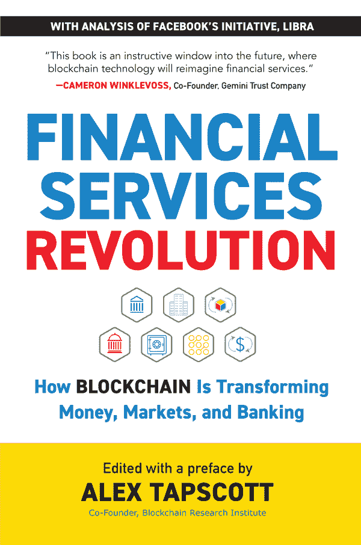

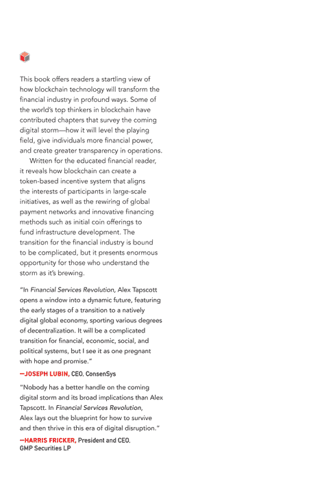

## 赞誉

“比特币。区块链。加密货币。如今，你一天也听不到关于区块链革命的消息。虽然关于这一主题的著作汗牛充栋，但鲜有作品回答了潜在的问题：什么是区块链技术？为什么大家对它如此兴奋？本书为新手和行业资深人士提供了新的视角。”

—**Meltem Demirors**，CoinShares 首席战略官

“本书全面深入地阐述了区块链以多种方式推动我们从根本上重新思考金融服务交付模式。”

—**Dr. Peter Zemsky**，INSEAD 战略学教授兼创新院长

“凭借其主题的广度，本书为区块链技术及其对金融世界巨大影响的前景提供了宏观的展望。”

—**Dr. Cathy Barrera**，Prysm Group 创始经济学家

“区块链有望重塑我们所知的金融服务。本书为读者提供了必要的知识，以迎接即将到来的变革。”

—**Debbie Gamble**，Interac 创新实验室与新业务首席官

“*《金融服务革命》* 发人深省、见解独到、考证详实，且充满了关于我们快速变化的世界中最令人兴奋的机遇之一的宝贵且可操作的经验教训。”

—**Cole Diamond**，Coinsquare 主席兼首席执行官

“*《金融服务革命》* 是任何对货币的未来、经济学以及无国界金融世界的逐级影响感兴趣的人的必读之作。”

—**Matt Spoke**，Open Foundation 首席执行官

“区块链将从根本上颠覆金融服务行业。今天的主导中介机构将成为明天的过眼云烟，因为分布式账本技术纠正了统治金融服务数百年的中心化和第三方验证模式。…… *《金融服务革命》* 是那些意图在区块链世界中制胜者的必读书籍。”

—**Harris Fricker**，GMP Securities LP 总裁兼首席执行官

## ALEX TAPSCOTT 的其他著作

*《区块链革命：比特币及其他加密货币背后的技术如何改变世界》*

（Penguin Portfolio，2018）合著者：Don Tapscott

*《企业区块链革命》*

（INSEAD 和 Coursera，2019）联合讲师：Don Tapscott

*《金融服务业的区块链革命》*

（INSEAD 和 Coursera，2020）联合讲师：Don Tapscott

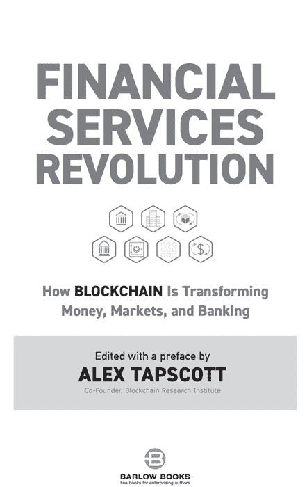

### 贡献者名单

**Michael J. Casey** (第 2 章) 是 *CoinDesk* 的首席内容官、Streambed Media 的主席兼联合创始人、MIT 媒体实验室数字货币倡议的高级顾问，并与 Paul Vigna 合著了畅销书《加密货币时代：比特币和数字货币如何挑战全球经济秩序》。

**Alexis Collomb** (第 3 章) 是 Conservatoire National des Arts et Métiers 经济金融保险银行部门负责人，也是巴黎 ILB 智库区块链视角联合研究计划的科学联合主任。Alexis 在 Donaldson, Lufkin & Jenrette 开始其投资银行生涯，后加入花旗集团。

**Primavera De Filippi** (第 3 章) 是国家科学研究中心的研究员、哈佛大学伯克曼·克莱因互联网与社会中心的教职研究员、世界经济论坛区块链技术全球未来委员会成员，并与 Aaron Wright 合著了《区块链与法律：代码即法则》。

**Andreas Park** (第 6 章) 是多伦多大学金融学副教授，受聘于 Rotman 管理学院、管理创新研究所以及密西沙加校区管理系，并担任 Rotman 金融创新实验室的研究主任。

**Klara Sok** (第 3 章) 是 Conservatoire National des Arts et Métiers 社会科学研究员，隶属于其 Lirsa 和 Dicen-IDF 研究中心，跨学科区块链视角联合研究计划的创始成员，以及 OpenResearch（一个基于区块链的开放同行评审平台）的联合开发者。

**Alex Tapscott** (第 1 章) 是全球公认的演讲者、投资者和顾问，专注于新兴技术的影响。他与 Don Tapscott 合著了广受好评的畅销书《区块链革命：比特币背后的技术如何改变世界》。

**Bob Tapscott** (第 4 章) 是公认的 IT 战略家、作家、顾问和演讲者，在人工智能、金融科技和区块链主题的会议上发表主题演讲。作为副总裁或 CIO，Bob 曾领导花旗银行、汇丰银行及其他加拿大附表二银行的技术工作。

**Fennie Wang** (第 3 章) 是转型为区块链领域企业家的律师，在 ixo Network（联合国儿童基金会的首笔区块链投资）负责战略、法律和合作伙伴关系，拥有美国证券律师资格，曾在 WilmerHale 和 Latham & Watkins 等美国顶级律师事务所从事证券辩护和国际资本市场业务。

**Anthony D. Williams** (第 5 章) 是 DEEP Centre 的联合创始人兼主席，是数字革命、商业与社会创新和创造力方面的国际公认权威，并与 Don Tapscott 合著了畅销书《维基经济学：大规模协作如何改变一切》。

---

### 前言

***Alex Tapscott***

# 区块链与金融服务的未来

正如互联网是信息的首个数字媒介，区块链是价值的首个原生数字媒介。区块链研究院的研究持续超越企业与行业的边界，旨在理解区块链将如何从根本上改变经济与社会。金融服务业是这一变革的关键杠杆。基于区块链的应用——如以最小化信任方式在移动设备上运行的数字身份与智能钱包——将使超过十亿人能够参与全球经济。

本书探讨了区块链对货币、银行业及金融市场认知的影响。在第 1 章中，我们探讨了对全球金融体系的九大颠覆性影响，涉及身份验证与遵守了解你的客户（KYC）及反洗钱（AML）法规；支票与价值转移服务；储蓄与存款；贷款与信用账户；交易与交易所；风险投资与证券市场；保险与风险管理；财务分析；以及会计与财务报告。这清单着实不短！

Facebook 推出的新型数字货币 Libra 仅仅是个开始。尽管其最初 28 位支持者中有 7 位已退出项目——其中包括 Mastercard、PayPal 和 Visa——但该项目获得了英格兰银行行长马克·卡尼的支持。他表示，英国必须直面其支付系统的问题。“在当今时代，这些支付应当是即时的，应当如同我们在线交换钞票一般，”他说道。“它应当是即时的、近乎零成本的，且应当具备 100% 的韧性。”^1 我们探讨了其他 FAANG 公司——即 [Amazon.com](http://Amazon.com)、Apple、Netflix 和 Google——可能会如何以自有数字代币作出回应。本章为现有巨头、创新者及央行家提供了指引。最后，我们预览了 2030 年金融服务的图景，以便读者清晰地认识到在金融服务领域单打独斗的意外后果，以及现在无所作为的潜在代价。

在第 2 章中，Michael Casey 勾勒了他对代币经济的愿景。比特币等代币代表了数字稀缺性——有限、不可变、不可复制——这在数字商品往往丰富、可复制且可改编的全球金融体系中显得格外独特。此外，作为可编程货币，代币潜在地能够自动化我们对共享资源的内部治理。正如 Michael 所写：“这是具有动态用途的货币”——不仅是交换单位，更是实现社区目标的直接手段，是管理我们日益数字化经济的全新范式。借助稀缺的数字代币，共同致力于价值创造的社区可将其共享价值嵌入这些代币，并将其作为这些价值的工具。

据 Michael 称，“赋予数字货币以政策与激励的含义”影响深远。一道鸿沟已然出现：一方看到了游戏规则的改变，这不仅体现在融资活动或经济战略上，更体现在缓解“公地悲剧”上；另一方则警告鲁莽的 `initial coin offering` (ICO) 骗局与迫在眉睫的监管打击。每个人都应阅读 Michael 这章清晰透彻的论述，并参与这场辩论。

说到 ICO 骗局，第 3 章的作者深入剖析了基于区块链系统的监管意涵，其中一些系统属于生态系统（如 Bitcoin 和 Ethereum），另一些则属于去中心化应用。虽然 ICO 解决了首次公开募股（IPO）的弱点，但它也带来了自身的挑战，一些高调欺诈案凸显了这一点，`WIRED` 杂志曾称其为“赤裸裸的钓鱼执法”。其中包括 Prodeum，它在周四出现，募集资金寥寥无几，到下周一便连同其网站、新闻稿和社交媒体账号一同消失。^2 黑客攻击也是一个问题。专业服务机构 Ernst & Young 分析了 300 多个 ICO，认定约 10%（4 亿美元）的 37 亿美元融资被挪用，网络钓鱼者每月窃取高达 150 万美元。^3

因此，ICO 对证券法监管机构构成了一道难题。美国证券交易委员会（SEC）及其他司法管辖区的同类机构正在评估所需的监管力度，以在区块链初创企业的生存能力与投资者风险（尤其是陷入炒作狂热的散户投资者）之间取得平衡。本章的全明星研究团队——Fennie Wang、Primavera De Filippi、Alexis Collomb 和 Klara Sok（来自自动化法律应用联盟 COALA）——娴熟地描述了各种法律解决方案，这些方案可支持创新且精简、同时对所有利益相关者公平的生态系统。这迄今为止属于最深思熟虑、最具定论力的研究之一。

在第 4 章中，Bob Tapscott 解释了分布式账本将如何通过取代相互通信的复杂系统层、消除支付流程每一步的费用与延迟，从而大幅改善国际清算与结算。借助区块链技术，经验证的数学原理而非易犯错或有时腐败的人类，将通过提供亟需的“单一事实版本”来增强用户对系统的信任。此外，大幅降低的费用、微支付能力和移动基础设施将帮助十亿无银行账户人群参与全球经济。Bob 详述了当前支付系统的演变历程，以及我们如何为数字经济转型它。区块链初创企业正利用分布式账本技术颠覆银行业陈旧的程序。现有权势可能迟迟不愿拥抱区块链；据 Bob 称，若它们抗拒变革，则可能在全球经济中失去立足之地。这是一个强有力的信息。

第 5 章探讨了区块链改变我们记录、存储和管理信息（不一定是金融信息）方式的可能性，并深入剖析了政府用例，尽管相同的基本原则完全适用于金融服务。比以往任何时候都更甚，积极参与的公民期望被倾听和知情——确实，期望成为积极的合作者而非被动的接受者。他们期望民选官员明智地使用税收资金。区块链技术使这些目标更易实现。在本章中，Anthony Williams 专注于通过统一的数字账本简化和改善政府服务。他评估了加拿大当前的总账系统，将其与爱沙尼亚和瑞典等地的最佳实践进行比较，并提出了一个基于区块链的可能解决方案。该分析并非盲目喝彩；Anthony 列出了相关挑战和实施成本，包括风险管理及与现有政策和程序的衔接。

本书的最后一章引人联想起美国最高法院大法官路易·D·布兰戴斯的名言：“阳光被称为最好的消毒剂。”透明度对于市场、企业和政府的稳健运行至关重要。试想安然资产负债表的模糊不清与美国次级抵押贷款市场的不透明：前者导致了当时最大的企业倒闭、一家拥有 85,000 名员工的知名会计事务所关闭，以及多位 C-suite 高管被定罪；后者则是 2008 年市场崩盘的诱因之一。如今，数万亿美元资金不足的衍生品——一些专家估算该数字更高——正威胁引发一场经济崩溃，那将使 2008 年的危机看起来仅如微震。

这就是为什么透明度是区块链最重要的优势之一；它使这种混淆视听的行为变得更加困难，甚至不可能。首先，两个人不能声称拥有同一资产的所有权——账本不允许这样做。这让我想起了布兰代斯大法官名言的下一部分：“电灯\[是\]最高效的警察。”^(4) 本章作者安德烈亚斯·帕克是罗特曼管理学院的金融学教授。他研究股票市场，并就技术对金融行业的经济影响向监管机构提供建议。在最后一章中，他论证了透明度是一种设计选择，并主张即使在许可型区块链上也应进行公开披露。他的论点令人信服，非常值得那些正在权衡公有/私有区块链设计方案的人士深思。

正如你所见，本书预览了金融服务、市场和货币即将到来的未来。这是一个成熟且亟待颠覆的全球性行业，世界各地的区块链初创企业正瞄准其方方面面。时间已成为稀缺资源。诺贝尔奖得主罗伯特·席勒曾观察到：“犹豫往往就像拖延。人们可能心存模糊的疑虑，觉得需要仔细考量；与此同时，其他问题侵入思绪，最终未作任何决定。”^(5) 书中蕴含的理念与机遇，供每一位具有前瞻眼光的领导者即刻付诸行动。

# 第 1 章

## 即将到来的大变革

### 区块链与金融服务

#### 亚历克斯·塔普斯科特

### 金融服务简述

• 在互联网的第一个时代，软件吞噬了世界，在此过程中改变了许多行业，从广告、电视到零售和教育。^(6) 互联网的第二个时代将使这些变化显得微不足道，因为区块链将颠覆金融——所有行业和人类经济活动的基石。它将重塑我们经济的深层结构。

• 赌注极高：下一个货币、商业和经济活动的时代悬而未决。当今数字领地的主导地主——Facebook、Google 等——毫无疑问将利用区块链控制明天的数字世界。他们将面对现状的维护者：拥有庞大金融帝国亟待保护的大银行，以及掌握系统性权力和货币政策亟待维护的政府。

• 银行和其他金融中介机构转移资金。转移得越多，存储和借贷就越多。支付轨道是行业躯体的心血管系统，而货币是全球商业的血液。没有它们，任何其他器官都无法运作。因此，价值的数字化是将中介机构与资产解耦、并将其迁移至这一价值原生数字媒介的第一步。

• 我们审视对行业的五大颠覆：开放金融与金融资产数字化；万物“金融化”；区块链作为可信的共享事实登记簿；*去中心化金融*（DeFi）的优势与局限；以及自主身份的作用。

• 新的去中心化金融模式和新兴的加密资产类别，很快将让现有巨头——无论是银行还是数字巨头——都手忙脚乱地应对，以避免被淘汰和边缘化。比特币和其他加密货币将挑战政府支持的法定货币教条，并让数十亿人首次能够接入全球经济。

• 我们在未来中既看到了希望也看到了危险。那些压制互联网第一个时代的威权政权，已经开始捕获这项第二时代技术为己所用，这一趋势无疑将在缺乏治理和公众监督的情况下蔓延到更民主的社会。

• 在审慎管理和负责任领导下，区块链将开启一个更加开放、包容、高效、安全和自由的金融服务新时代。如果我们把握得当，新的经济体系将涌现出来，为多数人创造更大的繁荣，而非为少数人积累更多财富。

### 导言

### 金融服务领域的区块链革命

在我投资银行生涯开始一周后，雷曼兄弟破产，全球经济陷入尾旋。年仅 22 岁的我，误打误撞闯入了一场火中取栗的试炼。当最终吞噬全球多家最大银行的金融大火烟消云散时，我的公司依然屹立不倒，而我（不知怎么）仍然受雇于此。我是幸运儿之一。对我们这一代人中的许多人而言，2008 年开启了一个结构性失业、增长停滞、政治动荡、以及对许多机构的信任与信心腐蚀的“失去的十年”。金融危机暴露了将经济推向崩溃边缘的贪婪、渎职和平庸无能，让人不禁发问：“腐烂有多深？”

就在这场金融危机中，一位名为中本聪的匿名人士（或团体）发明了比特币区块链。尽管他曾自称“我擅长代码胜过文字”，但中本聪那篇精辟清晰的白皮书《比特币：一种点对点的电子现金系统》提出了一个激进的新概念：互联网上的现金——一种无需银行和政府等中介即可转移和存储价值的方式。^(7) 比特币之所以非凡，在于它行之有效，并点燃了一把火，如野火般燎原，俘获了技术专家、企业家和商业领袖的想象力。2009 年 1 月，中本聪说道：“如果 10 年后我们还不以某种方式使用电子货币，我会感到惊讶。……如果足够多的人这样认为，这就会变成一个自我实现的预言。”^(8) 如今，比特币市值达 2000 亿美元，世界上最有权势的人——从唐纳德·特朗普到马克·卡尼（英格兰银行）、史蒂文·努钦（美国财政部）、杰罗姆·鲍威尔（美联储）和克里斯蒂娜·拉加德（国际货币基金组织）——都在同等程度上批评和赞扬它。人人似乎都有看法，且这些看法演变迅速。

比特币也开启了区块链革命，这指的是使比特币等完全数字化资产成为可能的底层区块链。区块链是点对点（P2P）网络中交易的无许可分布式账本，信息（不一定是金融信息）以及时、安全和防篡改的方式记录其中。它们之所以存在并值得信任，是因为大规模协作、共识和代码，而非传统中介。它们为几乎所有形式的价值提供了可编程的稀缺数字资产。人类历史上第一次，实体无需依赖银行和其他第三方来转移、存储、协调和管理价值。

毋庸置疑，比特币迄今仍是最重要的区块链创新，但创新者和企业家正将区块链用于更多领域。正如互联网是信息的第一个原生数字媒介，区块链是价值的第一个原生数字媒介。因此，我们可以将其用于几乎任何类型的资产，它迫使我们重新思考许多行业的深层结构和运作方式，首当其冲的就是金融业。

### Facebook 加入区块链革命——系好安全带！

2019 年 6 月，Facebook 宣布了一项为世界创造货币的计划。Libra 是一个大胆的新加密货币项目，可让 Facebook 的 27 亿用户像在 WhatsApp 上发送消息一样轻松地汇款。^(9) 这一宣布震动了许多强大机构的大门，从银行、科技巨头到世界各国政府和汇款服务机构。

## Facebook 的 Libra：全球金融的分水岭时刻

Facebook 主要将 Libra 宣传为一种为无银行账户人群提供银行服务的方式——这无疑是一项崇高的事业。但它将尝试在其平台上部署这种货币，用于线上线下的各种商业形式，使 Facebook 成为全球金融体系中一位强大的新玩家。它可能会改变数十亿人消费和储蓄、借贷，以及以其他方式为其生活和生计融资、投保的方式、地点和对象。如果 Facebook 成功了——这是一个巨大的*如果*——那么这种转变将颠覆金融服务，这是一个令人振奋又令人担忧的前景。这是一个分水岭时刻。Facebook 是我们数字经济中最大的“房东”之一，其行动影响深远。

### 监管与政治的靶心

首先，Facebook 将自己置于立法者和监管机构的靶心之上，因为他们正在为控制金融、货币以及对公民用户的影响力而角力。在美国，两党议员都批评了该计划，国会要求举行听证会。几周后，特朗普总统发推文称：“Facebook Libra 的‘虚拟货币’将几乎没有地位或可靠性。”^(10) 几天后，美联储主席杰罗姆·鲍威尔在证词中补充道：“Libra 在隐私、洗钱、消费者保护、金融稳定方面引发了严重担忧。”^(11)

Facebook 面临着重建用户、政府和其他利益相关者信任的西西弗斯式任务。在 Libra 负责人大卫·马库斯在国会作证后，Coin Center 的杰里·布里托告诉《华尔街日报》：“Libra 面临巨大挑战。……这不是加密货币问题，这是 Facebook 的问题。”^(12)

### 颠覆传统银行业

其次，通过涉足庞大而复杂的金融服务世界，Facebook 将自己与大型银行置于对立面。想想 Facebook、亚马逊、Netflix 和 Google 是如何颠覆广告、零售和电视等行业的。如果我是银行家，我会吓得发抖。最后，Libra 像比特币一样，可能永远改变法币在全球经济中的传统角色。正如蜂窝技术让数十亿人跨越了固定电话阶段，Libra 基于区块链的平台有可能使当今现有的鲁布·戈德堡式繁复金融基础设施过时。

### 市场反响与战略意义

到目前为止，华尔街持谨慎欢迎态度。Visa 和 Mastercard 等主要金融机构已签署无约束力意向书，加入 Facebook 的这项事业，随着数十亿人开始在线交易，它们可能拥有短期的金融再中介机会。Facebook 至少在初期需要与银行友好相处，给它们分一杯羹。然而，从长远来看，金融服务业的各个方面都将面临重新洗牌。想想无银行账户人群：生活在非洲或南亚的人，拥有 Facebook 账户的可能性远大于拥有银行账户。再看年轻群体：数千万年轻人尚未开设银行账户，未来可能也不会麻烦去开，但 25 至 34 岁是 Facebook 上最常见的年龄群体。^(13) 支付服务可能只是 Facebook 金融产品的第一项。

### 治理与信任挑战

监管机构和决策者持审慎态度，理由充分。Facebook 在推出 Libra 并赢得用户和政府信任方面面临诸多实施挑战。它必须将用户隐私和安全作为重中之重。话虽如此，Facebook 显然已经考虑过*治理*问题。Libra 由一个非营利的瑞士基金会管理，潜在成员超过 30 家。通过为其他公司和组织参与治理搭建这个大帐篷，Facebook 限制了其对该平台的控制。尽管如此，这个初始的小集团大多是以营利为目的的大公司，不一定是为了让无银行账户人群上网，或降低向贫困国家汇款的成本。

### 地缘政治影响与货币主权

即使 Libra 在美国和欧洲成功穿越监管迷宫，Facebook 在发展中国家还面临另一场战斗。Libra 很可能比世界上许多较小且边缘化的货币，更可靠、更有用地作为价值储存、交换媒介或记账单位。如果一个国家决定贬值本国货币以使出口更具竞争力或投资更具吸引力，个人将能够选择退出，转向一种“硬通货”数字替代品。生活在委内瑞拉的人可能不完全信任 Facebook，但他们可能会比那个贬值其货币的独裁者更信任它。在较小程度上，这种替代价值储存手段也可能给世界富裕国家以及重视货币主权的国家带来麻烦。

### 政策建议：监管而非禁止

北美及其他地区的决策者应保持开放心态。如果他们禁止 Libra，那么百度或阿里巴巴等中国互联网巨头可能会在威权政权的支持下推出自己的货币，该政权有兴趣追踪和画像用户。在比特币出现之前，腾讯推出了一个名为 Q 币的项目，用户可按一元人民币不可退还的方式购买。Q 币很快成为在线支付的常用手段，随后中国政府对其进行了打压。^(14) 十多年过去了，我们可以想象私营部门行为体会与极权政府手套般紧密地合作推出类似项目。这应引起民主领导人的关注，并促使立法者进行监管而非禁止。我们将在本研究中探讨这一问题及其他深远影响。

### Libra 与比特币：互补角色

Libra 对比特币和其他加密货币意味着什么？因为它将是一种*稳定币*——意味着其价值将挂钩一篮子传统货币——其价格不会像比特币那样波动。在交易对手预期一定可预测性的支付场景中，Libra 可能是一种更有效的交换媒介。但它并不构成对比特币本身的威胁。比特币区块链仍然是一代人中最具影响力的计算机科学发明。它为一个新的价值互联网铺设了轨道，该网络对资产的作用，正如互联网对新闻媒体等信息产业的作用。区块链这股不可阻挡的力量正与迄今为止不可撼动的全球金融这块巨石发生碰撞。系好安全带。

比特币是“数字黄金”，这一短语由《纽约时报》作家纳撒尼尔·波普普及。^(15) 它是一种不受政府或公司控制的去中心化货币，具有固定的供给曲线和极强的安全性——这些特质是 Libra 在设计上永远不会拥有的。如果有什么不同的话，Libra 可能证明是将数十亿人引入数字金融行业的最宽、最快的大道或入口。

### 即将到来的加密货币军备竞赛

最后，Facebook 将面临来自其最大竞争对手的竞争。在未来几个月和几年内，许多大型科技公司很可能会推出自己的加密货币。在一次采访中，Gemini 联合创始人卡梅隆和泰勒·温克莱沃斯表示：“我们预计在 24 个月内，所有 FAANG 公司都将拥有自己的加密货币。”^(16) 他们补充道，像星巴克这样拥有自己数字奖励计划的公司，将是显而易见的跟进候选者。一向更保守的银行也将跟进。

亚马逊是在北美及其他地区电子商务领域的巨无霸。有人指望杰夫·贝佐斯会允许 Libra 在亚马逊上使用，而不推出替代方案吗？除非你希望你企业的支付轨道运行在其他公司的基础设施上，并由那家公司获取大部分红利，否则你最好振作起来，设计自己的货币。

### LIBRA：最新创新

## Facebook 进军加密货币领域，不应让任何技术研究者感到惊讶

毕竟，数字革命已改变我们生活的几乎方方面面，唯独银行业除外。金融中介机构或多或少仍依赖于互联网前的技术。Libra 只是在旧模式上打孔的最新创新，确立了我们数字经济未来的战线。

赌注极高：下一个商业、经济活动和货币的时代充满不确定性。计算机科学家正在重新连接经济电网，软件工程师正在重写人类事务的秩序，暴露出我们对隐私、言论自由以及大公司在我们生活中扮演角色等基本概念的理解匮乏。作为这新经济的“数字地主”——Facebook、Google 等——向大银行的霸权发起挑战，比特币等去中心化加密货币迫使我们直面对货币、价值以及围绕这些概念建立的法规堡垒的理解。这些法规最初旨在保护系统使用者，如今却沦为维护现状的工具。归根结底，这是一场控制权的争夺战，多方势力——中国及其他极权政府、传统金融机构、大型社交媒体公司及其他数字巨头、科技新贵及其他利益相关者——都在争夺更大的影响力。

人类已越来越习惯于软件和技术在许多行业和日常生活诸多层面取代人类参与者。金融业是其中规模最大、影响最深远、迄今为止也最难撼动的行业。传统银行体系、Facebook 等数字巨头、比特币等自由开放的加密货币平台，当然还有政府，正不可避免地走向一场具有历史规模的碰撞。这场撞击将是灾难性的。做好撞击准备吧。

## 金融服务的区块链变革

### 加密资产与开放金融

“有人说软件正在吞噬世界。很快，通证将吞噬世界，”泰勒·温克尔沃斯说道。他说得没错。区块链是价值的首个原生数字媒介：我们可以用它为几乎所有资产编程。在《区块链革命》最新版中，我们提供了这些资产的分类法，以帮助读者理解它们的诸多差异。它们分别为：加密货币（比特币、Zcash、莱特币）、平台通证（以太币、ATOM、EOS）、实用通证（Augur 的 REP）、证券通证（theDAO、Munchee 的 MUN、Vocean 的加密债券）、自然资产通证（碳、水、空气）、加密收藏品、稳定币，以及加密法币（委内瑞拉的石油币、中国即将推出的加密人民币）。^(17)

在本节中，我们将重点关注以证券通证和法币抵押稳定币形式呈现的现有金融资产数字化。这是*开放金融*的世界，它不同于我们稍后将讨论的*去中心化金融*。开放金融是指传统封闭、模拟和专有系统向区块链和数字资产的开放。开放金融将证明是现有机构、监管机构和市场参与者面临的机遇与挑战。

以股票为例。全球“股市”实则是一个松散拼凑的本地和区域性交易所、银行、券商交易商、托管机构、清算所、监管机构、资产管理公司、基金管理人及其他市场参与者和中介机构的拼贴画。尽管订单簿和做市功能已基本数字化，但这些不同方实际如何清算、结算、托管和登记资产所有权的底层功能却陈旧不堪。

前摩根大通投资银行董事总经理、前 Digital Asset Holdings 首席执行官 Blythe Masters 告诉我们：

> 请记住，金融基础设施几十年来未曾进化。前端进化了，后端却没有。这一直是一场旨在加速交易执行的技术投资军备竞赛，以至于如今竞争优势以纳秒计算。^(18)

她指的是高频交易：“讽刺的是，交易后基础设施几乎完全没有进化。”区块链有潜力通过允许市场参与者点对点即时连接、清算和结算，从根本上降低市场的成本、复杂性和摩擦。

0x 是一个支持在以太坊区块链上进行资产 P2P 交换的开放协议，在这方面堪称先驱。尽管该交易所交易的资产并非全是金融资产，但部分是。迄今为止，0x 已完成超过 713,000 笔交易，价值 7.5 亿美元。^(19) 随着以太坊、Cosmos、Polkadot、EOS 等底层平台的扩展，采用它们的应用和金融业务用例的容量也将随之扩大。上市公司 Overstock 的子公司 tZERO 在这方面也取得了长足进步。2019 年夏天，Overstock 宣布，这家上市公司的股东将收到在 tZERO 上市的数字通证形式的股息。Overstock 前首席执行官 Patrick Byrne 对此举表示：“五年前，我们着手创建一个平行宇宙：一个合法的、基于区块链的资本市场。我们成功了。”^(20) Byrne 有理由乐观地认为，这个数字资产的平行宇宙将为新进入者和现有机构 alike 创造挑战和机遇。

证券通证不仅能减少摩擦、成本和复杂性。它们还能通过降低门槛，让我们设想为各类资产（从房地产到私募股权和风险投资 (VC)）构建流动性市场，从而实现更广泛的资本市场参与。更高的透明度、市场深度和流动性应能改善定价、准入和市场的整体健康运行。

并非所有资产都适合代币化。但我们看到，当满足以下几个条件时，代币化行之有效：

1.  该资产是否存在成熟或未被开发的需求？
2.  人们或机构是否想购买该资产但目前无法购买？
3.  该资产是否存在较高的可转让性或流动性障碍？
4.  交易成本是否高昂、价差过大，或其他障碍过于严苛，以至于市场参与者选择完全避开该资产类别？
5.  是否需要区块链来数字化该资产——即该资产在传统系统中根本无法运作？
6.  该行业是否高度集中或高度分散？

如果对上述大多数问题的回答是肯定的，则该资产很可能是证券通证的候选者，而高度分散的市场应使实验或创新更容易。代币化股权、债务和房地产已然存在。我们最终可能会看到代币化的运动队、音乐曲库、葡萄酒投资组合、艺术品和活动门票，等等。证券通证可能通过降低准入门槛和扩大投资选择，帮助改善普通人的财富创造机会。

机遇伴随挑战：它缺乏技术、商业、市场和监管基础设施。Morgan Creek Digital 联合创始人兼合伙人 Anthony Pompliano 认为，证券监管机构“把‘富者愈富’的理念……写进了法律。他们把回报最好、表现最佳的资产置于防火墙之后。”^(21) 他指的是 1933 年的《证券交易法》，该法将许多投资机会限制在高净值个人手中。他称之为“对美国梦的践踏。”^(22) 如果这类投资机会仍然仅限于最富有的富人，那么我们就没有真正实现基于区块链的金融创新红利的普惠化。

请考虑 Props。Props 是由流行视频应用 YouNow 创建的一种原生数字代币，尽管它可以在任何应用程序内运行。YouNow 获得了 SEC 的特别授权，可对其代币进行 Regulation A 发行，该发行于 2019 年 7 月获批，并已推出。可以将 Props 视为零工经济的股票期权，面向的对象包括 Uber 司机、在 Airbnb 上出租房屋的房主或内容创作者。在 YouNow 上，这些人可以通过在平台上分享内容来赚钱。否则，他们无法直接参与 Uber 或 Airbnb 等当前流行平台增长带来的价值创造。同样，Uber 司机可能因完成一单而获得报酬，但他们分不到 Uber 750 亿美元估值的一杯羹。所谓的“共享经济”实际上是“聚合经济”，强大的平台获取了大部分价值，而贡献者只能得到残羹冷炙。

有了 Props，YouNow 等平台的贡献者，以及未来或许的 Uber、Airbnb 和其他平台的贡献者，既能因其贡献获得报酬，又能赚取 Props 代币。Props 的供应量是有限的，且以可预测的速度增长，因此，使用该原生代币的应用程序越多，赚取并持有 Props 的人越多，Props 的价值就越高。任何应用程序都可以接入 Props 的 `application programming interface` (API)，让贡献者开始以 Props 的形式赚取真实价值。创始人和投资者将不再是平台增长的唯一受益者。在金融服务领域，我们可以将 Props 视为一种用于组织网络中贡献者的新支付轨道，也可以视为一种激励机制（类似于股权），用于留住用户并为平台增加价值。目前，已有 200,000 人在 YouNow 上使用 Props，每天发生 100,000 笔 Props 交易。计划是随着时间的推移增加更多应用。随着 Props 变得无处不在，其他应用程序可能会被迫向贡献者提供它——*voilà*，一个新的数字经济由此诞生。

这种新的数字代币丰饶之角将需要通用标准，`Enterprise Ethereum Alliance` (EEA，企业以太坊联盟) 等组织正在帮助引领这一进程。微软的 Marley Gray 是 EEA 代币联盟的关键贡献者，他告诉我们，通用标准“消除了定义资产的障碍。区块链应该就像今天使用支付网络一样。人们应该直接使用它。”^(23) 他补充道：“你不需要理解区块链就能使用代币。让我们达到实际驱动商业价值的程度。让我们抽象化它，使其通用。将代币商品化，以便任何行业或公司都能创建它们。”^(24)

如果不同资产存在于互不连通的孤岛中，那么代币化的影响将有限。只有通过通用标准和互操作性，代币化才能发挥其全部潜力。法币抵押稳定币，如 Tether、USD Coin 和 Libra，是开放金融的其他例子。并非所有稳定币都由储备金按 1:1 美元抵押；有些，如 MakerDAO 创建的 DAI，完全存在于加密资产世界中。

稳定币的价值已经爆发式增长，这是有充分理由的。它们提供了一种简便的方式，以传统支付系统（如 Venmo）成本的一小部分，即时实现点对点的价值转移。根据为机构投资者提供数字货币交易工具的 TradeBlock 称：“\[T\]he aggregate total on-chain transfer volume across the largest stablecoins has now surpassed Venmo’s total payment volume”（最大稳定币的链上转账总量现已超过 Venmo 的总支付量）。TradeBlock 发现，商户费用及相关 Venmo 服务费远高于在以太坊区块链上传输稳定币所涉及的费用：“在前五大 ERC-20 代币中，客户仅花费 827,000 美元的以太坊网络费用就转移了超过 370 亿美元。在同期内，支付给 Venmo 的费用及相关服务费预计将达到 1.5 亿美元。”^(25)

鉴于这种爆发式增长，Facebook、沃尔摩特和摩根大通——或许还有谷歌和亚马逊——都将稳定币纳入其增长计划。^(26)

Cameron Winklevoss 表示：“我们将看到许多公司发行代币，”并补充道，“像 Facebook 这样规模和地位的公司，对于验证由加密技术驱动的更好、更新的支付轨道这一总体理念，极具鼓舞意义。无论是 Libra 还是其他项目\[最终成功\]，时间会给出答案。”请考虑亚马逊：“你几乎可以把包裹送到世界任何地方。但你无法为该产品收款。亚马逊币可以创造将支付系统延伸至地球边缘的能力。”^(27) 毫无疑问，Libra 只是世界科技巨头之间这场新竞争的开场白。

Pompliano 认为 Libra 是一个积极的发展，但它对比特币和其他加密货币也有好处。他说：“这是代币密度理论——如果你在另一家餐厅对面开一家餐厅，两家餐厅的客流量通常都会上升。随着密度的增加，每个人的客流量都会增加。因此，每创建并添加一种合法的加密货币，都会提升比特币的整体价值主张。”^(28) Messari 创始人 Ryan Selkis 简单地总结道，Libra 将为其他加密资产充当“领跑者”。^(29)

并非所有人都对企业代币持乐观态度。“我不怕核熔毁或恐怖袭击。我唯一害怕的是 Facebook 的加密货币，”Cosmos 联合创始人 Ethan Buchman 说道。“Facebook 完善了数字殖民主义。早期的殖民公司奴役肉体，而 Facebook 奴役精神。这将是其历史遗产。”^(30) Facebook 因与美国联邦贸易委员会达成 50 亿美元和解、与 SEC 达成 1 亿美元和解，并接受立法者的严厉质询，其推出 Libra 的道路将举步维艰，Facebook 的领导者将需要重新赢回他们辜负之人的信任。这是一个艰巨的挑战。

尽管如此，技术本身拥有自己的动力，这使得它在此时不太可能被阻挡。金融市场——从股票到债券以及两者之间的一切——将变得面目全非。押注区块链的现有巨头将在这场即将到来的革命中幸存下来。

### 一切的金融化与数字化

如果土地是农业时代最重要的资产，石油是工业时代最重要的资产，那么数据就是数字时代最重要的资产。信息是我们数字经济的基石，也是 Facebook 和 Google 等世界上一些最大、最盈利公司的命脉。请考虑过去 20 年世界最有价值公司的重新排序（表 1-1）。^(31) 在这一时期，数据已取代石油成为世界商业价值的主要驱动力，信息巨头取代了工业巨头。

#### 表 1-1

随时间变化的世界最有价值公司

| 1997 年 10 月市值最大公司 | | 2019 年 4 月市值最大公司 |
| --- | --- | --- |
| 通用电气 (美国) | | 微软 (美国) |
| 荷兰皇家壳牌 (荷兰) | | 苹果 (美国) |
| 微软 (美国) | | 亚马逊 (美国) |
| 埃克森美孚 (美国) | | Alphabet (美国) |
| 可口可乐 (美国) | | 伯克希尔·哈撒韦 (美国) |
| 英特尔 (美国) | | Facebook (美国) |
| 日本电报电话公司 (日本) | | 阿里巴巴 (中国) |
| 默克 (美国) | | 腾讯 (中国) |
| 丰田 (日本) | | 强生 (美国) |
| 诺华 (瑞士) | | 埃克森美孚 (美国) |

*数据来源：RankingTheWorld，“Top 10 Most Valuable Companies in the World (1997–2019)”，视频，[YouTube.com](http://YouTube.com)，YouTube LLC，2019 年 4 月 28 日*。

我们创造了所有这些数据，却并不拥有它们——数字地主才是主人。这很成问题，因为这意味着我们无法利用这些数据来更好地组织生活、无法将其变现，且数据可能落入错误之手。

信息就是一种资产，它一直缺乏一个开放、透明的市场，让利益相关者能够发现价格或交换其价值。这是数字时代加剧的一个更广泛问题的一部分。许多资产处于市场力量之外，容易被过度使用或被大型中介机构捕获。就像水、空气或海洋一样，强大的公司剥削数据，进而剥削创造数据的人。

在为区块链研究院撰写的一份主要研究报告中，技术理论家 Michael Casey 指出，代币化和加密资产带来的数字稀缺性代表了解决方案：

> 区块链技术，以及它所催生的加密货币、代币和其他数字资产，可能正将我们推向一种可编程货币模型，该模型包含对公共资源的自动化内部治理，并鼓励社区间的协作。数字稀缺性应用于这些代币时，与前数字时代相比，区别对待我们日益数字化的世界。它提出了一种可能性：我们的货币本身可能成为实现共同目标的工具。

新去中心化应用的开发者正在对各种资源进行代币化——例如电力和带宽，还包括人类特质，如在线内容的受众关注度或事实核查员的诚实度。……一旦社区将稀缺代币与这些资源的权利联系起来，就可以开发控制代币使用的机制，以帮助管理公共产品。这是动态货币，其作用超越了交换单位，成为直接实现社区目标的工具。^(32)

在报告中，Casey 为这些代币提出了一个新分类法，并建议至少包含五种不同类型：媒体、身份、诚实、去中心化计算和环境。

这些代币极有潜力，能为那些以前处于公共领域（如环境）或被少数大型技术中介机构不对称捕获（如我们的身份）的资产，开启新的经济模式。此外，我们可以对一切有价值的事物进行代币化，以确保创作者获得公平报酬。现在，个人可以从其在线身份产生的数据中获取价值，选择将其保密或提供知情同意以供使用，并在过程中赚钱。个人艺术家创作的音乐在互联网上流传并收取版税时，能获得公平报酬。人们可以签订由智能合约强制执行、并由预言机在预测市场中验证的协议。这些能力无疑将从琐碎领域（体育博彩）扩展到更有意义的市场，如衍生品市场。

随着万物成为资产、人人成为市场参与者，“金融服务”的界限将开始模糊。

### 区块链即状态机

区块链是网络或其他实体（从企业账目到全球供应链或投票登记）事务状态的及时、准确、共享、可信的快照。它们是一种新的记账形式。我们称之为**三式记账**。复式记账常被认为是资本主义和现代生活方式的基石，使海量财务信息得以组织和理解。区块链将发挥类似作用。

区块链研究院作者 Anthony Williams 写道：“由于记录在账本上的交易可即时搜索和发布，基于区块链的账本还能提升透明度、满足并加快审计要求，并改善账目的完整性。”^(33) 换句话说，它将成为真相的共享版本。

在金融领域，这种共享账本将使市场参与者更清晰地看到 Ethan Buchman 所谓的“明文公司——一种易于人和机器阅读的企业状态表征。”^(34) 拥有对这些网络状态的可靠及时洞察，有助于发现风险集中或资金缺口。Williams 在其报告《用区块链整合多账本》中概述了这种能力的四大优势：

**1. 对账与报告自动化**：即时可验证的交易将消除不同系统间耗时的离线或批量对账流程。

**2. 透明度与颗粒度**：利益相关者获得跨网络或实体（如公司）进行的个别交易的近实时可见性。

**3. 减少欺诈**：区块链解决方案将确保财务记录防篡改，并减少录入欺诈性交易或伪造信息的空间。加密链接区块的使用将确保无人能在不被发现的情况下更改或删除记录。

**4. 增值审计**：区块链账本将允许审计师（及其他利益相关者）验证公司、政府和其他方财务账目背后大部分最重要的数据。^(35)

考虑基于区块链的账本如何从根本上简化金融服务业的内部运作：

即使持有所有访问密钥的个人，也无法编辑分布式账本。股东记录只能追加，无法进行事后调整。这一过程生成高度可靠的审计轨迹，清晰且无可争议地指明每位股东如何以及从谁手中获得股份。若原告争议某一时刻的股东身份，该轨迹在法庭上将至关重要。

消除纸质记录是重大胜利，但通过加速公司注册、合并、收购、IPO 和其他复杂商业交易，可能获得更大的效率提升。例如，基于区块链的智能合约将使在满足特定条件（如期权到期）时，能自动更新、删除记录并采取行动。其他可能性包括自动更新以反映姓名和地址变更，以及修改抵押品描述和担保方。^(36)

其好处是进行财务审计所需的成本和时间将大幅下降。审计师可部署更多自动化、分析和机器学习能力，例如近实时自动提醒相关方异常交易。支持性文件——合同、采购订单和发票——可加密并安全存储或链接到区块链。这些改进将释放审计师的时间，让他们专注于能创造更多价值的领域，如分析复杂交易、建议改进公共支出流程，以及确保有足够的内部控制和流程来衡量和报告其绩效。

### 身份新模式

我们可以将互联网经济视为“数字封建制”，数字精英拥有大量虚拟版图。我们这些农奴耕耘这片土地，搜索、学习、发布、协作和开展业务。但数字地主捕获了真正的价值——我们在生活中产生的数据——并自行将其变现。“想象一下，如果通用汽车不为其钢材、橡胶或玻璃——其投入品——付费，”经济学家 Robert J. Shapiro 说。“这就像大型互联网公司的处境。这是一笔划算的买卖。”^(37)

## 隐私与去中心化金融

隐私是自由的基石，然而这些数字地主正在不可逆转地侵犯我们的隐私和其他人权。看看中国基于区块链的社会信用评分系统，便可为此找到证据。区块链和加密货币可能产生积极影响，也可能产生消极影响。区块链能够让我们对个人信息拥有更强的隐私保护和自主权，也可能加剧本已糟糕的局面。例如，天秤币以及大银行和其他现有巨头的类似举措，可能会将更多有价值的数据——关于人们经济生活的数据——集中到少数全能中介手中，并将基于区块链的平台用作更严密监控的工具。中国就看重加密货币相较于纸质人民币的可追踪性。^(38)

在探讨 Facebook 野心勃勃的天秤币项目背景下的隐私与身份问题时，CoinShares 首席战略官 Meltem Demirors 表示：

> 问题不在于 Facebook 是否有权[推出天秤币]。必须具备两点：同意——同意系统的规则。你需要有选择退出系统的权利，并完整保留你的所有数据。这些都是复杂的问题。区块链行业的一个问题在于，我们试图为复杂的问题创造简单的解决方案。^(39)

这触及了一个更广泛的问题，该问题在 COALA 的 Greg McMullen、Primavera De Filippi 和 Constance Choi 撰写的《区块链研究报告》中被指出。在他们的报告《区块链身份服务》中，作者认为我们越来越依赖“政府或企业，它们管理着唯一标识符以及与特定证书或属性相关的中心化私人数据存储库。这些中心化权威机构往往代表着单点故障，常与数据隐私侵犯、数据滥用和泄露等问题联系在一起。”^(40) 这有多重原因，颇为棘手：

私人数据市场与身份管理服务市场之间界限的模糊加剧了局势。一方面，Facebook 或 LinkedIn 等提供商将其服务作为身份管理进行营销，却在收集海量个人信息，并开发出极具利润的私人数据经纪业务模式。另一方面，Experian 等数据经纪商建立了利润丰厚且不透明的业务模式，基于对个人的非自愿画像牟利，如今却向被画像的个人本身推销服务。

这些系统在极少透明度下运作，不透露收集何种信息、如何使用、与谁共享或出售给谁。数据主体无法知晓这些平台所持有信息的安全性、准确性或用途。身份验证最初的把关职能，已演变为一个复杂且不透明的过程，即为远超识别范围的目的而收集、画像和出售数据。随着这些平台成为我们日常生活的重要组成部分，它们获得了制定数据收集和使用条款的权力，往往以损害我们这些数据主体的利益为代价。印度的 Aadhaar（统一身份认证系统）和中国的社会公民评分等国家身份管理系统的发展，导致了身份认证范围的蔓延和监控国家的形成。^(41)

COALA 团队主张：“借助区块链技术，个人有可能从公司和数字平台等中心化实体手中夺回对其身份和个人数据的主权，并从其自身数据的价值中获益。”^(42) 换言之，个人可以拥有自我主权身份，即他们自己拥有并控制的身份。

因此，解决方案不是要求政府通过类似欧盟《通用数据保护条例》的法律来保护隐私。隐私和身份管理的新方法赋予公民对其身份、存在事实以及他们生活中创造的数据的所有权。通过自我主权身份技术，我们可以在虚拟黑盒中记录和存储不可篡改的事实和其他个人数据，并通过智能合约管理对这些数据的访问。自我主权身份是区块链研究院《相互依存宣言：迈向数字经济新社会契约》的支柱之一，并将对向更开放、包容和私密的金融系统转型起关键作用。^(43)

### 去中心化金融：黄金九大支柱

Cosmos Network 联合创始人 Ethan Buchman 表示：“金融的去中心化真正意味着金融的民主化。这是关于消除障碍。”^(44) 在《区块链革命》中，我们将金融行业拆解为七大组成部分：价值转移、价值存储、价值借贷、价值交换、融资与投资、会计核算，以及风险管理与保险。我们在此增加第九大类别“价值分析”，以反映数据和信息在全球经济中日益增长的重要性，以及在该领域提供服务的创业项目激增。如今，旨在颠覆这些金融现实支柱的项目和公司已有数十个，已启动或正在启动（表 1-2）。

Ethereum 已脱颖而出，成为去中心化金融应用的绝对领先平台，许多项目源自 ConsenSys。项目的广度令人印象深刻。ConsenSys 的 James Beck 表示：“从稳定币、去中心化交易所和钱包，到支付网络、借贷和保险平台、关键基础设施开发、市场平台及投资引擎——去中心化金融生态系统正在蓬勃发展。”^(45) Ethereum 联合创始人兼 ConsenSys 首席执行官 Joseph Lubin 补充道：

> 现在正在涌现一个庞大的去中心化金融光谱：一方面，开放金融平台赋予全球个人参与新型和重塑后的金融系统的能力。另一方面，去中心化金融解决方案正通过引入去中心化方案，改变成熟机构的运作方式。^(46)

#### 表 1-2

黄金九大支柱

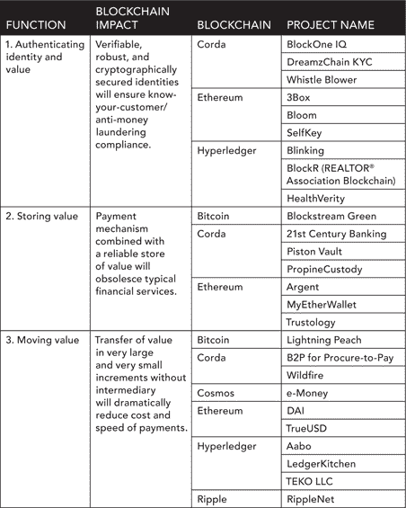

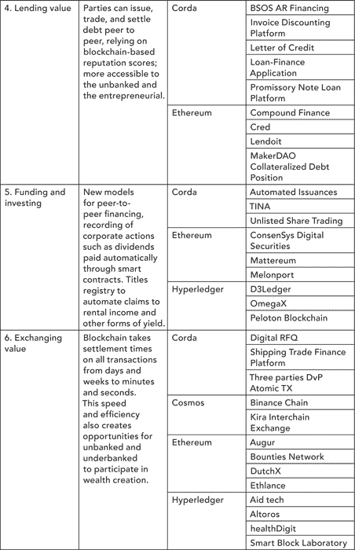

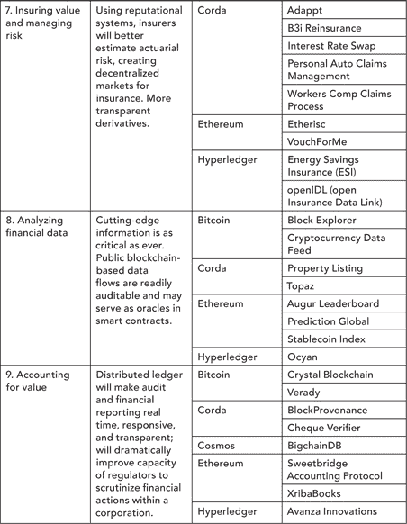

用新基础设施取代旧基础设施令人望而生畏，并引发许多问题：我们试图解决什么问题？我们是用规模较小、未经验证的创业公司取代大公司吗？这些创业公司能促进普惠吗？这种变革真能实现金融民主化，还是仅仅将财富集中到以太坊和比特币等强大区块链网络中一批新的大型利益相关者手中？

去中心化金融与开放金融有何不同？ConsenSys 的 Collin Myers 用 0 到 10 的量表来衡量，0 代表创造性破坏，10 代表渐进式变革：“开放金融是 9 到 10 级的创新——对现有体系的改进。去中心化金融是 0 到 1 级的创新——创建一个平行金融系统，将允许人类以从未有过的方式传递价值和组织协作。”^(47) 在 Myers 看来，天秤币并非去中心化金融的例子，但它可能有助于铺平道路：“天秤币是一匹特洛伊木马，让人们习惯于使用数字货币进行交易。十年后，我们回顾天秤币时，会将其视为一个中间步骤，它使核心区块链社区能够达到我们想要的目标，即一个真正无许可且开源的金融系统。”^(48)

## 去中心化金融（DeFi）的崛起与影响

与此同时，为什么大家对去中心化金融如此兴奋？MakerDAO 创始人 Rune Christensen 表示：“DeFi 的主要优势和特征与开源软件非常相似，因为它真正关乎释放网络效应，以及人们能够在无需中介、无需许可的情况下无缝协作的价值。”根据 Christensen 的观点，要被视为 DeFi **去中心化应用**，必须满足以下三个要求：难以关闭、运行在区块链上、无需信任。^(49) 从 Christensen 的角度来看，其益处主要有五点：降低成本、高效核算、完全透明、低切换成本和更广泛的准入。

去中心化金融已取代 ICO，成为以太坊网络的主导用例。数十个运行在以太坊上的 Dapp 组成的新兴市场，合计占据了以太坊原生代币以太币相当大的一部分份额。根据网站 [defipulse.com](http://defipulse.com) 的数据，在任何给定时间，约有 4 亿至 7 亿美元的以太币被锁定在这些 DeFi 应用中（表 1-3）。^(50)

### 表 1-3：锁定在前 10 大去中心化金融应用中的价值

| 名称 | 区块链 | 类别 | 锁定价值（百万美元） |
| :--- | :--- | :--- | :--- |
| Maker | Ethereum | Lending | $255.7 |
| Compound | Ethereum | Lending | $93.0 |
| InstaDApp | Ethereum | Lending | $23.8 |
| Synthetix | Ethereum | Derivatives | $20.4 |
| Uniswap | Ethereum | DEXes | $15.9 |
| Nuo Network | Ethereum | Lending | $14.1 |
| dYdX | Ethereum | Lending | $10.3 |
| Dharma | Ethereum | Lending | $10.1 |
| Lightning Network | Bitcoin | Payments | $8.5 |
| WBTC | Ethereum | Assets | $5.8 |

*数据来源：[defipulse.com](http://defipulse.com)，截至 2019 年 8 月 14 日。*

DeFi 应用的部分优势在于匿名性或伪匿名性。传统金融中介要求你提供身份证明（验证价值），但许多人没有可提供的身份，或不愿透露身份。Demirors 认为这是 DeFi 的关键属性：

> 如果你抽离掉对身份和中心化中介的需求，我们突然就创造了一个开放的世界市场，它由一套全新的标准定义，其中一切可编程且可交易的东西都可以 24/7 进行交易。你现在能做的事情——市场、资产、结构——的可能性领域开始发生改变。^(51)

以目前最大、最成功的 DeFi Dapp —— MakerDAO 为例。其关联稳定币 DAI：根据创始人 Rune Christensen 所述，MakerDAO 是“旨在为所有人创造无偏见货币和无偏见信贷准入的数字金融基础设施”。更简单地说，MakerDAO 将其使命视为从 Bitcoin 迈出的合乎逻辑的一步。“Bitcoin 本应是更好的点对点现金。Bitcoin 并不适合做现金。它是极佳的价值存储和对中央银行的制衡，但它不是好现金，”MakerDAO 的 Greg Di Prisco 说道。Maker 如何解决这些被感知到的缺陷？“Maker 是一个去中心化的中央银行。每个人都有能力以自己的资产生成货币。传统上，你需要商业银行作为中介，”但现在任何拥有以太币的人都可以做到。^(52)

个人可以通过以以太币作为抵押来创建稳定币 DAI。关键在于，智能合约的设定要求每个 DAI 都必须超额抵押。因此，例如，如果你向 MakerDAO 智能合约质押了价值 150 美元的以太币，你理论上可以创建 100 美元的 DAI，但不能更多。目标是确保 DAI 不会“跌破面值”，即维持其与美元的挂钩。选择美元的决定更多是基于实用性而非哲学考量。目前美元是全球储备货币，也是最广泛认可的交换媒介，因此以此作为参考点是合乎逻辑的。

考虑到以太币的波动性——过去三年，它从 20 美元飙升至 1400 美元以上，随后暴跌至 100 美元以下，现在徘徊在 200 美元左右——我们可能会好奇，抵押如此波动的资产，如何可能维持与相对稳定资产的挂钩。对于 DAI 而言，如果以太币价值跌破预设阈值，智能合约将清算其中锁定的以太币，以确保合约始终保持适当的抵押率并维持价格。一个额外的缓冲是个人在创建 DAI 时支付给系统的稳定费。

如果这听起来有点牵强，考虑到 DAI 已经经受住了火的考验。DAI 于 2018 年推出，在以太币价格崩盘的同时保持了其挂钩。智能合约自主管理这一过程的所有机制。目前，DAI 的价值约为 9000 万美元（Maker 中锁定的总价值为 3 亿美元），但 MakerDAO 计划通过向任何类型的资产开放抵押来激进扩张，很可能在 2019 年实现。

其优势在于，任何人都可以在没有中介的情况下生成新货币。你成为你自己的银行。如今，DAI 由一小群但不断增长的技术专家和爱好者使用，但 Rune Christensen 有更宏大的目标：“DAI 长期扩展的方式，不那么多关乎现有的加密世界。而是关于将其他资产代币化——即对房产、股票或债券的索赔权。”^(53)

DAI 路线图的核心在于理解：虽然 DAI 构建于以太坊之上，但不会有一条区块链统治一切。不同用例会有不同的权衡，行业需要构建桥梁。Christensen 希望 MakerDAO 成为一个“跨区块链的分布式应用”。

正如他所说：“通过创建获得一定采用程度的滩头阵地，你向行业打开了一个充满可能性的世界。”^(54) 今天，银行家们对这些初期且小规模项目的潜在威胁感到放松，或许是可以理解的。在宏大的格局中，DAI 只是一个舍入误差。但大事起于微末：一旦创新被证明行之有效，就很难回头了。正如 Demirors 所说：“处于早期阶段，但这些是验证一组想法的重要实验。现在世界已经接触到了这些想法，它们就无法被装回盒子里了。”^(55)

尽管如此，DeFi 并非金融服务中一个独立的类别。Abra CEO Bill Barhydt 表示，去中心化金融是一个光谱：

> 如果你纯粹在 Bitcoin 领域内运作，不接触银行系统，且个人持有自己的密钥，那就是纯粹的去中心化应用。你正在与外面所有的 Bitcoin 节点互操作。但如果你使用 Abra 购买合成的混合苹果股票，Abra 就是你的交易对手，所以它是准去中心化的。…… 任何与物理世界集成的事物都引入了信任。^(56)

随着这种集成，它为世界领先的金融现有巨头创造了机遇和挑战，我们将在下文讨论。

## 挑战与启示

有多少现有巨头意识到：他们的赚钱平台正在燃烧，他们的经济管理工具正在弱化，他们追踪罪犯的手段严重侵犯了守法公民的隐私权，他们的经济发展和金融包容努力过度依赖财富再分配——而不作为的风险，大于跃入未知领域的风险？正如退役美国陆军将军 Eric Shinseki 所言：“如果你不喜欢变革，你会更讨厌变得无关紧要。”^(57)

### 现有巨头面临的威胁与机遇

### 重新思考中央银行

随着范式的转移，旧时代的领导者往往是最后拥抱新事物的人，如果他们能活到那时候的话。那么，为什么百视达没有创建奈飞，而西尔斯没有创建亚马逊？其中一个原因是创新者的窘境，即旧范式的颠覆者难以颠覆自己，这主要归因于良好的管理。哈佛商学院教授克莱顿·克里斯滕森解释道：

> 那些对成熟公司成功至关重要的决策制定和资源配置流程，恰恰是那些排斥颠覆性技术的流程：倾听客户意见；仔细追踪竞争对手的行动；并投入资源设计和制造性能更高、质量更好、能带来更高利润的产品。^(58)

这并不是说现有巨头在初创公司如雨后春笋般涌现时坐视不管。恰恰相反。曾在哈佛和伦敦商学院任教的战略与创业学教授唐·萨尔发现，成功公司的领导者加倍押注于使他们成功的因素，在过时技术上投入更多，而不是将资金导向创新。萨尔将这种现象称为*主动惰性*：“当世界改变时，陷入主动惰性的组织会做更多同样的事情。”^(59) “陷入主动惰性的组织就像一辆后轮陷入车辙的汽车，”萨尔写道。“管理者猛踩油门。他们非但没有摆脱车辙，反而陷得更深。”^(60)

许多所谓的数字化转型项目往往陷入“故技重施，仅披上数字外衣”的阵营。这些举措往往不成功且浪费资源。例如，据《福布斯》的史蒂夫·佐贝尔称，70%的数字化转型计划未能达到目标。^(61) 尽管在数字化转型上花费了 1.3 万亿美元，但约有 9000 亿美元被浪费了。^(62)

然而，有时旧时代的领导者确实会拥抱新事物。IBM 迄今已成功驾驭多次转型——从穿孔卡片到大型机、个人电脑再到互联网。联邦快递 40 年来一直是供应链和物流领域的创新者；它现在有一个宏大愿景，即联邦快递将成为一家建立在区块链开放标准之上的金融服务公司。^(63) 脸书或许也通过推出天秤币看到了同样的前景。这些例子的共同点在于：专注于客户试图解决的问题。

在金融服务领域，区块链常被吹捧为一种神奇的降本灵丹妙药，有望从现有市场中削减冗余、浪费和复杂性。这可能属实，但远非全貌。断言区块链能从某细分市场削减 X 成本，预设了该细分市场本身将继续存在。历史告诉我们，技术不仅颠覆行业，还能彻底消灭行业。

现有巨头并未袖手旁观。摩根大通和富达的策略反映了现有巨头采取的不同路径。摩根大通代表了部分领先金融机构在该领域的做法。该行推出了`Quorum`，这是以太坊网络的一个许可制实现。该行将`Quorum`吹捧为公共区块链技术的一个变体，具有强权限和隐私保护。这种对隐私的关注可以理解，因为许多金融交易敏感且要求匿名。例如，摩根大通早在 2017 年就将 Zcash 的零知识证明集成到了`Quorum`中。同年，该行还推出了自己的银行间信息网络，该行称其为业界首个由区块链驱动的可扩展 P2P 网络。^(64)

该行在该领域保持活跃。2018 年，它展示了`Dromaius`，一个用于区块链交易的原型。当时，摩根大通区块链卓越中心负责人克里斯汀·莫伊表示，该项目可以“简化运营、帮助节省成本，并总体上使此类金融工具的交易或发行体验更加无缝和简化。”^(65) 2019 年 2 月，该行宣布成为首家“成功测试代表法币的数字货币”的美国主要银行。在一份新闻稿中，该行表示：“JPM Coin 基于区块链技术，可实现机构客户之间的即时支付转账。”^(66)

虽然摩根大通在该领域的努力值得赞赏，但它们仍主要集中于降低现有金融市场的成本、复杂性和摩擦。它们并未拥抱加密资产，且高层管理人员对比特币等仍持怀疑态度。^(67)

将摩根大通的做法与富达进行比较。作为美国最负盛名的金融机构之一，富达长期以来一直宣扬加密货币及其底层区块链技术的优势。早在 2014 年，CEO 阿比盖尔·约翰逊就在宣扬比特币的优势，且富达已挖矿比特币数年。或许因为富达是私营公司，它可以专注于长期颠覆而非短期利润。

2018 年，这家资产管理巨头推出了富达数字资产公司，一个单独管理的子公司，这并不令人意外。由华尔街资深人士汤姆·杰索普掌舵，富达数字资产正在创建一套产品和服务，以便于购买、出售和存储数字资产。最初，它专注于比特币和其他成熟的加密货币。然而，富达还管理或托管近 6 万亿美元的客户资产，我们有理由推测，富达数字资产最初涉足加密资产领域，是在培养将现有证券和金融产品迁移到区块链所需的知识和人才。无论哪种方式，通过拥抱原生加密资产行业，富达正为自己构建新业务定位，这很可能会吸引许多新客户和年轻客户。

越来越多的金融公司分为这两类：专注于成本或专注于收入。我们相信，通过专注于后者，金融业现有巨头不仅能生存，还能在数字颠覆的新时代蓬勃发展。

### 重新思考中央银行

中央银行本身正在接受区块链技术带来的威胁与机遇的考验，从加密货币到分布式账本。一方面，加密货币——无论是比特币、天秤币还是其他——要求中央银行直面政府货币垄断可能终结的前景。但区块链也是一种强大工具，政府极可能利用它实现自身目的，这或许也是好事。据纽约大学教授大卫·耶马克和马克斯·拉斯金称，区块链技术的兴起重燃了“关于这些政策明智性的**辩论**，并**引发了对古典货币经济学的兴趣复苏**。”^(68)

被提名为欧洲央行（ECB）行长的克里斯蒂娜·拉加德在接受 CNBC 采访时，精准捕捉了区块链和加密货币的威胁与机遇：“我认为颠覆者的角色，以及任何使用分布式账本技术的事物，无论你称其为加密、资产、货币还是其他。……**这显然正在动摇体制**。”她补充道：“我们不希望动摇体制到失去所需稳定性的地步。”^(69)

## 区块链的潜在生存影响

让我们从区块链的潜在生存影响开始讨论。货币政策是政府影响经济、行使对人民主权的关键杠杆。在比特币存在的 10 年里，它可能威胁或取代法定货币的想法更多是一种思想实验，而非现实风险。

然而，仅仅十年间，这一讨论已从互联网论坛和邮件列表蔓延至美国国会、国际货币基金组织、美国财政部和白宫。2019 年 7 月，多位美国政府高官就比特币及其对美元储备地位的风险（或缺乏风险）发表看法。特朗普总统在推文中表示：

> 我不是比特币和其他加密货币的粉丝，它们不是货币，其价值高度波动且建立在虚无之上。不受监管的加密资产可能助长非法行为，包括毒品交易和其他非法活动。……美国只有一种真正的货币，它比以往任何时候都更强大，既可靠又值得信赖。它是世界上迄今为止最主导的货币，将永远保持这种地位。它叫做美元！^(70)

某种区块链赋能的货币可能取代美元，或至少扰乱传统法定货币，这不再是天方夜谭，甚至极有可能发生。政府并非总是法定货币和货币政策的良好管家，缺乏强有力的管治给了比特币或替代方案可乘之机。^(71) 威斯康星大学的 Adam Hayes 认为我们正在“从当今易犯错的人类央行行长转向技术官僚的、基于规则的算法方法。”^(72) 他指责现代央行“未能遏制宏观经济危机，实际上可能通过非常规货币工具（如量化宽松和负利率）激励过度冒险和道德风险，加剧了负面结果。”^(73)

央行行长还必须面对企业及其他私营部门数字货币的现实，例如 Facebook 的 `Libra`。`Libra` 区块链可能迅速壮大，使其成为世界上最大的央行之一，对股东负责，但不一定对公民负责。它可能变得“大而不能倒”，让 `AIG`（美国国际集团）的救助显得微不足道。^(74) 这种系统性风险，加上个人选择退出本地支付基础设施和货币、转而青睐全球企业代币的现实风险，应引起央行行长的关注。在《纽约时报》的一篇评论文章中，开放市场研究所研究员 Matt Stoller 写道，这种私人货币计划可能带来的威胁：“如果所有用户想同时抛售他们的 `Libra` 货币，导致 `Libra` 储备不得不甩卖资产会怎样？如果 `Libra` 系统像 Facebook 希望的那样与全球经济交织在一起，我们将不得不考虑对私人管理系统进行公共救助。抱歉，不干。”^(75)

Stoller 认为政府不应允许推出任何纳税人将不得不救助的、因“大而不能倒”而失败的私人全球支付系统。在关于 `Libra` 的国会听证会上，众议院金融服务委员会议员 Gregory Meeks (D-NY) 指出，成功的 `Libra`“绝对会使 `Libra` 成为一家系统性风险金融机构，我们预计 `金融服务监督委员会` 将指定 `Libra` 为该类机构。”^(76)

Stoller 还对国家主权提出担忧。在他看来，依赖大量私人节点共识的公共货币计划不是民主，无论网络多么去中心化、协议多么开放：“今天，美国银行监管机构和央行行长由公开选举的领导人任命和解雇。`Libra` 支付监管机构将由自我选择的企业委员会任命和解雇。有多种方式可以描述这种制度，但民主不是其中之一。”^(77)

另一个担忧是 `Libra` 可能对许多发展中经济体造成什么影响，在这些地方拥有 Facebook 账户的人比拥有银行账户的人多。他们可能选择用 `Libra` 而非本地货币进行交易和存储价值。印度公开对抗比特币，关闭交易所并考虑对用户和比特币企业家判处监禁。^(78) 他们可能无法轻易欺负 Facebook 和其他大型科技公司，但如果视 `Libra` 为威胁，他们可能针对 `Libra` 的商家和用户。

如果 `Libra` 成功，可能会促使人们重新思考部分准备金银行制度。如今，商业银行通常放贷金额是其存款的 10 倍。这种以新信贷形式扩张货币的做法有助于刺激经济增长，但当存款人感到不安并要求取回资金时，会引发系统性风险。银行随即收回贷款，导致信贷紧缩和经济危机。Abra 的 Bill Barhydt 表示：“如果 `Libra` 拥有 100% 准备金，它们就扼杀了部分准备金制度。”^(79) 也许人们更愿意将钱“存入”一家不创造如此多新货币的银行。

最后，许多央行行长正在考虑数字法币能做什么，许多项目已启动。再过 10 年，我们预计全球货币格局将与今天截然不同，拥抱这项技术的政府将比不拥抱的政府表现更好。“数字货币背后的区块链技术有可能改善央行的支付和清算业务，并可能作为央行发行自己数字货币的平台，”Yermack 和 Raskin 教授早在 2016 年就写道。“主权数字货币可能对银行系统产生深远影响，缩小公民与央行的关系，消除公众在部分准备金商业银行存款的必要性。”^(80)

英格兰银行行长 Mark Carney 或许是新金融秩序最成熟的倡导者，曾公开且多次谈论数字货币。例如，随着他的行长任期结束，Carney 向旧世界金融秩序投下了一颗重磅炸弹。在动荡时期，他用六年时间将金融创新与对英国经济的冷静管治相结合后，提出了自 1944 年《布雷顿森林协议》以来全球金融体系最大的变革。

2019 年 8 月 23 日，来自世界各地的央行行长齐聚一年一度的杰克逊霍尔研讨会。特朗普的反应性推文可能主导了 24 小时新闻周期，但 Carney 的演讲堪称经典。^(81) 与会者将铭记他多年的言论。Carney 称主流国际政策合作观点陈旧过时、与变化的世界脱节，主张用一篮子数字政府发行的数字货币支持的合成全球货币取代美元作为全球储备货币。“这种平台将基于虚拟而非实物，”他说。

Carney 建议这种国际稳定币可能类似于 Facebook 的 `Libra`。更有可能的是，它将融合法定货币、比特币等加密货币及其底层区块链技术，以及 `Libra` 等私营部门倡议的属性。

## 在金融权力的核心大厅里

在金融权力的核心大厅里，挑战既定教条是危险的，甚至可能毁掉职业生涯——美元作为储备货币已有 75 年之久。杰夫·贝佐斯、理查德·布兰森、埃隆·马斯克和马克·扎克伯格等异见者，在很大程度上是出版、零售、交通和媒体这些堡垒的局外人，而卡尼则是拥有变革权力的内部人士。凭借内部人士对全球体系运作方式的了解和颠覆者对未来的洞察，这种领导力特质的组合既强大又罕见。

这番讲话让一些人感到惊讶，但卡尼早已预见到数字技术将如何改变我们的制度和货币。2016 年，他说：“金融科技可能在国内和全球范围内提供一个更具包容性的金融体系；随着人们联系更紧密、信息更灵通、能力日益增强。”^[82] 在同一次演讲中，他宣布英格兰银行将开始数字法币的试点。

随着数字技术颠覆行业、冲击制度，并迫使我们重新思考货币等基本社会建构，全球秩序正在发生变化。许多国家应仔细研读卡尼的言行，因为他们可从这种领导力中获益良多，主要体现在三个方面。

首先，许多国家应创建自己的数字法币。英格兰银行发现，用数字货币替代部分支付方式，可使全球国内生产总值增长 3%，降低金融普惠的门槛，并赋能消费者。^[83] 该行甚至为央行数字货币开发了三种模型，包含设计原则和资产负债表影响。^[84] 私营行业通过实验和冒险实现增长与创新。政府虽更审慎谨慎，但也可以照此办理。

其次，政治领袖应与业界合作，应对新兴金融科技和区块链行业的监管挑战。卡尼对此类挑战有着敏锐的认识。他在 2019 年 8 月的演讲中表示：

> 英格兰银行和其他监管机构已明确指出，与社交媒体不同——后者的标准和法规是在技术被数十亿用户采用后才开发制定的——任何新的系统性私人支付系统的参与条款，必须在发布前就已生效。^[85]

换句话说，货币的监管、治理和管理方式与信息不同。新的价值互联网将需要极其敏锐地洞察这些挑战、并准备好开辟新路径的领导力。

最后，国家政府通过成为技术的示范用户、精简法律法规、资助教育和培训计划，能够引发新业务发展的“寒武纪大爆发”，并为以其境内为中心的全球创新经济奠定基础。

到目前为止，许多实际的政府加密货币要么被提议、要么被糟糕地实施，多由委内瑞拉、伊朗和土耳其等威权政权推出。中国人民银行已迈出几步大胆的举措。美联储、欧洲央行等机构的领导人若继续拖延，将自担风险。

## 让无银行账户者获得金融服务

区块链被吹捧为解决“无银行账户者”问题的方案。确实，在委内瑞拉等地出现了虽有限但令人振奋的迹象：那些能接触到电脑、电力和互联网的人（在一个举步维艰的国家里，这显然是少数）可以选择退出本地货币通胀的死亡螺旋，以数字方式存储和转移价值。

然而，解决金融普惠危机的承诺在很大程度上仍未兑现。正如德米罗斯在采访中告诉我们的，金融普惠并不总是技术问题。“这是教育、政策、货币、硬件、社会问题。说复杂问题有简单解决方案是非常天真的。”^[86] 这无疑大有道理。然而，我们不认为这些是区块链无法让全球无银行账户者获得金融服务的理由，而应视为需要克服的实施挑战。

世界经济论坛创始人兼执行董事克劳斯·施瓦布表示：“我们集体无法确保包容性增长并保护稀缺资源，这使多个全球系统同时面临风险。”他补充道：“我们的首要反应必须是开发新的合作模式，这种模式不基于狭隘利益，而基于全人类的共同命运。”^[87] 金融普惠是构建这种更具包容性的全球增长模式的基石。如果无法获得金融服务，数十亿人将无法充分参与全球经济。

区块链研究院作者瑞秋·罗宾逊将现状总结为“一个由受到严格监管的中介组成的网络，通过协调交易数据并承担部分固有风险，促成各方交易，从而使当前的金融体系成为可能。”^[88] 她指出：

> 这个网络是零散建立的，针对不同阶段的不同需求，使用不同的技术。在这个网络中，金融机构维护着交易的专有账本，对彼此的版本缺乏透明度。因此，这些机构和所有市场参与者必须投资昂贵的软件来协调交易数据，而这些数据仍易受错误和欺诈影响。它们还必须定期接受审计，以确保其专有账本记录准确。^[89]

结果是，许多金融中介不愿或无法为数十亿人提供银行服务，因为成本过高，或这些人缺乏可接受的身份证明——而银行需要这些身份来遵守 `KYC`（了解你的客户）或 `AML`（反洗钱）法规。

区块链应用正让金融服务触手可及。我们需要在这一领域做更多工作。巴尔海特的 `Abra` 是最成功的加密货币应用之一。在美国以外，`Abra` 快速增长的市场包括加拿大、菲律宾、新加坡、中国香港、土耳其、墨西哥、俄罗斯、东南亚和英国。

归根结底，这是一个没有简单解决方案的复杂问题。除其他外，我们需要加速采用新形式的身份认证。如果个人能建立持久的数字身份，他们将能更容易地获得银行和信贷服务。

## 在保护权利的同时预防犯罪

自比特币早期以来，反对者就谴责这种加密货币是洗钱或购买非法商品的工具。批评者认为，由于该技术去中心化、闪电般快速且点对点，罪犯会利用它。诚然，罪犯在利用最新技术方面总比法律快一步。《未来犯罪》作者马克·古德曼写道：“指数级的时代导致指数级的犯罪。”^[90] 因此，这种对比特币的批评属于“人类想伤害人类”这一范畴。罪犯将利用最新技术作案。

但比特币或区块链技术并无独特之处使其比其他技术或其他价值媒介（如纸币）更利于犯罪。事实上，随着行业成熟，许多权威机构现在认为，数字货币可通过提供可疑活动的记录来帮助执法，甚至可能解决从金融服务到物联网等众多网络犯罪。

Bitcoin 和区块链技术有可能阻止犯罪用途。首先，即使是罪犯也必须像其他人一样在区块链上公开其所有比特币交易。那句老的“水门事件”格言——“顺藤摸瓜，循钱追踪”到达罪犯——在区块链上实际上比通过其他支付方式更容易实现。比特币的假名特性让监管机构称比特币为“起诉期货”，因为它们比现金更容易追踪和核对，而现金仍然是罪犯的主要支付媒介。

其次，虽然区块链确保了一定程度的匿名性，但也提供了一定程度的公开性。如果过去的行为能预示未来的意图，那么我们应该预期那些以间谍活动著称的企业和以发动网络战著称的国家会加倍努力，因为涉及价值——金钱、专利、矿产权准入、土地所有权和国家珍宝。这就像我们在互联网顶部放了一个巨大的靶心。好消息是，每个人都将能看到这些花招。

### 结论：希望与危险并存

#### 2030 年的世界

时间来到 2030 年。全球超级大国之间的加密货币太空竞赛已进行了十年。美元现在是两大数字法币储备货币之一。中国率先推出完全数字化的人民币，于 2022 年创建了平行货币体制。美联储于 2025 年将美元迁移至区块链上。

近一个世纪以来，出于必要和选择，美元一直是世界上大多数民主国家全球业务的结算货币。但中国的加密货币人民币已成为国家资助的重商主义和监视资本主义在全球范围内的工具。目前参与新丝绸之路的 180 个国家均已同意采用中国的货币标准，以换取中国慷慨的贷款和进入中国不断扩大的中产阶级消费市场。加密货币人民币也是与中国国家和国有企业有联系的非洲企业的首选货币（有时是被强迫的）。中国共产党对其专有且许可制平台上的所有拥有独家可见权。美国和中国正在利用两种相互竞争的未来愿景，发动一场争夺世界影响力的经济战争。

在中国国内，政府已取缔现金；所有个人必须使用加密货币人民币。所有交易都计入其社会信用评分，这决定了他们是否能花钱或存钱、投资房产、支付基本水电费、接受教育或获得工作，所有这一切都以新的国家支持的加密货币人民币为单位。对于错过付款、违约或不幸的购买，没有宽恕也没有遗忘。无法逃避青春的错误或父辈的罪孽。

欧元依然存在，但由于欧盟摇摇欲坠，且许多成员国参与了丝绸之路倡议，欧洲央行无法采用新的技术标准，该货币的使用进一步下降。英镑也实现了数字化，但由于又一次脱欧延迟，以及英国自公投以来选出的第六任首相，没人太关注这事。

企业货币现在已成为数十亿人生活的现实。Facebook 最先宣布计划，却在华盛顿特区的一场惨烈斗争后未能推出 Libra。直到中国互联网巨头开始大力输出加密货币人民币，美国政府才决定允许其企业巨头同样用自己的版本美元这样做。Amazon、Google 和 Facebook 现在实际上成了拥有数万亿美元储备、为数十亿人提供银行服务的影子央行，其中一些人处于丝绸之路沿线的替代经济体中。

在许多新兴市场，这些企业货币的崛起动摇了失去本国货币主权的政府。印度不仅禁止了比特币，还禁止了 Facebook、Amazon 等。美国以制裁回应印度。对个人而言，好处是无需国家监控即可实现金融普惠。现在，拥有智能手机的每个人都能移动、存储和管理价值。反面则是沦为企业寡头的契约奴隶。

这种情景不切实际吗？也许。这当然是投机性的。但请考虑一下比特币区块链前 10 年世界发生了多大变化。我们正处于棋盘的后半程。更好的问题是，这种未来令人向往吗？我们想让当今数字经济的企业地主主导下一个时代吗？我们想让政府在技术竞技场打自己的仗，而数十亿旁观者的人权岌岌可危吗？

### 我们能做什么？

2019 年 7 月，美国国会举行了关于 Libra 的听证会。由此延伸，比特币和所有区块链用途也都在受审。这出政治大戏虽精彩，也暴露出政府内部认知的细微差别和深度。在一个特别扣人心弦的环节中，北卡罗来纳州众议员 Patrick McHenry 表示：“中本聪，比特币白皮书作者，所设想的世界是一股不可阻挡的力量。我们不应试图阻止这项创新。……那些试图阻止的人已经失败了。”^(91)

McHenry 议员说得对。对早期就身处该行业的人来说，这是一个了不起的承认，展示了事态演变之快。我们欢迎“这种创新值得培育”的立场。我们也预期政府将比在互联网时代更深度地参与该行业的演变，因为互联网处理的是信息和媒体，而区块链处理的是金钱和资产，这些是政府历史上一直发挥并应继续发挥更积极作用的领域。

如今，从监管角度如何对加密资产分类——作为证券、商品、货币，还是完全不同的其他东西？——缺乏清晰度。SEC 最初的做法是，几乎所有代币销售都是证券（比特币或许还有以太坊除外），至少在被证明不是之前如此。然而，在 2019 年 7 月 10 日和 11 日，SEC 确实根据新的 Regulation A 分类，授予了 Blockstack 和 YouNow 两个不同项目资格。律师事务所 Cooley LLP 指出，该宣布“距离 DAO 报告近两年，距离 Jay Clayton 主席声称尚未见过不具备足够证券特征的 ICO 已有一年半。”^(92) Cooley 总结了这些授予：

> Blockstack 和 YouNow 的发行根据 Regulation A 的第 2 层获得资格，涵盖：(1) Blockstack 向现有非约束性凭证持有者、合格购买者发行和销售 stack 代币，并根据发行人的赏金计划为非现金对价分发 stack 代币；(2) YouNow 分发高达 5000 万美元的 prop 代币作为应用内奖励。^(93)

这些授予是积极的步骤，标志着一条替代的前进道路。然而，其他代币发行能否以最低成本和监管负担获得资格，仍有待观察。同时，几家知名加密货币和区块链公司对监管机构持续缺乏清晰指引表示担忧和沮丧。例如，高盛支持的 Circle 将大部分业务转移到了海外；其 CEO Jeremy Allaire 表示：“监管框架的缺失严重限制了可向美国个人和企业提供的服务。”^(94)

到目前为止，政府对区块链技术兴起的整体反应一直是零散的、逐件的，且缺乏来自政府的广泛而明确的信息。也许我们需要一部针对区块链经济的新“电信法案”。1996 年美国《电信法案》对广播和媒体法规进行了重大改革，首次将互联网纳入考量范围。该法案第 230 条规定：“交互式计算机服务的提供者或使用者，不得被视为他人提供的信息的发布者或发言人。”^(95) 这为互联网革命打开了大门，使其能够在无需担心陷入倒退法规陷阱的情况下发生。

我们可以将类似的类比引申到 Circle 等公司身上。如果“区块链服务提供商”不因用户的不当行为和滥用行为而承担直接责任，那么将会减少大量的不确定性和投资。这是一个微妙而复杂的问题。一方面，我们希望区块链创新蓬勃发展；另一方面，我们不应将信息互联网的问题——侵犯隐私权、公开权、道德权、第五修正案权利和知识产权（IP）——错误地等同于价值互联网的潜在问题，例如恐怖主义融资和洗钱。这两种活动肯定可能由“区块链平台”的“用户”实施，特别是当这些“用户”可能是由敌对政权启动的去中心化自治组织时。在为区块链研究院撰写的研究报告中，Joel Telpner 写道：

> 当监管机构面临处于快速演变或革命状态（即高度不确定性）的行业时，监管机构有三种可能的反应。他们可以通过制定规则和潜在的执法行动来制定新法律。他们可以避免采取任何行动，仅进行观察、研究和学习。或者他们可以关注事态发展，并定期发布报告、指导意见或警告。他们最终可能需要上述方法的某种组合。但我们认为，确定哪种方法是最佳的，必须从一个知情提问的过程开始。^(96)

我们同意这一观点。监管机构必须采取轻触式监管方法，认识到技术创新使他们无法吸收所有信息并采取适当行动。此外，某些区块链创新（如比特币）的本质性质使得监管成为一项艰巨的挑战。比特币应接受轻度监管，但寻求变革金融市场的大型企业应接受严格审查。事实上，它们的中心化性质使这变得容易得多。正如 Messari 创始人 Ryan Selkis 告诉我们的那样：“国会想找个软柿子捏。Facebook 就是个好软柿子。对于比特币等去中心化加密货币，没有实体可以被传唤到国会面前。”^(97) 与行业合作，并制定一套广泛、简单且明确的政策，效果将最好。

除了监管之外，政府还必须成为区块链的模范用户，这反过来将有助于开创一个更好、更高效、更具包容性的金融市场。正如我们在本报告中所倡导的，政府应将区块链用于其自己的法定货币，以降低复杂性和成本，并改善金融服务的获取渠道。一种真正原生的数字法定货币能够为经济注入强劲动力，改善货币政策，并帮助触达那些无银行账户或银行服务不足的人群。

现有机构必须不仅将区块链视为降低复杂性和节省成本的手段，还要将其视为创造和转移价值的新平台。专注于未来的收入机会，而不仅仅是削减成本，你将占据更有利的位置。Facebook 的崛起和 Libra 的推出应成为一个警钟：金融是所有行业和几乎所有人类经济活动及生产的基础。变革已经开始。拥抱区块链，否则就会灭亡。

# 第 2 章

## 代币经济

### 当货币变得可编程

### Michael J. Casey

### 代币经济简述

- 区块链技术及其催生的加密货币、代币和其他数字资产，可能正将我们推向一种可编程货币模型，该模型包含对公共资源的自动化内部治理，并鼓励社区间的协作。当数字稀缺性应用于这些代币时，它以不同于数字化前时代的方式对待我们日益数字化的经济。这提出了一种可能性：我们的货币本身成为实现共同结果的工具。
- 新型去中心化应用的开发者正在对各种资源进行代币化——例如电力和带宽，还包括受众对在线内容的关注度或事实核查员的诚实度等人类特质。媒体报道聚焦于这些代币发行方筹集的数十亿美元资金，但正是这种激进的新经济设计，承诺将对社会产生持久影响。一旦社区将稀缺代币与这些资源的权利联系起来，它就可以制定控制代币使用的机制，从而帮助管理公共产品。这是一种动态货币，其作用超越了交换单位，成为直接实现社区目标的工具。
- 本章探讨了赋予数字货币政策和激励措施的深远影响。我们可以设想一个数字易货贸易的未来，在这种未来中，不同资产直接交易，人们不再需要储存美元甚至比特币等通用货币。代币经济甚至可能让人们摆脱中心化货币体系几个世纪以来经历的经济扭曲和周期性危机。
- 随着监管机构开始严厉打击 ICO，开发工作可能会停滞，这一迫在眉睫的威胁呼吁采取更严格的治理措施以保护投资者和用户。但代币现象激发了成千上万高智商人群的集体想象力，他们正源源不断地向该领域注入新想法。本章不预测这种无序的迭代创新过程将把我们带向何方；相反，它探讨了重要且极具颠覆性变革的早期迹象。

### 本章前言

在本章所依据的报告付印后的几个月里，本已蓬勃发展的 ERC-20 代币市场进入过热状态，经历了从未有好结果的晚期指数级暴涨。

正如预期的那样，在 2018 年初那场壮观的繁荣将加密货币总市值推至惊人的 8300 亿美元后，历史的教训得到了验证，市场急转直下。曾经由以太币和代币的自我强化需求构成的良性循环变成了其反面，恶性循环的止损抛售将价格推向谷底。

在公共舆论中，曾炫耀其加密财富并公开挥霍享乐的“飞向月球”多头，被“早说过了”空头取代：律师曾警告在 ICO 洪流中，大多数极有可能是非法的；开发者深入研究项目后发现，许多建立在抄袭的白皮书上，或充其量只是脆弱的分叉代码；资深投资者曾预测，采取“更大傻瓜”投资法的人将面临清算之日。

整个事件在公众眼中严重损害了加密经济学的地位。主流媒体单一地聚焦于加密资产过山车般的价格活动，鲜有报道提及代币可以为去中心化平台提供燃料、运行协议并激励个人行为朝着共同目标迈进这一强有力的理念。取而代之的，是关于郁金香狂热、财富消逝、惨痛教训的议论。

与此同时，美国证监会（SEC）通过一系列指导声明，随后又针对 ICO 发行人提起多起诉讼，明确了 2016–2018 年这波浪潮中涌现的绝大多数（如果不是全部）代币发行均属于证券发行。由于绝大多数并未按此注册，且在缺乏适当保护措施和风险警示的情况下向公众出售，除非创始人采取了严格措施防止代币落入美国投资者手中，否则他们仍面临法律诉讼的风险。

但代币承诺新效率的核心理念——即它们能够克服阻碍中心化全球经济的摩擦、信任壁垒和寻租行为——远未消亡。行业转向了证券型代币，要么将其确立为现实资产（如房地产或债券）的数字化权利凭证，要么通过 `security token offerings`（STO，证券型代币发行）向公众发行以进行风险融资，所有这些都基于一个共识：它们将完全遵守证券法规。

金融机构接纳了这一概念。兴业银行和桑坦德银行等银行发行了基于区块链的债券，世界银行也是如此。初创公司 Blockstack 也采用了这一模式，在其“Stacks”代币首个经 SEC 批准的公开 STO 中筹集了 2300 万美元，所得款项将用于构建其去中心化互联网软件的架构。

然而，真正的希望在于更为激进的实用型代币理念——正是这一概念点燃了 ICO 热潮——即一种数字单位，其价值不源于某个特定资产（如建筑物），也不源于对未来收益的权利主张（如债券或股票），而是源于其在区块链网络本身中的用途。实用型代币蕴藏着去中心化的真正希望，因为它们通过激励和成本而非中心化实体来规范系统中所有参与者的行为。

然而，ICO 的繁荣与崩盘揭示了一个“先有鸡还是先有蛋”的问题：在网络构建完成之前，几乎不可能识别出在公开市场上出售的代币的实用价值。默认情况下，这意味着监管机构会将这些初始发行视为投机性投资合同，进而视为未注册证券的销售。这存在一个时机问题。代币如何成为实用型代币？它如何失去证券属性？

包括监管界人士在内的有影响力的法律专家一直在探讨这些问题。多国证券监管机构（如新加坡和瑞士）发布了指南，明确界定哪些类型的代币构成证券，哪些属于实用型代币，尽管它们并不总是使用后一术语。

在一次重要演讲中，SEC 公司财务部主任 William Hinman 阐述了原生于区块链的代币如何随着其底层网络和功能的增长，从一开始的证券身份演变为最终失去该身份。他的言论被解读为一个信号：SEC 认为以太坊最初发行的以太币属于未注册证券型代币，但以太币可以在交易所自由交易，而无需遵守此类合规要求。^(98)

Cooley LLP 设计的 `simple agreement for future token`（SAFT，未来代币简单协议）工具背后也有着关于代币演化能力的类似思考，旨在帮助初创公司利用合格投资者融资，使用的工具将在网络足够功能完善和去中心化后转换为代币。SEC 对 SAFT 的立场目前仍不清楚。

监管机构与市场之间的这种拉锯战本质上是不可预测且蜿蜒曲折的。但随着每一个新案例的出现，以及每一位发行人为设计合规且满足去中心化目标的结构所做的新努力，清晰度将逐渐浮现。换句话说，代币经济的梦想依然活跃且真实。

### 代币经济导论

2016 年至 2017 年前八个月，去中心化软件应用的开发者们通过一种名为 ICO 的新工具筹集了超过 16 亿美元，该工具最早于 2014 年初推出。^(99) 到 2017 年 7 月底，他们发行的代币在二级市场的交易，使其所属的加密货币、加密商品和加密代币池的总价值达到 956 亿美元，而 2016 年初这一数字仅为 70 亿美元。

这一现象让许多开发者和加密货币爱好者暴富，并揭示了一种新的众筹模式，一些人视其为对硅谷风险投资家的威胁。怀疑论者则将其比作南海泡沫事件，当时一家 18 世纪英国贸易公司的股价在炒作和投机中飙升，最终因回报未达预期而崩盘。在认为这不仅是融资活动、更是经济战略发生游戏规则改变的人，与警告鲁莽 ICO 诈骗和即将到来的监管打击的人之间，出现了一道鸿沟。双方的观点都值得考量。

如果代币支持者是对的，那么赌注将极其深远：一种挑战 20 世纪资本主义基本原则的新经济体系。这些可流通的代币模糊了“产品”、“货币”和“股权”之间的界限。理论上，其内置软件可以规范用户之间的行为——例如，让计算机所有者跨去中心化网络交易多余存储空间，或让社交媒体用户为其内容和关注度赚取收入。它们将自身利益和市场价格信号与一种保护公共利益的治理体系相结合。

然而，为了使代币具有可行性，我们需要对审计流程和商业法规进行大规模改革，以约束发行人诚信经营。如果能实现这些目标，这一新兴的代币经济将为社会提供一种全新的货币和价值交换范式。

### “公地悲剧”的解决方案？

在其极具影响力的文章《公地悲剧》中，生态学家 Garrett Hardin 以 19 世纪农民在公共土地上放牛为例，指出依赖共享、无管制资源的社区最终会耗尽该资源，因为个体被激励去追求自身利益，从而损害公共利益。^(100) Hardin 识别出一个由缺乏信任引起的协调问题：善意的参与者因担心他人可能会“搭便车”利用他们的善意，而无法避免过度使用公共资源。

自 1968 年该文章发表以来，`commons`（公地/公共资源）一词不再仅指土地、水和粮食供应等自然资源，还指公共基础设施等人造资源，甚至包括言论自由等无形概念。它现在常用于设计政策的语境中，以确保公众自由获取这些资源。

多年来，哈丁的论点被用来证明*外部治理*——即国家——在监管和保护构成*公共产品*的稀缺资源方面发挥作用的正当性。然而，最近一些经济学家已经证明，他对人性那种相当愤世嫉俗的看法并不总是成立。特别是已故的埃莉诺·奥斯特罗姆，她因研究缅因州渔民如何自我组织以形成根深蒂固的行为规范来帮助保护该地区龙虾渔业而获得 2009 年诺贝尔奖，她认为各种社区已被证明有能力想出有效的*内部治理*来管理资源。然而，虽然世界各地存在此类共同利益实践的许多实例，但它们的成功更多依赖于艺术而非科学。内部治理往往取决于社区内共同的文化习俗和紧密的人际关系。

开发一个通用的内部治理模型颇具挑战，尤其是在许多微观经济环境中，难以识别并切实监管对公共资源的滥用。如今，随着区块链技术及其催生的加密货币、加密代币和其他数字资产的出现，我们可能正朝着一种可编程货币模型迈进，这种模型能为公共资源提供更自动化的内部治理体系。

一旦社区将可编程软件纳入其共享的交换媒介，就可以将使用规则直接嵌入货币单位本身。我们可以将其用于某些交易而不用于其他交易，并可编程使其价值随公共资源状况改善的证明而上升。因此，代币提供了一种方式，将一种执行社区关于人们对公共财产享有的不同*权利*及随附义务的期望的功能，编码进货币本身。

根据奥斯特罗姆和施拉格的分类法，这些权利可能包括不同的*进入权、提取权、管理权、排除权*和*让渡权*。^(101) 如果我们能在代币中捕捉这些准法律概念，它就成为一种元资产，一种既是价值载体又是治理工具的事物。这是一种具有动态用途的货币，其作用超越了稳定且可交换的价值单位角色，成为实现社区目标的直接手段。代币经济的巨大希望在于，它可能解决“公地悲剧”。

### 首次代币发行：一种新型元资产

这种深刻经济变革的承诺，加上一种特殊的投机狂热，正在推动对这些元资产的爆发式投资。2016 年至 2017 年中期，新去中心化软件应用的开发者通过 ICO 活动售出了价值 16 亿美元的代币。在二级市场，这类新型加密资产价值飙升，据*[CoinMarketCap.com](http://CoinMarketCap.com)*数据，总市值从 2015 年底的 70 亿美元激增至 2017 年中期的 1480 亿美元峰值。^(102) 这一现象也导致比特币在更广泛的加密货币市场中的主导地位有所下降。

据*[CoinMarket-Cap.com](http://CoinMarket-Cap.com)*追踪，比特币占所有代币总市值的比例从 2016 年底的 87%下降至 2017 年 8 月下旬的 46%。涌入新代币的这股资金洪流助长了创造性活动的激增，激发了思想并推动了一个不断扩大的开源开发生态系统，产生了指数级创新的反馈循环。新代币解决方案现在涉及的行业范围之广，足以表明其规模有多大，其广度堪比全球经济本身的构成。仅举几例，就包括社交媒体、航运物流、能源、医疗、学术研究和保险。

高盛在 2017 年 8 月告诉客户，一种新的加密资产类别已经诞生，它“越来越难让机构投资者忽视”。^(103) 到那时，许多经验丰富的投资者也得出结论，这一新资产类别正处于一场壮观泡沫之中，且早已到了大幅抛售的时候。在一个引人注目的 ICO 中，一个名为 Gnosis 的项目——旨在让人们在一个基于任何预测成败的市场中交易代币——在仅售出总流通量 5%的代币的 12 分钟销售中筹集了 1250 万美元。^(104)

创始人仍持有其余 95%，这使该平台的总估值高达 3 亿美元。随后一个月内，其价格近乎翻了三倍，达到 10 亿美元以上，赢得了硅谷所谓的“独角兽”地位——而这只是一个表面上没有用户、也没有清晰市场路径的项目。实际上，几乎所有 ICO 中提供的想法都远未经过充分测试，许多仅有一份白皮书作支撑。FOMO——“错失恐惧症”——推动这种狂热的程度，可能不亚于对价值主张的任何考量。

目前的担忧是，过量的资金涌入正在扭曲那些突然暴富的开发者的激励机制，他们建立了这些概念；或许更糟的是，许多人做的法律尽职调查不足，无法保护自己免受证券法的制裁。无论哪种方式，某种形式的洗牌似乎不可避免。如果这能迫使该市场走向更成熟的发展，建立适当的法规、最佳实践和监督机构来监管并追究行业责任，那么这种回调将是积极的。

但如果损失挫伤了这种价值生成、交换和资源管理新方法中更有前景的方面，那将是一种遗憾。本章旨在挖掘这一宏大潜力，同时提出为这个新兴投资市场带来更多秩序和安全的方法。

### 数字稀缺的出现

无论是对元资产投资的热情，还是它们解决“公地悲剧”的潜力，都可以追溯到比特币——第一个加密代币。这项发明不仅将数千名开发者的想象力引向为去中心化、去中介化的经济未来设计应用，还为稀缺公共资源的软件驱动型内部治理确立了先例。中本聪发明区块链——一种货币用户社区可共享作为真相记录的分布式公共账本——创造了一种公共产品，一个需要保护的公地。

尽管单个账本验证者（称为*比特币矿工*）可能被激励恶意行事，录入虚假数据以“双花”其比特币余额——即进行数字伪造——但其完整性必须得到保障。没有中心化权威来约束所有参与者诚实行事，没有外部治理，这正是所有先前尝试创建无中心化权威掌管的去中心化货币的失败点。没有这种权威，一个不需要用户身份识别的无许可账本始终容易遭受这些滥用。就像公地上的牧牛人一样，个体参与者无法信任其他人会诚实行事。

中本聪突破了这一限制。通过将一套独特的软件驱动规则嵌入比特币协议，他激励网络中原本身份不明的参与者为了整体利益维护账本的完整性，同时出于自身利益追求利润。关键在于一种特殊的 `proof-of-work`（PoW，工作量证明）算法，它迫使矿工在获得接收比特币奖励的权利之前，必须执行一项消耗电力的计算任务。这种“利益相关”机制使得接管网络并篡改结果的代价高得令人望而却步。它激励矿工与其他所有矿工就一份真实的账本达成共识。这是个人利益与共同利益的独特结合。凭借此，中本聪实现了一项非凡的壮举：他解决了“公地悲剧”。

除了其 PoW 共识系统（迫使甚至无法识别的恶意参与者也诚实行事）之外，比特币背后还有另一个强大的理念，帮助构建了关于加密代币如何帮助社区管理公共资源的新思路：即“数字资产”。因为 PoW 确保了（大写 B）比特币账本的完整性，并防止了（小写 `b`）比特币货币的双重支付，该货币的每个单位都可被视为独一无二的物品。这是我们首次拥有一种无法复制的数字价值形式——这与 Word 文档、MP3 歌曲、视频或比特币出现前已存在的任何其他用于传输价值的软件载体截然不同。中本聪一举创造了 `digital scarcity`（数字稀缺性）的概念，使数字资产得以诞生。

当数字稀缺性应用于比特币等代币或其他数字化代币化交换媒介时，便允许我们采用一种新方法来管理日益数字化的经济及其内部的微观经济。借助稀缺的数字代币，对价值创造有共同兴趣的社区可以将其共享价值观嵌入软件治理中，并将这些元资产作为这些价值观的工具。一旦他们将稀缺代币与稀缺资源的权利关联起来，就能开发出对代币使用的控制机制，从而帮助管理该公共产品。

这里有一个假设的例子：一个希望减少污染、交通拥堵和城镇碳足迹的地方政府，可能会奖励投资本地太阳能发电的家庭可协商的数字代币，这些代币授予使用电动公共交通工具的权限，但不授予使用收费公路或停车场的权限。这些代币具有可协商性，其价值与城镇碳足迹的衡量指标挂钩，从而激励居民使用它们。

这是一个直接的、代币主导的促进自然环境保护的策略示例。这也可能是经济学家为污染等外部性定价的一种潜在方式。但该概念远远超出了自然环境资源管理的范畴。利用在去中心化网络中调节闲置计算机存储空间交换的代币，我们可以共享人们硬盘上原本被浪费的磁盘空间。或者利用奖励裁决者对预测市场结果做出可证明的诚实判断的“声誉代币”，我们可以促进和保护“诚实判断”这一公共产品。

### 代币即强大激励

赋予数字货币政策和激励的影响深远。这一概念与 `circular economy`（循环经济）的目标相契合，在循环经济中，供应链中的所有参与者都有动力最大限度地减少浪费，并不断回收零部件和材料。新社交媒体平台的设计者可以通过要求“利益相关”代币（对机器人和其他制造假新闻的自动化工具征收计算税），来鼓励亲社会行为和准确信息。

我们可以将从电力到带宽的一切事物代币化。所有这些都有可能将新的市场效率带入微交易层面，使物联网经济能够以比不可编程的模拟货币世界所能想象的更高精度、更少浪费的方式，无声且自动地管理我们的经济活动。

然而，要让这个世界出现，许多代币用户需要相信它们，并随之使用它们。在现阶段，即使是比特币——最大且最成熟的加密代币——的交易也只占全球商业总量的极小比例。更糟糕的是，这种对合法性的要求面临着与代币热潮中投机部分的潜在冲突。真实的风险在于，涌入该领域的轻松资金正激励这些创业项目的创始人，不专注于将代币集成到其平台中，而是专注于通过预售代币积累外部参考货币（如比特币或美元）的储备。这种囤积趋势可能会阻碍向技术更伟大目标迈进的进程。

如果代币仅仅成为一种绕过 SEC（美国证券交易委员会）法规、面向非合格投资者进行众筹的工具，那么它们的颠覆性影响将是有限的。如果绝大多数投资者仅仅是参与一场投机泡沫，对代币本身的效用价值毫无兴趣，那么回调势在必行——无论是代币市场还是其周围的创新步伐——尤其是在 SEC 开始提起选择性诉讼之后。

这种打压的风险很严重，部分原因在于 SEC 被赋予了广泛的自由裁量权，监管所依据的分类学体系中。如果它试图将这些方钉强行塞入前数字化时代金融体系的圆孔中，可能会向该行业的前景发出有害信号，并将创新推向海外。

### SEC 对 DAO 代币的定性与监管态度

2017 年 7 月 25 日，SEC 透露了其监管思路。SEC 表示已审查已解散的加密投资基金 DAO 发行的代币，并认定其属于未注册证券。^107 SEC 选择不对创始人采取行动，但利用该声明警告其他代币也可能属于同一类别。同时，SEC 似乎为其他代币排除在此类结论之外留有余地，并强调希望鼓励融资创新，表明愿意与代币行业合作制定未来规则。中国政府在 9 月初采取了更严厉的行动，明确禁止利用 ICO 融资。^108

### 监管挑战与行业自律

全球证券法对融资方施加严格的披露要求，主要是因为社会认为有必要保护不成熟的投资者免受不道德推销者的侵害。挑战在于如何在维持充分保护的同时，不扼杀新生技术。为此，行业需要适当灵活的新标准、自律组织和最佳实践模型相结合，以建立新兴代币市场的广泛信任。建立更复杂的专门投资工具（用于买入和持有元资产）、专业代币分析师、评级体系、独立记者以及自律组织等机构，将有助于行业获得合法性和稳定性。

任何新法律都应足够宽容，以鼓励该领域投资者画像所特有的风险承担行为。这些投资者中许多人厌倦了在受监管的投资选项中获得微薄回报，渴望分享风险投资家因其专业投资者的特权地位而享有的投资机会。（但应注意，风险投资家、对冲基金和其他合格专业人士是 ICO 最大的参与者之一。）

康奈尔大学密码学家、加密货币专家、多家代币发行初创公司顾问 Emin Gün Sirer 表示：“VC 将其视为真正的潜在威胁。你可以从他们的肢体语言中看出。”他解释道：

> [零售代币投资者] 意识到 VC 在这些新商业模式中获得的收益要多得多，[这些小额投资者] 渴望承担类似的风险。他们有时可能会真正后悔自己的决定，但这个群体似乎也非常独立，并能承担自己行为的后果。你不会看到人们组织起来反对“某某”，呼吁“让我们推动监管”。这本身就非常令人振奋。^109

### 代币融资模式的变革意义

#### 投资者群体与创业机会的民主化

投资者群体的民主化同时实现了中小企业家创业机会的民主化。这为开发者资助其创业项目开辟了新途径。这些新融资工具有潜力引导建立一个全球生态系统，由组织和自由职业开发者共同创建 Dapp。VC 融资模式要求股权回报，这优先考虑了垄断资本主义和中心化；它押注于区块链技术旨在颠覆的那些中介实体。现在，投资者可以将资金引导给致力于去中心化解决方案的人员，这群人实际上正在构建公共产品。

#### 为开放基础设施融资

代币融资模式是为协议和治理系统的开放基础设施提供资金的一种方式，这些协议和系统促进了从投票到能源系统等各个领域的点对点交换和新型去中心化经济。一些工程师在此过程中变得非常富有，这本身可能带来再中心化的风险。但可以说，在这种新的去中心化平台经济中，收益的分享更为广泛。这似乎比智能手机应用开发经济更加分散，例如在“免费应用”模式中，手机得到了提升，但应用开发者的收入并未增加。

#### 代币化开源开发

至关重要的是，通过向开源开发者转移价值，代币可以确保新互联网架构的核心组件首次实现盈利性货币化并得以更快构建。正如 21.co CEO Balaji Srinivasan 所言，代币可被视为“付费 API 密钥”，因为 Dapp 开发者需要购买并部署它们，才能在其他开发者构建的去中心化协议上工作。^110 这些 Dapp 开发者注入的资金有助于支付协议开发者构建开放平台的工作。这创造了一个与比特币前时代的互联网截然不同的模式。

### 协议的黄金时代？

#### 过往：非营利驱动的基础协议开发

此前，支撑互联网开放网络基础设施的重要基础层开放协议的开发是一项非营利事业。管理互联网核心分组交换功能的 `transmission control` 和 `Internet protocols` (TCP/IP)、用于网站的 `hypertext transfer protocol` (HTTP) 以及用于电子邮件的 `simple mail transfer protocol` (SMTP) 等网络软件，均由大学和非营利机构开发。商业营利性实体没有直接动力去开发这些协议。即便它们与非营利实验室合作，主要动机也是获取底层技术和从事该技术研发的工程人才带来的开发优势。

然而，营利性公司大多将资源投向运行在开放协议*之上*的商业化专有应用。非营利实体的问题在于，这些商业参与者资金更雄厚，导致前者难以竞争人才。最终，最大的公司通过捐赠维持大学运转，从而间接塑造了开放协议的发展。

#### 当前：价值捕获向协议层转移

正如 Union Square Ventures 的 Albert Wenger 和 Fred Wilson 所言，我们可能正在进入“开放协议的黄金时代”，即价值由开发最常用开放平台的人捕获。^111 典型案例：由于基于以太坊的 ERC-20 代币标准在 ICO 中广受欢迎，以太坊协议的原生代币以太币 (ether) 价值飙升。

这些任何持有代币者均可在此基础上开发任何想法的无许可开放协议，是公共产品、公共资源的另一种形式。TCP 和 IP 便是如此，其维护需要一系列以公共利益行事的国际机构进行管理。通过将资金直接引导给这些协议的开发者，代币经济现在可以更直接地激励这一关键架构的建设。换句话说，代币无论是对于利用 Dapp 改变经济结果的人，还是对于开发 Dapp 运行基础设施的人，都解决了“公地悲剧”问题。

#### 潜在风险：开发者权力过大与僵化

但此处同样需要谨慎。在线社区建设平台 BraveNew 的 CEO Lucian Tarnowski 指出，最大的风险是开发者变得过于强大，导致依赖其软件的社区沦为“算法的奴隶”。他担心工程师倾向于构建单一的、基于数学的区块链协议，无法适应真实人类生活的多种方式。“僵化非常危险，因为它制造了这种主奴依赖关系，”Tarnowski 说道。^112

一群代币开发者专注于解决这一问题。经济空间局（ECSA）由一批技术专家、经济学家、人类学家和其他社会理论家支持，正在构建一些系统，这些系统无需依赖比特币或以太坊等整体性的全球区块链进行验证，即可防范欺诈——而是应用一种基于`对象能力`最小权限原则的狭义点对点计算机安全形式。^(113)

理论上，这应允许无论多小的人群，基于捕捉其社区利益且不受全球协议开发者既定规则束缚的本地化智能合约，共同发行其独特的代币。ECSA 创始人兼首席执行官 Akseli Virtanen 希望该系统足够简单，以推广“ICO 仪式”，即人们和实体不断向他人发行其服务的新代币化产品。^(114)

无论解决方案在于 ECSA 复杂的对象能力技术，还是 Ripple Labs 的 Interledger 项目、Cosmos 的“区块链互联网” 或 Polkadot 的“平行链” 的跨账本互操作性，正在涌现的解决方案正将进程从“极大主义”观念中引导出来——即所有经济活动必须汇聚到一个主导区块链。如果是这样，我们正迈向一个多代币世界，在那里，每个代币背后的 Dapp 不仅独一无二，分布式信任治理系统也极其多样，并成为用户选择的问题。

为所有这些代币确立可靠的市场价值，可能仍需要一种中心化参考货币，但取决于它们能以多高效率进行交易，其价格未来或许只需相互参照。换句话说，可以设想一个数字易货贸易的未来，其中不同资产直接交易，人们不再需要储存美元或比特币等通用货币。这甚至可能让人们摆脱中心化货币体系几个世纪以来经历的经济扭曲和周期性危机。

当然，法币主导的世界货币体系距离这种去中心化结构还很遥远。尽管如此，当前时期的快速变化表明，我们可能正进入人类货币体系经历剧变的 200 年周期性转折点之一。对这些代币和元资产感兴趣的投资者、开发者和潜在用户池不断扩大，只会加速其背后的创新驱动力。如果监管机构开始集体严厉打击，可能会遭遇挫折。但代币现象已激发了数十万聪明人的集体想象力，他们正源源不断地向该领域注入新想法。我们无法预测这种无序的迭代创新过程将把我们带向何方，但假设没有重大、高度颠覆性的变革迫在眉睫，那将是不明智的。

### BAT：在线广告的新范式？

2017 年 5 月 31 日格林威治时间下午 2:34，初创公司 Brave Software Inc. 开启了其 `basic access tokens`（BAT，基本关注代币）的公开众售。二十四秒后，全部 10 亿枚代币的发行池售罄。Brave 在一场旋风般的 ICO 中筹集了 3500 万美元，让许多渴望参与的投资者因被挡在门外而倍感苦涩。夏季期间，随着 ICO 狂潮席卷而来，数十亿美元涌入这一基于区块链的新投资资产类别，其他项目筹集的资金高达 Brave 的六倍，接连创下历史上最大规模众筹的新纪录。

但令人震惊的是 Brave 众售的速度。虽然这引发了关于大户投资者挤占反应较慢参与者份额、限制代币分发广度的担忧，但这种强烈需求也反映了市场对 Brave 独特价值主张的热议：它能够修复互联网失灵的广告模式。BAT 是 Brave 试图改进需求与供给的衡量、定价及匹配的核心组成部分。

通过在用户、发布商和广告商构成的三方市场中植入代币，Brave 团队相信可以为其带来更多秩序、透明度和定价精度。这是一个真实的测试案例，用以检验可编程代币如何激励市场中不同、对立领域的参与者聚合在一起，提升市场效率。

这是一个值得再次尝试攻克的硬骨头。与互联网早期为广告带来精准度、分析和直达客户营销的承诺形成对比的是，三方利益相关者的代表普遍认为在线广告行业严重破碎。对用户而言，横幅广告和未经请求的推广视频的泛滥，不仅恶化了网站体验，还消耗了他们的带宽。（据估计，人们每月 23 美元的手机话费用于支付他们不想要的广告。^(115））

对广告商而言，产生虚假流量数据的机器人抬高了不合格网站的费率，根据美国国家广告主协会数据，2017 年给行业造成了约 65 亿美元的损失。^(116) 与此同时，CPM（每千次展示成本，即设定广告收费标准的标准曝光衡量指标）暴跌，损害了主流发布商的利益，因为他们的网站要与博客和社交媒体源源不断扩张的替代性在线内容供给竞争。

或许是必然趋势，消费者转向广告拦截软件，截至 2017 年初，约有 8660 万台移动和桌面设备使用这些服务，这一趋势将使劳动密集型新闻室因缺乏生产优质新闻所需的资金而陷入困境。^(117) 结果是：信息质量持续恶化，扭曲的激励机制使“虚假新闻”提供商能够捕获市场并赚取广告收入。

用经济学术语来说，这种崩溃构成了无法为所有广告市场赖以运转的核心稀缺资源——`用户注意力`——建立可接受价格的失败。其核心在于，发布商捕获读者和观众有限的注意力，再将其交付给广告商。这是一个容易扭曲的市场，因为用户并未因提供这一资源而获得直接报酬；相反，发布商在一个未明说的交换条件下与广告商分享它，作为回报，用户获得他们寻求的新闻、信息和娱乐。

然而，在在线体验中，糟糕或虚假的页面浏览指标和不断增长的可用内容供给进一步扭曲了市场。同时，用户付出的真实成本可以说高得多，因为他们还移交了大量宝贵的个人数据——这是一种新资产，《经济学人》将其描述为 21 世纪资源，地位堪比上世纪的石油。^(118)

用户放弃了高价值资产，换来的却是日益恶化的体验；而发布商和广告商——无法准确衡量用户注意力，更别说捕获它——正摆弄着虚幻的数字来设计定价方案。

## Brave 的双管齐下策略：浏览器与 BAT 代币

Brave 采用双管齐下的策略来解决这一问题，将功能强大、专门定制、自有品牌的浏览器与 BAT 代币相结合。Brave 浏览器拥有两项核心功能，使其区别于 Chrome 和 Internet Explorer 等更广泛使用的竞争对手：它默认拦截广告，并通过复杂的分析收集和匿名化用户数据，指示用户花费多少时间查看特定内容。用户可以选择关闭拦截器查看特定广告以获得 BAT，并使用这些代币奖励他们欣赏的内容发布者。

目前，这仅作为一种捐赠选项运作，而非支付或订阅形式。但通过实现传统支付系统无法实现的按文章微支付，它创造了一种收入模式，可能使媒体公司摆脱对广告的依赖。同时，要在系统的内容发布者处投放广告，广告商必须首先获取 BAT，然后根据后者内容产生的关注度指标所定义的条款，将这些代币支付给发布者。

这些功能共同旨在创建一个生态系统，其中关注度能被更直接、更精确地估值。与现有模式相比，这一想法似乎本质上更公平：用户提供关注度可获得代币，随着更多广告商进入 BAT 市场并推高其价格，这些代币捕获的价值逐渐增加。用户可以选择将这些代币兑换成传统货币，或转移少量代币给发布者，以奖励和鼓励他们欣赏的内容。

这也意味着发布者将有更强的动力去合法地赢得读者和观众的关注。如果没有新闻订阅组件，这种模式不一定奖励高质量新闻，也不一定抑制通过“标题党”方式获取用户关注的做法。但对各方更公平的交易应能间接促进更健康的新闻和信息生态系统。

与这个加密货币新时代开发的许多其他代币一样，BAT 与传统货币有一个重要区别：它们是可编程的。任何两个自愿方都可以在任何地方、为任何交易兑换美元等主流货币，而加密代币包含限制和规定其用途的软件逻辑。在这种构造下，货币不再是交易中中立的中介要素；它可以捕获所有同意使用它的各方的共同价值观和利益。

这种新形式的货币在其逻辑中包含了社区选定的治理。在 BAT 的案例中，这种治理源于其软件与浏览器的交互，此时它决定了谁可以赚取或接收它，以及附加在这些权利上的条款和条件——所有这些都发生在交易本身的语境中。这就是为什么 BAT 对 Brave 模式至关重要：它为社区提供了一种此前不可用的市场机制，以得出关注度的可信价格，而传统货币无法分离和识别这一资源。从这个意义上说，Brave 与其他加密代币发行方一样，从事的是改善资源管理的业务。

BAT 是软件开发者部署可编程货币以重塑经济结果的众多早期尝试之一。目前，尚无法判断它是否会奏效。就像 Amazon、Alibaba、Uber 和其他数字巨头背后的平台模式一样，成功取决于产生网络效应——即一个想法被采纳和在正向反馈循环中被强化的广泛程度。对 Brave 而言，这将取决于 BAT 市场未来的流动性。如果代币只是被投资者囤积而不进入广泛流通，其价值就无法准确代表 Brave 浏览器内容中用户关注度的市场，系统也将无法提供现有模式的替代方案。Brave 需要关键质量。

基于此，批评者质疑参与 Brave 仅耗时 24 秒的首次代币发行（ICO）的投资者基础狭窄。只有 130 位买家参与了交易，其中前 20 位控制了总发行量的三分之二以上。^119 目前不清楚这些参与者中有多少是与承诺投资者进行预售安排的一部分。

许多人想知道如此小的参与池如何能产生网络效应。二级市场销售在一定程度上扩大了参与池——ICO 后六周内，BAT 的持有者基础增长到 7,000 多名。这使得前五大投资者仅持有 30% 的 ICO 代币，其分布比同期大多数 ICO 更广泛。^120 尽管如此，尽管在更广泛的加密资产投资公众中培养了广泛的关注，但目前无法知道这种分布水平是否足以促进功能性微观经济所需的充足代币流动性。

Brave 对集中所有权风险有另一个应对方案。除了额外留出 2 亿个代币补偿其开源软件的内部和外部开发者外，它还建立了一个 3 亿个代币的“用户增长池”来吸引新用户。Brave 将以其浏览器的唯一下载量和其他形式的用户网络参与为条件分发这些代币。它将代币视为引导采用、促进网络效应的工具。

Brave CEO Brendan Eich 表示：“早期我们将其视为一种允许我们通过初始授予来吸引用户的方式。”该战略由 Eich 在硅谷数十年的经验塑造，这位资深工程师在 1990 年代创造了无处不在的 Web 编程语言 JavaScript，并继续共同创立了浏览器开发商 Mozilla。随着时间的推移，他意识到风险投资家不愿为获取用户的营销和分发成本提供资金，而利用新的股权或债务来做这件事会稀释创始人和早期投资者的所有权份额。“但有了代币，可以在没有信用后果的情况下分发给用户，”他补充道，并辩称与价值一美元的股权或债务相比，“BAT 是一种社会信用货币；它没有这种通胀属性。”^121

尽管如此，关于 Brave“闪电” ICO 仍存在担忧，主要是其不民主。以太坊创始人 Vitalik Buterin 指出，一位 BAT 竞标者支付了高达 2,220 美元的费用以使交易排在队列前端，并认为问题在于设定了融资上限。^122 此外，也有人质疑 Brave 避开了其他代币发行方的九位数融资额，是否筹集了足够的资金满足其开发需求。

其发行一个月后，在发布大量新工程职位以使团队规模翻倍后，Eich 向 *CoinDesk* 抱怨称，他很难招聘到以太坊人才，这是 ICO 狂潮引发的开发者竞争的直接结果。然而，其他人则赞扬 Brave 限制代币销售数量，没有将管理层利益置于投资者和用户利益之上。这些人认为，像以太坊竞争对手 Tezos 那样巨大的、无上限的 ICO（2017 年 7 月在 12 天内筹集了创纪录的 2.32 亿美元），最终会稀释小额持有者并造成道德风险，因为创始人不再有动力兑现承诺。^123

这些不同代币销售策略最重要的考验，将在于它们是助力还是阻碍代币演变为其应有的形态：不是融资工具，而是一种实用代币，能够激活其所属平台的功能。ICO 发行方必须证明他们的代币不仅仅是投机工具，它们也是具有实用功能的软件“产品”。这一问题引起了律师和监管机构的兴趣，他们正在探讨这些新颖、模糊的价值交换方式能否与证券区分开来，如果可以，是否应豁免适用于后者的那些相当繁重的法律和限制。

事态如何发展，很可能将决定投资者和用户是亏损还是盈利，以及他们可能采取的法律行动。这种反应很可能会塑造这个新兴行业和资产类别的监管标准制定与机构建设。代币是否真能兑现发行方的承诺，至关重要。

采用这种试错式新筹资和去中心化网络开发方法的早期实验者是“小白鼠”。蜂拥而至、往往似乎未做太多尽职调查就向这些发行项目投资的大批投资者也是如此。Brave 及其他所有基于代币的项目不可避免地都有缺陷，但这些错误是学习过程的一部分，并为改进未来的发行提供了参考。

尽管存在一夜暴富狂热的危险，但小投资者蜂拥购买 Brave 这种闪电般完成的 3500 万美元交易等机会，自有其理由：他们嗅到了一个独特的机会，能在变革性现象的底层入场。代币技术具有百年一遇的经济范式转移的特征。这种诱惑大到无法放弃。

### 代币版图：加密货币、加密商品与加密代币

由区块链支持的代币和元资产快速扩张的世界中，最引人注目的方面之一是其种类之繁多。每周都有新的白皮书探讨新颖的用例。这不仅体现在不同的 Dapp 上，也体现在代币在新兴数字经济中的功能上。借用加密资产分析师 Chris Burniske 和 Jack Tatar 的分类，我们将在三个类别下列举一些示例：加密货币、加密商品和加密代币（表 2-1）。^(124)

#### 表 2-1

代币版图中的加密资产

| 类别 | 示例 |
| --- | --- |
| 加密货币 | 比特币、莱特币、Zcash、门罗币 |
| 加密商品 | 以太坊、Tezos、EOS |
| 加密代币 | AdChain、Augur、BAT、Civic、Climate Coin、Exergy Token、Filecoin、Gnosis、Maidsafe、Ocean Coin、Po.et、Sia、Storj、Userfeeds.io |

这些分类并不完全精确。例如，我们可以将以太坊的 `ether` 代币作为全经济范围的支付工具（加密货币），也可以作为开发基于以太坊应用所需的访问代币（加密商品）。尽管如此，基于每个代币的核心概念化，区分仍然是可能的，我们也因此进行区分。我们将 `ether` 归类为加密商品。

每个类别中都有多种替代币或“山寨币”——这是对非比特币加密货币和代币的另一种可互换称呼——它们具有竞争性的价值主张、商业模式和底层协议设计。总的来说，它们代表了数字经济将如何演变的不同愿景，既有竞争也有互补。每种愿景都吸引着一个拥有特定兴趣和价值观的可识别社区。

在提供新治理模式时，这些山寨币有时试图克服主导加密货币和区块链的缺陷——例如比特币挖矿行业的高能耗和资本密集性，或以太坊代码中的安全漏洞。但在所有情况下，开源开发模式意味着复制、修改、实验和迭代的持续过程，在所有软件模型间创造了一个强化反馈循环。虽然下文每个加密资产示例都为其寻求吸引的各方提供了独特的去中心化商业模式选择，但绝没有任何一种是静态的。所有这些都存在于一个动态、变化且不可预测的生态系统中，无许可的开放创新将塑造未来去中心化、基于代币经济的不断演进的基础设施。

*注：本综述不包括对所谓许可区块链的讨论，尽管许多企业研发正投入该技术，主要是因为它通常不涉及发行具有浮动价值的原生代币。*

### 加密货币

*加密货币*是指主要作用是促进支付或充当通用价值存储的代币。每种加密货币不仅要与其他加密货币竞争，还要与政府发行的法定货币以及黄金等传统价值存储手段竞争。加密货币对其用途持不可知论态度。重要的是，在作为用户间的交换媒介时，它们往往深度融入底层区块链的治理体系——通常作为奖励，激励矿工或交易验证者维护账本的完整性。

#### 比特币：加密资产的鼻祖

比特币的优缺点为界定所有其他代币发行的特性提供了关键参照点。

##### 比特币的独特协议特性

比特币（BTC）的决定性特征是其 PoW 共识算法，该算法强制矿工执行一项原本毫无意义的计算任务——有人将其描述为一种高强度的数学谜题——并行于验证交易和更新区块链账本。只有承担那项“哈希”运算的资源成本，他们才能获得竞争比特币奖励的权利，并为验证比特币持续更新账本中每个新交易区块的共识做出贡献。

矿工在这项工作上的投入，无论是电力还是设备成本，代表了他们迫使自身诚实的“利益相关”。他们可以通过增加算力来提高赢得比特币奖励的机会，但 PoW 算法为此附加了真实成本，并随着网络竞争加剧而呈指数级增长。这种机制防范了特定矿工积累超过比特币网络总算力 50% 的情况，该阈值定义了网络中的共识。矿工并非不可能破坏共识并篡改交易；但基于市场动态和发动此类攻击产生的信号效应，这样做极其昂贵，成本高到令人望而却步。

八年半和 1.2 亿笔交易以来，该系统依然稳健运行。比特币账本从未被严重攻破。没有人——不是黑客，不是银行，不是政府——能够接管它并篡改或审查交易。

经证实的抗审查特性，对于支付和资产记录系统而言，价值颇高。在委内瑞拉玻利瓦尔等国家货币贬值、资本管制和中心化把关银行将数十亿人拒之金融体系之外并增加其他所有人金融成本的地方，它是一种受欢迎的替代方案。

#### 比特币的投资吸引力与面临的挑战

这些特质构成了比特币投资吸引力的基础。截至 2017 年夏末，自 2010 年 7 月首个主要比特币交易所成立以来，比特币价格惊人地上涨了 460 万百分点。（Burniske 和 Tatar 称比特币的回报使其成为“21 世纪最令人兴奋的另类投资”。）^125 这一涨幅反映了大众逐渐认识到：这个看似坚不可摧的价值交换系统构成了一种公共产品，一种独特的、新型的数字价值管理系统，它像黄金一样，不受任何中心化方（无论是政府、银行还是其他机构）的控制。值得注意的是，比特币生态系统价值的上升只会增加其安全性，因为这极大地提高了“51% 攻击”的成本。

价值上升也意味着维护比特币代码的开发者有动力去保护它。MIT 媒体实验室总监伊藤穰一将比特币的市值（2017 年 7 月底为 480 亿美元）描述为一种“赏金”，它鼓励编码人员在进行任何更改之前，想出经过实战检验的安全结构。伊藤表示：“这种高估值导致在任何东西部署到其网络之前都会进行大量的谨慎测试，但我们可以相当确定，许许多多人一直在思考如何攻破该系统，但迄今为止都失败了。”^126

在一个按设计初衷就面向攻击开放的进化型开源系统背景下，这种价值、经验证的强度和日益提高的认知度的结合，目前正在创造一个强大的正向反馈循环。更高的安全性增加了比特币的吸引力，从而提升系统估值，使攻击成本更高，并增加了其工程管理者的谨慎程度，这又使其更加安全。以此类推。

然而，比特币存在一些缺陷，限制了其扩展至能使其成为全球金融体系主要组成部分的水平。（截至撰写时，比特币每秒可处理 7 笔交易，而 Visa 网络的处理能力超过 24,000 笔。）这些限制导致了大量替代币对原始比特币构思进行“分叉”，每个分叉都通过调整和升级来解决其中一些挑战。但是，当资金正流入设计更优越的替代加密资产时，比特币还能维持多久的先发优势及其带来的网络效应？开发者能多么敏捷地对比特币协议进行更改，以使其能与这些替代品竞争？

有三个基本挑战值得考虑。每一个都为我们将在下文探讨的替代加密代币创造了机会。

##### 1. PoW 挖矿算法导致的军备竞赛与中心化风险

首先，比特币的 PoW 挖矿算法鼓励了一场日益强大、工业化的计算农场军备竞赛，这些农场部署基于**专用集成电路（ASIC）**的专用机器，仅用于进行哈希工作。矿工现在必须部署这些昂贵、高功率的计算阵列才能成功竞争比特币奖励，这为资金较少的小型参与者设置了准入门槛。ASIC 的堆积导致了——如果不是出现能控制网络 51% 以上算力的实体，那就是一种由资金雄厚的竞争矿工组成的非串谋寡头垄断。

不可避免地，这些大玩家对网络治理施加了重大影响，导致一些人眼中的事实上的中心化，这与该技术的去中心化使命直接矛盾。由于这场军备竞赛涉及部署越来越多的电力来运行网络，比特币的扩张构成了严重的环境威胁。撰写本文时，比特币网络的年耗电量估计为 14.5 太瓦时，超过了斯洛文尼亚全国的用电量。^127

##### 2. 缺乏民主治理机制解决代码争议

其次，比特币的开源社区没有明确的民主机制来顺利解决关于源代码有争议更改的纠纷，这使不同的既得利益群体相互对立。三个主要利益群体是：

1.  **矿工**，他们最终决定什么交易进入区块，并通过手续费和新增比特币发行获得报酬
2.  **风投支持的企业**，它们运营交易所和数字钱包，促成产生手续费的用户交易
3.  **开发者**，他们是负责贡献代码更新的工程师

没有哪个群体在观点上是铁板一块的——例如，矿工之间和不同开发者之间存在明显的分歧——但利润动机正在扭曲各方的立场。网络中处于风险中的价值越大，他们的立场就越强硬，分歧就越难以调和。这种深层的社区功能障碍在 Twitter 和 Reddit 上演变为激烈的争论，并鼓励危险的“胆小鬼博弈”，各方威胁采取可能将比特币分裂为两种不同、不兼容货币的措施。

我们在比特币关于增加区块链容量的竞争提案“内战”中看到了这种功能障碍。那场长期的争论归结为一个二元选择。一方得到一个强大的矿工集团支持，主张将每 10 分钟区块的容量提高到目前 1MB 数据量以上——有人想要 2MB，有人想要 8MB，还有人想要完全无限制。

另一方由一群核心开发者推动，主张维持现有的 1MB 限制，转而插入一种称为隔离见证（Segregated Witness，简称 **SegWit**）的协议变更，该变更通过压缩数据来增加 1MB 限制内能容纳的数据量，并有助于激活一种称为**闪电网络**的协议，该协议可构建在比特币之上。这对矿工有争议，部分原因在于闪电网络可证明的“链下”支付通道系统使用户能够增加交易吞吐量，并避免为链上交易支付矿工费。

为了解决明显的僵局，提出了作为“硬分叉”更改的“接受或拒绝”代码调整，因为该选择会使某些类型的交易失效，从而迫使人们做出选择。最终，在矿工承诺 7 月采用编码变更、11 月增加到 2MB 的妥协协议下实施了 SegWit。但这对“大区块”阵营中的一些人来说还不够，他们怀疑第二阶段不会兑现承诺。因此，他们于 2017 年 8 月 1 日分叉了比特币代码，提供了一种允许 8MB 区块的新“比特币现金”协议。这将比特币分裂为两种不兼容的币种。

然而，远非曾被认为的生存威胁，这一分裂反而推动了原始 1MB 比特币价格飙升，在 8 月底高达 5,000 美元，比一个月前的水平翻了一番多。这种反应似乎既反映了市场对 SegWit 创新的赞赏，也反映了该选项吸引了最有才华、最有激情的开发者。

比特币现金一度突破 800 美元，但市场显然给它分配了低得多的价值，这提醒我们开发者人才是投资决策逻辑中的关键因素。尽管如此，这种分裂不易向外行解释，并混淆了比特币“品牌”。这种不和无疑让许多主流消费者和企业因比特币无序治理体系的不可预测性和法律不确定性而感到不安。

第三，比特币是用户隐私的糟糕守护者。它常被错误地描述为罪犯用来隐藏交易的“匿名”货币，但公共账本会记录所有交易；即使用户名隐藏在假名的字母数字地址背后，其永久分配的地址也很容易被追踪。通过网络分析，我们现在可以相对容易地追踪用户的交易。这不仅关乎关心商业自由的自由意志主义者，也关乎那些公开交易记录会损害其竞争优势的公司。

同样重要的是，可追溯硬币的概念违背了货币应具有同质性的预期，即无论货币单位的历史如何，每个等价单位的价值都是相同的。比特币交易的可追溯性破坏了这一原则。请看联邦调查局（FBI）出售其从“丝绸之路”毒品市场所有者罗斯·乌布里希处查获的比特币时，竞标者支付的高额溢价。他们将这些特定硬币视为因美国政府短暂持有而被“漂白”，从而不存在被没收的风险，而其他比特币无法提供这种保证。这种差异化不利于货币的运作。

#### 比特币的金融治理

与大多数其他加密资产项目（其创始开发者为知名个人）不同，创建比特币的人或人的身份仍是一个谜。这改变了关于如何使用募集资金的辩论，因为它消除了创始人自我施加使用限制以在代币持有者中建立信任的必要性。（中本聪似乎从未动用过他在加密货币早期挖得的约一百万枚比特币——也许是因为那样做会暴露其身份，并使他面临来自比特币社区内外的各种要求。）

创始人问题的中性化并未将政治从比特币生态系统内的资金分配问题中移除。目前仍从比特币的扩张和使用中获取收入的主要非创始人实体，依然面临用户的压力，尤其是现在比特币已达到容量极限，且协议于 2016 年中将矿工的比特币奖励减半，使交易费成为他们更重要的收入来源。（比特币奖励每 210,000 个区块减半一次——基于平均 10 分钟的出块时间，大约每四年一次——作为一项旨在将未来总发行量限制在 2100 万枚比特币（至 2140 年）的计划的一部分。）

在这样的环境下，比特币金融治理中最明确的、以营利为目的的利益群体由两类定义：矿工，他们因提供系统至关重要的安全基础设施而获得费用和新发行比特币作为奖励；以及风险投资支持的企业家，他们的企业支付了许多流向矿工的费用以支持后者。这两个群体经常争论的问题是：构建、维持、保护和发展比特币生态系统的成本应如何分摊？从更广泛用户社区的长远利益来看，什么是正确的方法？这就是 1MB 与 2MB 区块大小之争的本质。

相关的复杂问题是：在开源环境中，如何奖励那些开发核心协议源代码的人，尽管他们无法从该工作中获得直接收入或变现收益？如何协调利益，因为缺乏首次代币发行（ICO）、预挖矿或协议内置的资助编码工作的机制，导致开发者依赖私营公司谋生？

在比特币早期，非营利机构比特币基金会（由比特币相关初创公司的捐款资助）支付了时任首席开发者加文·安德烈森的薪水。随后，麻省理工学院数字货币倡议（MIT DCI）引入资金支持开发者，秉持同样的避免利益冲突原则。目前，MIT DCI 为两位核心比特币开发者提供资金支持以继续其工作。

但许多其他从事核心代码工作的人也需要糊口。因此，在不同时期，钱包提供商、交易所和支付处理商都曾雇佣比特币开发者。近年来，受私营公司 Blockstream 资助的开发者完成了大量工作。这些薪资提供者可能主要出于为所有人利益开发比特币核心代码“公共资源”的愿望，但他们的商业利益不会与比特币社区中的所有人保持一致。这自然使局外人对他们的动机产生警惕。

对于比特币等加密货币而言，治理问题不在于创始人应如何最负责任地管理一次性 ICO 的早期收益（如山寨币那样），而在于生态系统内产生的新资金应如何分配？从比特币的成功与失败中浮现出的需求是：围绕开发者、矿工和企业的利益，以及不同提案对协议变更产生的不同影响，需要透明度和认知度。

目标是找到最佳政策组合，以服务于社区在安全性、易用性和价值创造方面的共同长远利益。比特币的挑战在于如何让一个严重分裂的社区以最有效、零成本的方式达成妥协。其技术的投资者和用户将需要权衡它是否具备这种能力。

#### 莱特币：比特币之金的白银

莱特币（LTC）由开发者查理·李于 2011 年 10 月创建，是最早的山寨币复制品之一，并进行了一些重要更改，旨在使该币种更具普遍可及性。多年来，莱特币代币一直是仅次于比特币的第二大最有价值加密资产，常被描述为“比特币之金的白银”。虽然它已落后于以太坊的以太币和瑞波币的 XRP，但莱特币仍是山寨币的重要基准，也是一个受到密切关注的实验。

##### 莱特币协议的独特功能

莱特币协议的关键区别特征在于其使用 Scrypt（读作“ess crypt”）挖矿算法，该算法比比特币算法需要更多高速内存（RAM）；计算机无法轻易利用 ASIC 机器专用芯片允许的并行处理功能所带来的巨大原始哈希速度。理论上，这应缓解算力集中化的趋势，因为使用更便宜、依赖内存的`图形处理单元`（GPU）的小型参与者仍能竞争。该设计并非完全“抗 ASIC”，因为用于挖掘莱特币的 ASIC 矿机现已面世。但 Scrypt 的“内存难题”仍遏制了向比特币式工业化军备竞赛发展的趋势。

另一个区别是，莱特币的 PoW 算法设定为矿工平均每 2.5 分钟解决计算挑战并确定一个交易区块，而比特币区块需要 10 分钟。用户等待交易确认的时间更短。这也加快了代币发行速度；但由于李启元希望货币供应时间表与比特币相似，他调整了货币政策，使未来总发行量达到 8400 万枚，而非比特币的 2100 万枚，并将莱特币区块奖励减半周期设为每 840,000 个区块。实际上，我们可以通过将莱特币价格乘以四，或对比总市值，在莱特币和比特币之间进行相当准确的价格比较。据 [CoinMarketCap.com](http://CoinMarketCap.com) 数据，截至 2017 年 7 月底，莱特币市值为 23 亿美元——约为比特币的二十分之一。

##### 莱特币的金融治理

## 查理·李与莱特币的治理

尽管查理·李的身份众所周知，但他通常避免与用户和投资者发生冲突，否则这些人可能会担心创始人的动机，部分原因在于没有“预挖”币，也没有向公众进行任何代币预售来为运营提供资金。李和其他早期用户只是开始按莱特币自己的条款挖掘莱特币，相互竞争奖励。作为早期采用者，随着莱特币价值的上涨，他们无疑获利颇丰，但许多人认为这些是公平获得的利润。因此，与比特币一样，社区并不担心创始人或开发者如何处置他们的收益。

至于莱特币生态系统内成本和奖励的分配，我们可以认为，Scrypt 对 ASIC 挖矿的限制创造了更公平的财富分布，这可能缓解了比特币中出现的政治紧张局势——当时集中的矿工在特定的协议规则集上积累了高风险利益。这一点在矿工和开发者就莱特币采用隔离见证的问题上相对缺乏分歧中得到了体现，这很快为闪电网络集成铺平了道路。莱特币矿工似乎认识到，由隔离见证带来的扩容改进将推高加密货币的价格，这足以抵消比特币矿工担心的手续费损失。果不其然，在经过一天的谈判实施隔离见证后，其价格从 2017 年 3 月 1 日的每莱特币 3.77 美元飙升至同年 7 月底的 44.32 美元。

莱特币在实施协议变更方面的相对成功，是否悖论性地源于它不如比特币成功？由于锁定在莱特币中的货币价值较少，生态系统中相互竞争的利益方所面临的利害关系较小，这让用户能够对变更下更多投机性的赌注。用莱特币进行交易的人远少于比特币，这意味着较少的钱包提供商和其他服务提供商对其发展有既得利益。网络效应为加密资产的所有利益相关者创造价值，但它们的相对缺失也有助于解决围绕治理和资金分配的棘手问题。每个人都可以将莱特币视为一个有用的“活体实验室”，在将想法应用于更大加密资产的大型网络之前先在此测试。

莱特币顺利采用隔离见证的原因也可能是查理·李影响力的函数。作为莱特币的实际领导者，他强烈支持这一变革。重要的是，李本人并不从莱特币生态系统获得直接分配报酬；在其存在的大部分时间里，他为加密货币钱包和交易服务提供商 Coinbase 工作，尽管后者并非中立方，但其在比特币和以太坊上的商业利益远大于在莱特币上。

像所有成功开源项目的创始人一样，李得到了一支志愿者程序员大军的帮助，他们寻求的不是即时经济利益，而是感兴趣的项目或有利于他们自己宠物项目的项目。（就这一点而言，莱特币拥抱隔离见证似乎提升了其“酷炫因子”，因为该协议在该举措后吸引了大量开发者参与。）随着 2017 年 3 月非营利组织莱特币基金会的成立，旨在引导捐赠以资助持续的开发者贡献，莱特币现在有了一个为其协议维护买单的载体，李本人也离开 Coinbase 全职运营基金会，年薪 1 美元。

毫无疑问，李凭借多年积累的莱特币和比特币储备生活无忧，但他也希望看到自己的心血结晶取得成功。没有他，莱特币会怎样？我们不知道。这提醒我们，发起加密资产的人的个性、原则和处境，是这些代币投资者的一个相关考量因素——即使这些项目力求作为无领导者、去中心化的系统运行，其中没有 CEO 或其他形式的权威可以行使中央集权命令。

## Zcash 和 Monero：隐私优先

为了更好地追踪和识别比特币的个别用户，椭圆和 Chainalysis 等复杂的大数据驱动网络分析服务应运而生，这促使认为需要一种更好、更私密的加密货币的开发者产生了反弹。对于有影响力的密码学家 Zooko Wilcox-O’Hearn 这样的人来说，他将隐私视为“一项人权，是行使自由选择、道德、政治参与和亲密关系——即作为人类最重要的一切——的必要条件”，这一隐私局限成为了行动的号召。^128

然而，给加密货币增加更多隐私说起来容易做起来难，因为矿工必须在不检查相关账户交易历史的情况下，确定交易的合法性和账本的状态。然而，Wilcox 和其他人知道，密码学的某些技巧可以让计算机确认账本状态的变化已合法发生，而无需知晓其底层组成部分。换句话说，他们可以在不知晓交易涉及地址的情况下，证明资金未被双重花费。于是，这些开发者着手解决这个问题，结果诞生了新的隐私优先加密货币，其中最重要的两个是 Monero (XMR) 和 Zcash (ZEC)。

### Zcash 和 Monero 的独特协议特性

就 Monero 而言，其隐私解决方案被称为 `ring signatures`（环签名），即控制授权密钥的一组签名者中的任何成员都可以对交易进行数字签名。任何外部人都无法确定持有密钥的群体中哪个成员拥有发生加密货币转账的特定账户或地址。对于 Zcash 的创建者 Wilcox 来说，解决方案在于所谓的 `zero-knowledge Succinct Non-Interactive ARgument of Knowledge`，即 `zk-SNARK`（零知识简洁非交互知识论证）。

零知识密码学是一种强大的手段，第三方可以借此证明他人的主张是真实的，而无需知晓其背后的所有细节。因此，`zk-SNARKs` 孕育了 Zcash，在 Zcash 中，网络上的矿工可以验证交易是合法的，即使其背后的细节被高度加密，以至于掩盖了资金的来源和去向账户。重要的是，Zcash 还为用户提供了一些选择退出工具，以便当第三方（如银行或监管机构）要求访问信息时，他们可以选择性地披露数据，而不会打破除此以外的隐私链条。

在创建新货币时，Monero 和 Zcash 的开发者抓住机会，不仅解决了比特币的隐私问题，还解决了其他问题。通过 `tail emission`（尾部发行）的概念，Monero 解决了比特币递减的货币奖励时间表所带来的问题，该时间表对于避免通胀和创造稀缺性是必要的，但最终会迫使矿工收取可能具有歧视性且极具争议的交易费用。

根据 Monero 的安排，系统 XMR 代币的发行量随时间稳步减少，直到冻结在每分钟 0.3 XMR 并永远保持这一水平。这相当于 Monero 余生 1% 的通胀率；但据开发者称，这抵消了人们失去密钥或硬盘控制权而导致的货币自然流出流通的损失。

### Zcash 的减半机制与“慢启动”

对于 Zcash 而言，它采用了类似于莱特币的四年减半计划，区块时间为 2.5 分钟，但起始区块奖励为 12.5 ZEC，低于比特币和莱特币的 50 枚起始奖励。关键的区别在于 Zcash 开发者所谓的“慢启动”机制：前两天每个区块仅产出 1 ZEC，随后跃升至 12.5 ZEC。其初衷是创造一个窗口期，让小型矿工在大型矿工介入前获得代币。

Zcash 还效仿莱特币开发了自己的内存密集型挖矿算法，创造了名为 `equihash` 的算法。这使得 Wilcox 和 Zcash 开发者 Jack Grigg 在加密货币官网上宣称，“在可预见的未来，不太可能有人能够制造出具有成本效益的定制硬件（ASIC）用于挖矿”。^(129)

### Zcash 与门罗币的财务治理

在遵循比特币和莱特币的 PoW 挖矿模式（无预挖、无 ICO）的前提下，Zcash 和门罗币必须解决开发资金来源问题。

门罗币采取了“建设好项目，用户自然会来”的策略，寄希望于其隐私解决方案的吸引力——这是许多密码学家关注的重点——能吸引志愿开发者加入项目，他们通过投资代币并从项目改进中获益。截至 2017 年 7 月底，门罗币市值达到 6.72 亿美元，在 *[CoinMarketCap.com](http://CoinMarketCap.com)* 列出的所有加密资产中排名第九，这一策略大体奏效。

Zcash 的经历则更为波动。2016 年 10 月 29 日交易第二天，Zcash 价格一度飙升至 4000 美元以上，部分归因于慢启动策略导致的初期币荒，部分源于项目热度及 Wilcox 的声誉。随后价格迅速跌破 100 美元，并在随后六个月维持低位。

但 2017 年春季，Zcash 享受了全加密资产大涨行情，至 7 月底同比上涨四倍。尽管 Wilcox 的融资策略备受批评：即在前四年每个 ZEC 区块奖励中抽取 20%（被称为“天才税”）支付给特殊的创始人账户。这笔资金名义上用于覆盖三年开发成本，并回报向 Zcash 公司投资 100 万美元的早期投资者。截至 2017 年 7 月底，分配给创始人的资金池价值达 7500 万美元。谁有权获取这些资金及具体金额尚不清晰，但公司列出了 55 个 Zcash 地址作为接收方。

对创始人奖励的看法截然不同：有人赞赏其透明度和为开发者（网络中最关键的参与者）建立的清晰融资机制；也有人认为其过高，甚至有批评者提议矿工采用“分叉”版 Zcash 代码，保留全部 ZEC 奖励，阻止 20% 流向创始人。^(130)

然而该提议未获实质进展，推测原因在于：采用新币将失去现有 Zcash 公司的市场推广与支持，更重要的是开发者社区会拒绝在新币上工作。矿工可能意识到此举得不偿失。这再次印证：矿工提供的是商品化服务，而顶尖加密开发者的工作难以替代，尤其是在加密货币繁荣期。

主开发者的个性同样关键。Zooko Wilcox（原名 Bryce，因在密码学邮件列表尝试化名而改名）在该领域履历丰富。比特币诞生前，他曾参与 1990 年代 David Chaum 的 DigiCash 等重要创新，并以“Zooko 三角”闻名，该理论描述了在网络中为参与者创建安全、去中心化且人类可读名称的挑战。鉴于他对安全与隐私的深度关注，Wilcox 设计了一场“仪式”，邀请北美可信加密专家在近乎偏执的保密环境下共同生成一个随机种子数，Zcash 由此诞生。该事件有据可查，并成为美国国家公共电台 *Radiolab* 节目的一期主题，以证明项目创世的完整性。^(131)

Wilcox 意在向未来用户植入信念：这套加密隐私增强系统在诞生的脆弱瞬间未被腐蚀。无论这场精心设计的仪式是否成功建立了信任，它很可能在加密技术周围营造出一种神秘感，进而影响代币价值。

### 加密商品

**加密商品** 是指构建在所属区块链平台上的应用所必需的代币组件。这包括无许可区块链的原生代币——即无授权机构向用户或矿工授予访问权限的链——以及通常支持智能合约和除数字货币、支付外的多种 Dapp 的平台。

智能合约是包含商定业务逻辑的共享软件代码，其事件触发的条款和条件由去中心化计算网络自动、安全地执行。例如，若某股票价格跌破特定阈值，数字执行合约会指示资金从一投资者自动转给另一投资者。当这些协议被写入不可篡改的区块链，合约各方即可信任：无其他方可干预其权利义务的自动执行。

若像许多工程师那样将计算机程序视为契约——基于“若 X 则 Y”构造的编码协议——则该结构实际上创造了一台全球性的、不可阻挡的、去中心化的元计算机，其算力在网络中共享。在此语境下，可将加密商品视为驱动这台全球计算机的“燃料”。延伸这一隐喻，以太坊（主导智能合约区块链）的开发者用“Gas”（燃料费）描述其原生代币 `ether` 在网络交易中所需的支付流动。

#### 以太坊：图灵完备

2013 年，年仅 19 岁的俄裔加拿大工程师 Vitalik Buterin 构想了以太坊区块链，旨在为开发者构建 Dapp 提供工具，利用去中心化节点确保其程序（在此语境下等同于智能合约）独立于任何中心化实体执行。

为实现此目标，Buterin 赋予以太坊内置的“图灵完备”语言，这较比特币协议提供了更强的编程能力。该架构及其他特性使以太坊成为编写智能合约和 Dapp 的首选平台。部分工程师抱怨以太坊编程灵活性过高导致系统不安全。多起高调攻击事件——包括从去中心化投资工具 DAO 中窃取 5500 万美元——凸显了这一漏洞。

另一方面，以太坊编程能力带来的广阔可能性吸引了大量热情开发者尝试各类新想法。据联合创始人 Joseph Lubin 称，截至 2017 年 5 月，以太坊开发者工具套件下载量已达 9 万次。^(132)

虽然大多数仍处于“概念验证”阶段，但运行在以太坊之上的 Dapp 数量正在迅速扩大。截至 2017 年 7 月底，追踪网站“State of the Dapps”列出了 601 个，尽管许多实验不在运营该网站的 Ethercasts 团队的监管范围内。^(133) 这些应用程序中有相当一部分包含代币，所有这些都证明了以太坊在 ICO 市场和代币经济发展中发挥了关键作用。

早期，以太坊开发者提出了 `ERC-20` 标准接口，用于在平台上发行数字资产和代币。2016 年和 2017 年绝大多数最著名的代币销售都是采用该标准发行的。这将以太坊的价值与 ICO 价值生态系统内在地联系在了一起。投资者需要购买以太币（`ETH`），即以太坊的原生代币，以获取所需的次级代币——例如 Brave 的 `BAT`——因此前者的价格因代币市场的激增而得到提振。

##### 以太坊独特的协议特性

以太坊网络的矿工不仅仅验证货币交易并维护以太坊账本；他们通过提供执行每个智能合约嵌入逻辑所需的处理能力来获得以太币。矿工背后的计算机共同构成了通常被称为“以太坊虚拟机”（`EVM`）的系统。为了保持这些矿工的诚实，以太坊最初采用了一个模仿比特币的 `PoW` 共识算法。然而，为了避免挖矿算力中心化，它效仿莱特币和其他比特币继任者的做法，在该算法中增加了更多内存密集型计算，使其更具抗 ASIC 能力。

以太坊创始人不仅不满足于仅仅调节 `PoW` 竞争，从一开始就表示他们打算将平台迁移到 `proof-of-stake`（`PoS`）模型。理论上，`PoS` 不会像 `PoW` 那样产生环境影响——这是其采用的主要动机。本质上，`PoS` 算法之所以能保持矿工诚实，是因为他们确认交易、参与网络和赚取以太币的能力取决于他们持有该代币的股份大小。

要持续发动 51% 攻击，恶意行为者首先必须获得流通中超过一半的以太币并将其全部置于风险之中。然而在实践中，以太坊开发者一直难以明确从 `PoW` 迁移到 `PoS` 的清晰路线图和时间表——即 Casper 项目——部分原因是对后者可靠性的质疑。对 `PoS` 的主要批评源于“无权益”问题：因为恶意矿工无需满足电力需求，他们可以几乎零成本地同时挖掘多个区块，以增加将欺诈区块添加到区块链的机会。

`PoS` 的新改进，包括 `EOS` 和 `Tezos` 都采用的委托权益证明算法（如下所述），可能会解决无权益问题，并缓解基本版本所暗示的财富集中倾向。但以太坊谨慎的开发者现在肩负着保护一个价值 300 亿美元生态系统的重任，一直刻意推迟引入 `PoS` 更新。一些人怀疑，在如此巨额资金面前，他们是否永远无法完成这一转变。

##### 以太坊的金融治理

与比特币不同，后者始于中本聪在邀请他人参与的同时挖掘创世区块，2014 年以太币的早期发行既涉及众筹，也涉及向创始人的分配。筹集了约 1800 万美元价值的比特币——当时这是历史上最大的众筹活动之一——以太坊为 2017 年的 ICO 记录奠定了基础。资金由以太坊基金会持有，这是一个在瑞士注册的非营利组织，负责透明地分配资金。

在早期危机中，比特币价格下跌几乎耗尽了基金会的金库，此后整个企业的命运已恢复，许多创始人变得非常富有。除了那些早期分配的以太币外，协议遵循向矿工发行新以太币的持续时间表。然而，与比特币不同，以太坊尚未阐明新代币供应是否以及何时会结束。这一特性会让投资者感到不安，尤其是那些寻找由比特币在 130 年内 2100 万枚的硬性上限所保证的数字稀缺功能的投资者。但这种差异凸显了一个观点：以太币并非纯粹作为价值储存或交换媒介的货币。它是一种加密商品。

以太坊创始开发者在指导协议发展中扮演的过大角色，或许是该平台对投资者最具争议的方面。比特币核心开发者很难引入即使是有价值的协议变更，而以太坊的创始人则在政策决策中占据主导地位。

例如，在 2016 年中期的 DAO 危机期间，团队决定追回被盗的 5500 万美元的最佳方式是实施硬分叉，使 DAO 智能合约交易从某一时间点起失效。这是一个戏剧性的决定。批评者将其描述为对区块链不可篡改这一核心原则的违背。以太坊创始人辩称，他们已将决定提交民主程序并获胜，因为绝大多数矿工用脚投票，在新分叉链上挖掘区块。

然而，一群开发者和矿工对此愤愤不平，继续从旧的、分叉前的区块进行挖矿，创建了一个称为以太坊经典（`ETC`）的竞争对手来对抗 `ETH`。直到今天，这个标新立异的 `ETC` 版本仍与 `ETH` 一同交易——一些关注不可篡改性的开发者正用它进行 Dapp 和智能合约开发，尽管 2017 年 `ETH` 价格的飙升已让 `ETC` 远远落在后面。

#### Tezos：源于公共资源

Tezos（`TEZ`）由 Arthur 和 Kathleen Breitman 夫妇创立，是一个支持智能合约的区块链，旨在比以太坊和其他 Dapp 系统更具动态性，且维护和治理成本更低。2017 年 7 月初，Tezos 在短短 12 天内筹集了价值 2.32 亿美元的比特币和以太币，一度成为历史上最大的众筹项目。（一个月后，Filecoin 以筹集 2.52 亿美元打破了这一纪录。）人们对 Tezos 的兴趣源于这样一种观念：它可能解决加密货币面临的一些最大问题——主要是去中心化治理和可扩展性。亿万富翁风险投资家 Tim Draper 对该 ICO 的公开支持也起了推波助澜的作用。

##### Tezos 独特的协议特性

Tezos 首席执行官 Kathleen Breitman 表示：“促使 [Tezos] 诞生的核心观察是对区块链协议作为公共资源的认知。‘通常，公共资源在经济理论中面临两个问题：1. 维护，即谁来修复代码中的问题；2. 治理，即谁决定发展方向。’”^(134) 为了应对这些挑战，CTO Arthur Breitman 表示，Tezos 团队创建了一个“自我修正区块链”。他以哲学家 Peter Suber 发明的 Nomic 游戏为模型，在该游戏中，游戏规则包含玩家更改这些规则的机制。在此基础上，Tezos 从一个种子协议开始，但从那时起，治理的形式由不断变化的代币持有者和验证者池通过投票决定施加什么规则。

共识算法基于一种分阶段投票的权益证明系统，通过该系统，Tezos 代币持有者将权力委托给特定参与者，以推动协议更新，而不会陷入困扰比特币社区的辱骂争吵和僵局。更新还要经过严格的测试流程，智能合约必须通过测试，才能在整个区块链上实施。利益相关者可以将治理机制本身置于这种分层投票和测试流程之下，这意味着纳入更新的机制和规则也可以改变——类似于宪法修正案。这被称为“链上治理”。

批评者（包括以太坊创始人 Vitalik Buterin）表示，该系统过于不可预测，并担心协议的动态变更可能引入不稳定性，从而破坏区块链不可篡改的核心目标——这正是以太坊硬分叉所面临的批评。^(135) 但从 Tezos 方面来看，我们可以认为，死守既定规则会过度约束比特币等系统。在对协议变更采取更灵活的方法与严格防范可能破坏不可篡改性的仓促修改之间，可能存在一个最佳平衡点。

显而易见的是，这两大主导的、无许可的公共区块链内部的治理都不尽如人意。比特币区块大小争论的惨烈和无休止表明，社区缺乏处理妥协和促进有组织决策的可行机制；而 DAO 事件并未增强以太坊生态系统中任何民主意识。“治理发生在闭门造车中，极少有人能在桌面上占有一席之地，”Arthur Breitman 说道。^(136) “虽然有时会进行代币投票，但它们通常是事后诸葛亮，并非源于一套可预测的治理规则。”但 Buterin 坚持认为，“链下”治理（如对以太坊进行硬分叉的决定）是一种至关重要的后盾工具，可防止将某种有害流程（如 DAO 事件）硬编码到协议本身中。

只有时间才能证明 Breitman 夫妇的区块链治理模型是否优于比特币、以太坊，或未来可能从这两者衍生出的任何其他分叉。即便如此，Tezos 这场赌注的结果似乎可能成为未来区块链设计的一个重要决定因素。

### Tezos 的金融治理

定义 Tezos 金融治理的代币也是其动态协议治理系统不可或缺的一部分。拥有 Tezos 代币（称为 Tez）赋予用户质押代币的权利——将其锁定作为挖掘区块承诺的一部分——并投票选举代表来验证区块链，以及就新规则和协议升级做出决策。所有者不仅可以使用“Tezzies”补偿矿工的验证工作，还可以在软件升级被纳入实时协议时，奖励开发者。

在 Tezos 自我修正治理方法的背景下，以及作为修改系统规则的首批提案之一，创始人们正在推广一种*期货治理*的理念，该理念基于经济学家 Robin Hanson 同名提案，即一种“民主将继续决定我们想要什么，但博彩市场现在将决定如何实现它”的系统。^(137) 这一理念衍生出口号：“投票决定价值，押注决定信念。”

在 Tezos 的期货治理下，用户可以将其 Tez 押注在关于“价值”事项的委托投票上，然后对最有可能实现这些价值结果的代码变更进行押注，从而创建一种群体智慧市场机制，用于预测最优结果。2014 年 Tezos 白皮书最初包含以下示例：

> 利益相关者首先将对代表价值满意度的可信数据源进行投票。例如，这可能是代币兑一篮子国际货币的汇率。将形成一个内部预测市场，以估算在采用各种代码修正案的条件下该指标的变化……最终，被认为最有可能改善该指标的修正案将被自动采纳。^(138)

这些方法强调了社区如何利用代币经济学激励其成员推动底层平台（即区块链公共资源本身）的改进。

Tezos 意外获得的 2.32 亿美元 ICO 资金，在金融治理方面引发了一整套新的问题。CEO Kathleen Breitman 告诉《华尔街日报》的 Paul Vigna，六个月前，她“梦到我们筹集了 3000 万美元”，随后她想，“这不可能。”^(139) 与其他通过代币销售筹资的加密资产平台一样，Tezos 在瑞士设立了一个基金会来管理资金和分配。ICO 结束后不久，基金会接管了 2.2 亿美元的以太币和比特币，并宣布将缓慢投资这些资金，构建一个“保守”的、多元化的现金、股票、债券和贵金属投资组合，以“确保我们的组织在顺境和逆境中都具有韧性。”^(140)

鉴于比特币和以太坊基金会在 2014-2015 年比特币价格低迷期间遭受重创，Tezos 创建非相关资金池的决定大多被视为明智之举。然而，这也凸显了像 Tezos 这样大规模开放式筹款活动造成的扭曲。如何处理这么多钱？Tezos 决定拿出 5000 万美元设立风险投资基金。^(141) 这引来了 ICO 怀疑论者的嘲讽分析，他们看到了代币筹得的资金回流给风投的讽刺意味，但 Tezos 基金会对此举有明确的战略考量。基金会称“创新和生态系统增长”为“首要任务”，表示资金将明确瞄准在 Tezos 平台上构建应用的初创公司。

如果 Tezos 要作为智能合约和 Dapp 开发系统与以太坊竞争，则需要培育一个充满活力的创作者和开发者生态系统。传统的风投资金可能是实现这一目标最有效的方式。尽管如此，谁来监督和管理投资策略？谁来尽职调查并担任初创公司董事会成员？这些问题强化了批评者将 Tezos 描绘成一家意外变成基金管理公司的软件公司的观点。这就是为什么有人主张，成功的 ICO 发行方应该要么支付股息，要么回购并“销毁”或中和回收的代币以提升其价值。区块链基金管理平台 ICONOMI 就对其代币这样做了。^(142) 此类行为是否会成为证券监管机构的危险信号，仍有待观察。

#### EOS：并行化

EOS 与 Tezos 大致同期推出，是 Daniel Larimer 的心血结晶，他是后货币时代区块链应用涌现出的最多产、最具创新性但也最具争议的开发者之一。Larimer 的首个项目 BitShares 是一个去中心化交易所，稳定币代币（如锚定美元的 BitUSD）可在其上交易。尽管担心其名称中带有 *shares*（股份）一词会招致 SEC 的行动，BitShares 依然存活下来。

更重要的是，其委托权益证明区块链架构（称为 *Graphene*）一直作为其他 Larimer 项目的基础延续至今。其中之一是 Steemit，一个去中心化社交媒体平台，用户可以像 Reddit 的投票系统一样为文章点赞，但包含 Steem 代币作为奖励。

2016 年 6 月，Steem 价格飙升，一度成为市场上资金实力最雄厚的加密资产之一，但随后因人们担心该系统存在不当激励机制——为了创始人的利益而推广支持 Steemit 的文章——价格大幅下跌。但该系统此后已趋于稳定，目前声称拥有日均 20,000 多名用户。^(143) Steemit 仍是一个小众产品，但其生存让一些人希望其去中心化模式能对 Facebook 和 Twitter 等中心化的社交媒体巨头构成挑战。

然而，EOS 的目标更为宏大。它将 Graphene 模型推向了更广阔的目标：为企业用户创建一个全球虚拟机，该虚拟机完全去中心化，且可扩展性达到比特币和以太坊目前难以想象的水平。EOS 直面一个根本挑战：如何确保一个完全去中心化、无需许可的区块链能够以极快的速度处理海量交易——如何超越比特币每秒 7 笔交易的限制，达到全世界都能使用的程度。

##### EOS 独特的协议特性

EOS.io 的软件创造了其开发团队所描述的一种“操作系统式结构”，该结构“提供账户、身份验证、数据库、异步通信以及跨数百个 CPU 核心或集群的应用程序调度”——所有这些都在一个去中心化的计算机网络上运行。^(144) 这种设计旨在作为一套工具包，让公司能够轻松创建去中心化应用，而无需让工程师参与繁琐的开发和编码过程。这有点像微软的 Windows 或苹果的 MacOS 自带浏览器和办公工具等插件。相比之下，以太坊对应用程序更为中立，提供一个扁平化的平台，任何 Dapp 都可以在其上构建。

最重要的是，EOS 团队声称其底层架构“可扩展至每秒百万笔交易，消除用户手续费，并允许快速简便地部署去中心化应用。”^(145) 这一大胆断言背后的方法被称为*并行化*，它使计算机摆脱了在进入下一个任务前必须按顺序执行多个任务的束缚。该公司声称已在模拟中对系统进行了压力测试，但现实中根本无法知道，像这样复杂的系统——一个运行在完全去中心化验证模型上的全球智能合约账本——能否在该水平上运行。如果可以，当然将成为颠覆性的变革，特别是如果 block.one 针对企业客户的营销努力取得成效的话。

自从思想领袖们意识到比特币的广泛影响以来，他们就设想了一个功能齐全的“价值互联网”所蕴含的变革性经济力量，即一个无需许可的系统，让个人和企业能够在没有中介的情况下创造和转移价值，一个开放准入的创新系统。可扩展性——以比特币微薄的每秒 7 笔交易能力为象征——长期以来被视为通往这一设想可能性的障碍。即使 EOS 失败了，它也展示了正如互联网先驱那样，一群勇于探索的开发者正在不断攻克这些可扩展性障碍，以追寻更宏大的愿景，并在这样做的过程中，让我们更接近突破这些障碍。

##### EOS 的金融治理

在著名密码学家 Ian Grigg 和一批早期专业投资者的参与下，总部位于香港的 block.one（EOS 背后的初创公司）发起了一次代币销售，在发行的前五天内筹集了 1.85 亿美元。截至撰写本文时，这是历史上第三大募资规模。Block.one 有很大机会筹集更多资金，因为众筹计划持续一年，总共发行 10 亿个代币。按撰写本文时*[CoinMarketCap.com](http://CoinMarketCap.com)*上报价的每代币 1.36 美元计算，一些观察人士预测总募资额将超过 10 亿美元。^(146)

EOS 代币作为 ERC-20 代币出售，即一种建立在以太坊之上的资产。然而，2018 年 6 月 1 日，一个独立的 EOS 区块链将启动，这意味着所有已注册的 ERC-20 EOS 代币将转换为该链上的原生代币，而该原生代币碰巧包含一些类似于 Tezos 的动态治理程序。在一个让一些投资者感到不安的举措中，EOS 建议代币持有者向 EOS 注册，否则届时可能面临代币丢失的风险。

与许多 ICO 一样，EOS 的 ICO 也包含大量免责声明，例如代币“不拥有任何权利、用途、目的、属性、功能或特性，无论明示或暗示，包括但不限于在 EOS 平台上的任何用途、目的、属性、功能或特性”，等等。这是一种特别保守的法律策略，因为 SEC 可能将任何价值承诺视为证券发行，但投资者显然看透了这一点，他们相信 EOS 终将构建一个有价值的生态系统，无论它能否或是否承诺过这一点。

然而，即使有这份明确的免责声明，block.one 在 2017 年 8 月仍成为了“隐性监管”行动的受害者，当时总部位于香港的加密货币交易所 Bitfinex 禁止美国投资者在其平台上交易 EOS 代币。Bitfinex 显然被 SEC 关于 DAO 代币的声明吓到了，该声明提醒交易所，如果允许交易任何被视为证券的代币，必须向 SEC 注册。这一举措对 EOS 价格没有明显影响，这或许反映了当前该技术交易的全球化性质。然而，一些人将 Bitfinex 的举动视为一种警示，表明 SEC 可以用微妙的方式将其监管触角延伸至整个行业，同时保留其自由裁量权。

### 加密代币

*加密代币*是加密资产的第三大类别，直接与特定的经济目的相关联，通常由其在管理特定去中心化应用（Dapp）用户社区中的角色来定义。在这里，围绕可编程货币、激励结构和经济设计的最前沿思维正在发生。这也是现代 ICO 狂热淘金热最生动上演的地方。

绝大多数此类代币都是建立在另一条区块链之上的资产。迄今为止最大的类别是上述建立在以太坊之上的 ERC-20 代币。现在以太坊生态系统中有数百种 ERC-20 代币在交易，新的 ICO 每天都在涌现。请看 ICO Alert 网站在 2017 年 8 月 17 日列出的四个项目，针对 8 月 22 日前的五天：

-   Decentraland，“一个将虚拟商品转化为实物商品的去中心化市场”
-   Imperium，“一个建立在以太坊上的无手续费体育博彩平台”
-   Latoken，“将房地产和艺术品等资产的份额代币化”
-   Snapup，“一个选购优质产品的平台。”^(147)

只要这些代币继续吸引一级和二级市场的投资，价值创造的正向反馈循环将推高以太币及这些代币的价值。但如果市场转熊，恶性的财富毁灭循环也可能随之发生。

这些代币涵盖的创意广度极大——其中许多尚不成熟，少数真正卓越，几乎全部未经验证——导致我们无法在此一一列举。相反，我们将回顾若干行业类别，每个类别都根据该系统寻求改进管理的特定公共资源（commons）来定义。

#### 媒体公共资源

正如我们在讨论 Brave 的 BAT 时所提到的，在线广告市场存在明显的失灵迹象，发布商竞争用户注意力这一核心资源，以便将其交付给广告商。但互联网媒体公共领域的概念远不止于广告市场。网络空间应成为一个可以公开自由分享思想的场所，这一理念内在于塑造互联网早期设计（即便非最终结果）的哲学之中。

尽管传统电视和出版实体在将业务迁移到在线平台时，强加了一种带有数字版权管理和激进诉讼的企业控制模式，但“信息渴望自由”这一信条仍延续在许多发布商的“免费增值”定价模式中。然而，保护和维护这一公共领域需要更审慎的努力，以承认创作者的权利，以及提供宝贵数据的受众的权利。

诸如 Creative Commons 许可证之类的倡议，摄影师和艺术家已利用它为 12 亿张数字图像附加了使用权利和条件，为创作者和自出版者提供了新工具，使他们能在主张所有权的同时鼓励自由使用。^[148] 但如果我们要将互联网公共领域作为一种公共产品来培育和保护，则可以在更好地管理用户和创作者的权利与义务方面做得更多。

问题不在于可用信息的数量，而在于其质量。没有什么比假新闻问题更能凸显这一点，利用社交媒体分发策略的人现在生产和分发假新闻的成本，远低于劳动密集型新闻机构收集、验证、制作和分发新闻的成本。从本质上讲，问题归结为激励机制的错位：人们没有得到适当的激励去生产、分享和支持可靠信息。公共领域因此而受损。

一批受加密技术启发的创新者正押注代币能成为改变游戏规则的关键。一系列策略正在涌现。一些策略（如 Brave BAT 模型的某些要素）侧重于激励流量数据报告的诚实性，以避免广告欺诈。其他策略则通过让用户和发布商在游戏中拥有利益相关，驱动他们对内容质量做出更诚实的评估，来解决假新闻和虚假信息问题。还有努力尝试将创作业务本身代币化，以便艺术家和作家能因其作品获得更公平的认可，甚至实现变现。

在第一类中，Brave 的一个重要竞争对手是 MetaXchain 推出的 adChain。该系统有两个主要要素。一是 adChain 注册表，它保存着被认定为诚实报告流量的域名的区块链证明记录。另一个是 adToken (ADT) 池，用于激励人们通过时间锁定投票系统，对添加到该注册表的域名的资质进行投票。通过在投票时锁定资金，他们提交了一种“完整性证明”行动，这与 Tezos 等项目使用权益证明来确保区块链验证的可信度颇为相似。

在 2017 年 6 月 26 日的众筹销售中，adToken 在短短 23 秒内就达到了 1000 万美元的上限，随后有 10 亿枚 adToken 流通。^[149] 创始人想要创建一个他们所谓的“良性循环”：adToken 持有者因拥有利益相关而诚实投票，评估不同发布商域名报告的质量，这满足了广告商的需求，广告商购买代币以支付发布商广告费，推高代币价格，奖励诚实行事的代币持有者。诚实的发布商也受益，因为他们可以将自己与不诚实的网站区分开来，吸引更公平份额的广告业务。

MetaXchain 战略计划总监 Hunter Gebron 用隐喻描述了 adChain 的意义：“如果数字广告是一座巨大的城市，可以说 adChain 正在城市地下铺设更清洁、更高效的管道，为居民提供更廉价、更安全的公用设施（此处‘居民’指广告商和发布商）。”^[150] 从这个意义上说，该系统旨在激励维护一个由发布商网站清洁、诚实的流量数据记录所定义的公共领域。

如何激励社交媒体业务中的诚实与正直也是一项挑战。在那里，对“点赞”、“顶”和“转发”等指标的滥用，包括部署专门的机器人来复制此类过程，因错误原因提升了某些破坏性内容，制造了虚假信息、假新闻和政治动荡。总部位于华沙的 Userfeeds.io 将目光投向了这个充满争议的行业。

该公司的押注是：如果用户和发布商都将参与媒体策展，无论是正式的还是通过对内容质量的投票（点赞、顶等），那么如果他们要在游戏中拥有利益相关，从而更倾向于做出诚实、深思熟虑的评估，他们就应该有所投入。Userfeeds 想通过将人们的代币持仓转化为可证明的声誉度量，让他们在对某件内容做出判断时将其置于风险之中。

Userfeeds 创始人 Maciej Olpinski 表示，该策略旨在应对这样一个事实：“在当前环境下，生产有毒的病毒式信息本质上是注意力的一个免费期权……一种信息生产免费或近乎免费，但如果病毒式传播就有可能产生大量注意力美元的情况。”他说，这种不对称性使除“注意力供应商”（即用户）之外的所有人受益。大型社交媒体平台收集用户数据，内容创作者积累眼球并产生流量。当然，用户可能在社交媒体上体验即时满足，但这伴随着长期的机会成本。Olpinski 提出了一个替代方案：

> 如果我们能为在线关系带来对称性，让每个想要获得你注意力的人都必须证明他们有什么激励，并且他们必须牺牲一些东西来让你关注他们，会怎样？以太坊等平台上的数字代币概念，允许我们设计系统，在这些系统中，代币可用于向拥有这些代币的社区发出信息相关性的信号。^[151]

Userfeeds 对代币的使用不同于许多 ICO。这家初创公司本身并未发行自己的代币。相反，该平台旨在允许用户质押以太币等现有代币，以断言其声誉并展示其正直。但它也有前景让策展人发行他们自己独特的声誉代币，其他人可以购买这些代币，以此支持他们的工作并鼓励高质量的新闻源和内容策展。

区块链开发者也在全力研究利用区块链不可变地登记独特创意作品的应用，并以此赋能创作者更直接地控制其作品权利，并有可能通过智能合约和数字货币实现变现。这些工程师也在大量谈论代币化，但该概念尚未成熟。

在比特币资深人士的支持下，Po.et（一项用于将作者数据与原始内容登记的服务）正式推出，支持者包括《Bitcoin Magazine》出版商 BTC Media 的 CEO David Bailey 和前比特币核心开发者 Jeff Garzik，并在 ICO 中筹集了 1000 万美元。除了作为融资工具的角色外，Po.et 代币是否以及如何激励出版业参与者建设公共领域，目前尚不清楚。

一个更具体的提案是 Mediachain 的 CCCoin，它创建了一个适配区块链的注册表，其中包含了 1 亿份采用知识共享许可的创意作品的作者元数据。按设想，当艺术家和作家注册其采用 CC 许可的照片、图像或其他作品时，会为自己生成 CCCoin。

对于谁会购买这些代币以支撑其价值这一问题，Mediachain 创始人 Jesse Walden 认为，希望支持开放互联网公共领域并激励艺术家通过知识共享流程公开其内容的慈善组织，会发现 Mediachain 卓有成效。^152 然而，在音乐流媒体公司 Spotify 收购 Mediachain 后，CCCoin 的开发陷入停滞。^153 事实上，“CCCoin”这个名称后来被一个为慈善机构开发筹款和分发资金代币的平台采用。

#### 身份公共领域

2017 年最引人注目的代币销售之一是区块链身份验证平台 Civic 的销售。其基于移动应用的系统将客户的各种经认证的身份标记——出生证明数据、经验证的银行账户信息、经认证的健康记录等——存储在一个不可篡改的区块链注册表中。

Civic 称该系统极擅长检测区块链保护数据的变更，因此可在有人试图欺诈性使用客户身份时提供实时监控警报——并提供高达 100 万美元的免费保险，以应对身份盗窃的法律成本。鉴于许多人将数字身份解决方案视为区块链技术潜在的“杀手级应用”，市场对 Civic 的兴趣浓厚：其于 2017 年 6 月 22 日进行的 10 亿枚 CVC 代币销售吸引了强劲需求。

共售出 10 亿枚 CVC 代币，占总供应量的三分之一。Civic 团队察觉到早期需求强劲，并坚定地坚持 3300 万美元的硬性融资上限，在连续创业者、知名加密货币评论员 Vinny Lingham 的带领下，决定引入随机配给制度，以防止最大、最快的“巨鲸”主导 ICO。目标是让所有权分布得更广。

Civic 希望确保尽可能广泛的分发，因为其身份系统的价值直接取决于网络效应。身份系统有点像货币；只有在大家都接受的程度上才有效。这就是为什么 Civic 致力于尽可能积极地扩大其生态系统。在此背景下，代币成为扩展生态系统的价值生成激励工具。客户上传特定信息到系统可获得代币奖励，认证人验证人们的各种资质和身份声明可获得代币报酬。

Lingham 表示：“网络规模越大，代币的效用越高——因为代币数量是固定的（总供应量无通胀，尽管会随时间释放）。随着网络规模和其中交易量的增长，这将创造对代币的需求。”^154 这是另一个服务于更广泛社区利益的正向反馈循环押注。

#### 诚信公共领域

人们在其中押注事件结果的在线预测市场并非新事物。爱尔兰的 Paddy Power 网站自 1988 年以来一直提供选举结果和日常生活其他方面的博彩赔率。但区块链技术将这些系统提升到了一个新水平，主要有两个原因：

• 在区块链的去中心化结构中，无人能被怀疑操纵算法；且

• 它们允许任何人建立自己的预测市场，并不依赖网站所有者的判断，而是生成一个众包系统来裁决作为支付依据的结果。

有了这些特性，支持者称这些系统是利用群体智慧的有力方式，可指导政策决策。

引入代币以奖励诚实的裁决者，可能使这些系统具有革命性。在首个基于区块链的预测市场 Augur 中，该代币称为“Rep”，即 reputation（声誉）的缩写。其理念是裁决者将在他们裁决的市场中下注，以其 Reps 作为“有皮在游戏中”（skin-in-the-game）的诚实证明。如果事实结果不同，他们不仅会亏钱，声誉也会下降。但如果他们持续正确，则会发生相反情况：声誉与利润的良性循环，理论上鼓励诚实。

Cade Metz 在 *WIRED* 刊文“忘掉比特币。区块链能揭示今日与明日何为真相”中认为，代币化的区块链预测市场可帮助社会评估新闻报道的真实性。Metz 写道：“如果特朗普的国家安全顾问辞职，Augur 的 Rep 资助的‘记者’核实了他的辞职，该事实就会被烧录进区块链。”

任何应用随后都可利用这一数字事实，从维基百科到 Facebook 再到 Google 搜索结果。在假新闻在 Facebook 的回声室中反弹、总统推文不分网络骗局与《纽约时报》严谨报道的时代，创建一个事实数字市场的可能性成为一个强有力的构想。^155

随着预测市场被设想用于 Tezos 等区块链治理解决方案，这些代币的关注度激增。据 *[CoinMarketCap.com](http://CoinMarketCap.com)* 统计，Augur 的代币自 2015 年面世以来，起始估值为 1.47 美元。但在 2016 年 3 月短暂飙升至 12 美元以上外，其前 15 个月大多维持在 5 美元以下。然而，2017 年春天，Augur 的 Rep 起飞了，于 6 月初触及 36.30 美元峰值。夏季虽有回落，但撰写本文时（2017 年 9 月）仍在 20 美元左右交易。上文提到的 Gnosis ICO 结果更明显地体现了这种热情，按某些市场估值衡量，它将这个 Augur 竞争对手几乎瞬间变成了独角兽。

这些数字提醒我们该市场纯粹的投机性质。如果预测市场奏效，将为社会创造巨大价值。我们尚不清楚它们是否会奏效，也不清楚恶意行为者是否会找到串谋和操纵 Augur Rep 市场的方法，扭曲不同押注的结果，将持久、不可篡改的虚假记录植入永久区块链——制造出比假新闻更糟糕的东西。尽管如此，创建一个真相市场的前景令人振奋。

#### 去中心化算力公共领域

“没有云。只是别人的电脑。”这是硅谷一款流行 T 恤上的标语。事实上，这句话低估了“云”提供商在基于数据中心的巨型服务器阵列中进行的计算资源管理的复杂性。然而，它确实揭示了控制全球大部分文件存储和处理的外包业务中中心化的一个重要真相。

如果我们抛弃 IBM、Amazon、Google、Apple、Dropbox 和 Oracle 向我们收取五星级溢价费率以提供硬盘空间的中心化模式，转而打造一个“共享经济”模式——硬盘租赁界的 Airbnb 会怎样？如果任何拥有多余空间和内存的人都能将其提供给需要的人并获得报酬，会怎样？

#### 理论基础：闲置资源共享与代币经济

理论上，由于每个人的桌面都有大量未使用的容量，这种共享模式应能显著降低存储和托管的价格。这正是 Siacoin (SC)、Maidsafe 的 Maidsafecoin (MAID) 或 Storj (STORJ) 等区块链初创公司所提供的服务。它们发现，要围绕这项服务形成市场，某种代币至关重要。去中心化计算网络的创建者们发现，代币可以在提供过剩计算资源的人和需要资源的人之间创建一个市场。

#### Filecoin 与 IPFS：激励去中心化存储

同样，Filecoin 是 Protocol Labs 创建并出售的代币，该公司也是星际文件系统（InterPlanetary File System，IPFS）的创造者。截至撰写本文时，Filecoin 于 2017 年 8 月初筹集的 2.52 亿美元通常被描述为历史上最大的众筹。Filecoin 的目的是奖励并激励计算机所有者提供其硬盘空间，以创建一个新的、去中心化的万维网。

IPFS 应用了类似 BitTorrent 等服务的无所有者文件共享原则，为托管构成网站的文件提供了一种与传统托管服务模式截然不同的方法。在 IPFS 下，构成网站的各种组件文件（文本文件、JPG、MP4 等）的多个副本分散在多台计算机上，每当有人访问该网站时，都会通过可用的最快路线检索。这种安排创建了冗余，提供了防故障的备份，且在一个无人能控制构成网络文档的结构中实现了这一切。

#### 环境公地：代币经济能否拯救地球？

最大的公地正面临最严重的公地悲剧。我们的星球正不断屈服于气候变化的冲击。有人可能会认为，主张加密货币和代币能帮助解决这一宏大问题无异于抓救命稻草。毕竟，影响力最大的加密货币比特币，激励了全球部署大量耗电的挖矿农场。

但批评者不应从减少全球碳排放所需的实际解决方案角度（如转向可再生能源、提高生产流程效率等）来看待此事，而应从代币经济学如何帮助我们应对气候变化的政治博弈角度切入。这再次归结为围绕共同目标协调激励的能力。代币能否鼓励人们协作应对这一对地球生命最严重的威胁？

环境退化属于经典的经济学**外部性**问题：我们的经济体系无法为一个人造成的环境破坏强加给其他人的成本定价。使用传统经济学，我们无法在不通过征税、罚款或其他监管等政治手段的情况下，将这部分成本公平地分摊给污染行业。然而在许多情况下，造成危害的人意识到了这一点，并有动力致力于缓解它。但如果没有协作，他们的竞争对手可能会搭他们的顺风车。从市场策略角度来看，这种风险往往太大，难以承担。这就是一些人所谓的**加密影响力经济学**（crypto-impact economics）寄予希望的地方，即努力将对抗环境退化的目标硬编码到代币中。

##### 案例：海洋健康币与气候币

一些例子值得关注。一个由连续创业者、CoinCircle CEO Erick Miller、UCLA 金融学教授 Bhagwan Chowdhry 和世界经济论坛海洋保护专家 Gregory Stone 组成的团队，提出了两种特殊价值代币：海洋健康币和气候币。他们提议向关键利益相关者（企业、政府、消费者、非政府组织 (NGO) 和慈善机构）发行这些代币，用于支付管理碳信用额度、实现减排和减少污染等一系列职能。世界经济论坛将控制一笔储备代币，以管理全球流通币值。

该提案的核心在于：每当国际科学机构确认污染和碳排放目标有所改善时，就通过加密函数不可逆地销毁储备中的部分代币。销毁代币的行为将增加其稀缺性，从而提升其价值。关键在于：持有者被激励立即为改善地球环境采取行动，而非拖延到明天。

##### 案例：能质代币

另一个想法来自 LO3 Energy 团队：一种**能质代币**（exergy token）。**能质**是指单位能量产生的有用功数量。^[156] 在许多方面，它比焦耳或千瓦时等标准的发电量和消耗量指标，更能衡量社区如何产生和使用能源，因为它考虑了输电过程中的能量损耗（某些地方高达 30%）以及我们使用设备的效率。

在万物互联时代，所有设备都将足够智能，能够相互交易，并根据我们的偏好自动开关，能质可能成为每个人的关键关注点。随着太阳能发电和储能技术变得更实惠，越来越多的发电能力转移到家庭，能质管理系统将对大型社区至关重要，因为电网管理者必须优化能源发电和分配的时机，让家庭“产消者”和传统批发商都参与到复杂的负载管理过程中。

LO3 Energy 认为，能质代币将成为解决方案的关键一环：该代币的单位能量价格将浮动，成为关键的市场信号装置。在家庭层面，它将允许人们自动决定在何时运行家中哪些设备；在区域层面，它将允许电网管理者校准批发和零售电力的正确组合。

作为发电者的收入来源，能质代币还将为家庭投资太阳能提供价格信号和激励。该代币将依赖可信计算和认证的太阳能设备，在区块链记录系统中证明和验证特定电量的来源是可再生的。这一特性也应使该代币成为限额交易和其他碳抵消市场追捧的投资标的。

### 重塑资本主义：可编程货币的希望

全球资本主义的当前设计中，货币不仅是交换媒介，更是一个被神圣化的价值标记，我们被激励去积累它以彰显权力，这直接导致了对地球资源的压力。我们欠后代一个重新设计该系统的努力，以便在为时已晚之前拯救地球生命。实现这一目标的机会可能来自**可编程货币**——货币不再是最终目的商品，而是回归其本意：一种用于交换和协作创造价值的工具。

### 合法吗？安全吗？

美国证券交易委员会 (SEC) 于 2017 年 7 月发表声明，宣布 DAO 代币属于证券，随后中国采取更激进的举措彻底禁止 ICO——这提醒我们，监管打击对代币行业而言仍是一种现实可能性。不仅如此，这些事态发展让人们开始思考可能刺破许多人眼中泡沫的触发因素。代币市场的价格回调，且极有可能是严重的回调，似乎不可避免。无论是 SEC 起诉还是价格暴跌先发生，目前那种“推高所有代币价值的投机性投资上升良性循环”都有真实风险转变为同一种自我延续循环的恶性版本。

这些问题也揭示了该市场成熟所需的条件：为投资者提供更大程度的保护，并建立一种对加密资产进行估值的更有效方法，以便当下这种不受约束的金融投机能够迁移到一个更有序的框架中。这样，社会就能专注于这项技术真正的承诺——它重新定义经济管理、激励协作和高效利用资源的能力——而不是关注 ICO（首次代币发行）的淘金热狂欢。在此，我们回顾一下该市场要以一种对社会建设性的方式运作所需改革的一些领域。

### 量身定制合规解决方案

尽管几乎每份 ICO 白皮书都包含标准化的免责声明，声称该代币不赋予所有权，也不承诺价值，（为了稳妥起见）还声明美国公民不应购买，但监管机构很可能会判定许多 ICO 属于证券。就美国证券交易委员会（SEC）而言，这将取决于 *Howey* 测试，该测试认定：任何涉及对共同企业进行投资，且预期利润将来自推广者努力的发行，均构成证券。^(157)

任何向公众提供符合这些标准产品的人都需要向 SEC 注册，这要求招股说明书以及大量其他昂贵且繁琐的披露和程序。某些律师和传统证券专家认为大多数代币将通过 *Howey* 测试并面临罚款或更严重后果，而许多代币发行方却自信地声称他们已获得可靠的法律建议，确认其特定发行不存在法律障碍；两者之间似乎存在巨大鸿沟。这种鸿沟本身就是不确定性的来源。

一条避免这种不确定性的更安全路径是仅向合格投资者出售，这大体上指专业投资机构，如风险投资公司和对冲基金，或流动净值超过 100 万美元且年收入超过 20 万美元的个人。

这存在两个问题：

• 它失去了公开发行的普惠效益。
• 这使得代币更难实现广泛分发所带来的网络效应。

然而，可能存在一种折中方案：即面向未来代币的简单协议（SAFT）这一新概念。该概念仿照了一种称为 SAFE（面向未来股权的简单协议）的合同，专业投资者有时会与尚未发行股权的公司签订此类合同；SAFT 可作为一种过渡机制出售给合格投资者。其思路是：待网络建设完成后，这些协议转换为代币，届时用户和公众即可获取。

“发行方随后利用筹集的资金开发平台网络，”Cooley LLP 律师事务所前合伙人 Marco Santori 表示，该所曾为 Filecoin 的成功发行采用这一思路。“只有在网络具备功能、代币作为真实产品运行之后，才能向公众出售。”^(158) 这一思路不仅是为了避免法律风险，也是为了规避一些人眼中当前融资方式存在的道德风险——即开发者引入的资金远超所需，从而可能缺乏努力开发产品的动力。

也有一些机制正在涌现，让小额投资者能通过专业投资者获得投资敞口。由企业家兼扑克冠军 Rafe Furst 创立的 The Crypto Company，自称为“通往数字货币的负责任门户”，可能提供一条这样的途径。^(159) 其模式仿照 Crowdfunder（Furst 为其联合创始人），后者允许散户投资者参与风险投资交易。

如果该行业要兑现其普惠金融的承诺，将需要大量其他产品为小额投资者提供入口，例如交易所交易基金（ETF）。但在 SEC 于 2017 年拒绝了两只比特币 ETF——Winklevoss Capital 和 SolidX 的申请后——加密代币 ETF 的近期前景并不乐观。SEC 的拒绝理由凸显了比特币交易所流动性不可靠，以及非监管环境下交易盛行，委员会认为这妨碍了 ETF 发起人对其向投资者报价的价格负责的能力。因此，教训是：包括代币在内的整个加密资产行业，都有利益推动透明、可靠且受监管的交易所。

还请注意，代币平台以及它们支持的 DApp（去中心化应用），本质上构成了全球性的、无国界的技术。这对寻求监管它们的监管机构具有重要意义。正如我们在加密货币和区块链领域其他地方所见，当一国规则过于繁苛时，开发者只会转移到最宽容的司法管辖区，从而形成全球性的监管套利和区域间扭曲。在大多数情况下，任何被判定豁免证券备案要求的代币，应免受正式监管——这符合不监管软件的广泛遵循原则，因为这些产品本质上就是软件。

这并非说这个全球性行业不需要某种治理，或者正如 Don 和 Alex Tapscott 在最近为世界经济论坛撰写的报告中所描述的，一个“自我组织、自下而上、多利益相关方参与”的“托管”体系。^(160) 随着代币技术及其周围生态系统的发展，工程标准、争议解决模式、权益倡导代表及其他形式的集体行动将需要涌现，理想情况下不受政府干预。为实现这一点，代币发行方、投资者、交易所、行业用户以及这一新兴行业的任何其他利益相关方，需要彼此接触，并与监管机构接触，以开辟出一个不受法律约束束缚的、用于持续发展的稳健框架。

### 审核创始人

ICO 市场的投资者分析亟需专业化。一些发行项目上市时没有为其 DApp 协议预先编写的代码库，仅有一份措辞模糊的白皮书阐述想法。然而，这些正如愤世嫉俗者有时所称的“蒸件”产品，仍能筹集七位数资金。即使有全面的软件开发成果可供参考，审核工作也严重不足——部分原因在于区块链技术相当复杂，但也因为缺乏机构分析服务来帮助在黑暗中摸索的投资者。

麻省理工学院数字货币计划的研究人员在 IOTA 使用的专有哈希算法中发现严重漏洞，这敲响了警钟。IOTA 是一个面向物联网交易的大胆新区块链解决方案，其代币是最有价值的上市代币之一。IOTA 已与博世等大公司达成协议，并拥有庞大的全球开发者社区，正在测试其用于设备间发送和确认交易的 Tangle 协议。

然而，直到 MIT 团队对其进行测试前，IOTA 都无视了这一重大缺陷——开发者违背了“不要自行设计加密算法”这一铁律，而未使用现有的、经过测试的算法。^(161) 人们投资的代币所依赖的许多 DApp 协议中，很可能遍布漏洞。我们需要一个更复杂的审核流程。

### 制度性解决方案正在涌现

其中之一来自 **CoinList**，这是由 **Juan Benet** 的 **Protocol Labs**（IPFS 和 Filecoin 的开发者）与 **Naval Ravikant** 的 **AngelList** 共同创建的服务。它为代币发行方提供了一个触达投资者网络的平台，但承诺在支持哪些代币方面将高度挑剔，这导致市场预期 **CoinList** 发行的代币将带有一种事实上的“认可印章”。^(162) 值得注意的是，**CoinList** 也倾向于采用 **Cooley LLP** 开发的 **SAFT** 方案，这在 **Filecoin**（**CoinList** 首个极其成功的发行项目）中便是如此。这意味着目前它将支持的 **ICO** 仅限于那些专门向合格投资者销售的项目。

我们还需要某种评级系统，类似于常规债券市场的评级体系，但要针对加密资产的去中心化架构进行定制。考虑到加密社区对中心化模式和受信第三方的抵触，鲜有人愿意赋予评级机构 **Moody's**、**S&P** 和 **Fitch** 所积累的那种权力——这些机构因在全球金融危机中的表现而备受批评。尽管如此，提供客观评级的专业服务正在涌现，可能有助于投资者穿透持续不断的营销宣传噪音。

**ICORating** 列出了过去、当前和即将到来的 **ICO**，其中一些会被分配独特的评级，依据是该服务所谓的“**ICORating** 专家的彻底独立审计”。其评级范围涵盖“负面”、“高风险”、“稳定”和“正面”，并带有“+”或“-”修饰符。评级构成包括“风险评分”、“炒作评分”和“投资潜力评分”。此外，**ICORating** 还会给某些管理极其恶劣的 **ICO** 直接打上“诈骗”标签。该服务提供相当全面的报告，解释其评级理由，这可能提升客观性的感知度。

但在一个天生警惕第三方认证机构的行业中，“谁来审计审计师”的质疑声很可能会针对这类评级服务而兴起。预计将出现要求基于区块链的审计日志的压力，这可能增强评级过程的透明度。借鉴代币行业内的一些理念，如预测市场和声誉代币，或许可以创建基于市场的赏金系统，让聪明的程序员和审计师在去中心化评级系统中以自由职业者身份提供分析。

更广泛地说，该行业还需要独立、专业的媒体，以及第三方观察者的客观研究和分析。目前，具备覆盖代币行业所需知识和技能的记者数量，相对于涌入市场的 **ICO** 数量而言，少得可怜。但随着 **Forbes** 和 **The Wall Street Journal** 等主流商业出版物最近设立全职加密货币和区块链记者岗位，局面正在缓慢改变。同时，**Token Report** 等通讯服务（由 **Galen Moore** 和比特币早期先驱 **Peter Vessenes** 创办）也开始涌现，回应了在代币市场持有股份的新兴专业投资者阶层的需求。

### 专业化代币行业

除了希望将投资者群体扩大到硅谷之外，**VC** 和对冲基金资金涌入 **ICO** 和代币发行市场，可能会产生积极的稳定效应。截至 2017 年夏末，**Andreessen Horowitz**、**Sequoia Capital**、**Union Square Ventures** 和 **Bessemer Venture Partners** 等知名 **VC** 机构已向两只专注于该市场的对冲基金投入总计 2.45 亿美元。其中一只 **MetaStable Capital** 成立于 2014 年，创始人包括 **AngelList** CEO **Naval Ravikant** 等人。另一只 **Polychain** 成立于 2015 年，首轮融资 2 亿美元，由 **Olaf Carlson-Wee** 发起，他是 **Coinbase**（比特币钱包和交易服务提供商）于 2013 年 2 月招聘的第一位员工。^(163)

此外，**Dan Morehead** 的 **Pantera Capital** 和 **Blockchain Capital**（由 **Bart** 和 **Brad Stephens** 兄弟支持）等专业区块链风投机构也已设立专门针对代币的基金。如前所述，**Draper Fisher Jurvetson** 的 **Tim Draper** 和科技亿万富翁 **Mark Cuban** 也一直是 **ICO** 的活跃投资者。最近，据 **Forbes** 报道，约有 15 家不同的对冲基金表示将专门投资加密资产。^(164) 这些经验丰富的投资者的入场应给市场带来一些稳定性——前提是这些基金不会因市场大幅回调而被清盘。

然而，除了他们的存在，市场更需要这些投资者带来的纪律。目前，发行方几乎没有需要遵守的标准——鉴于加密货币地址的伪匿名性，普遍怀疑许多人在 **ICO** 期间秘密支持自己的代币以撑高价格。但现在清楚的是，投资者（无论专业与否）如何通过代币施加压力。代币投资的性质在于投资者在治理方面没有发言权——这些不是股份；**VC** 代币持有者无法获得初创管理公司董事会的席位。

反面是，这些专业投资者可能对买入并持有策略的承诺度较低，也不会拥有向平台开发者提供建议和领导力的同等渠道。发行方必须通过诚信行动来让他们和更广泛的投资者社区满意。如果能说服这些专业投资者长期持有，代币开发的更广泛生态系统中的每个人都将受益。

同样，大型律师事务所日益深入地参与代币行业，也应有助于推动更复杂的架构、合规承诺，并希望能在平台开发者中培养对代币持有者更深层的受托责任感。除前述的 **Cooley** 外，涉足该领域的大型律所还包括 **Perkins Coie**、**BakerHostetler**、**Debevoise & Plimpton**、**MME** 和 **Sullivan & Worcester**。

## 结论与建议

每当大量人群在新事业中迅速赚取巨额财富时，金钱往往会成为干扰因素。媒体标题不可避免地会聚焦于几分钟内就结束的数亿美元众筹活动。在本章中，我们试图避免这种诱惑，专注于代币本身的真实经济潜力。我们从解决“公地悲剧”问题的角度来阐述这一潜力，并认为这种潜力蕴含的全球影响力远比正在赚取且可能很快就会失去的财富更大、更重要。

如果所有利益相关者——包括初创公司、其客户、投资者和监管机构——要对这项技术的发展做出最佳回应，深入思考这种潜力（无论是否现实）至关重要。

但同样真实的是，与金钱狂热相关的问题、诈骗风险以及监管机构可能带来的不受欢迎的关注，意味着当前最重要的工作在于采取建立信心的措施，以促进行业的积极潜力。因此，虽然金钱令人分心，但弄清如何治理至关重要。所有在该行业有利益关系的人都需要推动新兴代币经济实现更好的内部和外部治理。

## 1. ICO 行业需要多方面的自我治理制度

利益相关者，尤其是现在资金充裕的主要区块链平台开发者，如以太坊、Tezos 和 EOS，需要支持该制度的各个要素。这些要素包括更广泛的独立分析服务、客观评级，以及独立的新闻媒体和通讯服务。在所有情况下，行业都有机会利用区块链透明度结构和声誉代币激励模型来增强对信息客观性的信心——换句话说，就是要言必行，付诸行动。

## 2. 发行方应建立最佳实践

发行方应围绕募集和管理公共资金建立最佳实践。他们应自问：“我们是否应该设定代币销售上限，还是更随机地分发代币？”他们还应考虑其他政策，以确保广泛分发并抑制囤积行为。关于创始人应就其自身代币持仓披露什么内容的更明确标准也将具有建设性。

## 3. 急需开发人才

资金的涌入只会加剧对工程技能的竞争，这意味着数百个新的基于代币的 Dapp 将很难找到工程师来维护、更新和开发其协议。与 JavaScript 不同，据估计早在 2009 年就已吸引了 900 万名精通该编程语言的开发者，根据 William Mougayar 的估算，截至 2016 年 4 月，专职区块链工程师社区的人数不超过 5000 人，尽管他也指出可能还有 20000 人“涉猎”过该领域。^[165] 要构建代币推广者所预见的那种全经济范围的颠覆，这个人才池小得太离谱。

## 4. 资金追随开发者

比特币分叉的教训以及原版比特币跑赢比特币现金的表现表明，资金会流向开发者所在之处，因为那里蕴藏着最好的增长前景。为解决这一短板，我们需要教育、标准化，以及编程语言的改进，使其既更易用又稳健、难以攻击。

## 5. 监管机构不会袖手旁观

SEC 关于 DAO 的公告清楚地表明，其准备至少将某些代币认定为证券。其他国家可能会效仿中国的严厉应对。即使代币发行方认为其发行属于投资和经济学的新范式，但有 71 年历史的 *Howey* 测试将继续主导 SEC 在此领域的思维。各种代币销售很可能会被实质认定为对盈利承诺的投资，并为此付出代价。这并非说如果 SEC 和其他监管机构发出更清晰的信号，行业不会受益。为此，行业可以扩大其倡导工作。

## 6. 有针对性的监管沟通势在必行

虽然 Coin Center 和数字商会等华盛顿的多个倡导组织一直服务于数字货币和区块链的广泛业务，但有必要开展有针对性的努力，专门与 SEC 和其他监管机构接触，以界定代币的监管框架。

## 7. 监管机构与行业的合作至关重要

参与者应响应 SEC 主席 Jay Clayton 在委会关于 DAO 的声明中提出的邀请。“SEC 正在研究分布式账本和其他创新技术的影响，并鼓励市场参与者与我们接触，”Clayton 表示。“我们寻求促进创新且有益的融资方式，同时确保——首先也是最重要的——投资者和我们的市场受到保护。”这项技术有潜力像极少数其他技术一样改变资本市场的运作。监管机构和行业共同制定清晰的思路，以让创新和公众对其的信心蓬勃发展，这至关重要。

在全球经济如此失灵、浪费如此严重、监管现行资本主义制度的机构公信力严重下滑的背景下，代币经济是一个顺应时代潮流的理念。

我们不能忽视可编程货币体系的巨大潜在益处，它能将资源引导至最需要的地方，最大限度地减少浪费，保护环境，并鼓励创新和开放获取。但如果我们要抓住机遇来探索和开发这些问题的解决方案，我们就需要一个清晰的开发和治理框架。

# 第 3 章：为开放区块链生态系统融资

## 走向首次代币发行的合规与创新

**Fennie Wang, Primavera De Filippi, Alexis Collomb, and Klara Sok**

## 开放区块链生态系统融资简述

- 大多数 ICO 并非真正的生态系统代币，因此非常适合作为证券型代币发行（STO），利用注册豁免并通过去中心化替代交易系统进行交易。
- 基于开源区块链的生态系统可以选择依赖初创企业和私营企业典型的融资实践来度过预生产阶段。一旦建立了一些利润中心，它们可以选择利用代币发行为后生产阶段融资。
- 代币发行方可以选择设计创新的公司形式，将监管共享开源资源访问的非营利结构，与开发特定业务或去中心化应用的营利结构相结合。
- SEC 作为消费者和投资者保护的公共监管者，其关切有据可依。我们需要鼓励创新、最小化投机、并最终实现创建更高效、更有韧性、在权力和资源分配上更公正的生态系统的法规。
- 市场将需要一定程度的代币投机性交易来提供流动性。关于如何最好地协调市场对一定投机活动的必要性、监管层面对二级市场的担忧，以及生态系统代币的功能性要求，仍存疑问。
- 治理合作至关重要。区块链社区成员——企业家、技术专家、研究人员、学者、律师等——应保持开放态度，与监管机构合作，为新兴代币经济制定监管框架。

## 区块链对融资影响的介绍

区块链技术可能会显著影响我们在网络上的互动和交流方式。随着 Web 2.0（第二代互联网）的到来，我们见证了社交媒体和用户生成内容的兴起。Web 2.0 孕育了亚马逊、谷歌、Facebook、Uber 和 Airbnb 等互联网巨头——导致互联网日益私有化，由少数大型垄断运营商控制。

如今，Web 3.0（第三代互联网）预示着一个更加去中心化的互联网，更接近于公共产品。这一概念早在 2006 年就被预见，并由《纽约时报》的 John Markoff 推广普及，Web 3.0 承诺构建一个开放、分布式的智能语义网。^[166] 对于该领域的许多资深人士来说，这将是回归互联网作为公共事业和向所有人开放的网络的初心。

在过去三年中，区块链技术开始影响风险投资和众筹等传统融资实践。通过公开销售加密货币和基于区块链的代币，出现了新的融资机制。这些实践——有时称为 ICO 或*代币生成事件*（TGE）——已筹集超过 36 亿美元，超过了区块链生态系统中的风投融资总额。^[167] 顶级五大 ICO 逐年对比见图 3-1。^[168]

## 图 3-1

前五大 ICO 募资金额（单位：百万美元）

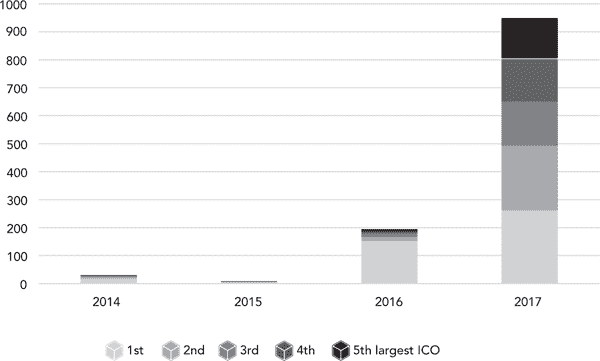

*数据来源：* CoinDesk *ICO 追踪器和* Business Insider。

虽然这些代币销售为项目或计划筹集启动所需资本提供了新机遇，但它们往往处于监管灰色地带，尤其是在证券法规方面。虽然许多基于区块链的代币发行很可能属于证券法的管辖范围，但许多草根项目或初创公司难以承担这些法律带来的监管负担——涉及披露要求、围绕这些投资工具的信息不对称，以及目前针对散户投资者缺乏问责或救济机制。与此同时，对于硅谷等主要金融和技术中心之外的项目和企业家来说，获取传统风险投资依然困难。

我们首先区分符合*生态系统*（如比特币、以太坊）资格的基于区块链的系统，以及那些符合运行在生态系统之上的 Dapp 资格的系统。我们认为，这两种方法需要实施不同的代币模型，因此也需要不同的机制来遵守相关法律要求。

*生态系统代币*的发行与*应用币*（application coin 的简称）的发行存在结构性差异。生态系统代币代表了其关联生态系统的一个基本且*必要*的组成部分；而应用币可能具有类似积分的功能，或被用作使用服务的现金支付替代品。此类应用币的困境在于，在许多情况下，它们依赖于单薄的经济基本面，往往仅作为一种伪装，为围绕私人利润中心设计的基于区块链的应用程序开发筹资——实际上充当了另一种形式的证券型代币。

在本章中，我们主张只有生态系统代币才能成为真正的*效用代币*。我们概述了参与代币销售的各种项目采用的不同做法，并调查了现有监管机构采取的监管方法。我们特别关注 SEC 及其在过去一年中思想的演变。我们重点分析了*Howey* 测试在认定证券方面的解释，及其在将基于区块链的代币销售作为融资工具时的潜在适用性。

在缺乏监管清晰度的情况下，基于区块链的项目和计划不得不在浑浊的水域中摸索前行。一些项目采取了一系列复杂的技术法律解决方案，以调整其业务实践和技术设计，使其符合现有法规的意图。这些解决方案试图利用各司法管辖区的监管豁免，如果满足特定要求，将允许证券发行人减轻监管义务。另一些项目则继续持有观点，认为真正的效用代币应完全豁免于证券法，尽管公开进行此类销售变得越来越困难。

鉴于此，我们分析并评估了旨在遵守这些不同监管框架的现有解决方案的可行性。最常见的做法包括创建作为发行代币的伞形组织的非营利基金会（如以太坊引入的瑞士基金会模式），或制定特定的合同安排，如 Filecoin 引入的 SAFT 模式。然而，大多数这些解决方案需要大量的管理开销，同时仍承担着重大的监管风险和不确定性，且往往仅限于证券法下的特定豁免，无法让代币发行人充分享受代币销售带来的全部机遇。

随后，我们提出了一系列创造性解决方案或最佳实践，可用于在遵守现有监管框架（无论是在美国还是欧洲）的前提下成功发起代币销售。我们强调了制造过度盈利预期的现有营销实践的风险。我们还阐述了利用智能合约的力量，将一系列技术驱动的故障安全机制（或技术担保）编码化，以减少代币价格投机机会的方法。这些包括（例如）：

**1.** 发行不可转让代币，以防止二级市场的形成

**2.** 对代币发行人和投资者采用归属时间表，以避免“拉高出货”

**3.** 引入上限价格，防止代币价格超过特定阈值上涨。

最后，认识到将生态系统代币用作融资工具的内在张力，我们探讨了在预生产阶段使用更传统的融资安排（如可转换票据），例如，通过建立一个与非营利开源软件基金会保持独立关系的营利实体。在此模式下，ICO 融资不再构成种子轮融资的替代品，而是用于在后期轮次中利用区块链技术和公众融资的力量，其时间线比传统的首次公开募股（IPO）更快。

## 以私人资金资助公共产品的内在张力

本节探讨基于区块链的代币作为去中心化网络潜在融资机制的用途，并分析以私人资金资助公共产品的内在张力。此处的*私人资金*是指来自各种私人来源的资金，而非来自政府、非政府组织或公共机构，后者属于更中心化的资金来源。私人资金更加去中心化；然而，它目前陷入了 Web 2.0 的思维模型中，实体在其中提取并垄断私人网络价值。

股权是用于资助私营企业的经典工具，股份价值基于对私营企业收入和利润的预期。因此，股权是资助私人利润中心的合适工具，例如 Web 2.0 世界的中心化在线平台，甚至 Web 3.0 领域涌现的各种 Dapp。

然而，当我们进入作为 Web 3.0 基础层运行的新型去中心化基于区块链的协议或平台领域时，仅靠股权可能不足以资助这些新兴生态系统，因为它们具有许多“公共产品”的特征。那么，这些平台的正确融资工具是什么？

*代币销售*或 ICO 的出现，是为了解决私人资金资助公共产品所固有的张力。ICO 的做法是向公众发售基于区块链的代币，并利用筹集的资金支持基于区块链的平台或 Dapp 的开发——一旦部署，这些平台或 Dapp 将向所有代币持有者公开可用。从根本上说，其理念是：如果我们正在构建一个公共产品，那么我们应该让将从该产品中受益的公众来为其提供资金。

## 生态系统代币

该模型特别适用于从根本上需要生态系统代币存在的开放平台或生态系统，即原生于去中心化网络或协议的代币，其功能是协调并激励原本敌对且利己的各方为公共资源的贡献和增长做出贡献。生态系统代币从本质上解决了许多公共池资源所面临的“公地悲剧”问题。^(169) 公地悲剧源于两个条件：

**1.** 参与者个体从使用公共池资源中获益

**2.** 过度使用或贡献不足的外部性由社区所有成员共同承担。

因此，效用最大化的行为体很可能会以一种可能导致资源过度开发或分配不足的方式行事。^170 生态系统代币，作为一种资源分配和质押机制，至少可以部分有助于解决这些问题。^171

寻求访问公共池资源的人必须在公共资源中拥有买入或质押权益才能获得访问权。因此，生态系统代币通常是访问网络资源所必需的，用作网络节点之间支付交易费用的手段，或用作其他内部核算和支付机制。为生态系统做出贡献的参与者也可能获得生态系统代币奖励，例如，通过运行验证节点或以其他方式构建网络基础设施或应用程序。

去中心化的基于区块链的协议，其核心需要为验证节点提供经济激励，以确认链上交易并维护与网络价值挂钩的网络安全，而不是与利用特定区块链的特定应用程序的利润价值挂钩。真正的生态系统代币的价值捕获了网络中多个利润中心以及所有可能的未来利润中心的价值，而不必承担任何特定利润中心的特定企业风险。

这种经济激励*确实*需要二级市场交易，以使其分配去中心化，并为验证节点提供流动性，使它们能够实现其对网络贡献的价值。此外，使用以太币和比特币等加密货币作为激励模型将是不充分的。这些加密货币的价格变动完全是外生的，且独立于网络价值；希望赚取以太币或比特币的节点验证者只需挖掘这些区块链即可。对于新协议来说，使用以太币和比特币作为奖励机制也将过于资本密集。

网络利用，包括构建生态系统以及提供满足最终用户需求的服务和产品，增加了对网络访问的需求，从而增加了对生态系统代币的需求。如果其他条件相同，则这种需求的增加会导致代币价值上升。因此，生态系统代币将个人激励与公共资源的激励相一致。个人实际上必须获取代币以访问网络并参与（无论是个人还是集体）构建生态系统的价值——例如，通过为核心网络架构和基础设施做贡献，或通过构建增强生态系统效用价值的 Dapp。

生态系统代币的长期价值从根本上要求许多利益相关者利用初始创始人创建的开源工具来构建生态系统，并贡献他们自己的资源、创造力和想象力。这是传统风投投资者未能理解的关键点，也是 Web 2.0 商业模式未能捕捉的关键点。

让我们考虑一下以太坊生态系统。以太坊基金会在有史以来的首批 ICO 之一中（仅）筹集了 1800 万美元，该 ICO 于 2014 年 9 月通过出售其原生加密货币以太币完成。在随后的三年里，世界各地的独立项目筹集了超过 36 亿美元，全部建立在以太坊网络上并丰富了生态系统。在古典金融术语中，这被称为*杠杆*。

## 去中心化应用（Dapp）代币

Dapp 代币从根本上不同于生态系统代币。即使 Dapp 代币具有效用功能——它协调特定基于区块链的应用程序内的操作——其经济功能从根本上也是有限的：Dapp 不像真正的网络生态系统那样构建公共的共享基础设施。

专注于特定产品或垂直领域的利润中心长期以来一直使用股权作为主要融资机制。Dapp 拥有收入和利润模型，Dapp 服务的用户可以使用法币、加密货币、稳定币，甚至是 Dapp 所建立其上的底层网络或生态系统的生态系统代币等现有选项进行支付。在许多情况下，很难证明赋予 Dapp 其自己独特的效用或应用代币（区别于生态系统代币）是合理的。

即使 Dapp 使用访问或会员代币（例如，用于访问内容），也没有经济理由要求这种代币需要二级市场流动性，而生态系统代币将其作为其经济设计的一部分加以要求。在实践中，Dapp 代币的效用价值往往显得牵强，作为一种机制来规避证券法，对本质上是私人利润中心的股权进行公开融资。

在 ICO 领域，目前的分析侧重于这些基于区块链的代币的“性质”或“功能”——特别是某个代币是否被归类为效用代币、代币化证券，或像比特币这样的加密货币。代币化证券显然会被归类为证券，受所有适用法律法规的约束。然而，在效用代币类别中存在细微的区别。虽然效用代币可能同时涉及生态系统代币和 Dapp 代币，但这些代币对于去中心化生态系统和基于区块链的网络的运行至关重要，而对于 Dapp 的运行则并非不可或缺。

由于生态系统代币和应用代币之间存在根本差异，我们认为法律分析应从这里开始，而不是从代币是否具有效用功能开始。将分析推向其逻辑结论，Dapp 效用代币的理由往往非常薄弱，如果只是为了利用 ICO 炒作，而全球监管机构目前正在审查这种炒作。

没有经济或设计理由表明 Dapp 不能或不应由传统股权资助，这使得效用论据更难以成立。正如 SEC 主席 Jay Clayton 所说：“某些市场专业人士试图强调其拟议首次代币发行的效用特征，以此主张其拟议代币不是证券。许多此类断言似乎是重形式轻实质。”^172

令人担忧的是，由于许多不负责任和投机取巧的 ICO 导致监管打击，代币作为开源生态系统必不可少的融资机制的原始基本原理可能会迷失。

在以下章节中，我们将考察 ICO 实践的演变，以及随之而来的 SEC 指导和在 ICO 领域的执法行动。然后，我们将提供一系列建议和见解，说明合规的开放生态系统项目融资如何演变，这将既增强此类项目的长期生存能力，又为投资者提供新的价值主张。

## 实践与监管方法不断演变的格局

### 历史分析

#### 比特币和中本聪

基于区块链的系统的第一个实例是比特币，一种由化名实体中本聪于 2008 年阐述的点对点电子现金系统，其首笔交易发生在 2009 年 1 月 3 日。^173 从设计上讲，比特币是一个开放的生态系统，我们可以在经济意义上将其视为一种准公共产品。^174 与中心化数字平台不同，比特币没有任何私人利润中心，并使用其原生加密货币*比特币*作为降低贡献不足和过度开发风险的手段。

这种自我调节源于*交易费*（用户必须以比特币支付）和挖矿奖励（向贡献算力维护和保障网络的人发行新比特币）的混合机制。^175 因此，比特币因执行交易的必要性而获得价值。比特币也可在二级市场或交易所交易，可兑换法币买卖。

#### 以太坊与 Vitalik Buterin

随着比特币开始获得关注，Vitalik Buterin 等人意识到，可以将底层区块链技术用于简单金融交易之外的其他类型应用。Buterin 是一位加密货币研究员和程序员，曾联合创办 *Bitcoin Magazine*，他在 2013 年底首次构想了一个开源、去中心化且基于区块链的计算平台。^176 比特币为交易实现了一种非常基础的脚本语言，故意设计为非图灵完备；而 Buterin 的雄心是创建一个拥有图灵完备编程语言的平台，以支持智能合约的执行，从而创建用户生成的 Dapp 及其伴随的应用代币。^177

他将该平台命名为以太坊。^178 该新型基于区块链网络的开发资金，通过 2014 年 7 月至 8 月的在线众筹销售以太币（其原生加密货币）筹集。^179 与比特币一样，以太币可视为生态系统代币：人们使用代币支付使用以太坊基础设施所需的交易费（即“Gas”）；用户通过向网络贡献资源（即挖矿）来获取以太币。同样类似于比特币，以太坊生态系统不运营任何盈利中心。然而，其治理略有不同，因为 Buterin 在项目中保持活跃的领导角色，社区可以依赖明确的非营利组织以太坊基金会进行代码的开发和维护。

近年来，以太坊已演变为领先的区块链生态系统之一，吸引了大量开发者、企业家、初创公司、成熟企业以及各类学术和研究机构，他们都渴望探索并利用其平台构建 Dapp。

#### The DAO

这一创新浪潮的旗舰项目之一是 The DAO，一个分布式投资基金，于 2016 年 5 月通过代币销售筹集所有资金。短短几周内从约 11,000 名投资者处筹集超过 1.5 亿美元，创下当时历史上最大众筹活动的纪录。

The DAO 的关键特征之一是没有传统管理结构（即无官方管理机构或董事会）和正式组织形式。The DAO 没有法律实体；它仅作为建立在以太坊区块链上的去中心化组织而存在。

尽管 The DAO 从未实际开始运营，但分析其代币 TheDAO 的功能或效用仍具相关性。^180 The DAO 旨在成为以太坊生态系统的重要参与者，使代币持有者能通过投资各种商业和非商业项目来进一步发展生态系统，从而提升以太坊网络的效用及其价值。此外，作为创建去中心化组织的尝试，The DAO 本身在一定程度上可被视为一个开放生态系统：任何人均可使用 TheDAO 代币参与或贡献 DAO。

尽管德国公司 Slock.it 开发了 The DAO 的代码，但 Slock.it 只是众多竞争获得 DAO 资金的竞争者之一。^181 The DAO 旨在完全自主，成为一个拥有独立生命的事业。它将由投资者集体管理，直接与 DAO 开源智能合约代码交互。因此，启动后将是代币持有者——而非 Slock.it——控制 DAO 的运营。

然而，与比特币或以太币不同，TheDAO 代币的效用并非生态系统的基础。它很像一种证券，是一种可转让代币，赋予每位持有者分享 DAO 从投资中获得的任何未来利润的权利。此外，代币持有者有权参与 DAO 的治理，而*策展人*负责将合格项目列入白名单，代币持有者的法定人数决定 DAO 资金的分配。^182

换句话说，正如股东可通过在年度股东大会投票参与公司治理，TheDAO 代币持有者可通过投票直接影响 DAO 的最终分配决策。The DAO 是一个投资基金，其投资者未将项目选择委托给投资经理；而是根据其占总投资资本的份额，自行决定投资选择过程。^183 从某种意义上说，The DAO 的运作类似于投资证券的开放式基金，股东可根据其占基金总投资资本的份额决定基金的投资。

TheDAO 代币确实具有特定效用：任何愿意向 DAO 提交项目的人都必须花费 TheDAO 代币。然而，若 DAO 的原始设计包含此选项，他们本可通过花费以太币实现相同功能。TheDAO 代币相对于以太币的唯一增量使用价值，在于使其持有者能在 DAO 的投资提交和选择过程中投票。

## 图 3-2

2017 年前 10 大 ICO（单位：百万美元）

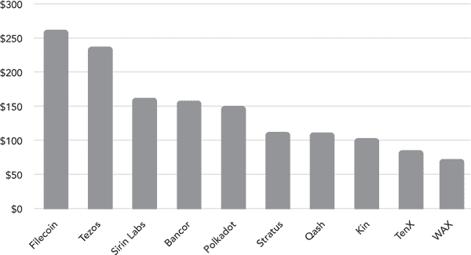

*数据来源：Oscar Williams-Grut, “The 11 Biggest ICO Fundraises of 2017,”* Business Insider, *1 Jan. 2018*。

尽管 DAO 的管理流程不同于标准公司管理流程，但 TheDAO 代币赋予持有者的投票权，在一定程度上类似于标准股东及其代表的私人利益。看来 TheDAO 代币的存在并非为了支持 DAO 生态系统的运营，而是为了确保代币持有者能获得与其个人贡献成比例的投资回报。

The DAO 众筹的意外成功，激励大量基于区块链的项目和倡议发起自己的代币销售，其中一些超出了创始人的预期。Filecoin（2.57 亿美元）、Tezos（2.32 亿美元）、IOTA（43.4 万美元）和 EOS（1.85 亿美元）等项目采用 ICO 模式而非风投方案。^184

## Munchee

虽然那些项目旨在创建生态系统，但越来越多的私营公司正尝试这些新融资机制，为开发基于区块链的应用或 Dapp 筹集资金，这些应用不作为开放生态系统运营，而是作为私营盈利中心。

这一趋势的典型例子是 Munchee，一家总部位于旧金山的公司，创建了一个供用户评价餐厅和评论美食体验的移动应用。为改进其应用，Munchee 于 2017 年第四季度发起代币销售（MUN 代币），目标筹集 1500 万美元。

MUN 代币使持有者能在应用内购买商品和服务，如广告、食品购买和餐厅忠诚度积分，并根据其会员状态（按代币持仓分级）获得评论报酬。Munchee 将其代币称为 Munchee 生态系统内的交换媒介。^185

然而，MUN 代币实际上并非生态系统代币。Munchee 应用程序作为一个私营利润中心运营：用户利用 MUN 代币所能实现的一切，本可以轻松用以太币、法币，甚至中心化代币系统来完成。

这四个项目——比特币、以太坊、The DAO 和 Munchee——展示了可能性的光谱，范围从纯粹的生态系统代币（如比特币和以太币），到用于开放生态系统的证券型代币，再到完全私有的代币或应用币（MUN）。

### SEC 标准的演进

在本节中，我们将对 ICO 代币进行法律分析，并审视 SEC 监管方法的演变过程，从其 2017 年 7 月关于 The DAO 的初步报告，到其 2017 年 12 月针对 Munchee 的最新新闻稿和执法行动。

#### 关于 The DAO 的报告

2017 年 7 月 25 日，SEC 发布了一份调查报告，并随附一份新闻稿，警示业界：区块链技术的使用并不能豁免代币发行方或交易所遵守旨在保护投资者和市场完整性的现有法律法规的必要性。^(186) 具体而言，报告指出，基于区块链的去中心化组织（如 The DAO）出售数字资产（或代币）极有可能符合证券发行的定义，因此须遵守联邦证券法的注册和披露要求。

尽管该报告旨在为 ICO 实践的法律考量提供一般性指导，但 SEC 将大部分法律分析集中在 The DAO 上。虽然 SEC 是根据具体情况逐案判断特定代币是否属于证券，但其聚焦 The DAO 是为了阐释证券法在“虚拟组织”背景下对基于区块链代币发行的适用性。

具体而言，为判断 The DAO 代币是否属于证券，SEC 适用了 *Howey* 测试，该测试源于美国最高法院案例（*SEC v W.J. Howey Co*., 328 US 293），用于判断投资合同是否涉及美国证券法。正如 *Howey* 案法院所确定的，投资合同要求满足四个要素：（1）资金投入，（2）共同企业，（3）合理预期利润，（4）利润来源于他人的创业或管理努力。所有要素均须满足，方可认定为证券，从而触发证券法律法规的适用。

在 The DAO 案中，SEC 认定 Slock.it 团队承担了足够的管理努力，例如撰写白皮书、设计协议、编写大部分代码、维护公共论坛和网站，以及宣传 Slock.it 团队和 The DAO 策展人的专业知识。SEC 指出：

> The DAO 的投资者合理预期 Slock.it 及其联合创始人，以及 The DAO 的策展人，在 The DAO 启动后将提供重大的管理努力。…… Slock.it 及其联合创始人实际上确实积极监管 The DAO。他们密切监控 The DAO 并在问题出现时加以解决，提议暂停所有提案，直到 The DAO 代码中的漏洞得到解决并任命安全专家监控针对 The DAO 的潜在攻击。当攻击者利用代码弱点转移投资者资金时，Slock.it 及其联合创始人介入协助解决局面。^(187)

此外，根据 SEC 的说法，The DAO 代币持有者的投票权受到限制，因此不足以取代对 Slock.it 管理团队的整体依赖：“即使投资者的努力有助于使企业盈利，这些努力也不一定等同于发起人的重大管理努力或对企业的控制权。”^(188)

生态系统代币的长期价值增长需要公众参与，这也是许多律师认为 SEC 在 DAO 报告中对 *Howey* 测试的分析在最后一个要素——即要求利润预期主要*源于他人的管理努力*——上显得薄弱的原因。

构建生态系统并非被动投资，而是需要社区参与。然而，困难在于构建生态系统需要时间，且要求项目初始发起人投入大量精力。因此，项目的初始创始人必须先构建部分生态系统，以便他人前来参与。在 The DAO 案中，包括 Slock.it 团队在内的各方人士都为构建该生态系统的价值做出了贡献（从而也提高了与该生态系统关联的代币价值）。然而，根据 SEC 报告来看，如果一个可识别的团队向公众推销潜在投资机会，而公众将信心寄托于该团队来激活社区，那么该团队的努力必然会落入 *Howey* 测试中的“管理努力”范畴。

#### 对 Munchee 的执法行动

几个月后，即 2017 年 12 月 11 日，SEC 主席 Jay Clayton 就 ICO 发表声明，与此同时 SEC 对 Munchee 的 ICO 采取了行动。Clayton 主席试图传达一个平衡的信息。一方面，他表示 SEC 视 ICO 为有效的融资机制，并鼓励大众投资者对其持开放态度。另一方面，他警告称，迄今为止大多数 ICO 实质上都属于证券，但未遵循旨在保护大众投资者的必要注册和披露要求。在声明中，Clayton 主席指出：

> 我认为，首次代币发行——无论其是否代表证券发行——都可以成为企业家等筹集资金的有效途径，包括为创新项目融资。……我们 SEC 致力于促进资本形成。加密货币和 ICO 所基于的技术可能被证明具有颠覆性、变革性和增强效率的作用。我坚信金融科技的发展将有助于促进资本形成，并为机构投资者和大众投资者提供有前景的投资机会。我鼓励大众投资者对这些机会持开放态度，但要提出好的问题，要求清晰的答案，并在参与时运用良好的常识。^(189)

然而，正如 *Munchee* 执法令和 Clayton 主席的声明所指出的，仅仅称代币为实用代币不足以规避证券法。证券法分析将考虑代币实际如何营销、代币面向何种受众，以及代币购买者是否因项目发起人的努力和陈述而合理预期获利。正如 Clayton 主席所解释的：

> [一]些市场专业人士试图强调其拟议 [ICO] 的实用特性，以此主张其拟议代币不属于证券。许多此类断言似乎属于重形式轻实质。仅仅称代币为“实用”代币，或构建其以提供某种实用性，并不能阻止该代币被认定为证券。包含强调基于他人创业或管理努力的盈利潜力的特性和营销努力的代币和发行活动，继续具有美国法律下证券的标志特征。^(190)

## SEC 对 Munchee 的执法行动：效用代币与证券代币的分析

随附的 *Munchee* 执法令提供了背景与细节。尽管 MUN 代币被描述为“生态系统”代币，SEC 似乎并不认为其是真正的效用代币（SEC 在其执法令中始终将 ecosystem 一词加上引号，表明其对生态系统论点持怀疑态度）。MUN 代币看似是机会主义地被植入到一个现有应用中，仅作为一种据称能规避 SEC 监管要求的融资机制。正如我们上文所定义的，Munchee 确实*不是*一个生态系统，因为其目标并非构建一个开放的开源工具网络供他人构建应用。相反，Munchee 纯粹是一个传统的社交媒体类美食点评应用，现引入了一种内部代币作为支付和忠诚度奖励机制。

SEC 指出，MUN 代币不具备即时效用，其推广对象仅为加密投机者和牟利者，而非 Munchee 应用用户，且 Munchee 团队使用的语言描述了 MUN 代币作为效用代币，其价值将因需求及 Munchee 团队建设 Munchee 生态系统的努力而增加。

SEC 提供了一些宝贵的指导，说明如何以符合效用代币定义的方式出售代币，即使该代币并非即时可用：

> Munchee 及其代理人将 MUN 代币发行的营销目标对准了对代币或其他数字资产感兴趣的人群，这些资产在近年为 ICO 早期投资者创造了利润。这种营销并未利用 Munchee App，也未专门针对 Munchee App 现有用户，宣传购买 MUN 代币如何能让他们有资格获得未来点评的更高等级和更大额支付。Munchee 也没有在餐饮行业媒体上宣传 MUN 代币发行，以触达餐厅老板并宣传 MUN 代币如何能让他们在未来进行广告投放。相反，Munchee 及其代理人在面向对投资比特币及其他数字资产感兴趣人群的论坛上推广 MUN 代币发行，包括在 [BitcoinTalk.org](http://BitcoinTalk.org)（一个人们讨论数字资产投资的留言板）上。^(191)

正如 SEC 所暗示的，Munchee 本可以将 MUN 代币出售给其现有及未来的客户群，基于 MUN 代币的*未来效用*。但由于代币仅向对 ICO 和加密货币获利感兴趣的加密投资者推广，其营销努力和销售策略破坏了 Munchee 关于代币是应用功能和内部经济组成部分的论点。相反，所采用的销售渠道成为了 Munchee 真实意图——将这些代币作为纯粹投资工具出售——的证据。简而言之，MUN 代币是披着效用代币外衣的证券代币。

虽然 SEC 指出 MUN 代币不具即时效用，但仔细阅读执法函会发现，代币的实际效用无论哪方面都不是证券法问题的决定性因素。向合适的受众出售*未来*效用，且使用的语言排除了任何价值增值预期，可能经得起审查。反之，通过针对投资者获利预期和价值增值的销售渠道和营销语言，出售具有即时可用性的效用代币，将触犯 *Howey* 测试，被视为证券发行。SEC 陈述道：

> 即使 MUN 代币在发行时具有实际用途，也不能排除其属于证券的可能。判断一笔交易是否涉及证券，不取决于标签——例如将 ICO 定性为涉及“效用代币”——而要求对“交易的经济实质”进行评估。*Forman*, 421 US at 849.^(192)

SEC 执法函和 Clayton 主席的新闻稿明确指出，营销语言和销售策略是在确定那些“经济实质”时，证券法分析中的一个重要因素，而非仅关注代币的效用属性。Clayton 主席指出：

> 当这些发行的推广者强调这些代币的二级市场交易潜力时，情况尤其令人担忧。潜在购买者被灌输代币增值的潜力——并有能力通过在二级市场转售代币来锁定这些增值——或基于他人的努力从代币中以其他方式获利。这些是证券和证券发行的关键标志。^(193)

此外，在 *Munchee* 执法函中，SEC 指出 Munchee 使用了描述经济机制的语言，称团队预期 MUN 代币将通过该机制增值。因此，这种语言在代币购买者中创造了合理的盈利预期。文中引用了一位创始人在播客中使用的以下语言：

> 所以\[用户\]将创作更多优质内容以吸引更多餐厅入驻平台。所以我们拥有的餐厅越多，Munchee 拥有的优质内容越多，MUN 代币的价值就会上涨——这就像是激励用户真正贡献、真正建设社区的底层激励机制。^(194)

此外，SEC 还指出 Munchee 计划销毁代币以调节代币供应量，从而调节代币价值。

虽然我们不反对 SEC 叫停 MUN 代币销售的最终决定（我们认为这显然是一项证券发行），但我们认为 SEC 选取的、作为支持证券分类证据的价值增值相关语言，有些令人费解。大多数经济交易并不涉及证券法。*所有*经济交易都涉及某种价值评估，即商品或服务是否定价公允，以及基于购买者对影响该资产价值因素的看法，该商品或资产是否因当前被低估而会升值，等等。

让我们审视房地产投资，这可能包括在合作结构下购买公司股份。房地产投资通常不涉及证券法。房地产当然具有效用价值。它是人们居住、工作、娱乐和开发的场所。但许多人购买房地产也是希望未来价值增值。事实上，对大多数普通人而言，他们的房子是其主要金融资产，从中既获得效用（居住），也获得财务保障（价值增值）。开发商可能利用房地产销售所得进一步投资开发，从而提升房地产单元的价值。

其他人则明确将房地产作为投资物业或为租金收入而购买，在销售过程中会明确分析租金定价趋势或历史房价增值趋势。法律是否应该禁止房地产经纪人与潜在购房者讨论他们认为房屋的真实“评估”价值相对于市场价格如何，以及基于人口结构向好等因素，某特定房屋是否是一笔可能增值的好买卖？

在真正的生态系统（而非 Munchee 的）背景下，SEC 在 *Munchee* 案中挑出的这段语言，正是生态系统代币激励公众为公共资源做贡献的经济机制：个人因获得奖励而对生态系统做出积极贡献。

社区参与度和最终用户采用率越高，对生态系统代币的需求就越大，在其他条件保持不变的情况下，这会增加其价值。我们认为，单纯描述这种经济机制不应需要证券法的监管。这与房地产经纪人向潜在买家解释房屋价值受人口统计、国内生产总值、犯罪率、当地学区质量、绅士化等因素影响并无二致。仅仅描述特定经济交易中影响价值的因素，不应使生态系统代币表面上被归类为证券。

另一方面，当项目推广者作出或背书诸如“MUN 代币在 ICO 价格基础上获得 199% 收益！立即报名参与预售！”或“几乎可以肯定，如果你入场足够早，你很有可能获得回报”或“1000 美元的投资可能带来 94000 美元的回报”等言论时^195，公众应受到保护。**具体**关于特定资产利润增值的陈述应成为关注的核心，而非描述特定资产如何增值以协调激励的经济理论的一般性陈述。

无论此类讨论的性质如何，将其全部标记为证券发行的证据，可能会产生负面的公共政策效应，即对网络化生态系统固有特征的相关讨论产生寒蝉效应。考虑到代币和代币经济学这一新兴领域，阻碍企业家和市场参与者的公开讨论，将不利于分析、质疑和检验这些新理论和模型。

尽管如此，尽管对 ICO 和将代币作为融资工具持开放态度，SEC 似乎已缩小了其在证券法问题上的观点范围。当 SEC 首次发布报告将 TheDAO 代币归类为证券时，许多从业者（如前 SEC 律师 Nick Morgan）认为，SEC 对 *Howey* 测试的分析在最后一个要素上最为薄弱，即要求预期利润源于他人的管理努力。在这一领域，法律诉讼或许有胜算。^196 这一要素的核心结论在于：尽管 DAO 是一个去中心化的基金机制，但它并未充分独立于 Slock.it 团队的管理努力；因此，DAO 投资者主要是依赖 Slock.it 实现其盈利预期的被动投资者。

根据 SEC 在 *Munchee* 执法函中的最新指引，*Howey* 测试的最后一个要素——预期利润是否源于他人的创业或管理努力——似乎越来越成为无关紧要的问题，尤其是对于预生产阶段的项目。该要素与认定合理的盈利预期密不可分。

正如 DAO 报告中所述，SEC 在 *Munchee* 案中指出，Munchee 突出宣传其团队的资历，造成了投资者合理地依赖 Munchee 关于修改应用程序并培育有价值“生态系统”的承诺，该生态系统由使用 MUN 代币作为忠诚度奖励的美食评论家和餐厅组成。因此，盈利预期将取决于 Munchee 创建该“生态系统”并通过销毁代币来管理代币供应、从而增加其价值的能力。^197

提炼最新指引后，清楚地表明：实用代币是摆脱 SEC 管辖的*必要但非充分条件*。实用代币具有即时可用性还是未来可用性，既非必要也非充分条件以摆脱证券法问题。我们在此刻意使用“可用性”一词，以区分“理论效用”与“实际功能”。实用代币在设计上是功能性的，而其在平台或网络中的即时可用性则取决于开发进程推进到了何种程度。

正如 SEC 所言，代币的可用性并非证券法问题的决定性因素（即不能解决该问题）。相反，代币的营销和销售方式（包括客户渠道）可能足以决定证券法的适用性，包括代币是否真正是实用代币。例如，会造成购买者合理盈利预期的营销语言和策略，足以使代币发行落入证券法规的范围内，而无论该代币是否具有即时可用性的实用性。

从辩护角度来看，我们将向 SEC 或法官（即对 SEC 行政立法的司法审查）主张，代币销售的营销和销售策略是判断代币是否真正是实用代币、还是披着实用代币外衣的证券的重要（甚至可能是决定性的）*迹象*。尽管如此，我们认为单纯的营销分析并非 *Howey* 测试下证券法分析的要素或要求。

### 结合生态系统代币与应用代币重新诠释 *HOWEY* 测试

#### 步骤 1：代币的功能性分析

基于最新的 SEC 指引，并遵循“实质重于形式”的格言，我们重申观点：代币的证券法分析必须从功能性分析开始：

• 正在构建的项目或应用程序的性质是什么？
• 代币的经济设计和基本原理是什么？
• 是否有令人信服的理由证明代币存在和设计的合理性？
• 融资是代币的主要功能吗？

然而，我们认为，要确定代币是否符合证券资格，还必须考察代币所属平台的类型。

• 该平台是否为开源生态系统或网络，能够围绕其构建许多业务和用例，其中代币代表协调和开发共享开源资源的基本特征和经济机制？
• 还是说它只是一个特定的业务应用或 Dapp，代币作为内部经济机制（如忠诚度积分）服务于该应用，与平台内部运作没有内在联系，仅仅是用来替代传统的会员费、收入或交易费？

这种生态系统代币与 Dapp 代币（或应用代币）的区别，有助于确定在评估代币未来盈利能力时，投资者在多大程度上将“他人的努力”视为一个重要的分析标准。对于 Dapp 而言，投资者参与开发和运营并无根本的经济必要性。投资者扮演着相对被动的角色，主要依赖 Dapp 团队的努力来开发、维护和推广系统。

在生态系统中，代币发挥着与底层基于区块链平台运作内在相关的功能。因此，这些代币将始终具有实用性，因为它们被用来解决与公共资源过度开发或利用不足相关的“公地悲剧”问题。此外，由于这些代币的价值与生态系统的价值内在关联，随着更多利益相关者参与或贡献于生态系统，其价值将会增加。

在此背景下，代币增值同样取决于“他人的努力”，但此处的“他人”指的是一个广泛得多的利益相关者社区，包括投资者在内，他们通过贡献开源代码、推广平台、建设社区，甚至在该生态系统之上创建或开发其他 Dapps 等不同方式，共同推动生态系统的发展。

鉴于此，我们认为有必要根据待评估代币的类型，重新界定 *Howey* 测试的适用性。当 *Howey* 测试于 1946 年确立时，它无法预见开源项目的存在，更遑论基于区块链的生态系统。在将该测试应用于全新的语境时，我们应铭记这一点。特别是，我们主张 *Howey* 测试的第四项——关于“他人的努力”——应根据测试是应用于开放生态系统还是 Dapp 的私有利润中心而有所不同地解读。

确实，一个开放且去中心化的生态系统将永远依赖于“他人的努力”，因为该生态系统是通过生态系统中所有参与者的贡献构建而成的。我们认为，在 Web 3.0 语境下，*Howey* 测试的最后一个要素应被解读为对“他人努力”的*重大*或*实质性永久*依赖——其中“他人”指的是一个可识别的管理团队或组织机构，没有它，生态系统将不再也无法有效运作。因此，我们可能需要一项“碎片化”或“颗粒度”测试，以确定 *Howey* 测试的第四要素是否真正得到满足：

• 是否存在一群比其他人显著更投入、贡献了绝大部分工作量的社区成员？
• 将该团队从社区中移除，是否会危及整个项目？

如果这两个问题的答案均为肯定，则很可能存在一个标准的核心“管理”团队，其活动对系统的成功至关重要。然而，如果一个小团队的努力相对于社区其他部分仍保持“原子化”状态，则情况并非如此。某个特定群体具有影响力且是社区核心，不应成为决定性因素；问题的关键在于，该项目的生存或成功在长期内是否从根本上依赖于该群体的运作。

因此，旨在为生态系统开发筹集资金的代币发售——我们可以称之为*生态系统代币发行*（ECO）——不应仅因他人的努力或代币增值的单纯可能性而必然受证券法管辖，除非有其他理由证明适用 *Howey* 测试是正当的。

当然，我们并非在说生态系统代币永远不会被视为投资证券。某些行为可能触发证券警示，例如核心且可识别的团队公然宣传代币的投资价值，正如 Slock.it 对 DAO 所做的营销那样。

最终，SEC 将不得不依赖“气味测试”：闻起来像证券发行吗？这是一种“情势总体”式的分析。单一特征单独来看，不太可能左右分析结果。最终，只有极少数项目可能真正符合像比特币或以太坊那样的真正生态系统资格，而大多数项目将仅停留在法律的灰色地带。^(198)

#### 步骤 2：代币发售的营销与时机

正如我们所主张的，真正的实用代币在设计上始终是实用代币，无论在底层协议开发的任何时间点其是否可用。实用性是落在证券法管辖范围之外的必要但非充分条件。正如 SEC 所澄清的，证券法问题不仅取决于代币的可用性，还取决于其营销方式：

• 实体向谁、如何以及何时出售其代币？
• 营销语言是否让购买者对获利产生了合理预期？

代币发售时机相对于项目开发进度的关键影响在于，它影响营销和销售策略，以及潜在购买者依赖他人努力获利的程度。向潜在客户或用户群出售代币而非纯投资者群体，更容易主张该代币不是证券，因为客户能够在运行中的网络上使用该代币。

到目前为止，项目仅在预生产阶段使用 ICO 进行融资；这就是为什么这种用法成为 SEC 分析的范围。在预生产阶段，生态系统代币和应用代币的区别仅停留在理论层面：在实践中，生态系统项目和 Dapp 项目都可能处于萌芽状态，由规模较小的管理团队控制并编写有限的代码库。因此，考虑到在平台就绪前向未来的客户和用户销售存在实际困难，生态系统代币面临被归类为证券的风险。

对于不善于解读技术白皮书的监管机构而言，生态系统与 Dapp 之间几乎没有区别；大部分分析将集中在销售机制、所作承诺，以及此类做法和承诺是否足以促使 SEC 采取行动以保护公众。SEC 被授权考量这一重要的公共政策要点：代币购买者在缺乏证券法为传统融资中的投资者提供的保护时，面临显著更大的风险。

对于这些早期项目，SEC 认定代币购买者显著依赖项目发起人的管理努力。对于“代币购买者必须付出努力来增加代币价值”（如 DAO 案例）这一论点，SEC 并不买账。在早期项目中，反驳 *Howey* 测试第四要素（“他人的努力”）的适用性将很困难，因为总可以辩称购买者主要依赖项目发起人的努力来播种生态系统并激活社区。

因此，对于那些在寻求公开代币发售融资时已发展得相当成熟的生态系统项目，仍留有有趣的问题。例如：

• 何种事实和情形会改变关于是否购买者依赖他人管理努力的分析？
• 以下因素对 SEC 是否相关？
  ⃘ 代码分叉成为现实可能性或已实际发生？
  ⃘ 任何人都可以作为节点验证者或矿工加入？
  ⃘ 公众正在积极使用、改编和消费开源代码，并在没有任何中心化控制的情况下在生态系统之上构建？
  ⃘ 投票和治理机制是否足够稳健，以克服 SEC 在其 DAO 报告中指出的批评？

如前所述，分析将归结为气味测试，以及公共政策是否足以促使 SEC 对发行采取行动。如果发行的整体气味像证券发行，如 DAO 案例那样，则 SEC 可能会认定购买者的努力不足以克服对发起人管理努力的依赖。

### 法律拟制与创造性架构：实用解决方案回顾

在本节中，我们回顾并评估项目为预判各类监管问题而部署的各种法律解决方案，包括瑞士非营利基金会模式、SAFT、可转换票据以及证券登记豁免。

#### 基金会模式

瑞士的环境及其监管便利条件对于建立新的区块链企业颇具吸引力。特别是瑞士基金会模式，首次被用于管理旨在资助新型基于区块链的网络或应用开发的初始众筹交易所得款项。2014 年，以太坊成为首个在瑞士楚格州建立基金会（*Stiftung Ethereum*）的区块链项目。随后，其他基于区块链的项目纷至沓来，以太坊基金会奠定了“加密谷”的基石，后者自称为“世界领先的区块链和加密技术生态系统之一”。^(199)

直到 2017 年年中，楚格一直是加密项目寻求以（希望）合法合规方式融资时的首选司法管辖区，而瑞士基金会（*Stiftung*）则是首选组织架构。楚格因其低廉的州税和对商业友好的声誉而具有吸引力。瑞士组织架构将融资定性为向基金会的捐赠，其使命类似于 Linux 基金会和 Mozilla 基金会那样的开源软件基金会，二者均总部设在加利福尼亚州并享有免税地位。^(200) 据我们所知，迄今为止，这些瑞士基金会均未获得实际的免税地位，而该地位本可使捐赠在瑞士享受税收抵扣。

其构想是：如果筹集的资金被定性为慈善捐赠（尽管缺乏法定认可的慈善地位）而非投资，那么它们就不会违反全球证券法。然而，考虑到 *Howey* 测试的要求以及美国监管机构（如 SEC）的长臂管辖权，瑞士律师建议作为额外预防措施，禁止美国人士和美国 IP 地址参与 ICO。

此外，由于瑞士基金会受到严格监管，其宗旨未经瑞士联邦基金会监管局（*Die Eidgenössische Stiftungsaufsicht* [ESA]）——瑞士监管慈善基金会的联邦监管机构——批准不得更改，因此有人主张瑞士基金会实际上是监督资金用于开发区块链项目的良好治理架构。根据《瑞士民法典》定义，瑞士基金会是“为特定目的而设立的资产捐赠实体”。^(201) 例如，以太坊基金会的官方宗旨是：

> 推广和支持以太坊平台及基础层的研究、开发和教育，将去中心化协议和工具带给世界，赋能开发者构建下一代 [Dapps]，共同建设一个更具全球可及性、更自由、更值得信赖的互联网。^(202)

后续的加密基金会在描述其官方和法律宗旨时，均采用了类似的措辞。

然而，随着越来越巨额的资金通过瑞士基金会流入，瑞士的监管机构和政界人士加强了审查。瑞士基金会原本旨在更多地发挥家族信托或捐赠基金的功能，而非全球融资工具或尖端技术项目。根据我们与瑞士多家律师事务所的讨论，FINMA（瑞士金融市场监管局，相当于 SEC 但职权范围更广，涵盖大宗商品和银行业务）现在要求所有项目在公开融资前必须获得不采取行动函（no-action letter）。

FINMA 的主要关注点在于，代币销售构成公开吸收存款，从而要求销售主体必须持有银行牌照。此外，超过 500 瑞士法郎的代币销售捐款将需要完整的 KYC 视频验证，并受全面持续的反洗钱（AML）义务约束（例如提交可疑活动报告，即 SARs）。^(203)

FINMA 近期发布了具体指南，描述其打算如何将金融市场法规应用于 ICO。该指南区分了：

- **支付型代币**，不视为证券，但必须遵守反洗钱法规；
- **应用型代币**，提供对特定应用或服务的访问权限，若在发行时已具备功能性且无投资目的的附加功能，则不属于证券；
- **资产型代币**，代表实物资产、公司或其他收入流的参与权，根据瑞士法律明确属于证券。

理论上，这与 SEC 的做法在法律上有别——后者并不一定以实际效用为决定性因素。但在实践中，我们预期两种做法将趋同，因为带有投资属性的应用型代币根据 SEC 和 FINMA 的标准均属于证券。此外，在两种监管制度下，在代币真正具备“功能性”之前出售的应用型代币，很可能会被视为带有投资目的的证券。事实层面的问题仍存：代币必须具备多少功能性，才能划清证券型代币与应用型代币的界限——即多少实际效用足以使代币符合应用型代币资格？

此外，楚格州当局也担心，尽管数亿瑞士法郎在技术上是在楚格筹集的，但楚格州几乎未获任何益处，因为大部分收益仅缴纳了极少的税款。同时，当地极少创造就业岗位（尽管这对律师和顾问而言是福音），引入技术专长并发展真正的知识和人才生态系统。这些基金会大多按法律要求设有基金会理事会，并配有一名法定的瑞士本地居民理事会成员（通常为专业理事会成员），以满足本地实体存在要求。这些项目的核心团队仍设在瑞士境外。瑞士当局很可能也会审查本地实体存在要求和税务待遇。

由于监管环境的变化，加密基金会（或任何其他法律架构）在瑞士开设银行账户变得越来越困难，因为银行合规部门可能比监管机构采取更保守的做法。许多银行已完全停止接受加密客户。

随着全球其他司法管辖区竞相争取业务，瑞士基金会模式在 2018 年的吸引力仍有待观察。许多司法管辖区正致力于改革自身监管框架，以适应基于区块链的项目和代币销售。

#### SAFT 模型：未来代币简单协议

SAFT 模型由 Filecoin 和 Cooley LLP 推广，是一种投资合同，将参与者限制为“合格投资者”，以利用 SEC 的豁免条款（Regulation D，简称 Reg D）。虽然 SAFT 属于证券且仅面向合格投资者，但它赋予投资者权利：一旦相关平台上线运行，即可获得特定数量的代币。

SAFT 模型基于这样一个理念：在平台建成之前，通过 ICO 发行的应用型代币尽管具有未来效用，但可能仍属于证券。只有平台投入运营后，这些应用型代币才会真正获得必要的可用性，从而不再属于证券。以太坊众筹即为例证：2014 年出售以太币时，以太坊网络尚未构建，这些代币无任何可用性，因此很可能属于证券。然而如今，这些代币无疑已获得切实效用，因为持有者可用其支付以太坊网络上的交易费用。

为降低在平台具备运营能力前出售代币的证券法风险，SAFT 模型创建了一个两步流程：

- 第一步是向能够承担项目潜在失败风险的合格投资者发行投资合同。
- 第二步是平台投入运营后，向这些早期投资者发行应用型代币，后者随后可在二级市场将这些代币出售给渴望使用平台的人。

更准确地说，SAFT 白皮书指出：

SAFT 是一种投资合同。SAFT 交易设想了开发者向合格投资者进行 SAFT 的首次销售。SAFT 要求投资者立即为开发者提供资金。作为交换，开发者利用资金开发真正功能完备的网络，以及真正功能完备的实用代币，待功能就绪后将这些代币交付给投资者。投资者随后可将代币转售给公众，推测是为了获利，开发者也可如此。^(204)

SAFT 的创建者承认，他们的创造物属于证券，必须遵守证券法。然而，他们主张代币本身功能完备，已准备好供消费者使用；因此，它们应遵守联邦和州的消费者保护法。换句话说，监管机构无需将代币认定为证券：“已功能完备代币的销售者很可能已经付出了可能满足 *Howey* 测试所需的‘关键’管理努力。”^(205)

鉴于 SEC 的最新指导意见及我们上述分析，我们持这样一个立场：SAFT 模式完全站不住脚。SAFT 模式要求同时满足两个条件：

• SEC 将承认预售代币的投资合同与日后公开销售或发行代币之间存在法律上的区别。
• 代币将确实因其实际可用性而被视为非证券类实用代币或商品。

我们基于 *Munchee* 执法函件，已经分析过第二个条件不成立。仅此一点就足以使 SAFT 失去意义，因为 SAFT 要奏效，这两个条件必须同时为真。

鉴于 SEC 主要强调评估交易的“经济实质”而非交易形式，SEC 很可能会同意 Cardozo 区块链项目的分析：通过宣布 SAFT 本身属于证券（因此适用 Reg D 豁免），整个交易（包括交易标的，即实用代币）均属于证券交易，并伴随盈利预期。Cardozo 报告指出：

> 将整体投资计划人为地划分为多个事件，并不能改变这样一个事实：合格投资者（尽管是通过 SAFT）出于投资目的购买代币，且法院在评估这些代币是否为证券时，不太可能忽视这些现实因素。^(206)

因此，如果这些代币在签订 SAFT 时被作为投资工具进行营销，那么即使它们随后在生态系统或 Dapp 中获得了实际效用，它们也是证券，并将永远保持证券属性。

此外，从公共政策角度来看，SEC 对给予早期投资者大幅折扣的预售定价结构持警惕态度，SAFT 常采用此类结构，因为这些早期投资者有动机将代币抛售给公众以获取即时回报。这种动机削弱了这样一个论点，即 SEC 会承认销售合同与最终实用代币发行之间存在法律区别。

即使代币具有即时可用性，SAFT 合同也会以符合证券交易和投机的方式激励代币抛售，损害公众买家的利益——无论公众购买这些代币是否基于其效用。事实上，如果公众是基于效用考量购买代币，却因这些代币的投机性交易而受到负面影响，那么损害将严重得多，公共政策顾虑也会更大。

而且，一旦发行人申请了豁免，从法律角度讲，其就已宣布该工具属于证券。SAFT 模式之所以特别成问题，是因为它要求发行人根据 Reg D 的 Rule 506(b) 或 506(c) 向 SEC 备案。该豁免旨在通过提供免于注册要求的一般豁免来减轻证券发行的负担——但附带条件是：根据 Reg D 备案的证券只能出售给合格投资者。

如果 SAFT 与通过 SAFT 售出的代币之间的人为分离不被认定为合法分离，且这些代币本身符合证券资格，那么通过 SAFT 合同售出的代币将被永久视为豁免证券，并承担所有随附限制。换句话说，**一旦是证券，永远是证券**：即使这些代币最终获得了可用性，它们仍将受交易限制。只有合格投资者能够交易它们，尽管它们在特定平台上具有实际效用。

因此，真正的实用代币不能是仅在合格投资者之间交易的豁免证券，因为那样只有合格投资者才能使用底层网络。那将违背这些代币的初衷。

SAFT 的一个变体是区块链初创公司 Colony 推出的*未来代币或股权简单协议*（SAFTE）。Colony 团队没有依赖 Cooley LLP 制定的 SAFT，而是起草了一份协议，规定如果不进行 ICO，则给予投资者股权。^(207) 与 SAFT 一样，SAFTE 也基于 Y Combinator 的 SAFE（有折扣，无上限），后者是一种未来股权简单协议，“按协商折扣率……低于标准优先股每股价格……适用于 SAFE 转换为 SAFE 优先股股份。”^(208) Colony 的 SAFTE 规定，从早期投资者处筹集的资金可在首次流动性事件时转换为股权（按特定折扣），或在代币生成事件时转换为代币（按相同折扣）——以先发生者为准。

尽管增加了股权回退选项（以防 ICO 不发生），但 SAFTE 在形式和实质上与 SAFT 并无根本区别：它共享围绕代币预售的根本证券法问题。与 SAFT 一样，发行人通过 Reg D 豁免预售被归类为证券的代币。指望 SEC 接受*投资合同*预售代币与代币获得“效用”后的*实际代币*销售之间存在法律区别，需要同样的逻辑跳跃。

投资者将接受股权作为接收代币的可接受替代方案，这可能构成证据，证明投资者将代币视为等同于股权的投资工具，而股权是典型的证券。因此，代币销售的经济实质实际上是证券发行，无论代币是否具有实际效用。

我们可以设想一种可转换贷款，其中转换是自愿的，不仅为投资者提供股权或代币转换选择，还提供第三种可能性：在代币成功发行等合格事件中赎回并获得累计利息。^(209) 然而，这类产品——实体通过现有金融工具的可转换性获得代币——很可能会带来与 SAFT 和 SAFTE 相同的监管风险。换句话说，“一旦是证券，永远是证券”的严格解释仍可能适用。

#### 证券注册豁免

1933 年《证券法》第 5 条要求任何证券的要约或销售必须向 SEC 注册，或满足豁免要求。有多种豁免可供选择，主要依据 Reg D Rule 506，该规则提供两种不同的豁免：506(b) 和 506(c)。这两种豁免均允许发行人主要从合格投资者处筹集无上限金额的资金，合格投资者需满足以下任一条件：

• 过去两年每年年收入达 200,000 美元
• 净资产至少 100 万美元（不含个人主要住宅价值）。

#### 根据 506(b) 和 506(c) 豁免条款

根据 506(b) 条款，发行人不得公开宣传发行，但可向最多 35 名非合格投资者出售，且在有合理理由相信的情况下，可依赖投资者的自我认证。根据 506(c) 条款，发行人可公开宣传，但仅限向合格投资者，且证明合格投资者身份的举证责任落在发行人身上。^210

特别是 SAFT 模式鼓励根据 506(c) 豁免条款进行备案，因为这将使面向合格投资者的众筹成为可能。利用 Reg D 豁免条款的传统融资通常选择 506(b)。规则 506(c) 是根据《创业企业跳板法案》（JOBS Act）新增的一项较新规定，旨在应对众筹平台的兴起，允许通过互联网、社交媒体和广告进行公开招募投资者。^211 迄今为止，506(c) 的采用率仍然缓慢，主要是因为围绕合格投资者身份验证举证责任（如财务文件的审查和核实）存在法律不确定性，尽管已出现提供身份验证服务的第三方机构。

#### 受限证券与规则 144

根据 Reg D 发行的证券属于受限证券：证券发行的默认规则是必须进行注册。Reg D 豁免仅适用于发行人，不适用于转售人。转售人通常会被视为承销商，需要持有牌照。规则 144 “出售受限证券和控制证券”为在公开市场上转售受限证券（而不成为承销商）提供了安全港豁免。^212

根据规则 144，非报告公司需要持有 ICO 典型的 Reg D 受限证券至少一年。关于私营公司的某些信息应公开可得，包括其业务性质、高管和董事的身份及其财务报表。遵守规则 144 或寻求其他转售豁免的主要义务落在受限证券的转售人身上；然而，SEC 期望发行人建立充分的内部控制，以防止其高管、董事和员工违反联邦证券法。

此外，任何拥有超过 500 名非合格股东或 2,000 名总股东的公司，将根据 1934 年《证券交易法》被视为完全的“报告公司”，实际上成为一家承担所有相关披露和报告义务的公众公司。

#### Regulation A+ 的局限性

《交易法》下的报告公司义务也限制了 Regulation A+（“根据《证券法》对小额和追加发行豁免的修正案（Regulation A）”）下众筹发行的吸引力，后者允许发行人不限合格投资者资格地公开招募。^213 此外，Reg A+ 要求披露文件和财务报表，且必须经 SEC 批准。据我们所知，迄今为止尚无 ICO 在 Reg A+ 下发行。^214

#### 证券型代币与交易系统

我们认为，由于大多数 ICO 面向 Dapp，未来的趋势将是利用各种豁免条款（特别是规则 506(c)）将 ICO 作为证券型代币发行，后者允许公开招募，但仅限合格投资者。与 Reg A+ 一样，规则 506(c) 在被视为完全报告公司前，也受 2,000 股东门槛的限制。

然而，理论上，规则 506(c) 发行筹集的资金将多于 Reg A+，因为发行规模无上限（Reg A+ 第二层级上限为 5,000 万美元，第一层级上限为 2,500 万美元），且无投资限额。（Reg A+ 第一层级无投资限额。Reg A+ 第二层级下，投资者最多可投资其净资产的 10% 或净收入的 10% 中较高者，可自我申报。）

这些证券型代币将需要专门的交易系统，包括受监管的交易所和 `alternative trading systems`（ATS，替代交易系统），后者是匹配买卖订单的非交易所交易场所。SEC 根据 Regulation ATS 将 ATS 作为经纪商-交易商而非交易所进行监管，其监管要求比交易所少。我们预测市场将采用基于区块链的去中心化替代交易平台，实现证券型代币的点对点交易，并将交易记录在分布式账本上。

证券型代币和 ATS 可利用智能合约对规则 144 和其他转售豁免进行自动强制执行（例如自动设置一年的锁定期）。欧洲法规下对应 ATS 的术语是 `multilateral trading facility`（MTF，多边交易机制）。

## 面向未来的创新解决方案

所有代币发行人，尤其是处于早期开发阶段的发行人，都需要非常仔细地考虑其销售、营销和代币设计方法。特别是推出 Dapp 的发行人，需要确定如何构建其代币销售框架，以便在不触犯证券法的前提下筹集资金。

我们在此提出一系列可能降低代币被认定为证券可能性的解决方案。虽然代币发行人无法控制代币购买者的动机，但他们可以从技术、合同或实务等一系列层面进行干预，以阻止购买者从事纯粹的投机行为。

### 仅向战略合作伙伴或潜在平台用户出售

代币的营销方式是 SEC 评估代币是否符合证券资格的决定性因素。因此，发行人面向的营销受众在法律分析中可能具有重要权重。向希望在生态系统中使用代币的人出售其实用价值，还是将其作为投资工具营销给希望从增值中获利的人，最终可能会影响这些代币的法律定性。

遵循 SEC 在 *Munchee* 案中的推理，发行人可以在平台上线前合法销售实用代币，前提是销售对象锁定其用户和客户。面向这些利益相关者和未来客户的营销语言应描述平台的实用性，而非代币的价值增值。

对于处于预生产阶段发起的 ICO，代币发行人可与平台的关键利益相关者或未来用户建立合作伙伴关系，以代币换取试点资金。这将形成一种服务合同形式的融资模式，表面上不违反证券法，却能开发上市试点，证明项目的可行性。

同时，如果平台使用实用代币作为内部协调机制，我们可以主张这些代币甚至不应对最终用户可见。对于零售用户，我们可以主张代币应完全不可见，就像银行卡支付网络对持卡人不可见一样。

良好的用户体验设计应让最终用户使用法币购买服务访问权，随后平台在后台将法币兑换为原生代币——即最终用户无需知晓或理解后端存在实用代币。这就是为什么许多 Dapp 代币销售显得刻意；代币似乎只会增加用户体验的复杂性，除融资外并未增加功能。

除了法律考量，从业务和生态系统发展的角度来看，向机构和战略合作伙伴以及平台的大量重复用户进行机构或批量代币销售，比一次性零售代币销售更合理。向 Dapp 开发者进行生态系统代币的机构或批量销售也同样合理。

### 阻碍二级市场的建立

## 代币设计与证券法规避策略

### 避免二级市场承诺

为避免代币被认定为证券，发行方不应承诺为建立代币二级市场做出任何努力，或参与、支持、推动二级市场的建立。正如 SEC 主席 Clayton 所言，建立二级市场构成“证券及证券发行的标志之一”^(215)。

当然，即使发行方不参与创建二级市场，其他人也可能创建。为避免投资者纯粹为投机而购买代币，发行方可通过技术手段干预，例如阻止 ICO 发行代币的可转让性。若代币不可转让，则鲜有人会抱着盈利预期购买——从而无法通过 *Howey* 测试，且根据欧盟法律，该代币也不符合“可转让证券”资格^(216)。

平台的实际或潜在用户将仅因代币的效用价值而购买，而非因转售可能获利。不可转让代币还能减轻银行及资金转移法规方面的监管顾虑，包括由美国财政部金融犯罪执法网络（FinCEN）监管的持续 AML/KYC 义务^(217)。

然而，该方法不太可能流行或在实践中应用，尤其是在真实生态系统代币（如许多区块链网络的原生加密货币）背景下。正如我们所讨论，缺乏二级市场流动性将难以吸引节点验证者加入新网络，因为代币需补偿其维护网络基础设施的时间和资源。

一种折衷方案是限制代币可转让性一段时间（如一年），这符合 Rule 144 安全港对转售受限 Reg D 证券的要求。虽然时间限制不一定能使代币免于证券属性，但可降低代币交易固有的投机动态，使持币者利益与项目或生态系统利益保持一致。

### 限制代币价格或使用代币边界机制

即使发行方决定不阻止 ICO 代币转让，仍可通过设定代币价格上限来避免过度投机。确实，若存在二级市场，代币价格可能上涨至导致平台访问或使用成本极高的地步。视代币价值的实际或潜在增值情况，人们可能选择囤积或高价转售，而非在平台上消费。这是一种自我挫败模式：对效用代币价值的投机实际上降低了其关联平台的可用性。

效用代币设计的一个关键要素是价格稳定性，因为服务和商品价格应保持稳定，这与产生利润或投机性工具不同。为对抗投机动态，发行方可设立持续 ICO，使人们随时能通过 ICO 智能合约以特定价格（上限）购买代币。

每当市场价格超过上限，人们将停止在市场购买，转而通过 ICO 智能合约按上限价购买。随着人们通过智能合约买入并增加市场供应，市场价格将下跌。仅当市场价跌破上限时，人们才会重新在市场购买。

以太坊研究员 Vlad Zamfir 探讨了实现价格下限和上限的代币边界机制——与比特币固定供给经济学相反，代币供给可波动以维持价格区间。Zamfir 指出：“恒定上限消除了代币购买者可能持有的所有合理回报预期。任何足够低的上限都能防止‘拉高出货’中的‘拉高’行为。”^(218)

代币设计师可定制价格控制机制以达成目标。例如，永久上限机制可按年通胀或其他相关指标调整。在加密世界中，运行以太坊智能合约的 Gas 成本等指标，可能比宽泛的经济通胀定义更适合作为挂钩机制的锚定物。

理论上，定期调整的上限永久执行应较容易，因为只需在有需求时自动按上限价发行新代币。但保证下限价在所有情况下可能不可行。Zamfir 指出：“如果提高下限价会导致无法按下限价买回所有代币，发行管理员就无法提高下限价。”^(219)

即使将大部分 ICO 募资存入智能合约供人们按下限价赎回，该储备也有容量上限；一旦耗尽，生态系统将缺乏开发资金，代币二级市场价格将暴跌。关键不在于支持下限价，而在于确保价格稳定：与效用需求脱钩的代币价值投机性增值，会降低真实项目为既定目的使用协议的激励。

通过使预期回报分布向下倾斜（因上限价可完全保证，但下限价不总能保证），此类控制机制应释放积极信号，表明代币购买者意图真诚：他们投资是因真心支持此类平台发展，并相信此类平台是构建整个代币经济（如 Dapps 和证券型代币）所必需的“基础设施”投资。

随着代币市场成熟，生态系统代币将成为投资者组合中的锚定代币，用于分散风险，正如他们在传统组合中使用法币或紧密相关工具（如政府债券）降低 Beta 风险。

目前，代币边界设计在法律上仍未经检验。在 SEC 视角下，引入可能维持代币价格高于某水平的下限价，是否会滋生盈利预期？引入上限价是否足以消除任何盈利预期？

在 *Munchee* 案中，SEC 将团队承诺销毁代币以提升价值视为盈利预期分析的相关因素。SEC 认为 Munchee 白皮书“代币销毁计划”章节下的表述相关：

> Munchee 可以选择在餐厅支付广告费时销毁（移出流通）一小部分 MUN 代币。……这可能会随着流通总量减少而提升剩余 MUN 代币的增值潜力。^(220)

若 Munchee 将销毁代币表述为降低下行风险而非价值增值，旨在稳定代币价格以提升应用内功能，而非纯粹作为类似股票回购的托价机制，SEC 的分析会有何不同？

为限制合理盈利预期，我们可设想各种价格上限机制的代币设计。但如该领域所有事物，分析终将取决于事实与具体情况。SEC 可能考量如下问题：

• 价格上限有多严格，其驱动因素是什么？

• 这些机制究竟是真正为了价格稳定而部署，还是为了价格升值而部署？

• 代币价格稳定将为平台提供什么增强功能？

归根结底，SEC 很可能会采取整体方法来评估代币交易的经济学——即“气味测试”——以逐案确定代币是否符合证券资格。

真正的生态系统代币对价格稳定功能的必要性，以及 SEC 在这一问题上的立场不明朗，凸显了这一固有的本体论问题：真正的生态系统代币不完全是传统证券，但其功能类似于货币。事实上，法定货币在经济生态系统中转移资源并促进交易，这与 Web 3.0 网络生态系统非常相似，两者都拥有共享公共基础设施的多个利润中心。

### 将融资与代币生态系统治理分离

我们回到最初的主题：利用生态系统代币——本意是协调公共资源——作为私人融资手段，二者之间存在固有张力。虽然向核心生态系统利益相关者出售真正的生态系统代币以维护和开发公共资源是有价值的，但在早期融资阶段，要区分网络化生态系统的开发与运行在该生态系统之上的 Dapp 的部署可能很困难。换句话说，为运行在公共轨道上的获利企业融资，与为底层公共轨道融资，两者的区别往往只是理论上的，且不明确。

从务实角度来看，这些生态系统项目很可能需要一个独立的、按公平交易原则运作的私营企业用于融资，该企业向投资者提供传统的债务或股权融资工具。这种模式类似于开源生态系统中常见的模式，后者包含各类非营利软件基金会（如 Linux 基金会），以及将与开源软件相关的特定产品或服务商业化的营利性公司（如红帽公司，该公司发行并商业化基于 Linux 内核的操作系统）。

对于生态系统项目而言，私营企业的资金可用于初始构建生态系统基础设施，以换取作为开源生态系统管委会的非营利组织发行的代币。这种情况下的代币置换将是一份简单的服务协议（例如，代币作为开源知识产权开发的报酬），这不会触犯任何证券法规。私营企业可以专注于生态系统的特定垂直领域或业务应用，或作为生态系统中其他 Dapp 的营利性孵化器——从而启发生态系统发展。该营利性私营企业完全可以是一家社会企业，选择成为利益公司和/或获得 B Corp 认证。

从务实角度看，私营企业可以接触到各类投资者，包括加密货币投资者，以及那些基金没有法律授权接受代币代替股权的更传统的专业投资者。然而，这些传统投资者将通过私营企业的资产负债表间接获得代币敞口。实际上，生态系统代币的价值代表了私营企业对开源知识产权贡献的价值。与通常作为初创公司核心资产的传统专有知识产权不同，若代币发展出二级市场，资产负债表上的生态系统代币理论上将按市价标记，并拥有更高的流动性和可交易性。

最终，这种新型创意融资工具可能会涌现，例如：

• 种子轮融资前估值阶段典型的可转换票据，可用代币而非股权偿还

• 可转换为代币的股权

• 可在 ICO 时按现金赎回的优先股权益

通过智能合约、动态账本以及去中心化交易平台和交易所，管理结合了债务、股权和代币的、或许更复杂但也更动态的资本结构将变得更加容易。

### 结论

ICO 正在改变融资格局，但其层面与大多数人目前所认为的不同。虽然目前绝大多数 ICO 都在预生产阶段（即种子轮层面）进行，但我们认为，如果在相关区块链平台或去中心化应用构建完成前出售代币，无论是生态系统代币还是应用代币，都很难避开证券法律法规。

生态系统代币构成其基于区块链系统的固有组成部分，因此可能更有机会被视为实用代币。然而，目前 SEC 关于 `Howey` 测试的指导似乎证实了这样一个观点：出售具有实际或潜在效用的代币，本身并不构成排除其作为证券出售的充分条件。我们还必须考虑代币是如何向公众营销的，以及人们为什么购买它们。

因此，除非发行人愿意引入特定的技术担保来减少或消除其代币升值的投机机会（例如，使代币不可转让，或设定低上限的代币价格上限），否则他们需要设计新方法，以确保所售代币不符合证券资格。虽然 SAFT（及相关的 SAFTE）是实现这一目标的一个有趣提议，但 Munchee 案后，SEC 很可能不会接受其逻辑。

将生态系统代币用作协调机制，与将其用作类似证券的融资工具，二者之间存在固有冲突。采取务实方法，开源基于区块链的生态系统最初将不得不依赖私营企业和初创公司典型的融资实践来建立一些利润中心。因此，这些生态系统的发展可能遵循传统的 Web 2.0 模式。

去中心化是一种演进，在实践中起步更加中心化，但在正确的治理和发展下，会随时间演变为真正去中心化的生态系统。

我们认为，ICO，尤其是真正的生态系统代币，将不得不摆脱预生产阶段（种子轮），转而在后生产阶段的融资轮次（A 轮、B 轮、C 轮等）进行，此时已有一个拥有现成用户和客户基础的最小可行性网络或产品。只有在平台部署完成并围绕其形成生态系统后，实用性才会显现，这些代币固有的价值才会对所有人变得显而易见。届时，发行人终于能将代币作为真正的商品而非投资工具出售。

为此，代币发行人可能需要设计创新的公司形式，将非营利结构（监管共享开源资源的获取）与营利结构（或许作为利益公司或 B Corps）相结合，后者专注于特定业务应用或 Dapp 的开发。大多数 ICO 并非真正的生态系统代币，因此非常适合作为证券型代币发行，利用注册豁免并通过去中心化替代交易系统进行交易。

展望未来，我们希望区块链社区——企业家、技术专家、研究人员、学者、律师及其他人士——能与 SEC 等监管机构合作，为新兴代币经济设计监管框架，包括 ICO 等融资活动和持续的市场监管。确实，关于如何思考和讨论代币“经济学”——即应驱动实用价值的因素，以及代币价格限制是否能缓解 SEC 的部分担忧——仍存在重大问题。

此外，即使对于真正的生态系统代币，市场也需要一定程度的投机性交易来提供流动性。市场对一定投机活动的必要性，如何与围绕二级市场的监管担忧相协调，同时又尊重生态系统代币的功能性要求？当我们试图在区块链技术的协助下创建更去中心化的经济模型时，从*豪威*测试的角度来看，我们应如何重新思考依赖“他人努力”意味着什么？

美国证监会（SEC）作为消费者和投资者保护的公共监管者，其担忧有据可依。我们希望制定法规，以鼓励创新、最小化投机，并最终使区块链技术兑现 Web 3.0 的承诺——即构建在生产力、韧性以及权力和资源分配正义性方面更胜一筹的生态系统。

# 第 4 章

## 重塑国际清算与结算

分布式账本技术如何变革全球支付系统

**鲍勃·塔普斯科特**

## 全球支付系统简述

- 全球支付系统是世界商业的命脉。在互联网时代，国际资金转账（无论是企业还是消费者）的缓慢速度、高昂成本和不透明性，都是令人沮丧的根源。资金似乎在机构之间悬置数日。在一家在两国均有大量业务的银行内部，清算一张从法国开往英国的支票可能需要六到八周！^221

- 转账通常基于通过环球同业银行金融电讯协会（`SWIFT`）网络发送的报文。大多数银行除非通过高度安全且受信任的 `SWIFT` 网络收到国际资金转账请求，否则不会予以响应。尽管用于资金划转的 `SWIFT` 报文近乎即时，但银行内部的遗留流程并非如此。

- 新兴的区块链技术可能会削弱甚至取代 `SWIFT` 及其支持的系统。*分布式账本技术*（`DLT`）为加速转账和降低成本引入了三种可能性：

- `DLT` 省去了层层复杂系统与复杂系统对话以管理风险、并为其服务收取费用的必要性。

- `DLT` 实现了国家间资金转账，且无任何显著延迟。

- 在 `DLT` 中，信任源于数学，而非易犯错的人类及其系统。

- 随着国际贸易的爆发式增长，其要求一种成本更低、耗时中介更少的系统。智能手机应用将成为无银行账户人群无处不在的支付机制。近银行和非银行支付系统正在蓬勃发展，无论是否使用区块链。

- 这是一个游戏规则改变者。消费者和企业将确切知道资金何时到账，无需猜测最终兑换的货币金额。没有中介收取高额费用的面向穷人的支付系统，将通过消除阻碍更大经济目标的摩擦和低效，刺激更大规模的商业活动。

- 实现全新系统的技术路线有两种：（1）革命性（大爆炸式）和（2）演进式（润物无声式）。几乎总是，无论计划多么周密，快速实施的大规模变革都会产生负面和意外的后果。因此，将每日数万亿美元的国际支付转向 `DLT` 技术，必须是演进式的。

## 全球支付导论

## 全球支付系统如何运作

两国银行之间的一个简单外汇（`FX`）交易可能涉及许多参与方。交易员（或其计算机）就交易金额、汇率和未来结算日期达成一致，对于简单的即期合约，结算日期通常是明天或后天。

对于简单情况，相关金融机构需要确保资金已存入并可在交易结算当天，通过涉及货币所属国家的中央银行进行调用。在该结算日，当两国中央银行清算系统均正常运行时，一个名为 `CLS` 的央行间清算系统（最初代表*持续关联结算*）协调资金的近乎同步的双向划转。

如果相关银行在 `CLS` 没有账户，则通常必须通过在 `CLS` 有账户的银行进行操作。对于体制外的人来说，这是关于资金的移动。对于体制内的人来说，这是借方和贷方的移动，通过许多复式记账系统，以历史审计追踪作为安全可信的记录。事实上，这仅仅是受信任且受监管的比特的移动。是的，只是比特。

交易对手必须信任（并承担风险）双端的银行、其所在国家货币的清算系统、代理行银行，以及用于协调的 `CLS`。随着 `DLT` 可能的引入，许多人将信任那些被数学证明能保障代币移动及其报文安全的机制，而非信任众多机构（及其成本）来妥善维护其系统。为什么这些代币不能是美元或欧元？答案是它们可以，而且我们将论证，很快就会成为现实。

## 系统为何有时失效

尽管付出了巨大努力（并建立了系统）以确保交易双方同时发生，但我们的假设有时会让我们失望。请考虑加拿大历史上最大的石油交易。随着卡尔加里谈判接近尾声，媒体宣布交易已签署。基于此，东海岸银行家从美国银行向加拿大花旗银行账户转移了数十亿美元。随后东海岸银行家下班回家。

然而，交易并未签署。当美国银行留守的寥寥几人意识到他们在没有相应资产（已执行的销售合同）的情况下转移了数十亿美元时，他们不得不说服加拿大花旗银行将数十亿美元转回，或通知美联储他们技术上已资不抵债。那是一个漫长的夜晚。

如果他们使用基于区块链的智能合约，其中合约的条款条件及其巨额资金转账的执行在数学上是不可分割的，就不会有任何风险。再次问，当我们可以将资金移动交给不可辩驳的数学时，谁还需要风险管理？针对当今的复杂性，存在简单的解决方案。原始区块链创建了一个不可篡改且可用数学证明的活动日志。它结合了公私钥加密以验证身份，以及共识算法以验证交易并防止双重支付或欺诈性支出，所有这些都在点对点网络中完成。这不需要中心化控制。每个单独的特性都不具革命性。所有这些在 20 世纪就已存在。它们的简单组合可能才是革命性的。

## 支付系统简史

在单一银行内部账户间移动资金很简单。银行只需记账一个账户，借记另一个账户。消费者通过月度账户费承担这些转账的成本。在同一国家的银行间移动资金则不那么直接。资金会通过该国的中央银行重新定向，无论是美联储（`Fed`）、英格兰银行（`BoE`）、加拿大银行（`BoC`）还是欧洲中央银行（`ECB`）。银行自动化加快了支票清算，但银行保留了大部分收益。新系统可以完全消除纸张。通过减少纸张、增加比特，清算系统成功处理了支付量的剧增。

## 国际支付系统的演变与信任机制

### 资金可用性规则的收紧

几十年前，大多数国家允许银行在支票资金对收款人可用之前，持有并为自身利润使用客户在金融机构之间开出的支票资金多日。各国规则逐渐收紧。例如，美国 2011 年的《多德-弗兰克法案》要求银行在存款后的第二天使前 200 美元可用，并在适用时支付利息。^222 在菲律宾，资金次日付款可用于 2017 年成为法律。^223

### 加拿大的历史清算流程与系统性风险

25 年前在加拿大，主要清算银行会运行自己的支票分拣机，根据发卡银行对存入的支票进行分拣。一旦银行完成分拣并确定其他各银行欠其的金额，它就会在加拿大央行扣除那些其他银行的账户。第二天早上，它会将支票退回发卡银行以核实金额和扣款账户。

系统性风险显而易见；一家陷入困境的银行可以简单地（在半夜）从其他银行在加拿大央行的账户中取走数十亿资金，实际上在没有证据证明其取款合理性的情况下使它们陷入困境。通常，如果一家银行在央行没有可用资金，政府将充当“最后贷款人”。政府确实会付出巨大努力（包括准备金要求）来防止这种情况发生，但它确实会发生。

### 实时全额结算系统的实施

在过去 20 年里，大多数发达资本主义国家实施了 `RTGS`（实时全额结算）系统，要求每天多次结算。这降低了每次结算的规模以避免系统性故障。涉及的资金量巨大。在加拿大，由央行运营的*大额转账系统*（`LVTS`）每天结算约 1400 亿加元。^224 由 Payments Canada 运营的零售（小额）系统每天清算约 240 亿加元。^225 2017 年，`CHAPS`（英国的 `RTGS` 系统）每天清算约 5000 亿英镑。^226 鉴于涉及的巨额资金量，没有央行愿意实施新系统，直到其被证明是完美无缺的。

### 点对点支付系统的兴起

2016 年，加拿大通过一个名为 `Interac` 的银行联盟推出了 `P2P` 支付系统，账户可绑定手机号码或电子邮件地址。通过 `Interac`，消费者可以在不了解彼此账户号码的情况下进行近实时支付。接受手机短信存款确认会将资金释放到收款人账户。虽然对消费者而言支付是实时的，但资金实际上稍后通过中央清算系统在银行间转移。

美国的 `Venmo` 提供类似服务，但由于无法直接接入清算系统，从发起支付到资金实际到账可能需要数天。^227 信用卡用户支付 3% 手续费，除此之外免费。

2017 年夏天，美国五大银行推出了一个名为 `Zelle` 的全国性消费者支付网络。^228 预计未来一年将有二十多家较小的银行和信用合作社加入。与加拿大的 `Interac` 一样，美国的 `Zelle` 将为消费者之间提供近实时的 `P2P` 支付。为加速采用，`Zelle` 目前是免费服务，尽管其接入的账户通常收取费用。

### 跨境支付的复杂性

如今，在一国开出并在另一国兑现的国际支票，可以通过至少两家央行、央行交易协调中介机构（如 `CLS`），以及可能的其他被称为代理行的中介机构账户进行传递（图 4-1）。为什么会演变出这种复杂性？

#### 图 4-1 当前的银行间跨境支付

即使在今天，国际支付仍通过中介机构从发送方中继传递给接收方。

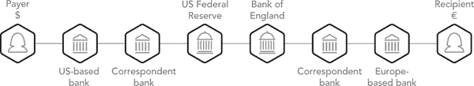

### 东印度贸易公司与罗纳德·科斯

当我们在市场上买苹果时，我们能看到苹果，商贩能看到我们的现金。如果一方作弊，很容易向另一方提出质疑。当我们相距 10,000 英里时，这种方法行不通。如何建立长距离信任？非常困难。另一方可能受我们不知晓的法律约束，反之亦然。显然，对出口商而言，不见到钱就制造和发货是不明智的。对进口商而言，不见到货就付款同样不明智。这是一个难题。

经济学家罗纳德·科斯于 1932 年在邓迪的一次演讲中阐述了企业存在的原因，当时他年仅 21 岁。他主张企业的创建和存在是因为去市场获取资源比内部雇佣资源更昂贵。更具体地说，企业存在是为了降低交易成本。资源的搜索、协调、签约和建立信任在企业内部更容易。他进一步主张，这些交易成本倾向于随着企业规模增长而增长。他的见解被忽视了几十年，但最终于 1991 年获得诺贝尔奖。

符合他的论点，跨洋信任问题的第一个大规模历史答案就是信任自己。出现了能够在印度或中国购买产品并将其运往自己在伦敦或鹿特丹仓库的全球公司。一个例子是*荷兰东印度贸易公司*。它是世界历史上最大的公司。按今天的标准，它的规模约为 `Apple` 的 10 倍。^229

其英国对应公司也非常庞大。最初，其主要产品是将茶叶从印度运往英国。最终，它发现将鸦片从阿富汗运往中国更有利可图。为确保其版本的“信任”不被违反，印度总督筹集的军队规模是英国的两倍。在 18 世纪末夺取印度的不是英国政府，而是由一位失控的总督和私掠者（罗伯特·克莱夫）管理的不受监管的公司。今天他被视为反社会人格者。^230

仅凭英国总部 35 名员工，英国东印度公司曾是效率的典范。直到克莱夫作为叛逆特工，未经总部同意筹集并部署了 26 万大军。军队不在公司的商业计划中。

正如罗纳德·科斯所解释的，当这种大规模开销（强制执行公司版本信任所必需的军队）的交易成本变得过大时，公司变得不可持续。当英国政府最终控制这支私人军队时，有人认为这是大英帝国的诞生。^231

### 商业银行、信用证及其相关痛点的兴起

信任难题的下一个答案是商业银行的出现。它专门从管理和缓解买卖双方之间缺乏历史信任关系的国际信任问题中获利。其主要金融工具称为*信用证*（`LoC`）。这是四方或更多方之间的一套复杂文件，各方信任链中的另一方，实际上将它们链接在一起以完成一笔交易。

如果我们不信任商品的制造商，那么我们认识的某人可能认识其他人，他们信任某人，而该人又信任另一方，后者又信任另一位信任卖家的人。这听起来完全行不通，但几个世纪以来，这些信用证（LoC）一直是（而且在很大程度上仍然是）国际贸易的财务基础。因此，例如，一家银行会在货物按规格制造完毕并可供发运时支付货款（并承担风险）。随后，当货物抵达并经码头验货准备出口时，该银行会由另一家银行付款（后者随后承担运输风险）。这家银行随后会在货物抵达进口商码头时，由另一家银行付款（后者随后支付并承担运输的下一阶段风险）。最后，当货物按订单抵达并经买方卸货码头验收时，这家银行会由最终买方的银行付款。为这些交易成功执行而记录和协商冗长条款条件的复杂性使得流程缓慢且昂贵（参见图 4-2）。

通知行向卖方及其银行保证买方银行的合法性。直觉上，我们会预期信用证中如此多中介机构的时间消耗和利润会让国际贸易的车轮陷入停滞。事实上，情况恰恰相反。几个世纪以来，信用证是使国际贸易成为可能的“润滑剂”。那些能够谈成这些交易的人发现它们利润丰厚，无论是对进口商、出口商还是所有中介机构而言。

**图 4-2**

**信用证运作方式**

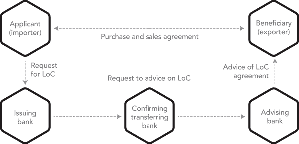

然而，这些流程常常因在谁确切承担何种风险以及何时承担的谈判中失败而告终。为了促进货物的国际流动，大多数出口国政府会通过其进出口银行向担保银行提供全面担保。即使有政府背书，“按规格制造”的单据以及在如此多互不信任的中介方之间转移责任，仍是一项艰难但利润丰厚的业务。

对银行而言，预测客户的外汇付款充其量只是一场猜谜游戏，取决于我们玩这个游戏的效率，我们和客户都可能赢也可能输。如今，为满足客户的外汇需求，银行不断在机构与机构、国家与国家之间转移资金，试图实现更高的资本效率。有时成功，有时失败；无论如何，这都增加了运营成本。支付流程中的每个环节都是串行处理的，这增加了结算风险、延迟，并因编码不当的转账或银行在国外的`nostro`账户资金不足导致付款延迟或中止，而引发耗时的手工调查。

`nostro`（“我们存放在你那里的钱”）和`vostro`（“你存放在我们这里的钱”）账户是银行在其他国家的其他机构持有外汇余额以应对客户可能的外币需求的账户。例如，对于在 10 个国家设有分支机构的银行来说，预测第 11 个国家明天的客户外币需求是困难的，甚至是不可能的。存入资金过多会造成资金浪费；存入过少则可能导致客户付款陷入无限期的僵局。如今，国际支票会被暂时冻结，以评估哪些是合法付款，哪些不是。这既耗时又导致许多人陷入人工密集型的对账流程。

所有这些都是金融机构与其客户之间缺乏信任的结果。“缺乏信任”有些言过其实，但银行间信任程度的限制已制度化。在风险管理的博弈中，我们可能判断正确了该信任谁，却依然会输。通过金融市场，一个人可能因信任某人，而该人又信任一个最终证明不可靠的第三方而遭受损失。这是所有银行家的终极噩梦，被称为`系统性风险`。例如，2008 年，那些信任高盛（Goldman Sachs）进而信任美国国际集团（AIG）的人，如果没有美联储的大规模干预，会陷入深重的麻烦。^(232)

分布式账本技术（DLT）将为这一局面带来 100% 可信的资金流动概念（无论是否涉及银行）。这显然是颠覆性的变革。

**SWIFT 的创建及其报文服务**

20 世纪 70 年代初之前，银行通过电传发送跨国付款指令。尽管涉及巨额资金，但流程是人工且易出错的。指令采用非结构化句子，通常为英语。有时这些消息的意图在翻译中丢失。这些`电汇`通过电话线打字发送，容易丢失、易被误解、也易被黑客攻击。数学被用于检测消息的未授权更改，但程度远未达到应有的水平。

例如，一名欺诈者知道数学被用于创建一个秘密的`报文认证码`（MAC），用于验证`发送方`、`接收方`和`金额`，他只是请求了一条小额的有效“电汇”消息，将其拦截，然后在转发前将货币从意大利里拉改为美元，因为他知道这会被接受为真实消息。只需投资几千美元（当时相当于数百万里拉），欺诈者的回报呈指数级增长。必须有更好的方法。需要标准。20 世纪 70 年代初计算机在商业中的引入使更安全的方法成为可能。

1973 年，SWIFT 在布鲁塞尔成立，旨在监督和自动化这些流程。到 1978 年，SWIFT 上线运行，具备了在大型银行间保护金融支付报文所需的基本第三方控制，确保发送机构的两人参与“制作后复核”报文，且`MAC`（数字签名的前身）应用于所有字段。

每笔转账按顺序编号，以确保检测到欺诈性的报文插入或删除。进一步制定了标准代码以指示交易对手、货币、日期、分行、中介机构以及一组基本金融服务的操作代码。SWIFT 报文类型已演进至支付之外，涵盖资金和证券报文。

报文格式和元数据的标准现为 ISO 20022（读作 ISO twenty-oh-two-two）。^(233) 更具体地说，ISO 20022 是一套跨支付、贸易、证券、卡和外汇交易的协调一致的`可扩展标记语言`（XML）金融报文标准。对于该标准的变更，SWIFT 被认可为 ISO 20022 注册管理机构。^(234)

**图 4-3**

**SWIFT 的普及性**

*全球银行间金融电信协会（SWIFT）网络是全球领先的安全金融报文服务提供商。它现拥有 11,000 家成员机构，分布在 200 多个国家。*

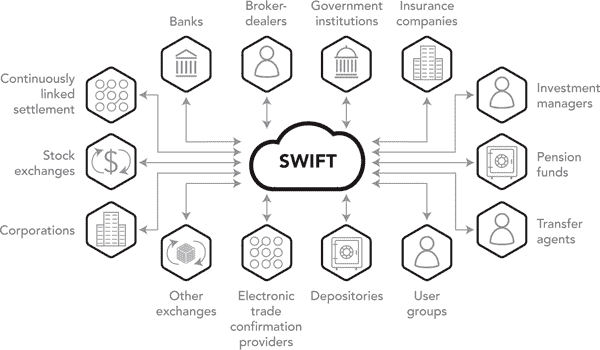

*数据来源：SWIFT，[swift.com](http://swift.com)/about-us，2018 年 1 月 5 日*。

如今，SWIFT 制定了无处不在的报文标准、参考模型，并运行用于国际银行间支付指令的系统和网络（图 4-3）。SWIFT 是一家根据比利时法律成立的合作社，由其 3,000 家金融机构会员所有。它是世界上最值得信赖的系统之一，日均处理交易超过 2700 万笔。^(235) 其服务已扩展至包含 200 多种报文类型，涵盖客户支付和支票指令、金融机构转账、资金市场、外汇和衍生品、托收和现金函、证券市场、资金市场、贵金属和银团贷款以及文件信用证。

重要的是要注意，资金并不通过 SWIFT 网络流动。它仅仅是一项高度安全的文本消息服务，用于对金融机构之间标准化结构化报文进行编码、发送、接收和认证。资金的实际移动通常通过中央银行的国家清算和结算中心进行。通过多家中央银行协调资金移动的时机，以及过程中可能涉及的其他中介银行，使得该系统缓慢且复杂。

毫不奇怪，参与该流程的人员希望因其付出而获得补偿。这些费用因机构而异，但通常商业银行会收取汇出和汇入手续费，两者合计通常在 50 美元到 100 美元之间。^(236) 这还不包括资金在各银行临时控制期间被挪作他用所产生的利息收益。此外，所提供的外汇汇率中也包含利润（图 4-4）。

以此为例，2017 年 8 月 18 日，在 TD Canada Trust 网站上，我们发现如果将 1,000 美元兑换成加元，再兑换回美元，最终只剩下 948.06 美元。^(237) 换句话说，典型银行在两种主要货币之间进行 1,000 美元的外汇兑换时，单向就能获取 2.5% 的利润。货币越不重要（流动性越差），买入和卖出汇率之间的差价就越大，客户的损失就越大。

由此导致的业务延迟，以及因预期延迟而导致交易可能丧失的利息，很难衡量。TransferWise、Venstar、OFX 和其他系统虽然仍基于法币，但已找到将成本和延迟降至最低的方法。即使在区块链出现之前，遗留参与者和系统固有的低效率以及去中介化的利润机会就已极具吸引力。

**图 4-4**

**代理行银行模型**

*在一笔从美国向欧洲转账 5,000 美元的交易中，211 美元归银行所有。其中一半是美元兑欧元的中间价与提供给客户的买入价之间的差额。其余部分构成支付给各金融机构为其付出努力的费用。*

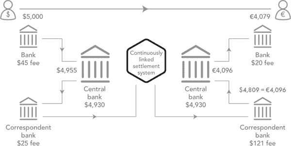

当 SWIFT 最初为机构提供自动化支付便利时，主要是针对大额外汇支付。在 20 世纪 80 年代，对于一笔 100 万美元的跨境支付，50 美元到 100 美元的手续费被认为是可以接受的。对于少量个人转账，西联汇款或美国运通办公室的低效率一直存在。然而，随着互联网商业的诞生，当从中国在线购买 10 美元的商品或向第三世界汇款回家时，50 美元的手续费显然无法接受。转账的缓慢速度（美联储更快支付工作组认为）阻碍了商业活动，或可能在家庭紧急情况下造成灾难性后果。SWIFT、中央银行、传统银行和金融科技公司都意识到这是一个大问题，也是一个机遇。

尽管如此，仍存在抗拒变革的心态。许多金融机构将通过 40 年自动化努力获得的效率视为获取更多利润的领域，而非提供更好的客户服务。它们已在这些系统上投入数十亿美元，因此不急于将其核销或降低其带来的费用和利润。

银行要实时准确预测客户的外汇需求几乎是不可能的。此外，并非所有银行都对跨境支付相关的延迟和费用感到满意。对于小型银行而言，在海外代理账户中持有另一国货币以备不时之需，是一种必要但不受欢迎且无利可图的资金部署。然而，对于大型银行而言，它们可以作为小型银行的海外代理行，并通过在更大的客户群上进行平均来减少意外需求，利润是非常真实的。

缺乏关于国家间资金移动速度的国际标准或协议。预期曾基于纸质人工系统设定。国家间法规通常远远落后于国内法规。因此，银行几乎没有压力将自动化的优势传递给客户。银行将计算机化带来的效率视为利润来源，而非客户服务。

转出方和收款方机构之间的中介机构会尽可能长时间地持有和使用转账资金。如今，国际资金转账冻结 30 天仍很常见。^(238) 为避免结算风险，清算和结算系统可能会将资金暂时排队过夜。在涉及多个清算系统的情况下，这种排队有时可能持续两三晚。为了获利，银行可能会持有货币更长时间。尽管如此，面对不透明的流程，消费者只被告知资金“在途”。我们可以追踪一笔 50 美元的国际亚马逊购物从发货到送达的全过程，但 100,000 美元却可能在悬而未决的状态中挂起数天。在国家间的监管环境中，几乎没有规则保护客户，无论是企业还是消费者。

SWIFT 实验室研发主管兼 SWIFT 用户体验主管 Damien Vanderveken 表示，SWIFT 知晓这些问题，并已制定计划解决部分痛点：“如果银行能实时管理其代理账户流动性，将能准确衡量任意时点各账户所需资金量，最终使其能释放大量资金用于其他投资。”^(239)

说得很对。一国的代理账户（Nostro accounts），可能被该银行来自多国的存款账户访问，向来是最难对账、也最容易遭欺诈的账户。通过使用 DLT（分布式账本技术），我们或许能彻底消除代理账户/代理行账户对账的问题。

其中一些计划现已实施。Vanderveken 解释称，SWIFT *全球支付创新* (gpi) 计划通过在国际支付上启用追踪功能，实现费用透明和资金当日付到账的可能性，从而振兴代理行银行模式。^(240) 毫无疑问，竞争压力可能导致银行改变行为。但现状利润丰厚，抗拒变革的阻力将非常大。

## 管理支付系统的支付系统

CLS 于 2002 年推出，是一个由全球领先的外汇银行拥有的系统，旨在解决外汇交易双方在结算时点上的差异。更具体地说，CLS 是一个国际多币种清算系统，旨在确保外汇合约的双方能够同时执行，具有确定性，并在两个不同国家的清算系统中实现支付的最终性。CLS 系统通过在 18 个国家央行的账户，以 18 种货币结算底层外汇交易的支付指令。^241 协调如此多国家、如此多时区中如此多银行的计算机系统，绝非易事。

CLS 系统使用 `SWIFT` 报文，提供全球最大的外汇现金结算系统。^242 每个结算成员（通常为银行）在 CLS 持有一个单一的多币种账户。在正常结算日的开始和结束时，每个结算成员和每个央行在其账户中的余额均为零。它不是“最后贷款人”。结算成员可以提交与其自身外汇交易以及其第三方客户外汇交易相关的支付指令，直接发送给 CLS。CLS 与通过 CLS 结算货币的各央行均保持账户往来。CLS、结算成员以及许多国家的国家 `RTGS` 系统通过 `SWIFT` 报文进行通信。

CLS 的工作原理是：在两国央行系统均开放、可发送和接收付款的时间段内，通过相应货币和国家的 `RTGS` 系统近乎同时完成结算。这使得外汇交易双方的付款能够同步结算，例如跨大西洋结算。^243 如果是美元兑英镑，两种货币的移动（纽约的美元和伦敦的英镑）便在两国央行清算系统同时可访问的短暂时间窗口内得以协调。

CLS 的初始设置成本超过 3 亿美元，因其昂贵的结构而受到批评。^244 从历史角度看，治疗的成本远高于疾病本身。对银行家而言，这种时点差异带来的潜在问题被称为 `Herstatt 风险`。为 CLS 辩护的是，在 2008 年金融危机期间，当许多其他市场冻结时，它完成了保持外汇市场流动性的首要使命。^245 没有 CLS，2008 年银行危机中外汇支付极有可能会被冻结，大衰退可能会严重得多。

然而，建立一个清算和结算系统来管理清算和结算系统之间的资金流动，给复杂性增加了复杂性。由于美国、欧洲和远东之间重叠时区短促，资金流动被排队并放缓。但它确实实现了管理结算时点风险的目标。

尽管 CLS 的成员包括全球最大的金融机构，但对于较小的参与者而言，机构间外汇交易的间接路由导致数天甚至数周的延迟。别忘了，这些交易中的每个私人参与方都会收取费用。

对于银行业外的人来说，所有这些中介系统似乎疯狂至极。对于了解银行系统及其历史的人来说，这完全合乎逻辑。对银行家而言，这蜿蜒旅程的每一步都是为了确保更高的信任并应对特定风险而设计的。正如我们所指出的，这些步骤需要时间和金钱。客户被迫接受这些延迟和开销成本，无论它们看起来多么随意。

## 寻找更好的系统

实物现金或黄金在各国存放于美联储金库间转移以进行国际支付的时代，已是上个世纪早期的事了。即使是信用证，现在也通过受密码保护的文件交换，如果不是（更安全地）以数字签名的便携式文档格式（`PDF`）文件作为代表文件的可信比特位进行交换。

即使通过电子邮件发送，这种信任也源于每一步的诸多学科、规则、法规和控制。具体而言，我们信任我们的金融机构能够

- 履行其受托责任，并培育机构对其他机构的级联信任。
- 有效运行其系统，定期测试这些系统，并对这些系统应用变更管理流程。
- 维护其防火墙、病毒防护软件、备份、独立和补偿性控制、准备金要求，以及消息传输网络的安全。
- 遵守标准和法规，从 `巴塞尔协议 III` 到 `GAAP`（公认会计准则）。^246
- 在称职管理层的合规监督下，由内部和外部审计师双重验证，并由政府监管机构针对不断变化的法规（这些法规往往受外部游说团体影响过大）进行再验证，坚持遵守上述所有要求。

所有这些职能都有成本，这些机构强迫客户接受。我们也知道，每一步都存在可能导致失败的弱点。

对政府、金融机构、其人员、系统、流程、审计师和监管者的这种信任，真的是赢得的吗？许多近期事件动摇了这种信任。2008 年和 2009 年，美联储向银行注入了 7.77 万亿美元的贷款和担保，以挽救它们免于自食其果。^247 这大约相当于美国每男、女、老、少 4 万美元。

随后在 2015 年，花旗集团、巴克莱银行、摩根大通和苏格兰皇家银行承认操纵外汇汇率，并同意支付 56 亿美元罚款。^248 美国地区法官 Stefan R. Underhill 评论道：“当市场被操纵时，遵守规则的人就是傻瓜。”^249 这几乎是纵容作弊，如果不是公然的银行欺诈的话。

仅在 2017 年，Equifax 就泄露了 1.45 亿美国人最机密的财务信息，实际上使整个信用评分行业失信，并使美国成年人面临声誉受损和潜在欺诈的风险。^250 汇丰银行因可疑的外汇做法必须支付 1.75 亿美元，西联汇款因未能阻止电汇欺诈被罚款 5.86 亿美元。^251 富国银行在未经许可以客户名义开设多达 210 万个银行和卡账户后，支付了 1.85 亿美元和解金。^252 随着富国银行扩大对销售滥用行为的调查，潜在受影响客户数量已增至 350 万。恶劣的银行行为及其导致的罚款，在许多人眼中似乎只是经营成本而已。

正如 William K. Black 所假设的，抢劫银行的最好办法是拥有一家银行。^253 火上浇油的是，美国国会通过了一项法律，使受害者起诉银行以追偿损失变得更加困难，甚至不可能。^254 这是华尔街的重大胜利。副总统 Mike Pence 投下了决定性一票。^255

在美国和其他国家，人们对金融机构及政府监管能力的信任已跌至历史最低点，且代表们仍在持续削弱这种信任。2017 年 12 月，共和党主导的国会通过了一项 1.5 万亿美元的减税法案，权威经济学家调查认为这将大幅增加国家债务。^256 如今众议院和参议院似乎计划废除《多德-弗兰克法案》的大部分内容，该法案原本旨在降低导致 2008 年濒临银行倒闭和大衰退的那类渎职行为的风险。^257

总部位于伦敦的金融科技初创公司 TransferWise 以“Bye, Bye Banks”（再见，银行）为口号，推出了其所谓的“无国界”账户。截至 2018 年 1 月，该账户支持 28 种不同货币，并关联英国、美国和欧洲的本地银行账号。^258 其官网解释了这项“无国界货币”业务的起源：

> Taavet [Hinrikus] 在爱沙尼亚为 Skype 工作，以欧元领薪，却生活在伦敦。Kristo [Käärmann] 在伦敦工作，但在爱沙尼亚有欧元房贷。他们设计了一个简单的方案。每个月，两人查阅路透社当天的中间汇率以确定公平汇率。Kristo 将英镑存入 Taavet 的英国银行账户，Taavet 则用欧元为朋友的欧元账户充值。双方都获得了所需货币，且均未支付一分钱隐藏银行手续费。^259

Hinrikus 和 Käärmann 意识到面临此困境的不止他们自己，于是在没有区块链的情况下，将这一变通方法变成了一个十亿美元级别的业务。

要战胜极度低效的外汇遗留系统，并不需要新兴技术。如果我们持有并净额结算支付，就能节省大量资金，聪明的中介商也能赚取大量利润。持有多币种余额的公司（如 Facebook、Amazon 和 Google）已察觉到这一机遇。

基于此模式，TransferWise 让客户无需支付国际转账费、按中间汇率即可收付外汇债务。投资方包括 Virgin 创始人 Richard Branson 和 PayPal 联合创始人 Peter Thiel 的 Valar Ventures。^260

TransferWise 仅收取中间汇率 0.05% 的费用。这听起来不多，但考虑到每天有数万亿美元的外汇交易，规模惊人。尽管其口号对金融机构的威胁似乎大于 SWIFT，但其信息也直指 SWIFT 核心。其转账在很大程度上绕过了 SWIFT、央行和 CLS 网络。相比之下，加拿大道明银行（TD Bank）仅收取国际汇款*其端*费用就要 30 至 80 美元。^261 TransferWise 并非孤军奋战；nanopay 怀有类似雄心。^262

SWIFT 的核心是通过电信线路以安全比特形式传输的文本消息。假设性地，可以采用简单的文本消息应用（如加密文本消息的 WhatsApp）作为传输媒介；加上身份管理、排序、消息认证码；采用 ISO 20022 作为金融消息格式；从而挑战 SWIFT 的存在根基。如今，支付服务正尝试这样做。

P2P 支付系统正从消息服务（Snapchat 的 Snapcash）、社交网络（Facebook Messenger、Google Wallet、Venmo/PayPal、Square Cash）等处如雨后春笋般涌现。这与 Snapchat 去年 11 月推出的由 Square Cash 提供支持的 Snapcash 功能策略相同。

通过将支付集成到消息服务中，Facebook 试图挤出 Venmo/PayPal、Google Wallet、Square Cash 等专业消费者支付竞争对手。Facebook 称用户登录其网站频率更高。Facebook 宣布与 TransferWise 合作开展国际支付。Apple 宣布推出基于短信的支付系统。^263 eBay 旗下 PayPal 试图通过提供 2.9% + 0.30 美元的费率来削弱银行手续费，而收入模式在别处的 Facebook Messenger 则免费提供其支付系统。^264 银行家们，当心了。

### 现有参与者的策略

SWIFT、央行及全球其他机构正在设计下一步乃至下一代系统，以应对当前痛点。

#### 加拿大

Payments Canada 为现代支付系统设想了八项要求：

1. 更快的支付选项
2. 数据丰富的支付
3. 交易透明度
4. 更便捷的支付
5. 跨境便利性
6. 基于活动的监管
7. 开放且基于风险的准入
8. 创新平台

加拿大央行启动了 Jasper 项目，开发了两套 DLT 清算结算系统原型，先在 Ethereum 上，后在 R3 的 Corda 上。作为央行，其含糊地得出结论：DLT“可能无法为央行提供总体净收益”。但它确实指出，对于天生去中心化的国际清算系统，DLT 可能更合理。我们赞同此观点。

#### 美联储

在美国，美联储于 2015 年 6 月成立了更快支付工作组，寻找安全、准入公平、能 24/7/365 结算交易的加速支付流程方案。^265 美联储表示希望创新基于市场而非强制授令，并想为这种创新提供正式框架。它呼吁制定路线图以大幅改善跨境支付，认为缓慢的跨境支付以及成本、流向、交付时间的不透明阻碍了经济增长。美联储将改进目标定义为：

1. **速度**：普及、安全、高性价比
2. **安全**：需保持强健
3. **效率**：更多电子化、更少纸质化
4. **国际化**：面向跨境支付
5. **协作**：涉及广泛的支付参与者

审视美联储对“安全、更快、普及、广泛安全、高效”支付系统的渴求，很难不联想到区块链。部分提案将区块链作为央行所有活动的不可篡改审计追踪，但资金最终仍落入传统银行账户。另一些像 Ripple 和 TransferWise 则绕过 SWIFT，在一定程度上自行管理转账。

美联储于 2017 年 7 月底发布了支付研究报告。报告承认“其他国家已通过强制授令和/或开发国家级更快支付系统来应对这些挑战”。^266 作为全球最重要的银行，美联储选择不强制授令，而是鼓励创新。在美联储认真考虑并公开的 16 份提案中，有 5 份涉及区块链技术。

*   **ECCHO、Hub Culture 和 Xalgorithms** 提出将 DLT 作为实时资产互换账本（RAIL）和实时资产互换网络（RAIN），有望终将实现基于区块链的全球支付。^267
*   **The Kalypton Group** 将其提案描述为“无局限性的类区块链”。^268
*   **Ripple** 通过金融参与者间直接的端到端分布式账本实现高 DLT 吞吐量，无需中央账本。Ripple 的架构和吞吐量表明，他们理解参与者越少，吞吐量越快。

## WingCash

WingCash 更进一步，建议美联储发行自己的加密货币。^[269] 它呼吁“普遍接收——即所有支付服务提供商都能接收快速支付，并实时将资金提供给客户。”^[270]

2018 年 1 月，加密货币的总市值为 7500 亿美元，约占美国联邦预算的 20%。^[271]

## 欧洲中央银行

欧洲央行宣布了新的即时支付和结算系统计划。它将使企业和消费者能够在整个欧盟范围内实时汇款。该系统将于 2018 年开始运行。

欧洲央行的一份报告表明，分布式账本技术（DLT）必须能够与非 DLT 系统互操作才具有可行性。它进一步主张，正如英格兰银行所言，尽管 DLT 尚不够成熟，不能被视为欧洲体系提供的市场基础设施的可行替代方案，但它当然值得分析和深思。^[272]

2017 年 8 月，英格兰银行发布了类似的报告，鼓励未来的合作，但表示 DLT 尚不够成熟，无法用于实时全额结算。英格兰银行对互操作性的要求，极大地暗示了 DLT 将如何在清算和结算领域涌现。

## 新加坡

2017 年 10 月初，新加坡金融管理局（MAS）和新加坡银行公会（ABS）宣布了一个基于区块链的支付模型，用于他们命名的“乌敏计划”（Project Ubin）的第二阶段。埃森哲的 David Treat 告诉我们，通过与金融管理局合作，他们构建了 `Hyperledger Fabric`、`R3 Corda` 和 `Ethereum Quorum` 系统的并行对比，用于具有实时全额结算功能的银行间支付。同一用户界面被用于对这三种架构进行直接对比。Treat 表示：

> 该项目让我最感兴趣的发现之一是，所有三种技术解决方案都满足了要求。它们以三种不同的方式实现了这一点，因此具有不同的特性，并在隐私保护和数据隔离的处理方法上有不同的含义。但我们基本上证明了三种不同的、相互竞争的技术版本都满足了要求。^[273]

新加坡会选择其中一种作为生产就绪版本吗？我们可能很快就会看到结果。正如 Treat 所言：

> 我们目前所处的阶段，是这些平台都处于版本一。LinkedIn 创始人 Reid Hoffman 准确地指出：“如果你对产品的第一个版本不感到尴尬，那你发布得太晚了。”版本二将会截然不同，并有显著改进。^[274]

Treat 进一步指出，监管机构对新技术显而易见的益处着迷，不太可能阻碍其采用。

## 日本

9 月，日本银行家协会（JBA）宣布，正在与日本最大的 IT 设备和服务提供商富士通合作，利用其基于云服务的区块链平台，作为其会员银行的测试平台。通过 JBA，富士通将向 JBA 会员提供其 `Collaborative Blockchain Platform`，用于清算和资金转账等应用。

JBA 将与其他机构合作测试和实施这些应用。瑞穗银行和富士通也在致力于寻找比目前 T+3 更快、更高效的证券清算和结算方式。富士通开发了多种区块链技术，包括一种用于结算流程中匹配交易信息、基于策略的交易限制和多用户密钥管理的技术。

## SWIFT

作为大多数国际资金转账的媒介和报文标准，SWIFT 管理着三项资产：

- 一个独立于互联网之外的安全网络
- 金融机构之间的存储、转发和路由系统
- 一个 XML 参考模型，包含由 SWIFT 作为 ISO 20022 注册机构定义的报文类型格式

SWIFT 的 Vanderveken 告诉我们，SWIFT 非常清楚这些问题。他强调了 `SWIFT gpi`，旨在解决跨境支付中的许多痛点：gpi 可实现资金当日付款使用、费用更透明，以及支付的端到端跟踪（包括在必要时和地点停止支付）。他还指出，进一步的数据元素将实现更快、更简便的对账。银行适应这些功能的速度尚待观察。^[275]

对于我们/你们账户（nostro/vostro）核算，`SWIFT gpi` 计划提供了支付在流程中位置的端到端可见性，从发起经过代理行银行和清算所。在交易对手的日间时区重叠时，甚至可能使近实时支付成为现实。可以把它想象成 FedEx 跟踪，个人可以看到他们的转账在队列之间流转时的位置。

在其试点项目中，SWIFT 表示：“DLT 目前尚不够成熟，无法广泛用于跨境支付。[但] 这项技术可能为相关账户对账提供解决方案。”^[276] 此外，它还声明：

> SWIFT 将利用其关键资产，使技术符合金融行业的要求，包括强有力的治理、PKI[公钥基础设施]安全方案、BIC[银行识别码]身份框架和流动性标准专业知识，目标是为其社区的利益提供一个独特的 DLT 概念验证（POC）平台。^[277]

2017 年 10 月 13 日，SWIFT 发布了一份关于使用 SWIFT 开发的 DLT 沙箱进行实时我们账户对账的概念验证（POC）中期报告。三十三家银行参与其中。SWIFT 总结称，已确定仍需解决的问题，以实现全行业范围的采用。

SWIFT 明智地还参与了新的主要 ISO 技术委员会，这些委员会就对开放区块链支付至关重要的标准召开了会议，即：

- **ISO/TC 307/SG 1 参考架构、分类法和本体**
- **ISO/TC 307/SG 2 用例**
- **ISO/TC 307/SG 3 安全与隐私**
- **ISO/TC 307/SG 4 身份**
- **ISO/TC 307/SG 5 智能合约**

同时，SWIFT 正通过在参考数据环境中为*场外*（OTC）衍生品市场构建标准结算指令数据库，来展示 DLT 的优势，在该环境中不存在数据保密顾虑。该 POC 可能揭示与现有系统的互操作性和向后兼容性。

SWIFT 还在与*中央证券存管机构*（CSDs）合作，制定证券 DLT 管理标准。参与者包括咨询公司 E&Y、加拿大证券存管有限公司、莫斯科交易所集团、南非的 Strate、俄罗斯国家结算存管机构、瑞士的 SIX 证券服务、纳斯达克北欧和智利的 Depósito Central de Valores。这份名单必将不断扩大。

SWIFT 还有一个债券生命周期 POC 项目。由于市场规模庞大，且发行和到期相对简单，这是一个合理的市场。

新旧范式之间的一个明显区别是身份。Damien Vanderveken 告诉我们，SWIFT 正在研究身份和访问管理。^[278] 区块链使用公钥作为（可以说是匿名的）身份；SWIFT 使用带有其 PKI 的 X.509 证书用于数字证书和签名。目标是评估两者如何共存或互操作，并希望实现自主身份。

许多（如果不是大多数）SWIFT 报文会触发或通知他人资金移动至下一个中介机构或最终提供商。

## DLT 对 SWIFT 及支付生态的影响

DLT 能够在全球范围内运行、存储、转发并无处不在地路由代币或加密货币，从而消除许多利益相关方以及 SWIFT 三分之二商业模式的中介环节。剩下的工作仅是制定标准消息格式，私营公司或其他标准组织完全可以直接采用。Ripple 正是这么做的。换句话说，我们可以预见一个基于 DLT 且无需 SWIFT 网络的资金转移生态系统。

最后，作为其 gpi 路线图的一部分，SWIFT 于 2017 年启动了一个 POC（概念验证），以测试 DLT 是否能更高效地协助 Nostro 账户的对账。对银行而言，从最初 10 个国家的客户账户中调出资金，然后在第十一个国家完成支付清算（即使这些资金可用），是缓慢、高风险且困难的过程。SWIFT 明智地选择了这个高风险问题但低风险领域作为其试点。这不涉及资金移动，而是对已移动资金的对账。

理解 DLT 的潜力并不等同于彻底变革支付商业模式。^[279] SWIFT 认为，“在多方网络环境中解决自动化问题，还要求业务参与者定义并就共享数据的含义和内容、业务流程、角色和职责达成一致。”^[280] 它担心，“在技术的能力和约束被理解之前过早强制推行标准，可能会造成标准迅速过时或无关紧要。”^[281] 它指出，DLT 目前的特性是所有人看到相同信息（如土地所有权管理）显然是优势，但所有人看到他人的支付信息则不然。

SWIFT 目前使用的身份标准（ISO 17442）显然不是 DLT 公钥。这并不意味着没有定义新标准的努力。去中心化身份基金会（包括 IBM 和 Hyperledger）、加拿大银行及许多其他机构正试图做到这一点。^[282]

SWIFT 在 Nostro/Vostro 账户上的 DLT 努力将使其紧跟新兴技术。SWIFT 需要极其审慎并抵制快速变革。然而，这不会阻止竞争对手——特别是那些几乎没有损失的初创公司——竞相将其从市场中挤出。2017 年，大多数区块链实现都受限于吞吐量。用于清算和结算的 DLT 很可能会在风险低得多的环境中实施并被证明有效，即使存在可控的初期问题。竞赛已然开始。

尽管许多初创公司渴望用分布式账本取代 SWIFT 网络，但我们必须记住，SWIFT 的客户同时也是其成员。我们可以预期，现状的巨大粘性将抵制 SWIFT（或任何其他机构）在 DLT 上的努力。作为一个多成员协会，SWIFT 并非为快速变革而设计。关于银行 10 年后如何清算和结算的辩论，假设越来越多的非银行中介机构不会取得重大进展。

消息格式及其元数据在 ISO 20022 中标准化，SWIFT 是其注册机构。Accenture 的 David Treat 认为这可能是其持久的增值点之一。我们对此不那么确信。在美国快速支付特别工作组的提案和世界各地的初创公司中，该标准正在被扩展。在基于 DLT 的系统中，身份管理将基于用于加密哈希的密钥。通过 ISO 9362 的现有业务标识码需要彻底重写或废弃。

毫无疑问，通过 SWIFT 的 DLT 努力，他们将深入了解 DLT 的转移、控制和保管问题。当当前的吞吐量、安全性、身份及其他限制被克服后，不难看出 SWIFT 如何监管一个作为国际资金流动审计追踪的私有区块链。例如，如果 SWIFT 管理的 DLT 中的代币成为价值的实际记录数据库，它们可能首先会使 CLS 过时。同样不难想象，甚至更有可能的是，其他机构通过做类似的事情来消除 SWIFT 的中介地位。

SWIFT 向市场提供三项服务：(1) 网络，(2) 其上的安全消息传递，(3) 定义良好的格式和元数据。我们可以在 DLT 上更安全地实现前两项。第三项正在为密码学和智能合约进行改造和扩展。毫无疑问，对于如此关乎世界资本主义的关键流程，偏离标准最终将重新汇聚到少数几个标准上。这些标准可能来自 SWIFT，也可能不来自。在不久的将来，创新将层出不穷，赢家将占据巨大的市场份额。

## Ripple

凭借 ICO 的充足资金，Ripple 开发了用于两家机构间资金移动的代码，该过程通过双端同步账本来反映。通过 ICO，它推出了加密货币 XRP。它旨在将基于中央银行的中心辐射型支付模型转变为去中心化（甚至是分布式）模型。Ripple 是一个开源的链式账本，支持多种代币和点对点同步到单一账本。这些代币可以代表从货币到常旅客积分再到大宗商品的任何事物。

Ripple 基于一个共享的分布式账本，它采用蜘蛛网线架构直接连接所有节点，可取代当今大部分清算和结算系统，这与当今用于清算和结算的中心辐射模型形成对比。它使用同步账本，采用共识流程，允许在分布式过程中以高得多的速度进行支付、兑换和汇款。^[283]

Ripple 宣布，美国运通和西班牙桑坦德银行已准备好（如果不是今天正在使用）通过其区块链 RippleNet 进行跨大西洋支付。^[284]

一个广为流传的迷思是 DLT 的性能问题主要与其区块大小和计算机当前速度有关。事实并非如此。有一种常见的误解认为，如果计算机速度翻倍，吞吐时间就会减半。例如，如果计算机运行 20% 的时间，等待 I/O 80% 的时间，计算机速度翻倍只会带来 10% 的吞吐量增长（20%/2）。所有速度的计算机（甚至量子计算机）等待 I/O 的速度是相同的。

拖慢共识模型 DLT 的是计算机等待 I/O 的时间，这是由于它们相互通信时的网络延迟造成的。如果减少参与的计算机数量，就能消除大部分 I/O 问题。这正是 Ripple 所做的。因此，其宣称的（且可信的）吞吐量比比特币或以太坊区块链快几个数量级。

当我们兑换相对不活跃的货币（如巴西雷亚尔兑新西兰元）时，通常先通过一种更具流动性的货币（如美元）进行兑换。Ripple 希望未来我们能改用其加密货币 XRP。雄心勃勃的是，XRP 可能取代美元成为事实上的中介货币。

## Depository Trust & Clearing Corporation

## 存管信托与清算公司 (DTCC)

存管信托与清算公司 (DTCC) 是一家由行业拥有和治理的金融市场基础设施，拥有 40 多年的经验，致力于为金融行业降低风险并推动运营和成本效率。DTCC 拥有推动创新以强化交易后流程的悠久历史。作为一家系统性重要的金融市场基础设施，DTCC 为股权和固定收益资产提供集中存管和托管服务，并为这些资产的交易提供集中清算和结算服务。

其领导层表示，DTCC 运营着行业内最稳健的处理引擎之一，日均处理量超过 1 亿笔交易边，这些交易以实时方式从 50 个不同的交易市场提交，高峰处理期间每秒多达 25,000 笔交易。^[285] DTCC 已测试其系统性能，可处理远超 8 亿笔交易边，略高于其历史峰值交易量的两倍。2016 年，其子公司处理的证券交易价值超过 1.5 千万亿美元（1.5 quadrillion 美元）。^[286]

2017 年 9 月，美国结算周期缩短至 T+2 效率。DTCC 与行业协调监督了这一过渡，并利用现有技术缩短了周期。此举与全球市场接轨，降低了风险和敞口，增强了市场流动性，并提高了效率。

这一举措的驱动力是“客户价值——资本效率、风险降低和全球统一的结算周期。”^[287] 利用现有技术缩短结算周期，例证了对现有流程的改进并不总是强制要求使用新兴技术。据 DTCC 称，如果行业有意愿，可利用现有技术加速实现实时结算。

在 DTCC 看来，DLT（分布式账本技术）早已超越了概念验证阶段。DTCC 正认真考虑利用 DLT 来增强应用。^[288] 市场实现的巨大效率通过净额结算 DTCC 来自全天各类交易活动的头寸来降低风险，表明典型的一天可能产生 98% 的净额结算比例。

DTCC 领导层告诉我们，他们的 DLT 工作已超越简单的原型阶段；但他们仍面临技术现状的挑战，包括寻找合适的用例、可扩展性、性能、弹性、冗余、智能合约方法，以及在适用时的成本效益。DTCC 表示，它确实认识到分布式账本技术可以通过“共享的通用信息结构”来现代化、简化和精简金融行业基础设施孤岛式的设计，从而解决交易后流程中的局限性。^[289]

据 DTCC 称，DLT 的短期价值主张在于解决高度人工、交易量相对较低领域的行业痛点。其当前重点是通过研发投资识别机会、评估如何更好地应用现有技术、以及评估如何最好地利用新技术，以展示投资回报率 (ROI) 和客户价值。DTCC 解释道：

> 技术是达到目的的手段——目的是创新我们的工作，为客户创造更强的价值主张。无论采用现有技术还是新兴创新，客户价值都指导决策。为技术而技术是得不偿失的。^[290]

从长远来看，DTCC 正在评估 DLT 在广泛应用领域的潜力，包括主数据管理、资产/证券发行与服务、确认资产交易、交易/合约验证、更复杂资产类型的记录与匹配、净额结算与清算、以及抵押品管理和结算。然而，推进工作的关键因素包括：使技术能力成熟以满足现实金融交易需求、可扩展性、互操作性和独立治理。

考虑到 DTCC 处理的美国证券市场交易量，它需要任何分布式账本不仅能处理当前的峰值交易量（包括验证和不可逆的交易终局性），还能管理大幅增加的交易量。目前的 DLT 实现在实现这一容量方面还相差几个数量级。

与大多数机构一样，DTCC 对当前技术的成熟度和吞吐量表示担忧，但正密切关注其成熟过程。公司声明：

> 目前，该技术不具备与支撑当今美国市场清算和结算需求的稳健处理引擎相匹配的规模或容量。未来，任何面向成熟、大容量市场的企业级分布式账本解决方案，都需要达到或超越那种处理能力。^[291]

为了推动技术发展，DTCC 呼应了行业对分布式账本与遗留基础设施互操作性和集成的呼吁，此外还包括标准和协议的持续开发。公司仍然是发展独立治理以应对 DLT 解决方案实施和运营相关挑战的坚定倡导者。据其领导层称，DTCC 可以在该职能中发挥关键作用，作为中立的网络运营商，制定并执行所需的标准和协议。^[292]

## TransferWise

TransferWise 以真实的中间价汇率收取 0.5% 的费用，这笔费用看起来微不足道，似乎不太可能带来多少利润，直到我们意识到这是一个每天 5 万亿美元的市场。^[293] TransferWise 的微薄费用每天可转化为数百亿美元的收入。当 DLT 技术完全成熟时，开发能够管理国际支付的软件将花费几百万美元，甚至更少。它是开源的，且非常适合这一应用。

基于可信的价值主张发起 ICO 并不难。考虑到潜在的回报和低准入门槛，市场进入者将会很多。预计每一家主要软件公司和每一家主要金融机构都会参与至少一项支付相关的工作，其中国际支付是最大的奖赏。也会有许多有抱负的初创公司。如果它们聪明的话，每一家拥有强大技术实力的大公司都会参与这方面的某种努力。上行空间巨大。

尽管开发此类系统的门槛很低，但获得市场、监管机构和现有金融参与者的认可将决定赢家。David Treat 和我们与央行及监管机构打交道的经验比较特殊，因为它们在一定程度上正在推动这一变革。

DLT 解决方案对它们而言，其简洁性和优势显而易见。建立信誉，并与金融服务参与者的关键势能建立良好关系（我们知道 SWIFT 已具备此优势），其成本可能远高于开发技术本身。考虑到基于 DLT 系统的优雅性、安全性和经济优势，监管机构和中央政府正在拥抱 DLT 解决方案，甚至可能引领这场变革。此外还会有许多其他参与者，如 nanopay 和 Ingenico Group。^[294]

## 分析：在区块链上构建一个更好的系统

人们很快就会广泛接受这样一个事实：通过同步分布式账本技术（DLT），经数学证明能够保障代币转移及其信息安全的内在数学机制，优于多个传统机构、其人员及其系统之间的消息串行化处理——它更好、更快、更廉价。即使是怀疑论者，也可能会来欣赏延迟和成本的大幅降低，并将其作为将国际资金转移上链的压倒性理由。

在 20 世纪，对于孩子们来说，有一个教育契机：为什么要把零花钱存入储蓄账户以赚取利息。低利率和 21 世纪服务费的海啸让这一论点变得毫无意义。比尔·格罗斯（债券之王）和许多经济学家的可怕预测——赤字和量化宽松会导致更高的利率和失控的通货膨胀——并未成真。^(295)

相反，自动化和外包的结合在没有相应工资增长的情况下提高了生产率。这在将通胀牢牢控制在目标范围内的同时创造了创纪录的利润。令人惊讶的是，美联储主席等人依然对“依然顽固地低迷”的通胀感到担忧。^(296)

银行家们很头疼，委内瑞拉总统尼古拉斯·马杜罗·莫罗斯宣布推出一种由石油储备支持的加密货币——石油币。^(300)

在没有负责任经济政策可信记录的国家，价值创造的任意但透明的过程（如区块链上的比特币）可能会减少不信任，这意味着我们也许总有一天会看到工作量证明加密货币成为一种国家货币。尽管这可能会放弃该国利用传统技术管理经济的能力，但它将允许该国逃避巨型资金中心银行的外汇交易员对其货币的任意攻击。

国际货币基金组织总裁克里斯蒂娜·拉加德表示：“想想那些制度薄弱、本国货币不稳定的国家。这些经济体可能不会采用另一个国家的货币——比如美元——而是会看到虚拟货币的使用日益增长。称之为美元化 2.0。”^(301)

《布雷顿森林协议》确立了美元作为全球货币的地位，使美国政府处于一种拥有非凡权力的地位，有能力拒绝特定实体（例如与朝鲜有业务往来的中国银行）接入全球体系。我们应将采用类似 `XRP` 或 `bitcoin` 的加密货币视为一种严肃的可能性，以及对这一世界秩序的颠覆力量。^(302)

### SWIFT 的新角色？

“区块链应该取代 SWIFT 吗？”克里斯·斯金纳在《美国银行家》的一期刊物中发问。他认为，基于区块链的系统可以改造或取代 SWIFT 网络，从而提升系统的安全性、效率和准确性。^(303) 这部分属实，我们仍将需要来自某个国际机构的元数据标准。这将取决于 SWIFT 领导层何时以及如何拥抱或忽视这些新可能性。

如果 SWIFT 进行创新，那么作为国际资金转移枢纽的 SWIFT 就能维持其与金融合作伙伴基于信任的关系。当前区块链的局限性以及 SWIFT 在 `DLT` 和 `nostro/vostro`（代理行/代理行往来）账户方面的创新，尽管离变革尚远，但将使其更好地理解该技术的优势和局限。这种经验将帮助 SWIFT 引导（如果不是主导的话）用于 `FX`（外汇）的 `DLTs` 的出现。在世界拥抱加密货币之前，还有许多悬而未决的问题。SWIFT 很可能比任何人都更了解这些问题。

如果消费者能将资金投入 `DLT`，使用本地计价的加密货币，通过手机即可访问，并享有区块链现已赢得的信任度，他们为何还要继续使用收费高昂的银行账户？为了让数字法币或加密货币被广泛接受，它们需要具备十二项特征。它们必须：

1.  易于分割
2.  易于转移
3.  拥有强有力的治理和充分的数据控制
4.  便携且易于获取
5.  可靠且高可用
6.  产生可预期的利息
7.  价值稳定
8.  符合监管要求
9.  标准化（很可能没有空间容纳几十种加密货币）
10. 拥有不会丢失的身份框架
11. 可扩展
12. 密码（或助记词）丢失时可恢复

中本聪在 `bitcoin` 中设计了前五项特征，第五项特征可能很快就会从构想变为现实。已有诸如 `Magnr` 这样的机构愿意为 `bitcoin` 存款支付利息，因此第六项特征现已实现。^(304) 第七项特征在今天依然难以捉摸，加密货币价值剧烈波动。如今，人们访问的加密货币市值网站（如 *[CoinMarketCap.com](http://CoinMarketCap.com)* 或 `Smith + Crown`）显示的汇率各不相同。为了缓解这些价值剧烈波动的风险，通过法币买卖加密货币的经纪商可以收取 10% 以上的加价。^(305)

然而，这很快就会改变。^(306) 2017 年 10 月 31 日，`CME Group Inc.` 宣布将于 2017 年第四季度开始交易期货。届时，买卖利差应会大幅缩小。^(307) 这也将让人们能够购买 `bitcoin`，而无需面对钱包和助记词的复杂性。换句话说，就目前而言，对于国际支付，通过 `bitcoin` 并不比传统 `FX` 系统具有明显优势。

“公民也许有一天会更偏爱虚拟货币，因为它们潜在地提供了与现金相同的成本和便利性——无结算风险、无清算延迟、无中央登记、无需中介机构核查账户和身份，”克里斯蒂娜·拉加德在伦敦英格兰银行的一次会议上表示。^(308) 她分享了自己对加密货币的看法：

> 目前，`bitcoin` 等虚拟货币对现有的法币和央行体系几乎不构成挑战。为什么？因为它们波动太大、风险太高、能耗太强，且底层技术尚不可扩展。许多货币对监管机构来说过于不透明；还有一些曾被黑客攻击。
>
> 但许多问题是技术挑战，随着时间的推移可能会得到解决。不久前，一些专家还断言个人电脑永远不会被采用，平板电脑只能当昂贵的咖啡托盘。所以我认为，轻易否定虚拟货币可能并不明智。^(309)

以匿名方式轻松转移价值代币的便利性，使 `bitcoin` 成为非法网站“丝绸之路”事实上的货币。这也引起了面临国际制裁的流氓政权的极大兴趣。朝鲜被认为是 `WannaCry` 病毒的幕后黑手，该病毒感染了全球数十万台计算机，勒索了约 8100 万美元。^(310)

尽管 `Bitcoin` 账本是安全的，但钱包和交易所显然不是。例如，斯洛文尼亚 `NiceHash` 交易平台被黑客攻击并窃取了超过 7000 万美元的 `bitcoin`。^(311) 韩国 `Youbit` 交易平台遭遇第二次成功黑客攻击后倒闭。^(312) 如今，存储在硬件钱包中的加密货币似乎是安全的，前提是它们没有丢失、被盗、烧毁或发生故障。

加密货币对任何想要隐藏资产的人都极具吸引力。身份管理仍是一个讨论激烈的问题。了解你的客户（KYC）是遵守制裁和避免洗钱的前提。我们可以辩论，从长远来看，政府的“充分信任和信用”是否能与加密货币的数学完整性相抗衡。它们不必互斥，甚至可以融合。作为对 `US Faster Payments Task Force`（美国快速支付工作组）的回应，`WingCash` 创建了一个“拟供美联储使用的国家数字货币平台，将美元延伸至数字领域。”^(313) 这似乎是大势所趋。

如今，千禧一代（1977 年至 1995 年出生）和 Z 世代（1995 年后出生）认为相机只是手机的一部分。很快，他们可能会把手机视为一个包含其法币和加密货币的钱包。政府和金融机构已经消解了他们的信任。那么，我们可以以什么为基础建立一种新货币？一些人想回归金本位，另一些人想转向能源本位。有人主张以能源作为新共同货币的基础。^(314) 这似乎不太可能。

一种加密货币——由政府控制货币的生成和单位——在数学和经济上都是可行的。它不基于 `proof of work`（工作量证明）或 `proof of stake`（权益证明），而是基于 `proof-of-authority`（权威证明）共识，其中央行即为权威。有了这样的定义，央行可以缓慢地将其法币转变为加密货币。一些人预见一个没有央行的世界。但央行执行如此多的管理职能，这似乎不太可能。

国家加密货币定义中不确定的部分在于新单位生成的监管。对于 `bitcoin`，预设的数学算法设定了生成速率。可开采的 `bitcoin` 总量上限是固定的。

## 结论与建议

随着国际商业的爆发式增长，市场要求一种成本更低、更透明、更及时的支付系统。当前系统无法满足当今的需求，很快就会被取代。

* 智能手机应用将成为无银行账户人群无处不在的支付机制。近银行和非银行支付系统正在蓬勃发展，无论是否使用区块链，无论是加密货币还是法定货币。这是一个颠覆性的变革。针对穷人、无需收取高额费用的中介机构的支付系统将刺激更大规模的商业活动。根据一份新报告《利用数字金融加速东南亚金融普惠》显示，促进金融普惠的数字技术可使东南亚某些经济体的 GDP 增长高达 9% 甚至更多。^(315) 对于银行服务覆盖率更低的市场，其影响可以说应当更大。
* 尽管这一变革具有革命性，但为了保证连续性和管理风险，国际支付向 `DLT` 技术的转型将是渐进演变的。在加拿大央行（`BoC`）、英格兰银行（`BoE`）、美联储（`Fed`）等机构上述定义的必要特征被毫无疑问地证明之前，任何主要金融机构都不会转向新的基于 `DLT` 的系统。
* 几十年来，`SWIFT` 在国际支付领域占据统治地位。但如果 `SWIFT` 不进行自我转型，就面临被去中介化的风险。它可以从与 `CLS` 中的 18 家机构合作、去中介化 `CLS` 开始。将其 11,000 家成员的接口从消息传递范式改为账本范式将是一个缓慢的过程。`SWIFT` 和 `美国快速支付工作组` 都正确地指出，现在引入新标准为时过早。这是一个进行技术和社会创新的时期。
* 国际支付领域的主要参与者中，至少有两家、理想情况下应有更多，可以构建由多个组织访问的 `DLT`，作为后端日志或不可辩驳的审计追踪，记录已发生的支付活动。如果失败了，它只是一个后端日志，而不是市场冻结。
* 随着技术成熟，它们可以测试其吞吐量、安全性、真实性、灵活性、隐私性以及其他必要特性，以确定其是否可作为记录数据库受信任，这要在监管变更（将 `DLT` 中的比特定义为代表货币）之前完成。
* 经过数月甚至数年的建立信心和信任后，可以签订合同并修改法规，允许 `DLT` 成为记录数据库（毕竟它只是比特）。这些组织可以在重构国家乃至国际支付系统的过程中引领潮流（同时获利）。
* 通过点对点复制，`Ripple` 凭借其分布式——而非中心化——架构，缓解了与分布式共识模型相关的速度问题。它目前已用于 nostro/vostro 账户的生产环境，直接连接可立即指示错误的账户号码，这与 `SWIFT` 的消息传递模型形成对比。
* `Ripple` 的 `XRP` 和 `Stellar` 的 `Lumens` (`XLM`) 都渴望成为世界事实上的货币。这究竟是一厢情愿还是可实现的目标，还有待观察。通过将其分布式账本技术中的分布式参与者数量限制为两个，`Ripple` 产生的吞吐量水平远超其更分布式的竞争对手。然而，`Stellar` 的市值仅凭陈述这一愿景（并有 `IBM` 加持）就从 1.94 亿美元飙升至 5.16 亿美元（惊人的 265% 涨幅）。
* `DLT` 用于全球支付的实施似乎有两条演进路径。一条是新旧技术共存，这是 `英格兰银行` 的愿望，以便在向新范式过渡时不扰乱现有资金流动。
* 另一条演进路径是以 `Ripple` 和 `Ethereum` 为例的针对性实施，`DLT`（或类 `DLT`）软件积极切入较小市场，一经验证，再转向较大市场。在单一央行的许可和指导下推进国家支付系统，比协商跨境支付的政治博弈要容易得多。`新加坡` 这个城邦国家规模较小，加上现有区块链的吞吐量限制，使其成为可控实施的理想场所。
* 基于区块链的解决方案尚处于起步阶段，`DAO` 程序被黑客攻击及随之而来的 `Ethereum` 区块链分叉，证明了谨慎的必要性。^(316) 这表明，即使是那些对 `DLT` 有深刻理解、怀有最好意图的人，仍可能犯下微妙的实施错误，从而危及系统。
* `美联储` 在其 `快速支付工作组` 最终报告的第二部分中，“鼓励各种解决方案之间的竞争，而非背书单一方法。”^(317) 这将确保出现许多竞争性实施。`美联储` 希望在 2020 年实现实时支付。
* 存在一种截然不同的可能性，甚至可以说是必然性：国际资金转账设计可以在没有运营商的情况下运行，更不用说费用了。这完全超出了当前的思维范畴，我们认为，托管的授权证明（`proof-of-authority`）`DLT` 系统很可能是第一个主要步骤。对于拥有更简单、更快速、响应更灵敏的 `DLT` 解决方案的创新金融科技初创公司或银行创新团队来说，商业前景似乎很大。
* 国际支付处理规则或管控的缺失，历史上使得变革缓慢且昂贵。这也为低成本中介创造了数十亿美元的机会。数百家公司将进入市场，除少数外大多将失败。
* 历史可能重演。四十年前，计算机管理的高端人士齐聚拉斯维加斯的大型计算机展 `Comdex`。掌握技术预算大权的人们看到了最新的最先进产品。后来，一个最初微不足道的 `消费电子展` 成长壮大，挤垮了那个高端会议。
* 启动低风险消费者系统的成本和风险很小，一旦在无需监管机构或 `SWIFT` 批准的情况下得到验证，它可能被视为大额、甚至更大额国际转账的安全避风港。通过在消费者市场证明自身（避免了大额银行间支付的风险），它很可能成长为支付领域的“800 磅大猩猩”（绝对霸主）。换句话说，现有机构有可能——如果不说是很有可能的话——被消费者层面的参与者去中介化。

谁将引领这一新世界秩序尚不清楚。会是 `SWIFT`、`R3`、`Ethereum`、央行、`Visa`、像 `Facebook` 这样的现有超级科技公司，还是一个新的低成本 `DLT` 赋能的初创公司？考虑到进入这个日交易额达万亿美元市场的低门槛，我们预计竞争将异常激烈。

# 第 5 章

## 利用区块链整合多个账本

### 加拿大政府账户的单一数字账本

#### Anthony Williams

## 整合多个账本简述

* 从全球金融市场到医疗服务交付，区块链技术从根本上改变了我们收集、管理和记录信息的方式。它正在简化复杂的生态系统，创建值得信赖且安全的数据存储库，并支持智能合约和人工智能等互补技术。
* 从 `爱沙尼亚` 到 `美国`，各司法管辖区正在部署区块链（即 `DLT`），以推动商业登记、身份管理、电子投票、医疗服务和国际贸易领域的创新。

## 区块链在加拿大政府账本整合中的应用

本章探讨利用区块链技术将加拿大政府的多个账本整合为单一分布式账本，以提高账目完整性、提升审计职能效率并降低交易成本。

由于记录在账本上的交易可即时搜索和发布，基于区块链的账本还能增强公共透明度、满足并加快接收总长的审计要求，并改善加拿大账目的完整性。

### 接收总长账本系统概述

加拿大接收总长负责管理联邦政府的全国性国库、会计和报告职能。这些活动包括控制从`consolidated revenue fund`（合并收入基金）提取或存入的所有资金，确保所有这些交易均记录在加拿大账目——即加拿大总账中，并编制加拿大公共账目。

为确保所有交易均反映在加拿大账目中，接收总长实施了一个控制框架，要求政府部门提交月度汇总财务信息（包括所有支出和收入），接收总长将其与总账进行核对。该控制框架主要基于需要人工干预的遗留应用程序，如文件上传、验证和数据刷新。其中一些操作对时效性要求极高，流程中的任何故障都可能造成严重后果。

以下简要介绍接收总长控制框架的关键组成部分，包括中央财务管理报告系统、接收总长总账和账户余额概念。

### 中央财务管理报告系统

加拿大政府使用中央`financial management reporting system`（财务管理报告系统）来维护其账目。该中央报告系统根据政府部门和机构在每月末提交的经认证试算表编制总账。这些月度部门试算表包含每个唯一`government-wide coding`（政府通用编码）组合的期初和期末余额，这是维护加拿大账目所需的标准化输入记录布局。

中央系统执行以下几项关键职能：

- 将所有部门控制账户的账户余额与`receiver general–general ledger`（RG-GL，接收总长总账）和`payroll system–general ledger`（PS-GL，薪资系统总账）中相应的控制账户进行核对
- 确保所有与薪资相关的交易、付款和部门收到的款项（包括部门间结算）均记录在加拿大账簿中
- 验证部门在科目表中提交的编码
- 通过临时报告功能向中央机构提供信息

### 接收总长总账

`RG-GL`使用`common departmental financial system`（CDFS，通用部门财务系统）进行维护。`RG-GL`维护所有部门通过国库系统处理的所有付款、部门间结算交易和存款的控制账户余额。每天，`RG-GL`向各部门提供一份电子文件，其中包含记录在控制账户下的所有付款和存款交易。

### 账户余额概念

`RG-GL`和`PS-GL`维护的控制账户余额是账户余额概念的关键组成部分。`RG-GL`控制账户总额基于从国库系统接收的数据以及未通过国库系统处理的调整内部日记账凭证。`PS-GL`控制账户总额基于从加拿大`Phoenix`公共服务薪资系统接收的薪资数据以及未通过`Phoenix`处理的调整内部日记账凭证。

部门需要定期在`departmental financial management systems`（DFMS，部门财务管理系统）中的控制账户余额与从`RG-GL`和`PS-GL`接收的每日控制账户总额之间进行核对。例如，收到影响其控制账户的内部日记账凭证的部门，需要手动将数据上传到其 DFMS 中的相关账户，并将其 DFMS 账户余额与从`RG-GL`和`PS-GL`接收的每日控制账户总额进行核对。

月末，`RG-GL`和`PS-GL`向部门发送`final control account balance`（最终控制账户余额）报告，其中包含含有控制数据和控制账户余额的报告和数据文件。部门必须将控制账户余额与其 DFMS 中记录的相应账户余额进行核对。

接收总长使用核对后的试算表编制`monthly statement of financial operations`（MSFO，月度财务运营报表）和加拿大年度公共账目。如果部门试算表数据存在错误、遗漏或不当编码，并将对 MSFO 结果产生重大影响，接收总长将做出适当调整，并要求部门在下个月进行调整。

### 区块链在公共部门的应用

区块链是存储在公共或私有网络中多台计算机上的编码数字账本。它由数据记录或“区块”组成，这些区块聚合成带时间戳的链，无法被单一行为体更改或删除；相反，它们通过自动化和共享治理协议进行验证和管理。因此，区块链提供了不可篡改、透明的真实记录。

用例往往集中在金融服务领域。政府机构不仅可利用区块链进行金融交易和征税，还可用于选民登记、医疗救助/财政援助/紧急援助受益人识别；护照和签证签发；专利和商标登记；婚姻、出生和死亡证明记录；以及维护政府记录的完整性。

各国政府已在探索区块链在土地登记（瑞典）、所有公共文件数字化（迪拜）以及身份管理和电子投票网络安全（爱沙尼亚）方面的应用。美国总务管理局现利用区块链实现其公共采购流程自动化，特拉华州则出台立法允许公司利用区块链注册成立。本章探讨分布式账本技术在公共部门会计中的部署；这些用例都是简化和改善政府数据管理的实践。

### 爱沙尼亚的身份管理

爱沙尼亚于 1991 年建立为独立国家——恰逢公共互联网诞生之际——是名副其实的数字原住民。其缺乏遗留基础设施，使其能够从零开始构建数字化赋能的社会和经济。如今，政府的常规服务——立法、投票、教育、司法、医疗、银行、税收、警务等——已在一个平台上实现数字化，将全国连接成地球上技术治国最宏大的项目。

## 爱沙尼亚的数字化治理典范

爱沙尼亚的标志性成就之一是基于区块链的爱沙尼亚身份证，这是一种加密安全的数字身份证，统一了访问令人眼花缭乱的各类服务的入口。公民可以凭借爱沙尼亚身份证订购处方药、投票、网上银行、查看学籍档案、申请国家福利、使用医疗和急救服务、报税、提交规划申请、上传遗嘱、申请服兵役、在欧盟内免护照通行，并完成约 3000 项其他功能。企业主可以用身份证提交年度报告、签发股东文件、申请执照等。政府官员可以用身份证加密文件；审批许可证、合同和申请；并向执法机构提交信息请求。

对公民的日常效率提升十分显著。爱沙尼亚的“一次录入”数据政策规定，任何一条关于公民的信息都不应被录入两次。贷款申请人无需“准备”申请材料，其收入、债务、储蓄等数据会直接从系统的其他部位调取。医生候诊室里无需填写任何表格，因为获得授权的医生可以访问患者的病历。孩子在医院出生时，其父母会自动登记享受家庭福利。需要长期服药的公民会在病历上获得电子处方单，这减少了在医生办公室和医院的排队时间。

根据经济合作与发展组织（OECD）的数据，“2016 年，爱沙尼亚约 68% 的成年人口使用互联网向公共机构提交填好的表格，这一比例几乎是经合组织平均水平（35.6%）的两倍。”^(318) 虽然公民显然享受在线服务的便利，但政府的节省也十分可观。据报道，流程数字化每年为国家节省了相当于国内生产总值 2% 的薪资和开支。

爱沙尼亚坚信能将这些益处延伸至物理国界之外，于 2014 年推出了数字“电子居留”计划，允许非居民外国人像在该国生活一样享受部分爱沙尼亚服务。用户只需支付 100 欧元费用并通过安全审查，即可获得一张身份证、一个加密密钥和一个*个人识别码*（PIN），以访问企业注册和银行业务等电子服务。爱沙尼亚希望其电子居留计划能吸引企业家，并鼓励国际初创企业在虚拟空间扎根。爱沙尼亚拥有欧盟最低的商业税率，并因围绕技术研究的自由法规而闻名。截至 2018 年 1 月，已有 28,000 人申请电子居留（每周约 500 人申请），电子居民拥有的公司超过 3,200 家。^(319)

爱沙尼亚的电子商务举措使居民和电子居民都能轻松在该国创办和经营企业：爱沙尼亚拥有全球增长最快的初创企业群体之一，每 10 万居民拥有 31 家初创企业，是欧洲平均水平的六倍。^(320) 公司运营后，可将其财务管理 API 连接至政府在线系统，实现年度纳税申报的自动化，减轻企业和公共部门的行政负担。

基于区块链的账本为爱沙尼亚大部分数字公共服务提供了底层数据管理和安全技术。例如，爱沙尼亚身份证会记录每一条数据的时间、身份和真实性证明——提供记录未被篡改的可验证担保。^(321) 爱沙尼亚区块链所需的*无密钥签名基础设施*（KSI）确保了存储在公民身上的电子数据的真实性：“没有人——不是黑客，不是系统管理员，甚至不是政府本身——能在不被发现的情况下操纵数据。”^(322)

利用区块链基础设施意味着分布式存储数据，从而降低了中心化数据库发生重大泄露的风险。据《纽约客》的 Nathan Heller 称：“政府的数据平台 X-Road 通过端到端加密通道连接各个服务器，让数据保留在本地。”^(323) 医院、教育机构、银行和政府机构都维护自己的数据集。当用户请求数据时，系统会通过一系列锁来传递数据，就像船只通过运河闸门一样。^(324)

严格的权限体系和隐私保障确保公民控制谁可以查看其数据。例如，教师可以录入学生成绩，但无法访问学生的完整学业历史。如果患者认为没有必要，某医学专家可访问的档案不必对其他医生开放。很少有人能确切说出谁查看过他们的病历。但爱沙尼亚人可以登录自己的记录，准确查看哪些医疗专业人员查看并处理过他们的数据。公民可以提出质疑，司法部门可以起诉任何未经许可或无合法正当理由访问公民数据的政府官员。

爱沙尼亚的进步备受推崇，其他政府正纷纷引进其电子治理的创新模式。其专家曾就格鲁吉亚建立自己的数字登记系统提供咨询。爱沙尼亚还在与芬兰建立数据合作伙伴关系，并向欧洲其他地区推广其方法。“愿景是我去希腊看病，能调取所有记录，”Sandra Roosna 对《纽约客》表示。她是爱沙尼亚电子治理学院成员，也是《电子治理实践》一书的作者。“我认为我们需要给欧盟两年时间来处理跨境交易并实现数字互认，”她说。^(325) 摩尔多瓦和巴拿马等截然不同的国家都已采用爱沙尼亚平台。始于一个小波罗的海国家的探索，很快可能为整个欧洲的电子治理提供数字平台。

## 美国 GSA 与快速通道

2017 财年，美国联邦政府总务管理局（GSA）代表联邦、州和地方政府采购方，从 5000 多家公司采购了超过 150 亿美元的 IT 设备、软件和服务。^(326) 平均而言，GSA 需要 110 天才能让一家预定承包商入驻并提供服务——在当今环境下，等待 IT 产品的时间长得惊人。

近年来，GSA 致力于利用一种名为“快速通道”（FASt Lane）的新方法缩短采购流程时间，该名称融合了联邦采购服务（FAS）和综合技术服务（ITS）。据 GSA 第 70 号采购计划（IT 产品和服务）运营总监 Jose Arrieta 称：“只有在需求非常明确时，快速通道流程才能在 40 天内授予合同。”^(327) 2018 年，GSA 启动了一个基于区块链的试点项目，试图进一步压缩流程时间。该机构预计其概念验证（POC）将把快速通道审查流程缩短至 10 天以内。

目前正处于设计和概念验证阶段，GSA 正寻求利用区块链智能自动化快速通道合同审查流程中最耗时、最费力的环节。该机构预计自动化将减少审查新提案文件所需的人工干预，改善用户体验，并加快合同授予和公司入驻的速度。

### GSA 的区块链概念验证

GSA 概念验证的一个关键要素是改变供应商选择和入职流程中的两个步骤：对供应商提交的财务报表的审查以及预谈判函的准备。

#### 财务审查自动化

在财务审查方面，传统流程涉及工作人员从供应商提供的材料中提取财务信息并计算公司的财务可行性。仅此一项就可能耗时长达一个月。根据哈佛大学公共管理学教授 Steven Kelman 的说法，区块链概念验证加速了这一流程，使得在大多数情况下，自动化审查“几乎是即时的”。“通过审查的报价将进入工作流的下一步；被标记需进一步审查或被拒绝的报价将路由给人工审查员进行进一步分析。”^(328)

#### 预谈判函准备

与此同时，预谈判函是一份列出 GSA 在与供应商谈判中拟提出的问题的文件。区块链……成为了整个报价的记录系统，取代了政府与供应商之间、以及合同官员在多个系统间核查时来回发送的多封电子邮件。它将准备时间从 15 至 30 天缩短至不足 10 天。^(329)

#### 自动化的效益

自动化不仅能节省时间和金钱——根据 Arrieta 的说法，可能将分析提案的直接成本降低近 80%——还能释放员工从事更有价值的活动。Arrieta 表示：“通过自动化这些业务流程，我们可以减轻行业合作伙伴的负担，并让合同专业人员更多地专注于关键思维任务，而不是与多个系统交互相关的流程任务。”^(330)

#### 准确性与数据完整性

利用区块链中介交易的进一步效益是准确性和数据完整性，尤其是在（如 GSA 所做的那样）在成千上万家 IT 供应商与成千上万家地方、州和联邦采购方之间进行中介时。与需要多数据库的传统系统相比，区块链为处理采购流程提供了一个更廉价、更灵活、更准确的平台。Arrieta 表示：

> 在旧系统中，我们拥有多个数据库，其中包含特定的数据元素和可对其执行的操作。如果有人希望引入新的数据元素或分析数据的新方法，我们就必须修改数据库。多数据库还会造成将数据从一个数据库传输到另一个数据库时出现错误的风险。^(331)

采用区块链解决方案后，供应商和采购方只需录入一次信息，而无需登录多个系统，并且只有一个共享账本和一个连接任意用户的开放 API。根据 Kelman 教授的说法，“利用 API 满足特定用户需求的应用程序可根据需要进行修改，而无需修改账本本身。此外，仅拥有一个账本消除了将数据从一个数据库传输到另一个数据库时可能出现的错误。”^(332)

#### 透明度

使用区块链的另一大效益是透明度。政府与供应商的所有互动，如提案请求、建议和决策，都记录在区块链上，并可供获权限的各方查看。例如，如果报价被拒绝，影响该决策的信息可用于抗议和审计。透明度还让供应商能访问账本中关于他们的信息，以便他们发现并报告任何错误。Arrieta 表示：“我们不会将多个行业合作伙伴的信息相互共享。”所谓的许可区块链允许分布式账本管理者自行决定谁可以查看数据。“但这是一个多个利益相关者可以实时看到的透明视图，它提供了彼此所有互动的可信记录。”^(333)

## 特拉华州的区块链倡议

特拉华州拥有 120 万家注册商业实体、完善的公司法体系和成熟的商业法院，被广泛视为美国乃至世界的公司注册之都。^(334) 2016 年，81%的美国新 IPO 选择在特拉华州注册。该州仍是美国超过半数上市公司和 67%的《财富》500 强企业的注册地。^(335)

### 立法框架

2017 年 8 月 1 日，特拉华州通过立法，允许公司使用分布式数据库和智能合约来维护股票发行和转让登记册。州政府官员认为，区块链账本具有巨大优势——节省成本、避免错误、所有权记录准确以及行政职能自动化——这对政府和在特拉华州注册的公司均有裨益。

### 传统系统的挑战

在旧系统下，公司秘书或过户代理人维护股票账本，在股份易手时手动更新。这种基于纸质的系统使得股权追踪变得繁重，特别是随着公司随时间增长和变化。法律专家 John Williams 表示：“在任何给定时间点重构股东名单，包括所持确切股份数量以及适用于这些股份的任何限制或协议，都是一项挑战，这会影响股东投票。”^(336)

### 新系统的优势

新的特拉华州立法将允许现有公司将其纸质股份转换为分布式账本股份，而新公司将从一开始就使用电子记录。公司记录将易于追踪和验证，使公司能够节省大量时间和金钱，并避免昂贵的诉讼。

#### 安全性、不可篡改性与效率

具体而言，基于区块链的账本将如何改进当前做法？答案在于区块链账本的安全性、不可篡改性和效率。

目前，大多数公司股票账本存储在服务器或服务器网络的“云端”。这使它们容易受到外部黑客攻击，以及内部人员的操纵/数据录入错误。由于该系统产生的记录不够完全可靠，公司被要求保留文件的纸质副本以降低风险。

相比之下，区块链技术允许公司在分布式数据库上存储、管理和共享加密数据。该系统利用一个庞大的加密服务器网络（称为节点）来持有文件或加密文件的数字签名。没有中央存储库；相反，数字资产广泛分散在一个服务器“蜘蛛网”上，仅对持有加密密钥的人可用。

即使持有所有访问密钥的个人也无法编辑分布式账本。股东记录只能追加，无法对记录进行追溯调整。这一过程生成了一个高度可靠的审计追踪，清晰且无可争议地表明每位股东如何以及从谁手中获得股份。若原告对某一时点的股东身份提出争议，该追踪记录在法庭上将至关重要。

#### 运营效率

消除纸质记录是一个重大胜利，但用户通过加快注册成立、合并、收购、IPO 和其他复杂商业交易，可能获得更大的效率提升。例如，基于区块链的智能合约将使各方能够在满足特定条件（如期权到期）时自动更新、删除记录并采取行动。其他可能性包括自动更新以反映姓名和地址变更，以及修改抵押品描述和担保方。

## 区块链股票账本的早期采用者

区块链股票账本的早期采用者包括 Medici Ventures 和 [Overstock.com](http://Overstock.com)，法律界也有支持者。约翰·马克·泽伯基维茨告诉 *Bloomberg BNA*：“这项技术潜在的威力无比巨大。”他是特拉华州律师事务所 Richards, Layton & Finger 的合伙人。“它可用于创建任意数量交易的不可篡改记录，不仅限于股票的发行和转让，理论上还包括以任何方式涉及或触及公司内部事务的任何交易。”^(337)

## 瑞典的土地登记处

世界银行报告称：“尽管人们认识到土地权利很重要，但世界上 70% 的人口仍然无法获得适当的土地所有权登记或界定。”^(338) 即使对于拥有运作正常的土地登记处的国家来说，追踪谁拥有什么也很困难，因为该过程主要基于纸质文件、依赖人工操作，因此速度慢、成本高、不透明，且容易受到人为错误和腐败的影响。正如科技记者 Joon Ian Wong 所言：“让所有人在房产交易的每个阶段达成一致，并将其永久记录在某处，是一项安全、协调和信任的壮举。”^(339)

在将国家土地登记处上链方面，瑞典取得了最大进展。自 2016 年 6 月以来，瑞典测绘、地籍和土地登记局（*Lantmäteriet*，瑞典最古老的公共机构之一）一直在测试如何在区块链上记录房产交易，合作方包括区块链初创公司 ChromaWay、Landshypotek 银行、SBAB 银行、移动网络运营商 Telia Company 以及咨询公司 Kairos Future。早期结果令人鼓舞：他们将流程缩短了约四个月，并带来了大量其他收益，包括更高的用户安全性、更透明的交易、土地登记处和抵押契据登记处数据弹性的增强、房地产市场流动性的增加，以及更好的抵押契据处理——预计为瑞典社会带来的总收益超过 1 亿欧元（1.06 亿美元）。^(340)

据 Wong 报道，*Lantmäteriet* 项目负责人 Mats Snäll 表示：“区块链技术提供了真正的数字信任。它迄今为止是唯一能够处理数字原件、验证法律行为和流程、并保障透明度的解决方案。”^(341) 在瑞典向公众推出新系统之前，仍有法律和技术问题有待解决，从治理和流程整合到数字签名的有效性。

虽然瑞典走在前列，但土地所有权不确定、欺诈更普遍的国家，可能会从基于区块链的系统中获得最大收益。虽然区块链不能消除错误数据的录入和对可信输入的要求，但对于土地记录有限或没有可靠土地记录的国家来说，区块链登记处将被视为保障财产所有权的有效手段。根据世界银行的说法，数字土地登记处可能是中期内增加国内生产总值最具成本效益、速度最快的方式。它将作为更好土地投资的基础，促进抵押、信贷和保险市场的发展，并成为经济最基本组成部分之一——土地和房地产——的信任机构。

## 加拿大账目的单一账本

据德勤称：“组织传统上在账本中记录交易，并将其严加保管。这些账本通常是隔离的，以保护其准确性和神圣性；在开展业务时，每个组织都维护自己的独立记录，以独立验证信息。”^(342) 大多数组织——包括加拿大政府——都以电子和手工两种格式维护各种试算平衡表、日记账分录、子账本提取、账户对账和支持性电子表格文件。

在维护加拿大账目时，国库部长必须合并 102 个部门的财务账本，每个部门都有自己的财务系统。在编制汇总试算平衡表时，各部门将其详细财务信息汇总为全政府编码；国库部长无法看到执行此合并所需的操作，也无法看到实际的详细信息本身。错误和数据缺失的修正成本高昂且劳动密集。对部门数据缺乏可见性也限制了公众对政府支出和收入来源的审查和分析。

借助拟议的区块链解决方案，加拿大可以将多个独立且孤立的部门账本合并为一个共享账本，该账本将保留加拿大政府执行的所有交易的完整、不可磨灭且权威的历史记录。各部门将不再提交汇总财务报表，因为区块链会将每个部门的会计分录即时编码到由国库部长管理的单一共享账本中。

使用许可型区块链将确保账本受信且安全，同时仍易于政府内的关键参与者访问。这种系统将消除冗余层级，提高数据的完整性和颗粒度，加快审计要求，并使国库部长能够将精力重新集中在能够提高政府会计和报告职能功效与透明度的活动上。

## 解决方案方法

为国库部长拟议的解决方案将采用分布式区块链账本的形式。虽然“分布式账本”和“区块链”这两个术语常被视为同义词，但区块链是分布式账本的一种特定类型，部署在交易各方可能不完全信任彼此以就账本更新达成一致的情况下，即一个用户可能不接受另一个用户报告的“真相”。区块链不使用第三方或离线对账流程，而是使用 P2P 协议。

在区块链上，参与网络的节点将交易按组或批次排列，称为*区块*。当各方向网络广播其交易时，网络上的各个节点会验证交易数据是否遵守该特定区块链网络的规则和标准，以及现有数据是否具有完整性。一旦大多数节点同意数据有效，网络中的所有节点都会按时间顺序将数据作为新区块存储在链中。

加密哈希函数允许用户对每个区块中的数据进行“哈希”运算，从而产生一个代表存储信息的数学指纹并使其持久化。当组装新区块时，会使用前一个区块的哈希值来计算新区块的哈希值，从而在区块之间创建链接。每个区块都引用前一个区块，从而形成一个加密链接的链——因此得名*区块链*。链中存储的数据和数据引用充当区块链网络成员多边接受的公共存储库。各方只能通过向账本记录追加新信息来更新数据。^(343)

我们可以将区块链可视化为数据库，具有顺序的验证集合，不存储在中心位置，也不由少数管理员管理。它们是同时存在于多个节点（计算机）上的 P2P 网络：任何感兴趣或获得许可的各方都可以维护一份副本。它们在设计上就是分布式和冗余的。

## 解决方案架构

在提议的解决方案中，区块链技术将使各部门能够使用单一共享账本来记录和验证其交易，该账本将履行接收总长的所有会计和审计职能。条目将即时哈希并加盖时间戳，为每个条目创建不可变记录。

我们可以建立具有不同程度访问控制的区块链。公共区块链的创建者（包括比特币、以太坊和大多数加密货币）设计它们使其可被任何拥有计算机和互联网接入的人访问。这些公共区块链平台通过使用 P2P 协议消除了任何价值交换中对中介的需求。

相比之下，私有区块链本质上重新定义了中介。私有区块链网络中的节点需要邀请，并必须由网络管理员或一组管理它的协议进行验证。访问控制机制可能各不相同：现有参与者可以决定未来的进入者，监管机构可以颁发参与许可证，或联盟可以决定在网络中包含谁。

根据区块链的架构，网络内也可以存在不同层级的访问和参与（**图 5-1**）。例如，拥有读取账本权限的节点可能没有写入账本或创建新条目的权限。操作员可以仅允许某些节点执行验证过程，这些受信任方将负责向网络的其余部分传达新验证的交易。保护这些节点访问安全的责任（包括确定何时以及为谁扩展受信任方集合）在于区块链系统操作员。

接收总长可以建立一个许可分布式账本，并允许每个联邦部门访问账本的相同副本。广义上讲，私有区块链的优势包括更快的交易验证和网络通信、修复错误和撤销交易的能力，以及限制访问和降低外部攻击可能性的能力。

使用许可网络，接收总长可以为不同部门分配不同的角色（**表 5-1**）。例如，`Hyperledger Fabric` 允许不同类别的网络参与者：网络所有者、拥有者、成员、用户和审计员。

**图 5-1**

政府区块链的潜在架构

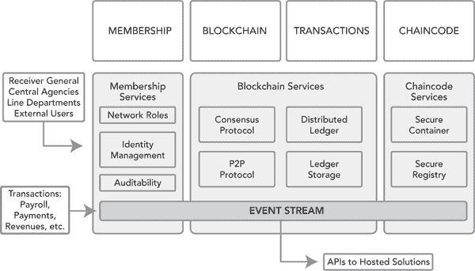

*来源：“Introduction: Release 2.0”，Hyperledger Fabric Documentation，Hyperledger，2017，访问于 2018 年 3 月 20 日。Anthony Williams 根据 CC BY 4.0 进行改编。*

**公共与私有区块链共识机制**

在公共区块链上，参与者向区块链提交交易，但如果没有共识，则不接受新数据。节点网络验证新交易的过程称为*共识协议*。在公共区块链系统中，所有节点遵循一种算法，该算法通过投入软硬件资源以暴力方式解决问题（即解决加密谜题）来验证交易。首先找到解决方案的节点将获得奖励，每个新解决方案连同用于验证它的交易构成下一个谜题的基础。

**表 5-1**

分配给不同政府行为体的潜在角色、权利和责任

| 政府办公室 | 网络角色 | 权利和责任 |
| --- | --- | --- |
| 接收总长 | 网络所有者 | 所有者建立并定义链网络的目的。启动网络后，他们成为网络拥有者，可以验证交易并邀请其他业务合作伙伴使用或共同拥有网络。 |
| 中央机构（财政委员会、财政部） | 网络拥有者 | 网络拥有者是网络的利益相关者，可以发起和验证交易，邀请新成员或用户加入网络，并批准新拥有者。 |
| 业务部门 | 网络成员 | 成员是区块链网络的参与者，不能验证交易，但可以在网络上发起新交易。 |
| 政府审计员 | 网络审计员 | 这些个人或组织有权质询交易。 |
| 公民、企业、供应商、研究人员 | 网络用户 | 网络的最终用户可以通过应用程序在链网络上读取和发起交易。与网络拥有者和成员不同，用户不拥有节点。他们通过成员或拥有者节点与网络进行交易。 |

此过程旨在耗费时间，目前在比特币区块链上约为 10 分钟。交易在约一到两小时后不被视为完全验证，此后它们在账本中足够深，引入竞争版本的账本（称为*分叉*）将在计算上非常昂贵。这种延迟是系统的一个漏洞，因为最初似乎已验证的交易稍后可能会失去该状态。这也是金融交易者、物联网设备以及任何依赖快节奏交易的参与者采用的重大障碍。

向链添加新区块的最广泛采用方法是*中本聪共识协议*。在这种情况下，创建区块的速率受到限制，通常通过使用工作量证明机制，即处理节点只有在证明已完成困难计算任务后才能添加新区块。工作量证明被广泛使用，但完成困难任务所需的辅助工作在经济上可能效率低下，且在接收总长的背景下无法被证明合理。

另一种选择是权益证明，其中下一轮可以添加新区块的处理节点由其在全球区块链和/或该轮中的股份大小决定。权益证明在计算上可能更高效，但由于担心奖励那些已经最深度参与网络的人固有地创建一个日益中心化的系统，因此尚未被广泛采用。中心化不利于真正稳健的网络，因此股权方法不适合此用例。

与中本聪共识不同，此处提议的私有区块链可以使用传统复制算法。例如，`Hyperledger`、`Stellar` 和 `Ripple` 使用*实用拜占庭容错*，它为交易完成提供更强的保证，计算效率更高，并支持较少的处理节点，所有这些节点都必须是受信任的参与者。^(344)

**实用拜占庭容错如何工作**

当网络中的节点接收到消息时，它将使用该消息及其内部状态（即面向对象编程环境中其内部变量在任何给定时间的值）运行计算或操作。^(345) 此计算决定了节点如何解释该消息（例如，是否接受交易为有效）。然后节点向网络中的所有其他节点广播其决定。区块链根据节点提交的总决定确定的共识决定进行更新——即网络上验证节点的多数投票。^(346)

对于接收长官的单一总账，各部门将发起交易（例如向员工或供应商付款），而接收长官（以及可能的其他联邦实体）将审查这些交易以确保其有效。政府可以自定义其验证交易的方法。例如，Hyperledger Fabric 使用背书策略来定义在将交易结果添加到账本之前，必须由哪些网络成员同意。^(347) Fabric 包含一个用于背书策略的小型领域特定语言，例如：

* 加拿大政府的节点 A、B、C 和 F 必须全部为 P 类交易（如工资交易）背书
* 网络中大多数（51+%）节点必须为 V 类交易（如向供应商付款）背书
* A、B、C、D、E、F 和 G 中至少三个节点必须为 R 类交易（如部门收入）背书

无论使用何种协议，一旦网络成员达成共识，交易数据就会被加上时间戳，其相应的元数据将被追加到账本并复制到网络上的所有其他节点（成员）。在此实例中，网络会将验证过的交易添加到加拿大政府的账本并更新 DFMS。

### 用户体验

区块链账本将为政府部门、接收长官和政府审计员的用户体验带来若干有利的变化。

#### 对账与报告的自动化

各部门能够直接在区块链上近实时地录入和验证交易，这将消除 RG-GL 与部门财务管理系统之间耗时的离线或批量对账流程。相反，区块链上的已验证交易将被用于同时更新接收长官的账本和 DFMS。

#### 透明度与颗粒度

接收长官和政府审计员将获得跨联邦部门网络进行的个别交易（即收入和付款）的近实时可见性。在现行制度下，每月收到的信息是由所有部门编制的汇总级试算平衡表，方法是将其详细财务信息汇总为全政府编码——这些信息接收长官无法以其他方式获取。由于记录在区块链上的交易可以被编码，共享区块链账本可以在不丢失交易数据颗粒度的情况下汇总交易以编制加拿大公共账目，这些数据将保留在共享账本中。

#### 减少欺诈

区块链解决方案将确保政府财务记录防篡改，并减少录入欺诈性交易或伪造信息的空间。加密链接区块的使用将确保无人能在不被发现的情况下篡改或删除记录。

#### 增值审计

区块链账本将允许政府审计员自动验证个别部门财务账目背后大部分最重要的数据。进行财务审计所需的成本和时间将大幅下降。借助区块链赋能的数字化，审计员可以部署更多自动化、分析和机器学习能力，例如近实时自动向相关方发出异常交易警报。支持性文档——合同、采购订单和发票——可以被加密并安全存储或链接到区块链上。

这些改进将使审计员腾出时间，专注于能增加更多价值的领域，例如分析复杂交易、建议改进公共支出流程，以及确保部门拥有衡量和报告其绩效的充分内部控制和流程。

### 接收长官职权与工作流的适应

引入共享区块链账本将给接收长官的职权和工作流带来实质性变化。自动化劳动密集型的对账流程将使接收长官能更专注于提升政府会计和报告职能的效力、及时性和透明度。请考虑以下几点：

#### 网络治理

作为区块链网络的管理者，接收长官将负责管理参与者及其在发起和验证交易中的各种角色。接收长官还将负责验证交易的共识协议的任何更新。

#### 区块链培训

向区块链解决方案过渡将要求对财务高管和部门领导进行教育和培训。接收长官可与联邦政府的技术领导者合作，教育高管了解区块链如何运作以及它将如何变革财务管理和会计。

#### 数据完整性

区块链账本的成功取决于输入数据的质量。通过减少在人工对账上的支出，接收长官可更多地参与部门层面的数据管理实践质量控制。

#### 数据透明度与开放政府

在公共区块链上，任何公众成员都可查看每条记录；任何人都可验证交易的真实性。这种颗粒度对于向加拿大人发布有关政府收入和支出的有意义信息而言大材小用，并会损害与政府交易的个人和实体的隐私。在某些情况下，这可能构成国家安全威胁。

然而，接收长官可以构建与区块链账本交互的外部应用程序，在不牺牲隐私或国家安全的前提下使信息可访问。例如，接收长官可以创建带有规则和算法的智能合约，一旦满足预定义条件，即允许区块链账本中的数据自动与第三方共享。研究人员、记者、公民、行业协会和其他利益相关方可使用此类应用程序。

## 挑战与风险管理

区块链是一项新兴技术，因此对早期采用者带来一些风险。一方面，区块链生态系统的灵活性为组织提供了定制化实施以满足其需求。然而，这种多样性可能阻碍标准和最佳实践的发展，给培训员工以及为政府用户构建、运营、保护、维护和防御该技术带来负担。以下是接收长官在评估利用区块链为加拿大公共账目创建单一数字账本的潜力时必须考虑的一些关键风险。

### 区块链实施技能

区块链解决方案目前使用现代编程语言构建。例如，比特币使用 C++，以太坊使用 JavaScript 和 Solidity 编写智能合约，而 Hyperledger 使用 Go 语言和 Java。成熟软件供应商的程序员可以以最低要求转向区块链开发，而政府 IT 员工可能需要接受区块链及底层编程语言的培训。考虑到技术行业目前熟练工人的短缺以及政府的招聘挑战，为政府范围的区块链实施寻找合适人才将具有挑战性。

### 区块链互操作性

区块链不是即插即用技术。相反，区块链解决方案需要替换现有系统，或与其紧密集成、互操作。大多数联邦部门拥有老化的基础设施或遗留 IT 系统，这可能阻碍区块链采用。拥有 102 个联邦部门，每个部门都有其独特的财务管理系统，向支持区块链的分类账过渡不会一帆风顺。我们需要将这些系统的区块链兼容性调查作为可行性研究的一部分。

### 现代化政策与程序

为在加拿大政府范围内采用区块链，每个联邦部门必须审视其现有政策、程序和财务管理实践，旨在更新不兼容的要素。根据美国技术委员会-行业咨询委员会区块链工作组的说法，过时的遗留政策将阻碍向分布式模型过渡的 IT 运营。特别是，遗留数据交换程序将妨碍区块链平台的运行，并限制其与其他政府系统（无论内部还是外部）的交互。如果参与的联邦部门无法与区块链系统共同演进，该系统将无法长期蓬勃发展。^(348)

> “区块链仍是一项非常早期的技术，任何早期采用者都需要大量的灵活性和适应性。”

### 算力

运行一个记录加拿大政府所有交易的政府级区块链分类账，将需要大量的算力。为达成共识，网络中的每个节点都必须解决一个加密难题并展示工作量证明。工作量证明方法所需的算力和电力消耗随网络规模的扩大而增加。

### 安全性

区块链网络的安全性通常随支持共识的成员数量增加而增强，因为更多的数据共享和认同意味着攻击系统、篡改各个数据库需要更多节点串通或被同时操纵。理论上，矿工可以串通将虚假交易追加到区块链中，但成功概率随验证每笔交易所需节点数的增加而降低。

尽管如此，巨大矿池和其他大规模比特币挖矿集团集中在电价低廉国家的现象，在社区中引发了日益增长的担忧，因为这些集团可能建立关键规模，从而有效垄断对区块链的控制权。

在缺乏数量优势的情况下，私有链通过赋予运营者控制权来实现安全：控制谁可读取已验证交易的分类账、谁可提交交易、谁可验证交易。换句话说，安全性基于将参与限制在可信参与者中。在收款人总长用例中，将参与限制在联邦部门应能排除恶意用户。

实施区块链具有挑战性，但这些挑战并非不可逾越。任何新技术都伴随风险，但公共部门有成功（尽管缓慢谨慎）应对这些风险的历史。云计算的日益普及便是最近的例子之一。鉴于收款人总长正在预先规划 IT 现代化，它有机会现在就将区块链解决方案纳入路线图，并与愿意的早期采用者合作启动小规模概念验证和试点项目。同时，它可以借鉴其他司法管辖区早期采用者的经验教训和经验证的最佳实践。

### 实施成本

区块链供应商的反馈表明，目前尚无法准确估算为收款人总长设计、构建和实施支持区块链的分类账的成本与收益。供应商提出了以下考量。

#### 联邦政府财务管理系统的异质性

联邦政府 102 个部门各有独特的财务管理系统。因此，我们需要更详细的技术评估，了解现有系统与区块链互操作的程度，以及是否需要升级、修改或整体替换 DFMS，以将支持区块链的分类账集成到加拿大公共账户的编制中。

#### 部门适应区块链解决方案的能力差异

我们需要对支持区块链技术实施所需的能力建设、培训和流程重新设计进行类似分析。在 Phoenix 薪资系统的推出中，我们了解到持续的能力建设和支持成本很容易超过初始技术构建和系统实施的成本。

#### 缺乏可比参考案例

目前没有其他同规模的政府区块链技术实施可供参考。土地和公司股票登记系统远比为加拿大公共账户全面采用分布式账本简单得多。爱沙尼亚的区块链系统实施影响深远，但爱沙尼亚面对的官僚机构规模小得多，遗留系统也少得多。

#### 快速演变的区块链生态系统

区块链技术仍不成熟且持续演变。区块链与领先的企业资源规划和财务管理解决方案的互操作性也在进步；这些进步是否以及如何向政府现有用户推出尚不清楚。因此，设计和实施成本将取决于组件技术的演变状态。考虑到这些因素，以及加拿大政府在 Phoenix 薪资系统上的经验，收款人总长应对区块链技术采取谨慎和渐进的方法。

## 三重记账

据一些区块链爱好者称，区块链正在颠覆延续数百年的复式记账标准，催生新范式——三重记账，这将震撼首席财务官、财务控制师、企业审计师和注册/特许公共会计师的世界。这种说法基于对复式和三重记账的误解，属于夸大其词。

在复式记账法中，每笔财务交易在至少两个不同账户中产生相等且相反的影响，形式为借方和贷方。它用于完成以下等式：

**资产 = 负债 + 所有者权益**

换句话说，复式记账使组织能够维护资产和负债记录，反映其在任何特定时期拥有和欠下的资源，以及赚取和支出的金额。

1982 年，卡内基梅隆大学工业管理研究生院会计学与经济学教授 Yuji Ijiri 在全球标准的借方和贷方之后增加了第三个组成部分——动量。^(349) 虽然他使用了“三重记账”这一短语，但他并未创造该术语——俄罗斯学者在 1900 年左右创造了它——也未将其视为范式转移；他认为复式记账具有高度可扩展性。^(350)

2005 年，Ian Grigg 认为交易的加密密封记录——实际上是一份共享收据——相当于可扩展复式系统的“第三记录”：

数字签名收据连同交易的完整授权，至少在概念层面上对复式记账法构成了巨大挑战。数字签名的密码学发明赋予了收据强大的证据效力，在实践中将会计问题简化为收据是否存在的问题。通过共享记录——每个代理都拥有一份完好的副本——即可解决这一问题。……这导致了由中央收据清单连接的复式分录对；每笔交易产生三笔分录。^(351)

云会计软件公司 SoftLedger 的 CEO Ben Taylor 认为，Grigg 使用该短语会让会计专业人士感到困惑，并误导技术人员：数字签名收据的存在并非复式记账法的根本性背离。他指出了一个常见的误解，即**“将每条信息写入区块链实际上是第三笔分录。事实并非如此。”**^(352)

许多区块链评论员用“复式记账”来指代在双方各自的独立会计记录中记录单笔交易——例如买方和卖方在各自的账本中记录资产的销售和购买。^(353) 在这种对复式记账的错误表述中，在区块链上记录交易的行为**“在双方之间创建了一个持久的互锁会计记录系统”，而不是“这些分录分别发生在独立的账本集中。”**^(354) 因此，产生了第三笔分录这一错误观念。

这种错误表述令人遗憾，但不应削弱区块链在会计应用中的价值。能够实时且在多方之间将交易写入区块链的能力十分强大。显示交易之间完整序列和关系的账本，不仅提供了可信的审计轨迹，还提供了与各方相关的所有交易的实时状态——即网络状态。

## 结论与建议

在各个领域，算法技术的应用早已超越其在加密货币中的起源，成为记录、启用和保护大量各类交易的工具，融合了规则、智能合约和数字签名等诸多新兴技术。从爱沙尼亚到美国等司法管辖区正利用区块链推动商业登记、身份管理、电子投票、医疗保健和国际贸易等方面的创新。基于我们的研究，我们建议如下：

### 审视显著流程效率的潜力

对于加拿大政府而言，试算平衡表、日记账分录、子账本提取、账户对账和支持电子表格文件很可能以各种电子和手工格式存在。借助拟议的区块链赋能解决方案，可将多个独立孤立的部门账本整合为单一共享账本，保留政府所有交易的完整、不可篡改且权威的历史记录。直接在区块链上录入和验证交易，可消除 RG-GL 与部门财务管理系统之间耗时的离线或批量对账流程。

### 重新构想政府审计员的角色与职责

接收长官和政府审计员将获得对个别交易的近实时可见性，而非汇总摘要。通过实时访问不可篡改的审计证据（如协议、采购订单和发票），审计员可提高财务报告和审计的速度。审计员可将更多时间用于深入调查复杂交易，建议如何提高公共支出的功效与效率，并确保部门拥有衡量和报告其绩效的充分内部控制和流程。

### 重新构想接收长官的角色

自动化劳动密集型的对账流程（特别是），将使接收长官能更专注于提升政府会计和报告职能的功效、及时性和透明度。接收长官的新角色将包括管理参与者及其在账本上发起和验证交易中的各种角色，以及构建外部应用以增强政府报告流程的透明度。

### 了解私有账本与公有账本之间的权衡

凭借更高的安全性和访问控制，许可型区块链解决方案允许有限数量的预选可信参与者（即各联邦部门和接收长官）访问账本的相同副本。私有或许可型区块链的优势包括更快的交易验证和网络通信，以及修复错误、撤销交易、限制访问和降低外部攻击可能性的能力。使用许可型网络，接收长官可选择为不同部门分配不同角色。

### 在前瞻性 IT 规划中纳入区块链赋能账本

区块链仍属新兴技术，对早期采用者存在一定风险。技术人员将需要接受区块链及底层编程语言的培训。大多数联邦部门拥有老化的基础设施和/或关键职能的遗留 IT 系统，这可能阻碍区块链采用。除非参与的联邦部门随之共同演进，否则区块链系统不太可能长期成功。接收长官有机会在其路线图中纳入区块链解决方案，并利用其他地方早期采用者的经验教训和成熟实践。

### 采取渐进式方法

鉴于实施挑战和区块链技术的演进状态，接收长官应采取谨慎且渐进的方式引入区块链技术。拟议的第一步是对成本和实施相关参数进行深入的可行性研究。作为第二步，视可行性研究结果而定，接收长官应与两三个早期采用部门合作，设计并测试概念验证（POC），并进行为期多年的试点，以验证可行性研究的假设和结论。

## 开发概念验证时应提出的问题

- 当前会计制度的管理成本对于单个部门和整个政府分别是多少？
- 区块链解决方案将如何影响负责政府账目的人员的授权和职能？
- 该系统是否符合现有法律法规？
- 法律或监管框架的变更是否将促进采用或提高有效性？
- 该解决方案能否利用公共或私营部门现有的基于区块链的会计工作？
- 该解决方案是否存在财务或受托风险？如果存在，这些风险能否得到缓解？
- 区块链账本将如何改变政府部门的用户体验和/或影响政府审计员和公众等其他利益相关者？
- 此类系统对每个部门和整个政府的成本分别是多少？

归根结底，接收长官面临的核心问题是：我们是继续前行，投资这项新兴技术，并拥抱技术、流程和组织设计所需的变革，还是专注于改进现有系统并优化其流程？

## 事后审查时应提出的问题

- 构建区块链 POC 的成本是多少？

运行一个多年试点流程需要多少成本，包括支持区块链技术实施的成本，例如流程重新设计投资、能力建设和持续技术支持？

在试点过程中是否实现或证明了行政效率？

基于这些成本和收益，在联邦政府范围内推广该解决方案的预估成本和收益是多少？

现状与基于区块链的系统之间的成本效益分析是什么？

如果各部门共同参与构建和管理共享区块链账本，政府将如何核算每个部门应分摊的成本比例？

考虑到预估收益，政府应在多长的时间范围内期望看到投资回报？

**与利益相关者协作。** 国库部长应与相关部门财务经理密切合作，了解沉没成本、运营成本（即部门间接费用）以及国库部长承担的成本。在将现状与基于区块链的流程的成本和收益进行比较时，这些将是重要数据。国库部长和部门财务经理应协调跟踪和分析由区块链赋能的试点所产生的效率和收益。考虑到学习曲线和组织调整，参与者可能直到试点的第二年才能实现效率和收益，届时他们将更好地理解其对组织设计和财务管理流程的影响。

# 第 6 章

## 管理区块链透明度

### 私有/开放世界的策略

### Andreas Park

## 区块链透明度简述

- 区块链技术的出现迫使我们重新考量公开披露交易和合约的利弊。分布式账本的实施、应用和潜在监管涉及的选择，将严重影响信息披露和经济互动。
- 区块链技术可以通过以相对低廉且固有可见的方式存储合约和交易（任何拥有互联网接入权限的人均可查看），促进对企业投资决策的监控。
- 无论区块链是公开无许可的（如比特币或以太坊区块链），还是私有许可的（如瑞波币或 Hyperledger 实施）：原则上，交易均可追溯，并将行为归因于标识符。因此，该技术具有原生的高透明度。
- 用户仍可在私有和公有区块链中保护隐私：一些方法是程序性的，涉及协议的智能使用；另一些是技术性的，利用数学原理。

## 实时信息对称简介

2001 年 10 月 19 日，安然公司（Enron Corp.）多年的成功故事戛然而止，并无大团圆结局：该公司宣布单季亏损 6.38 亿美元，股东权益减少 12 亿美元。几个月后，在证监会（SEC）和美国司法部的调查后，世人得知安然管理层伪造账目，并利用复杂的会计结构隐瞒了巨额债务义务。安然高管被判处 24 年监禁，这对数万名失去工作和养老金的安然和安达信（Arthur Andersen）员工，以及看到 650 亿美元股权灰飞烟灭的股东来说，聊胜于无。在又发生数起会计丑闻后，美国国会通过了《萨班斯-奥克斯利法案》，收紧了披露、会计和问责标准。

退一步说，让我们自问：监管机构和立法者一直试图解决的根本问题是什么？债贷方想知道借款人偿还贷款的可能性，股权投资者想知道获得投资回报的可能性，特别是上市公司的当前市价是否真实反映了每股内在价值。然而，银行、企业、会计师事务所和政府机构的管理者一次又一次地被揭发撒谎。

*信息不对称*（Asymmetric information），即交易一方拥有比另一方更好的信息并可利用之损害后者，对市场运作有毒害作用。因此，存在一套繁复且往往负担沉重的监管体系，旨在通过强制定期准确披露来减少这种不对称。会计规则给予管理者在公司内部重新分配资金和收入的余地。此外，会计报告是间歇性发布的，且有大量证据表明管理者从事许多经济上无意义却成本高昂的活动，如盈余“平滑”。最后，账目的外部认证成本高昂。

在数字化前的世界，提供间歇性报告是适当、耗时且昂贵的：管理层需要从各单位汇总信息，并支付第三方进行核查和验证，然后邮寄给股东。如今，企业拥有电子会计系统：高管能实时获取财务信息，但选择不与投资者分享此类原始未经审计的数据流。

原则上，区块链技术允许企业公开、直接且实时地披露经验证的财务交易。它还允许披露大量合约。这些公开的交易将以代码形式呈现，从而消除关于企业财务状况和承诺的歧义。尽管欺诈活动仍有可能，但许多导致安然倒闭等后果的交易将不再可能。^(355) 资产无法同时显示为由两方拥有，隐藏负债将变得不可能，潜在的“安然”也无法像安然那样吸引如此积极的媒体关注和额外融资。

## 共享知识的益处

资产所有权和合约的一个关键要素是归属：谁持有资产，谁建立并参与了合约？区块链通过记录资产发行和交易，从而在分布式（而非中心化）账本中记录所有权变更，存储了这些信息。这份完整的交易和合约记录确立了资产的当前所有者。所有权归属于一个地址，地址只是一串字母和数字，可视为一个标识符。

通过在区块链上记录交易，一个包含多方的网络拥有对资产过去和当前所有权的共享知识。该技术的一个内在部分因此是对过去行为和当前所有权存在一定程度的透明度。事实上，默认情况下，交易归属对任何有网络访问权限的人完全透明。原则上，地址或 ID 是匿名的。

### 区块链技术中的原生透明度

### 区块链技术能否成为经济增长的催化剂？

如果安然公司的管理层被要求公开披露公司的地址，那么投资者和监管机构本可以追踪资产和负债的流动。基于区块链的交易之美在于披露是固有的。原则上，那些有权访问区块链信息的人，可以拥有与公司管理层同等的公司信息。这一特性可能降低生成会计报表和执行审计的成本。^[356] 还有进一步的成本节约：信息不对称是一种风险，融资方要求为此获得补偿。通过减少信息不对称，公司降低风险并减低资本成本；它们拥有更多资金用于投资和研究，并可利用这些资金打造更好的产品和增加就业。因此，区块链技术可以成为渐进式经济增长的催化剂。

### 多少透明度才算“过度透明”？

尽管透明度有其优点，但它会影响市场参与者的经济互动，也可能带来负面影响。例如，客户因流动性需求，请求投资交易商吸收一大笔头寸。投资交易商账面上因此多了一笔它不想要的风险。在流动性较强的市场中，这个问题可能很小，因为交易商很可能能迅速交易平仓。但在流动性一般的市场中，客户一开始大概就不会找上门来。在流动性差、潜在交易对手寥寥无几的市场中，交易商必须担心“挤压”：资金雄厚的强盗交易者可能会让市场向不利于交易商的方向移动，迫使交易商以火灾拍卖价格清算头寸。交易商不希望公众看到其高风险头寸。

我们该关心交易商吗？我认为我们必须关心。头寸挤压的风险是真实的，交易商希望获得补偿，因此非流动性资产的交易成本要么上升，要么非流动性资产的市场彻底崩溃。

换个说法，在高度透明的区块链上结算交易有正当理由，对这种透明度的担忧也同样正当。确实，当面对记录所有交易的公共区块链概念时，金融业高管们感到反感——绝不在他们的监管下！

替代方案是许可制的私有区块链，由银行等已知且受信任的实体联盟组织和控制。假设是，这种私有分布式账本或区块链的可见性级别是一个设计选择。但事情没那么简单：即使是由银行联盟组织的私有区块链，仍然涉及分布式网络中每个节点对所有人交易的记录保存。换句话说，即使在私有区块链中，我们的竞争对手也能看到我们的活动。

讨论到此结束了吗？没有。如果银行担心缺乏隐私，那么它们也不应该使用互联网。相反，我认为关于透明度的讨论应聚焦于期望的、社会最优的透明度水平。这一水平是希望建立私有区块链的公司的关键设计选择。此外，监管机构和立法者需要仔细思考要求公共区块链企业用户披露何种信息。

在本章中，我将概述区块链上记录信息的方式与当前资产转移世界的区别，以及谁能看到什么信息。透明度的变化会产生经济后果，并可能造就赢家和输家。因此，我将描述反对透明度和支持透明度的商业案例。最后，我将讨论现有的技术解决方案，以降低区块链内置的完全透明度。

### 区块链技术中的原生透明度

#### 所有权转移：中心登记册与分布式账本

为了说明可能的透明度问题，让我们看看区块链技术的运作方式，以及它们如何与行动和持仓的透明度相关联。

所有非实物、非登记资产的转移都需要一种改变所有权记录的机制。目前，中心化账本保存大多数此类记录，只有高度受信任的各方才能访问和修改这些记录。现金存放在银行账户中，银行账户就是一个中心登记册。房屋所有权记录保存在房产登记处。股票等证券也保存在中央证券存管机构，如美国的 `DTCC` 或加拿大的 `CDS` (Canadian Depository for Securities)。^[357] 最后, 大多数双边合同的记录通常由相关当事方保存，合同条款触发的交易因此涉及复杂的账户对账流程。消费贷款协议通常还会在征信机构（如 `Equifax` 或 `TransUnion`）登记。^[358]

区块链技术是一种用于更改分布式账本记录的共识协议，其设置定义了谁可以在何种情况下更改账本。其核心是，区块链是一种仅追加协议，用于存储“交易”，原则上交易可以是一笔交易，也可以是基于文本的信息，如一段编程代码。区块链的关键特性在于，通过记录交易，它确保了对资产当前所有者的共识。任何人都可以使用公共网站 `Etherscan.io` 探索 `Ethereum` 区块链上的代币转账，该网站从 `Ethereum` 区块链拉取数据；或使用网站 `Blockchain.info` 探索 `Bitcoin` 区块链。

#### 所有权转移：公有链与私有链

让我们考虑数据存储的差异。迄今为止，大多数公司仍将企业数据存储在中心数据库中。这种设置简单易懂。此外，由于所有信息都存储和更改在一个中心位置，一方无法两次出售同一资产或两次花费同一美元。想想银行账户：`Bob` 不能把同一美元同时发给 `Sue` 和 `Alice`，`Bob` 也不能在两笔交易中使用同一资产作为抵押。数据存储的中心化防止了这种双重支付问题。

然而，中心数据库存在许多担忧，首当其冲的是安全性：如果数据库因（例如）重大硬件故障而失效，所有数据可能丢失。因此，中心数据库的保管方总是会做备份——而备份模式离分布式数据库更近一步。即，保管方需要持续更新备份以避免数据丢失，因此需要一个备份协议来确保备份中的数据准确。

分布式数据库与中心备份系统共享特征，因为它在多个位置保存所有信息。关键区别在于，在分布式数据库中，不存在所有更改都源自的单一主位置。相反，每个站点都可以更改数据。

这种设置有许多优势：没有单点故障，所有数据在本地可用，且系统可以设置为不同位置无需相互信任，但所有站点持续就数据库内容达成共识。根据 `R3` 的 `Richard Gendal Brown` 所述：“一种……由多方运营的系统，它们彼此并不完全信任，却能达成并保持共识，认定一组共享事实的性质与演变。”^[359]

然而，分布式数据库的一个副作用是*所有*信息都存储在*所有*位置。因此，例如，如果一组银行组织分布式账本（其中每家银行都是一个网络节点），那么每家银行都持有其他所有银行账户的信息。这种安排让高管们警觉，因此我们需要了解这些信息揭示了什么（因为存储信息并不等同于访问信息）。

### 分布式账本的两种主要类型

分布式账本主要有两种类型：*公有*和*私有*。

#### 公有账本

公有账本是无许可的：任何人都可以成为网络节点，原则上任何人都可以在账本中录入记录。最著名的例子是比特币和以太坊区块链。事实上，成为网络节点的过程是使用区块链的一部分：使用以太坊区块链的第一步是下载一个所谓的钱包软件；一个例子是“Mist 钱包”。这些钱包监控以太坊区块链以查找发送给该钱包的交易。作为该过程的一部分，用户从以太坊区块链下载信息并成为一个节点。

#### 私有分布式账本

相比之下，私有分布式账本由单个公司或公司联盟构建，并在几个关键方面与公有分布式账本不同。首先，私有网络可以是有许可的，因此可以限制谁可以使用它来记录交易，以及谁可以查看信息和资产在其中的流动。对于金融机构而言，这一特性很重要，因为它允许它们遵守 KYC（了解你的客户）法规，这通常是遵守 AML（反洗钱）规则的前提条件。此外，原则上，这些网络不需要无信任协议。一个缺点是，联盟解决方案引发了典型信托的串通和租金攫取幽灵；例如，网络成员可能限制准入、固定价格并串通费用。从竞争政策的角度来看，强制要求无信任协议以消除希望加入联盟网络的新进入者的障碍，可能是可取的。

### 区块链交易的验证

图 6-1 说明了区块链交易验证的工作原理。^(360) 关键思想在于，用户的区块链地址（隐含地）包含两个部分：一个公开部分和一个私有部分。每个人都可以看到与地址公开部分相关的每一笔交易；私有部分用于对交易进行签名。此外，公钥是验证用户确实授权了该交易的关键组成部分。附录解释了如何获取地址并向该地址转账。^(361)

**图 6-1**

使用公钥和私钥对交易进行签名和验证

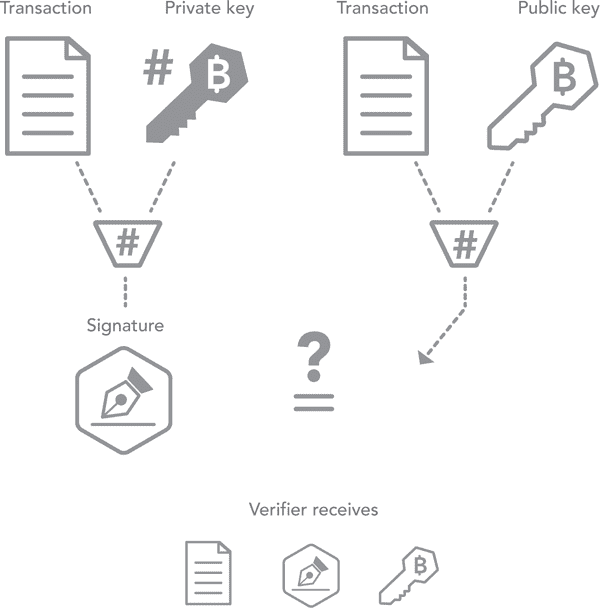

*图标 © 2017 Smashicons and Freepick. 已获许可使用。*

#### 简而言之：区块链转账如何运作

**步骤 0：** 双方就特定资金或其他资产的转移达成一致。

**步骤 1：** 物品的买方（由地址标识）向区块链网络发送消息，请求发起向卖方（一个地址）的转账。

**步骤 2：** 网络检查买方是否拥有指定资金，以及买方是否能验证其有权发起转账；此验证要求使用私钥/地址的私有部分对交易进行签名。

**步骤 3：** 交易被打包成区块，并根据区块链的协议添加到链上。

**步骤 4：** 一旦区块被添加到链上，交易即完成结算。隐含地，买方账户减少，卖方账户增加相应的转账金额。

此讨论的要点是：区块链记录所有带有买卖双方 ID 的交易，该信息保存在每个节点，因此该信息在广泛的网络中共享。关键在于，不得将具有区块链协议的*私有*分布式账本误认为是保证*隐私*的解决方案。相反，上述协议以及将所有权归属于 ID 的原则在私有区块链中的运作方式相同。主要区别在于，私有区块链可以控制除网络成员外的任何人是否能查看交易记录。

### 透明度：风险与资产并存

在许多情况下，透明度是一把双刃剑，一些可能从中获益最多的参与方也是最坚决的反对者。在本章引言中，我已经强调了中介机构是强有力的反对者，例如因为吸收客户库存会使中介机构面临风险。过往交易和持仓的透明度也可能帮助它们识别潜在交易对手。^(362)

#### 透明度作为战略风险

企业债券市场说明了这一问题的复杂性。上个世纪初，企业债券定期在纽约证券交易所等证券交易所交易。但随着时间的推移，该市场几乎完全转移到了场外交易安排；尽管交易技术取得了重大进步，但这个数百万美元的市场仍然出奇地低技术含量，因为大多数交易都是通过电话交谈或彭博聊天安排的。

该行业也强烈抵制增加透明度的尝试，即使仅限于交易后信息。例如，2002 年美国证券业协会（NASD）交易报告与合规引擎（TRACE）的推出，以及加拿大投资业监管组织的类似努力，都遭遇了强烈抵制。O'Hara、Wang 和 Zhou 提供了一种可能的解释：活跃交易者（推测为常客）获得更好的价格，而主导交易商倾向于提供更差的价格。^(363) 这些发现表明交易商有利润空间需要保护。然而，缺乏竞争的利润空间最终以发行人的代价为代价，因为投资者会将流动性成本计入定价。

与此同时，像 Algomi 这样的初创金融科技公司提供企业债券交易头寸的系统化、算法匹配，它们报告称一些最大的客户是中介机构。换句话说，交易商认识到增强流动性技术的用处。同样，有大量证据表明，TRACE 推出后市场价格变得显著更精确。更准确、高效的价格使中介机构整体受益，因为不良定价会增加风险。

然而，卖方中介机构并非唯一担心透明度过高的参与方。大量研究表明，机构投资者尤其担心竞争对手可能模仿其交易策略。例如，共同基金被要求定期在 13-F 表格中公开披露其持仓；Christoffersen、Danesh 和 Musto 记录显示，主动管理型共同基金通常会尽可能长时间地延迟发布此信息。^(364) 换句话说，这些基金试图尽可能长时间地模糊其活动，推测是因为它们担心失去竞争优势。此外，在更短期的基础上，机构交易者花费大量精力隐藏其交易活动：他们不一次性交易大量订单，而是使用复杂的计算机算法将大额订单“粉碎”成微小的碎片。他们这样做是为了避免被整个市场发现，因为正如 van Kervel 和 Menkveld 所报告的，他们在一天中处理订单的时间越长，其他聪明的算法交易者检测到这些订单并使价格向不利于他们的方向移动的可能性就越大。^(365)

在过去 20 年里，许多公司退出了公开股权市场：自 1990 年代末达到顶峰以来，美国上市公司的数量下降了 40% 以上，其中一些退市公司是家喻户晓的品牌，如戴尔和 Safeway。其他一些极其成功且知名的公司，如 Uber，则刻意避开公开市场。^(366) 造成这一趋势的原因有很多，但上市公司强制性的公开披露常被引为原因之一。^(367) CEO 必须公开披露薪资，而财务披露可能使公司面临泄露竞争性或战略性商业信息的风险。

除了某些当事方希望保护隐私的情况外，还存在隐私属于必需品的情况。一个很好的例子是基于区块链的投票。利用区块链进行投票的基本理念是向合格选民发放数字化的一次性代币。通过受控且可审计的代币供应与分发，很难操纵投票。然而，在民主政治选举中，投票必须是私密的，因此隐私至关重要。在其他情况下，公开投票可能是可取的：例如，正如 TMX 集团最近引入的那样，在股东大会上的投票中，股东可能想知道他们的委托投票是否按承诺使用。

现有的区块链技术可以解决此处强调的许多透明度问题。此处提出的论点并非反对使用区块链解决方案。

#### 透明度作为战略资产

互联网、电子文档和数据的出现，极大地增加了投资者、消费者、贸易伙伴和监管机构可获取的关于公司、政府、非政府组织和个人的信息。随着时间的推移，许多此类实体已学会拥抱透明度，并将其转化为自身优势。区块链技术使公司能直接和间接地从透明度中获益。

##### 间接效应：声誉与感知诚信

管理科学领域有大量长期文献研究透明度的*间接*效应。^(368) 这些文献认为透明度应成为负责任管理实践的核心原则，研究人员发现了大量证据表明，拥抱透明度的组织获益良多。依我之见，这些益处是间接的，因为许多源于公司开放性的报告益处是随着时间推移改善关系而产生的。例如，在许多商业交易中，一方会获知另一方的信息，为了建立成功的关系，双方需要相互信任，相信对方不会利用这些知识牟利。公司增加信任的常见做法是发布采用的道德行为准则，这使员工更容易了解期望要求，并在商业往来中建立信誉。此外，及时与合作伙伴和供应链成员共享相关信息能增进信任，并通常能提升公司品牌。

正如 Tapscott 所述，在透明度和公众监督增强的环境下，企业成功有五大要素。企业需要：

- 创造经得起透明度带来的审视的真实价值。
- 了解客户并建立关系资本。
- 保护客户隐私。
- 恪守诚信，因为在透明的世界里，失信行为会被迅速发现。
- 坦诚相待，因为缺点会被迅速看穿。^(369)

许多原则适用于金融交易和合约在区块链上可见的世界。确实，Parris 等人将透明度定义为“利益相关者认为组织提供了解其自身学习机会的程度。”^(370) 区块链上可见的交易和智能合约（编程代码片段）提供了“硬”信息（因而提供了学习机会），因为该信息可验证且不可篡改。

DAO 是透明度的一个极端案例。^(371) DAO 作为一只风险基金成立，其所有投资和整个治理结构在设计上就是透明的，因为底层代码是开源且对所有人可见的。DAO 治理的基本理念是 DAO 代币持有者对是否资助拟议项目进行投票。这种 DAO 自主、非人工的运营模式并不适用于所有公司，但它与“正常”公司决策形成了迷人而鲜明的对比：在后者中，高管对资金使用拥有巨大自由裁量权，股东很少有直接发言权，且往往仅对 CEO 的决策拥有有限或间接的了解。^(372)

作为区块链中存储的“硬”信息如何帮助实体的一个例子，请设想一个历史上腐败严重的国家。该国政府如何改善其地位？归根结底，很难证明自己不腐败。区块链技术可以提供答案。在当今世界，往往不可能可信且高效地披露政府所有相关交易和商业往来——但当所有交易和合约都记录在区块链上时，便无所遁形。由于资金流向和合约条款可追溯，该政府可以可信地记录在案，证明其行为未助长腐败。

##### 直接收益：去中介化、改善治理

透明度也带来直接收益：记录在区块链上的交易通常具有金融性质，在区块链上记录交易从而记录持仓，可在市场互动中产生*直接*的程序性优势。许多金融资产（如公司债券）流动性极差，意味着意愿交易者难以找到对手方；近期的监管变化（如沃尔克规则）加剧了这一局面。^(373) 一个问题是，在当前的市场结构下，大多数交易通过交易商离线安排，因此难以知晓近期谁交易过该产品（因此可能持续感兴趣）或谁可能持有该证券（因此可能成为交易对手）。可以说，该市场更高的透明度可增加投资者间的直接互动（从而减少昂贵的中介环节）。Malinova 和 Park 从理论上证明，具有公共区块链特征的体制（即使市场参与者采取措施隐藏行为）相较于传统的、不透明的体制（所有过往交易和当前持仓信息都孤立地存放在交易商的信息孤岛中），提高了配置效率。^(374)

另一个例子是首次公开募股（IPO）市场。在其上一次繁荣——即 1990 年代末互联网泡沫期间——该市场问题重重。一个关键问题是发行的分配和准入规则。传统上，主承销投资银行控制谁能获得发行股份。对于热门 IPO，存在诸多利益冲突：例如，一个广泛报道的担忧是，承销投资银行有动机通过给予其最优质客户低价股份来取悦他们。^(375) 另一个广泛报道的问题是“阶梯承销”过程，即投资者只有承诺以更高价格购买更多股份，才能获得发行股份。^(376) 在当今的投资银行业世界中，承销商很难说服发行人和投资者，利益冲突在其建议和决策中不起作用。将此与目前火热的 ICO（首次代币发行）市场形成对比（无论好坏），许多 ICO 从所有实际目的来看，都类似于证券发行。^(377) 该市场的分配机制完全透明，因为它内嵌于那段决定代币如何分配的公开可见代码中。^(378)

在一篇备受推崇的论文中，David Yermack 强调了区块链技术可为公司治理带来的诸多潜在益处。^(379) 例如，Yermack 认为，区块链上的透明所有权归属有助于解决所谓的“空投票”现象，即某实体在没有公司经济利益的情况下，却对经济上有意义的决策进行投票。^(380) 通常的假设是，对公司的经济利益和投票权与股份所有权相挂钩。然而，衍生品合约使得一方有可能在没有公司经济利益的情况下获得大量投票权。^(381) 通过区块链进行所有权归属，在任何时间点，谁拥有股票、谁拥有经济上合理的投票权，都将是透明的。

内幕交易是金融业和学术界另一个争议颇多的话题，也是一个显而易见的应用场景。内幕人士已经被要求披露其交易和持仓，但交易与报告之间往往存在显著延迟。^(382) 因此，如果所有交易都记录在区块链上，那么——通过揭示其公开 ID——内幕人士可以可信且即时地展示其交易。他们所有的交易都将可见，这将消除昂贵的报告要求，并可能增加公众信任。^(383) 公众将能够更好地了解内幕持仓和内幕交易，公司高管将与股东建立信任。这一论点在内幕交易违规执法不如北美严格的司法管辖区中尤为适用。最后，内幕交易的透明度应能降低内幕人士从事非法交易的倾向。随着透明度降低了内幕交易者的灵活性，外部人士生成关于公司的信息将变得更有利可图。

Yermack 强调，公共区块链的不可篡改性改善了（公司）治理。在当前系统中，土地记录可被伪造，公司利润表可被操纵，期权授予可被回溯定价。当所有这些数据都记录在公共区块链上时，实施此类操纵将变得极其困难且昂贵。

在金融领域，合同和持仓的透明度超越了公司治理核心的逆向选择和道德风险的解决，并对风险管理具有潜在的深远影响。2008 年金融危机后的一个重大发展是，特定类型的衍生品合约（如掉期）被强制要求通过新开发的“中央对手方”（CP）进行清算。基本思路是：当 A 想卖给 B 时，A 卖给 CP，然后 CP 卖给 B。为什么这有必要？设想 A 也从 C 处买入，但 C 破产了。A 将无法向 B 交付，自己也可能破产。因此，在与 A 交易时，B 面临两种对手方风险：(a) A 独立破产的风险，以及 (b) C 破产并连累 A 一起倒下的风险。

考虑金融危机前 AIG 在信用违约掉期市场上的衍生品交易，当时显而易见，AIG 持有大量未对冲头寸。AIG 的违约将引发其对手方的违约，导致整个金融系统发生连锁反应。当所有交易都由 CP 清算时，风险集中在 CP。尽管该系统能产生互利的风险分担水平，但也存在问题：因为它是一个“大而不能倒”的实体，CP 需要受到严格监控、拥有充足资本，并可能面临严格监管。此外，目前只有少数合约符合 CP 清算资格。CP 必要性的根本原因在于对聚合风险的信息不足，这造成了道德风险。正如我们从美国经济学家 George Akerlof 的开创性工作中所知，信息不对称可能导致市场崩溃。

我们可以认为，区块链技术实现的透明度提供了一种基于市场的解决方案：当所有金融义务都可见时，我们将能够追踪双边互动之外的对手方风险。未对冲头寸将变得可见。此外，我们将能够编写带有保护性契约的智能合约，迫使对手方通过代码及时建立对冲，或阻止其从事未对冲合约。

最后，智能合约本身可以从根本上改善经济互动。作为第一步，智能合约可以在违约时自动转移所有权，从而促进抵押品的交付。这种自动化极大地改善了抵押品的执行，提高了其价值，降低了风险，并可能释放资本。

我们使用合约向他人（如股东）证明货物转移将会发生（或已被合法化）。我们可以在没有区块链和非透明环境下使用智能合约；但在透明的区块链中，各方可能能够出售未来付款的权利。换句话说，公司可能能够直接从合约中出售现金流，并可能直接对冲现金流风险。此外，正如 Cong、He 和 Zheng 所展示的，智能合约可以缓解信息不对称，从而促进准入和竞争，进而带来更高的社会福利和消费者剩余。^(384)

总而言之，支持区块链技术所提供的交易和合约透明度的可靠商业理由是存在的，这些优势远远超出了解决因头版丑闻而产生的担忧。就目前而言，企业实体的隐私已经受到限制，尤其是与个人隐私相比。假设监管直接要求基于区块链的互动披露，这并不无道理——如果区块链确实成为金融交易的标准，那么这种披露在程序上是廉价的。

最后，我在此提出的论点的有效性，已在 IBM 最近对 C-suite 高管的研究中得到确认。^(385) 已经积极采用区块链技术的绝大多数高管报告称，该技术将创造更多信任，例如，通过可追溯的交易审计轨迹，声誉可以通过提供过往行为的透明度来建立。

### 解决问题：区块链隐私的技术方法

区块链的主要目的是确保记录的真实性——默认情况下，分布式账本并非旨在为其用户提供隐私保障。事实上，有大量证据表明公共区块链中的交易并非私密的，且个人行为有可能被追踪。^(386)

作为先决条件，区分不同参与方可能存在的顾虑非常重要。从流行互联网论坛讨论的基调来看，许多加密货币（特别是比特币）的支持者担心他们的交易是否会被追踪或发现，例如被政府机构发现。考虑到比特币曾是 Silk Road 等网站上非法购买毒品或勒索软件支付的流行支付方式，这并不令人惊讶。

相比之下，大多数企业用户习惯了政府审计其行为，他们不太担心政府本身知情。事实上，他们甚至可能欢迎一个使追踪变得更容易的系统。相反，企业用户主要担心的是他们的行为是否可被竞争对手追踪，从而削弱其知识产权。

### 程序性变通方案：使用多重 ID

那么，区块链上的行为是否总是完全可追踪和可归因的？答案是否定的。有几种简单、低技术含量的程序性变通方案，允许用户混淆其行为。

让我用一个具体的例子来解释这些想法。一家共同基金想要对一家最近发行的、其证券为基于区块链代币的公司进行大额投资。该共同基金会将法定货币（如加元）兑换成基于区块链的货币（如以太币）。这种转账将发生在基于区块链的交易所。交易所会知道是谁买了以太币（因为他们必须遵守 KYC 法规）。转账完成后，基金将使用新购买的以太币购买加密证券。正如我在附录中概述的，通常这种转账是在一个汇聚了众多市场参与者行为的交易所钱包中进行的。为了最终结算，基金随后会将证券转移到一个非交易所钱包。但基金不必使用已知钱包，也不必向公众透露钱包 ID。相反，基金可以创建一个专用的新钱包。或者基金可以创建任意数量的新钱包，并将持仓拆分到这些钱包中。如果操作得当，外部人将无法拼凑出这笔大额购买。该解决方案也可以使用所谓的 `hierarchical deterministic` (HD) 钱包（分层确定性钱包）进行正式编程，该钱包为大额交易的每一部分以算法方式生成一个新的公钥。

HD 钱包也被提议作为私有分布式账本隐私的解决方案。假设一个私有网络由一个大型银行和经纪商财团运营。他们每个人将创建一个（或多个）HD 钱包，并在自己的系统中记录个别客户的持仓。这种安排类似于目前的股票交易结算。即目前，股票交易的结算发生在中央存管机构，如美国的 DTCC 或加拿大的 CDS，结算是在经纪商层面进行的。主要区别在于 HD 钱包结算发生在分布式账本上，而非中央数据库。即使对于有权访问账本的人来说，分布式账本也不比中央存管解决方案具有信息优势（特别是在加拿大，交易通常带有经纪商归属标识）。

另一种与 HD 钱包相关的生成隐私的解决方案是合并与重拆分操作：根据该协议，多个实体匿名向智能合约提交新地址；合约从各方收集相同数量的加密证券单位（例如，每方 100 个比特币），然后将这些金额重新分配给新地址。^(387) 从外部来看，我们无法进一步追踪资金流向。毋庸置疑，在一个没有外部监管的公共区块链中，我所描述的在所有实际目的上都是洗钱。然而，在许可型区块链中，身份是已知的，监管机构或税务机关将能够追踪个人。这一举措的主要目的将是对外部观察者混淆自身行为。

### 高科技解决方案：零知识证明

除了上述低技术含量的解决方案外，现代密码学还提供了几种高科技且优雅的方式来获得隐私。与交易相关的常见隐私顾虑是：信息所有者希望提供加密证明，证明她是该信息的合法所有者，而无需向验证者（即网络）透露该信息。

例如，零知识在基于区块链的投票中至关重要。对于这种投票，人们会收到一个投票代币。在投票时，代币持有者需要验证她是该代币的合法所有者；但由于秘密投票的原则，验证者不得看到所有者是谁，因为这种知识可能允许验证者将实际投票追溯到选民。毕竟，在公共区块链中，每个网络成员都保存所有信息的记录。

解决这一问题可能最复杂的方法涉及所谓的零知识证明。图 6-2 展示了这种验证的工作原理。^(388)

这里有一个零知识证明的标准例子。假设鲍勃是色盲但自己不知道。爱丽丝想向鲍勃证明绿色和红色是有区别的。鲍勃拿两颗斯诺克球，一颗是红色，另一颗是绿色，除此之外它们完全相同。对鲍勃来说，它们看起来完全一样，他怀疑它们实际上是可以区分的。爱丽丝想向他证明它们确实颜色不同。同时，爱丽丝不想让鲍勃知道哪个是红色，哪个是绿色。

这是证明系统：鲍勃拿两个球，使每只手各拿一个。爱丽丝能看到球但不告诉他哪个是哪个。鲍勃然后把双手藏在身后。接下来，他要么交换双手中的球，要么保持不动，两种可能性概率相等。然后他把手从身后拿出来。爱丽丝现在必须“猜测”鲍勃是否交换了球。当然，爱丽丝只需看颜色就能确定鲍勃是否交换了它们。如果它们颜色相同且因此无法区分，她将以 50% 的概率猜对颜色。当然，一次尝试是不够的，但如果鲍勃和爱丽丝重复这个“证明”多次，爱丽丝纯靠运气每次都猜对的概率将消失。因此鲍勃应该会确信这两个球确实颜色不同。此外，该证明是“零知识”的，因为鲍勃从未得知哪个球是绿色哪个是红色；事实上，他没有获得任何关于如何区分这些球的知识。^(389)

#### 图 6-2

零知识证明示意图

一个证明者想要向验证者展示她拥有洞穴中秘密门的钥匙。无论她先走左边还是右边，她都可以使用钥匙并从任一方向返回。验证者没有看到证明者走哪个方向，要求她从右侧通道返回。拥有钥匙的证明者打开门，从右侧通道返回。当然，她可能只是运气好；没有钥匙的人一开始也可能走右侧通道。但他们重复实验多次，证明者靠运气从正确通道出现的概率每一次都在降低。

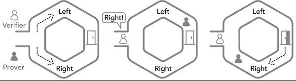

*Icons © 2017 Smashicons and Freepick. Used with permission*。

撰写本文时，公共区块链以太坊的开发者正在引入使用零知识证明通用版本的选项，作为以太坊区块链的一部分。他们采用的概念是 `zk-SNARK`，一种协议，允许某人仅向验证者透露必要的信息，而不透露更多。`Zcash` 是基于零知识证明的加密货币的一个例子。

公司何时需要这种选项？设想一家公司将智能合约存储在区块链上。借贷方想评估该公司的信用状况，要求披露基于现有合同公司预期能收到的付款。公司可能不愿向借贷方透露合同的所有细节（如交易对手）。零知识证明提供了解决方案：公司可以证明它是即将到来的付款的接收方，而无需透露所有细节。

另一种提供隐私的基于区块链的加密货币是 `Monero`。它基于不同的概念，即所谓的*可链接环签名*。其思路是系统将真实 ID 与每笔交易的一组随机其他 ID 混合。在签署交易时，用户证明自己是合法所有者，而不透露具体是哪一个。可链接性确保不会发生双重支付。还有其他几种技术和程序性解决方案可以提供隐私，但讨论所有这些超出了本章范围。

总之，有多种解决方案可确保隐私：一些是技术性的（如零知识证明），一些是程序性的（使用多个 ID）。

### 在公共区块链与私有区块链中的实现

我上面描述的用于获取隐私的程序性解决方案是公共区块链的固有特性。使用多个地址的直接缺点是会产生切实成本：虽然创建 ID 是免费的，但每笔交易都涉及费用，以这种方式调用隐私需要付出代价。除成本外，没有任何东西能阻止实体使用任意数量的 ID 并隐藏其身份。

虽然隐私是私人公民的权利，但许多司法管辖区（如加拿大和美国）已经限制了公司和高管的隐私。例如，公司内部人员必须披露其公司股票的交易，共同基金和一些对冲基金需要披露其持仓。对于使用公共区块链的公司，监管机构或立法者可以施加披露要求。例如，在区块链上发行了类证券数字代币的受监管对冲基金或公司，可能需要不时披露它们使用的地址。这样做可以说比目前繁重的行政披露更优雅。此外，正如我上面所论证的，公司和高管可能会主动披露使用的地址，以利用透明度的战略价值。

使用高科技解决方案（如 `zk-SNARKs`）实现隐私，并不与公司将区块链透明度作为战略资产相矛盾。例如，智能合约是区块链技术最吸引人的特性之一，可能涉及一方 `A` 向另一方 `B` 交付货物，同时使用公司 `A` 的知识产权（IP）执行交付所需的任务。公司 `A` 不希望公司 `B` 看到其 IP，也不希望公众看到 IP。解决方案是使用 `zk-SNARKs` 验证任务确实已完成。希望透明的公司（如关于相关会计特性）无需透露合同细节，但仍可宣布最终交付，或可验证地展示协议的关键参数。

在私有或许可区块链中，公共区块链的程序性变通方法也适用。然而，在私有区块链中还有进一步的选项。用户能否创建多个 ID 是一个设计选择。交易验证和结算的经济激励也是设计选择，使用多个 ID 的成本也是。私有区块链还可以包含掩盖用户 ID 或限制部分交易仅对特定方可见的功能。

对私有区块链更关键的是，用户理解 ID 设置，并理解网络治理以及网络成员可获取的信息。例如，设置是否与公共区块链相同，只是所有用户都经过了 KYC 程序？还是对 ID 使用有限制？所有网络成员是否以相同方式使用 ID？网络客户是否拥有平等访问权，还是某些机构给予某些客户更多信息？

如果主要金融机构确实引入私有区块链以促进其互动，则信息和标识符的处理将需要深思熟虑（并可能需要漫长的立法和监管过程）。例如，区块链技术的主要优势是它支持点对点交互，这将导致进一步的去中介化。依赖银行联盟运营的私有区块链的机构投资者需要了解他们或任何其他方可以从区块链中推导出什么信息。

企业用户的一个相关顾虑是基线信息。商业伙伴可能只公开部分信息。例如，一方可能共享信息以建立良好商业伙伴的声誉。然而，如果披露是选择性的而非全面的，用户就无法建立基线以进行有意义的比较。

正如这一讨论所强调的，私有区块链可能产生许多可能的信息不对称。由于现有金融机构已经受到严格监管，它们构建的任何私有区块链也可能需要受到监管。监管需要确保缓解成员与非成员之间的信息不对称及由此产生的利益冲突。

在金融史上，改变透明度制度一直很困难，此类举措常遭遇强烈抵制^[390]。就我个人而言，我认为私有或联盟区块链的监管将迅速变得极其棘手，因为它需要涵盖多个意志坚定的司法管辖区。

依我之见，有两个显著结果：第一，私有许可区块链与公共区块链相同，只是网络访问由网络成员控制，但所有其他信息和透明度特性与公共区块链相同。

第二种结果是金融机构设法设计出一种精确模仿当前世界的分布式账本。事实上，由世界上大多数最大的金融机构组成的 R3 联盟，推广其自有版本的分布式账本——`Corda` 系统。R3 将该系统描述为一种开放的分布式账本，它以这样一种方式保护隐私：作为账本一部分的公司只能看到与其相关的信息。^(391) 在我看来，对 `Corda` 最好的描述是：它是一个双边商定并验证的交易系统，由（算法）公证人提供冲突解决。该系统看起来像是利用公共区块链中开发和部署的一些功能（例如智能合约），将当前的合约世界数字化。既然区块链技术常被比作互联网，那么此处恰当的类比是 `Corda` 看起来像是 21 世纪的 AOL。

最后，诸如 `Bitcoin` 或 `Ethereum` 这样的公共区块链非常安全：工作量证明（以及可能的权益证明）协议要求攻击者控制相应网络 51% 以上的算力。目前，获取这些资源需要天文数字般的成本；因此，在这些区块链上篡改记录在经济上是不可行的。私有区块链将成为黑客大举攻击的诱人目标；并且取决于协议，单个被攻破的网络成员就可能污染整个账本。私有区块链的安全性是一个真实且重大的担忧，尽管这超出了本章的范围。^(392)

## 结论与建议

当企业高管首次了解区块链概念时，他们迅速意识到其原生透明性从根本上违背了其当前程序的常规——尤其是对金融机构而言。乍一看，私有区块链似乎是显而易见的选择——“私有”一词暗示它们能为金融交易维持传统的完全隐私级别。事实要复杂得多。

透明性是大多数区块链（包括私有区块链）的原生属性。认为私有区块链等同于隐私，或将公共区块链等同于缺乏隐私，都是错误的。相反，存在一些技术解决方案，允许用户对其交易进行掩蔽。因此，透明与隐私是一种选择，即便在公共区块链中也是如此。

考虑到这一点，区块链用户必须明白，当他们选择隐私而非透明时，会发出信号。坚持隐私可能伴随着声誉损失。当企业考虑将区块链技术纳入其业务运营时，应考虑高透明度对其业务的积极潜力。透明度增加信任，并有助于建立积极声誉——无论是与商业伙伴、客户还是投资者。向现有系统添加披露功能在概念上可能很复杂——但有了区块链技术，保持透明变得简单直接，且披露几乎不产生运营成本。

未来几年，我们可能会看到提供标识符 `masking`（掩蔽）功能的私有区块链实现。尽管存在内在的安全担忧和信号效应，但走这条路的高管们面临着关于私有区块链中信息治理的重要问题：谁知道什么？谁对标识符进行掩蔽和解除掩蔽？谁控制和监控随之产生的协议？至关重要的是，不要以一种造成信息不对称、逆向选择和道德风险的方式建立私有区块链，以免引发一整套扼杀创新的法规。

我希望高管们能拥抱透明度带来的积极网络效应。修改现有的披露做法颇具挑战，历史上我们只有在丑闻曝光后才看到有意义的变革。这项新技术的出现，是一个重新审视并拥抱透明度、利用开放世界经济红利的独特机遇。

## 第 6 章附录

## 如何访问以太坊区块链

`Ethereum Blockchain`（以太坊区块链）上的项目与公共地址相关联，公共地址是数字和字母的组合。例如，我的公共地址是 `0xb1f0ab5ba4DBABAACba71baB7d6bF79D64EE397c`。

要接收付款，我们需要拥有这样一个地址。创建一个非常简单，例如使用网站 *[MyEtherWallet.com](http://MyEtherWallet.com)*。要创建地址，我们输入一个任意字符串作为密码。该网站随后根据这些信息创建一个公共 ID 和一个私有 ID，并创建一个包含相关信息的文件。对于术语“showmethemoney!”，我收到了以下信息：

您的地址：

`0x15b71d3db7F17B31e911517252EeE6a7445eA66C`

您的私钥：

`e36979144c398043f8606a349b01acecc1b8a0ffd-b9a55528710621434fdb538`

请注意，此信息仅供演示。这不构成建议。*任何人都不应使用这一特定信息*。我现在可以接收发送到该地址的付款；然而，仅凭地址本身并无用处。具体来说，要进行付款，需要获得一个钱包。一个标准钱包是 `Mist`，可在此获取：[github.com/ethereum/mist/releases](http://github.com/ethereum/mist/releases)。

我们如何获得 `ether`（以太币），即 `Ethereum` 网络的原生货币？至少有三种方式：

**1.** 我们成为矿工，意味着我们利用计算机参与 `Ethereum` 区块链的验证活动。如果我们成功创建交易区块，则会获得新铸造的 `ether` 作为内置奖励。然而，成功的挖矿需要专用计算设备——标准中央处理器（CPU）慢得多。

**2.** 第三方向我们的地址发送 `ether`，例如，作为交换现实世界中有价值物品的回报（比如，我们在 Craigslist 上出售婴儿车）。

**3.** 我们将法定货币（如加元、美元）兑换为 `ether` 并发送到该地址。

关于最后一点，截至撰写本文时，将法定货币转换为数字货币是一个多步骤过程。首先，我们需要在加密货币交易所（如 `Coinbase`、`Kraken`、`Poloniex` 或 `QuadrigaCX`）创建账户。这些交易所执行 `KYC`（了解你的客户），意味着我们需要通过提供信用卡号码和护照或驾照扫描件来验证身份。一旦交易所验证了我们的身份，交易所就会创建一个账户，我们可以通过以我们的名义向交易所汇款（例如使用信用卡或电汇）来注资。毋庸置疑，这个过程涉及不可忽视的费用。注资后，我们便可以在这些加密货币交易所购买 `ether` 或其他数字资产。例如，`Coinbase` 可即时将法定货币兑换为 `ether`。然而，兑换交易尚未在区块链上结算——资金在技术上仍在交易所。*如果交易所被黑客攻击或破产，我们的钱就会损失*。要成为 `ether` 的真正所有者，我们需要将资金从交易所转出，发送到如上所列的地址。

## 致谢

## 致谢

如果没有数十位人士的贡献，这本书就不可能完成。具体而言，我们感谢正在塑造这一新兴行业并慷慨接受采访的行业专家和企业家：ConsenSys 的 Joseph Lubin、Collin Myers 和 James Beck；MakerDAO 的 Rune Christensen 和 Greg Di Prisco；Winklevoss Capital Management 的 Tyler 和 Cameron Winklevoss；Morgan Creek Digital 的 Anthony Pompliano；CoinShares 的 Meltem Demirors；Props 的 Adi Sideman；Abra 的 Bill Barhydt；Messari 的 Ryan Selkis；Cosmos 和 Tendermint 的 Ethan Buchman；企业以太坊联盟的 Ron Resnick；Microsoft 的 Marley Gray；康奈尔大学的 Emin Gün Sirer；Brave 的 Brendan Eich；Blockchain 的 Marco Santori（前 Cooley LLP）；BraveNew 的 Lucian Tarnowski；Accenture 的 David Treat；SWIFT Lab 的 Damien Vanderveken；经济空间局的 Akseli Virtanen；Mediachain 的 Jesse Walden；以及 DTCC 的 Starkema Saunders、Jennifer Peve、Michael McClain、Daniel Thieke 和 Theresa Paraschac。

感谢区块链研究院杰出的研究师资团队，包括 Michael Casey、Primavera De Filippi、Andreas Park、Rachel Robinson、Bob Tapscott、Joel Telpner、Anthony Williams，以及其他为本书奠定基础的工作者。特别感谢 CM Crypto Capital 的 Charlie Morris 提供的反馈。

任何作家都知道一位优秀编辑的重要性。我们很荣幸能拥有业内最优秀的编辑之一。区块链研究院主编 Kirsten Sandberg 为 BRI 发布的每一篇内容提供结构、清晰度和叙事张力。我们的整个编辑团队是驱动内容的引擎，我们对他们的所有付出心怀感激。

我们还要感谢研究院成员的持续参与：Accenture、Aon、加拿大央行、Bell Canada、BioLife、BPC Banking Technologies、Brightline（项目管理协会倡议）、Capgemini、加拿大帝国商业银行、Centrica、Cimcorp、Cisco Systems Inc.、多伦多市、可口可乐公司、Deloitte、Delta Air Lines Inc.、存管信托清算公司、埃克森美孚全球服务公司、FedEx Corporate Services、富士通、安大略省政府、Gowling WLG、火币、IBM、ICICI 银行、INSEAD、治理研究所、Interac、Intuit、ISED Canada、JumpStart、KPMG、Loblaw Companies、Manulife、Microsoft、MKS (Switzerland) SA、Moog、Nasdaq、Navigator、安大略省卫生和长期护理厅、Orange、菲利普莫里斯国际管理公司、宝洁、百事公司、PNC Bank、Raymond Chabot Grant Thornton、信实工业、Revenu Québec、Salesforce、SAP SE、塔塔咨询服务、Teck Resources、腾讯、Thomson Reuters、TMX Group、阿肯色大学、大学健康网络、德克萨斯大学达拉斯分校和 WISeKey。

我们感谢我们的先锋成员：Access Copyright、Aion、Artlery、Attest、Blockchain Guru、Bloq、CarbonX、Cosmos、Decentral Inc.、Evrythng、火币、Jumpstart、列支敦士登加密资产交易所、LongHash、Medicalchain、Navigator Ltd.、NEM Foundation、Numeracle、Paycase Financial、PermianChain Technologies Inc.、Polymath、SGInnovate、Slant AG、SpaceChain、Sweetbridge、Telos Foundation、Veriphi 和 YouBase。

最后，感谢我们的附属组织：Alastria、区块链运输联盟、南京区块链研究院、数字商会、自动化法律应用联盟、企业以太坊联盟、医疗信息与管理系统学会、由 Linux 基金会托管的 Hyperledger 以及伊利诺伊州商会。

## 关于区块链研究院

区块链研究院由 Don 和 Alex Tapscott 于 2017 年共同创立，是一个独立的全球智库，旨在帮助实现数字经济的新承诺。多年来，我们一直在研究区块链技术对商业、政府和社会的变革性和颠覆性潜力。

我们的联合研究计划由大型企业和政府机构资助，旨在填补全球对区块链协议、应用和生态系统及其对企业领导者、供应链和行业的战略意义的理解空白。交付成果包括灯塔案例、大想法白皮书、研究简报、圆桌报告、信息图表、视频和网络研讨会。

我们的全球区块链专家团队致力于探索、理解、记录并向领导者传达这项新兴技术的市场机遇和实施挑战。研究领域包括金融服务、制造业、零售业、能源与资源、技术、媒体、电信、医疗保健和政府，以及组织管理、企业转型和创新监管。我们还探索区块链在物联网、机器人与自主机器、人工智能和机器学习以及其他新兴技术中的潜在作用。

我们的研究成果最初为会员专有，最终将在知识共享许可下发布，以帮助实现我们的使命。了解更多信息，请访问 [blockchainresearchinstitute.org](http://blockchainresearchinstitute.org)。

## 关于贡献者

### Michael J. Casey

Michael Casey 是 *CoinDesk* 的首席内容官，CoinDesk 是区块链和数字资产社区新闻、活动节目和研究的领先提供商。他还是 Streambed Media 的主席兼联合创始人，这是一个早期视频制作和技术平台，旨在优化数字媒体行业的资本形成和创意产出。此外，他还担任 MIT 媒体实验室数字货币计划的高级顾问，以及科廷大学文化与技术中心的兼职教授。直到 2015 年中，Michael 曾在《华尔街日报》担任资深专栏作家，报道全球金融，这是他长达二十年印刷新闻职业生涯的巅峰。他还曾为 WSJ Live 主持在线电视节目，并出现在 CNBC、CNN、Fox Business 和 BBC 等各大网络上。Michael 经常就数字创新、全球化以及媒体和货币的未来等主题发表演讲。他曾担任推动、经历或面对数字化转型的初创企业和大型企业的顾问和咨询师。Michael 撰写了五本广受好评的书籍，包括与 Paul Vigna 合著的《真相机器：区块链与万物的未来》和《加密货币时代：比特币和数字货币如何挑战全球经济秩序》。作为澳大利亚珀斯的本地人，Michael 毕业于西澳大利亚大学，并拥有康奈尔大学和科廷大学的更高学位。

### Alexis Collomb

### Alexis Collomb

Alexis Collomb 于 2011 年加入法国国立工艺学院，负责其金融硕士项目，统筹资本市场和公司金融两个方向。目前担任该学院经济金融保险银行系主任，同时也是巴黎 ILB 智库“区块链视角联合研究计划”的科学联合主任。Alexis 在纽约的 Donaldson, Lufkin & Jenrette 投资银行开启职业生涯。随后在伦敦加入花旗集团，先后担任股票衍生品策略师和跨资产策略师。最初作为电信工程师和计算机科学家，Alexis 还拥有斯坦福大学工程经济系统硕士学位和管理科学博士学位，曾是系统优化实验室成员。除了创新融资，他目前的研究重点还包括加密经济学、智能合约，以及分布式账本技术如何影响金融世界——特别是交易后基础设施——和保险行业。作为初创企业的资深顾问，他目前担任多个董事会职位，并是 LabEx Refi 科学委员会成员，该欧洲研究小组专注于金融监管。

### Primavera De Filippi

Primavera De Filippi 是巴黎国家科学研究中心的研究员，也是哈佛大学伯克曼·克莱因互联网与社会中心的教职研究员。她是世界经济论坛“区块链技术全球未来委员会”成员，以及互联网治理论坛“区块链技术动态联盟 COALA”的创始人。2018 年，哈佛大学出版社出版了她与 Aaron Wright 合著的著作《*区块链与法律*》。

### Andreas Park

Andreas Park 是多伦多大学金融学副教授，受聘于 Rotman 管理学院、管理与创新研究所以及密西沙加校区管理系。他目前担任 FinHub（Rotman 金融创新实验室）研究总监。他是 LedgerHub（多伦多大学区块链研究实验室）的联合创始人，也是 Creative Destruction Lab 的区块链实验室经济学家。Andreas 讲授区块链、金融科技和金融市场交易课程，其当前研究聚焦于区块链技术等技术变革的经济影响。他的作品发表于《计量经济学》、《金融学杂志》、《金融经济学杂志》和《金融与定量分析杂志》等经济金融顶级期刊。

### Klara Sok

Klara Sok 是法国国立工艺学院 Lirsa 和 Dicen-IdF 研究中心的社会科学研究员。她是跨学科“区块链视角联合研究计划”的创始成员，正在撰写关于区块链和加密货币的博士论文。Klara 关注比特币及其他基于区块链的信息通信技术作为现有遗留系统替代方案（特别是针对金融服务业）所引发的社会经济和组织变革。她的研究探讨区块链如何通过其自动化可信信息流和以潜在可对抗方式公开价值转移流程的能力，融入通用目的技术范畴，这反过来可能使金融中介流程更顺畅，并逐步进一步推动经济增长。Klara 正在共同开发 OpenResearch，一个基于区块链的开放同行评审平台。在波士顿咨询公司担任组织分析师后，Klara 在 Edmond de Rothschild Asset Management 任职数年，担任新兴亚洲股票投资组合经理。她还曾在柬埔寨担任联合国（UNCTAD, UNIFEM）、世界银行（国际金融公司）和世界经济论坛的顾问。Klara 毕业于 Audencia 商学院，并拥有巴黎政治学院组织社会学硕士学位。

### Alex Tapscott

Alex Tapscott 是全球公认的作家、演讲者、投资者和顾问，专注于区块链和加密货币等新兴技术对商业、社会和政府的影响。他与 Don Tapscott 合著了广受好评的非虚构畅销书《*区块链革命：比特币及其他加密货币背后的技术如何改变世界*》，该书已被翻译成 15 种以上语言。他的 TEDx 旧金山演讲“区块链正在吞噬华尔街”观看量超过 692,000 次。^(393) 2017 年，Alex 共同创立了区块链研究院，一个数百万美元的智库，致力于研究区块链战略、机遇和用例。他还与 Don Tapscott 共同获得了“数字思维奖”，这是 Thinkers50 的杰出成就奖之一。此前，Alex 是 Canaccord Genuity（加拿大最大的独立投资银行）的高管。Alex 毕业于 Amherst College（优等生），现居加拿大多伦多。他是区块链项目和部分加密资产的活跃投资者。本书提到，他持有比特币、以太币、ATOMs 和 Zcash。他还持有 Facebook、Amazon、Apple 和 Google 的股票。

### Bob Tapscott

Bob Tapscott 是公认的信息技术战略家、作家和演讲者，在人工智能、金融科技和区块链等主题的会议上发表主题演讲。Bob 在成功领导大型国际软件项目方面拥有丰富背景，其范围超越了典型的技术设计和开发，还包括为交付、衡量和提升整体企业绩效所需的培训、组织重组和工作流程重新设计。作为副总裁或首席信息官，Bob 曾领导花旗银行、汇丰银行和加拿大其他附表 II 类银行的加拿大技术工作。最近，Bob 曾担任许多组织的作家、顾问和咨询顾问，包括就主数据管理为 SAP 提供咨询，就衍生品为 J.P.Morgan 提供咨询，就战略为 VMware 和 DIRECTV 提供咨询。在 Jeppesen（现波音公司），他设计了为世界上大多数商用飞机（波音和空客）提供导航数据的系统。他在支付管理方面的经验包括运营多家加拿大银行的清算结算系统，并曾作为劳埃德银行和汇丰银行的代表，担任 Payments Canada 前身——加拿大支付协会的董事会成员。

### Fennie Wang

Fennie Wang 从律师转型为区块链领域的企业家，在 ixo Network 负责战略、法律和合作伙伴关系，该网络是 UNICEF 的首笔区块链投资。ixo Network 是一个区块链驱动的平台，用于收集、验证和代币化任何项目的影响力数据，随后可将其货币化、共享或交易。Fennie 是美国合格证券律师，曾在纽约和伦敦的美国顶级律师事务所 WilmerHale 和 Latham & Watkins 从事证券辩护（包括 SEC 调查）和国际资本市场业务。在不从事 ixo 工作时，她通过担任 COALA 工作组协调员（一个区块链和法律领域的跨学科政策小组）等工作，参与新兴代币经济的法律倡导。她在 J.P.Morgan 开启职业生涯，担任高收益研究分析师。在华尔街和法学院之间，她在乌干达创立了一家法律服务非营利组织。她拥有哥伦比亚大学法学学位，曾是 Harlan Fiske Stone 学者，并拥有伯克利大学商业和法律研究学位，以优异成绩毕业。

### Anthony D. Williams

#### Anthony Williams

Anthony Williams 是 DEEP Centre 的联合创始人兼总裁，也是数字革命、商业与社会创新领域国际公认的权威专家。他与 Don Tapscott 合著了开创性畅销书*Wikinomics: How Mass Collaboration Changes Everything*（中文译名：《维基经济学：大规模协作如何改变一切》），以及其续作*Macrowikinomics: New Solutions for a Connected Planet*（中文译名：《宏观维基经济学：互联星球的新解决方案》）。除其他现任职务外，Anthony 还是 Markle 基金会“美国经济未来倡议”的专家顾问、布鲁塞尔 Lisbon Council 和渥太华 Institute on Governance 的高级研究员，以及巴西“免费教育项目”的首席顾问——这是一项旨在为两百万年轻巴西人装备 21 世纪劳动力所需技能的国家战略。他关于技术与创新的著作见诸于*Huffington Post*（赫芬顿邮报）、*Harvard Business Review*（哈佛商业评论）和*The Globe and Mail*（环球邮报）等出版物。

## ACRONYMS AND ABBREVIATIONS

**ABS**, Association of Banks in Singapore（新加坡银行公会）

**AML**, anti-money laundering（反洗钱）

**API**, application programming interface（应用程序编程接口）

**ASICs**, application-specific integrated circuits（专用集成电路）

**ATS**, alternative trading system（替代交易系统）

**CDFS**, common departmental financial system（通用部门财务系统）

**CDS**, Canadian Depository for Securities（加拿大证券存管处）

**CHAPS**, clearing house automated payment system, England’s RTGS system（清算所自动支付系统，英格兰的 RTGS 系统）

**CLS**, an acronym originally for continuously linked settlement（最初代表“持续关联结算”的首字母缩略词）

**COALA**, Coalition of Automated Legal Applications（自动化法律应用联盟）

**CP**, central counterparty（中央对手方）

**CPM**, cost per mille or cost per thousand（每千次成本）

**CSD**, central securities depository（中央证券存管机构）

**Dapps**, Decentralized applications（去中心化应用）

**DeFi**, decentralized finance（去中心化金融）

**DFMS**, departmental financial management systems（部门财务管理系统）

**DLT**, Distributed ledger technology（分布式账本技术）

**DTCC**, Depository Trust & Clearing Corporation（存管信托清算公司）

**ECB**, European Central Bank（欧洲中央银行）

**ECO**, ecosystem coin offering（生态系统币发行）

**ECSA**, Economic Space Agency（经济空间局）

**EEA**, Enterprise Ethereum Alliance（企业以太坊联盟）

**ETF**, exchange-traded fund（交易所交易基金）

**EVM**, Ethereum Virtual Machine（以太坊虚拟机）

**FASt Lane**, a mash-up of Federal Acquisition Services (FAS) and Integrated Technology Services (ITS)（联邦采购服务(FAS)与集成技术服务(ITS)的混合体）

**FinCEN**, Financial Crimes Enforcement Network（金融犯罪执法网络）

**FINMA**, the Swiss Financial Market Supervisory Authority（瑞士金融市场监管局）

**FX**, foreign exchange（外汇）

**GAAP**, generally accepted accounting principles（公认会计准则）

**gpi**, SWIFT global payment innovation（SWIFT 全球支付创新）

**GPU**, graphics processing unit（图形处理单元）

**GSA**, US General Services Administration（美国总务管理局）

**HD**, hierarchical deterministic（分层确定性）

**HTTP**, hypertext transfer protocol（超文本传输协议）

**ICO**, initial coin offering（首次代币发行）

**IP**, intellectual property（知识产权）

**IPFS**, Inter Planetary File System（星际文件系统）

**IPO**, initial public offering（首次公开募股）

**ISO**, International Organization for Standardization（国际标准化组织）

**JBA**, Japanese Bankers Association（日本银行协会）

**KSI**, keyless signature infrastructure（无密钥签名基础设施）

**KYC**, know your customer（了解你的客户）

**Lantmäteriet**, Sweden’s land registry authority（瑞典土地登记局）

**LLP**, limited liability partnership（有限责任合伙企业）

**LoC**, letter of credit（信用证）

**LVTS**, larger value transfer system（大额转账系统）

**MAC**, message authentication code（消息认证码）

**MAS**, Monetary Authority of Singapore（新加坡金融管理局）

**MSFO**, monthly statement of financial operations（月度财务运营报表）

**MTF**, multilateral trading facility（多边交易平台）

**NASD**, US National Association of Securities Dealers（美国证券业协会）

**NGO**, nongovernmental organization（非政府组织）

**nostro**, “ours with you” account（“我们在你那里的”账户/诺斯托账户）

**OECD**, Organisation for Economic Co-operation and Development（经济合作与发展组织）

**OTC**, over the counter（场外交易）

**P2P**, peer to peer（点对点）

**PDF**, portable document format（可移植文档格式）

**PKI**, public key infrastructure（公钥基础设施）

**POC**, proof of concept（概念验证）

**PoS**, proof of stake（权益证明）

**PoW**, proof of work（工作量证明）

**PS-GL**, payroll systemgeneral ledger（薪资系统总账）

**RAIL**, real-time asset interchange ledger（实时资产交换账本）

**RAIN**, real-time asset interchange network（实时资产交换网络）

**RG-GL**, receiver general–general ledger（税务总局-总账）

**RTGS**, real time gross settlement（实时全额结算）

**SAFE**, simple agreement for future equity（未来股权简单协议）

**SAFT**, simple agreement for future token（未来代币简单协议）

**SAFTE**, simple agreement for future tokens or equity（未来代币或股权简单协议）

**SEC**, US Securities and Exchange Commission（美国证券交易委员会）

**SegWit**, Segregated Witness（隔离见证）

**SMTP**, simple mail transfer protocol（简单邮件传输协议）

**STO**, security token offering（证券型代币发行）

**SWIFT**, Society for Worldwide Interbank Financial Telecommunication（环球银行金融电信协会）

**TCP/IP**, transmission control and Internet protocols（传输控制协议/网际协议）

**TGEs**, token generation events（代币生成事件）

**TRACE**, Trade Reporting and Compliance Engine（交易报告与合规引擎）

**VC**, venture capital or capitalist（风险投资或风险投资家）

**vostro**, “yours with us” account（“你在我们这里的”账户/沃斯托账户）

**XML**, extensible markup language（可扩展标记语言）

**zk-SNARK**, zero-knowledge Succinct Non-Interactive ARgument of Knowledge（零知识简洁非交互知识论证）

## NOTES

1. Tom Rees, “Carney Defends Facebook’s Libra in Call for Digital Payments Revolution,” *Telegraph*, Telegraph Media Group Ltd., 15 Oct. 2019. [telegraph.co.uk/business/2019/10/15/carney-defends-facebooks-libra-call-digital-payments-revolution](http://telegraph.co.uk/business/2019/10/15/carney-defends-facebooks-libra-call-digital-payments-revolution), accessed 17 Oct. 2019.

2. Louise Matsakis, “Cryptocurrency Scams Are Just Straight-Up Trolling at This Point,” *WIRED*, Condé Nast, 5 Feb. 2018. [wired.com/story/cryptocurrency-scams-ico-trolling](http://wired.com/story/cryptocurrency-scams-ico-trolling), accessed 27 Feb. 2018.

3. Anna Irrera, “More than 10 Percent of $3.7 Billion Raised in ICOs Has Been Stolen: Ernst & Young,” *Reuters*, Thomson Reuters, 22 Jan. 2018. [reuters.com/article/us-ico-ernst-young/more-than-10-percent-of-3-7-billion-raised-in-icos-has-been-stolen-ernst-young-idUSKBN1FB1MZ](http://reuters.com/article/us-ico-ernst-young/more-than-10-percent-of-3-7-billion-raised-in-icos-has-been-stolen-ernst-young-idUSKBN1FB1MZ), accessed 27 Feb. 2018.

4. “Justice Louis D. Brandeis,” Louis D. Brandeis Legacy Fund for Social Justice, Brandeis University, 2017. [brandeis.edu/legacyfund/bio.html](http://brandeis.edu/legacyfund/bio.html), accessed 4 Nov. 2017.

5. Robert J. Shiller Quotes, *[BrainyQuote.com](http://BrainyQuote.com)*, BrainyMedia Inc. 2019. [brainyquote.com/quotes/robert\_j\_shiller824806](http://brainyquote.com/quotes/robert_j_shiller824806), accessed 17 Oct. 2019.

6. A paraphrase of Marc Andreessen, “Why Software Is Eating the World,” Review, *Wall Street Journal*, Dow Jones & Company, 20 Aug. 2011. [wsj.com/articles/SB10001424053111903480904576512250915629460](http://wsj.com/articles/SB10001424053111903480904576512250915629460), accessed 8 Sept. 2019.

7. “Motives,” *The Quotable Satoshi*, Satoshi Nakamoto Institute, Nov. 2008. [satoshi.nakamotoinstitute.org/quotes/motives](http://satoshi.nakamotoinstitute.org/quotes/motives), accessed 8 Sept. 2019.

8. “Miropayments,” *The Quotable Satoshi*, Satoshi Nakamoto Institute, Jan. 2009. [satoshi.nakamotoinstitute.org/quotes/micropayments](http://satoshi.nakamotoinstitute.org/quotes/micropayments), accessed 8 Sept. 2019.

9. Dan Noyes, “The Top 20 Valuable Facebook Statistics,” *[Zephoria.com](http://Zephoria.com)*, Zephoria Inc., last updated July 2019. [zephoria.com/top-15-valuable-facebook-statistics](http://zephoria.com/top-15-valuable-facebook-statistics), accessed 8 Sept. 2019.

10. Donald J. Trump, Twitter Post, 11 July 2019 (5:15 PM). [twitter.com/realdonaldtrump/status/1149472284702208000](http://twitter.com/realdonaldtrump/status/1149472284702208000), accessed 8 Sept. 2019.

11. Jerome Powell, “Fed’s Powell: Facebook’s Libra Raises ‘Serious Concerns’ About …” Video, 00:04:12, *[CNBC.com](http://CNBC.com)*, CNBC LLC., 11 July 2019. [cnbc.com/video/2019/07/11/powell-facebooks-libra-raises-serious-concerns-about-regulation.html](http://cnbc.com/video/2019/07/11/powell-facebooks-libra-raises-serious-concerns-about-regulation.html), accessed 8 Sept. 2019.

### 参考文献

**12.** Dave Michaels 和 Paul Vigna，“Facebook 因加密货币接受质询，但与全球监管机构的较量一触即发”，《*华尔街日报*》，Dow Jones & Company Inc.，最后更新于 2019 年 7 月 16 日。[wsj.com/articles/facebook-faces-critics-potential-allies-at-senate-hearing-on-digital-currency-11563289251](http://wsj.com/articles/facebook-faces-critics-potential-allies-at-senate-hearing-on-digital-currency-11563289251)，访问于 2019 年 9 月 8 日。

**13.** Dan Noyes，“20 个有价值的 Facebook 统计数据。”

**14.** Matthew De Silva，“腾讯在 Facebook 的 Libra 之前很久就创造了 QQ 币”，《*Quartz*》，Quartz Media Inc.，2019 年 7 月 11 日。[qz.com/1663249/chinas-tencent-launched-qq-coin-before-long-facebooks-libra-cryptocurrency](http://qz.com/1663249/chinas-tencent-launched-qq-coin-before-long-facebooks-libra-cryptocurrency)，访问于 2019 年 9 月 8 日。

**15.** Bethany McLean，“Nathaniel Popper 的《*数字黄金*》审视比特币”，《*纽约时报*》，New York Times Company，2015 年 7 月 2 日。[nytimes.com/2015/07/05/books/review/nathaniel-poppers-digital-gold-looks-at-bitcoin.html](http://nytimes.com/2015/07/05/books/review/nathaniel-poppers-digital-gold-looks-at-bitcoin.html)，访问于 2019 年 9 月 8 日。

**16.** Cameron Winklevoss 和 Tyler Winklevoss，受访者为 Alex Tapscott，2019 年 7 月 11 日。

**17.** Don Tapscott 和 Alex Tapscott，《*区块链革命：比特币及其他加密货币背后的技术如何改变世界*》（纽约：Penguin Portfolio，2018）。

**18.** Blythe Masters，受访者为 Don 和 Alex Tapscott，通过电话访谈，2015 年 7 月 29 日。

**19.** 0x，无日期。[0x.org](http://0x.org)，访问于 2019 年 9 月 8 日。

**20.** Nikhilesh De，“CFTC：LedgerX ‘未获批准’ 推出 ‘实物交割’ 比特币期货”，《*CoinDesk*》，Digital Currency Group，最后更新于 2019 年 8 月 1 日。[coindesk.com/beating-bakkt-ledgerx-is-first-to-launch-physical-bitcoin-futures-in-us](http://coindesk.com/beating-bakkt-ledgerx-is-first-to-launch-physical-bitcoin-futures-in-us)，访问于 2019 年 9 月 8 日。

**21.** Anthony Pompliano，受访者为 Alex Tapscott，2019 年 7 月 10 日。更多信息请见 Morgan Creek Digital Assets，[digitalassetindexfund.com](http://digitalassetindexfund.com)。

**22.** Anthony Pompliano，受访者为 Alex Tapscott，2019 年 7 月 10 日。

**23.** Marley Gray，受访者为 Alex Tapscott，2019 年 7 月 17 日。

**24.** Marley Gray，受访者为 Alex Tapscott，2019 年 7 月 17 日。

**25.** “稳定币链上交易量飙升，超越 Venmo”，《*TradeBlock Blog*》，2019 年 7 月 12 日。[tradeblock.com/blog/stablecoin-on-chain-transaction-volumes-soar-outpace-venmo](http://tradeblock.com/blog/stablecoin-on-chain-transaction-volumes-soar-outpace-venmo)；PYMNTS，“PayPal Q1 支付量下滑，Venmo 用户基数增长”，《*[PYMNTS.com](http://PYMNTS.com)*》，What’s Next Media and Analytics LLC，2019 年 4 月 24 日。[pymnts.com/earnings/2019/venmo-paypal-q1-payments-volume-user-base](http://pymnts.com/earnings/2019/venmo-paypal-q1-payments-volume-user-base)，均访问于 2019 年 9 月 8 日。

**26.** Daniel Palmer，“沃尔玛欲申请一种稳定币专利，酷似 Facebook Libra”，《*CoinDesk*》，Digital Currency Group，最后更新于 2019 年 8 月 2 日。[coindesk.com/walmart-wants-to-patent-a-stablecoin-that-looks-a-lot-like-facebook-libra](http://coindesk.com/walmart-wants-to-patent-a-stablecoin-that-looks-a-lot-like-facebook-libra)，访问于 2019 年 9 月 8 日。

**27.** Cameron Winklevoss 和 Tyler Winklevoss，受访者为 Alex Tapscott，2019 年 7 月 11 日。

**28.** Anthony Pompliano，受访者为 Alex Tapscott，2019 年 7 月 10 日。

**29.** Ryan Selkis，受访者为 Alex Tapscott，2019 年 7 月 23 日。

**30.** Ethan Buchman，受访者为 Alex Tapscott，2019 年 7 月 10 日。

**31.** “全球最有价值的十大公司 (1997-2019)”，视频 (4:28)，《*[YouTube.com](http://YouTube.com)*》，RankingTheWorld，2019 年 4 月 28 日。[youtube.com/watch?v=8WVoJ6JNLO8](http://youtube.com/watch?v=8WVoJ6JNLO8)，访问于 2019 年 9 月 8 日。

**32.** Michael J. Casey，“代币经济：当货币变得可编程”，Don Tapscott 作序，区块链研究院，2017 年 9 月 28 日，修订于 2018 年 3 月 28 日。

**33.** Anthony Williams，“利用区块链整合多个账本：加拿大政府账户的单一数字账本”，Don Tapscott 作序，区块链研究院，2018 年 11 月 16 日。

**34.** Ethan Buchman，受访者为 Alex Tapscott，2019 年 7 月 10 日。

**35.** Anthony Williams，“利用区块链整合多个账本”。

**36.** Anthony Williams，“利用区块链整合多个账本”。

**37.** Steve Lohr，“呼吁放松大型科技公司对我们数据的控制声浪高涨”，《*纽约时报*》，New York Times Company，2019 年 7 月 25 日。[nytimes.com/2019/07/25/business/calls-mount-to-ease-big-techs-grip-on-your-data.html](http://nytimes.com/2019/07/25/business/calls-mount-to-ease-big-techs-grip-on-your-data.html)，访问于 2019 年 9 月 8 日。

**38.** Sarah Dai，“中国央行正在开发自己的数字货币，即使它禁止比特币和私人加密货币”，《*南华早报*》，South China Morning Post Publishers Ltd.，2017 年 11 月 5 日。[scmp.com/business/companies/article/2118468/chinas-central-bank-studying-its-own-digital-currency-even-it](http://scmp.com/business/companies/article/2118468/chinas-central-bank-studying-its-own-digital-currency-even-it)，访问于 2019 年 9 月 8 日。

**39.** Meltem Demirors，受访者为 Alex Tapscott，2019 年 7 月 3 日。

**40.** Greg McMullen、Primavera De Filippi 和 Constance Choi，“区块链身份服务：基于区块链的现有身份系统技术基准”，Don Tapscott 作序，区块链研究院和自动化法律应用联盟，2019 年 7 月 30 日。

**41.** Greg McMullen、Primavera De Filippi 和 Constance Choi，“区块链身份服务”。

**42.** Greg McMullen、Primavera De Filippi 和 Constance Choi，“区块链身份服务”。

**43.** Don Tapscott，“相互依存宣言：迈向数字经济的新社会契约”，区块链研究院，修订于 2019 年 1 月 14 日。

**44.** Ethan Buchman，受访者为 Alex Tapscott，2019 年 7 月 10 日。

**45.** James Beck，发给 Alex Tapscott 的电子邮件，2019 年 8 月 7 日。

**46.** Joseph Lubin，发给 Alex Tapscott 的电子邮件，2019 年 8 月 7 日。

**47.** Collin Myers，受访者为 Alex Tapscott，2019 年 7 月 12 日。

**48.** Collin Myers，受访者为 Alex Tapscott，2019 年 7 月 12 日。

**49.** Rune Christensen，受访者为 Alex Tapscott，2019 年 7 月 24 日。

**50.** “DeFi 中锁定总价值 (USD)”，Defi Pulse，无日期。[defipulse.com](http://defipulse.com)，访问于 2019 年 9 月 8 日。

**51.** Meltem Demirors，受访者为 Alex Tapscott，2019 年 7 月 3 日。

**52.** Greg Di Prisco，受访者为 Alex Tapscott，2019 年 7 月 17 日。

**53.** Rune Christensen，受访者为 Alex Tapscott，2019 年 7 月 24 日。

**54.** Rune Christensen，受访者为 Alex Tapscott，2019 年 7 月 24 日。

**55.** Meltem Demirors，受访者为 Alex Tapscott，2019 年 7 月 3 日。

**56.** Bill Barhydt，受访者为 Alex Tapscott，2019 年 7 月 25 日。

### 参考文献

**57.** Glenn Gruber, “A Tech Reality: If You Don’t Like Change, You’re Going to Like Irrelevance Even Less,” *PhocusWire*, Northstar Travel Group, 20 Dec. 2012. [phocuswire.com/A-tech-reality-If-you-don-t-like-change-you-re-going-to-like-irrelevance-even-less](http://phocuswire.com/A-tech-reality-If-you-don-t-like-change-you-re-going-to-like-irrelevance-even-less), accessed 11 Sept. 2019.

**58.** Clayton M. Christensen, *The Innovator’s Dilemma* (Cambridge, MA: HBS Press, 2013): 98.

**59.** Donald N. Sull, *Why Good Companies Go Bad, and How Great Managers Remake Them* (Cambridge, MA: HBS Press, 2005).

**60.** Donald N. Sull, “Why Good Companies Go Bad,” *Financial Times*, The Financial Times Ltd., 3 Oct. 2005. [donsull.com/wp-content/uploads/2013/07/ft\_why\_good\_go\_bad.pdf](http://donsull.com/wp-content/uploads/2013/07/ft_why_good_go_bad.pdf), accessed 8 Sept. 2019.

**61.** Steven Zobell, “Why Digital Transformations Fail: Closing the $900 Billion Hole in Enterprise Strategy,” *Forbes*, Forbes Media LLC, 13 March 2018. [forbes.com/sites/forbestechcouncil/2018/03/13/why-digital-transformations-fail-closing-the-900-billion-hole-in-enterprise-strategy/#28cfab527b8b](http://forbes.com/sites/forbestechcouncil/2018/03/13/why-digital-transformations-fail-closing-the-900-billion-hole-in-enterprise-strategy/#28cfab527b8b), accessed 8 Sept. 2019.

**62.** Steven Zobell, “Why Digital Transformations Fail.”

**63.** Don Tapscott and Rob Carter, “Blockchain, FedEx, and the Future,” *Tech Minutes*, ed. Jason Baker, About FedEx, FedEx Corp., 29 May 2018. [about.van.fedex.com/blog/blockchain](http://about.van.fedex.com/blog/blockchain), accessed 8 Sept. 2019.

**64.** “Largest Number of Banks to Join Live Application of Blockchain Technology,” J.P.Morgan, JPMorgan Chase & Co., n.d. [jpmorgan.com/global/treasury-services/IIN](http://jpmorgan.com/global/treasury-services/IIN), accessed 8 Sept. 2019.

**65.** “J.P.Morgan Demonstrates the Potential of Blockchain-Based Prototype,” J.P.Morgan, JPMorgan Chase & Co., 16 May 2018. [jpmorgan.com/country/US/en/detail/1320567520828](http://jpmorgan.com/country/US/en/detail/1320567520828), accessed 8 Sept. 2019.

**66.** “J.P.Morgan Creates Digital Coin for Payments,” J.P.Morgan, JPMorgan Chase & Co., 14 Feb. 2019. [jpmorgan.com/global/news/digital-coin-payments](http://jpmorgan.com/global/news/digital-coin-payments), accessed 8 Sept. 2019.

**67.** Marie Huillet, “Jamie Dimon Comments on Bitcoin Yet Again, Says He Doesn’t Give a Sh\*t about It,” *Cointelegraph*, Tabula Publishing Ltd., 1 Nov. 2018. [cointelegraph.com/news/jamie-dimon-comments-on-bitcoin-yet-again-says-he-doesnt-give-a-sht-about-it](http://cointelegraph.com/news/jamie-dimon-comments-on-bitcoin-yet-again-says-he-doesnt-give-a-sht-about-it), accessed 8 Sept. 2019.

**68.** Max Raskin and David Yermack, “Digital Currencies, Decentralized Ledgers, and the Future of Central Banking,” eds. Peter Conti-Brown and Rosa Lastra, *[SSRN.com](http://SSRN.com)*, 1 May 2016. Elsevier, [papers.ssrn.com/sol3/papers.cfm?abstract\_id=2773973](http://papers.ssrn.com/sol3/papers.cfm?abstract_id=2773973), accessed 8 Sept. 2019.

**69.** Elizabeth Schulze, “Cryptocurrencies Are ‘Clearly Shaking the System,’ IMF’s Lagarde Says,” *[CNBC.com](http://CNBC.com)*, CNBC LLC, 10 April 2019. [cnbc.com/2019/04/11/cryptocurrencies-fintech-clearly-shaking-the-system-imfs-lagarde.html](http://cnbc.com/2019/04/11/cryptocurrencies-fintech-clearly-shaking-the-system-imfs-lagarde.html), accessed 11 Sept. 2019.

**70.** Donald J. Trump, Twitter post, 11 July 2019 (5:25 PM). [twitter.com/realdonaldtrump/status/1149472282584072192](http://twitter.com/realdonaldtrump/status/1149472282584072192), accessed 8 Sept. 2019.

**71.** Barry Eichengreen, “As Monetary Policy Reaches Its Limits, It’s Time for Governments to Spend,” *The Guardian*, Guardian News & Media Ltd., 11 March 2016. [theguardian.com/business/2016/mar/11/as-monetary-policy-reaches-its-limits-its-time-for-governments-to-start-spending](http://theguardian.com/business/2016/mar/11/as-monetary-policy-reaches-its-limits-its-time-for-governments-to-start-spending), accessed 8 Sept. 2019.

**72.** Adam Hayes, “Decentralized Banking: Monetary Technocracy in the Digital Age,” *[SSRN.com](http://SSRN.com)*, last revised 21 July 2016. Elsevier, [papers.ssrn.com/sol3/papers.cfm?abstract\_id=2807476](http://papers.ssrn.com/sol3/papers.cfm?abstract_id=2807476), accessed 8 Sept. 2019.

**73.** Adam Hayes, “Decentralized Banking: Monetary Technocracy in the Digital Age.”

**74.** Kimberly Amadeo, “What Too Big to Fail Means,” *The Balance*, Dotdash, last updated 30 May 2019. [thebalance.com/too-big-to-fail-3305617](http://thebalance.com/too-big-to-fail-3305617), accessed 8 Sept. 2019.

**75.** Matt Stoller, “Launching a Global Currency Is a Bold, Bad Move for Facebook,” *New York Times*, New York Times Company, 19 June 2019. [nytimes.com/2019/06/19/opinion/facebook-currency-libra.html](http://nytimes.com/2019/06/19/opinion/facebook-currency-libra.html), accessed 8 Sept. 2019.

**76.** David Z. Morris, “Facebook’s Libra Currency Could Threaten the Global Financial System. Here’s How,” *Fortune*, Fortune Media IP Ltd., 18 July 2019. [fortune.com/2019/07/18/facebook-libra-cryptocurrency-washington-hearings-financial-system](http://fortune.com/2019/07/18/facebook-libra-cryptocurrency-washington-hearings-financial-system), accessed 8 Sept. 2019.

**77.** David Z. Morris, “Facebook’s Libra Currency Could Threaten the Global Financial System. Here’s How.”

**78.** John Biggs, “Indian Panel Proposes Fines and Jail Time for Cryptocurrency Use,” *CoinDesk*, Digital Currency Group, 23 July 2019. [coindesk.com/indian-panel-proposes-ban-and-jail-time-for-cryptocurrency-use](http://coindesk.com/indian-panel-proposes-ban-and-jail-time-for-cryptocurrency-use), accessed 8 Sept. 2019.

**79.** Bill Barhydt, interviewed by Alex Tapscott, 25 July 2019.

**80.** Max Raskin and David Yermack, “Digital Currencies, Decentralized Ledgers, and the Future of Central Banking,” eds. Peter Conti-Brown and Rosa Lastra, *[SSRN.com](http://SSRN.com)*, 1 May 2016, p. 15.

**81.** Donald J. Trump, Twitter Post, 23 Aug. 2019 (7:59 AM). [twitter.com/realdonaldtrump/status/1164914959131848705](http://twitter.com/realdonaldtrump/status/1164914959131848705); Mark Carney, “The Growing Challenges for Monetary Policy in the Current International Monetary and Financial System,” Speech, Bank of England, Jackson Hole Symposium, Kansas City, MO, 23 Aug. 2019. [bankofengland.co.uk/-/media/boe/files/speech/2019/the-growing-challenges-for-monetary-policy-speech-by-mark-carney.pdf](http://bankofengland.co.uk/-/media/boe/files/speech/2019/the-growing-challenges-for-monetary-policy-speech-by-mark-carney.pdf), both accessed 8 Sept. 2019.

**82.** Mark Carney, “Enabling the Fintech Transformation–Revolution, Restoration, or Reformation?” Speech, Lord Mayor’s Banquet for Bankers and Merchants, London, England, 16 June 2016. [bis.org/review/r160621e.pdf](http://bis.org/review/r160621e.pdf), accessed 8 Sept. 2019.

**83.** John Barrdear and Michael Kumhof, “The Macroeconomics of Central Bank Issued Digital Currencies,” Staff Working Paper No. 605, Bank of England, July 2016. [bankofengland.co.uk/-/media/boe/files/working-paper/2016/the-macroeconomics-of-central-bank-issued-digital-currencies.pdf](http://bankofengland.co.uk/-/media/boe/files/working-paper/2016/the-macroeconomics-of-central-bank-issued-digital-currencies.pdf), accessed 8 Sept. 2019.

**84.** Michael Kumhof and Clare Noone, “Central Bank Digital Currencies—Design Principles and Balance Sheet Implications,” Staff Working Paper No. 725, Bank of England, May 2018. [bankofengland.co.uk/-/media/boe/files/working-paper/2018/central-bank-digital-currencies-design-principles-and-balance-sheet-implications.pdf](http://bankofengland.co.uk/-/media/boe/files/working-paper/2018/central-bank-digital-currencies-design-principles-and-balance-sheet-implications.pdf), accessed 8 Sept. 2019.

**85.** Mark Carney, “The Growing Challenges for Monetary Policy in the Current International Monetary and Financial System,” Speech.

**86.** Meltem Demirors, interviewed by Alex Tapscott, 3 July 2019.

**87.** Fon Mathuros, “World Economic Forum 2018 to Call for Strengthening Cooperation in a Fractured World,” *[WEForum.org](http://WEForum.org)*, World Economic Forum, 20 Sept. 2017. [weforum.org/press/2017/09/world-economic-forum-2018-to-call-for-strengthening-cooperation-in-a-fractured-world](http://weforum.org/press/2017/09/world-economic-forum-2018-to-call-for-strengthening-cooperation-in-a-fractured-world), accessed 8 Sept. 2019.

**88.** Rachel W. Robinson, “Distributed and Collaborative Marketplaces: Blockchain Serving the Unbanked,” foreword by Alex Tapscott, Blockchain Research Institute, 22 Jan. 2018.

**89.** Rachel W. Robinson, “Distributed and Collaborative Marketplaces: Blockchain Serving the Unbanked.”

**90.** Marc Goodman, *Future Crimes: Inside the Digital Underground and the Battle for Our Connected World*, reprint edition (New York: Doubleday, Penguin Random House, 2016).

**91.** Bruce Sterling, “Reading about Facebook Libra,” *WIRED*, Condé Nast, 31 July 2019. [wired.com/beyond-the-beyond/2019/07/reading-facebook-libra](http://wired.com/beyond-the-beyond/2019/07/reading-facebook-libra), accessed 8 Sept. 2019.

**92.** “Report of Investigation Pursuant to Section 21(a) of the Securities Exchange Act of 1934: The DAO,” Release No. 81207, US Securities and Exchange Commission, 25 July 2017. [sec.gov/litigation/investreport/34-81207.pdf](http://sec.gov/litigation/investreport/34-81207.pdf); Dave Michaels and Paul Vigna, “SEC Chief Fires Warning Shot against Coin Offerings,” *Wall Street Journal*, Dow Jones & Company Inc., last updated 9 Nov. 2017. [wsj.com/articles/sec-chief-fires-warning-shot-against-coin-offerings-1510247148](http://wsj.com/articles/sec-chief-fires-warning-shot-against-coin-offerings-1510247148); and “SEC Qualifies First Token Offerings under Regulation A,” *[Cooley.com](http://Cooley.com)*, Cooley LLP, 18 July 2019. [cooley.com/news/insight/2019/2019-07-18-sec-qualifies-first-token-offerings-under-regulation-a](http://cooley.com/news/insight/2019/2019-07-18-sec-qualifies-first-token-offerings-under-regulation-a), all accessed 8 Sept. 2019.

**93.** Cooley, “SEC Qualifies First Token Offerings under Regulation A.”

**94.** Quoted in “Circle Reveals Why Most Start-ups Are Wary of the US Market,” *TOPNEWS*, 5 Aug. 2019. [topnews.one/33040-circle-reveals-why-most-startups-are-wary-of-the-us-market.html](http://topnews.one/33040-circle-reveals-why-most-startups-are-wary-of-the-us-market.html), accessed 11 Sept. 2019.

**95.** “Section 230 of the Communications Decency Act,” *[EFF.org](http://EFF.org)*, Electronic Frontier Foundation, n.d. [eff.org/issues/cda230](http://eff.org/issues/cda230), accessed 8 Sept. 2019.

**96.** Joel S. Telpner, “The Lion, the Unicorn, and the Crown: Striking a Balance between Regulation and Blockchain Innovation,” foreword by Don Tapscott, Blockchain Research Institute, 10 May 2018.

**97.** Ryan Selkis, interviewed by Alex Tapscott, 23 July 2019.

**98.** William Hinman, “Digital Asset Transactions: When *Howey* Met Gary (Plastic),” Speech, *[SEC.gov](http://SEC.gov)*, Yahoo Finance All Markets Summit: Crypto, San Francisco, CA, 14 June 2018. [sec.gov/news/speech/speech-hinman-061418](http://sec.gov/news/speech/speech-hinman-061418), accessed 7 Oct. 2019.

**99.** *“CoinDesk* ICO Tracker: All-Time Cumulative ICO Funding,” *CoinDesk*, Digital Currency Group, as of 18 Aug. 2017. [coindesk.com/ico-tracker](http://coindesk.com/ico-tracker).

**100.** Garrett Hardin, “The Tragedy of the Commons,” *Science* 162, No. 3859 (13 Dec. 1968): 1243–1248. American Association for the Advancement of Science, [science.sciencemag.org/content/162/3859/1243](http://science.sciencemag.org/content/162/3859/1243), accessed 18 Sept. 2017.

**101.** Edella Schlager and Elinor Ostrom, “Property-Rights Regimes and Natural Resources: A Conceptual Analysis,” *Land Economics* 68, No. 3 (University of Wisconsin Press: Aug. 1992): 249-262. JSTOR, [jstor.org/stable/3146375](http://jstor.org/stable/3146375), accessed 22 April 2010.

**102.** “Total Market Capitalization,” *[CoinMarketCap.com](http://CoinMarketCap.com)*. [coinmarketcap.com/charts](http://coinmarketcap.com/charts), accessed 22 Aug. 2017.

**103.** Oscar Williams-Grut, “Goldman: ‘It’s Getting Harder for Institutional Investors to Ignore Cryptocurrencies,’” *Business Insider*, Insider Inc., 10 Aug. 2017. [businessinsider.com/goldman-sachs-cryptocurrencies-bitcoin-ethereum-icos-2017-8](http://businessinsider.com/goldman-sachs-cryptocurrencies-bitcoin-ethereum-icos-2017-8), accessed 22 Aug. 2017.

**104.** Gertrude Chavez-Dreyfuss, “Interview: Blockchain Start-up Gnosis to Freeze Tokens after Strong Sale,” Reuters, *[CNBC.com](http://CNBC.com)*, 25 April 2017. [cnbc.com/2017/04/25/reuters-america-interview-blockchain-start-up-gnosis-to-freeze-tokens-after-strong-sale.html](http://cnbc.com/2017/04/25/reuters-america-interview-blockchain-start-up-gnosis-to-freeze-tokens-after-strong-sale.html), accessed 18 Sept. 2017.

**105.** Mr. Justice Murphy, Opinion, *Securities and Exchange Commission v. W. J. Howey Co. et al*., 328 US 293 (66 S.Ct. 1100, 90 L.Ed. 1244), No. 843, 27 May 1946. Legal Information Institute, Cornell Law School, [law.cornell.edu/supremecourt/text/328/293](http://law.cornell.edu/supremecourt/text/328/293), accessed 15 Sept. 2017.

**106.** Benjamin Roberts, interviewed by Don Tapscott, 20 June 2017. (Transcript shared with Michael Casey.)

**107.** “SEC Issues Investigative Report Concluding DAO Tokens, a Digital Asset, Were Securities,” *[SEC.gov](http://SEC.gov)*, US Securities and Exchange Commission, 25 July 2017. [sec.gov/news/press-release/2017-131](http://sec.gov/news/press-release/2017-131), accessed 15 Sept. 2017.

**108.** John Ruwitch and Jemima Kelly, “China Hits Booming Cryptocurrency Market with Coin Fundraising Ban,” *[Reuters.com](http://Reuters.com)*, Thomson Reuters, 4 Sept. 2017. [reuters.com/article/us-china-finance-digital/china-hits-booming-cryptocurrency-market-with-coin-fundraising-ban-idUSKCN1BF0R7](http://reuters.com/article/us-china-finance-digital/china-hits-booming-cryptocurrency-market-with-coin-fundraising-ban-idUSKCN1BF0R7), accessed 15 Sept. 2017.

### 参考文献

**109.** Emin Gün Sirer, 由 Michael Casey 采访，2017 年 6 月 22 日。

**110.** Balaji S. Srinivasan, “Thoughts on Tokens,” *Medium*, 21.co, 2017 年 5 月 27 日。[news.21.co/thoughts-on-tokens-436109aabcbe](http://news.21.co/thoughts-on-tokens-436109aabcbe)，访问于 2017 年 9 月 15 日。

**111.** Fred Wilson, “The Golden Age of Open Protocols,” AVC [一位风险投资家], 2016 年 7 月 31 日。[avc.com/2016/07/the-golden-age-of-open-protocols](http://avc.com/2016/07/the-golden-age-of-open-protocols)，访问于 2017 年 9 月 15 日。

**112.** Lucian Tarnowski, 由 Michael Casey 采访，2017 年 7 月 5 日。

**113.** Harlan T. Wood, James E. Foley, 和 Alex Alekseyenko, “Gravity, a Distributed Smart Contracts Protocol,” Economic Space Agency, 无日期。[economicspace.agency/gravity](http://economicspace.agency/gravity)，访问于 2017 年 9 月 18 日。

**114.** Akseli Virtanen, 由 Michael Casey 采访，2017 年 7 月 4 日。

**115.** Gregor Aisch, Wilson Andrews, 和 Josh Keller, “The Cost of Mobile Ads on 50 News Websites,” *New York Times*, New York Times Company, 2015 年 10 月 1 日。[nytimes.com/interactive/2015/10/01/business/cost-of-mobile-ads.html](http://nytimes.com/interactive/2015/10/01/business/cost-of-mobile-ads.html)，访问于 2017 年 9 月 18 日。

**116.** ANA 和 White Ops, “Bot Baseline 2016-2017: Fraud in Digital Advertising,” *[ANA.net](http://ANA.net)*, Association of National Advertisers 和 White Ops, 2017 年 5 月。[ana.net/content/show/id/botfraud-2017](http://ana.net/content/show/id/botfraud-2017)，访问于 2017 年 9 月 18 日。

**117.** “US Ad Blocking to Jump by Double Digits This Year: More than 25% of Internet Users Will Block Ads This Year,” *[eMarketer.com](http://eMarketer.com)*, eMarketer Inc., 2016 年 6 月 21 日。[emarketer.com/Article/US-Ad-Blocking-Jump-by-Double-Digits-This-Year/1014111](http://emarketer.com/Article/US-Ad-Blocking-Jump-by-Double-Digits-This-Year/1014111)，访问于 2017 年 9 月 18 日。

**118.** “The World’s Most Valuable Resource Is No Longer Oil, but Data,” *The Economist*, Economist Newspaper Ltd., 2017 年 5 月 6 日。[economist.com/news/leaders/21721656-data-economy-demands-new-approach-antitrust-rules-worlds-most-valuable-resource](http://economist.com/news/leaders/21721656-data-economy-demands-new-approach-antitrust-rules-worlds-most-valuable-resource)，访问于 2017 年 9 月 15 日。

**119.** Jonathan Keane, “$35 Million in 30 Seconds: Token Sale for Internet Browser Brave Sells Out,” *CoinDesk*, Digital Currency Group, 2017 年 5 月 31 日。[coindesk.com/35-million-30-seconds-token-sale-internet-browser-brave-sells](http://coindesk.com/35-million-30-seconds-token-sale-internet-browser-brave-sells)，访问于 2017 年 9 月 15 日。

**120.** “BAT Top 100 Token Holders,” *Etherscan.io*, EtherScan, 2017 年 9 月 15 日。[etherscan.io/token/tokenholderchart/0x0d8775f648430679a709e98d2b0cb6250d2887ef](http://etherscan.io/token/tokenholderchart/0x0d8775f648430679a709e98d2b0cb6250d2887ef)，访问于 2017 年 9 月 15 日。

**121.** Brendan Eich, 由 Michael Casey 采访，2017 年 6 月 29 日。

**122.** Vitalik Buterin (@VitalikButerin), Twitter 推文, 2017 年 5 月 31 日 (上午 10:44) [twitter.com/VitalikButerin/status/869972830191984641](http://twitter.com/VitalikButerin/status/869972830191984641)；和 2017 年 5 月 31 日 (上午 10:45)。[twitter.com/VitalikButerin/status/869973222330032129](http://twitter.com/VitalikButerin/status/869973222330032129)，均访问于 2017 年 9 月 18 日。

**123.** Mo Marshall, “Three Lessons from Tezos’ Record-Setting Blockchain Fundraise,” *VentureBeat*, 2017 年 7 月 21 日。[venturebeat.com/2017/07/21/3-lessons-from-tezos-record-setting-blockchain-fundraise](http://venturebeat.com/2017/07/21/3-lessons-from-tezos-record-setting-blockchain-fundraise)，访问于 2017 年 9 月 18 日。

**124.** Chris Burniske 和 Jack Tatar, *Cryptoassets: The Innovative Investors Guide to Bitcoin and Beyond* (New York: McGraw-Hill Education, 2017): 55。

**125.** Chris Burniske 和 Jack Tatar, *Cryptoassets: The Innovative Investors Guide to Bitcoin and Beyond* (New York: McGraw-Hill Education, 2017): 127。

**126.** Joichi Ito, “My View on the Current Situation of Bitcoin and the Blockchain,” *Joi Ito Blog*, 2016 年 2 月 22 日。[joi.ito.com/weblog/2016/02/22/my-view-on-the-.html](http://joi.ito.com/weblog/2016/02/22/my-view-on-the-.html)，访问于 2017 年 9 月 18 日。

**127.** “Bitcoin Energy Consumption Index,” *Digiconomist*, 截止至 2017 年 9 月 15 日。[digiconomist.net/bitcoin-energy-consumption](http://digiconomist.net/bitcoin-energy-consumption)。

**128.** Molly Webster, “The Ceremony,” *[RadioLab.org](http://RadioLab.org)*, WNYC Studios, 2017 年 7 月 14 日。[radiolab.org/story/ceremony](http://radiolab.org/story/ceremony)，访问于 2017 年 9 月 15 日。

**129.** Zooko Wilcox 和 Jack Grigg, “Why Equihash?” *Zcash Blog*, 2016 年 4 月 15 日。[z.cash/blog/why-equihash.html](http://z.cash/blog/why-equihash.html)，访问于 2017 年 8 月 22 日。

**130.** Rhett Creighton, “Zcash Miners: Stop Paying 20% Genius Tax,” *DecentralizeToday*, 2016 年 10 月 30 日。[decentralize.today/zcash-miners-stop-paying-20-genius-tax-486d9f40884f](http://decentralize.today/zcash-miners-stop-paying-20-genius-tax-486d9f40884f)，访问于 2017 年 9 月 15 日。

**131.** Molly Webster, “The Ceremony,” 制作人 Matt Kielty 和 Molly Webster, *[RadioLab.org](http://RadioLab.org)*, WNYC Studios, New York Public Radio 和 Alfred P. Sloan Foundation, 2017 年 7 月 14 日。[radiolab.org/story/ceremony](http://radiolab.org/story/ceremony)，访问于 2017 年 9 月 15 日。

**132.** 2017 年 5 月 22 日 Consensus Conference 会议现场发言。

**133.** “[1025] Projects Built on Ethereum,” *State of the Ðapps*, 无日期。[stateofthedapps.com](http://stateofthedapps.com)，截止至 2018 年 2 月 7 日。另见 [github.com/state-of-the-dapps](http://github.com/state-of-the-dapps)。

**134.** Kathleen (McCaffrey) Breitman, “Dear Legal Insurrection Readers, Remember Me?” *Legal Insurrection*, 2017 年 7 月 17 日。[legalinsurrection.com/2017/07/dear-legal-insurrection-readers-remember-me](http://legalinsurrection.com/2017/07/dear-legal-insurrection-readers-remember-me)，访问于 2017 年 9 月 15 日。

**135.** Dom Galeon, “Ethereum Co-Founder Takes to Twitter to Disagree with Tezos Blockchain Plan,” *[Futurism.com](http://Futurism.com)*, 2017 年 7 月 11 日。[futurism.com/ethereum-co-founder-takes-to-twitter-to-disagree-with-tezos-blockchain-plan](http://futurism.com/ethereum-co-founder-takes-to-twitter-to-disagree-with-tezos-blockchain-plan)，访问于 2017 年 9 月 15 日。

**136.** Arthur Breitman, “Why Governance Matters,” *Medium*, A Medium Corp., 2016 年 8 月 28 日。[medium.com/tezos/why-governance-matters-9c6458044037](http://medium.com/tezos/why-governance-matters-9c6458044037)，访问于 2017 年 9 月 15 日。

**137.** Robin Hanson, “Futarchy: Vote Values, but Bet Beliefs,” George Mason University, 无日期。[mason.gmu.edu/~rhanson/futarchy.html](http://mason.gmu.edu/~rhanson/futarchy.html)，访问于 2017 年 9 月 15 日。

**138.** L.M. Goodman, “Tezos: A Self-Amending Crypto-Ledger,” Tezos, 2014 年 8 月 3 日。[tezos.com/static/papers/position_paper.pdf](http://tezos.com/static/papers/position_paper.pdf)，访问于 2017 年 9 月 15 日。

**139.** Kathleen Breitman 由 Paul Vigna 采访，作为 Paul Vigna 与 Michael J. Casey 合著新书 *The Truth Machine: The Blockchain and the Future of Everything* (New York: St. Martin’s Press, 2018) 的研究资料之一。

### 参考文献

**140.** “Diversifying the Portfolio of the Tezos Foundation,” Tezos Stiftung, 2017 年 7 月 18 日。[steemit.com/tezos/@melea/tezos-news-tezos-foundation-diversifying-the-portfolio](http://steemit.com/tezos/@melea/tezos-news-tezos-foundation-diversifying-the-portfolio)，访问于 2019 年 11 月 11 日。

**141.** JD Alois, “After Raising a $232 Million ICO, Tezos Gives Back with $50 Million Commitment to Companies Using Their Platform,” *Crowdfund Insider*, 2017 年 8 月 10 日。[crowdfundinsider.com/2017/08/120569-raising-232-million-ico-tezos-gives-back-50-million-commitment-companies-looking-use-tezos-platform](http://crowdfundinsider.com/2017/08/120569-raising-232-million-ico-tezos-gives-back-50-million-commitment-companies-looking-use-tezos-platform)，访问于 2017 年 9 月 15 日。

**142.** Avi Mizrahi, “ICONOMI to Buy Back and Burn Its Tokens to Increase Value,” *Finance Magnates*, 2017 年 3 月 29 日。[financemagnates.com/cryptocurrency/trading/iconomi-buy-back-burn-tokens-increase-value](http://financemagnates.com/cryptocurrency/trading/iconomi-buy-back-burn-tokens-increase-value)，访问于 2017 年 9 月 15 日。

**143.** Penguinpablo71, “Steem Stats: Active Users,” *Steemit.com*, Steemit Inc., 2017 年 7 月 13 日。[steemit.com/steemit/@penguinpablo/steem-stats-active-users](http://steemit.com/steemit/@penguinpablo/steem-stats-active-users)，访问于 2017 年 9 月 15 日。

**144.** Daniel Larimer (bytemaster), Josh Lavin (hkshwa) 等, “EOS.IO Technical White Paper,” *GitHub*, GitHub Inc. and Block.one, 2017 年 6 月 26 日，更新于 2017 年 11 月 24 日。[github.com/EOSIO/Documentation/blob/master/TechnicalWhitePaper.md](http://github.com/EOSIO/Documentation/blob/master/TechnicalWhitePaper.md)，访问于 2017 年 12 月 1 日。

**145.** “Frequently Asked Questions,” EOS, n.d. [eos.io/faq.html](http://eos.io/faq.html)，访问于 2017 年 8 月 22 日。

**146.** Will Stephens, “It’s Official! EOS CrowdSale LARGEST ICO Ever—Now Raised over $150M,” *Steemit.com*, Steemit Inc., 2017 年 7 月 1 日。[steemit.com/cryptocurrency/@willstephens/it-s-official-eos-crowdsale-largest-ico-ever-now-raised-over-usd150m](http://steemit.com/cryptocurrency/@willstephens/it-s-official-eos-crowdsale-largest-ico-ever-now-raised-over-usd150m)，访问于 2017 年 9 月 15 日。

**147.** ICO Alert. [icoalert.com](http://icoalert.com)，访问于 2017 年 8 月 17 日。

**148.** Ryan Merkley, “State of the Commons,” Creative Commons, 2017 年 4 月 28 日。[stateof.creativecommons.org](http://stateof.creativecommons.org)，访问于 2017 年 9 月 18 日。

**149.** “MetaX Completes $10 Million adToken (ADT) Sale,” *Cision PRWeb*, Vocus PRW Holdings LLC, 2017 年 6 月 28 日。[prweb.com/releases/2017/06/prweb14467717.htm](http://prweb.com/releases/2017/06/prweb14467717.htm)，访问于 2017 年 9 月 15 日。

**150.** AdChain, “What’s the difference between adToken and BAT?” *Medium*, A Medium Corp., 2017 年 6 月 2 日。[medium.com/@AdChain/whats-the-difference-between-adtoken-and-bat-a783a9ea106a](http://medium.com/@AdChain/whats-the-difference-between-adtoken-and-bat-a783a9ea106a)，访问于 2017 年 9 月 15 日。

**151.** Maciej Olpinski, “Userfeeds Got Funded! Here’s How We Plan to Bring ‘Skin in the Game’ Back to Discovery Algorithms,” *Userfeeds Blog*, A Medium Corp., 2017 年 5 月 3 日。[blog.userfeeds.io/userfeeds-got-funded-heres-how-we-plan-to-bring-skin-in-the-game-back-to-discovery-algorithms-71f7afcb886d](http://blog.userfeeds.io/userfeeds-got-funded-heres-how-we-plan-to-bring-skin-in-the-game-back-to-discovery-algorithms-71f7afcb886d)，访问于 2017 年 9 月 15 日。

**152.** Jesse Walden, 由 Michael Casey 采访，2017 年 3 月 25 日。

**153.** Julien Rath, “Spotify Acquired Blockchain Start-up Mediachain,” *Business Insider*, Insider Inc., 2017 年 4 月 26 日。[businessinsider.com/spotify-acquired-blockchain-startup-mediachain-2017-4](http://businessinsider.com/spotify-acquired-blockchain-startup-mediachain-2017-4)，访问于 2017 年 12 月 1 日。

**154.** Vinny Lingham, “Why Tokens Are Eating the World,” *Vinny Lingham Blog*, 2017 年 7 月 17 日。[vinnylingham.com/why-tokens-are-eating-the-world-b4174235c87b](http://vinnylingham.com/why-tokens-are-eating-the-world-b4174235c87b)，访问于 2017 年 9 月 15 日。

**155.** Cade Metz, “Forget Bitcoin. The Blockchain Could Reveal What’s True Today and Tomorrow,” *WIRED*, Condé Nast, 2017 年 3 月。[wired.com/2017/03/forget-bitcoin-blockchain-reveal-whats-true-today-tomorrow](http://wired.com/2017/03/forget-bitcoin-blockchain-reveal-whats-true-today-tomorrow)，访问于 2017 年 9 月 7 日。

**156.** Exergy, *Thermopedia*, 2011 年 2 月 11 日。[thermopedia.com/content/745](http://thermopedia.com/content/745)，访问于 2017 年 9 月 13 日。

**157.** 关于 *Howey* 测试如何适用于 ICO 的良好总结，请参阅 Gregory J. Nowak 和 Joseph C. Guagliardo, “Blockchain and Initial Coin Offerings: SEC Provides First US Securities Law Guidance,” Harvard Law School Forum on Corporate Governance and Financial Regulation, 2017 年 8 月 9 日。[corpgov.law.harvard.edu/2017/08/09/blockchain-and-initial-coin-offerings-sec-provides-first-u-s-securities-law-guidance](http://corpgov.law.harvard.edu/2017/08/09/blockchain-and-initial-coin-offerings-sec-provides-first-u-s-securities-law-guidance)，访问于 2017 年 9 月 7 日。

**158.** Marco Santori, 由 Michael Casey 采访，2017 年 6 月 26 日。

**159.** 根据 Crypto Company 网站，见 [thecryptocompany.com](http://thecryptocompany.com)。

**160.** Don Tapscott 和 Alex Tapscott, “Realizing the Potential of Blockchain: A Multistakeholder Approach to the Stewardship of Blockchain and Cryptocurrencies,” 白皮书, World Economic Forum, 2017 年 6 月。[www3.weforum.org/docs/WEF_Realizing_Potential_Blockchain.pdf](http://www3.weforum.org/docs/WEF_Realizing_Potential_Blockchain.pdf)，访问于 2017 年 8 月 22 日。

**161.** Neha Narula, “Cryptographic Vulnerabilities in IOTA,” *Medium*, A Medium Corp., 2017 年 9 月 7 日。[medium.com/@neha/cryptographic-vulnerabilities-in-iota-9a6a9ddc4367](http://medium.com/@neha/cryptographic-vulnerabilities-in-iota-9a6a9ddc4367)，访问于 2017 年 9 月 7 日。

**162.** Laura Shin, “Want to Hold an ICO? CoinList Makes It Easy—and Legal,” *Forbes*, Forbes Media LLC, 2017 年 7 月 19 日。[forbes.com/sites/laurashin/2017/05/18/want-to-hold-an-ico-coinlist-makes-it-easy-and-legal/#ab2fbc97ce5e](http://forbes.com/sites/laurashin/2017/05/18/want-to-hold-an-ico-coinlist-makes-it-easy-and-legal/#ab2fbc97ce5e)，访问于 2017 年 9 月 15 日。

**163.** Laura Shin, “Crypto Boom: 15 New Hedge Funds Want in on 84,000% Returns,” *Forbes*, Forbes Media LLC, 2017 年 7 月 12 日。[forbes.com/sites/laurashin/2017/07/12/crypto-boom-15-new-hedge-funds-want-in-on-84000-returns/#549c2824416a](http://forbes.com/sites/laurashin/2017/07/12/crypto-boom-15-new-hedge-funds-want-in-on-84000-returns/#549c2824416a)，访问于 2017 年 9 月 15 日。

**164.** Laura Shin, “Crypto Boom: 15 New Hedge Funds Want in on 84,000% Returns.”

**165.** William Mougayar, *The Business Blockchain: Promise, Practice, and Application of the Next Internet Technology* (Hoboken: John D. Wiley & Sons, 2016): 68-69。

**166.** John Markoff, “Entrepreneurs See a Web Guided by Common Sense,” *New York Times*, New York Times Company, 2006 年 11 月 11 日。[nytimes.com/2006/11/12/business/12web.html](http://nytimes.com/2006/11/12/business/12web.html)，访问于 2018 年 2 月 3 日。

### 参考文献

**167.** Joseph Lubin, “Announcing ‘The Brooklyn Project’ for Token Launches,” *ConsenSys.net*, ConsenSys Media, 30 Nov. 2017. [media.consensys.net/announcing-the-brooklyn-project-for-token-launches-22ba89279f5f](http://media.consensys.net/announcing-the-brooklyn-project-for-token-launches-22ba89279f5f), accessed 3 Feb. 2018.

**168.** 图 3-1 数据来源：Oscar Williams-Grut, “The 11 Biggest ICO Fundraises of 2017,” *Business Insider*, Insider Inc., 1 Jan. 2018. [businessinsider.com/the-10-biggest-ico-fundraises-of-2017-2017-12](http://businessinsider.com/the-10-biggest-ico-fundraises-of-2017-2017-12)；以及 “CoinDesk ICO Tracker,” *CoinDesk*, Digital Currency Group, 1 Jan. 2018. [coindesk.com/ico-tracker](http://coindesk.com/ico-tracker)，均于 2018 年 2 月 26 日访问。

**169.** Elinor Ostrom, “Tragedy of the Commons,” eds. Steven N. Durlauf and Lawrence E. Blume, *The New Palgrave Dictionary of Economics*, 2nd ed., Palgrave Macmillan, Macmillan Publishers Ltd., 2008. [dictionaryofeconomics.com/article?id=pde2008_T000193](http://dictionaryofeconomics.com/article?id=pde2008_T000193), accessed 3 Feb. 2018.

**170.** Garrett Hardin, “The Tragedy of the Commons,” *Journal of Natural Resources Policy Research* 1, No. 3, 2009: 243-253. Taylor and Francis, [doi.org/10.1080/19390450903037302](http://doi.org/10.1080/19390450903037302), accessed 3 Feb. 2018.

**171.** 在基于区块链的系统背景下，*过度开发* 是指网络过载的风险，源于发送到网络的交易过多，而计算资源不足以处理这些交易。通过引入动态调整的交易费用（以代币支付），该问题已得到解决，这使得系统能够在无需第三方干预的情况下自行管理这些交易。*配置不足* 则是指为网络贡献的计算资源不足，从而阻碍其安全性的风险。大多数基于区块链的网络通过向所有为网络贡献资源的人按概率分配“区块奖励”解决了这一问题。

**172.** SEC 主席 Jay Clayton, “Statement on Cryptocurrencies and Initial Coin Offerings,” *SEC.gov*, US Securities and Exchange Commission, 11 Dec. 2017. [sec.gov/news/public-statement/statement-clayton-2017-12-11](http://sec.gov/news/public-statement/statement-clayton-2017-12-11), accessed 1 Feb. 2018.

**173.** 描述比特币协议的开创性白皮书于 2008 年由中本聪在一个密码学邮件列表中发布。参见 Satoshi Nakamoto, “Bitcoin: A Peer-to-Peer Electronic Cash System,” White Paper, *Bitcoin.org*, 1 Nov. 2008. [bitcoin.org/bitcoin.pdf](http://bitcoin.org/bitcoin.pdf), accessed 5 Feb. 2018.

**174.** 从经济学角度来看，公共产品是指在消费中既**非排他**又**非竞争**的资源。更具体地说，根据 Gravelle 和 Rees 的观点，“公共产品的决定性特征在于它是*非竞争的*：一个人的消费实际上或潜在地都不会减少另一个人可消费的数量。”参见 Hugh Gravelle and Ray Rees, Ch. 14, “Market Failure and Government Failure,” *Microeconomics*, 3rd ed. (Harlow, Essex: Pearson Education Ltd., 2004): 326. 准公共产品是指具有公共产品特征，但可能受到部分排他性、部分竞争性或部分可减损性约束的资源。比特币只是部分非竞争的，因为虽然一个人使用比特币网络通常不会影响其他人对系统的可用性，但如果同时有太多人使用网络，实际上可能会导致系统潜在的拥堵。它是部分可排他的，因为要在比特币网络上执行交易，需要花费（因此首先需要获取）一定比例的比特币。

**175.** 原则上，个体矿工的激励与公共产品是一致的。事实上，我们在此认为任何“自私挖矿”策略都应为其操作者带来负的预期利润。关于自私挖矿概念的更多细节，参见 Ittay Eyal and Emin Gün Sirer, “Majority Is not Enough: Bitcoin Mining Is Vulnerable,” *ArXiv.org*, Cornell University Library, NSF Trust STC, and DARPA, 15 Nov. 2013. [arxiv.org/abs/1311.0243](http://arxiv.org/abs/1311.0243), accessed 5 Feb. 2018.

**176.** “Vitalik Buterin,” *Bitcoin Magazine*, BTC Media LLC, n.d. [bitcoinmagazine.com/authors/vitalik-buterin](http://bitcoinmagazine.com/authors/vitalik-buterin), accessed 31 Jan. 2018.

**177.** 参见 Vitalik Buterin, “A Next-Generation Smart Contract and Decentralized Application Platform,” *Ethereum/Wiki*, GitHub Inc., Nov. 2013, 首次由 HeikoHeiko 于 2014 年 9 月 1 日在 GitHub 上编辑，最后由 James Ray 于 2018 年 2 月 3 日更新。[github.com/ethereum/wiki/wiki/White-Paper](http://github.com/ethereum/wiki/wiki/White-Paper), accessed 6 Feb. 2018. 其简介中写道：“一个内置了成熟的图灵完备编程语言的区块链，可用于创建‘合约’，以编码任意状态转换函数，允许用户仅通过编写几行[智能合约]代码即可创建[任何应用]。”

**178.** VitalikButerin, Administrator, “So Where Did the Name Ethereum Come from?” *Ethereum Community Forum*, Ethereum Foundation, March 2014. [forum.ethereum.org/discussion/655/so-where-did-the-name-ethereum-come-from](http://forum.ethereum.org/discussion/655/so-where-did-the-name-ethereum-come-from), accessed 1 Feb. 2018.

**179.** 代币销售于 2014 年 7 月 30 日上线，当时以太坊平台尚未构建完成。向公众售出了 1190 万枚代币的承诺，预期这些承诺将在平台上线后尽快转换为以太币。

**180.** 然而，大约一个月后，发现并被攻击者利用了一个代码弱点，导致其消亡，并引发了一场治理危机，最终导致以太坊区块链硬分叉，获得了大多数以太坊开发者的支持，而社区的其余部分决定维护原始区块链——即后来的以太坊经典。

**181.** 参见 Slock.it GmbH, slock.it. 关于 DAO 的技术分析，参见 Christoph Jentzsch, “The History of the DAO and Lessons Learned,” *Slock.itBlog*, A Medium Corp., 24 Aug. 2016. [blog.slock.it/the-history-of-the-dao-and-lessons-learned-d06740f8cfa5](http://blog.slock.it/the-history-of-the-dao-and-lessons-learned-d06740f8cfa5), accessed 1 Feb. 2018.

**182.** 策展人充当了“安全防故障机制”，其使命是确保一种网络分布，防止项目提交者串谋发动 51% 攻击，即核实他们的身份（“加密货币界的名人录”），以确保网络决策过程不受联盟操纵。关于策展人角色的简短解释，请参阅 Stephan Tual，“Vitalik Buterin, Gavin Wood, Alex Van De Sande, Vlad Zamfir Announced amongst Exceptional DAO Curators,” *Slock.it Blog*, A Medium Corp., 2016 年 4 月 25 日。[blog.slock.it/vitalik-buterin-gavin-wood-alex-van-de-sande-vlad-zamfir-announced-amongst-stellar-dao-curators-44be4d12dd6e](http://blog.slock.it/vitalik-buterin-gavin-wood-alex-van-de-sande-vlad-zamfir-announced-amongst-stellar-dao-curators-44be4d12dd6e)，访问于 2018 年 2 月 3 日。更多详情请参阅 Stephan Tual，“On DAO Contractors and Curators,” *Slock.it Blog*, A Medium Corp., 2016 年 4 月 9 日。[blog.slock.it/on-contractors-and-curators-2fb9238b2553](http://blog.slock.it/on-contractors-and-curators-2fb9238b2553)，访问于 2018 年 2 月 3 日。

**183.** 这是经济学中标准的委托-代理模型，即所有者（作为委托人）聘请管理者（代理人）来运营和管理公司的日常运作。需要妥善配置代理人的激励，以使代理人的行为符合委托人设定的目标。

**184.** 本段及图 3-2 的数据来源：Oscar Williams-Grut，“The 11 Biggest ICO Fundraises of 2017,” *Business Insider*, Insider Inc., 2018 年 1 月 1 日。[businessinsider.com/the-10-biggest-ico-fundraises-of-2017-2017-12](http://businessinsider.com/the-10-biggest-ico-fundraises-of-2017-2017-12)；“Cryptocurrency ICO Stats 2017,” *CoinSchedule*, [CoinSchedule.com](http://CoinSchedule.com), 2018 年 2 月 26 日。[coinschedule.com/stats.html?year=2017](http://coinschedule.com/stats.html?year=2017)；“IOTA: ICO Overview with Rating and Review,” *[TokenTops.com](http://TokenTops.com)*, 2015 年 12 月 21 日。[tokentops.com/ico/iota](http://tokentops.com/ico/iota)，均访问于 2018 年 2 月 26 日。

**185.** Sanjeev Verma, Nghi Bui, and Chelsea Lam, “Munchee Token: A Decentralized Blockchain Based Food Review/Rating Social Media Platform,” 白皮书, Munchee Inc., 2017 年 10 月 16 日, 第 11 页。[theventurealley.com/wp-content/uploads/sites/5/2017/12/Munchee-White-Paper.pdf](http://theventurealley.com/wp-content/uploads/sites/5/2017/12/Munchee-White-Paper.pdf)，访问于 2018 年 2 月 3 日。例如，MUN 白皮书第 11 页提到“Munchee 代币 (MUN) \[作为\] Munchee 生态系统内部的一种交换媒介。”

**186.** SEC, “Report of Investigation Pursuant to Section 21(a) of the Securities Exchange Act of 1934: The DAO,” Release No. 81207, *SEC. gov*, 美国证券交易委员会, 2017 年 7 月 25 日。[sec.gov/litigation/investreport/34-81207.pdf](http://sec.gov/litigation/investreport/34-81207.pdf)；以及“SEC Issues Investigative Report Concluding DAO Tokens, a Digital Asset, Were Securities,” Press Release 2017-131, *[SEC.gov](http://SEC.gov)*, 美国证券交易委员会, 2017 年 7 月 25 日。[sec.gov/news/press-release/2017-131](http://sec.gov/news/press-release/2017-131)，均访问于 2018 年 2 月 1 日。

**187.** SEC, “Report of Investigation Pursuant to Section 21(a) of the Securities Exchange Act of 1934: The DAO.”

**188.** SEC, “Report of Investigation Pursuant to Section 21(a) of the Securities Exchange Act of 1934: The DAO.”

**189.** SEC 主席 Jay Clayton,“Statement on Cryptocurrencies and Initial Coin Offerings,” *[SEC.gov](http://SEC.gov)*, 美国证券交易委员会, 2017 年 12 月 11 日。[sec.gov/news/public-statement/statement-clayton-2017-12-11](http://sec.gov/news/public-statement/statement-clayton-2017-12-11)，访问于 2018 年 2 月 1 日。

**190.** SEC 主席 Jay Clayton,“Statement on Cryptocurrencies and Initial Coin Offerings,” *[SEC.gov](http://SEC.gov)*, 美国证券交易委员会, 2017 年 12 月 11 日。

**191.** SEC, “In the Matter of MUNCHEE INC., Respondent; Order Instituting Cease-and-Desist Proceedings Pursuant to Section 8A of the Securities Act of 1933, Making Findings, and Imposing a Cease-and-Desist Order,” Securities Act of 1933 Release No. 10445, Administrative Proceeding File No. 3-18304, *[SEC.gov](http://SEC.gov)*, 美国证券交易委员会, 2017 年 12 月 11 日：第 6 页, 第 18 点。[sec.gov/litigation/admin/2017/33-10445.pdf](http://sec.gov/litigation/admin/2017/33-10445.pdf)，访问于 2018 年 2 月 2 日。

**192.** SEC, “In the Matter of MUNCHEE INC., Respondent”：第 9 页, 第 35 段。[sec.gov/litigation/admin/2017/33-10445.pdf](http://sec.gov/litigation/admin/2017/33-10445.pdf)，访问于 2018 年 2 月 2 日。

**193.** SEC 主席 Jay Clayton,“Statement on Cryptocurrencies and Initial Coin Offerings,” *[SEC.gov](http://SEC.gov)*, 美国证券交易委员会, 2017 年 12 月 11 日。

**194.** SEC, “In the Matter of MUNCHEE INC., Respondent”：第 5 页, 第 16 段。[sec.gov/litigation/admin/2017/33-10445.pdf](http://sec.gov/litigation/admin/2017/33-10445.pdf)，访问于 2018 年 2 月 2 日。

**195.** SEC, “In the Matter of MUNCHEE INC., Respondent”：第 6 页, 第 17 段。[sec.gov/litigation/admin/2017/33-10445.pdf](http://sec.gov/litigation/admin/2017/33-10445.pdf)，访问于 2018 年 2 月 2 日。

**196.** “Nick Morgan: The DAO, the SEC, and the ICO Boom,” *Epicenter*, 主持人 Brian Fabian Crain, Sebastien Couture, and Meher Roy, 第 198 集, Epicenter Media Ltd., 2017 年 8 月 29 日。[epicenter.tv/episode/198](http://epicenter.tv/episode/198)，访问于 2018 年 2 月 2 日。

**197.** SEC, “In the Matter of MUNCHEE INC., Respondent”：第 6-7 页, 第 21-24 点；第 9 页, 第 33 点。[sec.gov/litigation/admin/2017/33-10445.pdf](http://sec.gov/litigation/admin/2017/33-10445.pdf)，访问于 2018 年 2 月 2 日。

**198.** 自动化还引出了一个关于“管理努力”本质的有趣灰色地带。如果代币仅在 DAO 启动并运行后（且仅一次）出售，且由算法治理运营，会发生什么？假设该 DAO 的唯一目标是通过为其代币持有者制定自动化交易规则来获利。法官可能会发现自己处于一个灰色地带，即不清楚 *Howey* 测试的第四要素是否得到满足，而在这种纯以盈利为导向的案例中，代币显然应被视为投资证券。再次证明，毫无疑问需要对实质重于形式做出明确认定。

**199.** “Why Switzerland?” *CryptoValley.Swiss*, Crypto Valley Association, n.d. [cryptovalley.swiss/why-switzerland](http://cryptovalley.swiss/why-switzerland)，访问于 2018 年 2 月 3 日。

**200.** 请参阅 ProPublica 关于 Linux 基金会的记录，[projects.propublica.org/nonprofits/organizations/460503801](http://projects.propublica.org/nonprofits/organizations/460503801)，以及 Mozilla 基金会的记录 [projects.propublica.org/nonprofits/organizations/200097189](http://projects.propublica.org/nonprofits/organizations/200097189)，均访问于 2018 年 2 月 3 日。

**201.** 1907 年 12 月 10 日《瑞士民法典》（2017 年 9 月 1 日修订版），第 80-89 条。[admin.ch/opc/en/classified-compilation/19070042/index.html](http://admin.ch/opc/en/classified-compilation/19070042/index.html)，访问于 2018 年 2 月 7 日。

**202.** “About the Ethereum Foundation: Mission and Vision Statement,” *Ethereum Project*, 以太坊基金会 (Stiftung Ethereum), 2014 年 7 月 14 日。[ethereum.org/foundation](http://ethereum.org/foundation)，访问于 2018 年 2 月 3 日。

**203.** “AML News and Trends Cryptocurrencies ICOs Latest FINMA Guidelines on ICOs; How to Do KYC for Your Token Holders,” *Competitive Compliance*, Competitive Compliance GmbH, 2017 年 10 月 3 日。[competitivecompliance.com/single-post/2017/10/04/Latest-FINMA-Guidelines-on-ICOs-How-to-do-KYC-for-your-token-holders](http://competitivecompliance.com/single-post/2017/10/04/Latest-FINMA-Guidelines-on-ICOs-How-to-do-KYC-for-your-token-holders)，访问于 2018 年 2 月 3 日。

**204.** Juan Batiz-Benet, Jesse Clayburgh, and Marco Santori, “The SAFT Project: Toward a Compliant Token Sale Framework,” *[SaftProject.com](http://SaftProject.com)*, Protocol Labs Inc. and Cooley LLP, 2017 年 10 月 2 日。[saftproject.com/static/SAFT-Project-Whitepaper.pdf](http://saftproject.com/static/SAFT-Project-Whitepaper.pdf)，访问于 2018 年 2 月 7 日。更多详情请见第 1 页最后三段。

**205.** Juan Batiz-Benet, Jesse Clayburgh, and Marco Santori, “The SAFT Project: Toward a Compliant Token Sale Framework.”

**206.** Cardozo Blockchain Project, “Not so Fast, Risks Related to the Use of ‘SAFT’ for Token Sales,” Research Report 1, co-directed by Aaron Wright and Jeanne Schroeder, Benjamin N. Cardozo School of Law, Yeshiva University, 2017 年 11 月 21 日。[cardozo.yu.edu/sites/default/files/Cardozo%20Blockchain%20Project%20-%20Not%20So%20Fast%20-%20SAFT%20Response\_final.pdf](http://cardozo.yu.edu/sites/default/files/Cardozo%20Blockchain%20Project%20-%20Not%20So%20Fast%20-%20SAFT%20Response_final.pdf)，访问于 2018 年 2 月 3 日。

**207.** Jack du Rose, “SAFTE: A Simple Agreement for Future Tokens (or Equity),” *Colony*, Collectively Intelligent Ltd., 2017 年 4 月 18 日。[blog.colony.io/a-simple-agreement-for-future-tokens-or-equity-b8ef08608347](http://blog.colony.io/a-simple-agreement-for-future-tokens-or-equity-b8ef08608347)，访问于 2018 年 2 月 1 日。

**208.** Carolynn Levy and Cadran Cowansage, “SAFE Primer,” *[YCombinator.com](http://YCombinator.com)*, Y Combinator LLC, 2017 年 6 月 28 日。[ycombinator.com/docs/SAFE\_Primer.rtf](http://ycombinator.com/docs/SAFE_Primer.rtf)，访问于 2018 年 2 月 3 日。

**209.** 在这种情况下，可转换贷款持有人会——由于对现金的即时需求或其他原因——决定既不参与代币发行，也不将其贷款转换为股权。

**210.** Office of Investor Education and Advocacy, “Rule 506 of Regulation D,” *[SEC.gov](http://SEC.gov)*, US Securities and Exchange Commission, 2013 年 1 月 16 日，更新于 2017 年 11 月 27 日。[sec.gov/fast-answers/answers-rule506htm.html](http://sec.gov/fast-answers/answers-rule506htm.html)，访问于 2018 年 2 月 1 日。

**211.** “Eliminating the Prohibition against General Solicitation and General Advertising in Rule 506 and Rule 144A Offerings: A Small Entity Compliance Guide,” *[SEC.gov](http://SEC.gov)*, US Securities and Exchange Commission, 2013 年 9 月 20 日。[sec.gov/info/smallbus/secg/general-solicitation-small-entity-compliance-guide.htm](http://sec.gov/info/smallbus/secg/general-solicitation-small-entity-compliance-guide.htm)，访问于 2018 年 2 月 1 日。

**212.** “Rule 144: Selling Restricted and Control Securities,” Investor Publications, *[SEC.gov](http://SEC.gov)*, US Securities and Exchange Commission, 2013 年 1 月 16 日。[sec.gov/reportspubs/investor-publications/investorpubsrule144htm.html](http://sec.gov/reportspubs/investor-publications/investorpubsrule144htm.html)，访问于 2018 年 2 月 1 日。

**213.** SEC, “Final Rules: Release No. 33-9741: Amendments for Small and Additional Issues Exemptions under the Securities Act (Regulation A),” *[SEC.gov](http://SEC.gov)*, Division of Corporation Finance, US Securities and Exchange Commission, 2015 年 6 月。[sec.gov/rules/final/2015/33-9741.pdf](http://sec.gov/rules/final/2015/33-9741.pdf)，访问于 2018 年 2 月 3 日。

**214.** Anzhela Knyazeva, “Regulation A+: What Do We Know So Far?” *[SEC.gov](http://SEC.gov)*, Division of Economic and Risk Analysis, US Securities and Exchange Commission, 2016 年 11 月。[sec.gov/files/Knyazeva\_RegulationA%20.pdf](http://sec.gov/files/Knyazeva_RegulationA%20.pdf)，访问于 2018 年 2 月 3 日。

**215.** SEC Chair Jay Clayton, “Statement on Cryptocurrencies and Initial Coin Offerings,” *[SEC.gov](http://SEC.gov)*, US Securities and Exchange Commission, 2017 年 12 月 11 日。[sec.gov/news/public-statement/statement-clayton-2017-12-11](http://sec.gov/news/public-statement/statement-clayton-2017-12-11)，访问于 2018 年 2 月 1 日。

**216.** 《金融工具市场指令》（MiFID）II 第 4 条第 1 款第(44)点(c)项将“任何其他赋予收购或出售此类可转让证券权利的证券，或引起以可转让证券、货币、利率或收益率、商品或其他指数或衡量标准为参照的现金结算的证券”纳入其范围。参见“欧洲议会和理事会 2014 年 5 月 15 日关于金融工具市场的 2014/65/EU 指令，并修订 2002/92/EC 指令和 2011/61/EU 指令”，[eur-lex.europa.eu/legal-content/EN/TXT/HTML/?uri=CELEX:32014L0065&from=EN](http://eur-lex.europa.eu/legal-content/EN/TXT/HTML/?uri=CELEX:32014L0065&from=EN)，访问于 2018 年 2 月 5 日。

**217.** “FinCEN’s Mandate from Congress,” *Financial Crimes Enforcement Network*, US Department of Treasury, n.d. [fincen.gov/resources/fincens-mandate-congress](http://fincen.gov/resources/fincens-mandate-congress)，访问于 2018 年 2 月 3 日。

**218.** Vlad Zamfir, “A Safe Token Sale Mechanism,” *Medium*, A Medium Corp., 2017 年 3 月 13 日。[medium.com/@Vlad\_Zamfir/a-safe-token-sale-mechanism-8d73c430ddd1](http://medium.com/@Vlad_Zamfir/a-safe-token-sale-mechanism-8d73c430ddd1)，访问于 2018 年 2 月 1 日。

**219.** Vlad Zamfir, “A Safe Token Sale Mechanism,” *Medium*, A Medium Corp., 2017 年 3 月 13 日。

**220.** Sanjeev Verma, Nghi Bui, and Chelsea Lam, “Munchee Token: A Decentralized Blockchain Based Food Review/Rating Social Media Platform,” White Paper, Munchee Inc., 2017 年 10 月 16 日，更新于 2017 年 11 月 14 日，第 22 页。[s3.amazonaws.com/munchee-docs/Munchee+White+Paper+-+EN.pdf](http://s3.amazonaws.com/munchee-docs/Munchee+White+Paper+-+EN.pdf)，访问于 2018 年 2 月 3 日。

**221.** “Questions of Cash: ‘Foreign Currency Cheques Are a Nightmare,’” *The Independent*, Independent Print Ltd., 2011 年 5 月 13 日。[independent.co.uk/money/spend-save/questions-of-cash-foreign-currency-cheques-are-a-nightmare-2283754.html](http://independent.co.uk/money/spend-save/questions-of-cash-foreign-currency-cheques-are-a-nightmare-2283754.html)，访问于 2018 年 1 月 8 日。

**222.** Grovetta N. Gardineer, “Dodd–Frank Wall Street Reform and Consumer Protection Act–Regulations CC and Q,” *OCC Bulletin 2011-25*, Office of the Comptroller of the Currency, US Department of Treasury, 2011 年 6 月 24 日。[occ.treas.gov/news-issuances/bulletins/2011/bulletin-2011-25.html](http://occ.treas.gov/news-issuances/bulletins/2011/bulletin-2011-25.html)，访问于 2018 年 1 月 8 日。

**223.** Ted Cordero, “One-day Clearing of Checks to Start in January 2017: BSP Enjoins Banks to Participate,” *GMANetwork*, GMA Network Inc., 2016 年 9 月 14 日。[gmanetwork.com/news/money/economy/581315/1-day-clearing-of-checks-to-start-in-january-2017/story](http://gmanetwork.com/news/money/economy/581315/1-day-clearing-of-checks-to-start-in-january-2017/story)，访问于 2017 年 10 月 31 日。

**224.** Neville Arjani and Darcey McVanel, “A Primer on Canada’s Large Value Transfer System,” *[BankofCanada.ca](http://BankofCanada.ca)*, Bank of Canada, 1 March 2006. [bankofcanada.ca/wp-content/uploads/2010/05/lvts\_neville.pdf](http://bankofcanada.ca/wp-content/uploads/2010/05/lvts_neville.pdf), accessed 8 Jan. 2018.

**225.** “Canada’s Major Payments Systems,” *Bank of [Canada.ca](http://Canada.ca)*, Bank of Canada, n.d. [bankofcanada.ca/core-functions/financial-system/canadas-major-payments-systems](http://bankofcanada.ca/core-functions/financial-system/canadas-major-payments-systems), accessed 8 Jan. 2018.

**226.** “Bank of England to Take Over Running of Chaps as RTGS Make-over Comes Onstream,” *Finextra Research*, Finextra Research, 9 May 2017. [finextra.com/newsarticle/30535/bank-of-england-to-take-over-running-of-chaps-as-rtgs-make-over-comes-onstream](http://finextra.com/newsarticle/30535/bank-of-england-to-take-over-running-of-chaps-as-rtgs-make-over-comes-onstream), accessed 31 Oct. 2017.

**227.** Mike Derins, “How Banks Are Keeping Up with Venmo in Attracting Millennials,” *Mobile Payments Today*, Networld Media Group LLC, 22 Sept. 2017. [mobilepaymentstoday.com/articles/how-banks-are-keeping-up-with-venmo-in-attracting-millennials](http://mobilepaymentstoday.com/articles/how-banks-are-keeping-up-with-venmo-in-attracting-millennials), accessed 8 Jan. 2018.

**228.** Jason Del Rey, “America’s Biggest Banks Have Announced Their Venmo Competitor, Zelle,” *CNBC*, CNBC, 24 Oct. 2016. [cnbc.com/2016/10/24/americas-biggest-banks-have-announced-their-venmo-competitor-zelle.html](http://cnbc.com/2016/10/24/americas-biggest-banks-have-announced-their-venmo-competitor-zelle.html), accessed 8 Jan. 2018.

**229.** Tyler Durden, “Apple’s $700 Billion Market Cap Is Nothing Compared to Dutch East India Company at Its Peak,” *Business Insider*, Insider Inc., 11 Feb. 2015. [businessinsider.com/apples-market-cap-in-fx-inflation-adjusted-context-2015-2](http://businessinsider.com/apples-market-cap-in-fx-inflation-adjusted-context-2015-2), accessed 31 Oct. 2017.

**230.** William Dalrymple, “The East India Company: The Original Corporate Raiders,” *The Guardian*, Guardian News and Media, 4 March 2015. [theguardian.com/world/2015/mar/04/east-india-company-original-corporate-raiders](http://theguardian.com/world/2015/mar/04/east-india-company-original-corporate-raiders), accessed 8 Jan. 2018.

**231.** T.G. Percival Spear, “Robert Clive,” *Encyclopædia Britannica*, Encyclopædia Britannica Inc., 15 Dec. 2016. [britannica.com/biography/Robert-Clive](http://britannica.com/biography/Robert-Clive), accessed 31 Oct. 2017.

**232.** Paritosh Bansal, “Goldman’s Share of AIG Bailout Money Draws Fire,” with Lilla Zuill and Kevin Drawbaugh, *Reuters*, Thomson Reuters, 18 March 2009. [reuters.com/article/us-aig-goldmansachs-sb/goldmans-share-of-aig-bailout-money-draws-fire-idUSTRE52H0B520090318](http://reuters.com/article/us-aig-goldmansachs-sb/goldmans-share-of-aig-bailout-money-draws-fire-idUSTRE52H0B520090318), accessed 31 Oct. 2017.

**233.** ISO 20022 Registration Authority, “ISO 20022: Universal Financial Industry Message Scheme,” *ISO 20022*, International Organization for Standardization, 29 Dec. 2017. [iso20022.org](http://iso20022.org), accessed 31 Oct. 2017.

**234.** SWIFT, “Data Standards: BIC (Business Identifier Code),” *SWIFT*, Society for Worldwide Interbank Financial Telecommunication, n.d. [swift.com/standards/data-standards/bic](http://swift.com/standards/data-standards/bic), accessed 8 Jan. 2018.

**235.** SWIFT, “SWIFT FIN Traffic and Figures,” *SWIFT*, Society for Worldwide Interbank Financial Telecommunication, n.d. [swift.com/about-us/swift-fin-traffic-figures](http://swift.com/about-us/swift-fin-traffic-figures), accessed 8 Jan. 2018.

**236.** Adrienne Fuller, “How Much Do Banks Really Charge for Wire Transfers?” *[Finder.com](http://Finder.com)*, Finder US, 26 Oct. 2017. [finder.com/bank-fees-wire-transfers](http://finder.com/bank-fees-wire-transfers); Spencer Tierney, “Wire Transfers: What Banks Charge,” *NerdWallet*, NerdWallet, Inc., 15 Nov. 2017. [nerdwallet.com/blog/banking/wire-transfers-what-banks-charge](http://nerdwallet.com/blog/banking/wire-transfers-what-banks-charge), both accessed 8 Jan. 2018.

**237.** Foreign exchange rates calculator, TD Bank Group, as of 18 Aug. 2017. [tdcanadatrust.com/products-services/banking/foreign-currency-services/rates.jsp](http://tdcanadatrust.com/products-services/banking/foreign-currency-services/rates.jsp), accessed 18 Aug. 2017.

**238.** Citibank, “Important Notice Regarding Agreement for Online Funds Transfers,” *Citibank Online: Agreement for Online Funds Transfers*, Citibank, 18 Oct. 2014. [online.citi.com/JRS/forms/wire\_xfrs\_tsandcs.html](http://online.citi.com/JRS/forms/wire_xfrs_tsandcs.html), accessed 8 Jan. 2018.

**239.** Damien Vanderveken, interviewed via telephone by Bob Tapscott, 19 Sept. 2017; e-mail to Bob, 7 Dec. 2017.

**240.** Damien Vanderveken, interviewed via telephone by Bob Tapscott, 19 Sept. 2017; e-mail to Bob, 7 Dec. 2017.

**241.** CLS, “Currencies,” *CLS: Trusted Market Solutions*, Continuous Linked Settlement, n.d. [cls-group.com/About/Pages/Currencies.aspx](http://cls-group.com/About/Pages/Currencies.aspx), accessed 8 Jan. 2018.

**242.** CLS, “CLS Empowers Clients,” *CLS: Trusted Market Solutions*, Continuous Linked Settlement, n.d. [cls-group.com/About/Pages/default.aspx](http://cls-group.com/About/Pages/default.aspx), accessed 8 Jan. 2018.

**243.** CLS, “How It Works,” *CLS: Trusted Market Solutions*, Continuous Linked Settlement, n.d. [cls-group.com/ProdServ/Settlement/Pages/How.aspx](http://cls-group.com/ProdServ/Settlement/Pages/How.aspx), accessed 8 Jan. 2018.

**244.** Lee Oliver, “Trading Technology: CLS Blocks FXMarketSpace’s Plan to Pre-Net Cash Trades,” *Euromoney*, Euromoney Institutional Investor PLC, 27 Nov. 2006. [euromoney.com/article/b1321tw6ss6432/trading-technology-cls-blocks-fxmarketspaces-plan-to-pre-net-cash-trades](http://euromoney.com/article/b1321tw6ss6432/trading-technology-cls-blocks-fxmarketspaces-plan-to-pre-net-cash-trades), accessed 8 Jan. 2018.

**245.** “Special FX: CLS Keeps the Market Safe from Settlement Risk but Needs to Add More Currencies,” *The Economist*, The Economist Newspaper Ltd., 21 Sept. 2013. [economist.com/news/finance-and-economics/21586540-cls-keeps-market-safe-settlement-risk-needs-add-more](http://economist.com/news/finance-and-economics/21586540-cls-keeps-market-safe-settlement-risk-needs-add-more); Richard Levich, “Why Foreign Exchange Transactions Did Not Freeze Up during the Global Financial Crisis: The Role of the CLS Bank,” *VOX*, Centre for Economic Policy Research, 10 July 2009. [voxeu.org/article/clearinghouse-saved-foreign-exchange-trading-crisis](http://voxeu.org/article/clearinghouse-saved-foreign-exchange-trading-crisis), both accessed 8 Jan. 2018.

**246.** See Basel Committee on Banking Supervision, “Basel III: International Regulatory Framework for Banks,” *[BIS.org](http://BIS.org)*, Bank for International Settlements, 7 Dec. 2017. [bis.org/bcbs/basel3.htm](http://bis.org/bcbs/basel3.htm); FASB. “Financial Accounting Standards,” Financial Accounting Standards Board, n.d. [fasb.org](http://fasb.org), both accessed 9 Jan. 2018.

### 参考文献

**247.** Eyder Peralta, “Report: Fed Committed $7.77 Trillion to Rescue Banks,” *[NPR.org](http://NPR.org)*, 美国国家公共电台, 2011 年 11 月 28 日. [npr.org/sections/thetwo-way/2011/11/28/142854391/report-fed-committed-7-77-trillion-to-rescue-banks](http://npr.org/sections/thetwo-way/2011/11/28/142854391/report-fed-committed-7-77-trillion-to-rescue-banks), 访问于 2018 年 1 月 8 日.

**248.** Aruna Viswanatha, “Banks to Pay $5.6 Billion in Probes,” *华尔街日报*, 道琼斯公司, 2015 年 5 月 20 日. [wsj.com/articles/global-banks-to-pay-5-6-billion-in-penalties-in-fx-libor-probe-1432130400](http://wsj.com/articles/global-banks-to-pay-5-6-billion-in-penalties-in-fx-libor-probe-1432130400), 访问于 2018 年 1 月 8 日.

**249.** Erik Larson, Tom Schoenberg, and Chris Dolmetsch, “As Big Banks’ FX Case Ends, Judge Urges Probe of Traders,” *彭博市场*, 彭博有限合伙企业, 2017 年 1 月 5 日. [bloomberg.com/news/articles/2017-01-05/rbs-jpm-citi-barclays-fined-2-5-billion-in-fx-rigging-case](http://bloomberg.com/news/articles/2017-01-05/rbs-jpm-citi-barclays-fined-2-5-billion-in-fx-rigging-case), 访问于 2018 年 1 月 8 日.

**250.** Ken Sweet, 美联社, “Equifax Says 2.5 Million More Americans May Be Affected by Hack,” *[Bloomberg.com](http://Bloomberg.com)*, 彭博有限合伙企业, 2017 年 10 月 2 日. [bloomberg.com/news/articles/2017-10-02/urgent-equifax-2-5-million-more-americans-may-be-affected-by-hack](http://bloomberg.com/news/articles/2017-10-02/urgent-equifax-2-5-million-more-americans-may-be-affected-by-hack), 访问于 2018 年 1 月 8 日.

**251.** Patrick Rucker, “US Fines HSBC $175 Million for Lax Forex Trading Oversight,” with Lawrence White, *路透社*, 汤森路透, 2017 年 9 月 29 日. [reuters.com/article/us-hsbc-fed-fine/u-s-fines-hsbc-175-million-for-lax-forex-trading-oversight-idUSKCN1C4283](http://reuters.com/article/us-hsbc-fed-fine/u-s-fines-hsbc-175-million-for-lax-forex-trading-oversight-idUSKCN1C4283); David McLaughlin, Chris Dolmetsch, and David Voreacos, “Western Union to Pay $586 Million Over Failure to Stop Fraud,” *[Bloomberg.com](http://Bloomberg.com)*, 彭博有限合伙企业, 2017 年 1 月 19 日. [bloomberg.com/news/articles/2017-01-19/western-union-admits-to-aiding-wire-fraud-to-pay-586-million](http://bloomberg.com/news/articles/2017-01-19/western-union-admits-to-aiding-wire-fraud-to-pay-586-million), 均访问于 2018 年 1 月 9 日.

**252.** Jesse Hamilton, “Wells Fargo Is Fined $185 Million Over Unapproved Accounts,” *[Bloomberg.com](http://Bloomberg.com)*, 彭博有限合伙企业, 2016 年 9 月 8 日. [bloomberg.com/news/articles/2016-09-08/wells-fargo-fined-185-million-over-unwanted-customer-accounts](http://bloomberg.com/news/articles/2016-09-08/wells-fargo-fined-185-million-over-unwanted-customer-accounts), 访问于 2018 年 1 月 9 日.

**253.** William K. Black, *The Best Way to Rob a Bank Is to Own One: How Corporate Executives and Politicians Looted the S&L Industry*, 第 2 版 (Austin: University of Texas Press, 2014).

**254.** Elizabeth Dexheimer, “The Senate Voted to Make It Harder to Sue Banks,” *彭博政治*, 彭博有限合伙企业, 2017 年 10 月 24 日. [bloomberg.com/news/articles/2017-10-25/consumer-bureau-s-arbitration-rule-overturned-by-vote-in-senate](http://bloomberg.com/news/articles/2017-10-25/consumer-bureau-s-arbitration-rule-overturned-by-vote-in-senate), 访问于 2018 年 1 月 8 日.

**255.** Donna Borak and Ted Barrett, “Senate Kills Rule that Made It Easier to Sue Banks,” *CNN*, 有线电视新闻网, 2017 年 10 月 25 日. [cnn.com/2017/10/24/politics/senate-cfpb-arbitration-repeal/index.html](http://cnn.com/2017/10/24/politics/senate-cfpb-arbitration-repeal/index.html), 访问于 2018 年 1 月 9 日.

**256.** Jeff Stein, “37 of 38 Economists Said the GOP Tax Plans Would Grow the Debt. The 38th Misread the Question,” *华盛顿邮报*, WP 公司, 2017 年 11 月 22 日. [washingtonpost.com/news/wonk/wp/2017/11/22/37-of-38-economists-said-the-gop-tax-plans-would-grow-the-debt-the-38th-misread-the-question](http://washingtonpost.com/news/wonk/wp/2017/11/22/37-of-38-economists-said-the-gop-tax-plans-would-grow-the-debt-the-38th-misread-the-question), 访问于 2018 年 1 月 9 日.

**257.** Elizabeth Dexheimer, “Bipartisan Bank-Relief Bill Wins Approval from Senate Panel,” *[Bloomberg.com](http://Bloomberg.com)*, 彭博有限合伙企业, 2017 年 12 月 5 日. [bloomberg.com/news/articles/2017-12-05/bipartisan-bank-relief-bill-wins-approval-from-key-senate-panel](http://bloomberg.com/news/articles/2017-12-05/bipartisan-bank-relief-bill-wins-approval-from-key-senate-panel), 访问于 2018 年 1 月 9 日.

**258.** “TransferWise Borderless Account,” *TransferWise*, TransferWise Ltd., n.d. [transferwise.com/ca/borderless](http://transferwise.com/ca/borderless), 访问于 2018 年 1 月 9 日.

**259.** “TransferWise Was Born of Frustration,” *TransferWise*, TransferWise Ltd., n.d. [transferwise.com/de/about](http://transferwise.com/de/about), 访问于 2018 年 1 月 9 日.

**260.** “Sir Richard Branson Joins Our Mission to Stamp out Hidden Charges,” *TransferWise*, TransferWise Ltd., 2016 年 6 月 28 日. [transferwise.com/us/blog/sir-richard-branson-joins-our-mission-to-stamp-out-hidden-fees](http://transferwise.com/us/blog/sir-richard-branson-joins-our-mission-to-stamp-out-hidden-fees), 访问于 2018 年 1 月 9 日.

**261.** TD Helps, “How Do I Send a Wire Transfer?” *TD Bank Group*, 多伦多道明银行, 2017 年 10 月 31 日. [td.intelliresponse.com/mortgages/index.jsp](http://td.intelliresponse.com/mortgages/index.jsp), 访问于 2017 年 10 月 31 日. 电汇处理大约需要三到五个工作日. 转账费用为$30–$80.

**262.** “Transforming the Way the World Moves Money,” *nanopay*, nanopay Corporation, n.d. [nanopay.net](http://nanopay.net), 访问于 2018 年 1 月 9 日.

**263.** “Apple Pay: Cashless Made Effortless,” *[Apple.com](http://Apple.com)*, 苹果公司, n.d. [apple.com/apple-pay](http://apple.com/apple-pay), 访问于 2018 年 1 月 9 日.

**264.** Facebook Help Center, “Payments in Messenger,” *[Facebook.com](http://Facebook.com)*, Facebook Inc., n.d. [facebook.com/help/messenger-app/750020781733477](http://facebook.com/help/messenger-app/750020781733477), 访问于 2018 年 1 月 9 日.

**265.** Faster Payments Task Force, “The US Path to Faster Payments,” [Fasterpaymentstaskforce.org](http://Fasterpaymentstaskforce.org), 美联储银行, n.d. [fasterpaymentstaskforce.org](http://fasterpaymentstaskforce.org), 访问于 2018 年 1 月 9 日.

**266.** Faster Payments Task Force, “The US Path to Faster Payments: Faster Payments Final Report, Part One: The Faster Payments Task Force Approach,” 美联储银行, 2017 年 1 月. [fedpaymentsimprovement.org/wp-content/uploads/path-to-faster-payments.pdf](http://fedpaymentsimprovement.org/wp-content/uploads/path-to-faster-payments.pdf), 访问于 2018 年 1 月 9 日. 另见 Faster Payments Task Force, “The US Path to Faster Payments: Faster Payments Final Report, Part Two: A Call to Action,” 美联储银行, 2017 年 7 月. [fasterpaymentstaskforce.org/wp-content/uploads/faster-payments-task-force-final-report-part-two.pdf](http://fasterpaymentstaskforce.org/wp-content/uploads/faster-payments-task-force-final-report-part-two.pdf).

**267.** Faster Payments Task Force, “The US Path to Faster Payments: Faster Payments Final Report, Part One: The Faster Payments Task Force Approach,” 美联储银行, 2017 年 1 月. [fedpaymentsimprovement.org/wp-content/uploads/path-to-faster-payments.pdf](http://fedpaymentsimprovement.org/wp-content/uploads/path-to-faster-payments.pdf), 访问于 2018 年 1 月 9 日.

**268.** Angela Scott-Briggs, “Fintech Companies Urge the Federal Reserve to Use Cryptocurrency,” *TechBullion*, TechBullion, 2017 年 7 月 30 日。 [techbullion.com/fintech-companies-urge-federal-reserve-use-cryptocurrency](http://techbullion.com/fintech-companies-urge-federal-reserve-use-cryptocurrency)，访问于 2018 年 1 月 9 日。

**269.** Wolfie Zhao, “Faster Payments? Start-up Pitches Federal Reserve Group on Cryptocurrency,” *CoinDesk*, Digital Currency Group, Inc., 2017 年 7 月 21 日。 [coindesk.com/faster-payments-startup-pitches-federal-reserve-group-cryptocurrency](http://coindesk.com/faster-payments-startup-pitches-federal-reserve-group-cryptocurrency)，访问于 2018 年 1 月 9 日。

**270.** John Ginovsky, “Faster US Payments by 2020?” *Banking Exchange*, Simmons-Boardman Publishing Corp., 2017 年 7 月 21 日。 [bankingexchange.com/news-feed/item/6963-faster-u-s-payments-by-2020](http://bankingexchange.com/news-feed/item/6963-faster-u-s-payments-by-2020)，访问于 2018 年 1 月 9 日。

**271.** Leigh Angres and Jorge Salazar, “The Federal Budget in 2017: An Infographic,” Congressional Budget Office, US Congress, 2018 年 3 月 5 日。 [cbo.gov/publication/53624](http://cbo.gov/publication/53624)，访问于 2019 年 10 月 7 日。 *[CoinMarketCap.com](http://CoinMarketCap.com)*， [coinmarketcap.com/charts](http://coinmarketcap.com/charts)，访问于 2018 年 1 月 10 日。

**272.** “Distributed Ledger Technology: Hype or History in the Making?” *News and Reports*, European Central Bank, 无日期。 [ecb.europa.eu/paym/intro/news/articles_2016/html/mip_qr_1_article_3_distributed_ledger_tech.en.html](http://ecb.europa.eu/paym/intro/news/articles_2016/html/mip_qr_1_article_3_distributed_ledger_tech.en.html)，访问于 2018 年 1 月 9 日。

**273.** David Treat, 由 Bob Tapscott 通过电话采访，2017 年 10 月 24 日；发邮件给 Bob，2017 年 12 月 6 日。

**274.** David Treat, 由 Bob Tapscott 通过电话采访，2017 年 10 月 24 日；发邮件给 Bob，2017 年 12 月 6 日。另见 Nick Saint, “If You’re Not Embarrassed by the First Version of Your Product, You’ve Launched Too Late,” *Business Insider*, Insider Inc., 2009 年 11 月 13 日。 [businessinsider.com/the-iterate-fast-and-release-often-philosophy-of-entrepreneurship-2009-11](http://businessinsider.com/the-iterate-fast-and-release-often-philosophy-of-entrepreneurship-2009-11)，访问于 2018 年 1 月 8 日。

**275.** Damien Vanderveken, 由 Bob Tapscott 通过电话采访，2017 年 9 月 19 日；发邮件给 Bob，2017 年 12 月 7 日。

**276.** “SWIFT gpi: Delivering the Future of Cross-Border Payments, Today,” *SWIFT*, Society for Worldwide Interbank Financial Telecommunication, 2017 年 1 月。 [swift.com/file/31751/download?token=BK_pC-m9](http://swift.com/file/31751/download?token=BK_pC-m9)，访问于 2018 年 1 月 9 日。

**277.** “The Technological Transformation of Cross-Border Payments,” *SWIFT*, Society for Worldwide Interbank Financial Telecommunication, 无日期。 [swift.com/our-solutions/global-financial-messaging/payments-cash-management/swift-gpi/the-technological-transformation-of-cross-border-payments](http://swift.com/our-solutions/global-financial-messaging/payments-cash-management/swift-gpi/the-technological-transformation-of-cross-border-payments)，访问于 2018 年 1 月 9 日。

**278.** Damien Vanderveken, 由 Bob Tapscott 通过电话采访，2017 年 9 月 19 日；发邮件给 Bob，2017 年 12 月 7 日。

**279.** SWIFT, “Distributed Ledgers, Smart Contracts, Business Standards and ISO 20022,” Information Paper, Society for Worldwide Interbank Financial Telecommunication, 2016 年 9 月 7 日，修改于 2017 年 11 月 6 日。 [swift.com/news-events/events/iso-20022-information-session/document-centre](http://swift.com/news-events/events/iso-20022-information-session/document-centre)，访问于 2018 年 1 月 8 日。

**280.** SWIFT, “Distributed Ledgers, Smart Contracts, Business Standards and ISO 20022.”

**281.** SWIFT, “Distributed Ledgers, Smart Contracts, Business Standards and ISO 20022.”

**282.** Marc Hochstein, “IBM, Hyperledger Join Blockchain Identity Consortium,” *CoinDesk*, Digital Currency Group, 2017 年 10 月 11 日。 [coindesk.com/ibm-hyperledger-join-blockchain-identity-consortium](http://coindesk.com/ibm-hyperledger-join-blockchain-identity-consortium)，访问于 2018 年 1 月 9 日。

**283.** “Rippled: The Core Peer-to-Peer Server that Manages the XRP Ledger,” *Ripple*, Ripple, 无日期。 [ripple.com/build/rippled-apis](http://ripple.com/build/rippled-apis)；Warren Anderson, “Ripple Consensus Ledger Can Sustain 1000 Transactions per Second,” *Ripple*, Ripple, 2017 年 2 月 28 日。 [ripple.com/dev-blog/ripple-consensus-ledger-can-sustain-1000-transactions-per-second](http://ripple.com/dev-blog/ripple-consensus-ledger-can-sustain-1000-transactions-per-second)，均访问于 2018 年 1 月 9 日。

**284.** Michael del Castillo, “American Express Opens First Blockchain Corridor With Ripple Tech,” *CoinDesk*, Digital Currency Group, 2017 年 11 月 16 日。 [coindesk.com/american-express-opens-first-blockchain-corridor-ripple-tech](http://coindesk.com/american-express-opens-first-blockchain-corridor-ripple-tech)，访问于 2018 年 1 月 9 日。

**285.** Theresa Paraschac, 发邮件给 Bob Tapscott，2017 年 12 月 12 日。

**286.** Theresa Paraschac, 发邮件给 Bob Tapscott，2017 年 12 月 12 日。

**287.** Starkema Saunders, Jennifer Peve, Michael McClain, and Daniel Thieke, 由 Bob Tapscott 通过电话采访，2017 年 10 月 31 日。Theresa Paraschac, 发邮件给 Bob Tapscott，2017 年 12 月 12 日。

**288.** Starkema Saunders, Jennifer Peve, Michael McClain, and Daniel Thieke, 由 Bob Tapscott 通过电话采访，2017 年 10 月 31 日。

**289.** Theresa Paraschac, 发邮件给 Bob Tapscott，2017 年 12 月 12 日。

**290.** Theresa Paraschac, 发邮件给 Bob Tapscott，2017 年 12 月 12 日。

**291.** Theresa Paraschac, 发邮件给 Bob Tapscott，2017 年 12 月 12 日。

**292.** Starkema Saunders 等人, 由 Bob Tapscott 通过电话采访，2017 年 10 月 31 日。

**293.** Committee on Payment and Settlement Systems, “International Payment Arrangements,” *Red Book 2003*, Bank for International Settlements, 无日期。 [bis.org/cpmi/publ/d53p16.pdf](http://bis.org/cpmi/publ/d53p16.pdf)，访问于 2018 年 1 月 9 日。

**294.** “Ingenico Group: More than 35 Years of Innovation,” *Ingenico Group*, Ingenico Group, 2018 年。 [ingenico.com/about-ingenico-group/about-us/our-history](http://ingenico.com/about-ingenico-group/about-us/our-history)，访问于 2018 年 1 月 9 日。

**295.** Joe Weisenthal, “The Bill Gross Blunder That Led To His Demise,” *Business Insider*, Insider Inc., 2014 年 10 月 2 日。 [businessinsider.com/this-was-the-bill-gross-blunder-that-led-to-his-downfall-2014-10](http://businessinsider.com/this-was-the-bill-gross-blunder-that-led-to-his-downfall-2014-10)，访问于 2018 年 1 月 9 日。

**296.** Brian Chappatta, “The US Yield Curve Is Flattening and Here’s Why It Matters,” *[Bloomberg.com](http://Bloomberg.com)*, Bloomberg LP, 2017 年 11 月 13 日。 [bloomberg.com/news/articles/2017-11-13/the-u-s-yield-curve-is-flattening-and-here-s-why-it-matters](http://bloomberg.com/news/articles/2017-11-13/the-u-s-yield-curve-is-flattening-and-here-s-why-it-matters)，访问于 2018 年 1 月 9 日。

**297.** Jason M. Tyra, “Triple Entry Bookkeeping with Bitcoin,” *Bitcoin Magazine*, BTC Inc., 2014 年 2 月 10 日。 [bitcoinmagazine.com/articles/triple-entry-bookkeeping-bitcoin-1392069656](http://bitcoinmagazine.com/articles/triple-entry-bookkeeping-bitcoin-1392069656)，访问于 2018 年 1 月 9 日。

### 参考文献

**298.** “Cryptocurrency,” *牛津词典：美式英语*，牛津大学出版社，无日期。 [lexico.com/en/definition/cryptocurrency](http://lexico.com/en/definition/cryptocurrency)，访问于 2018 年 1 月 9 日。

**299.** Leo Melamed，“重访布雷顿森林体系”，《期货杂志》，The Alpha Pages，2017 年 6 月 27 日。 [futuresmag.com/2017/06/27/revisiting-bretton-woods](http://futuresmag.com/2017/06/27/revisiting-bretton-woods)，访问于 2018 年 1 月 9 日。

**300.** Alexandra Ulmer 和 Deisy Buitrago，“委内瑞拉拟推出由石油储备支持的加密货币‘石油币’”，《商业内幕》，Insider, Inc.，2017 年 12 月 3 日。 [businessinsider.com/venezuela-launch-cryptocurrency-called-petro-2017-12](http://businessinsider.com/venezuela-launch-cryptocurrency-called-petro-2017-12)，访问于 2018 年 1 月 9 日。

**301.** Christine Lagarde，“央行与金融科技——一个崭新的世界？”演讲，英格兰银行，伦敦，2017 年 9 月 29 日。国际货币基金组织， [imf.org/en/News/Articles/2017/09/28/sp092917-central-banking-and-fintech-a-brave-new-world](http://imf.org/en/News/Articles/2017/09/28/sp092917-central-banking-and-fintech-a-brave-new-world)，访问于 2018 年 1 月 9 日。

**302.** Jeffrey A. Tucker，“IMF 总裁预见银行业的终结与加密货币的胜利，” *[FEE.org](http://FEE.org)*，经济教育基金会，2017 年 9 月 30 日。 [fee.org/articles/imf-head-predicts-the-end-of-banking-and-the-triumph-of-cryptocurrency](http://fee.org/articles/imf-head-predicts-the-end-of-banking-and-the-triumph-of-cryptocurrency)，访问于 2018 年 1 月 9 日。

**303.** Chris Skinner，“区块链将取代 Swift 吗？”《美国银行家》，SourceMedia，Observer Capital Company 旗下公司，2016 年 3 月 8 日。 [americanbanker.com/opinion/will-the-blockchain-replace-swift](http://americanbanker.com/opinion/will-the-blockchain-replace-swift)，访问于 2018 年 1 月 9 日。

**304.** “Magnr 储蓄：您的比特币可获 1.28% 年化利息，” *[Magnr.com](http://Magnr.com)*，Magnr，无日期。 [magnr.com/bitcoin-savings](http://magnr.com/bitcoin-savings)，访问于 2018 年 1 月 9 日。

**305.** Krakenfx，“买卖比特币的真实成本是多少？” *Kraken 博客*，Kraken 数字资产交易所，2014 年 9 月 9 日。 [blog.kraken.com/post/281/what-does-it-really-cost-to-buy-and-sell-bitcoins](http://blog.kraken.com/post/281/what-does-it-really-cost-to-buy-and-sell-bitcoins)，访问于 2018 年 1 月 9 日。

**306.** Camila Russo，“比特币期权将于今秋推出，” *[Bloomberg.com](http://Bloomberg.com)*，彭博社，2017 年 7 月 24 日。 [bloomberg.com/news/articles/2017-07-24/bitcoin-options-to-become-available-in-fall-after-cftc-approval](http://bloomberg.com/news/articles/2017-07-24/bitcoin-options-to-become-available-in-fall-after-cftc-approval)，访问于 2018 年 1 月 9 日。

**307.** Camila Russo，“比特币期货可能为机构投资者打开大门，” *[Bloomberg.com](http://Bloomberg.com)*，彭博社，2017 年 10 月 31 日。 [bloomberg.com/news/articles/2017-10-31/bitcoin-futures-could-open-to-floodgates-of-institutional-money](http://bloomberg.com/news/articles/2017-10-31/bitcoin-futures-could-open-to-floodgates-of-institutional-money)，访问于 2018 年 1 月 9 日。

**308.** Christine Lagarde，“央行与金融科技——一个崭新的世界？”演讲，英格兰银行，伦敦，2017 年 9 月 29 日。国际货币基金组织， [imf.org/en/News/Articles/2017/09/28/sp092917-central-banking-and-fintech-a-brave-new-world](http://imf.org/en/News/Articles/2017/09/28/sp092917-central-banking-and-fintech-a-brave-new-world)，访问于 2018 年 1 月 9 日。

**309.** Christine Lagarde，“央行与金融科技——一个崭新的世界？”演讲。

**310.** Josh Horwitz，“朝鲜看好比特币，国家黑客参与其中，” *Quartz*，Quartz Media LLC，2017 年 9 月 12 日。 [qz.com/1074881/north-korea-is-bullish-on-bitcoin-and-state-hackers-are-getting-in-on-the-action](http://qz.com/1074881/north-korea-is-bullish-on-bitcoin-and-state-hackers-are-getting-in-on-the-action)，访问于 2018 年 1 月 9 日。

**311.** Rishi Iyengar，“NiceHash：比特币黑客攻击致逾 7000 万美元被盗，” *CNN Money*，有线电视新闻网，2017 年 12 月 8 日。 money.[cnn.com/2017/12/07/technology/nicehash-bitcoin-theft-hacking/index.html](http://cnn.com/2017/12/07/technology/nicehash-bitcoin-theft-hacking/index.html)，访问于 2018 年 1 月 9 日。 Oren Dorell，“分析师称朝鲜‘ WannaCry ’式网络攻击日益成为敛财伎俩，” *USA Today*，Gannett Satellite Information Network，2017 年 12 月 20 日。 [usatoday.com/story/news/world/2017/12/20/north-korea-wannacry-cyber-attack-ploy-money-white-house/970138001](http://usatoday.com/story/news/world/2017/12/20/north-korea-wannacry-cyber-attack-ploy-money-white-house/970138001)，访问于 2018 年 1 月 13 日。

**312.** Ben Chapman，“比特币最新动态：朝鲜涉嫌黑客攻击韩国加密货币交易所，” *The Independent*，Independent Digital News and Media Ltd.，2017 年 12 月 21 日。 [independent.co.uk/news/business/news/bitcoin-latest-updates-north-korea-south-youbit-exchange-hack-cryptocurrency-a8121781.html](http://independent.co.uk/news/business/news/bitcoin-latest-updates-north-korea-south-youbit-exchange-hack-cryptocurrency-a8121781.html)，访问于 2018 年 1 月 9 日。

**313.** Bradley Wilkes，“联邦储备系统国家数字货币平台提案，” *WingCash 更快支付网络*，WingCash，2017 年。 [fasterpaymentsnetwork.com](http://fasterpaymentsnetwork.com)，访问于 2018 年 1 月 8 日。

**314.** “能源货币”，《完美货币》，John Meyer，无日期。 [theperfectcurrency.org/main-energy-currency/energy-currency](http://theperfectcurrency.org/main-energy-currency/energy-currency)，访问于 2018 年 1 月 9 日。

**315.** 亚洲开发银行、Oliver Wyman 和 MicroSave，“利用数字金融加速东南亚金融普惠，” *[ADB.org](http://ADB.org)*，亚洲开发银行，2017 年 11 月 16 日。 [adb.org/sites/default/files/publication/222061/financial-inclusion-se-asia.pdf](http://adb.org/sites/default/files/publication/222061/financial-inclusion-se-asia.pdf)，访问于 2018 年 1 月 9 日。

**316.** Matthew Leising，“以太币窃贼，” *[Bloomberg.com](http://Bloomberg.com)*，彭博社，2017 年 6 月 13 日。 [bloomberg.com/features/2017-the-ether-thief](http://bloomberg.com/features/2017-the-ether-thief)，访问于 2018 年 1 月 9 日。

**317.** 更快支付任务组，“美国通往更快支付之路：更快支付最终报告，第二部分：行动号召，”联邦储备银行，2017 年 7 月。 [fasterpaymentstaskforce.org/wp-content/uploads/faster-payments-task-force-final-report-part-two.pdf](http://fasterpaymentstaskforce.org/wp-content/uploads/faster-payments-task-force-final-report-part-two.pdf)，访问于 2018 年 1 月 9 日。

**318.** 经合组织，“2017 年政府概览：爱沙尼亚”，经济合作与发展组织，2017 年。 [oecd.org/gov/gov-at-a-glance-2017-estonia.pdf](http://oecd.org/gov/gov-at-a-glance-2017-estonia.pdf)，访问于 2018 年 3 月 20 日。

**319.** @e\_Residents，推特帖子，2018 年 1 月 23 日，上午 4:08。 [twitter.com/eResidents/status/955728839791038465](http://twitter.com/eResidents/status/955728839791038465)，访问于 2018 年 3 月 20 日。

**320.** Funderbeam，“初创企业投资报告：爱沙尼亚，” [IFuturo.org](http://IFuturo.org)，Futuro 机构，2017 年 12 月，数据截至 2016 年 10 月 2 日。 [ifuturo.org/sites/default/files/docs/startup\_investment\_reportestonia.pdf](http://ifuturo.org/sites/default/files/docs/startup_investment_reportestonia.pdf)，访问于 2018 年 3 月 20 日。

**321.** “e-Identity,” *[e-Estonia.com](http://e-Estonia.com)*, e-Estonia Briefing Centre, n.d. [e-estonia.com/solutions/e-identity/id-card](http://e-estonia.com/solutions/e-identity/id-card), 访问日期：2019 年 10 月 17 日。

**322.** “KSI Blockchain,” Solutions, *[e-Estonia.com](http://e-Estonia.com)*, e-Estonia Briefing Centre, n.d. [e-estonia.com/solutions/security-and-safety/ksi-blockchain](http://e-estonia.com/solutions/security-and-safety/ksi-blockchain), 访问日期：2019 年 10 月 17 日。

**323.** Nathan Heller, “Estonia, the Digital Republic,” *The New Yorker*, Condé Nast, 2017 年 12 月 18 日。 [newyorker.com/magazine/2017/12/18/estonia-the-digital-republic](http://newyorker.com/magazine/2017/12/18/estonia-the-digital-republic), 访问日期：2018 年 3 月 20 日。

**324.** Nathan Heller, “Estonia, the Digital Republic.”

**325.** Nathan Heller, “Estonia, the Digital Republic.”

**326.** US General Services Administration, “FY 2019 Congressional Justification,” 2018 年 2 月 12 日。 [gsa.gov/cdnstatic/GSA%20FY%202019%20CJ.pdf](http://gsa.gov/cdnstatic/GSA%20FY%202019%20CJ.pdf), 访问日期：2018 年 4 月 3 日。

**327.** Jose Arrieta, 在 ACT IAC 区块链论坛上的发言，2018 年 1 月 31 日。 [actiac.org/2018-blockchain-forum-0](http://actiac.org/2018-blockchain-forum-0), 访问日期：2018 年 4 月 3 日。

**328.** Steven Kelman, “GSA’s Blockchain Blockbuster,” *LinkedIn*, LinkedIn Corp., 2017 年 10 月 18 日。 [linkedin.com/pulse/gsas-blockchain-blockbuster-steven-kelman](http://linkedin.com/pulse/gsas-blockchain-blockbuster-steven-kelman), 访问日期：2019 年 10 月 17 日。

**329.** Steven Kelman, “GSA’s Blockchain Blockbuster.”

**330.** David Thornton, “GSA Experimenting with Blockchain to Cut Contracting Time,” Federal News Radio, 2017 年 11 月 16 日。 [federalnewsradio.com/it-modernization-2017/2017/11/gsa-experimenting-with-blockchain-to-cut-contracting-time](http://federalnewsradio.com/it-modernization-2017/2017/11/gsa-experimenting-with-blockchain-to-cut-contracting-time), 访问日期：2018 年 4 月 3 日。

**331.** Jose Arrieta, 在第 1 场小组讨论“区块链与现代化的重要性”上的发言，ACT IAC 区块链论坛，Mayflower Hotel，华盛顿特区，2018 年 4 月 3 日。 [actiac.org/2018-blockchain-forum-0](http://actiac.org/2018-blockchain-forum-0), 访问日期：2018 年 4 月 3 日。

**332.** Steven Kelman, “GSA’s Blockchain Blockbuster.”

**333.** David Thornton, “GSA Experimenting with Blockchain to Cut Contracting Time.”

**334.** “Corporate Headquarters,” Division of Small Business, State of Delaware, n.d. [dedo.delaware.gov/Industries/Corporate-Headquarters](http://dedo.delaware.gov/Industries/Corporate-Headquarters), 访问日期：2018 年 4 月 6 日。

**335.** Jeffrey W. Bullock, “Delaware Division of Corporations 2016 Annual Report,” Delaware Division of Corporations, 2016。 [corp.delaware.gov/2016AnnualReport.pdf](http://corp.delaware.gov/2016AnnualReport.pdf), 访问日期：2018 年 4 月 6 日。

**336.** John Williams, “Stock Ledgers Revolutionized with Delaware Corporate Blockchain Legislation,” *Delaware Business Times*, 2017 年 6 月 28 日。 [delawarebusinesstimes.com/stock-ledgers-revolutionized-delaware-corporate-blockchain-legislation](http://delawarebusinesstimes.com/stock-ledgers-revolutionized-delaware-corporate-blockchain-legislation), 访问日期：2018 年 4 月 6 日。

**337.** Sara Merken, “Delaware Blockchain Move Drawing in Companies, Law Firms,” *The Bureau of National Affairs*, Bloomberg Next, 2017 年 8 月 11 日。 [biglawbusiness.com/delaware-blockchain-move-drawing-in-private-companies-law-firms](http://biglawbusiness.com/delaware-blockchain-move-drawing-in-private-companies-law-firms), 访问日期：2019 年 10 月 17 日。

**338.** Caroline Heider and April Connelly, “Why Land Registration Matters for Development,” World Bank Group, 2016 年 6 月 28 日。 [ieg.worldbankgroup.org/blog/why-land-administration-matters-development](http://ieg.worldbankgroup.org/blog/why-land-administration-matters-development), 访问日期：2018 年 4 月 9 日。

**339.** Joon Ian Wong, “Sweden’s Blockchain-Powered Land Registry Is Inching toward Reality,” *Quartz*, Quartz Media Inc., 2017 年 4 月 3 日。 [qz.com/947064/sweden-is-turning-a-blockchain-powered-land-registry-into-a-reality](http://qz.com/947064/sweden-is-turning-a-blockchain-powered-land-registry-into-a-reality), 访问日期：2019 年 10 月 17 日。

**340.** 完整报告请见 “The Land Registry in the Blockchain,” Kairos Future, 2017 年 3 月。 [chromaway.com/papers/Blockchain_Landregistry_Report_2017.pdf](http://chromaway.com/papers/Blockchain_Landregistry_Report_2017.pdf), 访问日期：2018 年 4 月 9 日。

**341.** Joon Ian Wong, “Sweden’s Blockchain-Powered Land Registry Is Inching toward Reality.”

**342.** Mark White, Jason Killmeyer, and Bruce Chew, “Will Blockchain Transform the Public Sector?” *Deloitte Insights*, Deloitte Touche Tohmatsu Ltd., 2017 年 9 月 11 日。 [deloitte.com/us/en/insights/industry/public-sector/understanding-basics-of-blockchain-in-government.html](http://deloitte.com/us/en/insights/industry/public-sector/understanding-basics-of-blockchain-in-government.html), 访问日期：2019 年 10 月 17 日。

**343.** 关于区块链如何工作的精彩演示，请见 Anders Brownworth, “1. How Blockchain Works,” *[Blockchain.MIT.edu](http://Blockchain.MIT.edu)*, Massachusetts Institute of Technology, n.d. [blockchain.mit.edu/how-blockchain-works](http://blockchain.mit.edu/how-blockchain-works), 访问日期：2019 年 10 月 17 日。

**344.** Miguel Castro and Barbara Liskov, “Practical Byzantine Fault Tolerance,” *Third Symposium on Operating Systems Design and Implementation*, New Orleans, Louisiana, 1999 年 2 月。 MIT Computer Science and Artificial Intelligence Laboratory, [pmg.csail.mit.edu/papers/osdi99.pdf](http://pmg.csail.mit.edu/papers/osdi99.pdf), 访问日期：2019 年 10 月 17 日。

**345.** 关于 *internal state* 的更多信息，请见 Roger Hartley, “Internal State,” *C++ Concept Map*, Robert Hartley’s Home Page, Computer Science, New Mexico State University, 2003。 [cs.nmsu.edu/~rth/cs/cs177/map/intstate.html](http://cs.nmsu.edu/~rth/cs/cs177/map/intstate.html), 访问日期：2019 年 10 月 17 日。

**346.** Andre Boaventura, “Demystifying Blockchain and Consensus Mechanisms: Everything You Wanted to Know but Were Never Told,” *Medium*, Oracle Developers, 2018 年 5 月 14 日。 [medium.com/oracledevs/demystifying-blockchain-and-consensus-mechanisms-everything-you-wanted-to-know-but-were-never-aabe62145128](http://medium.com/oracledevs/demystifying-blockchain-and-consensus-mechanisms-everything-you-wanted-to-know-but-were-never-aabe62145128), 访问日期：2019 年 10 月 17 日。

**347.** “Endorsement Policies,” Operational Guides, *Hyperledger Fabric Release-1.4*, Hyperledger, n.d. [hyperledger-fabric.readthedocs.io/en/release-1.4/endorsement-policies.html](http://hyperledger-fabric.readthedocs.io/en/release-1.4/endorsement-policies.html), 访问日期：2019 年 10 月 19 日。

**348.** Blockchain Working Group, “Enabling Blockchain Innovation in the US Federal Government: A Blockchain Primer,” *[ACTIAC.org](http://ACTIAC.org)*, American Council for Technology–Industry Advisory Council, 2017 年 10 月 16 日。 [actiac.org/system/files/ACT-IAC%20ENABLING%20BLOCKCHAIN%20INNOVATION_3.pdf](http://actiac.org/system/files/ACT-IAC%20ENABLING%20BLOCKCHAIN%20INNOVATION_3.pdf), 访问日期：2019 年 10 月 17 日。

**349.** Yuji Ijiri, “Triple-entry Bookkeeping and Income Momentum,” American Accounting Association, Sarasota, FL, 1982。

**350.** Richard Mattessich, *Two Hundred Years of Accounting Research: An International Survey of Personalities, Ideas, and Publications (from the Beginning of the Nineteenth Century to the Beginning of the Twenty-First Century*) (London, UK: Routledge, 2008): 201, 239-240, 247, 336.

**351.** Ian Grigg, “Triple Entry Accounting,” Working Paper, 25 Dec. 2005. [iang.org/papers/triple_entry.html](http://iang.org/papers/triple_entry.html), accessed 12 June 2018.

**352.** Ben Taylor, “Triple-Entry Accounting and Blockchain: A Common Misconception,” *Forbes*, Forbes Media LLC, 28 Nov. 2017. [forbes.com/sites/forbesfinancecouncil/2017/11/28/triple-entry-accounting-and-blockchain-a-common-misconception/#15f854f0190f](http://forbes.com/sites/forbesfinancecouncil/2017/11/28/triple-entry-accounting-and-blockchain-a-common-misconception/#15f854f0190f), accessed 12 June 2018.

**353.** See, for example, Daniel Jeffries, “Why Everyone Missed the Most Important Invention of the last 500 Years,” *Hackernoon*, Artmap Inc., 22 June 2017. [hackernoon.com/why-everyone-missed-the-most-important-invention-in-the-last-500-years-c90b0151c169](http://hackernoon.com/why-everyone-missed-the-most-important-invention-in-the-last-500-years-c90b0151c169), accessed 12 June 2018.

**354.** Blockchain ABC, “Triple Entry Accounting,” n.d. [blockchainabc.blogspot.com/p/blog-page.html](http://blockchainabc.blogspot.com/p/blog-page.html), accessed 12 June 2018. The post claims that Ian Grigg invented the term; Grigg did not. See Mattessich, *Two Hundred Years of Accounting Research*.

**355.** For example, Enron had founded numerous “Special Purpose Entities” (SPE), companies that are (legally) founded for limited time horizons to allow the management of a particular risk. Usually, these SPEs are funded by separate equity investors. Enron had used its own equity, thereby fully exposing Enron shareholders to the risk that the SPE allegedly hedged. This activity would be visible if the SPE transactions were recorded on a blockchain.

**356.** Michael Minnis, “The Value of Financial Statement Verification in Debt Financing: Evidence from Private US Firms,” *Journal of Accounting Research* 49, No. 2 (May 2011). [onlinelibrary.wiley.com/doi/10.1111/j.1475-679X.2011.00411.x/epdf](http://onlinelibrary.wiley.com/doi/10.1111/j.1475-679X.2011.00411.x/epdf), accessed 30 Oct. 2017. According to Minnis, small-and medium-sized firms that have their books audited by a certified public accountant increase their chances significantly of obtaining a loan and receive on average a 69 basis points lower interest rate. An audit costs between $15,000 and $25,000. An audit of blockchain-based entries would be entirely automated at nominal costs.

**357.** There are some interesting wrinkles in the ownership and recording of ownership of stocks. Formally, all US stocks are owned by the DTCC, and shareholders merely hold a claim on the original certificates. In Canada, CDS records ownership and transfers, but these transfers are recorded only at the broker level. This procedure has important implications for issuers. For example, suppose CIBC customers buy 100,000 shares of Barrick Gold and sell 80,000. Then CDS records only the net transfer of 20,000. When Barrick needs to contact its owner for, say, the annual shareholder meeting, it needs to contact another third party, Broadridge, to collect the information on the current holders. Being a monopolist, Broadridge’s service comes at considerable cost.

**358.** In contrast to these examples of centralized ledgers, a distributed ledger stores all information at all locations.

**359.** Richard Gendal Brown, “A Simple Explanation of Enterprise Blockchains for Cryptocurrency Experts,” *Richard Gendal Brown Blog*, WordPress, 7 July 2017. [gendal.me/2017/07/07/a-simple-explanation-of-enterprise-blockchains-for-cryptocurrency-experts](http://gendal.me/2017/07/07/a-simple-explanation-of-enterprise-blockchains-for-cryptocurrency-experts), accessed 30 Oct. 2017.

**360.** Here is a simple mathematical description. The public key `PUK` is essentially a `hash` of the private key `PRK`, where a hash is a conversion of arbitrary-length text into a fixed-length combination of letters and numbers. For all practical purposes, this hash cannot be inverted, and so no one can derive `PRK` from `PUK`. Mathematically, we write `H(PRK) = PUK`. Next, combining the text of the transaction (`MSG`) with the hash of the private key and then hashing both delivers the signature `SIG`, `H(MSG+H(PRK)) = SIG`. So how does verification work? Well, the verifier has `SIG`, `MSG`, and `PUK`, so all she has to do is check if `H(MSG+PUK) = SIG`.

**361.** Creating an address on a public blockchain is straightforward: (1) go to the website [MyEtherWallet.com](http://MyEtherWallet.com) and (2) enter an arbitrary string and a password. The website then creates a public ID and a private ID from this information.

**362.** Some of the regulations introduced after the 2008 financial crisis have severely limited the ability of financial institutions to absorb client orders. Specifically, the Volcker Rule limits banks’ proprietary trading to market-making activities only. In illiquid markets, in particular, drawing the line between taking a position as part of a market-making activity and taking it to speculate on price changes can be difficult. Dealers may therefore appreciate technological advances that allow them to shorten the time they expect to hold an inventory.

**363.** Maureen O’Hara, Yihui Wang, and Xing (Alex) Zhou, “The Execution Quality of Corporate Bonds,” Fordham University School of Business Research Paper No. 2680480, *[SSRN.com](http://SSRN.com)*, 1 June 2016. Elsevier, [ssrn.com/abstract=2680480](http://ssrn.com/abstract=2680480), accessed 30 Oct. 2017. See also Gjergji Cici, Scott Gibson, Yalin Gündüz, and John J. Merrick, “Market Transparency and the Marking Precision of Bond Mutual Fund Managers,” Bundesbank Discussion Paper No. 9 (2014). Elsevier, [ssrn.com/abstract=2796963](http://ssrn.com/abstract=2796963), accessed 30 Oct. 2017.

**364.** Susan Kerr Christoffersen, Erfan Danesh, and David K. Musto, “Why Do Institutions Delay Reporting Their Shareholdings? Evidence from Form 13F,” Rotman School of Management Working Paper No. 2661535, University of Toronto, Ontario, 15 Aug. 2015. Elsevier, [papers.ssrn.com/sol3/papers.cfm?abstract_id=2661535](http://papers.ssrn.com/sol3/papers.cfm?abstract_id=2661535), accessed 30 Oct. 2017.

**365.** Vincent van Kerveland and Albert J. Menkveld, “High-Frequency Trading around Large Institutional Orders,” WFA Paper, 29 Jan. 2016. Elsevier, [ssrn.com/abstract=2619686](http://ssrn.com/abstract=2619686), accessed 30 Oct. 2017.

**366.** Geoff Colvin, “Take this Market and Shove It,” *Fortune*, Fortune Media IP Ltd., 17 May 2016. [fortune.com/going-private](http://fortune.com/going-private), accessed 30 Oct. 2017.

**367.** Nancy L. Sanborn, Phillip R. Mills, and Saswat Bohidar, “Going Private Transactions: Overview,” Practical Law Company, 2010. Davis Polk & Wardwell LLP, [davispolk.com/files/uploads/davis.polk.going.private.pdf](http://davispolk.com/files/uploads/davis.polk.going.private.pdf), accessed 30 Oct. 2017. 他们断言：“《证券交易法》和《萨班斯-奥克斯利法案》[……]除其他要求外，要求定期披露可能属于竞争性或战略性的商业信息，并强制实施僵化的公司治理要求。” 确实，许多文献研究《萨班斯-奥克斯利法案》是否导致了私有化交易的日益普遍；参见 Ellen Engel, Rachel M. Hayes, and Xue Wang, “The Sarbanes–Oxley Act and Firms’ Going-Private Decisions,” *Journal of Accounting and Economics* 44, No. 1–2 (2007): 116–145. [doi.org/10.1007/BF03342753](http://doi.org/10.1007/BF03342753) 或 [leeds-faculty.colorado.edu/Bhagat/SOX-GoingPrivate.pdf](http://leeds-faculty.colorado.edu/Bhagat/SOX-GoingPrivate.pdf), accessed 17 Oct. 2019.

**368.** Denise L. Parris et al., “Exploring Transparency: A New Framework for Responsible Business Management,” *Management Decision* 54, No. 1(2016): 222–247. [doi.org/10.1108/MD-07-2015-0279](http://doi.org/10.1108/MD-07-2015-0279), accessed 30 Oct. 2017.

**369.** Don Tapscott, “Transparency as a Business Imperative,” *Association Management* 57, No. 4 (April 2005): 17–18. EBSCO, [connection.ebscohost.com/c/articles/16701312/transparency-as-business-imperative](http://connection.ebscohost.com/c/articles/16701312/transparency-as-business-imperative), accessed 30 Oct. 2017.

**370.** Denise L. Parris et al., “Exploring Transparency.”

**371.** 首个 DAO 于 2015 年秋季通过众筹活动启动。当时，它是规模最大的众筹项目。参见 David Z. Morris, “Leaderless, Blockchain-Based Venture Capital Fund Raises $100 Million, and Counting,” *Fortune*, Fortune Media IP Ltd., 15 May 2016. [fortune.com/2016/05/15/leaderless-blockchain-vc-fund](http://fortune.com/2016/05/15/leaderless-blockchain-vc-fund), accessed 16 May 2016.

**372.** 从博弈论的角度来看，DAO 投票结构是否会导致理想结果这一点并不完全清楚。依据 Kenneth Arrow 其关于不可能定理研究中的见解，大量博弈论文献探讨了对备选方案进行投票的含义。主要见解在于：设计投票系统存在诸多陷阱，必须谨慎行事才能确保其正确性。

**373.** Jack Bao, Maureen O’Hara, and Xing (Alex) Zhou, “The Volcker Rule and Market-Making in Times of Stress,” Finance and Economics Discussion Series 2016-102 (8 Dec. 2016). Washington: Board of Governors of the Federal Reserve System. [doi.org/10.17016/FEDS.2016.102](http://doi.org/10.17016/FEDS.2016.102), accessed 30 Oct. 2017.

**374.** Katya Malinova and Andreas Park, “Market Design with Blockchain Technology,” *[SSRN.com](http://SSRN.com)*, 26 July 2017. Elsevier, [ssrn.com/abstract=2785626](http://ssrn.com/abstract=2785626), accessed 30 Oct. 2017.

**375.** 例如，Jay Ritter 和 Donghang Zhang 为此类裙带关系在互联网泡沫顶峰时期的存在提供了一些证据；参见 Jay R. Ritter and Donghang Zhang, “Affiliated Mutual Funds and the Allocation of Initial Public Offerings,” *Journal of Financial Economics* 86, No. 2 (Nov. 2007): 337–368. [doi.org/10.1016/j.jfineco.2006.08.005](http://doi.org/10.1016/j.jfineco.2006.08.005), accessed 30 Oct. 2017. 另请参阅 Tim Jenkinson and Alexander P. Ljungqvist, *Going Public: The Theory and Evidence on How Companies Raise Equity Finance*, 2nd ed. (New York: Oxford University Press, 2001)。

**376.** Qing Hao, “Laddering in Initial Public Offerings,” *Journal of Financial Economics* 85, No. 1 (2007): 102–122. [doi.org/10.1016/j.jfineco.2006.05.008](http://doi.org/10.1016/j.jfineco.2006.05.008), accessed 30 Oct. 2017.

**377.** 代币究竟是什么存在灰色地带。所谓的美国 *Howey* 测试用于判断一笔交易是否属于证券：是否存在资金投入？是否存在盈利预期？投资是否针对共同企业？利润是否来自推广者的努力？许多代币被设定为“使用型”币种，但我的理解是：(a) 存在一种默示的价值承诺，从而导致币价升值；(b) 这些币种旨在作为公司内部人员的补偿。第一点产生资本利得收益，第二点意味着财务回报并暗示期权价值。在实践中，代币在加密证券交易所像股票一样交易。事实上，SEC 曾声明 DAO 代币属于证券 ([sec.gov/news/press-release/2017-131](http://sec.gov/news/press-release/2017-131))。同样，在其投资者咨询栏目中，SEC 强调代币通常属于证券，应按此对待 ([investor.gov/additional-resources/news-alerts/alerts-bulletins/investor-bulletin-initial-coin-offerings](http://investor.gov/additional-resources/news-alerts/alerts-bulletins/investor-bulletin-initial-coin-offerings))。

**378.** 讨论 ICO 的机制超出了本文的范围。然而，基本思路是：迄今为止，大多数 ICO 涉及使用以太坊区块链发行代币。对于该区块链，代币是用以太坊智能合约语言 Solidity 编写的智能合约。该合约或代码管控发行协议。通常，合约指定一个特定时间（以区块高度衡量），在此期间接受付款，并指定收到付款后谁接收代币（例如按比例分配、先到先得等）。合约代码公开可见。更多信息请见 [blockgeeks.com/guides/ico-basics](http://blockgeeks.com/guides/ico-basics)。

**379.** David Yermack, “Corporate Governance and Blockchains,” *Review of Finance* 21, No. 1 (1 March 2017): 7—31. [doi.org/10.1093/rof/rfw074](http://doi.org/10.1093/rof/rfw074), accessed 30 Oct. 2017.

**380.** Susan E.K. Christoffersen et al., “A. Vote Trading and Information Aggregation,” *Journal of Finance* 62 (2007): 2897–2927. Univ. of Penn. Scholarly Commons, [repository.upenn.edu/cgi/viewcontent.cgi?article=1132&context=fnce\_papers](http://repository.upenn.edu/cgi/viewcontent.cgi?article=1132&context=fnce_papers), accessed 30 Oct. 2017.

**381.** 一个例子是 2012 年 Telus 与美国对冲基金 Mason Capital 之间的纠纷。Mason 持有 Telus 有表决权股票的多头头寸，并用 Telus 无表决权股票的空头头寸对冲了这一头寸。因此，Mason 拥有表决权益但无经济权益。

### 脚注

**382.** 在加拿大，内幕人士申报需提交至内幕人士电子披露系统（`SEDI`），且内幕人士必须在五个日历日内披露交易。在美国，内幕人士必须在交易发生后次月的第 10 天前提交`Form 4`表格。除了内幕交易外，还有长期的非法内幕交易历史，这类交易通常会见诸报端。最近的一项研究发现，25%的并购交易显示出期权知情交易水平升高。当要求内幕人士披露其区块链 ID 时，此类交易将变得可见。参见 Patrick Augustin、Menachem Brenner 和 Marti G. Subrahmanyam 撰写的《并购公告前的知情期权交易：内幕交易？》，载于 *SSRN.com*，2015 年 10 月 26 日。Elsevier，[papers.ssrn.com/sol3/papers.cfm?abstract_id=2441606](http://papers.ssrn.com/sol3/papers.cfm?abstract_id=2441606)，访问于 2017 年 10 月 30 日。

**383.** 此论点有一个注意事项：目前交易发生在专业交易所。要在那里交易，必须将资产转移至交易所钱包。形式上，该钱包随后拥有股份，并可在该钱包内进行交易所交易。此外，交易所钱包不一定专属于某个人，而是可能混合多个实体的所有权。只有当数字物品从交易所钱包转移到“普通”钱包并在区块链上结算时，个人才真正且不可撤销地拥有它；另见第 6 章附录。

**384.** Lin William Cong 和 Zhiguo He，《区块链颠覆与智能合约》，载于 *SSRN.com*，2017 年 7 月 10 日，最后修订于 2019 年 3 月 17 日。Elsevier，[ssrn.com/abstract=2985764](http://ssrn.com/abstract=2985764)，访问于 2019 年 10 月 7 日。

**385.** IBM 商业价值研究院，《携手前行：区块链探索者开辟新方向的三种方式》，载于 *全球 C-suite 研究* 第 19 版，2017 年 5 月。[public.dhe.ibm.com/common/ssi/ecm/gb/en/gbe03835usen/GBE03835USEN.PDF](http://public.dhe.ibm.com/common/ssi/ecm/gb/en/gbe03835usen/GBE03835USEN.PDF)，访问于 2017 年 10 月 30 日。

**386.** 在 2013 年的一篇文章中，Forbes（[tinyurl.com/ycavqqpd](http://tinyurl.com/ycavqqpd)）详细描述了他们与臭名昭著的 Silk Road 进行的非法活动在很大程度上是可追踪的。当时，他们依赖加州大学圣地亚哥分校的 Sarah Meiklejohn 开发的方法；大致同一时期，Ivan Pustogarov 开发了去匿名化比特币区块链交易的技术（参见[crypto.stanford.edu/seclab/sem-14-15/pustogarov.html](http://crypto.stanford.edu/seclab/sem-14-15/pustogarov.html)）。

**387.** 此处的解决方案与所谓的“CoinJoin”方法有关；参见 Vitalik Buterin，《以太坊：平台回顾；私有与联盟链的机遇与挑战》，以太坊基金会，2016 年 6 月 2 日。[static1.squarespace.com/static/55f73743e4b051cfcc0b02cf/t/57506f387da24ff6bdecb3c1/1464889147417/Ethereum_Paper.pdf](http://static1.squarespace.com/static/55f73743e4b051cfcc0b02cf/t/57506f387da24ff6bdecb3c1/1464889147417/Ethereum_Paper.pdf)，访问于 2017 年 10 月 30 日。

**388.** “What iIs zkSNARKs: Spooky Moon Math”，载于 *Blockgeeks*，Blockgeeks Inc.，无日期。[blockgeeks.com/guides/what-is-zksnarks](http://blockgeeks.com/guides/what-is-zksnarks)，访问于 2017 年 10 月 30 日。

**389.** 零知识证明的底层逻辑通常用数学术语阐述，读者无需担心，例如，基于文本的陈述信息与该概念不兼容。实际上，在实用数学应用中，字符串通过所谓的哈希函数进行转换，从而允许对关系进行简洁的数学表示。此外，正如我所描述的情况，证明者和验证者之间将不断来回交互——这并不实用。当然，已经有非交互式的加密协议到位。

**390.** 例子包括企业债券市场，那里关于过往交易和报价的信息稀少，交易商强烈抵制此类信息的收集和发布。例如，交易报告与合规引擎（`TRACE`）的实施遭遇了巨大阻力。在加拿大，企业债券交易数据仅自 2016 年起发布，且该信息仅涵盖部分交易。在美国，国债交易数据直到今年 7 月才被纳入`TRACE`——尽管该系统自 2002 年起就已存在。

**391.** 我个人认为，从概念上讲，`Corda`实际上根本不是分布式账本。例如，账本记录交易，而`Corda`记录当前余额。

**392.** Wei-Tek Tsai、Xiaoying Bai 和 Lian Yu，《可信计算中许可区块链的设计问题》，载于 2017 年 IEEE 面向服务系统工程研讨会，2017 年 4 月 6-9 日。[ieeexplore.ieee.org/document/7943306/?reload=true](http://ieeexplore.ieee.org/document/7943306/?reload=true)，访问于 2017 年 10 月 30 日。

**393.** Alex Tapscott，《区块链正在吞噬华尔街》，演讲，TEDx 旧金山，2016 年 10 月 6 日，视频由 TED Talks 发布，载于 *YouTube.com*，2016 年 10 月 26 日。[youtube.com/watch?v=WnEYakUxsHU](http://youtube.com/watch?v=WnEYakUxsHU)，访问于 2019 年 12 月 10 日。

**394.** “Distinguished Achievement Awards 2017”，载于 *Thinkers50*，Thinkers50 Ltd.，无日期。[thinkers50.com/t50-awards/awards-2017](http://thinkers50.com/t50-awards/awards-2017)，访问于 2019 年 9 月 8 日。

---

## 索引

### A

**Abra**，29–30，40–41

**accounting** 会计

- and asymmetric information 与信息不对称，260–61
- triple-entry 三式记账，252–54

**active inertia** 惯性思维，31

**adChain**，104，105

**adTokens**，104–5

**advertising industry** 广告业

- avoiding fraud in 避免欺诈，104
- and media commons 与媒体公地，103–7
- online 在线广告，67–73

**AIG**，276

**Airbnb**，12，126

**Akerlof, George** 乔治·阿克洛夫，276

**Allaire, Jeremy** 杰里米·阿莱尔，45

**altcoins (alternative coins)** 替代币，74，83

**alternative trading systems** 替代交易系统。*See* **ATSs**

**Amazon**，8，14

**Andreessen Horowitz** 安德森·霍洛维茨，120

**Andresen, Gavin** 加文·安德森，82

**app coins** 应用币，128，134，135，139，149–54，173

**Arrieta, Jose** 何塞·阿列塔，232–33，234，235

**Arthur Andersen** 安达信，260

**asset tokens** 资产代币，157

**asymmetric information** 信息不对称，260，276

**ATSs (alternative trading systems)** 替代交易系统，164–65

**auditing** 审计

- advantages of blockchain ledger 区块链账本的优势，246–47
- and changing technology 与技术变革，216
- use of shared ledgers in 共享账本在审计中的应用，19

**auditors** 审计师，suggested changes to role 建议的角色变更，254–55

# Augur, 109, 110

### B

**Bailey, David**, 107

### banking（银行业务）

- accounts among youths, 6（青年群体中的账户）
- central, 33–39（央行）
- effect of cryptocurrencies on, 5–6（加密货币对其的影响）
- and trust issues, 196–197（及信任问题）

**Bank of Canada**（加拿大央行）, and project Jaspar, 200

**Bank of England**（英格兰银行）, opinion of DLT, 202

**Barclays**（巴克莱银行）, 196

**Barhydt, Bill**, 29–30, 36, 40

basic access tokens. *See* **BATs**（基本访问令牌。参见 **BATs**）

**BATs**, 67, 69–70, 71, 72, 104

**Batiz-Benet, Juan**, 118

**Beck, James**, 22

**Bessemer Venture Partners**, 120

**Bezos, Jeff**（贝佐斯, 杰夫）, 8

### Bitcoin（比特币）

- advantages of, 28（优势）
- challenges for, 78–80（面临的挑战）
- “civil war,” 79–80（“内战”）
- compared to Litecoin, 83–84（与莱特币的对比）
- creation of, 3（创建）
- criticism of, 28（批评）
- and digital assets, 58–59（及数字资产）
- financial governance of, 81–83, 96（金融治理）
- in India, 36（在印度）
- integrity of, 58–59（完整性）
- lessons of, 123（教训）
- limitations/flaws, 77（局限性/缺陷）
- limit on coin issuing, 94（发币上限）
- power use, 78（能耗）
- protocol features of, 75–81（协议特性）
- regulation of, 46–47（监管）
- regulatory approaches of, 134–135（监管方法）
- security of, 76, 77, 220, 285（安全性）
- speed, 77, 84（速度）
- splitting of, 79–80（分叉）
- and 2014–15 downturn, 98（及 2014–15 年低迷期）
- and user privacy, 80（及用户隐私）

### bitcoin (currency)（比特币 [货币]）

- advantages of, 41（优势）
- compared to Libra, 7（与 Libra 的对比）
- and crime, 41–42（及犯罪）
- description of, 7（描述）
- as ecosystem tokens, 135（作为生态系统代币）
- effect of, 57（影响）
- energy use, 112（能源消耗）
- future of, 44–45（未来）
- miners, 58, 78（矿工）
- potential risk of, 34–35（潜在风险）
- value of, 3, 56, 76–77, 80（价值）

**Bitcoin Foundation**（比特币基金会）, 82

**Bitfinex**, 101–102

**BitShares**, 99

**Black, William K.**, 197

### blockchain（区块链）. *See also* nodes（另见 节点）

**Blockchain Capital**, 120

### blockchain ledgers（区块链账本）

- advantages of, 17–19, 235, 236, 246–247（优势）
- and Bitcoin, 76（及比特币）
- vs. central registries, 264（对比中心登记册）
- and foreign exchange transactions, 215（及外汇交易）
- government-wide, 249–250, 256, 257（政府范围内）
- public and private, 265–268（公共和私有）
- for receiver general, 239–240, 245–247, 248（用于税务总局/财政部）

**Blockchain Revolution**（《区块链革命》）, 4

### blockchain(s)（区块链）. *See also* blockchain ledgers; DLT (distributed ledger technology)（另见 区块链账本；DLT [分布式账本技术]）

- adapting to, 249（适应）
- adding new block, 243–244（添加新区块）
- advantages for funds transfers, 213–221（对资金转移的优势）
- advantages of, 17–19, 238, 239, 261–262（优势）
- alternatives to, 65–66（替代方案）
- applications in public sector, 229–238（在公共部门的应用）
- approach to implementing, 256（实施方法）
- architecture of government, 240–242（政府架构）
- -based tokens, 133–134（基础代币）
- and Canada’s ledgers, 239–254（及加拿大的账本）
- and central banking, 33–35（及央行业务）
- consensus in, 242–244（共识）
- control of rights, 106（权利控制）
- and crime, 41–42（及犯罪）
- dangers of, 35–36（危险）
- decentralized protocols, 131–132（去中心化协议）
- definition/description, 4, 228（定义/描述）
- and digital counterfeiting, 58（及数字伪造）
- as distributed ledger, 239–240（作为分布式账本）
- effect on bookkeeping, 252（对记账的影响）
- in financial services, 31, 32–33（在金融服务中）
- funding instruments for, 130–131（融资工具）
- future of, 44–46（未来）
- governance in, 96（治理）
- government use of, 47（政府用途）
- impact on fundraising practices, 126–127（对筹资实践的影响）
- implementation costs, 251–252（实施成本）
- and increased computational power, 249–250（及算力增加）
- and interoperability, 249（及互操作性）
- for land registries, 237–238（用于土地登记）
- nodes in, 91, 236, 240, 241, 242, 244–245, 266（中的节点）
- opacity of, 278–279（不透明性）
- permissioned, 75, 214, 234–235, 239, 255（许可制/联盟链）
- possible uses by government agencies, 228–229（政府机构可能的用途）
- potential effect, 10–11, 34–35（潜在影响）
- and prediction markets, 108–109（及预测市场）
- and privacy, 20, 277–285, 286–287（及隐私）
- private, 241–245（私有链）
- as public good, 57–58（作为公共产品）
- public *vs*. private, 255, 265–268, 282–285（公有链 *对比* 私有链）
- public *vs*. private consensus, 242–244（公有共识 *对比* 私有共识）

## 索引

### A

监管, 46–47

监管缺失, 128

风险管理, 248–51, 255

审计中的作用, 19

采购流程中的作用, 233–34

SEC 警示, 140

安全性, 150, 239

与股份交易, 235–36

作为 SWIFT 替代方案, 217–21

技术与全球支付系统, 177–78

培训, 247, 249

转账, 268

透明度, 259, 262–63, 264–68, 286–87

与无银行账户人群, 39–41

特拉华州的使用, 235–37

漏洞, 58

block.one, 100, 101

Blockstack, 44, 45, 51–52

Blockstream, 82

记账, 区块链对其的影响, 17–18, 252

Branson, Richard, 37, 198

Brave Software Inc., 67, 69, 70, 71, 72, 73, 104

Breitman, Arthur, 94, 95, 96

Breitman, Kathleen, 94, 95, 97–98

布雷顿森林协议, 217

Brito, Jerry, 5

Buchman, Ethan, 14, 18, 22

Burniske, Chris, 74, 76

Buterin, Vitalik, 72, 91, 96, 135–36

Byrne, Patrick, 10

### C

加拿大. *另见* 国库总监 加拿大的财务账簿, 239–54

及改进支付系统, 199–201

Jaspar 项目, 200

国库总监的账簿系统, 226–28

Payments Canada, 182, 199, 200–201

加拿大证券存管机构, 205, 264

Cardozo 区块链项目, 160

Carlson-Wee, Olaf, 120

Carney, Mark, 37–38

Casey, Michael, 16, 17

CCCoin, 107

中央银行业务, 33–39, 180, 182, 214–16

中央登记处 vs. 分布式账本, 264

数字商会, 123

慈善捐赠与证券法, 155

中国

加密货币与隐私, 20

中国的加密货币, 7, 39

与加密人民币, 42–43

首次代币发行政策, 62

与首次代币发行, 114

与监管, 123

Choi, Constance, 20–21

Chowdry, Bhagwan, 112

Christensen, Clay, 30

Christensen, Rune, 26, 28, 29

Circle, 45, 46

Citibank Canada, 180

Civic, 108–9

Clayton, Jay, 45, 123–24, 134, 142, 143, 145, 167

气候变化, 111–12

Climate Coin, 112

Clive, Robert, 184

CLS (连续关联结算), 179, 194–95, 214–15, 222

CME Group Inc., 219

Coase, Ronald, 183–84

CoinList, 118

Coin Center, 123

Colony, 161

Comdex, 224

公共资源/公域

去中心化计算, 110–12

定义, 54

与经济理论, 95

与生态系统代币, 131–32

环境公共资源, 111–14

诚信, 108–10

身份, 107–8

互联网, 103–4

媒体, 103–7

公地悲剧, 54–55, 57, 58, 65, 111–12, 121, 131, 150

合规, 115–17

ConsenSys, 22–23

消费电子展, 224

连续关联结算. 见 CLS

Cooley LLP, 45, 53, 116, 118, 121, 158, 161

Corda 系统, 285

企业债券, 269–70

知识共享许可, 103, 107

创作者权利, 106–7

Crowdfunder, 116

众筹

区块链作为替代方案, 126

由 Brave 发起, 67

由 DAO 发起, 136, 138

由 Ethereum 发起, 93

新模式, 53

与 SAFT 模式, 163

与 SEC 监管, 60

与瑞士基金会模式, 155

加密资产. *另见个别资产*

分类挑战, 44–45

影响, 2

与 Fidelity, 33

与对冲基金, 120

透明度需求, 117

## 索引

### C

**新类别的**, 56

**与开放金融**, 9–15

**价格活动**, 51

**评级系统需求**, 118–19

**代币版图中的 (表)**, 74

**不受监管的**, 34

**价值**, 56, 114–15

### 加密商品

**定义**, 90

**EOS**, 99–102

**以太坊**, 91–94

**示例**, 74

**Tezos**, 94–99

**加密公司**, 116

### 加密货币

*另见* 数字货币; *个别货币*

**作为新货币的基础**, 221

**与中央银行**, 33–35

**挑战**, 8

**在中国**, 7

**担忧**, 14

**与犯罪**, 41–42

**危险**, 35–36

**定义**, 216

**与经济激励**, 132

**示例**, 74

**扩张**, 7–8

**法币**, 9, 13, 32, 34, 36, 38, 42, 47, 75, 218–19

**未来**, 44–45

**治理**, 82–83

**与政府管控**, 217

**与身份管理**, 220

**拉加德论**, 219–20

**市值 (2018)**, 201

**必要特征**, 218–19

**价格崩盘 (2018)**, 50–51, 52

**与隐私问题**, 20, 86–90

**监管**, 7, 44–46

**安全性**, 220

**支持**, 37–38

**由政府发起**, 39

### 加密经济学

**公众舆论**, 51

### 加密影响经济学

112–13

### 加密代币

*另见 个别代币*

**与数字资产**, 58–59

**经济目的**, 102

**示例**, 74

**媒体公共资源**, 103–7

**古巴, 马克**, 120

**CVC 代币**, 108

### D

**DAI**, 27–29

### DAO

**危机 (2016)**, 94, 96

**众筹**, 136

**作为透明度的示例**, 272–73

**治理**, 137, 141

**营销**, 152

**监管方法**, 136–38

**与 SEC**, 62, 102, 123, 140–42

**代币**, 114

### Dapp (去中心化应用)

**与加密代币**, 102

**开发者**, 64

**与生态系统**, 128

**与以太坊**, 91–92

**要求**, 26

**销售与证券法**, 165–72

**代币**, 133–34

**价值**, 27

### 数据

**重要性**, 15–16

**个人控制权**, 21–22

**完整性与区块链账本**, 247

**变现**, 19–20

**与隐私担忧**, 20–22

**安全性**, 231–32, 265–68

**透明度**, 248

**Debevoise & Plimpton**, 121

**Decentraland**, 102

**去中心化**, 174

**去中心化应用** *见* Dapp (去中心化应用)

**去中心化计算公共资源**, 110–12

**去中心化金融 (DeFi)**, 22–27

**De Filippi, Primavera**, 20–21

**特拉华州, 区块链用例**, 235–37

**Demirors, Meltem**, 20, 27, 29, 39

**部门财务管理系统** *见* DFMS

**Depósito Central de Valores**, 205

**Depository Trust & Clearing Corporation** *见* DTCC

**DFMS**, 228, 245, 246, 251

### 数字货币

*另见* 加密货币

**优势**, 38–39, 41

**危险**, 35–36

**监管**, 44–46

**支持**, 37–38

**数字稀缺性**, 59

**数字代币** *见* 证券代币; 代币

**Di Prisco, Greg**, 28

**分布式区块链账本** *见* 区块链账本

### 分布式账本

**优势**, 18–19, 236

**与银行业变革**, 214

**与区块链对比**, 239–40

**与中心化账本对比 (图)**, 215

**与中央注册系统对比**, 264

**由金融机构设计**, 285

**所需能力**, 211

**集成需求**, 212

**与所有权转移**, 264

**隐私**, 277, 279, 285

**私有**, 266, 268

**公有**, 266

**用于财政接收官**, 241–42

**安全性**, 236

**与证券代币**, 165

**作为 SWIFT 网络替代**, 207

**类型**, 266

**Ripple 的用例**, 208, 223

**加拿大政府用例**, 225

### DLT (分布式账本技术)

*另见* 区块链; 分布式账本

**优势**, 177–78, 187, 213, 214–16

**与英格兰银行**, 202

**能力**, 206

与中心化清算（图）相比，215

以及 DTCC，210–212

以及美联储，201

以及外汇系统，218，223

以及资金转账，214–216

性能问题迷思，209

以及 Ripple，208，209

以及风险管理，222

以及 SWIFT，204，205，206–208

《多德-弗兰克法案》（2011），181，197

Draper, Tim，95，120

Draper Fish Jurvetson，120

Dromaius，32

DTCC（存管信托与清算公司），209–212

### E

东印度贸易公司，184

经济空间局（ECSA），65–66

生态系统币发行（ECO），152

生态系统币/代币

比特币作为，135

与应用币对比，128

以分散风险，169

以太币作为，135

作为融资工具，129

以及融资，171–172

以及 *Howey* 测试，149–154

SEC 对其持怀疑态度，143

作为证券，153

用途，131–133，147

Eich, Brendan，71–72

安然公司，260，261，262

企业以太坊联盟（EEA），13

环境公共资源，111–114

EOS，99–102

Equifax，196

equihash，88

股权

作为代币的替代方案，162

以及融资，130

ERC-20，92，101

ERC-20 代币，13，50，65，72，101，102

爱沙尼亚，229–232

ETC（以太经典），94

以太坊

访问，289–290

创建，91

众筹，93，135，158

以及 The DAO，136，223

以及去中心化金融应用，22，26

作为生态系统，132–133

基金会的建立，155

金融治理，93–94

治理，136

黑客攻击影响，223

协议特性，92–93

监管方法，135–136

安全性，91，285

SEC 对其代币的看法，52

以及 2014-15 年低迷期，98

价值，93

以太币价值，65

钱包软件，266

以及零知识证明，281–282

以太坊基金会，93，132–133，136，155，156

以太币（ETH）

作为加密商品，74，94

作为生态系统代币，135

使用灵活性，74

发行，93–94

挖矿，289

命名，91

SEC 观点，52

在代币市场中，92

价值，65

欧洲中央银行（ECB），202

交易所交易基金，116–117

能级，113–114

外部治理，54

### F

Facebook

Libra 面临的挑战，6，14

与银行合作，5–6

以及 Libra，31

Libra 创建，4–5，6

以及支付系统，199

假新闻，104，109

FASt Lane，233–235

FedEx，31

法定加密货币，9，13，32，34，36，38，42，47，75，218–219

Fidelity，32–33

filecoin，111

Filecoin，95，116，118，129，158

金融危机（2008），3，275

金融行业

区块链在其中的应用，31，32–33

变革，30

组成部分，22–25

去中心化，22–23

FINMA（瑞士金融市场监管局），156–157

基金会模式，155–158

欺诈

金融机构的，196–197

以及 MAC，188

以及 Nostro 账户，193

预防，65，104，108–109

利用区块链减少，18，246，261

以及现状，40

资金/融资。*另见* 众筹；ICO

区块链对其的影响，126–127

设定上限，72，108

危险，73，116

以及生态系统代币，171–172

作为基金会捐赠，155

以及治理，171–172

以及 ICO，142

私募，130

以及 Reg D，163

以及监管机构，61

使用传统模式，129–130

风投，51

Furst, Rafe，116

期货政制，97

《未来犯罪》（Goodman 著），41

## 索引

### F
未来效用，144，145

### G
Garzik, Jeff，107

Gebron, Hunter，105

Gemini，7

全球支付系统
- 与区块链技术，177–178
- 无国界，197–198
- 当前系统的劣势，179–180
- 外汇汇率，190，191
- 与外汇交易，193–195
- 改进，222–224
- 信用证，185–187
- 商业银行，185–187
- 新策略，199–213
- 区块链的作用，217–221
- SWIFT 的作用，217–221
- 速度，177，180–181，191，192，193–195
- 当前系统的运作，179

Gnosis，56，110

Goodman, Marc，41

Google，43，109，110，126，198，199

治理。*另见* 法规
- 透明度的益处，273–277
- 比特币的，81–83，134–135
- 区块链中的，96
- 加密货币的，82–83
- DAO 的，136–138，137，141
- 以太坊的，93–94，136
- 外部，54
- 与融资，171–172
- 内部，55
- 莱特币的，84–86
- Monero，88
- Munchee 的，139
- 与总接收官，247
- Tezos 的，96–99
- 代币行业中的，122–124
- 代币行业的，117
- Zcash 的，88–90

政府
- 区块链架构，240–242
- 土地登记，237–238
- 区块链的可能用途，228–229
- 在技术变革中的作用，216–217
- 区块链的用途，229–238

Graphene，99

Gray, Marley，13

Grigg, Ian，101，252–253

Grigg, Jack，88

Gross, Bill，213

### H
Hanson, Robin，97

Hardin, Garrett，54

Hayes, Adam，34–35

HD（分层确定性）钱包，279

Heller, Nathan，231

Hinman, William，52

Hinrikus, Taavet，197–198

Hoffman, Reid，203

诚信公地，108–110

*Howey* 测试
- 与证券概念，115，123，128，148
- 律师观点，141
- 与公开募股，141–142
- 与证券法，155，175
- 与 TheDAO 代币，140
- 与代币和币，149–154，159，167
- 与实用代币，145

HSBC，196

### I
IBM，31，110，206，223，277

ICO（首次代币发行）。*另见* 资金/融资；代币行业/市场
- 基础访问代币的，67，71，72
- 在中国，62
- Clayton 声明，142，143
- 持续的，168
- CVC 代币的，108
- 由 DAO 发起，138
- 与去中心化金融，26
- 早期使用，53
- EOS，101，138
- 以太坊的，132–133
- 由 Filecoin 发起，138
- FINMA 指南，156–157
- 与公共产品融资，130–131
- 融资，127
- 由 Gnosis 发起，56–57
- 由 IOTA 发起，138
- 与营销，166
- 分析的必要性，118–120
- 面临的问题，52
- 监管机构与，50
- 与 SEC，51，140–142
- 作为证券，45，52，115
- 与证券法，148，173–174
- 作为证券型代币，164
- 与智能合约，169
- 由 Tezos 发起，97–98，138
- 前十名（图），138

ICORating，119

身份公地，107–108

身份管理，在爱沙尼亚，229–232

身份系统，108

Ijiri, Yuji，252

Imperium，102

印度，比特币在，36

首次代币发行。*见* ICO

首次公开募股，130，235，274

创新者
- 与变革，31
- 困境，30
- 与监管，61–64

内幕交易与透明度，275

Interac，182

内部治理，55

互联网，变化，126

物联网，41，60，113，118，216，243

星际文件系统（IPFS），111

投资。*另见* ICO（首次代币发行）；证券
- 区块链账本在，18
- 限制，12

## 索引

### A
证券代币，11

### I
IOTA，118

ISO 20022，188，198

伊藤穰一，77

### J
杰克逊霍尔研讨会，37

日本，及改进的支付系统，203

贾斯珀，200

杰索普，汤姆，33

约翰逊，阿比盖尔，32

摩根大通，196

J.P.摩根，32

### K
卡尔曼，克里斯托，197–98

凯尔曼，史蒂夫，233，234

### L
拉加德，克里斯蒂娜，33–34，217，219–20

土地登记处，237–38

拉里默，丹尼尔，99

Latoken，102

总账系统，税务总管的，226–28

李启威，83，84，85，86

信用证，185–87

### Libra
优势，6，7，14

作为央行，35

面临的挑战，6，14

与比特币的比较，7

担忧，5，6

创建，4–5

危险，35–36

与去中心化金融，26

治理，6

与隐私担忧，20

稳定性，7

美国国会听证会，44–45

闪电网络，27，79，84

林汉，维尼，108

可链接环签名，282

### 流动性
与比特币，116

在市场中，262–63

需求，167

与二级市场，132，133

与投机性交易，174–75

与代币化，11

代币的，71，126，133，172

### 莱特币
与比特币的比较，83–84

金融治理，84–86

市值，84

协议特性，83–84

速度，83

价值，83，85

莱特币基金会，85

LO3 Energy，113

卢宾，约瑟夫，22–23，91

流明币（XLM），223

### M
MAC（消息认证码），188

马杜罗·莫罗斯，尼古拉斯，217

MakerDAO，27–28，29

马库斯，大卫，5

### 营销
MUN 代币的，144，145

实践，129，149

与证券法，145–46，165–66

代币的，143，152–54，165–72

马克夫，约翰，126

马斯特斯，布莱思，10

麦克亨利，帕特里克，44

麦克马伦，格雷格，20–21

Mediachain，107

媒体公共资源，103–7

米克斯，格雷戈里，35

商业银行，185–87

MetaStable，120

MetaXchain，104，105

梅茨，凯德，109

米勒，埃里克，112

### 矿工/挖矿
比特币，58，78 比特币，75–76，78，84

与比特币金融治理，81

与比特币协议，58，81

比特币奖励，135

与加密开发者的比较，89

以太币的，289

与以太坊，92–93，94，289

收入，81

与莱特币，84–85

与权益证明，92

对矿工的奖励，75

与安全性，250

速度，83

Tezos 的，97

与交易合法性，86，87

作为既得利益者，78–80

与 Zcash 代码修改，89

MIT 数字货币倡议，82

门罗币，86–88，282

货币体系，变革，66–67

货币，传统货币，与 BAT 的比较，70

洗钱，与加密货币，41

摩尔，盖伦，119

莫雷黑德，丹，120

摩根，尼克，148

莫斯科交易所集团，205

穆加亚尔，威廉，123

莫伊，克里斯汀，32

多边交易设施（MTF），165

Munchee，139，142–49，170

*Munchee*（法律案例），142，143，145，147，148，159，165，170，173

迈尔斯，科林，26

### N
中本聪，3，44，58，59，81，93，134–35，219

中本共识协议，243–44

纳斯达克北欧，205

### 节点
*另见* 区块链

访问权，241

银行作为，266

成为网络，266

与区块添加，244

与共识协议，242

与 Dapps，91

定义，236

功能，240，242，245–46

## 索引

## 私有

private, 36, 241

## 和工作量证明

and proof of work, 244, 249

## 和安全

and security, 250

## 验证者

validator, 131, 132, 154, 167

## 非营利基金会

nonprofit foundations, 129

## 往来账户

nostro/vostro accounts, 187, 192, 193, 204, 206, 207, 218, 223

### O

**O**

Ocean Health Coin, 112

Olpinski, Maciej, 105–106

online advertising industry, 67–73

open finance, 9, 26

open protocols, 10, 64–65

Ostrom, Elinor, 54–55

Overstock, 10

ownership transfers, 265–268

### P

**P**

Paddy Power, 109

Pantera Capital, 120

parallelization, 100

payment systems. *See also* global payment system

advantage of blockchain, 213–221

and Facebook, 199

history of, 181–195

Interac, 182

larger value transfer system, 181

managing payment systems, 194–195

P2P, 182, 199

real time gross settlement (RTGS), 181

speed of, 224

Venmo, 182

Zelle, 182

PayPal, 199

Pence, Mike, 197

Perkins Coie, 121

Phoenix pay system, 227–228, 251, 252

Po.et, 106–107

Polychain, 120

Pompliano, Anthony, 11–12, 14

Popper, Nathan, 7

Powell, Jerome, 5

practical Byzantine fault tolerance, 244–245

prediction markets, 108–110

## 隐私

privacy

banks’ concerns about, 263

of Bitcoin users, 80

of blockchains, 32, 241–245, 282–285, 286–287

concerns over, 20–22

of cryptocurrencies, 20, 86–90

cryptography, 280

and data, 20–22

and HD wallets, 279

individuals’ control over, 21–22

and multiple IDs, 278–279

technological approaches in

blockchains, 277–285

and transparency, 271

violation of, 20

Wilcox interest in, 90

and zero-knowledge proofs, 280–282

private funding, 130

## 采购流程

procurement process

role of blockchain in, 233–234

in United States, 233–235

proof of authority, 221, 224

proof of concept (POC), 204, 205, 206, 233, 256–257

proof of integrity, 104

proof of stake, 92–93, 244

proof of work, 58–59, 75–76, 78, 92–93

Props, 12–13

public good, 57–59, 65, 130–131

public sector blockchain applications, 229–238

## 出版商

publishers

and creative rights, 106–107

and media curation, 105–106

and per-article micropayments, 69–70

### Q

**Q**

QQ Coin, 7

Quorum, 32

### R

**R**

R3 consortium, 285

Raskin, Max, 33, 36–37

Ravikant, Naval, 120

RBS. *See* Royal Bank of Scotland

real estate investing, 146–147

## 收款人总管

receiver general

distributed ledger blockchain, 239–240, 245–247

effect of blockchain on mandate, 247–248

and stakeholders, 257–258

suggested changes to role, 255

## 收款人总管账本系统

receiver general ledger system

general ledger (RG-GL), 227–228, 246

overview, 226–228

payroll system-general ledger (PS-GL), 227–228

Phoenix system, 227–228

reporting system, 226–227

Regulation A+ (Reg A+), 164

Regulation D (Reg D), 158, 160, 161, 162–163, 167

## 法规

regulations. *See also* privacy

of blockchain-based tokens, 127

challenges of, 46–47, 52–53

compliance with, 129

historical analysis, 134–139

of ICOs, 115

and innovators, 61–64

lack of in blockchain-based projects, 128

solutions to challenges of, 154–165

in token industry, 115–117

for tokens, 73

Rep tokens, 109, 110

resellers, 163

ring signatures, 87

Ripple, 200, 201, 208–209, 223

## 风险

risk

Herstatt, 194

and low-risk consumer system, 224

## 索引

## 管理
- 管理，180，222，248–251，275
- 系统性，187
- 透明度作为战略，269–271

## 人物
- Roberts, Benjamin，61
- Robinson, Rachel，40
- Roosna, Sandra，232

## 组织
- 苏格兰皇家银行 (RBS)，196
- 俄罗斯国家结算存管机构，205

### S

### 缩写与协议
- **SAFE** (simple agreement for future equity，未来股权简单协议)，116，161
- **SAFT** (simple agreement for future token，未来代币简单协议)，52–53，116，118，129，158–162，163，173
- **SAFTE** (simple agreement for future tokens or equity，未来代币或股权简单协议)，161–162，173

### 人物
- Santori, Marco，116

### 法律法规
- 萨班斯-奥克斯利法案，260
- 可扩展性，100
- Schwab, Klaus，39–40
- Scrypt，83，84

#### SEC (Securities and Exchange Commission，证券交易委员会)
- 与 Blockstack，44，51
- 与瑞士方法对比，157
- 与 DAO，62，102，114，123，140–142，148
- 与以太坊，52
- 不断演变的标准，139–149
- 豁免，163–165
- 与 Facebook，14
- 与 *Howey* 测试，115，123，128，140，141–142，173
- 与 ICO，51，134，140，142–143
- 与 Munchee，142–149，170
- 监管权力，102
- 拒绝比特币 ETF，116
- 与 SAFT 模型，53，159–161，162
- 与代币销售，44，60，61–62，153，154
- 与代币即证券，44，52，101，114，115，142–149，152，165–166，170–171
- 与 YouNow，12，44

### 二级市场
- 比特币在二级市场交易，135
- 不鼓励二级市场，166–167
- 对价值的影响，53，56，103，145，168，169
- 对二级市场的需求，132
- 与不可转让代币，129

### 证券
*另见* **SEC (Securities and Exchange Commission，证券交易委员会)**

- 生态系统代币作为证券，153
- 与 ICO，142，143
- 法律与实用代币，152
- 与管辖代币的法律，142–145，148，149–152
- 与代币营销，148，149，152
- 注册豁免，162–165
- 受限证券，163
- 与二级市场，166–167，168
- 代币作为证券，140
- 可转让，167

- 证券法 (1933)，162
- 证券交易法，12，164

### 证券法
- 代币分析，149–150
- 应用示例，140–142
- 与慈善捐赠，155
- 与 ICO，173–174
- 与 SAFT 模型，158–162
- 在瑞士，156–157
- 与代币销售，127，140，152，165–172，173
- 与实用代币，128–129，133，142–149
- 全球范围，62

### 证券型代币
- 9，10–11，51–52，128，133，139，144，157，164–165

### 安全
- 比特币的安全性，76，285
- 区块链的安全性，150
- 数据安全，231–232，265–268
- 以太坊的安全性，91，285
- 医疗记录的安全性，232
- 许可区块链的安全性，239
- Wilcox 对安全的兴趣，90

### 技术与协议
- 隔离见证，79，80，84，85
- Selkis, Ryan，14，47
- 红杉资本，120
- Shapiro, Robert J.，19
- 共享账本，17–19
- 股份，交易，235–236
- Shinseki, Eric，30

### 交叉引用
- simple agreement for future equity（未来股权简单协议）。*参见* **SAFE**
- simple agreement for future tokens or equity（未来代币或股权简单协议）。*参见* **SAFTE**

### 地理与实体
- 新加坡，及改进支付系统，202–203
- Sirer, Emin Gün，63
- SIX Securities Services，205
- Skinner, Chris，217–218
- Slock.it，137，140，141，148，152

### 智能合约
- 优势，180，236–237，248，276–277
- 与加密商品，90
- 与 DAO，94
- 在特拉华州，235，236–237

## 索引

### A

和以太坊，91，92，94，169

### F

……的功能，19，22，28，272

### G

……的全球账本，100

### I

和 ICO，168，169

……的集成，216

和物联网，216

### L

利用，129，165

本地化的，66

### P

和隐私，279

测试过程，95

### T

和 Tezos，98

用途，276–77，282，283

### S

智能手机，和支付应用程序，221–22

Snäll, Mats，238

Snapup (Snapchat)，102

社交媒体

……中的假新闻，104

……中的诚信，105

Munchee 作为……，143

环球同业银行金融电讯协会。*参见* SWIFT

南海泡沫，53

专业交易系统，164–65

投机，抑制……，165–72

Square Cash，199

Srinivasan, Balaji，64

稳定币，7，13，14，28，37。*另见* DAI

Steemit，99

Stellar，223

Stephens, Bart，120

Stephens, Brad，120

股票市场，当前结构，9–10

Stoller, Matt，35–36

Stone, Gregory，112

Strate (南非)，205

Suber, Peter，95

Sull, Don，31

Sullivan & Worcester，121

瑞典，土地登记处，237–38

SWIFT (环球同业银行金融电讯协会)

……的替代方案，200

和区块链，217–21

……的竞争，198

……的创建，188–93

和 DLT，204，205，206–8

和外汇交易，177，193–95，198

和资金转账，215–16

和改进的支付系统，203–8

POC 启动，206

……转型的必要性，222

……的服务，208

瑞士基金会模式，155–58

### T

Tapscott, Alex，117

Tapscott, Don，117

Tarnowski, Lucian，65

Tatar, Jack，74，76

Taylor, Ben，253

Telpner, Joel，46

腾讯，7

Tez (Tezzies)，96–97

Tezos，72，94–99，110

Tezos 基金会，98

Thiel, Peter，198

TMX Group，271

代币生成事件 (TGE)。*参见* ICO

代币行业/市场

……中的合规，115–17

对……的担忧，114–15

……中的治理，122–24

专业化……的必要性，120–21

评级系统的必要性，118–19

改革的可能性，115–21

代币化

……的益处，16–17，60

和货币编码化，55

……的监管，52–53

和权利，55

*Token Report* (通讯)，119

代币。*另见* SEC；证券法

资产类，157

基于区块链的，133–34

销毁，98，146，148，170

价格上限，168–71

……的挑战，54

Daap，133–34

……的缺点，60

……的经济，53–54

生态系统，128，129，131–33，153

有用功，113–14

FINMA 指南，156–57

炒作/转手，160

功能分析，149–52

融资模式，63–64

作为激励，60–61

本地化的，66

构成，61

……的营销，148，152–54，165–72

MUN，143–44

Props，12–13

……的监管，61

……的销售，138

销售和证券法，165–72

稀缺性，59

在二级市场，56

作为证券，140

和证券法，142–45，149–52

安全/证券类，128，157

未来代币简单协议，52–53

标准，13

TheDAO，136，137

销售时机，152–54

可转让性，167

类型，17

作为未注册证券，62

实用类，128，133，142–45，149，152，157，158，165–66

价值，56

估值，66–67

代币销售。*参见* ICO

TradeBlock，13

公地悲剧，54–67，131，150–51

“公地悲剧” (Hardin)，54

## 索引

### T

transactions, verifying, 266–67

交易费用, 135

可转让性, 167

TransferWise, 197–98, 199, 200, 212–13

透明度

- 优势, 273–77
- 在区块链中, 235–36, 259, 261–62, 286–87
- DAO 作为示例, 272–73
- 与数据, 248
- 区块链中的程度, 262–63
- 影响, 272–73
- 成功要素, 272
- 随区块链增加, 246
- 区块链技术中的原生特性, 264–68
- 与隐私, 271
- 作为战略资产, 271–77
- 作为战略风险, 269–71

Treat, David, 202–3, 207, 213

Trump, Donald, 5, 34, 37

信任

- 与银行业, 187
- 对金融机构的, 196–97

tZERO, 10

### U

Uber, 12

Ulbricht, Ross, 80

Underhill, Judge Stefan R., 196

Union Square Ventures, 65, 120

美国

- 特拉华州的区块链, 235–37
- 总务管理局 (GSA), 233–35

Userfeeds.io, 105–6

美联储鼓励竞争, 224

及改进支付系统, 200–201

实用代币

- 分类, 133
- 描述, 52
- 作为生态系统代币, 128
- FINMA 指南, 157
- 功能, 72–73, 133–34
- 营销, 165–66
- 与 SAFT 模型, 158
- 与证券法, 128–29, 142–45, 149, 152

### V

验证节点, 131, 132, 154, 167

Vanderveken, Damien, 193, 204, 205

委内瑞拉, 39, 217

Venmo, 13, 182

Venstar, 190

Vessenes, Peter, 119

Vigna, Paul, 98

Virtanen, Akseli, 66

### W

Walden, Jesse, 107

Web 2.0, 126, 130

Web 3.0, 126, 130, 151, 171, 175

Wells Fargo, 196–97

Wenger, Albert, 65

Western Union, 196

Wilcox-O’Hearn, Zooko, 86, 87, 88, 89–90

Williams, Anthony, 17, 18

Williams, John, 235

Wilson, Fred, 65

Wingcash, 201

Winklevoss, Cameron, 7–8, 14

Winklevoss, Tyler, 7–8, 9

Wong, Joon Ian, 237, 238

### X

Xalgorithms, 201

XRP, 209

### Y

Yermack, David, 33, 36–37, 274, 275

YouNow, 12–13, 45

### Z

Zamfir, Vlad, 168, 169

Zcash, 86–90

Zeberkiewicz, John Mark, 237

Zelle, 182

0x, 10

零知识证明, 280–82

zk-SNARK, 87, 282, 283

Zobell, Steve, 31

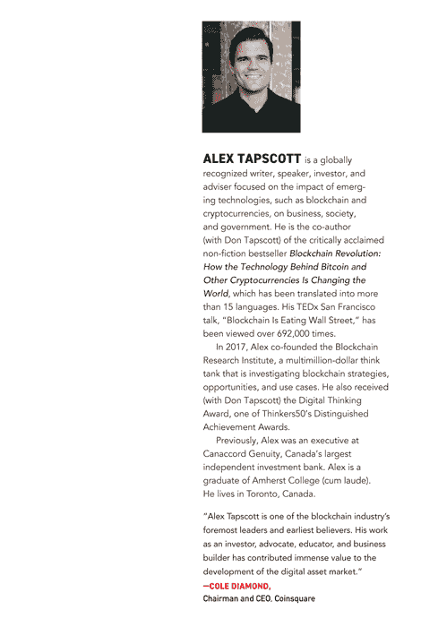

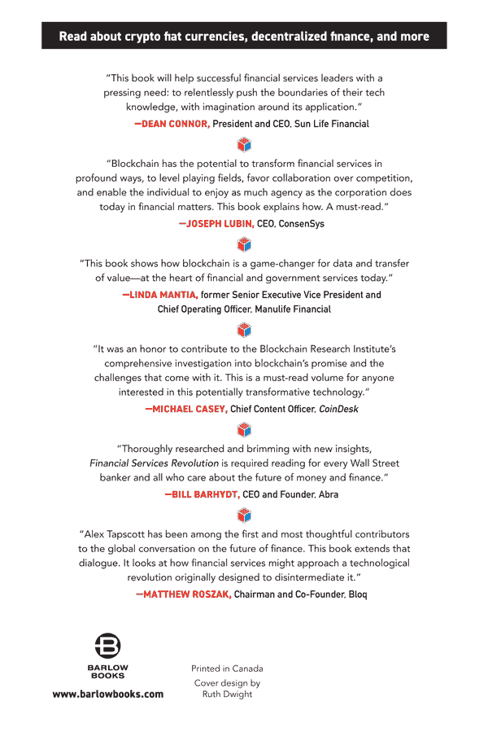

